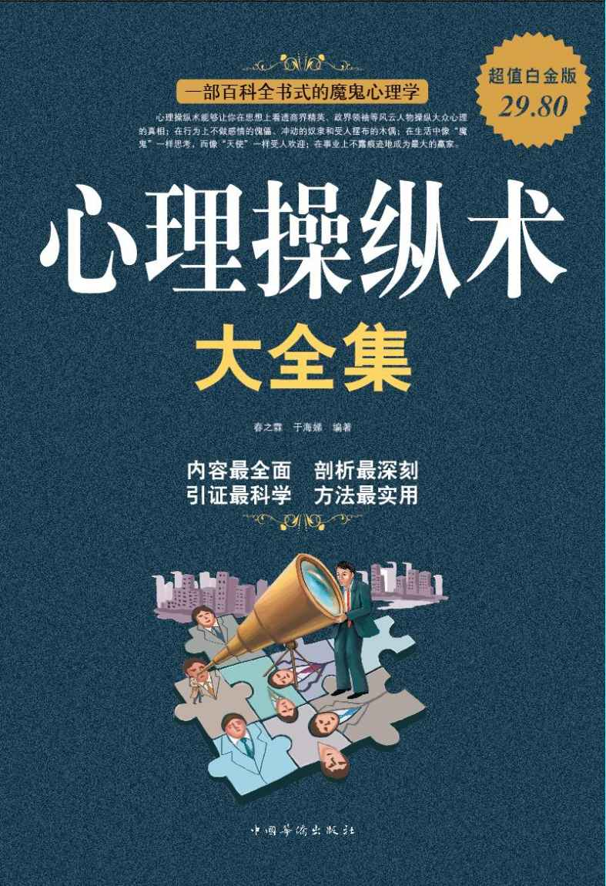

目录

      第一章 让对方开始喜欢你的心理操纵术

              想别人喜欢你，先去喜欢别人 3

              第一印象塑造好，便可在对方心中建立深刻印象 4

              精彩地说出你的名字，给人留下深刻印象 4

              把握好开始五分钟攀谈，以后交流自然顺畅 6

              让对方喜欢你，一切应从友善开始 7

              微笑，赢得他人好感的法宝 8

              适时附和，更容易讨对方欢心 8

              用好“您”字，会让你更受欢迎 10

              让对方做主角，他一定喜欢与你交流 11

              到什么山头唱什么歌，不同人要区别对待 11

      第二章 磁铁般吸引别人的心理操纵术

              美丽比一封介绍信更具有推荐力 13

              热情友善的称赞是获得友谊的最好方式 13

              “远亲不如近邻”，离他近更容易被关注 14

              用小错误点缀自己，你会更具吸引力 15

              吸引他最直接的方法：关键时刻拉他一把 16

              让对方占点便宜，他会在心里记住你 16

              用“流行语”增加你的语言魅力 17

              反复暗示，让他对你加深印象 18

              制造戏剧性，与众不同地吸引对方注意 20

              渲染氛围，增强对他的吸引力 21

      第三章 打开对方心扉的心理操纵术

              巧说第一句话，陌生人也能一见如故 22

              熟记名字，更容易抓住他的心 23

              “我们”常挂嘴边，消除对方陌生感 24

              用细微动作可以拉近与陌生人的距离 24

              别出心裁称赞他人，增进彼此好感 26

              适当“自我暴露”能加深亲密度 26

              幽默，让对方更加向你靠近 27

              运用认同术是达成共识的有效方法 28

              表达你的好感，让对方也有好感 29

              激发对方的情绪，让他滔滔不绝 30

              来点儿社交技巧，增进彼此感情 31

      第四章 获取对方信任的心理操纵术

              层层释疑，让对方放下心理包袱 32

              赢得信任，设身处地为对方着想 33

              用好态度打消对方疑心，让他知道你可信 33

              把“他应该知道”的事详细告诉他，消除不信任感 34

              说话要抓住能够表示诚意的时机 35

              学会推销自己，让他知道你重要 36

              恪守信用能赢得对方长久信赖 36

              泄露自己的秘密是赢得信任的绝佳技巧 37

      第五章 令对方赞同的心理操纵术

              抓住对方的心理，把话说到点子上 39

              利用人们的逆反心理来说话 39

              用富有热情和感染力的语言影响对方 40

              避免争论，绕过矛盾 41

              顺言逆意归谬法，让强势的他也点头 43

              用商量的口吻向对方提建议，柔中取胜 43

              正话反说，指桑骂槐 44

              必要时刻，向对方适当提出挑战 45

              巧妙提问，让对方只能答“是” 46

              容忍对方的反感，让他不再反感 46

              直接明了，一语中的 48

              让对方觉得那是他的主意 49

      第六章 操纵他人行为的心理操纵术

              “乐道人之善”，悦纳他人的第一步 51

              互惠，让他知道这样做对自己也有利 52

              从思路开始，让别人追随你的思想 52

              改变他，先迎合他的自尊心 53

              从对方立场考虑问题，让他自然改变 54

              布下“最后通牒”的陷阱，让他不得不屈服 55

              用“我错了”，让他人心悦诚服接受批评 56

              多用“所以”少用“但是”，对方易接受你的谈判 57

              吹毛求疵，让对方让步的“常规武器” 57

              发挥“独立性”魅力，让别人永远依赖你 59

      第七章 让对方心甘情愿帮忙的心理操纵术

              外表是打动对方最直观的方式 60

              让你的眼神温柔起来，给他一种美好感觉 61

              满足对方心理是求其办事最好的铺垫 62

              让自己看起来像个老板，他会觉得为你办事踏实 63

              以礼相待，多用敬语好求人 64

              不吝惜恭维的话，让对方不忍不帮忙 65

              适当转移话题，调动对方的谈兴 66

              反复催问，不给对方拖延之机 67

              “理直气壮”的理由对方更容易接受 68

              不好意思直接开口求人，可借他人之口 69

              激起对方同情心，打动他易成事 70

              没话的时候要找话说，制造融洽氛围 70

              求人办事，最好找对方心情好的时候 71

              对症下药，礼送对了好办事 72

              事后不要过河拆桥，为下次办事铺好路 73

      第八章 让他人欣然接受“拒绝”的心理操纵术

              拖延、淡化，不伤其自尊地将其拒绝 74

              先承后转，让对方在宽慰中接受拒绝 75

              友善地说“不”，和和气气将其拒绝 75

              通过暗示，巧妙说“不” 76

              先说让对方高兴的话题，再过渡到拒绝 77

              艺术地下逐客令，让其自动退门而归 78

              巧踢“回旋球”，利用对方的话来拒绝他 79

              顾及对方尊严，让他有面子地被拒绝 80

              贬低自己，降低对方期望值顺势将其拒绝 80

              找个人替你说“不”，不伤大家感情 82

      第九章 办公室中的心理操纵术

              应对面试官，要根据其性格特点从容施策 83

              听懂面试官的“话外音”，顺水推舟表现自己 84

              面试中要根据不同的提问进退自如 84

              把你的功劳让给上司，上司会对你奖励更多 85

              不争小利、夸大困难，向上司邀功请赏不会遭反感 86

              职场“亡羊”，就要技巧地“补牢” 86

              把上司的想法看在眼里，妥善进退 88

              拉拢“关键”同事，使其在领导面前替你说话 89

              主动承认劣势，将其转化为领导喜欢的优势 89

              读懂不同类型的同事，才能制造融洽气氛 90

              同事争功，用不伤和气的方式捍卫自己 91

              赢得同事好感四法宝：自然、关怀、宽容、大方 92

              识破口是心非的同事，为自己减少隐患 93

              化解同事敌意，要积极主动和好 94

              对待难相处的下属，要因势利导 95

              批评下属要“看人下菜碟” 95

              宽容对待下属的过失，对方更愿意被你领导 96

              掌控能力比自己强的下属：一用、二管、三养 97

      第十章 操纵男女情感的心理操纵术

              识破“男子汉”硬壳下的那颗脆弱之心 98

              从男人的场面话里听“门道” 99

              学名人示爱，让她不自禁地心动 100

              爱要开口，锁住芳心 101

              利用“异性效应”，让男人“听话” 102

              揣摩男人心思，把话说进“心窝” 102

              抓住说话线索，同陌生男人成为朋友 103

              温柔，女人智取男人的最好方法 104

              对付想当英雄的男人，你就要小鸟依人 105

              “女为悦己者容”的背后 105

              想让女人动情，千万别提“丑”字 106

              倾听，男人了解女人的必修课 107

              听懂女人话外音，不做她眼中的“木头” 108

              掌握女人言谈的韵律，才能赢得芳心 109

              女人冷时，你就要猛攻 110

              爱到深处，不妨“趁火打劫” 110

      第十一章 操纵难对付人的心理操纵术

              操纵心高气傲者：赞美向左，设难题向右 112

              操纵爱慕虚荣者：信赖、赞颂 113

              操纵贪小便宜者：潜移默化地感化 114

              操纵难缠者：“不屑”或“反击” 114

              操纵深藏不露者：静观其变，区别对待 115

              操纵性格内向者：迎合对方心理 116

              操纵性情孤僻者：动之以情 116

              操纵脾气急躁者：宽容忍让 117

              操纵尖酸刻薄者：有原则地宽厚相待 118

              操纵心胸狭窄者：大度忍让 119

              操纵搬弄是非者：坦荡相对，保持距离 120

              操纵愤世嫉俗者：心平气和，积极帮助 121

              操纵唯我独尊者：留面子是最好的尊重 121

              操纵自己不喜欢者：求同、彰优 122

      第十二章 自我心理操纵术

              悦纳自我的战术 124

              塑造自信的战术 126

              使自己保持进取的战术 128

              消融紧张的战术 129

              消除坏心情的战术 129

              缓解压力的战术 131

              控制情绪的战术 133

              防止冲动的战术 133

              

              

      第一章 洞悉人性，拿捏分寸

              对方再谦虚，也不要过分表现自我 137

              讨人喜欢的吹捧，既要捧得响又要捧得恰当 138

              活用谎言，让对方乐于同你交流 139

              用真诚掩盖你的不诚实，让他全然接受你 141

              你可保守他的秘密，但莫让他保守你的秘密 142

              找出对方弱点来，牵着他的鼻子走 143

              以诚动人，抓住他人心 144

              被逼入墙角的兔子也会咬人，得理时要让他三分 145

              展现自信的风采，给对方一颗定心丸 146

              率先化干戈为玉帛，敌对的他也会成朋友 147

              尽量让对方多说，自己才能获得更多信息 148

      第二章 以心交心，互惠互利

              如果能被对方需要，你也会变重要 150

              激起“心理共鸣”，让他感觉帮你像在帮自己 151

              让合作者生活得更好，你也能更好地生活 152

              帮别人的同时，也是在帮自己 154

              不报复对方，也是在为自己开路 154

              如果你有用，别怕被利用 156

              告诉他“你很重要”，回报定比器重多 156

              冷庙多烧香，临急才有佛脚抱 157

              主动吃亏，让对方不得不还以人情 158

      第三章 将心比心，换位思考

              想钓到鱼，就要像鱼一样思考 160

              让他知道你了解他、包容他，合作更容易 161

              不揭对方伤疤，他不痛你也好过 162

              看住对方的面子，等于守住彼此的融洽关系 163

              站在对方立场说话，他才容易听你的话 164

              说话多给对方“同感”的理解，更能打动其心 165

              站在上司的立场想问题，站在自己的立场办事情 165

              诙谐对待他人的错误，他过得去你也过得去 166

      第四章 以心治心，掌控主动

              欲震慑“猴”，就在其面前杀“鸡” 168

              “激励”让他多干活，“赞赏”让他积极干活 169

              不该仁义时，就要对他凶狠 170

              抓住他的把柄，让其受制于你 171

              单刀直入，开门见山直逼其要害 172

              将欲擒之，先予纵之 173

              实现野心要“名正言顺”，让他无话可说 174

              巧拉家常，让他不厌恶你的“管理” 175

              收放结合，才能把对方牢牢制住 176

              慑其精神，让他不得不屈服 177

              恭维说得不动声色，将对方“捧”服 178

              实施“苦肉计”，将狡猾的他制服 179

              刀藏于笑，将其杀于无形之中 180

      第五章 以心攻心，斗智斗勇

              要赢，先在勇气上压倒对方 182

              绵里藏针，柔中带刚 183

              故意透露虚假信息，蒙蔽对方 183

              离间，不用硬攻也能削弱对手实力 184

              欲摘鲜花，先从绿叶开始 185

              辩论中先发制人，争取主动权 186

              反其道而行，让对方的努力等于零 187

              顺着毛摸，投其所好掳获之 188

              “上屋抽梯”，将他彻底打败 190

              以己之长，攻人之短 190

              瞄准对方关键点，以一点击溃其全部 191

      第六章 以心赢心，以力借力

              “寄生”于人，成长加速 193

              积极主动地“攀龙附凤”，让贵人扶你平步青云 194

              巧转关系，借能人为自己办好棘手之事 195

              乾坤大挪移，化他人之力为我所用 196

              鸡鸣狗盗，小人物也能救命 197

              以静制动，让诤友充当自己的镜子 198

              圆滑维系“中间人”，迅速扩充人脉 199

              请将不如激将，激将不如逼将 200

              暴露脆弱面, 让支柱性朋友帮你告别悲伤 201

              得人心者得天下：以宽容仁德大展宏图 202

      第七章 以退为进，韬光养晦

              闭上生气的嘴，张开争气的眼 204

              忍对方一时之气，为自己换来有利局势 205

              不轻易暴露“野心”，才更容易将其实现 206

              成全对方好胜心，保全自己 206

              欲进两步，先退一步 207

              以自己小失让对方，日后会有大收获 208

              心怀大计，要装疯卖傻为自己蓄势 209

              弱势时打张情感牌，更易被对方认可 210

              掩藏真正意图，才能得到想要的一切 211

              谋晦避祸，在小事上做文章 211

              留得青山在，不怕没柴烧 212

              利用投降策略，把劣势转化为力量 213

              退避三舍，后发制人 214

      第八章 嘴上巧用劲，脚下便有路

              矛盾时给对方台阶，也是给自己台阶 216

              如果对方经验老到，恩威并施说服更快 217

              巧借比喻，无须明指也能将对方说服 218

              调节冲突，抬高一方让其主动退出 219

              情趣诱导法，让对方一点点上钩 220

              话不投机时，不想尴尬快转弯 222

              “意见”变“建议”，领导爱听你才好办事 223

              将错就错，摆脱窘境顺势取胜 225

              给批评裹件“糖衣”，让他在甜蜜中改过 227

              论辩中巧设圈套，让对方主动入瓮 228

      第九章 知晓方圆，精明生存

              会绕圈子才能左右逢源 229

              迂回出击，主动给自己创造契机 230

              未出头时，要能而有度 231

              夹缝中生存，对谁都要等距离交往 232

              如果对方很刚硬，你可运用柔的策略 232

              拉拢他，需要时就软硬兼施、厚黑并用 233

              无论对方是何类人，一定记住“过犹不及” 234

              形势不利时，要学会虚与委蛇 236

              辉煌时转身，保命亦留名 237

              复杂争夺之中，可抹黑自己以避险 238

              你可以比上司聪明，但莫让上司知道你比他聪明 239

              说出来的永远都要少于需要说的 239

      第十章 创变通达，趋利避险

              人舍你取，“垃圾”可能变“珍宝” 242

              遭受恶意诬陷，激烈反驳不如冷静灵活应对 243

              听懂对方的场面话，说好自己的场面话 244

              长袖时善舞，多钱时善贾 245

              脚踏两只船，总有其一可落脚 246

              正面难入手时，就从侧面出击 247

              施计弄巧，无条件时创造条件 248

              临危不乱，以“诈”赢得生机 249

              发现对方缝隙赶快下手，让其不攻自破 249

              

              

      第一章 察言观色的心理策略

              从衣服的选择判断人的个性特征 253

              淡妆与浓妆，表现不同的欲望 258

              饰品：心灵文化的显示 261

              奇妙多变的眼神：眼睛中的真实含义 269

              点睛之笔：从眉毛观察对手 280

              鼻子：人性情的象征 283

              祸福的门户：善变的嘴巴 285

              听话听音：从言谈之间听出“弦外之音” 287

              窥探笑容背后的内心世界 301

      第二章 慧眼识人的心理策略

              坐姿：洞悉人的动向 310

              走姿：了解人的性情 314

              站姿：透露人的个性 318

              睡姿：潜意识透露出的身体语言 321

              手势：表情达意的辅助手段 323

      第三章 洞悉人心的心理策略

              从日常习惯看人潜在的性格 328

              从生活习惯掌握人内心的活动 332

              从习惯动作看他的真实想法 340

              从休闲娱乐得出人的性格规律 350

              从运动方式看人的思维定式 355

              从业余爱好看人的性格和品味 357

              从社交言谈破译对方的心理 361

              从餐桌百态瞬间掌握人心 363

              从商务活动读懂对方的心 366

      第四章 看透他人的心理策略

              从女人的相貌读懂女人 370

              女人的行为：折射其性格的镜子 375

              一眼看透她是否有外遇 378

              从男人的体型看性格 379

              从面相透视男人的真面目 380

              男人的行为：诠释心灵的语言 381

              从男人的作风判断他的心 383

              从细节窥视情人的心 386

              从日常点滴了解老板的心理 395

              从面部表情识别同事的心理 409

              同事的行为：解读他的思想 410

              同事的言谈：倾听他人的心声 411

              慧眼识人，结交挚友 413

      第五章 辨别小人的心理策略

              小人不可不防 414

              怎样识别小人 415

              不给小人怀疑你的机会 415

              警惕小人的甜言蜜语 416

              看穿善于伪装的“君子” 417

              把小人置于眼皮底下 418

              以攻代守筑起防火墙 418

              打击小人须不露痕迹 419

              捧杀小人比棒杀更有效 420

              控制小人要利用他人的欲望 421

              借力打力躲过小人的陷害 421

      第六章 识破谎言的心理策略

              欺骗的信号 423

              表示心虚的视线转移 424

              大多数骗子会直视你的眼睛 425

              脸部表情是怎样揭露事实的 425

              利用手掌去撒谎 426

              常说错话的人表里不一 426

              女性更擅长说谎 427

              透过姿势看破谎言 428

      第七章 从原色彩的喜好洞察人心

              加法三原色（RGB）与减法三原色（CMY） 431

              原色彩的含义和象征性 431

              喜欢红色的人：热情、外向 432

              喜欢黄色的人：理性、积极 433

              喜欢蓝色的人：严谨、感性 433

              喜欢绿色的人：和平、朝气 434

              喜欢青色的人：温柔、平和 434

              

              

      第一章 催眠术的前世今生

              催眠术的端倪 437

              催眠术的发展 439

              20 世纪的催眠学 444

      第二章 原来这才是催眠

              什么是催眠术 447

              人为什么可以被催眠 450

      第三章 你最想知道的催眠问题

              那些催眠表演是真的吗 452

              催眠师可以让人做违背意愿的事吗 456

              会不会成为一睡不醒的“睡美人” 457

              催眠对所有人都有效吗 457

              催眠真的可以控制人的大脑吗 457

              催眠对人的身体有害吗 458

              催眠是不是一种超自然的实践 458

      第四章 掌握方法，催眠其实很简单

              催眠的 4 种状态和 6 个阶段 459

              “诱导”催眠制胜有招 460

              深化催眠的 6 种“暗示”方法 465

              通过“唤醒”解除催眠 467

      第五章 不可思议的催眠力量

              戒烟、戒酒、戒毒 469

              催眠让人安然入睡 474

              标本兼治，轻松减肥 476

              治疗恐惧症 481

              克服心理障碍 488

              解决人际关系障碍 510

              医学应用 510

              提高记忆力和学习能力 526

              年龄倒退与推进 532

              提高你的运动表现力 534

              法庭上的催眠奇效 538

      第六章 自我催眠，即学即会

              什么是自我催眠术 540

              自我催眠的准备工作 542

              自我诱导 542

              再唤醒与深化催眠 544

              编写暗示台词 545

      第七章 每天用点催眠术

              应用催眠就这么简单 550

              催眠减压，收获阳光心情 553

              不再做聚会中的“壁花” 554

              超然自信，应对自如 555

              催眠告诉自己：我能，我行！ 556

              催眠助你成为演讲家 556

              催眠真的可以缓解病痛 557

              别怀疑，催眠就是能增强注意力 558

              催眠助你再现梦境 559

              求助周公，不如求助催眠 559

              永别了，坏习惯 560

              催眠助你更加果断高效 561

              精力更加充沛 562

              自由大胆地飞翔 563

              激发强烈的取胜欲望 563

              催眠催眠，催你入眠 564

              完美的性生活 565

              催眠减肥，绿色又高效 566

              吃得健康，吃得正确 567

              催眠也能给你动力 568

              取得最佳成绩 569

              提高记忆力 570

              增强强壮的免疫系统 570

              快速康复 571

              催眠催出更积极的态度 572

              创造性地解决问题 573

              发现你的创造天赋 574

              赚更多的钱 574

              附录 催眠术大事记 576

一部百科全书式的魔鬼心理学

心理操纵术

大全集

春之霖 于海娣 编著

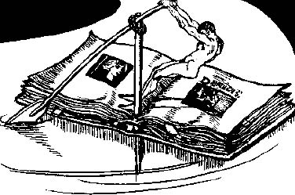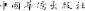

图书在版编目(CIP)数据

心理操纵术大全集/春之霖，于海娣编著.—北京:

中国华侨出版社，2010.8   

  ISBN 978-7-5113-0594-7

 I. ①心… Ⅱ.①春…②于… Ⅲ.①心理学-通俗

读物 Ⅳ.①B84-49

 中国版本图书馆 CIP 数据核字（2010）第 155136 号

心理操纵术大全集   

编 著：春之霖 于海娣

责任编辑：文 敏

封面设计：王明贵

文字编辑：袭村野

美术编辑：滕 霞

经 销：新华书店

开 本：1020mm×1200mm 1/10 印张：60 字数：1128 千字

印 刷：北京华宝装订有限公司

版 次：2010 年 10 月第 1 版 2010 年 10 月第 1 次印刷

书 号：ISBN 978-7-5113-0594-7

定 价：29.80 元

中国华侨出版社 北京市安定路 20 号院 3 号楼 305 室 邮编：100029

法律顾问：陈鹰律师事务所  

编 辑 部：（010）64443056 64443979

发 行 部：（010）58815874 传真：（010）58815857

网 址：www.oveaschin.com

E-mail：oveaschin@sina.com

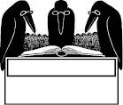

PREFACE

前 言

心理操纵术是一门人际关系心理学的实用技术，它把心理学的知识和规律变成我们可以影响和控制他人的武器。世界上所有的人都有可能陷入操纵与被操纵的关系中，成功的操纵者正是借助各种情绪、言行等心理策略和技巧来控制对方，以达到预设的目的。

无数的事实证明，那些声名显赫的成功人士之所以能够成功，其中一个重要的原因就是：他们比我们更清楚：自己想要获得成功，就要在别人身上多下功夫。研究发现，商界精英、政治领袖等各界的风云人物大都具有超强的心理操纵能力。他们具有敏锐的洞察力，会比普通人更仔细地观察他人，能够轻易地洞悉人的心理和本性，并懂得运用相关的心理学策略来影响、控制和操纵身边的人，从而更好地应对和处理工作与生活中的各种问题。这种擅长于使用小技巧解决大问题的本领，正是他们优于常人的显著特征。对于这些能够洞悉他人、影响他人、控制他人的心理操纵术，人们通常以为它们神秘至极，可实质上，它们都是一些非常普通的方法和技巧。

心理操纵术能够让你像“魔鬼”一样思考，而像“天使”一样受人欢迎。每一个人都离不开与他人的交往。但是，为什么有些人在人际交往中会如鱼得水、左右逢源；而有些人却举步维艰、进退维谷呢？恰当地使用心理操纵术，可以让你在人际交往中无往不利，拥有并自由调控海量人脉资源，让贵人自觉自愿甚至主动地为你排忧解难、创造良机。利用心理操纵术，就可以迅速知晓对方想听的和不想听的、想要的和不想要的、喜欢的和不喜欢的，以及对方担心的和顾虑的等，从而透过显而易见的表象，分析其背后隐藏的真实心理，掌控人际交往的主动权，成为人际博弈大赢家。对于操纵者来说，仅仅是扫除绊脚石并不是真正的目的，将绊脚石转化为垫脚石才是真正的智慧。

最高超的心理操纵术能让你赢得最成功的人生。有一只看不见的手在操纵着你我的生活，这只手就是人的心理。洞察人性的心理弱点，利用人性的心理弱点，在人际交往中会说话、会办事，用小策略解决大问题，正是心理操纵术的意义所在。世界上的大部分竞争都可以牵涉、应用到心理操纵术。爬山要懂山性，游泳要懂水性，成功要懂人性，掌握了心理操纵术，就能够掌握对方的心理变化，削弱对方的自信，操纵对方的情感，按照自己的意愿操纵对方。心理操纵术渗透于日常生活中的每个角落，与人们的生活、学习、工作都有着非常密切的关系。生活中，每个人的行为都受到自己心理的支配。不同的人有不同的心理，心理决定着一个人的想法，也决定着一个人的行为。掌握并自如运用心理操纵术，可以让你轻易达到你所希望达到的目的。

1

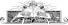

心理操纵术大全集

这本《心理操纵术大全集》共分四篇，分别是“心理操纵术”、“心理博弈术”、“心理洞察术”和“催眠术——一种神奇的心理操纵术”。学会运用“心理操纵术”和“心理博弈术”，能够让你有效利用他人心理，迅速掌控他人、掌控全局并战胜对手，使自己成为人际关系的赢家，进而在事业上取得进一步的成就。学会运用“心理洞察术”，能够让你用眼睛洞察一切，从细微之处读懂他人的微妙心思，并对其作出精准的判断，搞懂对方每一个表情、每一个动作所传达出来的信息，得知他们内心真正的想法，从而决定自己该扮演什么样的角色、说什么样的话、做什么样的事。催眠术能够直接作用于人的心灵，能够操纵人的认知能力，对于改变人的信念和行为方式有特殊的功效。了解催眠术的相关知识并应用于日常生活中，可以更好地操纵他人或反操纵。

相较于其他版本，本书内容更全面、剖析更深刻、引证更科学、方法更实用，是迄今为止最全面、最实用、最权威的心理操纵术大全集。书中以理论联系实际，以事例为佐证，贴近现实生活，教你快速掌握人心的奥秘，让你拥有一双看不见的力量之手，在工作和生活中知己知彼，占据主动，出奇制胜，利用心理力量赢得幸福与成功。

2

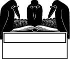

CONTENTS

目 录

第一篇 心理操纵术   

第一章 让对方开始喜欢你的心理操纵术

想别人喜欢你，先去喜欢别人 3

第一印象塑造好，便可在对方心中建立深刻印象 4

精彩地说出你的名字，给人留下深刻印象 4

把握好开始五分钟攀谈，以后交流自然顺畅 6

让对方喜欢你，一切应从友善开始 7

微笑，赢得他人好感的法宝 8

适时附和，更容易讨对方欢心 8

用好“您”字，会让你更受欢迎 10

让对方做主角，他一定喜欢与你交流 11

到什么山头唱什么歌，不同人要区别对待 11

第二章 磁铁般吸引别人的心理操纵术

美丽比一封介绍信更具有推荐力 13

热情友善的称赞是获得友谊的最好方式 13

“远亲不如近邻”，离他近更容易被关注 14

用小错误点缀自己，你会更具吸引力 15

吸引他最直接的方法：关键时刻拉他一把 16

让对方占点便宜，他会在心里记住你 16

用“流行语”增加你的语言魅力 17

反复暗示，让他对你加深印象 18

制造戏剧性，与众不同地吸引对方注意 20

渲染氛围，增强对他的吸引力 21

1

第三章 打开对方心扉的心理操纵术

巧说第一句话，陌生人也能一见如故 22

熟记名字，更容易抓住他的心 23

“我们”常挂嘴边，消除对方陌生感 24

用细微动作可以拉近与陌生人的距离 24

别出心裁称赞他人，增进彼此好感 26

适当“自我暴露”能加深亲密度 26

幽默，让对方更加向你靠近 27

运用认同术是达成共识的有效方法 28

表达你的好感，让对方也有好感 29

激发对方的情绪，让他滔滔不绝 30

来点儿社交技巧，增进彼此感情 31

第四章 获取对方信任的心理操纵术

层层释疑，让对方放下心理包袱 32

赢得信任，设身处地为对方着想 33

用好态度打消对方疑心，让他知道你可信 33

把“他应该知道”的事详细告诉他，消除不信任感 34

说话要抓住能够表示诚意的时机 35

学会推销自己，让他知道你重要 36

恪守信用能赢得对方长久信赖 36

泄露自己的秘密是赢得信任的绝佳技巧 37

第五章 令对方赞同的心理操纵术

抓住对方的心理，把话说到点子上 39

利用人们的逆反心理来说话 39

用富有热情和感染力的语言影响对方 40

避免争论，绕过矛盾 41

顺言逆意归谬法，让强势的他也点头 43

用商量的口吻向对方提建议，柔中取胜 43

正话反说，指桑骂槐 44

必要时刻，向对方适当提出挑战 45

巧妙提问，让对方只能答“是” 46

容忍对方的反感，让他不再反感 46

直接明了，一语中的 48

2

让对方觉得那是他的主意 49

第六章 操纵他人行为的心理操纵术

“乐道人之善”，悦纳他人的第一步 51

互惠，让他知道这样做对自己也有利 52

从思路开始，让别人追随你的思想 52

改变他，先迎合他的自尊心 53

从对方立场考虑问题，让他自然改变 54

布下“最后通牒”的陷阱，让他不得不屈服 55

用“我错了”，让他人心悦诚服接受批评 56

多用“所以”少用“但是”，对方易接受你的谈判 57

吹毛求疵，让对方让步的“常规武器” 57

发挥“独立性”魅力，让别人永远依赖你 59

第七章 让对方心甘情愿帮忙的心理操纵术

外表是打动对方最直观的方式 60

让你的眼神温柔起来，给他一种美好感觉 61

满足对方心理是求其办事最好的铺垫 62

让自己看起来像个老板，他会觉得为你办事踏实 63

以礼相待，多用敬语好求人 64

不吝惜恭维的话，让对方不忍不帮忙 65

适当转移话题，调动对方的谈兴 66

反复催问，不给对方拖延之机 67

“理直气壮”的理由对方更容易接受 68

不好意思直接开口求人，可借他人之口 69

激起对方同情心，打动他易成事 70

没话的时候要找话说，制造融洽氛围 70

求人办事，最好找对方心情好的时候 71

对症下药，礼送对了好办事 72

事后不要过河拆桥，为下次办事铺好路 73

第八章 让他人欣然接受“拒绝”的心理操纵术

拖延、淡化，不伤其自尊地将其拒绝 74

先承后转，让对方在宽慰中接受拒绝 75

友善地说“不”，和和气气将其拒绝 75

3

通过暗示，巧妙说“不” 76

先说让对方高兴的话题，再过渡到拒绝 77

艺术地下逐客令，让其自动退门而归 78

巧踢“回旋球”，利用对方的话来拒绝他 79

顾及对方尊严，让他有面子地被拒绝 80

贬低自己，降低对方期望值顺势将其拒绝 80

找个人替你说“不”，不伤大家感情 82

第九章 办公室中的心理操纵术

应对面试官，要根据其性格特点从容施策 83

听懂面试官的“话外音”，顺水推舟表现自己 84

面试中要根据不同的提问进退自如 84

把你的功劳让给上司，上司会对你奖励更多 85

不争小利、夸大困难，向上司邀功请赏不会遭反感 86

职场“亡羊”，就要技巧地“补牢” 86

把上司的想法看在眼里，妥善进退 88

拉拢“关键”同事，使其在领导面前替你说话 89

主动承认劣势，将其转化为领导喜欢的优势 89

读懂不同类型的同事，才能制造融洽气氛 90

同事争功，用不伤和气的方式捍卫自己 91

赢得同事好感四法宝：自然、关怀、宽容、大方 92

识破口是心非的同事，为自己减少隐患 93

化解同事敌意，要积极主动和好 94

对待难相处的下属，要因势利导 95

批评下属要“看人下菜碟” 95

宽容对待下属的过失，对方更愿意被你领导 96

掌控能力比自己强的下属：一用、二管、三养 97

第十章 操纵男女情感的心理操纵术

识破“男子汉”硬壳下的那颗脆弱之心 98

从男人的场面话里听“门道” 99

学名人示爱，让她不自禁地心动 100

爱要开口，锁住芳心 101

利用“异性效应”，让男人“听话” 102

揣摩男人心思，把话说进“心窝” 102

抓住说话线索，同陌生男人成为朋友 103

4

温柔，女人智取男人的最好方法 104

对付想当英雄的男人，你就要小鸟依人 105

“女为悦己者容”的背后 105

想让女人动情，千万别提“丑”字 106

倾听，男人了解女人的必修课 107

听懂女人话外音，不做她眼中的“木头” 108

掌握女人言谈的韵律，才能赢得芳心 109

女人冷时，你就要猛攻 110

爱到深处，不妨“趁火打劫” 110

第十一章 操纵难对付人的心理操纵术

操纵心高气傲者：赞美向左，设难题向右 112

操纵爱慕虚荣者：信赖、赞颂 113

操纵贪小便宜者：潜移默化地感化 114

操纵难缠者：“不屑”或“反击” 114

操纵深藏不露者：静观其变，区别对待 115

操纵性格内向者：迎合对方心理 116

操纵性情孤僻者：动之以情 116

操纵脾气急躁者：宽容忍让 117

操纵尖酸刻薄者：有原则地宽厚相待 118

操纵心胸狭窄者：大度忍让 119

操纵搬弄是非者：坦荡相对，保持距离 120

操纵愤世嫉俗者：心平气和，积极帮助 121

操纵唯我独尊者：留面子是最好的尊重 121

操纵自己不喜欢者：求同、彰优 122

第十二章 自我心理操纵术

悦纳自我的战术 124

塑造自信的战术 126

使自己保持进取的战术 128

消融紧张的战术 129

消除坏心情的战术 129

缓解压力的战术 131

控制情绪的战术 133

防止冲动的战术 133

  

5

  

第二篇 心理博弈术   

第一章 洞悉人性，拿捏分寸

对方再谦虚，也不要过分表现自我 137

讨人喜欢的吹捧，既要捧得响又要捧得恰当 138

活用谎言，让对方乐于同你交流 139

用真诚掩盖你的不诚实，让他全然接受你 141

你可保守他的秘密，但莫让他保守你的秘密 142

找出对方弱点来，牵着他的鼻子走 143

以诚动人，抓住他人心 144

被逼入墙角的兔子也会咬人，得理时要让他三分 145

展现自信的风采，给对方一颗定心丸 146

率先化干戈为玉帛，敌对的他也会成朋友 147

尽量让对方多说，自己才能获得更多信息 148

第二章 以心交心，互惠互利

如果能被对方需要，你也会变重要 150

激起“心理共鸣”，让他感觉帮你像在帮自己 151

让合作者生活得更好，你也能更好地生活 152

帮别人的同时，也是在帮自己 154

不报复对方，也是在为自己开路 154

如果你有用，别怕被利用 156

告诉他“你很重要”，回报定比器重多 156

冷庙多烧香，临急才有佛脚抱 157

主动吃亏，让对方不得不还以人情 158

第三章 将心比心，换位思考

想钓到鱼，就要像鱼一样思考 160

让他知道你了解他、包容他，合作更容易 161

不揭对方伤疤，他不痛你也好过 162

看住对方的面子，等于守住彼此的融洽关系 163

站在对方立场说话，他才容易听你的话 164

说话多给对方“同感”的理解，更能打动其心 165

6

站在上司的立场想问题，站在自己的立场办事情 165

诙谐对待他人的错误，他过得去你也过得去 166

第四章 以心治心，掌控主动

欲震慑“猴”，就在其面前杀“鸡” 168

“激励”让他多干活，“赞赏”让他积极干活 169

不该仁义时，就要对他凶狠 170

抓住他的把柄，让其受制于你 171

单刀直入，开门见山直逼其要害 172

将欲擒之，先予纵之 173

实现野心要“名正言顺”，让他无话可说 174

巧拉家常，让他不厌恶你的“管理” 175

收放结合，才能把对方牢牢制住 176

慑其精神，让他不得不屈服 177

恭维说得不动声色，将对方“捧”服 178

实施“苦肉计”，将狡猾的他制服 179

刀藏于笑，将其杀于无形之中 180

第五章 以心攻心，斗智斗勇

要赢，先在勇气上压倒对方 182

绵里藏针，柔中带刚 183

故意透露虚假信息，蒙蔽对方 183

离间，不用硬攻也能削弱对手实力 184

欲摘鲜花，先从绿叶开始 185

辩论中先发制人，争取主动权 186

反其道而行，让对方的努力等于零 187

顺着毛摸，投其所好掳获之 188

“上屋抽梯”，将他彻底打败 190

以己之长，攻人之短 190

瞄准对方关键点，以一点击溃其全部 191

第六章 以心赢心，以力借力

“寄生”于人，成长加速 193

积极主动地“攀龙附凤”，让贵人扶你平步青云 194

巧转关系，借能人为自己办好棘手之事 195

乾坤大挪移，化他人之力为我所用 196

7

鸡鸣狗盗，小人物也能救命 197

以静制动，让诤友充当自己的镜子 198

圆滑维系“中间人”，迅速扩充人脉 199

请将不如激将，激将不如逼将 200

暴露脆弱面, 让支柱性朋友帮你告别悲伤 201

得人心者得天下：以宽容仁德大展宏图 202

第七章 以退为进，韬光养晦

闭上生气的嘴，张开争气的眼 204

忍对方一时之气，为自己换来有利局势 205

不轻易暴露“野心”，才更容易将其实现 206

成全对方好胜心，保全自己 206

欲进两步，先退一步 207

以自己小失让对方，日后会有大收获 208

心怀大计，要装疯卖傻为自己蓄势 209

弱势时打张情感牌，更易被对方认可 210

掩藏真正意图，才能得到想要的一切 211

谋晦避祸，在小事上做文章 211

留得青山在，不怕没柴烧 212

利用投降策略，把劣势转化为力量 213

退避三舍，后发制人 214

第八章 嘴上巧用劲，脚下便有路

矛盾时给对方台阶，也是给自己台阶 216

如果对方经验老到，恩威并施说服更快 217

巧借比喻，无须明指也能将对方说服 218

调节冲突，抬高一方让其主动退出 219

情趣诱导法，让对方一点点上钩 220

话不投机时，不想尴尬快转弯 222

“意见”变“建议”，领导爱听你才好办事 223

将错就错，摆脱窘境顺势取胜 225

给批评裹件“糖衣”，让他在甜蜜中改过 227

论辩中巧设圈套，让对方主动入瓮 228

第九章 知晓方圆，精明生存

8

会绕圈子才能左右逢源 229

迂回出击，主动给自己创造契机 230

未出头时，要能而有度 231

夹缝中生存，对谁都要等距离交往 232

如果对方很刚硬，你可运用柔的策略 232

拉拢他，需要时就软硬兼施、厚黑并用 233

无论对方是何类人，一定记住“过犹不及” 234

形势不利时，要学会虚与委蛇 236

辉煌时转身，保命亦留名 237

复杂争夺之中，可抹黑自己以避险 238

你可以比上司聪明，但莫让上司知道你比他聪明 239

说出来的永远都要少于需要说的 239

第十章 创变通达，趋利避险

人舍你取，“垃圾”可能变“珍宝” 242

遭受恶意诬陷，激烈反驳不如冷静灵活应对 243

听懂对方的场面话，说好自己的场面话 244

长袖时善舞，多钱时善贾 245

脚踏两只船，总有其一可落脚 246

正面难入手时，就从侧面出击 247

施计弄巧，无条件时创造条件 248

临危不乱，以“诈”赢得生机 249

发现对方缝隙赶快下手，让其不攻自破 249

  

  

第三篇 心理洞察术   

第一章 察言观色的心理策略

从衣服的选择判断人的个性特征 253

淡妆与浓妆，表现不同的欲望 258

饰品：心灵文化的显示 261

奇妙多变的眼神：眼睛中的真实含义 269

点睛之笔：从眉毛观察对手 280

鼻子：人性情的象征 283

9

祸福的门户：善变的嘴巴 285

听话听音：从言谈之间听出“弦外之音” 287

窥探笑容背后的内心世界 301

第二章 慧眼识人的心理策略

坐姿：洞悉人的动向 310

走姿：了解人的性情 314

站姿：透露人的个性 318

睡姿：潜意识透露出的身体语言 321

手势：表情达意的辅助手段 323

第三章 洞悉人心的心理策略

从日常习惯看人潜在的性格 328

从生活习惯掌握人内心的活动 332

从习惯动作看他的真实想法 340

从休闲娱乐得出人的性格规律 350

从运动方式看人的思维定式 355

从业余爱好看人的性格和品味 357

从社交言谈破译对方的心理 361

从餐桌百态瞬间掌握人心 363

从商务活动读懂对方的心 366

第四章 看透他人的心理策略

从女人的相貌读懂女人 370

女人的行为：折射其性格的镜子 375

一眼看透她是否有外遇 378

从男人的体型看性格 379

从面相透视男人的真面目 380

男人的行为：诠释心灵的语言 381

从男人的作风判断他的心 383

从细节窥视情人的心 386

从日常点滴了解老板的心理 395

从面部表情识别同事的心理 409

同事的行为：解读他的思想 410

同事的言谈：倾听他人的心声 411

10

慧眼识人，结交挚友 413

第五章 辨别小人的心理策略

小人不可不防 414

怎样识别小人 415

不给小人怀疑你的机会 415

警惕小人的甜言蜜语 416

看穿善于伪装的“君子” 417

把小人置于眼皮底下 418

以攻代守筑起防火墙 418

打击小人须不露痕迹 419

捧杀小人比棒杀更有效 420

控制小人要利用他人的欲望 421

借力打力躲过小人的陷害 421

第六章 识破谎言的心理策略

欺骗的信号 423

表示心虚的视线转移 424

大多数骗子会直视你的眼睛 425

脸部表情是怎样揭露事实的 425

利用手掌去撒谎 426

常说错话的人表里不一 426

女性更擅长说谎 427

透过姿势看破谎言 428

第七章 从原色彩的喜好洞察人心

加法三原色（RGB）与减法三原色（CMY） 431

原色彩的含义和象征性 431

喜欢红色的人：热情、外向 432

喜欢黄色的人：理性、积极 433

喜欢蓝色的人：严谨、感性 433

喜欢绿色的人：和平、朝气 434

喜欢青色的人：温柔、平和 434

  

11

  

第四篇 催眠术——一种神奇的心理操纵术   

第一章 催眠术的前世今生

催眠术的端倪 437

催眠术的发展 439

20 世纪的催眠学 444

第二章 原来这才是催眠

什么是催眠术 447

人为什么可以被催眠 450

第三章 你最想知道的催眠问题

那些催眠表演是真的吗 452

催眠师可以让人做违背意愿的事吗 456

会不会成为一睡不醒的“睡美人” 457

催眠对所有人都有效吗 457

催眠真的可以控制人的大脑吗 457

催眠对人的身体有害吗 458

催眠是不是一种超自然的实践 458

第四章 掌握方法，催眠其实很简单

催眠的 4 种状态和 6 个阶段 459

“诱导”催眠制胜有招 460

深化催眠的 6 种“暗示”方法 465

通过“唤醒”解除催眠 467

第五章 不可思议的催眠力量

戒烟、戒酒、戒毒 469

催眠让人安然入睡 474

标本兼治，轻松减肥 476

治疗恐惧症 481

克服心理障碍 488

解决人际关系障碍 510

12

医学应用 510

提高记忆力和学习能力 526

年龄倒退与推进 532

提高你的运动表现力 534

法庭上的催眠奇效 538

第六章 自我催眠，即学即会

什么是自我催眠术 540

自我催眠的准备工作 542

自我诱导 542

再唤醒与深化催眠 544

编写暗示台词 545

第七章 每天用点催眠术

应用催眠就这么简单 550

催眠减压，收获阳光心情 553

不再做聚会中的“壁花” 554

超然自信，应对自如 555

催眠告诉自己：我能，我行！ 556

催眠助你成为演讲家 556

催眠真的可以缓解病痛 557

别怀疑，催眠就是能增强注意力 558

催眠助你再现梦境 559

求助周公，不如求助催眠 559

永别了，坏习惯 560

催眠助你更加果断高效 561

精力更加充沛 562

自由大胆地飞翔 563

激发强烈的取胜欲望 563

催眠催眠，催你入眠 564

完美的性生活 565

催眠减肥，绿色又高效 566

吃得健康，吃得正确 567

催眠也能给你动力 568

取得最佳成绩 569

提高记忆力 570

13

增强强壮的免疫系统 570

快速康复 571

催眠催出更积极的态度 572

创造性地解决问题 573

发现你的创造天赋 574

赚更多的钱 574

附录 催眠术大事记 576

  

14

第一篇   

心理操纵术

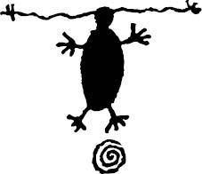

第一章

让对方开始喜欢你的心理操纵术

想别人喜欢你，先去喜欢别人

维也纳一位著名的心理学家阿尔弗雷德·阿得勒，写过一本书，名叫《生活对你的意义》。在那本书里，他说：“一个不关心别人，对别人不感兴趣的人，他的生活必然遭受重大的阻碍和困难，同时会替别人带来极大的损害与困扰。所有人类的失败，都是由于这些人才发生的。”

一个人如果只关心自己，他很难成为一个被人喜欢的人。要成为受人敬重的人，必须将你的注意力从自己的身上转到别人的身上去。哲学家威廉姆斯说：“人性中最强烈的欲望便是希望得到他人的敬慕。”这句话对于“别人”也同样适用，他人也希望得到你的敬慕。如果你只是过度关心你自己，就没有时间及精力去关心别人。别人无法从你这里得到关心，当然也不会注意你。

伍布奇先生是一家公司的总裁，著名的销售专家，当人们问及一个成功的销售员该具备哪些基本条件时，伍布奇先生脱口而出：“当然是喜欢别人。还有，一个人必须了解自己公司的产品而且对产品有信心，工作要勤奋，善于运用积极思想。但是，最重要的是他一定要喜欢他人。”

这个故事告诉我们，受人欢迎是销售员素质的某种表现形式，因为从某种程度上讲，你在推销产品的同时，也在“推销”自己。将这一点扩大到人际交往的层面上来，当一个人可以真心地喜欢他人时，他一定会招人喜欢。所以，要获得他人的喜爱，首先必须要真诚地喜欢他人。当然，这种喜欢必须是发自内心的，而非别有所图。

如果你要别人喜欢你，请对别人表现诚挚的关切。这是西奥多·罗斯福异常受欢迎的秘密之一，甚至他的仆人都喜爱他。他的那位黑人男仆詹姆斯·亚默斯，写了一本关于他的书，取名为《西奥多·罗斯福，他仆人的英雄》。在着这本书中，亚默斯说了一个个富有启发性的事件：

“有一次，我太太问总统关于一只鹑鸟的事。她从没有见过鹑鸟，于是他详细地描述一番。没多久之后，我们小屋的电话铃响了。我太太拿起电话，原来是总统本人。他说，他打电话给她，是要告诉她，她窗口外面正好有一只鹑鸟，又说如果她往外看的话，可能看得到。他时常做出类似的小事。每次他经过我们的小屋，即使他看不到我们，我们也会听到他轻声叫出：‘呜，呜，呜，安妮！’或‘呜，呜，呜，詹姆斯！’这是他经过时一种友善的招呼。”

关于这一点，罗斯福本人的实例更是一个有力的证明。

有一天，罗斯福到白宫去拜访，碰巧塔夫脱总统和他太太不在。他真诚喜欢卑微身份者的情形全表现出来了，因为他向所有白宫旧仆人打招呼，都叫出名字来，甚至厨房的小妹也不例外。“当他见到厨房的亚丽丝时，”亚默斯写道，“就问她是否还烘制玉米面包，亚丽丝回答说，她有时会为仆人烘制一些，但是楼上的人都不吃。‘他们的口味太差了，’罗斯福有些不平地说：‘等我见到总统的时候，我会这样告诉他。’亚丽丝端出一块玉米面包给他，他一面走到办公室去，一面吃，同时在经过园丁和工人的身旁时，还跟他们打招呼……他对待每一个人，就同他以前一样。他们仍然彼此低语讨论这件事，而艾克胡福眼中含着泪说：‘这是将近两年来我们唯一有过的快乐日子，我们中的任何人，都不愿意把这个日子跟一张百元大钞交换。’”

从现在开始，真诚、友善地去喜欢你周围的人吧，相信，这也将会让他们真诚、友善地喜欢你！

第一印象塑造好，便可在对方心中建立深刻印象

日常生活中，我们都有过这样的体验，初次与人见面时，对方的相貌、举止、言语、风度等某些方面会迅速地映在你的脑海中，形成最初感觉，即第一印象。第一印象主要源于人的直觉观察，根据直觉观察到的信息加以综合评判，然后以某种形式固定下来。

卡耐基认为，在社交活动中，第一印象很重要。它是在没有任何成见的基础上，完全凭着你的“自我表现”来判断的，因而第一印象直观、鲜明、强烈而又牢固。如果你的相貌俊美，举止端庄大方，言语机智，谈吐风趣幽默，风度翩翩，谦虚而不自卑，自信而不固执，倔强而不狂妄，你就会给人留下美好而难忘的印象。

当然，人无完人，所有的优点和美德不可能都集中在一个人身上，但你若具有其中某一方面或某一方面的某一点，再扬长避短，将其发扬光大，也同样可以获得最佳效果。

第一印象的好坏，决定着社交活动能否继续下去。第一印象好，人家就愿意和你进一步来往，通过一段时间的相识与了解，人家觉得你的确不错，你们的关系就会顺畅发展。如果对方是你的客户，你在事业上就多了一个合作伙伴；如果对方是你的同事，你在工作中就多了一个支持者；如果对方是你的邻居，你在生活里就多了一个朋友。第一印象不好，你与人家的交往便不得不就此止步了，因为人家不想再见到你。纵然你有多么美好的动机，多么宏伟的蓝图构想，也只能化成泡影了。

第一印象直接影响着对一个人的评价。一个人的言谈举止，是构成人们对他直接评价的主要因素。许多人在初次交往时，就很快被对方所接受，或奉为事业的楷模，或尊为学业上的恩师，或敬为思想上的领袖，或求为人生的伴侣。

第一印象的烙印是非常深刻的，很长时间都不容易被改变。在许多回忆录中，我们常常可以读到这样一段话：“他还是老样子，像我第一次见到他的时候……”多少年以后，历史的变化更加之岁月的沧桑，一个人怎么会没有变化呢？但在作者眼里，对方还是他初次见到的模样。事实上不是对方依然如故，而是作者脑中的第一印象太深刻了，没有随着时间的流逝而改变。

中国老百姓中流传着这样一句话：“到了新环境，头三脚踢开，以后就容易了。”与人交往也是同样的道理，在他人心中的第一印象塑造好了，日后才容易春风得意。

精彩地说出你的名字，给人留下深刻印象

在向陌生人做自我介绍时，首先要做的就是自报姓名，但许多人在这方面却做得不太好，在介绍时只是简单地报出自己的姓名：“我姓×，叫××。”自以为介绍已经完成，然而这样的介绍肯定算不上有技巧，也许只过了三五分钟，别人已经把他的姓名忘得一干二净，这样也就无法给别人留下深刻的第一印象。

一个人的姓名，往往拥有丰富的文化积淀，或折射凝重的史实，或反映时代的乐章，或寄寓双亲对子女的殷切厚望。因此，推衍姓名能令人对你印象深刻，有时也会令人动情。

1.利用名人式

在新生见面会上，代玉做自我介绍时说：“大家都很熟悉《红楼梦》里多愁善感的林黛玉吧，那么就请记住我，我叫代玉。”

再如王琳霞：“我叫王琳霞，和世界冠军王军霞只差一个字，所以，每次王军霞获得世界冠军时，我也十分激动。”

利用和名人的名字相近的方式来介绍自己的名字，关键是所选的名人是大家都知道的，否则就收不到效果。

2.自嘲式

如刘美丽介绍自己时说：“不知道父母为何给我取美丽这个名字。我没有标准的身高，也没有苗条的身材，更没有漂亮的脸蛋，这大概是父母希望我虽然外表不美丽，但不要放弃对一切美丽事物的追求吧。”

3.自夸式

如李小华介绍自己时说：“我叫李小华，木子李，大小的小，中华的华。都是几个没有任何偏旁的最简单的字，就如我本人，简简单单、快快乐乐。但简单不等于没有追求，相反，我是一个有理想并执著的人，在追求理想的路上我快乐地生活着。”

4.联想式

如一个同学叫萧信飞，他便这样做自我介绍：“我姓萧，叫萧信飞。萧何的萧，韩信的信，岳飞的飞。”绝大多数人对“萧何月下追韩信”的典故和民族英雄岳飞都很熟悉，这样一来，大家对他的名字当然印象深刻了。

5.姓名来源式

如陈子健：“我还未出生，名字就在我父亲的心目中了。因为他很喜欢这样一句古语‘天行健，君子以自强不息’，于是毫不犹豫地给我取了这个名字，同时希望我像君子一样自强不息。”  

6.望文生义式

如秦国生：“我是秦始皇吞并六国时出生的，我叫秦国生。”与其他方法相比，望文生义法有更大的发挥余地，如下面的几例。

夏琼——夏天的海南，风光无限。

杨帆——一帆风顺，扬帆远航。

皓波——银色的月光照在水波上。

秀惠——秀外慧中，并非虚有其表。

7.理想式

如向红梅：“我向往像红梅一样不畏严寒，坚强刚毅，在各种环境中都要努力上进，尤其是在艰苦的环境里，更要绽放出生命的美丽。”

8.释词式

即从姓名本身进行解释。如朱红：“朱是红色的意思，红也是红色的意思，合起来还是红色。红色总给人热情、上进、富有生命力的感觉，这就是我的颜色!”

9.利用谐音式

如朱伟慧：“我的名字读起来像‘居委会’，正因为如此，大家尽可以把我当成居委会，有困难的时候来反映，本居委会力争为大家解决。”

10.调换词序式

如周非：“把‘非洲’倒过来读就是我的名字——周非。”

11.激励式

如展鹏在新生见面会上说：“同学们，我们从五湖四海来到这里，为了什么？不就是为了好好学习，今后在社会这片广阔的天空中大鹏展翅，自由翱翔吗？”

12.摘引式

如任丽群：“大家都知道‘鹤立(丽)鸡群’这个成语，我是人(任)，更希望出类拔萃，所以，我叫任丽群。”

总之，自我介绍是有很大发挥空间的，我们应该想方设法把它丰富起来，不要放过任何一个吸引人注意的机会。

当然，自我介绍中光介绍名字显得有些单一，应该再加入更多的信息，这样会使你的自我介绍更加精彩，给人留下深刻的印象。你完全可以把自己的经历编成一个小小的故事，讲给听众，这样或许他们更有兴趣些。

把握好开始五分钟攀谈，以后交流自然顺畅

人们第一次相遇，需要多长时间决定他们能否成为朋友？美国伦纳得·朱尼博士在所著的一本书中说：“交际的点，就在于他们相互接触的第一个五分钟。”朱尼博士认为：“人们接触的第一个五分钟主要是交谈。在交谈中，你要对所接触的对象谈的任何事都感兴趣。无论他从事什么职业，讲什么语言，以什么样的方式，对他说的话都要耐心倾听。如果你这样做了，你会觉得整个世界充满无比的情趣，你将交到无数的朋友。”

而许多人同陌生人说话都会感到拘谨。建议你先考虑一个问题，为什么你跟老朋友谈话不会感到困难？很简单，因为你们相当熟悉。相互了解的人在一起，就会感到自然协调，而对陌生人却一无所知，特别是进入了充满陌生人的环境，有些人甚至怀有不自在和恐惧的心理。你要设法把陌生人变成老朋友，首先要在心目中建立一种乐于与人交朋友的愿望，心里有这种要求，才能有行动。

以到一个陌生人家去拜访为例：如果有条件，首先应当对要拜访的客人作些了解，探知对方一些情况，关于他的职业、兴趣、性格之类。

当你走进陌生人住所时，你可凭借你的观察力，看看墙上挂的是什么？国画、摄影作品、乐器……都可以推断主人的兴趣所在，甚至室内某些物品会牵引起一段故事。如果你把它当做一个线索，就可以由浅入深地了解主人心灵的某个侧面。当你抓到一些线索后，就不难找到开场白。

如果你不是要见一个陌生人，而是参加一个充满陌生人的聚会，观察也是必不可少的。你不妨先坐在一旁，耳听眼看，根据了解的情况，决定你可以接近的对象，一旦选定，不妨走上前去向他作自我介绍，特别对那些同你一样，在聚会中没有熟人的陌生者，你的主动行为是会受到欢迎的。

应当注意的是，有些人你虽然不喜欢，但必须学会与他们谈话。当然，人都有以自我兴趣为中心的习惯，如果你对自己不感兴趣的人不瞥一眼，一句话都不说，恐怕也不是件好事。别人会认为你很骄傲，甚至有些人会把这种冷落当做侮辱，从而产生隔阂。和自己不喜欢的人谈话时，第一要有礼貌；第二不要谈论有关双方私人的事，这是为了使双方自然地保持适当的距离，一旦你愿意和他结交，就要一步一步设法缩小这种距离，使双方容易接近。

在你决定和某个陌生人谈话时，不妨先介绍自己，给对方一个接近的线索，你不一定先介绍自己的姓名，因为这样人家可能会感到唐突。不妨先说说自己的工作单位，也可问问对方的工作单位。一般情况，你先说说自己的情况，人家也会相应告诉你他的有关情况。

接着，你可以问一些有关他本人的而又不属于秘密的问题。对方有一定年纪的，你可以问他子女在哪里读书，也可以问问对方单位一般的业务情况。对方谈了之后，你也应该顺便谈谈自己的相应情况，才能达到交流的目的。

和陌生人谈话，要比对老朋友更加留心对方的谈话，因为你对他所知有限，更应当重视已经得到的任何线索。此外，他的声调、眼神和回答问题的方式，都可以揣摩一下，以决定下一步是否能纵深发展。

有人认为见面谈谈天气是无聊的事。其实，这要具体问题具体分析。如果一个人说：“这几天的雨下得真好，否则田里的稻苗就旱死了。”而另一个则说：“这几天的雨下得真糟，我们的旅行计划全给泡汤了。”你不是也可以从这两句话中分析两人的兴趣、性格吗？退一步说，光是敷衍性的话，在熟人中意义不大，但对与陌生人的交往还是有作用的。

如遇到那种比你更羞怯的人，你更应该跟他先谈些无关紧要的事，让他心情放松，以激起他谈话的兴趣。和陌生人谈话的开场白结束之后，特别要注意话题的选择。那些容易引起争论的话题，要尽量避免，为此当你选择某种话题时，要特别留心对方的眼神和小动作，一发现对方厌倦、冷淡的情绪时，应立即转换话题。

在与人聚会时，常常会碰到请教姓名的事，“请问你尊姓大名”。你要牢牢记住对方的姓名，对方说出姓名之后，你应立即用这个名字来称呼他，当你碰到一个可能已经忘记了的人，你可以表示抱歉，“对不起，不知怎么称呼您？”也可以说半句“您是——”“我们好像——”，意思是想请对方主动补充回答，如果对方老练，他会自然地接下去。

顺利地与陌生人开始攀谈，给人一个好印象，积累人脉资源为你所用。学会和陌生人攀谈，谁都可能成为你的朋友。

让对方喜欢你，一切应从友善开始

请先想这样一个问题：在与他人交往的过程中，如果你发起脾气，对他人说出一两句不中听的话，你会有一种发泄的快感。但对方呢？他会分享你的痛快吗？你那火药味的口气，敌视的态度，能使对方接受吗？相信答案已经不言而喻了。

“如果你握紧一双拳头来见我，”威尔逊总统说，“我想，我可以保证，我的拳头会握得比你的更紧。但是如果你来找我说：‘我们坐下，好好商量，看看彼此意见相异的原因是什么。’我们就会发觉，彼此的距离并不那么大，相异的观点并不多，而且看法一致的观点反而居多。你也会发觉，只要我们有彼此沟通的耐心、诚意和愿望，我们就能沟通。”

波士顿是美国历史上的教育和文化中心，那年头波士顿的报纸充斥着江湖郎中的广告——堕胎专家和庸医的广告。表面上是给人治病，骨子里却以恐吓的词句，类似“你将失去性能力”，等等，欺骗无辜的受害者。他们的治疗方法使受害者满怀恐惧，而事实上却根本不加以治疗。他们害死了许多人，却很少被定罪。他们只要缴点罚款或利用政治关系，就可以逃脱责任。

这种情况太严重了，波士顿很多善良的民众感到很愤怒。传教士拍着讲台，痛斥报纸，祈求上帝能终止这种广告。公民团体、商界人士、妇女团体、教会、青年社团等，一致公开指责，大声疾呼，但一切都无济于事。议会掀起争论，要使这种无耻的广告不合法，但是在利益集团和政治的影响力之下，各种努力均告徒然。

华尔医师是波士顿基督联盟的善良的民众委员会主席，他的委员会用尽了一切方法，都失败了。这场抵抗医学界败类的斗争，似乎没有什么成功的希望。

有一天晚上，华尔医师试了波士顿人没有试过的一个办法。他所用的是仁慈、同情和赞美。他企图使报社自动停止那种广告。他写了一封信给《波士顿先锋报》的发行人，表示他多么仰慕该报：新闻真实，社论尤其精彩，是一份完美的家庭报纸，他一向看该报。华尔医师表示，以他的看法，它是新英格兰地区最好的报纸，也是全美国最优秀的报纸之一。“然而，”华尔医师说道，“我的一位朋友有个小女儿。他告诉我，有一天晚上，他的女儿听他高声朗读贵报上有关堕胎专家的广告，并问他那是什么意思。老实说他很尴尬，他不知道该怎么回答。贵报深入波士顿上等人家，既然这种场面发生在我的朋友家里，在别的家庭也难免会发生。如果你也有女儿，你愿意她看到这种广告吗？如果她看到了，还要你解释，你该怎么说呢？  

“很遗憾，像贵报这么优秀的报纸，其他方面几乎是十全十美，却有这种广告，使得一些父母不敢让家里的女儿阅读。可能其他成千上万的订户都和我有同感吧！”

两天以后，《波士顿先锋报》的发行人，回了一封信给华尔医师，日期是 1904 年 10 月 13 日。华尔医师保留了这封信有 1/3 世纪。这封信如下：

亲爱的先生：

11 日致本报编辑部来函收纳，甚为感激。贵函的正言，促使我实现本人自接掌本职后，一直有心于此但未能痛下决心的一件事。

从下周一起，本人将促使《波士顿先锋报》摒弃一切可能招致非议的广告。暂时不能完全剔除的广告，也将谨慎编撰，不使它们造成任何不快。贵函惠我良多，再度致谢，并盼继续不吝指正。

因此，当你希望别人同意你的想法时，请记住：以一种友善的方式开始。

微笑，赢得他人好感的法宝

微笑是人际交往的通行证，是打开每个心门的钥匙。在与人交流中，主动报以微笑不仅能迅速拉近彼此心与心的距离，还能赢得他人好感。

飞机起飞前，一位乘客请求空姐给他倒一杯水服药。空姐很有礼貌地说：“先生，为了您的安全，请稍等片刻，等飞机进入平稳飞行状态后，我会立刻把水给您送过来，好吗？”15 分钟后，飞机早已进入平稳飞行状态。突然，乘客服务铃急促地响了起来，空姐猛然意识到：糟了，由于太忙，忘记给那位乘客倒水了。空姐来到客舱，看见按响服务铃的果然是刚才那位乘客。她小心翼翼地把水送到那位乘客跟前，面带微笑地说：“先生，实在对不起，由于我的疏忽，延误了您吃药的时间，我感到非常抱歉。”这位乘客抬起左手，指着手表说道：“怎么回事，有你这样服务的吗？”无论她怎么解释，这位挑剔的乘客都不肯原谅她的疏忽。  

在接下来的飞行途中，为了补偿自己的过失，每次去客舱为乘客服务时，空姐都会特意走到那位乘客面前，面带微笑地询问他是否需要帮助。然而，那位乘客余怒未消，摆出一副不合作的样子。

临到目的地前，那位乘客要求空姐把留言本给他送过去。很显然，他要投诉这名空姐。飞机安全降落。所有的乘客陆续离开后，空姐紧张极了，以为这下完了。没想到，她打开留言本，却惊奇地发现，那位乘客在留言本上写下的并不是投诉，相反却是一封热情洋溢的表扬信：“在整个过程中，你表现出的真诚的歉意，特别是你的 12 次微笑，深深打动了我，使我最终决定将投诉信写成表扬信。你的服务质量很高，下次如果有机会，我还将乘坐你们这趟航班。”空姐看完信，激动得热泪盈眶。

在人际交往中，我们要赢得他人的好感，必须要学会微笑，像故事中的那位空姐一样，用自己迷人的微笑来赢得他人的好感。微笑就像温暖人们心田的太阳，没有一块冰不会被融化。要带着真心、诚心、善心、爱心、关心、平常心、宽容心等去微笑，别人就会感受到你的心意，被你这份心感动。微笑可以使你摆脱窘境，化解人们彼此的误会，可以体现你的自信和大度。

在现实生活中，微笑能化解一切冰冷的东西，容易获得他人的好感。比如朋友、同事之间的吵架、误解，家人、邻居之间的矛盾，恋人、兄弟之间的隔阂等，都可以一笑了之，一笑泯恩仇。所以，人际交往中，不管是遇到什么困难，不管遇到多么尴尬的事情，要常常告诉自己要“微笑”，没有什么事情不能用微笑化解的，只要你是真心的！

俗话说，“伸手不打笑脸人”，微笑能够化解矛盾和尴尬，取得意想不到的效果。微笑是人与人之间最短的距离，纵使再远的时空阻隔，只要一个微笑就能拉近彼此的心灵距离。当别人取笑你时，用微笑还击他，笑他的无知；当别人对你愤怒时，用微笑融化他，他会知道自己是在无理取闹；当彼此发生误解，争执不休时，用微笑打破僵局，你会发现事情其实并没有你们想象的那么复杂和严重……

微笑是人际交往的通行证，没有一个人不喜欢和微笑的人打交道！

适时附和，更容易讨对方欢心

我们曾提到过，多听别人说，自己才能了解得到对方更多的信息。然而，不是每个听力正常的人都懂得倾听的艺术，尤其是想讨对方欢心的时候，仅仅靠听就完全不够了，更重要的是要会适时附和对方。不信，看看下面的例子就知道了。

有人做过这样一个实验，来证明听者的态度对说者有着极大的影响。

实验者让学生表现出一副心不在焉的样子，结果上课的教授照本宣科，不看学生，无强调，无手势；让学生积极投入——倾听，并且开始使用一些身体语言，比如适当的身体动作和眼神的接触。结果教授的声调开始出现变化，并加入了必要的手势，课堂气氛生动起来。

由此看出，当学生表现出一副心不在焉的样子，教授因得不到必要的反应而变得满不在乎起来；当学生改变态度，用心去倾听时，其实是从一个侧面告诉教授：你的课讲得好，我们愿意听。这就是无声的赞美，并且起到了积极的效果。

从上面的例子也可以看出，倾听时加入必要的身体语言，是非常有必要的。

行动胜于语言。身体的每一部分都可以显示出激情、赞美的信息，可增强、减弱或躲避、拒绝信息的传递。精于倾听的人，是不会做一部没有生气的录音机的，他会以一种积极投入的状态，向说话者传递“你的话我很喜欢听”的信息。

录音机是没有眼睛的，俗语说，“眼睛是心灵的窗口”。适当的眼神交流可以增强听的效果。这种眼神是专注的，而不是游移不定的；是真诚的，而不是虚伪的。发自灵魂深处的眼神是动人心魄的。

录音机做不了“小动作”，而倾听者则必须做一些“小动作”。身体向对方稍微前倾，表示你对说者的尊敬；正向对方而坐，表明“我们是平等的”，这可使职位低者感到亲切，使职位高者感到轻松。自然坐立，手脚不要交叉，否则让对方认为你傲慢无礼。倾听时和说话人保持一定的距离，恰当的距离给人以安全感，使说话者觉得自然。动作跟进要合适，太多或太少的动作都会让说者分心，让他认为你厌烦了。正确的动作应该跟说话者保持同步，这样，说话者一定会把你当做“知心爱人”。

倾听并不意味着默默不语，除了做一些必要的“小动作”外，还得动一动自己的嘴。恰当的附和不但表示了你对说者观点的赞赏，而且还对他暗含鼓励之意。

当你对他的话表示赞同时，你可以说：

“你说得太好了！”

“非常正确！”

“这确实让人生气！”

这些简洁的附和让说话者为想释放的情感找到了载体，表明了你对他的理解和支持。

同时，听者还可以用一些简短的语句将说者想传达的中心话题归纳一下，能够使说者的思想得以凸显和升华，同时也能提高听者的位置。

当然，我们还可以向说话者提一些问题。这些提问既能表明你对说者话题的关注，又能使说者更愿意说出欲说无由的得意之言，也更愿意与你进一步交流。

一位老教授与门下的五名学生闲聊着自己当年读研时候的杂事，说：“你们现在的生活可真丰富，校园内有体育馆，校园外有游乐园。我当年在你们这个阶段，生活的世界里只有课堂、图书馆和宿舍。”

学生们微微一笑，教授继续说道：“不过，那个时候精力都用在读书上也好，搞科研嘛，基础知识不扎实根本无法谈及创新。还记得我的一个课题是关于青藏高原地质变迁的问题，当时我不仅要查自然地理方面的书，还要查很多地质演变与生物演化方面的书。当时科学根本没有现在这么发达，哪里有什么计算机、文献电子稿啊，完全依靠图书馆里纸质的资料，可比你们现在做项目难多喽！”说着，教授停顿了下来，拿起茶杯饮了两口。

这时，其中一个专心倾听的学生礼貌地问道：“老师，您当年的研究方向是青藏高原的地质变迁问题，可参考资料却涉及区域内的生物演化，当时是不是很少有人将这两个角度结合考虑？”

听完，教授会心地看了看这位“好问”的学生，然后得意地说道：“很多时候，没人想到的地方你想到了，才会有意外的收获，才能够创新。不信，我们来举个现在的例子，就说说你现在的课题吧！”接着，教授在得意于自己创意的同时，更为那名巧妙提问的学生进行了很有创意的课题指导，而那四名只知道倾听的学生，却没得到教授丝毫的专门指导……

不仅如此，附和地倾听本身还是一种赞美。它能使我们更好地理解别人，有助于克服彼此间判断上的倾向性，有利于改善交往关系。在入神的倾听别人谈话时，你已经把你的心呈现给对方，让对方感受到了你的真诚。我们去倾听别人的时候，也就是我们设身处地地理解他们的幸福、痛苦与欢乐的时候，使我们能够把对方的优点和缺点看得更清楚。而这些结论再通过我们有效的附和来传达到对方心里，这才能算是一次完美的交流。

入神地倾听并在适当时间附和也有利于对方更好地表达自己的思想和情感。在对方明白我们的倾听是对他的尊重以后，他同样会认真地听我们说话，这样大家彼此的交流才能产生良好的效果。

例如，对于领导来说，适时附和地倾听职员的谈话，在有助于充分了解下情的同时，说明了你对下属的体贴和关心。这种没有架子的平民领导到哪儿都会受员工欢迎的。在朋友之间，这种附和地倾听则能促进情感，加深相互间的理解，引发精神上的共鸣。

所以，与他人交谈的时候，你若想讨对方欢心，想把交流愉快地延续下去，那么，请不要只是傻傻地倾听，要学着适时地附和。

用好“您”字，会让你更受欢迎

想让你的谈话取得良好效果吗？那么，在你与人交谈时，请选择他们感兴趣的话题。什么是他们最感兴趣的话题呢？是他们自己！

当你与他们谈及他们自己时，他们就会兴致勃勃，且完全着迷，他们对你的好感会油然而生。当你与人们谈及他们自己时，你是在顺应人性；当你与人们谈论你自己时，你是在违背人性。

你真的想成为最会说话的人吗？那么，从现在起，把这几个词从你的词典中删除出去：“我，我自己，我的”。你要开始用另一个词，一个人类语言中最有力的词来代替它——“您”！

例如：“这是给您做的”，“您会从中得到好处”，“假如您这么做，您将会从中受益无穷”， “这将会给您的家庭带来欢乐”，等等。

当你能放弃谈论自己和使用“我、我自己、我的”这几个词而产生的满足感时，你的办事效率，你的影响力、号召力将会大大提高。虽然要做到这一点是有难度的，而且需要不断地练习，但是，一经付诸实践，它给予你的回报，将会让你觉得这样做非常值得。

还有一种利用“人们关心自己”这一特点的方式是，让他们谈论他们自己。这时，你会发现，人们热衷于谈论自己胜过任何话题。要是你能够巧妙地引导人们谈论他们自己，他们将会很喜欢你。

你可以尝试这样问他们。

“您的家人好吗？”

“您的孩子近来好吗？”

“您的女儿现在住哪里？”

“您在这家公司工作很长时间了吧？”

“这是您的‘全家福’吗？”

“您认为……怎么样？”

“您旅途愉快吗？”

“您与您家人一起去吗？”

“这是您的家乡吗？”

大多数人很难对别人产生影响力或号召力，是由于他们总是忙着考虑自己，忙着谈论自己，忙着表现自己。但是，请记住这样一个事实：你是否对谈话感兴趣并不重要，重要的是你的听众是否对谈话感兴趣。除非你不想成为会说话的人，除非你想把你的人际关系搞坏。所以，当你与人谈话时，更多地谈论对方，并引导对方谈论他们自己吧。

这样，你就一定能够成为一名最受欢迎的、最会说话的人。

不过，需要注意的是，有些时候“您”可以换成“你”字，具体需要视情况而用。

让对方做主角，他一定喜欢与你交流

卡耐基认为，人与人交往时，只有尊敬对方交际活动才能顺利进行。如果总是压制对方、强迫对方服从自己，对方不久就会对你产生敌对情绪，从而失去对你的信赖。因此，交际中应努力让对方感到交际的主角是他。

试着留意对方的反应，尽力使对方心情舒畅。在人际交往中，要让对方扮演主角就得准备多个“剧本”。因为不知交往会在何处受挫，所以就必须把能观测到的对方谈话内容写进“剧本”，然后自己根据“剧本”演好配角。要做到使对方成为主角，调查收集与此相关的信息就显得非常重要。如：对方有什么爱好？对方最喜欢什么？憎恶什么？对方讲话有什么特点？对方有什么个人习惯？对方的弱点有哪些？要基于这样的信息，拟写一份能使对方成为主角并能打动对方的“剧本”。

如果能够做到这一步，对方就会感到与你交往心情舒畅，因而对你产生好感。

在交际过程中，如果遇到某个人你原先准备采用“中等水平”的交际方式，但当你发觉这种方式实在无法进行下去，这时就需要修改“剧本”重新预演一下。不过在事先应该假设出交际过程中有可能会出现的各种各样的问题，并针对这些问题设想一下自己应做出怎样的调整。

另外，卡耐基还建议我们必须考虑到：对方也有针对于自己的“剧本”，如果对方提出自己预料之外的问题，那么失败的可能是自己，所以必须反复斟酌，不断改善，这样才能使对方成为主角。

到什么山头唱什么歌，不同人要区别对待

中国有句谚语：“到什么山唱什么歌，见什么人说什么话。”说话不看对象，常常让别人无法理解自己的本意，从而在无形之中与别人拉开了相当的距离。反之，了解了对方的情况，并依据其情况，寻找与之相适应的话题和谈话内容，双方就会觉得谈话比较投机，彼此在距离上也显得比较亲切。对方会觉得你是一个极具亲和力的人，从而愿意与你相处。

1.看对方的身份地位说话

几乎没有一个人在说话的时候不考虑到彼此的身份的。不分对象，不看对方身份，都用一样的口气说话，是幼稚无知的表现。下级对上级、晚辈对长辈、学生对老师、普通人对有名气地位的人等，不必表现得屈从、奉迎。但在言谈举止上则不要过于随便，有必要表现得更加尊重一些。在不是十分严肃隆重的场合，身份较高的人对身份较低的人说话越随和风趣越好，而身份较低的人对身份较高的人说话则不宜太过随便，尤其在公众场合，说话要恰如其分地把握好自己与听者的身份差别。地位则是个人在团体组织中担负的职位和在社会关系中所处的位置。个人的社会地位不同，就会有不同的人生经历、社会职责和交际目的，对口才表达也会产生不同的需求。

例如，与上司说话，或是探讨工作，我们应该尽量向上司多请教工作方法，多讨教办事经验，他会觉得你尊重他，看得起他。所以，在工作中，在办事过程中，即使你全都懂，也要装出有不明白的地方，然后主动去问上司：“关于这事，我不太了解，应该如何办？”或“这件事依我看来这样做比较好，不知局长有何高见？”

上司一定会很高兴地说：“嗯，就照这样做！”或“这个地方你要稍微注意一下！”或“大体这样就好了！”如此一来，我们不但会减少错误，上司也会感到自身的价值，而有了他的帮助和支持，后面的事情就好办得多了。

2.针对对方的特点说话

和人交谈要看对方的身份、地位，还要看对方的性格特点，针对他的不同特点，采取不同的说话方式，这样才有利于解决问题。

春秋时期的纵横家鬼谷子先生指出：“与智者言依于博，与博者言依于辨，与辩者言依于要，与贵者言依于势，与富者言依于豪，与贫者言依于利，与卑者言依与谦，与勇者言依于敢，与愚者言依于锐。”意思是说：和聪明的人说话，须凭见闻广博；与见闻广博的人说话，须凭辨析能力；与地位高的人说话，态度要轩昂；与有钱的人说话，言辞要豪爽；与穷人说话，要动之以利；与地位低的人说话，要谦逊有礼；与勇敢的人说话不要怯懦；与愚笨的人说话，可以锋芒毕露。

3.摸准别人的心理说话

通过对方无意中显示出来的态度及姿态，了解他的心理，有时能捕捉到比语言表露更真实、更微妙的思想。

例如，对方抱着胳膊，表示在思考问题；抱着头，表明一筹莫展；低头走路，步履沉重，说明他心灰气馁；昂首挺胸，高声交谈，是自信的流露；真正自信而有实力的人，反而会探身谦虚地听取别人的讲话；抖动双腿常常是内心不安、苦思对策的举动，若是轻微颤动，就可能是心情悠闲的表现。

对请托对象的了解，不能停留在静观默察上，还应主动侦察，采用一定的策略，才能够迅速准确地把握对方的思想脉络和动态，从而顺其思路进行引导，这样的交谈易于成功。

针对不同的对象谈话或请托应考虑以下几个方面：

（1）年龄差异。对年轻人应采用鼓动性的语言；对中年人应讲明利害，以供他们斟酌；对老年人应以商量的口吻，尽量表示尊重的态度。

（2）性别差异。对男性需要采取较强有力的劝说语言，对女性则可以温和一些。

（3）地域差异。生活在不同地域的人，所采用的劝说方式也应有所差别。北方人表现得粗犷一些，南方人则表现得细腻一些。

（4）职业差异。要运用与对方所掌握的专业知识关联较紧密的语言与之交流，这样对方对你的信任感就会大大增强。

（5）文化程度差异。一般来说，对文化程度低的人所采用的方法应简单明确，多使用一些具体数字和例子；对文化程度高的人，则可采用抽象说理的方法。

（6）性格差异。若对方性格豪爽，便可单刀直入；若对方性格迟缓，则要“慢工出细活”；若对方生性多疑，切忌处处表白，应不动声色，使其疑惑自消。

（7）兴趣爱好差异。凡是有兴趣爱好的人，当你谈起有关他的爱好这方面的事情时，他都会兴致盎然。同时，无形中对你也会产生好感，为你找人办事儿打下良好的基础。

4.视对方的文化层次说话

与人说话沟通必须看清对方的文化层次。埋头做事者常常是事业心很强或对某事很感兴趣的人，一旦开始做事，便全身心投入，不愿再见他人。这种人往往惜时如金，爱时如命，铁面无情。要敲开这种人的门，首先不要怕碰“钉子”，还要有足够的耐性，并且要善于区分不同情况，再对症下药。

毕加索的妻子弗朗索瓦兹·吉洛特十分爱好绘画，一入画室便不容有人打扰。一次她正在作画，儿子小科劳德想让妈妈带他去玩，便敲响了门，可吉洛特已全身心投入到绘画上，听到敲门声和儿子的喊声，只是回应了一声“哎”，仍旧埋头作画。停了一会儿，门还没开，儿子又说：“妈妈，我爱你。”可得到的回应也只是：“我也爱你呀，我的宝贝儿。”

门还是没开。儿子又说：“我喜欢你的画，妈妈。”

吉洛特高兴了，她答道：“谢谢！我的心肝，你真是个小天使。”可仍旧不去开门。儿子又说：“妈妈，你画得太美了。”吉洛特停下笔，但没有说话，也没有动。儿子又说：“妈妈，你画得比爸爸好。”吉洛特的画当然不会比丈夫——绘画艺术大师毕加索画得更好，但儿子的话却句句说到了她的心里，她也从儿子那夸大的评价中感到了儿子的迫切心情，于是，把门打开了。  

自命清高者常常是洁身自好的墨客或仕途失意的文人，或者是那些自命不凡、看破红尘的人。这种人文化层次一般都较高，他们自以为比别人高明，他们不愿与常人交往，却希望同有才华的人结交，因此要顺利地叩开这种人的大门，最有效的办法就是善于表现自己，设法展示出自己的才华，引起他的爱才心理。

第二章

磁铁般吸引别人的心理操纵术

美丽比一封介绍信更具有推荐力

虽然有些人认为外貌几乎是无法经过个人努力而改变的特征，以它作为人际吸引的因素不公道；尽管人们常说“人不可貌相，海水不可斗量，以貌取人，贻误大事”，但是，爱美之心，人皆有之，爱美是人的天性，无论在哪种文化背景中，漂亮的人总是容易被人喜欢，总是更容易促进其人际关系的发展。所以，外貌对于人际吸引的极大影响力，已经是不言而喻了，尤其是和陌生人初次打交道更是显得重要。

亚里士多德曾经说过“美丽比一封介绍信更具有推荐力”。有研究表明，长相好看的人比相貌平平的人挣的钱更多，拥有的工作更让人羡慕，而相貌平平的人比相貌丑陋的人又会好一些。对加拿大人做的一项调查发现，好看的人比丑陋的人挣的钱要多 75％。同样的背景下，对管理职位的申请，漂亮的申请者比相貌平平的申请者赢得的职位级别要高。还有一项研究发现，在西点军校，相貌英俊的学员毕业时被授予更高的军衔。

有心理学家曾做过一个实验：

让一组被试阅读附有作者照片的文章，文章有的水平高、有的水平低，作者有的漂亮、有的不漂亮；让另一组的人只看第一组看过的文章，但没有附作者的照片。看完后让两组的被试评价文章水平的高低。结果发现，第一组被试对漂亮作者的文章评价分数要高于对不漂亮作者的文章评价，但是第二组被试则是根据文章的真实水平做出了比较客观的评价。

西方学者的研究发现，法官在“执法如山”的法庭上给犯人判刑时，也很难逃脱外貌晕轮效应的影响，有时判决的结果令人震惊不安：对于罪行相同的盗窃犯，外貌漂亮的平均被判刑 2.8 年，不漂亮的平均被判刑 5.2 年。不过，对于诈骗犯判刑的情况却不是如此。似乎法官们认为，越漂亮的诈骗犯越危险，越应该重判。

上面的例子都说明，外貌对于一个人在人际交往中能否给别人好感，能否吸引别人，起了举足轻重的作用。

可见，在人际交往中，我们一定要保持良好的仪表，注意你的装扮，讲究你的衣着，这样才能增加人际吸引力。

热情友善的称赞是获得友谊的最好方式

看看你身边的人，你想过你喜欢的人通常具有哪些特征吗？你喜欢他们，是因为他们漂亮吗？还是因为他们聪明？或者是因为他们有社会地位？

心理学的研究表明，我们通常喜欢的人，是那些也喜欢我们的人。他不一定很漂亮，或很聪明，或者有社会地位，仅仅是因为他很喜欢我们，我们也就很喜欢他们。

那么，我们为什么会喜欢那些喜欢我们的人呢？这是因为喜欢我们的人使我们体验到了愉快的情绪，一想起他们，就会想起和他们交往时所拥有的快乐，使我们看到他们时，自然就有了好心情。

而且，那些喜欢我们的人使我们受尊重的需要得到了满足。因为他人对自己的喜欢，是对自己的肯定、赏识，表明自己对他人或者对社会是有价值的。

有心理学家曾做过这样一个实验：

让被试“无意中”听到一个刚与他说过话的伙伴告诉主试喜欢或不喜欢他。接着，当这些同伴和被试在一起工作时，被试的面部表情会因他们听到的内容而异。当被试听到同伴喜欢他们时，他们会比在听到同伴不喜欢他们时在非言语表现上更积极。另外，后来的书面评定显示，被喜欢的被试比不被喜欢的被试更多地被同伴吸引。

其他的研究也证明了相似的结果：人们对那些他们认为喜欢他们的人，持更积极的态度。这就是喜欢的互逆现象。

对于喜欢的互逆现象，卡耐基很久以前就在著作《如何赢得朋友和影响他人》中提到，人们获得友谊的最好方式是“热情友善地称赞他人”。但是，在我们为赢得他人友谊而不遗余力地去赞美他人之前，我们需考虑一下情境，有时赞美并不一定能导致喜欢。

喜欢的互逆性规律也有例外发生，其中之一就是当我们怀疑他人说好话是为了他们自己时，别人的赞美并不会导致我们去喜欢他。

此外，对那些自我评价很低的人来说，喜欢的互逆性也不会发生。因为他们可能认为喜欢他的人没有眼光，并且因此而不去喜欢那些人。

在生活中，有很多这样的情况，就是两个人的相互喜欢是由一个人对另一个人单方面喜欢开始的。比如一个女孩开始时对一个追求她的男孩并没有多少好感，但是这个男孩子表现出了对她特别喜欢的态度，使这个女孩久而久之也对这个男孩动心了，最后接受了他的追求。

当然，这个规律也不是绝对的。有时我们喜欢某个并不喜欢我们的人，相反，我们不喜欢的人有时却很喜欢我们。我们只能说在其他一切方面都相同的情况下，人有一种很强的倾向，喜欢那些喜欢我们的人，即使他们的价值观、人生观都与我们不同。

“远亲不如近邻”，离他近更容易被关注

请你想一想：在你成长的过程中，谁是你最亲近的朋友。多数情况下，他们可能是和你邻近的孩子们。

相同的现象也常发生在大学生宿舍里。有研究者统计发现，许多大学生总是和最近宿舍里的人最友好，和那些被安排住得最远的人最不友好。更使人吃惊的是，类似的情况发生在更为亲密的关系中，比如婚姻。例如，一个对 20 世纪 30 年代期间一个城市的结婚申请的研究显示，有 1/3 的夫妻由双方住所相隔不超过 5 个街区的人组成，而且随着地理上距离的增大，证书的数量下降，而且这些结果还不包括有 12％的人在婚前就有相同的地址。

上面的这些都说明，空间距离在决定友谊方面有着极大的影响。社会心理学家斯坎特、费斯汀格和巴克对住在综合楼房里的已婚大学生的友谊做了仔细、详尽的研究。他们发现了在综合楼中空间的特定结构和友谊发展的关联性。

例如，他们发现友谊和相互间公寓的邻近性有密切联系。住在一门之隔的家庭比住在两门之隔的更可能成为朋友；那些住在两门之隔的家庭比住在三门之隔的更可能成为朋友；以此类推。而且，住得离邮箱和楼梯近的人比住得离这类特色结构远一些的人在整幢楼中有更多的朋友。

也许你会感到疑惑，这个邻近性和吸引相关的事实是否是因为相互喜欢所以选择彼此住近一些。然而，研究发现，邻近性对喜欢有同样的影响。例如，对被根据姓氏字母顺序安排教室座位和房间的受训警察的研究发现：两个受训者的姓氏在字母表上的顺序越接近，他们就越有可能成为朋友。

显然，邻近性为友谊发展提供了机会，尽管它并不确保一定会发展友谊。

为什么邻近性能产生喜欢？首先，邻近的人，低头不见抬头见，为了拥有一份美好的心情，人们不得不与邻近的人搞好关系。其次，由于邻近，由于熟悉，即使是简单的人际互动也会提高我们对他人的好感。再次，根据交换理论，人们在互动过程中，总是希望以较小的代价换取最大的报酬，而邻近性则满足了这一要求。

西方心理学家最简单的解释认为“离得近的人比离得远的人更有用”。因为离得近，接触的机会多，刺激频率高，选择朋友就比较容易。一个人和我们住得越近，我们就越能了解他，与他也就越能成为朋友。

但是邻近性是否就一定具有人际吸引力呢？事情并不那么简单。我们知道，自己所喜欢的人往往是邻近的人，而自己所厌恶的人也往往是邻近的人。所以邻近是吸引的必要条件，但不是唯一的条件，只有当邻近的人具备了相互满足需要这一条件，或者说，人们对邻近者怀有好感时，邻近性才会产生吸引力。比如，同在一个单位工作的人，有的关系非常融洽，彼此默契配合，工作效率倍增；而有的关系则相当紧张，甚至到了有你无我的程度。这些都是在邻近关系中时常发生的现象。但是，事情也是相对的，离开了具体的情境，离开了满足需要这一人际关系的基础，忽视了其他因素的作用，就会把邻近性孤立起来而犯绝对化的错误。

知道了以上内容，如果你想有目的地接近某些人，引起对方注意，不妨考虑一下先成为他的近邻。

用小错误点缀自己，你会更具吸引力

美国心理学家阿伦森通过实验发现，与十全十美的人相比，能力出众但有一些小错的人最有吸引力，是人们最喜欢交往的对象。这种现象就是“犯错误效应”。

阿伦森让被试看四个候选人的演讲录像，这四个人是：1.几乎是一个完美的人；2.一个犯过错误但能力超众的人；3.一个平庸的人；4.一个犯过错误的平庸人。看完录像后，让被试评价哪一种人最具有吸引力。

结果表明，犯过错误、能力超众的人被认为最有吸引力。几乎是完美人的人居于第二位，其次是平庸的人和犯过错误的平庸人。

这个著名的实验很好地证明了生活中常见的一些现象：有一些看起来各方面都比较完美的人，却往往不太讨人喜欢；而讨人喜欢的，却往往是那些虽然有优点，但也有一些明显缺点的人。  

为什么会这样呢？这是因为，一般人与完美无缺点的人交往时，总难免因为自己不如对方而有点自卑。如果发现精明人也和自己一样有缺点，就会减轻自己的自卑，感到安全，也就更愿意与之交往。你想，谁会愿意和那些容易让自己感到自卑的人交往呢？所以，不太完美的人，更容易让人觉得可亲、可爱。

从另一个角度来看，世界上不可能存在真正完美、没有缺点的人。如果一个人总是表现得很完美，倒很容易让人怀疑其中有造假的成分。或者说，故意把自己表现得很完美，这本身恐怕就是一个不好的缺点。

而那些追求完美的人，一定活得比一般人更累，而且与他们生活在一起或合作的人，也容易因为被他们要求，而活得比较累。

有一位女青年，具有高学历，长得也很漂亮，事业上也很有成就。她在方方面面都对自己严格要求，在很多人眼里，可以说是一位相当完美的人。当然她在择偶方面的标准也相当高，稍有缺点的就看不上，觉得配不上自己。她觉得婚姻是终身大事，不能马虎，宁可等着，也不能将就。结果，抱着这样的观念，一晃四十了，还是孑然一身。她自己感到很奇怪，像她条件这样好的人，为什么就不能被好男人发现呢？

其实她不知道，也许正是她的“完美”把许多男士吓着了。每个人固然希望自己的另一半能具有较多的优点，可是如果这个人真的十全十美，却也让人受不了。首先，会怕自己配不上对方；其次，因为对方要求高，你稍有缺点，他（她）就要求你改正，你肯定会活得很紧张、很累。

如果让人们选择是活得累而完美，还是活得轻松而有缺陷，恐怕大多数人都会选择后者。

实际上，缺点和优点也要辩证地看。人是一个有机的整体，往往是因为他有这个优点，才导致他有另一个缺点。比如一个慷慨大方的人，可能也有大大咧咧、容易粗心的毛病；一个爱干净、处处完美的人，也容易显得小气和斤斤计较。很多时候，就看你选择什么，放弃什么。往往你选择一个优点，就必须放弃另一个优点。

学会适当的用小错误点缀自己，往往能让你更具有吸引力，更能在人脉圈中左右逢源。

吸引他最直接的方法：关键时刻拉他一把

有成功，就有失败；有得意者，就有落魄者。或许你昨天还是成功的典范，是一个意气风发、春风得意的人，到了今天，你就可能由于某种原因而一贫如洗，变成一个普普通通的人，甚至是还不如普通人的落魄者……

在当今社会，这种现象并不罕见。落魄者的情况各不相同，有的是经济原因，有的是思想品德所致，还有的是工作失误的结果。不管是主观原因还是客观原因，对于落魄者来说，从天上掉到地下，其痛苦心情可以想象。在这种际遇地位剧烈变化的情况下，不少人自惭形秽，觉得没脸见人，也有的则更加自尊、敏感，对他人的态度往往异常关注。

从人生的角度来看，人不可能一帆风顺，挫折、背时是难免的。当他落难的时候，虽然自己倒霉，但也是对周围人们，特别是对朋友的考验。远离而去的可能从此成为路人，但同情、帮助其渡过难关者，将以“雪中送炭”般的恩惠将其直接吸引，同时，他也将感激你一辈子。正所谓莫逆之交、患难朋友，往往就是在困难时候形成的。这时形成的交情也往往最有价值，最让人珍视。

在“文革”中，有一位领导受迫害被关了牛棚，没有人敢接近他。他的心情很苦闷，一度丧失了生活信心，动了自杀的念头。这时他的一个部下，不怕受连累，主动来见他，给他送东西，并开导了他，甚至狠狠地批评他的轻生思想，鼓励他，指出他的前途是光明的。他终于坚持了下来。后来这位领导十分感谢他的这个部下，把他当成知己。这个部下得了重病，他把自己的全部积蓄拿出来给他看病，后来又把他接到自己家里疗养，可见莫逆之交感情之深。  

“我不知道他那时候那么痛苦，即使知道了，我也帮不上忙啊！”许多人遗憾地说。这种人与其说他不知道朋友的痛苦，不如说他根本无意知道。

人们总是可以敏感地觉察到自己的苦处，却对别人的痛处缺乏了解。他们不了解别人的需要，更不会花工夫去了解；有的甚至知道了也佯装不知，大概是没有切身之苦、切肤之痛吧。  

虽然很少有人能做到“人饥己饥，人溺己溺”的境界，但我们至少可以随时体察一下别人的需要，时刻关心朋友，帮助他们脱离困境。当朋友身患重病时，你应该多去探望，多谈谈朋友关心的或感兴趣的话题；当朋友遭到挫折而沮丧时，你应该给予鼓励：“这次失败了没关系，下次再来。”当朋友愁眉苦脸、郁郁寡欢时，你应该亲切地询问他。这些适时的安慰会像阳光一样温暖受伤者的心田，带给他们希望。

从现在开始，别再漠视那些落魄的朋友了，伸出你的手，关键时刻拉他一把，你将会像磁铁一样吸住他一辈子！

让对方占点便宜，他会在心里记住你

生活中总有这样的人，他们做事时一门心思只考虑不能便宜了别人，却忽视了于自己是否有利。让别人占点便宜，是为了自己以后不吃亏，所以做事要有“手腕”，不要怕便宜了别人。  

陈嚣与纪伯是邻居。某天夜里，纪伯偷偷地将隔开两家的竹篱笆向陈家移了一点，以便让自己的院子宽一点，恰好给陈嚣看到了。纪伯走后，陈嚣将篱笆又往自己这边移了一丈，使纪伯的院子更宽敞了。纪伯发现后，很是惭愧，不但还了侵占陈家的地，而且还将篱笆往自己这边移了一丈。

陈嚣的主动吃亏，让纪伯感到内疚，他产生了“以小人之心度君子之腹”的感觉，就欠了陈嚣的一个人情债。每当他想起时，他还会内疚，还是会想法报答纪伯。

不管是大亏还是小亏，对办事有帮助的，你要尽可能地吃下去，不能皱眉。尤其是大亏，有时更是一本万利的事情。

徐先生从香港到广州，投资 200 多万港币，在花园酒店附近，兴建了一家酒家，但生意平平，头三个月就亏了 50 多万元。

一天，他在同一街上看到两家时装店，一家生意兴旺，另一家却相当平淡。什么原因呢？他走进那家旺店一看，原来店里除了高档货外，还有几款特价服装。

他受到了启发，于是就创出了“海鲜美食周”的点子——每天有一款海鲜是特价的，售价远远低于同行的价格。当时，基围虾的市场价格为 38 元一斤，徐先生把它们降到 18 元。

不出所料，这一招一举成功，很多食客就冲着那一款特价海鲜，走进了他的酒家大门。

降低价格，原来是准备亏本的，但由于吃的人多，每月销出 4 吨基围虾，结果不但没亏本，反而赚了钱。

自此以后，他的酒家门庭若市，顾客络绎不绝。

饭店酒楼的经营者之所以能够成功，往往是在人的“贪便宜”、“好尝鲜”的本性上做足了文章。因为贪便宜，一看到原本 38 元一斤的基围虾跌到 18 元一斤，于是人们便蜂拥而至抢便宜货，酒楼因此也就出了名，大把的钱自然流入老板腰包。

不过，让别人占点便宜并不是要大家随时随地都去吃亏。吃亏是有学问，有讲究的。我们要学会吃亏，要吃在明处，至少你应该让对方“哑巴吃汤圆——心中有数”。这样做你才能让别人觉得欠你人情，以后你若有求于他，他才会全力以赴。

用“流行语”增加你的语言魅力

“流行语”就是那些在一定时间、一定范围里高频率地运用于人们口头交际中的鲜活新潮的词句。它和着时代的脉搏，折射着生活的灵光，为人们的日常言谈增添着魅力与色彩。

流行语并不一定是一个国家或民族的共同语、规范语，它有较强的地域特征。例如，香港人把谈恋爱称为“拍拖”；广东人逢人称“阿哥”；南京人说事情好到极点为“盖帽了”；北京人谈吃喝用“撮”……有些流行语在传播中扩大了范围，如北京人把闲谈聊天叫“侃”，现在其他不少地方也用开了：“没事我们一道侃侃去。”

大多流行语往往在一定的年龄、文化水平以及职业的人群中使用。比如在商业界，“看好”、“看涨”、“看跌”、“滑坡”、“走俏”等词语运用得很普遍；在演艺圈，“走红”、“领衔”、“性感”很流行。流行语多数是现有词句的一种比喻、替代、延伸，例如，知识分子把从商称为“下海”，把改行叫做“跳槽”，把撰写文章搞创作戏称为“爬格子”。

流行语具有较强较浓的时代色彩，沉淀着一定时期内的政治色彩、文化特点与生活气息。比如，对别人称自己的妻子，旧时代是“内人”、“太太”，现代则有“爱人”、“那口子”、“另一半”等说法；说一个人样子好、气质佳，以前是“眉清目秀”，后来是“健壮有朝气”，现在是“潇洒风流”、“有魅力”等。

在日常谈话、交往活动中，恰到好处地使用流行语可以起到多方面的作用。

流行语可丰富、更新自己的谈话色调。一个人的谈话色调既包括话题、语调、声音的选择，也包含词句的筛选与锤炼。现实生活中有些人与别人交谈时老是一种腔调，老运用一些自己重复多遍、陈旧蹩脚的词句、口头禅，毫无新鲜明朗的气息，给人的感觉是迂腐而沉闷，如鲁迅笔下的孔乙己，“之乎者也”不断，又像电视剧《编辑部的故事》中的牛大姐，官腔套话不离口。跟紧时代的步伐，注意吸收运用流行的词句，可以使自己的谈吐变得丰富多彩，永远保持谈话色调的生机、活力，使话语常讲常新。

使用流行语可沟通联系，赢得别人的好感。愉快顺利的交谈活动，往往离不开流行语的使用。比如称呼别人，以前多是“师傅”、“同志”、“××长”，现在多用“女士”、“先生”、“小姐”、“老板”，这样更能增强谈话双方的亲近感、尊敬感，使交谈始终处于轻松自如的状态下，不至于因过于拘谨、正儿八经而影响沟通，引起别人反感。

使用流行语可增添生活情趣。生活是五彩斑斓的万花筒，人们常在一起聊天、谈笑，少不了流行语的点缀。一位男生发现一位女生新穿了一件连衣裙，故意惊呼道： “哇!真 3．14。”这 3.14 是圆周率π的值，与流行语“派”谐音，因而立刻博得大家一阵会心的大笑。

流行语是怎么来的？其实，流行语不是哪位名人或语言学家创造发明出来的，我们每个人都可以留心于生活，留心于别人的言谈，并借鉴、发挥，推陈出新，启动灵感，随口说出。平时不妨从以下几方面去搜集、学习：

第一，从电视电影里学。当代影视与人们的生活愈来愈贴近，不少精彩对白、主持人的即兴妙语、广告语的妙趣横生令人赞叹不绝，我们可以从中借鉴。比如有人劝朋友去看一个展览：“去看看吧，不看不知道，展览真奇妙!”显然这里仿用了“正大综艺”主持人的开场语。  

第二，从港台语言中学。如“真性格”、“好帅”、“当心公司炒你鱿鱼”等等，很新奇，用语优美，不妨一借。

第三，从流行歌曲中学。许多流行歌曲不但能唱出人们的真情、心声，而且唱词通俗，生活气息浓。某男士谈恋爱，刚接触对方，生怕对方看不中自己的“外相”，灵机一动，说道：“我知道我很丑，可是我也很温柔。”他妙用了一首歌名，很快赢得了姑娘的好感。再如“不是我不小心”、“我的未来不是梦”、“你知道我在等你吗”等，结合讲话的场合、语境、心境，信手拈来，适时穿插，一定情趣斐然。

第四，从报刊用语里学。如某报上曾有一篇题为《检察机关浑身是眼》的文章，某位善谈者巧借活用，与人评论小偷：“他浑身是手，什么都偷。”

第五，从方言俚语中学。方言俚语表达含蓄，俗得够味，很受人们喜爱。如“磨叨”在北方方言中是费口舌之意，我们也可以拿来运用，如：“还磨叨什么？快走吧。”

当然，运用流行语还必须考虑交谈对象的年龄、知识水平以及谈话背景。

借助健康的富于生命力的“流行语”，你可以在搞好人际关系这方面更加如鱼得水，“流行语”是语言不可或缺的“调味剂”。

反复暗示，让他对你加深印象

心理学家指出，交际过程中，通过对一点的反复强化、暗示、刺激，对方便会以此为基础，加深对你的印象。

关于这一点，我们就以常见的“反复性的暗示”为例。这是应用了一个人如果反复接受几次相同的刺激，这种刺激就会在意识中留下某种“痕迹”这种心理学上的原理。但是，如果仅仅是单纯的“反复”，那么就犹如“米糠中钉钉”、“黑夜中打炮”——徒劳一场。所以，要把这种暗示效果用于那些有先入之见的人时，必须考虑到对方是根据个人的经历使自己的先入之见得到“强化”的。

大家知道，有的宣传或广告是通过引人注意的词句或特定的标志来加深我们对商品或人物的印象的，这其中的道理和暗示的作用是一样的。如果你经常听到“带有足球标志的书店”、“车站旁边的餐厅”等等，那么，久而久之，你会不知不觉地对它们产生一种亲切感。

尤其是当对方具有某种先入为主的观念时，通过突出与对方的先入之见相反的事物给他加深印象会更为有效。例如，食品厂家千方百计让你感觉到快餐食品是手工制作的；在给人留下冷冰冰印象的银行或保险公司里，贴上给人以温馨感觉的宣传标语等等，都是利用了这种方法。不仅仅是宣传、广告，在面对面地与对方交流时，如果也能这样多次重复与对方的先入之见完全不同的语言或态度，也会收到良好的效果。

有一个想当歌手的年轻人去拜访一位作曲家，作曲家将他拒之门外。但是这个年轻人就在作曲家门前静坐不起，最后作曲家终于接待了他。这种“肉搏战”看起来似乎与说服无关，但是可以说这符合“通过重复加深印象”的道理。这样，年轻人通过将自己例外化，告诉作曲家“我与其他人不同！”由此打破了作曲家的先入之见。

这种通过重复来加深印象的交流之所以奏效，是因为它在给对方心理上带来一种“暗示作用”的同时，对方可以建立一种对你有利的“新观念”。

美国一位语言学家说：“同一个音节或语法结构的重复会给人带来强烈的感化力。”例如，林肯最有名的语言是“来自人民的为人民的人民政府”。如果只是为了表明意思，只说“人民的政府”就可以了。人们听到林肯的讲话，似乎更加强化了人民政府已经诞生的这种意识。  

这种“反复重复一点的效果”在恋爱电影镜头中也常常看到。例如，认为自己算不上美人的女性被男友多次地说“你的眼睛真美！”等赞美的话之后，她便开始觉得自己很漂亮，更加倾心于这位男友。这种强化实际上也就是前面所说的给对方植入并加深“新的观念”。

客观来讲，接收到相同的资讯，会让人形成一种它们确实很重要的错觉，因而将它们储存起来。透过这种方式，对方就能对你的想法留下深刻的印象，并转化成记忆保存下来。因此，优秀的交际高手，都会不断地使用“反复性的暗示”。

“反复性的暗示”有两种不同的操作模式，一是重复相同的语句；二是换汤不换药，用不同的方式表达相同的意念。两者情况大致如下：

第一，反复使用相同的语言。一而再，再而三地运用字义相同或相近的语言。比如，你的友人患了癌，非得动手术才能存活下去。偏偏你的朋友十分怕动手术，这时你就必须说服他接受手术。为此，你得不停地重复告诉他：“你想活下去，就得动手术，否则的话……还是尽快接受手术吧！”

第二，用不同的方式重复相同的意念。如果老是重复相同的语句，弄不好反而让人觉得你婆婆妈妈，不堪其扰。因此，变换方式来表达相同的意思，就能避免这种情况的发生。

我们不妨举上面的例子来做变化。“你想继续活下去，对吧！如果你放弃的话，情况只会越变越糟！目前没有比动手术更有效的方法了！你看看人家小李，手术后不是痊愈得很快吗？如果你动了手术，也会跟他一样。振作点，别再说丧气话啦！”这样是不是比上面的例子更能够表达你的心意。

“重述是修辞学上唯一的原则。”刚开始只有你自己明白，别人未必能摸得着头脑。因为理解一种新的观念，很需要一些时间，并且必须集中全部注意力。所以为使人家彻底了解，必须反复申说解释，但是不可以用一句完全相同的话，免得听众反感。最好用几种不同措辞，改换几种说法，你的听众，就不会当你重复了。

美国政治家柏修安说：“如果你自己还没有明了那个问题，你绝对无法令人家来明了那个问题。反之，你对那个问题越是认识清楚，你把那个问题传达到人家心里也越是容易。”

上面第二句话，就是第一句话的重述。我们所讲的“反复性暗示”也是一种重述性的“部分刺激”。当你说到第二句的时候，对方还没有工夫来细细地辨味一下他究竟是不是重复，反而觉得这样一解释，显得格外清楚了。

把一件事情反复暗示说明，这也是把反对我们的意见和不能和我们同意的意见加以阻止而不使发生的一种方法。在 18 世纪与 19 世纪之间，爱尔兰有一位政治家欧康尼尔，他有很丰富的演说经验。他说：“要使大家能够相信并且接受一种政治的真理，只讲一两次甚或是 10 次是不会成功的。”（记住这句话）他又继续说：“要使政治上的真理深入人心，必须要再三地申述，因为听众若是继续听那一件事，在不知不觉中就和这一个真理连在一起了。到了后来，他们把那一件事静静地安置脑海中，就像信仰宗教一样的不再去怀疑了。”

美国议员哈里曼·强生，就因为懂得这个道理，才能连任加利福尼亚州的州长达 6 年之久。他在任州长之前，每次的演讲，差不多总是说：“朋友们，请记住一点，我要做下次的加利福尼亚州的州长，我做了州长之后，一定要命令哈林的劣政以及南太平洋铁路公司滚蛋。”

美以美学会的创始人约翰·斯烈的母亲也深懂这个道理，所以她的丈夫问她为什么老把一件事要对儿子讲上 20 次的时候，她就说：“因为我说了 19 次，他还没有学会。”

美国第 38 任总统威尔逊，他也深明这个道理，所以他的演说，常常应用这一方法。下面一段话中的末两句的措辞完全是第一句话的重述：“你们知道近几年来的大学生，他们并没有受到教育；你知道我们所用的教授方法并不曾教出一个人；你知道我们所有的训导也不曾训练出来一个人。”

有一位销售部经理曾不止一次地说：“我不得不把公司的规章制度强加于客户身上。许多规定他们并不喜欢，当他们坚持要我对他们例外的时候，我感到很为难。”

举个例子，你可以说：“我明白您有不满意的地方，但是我们不能给任何人例外。”或“我也想给您例外，但我不能。”如果此人还继续要求，把刚才所说的冷静地确切地再重复一遍，不要提高嗓门或者推卸责任。你会发现，当你第三次重复这句话时，对方就不会再坚持了。但是要记住：当你不能按照对方的要求去做的时候，如果可能的话，尽量提供至少两个可供选择的方案。

当通过语言解释不能起到突出化作用而且很难给人带来亲近感时，可使用这种方法。如：通过说“卖××的阿姨”等等，将推销员特定化，这样可以给人带来亲近感，容易让对方接受与他的先入之见相对立的新观念。因此，在这种情况下，主要目的不是要打破对方的先入之见，而是通过一种“缓和剂”将对方的先入之见引导到有利于自己的方向上来。

可见，你要让对方对你印象深刻，想让对方对你先入之见有客观的认识，你就可以遵循这一原则：给他人反复的暗示。

制造戏剧性，与众不同地吸引对方注意

千篇一律的东西容易让人感到乏味。人与人打交道也是这样，普通的人总是容易被忽视。不妨用些小技巧，制造一些戏剧性的效果，以引起别人的注意。

公元前 140 年，汉武帝刘彻登基做了皇帝，征召天下各地贤良正士。于是，全国各地的读书人纷纷涌进长安城上书应征，一时间长安城人满为患。当时写作使用竹简，刘彻翻阅了堆积如山的竹简，但只有一篇自荐书深深打动了他，获得了御笔亲点的唯一名额。此人便是后来著名的“智圣”东方朔。靠着一封自荐书，东方朔成为唯一的幸运儿，从此开始汗青留名的生涯。  

那封让东方朔在万人之中脱颖而出的自荐书是这样写的：“我东方朔少年时就失去了父母，依靠兄嫂的抚养长大成人。我十三岁才读书，勤学刻苦，三个冬天读的文史书籍已够用了。十五岁学击剑，十六岁学《诗》《书》，读了二十二万字。十九岁学孙吴兵法和战阵的摆布，懂得各种兵器的用法，以及作战时士兵进退的钲鼓。这方面的书也读了二十二万字，总共四十四万字。我钦佩子路的豪言。如今我已二十二岁，身高九尺三寸，双目炯炯有神，像明亮的珠子，牙齿洁白整齐得像编排的贝壳，勇敢像孟贲，敏捷像庆忌，廉俭像鲍叔，信义像尾生。我就是这样的人，够得上做天子的大臣吧！臣朔冒了死罪，再拜向上奏告。”

东方朔这番“个人简历”，《史记》评之为“文辞不逊，高自称誉”。不过，他出奇制胜，先声夺人，一下让汉武帝记住了他。不过汉武帝还是很有分寸，毕竟这只是“高自称誉”的小打小闹，没有任何治国之道。

汉武帝虽然用了东方朔，但只让他做了个管公车的小官，平日很难见到皇帝更不用说得到皇帝的重用，而且一天领取的钱米只够一宿和三餐。

东方朔思来想去，决定从给皇上喂御马的“弼马温”入手。一日，他借机向那班侏儒恐吓道：“你们死在眼前了，还不知道吗？”侏儒们惊问为什么。东方朔又说道：“我听说朝廷召入你们这些侏儒，名为侍奉天子，实际上是设法除掉你们。因为你们既不能当官，又不能种田，也不能当兵打仗，对国家毫无用处，还要消耗粮食和衣物，还不如处死了好，可以省下许多费用。主要是怕杀你们没有借口，所以骗你们进来，暗地里加刑。”侏儒们听了这话，个个吓得要死。东方朔又假装劝他们说道：“你们按我的计去做可以免去一死。”侏儒们忙问有何妙计，东方朔说道：“你们必须等到皇帝出来时，叩头请罪，如果天子问你们为何事请罪，可推到我东方朔身上，包管无事。”

侏儒们信以为真，随后天天到宫门外等候，好容易等到皇帝出来，便一齐到车驾前，跪伏叩头、泣请死罪。武帝莫明其妙，惊问是何原因？众侏儒齐声说道：“东方朔传言，臣等将尽受天诛，故来请死。”武帝道：“朕并无此意，你们先退下，待朕问明东方朔便知道了。”

众侏儒拜谢而去，武帝即命人召见东方朔。东方朔正愁没有机会见到武帝，因此特设此计，既听到召令，立即欣然赶来。武帝忙问道：“你敢造谣惑众，难道目无王法吗？”东方朔跪下答道：“臣东方朔生固欲言。死亦欲言，侏儒身长只有三尺多，每次领一份食物及钱二百四十文。臣东方朔身长九尺多，也是只得同样食物一份及钱二百四十文，侏儒吃不完用不完，臣东方朔饿得要死。臣以为陛下求才，可用即用，不可用应该放我归家，省得在城里吃不饱穿不暖的，反正难免一死！”武帝听了，不禁大笑，随后任命他为待诏金马门，这样离皇帝更近了。  

东方朔就是这样另辟蹊径，不按常规出牌，在处理事情上善于用一些可以产生戏剧性效果的方式，来引起皇上的注意，博得皇上的好感，可谓是效果显著。

今天，我们不妨效仿一下这位“东方智圣”，换一种思维方式，不随波逐流，能够多运用智慧、幽默等制造出一些特别的效果来，定会为你的人际交往增色不少。不过在应用的时候，也要注意切不可弄巧成拙。

渲染氛围，增强对他的吸引力

生活中，无论是吃饭，还是学习，大家总喜欢说：“要有氛围！”没错，氛围真的很重要，尤其在与人交往的时候，如果渲染得当，可以大大增强你的吸引力。不信吗？那不妨来看一看下面的例子吧！

为了丰富学生的课余生活，某大学专门邀请一位著名教授举办了一个讲座，但由于临时改变地点，时间仓促，又来不及通知，结果到场的人很少。教授到了会场才发现只有十几个人参加。他有点尴尬，但不讲又不行，于是他随机应变，说：“会议的成功不在人多人少，中共一大才到了十几人，但意义非同小可。今天到会的都是精英，我因此更要把课讲好。”

这句话把大家逗得开怀大笑。这一笑，活跃了气氛，再加上教授讲课充满激情，使得那一次讲座非常成功。

人际交往就如同舞台上的演出，为了演出的成功，不仅需要很好的台词、演技，还需要一种看不见、摸不着，却必不可少的——氛围。就像电影中，要有背景音乐来渲染气氛。在人际交往的场合，也往往需要营造点氛围，好像交际的润滑剂，使交际能顺利地进行下去。

在交际活动中，如果把交际桌看成是会议桌，气氛就很难营造起来，也无法让对方投入。想让对方投入，一般要靠自己的带动。有一种生意人，他们可以在会议桌上非常严肃、非常理智，然而，一旦到了社交场合，却又放得很开，与人斗酒、唱卡拉 OK、开各式各样的玩笑，一副百无禁忌的样子。其实，他们是在营造交际气氛。

在日常生活中，个人的情绪体验是受多种因素影响的，如光线、气温、噪声以及卫生条件等都会左右我们的情绪，而这些情绪反应又影响到人际吸引力。梅（May）和汉密尔顿（C．V．Hamilton）的实验研究就证明了不同的音乐背景对人际吸引力的影响。他们以女大学生为被试，首先测定她们最喜欢和最不喜欢的音乐，然后请她们评定一些陌生男性的照片，在评定过程中播放不同的背景音乐作为衬托。结果发现，当碰到她们喜欢的音乐作为背景时，对照片中的人物评价较高；当用她们不喜欢的音乐作为评价背景时，对照片中的人物的评价往往较低；而在没有音乐背景配合时，评价介于上述两种情况之间。

个体的体验不仅受物理环境的影响，同时还受个人的知识、经验、个性等因素的影响，带有强烈的个人主观色彩。在人际交往中，我们应当看到个体的主观体验会影响我们对一个人的评价。当我们作为社交活动的组织者或主导的一方时，应当注意环境布置的细节问题，使客人们能在清洁舒适、平等友好的场合中畅所欲言。同时，在具体的交往场合中，我们自己又要发挥理智的、能动的调节作用，尽量客观地评价交往对象，不要受环境氛围的困扰和迷惑。  

在和谐、融洽的交际氛围中，在平等、自由等具有安全感的人际情境中，我们更愿意进行主动的交流与沟通。因而，在人际交往时，我们要善于通过环境、幽默的言谈等营造良好的交际氛围，以增加吸引力。

第三章

打开对方心扉的心理操纵术

巧说第一句话，陌生人也能一见如故

假如在一个严冬的夜晚，与一位现在很陌生、但希望将来能成为朋友的人见面，你想说些什么作为初次见面的开场白呢？

大多数人都认为从谈天气切入最好，如“今晚好冷啊”。可是，单纯地使用它，虽然能彼此引出一些话来，但这些话往往对你们彼此无关紧要，于是，再深一步地交谈也就出现困难了。不过，如果你这样说：“哦，今晚好冷！像我这种在南方长大的人，尽管在这里住了几年，但对这种天气还是难以适应。”相信，对方若也是在南方长大的，就会引起共鸣，接着你的话头说出一些有关的事；对方若是在北方长大的，他也会因为你在寒暄中提到了自己的故乡在南方，而对你的一些情况发生兴趣，有了要进一步了解你的欲望，从而可把你们的交往引向深入。

要知道，人都是独立的个体，都具有思维能力，与陌生人打交道时，你与对方都会存有一定的戒心，这也是初次交往的一种障碍。而初次交往的成败，关键就要看你们如何冲破这道障碍。如果你用第一句话吸引对方，或是讲对方比较了解的事，那么，第一次谈话就不仅仅是形式上的客套了。如果运用得巧妙，双方会因此打成一片，变得容易接近。

实际交往过程中，有的人采用一种很自然的、叙述型的谈话开头，也能给人一种亲切感，同时还能让人想继续向他询问一些细节。

在一个街道的计划生育办公室，一名记者正在了解此地青年男女早婚早育的情况。那位主管此事的女干部没有像他想象的那样给他列举一堆的数字，而是很自然地为他讲了个故事。

“今年的元月 26 日那天，这个街区某校的一名 15 岁的高中少女，初次见到本区的一个体户青年，这个青年也不过 20 岁出头，刚刚到法定的结婚年龄。元月 29 日，也就是距他们相识不过 3 天的时间。他们就双双到当地婚姻登记机构要求登记结婚，那少女发誓说她已工作，父母远在边疆，因此无需取得父母的同意。婚姻登记机构当然不相信，一定要她出示户口本以验证她的实际年龄，但他们却不知从哪里找来一治安人员，硬是替他们作了证，领取了结婚证书。就这样新郎为新娘租了一家旅馆，两人在那里住了 3 个月有余，少女的母亲发现已为时过晚，因为少女已经怀孕，而新郎却在此后突然不知去向，并到此为止，一直再没出现过。”  

听完故事后，记者非常喜欢这段自然的开头，因为那名女干部说出具体的时间，令人预感将要有一段回忆或暗示一件有趣的事情要发生。令人产生渴望要了解细节的欲望，既为其采访提供了很好的素材，同时也从侧面揭示出早婚早育的后果。

总结来说，说第一句话的原则就是亲热、贴心、消除陌生感。常见方式主要有三种：

1.问候式   

“您好”是向对方问候致意的常用语。如能因对象、时间的不同而使用不同的问候语，效果则更好。对德高望重的长者，宜说“您老人家好”，以示敬意；对年龄跟自己相仿者，称“老×（姓），您好”，显得亲切；对方是医生、教师，说“李医师，您好”、“王老师，您好”，有尊重意味。节日期间，说“节日好”、“新年好”，给人以祝贺之感；早晨说“您早”、“早上好”则比“您好”更得体。

2.攀认式

赤壁之战中，鲁肃见诸葛亮的第一句话是：“我，子瑜友也。”子瑜，就是诸葛亮的哥哥诸葛瑾，他是鲁肃的挚友。短短的一句话就定下了鲁肃跟诸葛亮之间的交情。其实，任何两个人，只要彼此留意，就不难发现双方有着这样或那样的“亲”、“友”关系。

例如，“你是××大学毕业生，我曾在××进修过两年。说起来，我们还是校友呢！”、“您来自苏州，我出生在无锡，两地近在咫尺，今天能遇同乡，令人欣慰！”

3.敬慕式

对初次见面者表示敬重、仰慕，这是热情有礼的表现。用这种方式必须注意：要掌握分寸，恰到好处，不能胡乱吹捧，不说“久闻大名，如雷贯耳”之类的过头话。表示敬慕的内容也应该因时因地而异。

例如，“您的大作《教你能说会道》我读过多遍，受益匪浅。想不到今天竟能在这里一睹作者风采！”、“桂林山水甲天下。我很高兴能在这美丽的地方见到您这位著名的山水画家。”

不过，说好了第一句话，仅仅是良好的开端。要想谈得有味，谈得投机，你还得在谈话的过程中寻找新的共同感兴趣的话题，这样才能吸引对方，使谈话顺利地进行下去。

熟记名字，更容易抓住他的心

人们在日常应酬中，如果一个并不熟悉的人能叫出自己的姓名，就会产生一种亲切感和知己感；相反，如果见了几次面，对方还是叫不出你的名字，便会产生一种疏远感、陌生感，增加双方的心理隔阂。一位心理学家曾说：“在人们的心目中，唯有自己的姓名是最美好、最动听的东西。”许多事实也已经证实，在公关活动中，广记人名，有助于公关活动的展开，并助其成功。

美国的前总统罗斯福在一次宴会上，看见席间坐着许多不认识的人，他找到一个熟悉的记者，从记者那里一一打听清楚了那些人的姓名和基本情况，然后主动和他们接近，叫出他们的名字。当那些人知道这位平易近人、了解自己的人竟是著名政治家罗斯福时，大为感动。以后，这些人都成了罗斯福竞选总统的支持者。

记住对方的名字，最好时而高呼出声，这不仅是起码的一种礼貌，更是交际场上值得推行的一个妙招。你想一想，对于轻易记住你的名字的人，我们怎不顿觉亲切，仿佛双方是老友相逢，这时，他来求我们什么事情，我们怎好不竭尽全力予以优先惠顾呢？

在交际场上，如果第一次见面时你留给一位姑娘一个良好的印象，可是第二次见面时，你却嗯嗯啊啊地叫不出她的名字来，这位姑娘心里会不舒服，认为自己如此不具分量，她会记恨你一辈子的。那么，即使原来想好好谈谈，或谈生意，或谈人情，这一下全变得兴味索然了。叫不出对方的名字，谈下去就没戏了，因此你或许断了一方财路，或许使一段姻缘夭折。  

在对方面前，你一张口就高呼出他的名字，会让对方为之一振，对你顿生景仰之意。就是原本不利的情势，也往往会因为你的这一高呼而顿时“化险为夷”。

一位著名作家说：“记住人家的名字，而且很轻易地叫出来，等于给别人一个巧妙而有效的赞美。因为我很早就发现，人们把自己的姓名看得惊人的重要。”

对自己的名字是如此重视。不少人不惜任何代价让自己的名字永垂不朽。且看两百年前，一些有钱人把钱送给作家们，请他们给自己著书立传，使自己的名字留传后世。不言而喻，一个人对他自己的名字比对世界上所有的名字加起来还要感兴趣。

卡内基也是认识了这一点才成为钢铁大王的。小时候，他曾经抓到一窝小兔子，但是没有东西喂它们。他就想出了一个绝妙的主意。他对周围的孩子们说：“你们谁能给兔子弄点吃的来，我就以你们的名字给小兔子命名。”这个方法太灵验了，卡内基一直忘不了。当卡内基为了卧车生意和乔治·普尔门竞争的时候，他又想起了这个故事。

当时，卡内基的中央交通公司正跟普尔门的公司争夺联合太平洋铁路公司的卧车生意。双方互不相让，大杀其价，使得卧车生意毫无利润可言。后来，卡内基和普尔门都到纽约去拜访联合太平洋铁路公司的董事会。有一天晚上，他们在一家饭店碰头了。卡内基说：“晚安，普尔门先生，我们别争了，再争下去岂不是出自己的洋相吗？”

“这话怎么讲？”普尔门问。

于是卡内基把自己早已考虑好的决定告诉他——把他们两家公司合并起来。他把合作，而不是竞争的好处说得天花乱坠。普尔门注意地倾听着，但是他没有完全接受。最后他问：“这个新公司叫什么呢？”

卡内基毫不犹豫地说：“当然叫普尔门皇宫卧车公司。”

普尔门的面孔一亮，马上说：“请到我的房间来，我们讨论一下。”

这次讨论翻开了一页新的工业史。

如果你不重视别人的名字，又有谁来重视你的名字呢？如果有一天你把人们的名字全忘掉了，那么，你也很快就会被人们遗忘。

记住别人的名字。对他人来说，这是所有语言中最甜蜜、最重要的声音。

如果你想让人羡慕，请不要忘记这条准则：“请记住别人的名字，名字对他来说，是全部词汇中最好的词。”

熟记他人的名字吧，这会给你带来好运！

“我们”常挂嘴边，消除对方陌生感

曾经有一位心理学家，做了一个有名的实验，就是选编了三个小团体，并且分派三人饰演专制型、放任型、民主型的三位领导人，然后对这三个团体进行意识调查。结果，领导人饰演民主型的这个团体，表现了最强烈的同伴意识。而其中最有趣的，就是这个团体中的成员，大都使用“我们”一词来说话。

经常听演讲的人，大概都有这样的经验，就是演讲者说“我这么想……”，不如说“我们是否应该这样”更能使你觉得和对方的距离接近。因为“我们”这个字眼，也就是要表现“你也参与其中”的意思，所以会令对方心中产生一种参与意识，按照心理学的说法，这种情形是“卷入效果”。

小孩子在玩耍时，经常会说“这是我的东西”或“我要这样做”，是小孩子的自我和自己显示欲所造成的。但有时在成人世界中，也会出现如此说法，而这种人不仅无法令对方有好印象，可能在人际关系方面也会受阻，甚至在自己所属的团体中，形成被孤立的场面。  

人心是很微妙的，同样是与人交谈，但有的说话方式会令对方产生反感，而有的说话方式却会令对方不由自主地产生好感。卡耐基因此告诉人们，若想把自己表现得更好，形成圆满的人际关系，就应善加利用这种“卷入效果”。

用细微动作可以拉近与陌生人的距离

与陌生人相处时，必须在缩短距离上下工夫，力求在短时间内了解得多些，缩短彼此的距离，力求在感情上融洽起来。孔子说：“道不同，不相为谋。”志同道合，才能谈得拢。

我们在百货公司买衬衫或领带时，女店员总是会说：“我替你量一下尺寸吧！”

这是因为对方要替你量尺寸时，她的身体势必会接近过来，有时还接近到只有情侣之间才可能的极近距离，使得被接近者的心中涌起一种兴奋感。

每个人对自己身体周围，都会有一种势力范围的感觉，而这种靠近身体的势力范围内，通常只能允许亲近之人接近。如果一个人允许别人进入他的身体四周，就会有种已经承认和对方有亲近关系的错觉，这一原理对任何人来说都是相同的。

本来一对陌生的男女，只要能把手放在对方的肩膀上，心理的距离就会一下子缩短，有时瞬间就成为情侣的关系。推销员就常用这种方法，他们经常一边谈话，一边很自然地移动位置，跟顾客离得很近。

因此，只要你想及早造成亲密关系，就应制造出自然接近对方身体的机会。

有一场篮球比赛，一位教练要训斥一名犯了错的球员。他首先把球员叫到跟前，紧盯着他的眼，要这位年轻小伙子注意一些问题，训完之后，教练轻轻拍了拍球员的肩膀和屁股，把他送回到球场上。

教练这番举动，从心理学的观点来看，确实是深谙人心的高招。

第一，将球员叫到跟前。把对方摆在近距离前，两人之间的个人空间缩小，相对地增加对方的紧张感与压力。

第二，紧盯着对方的双眼。有研究表明，对孩子讲故事时紧盯着他的眼，过后孩子能把故事牢牢记住。教练盯着球员的眼睛，要他注意，用意不外乎是使对方集中精神倾听训斥。否则球员眼神闪烁、心不在焉，很可能会把教练的训斥全当成耳边风，毫不管用。

第三，轻拍球员身体，将其送回球场。实验显示，安排完全不相识的人碰面，见面时握了手和未曾握手，给人的感受大大不相同。握手的人给对方留下随和、诚恳、实在、值得信赖等良好印象，而且约有半数表示希望再见到这个人。另一方面，对于只是见面而没有肢体接触的人，则给人冷漠、专横、不诚实的负面评价。

正确接触对方身体的某些部位，是传达自己感情最贴切的沟通方式。如果教练只是责骂犯错的球员，会给对方留下“教练冷酷无情”的不快情绪。但是一经肢体接触之后，情形便可能大大改观，球员也许变得很能体谅教练的心情：“教练虽然严厉，但终究是出于对我的一番好意！”

此外，与陌生人交谈，应态度谦和，有诚意，力求在缩短距离上下工夫，力求在短时间里了解得多一些。这样，感情就会渐渐融洽起来。我国有许多一见如故的美谈，许多朋友，都是由“生”变“故”和由远变近的，愿大家都多结善缘，广交朋友。善交朋友的人，会觉得四海之内皆朋友，面对任何人，都没有陌生感。

1.适时切入

看准情势，不放过应当说话的机会，适时插入交谈，适时的“自我表现”，能让对方充分了解自己。

交谈是双边活动，光了解对方，不让对方了解自己，同样难以深谈。陌生人如能从你“切入”式的谈话中获取教益，双方会更亲近。适时切入，能把你的知识主动有效地献给对方，实际上符合“互补”原则，奠定了“情投意合”的基础。

2.借用媒介

寻找自己与陌生人之间的媒介物，以此找出共同语言，缩短双方距离。如见一位陌生人手里拿着一件什么东西，可问：“这是什么……看来你在这方面一定是个行家，正巧我有个问题想向你请教。”对别人的一切显出浓厚兴趣，通过媒介物引发他们表露自我，交谈也能顺利进行。

3.留有余地

留些空缺让对方接口，使对方感到双方的心是相通的，交谈是和谐的，进而缩短距离。因此，和陌生人的交谈，千万不要把话讲完，把自己的观点讲死，而应是虚怀若谷，欢迎探讨。

不同的人、不同的心情，会有不同的需要。要想打动陌生人，就得不失时机地针对不同的需要，运用能立即奏效的心理战术。通过对方的眼神、姿势等来推测其当时的心思，再有效地运用，如拍肩、握手、拥抱等非语言沟通方式来传情达意，如果你懂得运用这些技巧，便能很快地拉近与陌生人的心理距离。

别出心裁称赞他人，增进彼此好感

与人交流的过程中，尤其是有些陌生的人，适时称赞对方没被其他人赞美过的地方，不仅能让对方感到高兴，激发他的交谈积极性，而且更容易打开对方心扉，拉近彼此的好感，甚至使他变为你的挚友。

法国前总统戴高乐 1960 年访问美国时，在一次尼克松为他举行的宴会上，尼克松夫人费了很大的劲布置了一个美观的鲜花展台：在一张马蹄形的桌子中央，鲜艳夺目的热带鲜花衬托着一个精致的喷泉。精明的戴高乐将军一眼就看出这是女主人为了欢迎他而精心设计制作的，不禁脱口称赞道：“女主人为举行一次正式宴会要花很多时间来进行这么漂亮、雅致的计划和布置。”尼克松夫人听了，十分高兴。事后，她说：“大多数来访的大人物要么不加注意，要么不屑为此向女主人道谢，而他总是想到和讲到别人。”在以后的岁月中，不论两国之间发生什么事，尼克松夫人始终对戴高乐将军保持着非常好的印象。

别人都没注意到的地方，戴高乐却注意到了，并直截了当地将他的欣赏表达出来，这怎能不让尼克松夫人高兴呢？因此，我们在对陌生人加以赞美时，如果能悉心挖掘那种鲜为人赞的地方，对方会非常开心，陌生人很快就会变成挚友。这一点，你完全可以向一位聪明的女人讨教，她就是因为拍了《真善美》而红遍天下的影星茱莉·安德鲁丝，她除了演技好、容貌美、歌声令人陶醉之外，还有一张伶俐的嘴。

有一天，茱莉·安德鲁丝去聆听鼎鼎大名的指挥家托斯卡尼尼的音乐会，在音乐会结束之后，她和一些政要名流一起来到后台，向大指挥家恭贺演出的成功。

大家都夸奖指挥家：“指挥得实在是棒极了！”

“抓住了名曲的神韵！”

“超水准的演出！”

大指挥家一一答谢，由于疲累，而且这种话实在是听得太多了，所以脸上显出有些敷衍的表情。忽然，他听到一个高雅温柔的声音对他说：“你真帅！”

抬头一看，是茱莉·安德鲁丝。

大指挥家眼睛亮了起来，精神抖擞地向这位美丽的女士道谢。

事后，托斯卡尼尼高兴地到处对人说：“她没说我指挥得好，她说我很帅哩！”恐怕大指挥家还是头一回听到有人赞美他帅呢！

就这样，大指挥家把茱莉当成了挚友，时时去为她捧场。虽然只是一次见面，大指挥家就时常抱怨与她“相见太晚”。

人人都有自己的长处，也都有短处。人们一般都希望别人多谈自己的长处，不希望别人多谈自己的短处，这是人之常情。跟初谈者交谈时，如果以特有的方式赞扬对方的长处作为开场白，就更能使对方感到高兴，对你产生好感，交谈的积极性也就得到了激发。

所以，赞美要具体化，正如伏尔泰所说：“言而无物，其言必拙。”赞美用语越具体，越说明你对他的了解，这不失为一种特殊的赞美方式。

适当“自我暴露”能加深亲密度

小敏是同宿舍中最擅长交际的一个，并且人也长得漂亮。但同宿舍甚至同班的其他女孩都找到了自己的男朋友，唯独漂亮、擅长交际的小敏仍是独自一人。

为什么呢？她身边的同学都表示，她太神秘，别人很难了解她。和她有过接触的男同学也说，刚开始和她交往时，感觉她是个活泼开朗的女孩，但时间一长，就发现她很自私。

原来，小敏一直对自己的私生活讳莫如深，也从不和别人谈论自己，每当别人问起时，她就把话题岔开，怪不得同学们都觉得她神秘呢！

生活中有一些人是相当封闭的，当对方向他们说出心事时，他们却总是对自己的事情闭口不谈。但这种人不一定都是内向的人，有的人话虽然不少，但是从不触及自己的私生活，不谈自己内心的感受。

有些人社交能力很强，他们可以饶有兴趣地与你谈论国际时事、体育新闻、家长里短，可是从来不会表明自己的态度。而一旦你将话题引入略带私密性的问题时，他就会插科打诨，转移话题。可见，一个健谈的人，也可能对自身的敏感问题有相当强的抵触心理。相反，有一些人虽不善言辞，却总希望能向对方袒露心声，反而能很快和别人拉近距离。

人之相识，贵在相知；人之相知，贵在知心。要想与别人成为知心朋友，就必须表露自己的真实感情和真实想法，向别人讲心里话，坦率地表白自己、陈述自己、推销自己，这就是自我暴露。

当自己处于明处，对方处于暗处，你一定不会感到舒服。自己表露情感，对方却讳莫如深，不和你交心，你一定不会对他产生亲切感和信赖感。当一个人向你表白内心深处的感受，你可以感到对方信任你，想和你达到情感的沟通，这就会一下子拉近你们的距离。

在生活中，有的人知心朋友比较多，虽然他（她）看起来不是很擅长社交。如果你仔细观察，会发现这样的人一般都有一个特点，就是为人真诚，渴望情感沟通。他们说的话也许不多，但都是真诚的。他们有困难的时候，总会有人来帮助，而且很慷慨。而有的人，虽然很擅长社交，甚至在交际场合中如鱼得水，但是他们却少有知心朋友。因为他们习惯于说场面话，做表面工夫，交朋友又多又快，感情却都不是很深。因为他们虽然说很多话，却很少暴露自己的真实感情。

实际上，人和人在情感上总会有相通之处。如果你愿意向对方适度袒露，总会发现相互的共同之处，从而和对方建立某种感情的联系。向可以信任的人吐露秘密，有时会一下子赢得对方的心，赢得一生的友谊。

小鱼是某大学的研究生，刚入学不久，她就把同班同学给震了。一天早上上课，课间，坐在前排的她转过身和一位同学借笔记，还回来时笔记里竟然夹了一张男生的照片，于是小鱼打开了话匣子，跟后面的同学聊了起来，说那是她在火车上认识的新男友，正热恋。她从她和男友在哪儿租了房子、昨天买了什么菜、谁做的晚饭，说到她如何如何幸福，甚至说到二人世界里亲密的小细节……

这样的事情有很多，而且她经常不分时间场合随便就跟别人讲自己的一些私事。到后来，同学们一见到她就躲开了，大家都受不了她了。

由上面的这个例子我们可以看出，在人际交往的过程中，自我暴露要有一个度，过度的自我暴露反而会惹人厌。

在人际交往中，自我暴露应注意以下几个问题：

1.自我暴露应遵循对等原则，即当一个人的自我暴露与对方相当时，才能使对方产生好感。比对方暴露得多，则给对方以很大的威胁和压力，对方会采取避而远之的防卫态度；比对方暴露得少，又显得缺乏交流的诚意，交不到知心朋友。

2.自我暴露应循序渐进。自我暴露必须缓慢到相当温和的程度，缓慢到足以使双方都不感到惊讶的速度。如果过早地涉及太多的个人亲密关系，反而会引起对方的忧虑和不信任感，认为你不稳重、不敢托付，从而拉大了双方之间的心理距离。

真正的亲密关系是建立得很慢的，它的建立要靠信任和与别人相处的不断体验。因而，你的“自我暴露”必须以逐步深入为基本原则，这样，你才会讨人喜欢，才能交到知心朋友。

幽默，让对方更加向你靠近

幽默使生活充满了情趣，哪里有幽默，哪里就有活跃的氛围。

在人际交往中，幽默是心灵与心灵之间快乐的天使，拥有幽默就拥有爱和友谊。

一个秃头者，当别人称他“理发不花钱，洗头不费水”时，他当场变了脸，使原本比较轻松的环境变得紧张起来。一位演讲的教授，也是一个秃头，他在自我介绍时说：“一位朋友称我聪明透顶，我含笑地回答：‘你小看我了，我早就聪明绝顶了。’”然后他指了指自己的头说，“我今天演讲的题目是外表美是心灵美的反映。”教授就这样开始了自己的演讲，整个会场充满了活跃的气氛。

同样是秃头，同样容易受到别人的揶揄和嘲谑，为什么不同的人得到的却是别人不同的认可，其间的缘故就是没有幽默感。

由此可见，幽默不仅反映出一个人随和的个性，还显示了一个人的聪明、智慧以及随机应变的能力。但需要注意的是，幽默既不是毫无意义的插科打诨，也不是没有分寸的卖关子、耍嘴皮。幽默要在入情入理之中，引人发笑，给人启迪。

生活中应用幽默，可缓解矛盾，调节情绪，促使心理处于相对平衡状态。著名的喜剧大师卓别林曾说：“通过幽默，我们在貌似正常的现象中看不出不正常的现象，在貌似重要的事物中看不出不重要的事物。”

幽默并非天生就有，而是需要自己用心培养。那么，怎样培养幽默感呢？

1.首先要领会幽默的真正含义

幽默不是油腔滑调，也非嘲笑或讽刺。正如有位名人所言：“浮躁难以幽默，装腔作势难以幽默，钻牛角尖难以幽默，捉襟见肘难以幽默，迟钝笨拙难以幽默，只有从容、平等待人、超脱、游刃有余、聪明透彻，才能幽默。”

2.扩大知识面

幽默是一种智慧的表现，它必须建立在丰富的知识基础上。一个人只有具有审时度势的能力、广博的知识，才能做到谈资丰富，妙言成趣，从而做出恰当的比喻。因此，要培养幽默感，必须广泛涉猎，充实自我，不断从浩如烟海的书籍中收集幽默的浪花，从名人趣事的精华中撷取幽默的宝石。

3.陶冶情操

幽默是一种宽容精神的体现，要使自己学会幽默，就要学会宽容大度，克服斤斤计较，同时还要乐观。乐观与幽默是亲密的朋友，生活中如果多一点趣味和轻松，多一点笑容和游戏，多一份乐观与幽默，那么就没有克服不了的困难，也不会出现整天愁眉苦脸、忧心忡忡的痛苦者。  

4.培养敏锐的洞察力

提高观察事物的能力，培养机智、敏捷的能力，是提高幽默的一个重要方面。只有迅速地捕捉事物的本质，以诙谐的语言做出恰当的比喻，才能使人们产生轻松的感觉。

当然，在幽默的同时还应注意，重大的原则总是不能马虎，不同问题要不同对待，在处理问题时要极具灵活性，做到幽默而不俗套，使幽默为人们的精神生活提供真正的养料。

运用认同术是达成共识的有效方法

在交际中寻找共同点的说话术，俗称“套交情”，也叫“认同术”。这种认同是交际中与陌生人、朋友、尊长、上司等沟通情感的有效方式。它是要在交际双方的经历、志趣、追求、爱好等等方面寻找共同点，诱发共同语言，为交际创造一个良好的氛围，进而赢得对方的支持与合作。

例如，对待朋友，应该尽量抓准每一个机会增进交往，和朋友达成共识。你可以及时地给予对方雪中送炭式的帮助，从而拉近你和朋友的距离，使朋友对你更加忠诚。当朋友获得成功时，及时地、由衷地祝福朋友，分享朋友的喜悦，会使朋友更加快乐，并会感激你对他的祝贺。当朋友有困难时，应帮助他渡过难关，真正地体现有福同享、有难同当的精神。

如果朋友对你的某些行为流露出不满甚至批评时，应该弄清朋友不满是什么原因造成的。有时可能是朋友误会了你的意思，而有时或许是由于你的粗心没能照顾到对方的情绪，使对方产生不满，无论何种原因，你都应该谅解朋友，坦诚地向对方解释自己的行为，甚至赔礼道歉，以化解对方的不满，求得对方的原谅。

与朋友交往时应多强调精神因素，淡化物质上的交往。交朋友时以对方的道德品质、脾气和性格是否与自己相投作为择友标准，不要以贫富贵贱作为择友标准。与朋友交谈或来往时应强调精神上的交流，如聊一聊最近的生活感触，互相给予鼓励和支持等，不要一味地谈钱、谈物质，这样会给对方很不好的印象。当对方遇到物质方面的困难时，应慷慨给予对方物质帮助，不要吝啬，这样会使朋友觉得你是一个真正的朋友，所交的朋友一般是在年龄相仿的人之间。但如果与跟自己年龄相差很大的人交朋友，也会有意想不到的效果。老年人遇事经验丰富，年轻人遇事热情有冲劲，两者的交往可以取长补短，所以社会上也不乏“忘年之交”。

人与人交往的最好结果是心与心的相通、志与志的相合、心理与心理的相容和分寸适度的距离感。无论哪方面，都应该力求达到一种“求同存异”的效果。

在现实生活中，由于每个人所处的环境不同，因此在经历、教育程度、道德修养和性格等方面也各不相同，这些方面的差距不应成为友谊的障碍。友谊的长久维持应该是正确对待这类差距的结果。应该承认自己和朋友在对待事物方面的差距，承认这种差距，适应这种差距，双方可以有争论、有辩解，从争论中寻找两人的契合点，求同存异。在涉及精神信仰的因素中应尊重对方，在涉及认识水平的问题上应通过暗示、影响等方面使对方认识到你们之间的差距。总之，有时保持这种差距，比强迫对方或自己改变以缩短差距要可行得多。

当然，朋友之间在兴趣爱好上有距离是司空见惯的事，如何才能使朋友之间的爱好协调起来呢？一般来说，朋友之间的兴趣爱好是相近的，但有时又是截然不同的。在这种情况下，应该尊重彼此的兴趣爱好，互相取长补短，如此不仅可以拓宽自己的知识面，还能使友谊更上一层楼。在交朋友时，应注意多结交一些与自己兴趣爱好相差甚远的朋友，这样可以使自己见闻更广阔，思想更活跃。

我们常说：“距离产生美。”朋友之情再深，也没必要天天黏在一起，因为相距越近，越容易挑剔对方的缺点和不足，忽视对方的优点和长处，长期下去，会导致矛盾摩擦甚至断交。如果朋友之间保持一定的距离，可以使朋友彼此忽视缺点，而发现的是对方的优点和长处，并对对方有所牵挂，这样友谊就易于维持下去。

总之，不管怎么样，对他人要善于运用认同术，着力达到“求同存异”的境界是最主要的。这样才能维持长久的交情，经营完善自己的关系网络。

表达你的好感，让对方也有好感

认同别人，就是认同自己。表达你对别人的好感，就会赢得别人对你的好感。

在朋友圈中，李波是一个极有魅力的人，大家总会不知不觉地受他的影响。他走到哪儿，就会给哪儿带来生气与活力。当你讲话时，他会全神贯注地倾听，让你感觉自他听你说话的那一刻起，你就比以前更加重要了。

人们都喜欢接近他，愿意与他在一起工作、学习和聊天。

一个阳光灿烂的秋日，小明和李波坐在办公室里闲谈，忽然看见陈平向他们走来。

“讨厌的人过来了，我可不想碰到他。”小明说着，想出去避开一下。

“为什么？”李波问。

小明解释说：“到这个单位以来一直感觉和他关系不太好，我不喜欢他提出的一些问题，他也不满意我所做的事情。”“除此之外，”小明又说道，“那家伙就是不喜欢我，跟我不喜欢他一样。”

李波看着陈平，“看上去他没有那样讨人厌烦啊，至少不像你说的那样，或许你想错了，”他说，“或许是你逃避他。你这样做，只因为你害怕，而他可能也觉得你不喜欢他，因此他对你也就不那么友善了。人们都喜欢那些喜欢自己的人，如果你对他表示好感，他就会以同样的方式对待你，去跟他说说话吧。”

于是，小明试着迎向前去，热情地问候陈平刚过去的周末怎么样，是否过得愉快。陈平听到小明的问候，表现出十分惊奇的样子，而此刻李波正看着他们，咧着嘴在笑。

人与人的沟通有时候并没有想象中的那样难，如果你愿意表达自己的好感的话。

人都是喜欢听一些表扬的话，让自己高兴的话，当然，这种表扬和高兴不是那种有目的的拍马屁之类的话语，不是那种有意美化别人的献媚，而是实实在在地表达你的赞美，表达你的真诚。

表达你的好感，是人际交往的润滑油，推动着人际关系向美好的方向发展。况且，这种表达不用投资，不需本钱，只要你发自内心的一个微笑，一个欣赏的眼神，一句轻轻的赞许，就行了。

又有人说：“生活是一面镜子。你对人生表达好感，人生回报给你的也必是一片好感。”

善待他人同时也是在善待自己。正像站在镜子前一样，你怒他也怒，你笑他也笑，一切取决于你的态度。朋友，不妨试试看，用感激去装扮你的人生，点缀你的生活吧。试试看，从今天开始，多些感激，勇敢向他人表达你的好感吧！

激发对方的情绪，让他滔滔不绝

在某些沉闷的环境里，没有人愿意开口跟陌生人说一句话，那是出于一种防备心理，在这种时候，你应该学会如何去激起谈话对象的某种情绪，让他慢慢开始滔滔不绝。

假如你正坐在火车上，你已坐了很久了，而前面还有很长很长的路程。你想与他人讲讲话，这是人类的群体性在作祟，而你要尽力使你的谈话显得有趣和富有刺激性。

坐在你旁边的一位像是一个有趣的家伙，而你颇想知道他的底细，于是你便搭讪道：“真是一段又长又讨厌的旅程，你是否也有这种感觉？”

“是的，真讨厌。”他同意着，而且语调中包含着不耐烦的意味。“若看看一路上的稻田，倒会使人高兴起来。在稻谷收获之前的一两个月，那一定更有趣。”

“唔，唔！”他含糊地答应着。

这时你再也没有勇气说下去了。你在农业方面，给他一个表现兴趣的机会，他若是个农夫，接下来他一定会发表一番他的看法。

假若一个话题能引起他的兴趣，那么无论他是如何沉默的一个人，他也会发表一些言论的。因此你在谈话停滞之时，思考了一番后，又重新开始了。

“天气真好，爽快极了！”你说，“真是理想的踢球时节。今年秋季有好几个大学的球队都很出色呢！”

那位坐在你身旁的乘客直起身来。

“你看理工大学球队怎么样？”他问。

你回答：“理工大学队很好，虽然有几个老将已经离队，然而几位新人都很不错。”

“你曾听到过一个叫李刚的队员吗？”他急着问。

你的确听说过这个球员，你猛然发现此人和李刚长得很像，立刻毫无疑问地判断李刚定是此人之子。于是你说：“他是一个强壮有力、有技巧，而且品行很好的青年。理工大学队如果少了这位球员，恐怕实力将会大减。但是李刚快要毕业了，以后这个队如何还很难说。”

这位乘客听了这话便兴高采烈、滔滔不绝地谈了起来。可见，你激发了他说话的情绪，情绪一上来，就很难控制，谈话就会滔滔不绝。

和陌生人谈话的场合是不可避免的，那种紧张压抑的气氛抑制了大家说话的勇气，这时，必须想办法挑起一种快乐的情绪，让所有人都参与到交谈当中来。

一般说来，对一个素不相识的人，只要事先做一番认真的调查研究，你往往都可以找到或明或暗、或近或远的亲友关系。而当你在见面时及时拉上这层关系，就能一下子缩短彼此的心理距离，使对方产生亲近感。

一个人爱不爱说话，关键看他的情绪状况是怎样的，有很多沉默寡言的人，就要注意引导，激发他的说话情绪。至于其中的技巧，你要在交谈中察言观色，以捕捉可谈的信息，如果可以，事前最好做一番调查研究。

来点儿社交技巧，增进彼此感情

有位老谋深算的公司经理计划利用现任职位上的客户资源开办一家新公司赚笔大钱。于是他找了两名以前的手下，共商创业的事。后来他发现他们三个人太少，很难成功。于是他要他的手下另外再找七个人，组成十个人的创业团队。

他的手下顺利地找到了他们所需要的人手。这位经理却发现，他与这七个新伙伴根本就不认识，他们是否值得信任实在是一个大问题。

于是他想到了每晚分别与一个新伙伴共进晚餐的好办法。席间他除了交代各人的职责之外，还郑重地向他们表示“我也跟你们一样需要钱！”

结果，由于彼此有了共同的目标，这个计划最后终于成功了。

上例中，由于彼此有着共同的目标，因而迅速打开彼此的心扉，拉近了彼此之间的距离。在人际交往中也是一样，若你与对方有共同的目标，则很容易就能增加彼此之间的亲密感。除了共同目标能够增强亲密感之外，还有其他一些增强亲密感的技巧。

1.与人初次相见，坐在他的旁边较易进入状态

相信每个人都有过这样的经验，那就是与人面对面谈话时，往往会特别紧张。因为人与人一旦面对面，眼睛的视线难免会碰在一起，容易造成彼此间的紧张感。

相反地，与人肩并肩谈话，在精神上绝对比面对面谈话要来得轻松。因此与人初次相见，坐在他的旁边往往较容易进入状态。这一点同样适用于与异性约会的时候。

2.若与对方有共同点，就算再细微的也要强调

“你家住哪……喔，那个地方我以前常去，附近是不是有一家卖香烟的杂货店？”像这样，为了缩短与对方之间的距离，只要是可以拉近彼此距离的话题，就算再细微的也要强调。

因为人与人之间一旦有了共同点，就可以很快地消除彼此间的陌生感，产生亲近的感觉。这样不但可以使对方感到轻松，同时也具有使对方说出真心话的作用。事实上，我们每个人都具有这样相同的心理。例如两个陌生人一旦发现彼此竟然曾就读于同一所小学，顷刻间就会产生“自己人”的感觉，立刻会打成一片。

因而，与人交往时，找到一些共同点强调一下，往往会收到意想不到的效果。

3.每次见面都找一个对方的优点赞美，是拉近彼此间距离的好方法

如果我们每次见面都被人夸赞，自然而然地会想再见到这位赞美我们的人，这是任何人都会有的心理。因此每次见面都找出对方的一个优点来赞美，可以很快地拉近彼此间的距离。

4.闲聊自己曾经失败的事比谈自己成功的事更易拉近彼此间的距离

人们在一起的时候，常会聊一些话题来拉近彼此间的距离。此时若谈自己曾经失败的事，会比谈自己成功的事更容易拉近彼此间的距离。因为老是炫耀自己成功的事情，容易让人产生反感，而留下不好的印象。

5.把与自己关系密切的人名写在电话记事簿的首页，会让他欣喜万分

当你到一位交往很久的同事家做客，你们尽兴地谈完准备回家的时候，他对你说：“这些文件待会儿再送到您家。”说完他顺手打开电话记事簿，准备确认你的电话号码与住址。突然间你发现，你的名字竟然被写在第一位，老实说，你当时一定非常高兴！

每个人对“自己”都非常敏感，因此一旦发现自己受到与众不同的待遇时，不是感到非常兴奋就是感到非常愤怒！

如果把与自己关系密切的人名写在备忘录的首页，往往可以让对方感到高兴，而收到意想不到的效果。

第四章

获取对方信任的心理操纵术

层层释疑，让对方放下心理包袱

无论是求人办事，还是想进一步发展彼此的交情，赢得他人信任是成功交际必不可少的基本条件。因为人的思想是复杂的，有时会对某些事情感觉不是很有把握，或对某一事物不理解、想不通，于是疑虑重重，这些往往是不可避免的。

想从根本上解决这一问题，就要求我们要善于以情定疑，把道理说透。一旦消除了这些疑虑，自然就能够赢得对方的信任。不过，消除别人的疑虑并不是一件很容易的事情，而需要一点一点的、层层递进，穷追不舍，把道理讲明白、讲透彻，这就是层层释疑的方法。  

1921 年，美国百万富翁哈默听说苏联实行新经济政策，鼓励吸收外资，就打算去苏联做粮食生意，当时苏联正缺粮食，恰巧美国粮食大丰收。此外，苏联有的是美国需要的毛皮、白金、绿宝石，如果双方交换，是一笔不错的交易。哈默打定了主意，来到了苏联。

哈默到达莫斯科的第二天早晨，就被召到了列宁的办公室，列宁和他进行了亲切的交谈。粮食问题谈完以后，列宁对哈默说，希望他在苏联投资，经营企业。西方对苏联实行新经济政策抱有很深的偏见，搞了许多怀有恶意的宣传。哈默听了，心存疑虑，默默不语。

聪明的列宁当然看透了哈默的心事，于是耐心地对哈默讲了实行新经济政策的目的，并且告诉哈默：“新经济政策要求重新发展我们的经济潜能。我们希望建立一种给外国人以工商业承租权的制度来加速我们的经济发展。”

经过一番交谈，哈默弄清了苏维埃政权的性质和苏联吸引外资企业的平等互利原则，于是很想大干一番。但是不一会儿，他又动摇起来，想打退堂鼓。为什么？因为哈默又听说苏维埃政府机构，人浮于事，手续繁多，尤其是机关人员办事儿拖拉的作风，令人吃不消。

当列宁听完哈默的担心时，立即又安慰他道：“官僚主义，这是我们最大的祸害之一。我打算指定一两个人组成特别委员会，全权处理这件事，他们会向你提供你所需要的帮助。”

除此之外，哈默又担心在苏联投资办企业，苏联只顾发展自己的经济潜能，而不注意保证外商的利益，以致外商在苏联办企业得不到什么实惠。

当列宁从哈默的谈吐中听出这种忧虑，马上又把话说得一清二楚：“我们明白，我们必须确定一些条件，保证承租的人有利可图。商人不都是慈善家，除非觉得可以赚钱，不然只有傻瓜才会在苏联投资。”

列宁对哈默的一连串的疑虑，逐一进行释疑，一样一样地都给他说清楚，并且斩钉截铁，干脆利落，毫不含糊，把政策交代得明明白白，使得哈默的心好像一块石头落了地。没过多久，哈默就成了第一个在苏联租办企业的美国人。

假如当初列宁不是很巧妙地解开哈默的疑问，那么哈默很有可能就不会在苏联投资了，那样无论对哪一方都将会是一种损失。

因此，在交际中当对方心存疑虑时，你若是想赢得对方的信任，最好采用层层释疑的方法，巧妙解开对方的疑团，让对方放下心理包袱，那么彼此间的交往就会变得顺畅多了。

赢得信任，设身处地为对方着想

会打棒球的人都知道，当我们要接球时，应顺着球势慢慢后退，这样做的话，球劲儿便会减弱。与此相似，当我们在与他人交往的时候，若能运用接棒球的那一套方法，使对方充分说出他的意见，认真倾听，并随时保持询问对方意见的风度，会很容易赢得对方信任，避免许多不必要的冲突。

杰克·凯维是加利福尼亚州一家电气公司的一位科长，他一向知人善任，并且每当推行一个计划时，总是不遗余力地率先做榜样，将最困难的工作承揽在自己的身上，等到一切都上了轨道之后，他才将工作交给下属，而自己退身幕后。虽然，他这种处理事情的方法是很好的，但他太喜欢为人表率，所以常常让人觉得他似乎太骄傲了。

最近不知怎么搞的，一向神采奕奕的凯维却显得无精打采。原来最近的经济极不景气，资金方面周转不灵，再加上预算又被削减，使得科里的业务差点停顿。凯维看这种情形若继续下去，后果一定不可收拾。于是他实施了一套新方案，并且鼓励员工：“好好干吧！成功之后一定不会亏待你们的。”但没想到眼看就要达到目标，结果还是功亏一篑，也难怪他会意志消沉了。平日对凯维就极为照顾的经理看了这些情形后，便对他说：“你最近看起来总是无精打采的，失败的挫折感我当然能够了解，但是我觉得你之所以会失败，是因为你只是一味地注意该如何实现目标，却忽略了人际关系这个软体的工程，如果你能多方考虑，并多为他人着想，这种问题一定能够迎刃而解。”经理停顿了一下，又接着说：“大丈夫要能屈能伸，才是一个好的管理人员。我觉得你就是进取心太急切了，又总喜欢为员工作表率，而完全不考虑他们的立场，认为他们一定能如你所愿地完成工作，结果倒给了员工极大的心理压力。大概也就是因为这个缘故，大家都说你虽能干，但你的部属却很难为。每个人当然都知道工作的重要性，所以你实在大可不必再给他们施加压力。你好好休息几天，让精神恢复过来，至于工作方面，我会帮助你的。”

看了杰克·凯维的这一段亲身经历后，你一定也有相同的感触，那就是，要想在这个社会上生存，并不是只靠热情与诚意便可取得成功的。或许你原本对自己的能力极有信心，但往往会因过分能干或热心，反而给别人带来跟不上的感觉，而自己也会有挫折感，这一切都是因为你不曾站在他人的立场，为他人着想之故。只要你能奉“设身处地为对方着想”为圭臬，便可减少许多原可避免的困扰。

一些人只为了与知心的朋友共聚一堂，作一次彻夜长谈，可以不远千里跋涉。但是，很不幸的是有许多人却认为自己没有谈话的对象，没有诉苦的对象，也没有可以依赖的朋友，而在这孤独的想法的背后，往往是有事实根据的。相反，这世界上也有许多并不孤独的人，但是他们喜欢替别人乱出主意，或一开口便牢骚满腹，甚至喜欢改变别人，好管闲事。其实这两种人都并非人们所需要的人，一般人所需要的是可以理解他、了解他、安慰他、喜欢他的人。  

“我理解你”这短短四个字，就是你能向他人说出的最体贴、最温柔的一句话。换句话说，就是对方最乐于听到的一句话。

“我理解你”，当你对别人说出这句话时，表示你能体会他的心情及他说话的意思，而对他来说，你便具有强大的魔力，而且非常值得信任。

用好态度打消对方疑心，让他知道你可信

在消除对方疑虑取得信任的过程中，好态度是一个不容忽视的重要因素。下面，我们一起来看看卡耐基在这方面的亲身经历。

有一次，卡耐基受一家公司委托，请求某位学者帮忙。起初工作进展得好像很顺利，但是不久之后，公司的负责人给他打来了一个令人不解的电话，说不知道为什么，学者的态度突然变了，弄不好会拒绝工作。卡耐基对他采取了各种方法，仍无济于事。即使是允诺改善工作报酬、放宽日期也未能打动他的心。

卡耐基想总得见他一面，听听情况。于是，当天晚上，他陪公司负责人拜访了那位学者。在学者家里，卡耐基听到学者说的话之后感到非常意外，那位学者提到担心公司方面是否能履行有关合同，和公司配合得不够默契，等等。

卡耐基知道在这种情况下说服也是不起作用的，因此在回家的途中，他向与他同路的公司负责人建议说：“我不知道究竟是什么原因造成了这样的结果，也许是一些不重要的小事引起了他对公司的不信任，现在说服他是没有用的。为了打破僵局，你应该尽快向对方表示出公司的诚意和热情。”

第二天早上天刚亮，公司负责人就兴高采烈地给卡耐基打电话说：“先生，他又愿意接受工作了。”原来，那天夜里他们分手以后，卡耐基又回到学者家附近，在那里拦了一辆出租车，等待着次日要搭第一趟火车去旅行的学者，并把他送到了火车站。他又说：“我一直祈祷着学者能乘坐我准备好的出租车，因为他坐不坐这辆车是事情能否成功的关键。”听他这么一说，卡耐基认为那位学者的不信任感也该冰消瓦解了。

这件事只不过是卡耐基的一点点经历，相信很多读者也可能被对方这样拒绝过。不难看出，卡耐基之所以会感到那位学者拒绝工作的原因可能来自对公司的不信任感，也可能是从他的言行中发现了具有不信任感的人所具有的特征。

如果对人不信任，通常就会产生强烈的疑心。因此，一般人不认为是什么大问题的事情他却会觉得非常严重。例如，反复叮咛对方要守约、保守秘密、互相尊重人格等这些做人最基本的原则，或是将互相信任的人之间用来开玩笑的事情，视为了不得的大问题。

同时，若是担心自己不知何时被不信任的对方所“出卖”，也是会表现出拒绝对方接近的态度。例如，说话带刺，或是你说一句，他却反驳两三句。不过，这些表现尚属初期的症状，一个怀有根深蒂固的不信任感的人，或认为反驳对方也无济于事的人，往往会采取没有反应、装作没听见或爱理不理的拒绝方式。尽管他与你对面而坐，往往表示出与所谓敞开胸襟的态度完全相反的别扭态度。有时虽然自己不开口，却想窥测你心中的细微变化。因此，眼神中会充满冷漠的寒光或将视线移向别处。

还需要注意的是，如果发现对方持有不信任感，对他使用了不适应他心理的交流方法，反而会加厚对方的心理屏障。因此，首先要搞清楚对方产生不信任感的原因，然后再根据它将会怎样发展下去这种心理结构，进行进一步的交流往来。

把“他应该知道”的事详细告诉他，消除不信任感   

一般情况下，不信任感容易产生在我们未给予对方充分的信息，让对方怀疑你对他隐瞒了什么时。因为双方掌握的信息量有出入，对方会担心自己处于不利的状态。如果不消除对方这种心理状态，就想让他做什么事情，他会担心你在利用他的无知，因此就会对你产生不信任感。

在这种情况下，有两点必须引起我们的注意。

首先，不要认为对方可能已经知道了某件事情，就不再告诉他。这时“因为他没问，所以我没说”这种说法是行不通的。缺乏信息的对方往往会因为以下两种原因而不去主动询问：第一，不知道自己的不明之处，也就是说，不知道自己在哪方面缺乏信息；第二，因为不知道，所以担心对方知道自己不知道。所以，为了防止因信息量的差距而产生不信任感，或是已经产生了不信任感想加以消除，你首先应该把你认为“他应该知道”的事情详细告诉对方，以缩小这种信息量的差距。

其次，必须注意的是，在给予对方信息时，如果都是你这一方的信息，反而会招致对方对你的不信任。因此，你应该自然地说明对方自己可以确认那些信息是否可靠的办法。例如，你可以对他说：“你去问某某，就更清楚了。”另外，运用在说服的同时讲明消极信息的做法也是消除不信任感的好方法。

我们平时在日常生活中，不要老是向有求于自己的人说“不”。在可能的情况下，为了以后有求于别人，应尽可能地说“是”，这样等有朝一日换你想说服他时就会轻松许多。正如卡耐基所指出，要想成功地搭建沟通的桥梁，首先应让对方感觉你是可信的。

说话要抓住能够表示诚意的时机

一个参赛的棒球运动员，虽有良好的技艺、强健的体魄，但是他没有把握住击球的“决定性的瞬间”，或早或迟，棒就落空了。同样，一个人说话的内容无论如何精彩，但如果时机掌握不好，很难让对方注意到你的诚意，他不仅不会对你产生信任感，你也无法达到说话的目的。因为听者的内心，往往随着时间的变化而变化。所以要对方信任你，愿意听你的话，或者接受你的观点，或者与你进行深入地交流，就应当选择适当的时机表示你的诚意。

要知道，时机对交际者来说非常宝贵。但何时才是这“决定性的瞬间”，怎样才能判明并抓住它并没有一定的规律，主要是看当时的具体情况，凭经验和感觉而定。但这里有一个“切入”话题时机的问题。

交际场合往往会出现这种情况：有的人口若悬河，滔滔不绝，十分健谈；而有的人即使坐了半天，也无从插话，找不到话题。讲话要及时“切入”话题，首先必须找到双方共同关心的基本点。

杰克新买了一台洗衣机，因质量问题连续几次拉到维修站修理，都没有修好。后来，他找到商场经理诉说苦衷。

经理立即把正在看侦探小说的年轻修理工汤姆叫来，询问有关情况，并提出批评，责令其速同客户回去重修。

一路上，汤姆铁青着脸不说一句话。杰克灵机一动，问道：“你看的《福尔摩斯》是第几集？”对方答道：“第一集，快看完了，可惜借不到第二集。”杰克说：“包在我身上。我家还有不少侦探小说，等一会儿你尽管借去看。”

紧接着，双方没有丝毫的不信任感，围绕着侦探小说你一言我一语，谈得津津有味，开始时的紧张气氛也消除了。后来，不但洗衣机修好了，两个人还成了好朋友。

切入话题除了要注意双方所关心的共同点，还要考虑在什么时候最好。

人们经过研究指出：在讨论会上，最好是在两三个人谈完之后及时切入话题，这样效果最佳。这时的气氛已经活跃起来，不失时机地提出你的想法，往往容易引起对方的关注。而要是先发言，虽可以在听众心中造成先入为主的印象，但因过早，气氛还较沉闷，人们尚未适应而不愿随之开口；若是后发言，虽可进行归纳整理，井井有条，或针对别人的漏洞，发表更为完善的意见，但因太晚，人们都已感到疲倦，想尽快结束而不愿再拖延时间，也就不想再谈了。

想赢得他人信任的时候，要特别注意把时机选在对方心情比较平和的时候。因为场合、时机都与人的心境有关，把人的心境单独提出来，作为一个独立因素是必要的。开口说话之前，应先看看对方的脸色，看了脸色，再决定说什么话。这种所谓“脸色”，不过是心境在脸部的一种反映而已。在人心境不好时，“无所不愁”，心境好时，“无所不乐”；当你与人说话时，必须把这作为一个前提来考虑。

其实，无论多么严重的不信任感，其原因大多数都是极其微小的。但是，不论它多么微小，如果有了不信任的萌芽，又任其发展，那么在以后和各种场合中，人们往往只听得进那些加强不信任感的信息，并让它逐渐成长发展起来。每个人都是一个多面的个体，即使对同一个人，感觉也不完全一样，有时有好感，有时又有厌恶之意。 一旦对某人产生了不信任感，好感便完全抹杀，只留下一片厌恶的记忆。

在大致可分为刚开始萌芽、处于发展中的不信任感和已经发展起来的不信任感中，其解决的方法也各有差异。这种差异并不是不信任感念头产生之后的时间差，确切地说应该是已经发展为根深蒂固的不信任感与尚未达到这种程度的不信任感的差别。

对于刚开始萌芽、处于发展中的不信任感，应该尽早除掉。这就如同刚生长出来的杂草一样，刚出土时芽很嫩，容易受到外界的影响。所以，对于处在萌芽状态中的不信任感，只要你满怀诚意，一般都能迅速地将其消除。

一个懂得人心理的调解人员，即使事故的责任主要在于受伤者，也不能马上对因家人受重伤而处于悲愤之中的家属进行调解。不论是挨骂还是受到冷落，都要以谦恭的态度给以安慰，满怀诚意地前去看望，以等待对方有关的人情绪镇定下来。即使对方的情绪镇定下来之后，他的不信任感本身也并未消除，因此，这时充满诚意的交涉态度才会收到较好的效果。要掌握好表示这种诚意的时机也是不可忽视的一个重要问题。

学会推销自己，让他知道你重要

交际中，想要赢得他人的信任，首先需要让对方对你有所了解，那么，自我推销就显得非常重要。尤其在初次见面时，如果能让人对你留下深刻的印象，那将是非常重要的。

为了做好自我推销，你首先要做好自我介绍。

当你们见面，目光相对，互露微笑之后，接下去就是“我叫……”的自我介绍，这种介绍的要点就是要讲清楚自己的名字和身份。如果对方因没有搞清你的名字而叫错你，彼此一定会觉得很尴尬，很容易造成不愉快的场面。因此，自我介绍时，除了要讲清楚自己的名字和身份外，最好附带一句能给别人留下深刻印象的解释，比如说：“我姓张，弓长张。”这样不但不会使对方发生误解，还可以加深对方的印象。

非常重要的一点是必须记牢对方的名字，最好的办法就是找机会说出对方的名字，帮助记忆，在讲话中时常提到对方的名字，这样对方会觉得你很重视他，而感到愉快，促进感情交流。

接下来，你就可以向别人推销你的优点了，当然在自我推销时，你必须抓住时机。在中国历史上关于推销自己的故事就很多，毛遂自荐便是最著名的一个例子。

当时，赵国被秦国打得节节败退，公子平原君计划向楚国求救，打算从门下食客当中挑出 20 名文武兼备的人物与他随行，结果精选出 19 位，还差一位无法选出，平原君伤透了脑筋，这时有个叫毛遂的人自我推荐，要求加入。

平原君大为惊讶，就对毛遂说：“凡人在世，如同锥子在袋子里面，若是锐利的话，尖端很快就会戳穿袋子，露在外面，而人会出人头地。可是，你在我门下三年，一向默默无闻，你没有崭露锋芒。”

毛遂回答说：“我之所以默默无闻，就是因为我一直没有机会，如果把我放在袋子里面，不仅尖端，甚至连柄都会露在外面。”

平原君听完后，就决定让他加入行列，凑足了 20 人，前往楚国求救。到了楚国后，毛遂大露锋芒，协助平原君成功地完成了任务。其余 19 人都望尘莫及，自愧不如。

无论与什么人打交道，请记住，只有你真正向别人推销出你的才能时，别人才会信任你，你们的交往才会顺利进行，你的事情自然也会更好办。

恪守信用能赢得对方长久信赖

信用是长时间积累的信任和诚信度，它是我们与人竞争和与人共处时最重要的素质和资本。一个有交际能力的人应该是一个恪守信用的人，以诚信去处理人际关系才会赢得别人的信任与尊重，赢得更多的朋友，有时甚至可以决定你的生存质量和命运走向。

一个顾客走进一家汽车维修店，自称是某运输公司的汽车司机。“在我的账单上多写点零件，我回公司报销后，有你一份好处。”他对店主说。

但店主拒绝了这样的要求。

顾客纠缠说：“我的生意不算小，会常来的，你肯定能赚很多钱！”

店主告诉他，这事他无论如何也不会做。

顾客气急败坏地嚷道：“谁都会这么干的，我看你是太傻了。”

店主火了，他要那个顾客马上离开，到别处谈这种生意去。

这时顾客露出微笑并满怀敬佩地握住店主的手：“我就是那家运输公司的老板，我一直在寻找一个固定的、信得过的维修店，你还让我到哪里去谈这笔生意呢？”

面对诱惑，店主没有心动，不为其所惑，坚守诚信，因此他赢得了顾客的信任。诚信是为人之本，立业之基，是打开你人际关系的“万能钥匙”。

如今，社会复杂，世事难料，人心叵测，每一个人都带着厚厚的眼镜看世界，裹着厚厚的棉被与人交往，彼此之间小心翼翼，思前顾后，人与人之间总有一层隔膜或一道难以逾越的鸿沟，最终只能导致彼此之间逐渐疏远和冷漠。我们需要的是信任、信赖和相互扶持，这就需要我们敞开心扉，用真诚和诚实对待别人，用诚信之心面对周围的人和事物，因为只有诚信才能征服别人，赢得尊重。

尼泊尔的喜马拉雅山南麓是风靡世界的旅游胜地，但是，谁能想象到这样一块胜地早年却是无人问津、无人涉足的地方，而它的美貌乍现于天下却源于一位少年的诚信。

起初，有很多日本人到这里来观光旅游，他们想亲眼目睹喜马拉雅山的壮观和伟岸。由于不熟悉当地环境和方言，有一天，几位日本摄影师不得不请当地一位少年代买啤酒，结果，这位少年为之跑了 3 个多小时买回了啤酒。第二天，那个少年又自告奋勇地再替他们买啤酒。这次摄影师们给了他很多钱，但直到第三天下午那个少年还没回来。于是，摄影师们议论纷纷，都认为那个少年把钱骗走了。但令人意想不到的是，第三天夜里，那个少年却敲开了摄影师的门。原来，他只购得 4 瓶啤酒，为了购买另外的 6 瓶，他又翻了一座山，趟过一条河才购得，然而，小男孩返回时却因绊倒摔坏了 3 瓶。他哭着拿着碎玻璃片，向摄影师交回零钱，在场的人无不动容。这个故事使许多外国人深受感动。后来，到这儿的游客就越来越多了……

不要以为进入市场经济了，就可以抛弃一切“陈规老套”，认为那套东西对当代人早已过时了，不适用了，我们应该耍小聪明的时候就要耍了……如果你这么想，那你就大错特错了。其实，很多老祖宗留下的东西都是“宝贝”，弃之不用，你只会在无数摸爬滚打中“栽跟头”，在无数挫折困难中验证它的真理性。

譬如诚信，“无信者不足以立于天下”，也许一个背信弃义的人在人际交往中可能取得暂时的利益，能暂时得意，也不会有羞辱之感，但是时间会碾碎他，时间会抛弃他，时间会让他曾经“购买”的“股票”全部贬值，而且贬得一文不值。

在这个世界上有些东西是具有永久的“储藏”价值的，诚信便是，“储存”诚信能让你赢得别人的信赖和信任，更能征服别人，让你的“腰板”更直，是助你的学业或者事业取得成功的重要砝码。

泄露自己的秘密是赢得信任的绝佳技巧

要赢得对方的信任，进而说服对方的方法是很多的，但其中很重要的一方面就是说话必须要有效果，要懂得说话的技巧和方法。

爱默生认为，不管一个人的地位如何低，都可以向他学习某些东西，因此每一个人跟他说话时，他都会侧耳聆听。相信在银幕外面时没有一个人听过的话比卡耐基更多，只要是愿意说出个人体验的人，就算他所得到的人生教训微不足道，卡耐基仍然能够听得津津有味，始终不曾感到乏味。

有一次，有人请卡耐基训练班的教师在小纸条上写下他们认为初学演说者所碰到的最大问题。经过统计之后发现，“引导初学者选择适当的题目演说”，这是卡耐基训练班上课初期最常碰到的问题。

什么才是适当的题目呢？假使你曾经具有这种生活经历和体验，经由经验和省思而使之成为你的思想，你便可以确定这个题目适合于你。怎样去寻找题目呢？深入自己的记忆里，从自己的背景中去搜寻生命中那些有意义并给你留下鲜明印象的事情。

多年前，卡耐基根据能够吸引听众注意的题目做了一番调查，发现最为听众欣赏的题目都与某些特定的个人背景有关，例如：

早年成长的历程：与家庭、童年回忆、学校生活有关的题目，一定会吸引他人的注意。因为别人在成长的环境里如何面对并克服阻碍的经过，最能引起听众的兴趣。

你的嗜好和娱乐：这方面的题目依各人所好而定，因此也是能引人注意的题材。说一件纯因自己喜欢才去做的事，是不可能会出差错的。你对某一特别嗜好发自内心的热忱，能使你把这个题目清楚地交代给听众。

幼年时代与奋斗的经过：像有关家庭生活、童年时的回忆、学生时代的话题，以及奋斗的经过，几乎都能赢得听众的注意，因为几乎所有的人，都很关心其他的人在各自不同的环境中，如何碰到障碍，以及如何克服它。

年轻时代的力争上游：这种领域的话题，亦颇富于人情味以及趣味的。为了争口气，在社会上扬眉吐气，这种力争上游的经过，必能牢牢地抓住听众的心，你如何争取到现在的工作？你如何创办目前的事业？是什么动机促成你今日的成就？这些都是受到欢迎的好题材。

特殊的知识领域：在某一领域工作多年，你一定可以成为这方面的专家。即使根据多年的经验或研究来讨论有关自己工作或职业方面的事情，也可以获得听众的注意与尊敬。

不同寻常的经历：你碰到过伟人吗？战争中曾经受过炮火的洗礼吗？经历过精神方面的危机吗？诸如这些经验，都能够成为很好的谈话题材。

因此，你可以用下面的方法赢得听众的信任。

1.说自己经历或考虑过的事情

若干年前，卡耐基训练班的教师们在芝加哥的希尔顿饭店开会。会中，一位学员这样开头：“自由、平等、博爱，这些是人类字典中最伟大的思想。没有自由，生命便无法存活。试想，如果人的行动自由处处受到限制，那会是怎样的一种生活？”

一说到这儿，他的老师便明智地请他停止，并问他何以相信自己所言。老师问他是否有什么证明或亲身经历可以支持他刚才所说的内容。于是他告诉了我们一个真实感人的故事。

他曾是一名法国的地下斗士。他告诉我们他与家人在纳粹统治下所遭受的屈辱。他以鲜明、生动的词语描述了自己和家人是如何逃过秘密警察并最后来到美国的。他是这样结束自己的讲话的：

“今天，我走过密歇根街来到这家饭店，我能随意地自由来去。我经过一位警察的身边，他也并不注意我。我走进饭店，也无须出示身份证。等会议结束后，我可以按照自己的选择前往芝加哥任何地方。因此请相信，自由值得我们每个人为之奋斗。”

全场观众起立为他热烈地鼓掌。

2.讲述生命对自己的启示

诉说生命启示的演说者，绝不会吸引不到听众。卡耐基从经验中得知，很不容易让演说者接受这个观点——他们避免使用个人经验，以为这样太琐碎、太有局限性。他们宁愿上天下地去扯些一般性的概念及哲学原理。可悲的是，那里空气稀薄，凡夫俗子无法呼吸。人们都会关注生命，关注自我，因此当你去诉说生命对你的启示时，他人自然会成为你的忠实听众。  

3.真切显露你的诚意

这里有个问题，即你以为合适的题目，是否适合当众讨论。假设有人站起来直言反对你的观点，你是否会信心十足、热烈激昂地为自己辩护？如果你会，你的题目就对了。

第五章

令对方赞同的心理操纵术

抓住对方的心理，把话说到点子上

要想让对方接受你的劝说，首先要了解对方的心理，再通过对方感觉不到的小小的压力渐渐地使他消除戒备心理，这是很奏效的。

与人交谈时，话题的展开如果能迎合对方的心理，就能以更加牢固的纽带来连接双方心理上的“齿轮”，增进彼此的情感交流。我们往往都认为，只要说得有理对方就一定能接受，但是，要使对方真正理解并能彻底接受，就应该将沟通渠道建立在这种理论对话下的心理上。  

小吴大学毕业以后决心自谋职业。一次，他在一家报纸的广告里看到某公司征聘一位具有特殊才能和经验的专业人员。小吴没有盲目地去应聘，而是花费很多精力，广泛收集该公司经理的有关信息，详细了解这位经理的奋斗史。那天见面之后，小吴这样开口：

“我很愿意到贵公司工作，我觉得能在您手下做事，是最大的光荣。因为您是一位依靠奋斗取得事业成功的人物。我知道您 28 年前创办公司时，只有一张桌子、一位职员和一部电话机，经过您的艰苦奋斗，才有了今天的事业。您这种精神令我钦佩，我正是奔着这种精神才前来接受您的挑选的。”

所有事业有成的人，差不多都乐于回忆当年奋斗的经历，这位经理也不例外。小吴一下子就抓住了经理的心，这番话引起了经理的共鸣。因此，经理乘兴谈论起他自己的成功经历。小吴始终在旁洗耳恭听，以点头来表示钦佩。最后，经理向小吴很简单地问了一些情况，终于拍板：“你就是我们所需要的人。”

要想把话说到点子上，就必须抓住对方的心理。如果不知对方心理所想所需，是无法说到点子上的。就像一个神枪手，如果蒙上他的眼睛，再让他去找一个目标，那么，他只能凭感觉去打，这是难以击中目标的。所以，与人说话时，必须要洞察、迎合对方的心理，才能说到点子上。

利用人们的逆反心理来说话

“请不要阅读第七章第七节的内容。”这是一个作家写在其著作扉页上的一句饶有趣味的话。后来，这个作家做了一个调查，不由得笑了，因为他发现绝大部分的读者都是从第七章第七节开始读他的著作的，而这就是他写那句话的真正目的。

当别人告诉你“不准看”时，你就偏偏要看，这就是一种“逆反心理”。这种欲望被禁止的程度愈强烈，它所产生的抗拒心理也就愈大。所以如果能善于利用这种心理倾向，不仅可以将顽固的反对者软化，使其固执的态度发生 180 度的大转变；而且可以打破对手原有的意念，让他按你的意思去办。

某建筑公司的李工程师，有一次说服了一个刚愎自用的人。一个工头，他常常坚持反对一切改进的计划。李工程师想换装一个新式的指数表，但他想到那个工头必定要反对，于是李工程师去找他，腋下挟着一个新式的指数表，手里拿着一些要征求他的意见的文件。当大家讨论着关于这些文件中的事情的时候，李工程师把那指数表从左腋下移动了好几次，工头终于先开口了：“你拿着什么东西？”李工程师漠然地说：“哦！这个吗？这不过是一个指数表。”工头说：“让我看一看。”李工程师说：“哦！你不要看了。”并假装要走的样子，并说，“这是给别的部门用的，你们部门用不到这东西。”但是，工头又说：“我很想看一看。”当他审视的时候，李工程师就随便但又非常详尽地把这东西的效用讲给他听。他终于喊起来：“我们部门用不到这东西吗？它正是我想要的东西呢！”李工程师故意这样做，果然很巧妙地把工头说动了。

逆反心理并不是只有在那种顽固的人身上才有，其实每个人身上都长着一根“反骨”。

某报曾连载过一篇以父子关系为主题的记事文章《我家的教育法》，叙述了某社会名人的孩子在学校挨了顿骂后便非常怨恨他的老师，甚至想“给他一点颜色瞧瞧”，他父亲听了也附和道：“既然如此，不妨就给他点颜色看，”但接着又说，“纵使你达到报复的目的，但你却因此而触犯了法律，还是得三思才是。”听父亲这样一说，儿子便打消了报复的念头。

如果有一个人站在高楼顶上欲跳楼自杀，而旁人也在拼命说些“不要跳”或“不要做傻事”之类的话，更是助长了他跳楼的意念；相反，若你说：“如果你真想跳的话，那就跳吧！反正你死了之后问题也是没有解决。”

他必定会感到很泄气，没料到旁人竟不予阻止，反而鼓励他跳下，这完全背离了他原先的期待，这种对于劝阻的期待，一旦为他人所背离，反会失去原有的意念。

据说明朝时，四川的杨升庵才学出众，中过状元。因嘲讽过皇帝，所以皇帝要把他发配到很远的地方去。朝中的那些奸臣更是趁机公报私仇，向皇帝说，把杨升庵发配海外，或是玉门关外。

杨升庵想：发配还是离家乡近一些好。于是就对皇帝说：“皇上要把我发配，我也没话说。不过，我有一个要求。”

“什么要求？”

“宁去国外三千里，不去云南碧鸡关。”

“为什么？”

“皇上不知，碧鸡关呀，蚊子有四两，跳蚤有半斤！切莫把我发配到碧鸡关呀！”

“唔……”

皇帝不再说话，心想：哼！你怕到碧鸡关，我偏要叫你去碧鸡关！杨升庵刚出皇宫，皇上马上下旨：杨升庵发配云南！

杨升庵利用“对着干”的心理，粉碎了奸臣的打算，达到了自己要去云南的目的。

可见，无论男性女性，长者幼儿，他们内心多多少少都带有一些逆反心理，只要我们善于抓住那一根“反骨”，轻轻一扭，就连“皇帝”也会按照你的意思去办。这的确不失为一种省心省力又奏效的说服方法。

用富有热情和感染力的语言影响对方

你的目标如果是说服，请记住动之以情比晓之以理效果更大。因为，演讲者以充满感情和富有感染力的热情来表达自己的思想时，听众很少会产生相反的意念。

要激起情感，自己必须先热情如火。不管一个人能够编造出多么精妙的词句，不管他能搜集多少例证，不管他的声音多美妙，手势多优雅，倘若不能真诚讲述，这些都只是耀眼的装饰罢了。

要使听众印象深刻，先得自己有深刻印象。你的精神由于你的双眼而闪亮发光，由于你的声音而辐射四方，并由于你的态度而自我焕发，它便会与听众产生沟通。

每次演讲时，特别是在自认为目的是要说服听众时，你的一举一动总是决定着听众的态度。你如果缺乏热情，他们也会冷淡。“当听众们昏昏欲睡时，”亨利·华德·毕丘这么写道，“只有一件事可做，给招待员一根尖棒，让他去狠刺演讲者。”

一次，在哥伦比亚大学，卡耐基是三位被请上台去颁发“寇蒂斯奖章”的裁判之一。有六位毕业生，全都经过精心准备，全都急于好好表现自己。他们绞尽脑汁只为获得奖章，而少有或根本没有说服的欲望。

他们选择题目的唯一标准，是这些题目容易在演讲中发挥。没有人对他们的演讲感兴趣，他们一连串的演讲仅是一种艺术表演而已。

唯一的例外是一位来自非洲的王子。他选的题目是“非洲对现代文明的贡献”。他所吐露的每个字里都包含着强烈的情感。他的演讲是出于信念和热情的活生生的东西，而不仅仅是表演。他演讲时如同他是祖国的代表，是他那片大陆的代表——充满智慧、品格高尚、满腔善意。他带给人们一种信息，就是他的人民的希望；他也同时带来一项请求，即渴望听众的了解。

虽然在演讲技巧方面他可能不比竞争者中的另外几位表现更佳，裁判们还是把奖章颁给了他。

这位非洲王子在这里以自己的方式学到了一课：仅运用理智是不能在演讲中把自己的个性投射于别人身上的，必须展现出你对于自己所讲的内容有多么深挚的信念。

避免争论，绕过矛盾

卡耐基说：“我们绝不可能对任何人——无论其智力的高低——用口头的争斗改变他的思想。”  

一个过于争强好胜的人面临着两种选择：要么是暂时的、表演式的、口头的胜利；要么是他人对你的长期好感。很少有两者兼得的情况。而我们有些人总是喜欢与人舌战不休，与人拍桌打椅，争得面红耳赤，嗓音嘶哑，而最后的结果只有一个：徒劳无益。因为即使他争赢了，但这种表面的胜利实无大益；而且会损伤对方的自尊，影响对方的情绪。若是争输了，当然自己也不会觉得光彩。所以，最好的策略就是避免与人争论。

卡耐基在人际关系上也有过失误，第二次世界大战刚结束的某一天晚上，他在伦敦参加一场宴会。宴席中，坐在他右边的一位先生讲了一段幽默故事，并引用了一句名言。那位健谈的先生说，他所引用的那句话出自《圣经》。

“他错了，”卡耐基回忆说，“我很肯定地知道出处。为了表现优越感，我很多事，很讨厌地纠正他。”他立刻反唇相讥：“什么？出自莎士比亚？不可能！绝对不可能！那句话出自《圣经》。”  

我的老朋友法兰克·格孟坐在我左边。他研究莎士比亚的著作已有多年，于是我俩都同意向他请教。格孟听了，在桌下踢了我一下，然后说：“戴尔，你错了，这位先生是对的。这句话出自《圣经》。”

那晚回家的路上，我对格孟说：“法兰克，你明明知道那句话出自莎士比亚。”“是的，当然，”他回答，“哈姆雷特第五幕第二场。可是亲爱的戴尔，我们是宴会上的客人。为什么要证明他错了？那样会使他喜欢你吗？为什么不给他面子？他并没问你的意见啊。他不需要你的意见。为什么要跟他抬杠？永远避免跟人家正面冲突。”

“永远避免跟人家正面冲突。”卡耐基谨记了这个教训。

小时候，卡耐基是个积重难返的杠子头，他和哥哥曾为天底下任何事物而抬杠。进入大学，他又选修逻辑学和辩论术，也经常参加辩论比赛。他曾一度想写一本这方面的书，他听过、看过、参加过，也批评过数千次的争论。这一切的结果，使他得到一个结论：天底下只有一种能在争论中获胜的方式，就是避免争论，要像躲避响尾蛇那样避免争论。

十之八九，争论的结果会使双方比以前更相信自己的正确性。你赢不了争论。要是输了，当然你就输了；如果赢了，还是输了。为什么？因为“一个人即使口服，但心里并不服”。

你不能辩论得胜。你不能，因为如果你辩论失败，那你当然失败了；如果你获胜了，你还是失败的。为什么？假定你胜过对方，将他的理由击得漏洞百出，并证明他是神经错乱，那又怎样？你觉得很好，但他怎样？你使他觉得脆弱无援，你伤了他的自尊，他要反对你的胜利。  

波恩互助人寿保险公司为他们的推销员定了一个规则：“不要辩论！”真正的推销术，不是辩论，也不要类似于辩论。人类的思想不是通过辩论就可以改变的。

可能有人会说，真理只有一个，如果牺牲自己的正确主张而去同意对方的主张，那不是牺牲真理而去服从谬误了吗？其实不然，我们当然要拥护真理，我们当然不可以牺牲真理去服从那些不合理的主张。然而，在某种场所，虽然表面上你是牺牲真理而去迁就对方，实际上真理并不会因此而动摇。

事实上，避免争论可以节省你的大量时间和精力，使你投入到完善你的观点和实践你的观点的工作中去。完全没有必要浪费太多的精力去干那种没有结果也毫无意义的事情。少去了面红耳赤的争论，只会使双方相互尊重，从而增进友谊，有利于思想交流和意见的交换。

通常，我们可以从以下几方面来避免与人争论：

1.欢迎不同的意见

当你与别人的意见始终不能统一的时候，这时就要求舍弃其中之一。人的脑力是有限的，有些方面不可能完全想到，因而别人的意见是从另外一个人的角度提出的，总有些可取之处，或者比自己的更好。这时你就应该冷静地思考，或两者互补，或择其善者。如果采取了别人的意见，就应该衷心感谢对方，因为有可能此意见使你避开了一个重大的错误，甚至奠定了你一生成功的基础。

2.不要相信直觉

每个人都不愿意听到与自己不同的声音。每当别人提出与你不同的意见时，你的第一个反应是要自卫，为自己的意见进行辩护并竭力地去寻找根据。这完全没有必要，这时你要平心静气地、公平、谨慎地对待两种观点（包括你自己的），并时刻提防你的直觉（自卫意识）对你做出正确抉择的影响。值得一提的是，有的人脾气不大好，听不得反对意见，一听见就会暴躁起来。这时就应控制你的脾气，让别人陈述自己的观点，不然，就未免气量太小了。

3.耐心把话听完

每次对方提出一个不同的观点，不能只听一点就开始发作。要让别人有说话的机会。这样一是尊重对方，二是让自己更多地了解对方的观点，好判断此观点是否可取，努力建立了解的桥梁，使双方都完全知道对方的意思，不要弄巧成拙；否则的话，只会增加彼此沟通的障碍和困难，加深双方的误解。

4.仔细考虑反对者的意见

在听完对方的话后，首先想的就是去找你同意的意见，看是否有相同之处。如果对方提出的观点是正确的，应放弃自己的观点，而考虑采取他们的意见。一味地坚持己见，只会使自己处于尴尬境地。因为照此下去，你只会做错。而到那时，给你提意见的人会对你说：“早已给你说了，还那么固执，知道谁是对的了吧！”这时，自己怎么下台？所以为避免出现这种情况，最好是给对方一点时间，把问题考虑清楚，而不要诉诸争论。建议当天稍后或第二天再交换意见。这使双方都有时间，把所有事实都考虑进去，以找出最好的方案。

这时就应进行一下反思：“反对者的意见，是完全对的，还是有部分是对的？他们的立场或理由是不是有道理？我的反应到底是有益于解决问题还是仅仅会减轻一些挫折感？我的反应会使我的反对者远离我还是亲近我？我的反应会不会提高别人对我的评价？我将会胜利还是失败？如果我胜利了，我将要付出什么样的代价？如果我不说话，不同的意见就会消失了吗？这个难题会不会是我的一次机会？”

5.真诚对待他人

如果对方的观点是正确的，就应该积极地采纳，并主动指出自己观点的不足和错误的地方。这样做了，有助于解除反对者的武装，减少他们的防卫，同时也缓和了气氛。同时要明白，对方既然表达了不同的意见，表明他对这件事情与你一样的关心。因而不要把他们当做防卫的对象，不能因为提出了不同的意见就把他们当做“敌人”；反而应该感谢他们的关心和帮助。这样，本来也许是反对你的人也会变成你的朋友。

所以，你要说服对方，就请遵循说服的第一个原则：唯一能从争辩中获得好处的办法是避免争辩。

顺言逆意归谬法，让强势的他也点头

实践已使许多人懂得，当我们面对强势、恶势的人，或者固执己见的人时，直接反驳其错误会有诸多的不便，而最有效、最巧妙的方法当属归谬说服方式了。

所谓归谬说服，与直接反驳对方的错误观点大相径庭，而是先假设对方的观点言之有理，然后据此引申出一个连对方也不得不承认其荒谬的结论，从而心甘情愿地放弃原有的错误观点和主张，无条件地接受说服者输出的思想信息。

优孟是楚国的艺人，身高八尺，喜欢辩论，常常用诙谐的语言婉转地进行劝谏。

楚庄王有一匹心爱的马，给它穿上锦绣做的衣服，让它住在华丽的房子里，用挂着帷帐的床给它做卧席，用蜜渍的枣干喂养它。结果马得肥胖病死了，于是庄王让臣子们给马治丧，要求用棺椁殡殓，按照安葬大夫的礼仪安葬它。群臣纷纷劝阻，认为不能这样做。庄王急了，下令说：“有谁敢因葬马的事谏诤的，立即处死。”

优孟听到这件事，走进宫门，仰天大哭。庄王吃了一惊，问他为何而哭。优孟说：“这马是大王所心爱的，堂堂的楚国，只按照大夫的礼仪安葬它，太寒碜了，请用安葬国君的礼仪安葬它吧。”庄王问：“怎么葬法？”优孟回答说：“我建议用雕花的玉石和花纹精美的樟木分别做内、外层棺材，发动士兵给它挖掘墓穴，让年老体弱的人背土筑坟，请齐国、赵国的代表在前面陪祭，请韩国、魏国的代表在后头守卫，要盖一所庙宇用牛羊猪祭供它，还要拨个万户的大县长年管祭祀之事。我想各国听到这件事，就都知道大王轻视人而重视马了。”庄王说：“我的过错竟然到了这个地步吗？现在该怎么办呢？”优孟说：“让我替大王用对待六畜的办法来安葬它。堆个土灶做外椁，用口铜锅当棺材，调配好姜枣，再加点木兰，用稻米作祭品，用火光做衣服，把它安葬在人们的肚肠里吧！”庄王当即就派人把死马交给太官，以免天下人张扬这件事。

在说服他人的过程中，抓住对方观点中隐蔽的荒谬点，加以推衍，或由此及彼，或由小到大，或由隐到显，最后得出一个荒谬可笑的结论，从而攻破对方错误的论点。这种说服方法用在对待某些恶人时，会达到一种辛辣讽刺的效果，使其知难而退，从而达到软性说服的目的。

说服可以说是无处不在的，面对朋友、家人、同事，甚至陌生人时，说服都有可能发生。而当我们面对强势或恶势的时候，说服尤为困难，在这两者面前，说服最适宜采用引申归谬的方法。

用商量的口吻向对方提建议，柔中取胜

任何人都是有自尊、讲面子的，所以，在说服他人的过程中，多用与他商量的口气给他提建议，少下命令，这样不但能避免伤害别人的自尊，而且会使他们觉得你平易近人，进而乐于接受你的建议，与你友好地合作。

张先生在工商界是赫赫有名的，他很懂得这个道理。据说他从不用命令式的口吻去说服别人，他要别人遵照他的意思去工作时，总是用商量的口气去说。譬如有人会说：“我叫你这么做，你就这么做。”他从不这么说，而是用商量的口气说：“你看这样做好不好呢？”假如他要秘书写一封信，他把大意和要点讲了之后，再问一下秘书：“你看这样写是不是妥当？”等秘书写好请他过目，他看后觉得还有要修改的地方，又会说：“如果这样写，你看是不是更好一些？”他虽然处于发号施令的地位，可是却懂得别人是不爱听命令的，所以不用命令的口气。

张先生的这种做法，使得每个人都愿意和他相处，并乐于按他的意愿做事。所以，当我们要说服某个人时，最好也多用建议的口吻。

肖恩是一所职业学校的老师，他有一个学生因故迟到了，肖恩以非常严厉的口吻问道：“你怎么能浪费大家的时间？不知道大家都在等你吗？”

当学生回答时，他又吼道：“你回去吧，既然不想听我的课，以后也不用来了。”

这位学生是错了，不应该不先打个招呼，耽误了其他同学上课。但从那天起，不只这位学生对肖恩的举止感到不满，全班的学生都与他过不去。

他原本完全可以用不同的方式处理这件事，假如他友善地问：“你有什么事情要处理吗？问题解决了吗？”并说，“如果你这样有事情不事先通知，大家的课程也都耽误了。”这位学生一定很乐意接受，而且其他的同学也不会那么生气了。

所以，要说服他人最好别用命令的口吻，不然，不但达不到你想要的说服效果，还可能使事情越弄越糟。多使用建议的口吻，通过这种方法，人们便会很愿意改正他们的错误，而且维持了对方的自尊，使他们认为自己很重要，并配合你的工作，而不是反抗你。

正话反说，指桑骂槐

所谓指桑骂槐，还有一个漂亮的别名叫“春秋笔法”，即明明对某人某事不满，但并不直接进行攻击，而是采用迂回的方式表露自己的意愿。

有个人在朋友家做客，天天喝酒，住了很久还没有启程之意，主人实在感到讨厌，但又不好当面驱逐。

一次两人面对面坐着喝酒，主人讲了这么一个故事：“在偏僻的路上，常有老虎出来伤人。有个商人贩卖瓷器，忽然遇见一只猛虎，张着血盆大口，扑了过来。说时迟，那时快，商人慌忙拿起一个瓷瓶投了过去，老虎不离开，又拿一瓶投了过去，老虎依然不动。一担瓷瓶快投完了，只留下最后一瓶，于是他手指老虎高声骂道：‘畜生畜生！你走也只有这一瓶，你不走也只有这一瓶！’”

客人一听，拔腿就走了。

主人明说老虎暗指客人，这种暗示性的警告达到了逐客的效果，避免了主客的正面交锋。

对于某些人的愚蠢行为，通常应该直言不讳，立马制止，然而，在某种特殊情况下对某些特殊人物，直接进行口舌交锋，往往达不到你要的效果。此时，指桑骂槐的说服手法就派上用场了。

当一个上司要责备属下时，也可以使用这种技巧。譬如，虽然你明明是要责备乙的不是，但你并不正面指责，而以指桑骂槐的方式来责备甲，因为此时你若是责备乙，乙的心里必感到难受，对日后的改进不见得就会有效，何况你们二人之间尚有一段距离。

但是为何又要责备甲呢？因平时你与甲之间已不存在隔阂，即使甲也犯了同样的过错而受到上司的指责，也不会感到十分在意。但是，因为当时乙也在场，他听后心里会想“原来这样的过错我也犯过”，于是乎你的目的便已达到。

而此时的乙也绝不会认为“反正这是别人的错，不关己事”，反而会因为“原来上司是在说我，但他并不责骂我，反而责骂他人来顾全我的脸面”而感激不尽。

可见，指桑骂槐的好处，在于不直接针对具体对象，然而通过故事的情境性，又能转换出受众对强调之物的感受性——所谓说的是那里的闲话，指的其实是这里的事情。当你对他人的做法感到厌恶，但又不好当面说明；或对某些特殊的大人物，不能直接指出他的错误时，尤为适用。

不过，我们要特别注意，指桑骂槐术不是一种常用的方法，只是在某些特殊的、偶然的场合。如果滥用此术去攻击同事和朋友，只能导致众叛亲离的恶劣后果。

必要时刻，向对方适当提出挑战

对有些事情，当我们靠批评惩罚，或者表扬的手段解决不了的时候，我们可以考虑这样一种策略——给他人提出一种挑战，然后让他们自我面对。这也许比我们手拿鞭子紧随其后的效果要好得多。因为他们更清楚自己眼下的处境，更明白自己应该怎么去做。

史考伯曾说过：“要使工作能圆满完成，就必须激起竞争，提出挑战，激起超越他人的欲望。”史考伯是这么说的，也是这么做的。

有一次，查尔斯·史考伯到下面一家工厂去，工厂经理来反映他的员工一直无法完成他们分内的工作。

他说：“我向那些人说尽好话，我又发誓又诅咒，我也曾威胁要开除他们，但一点用也没有，还是无法达到预定的生产效率。”

当时日班已经结束，夜班正要开始。史考伯要了一根粉笔，然后，他问最靠近他的一名工人：“你们这班今天制造了几部暖气机？”“6 部。”史考伯不说一句话，在地板上用粉笔写下一个大大的阿拉伯数字 6，然后走开。

夜班工人进来时，他们看到了那个“6”字，就问这是什么意思。

“大老板今天到这儿来了，”那位日班工人说，“他问我们制造了几部暖气机，我们说 6 部。他就把它写在地板上。”

第二天早上，史考伯又来到工厂。夜班工人已把“6”擦掉，写上一个大大的“7”。

日班工人早上来上班时，看到了那个很大的“7”字。原来夜班工人认为他们比日班工人强，是吗？好吧，他们要向夜班工人还以颜色。他们努力地加紧工作，那晚他们下班时，留下一个颇具威胁性的“10”字。情况显然逐渐好转。

不久，这家产量一直落后的工厂，终于比其他工厂生产得更多。

足见，史考伯将“向对方适当提出挑战”的策略运用得如此恰到好处。其实，这招在政治领域同样适用。如果没有人向他提出挑战，西奥多·罗斯福可能就不会成为美国总统。当时，这位义勇骑兵队的一员刚从古巴回来，就被推举出来竞选纽约州州长。结果，反对党发现他不是该州的合法居民，罗斯福吓坏了，想退出。但这时，托马斯·科力尔·普列特提出挑战。他突然转身面对罗斯福，大声喊道：“圣璜山的这位英雄，难道只是一名懦夫？”罗斯福在这一激将之下继续奋斗下去，其余的事情就已成历史了。一个挑战不只改变了他的一生，而且也影响了一个国家的命运。

挑战的巨大力量，这个道理史密斯也知道。

当史密斯担任纽约州州长时，就遇到过这样一个问题。“猩猩监狱”是一个臭名昭著的监狱，没有狱长，许多黑幕及丑恶的谣言在狱中汹涌传出。史密斯需要一位强有力的铁一般强硬的人去治理这个监狱，他召来了劳斯。

“去照顾‘猩猩’如何？”当劳斯在他面前的时候，他愉快地说，“他们那里需要一个有经验的人。”

劳斯窘了，他知道“猩猩监狱”的危险，那是一个不讨好的差使。受政治变化的影响，狱长一再更换，有一位任职只有 3 个星期，他在考虑他的终身事业。那值得他冒险吗？

史密斯看出了他的犹豫，往后一倚，微笑着说：“青年人，我不怪你害怕，那不是一个太平的地方，那里确实需要一个大人物去治理。”

正是史密斯提出了这样一个挑战，劳斯喜欢尝试需要一个大人物的工作的意念，所以他去了，并成为在那儿任职最久的、最著名的狱长。他所著的《在“猩猩”的两年里》售出了几十万册。他曾应邀在电台讲话，他在猩猩生活的故事被拍成了数十部电影。他给罪犯“人道化”的做法造成了许多监狱改革的奇事。

那是任何成功者都喜爱的一种竞技，一种表现自己的机会；那是证明自身价值、争强斗胜的机会。正如卡耐基所说的那样：“光用薪水是留不住好员工的。还要靠工作本身的竞争……”每个成功的人都喜爱竞争和自我表现的机会，以证明他自己的价值。

所以，如果你要使有精神、有勇气的人接受你的想法，就请记住这个说服的重要原则——提出挑战。  

巧妙提问，让对方只能答“是”

在说服他人赞同自己的过程中，巧妙提问也是实现目的的一种重要手段。卡耐基就曾经举了一个有趣的例子。

假设有两人在一间屋子里。你站在或坐在房间的里端，而他在房间的外端。你希望他从房间的外端走到房间的里端。

不妨来做这个游戏。在游戏中，你问他问题。每次你问他一个问题，如果他答“是”，他就向房间的里迈进一步。如果每次你问问题，而他回答“不是”，他就向外退一步。

如果你想让他从房间的外端走到房间的里端，你最好的策略是不断地问他一系列他只能回答“是”的问题。你必须避免提出可能导致他回答“不是”的问题。

通过使用“只能回答‘是’”的问题，你就可以轻而易举地做到这一点。一些封闭性问题，人们对它们的回答 99.9％是肯定的。你让某人越多地对你说“是”，这个人就越可能习惯性地顺从你的要求。

比如，回想一位你经常同意其意见的朋友，你往往已经习惯于做肯定的表示。因此当这个人想劝说你做某事时，即使他还没有完全讲完他的请求，你往往已经决定这么去做。

你肯定也认识你通常不同意其意见的人。此人的特点是经常听到你说“不”。当这个人开始要求你做某事时，你就会同多数人一样，在他还没有讲完他的请求之前，你就已经在琢磨用什么理由来说“不”，以便拒绝他的请求。

这些相近的倾向说明，让你想说服的人形成对你说“是”的习惯是多么的重要。反过来也是如此。如果一个人已经习惯性地对你说“不”，不同意你的看法，你想成功地说服他的可能性几乎为零。

提出“只能回答‘是’”的问题有个好办法，就是问你知道那个人会做肯定回答的事情。如果你愿意的话，你可以在问话里加上以下词语，如：

“是这样吧？”

“对吧？”

“你会同意吧？”

一位推销员问一位可能的买主：“你想买这件设备的关键是其费用，是吧？”价格无疑是关键的。因此，这样的问题肯定会带来“是”的回答。或许就这样开始了让可能的买主对推销员养成做肯定回答的习惯。

换句话说，这位推销员可以问一位可能的顾客：“设备的价格对你来说很重要吧？”这也是一个封闭型“只能回答‘是’”的问题。对这样一个问题，几乎人人都会回答“是”。

当一位雇员想提醒同伴开始进行一个项目时，这位雇员可能提出这样“只能回答‘是’”的问题，“我们需要尽快完成这个项目，是吧？”这里，一个明确的声明“我们需要尽快完成这个项目”跟着一个“只能回答‘是’”的问题“是吧？”它要求得到一个“是”的回答。

这种“只能回答‘是’”的问题已被反复证明是非常有用的。

容忍对方的反感，让他不再反感

你以前可能会常常见到这样的情况：直到昨天关系还一直很好的两个同学，今天早上见面后却如同陌路，原因是“迈克背地里向杰克说我的坏话”。如果你想说服他应该与你重归于好，他当然不会理你，而且会把脸扭过去，把背朝向你，以示“报复”。他会认为“我一直把你当成我的好朋友，你却……”“平时我对你那么好，你却……”而感到委屈和痛苦。因此，会对你产生反感，妨碍你的说服顺利进行。尤其是在小学生中，这种情况尤甚。在成年人的世界里，有时不会把对对方的反感这么直接地表示出来，但是因为他心存反感，往往会使你的说服以失败而告终。如果他心存反感，你即使求他做点儿小事，他也会说“我太忙”、“我感觉不能胜任”等来拒绝你的请求。

如果你想要说服的对方在内心深处对你存在着反感时，会如何表现出来呢？成人与小孩不同，所以表现形式也比较复杂。首先，由于说服者与被说服者之间的关系不同，反感的表现形式也不同。例如下属对上司感到反感时，因为不便明确表现出来，只好压抑在心底，最后会以变了形的其他方式表示出来。

还有，社会地位低者对社会地位高者进行说服时，对方只是随意地附和，并不向说服者吐露真心，或者使用极端客气的语言。这一般都是心中怀有反感的表现，这种反感会妨碍你的说服。当上司劝说下属应打起精神努力工作时，部下只是口头上响亮地回答他“是”，但是实际上并没什么改进，这一般都表示内心对上司有反感。当对方在谈话中根本不提你的名字时，有时也表示对你有反感。

相反，当上司对下属有反感时，即当社会地位高的人对社会地位低的人有反感时，大部分情况下不会将反感压抑在心底，而是直接表现出来。例如，谈到主题时，故意岔开话题；谈话当中突然离席，让对方久候；假装正在思考问题，将视线转移到别处；更有甚者，根本不听你的谈话，一个人看起报来。当对方采取忽视你的人格的态度时，可以认为说服工作很难进行了。此外，在不可用社会的优劣关系来衡量的家庭关系中，有时，孩子对于父母的劝告会强词夺理，采取完全拒绝的态度，也是孩子对父母怀有反感的表现。

那么，在想说服对方时，原本处于平等地位、没有任何瓜葛的双方，为什么会出现反感与被反感的现象呢？首先可以说，当你辜负了对方对你的期望时，他会对你产生反感。就像前面提到的小学生的例子那样。例如，对方一直认为你是他最值得信赖的朋友，而且你也知道对方对你很信任，但是在某种情况下，你辜负了他对你的信任，他便会对你有反感。

对以上所说的下属与上司的关系而言，当下级辜负了上级或上级辜负了下级的期望时，即当出现了“我受到了对方的藐视”这种情况时，对方心理上就会产生反感。时间久了，反感的情绪逐渐压抑在心底，就会在内心深处形成反感意识。

人们往往想忘掉那些不愉快的感情，如反感等情绪。这样，被压抑的观念就会自然地留存在心中，支配人的行动。但是，对方对说服者的这种无意识的反感，在说服者对他进行说服时，就会不自觉地表现出来。

而且反感往往是“个人感情”起主要作用的。例如，“他很傲慢”这种反感如果在你的心中已形成了印象，就容易让你认为“既然他如此对我，我说他傲慢，别人也不会指责我”，使你觉得自己很有道理。这样的“感情逻辑”，如从说服者的立场给予冷静的观察，往往会发现它是毫无理论根据的。但是，又不能因为没有理论根据，就指责他的反感是没有道理的。

但是，因为反感缺乏理论性根据，所以如果能进行很好的说服，那么，对方不仅会消除对你的反感，而且对你会进一步产生好感，从而有利于说服的进行。

1991 年 11 月 3 日夜，美国新一届总统大选揭晓。当选总统克林顿在竞选总部楼前对他的支持者们的聚会上即兴演说，先是言辞恳切地感谢昨天还在互相唇枪舌剑、猛烈攻击的主要政敌——现任总统布什，感谢布什从一名战士到一位总统间为美国做出的出色贡献，并呼吁布什和另一位对手佩罗及其支持者与他团结合作，在他未来的 4 年重造美国，全面振兴美国的大变革中继续忠诚地服务于祖国。

而远在异地的布什则打电话祝贺克林顿成功地完了一场“强有力的竞选”，还调侃地告诫克林顿：“白宫是个累人的地方。”并保证他本人和白宫各级人士将全力以赴地与克林顿的班子合作，顺利完成交接工作。

竞选的成功与失败，对于他们来说欢乐与悲哀都是不言而喻的。但在事实面前，他们毕竟保持了高度的理智，表现了适度的宽容和超然的风度。

事实上，不能容忍的人是愚昧的，他们只晓得向来如此，现在也应该如此，所以他拼命反抗和破坏一切新的环境、新的事物、新的思想和新的人物。对于新的事物、新的环境，我们要努力研究，以求达到能够了解的目的；若是好的、对的，我们便应该吸取、学习。这是最正当最科学的方法，也正是容忍的方法。

为什么人们会对懂得宽容的人产生好感呢？让我们来看看其中的道理。从心理学的角度来看，宽容就是通过信赖、信任、赞扬、鼓励等方法，促使双方之间的关系变得更为融洽。其实，每个人都希望和他人分享自己的喜、怒、哀、乐。每个人的潜意识里都希望得到他人的宽容。正因为他人的宽容满足了自己此种需求，所以才会对对方产生好感，从而愿意与对方合作。

既然我们都明白宽容能带来这么多好处，那么为何我们自己却无法以宽容之心待人？这其中的问题又在哪里？为什么我们在期望别人了解自己的同时，自己却吝于了解别人呢？这是值得我们好好思考和注意的问题。

直接明了，一语中的

说话是一门艺术，尤其是领导干部找人谈话，既能看出谈话者的水平，又能感觉得到谈话者的风格与个性。中国伟人邓小平同志作为一位杰出的领导人，其语言特点是一针见血，往往几句话就能切中要点，能够高效地解决问题。他曾经和数不清的人谈过话，不少听过邓小平谈话的人虽然都有不同的感受，但有一条是共同的，那就是：他的谈话直接明了，一语中的，没有大话、空话。这种风格被称为“小平特色”。

先看看小平本人是如何来诠释这种特色的。

作为原红三军团宣传部长的刘志坚，被派往慰问张国焘领导的四方面军，并被留在了那里，后来还被安排当上了四方面军的宣传部长。在那里，刘志坚度过了一段很不愉快的日子。他数次提出要回原部队都没获得批准。当红军过草地到达陕北后，他正式向组织上提出了自己的要求。

在黄土高原上一间很普通的窑洞里，身穿灰色军服的红四方面军宣传部长刘志坚，找到了时任红军总政治部副主任的邓小平。

邓小平和他握手后就问：“你有什么事情吗？”

“邓副主任，我想找你谈话。”

“谈吧。”

“邓副主任，我想回原来的部队去，那里的同志我都熟悉，工作起来顺手。”

邓小平看看刘志坚，说：“你就不要回去了，我们还要派人到四方面军的部队去。”

由于种种原因，中央红军和张国焘主持的红四方面军的干部之间有一些隔阂，现在会师到了陕北，要解决这些隔阂和矛盾，调动干部是重要的方法之一。

小平同志用不容置疑的口吻说：“你就留在那里，这道理不用我多讲。”

道理刘志坚的确明白。刘志坚还想说些什么，但看看邓副主任的目光，话到嘴边又咽了回去。

这时，邓小平说：“没有别的事了吧，那就这样吧。”

刘志坚琢磨琢磨小平同志的话，思想上也就想通了。于是，他还是回到了原四方面军，肩负起了组织交给的任务。

正由于小平同志谈话往往是言简意赅、一语中的、要领清晰，因此，事隔几十年后，刘志坚同志还记忆深刻。因此我们在劝说别人时，也应该像伟人邓小平同志这样，说语不在多而在于切中要害。

在某些商业场合，千钧一发之时，更应该果断出击，一语道出你的目的。只要抓住机会，直截了当，成功往往不像想的那么艰难。

如果你能把握说话的契机，完全没有必要再拐弯抹角，直接明了、开章明义往往会使对方在一个很短的时间内接受你的想法，从而顺利地完成你的说服工作。

所以，当劝说自己忠诚的下属时，面对执迷不悟、麻木不仁者时，或在千钧一发的商业场合，直接明了、一语中的的说服方式再适合不过了。

让对方觉得那是他的主意

你是否对自己的想法比别人给你提供的想法更有信心？如果是的，那你为何要将自己的意见强加于人呢？因为如果你的意见确实正确，事实终会证明这一点；如果你的意见不对，你非得强加于人，别人要么不大愿意接受；要么接受后对自己产生不利的后果，那你的意见不成了一种罪过吗？所以我们何不采取一种更好的策略：只向他人提供自己的看法，而由他最后得出结论！

没有人喜欢被迫购买或遵照命令行事。如果你想赢得他人的合作，就要征询他的愿望、需要及想法，让他觉得是出于自愿。

费城的亚道夫·塞兹先生，突然发现他必须给一群沮丧、散漫的汽车推销员灌输热忱。他召开了一次销售会议，要求这些推销员，把他们希望从他身上得到的个性都告诉他。在他们说出来的同时，他把他们的想法写在黑板上。然后，他说：“我会把你们要求我的这些个性，全部给你们。现在，我要你们告诉我，我有什么权利从你们那儿得到东西。”回答来得既快又迅速：忠实、诚实、进取、乐观、团结，每天热情地工作 8 小时。有一个人甚至自愿每天工作 14 个小时。会议之后，销售量上升得十分可观。

塞兹先生说：“只要我遵守我的条约，他们也就决定遵守他们的。向他们探询他们的希望和愿望，就等于给他们的手臂打了他们最需要的一针。”

同样，美国陆军上校爱德华·荷斯的例子，用在此处，也是很好的证明。

陆军上校爱德华·荷斯，曾在威尔逊总统时期，在许多重要事件上发挥相当的影响力。威尔逊十分倚重荷斯的见解，其重要性有时比其他阁员更有过之而无不及。

荷斯是用什么方法去影响威尔逊总统呢？他后来曾透露过这个秘密，那是经由亚瑟·史密斯在《星期六邮报》上发表出来的：

“‘我比较了解总统的脾气个性之后，就比较知道该如何改变他的想法。’荷斯说道：‘要想改变威尔逊总统的观念，最好是在无意间把一个观念深植在他脑海里。当然，这不但要先引起他的兴趣，而且要不违背他的利益。我也是在无意间发现这个方法。因为有一次我在白宫同他讨论一个政策，他本来相当反对我的看法，但几天之后，在一个晚宴上，他却向别人提出我的意见，只是那时已变成他的看法。’”

荷斯是个聪明人，不在乎由谁来表达那个意见。荷斯要的是结果，所以，他便让威尔逊觉得那是他自己的看法，甚至连众人也觉得如此。

让我们再次记住：我们所碰到的许多人，都具有像威尔逊一样的人性。所以，让我们也采用荷斯上校的做法吧！

一次，卡耐基正计划前往加拿大的纽布伦克省去钓鱼划船，便写信给观光局索取资料。一时间，大量信件和印刷品向他寄来，不知该如何选择。后来，加拿大有个聪明的营地主人寄来一封信，内附许多姓名和电话号码，都是曾经去过他们营地的纽约人。并希望卡耐基打电话询问这些人，便可详细明了他们营地所提供的服务。

卡耐基在名单上发现了一个朋友的名字，便打电话给那位朋友，询问种种事宜。最后，又打了个电话通知营地主人他到达的日期。

卡耐基说：“有许多人想尽办法向我推销他们的服务，但有一个却让我推销了我自己。那个营地主人赢了。”

确实如此，没有人喜欢他是被强迫购买或遵照命令行事。我们宁愿出于自愿购买东西，或是按照我们自己的想法来做事。我们很高兴有人来探询我们的愿望、我们的需要，以及我们的想法。

众所周知，西奥多·罗斯福在担任纽约州长的时候，他一方面和政治领袖们保持良好的关系，另一方面又强迫他们进行一些他们十分不高兴的改革。很多人都不解，他究竟是怎么做到的呢？看完下面的内容，相信你会找到答案的。

当某一个重要职位空缺时，他就邀请所有的政治领袖推荐接任人选。“起初，”罗斯福说，“他们也许会提议一个很差劲的党棍，就是那种需要‘照顾’的人。我就告诉他们，任命这样一个人不是好政策，大家也不会赞成。”

“然后他们又把另一个党棍的名字提供给我，这一次是个老公务员，他只求一切平安，少有建树。我告诉他们，这个人无法达到大众的期望。接着我又请求他们，看看他们是否能找到一个显然很适合这一职位的人选。他们第三次建议的人选，差不多可以，但还不太好。接着，我谢谢他们，请求他们再试一次，而他们第四次所推举的人就可以接受了，于是他们就提名一个我自己也会挑选的最佳人选。我对他们的协助表示感激，接着就任命那个人，还把这项任命归功于他们。”

记住，罗斯福尽可能地向其他人请教，他让那些政治领袖们觉得，他们选出了适当的人选，完全是他们自己的主意。无独有偶，发生在皮尔医师身上的一个例子也正好说明了这一点。  

皮尔医师在纽约布鲁克林区的一家大医院工作，医院需要新添一套 X 光设备，许多厂商听到这一消息，纷纷前来介绍自己的产品，负责 X 光部门的皮尔医师因而不胜其扰。

但是，有一家制造厂商则采用了一种很高明的技巧。他们写来一封信，内容如下：

我们的工厂最近完成了一套新型的 X 光设备。这批机器的第一部分刚刚运到我们的办公室来。它们并非十全十美，你知道，我们想改进它们。因此，如果你能抽空来看看它们并提出你的宝贵意见，使它们能改进得对你们这一行业有更多的帮助，那我们将深为感激。我知道你十分忙碌，我会在你指定的任何时候，派我的车子去接你。

“接到信真使我感到惊讶。”皮尔医师说道，“以前从没有厂商询问过他人的意见，所以这封信让我感到了自己的重要性。那一星期，我每晚都忙得很，但还是取消了一个约会，腾出时间去看了看那套设备，最后我发现，我愈研究就愈喜欢那套机器了。没有人向我兜售，而是我自己向医院建议买下那整套设备。”

被尊为圣人的老子曾说过：江海所以能为百谷王者，以其善下，故能为百谷王。是以欲上民，必以言下之；欲先民，必以身后之。是以圣人处上而民不重，处前而民不害。

所以，如果你要说服别人，你应该遵守说服的又一大原则：让别人觉得那是他们的主意。

第六章

操纵他人行为的心理操纵术

“乐道人之善”，悦纳他人的第一步

在日常的人际交往中，不知你是否遇到过这样的情况:一名新来的同事也没招你惹你，但你就是看他不顺眼，一旦他有什么过错，你就会毫不留情地指责他；而你的朋友最近因为儿子的事情烦恼不堪，找你请你爸爸帮忙让他儿子进某所重点中学，鉴于多年的友谊，你很快就答应了，并在很短的时间就帮他办成了……类似的事例很多。为什么你对同事和朋友有截然相反的态度呢？

社会是由各种各样的人组成的，这些人会有不同的思想性格、兴趣爱好与生活习惯。有的人热情开朗，有的人沉静稳重，有的人性子急躁，有的人心胸狭窄……面对这么多不同性格的人，我们应该怎样使他们乐于按照你的意愿行事呢？

要想改变他人的行为，首先应该悦纳他人。悦纳他人，就要满怀热忱地和他们相处，容忍并且诚心地尊重别人与自己不同的性格、兴趣和生活方式，还要主动地了解他们的性格特征，熟悉他们的生活习惯，在这个基础上创造和谐融洽的人际环境。

有人同事关系紧张常常是因为不喜欢同事的个性而产生一些恩怨纠纷，在工作上不能很好地合作，甚至互相为难。反之，对于跟自己合得来的人，则不惜牺牲原则，给予种种方便。如果采取的是这种方法，当然会招致不良的后果。正确的态度应该是抛弃个人的成见，即使对某位同事有不好的看法，不喜欢与他（她）私下相处，也应该在工作上保持合作，绝不故意为难。最好还要在工作上多关心他（她），帮助他（她）解决困难，同心协力做好工作。另外，对私下交情好的同事和朋友，也不能放弃原则，姑息迁就他们的缺点与错误。这既是对朋友负责，也是对自己负责。倘若我们能够这样做，日久天长，就必定可以得到别人的信任，并确立自己的威信，建立良好的人际关系，使他人乐于听从自己的意见。

悦纳他人还应该做到“乐道人之善”。“金无足赤，人无完人。”对待同事、朋友，要多看他们的长处，多学他们的优点，不能看自己是“一朵花”，看别人就是“满身疤”。我们经常会见到这样一种人：他对自己所做的工作一点一滴都记在心头、挂在嘴上，挑别人的毛病也绝无遗漏，说起来如数家珍，而对自己的毛病、别人的长处，则一概缄口不语。这种人往往为人们所不齿，被称为“不团结因子”。乐道人之善，一方面要注意不能因为自己比别人做的工作多一点或能力强一点，就沾沾自喜，瞧不起别人；另一方面还要善于发现别人的优点、长处，对他人的工作成绩多加褒扬。这样，不仅显示出了自己虚怀若谷的风度，有益于团结，而且对自己的成长与进步也会大有好处。当然，对别人应该实事求是、恰如其分，如果不顾事实或夸大事实，效果就可能适得其反。

互惠，让他知道这样做对自己也有利

一位心理学教授做过这样一个小小的实验。

他在一群素不相识的人中随机抽样，给挑选出来的人寄去了圣诞卡片。虽然他也估计会有一些回音，但却没有想到大部分收到卡片的人，都给他回了一张。而实际上他们都不认识他啊！

给他回赠卡片的人，根本就没有想到过打听一下这个陌生的教授到底是谁，他们收到卡片，自动就回赠了一张。也许他们想，可能自己忘了这个教授是谁了，或者这个教授有什么原因才给自己寄卡片。不管怎样，自己不能欠人家的情， 给人家回寄一张，总是没有错的。

这个实验虽小，却证明了互惠在心理学中的作用。它是人类社会永恒的法则，是各种交易和交往得以存在的基础，我们应该尽量以相同的方式回报他人为我们所做的一切。

如果一个人帮了我们一次忙，我们也应该帮他一次；如果一个人送了我们一件生日礼物，我们也应该记住他的生日，届时也给他买一件礼品；如果一对夫妇邀请我们参加了一个聚会，我们也一定要记得邀请他们到我们的一个聚会上来。

由于互惠的影响，我们感到自己有义务在将来回报我们收到的恩惠、礼物、邀请等。人与人之间的互动，就如坐跷跷板一样，不能永远固定某一端高、另一端低，就是要高低交替。一个永远不肯吃亏、不肯让步、不与别人互惠的人，即使真正赢了，讨到了不少好处，从长远来看，他也一定是输家，因为没有人愿意和他交往下去了。

中国古代讲究礼尚往来，也是互惠的表现。这似乎成了人类行为不成文的规则。

一个人向朋友请教一件事，两人聚会吃饭，那么账单就理所当然应由请教人的这个人付，因为他是有求于人的一方。如果他不懂这个道理，反而让对方付，就很不得体。

在不是很熟悉的朋友之间，你求别人办事，如果没有及时地回报，下一次又求人家，就显得不太自然。因为人家会怀疑你是否有回报的意识，是否感激他对你的付出。及时地回报，可以表明自己是知恩图报的人，有利于相互之间继续交往。

而且如果不及时回报，会给你带来一些麻烦。你一直欠着这个情，如果对方突然有一件事反过来求你，而你又觉得不太好办的话，就很难拒绝了。俗话说：“受人一饭，听人使唤。”可以说，为了保持一定的自由，你最好不要欠人情债。

当然，在关系很亲密的朋友之间，就不一定要马上回报，那样可能反而显得生疏。但也不等于不回报，只是时间可能拖得长一些，或有了机会再回报。

朋友间维护友谊遵循着互惠定律，爱情之间也是如此。爱情也是讲求互惠互利的，双方需要保持一个利益的平衡。如果平衡被严重打破，就可能导致关系破裂。

正如上面所述，人与人之间的互动就像坐跷跷板一样，要高低交替。一个永远不肯吃亏、不肯让步的人，即使真正得到好处，也是暂时的，他迟早要被别人讨厌和疏远。

从思路开始，让别人追随你的思想

很多时候，无论是演讲、宣传，还是竞选、谈判，我们总希望别人能跟着自己的思路走。可是，每个人都有独立的思维，想要改变他人的想法，让对方按照你的思路来思考问题，是何等的不容易！

不过，要解决这个难题，靠强制性命令来实现是不太可能的，而是需要一些有效的心理技巧来一步步地影响他们。下面有几种方法值得参考。

1.“6+1”法则

在沟通心理学上有一个重要的“6+1”法则，用来说明这样一种现象：一个人在被连续问到 6 个做肯定回答的问题之后，那么第 7 个问题他也会习惯性地做肯定回答；而如果前面 6 个问题都做否定回答，第 7 个问题也会习惯性地做否定回答，这是人脑的思维习惯。利用这个法则，你如果需要引导对方的思路，希望对方顺从你的想法，你可以预先设计好 6 个非常简单、容易让对方点头说“是”的问题，先问这 6 个问题作为铺垫，最后再问一个最重要和关键的问题，这样对方往往会自然地点头说“是”。

2.问封闭式问题

封闭式问题是与开放式问题相对的一类问题，这类问题的答案往往是“是”或“不是”，“有”或“没有”，等等，答案只是有限的几个选择。封闭式问题与开放式问题有不一样的作用，封闭式问题可以用来得到你预先设想的答案，例如，你问对方“你有没有结婚？”对方的回答可能是“有”或“没有”，这两个答案都是你事先可以预见的，你可以事先就想好如果他回答“有”，你如何继续提问；如果他回答的是“没有”，你又该怎么继续提问。预先设计好的一系列的封闭式问题，可以非常有效地引导对方的思路。

3.提示引导

提示引导是一种语言模式，用来影响对方的潜意识，使对方不知不觉地转移思路。这种语言模式的基本思路是：先用语言描述对方的身心状态，然后用语言引导对方的思考或是生理状态。例如，你可以说“当你开始听我介绍这个房子的时候，你就会觉得住在这个房间里会很舒服”、“当你考虑买这辆车的时候，你就会想到带着你的太太和孩子开这辆车兜风是多么开心的事情”，等等，这些都是提示引导的语言模式，其中“当……你就会……”是标准的句式，“当”后面是描述对方的身心状态，“你就会”后面是你引导对方进入的状态或思路。

4.目的架构

目的架构式谈话就是在一开始就与对方明确这次谈话双方共同的目的，这会很快地将对方的思路引向真正有价值、有利于解决问题的地方。例如，两辆车发生追尾事故，车子都有了破损，两辆车的司机都很气愤，往往一下车就吵架。如果其中一位能使用目的架构，问对方：“这位先生，你觉得我们现在最重要的是解决问题呢，还是要吵架呢？”这个问题指出了两名司机重要的不是要吵架，而是要解决问题，然后继续各自的行程。那么双方的争吵可能会立即终止，因为目的架构将对方的思路完全从争吵的状态引到了解决问题上面来。

知道了这些技巧，我们就没必要再纸上谈兵了。你不妨在今后的实际生活中应用一下这些巧妙的方法，让对方顺从你的思路，从而达到你的目的。

改变他，先迎合他的自尊心

心理学家认为，尊重是每一个人的心理需要。不管先天条件如何，财富的多少，地位的高低，任何人都需要得到别人的尊重。因而，要想使他人乐于改变，最重要的就是迎合他人的自尊心。

美国心理学家曾做过一个实验，证明了尊重对人产生的巨大影响。

为了调查研究各种工作条件对生产效率的影响，美国西方电器公司霍桑工厂一个大车间的六名女工被选为实验的被试。实验持续了一年多，这些女工的工作是装配电话机。

第一个时期，让她们在一个一般的车间里工作两星期，测出她们的正常生产效率。

第二个时期，把她们安排到一个特殊的测量室工作五星期，这里除了可以测量每个女工的生产情况外，其他条件都与一般车间相同，即工作条件没有变化。

接着进入第三个时期，改变了女工们工资的计算方法。以前女工的薪水依赖于整个车间工人的生产量，现在只依赖于她们六个人的生产量。

第四个时期，在工作中安排女工上午、下午各一次 5 分钟的工间休息。

第五个时期，把工间休息延长为 10 分钟。

第六个时期，建立了六个 5 分钟休息时间制度。

第七个时期，公司为女工提供一顿简单的午餐。

在随后的三个时期每天让女工提前半小时下班。

第十一个时期，建立了每周工作五天的制度。

最后一个时期，原来的一切工作条件全恢复了，重新回到第一个时期。

心理学家是想通过这一实验来寻找一种提高工人们生产效率的生产方式。的确，工作效率会受到工作条件的影响，然而，出乎意料的是，不管条件怎么改变，如增加或减少工间休息，延长或缩短工作日，每一个实验时期的生产效率都比前一个时期要高，女工们的工作越来越努力，效率越来越高，根本就没关注过生产条件的变化。

想必你一定在好奇，这是为什么呢？

之所以会这样，一个重要的原因就是女工们感到自己是特殊人物，受到了尊重，引起了人们极大的关注，因而感到愉快，便遵照老板想要她们做的那样去做。正是因为受到了重视和尊重，所以，她们工作越来越努力，每一次的改变都刺激着她们去提高生产效率。

尊重的需要是人的一种高级需要。人与人有差异，人与人在财富、地位、学识、能力、肤色、性别等许多方面各有不同，但在人格上是平等的。维护自己的自尊是人类心中最强烈的愿望，因此，满足尊重的需要对人来说十分重要。很多时候，人们为了获得尊重，会通过追求流行、讲究时髦、用高档商品、买名牌服装等手段来体现自己的价值。

拿破仑当年创建了法国荣誉军团勋章，为士兵发放了 15000 枚十字勋章，给 18 位将军授予了“法国元帅”的称号，并将自己的军队称为“宏伟之师”。人们批评他在给身经百战的军人颁发“玩具”，拿破仑答道：“人类就是被这种玩具统治着的。”

拿破仑使用了授予他人头衔和权威的技巧，即是尊重他人，迎合他人的自尊心，这种方法在你身上也能发挥作用。

从对方立场考虑问题，让他自然改变

有人说：“当你处理自己的事，有谨慎的反应，暂且停下一会儿，把你对别人的一点关怀，作一个小小的比较，你将会明了人与人的关系。”换句话说，若要使他人乐于按照你的意愿去行事，就应该从他人的立场出发考虑问题。

美国著名人际关系大师戴尔·卡耐基描述了这样一段他自己的经历。

“我常常在家附近的一座公园内散步，作为消遣。因此我渐渐对花木起了爱护之心，每当有火烧树林的消息传来，我的心里便会感到十分难过。

“树林起火大多是孩子们在林间生火做饭造成的。有时火烧得相当大，非得借助消防队才可扑灭。虽然这座公园内立着一块警告牌，上面明确写着纵火者所将受到的处罚……但是因地处偏僻，警察又疏于管理，以至于公园内火灾频繁。

“记得有一次，我匆匆地跑去告诉警察，公园内有火星在扩散，请他立即通知消防队前来扑灭。可是他却摆出一副漠不关心的态度——他说那不是他负责的管区，不关他的事。

“自从那次后，我便常常骑着马，由自己来担任维护公共财产的职责。最初，我一看到孩子们在树下生火野餐时，就会立即跑过去，用严厉的口吻恐吓他们：在树下生火将会被拘捕禁闭，要他们马上将火熄灭。其实，我不该这样做的，因为我这样做只是宣泄了内心里的情感，而却丝毫没有考虑孩子们的感受。他们虽然照着我的话做了，但心里却很不是滋味，所以，我一离开，他们又把火点了起来。

“几年后，我开始觉察到该向别人多学学怎样以他人的观点去批判、观看一件事物，于是我不再去命令别人。在公园里再遇到玩火的孩子，我就对他们说：‘嗨！小伙子们，你们玩得还高兴吗？你们要拿什么做野餐呢？我小的时候，也和你们一样，喜欢在野外生火做饭，现在回想起来还是挺有意思的。但是你们可别忘了，在公园内生火是很危险的，我知道你们不会惹麻烦，因为你们都是好孩子，而其他的孩子们，看到你们在生火，必然也会跟着玩起火来，回家的时候如果不把火熄灭，树叶、树枝将会被火星引燃，从而导致火灾发生。要知道，若我们不好好爱护花草树木，这公园内会没有树木了。你们大概不知道，在公园内玩火是会坐牢的。我不打算干涉你们，只希望你们别把火靠近干树叶，并且在回家时，别忘了将火熄灭。假如你们下回还想玩时，我建议你们去那边沙滩上玩，在那里就不会有什么危险，谢谢你们的合作，祝你们玩得愉快。’

“这样说，效果真的很惊人，孩子们都很乐意跟我合作。他们不但没有埋怨及反感，也不会感到被人强迫服从命令，而认为他们保全了面子与自尊。不但我觉得满意，他们也觉得高兴，那是因为我考虑到了他们的立场。”

我们假如期望别人去完成一件事，不妨以对方的观点来想一想，默问自己：“他这样做的用意何在呢？”虽然那是很耗时也很麻烦的，但那样做的话将会减少很多摩擦和不愉快，因而获得更多的友谊。能处处为人设想，并以对方的观点，去对待事情，这将会影响到你往后的社会交往及事业成就。

因此，若想让别人乐意顺着你的意思去改变自己，你就必须做到从他人立场出发去考虑问题，处理事件。

布下“最后通牒”的陷阱，让他不得不屈服

在谈判中，有些谈判者支出架子准备进行艰难的拉锯战，而且他们也完全抛开了谈判的截止期。此时，你的最佳防守兼进攻策略就是出其不意，发出最后通牒并提出时间限制。这一策略的主要内容是：

在谈判桌上给对方一个突然袭击，改变态度，使对手在毫无准备且无法预料的形势下不知所措。

对方本来认为时间挺宽裕，但突然听到一个要终止谈判的最后期限，而这个谈判成功与否又与自己关系重大，不可能不感到手足无措。由于他们很可能在资料、条件、精力、思想、时间上都没有充分准备，在经济利益和时间限制的双重驱动下，会不得不屈服，在协议上签字。  

美国汽车大王亚科卡在接管濒临倒闭的克莱斯勒公司后，觉得第一步必须先压低工人工资。他首先降低了高级职员的工资 10％，自己也从年薪 36 万美元减为 10 万美元。随后他对工会领导人讲：“17 元每小时的活有的是，20 元每小时的活一件也没有。”

这种强制威吓且毫无策略的话语当然不会奏效，工会当即拒绝了他的要求。双方僵持了一段时间，始终没有进展。后来亚科卡心生一计，一日他突然对工会代表们说：“你们这种间断性罢工，使公司无法正常运转。我已跟劳工输出中心通过电话，如果明天上午 8 点你们还未开工的话，将会有一批人顶替你们。”

工会谈判代表一下傻眼了，他们本想通过再次谈判，从而在工薪问题上取得新的进展，因此他们也只在这方面做了资料和思想上的准备。没曾料到，亚科卡竟会来这么一招！被解聘，意味着他们将失业，这可不是闹着玩的。工会经过短暂的讨论之后，基本上完全接受了亚科卡的要求。

亚科卡经过一年旷日持久的拖延战都未打赢工会，而出其不意的一招竟然奏效了，而且解决得干净利落。

所谓“最后通牒”，常常是在谈判双方争执不下、陷入僵持阶段，对方不愿屈服以接受交易条件时所采用的一种策略。实践证明，如果一方根据谈判内容限定了时间，发出了最后通牒，另一方就必须考虑是否准备放弃机会，牺牲前面已投入的巨大谈判成本。

美国底特律汽车制造公司与德国谈判汽车生意时，就是运用了最后通牒策略而达到了谈判目标。当时，由于双方意见不一致，谈判近一个多月没有结果，同时，别国的订货单又源源不断。这时，美国底特律汽车制造公司总经理下了最后通牒，他说：“如果你还迟迟不下定决心的话，5 天之后就没有这批货了。”眼看所需之物抢购殆尽，德方不由得焦急起来，立刻就接受了谈判条件，于是，一场持久的谈判才告结束。美国这家公司使用的就是最后通牒法，迫使对方最终屈服。

可见，在某些关键时刻，最后通牒法还是大有裨益的。但是，该方法并非屡试不爽，一旦被对方识破机关，最后通牒的威力可能会反作用到自己身上来。这里有一个范例。

美国通用电气公司与工会的谈判中采用“提出时间限制”的谈判术长达 20 年。这家大公司在谈判开始的时候，使用这一方法屡屡奏效。但到 1969 年，电气工人的挫败感终于爆发。他们料到谈判的最后结果肯定又是故技重演，提出时间限制相要挟，在做了应变准备之后，他们放弃了妥协，促成了一场超越经济利益的罢工。

发“通牒”一定要注意一些语言上的技巧，要把话说到点子上。

第一，出其不意，提出最后期限，对谈判者提出要求时必须语气坚定，不容通融。

运用此道，在谈判中首先要语气舒缓，不露声色，在提出最后通牒时要语气坚定，不可使用模棱两可的话语，使对方存有希望，以致不愿签约。因为谈判者一旦对未来存有希望，想象将来可能会给自己带来更大的利益时，最后就不肯签约。故而，坚定有力、不容通融的语气会替他们下定最后的决心。

第二，提出时间限制时，所提时间一定要明确、具体。

在关键时刻，不可说“明天上午”或“后天下午”之类的话，而应是“明天上午 8 点钟”或“后天晚上 9 点钟”等更具体的时间。这样的话会使对方有一种时间逼近的感觉，使之没有心存侥幸的余地。

第三，发出最后通牒言辞要委婉。

必须尽可能委婉地发出最后通牒。最后通牒本身就具有很强的攻击性，如果谈判者言辞激烈，极度伤害了对方的感情，对方很可能由于一时冲动铤而走险，一下子退出谈判，这对双方均不利。

用“我错了”，让他人心悦诚服接受批评

法国著名作家拉罗什富科曾说过：“没有什么人比那些不能容忍别人错误的人更经常犯错误的。”确实，我们在生活中，总会发现周围的人犯这样或那样的错误。于是，如何做到批评但又不伤害他人，成了与人交往中很重要的一门学问。

也许你会说，“批评还不容易，直接告诉他‘你错了’或‘你某些地方做得不对’，很简单嘛。”然而，我们都知道，人是有自尊的动物，很少有人不会主动去维护自己的意见和看法。因此，几乎没有谁在听见“你错了”三个字时内心仍能非常平静。大家往往会为来自他人的批评指责闷闷不乐，冲动的人甚至可能当即暴跳如雷、反唇相讥。

千万不要小看“你错了”这样直截了当的三个字，在人际交往中，破坏力最强的莫过于这三个字了。它不会带来任何好的效果，只会造成一场不快、一场争吵，甚至会使朋友变成对手，使情人变成怨偶。在我们肆无忌惮地用它指责别人错误的同时，几乎意识不到，这样做是会给别人的心中留下疤痕的。

从人性角度来说，做错事的人只会责怪别人，而不会责怪自己——我们都是如此。这不是度量的问题，而是人性的问题，只有极少数人能够克服人性的弱点而使度量大到能接受批评的程度。

那么，想批评别人的时候，我们采用什么方式好呢？被誉为“20 世纪最伟大的心灵师长”戴尔·卡耐基曾指出，想对他人表达“你错了”的批评意图，不妨先承认“我错了”，这对疏通关系和解决问题更有好处。

有一位著名的作家用主动认错的方式赢得了读者的尊重。

在长达 20 年社会纪实体裁小说写作之后，他尝试着变换风格，推出了一部侦破类新作，这让许多读者无法接受。

一名愤怒的读者甚至写信给他，言辞非常激烈，指责他根本不该转型。其中很多语句有失偏颇，看得出这位读者对小说艺术的理解并不深入。但这位作家并没有恼羞成怒，而是非常认真地写了一封回信，在信中，他只字不提这位读者的不礼貌和认识上的浅薄，只是很诚恳地承认自己并不适合悬疑推理题材的写作，他很感谢读者的意见，希望以后能够经常互相交流看法。

这个故事让我们深刻体味到“你错了”会为你树立新的敌人，而“我错了”却可能帮你赢得新的朋友。可以想象，那名激动的读者看到回信后，一定会心生惭愧——为自己的粗鲁无礼，为作家的谦逊大度。在一个胸襟宽广、能够认识自己的错误、敢于向别人承认错误的人面前，任何问题都将迎刃而解，任何矛盾都将烟消云散。

现实往往就是如此，当我们说对方错了时，他的反应常让我们头疼，而当我们承认自己也许错了时，就绝不会有这样的麻烦。这样做，不但会避免所有的争执，而且可以使对方跟你一样宽宏大度，承认他也可能弄错。

指出对方错误时，他也许并不明白你的用意——是为了贬低他、抬高你自己，还是为了他好？因此，你应该尽量让他明白批评他是你的好意。讲话时态度一定要谦和诚恳，用语不能激烈，否则对方就会以为你在教训他；也不必过于委婉，否则他会认为你惺惺作态。

此外，指正别人还要选择适当的场合和时机。原则上讲，要在对方情绪比较稳定时指出他的不足之处。人在情绪不正常时，可能什么也听不进去。最好避开第三者，以一对一的方式进行，以免让他产生当众出丑的感觉。在大庭广众下指出别人的错误，除了会为自己多树立一个敌人外，别无任何作用。

多用“所以”少用“但是”，对方易接受你的谈判   

为了使讲话的内容充分展开，首先要给对方留下这样的印象，即谈判的对手和自己谈论的是同一个内容。双方在发言中多少有点矛盾时，也应这样对人家说：“我和部长之间只是表达方式和所处的地位不同，其实说的都是一回事。”把话引导到双方共同的目标上来，共同努力寻找到达这一目的的最短路线。

相反，彼此耿耿于怀，各朝各的方向发表议论，双方在心情上都会有一种蒙受了损失的感觉，于是相互抱怨自己损失的那一部分让对方赚去了。我们并不希望这样，因此必须给对方留下双方是为了共同的利益而坐在一起的印象，本着“我赚，你也赚”的精神进行商谈。

故此，对话中应该尽量避免使用转折连词，这种词使用过多，无论你怎么解释也会形成一种相互对立的氛围。即使对方反驳自己，也不能用“但是”来接受。不管人家说些什么，一定要用“所以”、“正因为如此”等顺接连词来对付。

人际关系的发展不见得那么规范，那么完善。有些表达写进文章里显得文理不通，但在口头对话中往往没有什么异样的感觉。比如有两个女高中生在谈话，你站在客观的立场上听起来有些驴唇不对马嘴，可她们在那么一种特定的气氛里却能一直聊下去。两者之间的谈话不必 100％吻合，其中有 30％对不上，关系也能够融洽起来。所以，在理论上应当使用转折连词的地方，即使你用了顺接连词，谈话仍然可以继续，内容也没有意外地发生变化。比如对方在指出缺点时问道：“这种场合，你们应当如何处理？”这时可以回答：“没什么，正在考虑对策。”也可以回答：“所以，正在考虑对策。”两者的意思都讲得通，但以后者为好，因为它给人留下的印象是我们双方都在朝着同一个目标努力。

经过各种考验并能够从跌倒的地方很快地站起来的人，往往善于使用顺接连词。不想心甘情愿地接受对方的意见时也用“所以”开头把自己的意见坚持讲下去的人，应该说是强者。如果讲话过程中，无论受到怎样的攻击也不改变自己的论点，用转折连词来迎接对方的挑战，那么，谈判就在不知不觉之中误入了歧途。

要知道，谈判的最高境界就是让谈判双方走向双赢，谈判就像分“蛋糕”，自己分得一定利益，同时要让对方知道他也能分得“一块”，这样“蛋糕”才能越做越大，谈判方向上你才能一直占据主导地位。

吹毛求疵，让对方让步的“常规武器”

在商务谈判中，谈判者如能巧妙地运用吹毛求疵策略，会迫使对方降低要求，做出让步。买方先是挑剔个没完，提出一大堆意见和要求，这些意见和要求有的是真实的，有的只是出于策略需要的吹毛求疵。

吹毛求疵谈判方法在商贸交易中已被无数事实证明，不但是行得通，而且卓有成效。有人曾做过试验，证明双方在谈判开始时，倘若要求越高，则所能得到的也就越多。因此，许多买主总是一而再、再而三地运用这种战术，把它当做一种“常规武器”。

有一次，某百货商场的采购员到一家服装厂采购一批冬季服装。

采购员看中一种皮夹克，问服装厂经理：“多少钱一件？”

“500 元一件。”

“400 元行不行？”

“不行，我们这是最低售价了，再也不能少了。”

“咱们商量商量，总不能要什么价就什么价，一点儿也不能降吧？”

服装厂经理感到，冬季马上到来，正是皮夹克的销售旺季，不能轻易让步，所以，很干脆地说：“不能让价，没什么好商量的。”采购员见话已说到这个地步，没什么希望了，扭头就走了。

过了两天，另一家百货商场的采购员又来了。

他问服装厂经理：“多少钱一件？”回答依然是 500 元。

采购员又说：“我们会多要你的，采购一批，最低可多少钱一件？”

“我们只批发，不零卖。今年全市批发价都是 500 元一件。”

这时，采购员不急于还价，而是不慌不忙地检查产品。过了一会儿，采购员讲：“你们的厂子是个老厂，信得过，所以我到你们厂来采购。不过，你的这批皮夹克式样有些过时了，去年这个式样还可以，今年已经不行了。而且颜色也单调。你们只有黑色的，而今年皮夹克的流行色是棕色和天蓝色。”他边说边看其他的产品，突然看到有一件衣服，口袋有裂缝，马上对经理说：“你看，你们的做工也不如其他厂精细。”他仍边说边检查，又发现有件衣服后背的皮子不好，便说：“你看，你们这衣服的皮子质量也不好。现在顾客对皮子的质量要求特别讲究。这样的皮子质量怎么能卖这么高的价钱呢？”

这时，经理沉不住气了，并且自己也对产品的质量产生了怀疑，于是用商量的口气说：“你要真想买，而且要得多的话，价钱可以商量。你给个价吧！”

“这样吧，我们也不能让你们吃亏，我们购 50 件，400 元一件，怎么样？”

“价钱太低，而且你们买的也不多。”

“那好吧，我们再多买点，买 100 件，每件再多 30 元，行了吧？”

“好，我看你也是个痛快人，就依你的意见办！”于是，双方在微笑中达成了协议。

同样是采购，为什么一个空手而回，一个却满载而归？原因很简单，后者采用了吹毛求疵策略，他让顾主变得理亏，同时又让顾主觉得他很精明，是内行，绝不是那种轻易被蒙骗的采购，从而只好选择妥协。

再来看看谈判专家库恩先生是怎样将他的花招带入日常生活中的，他可谓将吹毛求疵演绎到了极点。

有一次，他到一家商店买冰箱，营业员走上前来询问他需要的冰箱规格，并告诉他该冰箱每台售价为 485.95 美元。库恩先生走近冰箱左看右看，然后对营业员说：“这冰箱外表不够光滑，还有小瑕疵。你看这儿，这点小瑕疵好像还是个小划痕，有瑕疵的东西一般来说都是要降价的呀！”接着，库恩先生又问营业员：“你们店里这种型号的冰箱共有几种颜色？可以看看样品吗？”营业员马上引他看了样品。库恩先生看完后选择了现在店里没有的颜色。他解释说：“这种颜色与我家厨房里的颜色很相配，而其他颜色则会令人感到不协调。颜色不好，价钱还那么高，如果不重新调整一下价格，我只好另选购买商店了，我想别的商店可能有我需要的颜色。”库恩先生打开冰箱门，看过后问营业员：“这冰箱附有制冰器吗？”营业员回答说：“是的，这冰箱 1 天 24 小时都可为你制造冰块，而每小时只需 2 分钱电费。”库恩先生听后大声地说：“这太不好了！我的孙子有慢性喉头炎，医生说绝对不能吃冰。你可以帮我把这个制冰器拆下来吗？”营业员回答说：“制冰器无法为您拆下来，这是冰箱的一个重要组成部分。”库恩先生接着说：“我知道了，但是这个制冰器对我来说毫无用处，却要我为此付钱，这太不合理了，价格不能再便宜点吗？”

经过他的百般挑剔，冰箱的价格只得一降再降。

总的来说，吹毛求疵的目的无非是迫使卖主降低价格，使自己拥有尽可能大的讨价还价余地，同时也给对方一个印象，证明自己不会轻易被人欺骗，以削弱甚至打消对方想坚持某些立场的念头，或使卖主在降低价格时，能够对其上级有所交代。如果你能巧妙地运用此策略，无疑会为你增益不少，但注意一定要把话说到位。

发挥“独立性”魅力，让别人永远依赖你

我们先来看一个著名的故事。

美国石油大亨老洛克菲勒是这样教育孩子的：有一天，他把孩子抱上一张桌子，鼓励他跳下来，孩子以为有爸爸的保护，就放心地往下跳。谁知往下跳的时候，爸爸却走开了，小洛克菲勒摔得很重，坐在地上大哭起来。这时，老洛克菲勒语重心长地对儿子说：“孩子，不要哭了，以后要记住，凡事要靠自己，不要指望别人，有时连爸爸也是靠不住的！从现在就开始学会独立地生活吧！”

洛克菲勒家族中的孩子，从小就不准乱花钱，每一个孩子可支配的少量零花钱也要记账。在学校读书时，一律在学校住宿，大学毕业后，都是自己去找工作。直到他们在社会中锻炼到能经得起风浪以后，上一辈人才把家产逐步交给他们。

正是因为洛克菲勒家族注重培养孩子的独立生活能力，才使孩子养成独立、自强的习惯。所以洛克菲勒家族历经几个世纪而依然繁盛如初。

要知道，依赖别人会产生不少危害。诸如，想办一件事不敢独立去做，总是想跟他人一块去做；遇事没有主见，总是等待别人做出决定；不相信自己，不敢讲出自己的见解，怕得不到人们的认可；对领导唯命是从，让干啥就干啥，只求生活平稳、少烦恼，等等。

可反过来想，如果减少对别人的依赖，而让别人依赖你，这是一种制胜的智慧。当人们习惯于依赖你的时候，他们依靠你去获得他们想要的幸福和财富，便会对你毕恭毕敬，彬彬有礼。他们对你的依赖性越大，你的自由空间也就会越大。

至于如何培养自己的独立性，并表现得既不夸张，也不张扬，同样是一种技术。

平时，你要树立独立的人格，培养自主的行为习惯。要用坚强的意志来约束自己，无论做什么事都有意识地不依赖父母或其他人，同时自己要客观看待自己，不断开动脑筋，把要做的事的得失利弊考虑清楚，心里就有了处理事情的主心骨，也就能妥善、独立地处理事情了。  

要注意树立人生的使命感和责任感。一些没有使命感和责任感的人，生活懒散，消极被动，常常跌入依赖的泥潭。而具有使命感和责任感的人，都有一种实现抱负的雄心壮志。他们严格要求自己，做事认真，不敷衍了事、马虎草率，具有一种主人翁的精神。这种精神是与依赖心理相悖逆的。所以，你要学会选择这种精神，从而树立自我的主体意识。

当然，你也可单独地或与不熟悉的人办一些事或做短期外出旅游，这样做是为了锻炼独立处事能力。自己单独地办一件事，完全不依赖别人，无论办成或办不成，对你都是一种人格的锻炼。与不熟悉的人外出旅游，是由于不熟悉，出于自尊心和虚荣心，你不会依赖他人，事事都得自己筹划，这无形之中就抑制了你的依赖心理，促使你选择自力更生，有利于你独立的人生品格培养。

培养了自己的独立性，无论在生活中、学习中，还是在工作中、创业中，你都可以用你的独立表现出你的能力，从而让他人需要你、依赖你。

但请注意，不要仅仅因此便感到自负，感到满足。饮尽井水的人最终往往离井而去，橘子被榨干汁水后往往由金黄变为渣泥。一旦我们可以提供的利益被人们榨尽，而他们也已经发现了新的替代品，他们将不再对我们有丝毫的依赖心理，我们的处境将变得非常尴尬甚至危险。经验告诉我们一条最重要的教训是：维持别人对我们的依赖心理，但永远不要完全满足其需求。让自己更加成功、更加充实、更加无法替代，同时，永远不要让别人得到我们的全部。

第七章

让对方心甘情愿帮忙的心理操纵术   

外表是打动对方最直观的方式

我们在看到别人的第一眼时，都希望别人能够打动自己；同样的，我们更希望自己也能打动别人，这点对求人办事是很重要的，如果我们能够打动别人，那么对方很自然地就会帮助我们。反之，如果让别人看我们第一眼就不想看第二眼，那事情很难再有指望了。

俗话说：“相由心生。”这句话的意思是说我们的容貌是在爹妈给的基础上自己塑造的，难怪林肯说：“一个男子 40 岁后就必须为自己的脸负责了。”

人人都希望看到也希望拥有动人的容貌，从古至今都是如此。人们往往都是很重外表形象的，殊不知很多人都会下意识地把一些正面的品质加到外表漂亮的人身上，像聪明、善良、诚实、机智等等。更有甚者，当我们做出这些判断时，我们一点也没有觉察到外表在这个过程中所起到的作用。这种趋势可能导致的后果是非常令人不安的。

例如，有人曾对 1974 年加拿大联邦政府选举的结果进行研究，后来他们发现，外表有吸引力的候选人得到的选票是外表没有吸引力的候选人的两倍还多。而尽管有明显的证据表明英俊的政治家有很多优势，一个随后的研究却表明投票人并没有意识到自己的偏见。事实上，有 73%的加拿大选民都强烈否认他们的投票决定受到了外表的影响，只有 14%的人承认也许有这个可能性。但不管投票人怎么不承认外表的吸引力对选举结果的影响，却有源源不断的证据表明，这种令人担忧的倾向的确是一直存在的。

再比如，1960 年，尼克松与肯尼迪之争中，年轻、英俊、风流倜傥的肯尼迪浑身散发着领袖的魅力，他看起来坚定、自信、沉着，不仅能够主宰美国的政坛，而且能平衡世界的局面。当他提出“不要问国家能为你做什么，问一问你能为国家做什么”的口号时，就在以“自我”为中心的国度里激起了美国人民上下一片的爱国热潮。他不仅满足了美国人梦中理想的领袖形象，而且创立了领袖形象的最高标准。

同样的，1980 年与里根竞选总统的杜卡基斯，无论是外表还是声音，无论演讲还是表演，在英俊、高大、富有感召魅力的里根的衬托下，越发显得“不像个领袖”，因而落选。而演员出身的里根用自己的微笑、声音、手势、服装及高超的演技，表现出具有一个迷人魅力的领袖形象，从而掩盖了他在知识和智力上的不足。

几十年过去了，肯尼迪的形象一直让人难以忘怀，使很多政治家黯然失色。30 年后，克林顿再度让美国人民旧梦重温。受到肯尼迪的影响，克林顿从小立志从政，他以肯尼迪为榜样，仪态、举止处处满足美国人渴望的总统形象，他终于成为美国总统。在克林顿身上，正反两面，都有肯尼迪的影子。尽管他是位创造了美国历史上丑闻最多的总统，但他每次都能安然渡过难关，使人们一次次原谅他的不检点。相比之下，尼克松一次“水门事件”就被迫离开了白宫。

可见，形象就是一种魅力，运用形象的魅力是杰出领袖的智慧之一。形象所产生的巨大领导力和影响力使世界上成功的巨人们无不在乎自己的形象。

在求人办事时，形象同样具有重大的作用。有一个例子就很能说明问题。1999 年，在中国网络腾飞时代，一位华裔英国投资商到了北京的中关村，和一位电脑才子会谈投资。事后，他说：“我怎么也不能相信头发如干草，说话结巴的人会向我要 500 万美元的投资，他的形象和个人素养都不能让我信服他是一个懂得如何处理商务的领导人。”当然，谈判结果就可想而知了。

所以在办事前先把自己的仪表、形象修饰好。“欲把西湖比西子，浓妆淡抹总相宜”。只有掌握了修饰美的“修饰即人”的指导思想及“浓淡相宜”的美学原则，才能使美的修饰映照出一个人蓬勃向上的精神风貌，才能帮助我们提高办事能力。

“修饰即人”是说修饰美能反映一个人的追求及情趣。《小二黑结婚》里的“三仙姑”，醉心于“老来俏”，可是“宫粉涂不平脸上的皱纹，看起来好像驴粪蛋上下了霜”。这样的打扮如果说是跟她的年龄、身份不符的话，那么这和她这个人物的那种虚荣、轻浮和愚昧的人格倒是挺相称的。美的修饰要考虑被修饰者的年龄、身份、职业等，教师、医生就不宜打扮得过艳，学生应当讲究整洁。

“浓淡相宜”是说修饰不能片面追求某一局部的奇特变化，而应注意统一协调，否则会失去比例平衡，以致俗不可耐，弄美为丑。一个人如果想受人尊敬，首先必须注意的是衣着的整齐清洁，让人觉得自己为人端庄、生活严谨。况且化妆的本意是为了掩饰缺点以表现优点，所以，如果为了掩饰缺点而化妆过浓时，优点反而被破坏无遗。因此，欲将良好的风度、气质呈现在众人面前，应持淡雅宜人的化妆，不可把脸当做调色盘，不可把身体当做时装架，这也就是所谓有个性的妆饰，它是在表现本身的修养，同时也表现人格，因此必须使看的人感到清爽和产生好感才行。

然后，你再去找人办事时，自然就会留给别人一个深刻的、难以磨灭的印象。这会为你的成功办事增“辉”不少。

让你的眼神温柔起来，给他一种美好感觉

一对恋人在一起，双双一言不发，仅靠含情脉脉的眼神就能表达双方爱慕之意。在办事时，你的眼睛也可以发挥很大的作用。

例如，直觉敏锐的客户初次与推销人员接触时往往仅看一下对方的眼睛就能判断出“这个人可信”或“要当心这小子会耍花样”，有的人甚至可以透过对方的眼神来判断他的工作能力强否。

找他人办事时，能否博得对方好感，眼神可以起主要的作用。还拿推销人员为例吧，言行态度不太成熟的推销员，只要他的眼神好，有生气，即可一优遮百丑；反之，即使能说会道，如果眼睛不发光或眼神不好，也不能博得客户的青睐，反而会落得“光会耍嘴皮子”的下场。不少推销人员在聊天时眼神柔顺，但在商谈时却毛病百出，尤其在客户怀疑商品品质或进行价格交涉时，往往一反常态与之争吵起来。

一本正经的脸色和眼神有时虽也能证明他不是在撒谎，但是，这种情况仅在客户争相购买的时候才会起好的作用。在一般情况下，一本正经往往容易伤害对方的感情而导致商谈失败。作为一位推销人员不论如何强烈地反驳对方都必须笑容满面，如果不笑就无法保持温柔的眼神。在推销员的“辞典”里，没有嘲笑的眼神、怜悯的眼神、狰狞的眼神或愤怒的眼神等字眼。下面这些都是遭人反感的不当眼神，你一定要注意在实际工作中尽量避免掉，以免不必要的麻烦：

1.不正眼看人

不敢正眼看人可分为不正视对方的脸，不断地改变视线以离开对方的视线，低着头说话，眼睛盯着天花板或墙壁等没有人的地方说话，斜着眼睛看一眼对方后立刻转移视线，直愣愣地看着对方，当与对方的视线相交时，立刻慌慌张张地转移视线，等等。

大家都知道，怯懦的人、害羞的人或神经过敏的人是很难成事的。

2.贼溜溜的眼神

当你找人办事时，要是有一双贼溜溜的眼睛可就麻烦了。有的人在找别人办事时常有目的地带着一副柔和的眼神，可是一旦紧张或认真起来则原形毕露，瞪着一副可怕的贼眼，反而吓别人一大跳。

这种人必须时时刻刻注意自己平时的日常生活，养成使自己的眼神温和的习惯。此外，对一切宽宏大量，是治疗贼溜溜眼神的最佳办法。

3.冷眼看人

有一颗冷酷无情的心，那么眼睛也会给人一种冷冰冰的感觉。有的人心眼虽然很好可是两眼看起来却冷若冰霜，例如理智胜过感情的人、缺乏表情变化的人、自尊心过强的人或性格刚强的人等往往有上述现象。这种人很容易被人误解，因而被人所嫌弃，这是十分不利于工作和生活的。

这些人完全可以对着镜子，琢磨一下如何才能使自己的眼神变得柔和亲切及惹人喜欢，同时也要研究一下心理学。如果对自己的矫正还不太放心，可请教一下朋友。

4.混浊的眼睛

上了年纪的人眼睛混浊是正常现象。但是有的人年纪轻轻却也眼睛混浊充满血丝，这样的人会给别人带来一种不清洁的感觉，甚至被误认为此人的人格也是卑下的。

只要不是眼病，年轻人的眼睛本不会混浊。眼睛混浊的年轻人往往是由于睡眠不足和不注意眼睛卫生所引起的，因此，要注意睡眠和眼睛卫生。

5.直愣愣的眼神

找别人办事时，环顾四周是件非常重要的事。如果你目不斜视直愣愣地朝着对方的办公桌走去，那就是没有经验的表现。应该怎么办呢？首先，要环顾一下四周，视线能及的人（不要慌慌张张地瞪着大眼睛像找什么东西似的东张西望，而要用柔和亲切的眼神自然地环视四周），近的就走上前去打个招呼，远的就礼貌地行个注目礼。

对待任何人，即使与你的业务并无直接关系，也要诚心诚意地和他们打招呼，这样不但可以提高你的声望，而且在某些情况下他们还会给你意想不到的帮助。

另外，和很多人说话时行注目礼也是很重要的事，要一边移动视线交互看着全体人员的脸，一边说话。一般来说大家比较注意发言多的人，而往往忽视了不发言的人，这就有点失礼了。对一言不发的人也要注意到，这样一来气氛就大不一样了。

总之，你要尽可能想一切办法克服上述那些不利于办事的眼神。平时你也可以将自己所喜爱的，认为极富魅力的明星照片放在随时可以看到的地方，并对他（她）们经常观察。坐到镜子前，看看你眼睛的形状和光亮度，他（她）们适合哪种眼神，做各种媚眼、平视、瞪眼、斜眼等动作，找到令你感觉最好的媚眼、平视、瞪眼等动作的神态并加以训练，等你习惯以后就会不自觉地运用它们。一些忧心忡忡的人们或许会认为对明星神态的模仿只会出现一个令人恶心的复制品，这种看似不乏说服力的担忧实际上是杞人忧天。由于每个人所处的环境和社会经历不同，无法造就两种完全相同的气质。在你完全熟练把握某种神情时，正是出自自己的感觉而不是玛丽莲·梦露或周润发的感觉，因为这种感觉的差异，使你神情的发挥和把握显示出某种不同的个性来。

只要你加以练习，就会让自己的眼神看起来更加温柔，给人留下美好的感觉。这样就会有利于我们找别人办事。

满足对方心理是求其办事最好的铺垫

中国有句俗话，叫“篱笆立靠桩，人立要靠帮”。一个人要想一生有所成就，就必须有求人办事的能力。这个话题，说起来很简单，可真正实施起来，又有多少人能轻松得手呢？我们常能听到这样的唠叨，“低三下四求人也未必求得动”、“软磨硬泡就算求动了人家也是不情愿，根本不会给你好好办”……

难道我们就不能让人家心甘情愿地帮忙吗？当然不是了。有求于人，你必须明确，要对方帮你，唯一有效的、事半功倍的方法就是使他自己情愿。那么，我们怎样才能让他人心甘情愿地“为我所用”呢？这就需要心理技巧了。

人的需要是各不相同的，每个人都有各自的癖好与偏爱。你首先应当将自己的计划去满足别人的心理，然后你的计划才有实现的可能。

例如，说服别人最基本的要点之一，就是巧妙地诱导对方的心理或感情，以使他人就范。如果你特别强调自己的优点，企图使自己占上风，对方反而会加强防范心。所以，应该注意先点破自己的缺点或错误，使对方产生优越感。

关于这一点，曾有一个非常有趣的故事。

有一位年轻人是美国有名的矿冶工程师，毕业于美国的耶鲁大学，又在德国的佛莱堡大学拿到了硕士学位。可是当年轻人带齐了所有的文凭去找美国西部的一位大矿主求职的时候，却遇到了麻烦。原来那位大矿主是个脾气古怪又很固执的人，他自己没有文凭，所以就不相信有文凭的人，更不喜欢那些文质彬彬又专爱讲理论的工程师。当年轻人前去应聘递上文凭时，满以为老板会乐不可支，没想到大矿主很不礼貌地对年轻人说：“我之所以不想用你就是因为你曾经是德国佛莱堡大学的硕士，你的脑子里装满了一大堆没有用的理论，我可不需要什么文绉绉的工程师。”聪明的年轻人听了不但没有生气，反而心平气和地回答说：“假如你答应不告诉我父亲的话，我要告诉你一个秘密。”大矿主表示同意，于是年轻人对大矿主小声说：“其实我在德国的佛莱堡并没有学到什么，那三年就好像是稀里糊涂地混过来一样。”想不到大矿主听了却笑嘻嘻地说：“好，那明天你就来上班吧。”就这样，年轻人在一个非常顽固的人面前通过了面试。

或许你觉得那个大矿主心理有问题，观念比较偏激、夸张，甚至有些滑稽，可年轻的工程师若不让矿主的“问题心理”得到满足，又怎么能让他聘请自己呢？

美国著名政治家帕金斯 30 岁那年就任芝加哥大学校长，有人怀疑他那么年轻是否能胜任大学校长的职位，他知道后只说了一句：“一个 30 岁的人所知道的是那么少，需要依赖他的助手兼代理校长的地方是那么的多。”就这短短一句话，使那些原来怀疑他的人一下子就放心了。人们遇到了这样的情况，往往喜欢尽量表现出自己比别人强，或者努力地证明自己是有特殊才干的人，然而一个真正有能力的领袖是不会自吹自擂的，所谓“自谦则人必服，自夸则人必疑”就是这个道理。

在办事过程中，你要努力做到这点——先在心理上满足对方，这样事情就会变得简单、顺利多了。

让自己看起来像个老板，他会觉得为你办事踏实

办事时，如果你要想让别人重视自己，你就要有一些让人信任的表现。在人们的心目中，大老板总是比平民百姓容易让人信任。不管大老板出现在哪里，人们总是对他们特别信任。所以，你为了使自己办起事来更为顺利不妨做个修饰，使你自己像个大老板，你可以参考下面的做法：

1.你要显得充满信心

为了使你显得出类拔萃，你可以常用肯定的表情，常微笑而不常皱眉，常开怀大笑而不常阴险冷笑。说话时不要吞吞吐吐，因为这让人觉得你不够坦率，欠缺潇洒。要常提对方的姓名，给人亲切感。让别人多谈自己，这是人们最喜欢的话题，对方也会因此而喜欢你。要学会尊重别人，要同情别人的困境，使别人不要难堪。要学会不嫉妒别人，显示你有宽阔的胸怀。会调侃自己是对自己有信心的表现。平常要多运动，使你精神饱满，头脑灵活。你还要相信自己一定会成功，这样不会甘心一辈子只当个小角色。要注意服饰，例如配上鲜艳的领带，配点小装饰，都让人觉得你很醒目。要让自己身上散发似有似无的某种清香，例如刮完胡子后，擦点润肤水。人的嗅觉是很灵敏的，而且对人的感觉影响比较大，所以你身上若散发出某种清香，可给人留下深刻印象。走路时要抬头挺胸，显得很自信。讲问题时可以卖卖关子，别一下捅破，让别人来问你。有条件的话学一门专长，如精通某一段历史、会演奏某种乐器等都是出众的本钱。最起码你要说话清楚，别让人觉得你老是喃喃自语，也别常带口头语。

2.要诚恳地对待别人

你要知道，实话也会伤人。所以说实话也要讲究技巧。要信守诺言，尽量不言而无信。前提是许诺要慎重，不轻易放弃原则。要有自己的见解，若人云亦云，别人不会认为你很真诚。要平等待人，无论是谁都要给予尊重，如果你对上司摇头摆尾，对下属却摆出一副冷面孔，人家会怎么看你？不要装模作样，这很容易被人看穿。要以本色示人，不要怕承认缺点，敢于面对自己的弱点，最易赢得别人的信赖。

3.不要让人觉得你正处在紧张的状态中

要克服紧张，首先要弄清自己在什么场合容易紧张，例如走进正在开会的房间，在上司面前等。你可以故意多到这种场合去，习以为常则见怪不怪了。或者练一套放松体操，坚持每天上床前练习，必有收效。也可以在手腕上套一根橡皮圈，感到自己又要紧张了，悄悄拉几下。

如果要克服紧张时的习惯动作，先要知道自己的习惯动作是什么。习惯动作都是无意识的，不知不觉中做出来的，所以必须留意才能察觉。还要弄清在什么情况下容易出现这种动作。然后再有意识地克服这种习惯性动作。同时克服自己的习惯性动作要有毅力，别指望长期养成的习惯一朝一夕就可以改掉。

4.注意细节修饰

为了使自己看起来更向老板迈进一步，你还必须注意服装配饰等的细节问题。如果一套笔挺的西装，里边却有一个肮脏的衣领，对方一定不会感到舒服。袜子也是一样，你坐着与人谈话时，脚会不自觉地伸出去或翘上来，袜子也就会暴露在人前，如果不干净、不整洁就会让人反感。

头发、牙齿、胡子也是应该经常修饰的部分。头发一定不要过长，否则就容易乱，容易脏，要按时理发，使自己的头发保持一个精神的式样。胡子要经常刮，牙齿要经常刷，口中不要有异味，尤其在出去谈判时一定不要吃有异味的食物。这么认真苛刻地对待自己的外表，也是你对对方的一种尊重。

如果你与对方谈判或请对方为你办某件事情的时候，衣衫不整、头发蓬乱，对方会感到不舒服，瞧不起你。对于自己的细节要时时注意，因为这些细节蕴含着丰富的内容。比如，像公文包、钢笔、笔记本、名片夹、手表、打火机等最好都要讲究些。

总之，尽可能地采取一些措施，让自己看起来像一位很有作为的老板，然后你再同别人办事时，就有了很大的把握和胜算。

以礼相待，多用敬语好求人

求人办事过程中，无论双方的地位高低，年纪大小，长辈晚辈，在人格上都是平等的。所以，切不可盛气凌人、自以为是、唯我独尊。谈话时，要把对方作为平等的交流对象，在心理上、用词上、语调上，体现出对对方的尊重。尽量使用礼貌语，谈到自己时要谦虚，谈到对方时要尊重。恰当地运用敬语和自谦语，不仅可以显示你的个人修养、风度和礼貌，而且有助于你把事情办成。

例如，在外出办事时，如果双方约定见面又有其他人在场，主人为你介绍时，你应当如何表示才算合乎礼节呢？一般说来，介绍时彼此微微点头，互道一声：某某先生（或小姐）您好！或称呼之后再加一句“久仰”便可以了。介绍时你还应该注意，如果你是坐着的，那你就应该站起来，互相握手。但如果相隔太远不方便握手，互相点头示意即可。随身带有名片的此时也可交换，交换时应双手奉上，并顺便说一声“请多多指教”之类的客套话。接名片时也应用双手，并礼貌地说一声“不敢当”等，自己若带着也应随后立刻递给对方。如果你是介绍人，介绍时就务必要做到清楚明确，不要含糊其辞。比如，介绍李先生时最好能补上一句“木子李”或介绍张先生时补一句“弓长张”，等等，这样使对方听起来更明确，不容易发生误会。如果被介绍的一方或双方有一定的职务时，最好能连同单位、职务一起简单介绍。像“这位是某某公司的业务经理某某同志”，这样可使对方加深印象，也可以使被介绍者感到满意。

还有，如果你外出、旅游或者初到一个陌生的地方，可能会有地址不清或对当地的风俗习惯不了解，这就需要询问别人。要想使询问得到满意的答复，就要做到这样两点：

一是要找对知情人，主要是指找当地熟悉情况的人。比如，问路可以找民警、司机、邮递员、老年人等。

二是要注意询问的礼节，要针对不同的被询问者和所问问题区别对待。比如，询问老年人的年龄时可适当地说得年轻一些，而询问孩子的年龄时则应当大一些；询问文化程度时最好用“你是哪里毕业的”、“你是什么时候毕业的”等较模糊的问句等。注意询问时不要用命令性的语气，当对方不愿回答时就不要追根问底，以免引起对方不快。

此外，请求别人的帮助时，应当语气恳切。向别人提出请求，虽无须低声下气，但也绝不能居高临下，态度傲慢。无论请求别人干什么，都应当“请”字当头，即使是在自己家里，当你需要家人为你做什么事时，也应当多用“请”字。向别人提出较重大的请求时，还应当把握恰当的时机。比如，对方正在聚精会神地思考问题或操作实验，对方正遇到麻烦或心情比较沉重时，最好不要去打扰他。如果，你的请求一旦遭到别人的拒绝，也应当表示理解，而不能强人所难，更不能给人脸色看，不能让人觉得自己无礼。

不吝惜恭维的话，让对方不忍不帮忙

有人说：“人性的弱点决定了人是最禁不住恭维的动物。”对任何人来说都是如此，你求他帮助办事，恭维他是理所当然的。你恭维了他，他也反过来重视你，另外，得到恭维的人是不忍心放着对方的难题不管的。

因此，在这个社会上，会说恭维话的人，肯定比较吃香，办事儿顺利也顺理成章了。当一个人听到别人对自己所说的恭维话时，心中总是非常高兴，脸上堆满笑容，口里连说：“哪里，我没那么好”“你真是很会讲话！”即使事后冷静地回想，明知对方所讲的是恭维话，却还是没法抹去心中的那份喜悦。

因为，爱听恭维话是人的天性，虚荣心是人性的弱点。当你听到对方的吹捧和赞扬时，心中会产生一种莫大的优越感和满足感，自然也就会高高兴兴地听从对方的建议。

相信你也到私人商摊处买过衣服，在你试衣时，卖主肯定就来话了：“啊！真漂亮！穿起来非常合身，朴素、大方、有风度。你比以前年轻了几岁。”

本来你是不想买那件衣服的，却买回来了。

第二天，你神气起来，可是穿了不到两小时，某条缝线断了，裂开了一个大洞。此时，你才骂他是个“骗子”。然而，又有何作用呢？

要想在办事儿时求人顺利，首先要摒弃一些主观意识，学会恭维别人，当你自觉地去恭维别人时，你的办事能力就会相应提高。

恭维别人主要体现在求领导办事方面。要想求领导办事，就必须掌握会说恭维话这一条。说话同办事是相辅相成的。话说得好听，说得到位，领导便易于接受你提出的条件和要求，否则即便是一件简单的事情，也会容易办砸，所以要学会说恭维的话，就必须学会顺情说好话。顺情说好话一般叫做赞美或者恭维，世俗的说法即是阿谀奉承和溜须拍马之类。其实，这种世俗的说教是最不利于办事儿的。要想把事情办成功，总得选对方爱听的话说，才有利于解决事情。所以，要学会说恭维的话。

几乎所有人都爱好虚荣，其特点往往是在他们觉得做没有多大把握的事情时，极乐意看到自己在这些没什么把握的事情上表现不凡，获得别人的称赞。当你对他们这些没把握的事情中任何一点加以恭维时，就会发生你所期望的功效。

恭维领导的某个特点，意味着肯定这个特点。只要是优点、长处，对集体有利，你可以毫无顾忌地加以恭维。领导也需要从别人的评价中，了解自己的成就以及在别人心目中的地位，当别人恭维他时，他的自尊心会得到极大的满足，并对恭维者产生好感。于是，这位恭维者找这位领导办起事来就会特别顺利。

适当转移话题，调动对方的谈兴

适当转移话题，调动对方的谈兴，也是求人办事过程中常用的一种方法。

比如，有些事通过直言争取对方的应允已告失败，或在自己未争取之前就已经明确了对方不肯允诺的态度，在这种情况下，就应该采取委屈隐晦、转移话题的办法了。“委屈”就是不直接出面或不直取目的，绕开对方不应允的事情，通过另外一个临时拟定的虚假目的做幌子，让对方接受下来，当对方进入自己设定的圈套之后，自己的真实目的也就达到了。所谓“隐晦”就是掩盖自己的真实目的，以虚掩实，让对方无从察觉。表面上好像自己没有什么企图，或者让对方感到某种企图并非始于自己，而是另外一个人。这样，对方可能就不再有戒备和有所顾虑，要办的事情处在这种无戒备和无顾虑的状态中显然要好办得多了。

委屈隐晦的最大特点就是含而不露或露而不显，在具体运用时有些小窍门需要认真领悟。

在运用这种技巧时，说话者首先要了解听者的心理和情感，这是说者必须掌握的说话技巧的基础。我们也只有在了解听者的心理和情感的基础上，才能正确地选择某个场合该讲什么，不该讲什么，哪些话题能够打动听众的心坎，能使听众产生共鸣。

人的情感是一种内心世界的东西，一般是捉摸不定，较难把握的。但是，在有些场合，人的内心的东西又常通过各种方式而外露。如果我们善于观察听者的一举一动，并能据此加以分析和推测，那么，我们是基本上可以掌握听者的心理和情感的。

某中学老师悉心钻研中国古典文学，出版了一本近 20 万字的有关诗歌的书籍。该校的文学社小记者得到情况后就到这位老师家采访。让老师介绍写书经验，只见那位老师面带难色，认为只是一个专题学习，谈不上什么经验。

小记者抬头望着墙上的隶书说：“老师，这隶书是您写的吧？”

老师：“是的！”

小记者：“那么请您谈谈隶书的特点，好吗？”

这正是老师感兴趣和愿意谈的话题，师生之间的感情逐渐变得融洽起来。

这时，小记者不失时机地说：“老师，您对隶书很有研究，我们以后还要请您多加指导。不过，我们现在十分想听听您是怎样写成《中国诗歌发展史》这一书的。”此刻，老师深感盛情难却，也就只好加以介绍了。

由此可见，当某个话题引不起对方的兴趣时，要有针对、有选择地挑选新的话题，以激起对方的谈兴。如同运动员谈心理与竞技的关系，同外交人员谈公共关系学，两人肯定会一拍即合，谈兴大发。

值得注意的是，换题以后，劝说者还要注意在适当时机及时将话头引入正题。因为换题只是为了给谈正题打下感情基础，而非交谈的真正目的，所以，当所换之题谈兴正浓，双方感情沟通到一定程度时，劝说者就要适可而止，将话锋转入正题。

20 世纪 80 年代，广东省某玻璃厂就玻璃生产的有关事项同国外某玻璃公司进行谈判。在谈判过程中，双方在全套设备同时引进还是部分引进的问题上发生分歧，各执一端，互不相让，使谈判陷入僵局。在这种情况下，我方玻璃厂的首席代表为了使谈判达到预定的目标，决定主动打破这个僵局。可是怎么才能使谈判出现转机呢？谈判代表思索了一会儿，带着微笑，换上一种轻松的语气，避开争执的问题，向对方说：“你们公司的技术、设备和工程师都是一流的。用一流的技术、设备与我们合作，我们能够成为全国第一。这不单对我们有利，而且对你们也有利。”

对方公司的首席代表是位高级工程师，一听到称赞自己公司的技术、设备和工程技术人员，十分高兴，谈判的气氛一下子就轻松活跃起来了。我方代表看到对方表示出兴趣，则趁势将话题又一转，说道：“但是，我们厂的外汇的确有限，不能将贵公司的设备全部引进。现在，我们知道，法国、比利时和日本都在跟我们北方的厂家搞合作，如果你们不尽快跟我们达成协议，不投入最先进的技术和设备，那么你们就可能失去中国的市场，人家也会笑你们公司无能。”

由于我方代表成功地奏出投其所好、开诚布公、国际竞争扭转局面的三部曲，使双方的僵持局面完全被打破，在和谐的气氛中，双方在一个新的起点上进一步讨论，最后终于达成了对我方有利的协议。

因此，当你与别人办事进入某种僵局时，你最好采取适当转移话题的办法，从另一个角度同对方谈话，以此调动对方的谈兴。在不知不觉中，你再把话题拉回来，顺利办成你想办之事。

反复催问，不给对方拖延之机

求人办事者，总是想尽快解决问题，可实际上，事情往往难以如愿。显然，被动等待是不行的，还须一次又一次地向对方催问。

因此，要求你说话办事要有良好的心理素质，要做到遇硬不怕，逢险不惊，要学会控制自己的感情，喜怒不形于色才行。

有一位朋友，去找别人办事，拿出烟来递给对方，对方拒绝了，他便一下子失去了托他办事的信心。这样是不行的，这样的心态什么事也办不成。俗话说，张口三分利，不给也够本，见硬就退是求人办事的大忌。有道是人在屋檐下，不得不低头，想当乞丐又不想张口，有谁会愿意主动地把好处让给你？要是真有那样的事倒要好好地研究一下他的动机了。所以我们说，要想求人应该有张厚脸皮。如上例所说，对方不要你的烟，可能是因为怕你找他去办事，所以才拒绝的。但话说回来，你应该这样想才对，对方不要你的烟，并不等于你不找他去办事，尽管他用这种办法给你求他的念头降了温，但俗话说，让到是礼，你同他一直是处在同一个高度上讲话。如果你决定求人，对方一时不能合作，你不妨一而再，再而三，反复申请，反复渲染，反复强调，那么就一定会精诚所至，金石为开的。

宋朝赵普曾做过太祖、太宗两朝皇帝的宰相，他是个性格坚韧的人。在辅佐朝政时自己认定的事情，就是与皇帝意见相悖，也敢于反复地坚持。

有一次赵普向宋太祖推荐一位官吏，太祖没有允诺。赵普没有灰心，第二天上朝又向太祖提起这件事情，请太祖裁定，太祖还是没有答应。

赵普仍不死心，第三天又提出来。

赵普三天接连三次反复地提，同僚也都吃惊了，太祖这次动了气，将奏折当场撕碎扔在了地上。

但令人吃惊的是，赵普又默默无言地将那些撕碎的纸片一一拾起，回家后再仔细粘好。第四天上朝，话也不说，将粘好的奏折举过头顶立在太祖面前不动。

太祖为其所感动，长叹一声，只好准奏。

平常说话办事就是不管对方答应不答应，采取不软不硬的方法，反复催问，不达目的誓不罢休。即不怕对方不高兴，在保证对方不发怒的前提下，让对方在无可奈何中答应你的要求。但使用这种方法要适度，也就是说这种方法不是让你消极地耗时间，也不是硬和人家耍无赖，而是要善于采取积极的行动影响对方，感化对方，使事态向好的方向转化。

某工地急需一批钢筋，采购员小王接到命令后到物资部门去领，但负责此事的马处长推说工作忙，要等一个月才能提货，小王非常着急，那边工程马上就要开工了，他怎么能等一个月呢？后来他从仓库保管员那里了解到有现货，马处长之所以没有让他提货，是因为他没有“进贡”。得知这个消息，他简直气愤至极，真恨不得马上找到那个厚脸皮的马处长理论一番。  

但他竭力控制自己的情绪，思考解决问题的办法。自己手头一无钱二无物，为那位马处长“进贡”是不可能了。可是工期拖延不得，他急得像热锅上的蚂蚁，最后他决心和那位处长大人软缠硬磨。

从第二天起他天天到处长办公室来，耐心地向处长恳求诉说。处长感到烦，根本就不理睬他。他就坐在一边等，一有机会就张口，面带微笑，心平气和，不吵不闹。处长急不得、火不得，劝不走也赶不跑。小王一副“坚决要把牢底坐穿”的样子，就这样一直耗着。等到“泡”到第五天，处长就坐不住了，他长吁一声：“唉，我算是服你了。就照顾你这一次，提前批给你吧？”小王终于如愿以偿，高高兴兴地回去交差了。

上面的例子中，采购员小王通过反复催问马处长，直问得那位处长心烦意乱，招架不住，不得不让他提货。表面看来，小王是耗费了四五天的时间，但与一个月的等待时间相比，他还是争取到了更多的时间。试想，对于马处长这样的人，如果小王与他坐下来理论一番，甚至一脸怒气地去质问他，那么事情肯定会变得更糟。小王知道工期不能耽搁，也知道马处长“做贼心虚”，在这种情况下，反复催问也许是最有效的办法。

因此，求人办事也要掌握反复催问的方法，不给别人拖延之机，让你的事情早日办成。

“理直气壮”的理由对方更容易接受

求人办事也要名正言顺，要有个理由，有个说法，给个交代，或找个借口，做个解释。在求人的理由上做文章，实际上就是为自己的求人办事寻找个好借口。

人类是理性的动物，不论什么事情，希望能给别人个说法。即使是个无赖之人，也不愿让人说自己无理取闹，他们总会有自己的“歪理”；皇帝杀臣下、除异己，也得给文武大臣有个解释，真是“欲加之罪，何患无辞”，在求人办事中，我们也总要为自己找个借口。借口随处都需要，只是编造技术有好有赖。

借口，其实就是“没理找理”，所以找借口时要绷起脸来，一副“理直气壮”的样子，方能得逞。

有一个很有趣的故事：说是有一个人因偷窃被当场捉到。不料，小偷一点儿也没有畏缩，反而理直气壮地说：“如果我拿了东西又逃走，那才算是偷，但我现在只是拿到东西而已，大不了把东西还给你罢了。”说完就大摇大摆地溜走了。

对错且不论，小偷确实是寻找借口的高手，在我们看来，这个小偷本应该是理屈词穷，不会想到他还有什么可以诡辩的了。但他却还能理直气壮，并说出一定的逻辑，这确实不简单。

当然，这里并不是鼓励大家采取拒绝承认错误的态度或学习颠倒黑白的行为。这里强调的是，有些人面对初次见面的人，就以理亏的口吻说话，这种无谓的谦卑，反而会使自己站不住脚，并无益处。

尽管找人办事总是要找一定理由的，但具体应该怎样找理由就应该多下一番工夫了。

以广告人为例，他们可以说个个都是找借口的高手，当速溶咖啡在美国首度推出时，曾有这样一段故事。公司方面本来预测这种咖啡的“简单”、“方便”会大受家庭主妇的欢迎。没想到事与愿违，其销售并无惊人之处。姑且不论味道问题，大概是因为“偷工减料”的印象太强的关系。因为在美国，到那时为止，咖啡一直都是必须在家里从磨豆子开始做起的饮料，只要注入热水就能冲出一大杯咖啡来，怎么看都太过便宜了。

所以，厂商便从“简单”、“方便”的正面直接宣传，改为强调“可以有效利用节省下来的时间”的广告战略——“请把节省下来的时间，用在丈夫、孩子的身上。”

这种改变形象的做法，去除了身为使用者的主妇们所谓“对省事的东西趋之若鹜”的内疚。因为“我使用速成食品，一点也不是为了自己的享乐，而是因为可以把节省下来的时间用到家人身上”。此后，销售量年年急速上升，自是不在话下。

人都是这样，办事情讲究名正言顺，你给他一个名，他是很乐于做些自我欺骗、掩耳盗铃的事的，尤其是事情对自己有利的时候。实际上，嗜酒者从不主动要求喝酒，却以“只有你想喝，我陪你喝”，或者“我奉陪到底”、“舍命陪君子”这类借口来达到心愿，表面上既不积极，也不干脆。

如果你想在交际中如鱼得水，就一定要擅长这方面，即在办某件事时总要找个理由作为依托，这样才算圆满。而且在这种理由的掩盖下，即使他知道自己的责任，也会一味推卸。利用人们的这种心理，先替对方准备好借口，对方就不会再推辞。比如，送礼给人时，先要说：“你对我太照顾了，不知如何感激，这是我一点小意思，请您接受。”由于有了借口，所以对方减少了内疚意识，定会欣然接受礼物。

总之，在求人办事时，先在理由上做足文章，为办事找个台阶。

不好意思直接开口求人，可借他人之口

有事情想求别人帮忙，但由于很多原因，你又不好直接开口说，这种情况下，你不妨借别人的口，说自己的话。事实证明，这是求人办事的一个重要的技巧。难堪的事经由“我听人说”一打扮，就变得不再尴尬；有风险的话，通过别人传过去，便有了进退的余地；不想或不便直接面对的人，也可经第三者从中周旋，穿针引线，解决问题。有这样一个例子。

一个推销百叶窗帘的推销员偶然得到一条消息：某公司要安装百叶窗帘，而且其经理和某局长又是老相识，这位推销员灵机一动，就想出了一个接近对方的好办法。于是他便打听到这位经理的所住之处，然后提着一袋水果前去拜访。在彼此都介绍之后，推销员这样说道：“这次能找到您的门，实在是多亏了刘局长的介绍，他还请我替他向您问好呢……”

“说实话，第一次与您见面就十分高兴……听刘局长说，你们公司现在还没有装百叶窗帘……”

第二天，百叶窗帘一事自然就成交了。这位推销员的高明之处就是他有意地撇开自己，借“刘局长介绍”，来说出自己的目的，这种很巧妙地借他人之力的方法，让对方很快就接受了他的请求。

社会本来就纷繁复杂，虚虚实实、真真假假，谁又能去时刻提高警惕辨别真假呢？因此这就为那些懂得留心的人创造了绝佳的机会。

某天下午，李刚来到他的一个朋友的朋友家中，并且还带来了朋友的一封介绍信。他们彼此一番寒暄客套之后，李刚接着说：“此次真是幸会啊，因为我们赵科长极为敬佩您的才华，叮嘱我若拜访你时，务必请您在这本书上签下名……”边说边从公文包里取出这位朋友最近出版的一本新书，于是这位朋友不由自主地便信任起李刚来。

在这里，赵科长的仰慕和签名的要求只不过是一个借口，李刚的目的是想对这位朋友进行恭维，使他高兴。

而李刚使用这种巧妙的方法有意撇开自己，用“我的上司是您的忠实读者”这种借他人之口，传自己之意的方法，就比“我崇拜您”来得更巧妙、更有效，同时，又不显露出自己的故意谄媚，因此，更容易使人接受。尤为高超的是，他已将这位朋友的书提前准备好了。

像这种求人的高明手段，确实是让人难以招架，更不失为一个求人办事的好方法。

对于两个素不相识，陌路相逢的人来说，你求他办事的原因是你与他是朋友的朋友、亲戚的亲戚，显然这是十分牵强的。但是，一般人是不会不给朋友面子，也不至于让你吃闭门羹的。而这个方法是你求人的一条捷径。

在求人的时候通过第三者的话，用来传达自己的心情与愿望，这在求人过程中也是一件很正常的事情。有时人们会不自觉地发挥这一技巧。比如说：“我听同学王林说，你是个特别热心的人，求你办事准错不了……”但是要当心，这种话不能说得太离谱了，不然就有可能会闹出笑话。有必要的时候最好是事先做一些调查和研究。

比如，为了事先了解对方，可向他人打听有关对方的情况。第三者提供的情况是很重要的，尤其是与被求者的初次会面有重大意义时，更应该尽可能多地收集对方的资料。但是，对于第三者提供的情况，也不能全套照搬，还要根据需要有所取舍，配合自己的临场观察、切身体验灵活引用。同时，还必须切实弄清这个第三者与被求者之间的关系。这一点非常重要，不然说不定效果适得其反。

激起对方同情心，打动他易成事

大多数人都具有同情心，即使铁石心肠的人也不例外。同情能够加强别人对你的理解，因此求人办事不妨利用一下别人的同情心。

在很多时候，用感情打动别人，激起别人的同情心，比一味滔滔不绝地讲大道理会更有效果。

一位遭人欺凌的受害者在向某领导告状时十分冲动，口出狂言、污语，使得这位领导很是反感，因而，问题迟迟不予解决。后来，此人绝望了，痛苦不堪，几欲轻生，反倒引起了这位领导的同情与重视。

当然，这并不是说，凡告状者都要摆出一副可怜兮兮的样子。而是说，告状者在请求解决问题时，应该调动听者的同情心，使听者首先从感情上与你靠近，产生共鸣。这就为你问题的解决打下了基础，人心都是肉长的，只要你将受害的情况和你内心的痛苦如实地说出来，处理者都是会动心的。

同情心可以促进当权者对受害人的理解，但这并不等于说马上就会下定处理的决心。因为处理者要考虑多方面的情况，有时会处于犹豫之中，甚至会抱着多一事不如少一事的态度，不想过问。这时候，当事人就得努力激发处理者的责任感，要使处理者知道，这是在他职责范围以内的事，他有责任处理此事，而且能够处理好此事。

一天，一位老妇人向正在律师事务所办公的林肯律师哭诉她的不幸遭遇。原来，她是位孤寡老人，丈夫在独立战争中为国捐躯，她只能靠抚恤金维持生活。可前不久，抚恤金出纳员勒索她，要她交一笔手续费才可领取抚恤金，而这笔手续费却等于是抚恤金的一半。林肯听后十分气愤，决定免费为老妇人打官司。

法院开庭后。由于出纳员原来是口头勒索的，没有留下任何凭据，因而指责原告无中生有，形势对林肯极为不利。但他仍旧十分沉着和坚定，他眼含着泪花，回顾了英帝国主义对殖民地人民的压迫，爱国志士如何奋起反抗，如何忍饥挨饿地在冰雪中战斗，为了美国的独立而抛头颅洒热血的历史。

最后，他说：“现在，一切都成为过去。1776 年的英雄，早已长眠地下，可是他们那衰老而又可怜的夫人，就在我们面前，要求申诉。这位老妇人从前也是位美丽的少女，曾与丈夫有过幸福的生活。不过，现在她已失去了一切，变得贫困无靠。然而，某些人还要勒索她那一点微不足道的抚恤金，有良心吗？她无依无靠，不得不向我们请求保护时，试问，我们能熟视无睹吗？”

法庭里充满哭泣声，法官的眼圈也发红了，被告的良心也被唤醒，再也不矢口否认了。法庭最后通过了保护烈士遗孀不受勒索的判决。

没有证据的官司很难打赢，然而林肯成功了。这应归功于他的情绪感染，激起了听众及被告的同情心，达到了理智与情绪的有机统一，收到了征服人心的效果。

没话的时候要找话说，制造融洽氛围

在办事儿过程中，与人谈话时要善于寻找话题，也就是要学会没话找话说的本领。

所谓“找话”就是“找话题”。写文章，有了个好题目，往往会文思泉涌，一挥而就；交谈，有了好话题，就能使谈话融洽自如。好话题，是初步交谈的媒介、深入细谈的基础、纵情畅谈的开端。好话题的标准是：至少有一方熟悉，能谈；大家感兴趣，爱谈；有展开探讨的余地，好谈。

但值得注意的是，那种不分场合地说三道四或不分形势地东拉西扯、没话找话是十分让人反感的，势必令人不愉快。但事无绝对，求人办事时，如果掌握住一定的原则，没话找话说一样能够融洽气氛。这两条原则如下：

1.兴趣原则

你找别人办事有时需要从一个话题入手，这种时候自己感兴趣而对方不感兴趣的话题应该少谈或不谈。比如对方对足球既不爱好，又不感兴趣，你却滔滔不绝说得津津有味，他不仅插不进话，相反让他感到厌恶；对方感兴趣而自己不感兴趣的话题，应该适时暗示，可以利用对方谈话中的基本内容，把话题顺势转移开去，也可以借用对方谈话中的某个细节，把话题转移到别的内容上去。对于双方都有兴趣的话题，则不应轻易偏离，要相互补充、相互渗透。  

2.注意相似因素

人们都喜欢同在某方面或多方面与自己相似的人说话。比如，你在外地碰到同一地域的人，你操家乡口音，对方会感到亲切，因为文化背景相同。在年龄上，老年人爱与老年人做伴，青年人爱与青年人交往，这是由于年龄相似，彼此的兴趣爱好和节奏都容易协调。如果你与所要交谈的对象年龄上差距过大，作为主动者，你应力求找出与对方年龄结构相符合的话题。与社会地位与经济条件不如自己的人交谈，千万不能闭口摆架子，张口摆阔气，否则，势必使对方产生逆反心理和不满情绪，出现话不投机半句多的局面。

人类学家沙勃说过：“社会是人际关系的联络网，主要靠沟通活动来维持。”人不可能时时处处都置身于熟人圈中，应该认识到，一个人在熟人圈里需要交际，在陌生的环境中也需要沟通。像上述场合之中，“没话找话”既能避免冷场，使气氛和谐，更能使生人变熟人、路人变朋友。

当然这种初次交往中的没话找话，又必须找得准确，说得得体，说得有情感。白居易说：“动人心者莫先于情。”与人交谈，要使“快者掀髯，愤者扼腕，悲者掩泣，羡者色飞”，唯有炽热的感情。倘若你自身对所谈的内容缺乏热情，语气显得冷漠，无动于衷，你又怎能感染对方，激起对方心灵的共振呢？

此外，和陌生人成为朋友，是锻炼没话找话说的好途径，是扩大横向联系的机会，是求知学习的好渠道，这不失为提高办事能力的好办法。

求人办事，最好找对方心情好的时候

办任何事情都应有轻重缓急之分，有的事发生后，必须马上处理，延误了时间就可能与预期目标相悖离，或是财产损失加大，或是身家性命有危。但是有些人际关系的处理，发生之时，立即解决，可能会火上浇油，使事态发展愈严重，而冷却几日，使当事人恢复理智以后再处理，就可能会大事化小，小事化了。所以，在办事过程中，处理事情，就要掌握好火候，这对事情的成败至关重要。

像我们都熟知的“将相和”的历史故事，如果蔺相如在廉颇正气势汹汹之时，去找他解释，与他理论，即使和颜悦色、平心静气，廉颇也可能一句也听不进去。这样不但不利于解决矛盾，反而极有可能引起新的冲突，使事态严重，对彼此双方更为不利。

为掌握解决冲突的“火候”，有人找到了一种“10％法”，即事情发生后，再等 10%的时间，这 10%的时间。你的朋友或对方，会因说出的话，办过的事向你道歉；这 10%的时间，也使你的头脑更清醒，而不至于在盛怒之下失去控制。

受到别人的伤害，我们很可能暴跳如雷、怒发冲冠，与其如此，不如暂且迫使自己先冷静下来，然后再去想应当怎样对待，要知道大多数人不是有意要伤害我们的。

事实上，我们永远也无法避免受伤害，它是我们生活的一部分。既然如此，何必忧之恨之？除此之外，要想别人不伤害你，还要时刻想到不要伤害别人，只有这样，才能活得轻松，活得愉快，也只有这样，你才能找到为你办事的人。

需要我们立马做的事就是最重要、最紧急的事，来不得任何拖延。做完了一件事后又可依此方法对下面的事进行分类。那么我们依据什么来分清轻重缓急，设定优先顺序呢？

善于办事的高手都是以分清主次的办法来统筹时间，把时间用在最有“生产力”的地方。

面对每天大大小小、纷繁复杂的事情，如何分清主次，把时间用在最有生产力的地方呢？下面是三个判断标准：

1.我必须做什么

这有两层意思：是否必须做；是否必须由我做。非做不可，但并非一定要亲自做的事情，可以委派别人去做，自己只负责督促。

2.什么能给我最高回报

应该用 80%的时间做能带来最高回报的事情，而用 20%的时间做其他事情。所谓“最高回报”的事情，即是符合“目标要求”或自己会比别人干得更高效的事情。

前些年，日本大多数企业家还把下班后加班加点的人视为最好的员工，如今却不一定了。他们认为一个员工靠加班加点来完成工作，说明他很可能不具备在规定时间内完成任务的能力，工作效率低下。社会只承认有效劳动。

因此，勤奋=效率=成绩/时间

勤奋已经不是时间长的代名词，勤奋是最少的时间内完成最多的目标。

3.什么能给自己最大的满足感

最高回报的事情，并非都能给自己最大的满足感，均衡才有和谐满足。因此，无论你地位如何，总需要分配时间于令人满足和快乐的事情，唯有如此，工作才是有趣的，并易保持工作的热情。

通过以上“三层过滤”，事情的轻重缓急很清楚了，然后，以重要性优先排序（注意，人们总有不按重要性顺序办事的倾向），并坚持按这个原则去做，你将会发现，再没有其他办法比按重要性办事更能有效利用时间了。

练习分清事情的轻重缓急，逐步学习安排整块与零散时间，不要避重就轻。事情肯定会有轻重缓急，先集中时间，把最重要的先完成，不重要的拖拉了自己也不后怕。利用好零散的时间做事，可以在不知不觉中完成繁琐的杂务，这一步最重要的是不要怕办难办的事。

总之，只有在办事时把握住处理的火候，才能在短时间内把事情办得又快又好。

对症下药，礼送对了好办事

医生往往根据患者的病情开药方，即为“对症下药”。在求人送礼时也要讲究对症下药。熟谙世道的人，都知有“礼”好办事，无“礼”办事寸步难行。可也有个别人，特别挑剔，对礼物不屑一顾，有时还让来人将礼物带回去，让来人很尴尬。弄不好，对方一生气，事都办不成。所以，送礼也要讲究对症下药，力争做到“礼到事成”。

孟明原本是个默默无闻的公司职员，但跳槽后没几年，反倒把事业做得风风火火，他通过拉关系批工程项目，生意越做越大，据说仅在某地炒了一把地皮，他一个擦边球，就赚了几百万。

后来孟明又想承包下自己原来工作过的厂子，想把厂子振兴起来。

几年前当孟明还在那家厂子时，厂里就张罗着对外承包，很多人都跃跃欲试，但主管部门还把那厂子当成香饽饽，硬是拖着不肯撒手。等到工人开不出工资时，却突然没人管了。厂子像皮球一样被踢来踢去，来回很多次踢传，最后归到市企管办。

市企管办的主要领导是原来的副市长，从亲属关系上来说，孟明还得管副市长叫表舅。孟明知道，当过兵的领导都有点倔脾气。听别的亲属说过，谁要给他送礼，算找错了庙门，十有八九被轰出门外，而且还大言不惭地说：“我家什么都不缺！”

孟明去过表舅家，表舅寒酸得让他想笑。不过，这次求表舅办事，也总得表示一下，送什么却又拿不定主意。后来，孟明突然想起自己曾在表舅家吃过一顿饭，那顿饭四菜一汤都是辣的，他印象很深。看来这位表舅是喜食辣椒。

于是孟明就在辣椒上做起了文章，他亲自到农贸市场，买了五斤鲜红的干辣椒，用棍挑着，去拜访表舅。舅妈看到后高兴地说：“刚要去买，你小子就给送来了。”表舅闻声从书房出来，先看见辣椒，后看见人，厉声对孟明说：“你又来有啥事？”

孟明心不在焉地说：“没事儿，乡下一位亲属送来一堆辣椒，我们全家都怕辣，就送您这儿来了。”

表舅刚转身，忽地想起什么，问：“明子，昨天有份报告，是不是你小子递交的？”

孟明马上说：“您说承包那份报告？是我交上去的，不过没戏！我都快忘了。”

表舅接着说：“下周我们开会研究一下。”

孟明听到差点蹦起来，他发现辣椒起效果了，于是很高兴地回家了。

不久，孟明如愿承包了厂子。

由此可见，求人办事还真该对症下药地去送礼，否则可就会有诸多麻烦了。

事后不要过河拆桥，为下次办事铺好路

在人际交往的过程中，有许多人抱着“有事有人，无事无人”的态度，有事时就想起朋友 来了，办完事后就过河拆桥，把朋友抛在了脑后，这无疑是断了自己的后路。此类人大多会被抛弃，没人愿意再给他帮忙。

王璐便有一个这样的朋友，那朋友是她高中三年的同学，而且十分要好。她们进入了同一所大学，刚开学，她就主动当了班级干部。有人说：地位高了，人就会变。自从她上任后，见到王璐，有时干脆装作没看见，日子久了，王璐就疏远她了。但她有时也会突然向王璐寻求帮助。出于朋友一场，王璐总是尽自己所能。可事后，她老毛病又犯了，王璐有种被利用的感觉，却无奈于心太软。就这样她大事小事都找王璐，其他朋友劝王璐放弃这份友情，因为这种人不值得交。当王璐下决心与她分开时，她伤心地流下了泪——她除了王璐竟没有一个朋友。  

像例子中王璐的那位朋友只会用“互相利用，互相抛弃，彼此心照不宣”来交际，而不去深思人情世故的奥秘之处，这种人很少会得到朋友，更不用说朋友的无私帮助了，他们更加无法达到人情操纵自如的境界。

办完事后不要过河拆桥，而应保持那份人情。在这方面，我们伟大的周恩来总理就堪称“楷模”。周恩来在人际交往中很有人情味，这是有目共睹的。

长征途中，当时任民运部部长兼政委的杨立三，坚持亲自给重病的周恩来抬担架，他和同志们在饥寒交迫中，抬着周恩来走出沼泽泥潭的草地后就累病了。19 年后，杨立三去世，身为政务院总理的周恩来，坚持要亲自给他抬棺送葬。

1937 年 6 月，周恩来在峡山遇险，护卫他的十多名警卫战士壮烈牺牲。事后，周恩来和另外三个虎口脱险的同志合影留念，周恩来在照片背后写上“峡山遇险，仅余四人”。这张照片一直珍藏在他贴身的衬衣口袋里，直至病逝才被人发现。

“滴水之恩当涌泉相报。”这就是周恩来的人生格言，他用一生来实践这一格言。因此在举行遗体告别仪式时，围绕安卧在鲜花丛中的周恩来遗体的群众的泪水把地毯都洒湿了。难怪会出现十里长街送总理，长夜无言，天地同悲的动人一幕。

值得注意的是，在某些“实用型”人物的眼中，所谓的“人情”便是你送我一包烟，我给你几块钱，就像借债还钱，概不赊欠。这种一次性的交际行为看似洒脱，实则包含了太多的困惑与无奈。诚然，受助者也许在短时间内不愿再次开口求助，而实施援助行为的一方其实也没有必要固守“事不过三”的古训，当人家确实有困难而无能为力的时候，尽管你已经帮助过他，尽管他不好向你开口，但作为知情者，你不应无动于衷，而不妨再次主动伸出援助之手。事实上这种“后继”的交际行为能够赢得更大的“人情效应”。

但是，无论何种情况下你都应该将人情做好，尤其是办完事情后千万不要过河拆桥，而 应该时时铭记着别人的好处，经常保持必要的联系。唯有这样，你的关系网才会牢不可破。

第八章

让他人欣然接受“拒绝”的心理操纵术

拖延、淡化，不伤其自尊地将其拒绝

一般人都不太好意思拒绝别人，但在很多情况下，我们为了避免多余的困扰，对一些不合理或不合自己心意的事有必要拒绝，但怎样既不伤害对方自尊心又能达到拒绝的目的呢？ 当对方提出请求后，不必当场拒绝，你可以说：“让我再考虑一下，明天答复你。”这样，既使你赢得了考虑如何答复的时间，也会使对方认为你是很认真对待这个请求的。

某单位一名职工找到上级要求调换工种。领导心里明白调不了，但他没有马上回答说“不可能”，而是说：“这个问题涉及好几个人，我个人决定不了。我把你的要求带上去，让厂部讨论一下，过几天答复你，好吗？”

这样回答可让对方明白调工种不是件简单的事，这其中存在着两种可能，也使对方思想有所准备，比当场回绝效果要好得多。

一家汽车公司的销售主管在跟一个大买主谈生意时，这位买主突然要求看该汽车公司的成本分析数字，但这些数据是公司的绝密资料，是不能给外人看的。可如果不给这位大买主看，势必会影响两家和气，甚至会失掉这位大买主。这位销售主管并没有说“不，这不可能”之类的话，但他的话中婉转地说出了“不”。“这个……好吧，下次有机会我给你带来吧。”知趣的买主听过后便不会再来纠缠他了。

某位作家接到老朋友打来的电话，邀请他到某大学演讲，作家如此答复：“我非常高兴你能想到我，我将查看一下我的日程安排，我会回电话给你的。”

这样，即使作家表示不能到场的话，他也就有了充裕时间去化解某些可能的内疚感，并使对方轻松、自在地接受。

陈涛夫妻俩下岗后，自谋职业，利用政府的优惠贷款开了一家日用品商店，两人起早贪黑把这个商店办得红红火火，收入颇丰，生活自然有了起色。

陈涛的舅舅是个游手好闲的赌棍，经常把钱扔在麻将桌上，这段时间，手气不好又输了，他不服气，还想捞回本钱，又苦于没钱了，就把眼睛瞄准了外甥的店铺。一日，这位舅舅来到了店里对陈涛说：“我最近想买辆摩托车，手头尚缺五千块钱，想在你这借点周转，过段时间就还。”——他也知道用模糊语言。

陈涛了解舅舅的嗜好，借给他钱，无疑是肉包子打狗。何况店里用钱也紧，就敷衍着说：“好！再过一段时间，等我有钱把银行到期的贷款支付了，就给你，银行的钱可是拖不起的。”

舅舅听外甥这么说，没有办法，知趣地走了。

陈涛不说不借，也不说马上就借，而是说过一段时间，等支付银行贷款后再借。这话含多层意思：一是目前没有，现在不能借；二是我也不富有；三是过一段时间不是确指，到时借不借再说。舅舅听后已经很明白了，但他并不心生怨恨，因为陈涛并没有说不借给他，只是过一段时间再说而已，给了他希望。

因此，处理事情时，巧妙地一带而过比正面拒绝有效，且不伤和气。

先承后转，让对方在宽慰中接受拒绝

日常中，我们经常会遇到这样的情况，对方提出的要求并不是不合理，但因条件的限制无法予以满足。在这种情况下，拒绝的言辞可采用“先承后转”的形式，使其精神上得到一些宽慰，以减少因遭拒绝而产生的不愉快。

李刚和王静是大学同学，李刚这几年做生意虽说挣了些钱，但也有不少的外债。两人毕业后一直没有来往，一天，王静突然向李刚提出借钱的请求，李刚很犯难，借吧，怕担风险，不借吧，同学一场，又不好张口。思忖再三，最后李刚说：“你在困难时找到我，是信任我、瞧得起我，但不巧的是我刚刚买了房子，手头一时没有积蓄，你先等几天，等我过几天账结回来，一定借给你。”

有的时候对方可能会因急于事成而相求，但是你确实又没有时间，没有办法帮助他的时候，一定要考虑到对方的实际情况和他当时的心情，一定要避免使对方恼羞成怒，以免造成误会。

拒绝还可以从感情上先表示同情，然后再表明无能为力。

黄女士在民航售票处担任售票工作，由于经济的发展，乘坐飞机的旅客与日俱增，黄女士时常要拒绝很多旅客的订票要求，黄女士每每总是带着非常同情的心情对旅客说：“我知道你们非常需要坐飞机，从感情上说我也十分愿意为你们效劳，使你们如愿以偿，但票已订完了，实在无能为力。欢迎你们下次再来乘坐我们的飞机。”黄女士的一番话，叫旅客再也提不出意见来。

先扬后抑这种方法也可以说成是一种“先承后转”的方法，这也是一种力求避免正面表述，而采用间接拒绝他人的方法。先用肯定的口气去赞赏别人的一些想法和要求，然后再来表达你需要拒绝的原因，这样你就不会直接地去伤害对方的感情和积极性了，而且还能够使对方更容易接受你，同时也为自己留下一条退路。

一般情况来说，你还可以采用下面一些话来表达你的意见：

“这真的是一个好主意，只可惜由于……我们不能马上采用它，等情况好了再说吧！”

“这个主意太好了，但是如果只从眼下的这些条件来看，我们必须要放弃它，我想我们以后肯定是能够用到它的。”

“我知道你是一个体谅朋友的人，你如果对我不十分信任，认为我没有能力做好这件事，那么你是不会找我的，但是我实在忙不过来了，下次如果有什么事情我一定会尽我的全力来支持你。”

…… ……

友善地说“不”，和和气气将其拒绝

业务员的销售技巧里有这么一招：从一开始就让顾客回答“是”，在回答几个肯定的问题之后，你再提出购买要求就比较容易成功。同理，当你一开始对自己说“我做不到”或“我不行”的时候，自己就陷入了否定自我的危机，然后就会因拒绝任何的挑战而失去信心。

当然，我们必须努力去做一个绝不说“不”的人，可是，当遇到别人不合理的请求时，我们是否也要委曲求全答应对方呢？

这个时候，你千万不要因为不能说“不”而轻易地答应任何事情，而应该视自己能力所及的范围，尽可能不要明明做不到，却不说，结果既造成了对方的困扰，又失去了别人对你的信任。

30 岁出头就当上了 20 世纪福斯电影公司董事长的雪莉·茜，是好莱坞第一位主持一家大制片公司的女士。为什么她有如此能耐呢？主要原因是，她言出必行，办事果断，经常是在握手言谈之间就拍板定案了。

好莱坞经理人欧文·保罗·拉札谈到雪莉时，认为与她一起工作过的人，都非常地敬佩她。欧文表示，每当他请雪莉看一个电影脚本时，她总是马上就看，很快就给答复。不过好莱坞有很多人，给他看个脚本就不这样了，若是他不喜欢的话，根本就不回话，而让你傻等。

通常一般人十之八九都是以沉默来回答，但是雪莉看了给她送去的脚本，都会有一个明确的回答，即使是她说“不”的时候，也还是把你当成朋友来对待。这么多年以来，好莱坞作家最喜欢的人就是她。

拒绝别人不是一件什么罪大恶极的事情，也不要把说“不”当成是要与人决裂。是否把“不”说出口，应该是在衡量了自己的能力之后，做出的明确回应。虽然说“不”难免会让对方生气，但与其答应了对方却做不到，还不如表明自己拒绝的原因，相信对方也会体谅你的立场。

不过，当你拒绝对方的请求时，切记不要咬牙切齿、绷着一张脸，而应该带着友善的表情来说“不”，才不会伤了彼此的和气。除了对别人该说“不”时就说“不”，同时对自己也要勇敢地说“不”。

很典型的就是美国电话及电报公司的创办者塞奥德·维尔，他经历过无数次失败之后，才学会了说“不”。

年轻时的他，无论做什么事都缺乏计划，一事无成地虚晃日子，连他的父母也对他感到失望，而他自己也陷入了绝望之中。

20 岁那年，他离家独自谋生时，给自己写了一封信：“夜晚迟迟不睡，而撞球或者喝酒，这些事是年轻人不该做的，所以我决定戒除。但是对这决定我应该说什么呢？是不是还照旧说‘只这一次，下不为例’呢？还是‘从此绝不’了呢？以前已经反复过好几次了。”

维尔最大的野心是买皮毛衣及玛瑙戒指，虽然在当时不能说是太大的奢望，但对他来说是很难买的。于是他无时不克制自己，以求事事三思而后行。这种坚决的克制态度，使得他由默默无闻的员工调升到铁路公司的总经理。

他向别人说“不”的同时，也要向自己说“不”，尤其是创立电话电报这样巨大组织的时候，他时时刻刻地说“不”。正因为这样，他才能避免因采用一时冲动的手段而误了大事。

说“不”没什么开不了口的，只要站得住立场和对自己有益的，就请勇敢地向别人和自己说“不”吧。

通过暗示，巧妙说“不”

很多时候，我们不得不拒绝别人，但是怎样将这个难说的“不”说出口呢？暗示，是一种不错的选择。

美国出版家赫斯托在旧金山办第一张报纸时，著名漫画大师纳斯特为该报创作了一幅漫画，内容是唤起公众来迫使电车公司在电车前面装上保险栏杆，防止意外伤人。然而，纳斯特的这幅漫画完全是失败之作。发表这幅漫画，有损报纸质量，但不刊这幅画，怎么向纳斯特开口呢？

当天晚上，赫斯托邀请纳斯特共进晚餐，先对这幅漫画大加赞赏，然后一边喝酒，一边唠叨不休地自言自语：“唉，这里的电车已经伤了好多孩子，多可怜的孩子，这些电车，这些司机简直不像话……这些司机真像魔鬼，瞪着大眼睛，专门搜索着在街上玩的孩子，一见到孩子们就不顾一切地冲上去……”听到这里，纳斯特从坐椅上弹跳起来，大声喊道：“我的上帝，赫斯托先生，这才是一幅出色的漫画！我原来寄给你的那幅漫画，请扔入纸篓。”

赫斯托就是通过自言自语的方式，暗示纳斯特的漫画不能发表，让纳斯特欣然地接受了意见。

另外，通过身体动作也可以把自己拒绝的意图传递给对方。当一个人想拒绝对方继续交谈时，可以做转动脖子、用手帕拭眼睛、按太阳穴以及按眉毛下部等漫不经心的小动作。这些动作意味着一种信号：我较为疲劳、身体不适，希望早一点停止谈话。显然，这是一种暗示拒绝的方法。此外，微笑的中断、较长时间的沉默、目光旁视等也可表示对谈话不感兴趣、内心为难等心理。

例如，一天，为了配合下午的访问行程，小王想把甲公司的访问在中午以前结束，然后依计划，下午第一个目标要到乙公司拜访。但是，甲公司的科长提出了邀请：

“你看，到中午了，一起吃中午饭吧？”

小王与甲公司这位科长平常交情不错，又是非常重要的客户，不能轻易地拒绝。但是，和这位爱聊天的科长一起吃中午饭，最快也要磨蹭到下午一点才能走。小王怎样才能不伤和气地拒绝呢？

答案就是在对方表示“要不要一起吃饭”之前，小王就不经意地用身体语言表示出匆忙的样子，如说话语速加快或自然地看看表等。但记住：这种时候千万不要提早露出坐立不安的神情，急得让人怀疑你合作的诚心。

巧妙地学会用暗示的方法拒绝别人，让对方明白你在说“不”，不仅能把事情办妥，而且不伤和气。

先说让对方高兴的话题，再过渡到拒绝

对于他人的话，人们总是会表现出情感反应。如果先说让人高兴的话，即使马上接着说些使人生气的话，对方也能以欣然的表情继续听。利用这种方法，可以拒绝不受喜欢的对象。

有一个乐师，被熟人邀请到某夜总会乐队工作。乐师嫌薪水低，打算立即拒绝。但想起以往受过对方照顾，他不便断然拒绝。他心生一计，先说些笑话，然后一本正经地说：“如果能使夜总会生意兴隆，即使奉献生命，在下也在所不辞。”

此时夜总会老板自然还是一副笑脸，乐师抓住机会立刻板起面孔说：“你觉得什么地方好笑？我知道你笑我。你看扁我，不尊重我，这次协议不用再提，再见！”

这样，乐师假装生气，转身便走。老板却不知该如何待他，虽生悔意，但为时已晚。

因此，面对不喜欢的对象，要出其不意地敲他一下，以便拒绝对方。若缺乏机会，不妨参照上例，制造机会，先使对方兴高采烈，然后趁对方缺乏心理准备，脸上仍在笑嘻嘻时，找到借口及时退出，达到拒绝的目的。

一位名叫金六郎的青年去拜访本田宗一郎，想将一块地产卖给他。

本田宗一郎很认真地听着金六郎的讲话，只是暂时没有发言。

本田宗一郎听完金六郎的陈述后，并没有做出“买”或者“不买”的直接回答，而是在桌子上拿起一些类似纤维的东西给金六郎看，并说：“你知道这是什么东西吗？”

“不知道。”金六郎回答。

“这是一种新发现的材料，我想用它来做本田宗一郎汽车的外壳。”本田宗一郎详详细细地向金六郎讲述了一遍。

本田宗一郎共讲了 15 分钟之多。谈论了这种新型汽车制造材料的来历和好处，又诚诚恳恳地讲了他明年拟采取何种新的计划。这些内容使得金六郎摸不着头脑，但感到十分愉快。在本田宗一郎送走金六郎时，才顺便说了一句，他不想买他的那块地。

如果本田宗一郎一开始就将自己的想法告诉金六郎，金六郎一定会问个究竟，并想方设法劝说本田宗一郎，让他买下这块地。本田宗一郎不直接言明的理由正是如此，他不想与金六郎为此争辩什么。

拒绝对方的提议时，必须采用毫不触及话题具体内容的抽象说法。

日本成功学大师多湖辉说的这个故事发生在 20 世纪 60 年代末的学生运动中。某大学的教室里正在上课时，一群学生运动积极分子闯了进来，使上课的教授手足无措。当着班上学生的面，教授想显示一点宽容和善解人意的风度，就决定先听一下学生讲些什么之后再去说服他们。

结果与他的善良想法完全相反，学生们乘势向他提出许许多多的问题，把课堂搅得一团糟，再也上不成课了。并且这之后只要他上课就有激进派的学生出现在课堂上，就这样毫无宁日地持续了一年。

从这一教训中，教授悟到一条法则，即若无意接受对方，最好别想去说服他，对方一开口就应该阻止他：“你们这是妨碍教学，赶快从教室里出去，与课堂无关的事，让我们课后再说！”  

假如再发生一次同样的事，教授能否应付？就算他显示出了拒绝的态度，学生也会毫不理会地攻击他吧！如果一点也不去听学生的质问，一开始就踩住话头，至少不会给对方可乘之机，也不致弄得一年时间都上不好课！

可见，拒绝之前先说点与拒绝无关的话，这种欲抑先扬的方式，可以给人心里一个缓冲和铺垫，不至于让拒绝进行得很直接、僵硬。

艺术地下逐客令，让其自动退门而归

有朋来访，促膝长谈，交流思想，增进友情是生活中的一大乐事，也是人生道路上的一大益事。宋朝著名词人张孝祥在跟友人夜谈后，忍不住发出了“谁知对床语，胜读十年书”的感叹。然而，现实中也会有与此截然相反的情形。下班后吃过饭，你希望静下心来读点书或做点事，那些不请自来的“好聊”分子又要扰得你心烦意乱了。他唠唠叨叨，没完没了，一再重复你毫无兴趣的话题，还越说越来劲。你勉强敷衍，焦急万分，极想对其下逐客令但又怕伤了感情，故而难以启齿。

但是，若你“舍命陪君子”，就将一事无成，因为你最宝贵的时间，正在白白地被别人占有着。鲁迅先生说：“无端地空耗别人的时间，无异于谋财害命。”任何一个珍惜时间的人都不甘任人“谋财害命”。

那要怎样对付这种说起来没完没了的常客呢？最好的对付办法是：运用高超的语言技巧，把“逐客令”说得美妙动听，做到两全其美；既不挫伤好话者的自尊心，又使其变得知趣。要将“逐客令”下得有人情味，可以参考以下方法：

1.以婉代直

用婉言柔语来提醒、暗示滔滔不绝的客人：主人并没有多余的时间跟他闲聊胡扯。与冷酷无情的逐客令相比，这种方法容易被对方接受。

例一：“今天晚上我有空，咱们可以好好畅谈一番。不过，从明天开始我就要全力以赴写职评小结，争取这次能评上工程师了。”这句话的含意是：请您从明天起就别再打扰我了。

例二：“最近我妻子身体不好，吃过晚饭后就想睡觉。咱们是不是说话时轻一点？”这句话用商量的口气，却传递着十分明确的信息：你的高谈阔论有碍女主人的休息，还是请你少来光临为妙吧。

2.以写代说

有些“嘴贫”（北京方言，指爱乱侃）的人对婉转的逐客令可能会意识不到。对这种人，可以用张贴字样的方法代替语言，让人一看就明白。有一位著名的科学家，在自家客厅里的墙上贴上了“闲谈不得超过三分钟”的字样，以提醒来客：主人正在争分夺秒搞科研，请闲聊者自重。看到这张字样，纯属“闲谈”的人，谁还会好意思喋喋不休地说下去呢？

根据具体实际情况，我们可以贴一些诸如“我家孩子即将参加高考，请勿大声喧哗”、“主人正在自学英语，请客人多加关照”等字样，制造出一种惜时如金的氛围，使爱闲聊者理解和注意。一般，字样是写给所有来客看的，并非针对某一位，所以不会令某位来客有多少难堪。  

3.以热代冷

用热情的语言、周到的招待代替冷若冰霜的表情，使好闲聊者在“非常热情”的主人面前感到今后不好意思多登门。爱闲聊者一到，你就笑脸相迎，沏好香茗一杯，捧出瓜子、糖果、水果，很有可能把他吓得下次不敢贸然再来。你要用接待贵宾的高规格，他一般也不敢老是以“贵客”自居。

过分热情的实质无异于冷待，这就是生活辩证法。但以热代冷，既不失礼貌，又能达到“逐客”的目的，效果之佳，不言自明。

4.以攻代守

用主动出击的姿态堵住好闲聊者登门来访之路。先了解对方一般每天几点到你家，然后你不妨在他来访前的一刻钟先“杀”上他家门去。于是，你由主人变成了客人，他则由客人变成了主人。你从而掌握交谈时间的主动权，想何时回家，都由你自己安排了。你杀上门去的次数一多，他就会让你给黏在自己家里，原先每晚必上你家的习惯很快会改变。一段时间后，他很可能不再“重蹈旧辙”。以攻代守，先发制人，是一种特殊形式的逐客令。

5.以疏代堵

闲聊者用如此无聊的嚼舌消磨时间，原因是他们既无大志又无高雅的兴趣爱好。如果改用疏导之法，使他有计划要完成，有感兴趣的事可做，他就无暇光顾你家了。显然，以疏代堵能从根本上解除闲聊者上门干扰之苦。

那么，我们该怎样进行疏导呢？如果他是青年，你可以激励他：“人生一世，多学点东西总是好的，有真才实学更能过上好生活，我们可以多学习学习，充实充实自己。”如果他是中老年，可以根据他的具体条件，诱导他培养某种兴趣爱好，或种花，或读书，或练书法，或跳迪斯科。“老张，您的毛笔字可真有功底，如果再上一层楼，完全可以在全县书法大奖赛中获奖！”这话一定会令他欣喜万分，跃跃欲试。一旦有了兴趣爱好，你请他来做客也不一定能请到呢！

巧踢“回旋球”，利用对方的话来拒绝他

拒绝不一定非要表明自己的意思，许多时候，利用对方的话来拒绝他，是更聪明的选择。只要合理地从对方的话语里引出一个合乎逻辑的相同问题，巧踢“回旋球”，让对方“哑巴吃黄连——有苦说不出”。

小李从旅游局一个朋友那里借了一架照相机，他一边走一边摆弄着，这时刚好小赵迎面走来了。他也知道小赵有个毛病：见了熟人有好玩的东西，非得借去玩几天不可。这次看见了他手中的照相机又非借不可了。尽管小李百般说明情况，小赵依然不肯放过。

小李灵机一动，故作姿态地说：“好吧，我可以借给你，不过我要你不要借给别人，你做得到吗？”

小赵一听，正合自己的意思。他连忙说：“当然，当然。我一定做到的。”

“绝不失信。”小李还追加一句说。

“绝不失信，失信还能叫做人？”

小李斩钉截铁地说：“我也不能失信，因为我也答应过别人，这个照相机绝不外借。”

听到这，小赵也目瞪口呆了，这件事也只有这样算了。

有一大部分人会产生这样的想法，难道我们在现实生活中都非要拒绝别人不可吗？我们在拒绝他人时都要采用这些委婉的方法吗？其实这个问题问得恰到好处。

在现实生活中，关于拒绝他人，我们还要注意以下问题：

第一，在日常生活中，我们就应该真诚地对待朋友和同学，积极地帮助他们。每个人都应该明白一个简单的道理“平时帮人，拒人才不难”，这种方法主要应用于那些的确违背我们意愿的事情。

第二，如果是由于自己能力或客观原因，我们应该坦诚相对，说明自己的实际情况，同时，要积极帮对方想办法。

第三，对于某些情况，直接说“不”的效果更好，特别是对于那些违法乱纪的事情，应持坚决的态度来拒绝。对于那些可能引起误解的事情，也应该明确自己的态度，否则会“当断不断，反受其乱”。此外，由于拒绝不明可能会影响对方，也影响事情发展方向，也应该直截了当地拒绝它。

第四，即使我们掌握了一些比较好的方法，在一般的拒绝中，我们也应该语气委婉，最好还能面带微笑，这样既达到自己拒绝他人的目的，又消除由于拒绝给对方带来的不快。

顾及对方尊严，让他有面子地被拒绝

自尊之心，人皆有之。因此在拒绝别人时，要顾及对方的尊严。人们一旦投入社交，无论他的地位、职务多高，成就多大，他们无一例外地都关心外界对自己的评价。由于来自外界评价的性质、强度和方式不同，人们会相应的作出不同反应，并对交际过程及其结果产生积极或消极的影响。通常的规律是：尊之则悦，不尊则哀。也就是说，当得到肯定的评价时，人们的自尊心理得到满足，便会产生一种成功的情绪体验，表现出欢愉乐观和兴奋激动的心情，进而“投桃报李”，对满足自己自尊欲望的人产生好感和亲近力，采取积极的合作态度，交际随之向成功的方向发展。反之，当人们不受尊重、受到不公正的评价时，便会产生失落感、不满和愤怒情绪，进而出现对抗姿态，使交际陷入危机。

顾及对方的尊严是拒绝别人时必不可少的注意事项，有这样一个例子：

某校在评定职称时，由于高级职称的名额有限，一位年龄较大的教师未能评上。他听说了这一消息后就向一位负责职称评定的副校长打听情况。副校长考虑到工作迟早要做，便和这位老教师促膝交谈：

校长：“哟：老×，什么风把你给吹来了！”

老师：“校长，我想知道这次评高职我有希望吗？”

校长：“老×，先喝杯茶，抽支烟。我们慢慢聊，最近身体怎么样？”

老师：“身体还说得过去。”

校长：“老教师可是我们学校的宝贵财富，年轻教师还要靠你们带呢！”

老师：“作为一名老教师，我会尽力的。可这次评定职称，你看我能否……”

校长：“不管这次评上评不上，我们都要依靠像你这样的老教师。你经验丰富，教学也比较得法，学生反应也挺好。我想，对于一名教师来说，这一点，比什么都重要，你说呢？”

老师：“是啊！”

校长：“这次评职称是第一次进行，历史遗留的问题较多，可僧多粥少，有些教师这次暂时还很难如愿，要等到下一次。这只是个时间问题。相信大家一定能够谅解。但不管怎样，我们会尊重并公正地评价每一位教师，尤其是你们这些辛辛苦苦工作几十年的老教师。”

老教师在告辞时，心里感觉热乎乎的，他知道自己这次评上高职的希望不大，但由于自身得到了别人的尊重，成绩受到了别人的肯定，他能接受那样的结果。用他对校长的话讲：“只要能得到一个公正的评价，即使评不上我也不会有情绪的，请放心。”

这位校长可谓是顾及别人尊严的典范，如果开始他就给这位老教师泼一桶冷水，那么后果就不堪设想了。

在社交场合上，无论是举止或是言语都应尊重他人，即使在拒绝别人的时候也要顾及对方的尊严。也只有这样，才能赢得别人的尊重。

贬低自己，降低对方期望值顺势将其拒绝

用自我贬低的方法或者在玩笑的氛围中拒绝他人，不仅维护了别人的面子，也使自己全身而退。

比如朋友想邀你一起去玩电游，你就可以说：“我们都是好朋友了，说出来不怕你们笑话，我学了几年一直玩得不像样，你们看了都会觉得扫兴，为了不影响你们的兴致，我还是不去为好。”又比如说，在同学聚会的时候，你确实不会喝酒，你可以说：“我是爸妈的乖儿子，在家里面又没有什么地位，要是喝了酒，那回去后肯定会被我爸揍死的，甚至还会被我妈骂死，你们就饶了我吧。”同时，你还可以说一些其他的事例进行说明，或者找一些比较好的借口来增强这种自我贬低的效果。

在贬低自己的策略中，“装疯卖傻法”是一种特殊形式，即“表示自己无能为力，不愿做不想做的事”，也就是说：“我办不到！所以不想做！”

根据心理学的调查发现，人们的确有在日常生活中故意装傻的现象。例如在上班族中，有 20%的人曾对上司装过傻，而 14%的人对同事装过傻。虽然这会导致评价降低，但令人惊讶的是，仍有一成以上的人是在自己有意识的情况下用了这个办法。

上班族会用到“装疯卖傻法”的场合有以下三种：

第一，不愿做不想做的事。

例如像是打杂般的工作、很花时间的工作，或单调的工作等。还有像公司运动会之类，公司内部活动的筹办委员也是其中之一。像这种情形便有不少人会用“我不会呀”或“我对这方面不擅长”等理由，来把不想做的事巧妙地推掉。

第二，拒绝他人的请求。

当别人找上你，希望你能帮他的忙时，你很难直接说“不”吧！因此便以“我很想帮你，可是我自己也没有那个能力”的态度来婉转拒绝。拒绝别人这种事，很难直接以“我不愿意”这种态度来拒绝，而且还可能会让对方怀恨在心。因此，若是用能力，也就是自己无法控制的原因来拒绝（想帮你，可是帮不了）的话，拒绝起来便容易多了。

第三，想降低自己的期望值。

一个人若能得到他人的高度期待，固然值得高兴，但压力也会随之而来。因为万一失败，受到高度期待的人，所带给其他人的冲击性会更大。

因此，借由表现出自己的无能，来降低期望值，万一将来失败，自己的评价也不会下降得太多；相反的，如果成功，反而会得到预期之外的肯定。

“装疯卖傻法”有以下两种实行技巧：

1.表明自己无能为力

就像前面所说，这招便是表明“我没有能力做那件事，因此我不愿意做”的一种方法。根据工作的内容，“无能”的内容也有所不同。例如：

（别人要求你处理电脑文书资料时）

“电脑我用不好，光一页我就要打一个小时，而且说不定还会把重要的资料弄不见！”

（别人要求你做账簿时）

“我最怕计算了，看到数字我就头痛！”用于与自己平日业务无关的业务上。

不过，所表明的“无能”的理由不具真实性，那可就行不通。例如刚才电脑处理的例子，如果是在电脑公司，说这种话谁信？后面那个例子，如果发生在银行，也绝对会显得很突兀。平常愈少接触到的工作，说这种话时，所获得的可信度也就愈大。所以要说“我没做过”、“我做得不好”这些话的时候，这些话一定要具有可信度才行。

2.将矛头指向他人

这招是接着“表示无能”的用法之后，以“我办不到，你去拜托某某比较好”的说法，来将矛头指向他人的做法。

“我电脑没办法，不过小王对电脑很熟，你去拜托他看看怎么样？”

“我对计算工作最头大了，小芸应该做得来！”

像这样搬出一位在这方面能力比自己强的人，然后要对方去拜托他就行了。

不只能力的问题，像下面这个例子中的场合也能适用。

“我如果要做这件事，恐怕要花掉不少时间。小范好像说他今天工作分量不怎么多！”

只有在大家都知道那个人的确比较胜任时才能用这招。

这个办法有一个问题就是，可能会招致那个被你“转嫁”的人怨恨。想拜托人的人一定会说：“是某某说请你帮忙比较好！”对方也就会知道是你干的好事。这么一来，那个人心里一定会想：“可恶的家伙，竟然把讨厌的事推给我！”

尤其当需要帮忙的工作内容，是人人都不想做的事情的时候，这种惹来怨恨的可能性就愈高。所以，最好在多数人都知道“某某事情是某某最擅长的”这样的场合才用此招。

找个人替你说“不”，不伤大家感情

在拒绝他人的诸多妙法中，有一种比较艺术的方法就是推诿法。

所谓推诿法，就是以别人的身份表示拒绝。这种方法看似推卸责任，但却很容易被人理解：既然爱莫能助，也就不便勉强。

有个女孩子是个集邮爱好者，她的几个好朋友也是集邮迷。一天，有个小朋友向她提出要换邮票，她不同意换，但又怕小朋友不高兴，便对小朋友说：“我也非常喜欢你的邮票，但我妈不同意我换。”其实她妈妈从没干涉过她换邮票的事，她只不过是以此为借口，但小朋友听她这样一说，也就作罢了。

有时为了拒绝别人，可以含糊其辞地推托：“对不起，这件事情我实在不能决定，我必须去问问我的父母。”或者是：“让我和孩子商量商量，决定了再答复你吧。”

这是拒绝的好办法，假装请出一个“后台老板”，表示能起作用的不是本人，既不伤害朋友的感情，又可以使朋友体谅你的难处。

人处在一个大的社会背景中，互相制约的因素很多，为什么不选择一个盾牌来挡一挡呢？如：有人求你办事，假如你是领导成员之一，你可以说，我们单位是集体领导，像刚才的事，需要大家讨论才能决定。不过，这件事恐怕很难通过，最好还是别抱什么希望，如果你实在要坚持的话，待大家讨论后再说，我个人说了不算数。这就是推托其辞，把矛盾引向了另外的地方，意思是我不是不给你办，而是我决定不了。请托者听到这样的话，一般都要打退堂鼓。

一个年轻的物资销售员经常与客户在酒桌上打交道，长此以往，他觉得自己的身体每况愈下，已不能再像以前那样喝太多的酒了。可应酬中又是免不了要喝酒的，怎么办呢？后来他想到一个妙计。每当客户劝他多喝点的时候，他便诙谐地说：“诸位仁兄还不知道吧，我家里那位可是一个母老虎，我这么酒气熏天地回去，万一她河东狮吼起来，我还不得跪搓衣板啊！”  

他这么一说，客户觉得他既诚恳又可爱，自然就不再多劝了。

所以，如果难以开口的话，不妨采取这里所讲的方法，找一个人“替”你说“不”，这样所有的责任都可以推得一干二净，别人也不会对你有所抱怨。

第九章

办公室中的心理操纵术

应对面试官，要根据其性格特点从容施策

在战争中，知己知彼是百战百胜的保障。面试也是如此，作为应聘者，只有了解了面试官的性格，才能把公关做得恰到好处，使自己获得成功。

一般来讲，面试官分为以下几种表现形式，你可以根据不同情况见招拆招，方可从容应对。  

1.性格外向型特点

充满活力；善谈，肢体语言丰富，富有感染力；表里如一，想到什么就说什么。

对策：随他去说，你只要做个好听众，面带微笑，频频点头，心领神会；可以温和平静，可以大笑，可以做惊讶状，可以做陶醉状，一言以蔽之，要变化多端。

2.性格内向型特点

外表冷峻，不喜形于色；不善言谈，几乎无任何肢体语言；喜欢沉思默想，而后出言表达。

对策：时而提问，时而倾听；不要打断他的谈话，要有耐心，给他时间去沉思默想。

3.性格感应型特点

语言简洁精练，直述其意；无想象力，求实际，重事实。

对策：直接切入正题；问一句答一句，有理有据，不要夸夸其谈；直接阐述你的实际工作经验，最好引述一两例成功案例。

4.性格直觉型特点

谈话高深莫测，喜用修辞和成语；无论其谈吐和表情都给人以模糊、含混的感觉。

对策：尽力保持谈话不要间断，亦可以引用成语和典故；要表现出你的创造性；强调你已经领悟了他高深莫测的寓意。

5.貌如思想家型特点

富有严密的逻辑思维能力，善用分析和推理；性格敦厚。

对策：回答问题时，你也要逻辑严密；与他的观点和立身之道保持一致；表现出你也是公正无私、敦厚之人。

6.敏感试探型特点

友好，温和；善解人意，富有同情心；善用外交手腕，处事圆滑。

对策：要温和，平稳；表现出你的热情助人行为，以及你的通情达理和为他人着想的美德；表现出你是如何协调组织和善于沟通不同人之间关系的能力。

7.貌如审判官型特点

非常严肃和冷静；具有决定性和组织的权威之感；凌驾于你的 IQ 和 EQ 之上，任意判断，独断专行。

对策：要有充分准备，做乖乖状且随机应变；谦虚谨慎，多向他征求意见；服从组织安排，要有“叫干啥就干啥”的精神。

8.貌如观察家型特点

开朗顽皮，善用游戏等方式测试候选人；好奇心强；想法随意，大有天马行空之势。

对策：要热烈响应他的任何提议，积极参与协助对你的各种测试；时刻期待着回答他对你提出的各种问题，但要有选择地回答；不要勉强做出评价和表达自己的意思。

听懂面试官的“话外音”，顺水推舟表现自己

在面试有限的时间里，面试官不会有闲情逸致聊与主题无关的东西，小心面试官的话外之音，他的目的只有一个：全方位地掌握你的思想。

例如，某中学校长到某大学选毕业生，欲招聘几名教师和校刊编辑，一位新闻系的学生前来应聘。一见面，这位中学校长便说：“你们学的是编辑专业，但我们校刊是一份小报，我想多少有些大材小用。你大概是打算到我们这儿来积累经验，然后跳槽到大报社去吧？”

这名学生见校长笑容和蔼，就没听出校长说这话的深意，也就没对这话作出反应，只是笑了笑。这学生本没有跳槽之意，但校长以为他默认了自己的推测，就马上把他否定了。面试时一定要留个心眼，琢磨一下面试官的“话外之音”。

一家大公司要招一个财务总监，前来面试的人很多，经过初试、复试，最后只剩下 5 个人。在最后一次面试中，面试官问了他们每个人一个问题：“你怎么样能帮公司逃掉 300 万元的税？”

大家都绞尽脑汁地想办法，第一个应聘者说可以这样做些手脚，第二个应聘者说可以那样做一下账，绝对不会被发现……

听了这些答案后，面试官什么也没有说，只是让他们回家等通知。

这时还剩下最后一个应聘者，当他进来后，面试官问了他同样的问题：“你怎么样能帮公司逃掉 300 万元的税？”

这个应聘者听完一愣，他沉吟了一下，然后说：“如果真的必须这样的话，那么对不起，我退出，我想贵公司的这个职位不适合我。”说完他起身准备告辞。

这时，面试官站起来冲他笑了：“请留步，你是这次来应聘的人中最有原则的，你通过了最后的考试。我相信你会把这份工作做得非常出色，欢迎你加入我们！”

面对提问不可疏忽大意，许多面试官就喜欢“攻其不备”，旁敲侧击，以确定你是否就是他们要的人选。

面试中要根据不同的提问进退自如

一般情况下，求职者面试时的表现将直接决定是否被录用。作为一个求职者，必须学会应对各种提问，同时还要学会推销自己。下面我们就来剖析一下面试官的一般提问方式，以便在面试时进退自如。

1.封闭型提问

例如，你愿意做工程师还是市场开发人员？

这种问题回答力求简洁、明白，一般不需作过多的补充和修饰。

2.开放型提问

例如，你的性格特点是什么？善于与人相处吗？

这类问题很关键。回答得好坏，直接关系到录用与否。而且这些是你事先应该准备的。同时，这类问题，回答得好，就是绝好的表现自己、推销自己的机会，可以令面试官刮目相看，顿生爱才之心。

3.假设型提问

例如，如果让你来当我们公司的总经理，首先你会做几件事？

面对这种问题，切忌长时间地沉默，但也不要不经考虑急于回答。需要对问题的关键部位进行详细分析，提出切实可行的解决方法，不要做长篇大论。

4.控制型提问

例如，你认为我们的改革怎么样？

顺水推舟，给面试官一个较为满意的回答。但若你对这家公司的改革确实有意见，而且有特殊的理由，倒也可以谈出自己的看法，令面试官觉得耳目一新，出奇制胜。否则，还是夸夸他们吧。很多的时候，领导者是需要被赞赏的。

5.否定型提问

例如，我们要求的都是大学本科以上学历，你只是专科，恐怕不合适吧？

切记大吵大闹，甚至拂袖而去，这样只能反映出自己没有修养。只要你相信自己行，你就行。表达出这种自信，努力扭转劣势。

6.连珠型提问

例如，你喜欢读书吗？业余时间都读什么书？经济类的书读得多吗？哪一种管理理论你较为欣赏？

你一定要按顺序回答问题，也不一定每一个问题都要回答，在表述中留心表现出自己的个性及优点。

把你的功劳让给上司，上司会对你奖励更多

汉代有一位能干的官吏，安民有方，平息了大灾害后的暴动。他鼓励人民垦田种桑、重建家园。经过几年治理，当地社会稳定，百姓安居乐业，这位官吏得到了人民极大的拥戴，名声响彻朝野。

皇帝突然在此时召他还朝，临行前，他座下的一位谋士突然前来求见，问他：“天子如果问大人如何治理地方，大人打算怎么回答？”这位官吏坦然地回答：“我会说任用贤才，使人各尽其能，严格执法，赏罚分明。”谋士连连摇头道：“非也非也，此话将陷大人于不利，在天子心中，大人声名已经过于显赫了，再自夸其功，后果不堪设想。”官员心中一惊，“功高震主”的人往往没有好下场，这样的教训已经够多了。

于是在皇帝召见时，官吏一再推辞奖赏，只说“都是天子的神灵威武感化所致”，皇帝果然龙颜大悦，将他留在身边，委以显要的官职。

这个故事深刻地阐释了“做下级的，最忌自以为有功便忘了上司”这样一个道理。

古今中外许多事实证明，功高震主之时，往往也是失宠之日。不在乎被比下去、重视人才、超凡脱俗的上司毕竟是凤毛麟角，在大多数人的心中，都或多或少藏着“嫉妒”的鬼火，一旦你的光芒太过耀眼，你的功劳太过卓著，上司在你身边，便会觉得自己黯淡无光，更会有地位被你动摇的联想，他们会很自然地将你视为竞争对手、心腹大患，而你在不知不觉中，就已面临着一场灾难。

在这个以自我为中心的社会中，如果有人肯大方利落地将功劳让给别人，受到礼让的人一定会大为吃惊，继而心生感激，常常会产生“我欠了此人一份人情”的想法，对此人更是好感大增。

不居功自傲不仅仅可以在上司心中留下美好的印象，更深层次的意义是能使你的人格变得更伟大。将自己用辛勤和汗水换来的功劳拱手相让，这本身就需要具备很深的修养。但是，也只有这种气量很大，不斤斤计较得失的人才能真正打动上司，他总有一天会设法偿还这笔人情债。当然，在他的帮助下，你也不会缺少再次建功的机会。只是有一点需要注意，礼让功劳的事绝对不能作为个人资本到处宣传，否则，让功的收益率便会下降为零，甚至适得其反，你在上司眼中会成为彻头彻尾的小人。

记住永远不要让你的光芒遮盖了你的上司。具体来说是切勿冒犯上司，不抢上司的风头；做事情把握分寸，要到位而不要越位，总是比上司矮一截，任何情况下不让上司觉得你是对他有威胁的。能够做到这些，你自然就能够在陷阱重重的权利森林中得以自保，进而提升自我，获得事业的成功。

不争小利、夸大困难，向上司邀功请赏不会遭反感   

职场上，很多人努力工作后，“领赏”时却发现“酬劳”远不如“付出”，但碍于颜面和心理因素的影响，又不敢向上司邀功请赏。其实，这就不必了。因为掌握了技巧，向上司邀功请赏并不会遭到对方的反感。

王翦是秦始皇手下战功赫赫的大将，他协助秦始皇消灭赵王，赶走燕王，并击破楚军，但秦始皇对他仍疑心很大，怕他功高震主，所以在攻打楚军时有意重用李信将军，于是王翦称病告老还乡。

但李信在与楚军交战时受挫，秦始皇只好放下架子到王翦面前谢罪并请他出山。

王翦心里很清楚秦始皇必定对自己放心不下，于是在出发前，向秦始皇请求大量田宅园池。秦始皇问：“将军就要走了，为什么忧虑贫穷呢？”王翦说：“作为君王的将军，即使有功也不能封侯，因此趁君王信任、重用和偏向我时，我要及时请求点好处来为子孙造福。”

秦始皇听完王翦的话后开怀大笑，放心多了。此后王翦又五次派人回都请求良田，时人以为王翦的请求太过分了。

王翦却深谋远虑地说：“不然，秦王粗鄙而不信人，现在倾全秦国的士兵而委任于我一人，我不多求田宅为子孙谋基业来巩固自己，反而让秦王因此而怀疑我吗？”

身处职场的人，也应该学会这招，在适当的时机跟你的老板“邀功请赏”。调查表明，很多老板在交代重要任务时常常利用承诺作为一种激励手段，对你而言这既是压力又是动力，对老板来说心理上也感到踏实、稳定，因为他坚信“重赏之下，必有勇夫”。

假如老板在交代任务时忘记了承诺，或不好做出承诺，你应该提前要求你应该得到的，这绝不是什么趁火打劫，老板也容易接受。

当然，“邀功请赏”也要把握好分寸，不能让自己“太吃亏了”，也不能要求太多，引起老板的反感。以下两点可供参考：

第一，不争小利。

不为蝇头小利而生气，要具有宽广胸怀、大将风度，在老板心目中形成“甘于吃亏”、“会吃亏”的好印象，在小利上坚持以忍让为先。

第二，夸大困难，允许老板打折扣。

有时你把困难说小了，老板可能给你记功小，给你的好处也少。因此，要学会充分“发掘”困难，善于向老板表露困难，要求利益时可以放得大些，比你实际想得到的多一些，给老板一些“余地”。

此外，在请赏过程中，一定要按“值”论价，等价交换。假如你拉到 10 万元赞助费或为单位创利 100 万元，你要按事先谈好的“提成”比例索取报酬，不能扩大要求，也不要让老板削减对你的奖励。

职场“亡羊”，就要技巧地“补牢”

亡羊补牢的成语故事可谓家喻户晓了，大家都知道亡羊后在于怎么把“牢”补上。我们生活在一个人与人构成的社会当中，交流是必要的，既然要说话，难免有口误，尤其是在办公室这样一个特殊的环境里，说错话并不是少有的事。

当你在上司面前言行失误时，心里不要紧张和恐慌，这时关键是要施以巧言挽回失误。有几种方法可供参考：

1.坦率道歉

有一次小王在和同事聊天时，开玩笑地说上司“像个机器人”，不巧的是正好被上司听到了。于是，小王给上司写了一张条子，约他抽空谈一谈，上司同意了。

“显而易见，我用的那个词绝无其他用意，我现在倍感悔恨。”小王向上司解释道，“我之所以用‘机器人’之类的字眼，只不过想开个玩笑，我感到您对工作一丝不苟，但对我们有些疏远，因此，‘机器人’三个字只不过是描述我这种感情的一种简短方式。请您谅解！以后我会注意自己的表达方式。”

上司为小王合情合理的解释和自我批评的行为而深受感动，他甚至当即表态，说要努力善解人意，做个通情达理的领导。

小王的坦率道歉，让他和上司的关系化干戈为玉帛。有些人在对上司说了不敬的话后，往往会一味地自我谴责甚至自我羞辱，然后低声下气地去道歉。但许多情况下，仅靠一句“对不起”不会取得上司的谅解。道歉要坦率，更重要的是，要通过道歉把问题讲清楚，只有这样才能促成和上司的充分沟通，从而顺利解决自己言行失误带来的感情危机。

2.真心巧表，妙用修辞

南朝梁有个大臣叫萧琛，能言善辩。在梁武帝萧衍还没有称帝时，他就与之交好。后来萧衍当上了皇帝，两个人之间的关系还是很亲密。

有一次，武帝萧衍举行大型宴会，萧琛也参加了。酒过三巡后，萧琛有些醉意，就趴在桌子上。武帝见了，就用枣子投他，正好打中萧琛的头。萧琛抬起头，竟然不假思索地拿起食品盒里的栗子向武帝投去，正好打中武帝的脸。这时，旁边的官员都看到了，吓得大气都不敢出。武帝的脸也一下子沉了下来，刚要动气，萧琛急忙说道：“陛下把赤心投给臣，臣怎敢不用战栗来回报呢？”

武帝一听，转怒为笑。

这里，“赤心”是借用枣的形态作比喻的，“战栗”则是借用了“栗”的谐音。可以想象，如果萧琛不能机智快速地反应，及时想出了应答的办法，等待他的岂不是大祸临头！

在上司面前做错了事，道歉并不总是唯一正确的选择。因为道歉过后，上司可能只是原谅了你，怨气消了不等于喜气来了，而如果能像萧琛这样，明明是做错了事，可短短一句话，不但消解了上司的怨气，而且还带来了喜气，岂不是更高明的选择？给自己的失误，加上一个美丽的修饰，错误反而成了向上司表达忠心的举动，难道不令人拍案叫绝吗？

3.先恭维，再说道歉

余先生被调派到分公司工作了半年，一回到总公司，马上就赶着去问候以前很照顾他的陈科长。余先生对过去陈科长经常不辞辛苦地跑到分公司给予指导的事，反复地致谢，可是，不知怎么搞的，对方反应似乎很冷淡。

当余先生纳闷地走出门时，一名同事才过来告诉他：“陈科长已经升为副处长了呀！”

不知道对方已经升官，依然用以前的职称称呼，可能会使对方的心里觉得不舒服。余先生顿时恍然大悟，后悔自己没有事先确认对方的职位是否已经有所变化，所以失了言，但说错的话已经收不回来，怎么办？他想了想，马上返回到陈处长的办公室，开口说：“陈处！真是恭喜您了！您也真是的，刚才也不告诉我一下。我在分公司难免消息不灵通。不过，错漏您升官的消息，总是我的不是，真对不起，请原谅！”

像这样明白地讲出来，并把衷心的祝贺表达出来，自然也就化解了陈处长心中的不快。

犯了类似无心之过时，先用甜言蜜语恭维一番你的上司，再真诚地分析你的失误，表示你的歉意，不失为消除上司心中不快的好办法。

不仅是对上司如此，要是与同事之间因为某些言行不够谨慎，言谈欠周到、细致而发生一些误会，我们也要积极想办法去消除，做到亡羊补牢，补牢才能不亡羊，使自己与同事能尽快地轻松、舒畅起来。

1.当面说清楚

虽然误会的类型各种各样，但解决的最简捷、最方便的方法便是当面说清楚。大多数人也都喜欢这种方法。

因此，如果有误会需要亲自向对方做出说明，你千万不要找各种借口推脱。你一定要战胜自己的懦弱，克服困难，想方设法地当面表明心迹，千万不要轻信第三者的只言片语。

2.不要放过好时机

解释缘由，消除误会，必须选择好时机，一定要考虑对方的心境、情绪等情感因素。你最好选择升职、涨工资或婚宴等喜庆日子，因为这时对方心情愉快，神经放松，胸怀也就较为宽广。你如果能抓住这些时机进行表白，往往能得到对方的谅解，双方重归于好。

3.请同事帮忙

你与同事的误会常常是在工作中产生的，双方的误解涉及许多方面。个人解决可能会受到限制，有时候不能明白透彻地说清楚，这时候，你可以请其他同事帮忙，把事情彻底地弄清楚。当然，你也不必兴师动众，叫上一帮同事大费口舌。当误会不便于直说，你们双方又都觉得心里不愉快，产生了生疏和隔阂时，你只需要让同事帮忙为你们提供一个畅谈的机会。在和谐、友好的气氛中，彼此间心理上的距离便会缩短，许多小误会和不快都会自然地消失。

遇到和上司、同事之间的不愉快，尤其是因为自身原因引起的，不要刻意回避，问题一日不解决，你的损失就越来越大。千万不要认为难以启齿或碍于情面而使解释的时间越拖越长，否则只会使误会越陷越深，到最后无限制地拖延造成令人更加苦恼的后果。同时，拖的时间越长，你就越被动。

把上司的想法看在眼里，妥善进退

一个善于察言观色的员工，一定善解人意，机灵乖巧，能了解上司在想什么、需要什么，什么事情都逃不过他的眼睛。这是一种沟通上的优势，有了这种优势，可以洞察先机，知道上司的想法，觉察上司心中的取向，在心里有所准备；也可以对上司的反应，妥善安排自己的进退应对，把话说在适当时机。这样的沟通，一切都掌控在自己的手中，你在办公室中就会扬帆风顺，万事俱备了。

李续宾是曾国藩手下善于揣测其意图的爱将。一天，曾国藩召集众将开会，谈到当时的军事形势时说：“诸位都知道，洪秀全是从长江上游东下而占据江宁的，故江宁上游乃其气运之所在。现在湖北、江西均为我收复，仅存皖省，若皖省克复……”

此时，李续宾早已明白曾国藩的意图，趁势插口道：“您的意思，是要我们进兵安徽？”

“对！”曾国藩以赞赏的目光看了李续宾一眼：“续宾说得很对，看来你平日对此已有思考。为将者，踏营攻寨计算路程尚在其次，重要的是要胸有全局，规划宏远，这才是大将之才。续宾在这点上，比诸位要略胜一筹。”

李续宾一句话赢得了这么高的赞扬，实在是高明之举。由此可见，适当的察言观色，适当的说话技巧能让你更有可能在职场里出类拔萃。

以下的办公室常用句型，不但能帮你化危机为转机，更可以让你成为上司眼中的得力助手。  

1.传递坏消息时

句型：“我们似乎碰到一些状况……”

你刚刚才得知，一件非常重要的工作出了问题，此时，你应该以不带情绪起伏的声调，从容不迫地说出本句型，千万别慌慌张张，也别使用“问题”或“麻烦”等字眼，要让上司觉得事情并非无法解决。

2.被传唤时

句型：“我马上处理。”

冷静、迅速地做出这样的回答，会令上司直觉地认为你是有效率听话的好部属。

3.闪避你不知道的事时

句型：“让我再认真地想一想，三点以前给你答复好吗？”

当领导问了你某个与业务有关的问题，而你不知该如何作答时，千万不可以说“不知道”，可利用本句型暂渡危机，不过事后可将做足功课，按时交出你的答复。

拉拢“关键”同事，使其在领导面前替你说话

在每个组织、单位里，都有一些业绩出色、能力特别优秀的人，也有与领导关系密切的人，领导一般会通过他们来了解下属的情况。如果与单位里的那几位“关键”的同事处好关系，使他在关键时刻替你说上几句好话，或许比你努力表现自己更加有效。

小齐与郑浩同在市教育局教研股工作。郑浩到教育局已经有 7 年的时间了，上上下下都人缘不错，也深受教研股长的器重，凡事都同他商量。小齐刚刚从学校毕业一年有余，与郑浩是校友，在课题研究上，具有互补性，两个人关系也不错。

后来，根据国务院有关精神，市教育局也开始精简机构，其中教研股也在精简之列。一天，小齐约郑浩出去喝酒。席间，小齐探问精简的虚实，并请郑浩帮助一下，郑浩心领神会。

教研股长同郑浩探讨人员调配，当谈到小齐时说道：“小齐人倒不错，只是太年轻了点，我考虑将他另调别处……”随后对郑浩说：“你在咱们教研股虽然岁数不大，但是经验丰富，我的安排对你研究的课题有无影响，我想听听你的意见。”此时，郑浩正在研究“小学生游戏与心理健康的关系”这一课题，教育局想把它作为一项科研成果向上级申请。郑浩说道：“课题研究进展工作比较顺利，咱们股的这些人都参与了，但是相对于心理学这一部分，真正明白的并不是很多。小齐恰恰弥补了我们这方面的不足，从我自己的角度考虑，最好不要这样安排，如果确有困难，能否延缓几个月？”“让我再考虑一下吧。”股长无奈地说道。最后，小齐留了下来。

这个案例说明，通过“关键”的同事与领导间接沟通，既免除了表功之嫌，又能够得到较好的效果。

所以，在平时的交往中要注意与同事之间的交往，建立较为密切的关系。有的同事并不愿意或根本想不到做这种顺水人情。适当地提醒是必要的，不一定非要明确说明，借着酒席宴上，半真半假应付：“老兄你可是某某的红人儿，还希望在领导面前美言几句。”

不过，值得注意的是，同事的好话一般在小事上能够起到作用，但在大的事情上，不可全部寄托于同事上面，同事可以起到铺垫的作用，具体运作还要靠自己去努力。

主动承认劣势，将其转化为领导喜欢的优势

“尺有所短，寸有所长”，世界上任何事物都有其优势和劣势，人自然也不例外，行走职场，不怕没本事，就怕有本事也不会用。很多时候，我们习惯苦恼自己的局限，感叹自己技不如人，其实，我们不是没有足够的优势，而是我们不会使用自己拥有的优势。

王薇今年 35 岁，做了十几年的秘书，已经是一个非常精干老练的职场人士。她希望在秘书这一行继续做下去，走高级秘书的路线。可是专业化秘书这一条路线在国内并不成熟，很多企业在招聘的时候都希望用年轻人。王薇在去一家著名企业面试之前，对自己的情况做了客观而全面的分析：她的优势在于社会阅历丰富、成熟稳重，为人处世比较圆熟。但是年龄摆在那里，成了她必须要面对的“劣势”。

于是在面试时，王薇始终注意突出自己的几个亮点：首先，她在职场摸爬滚打十几年，工作经验很丰富，社会阅历也不浅，对于职场的行为规则了然于心，这是年轻人所不具有的优势。而对于一个高级秘书来说，职场的成熟度和工作经验是非常重要的，因此她比年轻人更加能够胜任这个职位。其次，成熟，但不代表她没有热情。对于工作的热情并不会随着年龄的增长而有所减退，对于工作的认真细致、尽职尽责也不会因为工作时间长而有所削减。相反，她更加知道怎么去稳妥地处理各种事情。这正是一个成熟的职场人士的魅力所在。

王薇的话让面试考官频频点头，面试结束时，考官带着热情的微笑与她握手告别。王薇心中踏实下来，她知道她已经成功了。

王薇的智慧之处在于她清楚地了解自己的优势和劣势，阅历丰富，办事成熟老练，为人圆熟等等都是她的竞争优势，但年龄偏大是她的劣势，她并不羞于承认这一点，但她能把自己更出色、更有价值的地方展现出来，把隐藏在劣势背后、领导会很欣赏的优势放大，让自己的优势远远盖住了劣势，从而让对方眼前一亮，为自己打开一扇成功的门。

一个人要想取得成功，不是靠不断弥补自己的缺点和劣势，而是不断发扬自己的优点和长处，不断放大自己的优势。事物是不断进步的，一个总在弥补自己失误、缺憾的人，他弥补的速度永远赶不上人们进步的速度，所以，“成名需及时”，发挥自己的优势也要及时。

一个人有劣势并不可怕，可怕的是，看不到自己的优势，总拿自己的劣势跟别人比，总拿自己的劣势跟人家、跟自己较劲，这是徒劳的。我们要学会给自己正确的定位，也许在某方面自己的确没有天赋，但是在某方面却潜力无穷。我们要学会“关一扇门”，再“打开一扇门”。关上那扇通向死胡同的门，打开那扇曙光照耀的成功之门。

一名剑客前去拜访一位武林泰斗，请教他是如何练就非凡武艺的。武林泰斗拿出一把只有一尺来长的剑，说：“多亏了它，才让我有了今天的成就。”剑客大为不解，问：“别人的剑都是三尺三寸长，而你的剑为什么只有一尺长呢？兵器谱上说：剑短一分，险增三分。拿着这么短的剑无疑是处于一种劣势，你怎么还说这剑好呢？”武林泰斗说：“就因为在兵器上我处于劣势，所以我才会时时刻刻想到，如果与别人对阵，我会是多么的危险。因此，我只有勤练剑招，以剑招之长补兵器之短，这样一来，我的剑招不断进步，劣势就转化成优势了。”这位剑客听后，按照武林泰斗的方法去练剑，后来也成了一位武林高手。

面对自己的劣势，要勇于承认，不要盲目争斗，也不要停滞不前，我们应该扬长避短，努力增加自己优势的尺寸，一个在某方面或者某领域特别优秀的人，其劣势也会慢慢融合进优势里，转化成优势。

成功者就往往善于运用这种转化，特别是在职场，可以帮助自己走出困境，让劣势成为优势。

读懂不同类型的同事，才能制造融洽气氛

一个公司就是一个社会的缩影，各种性格的人在一个公司里都有可能遇上，有些还是工作当中无可避免的麻烦人物。面对不同性格类型的人，如何调动他们，以使大家相处融洽，促进工作顺利进展呢？

1.推卸责任的人

对那些习惯推卸工作职责的同事，在请他们协助工作时，目标必须明确，时间、内容等要求要讲清楚，甚至白纸黑字写下来，以此为证据。不为他们所提出的借口而动摇，请温和地坚持原来的决议，表达你知道工作有困难性，但还是需要在一定范围内完成的期望。

如果他们试图把过错推给别人，不要被他们搪塞过去，你只需坚定说明那是另一回事，现在要解决的是如何达成原定的目标。如果他们真的遇到问题，除非真有必要，你不用主动帮他们解决，防止养成他们继续对你使用这招以摆脱工作的习惯。

2.过于敏感的人

一些同事生性敏感，应尽量避免在其他人面前对他们做出可能冒犯的评语，要批评请私底下讲。即使像“有点”、“可能”、“不太”这类有所保留的语气，都会让他们心乱如麻，因此在批评时尽量客观公正，慎选你的用词，指出事实就好。尤其要让他们了解你只是针对事情本身提出意见，而不是在对他们做人身攻击。

针对他们过度的反应，你不要也跟着乱了手脚急于辩解，那可能会愈描愈黑，只要重申事情本身就好。提出意见时也同时指出他们的优点，以及表现出色的地方，以建立他们的自信心。

3.喜欢抱怨的人

他们之所以抱怨，是因为他们在意事情的发展。如果抱怨的内容跟你负责的业务有关，最好能有立即的响应或改善；如果他们抱怨的是无关紧要的琐事，听听就算了，也不需要动气反驳。遇到问题时，问问他们觉得最好的解决方法是什么，怎么样才能避免问题再度发生，将他们的力气引导到解决问题上。

4.悲观的人

脸上总带有悲观情绪的同事害怕失败，不愿意冒险，所以会以负面的意见阻止工作、环境上的改变。你不妨问问他们认为改变后最坏的结果是什么，事先准备好应对的方法。

与悲观的同事合作时，告诉他们如果失败的话是整个团队的责任，而不会光责怪他们，解除他们的心理压力，他们就不会在一旁唠叨。

5.喜怒无常的人

有些同事属于黏质型的，会喜怒无常。当他们表现出喜怒无常的行为时，不要回应他们无理的行为，找个借口离开现场，等他们冷静一点再回来。面对他们的情绪失控，不要也被撩起情绪，应以冷静、客观的态度响应，陈述事实即可，不需辩解。一旦他们恢复理智，要乐于倾听他们的谈话。万一他们中途又开始“抓狂”，就立即停止对话。

6.沉默的人

办公室里总有一些不善说话、只会默默工作的同事。在与他们说话时不能语带威胁，要不带情绪并放低姿态。

花时间与他们一起将每个工作步骤写成白纸黑字，了解彼此对工作的认知。尽量让他们做自己分内的工作就好。

尽量多问一些开放性的问题，鼓励他们说话，如果他们一时无话可说就耐心等待，给他们时间思考，不用对彼此之间的沉默觉得不自在。称赞他们的成就，以符合他们需求的方式鼓励他们。

7.固执的人

对待这样的同事，仅靠你三寸不烂之舌是难以说服他的，你不妨单刀直入，把他工作和生活中某些错误的做法一一列举出来，再结合眼下需要解决的问题提醒他将会产生什么严重后果。这样一来，他即使当面抗拒你，内心也开始动摇，怀疑起自己决定的正确性。这时，你趁机摆出自己的观点，动之以情，晓之以理，那么，他接受的可能性就大多了。

8.轻狂高傲型

对轻狂高傲的同事，你根本用不着与之计较，他喜欢吹嘘自己，那就由他去吧。就是他贬低了你，你也不要去与他们较量，更不要低三下四，你只需长话短说，把需要交代的事情简明交代完即可。

所以，在公司里，面对不同类型的同事，要把握他们各自的性格特点，积极调动，营造一个和谐融洽的工作氛围。

同事争功，用不伤和气的方式捍卫自己

你是否有过以下的经验？一天，一位与你熟稔的同事向你提出建议，一起合作帮助上司整理历年来的开会资料记录，虽然此举会增加工作负担，却不失为一个表现的好机会，可以博取升职与加薪。你对于这样的提议大表欢迎，甘愿每天加班完成额外的工作，甚至没有发出丝毫怨言。可是，你怎样也想不到，对方竟然把全部功劳归为己有，在上司面前邀功，结果他获得上司的提拔，使你又惊又怒。

一开始，你还不太在意，渐渐连其他同事也看不过眼，谣言开始满天飞，令你再也难以忍受这一切。

这时候如果你公开地表示不满，只会把事弄坏，给某些不怀好意的人以更多挑拨离间的机会，得不偿失。

你向上司或老板投诉以表明态度也不是妙法，这样容易变成“打小报告”，人家只会以为你“争宠”、“妒才”，甚至是“恶人先告状”，无端留下坏印象，错上加错。

对自己做出的成绩，除非你打算继续坐冷板凳，蹲在角落里顾影自怜，否则，每当做完自认为圆满的工作，要记得向上司、同事报告，别怕人看见你的光亮；当有人来抢夺属于你的功劳时，也要坚决捍卫。

一般来说，你可以选择这样的方式来捍卫自己的这些成果：

1.想法和创意提前提出

很多时候，你在不经意间提到的想法和创意很可能被你的同事拿去用了。一旦等他们用后再和上司去说，估计就迟了。所以，一定要注意，有什么好的想法和创意，一定不要随便说出，先想好了，有了十足的把握就去和上司谈。

2.用短信澄清事实

当然，首先短信不能有任何坏的影响，短信内容一定不能让对方产生不悦。写短信的主要目的是要委婉地提醒一下对方，自己当初随便提出的想法，是怎样演变到今天这个令人欣喜的样子的。在短信中适当的地方，你可以写上有关的日期、标题，可以引用任何现存书面证据。

在短信的最后要建议进行一次面对面的讨论，这是很重要的，这能让你有机会再次含蓄地加强一下你的真正意思——这主意是你想出来的。

3.不着急和他人夺功

不着急和他人争功，并不是不争，而是要找准时机，怎样安排自己的语言。

在做出决定时，要考虑打这场“官司”得花费多少精力。如果你正在准备一次重要的提升，或者证明“所有权”只能使你疲惫不堪，再或者也许还会让你的上级生气，让他们纳闷你为什么不能用这个时间来做点更有意义的事情，在这些情况下退出争夺战显然是上上之策。

赢得同事好感四法宝：自然、关怀、宽容、大方

同事是我们用一天近 1/3 的时间来相处的人，无疑和我们的工作、事业乃至生活的快乐幸福都有密切的关系，是对我们影响最深的一个群体。那么，走在职场，如何赢得同事的好感呢？

1.顺其自然，不要虚假

工作时间是你和同事相处、争取早日融入同事圈子的最好机会，你和同事之间，本来没有什么牢不可破的障碍，只不过因为陌生，或者仅仅因为你自己内心设置的屏障，所以使你感觉到他们的排挤，实际上未必是事实。工作过程中的每一个平实的日子都是你和同事们相处的最好机会，只要你有耐心，和同事们打成一片不过只是时间问题而已。

需要注意的是：你千万不要为了尽快投入同事圈子，而刻意改变自己去适应别人。比如在言语和行为上故意迎合同事，心底里挺冷淡，而表面上却装成极热情的样子……这样是没有必要的，一旦他们看出你虚伪，反而会鄙弃你的为人，倒不利于你融入集体之中了。

除了工作时间，业余时间也是你尽快融入团体做努力的好时机，休息日或假日你可以动动脑筋举办一些有趣的聚会，或者真诚邀请同一办公室的同事去你家里玩，你亲自做上几道拿手好菜……这都是沟通思想和交流的好方法。

另外，单位集体旅游或者度假时，尽可能地活跃起来，真实地显现你的个性，真诚地表示你的热心。一定不要独来独往，另辟蹊径，那样会让同事们觉得你很难接触。

2.细心关怀、体贴同事

不要怕主动表达你的关爱，只要你是真心诚意的。比如去收发室取报纸时，顺便就把楼上几个办公室同事的信和报刊都带上了去送给他们；比如哪位同事工作忙，中午加班，你就主动帮他买午餐等。即便同事不需要你的帮忙，你的心意他也是会领受的。这样，你随时细心地体察同事的需求，时时抱着善意和助人的心态，那么同事圈子就一定会很快地认同和接受你的。

3.要宽容，要满足

你永远不必希望一个团体里的每一个人都认同和接受你，因为人的性情总是多种多样的，你只需要被大多数人接纳和认可就足够了。所以面对个别人的排拒和冷漠你要宽容，认定它是一种正常现象，并且对他一样地微笑和处事，至于他对你的态度如何你完全没有必要计较。当你已经被一个圈子里的大多数人所接纳和欣赏时，你就已经是融入这个群体之中了，你要学会满足。如果你一直紧张，甚至有所抱怨，那么你就算易于融入人群，也不会长久合群，因为人们总是欢迎那些给他们带来快乐的人，而不是带来尴尬和压抑的人。

4.对同事大方一些

为人太吝啬不好，有时候适当地大方一点，你的恩惠就会让人铭记于心。

当然，对同事大方一点，并非是让你为了讨好他人，为了赢得同事的好感，而不顾自身经济条件，大把花钱去买“人缘”，只是在适当的时候，略施恩惠即可。这样，既不会花太多的钱，又能赢得好人缘，你何乐而不为呢？

无论如何，要赢得别人的好感，怀着一颗真诚的心是最重要的。在一些细节上关心、体贴同事，宽容、大方地与之相处，同事一定会对你产生好感并乐于与你相处。

识破口是心非的同事，为自己减少隐患

职场上也会有很多这样的人，他们表面上讲义气、够朋友，背地里造谣生事、污辱诽谤、挑起事端，而识辨这种人需要一定的智慧。

这些人为什么会口是心非呢？究其原因，无外乎是嫉贤妒能，看到比自己优秀的同事便感到极不舒服，心生嫉妒，但是又不能跟对手“当面锣，对面鼓”地叫板，只好暗暗地设计破坏对方，让对方受挫，看到对方失败就会觉得开心。“凭什么赵炜刚来 3 个月，就升为主管，我在这里熬了 2 年都没挪个窝，说什么我也不能让他这主管当舒服了”，“新来的领导，真会装模作样，连续几天邀请他一起吃饭，想拉拉关系，他都说没时间，这不明摆着不给面子吗”，“林强最近工作真卖力，看来他今年是想跟我争先进，我非得想办法让他分分心，这样就少了一个竞争对手”，等等。口是心非的人内心都很阴暗，甜言蜜语的背后隐藏的都是见不得人的龌龊心理。如果你和这样的人成了朋友，那么结果只能是无端给自己增添了很多问题和烦恼，等真正看清“朋友”的本来面目时，恐怕自己已经伤痕累累了。

面对这种同事，你与他们谈话时要保持泰然自若，抓住主动权不放，不让他们的阴谋得逞。  

对于以前百般刁难，现在却又主动谄媚的人你可以这样问：“很高兴我们能够化干戈为玉帛，正所谓不打不相识。可有一点我不太明白，以前我的哪些做法叫你不看着顺眼来着？”口是心非的同事本来就是虚情假意，当你认真问起言外之意时，他们就会不知所措、躲躲闪闪、含糊其辞，而且反过来责怪你曲解其意。但你需要明确地向他表明自己并不像他们想象的那么软弱可欺，他们以后就不会再找你的麻烦，你也争得一份属于自己的安静的心境和工作环境。

有的时候，口是心非的恭维话其实可能是一种幌子，用来掩饰说话者对你的怨恨或愤怒。例如你和一个资格比你老的同事在为同一个项目设计方案，结果你的方案被采纳了，同事说道：“真是长江后浪推前浪啊，什么也掩饰不住金子的光芒。”这话听上去表面上是在表扬，实质上是在挖苦。你可用平和的语气说：“其实为了这个项目，您也费了不少心，而且您比我更了解这个项目，只不过是我的运气好，方案才被老板选中。但我毕竟还年轻，还有很多不足，我希望在以后的工作中我们多沟通、多交流，一起把工作做好。”面对你的宽容与坦诚，相信对方也会不好意思，最终达到“将相和”的目的。

口是心非的同事，对人当面说漂亮话，骨子里却没有什么善意。当同事称赞你或恭维你时，好好想一想那些话是真是假，一经断定，轻松快乐地接受善意之词，对于含有恶意的言辞，不理会或反击羞辱之意。在交流中要注意区分赞扬与羞辱之意，对含沙射影的话不予理会，而要真心诚意对待赞扬和指正，以促进了解，共同进步。

化解同事敌意，要积极主动和好

同事与你在一个单位中工作，几乎日日见面，彼此之间免不了会有各种各样鸡毛蒜皮的事情发生，各人的性格、脾气禀性、优点和缺点也暴露得比较明显，尤其每个人行为上的缺点和性格上的弱点暴露得多了，会引出各种各样的瓜葛、冲突。这些瓜葛和冲突有些是表面的，有些是背地里的，有些是公开的，有些是隐蔽的，种种的不愉快交织在一起，便会引发各种矛盾。  

同事之间有了矛盾并不可怕，只要我们能够面对现实，积极采取措施去化解矛盾，同事之间仍会和好如初，甚至比以前的关系更好。

要化解同事的敌意，你不妨采用以下几个技巧：

1.主动向他示好

既然他对你的敌意十分明显，那在这种情况下，你就不能佯装不知了，而应当主动向对方示好，你可以在没有其他同事在场的情况下问他：“我究竟有什么不对呢？”一般情况下，他会冷冰冰地回答你：“没什么不妥。”此刻，你也许觉得自己是自找没趣，不知该如何是好，其实你完全可以巧妙应对。

既然他说没有不妥，你就乘机说：“真高兴你亲口告诉我没事，因为万一我有不对的地方，我乐意修补。我很珍惜咱俩的合作关系，一起去吃午饭，如何？”

这样，就可逼他面对现实和表态。要是一切如他所言的没事，共进午餐交流感情则是很自然的事。或者，邀他与你一起喝下午茶。在你离开办公室时碰上他，开心地跟他天南地北地聊一番。总之，尽量增加与他联络的机会。友善地对待，对方怎样也拒绝不得！

2.勇敢地承认自己的错误

如果同事对你的敌意是由你的不当而引起的，你就应勇敢地承认自己的错误。这样不仅可以有效地防止对方对你的进一步攻击，避免你们之间的关系进一步恶化，同时，还可以挽回你与同事之间的合作，迅速扭转不利局面。

承认错误，最佳和最有效的策略是，向他简单地道歉：“对不起，我实在有点过分，我保证不会有下一次。”

记住，在道歉时千万不要重提旧事，要是你重提旧事，企图狡辩些什么，只会惹来另一次冲突，同时，显得你也缺乏诚意，人家日后再也不会相信你了。记着，你的目标是将事情软化下来，与同事化敌为友。所以，最好静待对方心情好转或平和些时，再正式提出道歉。

3.对你的同事微笑

对你身边的每一位同事微笑，尤其是那些对你不满，怀有敌意的同事。微笑是可以感染的，如果你平常总以亲切的微笑对待同事，即使是那些与你为敌的同事也如此，那你的同事关系一定会处理得很好，至少在工作中与你为敌的同事会感到你的友善，也许以后就不会再像以前那样对待你了。

4.表示你的尊重

认真倾听对方的话，表现出你的礼貌和尊重，向对方表示你需要其帮助，就是让这位同事知道你需要他（她）。当然，你是否真的需要，那则是另外一回事。我们就是要利用这样的一种接纳，抬高对方的自尊，对方一高兴，就可以避免把谈话激化，尽可能减少或消除将来的敌对情绪。

5.关注对方的成绩

你一定要时刻关注对方的成绩，即使是与工作无关的，也能够成为你们之间建立感情桥梁的机会。要记住，对别人的行动和成就表示真正的关心，是一种表达尊重与欣赏的方式。

如果你的同事处处反对你是出于要证实他自己的能力，那么你承认对方在工作中某一方面的特长，就很有可能会平息冲突。

你做出以上努力以后，基本可以化解同事之间的矛盾。如果遇上一些顽固不化的人，在你做出努力后，他仍然不愿意和你和解，这你也不要难过，遇上这样的人，谁也没办法。问题并不在你，你只管放心地去工作，别理会这类人就是了。

对待难相处的下属，要因势利导

作为上司，有时候并非比做下属容易。工作中有些下属往往比较难相处。作为管理者，应尽可能地与各种性格的下属保持良好的关系。那么在实际中，针对不同性格的下属又应该如何应付呢？

1.悲观泄气型性格的下属

特点：这种人对任何事都悲观失望、没有信心，对新形式、新观念、新事物不抱任何希望，这种思想蔓延后会阻碍公司的发展。

方法：要改变他们的这种性格是非常不容易的，上司要给他们做出表率，用乐观进取的精神使他们在心理上消除悲观失望的情绪。对他们提出的合理化建议，应给予极大的鼓励和表扬，使他们增强进取心。

2.暴躁型性格的下属

特点：这种性格的人脾气暴躁，与他们相处就会时不时地被他们发的火“烧”一下。

方法：对这种性格的人要能正确地引导，在非原则性的问题上不与他争执，不给他发火的机会和场所，并寻找适当的机会严厉指出，他的坏脾气使客户对公司留下不良印象，也会给别人带来不快，给他自己造成坏影响；强调在公司要注意个人形象，不可忘乎所以，更不能恶意伤人。

3.强硬型性格的下属

特点：这种性格的人非常直爽，做任何事都雷厉风行，不喜欢婆婆妈妈，比较适合担任责任心强、难度大的工作职位。

方法：要时刻提醒他们做事时不可粗心草率。在工作中，你可以直接吩咐他们去完成某项任务，对他们的不满情绪要心平气和地因势利导，而不能针锋相对。

4.变化无常型性格的下属

特点：这种性格的人大多才能较为突出，能为公司做一些创造，给公司带来财富。但这种人的性格变化无常，行为古怪，令人捉摸不透，他们自以为有才、有能力，不把他人放在眼里，对任何人的建议和劝说都嗤之以鼻，更不接受人们希望他们改变性格的意见。

方法：这种人令上司既爱又恨，为了公司的利益，可以在一定程度上允许他们自由一些，应采用特殊的方法对待特殊的人。

批评下属要“看人下菜碟”

真诚的赞美使人愉悦，真诚的批评则能够催人奋进。领导者要管理好自己的下属，就要掌握正确的批评艺术。其中需要掌握的一个重要原则就是批评人要懂得因人而异，针对不同的下属，采取适宜的方法，这样既可以达到批评的效果，又不至于伤了和气。

具体而言，领导者在批评下属时，应注意以下几个方面：

1.职业情况

不同行业有不同行业的批评要求；同一行业，不同工种、不同职务级别有不同的批评艺术。对工作成熟和初学者，对担任领导工作的下属和一般工作人员的批评也是不一样的。一般说来，随着下属工作熟练程度和行政级别的提高，要求应该越来越严格，虽然方式各有不同。  

2.年龄情况

对不同年龄的人的批评是有差别的。对年长的人，一般应用商讨的语言；对同龄人，就可以自由一些，毕竟彼此共同的地方多一些；对年少的下属，就应适当增加一些开导的语句，以使其印象深刻。

3.知识、阅历情况

不同的下属，知识、阅历情况是不同的。因此，领导者在批评下属时，必须根据其知识、阅历的不同施以不同的语言艺术。有几十年工龄的下属，你一声轻叹，就会勾起他对过去的回忆，从而激发心中的共鸣；受过高等教育的下属，可能因你对某些艰深理论的谙熟而产生由衷的敬意；一句粗话出口，会使还不习惯集体劳作的社会青年感到“来者不善”；知识、阅历深的人需要讲清道理，必要时只需蜻蜓点水，他便心领神会；相反，对知识、阅历浅的人必须讲清利害关系，他们看重的是结果如何，而不理会其中的奥秘究竟怎样。

4.心理情况

领导者批评下属时必须首先在心理上占上风，否则是不会成功的。

领导者在批评胆汁质类型的下属时不宜使用带有更多情感色彩的语言，但又不能因怕起“火”而不敢点，而是要摆出事实和道理，不给其以任何发作的借口。对多血质类型的下属要适当给予情感刺激，激发其前进的活力。对抑郁质的下属，批评的语言以点到为妥，并尽量消除彼此之间的距离感，增加感情上的认同。

一般说来，对于改正错误、改进工作有浓厚兴趣的下属，领导者的指导性批评无异于一支清醒剂，会使其加倍努力工作。相反，那种缺乏兴趣的人，必须多费口舌调动或激发其改进工作的兴趣。对于那些无视批评、屡教不改的人，在严厉批评的同时，也要采取一定的组织行政措施，以儆效尤。

宽容对待下属的过失，对方更愿意被你领导

宽容，应该是每一个领导应具备的美德。没有一个下属愿意为对下属斤斤计较、小肚鸡肠，犯一点小错就抓住不放，甚至打击报复的领导去卖力办事。

尽可能原谅下属的过失，这是一种重要的笼络手段。对那些无关大局之事，不可同下属锱铢必较，当忍则忍，当让则让。要知道，对下属宽容大度，是制造向心效应的一种手段。

汉文帝时，袁盎曾经做过吴王刘濞湃的丞相，他有一个从侍与他的侍妾私通。袁盎知道后，并没有将此事泄露出去。有人却以此吓唬从侍，那个从侍就畏罪逃跑了。袁盎知道消息后亲自带人将他追回来，将侍妾赐给了他，对他仍像过去那样倚重。

汉景帝时，袁盎入朝担任太常，奉命出使吴国。吴王当时正在谋划反叛朝廷，想将袁盎杀掉。他派五百人包围了袁盎的住所，袁盎对此事却毫无察觉。恰好那个从侍在围守袁盎的军队中担任校尉司马，就买来二百石好酒，请五百个兵卒开怀畅饮。兵卒们一个个喝得酩酊大醉，瘫倒在地。当晚，从侍悄悄溜进了袁盎的卧室，将他唤醒，对他说：“您赶快逃走吧，天一亮吴王就会将你斩首。”袁盎大惊，赶快逃离吴国，脱了险。

从这里，我们不仅看到了袁盎的宽宏大度，远见卓识，也可以洞悉他们驾驭部下的高超艺术。无独有偶，曹操巧败袁绍的故事也恰恰能说明这一点。

公元 199 年，曹操与实力最为强大的北方军阀袁绍相拒于官渡，袁绍拥众十万，兵精粮足，而曹操兵力只及袁绍的十分之一，又缺粮，明显处于劣势。当时很多人都以为曹操这一次必败无疑了。曹操的部将以及留守在后方根据地许都的好多大臣，都纷纷暗中给袁绍写信，准备一旦曹操失败便归顺袁绍。

相距半年多以后，曹操采纳了谋士许攸的奇计，袭击袁绍的粮仓，一举扭转了战局，打败了袁绍。曹操在清理从袁绍军营中收缴来的文书材料时，发现了自己部下的那些信件。他连看也不看，命令立即全部烧掉，并说：“战事初起之时，袁绍兵精粮足，我自己都担心能不能自保，何况其他的人！”

这么一来，那些动过二心的人便全部都放了心，对稳定大局起了很好的作用。

曹操这一手的确十分高明，这种做法将已经开始离心的势力收拢回来。不过，没有一点气度的人是不会这么干的。

可见，精明的上司，一定要懂得原谅下属的过失，让下属知道你的胸怀大度，他会情愿为你做任何事。

掌控能力比自己强的下属：一用、二管、三养

汉高祖刘邦平定天下之后，在洛阳的庆功宴上就曾说过这样的话：“夫运筹帷幄之中，决胜千里之外，吾不如子房；镇国家，抚百姓，给馈饷，不绝粮道，吾不如萧何；连百万之军，战必胜，攻必取，吾不如韩信。此三者，皆大杰也。吾能用之，此所以取天下也。项羽有一范增而不能用，此所以为我所擒也。”

刘邦还是很有自知之明的，他知道自己不是全才，在很多方面不如自己的下属。他之所以能打败不可一世的楚霸王项羽，一统天下，是因为重用了一些某些方面比自己能力更强的人。而恰恰是在这一点上，刘邦表现出了一个统帅最值得称道的品格和能力。

打天下如此，干其他事业也莫不如此。

美国钢铁大王卡内基的墓碑上刻着一行字——“这里躺着一位善用比自己能力更强的人”，一语道破了上司应有的管理品质。工作中下属是能人的现象随处可见，然而每个上司对待能力高强的下属的态度却千差万别，正是由于这不同的态度和做法，不仅影响着能干的下属的命运，同样也影响着自身利益。那么，作为一个上司，要善用能力比自己强的下属。

以欣赏的心态来看待有能力的人。要平和积极地对待表现出色的下属，不要有嫉妒心理。如果有嫉妒心理，就会有许多过激的行为和语言产生，这大大影响到上司自身的形象和声誉。以欣赏的心态来看待下属，这样不仅下属会有自豪感和荣耀感，而且也会积极地把能力都发挥出来，而上司自身也会受到有才干的人和有才干的人以外的人尊重、信赖和佩服，大家就会团结起来，进行开创性的工作，于是工作效率会大大提高。因此说，下属是能人是值得高兴的事情，有能人要比没有能人要好得多，因为能人可以来做好多工作，而且可以做一般人做不了的工作，解决一般人解决不了的问题。

对待有能力的下属要把握三点：一用、二管、三养。

第一是要用。

给能人挑战性的工作，千方百计地调动能人的积极性，让他们出色地完成工作，让他们的能力得到发挥，让他们的才华得到施展，给他们以舞台满足感，只有这样才能留住他们，不然，离去只是迟早的事情。

第二是要管。

能人毛病多，恃才傲物，有时甚至爱自作主张，因此，必须要管，要有制度约束，要多与之进行思想沟通交流，力争达成共识和共鸣。目的在于让他们与你相互了解，防止因相互不了解，而产生误会和用人不当，出现麻烦和损失。

第三是要养。

如果能人是鱼，组织就是水，而这个组织就是由组织中的每一位成员组成，也包括能人自己。因此除了要引导能人少说多做，做出成绩外，还要善意地有艺术性地帮他改掉毛病，同时也要教导组织成员解放思想、更新观念，见贤思齐，使组织形成团结合作、积极进取的健康氛围，这样一来再引导他们和组织成员融合在一起。

因此，如果你真心希望你的下属能够各尽其才、各尽其能，为你的事业而奋斗，就必须敢于起用他们，让他们的才华，铸就你事业的辉煌。

第十章

操纵男女情感的心理操纵术

识破“男子汉”硬壳下的那颗脆弱之心

在《哈姆雷特》里，莎翁有一句名言：“女人，你的名字叫弱者。”一直以来，人们总喜欢把与“软”、“弱”有关的名词用来形容女人，而男人则似乎与之毫无关联。其实不然，虽然男人外表上总是给人一种刚毅、坚强的印象，而背后却隐藏着一颗脆弱的心。

男人，甚至包括最弱小的男人，都自认为是强壮的，最起码认为比女人强壮。许多文学作品也把男人描写成巍然耸立的大山，而把女人描写为绕山而行的流水；或是把男人比喻为高耸挺拔的大树，而女人则喻作缘树而上的细藤。这一方面说明女人有依附性；另一方面，也说明男人历来被当做人类强者的化身。

不！事实不是这样，实际上男人比女人更脆弱！男人平时的天不怕、地不怕都是做给女人看的，是被整个男性文化逼出来的。大多数男人为了证明自己是个真正的男子汉，不愿意和脆弱有瓜葛，但生活中男人免不了有脆弱的时刻。我们一般很难看到男人的脆弱，主要是因为他们强忍着，只有当压力实在难以承受的时候，脆弱才表现出来。

随着社会的发展，男人“坚强”背后的脆弱症状一日更甚一日，他们许多优势正在逐渐丧失，要想凭借雄性的特征“占便宜”，只能是痴心妄想。如今男人在世上立足，不再依赖蛮勇的武力，所以他们粗壮的手臂越来越找不到“市场”，并且随着机械化、现代化程度的提高，使用体力的机会日益减少，手臂也就变得越来越纤细，宽阔的胸膛变得越来越狭窄，魁伟的体魄变得越来越萎缩。

从进化论的角度而言，男人体格特征上的退化恰恰是一种进化，因为我们人类的生存和发展不仅凭借生理力量，更多地要凭借头脑和心灵。男人们蜕去了若干不必要的体毛，弱化了一些不重要的体力，更能集中精力使大脑得到充分锻炼。但与此同时，男人与女人相比所占的优势正在逐步消失，以前许多只有男人才能从事的领域，因为不再仅仅需要体力，而被女人夺去了一大片天地，男人的脆弱也由此开始。

有人说，21 世纪的第一性不再是男性而是女性，男人们正变得越来越脆弱，越来越需要关怀。今日“男人更需要关怀”命题的被提出，谁能说只是广告的威力，而不是男人心底深处的隐忧在作祟呢？我们在各种传媒上经常可以看到，男人们破产、倒台、事业走到穷途末路后选择自杀，而不少女人，遇到失败，选择的却是从头再来。

其实，男人不仅在心理上比女人脆弱，在生理上也是一样，过去我们一直忽略了这个问题。免疫学家说：“男性是一种有缺陷的生物，如果双胞胎是一男一女，一般而言，其中的男孩从体力智力上都弱于女孩。”

男人的脆弱，还在于他不愿意公开承认自己的病痛、烦恼和压力，遇事总喜欢硬撑着。男人的口头禅是“没问题”、“没什么事儿”。实际上他们只想独自躲在一边大哭一场，像原始的野兽一样躲到山洞里，默默舔舐伤口。悲伤、沮丧、幻灭的感觉，男人也会有。这个时候，你诚心实意的关心只能更加让他们感到自己的弱点暴露无遗。对男人而言，流血是光荣的，拒绝用“创可贴”是神圣的。所以，他们有时会竖起坚硬的上面写着“免谈”的盾牌来掩饰自己。  

另外，男人的脆弱还表现在小心眼儿上。由于一般观念认为，男人不应该在乎小事，所以从表面上看他们总是泰然自若，但内心就不一定是这样了。比如，被别人说了坏话，他就总是感到心神不定，变得无精打采。尤其是男性气质被否定，他们会特别在乎，一旦你对一个男人说“你还是个男人呢”之类的话，他就会受到刺激，甚至有可能为此恼怒你一辈子。

古人云：“男儿有泪不轻弹，只因未到伤心处。”在所有的文化传统中，没有哪一种文化是鼓励男人随心所欲表达自己情感的，通常都认为轻弹泪者不自重，男人一哭，女人心中就无底，因此男人掩藏脆弱就成了理所当然的事。不过，由此我们也可以知道，男人并没有我们想象得那样强势，与其把我们的终生幸福交给这样一种不可靠的“动物”，不如我们自己去争取。

从男人的场面话里听“门道”

男人虚伪，所以最喜欢说场面话，如果你不能从他们的场面话里听出其真实的意图，就可能经常会曲解他们的意思，使自己处于被动的地位。比如，一个小气的男同事，经常抛出社交辞令客套邀约：“哎呀，哪天我请大家吃饭吧！”如果你真对这顿饭抱有很大希望，最终必然会让你气得发晕，如果你不断提醒他，他不是跟你打哈哈，就是以冷眼相对。事实上，男人这种与本意相反的场面话，往往是因为内心的不安与恐惧，为求自我安慰，于是一而再，再而三，因循成习了。

不过，话说回来，有时候场面话也是一种生存智慧，不仅男人需要说，我们女人也应该会说。这不是罪恶，也不是欺骗，而是一种必要。但前提是，只有你听懂了他们的场面话，才能充分利用，最终皆大欢喜，否则便常常会被场面话伤害。

张丽毕业后在外地某中学教书，她一直想找机会调回本市，一天她的一个好朋友告诉她，市一中正好缺一个语文老师，看她能不能托个人调回来。张丽东打听西打听，还真打听到有一个远房亲戚在市教育局上班，虽然不是什么一把手，但还是能“说上话”的，于是她拿了点东西便去拜访这位从未谋过面的亲戚了。

他看上去还挺斯文的，对张丽也很热情，当面拍胸脯说：“没问题！”张丽一听这话，便高高兴兴地回去等消息，谁知几个月过去，一点消息也没有。打电话去，不是不在就是正在开会，后来那个朋友告诉她，那个位置早已被别人捷足先登了。张丽一听这话，非常生气地说：“自己没本事你早说啊，我还可以想别的办法，这不是害我嘛！”事实上，那位亲戚只不过说了一句场面话，而张丽则信以为真了。

男人的场面话有的是实情，有的则与事实有相当的差距。听起来虽然不实在，但只要不太离谱，听的人十之八九都会感到高兴。诸如“我全力帮忙”、“有什么问题尽管来找我”等，男人经常把这些话挂在嘴边，因为他们会觉得，当面拒绝别人自己会很没面子，所以用场面话先打发，能帮忙就帮忙，帮不上或不愿意帮忙就再找理由。

因此，对于男人拍胸脯答应的场面话，你只能持保留态度，以免希望越大，失望也越大。你只能姑且信之，因为人情的变化无法预测，你既测不出他的真心，只好先做最坏的打算。要知道男人说的是不是场面话也不难，事后求证几次，如果对方言辞闪烁，虚与委蛇，或避而不见，避谈主题，那么对方说的就真的是场面话了！

总之，我们对男人嘴里的场面话，要有清醒的头脑，否则可能会坏了大事。对于称赞、同意或恭维的场面话，也要保持冷静和客观，千万别因男人的两句话就乐过了头，从而影响你的自我评价。冷静下来，反而可看出对方是何用心。

学名人示爱，让她不自禁地心动

当你爱上一个人时，可能久久把“爱”字藏于心里，不敢向他（她）袒露，因为害怕落花有意，流水无情，倘若说出来，连朋友都做不成了，只落得一场尴尬自己来收拾。然而你的内心又十分挣扎，总是躁动不安。与其这样，还不如向名人们学学，他们都是怎样运用巧妙示爱法来赢得爱人的心的。

1.双关修辞法

梁实秋垂暮之年梅开二度，爱上了比他小 30 岁的韩菁清。一天，他们在台北梅园餐厅共餐。梁实秋点了“当归蒸鳗鱼”，韩小姐关切地说：“当归味苦啊!”

梁先生若有所思地说：“我这是自讨苦吃。”

韩小姐笑道：“那我就是自投罗网!”

两人相视哈哈大笑，心有灵犀一点通。

梁先生和韩小姐不愧是才子和才女，他们在道明爱意时，使用了修辞法中的双关法，使爱情充满了甜蜜和幸福。

2.实话虚说，借机抒情

1866 年，陀思妥耶夫斯基的妻子玛丽亚和他的哥哥相继病逝。为了还债，他为出版商赶写小说《赌徒》，请了一位女速记员，她叫安娜·格利戈里耶夫娜，一个年仅 20 岁，心地善良、聪明活泼的少女。

安娜非常崇拜陀思妥耶夫斯基，工作认真，一丝不苟。书稿《赌徒》完成后，作家已经爱上了他的速记员，但不知道安娜是否愿意做他的妻子，便把安娜请到他的工作室，对安娜说：“我又在构思一部小说。”“是一部有趣的小说吗？”她问。“是的。只是小说的结尾部分还没有安排好，一个年轻姑娘的心理活动我把握不住，现在只有求助于你了。”他见安娜在认真倾听，便继续说：“小说的主人公是个艺术家，已经不年轻了……”

安娜忍不住打断他的话：“你干什么折磨你的主人公呢？”

“看来你好像同情他？”作家问安娜。

“我非常同情，他有一颗善良的心，充满爱的心。他遭受不幸，依然渴望爱情，热切期望获得幸福。”安娜有些激动。陀思妥耶夫斯基接着说：“用作者的话说，主人公遇到的姑娘，温柔、聪明、善良，通达人情，算不上美人，但也相当不错。我很喜欢她。”

“但很难结合，因为两人性格、年龄悬殊。年轻的姑娘会爱上艺术家吗？这是不是心理上的失真？我请你帮忙，听听你的意见。”作家征求安娜的意见。

“怎么不可能!如果两人情投意合，她为什么不能爱艺术家？难道只有相貌和财富才值得去爱吗？只要她真正爱他，她就是幸福的人，而且永远不会后悔。”

“你真的相信，她会爱他？而且爱一辈子？”作家有些激动，又有点犹豫不决，声音颤抖着，显得既窘迫又痛苦。

安娜怔住了，终于明白他们不仅仅是在谈文学，而且是在构思一个爱情绝唱的序曲。安娜小姐的真实心理正如她自己所言，她非常同情主人公，即作家陀思妥耶夫斯基的遭遇，且从内心爱慕这位伟大的作家，如果模棱两可地回答作家的话，对他的自尊和高傲将是可怕的打击。于是安娜激动地告诉作家：“我将回答，我爱你，并且，会爱一辈子。”

后来，作家同安娜结为伉俪。在安娜的帮助下，陀思妥耶夫斯基还清了压在身上的全部债务，并在短短的后半生写出了许多不朽之作。陀思妥耶夫斯基向安娜求爱的妙计，后来被世人当做爱情佳话，广为传诵。

在不敢肯定对方是否也有意于自己时，采用实话虚说的说话技巧，既能摸清楚对方的心理，又能避免在遭受拒绝时的尴尬，这不失为一个好办法。

3.以物为媒巧设“圈套”

马克思与燕妮一直互相爱慕着对方，但谁也没有表白。进入了青年时代的马克思，有一天对燕妮说：“我已经爱上了一个人，决定向她求婚。”

燕妮愣了半天，问马克思：“你能告诉我你所选择的姑娘是谁吗？”

马克思答道：“可以呀。”边说边将一个小方盒递给燕妮，还说道：“在里面，打开它，你便会知道了，不过，只能当我离开以后……”

等马克思走后，燕妮的心里七上八下，她终于启开了盒盖，里面只有一面镜子，别无他物。燕妮恍然大悟，幸福地笑了，镜子里照出了她美丽的容颜，照出的正是被马克思深爱的燕妮自己。

聪明的马克思巧妙地借用一面镜子表达了自己的心意。虽然没有“我爱你”三个字，但是让燕妮明白了他的心思。在中国传统戏曲中也有《花为媒》、《柜中缘》，都是以某种物体为媒介，使一对有情人终成眷属。现代生活中，也可以巧用物体为媒介，借用这种媒介表达自己的感情。

莎士比亚说过：“你有舌头吗？如果你不能用舌头博取女人的心，你就不配称为男人！”示爱很有可能决定你一生的爱情归宿，是一件十分严肃而又颇为困难的事，因此，你有必要费一番心思和口舌来把这件事做得漂亮成功。

爱要开口，锁住芳心

要想找到如意的另一半，享受甜美的爱情，就要大胆地去表达。只有表达，才会让别人知晓你心中所想。如果心中有爱却“金口难开”，终归会让爱神与你擦肩而过。

李刚是个帅气的小伙子，暗恋着公司里一位漂亮的女孩，却苦于不知如何表达。女孩的一颦一笑令他动心，而女孩的变化无常又让他觉得捉摸不定。他见不到女孩便坐立不安、魂不守舍。他很想向女孩倾吐自己的感情，但话到嘴边，又泄了气。为此他深感苦恼，不知如何是好。

弗洛姆在《爱的艺术》一书中指出：“爱，不是一种本能，而是一种能力，可经有效的学习而获得。”这真是一句鼓舞人心的话，让渴望爱情的人充满了憧憬。那么，我们要如何找到自己心中的爱人？

吴丽是一位长得美丽且通情达理的姑娘，公司上上下下的人都喜欢她，特别是那几个还未找到女朋友的小伙子，更是有事无事都围着她转。不过，精明强干、风流倜傥的王鹏却总是一副不屑一顾的神情。

过了一段日子，传出消息说吴丽“名花有主”了，男朋友竟是公司里最不起眼的张弛。看着两人出双入对的甜蜜样子，有人不禁叹息道：“唉，一朵鲜花插在牛粪上。”帅哥王鹏最为沮丧。

原来，吴丽一到公司上班时王鹏就喜欢上了她，他也看出，当自己的眼睛与吴丽相视时，她的目光亦是亮亮的、柔柔的，闪动着一种妙不可言的东西。然而，当那几个长相一般的小伙子围着吴丽转的时候，王鹏的自尊心却在作怪。因为自己长得帅，身边有不少女孩子“陪”着，就不愿屈尊去“陪”吴丽，但在心里却巴不得吴丽来“陪”自己，他一直固执地认为，这么漂亮的女孩只有我王鹏配得上。直到发现张驰赢得了吴丽的爱慕后，王鹏才知道自己输得很惨。

确实，在现实生活里，不少人看见漂亮女孩找了个相貌平平的男朋友就会感到惋惜，认为不般配。 那么，为什么这个平常的男士能赢得美丽女孩的芳心呢？别看女孩子含羞带笑，温柔文静，其实在她的心里，早就将身边的男孩一个个地排起了队。一般来说，仪表当然是首选的，但那些肯低头、愿捧女孩的小伙子在她心目中的印象分也会提高。特别是漂亮的女孩，假如男孩能够以发自内心的关爱对其“侍奉”，即使男孩子相貌差些，说不定也能锁住她的芳心。但是在通常情况下，仪表堂堂的小伙子就做不到这一点。由于自己长得帅，身边不缺女孩，自视身价不低，怎么可以屈尊？因此，即使漂亮的女孩起初会被其外表打动，但从长远考虑，假如以后一辈子受这样的“美男人”的牵制，倒不如找一个能够呵护自己的男士过日子。只要自己感觉幸福，别人爱怎么说就怎么说好了。

因此，所有想找漂亮女孩做女朋友的小伙子，当你爱上她时，千万别学这位帅哥王鹏，一定要“爱她在心就开口”，不然的话，吃亏的可就是你自己了。当然，女孩也一样，有了自己中意的白马王子，也不要太矜持，不然中意的人也要被抢走了。

利用“异性效应”，让男人“听话”

柳兰是某公司公关部经理，她人脉很广，出师必胜，为公司做了很大贡献。公司的原料奇缺，材料科的同志四处奔走，连连碰壁，而柳兰一出马，问题便迎刃而解。公司资金周转不灵，急需贷款，急得总经理像热锅上的蚂蚁，而柳兰周旋于银行之间，没多久，就获得贷款上百万元。柳兰因此得到了领导的格外器重。

有人笑说：“女将出马，一个顶俩。”而人们仔细观察就发现，柳兰成功的秘诀，有两方面的原因。首先，她具有清醒的头脑、敏捷的口才、丰富的知识和阅历，接物待人也比较灵活。此外，她的成功其实也和她端庄的容貌、娴雅的仪表有很大的关系。可以说，富有女性魅力的外表为她加分不少。

懂物理学的人都知道，磁极是“同性相斥，异性相吸”，其实人与人之间也与之类似，否则“男女搭配，干活不累”就不会广为流传了。在一男一女的社交场合中，男性常常想表现出举止潇洒、气度不凡、才华横溢、谈吐优雅、妙语连珠，这样很容易唤起女性的好感。当然，男性在这种社交场合中，想取悦对方从而得点好处常常不是本意，而是一种潜在的心理意识。所以，当男人与女人单独交往时，沉默寡言的男性会表现得谈吐自如、滔滔不绝；胆小懦弱的男性会变得勇猛异常；粗俗野蛮的男性会变得儒雅温存。这种异性之间在交往中表现出的超出正常的热情，可以促进事情成功的效应，是异性效应中的正效应。

这种异性正效应，在青年男女身上表现得更为强烈。这是因为青年人随着身心发育的成熟，正处于对异性的亲近、爱慕和追求期，常常会不由自主地将注意力移到异性方面。他们在情感上渴望与异性交流，以发现自我、完善自我和理解别人，从而体验到深深的情感依恋，渴望得到异性的肯定以增加自信心。

在男性的潜意识中，愿世上只有自己是男性，世上所有的女性都钟情于自己。所以，当男性听说某位女性，尤其是漂亮的女性有了男朋友或结了婚，常常会莫名其妙地产生一种失落感。在男性的社交中，如对方是一对情侣，那么他对那位女性的热情和帮助将会锐减，他会自觉不自觉地让那位男性难堪。而那位男性在情侣面前要极力维护自己的尊严和在情侣心目中的地位，这时两位男性很容易发生冲突。因此，对于一对情侣或异性朋友来说，在某些社交场合最好分开。

在交往中，异性效应常常不像上面所说的那样直露，甚至有时会恰恰相反。如：一位男人在择偶中屡受挫折，他可能对女性有种憎恨之情，所以在他与异性交往中便不会产生异性效应的正效应，甚至还会产生负效应。但是，总而言之，交往中异性效应是比较普遍存在的。在日常交往中，如果你想让男人“听话”，不妨利用一下这种“异性效应”。

揣摩男人心思，把话说进“心窝”

实际上，男人是一种很容易听女人话的动物，尤其是陌生的男人，由于他们对你也同样陌生，出于礼貌一般不会直接拒绝你。但是，如果你不能把话说进他们的心窝，很快便会遭到拒绝了。

想要把话说到男人心窝里，就需要一些小技巧了。你可以通过他们在无意中显示出来的态度了解其心理，从而进行有针对的谈话。例如，对方抱着胳膊，表示在思考问题；抱着头，表明一筹莫展；低头走路、步履沉重，说明他心灰气冷；昂首挺胸，高声交谈，是自信的流露；抖动双腿常常是内心不安、苦思对策的举动；若是轻微颤动，就可能是心情悠闲的表现，等等。了解了男人在当下的这些心理，你就会很容易抓住他们的要害，让他们完全听命于你。

当然，对男人的了解还不能停留在静观默察上，还应主动侦察，采用一定的侦察对策，去激发对方的情绪，才能够迅速准确地把握对方的思想脉络和动态，从而顺其思路进行引导，这样的会谈会更易于成功。

面对陌生的男人，谈话需要考虑以下几个方面：

1.年龄差异

对年轻人应采用煽动的语言；对中年人应讲明利害，供他们斟酌；对老年人应以商量的口吻，尽量表示尊重的态度。

2.地域差异

生活在不同地域的人，所采用的劝说方式也应有所差别。如对我国北方人，可采用粗犷的态度；对南方人，则应细腻一些。

3.职业差异

要运用与对方所掌握的专业知识关联较紧密的语言与之交谈，对方对你的信任感就会大大增强。

4.性格差异

若对方性格豪爽，便可单刀直入；若对方性格迟缓，则要“慢工出细活”；若对方生性多疑，切忌处处表白，应不动声色，使其疑惑自消，等等。

5.文化程度差异

一般来说，对文化程度低的人所采用的方法应简单明确，多使用一些具体数字和例子；对于文化程度高的人，则可采用抽象说理方法。

6.兴趣爱好差异

凡是有兴趣爱好的人，当你谈起有关他的爱好这方面的事情来，对方都会兴致盎然。同时，对你无形中也会产生好感，为你找人办事儿打下良好的基础。

抓住说话线索，同陌生男人成为朋友

女生天生比较含蓄一些，面对陌生男性，总是犹犹豫豫不敢近前，即使求人办事也会站在一边等对方注意自己，主动和自己搭讪，这对我们自己的发展很不利。其实，跟男人说话不用那么费劲，你把他们当成自己的朋友，很容易就能聊开，慢慢就真成了朋友了。

因此，在社交活动中，你应该主动与人相处，不要害怕开口，不要怕别人笑你。当你走进陌生人住所时，你可凭借自己的观察力，推断主人的兴趣所在，甚至室内某些物品会牵引起一段故事。如果你把它当做一个突破口，不就可以由浅入深地了解主人心灵的某个侧面吗？当你抓到一些线索后，你就不会感到不自然，就不愁找不到开场白。

在你打算和某个陌生男人交往时，不妨将以下建议作为参考：

1.可以先介绍自己，给对方一个接近的线索

并不一定得介绍自己的姓名，因为初次见面，这样做对方可能会感到唐突。切入点很多，从自己的工作单位切入，或从自己的兴趣爱好切入，需要强调的是，应该先从自己的情况入手，等时机成熟，对方也会相应告诉你他的有关情况。

2.问一些有关他本人的一般问题

比方说，有关他子女上学或工作情况，也可以问问对方单位一般的业务情况。对方谈了之后，你也应该顺便谈谈自己的相应情况，才能达到交流的目的。需注意切忌跨步过大，问及对方隐私的问题。

3.和陌生人谈话，要全神贯注

因为你对他不熟，你更应当重视已经得到的任何线索。

他的声调、眼神和回答问题的方式，都可以揣摩一下，以决定下一步是否能向纵深发展。

4.消除与你不喜欢的人之间的隔阂

应当注意的是，有些人你虽然不喜欢，但必须学会与他们谈话。当然，人都有以自我为中心的习惯，如果你对自己不感兴趣的人不瞥一眼，一句话都不说，恐怕也不是件好事。你可能被人认为是骄傲，甚至有些人会把这种冷落当做侮辱，从而产生隔阂。

和自己不喜欢的人谈话时，第一要有礼貌；第二不要接触双方的隐私，这是为了使双方自然地保持适当的距离，一旦你愿意和他结交，就要一步一步设法缩小这种距离，使双方容易接近。

各个行业都有许多出类拔萃的人，他们的影响是非同小可的，必须利用和他们接触的机会与之建立良好的关系，这对你的前程至关重要。

温柔，女人智取男人的最好方法

有人说，男人爱上女人是女人一生的幸福，女人爱上男人是女人一生的痛苦。因为女人不确定到底是这个男人爱她多一点，还是她爱这个男人更多一点；她不确定这个男人到底爱着她还是爱着别的女人。所以，如果遇到一个自己钟情，却不能一直相知相伴到老的人，那将叫人痛苦万分。

收服这样的男人，女人只要出“一招”就能制胜。这一招就是女人的柔情似水，女人的温柔体贴。任何男人都抵挡不住一个女人对他“好”，尤其是温柔的好，女人的柔情“润物细无声”能让男人不知不觉中“销魂断骨”。

香港富华国际集团董事长陈丽华的丈夫是电视剧《西游记》里唐僧的扮演者迟重瑞。两人风风雨雨走过了这么多年，依然相敬如宾，恩爱甜蜜，一起手牵着手散步，手牵着手看日落，但是谁又知道这对幸福的伴侣之前走过了多少坎坷，陈丽华又是如何让这样一个“六根清净”的男人动心的呢？

20 岁的陈丽华极具商业头脑，从做家具做到房地产，生意越做越大，商场得意爱情却不那么得意，正是如花的年纪却一直找不到自己的“白马王子”，直到 1988 年冬的一天，酷爱京剧的陈丽华来到中国京剧院唱戏，遇见了迟重瑞。当时，电视剧《西游记》红透全国，迟重瑞这个名字几乎家喻户晓。陈丽华和迟重瑞客串过几出京戏，便被这个为人很诚恳的小伙子深深吸引了，后来媒人搭线，两人慢慢走到一块，但是比陈丽华小 10 岁的迟重瑞腼腆而大男子主义，两人在一起的时候，迟重瑞特别怕别人发现，总是提心吊胆。陈丽华问他为什么要这样。迟重瑞嗫嚅了半天，说出了心里话：“咱俩的事，剧院里已经传开了，有人说我傍大款，有人说我吃软食儿，难听极了。”

当时，陈丽华心里很难过。但是，一个女人一旦坠入情网就难以自拔，她是那样爱迟重瑞。于是，过了没多久，陈丽华提出结婚，她认为只有登记结婚了，才能使那些谣言不攻自破。  

从南美洲蜜月旅行回来后，陈丽华把最好的朋友都请到新家聚会。酒酣耳热之际，陈丽华的一个女友要求大家安静一下：“我在书房里发现了一封信，在这喜庆的时刻，我决定把这封信公之于众，即使因此得罪了丽华，也在所不惜。”信里，陈丽华向迟重瑞表达了自己的爱慕之情，言真意切，词词动情。信还没念完，大家都乐得笑出了眼泪。

木讷的迟重瑞嘀咕：陈丽华什么时候给他写过这样一封“肉麻”的情书呀？陈丽华悄悄掐了一下他手心，示意他别做声。迟重瑞恍然大悟：原来，这是爱妻导演的一出双簧啊。朋友散会后，迟重瑞眼含泪花说：“其实，你本可以不必这样做的。只要我们相爱，别人说什么，又有啥关系呢？我们不必多作解释。”陈丽华幸福地依偎在丈夫胸前，低声笑着说：“这叫舍卒保车嘛！”

用温柔来融化男人那颗冰冷的心，用心来呵护你的一叶方舟。“爱”不需要太猛烈，只需要柔情似水的甜蜜；“爱”中的人不需要清醒，只需要几分“爱”的醉意。

男人总是喜欢温柔的女人，温柔、善解人意是女性最重要的品质和最吸引人的地方，一个女人一旦施以“温柔”，就是再不负责任的男人也离不开她，而男人如果也能适时的对自己喜爱的女人施以温柔，她们会对你报以更大的感激。

温柔是一种善良，是一种爱的包容。

对付想当英雄的男人，你就要小鸟依人

网上曾流行这样一段话：“女人读书不宜多，大专生是小龙女，本科生是黄蓉，研究生是赵敏，博士生是李莫愁，博士后是灭绝师太。”更有女人曾这样感叹：现实生活中，女人的能力总是和她的幸福成反比。

在如今的许多“剩女”中，不乏好强心重的女强人。她们怎么也想不明白：为什么大方善良，长相也不算难看的自己总是为他着想，却总是被恋爱和婚姻抛弃？那是因为，太强势的女人会让男人生畏的，你力大无比，你才识过人，你处处精明，那还要男人做什么？在男人的心目中，女人终究是娇弱的形象。女人太要强，能力太强，往往让男人望而却步。

在男人心目中，自己是刚强如铁的形象，女人是小鸟依人的柔弱姿态，爱情中，男人天生的使命即是呵护小女人。男人喜欢被女人需要，觉得那是一件很幸福的事情，他们总是乐于为心爱的女人做任何事情。所以聪明的女人你要知道在适当的时候向他示弱，自己明明可以做得到的事情，也要装着不会做，对男朋友说：“电脑装个系统好麻烦哦，你来帮我装好不好？”面对这样撒娇示弱的小女人，哪个男人心里不会生出怜惜之心？

在迟子建的小说《逝川》中，吉喜就是一个好强的女人，正是因为她的能力太强，让男人望而却步，以至于她孤老一生。

年轻时的胡会能骑善射，围剿龟鱼最有经验。别看他个头不高，相貌平平，但却是阿甲姑娘心中的偶像。那时的吉喜不但能捕鱼、能吃生鱼，还会刺绣、裁剪、酿酒。胡会那时常常到吉喜这儿来讨烟吃，吉喜的木屋也是胡会帮忙张罗盖起来的。那时的吉喜有个天真的想法，认定百里挑一的她会成为胡会的妻子，然而胡会却娶了毫无姿色和持家能力的彩珠。胡会结婚那天吉喜正在逝川旁刳生鱼，她看见迎亲的队伍过来了，看见了胡会胸前戴着的愚蠢的红花，吉喜便将木盆中满漾着鱼鳞的腥水兜头朝他浇去，并且发出快意的笑声。胡会歉意地冲吉喜笑笑，满身腥气地去接新娘。吉喜站在逝川旁拈起一条花纹点点的狗鱼，大口大口地咀嚼着，眼泪簌簌地落了下来。

胡会曾在某一年捕泪鱼的时候告诉吉喜他没有娶她的原因。胡会说：“你太能了，你什么都会，你能挑起门户过日子，男人在你的屋檐下会慢慢丧失生活能力的，你能过了头。”

吉喜恨恨地说：“我有能力难道也是罪过吗？”

吉喜想，一个渔妇如果不会捕鱼、制干菜、晒鱼干、酿酒、织网，而只是会生孩子，那又有什么可爱呢？吉喜的这种想法酿造了她一生的悲剧。在阿甲，男人们都欣赏她，都喜欢喝她酿的酒，她烹的茶，她制的烟叶，喜欢看她吃生鱼时生机勃勃的表情，喜欢她那一口与众不同的白牙，但没有一个男人娶她。逝川日日夜夜地流，吉喜一天天地苍老，两岸的树林却愈发蓊郁了。

男人天生有英雄情结，不管多么懦弱的男人，都希望在女人面前充满力量，以满足自己天生的保护欲。男人为什么喜欢那种小鸟依人的女人呢？因为小鸟依人的女人藏起了她的力量，掩盖了她的才识。这种女人精明就精明在她会示弱，让男人觉得自己是高大的、不可或缺的。所以，女人不要总以女强人的身份出现，适当在男人面前示示弱，或许就不至于吓跑你的王子。

“女为悦己者容”的背后

其实“女为悦己者容”背后隐含着的一个意思就是，那些“悦己者”要为这份美丽来买单。当然，结婚后两个人成了一家子，就没有必要分得那么细了，但是在谈恋爱期间，你有没有计算过，谈一场恋爱的成本是多少？

当然，也许你正在甜蜜的爱情中享受着幸福的瞬间，谈这个问题有些煞风景。爱情是崇高而伟大的嘛，如果恋爱也谈成本，那这个世界还有什么不是物质的。不过事实是，如今的浪漫太需要物质的支撑了。将爱情进行到底，说来容易做起来难。所以，恋爱中的你一定要为自己和你喜爱的她算一算爱情的成本。这样你才能知道恋爱也是一笔很大的支出，进而回味一下那句“女为悦己者容”背后的深意。

曾经有一家国内机构对 100 对即将步入婚姻殿堂的恋人进行了一次有趣的专项调查。调查结果显示，72％的准新人恋爱全过程的花费在 12000～35000 元，66％的准新人恋爱至今的花费在 10000～15500 元。当然，这些钱大部分都出自准新郎身上。你是不是吃了一惊，上面的数据还只是针对西安市的调查结果。如果以此类推，北京、上海、广州这几个大城市的恋爱成本会更高！

当然，在恋爱过程中，随着感情的增进，女方也会分担一部分，不过恋爱成本的绝大部分还是男方承担的。

小陈和女朋友江娜是大学同学，他们恋爱已三年了，现在两个人都是公司白领。小陈也和中国大多数男士一样，由于中国男人的大男子主义的心理，主动承担起了两个人的开支。

但其实小陈心里也是有苦说不出，因为他感觉自己现在的压力好大，家里有在农村的父母，以后还要负责买房，而且他和江娜在一起的开支有增无减。看下面这个小陈的清单。

星期一：白天我们很忙，晚饭也没有时间一起吃。最后我们只从城市的两头打车汇集到一个弥漫着爵士忧伤的酒吧，聊聊天，喝了一点饮料。花费：85 元。

星期二：午休时间我正打算在办公室休息，我的手机响了，我很高兴地接听。结果我听了半小时的情话。每分钟 4 毛钱，一共 12 元钱。晚上，我决定和她吃顿晚饭，然后回家洗洗睡觉。结果我们在那家人来人往的饭店里，花了两个小时和 200 元钱。

星期三：我想起她说过喜欢那个 SWATCH 的手表。所以我去了商场花了 280 元买下来送给她当做礼物。付出 280 元，得到含情脉脉的一个吻。

星期四：她说晚上我们去喝点咖啡吧。于是，我们无比喜悦地去了那家有人弹奏古典吉他的典雅的咖啡馆，我们窃窃私语，烛光摇曳，我们还自己动手现磨咖啡。总代价：150 元。

星期五：早上她说下午就没事了，我们去逛街吧。我们坐在商场的美食广场吃午饭——我们都喜欢的回转寿司简餐，60 元。然后，我们在商场待了 4 个小时。她的收获是我手中的一件无袖短连衣裙、一双凉鞋、一瓶美白乳液和一个挂件，她只要我送其中的美白乳液，价值 330 元。

星期六：昨天晚上和她吵架了，后来有点自责，于是我咬咬牙请她到我们说过好几次的一家宾馆的西餐厅吃法国蜗牛和鹅肝。480 元的晚餐当然好吃。接着我们心满意足地去看了一场 100 元钱的电影。

星期天：我们只想在一起去看看那些高高低低的树。我们骑车远行。我们看到的满眼是绿色，我们有点累，回来时走进了那家舒适的冰淇淋店，点了她最喜欢的意大利冰淇淋。总花费：120 元。

小陈的这个单子只是他和江娜在一起很普通的一周，他们基本上每周都这样。所以，虽然小陈每个月月薪六千多，但每到月底还是“月光一族”。其实，很多大城市的白领男士都会遇到同样尴尬的局面，这份美丽的代价着实不低。

因此，如果你听到女人说“女为悦己者容嘛”，千万不要傻呵呵地真的以为她完全是为了你而打扮，在恋爱的过程中，有一些不必要的花费可以与其协商节省一些，如果她因此跟你说“Bye bye”，那就让她“Bye bye”吧，这样的女朋友你应该认真考虑考虑了。

想让女人动情，千万别提“丑”字

将美丽进行到底是每个女人的毕生追求，因此，你如果想让一个女人承认自己“丑”，那是一件非常难的事，她们会用各种努力来使自己变得美丽漂亮。正因为如此，如果你恭维一个女人如何美貌亮丽，即使你是在调侃、讽刺她，多数女人仍会将其当做是你对她的肯定。

反之，如果一个女人被人评论为相貌丑陋，那会比骂她、打她更令其难受。据说，英国的约克公爵夫人弗吉，在看到一本杂志中将自己比作一个粗俗的打杂女工时，深感震惊，并为此痛哭不已。由此可见，女人对于自己美丽与否是多么的重视。从某种意义上讲，女人在意自己的美丽就如同在意自己的健康生命一样。

由于女人都那么在意“美”，导致生活中许多女人都有怕丑的心理。我们经常看到，在大街上美女可以昂首阔步，因为她们那傲人的身材和那天使般的面容是炫耀的资本；而丑女们则通常把头埋得很低，很低，乃至更低，并且尽量躲避人多的地方。

作为一个丑女，都会有很强烈的自卑情绪，有时候她们甚至会因为自己的丑而有一种罪恶感。所以，为了能让自己在众人面前直着腰走路，各大医院的整容科便成了她们经常光顾的地方，为了摆脱丑，她们甘愿让自己的皮肉经受着一次次的刀割、针缝。

专家认为，女人的这种怕丑的心理，是对自我真正价值的错误判断，因为它将女性的价值依附在外表上。但换言之，这也是社会过分强调女人的外表美所致，是男权社会强加给女人的一种价值标准。女人为了适应社会，只能将社会的价值标准内化为自我的价值标准。简单地说，就是这个社会给予丑女的空间非常有限，从择业到嫁人，丑女总要被放在其次待考虑。  

另外，女人怕丑心理的产生，还与其幼年的成长经历有关。女孩小时候都不乏家长的赞许，比如“聪明”、“听话”、“漂亮”等。随着长大，孩子的自我意识开始萌发，有的女孩会逐渐发现自己得到的鼓励少，而其他女孩得到的表扬多，于是便产生了心理落差。在她们的内心深处，非常想与传统价值标准靠拢，只要条件允许，都想重回被夸赞、被喜爱的角色中去。

还有一些女人其实本身并不丑，却将自身核心价值定位在外表上，从而赋予了外表许多不应承载的东西，如社会地位、身份、个人前途等，因此就格外担心自己的外表，有的还会因此否定自己其他方面，严重的还会导致不愿与人接触，性格会变得孤僻少言。

不过，“丑女”有一点应该明白，虽然个人力量弱于社会力量，我们有时要被迫接受社会传统价值的标准，在此基础上，爱美的女性可以去整容，甚至成为人造美女，但是更重要的是要注意调整自己的心态。上帝既已创造了你，你就有存在的理由，你就是唯一的。而且美的标准也不是单一的，要善于发现自己身上闪光的地方。

倾听，男人了解女人的必修课

很多男人懂得“言多必失”的道理，因而能够适时保持沉默，但是，大多数男人却又不懂得倾听，从而丧失了深入了解女人的机会。倾听是如此的重要，我们不妨做一下换位思考，如果一个女人能听懂你的每一句话，而且她能告诉你，你所说的真正意思，那么你一定把她当做知音。女人也是这样，如果你想走进她的世界，必须要学会倾听。

在与女人的谈话过程中，你若耐心倾听对方说话，等于告诉她“你说的东西很有价值”，或“你值得我结交”，等于表示你对对方有兴趣。同时，这也使对方感到她的自尊得到了满足。由此，说者对听者的感情也更进一步了，说者会觉得“他能理解我”，“他真的成了我的知己”。于是，二人心灵的距离缩短了，只要时机成熟，两个人就可以成为好朋友。

由此可见，适时的倾听对了解女人十分有益。让她先吐为快，既表示了对其尊重，又能借机了解其为人。此外，你低调的言行又会使对方感到你的和善、谦逊。有人认为，言行低调可能会被人轻视或忽略，得不到关注。事实上，低调一些，你会赢得更多的好感、机遇，以及朋友。这样看来，与其自顾自地滔滔不绝，倒不如将说话的机会让给对方。

不过，成功的“听”者并不是被动的。纪伯伦曾经说过：“如果你想了解一个人，不要去听他说出的话，而要去听他没有说出的话。”一般说来，女人不会轻易把自己真实的意见、想法表达出来，但她的感情或意见，总会在她的语言里体现得清清楚楚。

如果你想真正地了解一个女人，就不要刨根问底，试图让对方表白自己，要做一个聪明的听者，首先要提高自己的倾听能力。那么，怎样提高倾听的能力？以下提几点建议：

1.保持耳朵的畅通

在与女性交谈时，尽量谈对方感兴趣的事，并用鼓励性的话语或手势让对方说下去，并不时地在不紧要处说一两句表示赞同的话，对方会认为你在尊重她。

2.全心全意地聆听

轻敲手指或频频用脚打拍子，这些动作是会伤害女人的自尊心的。眼睛要看着对方的脸，但不要长时间地盯住对方的眼睛，因为这样会使对方产生厌恶的情绪。只要你全神贯注，轻轻松松地坐着，不用对方放大音量也可以一字不差地听进耳朵里。

3.协助对方把话说下去

这一点很重要，因为女人说了很多话以后，却得不到你的反应，尽管你在认真地听，她也会认为你心不在焉。在对方话语的不紧要处，不妨用一些很短的评语以表示你在认真地倾听，诸如：“真的吗？”“太好了！”“告诉我是怎么回事？”“后来呢？”这些话语会使女人兴趣倍增。

4.把说话的机会奉还给女人

有些男人有一种错觉，以为在与女人交谈时，越能表现自己越能得到对方的青睐，事实上，女人的嘴是闲不住的，你说个没完，反而剥夺了她们说话的权利，让她们兴味索然。所以，在你滔滔不绝讲话的时候，注意也要把说话的机会奉还给对方。

5.不要乱插嘴

在女人讲话的时候，如果你自作聪明，用不相干的话把她们的话头打断，会引起她们极强烈的反感，她们会认为你太大男子主义，对她们不够尊重。

6.要学会听出言外之意

通常除说话以外，女人的一个眼色，一个表情，一个动作都能在特定的语境中表达明确的意思。并且，就是同一句话也可以听出其弦外之音、言外之意。

7.用心听，要听全面

欣赏对方的为人，这一点很重要。仔细倾听能帮助你做到这一点，认真听，并且要听全面的而不是听支离破碎的话语，否则你可能会妄加评说，影响沟通。

总之，倾听是表示关怀的行为，是一种无私的举动，它可以让我们离开孤独，进入亲密的人际关系，并建立友谊。一个男人，在与女人交谈中要善于倾听，这样才能及时给对方反馈，使其有一种心照不宣之感，把你当成知己。

听懂女人话外音，不做她眼中的“木头”

其实，女人并没有我们想象的那么“简单”，有一些不能明说的话，她们会隐含在其他一些话当中，既想让你明白她们心中所想，又不破坏自己的淑女形象。这时候，你如果听不出来，她们可就真的拿你当“木头”了。

比如，你是一个部门领导，有一个女同事走进你的办公室，然后对你说道：“我快要累死了！昨天、前天和大前天晚上，我都加班到十点钟才回家，我真的是累坏了！”你身为领导，听了那个人说的话，决定要找出隐含的讯息，也许很可能有其他讯息，是你应该知道的。

那个女人想要传达的心思可能是这样的：“我实在需要别人帮忙，我知道公司雇用我做这个工作，是希望我自己一个人做，我担心的是，如果我对你说我需要帮忙，你会认为我没有替你做好工作，所以，我不想直接说出来，我只是告诉你，我现在的工作量太重了。”

另一个隐含的讯息可能是这样的：“上一次你评估我工作成效的时候，提起工作态度的问题来，并且还说希望每个人都更加努力工作，现在我只是想让你知道，我正在照着你的指示去做。”

也有可能这个隐含的讯息可能是：“我有点担心，怕保不住工作，遭到公司辞退，所以我希望你知道，我是个多么恪尽职责的职员。”

还有一个隐含的讯息是：“我希望你这位上级主管对我说：‘我知道你工作很努力，我非常欣赏你的工作态度。’”

总之，根据不同的背景，你应该能找出“我实在是快累死了”这句话背后代表的意思。

如果你觉得自己是个“单纯”的男生，没有女人那么多小心思，但又不能不懂她们所说的话，那么不妨试试下面的方法：

1.听声

同一句话，用不同的声调表达出来，其含义就不一样，有时甚至完全相反。你可以通过发现女人声调中的异常因素，做出辨析，抓住隐含其中的心思。

比如说“好啊！他行！他真行！”这句话，如果说话者说这句话时，语气上扬，听者便能感觉出这是在赞扬某人。但如果说话者刻意压低语调，刻意拖长“行”、“真行”，那意思就正好相反了，那就表示说话者对某人的严重不满，而这种不满情绪尽在言语之外。

很多情况下，同样一个意思，可以用肯定句、否定句、感叹句、假设句、反意句等许许多多的形式表达，可能不同的形式就表达不同的意思，这就需要你结合语境仔细辨析了。

2.辨义

女人总是从一定的角度来表达自己的思想，辨义主要是抓住她们说话的角度这个关键，发现其中的异常因素，从而看清她的真正意图。

女人对于不好明说的事情，经常会换个角度含蓄地表达出来，而这个角度的改变其实都没有脱离具体的场合，所以你不要以为对方跑题，只要你结合场合来分析对方说的话，就很容易悟出对方的意图。

3.观行

女人有时候碍于面子，难免会说些违心的话，这个时候表现出来的就是言行不一，你只要注意观察她的具体行为，就能意会其内心的真实想法。

有些女人心里不愉快，或生你气的时候，不会直接表达内心的不满，她们会绷着一张脸，用力地对你说：“没什么！”或是用不耐烦的语气表示：“算了！算了！不跟你计较！”一边说还一边乒乒乓乓地摔东西。即使是小孩，也看得出她们在生气！

其实，看透女人心思的方法很多，最关键的就是要善于结合语境，只要你用心去听，留神当时的场合，就不难听出她们隐晦的话语。

掌握女人言谈的韵律，才能赢得芳心

女人在言谈中，除了所说的内容之外，很多外在的形式也透露了她们的内心世界，其中她说话的韵律就是一种。有的时候，由于主客观因素的制约，女人说出来的话不一定就是她们本身所想的，但她们说话的韵律却伪装不了。

一般来说，充满自信的女人，谈话的韵律定为肯定语气；缺乏自信的女人或性格软弱的女人，讲话的韵律则犹豫不决。生活中你一定遇到这种情形：一个女人跟你说话说到一半的时候，她们会略带神秘地说：“不要告诉别人……”这种情况多半是女人秘密谈论他人闲话或缺点，害怕被别人知道，但内心却又希望传遍天下。

有些女人，说话时话题冗长、相当时间才能告一段落，这说明谈论者心中必潜藏着唯恐被打断话题的不安。唯有这种女人，才会以盛气凌人的方式谈个不休。还有一些女人，她们希望尽快结束话题交谈，也有害怕受到反驳的心理，所以总是试图给予对方没有结果的错觉。另外，经常滔滔不绝谈个不止的女人，一方面目中无人，另一方面喜欢表现自己。并且，这种类型的人，一般性格外向。

说话比较缓慢的女人，大都性格沉稳，她们处事做人是通常所说的慢性子。在一个公司中，高玉、张梅同在一个办公室工作，高玉说话做事都很缓慢，而张梅则是个风风火火的人，办事果断，做人颇为自信。由于性格上的差异，两人经常为一些小事闹意见。有一天，张梅看到高玉买了一双新鞋，认为款式不错，她很想买一双穿，就问高玉：“你这双鞋多少钱？”高玉慢慢地举起右脚缓缓地对张梅说：“这只 900 元。”张梅素来性情急躁气量又小，听到这里，便大发脾气，“你怎么告诉李红说这种鞋子要用 1800 元？”正想继续责骂，这时，高玉又慢慢地抬起左脚说：“这只也 900 元。”张梅怒气才消。

通常，那些女强人，无论是政治家还是企业家，在掌握言谈的韵律方面，都有独到之处。这种细节性的处理方式，使她们赢得了社会或下属的认可与尊重。

女人冷时，你就要猛攻

聪明的男人必须要懂得，恋爱的诀窍在于“猛攻”。只要把握时机，果断地发动强劲的攻势，女人必定招架不住而向你屈服。

曾经有一个男人爱上了一个女人，他觉得她无论容貌还是人品都是上等的，她正是他所要找的梦中情人。于是，他就对她展开了猛攻。比如，约她出来吃饭，送她玫瑰花，等等。当然，这些都被她拒绝了，因为她觉得他不是自己要找的理想对象。

后来，女人找到了她要找的恋人，就更不用正眼瞧这个男人了。可是，这个男人还是没有灰心，他给女人的恋人写恐吓信。结果，女人的恋人怕被人杀害就离开了女人。女人伤心极了，就跑到公安局去报警，男人被判了刑。可男人不恨女人，仍继续关心着女人。当公安局来带人的时候，女人却后悔了。她心想：他其实也挺优秀的，如果错过了他，也许就再也找不到对自己这么好的男人了。于是，女人撤销了起诉，接受了男人的爱。

正如有人所形容的那样：“恋爱就像跷跷板，男人热时女人冷，男的死心，女的就积极，就仿佛是海边与浪嬉戏的少女。”所以，在男人巨浪般的冲击下，女人爱情力学上的平衡就会遭到破坏，致使女人心理动荡不定。

女人对这种攻势是气愤的，甚至她会发出歇斯底里：“没皮没脸的，真叫人讨厌！”然而，在对方一再强攻之下，她又会想：这家伙还真有点儿毅力，真拿他没办法，也许是真的爱我爱得很深！

如果男人再来上那么几句：“没有了你，我将……”那一定更加激发起她的“自我崇拜欲”，满足她的“被虐待狂心理”，到了这个时候，你说她怎么能不举手投降呢？

说得明白些，女人之所以经不住男人的猛攻，与其说是由于爱，还不如说是由于她们喜欢被爱。塞万提斯曾借堂吉诃德的口说过这样的话：“露骨地求爱，在女人看来未必不是件愉快的事。并且，不论这个女人多么冷淡，即使嘴上说着讨厌得要死，也会在心底深处留下对爱她的人的疼惜。”

另外，圣·西尔也说过：“不顾一切向女人发动进攻的男人，只有在他没有付诸实施或半途而废的时候，才会被认为是没有价值的男人。”

听了这些话，也许给男人增添了不少的勇气吧！但是，在这里还是要给你一个忠告：如果仅仅作为手段，一意孤行，也是不妥当的。心理学家海伦·德伊琪说：“女人是天生的被虐待者。”然而，这有一个限度，如果你偏信了这种说法，以为女人口头上说讨厌，内心是在高兴，而以虐待狂的方式向女人发动猛攻的话，那势必要栽跟头，因为女人的心理并不至于达到这种懦弱的地步。

爱到深处，不妨“趁火打劫”

恋爱中最痛苦的莫过于单相思，喜欢你的人，你不喜欢；你喜欢的人，不喜欢你。正所谓“强扭的瓜不甜”，恋爱是两个人的事，勉强的感情不会幸福，只能造成彼此之间的折磨和痛苦。生活中有太多的不完美和无奈，每当我们情到深处，爱一个人爱到疯狂的时候，上苍似乎总喜欢捉弄我们，难道“爱”的温度是零？“爱”不能温暖和融化对方的心吗？喜欢一个人最后却只能远远地望着他（她）吗？

生活中我们总是经历着这样的事情：某一个人深深地吸引着你，你愿意看他疯狂地踢球，然后悄悄装作球迷递上你的爱心饮料；你愿意看他忘我地打游戏，自己却装作陌生人坐在他的旁边陪着他；你习惯在同一条路上同一个时间等待他的出现；你希望有一天能跟他做朋友……但是，你却发现他已经有心爱的人。

爱是私有财产，爱是没有先后，没有对错的。爱是勇敢的争取而不是卑怯的放弃。所以，要想抓住喜欢的人的心，首先要学会“趁火打劫”。

“趁火打劫”原意是，趁人家家里失火，一片混乱，无暇顾及的时候去抢人家的东西。趁机捞一把。所以，趁火打劫的行为一直为人们所不齿，因为乘人之危毕竟显得不太光明，非君子之道。但是，在爱情战争这里是指，当对方在最失意、最痛苦的时候，送上你的温暖，最容易打动对方的心。因为，在一个人最脆弱的时候，如果有人陪着他（她），他们会感到异常的温暖和欣慰，会因此敞开自己的心扉，甚至把你当成自己人，拉近彼此之间的心理距离。其实，爱情本来就是自私的、盲目的、没有对错的，你不趁火打劫，自有其他人来打劫。爱情不施点小诡计，很难争取到自己想要的。因为，堕入情网的人都是戴着面具跳舞，彼此指尖可触，但是陌生的又那么遥远。

在爱情中，要了解对方所需，在他（她）最需要的时刻送上自己的帮助，但一定要心存善意和真诚，否则弄巧成拙，只会引火上身。还要把握住“打劫”的度，千万不要让这个本来是联系感情的好时机，变成对方厌烦你的时刻。

在《恋爱兵法》这部电视剧中，王文清和金正浩之间的“爱情战争”中，就经常采用“趁火打劫”这一招，王文清要负责欧阳明明的行程宣传，而金正浩要负责公司的管理，两人都有难以分担给其他人的责任，也有因为工作而焦头烂额的时候，所以，这时采用“趁火打劫”的一方往往能收到奇效，捕获自己的爱情。

人是有感情的动物，或许使很多人习惯冰封着自己的心，总是一副拒人于千里之外的样子，让人无法靠近，但其实，他（她）一直在等待一份能温暖自己心的“爱”。

我们要学会“趁火打劫”，在最恰当的时刻，最恰当的关头，最合适的尺度进行“打劫”，这样才能“劫”得自己的“爱”。

第十一章

操纵难对付人的心理操纵术

操纵心高气傲者：赞美向左，设难题向右

在人际交往中，有些人以自己的地位、学识、年龄等优势自居而表现出一种傲气，或者极端地蔑视他人，或者大肆地攻击他人，有的甚至还肆意地侮辱他人。

初次与高傲者打交道，首先要有足够的思想准备。遭到冷遇不要灰心丧气。为此，就要经得起刺激，善于以忍让、坚韧的精神，与之周旋，这样就为战胜对手奠定了思想基础。其次，要树立强烈的自信心和必胜信念，从心理上先战胜他，如果你一见傲者心里就敲小鼓、憷头，那么，你已经在心理上打了败仗，是绝无取胜希望的。再次，要把胜负的目标定在交际的最后结果上，不要过分计较对方态度、语气、语言，一切都要以取得胜利为目的。

高傲者多看重自我形象，对自我评价较高，自我感觉良好。与其打交道不妨对其业绩、学识、才能等给以实事求是的赞美，使其荣誉心、自尊心得到满足。这样就可以从心理上缩短距离，同样能起到左右他们态度的作用。比如，有位生性高傲的处长，一般生人很难接近他，他生硬冷漠的面孔常使人望而却步。有位外地来的办事员听说了他的脾气，一见面就微笑着递了一支烟说：“处长，我一进门就有人告诉我，处长是个爽快人，办事认真，富有同情心，特别是对外地人格外关照。我一听，高兴极了。我就爱和这样的领导共事，痛快！”这几句开场白，把处长捧得脸上立刻露出一丝笑容，接下去谈正事，果然大见成效。

一些人自恃知识丰富，阅历广泛，因而目空一切，压根儿就瞧不起别人，表现出一股不可一世的傲气。对付这种傲气者只要巧妙地设置一个难题，就可抑制其傲气。这是因为，不管其知识多么广博，阅历多么丰富，在这个大千世界，一个人的认知毕竟是有限的，对方一旦发现自己也存在知识缺陷，其傲气自然就会烟消云散了。

在一次国际会议期间，一位西方外交官非常傲慢地对中国一位代表提出一个问题：“阁下在西方逗留了一段时间，不知是否对西方有了一点开明的认识。”

我国代表淡然一笑回答道：“我是在西方接受教育的，40 年前在巴黎受过高等教育，我对西方的了解可能比你少不了多少。现在请问，你对东方了解多少？”

对我国代表的提问，那位外交官茫然不知所措，满脸窘态，其傲气自然荡然无存了。

显然，我国代表所提出的问题，那位自以为知识丰富而满身傲气的外交官是无法回答的，因为他不了解东方的情况，因此不但没有显示自己丰富的知识，反而暴露了自己的无知，因此，还有什么傲气可言呢？

无疑，巧设难题抑制傲气者，所设置的难题一定要是对方无法回答的问题，因为只有这样，才能暴露对方的无知或者缺陷，从而挫其傲气。如果设置的问题对方能够回答，这样不但不会挫其傲气，相反，你会助长其傲气而使自己处于更难堪的境地。此外，还要注意，设置难题一定要巧妙，不露痕迹。

毫无疑义，任何人都不可能是十全十美的，都难免有自己的弱点，而傲气者一般都未发现自己的弱点，一旦别人抓住其弱点攻击其傲气，使其看到自己的弱点，也就瓦解了其傲气的资本。  

1959 年，美国副总统尼克松赴苏联主持美国展览会。在尼克松赴苏之前不久，美国国会通过了一项关于被奴役国家的决议。苏联领导人赫鲁晓夫对此极为不满。因此，当尼克松与他会晤时，他极端傲慢无礼，表现出一种从未有过的傲气，十分气愤而又极端蔑视地对尼克松说：“我很不了解你们国会在这么一次重要的国事访问前夕，通过这种决议。这使我想起了俄国农民的一句谚语：‘不要在茅房吃饭。’你们这个决议臭得像刚拉下来的马粪，没有比这马粪更臭的东西了。”对这些傲慢无礼的言辞，尼克松毫不客气地回敬道：“我想主席先生大概错了，比马粪还臭的东西是有的，那就是猪粪！”赫鲁晓夫听后，傲气大挫，不由得脸上泛起了一阵羞涩的红晕。原来他年轻时当过猪倌，毫无疑义闻过猪粪的气味，因此机智的尼克松立刻抓住赫鲁晓夫这一痛处，使赫鲁晓夫自讨了没趣，自然傲气也就烟消云散了。

当我们运用这种方法时对于傲气者的弱点或者痛处一定要抓准，只有这样，才能动摇其傲气的根基而反思自己的行为，从而收敛自己的傲气。

一些有傲气的人，别人越理睬他，他的傲气就越大。因而对这种傲气者采取不予理睬的态度，使其孤立，这样就可削弱甚至打掉其傲气。

我们采取上述方法对付傲气者，其目的是找到病源之后，使其改变影响人脉资源的不正常因素，促使其与他人正常地交往，因此在运用这些方法时，一定要抱着与人为善的态度，切不可嘲讽、讥笑，甚至侮辱他人的人格，否则就与我们的目的背道而驰了。

操纵爱慕虚荣者：信赖、赞颂

好虚荣的人总是追求片刻的荣耀，高傲自大、摆架子，将“自我”提高起来。那么，只要我们顾全他那可怜的虚荣心，即使他得到的是失败，他也不会认为是件多么糟糕的事。这种爱虚荣的观念一旦在他的脑海里根深蒂固，他那种渴求人家颂扬的心理简直是迫不及待；只要有人对他颂扬与谄媚，对他来讲简直是不能抵抗的。

这种人因过分地注重、珍视虚荣，养成了一种十分幼稚的习惯。内心既然有过分的虚荣，外部就难免夸夸其谈，其结果必定很糟。因为他在夸耀自己的同时，必然表露出他的种种特殊的弱点。

有些时候，认为自己有些不如人的地方，本来可以很巧妙地隐藏起来，并逐步改正。但是如果既无真才实学，又讲虚荣，这种思想根深蒂固了，那么，这种人不论处在何种岗位，终归是个无用之徒。

有一位求职的店员，来到赫金斯公司办事处经理斯希维勃面前求职。这个店员经常变换工作，可是，他总有一大堆的理由去为自己辩解。

斯希维勃知道这位青年的情况，在他的办公室以冷酷不客气的态度接待了他。斯希维勃问道：“既然你来求职，那么你能干什么？你想对赫金斯公司做些什么呢？”这位求职者被问住了，回答得相当软弱无力，于是谈话即刻终止。

像这位青年一样，有些人虽能说出维护自己的话，有时候也会引起别人的赞许，然而，他们一遇到真正的困难，马上就不堪一击了。

有的时候，这种人也常常获得别人的信任，因为他们讲起话来，往往耸人听闻，给别人以较深刻的印象，安闲无事的时候颇能博取别人的敬仰和颂扬，尤其是不熟悉他们的人最容易听信。不过，这类人是经不住稍长一点的实际检验的。

汽车制造商高桑斯曾告诉人们一个惨痛的教训，他说：“我平生最大的一次失败是碰到一个年长的人，这位年长者善于辞令，巧舌如簧。我不知怎么搞的，一下子把我历来的主张全忘掉了，竟请他做我的雇员和二等助手。可是，一段时间以后我发现这个人一点能力都没有。原来他那流利的口才，全是为求职而练就的，而真的委他以重任，他却无计可施。”

所以，我们无论对任何人，应将他各方面的表现综合起来，加以品评、判断，以明了他的真实情况。这样做很有益处。一方面可以免除我们的失望，另一方面也省得他人的不良动机得逞，妨碍我们的事业。

大凡虚荣的人，一般都有一颗细腻的心。因此，他们需要补偿，对待这类人，绝不能简单粗暴，要给他表现自己真实才华的机会，要赞颂他、鼓励他、肯定他。

如何与虚荣的人相处并征服他呢？那就是相信他，对他表示信赖，并在适当的场合给他一点取胜的机会，让他把自己的自信心建立起来，并养成一个好的习惯，以代替那种为满足自己虚荣心而表现出来的盛气凌人的傲慢态度。

操纵贪小便宜者：潜移默化地感化

这世上贪小便宜、自私自利的人为数不少，无论你走到哪儿，总会遇到几个。这种人心目中只有自己，凡事都将自己的利益摆在前头，要他做些于己无利的事，他是断不会考虑的。

有这么一个人，他经常手不离电子计算器，这说明他始终在计算着自己的利益。正因为他最看重数字，他所坚持的，一定是自己的利益；至于其他事情，他不会在意如何做好它，只考虑怎样做才最省事。相信，对这种悭吝之徒，谁都不会产生好感。

现实社会中，不管是谁，都喜欢和那些豪爽热情、开朗大方的人往来，而不太愿意同贪小便宜的人打交道。但是，当我们不得不与其接触、交涉时，只有暂时按捺住自己的厌恶之情，姑且顺水推舟、投其所好。当他发现自己所强调的利益被肯定了，自然就会表示满意。

一些人贪小便宜的毛病是受社会环境（尤其家庭环境）的影响，而形成的一种生活习惯。这种人往往缺乏远大的理想，胸无点墨，生活作风随便，得过且过，不求上进。这种人，一般心地不坏，而且性格外向，毫无隐讳，容易深入了解。同这种贪小便宜者打交道，要注意正面批评，引导他们在学习上和工作上下工夫，以提高其理想层次。理想层次提高了，自尊的要求就会随之增长，贪小便宜的毛病便会相应地得到克服。对这类人贪小便宜的毛病，切不可姑息，对他们的姑息，只会加重这种不良生活习惯。另外，也不可对他们进行讽刺挖苦，因为讽刺挖苦会影响其自尊的提高。

还有一种贪小便宜的人，他们的行为是受一定意识形态支配的，其贪小便宜的行为反映着其生活观念。这种人，往往具有比较特殊的生活阅历，在生活中受过磨难，人生观常常表现为以“自我”为中心。

同这类贪小便宜者打交道，采取一般化的说教方法，是无法解决其观念形态的问题的，应真诚地与之相处，用自己的博大胸怀去感化。在工作、学习、生活中，我们应真诚地、无微不至地去帮助他们，使他们在自己的行动中得到感化。比如，外出时，热情地拉着他，坐车、吃饭、看电影、逛公园、照相争着花钱，而对他从不表现出一点儿不满和鄙视。平时，多讲一些他所钦佩的人的宽宏大度，不计个人得失的事例，使他逐渐意识到自己的不足。

贪小便宜不管源于哪一种心理状态，冰冻三尺，非一日之寒，要他们一下改掉并不现实，只能潜移默化，而且允许出现反复。如果一个人去感化犹嫌力量不足，可动员几个要好的朋友来共同感化他们。当贪小便宜者真正理解你的真诚以后，他是会永远感激你的，由此所建立起来的友谊，也一定是纯洁的、牢固的。

从另一个角度说，贪小便宜、自私自利的人也常常有他们的特点——精打细算。如果我们能够通过适当的方式，将他们这种特点加以升华，运用到某些比较合适的地方，也可以发挥其优势。例如，让这种贪小便宜的人干财务类工作，在有严格约束的情况下，他们往往会成为你的“守财奴”。这样，岂不是一件好事？

操纵难缠者：“不屑”或“反击”

在和难缠的人打交道的时候，影响最大的是情绪。在这种情况下，千万要保持镇定，互相攻击报复是不会使情况改善的，它只会使我们的血脉膨胀，整个身体的新陈代谢受到影响，激起体内神经不正常的化学反应，且要经过很长的一段时间才能够恢复平静。

曾有一位不速之客突然闯入洛克菲勒的办公室，直奔他的写字台，并以拳头猛击台面，大发雷霆：“洛克菲勒，我恨你！我有绝对的理由恨你！”接着那暴客恣意谩骂他达 10 分钟之久。办公室所有职员都感到无比气愤，以为洛克菲勒一定会抓起墨水瓶向他掷去，或是吩咐保安员将他赶出去。然而，出乎意料的是，洛克菲勒并没有这样做。他停下手中的活，和善地注视着这一位攻击者，那人越暴躁，他便显得越和善！

那无理之徒被弄得莫名其妙，他渐渐地平息下来。因为一个人发怒时，遭不到反击，他是坚持不了多久的。于是，他叹了一口气。他是做好了充分的准备与洛克菲勒作斗争的，并想好了洛克菲勒将要怎样回击他，他再用想好的话语去反驳。但是，洛克菲勒就是不开口，所以他不知如何是好了。

末了，他又在洛克菲勒的桌子上敲了几下，仍然得不到回应，只得悻悻地离去。洛克菲勒呢？就像根本没发生任何事一样，重新拿起笔，继续他的工作。

不理睬他人对自己的无礼攻击，便是给他人的最严厉的迎头痛击！成功者每战必胜的原因，就是当对手急不可耐时，他们依然故我，显得相当冷静与沉着。

当然，如果你真的不幸遇上了非常讨厌的家伙，在涉及原则性的问题上，建议你还是向下文中的林肯总统学习。

有一次，林肯的办公室突然闯进一位来求职的人，这人连日来访已有几个星期了。他来后照样提出了老问题，要求总统给他一个职位。林肯总统说：“亲爱的朋友，这是没有用的。我已经说过了，我不能给你那个职位。我想你还不如立刻回去的好。”

那人听了以后恼羞成怒，很不客气地大声说：“那么，总统先生，我知道你是不肯帮我忙的！”众所皆知，林肯总统的良好修养与忍耐力是出名的，但此时他真的无法再忍受了。他对那人注视良久，然后从容地从椅子上站起来，走到那人的身边，一把揪住他的衣领，拉到门外，然后重重地将门关上。

那人又推开门，大声吼道：“把证书还给我！”林肯从桌子上拿了他的文件，走到门口，猛地一掷，再次把门关上，回到原位。对此事的处理，总统在当时以及事后始终没有说一句话。  

作为一个极为谦和的一国元首，在必要的时候终于生气了。因为此人确实是个无赖，根本不值得林肯运用其他的策略。但凡领袖人物，无一不精通全盘战略。明枪暗箭、冷嘲热讽，甚至在一定的状态下动武，无所不能。他们知道每个将才在必要的时候应该有自卫的举动，必须挺身而出！

其实，我们每个人也是如此，不仅要行使我们自己的权利，更要维护自己的尊严。

操纵深藏不露者：静观其变，区别对待

我们周围存在许多深藏不露的人，他们不肯轻易让人了解其心思，或让人知道他们在想些什么。有时甚至说话不着边际，一谈到正题就“顾左右而言他”，自我防范心理极强。

有的人际交往，其目的是了解彼此情况，以利于相互的合作或问题的解决。因此，彼此都会挖空心思去“刺探”对方的情报，以期使对方露出他的“庐山真面目”来。

但是，当你遇到这么一个深藏不露的人时，你只有把自己预先准备好了的资料拿给他看，让他根据你所提供的资料，做出最后决断。

人们多半不愿将自己的弱点暴露出来，即使在你要求他做出答案或提出判断时，他也故意装懂，或者故意闪烁其词，使你有一种“高深莫测”的感觉。其实这只是对方伪装自己的手段罢了。

深藏不露的人可能是一位工于心计的人，这种人为了在与别人打交道时获得主动，或者出于某种目的不愿让别人了解自己，而把自己保护起来。这种人还总希望更多地了解对方，从而在各种矛盾关系中周旋，使自己处于不败之地。对这种人，你应该有所防范，警惕不要为其所利用，成为他的工具，不要让他得知你的底细。

他也可能是一位曾经经受过挫折、打击和伤害的人。过去的经历使这种人对社会、对他人有一种强烈的敌视态度，从而对自己采取更多的保护。对这种人，则应该坦诚相见，以诚感人。这种人并不是为了害人，而是为了防人。你对他不应有什么防范，为了真正达到沟通的目的，甚至可以对他敞开你的心扉。

还有一种情况是，他可能对某些事情缺乏了解，拿不出更有价值的意见。在这种情况下，为了掩饰自己的无知，以未置可否的方式或含糊其词的语气与人交往，装出一种城府很深的样子。对这种人则不要有什么太高的期望，也不必要求他提供某种看法或判断。

总之，对某些城府较深的人，如果你不得不与之打交道，则应该真正加以区分，看其属于哪一类人，然后确定自己的行为方式。

操纵性格内向者：迎合对方心理

内向人的特征，是不爱多说话，即使是说起话来，也从来不敷衍别人，说话常常得罪人，容易受窘，行动往往不太矫捷。这种人意志容易动摇，而且时常一个人在踌躇，喜欢把自己的思虑和情绪掩藏起来。

性格内向的人虽然少言寡语、情感深沉，但绝不反应迟缓、冷淡孤立。其实内向的人同样具有强烈的交往需要，渴望与人愉快相处，只是缺乏主动性，期望别人主动亲近自己，在感情上包容、接纳自己。因此，在与性格内向的人相处时，你需要一种积极而主动的态度，如能做到下面几点，内向的人将视你为一生难得的知己，直至甘心为你，忠诚于你。

1.要做到尊重对方，理解对方。一个人的性格的形成是与其出身、经历、环境等有着密切关系的。性格内向的人一般比较敏感，善于观察细小事物，往往喜欢抓住交往中一些细枝末节，胡乱猜疑，以至产生心理隔阂，但又不直接表露。因此，与其交往应学会“角色互换”，设身处地为其着想，通情达理，尊重对方，切忌简单粗暴。

2.尽量熟悉了解对方，缩短相互间的距离。性格内向的人不易接近，很多情况下是由于对其性格特征和具体情况缺乏了解和认识，如果我们能以主动的态度去了解对方，熟悉对方，并以实际行动去接近对方，那么这种因性格差异而带来的心理距离会逐渐缩短。

3.以热情、关切亲密的态度，感染、影响、带动他们。一般说来，性格内向的人不善交谈，不爱说话，有时尽管他们对某一事情特别关心，也不愿主动开口。因此，与内向的人相处交往时，你要表现得热情、关切、亲密，以消除其疑惧心理和回避倾向，以主动的启发、诱导，对其言行多作肯定评价，使其感觉自己有一种“被重视感”，这一点是至关重要的。

4.应以虚心、耐心、会心与其相处。因为性格内向的人不善于交谈，喜沉默寡言，在开口讲话时也特别注意他人的反应，因而与其交往相处时，应做到虚心、耐心、会心。当与其交谈时，应持有虚心聆听的态度。对方讲话不要随意插话，对方讲的某些观点你不赞成，要用婉转的语气提出疑问，切忌当场争辩。耐心，是表达感情的一种方式，也是唤醒对方感情的一种方法。会心，是指领会别人没有明白的意思，就是在与其交谈相处时做出会心的反应。对方谈话要凝视对方，切忌东张西望，心不在焉，更不能随便看表，同时要注意表情的呼应，切忌故意做作。

明白了内向的人的特征，对待这种类型的朋友，就得迎合他的心理。例如，他是不苟言笑的，那么就不要经常和他说笑话。如果是容易发窘的，你不必在大庭广众之下，替他介绍。如果他是喜欢人们鼓励和嘉奖的人，你对他一切赞赏的话，一定可以得到他的好感。如果他好静而不好动，那么不要时常劝他活跃。对于不喜欢听人指挥的朋友，你也别用命令的口气去使唤他。

操纵性情孤僻者：动之以情

现实生活中，有这样一种人，他们性格内向，整日禁锢在郁郁寡欢、焦躁烦恼的樊笼里，心境阴沉，缺乏生活乐趣。这种人，我们称之为“性格孤僻的人”。

这种类型的人，就算你很客气地和他打招呼、寒暄，他也不会做出你所预期的反应来。他通常不会注意你在说些什么，甚至你会怀疑他听进去没有？你是否也遇到过这种人？

和这种人进行交涉，刚开始多多少少会感觉不安，但这实在也是没办法的事。

譬如，当你遇到 J 先生时，直觉马上告诉你：“这是一个死板的人。”此人体格健壮，说话带有家乡口音，至于他是怎样的一个人，你却不太清楚。除了从他表情中可以察觉些许紧张之外，其他的，一点也看不出来。

遇到这种情况，你就要花些工夫注意他的一举一动，从他的言行中，寻找出他所真正关心的事来。你可以随便和他闲聊一些中性话题，只要能够使他回答或产生一些反应，那么事情也就好办了。接下去，你要好好利用此类话题，让他充分表达自己的意见。

譬如，当你们聊到有关保龄球时，J 先生的话就开始多了起来，这表示他对这种球类很有兴趣。他很起劲地谈到打球的姿势、球场的情况和自己最近的成绩……原来死板的表情，竟一扫而空，代之以眉飞色舞。

每一个人都有他感兴趣、关心的事，只要你稍一触及，他就会开始滔滔不绝地说，此乃人之常情，因此你必须好好掌握好话题内容并利用这种人性心理。

心理学家认为，人类得到情感上的满足有四个来源：恋爱、家庭、朋友和社会。一个人的孤独程度，取决于他同这四个方面的关系如何。

性格孤僻的人，往往表现为情感内向，不善于与人交流，整日禁锢在自己的天地，郁郁寡欢。他们往往是因为无法处理好以上四个关系，缺乏亲情、友情、爱情，才会导致这种性格。若要以朋友身份与他们友好相处，必须做好四个方面的工作。不管性情孤僻者的孤僻源于什么，我们与之相处，都应给予温暖和体贴，让他们通过友谊体验人间的温暖和生活的乐趣。因此，在学习、工作和生活的细节上，我们要多为他们做一些实实在在的事，尤其是当他们遇上自身难以克服的困难时，更应主动地站出来，帮忙解决。实践说明，只有友谊的温暖，才能消融他们心中的冰霜。性格孤僻的人，一般不爱说话。有时候尽管他们对某一事情特别关心，也不愿主动开口。不谈话，是难以交流思想感情的。因此，我们与之相处交谈时，既要主动，还要善于选择话题。一般说，只要话的内容触到他们的兴奋点，他们是会开口的。

性格孤僻的人，往往喜欢抓住谈话中的细微环节，进行联想，胡乱猜疑。一句非常普通的话，有时也会引起他们不高兴，并久久铭刻于心，以致产生很深的心理隔阂。而这种隔阂，他们又不直接表露，而是以一种微妙的形式加以反映，使当事人难以察觉。因此，我们与之交谈，要特别留神，措辞、选句都要细加斟酌，疏忽大意是不行的。

在与性情孤僻的人有了初步的交往后，我们就应多引导他们读些有关的书籍，帮助他们树立正确的世界观、人生观、社会观，并在此基础上建立正确的友谊观、爱情观、婚姻观和家庭观，逐步和谐人际关系。经验表明，只有这样，才能使交往真正深入下去。

我们应该引导他们参加一些团体活动，促使他们从孤独的小圈子中解脱出来，投入社会的怀抱，变得开朗起来。在活动的内容和形式上，应考虑他们的特点，选择一些轻松愉快的主题。比如，听听轻音乐、唱唱卡拉 OK；看看喜剧、体育比赛；游一游名胜古迹等。

孤僻的性格，并非一朝一夕形成的，有的已经形成了生活方式，很难改变。你要同他们打交道，有时难免会遭到冷遇，甚至不愉快。所以，必须耐心，当他的心锁被你启开后，你们的友谊将与日俱增，你们终将成为挚友。

操纵脾气急躁者：宽容忍让

性情急躁的人，容易兴奋，容易发怒，自我控制力差，动不动就发火，但这种人往往比较直率，不会搞什么阴谋诡计，而且他们重感情，重义气。如果对他们以诚相待，他们便会视你为朋友。

那么，应如何对待性情急躁者的急躁与粗暴呢？

和性情急躁的人相处，可以采取宽容态度。当他对你发火时，可以置之不理或一笑了之，不要在气头上与他争吵。

歌德有一次在公园散步，迎面碰到一个曾对他作品提出尖锐批评的批评家。那位批评家性情急躁，他对歌德说：“我从来不给傻子让路！”

“而我相反！”歌德幽默地说，还对那个人微笑。

于是一场无谓的争吵避免了。

一句幽默的话语，一个微笑，也许是与性情暴躁的人相处的一个很好武器，同时赞扬也可以助你一臂之力。这种人一般比较喜欢听奉承话，听好话。因此，我们要不失时机，恰如其分地赞扬他。与之交往，宜多采用正面的方式，而谨慎运用反面的，批评的方式。

第一，宽宏大量，一笑了之。

遇上性情急躁的人向你冒犯时，你一定得保持头脑冷静，置之不理，或者瞪他一眼，或者一笑了之。这种“一笑了之”的笑，可以是泰然处之的微笑，可以是表示藐视的冷笑，也可以是略带讽刺的嘲笑……最好的是泰然处之的微笑，它不仅可以使自己摆脱尴尬的局面，而且还可以让对方知难而退，避免事态恶化。

第二，暂时忍让，避开锋芒。

当性情急躁者向你冒犯时，如果你自己也是个急躁的人，急躁碰上急躁，针尖对麦芒，很容易着火。你应当压住心头的火，暂时忍让，避开锋芒。待对方锋芒锐减时，再充分地、轻言细语地说服对方，也可讲事实摆道理消除对方的误会。

第三，开阔胸怀，宽宏大度。

只要你有宽阔的胸怀，你就会对别人的态度不加计较，对自己的行为勇于承担责任，做到任劳任怨。他吵，你不吵；他凶，你不凶；甚至他骂，你不骂。这样就吵不起来了。“宰相肚里能撑船”，你只要有温和的态度，有宽广的胸怀，有宽宏的“海量”，就会使本来发火的对方，火气消减，自感没趣，收敛更弦。

第四，察言观色，防患未然。

性情急躁的人，当他着火时，最容易对周围的一切人“发泄”。这时你就迁就一下。如果你与他计较短长，就会成为他的“出气筒”。所以，你一定得察言观色，揣摩对方心理状态，先退一步，然后待他情绪稳定下来时，再进两步向他说明一切。

气头上的人需要有一个同盟军，脾气急躁的人需要你，你就可以扮演这样的角色。事实上，危急紧要的时刻，可能有助于你的职业生涯更加成功，因为你有能力化解紧张的气氛，恢复平静的生活，从而有利于推动发怒者冷静后，对不冷静态度的反思，使你们之间的关系得以改进和发展。

操纵尖酸刻薄者：有原则地宽厚相待   

尖酸刻薄的人和别人争执时往往挖人隐私不留余地，冷嘲热讽无所不至，直至对方自尊心受损、颜面丢尽才罢休，所以一般不受周围的人欢迎。

尖酸刻薄的人也爱以取笑、挖苦周围的人为乐事。他们往往依靠伶牙俐齿得理不饶人。他们的性格悲剧在于损人却不利己，所以，在一个单位或集体中，他们是很少有人愿意与之交往的一族。

凡与刻薄的人交往，唯一方法就是以宽厚来对待他，一笑了之。但并不是无原则的，原则是你的宽厚能不能使对方有所改变，对其有所影响。与尖酸刻薄的人交往，一般有以下几方面技巧：

1.用微笑化解“刻薄”

应对尖酸刻薄者的法宝就是不必当真，最好是一笑了之。比如，有人嘲笑一位老农民说：“你这件褂子好像是在旧货市场买来的。”这位农民很快笑着说：“你的眼光可真准，我是走了好几家旧货市场才挑了这么一件上等品。”把机智派上用场，持开玩笑的态度，的确是应对刻薄者的有力武器。同时，还应尽量和他保持距离，不要惹他。万一吃亏，听到一两句刺激的话或闲言碎语，就装作没有听见，千万不能动怒。否则是自讨没趣，惹祸上身。

2.勇敢面对

尖酸刻薄的人，天生一副伶牙俐齿，得理不饶人。对于你来说，能够勇敢地对抗别人的侮辱而又不至于反唇相讥，实在不是一件容易的事。一个有效的办法是不要回避，而采取直截了当的反问；另一个办法，是要求对方解释他的话，一旦嘲弄你的人知道你看穿了他，也就自觉无趣，不会再骚扰你了。

3.顺着说下去

对待尖酸刻薄的人，有一个方法是他说什么你不必动怒，反而顺着他的意思说下去，这也是一种抗拒之法。如他说：“你怎么今天穿得花里胡哨的。”你可以这样笑着回答：“我想做个小妖妹，你看好吧？”像这样的应对，既显出你的修养和素质，对方也就自然不能得寸进尺地伤人了。

4.宽恕之心

当你听到尖酸刻薄的话时，虽然你知道那话是冲着你来的，但如果你这样想，那句话实质上与你无关，你也就自然平心静气地对待了。记住，有一颗宽恕之心是极其重要的生存之道。  

5.脸皮不妨厚点

谁都无法也不可能避免尖酸刻薄话的侵犯，就是最好的朋友，有时也会因各种原因说一些伤人的话，不管是无意的还是有意的。在这种情况下，你最好学得脸皮厚一点，既然人人都有这种缺点，你又何必为之耿耿于怀呢？

操纵心胸狭窄者：大度忍让

心胸狭窄的人往往容不得人，也容不下事，对比自己强的人嫉妒，对不如自己的人又看不起。他们生性多疑，一点小事也常常折腾得吃不好睡不着。

我们不妨学习先贤诸葛亮对待心胸狭窄之人的智慧。东汉末年时，周瑜是东吴的都督，诸葛亮是刘备的军师。他们为了抵抗曹操百万大军的南下，共商抗曹大计。周瑜见诸葛亮处处高自己一筹，便妒火中烧，屡次加害；诸葛亮则处处从联合抗曹的大局出发，不计较个人的得失与荣辱，从而保证了孙刘的军事联盟，打败了曹操的百万大军，为“三分天下”奠定了基础。

所以，与心胸狭窄的人相处应做到：

1.要有大度的气量

与心胸狭窄的人相处，肯定会发生一些不愉快的事，如果缺乏气量，与之斤斤计较，就无法相处。相反，如果气量大度，胸怀宽阔，就会使那些不愉快的事化为乌有。同时，对心胸狭窄的朋友也是个教育。

一个人怎样才能有气量呢？高尔基说过：“一个人追求的目标越高，他就发展得越快。”诸葛亮之所以能对周瑜的嫉妒和迫害毫不计较，是因为他目光高远，时刻想的是如何联合东吴打败曹操。所以，他能从个人的恩怨中解脱出来，重事业，轻小侮。朋友之间也应如此。如果对方因心胸狭窄，做出对不住自己的事，我们应从有利于工作和友情的大局出发，能谅解的就谅解，能忍让的就忍让，不应为个人而斤斤计较，耿耿于怀。

2.要有忍让的精神

朋友因心胸狭窄，做出了对不住自己的事来，忍让，绝不是软弱，而是心胸宽阔、人格高尚的表现。忍让，并不意味着放弃原则。

一个人为什么会心胸狭窄？一个重要的原因，就是由于他习惯于孤立地、静止地看问题，因而目光短浅，不能认识事物的多维性。比如周瑜，他只看到诸葛亮的雄才大略，如果帮助刘备强大起来，将威胁到东吴称霸，而没有认识到面临曹操的百万大军，如果嫉贤妒能，破坏了孙刘联盟，只能被曹军个个击破。诸葛亮却清醒地认识到这一点，才一方面“大人不计小人过”，另一方面巧妙地同周瑜进行周旋，使他破坏联盟的计划无法实现。由此可见，心胸狭窄的人极容易错误地估计形势，错误地对待人和事。因此，对心胸狭窄的人忍让，绝不意味着迁就他的错误。

对心胸狭窄之人应该忍让，但对他的错误思想和行为绝不能迁就，这才是与心胸狭窄的人相处的分寸所在。

操纵搬弄是非者：坦荡相对，保持距离

搬弄是非的人习惯于背后说别人的坏话，东家长西家短，无事生非，故意找借口与人争执，这是一种典型的小市民的低级趣味。这种低级趣味不但破坏了彼此之间的团结，伤害了朋友之间的感情，也形成了社会局部的不稳定。

搬弄是非的人大多都是油嘴滑舌的人，他们表面上很会说话，很会套近乎，很通情达理，与一般人接触、交往也很讲感情，在短时间内比较有好的人缘。所以，人们有时会把心里话告诉他，甚至把对第三者的褒贬评价和是非好歹也倾囊吐出，用不了几天时间，此话便被张扬出去，弄得你与其他人的关系越来越紧张。你因一言之失，不止得罪了一两个人，也会使更多的人对你顾忌重重。

搬弄是非的人常常具有这样的心态：他们处处为自己着想，总是把自己的利益放在第一位，不肯做一点牺牲，在这一点上，他与自私自利者相同。然而，搬弄是非的人有非常强烈的狭隘意识，有幸灾乐祸的病态心理，他们常以挑起事端为己任，在别人分歧之间谋取个人利益。他们往往主观臆断、妄加猜测；他们叽叽喳喳，不负责地传播小道消息；他们幸灾乐祸，干涉别人的隐私。而且在搬弄是非的同时总是嘟嘟囔囔，似乎对什么都不满意，无论大事小事，都是牢骚满腹。

怎样与搬弄是非者相处呢？

一是坦荡。人生在世，全然不被人议论，是不可能的。背后议论，就其内容而言，有符合事实的，有不符合事实的；就其动机而言，有善意的，也有恶意的。但不管怎样，都应坦荡置之，不要因听到好议论而忘乎所以，觉得自己一下子高大起来，也不因听了难听的议论而怒发冲冠，耿耿于怀，或痛心疾首、惶惶不可终日。否则，就会失去心理平衡，做出蠢事，而中搬弄是非者的奸计。

二是正直。背后议论别人，是一种不道德的行为，不能迁就，必须正直地站出来，帮助议论者改正不良习惯。帮助搬弄是非者改正恶习，行之有效的办法，是尊重对方，以朋友式的态度，进行善意的规劝；同时，巧妙地引导对方获得正确的认识人的方法。比如，当对方谈论他人时，可以先顺着对方的话音，谈谈这个人确实存在的缺点，然后再谈他的大量长处，从而形成一个正确的结论。

三是三缄其口。与好搬弄是非的人相处时，涉及他人是非的话不说，关系到自己利害的话不说，不给挑拨离间者留下把柄，让他无处下手才好。

在掌握以上三点原则的前提下，我们还应在具体相处中注重以下技巧的运用：

谈工作，不谈关系。工作上多谈积极的，少谈或不谈消极的，或你与此人也许有工作上的合作关系，这也是很好的话题，谈一谈工作上的进展和工作方法，不牵连任何人际关系。

只谈大事，不谈小事。这里所谓的大事可以是国家大事，也可以是世界大事，与本单位的人际关系和人事关系不沾边，不挂钩，对方从中找不到可以搬弄是非的对象。

如果对方搬弄是非恶习已成为性格特征，那就干脆不加理睬。“走自己的路，让别人去说吧！”千万不可一听到搬弄是非的话，就立即去找那人对质。这样会使大家都很难堪，解决不了根本问题。更不要一时性急，去找那人“算账”，打起来那就更难堪。这样也会使大家把你和他等同起来，看成没见识的人。

君子坦荡荡，小人常戚戚。的确，一个强者，是为自己的目标而活着；只有弱者，才被周围的是非议论所左右。

操纵愤世嫉俗者：心平气和，积极帮助

生活中，常常有一些愤世嫉俗的人，他们对社会上的某些现象看着不顺眼，认为社会变了，世风日下，人心越来越恶，快活不下去了。愤世嫉俗的人在单位里既看不惯某些制度，又看不惯周围的许多同事，这样，人们普遍认为和这样的人是不好相处的。

愤世嫉俗的人往往因为看不到生活的主流，不能正确认识工作的阻力，他们常在困难和挫折面前不堪一击；愤世嫉俗的人认为生活没有光明、寸步难行。愤世嫉俗者会磨去竞争进取的锋芒，同时，愤世嫉俗者的态度会对社会产生消极的影响。如果放任自流，使其悄悄地蔓延，就会逐渐毁掉人们的热情和信心。

那么我们如何成功应对愤世嫉俗的人并与之和谐交往呢？除了控制自己，绝不能受愤世嫉俗者的感染，让他们解除自己的思想武装外，还要掌握相应的技巧，否则会招来他们的不满，影响自己的形象及工作效率。

对于愤世嫉俗的人，吸取他们的牢骚中有用的成分，主导谈话，要让他们把问题说清楚，不要浪费大家的时间，把谈话焦点导向解决问题的方向，问他们：“你到底能不能做得更好一些？”多考虑一下现实需要，如果他们还是不停地发牢骚，那么就直截了当地停止谈话，这种废话，不听也罢。

愤世嫉俗的人，大都是因为他们没有科学的人生观。所以和这样的人交往时，我们首先应该做到的是，尽早地帮助他们树立科学的人生观，摆正个人价值和社会的关系，要使他们认识到：只要是人，就都有价值；个人的价值通过社会才能表现出来的。所以，一个人要想使自己的价值得到发挥，得到他人的承认，就应当在准确地估计个人价值的前提下，对社会有所创造、有所贡献。如果把自己估价过高，就会把社会公平的待遇看做是对人才的压制，就会产生很多困惑。

和愤世嫉俗的人交往，我们应该心态平和，帮助他们全面、客观地看问题，认清社会的主流，正确对待前进道路上的挫折和失败。同时以我们自己积极进取、充满热情活力的风貌去感染他，让他鼓起对生活的信心，以积极的角度看待生活、看待世界。

操纵唯我独尊者：留面子是最好的尊重

有的人总是把自己看做世界的中心，总觉得世界是围绕自己转的，社会是以自己为主轴而形成的，从而形成一种唯我独尊、老子天下第一的交际态度和交际方式。

他们最擅长的手段就是在众人的面前奚落对方，以显示自己的真知灼见、高人一等。

他们往往表现出似乎什么都懂，而事实上却只是自我膨胀、一知半解的虚伪“专家”罢了。这种类型的人通常“能言善辩”，即使对于自己根本所知有限或毫无所知的事，他们也会信心十足地说得天花乱坠。

唯我独尊的人希望别人把他们奉若神明，对他们言听计从，他们对于听从自己的人，都会保持良好而愉快的关系，尽管这种关系乃是建立在阿谀奉承之上，而非基于共同的利益及相互间的尊重。但是当这类自以为无所不知的“专家”们做出错误的判断或决定时，他们往往会归咎于那些听从者，责怪对方为何没有提供正确的资讯——虽然别人所提供的资讯未必会为他们所接受。

应付这种人的最佳诀窍就是为他们留住颜面，换言之，当你拒绝他们的提议时，要显示出该意见乃是经过你与他们“共同”研究之后，才发现并不适用，如此一来，才不致显出对方的无知。

如果你确信对方的论点并不正确，而自己的方法乃是经过深思熟虑后才提出，即应勇敢地面对他们，向他们如此强调：

“我明白你所说的一切，同时，这个观念我以前曾说过，我们不妨看看在这种状况下是否行得通。”

其次便是专心聆听他们的意见，然后加以过滤一番，分辨其事实及捏造的部分。当你向他提意见时，不妨使用此类语句：“我也听过这种说法，而经过研究之后，我们发觉……”或“你说得对，而且不仅是这样，还得……”

此外，当你反对唯我独尊者所提出的意见时，必须显示你的专业知识，不妨摘取某些彼此熟知的财经评论来佐证自己的观点，如此一来，对方为了表示自己无所不知，往往会认同你的看法。

唯我独尊型的人往往带有很大的傲气，如果他傲慢，你怠慢，便很可能使交往无法进行下去，这显然对于双方都是不利的。

与唯我独尊者相处，最合适的方式有三条：

1.尽可能地减少与其交往的时间

在能够充分表达自己的意见和态度，或某些要求的情况下，尽量减少他表现傲慢无礼的机会。这样，对方往往也会由于缺少这样的机会而不得不认真思考你所提出的问题。

2.语言简洁明了

尽可能用最少的话清楚地表达你的要求与问题。这样，对方感到你是一个很干脆的人，是一个很少有讨价还价余地的人，因而约束自己。

3.不给他“唯我独尊”的机会

可以邀请这种人从事一些无法“摆谱”的活动。例如，与他聊聊家常，请他去跳舞、去 K 歌，等等。当对方一旦在你面前表现出其生活的原色之后，在以后的交往中，他往往不再会对你傲慢无礼。

操纵自己不喜欢者：求同、彰优

学会和不喜欢的人相处合作办事，是一种技巧。人的某种本能趋势就是与自己喜欢、欣赏的人靠近，同样也就会远远地躲开那些自己不喜欢、不愿意与之打交道的人。然而，生活中没有那么多的随心所欲，由于各种各样的原因，我们经常要与自己不喜欢的人，甚至是与自己相敌对的人打交道，这就需要用到一些技巧，那就是用真诚的态度对待每一个人，包括你不喜欢的人。

与你不喜欢的人相处，要学会求大同，存小异。每个人处理问题的方式方法往往也不同，我们要学会在不同之中，发现共同之处。比如，你若是一个性格平和的人，你给张三提意见，可能言辞不那么激烈，语气也比较委婉。如果你身边有一个刚直倔强的同志，他给张三提意见，可能单刀直入，语言尖锐，甚至可能转而批评你，说你给别人提意见拐弯抹角，是钝刀割肉。这时候，如果你只看到那个直率的同志开展批评的态度和方式跟你不一样，觉得他太鲁莽，太不讲情面，你可能就会感到跟他格格不入，合不来。如果你除了看到你们两人提意见时的方式不同以外，还看到他和你也一样，也是出于一片好心，真心帮助同志。这样，你可能就不会觉得他粗鲁无情，而觉得他有难得的古道热肠，同时，也不会计较他对你的批评。

跟你不喜欢的人相处，要注意多发现对方的优点，取长补短。世界上一切事物都不是尽善尽美的，每个人在思想上、性格上都存在缺点，我们对人不能求全责备，谁要寻找没有缺点的朋友，那他就会没有朋友。在与自己不喜欢的人相处时，我们更要注意多发现别人的长处和优点。比如，急性子的人，要看到慢性子的同志考虑问题时可能比较周全，特别干某种需要耐心的工作时，他就很恰当。慢性子的人，要看到急性子的人干事往往不拖拉，很麻利。这样，大家不仅能够和睦相处，相互还会有所补益。

跟你不喜欢的人相处，胸怀应该宽一些，气量应该大一些，应该提倡宽容。当然，我们说待人要宽容，不是不讲原则。我们应该尊重别人的兴趣和爱好。对别人生活中的一些枝微末节，要能容得下。这样，两个人在一起才容易相处。

也许有人会说，江山易改，秉性难移，自己的脾气改不了。的确，人的性格是在生理素质的基础上，在社会实践活动中逐渐形成的，有一定的稳定性。要想改变一个人的性格，不是一件容易的事情。但是，世界上任何事物，都不是一成不变的，人的性格也是不断发展，也会有所变化的。我们常常看到，有的人本来很脆弱，但是，后来经历了一些重大变故或意外打击以后，生活把他磨炼得坚强起来了。如果我们努力提高自己的认识能力、思想水平和道德修养，我们是能够培养和锤炼出良好性格的。

曾有这样一个故事：

一位老人坐在一个小镇郊外的马路边。有一位陌生人开车来到老人面前，陌生人下车问老人：“请问先生，住在这个小镇上的人怎么样？我正打算搬来住呢。”老人看了一下陌生人，反问道：“你要离开的那个地方的人怎么样？”陌生人回答：“不好，都是些不三不四的人。我住在那里没快乐可言，因此我打算到这儿来住。”老人叹了口气，说：“先生，恐怕你要失望了，因为这个镇上的人，也和你那儿差不多。”这位陌生人走了，继续去寻找他理想的居住地。过了一会儿，另一位陌生人来到老人面前，询问同样的问题，老人也同样反问他。这位陌生人说：“哦！住在那里的都是非常好的人。我在那里度过了一段美好的时光，但我正在寻找一个更有利于我的工作发展的小镇，我舍不得离开那个地方，但是我不得不寻找更好的发展前途。”老人面露笑容，说：“你很幸运。居住在这里的人都是跟你原来住的地方一样好的人，你将会喜欢他们，他们也会喜欢你的。”

这个故事告诉我们，你想寻找敌人，你就会找到敌人；你想寻找朋友，你也就会找到朋友。善于与自己不喜欢的人相处的人，和任何人在一起，都会相处融洽。

第十二章

自我心理操纵术

悦纳自我的战术

布鲁斯·巴顿曾说过：“只有那些敢于相信自己内心有某种东西能够战胜周围环境的人，才能创造辉煌。”所以，悦纳自我，不仅是认识自我的一种境界，是我们在现代社会所应具有的素质，也是我们走向成功必须具备的自我操控能力。

那么，我们具体应该怎么做呢？总的来说，悦纳自我可以通过四个方面来实现：

第一，时刻告诉自己：“我是最棒的。”

基安勒很小的时候，随母从意大利到了美国，在汽车城底特律度过了悲惨的童年，痛苦和自卑成为他的不良印痕。

他那碌碌无为的父亲告诉他：“认命吧，你将一事无成。”这个说法令他沮丧，他老是想着自己苦闷的前程。

有一天，母亲告诉他：“世界上没有谁跟你一样，你是独一无二的。”

从此，他燃起了希望之火，他认定他是第一，没人比得上他。自信奠定了成功的基础。

他第一次去应聘时，这家公司的秘书要他的名片时，他递上一张黑桃 A。结果立刻得到面试的机会。经理问他：“你是黑桃 A？”

“是的。”他说。

“为什么是黑桃 A？”

“因为 A 代表第一，而我刚好是第一。”

这样，他被录用了。

想知道后来的基安勒吗？他成功了，真的成了世界第一。他一年推销 1425 辆车，创造了吉尼斯纪录。

基安勒每天临睡前都要重复几遍说：“我是第一。”然后才入睡。这种鼓舞性的暗示坚定了他的信心和勇气，使他的个性得到了有力的强化。

告诉自己：“我是最棒的”，因为每个人都是独一无二的。只有这样鼓舞和接受自己，在生活中的各种事情上才会有勇气、有力量面对，才会不卑不亢，从容应对。

第二，做到从容、自信。

世界名著《简·爱》中的男主人公罗彻斯特身为庄园主，财大气粗，他对女主人公说过：“我有权蔑视你。”他自以为在地位低下且其貌不扬的简·爱面前，有一种很“自然”的优越感。  

简·爱坚决地维护自己的尊严，反唇相讥：“你以为我穷，不好看就没有自尊吗？不！我们在精神上是平等的！正像你和我最终将通过坟墓平等地站在上帝面前。”这番话强烈地震撼了罗彻斯特，使他对简·爱产生了由衷的敬佩。

一个人只要不是情操低下，行为卑劣，那就无论能力大小、地位高低、条件好坏，都应有充分的自信，而不应自感低人一等，这种平等观念在处世中是应具备的。

心理学家经过研究认为，希望自己受人尊重，爱好荣誉这都是每个人的高级心理需求，是无可厚非的。虽然想受人尊重要经过别人的权衡，实际上却取决于每个人自尊的程度，也就是说人格品性、道德修养的高尚或低下。一个品格高尚、涵养很深的人，也就是所谓德高望重之士，必然受到人们的尊重。反之，小人的品性低劣，没有涵养，自轻自贱，肯定不会得到别人的尊重。

现实生活中，人需要彼此尊重，在比自己强的人面前，不要畏缩；在比自己弱的人面前，不要骄纵。学问有深浅，地位有高低，但所有的人，人格都是平等的。

然而，在现实生活中，往往有的人不惜出卖人格，不惜降低自己的尊严，去逢迎那些在某一点上比自己强的人。这种“卑己而尊人”的行为着实不妥。

在人际交往中，我们不要忘了鲁迅先生告诫的一句话：“不要把自己看成别人的阿斗，也不要把别人看成自己的阿斗！”要充分自信，平等待人。

第三，相信自己的弱点也是可爱的。

美国伊利诺伊州的康农，在他初任众议院的议员后当众讲演时，善于言辞的新泽西代表斐普士说：“这位从伊利诺伊来的先生，口袋里恐怕还装着雀麦呢？”

他在讽刺康农还未去掉农村气息，全会场的人都听见了，哄堂大笑，这该是多么难堪的事！康农心知肚明，他承认斐普士先生所说的，虽然是嘲弄，但也是事实。

康农从容不迫地说道：“我不仅在口袋中装有雀麦，而且在头发里藏着草籽。我是西部人，难免有些乡村气，可是我们的雀麦和草籽，却能长出最好的苗来。”

康农靠这样的反驳闻名全国，大家恭敬地称呼他“伊里诺伊最好的草籽议员”。

康农知道：对付嘲笑这一类事，不能躲闪，也不能害怕，你愈躲闪，愈害怕，它便愈攻击你，使你日夜不宁，你若迎头痛击，它会为你所折服。就好像遇到野狗一样，狗若见你怕它，它便肆意咆哮；你若转身对付它，它便停了狂吠，向你摇尾乞怜。

一个人受了嘲笑，不要窘态毕露，无地自容，要像康农一样，立刻承认弱点，这正表明了你自己诚实的性格。

头脑清晰的人，绝不以完人自居，他自知有许多缺点，有待改进，而别人的批评正可把这些不自知的缺点揭露出来。我们的脸皮也不可太薄，一受批评，言中你的缺点，便神经过敏，这也是缺点。但如果脸皮太厚，无动于衷，不接受别人的批评从而改正自己的缺点，这也是不对的。

一般人总以为批评自己的是仇敌，而阿谀自己的是好友。性格懦弱的人，会被嘲笑的力量压弯了原来挺直的脊梁；而性格刚强的人，则会把别人的嘲笑视作一种促进自我完善的力量。  

第四，接受不完善的自我。

正如世界上没有十全十美的东西一样，也不存在精灵神通的完人。但在认识自我，看待别人的具体问题上，许多人仍然习惯于追求完美，求全责备，对自己要求样样都行，对别人也往往是全面衡量。

难道那些明星、名人果真那么光彩夺目、无可挑剔吗？绝非如此。任何人总有其优点和缺点。

美国大发明家爱迪生，有过一千多项发明，被誉为“发明大王”，但他在晚年却固执地反对交流输电，一味主张直流输电。

电影艺术大师卓别林创造了生动而深刻的喜剧形象，但他却极力反对有声电影。

人是可以认识自己、操纵自己的，人的自信不仅是相信自己有能力有价值，同时也相信自己有缺点有毛病。我们放弃了完美，就会明白我们每个人的两重性是不可改变的。所以，我们应当保持这样一种心态和感觉：我知道自己的长处、优点，也知道自己的短处缺点，我知道自己的潜能和心愿，也知道自己的困难和局限，自己永远具有灵与肉、好与坏、真与伪、友好与孤独、坚定与灵活等的两重性。

任何人都有缺点和弱点，任何人也都是无知无能的，只不过表现在不同的事情上而已。因而，人人在自我表现和与人交际中都会有笨拙的表现。有些人由于不能实事求是地对待自己的缺点，不敢拿出勇气去革新自己、突破自己，所以，他们情愿不做事、不讲话、不玩乐交际，也不愿意在别人面前暴露自己的弱点。如在灯火绚丽、乐曲悠扬的宴会厅里，他们很想站起来跳舞，可是怕被别人笑话自己笨拙，宁愿作一晚上的看客。跳得好的人越多，他们就越鼓不起勇气。

塑造自信的战术

莎士比亚曾指出，自信是走向成功之路的第一步，缺乏自信是失败的主要原因。而在现实生活中，我们很容易看到别人的优点，但我们很少能看到自己的长处及自己的价值。这也许是一种传统教育下过度谦虚的表现。

美国的赫里丝女士，发起了一个叫做蓝色缎带的运动，希望能在 2000 年的时候每一个美国人都能拿到一条漂亮的蓝色缎带，上面写的话语就是“我可以为这个世界创造一些价值”。她到处散发这样的缎带，鼓励大家把缎带送给家人和朋友，谢谢这些在我们四周的人。

赫里丝也四处演讲，强调每个人的价值。结果因为这些缎带的传送，引发了许多感人的故事，也改变了许多人的命运。

其中有一个故事十分发人深省：有一次，这位女士给了一个朋友三条缎带，希望她能送给别人。这位朋友送了一条给她不苟言笑、事事挑剔的上司，她觉得由于她的严厉使自己多学到许多东西；另外，她还多给了一条缎带，希望自己的上司能拿去送给另外一个影响她生命的人。

她的上司非常惊讶，因为所有的员工一向对她家长式的作风敬而远之。她知道自己的人缘很差，没想到还有人会感念她严苛的态度，把这当做是正面的影响，而向她致谢，这使她的心顿时柔软起来。

这个上司一个下午都若有所思地坐在办公室里，而后她提早下班回家，把那条缎带给了她正值青少年期的儿子。她们母子关系一向不好，平时她忙于公务，不太顾家，对儿子也只有责备，很少赞赏。那天，她怀着一颗歉疚的心，把缎带给了儿子，同时为自己以往的态度道歉。

她告诉儿子，其实他的存在带给她无限的喜悦与骄傲，尽管她平时疏忽了对他的称赞，也少有时间与他相处，但是她是十分爱他的，也以他为荣。

当她说完了这些话，儿子竟然号啕大哭。他对母亲说：他以为母亲一点也不在乎他，他觉得人生一点价值都没有，他不喜欢自己，恨自己不能讨母亲的欢心，正准备以自杀来结束痛苦的一生，没想到他母亲的一番言语，打开了心结，也救了他一条性命。这位母亲吓得出了一身冷汗，自己差点失去了独生的儿子而不自知。从此，她改变了自己的态度，调整了生活的重心，也重建了亲子关系，加强了儿子对自己的信心。就这样，整个家庭因为一条小小的缎带而彻底改观。

蓝色的缎带为什么有这么大的魔力？因为它是一个提醒，提醒我们看到自己的价值；提醒我们要接受自己、关爱自己。我们是可以创造奇迹、创造不同的人，不论我们是谁，都有这样的能力。也只有如此，我们才能看到这世界的美好、光明的一面，也才能生活得愉快，真正地去爱，去创造生命。

至于如何去塑造自信，主要有三个途径：

第一，喊出属于你的声音。

真正自信的人，不会在乎别人对自己的评判，更不会活在别人的价值标准下。许多人能够取得令人瞩目的成就，就在于他们敢于揭掉别人为自己贴上的“标签”，用自己的方式实现自我，喊出属于自己的声音，走出属于自己的道路。

俄国作家契诃夫说得好：“有大狗，也有小狗。小狗不该因为大狗的存在而心慌意乱。”所有的狗都应当叫，就让它们各自用自己的声音叫好了。切不可看了巨著《红楼梦》，就停止了文坛上的耕耘；或看了马拉多纳踢球，便放弃绿茵场上的梦想；或听过帕瓦罗蒂的歌声，便扼杀自己的音乐天分。其实，如果总是担心自己比不上别人，那么世界上也就从来不会出现帕瓦罗蒂、马拉多纳这样的人物了。

小狗也要大声叫！哪怕你现在还不是最优秀的人，但在任何时候都不能够放弃自己。只要你坚持喊出属于自己的声音，有一天终究会听到成功的回音！

第二，相信你是最优秀的。

正如德莱顿所指出的，信心可以使一个人得以征服他相信可以征服的东西。

10 来岁时，惠特尼·休斯敦在她母亲——20 世纪 60 年代美国“甜美灵感”乐队创始人的密切关注下，培养出了良好的歌唱才能。休斯敦 17 岁那一年，一次她正在为当晚与她母亲同台演出的演唱会做准备时，突然接到了她母亲打来的声音嘶哑的电话：“我的嗓子坏了！不能唱了……”听到母亲的话后，休斯敦很着急地说：“我总不能一个人上台去唱啊！”她的母亲却对她说：“你完全能够一个人唱，因为你很棒！”休斯敦自己也认为自己可以一个人胜任，于是，她第一次独自走上了舞台。结果是，休斯敦因此一唱而成了美国的王牌歌手。

休斯敦的成功是一次意外促成的，但更重要的是，她拥有坚定的自信，并把握好了这次难得的机会。如果休斯敦对自己缺乏必要的信心，不敢独自登台表演，也许美国就少了一个王牌歌手。

对自己缺乏自信的人，往往给人一种谦逊大度的表象。其实，这种对自己正确认识的否定，与谦逊的美德无关，那纯粹只是一种缺乏自信的表现。这不由得让人想起古希腊大哲学家苏格拉底临终前所留下的一句名言：“你自己就是最优秀的！”

第三，要懂得欣赏自己。

海伦·凯勒曾说过：“信心是一种心境，有信心的人不会在转瞬间就消沉沮丧。”

自信的对立是自卑，大多数人都或多或少地存在着自卑心理。有些人的自卑在于不了解自己，而有些人的自卑在于过分苛求自己完美。在优点和缺点中，总是对优点不以为然，把缺点用放大镜不断放大。人生永无真正的完美，试着用欣赏的眼光去看待自己和周围的世界，你才会体味到生活中的美和乐趣。

不管你是美是丑，也不管你活得伟大还是渺小，都要学会欣赏自己。生而为人，每个人都有为人生奋斗和享受的权利和资格。看看你的周围，有那么多美好的事物，你看得见，摸得着，感觉得到——那不就是生活本身吗，那种感觉不就是你的幸福吗？为什么一定要把目光集中到自己的缺点和不足上呢？

欣赏自己不是傲视一切地孤芳自赏，也不是唯我独尊地狂妄不羁。因为它不需要大动干戈的勇气，也不需要改头换面的毅力，它只属于一种心境，一种面对困难，能给予自己信心的源泉，一种推动自己向挫折挑战的动力。活着，就要获得精彩。不会欣赏自己，岂不是虐待了自己，耽误自己的前程？当然，这种欣赏是一种务实，一种一步一个脚印的跋涉。

如果自己不会欣赏自己，就容易对生活失去信念和希望，自暴自弃。这对你的生活没有半点好处。要懂得欣赏自己，才会发现和塑造属于自己的美。

在你被繁重的学业或生活巨大的压力所左右的时候，不妨歇一会儿。不要只顾在匆匆行程中奔波，把烦恼和自怨塞进行囊。在夜望星辰的时候，泡上一壶清茶，抽空欣赏一下自己，你会很惊奇地发现：其实，你很出色。

有个小女孩的故事有点好笑，但它给了我们一个很大的启示：自卑原来是自找的！

一个女孩儿为了自己耳朵上的一个小眼儿非常自卑，于是便去找心理医生咨询。医生问她眼儿有多大，别人能看出来吗？她说她梳着长发，把耳朵盖上了，眼儿也只是个小眼儿，能穿过耳环，不过不在戴耳环的位置上。

医生又问她：“有什么要紧吗？”

“哦，我比别人少了块肉呀，我为此特别苦恼和自卑！”

现实生活中像她这样的人实在是太多了，这种人总会为某种缺陷或短处而特别自卑。

把这些缺陷或短处集中起来，几乎无所不包：皮肤黑、汗毛重，嘴巴大，眼睛小、头发黄、胳膊细，脸上长了青春痘，说话有口音，不会吃西餐，家里没有钱……统统都是自卑的理由，而“耳朵上的一个小眼儿”大概是其中之最了。

当我们把目光从自卑的人身上转到那些自信的人身上时，便会有新的发现：上帝并不是对他们宠爱有加，让他们全都完美无瑕。如果用“耳朵上的小眼儿”这样的尺度去衡量，他们身上的种种缺陷也可怕得很呢。拿破仑的矮小，林肯的丑陋，罗斯福的瘫痪，丘吉尔的臃肿，哪一条不比“耳朵上的小眼儿”更令人痛不欲生？可他们却拥有辉煌的一生！如果说他们都是伟人，我们凡人只能仰视，就让我们再来平视一下周围的同事、朋友，你可以毫不费力地就在那些成大事者身上找出种种缺陷，可你看他们照样活得坦然自在。自信使他们眉头舒展，腰背挺直，甚至连皮肤都熠熠生光！

世界上没有完美的事物，每个人都不同程度地存在这样或那样的缺憾。有缺憾并不可怕，关键在于如何去对待它。无论遇到什么不公平——不管它是先天的缺陷还是后天的挫折，缺憾都不该成为自卑的借口。

缺憾应当成为一种促使自己向上的激励机制，而不是一种自卑和自甘沉沦的理由。它也可以说是一种表征，暗示你在它上面应当做一点努力。自信的人，总是为改变自己的命运努力做事，而不是以自己的缺憾为借口逃避困难。

使自己保持进取的战术

一个不安于现状，具有强烈进取精神的人，是不会被社会所淘汰、被人所遗忘的。

毕加索在 90 岁高龄开始画一幅新画时，对世界上的事物好像还是第一次看到一样，他仍然像年轻人一样生活着。他不安于现状，一直在寻找新的思路，运用新的表现手法来表达他的艺术感受。

但大多数画家在创造了一种适合于自己的绘画风格后，就不再改变追求了，当他们的作品得到人们的赞赏时更是这样。随着艺术家的年龄增长，他们的绘画风格，变化不会很大。而毕加索却像一位终生没有找到他的特殊艺术风格的画家，千方百计寻找完美的手法来表达他那不平静的心灵。

毕加索作画，不仅仅用眼睛，而且用思想。毕加索的画，有些色彩丰富、柔和，非常美丽，有些用黑色勾画出鲜明的轮廓，显得难看、凶狠、古怪，但是这些画启发我们的想象力，使我们对世界的看法更深刻。

当你惊叹于毕加索不懈进取的事迹时，想必很想知道自己该如何保持那种积极进取的精神。答案很简单，就是让自己每天进步一点点。

三国时期的董遇是个大学问家，他告诉去找他求学的人先“读书百遍”，之后才可能“其义自见”。当求学者抱怨说“没有时间”时，他回答说：“当以‘三余’，即‘冬者岁之余，夜者日之余，阴雨者晴之余’也。”要充分利用寒冬、深夜和雨天学习。在古代人们就已经知道用余暇时间来做学问了。现代人的生活节奏越来越快，许多人都常常感到时间紧张，根本没有时间干许多重要的事。而鲁迅先生曾说过：“时间就像海绵里的水，只要愿挤，总还是有的。”实际上也正是如此。

同样，如果你觉得自己缺乏思考问题的空闲时间，不妨试着坚持每天睡前挤出十几分钟的时间，一旦形成了习惯，长期坚持下去就很容易了。

除了认真用好余暇时间之外，我们还应该学会善用零碎时间。比如在车上时、在等待时，可用于学习，用于思考，用于简短地计划一个行动等。认真利用零碎时间，短期内也许没有什么明显的效果，但积年累月，将会有惊人的成效。

为后世留下诸多优秀文章的宋代文学家欧阳修认定：“吾平生所做文章，多在三上——马上、枕上、厕上。”

鲁迅先生是“把别人用来喝咖啡的时间都用在了写作上”。

达尔文说：“我从来不认为半小时是微不足道的很少的一段时间。完成工作的方法，是爱惜每一分钟。”

看来，零碎的时间可以成就大事业。

没有利用不了的时间，只有自己不利用的时间。

消融紧张的战术

心理学家认为，紧张是一种有效的反应方式，是应付外界刺激和困难的一种准备。有了这种准备，便可产生应付瞬息万变状况的力量。因此紧张并不全是坏事。然而，持续的紧张状态，则能严重扰乱机体内部的平衡，会给身心健康带来无法估量的损害，所以我们要力争克服这种心理。

具体如何克服紧张心理，可以尝试一下几种方法：

1.暂时避开

当事情不顺利时，你暂时避开一下，去看看电影或一本书，或做做游戏，或去随便走走，改变环境，这一切能使你感到松弛。强迫自己“保持原来的情况，忍受下去”，无非是在自我惩罚。当你的情绪趋于平静，而且当你和其他相关的人均处于良好的状态，可以解决问题时，你再回来，着手解决你的问题。

2.每天晚上做一次反省

想想看：“我感觉有多累？如果我觉得累，那不是因为劳心的缘故，而是我工作的方法不对。”丹尼尔·乔塞林说过：“我不以自己疲累的程度去衡量工作绩效，而用不累的程度去衡量。”他说，“一到晚上觉得特别累或容易发脾气，我就知道当天工作的质量不佳。”如果全世界的商人都懂得这个道理，那么，因过度紧张所引起的高血压死亡率就会在一夜之间下降，我们的精神病院和疗养院也不会人满为患了。

3.谦让

如果你觉得自己经常与人争吵，就要考虑自己是否过分主观或固执。要知道，这类争吵将对周围的亲人，特别对孩子的行为会带来不良的影响。你可以坚持自己正确的东西，静静地去做，给自己留有余地，因为你也可能是错误的。即使你是绝对正确的，你也可按照自己的方式稍作谦让。你这样做了以后，通常会发觉别人也会这样做的。

4.尽量在舒适的情况下工作

记住，身体的紧张会导致肩痛和精神疲劳。

人生有压力是不可避免的，谁还没有个烦琐难熬的事儿呢？既然明白了这一点，就要学会自我“减压”，举重若轻，化解紧张。同时，还可以用抑制下来的精力去做一些有意义的事情。例如做一些诸如园艺、清洁、木工等工作，或者是打一场球或散步，以平息自己的怒气。

5.把烦恼说出来

当有什么事烦扰你的时候，应该说出来，不要存在心里。把你的烦恼向你值得信赖的、头脑冷静的人倾诉，你的父亲或母亲、丈夫或妻子、挚友、老师、学校辅导员，等等。

6.改掉乱发脾气的习惯

当你感到想要骂某个人时，你应该尽量克制一会儿，把它拖到明天。

消除坏心情的战术

就像月亮有阴晴圆缺一样，人的心情同样有晴有雨。那么，当坏心情不期而遇时我们该怎么办呢？

一般来说，消除坏心情主要有两大途径。下面，我们就一起来看一下吧。

途径一：疏导法。

不良情绪是破坏心理健康的常见原因，是健康的大敌。保持心理健康的一个重要手段就是及时排解不良情绪，把心中的不平、不满、不快、烦恼和愤恨统统及时倾泻出去。请记住，哪怕是一点小小的烦恼也不要放在心里。如果不把它发泄出来，它就会越积越多，乃至引起最后的总爆发，导致一些疾病的产生。

良好的情绪可以成为事业和生活的动力，而恶劣的情绪危机对身心健康产生极大的破坏作用。据医学界研究，对健康损害最大的情绪依次是抑郁、焦虑、急躁、孤立、压力等。长期持有这些消极情绪，很容易引起各种疾病，或使病情加重。

过平静、舒适的生活是人们的愿望，人人都希望生活中充满欢笑。然而事实上，人世间事物不可能尽善尽美，皆遂人愿，“天有不测风云，人有旦夕祸福”，失败、挫折、矛盾、不幸，从不放过任何人，并对人们的精神状态产生各种影响。古人云：“忍泣者易衰，忍忧者易伤。”如果你在日常生活中遇到令人烦恼、怨恨、悲伤或愤怒的事情，而又强行将它压抑在自己的心里，就会影响你的身心健康。因为人的声调、表情、动作的变化、泪液的分泌等，可以被意志所控制，而心脏活动和血管、汗腺的变化，肠、胃、平滑肌的收缩等随着情绪而变化，不受人的主观意志控制。

因此，当人们遭遇负面生活事件并引起不良情绪时，千万不要强硬压制自己的感情，应当学会自我解除精神压抑。

怎样才能最有效地解除精神上的压抑呢？手段之一是发泄，即在不危害社会和他人，不影响家庭的情况下，发泄一下自己的情绪。可采用以下方法：

1.一分为二法

在人生的历程中不可避免会有挫折和失败，在遭遇挫折和打击时，要有坚强的意志和承受能力，要让自己的心理处于乐观、理智、积极的状态中，这样才能迅速走出情绪的“低谷”，以保持身体的健康。

困境和挫折，绝非人们所希望的，因为它们会给人带来心理上的压抑和焦虑。善于心理自救者，能把这种情绪升华为一种力量，引至对己、对人、对社会都有利的方向，在获得成功的满足时，也会清除心理压抑和焦虑，达到积极的心理。古之文王、孔子、屈原、左丘、孙子、吕不韦、韩非、司马迁等，之所以为后世传颂，就在于他们在灾难性的心理困境中以升华拯救了自己，塑造了强者的形象。

2.补偿法

人无完人，一个人在生活或心理上难免有某些缺陷，因而影响某一目标的实现。人会采取种种方法弥补这一不足，以减轻、消除心理上的困扰。这在心理学上称为补偿作用。一种补偿是以另一个目标来代替原来尝试失败的目标。如日本著名指挥家小泽征尔，原是专攻钢琴的。他手指摔伤后十指的灵敏度受到影响，曾一度十分苦恼。后来他毫不犹豫改学指挥而一举成名，也因而摆脱心理困扰。另一种补偿是凭借新的努力，转弱为强，达到原来的目标。希腊政治家狄塞西尼斯因发音微弱和轻度口吃，使他不能演讲，他下决心练习口才，把小卵石放在嘴里练习讲话，并面对着大海高声呼喊。最终，他成为世界闻名的大演说家。

3.不满发泄法

当不良情绪来临时要疏导、分解，而不能抑制、阻塞。释放可以是发泄，可以是倾诉，可以是表达。发泄可以是身体运动式的发泄，也可以是言语上的发泄，但要通过适当的途径来排解和宣泄，不能伤到他人，无论是从语言上还是行为上。

据说，美国某任总统的办公室内设一装满细沙的沙箱，用在必要时宣泄心中的怒气。这实在是明智之举，是智者和强者所为，因为这是陷入极度心理困境的即时性的最佳自救策略。

4.回避法

当人们陷入心理困境时，最先也是最容易采取的便是回避法，躲开、不接触导致心理困扰的外部刺激。在心理困境中，人大脑里往往形成一个较强的兴奋中心，回避了相关的外部刺激，可以使这个兴奋中心让位给其他刺激以引起新的兴奋中心。兴奋中心转移了，也就摆脱了心理困境。

5.语言调节法

语言对情绪有重要的影响，当你悲伤、愤怒、焦虑不安时，可以朗读幽默的诗句，或颇有哲理性的格言，如“留得青山在，不怕没柴烧”、“比上不足，比下有余”、“难得糊涂”，或用“制怒”、“忍”、“冷静”等字句来自我提醒、自我安慰、自我解脱，以调节自己的情绪。

环境对情绪有重要的制约和调节作用。当情绪压抑的时候，到外面走一走，去逛逛公园，到野外散步、爬山、旅游，或到娱乐场所做做游戏，看看电影、戏曲、电视剧；如果口袋里没有足够的钱或者不想过度花钱，那么就穿上运动服跑上 3000 米吧！

途径二：变通法。

医学专家把焦虑、抑郁、愤怒、恐惧、沮丧、悲伤、痛苦、紧张等不良情绪叫负面情绪。负面情绪若超过人体生理活动所能调节的范围，就可能与其他内外因素交织在一起，引发多种疾病。从下面的这个故事来看，消除负面情绪是保持良好人际关系、保持身心健康的重要手段。

明朝开国皇帝朱元璋喜爱钓鱼。一天，他命才子解缙和自己一起到御花园钓鱼，解缙一连钓了好几条，而朱元璋的渔竿毫无动静，他不禁面带怒色。

解缙眉头一皱，笑着对皇上说：“启奏万岁，那小小的鱼儿是个非常机灵、识礼的小东西。”朱元璋一时不解其意，解缙稍加思索，吟道：“数尺丝纶落水中，金钩抛去永无踪。凡鱼不敢朝天子，万岁君王只钓龙。”

一听此诗，朱元璋转怒为喜了。

若想消除负面情绪，最根本的方法就是思维方式的调整，即变通思维方式，也就是我们平时所说的换一个角度看问题。

正所谓，“塞翁失马，焉知祸福”。人世间的好事与坏事都不是绝对的，在一定的条件下，坏事可以引出好的结果，好事也可能会引出坏的结果。上述故事就是思维变通的典型案例。

当然，在调整思维方式的同时，你还可以试着使用下面这些简单的方法消除负面情绪。

1.釜底抽薪法

当一方气盛难平时，另一方要心平气和，冷静沉着，以使对方怒气消散，即力求釜底抽薪，避免火上浇油，切忌针尖对麦芒。实践证明，退一步海阔天空，让三分风平浪静。

2.精神转移法

愤怒或忧伤时，头脑中会产生强烈的兴奋中心，此时可暂时离开这个环境，通过做别的事寻找一些“新刺激”，让新的兴奋冲淡或抵消原有的不良情绪。

3.“小事糊涂”法

在实际生活中，许多人往往不能控制自己的情绪，遇到不顺心的事，要么借酒消愁，要么以牙还牙，更有甚者轻生厌世，这些都是错误的做法。而“小事糊涂”既能使非原则的矛盾悄然化解，也可使紧张的人际关系变得宽松，使人以开阔的胸怀接纳他人而不致挑起无谓的争端。

4.自嘲自解法

如自我嘲弄自己的愚昧、无知、缺陷，甚至狼狈相。这样不仅不会贬低自己，还会缓解情绪，分散自己的精神压力。要多看别人的长处，要想到自己的短处，自觉调整自己的意识和行为。

当遇到烦恼时，学会暗示自己“一切都将过去”、“破财免灾”、“知足常乐”等，这样心情就会放松，头脑就会冷静下来。

缓解压力的战术

人活着就会感受到压力。没有人是可以“免疫”的，不管你喜欢与否，压力是生活的一部分，会每天伴随着我们。

在现代社会中，压力普通存在于人们的生活中，它是人们进取的动力，但也可能会带给人们各种身心疾病，破坏人们的生活质量。心理专家认为，适度的压力虽然可以激发人的潜能，但是如果压力过度，就会引起生理上的不良反应，比如心跳加快、心情紧张、血压升高、腹胀、失眠，等等。当压力很大时，就会产生疾病，比如心脏病、高血压、偏头痛、胃溃疡等等。另外，过大的压力还会造成心理上的忧虑、沮丧、恐惧、消沉、心悸、急躁等不良反应。  

生活本来就是丰富多彩的，任何人的生活都不会一成不变。我们需要一帆风顺的快乐，但也要接受挑战和压力带给我们的磨炼。缺了谁，我们的生活都会显得有几分单调。

那么，面对生活和工作中的压力，又有哪些好方法可以帮助我们缓解这些压力呢？

1.做做减压呼吸操

当你感觉压力很重时，最简单、快速的方法就是做深呼吸运动，在深吸一口气后，闭气二三秒，再微微张开嘴巴，缓缓吐气，在吐气过程中闭上双眼，尽量少受到外界声音、光线的影响。如此反复做几次，可使血液循环恢复正常，心跳减速，心情自然会慢慢平静下来。

2.说出压力

当你感觉千头万绪，不知所措时，与其自己一个人郁闷、烦恼，不如找一位知心好友，或专业辅导员，或有经验的长辈，说出内心的恐惧和问题。有时候，你所遇到的问题并不严重，只是你在心慌意乱时无法冷静思考，如果能够经过倾吐、发泄，或听听别人的意见，而看清问题的症结所在，找出解决方法，即可豁然开朗。

3.写出压力

有时候，面对复杂却又无法逃避的问题，你可能不愿让别人知道，或找不到合适的人倾吐，这时，你不妨找一张白纸，把你遇到的难题写下来，然后再写出所有可能的解决办法，无论最后是否能达到目标，但此种宣泄方式也可减轻你内心的压力。

4.唱出压力

稍微留意一下，你就会发现，大街上的 KTV 越来越多，但生意却都很好。这是为什么呢？因为 KTV 不仅可以作为商务应酬、朋友聚会、日常消遣的场所，还是一个可供人们发泄情绪、缓解压力的好去处。因此，喜欢唱歌的人，不妨在感觉自己压力重重时，到 KTV 唱唱自己喜欢的歌，借此抒发自己的郁闷情绪。

5.用户外运动缓解压力

压力大时，可适当进行一些户外运动，如步行、慢跑、爬山等等，这样使全身肌肉松弛，紧张压力随之而解。

6.甩出压力

如果没有时间外出运动，也可在办公室或家里做做“小动作”。开始先轻轻甩动手腕、手臂，再逐渐加大摆动姿势，甩掉手臂肌肉的紧张，再用同样的方法甩动双腿、躯干和颈部，使全身肌肉放松下来。

7.打出压力

如果压力是来自权威的力量而又无法当面发泄时，可找一个沙袋或布偶等痛打一阵，可适当舒解内心压力。

8.静坐可帮你“坐”出压力

静坐是道教中的一种基本修炼方式。通过静坐，能够使人体阴阳平衡，经络疏通，气血顺畅，还能有效地排除心理障碍。不过，初学者必须先请专人指点正确坐姿和相关理论再尝试，比如坐姿，静坐时必须端正坐姿，端坐于椅子上、床上或沙发上，面朝前、眼微闭、唇略合、牙不咬、舌抵上腭；前胸不张，后背微圆，两肩下垂，两手放于下腹部，两拇指按于肚脐上，手掌交叠捂于脐下；上腹内凹，臀部后凸；两膝不并(相距 10 厘米)，脚位分离，全身放松。如果方法正确，你可在静坐中，借有规律的呼吸，将肌肉放松，同时使心灵宁静无杂念，让思绪清新。

9.泡泡热水澡同样可以减压

很多人喜欢淋浴，其实泡泡热水澡对压力大的人来说是个很不错的选择。泡热水澡可以促进血液循环，增强新陈代谢，使肌肉松弛，减轻压力，消除人体疲劳。但是，洗热水澡也有讲究，一般说来，饭前饭后不要洗热水澡，因为这时洗澡，肝脏和肠胃的血液就会集中到身体的表面，从而抑制胃酸的分泌，影响食物的消化和人体对食物的吸收。

10.节假日去郊游

当厌倦都市喧闹，感觉身心疲惫时，利用节假日到郊区散散心，亲近一下大自然，呼吸呼吸新鲜空气，吃顿野餐，在旷野尽情呐喊，或者放声大哭，都可宣泄内心压力。

控制情绪的战术

我们常说：“凡事要往好处想。”为什么要往好处想呢？因为我们的想法决定了我们的情绪，如果我们往好处想，就会以积极的态度面对现实，事情也会向着好的方面发展。

小林是一位年轻的公司职员，公司老板认为他做事太笨，对他的评价不高，为此，小林感到十分痛苦。试想一下：如果小林并不知道老板认为他笨，他还会因此而不快吗？当然不会，一个人怎么会为自己不知道的事情而痛苦呢？由此看来，造成小林精神不快的原因并不在于上司对他的看法，而在于他自己的感觉，是他的想法改变了他的情绪。

再举个例子，人在阴雨天的时候常感到抑郁，为什么呢？其实阴雨天气本身并不会使你抑郁，那只是你自己对天气的反应，即你的想法使你感到抑郁。当然，这并不是说你应该欺骗自己而非得喜欢阴雨天气，而是说你可以想一想：“我为什么非要感到抑郁呢？这样能使我更积极有效地解决问题吗？”

因此，只要我们改变了自己的想法，只要我们肯努力，我们的情绪也是可以改变的。下面列出一些在现实生活中比较实用的、能够帮你改变情绪的自言自语：

（1）从现在起，我就不再悲伤了，因为我知道我的悲伤不能解决任何问题，反而会影响我下一步的行动。

（2）从现在起，我就不再生气了，因为生气只能损害我的健康，解决不了任何问题。

（3）嫉妒别人无异于自戕，唯有努力才是实实在在的。

（4） 这个世界上没有后悔药买，从现在起就开始想补救的措施，相信还有办法挽回损失。

（5）我再也不恐慌不安了，相信只要我沉着应对，没有过不去的坎。

不管遇到什么情况，都要冷静，及时给自己一些积极的暗示，只有这样才能做自己情绪的主人，健康也会永远相伴。

防止冲动的战术

一些心理学家表示，冲动行为是一种司空见惯的强力反抗行为，是强烈愿望的一种表达形式。

近几年，研究精神病、上瘾症和冲动行为的科学家大量涌现，他们在四处寻找冲动形成的缘由。最新的研究表明，冲动与抽烟、酗酒和吸毒有关。自杀倾向高的人和饮食有问题的青少年比较冲动。好斗、好赌、严重病态人格和注意力不集中的人冲动倾向高。据美国去年完成的一项全国精神调查，大约有 9％的美国人有冲动问题。

事实上，冲动的情绪其实是最无力的情绪，也是最具破坏性的情绪。许多人都会在情绪冲动时做出使自己后悔不已的事情来。因此，应该采取一些积极有效的措施来控制自己冲动的情绪。

第一，调动理智控制自己的情绪，使自己冷静下来。

在遇到较强的情绪刺激时应强迫自己冷静下来，迅速分析一下事情的前因后果，再采取表达情绪或消除冲动的“缓兵之计”，尽量使自己不陷入冲动鲁莽、简单轻率的被动局面。比如，当你被别人无聊地讽刺、嘲笑时，如果你顿显暴怒，反唇相讥，则很可能引起双方争执不下，怒火越烧越旺，自然于事无补。但如果此时你能提醒自己冷静一下，采取理智的对策，如用沉默作为武器以示抗议，或只用寥寥数语正面表达自己受到伤害，指责对方无聊，对方反而会感到尴尬。

第二，用暗示、转移注意法。

使自己生气的事，一般都是触动了自己的尊严或切身利益，很难一下子冷静下来，所以当你察觉到自己的情绪非常激动，眼看控制不住时，可以及时采取暗示、转移注意力等方法自我放松，鼓励自己克制冲动。言语暗示如“不要做冲动的牺牲品”、“过一会儿再来应付这件事，没什么大不了的”等，或转而去做一些简单的事情，或去一个安静平和的环境，这些都很有效。人的情绪往往只需要几秒钟、几分钟就可以平息下来。但如果不良情绪不能及时转移，就会更加强烈。比如，忧愁者越是朝忧愁方面想，就越感到自己有许多值得忧虑的理由；发怒者越是想着发怒的事情，就越感到自己发怒完全应该。

在冷静下来后，思考有没有更好的解决方法。在遇到冲突、矛盾和不顺心的事时，不能一味地逃避，还必须学会处理矛盾的方法，一般采用以下几个步骤：（1）明确冲突的主要原因是什么？双方分歧的关键在哪里？（2）解决问题的方式可能有哪些？（3）哪些解决方式是冲突一方难以接受的？（4）哪些解决方式是冲突双方都能接受的？（5）找出最佳的解决方式，并采取行动，逐渐积累经验。

第三，平时可进行一些有针对性的训练，培养自己的耐性。

可以结合自己的业余兴趣、爱好，选择几项需要静心、细心和耐心的事情做做，如练字、绘画、制作精细的手工艺品等，不仅陶冶性情，还可丰富业余生活。

同时，由于许多人自制力较差，往往从理智上也想自我锤炼，积极进取，但在感情和意志上控制不了自己。所以，要想防止冲动，就要成为一个自制力坚强的人。具体可以通过以下几点培养自己：

1.自我分析，明确目标

一是对自己进行分析，找出自己在哪些活动中、何种环境中自制力差，然后拟出培养自制力的目标步骤，有针对性地培养自己的自制力；二是对自己的欲望进行剖析，扬善去恶，抑制自己的某些不正当的欲望。

2.提高动机水平

心理学的研究表明，一个人的认识水平和动机水平，会影响一个人的自制力。一个成就动机强烈、人生目标远大的人，会自觉抵制各种诱惑，摆脱消极情绪的影响。无论他考虑任何问题，都会着眼于事业的进取和长远的目标，从而获得一种控制自己的动力。

3.从日常生活小事做起

人的自制力是在学习、生活、工作中的千百万小事中培养、锻炼起来的。许多事情虽然微不足道，但却影响到一个人自制力的形成。如早上按时起床、严格遵守各种制度、按时完成学习计划等，都可积小成大，锻炼自己的自制力。

4.绝不让步迁就

培养自制力，要有毫不含糊的坚定和顽强。不论什么东西和事情，只要意识到它不对或不好，就要坚决克制，绝不让步和迁就。另外，对已经做出的决定，要坚定不移地付诸行动，绝不轻易改变和放弃。如果执行决定半途而废，就会严重地削弱自己的自制力。

5.经常进行自警

如当学习时忍不住想看电视时，马上警告自己管住自己；当遇到困难想退缩时，马上警告自己别懦弱。这样往往会唤起自尊，战胜怯懦，成功地控制自己。

6.进行自我暗示和激励

自制力在很大程度上就表现在自我暗示和激励等意念控制上。意念控制的方法有：在你从事紧张的活动之前，反复默念一些建立信心、给人以力量的话，或随身携带座右铭，时时提醒激励自己；在面临困境或身临危险时，利用口头命令，如“要沉着、冷静”，以组织自身的心理活动，获得精神力量。

7.进行松弛训练

研究表明，失去自我控制或自制力减弱，往往发生在紧张心理状态中。若此时进行些放松活动或按摩等，则可以提高自控水平。因为放松活动可以有意识地控制心跳加快、呼吸急促、肌肉紧张等状况，获得生理反馈信息，从而控制和调节自身的整个心理状态。

第二篇   

心理博弈术

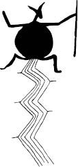

第一章

洞悉人性，拿捏分寸

对方再谦虚，也不要过分表现自我

在与人交往的过程中，我们总能遇到一些谦虚有礼的人。他们总是客套地说“如有不周之处，还请多多指教”、“请多提宝贵意见”、“很多方面还需要向您多多学习”……

事实上，虽然说人要想得到别人的认可，就得善于表现自我，但是表现过分反而会遭到别人的反感，以至于让你寸步难行。因此，适当地低调一些，适度地隐藏自己的实力是明智之举。

柳萍刚下岗，她好不容易请理发店老板同意把她留下来工作，她觉得应该主动找事做。于是，她每天赶在大家起来之前，就把地擦了，把所有的理发器具也擦得一尘不染。

柳萍没想到的是，自己的“过分表现”却引起了别人的不痛快。原先负责搞清洁的女孩，虽然表面跟柳萍客客气气，常说“做得不好的地方还请多多批评”一类谦虚的客套话，背地里却老跟柳萍过不去，总给她打小报告。幸好后来有了个机会，才使两人消除了误会。柳萍这才意识到自己无意中把别人的工作抢了。

无独有偶，还有一个事例与之类似。

王伟是某政府机关办公室主任，对下属非常和蔼，总喜欢说“有什么意见大家尽管提”。

不过，谈起新人在单位急于表现的话题，他却摇头叹气。他举例说，有一年招了一个中文系毕业生，人是很用功，但劲儿总是使不到点子上。

毕业生来上班的第三天，看见王伟桌上有一份领导发言稿，他觉得文章结构不够合理，于是，也没问过王伟就自己把稿子拿回去改了。改完以后，还直接把稿子交到领导手里。

那篇稿子的初稿是王伟写的，已经给领导看过，并根据领导的意思做了修改，文章的结构也是领导惯用的。

开会时，领导读起稿子来很不顺，与自己习惯的风格相去甚远，会后，领导对王伟大发雷霆。

事后，王伟把毕业生叫到办公室，那位毕业生不但不觉得自己做错了事，而且还辩解说是为领导好，最后导致办公室里大家都有点讨厌他。

无论是刚从校门走进社会的毕业生，还是在跨国公司间跳槽的资深职业经理人，到了一个全新的工作环境，总会希望尽快展现自己的才华，以求得到别人的了解与认同。急于显露自己的能力，是很多新人的通病，也是人之常情。

当然，对于刚来的新人，上司对他的工作表现一般都会比较宽容。虽然他们与新人见面时，都会谈及公司的不足，并说些鼓励的话，比如“希望你的到来能为公司注入新的活力”之类。但实际上，他们不会指望新人一进公司就能马上出成绩，反而会通过一些小事来观察新人的为人、品性、工作态度等，据此形成一个基本判断。这个判断会影响上司将来对这位新人的使用。此外，作为上司，他们并不希望新人的到来一下子打破原有的平衡，就算他们有计划用新人来替代原来的员工，也希望能平稳过渡。

很多刚走出校门的毕业生，都有大干一番事业的豪情壮志，所以到了新单位，干什么事都想冲在前面，希望给别人留一个好印象，尤其是遇到谦虚的上司。实际上，这样高调张扬的表现反而容易弄巧成拙。

不仅是在职场，商场、情场等亦是同理。与他人打交道，就要做一个有心计的人，在刚开始相互接触或接手某些事情的时候，学会低调，适当地隐藏自己的实力，对方再怎么谦虚，也不应该过分表现自己。只有这样，才能登上成功的宝座，而且坐得稳。

讨人喜欢的吹捧，既要捧得响又要捧得恰当

有政治和权力争斗的地方就会有完美的马屁精，他已经掌握了欺骗的艺术。他奉承、臣服于自己的领导者，却能够对别人间接而优雅地维护他自己的权力。学习和应用拍马屁的规则吧，这样你的前途将无可限量。

要把马屁拍响，首先必须找准对方的“心窝”所在，这样才能做到有的放矢。而且，在拍得响的同时，还要拍得恰当。摸透了对方的心思，再有针对性地加以吹捧，满足对方的欲望，才有可能得到对方的赏识。

周末员工聚餐，经理在路上指着一个路人的皮包说：“这个包蛮别致的，不知在哪儿买的？”  

说者无心，听者有意，半个月后，莉莉就把一个同样款式的皮包送到了经理的办公室：“经理，我上周去参加客户的发布会，人家给了个商场的消费卡，到商场一看，正好有这个款式的皮包，我就帮您选了一个，您看喜不喜欢？”

经理站起身说：“不行不行，你留着自己用吧。”莉莉连忙说：“难得您看中一件东西，说真的，您的眼光就是和别人不一样。再说没您的照顾，我哪有机会参加那个发布会啊！”

于是经理又拿出一张请柬说：“下周五在国宾饭店有个酒会，我也不喜欢凑热闹，你替我去吧。”莉莉接过请柬，假装埋怨地说：“看您说的，好像您真老了似的，上次参加发布会好几个女客户还问我，您怎么那么年轻啊！”说得经理面露喜色，其实经理已经 50 多了。

过于吹捧领导，会让领导觉得华而不实，像莉莉这种言行并举的溜须者，怎能不让上司喜笑颜开？对这么懂事的下属，上司当然另眼相看了。

莉莉的成功之处在于她抓住了经理爱美、怕老的心理，非常自然地加以吹捧，让慨叹年华已逝的经理得到了心理的愉悦，莉莉的皮包也没有白送。

和完美马屁精比起来，低级的马屁精常常苦于拍不到位，平庸露骨的恭维往往拍在马腿上。低级马屁不但不能讨得老板的欢心，反而让自己在众人眼中留下“奴颜媚骨”的小人形象。  

吴华在年终总结会议上做了一番“真情流露”的感言：在这一年的风风雨雨里，他在领导的教育和帮助下取得了很大的进步，做出了不小的成绩。领导是恩师，今后他还要继续尾随领导的脚步，做一个像领导这样完美的人。一番话令同事侧目，领导也尴尬地咳嗽了几声。这时，吴华又画蛇添足地补充了一句：“我们的领导真是德高望重、才智过人啊！”会场顿时一片哗然，这位领导不过三十岁而已，何来德高望重？

吴华辛苦半天，并没有给领导留下什么好印象，太过露骨的恭维显得那么虚伪，明眼人一眼就能识破。说话没有分寸，太不着边际，让被拍者也很难为情，这是最愚蠢的吹捧行为。

无论出发点是什么，想和对方攀上关系，把马屁拍到位，应该注意的问题有很多：

1.要讲究场合

在众目睽睽之下是不便施展马屁功夫的。对方本人可能会觉得你多事，而旁观者更会鄙薄你的为人。所以在公开场合拍马屁不但对对方有碍，也对自己有失。与人拉关系，尤其是领导，最好是在私下闲聊时，或者在茶余饭后轻松的场合，选择对方情绪较好的时候，似乎不经意地轻轻一拍，最容易切中其心意，使拍与被拍者皆大欢喜。正如前面的两个例子，莉莉选择在经理办公室送出皮包不显失礼，吴华在大庭广众之下大行吹捧却搞得人憎鬼厌，可见，拍马屁时场合是必须小心留意的一大要素。

2.要讲究手段

恰到好处的马屁效果绝对胜过一万句不着边际的恭维。同时叫好，知道好在哪里，有针对性地叫好比空洞地叫好有价值得多。

完美马屁精们将“精神贿赂”进行到底，让后人茅塞顿开。如写就一篇文章，明明很简单的字却故意写错，目的是方便领导审阅时能“指正”出来，以显示领导的英明。

纪晓岚，通观古今，堪称才子型“精神行贿”的第一流高手。乾隆 50 岁时，他献联：“四万里皇图，伊古以来，从无一朝一统四万里；五十年圣寿，自今而后，尚有九千九百五十年。”

乾隆 80 大寿时正好登基满 55 年，他又献：“八千为春，八千为秋，八方向化，八风和庆，圣寿八旬逢八月；五数合天，五数合地，五世同堂，五福备至，嵩期五十有五年。”

好大喜功、标榜自己为“十全老人”的乾隆自然悦而受之，飘飘然地享受这高质量的马屁，不亦乐乎。

3.要做调查研究

欲攀关系的对象喜欢什么，不喜欢什么，性格怎样，脾气如何，你都应该掌握。而这些信息的获得，当然不能离开调查研究。第一是你自己在与其接触的过程中细心观察，小心体味；第二是多打听细查问，从对方的身边人那里套取情报。当然，调查工作以不露声色为上，不然大张旗鼓研究一个人，岂不显得太过诡异？

例如，李林甫为了把握唐玄宗的心意，每次奏请，都要赏赐左右侍婢，讨得了这些人的欢心，天子有什么动静都能在第一时间得到汇报。难怪晚年的玄宗对李林甫总是青睐有加，信赖备至。

4.要委婉自然

拍马屁不是生搬硬套，七拐八绕，硬拍强拍，说出来的话荒谬可笑，很容易引起上司的厌恶和鄙视。人们常说的那个“局长，您也亲自上厕所”的笑话便是一例。拍马屁必须讲究委婉自然的风格，顺理成章，似不经意，却又不一语中的，才能让上司心满意足地接受。

英国马屁研究学者施滕格尔出了本书《You’re Too Kind——A Brief History of Flattery》（《你太好了——马屁简史》），书中提醒：如果你只是个小职员，请不要告诉执行总裁他是天才。

还有，如果你和你的对象之间的地位越悬殊，你拍的马屁就得越含蓄。

以下是你要避免的 6 种低级马屁现象：

（1）同意上司或同事提出的每一件事，经常说的一句话是“我完全赞成”，从不发表不同意见或建议。

（2）经常赞颂上司或同事，而且用贬低自己或其他上司或同事的方法来赞美，同时表情丰富，挂着夸张的笑容。

（3）用赞美的话语来使别人为你办事，不该表扬的时候也大加赞赏，而对自己的平庸千方百计地遮掩。

（4）有意在上司面前出同事的洋相，仅为博取上司一笑，使自己出风头。

（5）如果上司说了个笑话，哪怕是很没趣的笑话，也笑得像真的一样。

（6）工作时挑肥拣瘦，但总是在上司面前述说自己干的工作最重要、最吃力。

活用谎言，让对方乐于同你交流

你曾经说过谎吗？没有？恐怕这本身就是最大的谎言。马克·吐温曾说过：“我们都说过谎，也都必须说谎。因此聪明的话，我们就应勤快地训练自己能善意地说谎。”

现实生活中，很多时候，我们在某些场合说“谎话”反而比说真话更容易得到别人的好感，还能避免不必要的尴尬，或者促进事态更好的发展。例如，某人患了不治之症，知道这一情况的亲友多不以实情相告，因为他们知道，患者如果知道实情不仅不利于病情的好转还会给他的心里带来折磨。此时，谎言就是最好的妙药灵丹。

正所谓“谎言永远比真理更受欢迎”。在交际中，不同的场合说不同的谎话总能产生不同的微妙效果。为此，我们总结了以下几种情况，可以让你在人际交往中取得“反客为主”的好效果。

1.能产生良好交际效果的谎言有时是以装糊涂的形式出现的，以避免或解除尴尬

生活中，我们常常会碰到这样的场面，到朋友家做客时，主人热情地给客人夹菜，恰恰是客人不喜欢吃的菜。这时，客人不外乎有两种态度。一种是接受主人盛情，一边道谢一边违心地说：“好吃！好吃！”当然，这样的谎言只能让自己自讨苦水。而如果有一天主人知道了原委，也会后悔一辈子。这窝囊的谎言，既苦了自己又伤了别人，实在不是高明之举。另一种态度，便是巧妙地拒绝。先说一句：“别客气，我自己来！”再补充一句：“这个菜我挺喜欢吃，就是胃受不了！”如此巧妙的谎言，既不伤主人的面子，又避免了活受罪，两全其美！  

2.在某个时候说点谎话，能使本来很有距离的双方达到某种“共识”，从而使进一步的交流成为可能

有位先生和朋友去拜访一位教授，那教授为人严肃，不苟言笑。坐了半天，除了开头说了几句应酬话，剩下的全是让人尴尬的沉默。

忽然，那位先生看到教授家养的热带鱼，其中几条色彩斑斓，游起来让人眼花缭乱。那位先生知道这鱼叫“地图”，因为自己也养了几条，还很得意地为朋友介绍过。教授见那位先生神情专注，就笑着问：“还可以吧？才买的，见过吗？”那位先生说：“还真没见过。叫什么名字？明儿我也打算养几条呢！”当时他的朋友不解地看看他，心想装什么糊涂，不是上星期才到我家看过吗？

可教授一听，来了兴致，大谈了一通养鱼经，那位先生听得频频点头。那位教授像是遇到了知音，说说笑笑，如数家珍地给他讲每条鱼的来历、特征，又拉着他到书房看他收集的各类名贵热带鱼的照片，气氛顿时活跃起来。他们一直聊到吃过晚饭才走，朋友才突然领悟到那位先生说谎话的用意。

一句谎话使本来几乎陷入僵局的交谈又顺利地进行下去了。

3.有时候对家人也应撒点谎

一位身患重病的母亲，为了支持儿子上学，竟然把买药治病的钱给儿子交了学费，当她带儿子到商店给儿子买圆规掏钱时，不慎带出了一张药单。儿子见后，再也不肯让母亲买圆规。可那位伟大的母亲为了使儿子能安心努力地读书，便谎称药单是用过了的。

母亲的谎言中孕育了伟大的母爱，表现的是一种最可贵的奉献精神。

4.对求爱者的谎言

一个男大学生爱上了一个女大学生，于是对女大学生说了一番热烈的话：“我离不开你，你是温暖着我的太阳，你是照耀着我的月亮，你是为我呼唤早晨的启明星。”

女大学生早已听出这是一番表白爱情的极热烈的话，但自己并不喜欢面前的小伙子，怎么办？如果断然说“我不喜欢你”，岂不是会使对方陷入尴尬？不置可否，岂不是对对方不负责任？

她只说了一句：“真美！您对天文学太有研究了，可我，真对不起，我对天文学一点也不感兴趣！”

就这样，女大学生轻松拒绝了男大学生。

在现实生活中，当你不得不用一些小谎言去办事时，你一定要注意，自己所说的谎言要不容置疑，这样才能以假胜真，巧中取胜，黑中取白。否则，会弄巧成拙。

用真诚掩盖你的不诚实，让他全然接受你

一个真诚而诚实的举动能掩盖十来个不诚实的举动。敞开心扉、毫无遮掩的诚实和慷慨能够攻破人们心中的防线，即使是那些最有疑心的人也能放松警戒。一旦有所选择地利用诚实，你就能在他们坚实的防卫盔甲上打开一个突破口，接着你就可以按照你的意愿去蒙蔽和操纵他们，将他们玩弄于股掌之中。

元末农民起义中，群雄割据，其中以朱元璋、陈友谅和张士诚较为强大。1366 年 5 月，朱元璋受到陈友谅和张士诚的两面夹攻，江北形势骤变。小明王韩林儿和刘福通派出的三支北伐军，遭到元军反击而惨败。小明王退兵安丰后，张士诚却派大将吕珍围攻安丰，情况十分危急。小明王多次派人向朱元璋征兵解围。朱元璋与部将商议，众将都反对派兵，连军师刘基也坚决不同意。朱元璋力排众议地对大家说：“我自有安排！”于是毅然派兵去救安丰小明王。

朱元璋为什么愿冒此风险？他葫芦里究竟卖的什么药？其实，朱元璋自有他的盘算。他认为安丰是应天的屏障，安丰失守，自己的应天就暴露在敌方攻击下，救安丰就是保应天。至于小明王，他在红巾军和百姓中影响最大，有号召力，是一面旗帜。他朱元璋尊小明王为主，打他的旗号，一来是利用小明王影响，争取人心；二来敌方打击的矛头首先冲着小明王，是为了实现他今后的更大图谋。于是，他亲自率军北上，杀退吕珍，保住了安丰。小明王感激涕零。朱元璋乘胜回师，和陈友谅在鄱阳湖经过一场激战，陈友谅兵败身亡。朱元璋获得大胜后，打着小明王的旗帜，又被封为吴国公。此后，他要利用小明王的旗号，达到更大的目的。  

安丰战后，朱元璋决心把小明王控制在自己手中。他先把小明王迎到滁州。在滁州给小明王建造了巍峨的宫殿，安排了威武的銮驾仪仗、丰厚的食物和华丽的服饰。对小明王态度十分恭谨，完全是真心诚意地顺服。小明王本来对朱元璋已是感激不尽了，对滁州这样的安排，使他由感激简直发展到感恩。他哪里想到，朱元璋迅速安排亲信，对小明王实行封锁、隔离，甚至把侍奉小明王的宫中人员全部换上自己的部下。从此，小明王的一切，统统在朱元璋的掌握之中。

随着朱元璋节节胜利，兵多地广，他野心大发，干脆取消小明王给他的吴国公封号，自立为吴王。后来，朱元璋觉得小明王已无多少利用价值，而且越来越成为绊脚石，他不甘在名分上还是别人的臣子，于是策划了借刀杀人之计。不久，朱元璋派专使到滁州晋见小明王。专使在朱元璋的指使下，对小明王说，朱如何关心小明王的身体、生活，如何日夜企盼与小明王在一起，又如何在应天已做好准备，迎接小明王回驾应天，等等。小明王听得心花怒放，他感到朱元璋安排如此周到，如此忠心，真是难得的忠良！他满口答应下来，准备回应天过皇帝的安乐日子。

小明王准备停当，高高兴兴坐上了专使派的船，向应天进发，行进中，江上风平浪静，小明王兴致勃勃地站在船头观赏水天景色。突然，船身一震，颠翻在江中，小明王及随侍宫女掉进江中，全部被淹死。临死时，小明王还念念不忘感激朱元璋的迎驾之德呢！他哪里知道是朱元璋的密令害死了他。

朱元璋接到小明王淹死的消息后，为掩人耳目，把船工斩首示众，还假惺惺地痛哭了一场。两年后，朱元璋在应天正式登上皇帝宝座，国号大明，他终于实现了自己称帝的野心。

朱元璋之计之所以能够成功，缘于他自始至终以“真诚”为幌，实行蒙蔽手段，先是临危救主，继而周到侍奉，就是在小明王丧生之后，朱元璋也不忘“真情”演绎一场哭戏，在世人眼中留下一个“忠心事主”的光彩形象。

尽管从道德上讲，朱元璋的歹毒、阴险是应该摒弃的，但用真诚的态度来帮助自己成功却值得仿效。无论你有多么直接的目的，也要让自己多一些真诚，多一点实在，才不会被别人抗拒。你表现得越真诚，就越容易让对方产生浓厚的好感。“人心都是肉长的”，谁会忍心拒绝一个真诚的人呢？真诚在手，你会轻易打开紧闭的门，踏平难走的路，登上陡峭的山……

你可保守他的秘密，但莫让他保守你的秘密

有秘密，别人才觉得你神秘；有秘密，别人才觉得你有背景。

在人际交往中，许多人，尤其是年轻人，常常把自己的秘密毫无保留地袒露出来。有时如果没把自己的心事完完全全地告诉问及的人，心中就会不安，认为自己没有以诚待人，感到对不起人家，认为别人对自己很好或很重要，不告诉人家自己的秘密是错的。很显然，这些人在如何对待自己的秘密和如何对待坦诚这些问题上，所谓的“知无不言，言无不尽”是一种错误的认识。

在生活中，人与人之间需要交流，需要友情，但谁都不愿与一个从不袒露自己的内心世界、对任何问题都不明确表态的高深莫测的人交往。然而，对于坦诚有一个正确的理解是十分必要的。所谓坦诚并不意味着别人要把内心世界的一切都暴露给你，也不意味着你要把内心世界的一切都暴露给别人。每个人都有秘密，这是正常的，也是必要的。

例如，一次约翰把自己的重大秘密告诉了乔治，同时再三叮嘱：“这件事只告诉你一个人，千万别对别人说。”然而一转脸，乔治便把约翰的秘密添枝加叶地告诉了别人，让约翰在众人面前很难堪。这种背信弃义有时出于恶意，有时却是无意的。

当然了，能否保守秘密也与个人的品质修养有关。有的人透明度太高，这种人不但不能为别人保守秘密，就连自己的秘密也保守不住。有的人泄漏别人的秘密，不是为了伤害别人，而是为了抬高自己，“咱们单位的事，没有我不知道的”，“我要是想知道某件事，我就一定能了解出来”……这种人常这样炫耀自己，他们认为，知道别人的秘密越多，自己的身价就越高。用泄漏别人秘密的方法伤害别人、娱乐自己，甚至把掌握的秘密当做要挟别人的把柄，当做自己晋升的阶梯，这种人在现实中也大有人在，对这种人最应该提高警惕。

再回到前面的例子，像约翰那样让他人为自己保守秘密，远比只让自己保守自己的秘密难得多。因此，不是万不得已的时候，不要让他人分享自己的秘密，要学会自己的秘密自己保守。因为，你的秘密一旦落入别有用心的人的耳中，它就会成为关键时刻别人攻击你的武器，使你在竞争中处于被动的局面，甚至因此而失利。

许军是某公司的业务员，在厦门工作已经有三年的时间了，他因为工作认真、勤于思考、业绩良好，被公司确定为中层后备干部候选人。总经理找他谈话时，他表示一定加倍努力，不辜负领导的厚望。只因他无意间透露了一个属于自己的秘密而被竞争对手击败，遭到排挤，终于没被重用。

许军和同事王广林私交甚好，常在一起喝酒聊天。一个周末，他备了一些酒菜约了王广林在宿舍里共饮。二人酒越喝越多，话越说越多。微醉的许军向王广林说了一件他对任何人也没有说过的事。

“我高中毕业后没考上大学，有一段时间闲着没事干，心情特别不好。有一次和几个哥们喝了些酒，回家时看见路边停着一辆摩托车，一见四周无人，一个朋友撬开锁，让我把车给开走了。后来，那朋友盗窃时被逮住，送到了派出所，供出了我。结果我被判了刑。刑满后我四处找工作，处处没人要。没办法，经朋友介绍我才来到厦门。不管咋说，现在咱得珍惜，得给公司好好干。”

谁知道，没过两天，公司人事部突然宣布王广林为业务部副经理，许军调出业务部另行安排工作岗位。

事后，许军才从人事部了解到是王广林从中捣的鬼。原来，在候选人名单确定后，王广林便来到总经理办公室，向总经理谈了许军曾被判刑坐牢的事。不难想象，一个曾经犯过法的人，老板怎么会重用呢？尽管你现在表现得不错，可历史上那个污点是怎么也擦洗不干净的。  

知道真相后，许军又气又恨又无奈，只得接受调遣，去了别的不怎么重要的部门上班。

德国作家让·保·里克特曾说：“一个人泄露了秘密，哪怕一丝一毫，就再也得不到安宁了。”如果还想过宁静的生活，如果不想成为别人眼中的透明人，那就别把心里的话全都说出来，把该保守的秘密坚定地保守下去。

每个人都有自己的秘密，都有一些压在心里不愿为人知的事情。这些隐私就是一个人的底线，别人不知道你的底线在哪里，也就无从伤害你。如果将其过多地暴露在别人的面前，即使是原本没有不良记录之人，也难免会在利的诱惑之下，做出常规外的伤害之举。

既然秘密是自己的，无论如何也不能对别人讲。在保护一份神秘感的同时，也能保护自己不因“祸从口出”而受害。

找出对方弱点来，牵着他的鼻子走

就像每一座城堡的墙壁上都会或多或少地有裂缝一样，每个人也都有自己的弱点。弱点通常是一种不安全的、不可控制的情绪或者需求，它也有可能是一个小小的隐秘的喜好。在与人交往的过程中，不管是哪一种情况，一旦你找到对方的这个弱点，它就有可能成为你牵制对方长处和优点的“刑具”。

要想找到一个人的致命弱点或软肋所在，首先就要摸清他的底细，将其看个清清楚楚，明明白白。

西汉宣帝时，赵广汉为京兆尹，为首都长安的父母官。

赵广汉上任时，长安的治安形势一度混乱，百姓受害的事时有发生，官匪勾结十分猖獗。面对严峻的状况，赵广汉召集心腹属下说：“我上任伊始，并不熟悉此中内情，想打击犯罪，也不知从何下手，何况情况不明，乱下重手只会引起混乱，我想让你们暗中侦察，把盗贼的踪迹摸清。”

心腹属下面有难色，他们说：“盗贼行踪诡秘，出入不定，即使用力也难出成效。从前官员都是有事打压，无事清闲，大人何必自讨苦吃呢？”

赵广汉表情严肃，他郑重地说道：“盗贼不绝，根源乃在，我们不晓根底，从前官员不尽职所致。我志在剿除盗贼，自然不能和从前官员一样无为了，这是我的命令，违者必惩！”

赵广汉命人暗中详查，表面上故作轻松，没有更深的戒备，盗贼们以为赵广汉碌碌无为，于是放下心来，放胆胡为。一时之间，盗贼蜂拥而出，长安形势更坏。

朝中大臣上疏指责赵广汉失职，无比愤怒地说：“京城盗贼行，京兆尹赵广汉却放纵不管，不知他是何居心。赵广汉定与盗贼勾结，望陛下彻底肃查。”

汉宣帝也怒气冲冲地质问赵广汉说：“朕深居宫中，都听说了城外盗贼横行之事，你有何交代吗？”

赵广汉叩头不止，连声说：“陛下不要担心，请让臣把话说完，贼情不明，轻举妄动便会打草惊蛇，这也是臣最担心的。臣故意装作不闻不问，只是想让盗贼悉数暴露，以便臣的属下全然摸清盗贼的状况，查清他们肇事的根源，以及那些和他们勾结的差吏收取了多少贿赂。只有将这些情况都搞得明明白白，才能一网打尽他们，让他们无法抵赖。陛下放心，臣已广布人手，侦知此事，过不了多长时间，便是盗贼的末日了。”

汉宣帝听罢，不再责怪赵广汉，他不无担心地说：“朕暂且相信你一次，你还是好好把握时机吧。”

不久，已经全然掌握贼情的赵广汉四面出击，每击必中，长安盗贼被肃之一空了。

赵广汉在摸清盗贼的底细之前，绝不会贸然行事，打草惊蛇。只有将一切情报了然于心，时机完全成熟，才果断出击，从而一击奏效。

把对手的底细摸透，了如指掌，始终是战胜对手的一个重要前提。一个人的实际状况是不会轻易显现的，这需要耐心细致的调查和取证才能搞清，在此不下大工夫是不行的，没有捷径可走。没有底牌可出的对手是最脆弱的，在他们的要害处轻轻一击，也就致命了。清楚他们的虚实，便会掌握他们的动态，从他们的弱点下手，被动的就不会是自己。

当然，掌握了对手的致命弱点，还要善加利用，以驱使他为自己做事。

武则天在夺权的道路上，不择手段，唯计个人私利。她对唐高宗李治不加重用的没有品行的人，反是另眼相看，收为亲信，巧妙地利用他们的弱点，为自己办事。

李义府虽有文才，但为人奸诈、邪巧多方，长孙无忌看透了他的本性，曾多次对唐高宗进谏说：“有才无德之人，最能制造祸端，臣见李义府貌似忠厚，实乃奸诈，陛下对此人不可不防。”

唐高宗本想重用李义府，有了长孙无忌的提醒，便渐渐疏远他了。后来，长孙无忌找了一个借口，将他贬为壁州司马。

诏书还没有颁下，李义府已听说此事，十分惊恐。他向王德俭请教自救之策，接着按其主意向唐高宗上书，建议册立武则天为后。李治感念其情，于是让他担任原职。武则天知晓此事，大喜过望，她对自己的心腹说：“李义府如此知趣，此人当可大用，我是不会亏待他的。”

武则天的心腹深知李义府的为人，便不屑地说：“李义府如此行事，并非真心为娘娘效忠。他这个人有才无德，善于见风使舵，娘娘一定要提防他才好，怎可重用他呢？”

武则天闻言即笑，慢声说：“他不如此，我又怎会从中得利？这样的人若巧加利用，自会死心塌地地为我卖力，我是求之不得啊。”

武则天当上皇后后，立即建议高宗提升了李义府的官职，让他官拜中书侍郎，封广平县男。李义府贪欲得逞，从此为武则天处处卖命，成了她的得力干将。

礼部尚书许敬宗是隋朝大臣给事中许善心之子，属名门之后。但他居官不正、贪赃徇私、德行败坏，为正义之士所不齿。许敬宗暗中向武则天投效，武则天却十分欢喜，她对许敬宗说：“你遭人非议，岂是你的过错？都是那些大臣嫉恨你的才学罢了。我一向相信你的品行无失，自会向皇上荐举力言。”

许敬宗感恩戴德，发誓为武则天效忠。武则天的身边人提醒她说：“无德之人，向来没有信义，娘娘不要轻信他。他素招人怨，娘娘重用此人也无益于大事。”

武则天充满自信，她得意地说：“邪才一旦制服，用起来就了无顾忌，用他去对付那些所谓忠贞之士，不是最好的利器吗？他的弱点是在名利面前迈不开步子，我正好用名利来役使他，有了这个束缚，还怕他不俯首听命？”

于是武则天多次向唐高宗荐举许敬宗，又屡次为许敬宗遮掩丑事，她还故作气愤地对唐高宗说：“自古忠臣难当，多遭毁谤，许敬宗忠于陛下，不徇私情，难怪朝臣每每诋毁他了。陛下若是听信谣言，正是中了奸臣的诡计，妾实在难以置之不理。”

有了李义府、许敬宗这左膀右臂，武则天行私有助，势力不断地扩大，为她日后登上皇位增添了胜算。

正如事例中所反映的，名利对于大多数人来说，都是致命的弱点，这一点当权者心知肚明，他们尽力做的只是如何让这类人为己效命罢了。用利益诱使他们，就能驱使他们干任何事了。

可见，只要掌握了他人的弱点，善加利用，我们就能牵着他们的鼻子走。当我们需要有他人来协助或帮忙去完成某些事情时，那些有弱点可利用的人往往是最适合的选择。

以诚动人，抓住他人心

人与人之间的交流如果想要说服对方认同你的观点，靠的是以诚服人、以情服人、以理服人、以德服人，这是感情、知识和心智力量使然。情感的力量是情感的认知和共鸣，知识的力量能使人们信服观点的论证，心智的力量则能使人们接受辩手本身，并进而在有意无意中相信和支持你的论证与反驳。

正如一位诗人所言：“动人心者，莫过于情。”抓住了对方的心，与对方交谈也就成功了一半。

如果为人真诚，说话之前先有了真诚的心，那么即使是“笨嘴拙舌”也是没有什么关系的。有太多的事例一再说明，在与人交流时表达真诚要比单纯追求流畅和精彩更重要。

1915 年，小洛克菲勒还是科罗拉多州一个不起眼的人物。当时，发生了美国工业史上最激烈的罢工，并且持续达两年之久。愤怒的矿工要求科罗拉多燃料钢铁公司提高薪水，小洛克菲勒正负责管理这家公司。由于群情激奋，公司的财产遭受破坏，军队前来镇压，因而造成流血，不少罢工工人被射杀。

那种情况，可说是民怨沸腾。小洛克菲勒后来却赢得了罢工者的信服，他是怎么做到的呢？原来小洛克菲勒花了好几个星期结交朋友，并向罢工代表发表了一次充满真情的演说。那次的演说可谓不朽，不但平息了众怒，还为他自己赢得了不少赞誉。演说的内容是这样的：

“这是我一生当中最值得纪念的日子，因为这是我第一次有幸能和这家大公司的员工代表见面，还有公司行政人员和管理人员。我可以告诉你们，我很高兴站在这里，有生之年都不会忘记这次聚会。假如这次聚会提早两个星期举行，那么对你们来说，我只是个陌生人，我也只认得少数几张面孔。上个星期以来，我有机会拜访整个附近南区矿场的营地，私下和大部分代表交谈过，我拜访过你们的家庭，与你们的家人见过面，因而现在我不算是陌生人，可以说是朋友了。基于这份互助的友谊，我很高兴有这个机会和大家讨论我们的共同利益。由于这个会议是由资方和劳工代表所组成，承蒙你们的好意，我得以坐在这里。虽然我并非股东或劳工，但我深觉与你们关系密切。从某种意义上说，也代表了资方和劳工。”

这样一番充满真诚的话语，可能是化敌为友最佳的途径。假如小洛克菲勒采用的是另一种方法，与矿工们争得面红耳赤，用不堪入耳的话骂他们，或用话暗示错在他们，用各种理由证明矿工的不是，那结果只能是招惹更多怨恨和暴行。

真诚就像一颗种子，你细心维护它，有一天它就会结出让你惊喜的果实。你真挚待他人，他人也会真挚待你，甚至你敬人一尺，人必回你一丈。但是，我们不能够把付出真情当做某种本小利大的低风险投资，使别人觉得你的“真情”只是一种交易的筹码，而算计的权利全在你的手中。

一个旅游团不经意走进了一家甜品店，参观一番后，并没有购买任何甜品的打算。临走的时候，服务员没有抱怨旅游团，相反，他却更加热情，把一盘精美的可可糖捧到了他们面前，并且柔声慢语地说：“这是我们店刚进的新品种，清香可口，甜而不腻，请您随便品尝，千万不要客气。”如此盛情，使顾客不知不觉进入了糖果店营造的一种双方好似亲友的氛围之中。恭敬不如从命，既然领了店家的“情”，又岂能空手而归呢？旅游团成员觉得不买点什么，确实有点过意不去。于是每人买了一大包，在服务员“欢迎再来”的送别声中离去。

如果这位服务员使这个旅游团的成员感到他的热情只是一种算计，那么结果只有一种可能，就是：你越是热情，我越是拒绝。

每一句话都是心里话，而不是把装出来的热情做得不露痕迹，这样才能够赋说服或者论辩以真情，从而在打动自己的同时打动对方。我们所要强调的是，真情，重在自然流露，在乎本性天成，不能仅仅作为一种方法或者策略。

真诚待人，展现人格魅力，这也是争辩的一种方法，它是某些人的特质。一个真诚的人，一个具有人格魅力的人，即使不能舌绽莲花，也可以让一个能言善辩的人哑口无言。

被逼入墙角的兔子也会咬人，得理时要让他三分

中国有句老话，叫“被逼入墙角的兔子也会咬人”。试想，天性温顺的兔子都是如此，更何况人呢？著名的哲学家、教育家苏格拉底曾经说过：“一颗完全理智的心，就像是一把锋利的刀，会割伤使用它的人。”在这个世界上，没有完全绝对的事情，就像一枚硬币一样具有它的两面性。这就告诫我们做人做事都不要太绝对，要给自己和他人留有余地。

在一个春天的早晨，房太太发现有三个人在后院里东张西望，她便毫不犹豫地拨通了报警电话，就在小偷被押上警车的一瞬间，房太太发现他们都还是孩子，最小的仅有 14 岁！他们本应该被判半年监禁，房太太认为不该将他们关进监狱，便向法官求情：“法官大人，我请求您，让他们为我做半年的劳动作为对他们的惩罚吧。”

经过房太太的再三请求，法官最后终于答应了她。房太太把他们领到了自己家里，像对待自己的孩子一样热情地对待他们，和他们一起劳动，一起生活，还给他们讲做人的道理。半年后，三个孩子不仅学会了各种技能，而且个个身强体壮，他们已不愿离开房太太了。房太太说：“你们应该有更大的作为，而不是待在这儿，记住，孩子们，任何时候都要靠自己的智慧和双手吃饭。”

许多年后，三个孩子中一个成了一家工厂的主人，一个成了一家大公司的主管，而另一个则成了大学教授。每年的春天，他们都会从不同的地方赶来，与房太太相聚在一起。

房太太就是“得理让三分”的典范。

“人活一口气，佛争一炷香。”这是一个人在被人排挤，或者被人欺侮时，经常说的一句急欲“争气”的话。

其实也未必如此，试想一下，一个人究竟能有多大的气量？一生大不了三万六千天，这还是极少数。就像古代名人张英说的那样，“万里长城今犹在，不见当年秦始皇”。“千里捎书为堵墙”，却不如“得饶人处且饶人，让他三尺又何妨”。这方面，不管是古人还是今人，有好多值得我们学习的地方。

“得理不让人，无理搅三分。”这是普通人常犯的毛病。其实，世界上的理怎么可能都让某一个人占尽了？所谓“有理”、“得理”在很多情况下也只是相对而言的。凡事皆有一个度，过了这个度就会走向反面，“得理不让人”就有可能变主动为被动，反过来说，如果能得理且让人，就更能体现出一个人的气量与水平。给对手或敌人一个台阶下，往往能赢得对方的真心尊重。

古希腊寓言家伊索曾说道：“不要瞧不起任何人，因为谁也不是懦弱到连自己受了侮辱也不能报复的。”懦弱的人通常会忍受许多不必要的委屈，他们的内心或极为凶恶，或极为宽阔，无论何者他们仍然拥有回击的能力，万不可等闲视之。

一个人不仅要自己的胸怀宽广，度量宽宏，更要注意别人的自尊。一个人如果损失了金钱，还可以再赚回来；一旦自尊心受到伤害，就不是那么容易弥补的，甚至可能为自己树起一个敌人。“得理且让人”就是要照顾他人的自尊，避免因伤害别人的自尊而为自己树敌。

展现自信的风采，给对方一颗定心丸

不知道你是否注意到：无论是去应聘，还是平时与他人交往，自信的人总是比唯唯诺诺的人更受欢迎。这是为什么呢？

很简单，自信是人生重要的心理状态和精神支柱，是一个人行为的内在动力，是自我成功的必然法宝；自信能够使弱者变强，强者更健。我们只有相信自己，才能激发进取的勇气，才能最大限度地挖掘自身的潜力，才能在成功的路上健步如飞。所以，在他人面前展现出你自信的风采，无疑是给对方一颗定心丸，让对方觉得你是有能力、有实力的。

一个下着小雨的中午，车厢里的乘客稀稀拉拉的，在一个站台，上来了一对残疾的父子。中年男子是个盲人，而他不到十岁的儿子也只有一只眼睛能感光。父亲在小男孩的牵引下，一步一步地摸索着走到车厢中央。当车子继续缓缓往前开时，小男孩开口说：“各位先生、女士，你们好，我的名字叫麦蒂，下面我唱几首歌给大家听。”

接着，小男孩用电子琴自弹自唱起来，电子琴音质很一般，但孩子的歌声却有天然童音的甜美。

正如人们所预料的那样，唱完了几首歌曲之后，男孩走到车厢头，开始“行乞”。但他手里既没有托着盘子，也没有直接把手伸到你前面，只是走到你身边，叫一声“先生”或“小姐”，然后默默地站在那儿。乘客们都知道他的意思，但每一个人都装出不明白的样子，或者装睡着，有的干脆扭头看车窗外面……

当小男孩小手空空走到车厢尾时，一位中年妇女尖声大喊起来：“真不知怎么搞的，纽约的乞丐这么多，连车上都有！”

这一下，几乎所有的目光都集中到这对残疾的父子俩身上，没想到，小男孩竟表现出与年龄不相称的冷静，他一字一顿地说：“女士，你说错了，我不是乞丐，我是在卖唱。”车厢里所有淡漠的目光刹那间都生动起来，有人带头鼓起了掌，然后，是掌声一片。

一个没有生存能力的孩子，却在顽强不屈地承受着生命给予他的考验。在有人悲叹自己命运不济的时候，小男孩却用自己的成熟和坚强支撑着自己和一家，用自己的劳动、自己的歌声为自己赢得收入。面对别人的嘲笑，他毫无自卑之感，自信坦然地面对。面对这个小男孩，所有的自卑都变成了逃避人生的理由，只要坚持相信自己，掌声一定属于自己。

小泽征尔成名之前，在一次世界优秀指挥家大赛上，他发现了不和谐的声音，觉得乐谱有错。这时，评委们却坚持说乐谱没有问题。面对这些权威人士，小泽征尔斩钉截铁地说：“不！一定是乐谱错了！”话音刚落，评委们便报以热烈的掌声。原来，这正是比赛的一部分，小泽征尔的勇敢、自信征服了所有评委。

正是因为相信自己，小泽征尔才果断地跳过了“圈套”。这次的夺魁，也正如一盏明灯，照亮了他的前程！

成功不一定站在智慧的一方，但一定会站在自信的一方。相信自己，就会拥有自己的成就与幸福。如果你真的相信自己，并且深信自己一定能实现梦想，你就一定会成功。因为你相信“我能做到”时，自然就会想出“如何去做”的方法。

一般来说，我们既可以通过用语言来表达自信，也可以通过身体姿态等来表现自信。对于前者，你可以在陈述问题时多表现得诚恳些，简单明了，有重点；与人交流时可以多使用“我认为”、“我宣布”等词汇；有异议时，多提出建设性的批评而不是责骂或假设“应该如何”；想提出改进意见时不用劝告的语气；以清晰、稳重、坚定的语调表达自己的思想；可以通过主动询问的方式去发现别人的思想或情感，等等。对于后者，在与他人当面交流的时候，多以赞赏的眼光与对方接触；坐、立姿态均坚定挺拔；以开朗的表情辅助别人的评论；平静地讲解，强调重点词汇、不犹豫，等等。

英国剧作家、诗人莎士比亚说：“自信是走向成功的第一步，缺乏自信即是其失败的原因。”自信是一生的事情，是一个人热爱自己并不断完善的过程，相信自己：即便不是最好的，至少也是独一无二的，毕竟“每个人都是自然界最伟大的奇迹”。

那么，请相信你自己，如果你不能做到心灵统一，就不可能发挥出生命的潜在力量，不发挥出潜在力量，就是自己埋没自己。也许你并没有意识到：在大部分时间、大多数事物中，不是别人限制你，而是你埋没了你自己！

率先化干戈为玉帛，敌对的他也会成朋友

人生漫漫，我们总是会遇到形形色色的人。有时，一次竞争、一个分歧，甚至一句玩笑，都有可能令我们树敌。常言道：“多个朋友多条路，多个敌人多堵墙。”树敌对我们个人的发展是非常不利的。

然而，时光不会倒流，世界上也没有后悔药，一旦树立了敌人，就已既成事实。很多人都想知道，那我们有没有化解他人敌意的好办法呢？

与其说是方法，不如说是心机。想要化敌为友，你必须学会率先迈出第一步。

从前，在苏伯比亚小镇有两个叫乔治和吉姆的邻居。可事实上，虽然他们住得非常邻近，但他们的关系一点儿都不和睦，谁都不喜欢对方。

日常生活里，他们相遇总会发生口角。即使夏天在后院开除草机除草时车轮碰在一起，他们多数情况下也不会跟对方打招呼。

在一次夏天快要过去的时候，乔治和妻子外出两周，一同去度假。由于两家一向彼此充满敌意，吉姆和妻子一开始并未注意到乔治夫妇走了。没错，注意他们干什么？除了口角之外，两家相互间几乎就没什么话可说。

突然有一天傍晚，吉姆在自家院子除过草后，发现乔治家的草已很高了，与自家刚刚除过草的草坪形成鲜明对比。

对附近过往的人来说，都发现乔治夫妇显然不在家，而且已离开很久了。吉姆想，这不是等于公开邀请夜盗入户吗？这个想法如同闪电一样攫住了吉姆。

当吉姆再一次看到乔治家那高高的草坪，尽管心里非常不愿意去帮助那家他非常不喜欢的人，但第二天早晨，他还是把那块长疯了的草坪除好了！

几天之后的一个周日下午，乔治和妻子多拉回到了家。他们愕然地发现，自己不在家时竟然有好心人帮他们把草坪收拾得如此干净、整齐。他们很想知道这位好心的朋友是谁，于是就到整个街区的每一家询问。然而，这里却不包括吉姆的家。

可除了吉姆家，所有询问的邻居都说不是自己做的。最后，乔治敲了吉姆家的门。吉姆开门时，乔治站在那儿不停地盯着他，脸上露出奇怪和不解的表情。

过了很久，乔治终于说话了：“吉姆，你帮我除草了？”这是他很久以来第一次这样称呼吉姆的名字。“我问了所有的人，他们都没除。杰克说是你干的，是真的吗？是你除的吗？”尽管乔治的语气似乎有些责备的意味，但他内心的感谢之情仍旧不经意地流露出来。

“是的，乔治，是我除的。”吉姆答道。他以为乔治会因为自己主动除草而大发雷霆。可乔治犹豫了片刻，像是在考虑要说什么，最终，用他那低得几乎听不见的声音嘟囔说“谢谢”之后，急转身马上走开了。

能够主动帮自己敌对的人做好事，这几乎是常人所意料之外的。不过，这种“帮助”所带来的结果往往也是常人意料之外的。

吉姆的主动帮忙就这样打破了他与乔治之间的敌意沉默。尽管当时他们还没发展到在一起打高尔夫球或保龄球，他们的妻子也没有为了互相借点糖或是闲聊而频繁地走动，但他们的关系已经出现了改善。至少除草机开过的时候他们相互间有了笑容，有时甚至说一声“你好”。也许没多久，他们就会向朋友一样分享同一杯咖啡。

所以，当你与他人发生矛盾时，一定要学会主动示好。这种智慧的选择，可以帮你把眼前的那堵墙，变成畅通的路。

尽量让对方多说，自己才能获得更多信息

只要你稍微留心，便会发现：无论在职场，还是在情场，那些总能赢得他人喜欢的人，往往是精明、内敛的倾听者，而不是滔滔不绝、夸夸其谈的擅说者。为什么呢？很简单，能说的不如会听的，尽量让对方多说，你自己才能获得更多信息。

卡耐基曾被邀请去参加一个桥牌集会。卡耐基不玩桥牌，在场的一位金发女郎也不玩。她发现卡耐基以前曾是罗维尔·托马斯进入无线电业之前的经理，也发现他在准备生动的旅行演讲的时候，曾在欧洲各处转过。因此她说：“啊，卡耐基先生，我请求你把所有你过去的那些美妙的地方，以及你所见过的那些美丽景色，全部告诉我。”

坐在沙发上，金发女郎说她和丈夫最近刚从非洲旅行回来。“非洲！”卡耐基惊叹，“多么有意思！我一直想看看非洲，但除了有一次在阿尔及利亚待了 24 小时以外，我从没去过。告诉我，你是否去过那个狩猎王国？真的，我多羡慕你，请把非洲的情况告诉我。”

接下来，她滔滔不绝地告诉卡耐基自己到过的地方，那里有多么多么的有趣……

45 分钟就这样过去了，她没能从卡耐基口中得到丝毫关于非洲的信息，反而非常开心地把自己所知道的全部信息都告诉了卡耐基。

我们不难发现，在这次交谈中，卡耐基以一个“饶有兴趣的听众”的身份，赢得了金发女郎的喜欢，所以她非常开心地将自己所知道的非洲信息全部告诉了卡耐基。这也告诉我们，如果你会听，很多时候要比你能说更能讨人喜欢。

也许你会问为什么？这个问题的理由至少可以举出两个：第一，只有凭借聆听，你才能学习；第二，别人只对听他说话的人有反应。

正如卡耐基自己所言：“最重要的是聆听，在你开口告诉别人你有多棒之前，你一定要先聆听。然后你才能开始认识别人，与别人交谈，千万别高人一等。多跟别人交谈，用心倾听，不要太快下决定。”

简单地说，世界上任何人都喜欢有人听他说话，只有对于听他说话的人，他才会有反应。聆听也是尊重的一种最佳表示，表示我们看重他们。我们等于是在说：“你的想法、行为与信念对我都很重要。”

你也许想不到，要想了解别人的想法，最好的办法就是听听他的意见，让他自己说出你想了解的事情。拥有私人银行桑德斯·卡普公司的银行家汤姆·桑德斯曾说道：“关键在于先了解对方，他的价值观以及他对投资的看法，再决定你是否能诚实地说出我们的投资方式是正确并对其有利。”他也正是利用了聆听的方式，多次协助大企业进行天文数字般的巨额投资。他还说：“一切都由聆听开始。他心里到底想怎么样？他为什么不答应？真正的理由到底是什么？”“我与美国电讯公司（AT＆T）已经维持了 25 年的关系，而且是很好的关系。我认为真正的聆听功不可没。”“我可以提供印刷精美的小册子，也可以运用幻灯片，可是，我仍然必须弄清楚什么才能真正吸引对方。他考虑什么？担心什么？他看事情的角度如何？”

常言道：“知己知彼，百战不殆。”如果你想在人际交往中游刃有余，首先就要学会做一个注意听话的人，了解别人，从别人那里获得自己想要的信息。正如查尔斯·洛桑所说的：“要令人觉得有趣，就要对别人感兴趣——问别人喜欢回答的问题，鼓励他谈谈自己和他的成就。”  

所以，请记住：跟你谈话的人对他自己、他的需求和他的问题，比他对你和你的问题，更感兴趣千百倍。当你下次跟别人交谈的时候，千万别忘了这一点，尤其在想获得对方信息的情况下。

第二章

以心交心，互惠互利

如果能被对方需要，你也会变重要

事物都有其存在的特定价值：货币因流通的需要而存在，食物因饥饿的需要而存在，火因寒冷的需要而存在……人虽然与其他的事物不尽相同，但却同样有被需要的情感诉求，就像母亲被子女需要、情侣被对方需要一样。

真正聪明的人宁愿让人们需要，而不是让人们感激。因为，如果你能被他人需要，你就会在他人心中变得重要。有礼貌的需求心理比世俗的感谢更有价值，因为有所求，便能铭心不忘，而感谢之词最终将在时间的流逝中淡漠。

1847 年，俾斯麦成为普鲁士国会议员，在国会中没有一个可信赖的朋友。让人意外的是，他与当时已经没有任何权势的国王腓特烈威廉四世结盟，这与人们的猜测大相径庭。腓特烈威廉四世虽然身为国王，但个性软弱，明哲保身，经常对国会里的自由派让步。这种缺乏骨气的人，正是俾斯麦在政治上所不屑的。

俾斯麦的选择的确让人费解，当其他议员攻击国王诸多愚昧的举措时，只有俾斯麦支持他。  

1851 年，俾斯麦的付出终于得到了回报：腓特烈威廉四世任命他为内阁大臣。他并没有满足，仍然不断努力，请求国王增强军队实力，以强硬的态度面对自由派。他鼓励国王保持自尊来统治国家，同时慢慢恢复王权，使君主专制再度成为普鲁士最强大的力量。国王也完全依照俾斯麦的意愿行事。

1861 年腓特烈威廉四世逝世，他的弟弟威廉继承王位。然而，新的国王很讨厌俾斯麦，并不想让他留在身边。

威廉与腓特烈同样遭受到自由派的攻击，他们想吞噬他的权力。年轻的国王感觉无力承担国家的责任，开始考虑退位。这时候，俾斯麦再次出现了，他坚决支持新国王，鼓动他采取坚定而果断的行动对待反对者，采用高压手段将自由派斩尽杀绝。

尽管威廉讨厌俾斯麦，但是他明白自己更需要俾斯麦，因为只有俾斯麦的帮助，才能解决统治的危机。于是，他任命俾斯麦为宰相。虽然两个人在政策上有分歧，但这并不影响国王对他的重用。每当俾斯麦威胁要辞去宰相之职时，国王从自身利益考虑，便会让步。俾斯麦聪明地攀上了权力的最高峰，他身为国王的左右手，不仅牢牢地掌握了自己的命运，同时也掌控着国家的权力。

作为一名强者，俾斯麦认为领队强势是愚蠢的行为，因为强势已经很强大，根本不在乎你的存在，也可以说根本不需要你；而与弱势结盟则更为明智，可以让别人因为需要你而依附你，让自己成为他们的主宰力量。他们不敢离开你，否则将会给自己带来危机，他们的地位就会受到威胁，甚至崩溃。俾斯麦就是看准了这一点，才趁机登上了德国的政坛，成就了其辉煌的一生。

就这样，俾斯麦利用别人对他的需要创造了轰轰烈烈的人生。除此之外，有些人则利用别人对他的需要保住了差点丢掉的小命。

在酷爱占星学的法国国王路易十一的宫廷中，养着许多占星师，其中有一个尤为与众不同。这位占星师曾预言一位贵妇会于三日之内死亡，结果预言成真。大家非常震惊，路易十一也被吓坏了。他想：如果不是占星师杀了贵妇以证明自己预言的准确，就是占星的法力太高深了。路易十一感到了巨大的威胁，于是决定杀掉占星师，以摆脱自己受制于人的命运。

路易下令士兵在宫廷中埋伏好，只要他一发出暗号，就冲出来将占星师杀死。占星师接到路易十一的召见，很快便来到了王宫，路易十一一见到他便问：“你自诩能看清别人的命运，那你告诉我，我能活多久？”聪明的占星师稍做思考之后，回答说：“我会在您驾崩前三天去世。”  

占星师的话令路易十一震惊，为了保住自己的性命，路易十一最终没有发出杀占星师的暗号。占星师凭着路易十一对他的依赖与需要，不但保住了性命，还得到了国王的全力保护。路易十一甚至聘请最高明的医生照顾他，享受了一生安康和奢华生活的占星师比路易十一还多活了好几年。

可见，让自己变得重要会使你人生之路更加坦途，也可以令你有更大的发展。而实现这一点最好的方法，就是让别人依赖你、需要你，一旦离开了你，他的计划就无法进行，他的生活就难以继续。在这样的相互关系中，只需一个小小的举动，就能带来无数的感激。需要能带来感激，感激却未必能产生需要。

正如卡耐基所言：“别指望别人感激你。因为忘记感谢乃是人的天性，如果你一直期望别人感恩，多半是自寻烦恼。”你的价值因别人的需要而存在，被人需要胜过被人感激，与其让对方感激你，不如让他有求于你。

激起“心理共鸣”，让他感觉帮你像在帮自己

在人际交往过程中，“心理共鸣”是一种以心交心的有效方式，也是一门非常微妙的相处艺术。它不仅可以拉近交际双方心灵的距离，而且可以在你求人办事过程中发挥强大的促进作用。

不过，虽然人与人之间本来就有许多地方是相同的，但是要产生共鸣，还需要相当的说话技巧。当你对另一个人有所求的时候，最好先避开对方的忌讳，从对方感兴趣的话题谈起，不要太早暴露自己的意图，让对方一步步地赞同你的想法，当对方跟着你走完一段路程时，便会不自觉地认同你的观点。

伽利略年轻时就立下雄心壮志，要在科学研究方面有所成就，为此，他希望得到父亲的支持和帮助。

一天，他对父亲说：“父亲，我想问您一件事，是什么促成了您同母亲的婚事？”

“我看上她了。”父亲不假思索地答道。

伽利略又问：“那您有没有娶过别的女人？”

“没有，孩子。家里的人要我娶一位富有的女士，可我只钟情于你的母亲，她从前可是一位风姿绰约的姑娘。”

伽利略说：“您说得一点也没错，她现在依然风韵犹存。您不曾娶过别的女人，因为您爱的是她。您知道，我现在也面临着同样的处境。除了科学以外，我不可能选择别的职业，我对它的爱有如对一位美貌女子的倾慕。”

父亲说：“像倾慕女子那样？你怎么会这样说呢？”

伽利略说：“一点也没错，亲爱的父亲，我已经 18 岁了。别的学生，哪怕是最穷的学生，都已想到自己的婚事，可是我从没想过那方面的事，以后也不会。因为我只愿与科学为伴。”

伽利略继续说：“亲爱的父亲，您有才干，但没有力量，而我却能兼而有之。为什么您不能帮助我实现自己的愿望呢？我一定会成为一位杰出的学者，获得教授身份。我能够以此为生，而且比别人生活得更好。”

说到这，父亲为难地说：“可我没有钱供你上学。”

接着伽利略又说：“父亲，您听我说，很多穷学生都可以领取奖学金，这钱是公爵宫廷给的。我为什么不能去领一份奖学金呢？您在佛罗伦萨有那么多朋友，您和他们的交情都不错，他们一定会尽力帮忙的。他们只需去问一问公爵的老师奥斯蒂罗·利希就行了，他了解我，知道我的能力……”

父亲被说动了：“嗯，你说得有理，这是个好主意。”

伽利略抓住父亲的手，激动地说：“我求求您，父亲，求您想个法子，尽力而为。我向您表示感激之情的唯一方式，就是……就是保证成为一个伟大的科学家……”

伽利略最终说动了父亲，他实现了自己的理想，成为一位伟大的科学家。

这里，伽利略请求父亲帮忙，采用的是“心理共鸣”的说服方法。这种方法一般可分为以下四个阶段：

1.导入阶段。先顾左右而言他，以对方当时的心情来体会现在的心情。例如，伽利略先请父亲回忆和母亲恋爱时的情形，引起了父亲的兴趣。

2.转接阶段。伽利略巧妙地通过这句话把话题转到自己身上：“我现在也面临着同样的处境。”  

3.正题阶段。提出自己的建议和想法。伽利略提出“我只愿与科学为伴”，这也正是他要说服父亲的主题。

4.结束阶段。明确提出要求。为了使对方容易接受，还可以指出对方这样做的好处。伽利略正是这样做的，他说：“……为什么您不能帮助我实现自己的愿望呢？我一定会成为一位杰出的学者，获得教授身份。我能够以此为生，而且比别人生活得更好。”

正是巧妙运用了“心理共鸣”的方法，伽利略终于达到了自己的目的，为最终实现自己的理想奠定了基础。

那么，在日常生活中，我们也不妨试着用这种方法求助别人，它往往会带来让你满意的结果。

让合作者生活得更好，你也能更好地生活

高尔基曾说过：“你的钟声只有在齐鸣时才能听见，在单独鸣响时——只会淹没在那些旧钟的一片响声里。”事实上，这句话在生物界同样适用。

在广袤的欧洲大陆上，生活着一种美丽异常的动物，名叫蓝蝶，由于它外形的炫目，人们通常把它们称作会飞的“花朵”。然而几十年前，蓝蝶的翩翩身影在暖春的晴空里消失了。

道格拉斯·麦其逊是一个专门研究蝶类的昆虫学家，对这些会飞的“花朵”凋谢之谜作了广泛而深入的研究，最后得出的结论让人很是吃惊。麦其逊发现，导致蓝蝶的绝种竟然与两种蚂蚁的灭绝息息相关。

原来，蓝蝶是在醋酸植物上产卵繁殖的，必须得到两种小蚂蚁的帮助才能顺利进行。蓝蝶的幼虫，腹部分泌的挥发性物质，对于蚂蚁来说是极具诱惑性的香甜美食。闻到这一特殊的香味，蚂蚁就会爬到蓝蝶幼虫的腹部边尽情享受。

而蚂蚁并不是白吃。当蚂蚁在草地上发现蓝蝶卵时，马上来照顾这些幼小的生命，生怕被其他昆虫掠去。蓝蝶的幼虫是吃树叶的，每吃完一片树叶，众工蚁就把它抬到另一片新树叶上，让它吃个饱。蚂蚁与蓝蝶的这种互惠互利关系，经历了漫长岁月的考验。由于接受了工蚁的照顾，经受过刺激的蓝蝶幼虫的表皮，生长得比其他蝴蝶幼虫的表皮厚上 60 倍，可有效地防止蚂蚁那铁钳一样的上颚咬穿幼虫的表皮。冬天来临，工蚁就把它们搬进自己温暖舒适的蚁穴里，蚂蚁在吸食蓝蝶幼虫分泌的“蜜露”时，甚至把自己的幼虫作为食物奉献给这位“贵宾”。

刚从茧蛹中钻出的蓝蝶也不必担心受到蚂蚁的攻击。因为新生蓝蝶的体表附着一层细小的鳞屑，就像滑石粉一样保护着蓝蝶。进攻的蚂蚁只有踉踉跄跄地在空中乱抓一气。就在这时候，蓝蝶伸展翅膀，自由自在地飞走了。

可是几十年前，贪婪的人类为了自私的目的，无情地侵占了这两种蚂蚁的生存空间。他们用推土机无情地把它们的栖息地毁了，小蚂蚁从此灭绝了。没有了相依为命的小蚂蚁，蓝蝶也就花陨香消。

无独有偶，在风景如画的美国加利福尼亚，年轻的海洋生物学家布兰姆做了一个十分重要的观察实验。

一天，布兰姆潜入深水以后，看到了一个奇异的场面：一条银灰色的大鱼离开鱼群，向一条金黄色的小鱼快速游去。兰姆布以为，这条小鱼已在劫难逃了。然而，大鱼并没有恶狠狠地向小鱼扑去，而是停在小鱼面前，平静地张开了鱼鳍，一动也不动。那小鱼见了，便毫不犹豫地迎上前去，紧贴着大鱼的身体，用尖嘴东啄啄西啄啄，好像在吮吸什么似的。最后，它竟将半截身子钻入大鱼的鳃盖中。几分钟以后，它们分手了，小鱼潜入海草丛中，那大鱼轻松地去追赶自己的同伴了。在这以后的数月里布兰姆进行了一系列的跟踪观察研究，他多次见到这种情景。看来，现象并不是偶然的。经过一番仔细的观察，布兰姆认为，小鱼是“水晶宫”里的“大夫”，它是在为大鱼治病。

鱼“大夫”身长只有三四厘米，这种小鱼色彩艳丽，游动时就像一条飘动的彩带，因而当地人称它“彩女鱼”。鱼“大夫”喜欢在珊瑚礁中或海草丛生的地方游来游去，那是它们开设的“流动医院”。栖息在珊瑚礁中的各种鱼，一见到彩女鱼就会游过去，把它团团围住。有一次，布兰姆发现，几百条鱼围住了一条彩女鱼。这条彩女鱼时而拱向这一条，时而拱向另一条，用尖嘴在它们身上啄食着什么东西。而这些大鱼怡然自得地摆出了各种姿势，有的头朝上，有的头向下，也有的侧身横躺，甚至腹部朝天。这多像个大病房啊！

布兰姆把这条彩女鱼捉住，剖开它的胃，发现里面装满了各种寄生虫、小鱼以及腐烂的鱼皮。这真是一种奇妙的合作：鱼“大夫”用尖嘴为大鱼清除伤口的坏死组织，啄掉鱼鳞、鱼鳍和鱼鳃上的寄生虫，这些脏东西又成了鱼“大夫”的美味佳肴。这种合作对双方都很有好处，生物学上将这种现象称为“共生”。

在大海中，类似彩女鱼那样的鱼“大夫”共有 45 种，它们都有尖而长的嘴巴和鲜艳的色彩。  

这些鱼“大夫”的工作效率十分惊人。有人在巴哈马群岛附近发现，那儿的一个鱼“大夫”，在 6 小时里竟接待了 300 多条病鱼。前来“求医”的大多是雄鱼，这是因为雄鱼好斗，受伤的机会较多；同时雄鱼比雌鱼爱清洁，除去脏东西后，它们便容光焕发，容易得到雌鱼的垂青。有趣的是，小小的彩女鱼在与凶猛的大鱼打交道时，不但没受到欺侮，还会得到保护呢。布兰姆对几百条凶猛的鱼进行了观察，在它们的胃里都没有发现彩女鱼。然而，他却多次看到，这些小鱼进入大鲈鱼张开的口中，去啄食里面的寄生虫。一旦敌害来临，大鲈鱼自身难保时，它便先吐出彩女鱼，不让自己的朋友遭殃，然后逃之夭夭，或冲上前去对付敌害。  

鲨鱼是很凶猛的海洋生物，被人们称为“海上魔王”。可是，这个魔王的身旁却有个形影不离的小伙伴——一种不大的“垃圾鱼”。我们之所以叫它“垃圾鱼”，主要是它们的生活习惯比较特别。它们一般不会自己独自猎食，而是靠清理鲨鱼等大鱼口中的垃圾为生。在大海中，不带“垃圾鱼”的鲨鱼是很少见的。这种“垃圾鱼”的体长不过 30 厘米，身上有着美丽的条纹，它们和鲨鱼之间建立了奇妙的合作关系：鲨鱼的视力不佳，机灵的“垃圾鱼”在鲨鱼身边游来游去，把鲨鱼引向鱼群集结的海面；鲨鱼吃剩的食物残屑，成了“垃圾鱼”的美味佳肴，有时“垃圾鱼”干脆进入鲨鱼的嘴里，吃牙缝中的碎屑，使鲨鱼感到十分舒服。

凶残的鳄鱼也有合作伙伴。公元前 450 年，古希腊历史学家希罗多德来到埃及。在奥博斯城的鳄鱼神庙，他发现大理石水池中的鳄鱼，在饱食后常张着大嘴，听凭一种灰色的小鸟在那里啄食剔牙。这位历史学家非常惊讶，他在著作中写道：“所有的鸟兽都避开凶残的鳄鱼，只有这种小鸟却能同鳄鱼友好相处，鳄鱼从不伤害这种小鸟，因为它需要小鸟的帮助。鳄鱼离水上岸后，张开大嘴，让这种小鸟飞到它的嘴里去吃水蛭等小动物，这使鳄鱼感到很舒服。”这种灰色的小鸟叫“燕千鸟”，又称“鳄鱼鸟”或“牙签鸟”，它在鳄鱼的“血盆大口”中寻觅水蛭、苍蝇和食物残屑；有时候，燕千鸟干脆在鳄鱼栖居地营巢，好像在为鳄鱼站岗放哨，只要一有风吹草动，它们就会一哄而散，使鳄鱼猛醒过来，做好准备。正因为这样，鳄鱼和小鸟结下了深厚的友谊。

不难看出，在动物界，互相合作和帮助，会使付出努力的双方均受益，大家也因此都能更好地生存和生活。其实，人类作为动物界的一员，同样需要相互合作。

从前，有两个兄弟各自带着一只行李箱出远门谋生。一路上，重重的行李箱将兄弟俩都压得喘不过气来。他们只好左手累了换右手，右手累了又换左手。忽然，大哥发现路边有一根扁担，便停了下来，拾起扁担将两个行李箱一左一右挂在上面。这样，兄弟二人轮流挑起两个箱子上路，反倒觉得轻松了很多。

不难看出，合作是一个相互的过程，让你的合作者生活得更好，你也能更好地生活。

帮别人的同时，也是在帮自己

罗曼·罗兰曾说过：“只要还有能力帮助别人，就没有权利袖手旁观。”没错，永远不要吝惜对别人的帮助，在帮助别人的同时，你也正是在帮助你自己，你将从中不断收获幸福和快乐。  

有一个盲人，在夜晚走路时手里总是提着一个明亮的灯笼。别人见了觉得非常奇怪，问他：“你自己根本看不见，为什么还要打着灯笼走路呢？”盲人回答道：“这个道理很简单，这个灯笼当然不是为了给我自己照路，而是为别人提供光明，帮助别人看清道路。也只有这样，别人才能看见我，不会撞到我身上，我的安全才有保证。”

当盲人无私地为他人着想、方便他人时，恰恰帮助了自己，给自己带来了方便。如果每一个人都能够像盲人这样学会帮助别人、关心别人，我们这个世界一定会变得更加美好。

帮助别人就是帮助自己，有时，仅仅只是举手之劳，却解决了人家的大麻烦、大问题，我们又何乐而不为呢？你也许会说，帮助别人需要耗费你大量的精力、体力，耽误你的时间，但要知道，你的付出，不仅能助他人一臂之力，而且能给对方带来力量和信心，使他们有更大的勇气去战胜困难。特别是当一个人遇到挫折、处于逆境之中时，如果我们能热情相助，那将犹如雪中送炭，别人也定会有“滴水之恩，当涌泉相报”的感激。“危难中见真情”，很多人在受到别人真诚的帮助后，总能以更真诚的感激报答别人，你为他人所做的一切将为你赢得尊重、感激、信任等弥足珍贵的感情。

古往今来，人与人之间的交往实质是一种平等互惠的关系，也就是说，你对别人怎么样，别人就会怎样对你。你帮助我，我就会帮助你，正所谓“投之以桃，报之以李”，一个人只有大方而热情地帮助和关怀他人，他人才会给你帮助。所以你要想得到别人的帮助，你自己首先必须帮助别人。

有些时候，我们在帮助别人的同时，还能收获到意外的利益。

在一场激烈的战斗中，上尉忽然发现一架敌机向阵地俯冲下来。照常理，发现敌机俯冲时要毫不犹豫地卧倒。可上尉并没有立刻卧倒，他发现离他四五米远处有一个小战士还站在那。他顾不上多想，一个鱼跃飞身将小战士紧紧地压在了身下。此时一声巨响，飞溅起来的泥土纷纷落在他们的身上。上尉拍拍身上的尘土，回头一看，顿时惊呆了：刚才自己所处的那个位置被炸成了一个大坑。

显而易见，上尉的善意之举，不仅救了小战士的性命，而且也意外地让自己免于牺牲。这种帮助，不正是一种双方的共赢吗？

最后，我们帮助别人的时候，还能给自己带来精神上的欢愉和满足，这本身也是一件值得自豪的事。

不报复对方，也是在为自己开路

常言道：“多个朋友多条路，少个仇人少堵墙。”意思就是说，多结交一个朋友，就等于多为自己开辟了一条路；而得罪一个人，就为自己堵住了一条去路。人与人之间，只要矛盾还没有发展到你死我活的地步，总是可以化解的。记住中国有句老话：“冤家宜解不宜结。”相识就是缘分，还是少结冤家为好。

东汉时有个叫苏不韦的，他的父亲苏谦曾做过司隶校尉。李皓由于和苏谦有隙，怀着个人私愤把苏谦判了死刑，当时苏不韦只有 18 岁。他把父亲的灵柩送回家，草草下葬，又把母亲隐匿在武都山，自己改名换姓，用家财招募刺客，准备刺杀李皓，但事不凑巧，没有办成。很久以后，李皓升迁为大司农。

苏不韦就和人暗中在大司农官署的北墙下开始挖洞，夜里挖，白天躲藏起来。干了一个多月，终于把洞挖到了李皓的寝室下。一天，苏不韦和他的人从李皓的床底下冲出来，不巧李皓上厕所去了，于是他们杀了他的小儿子和妾，留下一封信便离去了。李皓回屋后大吃一惊，吓得在室内布置了许多荆棘，晚上也不敢安睡。苏不韦知道李皓已有准备，杀死他已不可能，就挖了李家的坟，取了李皓父亲的头拿到集市上去示众。李皓听说此事后，心如刀绞，心里又气又恨，又不敢说什么，没过多久就吐血而死。

李皓只因为一点私人恩怨，就置人于死地，而苏不韦一生之中只为报仇，竭心尽力。李皓不忍小仇，结果招致老婆孩子被杀，死了的父亲也跟着受辱，自己最终气愤而死，被天下人笑话，实在是太愚蠢了。

正所谓“得饶人处且饶人”， 在人际交往中，最好想办法化敌为友。这样人生之路就会走得平坦许多，顺畅许多，而且还可能会有意外的收获。

古时有一位国王在领兵跟敌国作战时，遇到顽强地抵抗。战争异常残酷，持续了几个月之久。

一次，敌方将领想出一个“擒贼擒王”的计策——派一位武士行刺国王。这位武士骁勇机智、行动敏捷，他躲开岗哨，想从马棚进入国王的卧室。不料，国王的马非常通灵，见有生人入侵，便嘶叫起来。这个情况是武士事先没想到的，他拿不准应该杀马灭口、继续冒进，还是脚底抹油、溜之大吉。

国王听见马鸣声有异，估计出了情况，手持宝剑出来察看，发现了刺客。他一声招呼，卫兵们便蜂拥而来，向刺客扑去。武士知道此番性命难保，想举刀自刎，却已经来不及了，被卫兵们捆得结结实实，扔在地上。

这时，卫兵长跑过来，向国王自责疏于防范之过，并请示如何处置这名刺客。

国王走到武士身边，厉声问：“你是来偷马的吗？”

武士不明白是什么意思，含含糊糊地答应一声，心里却想：我是来取你性命的，怎么说我偷马呢？

国王回头对卫兵长说：“这家伙一定是来偷马的。现在是战争时期，老百姓都很穷，想偷马卖钱，情有可原。把他放了吧！”

卫兵长急忙说：“不能放！他明明是来行刺的，不是来偷马的，应该将他就地正法。”

国王说：“他明明是个偷马贼，为什么说他是刺客呢？我看他也是一条好汉，一定是迫不得已才干这种小偷小摸的事。把他放了吧！”

卫兵长无奈，只好把刺客给放了。

这件事传出去后，人们都称颂国王心胸宽广、爱惜人才。各地的勇士如潮水般涌来投奔他，他的军队实力大增，很快就取得了战争的胜利。后来，国王建立了一个强大的王国。

非常之人必有非常之量。《圣经》说：“原谅你的仇敌。”这并非道德说教，而是经验之谈，因为原谅仇敌可以带来很大好处，但是原谅仇敌并不是一件容易的事。一方面，我们很难克制自己的仇视心理；另一方面，在操作上很难做到恰到好处——带着鄙视、不屑的心理予以原谅，反而会引发新的仇恨。

人在世界上，有一个敌人不算少，有一百个朋友不算多。带着尊重的心理原谅别人，收缴他心中的锐器。让别人对自己有所依赖，或者让自己对别人有所帮助，这样，朋友会越来越多，而仇敌会越来越少。

正如古希腊哲学家毕达哥拉斯所言：“要这样生活：使你的朋友不致成为仇人，而使你的仇人却成为你的朋友。”放开眼界，收起报复的心态，以一种大度宽容的方式对待周围的人，即便不能都使其成为朋友，也能避免使其站到自己的对立面去。

如果你有用，别怕被利用

我们常说“我好像被某某人利用了”，其实如果你换个角度思考问题的话你会发现，自己是因为有价值才被利用，利用正好证明了自己的价值，没被利用反而说明你没有多少价值，至少没有被利用的价值。

“狼狈为奸”的勾当是令每个人所不齿的，但是反过来想一想，狼和狈为何要相互勾结呢？狼和狈是两种长相十分相似的野兽，它们口味还都极其相似——都喜食猪、羊等动物。唯一不同的是：狼的两条前脚长，两条后脚短；而狈则是两条前脚短，两条后脚长。

一到夜晚，狼和狈就出来一起去偷猪、羊等家畜。有一回，一只狼和一只狈共同来到一个羊圈外，看到羊圈中有很多又壮又肥的羊，非常想偷吃。但是羊圈的墙和门都很高，它们使尽了各种办法，费尽了力气还是进不去。

于是，它们就想了一个办法。先由狼骑到狈的脖子上，然后狈站起来，把狼抬高，再由狼越过羊圈把羊偷出来。

商量过后，狈就蹲下身来，狼爬到狈的身上。然后，狈用前脚抓住羊圈的门，慢慢伸直身子。狈伸直身子后，狼将脚抓住羊圈的门，慢慢伸直身子，把两只长长的前脚伸进羊圈，把羊圈中的羊偷了出来。

这样偷羊的事，狼和狈经常互相利用对方才得以成功。如果它们不这样相互让对方利用，谁都不能把羊偷走，任何一方都要挨饿。正是由于狼和狈互相成功利用，农民大受损失，所以就有了后来的“狼狈为奸”。

其实，这个故事蕴含的道理是意味深长的。两种不同的动物，为了一个共同的目标走到了一起，学会了合作的技巧，懂得了取长补短。在利用对方的同时也谋得了自身的利益，达到了共赢的目的，是一种十分聪明的做法。

从另一个角度来看，现实生活中，我们被人利用没有关系，关键是要在利用中发现自己的价值和不足，然后学会反过来利用他人。这个社会不是一个人的独角戏，会合作的人才会实现利益的最大化。不要再重演“三个和尚没水喝”的故事，怕被利用的心理，只能造成 1+1+1=0 的结果。

人是群居性的动物，每个人都在社会这个大家庭中生活，彼此隔绝是不可能的，每个人都需要团队，每个人都需要合作。哲人叔本华就曾经说过：“单个的人是软弱无力的，就像漂流的鲁滨孙一样，只有同别人在一起，他才能完成许多事业。”

随着知识经济的到来，竞争日趋紧张激烈，各种新技术、新知识不断推陈出新，市场化需求越来越多样化，使得现代企业管理面临的环境和情况越来越复杂。在很多情况下，单靠一个人的力量是很难完成对各种错综复杂信息的处理和解决的，更不可能采取切实、高效的行动，这就需要依赖组织成员之间的相互合作、相互关联、协调行动，以解决各种复杂的难题，保持组织的应变能力和源源不断的创新能力。

团队合作在当代的市场经济和人际交往中显得格外重要，一个不懂得团队合作、不善于团队合作的人不是一个聪明的人。“滴水不成海，独木难成林”，只有团队之间真正地合作，才会汇成一股强大的力量，推动实现最终的目标。

“狼狈为奸”是大势所趋，是明智之选，因为相互被“利用”后会产生 1+1>2 的成效。在成就他人的同时，也成就了自己。

告诉他“你很重要”，回报定比器重多

许多事业上卓有成就的人成功的原因是他懂得驭人之术。而其中最重要的一点，也即最有效的一点就是：让别人感到自己很重要。因为每个人都想获得来自他人的尊重，得到别人的重视。那么，你就不妨满足他这个需要。

罗斯福是一位懂得使别人感到自己很重要的人。只要是去过牡蛎湾拜访过罗斯福的人，无不为他那博大精深的学识所折服。不管对方从事多么重要或卑微的工作，也不管对方有着什么样显赫或低下的地位，罗斯福和他们的谈话总能进行得非常顺利。

也许你会感到十分的疑惑，其实不难回答，每当他要接见某人时，他都会利用前一天晚上的时间仔细研读对方的个人资料，以充分了解对方的兴趣所在，从而让对方感觉到自己被重视了。这样精心准备怎能不使会面皆大欢喜呢！

贵为总统尚且如此，我们凡人为何不肯承认别人的重要？所以，要使他人真心地尊敬和喜欢你，非常乐意为你做事，原则上是要拿对方感兴趣之事当话题，让他感觉到自己的重要。在满足别人的重要感之后，很多事情都迎刃而解了。

据一些权威人士表示，甚至有人会借着发疯来从他们的梦幻世界中寻求自我满足。一家规模不小的精神病院的医生说：“有不少人进入疯人院，是为了寻求他们在正常生活中无法获得的受重视的感觉。”人们为求受重视，连发疯都在所不惜，试想如果我们肯多给对方一分尊重、一句赞美，它的影响该有多大？

那么，在什么时候才能让对方感受到他的重要？答案是：随时随地都可以。

譬如，你在饭店点的是鱼香肉丝，可是，服务员端来的却是回锅肉，你就说：“太麻烦您了，我点的是鱼香肉丝。”她一定会这么回答：“不，不麻烦。”而且会愉快地把你点的菜端来。因为你已经表现出了对她的尊敬和重视。

一些客气的话实际上就表达了你对别人的重视，“谢谢你”，“请问”，“麻烦你”，诸如此类的细微，可以很容易就让对方感到他被尊重、被重视。

很多人，尤其是身居上位者，极易产生一种高高在上之感，极易用一种俯视的心态去面对他人，仿佛他们只是自己实现理想的“棋子”，而忽略了其身为人对于自身肯定的需求。用真诚的心去肯定别人，就会拉近心与心的距离，形成一个良好的人际关系。

在通常情况下，人们内心所想的东西，即使不用嘴说出来，不用笔写出来，也会被对方觉察体会出来。假如你对对方有厌恶之情，尽管你没有说出来，但是由于你这种心理的支配，你多少会露出一些“蛛丝马迹”，被对方捕捉住，或被对方体察出来，不久，他对你也会产生坏印象的。这跟照镜子是一样的道理，你对它皱眉头，它也对你皱眉头，你对它露出笑脸，它也还你一张同样的笑脸。同样的，如果我们怀着一颗真诚的心去肯定对方，对方也会同样从内心感激你，用心回报你，直至将你所交代的事情做到完美为止。

正如美国著名企业家杰克·韦尔奇所说：“天下最易使人颓丧不振、冲劲全失的就是来自上级主管的批评、责骂。”抛开那些伤人的话语，随之以各种各样的方式告诉他：“你很重要。”受到肯定的人自然会在尊重与肯定下以诚相待、全力以赴帮忙。

冷庙多烧香，临急才有佛脚抱

英雄落难、壮士潦倒，都是常见的事，只要一朝风云际会，仍是会一飞冲天、一鸣惊人的。  

在那些落难英雄有困难的时候，该出手时就出手，千万别犹豫，这样在你需要人帮助时，他们才会不惜任何代价提携你走出困境。

当然，对他们的帮助要落在实处，不要停留在口头上。而且这种帮助也是需要技巧的，也就是说当你想帮助某个人的时候，你要注意具体方法，如何帮助他，才能使他真正受益。如果不注意这一点，你常常会事倍功半，甚至适得其反。一位盲人在大街上着急地用盲杖敲着地面，是在说他不知道该怎么走了。好心的你走上去想帮助他，告诉他左边是北，右边是南，他其实仍然分不清楚，他需要你拉着他的手，带着他走一段路。

林玲是一家医疗器械公司的销售代表，一次，她准备去市医院拜访一位临床主任张某，临走时，同事马姐向她透露了一个“最新情报”：“张主任被免职了，现在 XXX 才是主任，不用对他多费心思了。”林玲十分感谢马姐，但真的直接去找新主任吗？这样做似乎对原来那位“老客户”有点落井下石。

在过去一段时间的接触中，林玲知道张主任是他们院的技术骨干，曾经荣获“杰出青年专家”的称号。但他性格狂傲暴躁，据说半年前曾经因为一件小事当面与院长吵得不可开交，平常又总是太刚正，经常得罪人，他要“倒霉”是大家意料中的事。林玲为他感到惋惜，毕竟，他是一位十分优秀的医生，这一点，病人和家属的交口称赞就是最好的证明。林玲想，反正拜访新主任是迟早的事，现在还是应该先见见张主任，于是，她带着准备好的小礼品来到医院。

这时张主任正在办公室“闭门思过”，林玲的到来令他感到有点意外。很明显，张主任的心情很差，他生硬地说：“以后直接去找 XXX 谈订货的事，我已经不是主任了。”林玲微笑着递上礼品：“新主任我以后会去拜访，不过这并不妨碍我拜访您啊，您是我们公司的老朋友了，我就是来拜访公司的朋友呀。”

张主任愣了一下，似乎有些感动，态度也客气了许多，马上给林玲写了 XXX 的名字和办公室门牌号，说以后有什么问题找那位主任也可以解决。林玲知趣地告辞了：“那您先忙吧，我下次再来拜访您。”张主任苦笑着说：“还忙啥呀？主任也不当了，没什么可忙的了！”林玲转回身来，问道：“您怎么会这么说呢？”张主任显然牢骚满腹，一时还不适应角色调整，站在办公桌后茫然四顾说：“不当主任了有什么可忙的？”林玲把自己的想法说了出来：“不当主任了您还有自己的专业啊，您照样是杰出青年专家啊。现在，您可以有更多的时间研究学问了。要是都像您这么想，那我们这些大学毕业了却不能从事本专业的人又该怎么办啊？”

张主任惊呆了，从来没人敢这样对他说话，特别是一个他从未看在眼里的销售员。不过这个看上去还有几分稚气的小姑娘说得确实很有道理。林玲最后说道：“其实很多时候环境是无法改变的，如果我们无法让自己完全妥协，至少我们可以决定自己面对逆境时的态度。不论在什么环境条件下，我们都应该尽自己最大的努力去创造发挥自己，这样才不会后悔。”张主任重重地点了点头，眼中似乎有泪光在闪动。

三个月后，张主任恢复了原职。他的心态已经非常平和，因为他永远忘不了那天下午，一个普通的销售员给他上的难得的一课。而林玲也多了一个难得的朋友，在这位“贵人”的关心和帮助下，她的工作业绩直线上升，成为公司的明星员工。

我们常常说某人的成功，是因为有贵人相助。的确，如果一个人找到了自己的贵人，就可以避免很多不必要的摸索与碰撞，少走弯路，减少挫折。而那些贵人就在身边，从现在起，多注意一下你周围的朋友，若有值得上香的“冷庙”，千万别错过了；趁自己有能力时，多结交些潦倒英雄，使之能“为己所用”，这样的发展才会无穷。

波斯诗人萨迪曾说：“谁若想在困厄时得到援助，就应在平日待人以宽。”“冷庙烧香”并不是很难办的事情，有时仅仅需要随时体察一下别人的需要即可。对受尽冷落之人，寸金之遇、一饭之恩，便足以使他终生铭记。

主动吃亏，让对方不得不还以人情

如今，很多人都认为“无论做什么，尽量别吃亏”。其实，吃亏并非都是坏事。有些时候，糊涂处世，主动吃亏，山不转水转，也许以后还有合作的机会，又走到一起。若一个人处处不肯吃亏，则处处必想占便宜，于是，妄想日生，骄心日盛。而一个人一旦有了骄狂的态势，难免会侵害别人的利益，于是便起纷争，在四面楚歌之中，又焉有不败之理？

“吃亏”也许只是指物质上的损失，但是一个人的幸福与否，却往往是取决于他的心境如何。如果我们用外在的东西，换来了心灵上的平和，那无疑是获得了人生的幸福，这便是值得的。

不少好朋友，抑或事业上的合作伙伴，由于种种原因，后来反目成仇了，双方都搞得很不开心，结果是大打出手。有个人却不一样，他与朋友合伙做生意，几年后一笔生意让他们将所赚的钱又赔了进去，剩下的是一些值不了多少钱的设备。他对朋友说，全归你吧，你想怎么处理就怎么处理。留下这句话后，他就与朋友分手了。显得多有风度，没有相互埋怨，这叫“好合好散”。生意没了，人情还在。他，就是李嘉诚的儿子——李泽楷。

有人问李泽楷：“你父亲教了你一些怎样成功赚钱的秘诀吗？”李泽楷说，赚钱的方法他父亲什么也没有教，只教了他一些为人的道理。李嘉诚曾经这样跟李泽楷说，他和别人合作，假如他拿七分合理，八分也可以，那么拿六分就可以了。

李嘉诚的意思是，吃亏可以争取更多的人愿意与自己合作。想想看，虽然他只拿了六分，但现在多了一百个合作人，他现在能拿多少个六分？假如拿八分的话，一百个人会变成五个人，结果是亏是赚可想而知。李嘉诚一生与很多人进行过或长期或短期的合作，分手的时候，他总是愿意自己少分一点钱。如果生意做得不理想，他就什么也不要了，愿意吃亏。这是种风度，是种气量，也正是这种风度和气量，才有人乐于与他合作，他也才越做越大。所以李嘉诚的成功更得力于他的恰到好处的处世交友经验。

很多时候，吃亏是一种福，是智者的智慧。不管你是做老板也好，还是做合作伙伴也罢，你主动吃亏，而旁边的人接受了你的“谦让”，他不仅会一心一意与你合作，跟着你干，而且会因为感谢、感激，不断寻找机会还你人情。

曾经有一个砂石老板，没有文化，也绝对没有背景，但生意却出奇地好，而且历经多年，长盛不衰。说起来他的秘诀也很简单，就是与每个合作者分利的时候，他故意只拿小头，把大头让给对方。如此一来，凡是与他合作过一次的人，都愿意与他继续合作，而且还会因为感激介绍一些朋友，再扩大到朋友的朋友，也都成了他的客户。人人都说他好，因为他只拿小头，但所有人的小头集中起来，就成了最大的大头，他才是真正的赢家。

不过，“吃亏是福”不能只当套话来理解，应在关键时候有敢于吃亏的气量，这不仅体现你大度的胸怀，同时也是做大事业的必要素质。把关键时候的亏吃得淋漓尽致，才是真正的赢家。

现实生活中，不要因为吃一点亏而斤斤计较，开始时吃点亏，是为以后的不吃亏打基础，不计较眼前的得失是为了着眼于更大的目标。那些没有“手腕”的人，都怕便宜了别人，可吃亏的却往往是自己。

人非圣贤，谁都无法抛开七情六欲，但是，要成就大业出人头地，就要学会适度糊涂，就得分清轻重缓急，该舍的就得忍痛割爱，该忍的就得从长计议。正所谓“吃人嘴短，拿人手软”，主动让别人占便宜，你就等于给对方放了一份人情债，那么他对你日后的请求也就不好拒绝了，甚至你无需请求他都会主动来帮助你。

第三章

将心比心，换位思考

想钓到鱼，就要像鱼一样思考

我们常说“以小人之心，度君子之腹”，也就是说，在人际交往中我习惯以己度人，习惯用自己的标准去衡量别人的行为，衡量周围的事物，并把自己的感情、意志、特性投射到其他事物上，结果不仅产生了误会还造成了预想破产，现实失利。为何会产生这样的结果呢？因为我们过于自信，自己的思考忽略了周围事物的独特个性，限制了视野，因此也很难触摸到成功。

有一位资深的营销培训专家讲过这样一堂生动的课，他说，自己很小时随父亲一起去钓鱼，但是，每次父亲总是凯旋而归，而自己却一无所获。沮丧的他向父亲请教：“为什么我连一条鱼也钓不到，我钓鱼方法不对吗？”他的父亲告诉他：“孩子，不是你钓鱼的方法不对，而是你的想法不对，你想钓到鱼，就得像鱼那样思考。”

“像鱼那样思考”到底是什么意思呢？很多年后他才慢慢悟到，原来鱼是一种冷血动物，对水温十分的敏感。所以，它们通常更喜欢待在温度较高的水域。但是，一般水温高的地方阳光也比较强烈，鱼因为没有眼睑，阳光很容易刺伤它们的眼睛。所以，鱼会选择待在阴凉的浅水处。浅水处水温较深水处高，而且食物也比较丰富。但处于浅水处还要有充分的屏障，比如茂密的水草下面，这样它们才更容易躲避危害而不受外界的侵害。所以，只有你把鱼钩放在这里才能钓到又多又好的鱼。

这就传达给我们一个重要的理念，你要会换位思考，会站在对方的立场想问题才能无往而不胜。这也应了那句俗话“要想公道，打个颠倒”，比如，你在面试时，要从用人单位和主考官的角度出发，站在他们或者他们所在的单位、部门、公司的角度出发，表现为他们理想中的“人才”，这样才能达到成功的效果。美国前总统林肯就曾这样说过，“我会用三分之一的时间来思考自己以及要说的话，花三分之二的时间来思考对方以及他会说什么话。”也就是告诉我们，无论做什么事情，要做到知己知彼，有的放矢，就必须首先做到换位思考。

一个营销员要想把自己的产品推销出去，想从顾客口袋里掏钱，就要站在顾客的角度思考，就像你打算让一个男士买一套化妆品几乎是不太可能的事情，但是要他送给自己的太太或者女朋友，结果就不一样了，以男士的心态，替他想问题，这样才能有胜算。

生活中，很多人努力工作着，却总也成功不了，其原因就在于不会换位思考。把握心理换位的策略最重要的是要了解对方，设身处地地为对方着想，想人之所想，深入体察对方的内心世界，站在对方的角度来思考你的策略，解决他的问题，也就解决了你的问题。

既然这样，当我们遇到事情的时候，特别是遇到困难和阻力的时候，不要做所谓的钻牛角尖的事情。这样费力又无功，世事都存在两个方面，换个角度，转个身，你就可能迈进成功的门槛。

让他知道你了解他、包容他，合作更容易

美国著名小说家西奥多·德莱塞曾说过：“如果人想自人生中得到更多快乐就不能只想到自己，而应为他人着想，因为快乐来自于你为别人，别人为你。”

就拿事业来说吧，你自己的努力与能力往往只是成功的一半，找到适合与你合作的人，你才算找到了成功的另一半。那么，怎样找到那个适合的人呢？就是要了解他、包容他，就像了解你自己，包容你自己一样，只有了解别人，才谈得上合作，也只有了解了别人，才能够在合作的过程中扬长避短，互相配合。

1983 年春天，玛格丽特抵达“东南老人中心”，开始了她的物理治疗的独立生活。当该中心员工米莉·麦格修将玛格丽特介绍给中心人员时，她注意到玛格丽特盯着钢琴看的那一刹那间流露出痛苦的表情。

“怎么了？”米莉问。

“没什么，”玛格丽特柔声说，“只是看到了钢琴，勾起我许多回忆。”米莉瞥向玛格丽特残障的右手，默默聆听眼前这名黑人妇女谈起她音乐生涯的辉煌过去。

“你在这里等一下，我马上回来。”米莉突然插口说。一会儿，她回来了，身后紧跟着一位娇小、白发、戴着厚重眼镜，并且使用助步器的女人。

“这位是玛格丽特。”米莉帮她们互相介绍，“这位是露丝·艾因柏格。”她又笑道，“她也弹钢琴，但她跟你一样，自从中风后，就没办法弹了。艾因柏格太太有健全的右手，而你有健全的左手，我有种感觉，只要你们互相合作，一定可以弹出好作品。”

“你知道肖邦降 D 调的华尔兹吗？”露丝问，玛格丽特点点头。

于是两人并肩坐在钢琴长椅上。两只健全的手——一只是黑色，有纤长优雅的手指；另一只手是白色，有短胖的手指——很有节奏感地在黑白键上滑动。从那天起，她们就一起坐在键盘前——玛格丽特残障的右手搂住露丝背部，露丝无用的左手搁在玛格丽特膝上。露丝健全的右手弹主旋律，玛格丽特灵活的左手弹伴奏旋律。

她们的音乐曾在电视上、教堂里、学校中、康复中心、老人之家给许多听众带来快乐。坐在钢琴长椅前，她们共享的东西不只是音乐。除肖邦、巴赫和贝多芬的音乐外，她们发现彼此的共通点比想象的要多得多——两人都是很好的祖母和寡妇，都失去了儿子，都有颗奉献的心，但若失去了对方，她们就什么也办不到。两人同坐在钢琴长椅前，露丝听见玛格丽特说：“我被剥夺了音乐，但上帝却给了我露丝。”很显然，这些年来她们并肩而坐，玛格丽特的某些信仰已经影响了露丝。露丝说：“是上帝的奇迹将我们结合在一起。”

建立良好的合作关系，还需要了解他人，包容他人。每个人都有自己的优缺点，在与人合作的过程中，你不可能只与他人的优点合作，当与他人的缺点发生冲撞时，你唯一能做的就是包容。

关于这方面，还有一个意义深刻的故事。

有一天，沙漠与海洋谈判。

“我太干，干得连一条小溪都没有，而你却有那么多水，变成汪洋一片。”沙漠建议，“不如我们来个交换吧。”

“好啊，”海洋欣然同意，“我欢迎沙漠来填补海洋，但是我已经有沙滩了，所以只要土，不要沙。”

“我也欢迎海洋来滋润沙滩，”沙漠说，“可是盐太咸了，所以只要水，不要盐。”

正如上面的海洋与沙漠一样，我们想得到一种东西，也必须容忍其他一些东西也跟过来。只有这样才是所谓的“双赢”。

有两个戏剧学院的同学，毕业后一起进入演艺圈，他们都很有才气，在学校的时候就显得与众不同，两人虽然彼此惺惺相惜，却也因好强而暗中较量。

虽然两人同时毕业于戏剧学院，但一位是导演系的，一位是表演系的，因此入行后，一位当导演，一位做演员。

经过一段时间的努力，两人在工作岗位上都表现得很出色，也各自拥有了一席之地。有一次，刚好有部电影可以让他俩合作，基于两人是要好的同学，而且心里对彼此的才能和需求都非常了解，所以爽快地答应一起合作。

这个导演对于演员一向要求比较严格，所以在拍戏的过程中，虽然是自己的同学也毫不客气地加以指责。而已经是名演员的老同学也有自己的见解和个性，所以片场的火药味总是很浓。

有一天，导演因为几个镜头一直拍不好，不禁怒火中烧，对着自己的老同学大发脾气，一句重话马上脱口而出：“我从来没见过这么烂的演员！”

名演员一听，脸色苍白地愣住了。他走到休息室，不肯出来继续拍戏。

“一道篱笆三个桩，一个好汉三个帮。”一个人在社会生活中，不可能永远是孤军打天下，总会有与别人携手合作的时候。事实上，我们几乎每天都会碰到许多必须与别人合作才能完成的事情，学会与别人愉快而有效地合作，无疑将会给你的生活学习带来高效率和愉悦的心情。因此，我们也可以说合作关系是人际关系的另一面镜子。

与别人合作关系差的人，其人际关系往往也很差。因此，从合作关系之中，我们可以建立良好的人际关系；从人际关系之中，我们可以巩固彼此的合作关系，这是互动的。

学会与别人合作有很多的技巧，不是说你本着一颗真诚的心就可以万事大吉的。要与人合作必须了解别人，只有在了解了别人的基础上，才谈得上合作的关系，只有对别人有了充分的了解，才能扬其长避其短，使其有信心与你共事。

客观而言，了解别人也是一种能力，而不仅仅是一种态度。在很多情况下，我们都是感情用事，不够理智，不懂得换位思考，这为我们带来了许多麻烦，所以我们每个人都应该以一颗包容的心，忍受别人不合理的行为和各种不顺心的情况，学习去欣赏并接受不同的生活方式、文化等。

不揭对方伤疤，他不痛你也好过

暴露别人的隐私，对任何人来说，都不是令人愉快的事。不去提及他人平日认为弱点的地方，是懂得为人处世的表现。因为你不给相处的人造成伤痛，大家才能长期愉快相处，否则你自己也不好过。

小李长得高大英俊，在大学校园内有“恋爱专家”的雅号。如今他是一家外资公司的高级职员，英俊的长相和丰厚的薪水使他在众多的女友中选上了貌若天仙的丽。也许是为了炫耀自己的能耐，小李带着丽去参加朋友聚会。

就在大家天南海北闲谈的时候，“快嘴王”换了话题，谈起了大学校园罗曼蒂克的爱情故事，故事的主人公自然是“恋爱专家”小李。“快嘴王”眉飞色舞地讲述小李如何引得众多女生趋之若鹜，又如何在花前月下与女生卿卿我我。丽开始还觉得新奇，但越听越不是味，终于拂袖而去。小李只好撇下朋友去追丽。

“快嘴王”不是有意要揭小李的伤疤，但他的追忆往事确实使丽难以接受，无端捅出娄子。这不仅使小李要费不少周折去挽回即将失去的爱情，而且使在场的人心里也都大不高兴，自然也会影响到自己的人际关系。

在朋友聚会时，捡愉快的事说是活跃气氛的好办法，但口下留情很重要，千万不要揭别人的伤疤，否则，你就会成为不受欢迎的人。说话应该谨言慎行，给语言的刀子加上一把鞘。

在中国素有所谓“逆鳞”之说，即使再驯良的龙，也不可掉以轻心。龙的喉部之下约直径一尺的部位上有“逆鳞”，全身只有这个部位的鳞是反向生长的，如果不小心触到这一“逆鳞”，必会被愤怒的龙所杀。其他的部位任你如何抚摸或敲打都没关系，只有这一片逆鳞无论如何也接近不得，即使轻轻抚摸一下也犯了大忌。

所以，我们可以由此得知，无论人格多高尚、多伟大的人，身上都有“逆鳞”存在。只要我们不触及对方的“逆鳞”就不会惹祸上身。所以说，所谓的“逆鳞”就是我们所说的“痛处”，也就是缺点、自卑感，针对这一点我们有必要事先研究，找出对方“逆鳞”所在位置，以免有所冒犯。

然而，世间人的性格类型却是千奇百怪。我们说左，他说右，那我们说右，他偏又非说左不可，像这样永远和别人唱反调的人也不少。就算不至于如此偏激，但也有人总固执地坚持自己的立场，或自己的意见，明明是少数意见，却绝不接受他人的任何意见，也有人顽固地认定只有自己的做法和想法才是天底下最正确的。当然也有掩藏自己心底的企图而试探对方的心意，不惜唯唯诺诺，奉承拍马屁，迎合对方口气，以探虚实的人。

谁都明白，受伤的疮疤不能揭，因为越揭越容易发炎，甚至会使伤口扩大。触人痛处，犹如揭人疮疤，其结果犯了人与人相处的大忌，得罪了别人，自己也捞不到什么好处。

看住对方的面子，等于守住彼此的融洽关系

鲁迅说过，面子是中国人的精神纲领。爱面子似乎已经成为人性的一大特点。可是我们不能只爱自己的面子，而不给他人面子。每个人都有一道最后的心理防线，一旦我们不给他人退路，不给他人台阶下，他只好使出最后的一招——自卫。因此，当我们遇事待人时，应谨记一条原则：别让人下不了台阶。

保留他人的面子，这是一个何等重要的问题！每个人都有自尊，都希望别人凡事都能顾及自己的面子！而我们却很少会考虑到这个问题。我们常喜欢摆架子、我行我素、挑剔、恫吓、在众人面前指责孩子或雇员，而没有多考虑几分钟，讲几句关心的话，为他人设身处地想一下，要是这样去做了，就可以缓和许多不愉快的场面。

有一段时间，通用电气公司遇到一项需要慎重处理的问题——公司不知该如何安排一位部门主管查尔斯的新职务。查尔斯原先在电气部是个一级技术天才，但后来被调到统计部当主管后，工作业绩却不见起色，原来他并不胜任这项工作。公司领导层感到十分为难，毕竟他是一个不可多得的人才，何况他性格还十分敏感。如果激怒惹恼了他，不定会出什么乱子！经过再三考虑和协调之后，公司领导给他安排了一个新职位——通用电气公司咨询工程师，工作级别仍与原来一样，只是另换他人去接手他现在的那个部门。

对此安排查尔斯自然很满意。公司当然也很高兴，因为他们终于把这位脾性暴躁的大牌明星职员成功调遣，而且没有引起什么风暴，因为公司让他保留了面子。

一家管理咨询公司的会计师说：“辞退别人有时也会令人烦恼，被人解雇更是令人伤神。我们的业务季节性很强，所以，旺季过后，我们不得不解雇许多闲置下来的人员。我们这一行有句笑话：没有人喜欢挥动大刀。因此，大家都很担心，唯恐避之不及，那解雇人的任务就会安排到自己头上，只希望日子赶快过去就好。例行的解雇谈话通常是这样的：‘请坐，汤姆先生。旺季已经过去了，我们已没什么工作可以交给你做了。当然，你也清楚我们……’”

“除非不得已，我绝不轻易解雇他人，同时会尽量婉转地告诉他：‘汤姆先生，你一直做得很好（假如他真是不错）。上次我们要你去油瓦克，那工作虽然很麻烦，而你处理得滴水不漏。我们很想告诉你，公司以你为荣，十分信任你，愿意永远支持你，希望你不要忘记这里的一切。’如此，被辞退的人感觉好过多了，至少不觉得被遗弃。他们知道，如果我们有工作的话，一定会继续留住他们的。要是等我们再需要他们的时候，他们也是很乐意再来投奔我们的。”

世界上任何一位真正伟大的人，都是绝不会浪费宝贵的时间去羞辱失败者的。有这样一个例子：

1922 年，土耳其决定把希腊人逐出土耳其的领土。凯末尔对他的士兵发表了一篇拿破仑式的演说，他说：“你们的目的地是地中海。”于是近代史上最惨烈的一场战争开始了。最后土耳其获胜，而当希腊将领前往凯末尔总部投降时，几乎所有土耳其人都对他们击败的敌人加以羞辱。

但凯末尔丝毫没有显出胜利的傲气。“请坐，先生，”他说着，并握住他们的手，“你们一定走累了。”然后，在讨论了投降的细节之后，他安慰他们失败的痛苦。他以军人对军人的口气说：“战争这种东西，最优秀的将领有时也会打败仗。”

凯末尔即使是沉浸在胜利的极度兴奋中，仍能做到照顾手下败将的面子。这是多么可贵的一种行动！所以，让人尊敬的妙招，就是给他人留足面子。

“面子”是一件很重要的事，如果你是个对“面子”无所谓的人，那么你必定是个不受欢迎的人；如果你是个只顾自己面子，却不顾别人面子的人，那么你必定是个总有一天会吃暗亏的人。

做人还是应该和气一些，宽宏大度一些。“面子”问题说白了就是一个人的“尊严”问题。给人留点面子，就是尊重和重视对方的表现。事实上，给人面子并不难，也无关道德，大家都是在人性丛林里讨生活，给人面子基本上就是一种互助。尤其是一些无关紧要的事，你更要给人面子。当然，至于重大的事，就可以考虑不给，你不给，对方也不敢对你有意见，他若强要面子，就有可能在最后失去面子。

就像法国哲学家、文学家伏尔泰所言：“自尊心是个膨胀的气球，戳上一针就会发出大风暴来。”我们避免社交风暴的最佳策略之一，就是帮别人看住面子。每给别人一次面子，就可能增加一个朋友；每驳别人一次面子，就可能创造一个敌人。

站在对方立场说话，他才容易听你的话

很多人往往习惯将自己的想法或意见强加给别人，总觉得它们才是解决问题的最好方式。虽然出发点都是好的，是为了帮助别人解决某些问题，但是却始终没有站在对方的立场上想过——这样是否适合？

当我们和别人商谈事情时，我们不应该先自我确定标准和结论，应该先站在对方的立场上仔细想想，询问对方对这件事情的看法和他认为应该如何解决这个问题，而不是直接讲一番大道理来逼迫对方接受自己的观点，这样反而更容易让对方听你的话。

很多时候，站在对方的立场上考虑问题，你会发现，你跟他有了共同语言，他的所思所想、所喜所恶，都变得可以理解甚至显得可爱。在各种交往中，你都可以从容应对，要么伸出理解的援手，要么防范对方的恶招。许多人不懂得如何站在对方立场上思考和说话，这是导致很多事情做不成功的一大原因。

你若能站在他人的立场上说话，能给他人一种为他着想的感觉，这种技巧常常使你的话具有极强的说服力。要做到这一点，“知己知彼”十分重要，唯先知彼，而后方能从对方立场上考虑问题。成功的人际交往语言，有赖于发现对方的真实需要，并且在实现自我目标的同时给对方指出一条可行的路。

某精密机械工厂生产某种新产品，将其部分部件委托另外一家小型工厂制造，当该小型工厂将零件的半成品呈送总厂时，不料全不合该厂要求。由于新产品上市迫在眉睫，总厂产品负责人让小厂尽快重新制造，但小厂负责人认为他是完全按总厂的规格制造的，不想再重新制造，双方僵持了许久。这时总厂厂长在问明原委后，便对小厂负责人说：“我想这件事完全是由于公司方面设计不周所致，而且还令你吃了亏，实在抱歉。今天幸好有你们帮忙，才让我们发现了产品的缺点。只是事到如今，产品总是要上市的，你们不妨将它制造得更完美一点，这样对你我双方都是有好处的。”那位小厂负责人听完，欣然应允。

也许你会质疑：“站在对方的立场上说来容易，实际要做的时候也那么容易吗？”没错，站在对方立场上说话确实不容易，但却不是不可能。许多口才不错的人都能做到这一点。因为若不如此做，谈话成功的希望就可能是很小的。真正会说话的人，善于从他人的角度来设想，并且乐此不疲。然而，他们也并非一开始就能做得很好，而是从一次次的说服过程中吸收经验、汲取教训，不断培养这种习惯，最后才达到这种境界的。因此，只要你愿意，这并不是件太难的事。

美国“汽车大王”福特曾说过：“如果说成功有秘诀的话，那就是站在对方立场上认识和思考问题。”所以在与人交往的过程中，多站在对方的立场上思考和说话，设身处地地为别人着想，更能让人感动，更能让人接受你的思想。

一个人的痛苦之一就是没人理解，如果我们能站在他人的立场上说话，那对于他人来说是一种莫大的幸福。

说话多给对方“同感”的理解，更能打动其心

朋友之间应该互相帮助，一对好朋友彼此坦诚相待，真诚相帮，双方都有“不是亲人，胜似亲人”的感觉。

当自己有不懂的地方向对方请教后，终于解开了疑惑，自己也由此获得知识，你对对方的尊重更会加深。若不然，你既向别人求教，又对别人持轻视态度，谁会买你的账呢？当你将自己的欢悦与困惑向朋友倾诉时，如果你的朋友对你的倾诉不屑一顾，试问，这样的友情还有必要存在吗？

因此，我们应该学会多给朋友帮助和鼓励，同时，你也会在朋友的帮助和鼓励中达到双方感情上的沟通。

人与人之间情感的沟通，是交往得以维持并向更为密切方向发展的重要条件，是人对客观事物所持态度的内心体验。情感沟通由两部分组成:一是“共鸣”，即对同一事物或同类事物具有相仿的态度及相仿的内心体验；二是“振荡”，即由于“共鸣”而双方情绪相互影响，以致达到一种比较强烈的程度。前者是找到共同语言，后者是掏出心来，心心相印。

所谓“同感”，就是对于对方所述，表示自己有同样的想法和经历。比如吴倩以十分认真的语调告诉她的好朋友李蓉，她想自杀。李蓉不是去问她为什么，也不板起脸孔说教一番，而是说：“是啊，我曾经也有过同样的想法，记得是那天发生的一件事，使我看到了人为什么要勇敢地活下去……”结果吴倩就轻松地谈起了她的烦恼与苦闷。李蓉边听边点头，表示理解和关注。后来吴倩不但勇敢地活下去，并且做出了成绩。她和那位善解人意的李蓉的友谊愈来愈深了。

要想达到与人情感沟通，就要注意对方。当对方对某一事物表露出一种情感倾向时，你就要对他所说的这件事表达同样的感受，而且激烈些，于是你们就谈到一起了。

情感沟通的程度，以每当回忆起这段交往时，所导致的兴奋程度为标准。比如，当你读到友人来信中的下面这段话，你俩的感情就绝不会变得冷漠。“不知怎的，你在上次谈论中的一举一动、一言一语都给我留下深刻的记忆，竟是那么清晰动人。真的，我很高兴与你一起度过了那个下午……”当对方常常联想到这段交往时，就伴着愉悦的心境，则这种沟通也就达到了。

在与人交往的时候，你多付出一分感情，就能多得到一分回报。情感的往返交流是自然的、真诚的，任何矫揉造作或夸张，都不能收到情感交融的效果。因为“同感”不是违心的附和，而是朋友间的理解，是心灵的沟通。

站在上司的立场想问题，站在自己的立场办事情

毛泽东同志有个著名的观点：“战略上有规则、有定向；战役、战术上无规则、无定向。”战场上是这样，职场上也是这样。战略是全局性的，是具有指导意义的，是根据形势需求指定的长期性规划，是不能变的、稳定的、坚定的；但是战术却是灵活的、多变的，是围绕战略思想，将现实的利益、现实的合理性与未来的发展、长期的发展有效结合起来。

职场上，你要学会站在上司的立场考虑问题，了解上司的全盘战略思想，了解他为什么要这样做，这样做能带来什么样的效益，这种战略和现实有什么矛盾？当上司安排你做一些事情的时候，你要做到心中有数，既不要不问情况，不看实际地一味蛮干，也不要故作聪明地暗自跟老板较劲，消极怠工。

我们要尽量选择符合自己利益的事情去做，不符合利益的想法推搪。用做了的事情取悦上司，而不做的事情则让上司知道，你已经完全尽力了。简单地说，我们要做到“战略上藐视敌人，战术上重视敌人”。

新疆某公司出产了一种“阿凡提”瓜子，在当地久负盛名，公司老板想把它尽快推销全国。因此，该公司负责推向业务的经理设定方案进行推销，即向国营店或个体户大力发展批发业务。李杰是负责“阿凡提”瓜子上海业务的，当他按照总部的指挥采用这种战术时，不仅没有取得丝毫的效果，还处处碰壁。

原来，上海是“傻子”瓜子的天下，别的品牌根本无法轻易插足。李杰作为上海直销的负责人，当然知道“阿凡提”兵败滑铁卢的原因，虽然他几次向总部提出建议和方案，但是得到的回应却始终如一——按原计划行事，尽快打开上海的销路，否则一切责任自己承担。李杰在碰了一鼻子灰后，认真思考自己目前的形势：如果按照上司的要求行事，一定不会完成任务，到头来也是“死”；如果不按照上司的要求行事，自作主张，若出了什么问题，还是“死”，左右是“死”路一条，与其“死在别人的手中”，不如让自己动手，或许还有峰回路转，柳暗花明的一天。

为了打开“阿凡提”瓜子在上海地区的销路，李杰采用了新的推销方法。他们把装瓜子用的纸袋免费送给零售单位，广做宣传；对经营单位免费送货；在价格上实行薄利多销，还可推迟结算货款，方便经销者。由于采用了这种适宜于当地的推销方法，“阿凡提”瓜子很快就占领了本土瓜子的市场，挤占了上海市场。

李杰没有一味地跟上司辩解，让上司接受自己的观点，也没有傻乎乎地按照总部的规定“照猫画虎”，而是按照上海当地实际情况灵活地改变了战术，使“阿凡提”瓜子得到了大卖。结果不用细述大家也知道，公司只看重最后的结果，李杰成功地打开上海这个大市场，为公司创造了很大的利益，公司自然会对一个对公司作出突出贡献的人给予奖励。李杰成功地完成了上级交代的任务，体现出了自己独特的价值，还为自己争取了利益。

当然，很多时候世界上往往没有这么完美的事情，但是想要追求完美就必须会运用战术，以不变应万变，要在原则的坚定性和策略的灵活性相结合的情况下，了解上司制定这个计划最终想要的和想要达到的目的，然后根据现实情况和自身力量，站在自己的立场思考该怎么做，如何做，做后会产生怎样的结果。要努力寻求自我发展，积极整合外部资源，团结一切可以团结的力量来争取最好的结果。

诙谐对待他人的错误，他过得去你也过得去

不知道你是否发现，大度诙谐更多时候比横眉冷对更有助于问题的解决，对他人的小过以诙谐的方法对待，实际上就是一种糊涂处世的态度。

20 世纪 50 年代，台湾的许多商人知道于右任是著名的书法家，于是他们纷纷在自己的公司、店铺、饭店门口挂起了署名于右任的招牌，以示招徕。其中确为于右任所题的极少，半真半假的居多，完全假的有时也有所见。

一天，于右任的一个学生急匆匆地来见老师，说：“老师，我今天中午去一家平时常去的羊肉泡馍馆吃饭，想不到他们居然也挂起了以您的名义题写的招牌。青天白日，明目张胆地欺世盗名，您老说可气不可气！”正在练习书法的于右任“哦”了一声，放下毛笔然后缓缓地问：“他们这块招牌上的字写得好不好？”

“好个啥子哟！”学生叫苦道，“也不知道他们在哪儿找了个书生写的，字写得歪歪斜斜，难看死了。下面还签上老师您的大名，连我看着都觉得害臊！”

“这可不行！”于右任沉思道。

“我去把那幅字摘下来！”学生说完，转身要走，但被于右任喊住了。

“慢着，你等等。”

于右任顺手从书案旁拿过一张宣纸，拎起毛笔，“刷刷刷”在纸上写下些什么，然后交给恭候在一旁的学生，说：“你去把这幅字交给店老板。”

学生接过宣纸一看，不由得呆住了。只见纸上写着笔墨流畅、龙飞凤舞的几个大字，“羊肉泡馍馆”，落款处则是“于右任题”几个小字，并盖了一方私章。整个书法，可称漂亮至极。

“老师，您这……”此学生大惑不解。

“哈哈!”于右任抚着长髯笑道，“你刚才不是说，那块假招牌的字实在是惨不忍睹吗？我不能砸了自己的招牌，坏了自己的名声！所以，帮忙帮到底，还是麻烦你跑一趟，把那块假的给换下来，如何？”

“啊，我明白了，学生遵命。”转怒为喜的学生拿着于右任的题字匆匆去了。这样，这家羊肉泡馍馆的店主竟以一块假招牌换来了大书法家于右任的真墨宝，喜出望外之余，未免有惭愧之意。

面对矛盾，一般最直接的做法就是用强去争，争来争去，互不相让，结果就不那么妙了。实际上，在聪明人看来，低头不单是缓和矛盾，也能化解矛盾，强争只有在极端的情况下才能解决矛盾，而在多数情况下只能是激化矛盾。在很多事情上，糊涂一点，包容一些，不但自己过得去，别人也会过得去，产生矛盾的基础不复存在，矛盾自然就化解了。彼此能够相安，岂不更好？

人生苦短，生活更是不容易，我们在争取拥有的同时，也要懂得适时糊涂，适当地包容。有时候看似糊涂的做法，诙谐对待他人的错，不仅是让别人过得去，往往也是在让自己过得去。

第四章

以心治心，掌控主动

欲震慑“猴”，就在其面前杀“鸡”

杀鸡儆猴，是中国古代统治者用来镇压民众或威慑人心的惯常手段。人们一旦提起，总感觉其带有些阴暗的色彩。但“杀鸡儆猴”这一潜规则也给我们带来不小的启迪，那就是如果想震慑“猴”，就在其面前杀“鸡”。这样不仅能起到震慑人心的作用，更能让自己处于人生的主动地位。

齐国人孙武是我国古代伟大的军事家，被誉为兵学的鼻祖。他因内乱逃到吴国，把自己所著的兵法敬献给吴王阖闾。阖闾说：“您写的兵法 13 篇，我都细细读过了，您能当场演习一下阵法吗？”孙武回答说：“可以。”吴王又问：“可以用妇女进行试练吗？”孙武又答道：“可以。”于是吴王派出宫中美女 180 人，让孙武演练阵法。

孙武把她们分成两队，让吴王最宠爱的两个妃子担任队长，每位宫女手拿一把戟。孙武问她们：“你们知道自己的心、左右手和背的部位吗？”她们都回答说：“知道。”孙武说：“演习阵法时，我击鼓发令：让你们向前，你们就看着心所对的方向；让你们向左，就看着左手所对的方向；让你们向右，就看着右手所对的方向；让你们向后，就转向后背的方向。”她们都齐声说：“是。”

孙武将规定宣布完后，便陈设斧钺，又反复强调军法。一切准备妥当后，孙武击鼓发令向右，宫女们却嬉笑不止，不遵奉命令。孙武说：“规定不明确，口令不熟悉，这是主将的责任。”于是他重新申明号令，并击鼓发令向左，宫女们仍然嬉笑不止。孙武说：“规定不明确，口令不熟悉，这是主将的责任；现在既然已经明确，你们仍然不服从命令，那就是队长和士兵的过错了。”说罢，命令斩杀两名队长。

当时吴王正站在观操台上，见孙武要斩杀他的两个爱妃，大吃一惊，急忙派人向孙武传令：“我已经知道将军善于用兵了。没有这两个爱妃，我连吃饭也没有味道，请您不要杀掉她们。”孙武回答说：“臣既然已经受命为将帅，就应该尽职尽责做好分内的事。将帅在处理军中的事务时，君主的命令如果不利于治军，可以不接受。”说完，仍下命令斩杀两名队长示众，并重新任命两名宫女担任队长。孙武再次击鼓发令，宫女们按照鼓声向左向右，向前向后，跪下起立整齐划一，一举一动完全符合孙武的要求，没有一个人敢发出嬉笑声。

孙武正是运用了“杀鸡儆猴”的策略，才使众宫女乖乖听从指挥，从而树立了自己的威信。与之类似，田穰苴也将这一招运用得非常到位。

春秋时期，齐景公任命田穰苴为将，带兵攻打晋、燕联军，又派宠臣庄贾做监军。穰苴与庄贾约定，第二天中午在营门集合。第二天，临行前，穰苴早早到了营中，命令装好作为计时用的标杆和滴漏盆。约定时间已过，可是庄贾迟迟不到。穰苴几次派人催促，直到黄昏时分，庄贾才带着醉容到达营门。穰苴问他为何不按时到军营来。庄贾一脸无所谓，只说什么亲戚朋友都来为他设宴饯行，他总得应酬应酬吧？穰苴非常气愤，斥责他身为国家大臣，负有监军重任，却只恋自己的小家，不以国家大事为重。庄贾认为这是区区小事，仗着自己是国王的宠臣亲信，对穰苴的话不以为然。穰苴当着全军将士的面，叫来军法官，问：“无故延误时间，按照军法应当如何处理？”军法官答道：“该斩！”穰苴当即命令拿下庄贾。庄贾吓得浑身发抖，他的随从见势不妙，连忙飞马进宫，向齐景公报告情况，请求景公派人救命。在景公派的使者赶到之前，穰苴已经下令将庄贾斩首示众。全军将士看到主将敢杀违反军令的大臣，个个吓得发抖，谁还敢不遵将令。

景公派来的使臣飞马闯入军营，拿景公的命令叫穰苴放了庄贾。穰苴沉着地应道：“将在外，君命有所不受。”他见使臣骄狂，便又叫来军法官，问道：“乱在军营跑马，按军法应当如何处理？”军法官答道：“该斩！”使臣吓得面如土色。穰苴不慌不忙地说道：“君王派来的使者，可以不杀。”于是下令杀了他的随从和马匹，并毁掉马车，让倒霉的使者回去报告情况。  

由此可见，作为部队的指挥官，必须做到令行禁止、法令严明，否则，指挥不灵，令出不行，士兵如一盘散沙，怎能打仗？所以，历代名将都特别注意严明军纪，管理部队刚柔相济，关心和爱护士兵，但决不能有令不从，有禁不止。

将这一点推广到我们今天的现实生活中，同样非常适用。想要管理好某些人，有时采用“杀鸡儆猴”的方法，在其面前抓住其他个别典型从严处理，就可以达到树立自己威信、震慑对方心灵的效果。

“激励”让他多干活，“赞赏”让他积极干活

任何一个团队里，想要管理好下属或其他人，想让他们积极地多做工作，“激励”与“赞赏”是领导者不可缺少的法宝。

下面，我们来看一个有趣的寓言：

有一天，猎人带着一只猎狗到森林中打猎，猎狗将一只兔子赶出了窝，追了很久也没有追到，后来兔子一拐弯，不知道跑到哪去了。牧羊犬见了，讥笑猎狗说：“你真没用，竟跑不过一只小小的兔子。”猎狗解释说：“你有所不知，不是我无能，只因为我们两个跑的目标完全不同，我仅仅是为了一顿饭而跑，而它却是为了性命啊。”

这话传到了猎人的耳朵里，猎人想，猎狗说得对呀，我要想得到更多的兔子，就得想个办法，消灭“大锅饭”，让猎狗也为自己的生存而奔跑。猎人思前想后，决定对猎狗实行论功行赏。

于是猎人召开猎狗大会，宣布：“在打猎中每抓到一只兔子，就可以得到一根骨头的奖励，抓不到兔子的就没有。”

这一招果然有用，猎狗们抓兔子的积极性大大提高了，每天捉到兔子的数量大大增加，因为谁也不愿看见别人吃骨头，自己却干看。

可是，一段时间过后，一个新的问题出现了：猎人发现猎狗们虽然每天都能捉到很多兔子，但兔子的个头却越来越小。

猎人疑惑不解，于是，他便去问猎狗：“最近你们抓的兔子怎么越来越小了？”

猎狗们说：“大的兔子跑得快，小的兔子跑得慢，所以小兔子比大兔子好抓多了。反正，按你的规定，大的小的奖励都一样，我们又何必要费那么大的力气，去抓大兔子呢？”

猎人终于明白了，原来是奖励的办法不科学啊！于是，他宣布，从此以后，奖励骨头的多少不再与捉到兔子的只数挂钩，而是与捉到兔子的重量挂钩。

此招一出，猎狗们的积极性再一次高涨，捉到兔子的数量和重量，都远远超过了以往，猎人很开心。

有研究表明，如果只是被动服人，缺乏自觉性和积极性的话，员工只能发挥其能力的 20%～40%，而如果他们被充分激励后，则可以发挥 80%～90%。

激励最有效的手段就是奖励。奖励也是有学问的。奖励不当不仅不能激励员工，而且会打击员工的积极性。这是管理者必须考虑周全的问题。

不过，在运用激励的同时，赞赏的强大作用也不可忽视。它会让员工以良好、饱满的精神状态投入工作。

某城市有个著名的厨师，他做的烤鸭堪称一绝，深受顾客的喜爱。他的老板对他也是格外赏识。不过这个老板从来没有给予厨师任何鼓励，使得厨师整天闷闷不乐。

有一天，老板在店里招待一位远道而来的客人，点了数道菜，头一道就是老板最爱吃的烤鸭。厨师奉命行事。不一会儿，香喷喷的烤鸭就端上了桌。

然而，当老板挟了一条鸭腿给客人时，却找不到另一条鸭腿，他便问身后的厨师说：“另一条鸭腿到哪里去了？”

厨师说：“老板，咱们这儿的鸭子都只有一条腿！”

老板感到诧异，但碍于客人在场，不便问个究竟。

饭后，老板便跟着厨师到鸭笼去查个究竟。时值夜晚，鸭子们正在睡觉。每只鸭子都只露出一条腿。

厨师指着鸭子说：“老板，你看，我们这儿的鸭子不全都是只有一条腿吗？”

老板听后，便拍手鼓掌，睡梦中的鸭子被惊醒了，都站了起来。

老板说：“鸭子不全是两条腿吗？”

厨师说：“对！对！不过，只有鼓掌拍手，才会有两条腿呀！”

聪明的厨师巧妙地点化了老板。这正如戴尔·卡耐基曾说过的，要想赢得朋友，影响别人，就得表示出“真诚的欣赏”。在大多数公司里，员工总觉得在做错事时，才会引起管理者的注意。这样的公司里有一种“批评文化”。赞赏是要善于发掘人们有哪些好的表现，并对此表示欣赏，以此来进行鼓励。

在麦克尔·勒勃夫出版的一本名为《世界上最伟大的管理规律》的书中他指出，这个规律就是：受到奖赏的行为会不断重复。

这是一条在任何组织中都很重要的规律，但令人遗憾的是，它也是常被人忽略的一条规律。公司对员工的赞赏不应是管理者的简单习惯，而需要确立制度，使之运行自如。

总之，赞赏能为许多人创造良好的工作情绪，不要让这种良好的工作方式只是随机出现，要系统地表现出更多的欣赏和感谢，而非批评和抱怨。

不该仁义时，就要对他凶狠

在战争中，当时机成熟的时候，一定要果断重拳出击，千万不能有不必要的“仁义”，只有这样才不会陷入被动。

春秋时，齐桓公死后，宋襄公不自量力，想接替齐桓公当霸主。但是，遭到了各国的反对。宋襄公发现郑国支持楚国做盟主最积极，便想找机会征伐郑国出口气。

周襄王十四年，宋襄公亲自带兵去征伐郑国。楚成王见势，发兵去救郑国。但他没有直接去救郑国，却率领大队人马直奔宋国。宋襄公慌了手脚，只得带领宋军连夜往回赶。等宋军在泓水（今河南柘城西北）扎好了营寨时，楚国兵马也开到了对岸。公孙固劝宋襄公说：“楚兵到这里来，不过是为了援救郑国。咱们从郑国撤回了军队，楚国的目的也就达到了。咱们力量小，不如和楚国讲和算了。”

宋襄公说：“楚国虽说兵强马壮，可是他们缺乏仁义；咱们虽说兵力不足，但举的是仁义大旗。他们的不义之兵，怎么打得过咱们这仁义之师呢？”宋襄公还下令做了一面大旗，绣上“仁义”二字，准备用“仁义”去打败楚国的军队。天亮以后，楚军开始过河了。公孙固对宋襄公说：“楚国人白天渡河，明明是瞧不起咱们。咱们乘他们渡到一半时，迎头打过去，一定会胜利。”宋襄公还没等公孙固说完，便指着飘扬的大旗说：“你难道没见到旗上的‘仁义’二字吗？人家过河还没过完，咱们就打人家，还算什么‘仁义’之师呢？”

楚兵全部渡过了河，在岸上布起阵来。公孙固见楚兵乱哄哄地还没整好队伍，赶忙又对宋襄公说：“楚军还没布好阵势，咱们抓住这个机会，赶快发起冲锋，还可以取胜。”宋襄公瞪着眼睛大骂道：“你这个家伙，怎么净出歪主意！人家还没布好阵就去攻打，这算仁义吗？”

正说着，楚军已经排好队伍，洪水般地冲了过来。宋国的士兵吓破了胆，一个个扭头就跑。  

宋襄公手提长矛，催着战车，想要攻打过去。可还没来得及往前冲，就被楚兵团团围住，大腿上早中了一箭，身上还受了好几处伤。多亏了宋国的几员大将奋力冲杀，才把他救出来。等他逃出战场，宋国的兵车已经损失了十之八九，兵器、粮草也全部丢光，将士们死的死，伤的伤，溃不成军，那面“仁义”大旗也早已无影无踪。老百姓见此惨状，对宋襄公骂不停口。可宋襄公还觉得他的“仁义”取胜了。公孙固搀扶着他，他还一瘸一拐地边走边说：“讲仁义的军队就得以德服人。人家受伤了，就不能再去伤害他；头发花白的老兵，就不能去抓他。我以仁义打仗，怎么能乘人危难的时候去攻打人家呢？”那些跟着逃跑的将士，听了宋襄公的话，都哭笑不得，心想：我们平日打仗，靠拼命才能打败敌人，这回主公靠“仁义”打仗，害得我们差点儿丢掉性命。

其实，不仅在战争中，在没有硝烟的现实生活中，这一理论同样有道理。在毫无情面的对手面前，若一味地按教条的思维去考虑仁义，认为对方实力弱了，开始怜悯对方，难免会使自己陷入迂腐的误区。如前面宋襄公的可笑，就在于他混淆了“仁义”运用的场景和实际情况，才使得自己一步步地被动起来。

所以，如果你不该仁义之时，千万别心软、手软，而是要竭力地凶狠，将对方彻底打败，不让其有还击的余地。

抓住他的把柄，让其受制于你

所谓“打蛇打七寸”、“抓刀要抓刀柄”，要让人受制于己，就要抓住别人的短处和把柄。

汉代的朱博本是武将出生，后来调任左冯翊地方文官。他利用一些巧妙的手段，制服了地方上的恶势力，被人们传为美谈。在长陵一带，有个大户人家出身的人名叫尚方禁。他年轻时曾强奸别人家的妻子，被人用刀砍伤了面颊。如此恶棍，本应重重惩治，只因他大大地贿赂了官府的功曹，不但没有被革职查办，反倒被调升为守尉。

朱博上任后，有人向他告发了此事。朱博觉得真是岂有此理！就召见了尚方禁。尚方禁心中七上八下，硬着头皮来见朱博。朱博仔细看尚方禁的脸，果然发现有疤痕，就让侍从退开，假装十分关心地询问究竟。

尚方禁做贼心虚，知道朱博已经了解了他的情况，就像小鸡啄米似的接连给朱博叩头，如实地讲了事情的经过，请求朱博的原谅。他头也不敢抬，只是一个劲地哀求道：“请大人恕罪，小人今后再也不干那种伤天害理的事了。”

“哈哈哈……”朱博突然大笑道，“男子汉大丈夫，本是难免会发生这种事情的。本官想为你雪耻，给你个立功的机会，你会效力吗？”

于是，朱博命令尚方禁不得向任何人泄露这次的谈话内容，要他有机会就记录其他官员的一些言论，及时向朱博报告。尚方禁俨然成了朱博的耳目。

自从被朱博宽释并重用之后，尚方禁对朱博的大恩大德铭记在心，干起事来特别卖命，不久，就破获了许多起盗窃、强奸等犯罪案，使地方治安情况大为改观。朱博于是提升他为连守县县令。又过了相当一段时期，朱博突然召见那个当年收受尚方禁贿赂的功曹，对他进行了严厉的训斥，并拿出纸和笔，要那位功曹把自己受贿的事全部写下来，不能有丝毫隐瞒。那功曹早已吓得像筛糠一般，只好提起笔写下自己的斑斑劣迹。

由于朱博早已从尚方禁那里知道了这位功曹贪污受贿的事，看了功曹写的交代材料，觉得大致不差，就对他说：“你先回去好好反省反省，听候裁决。从今以后，一定要改过自新，不许再胡作非为！”说完就拔出刀来。

那功曹一见朱博拔刀，吓得两腿一软，又是打躬又是作揖，嘴里不住地喊：“大人饶命！大人饶命！”只见朱博将刀晃了一下，一把抓起那位功曹写下的罪状材料，将其撕成纸屑扔了。  

自此后，那位功曹终日如履薄冰、战战兢兢，工作起来尽心尽责，不敢有丝毫懈怠。

许多老谋深算的人都知道，抓刀要抓刀柄，制人要拿把柄。在对手身上找到其一点，就能让他为我所用，十分奏效。

至于把柄的具体内容，既可以是他人的隐私，如绯闻、受贿、罪行等，也可以是随机出现的漏洞，如辩论或谈判中的口误等。

单刀直入，开门见山直逼其要害

在辩论、谈判等需决胜负的交际场合中，单刀直入、开门见山是制胜比较常用的方法。这主要是在面对特殊的话题或特殊的对手，使自己难以组织说理性的攻击时而采用的一种较为简便但又能慑服对手的一种战术。

所谓开门见山，其意就在于要求雄辩者不拐弯抹角，一开口就切入正题，造成先声夺人的气势，给对方一个冷不防。开门见山式的辩词通常是雄辩者在事先准备好的。也就是说，在舌战之前，对欲战的题目乃至对对手的实力进行理性的分析后，制定一两句能让对方躲闪不及又必须正视的辩词来应对，以此搅乱对方的正常心态，使之在昏乱中做出对其不利的反应。

在充分研究材料、掌握对方情况的前提下，抓住要害、单刀直入、开门见山，一开始就接触问题的实质，趁敌方未加防范时，使对手失去平衡，以夺取论战中的精神优势，获得先机之利。

战国时，齐国的孟尝君主张合纵抗秦，他的门客公孙弘对他说：“您不妨派人到西方观察一下秦王。如果秦王是个具有帝王之资的君主，您恐怕连做属臣都不可能，哪里顾得上跟秦国作对呢？如果秦王是个不肖的君主，那时您再合纵跟秦作对也不算晚。”

孟尝君说：“好，那就请您去一趟。”

公孙弘便带着十辆车前往秦国去看动静。

秦昭王听说此事，想用言辞羞辱公孙弘。

公孙弘拜见昭王，昭王问：“薛这个地方有多大？”

公孙弘回答说：“方圆百里。”

昭王笑道：“我的国家土地纵横数千里，还不敢与人为敌。如今孟尝君就这么点地盘，居然想同我对抗，这能行吗？”

公孙弘说：“孟尝君喜欢贤人，而您却不喜欢贤人。”

昭王问：“孟尝君喜欢贤人，怎么讲？”

公孙弘说：“能坚持正义，在天子面前不屈服，不讨好诸侯，得志时不愧于为人主，不得志时不甘为人臣，像这样的士，孟尝君那里有三位。善于治国，可以做管仲、商鞅的老师，其主张如果被听从施行，就能使君主成就王霸之业，像这样的士，孟尝君那里有五位。充任使者，遭到对方拥有万辆兵车君主的侮辱，像我这样敢于用自己的鲜血溅洒对方的衣服的，孟尝君那里有十个。”

秦国国君昭王笑着道歉说：“您何必如此呢？我对孟尝君是很友好的，并准备以贵客之礼接待他，希望您一定要向他说明我的心意。”

公孙弘答应着回国了。

有的时候，一言就能定输赢，紧紧抓住要点，一针见血，给人一种简洁、干练的感觉，冗长的客套话往往会引起对方反感。

现实生活中，开门见山的表达方法，可以说明自己的信心、信念和不可动摇的意愿，并以一定的口吻促使对方改变原来的主意，不再犹豫，不再因考虑细小枝节而对关键性的问题而和你抗衡；可以在对手未加防范时，使其失去平衡，赢得论战中的精神优势；可以给人一种简洁、干练的感觉。

此外，这种战术在辩场上常以发问形式出现。如果对方避而不答，可追问他们不答复的理由。若答复不能自圆其说，或其所说不利于发问者，因发问者早有准备，胸有成竹，可立即进行辩驳。一般情况下，开门见山的发问，对被问者来说都是不好对付的。正由于此，被问者在慌乱中往往会出现词不达意或越答越错的现象，这样，发问者便可轻而易举地将对手击败了。

将欲擒之，先予纵之

在做许多决定时，如果过早地行动，会让我们悖于道义、有违民心而陷入被动的处境。所以智者做事不会操之过急，他们懂得“欲擒故纵”的道理，心里对你“将欲擒之”的时候，往往会运用“先予纵之”这一规则，最后再水到渠成地实现自己的目的。

郑庄公的母亲姜氏生有两个儿子，老大就是庄公，老二叫共叔段。姜氏对共叔段特别偏爱，几次请求郑武公立共叔段为世子，武公都没有同意。

武公死后，长子寤生即位，是为郑庄公。姜氏见扶植共叔段的计划失败，转而请求庄公将京邑封给共叔段，庄公不好推辞，只好答应了。

郑国大夫知道后，立即面见庄公说：“分封的都城，它的周围超过三百丈的，就会对国家有害。按照先王的制度规定，国内大城不能超过国都的三分之一，中城不能超过国都的五分之一，小城不能超过国都的九分之一。现在将京邑封给共叔段，不合法度。这样下去恐怕您将控制不住他。”

庄公答道：“母亲喜欢这样，我怎么能让她不高兴呢？”

大夫又说：“姜氏哪里有满足的时候！不如早想办法处置，不要使她的欲望滋长蔓延，蔓延了就很难解决，就像蔓草不能除得干净一样。”

庄公沉吟了一会儿，说：“多行不义必自毙。你姑且等着吧！”

其实，郑庄公心里早已有了对付共叔段的方略。他知道自己现在力量还不够强大，共叔段又有母后的支持，要除掉共叔段还比较困难，不如先让他尽力表演，等到其罪恶昭著后，再进行讨伐，一举除之。

共叔段到了京邑后，将城进一步扩大，还逐渐把郑国的西部和北部的一些地方据为己有。

公子吕见此情形十分着急，对庄公说：“国家不能使人民有两个君主统治的情况出现，您要怎么办？请早下决心。要把国家传给共叔段，那么就让我奉他为君，如果不传给他，就请除掉他，不要使人民产生二心。”

庄公回答说：“你不用担心，也不用除他，他将要遭受祸端的。”

此后，共叔段又将他的地盘向东北扩展到与卫国接壤。此时，子封又来见庄公，说：“应该除掉共叔段了，让他再扩大土地，就要得到民心了。”

庄公说：“他多行不义，人民不会拥护他。土地虽然扩大了，但一定会崩溃的。”

共叔段见庄公屡屡退让，以为庄公怕他，更加有恃无恐。他集合民众，修缮城墙，收集粮草，修整装备武器，编组战车，并与母亲姜氏约定日期作为内应，企图偷袭郑国都城，篡位夺权。

庄公对共叔段的一举一动早已看在眼里，并有防备。当他得知共叔段与姜氏约定的行动日期后，就命大将子封率领二百乘兵车提前进攻京邑，历数共叔段的叛君罪行，京邑的人民也起来响应，反攻共叔段，共叔段弃城而逃，后畏罪自杀。他的母亲姜氏也因无颜见庄公而离开宫廷。

郑庄公运用“将欲擒之，先予纵之”的谋略，很轻松地除掉了王位竞争对手。他考虑到共叔段毕竟是自己的弟弟，如果一开始就对共叔段大加讨伐，别人会说他不讲亲情，在道义上他会失分。所以他先让共叔段坏下去，让大家都看清楚了是非曲直，才顺理成章地出兵。

我们在与他人交往的过程中亦是同理。比如大家关注度较高的情场，男人最钟情的女人是那些会吊自己胃口的女人，欲擒故纵、若即若离反而会让他的感情升温。

《鹿鼎记》中，韦小宝娶了七个老婆，个个貌美如花，然而韦小宝最爱的还是一直对他若即若离的阿珂，金庸在原著中这样写道：“韦小宝一见这少女，不过十六七岁，胸口像被一个无形的铁锤重重击了一记，霎时之间唇燥舌干。心道，我死了，我死了，这个美女倘若给我做老婆，小皇帝跟我换位也不干。”在韦小宝的七个老婆中，阿珂是他追得最为辛苦的，阿珂的喜怒无常让韦小宝难以驾驭，正是这样才让韦小宝成天朝思暮想、肝肠寸断，甚至发下毒誓：“皇天在上，后土在下，我这一生一世，便是上刀山下油锅，千刀万剐，满门抄斩，大逆不道，十恶不赦，男盗女娼，绝子绝孙天打雷劈，满身生上一千零一个大疮，我也非娶你做老婆不可。”

阿珂是无意中激起了韦小宝的狩猎欲，从而让韦小宝对她百般纠缠。如果小女人在面对自己心爱的优质男人时，能有意保持若即若离的距离，让他看得到，却摸不着，心痒难耐，狩猎欲被激发起来，这个男人已注定是你的囊中之物。

所以，如果你想抓住某些人的心，自己千万别心急，用点心机，运用欲擒故纵，反而更容易有成效。

实现野心要“名正言顺”，让他无话可说

大凡成大事者都有惊人的野心，但智者知道如何控制勃勃雄心，在条件不具备时不轻易显露。唯有在一切都“水到渠成”之时，野心才能真正实现，所以凡事不必操之过急，要遵循循序渐进的发展规律。

武则天本是唐高宗的爱姬。公元 683 年，唐高宗头眩病复发，不治身亡。即位的唐中宗李显品性庸懦，毫无主见，凡事都对母亲武则天言听计从，执政大权渐渐落入武则天手中。

昔日唐高宗在位时，因患有头眩病，自公元 660 年起，便把大小政事多半委托武则天处理，自己好清心养性，武则天也因此渐渐掌握了朝中大权。高宗一死，即位的又是她的儿子，要想废黜只是一句话而已。这样，武则天不觉野心萌动，想要尝试一下当女皇帝的滋味。

然而，在一个夫权为上的男性社会里，传统的男尊女卑的观念早已深入人心，要撼动谈何容易。中宗被废后，武则天故意试探性地问群臣：“此后应由何人承续帝位？”宰相应声答道：“就立豫王李旦为帝。”李旦是武则天和唐高宗所生的最小的儿子。其他人也众口一词，没有一个人会想到武则天自己想过一把当皇帝的瘾。群臣的意见让武则天心凉了半截，但也给她打了一针清醒剂，她知道，自己现在做皇帝还不是时候。

无奈，她只好暂立豫王李旦做了挂名皇帝，是为唐睿宗。即使这样，仍有不少大臣屡屡站出来劝谏，要武则天尽早把权力还给皇帝李旦。李敬业甚至召集十余万兵马，发誓要杀掉这个想篡夺大唐江山的女子。大文豪骆宾王也挥毫抒愤，写出了力透素纸、千古名扬的《讨武檄文》，追随李敬业麾下，兵败而不知所终。之后仍有许多州县的一大批刺史起兵讨武……

面对如此强大的反对力量，武则天心里明白，虽然此时在朝中说句话她就能坐上皇帝的宝座，但众人不服，民心不稳，这样的女皇不会做长久，也可能在历史上留下恶名。于是，她放眼前途，决定费些时间大造声势，设法改变人们的观念，改变民众对女人尤其对她这个不一般的女人的敌视态度。

首先，武则天表面上装作归政于李旦，暗地里却让李旦写表坚决推辞，而自己则好像是迫不得已才临朝，掌握皇权。接着，她又让侄子武承嗣派人在石头上刻上“圣母临人，永昌帝业”八个大字，涂成红色，扔进洛水，再由雍州人唐同泰取来献给朝廷。武则天亲祭南郊，告慰神灵，称此石为“授圣图”，改洛水为永昌水，封洛水神为显圣侯，给自己加号圣母神皇，封唐同泰为游击将军，并举行了声势浩大的拜洛受瑞仪式，使人以为她当皇帝乃是奉循上天的旨意。而后，她又暗使高僧法明杜撰了《大云经》四卷，遍送朝廷内外。《大云经》中在醒目的位置称武则天本是弥勒佛的尘世化生，理当代为主宰唐朝。武则天便令两京诸州官吏，使百姓大读特读，并专门建寺珍藏。

此外，她又令侍御史傅游艺率关中的百姓 900 余人，来朝廷上表，恳请武则天亲临帝位。

武则天佯装不答应，却马上把傅游艺提升为给事中。如此升官捷径，哪个不会效法？于是，百官宗戚，远近百姓，四夷酋长，沙门道士竞相仿效傅游艺，上表奏请武则天当皇帝。有一次上表者竟多达 6 万余人。

如此大造舆论，众人都觉得武则天做皇帝已是上应天意下顺民心，势所必然。百官群臣也乐得顺水推舟，请求武则天早日登基，就连挂名皇帝李旦竟也认为自己这个皇帝是抢了母亲的位，亲自上表请求改姓武。

时机成熟之后，武则天才废了李旦，亲自登基为帝，反对者声息皆无，她这个皇帝也就坐稳了。

武则天是一位深知历史潜规则的女中豪杰，她对民众的心理和她身边的局势可谓了如指掌。虽然她有雄心，但并不急于行动，而是借助方方面面的力量，为达到自己真正的意图摇旗呐喊。一切都是那么顺理成章，武则天也乐于“顺水推舟”，牢牢地坐定了自己的宝座。

可见，如果你是那种有志向的人，不妨学习一下武则天，在成事前尽量隐藏自己的“野心”。别让自己过早地成为“众矢之的”，以致让目标流于失败。

巧拉家常，让他不厌恶你的“管理”

作为管理者，在工作中难免会遇到一些充满“敌意”的人，这时就要试着说一些生活中的事情沟通一下彼此之间的感情，虽然不敢肯定他一定会对你产生好感，但至少也会让他觉得你没有想象中的那么“可恶”。

1952 年，尼克松参加了艾森豪威尔总统的竞选班子。就在这时有人揭发：加利福尼亚的某些富商以私人捐款的方式暗中资助尼克松，而尼克松将那笔钱作为参议员所得收入。

尼克松据理反驳，说那笔钱是用来支付政治活动开支的，绝没有据为己有。但是，艾森豪威尔坚决要求他的竞选伙伴必须“像猎狗的牙齿一样清白”。他准备把尼克松从候选人名单中除去。

这样，那一年 10 月的一天晚上，10 点 30 分，全国所有的电视台、电台将各自的镜头、话筒对准了尼克松——他不得不通过电视讲话解释这些捐款的来龙去脉，为自己的清白作辩护。

尼克松在讲话中并不单刀直入地为自己辩解，以清洗丑闻给他蒙上的灰尘，而是多次提到他的出身如何低微，如何凭借自己的一股勇气、自我克制和勤奋工作才得以逐步上升的。这合乎美国那种竞争面前人人平等的国情，也博取了观众和听众的同情。

说着说着，他话题一转，似乎是顺便提起了一件有趣的往事，他说道：“我在被提名为候选人后，的确有人给我送来了一件礼物。那是在我们一家人动身去参加竞选活动的那一天，有人说寄给了我家一个包裹。我前去领取，你们猜会是什么东西？”

尼克松故意打住，以提高听众的兴趣。“打开包裹一看，是一个条箱，里面装着一条西班牙长耳朵小狗，全身有黑白相同的斑点，十分可爱。我那六岁的女儿特莉西亚喜欢极了，就给它起了一个名字，叫‘棋盘’。大家都知道，小孩子们都是喜欢狗的。所以，不管人家怎么说，我打算把狗留下来……”

这就是历史上有名的尼克松的“棋盘演说”。

事后，美国的一份娱乐杂志马上把这篇“棋盘演说”嘲讽为花言巧语的产物。好莱坞制片人达里尔·扎纳克则说：“这是我从未见过的最为惊人的表演。”

尼克松当时还以为自己失败了，为此还流过不少眼泪。可最后事态的发展完全出乎大家的意料，成千上万封赞扬他的电报涌进了共和党全国总部，他因为表现出色而最终被留在了候选人的名单上。

从尼克松的成功演说，我们看到了拉家常的强大魅力。正如古人说得好：“意越冷，越投机；语越宽，越醒听。由其冷意，无非苦心，宽语悉是苦心也。”与对方拉家常，犹似盘旋在高空的苍鹰，看样子逍遥自在，其实可让自己窥视、蓄势，不仅可以由此找准目标以便一击即中，而且可以直接拉近彼此的距离，使对方不厌恶你的“管理”。

收放结合，才能把对方牢牢制住

古人云：“文武之道，一张一弛。”用到驭人方面，只有懂得收放分寸的人，才能将主动权稳固地把握于己身。

想更深刻理解这一点，我们不妨看看下面的故事。

刘秀当上东汉开国皇帝后，有一段时间很是忧郁。群臣见皇帝不开心，一时议论纷纷，不明所以。

一日，刘秀的宠妃见他有忧，怯生生地进言说：“陛下愁眉不展，妾深为焦虑，妾能为陛下分忧吗？”

刘秀苦笑一声，怅怅道：“朕忧心国事，你何能分忧？俗话说，治天下当用治天下匠，朕是忧心朝中功臣武将虽多，但治天下匠的文士太少了，这种状况不改变，怎么行呢？”

宠妃于是建议说：“天下不乏文人大儒，陛下只要下诏查问、寻访，终有所获的。”

刘秀深以为然，于是派人多方访求，重礼征聘。不久，卓茂、伏湛等名儒就相继入朝，刘秀这才高兴起来。

刘秀任命卓茂做太傅，封他为褒德侯，食二千户的租税，并赏赐他几乘车马，一套衣服、丝绵五百斤。后来，又让卓茂的长子卓戎做了太中大夫，次子卓崇做了中郎，给事黄门。

伏湛是著名的儒生和西汉的旧臣，刘秀任命他为尚书，让他掌管制定朝廷的制度。

卓茂和伏湛深感刘秀的大恩，他们曾对刘秀推辞说：“我们不过是一介书生，为汉室的建立未立寸功，陛下这般重用我们，只怕功臣勋将不服，于陛下不利。为了朝廷的大计，陛下还是降低我们的官位为好，我们无论身任何职，都会为陛下誓死效命的。”

刘秀让他们放心任事，心里却也思虑如何说服功臣朝臣，他决心既定，便有意对朝中的功臣们说：“你们为国家的建立立下大功，朕无论何时都会记挂在心。不过，治理国家和打天下就不同了，朕任用一些儒士参与治国，这也是形势使然啊，望你们不要误会。”

尽管如此，一些功臣还是对刘秀任用儒士不满，他们有的上书给刘秀，开宗明义便表达了自己的反对之意，奏章中说：“臣等舍生忘死追随陛下征战，虽不为求名求利，却也不忍见陛下被腐儒愚弄。儒士贪生怕死，只会搅动唇舌，陛下若是听信了他们的花言巧语，又有何助呢？儒士向来缺少忠心，万一他们弄权生事，就是大患。臣等一片忠心，虽读书不多，但忠心可靠，陛下不可轻易放弃啊。”

刘秀见功臣言辞激烈，于是更加重视起来，他把功臣召集到一处，耐心对他们说：“事关国家大事，朕自有明断，非他人可以改变。在此，朕是不会人言亦言的。你们劳苦功高，但也要明白‘功成身退’的道理，如一味地恃功自傲，不知满足，不仅于国不利，对你们也全无好处。何况人生在世，若能富贵无忧，当是大乐了，为什么总要贪恋权势呢？望你们三思。”

刘秀当皇帝的第二年，就开始逐渐对功臣封侯。封侯地位尊崇，但刘秀很少授予他们实权。有实权的，刘秀也渐渐压抑他们的权力，进而夺去他们的权力。

大将军邓禹被封为梁侯，他又担任了掌握朝政的大司徒一职。刘秀有一次对邓禹说：“自古功臣多无善终的，朕不想这样。你智勇双全，当最知朕的苦心啊。”

邓禹深受触动，却一时未做任何表示。他私下对家人说：“皇上对功臣是不放心啊，难得皇上能敞开心扉，皇上还是真心爱护我们的。”

邓禹的家人让邓禹交出权力，邓禹却摇头说：“皇上对我直言，当还有深意，皇上或是让我说服别人，免得让皇上为难。”

邓禹于是对不满的功臣一一劝解，让他们理解刘秀的苦衷。当功臣们情绪平复下来之后，邓禹再次觐见刘秀说：“臣为众将之首，官位最显，臣自请陛下免去臣的大司徒之职，这样，他人就不会坐等观望了。”

刘秀嘉勉了邓禹，立刻让伏湛代替邓禹做了大司徒。其他功臣于是再无怨言，纷纷辞去官位。他们告退后，刘秀让他们养尊处优，极尽优待，避免了功臣干预朝政的事发生。

放纵是有条件的，在某些方面，该放的就要放；而在另一些方面，该收的也一定要收。收放结合，才能把人牢牢制住。

需要注意的是，就像历史上的功臣一样，虽然他们所起的作用是巨大的，但如果走向反面，他们的影响力和破坏力也是惊人的。所以，对待你周围那些具有实力和影响力的人，其地位不能降低，以示荣宠，但不要给其实权，就可防患于未然了。在要害处只收不放，这是放纵的首要前提。

慑其精神，让他不得不屈服

身为管理者，要使被管理者服从自己，很多时候可以采用震慑对方精神的方法。因为让人的精神恐惧，任何人都会屈服。

唐玄宗靠政变上台，他先后诛灭韦党和太平公主，所以当上皇帝后也很不安心。

宰相姚崇一日和玄宗闲谈，说起内患之事，姚崇叹息说：“我朝屡有内部变乱，实由人心散乱、不惧皇威所致。陛下若不整治人心，使人不敢心起妄念，朝廷就很难长治久安啊。”

玄宗点头说：“内乱重生，致使大唐危机重重，朕定要设法根绝。依你之见，朕该有何动作？”  

姚崇进言说：“防患于未然，必须早作预见，惩人于未动之时。即使小题大做，也要造成震慑他人的效果，使人不起异念，自敛谨慎。这就需要陛下割舍情感，痛下重手了。”

玄宗示意已知，微微一笑。

不久，玄宗在骊山阅兵式上，以军容不整为由，判功臣兵部尚书郭元振死罪。惊骇万分的大臣中有人进谏说：“郭元振是当世名将，有勇有谋，他不仅屡立战功，更在诛灭太平公主过程中功不可没。如此功臣如今犯小过错，陛下不念旧情就治他死罪，惩罚太重了，也有损陛下贤德之名。”

玄宗厉声痛斥进谏之人说：“功臣犯法，难道就可以不问吗？有功必赏，有罪必惩，此乃治国之道，朕大公无私，本无错处，你们竟替罪臣求情责朕，莫非你们要造反不成？”

玄宗这般严厉斥责，吓得群臣再也不敢说话。最后，玄宗虽然赦免了郭元振的死罪，还是把他流放新州。

宰相刘幽求也是大功臣，他一贯和武党抗争。除灭韦党和太平公主的过程中，他也参与谋划，功劳不小。玄宗因为一件小事就将他罢相，还告诉他说：“百官之首当为百官作则，故朕对你要求甚严，也是正常之举。”

刘幽求十分不满，背后常发牢骚说：“皇上现在不念恩义，判若两人，他不该如此待我啊。我为他出生入死，谁知却落得这样的下场！”

玄宗听到刘幽求的牢骚，马上又下旨把他贬到睦州当刺史，还对群臣激愤地说：“天下多乱，朕当严治臣子，此朕的职责所在。刘幽求以功劳和朕对抗，口出不逊，这便是大罪。朕若徇私枉法，反让人有了造反的口实，朕怎会做这样的蠢事呢？”

不久，刘幽求怨愤而死。群臣见玄宗对功臣都如此心狠无情，一时都惶恐不安，不敢犯一点小错。

一次，同为朝廷功臣的钟绍京在面见玄宗时，无故竟被玄宗训斥说：“你为朝廷户部尚书，议事之时却不发一言，是不是有些失职？难道你不顾朝廷安危，准备明哲保身吗？”

钟绍京脸色惨变，直呼有罪。事后，姚崇有些不忍，他对玄宗说：“陛下重治功臣之罪，已让人心震骇了，陛下的目的已然达到。钟绍京无端被责，臣以为过于唐突，其实不必这样。”

玄宗调笑说：“朕依照你的办法，才有这样的举动，你不该出言反对吧？”

姚崇又准备说什么，玄宗却摆手阻止了他，苦笑说：“朕也不想如此啊。不过朕也想过，这些功臣都几经政变，实在是政变的行家里手，如果不把他们慑服，谁保他们日后不变心呢？朕折辱他们，也是让群臣心悸，只思自保。朕纵是背上无情之名，也心甘了。”

玄宗把钟绍京降为太子詹事，后来又将他贬为绵州刺史，不久又将他贬为果州尉。

后来，功臣王琚、魏知古、崔日用一一被贬，朝中再也无人敢以功臣自居。群臣整日战战兢兢，玄宗这才罢手。

可见，人的精神一倒，其意志和雄心便会随之土崩瓦解，再刚强和难制的人，也抵御不了精神的打击。抓住了这一攻击点，也就是掌握了人最薄弱的环节。制造精神紧张首先要制造恐怖气氛，在人人自危的环境下，人们总是本能地加倍小心。了解别人的内心想法，也是必不可少的，如果把别人的潜在意图都一一点明，谁都会心惊肉跳，不敢轻举妄动了。

恭维说得不动声色，将对方“捧”服

虚荣是人的本性，每个人都暗暗为自己的优点得意，并希望别人注意和赞美自己的优点。拣别人爱听的、想听的话说，迎合他的虚荣心，自然可博得对方欢心。恭维便是这其中的关键所在，恭维是一种重要的交际手段，它能在瞬间沟通人与人之间的感情。任何人都希望能被人恭维或赞美，高帽子人人都爱戴。

袁枚是清朝著名的才子，他少年成名，刚过二十岁就被任命为某地知县。赴任前，袁枚去老师那里告辞。老师问他：“官不是那么好当的，你年纪轻轻就做上了知县，有什么准备啊？”  

袁枚说：“并未做什么特别的准备，只是带了一些高帽子，准备见人就送一顶，因为人人都喜欢戴高帽子啊！”

老师一听，不高兴了：“为官要正直，亏你还读了那么多书，怎么也搞这一套呢？”袁枚马上回答：“老师的话很对，可请老师您想想，当今这个世界上，像老师您这样不喜欢戴高帽子的人，又有几个呢？”

听到袁枚这么一说，老师马上就转怒为喜。于是，师生欢欢喜喜地告别了。

袁枚从老师的家里出来后，感慨道：“我准备的一百顶高帽子，还没到任，就已经送出去一顶了。”

的确，高帽子人人爱戴，这是因为每个人都渴望被赞美和肯定，而高帽正好迎合了人们的这种欲望。高帽戴得好，便能将别人掌握在自己的手中。适时地给人送上一顶高帽子，可以赢得对方的友谊与好感。

在现实生活中，戴高帽的做法常被人耻笑，主要是因为那些品味低俗、令人生厌的伪劣“马屁”随处都是，以至人们早已习惯将恭维、赞美与“马屁”混为一谈。其实高帽分有三六九等不同质地。上等品被称为“赞美”、“赞扬”、“赞许”、“称颂”等，下等品则被贬为“讨好”、“阿谀奉承”、“溜须拍马”、“献媚邀宠”。

可见，如何送出高帽子，既要达到目的，又要不流于俗，并不是一件容易的事，送的方式也是有讲究的。

清朝刊印《二十四史》时，乾隆非常重视，常常亲自校核，每校出一处差错来，就觉得是做了一件了不起的事，心中很是痛快。和  和其他大臣，为了迎合乾隆的这种心理，就在抄写给乾隆看的书稿中，故意在明显的地方抄错几个字，以便让乾隆校正。这样做比当面奉承乾隆学问深，能收到更好的效果。和  这个马屁拍得不着痕迹，让乾隆浑然不觉却又浑身舒坦，因而大讨乾隆欢心。

看来，恭维的确是一种艺术，关键之处在于根据人的不同心理需求和具体情况来选择和斟酌自己的话语，让自己无论怎么说，别人都爱听。恰到好处的恭维，能使双方的感情和友谊在不知不觉中得到增进，还会调动其交往合作的积极性。那么，如何才能将恭维话说到最好呢？

1.恭维话要坦诚得体，必须说中对方的长处

人总是喜欢奉承的。即使明知对方讲的是奉承话，心中还是免不了会沾沾自喜，这是人性的弱点。换句话说，一个人受到别人的夸赞，绝不会觉得厌恶，除非对方说得太离谱了。奉承别人首要的条件，是要有一份诚挚的心意及认真的态度。言辞会反应一个人的心理，因而轻率的说话态度，很容易被对方识破，而产生不快的感觉。

2.背后称颂效果更好

背后颂扬别人的优点，比当面恭维更为有效。这是一种至高的技巧，在人背后称赞人，在各种恭维的方法中，要算是最使人高兴的，也最有效果了。如果有人告诉我们：某某人在我们背后说了许多关于我们的好话，我们内心一定是极为舒坦。这种赞语，如果当着我们的面说给我们听，或许反而会使我们感到虚假，或者疑心他不是诚心的，远没有间接听来的这般悦耳。

3.对于不了解的人，最好先不要深谈

要等你找出他喜欢的是哪一种赞扬，才可进一步交谈。最重要的是，不要随便恭维别人，有的人也许不吃这一套，乱套高帽可能弄巧成拙。

总之，恭维就是美丽的谎言，有的时候，把这种谎言说得巧妙一些，动听一些，不仅能博得他人的好感，甚至还可能会让人生的路变得更加顺畅通达。正如列夫·托尔斯泰所言：“称赞不但对人的感情，而且对人的理智也起着巨大的作用。”运用恭维这种特殊的力量与作用，将其说得自然、令人信服、恰到好处，只需几秒钟，人与人之间的关系就会变得很不同。

实施“苦肉计”，将狡猾的他制服

“苦肉计”是中国历史潜规则中不可忽视的一条。在面对狡猾的对手时，唯有付出鲜血的代价，才能将之制服。

吴王阖闾是派人暗杀了吴王僚后才登上王位的，僚的三个儿子逃亡在外，吴王阖闾以为大患，日夜难安。

一日，阖闾对大臣伍子胥说：“僚的三个儿子，以庆忌最为刚烈勇猛，听说他在外网罗部属，发誓要为父报仇，打回吴国，此人不可不除啊。”

伍子胥说：“庆忌狡猾多计，实在是强敌，他活在世上一天，大王就有不可预测的凶险。臣向大王推荐一人，此人肯定可为大王建功。”

伍子胥于是把要离举荐给吴王阖闾。阖闾见要离身材短小，形象丑陋，与他想象的志士相去甚远，不禁大为失望。伍子胥看出了阖闾的心思，劝他说：“好马贵在能负重致远，而不在其形体的大小。要离相貌平常，但是智勇无敌，此人绝非等闲之辈啊。”

要离不卑不亢地对阖闾说：“善于杀人者靠的是智慧而不是体力，善于谋叛者依仗的是骗取信任而不是明斗。我若能亲近庆忌，让他引为心腹，杀他岂不是轻而易举的事吗？”

阖闾被要离的话打动，马上以礼相待。三人计议多时，终于形成了谋刺庆忌的方案。

次日，在朝堂上，伍子胥上奏吴王请求派兵伐楚，并且推荐要离担任伐楚将领。吴王阖闾故意不屑地说：“要离手无缚鸡之力，岂可为将？他这个人无德无能，寡人只是可怜他才将他留在朝中。何况吴国刚刚安定，如果出兵打仗，寡人还有安稳的日子可享吗？此议决不可用。”  

群臣哑言，这时要离却仗义直出，他指着吴王阖闾的鼻子，愤愤说：“大王侮臣是小，却不该对伍子胥不仁不义。伍子胥帮你夺取王位，又助你治国安邦，吴国方有今日的兴盛局面。大王曾言替他伐楚报仇，无故失信背约，大王何以面对天下？这样做，大王连一个承守信诺的百姓都不如，如何让人信服呢？”

吴王阖闾大怒色变，当即命令力士砍断了要离的右臂，将其打入死牢。要离的妻小也被吴王拘拿。几日后，伍子胥密令狱中看守放松对要离的看管，让要离乘机逃出。阖闾把要离的妻小杀死，焚尸于吴国的闹市，使这件事人人皆知。

要离逃出吴国，他一路赶奔卫国投靠庆忌。庆忌见了要离，听他哭诉之后，庆忌还是不肯相信他，他对心腹说：“阖闾恨我不死，谁知这是不是他主使的苦肉计呢？”

庆忌的心腹说：“要离的右臂被砍掉，他历尽艰辛才逃出吴国，若说阖闾使计，可要离也不会自残自苦如此，大人不要疑心太重。”

不久，庆忌的密探向他报告要离的妻小被杀之事，庆忌疑虑顿消，他对心腹高兴地说：“肢体自残，要离或许可做到。可若是舍弃妻小性命，只为骗我信任，这就于理不通了，谁会这样残忍呢？”

庆忌于是视要离为心腹，让他为自己谋划归国大事。要离见自己和阖闾、伍子胥谋定的计策成功，于是趁热打铁，力劝庆忌及早发兵，夺回王位。庆忌对他言听计从，出动全部兵卒，顺江而下，向吴进军。

庆忌在指挥船上，要离手持长矛侍立其旁。庆忌指指点点，得意非凡，要离趁其不备，一矛刺透了庆忌的心窝。阖闾的心腹大患解除，吴国的局面最终安定下来。

正常情况下，人不会自我伤害，若他受害必然是真情。利用这种常理，我们不妨以假作真，以真作假，那么离间计就可实行了。

虽然把自己的真实用心掩藏起来，有时要付出血的代价，但不做必要的牺牲，狡猾的对手就难以消除疑虑。采用这种办法欺骗敌人，在对手意想不到之处打动他，用最忠心的人也难以做到的事触动他，任何人都会失去理智，也就是顺应着他那柔弱的性情达到目的。

刀藏于笑，将其杀于无形之中

生活中有很多时候，并不如看见的那样风平浪静。很多人在表面上微笑和善，但暗地里却在谋划自己的事情。就像《孙子兵法》写道：“信而安之，阴以图之；备而后动，勿使有变。刚中柔外也。”全句意为：表面上要做得使敌人深信不疑，从而使其安下心来，丧失警惕；暗地里我方却另有图谋。要做好充分准备，然后再采取行动，不要使得敌方发生意外的变故。这就是外表上柔和，骨子里却要刚强的谋略。

所以，那些花言巧语、满脸堆笑地对人，极有可能是内藏杀机的外在表露。说得好听的，唱得好听的，一切都未必出自真心。或许，他们正在计划怎样害你。外表看来显得很温和谦恭，面带微笑，很是大度；但实际上并非如此，其中有气量狭小的，有喜欢猜忌的，有阴险狠毒的。总之，有些人利用此计，目的是想让对手服从自己，在自己设计好的圈套里行事，以此达到自己繁荣昌盛，发财的真正企图和目的。

春秋时代，郑卫公打算吞并胡国（在今安徽省），但他军事装备差，条件有限，不敢直攻，就把自己漂亮的女儿嫁给胡国国君为妻。这样，郑胡二国联姻，结成了亲家。这仅仅是开头。为了进一步使胡国丧失警惕，制造假象，郑卫公召集大臣商议，他问：“我打算用兵兴国，你们看，攻打哪个国家最有利？”大臣们纷纷发表议论。关其思坦率地说：“依愚臣之见，攻打胡国最合适！”卫公一听，马上脸色一沉，愤怒地说：“啊！你居然建议向已经同我们结亲的兄弟国家胡国动武，这是什么意思？”马上把关其思给杀了。胡国国君知道此事后，认为郑国对自己非常亲善友好，就再也不对郑国有什么戒心了。可是，就在此后不久，郑国对胡国发动了突然袭击，胡国警戒很松，没有做什么抵抗，就被灭亡了。很长一段时间里，郑国都是势力强盛的国家，直到公元前 375 年才被韩国灭掉。

不难看出，“笑里藏刀”的特点是，以表面上的友好、善良和美丽的言词、举止作为假象，掩盖阴险毒辣的用心和企图。传说在楚王身边，也发生了一个有些类似的故事。

魏王送给楚王一位美人，楚王非常宠爱。楚王的夫人郑袖知道楚王喜欢这位新来的美人，于是也装出十分喜爱这位美人的样子，待她犹如亲姐妹，无论是衣服玩物、居室卧具，都选最好的给她，甚至有时表现出爱她胜过爱楚王的意思。

看到这些，楚王对郑袖非常满意，他高兴地说：“妇女侍候丈夫，是靠美色，有时妒忌，是因为爱情。现在郑袖知道寡人喜欢美人，于是爱她还胜过爱我。犹如教子之所以事亲，忠臣之所以事君啊！”

郑袖一看时机已到，有一天便以很体贴关怀的口吻对那位美人说：“大王对你的美赞叹不已，但有一点美中不足的是，他觉得你的鼻子不太漂亮，如果你以后和大王在一起时，略微掩饰一下子就好了。”

于是，这位美人听从了郑袖的建议，每次一见到楚王，便用袖子掩住自己的鼻子。

楚王觉得奇怪，便问郑袖说：“美人为什么见到我，总爱掩住鼻子呢？”

郑袖面有难色地说：“我知道其中的原因，但是，我不能说出来。”

楚王更加迷惑：“有什么事，居然连我都不想告诉？”

郑袖故意压低嗓子，凑近楚王说：“她是讨厌大王身上的臭味。”

楚王一听，气得七窍生烟：“太可恨了，把她的鼻子割掉，我不想再见到她了！”

可怜这位美人，至死都没有明白她遭此厄运的原因，是那位待自己亲如姐妹的郑袖的妒忌。最可怕的人，并不是面目凶恶的人，而是那些笑里藏刀的人。平时和你“甜哥哥”、“亲姐姐”地叫着，待到你放松戒备的时候，在暗处狠狠地捅你一刀。

第五章

以心攻心，斗智斗勇

要赢，先在勇气上压倒对方

曾有这样一幅画面：一株纤弱的小树苗从巨石的缝隙中蜿蜒地爬出来，倔强地寻求一缕阳光。小树苗那股子精神真的很震撼人心。其实，真的勇气不是压倒一切，而是不被一切压倒。  

面对强大的敌人，面对重重阻挠和困难，退缩就意味着死亡，只有奋勇向前才能打破层层壁垒赢得最后的胜利。如果因为对手强大或者困难难以克服就气馁丧气，退缩求饶，没有勇气面对，那么小树苗将永远被埋在阴暗的石头缝里，见不到阳光，更看不到风雨之后的彩虹，最后慢慢地腐烂变质。

俄国著名作家屠格涅夫就曾经亲眼见过一只母麻雀为了保护自己的孩子战胜了一只凶狠的猎狗。饥饿的猎狗似乎嗅到了美味的食物，疯狂地朝两只麻雀跑过来，欲要将之一口吞下。母麻雀用翅膀护住小麻雀，扎煞起羽毛疯狂地扑腾，并拱起自己的背提起十二分精神跟恶狗对峙，一会儿尖叫，一会儿扑腾翅膀，一会儿凝神不动……每当猎狗扑上去的时候，母麻雀就突然变换姿态和声音，突然给猎狗一个惊吓，久而久之，猎狗终于疲劳和迷惑了，呆呆地望着到嘴边的肉却不敢咽下，只能悄悄地走开。就这样，在本不可能生还的情况下老麻雀却凭借着自己的勇敢无畏战胜了比自己强大十几倍的猎狗保护了自己的孩子，最终化险为夷。

试想，在这场惊心动魄的战斗中，如果麻雀有一丁点退缩的心理，有一丁点松懈，就有可能葬送自己和孩子的生命。不可思议的奇迹的发生，就在于深深的母爱，母爱让老麻雀爆发出了惊人的潜力和勇气，爆发出了一种压倒一切，令对方害怕的霸气和不要命的傻气，震住了对方，赢得了胜利。

危急关头，“狭路相逢勇者胜”，“明知不敌对手也要毅然亮剑”，这里没有退路，只有突破，才能站得住脚，谋得一席发展之地，所以，越是困难，越是强敌，我们越要勇于迎接挑战，在战斗中让自己更强大，在与狼搏斗中让自己的“爪牙”更锋利。

一位自幼丧父的老翁，一生孤苦，种地赶上灾荒收成很少，转而经商，又遇上行情不好，想要当渔人，出海打鱼却遇到风暴差点丧命，他苦于自己受挫太多，老天对他太不公平。于是就去质问上帝，上帝听完对他说：“你知道吗？有个向来事事顺心，左右逢源的商人，同样在这场风暴中损失惨重，他因为接受不了现实的打击跳楼了，可是你却好好地活着。”老翁听完后，若有所悟，从此不再抱怨，明白了上帝对每个人都是公平的，给你关上了一扇窗的同时就会给你打开另一扇窗。因此，60 多岁的他重操旧业，开始经商，在经商路上遇到各种困难都勇敢面对，最后成为资产十几亿的大富翁。

一个人只有经历了比别人更多的挫折才能以一颗平常心来面对以后的挫折。我们在生活工作中，拥有不被一切压倒敢于迎难而上的勇气要比拥有一帆风顺的运气更加可贵。

我们一定要有那种压倒一切对手的决心和信心，要有战胜一切困难去夺取最后胜利的 勇气和霸气。当“狼群”在我们身边时，我们绝不能退缩，退缩将意味着死亡，意味着永远也难以站起来，难以见到胜利的阳光。我们也要把困难估计得更多一些，把挑战估计得更严峻一些，把对手估计得更强大一些，把自己的准备做得更充分一些。然后丢下包袱、轻装前进。

绵里藏针，柔中带刚

先说软的，可以在强敌面前取得进一步论辩的机会；再说硬的，就可以显示一些威胁的力量。软的为绵，硬的为针，是为绵里藏针。

“绵里藏针法”的运用常常跟喂小孩子吃苦药的道理一样，要用糖衣包着药片，或者就着糖水送服，招数因人而异，窍门却一通百通。

春秋时期的晋灵公奢侈腐化。某年下令兴建一座九层高的楼台，群臣劝说，他火了，干脆又下了一道命令，将劝阻建九层台者斩首。这样一来便没人敢说话了。

只有一个叫孙息的大臣很讨灵公喜欢。他就告诉灵公说他能把九个棋子摞起来，上面还能再摞九个鸡蛋。灵公听了，觉得这事儿挺新鲜，立即要孙息露一手让他开开眼界。孙息也不推辞，就把九个棋子摞在一起，接着又小心翼翼地把鸡蛋往棋子上摞，放第一个，第二个……

孙息自己紧张得满头大汗，战战兢兢，看的人也大气不敢出一口。如果孙息不能把鸡蛋摞好，就犯了欺君大罪，是会被杀头的。

这时，灵公也憋不住了，大叫：“危险!”孙息却从容不迫地说：“这算什么危险，还有比这更危险的事哩!”灵公也被勾起了好奇：“还有什么比这更危险？”

孙息便掂掂手中的鸡蛋，慢吞吞地说：“建九层台就比这危险百倍。如此之高台三年难成，三年中要征用全国民工，使男不能耕，女不能织，老百姓没有收成，国家也穷困了。而国家穷困了，外国便会趁机打进来，大王您也就完了。你说这不比往棋子上摞鸡蛋更危险吗？”

灵公吓得出了一身冷汗，立即下令停工。

孙息让晋灵公看了场不成功的杂技表演，更受了一次形象生动的批评，那味道确实是又甜又苦。正在气头上的人，是难以与他正面争辩的，何况他还有无上的权威支持，那更是老虎屁股——摸不得。然而，“绵里藏针法”每每在这样的关键时刻，能起到逆转乾坤的作用。

庄重显力量，风趣显风度。在论辩中做到既庄重又风趣，可以叫对方无力招架，自叹弗如。庄重为绵，风趣为针，是为绵里藏针。

有一次，一个美国记者同周恩来总理谈话时，看到桌上有一支美国派克钢笔，就带着几分讥讽的口气问：“请问总理阁下，你们堂堂中国人，为何还用我们美国的钢笔呢？”听出了他的言外之意，周总理庄重而又风趣地答道：“提起这支钢笔，话就长了，这是一位朝鲜朋友的抗美战利品，作为礼物赠送给我的。朋友说，留下做个纪念吧。我觉得有意义，就收下了贵国这支钢笔。”那个记者听后，露出一脸窘相，怔得半天也没有说出话来。

绵里藏针，话里藏话，总体上有两个基本功：

一是能够听出对方的弦外之音，恶毒之意，否则便会成为笑柄，白白赔了笑脸；

二是要委婉含蓄地表达自己，话要说得很艺术，让听话之人心领神会，明白你话中的锋芒所在。

故意透露虚假信息，蒙蔽对方

常言道：“水至清则无鱼。”意思是说清澈的水潭里如果有鱼的话，早就被人用尽办法捞走了，其实做事情也一样，如果没有计谋，被人一眼看透，那么这件事的成败就可想而知了。所以做人应有城府，做事要有“心计”，要像狡兔那样有三个窟，这样才能在处处“险恶”的社会环境中生存下来。

“用假信息牵着对方鼻子走”一计，最早的使用者是古代兵家。在战争史上，向敌人透露假信息，而影响其决策，最终将其打败的例子不胜枚举。这里列出较为典型的战例：

南北朝混战时代，中国北方有东魏和西魏相互对峙。东魏大将段琛据兵于两国交界的宜阳（今河南宜阳西），派下属牛道恒招募西魏边民，以扩大自己，削弱西魏。牛道恒招募有方，使得大批西魏边民迁移到东魏来。西魏大将韦孝宽非常忧虑。后来，韦孝宽想出了一招“钩鼻计”。他先派人打入牛道恒的内部，获得了牛道恒手迹，又命令手下擅长书法的人模仿牛道恒笔迹，伪造出了一封牛道恒的信。信中写牛道恒对西魏如何向往，对韦孝宽如何崇拜，并表达了伺机投诚的心愿。信写好之后，故意抖落上一些灯灰在信上，以使得天衣无缝。然后利用间谍，把信转到了段琛的手中。段琛因此对牛道恒产生了怀疑，对他不再信任。这样一来，牛道恒对招募工作也就没劲了。

无独有偶，还有一例与之类似：

1936 年，四川发生旱灾，粮食紧张。各大粮商乘机囤积居奇，重庆粮价顿时一涨冲天。当时汉口粮价依旧平稳，但因为交通和社会治安的问题，由汉口运粮至重庆出售，不但难以获利，弄得不好还会亏本，所以重庆粮价一直居高不下。

鲜伯良为解重庆之危，经过一番辛苦筹谋之后，带了 3000 包面粉亲自从汉口赶往重庆。

面粉大王抵达重庆之后，第二天便依常规去走访各大粮商。粮商见面粉大王亲临“寒舍”，当然喜出望外，热情备至。但在每一家粮商客厅里，当面粉大王与粮商谈兴正浓的时候，总会匆匆跑来面粉大王的高级助理，递给一纸合约后，在面粉大王耳边神秘细语一番。

就这样，鲜伯良在轻描淡写中把重庆的头号特大新闻一字一句地灌进了每个大粮商的耳朵里：面粉大王将从汉口源源不断地运粮来帮助重庆渡过干旱之年。

对粮商来说，这无疑是平地惊雷。

接着，鲜伯良开始将从汉口带来的 3000 包面粉低价出售。粮商们这一下更急了，争先恐后放弃了囤积居奇的美梦，开始竞相减价抛售。

不多时，重庆复兴面粉公司的仓库里堆满了低价粮食，而等到粮商们突然发觉自己手头无粮食了，而汉口并未向重庆运粮时，便赶紧亲自赶往汉口。没料到，此时汉口的粮价竟比自己刚刚抛售的重庆粮价高得多。而等到他们再次赶回重庆时，却又发现重庆复兴面粉公司已经开始高价售粮了。

从上面的例子可以看出，商场如战场，在这些没有硝烟的战争中，商人必须懂得“伪”、“诈”之术，懂得巧放烟幕弹的道理。人生也是一样，在人生残酷的生存竞争中，也要像商人一样懂得运用计谋，让自己在这场“战争”中胜出。

事实上，在与他人交往或竞争的很多场合，故意透露虚假信息，包括你下一步的计划、当前的境况或资源、优势与弱势，等等，这样蒙蔽对方，使其决策失误，往往能让你在不费很大力气的情况下便可制胜，可谓是一条锦囊妙计。

离间，不用硬攻也能削弱对手实力

自古至今，离间之计就是竞争中广泛采用的一种计策、一种谋略，也是厚黑学中的一种常见计谋。当对手与自己势均力敌时，不想硬攻之，就应先用离间之计削弱对手实力，从而一举取胜。

不过，在今天这个信息高度发达的法制社会里，离间之计的使用很难拿捏好“度”，一不小心就会鸡飞蛋打。但是，作为一种智慧，历史上此计的一些成功运用，对不同人可以产生不同的启发。

1629 年 10 月，皇太极率领几十万后金军，从龙井关、大安口（今河北遵化北）绕到河北，直扑明朝京城北京。后金军突然进攻北京，引起了全城震动。崇祯帝更是急得心慌意乱，不知该怎么办才好，后来听说袁崇焕带兵赶到，心才定了一些。他亲自召见袁崇焕，慰劳了一番。但是一些魏忠贤的余党却散布谣言，说这次后金军绕道进京，完全是袁崇焕引进来的，说不定里面还有什么阴谋呢！

崇祯帝是个猜疑心极重的人，听了这些谣言，也有些怀疑起来。正在这个时候，有一个被金兵俘虏去的太监从金营逃了回来。

原来，明朝有两个太监被后金军俘虏了以后，关在金营里。有天晚上，一个姓杨的太监半夜醒来，听见两个看守他们的金兵在外面轻声地谈话。

一个金兵说：“今天咱们临阵退兵，完全是汗王（指皇太极）的意思，你可知道？”

另一个说：“你是怎么知道的？”

一个又说：“刚才我就看到汗王一个人骑着马朝着明营走，明营里也有两个人骑马过来，跟汗王谈了好半天话才回去。听说那两人就是袁将军派来的，他已经跟汗王有密约，眼看大事就要成功啦……”

姓杨的太监偷听了这番对话，趁看守他的金兵不注意，偷偷地逃了出来，赶快跑回皇宫，向崇祯帝报告。崇祯帝听了也信以为真，他哪里知道，这个情报完全是假的。两个金兵的谈话是皇太极预先布置的。

崇祯帝命令袁崇焕马上进宫。袁崇焕接到命令，也不知道发生了什么事，匆忙进了宫。崇祯帝拉长了脸，责问说：“袁崇焕，你为什么要擅自杀死大将毛文龙？为什么金兵到了北京，你的援兵还迟迟不来？”袁崇焕不禁怔了一下，这些话都是从哪儿说起？他正想答辩，崇祯帝已经喝令锦衣卫把袁崇焕捆绑起来，押进大牢。有个大臣知道袁崇焕平日忠心为国，觉得事情蹊跷，劝崇祯帝说：“请陛下慎重考虑啊！”崇祯帝说：“什么慎重不慎重？慎重只会误事。”崇祯帝拒绝大臣的劝告，一些魏忠贤余党又趁机诬陷。到了第二年，崇祯帝终于下令把袁崇焕杀害。

皇太极离间明朝君臣，除去袁崇焕后，失去一个强大对手。从此后金越来越强大，十几年后就入主中原，统一了天下。

用离间之计的直接后果就是，无须硬攻也会使对方实力削弱。人生活在社会中，没有点心眼、不会点手段，只有被欺侮，甚至被生活无情地淘汰。

欲摘鲜花，先从绿叶开始

“想人之所想，急人之所急”总是能给人留下极佳的印象，并能同时获得料想中的、甚至远超出想象的人际交往成果。能将这种策略巧妙地运用于管理之中的领导，自然能得到更高的支持率。

家庭幸福和睦、生活宽松富裕无疑是下属干好工作的保障。如果下属家里出了事情，或者生活很拮据，上司却视而不见，那么对下属再好的赞美也无异于假惺惺。

利用对下属亲人的关心，可以使下属感到上司的平易近人和关心爱护，从而将企业当做自己的家。

日本的西浓运输公司，在企业内部设立了一个特殊的假日：日本公司员工的妻子过生日时，该员工可以享受有薪假一天，来陪伴他的太太共度爱妻诞辰。当然，员工本人生日，也有获带薪假一天的权利，让夫妻共度良日。

近来，公司又规定：员工每年的结婚纪念日可以享受有薪假一天。自从有了这几个规定之后，职工们为感谢公司的关怀，都非常卖力地干活，而重要的是让员工的妻子认识到了这是一个能够理解人的、有人情味的公司。妻子们常常鼓励，甚至下令她们的先生：“效忠公司，不得有误！”这比老板的命令更为有效。公司因此获益匪浅。

利用下属的家属做好下属的思想工作，比起上司亲自做工作省心多了，上司批评可能会产生抵触情绪，而自己的家人批评就会心平气和地接受。同时，关心下属的家属就会减轻下属的顾虑，使得下属以厂为家，能够更好地为企业效力。

据说有一天，一个急得嘴角起泡的青年找到美国钢铁大王卡耐基，说是妻子和儿子因为家乡房屋拆迁而失去了住处，要请假回家安排一下。因为当时业务很忙，人手较少，卡耐基不想放他走，就说了一通“个人的事再大也是小事，集体的事再小也是大事”之类的道理来安慰他，让他安心工作，不料这位青年被气哭了。他气愤地说：“在你们眼里是小事，可在我是天大的事。我妻儿都没住处了，你还让我安心工作？”卡耐基被这番话震住了。他立刻向这位下属道了歉，不但准了他的假，还亲自到这位青年家中去探望了一番。

关心下属疾苦，就是要站在下属的角度，急下属之所急，解决下属的后顾之忧，这个道理是适用于任何组织的。

一个优秀的上司，不仅要善于使用下属，更要善于通过替下属排忧解难来唤起他内在的工作主动性，要替他解决后顾之忧，让他的生活安稳下来，集中精力，全力以赴地投入到工作上。

一般来说，为下属解决后顾之忧必须做到以下三点：

第一，要摸清下属的基本情况。

上司要时常与下属谈心，关心他们的生活状况，对生活较为困难的下属的个人和家庭情况要心中有数，要随时了解下属的情况，要把握下属后顾之忧的核心所在，以便于对症下药。

第二，上司对下属的关心必须出于一片真心。

上司必须从事业出发，实实在在，诚心诚意，设身处地地为下属着想，要体贴下属，关怀下属，真正地为他们排忧解难。尤其是要把握好几个重要时机：当重要下属出差公干时，要帮助安排好其家属子女的生活，必要时要指派专人负责联系，不让下属牵挂；当下属生病时，上司要及时前往探望，要适当减轻其工作负荷，让下属及时得到治疗；当下属的家庭遭到不幸时，上司要代表组织予以救济，要及时伸出援助之手，缓解不幸造成的损失。

第三，上司对下属的帮助也要量力而行，不要开实现不了的空头支票。

上司在帮助下属克服困难时要本着实际的原则，在力所能及的范围内进行。帮助可以是精神上的抚慰，也可以是物质上的救助，但要在公司财力所能承受的范围内进行。

身为上司，收服下属的心有很多种办法，物质上的激励、言语上的肯定、精神上的支持都是至关重要的，但通过“收买”其家属迂回地收服，也不失为一个妙招，有时甚至能收到比直接攻心更满意的效果。

像关心自己的家人一样，去关心下属的家人，身居下位之人，自然是感激涕零。这一招有时比直接收买人心更有效。

辩论中先发制人，争取主动权

先发制人，占据主动位置，这是论辩中最常用的一种策略，在辩题对己方明显不利的情况下尤其适用。

1986 年亚洲大专辩论会上，新加坡国立大学队和香港中文大学队展开辩论，辩题是“外来投资能够确保发展中国家经济高速成长”。

香港中文大学队为正方，新加坡国立大学队为反方。显然，从命题上看，香港中文大学队处于不利地位。因为“确保”一词是个值得推敲的词语，如果把“确保”理解成绝对保证，那么，正方香港大学中文队几乎是无理可辩。

不过，香港中文大学队也有高招，他们采取“先发制人、先声夺人”的策略，开场就提出“确保”并不是指百分之百保证。比如在客车里，乘务员常说：“为了确保各位旅客的安全，请不要扶靠车门。”这并不是说只要不去扶靠车门，乘客的安全就百分之百得到保证了。

香港中文大学率先定义“确保”一词的含义，为自己的论点开辟了广阔的活动舞台，而反方新加坡国立大学队又没有令人信服地证明“确保”就是百分之百地保证。因此，香港中文大学就化不利为有利，牢牢把握住了辩论场上的主动权，并最终获胜。

可以设想，如果不是采用了先发制人的方法，而是在承认“确保”就是百分之百地保证的前提下与对方辩论，正方很难有取胜的希望。

“先发制人”重在一个“先”字，贵在一个“制”字。当你了解别人将要说一些对你不利的话或让你办一些不想办的事时，你可抢先开口，或截、或封、或堵、或围、或压、或劝，明确告知对方免于开口，打断对方的话题，用其他话题岔开。这样就能牢牢掌握交际的主动权，达到自己拒绝的目的。

辩论不是简单的舌战，更不是街头泼妇骂架，而是进攻与防守综合艺术的运用。顾头不顾尾的蛮攻和忍气吞声的呆守都会造成灭顶之灾。孙子曰：“备前则后寡，备后则前寡，备左则右寡，备右则左寡，无所不备，则无所不寡。”在辩论时，为了辨明是非，最经常也是最奏效的战略就是主动出击，先发制人，因为只有在进攻、进攻、再进攻中才能始终把握主动权。但不能盲目进攻，要掌握进攻技巧，才能取得好的效果。

1.正面进攻

辩论中，与对方短兵相接，面对面地直接驳斥对方的论点，尤其是中心论点，指出对方论点的错误和明显违背事实和常理的地方，使其主张不能成立，是辩论制胜的法宝。这就是所谓正面进攻。这是大规模的正规军决战常用的手法，最常用，也最难以掌握。

1988 年“亚洲地区大学生论辩赛”预赛的第一场，香港中文大学队对新加坡国立大学队，辩题是“个人功利主义是社会进步的最重要的因素”。辩题即论点，站在反方的香港中文大学队的一名队员发言指出：

“孙中山领导辛亥革命，推翻了中国两千多年的封建统治，难道是因为个人功利主义吗？爱迪生发明了电灯，造福于全人类，难道是因为个人功利主义吗？”

上述例子中采用的就是正面进攻，直接反驳辩题。只用两个反问句，举出两个无可辩驳的历史事实。孙中山领导的辛亥革命，中国及全世界都知道；爱迪生的科学发明，给全世界带来了光明，更是世人皆知。论者用这两个促进社会进步的重大历史事实，直接证明“个人功利主义是社会进步的最重要因素”这一论点的错误。这一方法的效果是全面而且有力的。

2.侧面进攻

侧面进攻指不与对方正面交锋，或是因对方论点看似十分坚强，难以找到漏洞，而从侧面驳斥对方的论据，或提出对方论据逻辑上的毛病，加以迎头痛击，彻底打垮对方。

3.迂回进攻

迂回进攻是指不与对方近距离接触，而先远距离地进攻，如从挑剔对方的论辩态度不妥或论辩风度有失，开始诘难，进而抓住对方的论辩企图，深入进行驳诘。用这种方法，往往使对手措手不及，难以应答。

4.包围进攻

包围进攻是指当对方分论点很杂时，可以分割包围对方核心论点周围的分论点及论据逐一进行驳诘，最后推翻对方的核心立论。既然对方分论点不能成立，其核心立论自然不成立。

在辩论中，要做到先发制人，抢先掌握主动权，只有以正确的进攻方式攻击对手，在攻击过程中发现对方的破绽抢先下手，进而穷追猛打，方可达到预先目的，并一举取胜。

反其道而行，让对方的努力等于零

三十六计中有一计叫“借尸还魂”，原意是说已经死亡的东西，又借助某种形式得以复活。当然，这里并非讲这些命理性的东西，用在商场上，是指利用、支配那些看上去没有作为的势力、无什么用途的东西，来达到我方目的的策略。就像我欲“还魂”必须借助看似无用的“尸体”一样。我们要善于抓住一切机会，甚至是看上去没什么用处的东西，努力争取主动，壮大自己，即时利用而转不利为有利，乃至转败为胜。

这条计谋要求我们借助死去的人（也就是看上去无用的东西）与活着的人（也就是看上去有用的东西）较劲，似乎有悖常理，但这正是它的精髓所在，意在告诉人们要不走寻常路，独辟捷径。比如当对手纷纷抛弃老模式、旧思维和老技术，大力创新时，我们不妨反其道而行重新揣摩旧的思维、模式和技术，通过另辟捷径以反常方式来取得成功。

这种竞争手法最关键的是不按常理出牌，当对手都已经抛弃时，只有你在使用。当对手们蜂拥向独木桥时，你却乘着小舟；当对手们彼此你追我赶，向所谓的最新潮流追逐的时候，你却反方向而行……你的“唯一”往往是你战胜敌手的“利器”，因为对手下了很多工夫都是无用功。

在美国，电报业最兴盛之时，老范德比经营的西联电报公司处于垄断地位。老范德比去世之后，古尔德花 100 万美元开了一条新电报线路，成立了太平大西洋电报公司。小范德比意识到了古尔德对自己的威胁，决定收购太平大西洋电报公司，如此，就能使自己仍处于垄断地位。他马上派人与古尔德谈判，结果他以 500 万美元买下了太平大西洋电报公司，太平大西洋公司人员设备全部转入西联。艾克特是古尔德的挚交好友，因为有技术，进西联后，担任该公司的总工程师。小范德比对这一次成功的收购十分满意，他不仅扩大了实力，还引进了一员虎将。

过了一段时间，爱迪生又发明了四重发报机，使用这种发报机，效率要比原来提高一倍以上，如此一来，西联小范德比决定买下这项专利。他派艾克特与爱迪生谈判，让艾克特以低于 5 万美元的价格收买。他认为这次他同样会稳操胜券，因为电报市场是他一人垄断着。然而，艾克特虽在西联担任总工程师，却是古尔德的内线，他及时地将进展告诉古尔德。有一天，古尔德请爱迪生来到他的家里，想以高薪聘请爱迪生去自己刚刚成立的美联电报公司。

爱迪生本是个科学家，根本不懂生意经，觉得美联比西联的条件优厚得多，也就答应了。现在，古尔德决定向小范德比摊牌，要挟小范德比说要撤走艾克特。失去了爱迪生的四重发报机，又失去艾克特，西联将会一片黑暗，无奈之下，小范德比只好同意美联与西联合并，由古尔德任总经理。

古尔德为了得到西联可谓费尽心机，直到老范德比去世，才能稍稍有所动作，成立太平大西洋公司。当然，当时电报公司是赚钱的，而古尔德却绝非想从电报的营业中赚钱，他得将西联电报公司赚到手，太平大西洋电报公司不过是他抛下的一个诱饵，小范德比果然上当。

此外，古尔德的另一个妙笔是将艾克特打进西联高层，从而使高级情报可以及时地传到古尔德的手里。所谓知己知彼，百战不殆。此时古尔德对小范德比的作为一目了然，而小范德比却对古尔德一无所知，未加丝毫防范，本来唾手可得的四重发报机专利，却从眼皮底下被古尔德夺去。

古尔德得到了四重发报机的专利，此后他便可以实施他赚取西联公司的最后攻势了。要么撤走总工程师，要么合并，在此条件之下，小范德比只好俯首就范。合并公司，古尔德得到了他垂涎已久的西联。

《三十六计》中说：“有用者，不可借；不能用者，求借。借不能用者而用之，‘匪我求童蒙，童蒙求我’。”要在竞争中取胜，首先要发挥自己的优势，要发挥优势就要求另辟蹊径。竞争之法无准则，取胜才是根本目的，使用反常方式，对手更易陷入措手不及的状态。

顺着毛摸，投其所好掳获之

要想通融事，必先通融人。不先把人“搞定”，就不会把事搞定。而“搞定”人的方法有很多，“顺着毛摸，投其所好”便是最有效的方法之一。俗话说：“不怕对方不上套，就怕对方没爱好。”了解了对方的兴趣与爱好，对症下药，给予一点他想要的，远胜于给予许多他不想要的，更能获得下属的认可与赞同。

世上所有的事都是由人酌办的。所以，与其苦心地琢磨事，不如尽心竭力地琢磨人。比如，对方是个好名的人，你不了解清楚，偏对他大讲有利可图的事情，即使你所讲的确有其事，他也不会对你产生兴趣，因为好名的人，并不见得好利，而你偏与他谈利，话是不会投机的。

曾有一个富商，他本是一个好利的人，如果有人向他提供如何致富的点子，则会无不欢迎。到了晚年，他的好利变为好名，这种心理上的转变，还没有人知道原因。有某人对于生财之道，自认大有心得，设法与这位富翁相见，乘机提出他的生财大计，谁知道这位富翁听了，丝毫不感兴趣，待他说完，淡淡地回答说：“我不要再发财了，正想谋求散财之道。”他一听，出乎意外，只好垂头丧气而退。

同样，好利的人，也许不在乎名，认为名是寒不可以为衣，饥不可以为食的东西，劳心求我，其愚可怜。你要是对投机商人讲如何发财，如何利用机会，他绝对会虚心求教，你要是跟他讲如何出名，他自然昏昏欲睡，或顾左右而言他。如果能够将对方的脾气、禀性、爱好摸得一清二楚，只要顺其意行，就能达到事半功倍的效果。

有一个政客，想在东北谋一个美差，曾经请了个有势力的大老板，把他推荐给张作霖，张作霖也表示同意委以重任。可一等再等，委任状迟迟不来，急得那个政客像热锅上的蚂蚁。

有一次他遇到了一位旧友，此人正好是张作霖的顾问。这位政客把自己的处境告诉了他，请求他催催张作霖。

旧友为他出了个主意，带他来到某总长家陪张作霖打麻将。

这位政客是个聪明人，一点就透，又是个打麻将的老手，不到一会儿工夫，就巧妙地“输”给张作霖 2000 元。

爱面子又贪心的张作霖心花怒放，还以为是自己牌运好，天公作美。那政客开了支票，付了赌资，匆匆去了。

那个旧友又顺势吹捧起来：“大帅，您今天这牌打得太棒了！”

张作霖吸了口烟，笑着：“哪里，碰运气罢了！”

旧友话锋一转：“今天那一位可输惨了！他也只是个客人，他这次来这里，是想谋一个差事的。”

张作霖听了把烟枪一搁道：“他是你的朋友，那就把支票还给他得了，咱们一千、两千的也不在乎！”说着就装模作样去口袋里掏支票。

旧友连连摆手道：“使不得，使不得，他也是个要面子的人，输了的钱，他绝不会收回的。他在前清也是一个京官，还有些才干呢！大帅要可怜他，就周全周全他，给他个什么职司，他就感激不尽啦！”

张作霖突然想起了什么，拍拍脑袋道：“噢，想起来了，某老也曾经推荐过他的，我成全了他吧！”

旧友忙道：“那我先替他向大帅谢恩啦！”

政客只用了 2000 元的诱饵便轻而易举地达到了目的，看来，要想让人为我所用，下钩时一定要先看准位置，能够让对方真正满意，他才会甘心入套。

在社会上，很多事情都是经过精心运筹才办成的。人常说，要想谋事，必先谋人。人不通，事也不通。那么，怎样才能把人搞定呢？方法当然有很多，使用一点好处把人搞定却是世人常用之法。

我们已经讲过换位思考，即“想钓到鱼，就要像鱼一样思考”。其实，那些深晓“钓人”秘诀的人，也像钓鱼专家一样，手提钓钩来到深深的水边，只要轻轻地抛下鱼钩，就能钓上大鱼来。“饵”中带“钩”，让敌人悄然不觉，贪“饵”中“钩”，便可制住对手。

“钓人”和钓鱼有某些相似之处。钓鱼，要知道什么鱼爱吃什么食料；在下钩之前往往要考虑决定钓什么鱼投什么饵。草鱼爱草，下草饵；青鱼爱田螺，下田螺肉；鲫鱼爱蚯蚓，下蚯蚓……“钓人”，要知道对方爱什么，要考虑投什么诱饵。生性贪婪的人，以财货为诱饵；放荡奸淫的人，以美色为诱饵；好大喜功的人，以我弱易取为诱饵；贪功图名的人，以权力变诱饵……总之是投其所好巧下诱饵，才能诱其上钩。

这也正是卡耐基所指出的：“如果你要使别人喜欢你，如果你想他人对你产生兴趣，你注意的一点是：谈论别人感兴趣的事情。”投其所好，总是最省力、效果最好的讨好人之法。如果你想要下属忠心耿耿，有时也需顺其毛摸，说其想听的，给其想要的，自然就能掳获使其为己“卖命”。

“上屋抽梯”，将他彻底打败

《孙子兵法》中讲：“假之以便，唆之使前，断其援应，陷之死地。遇毒，位不当也。”意思是：借给敌人一些方便，以诱导敌人深入我方，乘机切断他的后援和前应，最终会置他于死地。

战国时期，天下群雄并立，诸侯争霸。在中原的鬼谷，有一个上知天文下晓地理，又懂兵法战阵的奇人——鬼谷子。鬼谷子手下有两个得意弟子，一个是孙膑，另一个是庞涓。庞涓应魏国之邀，出山当了魏国的元帅，助魏王一臂之力争霸天下。当他们一同率军进攻楚国时，在方城与楚国军队一直相持不下，情况对魏国十分不利。

庞涓只好派谋士公孙阅请老师鬼谷子为其出一良策，鬼谷子将此事推于孙膑。孙膑便引用《孙子兵法》，向公孙阅献“上屋抽梯”之计：先引诱城内楚军出击，然后截断后路，消灭了楚军。庞涓用了此计，楚国果然大败并割城赔地……

上面这个故事中的“上屋抽梯”实例，其制胜的关键点就在成功地运用了先“甜”后“苦”的心理战术，诱使敌人进入自己控制的局域，然后封锁撤退路线，使敌人陷入不利局面，一举歼灭。梯子是预先设计好的圈套，为了方便敌方“上屋”而精心准备的通道，一旦敌人“上屋”，立即撤走梯子，断其后路，关门捉贼，使之陷入我方控制范围内。

在处理债务关系时运用此计能取得意想不到的效果，在经营活动中我们常常遇到债务人因为各种原因拖欠债权人的债迟迟不还，就像一个小品中演的那样，“黄世仁”和“杨白劳”的身份颠倒了，借钱的是“杨白劳”，给钱的却是“黄世仁”，借钱的以各种理由拖欠还款。给钱的打官司吗？实在有碍情面和以后合作，所以只能暗暗叫苦，后悔借给个没信用的人。此时运用“上屋抽梯”，债权人中断同债务人的经济往来，断其财源，调取证据，卡住他的脖子，迫使债务人投诚于你，自觉偿还债务。

当然，运用此计时，一定要注意法律界限的约束。现代市场经济是法制经济，任何经济行为都必须以不违反相应法律规定为界限。否则，即使是出于维护自身权益，不当的行为也会给自己带来难以估量的损失。比如，因为没注意到外部环境的变化或限制，债权人会反被债务人追讨违约金或赔偿经济损失，是一种得不偿失的行为。

会使“上屋抽梯”之计，还要留心别人给自己设“上屋抽梯”的陷阱，比如现代购房陷阱，为了促销，开发商常常吹嘘自己的楼盘环境是如何小桥流水，配套是如何齐备完善，优惠是如何让人流连忘返，不是“购房送豪华装修”就是“购房送高级家具”，反正开发商绝对不会脸红心跳。然而，现实果真如此吗？你相信天上会掉下个“林妹妹”吗？在开发商“连哄带骗”，还有点“挟天子以令诸侯”的手段下，你赶忙高兴地签下购房合同。但是等到交楼时，你却不由感慨真是“一桥通架南北，天堑变通途”——祖国建设速度真是快，昨日的田园山居，今日的“牢房厚墙”，世事之无常，承诺之缥缈。原本的“诱惑条件”并没有写在合同里面，没有法律效力。所以，既然你“娶”了这栋房子，就不准跟它“离婚”，好媳妇、赖媳妇还是回家认栽吧！

会“抽梯”还要防止别人“抽”自己的“梯子”。面对诱惑，千万不要轻易迈出步子，可能陷阱就在你脚下，不要贪图小便宜而让自己吃大亏，不要只念登高却忘了退路。

以己之长，攻人之短

很多时候，打架不一定弱的输，赛跑不一定快的赢。关键在于你能不能够充分利用自己的特长，以己之长，攻人之短。

齐国的将军田忌经常同齐威王赛马。他们赛马的规矩是：双方各自下赌注，比赛共设三局，胜两局的为赢家。然而每次比赛，田忌总是输给齐威王。

这一天，田忌赛马又输给了齐威王。回家后，田忌把赛马的事告诉了自己的军师孙膑。孙膑是军事家孙武的后代，饱读兵书，深谙兵法，足智多谋，被庞涓谋害双腿残废。来到齐国后，很受田忌器重，被田忌尊为上宾。

孙膑听了田忌谈他赛马总是失利的情况后，说：“下次赛马你让我前去观战。”田忌非常高兴。

又一次赛马开始了。孙膑坐在赛马场边上，饶有兴趣地看田忌与齐威王赛马。第一局，齐威王牵出自己的上马，田忌也牵出了自己的上马，结果跑下来，田忌的马稍逊一筹。第二局，齐威王牵出了中马，田忌也以自己的中马与之相对。第二局跑完，田忌的中马也慢了几步而落后。第三局，两边都以下马参赛，田忌的下马又未能跑赢齐威王的下马。

看完比赛回到家里，孙膑对田忌说：“我看你们双方的马，若以上、中、下三等对等比赛，你的马都相应的差一点，但悬殊并不太大。下次赛马你按我的意见办，我保证你必胜无疑，你尽管多下赌注就是了。”

这一天到了，田忌与齐威王的赛马又开始了。第一局，齐威王出那头健步如飞的上马，孙膑却让田忌出下马，一局比完，自然是田忌的马落在后面。

可是到第二局形势就变了，齐威王出中马，田忌这边以上马对战，结果田忌的马跑在前面，赢了第二局。最后，齐威王剩下了最后一匹下马，当然被田忌的中马甩在了后面。这一次，田忌以两胜一负而取得赛马的胜利。

由于田忌按孙膑的吩咐下了很大的赌注，他一次就把以前输给齐威王的都赚了回来，还略有盈余。

田忌以前赛马的办法总是一味硬拼，希望一局也不要输，结果因自己总体实力差那么一点，总是赛输了。孙膑则巧妙运用自己的优势，先让掉一局，然后保存实力去确保后两局的胜利，这样便保证了整体的胜利。

也许，我们都该悟出这样的道理：每个人生来都不可能是完美的，成功的关键在于以长制短、以优制劣。

瞄准对方关键点，以一点击溃其全部

商场上劲敌如林，很多时候我们很难与之正面交锋，因为，有时候你越是跟强敌较劲，越能激发对方的凶猛攻势，最终，只能让自己丧失主动权，陷入无休止的被动，变得连喘气的机会都没有。那么，应该如何对付强敌？“打持久战”是耗不起的，“打游击战”又没有那么多的“根据地”，所以，只能做“狙击战”，瞄准对方关键点，一击即中，彻底粉碎敌方的“大本营”。

《三十六计》中说：“不敌其力，而消其势，兑下乾上之象。”也就是说，要避其锋芒，攻其弱点，消除敌方生存之根本，那么对方自然不攻而破。也就是“釜底抽薪”之意，是现代经商赚钱中不可不知的一计。

20 世纪 90 年代中期，戴尔发现，许多竞争厂商有一半以上的利润来自服务器。更严重的是，虽然他们的服务器是很好的产品，却为了补贴业务上其他比较不赚钱的地方而必须抬高定价。事实上，由于他们服务器的定价高得超乎常理，所以等于是把额外的成本转嫁给最好的顾客，从而暴露了自己的致命伤。1996 年 9 月，戴尔公司以非常具有竞争力的价格，推出一系列服务器，整个市场为之震惊。这项野心勃勃的行动，重新建立了其在服务器市场的地位，而戴尔公司现在已是全美第二大服务器供应商，占有 20％的市场。

戴尔公司凭借掏空竞争者的利润来源，削弱了他们在笔记本电脑、台式电脑等市场上以价格和戴尔公司对抗的能力。

因特网也是另一个让戴尔公司和竞争者大玩柔道的绝佳方式。对戴尔公司来说，网络是直接模式的最终延伸。但对许多采取间接模式的对手而言，进入网络市场是个两败俱伤的主张。对他们来说，直接交易终将导致通路上的冲突。他们的营运模式是以传统的产销者、代理商和经销商为基础，而不是与顾客直接发生交易关系。一旦原本采取间接模式的制造商开始与使用者直接对话时，便会和本来是为自己销售产品的经销商产生竞争。这让戴尔公司很快就获得更多的青睐。假想一下，如果顾客想直接向制造商购买，还有什么方法比向直接销售的公司购买更好呢？

戴尔之所以能在市场上谋得“一方水土”，能在竞争中崭露触角，靠的就是“釜底抽薪”，直接攻击对手的“供给线”——“利润”，商家的利润要害如同蛇的七寸，掐断利润，也就相当于断了对方的“粮草”。所谓“兵马不动，粮草先行”，割断敌方的粮草，必然使之惊慌失措，敌人不攻自破。

当然要想釜底抽薪，首先要“知己知彼”，充分了解其他对手的特点、优势，博取众家之长，弥补自己的缺点，推陈出新，以自己所具有的生产能力、生产工艺、生产技能、生产出市场上独一无二的适用产品。这样才能广销各地，受到消费者的欢迎。

上世纪 50 年代，一个名叫鬼冢喜八郎的日本人，得知体育运动将会在世界范围内得到推广，便想从生产运动鞋上发财致富。然而，他一无资金，二无生产设备，如何与其他已有的运动鞋生产厂家竞争呢？

看来正面无法硬碰，只能另谋良策了。为了生产一双真正适合运动员穿的舒适的运动鞋，他走访了许多优秀篮球运动员，与他们一起打球，并亲身验证了目前篮球鞋的缺点：容易打滑，止步不稳，影响投篮的准确性。怎样扬长避短，生产出独具特色的运动鞋呢？鬼冢喜八郎昼思夜想，终于从鱿鱼触足长着的一个三吸盘上受到启发，决定把平底改为凹凸底，以防止打滑。试验一举成功，鬼冢喜八郎马上申请了专利，并投入生产，一上市，这种新型球鞋马上排挤了所有厂家的同类产品，人们争相购买，产品备受欢迎……

商场上不存在永远的强势和永远的弱势，弱势如果想跟强势争夺市场底盘，就不能正面硬碰，这样只会导致“大鱼吃小鱼，小鱼吃虾米”的结果，弱势要善于做一个狙击手，不断培养自己的敏锐触觉和目光，暗中瞄准劲敌的关键点，才能将之一击即中。弱势还要不断提高自己在博取众家之长的基础上，不断创新，顺从消费者的需要生产，在千变万化的市场竞争中，使自己的产品保持销售旺势，永远立于不败之地。

第六章

以心赢心，以力借力

“寄生”于人，成长加速

提起“寄生者”，很多人会感觉很不舒服，因为它让我们联想到许多糟糕的东西，如寄生在我们身体之中、吸食我们的养分并使我们生病的那些小生物，就像蛔虫、钩虫之类。

“寄生者”意味着“不劳而获”和“损人利己”，我们也常常称那些不肯付出努力而混吃混喝的人叫做“寄生虫”。

但是，也许你不知道在自然界中，借助外在力量获取利益的例子比比皆是。鲨鱼的身边总是游弋着几条灵巧的小鱼，它们靠拣拾鲨鱼猎食的残余为生；海鸥喜欢尾随军舰，因为后者的排水可以使海里的小生物浮上水面，成为它们的食物；在丛林中，很多藤萝植物是靠依附在参天大树上得以享受阳光的。

在这个“巨兽”横行的时代，做一个“寄生者”是很不错的选择，毕竟大树底下好乘凉。想要做事，先要立身；想要做大事，先要立稳身。有了“大树”作为依傍，不仅根基稳固，办起事来别人也会“不看僧面看佛面”了。

清朝康熙帝最宠爱大臣明珠。明珠幼年在宫中当过侍卫，与康熙的关系比较亲近。正是由于这层关系，明珠仕途一帆风顺，鼎盛时期官至兵部尚书。

吴三桂自请“撤藩”，朝中大臣多有慰留之意，而明珠附和康熙的意见，主张下旨“撤藩”，看看吴三桂敢不敢反。从此以后，康熙更是对明珠恩宠有加。

明珠得势以后，与其最亲密的走狗余国柱开始大肆卖官，中饱私囊。凡是各省的总督、巡抚、布政使、按察使等重要位置一有空缺，他们便向有意者大肆索贿，直到满足他们的欲望为止。日子久了，明珠的财富也就堆积如山了。

而且，明珠还进一步控制那些检察官员，以钳制百官。他将所有新上任的检察官员找来，令他们定下密约，答应所有向皇帝上报的奏章，事先一定拿来给自己过目。

这样，明珠不仅得宠于皇上，控制百官，还控制着整个检察机构，国家机构对他已没有任何的约束力，一时权倾朝野。

宠臣太过，必然会危害朝廷。大智如康熙者，不曾明眼辨奸，实为憾事。

等到明珠最终被人告发，康熙也仅仅是免了他的大学士之职，即便如此，康熙也很不忍心。过了不久，康熙又把他召来身边，充任“内大臣”！

明珠若不是有康熙这棵大树为他挡住烈日、挡住狂风、挡住暴雨，他早已是满朝文武的众矢之的，早已身首异处了。

虽然明珠这种尽全力来讨好皇帝主子以欺上瞒下、为非作歹的行为很卑鄙、无耻，不值得宣扬，但是在人生中，如果自己一时势单力薄、孤掌难鸣，不妨找棵大树来依靠。如此，不仅能遮风挡雨，他人也会因“大树”而力图取悦于你，可免去许多求人之苦，其好处自不待言。  

另外，如果一个寄生者足够“聪明”，它一定会选择做一个有益的寄生者，因为它靠寄主生存，如果它导致寄主受到损害，它自己也会面临麻烦。如果它的贪得无厌导致寄主死亡，那情况就更糟：它自己也会因失去生存环境而灭亡。

当然，自然界中的“寄生者”并没有这么聪明，但我们必须知道，做一个毫无用处的吃闲饭者是毫无前途的，如果要成功地“寄生”，就必须对你所寄生的人有用。

毫无疑问，作为“寄生者”的你与你想投靠的寄主，双方地位是不平等的，要想成功地“寄生”，你必须要让对方明白允许你“寄生”是值得的。事实也是如此，很多成功的人都从他的“寄生者”身上得到了很多好处。

你一定熟悉可口可乐的瓶子，这个造型独特的瓶子现在已经成了可口可乐的一部分。其实，它就是一个“寄生”的结果。

一个年轻人走进可口可乐公司经营者的办公室，向这些大老板显示他设计的饮料瓶。他介绍他的设计：优雅的曲线富有女性的妩媚之美；收细的腰身正好适于手的抓握；而且，最主要的是这种包装可以节省饮料而又不会为消费者注意。

为了使论点更有说服力，这位设计者还做了一个样品当场演示。他成功了，可口可乐公司接受了这一设计。这是一个双赢的结果，“寄主”和“寄生者”都获得了他们想要的东西。

所以，如果你还不具备成功所需的卓越能力，如果你艰苦卓绝的毅力和征服一切的胆识尚且不够，那么要想成为杰出人士的话，就应该好好地考虑一下，下一步该怎么走？寄生于人，不是一种耻辱，而是一种智慧。从别人的身上吸取自己需要的能量，既省去了到处“觅食”的艰辛，也令自己成长的过程加快了很多。

现在，你不妨去寻找一棵生命中的“大树”，做一个暂时的“寄生者”，才能从借力中受益。

积极主动地“攀龙附凤”，让贵人扶你平步青云

常言道：“七分努力，三分机运。”很多时候，机运对我们成功来说太重要了，它可以缩短你的奋斗时间，让你事半功倍。相信，你一定想知道这些机运来自何方？其实，想得到这些机运，就需要我们积极主动地攀附身边的贵人——那些能够提携、帮助我们的人。

这其中的道理应该很容易理解。每个人的身上，都有着走向成功的条件，而如何使这些条件发挥出来，却由你身边无数的贵人所控制。你接受了贵人的帮助，就好比一粒种子投入一块适合自己生长的土壤，充分得到土壤的滋养。从这个意义上讲，你的命运操纵在贵人的手中。

这些贵人，由于与众不同，一般都有着很强的个性，特别是一些地位比你低的贵人，他们不会轻易屈尊人下，因此，要想得到贵人的帮助，你必须放下身份和面子，用真情感动贵人。  

戴维·史华兹年轻的时候和一个朋友合伙，用 7500 美元开办了一家小小的服装公司。史华兹将全部精力都投入到了这家服装公司，在他的出色经营下，公司发展得很快，生意相当不错。

但不久，史华兹发现了问题。他认为，公司老是做与别人一样的衣服是没有出路的，必须要有一个优秀的设计师，能设计出别人没有的新产品，才能在服装业中出人头地。然而，这样的设计师到哪儿去找呢？

一天，他外出办事，发现一位少妇身上的蓝色时装十分新颖别致。经历了一些周折，史华兹了解到这套衣服是她丈夫杜敏夫设计的。于是，他有了聘请杜敏夫当自己公司设计师的念头。

然而，当史华兹登门拜访时，杜敏夫却闭门不见，令史华兹十分难堪。但他知道，一般有才华的人难免会有些傲气，只有用诚心才能去感化他。所以他并不气馁，接二连三地走访杜敏夫的家，三番五次地要求见面。他这种求贤若渴的态度，终于使杜敏夫为之动容，接受了史华兹的聘请。

杜敏夫果然身手不凡，他向史华兹建议采用当时最新的衣料——人造丝来制作服装，并且设计出了好几种颇受欢迎的款式。

史华兹是第一个采用人造丝来做衣料的人。由于造价低，而且抢先别人一步，尽占风光，公司的业务蒸蒸日上，在不到 10 年的时间里，就成为服装行业的“大哥大”。

杜敏夫就是史华兹的贵人，如果没有他的帮忙，史华兹公司的发展就要大打折扣。但是，在他们的合作中起决定作用的是史华兹的真诚和耐心。他面对拒绝毫不气馁，敢于放下面子，以堂堂老板的身份三番五次地请求接见，这样才得以获得贵人的帮助取得事业的成功。

为了引起贵人对你的兴趣，你还要花费心思去了解贵人的喜好、发掘他们关心的事物。学会主动攀龙附凤就要主动寻找与“龙”和“凤”相关的事物，并以此为突破口，拉近与贵人的距离，从而达到为自己办事的目的。

不过，攀附关系不是生拉硬套，要循循善诱、顺理成章、委婉自如，让他们感受到虽是不经意地提起，却一语中的，牵动着贵人的旧情，甚至让他们陷于旧情旧事的沉湎之中。如果能把与贵人的关系攀附到这种状态，还何愁贵人对你托办的事情冷眼旁观吗？

任何一个人都有自己的人情关系网，贵人也一样。与他攀附关系，必须先暗地里多关注和记录他的身世和社会关系网，包括他的亲属关系、朋友关系、同学关系、上下级关系等。掌握了这些，鉴于直接与某上级建立关系多有不便，则可见机行事、另辟蹊径，设法同一两位与对方关系甚笃的人建立关系，这样，在必要时，便可以借助这些关系的力量拿住贵人的面子，使对方碍于某些关系的面子不好拒绝，不能拒绝，不便拒绝。

不过，在众目睽睽之下是不便与别人攀附关系的，因为绝大多数人不情愿公开自己的身世和社会关系。所以，与贵人拉关系最好是在背后与贵人扯家常、聊天的时候，或者在酒桌上小酌、在茶余饭后散步的时候，或者在贵人情绪好而且还具有拉关系兴头的时候，这样最容易切中贵人的心意，让他买你的账。

请时刻牢记：贵人的引荐和提拔是你成功强有力的敲门砖，能够为你赢得更多的机会和广阔的舞台。与其任凭自己的单薄力量“白手起家”，不如借助贵人的光彩与热量，为自己铺就一条平坦的通道。

巧转关系，借能人为自己办好棘手之事

事情有难易之分，面对易如反掌的事情，我们总是能轻松解决，但当面前的问题很棘手时，就不妨将问题抛出去，让能人去解决。

有位知名度颇高、要求极为严格的建筑师，他规划了许多的建筑物，然后分别包给多位承包商。

由于这位建筑师对质量和进度要求甚高，所以在他的手下做事压力巨大。在他的建筑师事务所里，经常可以听到会议室里传出来的阵阵怒吼声，因此，他手下的助理更换非常频繁。

这次，建筑师请来的是一位刚毕业的年轻助理，负责监督和催促工程进度的工作。这个工作一向是最吃力不讨好的，所以受到建筑师的责难也最大。可奇怪的是这位年轻助理连续工作了半年，居然很少受到建筑师的责骂，工程的进度在他的监督下也几乎都能跟上，同事们对此都感到非常不解。

直到有一天，同事们在同这位年轻助理谈论工作经验时，才向其问道：“我们实在都很好奇，你工作时间不长，却能把工程进度控制得如此之好，你到底是怎样做到的呢？”

年轻助理耸了耸肩，无比轻松地说：“其实，这很简单，当一位承包商把难题丢给我，企图想要拖延工程进度时，我就很坚定地告诉他：‘我的进度不能变更，你是要和我解决呢？还是让我们的建筑师和你解决？’这样他们通常都会没什么话说了。”

这位小伙子真的很聪明，他将自己的困境轻松地转化为建筑师和商人的矛盾，自己却轻松了起来。与之类似，中国历史上也有一个非常有名的事例。

唐肃宗时，李辅国是宫中一名大宦官。至德元年（公元 756 年），肃宗在灵武称帝后，李辅国官拜行军司马。凡是肃宗的起居出行、诏令发布等内外大事，都委任李辅国处理。唐肃宗打败安禄山，收回京城后，李辅国在银台门主持恢复京城的事，并负责掌管禁兵，一时权倾朝野，人人都不敢小看他。上元二年（公元 761 年）八月，李辅国加任兵部尚书一职。

可是李辅国仍然不满足，恃功向唐肃宗要官，请求做宰相。唐肃宗对李辅国这种咄咄逼人、明目张胆要官的做法非常反感，同时，对他的权力过重也有所警惕。因此，唐肃宗并不想把宰相的权力交给他。不过，李辅国对唐朝宗室有功，唐肃宗不想当面得罪他，于是，就对李辅国说：“按照你为国家所建立的功勋，什么不能做？可是，你在朝廷中的威望还不够，这怎么办呢？”

李辅国听了唐肃宗的话以后，就让仆射裴冕等人上表推荐自己。唐肃宗知道李辅国在请人上表，十分担心，就悄悄把宰相萧华找来说：“李辅国想做宰相，我并不打算让他干。听说你们想上表推荐他，真的吗？”

萧华没有做声，但心里已经明白了，出宫以后找到裴冕，征求他的意见。裴冕说：“当初我并没有打算上表推荐李辅国做宰相，是他自己来找我的。现在我知道了皇上的真实意图，请皇上放心，我宁死也不会上表推荐李辅国为宰相的。”

萧华又进宫向唐肃宗奏明他们的意见，肃宗非常高兴。后来，李辅国始终没能当上宰相。

有句谚语说“把热马铃薯丢出去”，其中热马铃薯指的就是忽然遇到的问题与困难。就如同前面故事中的年轻助理和唐肃宗一样，他们都非常巧妙地将问题挡了出去，让别人为自己的问题苦恼，使其处于两难的境地，自己则享受没有烦恼的乐趣。年轻助理是将问题引向了更困难的建筑师，自己巧妙地回避了矛盾；唐肃宗则是将问题推给了下属，借他们的力量来限制李辅国。有的问题在当时就应很快反应，否则稍有停顿便会烫到自己的手。事后步步埋怨自己没有抓住稍纵即逝的机会作适当的反应，也没有用了。

所以，尽管烫手的马铃薯人人都不想接，但如果它不幸落到我们自己这里的话，那最好的办法就是将它丢出去，扔给那些有能力的人去解决。不过，热马铃薯丢出去还要有技巧，要丢得不愠不火，小心别烫到了对方，伤了感情。这里面就有个“度”的问题，既要让对方能在脸面上过得去，又要让自己摆脱困境。高明的人不仅能使丢出去的热马铃薯不会砸到别人，还能让别人心甘情愿地替自己解决问题。

还需要注意的是，这些技巧是要经常练习的。常常操练，就能够掌握这个火候了。但是，有些时候也不应一味地回绝，应该抓住时机。有些时候，如果问题不是非常难处理，则应尽量去把它做好。

乾坤大挪移，化他人之力为我所用

俗话说：“一个篱笆三个桩，一个好汉三个帮。”还有句古话说得好：“三个臭皮匠，胜过一个诸葛亮。”个体不同，就各有各的优势和长处，所以一定要善于发现别人的优势和长处，取之所长，补己之短。

一个人不能单凭自己的力量完成所有的任务，战胜所有的困难，解决所有的问题。须知借人之力也可成事，善于借助他人的力量，既是一种技巧，也是一种智慧。

《圣经》中有这样一则故事：

当摩西率领以色列子孙们前往上帝那里要求赠予他们领地时，他的岳父杰罗塞发现，摩西的工作实在超过他所能负荷的。如果他一直这样的话，不仅仅是他自己，大家都会有苦头吃。于是杰罗塞就想办法帮助摩西解决问题。他告诉摩西，将这群人分成几组，每组 1000 人，然后再将每组分成 10 个小组，每组 100 人，再将 100 人分成两组，每组 50 人。最后，再将 50 人分成五组，每组 10 人。然后杰罗塞告诫摩西，要他让每一组选出一位首领，而且这个首领必须负责解决本组成员所遇到的任何问题。摩西接受了建议，并吩咐负责 1000 人的首领，只有他才能将那些无法解决的问题告诉自己。自从摩西听从了杰罗赛的建议后，他就有足够的时间来处理那些真正重要的问题，而这些问题大多数只有他自己才能够解决。简单一点说，杰罗塞交给摩西的，其实就是要善于利用别人的智慧，善于调动集体的智慧，用别人的力量帮助自己克服难题。

很多事情就是这样的，当我们无力去完成一件事时，不妨向身边可以信任的人求助，也许对我们来说费力不讨好的事情，对他们来说却可能不费吹灰之力就能轻松“搞定”。与其自己苦苦追寻而不得，不如将视线一转，呼唤那些有能力解决问题的人，这样赢取胜利的过程自然会顺利不少。

一个小男孩在沙滩上玩耍。他身边有他的一些玩具——小汽车、货车、塑料水桶和一把亮闪闪的塑料铲子。他在松软的沙滩上修筑公路和隧道时，发现一块很大的岩石挡住了去路。

小男孩企图把它从泥沙中弄出去。他是个很小的孩子，那块岩石对他来说相当巨大。他手脚并用，使尽了全身的力气，岩石却纹丝不动。小男孩一次又一次地向岩石发起冲击，可是，每当他刚把岩石搬动一点点的时候，岩石便又随着他的稍事休息而重新返回原地。小男孩气得直叫，使出吃奶的力气猛推猛挤。但是，他得到的唯一回报便是岩石滚回来时砸伤了他的手指。最后，他筋疲力尽，坐在沙滩上伤心地哭了起来。

这整个过程，他的父亲在不远处看得一清二楚。当泪珠滚过孩子的脸庞时，父亲来到了他的跟前。父亲的话温和而坚定：“儿子，你为什么不用上所有的力量呢？”

男孩抽泣道：“爸爸，我已经用尽全力了，我已经用尽了我所有的力量！”

“不对，”父亲亲切地纠正道，“儿子，你并没有用尽你所有的力量。你没有请求我的帮助。”说完，父亲弯下腰抱起岩石，将岩石扔到了远处。

可见，不要羞于向强者求助，有时对自己来说是天大的难事，对强者而言不过只需要动动手指头。甚至在另外一些时候，即使是敌人，也可为己所用。

你可能不知道，在亚热带，有一个由三种动物组成的非常有意思的生物链：毒蛇、青蛙和蜈蚣。毒蛇的主要食物是青蛙，青蛙却以有毒的蜈蚣为美食，在青蛙面前是弱者的蜈蚣却能够使比自己体形大得多的毒蛇毙命，一般的毒蛇对它都无可奈何，三者间是两两水火不相容的。有趣的是冬季里，捕蛇者却在同一洞穴中发现三个冤家相安无事地同居一室，和平共处。  

它们经过世代的自然选择，不仅形成了捕食弱者的本领，也学会了利用自己的克星保护自己的本领：如果毒蛇吃掉青蛙，自己就会被蜈蚣所杀；而蜈蚣杀死毒蛇，自己就会被青蛙吃掉；青蛙吃掉蜈蚣，自己就会成为毒蛇的盘中餐。这样一来，为了生存，青蛙不吃蜈蚣，以便让蜈蚣帮助自己抵御毒蛇；毒蛇不吃青蛙，以便让青蛙帮助自己抵御蜈蚣；蜈蚣不杀死毒蛇，以便让毒蛇帮助自己抵御青蛙。三者相克又相生，形成了一个美妙的平衡局面。

借人之力，利用他人为自己服务，以让自己能够高居人上，这是一个人很难能可贵的地方，尤其对自己所欠缺的东西，更需要多方巧借。善于借助别人的力量，善于利用别人的智慧，广泛地接受多家的意见，多和不同的人聊聊自己的构想，多倾听别人的想法，多用点脑子来观察周遭的事物，多静下心来思考周遭发生的一些现象，将让你受益匪浅。

正如奥地利著名作家斯蒂芬·茨威格说的：“一个人的力量是很难应付生活中无边的苦难的。所以，自己需要别人帮助，自己也要帮助别人。”所谓“孤掌难鸣，独木不成桥”，在这个世界上没有完美的人，巧妙地借助他人的力量为我所用，自然会有事半功倍的效果。

鸡鸣狗盗，小人物也能救命

借人之力成己之事，是获取成功的捷径之一，但在这条捷径上，人们却总是习惯于将目光聚焦到那些有权势、有财富的名人和富豪们身上，认为只有这些人才可能是自己人生路上的贵人，才能给自己的成功添砖加瓦。于是，很多人都成了“势利眼”，瞧不起小人物，只会仰望大人物。

可事实上，“大小”并不绝对，二者可以转换。如唐代著名诗人李白所说：“天生我材必有用。”再平凡的人，身上也会有别人所没有的闪光点；再庸碌的人，也会有别人所不具有的才能。重视身边的每一个人，包括小人物，说不定哪一天他们也能像鸡鸣狗盗般，救自己一命。所以对待“小人物”，也不要一味趾高气扬，而要懂得变通，善于借助他们的力量。历史上“鸡鸣狗盗之辈”就曾经帮孟尝君逃脱大难。

要知道，小人物就像小螺丝钉，用得得当，就能推动大机器的运转。不要小看“小人物”，有的时候，“小人物”却有“大用处”。

清朝雍正皇帝在位时，按察使王士俊被派到河东做官，正要离开京城时，大学士张廷玉把一个很强壮的佣人推荐给他。到任后，此人办事很老练，又谨慎，时间一长，王士俊很看重他，把他当做心腹。

王士俊任期满了准备回京城。这个佣人忽然要求告辞离去。王士俊感觉很奇怪，问他为什么要这样做。那人回答：“我是皇上的侍卫××。皇上叫我跟着你，你几年来做官没有什么大差错。我先行一步回京城去禀报皇上，替你说几句好话。”

王士俊听后吓坏了，好多天一想到这件事就两腿直发抖。幸亏自己没有亏待过这人，要是对他有不善之举，可能命就保不住了。

我们不得不承认，小人物有小人物的优势，如便利、隐蔽、灵活、感恩等，因此，在人际交往中，要灵活变通，千万不要只逢迎那些所谓的达官贵人，而要懂得和小人物建立关系。而且，更不可得罪“小人物”，尤其是那些大人物身边的“小人物”，虽小却能亲近大人物，只要能巧妙地借助他们的力量，同样可以助你办成大事情。

所以，平时无论是说话还是办事，一定要记住：把鲜花送给身边所有的人，不要小瞧了那些目前不如你的人。俗话说：“不走的路去三回，不用的人用三次。”说不定哪一天，某个小人物就会在某个关键时刻成为影响你前程和命运的“大人物”，就像鸡鸣狗盗之徒救孟尝君的性命一样。

每个人不论他目前的境况如何，但都有别人不能替代的地方。所以，待人接物切忌以权贵、贫富为分而有所差别，善待“小人物”也就是善待自己，重视并利用“小人物”也是成功路上不可不知的“常识”。

以静制动，让诤友充当自己的镜子

你是否发现，朋友中总是有这样一些人：他们从不给你甜如蜜的奉承，也从不给你不切实际的打击，但又总是实话实说，直陈你的过失。他们，就是我们一生中不可或缺的朋友——诤友。  

拥有诤友是生命的幸运和福气，因为他们能像镜子一样帮你认清自我。他们对我们直言不讳、肝胆相照，既给予我们真诚的关心，又会直言指出我们的盲区和瑕疵，帮助我们获得快乐、成功。

在这个纷繁芜杂的世界里，只有乐于结交诤友的人，才能改正错误、避免失误，不断取得进步。唐太宗李世民在历史上是一位以善于纳谏而闻名的帝王，他在结交诤友方面有许多有趣的逸事。

传说有一次，唐太宗闲暇无事，与吏部尚书唐俭下棋。唐俭是个直性子的人，平时不善逢迎，又好逞强，与皇帝下棋却使出自己的浑身解数，架炮跳马，把唐太宗打了个落花流水。

唐太宗心中大怒，想起他平时种种的不敬，更是无法抑制自己，立即下令贬唐俭为潭州刺史，不甘休，又找了尉迟恭来，对他说：

“唐俭对我这样不敬，我要借他而诫百官。不过现在尚无具体的罪名可定，你去他家一次，听他是否对我的处理有怨言，若有，即可以此定他的死罪！”

尉迟恭听后，觉得太宗这种做法太过分，所以当第二天太宗召问他唐俭的情况时，尉迟恭只是不肯回答，反而说：

“陛下请你好好考虑考虑这件事，到底该怎样处理。”

唐太宗气极了，把手中的玉笏狠狠地朝地下一摔，转身就走。尉迟恭见了，也只好退下。唐太宗回去后，一来冷静后自觉无理，二来也是为了挽回面子，于是大开宴会，召三品官员入席，自己则主宴并宣布道：

“今天请大家来，是为了表彰尉迟恭的品行。由于尉迟恭的劝谏，唐俭得以免死，使他有再生之幸，我也由此免了枉杀的罪名，赐尉迟恭绸缎千匹。”

唐太宗能够拥有尉迟恭、魏征这样的谏友是作为一位帝王最大的荣幸，他也确实依靠这些诤友的力量开创了中国历史上难得的盛世局面。

要知道，缺点错误是一个人成功的大敌，而诤友的作用，就在于指出缺点，就在于引起你的警觉。如果不能善待诤友的批评，那你的缺点错误就永远无法改正。

不要把诤友的善意批评，想象成对自己的人身攻击；切忌把诤友的意见，误会为给自己难堪。善意的批评是人生中不能缺少的，它是我们增长见识必须付出的代价。

请不要怀着敌意来看待批评，因为忠言逆耳，你要仔细聆听，了解诤友的批评是否具有建设性。它能让你变得足智多谋、沉稳成熟。若懂得冷静聆听批评，既能保持情面，又对加深友谊具有积极的效益。固然有些批评是尖酸刻薄的，你也要淡化处理，这样诤友才会越来越喜欢给你以忠言和卓见。

其实，在诤友的批评面前，反击、争辩或是无礼都无济于事，对这样的批评进行无关紧要的纠正，只会演化成严重的问题。要学会把诤友的批评当成宝，乐于接受建设性的批评并且遵照执行。

以下这些方法将指导你更好地对待批评：

1.想一想到底是不是自己的错。先把利己主义抛到一边，如果朋友批评得有道理，就要客观地倾听他们的看法，并切实了解清楚，接下来应该想想如何解决问题。

2.不要寻找替罪羊。不要试图争辩、迁怒他人或是矢口否认，以为事情能就此淡化。解释往往会被看成借口或否认。

3.要合作，不要对抗。即使因为并不相干的事情受到了批评，也不一定非要选择对抗性的做法，不要给人留下“小家子气”的印象，多一些容人之量，和对方一起找到真正的问题才是解决之道。

圆滑维系“中间人”，迅速扩充人脉

此刻，请你认真思考这样一个问题：算算你现在一共有多少位朋友？回想这些朋友你都是通过何种渠道或方式认识的？

思考后，你一定会发现，原来自己现在的很多朋友最初都是朋友的朋友。也就是说，我们通过一些朋友作为“中间人”又认识了很多朋友。其实，要想扩大人脉圈，就要善于发挥“中间人”的作用。

关于这一点，全球首富比尔·盖茨为我们树立了良好的榜样。客观而言，成就比尔·盖茨辉煌事业的，除了他的智慧、眼光和执著外，还有重要的一点是他借助“中间人”的帮助拥有了相当丰富的人脉资源。

假如把营销比喻成钓鱼的话，是钓大鲸鱼，还是钓小鱼比较好呢？回答肯定是大鲸鱼。因为钓到一条大鲸鱼可以吃一年，但钓小鱼就得天天去钓。比尔·盖茨在创业的时候就了解了这一点，于是一开始就钓了一条大鲸鱼。

你一定想知道，他是如何钓大鲸鱼的呢？

第一，利用自己的亲人做中间人。

比尔·盖茨 20 岁时签到了跟 IBM 的第一份合约，当时，他还是在大学读书的学生，没有太多的人脉资源，他怎能钓到这么大的“鲸鱼”？很多人都想知道。原来，比尔·盖茨之所以能签到这份合约，中间有一个中介人——他的母亲。比尔·盖茨的母亲是 IMB 的董事会董事，妈妈介绍儿子认识董事长，这不是自然而然的事情吗？假如当初比尔·盖茨没有签到 IBM 这个单，我想他今天的成功可能就要画上一个问号了。

第二，利用合作伙伴做中间人。

比尔·盖茨重要的合伙人——保罗·艾伦及史蒂夫·鲍默尔，不仅为微软贡献他们的聪明才智，也贡献他们的人脉资源。盖茨考进哈佛大学，与现在微软的 CEO 史蒂夫·鲍默尔结为好朋友，并与艾伦合作为第一台微型计算机开发了 BASIC 编程语言的第一个版本。大三时，盖茨离开哈佛，加入到孩提时的好友保罗·艾伦创建的微软，开发个人计算机软件。合作伙伴的人脉资源使微软能够找到更多的技术精英和大客户。1998 年 7 月，史蒂夫·鲍默尔出任微软总裁，随即亲往美国硅谷约见自己熟知的 10 个公司的 CEO，劝说他们与微软成为盟友。这一行动为微软扩大市场扫除了许多障碍。

可见，在我们不停地羡慕比尔·盖茨的成功时，也要向他好好学习一下利用“中间人”拓展人脉的方法。

谁都知道，没有特殊关系，一般人不会主动将自己的朋友介绍给别人，尤其是在大家非常忙的时候。所以，想认识谁就要主动找熟人，请他给予介绍。比如，当朋友与别人交谈时，你可以主动走上前去同朋友打声招呼，说几句客套话。在一般情况下，他会主动将同他说话的人介绍给你。如果他不介绍，你可随便问一句：“这位是……”他告诉你后，你乘机与对方说点什么，但不要聊太长时间，这样做不但会耽误朋友的事情，对方也会认为你是个不礼貌的人。简单地说两句之后，你应主动告辞，或者再加上一句：“回头我们再聊，你俩先聊着吧。”

如果你去的场合是某单位或某人举办的活动，你可以主动请东道主给你介绍几位朋友。如果人不太多，你甚至可以让东道主把你介绍给大家，然后你就可以与任何一位新朋友谈话了。其他人以为你与东道主关系亲密，也会很高兴认识你。如果你与东道主关系一般，而他只要把你请来了，也就会对你的要求予以满足。但你必须主动提出来。

需要注意的是，你开口请人介绍认识他人之后，你必须对“中间人”表示谢意。这样中间人才会更加乐于帮助你，乐于介绍更多的新朋友给你。

请将不如激将，激将不如逼将

求人办事，如果遇到正面恳求难以达成目的的情况，就不妨从反方向上努力，采取一些灵活的方法，将对方引到关乎切身利益的底线附近，在这种情况下，即便自己什么都不用做，对方出于自保的本性，也会答应伸出援助之手的。

正所谓：“请将不如激将。”为了让对方动摇或改变原来的立场和态度，利用一些略带贬损意义的、不太公正的话给对方罩上一顶“帽子”，而对方一旦被罩上这顶帽子，就会激起一种极力维护自我良好形象的欲望，从而用语言或行动表明自己不是这样，自动地去改变原来的立场和态度。

但对于那些比较难搞定的人而言，无论是请将还是激将都无法使其出手时，不妨断其后路，逼其出手，即所谓的“激将不如逼将”。

隋朝末年，隋炀帝荒淫残暴，弄得民不聊生，于是各地不断爆发农民起义。许多有实权的朝廷官员纷纷拥兵自重，自立为王，但大权在握的李渊并无反叛之意。

到了隋炀帝大业十三年，各地反叛有数十起，隋朝江山岌岌可危。此时李渊任太原留守。他的副手裴寂是一个有长远眼光的人，他悄悄结交李渊的儿子李世民，密谋反叛，但必须动员李渊一起行动，这样才能借助他的兵权。但是劝说工作异常艰辛，于是裴寂和李世民商议切断李渊的退路，逼李渊按照他俩的意愿行事。

有一天，裴寂在晋阳宫设下宴席，请李渊饮酒。二人相交已久，李渊身为宫监，到此赴宴也合情理。于是李渊也不起疑，就高高兴兴地去了。

裴寂与李渊坐定，美酒佳肴依次献上，二人边喝边谈，十分快活。李渊开怀畅饮，不一会儿就有了几分醉意。这时门帘一动，环佩声响，走进两个美人，都生得如花似玉。裴寂指引两美人左右分坐，重新劝酒。

就这样，李渊醉卧晋阳宫，两个美人侍寝。李渊只知沉沉入睡，哪里还晓得什么犯法。酣睡多时，李渊酒已醒了大半，见有两个美人陪着，不由感到奇怪。李渊打起精神，问起二人姓氏，一美人自称姓尹，一美人自称姓张。李渊又问她们二人是哪里人，二人并称是宫眷。李渊不由得大吃一惊，因为和宫眷同寝只能是死路一条。

两位美人连忙劝慰道：“主上失德，南幸不回，各处已乱离得很。妾等非公保护，免不得遭人污辱，所以裴副监特嘱妾等，早日托身，借保性命。”

李渊频频摇头说：“这……这事怎可行得？”一面说，一面走出寝门，走了几步，正巧遇着裴寂。李渊一把拉住裴寂，叫着裴寂的字说：“玄真，玄真，你难道要害死我吗？”

裴寂笑着说：“留守，你为什么这般胆小？收纳一两个宫人只是小事，就是那隋室江山，亦唾手可得。”

李渊惊慌道：“你我都是臣子，怎么出此叛言，自惹灭门大祸？”

裴寂说道：“识时务者为俊杰，今隋主无道，百姓穷困，四方群雄逐鹿。您手握重兵，令郎储士养马，何不趁机起义，吊民伐罪，经营帝业呢？”

李渊道：“我李家世受皇恩，不敢变志。”

李渊口说“不敢变志”，奈何退路已断，不反即死。他知道与宫眷同寝的罪名是何等严重，况且隋炀帝早对李家人心怀疑虑，若他知道这件事，一定会借口杀死自己，甚至诛灭九族。于是，李渊只有反叛一条出路，再加上裴寂、李世民分析天下形势，讲清利害，李渊终于坚定了反叛的决心，最终建立了大唐江山。

可见，裴寂和李世民如果只是按照一般的方式请求李渊的帮助，不仅不能得到帮助，还很可能遭到李渊的斥责。

所以，他们一方面设计让李渊无路可退，一方面又用事实证明跟随隋朝已经不是大势所趋，让李渊坚定信心，最终才成了大事。

求人办事，总是需要一些技巧的，能用最简单的方式“请”得动，自然再好不过，但当事情没有想象中的那样顺利时，也不妨换个思路与方法，用激将、逼将之法使其就范。

发明家爱迪生曾说得好：“任何问题都有解决的办法，无法可想的是没有的。”

一道数学题会有很多种不同的解法，一件棘手的事情也能有很多种解决的策略，“请将”不行，就用“激将”，再不行就用“逼将”，总会有一种完美的“解法”适用。

暴露脆弱面, 让支柱性朋友帮你告别悲伤

与甜蜜的爱情相比，友情显得平淡无奇；与温馨的亲情相比，友情难免索然寡味。打个比方，爱情如美酒，亲情似浓汤，友情只能是凉白开。然而，对于口干舌燥的人来说，最需要的莫过于一杯沁润心肺的水；当一个人苦闷不堪的时候，像支柱一样的朋友若能向你伸出手，往往胜过恋人的热吻和亲人的慰藉。

换句话说，当你身陷苦痛时，找到支柱性的朋友，在其面前无保留地暴露你的脆弱，他将会全力以赴，尽快帮你告别悲伤。

想必你一定会问，人海茫茫，我们如何从身边的人群中找到支柱性的朋友呢？虽然这类朋友的身上可能有许多明显的标志，但“乐于助人”往往是其中最为显眼的一个，所以，要找到他们，就要努力结识那些常常帮助别人的人，并寻求他们的帮助。

陈平和孟娜从小一起长大，而且还是中学同学。曾经在学校的时候，孟娜是一个特别热心的人，谁有了困难她都会主动去帮忙，在集体中很有人缘。看到孟娜人非常好，而且性格也和自己比较投缘，陈平便主动去结交她，并和她成了非常要好的朋友。

结婚以后，陈平随丈夫一起搬出了她们居住的小镇，去了离小镇更远的另一个城市，她和孟娜一年也难得见上一面，但仍然时常打电话联系。后来，陈平的父母相继死于意外，她更把孟娜当成了她的亲姐姐，有什么烦心的事情，就找孟娜聊一聊。

一天，是陈平母亲的祭日，她又一个人在异地他乡，感到孤独和失落，晚上在家里喝了些红酒，结果喝多了。然后，她就号啕大哭，她老公怎么劝也没有用，于是她老公就给孟娜打了电话，让她和陈平说说话。

陈平在电话里边哭边向孟娜诉说她的苦闷，10 分钟过去了，她说：“和你说完了，我舒服多了，不知道怎么了，就想家，可是家里却没有别人了。”

孟娜说：“以后就把我这里当成你家吧！有什么事情就来找我。”

从此以后，陈平常常打电话给孟娜，讲讲家里的事情，说说孩子的情况，虽然是相隔几百公里，但是，彼此的情况却常常沟通，也常常做感情的交流。

陈平在最痛苦的时候，甚至难以接受丈夫的劝慰，但她只愿意把内心的痛苦告诉孟娜，这就是一种情感上的依赖。在你最脆弱的时候，你希望从谁的身上寻找安慰和力量，谁就是你的支柱。在这个人的面前，你不用坚强，不用伪装自己，流露出自己最真实的一面就可以了。

要知道，向支柱表现你的脆弱面以后，他会为你的处境感到忧心，并想办法引导你走出困境、告别悲伤，比你自己一点点慢慢恢复心态要快得多。

前重量级拳王杰克·登普西曾经蝉联好几届冠军，但是最后，他还是把拳王的头衔输给西尼。

事后，他对朋友说出他被打败时的感受：“在拳赛进行过程中，我忽然发现我变成了一个老人，毕竟我已经在擂台上打滚好多年了。到第十回合了，我虽然还没有倒下去，可是也只差一点点而已。我的脸已经肿起来，身上有很多处伤痕，两只眼睛眯成一条线，几乎无法睁开，有好几个西尼在我眼前不停地晃来晃去。我看见裁判员举起西尼的手，宣布他获胜。那一秒钟，我意识到，我已经不再是世界拳王。比赛结果后，我在雨中落寞地走着，穿过人群回到自己的休息间。一路上，有些人挤过来想跟我握手，另外一些人的眼睛里含着泪水。只是，我像个幽魂一样，已经没有任何一点感觉。一年之后，我又跟西尼比赛一场，本来以为可以借这场比赛一洗前耻，夺回我拳王的宝座，但是一点儿用处也没有，我再次败在西尼手下。我知道，属于我的时代已经过去了，我就这样永远地完了……”

他的朋友看到他痛苦的惨状觉得十分痛心，便开导他说：“要自己完全不去想这件事情实在很困难，说不在意是骗人的，但是，你应该对自己说：‘我不打算生活在过去里，我要能承受这个打击，不能让它把我打倒。’”

后来，杰克终于明白了：他已经不是世界拳王，但是他还是他，他知道自己仍然可以过得很好。他终于走出了失败的阴影，成了一个快乐的普通人。

所以，在你痛苦、失望、挫折感较强的时候，去找支柱朋友，坦诚地说出你的感受并表明希望得到帮助的态度，“支柱”在这个时候绝对不会袖手旁观，得到他竭尽全力地帮助，你将会更快告别悲伤，重新坚强起来。

得人心者得天下：以宽容仁德大展宏图

中国一直流传着“水能载舟，亦能覆舟”的古训。它告诉我们，如果你想成为舟，就要有能力得到诸多的水来载你，而且也要有能力让这些水永远地载着你远航，而不是某一时就将你彻底倾覆。

生活中，有很多事仅靠我们自己的力量是无法完成的，必须密切联系人民大众，充分发挥他们的力量，让他们成为我们步入成功之旅的依靠，这样才能蒸蒸日上。

那么，如何赢得众人心，收获众人力量这笔无形的财富？便成了诸多向往成功的人士的寻觅对象。

俗话说：“人非草木，孰能无情。”那么，我们就可以通过对身边的众人投入诚挚的感情，用宽容仁德赢取大家的支持，以大展宏图。

某公司，有一位部门经理，在一次去外地出差时，手提包被盗。包里面除了常用的钱物外，还有公司的公章。

事后，这位部门经理又内疚又担心，但还是要硬着头皮去见总经理。到了总经理面前，他心虚地讲完了所发生的事情后，头都不敢抬地等着挨骂。可出乎意料的是，总经理不但没有骂他，反而笑着说：

“我再送你一只手袋好吗？你前段时间的工作一直非常出色，公司早就想对你有所表示，但一直没有机会，现在机会终于来了。”

一头雾水的他不知如何是好，但内心却充满了感激。

后来，他非常努力地工作，兢兢业业，为公司赚了不少利润。同时，也有不少其他公司看重了他，有非常优厚的待遇来聘请他，可是他始终不为之所动。

不难看出，正是那位没有暴跳如雷的总经理，用宽容的态度赢得了这位部门经理的感激，使之决心为公司鞠躬尽瘁，任凭其他公司有多么优厚的待遇都不为之所动。

这就是宽容的伟大力量。它既是人与人之间必不可少的润滑剂，更是对他人的一种尊重、一种接受、一种爱心。当我们遇到身边的人做错了什么，一味地指责、批评，甚至谩骂，真的就会起到多大作用吗？莫不如放下愤怒，学会宽容，给身边的人一个反思和感恩的机会，这样，能让彼此的感情更加牢固。

我们不得不承认，一个想成就大事业的人，如果鼠目寸光，小肚鸡肠，不能容人，那是很难办成大事的。就拿赫赫有名的曹操来说，特别注意总是力图树立诚信宽厚的形象，尤其在他开创事业的初期，以赢得普天之下众人的同情、理解和赞许，从而来不断壮大自己的势力。在那个君择臣、臣亦择君的年代，他的做法取得了良好的效果，更为他打天下奠定了坚实的基础。

所以，一个人要想成功，就一定要学会宽容别人，充分利用众人的强大力量，得到众人的理解和支持，才能兼济天下。

第七章

以退为进，韬光养晦

闭上生气的嘴，张开争气的眼

俗话说：“不蒸（争）馒头争口气。”人们在这句话的鼓舞下，为了自己的尊严与面子，不惜牺牲自己所拥有的：有人为了别人的无心之言而怒火中烧，非要与之争出个长短不可；有人为了显示自己的强悍，非要与情敌拼个你死我活；还有人为了让人看得起，非要挑战不可能之事……  

如此看来，所谓的“争气”不过是生气而已，与其原本的意思存在着一定的偏差，并非所有的“气”都值得生：哪些气应该生，哪些气应该咽下去，除了要仔细衡量外，还需考虑现实的情况，如果为了面子问题生气而丢掉此后的前程，自然是得不偿失的。适当的时候，放下自傲的心理，让自己弯曲一下，也不失为一种巧妙的战略。

南北朝时东魏的高洋就是一个懂得适时弯曲的人。高洋在尚未称帝时，东魏政权掌握在其兄长高澄的手里。高洋的妻子十分美艳，高澄很嫉妒，而且心里很是不平。高洋为了不被高澄猜忌，装出一副朴诚木讷的样子，还时常拖着鼻涕傻笑。高澄因此将他视为痴物，从此不再猜忌他。

高澄时常调戏高洋的妻子，高洋也假装不知。后来高澄被手下刺杀，高洋为丞相，都督中外诸军。朝中大臣素来轻视高洋，而这时高洋大会文武，谈笑风生，与昔日判若两人，顿时令四座皆惊，从此再不敢藐视。高洋篡位后，初政清明，简静宽和，任人以才，驭下以法，内外肃然。

当时西魏大丞相宇文泰听到高洋篡位，借兴义师的名义，进攻北齐。高洋亲自督兵出战，宇文泰见北齐军容严盛，不禁叹息道：“高欢有这样的儿子，虽死无憾了！”于是引军西还。

在今天的现实生活中，已不存在这种不忍让就会动辄丢性命的屈伸之道了，但适时弯曲是必需之策。弯曲时更容易看清彼此更多的东西，更有利于沟通和进步。

一个名叫拉升·彼德的男士在海军服役两年后，回到了美国首都华盛顿，之前服务的那家广播公司正等待他继续去做播音工作，但是换了个新上司。由于某种原因，这位新上司好像不大愿意接受他。

他憋着劲儿要在各个方面和他的上司比个高低，于是他冷静、谨慎地工作着。新上司对他主持的节目时间重新安排以后，他按捺不住了。他一直是和老搭档主持某个喜剧节目的，而新安排的时间差得不能再差了——将近午夜。

他怒火中烧，准备和上司干一场，但是为了饭碗他还是忍了下来。搭档和他接受了这个倒霉的时间安排，兢兢业业地工作着，三年后，这个节目成为华盛顿首屈一指的节目。

一天，新上司主动邀他参加电台的聚会，这次是躲不掉了。晚会上，他遇到了上司的未婚妻，她是个聪颖、活泼、务实的姑娘。像她这样的姑娘怎能喜欢一个没有什么可取之处的人呢？通过上司的未婚妻，他对上司的人格品行的看法有了转变。

随着时间的流逝，他的态度转变了——上司的态度也变了。后来，他们成了好朋友。他仍在全国广播公司工作，并在全国一档著名的电视节目中主持气象预报。

高洋与彼德都是有心机之人，他们明白：己不如人时，当面翻脸、发泄怒火只会自取灭亡，懂得适时弯曲、暗中发力才是求胜之道。

因此，当遭遇别人的欺辱时，是生气对自己有利，还是忍下这口气对自己更有利？是翻脸对自己有利还是适时弯曲对自己更有利？这是不言自明的。在弯曲时不忘积极进取，最后一鸣惊人，显示出强者的实力，自然会赢得别人的尊重。

就像西方著名政治思想家卡托所言：“动怒的人张开他的嘴，却闭上眼睛。”人生在世，受气是难免的，生活中，如果有人“动了你的奶酪”，就不假思索地火冒三丈，是愚蠢之举。而真正的聪明者，则会在别人闭上眼睛的时候，看清自己的道路。

忍对方一时之气，为自己换来有利局势

忍让是一种眼光和度量，能克己忍让的人，是深刻而有力量的，是雄才大略的表现。现实的交际世界中，很多时候，忍对方一时之气，常常能为自己换来有利的局势。

楚汉相争中，刘邦由于势力较弱，经常吃败仗。汉四年，刘邦兵败，被项羽围困在荥阳。

刘邦的大将韩信亲自率领一队军马北上作战，捷报频传，接着攻下魏、代、赵、燕各王国，最后又占领了齐国全境。

韩信派使者来见刘邦说：“齐人狡诈反复，齐国又与强大的楚国为邻，如果不设王进行威慑，不足以镇压安抚齐地百姓，请大王允许我暂时代任齐王。”

刘邦一听，勃然大怒，破口大骂：“我现在被围困在荥阳，日夜盼望你韩信带兵来增援，你不但不来，反要自立为王！我……”此时的刘邦只看到了自己所处的危险境况，全然没有了王者该有的风度，把自己的本性暴露无遗。

正说着，刘邦感到自己的脚被人狠狠踩了一下。他发现坐在他身旁的张良向他示意了一下，便止住了下面的一连串骂人的话语。

张良清楚地知道韩信是当世首屈一指的将才，眼下又拥有强大的兵力，处在举足轻重的地位上。刘邦如果现在与韩信翻脸，会对他大大不利；反过来，如果能调动韩信的兵马，就能给楚军以沉重打击，使楚汉对峙的局面向着有利于自己的方向转变。

因此，张良靠近刘邦，悄声说：“大王，韩信手握重兵，投靠大王则大王胜，投靠项羽则项羽胜。我们对他的要求要慎重考虑。”

刘邦气还没消，不高兴地冲着张良说：“那你说怎么办？难道就被这小儿挟持不成？”

张良说：“现在我们正当危急时刻，弄翻了关系，他自立为王，我们也毫无办法。逼急了他，他一旦与项羽联手，大王的大事就麻烦了！不如趁势正式立他为王，调动他的军队攻击楚军。请迅速决断，迟则生变！”

刘邦毕竟是非常聪明的人，听了张良的话，马上恢复了理智，但他故意接着刚才气汹汹的口气骂道：“男子汉大丈夫，要做齐王就做真齐王，做什么代齐王！”

刘邦当即下令派张良为使节，带着印绶到齐地去，立韩信为齐王，并征调韩信的军队攻打楚军。局势很快发生了重大转折：汉军由劣势向优势转变，逐渐对楚形成了包围之势。

后来，刘邦终于在垓下全歼楚军，赢得了楚汉战争的最后胜利。应该说，刘邦在隐忍方面做得非常好。

反之，韩信要官做，急于成王的行为则背离了隐忍的大道，他最终被杀，在很大程度上跟他自己锋芒太露有关。

俗话说：“小不忍则乱大谋。”在人生的紧要关头，忍一时之气是为了换来有利局势。如果在危急时刻贸然作出举动，会激起反抗力量的攻击，让全盘计划最终落空。胸怀韬略者明白“韬晦”潜规则，以一时的忍耐实现自己的理想和宏伟目标。在这方面，古人的智慧会带给我们极大的启悟。

不轻易暴露“野心”，才更容易将其实现

在现实生活中，你也许会有某些“志向”或“企图”，即使是正当的，而一经在你身上得到表现的时候，总会有人感觉受到了威胁。他们可能会利用手中的权力和影响力，对你进行打击，使你过去的一切努力都化为泡影，因此，你如果真的怀有某种“野心”的话，千万要谨慎点，切莫轻易外露。表现得“糊涂”些，将自己的野心隐藏起来，否则，你可能会因此而自毁前程。

刘得志是一名刚毕业的大学生，他到一家大公司去应聘，结果被录用了。而后，他主动找到公司人事主管，说自己不怕苦累，只是希望能到挣钱多的岗位上工作，原因是，自己是农村来的大学生，几年大学下来，花光了家里的所有积蓄不算，还欠着外债。人事主管很同情他，把他分配到了营销部当推销员。因为这家公司生产的健身器材很畅销，推销员都是按销售业绩计算收入，因此尽管刘得志是个新手，可几个月下来，他得到的薪金却比其他部门的员工多，由此，他也就下定决心在营销部干下去。

刘得志毕竟是大学生，头脑灵活，爱思考，时间长了，他就发现了营销部里一些工作上的疏漏，管理也不规范。因此，他除了不断加强与客户的联系外，还把心思用到了营销部的管理上，并且经常向经理提出一些意见。对此，经理总是回答说：“你提出的意见很好，可我忙不过来呀，改进工作慢慢来吧。”经过几次和经理谈话，刘得志发现一个秘密，那就是营销部墙上的组织结构图表中有副经理一名，可他到营销部已近半年，却从未见过副经理，难怪部里有些工作无人管理呢？

并且，刘得志通过打听了解到，营销部经理的薪金有时高过公司副总经理，副经理的薪金也高过推销员的几倍，于是，他萌发了觊觎营销部副经理一职的想法。想了就干，就在一次营销部全体员工会议上，他坦陈了自己的想法，经理照例当众表扬了他。可没想到，自那次会议后，刘得志的处境就越来越被动了。他初来乍到，并不知道那个副经理之职，已有许多人在暗中等待和争夺，迟迟没有定下来的原因就在于此。而刘得志的到来，开始并未引起人们的关注，因他只是个小雏，羽翼未丰，不足刮目。但时间一长，他频频问鼎此事，人们便感到他的威胁了，这次他又公然地要争这个职位，无疑是惹了马蜂窝，一时间，控告他的材料堆满了经理的办公桌，什么刘得志不讲内部规定踩了别人客户的点；他泄漏了公司的价格底线；他抢了别人正在谈判中的生意……这些控告中的任何一项都是一个推销员所承受的极限。

人们为了维持社会或团体的某一现状，常常不允许个人欲望的恣情喷发和左冲右突，对有悖于这一现状的任何奇思异想都可能被视为“野心”。而事实上，在追逐个人成功的道路上，每个人都有一些不安于室的心灵躁动。这种躁动，在自己看来可能是雄心壮志，在别人看来则可能是野心勃勃。

聪明的人绝不会轻易暴露自己的心灵底牌，将自己的野心包裹起来，使自己看起来“糊涂”点，在“野心”尚未实现之前，绝不会让人看出自己的行踪和去向，否则，便可能会授人以柄，甚至遭到对手的暗算。

成全对方好胜心，保全自己

人人都有自尊心，人人都有好胜心。若要联络感情，应处处重视对方的自尊心，适时糊涂，方圆为人，则应该学会抑制你自己的好胜心，成全对方的好胜心。

下面这个例子是关于名相萧何如何成全刘邦的好胜心而保全了自己的。

汉初良相萧何，泅水沛（今江苏沛县）人。曾任沛县主吏掾、泗水郡卒吏等职，持法不枉害人。秦末随刘邦起兵反秦，刘邦进入咸阳，萧何把相府及御史府的法律、户籍、地理图册等收集起来，使刘邦知晓天下山川险要、人口、财力、物力的分布情况。项羽称王后，萧何劝说刘邦接受分封，立足汉中，养百姓，纳贤才，收用巴蜀二郡的赋税，积蓄力量，然后与项羽争天下。为此深得刘邦信任，被任为丞相。他极力向刘邦举荐韩信，认为刘邦要取得天下非用韩信不可。后来韩信在楚汉战争中的才干证明萧何慧眼识人。楚汉战争中，萧何留守关中，安定百姓，征收赋税，供给军粮，支援了前方的战斗，为刘邦最后战胜项羽提供了物质保证。西汉建立后，刘邦认为萧何功劳第一，封他为侯，又拜为相国。萧何计诛了韩信后，刘邦对他就更加恩宠，除对萧何加封外，刘邦还派了一名都尉率五百名士兵作相国的护卫。  

当天，萧何在府中摆酒庆贺。有一个名叫召平的人，穿着白衣白鞋，进来对萧何说：“相国，您的大祸就要临头了。皇上在外风餐露宿，而您长年留守在京城，您既没有什么汗马功劳，又没有什么特殊的勋绩，皇上却给您加封，又给您设置卫队，这是由于最近淮阴侯在京谋反，因而也怀疑您了。安排卫队保卫您，这可不是对您的宠爱，而是为了防范您。希望您辞掉封赏，再把全部私家财产都捐给军用，这样才能消除皇上对您的疑心。”

萧何听从了他的劝告，刘邦果然很高兴。同年秋天，英布谋反，刘邦亲自率军征讨。他身在前方，每次萧何派人输送军粮到前方时，刘邦都要问：“萧相国在长安做什么？”使者回答，萧相国爱民如子，除办军需以外，无非是做些安抚、体恤百姓的事。刘邦听后总默不做声。使者回来后告诉萧何，萧何也没有识破刘邦的用心。

有一次，偶然和一个门客谈到这件事，这个门客忙说：“这样看来您不久就要被满门抄斩了。您身为相国，功列第一，还能有比这更高的封赏吗？况且您一入关就深得百姓的爱戴，到现在已经十多年了，百姓都拥护您，您还在想尽办法为民办事，以此安抚百姓。现在皇上所以几次问您的起居动向，就是害怕您借关中的民望而有什么不轨行动啊！如今您何不贱价强买民间田宅，故意让百姓骂您、怨恨您，制造些坏名声，这样皇上一看您也不得民心了，才会对您放心。”

萧何说：“我怎么能去剥削百姓，做贪官污吏呢？”门客说：“您真是对别人明白，对自己糊涂啊！”萧何又何尝不知道这个道理，为了消除刘邦对他的疑忌，只得故意做些侵夺民间财物的坏事来自污名节。不多久，就有人将萧何的所作所为密报给刘邦。刘邦听了，像没有这回事一样，并不查问。当刘邦从前线撤军回来，百姓拦路上书，说相国强夺、贱买民间田宅，价值数千万。刘邦回长安以后，萧何去见他时，刘邦笑着把百姓的上书交给萧何，意味深长地说：“你身为相国，竟然也和百姓争利！你就是这样‘利民’啊？你自己向百姓谢罪去吧！”刘邦表面让萧何自己向百姓认错，补偿田价，可内心里却窃喜，对萧何的怀疑也逐渐消失。

刘邦身为开国皇帝，自是不希望臣子的威信高过自己。萧何采纳了门客的建议成功地保全了自己。

人们在人际交往中也是如此，每个人都有好胜心，我们何不适当地“糊涂”点，在彼此的交往中成全别人的好胜心，成人之美，皆大欢喜。

欲进两步，先退一步

《孙子兵法》中讲“以近代远，以逸待劳，以饱待饥，此治力者也”，也就是说，双方交战时，不一定要用进攻的方法才能将对方置于困难的局面，只要做好充分的准备工作，养精蓄锐，等疲劳的敌人来犯时，给予敌人迎头痛击，一样能达到制胜的目的。待机而动，以不变应万变，以静制动往往能在竞争中占据优势。

“以逸待劳”是现代商场上经常遇到的一计，你不需要直接采取进攻的行动，只要积极防御，以盈养亏，以亏促盈；待竞争对手出现漏洞时，再攻其不备，出其不意，就很容易在竞争中取胜。

市场变幻莫测，行业间摩擦此起彼伏，机会稍纵即逝。在这个每时每刻充满着竞争、风险的环境中，任何一个公司哪怕是稳坐“庄家”的“老大哥”都不可能一直独占鳌头。可能今天你还是一支“绩优股”，明天或许将会变成一支不折不扣的“垃圾股”。

既然我们不可能在竞争中永葆胜利，就要学会攻守兼备，适时转移或者退步，当时不利己时，退回来休养生息，不和对手硬碰硬，等待时机，瞅准机会反过来推翻对手。在和对手进行斗智斗勇的过程中，要耐得住时间，耐得住各种各样的诱惑和小恩小惠，保持良好的自我状态，才能取得自己真正的需求。

英国友尼利福公司的经营之道就是“以退为进”、“以静制动”，他们有一个基本的信条，即“不拘束于体面，而以相互利益为前提”。只要最终能赢得利益，即使暂时要妥协、退让或者不够体面也没有关系。因为，在一些特殊情况下，只有甘愿妥协退步，才能赢得时机发展自己。退一步，有可能会获得进两步的空间和机会，结果还是自身获益。所以，在这一信条的引领下，英国友尼利福公司在企业经营和生意谈判中常常采用退让策略。

非洲东海岸是一块非常适合栽培食用油原料落花生的地方，那里不仅土壤肥沃，温度和气候也恰到好处，落花生每年的产量都很高。友尼利福公司就是看好这一点，所以在那里设有大规模的友那蒂特非洲子公司。这里是友尼利福公司的一块宝地，也是其主要财源之一。然而，第二次世界大战结束后，随着非洲民族独立运动的兴起和发展。友尼利福这些肥沃的落花生栽培地一块块地被非洲国家没收，这使该公司面临极大的危机。

怎么办呢？跟非洲政府和人民抗争到底，还是妥协退让？面对这种形势，公司内部经过长时间地激烈讨论之后，经理柯尔对非洲子公司发出了六条指令：

第一，非洲各地所有公司系统的首席经理人员，迅速启用非洲人；

第二，取消黑人与白人的工资差异，实行同工同酬；

第三，在尼日利亚设立经营干部培训基地，培养非洲人干部；

第四，采取互相受益的政策；

第五，以逐步寻求生存之道；

第六，不可拘束体面问题，应以创造最大利益为要务。

不仅如此，柯尔在与加纳政府的交涉中，为了进一步获得对方的信任，还主动把自己的栽培地提供给加纳政府，从而获得加纳政府的好感。果然，没多久，加纳政府为了报答他，指定友尼利福公司为加纳政府食用油原料买卖的代理人，这就使柯尔在加纳独占专利权。同样，在同几内亚政府的交涉中，柯尔使用了同样的“伎俩”，表示愿意自行撤走公司，他的这种坦诚的态度又赢得了几内亚政府的信任，因而允许柯尔的公司留在几内亚。于是，柯尔在同其他几个国家的交涉中，也都坚持采用退让政策，结果，在“迂回战术”的连连使用下，柯尔的公司不仅没有真的退下来，反而光明正大地站稳了脚跟，公司就这样平安地渡过了难关。

做生意要像做人这样有进有退，有所为有所不为，必要的退让可以换来更大的利益，一味地咄咄逼人则有可能使你陷入死胡同。学会“以逸待劳”、“以静制动”，才能更好地后发制人，克敌制胜。但是，退让策略的运用，既要适时，又要得体，一定要充分掌握对方的心理活动，再“对症下药”地安排策略，这样才能万无一失地取得成功。

以自己小失让对方，日后会有大收获

综观古今，很多先哲都明白得失之间的关系。他们充满远见，以一时的小失换得更多的回报，而非一时一事的得与失。

春秋战国时期的宓子贱是孔子的弟子，鲁国人。有一次齐国进攻鲁国，战火迅速向鲁国单父地区推进，而此时宓子贱正在单父。当时正值麦收季节，大片的麦子已经成熟了，不久就能够收割入库了，可是齐军一来，这眼看到手的粮食就会让齐国抢走。当地一些父老向宓子贱提出建议，说：“麦子马上就要熟了，应该赶在齐国军队到来之前，让咱们这里的老百姓去抢收，不管是谁种的，谁抢收了就归谁所有，肥水不流外人田。”另一个人也认为：“是啊，这样把粮食打下来，可以增加我们鲁国的粮食。而齐国的军队没有粮食，自然坚持不了多久。”尽管乡中父老再三请求，宓子贱坚决不同意这种做法。过了一些日子，齐军一来，真的把单父地区的小麦一抢而空。

为了这件事，许多父老埋怨宓子贱，鲁国的大贵族季孙氏也非常愤怒，派使臣向宓子贱兴师问罪。宓子贱说：“今年没有麦子，明年我们可以再种。如果官府这次发布告令，让人们去抢收麦子，那些不种麦子的人则可能不劳而获，得到不少好处，单父的百姓也许能抢回来一些麦子，但是那些趁火打劫的人以后便会年年期盼敌国的入侵，民风也会变得越来越坏，不是吗？其实单父一年的小麦产量，对于鲁国强弱的影响微乎其微，鲁国不会因得到单父的麦子就强大起来，也不会因失去单父这一年的小麦而衰弱下去。但是如果让单父的老百姓，乃至鲁国的老百姓都存在这种借敌国入侵能获得意外财物的心理，这才是危害我们鲁国的大敌。这种侥幸获利的心理，那才是我们几代人的大损失呀！”

宓子贱自有他的得失观，他之所以拒绝父老的劝谏，让入侵鲁国的齐军抢走了麦子，是因为他认为这样做失掉的只是有形的、有限的一点点粮食，而让民众存有侥幸得财得利的心理才是无形的、长久的损失。得与失应该如何取舍，宓子贱做出了正确的选择。

与人交往的过程中，我们必须明白：有些情况，忍一时的失，才能有长久的得，要能忍小失，才能有大的收获。

心怀大计，要装疯卖傻为自己蓄势

装疯卖傻，在中国历史上被许多人奉为韬光养晦的有效方略，并屡试不爽。处在人生劣势的情形之下，运用好这条计谋，往往能为我们营造蓄势、翻身的机会。

孙膑是战国时期著名的军事家，与庞涓一起拜鬼谷子为师，但在才智方面超过庞涓。鬼谷子因孙膑单纯质朴，对他厚待一层，偷偷地将孙膑先人孙武所著兵书《十三篇》传授给他。

庞涓当了魏国大将，孙膑到他那里去做事，庞涓才知道孙膑在老师那里另有所得，更加嫉恨孙膑。他在魏惠王面前诬告孙膑里通外国，并请魏惠王对孙膑施以膑刑。孙膑的两块膝盖骨被剔去，无法逃跑。而后庞涓把孙膑关在一个秘密的地方，表面上大献殷勤，好吃好喝地供养。孙膑不知就里，还对庞涓感激涕零。庞涓乘机索要《孙子兵法》这本书。孙膑因无抄录手本，只依稀记得一些。庞涓就弄来木简，让他写下来。庞涓准备在孙膑完成之后，断绝食物供给，把他饿死。但是，庞涓派来侍候孙膑的童仆偷偷把庞涓的阴谋诡计告诉了孙膑，孙膑才恍然大悟。

孙膑是一个有着远大抱负的军事谋略家，他立即想出了一条脱身之计。当天晚上，孙膑就伪装成得了疯病的样子，一会儿号啕大哭，一会儿嬉皮笑脸，做出各种傻相，或唾沫横流，或颠三倒四，又把抄好的书简翻出来烧掉。庞涓怀疑他装疯卖傻，派人把他扔进粪坑里，弄得满身污秽。孙膑为了自己的远大志向，在粪坑里爬行，显出毫不在意的样子。庞涓又让人献上酒食，欺骗他说：“吃吧，相国不知道。”孙膑怒目而视，骂不绝口，说：“你们想毒死我吗？”随手把食物倒在地上。庞涓让人拿来土块或污物，孙膑反而当成好东西抓来吃。庞涓由此相信孙膑确实是精神失常了，疑心稍有解除。

此时，墨翟的弟子禽滑厘把他在魏国所见的孙膑的情况全部告诉了齐国相国邹忌，邹忌又转告给了齐威王。齐威王命令辩士淳于髡到魏国去见魏惠王，暗中找到孙膑，秘密地把孙膑接回齐国。

孙膑在身陷囹圄之时，冷静沉着，故意装得愚蠢疯傻，忍受巨大的耻辱与折磨，骗过庞涓，保住了性命。后来，在马陵之战中，孙膑以卓越的军事才能，设计除掉了死对头庞涓，洗刷了耻辱。

可见，孙膑正是通过装疯卖傻、忍辱负重，才使自己得以在危险之际保全性命，并赢得翻身之机。除此之外，装疯卖傻有时还能助你顺利实现大计。

李忱是唐宪宗的第十三个儿子。他幼时显得十分呆痴，极为沉默寡言，仿佛哑巴一样。宫中人都将他看成傻子。唐文宗、唐武宗都是他侄子辈的人，可一点也不尊敬他，经常拿他开心，以诱使他开口说话来取乐。

当唐武宗病危之际，宦官们以为像他这样呆傻的人物，易于他们控制，便立他为皇太叔，接着将他推上了帝位，这就是唐宣宗。可他一登基，召见百官、裁决政务，侃侃而谈；评判得失，全然合理，令所有的人都大吃一惊。

他在位十四年，约束亲属，礼待大臣睦如兄弟；明察慎断，刑法无私；从谏如流，俭约律己，人们称之为“小太宗”，是唐朝后期一个难得的明君。

不得不承认，装疯卖傻，能很好地起到麻痹对手的作用，为你赢得有利的时间和战机。

在生理方面制造假象，迷惑和麻痹政敌，使其放松警惕，不加提防，常常能够收到出人意料的效果。

弱势时打张情感牌，更易被对方认可

“问世间情为何物”？或许答案有风情万种，但从本质上来讲，它就是能激起人们内心涟漪的绝佳法宝。

正所谓“以情动人”，“情”最能开启人的心扉，真正唤起别人的共鸣和认同。现实世界里，聪明的人往往善于打“情感”之牌，尤其在弱势的时候，这样更容易被他人认可、得到帮助。

曹丕和曹植都是曹操的儿子，均能辞赋。在文学史上，父子三人合称“三曹”。曹操被汉献帝封为魏王后，在诸子中选立自己的继承人。曹丕虽是兄长，但他觉得自己的地位很不稳固，认为弟弟曹植是自己强有力的竞争者，曹植也未放弃希望。于是，两人都想方设法争宠于曹操。

曹植，能文能武，胸有大志，才思敏捷，比曹丕有过之而无不及。曹操筑铜雀台，率诸子登台，令他们各自作赋。曹植当时年仅十九岁，援笔立成，文辞通达耐读，曹操很是惊异。每当曹操问及军国大事，他都能应声而答，因而备受曹操的宠爱。当时曹操身边有名的谋士杨修、丁仪、贾适、王凌等人，都倾向于立曹植为太子，并为曹植应付曹操的考察出谋划策，使曹操认为曹植比曹丕更有能力。

曹丕也与一帮亲信官吏积极谋划。他虽然文才不如曹植，但在政治斗争经验上却胜曹植一筹。他笼络的都是些明于政略而且在朝中掌握实权的官僚人士。出于打击曹植的目的，曹丕经常派人探听弟弟的活动，并收买曹植府中的下人，让他们到曹操那里告密，使曹操知道了杨修等人为曹植出谋划策的事情，这引起了曹操的疑心。

面对曹植争立的威胁，曹丕问深有谋略的太中大夫贾诩，如何才能巩固自己的地位。贾诩说，要宽厚仁德，奉行仁人志士简约勤勉的精神，朝夕兢兢业业，不要违背做兄长的规矩。曹丕听了他的话，时时注意修养，深自砥砺，使曹操对他的印象越来越好。

有一次，曹操要率大军出征，曹丕与曹植都前去送行。临别时，曹植作了一篇洋洋洒洒的散文，极力称颂父王功德，并当众朗诵得声情并茂，使得曹操和他的左右文武大臣万分高兴。曹植也因此受到众人的夸奖。曹丕怅然若失。这时，他的谋士吴质悄悄建议他做出流涕伤怀的样子。等到曹操出发时，曹丕什么话也不说，只是泪流满面，趴在地上，悲伤不已，表示为父王将要出生入死而担忧。他一边哭着一边跪拜，祝愿父王与将士平安。曹操及左右将士都大为叹息。

这样一来，形势大转。俗话说，“不怕不识货，就怕货比货”，曹操和左右大臣都认为曹植虽能说会道，但华而不实，论心地诚实仁厚远不如曹丕。一番考察和鉴别之后，曹操最终把曹丕立为世子。

再拿当今的营销来说，情感服务非常盛行。商家通过借助情感包装、情感促销、情感广告、情感口碑、情感设计等策略来实现企业的经营目标，使“情”的投射穿过消费者的情感障碍，让消费者受到强烈感染或冲击，从而激发消费者潜在朦胧的购买意识。例如，孔府家酒先后以巩俐“孔府家酒，叫我想家”、刘欢的“千万里，千万里，我回到了家……”打响全国，贵州青酒厂也请香港明星刘青云以一句“喝杯青酒，交个朋友”为情感广告的全部诉求点，颇受消费者的青睐。

那么，想得到别人的认可或帮助，尤其在自己弱势的时候，你不妨使用眼泪等“情饰”的策略，这样往往更容易实现目的。

掩藏真正意图，才能得到想要的一切

人世纷繁芜杂，每个人都有自己想要得到的东西，可为什么有的人得到了，有的人却始终得不到呢？

回答这个问题并不难，关键是你能否拥有这样一种智慧：别人想要的东西，要顺着他的想法给予他；自己想要的，却要想办法掩藏起来，不让人知道自己的想法，然后才能得到自己想要的一切。

冯道在后晋石敬瑭手下担任宰相，因为石敬瑭为求得契丹出兵援助自己打败后唐，夺取天下，不仅割卢龙一道和雁门关以北地区为厚赂，而且自称臣、称儿。事定后，需要派一名重臣为礼仪使到契丹，为契丹主耶律德光和太后上尊号。

石敬瑭心中的理想人选是冯道，但考虑到此行可能有去无回，感到难以启齿，便叫几名宰相商议决定。捧着诏书的文书小吏一到中书省便哭出声来，因为自己的皇帝对外藩称儿、称臣实在是太屈辱了。冯道正和几名同僚商议政务，见状大惊。待明白来意后，几名宰相都吓得面无人色，唯恐这桩既危险又屈辱的差事砸到自己头上。冯道看出了大家的意思，也不说话，很镇静地在一张纸上写下“道去”两字，其他人看后既感到解脱，又替他难过，有人甚至当场落泪。

冯道出任礼仪使到了契丹后，契丹主对他很重视，本想亲自出去迎接，后因有人劝他“国君不应迎宰相”才作罢。

给契丹主和太后上过尊号后，冯道便被契丹主留下来为官，契丹族的风俗只赐给贵重大臣象牙笏，或在腊日赐牛头，有一样就是特殊宠幸，冯道却全得到了。他还为此作诗一首：“牛头偏得赐，象笏更容持。”契丹主知道后大为高兴，暗示要长期留他在契丹为官，冯道说：“南朝为子，北朝为父，我在两朝做官，没有什么分别。”契丹主听了更是喜欢。

冯道把得到的赏赐都用来买木炭，对人说：“北方寒冷，我年纪老了，难以忍受，不得不多做些准备。”摆出一副扎根契丹的架势。契丹主开始唯恐留不住冯道，待见他如此，不仅不再怀疑他的忠诚，反而觉得自己的儿皇帝那里更需要这样忠诚有名望的大臣辅佐，便让冯道回石敬瑭那里。冯道三次上表推辞，表称自己眷恋上国，不忍离去，契丹主一再催促强迫，冯道才显得百般不情愿地上路了。

他先在驿馆中住了一个月，然后慢腾腾向回返。一路上到一个地方便停下来住宿，一点也不着急，契丹主派人查探后，愈加放心。冯道一直走了两个月，才出了契丹国境。

冯道身边的人问他：“我们能逃出虎口，返回家乡，恨不得身生双翅，您却走走停停，却是为何？”冯道笑着说：“急有什么用？我们如果走快了，契丹主用快马一天就可以把我们追回去。我们走得慢，他们难以觉察我们的心思，这样才能安全返回。”

左右的人听后，都恍然大悟，钦佩不已。

冯道似乎已是“小人”的代名词了。然而君子身上往往也会有令人难以容忍的缺点，有些小人的身上也不乏闪光点，这是由人的多样性和复杂性所决定的，难以一概而论。抛开道德的因素，冯道还是一位很有计谋、手段也很老到的人。无疑，冯道深谙心理诡计之道，他的熟练运用，让自己达到了预期的目的。

读到这里，相信你现在应该清楚如何去争取自己想要的东西了！

谋晦避祸，在小事上做文章

谋晦最忌讳的是过高的名声，因为美名近于“明”这种状态，名声过高会有无形的权威，而使居于上位者不安，这样就有折损颠仆的危险了。聪明的人，不让自己陷入危险的境地，注意在小事上“防微杜渐”。

卫青因姐姐卫皇后受宠于汉武帝，被任命为大将军，封长平侯，率大军攻打匈奴。右将军苏建在与匈奴作战中全军覆没，单身逃回，按军律当斩。

卫青问长史、议郎等属官：“苏建应当如何处置？”

议郎周霸说：“大将军出兵以来，从未斩过一名偏将小校，如今苏建弃军逃回，正可斩苏建的头，来立大将军之威。”

卫青说：“我因是皇上的亲戚而带兵出塞，并不怕立不起军法的威严，你劝说我杀人立威，却失掉了作臣子的本分。我的权限虽可以斩杀大将，然而我把专杀大将的权力还给皇上，让皇上来决定是否诛杀，来显示我虽是境外，受皇上尊宠，却不敢专权杀将，这不是更好吗？”

属官们都钦佩地说：“大将军高见，属下等万万不及。”

卫青便派人把苏建押回长安，汉武帝怜惜其才，并未杀他，让他出钱赎罪，而对卫青的处置大为满意。

苏建后来又跟随卫青出塞攻打匈奴，他劝卫青说：“大将军的地位是至尊至重了，可是天下的贤士名人却没人夸赞传扬您的威名。古时的名将都向朝廷推荐贤良才能之士，自己的名声也传遍四海，希望大将军能学习古时名将的做法。”

卫青摇头说：“你只知其一，不知其二。自从武安侯田  、魏其侯窦婴各自招揽宾客，结成朋党，以颂扬自己的名声起，皇上常常恨得咬牙切齿。亲近贤士名人、进用贤良、贬黜不肖，这都是皇上的权柄，我们做臣子的，只知道遵守国法，履行自己的职责而已。”

汉武帝特别宠爱卫青，令群臣见到卫青都要行跪拜礼，以显示大将军的尊贵。

群臣都不敢抗旨，见到卫青无不匍匐礼拜，只有主爵都尉汲黯见到卫青，依然行平揖礼，有人好意劝汲黯：“对大将军行跪拜礼是皇上的意思，您这样做不怕皇上恼怒吗？”

汲黯昂然道：“跪拜大将军的多了，多我一个不多，少我一个不少。难道说大将军有一个平礼相交的朋友，就不尊贵了吗？”

卫青听说后，非常高兴，登门拜访汲黯，谦虚地说：“久仰大人威名，一直没有机会和大人结交，现在有幸承蒙大人看得起，请把我当做您的朋友吧。”

汲黯见他态度诚恳，不以富贵骄人，便破例地交了这个朋友。卫青以后凡有疑难问题，都虚心向汲黯请教。

汉武帝也很欣赏卫青的谦逊，也就不计较汲黯的抗礼了，对卫青的宠爱始终不衰。

不擅权，不荐士，谦恭好礼，这都是小事，卫青却善于在这些小事上做文章，深谙古人“防微杜渐”的妙理。小事犹防，还会有大事吗？所以卫青能始终得到汉武帝的尊宠和信任。

看来谋晦之道并不难，也不需要做太大的事，只要事事注意，事事小心，就可以与灾祸越来越远。

留得青山在，不怕没柴烧

留得青山在，不怕没柴烧。在进退之间果断地选择退而自保，以期东山再起，是人生一大策略。

武则天 14 岁时，已是艳名远播，她被唐太宗李世民召入宫中，封为才人。唐太宗十分宠爱她，称她为“媚娘”。

不久，人们盛传唐朝将遭受“女祸”之乱，且公开言及这个女人姓武。宫中观测天象的大臣面谏唐太宗说：“帝星晦暗，女主环伺。这个女人看来已在宫中，陛下为了确保江山永固，应当查出此人，以绝后患。”

唐太宗心有震动，但并未深信，他对言事的大臣说：“此事非同小可，不能随便乱说。若有偏差，朕岂不遭人指责？”

这个说法越来越盛，许多大臣纷纷上奏，有的竟出语尖刻道：“天象已显，此是上天示警，陛下怎能视而不见呢？此事关系大唐江山存亡，纵使牵扯无辜，也是无可奈何之事，陛下决不可掉以轻心，遗下大患。”

见群臣如此郑重其事，唐太宗也重视起来，不敢怠慢了。他命人暗中把姓武之人逐一检点，不惜找借口或逐或废，一时搞得人心惶惶，武姓之人更是人人自危。

武则天陪伴在唐太宗左右，她娇媚可人，很会讨唐太宗的欢心。唐太宗对她十分钟爱不忍处置她。有人上奏唐太宗说：“武媚娘虽是年少性纯，但她终究是大嫌，陛下应当立即下决心，把她废除，宫中才可得保平安。”

唐太宗认为武则天少不更事，对他人的劝谏只是一笑，他还对武则天开玩笑说：“你这个小妮子，娇媚单纯，若说你为女祸之主，谁会相信呢？”

武则天撒娇道：“他人胡说，陛下英明，自然会保全妾身了。妾永远忠于陛下，天日可表。”

武则天暗感凶险，她处处讨好唐太宗，巩固其地位，又私下和太子李治偷情，作为以后的依靠。

唐太宗将死之时，有的大臣重提旧事，进谏说：“女祸之事，不可不防。如今武媚娘年纪渐长，陛下百年之后，她贵为陛下的旧人，他人就难以驾驭了。”

唐太宗为了子孙后代着想，也慎重起来，他开始打算除去这块心病了。

一日，唐太宗对武则天说：“朕病得很重，想必不久于人世了。你在朕身边多时，朕实不忍心弃你而去。朕死之后，你将如何自处呢？”

武则天听出了唐太宗的话外之音，她为了保全性命，这时机智答道：“妾深受大恩，本该一死报答。不过圣上虽染疾患，但终究有望痊愈，请让妾削发为尼，长斋拜佛，到尼姑庵去日日拜祝圣上长寿，求取上天赐福。”

唐太宗本想处死武则天，这时听她说出家为尼，于是动了不忍之心。他自忖武则天当了尼姑，也就不能为患了。唐太宗答应了武则天的请求，和武则天相好的太子李治却痛惜不已，他私下对武则天埋怨说：“你我海誓山盟，难道你都忘了吗？父皇时日无多，我们不久就可长相厮守，你为什么把这一切都轻易放弃了呢？”

武则天垂泪道：“皇上对我疑心没有去除，我若不抛弃一切，自请归入佛门，那就必死无疑了。我虽然舍不得眼前的荣华，可不这样做，命都不保，又拿什么来谈将来呢？只要太子对我仍有情意，我总会有出头之日啊。”

李治敬佩武则天的才智，他含泪点头，发誓说：“我若辜负了你，天地不容。”

后来李治登基，武则天被他接入宫中，宠爱无比。武则天从此干预朝政，最终成为一代女皇。

无端的陷害随处不在，没有人能够永远躲避。在陷害面前，如果无法解脱，就应该舍弃既得的利益而保住自己的根本。这是明智者的聪明抉择，也是以退求进的处世之法。把利益抛出，损失虽然惨重，但不足以致命，有了利益的牺牲，害人者才会有所满足，或许会罢手。俗话说，“留得青山在，不怕没柴烧”，只要保全根本，就不是最坏的结果。

利用投降策略，把劣势转化为力量

当你处于弱势地位的时候，不要为了所谓的荣誉而争斗，而要适时选择投降。投降会给你时间以东山再起，卷土重来；投降会给你时间让征服你的人感到烦恼，让他们受到来自于你的刺激；投降会给你时间去等待征服者的力量逐渐消失。

春秋时期最后一个霸主——越王勾践，是一位著名的政治家和军事家。

勾践刚刚即位的时候，吴王阖闾趁越国政局不稳之际兴兵伐越，勾践起兵抵抗，打败吴军，阖闾受箭伤死于回国途中。其子夫差即位后，时时不忘杀父之仇，用了两年多的时间练兵。  

勾践听说吴王夫差日夜练兵，打算抢先讨伐吴国。谋臣范蠡劝他不要仓促行事，勾践不听，率军攻吴。吴王亲率精兵反击，越军大败。勾践带着剩下的 5000 人逃至会稽山，被吴军包围。勾践非常后悔，这时范蠡为他出了个主意，让大夫文种贿赂伯  ，向夫差请求称臣纳贡，暂时投降。夫差答应了勾践的请求，但要勾践夫妇到吴国为他服役。

勾践抵达吴都，夫差有意羞辱他，要他住在阖闾坟前的一个小石屋里守坟喂马，有时骑马出门还故意要他牵马在国人面前走过。勾践忍辱负重，小心伺候，做到百依百顺，胜过夫差手下的仆役。夫差生病，勾践前去问候，还掀开马桶盖观察夫差刚拉的大便，体贴夫差的病情。3 年过去了，由于勾践尽心服侍，再加上伯  不断在夫差身边为他求情，夫差认为勾践已真心臣服，决定放他们回国。

勾践回到越国后，为了激励自己不忘报仇雪耻，卧薪尝胆。为使国家富强，勾践采纳了范蠡、文种提出的“十年生聚，十年教训”之策，要范蠡负责练兵，文种管理国家政事，推行让人民休养生息的政策。国家奖励耕种、养蚕、织布，尤其鼓励生育，增加人丁。勾践与百姓同甘共苦、同心同德，越国迅速恢复生机，国力日渐强盛。

同时，勾践又采取许多办法麻痹吴国，造成吴国内耗。勾践年年月月按时给吴国纳贡，使夫差始终相信他是真心臣服；并派出奸细刺探吴国的消息，散布谣言以离间君臣关系，使夫差杀害忠良；勾践又以越遇灾害为由，不时向夫差借粮，使吴国粮食储存减少，而越国则储备充足；探知夫差要建造姑苏台，勾践派人运去特大木料，说是“神木”，夫差非常高兴，扩大了姑苏台的设计，使吴国更加劳民伤财；勾践又施美人计，为夫差献上美女西施。夫差得到西施，极其宠爱，甚至言听计从。

吴国日渐衰败，勾践认为时机已经成熟，于是趁夫差率精锐部队北上黄池会盟的机会，率 5 万大军攻打吴国，吴军大败，太子阵亡。这时，夫差打败齐国，正约晋、卫、鲁等国在黄池（今河南封丘县西）会盟，当上了霸主。接到消息，十分懊丧，只好派伯  向越求和。

不久勾践乘吴国大旱、国内动荡的机会，再次攻吴。吴王夫差被越军长期围困，力不能支，派使节袒衣膝行向勾践求和。勾践于心不忍，正要应允，范蠡上前说：“大王您忍辱受苦 20 余年，为了什么？现在能一下抛弃前功吗？”转头又回绝使节说：“过去是上天把越赐予吴国，你们不受；今天是上天以吴赐越，我们不敢违背天命而听从你们的请求。”吴王夫差见大势已去，自刎而死。

在战场上，为了打胜仗，往往要先避敌锋芒，退避三舍。有的时候，暂时的投降也是一种麻痹敌人的有效策略，在敌人放松警惕的时候赢得一个保存实力、积蓄力量的机会，这是一种生存智慧，也是一种战场艺术。暂时的投降让勾践扭转劣势，并最终击溃吴国；我们为人处世也一样，成功的人生时时离不开适时的“投降”。

初涉人世时，人们大都不谙世事，只会冲撞，不懂投降，结果往往碰壁，吃了不少苦头。然而，大多数人在碰壁后，“吃一堑，长一智”，慢慢学会了暂时投降，暂时低头，暂时认输，结果却踏上了通畅的人生之路。但是，也有一些人总也不懂投降，结果处处荆棘，四面楚歌，甚至身败名裂，抱恨终生。

大凡不会投降的人，都以为激流勇进才是英雄，而向人低头则是“窝囊废”。其实，在不丧失原则的前提下，暂时向对方认输，比硬着头皮坚持作战，把自己送上死路要高明得多。古人云：“能屈能伸者，大丈夫也。”

所以，当你处于弱势地位的时候，不要为了所谓的荣誉而争斗，而要适时选择投降。投降会给你时间以东山再起，卷土重来；投降会给你时间让征服你的人感到烦恼，让他们受到来自于你的刺激；投降会给你时间去等待征服者的力量逐渐消失。

退避三舍，后发制人

当今社会，大多数人对“先下手为强”的观点都持首肯的态度。于是，他们在商战中拼命地抢占先机，在工作中忘我地争先恐后，在名利场中捷足先登。但从客观角度分析，与“先下手为强”相比，后发制人也有其存在的道理。后发制人，更讲究多种因素的完备。

公元前 635 年，楚军攻打宋国，宋国慌忙向晋国求救。晋文公决定攻打刚刚臣服楚国的曹、卫两国，以吸引楚军，解宋国之围。

楚成王听说晋国要灭曹、卫两国，心中大惊，急忙命令大将成子玉迅速撤离宋国。成子玉骄横自负，在停止攻宋之后，转而向晋军进攻。晋文公明令军队退避三舍，到达城濮驻扎。晋军求战心切，见自己现在要后撤，心中大为不平。晋文公面对强大的楚军，胜负难料，因此在指挥上犹豫不决。这时，大臣狐偃让将士们稍安毋躁，先退避三舍。并解释说这样做，一可以实现国君当年诺言，二可以避开楚军锐气，待其斗志松懈时再与之交战，这样会更有胜利的把握。晋军明白了退军的用意，上下同仇敌忾，决心严阵以待，奋勇杀敌。将士们的高昂斗志也坚定了晋文公取胜的信心。

楚将成子玉将楚军和陈、蔡两国军队分为三队，气壮如牛地说：“现在是打败晋军、灭亡晋国的时候了！”两军开始对阵列势。晋军采取先弱后强的战略，先由下军列将胥臣向楚军右翼进攻，因为右翼是由陈、蔡联军组成，战斗力比较弱。果然不出所料，楚军右翼经晋军的战马一冲击，立即惊慌失措，弃阵而逃。

晋军上军主将狐毛假充中军，竖起两面旗帜（当时只有中军才有两面旗帜），佯装退兵。晋下军主将栾枝也在战车上拖着树枝，扬起尘土，伪装败逃。楚军以为晋军主帅败退便驱车追杀，被晋中军主将先轸拦腰冲杀。楚左军也被狐毛、狐偃指挥的上军击溃。子玉见势不妙，慌忙鸣金收兵。这一仗楚军几乎全军覆灭，子玉后来在退兵途中被迫自杀。

退避三舍之退，不是消极地退、被动地退，而是主动地退。通过退让而寻找进的机会，积累进的力量。所以，有经验的谋略家首先算的是政治账和全局账，是不以初次交手的形势去论高说低的。

退避三舍、后发制人在军事上、政治上是常用的韬略。对敌作战，待敌先发，而己后发，敌之企图就会充分暴露，自己就可避敌所长，乘敌所短；在政治上，和对手角逐，后发制人较容易赢得民心，动员群众，取得同情和援助，在道义上立于不败之地。在今天激烈的市场竞争中，许多企业经营者推崇“先发制人，后发制于人”的用兵原则，力争抢先行动，先变于人，从而取得了巨大的成功。但也有一些企业经营者，持重待机，后人而发，却也克敌制胜，成就非凡。

此外，后发的行动要有计划、有目的，胸有成竹，一切在自己的掌握之中。虽发于后，但要想在前，备于先。后发制人应相机而动，不可拘泥于一法。

第八章

嘴上巧用劲，脚下便有路

矛盾时给对方台阶，也是给自己台阶

在与人发生矛盾时不说绝话，能体现一个人宽容大度的高尚品格。在正常情况下，人们的度量大小是很难表现出来的。而当与别人发生了矛盾，使你难以容忍的时候，能否容人，就能表现得一清二楚了。这时只有那些思想品格高尚的人，才会保持头脑清醒，做出宽容的姿态，不把话说绝，避免两颗本已受伤的心再受到进一步的伤害。

事实上，发生矛盾后，双方肯定谁心里都不痛快，很容易失态，口出恶言，把话说绝了。这样的痛快只能是一时的，受伤害的是双方长远的关系和自己的声誉。所以，即使有了再大的矛盾，我们也应该把握住一点，就是不把话说绝，给对方，也给自己一个台阶下。

一位顾客在商场里买了一件外衣之后，要求退货。衣服她已经穿过一次并且洗过，可她坚持说“绝对没穿过”，要求退货。

售货员检查了外衣，发现有明显的干洗过的痕迹。但是，直截了当地向顾客说明这一点，顾客是绝不会轻易承认的，因为她已经说过“绝对没穿过”，而且精心地伪装过。于是，售货员说：“我很想知道是否你们家的某个人把这件衣服错送到干洗店去过，我记得不久前在我身上也发生过同样的事情。我把一件刚买的衣服和其他衣服堆在一块，结果我丈夫没注意，把这件新衣服和一堆脏衣服一股脑地塞进了洗衣机。我觉得可能你也会遇到这种事情，因为这件衣服的确看得出洗过的痕迹。您不信的话，咱们可以跟其他衣服比一比。”

顾客心虚，知道无可辩驳，而售货员又为她的错误准备了借口，给了她一个台阶下。于是，她顺水推舟，乖乖地收起衣服走了。

有的人会说：“发生矛盾，我就打算和他绝交了，把话说绝了又怎么样？”真是这样吗？要知道，暂时分手并不等于绝交。

友好分手还会为日后可能出现的和好埋下伏笔。有时朋友间分手绝交并非是彼此感情的彻底决裂，而是因一时误会造成的。如果大家采取友好分手的方式，不把话说绝，那么，有朝一日误会解除了，很可能重归于好，使友谊的种子重新绽放出绚丽的花朵。在这方面不乏其例。

17 世纪初，丹麦天文学家弟谷·布拉赫和德国的天文学家开普勒共同研究天文学，两个人建立了亲密的友谊。后来，由于开普勒受妻子的教唆，丢下研究课题，离开了弟谷。然而弟谷并没有因此而指责开普勒，还宽大为怀，写信做解释。不久，开普勒终于明白自己误听了谗言，十分惭愧，写信向弟谷道歉，并回到已病重的弟谷身边。两个人言归于好，再度合作，终于出版了《鲁道夫星表》，使他们的名字得以载入科学史册。

从这个事例可以看出，他们之所以能恢复友谊并共同做出成就，是与当时采取友好分手方式有直接关系的。所以说，不把话说绝实在是一种交际美德，值得提倡。

有的人不明白这个道理，他们一和别人发生矛盾就取下策而用之，谩骂指责，与人反目为仇，把话说得很绝，以解心头之恨。这样做痛快倒是痛快，但他们没有想到，在把别人骂得狗血喷头的同时，也就暴露了自己人格上的缺陷。人们会从这样的情景中看到，他对别人居然如此刻薄，如此不留情面，翻脸不认人，从而会离他远远的，以免惹“祸”上身。

如果对方经验老到，恩威并施说服更快

人都是有血有肉有感情的，因此，一般情况之下，只要我们能以诚相待、将心比心，多为对方考虑，就很容易说服他按照我们的意思办事。但当我们需要说服的对象无理取闹、顽固不化时，我们不妨施之以威，采取恩威并施之策略。唯有如此，我们的说服效率才会更高。

明太祖朱元璋以其巩固国土而为中华民族做出了不朽的贡献，在明朝初定之时，西南地区并不完全归服，一则天高皇帝远，中央势力鞭长莫及；二则少数民族上层与中原汉族素有隔阂，因此，对此边远之地维持有效统治并非易事。可是，朱元璋在当时的形势下，就因为能够恩威并施，才解决了很多问题。

当时，朝廷驻贵州镇守的都督马烨趁水东、水西两邦改换首领之机，想“改土归流”，废掉水西、水东土司，改制郡县。因此，他将水西的女土司奢香抓来，鞭挞凌辱，欲以此挑起云南水东、水西诸邦怒气，来制造出兵借口。

此事一出，水部四十八部彝民都纷纷欲反，这使明太祖认识到武力强行并不能解决问题，对待云南各部还要采取抚慰政策。

这样一来，可借机让土司交出部分权力，去除各部与内地交通之屏障；二来可成就仁君之美名，收买人心，得到百姓拥戴。

尽管马烨也一片忠心，但这回不得不成为明太祖政治手腕的牺牲品。

明太祖接待了水东土司刘淑贞，听其诉说马烨的劣迹和世代守土之功。马皇后也召见了刘淑贞，并传唤设宴进京入朝，予以抚慰。这使刘淑贞和奢香很是感动。明太祖进一步问：“汝诚苦马都督，吾为汝除之，然何以报我？”明太祖已打算用马烨的性命换取二位土司的归顺。奢香说：“愿世世代代皆诸罗，令不敢为乱。”

明太祖斩马烨的同时，册封奢香为顺德夫人，刘淑贞为明德夫人。可谓极尽恩赐之能事。但明太祖心中有数，过于亲近厚待必定会使其得意忘形，不服管教，并以为朝廷懦弱。因此，朱元璋仍留了一手。

当奢香、刘淑贞历经回归时，明太祖命令沿途官府在两路中央陈设兵力，紧张武备设施，以震慑二女，让其明白朝廷并非软弱可欺，而是具备相当实力，若举兵反叛，下场将不会很好。  

明太祖的这种做法可谓明智至极，效果也极佳，对其册封厚待，使二位邦主领略了中央爱民之仁德；对其耀武陈兵，又使她们明白朝廷的威德。奢香等回去后，将朝廷兵力告知各部，于是众部心中顿生敬畏之情，归顺之心日强。下面，再看一个经典的恩威并施之例吧！

清朝被推翻之后，中国进入了军阀割据的年代，各大军阀为了抢占地盘，在帝国主义的支持下大打出手，把整个中国搞得乌烟瘴气、民不聊生。

这时，奉系军阀张作霖占据东北，而直系军阀曹锟占据了华北平原，双方地盘接壤，时不时会有小摩擦发生，但一直没有大的冲突。

这是为什么呢？照理说，在当时那种条件下，军阀地盘交错，不是朋友，就是敌人，气氛应该很紧张。其实，张作霖与曹锟还能扯上一点亲戚关系，张作霖的姑妈的表侄女是曹锟的三姨太，尽管没有血缘关系，但也算有姻亲在其中。

曹锟的为人有一个让人所不齿的地方，就是“势利”，早在曹锟还没有爬到直系统帅的时候，张作霖就听姑妈说过，而后几次偶然的接触，更加深了他对曹锟的认识。

曹锟在当上直系的头子后，就不时地送礼给张作霖，希望他能与之合作，共同打垮其他几支军阀，而一同称霸中国。开始，张作霖没有反应，后来曹锟动用了“亲情”，想以此来感动张作霖，但张作霖还是没有答应。照理说，在那种年代，能暂时寻得同盟也未尝不可，但张作霖太了解曹锟的为人了，所以才未敢答应。

曹锟一计不成，又生一计，又不时地向张作霖抢地盘，以为张作霖不会因“一小块”不毛之地与人翻脸。但曹锟又想错了，张作霖在地盘上毫不退缩，就是一寸，也动之以武力相威胁，就令曹锟对他这位亲戚又恨又怕，毕竟，张作霖背后有日本这个大靠山，拥有大量的兵源与装备。

张作霖在这方面态度强硬，但也不敢太得罪这位亲戚，因此自动支持曹锟竞选民国总统，声称“全力声援”。

就这样，曹锟又不得不与张作霖搞好关系，因为他需要张作霖的支持。

张作霖真不愧是恩威并施的高手，他在与这个“势利”亲戚交涉时，让曹锟吃够了苦头，又尝到了不少甜头，令曹锟这种势利小人不得不主动与之处好“亲戚”关系。

当我们使用恩威并施的方法之时，一定要注意考察对手的相关情况。如果对方具有丰富的经验，并且整个说服的形势对自己不利而对对手有利，那么，恩威并施的方法难于达到预期效果。反之，在整个形势对己有利而对对方不利的时候，特别是对方缺乏足够的经验，或者对方对达成某项协议心情较为迫切的情况下，一般效果甚佳。

巧借比喻，无须明指也能将对方说服

在说服他人的过程中，可选取比较恰当的比喻，把精辟的论述与摹形拟象的描绘糅合在一起，这样，不但能给人以艺术上的美感，而且会更有说服力。让我们看一个例子：

庄子是我国战国时期著名的思想家。他一生都过着十分清贫的生活。有一天，庄子家里一点粮食也没有，他万般无奈，只好放下手里的书，拎个袋子到朋友监河侯那里借点粮食。

监河侯正收拾行装要外出。庄子见了他，讲了借粮的事，监河侯满口答应：“好说，好说，不过我正要进城收租金，等我回来，一定借给你三百两银子，好吗？”

庄子心想：“你进城一趟，来回得半个月，等你回来，我一家人不就饿死了吗？”他想了想说：“老兄啊，刚才我见到一件事，很有意思，你不想听听吗？”监河侯说：“什么事，你快说。”他向来特别爱听新奇的事。

庄子说：“刚才我到你这儿来的时候，在路边听见求救的声音。我到处找，却没见人。原来在路旁的干河沟里，有一条小鱼，嘴巴一开一闭地在叫着。它说：‘我从东海来，现在快干死了，先生能不能给我一瓢水，救我一命啊？’我说：‘那太少了！你再忍耐一下，等我去找赵国和吴国的大王，请他们堵住西江的水，然后开沟挖渠，把西江水引到这儿来，你就可以顺水游回东海了，你看这样好吗？’谁知那条鱼听了很生气地说：‘我现在已经快干死了，只要一小瓢水就能活下去。你的计划虽然很好，但等到西江水来的时候，恐怕我早已变成鱼干了，先生只好到干鱼摊上找我了。’”

监河侯听到这里，满脸通红。他连声向庄子道歉，喊来家人，给庄子装了满满一袋粮食。

运用比喻说理简洁明了，喻体非常广泛，俯拾皆是。只要与你说明的道理有内在性质的共同点，就可以信手拈来，达到说理的目的。

有一位少女，她因为失恋而对自己的生活失去了信心，于是千里迢迢地独自跑到西湖，伤心、哭泣、徘徊了一整天，眼看夕阳西下，少女正欲投湖自尽之时，不料耳边忽然响起了一个声音：“其实，跳下去，也不一定舒服！”她不禁朝后一瞥，只见一位背着画板的小伙子站在她面前——他其实已经注意她一整天了。于是画家小伙子同绝望少女之间便有了如下一段对话：

小伙子：“如果你真的跳下去，我还得救你，这也未免太戏剧化了吧。”

少女：“你——什么人？在这儿画什么？”

小伙子：“整整 3 年了，我在这儿虽然感慨万千、柔肠百结，可还是没画出像样的东西来。正在寻找灵感时，我注意到了你的行踪……”

少女：“不信你能看透人的心思，就真以为我会跳下去了？”

小伙子：“也不，我只是怕有人破坏了一幅有灵气的山水画而已！”

少女：“哦，感谢你能如此点化我、成全我。”

小伙子：“看来，一个人好歹都有自己存在的价值——无论是林黛玉抑或是杜十娘，是吧？”

少女：“可人与人之间，过分地相互关注也未必值得庆幸。”

小伙子：“毕竟孤独不是件好事。不知你是喜欢怎样，能否告诉我？”

少女：“我空虚——这个世界没有属于我的东西，也没有值得我留恋的人！”

小伙子：“不，有些与生俱来的东西可并不只有孤独伴随！不信，你瞧瞧这个！”

那少女接过小伙子递过来的一幅画——画中人正是她，伫立在湖岸，带着凄苦而美丽、缱绻而忧郁的神情。她凝视着，不觉心里拂过丝丝温馨，眼角也泛起回心转意的涟漪，不由感慨地说：“谢谢你成就了一幅并不孤独的风景！”于是便心甘情愿地随着小伙子前往火车站回家去。就在跨上车同小伙子握手告别的那一瞬间，她禁不住热泪涟涟地自语：“我记住了，有些与生俱来的东西并不只有孤独伴随！”

不难发现，画家小伙子在劝说轻生少女时，其语言采用了一种似乎只有年轻人才“懂”的，既不直白也不空洞的调侃方式，才先发制人地争取到劝说对方的主动权，因而也赢得了轻生少女的好感。此后，他吐出的每一句虽浅显但寓意深远，不乏某种黑色幽默的话，似乎都在抛给对方援助的工具。惟其如此，才产生了一种使人信任的无形力量，才使得对方对他消除了提防之心，愿意与之灵犀相通地交流。这时候，小伙子说她是一幅“好作品”的隐喻，真如梵音般动听，从而轻轻地唤醒了少女对生命的珍惜之情，更让她对对方平添了几分亲切感、信服感。这就难怪，当小伙子陪她去火车站时，她再也抑制不住对对方那坦白、真诚的劝告报以由衷的谢意了。

另外，运用比喻应注意以下三点：

第一，比喻的喻体和本体必须是属性不同，但又有极其相似之处（如形态、特征、性状等）的两种事物。属性相同的事物，没有比喻的意义，如说“左手像右手”。它既不能引起人们的联想，也不能产生美感。没有相似之处的事物不能构成比喻，如不能说“你的头像他的脚”。头和脚之间没有任何相似之处，风马牛不相及，因此不能作比。

第二，运用比喻必须以浅显易懂、生动具体、为人们熟悉的事物作比喻，才能使人容易理解和接受。如果运用了人们不熟悉或不好理解的事物作比，听众就不知道你到底在表达什么意思，就不能很好地理解你讲的道理。运用比喻既要形似，更要神似。形似是指外形的相似，作比的两类事物具有外形的相似点；神似是指不仅要符合事物的外貌，而且要注意把握和表现事物的特质与神情，揭示事物内在的精神实质。

第三，运用比喻要贴切自然，切忌滥用。比喻，作为一种语言表达的技巧，固然能加强表现力，使讲话显得更加生动、具体，但运用时必须自然贴切，富于创造性，滥用比喻可能使原来已经明白的道理变得复杂难懂，适得其反。更不能为了猎奇，矫揉造作、故弄玄虚。同时，要注意发掘运用一些新鲜生动的比喻，别人多次运用的比喻，最好不要再用，否则不会有良好的效果。

调节冲突，抬高一方让其主动退出

在现实生活中，难免会遇见亲朋好友或者别的人为了某些事而发生冲突与纠纷，需要你出面做和事老的情况。但是，和事老并不好做，这是个两边不讨好的差事，如果没有比较高超的语言技巧，往往会把自己陷进去，成为一方甚至双方攻击的对象。但是冲突总得有人调解，或许这个人就是自己，那该怎么办呢？

俗话说：“一个巴掌拍不响。”在双方接受自己来进行调解之后，可以考虑主攻一方，让其主动退出争执，另一方没了冲突对象，纠纷自然化解了。

让当事人为顾全面子而退出争执。对一方当事人进行夸奖，讲述他曾经有过的可引以为自豪的事情，唤起他的荣誉感，使之为了保全荣誉感和面子，主动退出争执。这种方式对于绝大多数受过良好教育的人都非常有效，因为荣誉和颜面往往是他们很看重的，是他们约束自己的动力。

小王与小刘是学校新来的两位年轻教师。小王心细，考虑事情周到；小刘性情鲁莽，但业务能力强。两人因一件小事发生争执，小王说不过小刘，并且被小刘训了一顿，觉得非常委屈，就去向校长诉苦。校长说：“小王啊，你脾气好，办事周到，大家都很欣赏。你是个细致的人，小刘是个急性子，脾气上来了连自己说了什么都不知道。你怎么能和他计较呢？你一向都非常注意团结同事、不感情用事的，怎么能为了这么点事情就觉得委屈呢？”一番话说得小王心里又甜又酸，从此再不与同事争执了。

事例中校长就是巧妙地运用了这一方法。他先夸奖小王，然后强调两人之间的差距，让听话者的一方受到赞扬，从而轻易化解了两人之间的冲突。

不过这个调解办法在使用时必须注意不可伤害到另一方的自尊，你对一方的“抬高”最好不要当着另一方的面说，否则会事倍功半，收效不佳。

此外，跟当事人说一件很重要的事让他感觉到自己的地位及价值的存在，从而让他退出争执，也是一种不错的方法技巧。冲突之所以持续，往往是一种非理性情绪支配的结果。所以，如果在调解冲突时，提出一件足以唤起一方理性思考的事情，转移其注意力，往往也能达到让一方退出争执、化解冲突的目的。

情趣诱导法，让对方一点点上钩

我们在求人办事特别是陌生人时，对方能不能答应你的要求，能不能全力帮助你把事情办成，关键是什么？

关键在他心里是怎么想的。他的心理世界是怎么想问题的，就决定了他对你提出的事情是给办还是不给办。那么，心理学家告诉我们，人们怎样想一件事情完全是外在情趣和利益诱惑的结果。比如他对 A 问题感兴趣或者想获得 A，他就会说对 A 有利的话，也会做对 A 有利的事；反之，他便具有原始的不自觉的拒绝注意的心理。

所以，人们在办事时，要想争取对方应允或帮忙，就应该设法引起对方对这件事情产生积极的兴趣，或者设法让对方感觉到办完这件事后会得到自己感兴趣的利益。很显然，人们对什么事情有兴趣或认为什么事情有满意的回报，就会乐于对什么事情投入感情，投入精力，甚至投入资金。这种办事方法就叫做情趣诱导法。

利用情趣诱导法必须让对方感到自然愉悦，深信不疑，大有希望，只有利用情趣或利益把对方吸引住时，对方才肯为你的事情付出代价。

有位车夫拉着车上桥，桥很陡，走到半路实在拉不动了。他急中生智，用力顶着车把，放声唱起歌来。他这一唱，前面的人停下来看他，后面的人想看看发生了什么事。快走着追上他，而车夫则乘机央求大家帮着推车，大家一齐用力，车就推上了桥。

车夫了解人们好奇围观的心理，所以他不靠蛮力一个人拼死拉车，而是靠在车把上唱歌，如果他没有办法召集人来推车，就算他用尽力气也不能把车拉上桥。

这位车夫的求人策略堪称高超过人，无与伦比。本来是求人帮忙，结果却成了别人自觉自愿的行为，求人求得不露声色，浑然无迹。

这就告诉我们在求人办事时，有时“央求不如婉求，劝导不如诱导”，要想诱导，首先就要引起别人的兴趣，让对方带着一份兴趣来为你尽力。

现实中，我们在请人帮忙时，如可以通过对工作的介绍，激发对方的好奇和兴趣，诱导其深入地了解工作的原理，和目前所面临的困难，那么，就很可能使对方暂时忽略利益上的得失，从而慷慨解囊。

贝尔是电话机的发明人。有一次，他出门去筹款，来到一个大资本家许拜特先生家中，希望他能对他正在进行的新发明投一点资。但他知道，许拜特是个脾气古怪的人，向来对电气事业不感兴趣。怎么能让他发生兴趣，并为之解囊呢？

他们见面寒暄一阵之后，贝尔并没有直截了当地向对方说明，预算能获得多少利润，也没有对他讲述科学道理。

他坐下来，先弹起客厅里的钢琴。弹着弹着，他忽然停止，向许拜特说：“你可知道，如果我把这只板踏下去，向这钢琴唱一个声音，这钢琴便也会复唱出这声音来。譬如，我唱一个哆，这钢琴便会应一声哆，这事你看有趣吗？”

许拜特放下手中的书本，好奇地问：“这是怎么回事？”

于是，贝尔详细向他解释了和音和复音电话机的原理。通过这次谈话，许拜特很愿意负担一部分贝尔的实验经费。贝尔如愿以偿。

再看看我国清代人称“棋圣”的范西屏又是如何利用此种方法达到求人目的的。

有一年，范西屏向朋友借了一头小毛驴去扬州探亲，长途跋涉来到江边，船老板却不让他的毛驴上船，因为小小的船舱只能载人不能载牲口。

范西屏不能上船，又不能把朋友的毛驴给丢了。他一筹莫展地牵着头毛驴在街上乱逛。

走到了一个布店前面，布店老板正和一个年轻人在下围棋，年轻人的棋子全被老板给封住了，正在苦思怎么杀出重围。

这时只见范西屏将毛驴拴在旁边的柱子上，挤入几个观棋的人之中。过了一会儿，他忍不住为年轻人出主意，说的却都是一些外行话，让围观的人给嘘了回去，接着他又批评店主的棋下得不对，这下可把店主给惹火了，店主大声说：“你认为你很在行是吧！咱俩就下一盘，不要在旁边穷嚷嚷。”范西屏说：“好啊！咱俩就下一盘，如果我赢了，你就给我一块布，如果你赢了，我就给你我的毛驴。”

一局对弈下来，范西屏输得极惨，店主开怀大笑。范西屏显得很不甘心地将毛驴让店主牵了去，并且说：“我因为有事在身，没尽全力，所以输得不服气，一个月后我带些钱来找你，再赢回这头驴子。”

店主心想你这三脚猫的功夫，下多少盘棋我也能赢。于是满口答应，相约一个月后再见。

一个月后，范西屏如约赶到布店，布店老板一见财神爷又到了，忙不迭地摆桌下棋。

没想到棋局一开始，店主就发现对方的棋路奇异诡谲，自己的心思似乎完全被对方洞穿了，才下了没多久，店主就败下阵来，一言不发地愣在那儿。

这时只见范西屏牵过拴在旁边柱子上的毛驴，摸了摸吃了一个月上好粮草、肥壮的驴肚皮，一跨足骑了上去。

店主会过意来赶了上去说道：“敢问先生尊姓大名。”

“在下范西屏。”说完仰天大笑，吆喝着毛驴扬长而去。

店主这才知道为棋圣白白养了一个月驴子。

“棋圣”第一次和店主对弈时，如果他说一旦店主输了，就要店主代养一个月的驴子，对方可能不会给驴子上好的粮草。他利用了赌徒在赌上的贪，轻易地就让对方为他好好地养了一个月驴子。

当然，故事中范西屏那种费尽心机占别人便宜的行为并不足取。我们主要是要研究一下这种思考方式，在有求于人之时，不妨利用一些利益将对方深深吸引住，让他因这些利益而肯为你付出代价。

另外，利用这种方法让其达到最终目的，还应懂得一个诀窍：要学会循序渐进。

美国斯坦福大学社会心理学家弗利特曼和弗利哲两位教授，曾同学校附近一位家庭主妇巴特太太做了个有趣的实验，他们打了个电话给她：“这儿是加州消费者联谊会，为具体了解消费者之实况，我们想请教几个关于家庭用品的问题。”

“好吧，请问吧！”

于是他们提出了一两个例如府上使用哪一种肥皂等简单问题。当然，这个电话，不仅仅只是打给了巴特太太。

过了几天，他们又打电话了：“对不起，又打扰你了，现在，为了扩大调查，这两天将有五六位调查员到府上当面请教，希望你多多支持这件事。”

这实在是件不好办的事情，但也被同意，什么原因呢？只因为有了第一个电话的铺路。相反的，他们在没有打过第一个电话，而直接提出第二个电话中的要求时，却遭到了拒绝。他们最后以百分比作为结论。前一种答应他们的占 52.8%，后一种只有 22.2%。

据此可知，向人有所请托，应由小到大，由微至著，由浅及深，由轻加重才是，如果一开始就有太大的请求，一定会遭受对方断然拒绝。

可见，学会循序渐进，一点一点引别人接受，一点一点诱别人上钩，既是求人办事的小技巧，也是嫁接成功的大原则。

话不投机时，不想尴尬快转弯

在我们日常与他人进行交流之时，因话不投机也往往会造成一些尴尬，令气氛紧张。话不投机有多种情况，第一种情况是，某种言谈举止使人为难，那就要及时转换话题，以缓和气氛。

两个青年去拜访老师，在谈话中提到：

“老师，听说您的夫人是教英语的，我们想请她指教，行吗？”

老师为难地沉默了片刻，说：“那是我以前的爱人，前不久分手了。”

“哦？对不起，老师……”

“没什么，喝点水吧。”

“老师，您的书什么时候出版？快了吧？……”

这样转换话题，特别是提出对方很愿意谈的话题，就会使谈话很快恢复正常，气氛活跃起来。

话不投机的第二种情况，是有人有意或无意地和你开玩笑，带有挖苦意味，使你窘迫甚至生气。如你的头发脱落许多，快成秃子了，有人很可能挖苦你是“电灯泡”、“不毛之地”。在这种情况下，你不可恼羞成怒，伤了和气；也不能忍气吞声，硬装没事。最好是一笑置之，豁然大度地来两句：“好啊！这说明我是绝顶聪明。没听说吗？热闹的大街不长草，聪明的脑袋不长毛！”这样答复，话题未转，内容却引申、转折了，既摆脱了窘境，又自我表扬，岂不妙哉？

第三种情况是双方意见对立谈不拢，但问题还要解决，不能回避。这种话不投机的情况就需要绕路引导。

例如，在找对象的问题上，母子有矛盾。儿子不愿也不能和母亲闹僵，只好等待时机再说。这天吃饭时，母亲又唠叨起来：“你这孩子，怎么就不听妈的话呢？人家局长的女儿，人长得不错，又有现成的房子，你为什么不和人家谈，偏要……”“妈，快吃饭吧，菜凉了不好吃……”儿子先回避话题，意在绕路引导。

联系工作，洽谈生意，也可能话不投机，陷入僵局。只要还有余地，就可提出新的话题，绕弯引导。如甲方推销四吨卡车，而乙方不要四吨的，想要两吨的。这时，甲方若硬着头皮争执，只会越谈越僵，不欢而散。如能转移话题，绕弯引导，从季节、路途、载重多少与车辆寿命长短等各种因素来促使乙方考虑只用两吨的弊病，或许能“柳暗花明又一村”，开辟新的途径。

梁晓声是知青出身的青年作家。他创作的许多作品，如《这是一片神奇的土地》、《今夜有暴风雪》等，深受广大读者的喜爱，他也经常到国外访问。

一次，英国一家电视台采访梁晓声，现场拍摄电视采访节目。

采访的记者是一位四十多岁，老练机智的英国人。采访进行了一段时间后，记者将摄像机停了下来，走到梁晓声面前说：

“下一个问题，希望你做到毫不迟疑地用最简短的一两个字，如‘是’与‘否’来回答。”

梁晓声点头认可。

随着遮镜板“啪”的一声响，记者的录音话筒立刻就伸到梁晓声嘴边问：

“没有文化大革命，可能也不会产生你们这一代的青年作家，那么，我想请教你，梁先生，在你或是你这一代作家看来，文化大革命是好是坏？”

梁晓声一怔，未料到对方的提问会如此刁钻，分明是想“诓”人上当。他灵机一动，迅速转移话题，立即反问道：

“先生，如果没有第二次世界大战，自然也就没有以反映第二次世界大战而著名的作家，那么你认为第二次世界大战究竟是好还是坏呢？”

回答如此巧妙！英国记者不由得暗暗佩服。后来，英国的这家电视台在播放这期节目时，只好将这一段对话“掐”掉。

在社交场合，有时候会遇到一些让人左右为难的境况，就如上面提到的这个故事，如果梁晓声按照那位英国记者设计的思路去想问题，回答问题，无论他回答什么都会落入英国人设计的圈套。此时，就需要人们有非凡的反应能力，最好能够借助周围的环境，迅速转移话题，以有效地避免自己的尴尬。

当然，这种及时转弯的应变能力是靠不断地实践培养出来的，但也并不是遥不可及的。只要平时多加锻炼，必然会有所收获。

“意见”变“建议”，领导爱听你才好办事

这是一个充满着“意见”的时代，作为一种客观存在，个人唯有从心理上去适应它，切不可钻“意见”的牛角尖。善于看到“意见”的背面，并从“建议”的角度出发，你会发现一个交流与沟通的意想不到的广阔空间，处理和上司的关系时尤其如此。

给上司提建议时，提建议者总会有一定的心理压力，害怕好心提建议反而把与上司的关系弄僵了。究竟如何说话，才能既让上司接受你的建议，又让他觉得你不是在故意与他为难或者不给他面子，这确实是件难办的事。

一般上司都不希望下属在自己面前过分显示。如果不明白这一点，为了让上司赏识，便在他面前表露自己的聪明，上司必定会认为你狂妄自大、恃才傲物，从而在心理上对你产生排斥感。因此，在上司面前提建议时，千万不能让他认为你是在卖弄自己，而要磨掉你身上的棱棱角角，使他从心里接受你。给上司提建议时，要注意以下策略：

第一，让他在自然状况下认识你的能力、你的价值。首先要寻找共同感兴趣的话题，然后认真听取他的意见。在适当的时候，对他的观点做些补充，提出新的问题。这样，可以使他认识到你是有知识、有自己见解的。

第二，交谈的话题要是上司熟悉的。如果用他根本不懂的或专业性过强的术语，会使他觉得你在难为他，或使他认为你的才识对他的职位构成威胁而产生戒备心理，进而在行动上远离你、压制你。

第三，向上司提建议时，要有理有据地陈述你的观点，以谦虚的语气，征求他的意见。这里，需要注意的是，向上司提建议，要根据上司的性格和行为特点采用他乐于接受的方式，例如，上司随和，采用口头建议；上司严肃，采用书面建议；上司自尊心强，可用私下交谈建议，等等。

第四，体察领会上司的心态。学会关心上司，在他一筹莫展时，主动为他出谋划策，并尽自己的力量帮助他。

下面具体谈谈如何向上司提意见的方法、技巧。

1.多“引水”，少“开渠”

多“引水”，少“开渠”的意思是说向上司“进谏”时不要直接点破上司的错误所在，或越俎代庖地替上司做出所谓的正确决策，而是要用引导、试探、征询意见的方式，向上司讲明其决策、意见本身与实际情况不相符合，使上司在参考你所提出的建议后，水到渠成地做出你想要的正确决策。

在美国第 28 任总统威尔逊的顾问班子中，唯有他的私人助理霍士最得其信任。别人的意见，他常常很少采用，或是根本不采用，而霍士却屡屡进言得以采纳，后来霍士做了副总统。霍士自述说：“我认识总统之后，发现了一个让他接受我的建议的最好办法，我先把计划偶然地透露给他，使他自己感兴趣。这是在一次偶然的机会中发现的。我有一次去谒见总统，向他提出一个政治方案，可是他对此表示反对。但是几天之后，在一次筵席上，我很吃惊地听到他将我的建议当做他自己的意见发表了。”

霍士不但使威尔逊自信这种思想是自己的，后来他还牺牲了自己许多伟大的计划，让给威尔逊来获得民众的拥戴。

那么，霍士是怎样把计划移植到威尔逊心中的呢？他常常走进总统办公室，以一种请教的口吻提出建议：“总统先生，不知道这个想法是否……您不觉得这样做还有什么不妥吗……我们是不是这样……”就这样，霍士把自己的思想不露痕迹地灌入威尔逊的大脑，使他从自己的角度考虑这些计划，加以完善并付诸实施。

戴尔·卡耐基曾经说过：“如果你不仅仅提出建议，而让别人自己去得到结论，让他觉得这个想法是他自己的，这样不更聪明吗？”许多实践也表明，人们对于自己得出的看法，往往比别人强加给他的看法更加坚信不疑。聪明的下属在许多时候只需做好引导工作，提出建议、提供资料，其中所蕴含着的结论，最好留给上司自己去权衡定夺。

2.多献“可”，少加“否”

多献“可”，少加“否”的意思是说，在下属向上司“进谏”时多献可行的，少说不该做的。它包括两层含义：一是要多从正面去阐明自己的观点；二是要少从反面去否定和批驳上司的意见，甚至要通过迂回变通的办法有意回避与上司发生正面冲突。

例如：你是一家公司的部门主管，根据业务发展情况需要配一名专管业务的副手，这时你想提拔一位懂业务、有经验的下属担任此职，而上司却准备从其他部门派一名不懂这方面业务的外行人任职。在这种情况下，你可把话题多用在部门副主管应具备的条件和你所提人选已具备的条件上，而不应用在反驳上司所提候选人上。这样既可以避免与上司发生直接冲突，又能把话题保留在自己所提人选上。

3.设置多项建议

设置多项建议让上司在其中做出选择，会使上司感到非常舒服，这是一种高明的提建议技巧。

在国外出生的学究式人物亨利·基辛格，他在美国政府中的生涯可谓壮丽辉煌。他第一次崭露头角引起国民注意是作为已故的纽约州州长纳尔逊·洛克菲勒的外交政策顾问，当时洛克菲勒竭力向理查德·尼克松推荐基辛格，终使基辛格后来成了美国的国务卿。继尼克松之后，杰拉尔德·福特接任总统，他上任后办理的第一件事就是重新任命基辛格为国务卿。还有罗纳德·里根，虽然他被迫向极右支持者们许下诺言，他将不会任命基辛格为国务卿，但他仍经常需要基辛格的帮助。

与总统或将成为总统的人打交道，基辛格喜欢用的手段之一就是让他们做各种选择。至少在重要问题上，他努力向他们提供许多可能性以便他们选择，而不是提出一个特定的政策或是特定的行动方针。

基辛格总是精心地列举各种可能性。他列出每个可行的方案并且认真地写下它们所有的优点和缺点，但他绝对禁止自己只推荐其中的任何一个。

从管理的角度来看，这种方法的优点是显而易见的。它不仅适应于广阔的和充满异国情调的外交活动场所，而且在处理相当细微的琐事的时候，也是相当有效的。

4.兼并上司的立场

小柳是一家知名网络公司的总经理助理。他的顶头上司徐总是搞学术、技术出身，由于工作重点长期落在研究开发领域，因此对企业管理仍然一知半解。出于对技术的钟情与依恋，徐总直接插手技术部门的事，把管理的层级体系弄得乱七八糟，其他部门的虽然表面上敢怒不敢言，但私下里无不怨声载道，这使小柳在与其他部门沟通协调上倍感吃力。

经过一番思考，小柳决定采用兼并策略，向徐总提建议。

他对徐总说：“真正意义上的领导权威包含着技术权威和管理权威两个层面，徐总的技术权威已经牢固树立，如果能在人事、营销、财物方面的管理上更上一层楼的话，整体的领导权威就能树立得更加完美。”

徐总听后，若有所思。后来，徐总果然越来越多地把时间用在人事、营销、财务的管理上，企业的不稳定因素得到控制，公司运营进入了高速发展状态，小柳的各项工作也顺风顺水，渐入佳境。

在实际工作中，上司毕竟也是人，俗话说：“金无足赤，人无完人。”上司在某些方面有缺陷是很自然的，关键是作为员工要有一个正确的心态，认识到上司也是人，不是神。立场站对后，处理同上司的关系就会顺利得多。

兼并上司的立场，的确不失为向上司提意见的上策。首先，它没有排斥上司的观点，它是站在上司的立场，最终是为了维护上司的权威，出发点是善意的；其次，这种策略是一种温和的方式，能够充分照顾上司的自尊，易于被上司接受，效率较高。另外，它需要很强的综合能力，需要很高的社会修养，并能够针对不同情况，不断提出有效率的兼并上司立场的意见，久而久之，自己个人的领导能力亦会迎风而上，飞速提升。

5.以虚心为本

在上司面前，你最好不要表露出“我比你聪明”的意向，在谦虚的请教之中表达你的意见是最好的选择。

某企业的职代会正讨论一个方案。小李发言：“我认为，还应该加入一点……”而小罗的发言却是：“我经过对这个方案的多方面考虑，认为有些不太理想的地方。我提出来，如果有什么不妥当的话，还请各位领导指正……”对于小李，上司只是神情冷漠地听了一遍，无所表示。对于小罗，上司却着着实实地考虑了一番。从那以后，企业里的事，还常常征求他的意见。原因就在于小罗能掌握上司的心理，知道如何去维护上司的尊严。

此外，还要注意的是不可恃功自负，当得知领导改变了自己的错误决定，采纳了你的建议后，不要洋洋自得，最好不要多提此事，以后，领导定会更加重视你的意见。

6.以此说彼

以此说彼就是以别人成功的例子论证自己建议的可行性，无形中为自己营造一些气势。

给上司提建议，最好自己对该建议能有百分之百的把握，如果能引经据典地以真实存在过的例子为证，无疑会加强自己建议的说服力。上司若切实从内心认可了这个建议，看到建议将会带来的利益，就必然乐意接受。

将错就错，摆脱窘境顺势取胜

一般情况下，当我们说错了话，做错了事，无疑应当老老实实承认，认认真真改正。但在某些特定的社交场合，为了避免使自己陷入极为难堪的境地或者造成无法弥补的损失，不妨来个将错就错，出奇制胜，从而摆脱窘境。生活中这种“文过饰非”的处世方法是善于审时度势、权宜机变的才华显现。

一次，张作霖出席某名流聚会。席间，有几个日本浪人突然声称，久闻张大帅文武双全，希望能够即席赏幅字画。张作霖知道这是日本浪人的故意刁难，但在大庭广众之下不好推却，就满口应允，吩咐笔墨侍候。只见他潇洒地踱到桌前，在铺好的宣纸上大笔一挥写了个“虚”字，然后得意地落款：“张作霖手黑”。那几个日本浪人，丈二和尚摸不着头脑，面面相觑。随侍秘书也发现了纰漏，“手墨”二字被张作霖写成了“手黑”。他连忙贴近张作霖耳边低语：“您写的‘墨’下面少了个‘土’，‘手墨’变成了‘手黑’。”张一瞧，不由得一愣，怎么把“墨”写成“黑”啦？如果当众更正，岂不大煞风景？他眉梢一动，计上心来，故意训斥秘书道：“我还不晓得这‘墨’字下边有个‘土’？因为这是日本人要的东西，我才这么写，我是想告诉他们，我们中国人寸土不让。”话音刚落，满座喝彩，那几个日本浪人这才悟出味来，越想越没趣，只好悻悻退场了。

张作霖这种“化腐朽为神奇”的效果正是将错就错的巧妙运用。原本将要大出洋相的一个大笔误，竟然成了民族气节和斗争艺术的反映。

将错就错化尴尬讲究随机应变。很多时候，将错就错是一着险棋。“就错”之前要给自己找到相应的理由，使别人也认同你的错误并非错误才行，否则，就是死不认错，会给人一种粗野无知、冥顽不化的印象。张作霖对秘书的一番故意训斥就正起着这种作用。

很多时候，将错就错，契合情境，总能出奇制胜。

纪晓岚是清代大才子，他才华横溢，深得乾隆皇帝喜爱。为此，他在乾隆面前无所顾忌，经常口出“狂言”。

一天，乾隆皇帝带着几个随从突然来到军机处。此时的纪晓岚正光着膀子和军机处的几个办事人员闲聊。其他人老远就看见皇上来了，连忙起身迎上前去接驾。纪晓岚是个高度近视眼，刚开始没看见走在最后面的乾隆，等他明白怎么回事的时候，乾隆就快到了。纪晓岚心中暗想：如果就这样光着膀子接驾，岂不是冒犯龙颜？干脆一不做二不休，他趁着别人不注意钻到桌子底下躲了起来。

这一切，早被乾隆看了个真真切切，他心中一阵好笑。于是，有心想就此“整整”他。

乾隆在椅子上坐定，示意其他人都不许出声。很长时间过去了，纪晓岚在桌子底下早待不住了，当时正好是大夏天，加上厚厚的桌布，把他给热得大汗淋漓。纪晓岚心中纳闷：怎么进来之后就没动静了？这么长时间了，早该走了，该不是已经走了吧，想到这里纪晓岚压低了嗓门，喊道：“喂，有人吗？老头子走了吗？”

满屋子的人都听到了，大家忍不住都想乐，一听纪晓岚喊“老头子”，心想这一下子可有好戏看了。

乾隆也听得真真切切。之后，他板起脸，厉声喝道：“纪晓岚，出来吧！”

纪晓岚一听是乾隆的声音，心想：完了，完了，这回可完了，只好无可奈何地从桌子下钻出来见驾。

乾隆一看纪晓岚光着膀子，满身大汗，惊慌失措的样子，心里一阵好笑：纪晓岚人称大清第一才子，居然这般模样。乾隆故意装作生气的样子，大声喝道：“大胆的纪晓岚，你不见驾也就罢了，居然还敢说朕是‘老头子’，你什么意思？今天你要讲不清楚，朕要了你的脑袋！”  

到了这种境地，纪晓岚反倒镇静了许多，一边擦汗，一边苦思对策。忽然他灵机一动，有了主意，不紧不慢地说道：“万岁爷请息怒，刚才臣称您为‘老头子’，只是出于对您老人家的尊敬，别无他意。”

乾隆一听更来气了：“尊敬？好，你给朕说说怎么个尊敬法。”

“先说这‘老’字，天下臣民每天皆呼皇上万岁，万岁，万万岁，您说这万岁、万万岁算不算‘老’啊？”

乾隆没作声，只是点点头。

“再说这‘头’字，家有千口，主事一人，如今皇上便是我大清国的主事之人，是天下万民之首，‘首’者‘头’也。故此称您为‘头’。”

乾隆边听边眯着眼睛笑，很是满意。

“至于这‘子’嘛，意义更为明显。皇上您贵为天子，乃紫微星下凡。紫微星，天之子也，因此称您为‘子’。这便是我称您老人家为‘老头子’的原因。”

听完，乾隆抚掌大笑，称赞道：“好一个‘老头子’，纪晓岚你果然是个才子。”

交际场合中，人们难免会有失言或者出丑的时候，谁也不想说错话、办错事，但这些又是不可避免的，人非圣贤，孰能无过？这时，该怎么办呢？

从纪晓岚身上你应该会有所启发，那就是不要就事论事，不妨将错就错顺着一条思路走到底。要调整思维，换个角度，另辟蹊径，不但可以替自己打圆场，还能为你的言行平添几分雅趣。这就要靠你的应变能力了，而这种能力又是靠平时培养出来的。因此，要学会多角度分析问题，举一反三，旁征博引，能够自己证明自己的观点，自圆其说，那时，将错就错也就不为错了，反倒能出奇制胜，化解尴尬。

给批评裹件“糖衣”，让他在甜蜜中改过

批评别人，直话直说容易激起别人的愤恨，而且他们往往不会被你的直言直语所打动。我们都清楚，小孩子吃药片时，加点糖水一起送入口中，他们便会欣然服用。批评别人亦是同理，你若能给自己的语言裹上一层“糖衣”，别人将会在享受你的甜蜜的过程中，更容易改过。

晏子是齐国一位善谏的大臣。晏子死了 17 年后，齐景公有一次请大夫们喝酒。景公射箭射到了靶子外面，满屋子的人却众口一词地称赞他。景公听后变了脸色，并叹了一口气，把弓丢在一旁。

这时，弦章进来了。景公说：“弦章，自从我失去晏子到现在已经有 17 年了，从来没有听到别人对我过失的批评。今天我射箭射到了靶子外，他们却众口一词赞美我。”

弦章说：“这是那些大臣不好。他们本身素质不高，所以看不到国君哪些地方不好；他们勇气不够，所以不敢冒犯国君的尊严。但是，您应该注意一点，我听说：‘国君喜欢的衣服，大臣就会拿来替他穿上；国君喜欢的食物，大臣就会送给他吃。’像尺蠖这种虫子，吃了黄颜色的东西，它的身体就要变黄，吃了绿颜色的东西，它的身体就要变绿，作为国君，大概总会有人说奉承话吧！”

弦章的话在景公听来颇有道理，明白了奉承者不过是投自己所好，如果自己对奉承话深恶痛绝的话，就很少会有人来自讨苦吃了。弦章虽未直接批评景公喜欢听奉承话才造成如此局面，但景公已深刻领悟到了这一点，事实上，若弦章再画蛇添足地批评景公一番，效果反而不好。与之类似，在伏尔泰身上也发生一个类似的例子。

伏尔泰曾有一个仆人，有些懒惰。一天，伏尔泰请他把鞋子拿过来。鞋子拿来了，但布满泥污。于是伏尔泰问道：“你早晨起来怎么不把它擦干净呢？”“用不着，先生。路上尽是泥污，两个小时以后，您的鞋子又和现在一样脏了。”

伏尔泰没有讲话，微笑着走出门去。仆人赶忙追上说：“先生慢走！钥匙呢？食橱上的钥匙，我还要吃午饭呢。”

“我的朋友，还吃什么午饭。反正两小时以后你又和现在一样饿嘛。”

伏尔泰巧用幽默的话语，批评了仆人的懒惰。批评别人的时候往往气氛会比较紧张，如果能使用富有哲理的故事、双关语、形象的比喻等幽默的话语，则可以缓解对方被批评时紧张的情绪，启发被批评者思考，从而增进相互间的感情交流。这样的批评方法，不但能达到教育对方的目的，同时还会创造出轻松愉快的气氛。

战国时，齐景公的一匹心爱的马突然死去，齐景公非常伤心，一定要杀掉马夫以解心头之恨。众位大臣一起劝阻齐景公不可为一匹马而滥动刑罚，而齐景公却已铁定了心，众人的劝告一概充耳不闻。

这时，相国晏婴走了出来，众臣都以为晏婴也有劝诫齐景公的意思，谁也没有料到，晏婴却明确地表态说：“这个可恶的马夫，该杀！”

齐景公十分高兴，就把那个心含冤屈的马夫喊来，听晏婴解释他的罪过。

晏婴历数马夫的三大罪状：“你不认真饲马，让马突然死去，这是第一条死罪；你让马突然死去，却又惹恼君主，使君主不得不处死你，这是第二条死罪。”

听晏婴痛说马夫的前两条死罪，齐景公心中真是乐滋滋的。可晏婴话锋一转，说出了马夫的第三条罪状：“你触怒国君因一匹马杀死你，使天下人知道我们的国君爱马胜于爱人。因此天下人都会看不起我们的国君，这更是死罪中的死罪，罪不可赦！”

听晏婴诉说马夫的第三条罪状，齐景公开始还连连点头咧着嘴笑。当晏婴说到“使天下人知道我们国君爱马胜过爱人”时，他张开的嘴却定在那里，脸上的表情也一阵红一阵白。晏婴又吆喝一声：“来人，按大王的意思还不推出去斩了！”这时齐景公如梦初醒，赶紧对晏婴说道：“相国息怒，寡人知错了。”

晏婴没有正面批评齐景公，却达到了劝谏救人的目的。可见，“裹着糖衣”的委婉批评会取得很好的效果。在这样的场合中，一方面，该说的话不能不说，根本利益不能牺牲，原则不可放弃；但另一方面，关系又不可弄僵，彼此的面子与和气不能伤害。所以，这就需要首先承认对方的实力、地位、权威，甚至他的道理，然后突然插入你的话锋，你的话虽委婉动听，但实际上却是对对手彻底的否定。

总之，批评他人之时，如果语气委婉，被批评者就会容易接受。因为对方认为你的委婉是给了自己“面子”，感激之余，就会积极地改正。反之，如果批评者语气生硬，对方就会认为你伤了自己的“自尊”，而心生反感，这样就不会达到批评、教育人的目的。

论辩中巧设圈套，让对方主动入瓮

成语“请君入瓮”比喻用其人治人之道，还治其人之身。在论辩中，“请君入瓮”是指言在此而意在彼，先提出一个或几个问题，诱使对方说出或同意与你尚未说出的、准备坚持的观点、相类似的观点，然后伺机运用类比、两难推理等方法，指出对方行为与观点、前言与后语相悖谬之处，使对方陷入圈套之中而无法争辩的雄辩方法。使其无言以对，俯首认输。

作为一种论辩技巧，“请君入瓮”的关键就在于巧设圈套和伺机点破，使对方“哑巴吃黄连——有苦说不出”，无言以对，俯首以输。

英国文学家萧伯纳在一个晚会上，独自坐在一旁想心事。一位美国富翁非常好奇，便走过来说：“萧伯纳先生，我想出一块钱来打听你在想什么？”

显然，这位富翁不但干扰了萧伯纳先生的思绪，而且还浑身散发着一股铜臭味。他的话不仅俗不可耐，而且完全是对萧伯纳人格的侮辱。

对富翁庸俗的作派，萧伯纳决定给予反击。他抬头看了一眼富翁，说：“我想的东西不值一块钱。”

这下更引起了富翁的好奇，他急不可待地问道：“那么你究竟在想什么东西呢？”

萧伯纳笑了笑，叹了口气说：“我想的就是你呀！”

萧伯纳的回答可谓典型的“请君入瓮”。富翁问他在想什么，如果他直接回答的话，必然兴味索然，达不到反击的目的。而他所说的“我想的东西不值一块钱”，自然就勾起了富翁的好奇心，使他不知不觉地上钩，非要对“不值一块钱”的“东西”问个水落石出不可。萧伯纳见“蛇”已“出洞”，便抓住玄机揭“谜底”。于是道出了“我想的东西就是你”。语言虽然简短，但却巧妙地给了富翁当头一棒。

使用请君入瓮这一论辩技巧，必须注意以下三个问题：

第一，圈套要设好。

在揣摩对手心理状态的基础上，主动以进攻者的姿态发问，或假设其事，或虚言夸张，或巧布疑阵，设好“口袋”，诱使对方上钩，为后面做好准备。

第二，反击要有力。

一旦论敌已经进入“口袋”，就应不失时机地扎紧袋口，迅速出击，瓮中捉鳖，不给对方以回旋的余地。

反击时要配以类比、归谬、两难推理等方法，与前面设下的圈套遥相呼应，由此及彼，抓住要害，给予有力的反击。

第三，引诱要巧妙。

可以采用障眼法，巧布疑阵，不露痕迹，以免被对方识破而功亏一篑。当对方不轻易上钩时，便辅之以激将等法，来尽快诱使对方进入你预先设好的圈套。这是诱敌入瓮的关键所在。

第九章

知晓方圆，精明生存

会绕圈子才能左右逢源

我国传统文化，是很讲究绕圈子的。尤其是在旧中国的官场“伴君如伴虎”，不会“绕圈子”，就是很容易去吃亏的角色，深谙此道的人才可能左右逢源。

汉元帝上台后，将著名的学者贡禹请到朝廷，征求他对国家大事的意见。这时朝廷最大的问题是外戚与宦官专权，正直的大臣难以在朝廷立足，对此，贡禹不置一词，他可不愿得罪那些权势人物。贡禹只给皇帝提了一条，即请皇帝注意节俭，将官中众多宫女放掉一批，再少养一点马。其实，汉元帝这个人本来就很节俭，早在贡禹提意见之前已经将许多节俭的措施付诸实施了，其中就包括裁减宫中多余人员及减少御马，贡禹只不过将皇帝已经做过的事情再重复一遍，汉元帝自然乐于接受。于是，汉元帝便博得了纳谏的美名，而贡禹也达到了迎合皇帝的目的。

《资治通鉴》的作者司马光对贡禹的这种做法很不以为然，他批评说：“忠臣服侍君主，应该要求他去解决国家所面临的最困难的问题，其他较容易的问题也就迎刃而解了；应该补救他的缺点，他的优点不用说也会得到发挥。当汉元帝即位之初，向贡禹征求意见时，他应当先国家之所急，其他问题可以先放一放。就当时的形势而言，皇帝优柔寡断，谗佞之徒专权，是国家亟待解决的大问题，对此贡禹一字不提。恭谨节俭，是汉元帝的一贯心愿，贡禹却说个没完没了，这算什么？如果贡禹不了解国家的问题，他算不上什么贤者，如果知而不言，罪过就更大了。”

司马光可能忽视了，古代的帝王在即位之初或某些较为严重的政治关头，时常会下诏求谏，让臣下对朝政或他本人提意见，表现出一副弃旧图新、虚心纳谏的样子，其实这大多是一些故作姿态的表面文章。有一些实心眼的大臣十分认真，不知轻重地提一大堆意见，这时常招来嫉恨，埋下祸根，早晚会受到帝王的打击报复。但贡禹十分精明，他专拣君上能够解决、愿意解决，甚至正在着手解决的问题去提，而回避重大的、急需的、棘手的问题，这样避重就轻，避难从易，避大取小，既迎合了上意，又不得罪人，表明他“绕圈子”的技巧已经十分圆熟老道了。

相反，大凡那些喜欢直来直去，不会“绕圈子”的人，反倒会常常吃亏。

明代嘉靖年间，“给事官”李乐清正廉洁。有一次他发现科考舞弊，立即写奏章给皇帝，皇帝对此事不予理睬。他又面奏，结果把皇帝惹火了。嘉靖以故意揭短罪，传旨在李乐的嘴巴上贴上封条，并规定谁也不准去揭。封了嘴巴，不能进食，就等于给他定了死罪。这时，旁边站出一个官员，走到李乐面前，不分青红皂白，大声责骂：“君前多言，罪有应得！”一边大骂，一边叭叭地打了李乐两记耳光，当即把封条打破了。由于他是帮助皇帝责骂李乐，皇帝当然不好怪罪。其实此人是李乐的学生，在这关键时刻，他“曲”意逢迎，巧妙地救下了自己的老师。如果他不顾情势，犯颜“直”谏，非但救不了老师，自己怕也难脱连累。

这个方法的使用真是巧妙至极。李乐不懂得人与人之间“润滑当先”的道理，比自己的学生还差了一大截。

因为你针锋相对地进行争执和批驳，对方很难从内心真正接受，还可能使自己“惹火上身”。因此在表达和行事方式上学会一些绕圈子，效果就好多了。

迂回出击，主动给自己创造契机

英国军事家哈利曾说过：“在战略上，漫长的迂回道路，常常是达到目的的最短途径。”在现实世界里，迂回出击常能主动给自己创造契机。

公元前 265 年，赵国的赵太后刚执政不久，秦国便发兵前来进攻。赵国求救于齐国。齐国提出必须以赵太后的小儿子长安君做人质，才肯发兵相救。但是赵太后舍不得小儿子，坚决不允。赵国危急，群臣纷纷进谏。赵太后依旧坚决地说：“从今日起，有谁再提用长安君做人质，我就往他脸上吐唾沫！”大臣们便不敢再多说什么。

有一天，左师触龙要面见赵太后，赵太后知道触龙一定是为了劝谏此事而来，于是她便摆开了吐唾沫的架势。不想触龙慢条斯理地走上前，见了太后，关心地说：“老臣的脚有毛病，行走不便，因此好久未能来见您，我担心太后的玉体违和，今天特地来看望。最近您过得如何？饭量没有减少吧？”

太后答道：“我每天都吃粥。”

触龙又说：“我近来食欲不振，但我每天坚持散步，饭量才有所增加，身体才渐渐好转。”赵太后听触龙不提人质的事，怒气渐渐消了。两人于是亲切、融洽地聊了起来。

聊着聊着，触龙向赵太后请求道：“我的小儿子叫舒祺，最不成才，可是我偏偏最疼爱这个小儿子，恳求太后允许他到宫中当一名卫士。”

太后马上问触龙：“他几岁了？”

触龙答：“十五岁。他年岁虽小，可是我想趁我在世时，赶紧将他托付给您。”

赵太后听到触龙这些爱怜小儿子的话，深有同感，便忍不住与他闲谈。太后说：“真想不到你们男人也疼爱小儿子呀！”

触龙说：“恐怕比你们女人还更甚呢！”

太后不服气地说：“不会吧，还是女人更爱小儿子。”

触龙见时机已到，于是把话题深入一步，说：“老臣认为您爱小儿子爱得不够，远不如您爱女儿那样深。”太后不同意触龙的这个说法。

触龙解释道：“父母爱孩子，必须为孩子作长远的打算。想当初，您送女儿远嫁燕国时，虽然为她的远离而伤心，可是又祈祷她不要有返国的一日，希望她的子子孙孙相继在燕国为王。您为她想得这样长远，这才是真正的爱。”

太后信服地点了点头。触龙接着说：“您如今虽然赐给长安君许多土地、珠宝，但若不使他有功于赵国，您百年之后，长安君能自立吗？所以我说，您对长安君不是真正的爱护。”

触龙这番话说得赵太后心服口服。太后终于同意给长安君准备车马、礼物，送他去齐国当人质，并让他催促齐国出兵。长安君到达齐国后不久，齐国就出兵解了赵国之围。

触龙说服赵太后的方法，便是运用以迂回为策略的典范。

此外，清朝著名雄辩家纪晓岚也很善于驾驭语言。

有一回，乾隆皇帝想开个玩笑以考验纪晓岚的辩才，便问纪晓岚：“纪卿，‘忠孝’二字作何解释？”

纪晓岚答道：“君要臣死，臣不得不死，是为忠；父要子亡，子不得不亡，是为孝。”

乾隆立刻说：“那好，朕要你现在就去死。”

“臣领旨！”

“你打算怎么个死法？”

“跳河。”

“好吧！”

乾隆当然知道纪晓岚不可能去死，于是静观其变。不一会儿，纪晓岚回到乾隆皇帝跟前，乾隆笑道：“纪卿何以未死？”

“我碰到屈原了，他不让我死。”纪晓岚回答。

“此话怎讲？”

“我去到河边，正要往下跳时，屈原从水里向我走来，他说：‘晓岚，你此举大错矣！想当年楚王昏庸，我才不得不死；可如今皇上如此圣明，你为什么要死呢？你应该回去先问问皇上是不是昏君，如果皇上说他跟当年的楚王一样是个昏君，你再死也不迟啊！’”

乾隆听后，放声大笑，连连称赞道：“好一个如簧之舌，真不愧为当今的雄辩之才。”

上述触龙和纪晓岚不愧是运用方圆之道的杰出代表。就拿纪晓岚来说，他巧用“迂回出击”的技巧，在毫不损害乾隆面子的情况下，点出他的无理之处，一举令他折服。很显然，乾隆是根据纪晓岚提出的“君要臣死，臣不得不死，是为忠”之论叫他去死，此令顺理成章。纪晓岚临阵进退皆无道理，只有迂回出击，方能主动创造契机，指出“如果皇上承认自己是昏君，我就去死”。而乾隆当然不可能承认自己是昏君，因此纪晓岚很自然地把自己从“死”中解脱出来，为自己找到了一个充分的不死理由。

在与人打交道的时候，如果对方非常强大，甚至能直接决定你的成败或生死，你不能退又无法硬攻的情况下，不妨迂回出击，从而为自己创造一定的契机。

未出头时，要能而有度

能力太强，容易招人妒忌；处处出头，更容易受到打击。但做人做事又不能太过于仁弱，显得太无能也会危及自己的生存。特别是在个人力量没有达到强大之时，把握能而有度的方圆之道，实在很关键。

帝王在选择太子时心理是很矛盾的。太子仁弱一点吧，怕将来即位后缺乏驾驭众人的能力；太子贤明一点吧，又怕众望所归会危及自己。宋太宗见到自己的太子颇得人心，就曾酸溜溜地说：“人心都归向太子，欲置我于何地？”皇帝既有这种心态，太子委实难处。不能不得人心，也不能太得人心；不能太不及父皇，也不能太胜过父皇，这中间的尺寸确实是很难把握的。

隋炀帝的儿子杨柬就因为把握不好这个度，而与父皇产生隔阂。造成他们父子失和的是两件事。

第一件事是为了一个美女。有一次，乐平公主告诉炀帝，有个女子十分漂亮，但不知为什么炀帝听后无所表示。过了一段时间，乐平公主以为炀帝对此人不感兴趣，就把她推荐给了太子杨柬。杨柬马上把她纳入后宫。后来炀帝忽然记起这事，就问乐平公主：“你上次说过的那个美人现在在哪呢？”乐平公主回答说：“已经被太子收用。”

这件事本身是不能全怪杨柬，他不可能每得到一个美女都先请示一下父皇是否感兴趣。乐平公主是这件事的始作俑者，按理炀帝问起，她满可以将始末和盘托出。但这样一来，就有可能引起炀帝对她的不满。所以，当炀帝再度问起这件事，她意识到自己捅了娄子，只好含糊地说一句“在太子那里”，似乎与自己无关。

第二件事是因为打猎。炀帝去狩猎，命令杨柬率领一伙侍从参加。狩猎的结果是杨柬猎获颇丰，而炀帝一无所得。炀帝龙颜大怒，认为自己在众人面前丢了面子。一问左右，左右侍从害怕炀帝迁怒，推说是猎物被杨柬手下一伙人阻挡，所以打不到了。炀帝因此猜忌起杨柬来，认为他是为了想出风头，于是处处寻找杨柬的不是。

俗话说“欲加之罪，何患无辞”，何况太子本非圣人，结果太子的名号也就无法保留了。炀帝父子间从此结怨，直到后来宇文化及起来谋反，派人分别去囚禁、杀害炀帝父子时，炀帝还认为是杨柬派人来抓自己的，而杨柬也认为是炀帝派人来杀自己的，父子至死不能消除误会。

中庸之道无处不在。皇子要当上太子，继承王位，也要深谙此道。过于仁弱，力不服众，难以驾驭天下；过于贤明，众望所归，又危及皇帝的地位，使其持有戒心。因此，为了继承那至高无上的权力，太子只得隐忍自己，能而有度。

其实，我们在交际圈中又何尝不是呢？

夹缝中生存，对谁都要等距离交往

清代掌故遗闻的汇编《清稗类钞》中记载了这样一个故事：

清朝末年，陈树屏做江夏知县的时候，张之洞在湖北做督抚。张之洞与湖北巡抚谭继洵（“戊戌六君子”之一谭嗣同的父亲）关系不太融洽，多有矛盾。

有一天，张之洞和谭继洵等人在长江边上的黄鹤楼举行公宴，当地大小官员都在座。后来，有人谈到了江面宽窄问题，谭继洵说是五里三分，曾经在某本书中亲眼见过。张之洞沉思了一会儿，故意说是七里三分，自己也曾经在另外一本书中见过这种记载。

督抚二人相持不下，谁也不肯丢自己的面子。于是张之洞派人把当地江夏县令召来断定裁决。知县陈树屏，听来人说明情况，急忙整理衣冠飞骑前往黄鹤楼。他刚刚进门，还没来得及开口，张、谭二人同声问道：“你管理江夏县事，汉水在你的管辖境内，知道江面是七里三分，还是五里三分吗？”

陈树屏对两人的过节已有所耳闻，听到他们这样问，当然知道他们这是借题发挥。但是，张、谭二人他谁都得罪不起，所以肯定任何一人都会使自己陷入困境。他灵机一动，从容不迫地拱拱手，言语平和地说：“江面水涨就宽到七里三分，而水落时便是五里三分。张制军是指涨水而言，而中丞大人是指水落而言。两位大人都没有说错，这有何可怀疑的呢？”张、谭二人本来就是信口胡说，听了陈树屏这个有趣的圆场，抚掌大笑，一场僵局就此化解。

与之类似，我们有时就是会无端地被卷入对立的两派之间，而两边又都得罪不起。于是，这时候就得用点枪手博弈的智慧：在博弈中能否获胜，不单纯取决于彼此的实力，更重要的是取决于博弈方实力对比所形成的关系。也就是说，等距离外交，谁也不得罪。这是夹缝中求生存的高招。

所谓“等距离外交”，就是指无论在工作上或生活上，你与所有的人都大致保持相同的距离，大都处于关系均衡的状态。因为你处在夹缝中得罪不起人，不采取这种博弈策略，你就将面临危险。

也许你会认为，这种等距离、谁也不得罪的策略是一种墙头草的行径，直起腰杆儿做人应敢于挺身入局，表明自己的立场。其实，等距离策略不过是一种博弈手段，其目的是为了在冲突的最初阶段更好地保护自己，并且在将来挺身入局的时候能够占据更为有利的地位。所以，它不是墙头草的行径，而是一种智慧的选择。

如果对方很刚硬，你可运用柔的策略

人到老年时，柔软的舌头尚在，但坚硬的牙齿却脱落了，这是为什么呢？是因为柔软的东西比刚强的事物更有生命力啊！

商容疾据说是纣王时的大夫，因屡次直谏荒淫无道的纣王，结果遭到贬谪。后来纣王剖比干，囚箕子，逐微子，商容疾深感心寒，便躲进深山之中，避世隐居，不问世事。武王灭亡商朝后，天下大定。周室表彰商容疾，想召他出山，被商容疾婉言谢绝。他遗世独立，静心养性，修得一副道骨仙颜，虽然年岁已过数百，仍然精神矍铄，面色如童。到了春秋末年，老子降世，商容疾知道他不是平凡人物，便收他为弟子，传授他天地玄机，处事妙道，所以老子后来成为一代圣人。

却说有一次，商容疾得了重病，自知将不久于人世。老子匆匆赶来问候老师。他先询问了老师的病情，然后对老师说：“先生的病确实很重了，有什么教导要嘱咐弟子的吗？”

商容疾说：“乘车经过故乡的时候要下车，你知道这是为什么吗？”

老子说：“过故乡而下车，大概是表示要不忘故乡吧？”

商容疾说：“对了！那么，经过高大的古树的时候，要快速地走过，你知道这是为什么吗？”

老子说：“经过高大的古树要快速地走过，这大概是说要尊敬德高望重的长者吧？”

商容疾说：“是啊！”

然后张开嘴给老子看，说：“我的舌头在吗？”

老子说：“在。”

商容疾又说：“我的牙齿还在吗？”

老子说：“不在了。”

商容疾说：“你知道这是什么道理吗？”

老子说：“舌存而齿亡，这不是说刚强的东西已经消亡了，而柔弱的东西还存在吗？”

商容疾说：“说得好啊！天下的事理正是这样。你没看见那水吗？天下万物，没有什么比水更柔弱的了。然而积水为海，则广阔无际，深不可测，大至于无穷，远极于无涯。百川灌之，无所增加；风吹日晒，没有减少。上天则为雨露，下地则为润泽。万物没有它不能生长，百事离开它不能成功。奔流起来不可遏止，无形无状不可把握。剑刺不能伤害它，棒击无法打碎它。刀斩不会断，火烧不能燃。锋利无比，可以磨灭金石；强健至极，可以承载舟船。深可渗进无形之域，高可翱翔于缥缈之间。涓涓细流回旋于川谷之中，滔滔巨浪翻腾于大荒之野。水为什么能够具有如此大的威力？因为它柔软润滑，所以能够出于无有，入于无间，攻坚克强，无可匹敌。弱而胜强，柔而克刚，世上没人不知，然而无人能行。你明白了吗？”

老子说：“先生说得太好了！天下之至柔，驰骋天下之至坚，确实是万世不易的定理。人活着的时候，身体柔软脆弱，死后尸体就变得僵硬坚挺。草木活着的时候，又柔又软，一死就变得枯槁坚硬。所以，刚强的东西是走向死亡的东西，柔弱的东西是生机勃勃的东西。军队太强大，容易被消灭；树木太坚硬，容易被吹折。两国相争，弱国胜；两仇争利，柔者得。皮革太坚固，容易破裂；牙齿比舌头硬，所以先消亡。坚强的东西能胜不如自己的东西，柔弱的东西则克超过自己的东西。所以强大的东西处于劣势，柔弱的东西居于上风。积弱可以为强，积柔也就变成刚。欲刚必以柔守之，欲强必以弱保之。”

商容疾面露慰藉的笑容，说：“你已经得到大道了。天下之理都已被你说尽了，我还有什么需要留给你的呢！”

以柔克刚，以弱胜强，是道家守柔主静的动静观，这里面包含着朴素的辩证法。商容疾对老子讲的“舌头”与“牙齿”的故事，还有“水”的能量，均在证明“柔”与“刚”的辩证关系。

从大宇宙的时空观念来看事物，我们会品味出道家人生态度的独特理念。宇宙间的一切生命本体，很难说有大、小、弱、强之分，任何事物都在变化中运行，没有绝对的胜者和败者。  

如果你的对手是一种非常刚性的人，你就可以用柔将其克制。直白地讲，以柔克刚只是耐心、信心、恒心、毅力的比较。在这些方面，谁占了上风，谁就是真正的胜利者。具体“以柔克刚”的方式方法很多。例如，感情之柔，柔如密友的细诉、情侣的幽怨，让对方的心湖荡起层层涟漪；服务之柔，柔如夏日的雨水、冬日的阳光，让对方的感觉非常良好；文化之柔，柔如轻音乐的演奏、抒情诗的朗诵，让对方的精神得以升华。

拉拢他，需要时就软硬兼施、厚黑并用

人在世事，难免会有拉拢他人的需要，这时，软硬兼施、厚黑并用的智谋就派上大用场了。就拿中国历史上的统治者来说，很多人非常擅长软硬兼施——制裁别人的同时又不忘笼络人心。

朱元璋史称“雄猜之主”，既野心勃勃又疑心重重，心地险恶。他当上皇帝后，打天下时那种虚心纳贤、任人唯贤的作风全抛在脑后，朝思暮想的是维护他的绝对尊严和家天下的地位。为此，他使用各种卑劣手段，排除异己，残杀功臣。

李善长在随朱元璋征战中，以多谋善断著称。开国初，他组织制定法规制度、宗庙礼仪，与朱元璋的关系有如鱼水一般，朱元璋将李善长比喻为“汉初萧何”，称他为“功臣之首”，命他担任开国后的首任丞相。

朱元璋一旦功成名就，坐稳了江山，对李善长的态度就大为改变。李善长过去被朱元璋称赞为“处事果断”，现在则说他“独断专行”。过去朱元璋特许李善长对疑难大事先处理后启奏，称赞他为“为朕分忧”，现在则说他“目无皇上”。朱元璋对李善长功高权大产生了疑忌之心，但考虑到李善长功高望重，轻举妄动恐生不测之变，就采用又打又拉、伺机清除的伎俩。

深知朱元璋为人的李善长察觉到皇上对他的猜忌，一连几天，李善长因患病没有上朝，借机给朱元璋上了个奏章，一来对不能上朝议政表示歉意；二来提出致仕（退休），察看朱元璋对自己的态度。按惯例，朱元璋应下旨慰问、挽留。但是，他来了个顺水推舟，随即批准了李善长退休请求，毫不费力地消除了李善长的威胁。

削夺了李善长的相权，免除了李善长对他的威胁后，有不少人心中暗骂朱元璋寡情毒辣。为了笼络人心，安抚李善长，朱元璋把自己的女儿临安公主下嫁给李善长的儿子为妻，朱李两家又成了国戚。

和朱元璋相比，乾隆的“厚黑”管人术丝毫不逊色。他在位期间，大兴文字狱，有案可查的就有七十余次，远远超过他的先辈们。乾隆这一手也够厉害的了，只搞得文人仕士人人自危。几篇游戏文章，几句赏花吟月之句，也往往能弄出个莫须有的罪名。乾隆就是使用这样无情的棒子巩固了自己的地位。

但他并没忘对知识分子采用怀柔政策。他规定见了大学士，皇族的老老少少们要行半跪礼，称“老先生”；如果这位大学士还兼着“师傅”，就要称之为“老师”，自称“学生”或“晚生”。同时，他一方面大搞正规的科举活动，不断罗致文人仕士加入为朝廷服务的队伍；另一方面特开博学鸿词科，把那些自命遗老或高才、标榜孤忠或写些诗文发泄牢骚的文人、或不屑参加科举考试而隐居山林又有些大臣威望的隐士，由地方官或巡游大臣推荐上来，皇帝直接面试。乾隆举办了三次考试，录用 24 人。录用者自己春风得意，自然也感激皇恩浩荡；落榜的百余人，也无面目自命遗老孤忠去讽刺朝政。乾隆对被自己亲自面试的录用者关心备至。如其中有个叫顾栋高的人，录用时，年岁就不小了，当时授予国子监司业之职。到年老辞官时，乾隆亲自书写了两首七言诗加以褒美。后来，乾隆下江南，又亲赐御书，越级封他为国子监的祭酒。

乾隆之所以如此做，全是出于维护他们至上的皇权、族权、朝廷，是要保持“大清”永不“变色”。

历史上很多管理都是采取软硬兼施、厚黑并用的手段。“前车之鉴，后事之师”，这一手段在今天同样有效。“软”与“硬”，作为一种处世谋略，或者作为一种交际手段，无论何种场合，不可偏废。从理论上讲，“厚”体现友善、修养、通情理；“黑”则显示尊严、原则和力量。客观来讲，在人们的交际活动中，“厚”与“黑”的两手是相辅相成、密不可分的。如果有所偏倚，自己便要吃亏。

当然，与人交际，也不可一味不转弯地“黑”。一个人太强，必然使人觉得他头上长角，浑身长刺，使人不愿和他相处。

无论对方是何类人，一定记住“过犹不及”

古人云：“恩不可过，过施则不继，不继则怨生；情不可密，密交则难久，中断则有疏薄之嫌。”意思是施恩不可以过分，因为过分地施舍是不能永远持续下去的，一旦中断施舍就会有怨恨产生；交情不可以过于密切，因为密切的交往是很难保持永久不变的，一旦中断，就让人有了疏远冷淡的嫌疑。

从中我们明白，任何事情都要讲究一个“度”，无论交际对方是何类人，一定记住“过犹不及”。至于如何能做到中庸，实在是一门博大精深的学问。

有一次，孔子的弟子子贡在跟孔子谈论师兄弟们的性格及优劣时，忽然向孔子提了个问题：“先生，子张与子夏两人哪一个更好些呢？”

子张是孙师，子夏是卜商，两人都是孔子的得意弟子。

孔子想了一会儿，说：“子张过头了，子夏没有达到标准。”

子贡接着说：“是不是子张要好些呢？”

孔子说：“过头了就像没有达到标准一样，都是没有掌握好分寸的表现。”这就是“过犹不及”的出处。

有一回，孔子带领弟子们在鲁桓公的庙堂里参观，看到一个特别容易倾斜翻倒的器物。孔子围着它转了好几圈，左看看，右看看，还用手摸摸、转动转动，却始终拿不准它究竟是干什么用的。于是，就问守庙的人：“这是什么器物？”

守庙的人回答说：“这大概是放在座位右边的器物。”

孔子恍然大悟，说：“我听说过这种器物。它什么也不装时就倾斜，装物适中就端端正正的，装满了就翻倒。君王把它当做自己最好的警戒物，所以总放在座位旁边。”

孔子忙回头对弟子说：“把水倒进去，试验一下。”

子路忙去取了水，慢慢地往里倒。刚倒一点儿水，它还是倾斜的；倒了适量的水，它就正立；装满水，松开手后，它又翻了，多余的水都洒了出来。孔子慨叹说：“哎呀！我明白了，哪有装满了却不倒的东西呢！”

子路走上前去，说：“请问先生，有保持满而不倒的办法吗？”

孔子不慌不忙地说：“聪明睿智，用愚笨来调节；功盖天下，用退让来调节；威猛无比，用怯弱来调节；富甲四海，用谦恭来调节。这就是损抑过分，达到适中状态的方法。”

子路听得连连点头，接着又刨根究底地问道：“古时候的帝王除了在座位旁边放置这种鼓器警示自己外，还采取什么措施来防止自己的行为过火呢？”

孔子侃侃而谈道：“上天生了老百姓又定下他们的国君，让他治理老百姓，不让他们失去天性。有了国君又为他设置辅佐，让辅佐的人教导、保护他，不让他做事过分。因此，天子有公，诸侯有卿，卿设置侧室之官，大夫有副手，士人有朋友，平民、工、商，乃至干杂役的皂隶、放牛马的牧童，都有亲近的人，来相互辅佐。有功劳就奖赏，有错误就纠正，有患难就救援，有过失就更改。自天子以下，人各有父兄子弟，来观察、补救他的得失。太史记载史册，乐师写作诗歌，乐工诵读箴谏，大夫规劝开导，士传话，平民提建议，商人在市场上议论，各种工匠呈献技艺。各种身份的人用不同的方式进行劝谏，从而使国君不至于骑在老百姓头上任意妄为，放纵他的邪恶。”

子路仍然穷追不舍地问：“先生，您能不能举出个具体的君主来？”

孔子回答道：“好啊，卫武公就是个典型人物。他九十五岁时，还下令全国说：‘从卿以下的各级官吏，只要是拿着国家的俸禄、正在官位上的，就不要认为我昏庸老朽就丢开我不管，一定要不断地训诫、开导我。我乘车时，护卫在旁边的警卫人员应规劝我；我在朝堂上时，应让我看前代的典章制度；我伏案工作时，应设置座右铭来提醒我；我在寝宫休息时，左右侍从人员应告诫我；我处理政务时，应有瞽、史之类的人开导我；我闲居无事时，应让我听听百工的讽谏。’他时常用这些话来警策自己，使自己的言行不至于走极端。”

众弟子听罢，一个个面露喜悦之色。他们从孔子的话中明白了一个道理：在任何情况下，人们都要调节自己，使自己的一言一行合乎标准，不过分，也不要达不到标准。

中庸，在孔子和整个儒家学派里，既是很高深的学问，又是很高深的修养。追求恰到好处、适可而止，这是做人处事的一种境界，一种哲学观念。比如吃饭，餐餐最好吃到恰到好处，每顿饭不要因饭菜不好而饿肚子，也不要因饭菜特好而把肚皮撑得鼓鼓的，适可而止，就永远保持健康的胃口。

值得说明的是，孔子讲的中庸，绝不是无谓的折中、调和，而是指为人处世应该慎重选择一种角度，一种智慧。有一些人认为孔子讲的中庸就是不讲原则，那是对“中庸”思想的误解，其本质是过犹不及、适可而止，这也正是我们游刃于人脉之间的一条重要法则。

形势不利时，要学会虚与委蛇

人人都知道，跟君子相处平平淡淡，跟小人相处应该保持一定的距离，跟坏人相处应该见机行事，想得越周到越好。这就要求我们懂得，客观形势对自己不利时，一定要学会虚与委蛇。  

东晋明帝时，中书令温峤备受明帝的亲信、大将军王敦的妒忌。王敦于是请明帝任温峤为左司马，归王敦所管理，准备等待时机除掉。

温峤为人机智，洞悉王敦所为，便假装殷勤恭敬，综理王敦府事，并时常在王敦面前献计，借此迎合王敦，使他对自己产生好感。

除此之外，温峤有意识地结交王敦唯一的亲信钱凤，并经常对钱凤说：“钱凤先生才华能力过人，经纶满腹，当世无双。”

因为温峤在当时一向被人认为有识才看相的本事，因而钱凤听了这赞扬心里十分受用，和温峤的交情日渐加深，同时便常常在王敦面前说温峤的好话。透过这一层关系，王敦对温峤戒心渐渐解除，甚至引为心腹。

不久，丹阳尹辞官出缺，温峤便对王敦进言：“丹阳之地，对京都犹如人之咽喉，必须有才识相当的人去担任才行，如果所用非人，恐怕难以胜任，请你三思而行。”

王敦深以为然，就请他谈自己的意见。温峤诚恳答道：“我认为没有人能比钱凤先生更合适的了。”

王敦又以同样的问题问钱凤，因为温峤推荐了钱凤，碍于面子，钱凤便说：“我看还是派温峤去最适宜。”

这正是温峤暗中打的小算盘，果然如愿。王敦便推荐温峤任丹阳尹，并派他就近暗察朝廷中的动静，随时报告。

温峤接到派令后，马上就做了一个小动作。原来他担心自己一旦离开，钱凤会立刻在王敦面前进谗言而让王敦召回自己。于是，他在王敦为他饯别的宴会上假装喝醉了酒，歪歪倒倒地向在座同僚敬酒。敬到钱凤时，钱凤未及起身，温峤便以笏（朝板）击钱凤束发的巾坠，不高兴地说：“你钱凤算什么东西，我好意敬酒你却不敢饮。”

王敦以为温峤真的喝醉了，还为此劝两人不要误会。温峤去时，突然跪地向王敦叩别，眼泪汪汪。出了王敦府门又回去三次，好像十分不舍离去的样子，弄得王敦十分感动起来。

温峤刚上任，钱凤真的晋见王敦说：“温峤为皇上所宠，与朝廷关系密切，何况又是皇上的舅舅庾亮的至交，实在是不能信任的。”

王敦以为钱凤是因宴会上受了温峤的羞辱而恶意中伤，便生气斥责道：“温峤那天是喝醉了，对你是有点过分，但你不能因这点小事就来报复嘛！”

钱凤深自羞惭，怏怏退出。

温峤终于摆脱王敦的控制，他回到了建康，将王敦图谋叛逆的事报告了明帝，又和大臣庾亮，共同计划征讨王敦。消息传到武昌王敦将军府，王敦勃然大怒：“我居然被这小子骗了。”

然而，毕竟无可奈何，鞭长莫及，更无法挽救失败的命运了。

做人固然需要正直，但是如果不知变通，就有可能碰钉子，甚至会遭不测。人的工作环境，有时候是无法选择的，在危险或尴尬的环境中工作，头脑一定要灵活，遇事该方则方，不该方时就要圆熟一些，尤其在遇到将要对己不利的形势时，应将刚直不阿和委曲求全结合起来，可随机应变，先保护自己以屈求伸。

再回到前面的例子，温峤在处理王敦、钱凤等人的关系中，运用一整套娴熟的处世技巧，不但保护了自己，而且在时机成熟时，对敌人又主动出击，绝不手软。在人际圈里，类似温峤式的人物，一般都不会失败。相信，你一定能从中读出有益的智慧。

辉煌时转身，保命亦留名

春光虽好，但总有尽时。人生也是如此，每个人都会有坦途与困境，所谓“人无千日好，花无百日红”。卸磨杀驴、鸟尽弓藏，似乎成了统治者默认的一条潜规则。身处社会之中的我们，也要学会洞察其中的利害，在树大招风之前急流勇退，才能保护自己。

“功成身退”的思想，对今天的许多人来讲已经不太灵验。它会使人失去积极的进取心，从而满足于现状，当一天和尚撞一天钟，这是其糟粕之处。事实上，这里提出的“功成身退”仅是一种退守策略，是指一个人能把握住机会隐退，是一种做人的智慧。

越王勾践平定吴国以后，引兵北上，与齐国、晋国会盟徐州，并且得到周平王的封赏，一时号称霸王。

范蠡虽然是越国的上将军，辅佐越王勾践前后二十余年，对勾践的雪耻复国屡建奇功，为越王坐上霸主之位立下了汗马功劳，可是他仍然心事重重。一天，大夫文种问他：“眼下越国威震天下，号称霸王，你我官至上卿，功名盖世，为何闷闷不乐？”

范蠡苦笑着说：“俗语道：‘飞鸟尽，良弓藏；狡兔死，走狗烹。’盛名之下，难于久居；人不知止，其祸必生。勾践可与共患难，难与同安乐，这样的君主岂能轻信？我已决定离开勾践，你也该想想出路……”

大夫文种却对范蠡的忧虑毫不在意，说笑了一阵走开了。

第二日，范蠡给越王勾践送上一份辞呈，说：“臣闻主忧臣劳，主辱臣死。昔者君王受辱于会稽，臣所以不死，为的是复仇雪耻。今日君王已经达到目的，臣请君王赐死……”

勾践读罢辞呈，气恼地说：“难道范蠡不相信寡人？我打算将越国分一半给他，他若是真生疑心，我真要加诛于他！”

范蠡心知勾践对自己并非真心实意，早晚要加罪于他，于是偷偷带上宝物珠玉，与心腹亲信乘船从海路逃走了。

范蠡在齐国海边落脚之后，改名换姓，自称鸱夷子皮，耕种滩涂，劳身苦作，治理产业，没几年工夫就成了当地的首富。

齐国大夫听说他的贤名和才能，派人请他去做齐国的相国，可是他谢绝了。范蠡喟然长叹道：“居家则致千金，居官则至卿相，此乃布衣之极也。久受尊名不祥……”

范蠡不去当相国，便不宜在此处久居。于是，他又把家财分给知友、乡亲，只带些值钱的珠宝，迁移到陶地，自称为陶朱公。不久，他又成为当地的富豪，家资巨万，远近闻名。

自从范蠡不辞而别以后，大夫文种很觉孤单，又见勾践日夜享乐，不像从前那样敬重自己，有点心灰意懒，常常称病不朝。于是有人向勾践进谗言说：“大夫文种自恃有功，倨傲不朝，背地里勾结私党，企图叛乱……”

越王勾践于是赐一把宝剑给文种，命令道：“你教寡人七种计谋征服吴国，寡人只用了其中三种就打败了吴国。还有四种计谋留在你那儿，我命令你去替我死去的先王谋划吧……”

大夫文种悔恨地说：“这都怪我不听范蠡的劝告啊……”

说完，文种便用宝剑了结了自己的生命。

伴君如伴虎，自古以来就有“功高盖主”、“兔死狗烹”的说法。所以作为一代功臣，不应只会谋国，还应懂得谋身。像文种那样功成身不退，只落得个身首异处；而范蠡则当退就退，成就了一代大富豪。

身处社会，为人应该以此为戒，学会在适当的时候远离祸乱的中心，才是最安全的退路，毕竟急流勇退，也不失英雄本色。

正如老子所言：“金玉满堂，莫之能守；富贵而骄，自谴其咎。功成身退，天之道。”一切皆达圆满之境时，便应思身退之道。这是明智者的聪慧抉择，唯此方能免遭鸟尽弓藏、兔死狗烹的悲惨命运。

复杂争夺之中，可抹黑自己以避险

古语有言：“物朴乃存，器工招损。”意思是，事物朴实无华才得以保存，器具精巧华美才招致损伤。其实，行于世事的我们亦是同理，太完美很容易招致危险，尤其在遇到与人复杂争夺的时候。不过，如果我们懂得适时抹黑自己，往往就可以避险保身了。

苏秦早年在鬼谷子先生门下学习，他勤奋刻苦，博览群书，学业精进。苏秦学业有成，辞别鬼谷子先生时，鬼谷子先生考究了他一番，苏秦侃侃而谈，滔滔不绝，不想鬼谷子先生眉头直皱，脸上并无喜悦。

苏秦把话说完，怯生生地问：“先生我说错了什么了吗？先生为何脸有异色？”

鬼谷子先生凝神道：“你说得很好，并无错失。”

苏秦困惑之际，鬼谷子先生再道：“事不可尽，尽则失美。美不可尽，尽则反毁。你只知善辩的好处，唯恐不发挥至极处，却不知善辩之能，遭人嫉羡，若一味恃弄，祸不可测啊。”

苏秦怅然有失，心中却另有别词，只是不敢和鬼谷子争论。

苏秦四处游说求官，一无所得，落魄归来，连他的兄弟、嫂妹、妻妾都暗中耻笑他。他们对他说：“立业当以务实为本，若想耍嘴皮子为生，怎么可能呢？你还是死了那份心吧。”

苏秦不为所动，于是闭门不出，发愤苦读。一年之后，他又出外游说，此行大获成功，一人任六国之相。当他威风凛凛地去赵国办事路过洛阳时，车马辎重前呼后拥，排出很远，诸侯派使者相送的很多，周显王都为他戒严道路，派人到郊外慰劳他。苏秦的兄弟和妻嫂伏在地上，十分惶恐。苏秦得意地问他嫂子：“你最瞧我不起，今日为何这般恭敬？”

他的嫂子说：“三弟你如今位高财大，自然受人尊重了。”

苏秦长笑一声，口道：“口舌之能，何人再敢轻视？我若不习此术，当在田里耕种，怎么可能有今日的荣华富贵？”

苏秦在齐国时，齐国的臣子联合起来，诬陷他心怀恶意，图谋不轨，他们反复对齐王进谏说：“苏秦劝大王归还了燕国十城，表面上他为大王争取名声，其实却是暗助燕国，削损齐国之国力。他一无本事，只知道搬弄是非，说说讲讲，大王若是被他蒙蔽，再加信任，他的奸计一旦得逞，齐国将陷入危难之中。”

有人将此事偷偷报知苏秦，苏秦先是一怔，后懒声说：“若论说辞，自信无人是我的对手，他们是害不了我的。”

来人和苏秦交好，此时却分外着急道：“大人为人嫉恨，已非一日了。他们都是齐国的重臣，眼下一同发难，想来齐王也不会无动于衷。你平日和他们只知辩论，语多无忌，自然会伤害到他们，他们这是报复大人啊。”

齐王果然心怀疑虑，对苏秦态度有所改变。苏秦百般说辞，不见效应，于是避祸而离开，回到了燕国。

苏秦在燕国和燕王的母亲通奸，终日惶惶。他怕燕王杀他，就自请到齐国做燕王的奸细。他花言巧语又使齐王信任了他，但齐国的大臣无不对他恨之入骨。苏秦的地位愈加巩固，齐国的大臣无法忍耐，聚在一起商议对策。他们最后派人刺杀苏秦，苏秦带伤逃走，最终因伤势过重而死。

在复杂的社会环境中，很多事情都被扭曲了。不考虑这个背景和实际需要，那么就不能顺应时势，更保护不了自己免受伤害。正像事物因朴实而不惹人注意一样，俗人眼中的缺点却成了它自存的法宝。而器具的精致让人觊觎，你争我夺，造成对其本身的伤害，这正是它自身炫耀的结果。由此引申开来，巧言善辩自有它的弊端，过于玩弄辞令也会伤害自身，于事有误。

难怪老子在《道德经》中一再强调“大音希声”、“大言若讷”的重要。看来，该表现时尽力表现，不该表现时来点糊涂，才得其方圆之道的精妙。

你可以比上司聪明，但莫让上司知道你比他聪明

在现实生活中存在着这样一种自视颇高的人，他们锐气旺盛，锋芒毕露，处事不留余地，待人咄咄逼人，有十分的才能与聪慧，就十二分地表露出来。他们有着充沛的精力，很高的热情，也有一定的才干，但这种人却往往在人生旅途上屡遭波折。

本来怀着一腔热血和抱负，想一展自己的才华，有才干是没错的，但是锋芒毕露却犯了职场的大忌，一个人如果表现得比上司还能干，比上司还聪明，结果只能招致排挤和挤压。自古“功高盖主”的人你看哪个有好下场的，前车之鉴啊！

所以，你如果想要在这个社会当中有所作为，就先要适应这个社会，熟悉这个社会的游戏规则，实力壮大、羽翼丰满之后，再通过你的能力来制定新的游戏规则。如果你想一下子就让社会适应你，你一定会被碰得头破血流，留下“壮志未酬身先死”的怨叹。

众所周知，鸵鸟是世界上最大的鸟类，常孤身在茫茫无际的沙漠中四处觅食。而鸵鸟不能像其他鸟类一样在蓝天自由翱翔，只能凭借一双长而有力的腿，像苦行僧般孤独地跋涉。

遇到有敌害在后边紧追不放时，鸵鸟总是一阵猛跑，将敌人甩出一段距离，然后将脖子紧贴地面，一头扎进沙子里。这样，它以为自己什么都看不见了，敌人也就不会发现它。从遥远的古罗马时代起，人们就发现了鸵鸟这一愚蠢的举动，后来，传到希腊，最后从阿拉伯传到中国。直到今天，在我们周围还常听到有人形容那些不敢正视现实的举动为“鸵鸟政策”。

其实，鸵鸟并不愚笨。据非洲鸟类学家长期的野外观察，沙漠气候炎热干燥，尤其水源严重不足，长时间地奔逃于沙地，消耗体能，对己不利。鸵鸟便在敌人未追上之前，将身体蜷曲成团，将头钻进沙里。它暗褐色的零乱羽毛酷似沙漠中常见的丘垤或灌木丛，敌人从身边经过，也不会轻易发现。敌兽一旦发现，它会马上跳起，迅速跑掉。

把这种聪明的方法应用到我们人身上，不正是所谓的“大智若愚”吗？也许正因为这样，我们身边才经常发生一些看似愚蠢的，但又不失为最聪明的一种保护自己的方法。

因此，在必要的时候，你要学会做一个“愚人”来保全自己。

比如，某人欲成某事，但他极力隐藏自己的野心，因为如果被你知道了，必然对他非常不利。虽然你对他的意图非常明了，但你需要做的是装聋作哑，若无其事。实行其“庸人之谨”，做个“愚人”，才能让你以不变应万变。

说出来的永远都要少于需要说的

当你想用言辞来给人们留下深刻印象的时候，你说得越多，你这个人看起来就越是平淡无奇，你所能控制的也就越少，而且说出更多愚蠢的话的可能性也就越大。如果你能把话说得隐晦一点，神秘一些，多给人留一点遐想，那么即使你是老调重弹，别人也会觉得你的见解独到。正如那些有权力的人，他们总是说得很少，但给人的印象却很深刻，而且总是能威慑到别人。

就拿大家熟悉的“刘罗锅”来说。人们脑海里立刻出现了一个聪明机智、正直勇敢、不失几分幽默的人物形象。刘墉靠着他的正直和聪明周旋于危机重重的封建官场，左右逢源，游刃有余。

刘墉也曾遭遇重大转折，受到乾隆皇帝的申斥，本该获授的大学士一职也旁落他人。究其原因，不过是刘墉守口不密，说话不周，酿成了祸患。一次乾隆谈到一位老臣去留的问题，说若老臣要求退休回籍，乾隆也不忍心不答应。刘墉便将这话泄露给了老臣，而老臣真的面圣请辞。乾隆大为恼火，认为这是刘墉觊觎补授大学士的明证，是“谋官”的明证，因而训斥一通，将大学士一职改授他人。

言语谨慎对于一个人立身、处世具有很重要的意义。常言道，病从口入，祸从口出。就是说，疾病往往是因为饮食不慎而引起，祸患则因为言语不慎而招致。处世戒多言，多言必失。与世人相处切忌多说话，说话太多必然有失误。莫言闲话是闲话，往往事从闲话来；是非只为多开口，烦恼皆因强出头。

所以，请记住：你说出来的永远都要少于需要说的。只讲表面现象，不作实质结论。“千呼万唤始出来，犹抱琵琶半遮面”。吞吞吐吐，似有难言之隐；似隐却露，故作弦外之音。关键性的内容言者并不明言，但却有意做出强烈的暗示，使闻者不难从中领悟辨识话中之“话”、弦外之“音”，自行得出合乎逻辑的结论。

此种手段的“妙处”在于：言者未曾明言，便可不承担明言的责任；言者未做结论，便无强加于人之嫌；然而言者所要表达的关键内容却尽为闻者所知，其目的已然达到。善奏弦外之音的人比那些凡事喜欢大鸣大放、夸夸其谈的人要高明得多。

唐玄宗在位期间，曾发生了一场废立太子之争。受宠的武惠妃极力构陷太子李成，企图以自己的亲生儿子取而代之。唐玄宗听信了谗言，召集宰相会议，打算废掉太子。正直的宰相张九龄，从稳定政局和维护礼法的角度出发，公开反对更储，并明确表示：“陛下必欲为此，臣不敢奉诏。”同时在位的奸相李林甫，却另有一番表现。他当众“无所言”，不发表任何意见，退朝之后却暗地里通过宦官转告玄宗说：“此主上家事，何必问外人？”此番话虽然没有直接针对更储问题做出明确的表态，但其所暗示的弦外之音却是十分明显的：既间接表明了李林甫迎合玄宗和武惠妃赞同废掉太子的态度，同时又影射攻击了政敌张九龄“干预”君主的“家事”。

李林甫不愧“奸诈”二字。我们虽不提倡这种卑鄙歹毒的处世方针，却可以学学“弦外之音”的说话艺术。

如果你想给别人留下很深的印象，少说话往往比喋喋不休更有力量。在职场上，许多工于心计的老手最精通“话说一半，点到为止”的精要。不仅能够掩藏自己的真实意图，还能为自己留有事后自我辩解的余地，为自己保留一条后退抽身之路。

说话是一门艺术。聪明人善用而不滥用这门艺术，往往利用最简洁的语言，传达自己的意思，也能给别人留下最深刻的印象，产生最理想的效果。

1903 年 12 月 17 日，是人类第一次驾驶飞机离开地面的日子。美国发明家莱特兄弟完成了这一历史使命之后，到欧洲旅行。

在法国的一个欢迎宴会上，各界名流庆祝莱特兄弟的成功，并希望他俩给大家讲讲话，再三推托之后，莱特兄弟中的一个只得走向讲台。

他的演讲只有一句话：“据我所知，鸟类中会说话的只有鹦鹉，而它是飞不高的。”

这句精彩的话，博得全场热烈的掌声。

莱特兄弟可以详尽地介绍自己科学发明的经过，也可以谈论科学家的实干精神，但他们只用这一句话道出了人类智慧的伟大之处，给听众留下了十分深刻的印象。

在以上的这些事例中，我们看到了几个说话简洁有力的典范。说的多不一定有用，说的少，说的精，才能提升你的语言力量，提高你的语言技术。

如果你想要成为语言高手，首先必须进行一项练习：表述清楚，用语简洁。在日常表达中，如果连自己都不是非常明确问题的概念，当然不可能被对方领会和接受。

说话不同于写文章，文章写好之后，可以字斟句酌，可以删改。而说话要紧扣一个中心，才能有针对性。同时，讲话要做到条理分明，先说什么，后讲什么，要有一个顺序。

说话时，有些人层次不清，最突出的是犯两种毛病：

第一，引用的对话太多。说得太乱叫人一头雾水。例如：你要向人陈述自己和朋友见面的经过，一会儿是“他说……”，一会儿又是“后来我又说……”，接下去又是“他又说……”，“那时我就说……”，“这时他又说……”。这样“说”来“说”去，把人都听糊涂了。

第二，在讲话中不要事无巨细，讲太多的细节，说得太多反而毫无用处。如这段话：“我到一家书店去买书，在××路的转角，门牌是××号。××路正在修马路。我记得这家书店是五年前开的……”讲了一大堆话，人家不知你想说什么。

要注意的一点是：在一番较长的讲话完了之后，为给人留下一个清晰、明确的印象，就要加上明确的结语，以使人有一个完整的感觉。

特别是一些不断改变话题的谈话，层次不容易显露，中心也不突出，更应如此。所以，讲话结尾时简明扼要地把全部内容作一次总结，是十分必要的。

其次，在会说话的基础上学会说“对”话，给嘴巴安道门，警惕口舌祸端。

1.要区别对象

同样一句话，能对甲说，不一定能对乙说。比如开玩笑吧，人的身份、性格、心情不同，对玩笑的承受能力也不同。

一般来说，后辈不宜同前辈开玩笑；下级不宜同上级开玩笑；男性不宜同女性开玩笑。在同辈人之间开玩笑，则要掌握对方的性格特征与情绪。

对方性格外向，能宽容忍耐，玩笑稍微过火也能得到谅解。对方性格内向，喜欢琢磨言外之意，开玩笑就应慎重。对方尽管平时生性开朗，但如恰好碰上不愉快或伤心事，就不能随便与之开玩笑。相反，对方性格内向，但正好喜事临门，此时与他开个玩笑，效果会出乎意料得好。

2.讲究内容的高雅

说话的内容取决于开玩笑者的思想情趣与文化修养。内容健康、格调高雅的语言，不仅给对方受到启迪和精神的享受，也是对自己美好形象的有力塑造。

钢琴家波奇一次演奏时，发现全场有一半座位空着，他对听众说：“朋友们，我发现这个城市的人们都很有钱，我看到你们每个人都买两三个座位的票。”于是这半屋子听众放声大笑。波奇无伤大雅的玩笑话使他反败为胜。

3.要有与人为善的态度

与人为善，是交往的一个原则。对话的过程，是感情互相交流传递的过程。如果仗着口齿伶俐对别人冷嘲热讽，发泄内心厌恶、不满的感情，那么除非是傻瓜才识不破。也许有些人不如你口齿伶俐，表面上你占到上风，但别人会认为你不能尊重他人，从而不愿与你交往。

4.场合要分清

庄重严肃的场合宜少言，更宜慎言。

美国前总统里根一次在国会开会前，为了试试麦克风是否好使，张口便说：“先生们请注意，五分钟之后，我对苏联进行轰炸。”一语既出，举座皆惊。在错误的场合不注意说话的艺术，乱开国际玩笑，失礼尚是小事，万一酿成国际纠纷就麻烦了。

第十章

创变通达，趋利避险

人舍你取，“垃圾”可能变“珍宝”

西方有句谚语说：“垃圾是放错位置的财富。”每件事物、每个人都会有其可取之处，正如李白所说：“天生我材必有用”，关键就在于人们是否能发现其可用之处。愚昧者，会将别人眼中的宝，视为一文不值的草；聪慧者，则能将别人眼中的垃圾变废为宝，这全是人舍我取的智慧。

“人弃我取，人取我予”是战国经济谋略家和理财家白圭首创的经商名言。

白圭提出了一套经商致富的原则，即“治生之术”，其基本原则是“乐观时变”，主张根据丰收、歉收的具体情况来实践“人弃我取，人取我予”的规则。当时的贸易是以货易货，而白圭的高明之处就是准确掌握市场行情，在别人觉得多而抛售时，他就大量地吃进，等别人缺少货物需要吃进时，他就大量抛出。这样低进高出，必能从中获利，积累财富。

正如中国著名的人民教育家陶行知所言：“在你的教鞭下有瓦特，在你的冷眼里有牛顿，在你的讥笑中有爱迪生。”“废”与“宝”于不同的人而言，各不相同。眼中看到的垃圾，只是还未发现其可用之处而已，换个角度、换种思路，或许其立刻就能变成为珍宝。

现在赫赫有名的李嘉诚，其实亦是深谙“人舍我取”之道的大商人。他通过“房地产低迷时买进，待后来高卖”之法，赚取了大笔利润。

1966 年年底，低迷的香港房地产开始出现一线曙光，地价、楼价开始回升。银行经过一年多的“休养生息”，元气渐渐恢复，有能力重新资助房地产业。房地产商跃跃欲试，准备大干一场。

就在此时，香港各种谣言四起，人心惶惶，触发了自第二次世界大战后的第一次大移民潮。人们纷纷贱价抛售物业，司徒拔道的一幢独立花园洋房竟只卖 60 万港元。新落成的楼宇无人问津，整个房地产市场卖多买少，有价无市。房地产商、建筑商们焦头烂额、一筹莫展。

李嘉诚经过深思熟虑，毅然采取惊人之举：人弃我取，趁低吸纳。

李嘉诚逆同业之行而行，坚信乱极则治，否极泰来。大规模移民潮虽渐息，而移居海外的业主，仍急于把未脱手的住宅、商店、酒店、厂房贱价卖出去。李嘉诚认为这是拓展的最好时机，他把塑胶盈利和物业收入积攒下来，将买下的旧房翻新出租；又利用地产低潮，建筑费低廉的良机，在地盘上兴建物业。

不少朋友为李嘉诚的“冒险行动”捏了一把汗，同业的有些房地产商正等着看李嘉诚的笑话。

1970 年，香港百业复兴，房地产市道转旺。有人说李嘉诚是赌场豪客，孤注一掷，侥幸取胜。只有李嘉诚自己清楚，他的惊人之举是否含有赌博成分。他是这场房地产大灾难中的大赢家，但绝非投机家。

取于人舍之时，可付出较小的成本；可避免与人争抢；可正中对方下怀，使对方心怀感激。然而，人舍我取也需要胆略和眼光。

行事、用人和经商一样，趁低吸纳，收益巨大，可惜的是，少有人敢这么做。然而正因为此，趁低吸纳之人才会“轻易”地成功。当然，能够做到“趁低吸纳”，需要非凡的洞察力和睿智的眼光，这要求我们在生活中多观察、多思考，多加磨炼。一旦发现机会，就要处之不疑，勇敢地将其变为现实，这既是一种勇气与魄力，也是一种创新的胆识与智慧。

遭受恶意诬陷，激烈反驳不如冷静灵活应对

客观世界里充满了矛盾。我们只有掌握了科学的思维方法，才能在错综复杂的矛盾面前立于不败之地。有些人为了达到个人的目的不惜造谣生事、诬陷诽谤，只有具有灵活的思维和准确的分析判断能力，才能够避免被人蒙蔽，做出正确的应对。

晋文公在位的时候，曾遇到过一起发生在自己身边的陷害案。

一天，一个侍从在御膳房端了一盘烤肉，恭恭敬敬送到晋文公面前请其就餐。晋文公拿起餐刀正准备切肉，忽然发现肉上粘着不少头发。他立即放下手中的小刀，命人去找膳吏。

那个膳吏看到传召的侍从脸色不好，一路上不停地琢磨这次国君召见的原因。究竟是刚送去的烤肉火功不够，还是烧烤时用料不当、口味欠佳呢？

他哪知道一见晋文公就遭到一阵责骂。文公气势汹汹地说道：“你是存心想噎死我吗？为什么在烤肉上放这么多头发？”

膳吏一听，原来发生了一件自己没有料到的祸事。虽然他明知道这件事里面有鬼，但在君王的气头上是不能辩白的，否则如果把握不好，很容易招致横祸。因此，膳吏急忙跪拜叩头，口中却似是而非、旁敲侧击地说道：“请君王息怒，奴才真是该死。烤肉上缠着头发，我有三条罪责。我用最好的磨石把刀磨得比利剑还快，它切肉如泥，可就是切不断毛发，这是我的第一大罪过。我在用木棍去穿肉块的时候，竟然没有发现肉上有一根毛发，这是我的第二大罪过。我守着炭火通红、烈焰炙人的炉子把肉烤得油光可鉴、吱吱有声、香味扑鼻，然而就是烤不焦、烧不掉肉上的毛发，这是我的第三大罪过。不过我还想补充一句，您是一位明察秋毫的贤明君主，您能不能把堂下的臣仆观察一遍，看看其中是否有恨我的人呢？”

晋文公觉得膳吏所言话外有音，所以对案情产生了怀疑。他立即召集属下进行追问，不出膳吏所料，果然找出了那个想陷害膳吏的侍从。晋文公下令杀了那个人。

三国时期，吴国的国君孙亮的思维判断能力也非常令人折服。孙亮非常聪明，观察和分析事物都非常深入细致，常常能使疑难事物得出正确的结论，为一般人所不及。

一次，孙亮想要吃生梅子，吩咐黄门官去库房把浸着蜂蜜的蜜汁梅取来。这个黄门官心术不正而且心胸狭窄，是个喜欢记仇的小人。他和掌管库房的库吏素有嫌隙，平时两人见面经常发生口角。他怀恨在心，一直伺机报复。这次，可让他逮到机会了。他从库吏那里取了蜜汁梅后，悄悄找了几颗老鼠屎放了进去，然后才拿去给孙亮。

不出他所料，孙亮没吃几口就发现蜂蜜里面有老鼠屎，果然勃然大怒：“是谁这么大胆，竟敢欺到我的头上，简直反了！”

心怀鬼胎的黄门官忙跪下奏道：“库吏一向不忠于职责，常常游手好闲，四处闲逛，一定是他的渎职才使老鼠屎掉进了蜂蜜里，既败坏主公的雅兴又有损您的健康，实在是罪不容恕。请您治他的罪，好好儿教训教训他！”

孙亮马上将库吏召来审问鼠屎的情况，问他道：“刚才黄门官是不是从你那里取的蜜呢？”

库吏早就吓得脸色惨白，他磕头如捣蒜，结结巴巴地回答说：“是……是的，但是我给他……的时候，里面……里面肯定没有鼠屎。”

黄门官抢着说：“不对！库吏是在撒谎，鼠屎早就在蜜中了！”

两人争执不下，都说自己说的是真话。

侍中官出主意说：“既然黄门官和库吏争不出个结果，分不清到底是谁的罪责，不如把他们俩都关押起来，一起治罪。”

孙亮略一沉思，微笑着说：“其实，要弄清楚鼠屎是谁放的这件事很简单，只要把老鼠屎剖开就可以了。”

他叫人当着大家的面把鼠屎切开，大家仔细一看，只见鼠屎外面沾着一层蜂蜜，是湿润的，里面却是干燥的。

孙亮笑着解释说：“如果鼠屎早就掉在蜜中，浸得时间长了，一定早湿透了。现在它却是内干外湿，很明显是黄门官刚放进去的，这样栽赃，实在是太不像话了！”

这时的黄门官早吓昏了头，跪在地上如实交代了陷害库吏、欺君罔上的罪行。

我们对于形势复杂难以判断的事物只要全面分析、推理，开动脑筋想办法，不被表面现象所迷惑，不被事物的复杂性所吓倒，这样就能正确应对突然来临的因素。这一点，对行于人际关系中的我们显得尤为关键。

听懂对方的场面话，说好自己的场面话

爱尔兰剧作家萧伯纳曾说过：“我开玩笑的方法，就是编造真实。编造真实乃是这个世界最有情趣的玩笑。”会说场面话，不听场面话，你就能够成为交际场上的智者，游刃有余，八面玲珑。

要知道，生命不会从谎言中开出灿烂的鲜花，但说些无伤大雅的场面话却是你在这个变幻莫测的社会中生存下去所不得不学会的一种本领。一个人不可能完完全全地在别人面前表现最真诚的一面，正如一个人不能把别人说过的每一句话都信以为真一样，场面话，总是可说不可信，一旦你违背了这条原则，善良便会退化为愚钝，真诚也会成为伤害自己又危及他人的利器。

俾斯麦 35 岁时，担任普鲁士国会的代议士，这一年是他政治生涯的转折点。当时奥地利是德国南方强大的邻国，曾经威胁德国，如果企图统一，奥地利就要出兵干预。

俾斯麦一生都在狂热地追求普鲁士的强盛，他梦想打败奥地利，统一德国。他是个热血沸腾的爱国志士和热爱军事的好战分子。他最著名的一句话就是：“要解决这个时代最严重的问题并不是依靠演说和决心，而是依赖铁和血。”

但是令所有人惊异的是，这样一个好战分子居然在国会上主张和平。其实这并不是他的真实意图，他连做梦都想着统一德国。他说：“没有对于战争的后果清醒地认识，却执意发动战争，这样的政客，请自己去赴死吧！战争结束后，你们是否有勇气承担农民面对农田化为灰烬的痛苦？是否有勇气承受身体残废、妻离子散的悲伤？”

在国会上，他盛赞奥地利，为奥地利的行动辩护，这与他一向的立场简直是背道而驰，俾斯麦反对这场战争有别的企图吗？那些期待战争的议员迷惑了，其中好多人改变了主意，最后，因为俾斯麦的坚持，终于避免了战争。

几个星期后，国王感谢俾斯麦为和平发言，委任他为内阁大臣。几年之后，俾斯麦成了普鲁士首相，这时他对奥地利宣战，摧毁了原来的帝国，统一了德国。

袒露之心犹如在众人面前摊开的信，那些胸有成府的人总是懂得潜藏隐秘，他们所说的话大都只是些场面之言，“说者无意听者有心”，如果你把别人的这些话都当真的话，那就只能证明你的天真和幼稚了。

张强在一国有单位任职，十几年没有升迁，于是通过朋友牵线，拜访一位经管调动的单位主管，希望能调到别的单位，因为他知道那个单位有一个空缺，而且他也符合资格。那位主管表现得非常热情，并且当面应允，拍胸脯说：“没问题！”

张强高高兴兴地回去等消息，谁知半个月、一个月、两个月过去，一点消息也没有。打电话去，不是不在就是“正在开会”；问朋友，朋友告诉他，那个位子已经有人捷足先登了。他很气愤地问朋友：“那他又为什么对我拍胸脯说没有问题？”他的朋友也不知如何回答才好。事实上，那位主管只不过说了一些应景的“场面话”，而张强却天真地相信了这些话，并开始守株待兔起来。

“场面话”是人性丛林里的现象之一，而说“场面话”也是一种生存智慧，在人性丛林里进出过一段时日的人都懂得说，也习惯说。这不是罪恶，也不是欺骗，而是一种“必要”。“撇开道德的标准，谎言就是一种智慧”，所以，有时说一些无碍于原则与是非标准的场面话，也是一个人在纷纭复杂的社交场所立足的一种本能。

人一踏入社会，应酬的机会自然就多了，这些应酬包括做客、赴宴、会议及其他聚会等。不管你对某一次应酬满不满意，“场面话”一定要讲。对于称赞或恭维的“场面话”，尤其要保持冷静和客观，千万别因别人两句话就乐昏了头。冷静下来，反而可看出对方的用心如何。

对于拍胸脯答应的“场面话”，则只能保留态度，以免希望越大，失望也越大；只能“姑且信之”，因为人情的变化无法预测，既然测不出别人的真心，就只好抱持最坏的打算。要知道对方说的是不是场面话也不难，事后求证几次，如果对方言辞闪烁、虚与委蛇，或避不见面、避谈主题，那么对方说的真的是“场面话”了！所以对这种“场面话”，也要有清醒的头脑，否则可能会坏了大事。

俗话说得好，“蜜比醋更能吸引苍蝇”，在社交场合，我们要学会说点场面话，给别人一点甜头，但万不可做被别人的场面话所吸引的“苍蝇”，轻信别人的一句“戏言”有时不只是一种善良，更是一种愚钝。

长袖时善舞，多钱时善贾

利用优越的条件施展手段而吃得开，有办法，这就叫做“长袖善舞，多钱善贾”。下面，我们一起来看一个具体的例子：

范雎是战国末期一位全能型的谋略家。他出生在魏国，原想在魏国求职，由于家境贫寒，没有钱打通关节，连魏王的影子也见不到，只好投在中大夫须贾的门下。

一次，范雎随须贾一道出使齐国。齐王见他能言善辩，才华过人，就派人送给他十斤金子和一些牛肉，范雎坚持谢绝而不敢接受。须贾听说此事，以为范雎把机密泄露给齐国了。回国后，不由分辨就把范雎抓来毒打。范雎肋骨被打断，牙齿被打落，血肉模糊，似乎已经死去。于是，须贾让手下人用芦席把他的尸体包着丢在厕所的坑里，轮流把小便撒在范雎身上。可是世界上的事情很奇妙，也可能尿刺激了范雎，他居然苏醒过来，并轻轻地对看守他的人说：“请你把我运出去，我一定重重地谢你。”看守同情范雎，向须贾等人谎称已经把尸体扔到山里去了。范雎就这样奇迹般地脱险了。

范雎躲进朋友家里，并且改名为张禄。不久，经过几番周折，被秦国使者带到秦国。当时，秦昭王在位，大权被亲贵控制。范雎了解到秦王同太后之间的矛盾，看准机会上书自白，果然被昭王诏见。秦王还很恭敬地再三向他求教。看到昭王诚恳的态度，范雎畅所欲言，尽陈己见。在谈到秦国的外交政策时，范雎着重分析连横策略已经过时，远攻齐国尤其大错特错，指出秦国的外交方针应该是远交近攻。他对秦王说：“王不如远交而近攻，得到一寸土地则王之寸也，得到一尺土地亦王之尺也。”昭王采纳了他的政策，拜范雎为相。

范雎做了秦的相国，还是叫张禄。魏国人不知道，还以为范雎老早就死了。魏国听说秦国远交近攻的方针，准备攻打韩、魏两国，急忙商议对策。第一步就是派人去对秦国的决策人张禄行贿，请求停止对魏国采取军事行动。这位使者正是当年迫害范雎的须贾。范雎听说须贾来了，庆幸自己有了报仇的机会。他换上破旧不堪的衣裳，到须贾下榻的地方。须贾看见范雎，吃了一惊，但眼前的范雎寒酸、潦倒，也就没有紧张的必要了。

范雎的穷酸样子一点破绽也没露出来，引起须贾的怜悯和同情，他还替须贾找来四匹马驾的高大车子，亲自为须贾执辔赶车，一直把车赶进相国公馆。当守门人告诉须贾，张禄就是范雎时，须贾吓得魂不附体，膝盖一软跪在地上，边叩头边求饶命。戏弄须贾一番后，范雎决定不杀他，打发他返回魏国。

范雎在秦国十余年，纵横捭阖，百千谋略随手拈来，一直受到尊重，是一位多产的谋略家。他正如一个舞蹈演员，靠着长长的衣袖，表演起来婀娜多姿，体态显得格外优美；更如同一个经商的人，本钱越多，其生意越好做，赚的钱也就越多。

“长袖善舞，多钱善贾”，这是非常普通而又非常正确的道理。在今天社会的各个舞台上，仍有其广泛的意义。在政治舞台上活跃，就要具备丰富的学识和灵敏的政治头脑；在军事领域驰骋，就要上通天文，下识地理，外知敌情，内熟民心；要在企业界出人头地，就少不了顺风耳、千里眼，及时了解市场信息，正确展望市场趋势……更重要的是，拥有了这样的长袖，你千万不要遮遮掩掩，要尽情地舞动、挥扬，从而使你的“长袖”越来越长。

脚踏两只船，总有其一可落脚

脚踏两只船的做法，总是让人鄙视，确实，如果运用到情感问题中，这种做法很不明智，到最后必定是竹篮打水一场空。但如果将其运用到生存上，却不失为一大方略。漫长而多舛的人生中，谁也不知道在前方等待我们的是什么，所以，为自己预留后路是聪明人的做法。

管仲与鲍叔牙以及召忽三人很要好，决心在事业上互相合作。他们曾经一起做过生意，但他们更想合作治理齐国。

当时齐王有两个儿子，一个叫纠，一个叫小白。召忽认为公子纠是长子，一定能继承王位，因此对管仲和鲍叔牙说：“对齐国来说，我们三人就像大鼎的三条腿，缺一不可。既然公子小白不能继承王位，那干脆我们三人一同辅佐公子纠吧。”管仲说：“这样等于吊死在一棵树上。万一公子纠没即位，我们三人不是都完了。国中的百姓都不喜欢公子纠的母亲和公子纠本人。公子小白自幼丧母，人们必定可怜他，究竟谁继承王位很难说。不如由一个人侍奉公子小白，将来统治齐国的肯定是这两个人中的一个。这样，不管哪一个当了齐王，我们当中都有功臣，可以相互照顾，进退有路，左右逢源。”于是他们决定由鲍叔牙去辅佐公子小白，由管仲和召忽辅佐公子纠。

后来，管仲射杀小白，鲍叔牙叫小白装死。管仲以为小白已死，从容地陪公子纠回国即位。不料公子小白已先回国当了国君，成了齐桓公，鲍叔牙成了功臣，管仲和召忽成了罪人。但鲍叔牙并没有忘记旧情，他立刻在齐桓公面前说情。再加上管仲素有贤名，齐桓公不但没杀他，反而让他当了宰相，协助自己干出一番霸主的事业。

管仲的过人之处在于他能够全面客观地分析和考虑问题。如果当时管仲三人全辅佐公子纠，那么一旦公子小白掌权，他们三人就都没命了。在波谲云诡的政治舞台上绝不能够将所有“赌注”押到一处。

管仲脚踏两只船的聪明做法给我们带来深刻的启迪：凡事不可做绝，“留有余地”实际上是给自己留条后路；看问题也不能只看到眼前顺利的局面，看不到可能造成的不利后果，不能一厢情愿地去处理问题，而要做到“有备无患”、“防患于未然”。

同时，脚踏两只船还体现在身处对方的两方之间，不能明确地投靠其中一方，以防止得罪另外一方而遭其报复的时候，两边讨好，两处得益。

1968 年，美国总统大选期间，基辛格给尼克松的竞选团队打了一个电话，明确表示他可以向尼克松阵营提供宝贵的内部情报。尼克松团队非常惊喜，表示一旦竞选成功，国务卿的位置就是基辛格的。

与此同时，基辛格也向民主党的提名人韩福瑞表示了他的这种意愿，韩福瑞要求他提供尼克松那边的内部消息，基辛格就把尼克松的一切全盘托出了。

其实他真正想要的就是国务卿的位子，而尼克松和韩福瑞都答应给他这个位子，不管谁赢了大选，基辛格都将从中获利。

最后，胜利者是尼克松，基辛格顺利地当上了国务卿，但他仍然小心翼翼地与尼克松保持一定的距离。当福特上台时，原来与尼克松非常亲密的人都被迫下台了，而基辛格又成为福特的国务卿。因为与尼克松保持了适当的距离，他很幸运没有下台，继续在动荡的年代里叱咤风云。

官场从来如此，运用此招，便可游刃有余，久立不倒。在险恶的世情中，要想长久地生存，甚至屹立不倒，自然需要有一些异于常人的“杀手锏”。脚踏两只船，时刻保证自己有所得，便是一项不易修炼的绝活。

正所谓“狡兔尚且有三窟”，人也应多几手准备，危难突然降临的时候，才不致因一扇门关闭而“无家可归”，最后落得个“流落街头”的下场。

正面难入手时，就从侧面出击

作为一种战术，从侧面进攻是行之有效的攻击谋略，特别是在战争上，当自己的力量还不足以与对手抗衡的时候，运用此策略更为有效。历史上，哥特人和匈奴人曾用此法打败了强大的罗马帝国。今天，现代社会的生活中仍可灵活运用，它可以打乱你的对手的阵脚，增加自己胜利的机会，迫使你的对手屈服，最终战胜对手。

印度的帕特尔振兴尼尔玛化学公司在与对手竞争的时候，用从侧面打击对手的方法，最终取得了胜利。20 世纪 60 年代，帕特尔开始了他的创业生涯。创业之初，帕特尔利用自己的专长，在自己的厨房里利用简陋的设备，生产出一种成本极其低廉的洗衣粉，并且把这种洗衣粉命名为尼尔玛。为了打开销路，帕特尔开始四处奔波，试图为他的洗衣粉在竞争激烈的市场上分得一杯羹。

但是根据印度传统的经营理论，城市富裕家庭主妇的钱袋是大多数产品销售的唯一来源。而在当时这一巨大的财源几乎被印度制造业的跨国公司——印达斯坦·勒维尔公司独占着。勒维尔公司在全世界都设有分公司，实力极其雄厚，它的业务范围也相当广泛，而且它所生产的冲浪牌洗衣粉，在印度洗涤市场一直占据着统治地位。作为刚刚起步的帕特尔公司，可以说根本没有力量与勒维尔公司正面交锋。帕特尔看清了这一点，他决定寻找另一条出路。帕特尔针对勒维尔公司只注重城市富裕家庭主妇的钱袋，而忽略了广大中下层人民的需要这一弱点，开始做文章。他绕开与勒维尔正面交战的战场，把注意力放在了无力购买高价洗衣粉的广大中下层人民身上，他相信这是一个潜力巨大而又无人涉足的广阔市场，并制定了灵活的销售策略。

1.坚持薄利多销。

2.在产品上做文章。他不断推出新产品。20 世纪 80 年代中期，帕特尔公司根据市场的需求，先后推出块状洗衣皂和香皂。当这两种产品投入市场的时候，购买者甚多。为此，公司迅速增大了产量，显示出其广阔的发展前景。

随着时间的推移，产品牢牢地把握了市场地位，块状洗衣皂成为尼尔玛公司的主要经济来源之一，仅此一项销售额就达到了公司营业总额的 1/4。另一方面，香皂生产也迅速扩大，并在这一领域对勒维尔公司造成了严重的威胁。

为了争取更多的客户，拓展业务，做大做强，尼尔玛公司打起了广告的策略。对于做广告，他们不像有的商家那样，先用大量广告刺激起消费者的购买欲望，紧接着就把产品送到，而是先将自己的产品运送到各个销售点，然后才登广告进行宣传。尼尔玛公司这样做也有它的优势，因为产品广告与充足的货源能够紧密地结合起来，这样可以进一步提高公司在消费者心目中的地位，给消费者一种信赖感。

在公司正确的战略指导下，到了 1988 年，公司生产的尼尔玛牌洗衣粉，销售达到 50 万吨。而这时，它的主要竞争对手——勒维尔公司已经被抛在了后面，他们生产的冲浪牌洗衣粉，只售出了 20 万吨。

自此之后，尼尔玛公司以产品的良好信誉、优良质量和低廉价格深入人心，终使尼尔玛公司在洗衣粉市场后来居上，独领风骚。

帕特尔的胜利为我们提供了处世的经验：当与对方不得不交手的时候，在正面无法取得胜利的时候，就要灵活多变，迂回到对手的后方和侧面采取积极的行动。

施计弄巧，无条件时创造条件

马其顿国王亚历山大当年称霸之后，有人对他说，他的成功是善于把握有利的时机和条件，他大声回答：“这一切无不是我创造出来的！”可见，没有条件不代表不能成功，关键是看你能否自己创造条件。

许多人认为创造条件难度太大，而且总是无从下手。其实，这是因为大家总喜欢用常规的思维去思考问题，如果我们懂得施计弄巧，很多情况就大不一样了。

众所周知，慈禧太后姓叶赫那拉。清咸丰皇帝当初遇上她，完全是一种偶然；而叶赫那拉氏得宠于咸丰皇帝，在一定条件下，又属于一种必然。这条件，完全是叶赫那拉氏凭借她那先天的丽质和超人的心计创造出来的。

公元 1850 年 2 月，清道光皇帝驾崩，咸丰皇帝即位。这时，由于清政府的腐败，导致民不聊生，进一步激化了社会的各种矛盾。南方农民起义不断发生，仅广西一省就有二三十支起义队伍，其中最有影响的是洪秀全领导的太平天国运动。他们讨伐清廷，打得清军焦头烂额，弄得刚刚即位的咸丰皇帝心神不宁。

后来，咸丰帝起用了汉族地主出身的曾国藩创建的一支湘军镇压太平军，取得了一些胜利，并占领了湖北的武汉等地。消息传到京城，咸丰帝十分高兴，心神欣慰，设宴与各位大臣庆贺。庆贺之余，咸丰帝率嫔妃去圆明园游玩。咸丰帝与嫔妃正在边玩边笑，忽然听到“桐荫深处”传来南方的曲调，委婉动听。咸丰帝就问身边的太监：“是谁在唱？”

太监答道：“是宫女兰儿。”

这兰儿便是叶赫那拉氏的小名。那拉氏因为其祖先住在叶赫（辽宁省开原县北）而得名。她是安徽道台、满族人惠徵的女儿。那拉氏从小生得机灵，又长得仙女一般，还有圆润的嗓音，会唱南方江浙一带的小调，因此 18 岁便被选入宫了。

那拉氏入宫后，由于皇帝妃嫔很多，而自己地位很低，根本见不到皇帝。然而她又不甘心让自己的黄金岁月白白过去，决心千方百计地接近皇帝。于是，她便经常打听皇帝的爱好，并不惜重金买通太监，以便得见龙颜。这一天，她在“桐荫深处”唱歌，就是太监因为拿了她一份厚礼而专门安排的。如果不是受贿太监引路，偌大一个圆明园，咸丰帝是根本听不到她的歌声的。  

咸丰帝听到动人的歌声，似有听其喉知其貌的感觉，身不由己地朝“桐荫深处”走来。走至近前，果然见到一位丽质少女：她的身材长得恰到好处，真个是增之太高，减之太矮，亭亭玉立，无一不韵。那满头的万缕青丝，格外润泽；一双眸子，明如黑玉。

太监见皇帝两眼发直，心中暗笑，便请皇帝坐了下来，向那拉氏喊道：“皇帝驾到，兰儿还不快快过来见礼！”

那拉氏闻言，不敢怠慢，急急忙忙来到咸丰帝面前跪倒请安：“向万岁爷请安！”这六字出口，似雏黄莺之声，清脆悦耳，咸丰帝顿觉浑身酥软，忙让她站起来。接着，又让她唱了几曲，并且让她端茶。众人一见，知道皇帝不想走了，一个个便自觉地离去。随后，咸丰帝便在那拉氏的服侍下，来到别宫住了下来。

一宵恩爱，那拉氏便被封为贵人。从此，那拉氏仗着色艺过人，再加上善于察言观色，甜言蜜语，竭力奉承，过了几年，那拉氏为咸丰帝生了一个小皇子，这就是后来的同治皇帝。

咸丰皇帝虽然嫔妃众多，却没有一个能为他生出儿子来。这回那拉氏为他生了个儿子，咸丰皇帝哪有不高兴之理？这是命运的巧合，还是功到自然成的结果？母以子为贵，不久，那拉氏就被封为懿妃，随后，又被封为懿贵妃。

咸丰帝死后，同治皇帝即位，那拉氏垂帘听政。朝廷为那拉氏加徽号为“慈禧”，故称为慈禧太后；又因她住在西边的长寿宫，所以又称她为“西太后”。

试想，如果没有当初兰儿在圆明园的施计弄巧，就不会有“桐荫深处”的承受“雨露”；如果咸丰皇帝已经儿孙满堂，或者那拉氏未能为他生个儿子，那么，又会怎样呢？也许兰儿永远还是那个兰儿，也许中国近代的历史又会成另一番模样。

临危不乱，以“诈”赢得生机

有时，看似波澜不惊的环境中，却暗含着无限的杀机；有时，一派风和日丽的景象里，却酝酿着暴风骤雨；有时，在把盏笑谈之间，祸患已悄然逼近……在危及自己生命的紧要关头，灵活地“诈”一回，不失为一大机变智慧。

朱元璋打败陈友谅、张士诚，定鼎南京，建号称帝，由刘伯温亲自选定风水宝地，开工兴建宫殿。朱元璋住进建好的皇宫后，没事便到处走走，熟悉一下环境。

一天他走到一间刚完工的大殿里，看着雕梁画栋，金碧辉煌，回想自己当年当和尚的情景，不禁感慨丛生，四下顾望无人，便信口把心中所想说了出来：“唉，我当年不过为饥寒所迫，想当个盗贼，沿江抢掠些金银财物而已，哪曾想能有今日这番气象。”

说完后，仰面观看棚壁，却吓了一跳。原来有一个漆匠正在一个大梁上做最后的油漆工作，由于梁木宽大，朱元璋先前竟没发现他。

朱元璋马上意识到自己一时冲动失言，一番只能藏在心底，不能让任何人知道的真实想法可能都已经落入这名漆匠耳中了。如果不杀人灭口，势必会传扬得四海皆知，那可是丢人丢脸又不利于自己以天命愚弄百姓的大事。

他开口让那名漆匠下来，连喊了几遍，漆匠充耳不闻，继续慢条斯理地做着手中的活。朱元璋大怒，加大了音量喊，那名漆匠仿佛才听到声音，忙下来跪在朱元璋面前，叩头说：“小人不知陛下驾到，没有及时避开，冒犯了陛下，请陛下恕罪。”

朱元璋怒声道：“你耳聋了怎的？我叫了你几遍你都不下来？”

漆匠叩头说：“陛下真是英明皇帝，连小人耳朵有点聋都知道。陛下圣明，这是小人和万民的莫大福分。”

朱元璋生性多疑，但看漆匠脸上神色并无太大变化，心想他骤然听到这样大的秘密，自然知道厉害，不吓得掉下来，也会面无人色，不会如此平静，看来他真是耳朵有些不灵敏的人呢。也是朱元璋心情好，又见漆匠把自己的宫殿活做得也不错，又很会说话，便摆摆手让他继续干活。

这名漆匠当晚找个借口逃出皇宫，连夜逃回家中，携带妻小躲避他乡。而朱元璋后来因为国事繁忙，根本记不得这件事了。

那名漆匠的才能或许并不比朱元璋差，看其骤然听到天大的秘密却不惊不慌的态度，真有“泰山崩于前而色不变”的大将风度，马上又想到用耳聋来保护自己，这份机智也是人所难及。

事实上，在现实社会里，这种临危使“诈”的机智不仅智慧，而且重要，它常常能够帮助我们巧妙地趋利避险，不妨一试。

发现对方缝隙赶快下手，让其不攻自破

看过电影《天下无贼》的朋友一定都记得这样一句：“21 世纪什么最贵？人才！”其实何止 21 世纪，自古以来人才都是一个团体兴盛的最重要的资本。如果没有人才或者人才很少，一个团体很难发展壮大起来。

面对敌强我弱的形势时，不妨使出离间计，让对手相互猜忌、互相争斗，消耗其最强有力的人才资源，自己只需袖手旁观，即可坐收渔翁之利。这是最省力的招数，也是最有效的招数。

战国末年，秦军大举北进，进攻赵国。老将廉颇率赵兵迎敌，秦、赵两军相持于长平。秦兵虽然勇武善战，怎奈廉颇行军持重，坚筑营垒，等待时机与变化，迟迟不与秦兵决战。这样一来，两军相持近两年，仍难分胜负。秦国君臣将士个个焦躁万分，却又束手无策。

秦昭王问计于范雎，说：“廉颇多智，面对秦军强而不轻易出战。秦兵劳师袭远，难以持久，战事如此久拖不决，秦军必将深陷泥淖，无力自拔，为之奈何？”范雎早已清醒地认识到问题的严重性，作为出色的谋略家，他很快找到了问题的症结。他对赵国文臣武将的优劣了如指掌，深知秦军若想速战速决，必须设计除掉廉颇。于是，他沉吟片刻，向昭王献了一条奇妙的反间计。

范雎遣一心腹门客，从便道进入赵国都城邯郸，用千金贿赂赵王左右亲近的人，散布流言道：“秦军最惧怕的是赵奢之子赵括，年轻有为且精通兵法，如若为将，恐难胜之。廉颇老而怯，屡战屡败，现已不敢出战，又为秦兵所迫，不日即降。”

赵王闻之，将信将疑，派人催战，廉颇仍行“坚壁”之谋，不肯出战。于是，赵王轻信流言，匆忙拜赵括为上将，赐以黄金彩帛，增派 20 万精兵，前往代替廉颇。

赵括虽为赵国名将赵奢之子，确也精通兵法。但徒读经文书传，不知变通，只会坐而论道，纸上谈兵，而且骄傲自大，一旦代将之即东向而朝，威临军吏，致使将士无敢仰视。他还把赵王所赐黄金、财物悉数藏于家中，日日寻思购买便利田宅。

赵括来到长平前线，尽改廉颇往日约束，易置将校，调换防位，一时弄得全军上下人心浮动，紊乱不堪。范雎探知赵国已入圈套，便与昭王奏议，暗派武安君白起为上将军，火速驰往长平，并约令军中：“有敢泄露武安君为将者斩！”

这白起是战国时期无与伦比的久经沙场的名将，一向能征惯战，智勇双全。论帅才，赵括远不能与白起相比；论兵力，赵军绝难与秦兵抗衡。范雎之所以秘行其事，目的就是使敌松懈其志，以期出奇制胜。两军交战，白起佯败，赵括大喜过望，率兵穷追不舍，结果被秦军左右包抄，断了粮草，团团围困于长平。秦昭王闻报，亲自来到长平附近，尽发农家壮丁，分路掠夺赵人粮草，遏绝救兵。赵军陷于重围达 46 天，粮尽援绝，士兵自相杀戮以取食，惨不忍睹。赵括迫不得已，把全军分为 4 队，轮番突围，均被秦军乱箭击退，赵括本人也被乱箭射死。

长平之战，秦军获得了空前的胜利，俘虏赵兵 40 万，除年长年幼者 240 人放还外，其余全部坑杀。这次战役，秦军先后消灭赵军 45 万，使其一蹶不振。战后，秦军乘胜进围赵都邯郸。赵国就这样一步步走上了灭亡的道路。

与之类似，晏婴也同样是利用离间计，成功地除掉了齐景公手下的“齐邦三杰”，留下了“二桃杀三士”的智慧故事。他之所以能利用“二桃”杀“三士”，原因就是他对“三士”的个性修养了如指掌。那就是三个人中没有一个是肯让人的“主儿”，也就是说“三士”中没有一个是性情平和、遇事不怒的，从这一点下手，让他们为了两枚桃子窝里反，都认为自己功劳最大，从而自相争斗，以致一怒之下拔剑自刎。

与对手的较量，不仅是力量的交锋，也是智力的对峙。为了胜利，每一方都会设下各种各样的陷阱，若稍有不慎，便会让你丧生。反过来说，如果能够让对手不知不觉踏入你设下的陷阱，你就能够成为整个棋局的操控者，长久立于不败之地。

第三篇   

心理洞察术

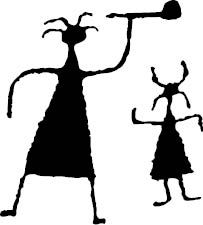

第一章

察言观色的心理策略

从衣服的选择判断人的个性特征

衣着与人的心理的关系

大文豪郭沫若曾说过：“衣服是文化的表征，衣服是思想的形象。”意思是说人可以通过衣着打扮来向外界展示自己。

随着人类社会的发展与进步，现在从衣着打扮上判断一个人的难度在无形之中增大了，因为现在的人们提倡张扬个性、不再拘泥于某一种形式，所以不能按照传统的一套进行观察和判断。但也正是由于张扬个性，不拘泥于形式，人可以更加充分地表现自己的心理状况、审美观点等，从而可由此把握其性格特征。

一般来说，喜欢穿简单朴素衣服的人，性格比较沉着、稳重，为人比较真诚和热情。这种人在工作、学习和生活当中，对任何一件事情都比较诚实、肯干，勤奋好学，而且还能够做到客观和理智。但是如果过分朴素就不太好了，这种情况表明人缺乏主体意识，软弱而容易屈服于别人。

喜欢穿单一色调服装的人，这种人是比较正直、刚强的，理性思维要优于感性思维。

喜欢穿淡色便服的人，大多比较活泼、健谈，并且喜欢结交朋友。

喜欢穿深色衣服的人，性格十分稳重，显得城府很深，一般比较沉默，凡事深谋远虑，常会有一些意外之举，让人捉摸不定。

喜欢穿式样繁杂、五颜六色、花里胡哨衣服的人，多是虚荣心比较强、爱表现自己而又乐于炫耀的人，他们任性甚至还有些飞扬跋扈。

喜欢穿过于华丽衣服的人，多为具有很强的虚荣心和自我显示欲、金钱欲的人。

喜欢穿流行时装衣服的人，最大的特点就是没有自己的主见，不知道自己有什么样的审美观，他们多情绪不稳定，且无法安分守己。

喜欢根据自己的嗜好选择服装而不跟着流行走的人，一般是独立性比较强、有果断决策力的人。

喜爱穿同一款式衣服的人，性格大多比较直率和爽朗，他们有很强的自信心，爱憎、是非、对错往往都十分明确。他们的优点是行事果断，显得十分干脆利落，言必信，行必果。同时他们也有缺点，那就是清高自傲，自我意识比较浓，常常自以为是。

喜欢穿短袖衬衫的人，他们的性格是放荡不羁的，但为人却十分随和、亲切。他们热衷于享受，凡事率性而为，不墨守成规，喜欢有所创新和突破，自主意识比较强，常常是以个人的好恶来评判一切。他们虽然看起来有点表里不一，但实际上他们的心思还是比较缜密的，而且什么时候都知道自己是做什么的，所以他们能够做到三思而后行，小心谨慎，不至于任性妄为，而做出错事来。

喜欢穿长袖衣服的人，大多数人比较传统和保守，为人处世都循规蹈矩，而不敢有所推陈出新。他们的冒险意识在某一方面来讲是比较缺乏的，但他们又喜爱争名逐利，自己的人生理想定得也很高。这样的人最大的优点就是适应能力比较强，这得益于循规蹈矩的为人处世原则，把他们任意放在哪一个地方，他们都能迅速地融入其中，所以通常会营造出较好的人际关系。他们很重视自己在他人心目中的形象，希望得到注意、尊重和赞赏，从而在衣着打扮、言谈举止等各个方面都总是严格地要求自己。

喜爱宽松自然的打扮，不讲究剪裁合身、款式入时的衣着的人，多是内向型的。他们常常以自我为中心，而不能走进其他人的生活圈子里。他们有时候很孤独，也想和别人交往，但在与人交往中，又总会出现许多的不如意，所以到最后还是以失败而告终。他们多是没有什么朋友，可一旦有，就会是非常要好的。他们的性格中害羞、胆怯的成分比较多，不容易接近别人，也不易被人接近。他们对团体活动一般来说是没有兴趣的。

从衣服的选择判断人的性格

有句俗话叫“人在衣裳，马在鞍”，可见衣着是人社会性的重要内容，不仅掩饰了人的动物性，更将人在社会中的地位区分得清楚明白，而且人们在选择衣着的时候，都会考虑到方方面面，如衣着款式、年龄、经济条件、用途等等。一件满意的衣服到底如何，其实都是由他们真实的性格勾勒出来的。

1.以节约原则为主的人

以节约原则为主的人，购买衣物时，首先从价格上考虑，然后再全力以赴地讨价还价，寸步不让。他们珍惜每一分金钱，即使花一分钱也要计算它的价值；他们会用金钱衡量很多东西，处处考虑金钱利益的得失，所以显得没有丝毫的人情味，很势利。

2.以讲究原则为主的人

以讲究原则为主的人，在购买衣服的时候，过度讲求衣物的质地面料、手工和美观大方。他们有求知的热情和自己的人生目标；他们非常清楚自己的价值，懂得为自己争取适合自己的东西；他们的享受是建立在辛勤付出的基础之上的，所以多能实现自己的目标和理想。

3.以树立形象为主的人

以树立形象为主的人，选择衣服时，不以自己的好恶来决定，而是考虑能否给他人留下一个美好的印象。他们在乎自己的一举一动，而且努力实现完美，以求在公众心中树立起良好的形象，这是他们相当重视权势和声望所致。

4.以思想愉悦为主的人

以思想愉悦为主的人，不喜欢时尚和流行，对商店橱窗中的展示往往不屑一顾，那些既简单而又保守的衣服才是他们的钟爱。他们不在乎物质上的享受，对旁人的评头论足也视若耳旁风，只重视精神上的富足，为了买到理想中的衣服也经常要耗费很多精力和时间。

5.以唯美原则为主的人

以唯美原则为主的人，购买衣物时，只要求好看，其他的如价格、质地和面料都是次要的。他们对一切美的事物都有十分灵敏的感受，以视觉美为最高的目标；喜欢吹嘘，不注重实际，所付出的努力往往归于昙花一现，有所成就的机会很渺茫。

6.以实用原则为主的人

对以实用原则为主的人来说，穿衣仅是为了保暖，款式与时尚都是次要或无关紧要的。他们的消费很低，会省下很多的钱，属于持家类型，性情忠厚，有着菩萨心肠，往往悲天悯人，乐善好施，乞丐上门也经常会受到款待。此类人以中老年居多。

从服装颜色的选择上看透对方

服装在人们的日常生活中占有十分重要的地位。穿着打扮不仅反映一个人的修养、职业，同时也反映其个性与心理。心理学家从服装的颜色、款式等选择上，分析了人的不同个性与心理。  

一般来说，在选择服装色彩的时候，人们多少会受到自己性格的影响。因为，每个人服装的色彩，总是和自己当时的心理活动状态有着一定的联系。所以，从每个人所喜爱的颜色上可多少看出他具有什么样的性格特征。

1.喜欢穿白衬衫的人

喜欢穿白衬衫的人，他们的性格特征是缺乏主动性、判断力、羞耻之心。他们在色彩感觉上、在装扮上都非常优秀；与之相反，不论搭配什么服装，只要穿上白衬衫都能相得益彰。白色确实与任何颜色的衣服都能搭配组合，同时，白色是表示干净的颜色。

虽然白色与任何颜色都能搭配，也给人一种亲切感，但常穿白衬衫的人，也给人一种“穿什么都可以”的感觉，在性格方面是属于直爽派的。从事穿白衬衫职业的，例如裁判官、医生、护士、机关的职员等，当你看到对方的第一印象都是缺乏感性，尤其在感情方面和爱情方面。

2.喜欢蓝色、蓝紫色服装的人

喜欢穿这种颜色服装的人，其性格主要缺乏决断力、实行力。这类人说话比较  唆，缺乏羞耻心和责任感，是自尊心很强的人。

要想接近喜欢这类色彩服装的人，应逐渐按部就班，并投其所好。同时在这种人面前不能说别人的坏话。

3.喜欢穿黑色服装的人

有的人说，穿黑色衣服使人精神紧张，黑色服装也是在丧葬及祭祀的仪式中穿着的服装。通常喜欢红白明显色彩的人，同时也喜欢黑色系统的服装。

4.喜欢红色服装的人

选择红色服装的人是冲动的、精神的、很坚强的生活者。红色是在增强声势时所选择的。

5.喜欢紫红色服装的人

选择紫红色服装的人，一般是在无法冷静、无法客观分析自己的时候选择的。

6.喜欢桃红色服装的人

喜欢桃红色服装的人，是追求漂亮时所选择的。这种人以举止优雅为特征。

7.喜欢青绿色服装的人

这类人是在喜欢有纤细感觉的心理状态下选择的。

8.喜欢紫色服装的人

这种人一般具有保持神秘、自我满足的艺术家的气质，喜欢别出心裁。

9.喜欢褐色服装的人

这类人在选择褐色服装时，当时的心理状态很踏实。

10.喜欢黄绿色服装的人

这类人是在缺乏兴趣、交际狭窄、缺乏纤细心情的选择的。

11.喜欢灰色服装的人

这种人是在缺乏主动性的时候，自己没有勇气面对困难的心理状态下所选择的服饰颜色。

12.喜欢浊紫红色、暗褐服装的人

这种人是在非社交场合的时候、不喜欢表露心情的时候所选择这样颜色衣服的。

13.喜欢橄榄色服装的人

这种人在选择橄榄色时，当时的心理状态一般是处于被抑制的状态或歇斯底里的状态。

14.喜欢绿色服装的人

这种人一般喜欢自由，有宽大的胸怀，绿色是其在抱有希望、没有偏见的心理状态下选择的。  

15.喜欢橙色服装的人

一般是在无法独居时，对人生意欲强烈的时候所选择的服装颜色，这种人雄辩、开朗、口才好，并喜欢幽默。

16.喜欢黄色服装的人

这种人为使别人感觉自己有智慧、有纯粹高洁心灵时，选择黄颜色的服装。

从 T 恤的选择看透对方

当今，T 恤已经成了夏日里最普遍而且最受欢迎的服装，男女老少皆宜。在过去，T 恤只是用来保暖和吸汗的内衣，可是现在，它已演变成了一面公众告示牌，自己可以任意在上面留下或记录各种情绪和想法。所以，选择什么样的 T 恤可以更直观地看出一个人具有什么样的性格。  

习惯于选择没有花样的白色 T 恤的人，多是一些自己比较独立的人，他们不会轻易地向世俗潮流低头。他们一般都会具有一定程度的叛逆性，但表现的形式往往不是特别明显与恰当。  

喜欢选择没有花样的彩色 T 恤的人，自我表现欲望并不是十分强烈，他们甚至可以甘于平庸和普通，做一个默默无闻的人。他们多数比较内向，不喜欢张扬，而且富有同情心，在自己能力许可的范围内，会去关心和帮助他人。

喜欢在 T 恤上印上自己名字的人，思想多数是比较开放和时尚前卫的，能够很轻松地接受一些新鲜的事物，他们对一些陈旧迂腐的老观念多持一种排斥的态度。他们的性格比较外向，喜欢结交朋友，为人比较真诚和热情，所以通常会有良好而又不错的人际关系。他们的自信心还是挺强的，有一定的随机应变能力，在不同的情况下，能够随机应变地做出应对策略。  

喜欢 T 恤上印有各种明星的画像及与之有关的东西的人，多属于追星族，他们对那些人十分的崇拜，并且希望自己有朝一日能像他们一样。他们很乐于向别人表达自己的这种心理。

喜欢在 T 恤衫上印有一段幽默标语的人，多具有一定的幽默感，而且很聪慧。另外，他们也是具有很强的表现欲望的，希望能够引起别人的注意。

喜欢在Ｔ恤上印有学校名称或大企业的标志装饰的人，一般比较希望他人知道自己的身份，并且对自己所在的单位和企业具有一定的感情。他们希望能够以此为载体，吸引一些志同道合的人。

喜欢在Ｔ恤上印有著名景点的风景的人，对旅游总是很有兴趣的。他们的性格多是外向型的，对新鲜事物的接收能力很强，而且具有一定的冒险精神。自我表现欲很强，希望把自己所知道的一切都传达给他人。

从女人对内衣的喜好透视对方

无论是在超市商场，还是在路边小店货摊，女人内衣已不像昔日那样养在深闺人不知了。它们无论在色彩、质地、做工，还是在塑体功能上，都呈现出千姿百态，满足了众多女人的不同需求，不仅让女人流连忘返，也让男人大饱眼福。

也许女人认为挑选内衣是自己的专利，购买和穿着内衣也是一件非常平常的生活小事。其实不然，一件经过千挑万选的内衣是她们爱好的体现，同时也暴露出她们的心理和性格特征。  

1.喜欢棉质内衣的女人

这种女人属于乳臭未干类型，总认为自己还没有长大，时不时地还表现出小女孩的顽皮，而此时的她们或许已经为人母了。她们热衷于运动，但不一定专指体育活动，而是展现活力的一种方式和要求。在对待情感方面，她们总是表现得很从容，只要有付出的机会、条件许可，不管对方是否死缠着自己，她们很少轻言放弃。

2.喜欢整体搭配衣着的女人

这种女人属于协调类型，在任何方面都追求一种和谐与平衡，力求以一种完美的形象出现在人们面前。她们能把分内之事处理得有条不紊，不会出现偏袒情况；总是显得大公无私、沉着冷静，让大献殷勤的男人猜不出自己在她们心目中的位置。

3.喜欢紧身尼龙内衣的女人

这种女人属于开放类型，喜欢暴露，希望情人会为她们迷人的身段而神魂颠倒，并对自己的身体和所持的开放性观念引以为荣，直言不讳；性格直率，有什么就说什么，喜欢什么，不喜欢什么都被他人看得一清二楚，从而给他人提供可乘之机。

4.喜欢透明睡衣的女人

这种女人外表虽然诱人，但骨子里依然保持着传统思想。找这样的女人做老婆或情人，男人可称得上是青春永驻，因为她们会用那件若隐若现的睡衣为平淡的生活增添一份恍惚迷离。受到诱惑的丈夫或情人如同喝下了兴奋剂，看到她们永远风采依旧，结果欲罢难休，增添出戏剧般的效果。

5.喜欢黑色内衣的女人

这种女人是十足的享乐主义者，把卧室当成自己的娱乐场所，随心所欲，而且对自己的情人，没有丝毫隐瞒。她们最为性感和迷人，并以此为优势积极主动地寻找情感伴侣。她们在白天如同温顺的小羊羔一样惹人喜爱，但一到了晚上就会恢复“母夜叉”的形象。

6.喜欢白色内衣的女人

白色代表纯洁，所以这种女人大多属于守身如玉的类型。她们不善于表露感情，懒于思想和追求目标。也许是怕玷污了自己的纯洁，哪怕是对于强烈的原始性欲，她们都采取相当保守的态度，结果生命过程中的满足次数寥寥无几，她们最在行的是恪守道德准则，贤淑是对她们最恰当的形容。

透过鞋子观察对方的性格

鞋子，并不是像人们所想象的那样，单纯地起到保护脚的作用，这只是一方面。在观察他人的鞋子的时候，人们除了注意其美观大方外，还可以通过它对一个人的性格进行观察。

1.始终穿着自己最喜爱的一款鞋

始终穿着自己最喜爱的一款鞋子，这一双穿坏了，会再去买另外一双，这样的人思想属于相当独立的。他们知道自己喜欢什么，不喜欢什么，他们十分重视自己的感觉，而不会过多地在意他人怎样看。他们做事一般比较小心和谨慎，在经过仔细认真地考虑以后，要么不做，要做就会全身心地投入，把它做得很好。他们很重视感情，对自己的亲人、朋友、爱人的感情都是相当忠诚的，不会轻易背叛。

2.喜欢穿没有鞋带的鞋子的人

喜欢穿没有鞋带的鞋子的人，并没有多少特别之处，穿着打扮和思想意识都和绝大多数人差不多。但他们比较传统和保守，中规中矩，追求整洁，表现欲望不强。

3.喜欢穿细高跟鞋的人

穿细高跟鞋，脚在一定程度上是要受些折磨的，但爱美的女性是不会在意这些的。这样的女性，表现欲望是很强的，她们希望能引起他人和异性的注意力。

4.喜欢穿时髦鞋子的人

喜欢追着流行走、穿时髦鞋子的人，有一种观念，那就是只要是流行的，就全部是好的，但没有考虑到自身的条件是否与流行相符合，有点不切合实际。这种人做事时常缺少周全的考虑，所以会顾此失彼。他们对新鲜事物的接受能力比较强，表现欲望和虚荣心也强。

5.喜欢穿运动鞋的人

喜欢穿运动鞋说明这是一个对生活持积极乐观态度的人，他们为人较亲切和自然，生活规律性不强，比较随便。

6.喜欢穿靴子的人

喜欢穿靴子的人，自信心并不是特别强，而靴子却在一定程度上能为他们带来一些自信。另外，他们很有安全意识，懂得在适当的场合和时机将自己很好掩蔽起来。

7.喜欢穿拖鞋的人

喜欢穿拖鞋的人是轻松随意型人的最佳代表，他们只追求自己的感觉和感受，并不会为了别人而轻易地改变自己。他们很会享受生活，绝对不会苛求自己。

8.喜欢穿远足靴的人

热衷于远足靴的人，会在工作上投入充足的时间和精力，他们有很强烈的危机感，并且时刻做好了准备，准备迎接一些可能突然发生的事情。他们有较强的挑战性和创新意识。敢于冒险，向自己不熟悉的领域挺进，并且有较强的自信心，相信自己能够成功。

9.喜欢穿露出脚趾的鞋子的人

喜欢穿露出脚趾的鞋子，这样的人多是外向型的人，而且思想意识比较先进和前卫，浑身上下充满了朝气和自由的味道。 他们很乐于与人结交，并且能做到拿得起放得下，比较洒脱。

淡妆与浓妆，表现不同的欲望

不同的装扮，折射出不同的心理

1.异国妆和怪妆

异国妆是外国流行的妆；怪妆则是没有一定模式和规范，甚至与化妆的本意相悖的妆。这两种化妆者化妆的目的是不同的，因而化妆所起到的效果也就有了很大的差异。

（1）异国妆。喜欢化异国色彩比较浓重的妆的人，多是有比较丰富的想象力的，身体内有很多艺术细胞，希望自己将来能够成为一个艺术家。她们向往自由，渴望过一种完全无拘无束的生活。她们常常会有许多独特的、让人诧异的想法，是个完美主义者。

（2）怪妆。眼皮周围或是黑乎乎的，或是蓝幽幽的；嘴唇也是有时紫有时红，有时大嘴巴有时小嘴巴；脸颊涂得红红的。喜欢化如此怪妆的人也清楚自己并没有追求什么美丽，她们只把这种妆当成宣泄的一种方式。她们通常具有强烈的反抗心理，主要是自小受到家庭的溺爱，总是要求说一不二，但现实生活只会使她们失望，所以用一些非常规的思想和行为与社会分庭抗礼，但往往是失败多于成功。

2.怀旧妆和完美妆

怀旧妆是指某些人将自小形成的那套化妆理论和方法延续到成年，甚至中年和老年。其实是对美好过去的一种回忆，以期忘记现实中的不愉快和不如意，但她们依然保持头脑清醒，不会沉迷其中而忘记现实。她们讲究实际，会极力把握住现在的所有。她们热情善良，善解人意，拥有很多可以推心置腹的朋友。由于容易满足，她们难以享受时代发展带来的刺激和美好。

与化怀旧妆的人不同的是，化完美妆的人追求的是尽善尽美。她们为了完成自己的目标不惜花费巨大代价，任何事情都会追求尽善尽美，属于典型的完美主义者。这种类型的人甚至倾尽所有也要使自己的容貌达到自己满意的程度。之所以如此，最主要的是她们对自己的才智和财力都有充足的把握，而唯一放心不下的是自己的外貌。为了成为一块无瑕美玉，只好不停地审视自己，用化妆来掩饰不足，结果却让别人感到不自在。

淡妆与浓妆，表现不同的欲望

有的人喜欢淡妆，此类人大多没有太强的表现欲望，希望最好谁也别注意她们。她们只要求能过得去，简单地涂抹一下使自己不至于特别难看就行。她们大多属于聪明和智慧的类型，不会将时间和精力都耗费在梳妆台前；往往有着自己的想法与思考，而且敢打敢拼，所以较多人能获得成功；拥有秘而不宣的秘密，甚至珍藏一生也不会向他人透露；最希望得到别人的尊重，对她们的难言之隐给予支持和理解。

与之相反，有的人则喜欢浓妆。与喜欢淡妆的人相比较，这样的人表现欲望十分强烈。她们不辞辛苦地将各种化学药剂喷洒在自己的脸上，并忍受痛苦用各式工具修饰五官，为的是用一种极端的方式引起他人的注意，而异性的欣赏往往使她们心甜如蜜。前卫和开放是她们的思想特征，她们对一些大胆和偏激的行为大多保持赞赏的态度。她们真诚、热忱，一些恶意的指责并不能使她们受多大的伤害，但她们对他人依然会很尊重。

自然与时尚，个性的保守与开放

女性在约会的时候，或是工作上有重要的提案要进行的时候，化的妆应该比平常要浓，可以说是充满干劲的“决胜负彩妆”。根据心理学家研究，化比平常浓的彩妆，会提高自信心与满足感，变得活跃、具有攻击性，也变得较具社交性。决胜负彩妆似乎真的具有效果，不过，奇怪的是，化这种妆同时也会变得情绪不安，这是因为“和平常的自己不同”。

最容易影响别人印象的是脸孔，而眼睛扮演了尤其重要的角色，唇部也会给人十分深刻的印象。

眼睛给人家的印象取决于眉形与眼线。眉毛描绘成细细的弧形，再画鲜明的眼线，就给人华丽的感觉，在漂亮气派的餐厅里约会时很适合化这种妆。口红使用玫瑰色系的，上唇唇山的部分仔细描绘出锐角，会更加强华丽的印象。

平直上扬的眉形，以深色醒目的眼线，配上强调唇线的深红色的唇，会给人意志极为坚强的印象，不是华丽，而是利落感，给人一种强烈的积极感与坚决强硬的态度。这种强硬感的化妆，在提案会议、作报告或发表意见时，可以做你的后盾。即使实际上自己是很紧张的，也能隐藏住这种情绪，不论是在言语或动作上，都能让你看起来充满自信。

眉尖自然往上扬，但尾端却突然往下的眉形，营造出俏丽可爱的感受。画上淡淡的眼线，口红涂得比实际的嘴唇轮廓大一些，然后再迅速地回眸一笑，就能给人魅力十足的女性印象。跟喜欢的男性朋友约会时，很适合化这种妆。在看似冷淡的气氛中，偶尔散发出带点俏皮的性感，就是最完美的表现了。

口红显示女性的性格和职业

中国有句古话：“女儿心，海底针。”这句话蕴含的意思非常简单，即女人的心理是很难猜测的。但是，近来心理学家通过“投射”方式发现，很多女性总会无意识地将自己的心理特征“投射”在自己的日常生活用品，尤其是一些化妆品上。

就拿口红来说，现在全世界几乎有一半的女性每天都会用口红。对那些习惯于每天用口红的女性来说，如果那一天忽然不让她们用口红，她们就会感到如同没穿好衣服一样别扭。口红作为女性增添自己魅力的手段之一，其颜色种类可谓是五花八门，既有红色、粉色、橙色，还有珍珠色、褐色、紫色等。通过观察一个女性对口红颜色的喜好，往往就能知晓她的性格特征和职业。

一般来说，红色的口红会使女性的嘴唇显得更为突出。所以，如果一个女性喜欢红色的口红，则说明其性格外向、活泼好动、乐观、崇尚自由、具有独立的个性。她的社交能力非常的强，对人真诚有礼，喜欢与人分享美好的事物，因而其人际关系处理得非常好，朋友很多。通常情况下，涂有这种口红的女性往往是从事销售、公关，或是美容、美发等行业。

粉红是一种代表纯情和女性本色美的颜色。所以，很多女孩子和男孩第一次约会时最喜欢使用此种颜色的口红。通常情况下，如果一个女性喜欢使用此种颜色的口红，则说明其性格较为温柔、和善、思想较为单纯、富有同情心和爱心。但是她的心理承受能力较弱，在挫折和失败面前常常会表现出很委屈、很受伤的样子。她很信任爱情，对恋爱抱有很大的期待。虽然她平时表现得温柔贤淑，但一旦知道冒险的乐趣，很可能会发生大胆的变化。在与人交往时，她可能显得有点矜持，但其内心却是火热的。一旦你成为了她的朋友，往往会得到她无微不至的关怀。一般来说，涂着这种颜色口红的女性往往从事教师、医生等行业。

橙色往往能给人亲切、温柔、温馨的感觉。所以，喜欢这种颜色口红的女性，其性格较为稳重、和蔼，具有较强的自我控制能力和判断力，无论是对人还是对事，都有自己的观点和看法，从不会人云亦云。她的口才较好，但不会强词夺理，喜欢以理服人，同时，她还具有较强的幽默感。在爱情方面，她往往愿意为对方付出自己的一切，是典型的贤妻良母型女性，她坚信“爱情的眼里容不得半粒沙子”。一旦恋人背叛了自己，她极有可能会报复对方。不过，她对朋友是非常坦荡和大度的，如果朋友不小心伤害了她，她往往会一笑而过。所以，她的人缘很是不错。通常情况下，涂着这种颜色口红的女性往往从事各种商业活动，如一些店铺的老板，或是大公司的高级职员。  

珍珠色是一种代表纯洁、高洁的颜色。喜欢这种颜色口红的女性，其性格文静、庄重，聪颖谨慎，心思细腻且喜欢追求完美。她具有较强的个性，自我主张非常明确，从不掩饰自己的追求和欲望，喜欢自由地享受生活。一旦她确定了自己的追求目标，她就会全力以赴，从不会在乎别人的眼光。在爱情方面，不喜欢受到对方的约束，要求对方尊重自己的个人空间。在与人交往时，她也不喜欢别人干预自己的事情，同时她也不会干预对方的事。通常情况下，涂着这种颜色口红的女性往往是一些自由职业者。

紫色是一种代表高贵和典雅的颜色。喜欢这种颜色口红的女性，其性格较为外向，具有较强的表现欲望和优越感，虽然喜欢在别人面前展示自己的魅力，但从不虚伪。有些时候，她很爱幻想，喜欢追求不平凡的生活方式。在与人交往时，她往往会给人，尤其是给男性，一种高高在上、难以接近，不易被诱惑的感觉，但她恰恰具有让男性痴迷的不可思议的魅力和个性。通常情况下，涂着这种颜色口红的女性往往从事音乐、艺术等行业。

从头发的质地与发型观察你的对手

在足球场上，大家时常可以看到运动员各种各样稀奇古怪的头发，并为此津津乐道。不同的发型往往表现人的不同个性。

1.女士的头发

与男士相比，女士的发型若要详细分析起来，则显得较为复杂。

女性若留着飘逸的披肩发，则说明她比较清纯、浪漫；若留的是齐眉的短发，则这类人显得天真活泼、无忧无虑；烫成满头卷发，代表这个人较有青春的活力，或多或少地充满些野性。

女性把头发梳得很整齐，并让它保持顺其自然的状态，说明这个人比较安分守己，甚至是封闭保守的；如果她把头发打理得很整齐，但并不追求某种流行的款式，则表明她可能是比较含蓄，但有较强烈的自主意识的一个人。在自己的发型上投入很多的精力，力争达到尽善尽美的程度，说明这是一个自尊心比较强、追求完美、爱挑剔的人。

（1）头发像钢丝，又粗又硬，而且浓密。这样的人疑心多且重，不会轻而易举地相信别人。她们最信任的就是自己，所以凡事都要自己动手，操纵和掌握一切，才觉得放心。她们做事很有魅力，而且组织能力也比较强，具有一定的领导才能。这一类型的人，理性的成分要大大地多于感性，所以遇到涉及感情方面的问题时，往往会显得十分笨拙。

（2）头发很粗，但色泽很淡，很稀疏，而且质地坚硬。这一类型的人自我意识极强，刚愎自用，往往不听别人的劝告。她们不甘心被人领导，但却渴望能够驾驭别人。她们多较自私，缺乏容人的度量。但这一类型的人，一般来说头脑还算比较聪明，可是她们的目光又比较短浅和狭窄，只专注于眼前，看不到长远的利益，所以多不会有多大的成就。

（3）头发柔软，却又稀疏。这一类型的人，自我表现欲望一般来说比较强，她们喜欢出风头，更爱与人辩论，以吸引他人的注意，获得他人的关注。在她们的性格中，自负的成分占了很多，她们妄自尊大，很少把他人放在眼里，尽管自己在某些方面表现得的确很糟糕。她们做事的时候，缺少必要的思考，所以常会作出错误的判断，而且还容易疏忽和健忘。

（4）头发浓密粗硬，却自然下垂。头发浓密粗硬，却能自然下垂，这种人从外形上来看，多半身体比较胖，而且也显得比较慵懒，不喜欢运动，但是她们的心思多比较缜密，往往能够观察到特别细微的地方。她们的感情较为丰富，易动情，对感情不专一。

2.男士的头发

男士不管是留长发、剃光头，或是其他各种各样比较特别的发型，其都有一个普遍的共同点，那就是标新立异，想别出心裁地突出自己，增加自身的魅力。

（1）头发淡疏，粗硬而卷曲。这一类型的人，多思维比较敏捷，而且善于思考，有很好的口才，能够很容易地说服别人。他们的性格弹性比较大，可以说得上是能屈能伸，适应性很好。但他们的屈和伸，又是在坚守一定的原则和基础之上进行的，所以无论他们外在的东西怎样多种形式地不断变化，其内在还有一些稳定不变的东西。

（2）头发浓密柔软，自然下垂。这种类型的人，大多性格比较内向，沉默不语，善于思考。从某种程度上说，他们具有很强的耐性和韧性，这一类型人所从事的事业多是和艺术方面有关的。

（3）头发自然向内卷曲，如烫过一样。这一类型的人，脾气大多比较暴躁，而且疑心比较重，总是患得患失地在犹豫和矛盾中挣扎，除此之外，嫉妒心还比较重。

（4）发根弯曲，发梢平直。这一类型的人多自我意识比较强，讨厌被人约束和限制，不会轻易地向他人妥协。

（5）让自然来决定自己的发型，并且长时间地保持。这一类型的人总喜欢怨天尤人，但却从来不从自己身上寻找原因，更不会付诸行动努力去寻求改变。他们很多时候容易向别人妥协，所以很多行动并不是真正地发自内心真实想做的。

（6）头发长长的、直直的，看起来显得非常飘逸和流畅。这种人的性格大多界于传统与现代之间，他们既含蕴世故，又大胆前卫，只是要视情况而定。他们通常有很强的自信心，对成功的渴望很迫切。

（7）头发很短，看起来很简洁，而且也极为方便。这一类型的人，大多是野心勃勃，他们的生活总是被各种各样的事情占据着。他们在内心很想把这些事情做好，但实际上却往往什么也做不好，因为他们缺少必要的责任心，在遭遇困难和面对挫折的时候，往往是选择逃避现实。

饰品：心灵文化的显示

佩戴各种装饰品，在古今中外都有着相当长的历史，这是人类审美意识觉醒以来最传统的一种装饰行为。这种行为不仅为人们增添了无限的风采，而且可将人们的身份喜好区分得一目了然，同时，还体现了人们对生活目标的追求和审美时尚的选择。有人认为，佩戴饰品还具有“延长自我”的特点。饰品时刻都在传递着人们的性格、性情和情绪等信息。试想，如果一个人的形象和代表“自我延长”的饰品背道而驰，就会给人以“不完整人格”的印象，所以，根据服饰来判断一个人的性格是有章可循的。

帽子：盖不住思维的大脑

帽子不仅有御寒遮阳的功能，它还是一种增加美观、给人树立某种形象的装饰物。世界各地都在生产各式各样的帽子，出入任何一家娱乐场所、大型酒楼餐馆，都会看到“衣帽间”的牌子，这说明帽子对于一个人来说，有着十分重要的用途，它可以帮人们建立某种形象，使其个性在众人面前得以展现。

1.爱戴礼帽的人

戴礼帽的人都自认为自己稳重而具有绅士风度。这种人的愿望是让人觉得他有沉稳和成熟的风格，在别人面前，经常表现得非常热爱传统。除帽子外，这种人所穿的皮鞋任何时候都擦得锃亮，而且所穿的袜子也一定会给人以厚实的感觉，即使是炎热的夏季，他们也会拒绝穿丝袜，同时也讨厌穿着凉鞋和拖鞋走路。由于他们看不惯很多东西，所以他们的心底很清高，有些自命不凡，认为自己是个干大事的人，进入任何一个行业都应该是主管级的人物。

2.爱戴旅游帽的人

旅游帽既不能御寒也不能抵挡太阳的照射，纯粹是作为装饰之用。用这种帽子来装扮自己，可用以折射某种气质或形象，或者另有一些企图，用来掩饰一些自己认为不理想或者有缺陷的东西。

从这些表现出来的特点看，爱戴旅游帽的人并不是一个心地诚实的人，而是个善于投机取巧的人，因此真正了解他的人少之又少，而一般人所看到的只是他的外表。

3.爱戴鸭舌帽的人

一般有点年纪的人才戴鸭舌帽，鸭舌帽表现出稳重、办事踏实的形象。如果男人戴这种帽子，那么他会认为自己是个客观的人，从不虚华，面对问题时，能从大局着想，不会因为一些细枝末节而影响整个大局。有时候他自以是个老练的人，在与别人交往时，就算对方胸无城府，他还是喜欢与别人兜着圈子，直到把对方搞得晕头转向，也不直接说出自己的心思。

4.爱戴彩色帽的人

爱戴彩色帽的人非常清楚在不同的场合，不同颜色的服装，应该佩戴不同色彩的帽子，说明他是个天生会搭配且衣着入时的人。

这种人喜欢彩色鲜艳的东西，对时下流行的东西非常敏锐。每当出现新鲜玩意，他总是最先尝试，希望人家说他的生活过得多姿多彩，懂得享受快乐人生，并且总是以弄潮儿的身份走在时代前列。

同时，这种类型的人也是个害怕寂寞的人，因为他精力旺盛、朝气蓬勃，那颗不甘寂寞的心，总是使他躁动不安，他会经常邀请伙伴们一起到歌舞升平之地尽情玩耍。当最后一支舞跳完后，曲终人散的那种寂寞滋味也会油然而生。

5.爱戴圆顶毡帽的人

爱戴圆顶毡帽的人对任何事情都产生兴趣，但从不表达自己的看法，即使有看法也是附和别人的论点，好像自己没有什么主见似的。但他们并不是没有主张，只不过是个老好人，不愿随便得罪一个人，哪怕是个最不起眼的人。

从本质上讲，这种类型的人是个忠实肯干的，他们相信只有付出才有收获的道理。在他们平和的外表下，有自己执著的观点，他们相当痛恨不劳而获的人，相信君子爱财取之有道，从来不让不义之财玷污自己的手指。

眼镜：心灵窗户的另一种显示

眼镜最初是为了矫正近视或为了保护眼睛而使用的工具，但今天它早已超出了其原本的使用概念，成了具有多种功能且很有装饰意义的大众用品。它除了具有矫正视力、过滤阳光、阻挡风沙等使用价值外，有的人佩戴眼镜，甚至就是为了美观或制造一种气质。下面针对佩戴不同形式眼镜的情况谈谈不同人的性格特点。

1.戴黑胶边眼镜者

戴黑胶边眼镜的人希望表现出稳重及成熟的风格。在他人面前，这种人通常表现得热爱传统。通常他们自视很高，可惜他们保守且缺乏冒险精神，因此成就不大。这种人对朋友彬彬有礼，但是这样形成的友谊没有深度。

2.戴金丝边眼镜者

戴着金丝边眼镜的人希望当他人看他们的时候，认为他们除斯文之余，还有着学者的风范。这种人喜欢追赶潮流，给人一种很现代的感觉。

这种人十分注重自己的外表，尤其是当他们与朋友约会时，必定穿着光彩，同时在言语之间，还会暗示自己是个有身份的人。在跟人家讨论问题的时候，这种人喜欢发表一些独特的见解，以表示自己与众不同。

3.戴无边眼镜者

常戴无边眼镜的人认为自己是个客观的人，在面对所有问题的时候，都能够从大体着想，不会因为一些细节而影响大局。

这种人总觉得自己善于用计，因此与人交往时，他们喜欢兜着圈子跟人沟通。其实他们害怕被人伤害，所以千方百计不让别人接触他们的真实的内心世界。

领带：男人个性的表现

西服，自诞生那日起就成为男人服饰中的佼佼者，而且这个地位直到今天也没有动摇。正式的西装有单排扣和双排扣之分，每一个男人都可以依据自己的喜好进行选择，而且不用花太多的精力。但是有一件辅助饰物却让男人大伤脑筋，那就是领带的打法和色彩的搭配。领带的作用类似于女士们的丝巾作用，但男人的行事原则和人品秉性却可以完完全全地展现在领带打法及颜色的搭配上。若仔细观察周围的男人，便不难发现他们“本色”的蛛丝马迹！

1.领带结又小又紧的人

有这种喜好的男人若身材瘦小，则说明他们是有意凭借小而紧的领带结，让自己在他人匆忙的一瞥时显得“高大”一些。如果他们并无体形之忧，则说明是在暗示别人最好别惹他们，他们不会容忍别人对自己有半点的轻视和怠慢，这是气量狭小的表现。由于生活和工作中谨言慎行，疑心甚重，他们养成了孤独的性格。他们凡事大多先想到自己，热衷于物质享受，对金钱很吝啬，一毛不拔，几乎没有什么人愿意和他们交朋友，他们也乐于一个人守着自己的阵地，孤军奋战。

2.领带结不大不小的人

先不考虑领带的色彩和样式，也不管长相和体形如何，男人配上这种领带结，大都会容光焕发，精神抖擞。他们可以获得心灵上的鼓舞，会在交往过程中注重自己的言谈举止，所以不管本性如何，都显得彬彬有礼，不敢轻举妄动。由于认识到领带的作用，他们在打领带结的时候常常一丝不苟，把领带打得恰到好处，给人以美感。他们安分守己，把大部分的时间放到工作当中，勤奋上进。

3.领带结既大又松的人

领带的作用是使男人更加温文尔雅，但打这种领带结的男人所展现的风度翩翩绝不是矫揉造作出来的，而是货真价实的，是他们丰富的感情所展现出的风采。他们不喜欢拘束，积极拓展自己的生活空间，主动与他人交往，练就高超的交往艺术，在社交场合深得女人的欢心和青睐。

4.领带绿色、衬衫黄色的人

绿色象征生命和活力，是点缀大自然最美妙的颜色；黄色代表收获和金钱，是财富与权势的徽章。这样搭配领带和衬衫的男人富有青春活力与朝气，想什么就做什么，不喜欢拖泥带水，对于事业充满信心。不过他们有时鲁莽冲动，自控能力比较差。

5.领带深蓝色、衬衫白色的人

“蓝领”代表职工阶层，“白领”代表管理阶层，他们将两者融合到一起，上下兼顾，少年老成，同时不乏风度翩翩。由于视野宽阔，白领的诱惑远远超过蓝领，所以他们对工作十分专注，事业心极重，结果在奋斗过程中常常出现急功近利的表现。

6.领带多色、衬衫浅蓝色的人

五彩缤纷是人们对美好事物的形容，充满了迷离和诱惑，普通人和勤奋的人往往对此敬而远之。所以选择这种领带和衬衫的人拥有一股市井气息，热衷于名利；路边的野花繁多美丽，常常使他们心猿意马，见异思迁的他们对爱情往往不能用情专一，追逐的目标总是换了一个又一个。

7.领带黑色、衬衫白色的人

黑白分明是对于阅历丰富之人的形容，所以喜欢这种打扮的人多为稳健老成之士。由于看得多，感悟也会多，他们懂得什么是人生的追求，善于明辨是非，相信“善有善报、恶有恶报”，正义在他们身上得到了最大的展现。

8.领带黑色、衬衫灰色的人

不用看他们的表情如何，仅这种打扮就让人有种不舒畅的感觉。他们在穿着之时必先照镜子，能够接受镜中的压抑则说明他们有很深的忧郁，而这份忧郁是气量狭小所致，他们选择这身打扮。在工作当中，老板考虑到其他员工的情绪，常常请他们卷铺盖回家，所以他们也经常变换工作。

9.领带红色、衬衫白色的人

红色象征火焰，代表奔放的热情，更是一种积极和主动的表现，所以男人选择红色领带，无异于想追逐太阳的光辉，以使自己成为注意的焦点。他们本应该属于充满野心的类型，但白色代表纯洁，是和平与祥和的象征，白色衬衫让别人对他们刮目相看，见到他们如火一样的热情和纯洁的心灵。

10.领带黄色、衬衫绿色的人

用辛勤的耕耘换取丰硕的收获，按照理想设计自己生活和人生，并勇于实施，他们流露出的是诗人或艺术家的气质。他们相信付出就会有回报，所以不会杞人忧天地担心秋后是否会因为意外的暴风雨而颗粒无收。他们与世无争，保持柔顺的性情，对人非常和蔼可亲。

11.不会系领带的人

连系领带这种小事都要人代劳的人，大都心胸豁达而不拘小节。他们或是有某种常人没有的绝技在身，或是先天具有领袖才能，使他们不屑将精力消耗在系领带这样的细节问题上。他们性情随和，有同情心，朋友甚多，口碑亦好，且夫妻情笃、家庭祥和。

手表：对待时间的态度

“一寸光阴一寸金，寸金难买寸光阴。”这是在说时间的宝贵。时间在不知不觉、悄无声息中流逝，不同的人对此会有不同的感受。有的人视若无睹，而有的人则表示深深的惋惜，然后，抓紧利用每一分钟去做一些有意义的事情。一个人对待时间的看法，很大程度上是由人的性格决定的，而时间对人具有什么样的影响，很多时候又能通过所戴的手表传达出来。这两者之间有着非同一般的关系，下面就针对这一点进行说明和介绍。

1.喜欢戴电子表的人

有一种新型的电子表，只要按一下显示时间的键，就会出现红色的数字，如果不按，则表面上一片漆黑，什么也看不见。喜欢戴这一类型手表的人多是有些与众不同的特别之处的。他们独立意识非常强烈，从来不希望受到他人的控制和约束，而喜欢自由自在、无拘无束地去做自己想做并且也愿意去做的事情。他们善于掩饰自己的真实情感，所以一般人不能轻易走近去了解他们。在别人看来，他们是特别神秘的，而他们自己也非常喜欢这种神秘感，乐于让他人对自己进行各种猜测。

2.喜欢液晶显示型手表的人

喜欢液晶显示型手表的人在生活中多为比较节俭，知道如何精打细算。而且他们的思维比较单纯，对简捷方便的各种事物比较热衷，而对于太抽象的概念则难以理解。他们在为人处世各方面多持比较认真的态度，不会显得特别随便。

3.喜欢戴闹钟型手表的人

喜欢戴闹钟型手表的人大多对自己要求特别严格，总是把神经绷得紧紧的，一刻也不能放松。这一类型的人虽算不上传统和保守，但他们习惯于按一定的规律和规定办事，他们在争取成功的过程中任何一件事都是以相当直接而又有计划的方式完成的。他们非常具有责任心，有时候会刻意地培养和锻炼自己在这一方面的能力。除此之外，他们还有一定的组织和领导才能。

4.喜欢戴具有几个时区手表的人

戴具有几个时区手表的人多是有些不现实的。他们有一定的聪明和智慧，但一切都止于想像而已，不会努力付诸实践。做事常三心二意，这山望着那山高。在一些责任面前，常以逃避现实的方式面对。

5.喜欢戴古典金表的人

戴古典金表的人多是具有发展眼光和长远打算的人，他们绝对不会为了眼前一些既得的利益而放弃一些更有发展前途的事业。他们心思缜密，头脑灵活，往往有很好的预见力。他们的思想境界比较高，而且非常成熟，凡事看得清楚透彻。他们有宽容力和忍耐力，又很重义气，能够与家人朋友同甘共苦、生死与共。他们有坚强的意志力，从来不会轻易向外界的一些困难和压力低头。

6.喜欢怀表的人

喜欢怀表的人多对时间具有很好的控制能力，虽然他们每天的生活都是忙忙碌碌的，但是却并不是时间的奴隶，而懂得如何在有限的时间里让自己放松并且寻找快乐。他们善于把握和控制自己，适应能力非常强，能够很好地调整自己的心态。他们多有比较强的怀旧心理，乐于收集一些过去的东西。他们言谈举止高雅，表现出一定的文化修养。他们有比较浓厚的浪漫思想，常会制造一些出人意料的惊喜。他们为人处世具有耐心，很看重人与人之间的友情。  

7.喜欢戴上发条的表的人

喜欢戴上发条的表的人独立意识比较强。他们自给自足，很多事情都坚持一定要自己动手。他们乐于做那些可以马上见到成果的工作，如干一次体力活。他们最看重的是自己所获得的那种成就感，但在这个过程中，他们又不希望一切都是轻而易举就获得的，这样反而没有了意义和价值。此外他们还并不希望得到他人过多的关心和宠爱。

8.喜欢戴没有数字的表的人

戴没有数字的表的人抽象化的理念较为强烈，他们擅长于观念的表达，而不希望什么事情都说得十分明白。他们很在意对一个人智力的锻炼和考验，他们认为把一切都说得太明白就没有任何意义了。他们很喜欢玩益智游戏，因为他们本身就是相当聪明和智慧的，他们对一切实际的事物似乎并不是特别在乎。

9.喜欢戴由设计师为自己设计的手表的人

喜欢戴由设计师特别为自己设计的手表的人，大多非常在乎自己在他人心目中的形象和地位，并且可以为了迎合他人而改变自己。他们时常会大肆渲染而夸张一些事情，以证明和表现自己，吸引别人的注意。

10.不戴手表的人

不戴手表的人，大多有比较独立自主的性格，他们不会轻而易举地被他人支配，而只喜欢做自己想做并且也愿意去做的事情。他们的随机应变能力比较强，能够及时地想出应对的策略，而且非常乐于与人结识和交往。

戒指：展示自己的内心世界

人的一双手在生活中常是起着至关重要的作用的，它在无形之中会向人泄露许多的秘密，这除了手的形状、特质外，还与佩戴的饰物有着密切的关系。

戒指是手上最常见的一种饰物，在这一小节里就介绍一下戒指与人性格之间的关系。

1.戴结婚戒指的人

一个人戴的如果是结婚戒指，那么这枚戒指越大越华丽，则表明这个人的自我膨胀感和表现欲望越强烈。如果戒指是紧紧地套在手指上，则表明他对人非常忠诚。

2.戴刻有家庭标志的戒指的人

戴刻有家庭标志的戒指的人对家庭是特别重视的，而且也有表现、证明是这一家族成员的心理。

3.戴代表自己生辰标志的戒指的人

戴代表自己生辰标志的戒指的人多很想让他人了解和注意自己，同时也非常想去了解他人，并且会给予他人一定的关注。

4.戴钻石戒指的人

喜欢戴钻石戒指的人愿以此引起他人的注意，他们常会为自己所取得的成就沾沾自喜，而且还有一点骄傲自满，常常陶醉在过去的美好意境当中。

5.戴风信子玉的人

喜欢戴风信子玉的人大多非常在乎自己外在的形象，却忽略了内在的修养，所以虽然外表看起来他们很有魅力，但实质则是腹中空空。他们多有较丰富的想像力，而行动的指导则常是一时的心血来潮。

6.戴小戒指的人

乐于戴一枚小戒指的人大多都有比较丰富的想像力和突出的创造力，只是这些东西时常不适合生活，他们常怀着非常迫切的心情想向他人说明自己的想法。他们的生活态度相对比较积极，在很多时候知道该如何适当地表现自己。

7.戴手工戒指的人

手工戒指多是非常独特和复杂的，对这种戒指情有独钟的人的性格大多也是如此。他们也有较强烈的表现欲望，为了让他人认识和注意自己，他们可能会花费很大一番心思。他们喜欢标新立异，树立自己独特的风格，并且有十足的信心认为一定会成功。

8.从来不戴戒指的人

从来不戴戒指的人并不喜欢杂乱和烦扰的感觉。他们在生活中凡事总是力求自然舒适，这样他们才会感到自由，可以无拘无束地表达自己的各种思想和情绪。

手提包：身份的见证物

提包在人们的工作、生活和学习中是非常重要的一件必需品，很多时候它几乎与人形影不离，人走到哪里，它们也随之被带到哪里。正是因为提包具有如此特殊的作用，所以，它们在一定程度上可以向外界表达一定的信息，让外界通过提包来认识提包的主人。

提包的样式是众多的，人们可以根据自己的喜好进行选择。一般来说，选择的提包比较大众化的人，他们的性格也比较大众化，或者是说没有什么特别鲜明的、属于自己的个性。他们在很多时候都是随大溜，大家都这样选择，所以他也这样选择，没有自己的看法，目光和思想都比较平庸和狭窄。人生中或许多少有所收获，但不会有大的成就和发展。

1.喜欢休闲式提包的人

选择的提包多是休闲式的人，工作具有很大的伸缩性，自由活动的空间也非常大。正是由于这样的条件，再加上先天的性格，这类人大多很懂得享受生活。他们对生活的态度比较随意，不会过分苛刻地要求自己。他们比较积极和乐观，也有一定程度的进取心，能很好地安排工作、学习和生活，做到劳逸结合，在比较轻松惬意的环境中把属于自己的事情做好，并取得一定的成就。

2.喜欢公文包的人

选择的提包多是公文包的人可能是某个企事业单位的总经理，如果是普通职员，也是在比较正规的单位。选择公文包是出于工作的一种需要，但在其中多少也能表现此种人的性格特征。这样的人大多数办事较小心和谨慎，他们不一定非得要不苟言笑，即使是有说有笑，对人也会相当严厉。当然，他们对自己的要求往往更高。

3.喜欢方形提包的人

有小把手的方形或长方形的手提包，在有些时候可以当成是一件饰品。这种手提包外形和体积都相对比较小，所以使用起来并不是特别的方便。喜爱这一款式手提包的人，多是没有经历过什么磨难的人。他们比较脆弱和不堪一击，遇到挫折，容易退缩和妥协。

4.喜欢肩带式手提包的人

喜欢中型肩带式手提包的人，在性格上相对比较独立，但在言行举止等各个方面却是相对较传统和保守的。他们有一定相对自由的空间，但不是特别的大，交际圈子比较狭窄，朋友也不是很多。

5.喜欢小巧精致的手提包的人

非常小巧精致，但不实用，装不了什么东西的手提包，一般来说，是年纪比较轻、涉世也不深、比较单纯的女孩子的最好选择。但如果已经过了这样的年纪，步入成年，非常成熟了，还热衷于这样的选择，说明这个人对生活的态度是非常积极而又乐观的，对未来充满了美好的期待。

6.喜欢浓郁的民族风味手提包的人

比较喜欢具有浓郁的民族风味、地方特色的小提包的人，自主意识比较强，是个人主义者。他们个性突出，往往有着与别人截然不同的衣着打扮、思维方式等等。有些时候他们表现得与他人格格不入，所以说，营造出良好的人际关系存在着一定的困难。

7.喜欢超大型手提包的人

喜欢超大型手提包的人，性格多是那种自由自在、无拘无束的，他们很容易与他人建立某种特殊的关系，但是关系一旦建立以后，也会很容易就破裂，这也是由他们的性格所决定的，因为他们的生活态度太散漫，缺乏必要的责任感。虽然他们自己感觉无所谓，但并不是其他所有人都能接受和容忍的。

8.喜欢金属制手提包的人

喜欢金属制手提包的人，多是比较敏感的，能够很快跟上时代的脚步，他们对新鲜事物的接受能力是很强的。但是这一类型的人，在很多时候自己并不肯轻易地付出，而总是希望别人能够付出。

9.喜欢中性色系手提包的人

喜欢中性色系手提包的人表现欲望并不是很强烈，他们不希望被人注意，目的是缓减压力。他们凡事多持得过且过的态度，比较懒散。在对待别人方面，也喜欢保持相对中立的立场。  

10.不习惯于带手提包的人

不习惯于带手提包的人，他们这类人的性格要分几种情况来说，有可能是因为他们比较懒惰，觉得带一个包是一种负担，太麻烦了；还有一种可能是他们的自主意识比较强，希望能够独立，而手提包会在无形当中造成一些障碍。两种情况都是把手提包当成一种负担，可以表现出这种人的责任心并不是特别强，他们不希望对任何人、任何事负责任。

11.喜欢男性化皮包的人

喜欢男性化皮包的人（这里理所当然是针对女性而言，因为男性本应该选择男性化皮包），一般来说都是比较坚强、剽悍、能干的，并且趋于外向化的。

喜欢以上那些提包的人中，有的人包内摆放整齐，有的人包内乱七八糟。提包里的东西摆放得非常零散，没有一点规则，要找一件东西，需要把提包内的所有东西全部拿出来，这样的人可以看出他们的生活是杂乱无章的，奉行的是“无所谓”的随便态度。这一类型的人做事多比较模糊，目的性也不是很明确，但对人通常都比较热情和亲切。可是由于他们的生活态度有些过于随便和无所谓，所以常常会导致使自己陷入到比较难堪的境地。

提包内的各种东西摆放得层次分明，想要什么伸手就可以拿到，这说明提包的主人是一个很有原则性的人，他们大多具有很强的进取心，办事认真可靠，待人也很有礼貌。一般说来，这一类型的人有很强的自信心，且组织能力突出。但缺点是他们大多比较严肃、呆板，会过多地拘泥于生活中的某些细节。

手机：心灵交流的桥梁

1.简单、方便的普通机型

这类人的性格是易于交往的，因此可以结交很多朋友，朋友也给他创造了更多的人生机遇。但是，他们容易从众，往往不知道自己真正需要什么，经常迷失在朋友的建议中。

在感情方面，他们原则性不强，分不清自己的所爱，虽然他力求做一个有原则的人，却常常让自己处于矛盾之中，放弃了原来的看法，因此表现出对人忽冷忽热，意志不够坚定。因为欠缺感情分析能力，所以他们只有在朋友和家人的支持下，才能顺利恋爱。

2.外形极酷的金属机型

喜欢使用这种机型的人大多生活适应能力非常强，人生的机遇好，随时随地都能把握人生机会。但如果他没有坚强的意志，很容易让自己半途而废。他虽然看起来与人相处得很好，那是因为懂得隐藏自己，实质上，他个性独特，不容易让别人了解，内心很孤僻。

在情感上，他可以轻易地交朋友，却不是一个容易谈恋爱的人。他喜欢隐藏自己，很难让别人走进自己的内心世界。因此他的感情是孤独的，除非他遇见一个真心喜欢的人，引起他热情的追求，而对方刚好也很喜欢他，才有恋爱的机会。如果他没有遇到适合于自己的伴侣，便会宁愿孤独地生活。

3.可换彩壳的流行机型

这种类型的人心目中最理想的生活境界就是放荡不羁、轻松自在的人生。虽然他为人真诚、善良、爽快，喜欢赞美别人，能包容别人的缺点，使很多朋友愿意亲近他，但是，过于浅显的心思，使他缺乏吸引力。

情感方面，他从小到大有不少恋爱的机会，却都无法长久，往往难以深入发展，因为他不知道别人需要什么，也不关心别人需要什么，只顾自我投入，虽然付出很多，但很难打动对方。

4.能防水防震的运动机型

他们这类人，因为性格开朗、热爱生活和运动，所以天生看起来阳光味十足。他们人缘不错，身边经常围着许多同性或异性的朋友，不过不属于交友过滥那种。

运动机型最大的特点就是经久耐用，因此，虽然他看起来可能有点“花”，但是内心追慕的仍是那种天长地久的恋情。如果真正遇到值得他去争取和等待的感情，他所表现出来的执著也是让人吃惊的。

5.对机型没有特别要求

这类人的个人信条，是工作至上，只有工作着，才感到自己生活着。因此，只有愉快的工作才能让他有快乐的生活。一旦失去了工作，或者没有喜欢的工作，他就开始质疑自己的人生价值。他最大的优点在于敬业，但过分的敬业也让他活得并不轻松。

在恋爱方面，他是个被动的人，如果没有足够的热情擦亮他爱情的火花，恐怕他还以为自己是个不注重爱情生活的人。虽然经常谈论爱情，但他不是个没有责任感的人，对家庭与事业，他都非常看重，在他的观念里，浪漫的爱情只是生命的点缀，平衡家庭与事业的关系才是生命的基石。

耳环：透视性格的物品

经过长期观察、研究，心理学家终于发现，不同性格的人喜好不同形状的耳环，这其实反映出人们希望借此寻求一种内心世界与外在表现的和谐。例如，活泼好动的女性通常会选择小巧的、呈几何图案的明快型耳环；而温顺柔和的女性则偏爱富于曲线美的流线型的耳环。

1.圆形

喜欢圆形款式耳环的女性比较传统，家庭观念强，有一定的依赖性，但比较知足，性格恬静。她们性情温和、亲切、平易近人，具强烈的责任感。

2.椭圆形

钟情于椭圆形款式耳环的女性，具较强的独立性和创造性，不论在生活还是在事业上，都显得与众不同，往往能得到上司的欣赏和重用。

3.心形

这种女性性情细致，体贴入微，而且浪漫活泼，感情丰富，富于女人味。同时也热情大方，乐于助人，对爱情执著，具很强的社交能力。

4.方形

偏爱长方形或方形款式耳环的女性，生活严肃认真，做事井井有条，坦诚、坚强。她们处事也很沉稳，具很强的洞悉能力，理智行事，精力充沛。

5.梨形

选择此款式耳环的女性，多为追求时尚的现代女性，容易接受新鲜事物，勇于探索，具较强的适应能力，禀性坦诚、外向，能尊重他人。

6.橄榄形

偏爱橄榄形款式耳环的女性具很强的事业心，雄心万丈，大胆外向，喜欢接受挑战。她们具有独创性，喜欢标新立异，追求刺激，不易受人影响。

美国纽约的著名心理学家伊莉尼医生认为，通过女性佩戴的耳环不仅能看出她的爱好和眼光，还可以反映出她的性格。

喜欢戴金耳环的人，往往是一个颇有自信心、性格外向并对人友善的人。她们有欣赏好东西的口味，但性格不太外向，注意约束自己，不是一个态度随便的人。

喜欢戴银耳环的是一个有秩序的人，做事喜欢遵循事先制订好的规则，尤其是每天的例行工作，而不喜欢突然使人惊奇。

有些女性喜欢戴家传耳环、旧式耳环，而不去买现代的耳环，身上绝无新潮的耳环。这类人是热衷家庭、忠于家人的，对朋友也非常忠诚。

喜欢戴很大的耳环的人，大多是无忧无虑的人，很有幽默感，喜欢在众人中突出自己。受人欢迎，也乐于助人，能与人善处。

有人喜欢买手工做的耳环，或是自制的耳环，每件都是与众不同的，这类人是有创造性的人，如果向文艺或戏剧方面发展或搞建筑工作，肯定会有成就。

有人爱戴一个小十字架或其他宗教意味的小耳环，这类人有深切的内在力量，对自己的素质引以为荣。为人是实际的，绝无花架子，不希望有炫耀成分的耳环在身上，更不戴假耳环。  

有些人耳朵上戴着成串的红宝石、绿翡翠，其实全是赝品。这种人把自己的外貌放在非常重要的地位，也可能生活上要求甚高，喜爱精品，哪怕是假的。

有些人任何耳环也不戴，并不在乎别人满身珠宝。这种人很实际，并不准备在他人心目中建立自己的形象。她可能是个注意内在的人，并不留心外表，也并非无钱购买耳环。

其他饰物：展示着人性

常言道：“清水出芙蓉，天然去雕饰。”自然之美固然让人沉醉，但除此以外，一些人为的创造，更会在自然的基础之上增添几分美丽。佩戴饰物就是装扮一个人的最好方式。

一个人选择什么样的饰物，才能与自己的个性相匹配?只有彼此相互吻合，才能达到最佳的效果。而这种选择，也就是一个人性格的外现。通过佩带的饰物，往往也能觉察出一个人的性格。

喜欢戴手镯的人，多数是精力充沛、很有朝气和活力的人。他们多是比较聪明和智慧的，并且有某一方面的特长。他们是有追求、有理想的一群人。他们在绝大多数时候知道自己想要些什么，并且会主动去追求自己想要的东西，甚至有些时候感到很迷茫也仍旧不会放弃，而是在行动过程中进行探索。手是展示手镯的必要载体，在这个展现的过程当中，人与人可以进行情感的沟通。

讲究衣着，重视整体的搭配，常常会带一枚小小的胸针，这样的人是相当重视自己在他人心中的形象的。他们在为人处世方面处处都比较小心和谨慎，不会贸然地作出某种决定。他们有一定的疑心，不会轻易地相信某一个人，即使是对非常要好的朋友，也是有一定保留的。他们希望自己能够引起别人的注意，但又总是习惯于用谦虚的态度来掩饰这种心理。

喜欢用珠宝来当作装饰品，对服饰起到某种点缀的作用，在很多时候并不是为了突出表现自己的个性，而是为了配合整体造型，达到一种整体和谐的程度而存在的。这样的人可以称得上是完美主义者，他们凡事总是竭力追求完美。他们的自我表现欲望不是太强烈，他们更在乎的是自己是否可以完全融入某一种氛围当中，与其他人打成一片。

所选择的装饰品具有很浓厚的民族风格，这样的人一般来说个性是相当鲜明的，他们总是有自己独特的思维和见解。

喜欢佩带体积大、坠多、灿烂醒目的珠宝的人，多爱招摇和卖弄，他们无论走到哪里，总会吸引许多人的目光。他们比较热情，并且这种情绪还会传染给其他人。他们比较积极和乐观，喜爱幻想。

喜欢佩戴体积小、不太打眼的珍宝首饰的人，多为谦虚而又稳重的人。他们的内心多十分平静，在任何事情面前都能保持顺其自然的神情。他们一般不太希望能够引起他人的注意，随便自然一些反倒更好。

奇妙多变的眼神：眼睛中的真实含义

从眼睛透视对方的心灵

孟子曾说过：“观其眸子，人焉  哉！”意思就是说：想要观察一个人，就要从观察他的眼睛开始。因为眼睛是人的心灵之窗，所以，一个人的想法经常会由眼神中流露出来，好坏是不容易隐藏的。譬如天真无邪的孩子，目光必然清澈明亮，而利欲熏心的人，则很难掩饰他眼中的混浊不正。

在人们交谈的过程中，如果对方不时地把目光移向近处，则表示他对你的谈话内容不感兴趣或另有所想，正在计划另一件事情。相反的，如果对方的眼神上下左右不停地转动，无法安定下来时，可能是因内心害怕而说谎，通常都有难言之隐，也许是为了不失去朋友的信任，而对某些事情的真相有所隐瞒。

和异性视线相遇时故意避开，表示关切对方或对对方有意;眼睛滴溜溜地转个不停的人，体现了意志力不坚，容易遭人引诱而见异思迁。

眼光流露不屑的人，显示其想表达敌视或拒绝的意思；眼神冷峻逼人，说明他对人并不信任，心理处于戒备状态。

没有表情的眼神，说明这个人心中愤愤不平或内心有所不满；交谈时对方根本不看你，可以视为对方对你不感兴趣或是不愿亲近你。

想要成功地了解一个人，第一件事就是要看穿他的心。只有这样才能分清哪些人是值得亲近的，或应该采取什么样的方式去远离他们。要看穿别人的心，其实并不难。因为再高明的人也会在不知不觉中把自己内心的感情、想法暴露出来，只不过暴露的程度、方式与普通人有些区别而已。  

善良淳朴的人，一般而言，眼神大都坦荡、安详；狭隘自私的人，眼神一般都狡猾、昏暗；不恋富贵、不畏权势的人，眼神一般都刚直、坚强；见异思迁、见风使舵的人，眼神一般都游移、飘忽。

人的瞳孔大小与其情绪也有很大的关系。

当人情绪不好、态度消极时，瞳孔就会缩小；而当人情绪高涨、态度积极时，瞳孔就会扩大。

两个人如果是第一次见面，脸往往是第一个被注意的对象，而脸上第一个被注意的目标又往往是眼睛。

眼睛的神采如何，眼光是否坦荡、端正等，都可以反映出对方的德行、心地、人品、情绪。如果对方的眼睛滴溜溜地乱转，很明显，你必须心存戒备了。

躲闪对方目光的人，一向缺乏足够的信心，不仅怀有自卑感，而且性格软弱。他们遇到陌生人，不会主动地前去打招呼，即使打招呼也是躲闪着别人的眼睛，这样的人一般比较拘谨，在处理问题时缺乏自信，没有什么主见。

当然，如果是一对恋人，那样躲闪对方的目光又是另一回事了，那表示紧张或羞涩。

从眼神窥视对方的动机

眼睛是心灵的窗户，它会毫不掩饰地表现出你的性格、学识、情操、趣味和品性。

心胸坦荡、为人正直者，其目光明澈、坦诚。心胸狭窄、为人虚伪者，眼神狡黠、阴晦。目光执著的人，志怀高远；眼神浮动者，为人轻薄。眼神内敛，表明自私；目光暴露，表明贪婪。自信者，眼神坚毅、深邃；自卑者，眼神晦暗、迷离。

使用眼睛的不同方式，还会泄露一些个人不同的心底秘密。

1.一直盯着对方的眼睛，心中定是另有隐情。

2.在谈话中注视对方，表示其说话内容为自己所强调，希望听者能及时作出回应。

3.初次见面先移开视线者，多想处于优势地位，争强好胜。

4.被对方注视时，便立即移开目光者，是一种自卑的表现。

5.看异性一眼后，便故意转移目光者，表示对对方有着强烈的兴趣。  

6.喜欢斜眼看对方者，表示对对方怀有兴趣，却又不想让对方识破。  

7.抬眼看人时，表示对对方怀有尊敬和信赖之心。

8.俯视对方者，欲表现出对对方的一种威严。

9.视线不集中于对方，目光转移迅速者，这种人性格内向。

10.视线左右晃动不停，表示他正在冥思苦想。

11.视界大幅度扩大，视线方向剧烈变化时，表现此人心中不安或有害怕心理。

12.在谈话时，如果目光突然向下，表示此人已转入沉思状态。

13.尽管视线在不停地移动，但当出现有规律的眨眼时，表现出思考已有了头绪。

眼睛的动作多种多样、千变万化。有拒绝眼色交流的动作；有各种不客气地看看对方的动作；有兴趣极浓的人不断地扫视；也有心怀戒备的凝视；甚至还有用仇恨的目光来毫无约束地诅咒别人。

在被别人注意时，如果不加理睬就使自己变成了一个纯粹的被观察目标。一旦双目对视，观察者和被观察者就都完全变成活生生的人了，就不能再像看一件物体一样去凝视不止了。如果看别人并非凝视不动，而是看一会儿后目光就移开，是在维护别人的独立权。然而在斥责时，眼睛动作就一反常态了，双眼逼视对方，对方却避而不看责骂人。如果目视责骂人，就表示反抗或挑战。

对某人凝视不止，是将人“非人格化”，这种凝视或许有时是允许的。例如，在剧场和演讲厅，演员和演说家愿意自己在表演或演说时，使自己失去自我感，只让别人把自己当成抽象的人去观察，这样可以避免一些紧张；服务人员都回避直愣愣地凝视顾客，因为他们一旦留心观察顾客时，就不再将顾客只当作服务对象对待了。眼神也可能变成指点，如果有人从他的餐桌上看看你，然后又看看你的脚，那么他的眼睛就是在指责你，你的脚的动作引起了他的不满，叫你注意。这一指点动作，中外是相同的。惟一差别的只是中国人的这一指点动作要比西方国家的人多。

两人相互对视时，眼睛动作就比较复杂了。当你发现别人在看你时，你得到了对方在注意你的信息，而且也获悉交际渠道已经敞开。依据持续注视的特征，你就可以发现，他对你的感情是爱还是恨，或者是中性感情。你也许还要作出某种反应，是改变还是继续这种关系。这方面有些特征是人类所共有的。久久凝视表示对某人怀有特殊兴趣，无所畏惧，敢于蔑视或粗暴无礼；中止注视则表示漠不关心，缺乏兴趣、无所畏惧、心中厌烦、困惑尴尬、羞怯畏缩或对人缺乏尊重。我们对所喜爱、仇恨或惧怕的人或物往往密切注视；反之，则是不愿留意观察，不是漠然处之就是环顾左右而言他。

瞳孔中的秘密

作为面部最主要、最可靠的特征，眼睛为人与人之间的信息沟通提供了一种永恒的渠道。在日常生活中，我们经常可以听见这样一些言语，“她的眼神真诱人”，“他的眼神直刺我的心灵”，“她的眼神真恶毒”，等等。一个人的眼神之所以会“诱人”，会“直刺我的心灵”，会“很恶毒”，这就与一个人看别人时的瞳孔和眼神有直接的关系。这也正如海斯所说：“在人类所有沟通信号中，眼神可能是最能说明问题、最准确的信号，因为眼神是身体的焦点，而瞳孔则是单独发生作用的。”

瞳孔是眼睛的重要组成部分之一，除此以外，瞳孔中还隐藏着很多秘密。科学研究早就证实，瞳孔最能反映一个人内心世界的变化，为什么瞳孔具有此种作用呢？这就不得不简单谈一下生理学，当一个人还处于胚胎时期时，眼睛是大脑延伸的一部分。后来，随着胚胎的发育和分化，眼睛开始移出颅腔之外，成为一种独立的器官。也就是从这个时候开始，瞳孔正式得以形成，眼睛才可以感知外界光线的刺激，在视网膜上形成各种图像，进而可以传达各种信息。

临床医学上，医生往往将瞳孔作为诊断生命机能的一个灵敏指示器。我们知道，瞳孔对光的反射作用主要是由脑干控制的，与此同时，脑干还控制着生命机体的呼吸、血液循环、血压等活动。瞳孔对光线的反射具有自动保护功能，当光线过于耀眼时，它就会自动缩小，反之，当光线过弱时，它又会自动扩大。因而，当一个病人的瞳孔对光线反射变得迟钝或者完全丧失之后，则说明其脑干功能受到严重损害，这就意味着病人的生命即将结束或已经结束。这也是很多医生在治疗一些遭遇重创，且昏迷不醒的患者前，往往会翻开眼皮看看其瞳孔的原因。

一般来说，正常的瞳孔的放大是不受个人控制的。但是在某些特定的条件下，一个人可以改变自己瞳孔的大小。比如，数百年前的一些风尘女子，为了让自己的眼睛看上去更妩媚、更迷人，她们就会把一种特制的药水滴在眼里，以此来放大自己的瞳孔。瞳孔的大小还与年龄大小密切相关，通常情况下，瞳孔的大小和年龄的大小成反比，婴幼儿的瞳孔最大，而老年时期的瞳孔则是一个人一生中瞳孔最小的阶段。

在一定的光线条件下，瞳孔的大小往往是随着一个人情绪状态的变化而变化。当一个人处于热血沸腾、激情四溢，或者极度恐惧的时候，其瞳孔可能比平常扩大 3 倍左右；与之相反，当一个人处于悲观失望、万念俱灰的时候，其瞳孔可能收缩为人们通常所说的“金鱼般的小眼睛”或者“鸡眼”。

青年男女在约会时，如果女方真正喜欢男方，那么她在注视男方的时候，其瞳孔会明显扩大，并用她那双水灵灵、圆圆的、含无限柔情的眼神凝视着对方。与此同时，男方在领会女方眼神的意思后，其瞳孔也会渐渐扩大。由于双方瞳孔扩大、双眼圆睁，这就使得彼此在对方眼中显得更为迷人、漂亮、潇洒，从而极易使双方变得激动起来。也正是由于这个原因，很多热恋中的青年男女在选择约会场所时，非常青睐那些光线阴暗的地点，比如，咖啡厅、酒吧等，因为在这些地方，双方的瞳孔可以放得更大一些。

很多玩牌儿的高手之所以能屡战屡胜，最主要的原因就在于他们善于通过观察对手看牌时瞳孔的变化来揣摩对方手中牌的好坏。正如前面所说，当一个人处于兴奋、高兴的情绪状态时，其瞳孔就会明显变大；当一个人处于悲观、失望的情绪状态时，其瞳孔就会明显缩小。因而，他如果看见对方看牌时瞳孔明显扩大，则可基本断定对方拿了一手好牌，反之，当他看见对方看牌时瞳孔明显缩小，据此他又可以断定对方的牌可能不太好。如此一来，自己该跟进还是该扔牌，心里也就有底了。如果对手戴上一副大墨镜或太阳镜，那些玩牌儿的高手可能会叫苦不迭。因为他们不能通过窥探对方瞳孔的变化来推断对手手中牌的好坏。如此一来，他们的胜率肯定会直线下降的。

通过观察一个人在观看某件物品时，其瞳孔是变大还是缩小，进而推断此人对此物品或事物的喜恶程度是很多销售人员，尤其是那些有丰富经验的零售人员的常用方法。比如，他们向某一顾客推荐某种商品时，就会非常留意顾客在看这件商品时瞳孔的变化，如果他们发现顾客在看这件商品时瞳孔明显变大，心里就会暗自窃喜，因为他们据此可以知道顾客对他们推荐的商品很感兴趣，于是他们就会向顾客要一个相对较高的价格。反之，如果他们发现顾客在看商品时，瞳孔明显变小，心里就会暗暗叫苦。因为顾客很可能对他们推荐的商品不感兴趣，相应地，他们就会向顾客要一个相对较低的价格，以此来吸引他的眼球。

高傲的眼神

爱默生曾经说过这样一句话：“人的眼睛和舌头所说的话一样多，不需要字典，却能从眼睛的语言中了解整个世界。”事实也的确如此，眼睛是心灵的窗户，它与一个人内心的思想感情有着密不可分的关系。很多时候，一个人内心的思想状况和情绪状态会通过他的眼神表现出来。所以，通过观察一个人“心灵的窗户”——眼睛语言，可以在一定程度上对他有个大概了解和认识。

在日常生活中，我们常常会遇见这样一种人，他们在与人交谈时，总是会习惯性闭起眼睛不看对方，或者是用眼光从上到下不住地打量对方，他们的这种态度往往会使对方感到非常不舒服。这种人为什么要用这样的眼神看待对方呢？原因很简单，他们之所以会这样做，是企图把对方排除在视线之外，或是表达对对方不感兴趣，甚至是轻蔑和审视。不可否认，他们闭眼的姿态或是轻蔑和审视目光，有时候是无意识的，但这恰恰反应了他们心底那种高人一等的优越感和自大感。

一般来说，这种人在与人谈话时，闭眼的时间可能长达两秒左右，这就大大超出了平常人一般的闭眼时间（闭眼时间不超过一秒）。如此一来，就会导致交谈双方信息交流中断。这就表明他们试图通过视觉信号的暂时切断来避免看见对方。他们在上下打量对方时，其时间一般长达数分钟，甚至在整个谈话过程中，都一直上下打量着对方。他们所有这些眼部动作，向对方传达了这样一个信号——“我高你一等！”当然，他们这种高傲的眼神，往往会遭到对方的鄙视，有些时候还可能自讨没趣。

需要注意的是，一些高傲、自大心理较为严重的人，除了用闭眼、上下打量对方等方式表现自己的有优越感以外，有些时候他们还会把自己的头仰起来，用鼻孔来“看”对方，以示对对方的轻蔑态度。所以，在与人交谈时，你如果发现对方在用鼻孔“看”着你，你最明智的做法就是立即停止和他的交流，以免让自己处于难堪的境地之中。 

眼睛斜视的意义

在人们交流的过程中，双方身体语言使用得最多的是“眼神”。研究资料也证实，人们在谈话时（盲人除外），他们眼神的作用，往往会超过有声语言。很多时候，一些说不清、道不明的思想情感，可能一个简单的眼神却能将其表达得清清楚楚、明明白白。

在与人交流时，我们有时会发现对方用斜视的目光打量着我们，这是什么意思呢？一般来说，一个人用斜视的眼光打量对方通常有这样三种意思。

1.表示自己对对方所说的很感兴趣

当一个人在与对方交谈的过程中，如果他发现对方很有趣或是很有吸引力，他就会用斜视的目光悄悄地打量着对方，同时还会扬起眉毛或是露出浅浅的微笑。这常被用来作为求爱的信号。

2.表示不确定的犹豫心态

当一个人与他人进行交流时，如果他对对方所说的话感到有些疑惑，或是需要自己作出决定但又有很多不确定的因素客观存在着。此种情况下，他就会用斜视的眼光看着对方，同时把眉毛向上拱起，试图在讯问对方：“你说的是真的吗？”或是试图告诉对方：“抱歉，我现在还不能做出决定。”

3.表示敌意或轻视的态度

一个人和对方交流时，如果他对对方抱有一定的意见，或是自我感觉非常良好，那么，在与对方进行交流时，他就会故意用此种眼神看着对方，同时把嘴角向下瘪着或是瘪向一边。这也是斜视最常见的含义。

由此可见，当一个人在看别人时，最好不要用斜视的眼光地去打量对方，以免引起对方的不快。

留心他人延长眨眼的时间

一般来说，在正常的条件下，一个人眨眼的频率是 1～3 次/分钟，每次闭眼的时间也仅仅为 1/10 秒。但是，在某些特殊的情况下，为了某个特定的目的或是为了表达某种特殊的情感，一个人可以故意延长他眨眼的时间。如果你凑巧遇到某个人对你做出此种姿势，就得留意他此举的含意了。

心理学家通过研究发现，当一个人心理压力忽然增大时，他眨眼的频率就会大大增加。比如，正常条件下（职业骗子除外），当一个人撒谎时，由于害怕自己的谎言被对方揭穿，他在说完谎话后，其心理压力会骤然增大，相应地他眨眼的频率会大大增加，最高可达每分钟 15 次。所以，你在和某个人谈话时，如果你发现他老是不断地眨眼睛，说话也变得结结巴巴，你就得留心他所说话内容的真实性了。

如果一个人故意延长眨眼时间，往往意味着他对对方已失去了兴趣，或是对对方感到厌烦了，再或是他感觉自己比对方要“高一截”。他们之所以要有意延长眨眼的时间，就是想通过此举阻止对方进入他的视线之中，或是把对方从他的视线中清除出去。所以，他们在看对方一眼后，往往要把眼睛闭上 2～3 秒，甚至是更长的时间。如此反复数遍，直到对方察觉他的意思为止。

很多位高权重的人尤其喜欢用此种方式来看那些没有地位和权势的普通人，有些时候，他们还会倾斜着头来看，似乎想看出对方身上所有的卑微和胆怯。不过，一旦对方用直视的目光看着他们时，他们往往又会显得手足无措。  

一般来说，员工和老板谈话时，如果发现老板眼睛老是一开一闭，就得小心了。因为这就表明老板对该员工的回答可能不太满意。为了让老板改变此种姿势，他可以这样做：改变谈话方式，重新引起他的注意，为此，可以在老板闭眼的过程当中，迅速地向左或向右跨一步。当他睁开眼的时候，就会产生一种错觉，认为你已经出去过了，现在又重新进来了，这样往往能让他开始留意你说话的内容。当然，如果是因为老板自视高傲而故意对你延长眨眼时间，也就没有必要采取此种方法了。此种情况下，你最明智的做法就是趁早离开这家公司。因为由如此不尊重员工的老板领导的公司，迟早会被淘汰。

3 种常见的凝视对方的方式

米歇尔·阿基利认为，一个人在与他人进行交谈的过程中，视线朝向对方脸部的时间约占据双方谈话时间的 30%～60%左右。事实也的确如此，和一个人进行交流时，能否以凝视的目光看着对方的脸部将在很大程度上决定他们最终的交流结果。

由此可见，凝视在双方交流过程中的重要性，那凝视的方式具体有哪些呢？一般来说，在日常生活中，人们使用得最广的是下列三种凝视方式。

1.社交性凝视。此种凝视方式使用得最广，也最为常见。常用人群有普通大众、老板、员工、经理,以及经商人士等。当一个人的视线落在对方眼睛水平线下方的时候，就会形成一种典型的社交气氛。其凝视的重点主要集中于对方双眼和嘴部之间所形成的三角地带。以此种方式看着对方，就不会让其产生压力或有不舒服的感觉。这就有利于双方在一种亲切、友好、宽松的氛围中进行交谈。  

2.亲密性凝视。此种凝视方式使用得也较为广泛。常用人群为陌生或熟悉的青年男女，再或是亲人、密友之间。一般来说，此种凝视从双方的双眼开始，越过下巴，直至身体的其他部分。具体来说，其凝视过程如此下，当一个人从较远处接近另一个人时，他往往会迅速扫视对方的脸至胯部之间的区域以确定对方的性别，然后再次打量对方来确定自己对对方的兴趣有多高，并将凝视的重点集中在眼睛、下巴，以及腹部以上的部位。如果双方的距离较近，那么双方彼此凝视的焦点主要集中在眼部和胸部之间的亲密区域之内。青年男女往往就是用此种凝视方式来表情达意，一方在做出此种凝视姿势后，如果另一方有意，就会报以同样的凝视。

3.控制性的凝视。此种凝视方式多用于较为严肃和正式的场合之中。多用于老板和员工、老师和学生、上级和下级，相互较量的对手之间，以及其他一些人群中。一般来说，此种凝视方式主要集中于对方前额正中的三角地带，这不仅会使气氛变得紧张、严肃。更能对对方心理产生威慑作用。一般来说，只要你把自己的目光定格在对方前额正中的三角地带，你也就能掌握谈话的主动权，或牢牢控制住对方了。所以，很多成人在吓唬自己的孩子，或是老师教训犯错误的学生时，就十分喜欢使用此种凝视的方式，这往往能达到“此时无声胜有声”的效果。

需要注意的是，凝视作为一种无声的语言，一旦运用不好往往会事与愿违。所以，在使用这一特殊“体语”时，应注意下面这样几个事项。

1.和对方对准视线。无论是何种方式的凝视，都应和对方对准视线，切不可将眼神游来荡去，或是将头转向一方，这会让对方觉得你在有意避开他。如此一来，双方的交谈极有可能会不欢而散。

2.焦点放在对方的脸部。一般来说，与对方进行凝视时，应将注目的焦点集中在对方脸和下巴之间的区域，这会让对方感觉很轻松、自在。虽然我们平常强调与别人进行谈话时，应该注视着对方的眼睛，但如果长时间盯着对方的眼睛看，肯定会让对方感到很紧张和不舒服。

3.不要长时间将目光凝聚在对方某一部位。很多人在凝视对方时，最易长时间盯住别人某一部位，这其实是不礼貌的。此外，有研究证实，凝视时间超过 10 秒钟以上时，双方之间极有可能会产生不安的气氛。所以，在凝视别人，尤其是男性凝视女性的时候，眼睛不应该静止在某一部位，而应缓慢而适度地移动着。

4.视线不能突然很快移开。在很多较为高级的场合中，如果一个人凝视着对方的时候，被凝视的一方慌慌张张地把视线转移到一边，这往往会让对方觉得你是一个胆怯、懦弱的人。所以，不管身处何种场合，与别人视线相触时，最好不要突然很快移开，而应缓慢而从容地把自己的目光转向一旁，如果你不想和对方进行凝视的话。

具有威慑力的直盯对方的方式

在动物界，当某种动物准备攻击猎物时，它往往会用眼睛死死地盯住对方。在对猎物进行数秒或数分钟的视觉恐吓后，它就会以迅雷不及掩耳之势攻击对方。作为“宇宙的主宰”、“万物的灵长”的人在攻击对方时，往往也会采用此种方式。

在相扑、拳击之类的竞技运动中，运动员不仅要进行常规的训练，还要接受一种眼神训练。这种训练，要求运动员能够不眨眼地凝视对方的眼睛，并且时间越长越好。如果能练就一双锐利凶狠的眼睛，就能在搏斗时以眼神挑衅对方，甚至摧毁对方的意志。

相关研究显示，不少相扑运动员之所以能经常获胜，并不是因为他们的技术多么出色，或与对手相比占有多大优势，而是因为他们通过赛前凝视的目光取得了心理上的优势。在他们的逼视下，对手往往会产生畏惧的心理，并最终在战斗中失败。

生活中，一个人的威严感，或者震慑力，往往不是因为他们的身体多么高大，而是因为他们的眼神可怕。所谓英气逼人，目光如刀，说的就是眼神的威力。

如果一个人的眼神显得柔弱无力、弱不禁风，这肯定不会让其在受到攻击时，对“敌人”产生威慑力。那如何才能使一个人的眼神具有威慑力呢？其实很简单，当一个人忽然受到他人威胁或攻击的时候，应该高昂起自己的头，和“敌人”进行眼神交流，直盯着对方，不眨眼睛。切忌不能将视线转向一边或是双眼盯地。因为一旦这样，“敌人”就会认为你感到害怕、恐慌，理所当然，你就容易受到“敌人”的伤害。

随后，开始移动眼球、脑袋，同时保持肩和身体其他部位原地不动，把眼神逐渐从一个人转移到另一个人身上。如此一来，那些被你眼神“扫描”过的人，肯定会感到后背发凉了，这样就取到不战而屈人之兵的效果。

透过眼形辨别对方

固然，嘴能说话，但生活无时不在告诉大家：嘴说的是“谎话”，而将“真情”流露的则往往是守不住秘密的眼睛。

1.虎眼

这种人的眼睛常呈现出一种淡黄色，人们称之为“金眼”。这种眼睛的瞳孔可以变化，有时候大，有时候小。从性格上讲这种人比较稳重，常常会表现出宠辱不惊的态度。

2.象眼

这类型的人的眼光里似乎上上下下都有波纹，眼睛虽然不太大，但是显得炯炯有神，给人一种比较和善、容易相处的感觉。这样的人比较敏锐，善于抓住时机，因此成功的机会是很大的。

3.龙王眼

此类人的眼睛眼珠、眼白可谓是黑白分明，眼眶比较大，很有生气，给人一种清明秀丽的感觉。他的心理素质一般都比较好，无论遇到什么事情，总是可以泰然处之。因此他在成功的道路上一般都会风调雨顺。

4.龟眼

这种人的眼睛显得圆而充满了秀气。眼球上好像有细小的波纹，眼光里充满着灵气，正由于他这双美丽的眼睛，常常给人留下很好的印象。所以在事业上，一般都会取得不小的成就。他很会团结人，有时甚至会给子子孙孙留下几辈人的友谊。

5.牛眼

此类人的眼睛大而有光，眼珠不会变化，无论是远看还是近看，神气都不会发生多大的变化。虽然如此，但他为人比较平和，办事一般都是一步一个脚印，一生都比较平稳。

6.狮眼

这类人的眼睛最显著的特征是大，眉毛比较粗，略微给人一种狂妄的感觉，但又不失端庄的神态。这成就了他外刚内柔的性格特质，外表与内心结合得很好。他在事业上一般都比较顺利，不会干那些贪赃枉法的事情。

7.鹊眼

这类型的人的眼睛比较修长，再加上一对比较好看的双眼皮，给人印象基本是温顺和善良的。他从小就比较有志气，做事情比较老练，所以常常都是少年得志，同时也可能因犹豫不决而错失良机。

8.鸳鸯眼

这种人的眼睛长得很美，红润的眼圈就像蒙上了一层薄纱，给人一种若明若暗的朦胧之美，让人感觉温顺而有情。因此，这类人在情场上常常都会得心应手，艳福不浅。

9.孔雀眼

这类型的眼睛眼白少，眼黑多，但眼睛并不代表他的心，黑光形成一道光柱，让不良之辈不寒而栗。他比较廉洁，很少去占别人的便宜，因此常常获得很好的名声。

10.猴眼

这类型的眼睛里好像有一道道的波纹，黑眼珠转动很快，但是让人感觉到的不是奸诈而是机敏。他一般头脑灵活，善于吸收各方面的有益信息。正是由于这种机敏，使他常常为别人着想，从而能够跟别人处理好各种关系，因此在事业方面成功的可能性很大。

11.凤眼

此类人的眼睛给人的印象主要是明丽清秀，眼光炯炯有神还不失儒雅式的柔美，让人感到神清气爽。他们具有良好的心理素质，能够很冷静地对待很多事物，善于择善而从、择优而取，常常取他人的长处，补自己的短处，因而一般都可以出人头地。

12.醉眼

这类人的眼珠红黄混杂，眼神迷茫，昏昏糊糊，如痴如醉。现实中的他常常分不清是非曲直，尤其喜好寻欢作乐，灯红酒绿的花花世界就是他的天堂。这种眼神与他生活经历是密不可分的。吃喝玩乐是他的天性，即使出家为僧也改不了这种习气。

13.鹤眼

此类人的眼睛四周微红，黑白分明，瞳孔秀美，可谓人见人爱。端庄秀丽的他一般不会斜视别人，给人一种温文尔雅的印象。在事业上，他常常都会一帆风顺，心想事成，即使有些波折那也只是他生命的小插曲。

14.桃花眼

这类人的眼皮很滋润，仿佛充满了液体，看人总是微微地一斜，眯眯的微笑让人有魂不守舍的感觉。此类人很喜欢娱乐。那些通宵达旦的人中，常常少不了这样的人。他们是天生的“情场高手”，这双眼睛使他们在社交圈子里四通八达。

男女眼神的差异

究竟是女性解读眼睛信息的能力强，还是男性解读眼睛信息的能力强，心理学家对这一问题一直存在争议。近来，美国心理学家布莱德的一项实验证明，女性解读眼睛信息的能力比男性更胜一筹。

实验中，布莱德让参加试验的 100 名男女（男女各占一半）去看一些仅能看见人物眼睛的照片，并要求他们通过人物的眼神去揣摩照片中人物的情绪状态。让这 100 名参加实验的男女观看了各自手中照片大约 10 分钟后，布莱德要求他们把揣摩的人物的情绪状态写在纸上。结果和布莱德预想的几乎完全一致，在 50 名男性中，仅有 15 人猜对了他们手中人物的情绪状态，而在 50 名女性中，仅有 15 人猜错了她们手中人物的情绪状态。随后，布莱德又挑选了不同的人群做了近 10 次这样的试验，其结果几乎和第一次完全一样。这就表明，女性解读眼睛信息的能力的确比男性更胜一筹。

有趣的是，各国科学家至今仍然没有弄明白人们是如何怎样通过眼睛来解读或发出各种信息的，他们仅仅知道我们有这一能力。同时，布莱德通过实验还发现，在男性当中，性格内向，或是有自闭倾向的人，他们不仅在解读眼睛信息方面比一般男性差，即使在解读其他身体语言方面，也会比一般男性差一大截。这可能就是那些性格内向或是患有自闭症的人很难建立和谐人际关系的原因之一。

1.女性的眼白比男性多

因为身体语言比口头语言更接近于人类的本能，所以，心理学家在从事相关研究时，喜欢用灵长类的动物比如黑猩猩、猿猴等作对比试验，对人类眼神的研究也不例外。

通过对比，科学家发现，借助眼白，人们就可以很方便地观察到对方的视线，并猜测到他的心理变化，因为一个人的视线的移动和变化是和他的心情密切相关的。与男性相比，女性的更善于借助身体语言表情达意，其结果就是女性的眼白要比男性更多。不仅运用身体语言的能力，女性在解读诸如眼神之类的身体语言、阅读他人的情绪的能力方面也同样强于男性。  

猿类没有眼白，它们的眼睛完全是黑色的。当猿类捕猎时，猎物根本无从察知猿的视线，也不法知道自己是不是已经被猿发现了，这样，猿就能够轻松地捕获猎物。与猿类似，男人的眼白较少，可能与他们需要掩饰自己动机的心理有关。

2.变大的眼睛和变小的眼睛

当一只黑猩猩受到外界刺激而生气或是准备攻击对方时，它的眉毛会自动降低，同时瞳孔缩小，眼睛变小，表现出一幅气势汹汹的样子。反之，当一只黑猩猩忽然得到一大串香蕉或是准备与同类友好相处时，它的眉毛会自动上扬，同时瞳孔扩大，眼睛变大，表现出一幅友好、顺从的样子。

人类也同黑猩猩一样，当我们感到生气或是想控制、威胁对方时，就会眉毛降低，瞳孔缩小、眼睛变小，表现出一幅无比威严的样子。反之，当我们感到高兴或是想与对方建立友好关系时，就会眉毛上扬，同时瞳孔扩大，眼睛变大，表现出温柔、顺从的样子。

由此，我们也就明白了很多女性在与别人，尤其是与异性，进行眼神交流时总是喜欢扬起自己的眉毛和眼皮的原因。她们之所以要这样做，就在于此举能使她们的瞳孔扩大，眼睛变大，从而显示出可爱而又让人“可怜”的“娃娃脸”。一般来说，此种表情对男性具有很大的吸引力。相比于其他表情，它也更能增添女性的温柔和美丽。所以，很多女性在为自己化妆时，总喜欢把眉形增高，以便使自己的眼睛看起来更大，显得更加可爱、温柔，从而吸引更多男性的“眼球”。与女性故意将眉形增高相反，男性如果要修眉，他们通常会把眉形降低，以便使自己的眼睛看起来较小，显得精神十足，从而给别人一种震撼力和威慑感，尽显男子汉的魅力。

3.向上看的姿势让女性备受男性的青睐

当一个孩子抬起头，睁着大大的眼睛，向大人发出某种请求时，大人（不论是男人还是女人）一般都很难拒绝。因为这种姿势，意味着信任、顺从和请求，足以打动男性或激发女性产生作为父母的关爱之心。

女人是天生的情感动物，她们擅长运用眼神和其他肢体语言表情达意。不少时候，我们会发现，在与男性交往中，有的女性喜欢放低身姿，脸朝上看。这样，她们眼睛看上去更大，整个人看上去更像一个天真的孩子。这种姿势让男人顿生怜爱之情，也很受男性的青睐。

4.怎样使男人欲火中烧

被誉为性感女神玛丽莲·梦露有一幅经典的照片——眼皮低垂，眉毛扬起，双目迷离往上看，精致红润的唇稍微张开。这幅照片打动了无数男人，这种姿势令无数男人为之痴迷。为什么这种姿势能激起男人兴趣，其秘密何在呢？不少行为学家对此进行了深入研究。他们发现，女性这样做，能够使眼皮和眉毛之间的距离最大化，能够使她看上去更具神秘感。同时还发现，许多女人在性高潮即将到来的时候，就会不自觉地做出这种表情。

几个世纪以来，许多聪明的女性就发现了这个秘密，她们不断运用这种姿态吸引男性，向他们传递性暗号。

5.男性和女性对裸体的不同视觉反应

男性对裸体的视觉反应更为强烈一些呢，还是女性对裸体的视觉反应更为强烈一些？这是很多心理学家争论的话题之一。前不久，一位心理学家的实验可能能为这个争论提供一些参考。

实验中，心理学家为参加实验的 10 名男性放映了一段裸体电影，并把他们观看裸体电影时的状态摄了像。随后，心理学家又为参加实验的 10 名女性放映了同一段裸体电影，也把她们观看裸体电影时的状态摄了像。随后，心理学家仔细观察了这 20 人在观看裸体电影时瞳孔的大小变化。结果发现，男性在观看裸体电影时，其瞳孔几乎要比平常放大 3 倍，而女性在观看裸体电影时，其瞳孔放大的程度比男性还要大。

无独有偶，爱尔兰的一名心理学家也做了一个相类似的实验。他带着一男一女两个助手来到非洲某个裸体部落。首先，他要求男助手和他一起进入该部落去进行相关的采访。当他和男助手进入该裸体部落之后，他拍下了同行导游给男助手介绍那些赤身裸体的人时男助手的视线走向。随后，他又和女助手进入该裸体部落，也拍下了同行导游给女助手介绍那些赤身裸体者时她的视线走向。回到营地后，心理学家问了两位助手在看到那些赤身裸体人的时候，有没有往对方下身看的欲望。男助手表示，当他看见那些赤身裸体的人后，有较为强烈的往下看的冲动。心理学家拍摄的录像也证明该男助手没有说谎，因为拍摄画面中，他有较为明显的往对方下身看的动作。女助手则表示，当她看见那些赤身裸体的人后，没有非常强烈的往对方下身看的欲望。心理学家拍摄的录像也证明女助手的确没有明显的往下看的动作。但是，在仔细对比录像中男女助手的眼部动作后，心理学家发现了这样一个秘密，女助手在看见那些赤身裸体的人后，其瞳孔扩大的程度要比男助手看见那些赤身裸体的人后瞳孔扩大的程度要大得多。这就说明，女性对裸体的视觉反应要强于男性。

为什么实验中的女助手虽然对裸体的视觉反应较为强烈，却没有明显往下看的动作，而对裸体的视觉反应相对要弱一些男性却有明显往下看的动作呢？这主要是由男女的视觉特征所造成。男性的视觉特征为“管道型”，这使得他们能比女性看到更远处的目标；而女性的视觉特征为“周围型”，这使得她们能比男性更能看清周围和近处的东西。一般来说，女性的周围视力可以上下左右扩展 45 度左右，这就意味着她们在观看对方上半身的同时，也能看见对方的下半身。这也是实验中女助手没有往下看动作的主要原因。

6.怎样吸引一个男人的注意力

当某位女性试图吸引一个男性的注意力时，她通常会采取那些手段？一般来说，她主要采取下列 3 种手段：

其一，通过视觉冲击来吸引该男性的注意力，如精心打扮自己的容貌，穿着华丽、鲜艳的衣服等。正所谓爱美之心人皆有之，当一个男性看见容貌美丽的女性，或是衣着鲜艳、华丽的女性时，往往会情不自禁地多看几眼，甚至会故意停下来驻足观看。如此一来，她就可能达到了自己的目的——吸引了某位男士的注意力。一般来说，使用此种方式的女性其性格较为外向。

其二，通过听觉冲击来吸引该男性的注意力。当一个女性通过容貌、衣着服饰不能吸引某个男性的注意力时，她往往就会通过听觉冲击来引起别人对她的注意，比如，故意在对方面前或是周围大声说话、发出笑声等，以此来吸引对方注意自己。这是很多女性吸引自己心仪男性的常用手段之一。一般来说，使用此种方式的女性其性格也较为外向。所以，很多在办公室或其他公共场合故意大声说话、发出笑声的女性，往往是“别有用心”的。

其三，通过眼神来暗示。当一个女性想要吸引某位男性的注意力时，除了上述两种方法以外，她还可以通过自己的眼神来向对方暗示：“嗨，对面的家伙，我对你有点感兴趣！”具体来说，她会这样来做：寻找机会和那位男士进行眼神交流；一旦机会来临，她就会脉脉含情地注视着对方；和对方对视二三秒钟后，她就会嫣然一笑，轻轻地把头扭向一边或是向下看。令人遗憾的是，很多男性无法在第一时间内领会女性对他含情脉脉的凝视和嫣然一笑的真实含义。所以很多时候，女性得对自己心仪的男性重复数遍此种眼神暗示，对方才可能真正明白她的意思。当她成功吸引到男性的注意力的时候，会轻微而巧妙地对对方扬一扬眉，并睁大自己的眼睛，以此来告诉对方：“笨蛋，我看的就是你！”一般来说，使用此种方式的女性其性格也较为外向。

来看这样一则有趣的故事，某位男孩在和第 99 位姑娘相亲失败后，从此一蹶不振，并下定决心从此单身过一辈子。父母知道儿子的这个打算后，感到非常难过。于是，他们去向一位心理学家求救，希望他能帮助儿子走出失败的阴影，让他重新振作起来去寻找人生的“另一半”。心理学家听完这位年轻人父母的述说后，当即决定要帮助他们的儿子重拾爱情的信心。他对年轻人的父母说：“你们马上打电话叫他到我的诊所来，我现在就给他‘看一看’。”父母立即照办。很快，这位男孩赶了过来。

心理学家让男孩坐好后，说道：“年轻人，请你给我简要说说你 99 次相亲的过程。”男孩点了点头，然后埋下头说道：“我也感到很奇怪，那些和我曾经相过亲的女孩都说我不打算与她们相处，有的女孩还说我不想听他们说话，还有一少部分女孩说我很冷漠，但我不是那样的人啊，我很渴望与她们交流、相处……”令心理学家颇感意外的是，这位男孩在自己整个说话的近 20 分钟内，居然没有抬过一次头。随后，心理学家又注意到，每当自己说话的时候，这位男孩也总是低着头不说一句话。自此，心理学家终于明白了男孩 99 次相亲失败的原因。于是，他对这位男孩说：“年轻人，不要紧张，你的身心完全是健康的，我相信你很快就会找到你生命中的‘另一半’。”随后，他让这位男孩出去时把他母亲叫进来。当这位男孩的母亲坐下后，心理学家笑着说道：“不要担心，你的孩子身心非常健康，回去后再为他安排一次相亲。不过在相亲前，你这样告诉他，就说和他约会的女孩某只眼睛曾经受过伤，现在不能正常转动，所以她很在意别人看她的那只眼睛。”听完心理学家的这番话后，这位母亲半信半疑地离开了。

不久，他们就托人为儿子张罗到一个姑娘，并安排好了约会的时间。在对儿子进行一番苦口婆心的劝说后，儿子最终答应再试最后一次。在儿子出门前，母亲把心理学家说的话告诉了儿子。儿子听完母亲的话后感到很不解，心想母亲怎么安排自己跟一个眼睛有残疾的人相亲呢，但与此同时，他也感到很好奇，想看看那位女孩究竟是哪只眼睛受了伤。见面后，那位女孩做起了自我介绍。这一次，这位男孩没有在对方说话时低下头，而是时不时地用眼睛盯着女孩的眼睛。因为他试图去弄明白她哪只眼睛受过伤。面对对方如此“火辣辣的眼神”，女孩的心里感到很高兴，同时也感到几分羞涩。随后，女孩语带羞涩地请这位男孩介绍一下他自己的情况。男孩面带微笑地点了点头，便开始介绍自己的一些情况，与此同时，他仍不时地盯着女孩的眼睛看，想看看她那只受伤的眼睛究竟能不能转动。这就让那位女孩更加陶醉了，心想对方看来真的是很在意我。约会结束后，这位女孩没有像此前的 99 位女孩那样掉头就走，而是主动将自己的电话留给了这位男孩。这让男孩感动不已。

回到家后，男孩迫不及待地对母亲说道：“妈，我这次相亲可能要成功，因为那个女孩主动把她的手机号给我了。不过，我没有看出她哪只眼睛受过伤啊。”听完儿子的话后，母亲笑着说道：“傻小子，要是你真看出人家哪只眼睛受过伤，那可真是神了，因为人家眼睛根本就没受过伤。”男孩一听这话，顿时满头雾水。看着儿子满脸的疑惑，母亲说道：“你知不知道你以前相亲失败的原因是什么？”儿子摇了摇头，母亲说：“上次那个心理学家说，主要是因为你在别人说话时总是低着头，不看别人的眼神，这会让别人觉得你根本没有真心和她说话，同时，你说话的时候也不看着别人的眼睛，这会让对方觉得你是一个很顽固的人，不喜欢听别人的意见。所以，他让我在你相亲时给你撒一个谎，说对方眼睛受过伤，其目的就是想利用你的好奇心去观察别人说话时的眼睛，以此多与对方进行眼神交流。”听完母亲的话后，男孩顿时明白了一切。后来，男孩果真和那第 100 个约会对象走进了教堂。

故事固然有趣，但也说明了一个道理，如果你真的喜欢一个人，那么就请你在和她/他约会的时候，多看看对方的眼睛。

点睛之笔：从眉毛观察对手

从眉毛观察对手

人的眉毛无疑可以展现心情的变化。过去曾有人认为它们主要的功用是防止汗水和雨水滴进眼睛里。眉毛除了有这种功能，更重要的还与表情有关。每当我们的心情有所改变时，眉毛的形状也会跟着改变，而产生许多不同的重要信号，主要有如下几种。

1.低眉

低眉是受到侵略时的表情，防护性的低眉则只是要保护眼睛，免受外界的伤害。

在遭遇危险时，光是低眉仍不够保护眼睛，还得将眼睛下面的面颊往上挤，以尽最大可能提供保护，这时眼睛仍保持睁开并注意外界动静。这种上下压挤的形式，是面临外界袭击时典型的退避反应，眼睛突然见到强光照射时也会有如此的反应。当人们有强烈的情绪反应，如大哭大笑或感到极度恶心时，也会在脸上产生这种情状。

2.皱眉

一般人常把一张皱眉的脸视为凶猛，不会想到那其实和自卫有关，而真正带有侵略性的、一无畏怯的脸，是瞪眼直观、毫不皱眉的。

皱眉所代表的心情可能有许多种，例如：希望、诧异、怀疑、疑惑、惊奇、否定、快乐、傲慢、错愕、不了解、无知、愤怒和恐惧。要确实了解其意义，只有回头去看它的原因。

一个深皱眉头忧虑的人，基本上是想逃离他目前的境地，却因某些原因不能如此做。一个大笑而皱眉的人，其实心中也有轻微的惊讶成分。

3.眉毛一道降低、一道上扬

两条眉毛一道降低、一道上扬。它所表达的信息介于扬眉与低眉之间，半边脸显得激越，半边脸显得恐惧。尾毛斜挑的人，心情通常处于怀疑状态，扬起的那道眉毛就像是提出一个问号。

4.眉毛打结

指眉毛同时上扬及相互趋近，和眉毛斜挑一样。

这种表情通常表现严重的烦恼和忧郁，有些慢性疼痛的患者也会如此。急性的剧痛产生的是低眉而面孔扭曲的反应，较和缓的慢性疼痛才产生眉毛打结的现象。

在某些情况下，眉毛的内侧端会拉得比外侧端高，而成吊眉似的夸张表情，一般人如果心中并不那么悲痛的话，是很难勉强做到的。眉毛先上扬，然后在几分之一秒的瞬间内又下降，这种向上闪动的短捷动作，是看到其他人出现时的友善表示。它通常会伴着扬头和微笑，但也可能自行发生。眉毛闪动也经常出现于一般对话里，作为加强语气之用，每当说话时要强调某一个字时，眉毛就会扬起并瞬即落下，像是不断在强调：“我说的这些都是很惊人的!”

见面时，眉毛闪动，是表示“哈罗”，连续闪动就等于在说：“哈罗！哈罗！哈罗！”如果前者是说“看到你我真高兴”，则后者就在说“我真是太意外，太高兴了”。

5.耸眉

耸眉亦可见于某些人说话时。人在热烈谈话时，差不多都会重复做一些小动作以强调他所说的话，大多数人讲到要点时，会不断耸起眉毛，那些习惯性的抱怨者絮絮叨叨时就会这样。  

眉毛的形状是千变万化的，心理学家指出，眉毛可有 20 多种动态，分别表示不同心理变化。  

. 双眉上扬，表示非常欣喜或特别惊讶。

. 单眉上扬，表示不理解、有疑问。

. 皱起眉头，要么是陷入困难的境地，要么是拒绝、不赞成。

. 眉毛迅速上下活动，说明心情十分好，内心赞同或对对方表示亲切。

. 眉毛倒竖、眉角不拉，表明极端愤怒或异常气恼。

. 眉毛完全抬高表示“难以置信”。

. 眉毛半抬高表示“大吃一惊”。

. 眉毛正常表示“不作评论”。

. 眉毛半放低表示“大惑不解”。

. 眉毛全部降下表明“怒不可遏”。

. 眉头紧锁，说明这是个内心忧虑或犹豫不定的人。

. 眉梢上扬，表示是个喜形于色的人。

. 眉心舒展，表示此人心情坦然、愉快。

眉形不同，表明人各有异

从生理学来说，眉毛对保护眼睛是功不可没，即使在美学上，眉毛的作用也不可小看。人们将“眉清目秀”作为美人的一个重要标准。

1.威虎眉

这类人的眉毛清秀而修长，眉毛向上，给人一种威风凛凛、不可侵犯的感觉。他们胆子比较大，敢作敢为，有顶天立地的责任心。因此事业往往有比较大的成就。

2.罗汉眉

此种人的眉毛短而杂乱，从整体上看，显得局促而疏散。他们的眉毛显示出像长期劳碌的样子，给你一种落魄的印象，运气总是不好，但苦尽甘来，他们早年艰辛，中年往往有所发迹。据资料表明，如果有一个得力的妻子管家，家产就会有保障。

3.狮子眉

这种人的眉毛粗壮而肥直，毛很粗。狮子虽然给人威猛的感觉，但不像老虎那样凶猛，因此人们认为，这种人一辈子比较平淡，中年以后才可能有所发达，在事业上属于大器晚成。

4.螺旋眉

这类型的人的眉毛既像一个螺旋，又像烫过的卷发，每一根眉毛都卷曲起来，给人一种比较威严的感觉，有如战场上的将军。可能是人们经常把这种人当成将军，所以他们往往用将军“兵不厌诈”的思维去处理问题，生性多疑，与人的关系比较冷淡，对家人也是一样。由于他们沉着冷静，所以寿命较长。

5.利剑眉

此类人的眉毛粗壮，眉头斜上，形如短剑，往往给人凶悍的感觉。一般而言，他们的脾气比较急躁，心胸比较狭窄，与人的关系不很融洽，即使是父子间也往往有不可逾越的代沟。所以一方面他们要注意身体，另一方面应该特别注意陶冶自己的情操。

6.卧蚕眉

这种类型的人的眉毛清秀而细长，眉头眉尾比较细，眉的中间较粗。史上说关羽长着这样一对眉毛。他们生性比较机灵，为人仗义。虽老谋深算，但给人一种英俊的感觉，往往是少年得志。这种人由于外形比较清高，使人产生敬意，所以与人的关系常常不很和谐。

7.细弯眉

这种人的眉毛清秀而弯长，眉尾微微上翘，眉毛细长，看起来聪明伶俐。事实上他们谦恭而文雅，非常注意品德的修养，很有作家的风采。与人的关系较好，做事容易取得成功，一生平安，吃穿不愁。

8.柳叶眉

这种类型的人的眉毛较粗，眉尾弯曲，呈现出不规则的角状，就像春天的一片柳叶。他们表面上给人一种糊涂的感觉，但内心往往是哑巴吃汤圆——心中有数。他对人比较诚实，与朋友的关系很融洽，家庭观念却比较淡薄。因为朋友很多，中年之后，往往事业有成，名声较大。  

9.短秀眉

这种类型的人眉毛短促而清秀，漆黑有光，给人一种慈眉善目的感觉。他们比较讲求信义，抱负远大，心地善良，对家庭负责，对朋友忠义，对父母有孝心，被人认为是有福气之人。

10.八字眉

即眉毛像一个“八”字，此种类型的人为人善良，极为勤奋，因而一辈子衣食无忧，但 是终身劳作不息，有时还得不到家人的理解。眉毛比较细长，稍微向上弯曲，从整体上看，显得浓密而清秀。这是人们比较看重的眉毛，所以人缘不错。一般来说，他们会得到良好的教育，因此才智超群，一般事业有成。

11.扁担眉

这种人的眉毛的眉头眉尾粗细均匀，给人一种清明的印象，因形状像“扁担”而得名。正如扁担的爽直单纯一样，他们比较孤僻，但能够专心做事。因为心态坦然，故身体健康，寿命较长。  

12.短眉

此种类型人眉短不过目，性情上较自私易怒，不轻易与人妥协，多愁善感，和家人的缘分浅，结婚的机缘也很少，即使结婚也容易离婚或与另一半冷战。

13.疏秀眉

此类人的眉毛清秀修长、眉尾疏散成三角形，往往比较清高，与兄弟姐妹关系不甚融洽。他从小就很聪明，读书成绩上佳，一生都比较顺利，但家庭责任感不强。

14.稀疏眉

这种人的眉毛散乱而且很薄，几乎盖不住皮肤。就这类人而言，钱像水往低处流一样，轻轻松松就去了。尽管他们没有多余的钱，但并不缺钱。另一方面这类人特别爱计较，工于心计。  

15.疏散眉

这种类型人眉稀毛细，给人雾里看花的感觉，这种眉相的人，内向文静，但缺乏上进心。由于工作或婚姻关系他们与亲人聚少离多，自己的健康也不太理想，是一个较主观理智的人。

16.浓眉

这种人眉浓得像用签字笔画上，如蜡笔小新之黑眉，代表他们傲慢顽固的倾向，自我中心意识比较强，待人不够谦虚诚实。但此类人心机不深，性情率直，颇有人缘。

17.淡眉

这类人眉毛颜色非常淡，远看类似白眉，表示他反应迟钝，心思也很简单。眉淡之人虽无企图心，但是只要努力，也可成功。

18.三角眉

三角眉也俗称勇士眉，一般的杀手或武士，大多有这种眉。他们刚毅果决，不怕遭遇挫折，喜欢以自我为中心。因而事业上常常是孤军奋战。

19.疏眼眉

这类人眉眼距离宽，代表他们体内有长寿的因子，性格温和宽厚，是个很好相处的人。但若宽过一根食指的距离，他们可能是口是心非、言不由衷之人。

20.亲眼眉

这一类型的人眉眼距离短，眉毛和眼睛太近，甚至是眉低压眼的人，性急脾气暴躁，疑心病重反而使他们容易受骗，目光短浅，见识少。若距离窄过一根食指，则事业不顺，人际关系也不好。

21.一字眉

一字眉也就是眉形像正楷写一字的样子。一字眉又有粗细之分，粗一字眉的人，胆子大、意志力强并且有势头精神，说话声音大而且严厉甚至武断。细一字眉的人，固执、做事缺乏耐性，也有可能成为令警察头疼的智慧型罪犯。

22.倒竖眉

“倒竖”之眉，指眉相成倒八字，这类人性格坚毅，有理想有抱负，勇于进取，具备了成功的所有心理品质。但过则不美。这种眉如过于飞扬无度，使眼显得低陷无奇，则多为好高骛远，却落得命比纸薄的后果。他们小事不愿做，他们大事又做不了，终无成就。

23.上扬眉

这种类型人比较有杀气和霸气，他们好强不服输，霸道不讲理，非常有自尊心，甚至以封闭来保持他们神秘的自尊。

鼻子：人性情的象征

读懂对方鼻子的语言

鼻子动作虽然轻微，但也能表现一个人的心理变化，就是说，鼻子也有“表情”。

在谈话中对方的鼻子只要稍微胀大时，多半表示满意或不满，或情感有所抑制。鼻头冒出汗珠时，说明心理急躁或紧张；如果对方是重要的交易对手时，必然是急于达成协议。鼻子的形状像鹰嘴，尖向下垂成钩状，阴险凶暴，鹰鼻而眼深者生性贪婪不知足。如果鼻子的颜色整个泛白，表示心情一定畏缩不前。鼻孔朝着对方，显示藐视对方，轻视别人。鼻子坚挺的人性格坚强，决定的事情一定要做到。摸着鼻子沉思，说明正在思考方法，希望有个权宜之计解决当前的问题。

有位研究身体语言的学者，为了弄清“鼻子”的“表情”问题，还专门做了一次观察“鼻语”的旅行。他在车站观察，在码头观察，到机场观察。他旅行了一个星期，观察了一周，得出以下两方面的结论。

1.旅途是身体语言最丰富的表现区域。因为各个地区、各种年龄、不同性别、各种性格的人都汇集在一起，而且都是陌生人，语言交流很少，但心理活动又很多，所以，大量的心态都表现于身体语言。他说：“旅途是身体语言的试验室。”

2.人的鼻子是会动的。因此，鼻子是个无声语言的器官。他说，根据他的观察显示，在有异味和香味刺激时，鼻孔会有明显的伸缩动作，严重时，整个鼻体会微微地颤动，接下来往往就会出现“打喷嚏”现象。他还认为，这些“动作”，都是在发射信息。此外，据他观察，凡高鼻梁的人，多少都有某种优越感，表现出“挺着鼻梁”的傲慢态度。关于这一点，有些影视界的女明星表现得最为突出。他说，在旅途中，与这类“挺着鼻梁”的人打交道，比跟低鼻梁的人打交道要稍难一些。

根据一位日本籍整容医生的临床经验说：“某人一旦接受了隆鼻手术，以往本来属于内向性格者，常会摇身一变而为倔强之人。”  

曾有一本小说，其中有一段关于鼻子动作的描写。书中的男主角看到一位漂亮的小姐，为了表现出他的与众不同的吸烟法，他向空中吐着烟圈，然后烟圈飘向那位小姐。小姐没说什么，只是伸手捂了一下鼻子。男主角便问道：“你讨厌烟味吗？”那位小姐没有应答他，只是继续捂着鼻子。其实，用手捂着鼻子的身体语言已经表达出了她的讨厌情绪，遗憾的是，那吸烟者竟然没有看出来，反而去问一个不该问的问题。这样做自然要碰钉子。

另外，有的研究资料主张把用手捏鼻子的动作归为鼻子的身体语言，而不是手的身体语言。还有，若某人仰着脸，用鼻孔而不是用眼睛“看”人，这跟用手捂捏鼻子一样，是要表达自己反感的情绪。

在旅途中，碰到有这些姿势的人，尽量少打交道。譬如：请他人帮助做某件事情之时，如果对方做出用手摸鼻子的样子，或是用鼻孔对着你“看”，这应该视为他接受请求的可能性不大，或者提出拒绝的表示。

因此，跟讨厌的人迫不得已而交谈时，如果想尽快结束无谓的话题，不妨用手多次摸鼻子，再加上不停地交换架势，或用手拍打物体之类的动作。   

鼻子与性格

鼻子同样是人的重要器官，之所以人们说从外貌观察人，因为人的外貌的健康程度和特征可以反映一个人的内在品质。鼻子同样也有这个作用。

鼻子可以表明一个人的财运和能力，信不信由你，但还是先看看你（或你的另一半）的鼻子大小在面相中是属于小鼻还是大鼻呢？

1.孤峰独耸

鼻子的大小要与脸形大小、五官互相配合，如颧低、面小、额平、颊窄而鼻非常丰隆的话，古书中称之为“孤峰独耸”，这种人不论男女，非但不能聚财且有破败之虞，尤其以男性上唇无胡者更是灵验。

2.过于短小

鼻与脸形相比之下过于短小者，说明此人在升迁发展上难有前途，如自行创业，则如扶不起的阿斗，赔钱又惹祸。

3.鼻小面大

鼻小面大，或鼻瘦面形肥的人，显示出这种人不能独当一面，或者一生多成多败，财难入库，劳多获少。他们如改行从事军公教职则也难掌正权，并往往会把功劳归于他人，过错则归于自己，受人欺压而一筹莫展。

4.鼻孔大

如鼻子小而鼻孔大，或者鼻翼很明显地一大一小，显示出这人的情感理智和理财观念有问题，容易意气用事，一生破败少成，难聚钱财，整天忙碌也没什么收获，最迟 50 岁后必贫穷度日。

5.鼻小而人中窄

鼻子如果过小，再加上人中细窄，说明此人一生事业多波折而少收获，而且财运和健康都不会很理想。不过上唇有胡者可以稍稍挽救劣势。

6.大而挺

鼻子很大，鼻梁骨很高挺，这样的人很幸运，关键时候总会有贵人相助，加上自己的努力拼搏，很容易就会成就一番事业。

7.酒糟鼻

这种鼻子外形很难看，并且发红。有这种鼻子的人心里常常埋藏难以言喻的痛苦，健康状况赶不上正常人，做事情往往也没有条理，很难为别人认同。

从鼻形和鼻势看心理

鼻子不仅是人体的呼吸通道和嗅觉器官，而且与人的性格有关，你可以通过鼻形、鼻类、鼻势及鼻色等闻出对方的“人味”。

1.眉心鼻。这种人的鼻子直插脑门，鼻根几乎与眉心连在一起，给人一种一气贯通的样子。鼻子上的肉与骨头互相映衬，含而不露，让人产生一种神清气爽的感觉。据研究可以推测他们的运气很好，常常有贵人相助，所以，往往位居高处。他们需要注意工作方法，以免感受“高处不胜寒”的寂寞。

2.鹰嘴鼻。俗话说“鹰鼻挖人的脑髓”。因此，这种人常常在聪明中给人一种奸诈的感觉。他们的鼻子鼻梁很高，就像一座山峰。鼻尖仿佛有个钩子，恰如“鹰嘴锁唇边”。他们的鼻翼短小而少肉，常常给人一种刻薄寡情的印象。

3.胡羊鼻。此类人的鼻头很大，鼻翼丰满，给人一种富贵的感觉。常常挥金如土使他们一方面朋友多，另一方面则成为坐吃山空的“败家”形象。

4.猛虎鼻。这种类型的人的鼻子的鼻尖很圆很壮，鼻孔不外露，鼻梁不偏不歪，给人一种美感。他们一般比较稳重，有权有钱，很受人羡慕，是成熟的形象代表。但同时，他们的魄力往往使他们生活有一些小的波折。  

5.黄牛鼻。这类人的鼻翼比较丰满，鼻孔稍稍上扬，鼻根很肥大，左右鼻线分明。因此比较有谋略，善于动脑筋。但鼻子要求有好的搭配，若长在长方脸上才会比较好看。

6.苦胆鼻。这种人的鼻子就像一只悬挂着的苦胆，鼻尖圆而齐整，鼻梁连贯挺直，鼻翼一般比较小。由于鼻翼的陪衬作用比较差，他们鼻子看上去不很美观，青壮年时代是他们成家立业的黄金时期，如果他们意气风发，成家立业将两全其美。反之，错过了这样的时期，孤苦生活可能常伴他们左右。

7.烈狗鼻。这种类型的人的鼻子的中部骨峰突起，就像一条可爱而调皮的小狗鼻，鼻孔很薄且大。他们一般都比较有主见，不大会听别人的意见，一般都会凭自己的意志去办事，这往往使他们把自己置于孤军深入的地步。事业上的成功，大多需要他们付出沉重的代价。

8.竹筒鼻。此类人的鼻子就像一节竹筒，齐齐整整，端端正正。鼻梁上肉很多，摸起来软软的。就一般来说，他们办事很稳重，其行为举止散发出男人的干练或女性的端庄，人到中年，事业有成。

9.蒜头鼻。这类人的鼻子就像一个蒜头，鼻梁扁平，鼻子短小，鼻尖和鼻翼比较细小。他们缺乏热情，对人比较冷淡，年轻的时候一般不会受到他人重视，中晚年才会有希望发展。他们士气低落，他们所信奉的生活给人的印象是“平平淡淡才是真”。

10.威龙鼻。这种人的鼻子就是人们常说的高鼻隆。鼻梁方正，不偏不斜，高高地隆起，给人一种威严的感觉。他们在人们心目中是美好和高贵的象征。事实上，他们也是衣食丰足，而且往往成为某一领域的权威人物，但需要注意有自负与清高趋向。

11.狮子鼻。这种类型的人鼻子的主要特征是鼻翼很丰满，看起来虽然不很美观，鼻梁不高，但是却给人一种贵族化的风味。他们的财富与自身的努力关系十分密切，从社会背景上讲往往一片空白，属于“白手起家”的典型。

12.偏门鼻。这类人的鼻子鼻根比较细小，鼻梁比较低，鼻尖舒缓，鼻翼又矮又小。由于鼻子比较难看，往往无端地受到别人的冷眼，因此他做事常常会遇到意外的困难。对他们而言，受委屈是家常便饭。因此，建议他们多登山或观海，抛弃烦恼或心中的郁闷。

13.黑灶鼻。此类人的鼻子的鼻孔很大，鼻尖高高地向上翘起，两个鼻孔就像两个深不可测的洞。他们的鼻子虽然不是很丑，但也给人一种不好的印象。但在他们生活里，他们相信“一分耕耘，一分收获”，这可能使他们事业上有所作为。

14.猩猩鼻。这种类型的鼻子有些像聪明的猩猩的鼻子，鼻梁比较高，眉毛和眼睛与鼻子紧紧地挤在一起，毛发比较粗，面部比较宽，身体比较厚实。他们的鼻子给人的印象是朴实和憨厚。对别人而言，他们的平步青云令人羡慕，但他们并不因此而与朋友离散。

15.忧猿鼻。这种人的鼻子也称为“桃花鼻”，鼻头小而尖，鼻孔就像小小的三角形。但他们并不像三角形一样稳定，生活中的他们常常喜怒无常，有时忧心忡忡。他们常常拈花惹草，就像人们心目中好色的猴子一样，这常常使他们麻烦不断，也可能是他们忧虑的原因。  

祸福的门户：善变的嘴巴

口是人传递有声语言的器官，它不但是人最忙碌的器官之一，而且是脸上最富有表情的部位，语言表达、情感交流、吃喝等许多功能都需要口来实现。口在人的生存交往中有着其他任何器官都不可替代的重要作用，现代心理学家经过长期观察，发现口还有反映一个人性格特征的功能。

口型各异，命运不同

口不仅有大小之分，也有形状之别，不同的口形能给人以不同的感觉，不同的口形有不同的性格。

理想的口唇形状应该是：口阔而有棱，正而不偏，厚而不薄，唇色红润，形如角弓，或如四字，或口方唇齐，上下唇厚薄一致，相载相覆，开大合小，唇紧闭而不露齿，位置正中，左右对称，此为有成。有成的嘴唇，表示一个人正直、忠信，语不妄发，有口德，也说明身体健康。  

相反，口唇若尖缩而无棱，阔大无收，偏斜不正，薄而不厚，唇色发黑干枯，两角下垂，上下唇厚薄不一致，不相载覆，唇开露齿，位置偏歪，左右不对称，则为无成。

1.聪明好学的四方口

四方口就是嘴的形状像一个“四”字。这种口型方方正正，嘴角平直，给人一种活泼开朗的感觉。这种人无论做什么事情都专心致志，头脑比较灵活，读书学习都比较见成效，被当作聪明人。这种人因为乐观好学，很容易受到别人的喜欢。他们因为正派，常会得到别人的信赖和帮助，因此人生也不坎坷。

2.笑不绝口的仰月口

这种口型比较方正，两个嘴角自然向上，天生就是副很快乐的样子。这种人往往唇如朱丹，齿如白银，给人以很好的印象，再加上那副天生笑容，很容易获得别人的好感。他们对知识也很感兴趣，好奇心强，知道的也多，往往出口成章，显得满腹经纶，所以经常会成为社交中引人注目的人物。

3.消极悲观的覆船口

口形如倒扣的船，嘴角两边向下垂，下唇绷得很紧而且轮廓也不大清楚。这种人思想消极，无论什么事情都往坏的一方面想，行动迟缓，是个典型的悲观主义者。

嘴唇厚薄与人的德性

一些社会学家对嘴唇进行了研究，并且总结出许多经验，不仅得出嘴唇与身体健康有关的结论，也得出了与人的品质性格有关的结论。

1.嘴唇厚的人为人实在

嘴唇厚的人给人的感觉是憨厚、诚实。这种人心地善良而仁慈，在为人处世中，他们总是诚恳待人，对朋友、同事重感情、讲信用。但是，这种人缺乏自己应有的主见，办事缺乏足够的果断。如果一个女人有两瓣丰润的朱唇，这就是她的本钱，足够她享受一辈子了。因为这不仅表明她为人实在，还表明她身体健康，并且性感十足。

2.嘴唇大且厚的人性格坚强

嘴唇大而厚的人给人的印象往往是比较沉着稳重。通常而言，这种人性格坚强，具有很强的自尊心和好胜心，干起事来，总有一股冲劲和拼搏力，不达目的，他们绝不会罢休。为什么会有这种感觉呢？嘴唇厚的人，面颊往往比较丰满，因此给人一种忠厚老实的感觉，而这种人待人温和，具有良好的人缘。为了保持这一系列优势，他们对自己的工作会愈来愈尽职尽责，工作也会愈来愈扎实。如果是女性，其内心感情更为丰富。

3.嘴唇薄者爱吹毛求疵

人的容貌特征与人的道德品质总有一种潜在的本质联系。如品行端正者作风也正派，贼眉鼠眼者为人奸诈，鼻正心也正，鼻歪心有鬼。嘴唇厚薄也同样遵循这一规律。在现实生活中也可以发现，那些尖酸刻薄的人，天生就爱耍嘴皮子，唠唠叨叨把嘴唇都磨薄了。在他们的概念中，好像只有用滔滔不绝的语言才能战胜对方，从不打算用诚信与对方交往。

4.嘴唇松弛的人缺乏耐力

嘴唇松弛的人给人一种松松垮垮的感觉。这种人身体一般不会很好，因此办事缺乏足够的体力支持，无论做什么事情，只要过一会儿，他们就会感到精疲力竭。

这种人适合干那些风风火火的事，因为他们的动作往往很迅速。他们应该注意锻炼身体和增加营养，把体力和意志都提到一个新的高度。

嘴部的无声语言远远超过了有声语言的作用，它可以“一言不发”地告诉你一切。当然，这要依赖于你对身体语言的理解，只有这样才能使其发挥出相应的作用。

从嘴巴动作观察人的性格

人们经常说的一句关于嘴巴的话语是：好马长在腿上，好人长在嘴上。说明嘴巴对人有着非常重要的作用。这句话共有两层含义：一是说人的嘴长得好看，如古代女子长有好看的嘴会被称为樱桃小口，因为小口而飞黄腾达、留名史册的女人着实不少，这是嘴巴在视觉上的功能；二是通过嘴巴说出花言巧语和雄辩，如战国时期的苏秦就是靠着一张嘴巴游说六国而腰挂六国相印的。

1.嘴巴抿“一”字形的人

大多在需要作重大决定，或事态紧急的情况下使用这种嘴巴动作。他们一般都比较坚强，具有坚持到底的顽强精神，面对困难想到的是战胜对方而不是临阵退缩。他们也是倔强一族，每件事都经过深思熟虑而采取行动，这时候谁也阻挡不了他们，他们有不到黄河心不死、不到长城非好汉的心理，所以获得成功的几率较大。

2.谈吐清晰、口齿伶俐的人

这种人给他人的第一印象是嘴上功夫了不得，能说会道，而他们通常属于两种不同的极端，要么才华横溢，要么平庸无奇。前者能够口若悬河，倚仗着自己丰厚的知识底蕴，说出的话有理有据，不容辩驳；后者与前者相比大相径庭，他们说的话虽多，却是长篇累牍，像老太太的裹脚布——又臭又长，不堪一击，但他们也有敏捷的思维、机智，在交往过程中没有半点的呆板和迟钝，拥有良好的人缘。

3.语言模糊、说话缓慢的人

这种人通常在语言表达方面缺乏训练，不喜欢人多的地方，孤僻，经常独处一室自娱自乐，结果各个方面都无法得到真正的锻炼，表现也非常平淡，成功只会离他们越来越远。还有一种人属于“不鸣则已，一鸣惊人”的类型。有一句名言说得好：沉默的人总是最危险的人。在别人夸夸其谈的时候，他们通常是沉默寡言，但在脑中却不停地进行着思考，他们说出来的话虽然少，但必定会非同凡响。

4.偶尔用手捂住嘴巴的人

这种人容易害羞，特别是在陌生人或关系一般的人的面前更是沉默少语。他们的性格特征是保守和内向，在与他人进行交往的过程当中极力掩藏自己真实的感受，同时也不喜欢在多人面前显露自己。他们的这个动作有时候类似吐舌头，表示他们对刚才说出的话或做过的事已经意识到了错误。

5.牙齿咬嘴唇的人

这种人在交谈的时候，通常的情况是上牙齿咬下嘴唇、下牙齿咬上嘴唇或双唇紧闭。人们都可以看出他们是一副聚精会神的样子，而他们也正是在聆听对方的谈话，同时在心中仔细揣摩话中的含义。他们一般都有很强的分析能力，遇事虽然不能非常迅速地作出判断，但是决定一旦做出，往往没有后顾之忧。

6.高昂下巴的人

这种人心高气傲，从来不觉得自己会出现差错，即使客观事实摆在眼前，也会强词夺理进行辩论。他们有着非常高的优越感，仿佛自己是个亿万富翁似的。他们自尊心极强，不允许他人对自己有半点的亵渎。他们爱面子，为了维持自己的面子而拒绝承认别人的成绩和荣誉，否定别人成功如同探囊取物一样轻易。

7.收缩下巴的人

这种人一般胆小怕事，办事总是小心翼翼，所以能够办好手头上的工作。但他们只注重自己眼前的工作，而且由于保守与传统而故步自封，同时不善于接纳他人，常常由于不信任他人而拒人于千里之外。

8.嘴角上挑的人

这种人机智聪明，性格外向，能言善道，善于和陌生人主动打招呼，并进行亲切的交谈。他们胸襟开阔有包容心，不会记恨曾经伤害过他们的人。有着非常良好的人际关系，在最困难的时候常常能够得到他人的支持与帮助。

听话听音：从言谈之间听出“弦外之音”

“闻其声，知其人。”在说话过程中，人的内心感受直接影响声音，而另一方面，声音大小、韵律、语速、语气等也是内心活动的外在表现。

《礼记·乐记》中谈到人的内心与声音的关系时说：“凡音之起，由人心生也。人心之动，物使之然也。感于物而动，故形于声。声相应，故生变。”对于一种事物由感而生，必然表现在声音上。人的声音随内心世界变化而变化，我们因此可以通过“声”和“音”来识人。

语速传递着人的心理

人是最高级的动物，人和动物相区别的主要特征之一就是人有自己的语言。语言是一套音义结合的复杂系统。人在说话时，不是动物的怒吼，不是一种本能的释放，而是在进行思想的交流，同时也是心理、感情和态度的流露，其中，语速的快慢、缓急直接体现出说话人的心理状态。  

一个人说话的语速可以反映出他的心理健康的程度。一个心理健康、感情丰富的人在不同的环境下会表现出不同的语速。譬如说，朗诵一篇富有战斗力的激情散文时，会加快语速，借以抒发一种战斗的激情；而朗诵一篇优美的抒情散文时，又会用一种悠扬、舒缓的语气来表达心里的那种美感。在平时的生活、工作中，每个人也都有自己特定的说话方式、语言速度，有的人天生属于慢性子，说话慢慢吞吞，不急不慢，任凭再急的事情，他也照样雷打不动地用他那种独有的语速来叙述给别人听；有的人天生就是个急性子，说话就像打机关枪，一阵儿紧似一阵儿，容不得旁人有插嘴的机会。大多数人介于二者中间，说话的时候语速属于中速。语速是每个人长期以来形成的性格特征，是客观固有的，而且长期存在。通常而言，说话语速较慢的人比较憨厚老实，性格内向，可能会有点木讷；而说话飞快的人，比较精明，热情外向，有着偏向于张扬的性格。  

在现实工作中，我们可以更微妙地领略语速中透露出的各种人丰富的心理变化。我们可以根据一个人说话时的语速快慢，判断出他当时的心理状态。如果一个平时伶牙俐齿、口若悬河的人面对某个人时，突然变得吞吞吐吐、反应迟钝，这时候一定是他有些事情瞒着对方，或者做错了什么事情，心虚、底气不足。有些时候，也有一些特例，例如，一位男士暗恋着一个女孩，他在别人面前都能够谈笑自如、幽默风趣，保持着平常的语速。可是，一旦面对着那个他喜欢的女孩，他马上变得不知所措，不知道要说什么，说起话来也仿佛嘴里有什么东西，含含糊糊，一点都不连贯流畅。这样的信号就给我们以暗示：他喜欢她。

我们经常看到的这样的情况，一位平常说话慢慢悠悠、不急不忙的人，面对一些人对他说出不利的话的时候，如果他用快于平常的语速大声地进行反驳，那么很可能这些话都是对他的无端诽谤；如果他支支吾吾、吞吞吐吐，半天说不出话来，那么很可能这些指责就是事实，他自己心虚、中气不足。当一个平时说话语速很快的人，或者说话语速一般的人，突然放慢了语速，就一定是在强调着什么东西，想吸引他人的注意。

辩论赛的时候，每个辩手都保持着尽可能快的语速，尽可能快速且流畅地表达自己的观点。如果能够在语速上胜对手一筹，不仅可以杀杀对方的锐气，也是增加信心的砝码。然而，当有些人在面对别人伶俐的口舌、独到的见解、逼人的语势的时候，或沉默不语，或支吾其词，一副笨嘴拙舌、口讷语迟的样子，很可能这个人产生了卑怯心理，对自己没有信心，又或者被对方说中了要害，一时难以反驳。出现此类窘境，不仅有碍自身能力的发挥，也增长了对方的气焰。

语速可以很微妙地反映出一个人说话时的心理状况，留意对方的语速变化，你就留意到了他的内心变化。

从声调探知人心的深度

声音在初次见面时会给对方留下很深的印象。有些人的声音轻缓柔和，有些人的声音带有沉重威严感。人们往往可以根据声音所获得的印象去识人。

声音会表现性格、人品，有时也是预测个人前途的线索。从脸部表情、动作、言词无法掌握对方心态时，往往可从声调去揣摩他情绪的变化。

1.高亢尖锐的声音

声音高亢者一般较神经质，对环境有强烈的反应，如房间变更或换张床则睡不着觉。他们富于创意与幻想力，美感极佳而不服输，讨厌向人低头，说起话来滔滔不绝，常向他人灌输己见。面对这种人不要给予反驳，表现谦虚的态度即可使其深感满足。

发出这种声音的女性情绪起伏不定，对人的好恶感也非常明显。这种人一旦执著于某一件事时，往往顾不得其他。不过，一般情况之下也会因一点小事而伤感情或勃然大怒。这种人会轻易说出与过去完全矛盾的话，且并不引以为戒。

男性中发出高亢尖锐声音者，个性狂热，容易兴奋也容易疲倦。这种人对女性会一见钟情或贸然地表白自己的心意，往往会使对方大吃一惊。高亢声音的男性从年轻时代开始即擅长发挥个性。

2.温和沉稳的声音

这种人属于慢条斯理型，往往上午有气无力，下午却变得活泼起来。他们富于同情心，不会坐视受困者而不理。作为会谈的对象，刚开始时或许难以交往，但他们却是忠实可靠的人。

音质柔和、声调低的女性多属于内向性格，她们随时顾及周围的情况而控制自己的感情，同时也渴望表达自己的观念，因而应尽量让其抒发感情。

男性带有温和沉着声音者乍看上去显得老实，其实也有其顽固的一面，他们往往固执己见绝不妥协，不会讨好别人，也绝不受别人意见的影响。

3.沙哑声

具有这种音质者，会凭着个人的力量拓展势力，在公司团体里率先领头引导他人，越失败越会燃起斗志，全力以赴。这种声质者中屡见成功的政治家、文学家、评论家。

女性发出沙哑声往往较具个性，即使外表显得柔弱也具有强烈的性格。虽然她们对待任何人都亲切有礼，却一般不显露自己的真心，令人有难以捉摸之感。她们虽然可能与同性间意见不合，甚至受人排挤，却容易获得异性的欢迎。她们对服装的品位很高，也往往具有音乐、绘画的才能。面对这种类型的人，必须注意不要强迫灌输他们自己的观念。

男性带有沙哑声者，往往是耐力十足又富有行动力的人，即使一般人裹足不前的事，他也会铆足劲往前冲。他们缺点是容易自以为是，而对一些看似不重要的事掉以轻心。

4.粗而沉的声音

发出沉重的、有如自腹腔而发出声音的人，不论男女都具有乐善好施、喜爱当领导者的个性。他们喜好四处活动而不愿静候家中，随着年纪的增长，体型可能也会变得肥胖些。

女性有这种声音者在同性中间人缘较好，容易受到别人的信赖，成为大家讨教主意的对象，这种人是最好相处的。

有这种声音的男性通常会开拓政治家或实业家的生涯，不过，其感情脆弱又富强烈正义感，争吵或毅然决然的举动会使其日后懊悔不已。这种人还容易比较干脆地购买高价商品。

这种类型的人不论男女均交友广泛，能和各种类型的人往来。

5.娇滴滴而黏腻的声音

女性发出带点鼻音而黏腻的声音，通常是非常渴望受到大众喜爱的人，这种人往往心浮气躁，有时由于过多希望引起别人好感反而招人厌恶。

如果是单亲家庭的孩子，则表明内心期待着年长者温柔的对待。

男性若发出这样的声音，多半是独生子或在百般呵护下长大的孩子。他们独处时感到特别寂寞，碰到必须自己判定事物时会感到迷惘而不知所措。他们对待女性非常含蓄，绝不会主动发起攻势，若是一对一地和女性谈话时，会特别紧张，因此这种人在别人眼中显得优柔寡断。  

透过说话的韵律见人心

在言谈中，除了音感和音调之外，语言本身的韵律也是重要的因素。

充满自信的人，谈话的韵律定为肯定语气；缺乏自信的人或性格软弱的人，讲话的韵律则犹豫不决。其中，也会有人在讲一半话之后说：“不要告诉别人……”此种情况多半是秘密谈论他人的闲话或缺点，但是内心却又希望传遍天下的情形。

话题冗长、相当时间才能告一段落的情况，说明谈论者心中必潜藏着唯恐被打断话题的不安。唯有这种人，才会以盛气凌人的方式谈个不休。至于希望尽快结束话题交谈的人，也有害怕受到反驳的心理，所以常常给对方没有结果的错觉。

经常滔滔不绝谈个不止的人，一方面目中无人，另一方面喜欢表现自己。这种类型的人，一般性格外向。

一个成功的政治家和企业家，在掌握言谈的韵律方面，都有独到之处。这种细节性的处理方式，使他赢得了社会或下属的认可与尊重。

说话比较缓慢的人，大都性格沉稳，他处事做人是通常所说的慢性子。  

从声音大小探测人心

声音的大小和人的性格有着紧密的联系，喜欢大声怒吼的人通常支配欲强，此类人喜欢单方面贯彻自己的意志，喜欢以自我为中心。

可以说，用大嗓门喋喋不休地讲话的人，是外向性格的人。似乎为了使对方听懂他的话，所以说话的声调甚为明快，这表示“他希望别人充分理解他”，这也是比任何人都重视人际关系、擅长社交的外向型之人的特性。尤其是他的想法被对方所接受，达到情投意合的境地时，他的声音就会变得更大，而且声调里会充满了自信。那些能够断然下定论的人，通常都是外向型人当中支配欲最强烈的人，这种人说话时，往往会强迫别人接受他的想法。因为他能够把自己的想法率直地吐露出来，所以这类人可以称之为正直的人。不过美中不足的是，他很容易成为本位主义者。话虽然如此，但是作为当事人，他还一直认为自己是在为对方设想呢。  

与说话声音大的人不同的是：声音小者，多半是性格极为内向的人，他们往往在说话时压抑自己的感情，话不说到一定的份上，他们一般不会把内心的想法和盘托出。这种人尽管好滔滔不绝，却多半是徒劳无功，说出来的话没有什么影响力。

一个知名的人类行为学家曾说过：“人有两种表情，一种是脸上所显现的表情，另一种是从说话方式传递给对方的信息。”所以语言是人类的第二种表情。

要想了解一个人的个性，最直接的方式莫过于由对方的口中道出自己的个性如何。可惜的是，一般人有时也未必真正了解自己，但别人却可以其谈话方式判断其人。每个人都有其特定的谈话方式，有的人谈吐幽默，妙语联珠；有的人却颠三倒四，废话连篇。总之，谈话方式不同，反映出人们的性格也不同。

从说话特点看透对方性格

人说话的目的不仅仅只是把想表达的意思传达给对方就算完成了说话的任务，更主要的目的则是为了让对方接受——更好地、更愉快地接受。为了达到这样的目的和效果，在说话的时候，就要注意自己的语态。从一个人说话的语态上也可以反映出一个人的性格。

在说话中善于使用恭维崇敬用语的人，多为比较圆滑和世故之人，他们对别人有很好的观察力，往往能够感觉到他人的心情，然后投其所好。这一类型的人随机应变，适应力很强，性格弹性比较大，与绝大多数人都能够保持很好的关系。在为人处世方面多能如鱼得水，左右逢源。  

在说话中善于使用礼貌用语的人，一般都是有一定的学识和文化修养，能够给予别人足够的尊重和体谅，心胸比较开阔，有一定的包容力。

说话非常简洁的人，性格多豪爽、开朗、大方，行事相当干练和果断，凡事说到做到，拿得起放得下，从来不犹犹豫豫、拖泥带水，非常有魅力，具有开拓精神，有“敢为天下先”的胆量。

说话拖泥带水、废话连篇的人，多比较软弱，责任心不强，遇事易推脱逃避，胆子比较小，心胸也不够开阔，唠唠叨叨，整天在一些鸡毛蒜皮的小事上纠缠不清。他们虽然对现实的状况有许多不满，但缺乏开拓进取精神，且不会寻求改变，只是在等待，容易嫉妒他人。

说话习惯用方言的人，感情丰富而又特别重感情。他们的适应能力并不是特别强，与其他环境的融合往往需要很长的一段时间。这一类别的人，自信心比较强，有一定的魄力和胆量，很容易获得成功。

在说话的时候，总是不断发牢骚的人，大多是好逸恶劳、贪图享受的人。他们虽然想改变自己的处境，但总是安于现状，坐享其成，而不付诸于实际行动。一遇到挫折和困难，就逃避退缩，把原因都归结到外界的因素上。他们对别人的要求总是相当严格的，却从不同样地要求自己。他们自私自利，缺乏宽容别人的气度，很少设身处地地为别人着想，总期望得到更多的回报。  

智慧过人的奇思妙语者

智慧过人的奇思妙语者机智风趣、谈吐幽默，灵感的火花常常在一词半句中迸发。他们不论走到哪儿，都能给人们带来欢声笑语。  

司马绍是东晋元帝的大儿子，从小就很聪明。9 岁时，有一天，有位官员从长安来京城。谈笑间，那位官员随口问司马绍：“你说太阳和长安哪个离我们近呢?”

司马绍回答说：“当然是长安离我们近。”

“为什么这样说呢?”元帝插嘴问道。

“常听人们说有人从长安来京城，却没听说有人从太阳那儿来，所以知道长安近呗！”司马绍机智地回答。

在一次宴会上，晋元帝想炫耀儿子的聪明，仍是老一套，要司马绍当着众臣的面讲讲太阳和长安谁离京城近。

不料司马绍却随口回答：“太阳离我们近。”

元帝一听，很是失望地说：“你这个小家伙，为什么和上次说的不一样呢？”

司马昭却笑嘻嘻地说：“我们只要一抬头就能看见太阳，可是怎么也不能一眼就看见长安啊!所以说太阳离我们近。”他的奇思妙语赢得大臣们的一片喝彩声。

奇思妙语者大多反应迅速。这种人头脑聪明，能观察到事件的根源，有临场化解危机的本能。

阿谀奉承的善于拍马屁者

怎样识别奉承拍马之人的性格？有三种途径：动作、语言、神色——也就是他们办事的方式和风格，说话使用的言辞，显露出来的神情。唯唯诺诺的小人走路的架势和姿态都要学老板的样子，说话时的用词和口气也要与老板相似，甚至连腔调也会模仿得和老板一样。

就像铁屑被磁铁吸引，唯唯诺诺者、马屁精、阿谀奉承者，都以领导为靠山。如果将磁场关闭，这类喜欢奉承拍马的人就会像一堆没有生命的木偶一样散落在地，完全散了架子，显得那么的愚蠢可笑。

对于这样的人和事，正人君子是不屑一顾的。古人对此有这样的说法：与地位高的人交往不阿谀奉承，可谓悟到了交友的关键。那些花言巧语、察言观色的人则被认为是不讲仁义的小人。

虽然人们对奉承拍马的人鄙视冷淡，然而，他们总难绝迹，为什么呢?因为那些自身难保的领导需要他们，那些功成名就的老板的虚荣心需要这些人用奉承话来满足。

奉承拍马者奉承的最终目的就是为了迫不及待地爬上高位。有朝一日大权在握，他们又会培植出更多的谄媚小人，这些人又会引来更多的阿谀奉承者，最后发展成整个部门沆瀣一气，办事说话都是一个腔调，甚至气味也一模一样。后果怎样?整个企业标价出售，或者破产关门，他们就是不务正业的败家子。

其实，在一些精明强干的上司心中，那些奉承拍马者还是很悲哀的。这些人已经无法摆脱奉承拍马的习惯，也就是事事总先想到老板在想些什么，在此之后又吃不准自己到底该怎么想，甚至不知道自己有没有想法。在会议上，他们总望着老板，弄清楚老板要说什么，他们就说什么，他们总是会把老板的话用自己的嘴说出来。结果，老板得到了报答、光彩和利益，而奉承拍马者却招来同事的冷眼和鄙视。

奉承和拍马在程度上有轻重之别，并不都像敬佩和崇拜那样单纯，许多人是在不自觉的情况下充当了对领导者唯命是从的角色，而有些人则是非常自觉的。有以下一些比较普遍的原因：

保住工作饭碗：背靠大树好乘凉，有人当靠山总是比较保险。

掩盖真实意图：暗中打算跳槽，不让别人知道。

缓和紧张气氛：何苦兴风作浪?待人和气为好。

着眼个人前途：赢得上司好感，有利于个人发展。

奉承拍马的行家里手，有着一整套经过仔细盘算而培养起来的见风使舵的本领，有着处心积虑策划出来的一系列随机应变的手段。自然，一个人绝不会讨得每个人的欢心。尽管如此，奉承拍马者仍能在一个企业里受到重视，得到提升，保住他们既得的地位，这就是奉承拍马者的真实写照。  

从幽默识别对方的性情

1.善用幽默打破僵局的人

会用幽默来打破僵局的人多随机应变，能力比较强，反应快。因自己出色的表现，他们可能会成为受人关注的对象，这正好迎合了他们的心理。他们希望能够吸引别人的注意和认可，大多具有强烈的表现欲望。

2.常常用幽默的方式来挖苦别人的人

常常用幽默的方式挖苦他人的人大多心胸比较狭窄，有强烈的嫉妒心理，有时甚至做一些落井下石的事情。他们有比较强的自卑心理，生活态度较消极，常常进行自我否定。他们最擅长于挑剔和嘲讽他人，整天地算计别人，自己却从未真正地开心过。

3.善于说自嘲式幽默的人

善于说自嘲式幽默的人首先必须具有一定的勇气，敢于进行自我嘲讽，这不是一般人能够做到的。他们的心胸多比较宽阔，能够接受别人的意见和建议，而且能够时常反省自己，进行自我批评，寻找自身的错误，进行改正。他们这种气质，让别人看在眼里，很容易产生一股钦佩之情，从而为自己带来良好的人际关系。

4.用幽默的方式嘲笑、讽刺他人

用幽默的方式嘲笑、讽刺他人的人给人的第一印象往往是相当的机智、风趣，对任何事物都有细致入微的了解，能够体谅和关心他人，但实际上却是相当自私的，他们在乎的可能只是自己。他们在为人处世各个方面总是非常小心和谨慎，凡事总是赶着要比别人快一步。他们睚眦必报，有谁伤害过自己，一定会想方设法让对方付出代价，他们还有比较强的嫉妒心理，当别人取得了成就的时候，会进行故意的贬低。

5.喜欢制造一些恶作剧似的幽默的人

喜欢制造一些恶作剧似的幽默的人多热情大方、活泼开朗，活得很轻松，即使有压力，自己也会想办法来减压。他们比较顽皮，爱和人开玩笑，他们在这个过程中进行自我愉悦，同时也希望能够将这份快乐带给他人。

口头禅后面的真实世界

从口头语言可以非常快速地了解你的对手。这是因为口头语言是说话习惯的一部分，它是我们每个人在日常生活当中不知不觉就形成的一种特有的话语风格。从另一个角度来看，口头语言带有很深的性格印记。

通常，经常连续使用“果然”的人，多自以为是，强调个人主张。他们经常以自己为中心，很少考虑他人的想法。

经常使用“其实”的人，表现欲较为强烈，希望能引起他人的注意。他们的性格大多比较任性和倔强，并且多少还有点自负。

经常使用流行词汇的人，热衷于随大溜，喜欢夸张。这样的人独立意识不强，而且没有自己的主见。

经常使用外来语言和外语的人，虚荣心强，爱卖弄和夸耀自己。

经常使用地方方言，并且还底气十足、理直气壮的人，自信心很强，富于独特的个性。

经常使用“这个……”、“那个……”、“啊……”的人，说话办事都比较谨慎小心。这样的人就是我们所说的好好先生，他们绝对不会到处惹是生非。

经常使用“最后怎么样怎么样”之类词汇的人，大多潜在欲望没有得到满足。

经常使用“确实如此”的人，多浅薄无知，自己却浑然不知，还常常自以为是。

经常使用“我……”之类词汇的人，不是代表着软弱无能、总想求助于别人，就是虚荣浮夸，寻找各种机会表现自己，以引起他人的注意。

经常使用“真的”之类强调词汇的人，大多缺乏自信，害怕自己所说的话无人相信。遗憾的是，他们这样再三强调，反而让人更加起疑。

经常使用“你应该……”、“你必须……”等命令式词语的人，多专制、固执、骄横，有强烈的领导欲望。

经常使用“我个人的想法是……”、“是不是……”、“能不能……”之类词汇的人，一般较和蔼亲切，待人接物时，也能做到客观理智，冷静地思考，认真地分析，然后作出正确的判断和决定。他们不独断专行，能够给予别人足够的尊重，同样也会得到别人的尊重和爱戴。

经常使用“我要……”、“我想……”、“我不知道……”的人，大多思想单纯，爱意气用事，情绪不是十分稳定，让人揣摩不透。

经常使用“绝对”这个词语的人，做事十分草率，容易主观臆断，他们不是太缺乏自知之明，就是自知之明太强烈了。

经常使用“我早就知道了”的人，有强烈的自我表现欲望，只能自己是主角，自己发挥。这样的人绝对不可能静下心来仔细倾听他人的谈话内容，更不要指望他能成为一个热心的听众。  

另外，口头语出现频率极高的人，大多办事不干练，意志不够坚强。有些人，说话时没有口头语，这并不代表他们从未有过，可能以前有，但后来逐渐地改掉了，这表现出一个人意志坚强，说话讲究简洁、流畅。

如果你想从口头语言上更多地观察你的对手，从而非常自如地驾驭你的对手，那么你就要在与对手打交道的过程中花费心血，仔细认真地揣摩，时时刻刻地回味分析。用不了多长时间，你就能迅速地从口头语言上了解你的对手。最为重要的是，每一次了解的过程都是一眼就看透。

言语是情感的表达，是思想外化的直接表现形式。在大部分时间里，借助语言的力量，人们才得以把自己内心的见解和心理活动表达出来。

在谈话中，人们虽然不会非常直观地说出自己内心的想法，但是，说话的内容则会不知不觉地透露出自己的底牌。因为人们在说话过程中，总会有意无意地“三句不离本行”，从而说出与自己的思想、生活有关的东西来。这也就是说，一个人所思所想，不会脱离他的生活经验。因此，从一个人谈话的内容，就可以透视这个人的性格。

从话题洞察对方

1.有些人的话题太偏重自己、家庭或职业的事情，是一种自我意识的倾向，他们属于自我中心主义者。

2.有些人非常愿意打听对方的秘密，这是着意弄清对方的缺点，希望能进一步掌握对方的意思。

3.有些人对于他人的消息传闻特别感兴趣，这种人很难获得真正友谊，所以他们的内心非常孤独。

4.年轻男性在女性面前热衷于讨论车子的问题，这说明他们十分着意谈及性的问题。

5.有些女性虽然已过少女期，但也常常喜爱谈论“恋情”或“爱情”的事情，这表示在她内心也隐藏着对性的欲望。

6.有些人愤愤不平地埋怨待遇低微，其实，待遇低微只是借口而已，他们内心的真正动机是他们对自身工作并不热爱。

7.有些人不断谴责自己领导的过错或无能，事实上是说明他自己想要出人头地的意思。  

8.有些人借着开玩笑，常常破口大骂，或者指桑骂槐，这是有意将积压在内心的欲求不满设法爆发出来的心声。

9.喜欢在年轻人或部属面前自吹自擂的人，是不能适应职位，或者赶不上时代潮流的人。

10.有人根本忽视别人的谈话，而故意扯出与主题毫不相干的话题，这种人怀有强烈的支配欲与自我显示欲。

11.有人一直谈论会场的话题，而不喜欢他人来插话，这表示他自己厌烦屈居在他人的掌握之下。  

12.有人把话题扯得很离谱或者不断改变话题，这是说明他的思维不够集中，逻辑思维较差。  

13.有人不愿抛出自己的话题，反而努力讨论对方的话题，这种人怀有宽容的精神，而且颇能为对方着想，为人处世具有大家风范。

14.极端避免谈到性问题的女性，很可能内心中对于性问题怀有浓烈的好奇心。  

9 种言谈各有千秋

一母生九子，九子各不同。人与人之间有着很大的差别，由此产生了 9 种偏狭性情，它们可能妨碍我们对人的理解。

1.夸夸其谈的人

这种人侃侃而谈，宏阔高远却又粗枝大叶，不太会打理细节问题，琐屑小事从不挂在心上。这种人的优点是考虑问题宏博广远，善从宏观、整体上把握事物，大局观良好，往往在侃侃而谈中产生奇思妙想，发前人之所未发，富于创见和启迪性。他们的缺点是理论缺乏系统性和条理性，论述问题不能细致深入，由于不拘小节而可能会错过一些重要的细节，给后来的灾祸埋下隐患。这种人也不太谦虚，知识、阅历、经验都广博，但都不深厚，属博而不精一类的人。

2.义正言直的人

这种人言辞之间体现出刚正不阿、不屈不挠的精神，公正无私，原则性强，是非分明，立场坚定。他们的缺点就是处理问题不善变通，为原则所驱而显得非常固执，但能主持公道，往往得人尊崇，不苟言笑而让人敬畏。

3.抓住弱点攻击对方的人

这种人言辞锋锐，抓住对方弱点就猛烈反击，不给对方回旋的余地。他们分析问题透彻，看问题往往一针见血，甚至有些尖刻。由于致力于寻找、攻击对方的弱点，有可能忽略了从总体、宏观上把握问题的实质与关键，甚至舍本逐末，陷入偏执与死胡同中而不能自拔。在用这种人时，应考虑他在“大事不糊涂”方面有几成火候，如果大局观良好，就是难得的粗中有细的优秀人才种子。

4.语速快、辞令丰富的人

这种人知识丰富，言辞激烈而尖锐，对人情世故理解得深刻而精到，但由于人情世故的复杂性，又可能形成条理层次模糊混沌的思想。这种人做事只会做力所能及的事情，并且完全可以让人放心，但一旦超出能力范围，就显得慌乱、无所适从。他们接受新生事物的能力强，反应也特别快。

5.似乎什么都懂的人

这种人知识面宽，随意漫谈也能旁征博引，各门各类都可指点一二，显得知识渊博，学问高深。他们的缺点是脑子里装的东西太多，系统性差，逻辑思维能力不强，思想性不够，一旦面对问题就可能抓不住要领。这种人做事，往往能想出几个主意，但都打不到点子上去。如果他们能增强分析问题的深刻性，做到庞杂而精深，直接把握实质，就会成为优秀的、博而精的全才。

6.满口新名词、新理论的人

这种人接受新生事物很快，遇到新鲜言辞就能在日常生活中运用，而且有跃跃欲试、不吐不快的冲动。他们的缺点是没有主见，不能独立面对困难并解决之，易反复不定，左右徘徊，比较软弱。他们如果能沉下心来认真研究问题，锻炼意志，无疑会成为业务高手。

7.说话平缓的人

这种人性格宏广优雅，为人宽厚仁慈。他们的缺点是反应不够敏捷果断，转念不快，属于细心思考、长久思考型人才，有恪守传统、思想保守的倾向。他们如果能加强果断勇敢之气，对新生事物持公正而非排斥态度，会变得从容平和，具有长者风范。

8.讲话温柔的人

这种人用意温和，性格柔弱，不争强好胜，权力欲望平淡，与世无争，不轻易得罪人。他们的缺点是意志软弱，胆小怕事，雄气不够，畏惧麻烦；对人事采取逃避态度。如果能磨炼胆气，知难而进，勇敢果决而不犹豫退缩，他们会成为一个外在宽厚、内存刚强的刚柔相济的人物。

9.喜欢标新立异的人

这种人独立思维好，好奇心强，敢于向权威说不，勇于向传统挑战，开拓性强。他们的缺点是冷静思考不够，易失于偏激，不被时人理解，成为孤独英雄。他们可利用他们的异想天开式的奇思妙想做一些有开创性的事。

言辞过恭必怀戒心

任何人际交往都是在交际双方所结成的心理距离中进行，适当的心理距离是人际交往成功的一个必要条件。语言可以拉近或推远相互之间的心理距离。要想拥有圆满而顺利的社会生活，有分寸地使用恭敬的语言是很重要的。这类语言要根据时间、场合、目的微妙地表达，均衡地加以运用。俗话说“过犹不及”，如果言辞过恭反而显得肤浅。

适度的礼貌，是维系良好人际关系的方法之一。人与人之间的礼貌，有一定的形式、程式和措辞等，人人都必须遵循。“殷勤过度，反而无礼。”法国作家拉伯雷说过：“外表态度上的礼节，只要稍具有知识即能充分做到；而若是想表现出内在的道德品行，则必须具备更多的气质。”那么从言辞到行动总是恭恭敬敬的人，也许可以说是气质上的欠缺。

这些人在与人交往的时候，一般总是低声下气，始终用恭敬的语言、赞美的口气说话。初交时，对方也许会有不好意思的感觉，但绝不会对这些人产生厌恶。然而，随着交往的日益深入，他人便会逐渐察觉这种人的态度，而且会气恼不已。这时对他的评价，大多变为：“那家伙原来是个口是心非、表面恭敬的人!”

这种人幼儿期一定受到过双亲严厉而又错误的教育，尤其在有关礼节方面。因此，那些在一般人看来是可容许的欲望，却不为他们的良心所许可，导致他们产生了恐惧、罪恶和不安等感觉。于是，他们便将种种欲望、冲动和情绪全压抑在内心深处，死死禁锢着。但是，被压抑的欲望、冲动和情绪越积越多，总有一天会形成强大的攻击冲动而发泄出来。他们直觉地觉察到这一点，为求掩饰起见，便启动反作用的心理防卫机制——对人更加恭敬。这等于说，这类以令人难以忍受的过分谦恭的态度对待别人的人，内心里往往郁积着对别人的强烈攻击欲。

日本语言学家桦岛忠夫说：“敬语显示出人际关系的亲疏、身份、势力，一旦使用不当或错误，便扰乱了应有的彼此关系。”在某种无关紧要或特别熟悉的人际关系中，我们根本没有必要使用恭敬语。不过，在很亲密的人际关系群中，碰见有人突然使用恭敬语对你说话，那就得小心了。是否在你们之间出现了新的障碍?如果在交谈中常常无意识地使用敬语，就说明与对方心理距离很大。过分地使用敬语，就表示有激烈的嫉妒、敌意、轻蔑和戒心。所以，当一个女人对男人说话时，若使用过多的敬语，绝对不是表示对他的尊敬，反而是表示“我对他一点意思也没有”，或是“我根本就不想和这类男人接近”等强烈的排斥反应。

有些人虽然彼此交往很久，双方的了解也很深刻，但是，对方依然在运用客气与亲切的言辞，说话的语气也十分谨慎。在这种情况下，对方如果不是在心理上怀有冲突与苦闷，就是在心中怀有敌意。反之，有人故意使用谦逊与客气的言语，是因为他们企图利用这种方式和态度闯进对方心里，突破对方心中的警戒线，实际上，他们的真正动机在于企图掌握对方，实现居高临下的愿望。

许多人在说话时，往往会伴随着一些动作，这些动作，有的是习惯形成的，有的则是说话的人为了加强说话的效果与语气等特意做出的。总之，不少人都有边说话边做动作的习惯。而这些动作、手势等不仅代表着说话者的某些强调或附加的含义，同时，各人所做出的不同动作，还反映着不同人的心理及性格特征。因此，只要我们留意和细心观察，便可以从说话人的动作中窥探到他们的内心世界，从而了解这些人的性格特征。

由谈话间的笑来看透对方

笑，对于每一个人来说都会，并且我们不时在笑着，但是你知道吗?笑的方式也是和其性格有着一些必然联系的。

1.捧腹大笑的人

捧腹大笑的人多心胸开阔。当别人取得成就以后，他们有的可能只是真心的祝愿，而很少产生嫉妒的心理。在他人犯了错以后，他们也会给予最大限度的宽容和理解。他们很富有幽默感，总是能够让周围人感受到他们所带来的快乐，同时他们还极富有爱心和同情心，在自己能力许可范围内，对他人会给予适当的帮助。他们不势利眼、嫌贫爱富、欺软怕硬，比较正直。

2.经常悄悄微笑的人

经常悄悄微笑的人，除了性格比较内向、害羞以外，还有一种性格特征就是他们的心思非常缜密，而且头脑异常冷静，在任何时候都能让自己跳出所在的圈子以外，作为一个局外人来冷眼看待事情的发生、进展情况，这样可以更有利于自己作出各种决定。他们很善于隐藏自己，绝对不会轻易将内心真实的主意告诉给别人。

3.狂声大笑的人

平时看起来沉默少语，而且显得有些木讷，但笑起来却一发而不可收，或者经常放声狂笑，直到连站都站不稳了。这样的人是最适合做自己的朋友，他们虽然在与陌生人的交往中表现得不够热情和亲切，甚至是有些让人难以接近，但一旦与人真正地交往，他们一般都是十分注重友情的，并且在一定的时候，能够为朋友作出牺牲。基于这一点，有很多人乐于与他们交往，他们自己本身也会营造出比较不错的社会人际关系。

4.笑得全身打晃的人

笑的幅度非常大，全身都在打晃。这样的人性格多较直率和真诚。和他们做朋友是不错的选择，因为当朋友有了错误和缺点以后，他们往往能够直言不讳地指出来，不会为了不得罪人而视而不见。他们不吝啬，在自己能力许可范围内对他人的需要总是会尽自己最大的努力。基于这些，在自己遇到困难的时候，也会得到来自别人的关心和帮助。他们会使大家喜欢自己，能够营造出很好的社会人际关系。

5.小心翼翼地偷着笑的人

小心翼翼地偷着笑的人大多是内向型的人，性格中传统、保守的成分占据了很多，而与此同时，他们在为人处世时又会显得有些腼腆。但是他们对他人的要求往往很高，如果达不到要求，常常会影响到自己的心情，不过他们和朋友却是可以患难与共的。

6.看到别人笑，自己也会随之笑起来的人

看到别人笑，自己就会随之笑起来，这样的人多是快乐而又开朗的，情绪因为事情的变化而变化，而且富有一定的同情心。他们对生活的态度是很积极的。

7.笑的时候用双手遮住嘴巴

笑的时候用双手遮住嘴巴，表明这是一个相当害羞的人，他们的性格大多比较内向，还比较温柔。他们一般不会轻易地向别人表现自己内心的真实想法，包括亲朋好友。

8.开怀大笑的人

开怀大笑、笑声非常爽朗的人，多是坦率、真诚而又热情的。他们是行动派的人，一件事情决定要做，马上就会付诸行动，非常果断和迅速，绝对不会拖拖拉拉。这一类型的人，虽然表面上看起来很坚强，但他们的内心在一定程度上却是非常脆弱的。

9.笑起来断断续续的人

笑起来断断续续，笑声让人听起来很不舒服的人，其性情大多是比较冷漠和孤独的。他们比较现实和实际，自己轻易不会付出什么。他们的观察力在很多时候是相当敏锐的，能观察到别人心里在想些什么，然后投其所好，伺机行事。

10.笑出眼泪的人

笑出眼泪来是由于笑的幅度太大所致。经常出现这种情况的人，感情多是相当丰富的，具有爱心和同情心，生活态度是积极乐观和向上的。他们有一定的进取心和取胜欲望。他们可以帮助别人，并适当地牺牲一些自我利益，但却并不求回报。

说话不停点头和摇头的人

有一种人在跟别人说话时，会不停地点头，好像很明白、很认同他人的看法。其实，这种人是处事轻率大意之人，他们看似什么事都能独力承担，而结果承诺了却往往做不到。这一方面是由于他不认真去做，另一方面也表现出他的被动性很强，有时并不是他不想做好，而是他不敢否定而惯性地认同对方，但事后又觉得很不合自己的做事方式，结果便得出一个很差的效果来。

有一种人说话时不停摇头，显然是体现出他对别人不尊重，这种人可说是心高气傲，对自己自视过高，却轻视别人。因此如遇着了这类对手，你便不要寄以太大希望了，除非你比他更加骄傲。这类人有朝一日遇到了挫折，很容易一跌不起，因为消极和悲观的情绪必会占据他整个内心世界。  

交谈时不断摸头发的人

如果交谈的人在与别人面对面坐着或站着时，总喜爱不时地摸一摸头发，好像在引起别人对他发型的兴趣。其实不然，因为这种人就是一个人独自在家看电视，也会每隔三五分钟“检查”一下头发上是否沾上了什么不好的东西。

他们大都性格鲜明，个性突出，爱憎分明，尤其疾恶如仇。假如公共汽车上有小偷，而乘客都是这种人的话，那个小偷一定会被当场打个半死。他们一般很善于思考，做事细致，但大多缺乏一种对家庭的责任感。他们对生活的喜悦来源于追求事业的过程，这句话听起来有点玄乎，不过仔细想来你就会明白，喜欢努力和奋斗的人，他们是不在乎事情的结局的。他们在某件事情失败后总是说：“我问心无愧，因为我去干了。”   

说话时腿喜欢抖动的人

开会也好，与别人交谈也好，独自坐在那儿工作也好，或是看电影也好，有些人总喜欢用腿或者脚尖使整个腿部颤动，有时候还用脚尖磕打脚尖或者以脚掌拍打地面。这种行为举止当然不能登大雅之堂，但习惯者总是习以为常。

这种人最明显的表现是自私，很少顾虑别人的感受，凡事从自己的利益出发，尤其是对妻子的占有欲望特别强，经常会无缘无故地制造一些“醋海风波”，在这个问题上说他们具有“神经质”一点也不过分。他们对别人很吝啬，对自己却很知足，据说“守财奴”——欧也妮·葛朗台就有这种“良好”的习惯。

不过这类人很善于思考问题，他们经常给周围朋友提出一些意想不到的建议。   

说话时盯住别人的人

有些人在与他人谈话时喜欢目不转睛地看着别人。在聚会上，这种人也常常盯住一个人不放，而他并不是看上了这个人。

这种人的支配欲望很强，而大多数的时候他们确实又都有某种优势，因此只要有机会，他们就会向别人表现自己。怎么说呢?他们占不到天时地利就一定能占到“人和”。他们的行为时常看起来像花花公子（很多时候是事实），但有一点值得大家肯定，他们选定了人生的目标就一定会去努力实现。  

这种人不喜欢受束缚，经常我行我素。另一方面，他们比较慷慨，因此他们周围总是有一些相干和不相干的人在一起。自然，有真心的，也有看中“酒肉”的。

每个人都有自己的言谈习惯，而且不同的人所具有的言谈习惯都有各自的特点。

心理学家经过反复调查和研究，了解到一个人的说话习惯与其性格特征有着直接的关联，而且可以把这种关联作为认识一个人的基本方法。

得理不饶人的人

喜欢辩论的人时常都是气势凌人、得理不饶的人，在辩论中总想把对方打倒，叫人永远不能翻身。这种人总认为真理只会掌握在自己手里，只要对方偃旗息鼓，自己就算胜利了，因此他们与别人讲话，用不了多久就会发生争执，辩论成为他们与别人谈话的主要方式。

从本质上看，这样的人其实是个弱者。他们把大好的时光都花费在无聊的辩论上，把很多时间都用在胜败的较量上，哪里还有更好的心情去做更有意义的事呢?他们从争辩的胜利中得到了什么呢?其实什么也没有得到。对方无法得到快乐，而他们自己也同样得不到快乐。  

这样的男性易于冲动，表里不一，对事物的发展方向无法把握，因此，他们虽然不怕困难，艰苦奋斗，但是也很难取得成功。因为他们偏爱辩论，所以树敌也颇多。事业难以成功，人际关系恶化，他们心里充满害怕和孤寂，为了掩饰这种弱势，他们常以高声辩论来掩饰自己的懦弱。

从打招呼习惯用语中观察对方

美国路易斯维尔大学心理学家斯坦利·弗拉杰博士声称，从一个人打招呼的习惯用语中，可以看出一个人自身的很多东西。能揭示性格的习惯用语，是指与刚刚结识的友人打招呼的习惯用语，每一种习惯用语，都表现了说话者的性格特征。

1.“你好！”

这样的人大多头脑冷静，只是有点过于迟钝，对待工作勤勤恳恳，一丝不苟，能够把握自己的感情，不喜欢大惊小怪，深得朋友们的信任。

2.“喂！”

此类人快乐活泼，精力充沛，直率坦白，思维敏捷，具有良好的幽默感，并善于听取不同的见解。

3.“嗨!”

此类人腼腆害羞，多愁善感，极易陷入尴尬为难的境地，经常由于担心出错而不敢做出创新和开拓的事情。但有时也很热情，讨人喜爱，当跟家里人或知心朋友在一块时尤其如此。他们晚上宁愿同心爱的人待在家中，也不愿在外面消磨时光。

4.“过来呀!”

这种人办事果断，喜欢与他人共享自己的感情和思想，好冒险，不过能及时从失败中吸取教训。

5.“看到你很高兴!”

这种人性格开朗，待人热情、谦逊，喜欢参与各种各样的事情，而不是袖手旁观，开朗活泼，是十足的乐观主义者。不过，他们经常喜欢幻想、容易被自己的情感所左右。

6.“有啥新鲜事?”

这种人雄心勃勃，好奇心极强，凡事都爱刨根问底，弄个究竟，热衷于追求物质享受并为此不遗余力，办事计划周密，有条不紊。

7.“你怎么样？”

此类人喜欢出风头，希望引起别人注意，对自己充满了自信，但又时时陷入深思。他们在行动之前，喜欢反复考虑，不轻易采取行动，但一旦接受了一项任务，就会全力以赴地投身其中，不达目的，誓不罢休。

从聊天场合的选择上观察对方

1.喜欢在饭店大厅里谈正事的人

这种人多数胆量大，不在乎自己的隐私被其他人窃取，即使别人对自己构成了威胁，他们也有十足的把握来解决出现的问题，这是他们智慧超众的表现。

2.喜欢在茶馆里聊天的人

这种人通常都极为谨慎，认为茶馆中的人都是等闲之辈，对自己不构成威胁，即使听到了自己说出不该说的话也奈何不了自己。他们做任何事情都很小心谨慎，认为混在茶馆中可以掩饰自己的庐山真面目，所以电视剧中的地下党多在茶馆中联络和碰头，贩毒分子也多在茶馆中进行交易。

3.喜欢在俱乐部或酒吧谈事情的人

这种人大多数沽名钓誉，认为这种场合能够满足对方的很多欲望，而且名正言顺，以休闲和娱乐为目的。同时，还可以提高自己的身份和影响，有利于自己目标的实现。

4.相约在办公室里谈事情的人

这种人对人多半十分有诚意，因为办公室是一个单一性质的场所，不允许也没有其他人或事情影响谈话内容和气氛，自己可以和对方进行最实际的谈话。他们对工作充满了自信，认为工作可以帮助自己解决很多甚至所有的问题，所以办公室成了他们最信任的地方。

5.喜欢在被窝中聊天的人

他们通常与谈话对方达到了亲密无间、无话不谈的地步。他们之所以选择在被窝中聊天，因为那里安静，不会有意外的人或声响来扰乱谈话或他们的情绪，表明他们对外界适应能力不强，而且有胆小怕事的软弱性格。在生活或工作当中受到很多的压抑，为了发泄，而且不被别人察觉，他们往往在被窝中向亲朋好友倾诉自己的苦水。他们也善于掩盖自己的情绪，喜欢或不喜欢别人很难察觉到。

6.喜欢在宽敞场所聊天的人

这种人多为心胸开阔、乐观直爽的人，但性格当中也有怯弱的一面。因为宽敞的场所通常人很稀少，他们选择在这种场所聊天完全可以不用担心隔墙有耳，给自己留下什么麻烦。他们以男人居多，一般志向远大，目光长远，居安思危，给人一种沉着稳重的感觉；也善于掩饰自己的真情实感，别人，有时包括亲人也无法理解他们。

说粗话的心理意义

男人们聚在一起，比较容易说些“有伤大雅”的粗话，尤其是涉及禁忌的词汇，更是有人偏爱，朗朗上口，例如“娼妓”、“淫妇”等与性行为有关的语言，或“凸肚脐”、“狗屎蛋”等牵涉到身上排泄物的词汇，好像只有这样才能体现出男子汉的气魄。其实，这类男人是因为内心的欲求不满而粗话连篇的。

若从温文尔雅的女性口中，爆出如此没有素质的言辞，实在让人害怕。但是，如果我们站在女性的立场上看待这种现象，和男人们一样地用粗言恶语，可以给她们一种与男人们并驾齐驱的感觉，这是妇女解放运动时代极典型的女性心理特征。

孩子们特别是男孩子为什么也爱说粗话呢?要知道，孩子们如果在父母面前说些粗语，毫无疑问，一定会受到严厉的训斥。所以，粗话只有变成孩子们和同伴之间在相互游戏时的通用语。孩子们彼此都知道“那种话”并没有恶意，只是一项“游戏”罢了，而这种“游戏”可以满足他们摆脱父母教训的逆反心理，可以让他们觉得自己也能和大人们说一样的话，自己像个大人了。

我们可以肯定，喜欢口出秽言的人，是属于某些方面欲求不满类型的人。他们在心理上是常常焦躁不安的，又没有办法去排除，所以一天、两天……长年累月积累起来，只要碰到偶发小事件，他们就借题大肆发挥。积累后的“爆炸”并不一定仅仅针对他不满的对象而发动攻击。一旦被他逮到机会，无论何时、何地、何人，他一样照说不误。有时候，即使说话的人不是有意的，但对听话的人来说，却在心里结了个疙瘩。听者首先可能会产生“岂有此理”、“不像话”的感觉，慢慢演变成以更歹毒、更不堪入耳的话来反辱对方，最后出现了愚蠢可笑的骂街场面。

还有一种人有故意在异性面前讲粗话的嗜好，其乐趣在于观看对方的反应。他们常常有意选择那些正在对异性和性方面的问题发生兴趣，但又对淫秽语言不具有抵抗力并怀有来自生理方面的憎恶感的女性，在不适当的时候提及这类话题，也就是在不该讲粗话时脱口而出。比如在上班时间，当女同事送文件来的时候，或乘巡视埋头工作的下属之际对女职员讲粗话，以欣赏她们的窘态。这些女子听到粗话后，大都会面红耳赤，或者手足无措，甚至惊慌得啜泣不已，而这正是那人所喜欢看到的。对他们来说，说粗话只是前奏，观看女性的反应才是他们真正乐趣之所在。

这种因欲求不满而产生的粗言恶语，说话的人并未考虑到会招致何种后果，只是一味地借机说出心中的不愉快。至于是否会伤害他人，一时便考虑不到了。可见，所谓粗话，只不过为发泄内心不满。一般并不具有特殊意义，同时又不对大家的身体造成实际上的伤害。所以，除了意欲给予对方致命的打击，而事先在内心一再计划好了的蓄意性言语外，对于别人的粗言恶语，最好充耳不闻。

从接受表扬的态度看透对方

表扬是对成绩的肯定，表示大众接受他们的行为或某种观点，是人人都期求的一种外界反应，受到表扬的人往往会得到心灵上的愉悦和满足。有的人追求表扬胜过财富，也有的人胜于生命，所以表扬对于一个人的性格有着非常大的影响。

危险处境考验的是一个人的勇气，功名利禄能够检验出一个人的德性，一个人的耐性可以从琐事缠身的时候看出来……而一个人在接受表扬的时候所产生的反应，将暴露出什么信息呢？  

1.一受到表扬就害羞的人

受到表扬的时候面红耳赤、表现得很腼腆的人，温柔敏感、感情非常脆弱，别人的批评很容易让他们受到伤害，更经受不住意外的打击。他们富有同情心，关注别人的感受，不会用言语或行动主动攻击别人。

2.不敢相信的人

这种人听到赞扬的话，会用一副非常惊喜的样子来表达自己心中的高兴。他们憨厚淳朴，不喜欢与别人发生矛盾冲突，经常损失自己的利益来换得安宁。他们喜欢参加群体活动，交往过程中的大度和慷慨让他们与别人建立起良好的人际关系，与他人能够相处得非常融洽。  

3.无动于衷的人

听到表扬仿佛听到风声一样无动于衷的人，在工作当中会兢兢业业，不喜欢因为受到他人的注意而浪费时间和精力。他们对待身边的事情保持一种顺其自然的态度，不喜欢争强好胜，奉献是对他们的高度评价，他们宁愿独处一室进行研究和开发，也不愿加入吵闹的集体生活当中。

4.相互赞扬的人

听到别人的表扬，这种人立刻会用相应的表扬话语回敬，让对方有被回报的感受，这种人有自己的个性，不喜欢依赖他人，对自己和生活充满了自信。这种人在人际交往过程中，很讲究平等互利，和他们交往可以毫无后顾之忧，既不必担心吃亏，也不会产生占他们便宜的觊觎念头。

5.极力否定的人

这种人经常用诙谐的话语回敬对方的表扬，有时否定对自己的表扬。他们不喜欢参加集体活动，不愿受到别人的干扰，将更多的精力和时间用于维护自己的独立空间。他们幽默含蓄，但又略显放荡不羁，其实这是他们故意封闭自己的一种手段和方式，因此通常不会和别人建立起深厚的友谊。

6.来者不拒的人

这种人较为公平，会在接受别人表扬的时候用适当的好话称颂对方。他们心地单纯，好助人为乐，经常设身处地为别人着想，能够对他人的优点给予肯定，别人非常愿意和他们相处。他们慷慨大方，能够给予朋友及时有效的援助，和他们共渡难关。

7.心不在焉的人

他人的表扬并不被这种人所关注，他们根本没有心情为表扬浪费过多的时间，所以总是找其他的话语来改变话题。他们反应灵活、机智聪明而且才华横溢、富有眼光，既现实又果断。自信和狂放不羁是他们最明显的性格特征，他们对名利不过度追求，有成就宏伟计划的可能。  

8.心平气和的人

这种人对于表扬自己的人，能恰到好处地表达出由衷的感谢，给对方彬彬有礼的感觉。他们沉着稳重，注重实际，讲究实效，富有进取心，善于韬光养晦，经常出其不意地给人以惊喜。他们有着独立的行事原则，能够按照预定的目标坚持不懈地努力，不受外界环境影响，更不会招摇过市、不可一世。

从回答时间的习惯上看透对方

大家经常会遇到这样的情况：碰巧自己忘记带表也没带其他的现代通讯工具比如手机之类的东西，在这样的情景下，我们要想知道时间，一个有效便捷的方法是向周围的人询问。实际上，从回答时间上也可以看透对方，虽然你可能从未意识到这一点。

1.回答准确时间的人

回答准确时间的人，性格内向，实事求是，踏实肯干，做事认真，积极上进，遇逆境能忍受，具有持之以恒的精神，事业容易成功。但此种人因事业心强，一般不主动接近别人，也使人不易接近，待人不热情，爱好不广泛。

2.回答的是大约时间的人

回答的是大约时间，最多相差几分钟的人不拘谨，不计较个人得失，性格温和，不嫉妒人。这种人不能成大事，也不能做小事，他们的一生都将会在平平庸庸中度过。

3.回答的时间误差极大的人

这种人办事马马虎虎，处事不够机灵，“嘴尖皮厚腹中空”。这种人头脑反应比较慢，看问题只看表面。但他们干活迅速而果断，能面对实际。

4.回答时，故意夸大或缩小时间值的人

有些人回答时，故意夸大或缩小时间值，这种人虚伪、表里不一，往往把芝麻说成绿豆大，考虑问题不周全，办事持无所谓的态度，不能承担责任。

窥探笑容背后的内心世界

笑居然源于进攻姿态

人类的很多体语姿势及其含义，其演变都可以追溯到人类作为动物的蛮荒时代。比如，一个人对着别人用手拍打自己的胸部，意在表示自己有力量，不惧怕对方，而这一姿势就源于黑猩猩的拍胸动作；一个人双手握拳高举，意在恐吓对方这一姿势，也源于猴子和黑猩猩吓唬敌人或同伴的类似动作，类似这样源于动物的体语还有很多。那人类面部主要表情——表示愉快和高兴的笑起源于哪儿呢？

关于这个问题，科学界一直争论不休。有的科学家认为笑源于蛮荒时代早先人类的跌倒，如《澳大利亚人报》中的一篇文章报道，人类的笑起源于早前人类的跌倒。根据该理论，人类在数百万年前开始学习用双脚行走，但是经常会发生跌倒的情况。当有人看到其他同伴跌倒后，就会用笑声示警，表明有人出了差错，但问题并不严重。这个理论在一定程度上能够解释为什么直到今天，一些笨拙的步法仍然是很多喜剧中的主要元素。

也有的科学家认为笑起源于蛮荒时代早先人类捕获猎物时的一种喜悦心情，根据该理论，每当人们捕获到猎物时，整个部落中的人都会处于一种亢奋的状态之中，彼此之间经常大笑，以示相互祝贺。还有的科学家认为笑起源于蛮荒时代早先人类的进攻姿态，因为他们认为在原始时代，动物以及早先人类通常露出牙齿来对方示威或表示进攻。历经数百万年的演变后，露出牙齿这一原本表示示威或进攻的姿势也就变成了笑。目前，这一观点得到世界上大多数科学家的赞同。

常见的几种类型的笑

笑和人类语言一样，为人类所独有。笑是一道闸口，宣泄着人类几乎所有的情感。有时，笑是一种境界、一种感悟、一种智慧。在某种程度上来说，笑就是人生。就像没有了哭一样，没有笑，这个世界肯定会黯然失色。人类的笑可谓是丰富多彩，如愉快的笑、悲伤的笑；善意的笑、歹毒地笑；纯真的笑、奸诈的笑，以及自嘲的笑、含羞的笑、甜蜜的笑、调皮的笑等等。正因为如此，某一心理学家曾这样说道，如果一个人能计算出他一生中笑过多少次，他的智商可能比爱因斯坦的智商要高 20 倍。这当然是不可能，这也就说明，人一生中会笑无数次。人类的笑尽管多种多样，但其中最常见却是下列几种。

1．普通而常见的笑。这类笑在日常生活最为常见，通常是表示谢意、歉意或友好，如上车时别人帮你提了一下提包，你会对他抱以浅浅的微笑，以示感谢；别人不小心踩了一下你的脚，他会面带微笑地看着你，以示自己的歉意；当朋友为你介绍某一个人时，你会面带微笑地看着对方，以示自己的友好姿态，诸如此类的微笑还有很多很多。

2．鼻笑。所谓鼻笑，也即把笑从鼻子里发出来。多见于一些人在严肃、正式的场合看到了可笑的人或事，但又不能哈哈大笑出来，而只能强行忍住，通过鼻子发出来。此外，一些性格内向的人也喜欢使用此种笑的方式。他们之所以偏爱此种笑的方式，根本原因就在于他们担心自己笑的方式如果过于夸张会引起他人的注意，这就会让他们感到非常不舒服或不自在。  

3．窃笑。所谓窃笑，顾名思义，就是指偷偷地笑，且笑声较低也不长。多见于某人看到一件事情有趣而可笑的一面，而其他人却浑然不觉。不过，有时候，一些人在看见别人遭到批评、失败，或是处于某种尴尬情景之中时，他们也会发出此种笑。所以，窃笑有时又有幸灾乐祸的味道。

4．轻蔑的笑。此种笑多为人们所鄙视，但在生活中却很常见。笑时鼻子朝天，一副“自以为老子天下第一”的表情，并轻蔑地看着被笑的一方。那些有权有势、高傲或自视清高的人在看见权势低下或地位卑微的人往往会发出此种笑。此外，在某些特定的情况下，正义的一方在面对邪恶力量的威胁、恐吓时也会露出此种笑，以示对他们的鄙视、轻蔑之意和自己勇敢、大无畏精神。

5．哈哈大笑。这是一种非常爽朗、豪放的笑，在生活中也十分常见。当一个人遇到非常高兴的事，或是终于实现了自己的某个理想、愿望，通常会发出此种笑声。不过，有些时候，此种笑声带有一种威压感，会震慑他人，从而使人心生戒备。女性若发出此种笑声，一般属于领导型人。  

6．嘻嘻的笑。这虽然是一种少女型的笑声，但很多成人也经常发出此种笑声。一般来说，在看见某些新奇、有趣的事物，或是看见某些滑稽可笑的人时，很多少女和一些成年人都会发出此种笑声。

笑反映一个人的性格

笑是人类面部表情中最主要的一种形式，也是人类的一种基本感情特征。在喜怒哀乐的表情变化中，喜与乐的直接表现就是笑。但你是否知道，笑的方式还能反映一个人的大致性格特征？

如果一个人平时沉默寡言，甚至显得有点木讷，但一遇到某些高兴或是可笑的事情时，往往哈哈大笑不止。一般来说，这样的人往往是“外冷内热”，很多时候表面看起来他可能有点内向，在与陌生人的交往中显得不够主动、积极、热情，甚至让对方觉得此人难以接近，实际上他们是性格较为外向的人，一旦与他们进行接触后，你就会发现他们有一颗“火热”的心。他们非常看重和朋友之间的友情，很多时候能为朋友“两肋插刀”，正因为如此，他们的朋友往往遍天下。

如果一个人笑起来时断时续，有时听起来还有点怪怪的味道，其性格大多较为冷漠，“各人自扫门前雪，休管他人瓦上霜”往往是这类人的座右铭。他们较为看重物质和金钱，因而很多时候他们显得非常势利和现实。不到迫不得已，他们绝不会为对方付出半点，这就使得他们的人际关系非常糟糕，其真正、知心的朋友可以说是寥寥无几。不过，这类人的观察力较为敏锐，善于洞察人心，很多时候他们都能揣摸到别人在想什么，然后相机行事，所以有时候他们又给人高深莫测的感觉。

如果一个人笑时喜欢用手捂住自己的嘴，其性格大多比较内向，很多时候表现得非常羞涩，尤其是忽然身处某个陌生的环境之中或是在与陌生人交往时。虽然这类人性格较为内向，但其朋友还是不少，因为他们在与人交往时总喜欢以诚相待，故而能深得别人的喜欢。此外，这类人还有一个重要的特点，即不会轻易向人透露自己的心事，哪怕是自己最好的朋友，很多时候他们更喜欢自己一个人去面对压力、挫折，乃至失败。

如果一个人笑的幅度非常大，经常还笑出眼泪，则说明其性格非常直率、豪放，喜欢直来直去。此外，这种人还有嫉恶如仇的优秀品格，一旦遇见不平之事或是丑恶之事，他往往会挺身而出。在对待朋友上，他显得非常慷慨，朋友有困难时，他总是会尽自己最大努力去帮助他，同时，当他发现朋友有了某些缺点或是犯了某些错误以后，他一般会直言不讳地告诉或批评朋友，并监督他改正缺点或错误。正因为如此，他非常受朋友的欢迎，故而其人缘非常好。

如果一个人总喜欢偷偷地笑，则说明其性格较为保守、传统。很多时候，在待人处事方面显得较为腼腆、拘谨。他是典型的“严以律己、宽以待人”的人，对自己的要求非常高，并不时为自己制定一些奋斗目标，一旦其制定的某些目标没有实现，就会显得郁郁寡欢。不过，他对朋友显得较为大度，即使朋友不小心伤害了他，他也会一笑而过。

如果一个人经常捧腹大笑，则说明其性格正直、心胸开阔。一般来说，他不会违背自己的良心去做对不起他人的事，同时他也不会屈服于任何外来压力或威胁。有些时候，他会把“穷则独善其身，达则兼济天下”作为自己的座右铭。在待人处事上，他显得非常大度，从不跟人斤斤计较。当他取得某些成就后，也不会显得沾沾自喜或是故意在别人眼中炫耀。如果朋友取得了某种成就，他也绝不会嫉妒半点，他此时为朋友只可能做一件事——锦上添花。这种人还具有较强的幽默感，有他在的地方总是笑声不断，同时他还富有同情心和爱心。

如果一个人经常悄悄笑，则说明其性格偏于内向，具有一种隐藏自我的防卫意识。正因为如此，他笑的时候，总给人一种很虚假的感觉。这种人性格上还有另为一个重要特点——心思缜密，无论面对大事小事，他都非常冷静，并能将它们处理得非常稳妥。在与人交往上，他们善于隐藏自己的真实感情，不会轻易将自己内心的想法告诉别人。

内向人与外向人的笑

就人的性格而言，可以简略地分为内向型和外向型这样两大类。这两类人不仅在性格上是截然相反，他们的笑也是大相径庭的。

总体上来说，性格内向的人的笑具有不明确性。很多时候，人们都不明白他们笑的具体内容。故而，一些人认为这类人很多时候在假笑，因为他们脸虽然在笑，眼睛却没有笑，身体更没有半点笑的姿势。

性格内向的人其笑声内容虽然较为空洞，但其种类却是丰富多彩，既有高亢而尖锐的笑，也有细绵而轻柔的笑，还有低沉而厚重的笑。不过即使如此，他们的笑也不能给人一种真实、热情、纯真之感，而只能给人一种冷漠、孤独的感觉。

性格内向的人和朋友们聚在一起时，往往会随着朋友的笑而笑，但他的笑不是发自内心，而是为了避免自己显得“不合群”或是为了掩饰自己的紧张情绪，从而不得不在自己脸上勉强挤出几丝笑容。

性格内向的人笑的时间不是很多，因为他们不想让别人知道自己真实的情感状态，所以即使他们取得了很大的成就，也不会喜形于色或是在别人面前哈哈大笑。正因为如此，很多心理学家都认为性格内向的人多具有一种隐藏自我的防卫意识。虽然性格内向的人笑得较为隐蔽，但只要留心观察，就会发现他笑的踪迹——嘴角微颤，脸上部分肌肉紧缩。在他们发出这些动作的瞬间，有的人的脸还会变得潮红，也有的人脸上则会出现皮笑肉不笑的状况。  

不可否认，内向型的人很少有笑容，但这并不代表他们没有笑容，有些时候他们也会自然笑出来，但那是缺乏自信、苍白无力的笑；是类似自嘲，又有点无可奈何的笑，也是自怨自艾、悲观消极的笑。

与性格内向人的笑相反，性格外向人的笑不会显得那么压抑，也不会那么空洞和苍白无力，一旦有可喜或是值得笑的人或事，他们会毫不顾及周围的人，立即放声大笑，喜形于色。因而，性格外向型人的笑是一种爽朗、直率、豪放，“不客气”的笑。性格外向的人也几乎没有隐藏自我的防卫意识，他们从不掩饰自己的高兴，相反，他们非常希望周围的人知道他的高兴，并希望周围的人能和他一起分享自己的快乐。当然，悲哀、痛苦时，性格外向的人几乎不会强忍自己的泪水或是一个人躲在某个角落里偷偷哭泣，而会痛痛快快大哭一场。总的来说，绝大多数性格外向人的心态是明快、爽朗的，所以，很多时候他们总是笑容满面。

愤怒、悲伤的人也会笑

一般来说，笑往往是一个人心情愉快、高兴的反映，但这并不意味着凡是笑都是心情愉快、高兴的意思。在某些时候，笑也是一个人悲愤、愤怒、绝望、无可奈何等情绪的表现。

通常情况下，当一个人悲愤、哀伤的情绪到达顶点后，他不会表现出暴跳如雷的样子，相反，他的脸上还会露出几丝微笑，态度也表现得较为谦恭。这实际上表明此人已处于“火山爆发”的边缘，他心中的怒火随时可能喷涌而出，一泻千里。比如，两个年轻人因为某件小事吵了起来，双方谁也不肯让对方半点，于是吵得越来越凶，两人的情绪也越来越激动。当彼此的口角矛盾到达顶点后，一方脸上可能没有了怒气，代之而起的是满面笑容，以及较为谦恭的态度。如果你据此认为脸上出现笑容的一方是害怕了，那就大错而特错了。他脸上之所以会出现笑容，根本原因就在于他认为自己心中的愤怒快要出窍了，其对对方的敌意也到达了最高点。所以，他用自己的笑容来向对方暗示:你不要再说了，不然我对你不客气，因为我已对你忍无可忍！如果对方已依旧不依不饶的在那喋喋不休，那么他极有可能将雨点般的拳头“挥洒”在对方身上。

在熙熙攘攘的火车站，我们经常可以看见这样的情形：一个人肩背大包，手拉旅行箱，匆匆忙忙地向检票口走去。当他到达时，检票口的门已经紧紧关上了，此时他可谓是“喊天不应，叫地不灵”。于是他一边看着列车缓缓地从站台上驶出，一边懊恼地用手拍打着检票口的门和用脚跺着地，同时脸上还出现了几丝笑容。没有赶上自己的车，懊恼得用手拍门、用脚跺地，脸上却露出了几丝笑容，这当然不是愉快、高兴的意思。那如何来解释这种笑容呢？其实，这是一种无可奈何的笑，一种自嘲的笑，是掩饰自己内心的失望和窘态的一种手段。

很多人在遇到不高兴的事，或是遭遇某种重大的失败或挫折后，往往会到酒吧买醉。喝醉后，他们往往会在那大笑不已。这是否表明他们已经想明白了？或是已经相通了？非也，这个时候，他们的心情可能已经到了悲愤、失望，乃至绝望的巅峰。因而，他们此时的笑，是一种无比绝望、无比痛苦、无比伤心的笑。

由此可见，不仅笑的种类丰富而多彩，笑蕴含的具体含义往往也是意味深长的。所以，复杂多样的笑蕴含的众多信息，的确值得我们好好品味、分析、探索。

用微笑拉近距离

不少心理学家声称，人脸上可以产生近两万种不同的表情。近来的研究表明，我们能够在面部表现出约 35 种个人沟通动作（语势）。对于高兴、悲伤或是吃惊等感情而言，所有文化背景下的人都会做出相似的面部表情，但是不同文化背景下学到的“潜规则”通常会引起人们的不同反应。比如，在美国很多地区，蛇会刺激人们产生害怕或恶心的面部表情，但是在世界上其他一些国家和地区，蛇则可能令人想起一种美味佳肴，从而使人们产生喜悦或兴奋的面部表情。但是，微笑作为一种受到最广泛理解的正向性表情，在所有的文化语境里，人们都用它来表示高兴与快乐。正因为如此，心理学家把“微笑”视为人际交往中的一种“通用货币”，无论是何种文化背景下的人，它都可以付出，也可以接受。

在与人交往中，微笑就像“润滑剂”，使人与人的交往变得顺畅、和谐，从而大大拉近彼此间的距离，同时，微笑还能消除人与人之间的心理隔阂和障碍，促进人们相互理解和友谊的加深。有些时候，微笑甚至还能给人带来巨大的财富。被誉为世界“旅馆大王”的希尔顿曾为自己旗下一家酒店生意不好而百思不得其解。后来，他决定穿着便装去一探究竟。当他到达后，无论是酒店门口的门童，还是里面的礼仪小姐，再或是前台的服务人员，其脸上没有一丝微笑，全都冷冰冰地对待每一位顾客，这就使得整座酒店显得十分冷清。至此，希尔顿明白了这家酒店生意不好的原因。他马上找到总经理，要求他通知所有没有上班的员工和各级经理到会议室召开紧急会议。会上，西尔顿这样说道：“我们的酒店不乏一流的设备，但却没有一丝一流的微笑，这就是我们酒店门可罗雀的原因之所在，因为没有哪个旅客愿意住在一个冷清、甚至有点冷漠的环境中。一个酒店如果缺少了服务员美好的微笑，就如同花园失去了春天的阳光和春风。所以，我请诸位一定要记住这句话：我们的微笑永远是顾客心头的一缕阳光！”希尔顿此次讲话完毕后，总经理便颁布了一条新规定，酒店里的所有人员，在酒店里遇见或看见旅客，以及为旅客服务时都必须面对微笑，以便给客人一种宾至如归的感觉。此次规定颁布后不久，这家酒店便赢得了八方来客，取得了很好的经济效益。

由此可见，微笑能引发人们心灵之间的沟通，给人一种沐浴春风的感觉，从而在无形之中拉近了人们彼此间的距离。也正因为如此，一些国外著名旅游城市的管理者为了能让自己管理的城市能给前来旅游的人们留下一种良好形象，十分注重本城市民的“微笑管理”，一些城市甚至规定当地居民在与游客相遇，或是在为游客提供服务时，不得愁眉苦脸或是显得不情不愿，违者将要被送到“微笑培训站”，学习并当面向游客展露数次微笑后方可离开。

微笑在拉近人们彼此间距离的同时，还能给人留下一种平易近人的印象。很多善于交际的人在与陌生人交往时，他们不是忙着与对方握手，也不是忙着跟对方打招呼，而是先对对方报以微笑，这就会给对方留下了平易近人的印象。同时也会让对方就会觉得自己是一个受欢迎的人。如此一来，双方之间可能存在的紧张、焦虑，或是害羞等交流障碍便会消失得无影无踪。这样双方便可以在一个轻松、友好的氛围中进行进一步的沟通了。

为什么微笑能够相互传播

波拿多·奥巴斯多丽在其《如何消除内心的恐惧》一书中，说过这样一句话：“你向对方微笑，对方通常也会对你报以微笑，即使你们双方的微笑都是假的，因为任何微笑都是可以传播的。”

微笑真的能传播吗？答案是肯定的。那是什么原因导致微笑能在人与人之间传播的呢？这主要是由人不自觉的模仿意识所致。因为在人的大脑中，有一种特殊的“模仿神经”，它会自动引导脑部中负责辨认他人面部表情的部分，从而使人立即产生模仿他人各种表情的反应。这就是说，无论我们是否意识到，大脑的“模仿神经”都会引导我们不由自主地去模仿我们所看到的他人的各种面部表情。

瑞典心理学家尤里夫的实验也证明了这一点。试验中，尤里夫使用了一种可以从人体肌肉中获得电流信号的仪器对 100 名志愿者进行测量，测验他们在观看不同图片时的反应。在这些图片中，有些是人愤怒时的表情，有些是人生气时的表情，有些是人哭泣时的表情，也有些是人高兴时的表情，还有些是人微笑时的表情。在观看这些丰富多彩的表情之前，尤里夫向志愿者提出了这样一个要求，在第一次逐一观看这些图片的时候，每个人必须相应做出愤怒、生气、哭泣、微笑等表情，在进行第二次观看的时候，每个人必须做出与图片中截然相反的表情，比如，如果看到的是微笑的表情，你就必须做出哭泣的表情，如果你看到的是愤怒的表情，你就必须做出高兴的表情。随后，尤里夫便要求志愿者按照他的要求开始观看图片。结果表明，志愿者都能轻松自如地做出与图片上一样的表情，但是当他们在做出与图片中截然相反的表情时，很多人都遇到了麻烦，比如图片上的人做出的是哭的表情，他们要做出笑的表情则是非常的困难。虽然他们都力图控制自己的面部反应，使之表现出与图片上截然相反的表情，但是，很多人都不由自主地模仿自己所看到的表情，尤其看见图片上他人脸上露出微笑的表情时，几乎每个人都不能做出哭的表情姿势。相反，他们都不由自主地做出了和图片上一样的表情——笑。

由此，我们也可理解那些有丰富谈判经验的专家在“剑拔弩张”的谈判桌上，为什么总会在谈判前对对手笑口常开，因为他们都知道微笑能相互传播。如果他对对手微笑，对手也会相应地对他报以微笑，如此一来，双方便能给彼此一个好的印象，弥漫在彼此间的紧张气氛也会随之大大降低，这就有利于双方谈判的成功。

女孩嫣然一笑含义深

一般来说，微笑是心情愉快的反应，但并非完全如此，因为微笑存在一定的性别差异。那什么是微笑的性别差异呢？简单地说，由于男女性别的不同，他们微笑包含的具体意义存在一定的差异。通常情况下，男性的微笑多包含赞扬和肯定的意义，而女性微笑所包含的意义则要深广得多。

有的女性在微笑时，喜欢用手轻轻地半掩住嘴，或用精巧的扇子、手帕、纱巾等掩嘴。这种微笑，旨在增强自己的女性魅力。带有这种微笑的女人，不是羞怯的情窦初开的少女，便是风情万种、媚态百生的女人。风流才子唐伯虎和华太师府丫环秋香之间的“啼笑因缘”就是通过秋香的回眸三笑“牵线搭桥”而“修得正果”。秋香轻轻地半掩住嘴的回头三笑，让唐伯虎魂牵梦萦，为了接近秋香，他放下自己的才子身份，卖身为奴进了华府，最终有情人终成眷属。秋香的笑，是回眸的一笑，借着肩挡住微笑的嘴，这和用手掩嘴的微笑含义相同，只不过更“艺术化”一点罢了。这是一种很优雅的微笑，是很能被人所赞赏的。

有一种很容易和上述优雅微笑相混淆的笑。这些女性在做出此种微笑时，她们不会用手或肩来半掩住嘴，而是仅用手来轻轻触摸自己的香腮，同时皓齿半露，笑得非常甜蜜，也显得彬彬有礼，如果你据此认为带有这样微笑的女人可以亲热得无话不谈，那你就大错特错了。经常发出此种微笑的女性，往往有很深的心机，城府也非常深，不会轻易相信别人，更不会轻易把自己的事告诉别人。很多时候，她们皓齿半露、甜蜜的微笑，只是出于礼貌和防范心理所戴的一副面具而已。

有的女性还会呈现出这样一种微笑：她的眼睛的确在笑，但是她的嘴、面颊，以及身体其他部位并没有连带地“动”起来，因而，就不能把这种微笑看做是亲密的，或是带有诱惑性的。虽然这种微笑代表着女性特有的温柔姿态，然而，它却含有一种不许男性接近的冷若冰霜的态度。像这种“皮笑肉不笑”的女人，虽然有那么一点神秘感，可是不会使人对她产生真正的好感，因为她的戒备心理太深太强了，你若留意，可以看到在不少“空中小姐”的脸上，就带有这样的微笑。尽管别人没有侵犯或骚扰她的意思，她却仍然会做出这种凛然不可侵犯的微笑来。

此外，有些时候，与其把女性的微笑看做是愉快和友善，还不如将其视为一种缓和气氛的方式。比如，有些女性微笑时，就好像在对对方说：“请不要对我无礼和粗暴。”在舞会、宴会等社交场合，女性往往用自己的微笑来体现自己的端庄和尊严。此种情况下，她们浅浅的微笑不单是表示愉快的心情，也是她们人格、举止、修养、魅力的自然流露。大多数男子也确实感到这样的女性是值得尊重和富有魅力的。倘若某个男子认为此时某位女性的微笑包含有肯定的情感，进而想入非非，那可就大错特错了。

给女性有关微笑的建议

无论是在友好或不友好的氛围中，下级在面对上级，或是地位低下的人在面对地位较高的人的时候，都会笑得更为频繁，反之，上级面对下级，或是地位高的人在面对地位低的人时，仅会在友好的氛围中才会露出微笑。

有趣的是，在日常生活或是各种商务活动中，女性都会比男性笑得多。比如，在社交场合中，女性在 85%的时间里都是面带微笑的，而男性只有在 60%的时间里是面带微笑的；而在各种商务场合中，女性在 75%的时间中都是面带微笑的，而男性只有在 55%的时间中面带微笑。  

什么原因导致女性比男性笑得更多呢？一些人认为女性之所以比男性笑得多，那是因为自母系社会以后，女性在社会上一直处于从属地位，而男性则处于主导地位。为此，处于从属的女性为了获得处于主导的男性的关照或宠爱，她们就不得不经常对男性面带微笑。有的人则认为女性之所以比男性笑得多，是因为她们的笑神经较之男性的笑神经更发达。还有的人则认为女性之所以比男性笑得多，是因为她们的面部肌肉较之男性的面部肌肉更发达。近来的研究发现，女婴早在 8 个月前，就比男孩笑得频繁了，可见，女性比男性笑得多，可能是天生的。由此，人类学家得出了这样的解释，女性之所以比男性笑得多，就在于女性的微笑很适合她们在人类进化过程中所扮演的慰藉他人和养育后代的角色。但这绝不意味着女性在社会上就处于从属地位，不能和男性一样处于领导地位。

在一项实验中，研究人员给每个志愿者看了 10 张女性的照片，照片中有的女性满面笑容，有的略显怒色，也有的不带任何感情色彩，还有的则面露难色。看完这些照片后，研究人员让志愿者将她们认为最有威信和最没有威信的女性照片挑选出来。几乎所有的志愿者都将满面笑容女性的照片放在了最没有威信的一边，近 70%的志愿者则将脸上不带任何感情色彩女性的照片放在了最有威信的一边。这就表明，女性脸上如果出现过多的笑容，将使她们的威信大打折扣。由此可见，女性要想使自己更具威信，或者说具有一种威严感，那么她们在各种商务活动或是社交场合中，就必须减少自己微笑的时间，或者是将自己的微笑控制在和对方差不多相同的时间量之内。

爱情中的笑声

爱默生曾说过这样一句话：“爱情中若没有了笑声，就如同春天中没有了鲜花和绿叶一样。”这句话的意思非常明了，即爱情中不能没有笑声，一旦爱情失去了笑声，这样的爱情不仅非常沉闷、非常单调，而且会显得死气沉沉，毫无生气可言。

心理学家通过研究发现，笑在爱情中的作用是无法替代的，在某些情况下，笑甚至能决定恋人之间的关系，比如，一个喜欢笑的女性几乎不可能和一个试图限制她笑的男性在一起。一般来说，能经常让女性笑得“花枝乱颤”的男性最受女性欢迎，也最易“捕获”女性的芳心，因为女性通常会认为此类男性是最有魅力的。这就是为什么女性在寻找自己人生“另一半”的时候，往往会为“心中的白马王子”定下这样一条“硬规定”——他必须具有较强的幽默感。有些时候，我们经常可以听见热恋中的女性向她的朋友这样介绍她的男朋友，“他真是一个幽默的家伙，我们俩整个晚上都笑个不停”。朋友们听完如此介绍后，往往会露出羡慕的表情。不过，“我们俩整个晚上都笑个不停”可能说的不是实情，它通常是指她一晚上确实都笑个不停，而她的男友则一个晚上都在用自己的幽默、风趣逗她笑。这也难怪巴尔扎克会说:“恋爱中的女性是她们一生中最幸福的时候，因为此阶段是她们一生中笑得最多的时候。”事实也的确如此，为了获得女友的欢心，男性通常会运用自己所有的幽默细胞来博得她们的一笑。  

很多男性也似乎知道幽默能为自己增添魅力，所以他们经常会相约在一起来相互调侃，以增加自己脑内的“幽默细胞”，从而提升自己的男性魅力。有趣的是，如果其中的某位男性讲了很多极具喜剧性的故事或笑话，以致很多男性没有发言的机会，而恰恰又有不少女性在场。如果这些女性都被那位男士的故事或笑话逗得哈哈大笑，那么在场的其他男士，尤其是那些本想发言，但又苦于没有插嘴机会的男士，肯定会对那位正在那大侃特侃的男士产生反感之情。他们不仅会觉得他非常厌恶，更会觉得他讲的笑话或故事一点儿也不好笑，更令人啼笑皆非的是，在场女性笑得越夸张，他们对那位男士的厌恶之情就越强烈。这些没有发言的男性之所以会有如此心理，原因很简单，因为他们都知道幽默和风趣感能提高男性在女性心目中的魅力指数，而那个口若悬河、滔滔不绝的男性在那把在场的女性逗得合不拢嘴，肯定会大大提高他自己在在场女性心目中的魅力指数，但却大大降低了别人在那些女性心目中的魅力指数，让他们变得黯然失色。

微笑是最佳的良药

美国心理学家威福莱博士认为：“笑是一种化学刺激反应，它激发人体各个器官活动，尤其是激起大脑和内分泌的活动。”所以，无论从生理学，还是心理学角度来说，会心的微笑都有积极的意义。它不仅是良好心境的最佳表露，还有助于神经系统的稳定和免疫力的增强，对人体健康十分有利。

一般来说，当一个人笑的时候，他身体的很多器官和组织都将从中受益。微笑会牵动 17 条面部肌肉做出不同程度的运动，同时还会使颈部、肩部、背部、腹部，以及四肢的肌肉、关节、韧带等得到程度不一的锻炼。伴随着笑，人体的腹部收缩、脸部扩张、肺容量增大，这就有利于吸入更多的氧气，从而提高人体血液中的氧气的含量。

笑在增加人体血液中氧气含量的同时，还能够扩张皮肤表层附近的毛细血管，这也是很多人笑时脸红的原因之一。一项研究表明，一个人若连续大笑 1 分钟，那么他在接下来的 60 分钟内都会感到非常轻松、愉快，而 100 次大笑的运动量则于一个人跑步 15 分钟的运动量相当。  

笑也能加强心脏的功能，促进血液循环，同时它还可以对很多内脏器官起到一种“按摩”作用。笑还能调节神经系统的功能，消除紧张、驱散忧郁，因此人们常说，“笑一笑，十年少”。

笑到你哭为止

很多时候，无论是在现实生活中，还是在荧屏上，我们经常可以看见这样一幅场景：某个人刚开始的时候，笑容满面，随后就是哈哈大笑，最后居然笑得泪流满面。刚看到这幅场景，一些人可能会禁不住地想，这个人是不是有神经病或疯了，怎么又哭又笑的。有这种疑问是正常的，也合情合理，因为在一般人的心目中，哭和笑是两种截然不同的情感表达方式。

然而，从心理学和生理学的角度看，哭和笑是紧密连在一起的。很多时候，哭泣是笑的延伸。心理学家研究发现，哭泣比笑更能表露或宣泄心中的情感，所以我们经常可以看见某些人在笑到一定程度后往往会泪流满面，这当然不是因为他的情绪反复（由喜到悲），而是他心中快乐、兴奋之情最彻底、最充分的表现。也只有在这个时候，他心中的快乐、愉悦才得到最尽情的释放。心理学和生理学上的这个解释，正好与成语“喜极而泣”的含义不谋而合。所以，有心理学家建议，一个人若是要彻底笑，就应该笑到自己哭为止。

在哈哈大笑或是捧腹大笑的时候，我们总会觉得全身有一种轻微的刺痛感，这是怎么回事呢？医学家通过研究发现，这主要是由大脑释放的脑内啡所致。脑内啡是一种激素物质，具有麻醉的作用，它能使人产生一种麻痒混杂的快感。所以当人笑的时候，大脑就会释放出脑内啡，从而来麻醉身体，使人体产生一种快感。一般来说，那些整日愁眉苦脸，或是不能笑对失败、挫折的人，就无法感受到脑内啡所带来的快感，所以他们会经常借助酒精来获得相似的感觉。因为酒精能使人的血液循环速度加快，从而致使人的抑制力大为放松，这样那些愁容满面，或是遭遇挫折、失败的人就可以笑一笑了。这些人在笑的同时，脑内啡也开始分泌了。如此一来，在酒精和脑内啡的双重刺激下，那些不高兴的人往往会又笑又哭，甚至出现暴力倾向。

玩笑是怎样起作用的

通常情况下，开玩笑和讲笑话都能引人发笑，而它们是怎样让人笑出来的，则不甚了了。研究表明，笑话是这样起作用的：笑话或玩笑往往有着动人的情节，最常见的是某件意外或者不幸的事突然降临在某人身上，一下子吸引了人们的注意力，尔后，这种不期而至的事件或不幸不过是一个误会而已，故事的听众只是虚惊一场。这种故事的结构曲折，遵循着“张力—释放”的落差模式，因此能使读者哈哈大笑。

在读故事和听笑话的时候，我们都很清楚，知道笑话本身并不是事实。但是，当我们被笑话和玩笑逗笑的时候，大脑就会分泌出脑内啡。在它的刺激下，我们的身体受到麻醉，获得了更多的快感，也会笑的更加开心。

如果笑话成了实事，人们会有什么反应呢？不期而至的不幸事件肯定让人们痛苦，甚至让人哭泣。因为哭泣不过是笑的延伸，人们的身体也同样会释放出脑内啡来。但是，当这个不幸被证实只是一个误会的时候，人们往往会不好意思地笑出来。比如，有人突然听到亲人死亡的消息，往往会因为无法接受这一残酷的事实而大声哭泣。不久，事实证明这只是一个谣传，他极有可能会破涕为笑。玩笑令人发笑的原理正在于此。

笑声医疗室

在一本医学杂志上曾经看到这样一则报道，20 世纪 80 年代，不少美国医院引进了“笑声医疗室”这一理念。所谓“笑声医疗室”，也即在医院的很多病房中放有喜剧电影、笑话丛书，以及一些有趣的笑话磁带，同时医院还定期请喜剧演员和小丑来医院为患者表演节目。患者们每天在这样的房间内接受 45～60 分钟的“治疗”。其疗效非常惊人，凡是在“笑声医疗室”“治疗”的病人，他们的病情都有了很大的改善，其平均住院时间也缩短了近 1/4 的时间。更令人惊奇的是，很多身体疼痛的患者所需要的止痛药的药量居然也大大减少了，患者的脾气也有所好转。美国加州大学的医学教授，在一次笑疗试验中也证实，笑对患有严重疾病，包括癌症的孩子有积极影响，可以缓解患者不适和疼痛感。

其实，笑能治病很久以前就被医生发现了。英国著名化学家法拉第，晚年经常出现头痛症状，这让他寝食难安。他四处求医，并拜访了不少医学专家，也吃了不少的止痛药，但病情总是得不到根治。这一度让法拉第感到非常痛苦和绝望。后来，他遇到一位有丰富临床经验的医生。该医生详细询问了法拉第的病情后，发现他整日忙于研究、阅读、写论著，精神处于高度紧张的状态。一番斟酌之后，这位医生没有为法拉第开一粒药片，也没有为他开一剂针药，而仅仅给他开了一张处方，上面只写了这样一句话：“一个丑角进城，胜过一个医生。”拿上这个处方后，法拉第将信将疑地离开了。回到家后，法拉第也明白了这个处方的意思。于是他每隔两天便去剧院看喜剧表演。喜剧中幽默的独白和丑角的精彩表演，常常让法拉第大笑不止。一番大笑之后，法拉第惊奇地发现，自己的精神好了很多，心情也放松了不少，更令他惊奇的是，头痛也有一定程度的减轻。一连观看了两个月的喜剧后，法拉第的头痛病竟不治而愈了。

日本的一些医学专家通过实验也证实，笑的确也有治疗疾病的作用。实验中，医学专家先测量了志愿者（糖尿病患者）的血糖值，随后让他们观看了一段日本相声。在观看相声的过程中，这些糖尿病患者几乎都笑得前仰后合。志愿者们观看完毕后，医学专家又测定了这些志愿者的血糖值。结果发现，他们前后两次的血糖平均值竟然相差 26mg/dl。这远远超过了医学专家们事先的预测值。

笑能防病、治病是有科学原理的，因为笑能增强血液中的含氧量，促进血液循环，加强体内新陈代谢，同时它还能使经络疏通，血气和畅，进而提高人体的免疫力和抵抗力，使患者迅速恢复健康；笑也能使忧郁、紧张、焦虑、恐慌的心理得到放松，被压抑情绪得到释放，从而达到心理平衡。这也正如一位医学专家所说，“笑是世界上最好的维生素”。

第二章

慧眼识人的心理策略

坐姿：洞悉人的动向

坐姿是心灵的暗示。从坐的方式、坐的姿态、坐的距离中，都可能窥出一个人真实的意思，了解一个人心理的动向。在日常生活中，正确地观察每个人的坐姿会发现，各具特色，不一而足。每一种坐的方式，似乎是无意的，而就从这貌似随意中，可以解读每种姿势透露出的不同性格和心理状态。  

坐姿与心理反映

在公交车或是普通座椅上，常将左脚放在右脚之上者，通常均是患有脑溢血的人，而且他们的脸色比常人要红，这是由于右脚的关节不能自由活动而导致的现象。由于右脚有毛病，很难将其置放在左脚之上。

不论哪只脚在上，大凡摆在上面的那只脚易于疲劳。当脚部出现疲劳现象时，可做脚踝部位的上下运动及扇形运动，促使毛细血管扩张，促进血液循环，将会大大有益于缓解病症。

坐稳后两腿张开、姿态懒散者，通常说来都比较胖。这种人由于腿部的肉过多，行动也不是十分方便，说得比较多而做得相对要少。这类人属于豪言壮语型，头脑中想的事情经常是被夸张了的。

坐下时左肩上耸，膝部紧靠，致使双腿呈 X 字形的人，一般均比较谨慎。但他的决断力比较差，即使是一个男性，也缺少男子汉的气魄，是比较女性化的男性。如果你对他有过多希望的话，其结果多为失望。

坐下手臂曲起，两脚向外伸的人，其决断力十分缓慢。每天他都在不断地计划些事物，但却什么也实现不了。这种人的理想与行动特别不协调，喜欢做白日梦。如果与这种人共事，相信一年中会出现不间断的纠纷。

坐下时两脚自然外伸，给人以一种十分沉着稳重印象的人，属性格直爽类型。这些人大都身体健康，对疾病的抵抗力很强。就命运而言，他也是十分幸运的。

坐下时，一只手撑着下巴，另一只手搭在撑着下巴的那只手的手肘之上，且架着“二郎腿”的人，大都不拘小节，面对失败亦能泰然自若。不过，如果你被这种人迷惑住，他会厚颜无耻地去逃避责任，甚至对你使出各种利己而卑鄙的手段。

双肩耸起，一腿架放在另一只腿之上，做出庄重堂皇之态的人，虽然志向远大，但却缺乏具体计划，致使他的志向如空中楼阁一般，无法实现。

坐在车上两脚长伸在外，阻碍通道，同时将双手插在口袋里的人，大多是贫困潦倒之人。如果其相貌长得不好，可能做出恐吓或威胁他人的行为。对这种人，最好采取避而远之的态度。  

两脚弯曲，两手架在桌上伏身看书的人，容易患甲状腺异常及筋肿等疾病。如果是近视眼的人，他也可能会稍稍抬起屁股看书。

坐着看书时，脚尖竖起，同时眼睛不断向上翻的人，肯定是个急性子。这是一种天生的个性。即使他有很多看书的时间，但他还是显得非常繁忙，无法平心静气地看书。

在读书时，用手撑着下巴且姿势不良的人，其读书效率不高，同时此种姿态也是理解及记忆均有困难的人的象征。一个真正学习的人，是不会用这种不良姿态读书的。

古板型的坐姿

坐着时两腿及两脚跟并拢靠在一起，双手交叉放于大腿两侧的人为人古板，从不愿接受他人的意见，有时候明知别人说的是对的，他们仍然不肯低下自己的脑袋来接受。

他们明显缺乏耐心，哪怕只有几分钟的会面，他们也时常显得极度厌烦，甚至反感。

这种人凡事都想做得尽善尽美，定的却又是一些可望而不可即的目标。他们爱夸夸其谈，而缺少实干的精神，所以，他们总是失败。虽然这种人为人执拗，不过他们大多具有丰富的想像力。如果他们在艺术领域里发挥自己的潜能，或许会做得更好。

对于爱情和婚姻，他们也都比较挑剔，人们会认为这种人考虑慎重，但事实不然。应该说是他们的性格决定了这一切，他们找“对象”是用自己构想的“模型”如“郑人买履”般寻觅，这肯定是不现实的做法。而一旦谈成恋爱，则大多数都属于“速战速决”类型，因为他们的理念是中国传统型的“早结婚，早生子，早享福”。

悠闲型的坐姿

这种人半躺而坐，双手抱于脑后，一看就是一种怡然自得的样子。这种人性情温和，与任何人都相处得来，也善于控制自己的情绪，因此能得到大家的信赖。

他们的适应能力很强，对生活也充满朝气，干任何职业好像都能得心应手，加之他们的毅力也都非常坚强，往往都能达到某种程度的成功。这种人喜欢学习但不求甚解，可能他们要求的仅是“学习”而已。

他们的另一个特点是挥金如土。如果让他们去买东西，很多时候他们是凭直觉选择。对于钱财他们从来就是把它看作身外之物，“生不带来，死不带去”，以至于他们时常不得不承受因处理钱财鲁莽而带来的后果，尽管他们挣的钱不少。

他们的爱情生活总的来说是较快乐的，虽然时不时会被点缀上一些小小的烦恼。这种人的雄辩能力都很强，但他们并不是在任何场合都会表现自己，这完全取决于他们当时面对的对象。  

自信型的坐姿

这种人通常将左腿叠放在右腿上，双手交叉放在腿跟儿两侧。他们具有较强的自信心，特别坚信自己对某件事情的看法。如果他们与别人发生争论，可能他们并没有在意别人的观点和内容。

他们的天资聪明，总是能想尽一切办法并尽自己的最大努力去实现自己的梦想。虽然也有“胜不骄，败不馁”的品性，但当他们完全沉浸在幸福之中时，也会有些得意忘形。

这种人很有才气，而且协调能力很强。在他们的生活圈子里，他们总是充当着领导的角色，而他们周围的人对此也都心甘情愿。

不过这种人有一个不好的习性，就是喜欢见异思迁，常常是“这山看着那山高”。

腼腆羞怯型的坐姿

把两膝盖并在一起，小腿随着脚跟分开成一个“八”字样，两手掌相对，放于两膝盖中间，这种人特别害羞，多说一两句话就会脸红。他们害怕的就是让他们出入于社交场合。这类人感情非常细腻，但并不温柔，因此这种类型的人经常使人觉得很奇怪。

这种人可以做保守型的代表，他们的观点一般不会有太大的变化，他们对许多问题的看法或许在几十年前比较流行。在工作中他们习惯于用过去陈旧的经验做依据，这本身并不是错，但在新世纪到来的今天，因循守旧肯定会被这个社会淘汰。不过他们对朋友的感情是相当诚恳的，每当别人有求于他们的时候，只需打个电话他们就肯定会效劳。

他们的爱情观也常常受着传统思想的束缚，经常被家庭和社会的压力压得喘不过气来，而自己仍要遵循那传统的“东方美德”、“三从四德”等旧观念。

谦逊温柔型的坐姿

温顺型的人坐着时喜欢将两腿和两脚跟紧紧地并拢，两手放于两膝盖上，端端正正。这种人一般性格内向，为人谦虚，对于自己的情感世界很封闭，哪怕与自己特别倾慕的爱人在一起，也听不到他们一句暧昧的语言，更看不到一丝亲热的举动。对于感情奔放的人来说，这样的人实在是欲拒难舍，欲舍难离。

这种坐姿的人常常喜欢替他人着想，他们的很多朋友对此总是感动不已。正因为如此，他们虽然性格内向，但朋友却不少，因为大家尊重他们的“为人”，此所谓“你敬别人一尺，别人敬你一丈”。

在工作中，这种人虽然行动不多，但却踏实努力，他们能够埋头为实现自己的梦想而奋斗。犹如他们的坐姿一样，他们不会去花天酒地，他们很珍惜自己用辛勤劳动换来的成果，他们坚信的原则是“一分耕耘，一分收获”，也因此极端讨厌那种只知道夸夸其谈的人。在他们周围，想吃“白食”是不行的。

坚毅果断型的坐姿

这类人喜欢将大腿分开，两脚跟儿并拢，两手习惯于放在肚脐部位。

这种人有勇气，也有决断力。他们一旦考虑了某件事情，就会立即去采取行动。自然在爱情方面，他们一旦对某人产生好感，就会去积极主动地说明自己的意向。不过他们的独占欲望相当强，动不动就会干涉自己恋人的生活，所以时常遭到自己恋人的白眼。

他们属于好战类型的人，敢于不断追求新生事物，也敢于承担社会责任。这类人当领导的权威来自于他们的气魄。其实很多人并不是真心地尊重他们，只是被他们那种无形的力量震慑而已。从另一个角度来说，他们不会成为处理人际关系的“老手”。当他们遇到比较棘手的人际关系问题时，他们多半会求助于自己的老婆。但是如果生活给他们带来什么压力的话，他们一定能够泰然处之。

投机冷漠型的坐姿

这种人通常将右腿叠放在左腿上，两小腿靠拢，双手交叉放在腿上。

这种人看起来觉得非常温和可亲，状如菩萨，很容易让人亲近，但事实却恰恰相反，别人找他谈话或办事，一副爱答不理的举动让你不由得不反思：“我是否花了眼?”你没有花眼，你的感觉很正确，他们不仅个性冷漠，而且性格中还有一种“狐狸作风”，对亲人、对朋友，他们总要向人炫耀他那自以为是的各种心计，以致周围的人不得不把他们打入心理不健全的类型。  

这种人做事总是三心二意，并且还经常向人宣传他们的“一心二用”理论。

放荡不羁型的坐姿

放荡型的人坐着时常常将两腿分开距离较宽，两手没有固定的放处，这是一种开放的姿势。  

这种人喜欢追求新意，偶尔成为引导都市消费潮流的“先驱”。他们对于普通人做的事不会满足，总是想做一些别人不能做的事，或者不如说他们更喜欢标新立异。

这种人平常总是笑容可掬，最喜欢和他人接触，而他们的人缘也确实颇佳，因为他们不在乎别人对他们的批评，这是其他人很难做到的。从这方面来说，他们很适合做一个社会活动家或从事类似的职业。

坐着时动作的变化

坐这个动作，也因人的不同而产生了各式各样的坐法。有的人是猛然地坐下，有的人则慢慢坐下，也有些人小心翼翼地坐在椅子前部，还有些人将身体深深沉下似的坐着。种种行为，无不坦白地表现出了各人的心理状态。

当大家看见某人猛然坐下的行为，一定视为不拘小节的样子，其实，完全出乎你所料的情形很多。换句话说，在其所表现出来的似乎极端随意的态度里，其实是在隐藏内心极大的不安。这是由于人具有不愿被对方识破自己真正心情的抑制心理，尤其在与他人的初次会面时，这一心理更加强烈。此种人坐下后，往往便表现出有些不安、心不在焉的态度，因此更可立即看出其心情。当然，知心朋友之间，则不能一概而论，而视为与其态度一致的心情表现。  

那么，坐下之后怎么样呢？舒适而深深地坐入椅内的人，可视为在向对方表现处于心理优势的行为。因为本来所谓坐的姿势，是人类活动上的不自然状态，坐着的人必然在潜意识中想着立即可以站起来，心理学上，称它为“觉醒水准”的高度状态。随着紧张程度的解除，该“觉醒水准”也会因而降低。因此腰部是逐渐向后拉动的，变成身体靠在椅背、两脚伸出的姿势。此种并非发生何事都可以立即起立的姿势，是认为跟对方不必过分紧张之人常采取的姿势。  

可是，与此相对的，始终浅坐在椅子上的人无意识地表现着比对方居于心理劣势，且欠缺精神上的安定感。因此，对于持这种姿势而坐的客人，如果同他谈论要事，或托办什么事，还为时过早，因为他还没有定下心来。  

锁腿和锁脚

交叉双臂或双腿是一个人表示对对方持有的否定或防御的态度。锁定脚踝这一姿势也是这样。不同于交叉双臂或双腿动作的同一性和单一性，由于性别的不同，男性和女性在做这一姿势时，在具体方式上存在一定的差异性。男性在锁定脚踝时，通常还会双手握拳，并将其放在膝盖上。有时，一些男性则用双手紧紧抓住椅子或沙发两边的扶手。女性的这个姿势则有些不同，她们会将两膝紧紧靠在一起，两脚分别在左右两边，两手并排摆放在大腿上，要么就是一只手放在大腿上，然后再把另一只手放在这只手上。

大量的研究证实，这是一种努力控制和压抑消极、否定、紧张、恐惧，或是不安情绪的人体姿势。如果一个人做出此种姿势，则表明他在心里极力克制、压抑着自己的某种情绪。比如在法庭上，开庭之前，几乎所有的涉案人员就坐在各自位置上，他们通常会双腿交叉，双脚相别。而在审判的过程中，被审人员为了减轻心中的压力和消除自己心头的恐惧、恐慌情绪，更会紧紧地将脚踝紧紧地靠在一起。这就无疑显示了他们紧张、恐慌的心理。再如，面试时，如果你留心一下参加面试人员的脚部情况，你就会发现，很多人几乎都会做同样的姿势——把踝骨紧紧锁在一起。这个姿势就泄露了面试者心理情绪状态，即他们在努力克制自己心头的紧张、压抑、恐慌等情绪。此种情况下，为了帮助面试者控制好情绪，面试官就会暂时岔开主要话题，或者直接走到面试者旁边坐下，以拉近彼此间的距离，从而让其消除心头的压抑和紧张。如此一来，双方就能在一个相对轻松、友好的氛围中进行交流了。  

锁住脚踝除了表示一个人在心里进行自我克制以外，它有时也是一种踌躇不决的信号。比如，在谈判的过程中，经验丰富的谈判专家在看见对方做出踝部交叉的姿势后，其心里往往会暗自窃喜，为什么会这样呢？因为这个姿势表明对方心里可能隐藏一个重大的让步，只是他现在心里摇摆不定，究竟要做多大的让步才合时宜。此种情况下，那些经验丰富的谈判专家会立即向对方提出一系列试探性问题，并采取一切可能的措施，让对方尽快改变这种犹豫不决的体式，以便促使对方最终做出较大的让步。

欧洲人常用的交叉腿姿势

在电影和电视上，我们经常看到这样的镜头：男人或女人往墙上一靠，左脚自然地放在右脚上，交叉起来。调查发现，这个姿势为欧洲人所惯用。在所有习惯把一只脚优雅地交叉在另一只脚上的人中，喜欢把左脚放到右脚上的人占 70%。

我们知道，凡是闭锁性的动作，传达的大多是拒绝，交叉双腿也不例外。几个人在一起谈话，当有人交叉双腿的时候，就意味着他在情感上拒绝加入正在进行的对话；如果两人正在交流，对方采取这种坐姿的话，你就别想能够说服他；在商业谈判中，这样坐的人，比起那些张开双臂和双腿的人，他们多半是拒绝而不是接受，在交谈中，他们不仅话语简短，对正在讨论的话题能记住的也不多。

“数字 4”型坐姿

坐在椅子上时，一条腿规矩地放在另一条腿上，通常是右腿放在左腿之上，让身体和椅子成为一个“数字 4”型坐姿。这是美国人最喜欢采用的坐姿之一。

一般来说，此种姿势表现了想要进行争辩或是竞争的态度。在动物界的灵长类动物中，如黑猩猩和猴子在试图攻击对方时，为了避免让自己遭受伤害，往往就会采用此种姿势（站立）。那些采取此种姿势坐下的男性，从表面上看去，他们就更具一种控制力和霸气，因而，有时他们又显得有点桀骜不驯。这也是为什么很多美国人会给人留下骄傲自大的原因之一。

当然，此种姿势并不是美国男性特有的，有些时候，很多穿牛仔裤的美国女性在就坐时也才采取“数字 4”型坐姿。不过，她们采取此种坐姿往往是在和同性在一起的时候，因为她们不想让自己在男性眼中过于男性化，或者看上去很轻浮。

需要注意的是，在亚洲和中东的一些国家中，“数字 4”型坐姿被认为是非常不雅或是非常不尊重对方的姿势，因为此种坐姿会让就坐者鞋子的底部完全暴露出来，而鞋子的底部通常是在泥土里走的。对方就会据此认为你视他如地上的泥土一样，这当然会让他心里产生不愉快的感觉。

正如上文所说，一个人保持防御或否定的姿势可能会在不知不觉中延长他的防御或否定态度。心理学家研究发现，一个人在两腿着地的时候，才容易做出决定。因而，在劝说某人或是与人谈判时，如果一个人长时间保持“数字 4”型坐姿，且没有丝毫改变的意思。这就表明，你对他的劝解或你和他谈判可能进入僵局了，除非你做出一定的让步。因为，对方的坐姿已经明白地告诉了你:“我是不会改变我的决定的，你看着办吧。

走姿：了解人的性情

不同的人有不同的走路姿势

正如世界上没有相同的两片树叶，全世界虽然有近 60 亿人，却找不出两个人的走路姿势完全一样，不同的人有不同的走路姿势。虽然世界上没有两个人走路的姿势完全一样，但在某些具体姿势上，还是存在趋同性。

近来，行为学家通过研究发现，通过观察一个人走路姿势不仅能大致知晓他的身体健康状况，还能大致了解他的性格特征。

如果一个人走路时“脚踏实地”，一步一个脚印，则说明其性格较为稳重，在做任何事情时都喜欢三思而后行，即使遇到非常紧急的事情，他也会对其进行有条不紊的处理，而不会出现手忙脚乱的情形。一般来说，此种人也比较重承诺、讲信义，答应别人的事都会尽自己最大努力去办。

如果一个人走路时高抬起自己的下巴，左右双臂做着较为夸张的来回摆动动作，脚也显得较为僵硬，则说明其较为清高，有时还显得有点自命不凡。在与人交往时，他总喜欢摆出一副高不可攀的样子，以此来满足自己那点可怜的骄傲感。   

如果一个人在走路时喜欢双手叉腰，身体前倾，就像一个蓄势待发的短跑运动员，则说明其性格较为急躁，总希望在最短的时间内做尽可能多的事情。一般来说，经常保持此种走路姿势的人往往具有较强的爆发力和雄心壮志。有些时候，他可能会默默、急速地做着某件大事情，以此来向周围的人证明自己不是一个“莽张飞”。在与人交往时，他非常喜欢直来直去，也正是因为这个原因，他会经常得罪一些朋友。但总的来说，他的人缘还是相当不错的。

如果一个人在走路时经常低着头，双手放于衣袋之中，则说明其性格较为内向，不太喜欢与人交流，尤其是与陌生人交流。在做事时，他喜欢安安静静地做；与人交往时，他更倾向于同自己性格相似的人交往，但也不会排斥那些性格外向的人。

如果一个人走路时风风火火，大步向前，双臂还不由自主地前后摆动，则说明其性格非常外向，心直口快。与人交往时，他最不喜欢的就是那种“小肚鸡肠”的人，而倾向于与活泼开朗的人来往。有些时候，他做事时可能显得非常豪放、洒脱，但实际上他有自己严密的计划和规划。

如果一个人走路时身体前倾，则说明他性格较为内敛、温和，无论是学习还是工作，他都会严格要求自己。与人交往时，他往往显得非常谦逊，但能做到不卑不亢，因而很得朋友的尊重。

此外，当年轻、健康、充满活力的人走路时候，他们的步速要大大快于老年人，其手臂前后甩动的幅度都较大，以致看起来像行军一样。部队行军时往往就会采取此种姿势，以显示出士兵们的蓬勃朝气与活力。不少政治家和公众人物在走路时也会采用此种大步流星的姿势，以此来显示自己的干练和魄力。

走姿与心理反映

人们行走的姿态，即步态，是千姿百态、变化万千的，有节奏均匀的慢跑、大摇大摆的阔步、老态龙钟的蹒跚、偷偷摸摸的蹑行、故作姿态的扭摆、兴高采烈的蹦跳、摇摇摆摆的跛行、无精打采的漫步、急促小跑的碎步、闲庭自得时的信步、消磨时间的散步、夸张行进的正步、风驰电掣的疾奔、犹豫不决的徘徊、姿态优雅的滑行、心焦气躁的急走等。这些步态，每个人在日常生活中都会用到其中的一部分。

每个人具有不同的走路姿势，能使他的熟人哪怕相隔较远也能认出来。至少有一些特征，是因为身体的结构而有所不同，但是步法、跨步的大小和姿势，似乎是随着情绪变化而改变的。如果一个人很快乐，他会走得比较快、脚步也轻快；反之，他的双肩会下垂，脚像灌了铅似的很难迈动。通常来说，走路快且双臂自在摆动的人，往往有坚定的目标而准备积极地加以追求；习惯双手半插在口袋中，即使天气暖和时也不例外的人，喜欢挑战而颇具神秘感。

一个自视傲慢的人走路时，他的下巴通常会抬起，手臂夸张地摆动，腿是僵直的，步伐是沉重而迟缓，似是故意引起他人的注意。

一个人在郁闷时，往往拖着步子将两手插入口袋中，很少抬头注意到自己往何处走。

走起路来双手叉腰像个短跑者的人，往往想在最少的时间内跑最短的距离，以达到自己的目标。他突然爆发的精力，常是在他计划下一步决定性的行动时看似沉静的一段时间内所产生的。

适当的步态可以表现出一个人积极向上、朝气蓬勃的精神状态，呈现出一种健美的姿态，正如古人所说的“行如风”，会给人留下良好的印象。

男子走路贵稳健、迅捷；女子走路贵婀娜、轻盈，但以自然明快为好。

法国心理学家简·布鲁西博士研究发现，人的性格与动作有着很大的关系。从一个人走路的姿势、笑的样子、说话的方式等，甚至从一个完全出于无意的小动作，都可能推断出对方当时的心理状态。这也就是说，即便是走路，也会反映出一个人的特点：沉着冷静的人走路时，步伐稳健；健步如飞的人，充满朝气。

另外，男女行走时，步态要求也不一样。男子走路时，头要端正，两眼向前平视，挺胸收腹，两肩不要晃动，步伐要稳健、有力。女子走路，头也要端正，不过目光宜温和平静，两手前后摇动幅度不要太大，步伐以飘逸、轻盈为佳。另外，不管男女，走路时，行走路线都应尽可能保持平直。不要两手插入衣袋、裤袋，也不要躬腰弯背，东张西望，边走边对他人品头论足；不要东摇西摆，有气没力，抢先或拖后，双手叉腰和倒背手；不要拖泥带水，重如打锤，砸得地板咚咚直响。   

上班的路上要动作利落，抓紧时间。当领导喊你去他办公室的时候，尽管你还有没做完的工作，也要马上过去。当上司走到你的座位前时，要马上站起来。

昂首挺胸的走姿

有些人走路时抬头挺胸，大踏步地向前，充分表现出自己的气魄和力量，当然也难免给旁人一种骄傲的感觉。

这类人爱以自我为中心，淡于人际交往，不轻易投靠和求助别人，哪怕碰到自己根本就无法解决的事情时也是这样。他们思维敏捷，做事逻辑思维清晰，考虑问题比较全面。对于不是很复杂的事情，他们也时常为自己拟订一份计划。

他们习惯于修整仪容，衣履整洁，时刻使自己保持着美好的形象。无论是逛街还是访友，出门前他们总喜欢在镜子前端详一下自己：“头发零乱否?衣服平整否?皮鞋光亮否？”

这类人的最大弱点是羞怯和没有坚强的毅力。时常看到他们有很多伟大的计划，却很难发现他们有成功的事业，加之个性羞涩，难以主动与人交往，时常不能充分发挥自己的能力，所以他们时常有一种“黄金埋土”的感觉。这种人还极富组织力和判断力，可惜他们时常说得多做得少。“说话的巨人，行动的矮子”也许是这种人的真实写照。

摇摆不定的走姿

这种人看似行为放荡，但对人热情诚恳，即使是女性也有一股侠义之气。处事坦荡无私，对电视台“露脸”等活动情有独钟。他们乐意帮人解决各种问题和困难，而且不需要别人的感激。需提醒他们的是：切勿锋芒太露，也不要有轻浮的举动。

步伐整齐的走姿

走路如同上军操，步伐齐整，双手有规则地摆动，在人们看来非常不自然，但他们却感觉那样协调。这种人意志力很强，对自己的信念十分专注，他们选定的目标一般不会因外在环境和事物的变化而改变。

行动急促的走姿

大部分人遇到紧急情况都会不顾一切地疾行，如果任何时候都显得来也匆匆，去也匆匆，好像屁股后面着了火似的就另当别论了。这种人办事比较急躁，虽然明快而又有效率，但缺少必要的细致，有时会草率行事，缺少足够的耐性。他们遇事从不推诿搪塞，勇敢正直，精力充沛，喜欢迎接各种挑战。

微倾式的走姿

有的人走路时习惯于身体向前倾斜，甚至看上去像弯着腰，倒并不是因为他们走得较快需用身体来平衡，与之相反他们大多数步伐还非常平稳。  

这类人性格内向，而且有一颗关爱之心；害羞腼腆，见到异性常会红脸；具有较好修养，为人谦虚，从不花言巧语；注重感情，一旦成为至交则情深似海、痴心不改。但这种人常常对生活感到厌烦，这是由于他们受伤害多，又不愿向人倾诉，独自生闷气造成的。

他们从不欺骗他人，非常珍惜友谊和感情，只是平常不苟言笑，与人相处也是一副“借他米还他糠”的冷漠样，很难与人相处。但一旦成为知交则至死不渝，尤其在恋爱或婚姻出现分歧、决裂时，他们总是抱着“宁肯人负我，我绝不负人”的观念。   

内八字式的走姿

内八字式走路的人，表现得滑稽可笑。他们永远是副憨实厚道的样子。但这种人在厚道的外表下，并不显得沉静。他们平常留意生活中的细节，事事喜欢按部就班地进行，如果有突发事件发生，他们就会大乱阵脚，而显得手足无措。

这种人的形象注定了他们不会创新，情愿跟着潮流走。当别人把一定的权力交给他们，而使其成众人注目的焦点时，他们就会浑身不自在而烦躁不安，因为他们只追求平淡的生活。

其他的走姿者

1.手足协调的人

这种人对待自己十分严厉，不允许出现半点的差错和放松，希望自己的一举一动都可以成为他人的榜样，具有相当坚强的意志力和高度的组织能力。但他们容易走向武断独裁，让周围人产生畏惧，对生命及信念专注固执，不易为别人和外部环境所动，为实现目的会不惜一切代价。

2.手足不协调的人

这种人走路姿势是双足行进与双手摆动极不协调，而且步伐忽长忽短，让人看了极为不自在。这种人生性多疑，对什么事都是小心翼翼，瞻前顾后；责任感不强，做事往往有头无尾，甚至溜之大吉。

3.步调混乱的人

因为心不在焉，所以这样的人走路步调混乱，没有固定习惯可言，或是双手放进裤袋，双臂夹紧；或是双臂摆动，挺胸阔步。他们一般豁达大方、不拘小节。

4.落地有声的人

这种人双足落地的时候发出清晰的响声，行进迅速，昂首挺胸，一副精神焕发的样子。他们志向远大，积极进取，精心设计和打造自己的未来和生活，期望一天比一天过得更好。他们是理性成分超过感性成分的人，做事有条不紊，规规矩矩，同时注重感情，热烈似火，是个好的情人或伴侣。

5.走路文质彬彬的人

这种人走起路来不疾不缓，双手轻松摆动，富有教养。但是这种人胆小怕事，没有远大的理想，而且不思进取，喜欢平静和一成不变，所以总是原地踏步和维持现状。他们遇事冷静沉着，不轻易动怒。以这种姿态走路的女人多属于贤妻良母型。

6.走路横冲直撞的人

这种人走路迅疾，不管是在拥挤的人群当中，还是在人迹罕至之地，一律横冲直撞，长驱直入，而且从来不顾及他人的感受。他们性情急躁，办事风风火火；坦诚率真，喜欢结交五湖四海的朋友，讲义气，不会轻易做出对不起朋友的事。

7.走路犹疑缓慢的人

这种人走路时仿佛身处沼泽地，行进艰难。他们大多性格较软弱，容易知难而退，不喜欢张扬和出风头；遇事总是三思后而行，绝不轻易冒险迈出第一步，结果往往错失良机；憨直可爱，胸无城府，重视感情，交友谨慎小心。

8.慢悠悠走路的人

这类人平时总是慢慢悠悠走路，说明此人无所事事，游手好闲，不务正业。他们大多性格迟缓，对自己放任自流，凡事得过且过，顺其自然，没有过高的追求，缺乏进取心。

9.走路故弄玄虚的人

这种人走路左晃右摆，一副弱不禁风的样子。好像在故弄玄虚，明明一无所有却要摆出一副卓尔不凡的架势。这种人遇到难题不是推卸转移就是不了了之，不允许别人有半点对不起他们，奸诈虚伪，善于阿谀奉承，往往导致事业、爱情和生活上的失败。

10.走路连蹦带跳的人

这种人手舞足蹈、一步三跳且喜形于色，一定是听到了某种极好的消息，或得到了意想不到的、盼望已久的东西。他们城府不深，不会隐藏自己的心思。此类人往往人际关系良好，朋友也不少。   

11.走路不安静的人

这种人除了睡觉以外，没有片刻安静的时候，喜欢东窜西窜，以引起他人的注意。他们做事粗心大意，丢三落四，但慷慨好施，不求名利与享受，安分守己，认真经营自己所热衷的事业；喜欢凑热闹，害怕孤独；健谈，常常口若悬河，评古论今；思想单纯，喜欢户外活动，特别是徜徉在大自然当中。

站姿：透露人的个性

腿的作用

从数百万年前到现在，人类的双腿主要有两大作用，其一是帮助身体前行，进而获得食物；其二是帮助我们在遇到危险时，可以迅速跑开。人的腿之所以有如此两大主要功能，归根到底，还是与人类的大脑有关。行为学家通过研究发现，人类大脑天生就有两种功能，即指挥身体去获取可以维持生存的物品和命令身体迅速离开它不想要的东西，而能帮助大脑实现这两大功能的就是人类的腿（这当然包括脚）。

正是因为如此，很多时候我们可以通过观察一个人使用腿脚的方式，就能知晓他现在的心理活动状况，也即他是要想离开呢，还是想留下来继续交谈，再或是有其他想法。把腿张开就暗示此人在心理上自认有优越感或是胸怀坦荡;而若是双腿交叉则表明此人具有较强的排外心理或者是较强的戒备心理。

一个人腿的习惯性姿势除了可以反映他的心理情绪以外，还可以反映他对别人的态度。比如，当某个人犯了错误以后，其朋友、亲人，或是长辈就会劝其尽快改正自己的错误。在劝说的过程中，如果犯错误的人坐在椅子上双腿交叉，两只手紧紧扳起其中的一只腿，极有可能其朋友、亲人，或是长辈的苦口婆心是瞎子点灯——白费油，为什么这样说呢？因为被劝者坐在椅子上用腿摆放出来的是一种典型的拒绝劝说的姿势，其意思就是:你们尽管说吧，我的态度与我的身体一样，固定在这儿，不会改变一丝一毫。再如，在宴会上，当某位女士与某位男士交谈一会后，发现和对方并没有什么共同语言，于是打算结束和此人的谈话。想想她会怎样做呢？一般来说，她会这样做，首先她会把双手交叉抱于胸前，再把双腿交叉在一起，同时把脚尖指向对方身体的左侧或右侧，然后似笑非笑地看着对方。此种情况下，那位男士多半会识趣地主动结束谈话。如果对方没有察觉到自己的这一举动，这位女士就会马上采取进一步的行动，把一只腿夹在另一只腿上，身体侧向一方，以此向对方表明：你想说就尽管说吧，我可不想听！看见如此明显的“体语”，那位滔滔不绝的男士肯定会安静地、悄悄地离开了。

站姿与心理反映

除了坐姿，站立的姿势也可反映一个人的性格特征。

有的人站姿是抬头、挺胸、收腹，两腿分开直立，两脚掌呈正步，像一棵松树般挺拔。这种人是健康自信的人，因为自信，所以这种人做事雷厉风行，十分具有魄力；其次，这种男人有正直感、责任感，是大多女孩子追寻的对象。

而那种站立时弯弯曲曲、头部下垂、胸不挺、眼不平的人，则是缺乏自信，做事畏缩不前，不敢承担风险和责任的人；除此之外，这种人可能就是那种专做偷鸡摸狗之事的人，因为做贼心虚，所以头抬不起，胸不敢挺；还有一种人也如此，那就是一辈子与药罐子为伍的人，当然，这种人不是他们不想挺直腰做人，而是因为有病毒时刻在侵扰着他们的身体。

对于那种站立姿势不倾不斜的人，则是前面两种人的一个折中。此种人遇着南风往北边倒，遇着北风往南边倒，但此类人就有大法术，那就是：不倒翁。为了不倾不斜，这种人极尽阿谀奉承、拍马钻营之能事，这种人还善于伪装，伪装得让人觉得马屁拍的声音不大，但很温柔舒服。因此，这种人一般城府很深、深藏不露，甚至于心肠歹毒、阴险狡猾，不得不小心。当然，那种做事缺乏主见、优柔寡断之人也在此列。

从站立的姿势看，一般提倡丁字步：两腿略微分开，前后略有交叉，身体的重心放在一只腿上，另一只则起平衡作用。这样不显得呆板，既便于站稳，也便于移动。站立的姿势适当，你就会觉得呼吸自然、发音畅快、全身轻松自如，特别有助于提高音量。只有好的站姿，才能使身姿、手势自由地活动，才能把自己的形象充分地表现出来。无论男性还是女性，站立姿势应给人以挺、直、高的美感。

就男性来说，站立时身体各主要部位舒展，头不下垂，颈不扭曲，肩不耸，胸不含，背不驼，髋、膝不弯，这样就能做到“挺”。站立时脊柱与地面保持垂直，在颈、胸、腰等处保持正常的生理弯曲，颈、腰、背后肌群保持一定紧张度，这样就能做到“直”。站立时身体重心提高，并且重点放在两腿中间，这样就能做到“高”。

就女性来说，站立时头部可微低，这样有利于显露女性柔和之美；挺胸，这样可以突出乳房，不仅能显得朝气蓬勃，而且是自信的象征；腹部宜微收，臀部放松后突，这样则能增加女性曲线美。

在正式场合站立，不能双手交叉、双臂抱在胸前或者两手插入口袋，不能身体东倒西歪或依靠其他物体。另外不要离人太近，因为每个人在下意识里都有一个私人空间，如果离得太近会使对方有被侵犯的感觉。所以在正式场合与人交谈时，不要与对方站得太近，而要尽量与他人保持一定的距离。  

有人说：“站姿是性格的一面镜子。”此话一点不假。我们只要细心观察周围的人，从他们站立的姿势语言去探知其性格心理，也许会有收益。

4 种主要的站立姿势

当人们处于站立状态时，通常会采取 4 种姿势，即交叉双腿的姿势、双腿张开的姿势、立正的姿势，以及一只脚指向前方的姿势。一般来说，通过观察一个人站立时的姿势，可以大概了解他的心理活动状况，以及他与别人的关系。

交叉双腿的姿势。当你参加有男士和女士共同出席的会议或宴会的时候，如果你稍微留心观察一下就会发现，总有一些人在站立的时候始终让自己的双臂和双腿保持交叉的姿势。如果你再进一步观察，就会发现，这些保持站立姿势的人彼此之间的距离都比较大。如果他们都穿着外套或者夹克，他们通常是将纽扣扣上的。如果你主动走上前去和他们聊聊，你就会发现，这些保持双腿交叉站立姿势的人几乎都是互不认识的。这就是为什么大多数人在陌生人中间总是站立的原因。

再来看另一个会议或是宴会场合，几乎每个人在站立的时候，都是双臂张开，手掌伸开，外衣敞开（如果穿着外套或夹克），身体重心落在一只脚上，另一脚则指向交谈对象，看上去非常的轻松、惬意。他们不断地进入或是走出他人的个人空间。如果你主动走过去和他们聊聊，你就会发现他们全都是非常熟悉的朋友。

正如前面所提到的，张开双腿表示坦率、真诚，并有一种优越感，而交叉双腿则意味着封闭、消极，或是带有自卑倾向的防御性态度。一般来说，如果一位女性做出“剪刀”样式的站立姿势，则说明她可能向对方传达了两种意思:其一，她不是想离开她现在所处的场所，而是想留下来；其二她想与其他人保持一段距离，不想任何人靠近自己。当一个男性做出此种姿势，其所表达的意思就较为明显——“我想留下来”。很多时候，男性张开自己的双腿代表着他想显示自己的男性气概，而交叉双腿则表示他想保护自己的男性气概不受外界的影响。因而，当他发现站在自己面前的某位男士比自己的地位低时，他就会有意识地展开自己的双腿，以此显示自己的男性气概和优越感，反之，当他觉得站在自己面前的男性的地位高于自己时，他就会有意识地将双腿交叉在一起，以免使自己显得气势过盛，处于易受攻击的地位。

双腿张开的姿势，此种站立姿势男性使用得最多，相对来说女性使用此种站立姿势的时候较少。因为，此种站立姿势有显示自己胯部（尤其是生殖器）的含义。一般来说，男性做出此种姿势，则在向对方表示:我是不会离开的！并以此来显示自己的支配、决定地位，以及他的男子汉气概。很多时候，竞技场上的男性选手们在比赛开始或是终场的时候，通常就会摆出此种站立姿势，以此向对方显示自己的男子汉气概和战无不胜的力量。

立正的姿势在日常生活中最为常见，无论是男性，抑或是女性，都会广泛使用此种站立姿势。一般来说，此种站姿较为正式，表明了一种不温不火或是中立的态度。在陌生男女第一次见面时，女性尤喜欢采用此种站立姿势，因为这样能使她们的双腿保持并拢，从而能给对方一种矜持、含蓄的美好印象。除此以外，晚辈见长辈的时候、学生见老师的时候、下属见老板的时候，以及地位低的人见地位高的人的时候，往往也会采用此种站立姿势，以示他们对对方的尊敬之情。

一只脚指向前方的站立姿势在很多聚会场所较为常见，此种姿势最能揭示一个人的心理活动状态，因为一个人脚指向的方向，往往就是一个人心里所渴望去的地方或者是自己最感兴趣的地方。比如，当一个人和某一人群交谈时，他通常会将自己一只脚的脚尖指向与他说话最投机的那个人。如果他与对方交谈一定时间后，发现他和对方并没有太多的共同语言，于是打算离开。此种情况下，他就会在不知不觉中把自己那只伸出去的脚的脚尖指向身体的左侧或是右侧，以此来向对方暗示：对不起，我想离开了！

思考型的站姿

思考型站姿的人双脚自然站立，双手插在裤兜里，时不时抽出来又插进去。

他们比较小心谨慎，凡事喜欢三思而后行，如果让他们决定做一件事，不如你先给他们一份计划。在工作中他们最缺乏主动性和灵活性，往往生硬地解决很多问题，事后又常常后悔，这不能不说是其悲哀之处。

他们的姿势给人的感觉是好像总有很多忙碌的事情等着他们去做，其实是因为他们经常觉得不知如何是好。这种人的伟大之处是他们把爱情看得异常神圣，从不轻易玷污，以致在西方人的眼中，总是认为不可理喻，或许，这种人只应该出生在东方。他们既不轻易喜欢上一个人，更不会轻易向人表达他们对爱情的忠贞。

他们常把自己关在一个小屋子里，冥思苦想，构筑自己梦想的殿堂。正因为如此，他们大都经受不起失败的打击，在逆境中更多的是垂头丧气，正所谓：希望越大，失望也越大。

服从型的站姿

服从型站姿的人一般是两脚并拢或自然站立，双手背在身后。他们大多在感情上比较急躁，经常看到他们一个人猛追紧缠，也经常听到他们发誓不娶不嫁，如果让他们去经受爱情的长期考验，他们中的大多数要成为爱情的逃避者。

这种类型的人与别人相处一般都比较融洽，可能很大的原因是由于他们很少对别人说“不”。人的感情往往会受着一种潜意识的控制，都愿意听到别人对自己的赞美，而这种人生来就是学这套的。

他们在工作中不会有什么开拓和创新的精神，但能踏实到毫无反对意见的地步，在很多人手下也会很有用场。他们不是“拍马屁”的高手，甚至他们不知道该怎样去“拍马屁”，但他们却经常拍到“马屁”，应该说是他们运气很好。

他们的快乐来源于他们对生活的满足。而不愿与人争斗的个性既带给他们美好的心情，也带给他们愤怒。

攻击型的站姿

攻击型站姿的人常常将双手交叉抱于胸前，两脚平行站立。他们的叛逆性很强，时常忽略对方的存在，具有强烈的挑战和攻击意识。

在工作中，他们不会因传统的束缚而放不开手脚，即使偶尔被绑，他们也会用牙齿咬断这根绳索；如果嘴也被封住，他们会不断地用鼻孔出粗气，显露他们的存在。这种人的创造能力也就比其他类型的人发挥得更淋漓尽致，并不是因为他们比别人聪明，而是他们比他人更敢于表现自己。  

古怪型的站姿

古怪型站姿的人常常将双腿自然站立，偶尔抖动一下双腿，双手十指相扣在胸前，大拇指相互来回搓动。这种人的表现欲望十分强烈，喜欢在公共场合大出风头。若什么地方要举行游行示威，走在最前面的，扛着大旗的大多是这种人。

他们喜欢争强好胜，容不下别人。如果大家都说太阳是圆的，他们一定会说是方的；若大家都说是方的，这种人肯定会问大家：“太阳怎会是方的呢?”他们不是愚蠢，而是十分聪明，大家都不能把井里的月亮捞出来，他们就行，不信?他们用一个洗脸盆就办到了。

抑郁型的站姿

抑郁型站姿的人通常是两脚交叉并拢，一手托着下巴，另一只手托着这只手臂的肘关节；这种人多数为工作狂，他们对自己的事业很有自信，工作起来十分投入。废寝忘食的工作对他们来说是家常便饭，自己的另一半更是经常被冷落在家，幸亏他们的伴侣多是善解人意的。

这种人更为引人注目的是他们的多愁善感，从他们丰富的面部表情就可以看出，他们是那么容易喜怒无常。甚至在他们的言行中也表露无遗，刚才还在与你喜笑颜开，夸夸其谈，突然脸色沉了下来，一句话也不说，最多时不时地在你们的谈话中苦笑一下，显得很深沉的样子，谁也不知道他们是因为失恋了还是刚才在办公室走廊里被上司训了一顿，或者昨天看电影迟到了，没有看到故事的开头。

他们对这个世界倒是很具有爱心，可以经常看到他们的奉献精神。

这种人很坚强，他们一般不会向人屈服，也不会由于重重摔了一跤，就不再继续在充满泥泞和荆棘的道路上前行。

社会型的站姿

社会型站姿的人双脚自然站立，左脚在前，左手习惯于放在裤兜里。这种人的人际关系处理得很协调，他们从来不给别人出什么难题，为人敦厚笃实。

如果让这类人去与客户建立关系，他们通常是先站在客户的立场替客户着想，帮助他们分析利弊，这在人情味重的东方国度里，往往会收到神奇的效果。

这种人平常喜欢安静的环境，找一二知己叙旧或者摆弄一下棋盘，给人的第一印象总是文质彬彬的，不过一旦碰上比较让人愤怒的事，他们也会暴跳如雷。

对于男女关系的问题他们有一种大彻大悟的体会，“男人不必为女人活着，女人也不必为男人活着”，他们最讨厌把感情建立在金钱上，也最不愿听到别人说他们是为了怎样怎样而与某人交往。

睡姿：潜意识透露出的身体语言

一个人睡觉表现出的姿势，是一种直接由潜意识表现出来的身体语言。通过观察睡姿，可以了解一个人的性格。一个人无论是假装睡觉还是真正熟睡，睡姿都会显示出一个人在清醒时表露在外和隐藏在内的某种思想感情。  

俯卧：很强的自信心

采取俯卧式睡姿的人大多具有很强的自信心，并且能力也很突出。在大多数情况下，他们都能很好地把握住自己。他们对自己有非常清楚的认识，知道自己是谁，也知道自己该做些什么。对于所追求的目标，他们的态度是坚持不懈，有信心也有能力实现它。他们随机应变的能力比较强，知道如何调整自己。另外，他们还可以很好地掩饰自己的真实感情，而不让别人看出一点破绽。

侧卧：漫不经心的人

喜欢侧卧的人总是个漫不经心的人，不能说这种人对生活不投入，但很多时候他们会做“塘边鹤”，当一个生活的旁观者。或许他们只是在游戏人生。事实上，这种人属于情绪型的人物，总是处在情绪的波动之中，做事情时感情色彩对他们的影响比较大。不过他们也有自己的长处，能很快忘记刚刚遇到的不快，而重新做自己的事。他们从不为自己树敌，很多人都能与这种人和平共处，他们不仅是个耐心的听众，而且很多时候也愿作为一个参与者加入到交谈中。

在工作中，这种人一般都有很好的表现。当然也有大失水准的时候，这跟他们波动的情绪有关。

这种人对自己的内心世界也有较深的了解，深知自己存在的缺点，但并不打算去改变，他们始终认为人无完人，况且现在的生活已经相当不错了。人的欲望是无止境的，他们不愿去做无谓的追求。

独睡：自恋倾向的人

喜欢独睡的人无论在生活和工作中，都是一个独行主义者。他们极度重视自己的私人空间，认为那是神圣不可侵犯的，即使是最亲密的人，也不允许随便闯入。

孤独是这种人的最好伙伴，因此他们从来没有交心的对象。在成长过程中，他们已习惯了独立解决问题和应付一切困难。这种人太喜欢独自一人生活了，他们把自己的感情世界看成是生命的堡垒，从不邀请别人走进他们的内心与之倾心交谈。从某方面而言，这种人是个带有自恋倾向的人。在生活中，他们完全是一副自给自足的样子，从来不信任任何人。他们并不是认为他人关心自己是有意与自己为敌，他们只不过不想别人干涉自己的私人生活。  

裸睡：感性生活者

裸睡是许多人的习惯。喜欢裸睡的人向往自由和轻盈的东西，所以，被束缚了一天的身体已经够受的了，当晚上回家后，他们就想到应该彻底解放自己。

从这种人的行为中可以感觉到，他们是个靠感性生活的人，做事情时，他们一般靠感性去作决定。例如当这种人新结识一个人时，他们不是按照通常的方法去认识这个人，而是完全凭自己的直觉去判断这个人，看他是否值得自己去结识，所以成功和失败的经验是相差无几的。  

这就注定这种人会受到他人的指责，在工作和生活中，有人会批评他们缺乏理性，而喜欢感情用事。但他们不为所动，认为过多的理性会使人生丧失很多乐趣。

靠边式：势力范围的捍卫者

这种人不善于维护自己的权利或坚持自己的主张，而且他们的理智常否定他们没有依据的感觉。他们常觉得财产和朋友就要被别人抢走了，但理智上，知道事实并不是这样。看到别人的升迁或进步，他们常认为只要仍有生存空间，他们便不会反对。即使如此，他们也只是自己的势力范围的捍卫者。

对角式：相当武断的人

躺在床上的这种人就像一条对角线，表示他是一个相当武断的人。对新事物很敏感，随时掌握情况，喜欢所有事情都在自己的直接控制之下。他不需要秘书也不需要助理，因为他不相信权力能与他人共享。他处事精明强悍、绝不妥协，他的态度是：要么就无条件接受，要么就分道扬镳。

单脚靠边式：有规律生活的人

其实这种人不喜欢睡觉，夜以继日是他的偏好。因为他精力充沛，参与的计划太多，以至于没时间休息。尽管如此，他生活很有规律。早上这种人总是在国旗升起之前就已起床，在邻居的开门前数小时，他就已经慢跑、吃过早餐，复习了几遍英文单词。

四肢交叉睡姿者

这种人自我防卫意识比较强烈，不允许别人侵犯自己。他们的性格多数是脆弱的，很难承受某种伤害。他们对人比较冷漠、内敛，常压抑自己而拒绝真情实感的外现。

与四肢交叉睡觉的人有着相近心理的是握拳睡觉的人，尽管这种人比较少，但也并非没有。这种人在睡觉时握着拳头，仿佛随时准备应战，这是心理比较紧张的一种表现。这一类型的人如果把拳头放在枕头或是身体下面，表示他正试图控制这种紧张的情绪。如果是仰躺或是侧着睡觉，拳头向外，则有向别人示威的意思。

婴儿般睡姿和仰睡者

在睡觉时采用婴儿般睡姿的人多是缺乏安全感，比较软弱和不堪一击的。他们的独立意识比较差，对某一熟悉的人物或环境总是有着很强的依赖心理，而对不熟悉的人物和环境则多恐惧。

他们缺乏逻辑思考能力，做事没有先后顺序，常常是这件事情已经开始了，却连准备工作还没有做好。他们的责任心不是很强，在困难面前容易选择逃避。

喜欢仰睡的人多是十分快乐和大方的，他们为人比较热情和亲切，而且富有同情心，能够很好地洞悉他人的心理，懂得他人的需要。

他们是乐于施舍的人，在思想上他们是相当成熟的，对人对事往往都能分清轻重缓急，知道自己该怎样做才能达到最好的效果。他们的责任心一般都很强，遇事不会推脱责任，选择逃避，凡事不找任何借口，而是勇敢地面对，甚至是主动承担。他们优秀的品质会赢得别人的尊敬，又由于对各种事物能够作出准确的判断，所以很容易得到别人的依赖，也会为自己营造出良好的人际氛围。

手势：表情达意的辅助手段

在体态中，手势是很突出的。演讲、教学、谈判、辩论乃至日常交谈，都离不开手势，所以，行为学家曾形象地比喻说：“手势是人的第二张唇舌。”人们的种种心理可以通过千姿百态的手势体现出来，而且手势有时还比言语更能传达说话者的心意。

确实，一双手上的信息涵盖量是非常多的，会画画的人可能都有这样的体会。画人往往手是极难画的，如果不能通过手把它所包含的信息全部表现出来，那么整幅作品就可能全部失败，可见手的作用是很重要的。

爱幻想：双手托腮

以手托腮的动作，是一种替代的行为，是在用自己的手代替母亲或是情人的手，来拥抱自己或安慰自己。

在精神抖擞毫无烦恼的人身上，是不经常看见这样的行为，只有在他心中不满、心事重重时，才会托着腮沉浸于自己的思绪中，借此填补心中的空虚与打发烦恼。

如果你眼前的人，正用手托腮听你说话时，那就表示他觉得话题很无聊，你的谈话内容无法吸引他，或者他正在思考自己的事，希望你听他说话。而如果你的恋人出现这样的举动，也许他正厌倦于沉闷的聊天，希望你给他一个热情的拥抱呢!

倘若平日就习惯以手托腮的话，表示此人经常心不在焉，对现实生活感到不满、空虚，期待新鲜的事物，梦想着在某处找到幸福。想抓住幸福的话，不能只是用手托着腮幻想而什么都不做。“守株待兔”便是这类型的人最佳的描写。

有这种个性的人在谈恋爱时，会强烈渴望被爱，总是祈求得到更多的爱，很难得到满足，处于欲求不满的状态。

从另一个角度来看，这种人因为觉得日常生活了无创意，而习惯于沉浸在自己编织的世界中，偏离了现实世界，脑中净是浪漫的情怀，与之交谈，往往会有一些意想不到的有趣话题出现。

这种人就像一个爱撒娇的孩子一样，随时需要呵护，但太过于溺爱也不是好事。拿捏好尺度，适当地满足他的需求才是上策。而经常做出托腮动作的人，除了要自我检讨这种行为是否是因内心空虚产生的反射动作外，也应尽量充实自己，减轻内心的痛苦，试着通过心态的调整，改善表露在外的肢体动作。

称赞他人：跷大拇指

在大家的意识中，跷起大拇指，表示“好”、“第一”、“高人一筹”、“独占鳌头”等意思。使用大拇指的手势是辅助性的，常与其他非语言信号配合使用。

跷大拇指，在生活中更多是表示“赞赏”的意思。我们可以在适当的时候跷起大拇指，渲染说话的气氛。

例如，周恩来同志一生和蔼可亲、风趣幽默和妙语连珠。关于他的幽默故事也流传了不少。在红军转战西南的艰苦岁月里，有一天深夜，他带领部队来到了一个小山村。由于部队人多房子少，周恩来就和十几个同志同睡在一个小房间里。房东大嫂看到这种情形觉得很对不起周恩来同志，于是忐忑不安地说：“这房间太小了，地方太小了，对不住首长了。”周恩来紧随着大嫂的语调回答：“只怪咱们队伍太多了，人马太多了，实在对不住您了。”周恩来说着，又跷起大拇指说：“很好！很好了！”周恩来话没说完，大家已经笑得前仰后合，一下子就把房东的紧张情绪给化解了。

但是，在一些特定场合，用拇指指人的手势如使用不当，就会产生讥笑或贬低别人的效果。比如，某丈夫斜着将大拇指指向妻子，侧身对其朋友说：“你知道，女人嘛，都那样！”也许话里没有什么特别的意思，但是这个不尊重人的手势却很有可能会引起夫妻之间的一场口角。用大拇指斜着指人的动作，是会引起别人不满的，最好是不用。

若想真诚地赞赏和称赞他人时，应该面带微笑，将拇指上扬，才能表现谦虚乃至尊重的态度。

个性十足：手势上扬

手势上扬，代表着号召、鼓舞或赞同、满意的意思，有时候也用以打招呼。演讲或说话时手势上扬，最能体现个人风格。经常使用这种手势的人大多性格开朗、豪迈、不拘于形式。手势上扬，无形之中还给人一种振奋和积极向上的力量。

采用上扬的手势，有时还可表现一个人的幽默风格。

陈毅元帅幽默风趣、谈吐机敏，尤其在担任外交部长后，时常语惊四座。  

1965 年 9 月 29 日，他在人民大会堂举行大型记者招待会，阐述我国的内外政策，回答记者们的提问。简短的开场白后，陈毅话锋一转，手势向上一扬，笑道：“你们可要警惕，到中国来，要当心被‘洗脑筋’啊！”顿时，哄堂大笑，会场上呈现一片活跃的气氛。

当一位记者问到我国核武器的发展情况时，陈毅回答说：“中国已经爆炸了两颗原子弹，第三颗原子弹可能也要爆炸，何时爆炸，请你们看公报好了。”陈毅元帅有力地将手向上一扬，记者们也一阵大笑。

手势上扬，可以塑造出一种豪放、大度、有号召力的个人魅力。

挑战之意：双手叉腰

孩子与父母争吵、运动员对待自己的对手、拳击手在更衣室等待开战的锣声、两个吵红了眼的冤家……在上述情形中，经常看到的姿势是双手叉在腰间，这是表示抗议、进攻的一种常见动作。有些观察家把这种举动称之为“一切就绪”，但“挑战”才是其最基本的实际含义。  

这种姿势还被认为是成功者所特有的姿势，它可使人想像到那些雄心勃勃、不达目的誓不罢休的人。这些人在向自己的奋斗目标进发时，都爱采用这种姿势。含有挑战、奋勇向前趋势的男士们也常常在女士面前采用这种姿势，来表现他们男性的好战，以及男子汉形象；但女人如果用这一姿势，给人的感觉则是不温柔，有母夜叉、河东狮吼的感觉。

在生活中，大家应该多些友爱和阳光，我们可以向困难挑战，可以向远大目标挑战，但不可以向同伴挑战，不可以用双手叉腰增添剑拔弩张的气氛。

意见不同：十指交叉

有一些人在谈话时，常常会将双手在胸前无意识地交叉在一起。最常见的姿势是把交叉着十指的双手放在桌面上，面带微笑地看着对方。这种动作，常见于发言人，这个动作出现的时候，常常使谈话处于一种平和的氛围之中。

通常，这种姿势常常也被女性拿来使用。当一个女子摆出这种姿势的时候，如果能够了解其中所代表的意思，就可以适时而动，接近她。  

女性十指交叉的方法不同所代表的含义也不同：喜欢十指交叉的女性往往可能是在谈恋爱的时候曾经受过伤害，其内心对别人有一种戒备心理，以避免自己再一次受到伤害，可以说是一种很明显的本能防卫。如果一个女子用双肘支撑着交叉双手，或者把下巴放在交叉的双手上面，那就表明她是一个特别有自信的女性，或者是说她对自己的某些诱惑力相当自信。而把十指相对，将手势摆成尖塔形的女性，则是非常理性的女子，如果她们摆出这种姿势的话，一般表示她只对男子说的话感兴趣而不是对男子本身感兴趣。

防卫心重：双臂交叉

将双臂交叉抱于胸前，是一种防御性的姿势，是防御来自眼前人的威胁感，使自己不产生恐惧。这是一种心理上的防卫，也说明对眼前人的排斥感。  

这个动作似乎正传达着“我不赞成你的意见”、“嗯……你所说的我完全不懂”、“我就是不欣赏你这个人”等。当对方将双臂交叉抱于胸前与你谈话时，即使不断点头，其内心也可能对你的意见并不表示赞同。

也有一些人在思考事情时，习惯将双臂交叉抱于胸前，一般而言，有这种习惯的人，基本上属于防卫心强的类型，在自己与他人之间画下一道防线，不习惯对别人敞开心胸，永远和对方保持适当的距离，冷漠地观察对方。  

这种人是戒备心理强的人，大多数在幼儿时期没有得到父母充分的爱，例如：母亲没有亲自喂母乳、总是被寄放在托儿所、缺乏一些温暖的身体接触等。在这种环境之下长大的人，特别容易体现出此种习惯。

著名的日本演员田村正和，在电视剧中常摆出双臂交叉抱于胸前的姿势，因此他给观众的感觉，绝不是亲切坦率的邻家大哥，而是高不可攀的绅士。他不是那种会把感情投入对方所说的话题中，陪着流泪或开怀大笑的类型。他心中似乎永远都藏有心事，在自己与别人之间筑起一道看不见的屏障。这种形象和他习惯将双臂交叉抱于胸前的姿势似乎非常符合。

个性直率的人通常肢体语言也较为自然、放得开。当父母对孩子说“到这儿来”，想给孩子一个拥抱时，一定会张开双臂，拥他入怀。试试看将双臂交叉抱于胸前对孩子说“到这儿来”，孩子们绝不会认为你要拥抱他，而是担心自己是否惹你生气，准备挨骂了。

显示威慑力：拍案而起

拍案而起，是形容一件事情重大而令人激动甚至愤怒的一个形容词。这个词现在屡屡见诸报端，一般都是形容一些领导人对某些大事件、突发事件以及民愤极大又没有得到良好解决的事件的愤怒心情和行为，也体现了这些领导亲民、爱民的作风和嫉恶如仇的性格。

左宗棠曾三次拍案而起，义正词严，维护中华民族大义，在近代史上留下了光辉的一笔。

左宗棠，清代“同治中兴”名臣，一生很有成就。熟悉或研究过左宗棠的人，无不对他的为人处世、为官之道赞不绝口。他在事关中华民族利益的大是大非面前三次“拍案而起，挺身而出”的故事，尤为后人称道。

其中一次是，当他还是一个平民百姓时，林则徐在广州禁烟，得罪了洋人，洋人便用武力相要挟。清政府害怕了，就把责任往林则徐身上推，并撤销了他的职务，启用了投降分子琦善之流，同时还与英帝国主义签订了中国历史上第一个不平等条约，又是割地又是赔款。此时的左宗棠虽然人微言轻，但依然拍案而起，说：“英夷率数十艇之众竟战胜我，我如卑辞求和，遂使西人俱有轻中国之心，相率效尤而起，其将何以应之?须知夷性无厌，得一步又进一步。”他痛斥琦善“坚主和议，将恐国计遂坏伊手”，“一二庸臣一念比党阿顺之私，今天下事败至此”。他利用自己的朋友关系，四处联络，推动参劾投降派，让清政府重新启用林则徐。正是在舆论压力之下，朝廷不得不撤掉琦善，恢复林则徐的职位。

从上面左宗棠拍案而起，怒斥敌人的故事中，我们应该受到启发和教育。当一个人的人格和尊严受到侵犯时，不应该临阵退缩，而应该拍案而起，给敌人以迎头痛击。

力量的体现：紧握拳头

如果一个人在演讲或说话时，攥紧拳头向着听众说话，是在向他人表示：“我是有力量的。”但如果是在有矛盾的人面前攥紧拳头，则表示：“我不会怕你，要不要尝尝我拳头的滋味?”  

林肯总统在一次著名的演讲中，就采用过这种手势。

“有只狮子深深地爱上了一个樵夫的女儿。这位美丽的少女让它去找自己的父亲求婚。狮子向樵夫说要娶他的女儿，樵夫说：‘你的牙齿太长了。’狮子去看医生，把牙齿拔掉了。回过头来樵夫又说：‘不行，你的爪子太长了。’狮子又去找医生，把爪子也拔掉了。樵夫看到狮子已经解除了‘武装’，就用枪把它的脑袋打开了花。”林肯最后说：“如果别人让我怎么样我就怎么样，那我会不会也是这样的下场呢?”林肯说完这些话，攥紧拳头，加重语气说道：“我绝不会受任何人摆布！”

林肯在这儿攥紧拳头，表现出的是果断、坚决、自信和力量。平时我们听人演讲见人讲话时攥紧拳头，证明这个人很自信，很有感召力。但在日常生活中，我们与人发生不愉快时，请把你的拳头藏起来，不要攥起拳头在对方面前晃动，那样做的结果，势必会引起一场打架，这是不可取的。

果断的印象：手势下劈

手势下劈，给人一种泰山压顶、不容置疑之感。使用这种手势的人，一般都高高在上，高傲自负，喜欢以自我为中心，他的观点，不会轻易容许人反驳。这个动作伴随着的意思是“就这么办”、“这事情就这样决定了”、“不行，我不同意”等话语。

日常生活中，大家常遇到一些上司，在讲话时，为了强调自己的观点，把手势往下劈。每当这个时候，听者最好不要轻易提出相悖的观点，对方一般也是不会轻易采纳的。平常与同事或朋友三五成群地争论问题，有人为了证明自己的观点而否定别人的观点，也常用这种手势来否定别人的观点，打断别人的话。善于识别这种手势语言，有助于我们为人处世采取适当的姿态。  

增强说服力：数拨手指

通常情况下，数拨手指，是在说明某些数字和条件时，需要特殊强调，增加其说服力和清晰度而采取的一种手势。大家先来看下面这则例子。

“七七事变”后，在全国人民一致主张停止内战、共同抗日的形势下，陈毅下山到江西大佘与当地国民党政府谈判。当时双方气氛十分紧张，陈毅却谈笑风生、机智幽默，表现出大智大勇、洒脱从容的气概。他郑重地要求国民党军队给北上抗日的南方游击队让开通道，可对方却不无炫耀和暗示地说，他们的部队人多。陈毅笑着反唇相讥道：“你们兵多不愿北上抗日，还要游击队陪着吗?”接着，陈毅侃侃而谈，借题发挥道：“我还有个问题不满意，以前在中央苏区的时候，你们悬赏买我的头，花红由 3000 涨到 5 万。‘朱毛’长征以后，我的头竟由 5 万降到 200，这不是太瞧不起人了吗?”陈毅边说边数拨手指，配合着他所说的数字，表现了伟人视死如归的革命乐观主义精神。

陈毅在具体说明和强调某些数字时，数拨手指，以增强其清晰度和说服力。我们平时在日常生活中，某领导布置工作，涉及一些数字和条款时，为了不让听者混淆，也常数拨手指；我们在汇报工作时，也常数拨着手指。使用这样的手势，就会使说话显得更有条理一些，不给人笼统和混乱之感，从而也能使自己的说话形象更鲜明起来。

第三章

洞悉人心的心理策略

从日常习惯看人潜在的性格

习惯是性格的一面镜子。汉语中的“习性”一词，指的就是习惯与性格，这两者相互依存，谁也离不开谁。

任何一种行为习惯的形成，都是人类的感情与欲望在有意和无意中积累的结果，是将人们内心表现于外的行动。每一种不同的心性都有不同的行为表现形式，通过这些行为习惯可以透视一个人的内在本质。

从签名习惯上透视人心

名字是一个人的身份代号。时至今日，人们的交际圈越来越大，交际活动也越来越频繁，亮出自己名字的机会也越来越多，于是签名成为人们一项重要的交际内容。签名有美有丑，有大有小，千姿百态。签名不仅能透露签名者的个人信息，还能把他们的性格反映出来。

1.名字向上倾斜的人

名字向上的人一般都是有雄心壮志的人。他们不畏辛劳，坚定执著地朝着自己的理想前进，积极向上，会想尽办法战胜眼前的困难。他们喜欢荣誉和鲜花，非常热衷于世间的一切享受，这也是他们不懈努力的结果。他们可以成就大的事业，同样也会将灾难降临到别人的头上。  

2.名字向下倾斜的人

名字向下的人通常都是消极的等待者或妥协者，总是一副有气无力的样子，犹如大病初愈，又好像历尽了沧桑和磨砺。他们自信心不足，不敢设计未来，见到别人取得荣誉，虽然有时也会热血沸腾，但转眼间又去随波逐流了。

3.名字向左的人

名字向左的人一般不喜欢按照常规办事，喜欢创新和追求不同凡响。如果他们喜欢某个人，则会热情周到；如果厌恶某个人，就会冷酷到底。他们喜欢表现自我，在陌生人面前直言不讳，而他们认真诚恳而又不失幽默的表现往往会获得大众的喜欢。

4.名字向右的人

名字向右的人信心十足，热情洋溢，积极向上，总是一副充满朝气、和蔼亲切的样子，在人际交往过程当中经常主动向别人靠拢，别人也会笑脸相迎，和他们愉快地交谈。但这并不是他们成为社交高手的主要原因，他们真正高明之处是“醉翁之意不在酒”，在交往的时候表面热心参与，而实际上置身事外，对全局进行缜密的观察和了解，别人的一举一动几乎都逃不过他们的眼睛，所有的发展变化都在他们的掌控当中。

5.名字写得特别大的人

名字写得特别大的人表现欲望强烈，喜欢招摇，注重表面文章，总是将非常多的精力用到穿着打扮上，给人留下良好的视觉感受，但不会让人对他们念念不忘，因为他们没有办法打动他人的内心。他们总喜欢将众多的任务揽于一身，但是他们的工作成绩表现出他们的真实面目，那就是他们能力有限，遇到困难显得软弱无能，更有甚者无始有终，所以他们成就大事的希望较小。

6.名字写得特别小的人

名字写得特别小的人的性格与签名特别大的人截然不同。他们不喜欢在大庭广众下抛头露面，引人注意，既不积极用特别的外表吸引别人的注意力，也不主动向别人打招呼和表示什么。他们对自己没有足够的信心，工作上的表现虽然不是十分主动，但属于自己的工作都能集中精力来完成，没有很强的功利心，喜欢平淡的生活。

从打电话的方式分析不同的人性

1.从使用手机的方式看人的心理

“没有用过手机!”在现代社会，这么说的人简直会被当成怪人，手机已经成为现代生活不可缺少的物品了。它有与人联络方便的优点，但同时也引发被广泛讨论的“手机依赖症”。

这里我们把焦点放在用法特殊的案例上，来考虑一下这些人的心理与性格。

（1）老是用短短的对话交谈的人。和不同的人讲电话都讲个不停，可是交谈的语言都是“怎样”，或是“好吗”这种简单的对话，表示他们希望与对方交流，但却无法得到满足。他们与人只有表面上的交往，对人际关系和自己都没有足够信心，有时会避免和特定的人有深入的交往。因此他们如果不打电话，会被“我被抛弃了吗”、“别人讨厌我吗”等不安所驱使，总是会很紧张，为这种事所烦恼。这种人也有缺乏体贴与想像力的一面。

在学校、家庭或公司里因找不到身心安顿之处而感到孤独寂寞的人，也有依赖手机的倾向。  

（2）不断地传短信的人。根据调查，学生使用手机的方式，通常一天平均只打一两次电话，但收发短信却高达 15 次。短信比较便宜，当然就占了不少优势，但一天发好几十次短信的人，就和电话讲个不停的人没什么区别。

只使用文字的短信，不需要像讲电话那样注意声音语调，只要传送自己的想法就行了。热衷于这种沟通方式，连讲电话这样简单的沟通都嫌麻烦而尽量避免的人，对人际关系怀有强烈的不安和自卑感，有独断专行的习惯，爱钻牛角尖，可能会将对方的短信按照自己的想法来解释，容易有和现实状况不相符的想法（妄想性认知）。

（3）依照不同对象使用手机或室内电话的人。“因为不好意思打手机给前辈，所以用家里的电话。”会说这种话的人，是因为觉得手机是“简便的联络工具”，所以“使用这个来跟长辈联络太过失礼了”。他们对于上下关系非常敏锐，会紧守住这层关系，是保守、怀抱着权威主义的人。从很在乎对方的反应与他人对自己的评价这点看来，可说他们是对人际关系心怀不安的人。

（4）拒绝使用手机的人。这一类的人有很多典型，例如：讨厌跟随潮流的人，对青少年文化反感的人，对于联络不上时不会感到不安的自信家，不爱交际的人，对人际关系极度不适应的人等。

2.在人前讲电话的方式表现出性格

（1）即使周围有人，讲话也很大声。自我表现极强，这种人即使没有特别理由也要夸大自己的存在。他们反应迟钝，完全没意识到自己已经侵入别人的心理领域。和他人交谈时只顾讲自己的事，完全不听他人说话。

因为把周围的人都当成“跟自己一样的人”，所以会把不认识的人当作不存在，对于事物也会视而不见，很有可能会亳不在乎地做出一些不近人情的事。

（2）在人前仍会掏出手机与其他人通话。性格比较自私，这种人不会顾虑到可能给其他的人带来麻烦或干扰，凡事会以自己的想法和希望为优先的人，很难指望和这种人能稳定地交往。

此外，这种人如果受到了什么刺激，会把全副注意力转移过去，搞不好会完全忘记了对方的存在。他们并不是自以为是，反而是过于谦虚而认真，通常会有太过在意别人的个性，但容易遭到对方误解，对他而言处理人际关系会非常辛苦。

（3）总爱在别人面前确认有无来电。对他人最失礼的事，莫过于“心不在焉”，心思神游到别的事情上面去了。这类人常常不在意对方，以自我为中心。

此外，这种人对于得在他人面前说话这件事，觉得很辛苦，心想着“早点结束对话吧”，还可能会不时拿出手机确认有无来电。他们如果能改变无法清楚表达自己想法的弱点，就会变成个性很温和的人。

3.从打来的电话知道对方的“规矩遵守度”

在公事往来的电话中，基本的对话礼貌是“当电话拨进来时，要尽快接起来”、“电话铃响两声后再将电话接起来”。不过，现实生活中的这种事情也是因人而异的。

（1）电话响起时，即使忙于某件工作，也会放下手上的事接起电话。这种人是会遵守规则的人，属于领导的指示与公司的规定都会乖乖听从的优等生类型。他们有表里一致的性格，对于外界的刺激会很敏锐，但如果遇到预料之外的事情就会紧张得不知所措。

（2）电话响了好一阵子，也是一副无所谓的样子。这种人是一个个性不慌不忙，总是很悠闲自在，凡事都尽可能按照自己的意思去做的人，就算改换指示或规则，仍是会以自己的标准去作衡量判断，然后再作些改变。他们个性松散，有可能是个麻烦的制造者，而且非常不善于与人交际，所以也很不喜欢接电话。

（3）除了自己的电话之外，就算是在自己身边的电话响起，也绝对不会去接。这种人总抱着“别人是别人，我是我”这种想法，没有协调性，所以不适合做团队的工作，而且会反抗领导、会破坏规则。但是他们如果工作能力很强的话，会是一个很让人尊敬的对象呢!

4.从打电话时的动作看个性

（1）边记要点边说。事先准备好便条纸的人，是思考很周到的人。他们对于自己的工作有很严谨的规范，会注意到小细节，绝不会敷衍了事，很善于把工作做好。他们考虑周到、重感情，但遇到突发的情况，会有点无法适应。

（2）讲电话讲到一半才开始找便条纸。这种人是做到哪想到哪的人，做事事先没有计划，很懂得随机应变的行动派，但情绪转变很快，会有点草率，给人不够沉着稳重的感觉。

（3）边说话边写下无意义的话与图。这是讲电话时不用心，不管说什么都无所谓的最佳证据，这种人处在闲得无聊的状态。

（4）讲电话时总是不知道手该放哪里。这种人正对某个状况或某个人感到慌张、担心与不安，为了缓解这种压力而作出的反应。还有人喜欢边讲电话边用手指敲桌子，这也是同样的情况。这种人也可能会有突然大发雷霆的情况。

（5）边做别的事边讲电话。一边整理桌上的书与文具，一边说电话，这种人不专心说话，还会随着其他事物转移注意力。如果自己不留意到这一点的话，将没有办法把握自己的行为举止，会造成注意力与体贴心不足。

（6）边讲电话边做出行礼的动作。他说话时是带着感情的，会无意识地做出一些动作来，这个称之为自己的同调行动。会带出动作的感情是很强烈的，他不会说谎，个性积极又正直。

贪吃贪喝的人害怕孤独

曾有这样一个故事，一位年轻的女孩去看病，说最近 3 个月，她的体重增加了 15 千克，而发胖的主要原因是吃得太多。

这位女孩毕业于外地一所学校，3 个月之前来到现在工作的所在地。她以前从未离开父母单独生活，但因为毕业求职，不得不离开父母。对将来抱着很大希望的她，搬来本地，过着枯燥无味的孤独寂寞的生活。当她从公司回到自己的宿舍时，没有人迎接她，只有冷清、黑暗的空屋子，晚餐也得自己动手准备，这就是她每天的生活。

孤独的生活使她难以忍受，因此当她独自在悄无声息的屋子里时，会涌起吃的冲动，所以就开始乱吃东西，因为只有多吃，心理才能获得宁静。这次冲动刚平静，下次的冲动又会袭来，于是随着自己的冲动不断地吃，到最后一天三餐根本吃不饱，一天得吃六七餐，由此养成习惯后，她更是每天不停地吃。

不久后，除了每天吃以外，冰箱里还必须常常塞满食物，否则她就会担心食物是否少了。而且这种离不开食物的习惯，也带到了单位，办公室的抽屉里也经常塞满饼干、面包，只要一有想法，也顾不得是否在上班，马上偷偷拿出零食来吃。难怪 3 个月内会胖 15 千克。

造成其行为的原因源于她离开了父母，当心里感觉孤寂时，没有别的排遣方式，只有吃东西才能安抚自己的心灵。除了食物外，当人在失意、孤单时，也有“借酒浇愁”的类似冲动。  

这类人除了吃得很多外，也很爱说话。因为说话可以满足他们的口欲，所以大家常可看到有的人一边谈话一边不停地吃东西，他们虽然外表看起来是个成熟的大人，但心理状态仍停留在爱撒娇、未成熟的小孩子阶段。  

贪吃和爱喝酒的人，都很怕孤单，只要我们抱着一颗同情的心，就可以与他们建立友谊。

从阅读习惯上看人的内心

不同的人会有不同的阅读习惯。买回一本书或是一份报纸，有的人会迫不及待地马上就读，但也有的人可能会把它先放在一边，等闲暇时再安安静静地去享受，这其中的差别就是由不同人的不同性格所致。所以通过阅读的状态和习惯也可以对一个人的性格进行观察。

有些人拿到一本书或是一份报纸后，不论时间、地点和场合，总是迫不及待地想看看其中到底讲了什么内容，即使是手头上正做着别的事情，也会暂时地先放一放。这种人多是外向型的，他们做事总是雷厉风行，虽然干劲十足，但缺乏必备的稳重和沉着。他们的性格比较开朗和大方，真诚而又豪爽，生活态度也很积极乐观，有充沛的精力和热情，是一个不甘于寂寞的好动分子。他们虽然头脑很灵活，具有一定的随机应变能力，但是并不善于掩饰自己，常常是喜怒形于色，别人往往会看个一目了然。他们的适应能力和交际能力并不差，所以在社会上还算吃得开。他们的思想比较超前，对于新鲜事物的接收能力也很快，常常会有一些大胆的设想。但缺点是太爱出风头，有时还有些刚愎自用。

有些人拿到一本书或是一份报纸以后，先将它们放在一边，尽快把自己手头上的工作做好，然后在没有任何打扰的情况下，再将它们拿出来，静静地、仔细认真地阅读，看到比较好的内容，说不定还会剪下来贴到剪报上去。这一类型的人大多属于内向型的，他们沉默少语，也不善于交际，所以人际关系并不是特别的好。但是他们却很有自己的思想和主见，不说则已，一说常常是一鸣惊人。他们很注重现实，不会有一些不切合实际的想法和做法，自我约束能力比较强，个性独立，办事认真，只要去做，就会力争把事情做好。他们对周围的人一般时候不是很热情，不希望从别人那里得到什么。他们也很懂得自取其乐。

有些人拿到一本书或是一份报纸以后，只是先大概地浏览一下，然后就放在一边不看了，因为他们很难静下心来一一仔细地阅读。这样的人性格大多外向，生活态度是乐观而又积极的，但有一些随便。他们具有一定的幽默感，善于交际，兴趣广泛，耐不住寂寞，他们希望生活中永远都有许多人和欢声笑语。他们具有一定的组织能力，但自我约束力差，做事常常马马虎虎、得过且过，且时常招惹一些是非。

有些人拿到书或是报纸时，放在一旁不看，只等到自己无事可做，或是心情烦闷的时候才把它们拿出来，权当是一种解闷的消遣，这一类型的人大多性格孤独寂寞，而且还有一些多愁善感。他们为人处世缺乏坚决果断的魄力和勇气，不善于交际，常常孤芳自赏、自命清高。他们有很丰富的想像力，但又有些不切合实际。他们善于体贴别人，具有一定的同情心，思想比较单纯，为人憨厚，一般时候不愿意伤害别人。

从付款方式看人

在生活里，付款成为我们进行交易的一种形式，它伴随我们的日常生活而存在。那么采用什么样的付款方式，这在很大程度上和处理生活中其他的琐事都有相似之处，从中也可以了解到一个人的性格。

喜欢亲自付款的人，他们大多比较传统和保守，对新鲜事物的接受能力比较差，而偏重于循规蹈矩，守着一些过时的东西，缺乏冒险精神。他们缺乏安全感，有自卑心理，但又极希望获得别人的肯定和认同。凡事他们只有亲自参与，才会觉得有所保障。

能拖多久就拖多久，这一类型的人大多有占便宜的心理，比较自私，缺乏公平的概念，总是想着自己少付出或是不付出就得到尽可能多的回报。他们在一般情况下不会轻易地去关心和帮助别人，对人虽然不算太冷淡，但也算不上热情。

把付款的任务推给别人，这一类型的人常常无法坚持自己的原则和立场，而习惯于服从和听命于他人，被别人领导。他们的责任心并不强，常会找理由和借口为自己开脱，在挫折和困难面前会胆怯、退缩。

收到账单以后就立即付款的人，多是很有魄力的，凡事说到做到，拿得起放得下，当机立断，从来不拖拖拉拉。他们的个性独立，为人真诚坦率，无论哪一方面，从来不希望自己欠别人的，倒是可以别人欠自己的。  

采用电话付费服务的人，对新鲜事物比较容易接受，并懂得利用它们为自己服务。但由于对某些东西的依赖性太强，常常会使他们丧失一些自我的主动权，而受控于人。除此之外，他们对人是有很强的信任感的。  

从生活习惯掌握人内心的活动

生活习惯是人们在日常生活中逐渐形成的，就像生活本身是丰富多彩的一样，人们的生活习惯也丰富多彩，因人而异。同样的生活内容，为什么会有不同的生活习惯呢？这里，除了条件、环境等因素的影响外，同样是与人的性格、心态分不开的，因此说，从人们的生活习惯中，我们就可以看到他们各自的性格特征。

从吃饭的习惯识别对方

吃饭是我们生命中不可缺少的一项重要内容，人只有吃饭，才能够维持生命的存在。但有的人吃饭是为了活着，还有的人活着只是为吃饭，这是两种截然不同的生活态度。吃饭是一个人从出生到死亡一直持续做的一件事情，所以会在自然不自然中养成一定的习惯，而从这些习惯中又最能表现出一个人的性格来。

1.喜欢站着吃饭的人

喜欢站着吃饭的人并不是特别讲究吃，他们会尽力讲求方便、简单，既省时又省力，只要能填饱肚子就可以了。他们在生活中并没有太大的理想和追求，很容易满足，他们的性格很温和，懂得关心别人，为人也很慷慨和大方。

2.边做边吃的人

边做边吃的人生活节奏是很快的，因为有许多事情要做，他们表现得也比较繁忙。但他们并不以此当作是自己的烦恼，他们甚至还觉得很高兴。

3.边看书边吃饭的人

边看书边吃饭的人，明显属于是为了活着才吃饭的人，他们吃饭只是为了满足身体的需要，如果不吃饭也仍旧可以活着，那么相信他们会放弃这一件即耽误时间又浪费精力的事情。边看书边吃饭的人，他们的时间表总是安排得满满的，为了能够做更多的事情，他们不得不千方百计地挤时间。这类人野心勃勃，并且也有具体的计划可以使自己的梦想变成现实。他们拥有积极向上的乐观精神，会把想法付诸行动。

4.边走边吃东西的人

边走边吃东西的人，虽然给人的感觉是来也匆匆去也匆匆，像是时间紧张的样子，但实际则不一定是如此，紧张很有可能是由于他们自己缺少组织性和纪律性而造成的。这样的人大多比较容易冲动，也会经常意气用事，常把事情搞到不可收拾的地步。

5.经常有饭局的人

经常有饭局的人，多属于外向型的人，而且人际关系处得也比较好。这样的人如果不是有某一方面较突出的才能，具有一定的权利和地位，就是为人比较和蔼、亲切，并深谙人情世故，比较圆滑。

6.喜欢一边看电视一边吃饭的人

喜欢一边看电视一边吃饭的人，多是比较孤独的，电视或许是他们消除内心孤独的最好方式之一。

7.吃饭速度比较快的人

吃饭速度比较快的人做任何事情都重视效率，而且也追求速度，他们总是希望在最短的时间内将事情做完做好。结果与过程对他们而言，前者相对要重要一些。

8.吃饭喜欢细嚼慢咽的人

吃饭喜欢细嚼慢咽的人，与吃饭速度很快的人恰恰相反，他们是属于那种慢性子的人，凡事都能以缓慢而又悠闲的方式来做，这从一个侧面也说明他们是懂得享受的人。

9.喜欢在餐厅里吃饭的人

喜欢在餐厅里吃饭的人，多是比较懒惰而又享受的，毕竟在餐厅里有人侍候，而不用自己动手，但这样一个前提则是在经济条件允许的情况下。如果经济条件不允许还这样做，就显得不是那么恰当了。这样的人不善于照顾自己，但他们希望别人能够体会到自己的这种心情，然后来关心和照顾自己。他们不太轻易付出，往往会在别人付出以后自己才行动。

10.喜欢在家里吃饭的人

经常在家里吃饭的人，在一定程度上说明他们对家庭是相当重视的，具有一定的责任心。他们不太喜欢被人照顾和侍候，这样有时反倒会让他们感觉不自在，他们更倾向于自己动手。

11.吃饭定时定量的人

吃饭定时定量，表明这是一个生活十分有规律性的人，而这些规律如果没有特别意外的事情发生，是不会轻易改变的。他们的生活虽然很有规律，但并不意味着为人处世呆板迟钝，相反却可能很灵活。只是无论在什么时候，都具有一定的原则性。

12.没有吃早餐习惯的人

没有吃早餐习惯的人，一般可以分两种情况来讲：一种是生活时间表安排得太满了，忙得没有时间吃早餐，这样的人多是具有很强的事业心和责任心，能够为了更有意义的事情而放弃一些在他们看来并不是十分重要的事情。还有一种就是吃早餐的时间已经到了，可他们还没有从床上爬起来，这又分两种情况，一种是前一夜工作得太晚太累了，另外一种是整天无所事事，只想在床上耗费时间。

13.只习惯于吃晚饭的人

只习惯于吃晚饭的人，大多能够严格要求自己，会给自己制定一个目标，鼓励自己向着那一方面努力，并告诉自己达到什么样的程度可以得到什么样的奖励，以便更好地进行生活、工作或是学习。

14.整天吃东西的人

整天吃东西的人，多是无所事事、闲着无聊的人。其实他们并不饿，只是靠不断地吃东西来使自己不那么无聊、寂寞，消除内心的焦虑和烦躁。

从睡床看人

人的一生有 1/3 的时间都是在床上度过的，在床上睡觉、做梦，或只是躲在被子下。床是与人们分享最亲密的想法和经验的地方。由于一张床要能够实现上述的目的，所以，这张床必定是安全和舒适的，它能够反映出床主人的特性。

1.单人床

睡单人床说明从小到大的教育方式对他的道德观影响深远，而且他对自己的社交关系限制得也十分严格。他是一个保守主义者，结婚之前，不会和别人分享自己的睡床。

2.3/4 的床

这样的床比单人床大一点儿，但比双人床小一点儿。只要和某人同床共枕，他喜欢和对方很亲近、很温暖地躺在一起。他可能没有伴侣，不过这段时间不会太长。他还没准备好对某人作完全的承诺，不过，他做好了付出 75%的准备。

3.特大号床

他需要有自己的独立空间，而且这空间要很大很大。他需要玩耍的空间，需要逃避的空间。他不计代价避开被囚禁的感觉，为的是维持自己对自由和独立的那份渴望。特大号床表示，只要他想和他的同伴保持距离，随时在这特大号床上都可以做到。

4.圆床

他不晓得哪一头是床头，其实，他也不在乎，因为这样，生活才更有意思。既定的规则无法圈限他，他喜欢把自己的床当做整个宇宙来想像。

5.日式垫子

这种来自东方半斯巴达式的地板垫子，有股自律的味道。它们就像地板一样硬邦邦的，而这点正合这种人之意，因为他从来没有打算让自己舒适自在地生活。

6.折叠床

他可能还没意识到，但他对已经压抑多年的性欲，有着一种深切的罪恶感。他能够放纵自己，然后再否认自己曾有过的那番经历。每当他把床折成椅子形状时，他所关心的只剩下事业，他把自己的感情和床垫一块儿隐藏起来。这样的行为，可能会令那些刚和他共度良宵的异性恐惧不已。

7.铜床

床就是他的城堡，四周都有精巧的金属架，四角有四根尖尖的柱子。他觉得自己十分容易受伤，甚至在睡觉时，也需要保护，才不会受到他人的攻击。企图卸下这种防御心的人，由于无法攻破周身这道坚实的堡垒而倍感挫折。

8.自动调整床

只要轻轻按一下按钮，就可以抬高或放低头和脚，而且可以调整出上千种位置。他是个完美主义者，无论花多少成本，费多少心力，都会追求一种完美的境界。他为人严苛，难以取悦，刻意塑造环境迎合自己的需求和想法，而且会坚持到底，别无选择。他不去顺应他人，但别人必须适应他。

9.早晨整理床铺

如果他通常在早晨下床前，就把自己的床铺整理好，那他是个爱整洁、擅长于打扮自己的人。不过，如果他每天早上都一定要把床铺打理得漂漂亮亮、整整齐齐，那就是有洁癖。他会把浴室的每一条毛巾都叠得整整齐齐，家中每一个角落都打扫得一尘不染，而且沙发上还盖了一层塑料套子。别人到家里来，他根本无法放松自己心情，因为他无时无刻不在找寻掉落的尘屑。

10.早晨不整理床铺

这种人不曾有过一位像严格的长官一样巡视你床铺的母亲，也不曾遇见一位像母亲一样检查床铺的严厉长官。他自以为对人生的态度是如何的超然，其实，这一切反映在现实的生活里，不过表现出他是一个既懒惰又无纪律的人罢了。他的床变得邋遢透顶，邋遢到没有人愿意坐在上面。

从洗澡方式看人

多数人每天都会沐浴，把累积了一天的尘垢洗净，以清新的身体面对新的一天。不同的沐浴习惯表现出不同的心理特征。

1.泡泡浴

喜欢泡泡浴的人相当纵容自己，他们认为“人不为己，天诛地灭”。所以，在尽可能的范围之内，他们让自己享受快乐的人生。

这种人对自己的外表特别重视，经常做皮肤护理，还很小心打理自己的头发。在穿着打扮方面，他们并不着意追上潮流，他们最注意款式是否舒适大方，衣料是否名贵。

这种人的脾气属于温和型，但他们厌恶别人的侵犯或占便宜。遇到如此的对待，他们会不顾一切作出反击，因为保障本身利益对他们而言是很重要的。

2.蒸汽浴

喜欢享受蒸汽浴的人，做事既彻底又有耐性。他们相信“天下无难事，只怕有心人”，他们认为只要肯去做，没有什么事是办不到的。

这种态度能够为他们的成功带来很大的把握，但在人际关系方面，有些人会觉得这种人太过专横，有点难以相处。

他们看不起软弱无能的人，觉得这类人不长进，但他们对权势却相当崇拜。

3.浴堂

有些人喜欢到公众浴室洗澡，赤裸着身体，与其他人一起泡在大浴池里。

经常如此洗澡的人，是一个不甘孤独与寂寞的人，因为这种人即使做别人视为极度隐私的事情时，也喜欢选择有一堆人在场。

这种人虽然未必是现代孟尝君，但他们对朋友相当乐善好施，有时宁愿先照顾朋友的需要，而忘记家人的痛苦。

4.按摩式淋浴

喜欢按摩式淋浴的人一般会投资一笔钱，在自己的浴室里特别安装一个可以调节水流大小缓急的浴缸。

他们相当追求物质上的享受，其内在哲学是：既然投胎做人，就应该尽情享受这快乐的人生。虽然他们花钱的方法不至于出手大方，但他们绝对也不是守财奴，他们认为钱是赚来用的，所以逛街购物是这种人的嗜好之一。

他们希望能够舒舒服服、快快乐乐地做人，绝少自寻烦恼，更不会涉入感情的纠纷，有婚外情的话，也只限于一夕之缘。

这种人惟一对自己稍有不满的地方，是缺乏对灵性的追求。

5.冷水淋浴

喜欢冷水淋浴的人能够保持冷静，他们认为面对事情时，最重要的是保持头脑清醒，他们不希望被强烈的感觉左右了自己的判断能力。在别人面前他们经常以自己有理性、有逻辑为傲。

这种人很少公开批评别人，因为他们觉得这样做容易树敌，是不理智的，但私下他们对每件事、每个人都有独特的见解。在事业方面，这种人追求专业知识及事业地位，渴望得到他人的尊重与赏识。

这种人吸引异性有些困难，因为在对方的眼中，他们属于比较冷漠的那类。如果这种人考虑一下多向别人表达他们的感受，人家会觉得他们平易近人些。

6.热水淋浴

这种人不分寒暑，经常把水温调得较高才淋浴。他们是“感受”型的人。

他们待人接物特别讲究第一感觉，如果他们第一眼接触某人就对他有好感，那么就会与他一见如故，迅速发展友谊。不然的话，他们会采取避之大吉的态度。

碰见喜欢的异性，他们有时会脱离现实（例如忘记自己已婚或对方已婚），而展开热烈疯狂的追求。或者，他们认为爱得痛苦才属于真正的爱，就好像要用灼热的水淋浴才能彻底把自己洗干净一样。

在吃的方面，他们也很追求味觉上的刺激，吃什么菜都要蘸点辣椒酱，喝清淡的汤也可能要撒胡椒粉!在衣着（包括领带）方面，他们喜欢选择鲜艳的颜色，款式上也尽可能追上潮流。  

许多人都认为这种人是性情中人，喜欢跟他们打交道，不过也有同样多的人被他们的热情吓跑了。他们如果能把握自己的情绪最好，因为时时乱发脾气其实是相当令人讨厌的。

从放手机的位置识别对方

1.置于手中

手，是全身上下活动最多的地方之一（另一个是腿）。习惯将手机一直拿在手上的人，一般都是精力充沛的，也就是所谓的工作狂，不到非休息不可的最后一刻，他们是绝不会上床休息的。你甚至可以在浴缸里或客厅的沙发上找到疲惫的他们。

2.置于上身

这种人用完电话总会习惯性地将手机插在上衣上方的口袋里。这样的人做事有条不紊，并且会尽一切努力让生活朝着他的目标前进。因为他工于心计，就算现在的他还年轻，尚未达至最高层的职位，数年之后也是很有希望的。

3.置于腰间

习惯将手机夹在腰前方的人，都有一套自己奇特的想法和做法，生活的态度是真诚而坦率的；习惯将手机夹在腰后方的人，对生活也很有创意，可能凡事喜欢留一手，不将事情完全说清楚，这是他的习惯，也是他的乐趣。

4.置于裤袋

总是将手机置于牛仔裤或西装裤后口袋的人，表达方式友善、温和，却带着浓浓的戒备心，他总有一些不希望他人知道的隐藏在内心深处的小秘密。他对愈疏远的朋友愈显得亲密友好，而对愈接近他的身边的朋友，却会表现得非常冷漠，甚至刻意疏远。他的情绪起伏很大，多是心里不为人知的那些小秘密所致。

5.置于包中

将手机放到背包或公事包里，这就是白领们公认的所谓最安全的做法。习惯这么做的人做任何事都会深思熟虑、小心翼翼。他对自我的要求很高，自尊心特别强，平时注意风度，姿态优雅，对人亲切却很少采取主动。他常常有着无限的潜力与能量，只要有一次机遇，就有可能平步青云。

从烹饪方式上透视人心

一个人在准备食物的时候持什么样的态度，往往会流露出他对生活的某种感受。在准备的方法和过程中，可以表现出一个人许多内在的东西。

1.享受烹饪的人

有的人认为烹饪是一种艺术，更是一种享受，他们愿意自己动手，准备一切。这一类型的人，多独立意识比较强，从来不企图依靠他人来达到自己的某种目的，同时他们对别人也缺乏足够的信任感。他们有强烈的自我意识，不会轻易相信任何人。他们很满足获得成功后的那种成就感，而且自信心特别强，即使身处困境也乐观依旧。

2.采取剁、揉的方法的人

有的人在烹饪的时候大多采取剁、揉的方法，这样的人多属于实干型的人，他们很客观，总是能够以非常积极和诚信的态度来面对生活中的各种问题。他们的生活节奏相当快，生活态度也非常积极，对于已经决定的事情，他们会全身心地投入，尽量把事情做好。

3.按照有关烹饪的书看着做菜的人

有的人喜欢按照有关烹饪的书籍做菜，这样的人显得有些呆板，凡事喜欢依据一定的规则，如果没有这一类指导性的东西，就会显得手足无措。他们习惯于被人领导，而不可能领导别人。他们总是过分地追求各种细节，精确严谨，从来不会轻易放弃任何一件他们认为重要的事情。他们对自己并没有多少自信心，随机应变能力比较差，害怕遇到突然发生的事件，因为那时他们会手足无措。

4.凭着自己的感觉进行烹饪的人

有的人只是凭着自己的感觉进行烹饪，这样的人多比较善变，常凭着一时的冲动感情用事。他们不愿受人束缚，喜欢随心所欲，为所欲为。他们很少向别人作出承诺，因为他们非常了解自己，知道自己根本无法兑现。他们的心地还是善良的，并不想去伤害别人，可到最后还是会有许多人受到伤害，他们会为此感到难过，但并不改变自己什么，或许也是改不了。

5.给美食家打电话请教烹饪问题的人

有的人喜欢给美食家打电话，请教烹饪方面的问题。这样的人大多比较有宽容性，能够虚心认真地接纳别人给自己提出的意见和建议。但只是接纳并不是全盘接受，他们是有着自己奇特的思维的，会充分考虑别人的意见和建议，但在此基础之上，最后决定的还是自己。

6.喜欢烤肉的人

有的人喜欢烤肉，这样的人性格多是外向的。他们待人大方热情，乐于结交新的朋友，而且富有同情心，做事常不拘小节，马马虎虎，得过且过就好，因此常常会制造一些不必要的麻烦。他们乐于向别人介绍自己，以增进了解。

7.喜欢边看电视上的烹饪节目边动手的人

有的人喜欢边看电视上的烹饪节目边动手，这样的人多自主意识强烈，不愿意让别人为自己作决定。他们喜欢把一切都变得简单和方便，并且很容易获得满足，在各方面都不挑剔，但对于一些事情还是有追求完美的心理倾向的。在大多时候，他们活得比较轻松自在，善于开导自己。

8.爱在烹饪的时候使用一些小道具的人

有的人爱在烹饪的时候使用一些小道具，这样的人一般都有比较重的好奇心理，一旦喜欢上什么，就会千方百计要得到它。他们做事追求高效率，有较强烈的忧患意识，为了以防万一，会做许多的准备，但事实上，他们经常是杞人忧天。

9.从不自己烹饪的人

有些人从来都不自己烹饪，这样的人多缺乏冒险意识，为了安全，他们会选择妥协退让。

从吃鸡蛋的方式考察人性

1.炒蛋

这种人平易近人，可以与任何人拉开话匣子，说个没完，如果时间允许，哪怕是一千零一夜，他们也不会冷场。但是他们所说的话题大多是酒吧、娱乐城里的人情冷暖。

对生活，他要求并不高，只要有稳定的收入加上一点积蓄，他就会笑口常开。虽有不求上进之嫌，但他却不以为然，因为他不希望给自己太多压力。在学校，他几乎是一路高呼“及格万岁”而熬过来的，所以，对于卓越的品质要求，他抱怨连连。

他们绝不是好高骛远之人，多是一步一抬头，所以没有自己的人生路向，有的只是短期的目标。   

2.蒸水蛋

这种人虽然算不上是个完美主义者，但只要是他答应去办理的事情，他必会尽他的能力做到最好。

由于他以身作则，严于律己，因此他对身边的人也有较高的期待，但无论怎样，他都不是一个出口成“脏”之人。

他不善于表达本身的感受，也很少理会别人的感受，这大概是他对“君子之交淡如水”的现身说法。   

3.生吃鸡蛋

就像对药物敏感而又必须喝下藿香正气液一样，吃未煮过的鸡蛋就必须忍受腥味。为了身体健康，这种类型的人几乎在捏着鼻子才把它吞下，他认为小小的牺牲是在所难免的。

保持健康是他的生活重心及焦点，这也是他选择餐厅，甚至朋友约他吃饭而不能赴约的原因。晚上大伙儿一起去唱卡拉 OK，他又不能参与，因为他必须早睡，才会有精神在清晨起床去跑步运动。

总而言之，他做人太过执著，有时为了达到一个目标而不会顾全大局，换句话说，会为了一棵树而失去整个森林。此外，他还往往对别人的不理解颇有微词。   

4.盐蛋

此类人的性格像盐蛋一样，外表看来没有什么特别，但与他相处久了，就能体会到他是个有趣而含蓄的人。

他喜欢保持一份神秘感，令人感觉他深不可测，他认为自己有内涵有智慧，不是一般凡夫俗子能够了解的。为了保持这个形象，他经常积极地去吸收资讯，然后在适当的时候，将他所学到的和盘托出。由此不难看出，他寻求一种轰动效应，自然是一个名利的追逐者。

5.煎蛋

基本上，他是个黑白分明的人，在他的世界里没有真空的地带：一个人不是好人就是坏人，一件事不是正确就是错误，一种现象不是健康就是精神污染……在他看来，事物的两面性本身就是科学上的一种共同敷衍。

他的这种心态实际上局限了他的自我成长，也导致他抗拒许多人和事，使他容易与人发生冲突。

6.连壳煮老的蛋

这种人常把鸡蛋连壳放进水中煮至沸腾，5～7 分钟才捞起。煮老的蛋去壳后仍然保持着鸡蛋的外貌和形状，就和他们一样，无论环境如何压迫，他们都会屹立不倒，绝对不会改变英雄本色。过去的酸甜苦辣，对他们来说是性格的磨炼，他们是一个依靠精神与积极心态去推动他们事业的人。

认识他们的人都知道，只要不去触犯他们的原则，他们是充满趣味、容易相处的人。

7.滚水蛋

这种人喜欢将生鸡蛋去壳，放进沸腾的水，一分钟熄火，放盐或糖，连水一起食用。

他们是个不追问生命的意义、只顾着忙着面对现实的人。他们没有耐性，想要的东西希望马上得手，要部署或等候时，他们大多会放弃。

他们不喜欢看推理小说，因为不耐烦抽丝剥茧地找寻凶手，受不了那近乎折磨又似捉迷藏般的精神颠簸，而且他们话很少，多用心思索。

从喝咖啡的方式考察人的习性

咖啡是世界著名的饮料，犹如中国的茶叶一样有着悠久的历史。传入我国虽然没有太长的时间，但随着人们生活水平的提高，这种较为高档的饮料已经走进了千家万户。由于地域、生产加工技术以及配料的不同，咖啡的味道和口感呈现出不同的变化，于是人们在挑选适合自己口味的咖啡时，便不经意地将自己的性格暴露出来。

1.喜欢速溶咖啡的人

这种人属于节约时间的类型，轻易不会浪费一点时间。在工作过程中，他们喜欢一蹴而就，希望集中时间干工作，能尽快看到成果。但欲速不达，他们取得的效果往往不佳，而且还把人弄得筋疲力尽。由于没有足够的耐性，他们无法从事一些需要精益求精的工作，更不会设计出一个长远的计划、长年累月地向一个目标前进，所以成就不了大的事业。但他们会将自己安慰得特别好。

2.喜欢亲自磨咖啡豆的人

这种人个性鲜明，追求独立自主，不喜欢受到别人的摆布。他们自信心十足，从来没有不敢尝试的事情，更愿意向权威人士挑战，这是一种莽撞行为，经常会让自己至亲的人捏一把汗，但他们却用大胆征服了旁观者，在别人心目中留下深刻的印象。他们吃苦耐劳，喜欢追求至善至美，而且办事有条不紊。

3.喜欢过滤咖啡的人

这种人最不懂得珍惜时间，经常把浪费时间当成对别人的一种炫耀，而且会美其名曰高雅、超凡脱俗和提高生活品位。他们是完美主义者，对自己想拥有或已经拥有的特别关注，而且舍得投入，并要求实现最好最完美。他们期待付出会有响应和回报，但大多数情况下他们得自己安慰自己。

4.用酒精炉加热咖啡的人

这种人具有浪漫情怀，渴望重温往日的情调，总会营造出一种怀旧的气氛，特别喜欢自然与纯朴。他们比较保守，为人处世按照传统的理念和规则行事，虽然有非常美好的理想，但是畏首畏尾而难以付诸于实践，更别提实现的可能。

5.用电热器煮咖啡的人

这种人有忧患意识，未雨绸缪，在事情还没有发生之前往往已经做好了相应的准备，所以很少出现手忙脚乱的情况。无论工作、学习还是人际交往，他们处处谨小慎微，在和自己有利害冲突或对别人不利的时候不轻易越过雷池一步。他们热情大方，特别是对自己的亲朋好友，经常能主动伸出援助之手，帮助他们克服困难、渡过难关。

从个人嗜好识别对方

其实每个人都有一些自己的嗜好，只不过有些时候，由于工作学习太忙了，以至于没有一点时间来做自己喜欢的事情，所以渐渐地把它忽略了。嗜好不同于一般的工作和学习，工作和学习在很多时候都具有一定的目的性，为了某一目的而做，甚至是做也得做，不做也得做，这就感觉到非常被动。可是嗜好不一样，嗜好完全是自己喜欢、感兴趣的，做它是为了愉悦自己。有什么样的嗜好，这往往要依据一个人的性格而定，所以通过它来了解一个人实在是最好不过的了。

1.喜欢做高危活动的人

高危活动包括滑翔、跳伞、登山等。想从事这些活动，一个首要的要求就是必须得身体好。这样的人在外表上看起来很强壮，心思也是非常缜密的。他们做事情总是非常小心，做一件事情之前往往总是把可能出现的问题全部仔细考虑清楚以后才行动，他们对“三思而后行”这一句话往往有比别人更加深刻的理解。他们的性格是比较固执和顽强的，一件事情一旦决定要做，就不会轻易地改变，其中无论遭遇到多大的困难，他们也都能扛得住。他们很有胆识和魄力，敢于向一些未知的领域挑战。

2.喜欢打猎的人

喜欢打猎的人性格多是比较粗犷和豪爽的，很讲义气，凡事不会和别人太计较。他们深知社会之现实，优胜劣汰，适者生存，所以会努力使自己成为一个强者，因为只有这样才能更好地生存下去。他们有一定的胆识和魄力，很多事情都是敢作敢当，可称得上是顶天立地的人。  

3.喜欢手工艺品和刺绣的人

喜欢手工艺品和刺绣的人，多数是热情而富有爱心的，他们具有很强烈的责任感，能够对每一个人每一件事情负责。他们的生活态度是积极乐观的，但并不会放纵自己。他们什么时候都知道什么是自己应该做的，什么是自己不应该做的。他们的自认心非常强，经常会为自己所取得的成就而暗自陶醉，从中获得满足感和成就感。

4.喜欢搜集钱币的人

喜欢搜集钱币的人，性格相对而言是比较保守和传统的，不太敢于冒风险，对于接收新鲜事物的能力比较差。他们多具有很强烈的责任心，尤其是对自己的子女更是倍加疼爱。这一类型的人做事有始有终，追求完美，从来不会半途而废。他们对结果的重视程度往往要大于过程。

5.喜欢搜集一些乱七八糟东西的人

喜欢搜集一些乱七八糟的东西，例如啤酒瓶子、没用的盘子等的人，大多进取心比较强烈，他们在大多数时候都表现得相当忙碌，好像总有许多做不完的事情。他们的怀旧情结比较浓厚，从这一点可以观察出他们是很重感情的人。他们不会过分地放纵自己，而且很懂得节约，欲望心不是特别强烈，在很多时候比较容易满足现状，有很强的自信心，会为自己所取得的成就而感到骄傲和自豪。

6.喜欢表演的人

喜欢表演的人情感是很细腻的，希望能够尝试不同的角色，体验不同的生活。除此之外，他们的想像力还十分丰富，这样他们才能把不同的角色揣摩到位，表演逼真。但这一类型的人，有点耽于幻想而不切合实际。

7.喜欢木工制品的人

喜欢木工制品的人，动手能力都是比较强的，凡事都希望能够自己解决，而不依靠别人。他们的自尊心比较强，若总是靠别人，会使他们的自尊心受到伤害。他们多怀有强烈的自信，坚信自己会成功。他们对于新事物的接受比较快，敢于探险，喜欢进行探索和尝试。

8.喜欢园艺的人

喜欢园艺的人凡事都追求一个循序渐进的过程，然后让其自然而然，水到渠成。他们具有一定的责任感，能对某个人、某件事情负责。他们自己心里会时常有一些欲望，为了使这种欲望变成现实，他们会很努力地工作，然后在付出得到回报以后，会好好地享受自己的劳动成果。

9.喜欢钓鱼的人

喜欢钓鱼的人做事的时候对于过程的重视程度往往要多于结果。他们在做的过程中能够体会到很多的快乐和自我价值的肯定，但是对于结果的成败，则显得有些无所谓了。他们信奉的人生格言就是努力做了就问心无愧。他们在平日里显得比较散漫，看样子有些不在状态上，可一旦有事情发生，他们往往能够以最快的速度调整自己，积极地投入其中，而且大多有很好的耐性。

10.喜欢写作的人

喜欢写作的人思考能力是很强的，为人比较小心和谨慎，喜欢把自己的想法写出来，这样可以更方便把自己的思路理清，他们很有自己独特的见解和想法。

11.喜欢抽象画的人

喜欢抽象画的人表现欲望是相对比较强的，他们希望能够有更多的人注意到自己。另外，他们的自我意识比较强，并不是十分在意别人对自己的看法，而喜欢我行我素。他们的行为在很多时候是相当古怪的，他们做事喜欢为自己着想，而很少考虑其他人的意见和感受。他们是相对独立的，而且任性固执，只愿意自己定规矩，自己遵守，而不愿意遵守别人制定好的规章制度。

12.喜欢飞机模型的人

喜欢飞机模型的人自我意识并不强烈。他们与喜欢不受人束缚和限制、自由自在的人恰恰相反，往往更乐于听命于他人的领导和安排，这样他们就不会感到无所适从了。他们缺少必要的冒险精神，凡事把安全保险放在第一位。在遇到困难的时候，他们的情绪往往会显得相当焦躁，这时候，只有出现一个领导者，指导着他们去做什么、怎样做，他们才会逐渐地稳定下来。

从习惯动作看他的真实想法

下意识动作和他的真实想法 

很多时候，人们的一些下意识动作，往往透露了其内心的真实想法，因为人虽然是理性动物，但却不能完全控制自己的下意识动作。当我们感到兴奋、激动、高兴时，除了面带笑容、眉毛舒展之外，往往还会振臂欢呼，击掌庆贺，借着全身的动作将欢乐表现出来。当我们感到紧张、恐慌时，往往就会情不自禁地握紧拳头，全身也变得较为僵硬。

人们常常通过手足活动来表露感情。有时，人们想隐藏面部表情，但很容易引起指尖和脚的活动，将体态活动变为频繁的局部活动，即把感情所表露出的张力转换成了活动量。而所有这些活动都是在无意识的状态中进行的。一般来说，一个人有意识的动作，多出自表演、自耀的目的，而无意识的动作却是发自自然、出自天性的。正因为如此，通过一个人的一些无意识动作，可以知晓他内心很多真实的想法或情绪状态。

人的无意识动作与神经的类型有关。我们在观察这种类型的人时，与其看他们的体格，倒不如以他们强烈的感受性来分析他们的性格来得妥当。由于他们强烈的感受性，对于自己身边的事情，都有非常敏感的反应，因此常有留意周围人的动静的习惯。

我们在打电话的时候，有时会玩弄电话线，此种动作也是由于潜意识中无法以语言充分表达思想所采取的手的辅助作用，如果我们在众人面前演讲时，情绪一紧张，也就会自然而然地比手画脚，或者开始扭动麦克风线。我们面对外国人时，假使不能以语言充分表达思想，通常也会借助手脚来表情达意。

当你去朋友家做客时，虽然主人依旧和你像往常那样天南地北地神侃，但是你如果发现他不停地弹烟灰或者用手指像弹钢琴般地轻敲椅子扶手，或者不时移动一下桌子上的东西，那么，此时你最好站起来告辞。别看他的表情是那么热忱，他手发出的那些无意识动作在无意中已经告诉你，他开始感到心烦意乱，提醒你该走了。

在彼此信息交流最旺盛的时候，频频出现弹指、搔鼻、拭脸等与交谈内容无关的动作时，表示做出该动作的人，并没有认真倾听对方的说话，其心理上已经出现了障碍。很多时候，这种下意识的动作，是表示厌恶对方的一种无言的信号。

无意识的动作，有时候也可以制造一种企求别人的信号。比如，我们经常可以看到一些子女在外工作的独居老人，他们经常不由自主地玩弄一些小东西，这是他们在向外界传达这样的信息：我们很寂寞，多希望有人来陪陪我们啊！如果一个人不了解独居老人们这个无意识动作的含义，常常会对他们的这些小动作感到困惑不解。

潜意识中的遗忘

在生活中，我们常会因为不愿意做某件事，而做一些出乎自己意料、却能让自己避免做那件事的事情，比如说在买东西时会糊里糊涂忘记付钱。

精神分析大师弗洛伊德就曾犯过这样的无心之错，一天早晨他没有付钱就离开了他每天买雪茄的烟草店。这当然不能说大师想赖账，因为它也赖不了账，店里的每一个人都认识他，每个人都可以随时向他要钱。这件事引起了大师的注意，为什么自己会出现这种行为？经过琢磨，大师发现这个小小的忽略可能与前一天他筹划的家庭预算有关。

再举个例子。有位男士在迫不得已的情况下答应陪太太去参加一个不想参加的宴会，他磨磨蹭蹭地打开衣箱想拿礼服时，却忽然想要去刮脸，可是，当他刮完脸回来，却发现衣箱已经锁上了。他四下里找钥匙，可是钥匙却没有了踪影，碰巧锁匠也不在。“万般无奈”之下，男人的太太只好取消了赴宴。第二天找来锁匠打开衣箱时，却发现钥匙就在里面。

太太是个明白人，知道这是丈夫的“无心”之过，原谅了他。可是，静下心来想一想，丈夫把钥匙放错地方真的没有原因吗？别忘了，他可是一点都不想去参加什么鬼宴会的。

从这两个例子，我们不难发现所有人，即便是德高望重者，只要涉及金钱、财富和有违自己意愿的事情，就会或多或少地产生类似上面故事的暧昧之举，忘记付钱以减少生活开支，把钥匙锁在衣箱里以避免去参加宴会。

这种暧昧的行为不是没有依据的。心理学家认为它来自婴儿期吮乳的原始食态，造成抓住每一样东西（以便塞入口中）的期望，虽然长大了，已经接受了文明的熏染和训练，还是不完全消失。也就是说，由于在潜意识里人仍然存在这样的倾向，所以，才会在行为上产生许多无心之过。

走在左边还是右边

人们常说，“以行观人”是有一定道理的。那什么是“以行观人”呢？简单地说，所谓“以行观人”就是通过观察一个人，尤其是一对恋人，走路时的位置可以了解到关于他或他们的很多重要信息。

通常情况下，一对恋人并排走路时，男方一般会走在女方的右边，通常这个位置是属于支配者。但如果两人位置是一前一后的话，前者的心理往往是非常骄傲、不屑一顾的，甚至还有点唯我独尊的味道，后者就向外界传达出对前者有一种敬畏，甚至有点畏首畏尾的谦卑态度。

一般情况下，选择走在对方右侧的人，多半是掌握有主动权，在两人的关系中处于主导地位，在二人世界中具有绝对的权威，在心理上也有具有较强的优越感，喜欢对方绝对服从自己，个性上也较为倔强，有时还有点自大的倾向。与之相反，走在对方左侧的人，是被动型的人，很多时候显得温顺、听话，情愿听从对方对自己的安排。他一般不会主动发表意见，也很少会和别人发生争执，更不会一意孤行，坚持自己的观点或看法。这样的人个性温和，喜欢与世无争，耐心较好，经常会委曲求全，遏制自己的个性。

如果一对恋人都喜欢走在对方右侧的话，他们就得小心了，因为他们很可能会因为各自喜欢张扬自我而与对方发生冲突。凑巧的是，两人的性格都较为倔强，一旦发生争执，两人极有可能会谁也不会让谁半点，从而可能会让小矛盾演变成大矛盾。

如果一对恋人都喜欢走在对方左侧的话，这就意味着双方都有优柔寡断的一面。正因为这个原因，两人都不愿和对方发生冲突，所以，他们的相处会很平静，也很协调。一般来说，只要双方都多为对方着想，多了解对方，就会有很令人羡慕的恋情。

如果一对恋人，其中一人喜欢走在对方的左侧，而另一人喜欢走在对方的右侧，这就说明他们是“天造地设”的一对。他们不仅相处得愉快、协调，还会因为彼此性格的互补而使他们的恋情往往是坚如磐石。

喝酒的习惯动作

心理学家通过研究发现，通过观察一个人握酒杯的姿势，往往能知晓他大概的性格和心理特征。

一般来说，如果一个男性喜欢紧紧握住酒杯，同时用拇指紧按着杯口，这样的男性性格外向、豪爽，喜欢直来直去。那种婆婆妈妈、斤斤计较的人，他们是最瞧不起的。在与人相处时，他们非常热情、友好、直率，因此深得朋友的喜爱。做事时，他们很有魄力，常常是敢说敢做，正因为如此，他们有时显得有点莽撞。

如果一个男性喜欢用双手抓住酒杯，则说明其性格较为内向，逻辑思维严密，喜欢思考问题，冷静是他最大的特点。在与人相处时，他“信奉君子之交淡如水”的原则，所以不会与朋友走得太近，但也不会离朋友太远。可能，他的朋友不是很多，但与其交往的往往是挚友，很少有“酒肉朋友”。做事时，他喜欢三思而后行，凡事都要做好相关的计划，然后才开始行动。

如果一个男性喜欢把杯子紧握在掌中，同时用拇指扣住杯子的边缘，则表明其性格较为柔顺，为人忠厚，具有较为开阔的胸襟。在与人相处时，外表看来他可能对别人的态度不是很温柔，有一种难以接近的感觉，但如果了解了他的心理之后，你会发现他其实是一个非常有趣的人。做事时，他非常有主见，往往有自己的独到看法和做事方式。如果你试图改变他的做事方式往往是一件非常困难的事，除非你有百分百充足的理由。

如果一个男性喜欢用双手捂住杯子，则说明其城府很深，十分善于伪装自己。这类人在和他人打交道时，往往会笑容满面，实际上一点人情味也没有。他们从不肯在别人面前暴露自己半点，也从不喜欢将自己的事告诉朋友，所以，他们的朋友，尤其是知心朋友往往是寥寥可数的。

同样，观察一个女性端酒杯的姿势，也可以知晓她大概的性格和心理特征。  

如果一位女性喜欢玩弄自己的酒杯，则说明其性格较为活泼、直率、爽朗，具有较强的自信心，是非观念也非常明确。与人交往时，不会斤斤计较，也不会睚眦必报，只要不是原则的问题，即使别人不小心冒犯了她，她也会一笑而过。做事时，她从不会犹豫不决，或者是拖拖拉拉，而是非常利落和干脆。

如果一个女性总喜欢把手中的空酒杯翻来覆去玩耍，则说明其有较强的虚荣心，喜欢表现自己和炫耀。有些时候，她还有点任性，甚至有点飞扬跋扈。在参加一些宴会或聚会时，她极有可能会大胆地向自己心仪的男子卖弄风情，以吸引对方注意自己的存在。与人交往时，她往往具有较强的针对性，喜欢去结交那些较有权势的人，不过往往是事与愿违，因为那些有权有势的人，恰又瞧不上她这样的人。所以，她很多时候是茕茕孓立，形单影孤。

如果一个女性喜欢把杯子放在手掌上，一边喝酒，一边滔滔不绝地跟对方说话，则说明其性格外向，非常活泼、开朗，善于交际，对生活的态度也非常乐观、积极和向上。她也较为聪慧和机敏，并具有一定的幽默感，有时，她也有较强的表现欲望，常常会故意制造一些意外，给人带来耳目一新的感觉，以吸引他人注意自己。在与人交往时，无论走到哪儿，她总能将自己很快融入集体之中，所以其人际关系较好，朋友也较多。做事时，她信奉“言必行，行必果”，所以很容易取得成功。

如果一个女性习惯于一只手紧握酒杯，另一只手则无目的地划着杯沿，则说明其性格较为稳重，喜欢沉思，有比较独立的个性，不会轻易地向世俗潮流低头，具有一定的叛逆性，但表现方式不是特别恰当和明显。她也较为喜欢结交朋友，对人也比较真诚、热情，所以其人缘还颇为不错。做事时，她不喜欢张扬，更不喜欢出什么风头，仅会默默无闻地做好自己该做的事。

如果一个女性喜欢握住高酒杯的脚，同时食指前伸，则说明在她的性格中，自负的成分占了很多，喜欢妄自尊大，常常不把别人放在眼里。同时，她也较为世故，只对有钱、有势、有地位的人感兴趣，而对那些“寒士”或是比自己差的人，她往往会对其嗤之以鼻，这就使得她的人际关系较为糟糕。做事时，较为缺乏责任心，所以容易出现虎头蛇尾的状况。在遇到失败、挫折的时候，她会知难而退。但她在做事时各种准备工作往往会做得较为细致。  

需要注意的是，以上结论仅是一个总体上的、大概的结论，而不是一个全面、准确的结论，具体到每个特殊的个体，可能会存在一定的差异。

吸烟的习惯动作

1.两种吸烟者

概括地说，吸烟的人可以分为这样两大类：主动吸烟的上瘾者和社交场合需要的被动吸烟者。但是，不论是主动吸烟者还是被动吸烟者，他们很多时候之所以吸烟，都是其内心矛盾和混乱的一种外在表现。

一份研究表明，小口、快速的吸烟会刺激吸烟者的大脑，提高大脑的兴奋度和警觉性，而较慢吸烟则具有一定的镇静作用。一般来说，主动吸烟上瘾者较为喜欢独自一人抽烟，同时，依靠烟中的尼古丁的镇定作用来释放心中的压力。社交场合需要的被动吸烟者不同于主动吸烟上瘾者喜欢独自一人抽烟，他们通常在各种聚会，商务活动中，或者是在喝酒的时候才会吸烟。所以这类人吸烟往往是一种社交展示，仅是为了给对方留下某种印象。当然，不可否认，在那些被动吸烟者中，肯定也有人吸烟不仅仅是为了给别人留下某种印象，有些时候，他们吸烟同主动吸烟的上瘾者一样，也是为了释放心中的压力（也可能为了掩盖心中的紧张情绪）。在社交场合中抽烟时，通常那些被动吸烟者从烟点燃到熄灭的时间中，只有 20%的时间在快速、小口地吸烟，其余 80%的时间里，他们会做出一系列其他的姿势和动作。

在一份问卷调查中，近 85%的“烟民”都认为，吸烟的时候他们的压力会减小。事实果真如此吗?最新科学研究发现，吸烟的成年人的平均压力要比那些不吸烟的人稍微高出一些，同时，当一旦养成吸烟的习惯后，吸烟者的压力会随之上升。由此可见，吸烟根本无助于控制情绪，与之相反，吸烟者一旦对烟中的尼古丁形成了依赖性反而会增加他们的压力。吸烟所谓的放松作用仅仅在于：吸烟者在吸烟时所获得的尼古丁能够减缓他们身体缺乏尼古丁而产生的紧张和焦虑情绪。也就是说，吸烟者在吸烟的时候，他们的心情是平常的，而他们一旦停止了吸烟，却感到了压力。这就意味着，要想让一个吸烟者恢复平常的状态，它就必须随时在嘴上叼一支香烟。

因而，很多科学家都主张，无论是主动吸烟的上瘾者，还是社交场合需要的被动吸烟者，都应该戒烟。因为戒烟能减小身体对尼古丁的渴求，从而也就减少了心理压力。不过戒烟，尤其是对那些已经吸烟上瘾的人来说，可谓是一件痛苦的事。因为通常情况下，在戒烟的前几周，戒烟者都会出现心情烦躁、焦虑不安等症状，这往往会让很多戒烟者望而生畏，从而打消了戒烟的念头。但是，如果你挺过了前几周的“艰难期”后，随着身体对尼古丁依耐性的减弱，这种状况很快就会得到较大改善。到时，再假以时日，你就可以把自己“烟民”的帽子摘下来了。

2.吸烟与性格

吸烟虽然有害健康，但还是有不少人依旧我行我素，正由此，通过观察一个人吸烟的特点，如吸烟的方式、喜欢抽什么样的烟等，我们可以大概知晓他的情绪特征或性格特点。具体来说，就吸烟的方式而言，如果一个人吸烟的时候是吸一口烟，弹一下烟灰，则说明其此时正处于心情凝重或是烦躁的阶段，再或就是处于进退两难的尴尬境地之中，不知道下一步该如何做。有时，此种姿势也表明吸烟的人正处于紧张的思考阶段。当然，有时候，一些人也可能会故意摆出此种姿势，以显示自己的不凡，或是炫耀自己，以吸引别人的眼球，从而满足自己那一点点可怜的虚荣心。

如果一个人吸烟时总会把抽口弄湿，则说明其性格多变，情绪往往也是起伏不定。做事时，有时爱意气用事，缺少规划性，所以常会碰得“头破血流”。很多时候，往往会因为异性问题而与别人发生纠葛，从而损伤自己的人际关系。

如果一个人吸烟的速度很快，则说明其性格较为急躁，脾气也较为火爆，容易发怒。在与人交往时，他的好恶、是非观念非常清晰，决不会因为私情偏袒和自己要好的朋友，也正因为如此，他深得朋友们的喜爱，人缘关系非常的不错。做事时，他往往有急功近利的思想，喜欢贪多求全，结果是顾此失彼。因而他如果是单纯地从事某一件工作，往往能把它做得非常出色、漂亮。当然，如果一个人偶尔出现快速、大口吸烟的情形，则说明其现在肯定处于焦虑的情绪状态之中。

如果一个人在吸烟时经常忘了弹烟灰，则说明其对自己缺乏信心，有较强的自卑感。在他看来，整个世界都是灰色的。有些时候，很多事情他明明努一下力就可以做到，但由于缺乏自信而放弃了，而看到别人轻易做成后，他又追悔莫及。与人交往时，他常常会显得较为谦卑，有时甚至还有点卑躬屈膝。不过，他对人却是非常真诚的，几乎不会跟人玩什么阴谋诡计。此外，如果一个人在工作或是开会的时候出现忘了弹烟灰的情形，则说明其正在专心致志思考问题。

如果一个人抽几口就把烟灭掉，这就相当于画上了一个句号，表示他要去做另一件事情，而且这件事情他已经下定决心非做不可，其灭烟的行为可以看作是对自己决定的再一次肯定和鼓励。当然，有的时候一个人做出此种动作，可能表明其此刻心情非常糟糕，把烟卷当成了一个出气筒。

如果一个人喜欢随时在自己的嘴角上叼一支烟，则说明其性格较为倔强、叛逆，有时候其外表看起来可能会给人放荡不羁的感觉，实际上他富有正义感，侠义心肠，喜欢“多管闲事”，好打抱不平，多不拘于小节，因而其人缘关系颇为不错。不过，他的心理承受能力较差，一旦自己的能力没有得到别人的认可，或是工作中遭到了失败，他要么是强烈反抗，要么就是从此一蹶不振，而且往往是后者居多。

如果一个人喜欢仰起头用嘴角抽烟，则表明其具有较强的独立意识，同时对自己充满了信心。他喜欢“流自己的汗，吃自己的饭”，不会接受别人对自己的施舍，很多事情都坚持一定要自己动手。不过处事过于勉强又自视过高，通常会使他与周围的人格格不入。所以，在很多人眼中，他是那种很难以让人接近的人。不过事实并非如此，他其实是那种“外冷内热”的人，一旦与他交往一段时间后，就会发现他其实是一个很重感情的人。  

如果一个人总喜欢把烟吸到抽口也舍不得丢掉，虽然这种人很节俭，但却较难持家，因为与其省下那么少的钱，倒不如把烟完全戒掉，但要他把烟戒掉，往往会比登天还难。一般来说，这种人较为虚伪和自私，且工于心计，在待人处事上，常常是处心积虑，猜疑心非常重。他很少会对自己的朋友，哪怕是亲人，袒露自己的心事。所以其人际关系较为糟糕，有些时候，由于他太处心积虑，反而会让自己失去一些机会。

就吸烟的种类而言，通过观察一个人吸什么样的烟，也能了解他大概的性格特征。

如果一个人不太在意香烟的品牌，则说明其可能还没有真正成为烟民，他吸烟可能仅仅是为了好奇或好玩，再或就是主动向“烟民”行列靠近。一般来说，这样的人性格较为温顺，喜欢随遇而安，缺少主见和原则性，往往是人云亦云。此外，这类人还有一个特点，即缺乏坚强的毅力，一旦遇到困难、挫折，就会打退堂鼓，从不肯认认真真做一件事，当然更不用说什么为理想而奋斗了。所以，他很难成就一番自己的事业。

如果一个人喜欢抽洋品牌烟，则说明其虚荣心较强，喜欢追逐潮流，也喜欢在别人面前表现自己。他对金钱有较为强烈的渴望，但绝不是一个吝啬鬼或守财奴，很多时候他为了在别人面前炫耀自己，即使一掷千金也在所不惜。他对生活的要求颇高，但又不愿意为之奋斗，故而常常陷入“心比天高，命比纸薄”的尴尬境地之中。

如果一个人喜欢吸雪茄，则说明其性格较为倔强，常常是“明知山有虎，偏向虎山行”，也不会在任何压力或权势面前低头。与人交往时，非常直爽、豪放，从不拘泥于各种繁文缛节，因而他深得朋友的喜爱。除此之外，这种人还有一个重要优点，即有一颗勇于负责任的心，他从不会推卸属于自己的责任。相反，在一些危急时刻，他还敢于临危受命，这就使他很多时候能受到大众的支持和拥戴。

如果一个人喜欢用名贵烟盒来装价格低廉的香烟，则说明其具有较强的虚荣心和表现欲望。这种人对金钱充满强烈的渴望，但是他又不肯做出半点努力，成天在那做着一些不切实际的发财梦，结果当然是连一分钱的财也没有发。在与人交往时，他几乎不会真心对待自己的朋友，往往是见异思迁，因而其知心朋友几乎没有。

此外，根据法国动作心理研究家贝尔杰先生的研究，一个人捻熄香烟的方式，也能反映他的性格特征。

如果一个人轻轻敲打熄灭自己的香烟，则说明其十分注意自己在别人眼中的一言一行，做事时非常谨慎、小心，从不会莽撞行事。在与人交往时，对对方非常谦逊，显得彬彬有礼。不过，有些时候由于他太过于谨慎，以至于有时不能完全将自己的意见传达给对方，同时，在该“断”的时候显得犹豫不决，以至于错过了一些好机会，致使局面变得更复杂。

如果一个人随便地将一个仍在冒烟的烟蒂扔进烟灰缸，则说明其性格较为懒散，凡事喜欢以自我为中心，因而有时显得较为自私。这种人还有一个不太好的地方就是，做事不严谨，喜欢打马虎眼，故而经常遗忘或丢失东西，同时别人托付给他的事，往往会无果而终，如果被人追问原因，他还会振振有词地为自己辩护。

如果一个人将烟蒂以按压的方式将其熄灭，这往往是其发泄心中不满或是某种欲望的表现。一般来说，这样的人性格非常倔强，有时甚至有点偏激，遇事非常容易激动。这类人的体力较为充沛但无法恰当处理自己心中的各种欲望，故而常常处于焦虑、急躁的情绪状态之中。不过，他们在做事时较为积极，很少出现半途而废的情况，因而深得老板的喜欢。

如果一个人经常用脚踩熄烟蒂，则说明其较为好强，喜欢争强好胜，具有一定的攻击性，不会轻易认输。他往往是能说会道，言语丰富，词意尖锐，喜欢讽刺、打击别人。正因为如此，他的人际关系不是很好。不过，一旦他对某人产生好感，就会积极主动地向对方表明自己的意思，他的独占欲望非常强烈，经常干涉恋人的生活，故而时常遭到恋人的讨厌。  

有趣的是，一些人吸烟时慌慌张张，一些人吸烟则波澜不惊，还有一些人吸烟时姿态优雅，也有一些人吸烟仅是让自己加入“烟民”的行列，当然有些人吸烟是为了掩饰自己的紧张情绪。吸烟的动机大相径庭，其姿势也因人而异，由此我们可以从中窥见那些吸烟者的“烟品”和性格。

抽烟时手掌向外的人性格非常外向，颇有点“人来疯”的特征。有些时候，他们可能会感到一些迷茫和不安，需要一个人领导着逐渐找回已经或是正在丧失的自我。他们跟谁都谈得来，十分喜欢与各式各样的人来往，如果让他们独处一段时间，他们通常会受不了。他们对生活往往是追求其丰富多彩，而讨厌一成不变的任何东西。

经常用指尖夹烟的人性格较为温和、亲切，攻击欲望不是很强烈。他们对自己的信心不是很足，很多时候总喜欢用悲观的态度去看待一些事情，这往往使他们活得很累。他们的心地较为善良，做事总会为别人留下一定的余地，他们也不太喜欢冒险，一般不会去做风险性较高的事情。他们的生活态度较为严格，做任何一件事情都会认真地对待，并且喜欢追求高效率、高质量。  

把大拇指放在嘴边吸烟的人性格较为倔强、坚强，同时也具有较强的理性，富有独立性，但也有点自负。很多时候，他们都懂得如何进行自我反省、自我沉淀，从而留下对自己有用的东西，而将那些可有可无，甚至是一些糟粕的东西抛弃。这种人最不能容忍别人（尤其是自认为不如自己的人）对自己发号施令，很多时候，如果自己不发表一点意见，他们就会觉得不对劲儿。他们做事时不会死脑筋，一条路走到底，而是在几条路中选择最便捷的一条。  

敞开手指拿烟的人较为敏感而细心，他们的情绪波动较大，颇为任性。因为他们较爱逞强，所以不太亲近别人，但实际上他们是随和，且较为喜欢与人交往的人。虽然他们较为任性、喜欢逞强，但为人较为真诚、坦率，即使遭到别人误解，他们往往也会尊重对方。

用指腹夹烟的人性格较为稳重，思想也比较单纯和传统，富有同情心和正义感，是毫不含糊且可以信任的人。他们对自己往往有清醒的认识，不仅知道自己的优点在那里，更知道自己的缺点在哪里，懂得如何扬长避短。他们对自己充满了信心，相信只要经过自己的一番努力，肯定能实现自己心中的梦想。

3.男性和女性之间吸烟的区别

一说到吸烟，可能不少人不由自主地就会和男性联系到一起。其实，当今不少女性也加入了“烟民”的行列，如《蓝天使》里的玛德琳是抽烟的，被誉为“冰山美女”的嘉宝是抽烟的，《半生缘》里的梅艳芳也要抽烟。当然，也有很多普普通通的女性也在“默默无闻”地抽着烟。当女性用她们的纤纤玉指娴熟、自然地夹着香烟，袅袅升起的青烟若隐若现，像一层薄薄的面纱遮住了她们美丽的容颜。

虽然同是吸烟，但女性和男性在吸烟的目的、方式、姿势，以及在香烟种类的选择上等方面却存在较大的差别。

一份研究表明，吸烟的女性绝大多数性格外向，至少吸烟后的女性性格会外向化。外向型的女人吸烟多为追求烟草的刺激，而内向性格的吸烟者，则是靠抽烟使自己镇静。而男性则不同，在所有男性“烟民”中，性格外向和性格内向的人几乎各占一半，在一些地方，性格内向的“烟民”还占有多数。外向型的男士吸烟多为展示自己的潇洒，而内向型的男士吸烟多为控制自己的情绪或是掩盖自己的紧张、尴尬。

在吸烟方式上，女性“烟民”通常会把香烟高举，手腕向后扳，同时露出手腕；也有一些女性在吸烟时喜欢将香烟叼在嘴角，烟头微微向上，或者在用手夹烟时喜欢将小指扬起；男性吸烟的时候，他们通常会伸直手腕来避免自己看上去缺乏男性气概，每吸一口烟后他们就会把拿着烟的那只手放在胸部以下，这样就能在任何时候让自己的身体不受到外界的侵犯或伤害。有些时候，男性在抽烟的时候会把香烟夹在手里，尤其是当他们想要不露声色的时候，他们会把香烟藏在手心。

就吸烟的目的而言，那些在各种宴会或聚会上“明目张胆”吸烟的女性，往往是想通过此举来向在场的男性展示自己个性和身体，以便让自己成为男性注目的焦点。当然，有些时候，女性吸烟则主要是为了宣泄自己的某种情绪或是控制、稳定自己的心绪。男性吸烟有的是为工作的需要，有的人则是为了让自己“不落伍”，当然也有不少男性吸烟者之所以吸烟，主要是想通过此举来缓解自己的精神压力。因为男性在各种社会及商务活动中容易产生极大的心理压力，吸烟也就成了他们放松自己的一种不可替代的方式。

在种类的选择上，女性吸烟者多喜欢那些焦油量不大、口感清新凉爽的香烟，如圣罗兰，寿百年等，深受很多女性的喜欢。此外，也有一些女性喜欢烟熏味重、烟碱性较强的香烟。男性吸烟者较为偏爱那些焦油含量低、口感舒适、价格不太贵的香烟。当然，也有些男性喜欢抽价格昂贵的香烟，以此来显示自己的身份和地位。

4.抽烟是一种性感的展示

抽烟不仅是缓解压力、释放心情的手段之一，有时候，它也是一种性感的展示。如果你细心观察一下那些“女烟民”，会发现这样一个有趣的现象：她们在吸烟的时候很喜欢露出自己的手腕，进而向男性展示她们婀娜多姿的身体，同时她叼在嘴里的香烟就像是个小型的男性生殖器官一样。她们将颜色、大小不一的各种香烟含在双唇里吮吸，极具诱惑的意味，会让不少男性情不自禁地对她们想入非非、浮想联翩。反观男性，他们非常喜欢通过吸烟来展示自己的男子汉气概。一般来说，男性在吸烟的时候往往将香烟藏在自己的掌心，这样既会让他们在女性眼中充满诱惑力，也会凸现他们的男性魅力。  

其实，早在 20 世纪以前，人们就把吸烟作为一种求爱的方式。通常情况下，如果一位男士为某位女士主动点燃香烟，这位女士就会在该男士为自己点烟的时候触碰一下对方的手，以示自己的谢意。此外，一些女性在感谢男性为自己效劳的同时，还会长时间地含情脉脉地凝视着对方。

然而，如今在世界上很多地方，吸烟，尤其是女性吸烟，已经是一种司空见惯的事了，所以，通过吸烟来表达爱意的方式也几乎不复存在了。很多时候，女性在吸烟时所展现出来的女性魅力是她们当时表现出来的一种顺从态度，换句话而言，女性在吸烟的时候，微妙地表明了自己在男性的劝说下，可能会做出一些对自己不是很有利的事情，比如喝酒。虽然在很多地方，故意对着一个人的脸吐烟是很不礼貌的，但是，在一些国家，如叙利亚，如果一个男性对女性做出此种姿势，这就表明他对对方很感兴趣。

5.吐烟圈也会暴露你的性格或情绪

很多人在紧张的时候都喜欢用抽烟来缓解心头的压力或是掩盖自己的情绪，但是也许你不知道，他们已把自己的很多秘密通过吸烟时的一些小动作告诉给了别人。其中，吸烟时吐烟的样式就是他们暴露自己心情或性格特征的重要信号之一。

一般来说，通过观察一个人吸烟时的朝向，可以判断他的性格是积极的，还是消极的。如果一个人在吸烟时喜欢朝上吐烟，则说明其对自己充满了自信，并具有较强的优越感。无论是对工作，还是对生活，其态度都是非常积极的，他坚信“没有比脚还长的路，没有比人还高的山”。

如果一个人在吸烟时喜欢朝下吐烟，则说明他对自己缺乏信心，较为多疑。很多时候，他都抱着一种较为消极的态度去对待生活、工作，因为在他看来，痛苦、不幸占据了人生的大部分。

如果一个人朝下吐，且是由嘴角吐出烟时，则暗示此人的人生态度非常消极或灰暗。当然，这都不是指把烟吐向别人的情况，而是指比较典型的情况。这种情况在很多电影里十分常见，比如那些黑帮或犯罪集团的首领，经常被描绘成强悍、凶狠的角色。这些人在吸烟的时候，常常是靠坐在椅子上，斜仰着头，不时把烟吐向天花板，以此来显示自己的优越性和强悍。相反，那些地位卑微，处于弱势群体的人，常常把香烟用食指和拇指倒扣在手里，从嘴角把烟吐出来。

一个人吐烟的快慢往往与他当时的情绪状态有很大关系，如果一个人吸烟时吐烟的速度很快，则说明其现在正处于一种积极、充满自信的状态之中，同时，他此刻还具有较强的优越感。反之，如果一个人吸烟时吐烟的速度较慢，则说明其现在正处于一种消极、压抑，或是失望的情绪状态之中。就拿玩牌来说，当一个吸烟的人拿到一手好牌后，他往往会充满自信的朝上吐烟；反之，当他手气不好，拿到一手“烂牌”时，他往往又会朝下吐烟。正因为如此，很多玩牌的高手往往通过观察对手拿牌后吐烟的朝向来判断他们手上牌的好与差。不过，如果玩牌高手们哪天遇到比自己更善于“察烟观色”的对手，他们往往会血本无归。因为这些“高手”不仅善于观察他人的身体语言，还善于伪造一些身体语言姿势来麻痹对方。比如，他们拿到一手好牌后，肯定不会喜形于色，而是会在那骂骂咧咧，并把牌随便往桌上一扔，将两只胳膊交叉在一起，做出一副准备投降的样子。与此同时，他却静静地为自己点上一支烟，悠闲地吸着，并向上喷着烟雾。此时，如果对方心里窃喜自己此次赢定了，并压上自己所有的赌注，很有可能他会在这一次输个精光。

很多有丰富经验的销售员就十分谙熟这一点，他们在向吸烟的顾客推荐商品时，如果发现他朝上吐烟，满脸悦色，则说明他这次推销成功了；反之，如他发现顾客朝下吐烟，心里就会暗暗叫苦，因为顾客此举表明对自己推荐的商品并不感兴趣。这种情况下，他就会迅速改变策略，向顾客推荐其他商品，好让他有时间重新考虑自己的决定。

一般来说，抽烟时喜欢吐烟圈的人，一个比较突出的特点就是有比较强的支配欲和占有欲，喜欢以自我为中心，凡事喜欢我行我素，不愿被任何规则、条款束缚。他们的性格较为外向，喜欢与人交往，较为仗义和慷慨，不喜欢斤斤计较，很多事情只要说得过去就行了。所以，他们的人缘很是不错。

此外，从鼻孔喷烟往往是自傲、自信的象征，但如果一个人在用鼻孔喷烟的时候，把头朝下，则说明其欲给对方一个凶狠的印象，当然也有可能此时他的心情正处于一种非常糟糕的状态之中。

戴眼镜和化妆的习惯动作

1.怎样辨识和眼镜有关的身体语言 

心理学家通过研究发现，几乎人们所用的每一件东西，都有助于他们做出许多表明自己情绪或性格特征的姿势。而那些善于“察言观色”的人正是通过观察一个人在使用某件物品所做出的各种动作来洞察别人的内心世界的。  

人们用各种物品做出的动作可谓是多种多样，戴眼镜也不例外。其中，人们用眼镜做出的动作中，最常见的是将一只眼镜腿放进自己的嘴里。这个动作有什么含义呢？一般来说，一个人故意把某些物品放在嘴唇上，或者是直接放进嘴里，是为了重温他在婴儿时期吮吸母乳时所获得的安全感。这就是说，一个人故意将一只眼镜腿儿放进自己的嘴里，也是为了让自己心理上获得一种安全感。这同孩子吮吸手指，成人叼含一个烟斗，是一样的道理。  

除了故意把眼镜腿儿放进嘴里这一姿势外，还有很多与眼镜有关的身体语言也能反映一个人的思想情绪或性格特征。如果你戴眼镜的话，可能有时候你会觉得自己在通过望远镜看生活。但是，别人会觉得你是一个勤奋、聪敏的人，尤其是你在与对方第一次见面时。行为学家的问卷调查也证实了这一点，在参与调查的人群中，90%以上的被调查者都认为，那些戴眼镜的人看上去比没有戴眼镜的人要聪明得多。不过，这种感觉不会持续太久（一般在 5 分钟左右），一旦与人交谈一会儿后，一个人聪明与否就会“原形毕露”了。所以，明智的选择就是：只有在简短的面试中，才能考虑故意去戴一副眼镜，这可能会给面试官一个好的第一印象。但是，如果你戴的是深色或是镜片过大的眼镜，很有可能，你看上去就没有那么聪明了。因为深色眼镜或是镜片过大的眼镜会使一个人看上去很严肃、很古板，甚至还会给人一种老气横秋的感觉。

很多时候，在商务或社交活动中戴上一副眼镜，往往会给人受过良好教育、聪明、勤奋、真诚的印象，尤其是当你的眼镜框越重时，给人的这种印象会越强烈，不管你是男性还是女性。这可能是因为很多成功人士所戴的眼镜通常都有较重的边框吧。所以，在很多商务场合中，眼镜通常是身份的象征。  

2.拖延时间的策略

眼镜作用可谓多矣，既可以用来辅助眼睛观物看路，也可以用来彰显一个人的身份地位，还可以用来遮阳。除了这些作用外，眼镜还有一个重要作用——帮助一个人在某些时候拖延时间。

利用眼镜来拖延时间在很多商务场合中十分常见，其中屡试不爽的姿势就是故意将眼镜腿放在嘴边，以此来拖延作出决定的时间。比如，在没有硝烟，却异常激烈的商业谈判中，当一方要求另一方作出最后决定时，被动的一方如果还没有考虑好是否要接受对方提出的条件，或是对对方的某些地方存在疑问的时候，他们就会把眼镜的一条腿放在嘴角边，有时还会若有所思地点点头，但不会给出明确的答案。除了这种常见的姿势外，那些戴眼镜的人还会采用另一种伎俩来获得更多的思考时间，即故意不断地将眼镜摘下，然后慢条斯理地在那里擦拭镜片。一般来说，有丰富经验的谈判专家在看见对方做出此种姿势后，往往不会催促对方马上给出明确的答复，而是安静坐在那儿，什么也不说。

根据上述利用眼镜拖延时间的姿势，了解了对方内心真实的想法后，你便可以在各种谈判中相机而动了。比如，对方若是在擦拭镜片后又迅速戴上眼镜，且不会在短时间内再取下，则说明其打算进一步进行商谈，但心中可能还存在一定的疑惑，或想再看看各种数据资料。遇见这种情况，你就应该主动挑明，问问对方在那些地方还在疑惑，同时将自己这一方的相关数据资料递给对方；如果对方在和你进行一段时间的谈判后，把自己的眼镜摘下叠起，放在一边，这说明他已不再打算和你进行谈判了。此种条件下，如果你一再缠着对方进行谈判，肯定会事与愿违。如果对方在和你进行谈判的过程中，把自己的眼镜摘下，并随便地往桌上一扔，则说明他反对你提出的建议或是条件，此种情况下，你最明智的做法是收回自己的提议或是建议，当然，也可以主动提出结束这次谈判。

3.请摘下眼镜和对方谈话

如果你是个戴眼镜的人，眼镜足可以成为你和别人成功交流的道具，即说话时摘下眼镜，倾听时再戴上眼镜。

这样做看似很麻烦，其实不然。这样做能够帮助你让对方感到放松，更好地控制交流。因为，在你的引导下，听话者很快就会明白当你把眼镜摘下的时候，就是你说话的时候，当你再戴上眼镜的时候，就是轮到他说话的时候了。

这样，你们的交流能不顺畅吗？

4.戴隐形眼镜所产生的效果

对于近视眼来说，隐形眼镜的发明真可谓是一大福音，因为隐形眼镜不仅能使人的鼻梁变轻松，还能让人的瞳孔看起来更大，更湿润，因为它能反射光线，还会使人看上去更加温和、性感。这在社交场合中是很有益的。

可是，任何事情有利就有弊，在商业场合中，隐形眼镜带来的效果就不大乐观了，尤其是对女性而言。当女性在竭尽全力地劝说客户接受自己的意见时，客户却被自己的眼睛所吸引，全没听见自己说了什么！

5.把墨镜戴在头上所产生的效果

炎炎夏日，不管从美学角度，还是健康角度，墨镜都变得炙手可热。并且爱美的人士还有了新的发明，把墨镜戴在头上用作装饰。

这是一个不错的发明，因为，墨镜总会让人看不清墨镜下的眼睛，进而让人对戴墨镜的人产生多疑、秘密和不安的印象，尤其在开会时，某个人如果留给别人如此的印象，则一定不是什么好事情。而在开会时，如果把墨镜戴在头上，会使人看起来好像在头上添了两只有神的大眼睛一般，其效果就像是婴儿的大眼睛或者是拥有大眼睛的玩具一样，会给人留下轻松、年轻和“帅气”的印象，让人产生好感。

6.眼镜和化妆的力量

对很多女性来说，眼睛和化妆是她们增强自己魅力、吸引别人注意的重要手段，尤其对于那些职场女性来说更是如此。心理学家下面的这个实验也证实了这一点。

实验中，心理学家让 4 个外貌差不多的女性服务员穿着相同的服装在某个大商场销售电子商品。这 4 个服务员每个人都有自己的销售柜台，其中第一个女服务员戴有眼睛，化了妆;第二个女服务员没有戴眼镜，也没有化妆；第三个女服务员没有戴眼镜，但化了妆；第四个女服务员戴有眼镜，但没有化妆。当这 4 个女服务员各自到达岗位后不久，便有顾客陆陆续续来到她们柜台前询问或购买她们销售的电子商品。而此时，心理专家便在一旁开始了统计，他发现这些顾客平均会在柜台前逗留 2～5 分钟的时间。随后，心理学家又随机问了那些刚离开 4 位女服务员柜台的顾客，让他们说说那 4 个服务员的性格和外貌特征，并让他们从一张单子中选出最适合用来形容这些服务员的词。

这些顾客给出的答案几乎和心理学家预料的结果一模一样。在被询问的顾客中，90%的人认为那个既戴有眼睛，又化了妆的女服务员性格最为外向，也显得十分自信、大方。不过也有少数女性顾客觉得这位又戴眼镜，又化妆的女服务员比较冷淡、自傲，甚至还有点自负——这一小部分女性顾客之所以会这样认识那位又戴眼镜，又化妆的女服务员，可能是因为她们觉得那位女性服务员是她们潜在的竞争对手。不过，男性则从来不会这样认为。与之相反，在被询问的顾客中，85%的人都认为那个既没有戴眼镜，也没有化妆的女服务员无论是在个人形象展现方面，还是在个性展示方面，都是最差的。而此时有没有戴眼镜则对于顾客的评价则无足轻重了。那个化了妆，但没有戴眼镜的女服务员，无论是在外表上，还是在个性、个人能力的展示上都获得了顾客们这样的评论：性格外向活泼，口齿伶俐，漂亮大方。很多顾客仅认为她在与人交往的技巧方面，比如说如何倾听别人说话和如何让顾客相信自己的话等方面存在一定的欠缺。

有趣的是，大多数女性顾客一眼就能准确判断女服务员是否化过妆，但是很多男性顾客却记不住该服务员是否戴有眼镜。更为有趣的是，几乎所有的顾客都认为那 4 个女服务员中化了妆的两位所穿的裙子要比没有化妆那两位所穿的裙子要短（实际是一样长的），这就意味着化妆，尤其是得体的化妆会使一个女性在别人眼中，尤其是男性眼中显得更为性感。由此可见，化妆能使女性看上去更加美丽、性感、自信和聪慧。而在职场，如果一个女性在化妆的同时，再戴上一副眼镜，往往会给对方极为深刻的印象。

掰手指节的人

有些人习惯于把自己的手指掰得咯嗒咯嗒响，不管有人没人，有事还是无事。如果心烦意乱时听到这一种响声一定很不舒服。

此类男人通常精力旺盛，哪怕他得了重感冒，如果叫他去干一件他平常最喜爱的活动，他同样也会从床上爬起来。他们还很健谈，喜欢钻“牛角尖”，凭借自己思维逻辑性较强而经常把你的谈话、文章说得一无是处。

挤眉弄眼的人

喜爱挤眉弄眼的人善于运用面部的动作和表情来传情达意。一些心理学家和行为学家认为，这类人比较轻浮或缺乏内在的修养，在恋爱和婚姻上也总是喜新厌旧。虽然他不一定会跟“原配”离婚，甚至还可能对结发妻子“相当好”，但那不过只是他的自尊心在起作用而已。

这种人特别会处理人际关系，尽管他们十有八九都略显高傲，但因为他们的处事大方为其掩盖了很多不是。在事业上他们很善于捕捉机会，深得领导的赏识。

当然受领导赏识的大多数原因还要归功于他们的善拍马屁。这种人可以称得上“拍马屁”的“祖师爷”，自打从他们出道以来，从没有“拍在马腿”上的时候。

从休闲娱乐得出人的性格规律

生活中每一个人都有自己的休闲娱乐方式。有的喜欢跳舞，以此来放松自己，缓解白天的工作压力；有的喜爱艺术，以此来陶冶自己的情操；有的喜欢慢慢地、很潇洒地、轻松自如地漫步遛弯。在今天的城市里，几乎每个人都有自己的休闲方式，每个人都懂得让自己高兴地度过美好的闲暇时间，并为此不遗余力。不过，从人们五花八门的休闲娱乐方式中，我们也可以看出他们不同的性格特征。

从音乐的爱好得出人的性格规律

音乐是全人类共通的语言之一，在我们的生活中是离不开音乐的，离开了音乐的生活会显得特别的枯燥和无味。

或许每一个人都曾有过被某一首音乐作品感动的经历。音乐是一种纯感觉性的东西，听音乐的时候喜欢听哪一类型的，就表明他在这一方面的感觉比较好，而这种感觉很多时候又是与一个人的性格紧密相连的。

1.喜欢听古典音乐的人

喜欢听古典音乐的人，一般是理性成分占多数的人，他们在很多时候要比一般人懂得如何进行自我反省、自我积累，从而留下对自己非常重要的东西，将那些可有可无的，甚至是一些糟粕的东西抛弃。这样的人大多很孤独，很少有人能够真正地走入到他们的内心深处去了解和认识他们，所以音乐在一定程度上成了他们的心灵伙伴。

2.喜欢摇滚乐的人

喜欢摇滚乐的人，大多对社会不满，有些愤世嫉俗，他们需要以摇滚的形式来宣泄自己心中的诸多情绪。他们会常常感到迷茫和不安，需要有一个人领导着逐渐地找回已经丧失或是正丧失的自我。他们很喜欢与一些自己志同道合的人交往，他们害怕孤单和寂寞。

3.喜欢乡村音乐的人

喜欢乡村音乐的人，多是十分敏感的人。他们对一些问题常会表现出过分的关心，为人多较圆滑、世故、老练、沉稳，轻易不会动怒。他们的性格一般比较温和、亲切，攻击性欲望并不强，比较喜欢稳定和富足的生活。

4.喜欢爵士乐的人

喜欢爵士乐的人，其性格中感性化的成分往往要多于理性，他们做事很多时候都只是从自己的感觉出发，而忽略了客观的实际。他们喜欢自由自在的、无拘无束的生活，希望能够摆脱控制自己的一切。他们对生活往往是追求丰富多彩，而讨厌一成不变的任何东西。他们的生活多是由很多不同的方面组成的，而这些方面又总是彼此互相矛盾着，从而给他们在表面笼上了一层神秘的面纱，使他们在人前永远具有十足的魅力。

5.喜欢歌剧的人

喜欢歌剧的人，性格中有很多比较保守、传统的成分，他们多是比较情绪化的人，但在大多数时候都懂得把握自己的情绪，不会随便地发作。他们做事比较认真和负责，对自己很苛刻，总是要求表现出最好的一面，而努力做到至善至美。

6.喜欢背景音乐的人

喜欢背景音乐的人，想像力是特别丰富的，而他们的生活态度却有点脱离现实而耽于幻想，这就使他们有许多必然的失望。不过还好，他们比较善于自我调节，能够重新面对生活，只不过幻想并没有减少。他们的感觉相当敏锐，往往能够在不经意间捕捉到许多东西。他们喜欢与人交往，哪怕是不熟悉的人。

7.喜欢流行音乐的人

简单是流行音乐的主旨，这并不是说喜欢流行音乐的人都很简单，但至少他们在追求一种相对简单和自由自在的生活方式，而让自己轻松快乐一点。

8.喜欢情境音乐的人

情境音乐听起来清脆悦耳，可以让人产生快乐的心情。喜欢情境音乐的人，其大多都是比较内向的，他们渴望平静和安宁，而不受到人或事的干扰。

9.喜欢颓废音乐的人

喜欢颓废音乐的人，多有自卑感，他们的性格从某种程度上来说是较矛盾的。他们讨厌一个人的孤独和寂寞，渴望与人交往，但他们又很难与人建立起相对较好的交往关系。在这种情况下，他们会产生一种很叛逆的心理，颓废音乐正好使这种心理得到了满足。喜欢颓废音乐的人大多崇尚暴力，有自我毁灭的倾向。

对爱好舞蹈的人的性格分析

跳舞是人类通过肢体语言进行沟通的方式，它超越了所有的文化，是社会化过程中相当重要的一环。舞蹈就像语言一样，不断演进，同时体现出社会的价值和历史变迁。一个人跳舞的方式和喜爱的舞蹈，比说话更能透露出一个人的个性，人可以用嘴撒一个谎，但是用跳舞来撒谎却是难上加难。

1.喜欢芭蕾舞的人

喜爱芭蕾舞的人一般多有很强的耐心，能够以最大限度的忍耐心把一件事情完成。他们也很遵守纪律，具有一定的组织性。他们有一定的理想和追求，常会为自己设定下一些目标，然后努力地去完成它们。除此以外，他们的创造性也是很突出的，常会有一些与传统背道而驰的惊人之作。

2.喜欢跳踢踏舞的人

喜欢跳踢踏舞的人多数精力充沛，表现欲望强烈，希望能够引起别人的注意。在遭遇失败和磨难的时候，他们能够坚持下来，从而渡过难关。他们的时间观念比较强，时间对他们来说是宝贵的，不会轻易地浪费。而且他们能够随机应变地处理事情，在面对任何一件比较棘手的事情时，都能够保持沉着冷静，认真地思考应付的策略，懂得如何进退，以保全自己。

3.喜欢探戈的人

喜欢探戈的人大多是不甘于平庸的，他们总是追求生活的绚丽多彩，最好还要带有一些神秘性。他们很重视一个人的内涵和修养，在他们看来，这可能是比其他任何东西都重要的。

4.喜欢华尔兹的人

华尔兹是一种相当优雅、平衡感十足的舞蹈，喜欢这种舞蹈的人多是十分沉着稳重，为人比较亲切、随和，有一定的社会经验和阅历的人。他们精通各种礼仪，捕捉着人与人之间十分微妙的关系。所以在为人处世、待人接物等方面，经过时间的磨炼和自我严格的要求，他们总会表现得十分得体、恰到好处，在无形之中流露出一种成熟而又高贵的气质和魅力。  

5.喜欢拉丁舞的人

拉丁舞包括了森巴、恰恰、马林巴、亲波萨舞等。喜爱这些舞蹈的人，大多是精力充沛而又魅力十足的，他们有很强的自我表现愿望，希望能够引起更多人的目光，而实际上，他们也很容易引起别人的关注。

6.喜欢跳摇滚舞的人

喜欢跳摇滚舞的多是一些年轻人，毕竟这是一种需要耗费大量体力的舞蹈，人上了年纪，即使是喜欢，也不大可能跳了。无论是喜欢跳的还是只能喜欢而无法跳的，他们大多是充满了叛逆思想的人。摇滚往往更容易使人宣泄自己心中的不满情绪，因此他们的思想大多是比较时尚、前卫的，但这些时尚、前卫的思想往往又很难被人理解，更不要说认可了，所以说他们又是相当孤僻的一群人。

7.喜欢跳交际舞的人

喜欢跳交际舞的人大多很乐意与人交往，对人与人之间那种相对频繁和友好的互动关系更是情有独钟。他们在为人处世方面多是比较小心和谨慎的，而且具有较强的组织和创造能力。  

8.喜欢爵士舞的人

爵士舞基本上来说是一种即兴的舞蹈，喜欢这种舞蹈的人，多具有灵活的随机应变能力。他们在为人处世方面多不拘小节，只要能说得过去就可以了，而且具有一定的幽默感，这种幽默感并不是故意表现出来的，而是一种机智和智慧的自然流露。他们很喜欢和很多人在一起，但如果只是一个人也能够寻找和创造乐趣。

从旅游偏好窥探人的性格

心理学家认为，了解一个人喜爱的旅游方式，可以推测出一个人的潜在性格。不妨拿自己进行比较，便可以探究其真实性。

1.喜欢欣赏风景

喜欢欣赏风景的人不想被局限于斗室之内，呆板的工作往往令他们感到烦躁，他们是精力充沛的人，而且很有幻想，任何生活中的新责任或新体验，都会让他们大为兴奋。

2.喜欢漫步海滩

喜欢漫步海滩的人个性略带保守与传统，爱好孤独，有一种离群索居的欲望。不过，由于这种人对朋友和人际关系都很冷漠，所以他们会是好父母，因为他们会把所有心思都放在孩子身上。

3.喜欢参加旅行团

喜欢参加旅游团的人是很理性的人，做什么事情都喜欢计划得井井有条，不期待任何惊奇的意外之旅。此外，他们个性豪爽，喜欢与别人分享一切，而且当别人懂得欣赏他们的时候，他们会格外高兴。

4.喜欢到各地去探访朋友

忠诚是喜欢到各地去探访朋友的人的最大优点，也是他们做任何事情的最大动力。在探访朋友或亲戚时，会让他们有踏实感。他们还是实事求是的人。

5.喜欢出国旅行

喜欢出国旅行的人是追求潮流和时尚的人，生活中的变化会让他们觉得很刺激。此外，他们还充满幽默的个性，不容易被生活的重担压倒，总是过着自由自在、毫无拘束的生活。

6.喜欢露营

喜欢露营的人是传统思想的拥护者，拥有崇高的道德标准，个性独立，富于创造性。这种人的人生观是讲究实际、讲究客观的。

7.热衷于登山

当你问一个将要去度假的人，希望从事何种消遣时，如果他以登山回答的话，那么你就可以判断他是个内向型的人。

内向型的登山爱好者，经常组队向岩壁挑战，以攀登和征服人烟稀少、人力难及的险峻高峰为目标。他们对大自然的态度也不同于外向型的人，对于大自然的险峻、壮观以及美丽，他们又爱又恐惧，虽然敢于对它挑战，但是，始终不把它当成享乐的休闲对象，他们一向以真挚的态度对待那些他们想要征服的高山大川。

一般来说，内向型的人比较能够适应大自然严酷的环境，探险家就不用说，就是登山者也大多是内向型的人。真正名副其实的爱好登山之人，不仅抵制不了山峰险峻的诱惑，他们也热爱溪流声、高山植物、冰河、虫鸟等山峰拥有的自然景观。当他背着沉重的行囊，被问及“你到底要爬几次才过瘾”时，他只会回答：“因为那儿有我喜欢的一座山呀……”

如果外向型的人说“我也喜欢大山”，这时你不妨认为——充其量，他只喜欢去那种能够吃野餐的小山丘罢了。

从读书看人的性格特征

在心理学家眼里，读书不仅能增加一个人的知识和内涵，还能在某种程度上反映出一个人的性格和心理。从一个人喜爱看的书，可以分析出其性格和心理。

1.喜欢读言情小说的人

他们是重感情的人。这种类型的人非常敏感，生性乐观，直觉敏锐，一般很快就能从失望中恢复过来，东山再起。

2.喜欢看传记的人

这类人有好奇心重、谨慎、野心勃勃的性格。他们在作出决定之前，一定会研究各种选择的利弊得失及可行性，绝对不会贸然行事。

3.喜欢看通俗读物的人

喜欢看诸如各类型街头小报、周刊、八卦杂志等的人，一般都富有同情心，乐观开朗，经常利用巧妙的言词带给别人欢乐。这种人总有源源不断的趣味性话题，经常成为办公室里或社交场合中颇受欢迎的人物。

4.喜欢浏览报纸及新闻杂志的人

这类人大多属于意志坚强的现实主义者，并且易于接受各种新生的事物。

5.喜欢读漫画书的人

这类人一般都喜欢玩乐，性格无拘无束，不想把生活看得太认真。

6.喜欢读圣经的人

这类人奋进而诚实，是尊重掌握权力的人，同时也很容易体谅别人。

7.喜欢读侦探小说的人

这种人勇于接受现实中的挑战，善于解决各种各样的问题，别人不敢挑战的难题，他们也愿意去应付。

8.喜欢看恐怖小说的人

这种人多半因为生活太沉闷，使得他们想要寻找刺激及冒险。

9.喜欢读科幻小说的人

这种人大多是富有丰富的幻想力和创造性的人，多为科学技术所迷惑，喜欢为未来拟订计划。  

10.喜欢翻阅财经杂志的人

这类人多喜欢竞争，争强好胜，最喜欢把他人比下去。

11.喜欢读妇女杂志的女性

这类人喜欢读妇女杂志的女性：她们大都上进心强，希望自己成为女强人，希望事事都表现得超人一步。

12.喜欢读时尚杂志的人

这类人非常在意自己的外貌，十分顾及面子，在日常生活中会尽力改变自己在别人心目中的形象。

13.喜欢读历史书籍的人

此类人富有创造力，不喜欢胡扯、闲谈，宁愿花时间做些有建设性的工作，而不想去参加无意义的社交活动。

从益智游戏来观察对方

“益智游戏”就是以新方法运用旧知识来解决问题。经常接触与之相关的游戏，会使一个人逐渐地变得更聪明和灵活。不同的人会喜欢不同类型的益智游戏，喜欢是因为他在这一方面感兴趣，这就是人性格的一种体现。通过喜欢的益智游戏往往也能对一个人进行观察、了解和分析。

1.喜欢魔术方块的人

喜欢魔术方块的人大多自主意识比较强，他们不希望他人把一切都准备好，而自己不需要花费什么力气或心思，也不喜欢把他人的思想和意见据为己有，而是热衷于自己去钻研和探索，哪怕这需要漫长的过程和付出昂贵的代价，也不会改变初衷。他们具有很好的耐力，对某一件事情，别人在感觉不耐烦的时候，他们也还能坚持如一。他们心思灵巧，触觉相当灵敏，喜欢自己动手制作一些小玩意。

2.喜欢拼图游戏的人

喜欢拼图游戏的人的生活常常像也拼图一样，好不容易把一副完整的图形拼好，紧接着又会变成一块块的碎片，他们的生活常常会被一些意料不到的事情所困扰和左右，有时甚至是使长时间的努力和付出全部付诸东流。不过庆幸的是，这一类型的人具有一定的忍耐力和信心，在不满意的面前，不会被击垮，而是能够保持自己再奋斗的精神，一切都可以重新开始。  

3.喜欢纵横字谜的人

喜欢纵横字谜的人多是做事非常注重效率的人。他们希望在最短的时间内花费最少的精力最大限度地完成某件事情，可这在某些时候是不现实的。他们很有礼貌和教养，在与人相处时彬彬有礼，表现出十足的绅士风度。他们多有坚强的意志和责任心，敢于面对生活中许多始料不及的困难和灾难。

4.喜欢玩几何图形游戏的人

喜欢玩几何图形游戏的人多是比较聪明和智慧的，他们对某一事物，常常会有自己独到的见解，而不是随大溜。他们有很强的自信心，生活态度积极向上，在思想上比较成熟，为人深沉而内敛，常常是一副成竹在胸的模样。在做某一件事情之前，他们多是要经过深思熟虑，前前后后把该想的都想到，在心里有了大致的把握以后，才会行动，这样即使出现什么变故，也能很快地找到应对的策略。

5.喜欢数字类益智游戏的人

喜欢数字类益智游戏的人大多逻辑思维能力比较强，他们的生活多是极有规律的，有时候甚至达到了呆板的程度。他们在为人处世等各个方面并不会随机应变，而是过分地有棱有角，结果，既伤到了别人，也给自己带来了伤害。

6.喜欢智力测验的人

喜欢智力测验的人对生活的态度虽然是非常积极和乐观的，但有时候并不了解生活的本质是什么。他们的生活没有什么规律，而且对于各种事物的轻重缓急并没有一个清楚的认识，常常会将时间、精力甚至财力浪费在没有任何意义的事情上面，结果反倒将正经事情耽误了。可是他们并不为此而懊恼或后悔，相反却还找各种理由安慰和劝导自己。

7.喜欢神秘类益智游戏的人

喜欢神秘类益智游戏的人性格中最突出的特征就是疑心比较重。在他们看来，这个世界上好像没有一样东西是可信的，他们对任何事物都表示怀疑，而这怀疑常常又是没有任何依据的。他们对某些细节及一些微小的差别总是表现得极其敏感，而这往往又会成为他们为自己的怀疑所找到的依据。他们会不断地对别人进行指控，但紧接着又会为没有充分的证据进行说明而感到苦恼。

8.喜欢在一张照片中寻找错误的游戏的人

喜欢在一张照片中寻找错误的游戏的人，活得多不轻松，常常会被一些没有任何理由的烦恼困扰着。尽管目前的现状是一片大好，可他们却往往要朝着差的方面想。他们的胸怀多不够宽阔，很少注意到别人的优点，却总是盯着缺点不放。

对喜爱下棋人的心理探索

下棋无疑是两军对垒，你杀我，我杀你。这种搏杀有自身的玄妙之处。棋道很重视三个字——“平常心”。真正懂得棋道的人深知这个为人处世的道理。人生就如一盘棋，其中常常是风云变幻、胜负无常。有很多有关棋的格言常常给人们不少启示，例如“一着不慎，全盘皆输”，“举手无悔，落地生根”等。

从下棋当中，一般都可以看出一个人的性格。有的人喜欢出奇制胜；有的人常常稳扎稳打，步步为营；有的人则很诡秘，趁他人不注意的时候下一着看起来很平常的棋；有的人经常悔棋；有的人则常常顾头不顾尾。如此种种，与各种各样的处世态度十分相近。

不同年龄的人下起棋来风格是很不相同的。年轻人初生牛犊不怕虎，下起棋来风风火火，大拼大杀，不到几分钟就一败涂地。老年人则老谋深算，走起棋来如行云流水，风平浪静，看起来若无其事，往往却暗藏杀机。

有的人爱下棋是出于对生活的补偿。在我们的日常生活中，争争斗斗在所难免，为了满足生活中的这种需要，下棋便成了比较理想的娱乐方式。在生活中比较温和的人下棋时却可能表现得很凶猛，他们从棋盘中获得了很大的安慰。

年轻人如果整天沉溺于棋局，那么这个人在生活中的包袱可能很重，他们将所有怨怒都发泄在棋局上，因此往往还显得急躁。

从运动方式看人的思维定式

提到“运动”，你会联想到什么？健身？减肥？娱乐？休闲？还是其他更具创意的答案呢？不管其目的如何，通过长期的细致入微的观察，我们就会发现，当人们选择了某种运动时，便透露出其在身心两方面的需求，从中展现了他某方面的个性。

所以，当我们认识一个新朋友并想了解他的个性特征时，别忘了问他：“你喜欢做什么运动？”然后再慢慢观察他的个性，也许你会得到意想不到的收获。

酷爱不同球类运动的人

人是一种动物，其关键就在于“动”，所谓的“动”，其中就包括身体运动。其实运动对于人而言是一种必不可少的生活方式，而生活当中绝大多数人也都在运动。不同的人会热衷于不同的运动方式，这也是人性格方面的流露。

1.喜欢篮球的人

喜爱篮球的人多有较高的理想和远大的目标，他们经常对自己抱有很高的期望，希望自己能够比他人出色，站到别人前边去。为了达到这样的目标，他们可以作出很大的牺牲和努力。这其中可能避免不了要遭遇失败，但他们失败以后多不会被击倒，不会一蹶不振、灰心丧气，与之相反，他们的心理素质比较好，能够重新站起来，再接再厉。

2.喜欢排球的人

喜爱排球的人多是不拘小节的，他们在做一件事情的时候，对过程的重视程度往往要超出结果许多倍。

3.喜欢打网球的人

喜爱打网球的人大多是具有比较高文化素养的人，因为网球运动本身就具有贵族的气息和很高的格调，并不是所有人都可以轻而易举加入到这项运动中来的。喜爱网球运动的人从整体上来说，大多是属于文质彬彬、有涵养的那一种人，他们会在各个方面严格要求自己，使自己达到一个相对比较高的层次上，力求至善至美。

4.喜欢足球的人

足球运动本身就是一项很刺激的运动方式，能让人兴奋。喜欢足球的人应该是相当富有激情的，对生活持有非常积极的态度，有战斗的欲望，干劲十足。

5.喜爱高尔夫球的人

高尔夫球也是一种象征着地位、财富和身份的贵族消遣，喜爱并不一定都能玩得起，凡是能够玩得起的人，大都是具有比较强大的经济实力作支持的，而其本人也可以称得上是个成功者。他们能够成功是具备了成功者必备的素质：宽阔的胸怀、远大的理想、不达目的不罢休的精神和坚强的毅力。

喜欢冬泳的人

喜欢游泳的人，都是有超强意志力的人，特别是冬天也到江河里进行长距离游泳的人的毅力是相当让人佩服的。

这种人喜欢保持冷静，做任何事情时，从不贸然行事，他认为遇上再严重的险境，能保持清醒的头脑是最为重要的，不希望被强烈的情绪左右自己的判断力。这种人经常以自己有理性、有逻辑而骄傲。

在任何公共场合，他们很少公然批评和指责别人，因为他们觉得这样做容易树敌，当然私底下对每个人、每件事都有独到的见解，他们从来都十分相信自己的分析能力。

冬泳者在事业方面总是追求很高的专业知识和地位，希望得到别人的赏识和尊重。由于冬泳者的冷静的个性，或许在某些方面难以得到异性的青睐，因为在对方看来，这种人显得不够热情，不那么容易亲近，这是这种人的短处。如果他们能在大众场合多表达一点自己的感受，抒发一下自己的感情，那么别人也许就不会觉得他们那么冷漠了。

喜欢步行运动的人

把走路当成是一种运动方式的人，为人处世就和走路一样，既不稀奇也不时髦，但是一直坚持下来，从中受到的益处却是无穷无尽的。他们没有很强的表现欲望，对能够很好地表现自己的事情并没有多大的兴趣。他们只是保持着相对的沉着、稳重，做自己该做、能做的事情。他们很有耐心，并且也有信心做好每一件事情。

喜欢黄昏散步的人

喜爱黄昏散步的人不爱好剧烈运动，只是喜欢在宁静中散步，向往自由自在的生活。

这种人的行为不拘小节，甚至根本不注重外表和个人卫生，生活上得过且过。给人的整个形象是邋遢、懒散。这种人对大部分事情都抱着无所谓的态度，是个火没烧到眉毛不着急的人。  

如果别人托他办事，就要碰运气。当他心情好时，能把事情办得顺当、体面；当他心情不好时，一点小事也会办砸。一般而言，托他办事的人很少。  

喜欢器械运动者

购买运动器材，在家里做运动的人，可能是个冲动的人，因一时冲动，想买运动器材，结果就买了。可是通常都锻炼不了一段时间，因为家里事情比较多，比较烦琐，而且他们也没有那么坚强的毅力。

从业余爱好看人的性格和品味

业余爱好是一个人的性格镜子，每一个人的爱好及兴趣与他的性格都有着密切的关联，而同一类型性格的人的业余爱好有着大致相同的范围，因而有时候只要知道一个人的兴趣，就可以大致判断他们的性格及品位。

心理学医生麦吉尔博士在对病人治疗的过程中，就通过病人的个人爱好，帮助他们分析和认清自己的特征，使他们主动摆脱心理疾病。这为我们通过兴趣爱好了解性格提供了科学的理论依据。

从喜欢的宠物看人的心理

小的时候，我们爱护自己的宠物；长大后，由于工作繁忙，我们只能看小朋友为了争夺宠物而又哭又闹；到了退休的年龄，又像孩提时那样照顾自己的宠物。养宠物是一种休闲方式，喜好不同，宠物自然相差悬殊，但是从心理学角度来看，不难发现其中一个共性，那就是通过人们喜爱的宠物通常可以了解他们的真实性格。

1.喜欢养猫的人

这种人崇尚独立自主，讨厌随声附和，喜欢直来直去，从来不委曲求全、言不由衷。他们内向，喜欢宁静和恬淡的生活，抑制感情流露，很少有人能进入他们的内心世界。他们也严于律己，不喜欢随随便便，让人感觉不到热情和活力，有时难免矫揉造作，所以人缘通常不怎么好。

2.喜欢养狗的人

这种人随和温顺，显得格外亲切，但喜欢随波逐流，总是顺着别人的想法去做事。他们外向，不喜欢寂寞孤独，整天嘻嘻哈哈，与左邻右舍关系融洽。他们交际能力出众，爽快开朗，人情味浓，胸无城府，真实想法通常会从脸上或行为举止当中表现出来。

3.喜欢养鸟的人

这类人性格细腻，同时会精心地装饰属于自己的空间。他们不喜欢烦琐的人际关系，心胸狭隘，交际能力差，性格孤僻。养鸟使他们自娱自乐，帮助他们打发多余的时间和寂寞，鸟成为生活中不可或缺的伙伴。

4.喜欢养鱼的人

这种人有生活情趣，是个充满自信的乐天派，对事业和生活没有过高的奢求，只想平平安安度过每一天。有人说他们胸无大志，但一生快乐却也令人羡慕。

从对水果的喜好看透对方

通常，喜欢水果的人是憧憬母爱的善良性格的人。不过，从“非要从水果中选择最喜欢的水果”这一点，却可判断出这个人的性格或个性。

1.葡萄

这种人属于郁郁寡欢，喜欢躲在自己的象牙塔内的类型。他们具有美的意识或强烈的诗情和幻想力，很富个性，虽然第一印象给人冷漠的感觉，但是在交往之后会渐渐发现其内心是非常善良的。

2.菠萝

这种人热情、专注执著、具有远大的梦想，喜好刺激或变化，凡事一头栽入其中埋头苦干，还最讨厌固定模式的生活。

3.香蕉

这种人有时的任性举动会令别人伤透脑筋，不过他们很富有灵活简捷的行动力，具备和任何人都能成为好友的社交能力，性格开放。

如果为女性则属于稍带阳刚气的类型。

4.葡萄柚

他们对健康或美貌的关心极强，是理想高的浪漫主义者，讨厌“平凡”，对任何事都极其关心，求知欲强烈。

5.哈密瓜

这种类型的人外表典雅与内敛，然而胸怀大志或具有崇高理想，是属于积极向上的类型。他们讨厌对别人言听计从，会明显地体现出贯彻自我理想、信念的态度。

6.苹果

这种人属于将事物处理得井井有条的认真型，谦恭有礼、凡事追求“恰到好处”。

7.梨子

这种人也是能控制自我欲求的认真型。他们处事慎重，以诚信坚定为生活目标，具有抑制自己、凸显别人的一面，但有时想法过于消极。

8.橘子

这种人是个性温和，与任何人都能步调一致、令人安心的人。他们特别重视家庭生活，喜欢与众人谈话，与志同道合的人共餐。

9.樱桃

这种人属于优雅、美的意识敏感，对于流行时尚会发挥个人品位的类型。不过，他们理想虽高却内向而缺乏执行力，不擅长在他人前提升自己的印象。

10.柿子

他们略带保守、生活朴素，在金钱方面绝不浪费，因此也具有成为巨富的潜质。

11.木瓜

这种人属于极为个性的类型，充满着对某种新鲜的刺激或奇特行为的期待感，讨厌受束缚。他们极具有幽默感，擅长与人相处，不过，冷热变化极快，稍欠执著的耐力。

从喜欢的汽车观察对方

从现代经济水平来看，每一个人、每一个家庭都拥有一部汽车，这几乎是不可能的。但无法拥有，并不代表着人们就对汽车没有了解。虽然没有汽车，但对汽车津津乐道，甚至达到痴迷程度的人也比比皆是。喜欢、痴迷于什么样的车子，往往是个人品位的浓缩，由此也可对一个人的性格有个大致的了解和把握。

1.喜欢节油型汽车的人

物价上涨，汽油自然也不例外，所以有很多人把目光盯在了节油型的汽车上面。这一类型的人多是比较客观实际、非常现实的，是能够脚踏实地生活的人。他们虽然时常也有幻想，但从来不会让自己在其中驻足过长的时间。他们不怀念过去，也不寄希望于未来，只是着眼于现在，做到把握住现在所拥有的一切，然后在适当的时机再寻求突破和发展。他们大都很注意自己的外在形象，穿着非常体面，举止也相当优雅。

2.喜欢进口车的人

喜欢进口车的人大多属于现实的利己主义者，他们缺乏集体的团队精神，凡事只要是能给自己带来益处的就会全盘接受。他们虽然也有很强的交际能力，但其中多以物质利益为纽带，一旦这一环节出现故障，那么一切就会不攻自破。

3.喜欢吉普车的人

喜欢吉普车的人多有很强的好胜欲望，希望别人远远地落在自己的后边，自己永远保持第一名的优势。而且他们有较强烈的自主意识，希望走一条完全属于自己的路。喜欢吉普车的人的性格往往就像吉普车一样，能够不辞劳苦地进驻许多交通工具无法到达的地区。

4.喜欢旅游车的人

喜欢旅游车的人多是比较节约、勤俭，能够精打细算过日子的人。他们总是能利用有限的时间、精力和金钱做出价值更大的事情来。他们在很多时候会赢得别人的尊敬和赞扬。

5.喜欢豪华车的人

豪华车不仅仅只是富人的标志，穷人也有喜欢的权利。对豪华车情有独钟的人，他们多希望自己的表现是与众不同的，并且具有一定的影响力，能够吸引别人的目光。他们时常有成功的感觉，这种感觉多来自别人的赞美，可这又不能得到完全发自内心的肯定。

6.喜欢轿车型的人

轿车型汽车有时候可能比豪华车更胜一筹。喜欢这一类型车的人大多自我感觉良好，他们总是乐于向别人炫耀自己，从而想证明一些什么。他们渴望自己能够得到别人更多的尊重和爱戴。

7.喜欢敞篷车的人

喜欢敞篷车的人，大多是属于外向型的人，他们喜欢与外界进行各种接触，而厌恶死气沉沉的生活。他们喜欢热闹，对色彩鲜艳华丽的事物情有独钟。他们对人多比较具有热情，富有同情心，能够给予别人关心和帮助。这一类型的人，对新鲜事物的接受能力也是很强的。

8.喜欢双门车的人

喜欢双门车的人，一般而言控制欲和占有欲望是很强烈的，他们希望自己能够领导别人而不是被别人领导。某一事物一旦进入他们的视线，他们就会尽一切努力去争取，有股不达目的誓不罢休的劲头。在为人处世方面，他们更在乎的是自己的感受，而很少顾及到别人的心理，而对于别人有什么样的心理，也是持一副毫不在乎的无所谓态度。

9.喜欢四门车的人

喜爱四门车的人，多有自己较独特的个性，他们讨厌被人所左右。因为自己有过深刻的受人限制的感受，所以他们从来不会去束缚别人。他们在绝大多数时候会尊重别人的意见和看法，给别人更多的自由选择的余地，哪怕这种选择对他们自己来说可能是一种伤害，他们也还会抱着一种理解和支持的态度。因为这一类型的人不过多地控制和限制别人，所以会赢得更多人的依赖和尊重，为自己营造出良好的人际关系。

从对喝茶场所的喜好观察对方

不同的地方，人们有着不同的喝茶习惯，对茶的品味也不尽相同，可以说是花样百出。例如有的人喜欢在街头茶馆喝茶，有人喜欢上茶楼。如果我们对喝茶者的喝茶场所进行细致入微的观察，就能发现他们的不同心理特征。

1.喜欢上茶楼喝茶的人

能够经常上茶楼喝茶的人，一般不是生意人，就是打肿脸充胖子的那一类人。因为茶楼如今的收费，会让很多人目瞪口呆。

这种高级场所，已经是有钱人、生意人休闲的天地了，有的人会客、商务会谈都会在这类茶楼里进行，就好像是自己的办公室一样。而且他们也多半满意这种生活方式。

这种人大多较专断，自我主张强烈，往往自尊自大、自以为是。他们总觉得自己的意见是绝对正确的、惟一可行的，而他人的意见都有问题。这种人争强好胜，从不愿承认他人比他高明，一味自大，待人接物态度强硬。他们虽然不可一世，但内心又很狭窄小气，脾气执拗，所以容不下他人意见。这种人是比较专横的。

2.喜欢到街头茶馆去的人

喜欢了解世俗风情的人，一般只去街边茶馆闲坐，当然也不排除那种囊中羞涩者。这种茶馆往往以价廉物美和小道消息多而吸引顾客，而经常进出这种地方的人，一般性情都比较温和，很少做无谓的争吵之类的事。

这种人的包容性很强，承受力也很强，特别能吃苦，是不怕苦不怕累一类的人。面对各式各样的辛劳、艰苦和困难，他们都能接受，都勇于承担。这种人在工作中是努力的，他们从不怕劳累，更不会偷懒，再艰难的事情他们都能够做好。在生活中这种人有耐心，不发牢骚，有能力，坚强，无畏，能承受生活的负担。不过，这种人的随机应变能力较差，有时缺乏灵巧。  

3.喜欢在家喝茶的人

从某方面讲，喜欢在家喝茶的人守家意识特别强烈，他们对外面的世界往往没有太浓厚的兴趣，也不愿意到外面去混，更喜欢泡一壶清茶与家人待在一起。他们只关心家里，而对外与世无争，或者根本就没有竞争力。

这种人大都没什么作为，他们生活就是一副得过且过、优哉游哉的样子，对任何事都是满不在乎的。别人看不起他，他不往心里去，别人咒骂他、羞辱他，他也不会去反抗。这种人内心很软弱，终日懵懵懂懂过日子，没有事业心，也没有进取意识，更没有要干出一番大事业让人家瞧瞧的精神。这种人甘于平淡、甘于无为，一辈子都不会有什么大出息。

4.在哪都不喜欢喝茶的人

这种人既不喜欢去茶馆，也不愿自己在家沏茶喝。他们并不是贫穷，但他们的确对此毫无兴趣，而且对茶友的劝告不以为然。这种人大都是内向型性格。

由于过于专注自己，戒备心过强，有时候就显得顽固。他们一般不会轻易地接受别人的邀请，也不会随便附和众人的意见，尤其是对于新事物，他们更有着强烈的对抗。他们很执拗，你要想说服他，恐怕只会惹得一身不快，败兴而归。通常在一个限度内，和他们还有协调的可能性，如果超过了那个限度，恐怕就难以成功了，与这种人交往，要避免过于莽撞的行为，否则马上会遭到拒绝来往的回报。

从对饮酒场所的喜好看人的品位

喝酒的行为中潜藏着想要消除不满或压力的欲求。因此，若调查喜好在何种场所饮酒，即能明白该人的深层心理或性格。

酒在人际交往上有时扮演着很重要的角色，我们也可以从中发现饮酒者的社交性。

1.喜好路边摊的人

这种人天性嗜酒，是属于纯情、质朴的人。喜好路边摊等不必装模作样的场所的人，大多是个性善良、亲切。赚钱或出人头地不如与人交往来的重要，也可以说是具有社交性的类型。  

2.喜好酒吧、俱乐部的人

这种人与其说是喜好饮酒，毋宁说是讲究气氛或挑选饮酒对象的人。虽然希望受人欢迎，却只重视与特定人的交往。同时，饮酒也只限于工作的需要，是工作狂常见的类型。

3.喜好酒馆的人

喜好酒馆等时髦气氛的人爱憎分明，对文学或美术具有兴趣，属于个性派人士，只和特定的人交往，并非和任何人都能相处。

4.喜欢快餐店的人

喜欢快餐店或卡拉 OK 厅的人交友广，富有社交性。因工作的关系招待客人而选择快餐店的人，大多是能干型，而且绝不会承受压力。

5.喜欢在家饮酒的人

喜欢在家悠哉游哉饮酒的，是对暴露自己的缺点感到不安的人。虽然郁郁寡欢却又讨厌与人交往或警戒心过强，而无法拥有推心置腹的朋友。

从社交言谈破译对方的心理

社交言谈是社交场合中最基础的内容，根据不同的对象把握言谈的深浅度，根据不同场合把握言谈的得体度，根据自己的身份把握言谈的分寸度。  

开场白太长的人缺乏自信

为促进相互之间的人际关系，大部分人交谈前都会准备一段开场白。的确，和对方见面时，如果不先说点引言，就直接切入重点，可能会令人对自己的意图产生误解，从而产生戒心而不容易沟通。所以在商业交谈中，开场白是不可少的。

一个人开场白过长，听者不容易抓到说话的重点，不过是浪费时间，徒增焦急，但还是有人喜欢把开场白说得很长。

首先，可能是说话者对听者的一种体贴。假如对方是个敏感仔细易受伤害的人，直接谈到问题重点，可能会对对方造成冲击，所以说话的人就刻意拖长开场白，以缓和对方的反应。

另一种人则考虑若开场白太过简短，可能导致对方误会或不悦，因而留下不好的印象。基于这种不安，所以延长开场白。

由此可知，说话者无非是为了更详细地表达自己的意思，所以才有很长的开场白。

此外，有人应邀演讲时，也难免会把开场白拖得很长，这则是为缺乏自信所作的一种解释。通常说来为了隐藏自己的不安，有些人就会借很长的开场白来为自己的演讲做铺垫，所以，这种人应是小心翼翼型的人。

喜欢请客的人自我满足欲望强

每个人都希望自己拥有请客的经济实力，因为只要自己有钱请客，就可以不必担心自己不如人。不过自己不可能永远都做东，总有被人请的时候，有时让别人请客的原因，并不是因为自己忘了带钱或没钱，而可能因为顾虑对方的地位，或不忍辜负对方的一番好意，所以只好让对方请客，让对方达到目的而得到满足。

所谓满足，可能是一种优越感；可能是为了表示谢意；可能是有事相求；也可能纯粹是为了增进相互之间的感情。对方借着种种理由请客，使自己获得满足感；甚至有时根本没有请客的理由，明明可以大家分摊，但有人就是喜欢付钱时拼命制止别人，而自掏腰包。这时如果你坚持拒绝，对方还会露出不高兴的神情，并责备说：“你真是太见外了，我们都是自己人啊!”从表情看来，他们真的不是装模作样，简直是沉浸于请客所带给他的满足感中。

反观被请的一方。别人请客，自己不必付钱，固然也有好处，但是让对方出钱，很容易形成自卑感，反而不能痛快地享受。

还有另一种被请人的心理，认为别人请客让自己快活是理所当然的。这种人大多都是不愿自掏腰包的小气鬼，不过除此之外，他们还有另一种用意。人最早接触的人际关系，是从与母亲间的关系开始的，每个人都有向母亲撒娇的经验和权利，而这种依赖、撒娇的态度一旦固定成型，长大成人后在现实生活中也容易出现，有时就体现在让他人请客的满足感中。

至于喜欢请客的人，虽然他们的立场是把东西送给对方，但其心态和接受自己好意的对方是一样的，这与过度保护孩子的母亲的心理非常类似。喜欢请客的人，表面看来虽然古道热肠，但其实只是以这种形式来满足自己。所以喜欢请客的人和喜欢被人请客的人凑在一起，彼此就各得其所，分别得到满足。

所以当大家看到那些即使没有多少钱，却总想办法请客的人，应了解他们的心态，只要他们不是另有所求，大可接受他们的好意。   

主动当介绍人的人喜欢自我表现

“听说你明天要到外地出差，那儿正好有很多我的好朋友，你只要向他们报上我的名字，保证你办事会很顺利。”有的人就是如此，别人还未请他帮忙，就主动为人介绍朋友。

如果这位出差的人士靠这位朋友的介绍，得到当地朋友的特别照顾，同时借着这些人的面子和信用，工作确实开展得很顺利，甚至他们还体念你刚到陌生的地方，晚上带你四处玩耍，那么这种人的好意实在不错。但多半情形都是尽管你按地址找到了其人，情况却与预期的不同。

其中原因可能是因为被推荐人并不像介绍人所说的可以值得信赖，而且两人也没什么特别亲密的关系，所以才会得到冷漠的待遇。

如果出差的地点是在外国的话，这个介绍人想发挥自己影响力的欲望也就更强烈，所以我们可听到他说：“喂!你这次是不是要到伦敦？你可以拿我的介绍信去拜访这个人，或者你到了纽约去找这个人……”如此一一介绍。  

而当事人信以为真，拿着那封信拜访被推荐人，结果可能又和前述境遇相同，不但自己的希望破灭，对方也许根本不知道介绍人为何许人也。

这种人，为什么如此热衷于帮别人介绍朋友?原因就是这些介绍人可以通过为人介绍这一行为，来满足自己爱管闲事的冲动。

当然，他们一方面是出于好意，理解朋友的人地生疏；另一方面，也是向朋友表示他有不少知心好友，他很有办法。但这些人的想法未免太单纯，因为他们既然要替人介绍，至少应该知道必须对当事人双方负责任。这些介绍人，表面上看来似乎很乐意照顾他人，本着“助人为快乐之本”之心，事实上他们并未尽到介绍人的责任，只是以此满足自己而已。

总之，喜欢替人介绍的人，往往是渴望表现自己的能力却并未真正替被推荐人或第三者考虑。所以各位不要把他们的行为和真正喜欢照顾别人混为一谈。

强求别人应邀的人自私而虚荣

在社交场合，有很多人喜欢用强迫的方式邀请别人，别人明明是不愿意，他们仍然坚持再三要求别人应邀，总之就是他们忽略了拒绝者的想法和立场。

这种人面临对方拒绝时，会一再重申自己的意见，以为如此对方就不会再拒绝。观察这些不顾对方推却仍勉强邀请的人，可推测其大约有四种想法。  

第一种是把对方的拒绝看成客套。这时，邀请人就会继续对对方说：“你不必这么客气嘛!”但对方如果再次拒绝，他仍要求：“我看你真是太客气了，现在都已经下班了，你就轻松一点，不必这么认真嘛!”一再发挥他推己及人之心。

第二种是，主观地以为对方如果拒绝，就等于断绝了他们的关系。所以当对方推辞时，会觉得很失望，认为对方太不给面子。这种人遭对方拒绝时，则会表示：“我诚心地邀请你，你却一再拒绝，真是太不够意思了!”  

这种人试图勉强对方，当对方推托说：“你实在有所不知，因为我已经和太太约好了，所以真的没空来！”邀请人仍不放弃，还故意刺激他：“我看你是怕太太吧！”以话中有话的方式来激将。甚至邀请者还会联想：就是他太太在破坏我们两人之间的友情。

第三种和第二种类似，邀请人一个人玩乐时，会觉得寂寞而缺乏勇气，所以邀请的对象都是固定的。由于邀请人和被邀请人有共同玩乐的经验，且认为两人搭档得天衣无缝，所以就想强迫对方同乐借以壮胆。换句话说，其实邀请人根本是依赖对方，因无法独自取乐而勉强对方。

第四种，邀请人希望对方满足其虚荣心，听他炫耀，或让他宣泄心中不满和恼怒的情绪。

只要仔细分析这些邀请人的动机，就可以了解对方为什么会出现这种强迫行为。这类人，希望自己依赖的对象能满足自己的倾诉欲望，所以完全忽略别人的权利和心理动机，勉强别人来满足自己的欲望。

喜欢自曝隐私并揭人隐私者的心理动机

有个 30 岁的职员欧阳先生，在办公室里兴高采烈地告诉大家：“昨天我去相亲了!我对对方颇有好感，我想她对我的印象应该也不差，所以我打算在秋天举行婚礼，到时候一定请你们来参加我的婚礼!”

过了两三个星期后，同事们对此事情的进展都很关心，于是问他，但欧阳先生却露出沮丧的神情，回答：“那个女孩似乎不太中意我，昨天正式拒绝和我继续交往，我非常郁闷。”

还有一次，欧阳先生又对工作单位的同事们谈到：“我姐姐两三天前和丈夫离婚，小孩子也带回家里来，真是太落魄了。”欧阳先生就是如此，把自己的心态、身边发生的事情，一五一十毫不隐瞒告诉自己的同事，而且他自己也喜欢打探其他人的隐私，渐渐地同事们无法忍受他了。虽然他已经辞职，但仍未接受自己真正离去的事实。

喜欢自曝隐私者中还包括这样一类人：一些机关、单位已退休的前辈管理人员。这类人常常有点耐不住寂寞，会时不时地去探访一下原工作单位，并且把自己最近的私事一五一十地向老部下们抖露出来。

他们的后继者对前辈的来访虽然也含笑脸欢迎，但总难免会对这位不速之客稍有不悦，因为他就职上任后，好不容易才改善了工作场所中的气氛，由于这些前辈的来访，又回复以前的气氛，难怪他们会不高兴。

至于夹在此二者之间的同事们，觉察出这种心态，所以左右为难。

这种不自然的气氛，造成探访的前辈无法满足的感觉，虽然他们也了解，已经离开单位了，就不再是单位的成员，但愈了解这个事实，他们的心境就愈孤单。从外表看来，他们是离职了，但在心理上，却还停留在自己是单位一员的心态。所以他们渴望探访旧的工作场所时仍能受到老同事的欢迎，以此证明自己还不是“人一走茶就凉”，单位还记得他，从而获得心中极大的满足。

此外，换了工作环境后，有的人可能更发达显耀，为了表示优越感，他们常会借口回单位探望，以满足其虚荣感。

从餐桌百态瞬间掌握人心

聚餐酒会是常见的商务社交场合，在席间洽谈生意，寻找合作伙伴，都是司空见惯。因此，要把握机会，发展商机，就必须学会透过人在餐桌上的不同表现来识别其性格及心理特征，做到“知已知彼，百战不殆。”  

从喝酒握杯方式看人的心理

喝酒是人们最喜欢的一种消遣形式，在我国有着好几千年的历史，创造了无数奇迹与辉煌，如王羲之因酒书成《兰亭序》，李白因酒诗千首；更有的人将酒当成莫逆，形影不离。但酒的作用不仅仅局限于此。喝酒时必须有拿杯子的动作，这个动作虽然简单，但也有细致的心理学家和行为学家对人的握杯方式进行了长时间的研究，发现不同的握杯子手法可以表现出不同的内心世界和性格上的差异。

1.愚蠢的人

愚蠢的人喝酒时喜欢紧紧抓住酒杯，拇指按住杯口，为的是将杯子拿得更牢，以便对方要求豪饮的时候一饮而尽。如果条件允许，这种人是来者不拒型，要是对方有要求，他们也会一醉方休。

2.聪明的人

聪明的人喝酒时用力紧握杯子，拇指用力地顶住杯子的边缘。他们会巧妙地应付对方的敬酒，饮酒量能够保持一定的限度。他们要是不想喝醉，就一定不会喝多，任凭对方如何劝导、地位如何显赫，他们也会很好地把握自己。

3.虚伪的人

虚伪的人喝酒时紧捂住杯口，好像是要掩盖住自己的真情实感似的。这种人从不轻易在别人面前暴露自己，他们觉得引人注目往往会使生活不得平静，再有他们害怕他人看他们的目光会和他们所希望的不一致，那是一件非常丢面子的事。

4.好动脑筋的人

好动脑筋的人喝酒时一只手紧握杯子，另一只手则漫不经心地画着杯沿。这时候的他们把饮酒当成一种简单的外在活动，酒的味道好坏与否根本无关紧要，有的人沉思时还常常用两只手抓住酒杯。

5.忙忙碌碌的人

忙忙碌碌的人喝酒时喜欢玩弄各种杯子。他们虽然在饮酒，但心早就不知道飞到哪里去了，所以这份漫不经心转移到杯子上，杯子成了他们的玩具。他们办事往往不能集中全力，虽然工作占据了他们很多的时间，但较大的成功通常和他们无缘。

6.活泼好动的人

活泼好动的人总爱用手掌托着杯子，边喝边滔滔不绝地说话。这时候的他们会完全忘记自己是在饮酒，他们的心思都集中在谈话的内容和给对方的感受上，之所以喝口酒，只是为了滋润一下说干了的喉咙。

7.贪婪的人

贪婪的人握住高酒杯的脚，食指前伸，故意显出高雅和与众不同。他们青睐有钱、有势和有地位的人，他们这种人的内心世界完完全全全地写在了脸上，阴与晴预报出他们遇到了什么样的人。

从座位选择上观察对方

有些人在带别人一起上餐厅的时候，会环顾四周后找到空位，然后说：“坐那里吧！”再带领大家就座。这类人不仅有很强的判断力，也极具自信，是会直接表达内心想法的人，但也容易流于独断独行而惹人厌。

带领大家就座，却发现位子不够或是有别人先到，于是在店里四处徘徊重新寻找，有这种习惯的人判断力欠佳，且会作出错误的判断。经常会出现小失败，不过却反而凸显出个人的魅力，乐于配合别人，老实的性格很受欢迎。

总是跟在大家后面的人，是需要他人照顾、依赖心强的人，凡事不会自己积极主动，都是配合周遭人们的举止而行动。在选座位的问题上是那种“不会在意细枝末节”、性格大方的人。  

马上去问店员“哪里还有空位”的人，虽然做事会以合理化的方式往前迈进，不过会有以眼前的结果（所有人都就位）为优先，而疏忽喜好与气氛等心理、感觉因素的倾向，也有不考虑他人的意见与想法的一面。

从对菜品的喜好分析人的性格

1.喜欢吃蒸制食品的人

他们性格比较内向，不轻易激动，心里常常犹豫、动摇，但很少表现出来。

2.喜欢吃冷食的人

这种人比较坚强，且不愿表现自己，不太好靠近，对大自然有浓厚的兴趣。

3.喜欢吃清淡食品的人

他们不善于接近别人，愿独来独往，性格沉静。

4.喜欢吃甜食的人

这种人热情开朗，平易近人，但有些软弱、胆小。

5.喜欢吃辣食的人

这类人善于思考，遇事有主见，吃软不吃硬，爱挑别人的毛病。

6.喜欢吃煮炖食品的人

此类人性情和顺，很好相处，爱幻想，但对于幻想的事物是否能实现，则一点也不计较。

7.喜欢吃烤制食品的人

他们上进心较强，比较专心致志，性情急躁，爱出主意，但又缺乏当机立断的勇气。

8.喜欢吃酱菜的人

这种人踏实、稳重，一般做事有计划，不太注重与人之间的感情；而不喜欢吃酱菜的人，多富于亲近人的感情，有钻研精神，能吃苦。

9.喜欢吃油炸食品的人

他们富于冒险心理，爱触景生情，时有干一番事业的愿望，但经不起失败，有时好发脾气。  

10.喜欢吃大量肉食的人

这类人大多有支配别人的欲望，富有领袖欲，而且活动性很强，有进取精神。一般说，特别嗜吃肉的人，也是社交比较活跃的人，与别人很合得来。

从点菜的方式透视人心

1.从点菜方式表现出心胸的宽大或狭窄

（1）点菜时会大声地叫店员的人是自我表现欲强，对周围的人大声喧嚷以表示自我存在的类型。同席的人虽然觉得丢脸，但当事者为了表现自己，不在乎会对他人造成干扰。如果还叫了好几次，也能看出他们性急的一面。

（2）对店员用命令口吻说话，老是摆出“我是客人”这种态度的人，会对地位与身份的上下关系很斤斤计较（在不自觉的状况下），别人对自己带有（自己认为的）诬蔑态度时，会出现说出脏话等激烈反应。

（3）打手势招呼店员过来的人会考虑周围环境，深思熟虑地设想到别人的立场。他们不喜欢出风头，但另一方面却拥有“为所应为”的执行力，在机会来临之前，会一直蛰伏等待。

（4）会等店员拿菜单过来的人耐性很强，是天生的乐天派，稳重自得。虽然从“怎么还没拿菜单来”的反应多少看得出他们急躁的一面，但却不招摇，自我主张不强烈，因此也容易累积压力。

2.从点菜方式看是否深思熟虑

（1）马上速战速决点菜的人下决定的速度很快，但性子急，却也有想法太过天真、缺乏深思熟虑的一面。他们拥有领导者的特质，但过于独断，并且不相信别人，且有“凡事求快”、“不想落于人后”的竞争心。

（2）犹豫不决、无法下决定的人太过在乎别人了，缺乏决断力。他们会因为胃口太大，对各种不同事物都会转移焦点而极度迷失。

（3）“跟大家一样就好”的人是没有主见的人，总是左思右想而失去主见，对自己缺乏自信。他们跟别人步调一致，行动积极主动，但会掉进死胡同里。

（4）会问别人“要点什么”的人，做事很有礼貌，个性亲切。他们虽然计划周详，却不会有更深入的想法。与总是跟随他人点同样的菜的人相同，是“同调性”很高的人；而一边问别人，却点了跟对方不同的菜色，是那种不在乎别人而自行其道的人。

（5）最后还是跟别人点一样菜色的人喜欢遵从多数意见，希望与别人一样的倾向很强。他们不会坚持己见，经常会因为配合别人而改变自己的意见，是难以信赖的人。他们对自己所属的团体归属意识强烈，不喜欢离开集团或让集团产生混乱。

（6）一次点了一大堆的人“这个也要，那个也要”，是心浮气躁的人，想法与需求非得直接表达才甘心，有点孩子气。他们不照顺序来，一次全包、态度浮躁，可说是对于失败（点太多而吃不完）的可能性缺乏慎重考虑的人，也欠缺“随机应变”的弹性。

酒后辨真言

喝过多的酒并不是件好事，过量饮酒，体内的酒精会使人亢奋，对人的大脑神经产生影响，从而使人做出同平时不一样的举动。“酒后吐真言”是一句俗语，而许多人的真实经历也为这句话提供了切实可行的证据。毋庸置疑，酒精具有麻痹大脑的作用，所以当某人喝醉后，意识会失去控制，因而对一些事情也就不会在意，这就是为何会有“酒后胡言乱语”。而如果继续豪饮，达到“烂醉如泥”的程度，意识的发挥会受到阻碍，无法感觉外界事物的刺激，大脑进入深度睡眠状态，这时，无意识开始启动，曾经埋藏于内心最深处的影像或者语言会不由自主地表达出来，但是醉酒者是不知道的，因为他已失去了主动的意识。那么大家能否通过一个人酒后的言语来判断这个人的品性如何呢?

曾有一个笑话，有一个平时为人很文雅的男士喝多了，去一棵小树旁方便，完事了抽身要走，却感觉有人扯住了他，他回头推辞：“不，不，太晚了，我该回去了，妹妹再见。”无奈就是走不脱。等他的人看他一个人忙活，等得不耐烦了，也过来跟他一起劝解：“小姐，你松手吧，我们以后再来，机会有的是呢。”来来回回推辞一个多小时之后，他们才发现，他其实是把腰带连人带树一起捆上了，还跟树好一阵情意绵绵……

通过这个笑话，大家大概能看出这个人表面和内心的不一致通过醉酒后的言语反映了出来。  

大多数人在酒后说的话都跟平时工作和生活中的问题、烦恼有关。现实中，很多白领阶层为了缓解工作中的压力，愿意去酒吧发泄，当然不仅仅是通过喝酒这一渠道。大多数男人在面对问题时，也愿意用酒精麻痹自己。

以酒消愁是最好的发泄方式，但醉酒后是否口吐真言也是因人而异的，是不是每个人都会酒后吐真言，而吐的又是否都是真言呢?

有的人酒后可能什么都不说，埋头就睡，这种人有正义感，原则性较强，虽然有时会比较传统保守，但对认定的事情，会全力付出。有的人喋喋不休，说的都是不着边际的话，这种人看似对什么事情都不在意，但其实是个心中自有真情在的人，却苦于无人了解，会有些许失落和无奈。有的人可能会触景生情，大哭一场，这种人具有丰富的感情，热情奔放，以自我为中心，对一件事物常常不能专注太久。有的人会想起许多事情，但无处发泄，而引吭高歌，这种人个性内向温和，别人不能轻易打开他们的心门，只有通过深入的了解才能使他吐露心声，这种人虽然内心深处会有疯狂的想法，却会拼命克制自己的感情。

从商务活动读懂对方的心

商务谈判中需要掌握读心技巧

生意人每天都要与各种各样的人打交道，生意人的成功离不开一定的社会环境，换而言之，离不开你每天所要打交道的这些人。生意人的成功就取决于你每天要交往的这些人。一个生活在“真空”里不和人交际的人，既算不上生意人，更谈不上什么成功不成功。因此，我们完全有理由这样说：生意人的成功取决于其识人、处世水平的高低。

“知彼知己，百战不殆”，如何与人打交道，如何了解对方的心理活动，是生意人掌握处世技巧的第一课。掌握“读心”术，是生意人建立成功人际关系的秘诀。

1.根据话题洞察说话者的内心

（1）有些人非常想要打听对方的真相，这是有意明白对方的缺点、期待能进一步掌握对方的心理反映。

（2）有些人对于他人的消息传闻特别感兴趣，这种人很难获得真正的友谊，所以，他的内心是非常孤独的。

（3）有些人不断谴责领导的过错和无能，事实上是表示他自己想要出人头地的意思。

（4）有人借着开玩笑，常常破口大骂，或者是指桑骂槐，这是有意将积压在内心的欲求不满设法爆发出来的心声。

（5）喜欢在年轻人或部属面前自吹自擂的人，乃是不能胜任职务，或者赶不上时代潮流。

（6）有人根本不在乎他人的谈话，而喜欢扯出与主题毫不相干的话题，这种人怀有极强的支配欲与自我显示欲。

2.根据说话方式洞察说话者的心理

（1）对方说话的速度忽然变得比平常缓慢，那就表示对对方怀有不满或敌意的意思。

（2）说话的速度忽然变得比平时快，那就表示对方有弱点存在，或者表示说话的内容不属实。

（3）凡平时沉默少话的人忽然变得能说会道，那就表示他内心含有一种想被人知道的秘密。有人常喜欢采用限定句的说话方式，很显然地他是属于一个神经质的人。

（4）说话声调很高昂的人，说明他有任性的性格。有人说话的抑扬程度非常激烈，大部分都属于自我显示欲很旺盛的人。

（5）一面仔细倾听，一面点头称是，这是认真听话的人。一面听话，一面点头，但不把视线集中于说话者的身上，那就体现他对谈论的话题不感兴趣。

（6）表示太多不必要的点头，或者胡乱答话的人，其实是对对方谈话的内容不太明白。一面听话，一面称是者，大部分是不愿对方提出反对论调的顽固家伙。

（7）无缘无故小声说话的人，主要是对于事情缺乏足够的信心，大部分都带有女人的性格。  

（8）希望把一种话题拉得很长，故意说个没完没了，这是害怕别人提出反驳的根据。有人喜欢在语句末尾补添暧昧或含糊的词语，这是逃避责任的心理在作祟。

（9）说话很有决断的人，对于谈论的内容满怀坚定的信心。有意立刻得出结论来的人，也是害怕别人提出反对意见的表示。

（10）有人不断把视线脱离说话者，或拨动手指，这说明对话题已感到厌烦了。反复探询对方所说的话题，这是很有耐心，而且也是好奇心旺盛的人。

从名片偏好分析对方的性格

差不多每一个社会中的人，都会有一张印满自己头衔的名片。名片的种类各式各样，有的内容非常复杂，职衔颇多；有些像艺术家的手笔，构思新颖；而有些就特别简单，只是打上自己的名字和电话，连地址也没有一个，似乎仅仅是告诉别人有这么一个人存在。

一个人所制作的名片既反映了自己在别人面前所展示的形象，又反映出他的内心想法和个性。  

1.使用黑白名片的人

使用白底黑字名片的人所透露出来的性格，给人一种踏实、勤勤恳恳的感觉，对新奇的东西没有感觉，做事情时照本宣科。

这种人是个从接受正统教育圈子里走出来的人，很少受到世俗观念的影响。在小时候家人就觉得他是个听话的好孩子，从不违背大人的意愿。在学校里，老师也会认为他是好学生，从不调皮捣蛋，一直是品学兼优的好孩子。刚走出象牙塔迈入社会，任何一个部门都喜欢任用这样的人，因为这种人是勤奋办事而从不过问与自己无关事情的人。

这种人也希望自己所树立的形象让别人觉得他是个循规蹈矩、遵纪守法的人，而他本身也害怕惹麻烦，小心翼翼地为人处世。

在这种人所经历的人生之路中，他们会觉得所走过的路大多数是正确的，也是人们认同的。而他们曾经所想像的东西，已经被消磨得无影无踪，目前他们只是为自己每天的生活奔忙而已。  

至于在人际关系方面，这种人属于慢性子的人，在短时间内，他们很难与一个人关系十分紧密，也不愿跟别人发展深层次的关系。

2.使用压膜名片的人

如果一个人在印制名片时，要求印制价格较高的压膜名片，这说明他是个讲究的人，有着华丽的外表和虚荣的内心，所以这种人经常表现出自己大方的一面，特别是对这种能体现自己个性的东西，他会毫不吝啬的。

无论是在聚会场所，还是在家里，这种人都想突出自己的存在，经常以特别的言行举止吸引别人的注意力，一般情况下都比较含蓄而得体，让他人看不出他是在故弄玄虚。这表现他具有一定的真才实学，而且在他人眼里也是个不错的人。

在实际工作中，这种人也是聪明好学、勤奋工作的人，如果他的领导不是个嫉贤妒能的人，那他肯定会有机会展示他的才华和创意，但如果他的领导是个保守的人，就会觉得这种人是在过分炫耀自己。

这种人的朋友都觉得他是个有情趣和才华的人，当然有时也会觉得他太喜欢表现自己。

这种人同时也是个爱情上比较顺利的人，由于他喜欢展露自己和有较广泛的情趣，他很容易吸引异性的注意，但这种人又是个洁身自好的人，很少出去乱玩爱情游戏，使自己陷入困境而不能自拔。

3.使用镶金边名片的人

喜欢金色东西的人在印制名片时，会选择镶金边的名片，这表明其毫不掩饰自己的拜金心态，也不介意他人知道自己具有见钱眼开、唯利是图的本性。

在任何时候，这种人都懂得替自己争取利益，以极小的代价换取成倍的回报。这种人是从不放过任何赚钱机会的人，而且可能很小的时候就是生意人，所以有着生意人所具备的一切素质。  

与人打交道时，这种人或许是比较势利的人，但其很可能做得不太过分，一般人不会轻易察觉这点。

在这种人的心目中，相信钱可以改变一切，所以信奉金钱至上的原则，拼命努力去赚钱，希望用钱包装扮自己，以赢得别人的尊重。不过，这种人是聪明人，随着社会经验的增长，他知道钱是身外之物，如此获得的尊重是极不可靠和缺乏实质内容的。

4.使用只印有姓名电话名片的人

一纸简单的名片上，只有姓名和电话，而其他一切资料无可奉告。

拥有此种名片的人不外乎有两种：一是此人已有一定的知名度，不必借此名片去作自我宣传；另一种就显得有些不可理喻，是故作神秘以引起人们的注意，还是不愿透露自己的实际情况?

无论哪一类人，他的本性都是不喜欢开放自己。他总是觉得没有安全感，恐怕别人知道太多关于他的事情会来对付他，甚至伤害他。

这种人是胆子不大但心细的人，在与别人打交道时，他会不露声色地观察别人的谈话和各种动作，悄无声息套取对方的资料，但是极力回避谈论自己的情况。因此他很难与人建立深厚的友谊和感情。

由于这种人不肯轻易敞开自己的内心世界，所以很难获得上司和同事们的信任，也极难得到提拔。在择业的时候，他可能选择自由职业这一行，或者自己开公司当老板。

5.使用印有很多头衔名片的人

喜欢使用这种名片的人是虚荣心很强的人，害怕别人小看自己，所以写出许多头衔去说服别人，以证明自己不是一般老百姓，而是举足轻重、有社会地位的人物。其实当别人接过这类名片时，都会暗地里笑他，认为其爱面子和无聊。

当然，这种人并不是吝啬鬼，如跟别人在饭店吃饭时，他会抢着付账，让别人觉得自己是个大方之人。不过别人有时也会认为他是在别有用心，利用机会去占人家的便宜。

从握手观察对方的性格

握手是见面时最简单常见的一种礼节。美国有位心理学家指出，一个人握手时所采用的方式很能表现出他的个性，一些下意识动作能够表示他的思想。例如说，如果掌心向下，表示此人心高气傲，喜欢高高在上，其支配别人的意识非常强；如果掌心向上，则表示握手者性格温顺，乐于服从，而且为人谦虚恭顺；如果两人都垂直手掌相握，即表示两者都愿以彼此平等的地位相交。商务交际时，若对手是属于平等型，则交往时可以较为开放地表达自己的意见；如对手属于支配型，则应采取“顺毛摸”的办法，哄着对方就范；如对方是温顺型，则应实实在在和对方打交道，否则有可能“吓”跑对方，生意也肯定就会告吹。

现在，让我们再来看看握手的类型，看一看由美国心理学家列举的不同的握手方式及它们所流露的心迹。

1.摧筋袭骨式

握手时，他紧抓你的手掌，大力挤握，令你痛楚难忍。这类人精力充沛，自信心强，为人则偏于独断专行，但组织能力及领导才能都很突出。

2.沉稳专注型

他握手时力度适可，动作稳重，双目注视你。这种人个性坚毅坦率，有责任感而且可靠，思想缜密，善于推理，经常能为人提供建设性的意见。每当遇到困难时，他总是能迅速地提出可行的应付方案，很得他人的信赖。

3.漫不经心型

他握手时只轻柔地握一握。此类人为人随和豁达，绝不偏执，颇有游戏人间的洒脱，谦和从众。虽然别人把他的手握得很紧，但他只握一下便把手拿开。在社交场合上，他表现得轻松自在，但内心却是实际而多疑，他不吃任何人的亏，如果对方突然变得很友善，他脑中便立即闪出小小的红色警告。他当然会和对方周旋一会儿。但这一会儿的时间，不过是用来发现对方真正的企图和动机。

4.双手并用型

他握手时习惯双手握住你的手。这种类型的人热情忠厚，心地善良，对朋友最能推心置腹，喜怒形于色而爱憎分明。

当别人把他介绍给你时，他用双手握着你的手，有些人不太习惯他的开放作风，可能会抱怨他太过热情。但最后，这些人都大吃一惊，因为他们发现自己居然也用同样热情的态度来对待他。

5.长握不舍型

握手时他握住你的手久久不放。此类人情感比较丰富，喜欢结交朋友，一旦建立友谊，则忠贞不渝。当他握着你的手，握了很长一段时间，看看谁先把手抽回来。这是一种测验支配力的方法。假使对方比他先抽手，那他便晓得可以比对方更有耐力，与对方交涉时可以有较大的把握。他经常使用这种方式，也因此获得对方重大的让步。

6.用指抓握型

握手时他只有手指抓握住你的手，而掌心不与你接触。这种人生性平和而敏感，情绪容易激动。不过，是心地善良而富有同情心的人。

7.上下摇摆型

握手时他紧抓你的手，不断上下摇动。此类人十分乐观，对人生充满希望，他们以积极热诚而成为受人爱戴倾慕的对象。

8.在手掌搔痒型

这是一种偷偷摸摸的行为，当男人和刚刚认识的女人握手时，可能用食指去搔对方的手掌，这种方式很直接，不过令人讨厌。目的在告诉那位女士，他对她有性爱方面的幻想，而有希望得到她立即的回应，一般人通常看不到他的做法。

9.手掌微湿型

手掌微湿说明他表面上平静、泰然自若，但内心却是个极度紧张的人。不过，他要隐藏任何会暴露自己缺点或心中恐惧的姿态、言语或举动。

10.握手无力型

他和你握手就像想从湿拖把上挤出一丝丝水的响应。他像典型的受害者，最大的特色就是软弱和犹豫不决。人们经常在认识他 5 秒钟后，就会把他给忘到九霄云外。

11.规避握手型

有些人从不愿意与人握手。他们个性内向羞怯，保守但却真挚。他避免和别人有身体上的接触，好像别人染上瘟疫，或得疱疹。总而言之，他喜欢自己过生活，自己睡一张床。

第四章

看透他人的心理策略

从女人的相貌读懂女人

从相貌选择贤妻

俗话说：“妻不贤，不孝子，顶趾鞋，无法治。”一个男士无后顾之忧，全力以事业为主，成功的机会也当然大增，何谓无后顾之忧呢？人生选择中最重要的选择之一，就是择妻，可见娶个贤妻的重要性。

从外貌上看，什么样的女性具备“贤妻”的资格呢？

1.唇红齿白

嘴唇色泽偏红，同时齿列整齐不尖不龅、齿色偏白，伴随这种相的是声音偏向柔美，咬字清晰。拥有这种相貌的女子是能够享受美好生活的女子，她们最大的性格优点就是性格中庸，既不情绪化也没有大起大落的生活，而且很善解人意，使得家庭内聚力强，感情基础坚实。  

2.下巴圆满

下巴长得圆圆满满的女孩子，不仅相处起来容易，也是相当善解人意的女人。娶到这样的女子为妻，做丈夫的应该非常的幸福，因为她们是标准的贤内助，对全家人都相当的关心和照顾，而且开朗大度、温和敦厚，是可以信赖相守的终身伴侣。

3.声音柔和

声音柔美甜润、中气畅旺的女子，即使长得平凡，却都能配得条件相当不错的男性。声音柔和的人，人性多半温柔、体贴，绝对是贤内助的典型。而中气十足，表现这个人的身体强健，特别是语出丹田，表心气相通，浑然达于外。她们婚姻得以和谐幸福。

4.眼神清澈

眼睛稍大，眼珠黑白分明，明亮慧黠，就像漫画中的女主人一样，有这种美丽眼睛的女子，都是天真、单纯、开朗，带点孩子气的美少女。她们漂亮、气质好，而且彬彬有礼，没有令人难以忍受的傲气，也因为命好，平日多用正面的思考来看待世人，尽管有低潮与挫折，但面对逆境却有克服与转移的一套思维，有这样的妻子，真幸福！

5.田字脸

所谓的田字脸，就是额头偏方型且腮骨突出，同时脸上有着丰腴肉质，整个脸型方中带圆。这种女子心地坦荡宽阔，好交朋友又乐于助人，同时也是心思缜密，会帮朋友渡过难关的慈善家，没工作的，她热心地帮人家安排，缺业绩的，她会帮着找买主。无论如何，愿意付出比别人多的田字脸型的女人，娶到她等于同时拥有一堆真心好朋友。

6.鼻子高挺

有着鼻直而挺、山根丰隆、鼻翼饱满的鼻相，这样的女子多半都很有贵气，拥有如此优良鼻相的女子，就算书念得不是很好，也不见得没出息，因此凭着她的自信与干练，事业上会有所收获。而荫夫帮夫是大鼻美女必定所会做的事。

7.柳叶眉

眉型弯曲的幅度相当大，同时呈现弧形，且从眼头长长的到达眼尾的后方，这种柳叶眉的女子都是无比的善良、心地特好的温柔佳人。不过生有这种眉形的女子并不多，遇到了，就要积极把握，以免错失良机，被其他的人追走了。

8.垂珠厚大

耳垂大又柔软的女人，对人十分宽厚，尤其对自己的丈夫、孩子，都会有一份温馨、体谅的心意，有福荫、有人缘，这样的女人有福气极了！如果你的太太是个有福气的人，全家人一定能接收到她的福气，享受到衣食无忧的生活。

9.人中清晰

女性要是具有清晰、深长的人中，必定是生殖能力强，所生子息也容易心存孝道、聪明多福，未来成就高。人中形美，也是长寿的表征，故而人中也有“寿堂”之喻。

10.毛发柔软

发质倾向柔软，个性会很柔和，不会自寻烦恼，不自找麻烦，这样的女人生活会相当安静，是个随遇而安的人。

同时，个性柔软的人还有个好处，行事上不见得没有主见，而是协调性和妥协性很高，总能面面俱到地帮家里解决问题，分忧解劳。

从女人的眼睛观察她

从表面上看，大眼睛女人很吸引人，然而，大眼睛女人通常没有小眼睛女人聪明。因为大眼睛女人老是被人观察，小眼睛女人总是观察别人。

男人心理也很奇怪，一方面欣赏大眼睛女人，另一方面又警惕大眼睛女人。对小眼睛女人，男人即使知道眯眯眼很狡猾，也会掉以轻心。男人容易战胜大眼睛女人，却又常常输给小眼睛女人。

有人统计过，失恋者多数是大眼睛，小眼睛总是爱情的胜利者，这种情况男女都差不多，只不过，大眼睛男人比大眼睛女人输得更惨，就某种原因而言，大眼睛通常很空洞，不深邃，看问题大多很表面。

无论男女都会经常用眼睛去进行较量，这种较量是很精彩的。就那么一瞬间，相互对视的人就会彼此感知对方的分量。眼光浅薄的人容易被人看透，那是因为他们的眼神很混沌，光很散。  

眼睛的光泽的确有明显的层次，许多有魅力的女人的眼睛不一定大，但显得很清亮、深远，能给人以神秘感和亲和力。男人非常喜欢探索这样的眼睛。它对男人的诱惑力比较大。女人的大眼睛在艺术表演中有很高的审美价值，但在具体生活中，大眼睛却往往很吃亏。原因很简单，大眼睛总给人强烈的压迫感，令人无法直视。很多人都不敢与大眼睛对望，通常只会偷看。偷看令人心态不平衡，心理反应也很怪异。多偷看几眼，就会挑剔大眼睛的毛病。挑剔的结果大多是对大眼睛的否定，于是，再美的大眼睛也不是很可爱。

不过，大眼睛女人一旦谈起恋爱就非常幸福，因为男人与大眼睛女人独处时都有满足感，会宠爱她，所以，大眼睛女人是恋爱动物。

还有，大眼睛女人在抛媚眼方面，比小眼睛女人更具有优势。小眼睛女人无论怎样努力，她的媚眼也很难被别人发现。而一个大眼睛女人的媚眼，会令男人产生突如其来的兴奋和感动。  

有时，女人的媚眼还会像指令一样，让男人完全按照自己的意愿痴痴地干傻事。

女人喜欢一个男人，她的眼睛就会有许多钩，这些钩会勾出男人的衷肠。有时一个女人办事，也会向男人发钩眼，但不少浅薄的男人会把它当成是真爱。要知道，爱的钩眼是一串串的，不仅温柔而且花样丰富。求你办事的钩眼很生硬，那钩眼的光，多看几眼很枯燥。

有水平的男人不仅能看懂女人的眼睛，还能从女人眼睛里看到自己的灵魂和价值。

女人要想征服男人，最好的办法是在自己眼里构筑令男人迷恋的世界。女人被男人征服，是因为男人有征服女人的魅力。男人被女人征服，是因为女人有一双理解男人能力的眼睛。女人的眼睛其实是无边无际的情网，一旦网住男人，男人就会被征服。

在女人无数种的眼睛中，有一种秋水眼绝对迷人。这种秋水眼表面有一层亮闪闪的秋水，那秋水神奇得很，除了无比美丽，还有极强的魔力。它能净化男人的心灵，据说，再花心的男人，一见这种秋水眼，就会变得专一。  

女人的眼睛是人类灵性的大门，每一个时代都会通过女人的眼睛来体现生活的光辉。不管你是什么人，也不管你是什么层次，都能从女人的眼睛里找出自己的影子，女人的眼睛其实是一面现实的镜子。

从女人的手探视对方

女人的手势也是因人而异，既有共性，又有个性。经常两手相握，或是相搓手掌或手背的人，大多有自卑感，或是小心眼。她们时而下意识地动作，比如不自觉地看看手表，或者是时而绞弄手绢，都可表现出此人的心绪不宁，多会感情用事。

也有一些女人，喜欢大模大样地反剪双手抬向颈后，这手势有两种含义，一种是有意如此，另一种是无意识地自小养成的习惯。然而不管是有意或无意，都显示此人个性严谨，心里多虑。  

有些人的双手，很自然地向下垂，或者轻轻握住，表示此人个性温和，对事情都很热心。

有的女性与人说话时，喜欢以手掩口，做这种姿势的人，比较注重小节。  

一双手相互交叉握着，依横的方向不停地动，显示其心不专，心绪不定。  

双手一会儿握，一会放，表示她做事仔细。如果看到一个有咬手指习惯的人，她可能是个梦想者。心理学家认为这种咬手指的无意识习惯，对任何年龄阶段的人来说，都是不雅观的动作。她经常都是心不在焉，活在梦想的世界里。

手势不但不自觉地体现性格特征，而且习惯用作有意识表示或手谈。我国聋哑人手谈的运手姿势，武术界模仿各种动物及生活中的手势，其形式相当丰富多彩。而社会生活中的有意识手势表示，也是多种多样的。各国都有其手势在有意识中表现特点，都必须依靠双手来提示。在美国最常见的表示“好”或“同意”时，常用食指和大拇指联搭成圈，其他 3 个指头向上伸，是个“OK”的手势。

总之，手的触觉、感觉、手势、自觉或不自觉都与大脑中枢保持一致，其中有不少学问难以尽举。

耍弄拇指，两手各指互插拇指互相环绕弄动，乃是具有积极情绪的表现，此外更有一点有趣的情形：人在愉快的回忆中时，常会慢慢旋转双手的拇指；在计划将来的事情时也会迅速地旋转拇指。

看到妇女一边跟人谈话或听人谈话时，却双手抚摩着臂膊，这正显示她非常喜欢自己，但却觉得旁人并不是像自己喜欢自己那样地喜欢她。

两前臂交叉，两手放在上臂的姿势，表示意志坚定，难以接受讨论。两肩耸起、两臂交叉的姿势表示否定、轻蔑和不信任的态度。

看到一个女人，常把手举起，将手掌对着身体胸前，用另一只手的手指抚摩手背时，此人比较吝啬；其手指紧靠一起，或曲如鸟爪，这是守财的手形，很是小气。

坐在凳子上，双手展开贴在凳子两旁或按在膝盖上表示胸襟豁朗。

从女人的腰了解对方

对于腰部动作这种无声的语言，女人相对男性来说，要微妙很多。女人的腰，是除了女人的臀部和胸部以外的性感符号，它常常是以无声的线条来表示意义的。线条和色彩是人类在有声语言之外最具表现能力的性格语言。女人的腰就是一个线条符号，不同的线条符号体现不同的性格。

1.弯腰

众所周知，见人即弯腰行礼是日本和韩国女人的见面语言，弯腰所形成的曲线是柔美的、温顺的、流畅的，从而形成一种光滑的外表，这种女人给别人一种柔美的感觉。

2.叉腰

把两手叉在自己的腰上，这种形象就像两只母鸡斗架的形象。这是女性一种双向的对外扩张，表示出内心的气愤和力量。这种“语言”，一般的女人不采用。但鲁迅笔下“豆腐西施”杨二嫂，却经常使用，让鲁迅看了都吓一大跳。

3.仰腰

仰腰是“一座不设防的城市”，这叫做女人的“无防备的信号”。如果女人坐在沙发里，用仰腰的姿势对着异性，一般的情况有两种：一是对于眼前的这个男人绝对的信任，绝对的尊重，她觉得他不会给自己带来伤害；二是妓女的一种招数，她告诉眼前的男人：“请跟我来”。  

4.扭腰

扭腰使腰呈现 S 型，这是性的象征。凡是女人扭腰或者扭动臀部，都蕴含了招惹异性的信号。这种语言，在服务小姐的身上，在女模特的身上，你会经常看到。一些浅薄的男人看见模特走路，他们的嘴半天也合不起来，发愣和出神了，这自然会遭到君子的鄙夷。

5.抚腰

俗话说，没人爱，自己爱。女人常常在没有男人抚摸时就自我抚摸，这种自我抚摸是一种“自我安慰”的行为，同时也是一种“自我亲切”的暗示。

从女人的腿看透对方

人在惊慌害怕时，往往双腿不由自主地发抖，罪犯在接受审判时，他的腿常会首先坦白自己的犯罪心态。

腿部动作即腿部的无声语言，也是女人身体语言中最重要的一个部分。腿部是除了胸部、臀部、腰部以外的最重要的性的表现器官。所以，女人需要掌握好自己的腿语，不能粗心大意。  

女人健美的大腿，不仅仅表示美，而且表现女人的力量和信心。女人走路的时候，常常可以体现女性的大腿的力度，也可以表现女人的姿态。所以，走路时抬腿不要太高，也不能太低，不能过分放松肌肉，而要稍稍收紧腿部的肌肉，这样才能达到一种完美的境界。

女人的大腿，坐在椅子上时要谨慎小心，别自我裸露，女人身体的裸露部分一般在膝盖以下，而不能在膝盖以上，裸露过多，让人觉得你这个人太轻浮；别用力抖动，抖动大腿是一种性的暗示，可能引起他人诸多的误解；别太自我张扬，过于张扬，令人感到你太开放，不够沉稳，对人没有戒心；别自我抚摸，自我抚摸大腿是一种自慰的行为；女人坐着的时候，别抬得太高，太高地抬腿，是一种没有修养的表现，尤其不能超过自己的肚脐，这是女人的腿语最重要的规定。

腿语是属于女人的专利。它的信息含量远远超过大腿本身，使用时要特别引起注意。

从女人的微笑分析她的性格

判断女人微笑的要点，是要注意她嘴巴与眼睛的动作。

比如，她的眼睛在笑，但是，她的嘴、面颊以及身体的其他部位并没有连带地“动”起来的话，那么，就不能把这种微笑看作是带有诱惑性和亲密的感觉。虽然这种微笑，表示着女性所特有的温柔姿态，然而，它却含有一种不许男人接近的冷漠的态度，不会使人对她产生真正的好感，她的戒备心理太深太强了。你如果留意的话，可以看到，在不少的空中小姐脸上，就带有这样的微笑。尽管别人并没有去侵犯她的意思，她却仍然做出这种凛然不可侵犯的微笑来。

有的女人在微笑时，会用手轻轻地半掩住嘴，或用精巧的扇子或手帕等掩嘴而笑。这种微笑，是在强调自己的女性魅力。带有这种微笑的女人，不是羞怯的情窦初开的少女，便是风情万种、以此诱惑男人的女人。在《唐伯虎点秋香》这个电影里，风流才子唐寅就是因为抵御不住秋香的笑容，甘愿去做一个仆人的。秋香的笑，是回眸一笑，借着肩膀挡住微笑的嘴，这和用手掩嘴的微笑含义完全相同，只不过在处理动作方面，更“艺术化”一点罢了，这是一种很能被人称赞的优雅的微笑。

不过要注意，有一种很容易和上述的优雅的微笑混淆的笑。她的手或肩不是掩在嘴上，而是轻轻触摸在嘴角边的香腮上，皓齿半露，笑得很甜，也显得斯斯文文。如果你认为带有这样微笑的女人是可以亲热得无话不谈的话，那你就大错而特错了。这样微笑着的女人，往往最富有心机，城府也深，不会轻易相信别人，更不会轻易地把什么事都告诉你。她的甜甜的微笑，只是出于礼貌和防范心理所带的假面具而已。

另一种看起来似乎很文雅的微笑，但她的眼珠往往会斜向一边，嘴角略有点歪斜。这种微笑，通常是带有一种讽刺性的微笑，并带有蔑视别人的意味。

和讽刺性的微笑相反的，便是爽朗的笑。她会露出两排整齐的牙齿，笑出声来。爽朗地笑的女人，警戒心相当松弛，对对方抱有一种亲近和信任的态度。

如果爽朗的笑再加剧，就会变成开怀大笑或捧腹大笑了。她可能笑得东倒西歪，前俯后仰，捧着肚子笑得喘不过气来。这是一种天真活泼的笑，常常发生在涉世未深的少女身上。

另有一种张开嘴的笑，配合着笑还有频频点头的动作，似乎非常支持对方的意见。其实，这是一种很自负的笑。有一定的学历和地位的女人，在她认为不如自己的男人面前，会“恩赐”出这样的笑来。

从女人的发型观察她

发型作为形体语言中最易辨别最具操作性的部分，全面而完整地体现了人们的内心世界，包括行为方式、个人经历、生活状态、性格和情绪等。  

发型是外显的个性化符号，一个缺乏个性的人是不会有真正得体的发型的。

一般而言，长发者偏爱回忆，习惯于静态的思维，认知狭隘，耽于自恋，行为被动，容易放弃自我，做事仔细，有恋父倾向，性别意识较强；短发者追寻新鲜感，注意力分散，情绪更易改变，处事主动，我行我素，较为粗略，有恋母倾向，性别意识淡化。长发者较依赖别人，留恋过去；短发者相对较独立，朝向未来。长发齐整表示温顺，长发剪出层次表示野性与不羁，长发自然下垂则表示混沌未觉。短发女性化表示压抑的心态，但能够客观地审视自身在现实中的位置；短发男性化则表示心理的叛逆与躁动，以致无法平衡内心的冲突。超过腰际的特长发型与短发男性化者都存有深度的人格障碍，她们将潜存于长发和短发文化背景中的不良倾向加以巩固和强化，甚至走向极端。特长发型者表现为自我封闭和适应环境无力。短发男性化者则易于冲动，缺乏自制。中等发型者居于其间，不因人格态度而妨碍沟通，故大多较能合群，适宜过集体生活。长发者观念闭守，排拒外部信息，短发者热衷于新鲜经验且易改变。中等发型者则不那么自私地过多考虑自身利益，她们用公众意念约束自己，不因个人化的因素影响交流，故中等发型者有更多的朋友。长发者多自我感觉良好，偏爱在回忆中成长；短发者则对抗现实，宁愿抛开过去不要历史。长发者常强调自身的性别特征，其意在于以女性身份去获取照顾；短发者则厌弃女性身份，性意识（性别意识和性的意识能力）淡化，以对抗的形式和扮演激进角色为乐事。中等发型者则永远居于其间，温和而不偏激，较能把握自己。

女性头发披散开来表示乐观热情、恣意放任；头发被束缚则表示自我规约、压抑不满；编发表示向往早年经历，想回复原初；束发表示封闭防守或拘谨失意；挽发表示遭受挫折，心情沮丧；夹发表示暂作保留，等待时日；拢发表示有所收敛期望突破；盘发表示强调女性身份，期待唤起别人（主要是异性）的注意；扎发表示倔强自信、个性独立。

女性直发表示心意平实，女性烫发表示快乐，头发拉丝表示浓郁和热烈，局部烫发则表示在局部范围内获得愉悦。女性头发为本色则表示接受现实，染色表示浮躁与张扬，局部染色表示弱化了的或部分弱化了的染色蕴涵。发梢齐整表示驯服温顺，发梢参差则表示野性不羁，发梢卷翘表示不受约束的纯粹状态。前额置有刘海表示留恋现在执意维护现状，尤其是用发胶将刘海翻起定型者角色意识强烈，着意强调个人的社会身份；前额刘海往后箍住表示心胸开阔、思绪烂漫，两颊缀饰头发表示易于突发奇想，将头发前置则表示活泼好动与愉悦。

女人的行为：折射其性格的镜子

女人的行为十分的微妙，在生活工作中，从女人某一个行为，就可以反映她性格的一面，因此，女人的行为成为折射她性格的镜子。

从戴戒指判断女人对爱情的态度

摊开双手，看看对方把戒指戴在哪一只手指头上，将会看到她内在的那一面。不过对方或许不只戴一枚戒指在手上，倘若如此，请将对方最喜欢戴的手指，依次排列，找出她种种层面的性格，如果对方是根本不戴戒指的人，也是另一种对于戒指的选择，在这里同样可以找到解释。

1.右手

（1）戴在大拇指上：对方是充满自信、骄傲、不服从别人的女人，自以为是，不需要听从或听信任何人，做错也不在乎。

（2）戴在中指上：对方是理想主义者，凡事都有一番见解，从来不在乎品味情调，只要完成工作达到目标，她有强烈使命感，有耐心完成所有工作，即使义工或为理想而没有收入的工作，她一样尽快完成。

（3）戴在食指上：对方很擅长与人竞争，或夺取某些东西，这种性格特质使她在做生意或事业表现上，有超于一般人的能力，她不计较他人的批评或感受，只要达到目的或得到她想取得的东西，一切代价在所不惜。

（4）戴在无名指上：对方好像有永远做不完的工作，说不完的话题，在不断的付出与取得中，忙得不亦乐乎。她常常有许多挫折感，因为她一方面是主角要掌管很多工作，却又要做许多配角去搭配别人，常有不知所措的慌乱，不知道自己该做什么样的人才能最理想。

（5）戴在小指上：对方充满了友情和博爱，喜欢带有神秘色彩的东西，哲学数理却是她最拿手的绝活，如果有机会也可以研究《易经》或命理，她也喜欢看相和星座。随和的她喜欢赞成别人，不喜欢反对别人，适合小家庭或小团体生活，不适合大家庭或大团体里的复杂人际关系，她是非常善良的人。

2.左手

（1）戴在大拇指上：对方要很多人的拥护和爱戴，就好像政客一般，不计较仇敌与朋友，只要能投她的票都是好人，她不会把感情付出给别人，但会让别人分享她的光荣和成就，并且是为人服务、解决困难的领袖人物。

（2）戴在中指上：对方是重视仪容的人，不仅衣着高雅，态度也谦和友善，很重朋友和情义，常为朋友辛苦付出也不在乎。她会争取应有的自由与权利，是朋友中的中心人物，受人爱慕与尊敬而且自尊心强烈的人。

（3）戴在食指上：对方是勤奋工作者，对有兴趣的工作，从来不在乎花多少心血去完成它。她有喜新厌旧的性格，对过时服饰感到很厌恶，她喜欢淘汰没有用处的废物，因为她永远要表现很有效率，她不需要浮华不实的时髦打扮，但必须是品质好、坚固耐用、持久性强，在含蓄中略带一些高雅的设计。

（4）戴在无名指上：对方是家居型的人物，希望拥有一个安稳的家庭与家人，大家同心合力在一起生活，每一个人都能有自己的基本责任和义务，她有贤能和安定的个性，照顾和保护弱小或衰老的人，又能友善地与年轻或同年纪族群合作，经济、事业与家庭都能在稳定中求进步。  

（5）戴在小指上：对方是自私和自傲的人物，常常能有与众不同的表现，她的胆识与见闻广博，常赢得别人景仰与信赖，渴望与众不同，因此常暗中孤芳自赏，为此经常寻找自己的天分。为了赢得别人的喝彩，她会不断地努力奋斗。

3.完全不戴戒指

如果对方完全不喜欢戴戒指，表示她不喜欢和别人一样受拘束，有自己的主张，做自己喜爱的工作，在行为和精神上能放轻松，不受任何人干扰。她不喜欢变化太多的生活，或追求太高太远的目标，最适合自由自在过一生。

从约会的动作判断女孩的心理信息

情人的约会是浪漫的、甜蜜的。约会不一定需要烛光晚餐，花前月下，而只要两个人心心相印，情投意合，又岂在朝朝暮暮？

你和恋人在周末的夜晚坐在环境雅致、音乐舒缓、富有浪漫气息的咖啡厅里。此时，对面女友的动作将透露出她心底的某种信息。

如果在你们的交谈中，你的女友不停地更换脚的跷势，说明她此时正心浮气躁、寂寞难耐，心中有情绪需要宣泄。

如果她在用手摆弄头发，那么要有两种情况：一是她在轻轻地抚摸头发，这是她心底渴望你用温柔的言语体恤她的意识的表现；二是她用力地拨弄头发，这是她觉得受到压抑或对某事感到后悔的表现。

如果你的女友总是在拉扯自己的裙子，很在意裙子的长短和覆盖面，这是她自我防卫心理的显示。她能够想像自己衣冠不整的模样，所以严阵以待。

如果你的女友的眼睛带着湿润并含情脉脉地注视着你，那么她一定爱你很深。她很用心地听你讲话，眼神和你交会时也不岔开视线，一切都说明她正全心全意地爱着你。

如果她总是在用手抚摸自己的脸颊，那么这是她想要掩饰自己的感情或不愿泄露自己真实本意而在无意中表现出来的动作。你们相处一定不久，或许还没进行表白。

如果女孩拄着腮帮听你讲话，是一种渴望被认同、被了解的流露。其实她并不是在认真地听你讲话，而是在对你的迟钝和不解风情作无言的抗议。

如果女友用一只手捂着嘴巴，静静地听你畅谈，那么这说明她正在控制自己按捺不住的喜悦之情，她太喜欢你了！所以正在尽力掩饰自己内心的激动，认定你就是她的白马王子。

如果她常用手摸鼻子或脸颊、耳朵，这是表示她有些紧张，力图掩饰自己，害怕脸颊泄露自己的秘密。她正处于恋爱初期，恋爱使她更加认识到自身的价值，另一方面，她也想让自己不要脸颊绯红或不自主地含情脉脉，以免让你看见以为她已经非你莫嫁。

从搭车看女孩爱你的程度

女人心，海底针。还有一种说法，女人的心事你别猜，猜来猜去只会把她爱，这话没错。你在猜测之中深深地爱上她，可你依然猜不透你在她心目中的地位，你们的亲密度到底有多深呢？她是如何看待你们的关系呢？其实，何必如此烦恼，只要让她搭乘你的新款摩托车，从她的动作中便可知晓答案。

如果她把手扶在后面的把手上，那么表明她对你还有些距离感，对你们的关系并不十分确定。她在感情处理方面比较冷静，一时不会陷入爱情的漩涡而不能自拔。换而言之，你的甜言蜜语、柔情似水暂时还不能打动她，所以要彻底捕获她的芳心还有待加油。

如果她扶在你的腰际上，你就可以高兴了。因为她已经放下了心理防线，正在全心全意地爱你，而且爱得很理智。她认定了你是那个给她坚强臂膀的人，所以你要懂得珍惜对方！

把手放在膝盖上或者干脆不扶的女友一定很让你头痛吧？她可能只把你当作普通朋友，也可能把你当作不错的男友，她烦恼的是，有时她自己都不确定跟你是什么关系，就这样若隐若无地相处着。你要加把劲，努力一把，成功就在眼前。

如果你们还没有确立恋爱关系，一般她不会紧紧抱着你的后背。如果她真的这样，要么她为人较轻浮，要么就是向你暗示：我爱你。是前者，需要你拔出你的慧剑；是后者，小子没事偷着乐吧！

从吸烟姿势看透女人的性格

经研究表明，吸烟的女性绝大多数性格外向，至少吸烟后的女性性格会外向化。外向型的女人吸烟多为追求一种刺激；而内向性格的吸烟者，则是靠抽烟解除心中的郁闷。心理学家们认为，吸烟的姿势可以表现性格。不同的姿势表示不同的性格，如自命不凡、平易近人、鲁莽、胆怯，固执己见等。

1.喜欢将香烟叼在嘴角，烟头微微向上的类型

这类女性通常对某项工作很有经验。她们十分自信，无论前面有多少阻碍，都认为自己能够超越，愿意向困难挑战，未来发展一片光明，极有可能成为新领导。采取这种姿势的人，在富有个性化的工作上，能充分表现自己的实力。可是，她们却喜欢以自我为中心，容易忽略和得罪别人，所以在人际关系上不那么顺利，她们多数比较清高，喜欢独来独往和自由自在。  

2.夹烟时喜欢将小指扬起的类型

这类女性通常有些神经质，拘泥于小节且比较敏感。对人善恶分明，她们大多性格娇弱，平时的举止女性化，娇姿迷人。

与其他几种吸烟女性相比，她们可能对周围的人会略有吝啬。这类人由于对本身的条件要求苛刻，因此她们缺乏自信。如果这种女孩还酷爱修指甲的话，在她们的心中有些欲望无法得到满足，因此自我表现欲望强烈，而且不太善于控制自己的情绪，有动辄勃然大怒或容易焦躁不安的一面。

3.喜欢将手夹在离烟头位置更近的人

这类女性敏感细腻，注意细节，非常介意别人的看法和评价，因而会显得有点内向。但与小指伸向外侧的那类相比，她们更善于控制自己的情绪。如果自己不开心时，不会立刻表现在脸上和动作上，遇事能比较沉得住气，属于小心翼翼、对细微小事顾虑周全的慎重派。她们会压抑自己的感情，充分思考后再采取行动。另外，她们的艺术感较佳，对美的感受力也比较强。

4.喜欢将手夹在离烟嘴位置近的人

这类女性大多自我意识较强，喜欢引人注目，我行我素。她们通常是活泼大方、不拘小节的乐天派。坦率直爽，行动迅速而敏捷。讨厌受周围人束缚，会明确地表示自己的喜、怒、哀、乐。她们热爱社交，又喜欢照顾人，因此在聚会上很受欢迎。她们爱打扮、爱赶时髦，喜欢浪漫和新鲜刺激，在花钱上大手大脚。

5.习惯将手夹在烟中央位置的人

这类女性适应能力颇佳，属安全型人物，待人和善。她们大多不太会拒绝别人的请求，有时心里虽不乐意，表面上仍会给对方好脸色。她们对人对事都相当小心，不管做什么事情都小心翼翼，不太提自己的意见。常会在别人行动后，经过确认后才开始行动，是慎重派的类型。她们也很在乎别人对自己行动的看法，很在意周遭之人的视线。因此，她们不会随意将自己的欲望和欲求表现于外，大多内向。

6.抽烟时喜欢有一些身体轻轻摇晃、抖腿等下意识动作的人

一面抽着烟，一面喜欢有一些下意识动作，总是不安静，喜欢动个不停的女性，一般爱好广泛，属于只要我喜欢就好，不注重外观的类型。她们通常不太在意他人的看法，想怎样就怎样。许多吸烟的年轻女性属于这类型，但她们做事积极，待人热情。不过她们中很多人见异思迁，不喜欢也不习惯于单调、乏味的生活。

从女友与陌生人说话推知她的忠贞度

与陌生人打交道确实不容易，但也最容易暴露出一个人的心态。

公交车内，你与她同坐在一排位置上，突然，她前方座位上有位陌生男性向她问候，这时她会有什么反应？从她的反应中你可以看看她对你是否专一。

如果面对这位异性陌生人，她假装没看见，则说明她只爱你一个人，只想要你来陪伴她，其他的男性，她一点都不在乎。她的心灵被你占满，哪里还有什么空隙来容纳别人呢？所以，你不需要顾虑太多，全心全意地对待她吧。

如果女友马上和对方寒暄起来，则表明她有意吸引其他异性。这类女性很会掌握男性的心理，同时也善于使男性接受她，并且喜欢跟不同类型的男人在一起。但这也不过是女孩的一种虚荣心罢了，不会太严重。所以作为男友的你必须表现得更加成熟，一旦她真心地爱上了你，她就会把你们的生活变得五彩缤纷。

如果她很注意对方，等待他说更多的话，这表明她虽然在表面的行动上表现得很消极，但其实对恋爱抱有许许多多的幻想。这类女性不能说不专情，但是他们更需要男友不断地带给她新鲜的感受，否则很容易转移目标。  

一眼看透她是否有外遇

一眼读懂女人心，不仅可以从相貌、行为上体现，还可以从心态等其他的方面一一得到展示。

外遇是非常隐秘的事，尤其是女人会更加小心谨慎，你的妻子是否有外遇，从她口中是很难得出答案的。但是，凡事都有征兆，像地震前果树开花一样，做丈夫的你要留心看你妻子是不是表现反常，以判定她是否有外遇。

1.电话接通后对方不讲话就挂断

你家里的电话像是出了什么毛病，当你接通时，对方却没有讲话，你“喂”了几声后对方却把电话挂断了。这样的情况如果出现几次，这就是她有外遇的征兆。

2.她突然与你争着接电话

过去，你家里电话铃声响起时，并不一定都是你的妻子去接听，突然从某一天起，她总是抢在你的前面去接听电话，并且交谈的声音比一般时候低，交谈几句就匆匆挂断了。

3.她突然变得爱穿着打扮

撩人的内衣通常是外遇的必备品，每当你的妻子晚归时，身上总是穿着新买的内衣（胸罩、内裤、袜子），或者每当你的妻子出差、旅游、参加会议时，行李箱里总是带些性感的内衣，或用最好的化妆品，显得格外年轻漂亮，这些都很可能是外遇的征兆。

4.往常的工作习惯、生活习惯突然改变

你的妻子工作时间最近突然无故延长，加班的次数变得频繁，对单位的一切活动，如舞会、联谊会、旅游等参加得比往常积极。

5.人在曹营心在汉

在家里时，你的妻子总是坐卧不安、心神不宁，梦中呓语呼唤着一个异性的名字，以往对你的关心一下子跑得无影无踪。

6.谈话变得反常

你的妻子与自己的谈话变得越来越少，电视看得越来越多；某个异性的名字突然常在她口中提及或者以往常提的名字突然不提了；你的妻子开始说些不像平时所说的观点或笑话。

7.性生活习惯突然改变

你的妻子找借口拒绝与你做爱，做爱时不再亲昵地呼唤你。不过，有时候也有与之相反的情况：她突然变得“性”致勃勃，要求变换一些新的做爱技巧，甚至花招层出，而很多新花招都是你不知道的。

8.行踪可疑

你的妻子突然变得提前上班或晚归，当你打电话找她时，总是很难联络上；夜间加班或上进修课的时间比平常延长很多，总是不能如期而归；有人发现你的妻子经常与异性出入宾馆或饭店。

9.可疑的物品

你的妻子经常带回礼物、纪念品或鲜花；你帮她洗衣服时发现情人节卡或某酒店、舞厅的优惠卡；你与妻子很久没有过性生活了，但突然从她提包或衣服口袋里发现了避孕套或避孕药。

10.同事、邻居、同学、朋友看你的眼神很特别

当你的妻子有外遇时，通常知道最晚的是你自己，你的同事、邻居、同学或朋友可能都比你先知道，当他们亲眼看到或风闻你的妻子有外遇时，想告诉你又担心你承受不了，所以，他们看你时的眼神总是表现得与往常不一样。

11.她不再企图说服你改变坏习惯

如果你有赌博、酗酒等不良习惯，过去你的妻子一直念叼着企图劝你改掉这些习惯，可现在她却突然不再唠叨了。

以上的种种行为是女人情感走私的通常表现，但这并不是说，凡有上述表现者一定都有外遇。不过，可以肯定地说，在 11 种表现中如果其中有 8 种表现同时出现，经发现后仍无收敛，那么，她情感走私的可能性就很大了。

从男人的体型看性格

人们在工作或社交场合中总是把自己的内心包裹得严严实实，要想了解一个人的性格，并不简单。但是人至少有一样东西是难以包裹的，这就是他的体型。人的体型在意识范畴之外，然而却能反映内心。因此，我们可以通过体型来大致判断男人的性格。

德国心理学家和精神病学家克瑞其米尔曾经发表过《身体结构和性格》，最先将体型与性格联系起来，并进行归类和系统研究。

下面介绍 5 种不同的体型及其相关性格分析。

1.肥胖型

这种体型的人的特征就是在胸部、腹部、臀部上厚积了一些赘肉，一旦腹部等处凝聚大量的脂肪，俗称的“中年肥胖”便出现了。这类人能很快适应周围环境的变化，大多属于好动的人，乐于偷懒和被人奉承，有时在工作中耍点小聪明。其中多数人容易被周围的人理解，是受欢迎的人。

他们的性格特征是热情活泼，喜好社交，行动积极，善良而单纯，经常保持幽默或充满活力，也有温文尔雅的一面。常常突然地改变为喧哗或文静态度，属躁郁质类型。他们中有许多人是成功的企业家，他们的理解力和同时处理许多事物的能力强，但考虑欠缺一贯性，常失言，过于草率，自我评价过高，喜欢干涉别人的言行，喜欢多管闲事。

2.略瘦削的健壮型

这类人争强好胜，无论什么事都愿意接受挑战。他们拥有坚强信念，充满自信心，坚持不懈，百折不回，判断及裁决迅速果断，坚信“天生我材必有用”，工作中是值得信赖的好伙伴，商业交往中也是好顾客。

但这种强烈个性有时会向极端的方向发展，表现为硬干到底、专制、不信任他人、态度不好。在工作中，如果有人无法默默地顺从他们的意志时，他们就会立即与该人断绝来往。

由于这类人欠缺思考，一旦在脑海中存在某种思想后，要想改变他们的想法便非常困难。

这类人缺乏人格魅力，即使有人因其出众的才华或拥有的权力而刻意奉谀他们，也都会与他们保持一段距离，他们在家庭中也是非常容易被孤立的。

与这种人接触和交往时，不可以与他们对立。因为这类人有一定的攻击性，在自己的正确性被认同之前，必会急切地主张自我的正当性，这类人被认为属于偏执质类型。

3.苗条型

苗条是用来赞美女性身材好的词语，但也有一部分男人可以用“苗条”来形容，他们身材修长，具有很多女性的特质。苗条型的男人大多隐藏心事，给人无法接近和无从交往的感觉。  

这类人最大的特色是冷静沉着。但其性格十分复杂，存在互相矛盾的地方，属于分裂质类型。对幻想中的事物兴趣大，不让他人了解自己内心世界或私生活，以冷漠面纱包装自己。

此类人不愿与平常人相交为友，而表现出一种令别人意欲与他们接近的贵族气质，他们身上常散发着一种浪漫情调。

他们专心于鸡毛蒜皮的无聊小事，倔强而不肯包容，骄傲而外表冷漠，当无法下决心时，凭冲动决定事物。天生对手工艺、文学、美术感兴趣，对流行服饰感觉敏锐。对他人的一些小事非常热心，表现出优雅的社交风度。

与这类人交往时要知道他们其实内心善良，具有细致的心，生活严谨慎重，又有点迟钝，意志薄弱，是很难交往的人。

4.强健型

他们的特征类似黏液质类型人的特征，其第一特征是肌肉发达、体态匀称、头部肥大、筋骨强壮、肩幅宽阔，言行循规蹈矩、一丝不苟，诚恳忠实，不少人是举重、摔跤选手或公司领导。他们的抽屉井然有序，写字是用一笔一画的正楷写成的。

这类人的第二个特征是常以秩序为重，遵循规律，每天生活充实，一旦着手某种工作，必坚持到最后。

这类人的第三个特征是速度迟缓，说话绕弯子，唠叨不停，写文章谨慎而周到，却过于繁琐，洋洋洒洒一大篇。

这类人是足以让人信赖但又稍嫌欠缺趣味性的坚硬性人物，易被妻子提出离婚要求。

这类人顽固执著，有拘泥于形式思考的习惯。

如果你想把握这种类型的人，不妨偶尔利用闲谈或请客来尝试与他们接触。

5.瘦弱细线条型

这类人强烈的敏感性使他对自己周围的变化十分敏锐，常常会过于留意周围人的动静。这类人中很少有脑筋差的人，其中知识分子为多数。这类人无论做什么都自我承担一切责任，当他们犯错时常会说“都是我不好……”。

这类人心理不稳定，容易失衡，心情焦虑，自己却能经常发现自己的这种缺点，具有丰富和细腻的感情。

文静真诚而又顺从的神经质的性格，给别人的印象是没有自主性、迟钝、性情易变、不易相交。

对于受这类朋友或上司托付的事，一定要如实地实现，遵守约定，注意礼节等。

从许多的事实看，某种体型的人也确实容易形成某种个性品质和特征，借此可以对人的心理进行粗略观察和初步判断。只要别过于呆板，也还是有一定效果的。

从面相透视男人的真面目

恋爱与婚姻都是一辈子的事，前者的回忆是很难抹去，后者则是人生的重要里程碑，选了怎样的情人或老公，都将对自己产生不少影响。下面就给女性同胞们一一介绍。

1.双耳贴脑之男

双耳贴脑的人，一般成就颇高。耳型美者听善言，自然有善心，所以通常耳相好者心肠都不会太差，非常值得情人信赖。不过，也许是聪明过人的缘故，这种男人多半很有主见，有时难免固执一些。

2.悬胆鼻之男

鼻头区域圆大饱满，不仅仅是肉丰而已，而是指鼻内部的骨头结构相当结实。生有悬胆鼻的男人必然内脏构造优良、头脑发达，因此必有所成。他们对于婚姻和爱情相当有责任感，虽然嘴巴不言爱，但很疼爱女朋友或老婆。

3.地阁丰腴之男

地阁是指脸颊、下巴周围之处，丰腴、有肉的脸颊，代表他们良好的人际关系，本身也比较随和、宽厚。特别在近左右腮骨处各有直的深纹一、两条，俗称成功纹，一方面表示这个人有积极向上和奋斗的踏实个性，也表示具有良好的人缘。

4.双眼澄澈深邃之男

眼神深邃、眼波澄澈者，是个相当有幽默感的男人，也是个很聪明的读书人。他们到了社会，眼神会越来越偏向锐利，而留在学院中从事研究教学的人，眼神益发偏向深邃，却不显锐利，但两者的同一特色倒是都很疼爱自己的女朋友或老婆，因为他们很重视两个人的感情。  

5.八字眉之男

八字眉的特征是眉身特别上扬，到眉尾部分又陡然下降，长有这类眉的人，由于深具艺术细胞，与他相处会如坐春风，总觉得时光飞逝！身旁若有一个八字眉的男人，会觉得每天真的都是美好的日子。

6.发际内凹之男

如果你希望有一个善解人意的情人或老公，那么一定不能错过这样的男人：发际内凹，不是尖出来生长，反而向内凹进去，形成额正中少一撮头发的模样。拥有这种少见的相，无论外表如何，却多是“心”美的人。他们相当地彬彬有礼，心地善良，特别是善解人意，极富有爱心，许多女性心中的偶像男明星梁朝伟，额中的头发相当稀薄，就是有此相特征。

7.鼻高势强之男

鼻高隆，山根（两眼间）高，鼻子在脸的比例上稍稍偏大，准头丰圆，鉴台、廷尉（左右鼻翼）分明，而且完全不露孔，拥有这种鼻的人，个性十分朴实、实事求是，意志力都很强，会为了所爱的人与家庭，冲锋陷阵，对于情人的话也不会当耳边风，因为他们很重视亲人、情人的想法，而且也有能力作很好的沟通。

8.唇肉饱满之男

上下唇不但饱满而且富弹性，感觉上绷得嘴型格外清晰，嘴角相当长，拥有这样嘴唇的男人喜欢说理式的表达，表情与肢体流露出充满理性的智能，算是一类风骚型的魅力人物，而这种知性、冷静的形象，会使人们在倾倒之余，还增加对他们的信服度。

9.肌骨混合型之男

他们天庭饱满，腮骨突出，加上一个明显而略尖的下巴，脸上的肉不能说是丰腴，但显得很结实，且不露骨，所以说是肌骨混合型。这种人的精力充沛，活动能力、幽默感皆很强，掌握重点的能力特别好，性格偏向快速有效率，最重要的是，他们具有值得信赖的特质，责任心重，重视情人的想法，也非常愿意倾听，是个值得信赖的男人。

男人的行为：诠释心灵的语言

知己知彼，方能百战不殆。徜徉在爱海中，陶醉在玫瑰香与赞美声中的你，是否真正了解你心爱的男人？

从男人的行为能看清男人，你只要仔细观察他的行为，对照下文的类型，就能让你轻松读懂一个男人的心！

从情人节的礼物判断他真实的想法

情人节得到礼物是令人愉快的，女人自然也希望得到礼物，是因为她能从得到的礼物中体会到送礼赠物之人的一片心意。

礼物中包含着送礼者的用心，借此礼物，就可知道他对你的想法了。

1.送首饰的男人

戒指、耳环等装饰品几乎就是送礼者的“替身”，含有一直想跟在你身旁的意思。

项链、手镯等是“锁链”的象征，表示对方想拥有你，时刻紧紧地抓住你。

2.送花的男人

男人送给女人的礼物中，最受欢迎的就是花。花象征着女性美丽和清纯。如果他送花，那么就是他从心底认为，你是个美丽、值得爱一辈子的女人。

如果那花是由对方亲自采集来送给你的，那么送花含有愿意为你做任何牺牲、任你吩咐和安排的意思。

3.送手帕的男人

若男友送你手帕则他是在对你说“忘了过去吧”。手帕或毛巾等含有“洁净”的意思。用在男女之间，则很有可能是想清算过去，但也可能是请你忘记过去的不快乐。他太了解你了，对你过去的不快他很了解，但这也表明此后他将全心全意地爱你。

4.送水果和糖果的男人

水果或糖果等含有一起吃或一起玩的意思，就更深层次意义而言，也可说是象征“游戏”。吃完玩完就不会留下任何证据。他所追求的也许只是把你作为爱情游戏的对象，当然，将来也可能发展至更深层次的关系。

5.送内衣的男人

如果他送你内衣表示“我是你的奴隶”的意思。内衣当然有性的意味，也有奴隶的象征。越是高级奢华的内衣越能成为成人男女关系间的香料。

6.送高级手表的男人

送高级手表并且希望你能随身携带的男性，有两个目的，一是夸耀自己的经济实力，另一个是希望一直拥有你。

7.送衣服的男人

送衣服的男性，可以说是很自我的人。也就是，他是凭着自己的兴趣来决定你的喜好的。尤其是，他买衣服时没有带你去，你可以认定，他是个专断的人。

8.送小礼物的男人

如果他送小东西给你，表示他对你很冷淡，虽然他被你未知的部分所吸引，但是，对你实在很不了解。当然，不了解不能说明不爱，只是爱的基础太薄弱，你应该让他更了解你。

9.送 CD 的男人

他送你 CD 唱盘的话，表明他是以精神上的满足为第一考虑的人。他很仰慕你，借由音乐来表达对你爱慕之意。他是个很浪漫的人，也是个很尊重你意志的人。

从男友喜欢的手指看他爱你有多深

你是否为不知道他对你是否真心而苦恼呢？相处也有一段时间了，他对你也很体贴，可你却为该不该对他付出太多感情而迷茫。

一种观点认为这个问题只要伸出你的手，让对方选择其中他最喜欢的是哪个手指就可以解决了。

1.选择大拇指的男人

如果他选择大拇指，则表明他对你几乎死心塌地，唯命是从。说穿了你是他心目中的崇拜对象，甘心永远拜倒在你的石榴裙下。但是他的嫉妒心很强，要小心才是。

2.选择食指的男人

如果选择食指，说明他对你可不是那么单纯！如果你很欣赏他，愿意付出完全的自己，那就危险了——可能他是一个逢场作戏的花花公子。

3.选择中指的男人

他可能对你的中指非常有兴趣，那么他不够喜欢你。他只不过想跟你做个朋友而已，如果你想进一步和他交往，自己必须付出比较大的努力。

4.选择无名指的男人

或许他会选择你的无名指吧，这说明他非常爱你。他爱你爱得让人无所适从，甚至殷勤得让你反感。

5.选择小指的男人

如果他选择了你的小指，表明他暗恋你已经很久了，但是始终不敢流露自己的情感，你若钟情于他，快快暗示他，也许你们会比翼双飞，不要错过这种缘分。

从他对家人的爱观察他

一般而言，女性之间比男性之间更放得开、更善于表达，爱更容易说出口一些。父亲爱儿子的方式就是对儿子的训斥、呵护，而母亲对女儿则是一种温柔、无声、细腻的爱。

向家人表示爱的方式，会揭示一个人的基本性格特征，会透露一个人对待工作的态度。有的人性格外向乐观，可能更容易将爱表现出来；有的人比较内向含蓄，表达的时候可能比较不容易用开放的直接的方式。喜欢表达爱意的人，可能工作方面更加外显、更加张扬、更加热情充沛一些。不容易说出爱的人，是属于比较内敛、比较含蓄，做事稳重、踏实一些的人。  

不同的人，表达爱的方式不一样，表现他对事物的看法也不同。有的人喜欢通过一些直接的行动表达自己对家人的爱。一句话、一个眼神、一次拥抱……搜狐做过一项名为“拥抱·爱·拥抱”的调查。据调查显示，57.1％的人不会吝惜自己的拥抱，希望直接表达出对家人、对朋友、对爱人的深情厚谊；64.8％的人可以接受“当众拥抱”；34.6％的人是为了“给所爱的人以支持或鼓励”才去拥抱的；70.8％的人会以“琐事见真情”的方式代替拥抱。但就“以拥抱表达爱”这点来看，大多数的人愿意在琐事中见真情，这可能是受传统文化的影响较深。还有一部分人不会吝惜自己的拥抱，他们知道怎样表达爱，怎样做能够让别人感受到爱，他们了解自己也了解别人。  

对家人爱的表达方式多种多样，每个人选择的方式不同。如果是夫妻之间，有些人会选用一些浪漫的方式，例如：送伴侣一束鲜艳美丽的玫瑰花；照一张情侣照，并把它装在一个漂亮的相框里，当作礼物送给对方；写一封短短的情书，把它贴在浴室充满雾气的玻璃上；寄封电邮或电传表达你的爱意；邀请对方参加一个精心设计好的约会，给她一个惊喜。这些表达方式别出心裁，很有创意，会给对方带来感动，增进夫妻双方的感情。能够想到这些方式的人很会经营自己的爱情和家庭，他们是有心的人，对待任何事物都会用心去做，富有想像力，充满创意。

可能有时候对伴侣的爱比对父母、对其他家人的爱表达得更容易一些吧。对伴侣说“我爱你”很正常，可是对父母说“我爱你”会让很多人觉得别扭。有一些人往往善于表达对伴侣、情人的爱意，却忽略了父母也需要直接而真诚的爱。他们心中承载的是小爱，却忽视了对父母的大爱。这样的人可能是比较粗心；可能是受惯了父母的宠爱，忘记了去付出；可能面对严父，无法直接表达自己的爱……无论怎样，他们不够细心，不够勇敢，没有全力付出的意识，会影响到对工作的态度。相反，有些人，即使不能直接对母亲说一声“我爱你，妈妈”，他们也能够用很多其他的表达方式来表现自己的爱：对家人说句感谢的话，为家里做些事，在日记里写下自己爱他们的话，再把日记放在他们容易看到的地方，节日送份礼物给父母、老人，以自己的方式表达对父母长辈的爱，用自己的实际行动表达自己对家人的感激和爱。这些人抱有真诚的爱心，拥有智慧的大脑，做事情还会不成功么？

从男人的作风判断他的心

从细节中，可以观察到别人的心，或许从他们的言谈中的某个细节、行为中的某个细节、喝酒中的某个细节等等，都是足以看出一个男人的心。  

花钱的男人

在不少男人的眼光中，金钱不但是的财富象征，而且是他们的权力和力量的象征，是衡量他们成功的尺度。

所以，从他们对待金钱的态度上，就可以了解他们的内心世界。心理学家可以从不同男人的用钱方式，看出他内心的想法。

1.过分地送礼物给女伴

这种男人既害怕失去对方，又不愿意付出太多的感情给对方，于是，就给对方多送些物质，希望以此弥补感情上的缺乏，这种行为足以看出这个人的情感，经常处于一种自我矛盾的状态。  

2.要求女方付钱

在有意无意间，他会让女方负担起全部约会的费用，这种男人严重缺乏安全感，希望别人能以各种方式给他保证。谈这种恋爱，女方容易陷入一厢情愿的处境。

3.对 5 毛钱的买卖也斤斤计较

这种男人能和别人因为 5 毛钱而争得面红耳赤，但却肯花大钱买最好的音响或古董。这种男人对感情可能也同样的势利，他可能很爱对方，但绝对容不下对方的无理和任何不可靠的要求或行为。

4.使用欺诈手段骗钱

有可能做出瞒骗公款和其他欺诈行为男人，对感情也有欺骗行为。

5.实际上很穷但却爱充阔佬

这种男人对钱看得过重，喜欢钱胜过对你的感情，为了赚钱，宁愿牺牲和他人的任何关系。  

6.经常叫穷，实际上口袋里有大叠钞票的人

这种人经常觉得不满足，总认为全世界都对不起他，要对付这种人是十分有困难的。

7.最怕送人礼物

这种男人不懂享受施予的乐趣，对待感情也同样的自私，只知道被爱，而不想去爱人。

8.负债且生活不稳定

这种人不善于处理生活，也不会懂得如何处理感情和人际关系，理财能力和自制力也是极差的。

9.视钱如垃圾，常借钱给朋友

这种人对金钱有正确的态度，对感情也会十分重视，值得对他付出感情。

沉默的男人

沉默的男人不好靠近。他用沉默在自己周围划出一道无形的沟壑，将你与他之间隔得远远的。你只能遥望着他，却无法了解他。封闭自己的思想，锁牢内心的情感，呈现在你面前的是无懈可击的铁桶。无论多么富有攻击性的女人，都会感到无从下手。

男人喜好沉默，有多种原因。受天然影响，在语言的表达上，男人与女人有着较大的差距。女人生就一张薄嘴唇，能言善道；男人嘴唇较厚，说话笨拙。既然不擅长口才，就只好沉默了，男人偏重理性思维，考虑问题注重质量和分量，所以在观念上也不喜欢侃侃而谈。男人一旦说话，便是金口玉言，好像要最后决策和拍板定案了。男人也只有在这个时候，才想说话，说出的话才叮当作响，一字千金，因为这些话已在他心中经过深思熟虑了。

男人坚信“沉默是金”，唯恐言多有失。在封建社会，一语不慎，便会招来杀身之祸，乃至株连九族。几千年思想的沉淀，男人已总结出“慎于言，敏于行”的人生戒律，一代代地影响着男人。在经济飞速发展的当今社会，时间就是金钱，竞争又是男人的原则，使他们也无暇顾及言语，去说废话。他们要用行动去为自己争来一片天地，一番作为。

男人不尚空谈，喜欢脚踏实地去做事。男人做事认真，逻辑性强，总能把事情井井有条地处理好。男人自尊心强，警惕性也强，绝不留下任何把柄让人说三道四。男人看重能力，做事喜欢全力投入，给别人留下良好的印象。

男人的沉默必须建立在富有思想的基础上，体现出的是深度。这样的男人，才真正具有魅力。他的沉默，是积极的沉默，是富有进取心和竞争的沉默。那些自暴自弃、郁郁寡欢之徒是沉默男人的扭曲，已走向反面。这些男人的沉默，是遭受生活打击之后的冷漠，弥漫的是不健康的消极情绪，不利于别人的进取，也阻碍自身的发展。所以，他们的这种沉默，男人不足取，女人也不欣赏，更无魅力可言。

喜欢逞威风的男人

许多男人喜欢威风，那是什么心理原因造成的呢？一言以蔽之，那是因为——男人对“社会性承认”的欲求很强。

正因为如此，根据各人性格的不同，男人逞威风也有各种不同的方式。

1.夸示自己的优点以及长处

这种男人具有歇斯底里的性格，而且也是一个爱慕虚荣的男子。

“我在你这个年纪时，一天就把那种工作做完了。”他们就像这般地夸耀他的才能。如果缺乏足以夸耀的才能，他们就会说“我的西服是××名牌，我的皮具是××牌子，我的鞋是××品牌”，转而夸示自己的所有物。

2.喜好挑剔

这种内向性理论型的男子，最喜欢指责对方的缺点。或是失败、分裂性气质的男子，亦有不少属于这种类型。

这些男人总是这样说：“所以嘛……我再三地提醒过你了呀……你以为只要说一声‘对不起！’就可以把这件事打发过去吗？”说完，便用力地拍打桌子，摆出一副傲慢的德行。更有一些人简直是从鸡蛋里挑骨头，经常找碴说:“你写的字就像鬼画符！这个 8 看起来却像 3！你要多注意一点！”这种情形举不胜举。

3.作威作福而又故作谦逊

这种男人多见于内向性感情型的男子，他们是属于自命清高的人。

他们总是说：“哪里……我可没有那份能耐（装出很谦逊的样子）……不过，托您之福……”然后一件一件说出自己得意的事。

不过，最可怜又最可笑的是本身缺乏夸耀的本事，只好以声音作威作福的男人。他们以“威震四海”的声调说话，笑起来中气十足，引人注意。

奉行大男子主义的男人

大男子主义者认为男人是最优秀的，男人优越于女人，女人应该处于卑微。此外许多男人认为男性胜过女性是因为上帝赋予他们许多的特性，而这些正是女性所没有的。

总之，“男人至上”深受大男子主义者的推崇。他们坚信男人特殊的优点，他们有无与伦比的智慧、能力和地位。尤其对女性，他们拥有独裁统治权，他们可以为所欲为，而女人却做不到。  

大男子主义者认为，一切事物均数量有限，因此，他的价值和地位取决于他能得到这些东西的多少（当然要比对手获取的多）；取决于能否保护自己的东西而不被他人夺走。在他们看来，别人拥有的就是他所缺少的，所以，他们会趁人不备，把人家的东西占为己有。

基于这种观点，家庭便成了他的堡垒，女人便成了珍珠。他自己的一切——妻儿、姊妹等都是他的心爱之物，万不可舍让，他变成了征战军阀，不断扩充自己的领地，犹如一位将军时刻护卫着自己的财宝。总之，他们也是个嫉妒心极强的人。

大男子主义者最注重的就是：无论外表还是内在、言谈举止，自己都要像个男子汉。这种人从不过分装饰自己，做事鲁莽、性情暴烈。

婚前，大男子主义者不大注意自己的生活方式，修饰打扮不是他的本分，他往往要母亲或姊妹替他收拾房间。如果单身住，他会租一套房。

婚后，他的生活方式会发生巨大的改变。财力允许的话，他会选择一处没有左邻右舍的住处，远离城市的喧嚣，且把它视为自己的“城堡”。他对自己的选择心满意足，尤其当你不同意他的看法时，他会说，“这就很不错了！”

虽然有的大男子主义者沉默寡言、不苟言笑，但这种人通常善于交际，愿与男人交往，在男人面前他异常兴奋活泼。同时这种人不喜欢孤独，有几天不参加热闹的场合，他便心神不宁。  

就物质享受而言，这种人也许算得上奢华，也就是说，这种人随心所欲，想干什么就干什么，一点都不受束缚。他的肉体和灵魂所构成的自我坚不可摧，他表达感情的方法往往都是爆发式的。

他孝敬父母，然而你必须替他照顾他们。在他父母，甚至兄弟姊妹面前，他总是站在他们那边来反对你。除非能赢得你家人持久的尊敬，否则他会疏远你的亲人。

他的确有某些魅力，他的自信心令人折服。他能够给予某些东西，这些东西多少令人欣慰。他可以使你确信，你会得到他的关照；你顺从他是值得的，只有他才能令人兴奋；他性欲极强，没有他，你不会情绪高涨；他使你相信，无论什么事，他无所不能；他自身可能具有危险性，但是他至少可以保护你免受坏人的欺负。

不流泪的男人

生活中很少看见男人流泪，是男人没有悲伤的遭遇呢，还是他们情感麻木、不懂感觉呢？当然都不是，男人也是人，他具有人的一切情感要素，其内心世界也与女人一样的脆弱、丰富和细腻。

男人也有悲伤的时候，而且悲伤的频率和程度要远远超出女人。在社会上，男人是事业的顶梁柱，事业的困难或失败，给他的打击是非常大的，男人把事业看成是自己的生命，投入的是一生的精力和热情，事业的成败关系着他的名誉、地位和精神支柱，所以他十分在乎。女人则不同，只要有一个温馨的家庭，工作的好坏、成败无所谓，好就继续干下去，不好就退回暖巢里来，反正有老公呢。

男人很自尊，有泪也不会流在人前，怕被别人看出自身的脆弱。男人天生争强好胜，失败了宁愿一人受苦，绝不让别人知道。男人默默地咀嚼失败，默默地总结经验，以期待从跌倒处再爬起来。男人所受的教育，使他不能向失败低头，“男儿当自强”，是男人就必须坚强，战胜困难，取得成功。男人一直被这么鼓励着，一直朝着这个方向努力。

社会为男人树立的形象是刚毅坚强，得到人们普遍的认可。一个男人若泪流满面、嘤嘤啜泣，不仅得不到多少同情，反而容易被人耻笑，被看成是懦弱者，男人自己也觉得脸上无光，如果发生在别人身上，则会为对方感到羞耻。相反，无论多少不幸落在男人身上，他的表现若始终都很沉着、冷静，则会赢得大家由衷的敬佩，人们反而要为他感叹了。

从细节窥视情人的心

有情人的行为越来越追求创意独特，越别出心裁越好！送她（他）什么好呢？时刻亲吻着情侣杯，让你随时随地亲吻她（他）；几颗花草种子，让它们与你们的爱情一起生根发芽；钻石戒指，钻石恒久远，一颗永流传。让这些来印证你们美丽的爱情故事吧！

浪漫的方式千千万万，就看你们是否善于发挥想像力，精心地设计和创造！给爱情加点浪漫吧！

从送礼物道出情人的心

你的情人是什么星座？不知道？赶紧行动吧！不同的星座对礼物有着不同的偏好，投其所好才能有最大的收获，你说呢？

1.水瓶座的情人

聪明可爱的水瓶座，拥有又纯又真的赤子之心，他们的鬼点子又多又有趣，和他们在一起开心极了，再加上活泼开朗的性格可令人觉得他们魅力无穷。但是拥有博爱精神的他们常常会放电，吸引不少异性，不过却不会滥情或滥交，在心中对爱情有着无限的憧憬和期待。

送他的礼物：一件印有可爱图案、运动人物或数字的帽子、T 恤；一只多功能的运动型手表；一双休闲运动鞋；一个多功能的手册；一条温暖的围巾。

送她的礼物：一条精美的手链或脚链；一个可爱的毛绒玩偶；一份造型奇特的香水组合；雅致的条纹衬衫。

2.双鱼座的情人

温柔优雅的双鱼座，那体贴和善解人意的细腻心思，令人觉得十分温馨，他们的包容力很强，又会照顾人，常常会吸引导性的注意，但是也常常会因为爱上和自己个性不同的人而 受到伤害。因此，最好以友情开始，互相了解后，再谱出爱恋，才不会受到个性不和的情感痛苦。

送他的礼物：一幅印象派油画或有着优雅品位的艺术品；一顶柔软的羊毛帽；一双温暖的手套再加一条厚厚的围巾。

送她的礼物：一组精致的银制烛台和餐具；一个造型独特的相框；一件柔软的羊毛外套和小背包；可爱的毛线帽和围巾。

3.白羊座的情人

热情又积极的白羊座，对自己的期望很高，对平凡的事务较无法忍受，喜欢新奇又具有价值感的礼物，来满足他们的好奇心。

送他的礼物：一条别致的腰带；一只特殊的钢笔；一条印花雅致的领带。

送她的礼物：一只造型特殊的珍珠别针；一瓶刚上市不久的名牌香水；一个造型及价值感十足的手提皮包；一条图案别致的丝巾；一件质感好、极具设计品位的外套或毛衣。

4.金牛座的情人

他们无法忍受浪费挥霍的事情发生，立即就用得上和最实用的东西，一定会让他们快乐不已。

送他的礼物：一瓶综合维生素；一条图案大方的领带；一个小牛皮包。

送她的礼物：一套保养品（她平时用的品牌）；一双休闲鞋；一件大方的毛衣；一顶舒服漂亮的帽子。

5.双子座的情人

活泼开朗的双子座，求知欲望强烈。给他们送上一组多花样、实用性混合的礼物，他们就会开心得笑不拢嘴。

送他的礼物：一组文具；一组益智游戏；一个皮夹、钢笔、皮带等礼品盒。

送她的礼物：一组小香水礼盒；一盒多口味和造型特别的巧克力；一个化妆品礼盒。

6.巨蟹座的情人

温柔体贴又善解人意的巨蟹座，是个爱家又恋家的甜蜜情人，送给他们一份家用饰品，那么他们会时时刻刻都思念你。

送他的礼物：两个心形的甜蜜靠垫；一盏造型别致的台灯；一套棉质的休闲服装。

送她的礼物：一条柔软舒适的地毯；一件全白色棉质浴袍；两个可爱的毛绒玩具；一套色彩典雅的指甲油。

7.狮子座的情人

骄傲又开朗的狮子座，总是众人注目的焦点人物，爱出风头的他们，常常让人觉得有点触不可及，其实他们很脆弱，需要恋人的爱抚、支持和依靠。爱好热闹的他们，最喜欢华丽开心的礼物，来满足自己的虚荣心。

送他的礼物：彩色缤纷的气球，外加一件名牌衬衫，再加一个热情的吻；一个亮丽包装的时髦皮夹克或皮背心；金光闪闪的打火机或手链。

送她的礼物：一大串缤纷可爱的气球，外加九十九朵玫瑰花和一个大的顽皮毛绒玩具；一组可变换各种颜色表带的名牌手表；一个包装精致的皮背包；流行的长靴、背心裙、毛衣，以靓丽色彩为主。

8.处女座的情人

完美主义的处女座，重视精神生活，对感情则倾向于柏拉图式的恋情，对自己喜欢的人充满了专情、慈爱和包容，不会对物质生活有超出能力的向往，期待一个能与自己心灵沟通和活泼可爱的人交往，对礼物则喜欢一张既浪漫又用心用情的卡片和一束花朵，精神上的满足最重要。

送他的礼物：一张别致的卡片，上面写满了你对他的爱恋和思念；一束亲手做的缎带花，或自己做的小玩偶，贴心又温柔；一副温暖的手套，暖烘烘地传达自己的爱意。

送她的礼物：一张精美的卡片，上面有着你对她的无限思念，再加一顶温暖的毛线帽；一个精巧别致的音乐首饰珠宝盒，当音乐响起时，她就会特别想念你；一束郁金香或紫色的玫瑰花，传达着你的爱意，外加一串精致的项链。

9.天秤座的情人

聪明又理智的天秤座，他们条理分明、脚踏实地的精神，令你又爱又受不了，凡事以自己的卓越智能和直觉对任何人和事物下判断。太过于理智的他们，对恋人可是苛刻挑剔极了，尤其在外形和气质方面，若没达到他们的理想，那当他们的恋人会很累，只有默默付出的代价，当然送他们的礼物要特别重视质感和品位。

送他的礼物：一组高级进口的咖啡杯组，色彩特别，造型别致；一个造型特别的煮咖啡壶，利落的线条和质感特别重要；一件纯羊毛的外套，质地柔软，剪裁合体。

送她的礼物：一对细致的茶杯，色泽鲜明，图案精美别致；一件丝质的柔美衬衫，舒适又具有女人味；一个鹿皮的小背包，手感温暖又优雅；一件秀气的柔软毛衣。

10.天蝎座的情人

性格反复无常的天蝎座，送他们礼物时，需要精心挑选，讲究重质不重量的原则。

送他的礼物：一双具有男性性感魅力的皮鞋；一件正式场合穿的名牌衬衫；一张巨型的古董车海报；一只古董表。

送她的礼物：一条造型精致小巧的金质手链；一件丝质衬衫；一瓶气味甜美的香水。

11.射手座的情人

自由奔放的射手座，需要有一个成熟、安定的恋人来呵护自己。一份能“交心”的小礼物往往能起到画龙点睛的效果。

送他的礼物：一对情人对表；一对精致的钢笔，刻上你们两个人的名字；一对具有质感的袖扣或领带夹。

送她的礼物：一个刻着她名字的心形项链或戒指，两件可以一起穿的情人装；一束鲜花再加上一盒巧克力和温暖的手套。

12.摩羯座的情人

表面安静、本分，然而内心却容易走极端的摩羯座，个性既有积极热情的一面，又有冷漠不守常规的一面，礼物当以具有象征意义的最恰当。

送他的礼物：一条中性色彩图案正式的领带；一本照相册，留下一些情话和你们的合影。

送她的礼物：一瓶气味清柔的茉莉香型香水；一条心形的项链或手表、戒指；一副复古的太阳眼镜。

从关心自己流露情人的心

1.了解她

很多人都会开玩笑地说，当女性说“要”的时候其实就是“不要”，但是当她们说“不要”的时候却是“要”。这也许是句玩笑话，但多少也反映出一些现实。通常女性不习惯把自己心里的话直接说出来，就算是说出来了，也会加上一些细心的掩饰。惊人的是，她们的编码能力简直比二次大战期间德军潜艇上的密码器还要惊人，所以男性要常常跟她们玩谍对谍的游戏，想尽办法只为了要破解她们心灵的密语。其实男性多是能在网络上破解密码的高手，但能精确解读女性语言的人却是少之又少。你一定要了解女性的思考模式，才能做到成为一个情人的第一步。

2.关心她

对于同样一件事情，女性通常会重“感受”，而男性会重“解决”。所以男性有时候必须有这样的认知，不是每件事都需要当成一个问题去“解决”。重要的是，只要你让她感受到你对她的关心和你对她的重视，很多问题自然就能迎刃而解。通常语言是表达关心最直接的办法，而这一来牵涉到你平常对她的用心程度，例如说你会记得她生日的日期，会注意她发夹的种类，会知道她吃的冰淇淋是什么样的水果口味，还有她告诉过你的话你绝不会到了明天又问她一遍。二来牵涉到说话的技巧问题，有时候同样的一件事情，用不同的话讲出来，女孩子所能感受到“被关心”的程度就完全不一样。有些人生性浪漫，就算是晚上说的梦话都能让女性心动。但大多数的男性却是“先天不良、后天失调”，连写出来的情诗都会让她觉得你很讨厌。但是其实只要稍加调教，再木讷的男性还是有他们可爱的一面。

3.体贴她

每个人都有自己的爱好和脾气，你要先把她从头到尾给琢磨个彻底，才算你有本事。比如她爱吃巧克力，你就只买德芙巧克力，让她自己吃到腻，这才是投其所好。不像有些笨男孩明明女孩生理周期来了，他还拎着一大桶冰淇淋，想说我最爱你了，这一大桶冰淇淋全都给你，这样才表现我够温柔体贴够善解人意。这样她不会生气才有问题！所以温柔体贴都是需要量身订做，因人因时因地而异，但有一个不变的原则，就是你一定要懂她的心思。温柔体贴都是表现在一些小方面，通常越小的地方只要你肯用心，女性就能越觉察你与众不同的地方在哪里。要切记，温柔体贴要从大处着眼、小处着手，起于日常生活的嘘寒问暖，止于能够准确预测女朋友的生理周期。

4.感动她

一般所谓的感动都带有一点惊讶的成分在里面，所以让女性感动的最高指导原则就是要出其不意，而且要有“不可预测性”。举个最简单的例子，固定在每天晚上十点的时候打电话给她，固定每年只在情人节的时候送她礼物。其实这些都构不成感动的要素，如果你是突然出现在她校门口等她，或是在平常既不是情人节也不是她生日的日子里突然送她一份小礼物，让她万万想不到你会这样做，这样才会让女性觉得感动。当然，如果同样的招式一用再用就会失去“不可预测性”。所以基本上感动的事不需要多做，但一定要做一件让她一辈子都难以忘怀的事，等你们结婚以后回想起来都还津津乐道、回味不已，至少她知道当你们谈恋爱时不单只是吃饭、看电影。

从吃巧克力分析情人的爱

花有花语，不同的巧克力也有各自的含义，千万别送错了！

1.牛奶巧克力

代表你对恋人：感觉恋人很清纯，很乖巧，虽然很珍惜对方，但觉得对方像未断奶的孩子似的，少了一份征服的满足感。这段情少了一份反向的张力，随时有被甩掉的危机，要好自为之。

代表恋人对你：恋人觉得你皮肤光滑，头发有光泽，是可爱的小公主、小王子，对方很想保护你，是你触动了对方的父爱、母爱，你可以随时随地撒娇，但不要变成小白痴。

2.黑仁巧克力

代表你对恋人：跟恋人相处虽然没有激情，但多了一份细水长流的感觉，在相处之初就觉得对方是你寻觅已久的人，只是认为恋人太过循规蹈矩。

代表恋人对你：恋人对你一心一意，很想随时随地伴随在你左右，对方会在你平凡之中显出不平凡，使你着魔。恋人有点傻气，使你少了一份防备心，但小心对方会做出一反常态的怪诞行为。

3.白巧克力

代表你对恋人：你认为恋人没有自己的见解，是缺点也是优点，好处是做什么永远都有人附和；但是担心这种两人如一人的生活，少了一起成长的经验。

代表恋人对你：恋人爱你的脱俗，不食人间烟火，但相处过后反而害怕你的过分洁癖，正在想办法离开你；但想起你的柔情却又舍不得，现在正处于进退两难之间，一切听天由命吧！

4.薄荷巧克力

代表你对恋人：你觉得恋人很懂生活情趣，而且潇洒不羁，是你梦寐以求、难得遇上的最佳恋人，但老是觉得恋人会对你做出不忠的事，少了一份安全感，美中不足。

代表恋人对你：你在恋人心目中是前卫、时尚、愿意接受新事物的新新人类，在恋人心里占据了重要位置，但恋人觉得你太贪玩和未定性，对你不太放心，所以他（她）一步一步追踪。

5.酒心巧克力

代表你对恋人：恋人是个情场高手，美得像醇酒，完全俘虏了你，对方说一，你不敢说二，经常在恋人的呼之则来挥之即去的对待下生活，令你少了一份尊严，应该考虑逃出魔掌。

代表恋人对你：知道你喜欢挑战和刺激，敢于尝试，但对恋人有点冷，使恋人坐立难安，很希望大家的感情能够尽快明朗化。但可以肯定你在关系中占了上风，大可放心。

6.黑巧克力

代表你对恋人：你主观觉得恋人吃苦耐劳是可以值得依靠的伴侣，而且恋人个性很强，独立有主见，这些都是你希望可以从对方身上学习的优点，你会很珍惜这个恋人。

代表恋人对你：认为你神秘，是深不可测的人，幻想你的过去背负一大堆情债，很希望自己可以做拯救你的那一位。基本上对方很迷恋你，只是优柔寡断，不懂把握时机。

从接吻的方式表现对方的爱

接吻是相爱的人们传达他们之间无法言传的情愫的方式，是一种表现在口头上但却凝聚着强烈爱意的形体语言。

1.接吻的几种方式

不论是悠长、舒缓的吻，还是深入、热烈的吻，都能给人们以心灵的震撼与浪漫的感觉。如果你能灵活运用以下几种接吻方式，相信你已与浪漫开始牵手了。

（1）颊之吻。在西方礼仪中，以双颊互相碰触，或是以嘴唇轻轻碰触脸颊的问候方式是相当普遍的。在电视或电影中，常常可以看到各界的知名人士特别喜欢在公共场所来个脸颊接吻。除表示礼貌外，也借此公开展示彼此尚有不错的交情。

（2）唇之吻。看过日剧《恶作剧之吻》的人，应该都不会忘记女主角琴子那种一吻定情的特殊感受。电视机前的许多女孩子或许会怀疑地说：“太夸张了吧！只是嘴唇不小心碰到而已，哪可能有什么感觉呢？”其实那一刹那电光火石的触感，正是唇之吻的魅力所在。

在两片嘴唇互相摩擦时，不管所花的时间是长是短，那种无可言传的感觉，有时甚至比甜言蜜语更让人心动。

（3）舌之吻。这种接吻方式就是所谓的法式接吻。在好莱坞电影中，你就可以看到不少舌吻的范本。就像是享受顶级美食一样，用舌头缓慢而仔细地品尝对方口中的每一个部分。

善于舌吻的人就像是游戏高手，主动设下圈套，引诱对方加入你的游戏。对你来说，两人的舌战就是一场原始部落的战舞，看起来像是在挑衅，实际上则是煽风点火般的挑逗。

（4）耳之吻。有些情侣处在热恋时期，总觉得满腔的热情简直没有倾诉完的一天。每天待在一起，你只想告诉他你有多爱他。这时候耳之吻这个小动作就派上用场了。这里提到的耳之吻，并不是指你真的要对你的男友施展以牙齿来损伤他耳朵的酷刑，而是要你动口动脑双管齐下来攻占恋人的心房。当你在他耳边诉尽千言万语时，保证让他心甘情愿成为你的爱情俘虏。

（5）身之吻。“亲爱的，你的身体会说话。”这句话可是施行身体接吻的最高准则。身体语言的催情效用可是不输口头上的甜言蜜语！借着身体的相互碰触，你仿佛是在对方身上留下了专属于自己的痕迹。就像是麦当娜的歌曲《CRAZY FOR YOU》中所描绘的状况，即使在视线不佳，闲杂人等众多的恶劣环境中，你和恋人仍然能够感受到对方身上散发出来的无穷魅力。

2.请这样吻我

男性喜欢接吻时那种双方身心相对的坦诚感觉，但在接吻过程中，他们也有一些小小的“忌讳”。了解男性的接吻习惯，是密切双方关系的最佳途径。

（1）先抹去唇膏。小峰和女友感情一路飙升，几个月工夫就到了谈婚论嫁的地步，但偶尔小峰也会叹叹苦处。

嘴巴上黏腻腻的接吻，小峰说，这让人很难受，还有隔靴搔痒的感觉。所以，接吻前女性最好擦去唇上过厚的唇膏，这个动作能让你的恋人感到更好。

（2）突然的吻。在电影院里突然吻他一下，或是趁着挤汽车的间隙，趁着父母不留神时突然给他一个热吻，定会令他惊喜交加、兴奋难耐。与女朋友处于热恋状态的黄晋说：“一次我们在家中请朋友吃饭，我女朋友突然喊我到厨房来，说让我帮把手。我一进厨房，她便抱住我热烈地吻了我一下，然后才递给我一碟水果让我端出去招待客人。她的吻来得太突然，简直让我措手不及，所以当时我没能作出什么反应来。可后来，我越回味越高兴，觉得我的女朋友可爱极了。”

（3）十二分专注。“我女朋友喜欢接吻的间隙跟我聊东聊西的，这让人觉得没意思极了。”“我和女友接吻时，她会突然说起一件与此毫不相干的事情来，特煞风景。”不止一个男性抱怨女朋友的“一心二用”。记住，男性很看重女人对他们那种血气方刚、势不可挡的力量的认同，你稍有疏忽他便会很敏感地觉察出来，同时感到自己的尊严受到伤害，令他锐气大减。为了你能更集中精神地“对付”他，有时不妨把他想像成一个能激发你情欲的人，只是这个秘密永远也不要让他知道。

（4）逐步“升级”。与女性相比，男性更喜欢清楚一件事情起始终结的过程，这也包括接吻。所以，令人欲仙欲醉的热吻在一开始时应该是轻柔抒情的，让你的舌尖轻轻探入，稍后再进一步深入并逐步用力，逐步“升级”。这种做法会令他更享受、更兴奋无比。

（5）小小的挑逗。轻轻地吻他一下，迅速躲开，这种挑逗性行为是很能刺激男性的。不妨好好利用你的舌头搞搞这种小伎俩。宋先生说：“当我妻子用这种方式时，我好像是一个被上足了发条的闹钟。”

（6）多花点心思。愈是关系非同一般的恋人，愈是应该在接吻上多用点心思，多下点工夫。一般而言，视觉效果对男人很重要。你可在与他接吻时，突然挣脱他，直视他一会儿，让他也看着你，看到你的情欲被唤醒的样子，然后，舔舔你的唇，再去吻他。

（7）给他点主动。毫无疑问，法式接吻最令人沉醉。所有“行家”对此都表示认同。不过有一点切勿忘记，虽然男人都喜欢有点挑战性，可是你也不可太过于主动，“大权”独揽，完全让他听命于你。否则，他会渐感沮丧直至厌倦的。最好的办法是，别让他觉得你是在“进攻”而以为你已经“屈服”于他。这对于你来说其实并不难。

（8）轻吟几声。这一点至关重要，男性非常需要被肯定。所以，应该让他充分了解他的亲吻使你有多快活，感觉有多好，因此，不妨轻轻地呻吟几声以鼓舞他的士气。

（9）轻舔耳朵。男人并不认为他们的性感带会在身体的其他部位，但事实并非如此。当你舔他的耳朵或是把舌头伸进他耳朵里的时候，他通常会兴奋得难以自持。如果再附在他的耳边低声地唤他的昵称，会给他带来奇妙无比的感觉。

从媚眼读懂情人的心

媚眼是女人魅力的无声语言。运用得当，能读懂一颗怀春的心，感受一份罗曼蒂克的情调。如果分寸失度，眼波“流短飞长”，就成了弄巧成拙的败笔，会让人误解你不是一个风月场上的老手就是一个水性杨花的风情女子。如何恰当地将媚眼里的春色传达给自己的情人呢？究竟怎样的媚眼才算是真正恰到好处的魅力呢？看看下面的介绍，也许会对你有所启示。

1.调整好心态

如果你们接触不多，一旦分开便再无见面的可能性，机不可失，怎么办？

首先你应该想到这可能是一场美丽的开始。在短时间里，你应该迅速调整好自己的心态，然后让自己的目光定格在身边一些美丽的事物，例如朦胧的灯光、鲜艳的花朵、蓝蓝的天空等。  

你的心情、目光都调在最佳的状态了，你就可以大方地将目光渐渐向他靠拢，然后捉牢他的目光。你要切记，一定不能临阵脱逃，只有大方的目光才能百发百中，一下穿透他的心，畏缩、小气的目光注定没戏。

当你放松、大方、温柔地迎到了他的目光时，赶快再添上一个最性感的微笑，让自投“罗网”的他隐隐觉得你为了这样的双目碰撞简直费尽了心思。此刻，最为关键的是不要轻轻触及便环顾左右，你要让这苦心经营起来的目光衔接维持 5 秒钟左右，趁他还迷迷糊糊的时候，你要加大“电力”穿透他的含糊目光，一直探进他的心底。在他突然反应过来时，你的暗示已经让他察觉了。同时你的一切已经十分美好地留在他的心里，但是现在还不是你撤下火线的时候，可别沾沾自喜，一定要留下将来联系的一个理由。至此，爱的开端已经完美地营建起来了！

如果你有充足的时间，那你更不能操之过急。

2.因人而异

开朗、勇敢者的眼神是一种炽热得可以熔化你的目光，不仅电力足、温度高，而且时间长久，可能会超过四五秒。对这样的目光，千万别认为别人是好色鬼。如果你的确对他有意，那么，你也像他那样吧！

小心敏感者的眼神可能给人觉得很胆怯，总会在你发觉他的目光时略低下头，然后再抬起眼皮试探性地瞅你一眼。尽管是楚楚可怜的目光，可那里面充溢着欲言又止、柔肠百回的感慨，这时，你不妨牢牢地接住他的目光，鼓励他的目光快乐地走进你的心灵。

暗恋者的目光可能是你见过最可爱、最温馨的眼神。他望你时，表现出一种难懂的神态，眼睛一眨一眨的，既生动又羞羞答答。如果你也喜欢对方，那你何不机灵一些，既可用他的方式眨眨眼，也可加足马力将爱的跑车直接开进他的心灵，让他知道你喜欢他。

3.选择好时机

（1）合理使用他的心情。在他特殊的日子，例如职位晋升、身体不适、情绪波动，这时你对他使用目光传情法，他接受信号一定会比平时灵敏得多。因为这时他会十分想让他人一起来分享他的感觉，如果你“特意”的目光被他接收到，他一定会用 24 小时去分析你的暗示。

（2）选择最佳环境。如果你们所处的环境阳光明媚、空气新鲜，在这么美妙的环境里，他也会有一个美梦酝酿，如果聪明的你把握牢了，那么这个媚眼 80％是有回报的，他很可能伺机报之以美玉，还一个让你如饮醇酒的惊喜。

4.分析对方的眼神

（1）爱的火花。这是单身的你所需要的，这目光坦诚纯净得像被山泉洗礼过一样，同时你还会觉得对方的笑容是那么自然、温暖，仿佛自己找到了一直想寻找的世界。碰上这样的目光，你十分舍不得它们离开，而想永远拥有这温情的时刻。如果你对拥有那样目光的人有好感，可别再浪费时间摆架子了！

（2）欣赏式的目光。这种目光与前者有些不好分辨，你可一定要分清，不要自作多情。

怎样一眼识别有情人，我们从有情人的行为和娱乐分析了，接着从细节方面窥视情人的心，从而进一步了解对方的心理，让自己的爱情更加幸福、温馨。

从约会语言上看透情人对爱情的心态

1.“去哪儿好呢？”“想做什么？”

从某方面而言，他会把你的期望放在心上，但对自己的想法或方向不是很明确。如果每次一见面就这么问，表示他除了没有积极行动的心思之外，也没有这种能力，可以说对你、对情感缺乏热情。如果你是主动的一方，或许可以继续交往下去。

2.“……好吗？”

决定事情的时候，会问“看电影好吗？”“吃意大利菜好吗？”这样的人，说明对自己准备的“约会行程”没有自信，他的判断力和决断力都让人质疑，也或许是他还不了解你的喜好或感觉。但如果长久交往还是这样的话，你应该更明显地表现出自己的好恶。

3.“那么，下一个！”

像是把工作一件接一件做完似的，一件事情完成后就换下一件，只是专注于按照自己预定的程序进行约会，没有考虑你是否觉得快乐，说不定他自己也不快乐。这样的人是性子急且精力充沛的人，但很会钻牛角尖。不妨偶尔提议什么事都不要做，两个人一起度过无所事事悠闲的约会时光。

4.“没什么好玩的吗？”

说明和你在一起已经没有那种怦然心动的期待感了，你感觉他心不在焉，兴趣与重心都转到别的事物上了，可能是觉得两人的互动已经变得千篇一律，这时就有必要想个和以前不同的约会方式。

从约会的内容看恋人的性格

约会的时候，从爱好什么地点和活动，可以看出那个人的兴趣与嗜好，同时，也可以表现出他想和对方进行什么样的交往。

看电影、吃个饭，最后去酒吧小酌，是随着时间让关系渐渐变得亲密的约会方式。喜欢这种风格的人，交往是渐进式的，不希望关系突然变得很深入，虽然不讲究排场，但两个人的关系很踏实地逐渐上升，对方可能已经有结婚的打算。

喜欢杂志推荐的景点或按照杂志推荐行程约会的人，想取悦对方的念头虽然相当强烈，却不知道该怎么做比较好，可能是不得已才依靠杂志。选择这种方法、虽然有点“扣分”，但也是经过思考后的选择，反而让人感受到他的诚恳与一本正经。约会时，他之所以笨拙不灵巧，是因为缺乏经验，如果是另一方居主导地位，会成为一对很好的情侣。

常在音乐会、美术展和电影院等具艺术气息的景点约会的人，会期待一种浪漫的交往。在特别的空间中度过共同的时光，希望拥有共同的兴趣和体验，除此之外，还有渴望远离日常生活、沉浸于“两人世界”的意味。可以说他们希望热烈、快速点燃恋情。不过在现实生活中，他们反而是小心翼翼的人。

喜欢登山等户外活动的人，交往则是开放而轻松快乐的，因为喜欢自然，所以对演戏似的对白或主动一点也不会心动，他们希望能毫不掩饰地直接传达自己的心意，因此他们也很适合那样的环境。

常常更换约会的场所或行程，在内容和品质上采取多样化风格的人，或许是无法把握对方的喜好或心理，反复地实验看看对方最喜欢哪种约会方式。这类人会考虑对方的心情，观察对方的表情或征求他们的意见，疯狂地希望得到对方的欢心。和这种人交往的话，他一定会好好珍惜你。  

好奇心强、对各种事情都能乐在其中的人，约会模式也会发生变化。这种人喜欢主导过程，带领对方。至于他是靠得住的人，还是只顾自己方便的人，就看你自己的判断了。

从约会等候感知情人的态度

女孩子“测试”恋人对自己的态度最常用的伎俩就是约会迟到。通过男孩等女孩的神态、姿势和动作，她们就可以看出男孩对爱情的态度。

1.脸上露出焦急的神情

他也许早早地在约会地点等候，脸上露出焦躁不安的神情，不停地来回走动。这种动作体现了内心的焦虑，他很担心你，以为你出了什么事或者失约。但是，随着你的到来，这种不安马上就不见了，这样的恋人非常在乎你。

2.把胳膊交叉于胸前

如果恋人把胳膊交叉于胸前，那么在你到来后，他肯定会发一阵牢骚。等你的时候他一定在想：“我倒要看看你究竟什么时候到！”他这是在和你赌气，甚至于有主宰你的想法，对你不满就会直接讲出来，不能说他不爱你，但肯定最爱的不是你，而是他自己。

3.一只手握着另一只胳膊的姿势

他还可能采取一只手握着另一只胳臂的姿势。这表明他在控制自己，隐藏自己的心情。他当然对你的姗姗来迟很不满，但他不发脾气，因为你是他最心爱的人，他应该谅解你。

4.把手插在口袋里等你

或许你的恋人正把手插在口袋里等你。这表明他在享受这种等你的感觉，也相信你并不会迟到太久。他守时，也很讨厌迟到，但出于对你的爱，他依然会彬彬有礼，希望你下次约会准时一点！

从逛街摸清情人对自己的真实想法

和恋人逛街是一件让人愉快的事。无论你们手拉手、肩并肩，还是一起吃东西、一起和商贩砍价，都会感受到和对方心灵彼此相通的默契，这种感觉美妙无比！

你和他去逛街时，你们的位置关系如何呢？很多人也许没有意识到此事，你和他一起走路时的位置，在不知不觉中已成为固定形态。那么他对你的感情到底如何呢？

1.喜欢走在前面的人

他喜欢走在前面，那么对于他而言，女性、工作都只是为达到晋升，达到目的的手段罢了。如果有可能，他会不惜来个“政治结婚”。他是个典型的大男子主义者，也希望恋爱中你能更多地依赖于他，女性只是他生活中的一件摆设。

2.喜欢走在你后面的人

如果他走在你的后面，表明他也很重视恋爱，不过，他不会因你而放弃名誉和地位。

恋爱中的他，虽口口声声说“你比工作重要”、“你是我生命中最重要的一部分”，但是婚后的他，会逐渐变成一个工作狂，工作变得比情人更重要了。

3.俩人并排走的人

如果你们俩人紧紧并排走的几率特别多，恭喜你，你在他的生活中是第一位的。总之，他不能没有你的，他把你看得比什么都重要。

婚后的他，凡事都会以家庭为重，如果你反对，他会听从你的意见而放弃晋升更高的职位。换而言之，他的晋升与否掌握在你的手中。

你们俩人虽并排走，但彼此间稍有距离的话，说明工作和恋爱对他来说，是同等重要的，他认为男性和女性是平等的。所以，凡事他都会征求你的看法而作决定。

不过，他稍微有点优柔寡断，这个性格或许是个缺憾。既希望出人头地，又希望获得爱情的他，两头落空的危险性极大。

识别情人说谎的信号

当你怀疑他在对你说谎时，该怎么办？当面就兴师问罪是最愚蠢的方法，而如果你想了解他的谎言，不妨按兵不动，细心观察，你会发现男人的小辫子其实是很好抓的！

1.攻其不备

一个人极为开心快乐的时候，必然会忘形，如果好一段时间以来你都对他的真诚有所怀疑，先不要点破，按捺住不作任何反应，等一些日子过后让他没有戒心再说。等到哪天趁对方极为开心时，突然攻其不备地发难，保证他会马失前蹄，一下子会意识不过来，露出谎言的真相。  

2.指天为誓

这个方法很古老，却也很简单、很有效！大部分中国人相信发誓后，会得到报应。当你怀疑对方说谎时，如果以娇嗔、开玩笑的口气说：“我不信，那你发誓！”对方却回一句“干吗那么无聊”、“我又没做，你干吗叫我发誓”等语带过，甚至还乱发脾气，恭喜你，那八成是确有其事，不然反应何必那么强烈呢？很多恋人都会怀疑：他对自己忠不忠实？有没有说谎？够不够爱你？有这样的怀疑是合理的，因为重视所以才有怀疑，不在乎又怎会想更懂他、更接近他的内心呢？只是，如果怀疑已经成为你俩爱情的主调，可别忘记了，真诚是爱情的基础，当信任都已经失去时，爱情也已经没有任何价值了。

3.礼多必诈

当他突然对你特别好，就要小心了。他平常总以工作或朋友为重，不曾花心思、费时间对你嘘寒问暖，今天却突然打电话给你表示关心；平常就连生日或纪念日都会忘记的大木头，却突然买了贴心的小礼物送给你；突然陪你做他以前最不喜欢的事；或是突然陪你看他不喜欢的电影；要不然就是突然帮你烧饭洗衣……这种“礼多必诈”的“突变”，必定是在掩饰、消磨自己内心的罪恶与不安。

4.一个谎瞒得住，十个谎必会露出马脚

说谎会成为一种习惯，有些人就已经养成这种以谎圆谎的习惯，只不过，除非他是个天生的大骗子，不然，一个谎容易掩饰，不说，一辈子都无人知道；然而说了十个谎、百个谎、千个谎，连撒谎的人自己都会搞不清楚自己说过些什么，你只要随便“抽查”一件他说过的事，保证他会露出马脚，只不过在探话时，要有点技巧，别让他产生戒心！

5.收不到讯号的爱情

通讯设备状况频频出现问题，爱情之路必定隐藏危机。社会观察家说，通讯科技拉近了彼此的距离，却也拉远了彼此的距离，但是，如果他的通讯设备常常出现故障，就得小心彼此的距离是否越拉越远了。假日或深夜的手机总是关机，家里电话总是不接，E-mail 又常常不回，这些“通讯障碍”代表对方一定有所隐瞒，而且事态已到了严重的地步。

6.心不在焉、喜怒无常

这世上没有人喜欢说谎，所以，谎言一出，任何人都会害怕在不经意间被识破。因此，许多人说谎后难免讲起话来会变得吞吞吐吐，更有技巧一点的，可能还会借点小原因跟你发脾气，转移你的注意力，明明做了对不起你的事，却拿小事情对你大发雷霆，让你紧张或愧疚地忘记了他的谎言，如果你还以为他最近的阴晴不定是因为工作压力太大，那小心最后欲哭无泪！

7.个性改变

个性的暂时转变也是说谎的征兆之一，比如安静变得健谈、活泼变得沉静、习惯邋遢却刻意打扮，明明不习惯称赞人，却突然对你赞誉有加等，都表示他的心里藏着秘密。男人其实不是一种善变的动物，多半是受到刺激才有反应，这时候你可要清楚，这刺激该不会是来自于其他女人吧！

从日常点滴了解老板的心理

老板的手势有何含义

当你同老板交谈时，他说话的内容有时可能不会表达出他内心的真实想法或意图。这种情况下，就需要你对老板的手势加以观察和分析，进而了解、判断他的真实想法或意图。

正如前面所说，手势主要包括手掌姿势、握手姿势。因此，具体来说，你可以通过观察老板的手掌姿势和握手姿势来了解他的真实想法或意图。

手掌姿势是一个人向对方表达自己诚意的重要方式。它主要包括这样两种姿势，即掌心朝上，或是掌心朝下。如果老板掌心向上向你伸出手掌，表示他对你坦诚开放或是信任，有“实话实说”的意义；如果老板向你伸手时掌心向上，则意味着他想向你显示他的权威，或是你必须服从他，再或是他想压制你。

握手的姿势主要分为平等式、顺从式和支配式 3 种。一般来说，老板在和下属握手时，不会采用顺从式。如果老板和你握手时，他主动采取平等式握手姿势，则表明他很在意你，更多是把你当成他的一个朋友，而不是下属。如果老板采取支配式姿势与你握手，则表明他想控制你，同时想向你显示他的主宰地位和尊严。如果老板和你握手时仅是象征性地轻轻触一下你的手，则表示他不太重视你，或是不太相信你的能力。

双手交叉相握和塔尖形的手势也是很多老板喜欢用的，如果他双手交握，则表示他正试图压抑负面、否定的态度，而其双手交叉的高度和其负面情绪密切相关，双手交叉的高度越大，其负面情绪就越强。这种情况下，你可以采取某种措施让他放开紧握的双手，以减轻敌对情绪。如果他做出指头重叠的塔尖形手势，则表示他充满自信和优越感。

有些时候，老板喜欢把手放在背后以此来表现自己的威严，但是如果他说谎或者有所隐瞒，也会不由自主地把手放在背后或者兜里。尽管以他的身份和地位没有必要因为欺骗你而感觉惊慌，但他还是会情不自禁的做出这种略显幼稚的动作。

与前面提到的令人很不舒服的用食指表达命令一样，有很多霸道的老板也喜欢用食指来表明自己的意图，尽管这一姿势带有极强的攻击色彩，他也从来不会管下属对这个手势是否觉得舒服。一般来说，如果老板在讲话时用食指指着你，表示他在命令、指责你，或者是想控制你。如果他对你竖起大拇指，虽然对你有赞赏之意，但更多还是在表现他的控制权、优越感和自信。

老板身体语言中的不寻常

老板或领导们在日常生活中很多看似寻常的姿势，往往深藏着许多不寻常的信息，而我们经常将这些看似寻常姿势的含义给忽略了。那老板和领导们在日常生活中究竟会做出哪些看似寻常但实际上却不寻常的动作姿势呢？具体来说，这些动作姿势主要有：

1.头部姿势

持中立态度的人一般会把头部抬高，并静止不动。如果老板或领导们把头倾向一边，则表示他对目前的事很感兴趣，情绪状态也较好；如果老板或领导们把头低下，则表示他此时的情绪状态较为低落，或是烦躁，对面前的事更多的是持否定、批评态度。如果老板或领导们一边轻微摇头，一边口头称是，那么，他一定是在伪装，你也最好不相信他此刻所说的话。

2.腿部姿势

如果老板或领导们在与你谈话的同时，跷起了二郎腿，则说明他此刻对你说的话题不太感兴趣，或者是他对你有所保留和提防，即使你没有对他们的地位、尊严，或是权势造成任何威胁。如果老板或领导们在与你谈话的同时，作出了“T”字形动作，则表示他在向你炫耀他的地位、权势、尊严，以及自信和支配权。这时，他们嘴上可能在赞扬你是多么的出色，但实际上他们心里却在这样嘀咕：“你还差得很远呢”，“你比我当年差远了”,等等。

3.手臂姿势

心理学家研究发现，手臂交叉一般带有负面、紧张或防卫的色彩。如果老板或领导们对你做出此种姿势，则表明他们对你心存戒心，不会轻易相信你说的话，更不会把一些重要的任务派发给你。因为，在他们潜意识里，你已经威胁到他们的地位、尊严和权势。有些时候，当老板和领导们彼此见面时，他们也会将手臂交叉起来。他们之所以会这样做，最主要的目的就是将自己的身体和对方隔离开来，进行自我防卫。

勿闯老板的禁区

生活中有很多禁区，如私人住宅、公共区域里面的花园，以及军事禁区等。同样，在与老板相处的时候，也存在种种“禁区”，虽然它没有明确规定员工不得入内，但实际上却是绝不允许下属越权随意进入的。一旦你越权进入，不但加薪升职的愿望会化为泡影，更为严重的是，你的“饭碗”可能会因此不保。那老板究竟有哪些“禁区”是绝不容许员工随便进入的呢？具体来说，有这样一些“禁区”员工不得入内。

1.不介入老板的家事

正所谓“家家有本难念的经”，老板的家同样也不例外，很多时候可能老板家的“经”还特别难“念”。作为员工，在任何时候都不可插手老板的家事，因为家事在某种程度上说就是私事。没有哪个人喜欢让自己的私事大白于天下，不然人们也不会说“家丑不可外扬”了。如果老板向你倾述他的家事，你最好是左耳进右耳出，不发表任何评论。切忌不可将老板的家事当成茶余饭后的谈资，如果他一旦发现你这样做了，毫无疑问，你的结局只有一个——让你马上离开公司。

2.不评论老板的感情生活

在职场上，老板的感情生活一直是个敏感话题。对于那些道听途说的关于老板的“艳事”，你最好能一笑了之，切不可“添油加醋”，或是大肆传播，更不可去老板那儿探听口风。一旦那样的话，你很可能会马上收到一封辞退信。遇到这种事情，你最好三缄其口，不发表任何评论，好好干自己的工作。

3.不代作决策

某些时候，老板可能会让你在办公室做一些案头工作，比如说起草文件，收发文件、合同等。这时你可不能“飘”起来，俨然自己成了老板。任何时候都要清楚知道谁是老板，谁是员工。因此，即使老板不在办公室，有关公司决策的事，你也无权代作任何决策，哪怕仅是一个很小的决策，否则就是越权。

4.不能用命令的口气对老板说话

虽然我们一直强调，人都是平等的，但在职场上老板就是老板，员工就是员工，两者之间有一条鲜明的界限。老板用命令的口吻对员工说话那是正常的，如果员工也对老板采取命令的口吻与老板说话，通常情况下，老板是不能接受的。因为这样会让他觉得自己的尊严、地位、权力受到了你的严重挑战。这种情况下，他很可能会让你走人。

5.不与老板发生恋情

这主要是针对女性来说，女秘书与老板相处的时间自然要比其他人多，当然也就容易成为老板倾吐压力与挫折的对象，两人之间因此产生男女私情。但这种恋情的成功率并不高，绝大多数的情况是老板“深思熟虑”后，找一个借口将“已具危险”的女秘书扫地出门。

能由表及里从表情中，读懂老板的内心世界，甚至能探知这个心灵世界的演化过程。

从眼神判断老板的心理

从眼睛看人的方法由来已久。人的个性是一成不变的，无论其修养功夫如何深远。俗语说：江山易改，本性难移，看人的个性还是简单的。性为内，情为外，性为体，情为用，性受外来的刺激，发而为情，刺激不同，情感也不同。情所表现最显著、最难以掩饰的部分，不是语言，不是动作，也不是态度，而是眼睛，言语、动作、态度都可以用假装来掩盖，而眼睛是无法假装的。我们看眼睛，不看大小圆长，而重在眼神。

例如在谈论某件事时或你向领导提出某种请求时，可以从对方的眼神判断事态。

1.眼神沉静

这种眼神说明他对于你所认为着急的问题早已成竹在胸，应付之后，稳操胜算。你只要向他请示办法，表现焦虑，如果他不肯明说，这是因为事关机密，不必多问，只要等待他的通知便是。

2.眼神散乱

这种眼神说明对于你所认为着急的问题，他也是毫无办法，因心焦虑之余，反而弄得六神无主，你徒然着急是无用的，向他请示，也是无用的。你得心平气和，另想应付办法，不必再多问。

3.眼神横射，仿佛有刺

这种眼神说明他对于你是异常冷淡的，如有请求，暂且不必向他陈说，陈说反而让你表现出你不知趣、不识相，应该从速借机退出来，即使多逗留一会儿也是不适的，退而研究他对你冷漠的原因，再谋求恢复感情的途径。

4.眼神阴沉

这种眼神是不好的信号，你与他交涉，需要小心一点。他那一只凶狠的手正放在他的背后伺机而出。如果你不是早有准备想和他见个高低，那么最好从速鸣金收兵。

5.眼神流动异于平时

这种眼神说明他是诡计多端的，想给你苦头尝尝。这时你应步步为营，不要轻近，前后左右都可能是他安排的陷阱，一失足便跌翻在他的手里。他是个诡而不正的人，不要相信他的甜言蜜语，这是钩上的饵，是糖衣炮弹，要格外小心。

6.眼神呆滞，唇皮泛白

这种眼神说明他对于当前的问题惊恐万分，尽管口中说没关系，有办法，他虽未绝望，也的确还在想办法，但却一点也想不出办法来。你不必再多问，应该退去考虑应付办法，作为互相切磋的资料，如果你已有办法，应该向他提出，并表示有几分成功的把握。

7.眼神似在发火

这种眼神说明他此刻是怒火冲天，怒气极盛，如果不打算与他决裂，应该表示可以妥协，速谋转机。否则，再逼紧一步，势必会引起搏斗或正面的剧烈冲突。

8.眼神恬静，面有笑意

这种眼神说明他对于某件事情非常满意。你要讨他的高兴，不妨多说几句恭维话，你要有所求，这也是个绝好良机，相信一定比平时更容易满足你的希望。

9.眼神四射，神不守舍

这种眼神说明他对于你的话已经感到厌倦，再说下去必无效果，你不如赶紧告一段落，或乘机告退，或者寻找新话题，谈谈他所想听的事。

10.眼神凝定

这种眼神说明他对于你的说话认为有听听的必要，应该按照你预定的计划委婉述说，只要你的见解不差，你的办法可行，他必然是乐于接受的。

总之，眼神有动有静，有流有凝，有散有聚，有下垂，有上扬，有阴沉，有明朗，仔细参悟之后，必可发现心情暴露无遗。

从办公桌的状态看老板

每个人在工作的时候都会有一张办公桌，就在这一张桌子上，如果够仔细的话，也可以发现许多的秘密，了解一个人到底是什么样的性格。

不管是办公桌的桌面上，还是抽屉里，都是整整齐齐的，各种物品都放在该放的位置上，让人看起来有一种舒服的感觉，这表明老板办事是很有效率的，他们的生活也很有规律，该做什么事情，总会在事先拟定一个计划，这样不至于有措手不及的难堪。他们很懂得珍惜时间，能够精打细算地用不同的时间来做更有意义的事情，而不是浪费掉。他们多有一些崇高的理想和追求，并且一直在为此而努力。但是他们习惯了依照计划做事，所以，一些出乎意料的事情常常会令他们感到不知所措。在这一方面，他们的应变能力显得稍微差一些。

在抽屉里习惯放一些具有纪念意义物品的老板大多是比较内向的。他们不太善于交际，所以朋友不多，但仅有的几个却是非常要好的。他们很看重和朋友之间的感情，所以会分外珍惜。他们有一些怀旧情结，总是希望珍藏一些美好的回忆。但他们比较脆弱，容易受到伤害，而且做事也缺少足够的恒心和毅力，常常会在挫折和困难面前不战而退。

抽屉和桌面全都是乱糟糟的老板，他们多待人相当亲切和热情，性格也很随和，做事通常只凭自己的爱好和一时的冲动，三分钟热情过后，可能就会自然而然地放弃。他们缺少深谋远虑的智慧，不会把事情考虑得太周密，也没有什么长远的计划。他们生活态度虽积极乐观，但太过于随便，不拘小节，经常是马马虎虎、得过且过，但是他们的适应能力比一般人要强一些。  

桌面上收拾得很干净、很整洁，但抽屉内却是乱七八糟，这样的老板虽然有足够的智慧，但往往不能脚踏实地地做事，喜欢耍一些小聪明，做表面文章。他们性格大多比较散漫、懒惰，为人处世并不是十分让人信任。在表面上看来，他们有比较不错的人际关系，但事实上，却没有几个人是可以真正交心的，他们也是很孤独的一群人。

各种文件资料总是这里放一些，那里也放一些，没有一点规则，而且轻重缓急不分，这样的老板大多做起事来有头无尾，总也理不出个头绪来。他们的注意力常被一些其他的事情分散，从而无法集中在工作上，自然也很难做出优异的成绩。他们也想改变自己目前的这种状况，但是自我控制能力很差，总是向自我妥协，过后又后悔不迭，可紧接着又会找各种理由来安慰自己。

桌子和抽屉里都像是垃圾堆，找一样东西，往往要把所有的东西全部翻个遍，到最后可能还是找不到，这样的老板工作能力差，效率也极低，他们的逻辑思辨能力非常糟糕，大多也缺乏足够的责任心。

从气色上洞察老板的心理

观察老板的“气”，可以发现他的沉浮静躁，这是一个衡量人是否能做大事的必备素质。气沉者稳，气浮者躁，气虚者漂。

沉得住气，临危不乱，这样的老板可担当大任；浮躁不安，毛手毛脚，这样的老板难以集中全部力量去工作，做事往往知难而退、半途而废。但要注意：活泼好动与文静安详不是沉浮静躁的区别。

底气足，干劲足，做事易集中精力，能持久；底气虚，精神容易涣散，多半途而废。文静的老板也能动若脱兔，活泼的老板也能静若处子。

心浮气躁的老板，做什么事都精力涣散，小事聪明，大事糊涂，该粗心时粗心，该细心时也粗心，不能真正静下心来思考问题，而且遇事慌张，稍有风吹草动就气浮神惊起来。

战国时有一个故事也表现了观“气”识人心的重要性和可行性：

齐桓公上朝与管仲商讨伐卫国的事，退朝后回后宫。卫姬一望见国君，立刻走下堂一再跪拜，替卫君请罪。桓公问她为何请罪，她说：“妾看见君王进来时，步伐高迈、神气豪强，有讨伐他国的心志。看见妾后，脸色改变，一定是要讨伐卫国。”

第二天桓公上朝，谦让地接见管仲。管仲说：“君王取消伐卫的计划了吗？”桓公说：“仲公怎么知道的？”管仲说：“君王上朝时，态度谦让，语气缓慢，看见微臣时面露惭愧，微臣因此知道。”

齐桓公与管仲商讨伐莒，计划尚未发布却已举国皆知。桓公觉得奇怪，就问管仲。管仲说：“国内必定有圣人。”桓公叹息说：“白天工作的役夫中，有位拿着木杵而向上看的，想必就是此人。”于是命令役夫再回来工作，而且不可找人顶替。

不久，拿着木杵向上看的人到来了，管仲说：“一定是这个人了。”就命令傧者带他来晋见，分级站立。管仲说：“是你说我国要伐莒的吗？”

他回答：“是的。”

管仲说：“我不曾说要伐莒，你为什么说我国要伐莒呢？”

他回答：“君子善于策谋，小人善于臆测，所以小民猜测。”

管仲：“我不曾说要伐莒，你从哪里猜测的？”

他回答：“小民听说君子有三种脸色：悠然喜乐、是享受音乐的脸色；忧愁沉静，是有丧事的脸色；生气充沛，这就是将用兵的脸色。前些日子里小民望见君王站在台上，生气充沛，这就是将用兵的脸色。君王所有说的都与莒有关。小民猜测，尚未归顺的小诸侯国惟有莒国，所以说这种话。”

通过这个故事，因此，我们要学会从气色上观察老板的心绪。

人们常说：“性格决定命运。”在我们的工作中，面临着不同性格的老板，不同性格的老板都有着不同的处事风格，从某种程度而言，不同的性格能表现出一个人的风度，也能表现一个人的境界。

城府深的老板

在大家的工作生涯中，常常会碰到城府深的老板，这类老板可能给大家的第一印象是和蔼可亲，他笑嘻嘻地跟大家打招呼，但是却带着笑脸把大家的东西往他的包里装，把大家的劳动成果窃为己有。对于这种老板，你绝不能被他的表象所迷住，而应常存警惕之心，因为老板在对大家笑的时候，他的一把“刀”往往也指向了大家。

一般而言，城府深的老板，只要部属犯一点小错，他当面不会立刻发脾气怒斥他们，但心中会暗暗算计，到一定时候再算总账。这种老板惯用伎俩是：对不如意的事情喜欢报复，对不如意的人想办法铲除。

这种老板还有一大特征便是：不疑则罢，疑则无须解释。因此往往从疑生忌，从忌生恨，从恨生狠。抱着与其人负我、不如我负人的心态，有时宁愿打错了好人，也不愿意放过所恨之人。

城府深的老板喜怒往往不形于色，最生气的时候却有喜悦的假象，令你防不胜防。

城府深的老板绝对不会采用直接报复的手段，使用计谋往往是他们惯用的高招。假如你的老板，不幸正是此种阴险之人，你只能如履薄冰、兢兢业业，忠实地履行好你自己的职责，尽你的力气，把你的智慧隐藏起来。卖力容易获得老板的欢心，隐智容易使老板轻视你，轻视你自然不会防备你，轻视你也不会嫉妒你，这样一来，也许会相安无事。

遇到这种城府深的老板，以下几点可让你轻松应对他。

1.若即若离

当这种老板对大家表示特别有好感的时候，大家绝不能把心里的话说出来，若即若离保持一定的距离最好。

2.以笑迎笑

他既然笑容满面，好像在制造一种亲善的氛围，大家也不妨将计就计，以笑迎笑。

经常在工作中面带笑容，对老板彬彬有礼，在心里有底就行了。不必做出戒备森严的模样，免得引起老板的警觉，以至于采取“杀人灭口”的措施。

3.保护你的利益

他在窃取了大家的一次劳动成果以后，常常会变本加厉。

大家妥协退让只会让老板认为大家软弱无能，大家只能用某种方式来保护自己的利益。

你们应该说：“你的做法我也懂，请日后别这样做！”你有来言，我有去语。老板为了维护他在人们面前的“美好”形象，也不便与大家胡来。

4.早做准备

与其整天战战兢兢，不如早做准备，及时抽身。

对于城府深的老板，不宜多作纠缠。如果想有所建树，应该早一点抽身，这样既可躲开“温柔”的一“刀”，又可觅得发展的机会。

态度专横的老板

“专横型”的老板，个性非常好胜，总是希望下属对自己唯唯诺诺，不允许有任何意见。但如果为了讨好这种类型的老板，勉强自己该说“不”而不说时，他们则会更加猖獗、狂妄。所以，不要畏惧，勇敢地说出自己的心声吧！

“今天下班以前，你一定要把这些工作做完。”

当“专横型”的老板向你提出这种要求，而你判断当天不可能完成此项工作时。就应该清楚地对老板说：“请再多给我一天的时间！”

在这种情况下，当下属以毅然决然的态度，向老板说出“不”时，专横型的老板会有所收敛。  

“专横型”的老板虽然喜欢下属唯唯诺诺，但内心却暗暗嘲笑这些唯命是从的下属是没有骨气的家伙，所以你若能一反惯例，以先礼后兵的态度大大方方地说出正当的理由时，虽然他内心可能会感到不舒服，但也会暗自流露出钦佩的感觉并且会告诉自己说：“他这家伙还真不赖！”从而可能对你刮目相看。

当“专横型”的老板大发雷霆时，千万不要阻断他的话，也不要立即加以反驳，最好的对策是先让他把话说完，然后再摆出反击的姿势加以“攻击”。

因为当此类人怒气冲天大发脾气时，如果加以阻挡，就等于是火上浇油，只会使事情闹得更僵，所以应该让他把话说完。

而当他焦虑时，他们会使自己变成铁石心肠，以为这样就不会害怕了。他们扮演“大人物”角色到了荒唐可笑的地步。他们中还有一些人（尤其是男性）竭尽全力地抑制所有的恋情和柔情，因为在他们看来，这些情感是软弱的象征。“专横型”的人表现出残忍和野蛮的性格特征，他们对整个世界都持敌对的态度。在有意识的层面上，他们的自我价值感可能达到了极高的程度。

由于这种自我价值感，他们可能骄傲自大、目空一切、洋洋自得、自以为是，他们处处表现出自己是世界的征服者。

这些人往往习惯于在自己单位中发号施令；他们中有些人本来无力成就任何事业，但如果是他人在发号施令，而他们必须俯首听命，那他们就会激动不安、焦虑万分。

在和平安定的年代，他们是商界或社会小团体的领袖人物。他们总在最引人注目的地方出现，他们促使自己进入前台，而且总滔滔不绝地讲述。只要他们不破坏别人生活中的游戏规则，我们对他们便没有多少异议，虽然我们并不同意当今世界对他们所作的过高的评价。

“专横型”人物的目标意识非常强烈，征服欲望十分强烈，尤其对于比自己优秀的人，敌视倾向更为明显。他们一般固执好胜，一厢情愿地发表自己的看法，不会考虑别人的立场，衣食住方面追求豪华，然而对金钱的态度却是吝啬且斤斤计较，即使只有一元的误差，也不容许。  

“专横型”老板的典型表现如下。

1.以自我为中心

他们口出恶言，毫不考虑下属的立场，只要自己想说什么便脱口而出。除了情绪化外，他们对于“利”字也相当执著，在公司的会议中，只要对自己的利益有所损害的提议，便想尽办法加以阻挠，哪怕弄得别人难堪。

2.唯我独尊，打击异己

“专横型”老板是唯我独尊的霸道主义者，所以每当下属的意见与他们相左时，他们就会气得脸色发白、眼睛上翻、全身发抖，而且想方设法找出种种理由以刺耳的声音大声辱骂，让全办公室的人都知道谁在挨骂。

摆架子的老板

许多春风得意的老板都爱“摆臭架子”。

假如你的老板是一位“摆款”的祖师，这时，虽然看不过眼，但最好不要说出来。聪明的人都知道，和老板对着干只会吃亏，可是采取“拍马”策略也是不妥的，这要看你的运气了。  

这种老板会在言语中说出一些让你在人们面前难堪的话。这种老板的管理作风是不受员工们欢迎的，你因为一些原因和条件限制，暂时无法离开工作岗位，却又不想逆来顺受，那应该怎样做呢？

1.不和老板发生冲突

摆架子的老板有其优点和积极方面，你要发扬他的优点，尽量不与老板发生冲突，减少内耗。

（1）不去挫伤老板的架子，要多支持老板的工作。

（2）不能说老板有“官僚主义作风”。这种老板最忌讳别人说他“不了解情况”之类的话，要避免与老板发生矛盾冲突。

（3）不卑不亢。就是应该执行的执行，该拒绝的就要拒绝。有的时候，你一味地服从，只会加剧老板独断专行的作风。

要尽可能减少和这种老板发生正面的冲突，避免老板形成你与他对着干的误解。与这种老板相处，该积极地寻找时机显示才干，争取获得老板的重视。

当你被老板批评的时候，不管你是对是错，都不能和老板当面顶撞，你的解释与争辩只会使彼此的关系恶化。

对于老板批评你错了的地方，你要等他的怒气消了以后找个适当的机会解释一下。

当你与老板就某一问题产生分歧的时候，据理力争是最愚蠢的办法。你要用商量的口吻试着与老板交谈，变你的想法为老板的，到最后让老板觉得：“我也是这样想的。”

取得了这种效果，才是最高明的，而且你的建议也会被老板采纳。

2.巧妙地影响老板

这种老板的表现欲望很强，在他展现才华的时候渴望听到人们的掌声。你要给老板创造“唱戏”的机会，让老板尽情表演。比如在一些不重要的会议上，正事谈完以后，你要找一个话题做引线，让他尽情发挥。

（1）有来信来访的人，最好将信先交给老板看，人也请老板接见。让老板通过不同的渠道，接近下属，了解更多的情况，这是关起门来的调查，要增加老板修正其观点的机会。

（2）向老板多汇报以下问题，比如，任务怎样完成得不好、出勤率不高、次品率上升等，利用这些问题来暗示老板，企业的问题很多，不容太乐观了，要深入下去考察一番。

（3）对老板深入细致的做法，多多宣传与肯定，以使老板感到你欢迎他，好让老板继续发扬自己的优点。

（4）抓住有利的时机，采取主动的方法，向老板提出你对一些问题的看法。因为官僚作风的影响，老板对问题的看法自然会有些偏差，这时，要采用提建议的形式，来纠正老板不妥当的地方。

3.巧妙说服老板

当老板无理取闹时，只要你没有犯错误，你就无须表现得惊慌失措。你只要做好本职工作，对老板的咆哮不予理睬。

在与官僚主义老板相处的时候，还应该注意对其进行适度的批评，帮助老板了解摆架子的危害，从本质上改变这种作风。

这种老板有一个特点，没有发生问题的时候不会采纳他人的建议。所以，你对老板的批评，要在事后进行，这样一来老板容易接受。

4.多做调查研究

这种老板的特点主要是不爱做调查，不了解情况。如果老板在短期内不容易改变其官僚主义的作风，你为了让工作减少损失，应该从本职工作入手，多做一些调查研究，来弥补老板掌握情况不充分的欠缺。

一位金融企业的老板，强令员工们每个月储蓄 500 元，以便把储蓄额提升上去。他的秘书花费了许多时间，对员工们每个月的收入、人口和开支等进行了详细的调查，了解到 500 人中仅有 22 人每个月能储蓄 500 元以上，这些人多半是干部。他的调查汇报以后，老板只好废除了原来的指令。

一位员工为了帮助老板克服这种作风，积极地深入群众，每个月写一份有群众呼声的报告送给老板。

老板从他的报告里了解了许多的情况，保证了领导工作的迅速开展。从此，老板十分信任他。

心理怪异的老板

一般来说，如果个体能和社会的环境相适应，就具有正常的人格。然而，总有少数人不能适应社会环境，为人处世、情感反应以及意志行为都和正常人迥然不同，往往会给人一种另类的感觉。也就是说，此类人患有人格障碍。如果他是老板的话，就是性格怪异的老板，就像我们常说的一个词：“变态”。

性格怪异的老板行为怪异，他们喜欢表现自己，引人注意，情绪带有戏剧化色彩，并且有非常好的艺术表现才能，爱哭爱笑，演技逼真，有一定的感染力。这类人不失为一个伟大的模仿家。他们经常对身体吸引力很看重，表现做作，严重的时候装腔作势，以引起别人的注意。

他们常常因为心理不平衡而导致情绪变化大而且狭隘，他们感情十分敏锐，情感极其丰富，但热情有余却稳定不足，他们的情感变化无常，经常激情失衡，稍遇刺激，就会有情绪激动的反应。他们嫉妒心强烈，父母、兄弟都会被他们看成是敌人。

性格怪异的老板具有极强的暗示性，看重自己心中既定的公式，强迫自己执行，并且带有很强的暗示性。这种人喜欢幻想，往往把想像当作现实，当缺少足够的现实刺激时，就利用幻想来激发内心的情绪体验。

嫉妒别人也是性格怪异的老板的一项特长，他们总害怕别人比自己占优势，在工作中，他们往往有强烈的排斥性，并伴有情绪色彩。嫉妒心理出现以后很快就会人格扭曲，导致嫉妒行为，比如怨恨别人、中伤别人、诋毁别人，甚至打击报复别人。

他们常常视玩弄别人为己任，喜欢玩弄种种花招让别人就范，如任性、强求、欺骗等，甚至在外表或者行为上有不适当的性挑逗或者以自杀相威胁。他们的人际观念很肤浅，表面上令人心动，事实上不顾别人的需要与利益。

“自私”简直就是性格怪异的老板的代名词。他们为人处世常常以自己的需要和兴趣为中心，只关心自己的利益得失，而不考虑别人的兴趣或利益，完全从自己的角度，从自己的经验去认识和解决问题，他们不信任任何人，不允许别人走到自己的象牙塔里。他们喜欢别人的注意与夸奖。当他们不是别人注意的中心时，就觉得非常不舒服，严重的时候会攻击别人。自私的人总是向着自我中心倾斜，这将使更多的人对他避而远之。如果你遇到这种老板时，下面告诉你应该注意的几点。

1.不可深交

性格怪异的老板在自言自语的时候，千万别搭理他，因为平时很少有人愿意理他，如果是你顺口应答的时候，他误以为找到了知音，今后就会纠缠不清，经常和你交谈，时间一长，危险系数肯定会随之提高。

2.尽量回避

这种老板的行为常常是不能理解的，不管你怎样真诚，他都有可能改变他的态度，忽然向你发起攻击，所以，应该尽量避免和这种老板来往。如果你认为静静地听性格怪异的老板说话就不存在危险性，那就大错特错了。假如你的表情不对，或者点头的时机不对，老板会有种受辱的感觉，甚至会忽然疯狂地向你发动攻击。因此，最好采取尽量回避的态度。

3.把握好相处的时间

这种老板由于性格怪异，自然被别人拒之千里（当然都是理由充分的拒绝），平时非常孤寂，因此往往会邀请自己喜欢的人一起去喝酒。假如你不幸碰到这种情况的时候，最好以不伤害他的自尊心为前提，婉转地加以回绝，如果万不得已必须陪他的时候，也应寻找适当的时机，尽可能地摆脱他。

美女型的老板

王冉冉在一家私营企业工作，从事着自己喜欢的工作，有着较好的薪水和地位，唯一不满意的是自己的女上司为人蛮横、刻薄。王冉冉每天上班都有一种直面“黑色星期一”的感觉，她怕见到女上司那张苦瓜脸，但是，如果辞职的话就得付出沉重的代价。她一直记着“韬光养晦”这个成语，用“小不忍则乱大谋”、“人生有得就有失”等至理名言来调节自己的心态。但是，自我感觉极好、缺少大气的女上司却总爱把她和其他下属当成幼儿园的小朋友来对待，以为别人什么都不懂，整天看着、管着。殊不知，她的这种工作方式造成了下属把工作当成了应付了事，主动出击的主观能动性跑得无影无踪。文化不高的女上司将粗暴的管理方式理解为工作能力强，将下属不和她顶撞理解为自己威信高，将下属的工作成果毫不犹豫地占为己有而沾沾自喜。可悲的是，她一点也不知道自己在下属和别人眼中的形象是多么差。最后，王冉冉终于做不到“好汉打落牙齿和血吞”而揭竿而起，与她的上司理论一番后辞职了。

再来看冯丽的遭遇吧。冯丽在机关工作，爱好写文章，文字功底很深厚，女上司的工作计划、总结、评职称的论文都出自她的手。但是，女上司却没有记她的情，见她的文字和摄影作品还频频出现在报刊上，心里就不平衡了，在工作评议会上作出了如下评价：冯丽，兴趣爱好太广泛，爱出风头，心思没有用在工作上等。冯丽十分生气。

这种女上司真是让人受不了，有人把这种美女型老板戏称为“美女蛇”，就是指怀有畸形虚荣心的女老板。对于“美女蛇”来说，她们把获得权力以及优势变成自己的最终目标，只要追求的努力占据了上风以后，她们整日使得自己的精神生活变得紧张兮兮，马不停蹄地朝着这个目标奔驰，而将自己变成一种不断追求更大胜利的工具。

虽然说，虚荣心人人都有，但是，超过了一定的上限以后就变成了小人的性格。虚荣妨碍她们在生存法则中按规矩行事，最常见的情形是她们变成了干扰下属活动的人。所以，一旦无法满足自己的虚荣心，她们会费尽心思地去阻止其他人表现。她们的虚荣心在危险的处境中能够表现出她们的勇敢来。她们常常为了自己未能实现高享受的生活而寻找借口。事实上，她们的虚荣心只有在梦想中才能获得满足。

这种老板一旦失去了现实感，就变得十分介意他人的看法。她们所关心的就是自己留给人们的印象。她们的行动自然由于其生活方式而受到巨大的限制，结果其性格也变得虚荣了。她们常常在犯了错误的时候，想尽办法把责任推到员工的身上，以表现自己的英明和伟大。她们从来都是对的，而别人从来都是错误的。

强烈的虚荣心，让她们一直希望别人把自己当成重点，一旦当她感觉到别人的忽略，她就会觉得受到了奇耻大辱，她们的情绪常常会转变成对对方的嫉恨。嫉恨的怒火让她们不惜一切代价去打击别人。

虽然她们表面上装得高雅可贵，但心地却并不善良，不仅十分冷酷无情，而且非常奸诈阴险。有时为了达到贪图富贵的目的，她们还会出卖自己的肉体，把有钱或者有权势的男人看成自己的猎物。对勾引到手的男人，骗到了钱财以后，如果再也没有利用价值了，就立刻找机会甩开他。

她对公司里比自己还要走红的女员工，则会想方设法诋毁她的名誉，以此来满足自己的虚荣心。

她们喜欢挑起男员工间的矛盾，把男下属当作自己的玩偶。

对待虚荣的美女型老板要投其所好，揣摩她的意图，做她喜欢做的事，并积极主动地把功劳往她身上记，因为，如果你不主动，功劳也是领导的，何必呢？

除此之外，还有一个办法，那就是“逃”！俗话说：惹不起，躲得起。

惹员工恨的老板

1.嫉贤妒能型

嫉妒是人的本性之一，只不过有的人会把嫉妒表现出来，有的人则把嫉妒深埋在心底。

嫉妒是无处不在的，朋友之间、同事之间、兄弟之间、夫妻之间、亲子之间，都有嫉妒的存在，而这些嫉妒一旦处理失当，就会形成足以毁灭一个人的烈火。在这里仅谈一谈小人老板对下属的嫉妒以及应对他们的方法。

不可否认，老板的工作能力一般都相当强，然而另一方面，他们的疑心也很重，这种老板的典型特征是害怕追随者的竞争，不能容忍下属超过自己。如果遇到比自己能力强的下属时，就会感到很不高兴。他们觉得下属永远比自己差一截，这样他们才会有成就感。因此，他们只会像武大郎开店一样专门提拔能力比自己低的下属。然而，一旦发现下属的能力可能高于自己时，立刻会显得坐立不安。

这类小人老板的嫉妒就埋在心里，并开始和你作对、表现出不合作的态度，最后，就会对下属施加压力。

当你取得成绩的时候，你要注意观察嫉贤妒能的老板在情绪上所产生的变化，以便得知是否已遭嫉妒。一般来说，心里有了嫉妒的上司，在言行上都会有些异常，不可能掩饰得毫无痕迹，只要稍为用心，这种“异常”是很容易发现的。因此不要凸显你的得意，以免刺激别人，升高他的嫉妒，或是激起本来不嫉妒人的嫉妒，你若为你的成绩而洋洋得意，那么你现在的欢欣必将换来以后的苦果。

2.追逐名利型

追名逐利的老板把名利看得高于一切，他们目中无人，惯于把别人的功劳据为己有。对他来说，这不是盗窃，他们仅仅是拿走了他们认为理所当然属于他的东西。你干了工作，但没有得到应有的承认，而老板却认为这荣誉是他得来的，他一人独占而无下属的份。

他认为，下属们能够取得今天的成功，全是自己指导的结果。因此，最后的奖赏应该归功于他，而不是那些下属。他认为，他为其他部门的人铺平了道路，下属得到所需要的支持才能完成任务；下属只做了他告诉他们该做的事，这是下属分内的职责；如果没有老板，下属怎么会取得这样的成绩。所以，这份功劳非老板莫属。

3.口是心非型

口是心非的老板总是鬼鬼祟祟的，听到风就是雨，惯于谎报军情，使你误入歧途。表面上他跟你是铁哥们儿，但你却能从知情者那里得知，明年的预算根本不包括你主持的项目。或者，他骗取你对他的信任，然后断章取义，利用从你那里得到的信息情报算计和攻击你。这时他们的小人心态便暴露无遗。

“不错，当时我的确答应了提升他，但那也是没法子的事，只有靠他那层关系才能把项目做成。我不答应提升他，他怎么会这么卖力气。但他心里应该清楚，这个职位不适合他，他不是当主管的人。不过，我也会适当补偿他的，多给他发点奖金不就结了。”

当有一天，老板突然提出一项提议——譬如调派你到另一部门工作，或把你派驻海外分公司——千万别高兴太早，因为这很可能是一种阴谋、一个托词，最终目的是要削减下属的权力或影响力。不少下属不虞有诈，高兴地接受，到后来得知事情真相时已经太迟。

表面上看老板告诉你有意调派你到另一部门工作，让你开阔视野时，你觉得这是老板重视你的表示，实际上可能是削弱你的第一步棋。坦白说，你很容易便会掉进别人精心设计的陷阱里。其实，你只需要问这样一个问题，便可看清楚事情的真相：如果你接受了公司的提议，哪个人会得益？

他这种手段，实际上是一种明褒暗贬的方法，目的是要令这名职员在新职位上无所作为而自行辞职。公司内有着一些看似很悠闲的职位，如果公司派你接管这种职务，千万不要以为是上司在体贴和关心你，这不过是“雪藏”你的手段。如果你一时不慎接受公司的提议，你便好比一名沉船的水手，最后只好任人宰割。

4.背信弃义型

背信弃义的老板与口是心非的老板有某些相似之处，都是言行不一的，表面上对你一副面孔，背后却对你不仁不义。背信弃义的老板惯于违背诺言，因为他们一开始就不想履行诺言，以此去误导你。实际上你是在跟一个不成熟、缺乏责任感的老板打交道，而他却大权在握，可以任意摆布你。在他认为有必要的时候，就可以一脚把你踢开。例如，他要改组一个部门，做一些相关的人事变动。在他的眼里，×××就是障碍，他就想法把×××辞掉，他还有自己充足的理由：我也是没办法的事，当初调他来的时候，看中的是他的关系。现在这些关系都用完了，这个人留着一点用都没有了。我不让他走，难道还等他把我辛辛苦苦创立的基业都毁掉不成？

识别自己的老板，可不是件简单的事情，我们首先从老板的外貌，其次从老板的性格进行一一的讲述，最后我们从其他方面来剖析老板，进一步地了解自己的老板。

从工作的习惯观察你的老板

古人云：“良禽择木而栖，良臣择主而事。”而作为一个现代人，如何识别一个老板是优秀的还是拙劣的，与自身的前途休戚相关。这里向你推荐一套识别老板能力的自测法，请参考使用。

1.专业知识转化能力的识别法

他是否研究过本领域中已经做出或正在做出优异成绩者的方法和想法？他是否能跟上其他地方的发展趋势？他是否经常尝试由调查研究得出新的方法？

2.对公司政策理解能力的识别法

他是否能彻底理解目前公司的全部政策？他是否能辨别重要战略与例行政策？他是否真诚地用恰当的方式向有关人员解释所有的政策？他是否预见到对新政策的需要并提出相关的建议？

3.计划能力的识别法

他在给下属分配任务时，是否在切实可行的基础上发挥了他们的最大才能？他在计划和组织方面是否显示出首创精神和才能？他是否预见到工作中的困难与变化并早做安排？他是否鼓励下属参与同他们的工作有关的计划和组织工作？

4.指挥、协调和控制能力的识别法

他是否按时完成自己的计划和工作目标？他是否经常对自己的决定承担完全责任，而并不苛责他人？他对工作质量和精确性的控制是否一致并保持高标准？他是否经常注意改进方法并把全体有关人员协调成有效的整体？

5.人员选拔和培训能力的识别法

他是否善于选拔和安置合适的人员？他发出的指示是否简洁明了？他是否是一个能干的在职指挥者？他在培训单位每一职位上的见习人员方面是否非常有效？他是否赏罚分明，向他们解释成果并帮助他们提高绩效。

6.人际关系方面的能力的识别法

他是否总是体贴和关心下属？他是否有情绪上的稳定性和善于用高尚的人格赢得群体的信任，鼓舞下属的士气？他是否能明智而有效地维持纪律？他在处理困难问题时，是否机智、灵活、沉着、稳重？

7.公共关系方面的能力的识别法

他是否在思想和行动上与同事们保持一致并良好地合作？他是否促使人们忠于组织而不是促使人们忠于他个人？他是否力图改进他自己的以及其下属的公众关系？他能否建设性地处理困难的公共关系问题？

如果在上述问题中，有一半以上回答是肯定的，作为一个老板，他的能力只是一般；如果有 2/3 以上回答是肯定的，作为老板，他的能力是合格的；超出以上比例的肯定答案，则为优秀老板。

从老板的个人素质识别他的领导能力

在领导活动中，老板的素质和性格存在于同一载体，既可以通过老板表现出来，同样可以通过员工、客户反映出来。正确认识和对待老板的素质，先要弄清素质与性格之间的区别和联系。

性格的主体是所有的人，人的性格没有高低、多少、优劣和好坏之分。老板也是人，也具有性格和脾气等问题，性格和脾气必然对老板的素质有影响。但性格并不等于老板素质，老板素质更不等于性格。

同样性格的老板可以表现出不同的老板素质，同样素质的老板也会表现为不同的性格，各种性格的人都有可能成为具备一定素质的老板。

老板素质是老板优劣、成熟的尺度，反映了老板能力的高低。

要正确认识和把握老板素质，得弄清楚它和老板技能的关系。

老板技能是指领导方法、领导手段和领导艺术等。老板技能和老板素质有时难以区别。人们说一个人具有老板素质并不是抽象的。实际上，老板素质所包含的老板技能，指的是比较成熟，已经被老板所运用的东西，并不是没有被老板吸收消化的东西。

当老板素质表现在老板技能时，老板处理问题就显得独放异彩，可见老板技能越高，老板素质就越高。在实践中，仅仅老板技能高明就能保证整个企业团结一致，排除困难取得成绩吗？这样还是不能的，还涉及老板的修养、胆识、度量等因素。

例如：如果老板仅仅注意生产，在这一方面方法得当，指挥有方，但是没有妥善对待员工，企业运行状况也是不佳的。

21 世纪的老板依据原则创造文化或者价值体系，在新时代中，创造这样的企业文化是一项巨大且振奋人心的挑战。只有老板才能完成这些，然而老板必须有勇气和眼光，应该虚心请教。

那些积极学习的老板或企业会产生持续耐久的影响力，学习方式包括聆听、在市场中感觉和预测需求、评价以往的成功与失败、吸取教训等。  

这种学习型老板不会抵制变化，他们欢迎变化的来临。

世界发生了深刻的变化，这种变化并没有停止，在人们周围不停息地发生着。而消费革命的步伐也加快了，人们比以前更加聪明，存在着相互竞争的力量。质量的标准不断提高，在全球市场上，使得企业没有办法掩饰自己质量上的缺点。在一个地方性市场上，若一个企业的产品达不到质量标准，还有可能生存，然而在全球市场上却无法生存。

因此，市场要求老板转换观念，企业必须以灵活、迅速的方式生产出商品并且发送出去，在满足顾客需求上要一视同仁。老板不仅要充分发挥员工的创新能力和才华，还要为员工创造有利的条件，鼓励并且奖赏员工的行为。  

从主持会议的风格看透你的老板

如果老板在会议中担任主角——负责主持，那么怎样才能取得最后的成功呢？这与主持者对场面的控制能力以及老板的主持风格有很大的关系，通过这两个方面也能观察出一个老板的性格。

有的老板在主持会议时，往往采用独裁方式，这样的人多是具有一定身份、地位和能力的人，并且他们很看重自己目前所拥有的一切。他们特别自信且意志坚定，在很多时候能够做到心里有数，遇事也有泰然自若的魅力。但一般情况下，他们又比较顽固，轻易不会接受别人的意见和看法。

有的老板在主持会议时，往往把所有的与会者都当成是自己的学生，惟恐他们听不明白自己在讲些什么，一而再，再而三地为之讲解，全然不顾听众是否买账。这一类型的老板多属于专家级的人物，在某一学术科研领域非常精通。他们具有一定的权威意识，在为人处世等方面往往表现得心高气傲，不拘于世俗。除了自己的专业之外，对其他的事情，他们总是从不过问。  

有的老板在主持会议时，往往占用会议的大半时间来表现自己，陈说自己的种种成就或是一些看法和意见，这一类型的老板，他们常常以自己身处高位而有一种自我优越感，并且还时常目中无人。这种老板，头脑多比较灵活，随机应变能力比较强。但他们缺乏承担责任的能力，在事故面前，总会想方设法为自己辩解，以逃脱责任。

有的老板在主持会议时，风格比较特殊，他们只负责把命令传达给下级，把下级的意见反映到上级，这一类型的老板多比较圆滑和世故。他们在一般情况下，绝对不会轻易地得罪谁，他们乐于当好好先生，虽然自己把许多事情看得都很透，但嘴上却不会轻易说什么。

还有的老板主持会议的风格比较独特，给人留下彬彬有礼，而又非常谦虚的印象。这样的老板多是有一定发展前途的。他们在会议上的表现还算自然，可以畅所欲言，提出自己的意见和建议，可是由于他们显得非常理智，缺少必要的激情，从而会减弱自身的魅力。

从老板的领导方式看他

1.决策型领导方式

采用决策型领导方式的老板认为，他们的工作就是创立、设计和实施左右企业未来命运的战略。因为他们的位置能够俯瞰企业的各个角度，所以他们有能力去决定企业的资源分配和经营方向。

老板通过各种行为来明确企业的目的和出发点。老板把 80%的时间用在和企业经营有关的外部事物上，例如顾客、竞争者、技术优势和市场趋势，而并非控制人力系统等内部机制。

这些老板看重的是他们能委派日常经营业务，拥有高度分析与计划能力的员工。

打开一个决策型老板的日程安排表，你能发现他的时间分配集中于同一主题：收集、总结和分析数据、这些老板们的主要工作就是为了制定下一步战略决策，收集和测试市场、经济趋势、顾客购买模式、竞争对手的生产能力等企业经营的外部因素信息，为了增加信息的来源，他们往往求助于公司的行动小组或者咨询专家，如饥似渴地从刊物、市场调查等信息途径获取需要的数据。

决策型老板想了解顾客的心理，尽量多搜集关于竞争对手的技术、竞争优势和客户集团的资料。决策型老板集中精力去了解企业的能力，企业决策的贯彻程度。企业擅长什么呢？企业的业务开展情况怎样？企业最低的成本、交货速度怎样呢？总之，决策型老板致力于判断企业的经营状况，选择企业的奋斗目标，制定连接二者之间的经营战略。

在许多成功的企业中，老板谨慎地分析经营环境，决定企业需要的管理特征，接着选择相应的领导方式。有时，老板所选择的领导方式和老板的性格相符，有时却又不相符。经研究得出，为了能成功地经营企业，一些出色的老板需要压抑其性格特点，或者培养自己所不具备的一些特性。

2.以人为本的领导方式

与上一类领导方式不同，以人为本的老板们相信决策的制定，是接近市场的一线经营单位的责任。所以，他们的主要责任是，通过关注人才的成长和发展替企业灌输价值观和行为意识。他们经常出差，把大部分时间用在招聘、职业规划和工作检查等活动上。

他们的目标就是创建一个企业各级员工可以像经理一样制定和实施企业的经营决策的管理模式。他们重视的是展现“公司行为方式”的长期员工，而不是无视规范独来独往的天才。

许多采用这一领导方式的老板都觉得，由老板制定长期经营决策是不明智的做法。反之，他们认为在独特的企业中，成功的关键依赖于间接控制，就是由企业员工来制定决策，让员工和顾客们打交道、开发新产品等。

他们能够赋予员工权利，使员工在未经公司许可的情况下快速而果断地采取措施。这种权利只交付给那些根据公司原则从事的员工，在一个以人为本的老板管理的公司中，这样的员工人数众多。

基于价值观和企业日常实施决策时所培养员工行为的等同性，是以人为本领导方式的主要思想。

3.专业型领导方式

采用专业型领导方式的老板认为，他们的责任就是选择或在企业内部吸收专业知识，把它转化为企业的竞争优势。在他们的日程表上，主要工作与培养或发展专业技术有关。

例如，学习新的技术，分析竞争者的产品，接见工程师和顾客。他们往往集中精力于设计一些培训计划、提拔政策等程序，用于奖励拥有专业知识的专家并且把专业知识在企业内部传播。

他们比较倾向于雇佣接受过专业培训的员工，同时不断地寻求对专业知识能乐于接受、灵活掌握的人才。

在日常工作中，专业型老板的覆盖面大于其他任何类型的老板，他们不涉及企业经营的具体细节。与之相反，他们集中精力于企业政策的定型，以此来增加企业的竞争力。

专业型老板很少在分析和收集数据上花费时间，他们会指导专门员工去为他们收集信息，以使他们了解哪些技术或者竞争能力和消费者紧密相关，企业怎样才能做得更好。

一个专业型老板把大部分的时间用在调整企业的专业领域上，向外界传递企业的技术优势。比如，摩托罗拉公司的前任老板罗伯特·高尔文在质量问题讨论完毕后就离开了，由此可见，他知道什么是企业的唯一竞争优势，质量是他最关心的。

4.条框型领导方式

采取条框型领导方式的老板相信唯有通过建立一套能起传达和监督作用的明确的财政和控制体系，替顾客和员工保证经营行为的统一性，企业才会获得最大的利润和获得更大的发展。他们相信，企业的成功在于为顾客提供可靠的服务。

他们的主要工作时间用在解决控制体制的意外情况上，比如逾期没有完成的项目或者低于逾期目标的销售结果。

他们比其他类型的老板要花费更多的时间用在制定防范措施、政策程序和奖励方案上，以强化企业的经营行为。

条框型老板善于在一个管理严格的行业中经营企业，比如银行业，或者安全性是行业的首要关注焦点，比如航空业。

他们认为，企业的经营环境不允许出现半点差错，这一现实使得他们花许多时间建立和实施严格的控制体系。

条框型老板经常借助于内部检查、外部审计、员工表现衡量、管理措施和财政报告开展工作。他们常常在公司总部和部门经理进行长时间的商讨，认真研究新项目和资金的要求。他们研究一线员工的业务报告，要求额外的数据和认真查问经理们所了解的情况。

从老板的人际关系判断他

老板的环境，主要分为社会环境、组织群体环境和家庭环境 3 个方面。而 3 方面中又同时涉及人际关系问题，即与人打交道的问题。

据有关调查资料显示，在未来的所有行业中直接相关的行业将占总数的 81％。因而，如何维系及营造有益于老板的良好人际关系，就显得十分重要。

石油大王洛克菲勒对此深有体会，他说：“待人处世的本领，是无价之宝，我愿意牺牲太阳底下的任何东西去换取它。”

所谓人际关系，即表现在人与人之间相互交往及相互联系的心理关系，或者主要指个体在社会交往中形成的人与人之间的相互作用和相互影响，其含义包括个体在生活及其他社会活动中形成的一系列与他人之间的关系。

老板人际关系的好坏，直接影响到财富的创造和事业的发展。

人的成功绝非只靠一个人的努力，而要与机会和环境相配合，而这些就是我们所谓的“缘”。能结缘而进一步造缘者，才能真正得道多助。

在人生的旅途上，萍水相逢的因缘际会本是人间一大乐事，然而，很少有人能珍惜这些不平凡的际遇，甚至轻易作践它，以致彼此缘尽情了，未能共创美好的事业。“得道多助”来自“广结人缘”。常说历史上某人“得道多助”，就因为他广结人缘，所以人人愿助其一臂之力，遂加速造就其辉煌的事业。

从上可知，人际关系对于一个人是十分重要的，对老板而言更是如此，良好的人缘能使老板的事业发展更快，相反，没有好的人缘，关门闭户的老板一般也不会成就较大的事业和财富。

从面部表情识别同事的心理

从面部表情识别同事的心理

观色是指观察人的脸色，获悉对方的情绪。这与老猎人靠看云彩的变化推断阴晴雨雪是一个道理。

人类的心理活动非常微妙，但这种微妙常会从表情里流露出来。如果遇到高兴的事情，脸颊的肌肉会松弛，一旦遇到悲哀的情况，也自然会泪流满面。不过，也有些人不愿意将这些内心活动让别人看出来，单从表面上看，也许会让人判断失误。

1.没表情不等于没感情

生活中，我们有时会看到有些人不管别人说了什么，做了什么，他都一副无表情的面孔。其实，没表情不等于没感情，因为内心的活动如果不呈现在脸部的肌肉上，那就显得很不自然，越是没有表情的时候，越可能使感情更为冲动。

2.愤怒悲哀或憎恨至极点时也会微笑

这种情况眼光与面部表情不同，一般人们说脸上在笑、心里在哭的人正是这种类型。他们纵然满怀敌意，但表面上却要装出谈笑风生，行动也落落大方。

他们之所以要这样做，是觉得如果将自己内心的欲望或想法毫无保留地表现出来，无异于违反社会的规则，甚至会引起众叛亲离的现象，或者成为大众指责的罪魁祸首，恐怕受到社会的惩罚。

因此可见，观色常会产生误差。满天乌云不见得就会下雨，笑着的人未必就是高兴。很多时候人们把苦水往肚里咽着，脸上却是一副甜甜的样子；与之相反，脸拉沉下来时，说不定心里在笑呢！

同事的行为：解读他的思想

在识人的实际过程中，一个人的行为，体现着一个人的思想。对于同事的行为，应时刻保持头脑清醒，有自己独立的见解。

柏拉图型的同事

柏拉图是古希腊的一位著名哲学家，他认为精神境界是完美无瑕、至高无上的。柏拉图型的人，通常被人们称为内秀型。这种人非常腼腆、敏感、聪明，往往给人一种清高的感觉，甚至有的时候看起来十分傲慢。

柏拉图型的人颇具诗人气质，在和异性相处的时候，总是把异性理想化，热衷于和对方进行精神交流，觉得自己和对方的关系，就像圣洁的彼岸那样甜美、纯洁。柏拉图型的人擅长用文字来表达情感，他们的感情非常细腻，就像肖邦的小夜曲一样。可是，柏拉图型人的精神境界常常不能得到同事的真正理解。

看来，柏拉图型的同事常常会有孤独和寂寞感，经常会自暴自弃、缺乏自信心，觉得自己在生活里很软弱。结果，他们常常陶醉于诗一样的幻境之中。

猪八戒型的同事

猪八戒是中国古典文学名著《西游记》里的主要人物之一。猪八戒与孙悟空、唐僧一样被人们所熟知。猪八戒其实是天宫里的一个大元帅，后来由于调戏嫦娥被玉皇大帝贬下人间。

猪八戒给人们的印象并不是非常差的，他性格率真、贪吃贪色，不过心地还是比较善良的。  

猪八戒型的人，常常像猪八戒那样性情十分急躁，对异性的态度非常明朗，一旦遇到了意中人，就立刻发起进攻，表达自己的情感，一点都不想耽搁。猪八戒型人的性格就是快人快语，从来都不憋在心里。

看来，这种猪八戒型的同事的激情往往来得快，去得也很快，热得快，凉得也很快，朝秦暮楚对于他们来说在所难免。有的时候，给同事们的感觉就是，他们不太专一，对人缺乏长时间的尊重，可靠性以及温暖度的时间很短暂。

不过，猪八戒型的同事精力充沛，擅长交际，办事很快，属于点火就着的人。

关云长型的同事

关云长也就是《三国演义》里的关羽，关云长和刘备、张飞三人自从桃园结义以后，就始终忠贞不贰。

当他和刘备分散的时候，寄住在曹操处，曹操对关云长的才干和为人从心底里佩服，所以对他的照顾简直无微不至，而且还厚赏关云长，关云长那匹闻名天下的赤兔马就是曹操赠送的。  

可是，关云长是一个威武不能屈、富贵不能淫的英雄豪杰，不管曹操对他多么深情厚谊，也没有为富贵所动，一心只想着去帮助自己的生死之交刘备。甚至刚一听见大哥刘备的消息以后，就什么都顾不上了，冒着过五关斩六将的巨大风险，投奔贫贱时的至交刘备。像这样的人怎能不被人们敬仰、崇拜呢？到了现在全国各地还保留着许多关帝庙。

而对于曹操的知遇之恩和深情厚谊，关云长也没有恩将仇报，在赤壁之战的时候，曹操处于生死危难的紧急关头，关云长没有忘记旧恩，顶着杀头的大罪，放曹操一条生路。

由此可见，像关云长那样的人，并非一直都非常聪明，脑子也有不灵活的时候。然而，关云长型的人重情感，只要认定了，一生都不会反悔，感情非常专一，可谓忠贞不贰。

关云长型的人不管对同性同事、对异性同事从来都不会轻浮，很少拿势利眼来看待同事。尽管关云长型的人有时也会注重外在形式，那是因为他们觉得为人应该举止稳重、端庄大方。

同事的言谈：倾听他人的心声

有个穷人患病，病情渐渐严重，医生说他没有希望了，病人祷告众神，说如果能病好下床的话，一定设百牛祭，送礼还愿。他妻子正站在旁边，听他这么说，便问道：“你从哪儿弄这笔钱来还愿呀？”他回答道：“你以为神让我病好下床，是为了向我要这些东西吗？”

这故事是说，实际上不想做的事情，人们倒最容易答应下来，人有时候心口不一，由此看来，察言是很有学问的技巧，人内心的思想，有时会不知不觉在口头上流露出来，因此，与别人交谈时，只要我们留心，就可以从谈话中探知别人的内心世界。

把剩下的话吞下去：没有自信的人

这类同事是属于对自己没有自信的人，对自己没有信心，对人际关系更没有信心。从他们的心态上来讲，话讲到一半就被人打断，甚至转移话题，这是非常不尊重他们的表现。他们觉得受这样的污辱是很见不得人的，所以尽可能地把话吞进去，而且还希望大家不会注意到他们，就当作没讲。这是一件很令他们难过的事，而他们是那种受气也不吭声的人。

等对方说完：沉得住气的人

这种同事是那种话不说完，心里不舒服的人。一旦有人不尊重他们，打断他们的说话，他们就等对方讲完，再接下去讲。从这点可以看出，他们是一个很沉着稳重的人。虽然他们知道对方不尊重他的发言权，但他们又不便当面翻脸，只好耐心地等对方说完，再以很有君子风度的样子继续讲完。一来可以避免话没讲完的尴尬，二来可以给对方一个教训，他懂得很好的制敌之术。

跟对方抢着讲：一触即发的人

他们是那种经不起侵犯，一触即发的人。他们的脾气不好，一旦有脾气上来，压也压不住，就会直接爆发出来。所以，如果对方恶意打断他们的话，他们会不甘示弱地扯高嗓门，要和对方拼一拼。他们的性格是一条肠子通到底的，凡事不三思而行，很容易闯祸，也很容易掉进敌人的圈套中。  

马上要求对方尊重他：盛气凌人的人

这种同事气势凌人，颇有领导人的架势，在他们讲话的时候，不许别人插嘴或打断，否则他们不会坐视不管，会当面警告对方，要尊重他们的发言权。他们的性格是很主观的，而且是以自我为中心的人，他们想做的事，就会按照自己的意思来做，不容许别人干涉。一旦有人干涉，他们会毫不客气地提出纠正，这除了要有很大的自信外，也要有很大的勇气和实力，你这种直接响应对方的做法，很容易和对方起冲突。

识别职场中同事的类型

学会与人相处，可以让你少走弯路，尽早成功。其实，每一个人要取得成功，仅有很强的工作能力是不够的，你必须两条腿走路，既要努力做好自己分内的工作，又要处理好人际关系。

事实上，由于文化程度、兴趣爱好、家庭背景以及观念的差异，我们所遇到的人也就各种各样、形形色色。倘若你明白对方属于哪种类型的人，对症下药，见机行事，交流起来就容易多了。哈佛大学公关学教授史密斯·泰格总结了在职场与各种人相处的种种类型。

1.无私好人型

这种同事因为他们确实是天底下最善良的人，所以也就往往容易被人忽略，他们不会坏你的事，所以你可能也会忽视或者拿他们不当一回事。如果那样的话你就错了，其实他们才是你可以真心相处的朋友。办公室里无友谊的论断，只有在这些人身上才会失去意义。

2.固执己见型

这类同事一般观念陈旧，思想老化，但又坚决抵制外来的建议和意见，自以为是、刚愎自用。对待这种人，仅靠你三寸不烂之舌是难以说服他的。你不妨单刀直入，把他工作和生活中某些错误的做法一一扩大列举出来，再结合眼下需要解决的问题提醒他将会产生什么严重后果。这样一来，他即使当面抗拒你，内心也开始动摇，怀疑起自己决定的正确性。这时，你趁机摆出自己的观点，动之以情，晓之以理，那么，他接受的可能性就大多了。

3.傲慢无礼型

这种同事一般以自我为中心，自高自大，常摆出一副盛气凌人、唯我独尊的架势，缺乏自知之明。和这种人打交道或共事，你千万不要低三下四，也不要以傲抗傲，你只需长话短说，把需要交代的事情简明交代完就行。如果求他办事，那就另当别论了。

4.毫无表情型

这种同事就算你很客气地和他打招呼，他也不会作出相应的反应。按心理学中所说，叫无表情。无表情并不代表他没有喜怒哀乐，只是这种人压抑住了激情，不表露出来罢了。所以，对于这种人，你无须生气，只需把你想说的继续往下说，说到关键时刻，他自然会用言语代替表情。

5.沉默寡言型

这种同事一般性格内向，不善言辞与交际，但并不代表他没话说。和他共处，你需要把谈话节奏放慢，多挖掘话题。一旦谈到他擅长或感兴趣的事，他马上会“解冻”，滔滔不绝地向你倾诉起来。

6.自私自利型 

这种同事一般缺少关爱，心里比较孤独。他永远把自己和自己的利益放在第一位，你要他做些于己不利的事，那你便难于和他沟通了。和这种同事相处，你必须从心灵上关注他，让他感受情感的温暖和可贵。

7.生活散漫型

这种同事缺乏理想和积极上进的心，在生活中比较懒惰，工作上缺乏热情。和这种同事相处，你只有用激将法把他的斗志给挖掘出来。

8.深藏不露型

这种同事自我防卫心理特强。害怕你窥视出他内心的秘密，其实，这是一种非常自卑的表现。你想了解他们的为人和心理，不妨和他们坐在一起多喝几次酒，他会酒后吐真言。

9.行动迟缓型

这种同事一般思维缓慢，反应通常迟钝。他做朋友可以，和他共事，就不是理想的搭档了。  

10.草率决断型

这种同事乍看起来反应敏捷，常常在交涉进行到高潮时，忽然作出决断，缺乏深谋远虑，容易判断失误。和他相处最好的办法就是经常给他泼泼冷水，让他保持清醒的头脑，不能感情用事草率作决定。

11.搬弄是非型

这种同事与前一种类型的人相比有质的不同。他们可能嘴也不愿闲着，到处打听其他人的隐私，并乐于制造、传播一些谣言，企图从中获得些什么。而且，在他们的心中，任何人都不在话下（领导除外），而他们自身却没有什么所长。这种人让你讨厌，但他们并不可怕。所以，你也不必如临大敌，与他们计较。只要他们说的构不成诽谤，又能伤着你什么呢？

提防职场中的几种人

你是否有过以下的经验？如果某一天，一位与你关系十分好的同事向你提出建议，一起合作帮助领导整理历年来的开会资料记录，虽然此举会增加工作负担，却不失为一个表现的好机会，可以博取升职与加薪的机会。你对于这样的提议大表欢迎，甘愿每天加班完成额外的工作，甚至没有发出丝毫怨言。可是，你怎么也想不到，对方竟然把全部功劳归为己有，在领导面前邀功，结果他获得领导的提拔，使你又惊又怒。

为免日后再次被对方所利用，你应该怎样应付呢？给你的建议如下。

1.害人之心不可有，防人之心不可无。如果有这样一位同事，建议与你一起完成额外的工作，你可以接受提议，但应当把各人所负责完成的工作部分清楚记录下来，留待日后作为参考。

2.假如有人给你戴高帽，赞扬你的工作能力如何惊人，无非想让你助他完成工作，你不要被对方的甜言蜜语所动，应当教导他如何处理工作上的难题，无须由你帮助他完成。

3.你对于同事的行为与企图有所怀疑，可以直接找领导谈一谈，避免徒劳无功。

4.同事始终是同事，他并非你最好的朋友，你应该与对方保持一定的距离。

慧眼识人，结交挚友

从外观上识别有教养的朋友

在古希腊时代人们就发现，文明的人不会高声讲话，高声讲话令人厌烦，会影响周围的人，甚至使人烦躁。

有教养的人从不生硬地、断断续续地回答别人的问题。但明确简练和简单生硬毫无共同之处。

一般说来，有教养的人往往具有以下优良的个性。

1.诚意

诚意一般是指由热心、兴奋和热情等糅合而成的感情状态，一个对工作、学习和别人抱有诚意的人，往往能弥补个性上的一些缺点。

2.理智

这就要开动人的思维机器，要多想、多看、多听，凡事都能以明确而理智的行为来进行。在处理事情的过程中，不随意轻视、埋怨别人，即使发生在你面前的是重大事件，也能冷静理性地应变，渡过难关。

3.友爱

友爱可以使人交友广阔，建立充满体贴和关心的人际关系。友爱是一种互助的关系，它能激发朋友之间相互尊重。

4.英俊、潇洒、魅力

魅力的要素是神秘。魅力的神秘感体现在言语未到之时，也许是一个眼神，也许只要手轻轻地一触……魅力是一种内在的吸引力，是教养、举止以及气质的综合。女性容颜的美丑是由先天条件决定的，人力没有改变的可能，但是魅力必须经由后天的努力去加以培养营造。心理学家提供的几种鉴别魅力的方式值得参考：

（1）注重礼貌仪态。在任何场合中，要以礼待人、举止温雅。

（2）性格开朗、态度和蔼可亲，特别是应该具有接受批评的胆量和自嘲的勇气。

（3）对别人表现出浓厚的兴趣和关心。大多数人都喜欢谈自己，因此在与人交往时应该懂得如何引发对方表露自己。

（4）与人交往时，经常和他们的目光相接触，使对方产生知己之感。

（5）博览群书，使自己不致言谈无味。

（6）慷慨大度，这样才能获得他人的欣赏。

使人愉快的态度，是在与人交往中尊重对方，不向对方夸耀自己见多识广。交往中多表现富有建议性的态度，多提具体有效的办法，不吹牛，不空谈。

第五章

辨别小人的心理策略

小人不可不防

伪诈的人的本质是不老实，但有些不老实的人作伪，会被一眼看穿，伪而加诈那就不易被发现了。因为这种人善于矫饰，能隐藏其本质，给人以假象，故能迷惑人，要辨其真伪就难了。也因其难辨，这种人干的罪恶勾当就难于被发现，其害就愈大。

凡行诈作伪的都是为了个人不可告人的目的，如让这种人掌权，必谋私以害公，为此必然是结党营私，所干的也就害国害民，其权越大害越大。

善于弄虚作假的人，巧于掩饰，为求做到天衣无缝，使人无从窥见其真面目，因而得以窃取名誉使人信任，夺得权力以行其恶。这种大奸若忠、大恶若善的人，当其罪恶行为被揭露，国家和人民都已遭受其害，要想纠正已来不及了。“所以，对于善于矫饰的人，不可不警惕！”  

南宋时，为了“精忠报国”，年轻的岳飞应募从军，参加抗金斗争。很快他就成了一名能干的军官，并组建了“岳家军”。岳飞有句名言：“饿死不掳掠，冻死不拆屋。”

不久，宋军从金兵手中收复大片失地。1140 年秋，岳飞率领军队在河南大败金兵，并准备把金兵赶回东北老巢。就在他踌躇满志之时，皇帝却连发十二道金牌，召他班师回朝。他和将帅们收复国土的宏图大志也不得不半途而废。

原来这是当朝丞相秦桧捣的鬼。当时宋朝的内部分为主战与求和两派，秦桧是当朝最大的实权派，也是最富有的官僚。为了保存财产与官职，他主张尽快求和。求和的先决条件是除掉主战派代表岳飞。秦桧绞尽脑汁，终于有了办法。

他首先诬陷岳飞手下的将领张宪谋反，然后又诬陷岳飞之子岳云给张宪写过谋反信，是同谋。凭借这些诬陷的罪名，岳云与张宪就稀里糊涂地被关进了监牢。接着，他又借口质问岳飞几个问题，令他到当时的国都临安（今浙江杭州）去。岳飞一到临安，就被捕入狱。

为了找借口处死岳飞，秦桧宣布岳飞、岳云和张宪共同策划谋反。抗金名将韩世忠对此愤愤不平，他质问秦桧：岳飞抗金，何罪之有？岳飞谋反，证据何在？秦桧支支吾吾，做出了回答：“飞子云与张宪书虽不明，其事体莫须有。”“莫须有”的意思，就是“大概有”。按照秦桧的授意，岳飞三人很快就被判处死刑。公元 1142 年春节的前一个晚上，岳飞在杭州风波亭遭到杀害，当时他只有 39 岁。

秦桧知道，凭正当手段是无法除掉岳飞的，他就只好加给岳飞一个“莫须有”的罪名，也就是仅仅凭猜测来给一个无辜者定罪，也就是无中生有地诬陷。由于这个颠倒黑白的故事，“莫须有”这个词一直流传至今。

像秦桧这样的小人没有道德负担，没有在基本道德意识之上产生的社会责任感，因而在小人的心目中不存在所谓的群体大局、国家大事。小人心中的“大事”就是他的个人私利，就是他强烈欲望的满足，除此以外不会有任何别的内容。我们正常人所接受的教育是“国家和集体的利益高于一切”，而小人所接受的自我教育则是“个人的利益高于一切”，而且要坚决地凌驾于国家、集体利益之上，甚至将其彻底取消。这种观念上的分野使正常人和小人在面对某些事关国家、集体大局的选择时往往会做出完全不同的取舍，而这种取舍所引致的后果也是截然相反的。

怎样识别小人

生活中如何明辨小人呢？毕竟小人没有特别的样子，脸上也没写“小人”二字，而且有些小人甚至长得既帅又漂亮，有口才也有文采，还一副“大将之才”的样子。

不过，只要留心观察，用心研究，小人还是可以从行为上分辨出来的。大体言之，小人就是做人做事不守正道，以邪恶的手段来达到目的的人，他们的言行有以下特点：

1.喜欢造谣生事、挑拨离间。说谎和造谣是小人的生存手段，他们造谣生事并不是单纯地以此为乐，而是另有目的。要么牺牲他人来为自己牟利，要么挑拨离间破坏朋友、同事间的感情，从而坐收渔翁之利。

2.喜欢阳奉阴违。这种人表面上对你是拍马奉承，背地里却干着见不得光的勾当。明着一套，暗着又是一套的小人最要小心。

3.喜欢攀附权贵。谁有钱有势就依附谁，一旦失势马上一脚踹开，另寻他主，这是小人的一大特点。

4.喜欢落井下石。只要有人跌跤，他们会追上来再补一脚，在小人眼里，看别人跌跤是最快乐的事情。

5.喜欢踩着别人的鲜血前进。要么利用别人为其开路，而不在乎别人的牺牲；要么自己有错却死不承认，硬要找个人来当挡箭牌，做替死鬼。

事实上，小人的特点并不止这些，总而言之，凡是不讲法、不讲理、不讲情、不讲义、不讲道德的人都带有小人的性格。

利益是小人所最终追求的，因此若想判别一个是否是小人，只要许以利害，便可明辨。比如，赏赐和加官晋爵是小人所追求的，为了达到这个目的，他们是不择手段的，往往会蒙蔽领导，伪装成君子的样子。既然君子之志不在于封赏，那么在君子做出业绩之后，你可以用表扬、激励他的方法，让他感受到你的信任、欣赏，这就足够了。如果过了一段时间，他没有因为你不提拔他而闹情绪，那么说明他具备了真君子的条件，到那时，你尽可以放心大胆地任用他，不用担心他会带给你小人的烦恼。

小人最擅长的是阿谀奉承，他们这样做的最终目的是为了从掌权者身上得到回报，一旦他们取得掌权者的信任或任命，就会很快地使自己的羽毛丰满起来，到那时，他们真实嘴脸就会暴露出来，说不定会对有知遇之恩的执权者反咬一口。

所以凡是诚心要干事的人，一定要留意自己身边一味顺着自己的意志说好话的人，切不可因为他说的都是自己爱听的话就重用他、提拔他，那样做无异于养虎为患。

不给小人怀疑你的机会

狼为什么不吃死食？因为狼生性多疑，怕吃了中毒。小人也同狼一样，因为他们经常欺上害下，所以他们又最怕被人害。因此，君子常说“害人之心不可有”，而小人常说“防人之心不可无”。比如，你当着小人的面与另一人悄悄耳语，小人就一定怀疑你有什么不轨之心。这也就是狼为什么昼伏夜出，为什么总避开人但又不想离人太远的缘故，它既想吃掉你，但还得防着你。

“安史之乱”平定后，立下大功并且身居高位的郭子仪并不居功自傲，为防小人嫉妒，他反而比原来更加小心。有一次，郭子仪生病了，有个叫卢杞的官员前来拜访。此人乃是中国历史上声名狼藉的奸诈小人，相貌奇丑，生就一副铁青脸，脸形宽短，鼻子扁平，两个鼻孔朝天，眼睛小得出奇，世人都把他看成是个活鬼。正因为如此，一般妇女看到他这副尊容都不免掩口失笑。

郭子仪听到门人的报告，马上下令左右姬妾都退到后堂去，不要露面，他独自等待。卢杞走后，姬妾们又回到病榻前问郭子仪：“许多官员都来探望您的病，您从来不让我们躲避，为什么此人前来就让我们都躲起来呢？”郭子仪微笑着说：“你们有所不知，这个人相貌极为丑陋而内心又十分阴险。你们看到他万一忍不住失声发笑，那么他一定会记恨在心，如果此人将来掌权，我们的家族就要遭殃了。”

后来，这个卢杞当了宰相，极尽报复之能事，把所有以前得罪过他的人统统陷害掉，唯独对郭子仪比较尊重，没有动他一根毫毛。

这件事充分反映了郭子仪对待小人的办法既周密又老练。也说明了凡小人都像狼一样，不但狠毒，而且生性多疑。所以，与小人接触的时候，切记不要让他对你有任何疑心。

小人是琢磨别人的专家，敢于为芝麻大小的小恩怨付出一切代价，因此在待人处世中与小人打交道，必须得有一套行之有效的方法才行。如果你既不想把自己降低到与小人同等的地步，也不想与小人两败俱伤的话，那就把脸皮磨厚点，或者睁只眼闭只眼，不理了事；或者惹不起躲得起，尽量不与小人发生正面冲突。一句话，如果不是非有必要，那就别得罪小人。  

有人说“君子不念旧恶，小人常怀嫉恨”。有人把“小人”比作“狼”，因为小人不但像狼一样恶毒残忍，而且亦像狼一样生性多疑。对于生性多疑的人，不管是不是小人，都应该远离它。

警惕小人的甜言蜜语

如果有朝一日，你身边的小人突然对你甜言蜜语，关心你、赞美你、器重你，而你却丝毫没有戒心，还沾沾自喜， 妄想要托“小人的福”，那真是“请鬼抓药单”。如果真被卖了，除了怪罪自己“见甜忘毒”之外，还能怪谁？

唐朝李林甫，在玄宗朝位居宰相 19 年。然而他却是一个无德无才，惯于玩弄阴谋手段、排斥和打击不附和自己的人。

开元年间，李林甫的政敌严挺之被贬为绛州刺史。到了天宝初年，唐玄宗突然想起他，便问李林甫说：“严挺之现在人在哪里？这个人其实还蛮有才华的。”

李林甫退朝之后，便找到严挺之的弟弟严损之，惺惺作态地和他聊起了旧日的友情，说什么他对严家兄弟一向极为尊重，对昔日友情也相当珍惜，如果彼此之间有什么芥蒂，都是有人存心在挑拨，其实不过是误会一场，听得严损之感动得差点掉下眼泪。

最后说到情深义重之处，李林甫不仅以一副神秘兮兮的模样偷偷告诉严挺之的弟弟，皇帝准备重新重用严挺之，而且还靠近严损之的耳朵，贴心地告诉他应对的窍门：“虽然皇帝把绛州看得相当重要，不过，依我的看法，挺之应该找个借口，主动辞掉绛州刺史的职务，回到京师来，等见到皇上后一定会受到重用。”

被李林甫如假包换的一片“情义”感动得一塌糊涂的严损之，当然将这番话迅速地转告了严挺之。没多久，严挺之果然以有病在身为由，向唐玄宗请求回到京师来治病。李林甫好不容易等到这一刻，于是便向唐玄宗说：“严挺之告诉我说，他年事已高，体弱多病，想找一个闲差使，保养身体。”

唐玄宗听后，大大地叹息了一番，便真的找了一个什么“员外詹事”的闲官给严挺之做。

严挺之惊讶地听到这个消息后，差点吐血，最后气得大病缠身，没多久就一命归西了。

生活中的小人，就是采取各种欺骗方法，迷惑你，使你落入他的陷阱，达到自己的企图。他们就在你的周围，他们看到你直上青云就会逢迎拍马，专捡好听的话讲；他们看到你事事顺心进展神速而在背后造谣生事，向上层人物进谗言，陷你于不利；有时欺骗、谎言、圈套在他们头脑中酝酿成阴谋套在你身上，使你翻身落马；他们看到你堕入困境则幸灾乐祸趁火打劫。  

口中有蜜，腹中有剑，是李林甫这种小人的丑恶嘴脸，《资治通鉴》中记载：“李林甫为相，尤忌文学之士。”这种人当面对你很好，说好听的话，可是背后却诬陷于你。对于这样的小人，要特别警惕他的甜言蜜语，看透其背后的小人之心，这样就不至于懵懂无知地上了小人的当。

看穿善于伪装的“君子”

有些人极善于伪装，本来是个邪恶小人，却能装出一副君子的形象。本来他在害人，却能装出一副可怜相。小人不仅有小人的逻辑，而且也熟悉君子的规矩，因此时常把两者故意搅浑而让你无法分辨。

大多数小人都是以“君子”面目出现的。伪装成君子的小人往往善于迎合，甚至适时适地地“为你谋虑”，体贴你的心，而你只有细心地体会才能戳穿他伪装。

北魏宣武帝时，元禧位居群臣之首，不仅接受贿赂，耍弄权威，还对朝廷大事任意处置，不讲原则。他生性奢侈，荒淫无度，霸占无数田产，还派自己的家臣经营煮盐场和铁矿，牟取暴利。

表面上，元禧对即位的宣武帝十分听命，无论宣武帝说什么，他都极力赞成，从没有反驳的时候。宣武帝对元禧十分满意，他多次对群臣说：“为臣之道，元禧可为众臣的楷模，他不居功自傲，向无骄纵之情，绝无违逆之举，古时忠臣也比不上他啊。”

有正直的大臣暗中对宣武帝揭发说：“论定忠奸，尚需深查实较。元禧顺从陛下，这只是他的假象，可背地里，他又干了多少违背忠义的事呢？他对陛下事事不谏不争，可见他为人奸猾，不负责任，这绝不是一个辅命大臣所应该做的。”

宣武帝通过观察，终于发现元禧的小人嘴脸，并开始防范他了。一次，宣武帝告诫元禧说：“你处处依朕，朕若有了过失而你也不在旁提醒，陷朕于何地呢？为臣者当不计个人利害，究朕之失，你从无谏言，当真朕没有过错吗？”

元禧十分恐惧，猜忌顿起，他召集亲信家人说：“皇上已对我起疑，下一步当有行动了，我该如何对付皇上呢？”

他的亲信刘小苟说：“大人位高权重，而自古皇上诛杀功臣的事就从无休止，大人为了免遭大祸，还是早做准备的好。”

元禧于是恨声说：“皇上不仁，我自不会任其宰割。我忍气吞声这么多年，难道就只能为臣子？”

元禧遂反心大盛，开始和其党羽谋划造反事宜。

武兴王杨集始本为元禧党羽，他为保住富贵倒戈相向，向朝廷密报了元禧谋反的计划。宣武帝马上派兵镇压，把元禧活捉。宣武帝当面质问元禧说：“你从不违逆于朕，朕也视你为忠臣，今日何故谋反呢？”

元禧挣扎说：“天子之位，人人艳羡，我顺从于你，正是为了寻机取而代之。今日事败，只怪天不助我啊。”

宣武帝气恼色变，他处死了元禧等谋反之人，仍心惊肉跳，他悔恨道：“朕为元禧蒙骗多年，方信大奸若忠之言。思及以往，朕真是糊涂之至了！”

人们之所以受到接近自己的人的伤害，因为就是错把小人当君子，误把敌人当朋友。在现实生活中，尽管那些居心叵测的人善于伪装，但由于其本身之意在于存心害人，所以不论他伪装得多么巧妙，总会露出马脚。可以通过他的言谈举止及处理问题的具体方式等诸方面来观察他的人品。当发现你身边的人十分虚伪、奸诈，那么你必须采取适当的防范措施。在一般情况下，只要你经常注意并通过多方面观察与你接近的人，就会发现许多你在平时所不易觉察到的东西，会很清楚地了解到你身边的人对你的真实态度，而不至于在危险即将来临时全然不知，甚至还把加害你的人作为亲密的朋友对待。

细心观察最接近你的人，看穿那些善于伪装的“君子”，你会成功地避免许多意想不到的损失，而减少不良的恶果。

把小人置于眼皮底下

待人处世，谁都不愿意与小人打交道，可不管你愿意还是不愿意，都不可避免地会碰到小人。处世成熟的人在与小人打交道时，一般都不会轻易得罪小人。因为小人得罪不起，得罪了他们，结果肯定会狼狈不堪。如果你了解了你的周围谁是小人，不妨将他置于你的眼皮底下，盯着他，适当地给他一点甜头，则能自如掌控小人。

在一个对外贸易公司里，丹瓦尔为人非常正直。公司所有人包括领导在内都曾受过小人的诋毁，唯独丹瓦尔一人幸免，因为他自有一套对付小人的办法。

有一次，公司老总派丹瓦尔前往国外和外商洽谈一个重要合作项目，并告诉他说：“你要用人，公司职员随你挑选。”

丹瓦尔回答道：“我没有其他过多的需要，只是请求让尼克与我一起同行。”这个要求把老总给弄糊涂了，因为尼克在公司的狡猾和贪婪是大家有目共睹的，不仅喜欢抢风头，还喜欢争功名，总之，小人的特点全在尼克身上体现出来了。

丹瓦尔看着一脸疑惑的老总笑着说道：“这次谈判对公司来说很重要，我在外需要公司内部给我提供大量信息和全力支持，这件事要是做好了，事情也就成功了。本来尼克就插手了这件事，现在难保他不眼红，就怕他暗中作梗，岂不坏了大事？要是我把他放到自己的眼皮底下，派他点用场，分他点功名，就能堵住他的嘴，再则他还是很精明能干的，也并非一无是处……”

老总听后明白了丹瓦尔的良苦用心，知道丹瓦尔给尼克机会表现自己，更是给尼克甜头，让尼克知道自己应该做什么，连连点头称赞。

也许你看过也经历过一些不公平的事，许多正直的人不屑于和小人为伍，但最后却栽在这些小人手上，甚至一败涂地。丹瓦尔对待小人的思路和方法确实值得职场中人借鉴和学习。

首先，对这些小人你要有足够的重视。因为现实中的竞争很残酷，谁都难免会得罪小人。你越是正直，他们越是把你列为陷害的目标，毕竟你的“正”突显了他们的“邪”。你不仅不能惹他们，还要处处提防他们，“重视”他们。

尽管小人有如此多的缺点，但嫉恶如仇地划清界限其实是不明智的。因为你和他们的隔离实际上是一种变相的对抗，尽管这足以显出你的正义，但他们不愿意在“正义的镜子”前显出卑鄙的原形，他们会想方设法把你这面“镜子”打碎。如果你直接攻击或揭发小人，那就无异于把自己推到他们设置的刑台上。

把小人带在身边时，和小人说话要加倍小心。自己或者别人的隐私、工作上的牢骚和不满、某人的缺点等这些话不要对小人说，因为这些有可能成为他们诋毁你的证据和资料；尽量不要和小人有经济上的来往。如果你得到利益，他们会没有任何理由地要求分享，而如果他即将失去利益，就会把责任和损失全都嫁祸于你。

所以，与小人共事时千万不要轻易得罪小人，把他们置于眼皮底下给予他们最需要的自认为自尊和面子即能相安无事。

以攻代守筑起防火墙

如同攀援在高大挺拔的乔木身上的藤萝永远不会拥有乔木的伟岸潇洒和高瞻远瞩一样，小人的本质注定了他骨子里的渺小猥琐。小人虽然常常舞权弄势，但他既不是帅才，也算不上合格的管理者，他充其量只是耍弄些机巧谋求一点点眼前的利益而已，他阴暗的算计再深远也算不上有韬略有远见。  

在小人的眼里，一般人特别看重的“事业”并不是什么重要的东西，只要能够带来利益、满足欲望就是好“事业”，而再辉煌、再有价值的事业倘不能带来足够的名利权势，小人也会弃之如敝屣。只要个人利益需要，小人会不惜任何代价，哪怕败坏了集体和国家的利益也在所不惜。小人的这种作为就类似于无知的孩子为了烤熟一只麻雀而烧毁了整块庄稼或整片森林，只不过孩子是出于无知，怎么说都可以原谅;而小人则恐怕不以为过，反以为荣，甚至会面对着熊熊火海把麻雀嚼得津津有味。

“小人”到处都有，他们造谣生事、挑拨离间、兴风作浪，令人讨厌，但你也没有必要抱着仇视的态度。仇视小人固然可以显示出你的正义，但这并不是保身之道。因为你仇视小人的结果就是得罪了小人，他们势必对你进行报复。也许你不怕他们的算计，也许他们也奈何不了你，但有一点要清楚，小人之所以为小人，是因为他们始终在暗处，用的始终是卑鄙下流的手段，而且不会轻易罢手。

面对小人与其奉劝声色，待清浊自现，不如积极主动，以攻代守。

汉文帝大臣袁盎正直敢言，因此得罪不少人。宦官赵谈颇得文帝宠幸，经常说坏话诋毁袁盎，袁盎深以为忧。

袁盎的侄子袁种亦在朝中为官，看到这种情形，便对叔父说：“您可以找个机会当着皇上的面，以正大光明的理由侮辱赵谈，这样做虽然会加深您和赵谈间的摩擦，但从此他对皇上所说的您的坏话，皇上恐怕就不会相信了。”

袁盎接受了侄子的建议，暗中寻找适当的机会。

有一次汉文帝出巡，让赵谈同车，袁盎知道后立刻跪到车前进谏说:“臣听说能与天子共乘车驾者，皆天下贤才豪杰之士。如今汉朝纵使没有人才，陛下也不能与那刀锯之余、受过腐刑的卑贱阉宦共乘一车呀！”

汉文帝觉得袁盎的措辞虽然过分，但立场倒是没错，于是笑了一笑，命令赵谈下车。赵谈心里对袁盎恨之入骨。

此后，赵谈又多次在汉文帝面前说袁盎的坏话，但汉文帝一听到这些诽谤的话，就想起那次赵谈受到羞辱的事，认为他这是泄私报复，便一笑置之。

袁盎的做法无疑是为自己建立了一道防火墙！救火员在抢救森林或草原大火时，常会在大火延烧的前方先放火把草木烧掉，当大火烧到这里时，因已无草木可烧，火就会熄灭。袁盎在文帝面前羞辱赵谈，就是在放火烧草木，为自己建立一道大火烧不过来的防火墙。赵谈的谗言不但使不上力，甚至还有可能让文帝感到厌烦，烧到自己。

打击小人须不露痕迹

要对付小人，如果能暗中使劲，用隐藏的手段清除小人，比明枪实箭地与小人大干一场要高明得多。正如你要大扫除，最重要的是不能搞得烟尘弥漫，否则垃圾除不尽，反而将自己搞得灰头土脸的。

宋仁宗时有个宦官叫任守忠，巧言令色，得到皇帝的宠爱。或许因为平常自大惯了，他竟然自命不凡起来，以为自己也可以在权力场中呼风唤雨，所以逾越本分不说，还在宫中到处兴风作浪，成了宫中的麻烦制造者。

由于仁宗没有亲生儿子，王位继承当然成为各方思量的焦点。任守忠居然想尽办法希望由比较昏庸、没有才能的王室子弟继承王位，以方便从中控制、揽权。

后来英宗继位，任守忠的妄想破灭，所以就迁怒于英宗，常常在英宗与非亲生母亲的太后之间挑拨离间。例如，在英宗面前就说太后瞧不起他，而在太后面前则造谣说英宗不尊敬太后，等等。搞得英宗与太后之间的关系非常恶劣。

时间一长，朝内大臣都觉得再这样继续下去，恐怕会惹出大祸，于是就想办法非除去任守忠不可。

但是，要除去任守忠这么一个已经党羽遍布朝野的奸诈老狐狸并不那么简单，如果事情暴露，局面将更加复杂。

所以，宰相韩琦在征得英宗同意之后，决定给任守忠来个迅雷不及掩耳的致命一击。

为了避免风声走漏，韩琦首先拿来了一道空白命令，自己先签了名，然后派人送去给欧阳修、赵概这两个参知政事会签。即使只是一道空白命令，欧阳修看了看之后，也毫不犹豫地立刻签了名，可是赵概却面有难色，下不了笔。

欧阳修见状，就对赵概说：“你跟着签名就对了，韩琦这样做，一定有他的道理。”

会签完毕后，韩琦就把任守忠找来，要他站立在政事堂下，宣布他的罪状，说他本来应该斩首，但是皇帝念在多年情分上，即日起贬他为蕲州团练副使，而且必须立刻启程。

说完之后，韩琦才取出空白命令，将罪状与派令一同填上。此时的任守忠只有叩头谢罪的份，毫无反击的机会。

小人不见得有什么神通广大的本领，可是小人得势，必然大肆豢养狐群狗党。而靠着狐群狗党的张牙舞爪，更让他们具有一手遮天的祸世能耐。这个时候，任何“驱鬼”的行动，如果过于光明正大，恐怕鬼魅未除，自己已经尸骨无存了。

抓鬼当然不能点灯。鬼不见得怕光，点了灯反而将驱鬼的人暴露在明处，成为群鬼攻击的目标。

韩琦采取一声不响、不露痕迹的方式，给任守忠措手不及的致命一击，应该可以称得上是打击小人、驱逐鬼魅的佳作。

在现实的人生处境中，多的是群魔乱舞，当你想要有所行动前，可千万记得不要开灯，任意招摇。

捧杀小人比棒杀更有效

小人得势的时候，往往气焰嚣张，不可一世。如果直接和这些人对抗，胜算怕是不多的。不如反其道而行之，对其极力吹捧，放言狂赞，这些人在得意之时，就会愈加骄横，也就免不了干下种种不法之事。一旦积怨甚多，他们的好日子便不多了。

西汉末年，虞延在任户牖亭长之职时，权臣王莽的贵人魏氏家的宾客十分霸道，无人敢惹。掌一亭治安警卫之责的虞延为此颇受攻击，说他包庇恶人，谄媚权贵。

一次，虞延的好友被魏氏家的宾客打伤，他心中气愤，便上门对虞延说：“恶人势大，都是你纵容的结果，你还不敢承认吗？我今日被打，你若不严办，只怕他日受伤的就是你自己了。”  

虞延安慰好友几句，遂后说：“你不知我的用心，我也不怪你责怨我了。要知魏氏家的宾客之所以敢如此放肆，不过仗着王莽的权势罢了。他们现在所犯的都是小错，我若抓捕他们，不但不足以严惩，反会让他们有了戒备，那就无法除害了。他们认为我怕了他们，殊不知我正好可以利用此节，让他们罪行暴露，到时王莽也无话可说。”

一日，虞延摆下酒宴，请魏氏家的几个宾客喝酒。在酒桌上，虞延故作亲热地和他们交谈，还出言说：“各位乃是贵客，自与常人不同了。有人告你们侵扰乡邻，我是不会相信的。再说，你们树大招风，令人无端攻击也是常事，这能怪你们反击吗？”

几位宾客听之大乐，以为虞延和他们同路，于是称兄道弟，不把他当作外人了。

虞延的家人劝虞延辞官，说：“无论怎样，你这个小官也只能受气，何必两头为难呢？抓捕生事的宾客势必得罪王莽;让他们横行，乡邻都私下骂你失职。为了远离灾祸，还是辞官的好！”  

虞延为人正直，常有报国之心，他决心为民除害，自不会听家人劝告。他暗中派人监视魏氏家的宾客，又吩咐说：“若是一些小事，你们不要管他们；若是他们犯了大案，你们速来回报。”

魏氏家的宾客小事不断，不见虞延惩戒他们，他们的气焰更嚣张了，全然没有了顾忌。一日，他们公然抢夺十几家的财物，大摇大摆地用车载运。

监视他们的人向虞延回报，虞延马上率领兵士闯入魏氏家，把宾客逮捕，依法判了他们的重罪，打入牢中。

可见，整治小人并不一定要用激烈的言辞，言不由衷的赞誉同样可以置人于死地。对自高自大的愚顽之辈，捧杀他远比棒杀他更直接有效。违心地赞誉别人，虽是小人常用的伎俩，但君子拿来对付小人，也是无可指责的。事实上，由于小人的本性使然，死于捧杀的小人是最多的，他们更容易在赞誉面前飘飘然。

控制小人要利用他人的欲望

要识别和掌控一个人就必须了解他的欲望，有智慧的人善于役使德行有亏的小人。

小人无处不在，要想把他们彻底清除是难以做到的事。但不妨控制利用他们，尽力让他们为己效命。小人往往私欲膨胀，以此诱使他们，同时慑以声威，就可以驱使他们干任何事了。  

武则天在夺权的道路上，不择手段，唯计个人私利。她对唐高宗李治不加重用的没有品行的人，反而是另眼相看，收为亲信。

李义府虽有文采，但为人奸诈，邪巧多方，长孙无忌看透了他的本性，曾多次对唐高宗进谏说：“有才无德之人，最能制造祸端，臣见李义府貌似忠厚，实乃奸诈，陛下对此人不可不防。”

唐高宗本想重用李义府，有了长孙无忌的提醒，便渐渐疏远他了。长孙无忌遂找了一个借口，将他贬为壁州司马。

诏书还没有颁下之时，李义府闻讯十分惊恐，他问计于王德俭，接着按其主意给唐高宗上书，建议册立武则天为后。李治感念其情，遂复其原职。武则天知晓此事，大喜过望，她对自己的心腹说：“李义府如此知趣，此人当可大用了，我是不会亏待他的。”

武则天的心腹深知李义府的为人，便不屑说：“李义府如此行事，并非真心为娘娘效忠。他这个人有才无德，善于见风使舵，娘娘一定要提防他才好，怎可重用他呢？”

武则天闻言即笑，慢声说：“他不如此，我又怎会从中得利？这样的人若巧加利用，自会死心塌地地为我卖力，我是求之不得啊。”

武则天当上皇后，立即提升李义府的官职，让他做了中书侍郎，封广平县男爵。李义府贪欲得逞，从此为武则天处处卖命，成了她的得力干将。

礼部尚书许敬宗乃名门之后，是隋朝大臣给事中许善心之子。但他居官不正，贪赃徇私，德行败坏，为正义之士所不齿。许敬宗暗中向武则天投效，武则天却十分欢喜，她对许敬宗说：“你遭人非议，岂是你之过耶？都是那些大臣嫉恨你的才学罢了。我一向相信你的品行无失，自会向皇上荐举力言。”

许敬宗感恩戴德，发誓为武则天效忠。武则天的身边人又提醒她说:“无德之人，向来没有信义，娘娘不要轻信他了。他素招人怨，娘娘重用此人也无益于大事。”

武则天仍是充满自信，她得意说：“邪才一旦制服，其用就了无顾忌，用他来对付那些所谓忠贞之士，不是最好的利器吗？他为名为利，我正好用名利来役使他，有了这个束缚，还怕他不俯首听命？”

于是武则天多次向唐高宗荐举许敬宗，又屡屡为许敬宗遮掩丑事，她还故作气愤地对唐高宗说：“自古忠臣难当，多遭毁谤，许敬宗忠于陛下，不徇私情，难怪朝臣每每诋毁他了。陛下若是听信谗言，正是中了奸臣的诡计，妾实难置之不理。”

有了李义府、许敬宗这左膀右臂，武则天行私有助，势力不断地扩大，为她日后登上皇位增添了胜算。

控制小人要学习武则天的谋略，满足小人的欲望并抓住他的弱点以役使他，小人即可为你所用。

借力打力躲过小人的陷害

奸诈小人最善背地里暗算他人，他害了人，人也不知被其所害，甚至被害人者所杀还不知谁是刽子手。对于奸诈的人,很难窥测其内心世界，他们表里不一：或笑颜常开，或关怀备至，或卑躬屈膝，因而使人对他感到可亲、可爱、可信。他们正是利用这些假象掩盖他所隐藏的利剑，在你毫无警备的情况下栽在他的手里。因此，对奸诈的人切不可近，不得已而近之，也要千万小心，经常警惕，以免落入他的圈套。

战国时候，张仪和陈轸都投靠至秦惠王门下，受到重用。不久张仪便产生了嫉妒心，因为他发现陈轸很有才干，比自己强得多，担心日子一长，秦王会冷落自己，喜欢陈轸。于是他便找机会在秦王面前说陈轸的坏话，进谗言。

一天，张仪对秦惠王说：“大王经常让陈轸往来于秦国和楚国之间，可现在楚国对秦国并不比以前友好，但对陈轸却特别好。可见，陈轸的所作所为全是为了他自己，并不是诚心诚意为我们秦国办事，听说陈轸还常常把秦国的机密泄露给楚国。作为大王您的臣子，怎么能这样做呢？我不愿再同这样的人一起做事。最近我又听说他打算离开秦国到楚国去。要是这样，大王还不如杀掉他。”

听了张仪的这番话，秦王自然很生气，马上传令召见陈轸。一见面，秦王就对陈轸说：“听说你想离开我这儿，准备上哪儿去呢？告诉我吧，我好为你准备车马呀！”

陈轸一听，莫名其妙，两眼直盯着秦王。但他很快明白了，秦王是话中有话，于是镇定地回答：“我准备到楚国去。”

果然如此，秦王对张仪的话更加相信了，于是慢条斯理地说：“那张仪的话是真的？”

原来是张仪在捣鬼！陈轸心里完全清楚了。他没有马上回答秦王的话，而是定了定神，然后不慌不忙地解释说：“这事不单是张仪知道，连过路的人都知道。从前，殷高宗的儿子孝己非常孝敬自己的后母，因而天下人都希望孝己做自己的儿子；吴国的大夫伍子胥对吴王忠心耿耿，以致天下的君王都希望伍子胥做自己的大臣。卖仆妾时如果能卖到邻里，这就说明他们是好仆好妾，因为邻里人了解他们才买；一个女子出嫁，如果同乡的小伙子争着要娶她，这就说明她是个好女子，因为同乡的人了解她。我如果不忠于大王您，楚王又怎么会要我做他的臣子呢？我一片忠心，却被怀疑，我不去楚国又到哪里去呢？”

秦王听了，觉得有理，点头称是，但又想起张仪讲的泄密的事，便又问：“既然这样，那你为什么将我秦国的机密泄漏给楚国呢？”陈轸坦然一笑，对秦王说：“大王，我这样做，正是为了顺从张仪的计谋，用来证明我是不是楚国的同党呀！”

秦王一听，却糊涂了，望着陈轸发愣。

但陈轸还是不紧不慢地说：“据说楚国有个人有两个妾。有人勾引那个年纪大一些的妾，却被那个妾大骂一顿。他又去勾引那个年轻一点的妾，年轻的妾对他很友好。后来，楚国人死了。有人问他：‘如果你要娶她们做妻子的话，是娶那个年纪大的呢，还是娶那个年纪轻的呢？’他回答说：‘娶那个年纪大些的。’这个人又问他：‘年纪大的骂你，年纪轻的喜欢你，你为什么要娶那个年纪大的呢？’他说：‘处在她那时的地位，我当然希望她答应我。她骂我，说明她对丈夫很忠诚，现在要做我的妻子了，我当然也希望她对我忠贞不贰，而对那些勾引他的人破口大骂。’大王您想想看，我身为秦国的臣子，如果我常把秦国的机密泄露给楚国，楚国会信任我、重用我吗？楚国会收留我吗？我是不是楚国的同党，大王您该明白了吧？”

秦惠王听陈轸这么一说，不仅消除了疑虑，而且更加信任陈轸，给了他更优厚的待遇。

小人是不会当着你的面中伤、算计你的，他们会在你背后，在你不知不觉的时候给你一刀，或者挖好了陷阱等你走进去。这就需要你通过一些蛛丝马迹察觉小人的阴谋，最好能顺着小人给你的路，跳过陷阱。

尽量避开小人的纠缠

对于一般人而言，人生是异常拥挤忙碌的。为了生计，为了家庭，为了个人的一番事业，他们奔波劳碌，人生的很多风情和景致都是无暇顾及的，更不要说分出心思来跟小人纠缠、勾斗。小人的人生也同样是忙碌的，但他的脑力和体力都投注于对人的捉摸上，以至于他即便是想做点正事也是根本做不成的。

小人一旦发现当前时期内可以利用的目标，就会极尽阿谀奉承，迎合拉拢，蝶恋花一般不离左右，直至善良的人们相信了他、亲近了他甚至于将他引为知己。这样，小人和善良的人们就会有一段或长或短的情谊上的“蜜月期”，在这段时间里小人可以算得上是善良人们的亲密战友、得力助手、肝胆相照的朋友和最有力的支持者。然而，小人的本质决定了他不可能长久地和某一对象保持亲近，他冷硬的内心世界也并不渴求拥有一份真挚的友情，因此一旦小人完成了对他人的利用，或者他的真实面目被人察觉以至于妨碍了他计划的顺利实施，他们就会放弃自尊，百般纠缠。

第六章

识破谎言的心理策略

欺骗的信号

达尔文曾经说过这样一句话：“大自然一有机会就要撒谎的。”自然界的很多动物为了生存也具有很多“弄虚作假”的本领。人类，作为地球的主宰者，在弄虚作假方面，丝毫不逊色那些会“弄虚作假”的动物。相比于动物们的欺骗伎俩，人类撒谎的伎俩显得更为隐蔽，也更具有欺骗性。不过，正如一句谚语所说，“再狡猾的狐狸也会露出它的尾巴”。一个人撒谎时，他可以把谎言说得完美无缺、天衣无缝，但是，他的身体语言会悄无声息地告诉对方：“我在撒谎！”具体来说，应该如何识别一个人在撒谎呢？很简单，仅需识别对方非语言的欺骗姿势即可。那么，欺骗姿势是如何暴露一个人在撒谎的呢？

通常情况下，当一个人撒谎、欺骗别人时，他往往会不由自主地用手捂住自己的嘴、眼睛、耳朵，或是做出一些其他较为隐蔽的动作，比如用手摸鼻子、把手放进嘴里，以及挠脖子（这些姿势多见于一个人欺骗另一个人时）等。其中，用手捂住自己的嘴、眼睛、耳朵，是最常见、最明显的欺骗姿势。这些姿势是一人从儿时就开始使用的，并且经常公然不讳地采取这些姿势。

捂嘴是一种很孩子气的动作。当一个孩子撒谎之后，他常常会马上用右手捂住自己的嘴。小孩为什么在撒谎之后，会做出捂嘴的动作，至今科学界也没有给出一个令人完全信服的答案，不少心理学家认为，或许是孩子大脑中的潜意识使他想停止说谎话，而导致了捂嘴这一动作。随着年龄的增长，孩子用手捂嘴的动作会越来越隐蔽，当他们成人后，就会用手摸鼻子或是假装咳嗽来掩饰其捂嘴的动作。所以，当一个人和你谈话时，尤其是一个小孩和你谈话时，如果他在说完话后，常常有用手捂嘴的动作，你就得留意他说话的内容了，极有可能他在向你撒谎。同理，当你向别人撒谎时，如果对方用手掩住自己的嘴，则说明他可能已察觉出你在撒谎了。

当一个孩子看到他非常不愿意看到的东西时，通常会用手把眼睛捂起来。同用手捂嘴一样，这一姿势会随着孩子年龄的增大，而变得日趋精炼和隐蔽。但是当他们一旦撒谎，就会原形毕露，只不过不是用手捂眼睛，而是用手揉眼睛。一般来说，成年男性在说谎时，他们中的很多人会用揉眼睛的姿势来掩盖自己的谎言。如果他撒的谎特别大，还会东张西望，眼神也游离不定，经常看着地板。当一个成年女性说谎时，她会用手轻揉眼部的下方。她之所以不会像男性那样较为用力地揉自己的眼睛，原因有两个，其一，不想让自己显得太粗鲁;其二，不想弄花眼睛上的妆。如果她说的谎较大，其眼神也会游离不定，但与男性不同的是，她更喜欢仰起头看天花板，以避免和对方的眼神接触。

此外，用手搓耳朵也是欺骗的信号，它往往暗示听者没有察觉到说话者在撒谎。搓耳朵的另一表现形式为拉耳朵，这是小孩双手掩耳动作在成人动作中的一种重现。除此之外，搓耳的说谎者有时还会用指尖来回钻耳孔、揉耳朵的背面，或是用手拉耳垂，再或就是将整个耳朵向前弯曲在耳孔上。所有这些，都是撒谎的信号。

表示心虚的视线转移

当我们在评论某一个人时，往往会用“眉清目秀”、“浓眉大眼”，或是“贼眉鼠眼”等词语。可见，“眉目传情”确实是可行的。也即，眉眼可以当做一种非常独特的表现手段来表征一个人的个性特点，尤其是视线更能表现一个人的种种心态。

在日常生活中我们经常可以遇见这样的情形，当你与一个人交谈时，对方的眼神总是闪烁不定，一旦遇见你的视线后，就会迅速将自己的眼神移开。此种条件下，你就会觉得他心中可能隐藏着某事，或者是背着你做了对不起你的亏心事。这种担心是有科学根据的，就心理学而言，回避视线的行为，往往被认为是一方不愿被对方看见的心理投射。也即，隐藏着不想被对方知道某事的可能性非常大。比如，那些守卫银行金库的警卫中，面对闪闪发光的黄金，以及堆积如山、令人眼花缭乱的钞票，有的警卫可能会开玩笑地说道，“这么多的钱，我只要一口袋就满足了”，“要不我们一人随便拿一点跑了算了”，等等之类的话。在这些开玩笑的话语中，如果有某位警卫不仅没有插话，而且还故意将视线从金光闪闪的黄金和花花绿绿的钞票上移开。这就表明，此人最可能监守自盗，他才是真正“敢想、敢做”的人，他之所以要把视线从黄金和钞票上移开是对想拿黄金和钞票心理的沉默的自制表现。一旦有适当机会，这种人极有可能会“大干一场”。与之相反，那些开玩笑说“随便拿一点跑了算了”的人，往往仅是说说而已。当然，这并不是说他们对金钱没有欲望，而是他们将心中的这种欲望以玩笑的方式宣泄出来，心里也就在一定程度上获得了一种替代性满足，这就大大降低了他们变“玩笑”为“现实”的可能性。由此可见，视线的转移往往是人内心活动的反映。在与人交谈的过程中，多留意一下对方视线的变化，或许你可能从中了解到很多更为真实的东西。  

虽然视线转移在很多时候是心虚的表现，但这并不意味着一个人在与对方发生视线接触时一有视线转移就表示心虚。在医学上，有一类人群被称为“视线恐惧症”患者，他们在与别人发生视线接触后，往往会立即转移自己的视线。因为他们觉得对方的眼光太过于强烈，从而使自己的眼睛不由自主地剧烈眨动，这会让他们感觉非常不舒服。与此同时，他们的心理也处于一种矛盾的状态之中，一方面他们想如果与对方进行对视，会不会使对方感到不快，另一方面又想自己若是进行视线转移，对方会不会看透自己的心理。在这种进退两难的矛盾状态之中，他们越是焦急，就会更加注视对方的眼睛，更剧烈的反应便随之产生；越害怕对方会看透自己的心理，强烈不安的心理情绪就越严重。一般来说，此种类型的人，他们之所以会产生“视线恐惧症”，归根结底，是因为他们缺乏自信心。他们往往是通过别人眼中反映出的自己来认识和确认自己的存在与价值。

此外，一个人不与对方发生眼神接触而进行视线转移，可能也不是心虚的表现，而是与特定的文化背景有关。比如日本，按照他们的风俗习惯，相互介绍的时候，名望身份较低的人应该比名望身份较高的人鞠躬鞠得更深以避开眼神接触，这被认为是尊重对方的表现。

当一个人被置于陌生的环境中，他一定会感到不安全，并想尽快逃离此地。于是，他会四处寻找逃脱的途径。可想而知，那时他的眼光肯定是游移不定的。反过来，如果某人的眼神四处游移，那么，他肯定感到了某种不安，想尽快摆脱当前的处境。

当某人和一个令他极为讨厌的人呆在一起的时候，自然会产生赶快摆脱的念头。此时，他肯定会望向别处，寻找逃脱的门路。可是，如果这个人是他不便得罪的人，赤裸裸想逃脱的视线一定会让对方不快。于是，他不得不克制自己的情绪，尽可能不把视线从那个人身上转移，以免让对方看出自己对他毫无兴趣。如此一来，便出现了这样的矛盾，情感上想尽快逃离，理智上强迫自己看着对方，为了掩饰内心真实想法，有时他甚至会发出微笑来假装对对方感兴趣，只不过这种微笑有别于真正的开心，通常是双唇紧闭的。

要是在交谈中发现这种眼光，你应该理解对方对你何等厌恶，还是知趣点，尽快结束谈话，以免更多的尴尬。

大多数骗子会直视你的眼睛

我们都知道这样一个常识，当一个人向另一个人说谎时，他往往不会正视对方的眼神，而是将自己的视线移向一边。那么我们是否可以就此认定，当一个人和另一个人谈话时只要他敢于直视对方的眼睛，他就一定没有对对方撒谎呢？先暂不回答这个问题，一起来看心理学家下面这个实验。

实验中，心理学家把参加实验的人员分为甲乙两组，并让甲组的人对乙组的撒谎，同时，心理学家还要求甲组中 85%的人在撒谎时一定要看着对方的眼睛。随后，心理学家把甲乙两组人员的撒谎过程进行了录像。录像完毕后，心理学家来到一家电视台做了一期“你能识别哪些人在撒谎”的谈话节目。让台下观众看完录像节目后，心理学家便开始让他们来识别哪些人在撒谎，并让他们说明各自的理由。

结果，很多观众都中了心理学家的“圈套”。在那些在撒谎时注视对方眼睛的“骗子”中，有 95%的人没有被观众识破，他们认为那些“骗子”在实话实说。因为“骗子”们在说话时敢于注视对方的眼神。而在那些事先没有被心理学家叮嘱过在撒谎时要注视对方眼神的“骗子”中，有 80%的人都被观众识破了。因为观众发现他们在与对方说话时眼神总是游离不定。通过这一实验，心理学家还发现，在识别谎言方面，女性的直觉比男性的更为准确一些。她们能较为准确地发现对方声音的变化、瞳孔大小的变化、眼神的变化，以及其他一些变化。而这些变化往往是说谎的征兆之一。

由此，我们也就可以回答文章开始提出的问题了，当一个人和另一个人谈话时即使敢于直视对方的眼睛，也不能保证他没有撒谎。现实生活中很多有丰富经验的骗子在行骗时，往往就会一直和对方保持眼神的交流，因为他们想如果这样做的话，对方就不会轻易怀疑他们在撒谎。事实也证明，他们那样想是对的，因为他们很多时候利用这一点成功骗取了对方的信任。这就表明，仅仅通过眼神来判定一个人是否在撒谎是远远不够的，要想较为准确地判断他是否在撒谎，除了观看他的眼神以外，还要结合他在说话时流露出来的一些其他动作才可能得出一个较为准确的判断结果。

一般来说，如果一个人（尤其是陌生人）和你对视的时间占了你们交流总时间的一半以上，你就应该注意了。因为这往往包含有这样三层意思:

1.他可能对你有所企图，比如想从你哪儿知道某个消息或是确认某件事情，但又不好意思开口，于是采用此种方式来暗示你告诉他。

2.他可能在向你撒谎，他之所以长时间和你进行眼神交流，就是想制造一种假象，让你觉得他说的全是实话。

3.他对你充满敌意，很有可能会向你挑战。 

脸部表情是怎样揭露事实的

通常情况下，当一个人企图掩盖自己的谎言时，他使用最多的身体语言就是伪装自己脸部表情。比如，在撒谎的时候，面带微笑地看着对方，或是用点头、皱眉、眨眼等来掩盖自己的谎言。不过，有趣的是，微笑、点头、眨眼等脸部表情很多时候不仅不能帮助撒谎者掩盖谎言，反而会向对方揭露事实。因为当一个人撒谎时，他的有声语言和面部表情并不一致。他内心的真实情感和态度会不断出现在他的脸上，而很多时候，相当一部分撒谎者对此却浑然不觉。比如，当一名推销员向某位顾客撒谎说某种产品非常好时，他想方设法压抑一切暴露他正在撒谎的身体姿势，不让它们表现出来，以免顾客发现自己在撒谎。然而，即使他控制了重大的身体姿势，可是，许多微小的脸部表情仍然表现了出来：瞳孔在扩大，面部肌肉扭曲，脸颊发红，眉毛渗出了汗珠，不断地眨眼等。毫无疑问，顾客看见推销员脸上的这些表情后，肯定不会相信他所说的话了，即使那位推销员在那说得口沫横飞。

很多时候，当一个人想要欺骗他人的时候，或是有某种想法在其大脑里一闪而过的时候，其相应的表情会在他的脸上一闪而过。很多时候，当我们在那喋喋不休时，常常认为听者将自己的整个耳朵朝前弯曲在耳孔上或是对方用手托起自己脸的时候，表示他们正在认真听我们说话，殊不知，恰恰相反，他们这些姿势是在向我们暗示，“你快停下吧，我们已经听厌烦了！”再如，当一个员工向朋友吹嘘自己和单位领导关系很好，可是，每当他提起领导名字的时候，他就会稍稍抬起自己的左脸，脸上露出一丝轻蔑的表情，有时还伴有几声冷笑。这种情况下，即使他说得天花乱坠，其朋友可能也不太会相信他和单位领导的关系很好了。

利用手掌去撒谎

利用手掌去撒谎，看到这句话，读者朋友心里可能会产生这样的疑问，“如果我摊开双掌讲谎言，是不是很容易欺骗对方？”一般来说，情况并非如此。一个人摊开双掌向别人撒谎，仍然会让对方觉得他不是真诚的，因为他说真话时的很多其他动作，如身体前倾、眼睛盯着对方、眉毛舒展等，全都了无踪影。以之相反，说谎时的一些特有动作，如瞳孔收缩、嘴角歪斜、眉毛竖起、眼神游离不定等，则在无声无息中显露了出来。这样一来，别人就会下意识地觉得，你没有说真话。

然而，对一些特殊人群，比如职业骗子、经常撒谎的人，以及一些政客、演员等，他们则可能成功利用手掌去撒谎，欺骗别人。因为他们出于某些特定目的的需要，必须经常撒谎，长此以往，他们就能纯熟而不露一丝痕迹地运用某些非语言信号来补充其谎言，有时还能达到天衣无缝的地步。

正因为如此，现在在西方一些国家诞生了一门新的学科——撒谎学。它主要就是教授人们如何成功地撒谎，其中利用手掌去撒谎是这门新兴学科的主要内容之一。因为大多数人都相信，当一个人摊开双掌与人讲话时，他讲话的内容是可信的。这里，撒谎专家向我们介绍了一些简单的利用手掌撒谎的小技巧。首先是进行练习张开手掌的姿势，张开的手掌一定要尽量伸平，这会使你在与别人交谈时显得比较可信，不要显得畏畏缩缩，更不要让双掌抖动，那样的话很容易让对方识别你在撒谎。其次，平常多做一些故意摊开双手向朋友撒谎的练习，在这一过程中，一定要尽量压制说谎时会表露出的一些特有动作，如眼神游离不定、瞳孔收缩，嘴角歪斜，眉毛竖起等。长期这样练习，当摊开手掌说谎成为一种自然习惯时，你可能就成为了一个说谎的高手。不过，有趣的是，很多人在这样的练习时，往往很难自然地摊开双掌去撒谎。与之相反，他们在做这一动作时，往往会面红耳赤，双手发抖，口音发颤，从而“原形毕露”。由此可见，很多时候，身体语言比有声语言更能真实地反映一个人内心情感和想法。

所以，在与人交往中，我们最好不要摊开双掌去向别人撒谎，那样很可能是搬起石头砸自己的脚，即使你能骗得别人一时，但肯定骗不了别人一世，毕竟纸永远包不住火。记住，以诚相待永远是与人交往的“黄金法则”。

常说错话的人表里不一

生活中，你有没有在无意识中说出奇怪的话的经历?心理学家弗洛伊德认为，说错、听错，或者是写错等“错误行为”，都是将内心真正的愿望表现出来的行为。

一般情况下，说错话的一方都会找出自己是“不小心”、“不是真心的”等借口，但实际上，那不小心说错的话，其实才是他真正想说的。这些在人们的日常生活中，可以说是屡见不鲜。

由此可见，那些常常会说错话的人，可以推断为大部分是习惯性地隐藏真正的自己，是个表里不一的人。而且，他们心中很强烈地禁止自己把这些真心话表现出来。“这件事绝不能讲出来”、“这事绝不能弄错，非小心不可”，当你越这么想的时候，便越容易将它说出来。相信很多人在日常生活中，也会遇到类似的情形吧！越是被禁止的东西，越去压抑它，就越容易流露出来。

总而言之，大家心中都或多或少暗藏着一些事情，当你越想要去隐瞒它、掩盖它的时候，就越容易说错话或做错事，无意之间让心虚表露无遗。

女性更擅长说谎

女性的感情要比男性丰富得多，她们不仅擅长察言观色，也更善于运用各种肢体语言表情达意。作为男性，很多时候，对女人复杂多变的动作和语言不甚了了。因此，女人很容易就能将男人骗住，如此一来，女人也更喜欢通过巧妙说谎来操纵他人。

女人也许是天生的表演家，或者不客气地说是天生的说谎者。这种特质，在女婴身上就充分表现出来。看到别的孩子难过，她们会因为同情而哭泣；为了某种要求，她们能够随时随地放声大哭；也许仅仅是为了得到大人的关注，她们也能毫无征兆地眼泪汪汪……

说起谎来，女性要比男性厉害得多。在她们口中，不仅谎言被说得比真事还真，还能环环相扣，不露痕迹。此外，女人的谎言也比男性说的谎言要复杂得多，话语、眼神乃至一个不起眼的动作，都是她们说谎的道具。相对而言，男性仅仅能说一些简单的谎言，比如，晚回家的男人只会说“堵车了”或“公司有点事要加班”之类的话；要是与其他女人约会，没有给女友或妻子联系，也只会说“我的电话没有电了——所以没法给你打电话”这样简单的谎话。  

为什么说谎很难

可能很多人都会认为说谎是一件很容易的事，其实并不是这样。说谎，尤其是想成功地说一次谎，是一件非常困难的事。为什么说谎就这么困难呢？主要原因在于当一个人撒谎时，他的潜意识不会听从他的“指挥”，而会独自行动。如此一来，他的身体语言就会使他的谎言不攻自破。这就是为什么那些平常很少说谎的人，一旦说谎，无论其谎言多么完美，显得多么真实可信，都会很容易被对方识破。因为从他开始说谎的那一刻起，他的身体就会发出一些自相矛盾的信号（身体语言和有声语言处于相互矛盾的状态之中），这就会让对方觉得他一定在撒谎。而那些职业说谎家，比如某些骗子，他们之所以说谎时不容易被别人识穿，关键就在于他们能够有意识地将自己的身体语言和有声语言协调到较为完美的境界。故而，当他们向人撒谎时，人们往往会深信不疑。

看到这儿，有些读者可能会好奇地问，那些职业骗子是如何让自己的身体语言和有声语言达到较为完美境界的？一般来说，他们常用以下两种方法来实现这一目的。其一，平日反复练习说谎的时候做出正确的身体姿势，长时间的反复练习是必不可少的，一般为 2～3 年。其二，尽可能减少身体语言，尤其是自己潜意识不能控制的身体语言，这样，他们在说谎的时候，就会很少做出一些负面动作了。不过，要想做到这一点，往往是非常困难的。下面的这个实验也证明了这一点。实验中，心理学家让参加实验的人故意向他撒谎，并让他们尽量压抑一切身体姿势，不管是正面的，抑或是负面的。然而，那些故意撒谎的人虽然控制住了主要身体语言，但仍有不少的细微动作表现了出来。比如，瞳孔缩小、用手触摸鼻子、拽衣领、脸色潮红、鼻子出汗，以及其他许多的细微动作，而它们都意味着一个人在撒谎。

由此可见，要想成功地欺骗他人，最好的办法就是将自己的身体隐藏起来，让别人只能“闻其声，而不能见其人”。也正是因为这个原因，审问嫌疑犯时，审讯人员往往会将疑犯置于一个空旷屋子的中间，或是置于较为强烈的灯光之下，以便让他们的全身都暴露在自己的视线之中。这种情况下，嫌疑犯任何一个细微动作都逃不过审讯人员眼睛，如果他们一旦说谎，就会非常容易地被揭穿。

一般来说，当你坐在桌子的后面，并借用桌子部分抵挡住自己的身体，或是从关着的门后面露出脑袋对人撒谎就较为容易成功了。当然，辅助撒谎的最好工具还是电话，或者是 QQ 等聊天工具。

透过姿势看破谎言

7 种最常见的说谎姿势

世界上的谎言可谓是千千万万、形形色色，以致让人有点目不暇接，掩饰谎言的姿势也是林林总总、不可胜数。一般来说，在日常生活中，下列 7 种姿势是最为常见的说谎姿势。

1.用手捂嘴

这是一种明显未成熟，略带孩子气的动作，很多小孩尤其喜欢使用此种姿势，当然，一些成年人偶尔也会使用此种姿势。一般来说，使用此种姿势的人会在自己说完谎话后，迅速用手捂住嘴，同时用拇指顶住下巴，让大脑命令嘴不要再说谎话。有些时候，某些人在做这一姿势时，仅会用几根手指捂住嘴，或是将手握成拳头状，放在嘴上，但其蕴含的基本意义是不变的。还有一些人则会借咳嗽的动作来掩饰其捂嘴的动作，以分散别人对自己的注意力。所以，如果你和某人谈话时，发现对方老是伴有捂嘴的动作，很有可能，他在对你撒谎。如果当你和别人谈话时，发现在你说话时，别人老是捂嘴，说明对方可能觉得你在对他撒谎。最令演讲者或是会议发言人感到不安或心虚的场景就是当他发言时，台下的听众几乎都捂住了嘴。出现此种情况，如果台下的听众较多，演讲者或是会议发言人最明智的做法就是赶紧结束自己的发言，因为听众已经用姿势向你表明:“你是一个骗子，我们才不会相信你说的话呢！”如果你死撑下去，肯定最终会让自己陷入进退两难的尴尬境地之中。如果台下的听众不多，演讲者或是会议发言人应该马上停下自己的发言，向听众这样问道：“有没有人要提问的？”或是“我看得出，诸位中肯定有不少人不太赞成我刚才说的一些话，让我们一起来开诚布公地讨论讨论吧。”这样，演讲者或是会议发言人就可以吸引那些心存疑问的人自由发表他们的意见、观点，演讲者或是会议发言人也就有机会来解答听众心中的疑惑、证明自己的观点了。  

当然，有些时候捂嘴的动作也可能是无伤大雅的“嘘嘘嘘”动作，即把一根或两根指头竖着放在嘴上。通常情况下，经常做出此动作的人，很可能在小的时候，父母就会对他们使用此种姿势。当他们长大成人后，他们也就用这种姿势来示意自己或对方不要说出真实想法。

2.把手放进嘴里

一般来说，一个人做出此种动作往往是下意识的，因为他可能正面临着巨大的压力。他之所以会做出这个动作，最主要的目的是想重新获得自己幼儿时期吮吸妈妈乳汁的安全感，因为在一个人的潜意识深处，吮吸妈妈乳汁是最有安全感的。所以，很多孩子在成年以前会用自己的指头或者衣领来替代妈妈的乳头，成年以后，他们则会用口香糖、烟斗等来代替。由此可见，虽然一个人把手放进自己的嘴里往往与欺骗有关，不过有些时候，把手放在嘴里的姿势是一个人内心需要安全感的外在表现。

3.揉眼睛

当一个小孩不想看到某些人或某些事情的时候，他可能会用一只或两只手来揉自己的眼睛，成人也一样，当他们看到某些不愉快的东西时，也可能会用手揉自己的眼睛。揉眼睛这个动作是大脑不想让眼睛看到欺骗、疑惑或是其他不好的东西，或者是不想让自己在说谎时与别人发生眼神接触，以免自己因心虚而露馅。一般来说，当一个男性撒谎时，他可能会用力揉自己的眼睛。如果谎撒得较大，他会转移视线，通常是将眼睛朝下。当一个女性撒谎时，他不会像男性那样用力揉自己的眼睛，相反，她仅会轻柔几下眼部下方，同时将头上仰，以免和对方发生眼神接触。

4.拽耳朵

想象一下你告诉别人：“这只需要花你 500 块钱。”而对方听了却拽着自己的耳朵，望着别处说道：“听起来很划算嘛！”这种情况下，如果你真以为对方很满意你所说的价格，那你就大错特错了。因为对方拽耳朵的姿势已经告诉了你他心底真实的想法——“你要的价格太高了，我可不会接受！”其实，把手放在耳边或是耳朵上，或者拉着耳垂，从而阻止对方的话进入自己的耳朵，这实际上是小孩子被父母训斥时用双手捂住耳朵这一动作的成人版。拽耳朵动作的其他变体还包括：用手摩擦耳背，用手指掏耳朵，把整只耳朵往前折叠，来遮住耳孔。其中，把整只耳朵往前折叠，来遮住耳孔这一姿势，还可以用来表示听者已经对对方的喋喋不休感到厌烦了，或是自己也想来发发言。

5.触摸鼻子

触摸鼻子是用手捂嘴这一姿势的“变异”，相比于用手捂嘴，它更具隐匿性。有些时候，它可能是在鼻子下面轻轻地抚摸几下，也可能是很快，几乎不易察觉地触摸鼻子一下。一般来说，女性在完成这一姿势时，其动作幅度要比男性轻柔、谨慎得多，这可能是为了避免弄花她们的妆容吧。关于触摸鼻子的起源，有这样两种较为流行的说法，其一，当负面或不好的思想进入人的大脑后，大脑就会下意识地指示手赶紧去遮住嘴，但是，在最后一刻，又怕这一动作太过于明显，因此手迅速离开脸部，去轻轻触摸一下鼻子。其二，心理学家研究发现，当一个人说谎的时候，其身体会释放出一种叫做“儿茶酚胺”的化学物质，这种物质会使说谎者鼻子的内部组织发生膨胀。与此同时，一个人撒谎的时候，其心理压力会陡然增大，血压也会迅速升高，这样鼻子就会随着血压的上升而增大，这就是所谓的“皮诺曹的大鼻子效应”。血压的上升使得鼻子开始膨胀，鼻子的神经末梢就会感到轻微的刺痛。不由自主地，说谎者就会用手快速地触摸鼻子，为鼻子“止痒”。此外，当一个人感到紧张、焦虑，或是生气的时候，这种情况也会发生。

看到这里，可能有读者朋友会问，现实生活中的确存在鼻子真正发痒的情况啊，那该如何去区别两者呢？很简单，当一个人鼻子真正发痒时，他通常会用手揉鼻子或是用手挠来止痒，这和说谎是用手轻轻、快速地触摸一下鼻子是不同的。同用手捂嘴的姿势一样，说话的人可以用触摸鼻子来掩饰他的谎言，听话者也可以用触摸鼻子来表示对说话者的怀疑。

6.抓挠脖子

有些时候，一些人在撒谎时会用食指来挠耳垂以下的脖子部位。如果仔细观察一下，你就会发现撒谎者通常会挠 5 次左右，很少会出现少于 4 次或多于 8 次的情况。一般来说，挠脖子这一姿势代表不安、疑惑，或是“我也不确定我会同意”，“应该不会那样吧”等意思。如果一个人说的话与这一动作相矛盾的话，就会表现得非常明显。比如，一个人说，“我比较同意你的看法”，与此同时，他又用手挠着自己的脖子，这就表明他心里其实并不是真正同意你的看法。  

7.拉衣领

身体语言学家通过实验发现了这样一个有趣的现象：当一个人撒谎时，会导致面部和颈部的一些敏感组织产生轻微的刺痛感，为了缓解或消除这种刺痛感，撒谎者往往会用手去挠或搓那些产生刺痛的部位。这就不仅说明了为什么人们在感到不确定的时候会用手挠脖子，也很好地解释了为什么一个人在说谎并怀疑自己的谎言已经露馅时，会不由自主拉自己的衣领。  

需要注意的是，上述 7 种姿势虽然是一个人说谎时最可能用到的姿势，但这绝不意味着只要一个人做出了上述 7 种姿势的一种，我们就可以立即断定他一定在撒谎。比如，某人说话时，之所以会捂住自己的嘴，是因为他有口臭，如果我们据此就认为他在撒谎，肯定会伤害到对方的。所以，要想判断一个人是否在撒谎，除了看他有没有上述 7 种常见姿势以外，还应结合其他的姿势动作和一些特殊情况，只有这样，才可能得出一个较为正确的判断结果。

在作估量时的姿势 

当人们估量他人的时候，通常会做出这样的姿势：把握着的手放在下巴或是脸颊边上，同时，食指指向上方，眼睛看着对方。当人们开始对所看或所听的对象逐渐失去兴趣时，但出于礼貌或是其他目的，又不得不表现出很感兴趣的样子时，他们就会对自己的这一姿势（估量性姿势）进行调整，即用手掌的圆形位置托着自己的头。这在现实生活中十分常见，比如，当公司总经理在台上发表冗长、无聊，没有任何实际意义演说的时候，坐在台下的下属常常就会使用此种姿势来装出一幅十分感兴趣的样子。

不过，令人遗憾的是，下属们这个自以为高明的瞒天过海之计常常骗不了总经理的眼睛，因为他们仅仅用一只手来支撑自己的脑袋，这当然会露馅。看见下属们的这个动作后，总经理就知道自己的演讲并没有受到下属们的欢迎，下属们做出的那些看似很感兴趣的姿势，不过是在恭维自己罢了。一般来说，如果一个人对他所看到的或是所听到的东西很感兴趣，他会把手放在脸颊边上，而不是用手来撑住自己的脑袋。

通常情况下，当听众的食指垂直地向上指，眼睛视线向下斜，同时用大拇指支撑下巴的时候，这就说明他对正在发言的人或是对他所说的话感到疑惑不解或是强烈不满。有些时候，如果人们的这种负面情绪一直持续下去，他们可能还出做出这样一些动作——拽眼皮、搓揉眼睛，或者是把头转向一边等。不可否认，这些动作姿势有时很容易被误认为是感兴趣的象征，但是撑着下巴的大拇指却透露了疑惑、否定、批判等真实态度。很多时候，一个人做出的姿势动作会在很大程度上影响他的态度。所以，一个人做出的疑惑、否定、批判等姿势的时间越长，其最后做出疑惑、否定、批判等决定的可能性就越大。因而，一旦看见自己的听众做出了疑惑、否定、批判等姿势的时候，演讲或发言者应该立即采取相关措施，“解除”他们这些姿势。其中最有效，也是最简单的一个办法就是把一些东西分发给听众，从而改变他们的姿势，最终达到改变他们态度的目的。如果这一方法不奏效的话，演讲或发言者最明智的做法就是赶紧结束自己的发言了。

抚摸下巴的姿势

当你向一群人或朋友发表自己的意见时，如果你留心观察一下他们，可能会发现这样一个有趣现象：在你发言的过程中，他们中的很多人会把手放在脸颊上，摆出一幅估量的姿势。当你的发言接近尾声，你让他们对你刚才的发言发表一些意见或是看法时，有趣的现象便开始出现了，他们会迅速结束自己原先的估量姿势，将手移到下巴处，并轻轻地抚摸下巴。这种抚摸下巴的姿势就表明他们在对你刚才所讲的话进行思考、分析、判断了。

当你要求听众作出决定时，他们便会把轻轻地抚摸下巴这一表示思考、分析、判断的姿势变为做出决定的姿势了。其接下来的姿势就会表明他们的决定是积极的还是消极的。这种情况下，你大可不必匆忙要求他们迅速给出答案，你的最佳策略就是冷静地观察他们的下一个动作。  

如果他们在抚摸下巴之后，将自己的手臂和腿交叉起来，并将身体后仰在椅子上，这种情况下，他们的最终决定可能是否定的。一旦出现此种情况，你大可不必惊慌，因为事情还没有到完全无法挽回的地步。此时你应迅速征求一下他们的意见，请他们说出心中的疑惑、不满，然后对其进行一一解答。这样一来，那些原来心存疑惑、不满情绪的听众很可能会改变他们的决定了。

如果他们在轻轻抚摸自己的下巴后，身体后靠，同时手臂张开，这就表明他们的决定很可能是肯定的。一旦出现此种情况，你就可以接着在台上尽情地“纵横驰骋”了。

需要注意的是，当一个人陷入深深思考之中时，往往也会做出抚摸下巴的姿势。另外，根据《辞海》的注释，“抚摸下巴”是形容得意容貌的姿势。因此，“抚摸下巴”这一姿势，根据具体情况的不同，其表示的意义也是大相径庭的。比如，从身体学的角度上来说，“抚摸下巴”这一姿势主要偏向于自我亲密性的意义，也即当一个人失去自信，感到不安、恐惧、焦虑、孤独，或是处于进退两难的尴尬情景之中时，借触摸自己的身体，以掩饰自己的上述心态，进而起到安慰自己的目的。再如，当一个人听见对方不停地恭维自己后，他不由自由地伸手去抚摸自己的下巴，这就表明他现在正处于洋洋自得的情绪状态之中。

第七章

从原色彩的喜好洞察人心

加法三原色（RGB）与减法三原色（CMY）

三原色，又称为基色，即用以调配其他色彩的基本色。原色的色纯度最高，最纯净、最鲜艳。可以调配出绝大多数色彩，而其他颜色不能调配出三原色。此外，光谱中的每一种色光，都可以找出另一种按一定比例与它混合得到白色的色光，这一对色光称为补色，如红—青、黄—蓝、绿—紫。

通常，三原色分为两类，一类是加法三原色（RGB），另一类是减法三原色（CMY）。

1.加法三原色（RGB）

人的眼睛是根据所看见的光的波长来识别颜色的。颜色越混合越亮的混色法叫做加法混色，即色光混合的能量等于各色光能量值相加，明度也是增加的。加法三原色为红色、绿色和蓝色。加法混色取红(RED)、绿(GREEN)、蓝(BLUE)三色英语单词的首字母可以缩写为 RGB。加法混色原理被广泛应用于电视机、监视器等主动发光的产品中。

加法混色有三个定律：（1）补色律，每一种色光都有一种同它混合、彼此相抵消或中和后产生白色，如红—青、蓝—黄、绿—紫。（2）中间色律，混合每两种非补色时产生一种新的混合色或两者之间的中间色，其饱和度一般是较低的。（3）代替律，即同色异谱，颜色 A=颜色 B、颜色 C=颜色 D、A+C=B+D，这也是现代色度学的基础，以上的规律只适合色光的混合，例如彩色电视的颜色是由红绿蓝三个电子枪发射的色光混合而成的，是一种加法混色。

2.减法三原色（CMY）

颜色越混合越暗的混色法叫做减法混色。减法三原色为蓝绿色、紫红色和黄色。减法混色取青(CYAN)、品红 (MAGENTA)和黄 (YELLOW)三色英文单词的首字母可以缩写为 CMY。涂料、染料、彩色印刷、彩色摄影等是一种减法混色，它得到的结果和色光加法混合的是不一样的，如黄光和蓝光按一定比例投射到屏幕上，可以得到白色，而混合黄油漆和蓝油漆得到的是绿色，永远不会得到白色，这是由于颜料吸收了一定波长的光线后所剩余光线的色调。如青色颜料——吸收了入射白光中的红光——反射出绿光、蓝光产生青色，黄色颜料——吸收了入射白光中的蓝光——反射出红光、绿光产生黄色。

此外，在印刷领域中，还要在减法三原色的基础上加上黑色(K)，也就是大家所熟识的 CMYK。在印刷领域，由于墨或者纸张的问题，很难制作出漂亮的黑色。而且，混色形成黑色的成本也比较大，所以要从其他途径获得黑色。

原色彩的含义和象征性

色彩的象征性，是指色彩对人的心理作用。人们对色彩由经验感觉到主观联想，再上升到理智的判断，既有普遍性，也有特殊性；既有共性，也有个性；既有必然性，也有偶然性。因此，我们在进行选择色彩作为某种象征和含义时，应该具体情况具体分析，决不能随心所欲，但这也不妨碍对不同色彩做一般的概括。

下面，我们就一起来看看各原色彩的具体含义与象征。

1.红色

红色是所有色彩中对视觉感觉最强烈和最有生气的色彩，它有强烈地促使人们注意和似乎凌驾于一切色彩之上的力量。它炽烈似火，壮丽似日，热情奔放如血，是生命崇高的象征。

红色是血的色彩，多用来表现血腥和暴力。红色也具有兴奋好斗的性质，在战争中是武装占领的信号，是革命的标志，多用于主角人物、英雄模范、先进分子等。红色又是烦躁不安、愤怒和危机的色彩，如人发怒首先是脸红、脖子粗。此外，红色还是喜庆的色彩，办喜事几乎都离不开红色。

2.黄色

黄色在色相环上是明度级最高的色彩，具有光明、希望的含义，给人以辉煌、灿烂、柔和、崇高、神秘、威严超然的感觉。

同时，黄色也象征下流、猜疑、野心、险恶，是色情的代名词。浅黄色使人感到和平温柔，金黄色象征高贵庄严。我国古代，黄色在东、西、南、北、中方位中代表中央，是封建皇帝的专用色。皇宫殿宇、寺庙佛地大量用金黄色装潢，象征权威与尊严。在古代罗马，黄色也被当做高贵的颜色，象征光明和未来。基督教徒视黄色为出卖耶稣的叛徒犹大的服色，因此，黄色也是罪恶、背叛、狡诈的象征。

3.蓝色

蓝色和红色是对立的色彩，在外貌上蓝色是透明的和潮湿的，红色是不透明的和干燥的；从心理上蓝色是冷的、安静的，红色是暖的、兴奋的；在性格上，蓝色是清高的、廉洁的，红色是粗犷的；对人机体作用，蓝色减低血压，红色增高血压，蓝色象征安静、清新、舒适和沉思。不过，当蓝色饱和度降低，变成暗蓝色时，便具有阴森恐惧的味道，也是迷信、痛苦、不幸的悲剧色彩。

4.绿色

绿色是大自然中植物生长、生机盎然、清新宁静的生命力量和自然力量的象征。从心理上，绿色令人平静、松弛而得到休息。人眼晶体把绿色波长恰好集中在视网膜上，因此它是最能使眼睛休息的色彩。

5.青色

青色由蓝色和绿色构成，而红色是缺少的一种颜色，因此它和红色构成了互补色。青色也是天空的色彩，具有广阔、深远、沉静之感。青色象征着诚实、磊落、清高和廉洁。青色也象征着永恒，在文学中用“名垂青史”赞美古代英雄和伟人。

喜欢红色的人：热情、外向

红色是非常受欢迎的一种颜色，而且在这点上没有男女之分。喜欢红色的人性格几乎都是外向型，通常活泼好动，激情四溢，精力充沛。与此同时，这类人也大多鲁莽、热情，而且极富正义感。

从某种程度上讲，喜欢红色的人，如果有聪明的领导的话，他们会是很好的执行者，行动力强。他们只想怎么样按要求完成任务，从来不会计较代价是什么。不过，他们也很容易会扯出一些题外话。他们通常不会花足够的时间去关注某一件事，但当他们专注的时候，就对自己的决定很坚定。他们能够很快地给出一个问题的答案，认为自己什么都懂。如果他们不懂，或者你已经证明了他们不懂，他们就会寻根问底，直至彻底弄明白为止。

喜欢红色的人多是情绪型的人，他们可能在你面前突然像活火山一样时不时地爆发一次，然后又很快就恢复平静。不过，这类人只要多使用淡一点的红色或让人冷静的红色，便可以弥补性格中的缺点。

也有些人，虽然心里喜欢红色，但却不太敢穿红色的衣服或戴红色的饰物。这部分人对红色的热情还没有达到极其强烈的程度，但算是喜欢红色的预备军。他们往往比较理性，但又渴望具有行动力，所以才会喜欢上红色。这类人一旦感受到红色的魅力，就会一发而不可收。  

此外，一个人如果喜欢砖红色（红褐色），表示他可能对毒品、酒精成瘾，饮食不正常，或者情绪不稳定；如果喜欢红色中带有蓝色折光，多表示他是情绪激昂，很有活力的人；如果喜欢橘红色，多表示他不仅精力充沛，而且很喜欢户外活动及一些群体活动；如果喜欢品红色，多表示他性情比较温柔、朴实、坦率、平和。

喜欢黄色的人：理性、积极

喜欢黄色的人很理性、上进心强、好奇心强、爱好钻研，很有科学性、分析性、判断性、独立性、专业性。总体来说，这类人绝对是个挑战者。

喜欢黄色的人普遍喜爱权力和控制他人。他们会是好的领导，一般能够很有条理地做出决定。在行动之前会认真地分析每一个细节，每个战略游戏都能引起他们的兴趣。同时，他们也很有生意头脑，善于投资和赚钱。他们有着独树一帜的想法，具备走向成功的能力和推动力。他们多是理想主义者，擅长制定各种计划，并一步步实现。

正如孩子们往往很喜欢黄色，喜欢黄色的人大都有依赖他人的倾向，甚至有些人非常缺乏自立心。在心理上，他们比较孩子气、纯洁、天真，喜欢自由自在，害怕受到束缚。当他们有压力的时候，他们感觉有必要把自己的情绪隐藏起来，并且会朝着这个方向努力。如果他们在你面前表现出他们在承受着压力，那代表他们真的很虚弱了。因为，他们是那种会尽量在你面前展现自己甜蜜一面的人。

不过，虽然同是喜欢黄色，但喜欢像奶油色那样淡黄色的人，性格却很稳定，平衡局面的能力也很强；而喜欢深黄色的人，个性就会倾向于有些自负、刚愎自用，他们会认为只有自己才能做出正确的决定，使得别人很容易怀疑他们做事的动机是什么。

需要注意的是，即使喜欢黄色，如果过度使用，很容易引起自身焦虑或招致别人的讨厌。所以，最好使用黄色做点缀或与其他颜色搭配使用。当然了，黄色在短时间内可以提高人的注意力，只是太多了会适得其反。

喜欢蓝色的人：严谨、感性

蓝色代表着一种平静、稳定，能给人一种和谐、宽松的感觉。喜欢蓝色的人性格多内向，有很强的团队协调能力，讲究礼貌，为人谦虚、和蔼。

他们绝不是头脑冲动的人，在行动前都会制定一个周密的计划。他们还是个谨慎派，会严格遵守各种规则。他们偶尔会固执己见，但基本不会持续太久。

由于蓝色是一种情感化的颜色，喜欢蓝色的人一般比较容易伤感。当然，这类人也很容易满足，能够保持平衡、调和，经常保持沉着、安定，安全感比较强烈。他们喜欢和平、不好斗，总是尽量使自己不与周围的人产生摩擦，和谐是他们一切行动的指导。然而，这种性格有时会让他们显得有些懦弱。总体来讲，他们比较信赖别人，同时亦希望自己能得到别人的信赖，所以处事还是比较圆滑的。

此外，喜欢不同种类蓝色的人，在性格上也有微妙的差异。例如，喜欢深蓝色的人，一般比较理性，意志沉稳而坚定，喜欢凌驾于他人之上；喜欢浅蓝色的人，多心情开朗，充满自信心，为人随和。

喜欢绿色的人：和平、朝气

绿色代表着活力、生长、青春，与复苏、变化、天真、平衡等有关，给人以希望。喜欢绿色的人，意志坚定，不易动摇或改变，偏重于理性，自视很高。他们拥有截然不同的两种特质，既有很强的行动力，又具备沉静思考的能力。他们兼具优雅与知性，喜好寂静又谨慎保守，行事不会逾越本分，非常明白自己的立场。

喜欢绿色的人社会意识比较强，态度认真。他们能够礼貌待人，普遍个性率直，基本不会掩饰内心的想法。他们会把自己的信念表达出来，并为了信念而努力。他们好奇心强，但不会积极采取行动，大多时候都要等同伴的召唤再一起行动。他们对事情大多比较敏感，会深入思考，把问题分析得很透彻。他们无论面对任何事都能冷静处理，处事稳妥且坚强，决不感情用事，所以深受别人信赖。在人际关系方面，他们是和平主义者，和周围的人可以和睦共处，但是警惕性非常高。他们乐意去帮助每一个人，对于别人的请求，总是欣然接受。热爱和平是他们固化的责任，他们希望每个人都能过上和谐的生活。

由于绿色也分很多种，喜欢不同绿色的人在性格方面也会有所差别。例如，喜欢黄绿、苹果绿等绿中带黄的人，为人友好，处事圆滑，行动力强，但性情温顺，与喜欢普通绿色的人相比更善于社交；喜欢深绿色的人多沉着、冷静、干练且性格温厚。

此外，喜欢绿色的人普遍不太喜欢运动，而酷爱美食，所以大多偏胖。

喜欢青色的人：温柔、平和

青色是绿色与蓝色的巧妙融合，所以喜欢青色的人在性格方面，兼顾了绿色的和平与蓝色的感性。他们性情温柔，为人热情、友善，对周围的人都很体贴。

喜欢青色的人是一个值得交往的朋友，能够令与自己在一起的人感觉非常轻松快乐。他们待人热情友好，不以自我为中心；同时又非常善解人意，十分值得信赖。一方面，他们拥有火一样的热情，有幽默感；另一方面，他们也相当稳重踏实。他们情感丰富，总是能够深深体会到别人的感觉，并很快体会到别人的反应与情感变化。他们向往和谐，不太喜欢突如其来的变化与压力，也不太喜欢自己做决定。在他们的观念中，人本身比单纯地完成任务更重要。他们乐于鼓励别人，为他人着想，善于倾听别人的倾诉并提供解决问题的办法，总会十分周到地想到该做什么事。在他们心目中，别人的快乐是他们快乐的源泉。

此外，虽然喜欢青色的人感性而温柔，但他们本身又是非常坚强的，他们乐观，对生活充满希望，对于任何事情都能泰然处之，并且自得其乐。

第四篇   

催眠术

——一种神奇的心理操纵术

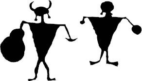

第一章

催眠术的前世今生

自远古以来，人类就着迷于(有时恐惧)心灵的力量。古往今来，发掘人类意识秘密并发挥其潜能的探索者层出不穷。埃及、希腊、罗马以及其他一些文明古国所采取的技术与我们今天所知道的催眠术极为相似。中世纪，一些伟大的医师仅仅通过他们的触摸就可以达到治疗效果。之后，随着理性时代的降临，先驱科学家们试图理解并解释意识的奥秘。安东·梅斯默和詹姆士·布莱德——甚至西格蒙德·弗洛伊德——都置身于先驱者的队伍之中，为催眠最终成为现代最具疗效的工具之一作出巨大贡献。   

催眠术的端倪

催眠的有趣历史可以追溯到古代。当时埃及人似乎使用了一种医疗方法：当病人“入睡”时，或者至少是闭上双眼时，牧师讲话并把手放在病人身上。这一技术在 3000 多年前就已得到应用。古代中国和印度也被认为使用过这种仅仅借助于语言来治疗病人的医疗方法。

无独有偶，希腊人有一种被称为睡眠神庙的建筑，病急求医的患者在这里躺下来睡一觉，当人在睡觉时，疾病的治疗方法会在梦境中出现。最受欢迎的神庙是供奉希腊医神阿斯克勒庇俄斯的神庙。阿斯克勒庇俄斯是约公元前 1200 年的一位医师，他杰出的医治本领使他受到希腊人和罗马人的尊崇，后者称他为医神。整个罗马史上，这些睡眠神庙一直存在，并被认为是再平常不过的求医途径。当时的人们相信神会入梦并传授治疗方法，随时随地直接治愈病人，或者病人遵循医疗指示自行治疗。传说一个瞎了一只眼睛的病人不顾他人的怀疑到神庙求助，当他睡觉时，一个神出现在他眼前，熬了一些药草，涂抹在他失明的眼睛上。当他醒来时，那只眼睛便重见光明了。

然而，我们不能草率地就把这些古代做法当成催眠。但是，这些例子却能够告诉我们，古代人也许已经认识到了大脑和想象力可以用于治疗疾病，催眠已经初露端倪了。   

御触

心灵和想象的力量在以往的另一种治疗中也举足轻重。伟人，譬如说国王，能够通过碰触患者治愈疾病。其中一人就是古希腊的伊庇鲁斯王皮拉斯（公元前 318～前 272 年），他因与罗马交战赢得的两次胜利而闻名，皮拉斯还有另一样了不起的本领：他可以用大脚趾碰触病人而治愈其疾病。此外至少还有两位罗马皇帝——维斯巴西安（公元 9～79 年）和哈德良（公元 76～138 年）以拥有同样的本领而著称，但他们不是用脚触摸。距离我们的时代更近的英国国王忏悔王李华（1003～1066 年）和其同时代的法国国王菲利普一世都拥有碰触治疗的本领。这种碰触治疗其实指的是如今所谓的暗示力量，即：病人对自己会被治愈深信不疑，而这种信念会反过来帮助身体自行疗伤。对皇室、神职人员和其他显要人物可以碰触治疗的信仰贯穿中世纪始末并一直延续至近代。英国立宪君主查理二世（1630～1685 年）在统治期间 曾上千次使用“御触”。

瓦伦丁·格瑞特里克

瓦伦丁·格瑞特里克（1628～1682 年）是众所周知的“抚摩师”，因具有用双手治愈疾病的惊人本领而著名。17 世纪，这位出生在爱尔兰的士兵和政府官员因其超凡能力而声名远播，他可以治愈包括淋巴结核（一种破相的皮肤病）和疣类等疾病。有趣的是，在他的治疗过程中，一些病人仿佛进入了深深的恍惚状态而感觉不到疼痛。与之相吻合的是，现代催眠中，一些患者在恍惚中也会丧失痛觉，感觉不到疼痛。格瑞特里克在当时受到了一些科学家和国王查理二世的关注。他的主要治疗手法就是隔着病人的衣服进行抚摩，有时候也使用药剂。格瑞特里克有可能无意识的“催眠”了病人使其收到了会被治愈的心理暗示。

想象与磁铁

御触现象备受关注。中世纪时，学术界和伟大的思想家们一直在思索心灵的力量，尤其是想象力和意志力是如何影响治疗过程的。一位 14 世纪的作家彼得·阿巴诺认为单凭语言就可以治愈病人。之后，乔治·匹克托里斯·凡·维灵根（1500～1569 年）声称，如果治疗者和病人都发挥想象力的话，符咒或咒语会收到更好的医疗效果。这一理论听起来跟我们现在的安慰剂效应不无相似之处，即：尽管病人没有服用任何药物（有时服下一颗糖丸），疾病最终还是被治愈。这是因为病人认为自己吞下了一颗“真”药丸，使心灵意念作用到身体上从而达到治愈效果。

这种想象力疗法的另一位拥护者是生于瑞士的医师、科学家和炼金学家帕拉赛索斯（1493～1541 年）。他是倡导化学物质和矿物治疗的医学先驱者之一。同时，他也清醒地意识到了心灵的力量，将想象力称为治疗“工具”。 帕拉赛索斯认为：“围绕病人的精神氛围大大影响到病情。当然并非诅咒或者福佑发生了作用，而是病人的思想、想象力带来了疗效。”但是，想象力并不能主宰一切。

海尔神父

帕拉赛索斯提出一种理论——磁铁能够以吸引铁的方式吸引疾病。这一理论在接下来的几个世纪里被众多科学家进一步发展完善。其理念是人体含有一种有磁性的液体，这种液体一旦出现缺陷（发生损伤）就会引起疾病，而磁铁可以治愈疾病。

将这个观点发扬光大的人当属 18 世纪的天文学家和牧师麦克斯米伦·海尔神父（1720～1792 年）。他是一位杰出的科学家，后来成为当时奥匈帝国首都维也纳皇家天文台台长。他也对帕拉赛索斯的磁铁治疗观很着迷。同时，人们在 18 世纪中叶发现磁铁可以人工合成，这也促进了他对磁铁疗法兴趣的高涨。海尔发现，他可以通过在病人周围以各种方式摆放磁铁来治愈或缓解很多疾病，其中包括他自己所患的风湿病。尽管海尔似乎在治疗方面取得了巨大成就，但若不是另一位维也纳医师于 1774 年前来拜访的话，他就不会在催眠史上占有一席之地了。这位拜访者就是弗兰茨·安东·梅斯默。至此，现代催眠学就要拉开序幕了。

伽斯纳神父

伽斯纳神父（1727～1779 年），这位来自瑞士的天主教牧师是一个有趣的人物，他曾在 18 世纪 70 年代因为高超的医疗本领而名噪一时。他相信自己可以通过驱散患者体内的邪恶精灵而达到治愈目的。他具有表演天赋，在广受欢迎的“表演”中他身着长斗篷，手拿巨大的十字架，嘴里念叨着拉丁咒语。他告诉病人当他驱魔时，他们会倒在地上死去。然后，一旦恶鬼被驱走，他们就会起死回生，疾病也消失地无影无踪。奇怪的是，疗效确实显著。伽斯纳神父的医术是催眠术的先兆：先使患者进入恍惚状态，然后运用暗示力量使他们确信自己的疾病或者问题已经解决了。弗兰茨·安东·梅斯默认为神父不知不觉间使用了动物磁流，伽斯纳神父却相信自己是借助了上帝的力量驱除了恶鬼。

催眠术的发展

弗兰茨·安东·梅斯默的动物磁流学说

我们大多都听说过“mesmerizing”（实施催眠；迷惑的）和“mesmeric”（催眠的；迷人的）这两个单词，它们都得名于弗兰茨·安东·梅斯默。梅斯默于 1734 年出生于靠近今天德国和瑞士交界处的康士坦茨湖畔。梅斯默性格古怪，被当时很多人认为是骗子。以今天的标准来看，他的有些理论确实奇怪，但是梅斯默仍然被尊为催眠史上最为重要的人物之一。讽刺的是，梅斯默似乎从未理解过心灵的真正力量，如果他仍然在世的话，也肯定会将当今有关心灵力量的观点拒之门外，但是他的荣誉、人格魅力乃至其所用方法的显著疗效都极大地鼓励着后世的先驱者们前仆后继、孜孜不倦地探索催眠的真正原理。

梅斯默的父亲是一位猎场看守人，年轻的梅斯默先后攻读了神学和法律，之后逐渐对成就他一生事业功名的领域——医学产生了浓厚的兴趣。他于 1765 年毕业于享有声望的维也纳医学院。这位年轻的医生对行星和潮汐等自然现象很是着迷，这使他潜心钻研了外界自然力对人体的影响。他在大学论文中写道（之前也有其他科学家写过了）：世间存在着某种无所不在的引力流体。以该流体为媒介，行星等大型天体可以对包括人体在内的其他物体施加影响。尽管这对我们来说比较怪异，但在当时却并非标新立异或特别罕见。他由此迈出了探索之路的第一步，这也就是后来世人所知的“动物磁流学说”。

拜访海尔

起初，梅斯默在维也纳是一名普通的从业医师，他与一个富有的寡妇玛莉亚·安娜·冯·宝施成婚，生活充裕。这时他结识了年轻早熟的作曲家沃尔夫冈·阿玛迪厄斯·莫扎特，便和妻子步入了上流社会。1774 年的一场风波永远改变了梅斯默的生活。他的一个病人弗朗西斯卡·奥斯特琳身患神经紧张病，对常规治疗毫无反应。好奇心大作的梅斯默决定试用一个同时代医师——麦克斯米伦·海尔神父的非正统治疗方法。他让奥斯特琳喝下含有铁的液体，然后把磁铁附着在她的身体上。在一次发作和几个疗程后，病人重获健康。

这对于梅斯默来说是个转折点，他深信自己发现了磁性的力量。不久，他开始将自己关于普遍流体的理论与这一新发现结合起来。他断言宇宙间存在着一种无所不在的磁流，将包括人类在内的万物联系在一起，这样，“动物磁流学说”就诞生了（在这里，“动物”指的是“生命的”或“活的”，与哺乳动物或其他生物并无关系）。梅斯默坚信，疾病是由于人体内的磁流不畅、出现阻塞而引起的。他尝试使用磁铁来对病人体内的磁流施加影响，疏通阻塞，治愈疾病。

梅斯默的观点

梅斯默相信自己使用磁铁和铁棒的疗法可用物理原理进行解释。他认为世间存在着一种无所不在的磁流，人体内也存在着类似的流动磁力。梅斯默相信自己通过操纵这一磁流可以治愈包括神经紧张在内的多种疾患。他还认为对疗程施加影响的是自己强有力的动物磁性，他只是把这一磁性传导给病人。他的目标是在治疗者和患者之间建立一种“磁极”。梅斯默的病人几乎都是女性，而疗程的一部分就是抚摩病人，因而这使他招致了一些批评和非议，他的动机遭到怀疑。

梅斯默，这位当之无愧的催眠始祖，坚信他的治疗原理是纯生理的，与心理无关；他认为是磁流产生了疗效。在治疗过程中，他完全忽视了病人的心灵或想象——现代催眠学说的基石之一。

失明的乐师

梅斯默的新型治疗手段使他一夜成名。名门望族（尤其是妇女）成群结队的来拜访他，他开始当众进行治疗表演，在社会上引起了轰动。除此之外，他还免费为穷人们提供医疗服务，帮助妇女战胜分娩的痛苦。梅斯默的声誉达到巅峰。然而，这些却并不被科学界信服，仍然对他的医术持怀疑态度。

后来发生的一件事迫使梅斯默背井离乡，这次的患者是维也纳的一位叫做玛丽亚·特丽莎·帕拉迪斯的歌手兼钢琴师，当时 18 岁的玛丽亚备受皇后的宠爱。她从小双目失明，在众多知名医师试图为她恢复视力都以失败告终后，梅斯默于 1777 年开始为她治疗。治疗工具是一套稀奇古怪的仪器——金属和玻璃棒、盛满了水和铁屑填充物的浴室，很显然这是想要将磁流集中。这种治疗似乎有些成效，据梅斯默所说，她的视力确实有所恢复。然而，很不幸的是，这刚刚起步的疗法最终却失败了。那些之前医疗无效的医生们大发嫉妒，互相勾结，怂恿玛丽亚的父母将女儿带离梅斯默的看护。结果，玛丽亚再次陷入完全失明的状态，梅斯默的声誉也一落千丈。沮丧而又愤怒的梅斯默被迫离开维也纳，投奔巴黎。

有一段时间，梅斯默认为法国首都是孕育他那特殊理论的肥沃土地。据说王后玛丽·安托瓦内特对他的研究很感兴趣，然而他古怪奇异的理论再次惹祸上身。主流科学家们坚持认为梅斯默是个骗子，而看起来花里胡哨的梅斯默催眠术也全都是一场骗局。为解决争议，国王路易十六于 1784 年成立了一个委员会，专门调查动物磁流学说，最后得出了动物磁流根本子虚乌有的结论。这一诋毁性结论给了梅斯默重重一击。

再次遭到了科学界的唾弃之后，这位时运不济的医生离开巴黎，踏上了旅行之路。他仍然坚信自己的理论，仍然治疗病人，但再也无法向科学界证明自己的价值。梅斯默的后半生生活舒适却默默无闻，于 1815 年在家乡附近的小村庄逝世。

梅斯默的遗产

为何梅斯默这样一个行为怪异的医生在催眠史上如此大受推崇呢？他留给我们的遗产在于，他能够利用对恍惚中的病人进行暗示的力量。他在治疗中使用的棒材、磁铁和铁屑本身都是没有任何效果的，但是它们可以帮助病人全神贯注地接受暗示，相信自己会痊愈。这才是梅斯默的治疗手段产生疗效的真正原因。对梅斯默的医疗方法感兴趣的医师们渐渐开始认识到，成功的关键并非磁性或动物磁流，而是心灵意念的力量。因此，尽管梅斯默自己搞错了理论根据，但他在这一领域的先驱工作却为后世开启了大门。他的成就激励着后世去探索心灵以及催眠的真正力量。

普赛格侯爵的磁性睡眠

梅斯默去世后，动物磁流学说依然没有销声匿迹。在远离首都城市固若金汤的传统科学堡垒的外省，一些狂热者摆脱了怀疑眼光，不断进行新的探索，使这一主题得以延续。最为重要的先驱者之一当属一位法国贵族地主——普赛格侯爵阿尔曼德（1751～1825 年）。侯爵曾经短期学习过梅斯默的疗法，并在他的工人身上进行了试验。使他大为惊讶的是，他发现自己可以使一个叫做维克多·瑞斯的年轻牧羊人进入类似睡眠的状态，同时自己又可以同他交谈。侯爵显然是发现了催眠性恍惚。他肯定没有意料到会有此发现，因为作为梅斯默的忠实信徒，他相信患者会经历一次危象和数次痉挛。侯爵称这种恍惚状态为梦游，这是现代催眠学说中频繁出现的一个术语，或者为了对梅斯默表示尊重，称之为“磁性睡眠”。然而，这位梅斯默的学生很快开始怀疑这种现象的基础原理是基于磁流的存在的理论，于是，他重点强调了两项重要的心理素质——意念和信仰。认为同时拥有这两种素质的治疗者就会获得成功。这一观点使他远离了梅斯默和一些其他人使用的浴室、铁棒和类似道具，也使他摆脱了导师梅斯默引起的危象和痉挛。侯爵的另一项重要贡献是，当病人处于恍惚状态时，他与其对话，并对其疾病进行治疗暗示。这是催眠术疗法的起源。

继普赛格的发现之后，其他磁力说的实践者也纷纷发现自己可以诱导恍惚状态，而且还发现了现代催眠中的其他状态，譬如肢体僵硬症（在恍惚状态中部分肢体暂时性无法动弹）和健忘症。普赛格直到今天还不为人熟知，但他是催眠发展史上当之无愧的无名英雄。

神父荷西·法里亚

磁力学说渐渐传播开来，同时仍然认为这是一个以磁流从治疗者到患者传导为基础的生理过程的人愈来愈少。意念和心灵的运用愈来愈受到重视。葡萄牙神父荷西·法里亚（1753～1816 年）进一步将其发扬光大。法里亚爱出风头，但他提出了催眠发展史上的两个重要观点。首先，神父让病人凝视一个固定不动的物体——通常是他的手。这种催眠诱导方法在以后得以广泛应用。其次，法里亚强调了类睡眠状态（恍惚）的重要性在于心灵对暗示的接受能力强。这也是现代催眠学说的一个关键特点。

然而，法国科学界（当时世界的科学中心之一）对磁力学说漠然视之、不为所动。催眠术的演变史暂时转向他处。

维克多·瑞斯

1783 年，普赛格侯爵在维克多·瑞斯身上试验新学到的动物磁流方法。23 岁的维克多·瑞斯是一个在侯爵领地上做工的牧羊人。起初，侯爵使用了“磁力传导”——用双手抚摩瑞斯以传导他认为是该技术核心的磁流。令他惊讶的是，瑞斯陷入了恍惚状态，侯爵之后称这种状态为磁性睡眠或梦游。侯爵发现了恍惚状态，他发现维克多在恍惚时可以进行交谈，而且比清醒时显得更加自信。这样，普赛格可以凭自己的意愿将病人带入带出恍惚状态，并与维克多和其他病人都建立了和谐亲近的关系。侯爵还把领地上的一棵榆树成功“磁化”，给它拴上了绳子。这使得一些抱着树的工人也陷入了恍惚。这个故事广为流传，其他侯爵也不得不把各自领地上的树“磁化”以使工人们满意。普赛格侯爵发现催眠并不是像他曾经的老师梅斯默所认为的靠磁铁或痉挛来完成，而是倚赖于治疗者和患者之间的亲和关系，最为重要的是，倚赖于恍惚状态的诱导。

詹姆斯·伊斯岱的外科麻醉催眠术

催眠史上更为显著的大师是一位叫作詹姆士·伊斯岱（1808～1859 年）的苏格兰外科医师。伊斯岱于 19 世纪 40 年代在印度加尔各答的一家医院工作。当时外科手术面临的一个突出问题是找不到有效的麻醉法，手术带来的疼痛和不适自然而然的导致了高死亡率。伊斯岱对此采取的解决方案是利用当时仍被广泛称为梅斯默术的催眠方法对患者实施麻醉。伊斯岱从欧洲听说了这一非正统的医术而且认为并无风险、大可一试，结果引人注目。伊斯岱和其他医师使用催眠术在这家医院里进行了 3000 多例手术，术后死亡率从以前的 50％降至 5％。最令人称道的一次是对一个男病人的瘤切除手术，这个体积惊人的瘤重达 103 磅（46.7 千克）。病人后来完全恢复并声称在瘤切除时没有感到任何疼痛。然而，伊斯岱的巨大成功并没有为催眠术在医学上的使用带来突破，他的方法在印度遭到很多欧洲同伴们的怀疑。而且在 19 世纪 40 年代，醚和氯仿先后被发现，利用二者制造的麻醉剂开始盛行。

而在英国，梅斯默术的医学使用同样激起了疑云重重。怀疑论者针对的是一位名叫约翰·伊利欧森（1791～1868 年）的医师。伊利欧森在催眠史上的地位举足轻重，因为当他开始对这一主题产生兴趣之时，他已经是医学界德高望重的领头人物了。这样一位声名显赫的人士公开拥护磁流学说，不可避免地引发了英国医学界的激烈辩论，即使最后他注定要失败。一个名叫拜伦·杜波德的法国人在 19 世纪 30 年代将神奇奥妙的梅斯默术介绍给了伊利欧森。鉴于自己的亲眼所见，身为英国伦敦大学医学院资深医师的伊利欧森，开始将这一技术用于手术麻醉以治疗精神失常患者。他的具体操作是将一枚磁化金属（比如镍币）在患者身上移动，这叫做磁力移动或梅斯默移动。伊利欧森在正统医术著作中报告了他使用梅斯默术所获得的巨大成果，同时他相信这是纯粹的生理过程，与心理无关。在一个病例中，他声称一位患乳腺癌的妇女在几个疗程后完全康复。然而，医学机构对此再次置若罔闻，原因并非催眠术没有疗效，而是没有人可以进行有理有据的解释。

梅斯默狂热

尽管医学机构对梅斯默术几近深恶痛绝，但社会上很多人却对 19 世纪 40 年代和 50 年代进行的一些梅斯默术表演深深着迷。确实如此，1851 年在英国被称为“梅斯默狂热”年。借助于铺天盖地的书籍、宣传册、报纸、杂志报道以及游行表演者们，人们对催眠的兴趣在 19 世纪 30 年代到 50 年代初的确空前高涨。梅斯默术师们游遍全国各地进行表演，而观众们则围个水泄不通。表演使催眠讲座夹杂了更多的娱乐因素，譬如，年轻女孩在众目睽睽下举起体重 200 磅（90.7 千克）的男人或者被催眠的男孩蒙着双眼玩牌等。知名人士如查尔斯·狄更斯对此惊叹不已，而作家夏洛蒂·布朗特就曾经被催眠过。因此梅斯默术狂潮风行了 20 年，不过这一狂热最终让位给其他风潮，比如维多利亚时代的超自然膜拜。

催眠术之父詹姆斯·布莱德

弗兰茨·安东·梅斯默固然是催眠史上最为瞩目的名字，但催眠之父的桂冠当属苏格兰医师詹姆士·布莱德（1795～1860 年）。布莱德具备了梅斯默所不具备的一切。他头脑冷静、实事求是，进行系统化科学研究，不为表演技巧或夸大其词所动摇。他的一个不朽成就是发明了“催眠术”的固定说法，该名得自于希腊睡眠之神海普诺思。不过他后来认识到使用这个意思为“睡眠”的字眼并不是最恰如其分的选择。同样重要的是，布莱德非常清楚催眠是什么以及不是什么。他反对来自梅斯默的磁流和磁性学说，认清了催眠的心理本质。

1841 年，布莱德对催眠产生兴趣之时正在英国的曼彻斯特工作。他观看了卖弄张扬的法国梅斯默术师查尔斯·得·拉封丹纳的表演，起初是半信半疑。然而，在后来与拉封丹纳及其同事的一次私人会面中，这个法国术师使其追随者陷入了深深的恍惚中，这时布莱德深信其中确实存在着值得研究的科学现象。布莱德急于弄懂他的亲眼所见，对梅斯默术进行了仅仅 2 年试验后便出版了以此为主题的书——《催眠学》。他在这本出版于 1843 年的书中首次使用了术语“催眠术”。

布莱德是第一位真正的现代催眠学家。他没有将这种现象与超自然联系起来；他不相信内在原因是磁流或动物磁性。他不像任何梅斯默术师一样进行抚摸，而是让患者把注意力集中在一件物体上——通常是他放置手术刀的盒子——从而引发恍惚。他还清楚地认识到心灵的力量可以影响到身体，而且按照恍惚的不同程度加以区分。

尽管布莱德是一位备受尊敬的医师，他的催眠观点却没有在英语国度里被立即接受。不过后来，他的观点大大影响了一些国家的发展进程，比如法国。

美国先驱者

源于欧洲的梅斯默术于 19 世纪 30 年代和 40 年代在美国盛行一时。众多欧洲梅斯默术师在 19 世纪 30 年代将梅斯默术引入美国，从而使其迅速流行，其中最为著名的是法国人查尔斯·波殷·圣·索沃尔。美国的医师们很快吸纳了这一思想，并发明了自己的技术和对这一现象的命名。最著名的美国先驱者之一是拉·罗伊·桑德兰德（1804～1885 年），他把这一现象叫做催眠术。他的方法就是对观众讲述这一话题直至将其中很多人催眠。另一位梅斯默术的实施者是菲尼艾斯·奎姆贝（1802～1866 年）。他发现可以通过把自己实施催眠并将“精神能量”移到患者体内达到治愈目的。同时，梅斯默术师们举行的巡回演出大受欢迎。但是，如同在英国一样，随着教会和招魂术的复兴，对梅斯默术及其支流的兴趣在美国也日益消退下去。  

催眠术在法国的发展

19 世纪中期，美英两国对催眠一度高涨的兴趣日益消退，这时法国一马当先，充当了领路人。这源于两件偶发事件。第一个是在 1860 年，苏格兰催眠学先驱詹姆士·布莱德的一篇研究论文在巴黎的一次科学聚会上宣读。当时在场的有一位名叫安勃罗斯·奥古斯·赖波（1823～1904 年）的无名医生。赖波亲手试验了布莱德论文中描述的催眠方法并发现了其有效性。事实上，这位乡村医生发现自己甚至不必像布莱德推荐的那样让患者凝视某件物体，只要赖波相信并暗示恍惚或者一种睡眠状态，他就可以成功的将患者导入恍惚状态并借助于暗示力量治愈疾患。这种催眠方式与现代催眠手段极为相近。然而赖波却默默无闻，毫无声望。为了将自己的发现公之于众，赖波出版了一本书，然而这本书在数年之中卖出不到 5 本，赖波对催眠学作出的巨大贡献似乎要永不为人所知了。

这时，第二件事情发生了。南希大学的一位知名医学教授得知了赖波的观点并被深深吸引。这位教授就是希波列特·伯明翰（1840～1919 年），他将一个“无可救药”的病人移交给赖波，初衷是想证实赖波是个骗子。结果恰恰相反，他对赖波能够治愈病人坐骨神经痛的医术大为赞叹，盛情邀请赖波到大学里与他一起工作。两人一起成为催眠学“南希学派”的创始人。他们相信催眠更加倾向于心理反应，而非生理，暗示的力量至关重要。两人还坚信在医生与患者之间建立亲和关系的重要性，这与很多现代催眠学家的观点不谋而合。由于伯明翰德高望重，催眠学的威望也与日俱增。

让－马丁·夏柯特

影响更大的是当时的医学泰斗让－马丁·夏柯特（1825～1904 年）对催眠学的接纳。身处巴黎的夏柯特专攻神经病学，是一位才华横溢的科学家和内科医师。这位极具人格魅力的法国人被称为“神经病学的拿破仑”，他被催眠深深吸引，并在患者身上加以应用。他的这一举动使催眠最终被接纳为一个严肃的研究课题。不过，夏柯特的催眠观点与南希学派以及大多数现代观点南辕北辙。夏柯特认为催眠是歇斯底里症（癔症）的一种形式，在有些情况下催眠疗法甚至会带来危险。两大阵营——伯明翰、赖波带领的南希学派和夏柯特带领的巴黎学派——就催眠的真正本质苦苦相争。尽管夏柯特才华出众、声望颇高，南希学派却最终占了上风，并且其影响深入到 20 世纪。催眠作为一个争论的问题和研究的课题被越来越多的人所熟悉，然而，他们无法预见的是，夏柯特的一个前弟子不久就要扭转乾坤，将催眠再次推回到科学疑云中去。

机器人之争

南希学派和巴黎学派僵持不下的一个问题是：人们在恍惚状态中能否被游说做违背自己意愿的事情。伯明翰认为被实施催眠的对象会顺其自然的成为一个机器人，完全依从催眠师的指挥。在一次实验中，伯明翰将一个男性患者催眠，告诉他房间里存在另外一个人，那个人曾经羞辱过他。之后伯明翰建议催眠者用匕首杀掉这个人，并交给他一把纸做的刀子。患者果然试图刺杀这个假想的敌人，后来当他在恍惚中被问及自己的所作所为以及杀人动机时，他回答说是伯明翰指使他杀掉另一个人的。巴黎学派则坚持认为人们在催眠状态中不会丧失本性，只是会沉迷于演戏之中。夏柯特的一个追随者做了一个类似的实验。实验中，一个女子在恍惚状态下兴高采烈的“杀害”了众多假想的敌人，但是，当一些医学学生建议她脱掉衣服洗个澡时，她拒绝了。

弗洛伊德与催眠术

众所周知，西格蒙德·弗洛伊德（1856～1939 年）是心理学发展史上影响最为深远的人物。不为人熟知的是，这位心理分析的始祖在事业早期曾经是催眠学的倡导者。

这位奥地利医师早在 19 世纪 80 年代在巴黎学医时便开始接触催眠，而当时将催眠介绍给他的正是他的导师——法国权威精神病学家让－马丁·夏柯特。事实上，弗洛伊德在几年前便对这个课题产生了兴趣。当时他在维也纳学医，碰巧观看了备受赞誉的丹麦舞台催眠术师卡尔·汉森的表演。后来他写道，他在催眠秀中的亲眼所见“使他坚信了催眠现象的真实性”。  

师从夏柯特数年后，弗洛伊德成为催眠学的公开拥护者，并在自己的治疗中加以运用。他对病人使用直接暗示，有时将双手按在病人的头部。他还与同样身为科学家的朋友约瑟夫·布洛伊尔合作，对病人实施催眠疗法。二人最为著名的病例是对一名叫做安娜·欧的女子的治疗。安娜患有当时被列为癔症的一系列症状。布洛伊尔发现，当她被催眠后，她可以将这些症状追根溯源到现实生活中并由此得以治愈。

弗洛伊德对大脑的隐秘部分——潜意识及其对人体的影响几近痴迷。催眠学理论帮助他进一步探索这一课题。然而，19 世纪 90 年代中期，他抛弃了催眠学，代之以自由联想方法，有时也被称为“讲话疗法”。

毋庸置疑，弗洛伊德的选择转变对催眠学的发展不亚于重重一击。他后来成为 20 世纪影响最为深远的人物，而由于他摒弃了催眠学，他的众多追随者们也不可避免的将催眠学弃于一旁。  

那么，值得我们思考的是：为何他摒弃了催眠学而选择了其他领域呢？原因肯定不是他怀疑催眠的有效性，因为弗洛伊德多次成功运用这一技术，必然清楚其有效性。不过，他发现催眠中使用的暗示效果不能持久，同时他还担心患者会通过将自身的强烈情感移到治疗者身上（这一过程叫做移情）而对后者产生过度的依赖感。

一些批评者提出，弗洛伊德并不十分擅长催眠术，因此才想出自己擅长的一项新技术——自由联想。也许，更大的可能性是弗洛伊德对当时实施催眠术的专断方式不甚满意：患者以一种极其直接的方式被告知自己将要进入睡眠状态，而今天更受欢迎的方法是间接的所谓容许性的手段。

无论真正原因到底是什么，最终结果是，弗洛伊德的抉择使催眠学在 19 世纪来临之际丧失了成为大脑科学前沿学科的机会。

20 世纪的催眠学

20 世纪初期，科学界对催眠学的兴趣与日递减，部分原因是弗洛伊德与其他一些科学家在心理分析领域引领了新方向。催眠术不再被用作理解大脑技能的工具，也不再被用来治疗患者。这样，催眠术在历史上又一次被杂耍艺人和表演术师们用来哗众取宠，而科学再次将其拒之门外。直到今天，舞台催眠师们仍然坚称是他们的祖先在 19 世纪末 20 世纪初维持了催眠学的生命。

不过，仍然有一些医学专家们一如既往的支持催眠事业的发展，其中一位是法国人皮埃尔·简列特（1859～1947 年）。简列特认识到他所称的“潜意识”是与意识并存的永久性状态。他认为，大脑在催眠中被分离，即分裂为意识和潜意识。而在深度恍惚中，后者实施有效控制。简列特认为一个人遇到的问题可以被强迫进入他或她的潜意识中，出现癔症症状。这个观点以及简列特的潜意识理论都与弗洛伊德的理论很相似。与其同时代人不同的是，简列特依然相信催眠的作用。1919 年，他不得不伤感地接受催眠被忽略的现实，但却预言道：催眠终有一天会再次成为严肃科学的研究领域。

顺便提及的是，潜意识和无意识这两个术语经常互换使用，尽管二者各自归属不同的分析方法。一般说来，“潜意识”来自弗洛伊德的理论，而“无意识”来自与他曾经合作过的卡尔·古斯塔夫·荣格（1875～1961 年）。

克拉克·赫尔

另一位对催眠兴趣不减的专家是美国心理学家波里斯·萨迪斯。他在 1898 年出版了一本对心理学意义重大的著作《暗示心理学》。在英国，约翰·米尔恩·卜兰威尔于 1903 年出版了著作《催眠术：历史、实践与理论》。这本书也使学术界对于催眠术的兴趣得以延续。

也许，此时催眠学的最主要人物是美国学者克拉克·赫尔，他是当时最受尊崇的心理学家。赫尔于 1918 年获得了威斯康星大学的心理学博士学位，并在接下来的 15 年中将大部分时间用于研究催眠术，尤其是暗示感受性。他的努力终于结出了硕果，他于 1933 年出版了著作《催眠与暗示感受性》，这本书直至今日仍然是该领域的重要文献。赫尔的首要成就之一是鼓励各大学和研究所进行催眠学研究。在此之前，大部分的研究都是由个体治疗师在患者身上进行的，因此缺乏科学严密性和精确度，而科学机构对催眠仍持怀疑态度。1930 年，身在耶鲁的赫尔被禁止在学生身上进行催眠实验，因为学校当权者害怕这会带来危险。

除了自己的研究工作之外，赫尔在催眠历史上还有一项功绩值得称道：他的教学激发了一个学生的兴趣，这个学生后来成为 20 世纪最著名的催眠学家。   

米尔顿·艾瑞克森

在 1923 年的一次讲座上，威斯康星大学的一位年轻的心理学学生对克拉克·赫尔的催眠术展示大为着迷，他将被催眠者拉到一旁，自己进行了亲身实验。这名学生就是米尔顿·艾瑞克森（1901～1980 年）。从此开始，他踏上研究催眠的征程，最终成为美国催眠学界的泰斗。他既是研究者又是从业者，在长期的职业生涯中对数千人实施了催眠。艾瑞克森出身贫寒，在世的大部分时间疾病缠身，但他却出类拔萃，极具人格魅力，一直把催眠术用做治疗工具。他最为重要的观点之一是无意识的心灵是自我治愈的无比强大的工具。他相信，我们每个人体内都蕴藏着自我帮助、自我修复的能力。

艾瑞克森的抗争之路

米尔顿·艾瑞克森在个人成长道路上跨越了无数障碍，最终成为美国最负盛名的催眠学家。他出身于内华达州的一个贫苦家庭，17 岁时身患小儿麻痹症，行动大大受限，医生诊断说他将永远失去行走能力，但他凭借顽强的抗争证实了医生论断的错误性。在以后的生命中，艾瑞克森受到病魔的一次又一次攻击，经历了小儿麻痹症的数次病变，除此之外，艾瑞克森还是色盲和音盲。但他从未退缩，与疾病进行了一次又一次的抗争。他说，由于年轻时患病导致行动受限，他对肢体行动以及人们如何进行语言和非语言交流非常敏感，这使他能更好地观察和理解病人的反应。他所遇到的麻烦不仅是生理方面。在事业早期，当时不相信催眠术的医学权威威胁要没收他的行医执照。一个有趣的野史记载说，他催眠了美国医学学会成员，并成功游说他们允许他保持执照。

他对催眠术作出的最大贡献是研发了诱导恍惚和对无意识大脑进行暗示的有效新技巧。在他之前的恍惚诱导方法十分单一教条，患者只是被告知自己感到困倦、将要进入恍惚状态。艾瑞克森没有完全摒除这一方法，但主张根据患者个体的个性和需要对治疗师的手法加以调整。他研发了被称做间接催眠或“容许性”催眠的技巧，通过运用语言使患者融入到双向过程中去。他们会有效地将自己导入恍惚状态。其中一个著名手法是“混乱”技术，即：通过在混杂的句子中使用毫无意义的词语使有意识的头脑发生涣散，继而使患者进入恍惚状态。艾瑞克森还在催眠中使用隐喻和讲故事的手法，对他来说，语言的想象性使用非常重要。他总是在治疗手法上极为创新，并且相信几乎每个人都可以被催眠。艾瑞克森写下了大量催眠著作，但成为他永久性遗产的仍然是这一实用而创新的催眠疗法。当今的许多从业人员都在他的著作中得到了启发。

催眠术论战

另一位具有影响力的美国催眠治疗师是大卫·艾尔曼（1900～1967 年）。他是一位舞台催眠师的儿子，研究出了迅速有效的恍惚引导技巧。他着重于绕过大脑的判断技能而导入恍惚。与艾瑞克森一样，他的催眠技巧和手段也被当今治疗师广为采用。

20 世纪后半期，催眠的医疗运用——催眠疗法——越来越普遍。与此同时，关于催眠性质的两种互相冲突的不同理论也在发展之中。

论战的一方认为人们在催眠中的意识状态发生变化。另一方则是学院派（也被称为自由主义思想流派），他们坚称催眠状态根本不存在，催眠中发生的一切都可以通过现存的心理现象得以解释。在后一流派中有部分美国学术界人士，西奥多·色诺芬·巴伯尔就是其一，他认为患者在催眠中的所作所为源于“任务动机”，即患者高度合作的意愿。他还认为患者在催眠状态下的行为来自于自身的想象。

与此针锋相对的是一些理论学家，比如已故的欧内斯特·希尔加德——斯坦福大学的资深心理学教授，20 世纪后半期催眠科学研究的先驱者。希尔加德的观点是，被催眠的人们会做出一些自身特有的行为。他规避了“状态”这个字眼，而是代之以“催眠范畴”。这场关于催眠性质的论战一直延至今日。   

乔治·埃斯塔布鲁克

20 世纪催眠学界的另一位重要人物是柯盖特大学的心理学教授乔治·埃斯塔布鲁克（1895～1973 年），他与艾瑞克森正好相反，提倡传统的直接催眠诱导法。典型做法就是对患者说诸如下面这些话：“……你马上要睡着了……我叫你时你才会醒……”他还相信，在福利事业和间谍领域利用或不正当利用催眠具有潜在可能性。他声称：“我可以将一个人催眠，使他在毫无意识或违背自己意愿的情况下通敌叛国、背叛美国。”

在他 1943 年出版的著作《催眠术》中，埃斯塔布鲁克提出被实施催眠的敌人队伍会危害到美国国防。2 年后，他协助撰写了一部名为《心灵之死》的小说，小说中，德国人催眠了美国军人，使其自相残杀。

催眠术的现状

21 世纪来临时，催眠术已经走过了漫长的发展道路。它最初起源于弗兰茨·安东·梅斯默的动物磁流学说，前景并不被看好，而如今催眠学已正式成为一个合法的科学研究领域，还是一个宝贵的治疗工具。每天，美国、欧洲和世界其他各地都有成千上万的人使用催眠来戒掉坏习惯、缓解疼痛或进行其他治疗。运动员、政治家、媒体明星和商界精英们都纷纷借助于催眠来赢得更大成功。然而，仍然有大量普通人对之半信半疑。过去与催眠相关联的古老恐惧——与超自然崇拜有关，或者只是骗局，又或者只是为了娱乐——依旧阴魂不散。造成这种情况的部分原因是社会上各种媒体形式对催眠的报道和描绘；还有部分原因应归咎于一些催眠术的不当使用者，他们将催眠术用于不可告人的目的，比如学习怎样催眠异性。这些可疑用途使人们对于催眠的偏见更加根深蒂固。

一些人不愿将催眠看做一个严肃课题的另一原因是，科学家们还不能充分解释其作用机制。就连学术界还在对催眠的性质甚至其真实性争论不休，那么大众感到迷惑也就大可以原谅了。

值得庆幸是，催眠正在稳步赢得医学界的认可和接纳。早在 1958 年，美国医学学会就宣布它是安全的，没有任何副作用。此前 3 年，英国医学学会也做过类似声明，证实催眠是一个有效的医疗工具，可用于治疗精神神经病、缓解病痛。同时，美国和其他地方的众多医院也纷纷开始使用催眠缓解病人疼痛，并借此帮助病人适应其他治疗方法，比如化学疗法。

随着催眠逐渐被认可和接纳，直接与公众打交道的催眠治疗师和临床催眠师们处于更加混乱的境地。在过去的数十年里，无数鱼龙混杂的培训和认证机构涌现出来。其经典模式是：一个新协会首先建立自己的学校，然后认可学校的资格。其中一些组织机构在培训治疗师方面记录良好；其他一些则成绩平平。这里存在的问题是法律检查机制的缺乏，尽管美国一些州现在已经制订了有关法律，通过许可体制控制监管催眠术的医学用途。当然，许可证本身无法保证质量，除非它有严格的培训标准和适度的管理监督做后盾。但是无论如何，一些最好的从业人员也只是“外行催眠师”，他们经验丰富，但可能从未接受过正式培训；一些最好的催眠治疗师是舞台催眠师，他们可能并不拥有社会公认的从医资格。

关于催眠师和催眠疗法的法律状况必然会得以改善、明晰。同样重要的是，研究应该继续深入到催眠现象本身，此类研究在过去时断时续。而只有当我们对催眠的真正性质了解得更加完善时，社会对催眠术的接受度才会随之提高。

第二章

原来这才是催眠

催眠的作用机制及其本质一直困扰着科学家们。直到今天，虽然我们对人类大脑和心灵的知识已经突飞猛进，可是关于催眠确切性质的争论仍在进行。有一点已经明了，那就是催眠现象是真实可测的，科学家们已经对恍惚诱导、暗示力量以及持久效果进行了研究。归根结底，催眠的性质与不同心理状态——意识和潜意识息息相关。

什么是催眠术

现代科学日新月异，取得了无数惊人突破，但是人类大脑精密复杂的运作机制仍然是个没有完全解开的谜。这样说来，学术界仍然对催眠性质及其作用机制众说纷纭便不足为奇了。这并不代表催眠是虚假的。实际上，科学家们在近来的实验中已经证明，人们的大脑被催眠后确实会发生变化。而且，很多医学专家也已经认可了催眠在治疗某些病症、缓解疼痛方面卓有成效。然而，还是没有一个普遍接受的理论可以确切解释催眠的性质以及运作原理，现存的大量科学观点各有不同，有时还互相冲突。

什么是催眠

如果你去问 100 个催眠师，催眠的准确定义是什么，那么你可能会得到多于 100 种的答案。事实上对于催眠的定义来说，并没有一个统一的答案。通常人们对催眠到底是什么，不是什么是没有一个统一的定论的。大部分定义还是用来描述催眠是如何被导入的，而不是具体去解释什么是催眠。

出于指导意义，一个简短而广泛的催眠的综合定义得到了大多数人的认可。它涵盖了催眠的所有要点：催眠是一种注意范围被集中缩小的状态，在该状态下，建议性和暗示性可以被极大地提高。

人们可以通过很多办法进入催眠状态，从而让外界的建议、信息瞬时或持久的进入深层大脑。但是催眠并不能直接改变人，只是它能让人保持长久稳定的、最有利于进行改变的状态。  

治疗学所使用的催眠状态纯粹是为了帮助催眠师们达到治疗的目的，在该状态下，很多积极的想法、设想、价值观念等会被高效率的吸收并且导入人大脑深处，留下印象，从而给人带来可喜的转变。对比之下，舞台催眠师所提出的催眠建议或指令只在舞台表演过程中发挥作用，而临床医学催眠师所发出的建议或指令会在催眠开始后保持长久的效用。

事实上，医疗方面的建议只是推荐给被催眠者的两种建议中的一种。有些建议或提示是用来立刻改变被催眠者的信念、态度或行为的。而另一些建议和指令是用来引导被催眠者的一种滞后反应的，这种反应只有在催眠后的一段时间才表现出来。所以，后者被称为催眠后指令，这两种建议形式都是有效的，而且在催眠过程中均被广泛的应用。

什么样的人才能被有效催眠

很多打算尝试催眠的人，向催眠师提出的最常见的问题就是“我能被催眠吗”，回答往往是“是的”。一个人要是非要硬着头皮说自己有足够的抑制力来抵抗催眠，那将是非常荒唐可笑的事情。

其实，催眠就好比一种力量——一种属于大脑的力量。催眠是你曾经多次进入的一种精神状态，或操作过程。虽然有时你可能意识不到。举个例子，当你在看电视或阅读小说的时候，就有可能已经进入催眠状态了。催眠理疗师把它称做“催眠行为”。催眠行为与催眠治疗的不同在于，后者的目的是让被催眠者进入一种指定的状态，并利用这种精神力量在实践中获益。比如说，电视节目制作人会通过广告来引导你进入催眠行为，从而去购买他们推销的产品；一个政治领袖会在演讲中，利用自己关于精神领域的知识去感染那些听众。

对每个人来说，催眠既是一种技巧也是一种天赋。

技巧是需要你去学习和练习的东西，天赋则是你本身所具备的能力。几乎每个人都具备一定程度的催眠方面的天赋。所以，可以肯定地说“你是可以被催眠的”。

为了便于理解，我们把关于催眠的技术和天赋比做一个人的音乐天赋。很多人都有使用乐器的天赋（哪怕它是潜在的）。经过多次尝试、接触和练习，这些人会变得非常熟练，甚至会变成杰出的音乐家。还有一些在音乐方面极有天赋的人，只需要极少的练习或培训，就可能以出色的表现来震惊听众。然而，有些人先天听力失聪，也就没有音乐天赋了，对他们来说，再多的练习也不可能帮助他们在音乐方面成功。

对于催眠而言，大多数人都一样，都存在着一定的可能被催眠的潜质。至于你能够在催眠方面变得多么熟练，很大程度上取决于你有多大的兴趣以及你的练习程度。也许你会具备这方面的天赋，可以选择简便，迅速地进入深度催眠。如果你想去参加舞台催眠表演，那么催眠师一定会注意到你，而你也很可能成为这方面的明星。你可能以惊人的效率来催眠自己，而不用像别人那样，需要经过大量的练习才能做到。还有极个别的人，天生就没有一点被催眠的天赋，因而也就不可能被催眠，不管他们怎么去尝试。这种催眠缺陷产生的原因可能是由于精神或智力方面的失调导致的，也可能是一些大脑内部组织受损导致的。幸亏这只是个别现象。

如果天生就具备催眠的潜质，那么你可以充分的利用这种潜质，不断地完善这种技巧，尽快地进入催眠。那么你肯定会问:“有多快啊？”答案有两种：一种是你可能进入极度深层的催眠状态，另一种是你只进入了初步的催眠状态，但是必须牢记以下信息：“初步的，中间状态的催眠，对于你想要达到的最终自我完善的目的，都是不可或缺的过程。”

这句话的意思是说，只要你不是那种对催眠没有任何反应的人，你就可以通过不断的努力，达到催眠，实现自己的目标。至于你能够达到哪种程度的催眠，很大程度上取决于你的决心和练习。最乐观的情况就是，在你第一次尝试催眠的时候，就能成功，这样在以后的催眠过程中，你会越做越好，越做越快。

就像密斯莫理论刚刚提出来时，极度昏迷性催眠让很多人感到困惑，恐慌。为了避免类似的现象发生，这里先阐明一下什么是“极度昏迷”，其实有好多种极度昏迷的催眠状态，其中之一被催眠理疗师称为“梦游”。这也是媒体最感兴趣的一种，以至于把“梦游”当成催眠的主要象征。在现实生活中，有很多人容易进入这种深层的催眠状态。在催眠医学中，我们把这些人称为“梦游者”，因为他们很容易进入梦游状态。

梦游者在深层催眠状态下可以做出很多在初级催眠状态不可能发生的事情。他们几乎可以接受任何非威胁性的建议、指令。他们可以返回到任何年龄段。可以想起以前发生的任何事情，可以激活自己的记忆，可以自动的控制身体。他们甚至还可以接受一些特殊的非正常的催眠后指令，并且对催眠时周围发生的事情毫无知觉。这些人相当富有传奇色彩。那种愉快的体验是催眠爱好者的梦想。但是它太少见了，估计全球只有不到 20%的人具备“梦游”的能力。

那些舞台催眠师往往希望人们相信，他们是可以让任何上台参与表演的人进入一种“梦游”的催眠状态的，而事实上，这是不太可能的，除非前去观看表演的观众足够多，而且正好其中有一两个人是那种能够“梦游”的人。就算这样，也需要催眠师费好大力气正好把他们挑出来。但这种情况很荒唐可笑，因为任何一个中等水平的催眠师都可以不费吹灰之力将这种具备“梦游”能力的人带入深度催眠状态。而这些人对那些催眠指令非常敏感而且容易接受。也就是说他们表面上是被催眠师催眠了，而事实上，还是由于他们自身具备这种潜能，尽管他们以为这一切都是催眠师的表演所造成的。

到目前为止，很多人还是固执地认为，只有“梦游”才是真正的催眠，这种想法，就好像认为只有像铅锤一样潜入到水平面以下２万里的深度才叫做真正的潜水一样。催眠是一个相对性的概念。很多人因为忽视了这一点而对催眠产生了某些误解。

催眠、沉思以及第一状态

催眠与沉思的区别是什么？它们是同一个东西吗？由于用来定义两个不同的名词的方法有很多，所以，就不能保证哪种是对的，哪种会让人产生误解。问题的关键是，你自己如何看待催眠与沉思的关系，你是否认为它们是一样的。观点不同所做的定义自然也就不同了。催眠就是“一种注意范围被集中缩小的状态，在该状态下，建议性和暗示性可以被极大地提高”。要给“沉思”下定义就不那么简单了，因为“沉思”有很多种。如果你所指的沉思就是那种保持安静状态，口中念念有词（像佛教中的祷文），然后达到心无杂念，心如止水的境界的话，那么这种沉思与催眠之间既有相似之处，也有不同之时。可以肯定的是，这种沉思的方法有时可以帮助沉思者进入催眠状态。但是这两者（沉思与催眠）之间最大的区别就是他们的目的、意图不同。催眠不仅仅是为了保持思绪的宁静，更重要的是利用这种精神状态来将自己想要的外部建议和指令导入大脑的潜意识中去。沉思就不一样了，沉思者只是从大脑的自我平静状态中直接受益。它不像催眠那样可以得到自己想要的既定目标。沉思者只能通过不断的练习而振奋精神，保持平和的心态或得到某种满足感。除此之外，不能做任何像催眠可以做到的改变、完善。

此外，还有许多其他形式的沉思，其中有一种叫做“活动式沉思”。在这种形式的沉思中，你可以一边放松自己的身体，一边进入一种带有自己目的和想法的沉思状态。这种形式的沉思事实上是与广泛意义上的催眠是一样的。不同之处可能就在于它们的称呼不太一样，或者它们用来进入状态的方法、技巧有所不同吧!

很多人会问“创造性想象”是否也可以被用来定义催眠，回答是肯定的。事实上，它也是属于催眠的一种形式。这种创造性想象曾被一个叫夏科特·岗卫的人广泛使用且风靡一时。他告诉人们应该先从头到脚地放松自己，然后再开始利用创造性想象来引导他们的大脑内部做出一些包括体内及体外的调整。这种放松总是能让人进入一种可建议性状态。而那些想象则是用来帮助创造或是支持你预期想要的结果。那些“创造性想象”的支持者们没有把它的其他一些特征或群化关系定义为催眠是很明智的。

为什么呢？因为虽然催眠术已经被广泛的传播，而且被接受认可有些年了，但是仍然有些人对催眠一词感到恐惧。

此外，还有一些学过大脑控制术的人，他们专门教别人如何进入一种大脑集中的状态即第一状态。人们会问“第一状态”是否与“催眠”是一回事，这就又回到了刚才上面我们所讨论的问题了。其实这主要取决于你如何定义它，以及你使用它的最终目的。当一个人进入了所谓“第一状态”后，他的身体开始放松，而这时他的大脑注意力很集中，比较容易接收或吸取新的信息，那么可以断定，这就是一种催眠状态。但是，催眠并不是总发生在“第一状态”，催眠有时是包括让脑波放慢的过程，却不总是这样。其实，催眠需要一种比平常更为缓慢的脑波水平，我们称之为“亚节律”。可以说，“第一状态”与“催眠”经常是重叠的，但不是同一个东西。

人为什么可以被催眠

你是否曾经冥思苦想过为什么要改变自己不希望有的态度和举动是如此的困难？例如，为什么你不能痛下决心而停止吸烟，将你爱吃的油炸食品扔到一边，或者让自己过得更轻松惬意一点，享受更美好的生活。答案就在这里。有些人会说“是的，我一定会改变的”，而另一部分人则说“不可能，我一直都这样，改不过来！”由此可见，似乎在我们的大脑里隐藏着 2 种不同的倾向，即同意或不同意某些东西被改变。

很显然，每个人的大脑体系都是相当复杂的。事实上，你最好和那些自称对大脑复杂性可以完全理解的人划清界限。然而，关于大脑的有些信息和常识还是显而易见的。

其实在人们头脑中的每一个想法或意识至少存在着 2 种不同的倾向。我们把它们称为意识和潜意识。意识也可以被称为积极意识或既定意识，它包括了一个人当前所关注的领域。它促使你决定开始阅读这本书，它让你做出各种决定，比如早饭吃什么，给谁打电话，以及下班后去哪里等等。

潜意识则是你大脑中隐藏在人所关注的事情表面之下的一种功能性倾向。正是由于这种潜意识的作用，使你在还是一个初学者的时候，阅读本书每页的文字时会感到像是在破译密码一样痛苦。

潜意识同样会作用于你的身体。它知道如何在最短的时间里伤痛你的心灵，如何让你对自己的早餐感到恶心，以及其他许多由于你没有给予适当的积极意识而引起的不良反应。有些潜意识早在你出生时就已经被建立起来了，比如你的有些身体反应。潜意识的一些其他功能作用则是在你后期的学习阅读过程中，伴随着大脑意识的形成而悄然滋生的。潜意识在你的记忆系统里无孔不入，它禁锢着你所有的特性以及信念，不让它们被侵扰或改变，潜意识会让你持续地保持原有的经常的行为模式。

不管你是否已经意识到，事实上意识和潜意识之间都是存在着信息传递的。比如说，当你想要看书时，意识就会传达信息给潜意识，以便于完成使用你的胳膊和手部的肌肉来翻书的动作。经过长期的锻炼，潜意识会针对意识经常使用的信息而做出简单而迅速的回应，并通过准确的肌肉部位、运动方式和一些辅助措施来实现你的目标。通常情况下，潜意识是服从意识的指令的，但有时情况会相反，因为潜意识会对意识做出的突然改变产生抵触。当你计划着想要改变自己曾经一贯的行为、信仰或者态度时，这种抵触作用就会表现得更加强烈。

大脑程序

在电脑程序员中流行着一句话“垃圾进，垃圾出”。它的意思就是说，当你向电脑输入错误数据后，你一定会想方设法把它清除掉，使结果不至于那么糟糕。

在某些方面人的大脑就好像一部复杂的电脑。人的思维模式以及一系列行为就好像安装在电脑里的既定程序一样。有些“程序”是你自己“安装”的。比如，当你第一次吃巧克力的时候，你非常喜欢它的味道和品质，于是你便开始经常吃巧克力，以至于直到今天你养成了吃巧克力的规律性习惯。而其他一些“程序”则是由你的老师或父母“安装”的，例如，他们可能经常激发鼓励你去接触一些古典或新古典主义的艺术品，当你成年以后，你就会对这些古典艺术品非常的欣赏而且会去收藏它们。

同样，你身边的朋友（也许从儿时起）就开始影响你的精神生活方面的习惯。就拿抽烟来说，当你的朋友第一次给你一支烟抽的时候，你会觉得非常的不适应。但是慢慢地，你就会习惯抽烟时那种放松的感觉，从而接受了它。30 年后，你仍然在抽烟，你的潜意识里已经习惯了抽烟时的感觉。这种“程序”已经深深地刻在了你的大脑里，尤其在你感到有压力的时候，它会显得格外活跃。就像计算机里的程序，在接到正确指令后会被激活。当某种想法产生或者事件发生时，存在于你潜意识里的“程序”也就被激活了。这在你平时的学习中是很重要的，很多时候，有利于发挥优势。然而，某一天，你可能会意识到你不再想要使用过去的那一套思维和行动方式；可能你想要把过去存在于你脑中的一些“垃圾”清除掉；亦或，你想要在脑中添加一些新的程序，比如一种新的态度或者行为。于是，你渴望改变编程的过程。  

重新编程

修改、安装或者卸载计算机中的一个程序，相对来说比较简单。要改变你大脑中的程序就不那么简单了。

你的大脑就好像一个装有过滤和防御等安全系统的机器，这些过滤器专门用来扫描那些新的想法和行为，从而判断它们是否是你真正想要的东西。它将新的想法和信息与你现有的知识和信念做对比，由于这些新的东西与你大脑中的固有程序不兼容，所以要接受这些突然的改变，过程会很缓慢。改变程序的过程有助于使你的信仰、性格、感觉与现实更加协调，因为你的潜意识不具备识别能力。

所有想法、建议一经通过过滤系统，就被确认为正确指令。所以，安全系统不会轻易的接受每一个建议，而让你的想法变来变去。如果没有安全系统的保障，你将处于一种混乱状态。你可以想象，没有了这些识别保障过程，你每天接受成千上万的广告信息，那时你的大脑是多么混乱。可是在生活中，你只要随便改变一样东西，就可能引来一些麻烦。你大脑中的安全系统有时可能会拒绝接受你想要的改变，甚至是一些发自你内心的想法。它可能阻止一些有益的想法进入你的大脑，融入你的生活。它之所以这么做，是因为它是根据过去的经历以及以前接受的信念，在长期的进化过程中建立起来的，不会轻易改变。例如，很多吸烟者都会有一段时间觉得戒烟很难，因为他们已经接受了这样一种信念：“戒烟非常不容易。”这种信念使戒烟者所有的努力都化为虚有。

有好多种方法可以被用来对付大脑中的安全系统，当然对比之下有些方法比其他的更为有效、可取。例如，有些人带着强烈的愿望去改变自己，他们不断地重复一个新的举动，以便让它变成一种习惯。当然很多时候，这种方法会受到阻挠和挫折，无功而返。由于你不断地做新的尝试，它就会慢慢地制服或掩盖大脑中的安全系统，从而你的大脑内部就会接受这种新的做事方法，使它成为一种习惯。

另一种对付安全系统的方法就是使用坚定的信念。通过不断地重复你的信念，最终可能导致你想要的改变。通过几天、几周或者几个月的不断重复，你的大脑接受的信息快要达到饱和状态，它开始慢慢地确定你的信念为正确指令并且接受了它，从而给出你想要的结果。当然，这个改变的过程通常比较慢，而且会附带一些疑点，有时也可能被挫败。

很多人既没有坚强的意志来强化自己的大脑接受新的信念和行为，也没有足够的耐心来天天重复自己的信念。

幸运的是这里还有一种更为简便的方法来对付你大脑中的安全系统。

利用催眠来解除你大脑中的安全系统

催眠其实是你用来改变自己的一种更可取的方法。它可以通过解除或绕开你大脑中的安全系统而直接与大脑进行长时间的直接对话。在这种情况下，安全系统形同虚设，而大脑却可以立刻接受来自外界的诸如停止吸烟、保持食欲以及其他任何你想要大脑吸收的东西。你所提出的新建议就好像一套新的程序，催眠可以轻松地帮你将这个程序安装到大脑中而不需要经过层层检测和怀疑。这种改变比之前提到的那些方法更快更简单。这就是为什么催眠在改变自我方面会如此简单有效而且受人青睐的原因。

第三章

你最想知道的催眠问题

探索前世是为了今生的生活能更好，所以重点不在于你前世是谁，而在于经过催眠后，你是否变得更好。

约有 95%的人都有相当程度的催眠敏感度，其中 5%的人非常容易被摧眠；另外 5%的人则很难被催眠。

大多数时候，被催眠者是处于意识清醒的状态的，他们有能力保护自己，遇到不合理的指令，是有能力拒绝，随时睁开眼睛的。

相比于千奇百怪的减肥方式，通过催眠来减肥，绝对是最经济，也是没有副作用，甚至还能带来惊喜。

那些催眠表演是真的吗

对我们很多人来说，与催眠的唯一接触来自于演艺者，他们本身就是很有天分的催眠师，他们的表演是一个精彩纷呈、引人入胜的舞台催眠世界。的确，在催眠史中正是过去美国和欧洲的舞台催眠使这项技术存活下来，但是，舞台表演也会出差错并导致问题产生。一些催眠治疗师认为，虽然他们舞台催眠的同行中有很多人颇有造诣，但却给催眠学带来了不好的名声。

很多人对催眠的认识完全来自于娱乐业，即舞台催眠。在 18 世纪梅斯默时代，催眠表演师就已存在，且享有很高的声望。当代的舞台催眠师有的带着舞台作品四处巡游或出现在集市中，有的还在电视中频频亮相。他们的表演具有很强的娱乐性，在美国和其他一些地方的顶尖催眠表演师收入也颇为丰厚。

娱乐性

舞台催眠与其他的催眠研究和催眠治疗到底有什么不同？本质上它们没有太大差别，舞台催眠师也是先诱导观众进入催眠恍惚状态、绕过意识头脑而对无意识心理施加暗示作用的。

最主要的区别当然在于，出现在舞台或电视上的催眠节目纯粹以娱乐为目的，而非治疗，所以舞台催眠师给观众施加的暗示往往和临床催眠师所用的暗示大不相同。参与舞台表演的志愿者可能会被要求学鸭子蹒跚或嘎嘎叫、学鸟儿拍“翅膀”、跳芭蕾舞、遭遇外星人，或拍想象中的苍蝇。志愿者可能认为自己刚赢得美国大师杯高尔夫球赛、刚爬了一座山，或刚报废掉自己未买保险的凯迪拉克轿车。在催眠治疗中，这些被舞台催眠师所用的不胜枚举的各种暗示都很少被用到。

另一个重要的区别是催眠导入的速度和催眠深度。在催眠治疗时，催眠师往往需要用较长的时间为病人进入催眠导入。比起其他人来说，有些个体可能更不容易接受催眠，因此催眠医师需要为具体的客户选择最合适的催眠导入方式。此外，催眠医师相当多的治疗工作常常是在相对轻度的催眠中进行的。

相反的是，舞台催眠师必须快速地进行催眠导入，时间过长、催眠导入过慢会让观众觉得枯燥乏味。同样，舞台表演者为了达到让催眠对象遗忘的效果，通常会让其进入深度的催眠状态，所以只能选择那些催眠接受性好的观众参与节目。

这也是为什么舞台催眠师从准备活动一开始就必须对观众进行仔细观察和检验的原因。他们要看哪位观众对催眠的接受度最高，并做些暗示性试验看哪位做出的反应最好。这些试验包括让观众闭上眼睛，想象有一只胳膊上系着氢气球。催眠师还会暗示他们自己的胳膊正变得越来越轻，并在不受意识控制下开始上浮，如果某位观众的胳膊在测试中有移动，他就有可能是催眠的合适人选。

表演者也会看谁愿意主动成为催眠的对象、参与舞台活动。比起那些对催眠抱有怀疑态度或根本无动于衷的人来说，这些积极性强的观众更加适合做舞台催眠的对象。

需要选择最合适的观众是舞台催眠师为什么往往在表演时选择人数大大超过表演实际需要的自愿者的原因，这样他可以在台上淘汰那些实际不容易进行深度催眠的观众。由于舞台催眠师在选择合适的催眠对象方面都受过很好的训练，催眠失败这样的意外通常不会发生。

会不会违背意愿行事

不要以为舞台催眠师挑选催眠对象是一种欺骗。舞台催眠本质上是一种娱乐活动，观众掏钱是为了看催眠师轻松地将人催眠，并提供娱乐表演，而不是看催眠师花去过多的演出时间来诱导对催眠接受性差的人。所以，应该把挑选恰当的催眠对象当做表演者的一项职业技巧。  

同时，这种选择也回答了舞台催眠的一个重要问题——催眠能让人做违背其意愿和观念或平常行为之外的事情吗？这不能一概而论，但催眠师认为在多数情况下，不可能让人们做他们不情愿做的事情。因此，如果观众在舞台催眠中渴望参与，说明他们已经乐意接受催眠。但是，一般人们是不会像小鸡一样在舞台上又跑又叫的。当然，既然他们来到表演现场，并愿意参与表演，当然他们也愿意做舞台催眠中常有的那些有趣的事情。

舞台催眠师

尽管用途和目的截然不同，优秀的舞台催眠师在催眠诱导和暗示技巧方面，决不比催眠医师逊色。在舞台催眠早期，的确有冒牌的舞台催眠师哄骗观众相信他们有催眠的本领，而参加表演的“志愿者”都是催眠师的同伙。在当代，这种事情是不会再发生的，具有真才实学的催眠师在不断地涌现。技巧十分娴熟的催眠师能在很短的时间内让个体进入深度催眠，并快捷有效地对其施加暗示。此外，有很多舞台催眠师曾经做过催眠医师，有的后来转变成了催眠医师，还有的同时担任这两个角色，因此，舞台催眠与催眠医疗之间其实并非像表面看上去那样迥然不同。

但是，舞台催眠师这一职业也需要一些特殊的才华和气质。首先，舞台催眠师必须善于舞台表演，是优秀的演艺者，并热爱表演。其次，他们得有支配性人格，或至少在表演过程中能掌握局面。在催眠治疗中，催眠医师和病人需要互相配合，但是在舞台上，催眠师必须要驾驭各环节的进程。因此，那种委婉、单向、缓慢地对个体进行诱导的暗示决不能使用，如“现在学鸭子叫”。舞台催眠师选用的暗示必须直接并让人觉得难以违抗。

同样，表演气氛也很重要。舞台催眠师应该能创造群体气氛并激发所有观众对节目的好奇心，这样才能使参加表演的观众拥有正确的心态，感觉自己的确在参与表演。而如果拥有了正确的心态，正式催眠诱导还没开始，他们就会做好准备接受催眠了。

催眠表演的技巧

舞台催眠师的时间比较紧迫，他们必须快速对参与观众进行催眠诱导以免观众感到表演乏味。因此，舞台催眠师往往会从观众中选择那些能对直接指令做出反应并容易接受催眠的个体。常用的一种方法是让一群观众自愿登上舞台，让他们松弛下来之后，再暗示他们的眼睑变得越来越重，眼睛难以睁开。对这些简单的诱导反应比较好的那些人就被要求留在舞台上，而其他人则回到观众席。强烈的舞台感染力能很快地让观众感觉舞台催眠师已完全掌握了舞台表演。舞台催眠师也常给观众一种假象——自己运用了魔力将人催眠并用暗示控制他，而这却能使参加者更主动地配合催眠诱导、马上进入深度催眠状态。这些都是舞台催眠的要素。比如，有些催眠师在舞台上会利用“手部感应”：似乎告诉观众他在用自己的双手向受催眠者传递能量。这种梅斯默时期的做法虽然已经过时，但却增添了表演的戏剧性。运用舞台技术也是一个关键的因素——表演一开始就必须营造恰当的氛围：完美地融合灯光、音乐和戏剧感等因素。

来观看舞台催眠的人大都认为，舞台催眠是一种无害的可以给人乐趣的消遣方式，但是，很多从事催眠治疗的专业人士却对这种消遣很不放心。批评者说这种表演使催眠变得哗众取宠、公众对催眠产生了歪曲的理解、未能将催眠的各种益处告诉人们，因而毁坏了催眠的名声。刚接触催眠治疗的客人常常问催眠医师这样的问题：医生是不是会让他做舞台上的那些无聊的动作，比如鸭子走，像鸡一样咯咯地叫。因此，批评者说舞台催眠对催眠的扭曲可能会让那些准备接受催眠治疗的人望而却步。

然而，舞台催眠师的观点却针锋相对，他们称催眠表演对人不存在任何害处。他们说，舞台催眠表演让人们了解了催眠的潜在影响力，从而能使他们更容易相信催眠在治疗方面的用途。无论孰是孰非，舞台催眠与催眠医疗已经共处了数十年，估计这种对立的关系还会延续很久。

舞台催眠是否有害

批评者们所提出的最重要的问题是舞台催眠是否对观众具有潜在的危害。首先是对身体的危害。有轶闻曾报道过，参加舞台催眠的人因在催眠状态下做个别异常的举动而擦破甚至扭断四肢，甚至还有报道说，有人因舞台催眠师暗示他是芭蕾舞演员而做了“劈叉”，结果痛不堪言。

在英国一位年轻女士在舞台催眠中，因为要去洗手间而从舞台边上跳了下去，结果摔断了腿。这位女士从 4 英尺（1 英尺＝0.3048 米）高处掉下，腿部两处骨折，石膏打了 7 个月。在经法院外调解之后，她得到了 3 万美元的赔偿。

另外，有个年轻男子因在舞台催眠中把洋葱当做苹果吃下之后，开始吃洋葱上瘾，每天吃掉 6 个洋葱。经过了好几个月他才戒掉了自己的“洋葱瘾”。

批评者认为，舞台催眠除了对肢体的潜在危害，还有更让人担忧的其他危害——对心理的潜在危害。他们觉得催眠表演师过分关注娱乐效果，因而不能保证被催眠者是否能应对被催眠后的经历，或是否能从中慢慢恢复过来。当催眠对象在催眠状态下出现紧张，或其生活中曾被遗忘的痛苦经历被唤醒时，就会带来麻烦。2001 年英国的一场意义重大的法律诉讼就是由此引发的。一个名为琳·豪沃思的女士把一位舞台催眠师告上了法庭。豪沃思女士来自于英格兰西北部的玻尔通镇，在舞台催眠师菲尔·代蒙（真名为菲利普·格林）的一次催眠秀中被催眠。在表演的过程中，这位女士回溯到自己的童年，并回忆起自己曾经被虐待的经历。豪沃思女士说此后因为这种经历，她一度患有抑郁症和自杀癖，并因此 2 次将车开向大树企图自杀。法院判给她的赔偿价值约 1 万美元。早在 1989 年，英国政府就颁布了相关的职业原则，规定舞台催眠师决不能使用年龄倒退法。菲尔·代蒙也声称自己遵守了职业原则，并没有使用年龄倒退法，但是法官却坚持是他的不当暗示使豪沃思女士回溯到自己的童年。

1998 年有一桩案例将电视催眠大师保罗·麦肯那也牵扯了进去。这位催眠大师不仅在英国享有盛名，在美国也非常出名。一位从事家具抛光业、名叫克里斯多夫·盖茨的男子在参加了麦肯那的一场表演后患上了精神分裂症，因此将这位催眠大师告上了法院。在英国中部的海威考姆勃的这场催眠表演中，盖茨被暗示自己能学摇滚歌星迈克尔·杰克逊迈步、能学外星人讲话，并能通过一副特殊的眼镜透视别人。而在演出之后，他被送至医院住了 9 天。

但是，法官却驳回了这项起诉，认为盖茨的疾病与参加表演之间存在因果关系的“可能性实在很小”。麦肯那本人表示，这个判决十分正确。

1993 年那场涉及莎隆·塔芭恩的官司应该是有关舞台催眠方面的影响力最大的案例。那年，在参加完英格兰西北部兰开夏郡一座酒馆的催眠表演之后 5 小时，24 岁的塔芭恩女士死亡。催眠师不知道她对电有恐惧症，在这场表演中暗示她将会经历 1 万伏高压电击，而塔芭恩女士在表演结束 5 小时后因呕吐造成窒息而死。当地的死亡调查判定塔芭恩女士自然死亡，而窒息很可能是由癫痫发作所致。法院后来裁决，尽管不能排除催眠引发其死亡的可能性，但却没有充分的证据推翻自然死亡的鉴定。

这场灾难的直接影响是促使英国政府对舞台催眠进行了重新审查，塔芭恩女士的母亲玛格丽特·哈珀却成立了称作“反对舞台催眠” 的压力组织。然而，政府组织的专家小组最终还是认为“没有证据表明舞台催眠对参加者存在严重危害，且相比其他很多活动来说，舞台催眠的危害要小很多”。

1997 年，来自宾夕法尼亚州利哈伊顿市的舞台催眠师威廉·尼尔在一场演出后被告上法庭。一名叫尼科尔·亨德森的女士说尼尔在主题“惊人的尼尔”的表演中，被催眠的男生造成她的脸部受伤。她说，这个男生是在听到尼尔暗示“对你旁边的人做一件平常从未想到过的事情”之后转过身来，重击了她的脸，并造成她左眼下部开裂。这个女生在琉森镇起诉尼尔，要求其支付金额达 4 万美元的赔偿金。但是，尼尔的律师安东尼·罗伯蒂对事实却有不同的理解，他说：“他们正准备离开舞台，就在此时男生的胳膊不小心撞上了这位女生的脸部。这纯粹是场意外。”他解释说，对于这场意外尼尔没有办法控制，所以也不应对此负责。

之后，这场官司在法院外得以解决，赔偿金额是多少没有被透露，也没有任何人承担事故的责任。罗伯蒂说这场官司打得很荒谬，本来就不应该有官司。在法院里大家不停地争论舞台催眠的后果，有些批评者强烈要求严格控制舞台催眠，甚至干脆取缔这种活动。

但表演者指出，只要催眠师遵守有关观众的安全和健康方面的职业准则，就根本不需要担心会发生不良后果。根据该准则，催眠表演师必须尊重其催眠对象，并保证在催眠表演结束时取消对其所施加的催眠后暗示。

舞台催眠的过去和现在

美国催眠师麦可吉尔所提供的数据表明，在 19 世纪末，正是舞台催眠才使得催眠术没有被公众完全忘记。在那个年代，弗洛伊德的心理分析一统心理学的天下，科学领域对催眠学非常轻视。麦吉尔的理论表明，多亏了那时受到广泛欢迎的众多舞台催眠师，催眠学才不至于被完全埋没。

自从 18 世纪末梅斯默催眠术盛行以来，舞台催眠和催眠的学术研究就一直在并行发展。在精心设计的舞台上，催眠师为了吸引愿意负费接受催眠治疗的病人，常常不仅做表演而且还发表演讲。当梅斯默催眠术风行西方国家的时候，催眠成了一种流行的室内活动。催眠严肃的治疗用途和催眠的表演娱乐之间的界线有时会比较模糊，同样，名副其实的催眠师和那些诱骗观众的江湖人士有时也一样很难区分。

饶有兴味的是, 催眠学最重要的一位先驱——詹姆士·布雷德医生居然是从法国拉方丹的表演中获得了启发。这位苏格兰医生在看了法国人的表演之后说自己觉得并不怎么样，但其实他开始对催眠术产生了强烈的好奇心。后来，布雷德医生成为最早使用“催眠”这个词的人。

在 19 世纪三四十年代，人们对梅斯默催眠术的兴趣高涨，并很快将其应用于舞台表演。其中有个分支叫“电生物学”，即让催眠对象手拿一个小金属碟，并盯着碟子看，碟子中的电会使他们催眠。使用这种催眠技巧的美国人中有一位达林医生，据同年代的英国人报道，他能让被催眠的人感觉冷的东西是热的、喝水感觉像喝牛奶或白兰地、看见实际并不存在的东西或把自己设想成如威灵顿公爵或阿尔伯特王子等另外一个人。而这些都已成为现代舞台催眠中很普及的传统节目了。

早期的舞台催眠并非对人体绝对无害。据一个 1894 年的案例报道，有一位叫弗朗兹·诺伊柯姆的欧洲催眠师照管过一位年轻女孩名叫艾拉·萨拉蒙。他曾治愈这位女孩的神经障碍，但是与其他很多催眠师一样，诺伊柯姆不仅从事催眠治疗还做催眠表演。在催眠表演中，他将艾拉用做自己催眠表演的媒介。通常情况下，观众中会有某个有心理疾病的人主动到舞台上来，而诺伊柯姆则会将女孩催眠并让她移情于参加催眠的人，以找到舞台上病人的心理问题。这种被称作“通灵术”的技术在当时非常普遍。在一次表演中，诺伊柯姆对施加给艾拉的暗示稍微做了改变，他告诉艾拉她的灵魂将离开她的身体进入病人的身体中。暗示了 2 次，艾拉都出其不意地对催眠师新的暗示产生了抵抗，这使诺伊柯姆感到恼火。于是，他让这个女孩进入更深的催眠层次，再一次下达指令让她的灵魂离开身体。就在表演还未结束时，艾拉失去了性命。验尸结果验证艾拉死于心力衰竭，而这很可能是由催眠暗示导致。诺伊柯姆因而被指控犯了杀人罪并判刑。

在美国，舞台催眠的兴盛开始于 19 世纪 90 年代，那时的催眠表演师有赫伯特·弗林特博士等人，但在他的表演中也曾有悲剧发生。在 20 世纪相当长的一段时期里，1913 年出生于帕洛阿图市的奥门·麦吉尔曾占据舞台催眠领域最辉煌的位置，被称做美国舞台催眠泰斗。与其他舞台催眠师一样，他起先只对舞台催眠的神奇性感兴趣，之后才开始专注于催眠研究。麦吉尔的著作包括享有盛名的《舞台催眠百科全书》。在他的职业生涯中，他把催眠的舞台表演、学术研究以及临床治疗结合到一起。同时，他也是首先使用电视这一新媒介的舞台催眠师，他的工作激发了全世界很多当代舞台催眠师的灵感。20 世纪其他舞台催眠大师还包括吉米·格里坡、女催眠师帕特·考林斯以及国际著名的马汀·圣詹姆斯。

今日的舞台催眠师

今天在全世界各地有成千上万名舞台催眠师，其中最成功的一部分经常作为嘉宾或者表演者频频出现在电视节目中。比如，在“杰-雷诺晚间秀”和“大卫深夜秀”2 个电视节目中就常见到美国著名的催眠师兼喜剧演员吉姆·旺德（心理学博士）的身影。今天，催眠表演师有非常广泛的表演场所，在集市、毕业典礼、宴会、会议活动、私人派队以及旅游客轮，甚至在大型娱乐场所拉斯维加斯都能看到他们在表演献艺。

他们的表演风格迥异、内容纷呈，但“幽默”是大多数表演的主题。舞台催眠师经常说自愿参与节目的观众才是表演真正的主角，正是观众的参与赋予了各场催眠表演引人入胜的独特性和互动性。舞台催眠的批评者说，一些参与者可能会感到尴尬和羞辱。但事实上，多数有经验的催眠师都想方设法不让观众感到尴尬，并在表演前就告诉观众将会发生什么。比如，在个别低俗的成人表演中，他们会告诉观众，表演可能会有以性爱为话题的小插曲。

表演者不同，暗示的组合也会不同。每个舞台催眠师都有自己独特的暗示，所以他们表演的套路也是八仙过海，各显神通。但表演的基本模式却比较相似：把志愿者叫上台、对其进行催眠诱导、给其进行不同的暗示以及催眠后暗示。唯一可能会限制暗示内容的是催眠师的想象力。暗示的套路包括告诉催眠对象自己是某个著名人物、让他们学外星人说话、学小甜甜布兰妮或汤姆·琼斯跳舞、把鞋子当做电话、用手指尖看东西甚至模仿性高潮的动作等等。  

催眠师可以让人做违背意愿的事吗

由于媒体的误导，现在很多人对催眠都存在着不同程度的误解。有谁能够不受那些电视、电影及广告的影响呢？对他们来说催眠一词存在着消极的含义，于是一些诸如“活跃的沉思”，“创造性的展现”等委婉的说法被用来形容催眠。因此，我们很有必要阐明催眠是什么，不是什么。现在流传着很多关于催眠的性质和用途的错误概念。如果我们错误理解，或者错误的期盼，这些误解就会产生。

下面就让我们对一些常见的关于催眠的误解做一下分析，并且纠正它们。

被专家和从业者们普遍接受的观点是：没有人可以在违背自己意愿的情况下被催眠。

绝大多数催眠学家认为，人们在催眠中无法被迫违背自己的本质信仰和道德观做事或说话。他们指出一个事实：只有你想要达到无意识行为的一种变化时才能达到这种变化。比如说，如果你并不是真的想要戒烟的话，几次催眠疗程都不太可能使你戒烟。你的潜意识反映了你的真实想法。

即使舞台催眠师使一些观众进入深度催眠状态，并让他们做出一些诸如学鸭子呱呱叫等不正常举动，也是因为被催眠者事实上已经在潜意识里接受了这一安排。

但是，必须要在此说明的是，一些催眠学家认为这一问题要比乍一看复杂得多。他们认为，通过对暗示进行重组再构可以使其看起来与主体的意愿相一致，却可以使这个人做出一些在正常状态下不会做的举动。

会不会成为一睡不醒的“睡美人”

催眠实施数百年来，没有任何关于这种事件的报道。人们在催眠状态下具有充分意识，如果你所在的楼房突然起火或者发生了地震，你就会迅速脱离恍惚。你的心灵归根结底是处于自己掌控之中的。一些神秘主义者花费数年的精力来研究如何长期处于似恍惚的状态，这就证明了其难度何其之大。

在深度的身心放松下，在经历了美好的回忆后，在暂时摆脱世俗烦恼的愉悦心情中，被催眠的个案有时会在接受到结束催眠的指示时反向：“可不可以过一会儿再结束？”

有些人担心催眠太深，以至于无法回来，一直陷在催眠状态中。

事实上，这是不可能发生的，也没有任何相关医学文献记载过。

这就好像无论夜里的睡眠多么深沉，人总会醒来一样。

有的时候，也会有另外一种情形。

当受术者进入比较深的催眠状态，沉浸在超越现实的内在世界里时，他可能会需要更长的时间，才能调整好不同意识状态之间的落差，才能跟现实世界无缝接轨。

李女士曾经做过催眠治疗，治疗结束后，催眠师因为下一位患者已经到了，就匆匆唤醒她。  

她站在北京街头，看着熙来攘往的人流，一时之间竟不知道自己置身何处，忘记自己是谁，不知道要去哪里，心底空空荡荡的。情绪上也渐渐涌出一股不舒服的感觉，仿佛很小很小的时候，在商场里走失了，心里又担心又害怕，担心从此成为流浪儿，害怕被父母责骂……

她茫然地伫立在午后阳光下，过了很长时间才完全回过神来，恢复正常的认知状态。

催眠对所有人都有效吗

对催眠真实性和有效性的相信有助于人们进入恍惚并达到程度较深的状态。但是，只要接受催眠者想要进入恍惚，一个技术水平高的催眠师就可以克服他有意识心灵的理性疑惑，将他带入恍惚。

米尔顿·艾瑞克森认为任何人都可以被催眠。而催眠是否能够帮助我们改变坏习惯和行为取决于众多因素，其中包括催眠师的技术水平、我们与催眠师之间的亲和感、我们对催眠有效性的信任度、我们想要改变的欲望以及想象力水平。换句话说，如果想让它产生作用，它就会产生作用。有证据显示高智商的人们受到催眠影响的程度和其他人是一样的。一些催眠师认为，高智商的人实际上更容易被导入恍惚。

催眠真的可以控制人的大脑吗

人们对催眠抱有恐惧感是很常见的，这往往是由于他们对催眠知之甚少，或者受到了媒体描述的误导。恍惚和催眠有时被与魔法和神秘主义联系在一起。有时候它们使人联想到一些组织和团体试图对无助的人们实施心灵控制。这些联想很少有甚至根本没有现实依据。尽管据报道，有些组织如中央情报局在第二次世界大战之后确实将催眠用于心灵控制实验和审讯，但这一手段很快就被放弃了。原因很简单——没有效果，迫使人们做他们内心深处排斥的事情是极其困难的。每年，合格的临床催眠师和催眠治疗师都能帮助数千人克服恐惧症（比如：害怕蜘蛛症和恐高症）、赢得自信或者戒烟。令人苦恼的是，已经在人们心中深深扎根的对催眠的恐惧感妨碍了他们使用这一非常有效的疗法。如果媒体和公众不再戴着有色眼镜看催眠的话，每年得到帮助的人会更多。

事实是，在整个催眠过程中，你都是在自我掌控的，你可以选择接受或者拒绝任何提供给你的建议。催眠不会把你变成像机器人一样，那些所谓的催眠就是把自己完全交给催眠师来指挥的说法是荒谬的。也就是说，你的主动参与的意志力才是催眠能够成功发挥作用的关键因素。

催眠对人的身体有害吗

没有经过系统培训的人往往会认为，当他们被从催眠中唤醒以后，就会忘记在催眠过程中发生的事情。虽然这种情况可能会发生，但几率微乎其微。几乎所有人都可以清楚地记得催眠时他们所听到的话。人们之所以会有这种想法，就是因为在舞台表演时，很多演员会说自己不记得刚才发生的事情了。其实这纯粹是一种自我保护、自我逃避的荒谬的说法。大部分舞台催眠表演都没有实质性的催眠过程，它错误地使人们把催眠理解为可以产生种种奇妙现象的手段，而那些在舞台上表演的演员谎称自己什么都记不得了（包括自己之前滑稽的表现）更是让人们认为催眠可以导致健忘症的主要原因。

催眠是不是一种超自然的实践

催眠并不是什么神秘的东西，也不是什么新鲜产物。早在十几年前，美国医学协会就已经通过了催眠的认证，并且证明它可以被当做一种医疗手段而广泛的应用。事实上，催眠已经被应用于精神方面的治疗了，但是除了精神方面的治疗外，它不涉及任何所谓幽灵或者其他奇妙现象。所以说，催眠过程就是让你保持自然放松的过程。

第四章

掌握方法，催眠其实很简单

催眠是可以标准化操作的技术，只要你按部就班来进行，你会发现催眠其实就像骑自行车一样容易。

任何可以引导人专注而放松的方法，都可以作为催眠诱导的技巧。

任何可以吸引人专注而放松的物品，都可以成为催眠诱导的工具。

而且，只要你善用环境的素材，任何地方你都可以进行催眠。

请把握催眠的关键——专注而放松，再灵活发挥创意，你就会有用之不尽的催眠技巧。

有些进入很状态的人，解除催眠后，需要较长的时间才能完全与现实同步。所以要确保对方离开时，保有清醒的心智，能够平安回家。

催眠的 4 种状态和 6 个阶段

催眠的一个重要部分是恍惚状态。潜意识此时摆脱了有意识心灵判断能力的束缚，开始接受暗示。

首先，我们先来看一下我们所经历的不同心灵状态。第一个是清醒时的 beta 状态。在这种状态下，我们的大脑高度警惕，使用推理和逻辑。科学家们测量了不同状态下的大脑活动，并使用脑电图仪对活动进行监控。在 beta 状态下，脑电波的活动速度在每秒 14～30 周不等。

第二个心灵状态叫做 alpha 状态，此时脑电波活动速度为每秒 8～13 周，我们的心灵仍然处于警惕状态，但较为放松。我们在这种心灵状态下通常更具创造性，更容易接受新信息、发挥想象力。一些催眠学家认为这一状态是从有意识心灵进入无意识心灵的门户。我们每天都会经历 alpha 状态，比如沉迷于电影中、马上要睡着或刚刚睡醒时。催眠学家们说，我们进入 alpha 状态时也就开始进入恍惚了。

第三个是 theta 状态，此时脑电波活动速度为每秒 4～8 周。这一状态高度放松、平和，伴有睡梦。它有时被称为睡梦状态。当我们进入深度睡眠或刚从深度睡眠中苏醒时都会体验到 theta 状态。

最后是 delta 状态，脑电波活动速度少于每秒 4 周。这属于深度睡眠状态，心灵完全失去意识，催眠还不能达到这一状态。

需要指出的一点是，各个水平的脑电波并不严格地局限于某种特定心灵状态。比如，当我们处于 beta 清醒状态时，大脑里仍然存在 alpha 或 theta 电波。以上 4 种状态是按照占主导地位的某种波长来划定的，它们对于催眠的意义在于：催眠性恍惚发生于 alpha 和 theta 状态，就在这时，对无所不在的无意识心灵的暗示才不会受到有意识心灵判断能力的阻碍。当患者的判断官能开始退居二线时，暗示才能作用于无意识。

催眠恍惚经常被划分为 6 个不同阶段或深度，从 alpha 和 theta 状态一直到 delta 状态开始时。每一个阶段都伴随着催眠师诱导出的不同表现。催眠师懂得如何诱导并辨识这些不同程度的恍惚状态。

第一阶段

这一阶段伴随着瞌睡，放松开始。套用催眠的老话，你开始“想睡觉”。其实，催眠并非睡眠，催眠师在这时使患者出现第一次肌肉僵直。也就是说，你的一些肌肉开始变得沉重，你无法移动它们。首当其冲的通常是肌肉较小的眼睑。被催眠者的眼睛会紧紧闭上，并且感觉自己没有力气睁开双眼。

第二阶段

此时，患者的某些肌肉组会出现僵直，比如一条胳膊。他们还可能会有沉重感或漂浮感。同第一阶段相比，这一阶段可以被看做是轻度恍惚。恍惚程度逐渐加深接近第三阶段时，则进入中度恍惚，这时，患者的双腿甚至全身都会僵直。

第三阶段

在中度恍惚的第一层，患者除了感到肌肉僵直外，味觉和嗅觉还可以被改变。这时，催眠师将一朵香气扑鼻的玫瑰放到患者鼻子下方，对其潜意识暗示说它闻起来像只臭袜子，患者的身体便会做出相应反应。在这个水平上，催眠师还可以使患者忽略一个数字的存在。例如，催眠师可以暗示说数字 3 不存在，那么当患者从 1 数到 5 时会直接从 2 跳到 4，把 3 漏掉。

第四阶段

随着中度恍惚的程度加深，催眠师可以诱导患者出现健忘症——丧失记忆。这时可以加入后催眠暗示（关于患者想要达到的习惯或行为变化）以确保患者的有意识心灵不会阻碍无意识心灵发挥作用。其他现象包括部分肢体的感觉缺乏——麻木，以及痛觉丧失——无痛觉状态。

第五阶段

深度恍惚的第一层经常伴随着正性幻觉,即：催眠师可以诱导患者看到或听到不存在的事物或声音。例如，催眠师说一个空花瓶里放着某种花，那么患者就能够对花进行描述。舞台催眠师在这时常常使用不平常的后催眠暗示，于是当被催眠者“醒来”时，他可能就会像鸭子一样呱呱叫或者像鸟一样扇动“翅膀”。

第六阶段

在这个程度最深的恍惚中，患者会出现麻醉现象，这时可以为他们做外科手术。另一个现象是负面幻觉，即：患者看不到或听不到实际存在的事物或声音。梦游症也会在舞台上出现。  

上述 6 个阶段可以大致概括催眠症状，但患者经历一些阶段的时间可能有所不同。而且不同个体之间的恍惚程度与行为举止都可能有很大差异。

催眠治疗师的大部分治疗工作可以在前 3 个阶段——较为轻度的恍惚状态中——进行，这 3 个阶段被称为记忆留存阶段。后 3 个深度恍惚阶段常常被称为失忆阶段。

“诱导”催眠制胜有招

诱导

如果恍惚是催眠的关键，那么使别人进入恍惚的能力就必然至关重要了。这一过程通常被叫做诱导。当我们自己进入恍惚状态时，比如做白日梦，无意识心灵的关注点是白日梦的对象。而当一个人引导另一个人进入恍惚状态时，被催眠者无意识心灵的关注点是催眠师或者其无意识心灵与催眠师进行沟通。催眠师与主体无意识心灵之间的这种关系就是亲和感。在催眠疗法中，建立二者之间的高度亲和感通常被认为对成功具有重要意义。催眠师和主体进行催眠前沟通的大部分目的就是帮助患者增进了解和信任感，从而增强亲和感。催眠师会通过沟通为每个特定主体设计恍惚诱导的最佳方式和最佳台词。

诱导的方法

恍惚诱导

恍惚诱导的方法多种多样，它们在接近方式、时间长短和气氛上有所不同。它们是命令式的或允许式的。这里将探讨诱导的不同类型以及它们作用的方式。理解这些是很重要的，然而，虽然诱导方式彼此完全不同，但它们都会产生以下结果：

放松身体和精神。

注意力集中。

减少对外界环境和日常事物的注意。

更强的内在感觉注意。

固定诱导

固定诱导将被催眠者的注意力集中在感兴趣的很小的一个点上，例如摆动的钟摆、墙上的一个点或一个蜡烛。当全神贯注在固定的一点上时，你的注意力会从外界景象和声音上直接被拉到目标上面。诱导需要几秒钟或二三十分钟，取决于你的暗示感受性。

使用此诱导，你要在一个舒适的位置上，并点上蜡烛，在它燃烧和闪烁时盯着火焰，全部的注意力都要集中在火焰。诱导可以如下开始：

看着火焰燃烧和闪烁，你的眼睛继续盯着火焰，全神贯注在火焰上。看着火焰闪烁，眼睛继续盯着。当你看着火焰燃烧时，你的眼睛会变得沉重、变得沉重，你的眼睛变得越来越沉重……越来越沉重……直到闭上。

快速诱导

快速诱导会非常快地引起催眠状态。该诱导由简短、快速的命令组成，如下：  

闭上你的眼睛。低下头，让你的下巴碰到胸部。胳膊举到肩膀的高度。当你的胳膊觉得很轻好像漂浮的时候，你就进入催眠了。

该诱导大部分在有很高的暗示感受性的人身上会成功。别人会觉得太突然、不能放松。

快速诱导与催眠治疗的关系最为密切。进行示范的催眠师能给观众一个暗示感受性测试，快速确定其暗示感受性。然后他能用快速诱导对高敏感的人做出生动的验证。

医生在个人实践中，可能在与病人接触几次后才确定他是高暗示感受性的。那么在治疗这个人时，医生就可以用快速诱导以节省时间。

间接诱导

间接诱导不同于其他方法，它不使用任何直接的方式。相反，诱导交流是通过类比、象征的方式。该催眠方法对那些抵制其他多种直接诱导方式的人尤为适用。原因很简单：一个人是很难去抵制、拒绝他并不知道在接受的暗示的。

在间接诱导中，如果催眠师治疗一个因压力而心律不齐的病人，那么催眠师会讲一些老式的水泵如何被强健的老农民使用，当农民规律地、有节奏地泵水，水泵如何可靠并且良好地工作。

如果医生在治疗一个有梦游症状的孩子，他可能会讲一个关于冬眠的熊的故事，述说熊对温暖、睡眠的需要，以及长久休息带给动物的愉快。

对于难于融入集体当中的大孩子，他不参加集体活动、经常搞破坏，医生会讲述迁徙的鸟经常要排队飞行，它们如何一起迁移，鸟群中的每只鸟如何占据一个相等的位置。他可能集中讲述每只鸟保持相同节律和速度的方式，以便使整个鸟群作为一个整体和谐地、优美地迁移。

米尔顿·埃瑞克森，隐喻学硕士，成功治疗了多种症状病人。在一个病例中，他处理一位过着隐喻生活的病人。这个年轻人用床单裹着自己，走向病房，声称是耶稣。埃瑞克森走向那个人说：“我知道你曾是个木匠。”当这个病人回答是的时候，埃瑞克森让他完成一个项目。他让病人做一个书架。这是病人从自己的隐喻中转变为生产者康复过程的重要一步。

放松诱导

放松诱导自动放松你身体的每块肌肉。放松过程可以从头开始向下进行，也可以从脚趾开始向上进行。催眠他人或自我催眠时都可以使用。该诱导简单、易于使用。可以这样开始：

深呼吸，闭上眼睛开始放松。只想着放松你身体从头到脚的每块肌肉。

改进的放松诱导

改进的放松诱导是为了满足那些难于放松的人的需要。它广泛用于压力控制，合并了身体和精神上的放松。与上面简要提到的经典放松诱导所需的 20～25 分钟相比，该过程大约需要 30～40 分钟。

当人们需要放松身体某一特定部位，以减轻肩部、胸部、腿部或其他部位的慢性紧张状态时，这个诱导最为常用。改进的放松诱导能一次放松身体的主要肌肉，首先集中在紧张的颈部，然后是肩部、后背等等。使用时，可以从头部开始，向下进行；也可以从脚开始，或从身体任何部位开始。你可能想从你觉得最为紧张的特定部位开始，这样在进行到其他部位之前可以消除其紧张状态。可能对你来讲，放松肩部比较困难，例如，如果你的胳膊上部肌肉也是紧张的。改进的放松诱导如下开始：

让你自己舒服一些。注意力集中在你的右肩膀、绷紧右肩(停顿)。现在放松右肩膀(停顿并重复 3 次)。注意力集中在你的左肩膀、绷紧左肩(停顿)。现在放松左肩膀(停顿并重复 3 次)。现在集中在你的右胳膊……

不管你从哪里开始，你每个部位的主要肌肉都绷紧、放松 3 次。当全身都做了一遍时，你就彻底放松了。

诱导的语言

诱导的语言是为了交流观点、思想和感觉。它把你的注意力集中在你自己、你的内心经历以及你的身体。它有助于你沉浸于幻想的世界中，并在意识水平之下进行交流。下面是诱导语言的关键组成部分：

同义词

不仅仅使用一个描述性的词汇，而是用同义词来强化要描述的状态。它们能增强暗示，例如，你现在感觉自在、放松、平静、舒服等。

解释性暗示

通过重复和解释暗示，加强理解、确保持续。例如，感到轻松流过你的身体、感到放松的温暖、放松身体的每块肌肉、感觉身体所有肌肉都放松。

连接词

连接词有 2 个功能：保持语言流畅，防止独白被打断；进行一个指示。如“现在放松，并感觉所有肌肉都放松，然后深呼吸，并放松胳膊的所有肌肉，由于你已放松，感觉暖流流过你的身体……”在这个段落里，连接词并是反应的一个提示。

指定时间

指定时间的词用于加强语气和强调。它们可提示暗示开始或结束的时间。例如，下面的任何提示都可以用来指示暗示的开始：“现在，就在此刻，放松你身体的全部紧张”；“马上，你会感到完全放松”；“早上，你会焕然一新、放松地醒来”。暗示的末尾可以有这样的信号：“2 个小时后，你会停止学习，结束考前准备。”

诱导的声音

某些时候，你或许有对公共演讲者的演讲感到厌倦和麻木的经历，无论你如何努力都不能集中注意力。你不断地将自己拉回到所处的情形，并强迫自己仔细听每一个词。但是，事与愿违的是，你的思路还是漂移了。你的思路漂移是因为演讲者的声音将你带入一个恍惚的状态。事实上，某些人声音的语调、音量和其缺乏变化的特性，使它们具有很高的催眠性。

由于声音本身就可以诱导恍惚状态，所以你用来诱导催眠的声音对于你整个的催眠经历是至关重要的。声音可以是强迫性和指令性的，也可以是舒适美妙的。在你录下自己的诱导之前，仔细看一下以下催眠声音的特征。

基本诱导的声音主要是 2 种类型：单调的或者有节奏的。

单调的声音使你的注意力本身变得集中，因为没有其他任何干扰或转移的注意力的因素。单调的声音无论是在程度还是音量上都是没有变化的。它一直嗡嗡响：“你将继续放松，现在放松你前额的所有肌肉，感受肌肉的平滑，平滑并且放松，休息你的眼睛。”

有节奏的或者歌舞会的声音使你平静，麻痹你使你进入恍惚状态。用这种声音，可以预见句子中的重音。它们设定了一种舒服、温柔和可预料的节奏模式。例如，“……再深入，再深入，再深入，直到完全放松……”，或者“现在你正放松你背部的所有肌肉”。

在这基本交流中，还有其他重要的因素。它们在整个诱导过程中不常用，并且零散分布于或是单调的、或是有节奏的基本声音中。这些因素包括：

1.为了强调和加强的字词扭曲

有时候，为了达到特定的语气效果，将字词扭曲。例如，“感受那些肌肉的松…弛和放松，感受小腿肌肉的松……弛和放松，它们松……弛得像橡皮带”。在改进的放松诱导时，你很难放松和感到舒适的情况下，这些字词的扭曲特别有用。

2.音调的提高

声音变化的水平随调的提高而变化。这种在单调或节奏性声音中产生的渗透情绪放松状态的语调是用作提示的。语调提升是为了强调催眠后的暗示，如：“现在你将停止吸烟！”它也用做给出从诱导中醒来的命令，如：“七，八，九，十，睁开眼睛，恢复过来，感觉好极了！”

3.不间断的节奏

这种不间断的节奏是通过使用连接建立起来的。连续的语言引导你沿着诱导的方向前进。例如，“感觉你自己放松，继续放松，更深入地放松，感觉你整个身体在越来越放松……”。这种不间断的话形成一种节奏，带你进入到一种恍惚状态，停止任何干扰，让你的注意力没有任何机会被转移。

4.无声的停顿

为了使你有一个反应提示或指令的时间，诱导者使用了无声的停顿。例如，“现在，深呼吸(停顿)，现在呼气(停顿)。”这种停顿也用于改进的放松诱导中。“注意你的右脚，绷紧你的右脚(停顿)，现在放松你的右脚(停顿)。”给每一个反应以足够的时间是完全必要的。否则，你将感觉到着急或匆忙，从而放松也是不可能的。

诱导的步骤

在诱导之前，一般要对受施者进行暗示感受性测试，目的是测试他对暗示的接受和反应能力。暗示感受性越强，就越容易接受催眠。强烈的反应并不是说你会接受改变你行为的那些暗示，它只是意味着你是一个很好的接受者——一位好的接受者是成功的催眠治疗的第一步。  

僵硬手臂练习

确保你处于完全舒适的状态。伸展你的腿和胳膊，现在开始放松。闭上眼睛，深呼吸……呼气……放松。完全放松。放松你的腿，背向下，放松肩。放松你的肩、胳膊、脖子和脸。放松整个身体，就是放松。然后再深呼吸……呼气……释放，放松。注意你呼吸的节奏。随着呼吸的节奏开始涨落，当你吸气时，放松你的呼吸，开始感觉你身体的漂流并淹没在放松过程当中。你周围的声音不再重要，忽略它们，放松。让你全身从头顶到脚趾的每一块肌肉都彻底放松。在你轻轻吸气时，放松。呼气时，释放任何紧张，包括身体的、精神的和思想的紧张。  

现在举起你的一只胳膊，伸直。握拳，并且要握紧，拳头握紧，现在你的胳膊变得僵直，变得非常非常僵直。你的胳膊僵直，非常非常僵直。你的整个胳膊从肩膀到拳头都很僵直了。你的胳膊又直又硬，不会弯曲。你试着弯胳膊，胳膊却更僵直。你僵直的胳膊不动，伸直，不能被移动，没有什么能移动你的胳膊，它从肩膀到拳头都完全僵直，完全僵直。你的胳膊完全僵直。现在要从五数到一。当说五的时候你开始放松胳膊，你听到每个数时，要越来越放松你的胳膊，当说一的时候，你的胳膊要在你的身旁彻底放松。五……开始放松胳膊……四……感到你的胳膊放松……三……放松……二……一。你的胳膊完全放松了。

你的反应程度说明了你的暗示感受性。如果你的胳膊变得僵直，并在开始数五之前都保 持僵直，那么你是一个容易受暗示影响的人。

提桶练习

(重复僵直手臂练习的第一段，进行放松)

在你的面前伸开 2 只胳膊，与肩平齐。想象你每只手都提着 1 个桶，手指卷曲绕在水桶的手柄上，握着 2 个桶。左手的桶是由纸做成的，由纸做的。它是空的，感觉非常轻，左手的桶非常轻、非常轻，因为它是纸做的。左手提着轻的桶。右手的桶是铁做成的，是由很重、很重的铁做成的，桶里面有些石头。当你提着重铁桶时，越来越多的石头被扔进桶里，直到桶被完全填满。桶里完全装满石头，石头堆到了桶顶。桶太重了，把你的右胳膊向下拉。装着石头的桶把你的胳膊向下拉，你的胳膊向下，因为铁桶太重了，太重了。

在这项练习中，你的胳膊会从它在肩膀所处的初始位置移动一定距离。左右手之间的距离越大，你越容易受暗示影响。

手部握紧练习

(重复僵直手臂练习的第一段，进行放松)

在你前面紧握双手，把双手握得很紧，双手握得很紧。在你紧握双手时，想象你的手上沾着非常粘的胶水，胶水开始变干，牢牢的、紧紧的。胶水变干让你的双手粘在一起，你的手紧紧粘在一起。你的手好像不再是 2 只分开的手了，它们是一只。你的手指和手掌牢牢地、紧紧地粘在了一起，非常牢固、紧密。你试验看看胶水把手粘得有多紧，发现你的手、手掌、手指是被粘在了一起。它们粘在一起。它们如此紧密地粘在一起，好像一只手。它们被非常、非常紧地粘在了一起，感觉像一只手。数 3 下你也不能把手分开。你越用力将手分开，它们就粘得越紧。你每次听到一个数字，它们就粘得更紧。

诱导的过程

第一步，开始诱导。深吸一口气，闭上眼睛，开始放松。只想着放松你身体的每一块肌肉……

当你将注意力集中到呼吸和内在感觉的时候，对外界环境的感知力将降低。通过深呼吸，你开始意识到内在的感觉，引导你的身体放松。结果是你的脉搏减慢，呼吸减慢。你开始集中，将你的注意力转移到所给你的指示上。

第二步，身体的系统放松。开始放松你脸部的肌肉，特别是颌部的肌肉，牙齿分开一点使它放松……

当你集中放松身体每块肌肉的时候，你将进一步放松。你将更注意到内部功能，对感觉的感受性增加。

第三步，建立深度放松的想象。漂向完全放松的越来越深的境界。感觉到一个很重、很重的东西吊起你的肩膀……

漂向越来越深的想象有助于你进入更深的催眠状态。当“重物”吊起你的肩膀时，你肩膀的紧张就释放了。你身体感觉到的任何不同都证明了变化暗示正在发生。

建立轻盈的感觉，要使用下面的想象。

你感觉越来越轻，漂浮越来越高，进入放松的舒适状态。

诱导中指定的向上或是向下的方向是无关紧要的，只要它能给你带来身体感觉的变化即可。  

第四步，加深催眠。想象一个美丽的阶梯，共有 10 阶，这 10 个阶梯把你带到一个特别的、平静的、美丽的地方。马上开始从十向后数到一，你想象着从阶梯走下，每走一个阶梯，你感觉身体越来越放松，每下一个阶梯，就更加放松，十，更加放松。九……八……七……六……五……四……三……二……一……更放松，更放松……

为了进一步加深催眠状态，数数通常是从十数到一。加深催眠时，从十向后数到一；返回到完全的意识状态时，从一向前数到十。

虽然上面用了阶梯的想象，为了增强你向下的感觉，你可以用任何你喜欢的想象去代替。或许你想用电梯下降 10 层的想象，如下所示：

你在一个电梯里面，感觉到自己开始下降。当你看着楼层数字通过，你看着数字十……现在是九……

这时，你的四肢开始发软或僵直。你的注意力开始集中，你的暗示感受性增强。你也会经历一个强烈的想象力增强的过程。周围环境停滞了。

第五步，特别的地点。现在想象你在一个平静的、特别的地点。你可以想象这个特别地点，你甚至能感觉到它。你一个人在那里，你独自一人，没有人打扰你。这是世界上适于你的最平静的地方。

你所选择的特别地点，对于你以及你的经历都应该是独特的。可以是你真实参观的地方或者是你想象的。这个地点不必是真实的。你可以坐在漂浮在平静海面上的一个巨大蓝色枕头上，你也可以在悬挂在太空中的吊床上伸着懒腰，你还可以在云彩中央。你的特别地点必须是你能独处、并能对你产生积极感觉的地方。在这个特别地方，你会增强对进一步暗示的接受能力。也就是说，一旦产生了平静的感觉，你会对想象作出反应，这能加深催眠后的暗示。  

第六步，总结诱导。在特别地点再享受一会，然后开始从一数到十，你开始恢复完全意识，好像休息了很长时间而精神振奋。现在开始恢复，一……二……上来……三……四……五……六……七……八……九……十。睁开你的眼睛，完全回来，感觉好极了，非常好。

完成诱导，要暗示一种舒服的感觉，避免突然返回，否则会引起睡意或头痛。你应该感觉放松、精神振奋。你可以四处走走，确定完全清醒了，并祝贺自己做得好。

深化催眠的 6 种“暗示”方法

有效的催眠交流是建立在暗示基础之上的。想一下，在日常生活中，起到内部作用的各种暗示形式。早上起来，你被儿子丢在走廊的跑鞋绊倒。当他过来时，你瞥了一下鞋看着他，暗示着：你的鞋没放在该放的地方，拿走。你开车上班，路过一个广告牌，展示一群开心听着音乐电台的人。暗示着：如果你也收听一样的电台，你的生活也会更开心、快乐。你的老板进到你办公室，坐下说：“我们在找个人做项目主管，这个月底决定。我们十分欣赏你组织、执行培训项目的方式，你对新项目有何想法？”这个暗示有 2 层意思：你被考虑做项目主管；作为成功的候选人你如何进行自我推荐？回家路上，你在银行停下来，身后排队的男人抽着烟，烟扑到你的脸上。你转过身，看了看那男人手里的香烟，然后给他一个眼神。这在暗示：你该把烟熄掉。你出去吃饭，主菜过后，侍者过来问：“要看甜点菜单吗？”这个暗示是：希望你点些甜点。回到家，你 15 岁的女儿从她卧室跳出来迎接你，“想听我的关于冠海豹摄食习性的报告吗？”暗示：你应该坐下来，听报告。

你会注意到了这些暗示的直接性的变化。进一步地讲，有些是用语言暗示的，有些是非语言的。在催眠交流中，你会用到直接和非直接的语言暗示。

从学术上讲，暗示是一种信仰或行动的建议，可以没有干扰、没有挑剔地被接受。换句话说，当你被催眠，在放松状态时，比起你在完全清醒时的意识状态，你的潜意识主要对暗示做出反应。暗示经过一个直接的通道到达潜意识，在那里它很容易被相信、改变行为、产生影响或作用。

下面是一些通过使用暗示能够实现的目标：

  

 目标 暗示

加深催眠 放松，随着你的呼吸，让你的精神和身体更加

 深入地放松……

引起身体上的反应 感觉你的胳膊越来越沉……

改变情绪 感觉你的愤怒消失……

改变行为 你现在是不抽烟的人了，你不想抽烟……

产生幻想 想象你在一片野生的、绿色的宁静草地上……

暗示主要有 6 种类型：放松暗示、深入暗示、直接暗示、想象暗示、间接暗示和催眠后暗示。

放松暗示

放松暗示能让你轻松，将你引入一种接受状态，引导你集中精力在内心，排除外界环境。这些暗示为进一步暗示建立惬意的基础。

开始放松，只感到自己放松得越来越深，随着你的每次呼吸，发现自己放松得越来越深，对积极的暗示变得更加有反应。

感觉你的肌肉放松，你的脖子、肩膀放松，当它们放松时，你会发现你的精神放松。当精神放松了，你整个身体更加放松，越来越少地注意到外界环境。

深入暗示

深入暗示把你带到更深的催眠状态。通过几种途径，集中、加深催眠状态。你可以把深入暗示看成是一部下降的电梯——当按下特定按钮时，它会下降到下一层楼。下面介绍了深入暗示的 3 种方法。

想象从阶梯走下，每下一阶台阶感觉身体放松，越来越放松，觉得好像飘下来，飘下每阶阶梯，更加深入放松，十，更深入放松，九……八……七……六……五……四……三……二……一……更深、更深地放松。

闭上眼睛，闭得很紧不能睁开。眼皮被粘在一起，不能分开，你不能睁开眼睛。你的眼皮闭得很紧，非常紧，牢牢地粘在一起，不能张开眼睛。你要慢慢数到三，想着你粘着的眼皮，每说出一个数字，它们都闭得更紧。试着睁开……一……你不能睁开眼睛……二……它们紧闭着……粘在一起，完全闭着……三，你的眼睛不能睁开。

你在椅子上放松，你的身体与椅子合为一体，不能把它从椅子上移动、站起来或四处走，你像雕像一样完全静止在椅子上。你是一座雕像静止在椅子上。你在椅子上非常放松不能动。如此放松，当你试着移动身体，却不能移动。你试着移动身体，它在椅子上太放松了而不能移动。

直接暗示

直接暗示是指导你以特定的方式去反应，直接暗示通常是简单、扼要的。它们通常在不需要任何有效想象的诱导中使用。这与间接诱导相反，在后者中，想象是必不可少的。

被给予直接暗示时，你对语句而不是想象作出响应。暗示可能是一个词或几句话，引起立即响应。常见的直接暗示如下：

现在你要回到过去，处于问题所在的阶段和地点。

你觉得想睡觉，让睡意控制你，过去的想象消失。

想象暗示

想象暗示能增强其他暗示。它产生幻象、建立有特定目的（例如放松、培养全新的自我形象、对新行为的彩排或是提供能重新制定行为的环境）的场景。例如，楼梯的想象增强了向下数数、加深暗示；过去的景象能增强对重要事件的回忆，该事件是直接暗示的结果。任何形式的想象或比喻都可以同间接暗示一起使用，例如汹涌的河流代表一个人的循环系统，唱歌的小鸟表示希望。  

你觉得自己像你年轻时一样强壮，你在沙地上打本垒打，手里拿着球棒、准备好投掷。你能感觉到旋转、你有力地握着球棒，你看着球飞过防护，你很容易地从一个垒跑过另一个垒。你精力充沛，像年轻时一样快乐、自信。

你在亚利桑那沙漠的一个特别地方，每年这时，灿烂、古铜色的落日沿着地平线延伸到几里开外，空气干燥、清新，四周静悄悄的。所有的一切都是静止的、安静的，你能听到自己的思想。

你在海滩上，压力从你身上融化，滑下你的身体被冲进海里，从你身体上融化、被冲走。你没有压力地站在那里，你感到很轻松、快乐，充满了宁静。

间接暗示

间接暗示有 2 种形式。首先，集中一种渴望的情感状态，如高兴。与被催眠的人谈论他的过去，确定曾经激发出渴望情感状态的经历。接下来，在诱导过程中，激发病人重新体验这种经历以及所伴随的积极情感。稍后就可以进行唤起催眠后情感状态的简单暗示。例如，病人可以回想年轻时特定的快乐时光，他和父亲一起航行，他觉得无忧无虑、宁静、快乐。使用的暗示语言可以与这些积极的情感有关，暗示语就是航行。从那时起，病人只去想航行这个词，以体验他渴望的情感状态。

间接暗示的第二种类型与米尔顿·埃瑞克森的成果有关。虽然他不是第一个使用这个技术的人，但他是最大胆、最有影响力的。埃瑞克森在催眠中使用比喻、类推的方式，给予病人意识以外的暗示。他有时用大段的对话，讲故事，采用病人有反应的对话并与他自己的行为结合起来让病人进入催眠。结果是改变病人的感受，例如消除慢性疼痛或改变有问题的行为。例如，如果埃瑞克森正与一对性生活不成功的夫妇交谈，他会通过谈论一顿文雅、满意的晚餐，不是快速地大吃大喝，是安静的、悠闲地享用来进行比喻。

间接暗示是非常个性化的。每个对话，每个比喻都必须尽可能地适合问题和病人。例如，如果一位终身从事木匠工作的老人来进行催眠治疗，以减轻胳膊的疼痛，使用比喻的诱导要对这个人有意义才行。比喻与经历越接近，效果越好，例如，诱导可以想象一棵铁木，联合这棵树强调力量和完整性，诱导可以这样开始：

你正在沙漠里开车。路途漫长，沙地上空刮着风。突然，你转了个弯，看到山上有棵铁木。树枝在风中摇曳……

催眠师然后进一步加工比喻，达到特定的目标。当然，在这个例子中，目标是消除老人胳膊的疼痛。

催眠后暗示

催眠后暗示在诱导中给出，诱导完成以后，在催眠后阶段的某个特定时间内完成。这种类型的暗示是用于消除某种习惯，例如吸烟；或是以其他方式改变行为，例如增强工作中的私人关系或提高自信。听到催眠后暗示，整合到潜意识中，在诱导结束后到达完全意识状态，稍后在潜意识的水平对暗示作出反应。下面是一些常用催眠后暗示的实例：

下一次，你坐下来享用美食，你会发现自己喜欢较小的一部分食物。这一小部分食物让你吃饱，并感到满足。

当你开始一天的工作，你会发现自己比以前更有动力，轻松地打电话联系、推销，因为你自信、放心，完全信任你所推销的产品。

一完成诱导，你会完全失去对吸烟的欲望。

当你走进考场，坐下，深呼吸，让考试的情绪平静下来、放松，轻松、迅速地想起所需的全部正确信息。

通过“唤醒”解除催眠

一旦催眠师做出了治疗暗示，达成了催眠目的，最后的任务就是将主体带出恍惚回到正常意识。

一种传统方法是，催眠师告诉患者她会在某个时刻打一下响指，将患者带离恍惚引入清醒状态。这种表演气息浓厚的技巧仍然被一些舞台催眠师采用，因为它显得更加戏剧化。不过现在很多催眠治疗师认为这种方法太突然了。我们都有过类似体验——自己的白日梦或睡眠突然被打断会使我们受到惊吓。一种更为常用的方法是，催眠师告诉患者她要慢慢地从 10 往前倒数，她一边数，患者一边感到自己正慢慢地脱离恍惚状态，等到催眠师数到最后的时候，患者就已经完全清醒了。一些催眠师把这一过程变得更加温柔，他们告诉患者会自己自然而然的进入清醒状态，其目的在于尽可能地使这一过程平稳自然。有时如果有背景音乐，催眠师可以引导患者在音乐停止时从恍惚中醒来。

接受催眠者在疗程过后能够记起催眠过程，除非在恍惚中接受了遗忘暗示。他们经常会在催眠过后感到放松或者感觉很健康，但却没有其他任何具体迹象告诉他们自己“被催眠”过。他们有时会感觉自己“昏睡”了几个小时，而不是只有几分钟，这是因为催眠可以影响我们的时间感。其他人会感到精神振作，就好像是刚刚很香甜地睡了一大觉，许多人都说自己在催眠过后睡眠质量大大提高。另外一个常见的情况是，一些人坚持认为自己从来没有进入过恍惚状态，即使催眠师告知他们确实被催眠过。有时患者非常喜欢这一体验而想要再来一次。人们的反应虽然各种各样，但催眠学家指出，恍惚诱导是一种没有任何副作用的完全自然的过程，但是，患者们最好是在疗程结束、面对外界的喧嚣之前小憩几分钟，就好比是从深度睡眠中醒来要休息片刻一样。

患者在恍惚中显得非常放松。有时他们的嘴巴会张开，因为颚部肌肉过于放松。患者偶尔还会流口水或者掉眼泪，这不是因为悲伤难过，而是因为输泪管处于放松状态。

第五章

不可思议的催眠力量

对催眠作用机制的探索仍然会继续，但如今已经无人置疑催眠的有效性了。催眠在帮助人们戒烟、减轻压力、促进事业发展，甚至侦察犯罪案件方面都用途广泛，并且给我们的生活带来有益的影响。从莫扎特到亨利·福特的无数著名人士纷纷使用催眠，这足以证明其力量。  

戒烟、戒酒、戒毒

戒烟

马洛，法律专业三年级学生，早上起床做 50 个俯卧撑，和父母一起吃个短暂的早餐，骑上自行车去学校。3 年来他从未改变这一习惯。

鲁思，60 岁的非小说散文文学作家，早上 5 点醒来，热一杯牛奶，下楼遛弯儿，进行晨练，再回到床上看报纸，喝牛奶。从她开始记事起，她每天早上都这样过。

劳伦，单身的 45 岁英语教授，不带上他必备的同伴——目前读的材料，他就不坐下吃饭（如果，由于某些原因，劳伦没有书、文章或报纸可读，他会禁不住读番茄酱的标签和糖的包装）。  

在刘莎上床前，她要安排一下第二天的大体计划。自从成为当地电视台的节目助理导演后，她每晚都如此。有时，她从床头几上拿几张纸，记下些笔记。然后带着这种期望明天的不变程序进入梦乡。

李丽和王威,在他们 50 多岁时做房地产代理，每天早上上路时点上第一支香烟。从那时起，王威每半小时要吸一支烟，李丽每天至少要吸一包半。在他们结婚后的 20 年里，这种模式一直没有改变过。

以上的这些人，以及其他上百万与他们类似的人，都有一个根深蒂固的习惯，就像条件反射一样。不管他们的具体习惯是什么，每个人都能得到自己的满足。

马洛做完俯卧撑之后精力充沛。每天早上经过 1 个小时的“美好时光”之后，鲁思一天都会充满干劲。劳伦阅读时，会被印刷的字带到一个比自己更具促进作用的世界。刘莎写下她第 2 天活动计划就倍感舒服，当然，李丽和王威每次点上烟都会得到暂时的活力。

暂不考虑这些习惯会引起个人忧虑和产生严重破坏。每个习惯好像都很持久。如果你吸烟，你就会知道一个习惯会多么持久。你可能已经忘记你开始一个习惯的最初缘由，或者你只是发现每天你吸烟并没有明显的理由。虽然，现在你想要终止这个习惯，却总发现想要终止它是不可能的。所有的医学资料和世上的威吓策略都不能影响你改掉它。原因很简单，习惯不是由你思想中的理性部分建立的，它的起因是存在于你的潜意识中的。如果你想要改变行为，你必须首先认识到行为的原因。下面是人吸烟的主要原因：

吸烟是滋养自己。早上起来你觉得呆滞，眼前的工作前景黯淡。你点上烟，快速提提神，精神得到些许提高，感觉为一天准备好了。

或者，你在家大部分是独自一人，你感觉与外界隔绝。你可能感觉被忽略。香烟的陪伴让你减轻了这种孤独感。如果你的孩子刚去了大学读书或你正经历生活中的分离，你对“朋友”的依赖性更加强烈。在缺乏其他支持的情况下，你就吸烟。

吸烟来减少压力或从所进行的活动中休息一下。整天都受到工作的压力。你好像不能释放或想寻求镇静，因此你吸一支烟。停止你正做的事，点上烟，深吸一口，有几个目的：（1）烟能让你从所做的事情（从计算机编程到博物馆游览导游到设计发型）中得到身体上的少许休息。如果你正吸烟，你不能同时做别的事。（2）深深吸一口烟本身也是一种放松练习（正如你所知道的，深呼吸是放松诱导的一部分）。（3）只为了吸烟能把你带到思想中预想画面的片刻。当你点上烟，你期望享受片刻的愉悦。推开压力，你的精神焕然一新，让你自己继续消除压力的活动。

吸烟因为你感到社会关系不自在。你同你不熟悉的人相处感到尴尬。你不知道和他们说些什么，想交谈也手足无措。所以你用烟做道具，甚至当做一种让你在社会关系中感觉更安全的依靠，否则你会觉得非常不舒服。

在宴会上，烟可以作为一种纽带，在你递烟或者接受烟时，把你带入吸烟人群中来。你可以把烟作为认识其他人的工具，因为你们共有相同的习惯，能提供一些安全、打破僵局的对话。  

最后，因为你感觉吸烟让你看起来更老练、自信和突出，你的自我想象得以增强。你可能十分羡慕吸烟的人，模仿他人的习惯让你与他的行为一致，从而减少疏离感。

吸烟是为了控制体重。吸烟能够抑制胃口，你可能用这种习惯来减少正常的食欲或控制另一种习惯——吃的过多。如果早餐吸一支烟、喝咖啡，中午喝碗汤、吸两支烟，你晚饭会吃得更多——即使你没有真正感到味道有多好。

戒除习惯时要满足需要

考虑一下以上原因，每个原因都有积极作用。也就是说，要进行滋养、要减少压力、在社会关系中感到自在或控制体重并没有错，你用烟来满足有一定意义。它只是你所建立用于满足需要的破坏性而非支持性的习惯。

你听到有关烟的副作用不止一次，你也全部了解。能满足相同需要、产生一种新的行为或新的习惯的建议可能有些荒谬。但是事实并非如此，如果你愿意尝试潜意识的力量的话，你的潜意识能为你提供你真正想要的、代替香烟的特定有益的事物。

查明何时、何地以及为什么吸烟

下面的练习有助于帮你分析吸烟的模式。确定你最容易在何时吸烟、何地吸烟以及为什么吸烟。

下面列表中的每一项中的“是”或“否”做上标记。

  是 否  

(何时)我吸烟，当我觉得  寂 寞 □ □

 孤 立 □ □ 

 被忽视 □ □

 不开心 □ □

 有压力 □ □

 不确定 □ □

 尴 尬 □ □

 不舒服 □ □

 不重要 □ □

 其 他：   

  

(何地)我抽很多烟  在车里 □ □

 在电视机前  □ □ 

 吃饭时或饭后 □ □ 

 在书桌前 □ □ 

 在员工休息室 □ □ 

 当往返上班路上时 □ □ 

 在鸡尾酒会或酒吧 □ □ 

 在社交活动中 □ □ 

 其 他：    

  

(为什么)我吸烟当我需要  同伴 □ □

 中断日常任务 □ □ 

 安慰 □ □ 

 放松 □ □ 

 控制食欲 □ □ 

 被注意 □ □ 

 看起来很忙 □ □ 

 其 他：      

在你已经查明你吸烟的时间、地点和原因之后，你可以开始改变你的行为模式。回头看一下在“何时”一栏中，你在哪栏标明“是”。在下面的表格里何时的标题下，写“当我（孤立、有压力、不舒服等等）时我吸烟”。在何地、为什么栏目中进行同样步骤。现在，你应该有 3 个或更多的对你正确的陈述（如果不是，回去检查你的标记，找出弄错的）。

现在，看右边标明新选项的一栏。不要马上填，让你自己有充分的时间去考虑替代行为。确保这些行为真的能吸引你。你将在催眠中致力于这些活动中，你需要做它们的后盾。

  

  

  

  

  

  

  

  

  

  

下面是新选择代替老习惯的替代举例。现在，看右边标明新选项的一栏。不要马上填，让你自己有充分的时间去考虑替代行为。确保这些行为真的能吸引你。你将在催眠中致力于这些活动中，你需要做它们的后盾。

  

(何 时) 新选项  

  当我感觉孤立的时候我吸烟 当我觉得孤立的时候，我去拜访朋友、打电话、

 写信、为别人做些事、看报纸、杂志或书。

 当我觉得有压力时我吸烟 当我觉得有压力时，我闭上眼睛，做 10 次深呼

 吸；我去散步，和别人谈论引起我直接压力的

 原因，把我的注意力转换到我喜欢的有建设性

 的活动上。   

  

(何 地)  

  当我开车时我吸烟很多 当开车时，我深呼吸并放松，把注意力集中到   

何时 新选项

 

 

何地 

 

  绷紧、放松肌肉上，详细计划我接下来的活动

 （董事会议、报告、参加宴会、打电话、约会）。   

  当我参加社交活动时我吸烟 在社交活动中，我加入到不吸烟的人群中，努

 很多 力把自己介绍给至少一个不熟悉的人，进行短

 暂交谈。有机会就参加讨论。   

  

(为什么)  

  当我需要中断日常事物时 当我需要中断日常事物时，并且我进行的是脑

 我吸烟 力劳动，例如写报告，我转变成体力活动例如

 伸展、起立和别人聊天；喝茶或水。如果我从

 事的是体力活动，我转变为脑力活动，例如想

 想我下一次假期的计划，叙述一下工作中我最

 感兴趣的方面，给我关心的人写信。

 当我需要控制食欲时我吸烟 为控制食欲，停止吃垃圾食品，减少对其他高

 卡路里食物的摄入，把水果或蔬菜作为零食。   

  

  

制定你的无烟计划

现在，你已经有了一套具体的新选项。检查一下列表，确保你的每个选项都很明确，你发自内心想去做。这些选项都有助于你的 2 个主要目标，即：

成为永久不吸烟的人。想象自己是个不吸烟的人是很重要的。不吸烟的人是选择不去吸烟的人。你不能想象自己是个以前吸烟的人，一个强迫自己不吸烟的人。

把新习惯整合到你的生活中。这些新习惯列在新选项的表中。

正如你所知道的，习惯需要建立在你潜意识上。是潜意识让你培养、支持自己吸烟。为了能真正代替吸烟，你要重新编制潜意识。

为结果来重新编制

通过催眠诱导来实现重新编制，目的是帮你满足特定需要并减少日常环境带来的要求。你需要：

建立自信心以达到目标。

诱导暗示：“回忆过去你已经取得的所有成功，你已经达到的许多积极的目标，感到非常骄傲，为自己骄傲，为生活所有积极方面骄傲，因为你在过去是成功的，因为你已经达到非常多的积极目标，你会继续成功达成你拥有的每个目标，在生活的各个方面继续成功……”

感觉香烟没有吸引力、味道不好。

诱导暗示：“现在烟味令人厌恶，味道没有吸引力。你的嘴里没有烟，没有任何香烟的味道，感觉清新。”

感觉你自己是个健康、有活力的人。

诱导暗示：“在你身体里没有循环有毒的、不健康的烟雾。现在，你选择去变得健康、强壮，用你干净、清新的肺呼吸清洁的空气。你烟吸得越少你感觉越好。很快，你开始发现你生活的各个方面开始得到越来越多的提高。你的呼吸越来越容易，重新获得了全新、健康、重要的能量。

想象你自己是个不吸烟的人。

诱导暗示：“你有理由去做个不吸烟的人。现在你有意识选择去做个不吸烟的人，你感觉很好，脸上带着微笑。你是个不吸烟的人，这感觉好极了，你已经停止吸烟了。想象你自己在社交场合，想象你自己在任何场合，享受自己，没有烟感觉好极了，那感觉好极了。

根据吸烟的时间、地点、原因把新的行为模式整合到生活中诱导暗示，“现在你有对付旧习惯的新方法了。插入全部你列在新选项一栏中的陈述，如果要把诱导录音，需要把我换成你（例如，“当你开始时你做 10 次深呼吸放松。”）。

要包括你列在何时、何地、为什么栏目中各个条件的新选项。注意不要 1 次使用所有的新选项。开始时使用一栏（何时、何地、为什么），一旦这 3 个选项都成了习惯，你可以把其他新选项插入到诱导中。这样不会让新的行为模式使你负担过重。

完整诱导

你已经建立信念，已经做出选择去做个不吸烟的人，感觉很好，这感觉很好。你的身体现在抵制吸烟，你的肺不再想要有毒的气体进入。现在它们想重新变得清洁、干净、健康。你的鼻窦想要感觉干净、清新的空气。香烟的味道现在让人恶心，味道不吸引人、让人不感兴趣。你的嘴里没有烟，没有香烟的痕迹，感觉很清新。在你的系统里没有有毒的、不健康的烟。你现在选择健康、强壮，用你的肺部呼吸干净、清新的空气。你有全部正当理由去做个不吸烟的人。你已经建立信念，现在比以前更主动去继续为自己建立最健康的生活，你现在是个不吸烟的人。你从心里感觉如此。你现在有意识选择不吸烟，感觉很好。你是个不吸烟的人，积极的感觉会陪伴你一整天，无论你去哪里。想象你的日常工作，你通常所做的事情，想象你自己做这些日常工作时没有吸一支烟，感觉很好。你现在有对付旧习惯的新方法了，这是你对付旧习惯的新方法，一个成功的方法。想象你做日常工作没有吸一支烟，你的脸上带着微笑，你感觉很好。无论你的目的地在哪里，想象你自己如平常一样到那里没有吸一支烟，呼吸干净、清新的空气，喜欢做个不吸烟的人。继续想象你自己进行日常工作,感觉平静。感觉平静、放松，就像你现在的感觉一样。在你的脸上挂着微笑，你是个不吸烟的人，这感觉好极了。你已经停止吸烟，你郑重地决定不再吸烟，你感觉很好。做个不吸烟的人你感觉很好。想象你自己没有吸一支烟度过了一天，感觉好极了。你烟吸得越少，感觉越好。很快你开始注意到每日每夜你生活的各个方面都得到越来越多的提升。你继续轻松地呼吸，重新获得全新、健康重要的能量。你是个不吸烟的人，感觉很好。想象你自己所在情况，想象你自己在各种情况下，享受自己，没有烟感觉好极了，那感觉很好。   

期望和加强什么

此催眠诱导产生作用的时间长短因人而异，有的人在第一阶段就停止了吸烟，有的人要反复诱导 6 个月才能停止，在你达到不吸烟的状态后，不久你可能又很想去吸烟了。如果这样，立即使用戒烟诱导。不要助长这种情况，再次成为驻扎在你意识中的习惯。   

病例

鲍先生和路女士是一对 50 多岁的夫妇，因为路女士患有肺气肿，让她戒烟势在必行。鲍先生很支持她改掉这个习惯，他也决定戒烟。他们都吸烟很多年了，也经常想戒烟，但都失败了。他们每个人每天要吸 5 包烟。如果一个人在烟灰缸上留下没抽完的烟，另一个人会接着抽完。他们的习惯看起来是没有希望改掉了。后来他们开始尝试使用催眠。诱导和暗示也都与我们之前提到的方法相似。在完成了第一阶段后，鲍先生就完全停止了吸烟。第一周后路女士也把烟减少到每天吸四五支。接下来的一周她也完全戒烟了。至今，一年过去了，这对夫妇还是没有吸烟。

特别注意事项

大多数人对于接受立即改变（彻底戒除）他们习惯的诱导没有任何困难。也有少数人不愿去尝试这样，害怕潜意识接受得过于剧烈。如果你是这种情况，可以换种方式。你可以同样使用本章中的戒烟诱导，把关键语句“你现在是个不吸烟的人”替换，换为“你现在比以前吸烟要少”。然后是“你现在吸烟比上周吸得少”。继续用这种渐进的巩固方式直到实现戒烟。在诱导中把暗示语句改成表达渐进的改变，而不是全面改变。

在你使用催眠的同时，让你自己尽可能地处于没有压力、发展的状态。你正进行生命中巨大的改变，你所做的加强新行为的任何事情都使这种转变更加容易。   

戒酒

将催眠用来治疗酗酒症的做法远远不如戒烟普遍，不过还是有些治疗师提供这项服务。这是因为，导致酗酒症的潜在原因要比导致吸烟的原因更加复杂多变，其中包括抑郁、缺乏自信以及在社交情形下缺乏安全感。催眠可以解决其中一些问题，比如说，使患者在社交时感觉更自信，从而消除喝酒“壮胆”的冲动。在一些病例中，催眠已经成功地帮助酗酒者戒 酒，其方法就是在多次催眠疗程中通过暗示帮助患者建立自信心，告诉无意识心灵患者自己对喝酒已经失去兴趣了。但是，催眠很少单独地被用来治疗酗酒症，而是经常与匿名戒酒互助社或医疗人员所提供的其他治疗形式相结合。在这种情况下，催眠可以用于加强患者接受治疗的决心或者在治疗开始后增强患者坚持到底的毅力。这样，催眠就会成为帮助人们克服酗酒上瘾症的强有力的工具。

戒毒

催眠有时还帮助嗜毒者坚定接受戒毒治疗的决心。嗜毒者往往想要戒毒，但同时又害怕自己缺乏完成治疗的力量，这时催眠就有用武之地了。催眠师可以在患者处于恍惚中时对其无意识心灵暗示说：患者想要接受治疗、寻求变化，并且渴望更健康。

但是，仅仅对嗜毒者进行戒毒的催眠暗示可能会非常危险，尤其是当嗜毒者已经对毒品产生了生理依赖的时候。催眠可以帮助消除患者对毒品的心理依赖，但对生理依赖却爱莫能助。因此，与戒酒相同，催眠经常与医生的治疗结合起来帮助患者戒毒。

催眠让人安然入睡

你度过了漫长而又艰难的一天，持续三周的报告昨天已结束。你需要好好睡上一晚。你躺在床上，闭上眼。但是你的大脑在思维。一个想法进入你的脑海，在它消失前另一个又来了。时间过去了。你知道你需要休息，你无法休息，你开始害怕今晚睡眠不足，明天无法打起精神。害怕越来越强烈。你感觉越来越清醒，睡眠又一次抛弃了你。

既然催眠法的深层次催眠状态是警觉意识和睡眠的过渡阶段，我们就会知道基本放松意念法能帮助人们从清醒顺利过渡到睡眠。如果首先清楚自己的睡眠方式，消除导致失眠的外在因素，催眠法的效果会更好。知道阻碍自己睡眠的方式后，你可以设计一个强有力的意念法，并且长期受益。

你的睡眠方式

你的个人睡眠方式可能是下列形式之一:你可能每晚因为睡眠而痛苦焦虑长达数个小时，最后你睡一会；或者上床后立即入睡，但是半夜会醒来，直到起床再也没有睡着。无论哪种情况，你在早晨起床时都感到精疲力竭，就因为睡眠的数量和质量不足。你觉得必须好好休息，这样做事才有精神，效率才会高。

无论你的睡眠方式是那一种，它都有具体的原因。为了学会在上床时快速入睡，你必须知道自己失眠的原因。有一些重要的因素影响晚上的睡眠，这些因素是如此明显或简单，以至于你认为它们不值一提，但是它们很重要，因为催眠法无法解决这些情况。

你晚上无法入睡是因为需要医疗照顾或专业指导。这包括你在床上时对酒精或化学药品的依赖、长期的压抑、腿的疼痛等。如果你属于其中任何一种情况，那么有必要在使用催眠法前解决这些问题。

你晚上无法入睡是因为白天服用太多的刺激物（咖啡、黑茶、含咖啡因的饮料）。在白天服用太多的咖啡后晚上不可能处于完全放松状态。

你晚上无法入睡是因为白天的午睡。这会打乱你的睡眠清醒方式，晚上你的身体不会轻易适应睡眠。

你晚上无法入睡是因为你在睡觉前参加了令人兴奋的身体锻炼或精神活动。在跑一两里路、工作、投入的对话，或活跃的精神活动后，你无法在床上轻易地睡着。

你晚上无法入睡是因为你在心里把床与活动相联系。如果你在床上打工作电话、写报告、写信、看电视、缝纫、写年级论文、核算账簿，你的床就被认为是活动中心。你的床应该是放松的地方。把床与睡眠相联系你才能准备好高质量的睡眠。

如果你拥有上面任何一种问题或情形，你就需要采取办法解决。这是改变你睡眠方式的前提。   

测验你的环境和身体状态

在使用睡眠意念法前有两处需要做出适当的改变。睡眠环境中任何干扰因素都要排除。身体中任何紧张处都要放松。通过创造有利于睡眠的气氛你能最有效地利用睡眠意念法。

你的周围环境需要体现休息和放松。温度不能过高或过低。空气必须流通。尽可能地保持安静和黑暗，除非你发现某些声音（潮水涨落的声音）或微暗的灯光让人舒服。考察居住的环境，找出可能干扰你的因素。有没有滴答声音太大的钟？有没有可能会响的电话？如果你和他人共处一室，如果室友是一个问题（他/她睡觉时声音太吵），你可以用一两晚的独处来实验意念法。

你的身体需要放松。为了感觉身体是否紧张需要躺在床上做下面的运动。从身体的某一处开始把注意力集中在某一部分（你的脚，脚指头，膝盖，大腿，等等）。当你集中身体的某一部分时注意是否有紧张感，如果有就放松。特别注意头部、下巴、眉毛、脖子和肩可能太紧张。检查是否有些部位因白天过于紧张而疼痛。如果有，把注意力放在那儿，然后放松。

典型的床上独白

当你上床时你的思想开始放松，把白天的问题和事情放在一边。你在睡觉时大脑是如何思维的？思考你在床上时的思维类型。下面有 3 种你可能熟悉的独白。

数时间者：“不要，早上 1 点半了。我 11 点就在床上了，现在仍然无法入眠，我怎么办呢？明天我无法工作。我会看起来精疲力竭。我将感到很糟糕。不要，现在快 2 点了。即使我五分钟内入睡我也只能睡 4 个小时了。只有 4 个小时的睡眠我无法支撑。”

悲观者：“我睡不着，我完全垮了。最近一切都糟糕透了。我似乎什么都做不成。甚至睡不着觉。生活的每一件事就是那么悲观。”

安排者：“我不得不想出一个办法，要不然我会陷入困境……如果我试图……我将这样对他说，你可能这样回答‘唉，没有办法，我也只能原地打转。’如果我……”

想想你属于那种类型。许多人发现自己 3 种都是。如果你也是，这仅仅意味着你曾用 3 种不同的办法成功地让自己无法入睡。停留片刻，确定自己床上的思想活动属于哪一种。

制订计划

意念法会帮助你重新设计你的精神活动方式，这样你在睡觉前会感到平静和平和，当你该休息时，你身心自在，你轻柔地进入梦乡。下列积极的建议帮助你消除经常的床上独白。

醒着时也让自己休息。如果你是数时间者，这意味着你总是在焦虑，时间一点一滴的过去，而自己却仍无法入睡。因此，你需要不再关注时间的流逝，你需要停止看时间，而是要告诉自己你在休息，休息是睡眠的第一步。实际上你对自己说：“时间不重要，胡思乱想时我也在休息，休息时我的身心自在。”这两句话的新想法将帮助你培养新的行为，你不再是一个数时间者。

用积极取代消极。如果你认为自己是个悲观者，你会把睡眠不足仅仅当做你无法控制的又一次消极的人生经历。反之，你需要提醒自己白天发生在周围的快乐事情。你可能在工作中收到了积极的反馈意见、你可能因为说过或做过的事情而受到表扬、你可能因为你的外表受到表扬,或得到某个人的邀请，很明显他对你的公司很感兴趣，并高度评价。使你无助的事情你不再关注。你不再悲观,并练习下面肯定的话:“今天发生了一些快乐的事情。明天会有更多的积极事情。”这个新的想法将帮助你确立新的行为，你不再是一个悲观者。

晚上时间与睡觉时间没有联系。如果你是安排者你需要把你的问题丢在一边。不管它们是真实或是想象的，都留在白天时间处理。

如果你是一名安排者，对自己重复下面的话：“晚上我会把问题放在一边。我会在更好的时候处理它们。”同样，这个新想法帮助你确立新的行为。从现在起你不再是个安排者。

现在从上面的建议中选择合适自己的积极建议，然后写下来。这是你新行为的协议。在催眠法中你会看到这个协议。你将把这些积极的建议融入到你的潜意识中去。你不再告诉自己生活是多么消极。你不再认为自己是受害者。写下新的行为方式，然后在有意识或无意识中运用它。

总体意念法

现在停留在你想象的地方，并无其他地方可去，也无事可做。仅仅休息，仅仅让自己漂浮，漂浮在甜美的梦乡。当你漂浮时看见你的协议，看见你写的内容，看见那些积极的话语、思想和目标，看见你写的内容并知道这是真的。

你的新的、积极的想法是真的。你抛弃了消极的想法和感觉。你消除了身心、思想上的压力和紧张。在你越来越放松时，一个新的积极的建议越来越强烈。让自己慢慢进入梦乡。当你进入到甜美的梦乡时让那些积极的建议留驻在脑海中。现在意识到自己是多么的舒服，多么地放松，你的头和肩都放在适当的位置，你的背被支撑着，你对周围正常的声音越来越没有感觉。当你进入梦乡时你可能感到有消极的思想或担忧出现在你的脑海，试图打扰你的睡眠，打扰你的休息。仅仅把这个想法扫起来，如打扫地上的碎屑。把这个想法或担忧放在盒子里。盒子有一个漂亮的紧盖。把这个盖儿盖在盒子上，再把盒子放在衣柜的最上一层，你可以在其他合适的时间返回来，这个时间不会与你的睡眠时间冲突。所以当这些不受欢迎的想法出现时，把它们打扫到盒子里，用盖子盖在盒子上，把盒子放在柜子的最上一层，然后顺其自然，继续进入梦乡，越来越沉。

思想回到你的积极想法和积极话语之中来。让那些思想从脑海中浮现出来，如“我是有价值的人”。让积极的想法从脑海中浮现出来。让它们飘浮，你可能看到它们慢慢后退，慢慢后退，你越来越放松，越来越困，越来越困，越来越放松。想象自己在平和的特别的地方，感觉如此舒适，如此放松。

整晚你都睡得很香，如果你醒来你只需要再一次想象那个特别的地方,然后漂浮，返回甜美的梦乡，甜美的梦乡。你的呼吸是如此轻松，你的思想也放松下来，你漂浮在甜美的梦乡，整晚无人打扰。你在计划的时间醒来，感觉精神百倍。现在无事可做，无事可想，无事可做，仅仅享受你的特别地方，你的特别地方是如此平和，如此放松。仅仅想象在你特别的地方是如何放松。

可能你还会体验到其他不同与精彩之处。仅仅是体验漂浮，所有的思想都在后退，漂浮在甜美的梦乡。漂浮在舒适、自在的梦乡，当你躺在床上时你的身体越来越沉，越来越放松……

标本兼治，轻松减肥

有多少次你从几百种方法中选择了一种节食的方法，严格遵守直到减轻体重？你遭受痛苦，你的肚子咕噜地叫，你想的就是只能吃 4 升的胡萝卜汁，但是在 20 米外的炸薯条你不能够得到。你已经把这种烦恼当成减轻体重过程中的必然部分。

然后，终于，你达到了目标，你甚至多减了 5 斤。你认为你能够停止节食、正常地吃东西了，因此你这样做了。几周后，你原先的体重又全部恢复了。这是一个常见的、几乎单调的故事。但是，它也说明了在这不成功减轻体重例子中最普遍的因素：你没有考虑到吃得过多的原因，而对身体摄取食物进行限制所减轻的体重是不持久的。

请注意，这里谈到的是由于吃得过多引起的超重的人，不讨论由于生理原因而导致肥胖的人。研究表明，没有证据显示超重的人比起那些体重正常或偏低的人“更神经质”。确有公认的心理原因会导致吃得过多，然而这不表示所有超重的人都是吃得过多。事实上，有很多超重人比体重偏轻的人吃得更少。

那么，如果你属于吃得过多的超重者，你的问题不在你的代谢速率；而很有可能在于你的思想——你的潜意识思想。你可能通过很多有意识的努力减轻了体重，你的意识像军事力量一样不让你有饥饿感。但是，当你达到目标并停止节食，你的潜意识重新恢复。这是因为潜意识比意识要强大得多，并且你实施了指令最强大的事：你吃的比你身体生理上需要的要多。  

然而潜意识不是可以控制的简单力量，只有通过长久改变你思想中的这个部分，你才会体会到生命中的长久改变——这种改变是自动产生的并且没有痛苦。如果你能把潜意识当成朋友而不是敌人，最终你会看到让你不开心行为的起因到底是什么。

与你的潜意识握手

你可能不完全清楚你吃得过多的原因。为什么会如此呢？任何在某种方式能引起长期的身体、情感、社会或精神上不适的动机，都很有可能被埋藏得很好以防被认出。挖掘出原因不会像你想象的那么难，因为只有几个主要原因。下面是包括你在内的任何人吃得过多的最常见的原因。

你吃东西作为对自己的奖赏或款待。从你生命的最开始，你已经用食物作为从简单的任务到巨大成功的奖赏。例如，看一下你生命中食物奖赏的“年表”，当你是个婴儿时，你拣起玩具、说“请”、“谢谢”或对“便盆训练”有反应时，会得到饼干作为奖赏；当你是成长的孩子时，洗盘子你会得到甜点，练习大提琴你得到小甜饼。你的老师把糖发给每个在拼写考试中得 A 的学生。当你是十几岁的孩子，在让人满意的比赛后教练会带队去吃比萨、去看电影进行娱乐。你会买软性饮料、爆米花和一包糖进一步款待自己。当你毕业，你的父母带你到他们能负担得起的最好的饭店吃饭。

当你是成年人，被提升为销售经理，你出去吃饭以示庆祝。你带着潜在客户去吃中饭。你拖着劳累过度、被忽略的身体去度迫切需要的假期，第一件事情就是找那些著名小饭店。

读了这些你可能会想，“很多例子适合我，或者和我很接近，但问题是我喜欢这些活动。如果我真的喜欢我该如何去避免这些情况呢？如果我需要和一个大客户参加一个早宴，我如何推掉呢？我该怎么说呢？”

你不必说任何话。你可以带着牢牢建立在你友善潜意识中的新习惯去参加早宴。事实上，你可以去任何以食物为主的聚会并且仍然喜欢呆在那里。

你吃东西来减少或打消不愉快的经历。同样，这个模式也是在你很小的时候建立的。你出牙了觉得难受，所以给你可口的磨牙饼干，这是对抗牙龈疼痛最好的方法。你从秋千上掉下来，善良的大人为了不让你哭给你饼干。这种模式在你整个生命中继续着。没有考上报考的大学，你出去和朋友大吃一气；失去了一个重要的合同，你坐在电视前（无论你多着急它都会接受你）吃些糖。你和你真心喜欢的人约会，结果却不好，你知道你再也见不到这个人了，于是你走进厨房，从冰箱里找些安慰自己的东西。

你可以加入到这些例子中。你知道这些让人苦恼的事情驱使你去街角的小酒馆，那里的奶酪味道好极了。但是，食物消费多久才能消除你先前的不快经历呢？如果你很诚实的话，你会不得不承认，只有在你吞吃干酪蛋糕的时候，伤痛才会部分麻木。如果你有一个时间表来说明食物多久能产生支撑你情感的作用，反过来，你消耗食物多久，你就会比较容易理性地渡过难关。

你吃东西是因为你想被注意、获得权威。你能够有一个非常巨大地身躯，同时，有非常小的自尊心。你需要得到更多的注意、感觉自己更加重要，实际上是占据比你现在更多地空间。如果这个想法看起来有些牵强，想想你给予那些非常超重的人的注意力——超级市场过道里你挤过的那个人、看表演时在你前面挤入座位的那个人、飞机上你临座那个挤在座位的人。对体形大的人总是有那么一种迷恋，虽然这种迷恋是负面的，至少它是一种形式的注意。大多数人可能同意，在生活的某些方面，引起负面的注意比正面的注意更容易。只要很少的努力，就能引起这种不经意的、瞬间的注意。

当你需要爱的时候你吃东西。一个人是很难得出这个论点的。例如，想一下，把“你”替换成“我”。说“当我需要爱的时候我吃东西”。这样的宣布几乎是伤人的。你越觉得不舒服它越有可能是你吃得过多的原因——是一个合理原因。再回到你生命开始的阶段。作为一个婴儿，你哭就会得到个奶瓶。如果你够幸运的话，得到奶瓶的同时还会有人给你扶着奶瓶。

现在，当你真正需要的是别人对你微笑、说宽厚的话语、抚摸你、拥抱你时，你吃东西。你想别人给你爱，所以通过吃很多好东西来爱自己。问题是这种行为造成了一个恶性循环：你成了一个大号的自己，从社会的观点来说，你会更不可爱——我们的社会欣赏瘦子而嘲笑胖子。

你吃东西因为你害怕。害怕什么？有几种可能。一个普遍的害怕原因是你自己性别的潜能。如果你对异性来讲是没有吸引力的，你也不用担心后果，你可以在你现在的位置，对你的身体、情感都无所求，因为你不追求。

一个女艺术家对工作非常执著，她让自己“变得很胖”，她这样解释：因为“我不想我的身体吸引人。不想担心它。男人不找我出去我就不用处理那段关系，就能专心工作了”。

你或许想那些有才华、兴趣、超重的人仍然具有性吸引力，这当然是真的，但如果你魅力本身被埋葬了话，通常的规律是你既不迷人，也不能被人接受。

为此，当丈夫知道妻子抵制力低的时候，他可能鼓励妻子停止放弃油炸圈饼和圣代冰淇淋，在听从他的建议后，妻子辛苦减掉的 3 磅肉会很快就恢复了。为什么他要这样做？这是他在防备她具有男性吸引力、有所选择并使他有竞争。这个最后因素增加了他的不安全感，不安全感是他开始努力确保关系安全的原因。

另一种害怕与健康有关。你可能相信，瘦是不健康、不受欢迎的。当你成长时你收到的信息是“如果你胖乎乎的，你就健康。如果你健康，你就不容易得病”。

你从这里到何处去

不管你吃得过多的原因是什么，你所要遵循的改变步骤是一样的。你要把食物带来的情感上的满足用一种能产生相同目的的行为来代替。例如，忙碌的一天，你需要停下来休息。吃点点心能帮助你放松，但你此刻真正需要的是让你感兴趣的、满意的替代行为。代替零食的好的选择不是去擦窗户、开车去银行，而是坐下来，闭上眼睛，放松 5 分钟，听听舒缓的音乐。  

 是 否  

(何时)我吃东西，当我  饿 □ □

 无 聊 □ □ 

 有 压 力 □ □

 活动过度 □ □

 高 兴 □ □

 悲 哀 □ □

 孤 独 □ □

 受 挫 □ □

 忧 虑 □ □

 害 怕 □ □

 其 他：   

 

(何地)我吃太多或吃零食  看电视 □ □

 和大家在一起 □ □ 

 读书时 □ □ 

 在喝咖啡时  □ □ 

一位男作家，在他需要变换一种行为或放松时，用慢跑代替了通常的点心，体重获得了成功的、持久的减轻。

查明何时、何地以及你为什么吃

下面的练习有助于进一步分析你吃东西的模式。找出你最可能在何时、何地以及为什么去吃，把下面列表中的每一项用是或否做上标记。

  

在你已经查明你吃得过多的时间、地点和原因时，你可以开始改变你的行为模式。回头看一下在“何时”一栏中，你在哪栏标明“是”，在下面的表格里，何时的标题下，写“当（神经紧张、无聊等等）时我吃东西”。在何地、为什么栏目中进行同样步骤。现在，你应该有三个或更多的对你正确的陈述（如果不是，回去检查你的标记，找出弄错的）。

  

  

  

  

  

  

何时 新选项

 

 

何地 

 

  

(何 时) 新选项  

  当我无聊时我吃东西   当我无聊时，我看报纸、杂志或书。

 我找朋友、骑自行车、看电影。   

 当我神经紧张时我吃东西   当我神经紧张时，我闭上眼睛 5 分钟，

 放松。我在适当的地方慢跑、参加一

 些其他形式的体育锻炼或做一些我目  

 前喜欢的项目。   

当我孤独时我吃东西   当我孤独时我打电话给朋友，写信、

 捎口信给需要协助的人，或同需要陪

 伴的老邻居聊天。   

  

(何 地)  

 在从办公室回到家之间我吃太多   在下班回家的路上，我开车去风景点、   

  

  

  

  

现在，看右边标明新选项一栏。不要马上填，让自己有充分的时间去考虑替代行为。确保这些行为真的能吸引你。你将在催眠中致力于这些活动，你需要做它们的后盾。下面是新选项代替旧习惯的替代行为的举例。

  

制订一生的计划

现在你已经写出了你的问题，并且也已确定了选项，需要看一下整体目标。无论你的体重问题的特点怎样，这些对每个人来讲都是相同的。它们是：

. 经历体重减轻。

. 保持体重减轻。

. 将新习惯融入你的生活。

第三个目标是第一和第二目标的真正关键。正如你所知道的，你的食量以及你的饮食方式是已经建立在潜意识中的模式。为了改变你消极的饮食模式，必须要建立一个新的模式。你需要重新编制你的潜意识。这通过自我催眠来完成。   

为结果来重新编制

这里的体重控制诱导，旨在帮助你以某种方式去思考、感觉和行为。诱导通过提供合理、实际的暗示来重新编制潜意识。下面是你实现减轻体重、维持减轻体重以及融入新习惯所必需的特定目标。你需要：

让食物与你的幸福感的关系变得不重要。诱导暗示：“我吃的量正确、合理，我完全满足。”

建立自信心和自尊心以便能接受一个减肥的自我。诱导暗示：“我回忆生命中所有积极的事情，我已经达到的目标和成功，我知道我会继续成功，达到我拥有的每个目标。”

增强健康食物的吸引力，减少对脂类食物的食欲。诱导暗示：“现在，我想象一张桌子在我面前，我把对我有害的食物堆满了桌子，食物对我的身体和情感有害。因此现在我把这些食物从桌上推开，推得远远的。现在，在那个空桌子上，我把我喜欢的许多食物放在上面。有益健康的食物，含有极少量卡路里的食物。”

根据吃得过多的时间、地点、原因，将新的行为模式融入你的生活。诱导暗示：“我现在有对付我旧习惯的新方法了。”在诱导此处你要插入先前你列在新选项一栏中的陈述。要确定包括你列在何时、何地、为什么栏目中的每个条件的新选项。   

完整诱导

现在，你明白诱导工作的方式了吧，你将要使用它了。

因为你现在平静又放松，你能到成功完成任何目标、减轻体重。你正想象你已经失去了你不想要的或不需要的那些体重，并维持体重减轻。你想象、感觉并认为自己是个减肥者，更瘦、更瘦，肌肉紧了，全身处于良好状态。你的潜意识现在正按这个想象行动，实现这个想象。你会让自己体重减轻，减去你不想要、不需要的体重，保持体重减轻。

你把不良的饮食模式变换为良好模式。你容易地、不费力地让这种转变发生。无论你是否在谈话，你都完全地注意你吃的量，吃到适度就要停止，那种感觉很好。你吃的量正确、合理，你完全满意。你从一餐到下一餐都满意，之间不想吃零食。   

你为自己感到十分骄傲。你回想你生命中所有积极的事情，你已经实现的目标和成功，你知道你会继续成功，达到你所拥有的每个目标，为自己建立最健康、最积极的生活方式。你放松又平静，食物对你越来越不重要，你吃得越慢就越舒服。零食对你不重要，无论你在哪或你在做什么。在餐馆你吃少量的食物，你会吃得更慢。你在盘子里剩下些食物，那很好。

不管任何压力，你更加平静、放松，食物对你更加不重要。你为自己感到骄傲。现在，任何你想吃的时候，你都选择那些有益健康的食物，并且你吃得适量。当你已经吃得适量时，你就不要吃了。你甚至可以在盘子里剩下一些食物，那很好。你只是停止吃了，继续放松。现在让自信和平静流遍你的全身。你比以前更加有动力去为自己建立一个最健康和积极的生活。把旧的饮食模式变换成新的饮食模式、保持这种减轻的体重。

现在你有对付旧习惯的新方法了。这些新习惯让你能够长久保持减轻的体重成为可能。

你感觉好极了，你开始感到一种全新、健康的重要能量流遍你的身体和思想。你的思想积极、自信。你回想自己智力、创造力的全部积极方面。你认为自己是有吸引力的人。你让这种积极的感觉每日、每夜变得越来越强大。 

期望和加强什么

完成诱导后，你应该开始接受减肥的自己，想吃低卡路里的食物。而且，你应该建立何时、何地、为什么吃的新习惯。虽然你的行为马上改变了，但是，你实际的体重减轻是逐步实现的。无论诱导成功与否，你在一夜之间都不能减掉 5 磅肉。

继续每天进行诱导，直到你完成要减去的体重。为了不断强化，你可以每天在固定的时间自我催眠。

为了巩固，每周或隔周进行一次诱导是必要的。

案例

张莉，一位 42 岁的教师，1.6 米，在她开始自我催眠时重达 97.5 千克。前几年她尝试了好几种颇受欢迎的体重减轻计划。她曾经减去 22.7～27.2 千克，但几个月后就反弹了。催眠是她维持减肥的最后尝试。

在第一个疗程，她注意到她的习惯有所变化。以周为基本她继续进行了 4 个月，每周可减掉 0.9～1.8 千克。张莉最终减去了 45.4 千克。

她继续自我催眠 6 个月，停止后，反弹了 9.1 千克，但最后维持在 61.2 千克。因为确定了压力是她不健康饮食习惯的主要因素，所以当外界压力升高时，她就使用催眠诱导。

特别注意事项

当你用自我催眠实现体重控制时，首先要考虑到你的年龄和身体状况，以此来决定体重减轻目标，其次要逐步地减轻体重。不要急躁或有些不实际的想法。让人欣慰的一般原则是，体重越是逐步减轻的，越容易维持得久。

很少的例子中，体重增加不是由于吃得过多，不是摄入卡路里过量而是一些生理上的原因。这种原因可能是水潴留、甲状腺低或药物干扰身体的化学平衡。如果是其中一种原因，你要辨别出症状例如虚胖（水潴留的结果）还是缺乏精力（甲状腺低的结果）。如果你不清楚超重的原因，最好通过医学检查来消除疑虑。

治疗恐惧症

一天下午，一个 34 岁的家庭主妇朱莉，在一个大商场中购物时变得极度恐惧和迷茫。朱莉的心开始不规则地跳动，呼吸困难。她迅速离开商场，回家去给医生打电话。当她进入她的房子，她的症状开始平息。朱莉正经历“广场恐惧症”——一种害怕在公开场合露面的反常的恐惧。  

在朱莉第二周再次去超市时，同样的恐惧又一次出现。几天以后，她和丈夫一起去电影院看电影，她在停车场里非常害怕，不得不又回到家。在 1 个月内朱莉不敢出门。她丈夫和邻居帮她做所有的差事。在寻求专业人士的帮助之前，她在家呆了整整 12 年之久。

朱莉的恐惧症只是成百上千个对人、地点、事物和情形的急迫的、非理性恐惧的一个例子。这种恐惧所带来的生理反应从轻微到强烈，程度不等。其症状包括掌心出汗、不规则的心跳、恶心、肌肉紧张增强、喘气、眼花和眩晕。

不是所有的恐惧都是有害的。实际上，许多恐惧甚至是有益的。例如，一个还没有被教会害怕交通事故的 4 岁孩子可能在一个两吨重的卡车面前散步，像通过家猫的通道一样。在这种情况下，恐惧是有用的，对于个人安全是有益的。

如果一种恐惧没有用，也并不意味着一定是有害的。事实上，几乎所有的人从生下来之后都经历过无用的恐惧，例如对蛇、蜘蛛的恐惧以及恐高。对无用恐惧形成简单恐惧症的人，通常是通过避免引起恐惧的特定事物、动物或情形而能够正常生活。例如，在生活中患有恐羽毛症或恐蛙症的人，仅仅需要远离羽毛和青蛙！如果恐惧症不影响到感情、社会或工作生活，则不需要进行治疗。

评价恐惧对你的影响程度，回答以下几个问题：

1.恐惧是否占据了我很多时间？我是否总在着迷地去想它？

2.恐惧是否使我做事艰难？是否使我改变行驶路线，而绕道 5 公里去上班？

3.恐惧是否影响生活中的其他关系？是否因为害怕阳痿而不与妻子同时上床睡觉？

4.恐惧是否影响我的生理状态？手是否经常颤抖？脉搏是否经常加速？是否总头疼？是否恶心或眼花？是否口吃？是否抑郁？

如果你对以上任意一个问题回答是，你可能就需要进行治疗了。

解开恐惧

恐惧可能在你生活中已经根深蒂固，似乎是不可能解开的，即使是在知道了原因的情况下。但是，不管导致恐惧的对象是什么——狗、雷暴、癌症、裸体、火、死亡，或被其他人接触，恐惧产生的原因主要是以下 5 种：

你的恐惧是源于极度的压力。压力能够被抑制很长一段时间或者抑制到一个程度，以至于以另外一种形式表现，即非理性恐惧的形式表现出来。你可能正承受大量与特定事物、地点和情形相关的压力，但是这些压力将以另一种对其他事物、地点和情形的恐惧的具体化。例如，张先生害怕穿过城里某个桥。作为一间大律师事务所资历较浅的律师，张先生在工作中承受着巨大的“看不见”的压力，经常感觉在与老客户面对面打交道中受到伤害。该律师事务所的办公室坐落于一座桥的对面。张先生对桥有了一种不正常的恐惧，但他却不愿承认恐怖真正原因是工作中的巨大压力。

刘娟，一个 40 多岁的研究分析家，非常害羞，与人交流困难。经过几个她认为痛苦的社交遭遇之后，她对晚上开车感到害怕。这种恐惧使她逃避了大多数社交活动。张先生和刘娟都是将生活中的压力转移到另一个领域，导致所谓的“替换性”恐惧症。通常，在这种由于压力引起的恐惧中，人们会选择那些很容易避免的事物作为恐惧的原因，而不是害怕真正导致恐惧的难于或不可能避免的原因。因此，一个 9 岁的小女孩可能害怕可以避免的骑自行车，而实际上是害怕她的外祖父，后者是不可避免的。

你的恐惧可能是几年来发生的导致巨大焦虑的一系列经历的产物。很多与你自身表现或者处于特定场合相关的恐惧能积累成恐惧的一部分。你可以认为这种原因是一系列忧郁的事情累计使害怕的状态增加并永久保持。

杨方最害怕参加体育活动。他在 8 岁那年开始学滑冰时，就摔倒并把脸刮破了。10 岁时，在地区棒球赛中，自始至终他都受到一个大孩子的嘲弄。高中一年级时，田径教练告诉他需要先练肌肉。在其他人相互比赛的时候，他去绕场跑圈。到杨方上大二时，他就害怕失败，害怕任何体育训练，对在别人面前表演感到恶心。

这种个人经历，包括一系列消极经历，彼此相互强化，最终聚集成为恐惧，并且这种恐惧将延伸到生活的其他方面。

你的恐惧可能是害怕恐惧的产物。“我们没有什么可害怕的，除了害怕本身”，这不止是一个修辞手法。如果你害怕恐慌，也就是说害怕害怕本身，那么它是一个非常真实的恐惧。你的恐惧可能和任何事、每件事相联系，因为你认为当某些刺激下压力超过一定阈值时，你将感到恐惧。通过预见恐惧，升高了你的压力水平，对恐惧的恐惧形成了一个恶性循环。你为了避免很多你害怕的情形，使得你的生活变得非常有限。你害怕去市区、害怕与某些人交谈、害怕有工作、害怕旅行、害怕养育子女。没有什么能避免你的恐惧，当恐惧扩展到你生活的各个方面时，你的活动将变得非常局限。

你的恐惧可能是由他人传给你的。恐惧的这个起因最容易理解，因为它是由外界力量强加给你的。例如，如果你总是看见你父亲对雷电感到恐惧，那么你也可能有同样的反应。在这种情况下，你从行为榜样的人那里“获取”了恐惧。

任何与你有密切接触的人，包括朋友、邻居，甚至是陌生人，都可能把恐惧传递给你。如果你看到你公寓中的一个人一看见电梯就会恐惧，总是使用楼梯，你自己可能最后也开始害怕电梯了。

你的恐惧可能是过去创伤的结果。过去的痛苦情感经历能够对以前引起恐惧的相同情形、物体、人或地点产生不合理的恐惧。创伤可以是有意识的或潜意识的；也就是说，你可能注意到了恐惧的初始起因，或者你可能已经成功埋葬了创伤，不想去回忆它。大多数情况是，引起恐惧的创伤都是被压制的。

老李是一个 62 岁的电子公司的销售代表。他有幽闭恐惧症，即一种常见的对封闭或狭窄空间的异常恐惧的心理。30 年来，他一直害怕呆在电梯、火车、飞机、轿车里，害怕爬楼梯。除非有其他人在同一个屋子里，否则他不敢洗澡。利用年龄衰退诱导方法，他回忆起在他的儿童时代，他的外婆惩罚他，将他一个人关在卧室的壁橱里。在黑暗中，他想象在壁橱里有个恶魔在窃窃私语、计划对他实施恶毒的攻击。长大以后，保罗在处于限制的空间里总会感到恐惧。

安娜是一个 39 岁的图画解说员，害怕与男人相处。哪怕是仅仅设想做出一个对男人的承诺，也让她感到焦虑。为了避免可能需要承诺的积极关系（或者至少提供追求某种快乐的机会），安娜选择了一个满口脏话的男人。如果正好遇到一个细心体贴的男人，她将认为他的感情不值得信赖，害怕他将离开她，终止他们之间的关系。

在返童记忆诱导中，安娜被压抑了 33 年的记忆被唤醒。在她 4 岁到 6 岁间，她父亲打她，骚扰她。安娜的母亲很早就离开了她的父亲，她已经在很多方面受到了伤害。安娜对那样的一段关系已经形成了扭曲的看法，因为她认为只有全力取悦父亲，才能赢得他的满意，使他停止对她的折磨。长大以后，安娜对那些与她父亲有些相似的男人以同样的态度处之。在催眠治疗过程中，通过再现过去的事情以及切断它们之间的联系，安娜的情况得到了改善。

对于骚扰、强奸和虐待儿童的情况，返童记忆的催眠诱导非常有意义。因为它能激发起对被压抑记忆和创伤的回忆，在它们暴露之后能够得到很好的处理。一旦明确了导致创伤的情形和场景，就可以通过它们来切断恐惧症的情感联系。

但是，不是所有的创伤都来源于儿童时期。你的创伤可能来源于 7 年前的离婚、去年你第 1 个孩子的出生、10 年前你母亲的去世或者上一个国庆节搬家到另一个城市。所有这些创伤的普遍特征都是一样的。它是一件事情，一个事变，或者是没有任何征兆、极度焦虑或恐惧的不能被有意识回忆的一段时间。

消除你的恐惧

无论是哪种类型的恐惧，都需要几个主要的步骤来消除。

你需要确定导致恐惧的特定事件并切断它与恐惧情感的联系 。 被称做为返童记忆的方法，并不是所有人都适用的。在这里只是作为一个可选方法。如果你的恐惧来源于一个极度创伤性的情形，分析它的起源会使其他情感上的问题暴露出来。

如果你决定继续这个技术，在你寻找恐惧的原因时，一定记住没有必要去强迫一个回忆，或者是集中在特定的一个年龄。使用返童记忆诱导时，事件会自动凸现出来，就能识别出初始的起因。诱导暗示：“让你的思想及时漂到过去。看见你自己在第一次感受到恐惧的年龄。问你自己，‘这是我第一次感到恐惧吗？’如果不是，继续回忆，直到你找到正确的事件。把这件事件呈现在你面前的屏幕上，想象你通过一绳索与这个场景连接。好，现在切断绳索。”

值得注意的是，在应用这项技术时，你需要向后追溯，在整个过程中需要不断停下来问自己，你正在回忆的经历是否就是导致你恐惧的真正原因。

李强的“蜘蛛人”案例就是返童记忆诱导起作用的一个非常好的例子。李强是一个 36 岁的成功商人，已婚并且有两个孩子。他生活的大部分时间里都承受着对蜘蛛的恐惧所带来的痛苦。当生活中有压力时，这种恐惧发展成为一种恐慌。他每天晚上都做蜘蛛攻击他的噩梦。他处于一个持续的焦虑状态，害怕在他还没有察觉到时蜘蛛就爬到他身上。这种恐惧病已经严重影响到了他的正常生活，他决定采用催眠治疗。

李强认为他的这种恐惧来源于儿童时代，那时候一家邻居家用塑料的蜘蛛来吓小孩子。但是，当他处于催眠状态时，李强一直焦急地想知道导致创伤的确切原因。在最初的几个部分，他采用的是放松诱导法。随着李强的压力在放松过程中减少，他的噩梦也减少了。在随后的几次治疗中，采用了返童记忆诱导方法，李强回忆了他的整个儿童时代。

李强的第一个与蜘蛛相关的回忆是邻居拿着塑料的假蜘蛛在草地上追逐小孩。此时，治疗师在保持李强的恍惚状态的情况下，问了他一个问题：“这是你第一次感觉你害怕蜘蛛吗？”李强回答说，不是。

李强继续回忆更早的事情，每个让他害怕的回忆。在一个回忆中，李强下楼到了他家的地下室。他发现了一个旧箱子，在箱子里面有他父亲参军时的随身用品，包括奖章、旧制服以及一顶帽子。在他找这些东西的时候，一只蜘蛛从制服里跳出来，爬上他的手。治疗师又一次问了同样的问题：“这是你第一次被蜘蛛吓着吗？”李强再一次回答不是。回忆继续，直到李强回忆起最早的事情。当他 5 岁时，他在一个废弃的停车场里玩耍，当他爬过碎石，一只大黑手，手指像大蜘蛛的腿，从废墟中伸出来，抓住他的腿。李强奋力往外爬，终于挣脱了，回到了家。因为怕不准他再去集车场里玩，因此，他没有告诉父母这件事。李强成功把这件创伤置于意识之外。

一旦李强知道了是什么原因引起他的恐惧，下一步就是让他旧的情感从记忆中释放出去。为此，他想象在电影屏幕上看见了这事情，他被一根绳索连接到屏幕，然后他切断了连接的绳索。

像没有受到威胁的经历一样面对恐惧 。 想象你与你的恐惧面对面，你很舒适。你微笑着，因为你的恐惧丧失了它的力量和意义，你不再需要它，不再想拥有它。

提高你的自信 。 信心总是与没有经历不正常的恐惧相伴而行。面对诱导暗示，“你很自信，你能面对任何事，你充满内在力量，每当你感觉焦虑时所需要做的是感觉体内有巨大的力量。”

根据特定的恐惧，利用积极的催眠后暗示重新编制潜意识 。 当然，你所使用的暗示想象要根据你的恐惧本身。你特定的催眠后暗示将描述导致恐惧的情形，但是，这个情形的每一部分都是令人愉快的，你对它的反应也是积极的。

进攻计划

因为恐惧症可发展为对世上任何想象的情形、任何人、地点或事情有反应，因此，不可能提出一个通用的适用于所有恐惧症的诱导方法。所以，用于治疗你特定恐惧症的主要诱导应由下面 4 个或者 5 个成分组成。如果你的恐惧症的原因已经明确，那么主要诱导有 4 个部分组成。如果恐惧症是源于过去被压抑的创伤，那么主要诱导将包括 5 个部分。

对这些组成部分录音时，应连在一起形成一个整体。它们共同作用以满足你的个人需要。第 1 项是为了放松。第 2 项帮助你找到隐藏在潜意识里的恐惧起因。第 3 项帮助你正面面对你的恐惧，并以积极的方式去面对，得到力量超过它。第 4 项详细叙述你所存在的问题，重新编制你的潜意识，使你的行为有一个永久性的变化。第 5 项以放松和愉悦的状态把你带出诱导过程。

对诱导录音时，按如下步骤：

如果你不能有意识地明确恐惧的起因，那么你应采取本章中的返童记忆诱导方法。

采用本书中的面对诱导方法。

结合本书中的其他内容，找到能够一个对你想消除的特定恐惧的描述。回顾你需要达到的特定目标，阅读针对你的恐惧的催眠后暗示。按照下面提到的指南，制定你的催眠后暗示，并在面对诱导后录音。在录音时，需要重复暗示的关键语句，然后再重复整个暗示。

使用返童记忆诱导

恐惧可能有一个很深的情感起因，治疗它可能导致新的情感问题的暴露。为此，心理学家的指导将非常有益，他将帮助你选择合适的治疗方案。

如果你决定从你的潜意识里查明创伤或第一次引起恐慌的原因，你需要首先问你的潜意识是否允许你去查找恐惧症的原因以及这是否对你有利。你需要找出是否有价值并安全可靠。如果是，那么诱导就可以进行，否则，如果你觉得再次回到你的过去是有害的，你就需要重新考虑你行动的过程。

为了与你的潜意识交流，你需要用到“意想手指信号”。首先通过放松诱导使你自己舒适放松。当你完全放松以后，将你的注意力集中到你的手指。重复念是……是……是，一遍又一遍地重复，直到你注意到哪一个手指是你的“是”手指。继续想“是”一词，直到你感觉你 10 个手指中的一个手指有抽动或者扭曲或有感觉——是你的“是”手指。现在，重复“不是”，一遍又一遍的重复，同时注意你的另外哪个手指有任何感觉、扭曲或者运动，那么这个手指是你的“不是”手指。

此时，你可以问你的潜意识是否允许寻找有关你恐惧症的信息了。问你的潜意识回归到过去找到恐惧症的起源是否对你有益。如果你感觉到你的“是”手指有任何的运动或感觉，那么你可以继续，让你的思维回到你第一次感觉恐惧的那个时间。如果你的潜意识给你一个“不是”的信号，那么就不要理会恐惧症的缘由，只能用其他方法处理恐惧症。 

返童记忆诱导

让你的思想漂移到过去，当你开始轻松地漂移，轻易地回到过去时，你看见你变得越来越年轻，知道你是安全的。你被你的积极能量保护着，你像一个观众一样注视你过去的经历，你可以在一个安全距离从远处去注视过去的经历，只要记住你是在控制之下的，你就可以从远处注视你过去的恐惧，你或许看见它们逼近你，或者你自己根本没有看见它，但如果你选择停止这部分，你只需要从一数到十，就恢复到完全意识状态。但是，如果你准备好要继续，就让你地思想漂移到过去，回想你的害怕，你的恐惧，是什么让你害怕，知道此时此地你是安全的，把你自己看做是一个侦探，你充满好奇，急切想知道你恐惧的原因，想调查所有的线索。及时回去，回到你第一次经历恐惧的时候，从远处观察，你可以想象自己是站在一个安全的距离以内，在屏幕上看见这些情节，你感觉很好，你开始理解为什么感到害怕，谜底一点一点地被解开。当你看到你害怕的第一个场景时，问你的手指：“这是我第一次感到害怕吗？”如果手指说不是，继续往前回顾，看见你变得越来越年轻，直到你下一次看见你经历恐惧的场景，你再次在远处从屏幕上看见你的恐惧经历。你是安全的，你仅仅是作为一个观众在看你的过去。你对每个回忆都有了更深刻的理解。再一次，问你的手指：“这是我第一次感觉到害怕吗？”如果答案是不，再继续回顾，直到回顾到引起你恐惧症的事件。

当你回顾到感觉可能是引起你恐惧症的情节时，问你的潜意识，“这是我第一次感觉到害怕吗？”如果手指说是，从远处看屏幕上的这个事件，当你开始感觉更舒适，并知道过去对你的现在没有影响时，观察事件，开始理解为什么你变得恐惧。当你了解过去时，让屏幕离你更近一点，在一个舒适的距离处，现在开始释放开与过去相联结的情感纽带、释放恐惧、释放愤怒、释放疼痛。当你释放连接过去的情感纽带时，让屏幕越来越近，记忆将失去对你的控制。当你准备好时，你可以想象一个绳索连接着你和屏幕，一个绳索连接着你和过去，现在想象你正剪断这个绳索，剪断连接屏幕的绳索，让你从过去释放出来。注视着屏幕逐渐消退，屏幕变得黯淡并消失。随着屏幕的消失，你感觉到创伤正在愈合，你正从过去的恐惧和经历中愈合。

现在，你的身体、你的精神、你的心、你的整个自我都从过去的恐惧中解脱了出来。你完全自由了，你不再需要你的恐惧，你的恐惧已经消失、消失了。你的恐惧已经丧失了它的力量，如气球被放了气一样，现在你完全、彻底自由了，感觉好像肩上的重担减轻了，感觉舒适，完全自由。你过去的恐惧已消失，消失了，完全自由了，现在你已完全自由了，完全自由了，你将继续感受这种自由。

面对诱导

想象你与恐惧面对面。将你的恐惧放在某种看得见的物体上。现在看着它，你就会发现它是如何地脆弱，它是非常脆弱的，非常脆弱。你比它强壮多了，更加强壮。事实上，它害怕你，因为你比它更强壮、更强壮。你很舒适，十分舒适并且强壮。你微笑着，因为恐惧已经失去了它的力量、它的意义，你不再需要它，你不再想要它，你不想要它。想象的生活里没有它，你生活得很快乐，你很自信，非常自信，因为你可以面对任何事情，你知道你充满巨大的内在力量。当你感到焦虑的时候，你所需要做的只是深呼吸，放松，感觉体内巨大的力量在波动。你微笑，压力开始散退，你有能力，充满自信，所有一切均在你的控制之下。

治疗你特殊的恐惧

1.对人群的恐惧

目标：培养一种健康的意识；解除对人群的焦虑，认为他人是没有威胁的。

想象你所在的人群是安全的。你可以轻松地融入当中，你享受人群的快乐，你知道你在任何时候都可以让自己从人群中脱离出来，在与其他人密切接触的时候，你感到自由，舒适。

2.对动物的恐惧

目标：将特定动物看做是没有危险的，欣赏它的出现以及它的价值。

想象你正接近一只动物，你看着它的眼睛，感到非常平静和放松，你赞美动物的羽毛，它身体的结构，运动的方式，发出的声音。你伸出手抚摸它，它非常平静。这个动物似乎喜欢你的存在，你伸出手抚摸它，它很平静，非常平静。

3.对异性的恐惧

目标：建立自尊心，培养自身安全感；把与异性的相互交流看成一种积极的经历。

想象另一个人具有你所期望的伴侣所应具备的全部积极特征，你和这个人有相似的兴趣和愿望，彼此能产生共鸣。你们俩能够交流感情和愿望。你们俩都能交流得很好，你对你亲密的人是坦率的，你现在已准备好拥有一段恋爱的关系。你拒绝所有有害的，或者是消极的感情，因为从现在起你只对积极的感情敞开。

4.对黑暗的恐惧

目标：消除对未知的，或神秘黑暗的焦虑；把黑暗理解成是舒适和必要的。

你周围的黑暗的地方与白天你周围的地方是一样的，只是这些地方被放在了阴影里，能休息一会。黑暗就像一块舒适的毯子，覆盖着一切，帮助我们放松，它是从充满光线的白天的一种舒适的改变。我们需要黑暗是因为它帮助我们休息和睡觉。

5.对封闭空间的恐惧

目标：将一个恐惧经历与过去的一个积极经历联系起来，灌输控制和有力量的感觉。

你呆在车里，感受平静，放松，喜欢你所处的位置，你希望旅行。你在一个小房间里，感觉有力量，与过去在你喜欢的某地时有相同的感觉。   

6.对开放空间的恐惧

目标：将一个恐惧经历与过去的一个积极经历联系起来，培养对开放空间的喜爱。

你在一个公园里，感觉很放松，你站在开放的空间里，享受清新的空气、阳光以及你周围的空间。你感觉到与你在你喜欢的某地时一样平静。到开放的空间感觉真好，你可以散步、慢跑，或者是坐在那里享受周围环境的宁静。你很放松，感觉一切都在控制之下，独自享受。

7.对水的恐惧

目标：将一个恐惧经历与过去的一个积极经历联系起来，灌输控制和有力量的感觉，培养一种喜欢在水里的感觉。

想象你自己进入湖水里，你微笑着，充满自信，你在那里很享受。只要你喜欢你就可以到水里去，并且你随时可以选择出来。在水里你感觉平静、安全、自信、强壮。水令人放松。

8.对失禁的恐惧

目标：灌输控制身体过程的自信。

想象你的肠变得越来越强壮，你正控制你体内的所有器官。它们在你的允许下、只能在你的允许下才能发挥功能。你很好，身体完全在你的控制之下。

9.对独处的恐惧

目标：提高自信，将独处变得具有吸引力、自己会感觉更愉快和安全。

你是一个能干的人，能有效处理任何情况。你喜欢独处，因为你能做任何你乐意做的事。你能做任何你最想做的事。安静与孤独是平静的、宁静的、缓和的，你感觉自己很放松、强壮和快乐。在这个安静的地方，独自一人，你可以想想你的计划、你的梦想以及成就。你可以做任何你想做的事，你十分平静。

10.对接触的恐惧

目标：减轻对亲密交往的焦虑，试着去接受关爱和适当的身体接触。

你是一个热心的，受人喜欢的人，在与其他人相处时感觉舒适，喜欢参与各类活动，喜欢被亲密朋友拥抱。你喜欢拥抱你关心的人，同时也喜欢别人拥抱你和触摸你。在你被触摸时，你感觉到你与你的朋友、你所爱的人之间的亲密的关系。

11.对疾病的恐惧

目标：建立健康、完整的感觉，灌输能够避免疾病的信念。

你的身体是健康的、强壮的，不会有任何疾病发生。你看着镜子，面色很好。你的眼睛明亮发光，看起来充满活力、健康。你感觉充满力量和耐力。你的身体感觉好极了。

12.对心脏病的恐惧

目标：促进身体健康的感觉，鼓励适度劳作，感觉心脏是健康的、正常的。

你感觉整个身体很强壮、充满了力量。你感觉自己充满了耐力和力气。你喜欢每天锻炼身体，如散步、爬楼梯。现在你能够很轻松地走很远，因为你拥有一个强壮、健康的身体。你的心脏很强壮可靠，心脏的跳动如时钟的滴答声一样规则。你能长期过健康的生活，喜欢很多身体的活动，你喜欢任何你所选择的活动。

13.害怕被毒害

目标：将吃看做是一种积极的行为，食物是安全的、令人满意的、美味和有营养的；提高出去吃饭的乐趣。

你进入一家饭店，喜欢它的风格，厨房发出的香味非常诱人，让你感觉饥饿。你坐在漂亮的桌子前，能眺望到花园。你看着菜单，每个菜听起来都是可口的。你点了菜，当菜上来之后，你的食物都是健康的、诱人的、开胃的。你享受着悠闲、可口的食物，慢慢地品尝，回味诱人的香味。

14.对害怕的恐惧

目标：灌输健康的感觉，制定出用于威胁条件下的应急措施；提高对异常恐惧和弱点的免疫力。

想象所有的情况，所有的日常行为都在你的控制之下。如果你曾感觉失去了对自己行为的控制，你也有办法重新得到控制。你停下来，深呼吸，放松，感觉到你的周围有所防护，有了防护，你不再受恐惧的威胁。任何恐惧都不能穿过防护，你的恐惧一到达防护就被融化掉了。  

期望和加强什么

开始几周你可以每天诱导一次，然后，在你的恐惧逐渐消退的时候，降低诱导的频率。你可能用一或两个疗程就消除了恐惧，并且以后再没有感觉到恐惧。相反，如果没有发生立刻的改变，你可能需要诱导几个月。

在你的恐惧消失之后，应周期性地检查你的记忆，避免任何恐惧症的复发，或者是新的恐惧症的出现。经常定期做自我检查，看是否处于压力之下。如果处于压力下，要采取适当的措施。改变你的行为，给自己某种奖励、放松、进行短期休息甚至放个长假。

特别注意事项

在治疗恐惧症的时候，要注意你生活的其他方面。考虑你吃的食物，很多食物会引起情绪波动、压抑、妄想、愤怒或恐惧。含糖量高的事物和含有某些染料的食物容易引起古怪的行为。激素紊乱可以导致恐惧反应。有时候，恐惧症可能隐藏了起来，这时需要深层次的、全面的心理治疗。进行全面的健康检查，将催眠治疗作为独立方法或其他精神和情感治疗的辅助手段进行使用。

如果你在治疗他人，不要强迫患恐惧症的人有意识地经历导致恐惧的情形，或者是面对恐惧的物体。面对一个积极的、舒服的潜意识情形可能是有益的，实际上承受恐惧可能更加深对它的恐惧。不要取笑、打击或怀疑恐惧的特定刺激因素，引起羞辱、嘲笑或幽默都会抑制甚至是终止进展。特别值得一提的是，在整个治疗过程中，在需要耐力和力量来处理生活的其他方面时，能从中获益的那些人，是会控制和消除恐惧的人。

克服心理障碍

克服害羞心理

在生活的有些时刻感到害羞的人即使不占绝大多数，数量也绝对众多。这种时刻也许是遇到我们爱慕已久或一见倾心的人，抑或被要求在一群陌生人面前讲话。大多数情况下，我们会迅速渡过难关然后忘得一干二净，这种害羞不会妨碍我们的生活。而且有时候，一定程度的害羞甚至是一种吸引人的宝贵品质。

但深度害羞使一些人苦恼不堪。他们一想到在聚会上与陌生人讲话，在课堂上被提问，在人群里走过，或者给邮递员开门便会紧张不安。他们甚至无法忍受在餐馆等公共场所吃东西。他们脸红、手心出汗、感到恐慌。这往往是别人看不到的，他们会尽全力在朋友或家人面前加以掩饰。这种极其有害的害羞正如恐惧症，能够毁掉患者的一生。这种程度的恐惧往往与缺乏自信有关。

催眠可以给饱受这一病症折磨的人带来巨大益处。尽管遗传是造成这种极度害羞的始作俑者，但在某种程度上害羞更是一种后天形成的行为，一种在无意识水平起作用的行为。这是很糟糕的，但庆幸的是，无意识可以学习或被教以新行为。

催眠师的方法是，让患者想象自己身处某个社交场合，看到自己以一种更加自信的态度思考和行动。而对无意识的心灵暗示则告诉患者，让患者知道他拥有巨大潜能，他的观点很重要，他可以为周围的世界做出贡献，这样患者的自尊心就会逐渐得以提升，并且在他的行为举止中体现出来。同时，他在克服害羞方面赢得的每一个小成就都会反过来进一步增强他的自信，建立一个“良性循环”。

减轻压力

想象交响乐团开始失控，一个小提琴手高出其他弦乐部分 3bar，打击乐手又比出错的小提琴手高出 6bar，指挥棒的挥舞速度是乐谱频率的两倍。音乐家永远在重复着他们的混乱，直到音乐完全变成一种疯狂。最后，这个不幸的交响乐团在舞台上乱成一团，他们的乐器散落满地，就像散落在战场上的武器一样。

同样的，如果一个人总在经历压力，并持续承受紧张，那么他的紧张会越来越严重，并最终导致与压力相关的疾病发生。

然而某些类型的压力也可能对你是有益的，例如一次非常浪漫的相遇或者是对奖励的期望所引起的压力，这样的情况就要求你有所改变。既然你不能改变世界，你就需要改变你对它的反应。

首先，分析你产生压力反应的大体原因。有成百上千种原因能导致压力——从噪音到怨恨，从疲惫到感情波动。尽管你的压力原因看起来可能难以琢磨甚至很是令人迷惑，但它们多将归于以下主要的几个类别中。

你已经继承了压力倾向。你从你父母那里学会了如何显示感情（或者是如何不显示感情），你通过观察你父母一方或双方，学会了在一些公共场合的一定行为，你看你外祖母做意大利面条，你从她那里也学会了。你学会了特定情况下（至少在你家里），最可能产生的行为模式。

你母亲在招待客人的时候，总是感觉到压力。你散漫的兄弟在与你保守的父亲谈论政治的时候显示出极度的压力，在父亲与兄弟同在一间屋子的时候，家庭其他成员也同样会感觉到压力。这些都是一些极端的例子，但它们可以说明一个家庭中压力可能出现的方式。

如果你的父亲在开车的时候感觉到压力，那么你在早年就会形成这样一个意识，开车能引起压力。结果，开车将成为导致你产生压力的一个重要因素。

你的压力是遗传来的。你学会了按你崇拜的或依靠的人那样做事。这就叫做“模式化”，正如恐惧经常“进入家庭”一样，压力反应亦然。

此外，由父母传递给孩子的压力有时因为个人的身体素质差异而被增强。两个孩子在遇到相同刺激（如嘈杂的环境）会的时候都可能显示出压力，但是其中一个可能会因为天生的身体素质差异而反应更强烈。

因为恐惧、可怕和“理应如何”而承受压力。注意力集中在生活中的噩梦、灾难或事物最坏的一面上则会导致持续的压力。如果你有过大祸或灾难，你就会认定每次都会出现某种疾病或危险。如果你姐姐的丈夫和邻居的丈夫都离开了他们的妻子，与一个年轻的同事结了婚，那么当在你丈夫延长呆在办公室的时间时，你就会想象你的丈夫也会那样，只是时间的问题。如果你 9 月份的销售量下降了，你想象到年终你就会被公司解雇。如果你 14 岁的女儿告诉你她与一个大一的学生恋爱了，你就想象着到 16 岁的时候她就不得不承担着抚养两个多余的孩子的负担。当你经受任何疼痛或不适，都会被夸大：良性囊肿是一个致命的癌症，消化不良是食物中毒，公司老板给你的一个定期的评估预示着你要失业。

“理应如何”对你的情感几乎是破坏性的。“理应如何”由一些你认为你和其他人必须以此为生的规则构成。问题是你为自己制定了这些规则。然后，你尽量去遵守它们，就像它们是法律一样。当你不能或没有做到时，你感觉自己是一个坏的、讨厌的、低劣的人。你谴责惩罚自己。

下面是几个常见的折磨人的“理应如何”：

. 我理应是一个完美的爱人、朋友、父亲、教师、学生或配偶；

. 我不应犯错误；

. 我应当看起来有吸引力；

. 我应“控制”我的情绪，不觉得愤怒、嫉妒或压抑；

. 我不应当抱怨；

. 我不应依赖别人，但应当照顾好自己。

你可能还有一些自己所认为的应该添加到这个列表里的理由。不幸的是，你的应当不但妨碍了对自己的准确认识，也影响了别人。你认为你认识的人应当按照你的规则来办事，如果他们没有，则他们是不服从的、不关心的、懒惰、邋遢、蠢笨的、缺乏同情和爱。再乎这个看不见的负担列表，生活就是种不必要的消耗。

你经历压力是因为不可逃避的疼痛或不适。不可逃避的疼痛或不适是来自身体上的真正原因，如慢性疼痛。伴随生理感觉的是情感。当你感觉到任何慢性疾患的时候，让你感觉到“与世隔绝”或孤独，是很正常的。你可能感觉灼热的内疚或愤怒，因为你总是“受煎熬的”，以至于最后因为这种情形下的无助而让你感觉极度压抑。

你承受压力是因为你压抑和拒绝接受诸如伤害、愤怒或忧愁等重要情感。有些人想完全否认负面情感，认为这些反应是自我破坏的根源。这些人远远不承认他们的真实感觉。他们需要持续的关注、不断地谈话、暴食暴饮，表现出防御行为，把任何事情都变成一个问题。相反，如果认识到了负面情感并接受它，压力的强度和持续时间就会减少一些。

假设一下，与你关系密切的一个人死了，你既悲伤又压抑。但是，你让自己悲伤，然后把生活暂时放在一边，回忆过去，评价未来，辨别你的感情，做这些的时候，其他能量和情感得到休息。即使你没有认识到这一点，你的悲伤已成为了释放压力的一个重要起因，而这种起因可能会成为影响你生活的一个重要因素。

再举一个例子，想象一个丈夫因为他妻子对她职业的投入、对工作相关的计划、程序和细节非常细心而感到愤怒。起初，她的丈夫只是有一点苦恼，并没有显示出任何失望。然后，他开始感觉她的工作是他的直接竞争对手，最后，他虽然没有公开表现出来不满，但他认为他是第二位的，而她的工作才是第一位的。在家里的时候，他总感觉到压抑。每次通电话都是对他私人生活的外在威胁。她妻子的每次商务会议对她都似乎是一个幸福的出行，而他总被排除在外。他没有面对他的婚姻正在发生的事情，与妻子探讨自己的感受，而是让这种伤害聚集、强化，这导致了一个极度压抑的倾向，就像一个正要爆发的火山一样。

你承受压力是因为你受到超出你的生理、心理和情感等能承受的一个特定事件或刺激。想象一个有压力的经历，或者是有压力的刺激因素，作为为你提供的“一个药方”。你把它的期望看做是一种需要，但是你感觉你并没有心理的、情感的或者生理的组分满足这个药方。

可能是你的工作需要才开始治疗，也可能是你的婚姻不正常，更有可能是其他人对你注意力的期望太高。

你产生压力可能有多个原因。当个别分析时，它们都不是很重要的，但是，一旦它们发生了，就显得重要了。你可能坐在车里 15 分钟都还没有把车启动。正当你不得不打算换一种交通工具的时候，引擎又运转了。当你到达办公室的时候，你发现你的秘书根本没有复印完你要在 9 点钟汇报的状况表。然后，中午你与一个潜在投资家的约会也被无故取消了，整个下午被几个无关紧要的电话打断了工作，占去了绝大部分时间。回到家，你的孩子说需要开车去篮球场练习（需要走你想避免走的路）。你丈夫的飞机晚了一个多小时，当你们赶到一个饭店吃饭的时候，感觉你们就像一个个时间机器。这样的一天看起来是非常烦人和有不可避免的压力存在的，可以通过催眠治疗改善。你将发现重新编程是如何避免一天中的小烦恼聚集产生的。

你经历压抑是因为你缺乏合理的饮食。有的食物可导致你的情感一会儿高涨，一会儿又落到低谷。糖、咖啡、酒精等是与压力密切相关的。缺乏维生素 B 复合物会显著增强易怒性。维生素 B 复合物在全谷物、酿酒酵母、肝和豆类中含量很高。如果你处于极度的压力之下，并且你有不好的饮食习惯，或胡乱地平衡饮食，你通常的压力感觉就会被加深。决定哪一个原因首先出现是很难的——营养不全还是压力？因为压力会导致维生素 B 复合物耗尽，而维生素 B 缺乏又能导致压力。不论是哪一种情况，催眠治疗结合新的饮食计划都能缓解或减少压抑。在满足了你的营养需要之后，压力减轻诱导就能作为一个重要的辅助手段。

如果你是一个女性，你可能经历 PMS 产生的压力。目前的推测显示，大约 33％～50％的美国女性在 18 到 45 岁之间时都经历经期前综合征（PMS），PMS 的生理的和情感的症状通常在经期之前的 7～14 天出现。生理症状包括对糖或盐的需求、疲惫、头痛、体重增加、肿胀、胸部变软。情感症状包括焦虑、迷惑、暂时记忆丧失、从乐观到绝望的情绪波动。此时，适当的营养对减缓压力非常有帮助，添加维生素 B 复合物能减轻症状。当饮食计划与催眠治疗结合起来使用时，PMS 即使不能消除，也会有显著改观。

你的压力评估

为了让催眠治疗对你的减缓压力有效，压力减轻诱导就必须调整为适合你个人的特定需要。这些需要是由个人的压力刺激因素以及伴随的反应决定的。

李克，一个 35 岁的离婚父亲，对他 5 岁的女儿雅娜有永久抚养权。雅娜的母亲再婚了，居住在国外，不来看她的女儿。李克的压力评估可以让你对伴随不同刺激时生理和情感上的反应有个了解。

  

 压力刺激 生理和情感的反应

雅娜问为什么她的妈妈不回来 轻度头疼、感觉虚弱、脉搏改变并

 压抑情感

不得不检查不良工作、与雇员 胸闷、控制不了脸部肌肉，在不得

讨论不良表现 不处理这个问题时, 害怕表现出对

 雇员不良表现的蔑视、反感

雅娜和她的玩伴在屋子里玩耍 肌肉紧缩，变得安静，感觉被外界

时不断地吵闹 力量侵袭，因为心烦而内疚 与一个大嗓门的同事乘一辆车， 红着脸、害怕愤怒表现出来、感觉

并有一个烦人的司机 受伤害、不安、想象着让他下去  

  

李克的例子很好地告诉大家压力与压抑是如何联系在一起的。看看刺激一，李克想改变与她女儿的话题，因为对话令人太不愉快了。刺激二中，他不能把自己的情感对雇员表现出来，因此他怨恨整个情况。刺激三中，他没有说任何事，因为他感觉内疚。他的理性自我认识到她需要玩。刺激四中，李克在整个途中都抑制着自己的愤怒。

李克检查了他的负面反应，开发了针对相同压力刺激下的积极反应。下面是李克的积极反应。

新反应

. 李雅娜问起关于她母亲的时候，我放松，接受自己的感觉，对雅娜表示爱，与她谈论她的感觉。

. 当我检查雇员的不良工作时，我将把自己看作是一个指导者，一个有机会可以帮助其他人把工作干得更好的人。

. 在雅娜和她的朋友玩耍时，我将把他们的噪音看做是健康的、幸福的释放，不认为这些噪音对我有害。

. 我自己开车去上班，完全改变我的情形，把雅娜送到幼儿园，并把这作为不与同事一起上下班的合理理由。

现在你可以密切地、详细地看到是什么样的刺激促成了你的压抑和生理、情感的反应。在下面空白处简要描述每个刺激及其反应。

 

 压力刺激 生理和情感反应

  

  

  

  

现在你开始下一步，写出你对所列的每个刺激的新的反应。记住陈述你的新的积极反应。例如，让我们假设你的压力刺激是不得不一对一地应付你公司的主席，你现在的反应是手心出汗、声音发抖、呼吸困难、感觉无能。下面是这个刺激的一个新的消极反应：

当我要与主席一对一面对的时候，我尽力放松自己，我不能紧张。我不能让他使我感觉自己无能，因为我能控制我自己。

下面是对同样刺激新的积极反应。

当我要一对一地面对主席时，在进入他办公室之前，我会深呼吸、放松。我会把自己想象成一个成功的、博学的雇员，我还能作很多贡献，我很放松，就像我曾经作出贡献时那样。

现在回顾你的压力刺激和反应，用在李克例子中的形式，写下新的反应。也就是说，你的新反应要以同一刺激因素开头：“当我的岳母叫吃早饭的时候，我将……”或者“当我女儿像没听见我说话时，我将……”或者“我在学习的时候我的同屋放音乐，我将……”

现在在下面写下你的反应，记住新反应要以同一刺激因素开头。

  

新反应

  

  

  

  

  

制订你的新计划

根据你要改变的行为，你的总体目标已经很清晰，它们是：

减少或消除你生活中的消极压力。

把新的反应整合到你的生活中。

做一个更平静，更有效，更健康的人。

这些就是你整体的目标。为完成这些目标，你必须重新编程你的潜意识，使你能够对旧刺激有新的反应。你需要：

接受让你感觉焦虑、愤怒的压抑感情。诱导暗示：“让你深藏的情感表露出来，看着这些情感，哪些你想保留，哪些你不想保留，立即保留你想要的情感，抛弃其他的。有时候感觉忧愁或压抑是完全正常的，这是一种善待自己的方式。时间会很快抚平那些感觉，让你感到自由。你可以接受或抛弃任何感觉，抛弃任何你经历过的感觉……”

感觉不受外界压力和压抑的影响。诱导暗示：“你被一个保护罩保护着，保护罩让你不受压力的干扰，防止你受外界压力的侵袭。压力反弹回去，远离你并消失了。你感觉很好，因为你整天都被保护罩保护着，未受到压力和压抑的干扰。”

把新的反应整合到你的生活中。诱导暗示：“你现在对旧的刺激有全新的反应。”诱导过程中，你要插入一个刺激和一个新的反应。

完整诱导

现在，保留你需要的，抛弃其他的。有时感觉忧愁、压抑是完全正常的，这是一种善待自己的方式。压抑是一个治疗过程，所以让你自己忧愁、悲伤，当这些忧伤过去之后，便会释放自己。你在善待自己，时间很快抚平那些感觉，你会感到自由。你不再拥有这些感觉是因为你接受了或者完全抛弃了它们，抛弃了任何你曾经历过的情感。它们属于你，它们的来去由你控制，随你的需要而来去。

现在放松，继续放松，感觉你随你的情感放松了。现在认为你是一个拥有很多情感的健康完整的人。你被保护罩保护着，不受压力的侵袭。保护罩能保护你不受压力的侵袭。保护你，使你不受外界压力的侵袭。压力反弹回去，远离你并消失了，压力反弹回去消失了。无论压力是从哪里来的，或者是谁给你的压力，都会弹回去消失，弹回去消失。你感觉很好，因为整天都被保护罩保护着，不受压力和压抑的干扰。你感觉很好，度过了一天，你看见压力弹回去消失。外面压力越大，你的内心越平静，你内心感觉越平静。让内心平静下来。你是一个平静的人，你不受压力的侵袭。你以某种方式让自己舒服，你现在对过去的刺激有全新的反应。这个新反应让你感觉强壮、平静和自由。你的日子充满了成就，你因为这些成就而幸福。你自我感觉很好，是因为你有新的反应，并且因此让你的日子更幸福。你平静、强壮、没有压力。

期望和加强什么

每次你成功地重新编程对一个旧刺激的新反应的时候，你可以继续进行编程你列表上的下一个旧刺激的新反应。每个刺激有几种疗程是必要的。除了插入一个新的反应，你的压力减少诱导应保持不变，加强不受压力影响的感觉，确保你是一个更平静的、更健康的人，不害怕经历必要的情感。

在你重新编程了你所有的新反应之后，可以改编压力减轻诱导以满足你的个人需要。你可能需要截取出特别适合你保持压力的一部分，也就是说，一种小诱导作为在你特定的努力时的强化。

一般来讲，无论何时你发现压力又重新形成，你都应该使用完整的压力减轻诱导。如果你发现过去的生活方式又悄悄地回到你的生活中来了，那么恢复诱导，直到你不再需要它。

笑声治疗

在极度压抑的场所——医院、战场、灾难——自发的幽默是一种人们在无法忍受的情况下处理压抑、损失和焦虑的一种方式。虽然这种幽默是残酷的，但它发挥着作用。它满足精神和情感的立即需要，此外，它对身体也是有益的。它放松面部肌肉和肺、释放激素，促进幸福的感觉。

在老兵医院的催眠治疗中，病人们正在接受治疗，为再次回到集体做准备。压力减少和放松诱导使老兵的行为产生一个稳定的缓慢的改变。当把笑声治疗增加到压力减轻诱导中时，产生了一个强的、积极的行为变化。

催眠治疗师首先让小组成员回想一个有趣的情形，一个笑话或者喜剧电影。在诱导过程中，一些病人开始大声笑，笑声迅速变得有传染性，小组成员全都笑起来了。所有的病人都被激活了，微笑了。甚至那些过去曾极度压抑的病人也都笑起来了。最重要的是这种暂时的提高导致了加速复原，使大多数病人产生了永久的积极改变。

把幽默整合到你的诱导中，你可以使用过去发生的有趣的事、想象的幽默情形、笑话、喜剧演员的录音——任何你认为有趣的事都可以。你可以以类似于下面的暗示开始你的笑声治疗：  

回想一个有趣的事情、一个喜剧电影、听过的笑话。想一想，让自己笑起来，感觉你的嘴角张开，让自己笑，感觉笑从你的喉咙出来，滚成一个热情的笑。感觉它在你的体内震动。当你笑完以后，感觉一种释放和幸福的感觉，让这种感觉伴随你一整天。

除了在压力减轻诱导中采用笑声治疗之外，你可以在你感觉需要缓解的任何时候做一个小诱导，否则你的一天将变得紧张。

增强自尊心和动机

“阿信很幸运，”阿德对他的妻子说，“简直不可思议。”阿德这样解释自己一再失败，而同事不断成功的事实。

当时阿德一边看报，一边和妻子吃早餐。他又读到一篇描写房地产经济疲软的思想深刻的文章。阿德非常同意作者的观点，因为在过去的 4 个月中，客户打来的电话越来越少，他一笔生意也没谈成。

阿德继续读报纸，心想不妨再喝一杯咖啡。当他到办公室时已经 10 点钟了，整整超过了规定的“踩点”时间一个小时。他浏览了一下他的电话留言，发现只有一名客户有兴趣看房子。他和助手把其他电话留言看了一遍，又漫不经心地把留言本翻了一遍。转眼到了 11:30。阿德决定吃了午饭再回那个留言。他认为也许下午有更多的客户。阿德最后在 3:45 打了电话，却没人接听。他等到第二天再试了一次，找到了他的潜在客户。那个人非常生气，告诉阿德他已经找了其他经纪人，不需要阿德了。阿德骂了一句，然后就提前下班回家了。

接下来阿德开始旷工。他非常沮丧，想不起自己什么时候成功过。无论他什么时候给客户打电话，他都没有一点激情，注意力也无法集中。客户看房子的兴趣也烟消云散了。他的资金已所剩无几。更糟糕的是，他没有心思去上班。

阿信是阿德办公室的另外一名经纪人。他有许多潜在的客户。他不断地赚钱，也没有任何困难为客户提供资金。如上文所提到的，阿德认为阿信“简直幸运得不可思议”。

阿德打击自己，没有信心迎接挑战，认为自己是环境的牺牲品。他没有把经济疲软当做努力工作的动力，完全失去了积极性。

与之相反，阿信认为自己是成功者，即使是很渺茫的机会，他也全力以赴把生意做成。

他们俩的最大区别是阿信的自尊心很强，而阿德没有多少自尊心。

自尊心是影响你做的每一件事情的最基本因素之一。如果你的自尊心不强，那么你生活中的每一方面，工作，社交和爱情，都可能会困难重重。在这里，我们帮助你增强自尊心，提高积极性，逐步走向成功。其中会给你提供指导性的步骤，帮助你以积极的态度实现自己的需要和目标。

自尊心不强的根源

缺乏自尊心并不是在某一年龄时作为一种症状突然出现，但人们并没有正视这个问题。你可能对自己特别挑剔。你可能害怕尝试任何新的东西。你甚至可能这样解释自己取得的成功：“我不过是运气好”或“他们错了”，或“任何人都能做到”。

这种自我贬低并不是意外，它不是凭空产生，它根源于过去。自尊心不强的主要原因是父母亲一直对孩子持有的否定判断态度。

由于大多数父母亲在某种程度上都是判断性的，因此这里有必要对导致问题出现的这种判断做出解释。这样的父母处处分门别类，认为你的行为要么“好”要么“坏”，要么“正确”要么“错误”。你在大学上了 17 门课，获得 4 个 B, 一个 C，但是你一个 A 也没有得到，因此你的等级是“差”。你打球时没打中一个，即使你接到把对方得分压下去的关键球，你仍然是糟糕的球手。

你在你父亲的办公室接听电话，做记录，表现出良好的电话接听技巧，但是你没问清楚回电话的下午 3 点钟是加利福尼亚时间还是纽约时间，因此你是不称职的。

连续使用类似于上文的单方面归纳的父母亲是“凡事贴标签者”。打个比方，假设你是一名初中生，放学回家后一直和朋友打篮球。回家吃晚饭时你父亲问你家庭作业是否做好，你回答没有。你父亲听了说：“你是我见过的小孩中最懒的，太懒了。”你父亲也可能会说：“我真不知道你在学校是怎么搞的，总想着和同学玩，而不是做作业。”你遭到指责，被完全否定。在这种情况下你是懒惰的，在其他情况下你是马虎的、笨拙的、愚蠢的、吝啬的、肤浅的，等等。  

当然，标签表中的内容因人而异。有时候最严厉的责备却似乎隐藏得最深，也最容易被忽略。然而它们仍然存在，存在于你的某个潜意识中，影响你看待自我的方式，以及你的自尊心。

你继承了判断性父母亲的思维方式。在你的内心，有一个声音在指责你，你有一种内在的恐惧感。你可能害怕尝试任何新的事情，害怕改变，甚至害怕做日常生活中的任何事情。

李兰是一名 29 岁的母亲，在当地成人课程中教英语。由于工作需要，她晚上必须在高速公路上驾车。

有一段时间李兰遭受了生活的巨大压力，她开始害怕晚上独自驾驶——尽管她已有多年独自驾驶的经验。当她还是一名大学生，以及在铁路站场值晚班时，她就在晚上驾驶。而且为了目前的这份工作她已经晚上驾驶了 3 个月。她这样向她的朋友解释她的恐惧感：“莫名地，我觉得自己错了。我觉得自己在做坏事。”接着她就把自己的感觉和初高中时父母亲对她的警告联系起来：“你晚上最好别一个人开车狂飙，小女孩。你会撞到沟里，脖子会撞断，你在那自找苦吃。”

为完成大学学业和承担正常的责任，她把父母亲的命令深埋在心底。但是当生活中其他方面的压力越来越大时，过去根植于心底的恐惧便开始动摇她的意志力，削弱她的自信心。

害怕失败是一种停滞不动的情感状态，也是过去消极教育的产物。你对自己的成功不确定，因为你觉得自己不配。而且你告诉自己，如果你碰巧在某个层次成功了，你将不得不在更高的层次取得成功。每一次成功仅仅会带来难以忍受而又不可避免的失败。为了解决这一问题，你告诉自己，“还不如现在就失败，一了百了。”你预计持续的成功很难获得。实际上害怕成功与害怕失败是一样的，都阻碍了个人的发展。

最后，你的自尊心还因你对自我外表的看法而受到影响。这种看法可能会导致你错误地估计自己的潜力。例如，你认为自己的外表是一个不利的因素，你的行为举止，自我贬低的语言，表达（或未表达）的观点会处处表现出来。“我将和珍珍说同样的话，因为她自信，人缘好”或者“我是个外人，这些人不会对我的想法感兴趣”。

你不但不去承认自己身体上的局限，然后在精神上消除自己的不良因素，反之你认为自己本身就是一个失败。请看马丁和巴巴拉的例子。

马丁很肥胖，但平易近人，穿着整洁，他的问题很特别，尽管他控制饮食，但也无法减肥。医生证实他的体重问题很罕见，可能是化学物质不平衡的结果。总之他觉得自己陷在身体问题里面，特别敏感。身为一名社会学教授，他和同事相处时觉得很不自在。他经常找借口躲开，即使是很小的社交场合，因为他认为别人并不是真的想要他去。他们仅仅“出于礼貌”才邀请他。马丁想约会，但是他认为自己没有魅力，不会吸引任何人。他的价值体系已经扭曲了。

王可产生对自己的悲观想法与年龄有关。她是一家小出版公司的主编。她工作时觉得难受。48 岁的她认为任何试图改变自己职位的努力都是徒劳的。实际上她问朋友：“我满脸皱纹，怎么会通过面试呢？”她认为自己是一名疲倦的中年妇女，现在还没有自己的公司，一事无成。尽管王可非常有经验，惹人喜欢，有魅力，但她仍然无法鼓起勇气到更有发展前景的公司去面试。

如果能从新的角度来考虑问题，马丁和王可两人都会获益匪浅。如果马丁对自己说“我这个人体贴，热情，聪明而又忠诚。如果有机会许多人会来关心我。他们会认识到我的为人，而不是注意我的体重”。他的生活会更加快乐。

如果王可对自己说“我的能力和经验正是许多公司所寻觅的。48 岁的人生历程赋予我非凡的能力，广泛的兴趣，有效的交流技巧和成功的组织才能”。她也同样能够获得成功。

这种积极的状态是自我接受的表现。马丁和王可需要接受自己的外表，这样他们才能把注意力转移到自己的精神、社交和情感特质方面。

这两个例子说明缺乏对外表的自我接受所造成的后果。自我接受和你以前的行为同等重要。在对自己进行这方面的检验时，你必须说：“无论我做什么，我的行为都是生命中此时此刻的我的表现。”你的行为是你过去的历史、你的文化和你的习惯的产物。它是你在特定时刻的独特的自我。你的任何选择都是你在选择这一时刻前所有意识的总和。这种接受首先要求你接受作为一个人的意义。

当自我接受成为你心理因素的一部分，当过去的消极教育被消除时，你就能在日常生活中享受一定程度的自由——从自我退化的禁锢中解放出来的自由。

树立自尊心的新计划

你的主要目标是提高自尊心，不仅仅是今天、明天或下个星期，而是永久。一种办法是通过催眠法重新树立你的潜意识。具体来说，你需要做到以下几点：

1.消除过去消极教育的影响

你需要摆脱父母亲认为你“坏”，错误的，笨拙的或愚蠢的评价。你需要积极地看待自己，排除你肩上（或潜意识中）承受的指责。自尊法建议你，“黑板上写满了过去人们对你的不利评语，看着黑板，现在拿着橡皮擦，从黑板上擦去这些评语，每擦去一个，就有一个对你再也没有任何意义……”

2.改善你的自我评价

自尊法建议你，“人们认为你是一位好朋友、好职员。他们认为你是一位好人。想象自己对同事、老板或雇员说话，娓娓而谈，人们对你所说的话非常感兴趣，人们注意你，认为你非常不错。在想象中以最积极、肯定和自信的方式评价你自己。”

3.提高自信心和自我接受的能力

自尊法建议你，“想象自己高高地站立，为自己而自豪，想象你自己所有的积极方面，包括你的创造力，你的聪明才智。想象自己很有信心，对自己的能力、才智和魅力非常自信。”

4.改变处理具体问题的角度

你需要停止为自己设立路障。你需要改变看问题和处理问题的方式。例如，你不再说，“我做不到。”“我不够聪明无法理解。”“我没有精力。”“我太年老了。”“我无法改变。”反之，自尊法建议你这样想：“我能做到。”“我有精力。”“我是工作的合适人选。”“我能够承担责任。”“我能理解这个问题。”

运用意念法

想象黑板上写满了过去人们对你的不利评语，这些评语妨碍你的进步，没有反应你精彩的、坚强的、优秀的品质。现在看着黑板的这些评语，想象拿着橡皮擦，从黑板上擦去这些评语，每擦去一个，就有一个对你再也没有任何意义，一点意义也没有。现在黑板上是空白的，你写下你想写的任何东西，现在拿起粉笔，写下描绘自己的词语。你写下自信的、有价值的、重要的、有能力的和熟练的词语。

现在写下其他描绘自己的词语。注视着这些词语。现在想象自己高高地站立，为自己而自豪。你的行为举止、思考方式都不错，它们造就了精彩的你。想象自己体验新的、健康向上的能量来帮助自己实现梦想。

想象自己是一个积极的、有价值的人。想象你自己对同事、老板或雇员说话。想象自己自信，非常自信，你确信自己的能力，非常确信。想象自己很有信心，对自己的能力、才智和魅力非常自信。你与他人娓娓而谈，非常自在，人们对你所说的非常感兴趣，人们注意你，认为你非常不错。

连续 4 周每日使用意念法。你会注意到你的自我意识、自尊心和自信心有明显的改变。无论什么时候你觉得有必要加强时就使用意念法。

动机层次

一旦你的自尊心加强，你就会向更高层次的动机努力。“更高层次的动机”意味着你在某种层次上已经有了动机，或在某些方面是。心理家曾对人们的动机层次作出了解释，其中包括从生理到心理上的 5 个层次。如下所示：

层次 1．生理的：食物，饮料，睡眠和性的需要。

层次 2．安全感：被保护，远离恐惧的需要，机构和秩序的需要。

层次 3．所属感和爱：社会交往，朋友，家庭和亲密关系的需要。

层次 4．自尊：来自他人的尊重和自我尊重的需要，价值感和重要性的需要。

层次 5．自我实现：发展，发掘潜力的需要。

你发现动机已经存在于你生活中的某些方面，也就是说，你已经有了层次 1 的动机，毫无疑问你也会获得你个人的安全感，如层次 2 所提到的。层次 3 是基本需要到更复杂需要的转变。层次 4 中的自尊在这一章的前半部分已经讨论过，因此这里重点讨论层次 5，这个层次的动机会促使你取得成功。

为了提高你的动机层次，最终走向成功，你需要消除对失败的恐惧。你还需要确立目标。当然，目标就是动力。目标还会帮助你确定发展的顺序、体验完成感。

1.确定顺序

你可能清楚在同时做许多不同的事情时，你什么也做不了。也就是说，你不能一边设计新的电脑程序，一边为大学扩招班准备演讲，同时又处理程序部门的混乱。毕竟，任何结构整体本身就是一系列优先事物。它让你有可能在某种程度上发展或实现目标。

你可能注意到顺序的必要性。例如，你是一名陶工新手。你的未来目标是在附近的艺术家社区教授陶艺工艺。如果在你开始学徒之前就开始计划你的个人展览，是十分荒谬的。

因此你可以这样设计你的目标实现方案：（1）从阅读，教导和学徒学习中获得知识。（2）独立工作，同时向这一领域的专家寻求建议，探讨观点和获得批评意见。（3）与展览馆的负责人或所有者签订合同。（4）提交你准备展览作品的幻灯片。（5）展示你的作品。（6）向附近艺术家社区提交教授陶器工艺的申请。

2.体验完成感

你要领悟到你的工作不会无限地持续下去，它终会有结束的时候。就生命本身来说，如果我们觉得它会永远延续下去，它也会让我们感到困惑。适度地工作或在一定时间范围内工作可以提高效率。

重新体会了目标的作用后，就应该制定自己的个人计划。

确定目标

为了提高成功的动机层次，你有必要确切地知道对你来说成功意味着什么。你需要描述你的目标。下面的例子描述了不同行业和环境中的人的个人实际目标。

金融公司的助理金融师：我的目标是在一家大型金融公司获得职位，并且在可接受的时间内有可能提升到金融师，然后提升到资深副总裁。

催眠理疗师：我的目标是集中精力准备演讲和参加会议，主要是以健康为题的商业研讨会。

书画艺术家：我的目标是雇人专门处理粘贴和编排工作，这样我就可以集中精力从事大画和包厢设计工作。

服装公司的销售代理：我的目标是在这家大公司尽可能的多学，然后开一家经营自己设计成果的服装精品店。最后，我把自己的产品销往其他商店。

博士生：我的目标是在 6 个月内写完博士论文获得博士学位。然后获得教授职称。

请注意，所有的目标都有一个确定的方向，都有内在的动向感。助理金融师在向外向上转变；催眠理疗师走向一个更集中、更窄的领域；书画艺术家脱离工作同时又把领域缩小到两个专业范围；销售代理从大公司走向小公司，发挥自己的创造力并开创自己的事业；博士生积极向上地努力。

现在看看你自己的目标。仔细思考你想取得的成就，然后写下来。

目标与奖励结合

伴随目标必须有这种或那种形式出现的奖励。成就感来自下面的奖励：

. 自豪感。

. 满足感。

. 知识，情感或社交层次的成就。

. 物质收获。

. 发展带来的满足感。

. 内在或已学技能和才能的发展。

回顾这个列表，问自己追求的是哪种（或哪些）奖励。你的奖励可以是上面其中的某一项，也可以完全不同。你的奖励和你的目标一样独特，只要对你有意义就是有效的。

当然，没有积极的态度是不会取得任何成功，也不会实现任何目的的。这一点与你所了解的积极计划和其他相关因素——增强的自尊心和自我接受能力直接相关。

为了清楚地了解你的态度如何影响你的成功动机，请检测自己对下列问题的反应:

. 我能够受到表扬吗？

. 我应该从事更专业的工作吗？

. 我值得获得此荣誉吗？

. 我的内在才能值得开发和投资吗？

. 更多的幸福对我来说可能吗？

. 我是管理或经营的合适人选吗？

. 我应该过更舒适的生活吗？

. 我应该拥有更高的收入吗？

. 我是那种可以在人群当中激发热情的人吗？

. 我能保持自己的优势吗？

为了跳跃到成功的感觉，你必须明确自己是值得成功的。自尊心意念法和成功动机意念法帮助你把自己想象成一个有价值的人，一个值得实现自己目标的人。

制订成功计划

现在让我们来看成功动机意念法如何帮助你实现以下 3 个目标: 树立成功的动机、获得成功和享受成功。

积极的态度和观点在自尊意念法中曾详细谈论过。自尊意念法是全部意念法的一种。成功动机意念法也强调过积极的态度和观点，它建议：“想象自己是谁也无法阻止你成功以及成为你梦想的成功人物。你远离过去的压力，你自信，有把握，觉得受到重视和坚强……”

1.你必须努力实现具体的目标

成功动机意念法建议，“想象你想实现的目标或计划。你的目标是……放弃所有不重要的目标，集中精力实现一个目标或计划。全身心地投入到工作中，实现你的目标。”

2.你必须把成功融入到生活中去并享受成功

成功动机意念法建议，“你是快乐的，你对他人是体贴的，你是乐于助人的，你的成功对所有人都有帮助。你成功了，感觉良好，并以最积极和有价值的方式运用你的成功。你每一个选择和决定在现在看来都是绝对正确的。想象自己是成功的，有许多精彩的道路等着你，你知道你能继续你的成功，继续选择，提高你的生活品质。”

成功动机意念法

想象没有谁能阻止你实现自己的目标和成为你想成为的成功人士。想象着完美的一天：你醒来知道一切都好，一切都明朗。你感觉不错，平和而满足。你在自己创造的小天地里，感到舒适安全，现在你准备扩大你的舒适范围。想象自己跨越障碍，跨越自己设立的障碍，同时你的视野越来越开阔，你的目标不断延伸，越来越高，你对你的新目标感到舒适，对你扩展的天地感到舒适。你觉得安全，可靠又高兴，你自身有控制能力去改变，改变你的缺点，成为你想要成为的成功人士。

你感觉不错，平和而满足。现在想象有特别的一天，将来的某一天，一天或两天，一个星期，一个月后，仅仅是在将来，想象你已经解决了许多矛盾，许多问题，现在他们都属于过去。想象脸上的笑容，你平和，满足，你发现了问题的解决办法，你已经解决了问题。现在你不再有过去的压力，你自信，自我肯定，你觉得受到重视，坚强。现在想象你想要实现的一个目标或计划。想象自己把所有不重要的目标放在一边，集中考虑一个目标或计划。你把精力投入到你的工作中，想象自己已经完成它。你看到新的机会，你看到新的挑战比原来的更加令人兴奋。你想象自己充满全新的能量，你充满激情，集中精力，全神贯注，新的思想从旧思想中发展而来，新能量和积极的感觉已经出现，你是成功的。你实现了你的目标。想象自己值得拥有生命中所有的美好事情。实现目标对你非常有益，当你继续实现你生命中的目标的时候，把他们看做是对你、你的家人、朋友、你工作的同事有利的事情。想象自己全身心地投入到目标的实现中，成为你值得成为的成功人士，然后停留片刻回顾你已经实现的其他积极目标，它们对你和你周围的人都是有帮助的。现在想象自己已经成功。你在成功中感到舒适，你以最积极和值得的方式运用你的成功。你值得成功，想象它，感觉它，你是成功的。你思维清晰，你想象自己如在现实中一样聪明，有创造力，漂亮（英俊）。你有许多选择，许多机会，无论你选择什么，无论你选择哪个方向，你知道对你都是有利的。你的成功对你和你生命中的每一个人都是有益的事情。你的每一个选择，你选择的每一条道路对现在的你来说都是绝对正确的。现在仅仅清楚地想象你自己，不远的将来，你有许多积极的方向和选择，把想象带入现实中，想象自己解决了问题，想象自己自信而又成功，有许多精彩又积极的道路等着你，你知道你能够继续你的成功，继续选择，进而提高你的生活品质。

随后事宜

每天使用意念法，坚持一个月左右。当你注意到明显的进步时，可以减少到每星期强化一次。对大多数人来说，第二个月都可以取得明显的进步。以后，无论你什么时候需要，随时都可以把催眠法作为“维持体系”来运用。

开始你可以记“成功日记”，记录你生活中各方面成功事例的日记。每一次由于自尊心和动机加强而取得的点滴收获和成就都可以记录下来。例如，每一次有人询问你的观点，倾听你的谈话和采纳你的建议，每一次你受到表扬，或仅仅你觉得自己的言谈举止更加自信，你都可以记录下来。大的成就来自细微的收获。集中于你的成就里，不要因为你没有实现的目标而责备自己。

个案分析

李亚亚是一名 38 岁的护士，过去一直沉默内向。她认为如果做好了自己的工作，为病人提供专业看护，她就会自然得到提升。李亚亚并没有考虑医院政治。她与管理人员相处困难，上级领导知道的医疗知识比她的还少。医院是斗争激烈的丛林，李亚亚每天的工作都像在打仗，她很难为病人争取到最好的医疗照顾，领导似乎忽略了李亚亚的要求。

李亚亚觉得如果她是领导就可以带来更好更全面的医疗看护。她申请晋职，但是很多星期以来都没有反应。她知道自己有资格当任新的领导者，但是她又以为她不够强大到领导其他人。她把自己看做一名下属，而不是熟悉工作的专业护士。李亚亚知道催眠法可以帮助病人缓解疼痛和压力，她想这个也许对她同样有帮助。

在很多方面李亚亚需要帮助，具体来说，她需要改善自我形象，把自己看做是一名（实际上也是）知识渊博的人；确立新的自我形象，自信，知道自己谈论什么，能够以肯定自信的方式交流知识；以积极的形象想象自己是一名领导者，在新的岗位上办事有效率。

李亚亚运用自尊和目的意识法，她开始站得更直，为自己感到自豪。她说话平和却肯定，得到同事们的积极回应。她开始申请领导职务，陈述她的资格，解释她的动机，强调她的奉献。尽管有其他 3 名候选人竞争，她还是当选了。李亚亚现在是一名能够和同事、管理人员很好地沟通，办事有效率的领导者。

特别提示

在增强自尊心，动机走向成功时，除了运用意念法还有以下简单的办法。

在上床时间上给自己一些积极的建议。

把问题当做挑战。

锻炼身体，营养平衡。

想象自己健康而有能力。

和有积极态度的朋友联系。

和你从事这一领域的著名导师联系，他会给你提供建议和精神支持。

做一个自我测试。如果你觉得你缺乏积极的态度和动机那是因为你的身体能量不足，你经常感到疲倦或郁闷，你就需要做一个全面检查，检查你的身体、营养和心理状况。

克服焦虑和害怕

一个温暖的春天，你走在宽阔的、绿树成荫的街道上，去参加你最好的朋友组织的庆祝晚会。这时云朵遮住了太阳，空气有点凉。突然一阵风吹过树枝，一下子天空变得又黑又冷。你在往前走时注意到身后的脚步声。莫名地，你觉得这个脚步有意和你的脚步保持一致。尽管在同样的春天，同样友好的社区，一个念头闪过：“我可能要被抢劫了。”脚步声越来越近，你的心怦怦地跳，你的脸变红。你突然觉得目眩，似乎要倒了。这时你决定再也不能忍受害怕，脚步声消失在人行道上了。你环顾四周，发现邮车停在马路转弯处。

和普遍看法不同的是，焦虑并不直接产生于危险或痛苦的情景里，实际上焦虑来自于你的思想。在具体情况下，是潜在危险的想法，而不是实际存在的危险，导致了焦虑的症状。

焦虑 ABC

上述描述的过程叫做焦虑 ABC 模式——情景 A 产生思想 B，思想 B 又产生焦虑 C。焦虑的感觉本身进一步成了惧怕的催化剂。你对自己做出的第二次判断，如“我感到害怕，这真危险”。新的害怕想法让你焦虑，你更加焦虑时就对危险更加想入非非。

在无法避免的情境之下，情感就很难不变得更加强烈：例如，你不能离开晚会；你害怕老板发怒，但你却不能回家；你感到身体中有不同寻常的疼痛或感觉……在这些情况下你觉得尽管你没有被控制，仍有另外的危险存在：情景让你惧怕。

只要你对困难情况的想法是真实和准确的，你的焦虑就有办法对付。但是如果你过高地估计危险，不断地预测灾难，你的焦虑感也会大幅度增强。如果在繁华的闹市街道上你站在警察身旁，你告诉自己“我会遭遇到袭击，”在几乎没有危险的情况下你仍感觉到危险，这就是不现实的想法。同样，如果你的工作做得很好，你却不停的对自己说：“如果老板不喜欢我的工作怎么办？如果他解雇我怎么办？我再也无法有另一份工作。”这也是不现实的想法。

害怕机制

害怕在不断加剧时有 4 个显著阶段。

1.不现实的自我表现判断让自己一直处于戒备状态。你在斗争或者逃跑中的身体紧张状态：你的心跳更快，你感觉呼吸急促，你的胃感到慌乱等。这种慢性反应会让你意识到危险的潜在性。这意味着你处于千钧一发的紧张状态。临近的排演或小冲突都能让你处于害怕之中。  

2.你开始对害怕本身感到害怕。你的身体越来越敏感，你开始预料到害怕的袭击。你不惜一切地尽量避免。现在你有了新的害怕。你不仅害怕暴力或老板的批评，你也惧怕害怕在你的体内产生的反应。

3.当你对害怕的惧怕感越来越强烈时你拒绝接受自己的感觉。你厌恶体验害怕的反应：心跳加速、目眩、呼吸急促、颤抖的双腿、喉咙哽咽、忽热忽冷和大脑的混乱。你拒绝并与身体中不同寻常的反应斗争。你对即将到来的害怕症状格外警觉。

4.最后，你逃避产生焦虑的任何情景，任何人或事。开始是在空荡的街上感到紧张，后来避免独自去任何地方。开始是和老板谈话感到焦虑，后来避免了所有的工作。开始是在晚会上感到害羞难堪，后来避免任何社会交往。

幸运的是有办法处理焦虑和害怕的噩梦。催眠法能帮助你放松，接受害怕时的戒备状态，用新的反应代替不理性的想法，消除焦虑的感觉。

害怕的主要原因

在遭受害怕的袭击时，你体验的任何症状都是身体的斗争或者逃跑反应中自然而又无害的一部分。当你觉察自己处于危险之中时，你的肾上腺释放荷尔蒙，身体出现恐慌症状。荷尔蒙在体内不到 3 分钟就产生代谢变化，但它的效果很快就消失了。因此，如果你能停止灾难性预测，你就能在 3 分钟内结束恐慌反应。这意味着你的焦虑感不会超过 3 分钟。停止反复的灾难性想法，关键的一步是与自己的灾难性预测作斗争。

探讨害怕

在准备自我催眠法时，你必须首先知道自己害怕时的反应是如何产生的。并花几分钟假设自己处在令人害怕的情形里。

是哪种情形呢？社交场合中，开车时周围有某种动物或物体，在工作场所，电梯里还是飞机上？现在让自己感觉现实中的正常焦虑感。

尽管这种人为的焦虑与自然的害怕有所不同，但仍会产生一些身体症状：心跳得更快、目眩、呼吸短促、腿乏力、比正常更热或更冷、摇摆或颤抖、胃里感觉慌乱、很难集中精神，清楚地思考……这是焦虑和害怕最常见的身体反应。除了自己独有的，你可能有其中一些或全部。  

再一次想象自己处在同样令人害怕的情况下。这一次集中精神，努力注意你是怎样告诉自己害怕时的情况和症状的。

你是否发现自己对情况做了灾难性的预测？你是否做了最坏的打算？你是否认为自己会有心脏病或眩晕，或者你可能失控倒地、呕吐或尖叫？这些都是许多人在遭到害怕袭击时告诉自己的事情——不理性和不准确的预测会令害怕延长和更强烈。

制订计划

为了改变你的身体对可能令人害怕的情况的反应方式，你必须用解释你反应本质的真实话语代替灾难性的想法：你的身体感觉不会伤害你，它们很快会消失。重复解决每种症状的暗示语，你能够意识到自己的反应，恢复良好的感觉。

减慢心跳。在斗争或逃跑反应中，你的脉搏跳到每分钟 120～130 次。根据克莱尔医生的著名的焦虑控制权威报告，正常人的心跳能数星期保持这个频率而没有危险。如果你担心你的心脏，就去做医疗检查。知道你的心脏正常后你就开始解决令你产生灾难性想法的这个问题。当你感觉到自己心跳加速时，告诉自己，“我的心跳得这样快，但这样子几个星期也没事。”

感到平衡。眩晕的感觉是过度紧张所致，当你放慢呼吸时眩晕就会消失。有时你脖子或下巴的紧张会影响你的听力，引起眩晕，你放松时眩晕也会消失。放松时即使感到害怕也不会晕倒。当你觉得眩晕时，提醒自己，“我放松，放慢呼吸就会好。”

深呼吸。横隔膜太紧，呼吸就变得短促。你感到害怕时的呼吸短促会让你把短而急促的呼吸延伸到肺上部。解决方法是集中精神深呼吸一口气，然后有意识地做深而慢的呼吸。记住暗示的话是，“呼出废气。深呼吸。呼出废气。深呼吸……”慢节奏重复。

腿部有力。在害怕时你的腿部乏力。你甚至可能害怕你会跌到。这种反应是大腿肌肉中静脉血往上涌所致。斗争或逃跑反应中血也会处于准备逃跑状态。你感觉到的虚弱是假象，因为实际上是血让你的腿处于准备逃跑状态。静止状态下血聚集在腿部，它就会产生沉重和微弱的主观反应。这种情况下，告诉自己，“我的腿准备开始跑，它们比平时更强壮。”

随意吞咽。焦虑时喉部过度紧张，你感到不能吞下任何东西。实际上如果你去尝试，是能够的，只要你放松反应就会消失。如要加快速度，尽量张开嘴，假装打哈欠，告诉自己，“打个哈欠，喉咙的紧张感就没有了”。

感到热或冷，都很好，冷或热都是因为血管收缩，血压升高，交感神经和副交感神经系统的变化引起的。这些变化是斗争或逃跑的自然反应，当你平静下来，停止灾难性预测时，这些反应都会消失。当你感到热或冷时，告诉自己，“几分钟后就好了”。

思维清晰，混乱，模糊，无法思考都是因为你的肌肉中多氧和血过度集中导致的。这是身体在斗争或逃跑时的自然准备。这些感觉都可以通过闭上嘴巴做深而慢的呼吸来消除。告诉自己，“我能够做深而慢的呼吸，能够思维清晰。”

重复你的暗示语，提醒自己反应是无害的、自然的。你可以运用这里建议的自我陈述语或者你自己的话。例如，这里有一个完整的自我暗示语，“我的心跳通过医疗检查是正常的，即使几个星期我的心跳有这么快也平安无事。我能够处理，因为几分钟后就好了。”写上你的每一个反应，解释为什么它没有危害，你又怎样处理。

总体意念法

意念法包括对你的一系列建议：

. 当你感到害怕时放松。

. 停止产生害怕的想法。

. 用积极的暗示语取代灾难性想法。

. 允许自己感到和接受伴随害怕的所有身体反应。

放松。意念法用两种方法来放松身体。第 1 种是深呼吸。闭上嘴，做一个长而慢的呼吸。屏气一会，然后缓慢而顺畅的呼吸，尽可能地呼出体内的气体。暂停一会，把注意力放在暂停上，然后又吸气。目标是缓慢、深而完整的呼吸。深呼吸会阻止你呼吸加快。

放松的第 2 种方法是扫视体内的任何一处紧张感。你的脖子和肩最有可能紧张。如果发现肌肉紧张，就放松。如果你无法放松，就使肌肉尽可能地紧张。如果你能增加肌肉的紧张感，你也就能减轻肌肉的紧张感。你在紧张和放松你的肌肉三或四次后，你的紧张感会明显的减轻。

停止想法。意念法告诉你用停止想法的技巧来控制灾难性想法。当你开始想你要晕倒或你有心脏病时，你在心里大叫一声“停住！”。这个没有喊出来的声音会让灾难性的想法停止 1 秒钟。然后你迅速地用暗示语取代想法，如“不可能晕倒，眩晕 3 分钟后就会好”或者“我的心脏很好，数星期来这样跳动都非常正常，而且它在 3 分钟后就会慢下来”。

暗示语。意念法将加强你写作和运用积极现实的自我暗示语的能力。这是你对害怕的新反应。为了有大量的暗示语，开始记下自己典型的因害怕而产生的想法，以及在充满压力的困境下的想法。

你可能想用日记记下自己在压力下的想法。无论你什么时候感到焦虑，都记下你的心理活动。对每一个因害怕产生的不理性想法，都写下简短的对策。例如，对不理性的预测“飞机会坠落”。可以写下：“事情会有利于我。飞机几乎从不坠落。坐飞机比开车安全多了。”对事情做现实的评价是处理灾难性预测的最好方法。

创作暗示语的另一个好办法是对害怕的结果做准确评价。如果你晕倒了会怎么样？如果你的老板真的批评你会怎么样？如果电梯真的被卡住 1 小时会怎么样？如果你的恋人拒绝了你的求爱会怎么样？清楚地写下可能发生的结果，你往往发现真的结果并没有你害怕的那样糟糕。

把最好的一两个暗示语插入到意念法中使用的简短话语中。当你坚持使用意念法后，你可能发现你要改变或取代你的暗示语。

接受你的感觉。意念法结束时会有两条强有力的建议，接受你的感觉和结束逃避。接受你身体所有感觉的关键之处是知道它们是暂时的，它们会结束。抗拒并与你的焦虑或害怕症状抗争，你的焦虑感只会更强烈。当你接受你的感觉后，无论是多么痛苦，它们都会结束得更快，很快你便不再有斗争或逃跑的不适。

结束逃避的建议告诉你不再逃避产生焦虑的情景、人或事。既然你能接受，处理和控制你害怕的感觉，你就能到你想去的地方，做你想做的事情。

使用整体意念法

让自己往下沉……越来越下。往下沉，睡着，睡着往下沉，向下，向下，完全放松。往下沉，越来越下。你感到安全和放松。你现在意识到焦虑是你身体的自然反应。它们是自然的，无伤害的。它们不重要，它们不重要。你不再对焦虑反应感到害怕。你不再害怕焦虑。它们是你身体斗争或逃跑的自然反应。你接受了无伤害的焦虑反应。你提醒自己你的身体很健康。你立即提醒自己你的反应意味着什么，为什么说你的身体健康。不管你的反应如何，你知道它们都是不重要的，而且你的身体健康。你的反应是自然的，你不再对焦虑的反应感到害怕。你越来越坚强，自信，有把握。你控制了你的害怕和焦虑。

无论什么时候感到害怕你都可以放松你的身体，你做深呼吸，深深地。空气将进入你的胃……直到进入你的腹部。深吸一口气到腹部……然后顺其自然，呼出原来的气体。你能够用缓慢而深的呼吸来调节……深吸一口气到腹部，慢慢地顺其自然。无论什么时候感到焦虑你都能做慢而深的呼吸。又做一次深呼吸，提醒自己能够调节呼吸……无论什么时候感到焦虑，做慢而深的呼吸都能放松你的全身。你焦虑时检查你身体的紧张处。你检查你的肩和脖子，让你的肩下垂放松。你检查你的下巴，让你的下巴放松，放松。你检查你的前额，让它平滑和放松。你检查你的胃，做深呼吸放松，每一次呼吸都越来越放松你的胃。

当你焦虑时检查并放松身体的任何紧张处。你知道由你自己掌握。你有办法并懂得让焦虑和害怕消失。

现在你知道事实是你只要停止焦虑感，害怕就会很快消失。在你头脑里消除焦虑的想法 3 分钟内就会消失。你能等待它结束。快，很快，它就会结束。当你焦虑和害怕时你能停止焦虑的念头，停止危险的念头。你在心里对焦虑的念头大叫一声“停止”，你知道你的害怕会在 3 分钟内消失。你在心里大叫一声“停止”来平和焦虑的念头。害怕很快过去了，它结束了。当你停止焦虑的念头时害怕过去了，结束了。你等待它结束，很快害怕便结束了。在你的掌握之中，你有能力释放所有焦虑和害怕的念头。

把你的焦虑想象成悬挂在博物馆的画，也许是一幅关于战争的画。想象着博物馆的墙上的画。你走过那幅画，你漂浮着经过那幅画，你即将走过那幅画时……现在它从眼前消失了。你的焦虑就像那幅画一样消失在眼前，消失在眼前。你现在知道接受身体的任何感觉。你能接受任何感觉因为你飘过了，飘过了，直到它消失在眼前。你接受并让你的感觉逝去。

现在你对原来的焦虑想法有了新的反应。你不再用灾难临头的感觉吓自己。你让原来的害怕，原来的焦虑随风而去，让原来的害怕随风而去。现在你提醒自己对原来的焦虑想法的新反应。无论你什么时候意识到原来的焦虑想法，你都知道现在有办法不再想。这些想法在远去，远去，远去。它们远去时就像远处的灯越来越暗一样。你对原来的焦虑想法有了新的反应。

现在你知道你能接受身体的任何感觉，你能接受任何情感。你接受而不是逃避你的感觉和情感。你飘过焦虑和害怕，你知道这是短暂的，一会儿你就会感觉更好。你飘过而没有抗争。你现在知道你的感觉是暂时的，转瞬即逝……它们在远去，远去，很快就会消失。你的感觉，无论是多么不舒适，都会远去，消逝。它们会消逝。你的焦虑或害怕很快会消逝。你接受并飘过你的感觉。

你变得越来越坚强，越来越自信。因为你接受并让你的感觉远去。你拥抱你的感觉，痛苦的和快乐的，因为它们在远去，并很快会消失。

因为它们会远去，消逝，你不用害怕。因为你接受了你的感觉，你不用害怕。你充满期待和自信。现在你能处理好你的感觉，你能放松和处理好你的感觉。想想自己笔直地行走，每一步都充满了力量。因为你能处理你的害怕和焦虑。你毫无顾虑地接受未来。你能处理好并让你的害怕感逝去。如果你放松并做缓慢的深呼吸，如果你不再有焦虑的念头，3 分钟后害怕感就会结束。

现在你能够进入任何你曾经感到压力的情景。因为你能接受你的感觉了，你能处理好你的感觉，你能够进入。因为你对你的处理能力有信心，你去你想要去的地方，做你想做的事情。现在你知道你能进入任何情景，并记住你的处理技巧。你有新的能力来处理，你对你的处理能力越来越有信心。你能进入任何情景，因为你能让你的害怕感逝去，感觉到坚强和自信。在你的掌握之中，你能处理任何有压力的情景。你感到非常放松，非常平和。一会儿你就恢复所有的意识，感到更坚强和更积极……感到自信和坚强。

结束焦虑和害怕的辅助意念法 

现在你通过使用结束焦虑和害怕意念法来学会接受、处理和控制你的焦虑和害怕感。而辅助意念法帮助强化你的目标，促进你的恢复。辅助意念法中的想象在你的潜意识中创造新的蓝图，在你从焦虑和害怕感中恢复一段时间后仍能强化你的积极行为和感觉。

想象你已经取得了巨大的进步。你让原来的害怕、原来的焦虑随风而逝。现在你用心得处理技巧这一新的工具来控制你自己的焦虑和压力。每天你都更加坚强，自信，更有把握。无论压力多大你都能处理好任何情况。你已经运用了新的技巧，在害怕有机会出现前就已经把害怕阻止了。许多原来的害怕被你远远地抛在脑后，并且一天天变得越来越模糊。未来的印象是你新的蓝图。现在，你想象用新的技巧停止了害怕感的袭击。你自在地呼吸，你觉得平稳，你胸和胃都很平静。你已经成功了，你实现了你的目标。你赢了，你有控制力，感觉很棒。你为自己自豪，你感到很自信。你知道你能做到。现在你享受生活，而且没有原来的害怕感。它们仅仅是过去的包袱，你让它们远去。无论压力多大，你都能处理好。你有力量、信心，你能控制自己的生活。现在想象自己在特别的地方的自我形象，回忆你所有的新的、自信的感觉，相信自己能够处理任何情况，喜欢你自己。你沉醉于积极的感觉，长达几分钟。

消除失落感

产生失落感的原因

无论什么时候当你的生活方式发生重大改变时，你就会因此而产生失落感。如下列情况：

离婚或与家人分开。多年的婚姻破裂会给整个家庭带来创伤。即使是朋友也会因你们的离婚而受到影响。

失业。失去经济保障和同事的联络会减弱自尊心和自信心。

梦想的破碎。没有得到你所期望或希望的东西也会带来失落感。当小孩存在某种残疾和劣势时，父母亲多年的希望突然破碎。无助和沮丧困扰整个家庭生活。

搬到新住宅区。尽管可能是因为一个更好的工作或更大的房子而搬家，但失去好朋友，熟悉的邻居和温馨的家也会令你产生孤独感和被抛弃感。

目标的完成。完成手稿或实现长期的目标，如获得学位也可能会带来失落感。失落感或混乱可能突然涌上心头。

失去健康。健康和幸福会因为受伤或疾病而突然失去，从而无法参加体育活动或其他喜爱的活动。

失去珍贵物品。尽管失去的价值可以弥补，但是祖母珍贵的戒指或儿时就开始收集的硬币是无法取代的。

拒绝。当与好朋友或爱人的关系闹僵时，悲伤、生气和伤害会全都涌上心头。

失落感的身体症状

当你的思想和情感轻松快乐时，你的身体也很强壮、敏捷和健康。现在回忆特别快乐的时刻。也许是一个美好的晚上，你和心上人吻别后，吹着口哨欢快地走在街上，准备回家。你觉得轻飘飘的。当你郁闷、害怕或生气时也会发生类似的事情。你的整个身体都在反应。可能的身体症状包括：

失眠。你很难入睡或者你会在半夜突然醒来，再也无法入睡。

虚弱。你晚上的睡眠时间很长但是醒来却没精神。

饮食方式的改变。你可能觉得食物很难下咽。你的胸发烧，你的胃很不舒服。

焦虑。你可能呼吸急促，手心出汗，或心跳过快。

你可能有上述一种或更多症状。感到失落时你的身体反应很糟糕，有时甚至是致命的，但是很多时候是无害的。你应该向你的医生咨询，并且检查身体状况。

恢复的 5 个阶段

万事万物都处在变化之中。你已经适应了环境，生活可能把你抛向另一种情况，你生活中重要的人或事可能突然消失了，你必须重新适应。失落时情感重新调整分为 5 个阶段。每一个阶段结束时，你的身心会升华，会更坚强。尽管许多人按列出的顺序恢复，但是这些阶段可以按任何顺序发生。其中某个阶段以循环的方式反复发生也是很普遍的现象。最有可能重复的两个阶段是认识阶段和静止阶段。当这两个阶段重复时，这意味着你在坚持你的失落感，而不是让你的恢复过程进展下去。这 5 个阶段是：

处理。你的失落可能和失业或伴侣的抛弃一样突然出现和出人意料。这时你会尽量自保。占据你思想和行为的是“我能给小孩什么？”和“还会有钱吗？”这样的问题。你找办法来解决损失带来的直接问题。

认识。一旦你获得了某种平衡，就会有某种认识。你开始意识到损失带来的全部影响，生活不能重复。在这一阶段，心情摇摆不定，你处于生气、压抑和害怕中。

静止。在这个阶段，你的情感处于瘫痪和无法释放阶段，你无法走出你的失落。你可能在头脑中一遍又一遍地上演你的失落。你可能感到无能为力。你可能想返回去再一次重复失落的事情。

接受。这并不是完全恢复的阶段。它是另一个阶段。这个阶段情感的痛苦减少。你承认你所有的情感——生气、失落、焦虑、被抛弃。和他人自由分享感受的时候，接受是带你超越失落并痊愈的桥梁。

顺其自然。这是原谅的阶段。你开始原谅自己或伤害你的他人，这时你让过去顺其自然，开始活在现在，并为未来制定计划。

恢复的阻力

否认或拒绝恢复中产生的情感仅仅会延长恢复期。你可能强忍住悲伤和怒火，但是过后它们仍会困扰你，长达几个月或几年。下面就是拒绝和否认的例子。

45 岁的张龙 5 年前和前妻离婚了。婚姻结束时两人都感到沮丧和痛苦。张龙觉得王莉伤他很深，她在利用他。然而，继续保持三位小孩的监护权这一点至关重要。所以当张龙和王莉谈到孩子们的安排时，他忍住怒火，表面上做到很礼貌。尽管 5 年过去了，张龙想起他的前妻仍然感到生气。由于生气的后果很严重，张龙一直强忍住，害怕“孩子们会被她从我身边抢走”。

张龙已经习惯了害怕感。由于一直害怕失去小孩，张龙感到生气，觉得被离弃，被抛弃和孤独。他没有思索婚姻失败的原因。他很苦闷，无法走出过去的阴影。他需要从错误中学习、体验所有因离婚带来的情感困惑。

所有感觉都是重要的，必须表达出来，然后释放。体验失落带来的遗憾、伤害、孤独或者生气并不开心，但是它是恢复过程中重要的部分。如果你像张龙那样转移注意力，把失落产生的许多情感集中到一种强有力的情感（生气、焦虑、罪恶感等），那么其他感情就会被忽略而没有感觉到。大脑可能存在一种幻觉，觉得只存在一种感觉，如果你：

1.过于强调损失的某一个方面：事实的细节、某些真的或想象的判断、某人说过的话、你需要却没有得到的东西、你的生活现在更糟糕或更美好的方面、未来可能会发生的可怕事情，等等。

2.在生活中发展新的关系，需要你不断投入注意力和精力的关系：一个严重的问题、新的关系、被迫的工作安排，等等。

你翻来覆去地想同样或同类的事情，陷入同一种心情，导致恢复的某个阶段不断重复。这就是重复思维方式。困扰的事情是真实还是想象没有什么不同，重要的是你顽固地坚持这种思想模式以及它产生的感觉，无论它是什么。下面列举了过于强调某种情感的例子。

同一个情景在你的脑海不断地重复。

你不断地想自己本应该怎么说或做。

在困惑过去很久后，你仍然不想走出失落感，不想结识新的人，体验新的经历。

你过着隐居的生活，很少和他人来往。你的情感世界几乎没有他人的空间

你在失去后很快进入新的关系。

你处于一个接一个的危机中，恐慌感代替了无法忍受的失落感。

上述情况表示失落的内心情感被堵塞或掩盖。

解除妨碍因素

下面的练习帮助你用肯定语取代让你陷入某种情感反应的重复想法。这些肯定的话语将融入从离愁中恢复意念法。坚持练习，你就会接近掩藏的感觉。你不再抗拒，进入到恢复的下一个阶段。无论你什么时候陷入到重复性想法里，就做这个练习。

练习分为两步。首先，无论你发现自己在反复哪一种情况，都写下相关的想法。例如，假设你被解雇了。不断闪现的想法可能是：

“我被解雇了。我再也找不到工作了。”

现在，代替这种重复想法的方法是从积极的角度写下你的情况。强调你的长处和你能做的事情。承认你的情感存在于现实中，同时也要认识到你的情感会随着时间改变。遵循这些原则后，“我被解雇了。我再也找不到工作了”的反复想法变成了：

“我被解雇了。但是我既然找到了这份工作，我知道我还能找到另一份工作。我能做到。”

这个积极的想法就是肯定语。现在写下你的重复想法和肯定语：

  

 重复性想法 肯定语

1

2

第二步，复印写下的肯定语，贴在你容易读到的地方——你的冰箱、床头柜，或浴室的镜子。每天至少读两遍——早上一遍，晚上一遍。在把肯定语记在心头后，重复性想法一旦出现你就可以察觉。这有助于你释放困扰在心头的情感，进入恢复的另一个阶段。随着时间的过去你需要改变某些肯定语。有些将重写，有些在你有了新的肯定语后不再需要。

下面列举的肯定语对你可能有所帮助。

. 我有勇气过好每一天。

. 我能够释放离愁感。

. 我将享受生活，并欣赏我取得的成就。

. 我将为自己创造全新的，充满希望的生活。

. 我能处理苦难，我能够做到。

. 我照顾我的健康和个人需要。

. 我会做出正确的决定，并负责。

. 我爱我自己。

. 我会从悲伤中成长为更丰富，更坚强的人。

. 我能做到，我会成功。

. 我的损失给我非凡的见识和知识。

恢复计划

在你锻炼从离愁中恢复意念法一段时间后，你就能够：

认识到你的环境的真实性，全面了解你的情感。你的感觉都是有意义的，重要的。意念法帮助你充分体验产生的每种情感。你能够把自己的情感作为恢复过程的自然部分而接受。  

原谅给自己带来疼痛和悲伤指责的所有人和事。意念法会让同情心进入你的心田，“更伟大的仁慈感充溢你的心”。

释放损失带来的和阻碍你恢复的情感。你能够释放你感觉到的愤怒、悲伤和罪恶感。

在全面了解自己的情感，原谅损失带来的一切，释放曾经坚持的情感后，你就会恢复。

总体意念法

现在，在你的特别地方，允许自己回顾离愁带来的所有感觉。现在，允许内心的情感一个接一个地出现，看着它们出现又消失。你可能害怕失去，没有安全感，但也仅仅让这些情感显现并清楚地呈现。没有必要拒绝，只要让自己的身体放松。意识到自己的身体是如何感觉的。如果脖子或肩的任何地方感觉到紧张，那么注意自己的呼吸。你的呼吸是否变得急促？如果是，深呼吸，放松你的呼吸，吸气、呼气。现在，再放松你的身体，继续体验每种显现，允许自己的身心把它们作为自然过程来接受。让它们进入自己的意识，又轻易地游离到自己的意识之外。没有必要拒绝，让自己随着每种情感漂动。

当进入到放松的深层次状态时，让自己原谅曾经指责的所有事情。原谅每个人，原谅你自己，感觉到同情心流入心里。感觉到伟大的仁慈心充溢着你的心，当你顺其自然时，感觉到平和，感觉到自己与周围的生命更加和谐。让曾经的愤怒和悲伤都随风逝去。让它离去，感觉到它通过身体，又到了自己的身体之外，没有必要拒绝这种感觉。让它离去，感觉它到了自己的身体之外，当你释放这些情感时，感觉新的平和感出现了。你知道你很好，你知道你能做到。你知道你有勇气向前，超越你的损失。现在想象自己战胜了悲伤，它现在被你抛到身后。你可能看到自己和朋友、家人在一起，或者单独在某个特别的地方。看到自己在微笑，感觉到平和，感觉到健康和强壮。想象自己再次充满了动力，想象自己投入到喜欢的活动中。你的身心和精神每天都在康复。每天你都越来越强壮，都在痊愈和恢复。你感到自己漂浮在痊愈的想法光环里，感觉自己漂浮在能量恢复的温暖光环里，不要拒绝，只管漂浮。现在，仅仅是享受你的特别地方，度过你的时光，仅仅享受你的特别地方。

如果需要，每日使用意念法一次或两次。每个人恢复的速度不一样。在感觉好点时，仍然每日使用意念法，记住恢复并不是呈直线前行的。有时你感觉很好，你喜欢在海滩上度过一天或和朋友们共进午餐，突然悲伤或愤怒感从不知名的地方出现，涌上心头。这种感觉很快会过去，你又感觉良好了，这在离愁感恢复期中是正常的事情。当你感觉到强烈的情感痛苦已经过去，只是有时明显感觉到失落时，偶尔使用意念法，帮助你恢复内心的平和感。

个案研究

当李华所在的公司把他调往 600 公里之外的地方上班时，他和苏奕都非常高兴。这次调任对李华来说是升职，夫妇俩终于有能力买下他们一直想买的房子。他们找到了理想的房子，一个月内装修好了，感觉他们已在那儿住了多年。

每天李华都要去上班。现在他有了办公室和秘书。同事非常友好，把李华带到健康俱乐部，进行每日测试。他加入了公司的垒球组。但是大多数时候，李华仍投入在自己的工作中。他几乎没有时间来关注办公室之外的事情。

苏奕这边就不同了。当她和李华刚搬入新家时，她就把精力都放在园艺、缝纫，以及整理房子上面。然而，随着时间的逝去，需要做的事情越来越少，苏奕经常感到失落和迷惑。

如果他们住在旧房子，她就去拜访邻居、逛公园或和好朋友潘婷去博物馆。一个星期接着一个星期的过去，苏奕开始感到越来越郁闷。她大多数时候都呆在家里看电视。她对李华有忙不完的事情、很少回家感到很烦。这种烦恼最后变成了愤怒，晚上李华回家时面临的是抱怨和指责。

苏奕必须认识到她感觉的心烦和郁闷是失去原来的房子、邻居和朋友的自然反应。既然新房子和李华的新工作都是他们一直梦想的，苏奕想她会因此而兴奋。但令她惊讶和担忧的是这种兴奋感转瞬即逝。她没有给自己一个空间来感觉离开家乡的悲伤。由于李华忙于自己的新工作，他没有意识到苏奕的失落感，苏奕把他的冷落当做无情，心里感到的是对李华的愤怒。这似乎要比承认搬家带来的伤痛要安全些。

李华最后建议苏奕去咨询催眠理疗师。每星期使用从离愁中恢复意念法两次，坚持两个月后，苏奕清楚地看到自己的真实情感，看到她是如何封闭自己，把怒火发在李华身上的。在两个月结束时，她已向原来的生活告别，结识了一些新朋友，而且不再憎恨李华。

战胜郁闷

加布里埃尔由于单核细胞增多症已经卧床 4 个星期。她原来的生活非常积极，现在却无法工作、和朋友出去，或参加她每日的舞蹈课。有时，即使是洗澡对她来说也成了一种负担。当她身体恢复后，她再也不想做原来做的任何事情。她整日睡觉，不吃不喝，也不接朋友、亲戚和同事的电话。尽管疾病已痊愈，随之而来的郁闷却困扰着她。

精神健康研究机构的调查表明，美国每年有 1700 万人感到郁闷，男性、女性和儿童都有，其中女性数量是男性数量的两倍。特殊的生理结构、生命循环和心理社会因素导致了女性的郁闷感。年龄、生活方式和环境也是人们感到郁闷的重要因素。

轻微的郁闷和严重的郁闷

郁闷不仅仅是恶劣的心情。轻微的郁闷包括缺乏精力、动机和胃口；尽管如此，感到轻微郁闷的人们仍能够正常地工作和学习，做好必要的事情。

当郁闷渗透到生活的每一个方面，当每天起床工作成了问题，郁闷就不再是轻微的。根据精神混乱诊断和统计手册，严重的郁闷至少包括下列 9 项症状中的 5 项，而且这些症状至少已出现 2 个星期：

. 几乎每天大多数时候都感到郁闷。

. 几乎每天对日常的所有活动都缺乏兴趣。

. 几乎每天都胃口不好，体重有明显的上升，或没节食也明显下降。

. 几乎每天都失眠或嗜睡（睡得太多）。

. 几乎每天都感到不正常地慌张或身体活动减少。

. 几乎每天都感到疲劳或精力不够。

. 几乎每天都感到没有意义或有过度的和不恰当的罪恶感。

. 几乎每天都感到思考、精神、或决定的能力在减弱。

. 周期产生死亡、自杀的想法或企图。

严重的郁闷危害很大，甚至有生命威胁，应该及早治疗。如果你有自杀的念头，给当地的自杀预防热线或医生打电话——现在就寻求帮助。无论你现在的感觉是多么的糟糕，郁闷都可以成功地治疗。

郁闷是黑色的滤光器,让你无法辨别现实与幻觉。你开始相信你对未来的不现实想法，如“再也没有人会爱我”、“我再也找不到工作”或者“我的生活从此改变了”。无论郁闷的根源是什么，有一点是可以确定的：消极、自我挫败感使郁闷永存。

消除郁闷不需要很长时间，也不困难。简单有效的催眠办法能让你恢复良好的感觉。催眠意念法和技巧主要侧重于消除导致郁闷产生的消极想法。你还将掌握表现技巧，培养积极的心情和工作态度，过上没有郁闷困扰的快乐生活。

制定积极的目标

在你选择治疗郁闷的方法之前，先看看你治疗计划的预期结果。仔细地阅读下面的目标，在脑海中记下你觉得最重要的。在催眠过程中再返回到这些目标。

. 晚上睡眠好，早上醒来精力充沛，准备迎接一天的挑战。

. 感觉充满希望，积极地看待未来。

. 感到放松，平静和有动力。

. 在平常的活动中获得享受，如在院子里慢跑或工作。

. 胃口好，体重适当。

. 感到健康，强壮。

. 感到更自信，对自己的成就感到自豪。

. 能够全神贯注。

. 以积极的心态体验自己所有的情感方式。

改变的原则：认识，清醒和打退消极思想

认识。你一觉察到心情低落、情绪不稳，或者消极的思想，便停下来，深呼吸，认识这一思维过程。你可能发现你在过去的 10 分钟已陷入这一过程，或者更久。仅仅认识到这一过程本身，你就阻止了它继续发展。

清醒。过去，你认为所有的消极思想都是事实。停止这样的想法，不要承认这些想法，因为它们没有告诉你“你是谁”的事实真相；它们只会让你郁闷。相比这些消极想法还有更多对你和你的经历有意义的事情，而且这些消极的思维模式让你无法积极地看待自己。

打退消极想法。你一旦认识到消极想法，就再次集中精力与它抗争。寻找生活中的积极经历;找出你的实力和成就。想想给你启迪的事情，你真正喜欢的事情。

你在运用这 3 项原则后，就能更现实地看待事情和形势。

具体计划

战胜郁闷意念法是用来取代产生或增强郁闷习惯的消极思想和自我挫败思想的。催眠后的建议让你的潜意识接受积极的思想。

你的潜意识是保护者。你的消极思想和思维模式已经成为习惯，战胜郁闷意念法将打破这些习惯，建议：“你的潜意识是你的保护者，作为你的保护者它将提醒你注意消极的思想。你一旦认识到你的消极思维过程在进行时，你立即停止它，做深呼吸。”

改变的原则。这一次意念法强调改变的原则，建议：“意识到你的消极想法没有价值。他们不能解决问题，也不能使你感觉良好，他们没有价值。”

指定积极的目标。意念法包括这一章的开始部分设定的积极目标，意念法建议：“想象一个积极目标的清单，包括晚上休息好，早上醒来精力充沛，感到充满希望，有动力，对业余活动有心情……”

表现意念法帮助你掌握积极的思维过程，重新建立你的潜意识。表现是一种积极创造你的愿望的能力——你“这里和现在”的愿望，你对“未来”的愿望，以及你的感觉。

对未来树立信任感和信心。建立信任的办法是在脑海中创造积极的未来。意念法建议，你“想象自己在未来的某个时刻……想象在未来的地方，安宁平和的地方”。

插入自己的积极目标。这里，意念法会让你插入你的新的积极目标：“现在，创造你的未来，想象你已经实现了你的目标，想象它们的样子，想象每个细节。”

强化积极的目标。积极的情感帮助你实现目标。意念法建议：“对未来的形象增加积极的感觉。增加快乐和幸福，想象自己的微笑。”

接受快乐和幸福。你可能很难感到快乐和幸福。你可能觉得其他人都在受苦受难，你不值得快乐。意念法消除这些想法，建议：“你的表现帮助实现生命中的积极目标。想象自己的表现让每个人受益。”

把未来呈现在现在。为了感到你的目标是可以实现的，你必须把它们呈现在现在。意念法继续：“把未来呈现在现在，把形象、感觉和目标呈现在现在。你拥有这些积极的感觉，它们一直伴随着你。你需要创造空间，把它们带到将来，让自己享受快乐、幸福、平和与安宁。”

灵活性。“关注你的愿望”是一句流行的谚语，这里需要认真考虑。万一你的表现并不是对你最有益的，则允许有所改变。例如，在全力以赴实现事业的成功时，你可能忽略了对你的家人和身体健康所产生的影响。从长远来看，工作操劳，只关注成功并不是你所希望的。要让你的表现最大限度地使你获益。意念法建议：“知道你会以最积极的方式表现。当你的表现发展时，它有可能和你想象的不一样。它将比你想象的更好。你认识到你的表现将通过你的感觉而实现，每天你都感觉越来越好。”

设计你的总体意念法

越来越放松，当你自由地飘浮时让你的思想放松。放松你的思想过程，现在什么也别想，就想象自己在一个宁静的地方，因为你的思想在休息，你的潜意识准备接受积极的催眠后建议。你的潜意识是你的保护者，作为你的保护者，它将提醒你注意消极的思想。你一旦认识到你的消极思维过程在进行中，你立即停止它，做深呼吸。意识到你的消极想法没有价值，它们不能解决问题，也不能使你感觉良好，让它们走开。记住你是一个有价值的人，你被爱、被关心，你聪明、有创造力。现在，仅仅是越来越来放松，集中精神注意你的呼吸，越来越放松，全神贯注想象你的思想和积极目标，实现了积极的美好的目标，想象一个积极目标的清单，包括晚上休息好、早上醒来精力充沛、感到对未来充满希望、感到放松和平静、感到健康和强壮、有动力、对业余活动有心情，如看望朋友，散步，看电影等。全新的每一天，你感到更自信，你对未来有积极的目标，你每天都做出好的选择，你关心你的健康和幸福；你体验快乐、幸福和笑，你拥抱快乐和痛苦的时光；你理解自己，同情自己，允许朋友和家人支持你，你感觉越来越好。

现在越来越放松，在这个非常放松的安静地方，你最好想象自己在未来的某个时刻，它可能是明天，或下个月，总之就是在不远的将来。当你把自己投射在将来时，想象非常顺利地前行，轻柔地、顺利地。没必要匆忙，就是很顺利地前行，让你的潜意识决定未来的时刻，想象未来的地方，安宁平和的地方，在这儿逗留，理所当然地，让自己放松，仅仅感到平和。现在，创造你的未来，想象你已经实现了你的目标，想象它们的样子，想象每个细节，没有必要知道你是如何实现目标的，只是以最积极的方式想象结果。对未来的形象增加积极的感觉。  

增加快乐和幸福，想象自己在微笑，想象自己高兴地跳舞，现在真的感觉那些积极的感觉，回忆上一次你笑的前俯后仰的时候，你的全身都在感受，你大笑，感觉到快乐的全部力量。如果你没有体验到所有的快乐，没关系。每一次你表现时你就越来越能体验到积极的感觉，并以最积极的方式创造你的未来表现，你每一次想象时，都增加更多的细节，每一次想象时，增加更积极的感觉。你最好完善你的表现，想象你的表现帮助实现生命中的积极目标，想象你的表现让每个人受益。你的表现给你，给每个人带来快乐和幸福。现在把表现呈现在现在，把形象、感觉和目标呈现在现在。你拥有这些积极的感觉，它们一直伴随着你。你需要创造空间，把它们带到将来，让自己享受快乐、幸福、平和与安宁。现在你的表现是为你而创造，让它顺其自然，知道你会以最积极的方式表现。当你的表现发展时，它有可能和你想象的不一样，它将比你想象的更好。你认识到你的表现通过你的感觉而实现，每天你都感觉越来越好，你感觉更活泼、有动力、快乐和幸福，每天你都在创造你的表现，每一次你想象你的表现时它就越来越强烈，你惊奇自己感觉越来越轻松，越来越自在。你的每一天都在顺利地改变，生活都在顺利地进行，每天越来越好。

随后事宜

你可能选择战胜郁闷意念法或表现意念法中的任意一个。使用你选择的意念法，每日都倾听，持续一个月。你也可以交替使用这两个意念法，任何结合使用都是恰当的。在开始几个星期你注意到心情有所改变，接下来你只要每星期强化使用即可。

这本书的其他意念法也可以帮助和支持你从郁闷中恢复，如减压意念法、睡眠意念法、自尊心意念法和动机意念法。

个案研究

一天晚上，姚迪感到腹部不同寻常的疼痛，而且伴随着背疼和严重的头痛。她立即到医院体检。在急诊室她的内部流血止住了，情况稳定，但不幸的是她流产了，一只眼睛几乎失明。在恢复后的第一个月，她的哥哥死于车祸。又一次的打击让姚迪更加郁闷，她感到无助和焦虑，一直预想她的下一个悲剧。她再也看不到生活中的快乐。尽管姚迪的身体健康恢复了（她适应了有限的视力，回到了正常的生活轨道），但她却生活在郁闷中。姚迪得到了家人、朋友和一位理疗师的帮助。尽管如此，她仍不能阻止消极想法极其引起的郁闷。最后她寻求催眠法的帮助。

她的催眠理疗计划包括制定积极的目标。她希望重新获得自信和自尊心；减压；停止消极思想；对自己进行新的形象设计，充满能量，控制自己的生活。

姚迪第一个星期使用战胜郁闷意念法。她的思想更加积极；她开始制定计划，看望朋友，并经常微笑。接着她融入表现意念法，第三周后她每日交替使用意念法。在催眠理疗的第一个月结束时，她感觉回到了原来的自己，对未来充满希望。

解决人际关系障碍

我们结交朋友的能力会受到社交胆怯心理的影响。这种情况下的催眠治疗方式与害羞的治疗相同。患者会增强自信心，相信自己能够更加放松自然的结交新朋友。

催眠的另一个作用是帮助维持人际关系。人际关系和婚姻关系可能会莫名其妙的遭遇暗礁，或者两个知心好朋友的某种迥异观点会在他们之间设立一道无形的屏障。家庭内部的人际关系也会遇到此类情况，已经过去很久的琐碎争论有可能会使家人之间变得疏远。催眠经常用来克服这些难题。在恍惚中，患者对这一出现问题的关系的看法可以被重构，从而换一个新视角。只要让患者发现这一人际关系的基础是很坚实的，那么新旧问题都可以被坦然面对并得以解决。当然，如果关系双方都同意使用这一疗法时，效果会更好。

使每个人都畅所欲言

在头脑风暴会议中，催眠帮助员工消除妨碍他们发表观点的心理抑制，不管他们的观点有多么不寻常。这对于那些少数人主导全局、压倒他人的团队或员工不敢在老板面前直言的公司尤其有益。同样，焦点小组在催眠帮助下也会从这种各抒己见的更大公平度中受益匪浅。而且，催眠把重点放在无意识心灵的反应上，从而消除了有意识心灵的抑制力，有助于焦点小组组员们在讨论品牌时更加诚实坦白。有时在这些小组讨论中还使用年龄倒退法，这样组员们就能够回忆起自己在什么时候什么情形下碰到了第一个品牌。这有助于一个公司了解自己产品的核心吸引力以及它是如何在我们的无意识心灵中占有一席之地的。

医学应用

自然分娩

你现在要参加一个快速词语关联游戏。看一下下面的词，然后把闪过你头脑的词大声说出来：分娩、医院。

上述两个词常见的相关联系通常是分娩——努力，医院——生病。

这两个关联与自然分娩是相矛盾的。分娩不一定是困难、艰难的任务。一个马上要生育的妈妈通常是在医院里，但不是生病了，因此也不能像生病一样地治疗。自然分娩训练要求母亲们把分娩看做为一段时期的活动，精神集中的、自信的时期，而不是把它看做是一段消极、经历痛苦的时期。麻醉被控制在最低程度，或者是完全不麻醉。不用药物，母亲可以在生育中发挥主动性，将分娩看做是完成一件积极的事情。

当催眠和自然分娩训练联系在一起时，产生两种益处。这两种方式准备如下：

. 减少或消除恐惧。

. 进行深入地放松。

. 大大减少对药物的需要，某些人可以完全不用使用药物。

. 完全控制子宫的收缩。

. 缩短分娩的时间。

. 减少疼痛的症状。

. 促进快速恢复。

. 在整个生育过程中培养和增加积极的情感。

. 建立一个富有情感的分娩经历。

. 刺激和维持分娩后期强大的能量水平

催眠是可以用于自然分娩过程，简单地说，一些普通的方法能让你学会有效地深呼吸和放松技术。任何自然分娩项目所建议的练习都必须按照推荐定期遵守。它们特别有助于你在怀孕期间强壮你的肌肉、在分娩过程中提供有效的推力、为产后提供健康的肌肉强化。在分娩过程中控制肌肉的一个重要结果是提供一个更规则的、舒服的分娩。所学的分娩前的呼吸技术训练教你在分娩过程中如何随子宫的收缩进行有控制的、放松的呼吸运动。这种帮助性的活动使你的注意力从子宫收缩的不适感转移，维持体内氧和二氧化碳的平衡。通过呼吸和肌肉的控制，你调节分娩过程，而不是你被这个过程调节。

如果你花一定的注意力、时间和精力来建立催眠——自然分娩关系必要的支持系统，这种关系产生的效果能达到最好。你需要做到以下几点：

保持良好营养。在怀孕期间很容易忘记一点——你消化的食物是你的婴儿会收到的唯一营养。怀孕期间良好的营养除了提供婴儿必需的维他命和矿物质之外，还要为你提供力量、热量和能量；更换体内死亡的细胞；帮助调节你的肾和肠；维持和提高你的皮肤调件；为哺乳做好准备。

因此，提高蛋白质摄入量和吃富含叶酸的食物（未加工的、绿色、带叶的蔬菜）是非常重要的。叶酸缺乏将导致贫血，这种贫血不能通过提高铁的摄取量来改善。

你也需要特别注意提高钙的摄取（牛奶和奶酪）。在怀孕的后四个半月婴儿的骨骼开始骨化，对钙的需求量增加。如果你不能摄取大量的钙为婴儿提供附加的钙，他将会从你的骨骼和牙齿中摄取。一些人甚至认为钙还有一个作为疼痛缓冲剂的作用。例如，一些老的医学书建议注射钙作为胸膜炎的镇痛剂。

吃大量含铁的食品（牛肉、肝、牡蛎、菠菜）是非常重要的。但是，即使你经常吃这些食物，也不能确保你摄入足够量的铁。因此，最好是检查你摄入的铁，咨询你的医生或其他健康专家，根据他们给你的建议在婴儿出生前补充铁和维生素。

防止压力困扰。怀孕期间的压力不仅影响你，还影响婴儿。压力影响到怀孕、分娩和分娩后不同时期的很多方面。已经证明，压力会影响人的免疫系统，使人对感染和疾病的自然防御力下降。

你可能不能幸运地避免过度操劳、压力，或与其他作为支持的人分离的情况。如果是这样的话，那么无论你如何注意去避免，严重的压力仍将威胁你的健康。任何特定的压力刺激因素都可以通过放松诱导的方法进行处理。

休息和睡眠。与怀孕后期的几个月相比，你在怀孕的前几个月中更容易感到疲劳。因为你的身体正承受着根本的改变，你应知道你需要休息。每天下午打盹和每天晚上 8 小时的睡眠，能够帮助你维持一般的休息和在暗示下的放松。如果在休息好了之后进行生育，你将有足够的力量和耐力，更容易集中你的注意力和控制情感。

保持积极的态度。你的态度对于怀孕的难易程度和分娩的时间长短都是至关重要的。如果你不经历情感和脾气上的变动，那你将是一个不正常的孕妇。不要责怪自己，相反，要试着认识到易怒、紧张、时常流泪的主要原因是由于激素分泌紊乱导致的。因此，保持情感正常的同时，承认这些反应（不要像《曼哈顿》里的伍迪·艾伦一样：“我不能表达愤怒，那是我的问题，否则我会得癌症”）。一旦你认识到你的消极情感，给它一些时间让它自己暴露出来，然后用一种强烈的、积极的情感去对抗。想象给你提供情感的、社会的、智力的或经济上的需要的某个方面，正在变好。

疼痛因素

前面所述的行动和条件都是促进积极生育经历的。只要认识到这些行动，并满足那些条件，催眠和分娩就可以相互结合起来发挥作用：

. 让你经历一个健康的、积极的怀孕。

. 减少或消除疼痛。

. 提供成功生育经历的因素。

. 享受有益的、愉快的产后阶段。

这 4 个目标中，第二个是最重要的。由于这个目标的重大，需要特别仔细的研究。

很多人将生育与疼痛联系在一起。当一个女人开始分娩的时候，这种联系让她感觉她要经历疼痛。但是，当大脑在一定时间只接受一个强烈刺激时，它才感知疼痛。这意味着来源于多种强刺激的信号将作为干扰信号减轻或者消除疼痛感。下面的练习就能证明这一点。

捏你手部拇指和食指之间多肉的部分。捏的力量要足以感到轻微的疼痛。把注意力集中在这个疼痛上，不要想其他的事，只想着疼痛。

将你的注意力集中在墙上的一幅画。看着画，同时用同样的压力捏你的手。然后，继续捏着，注意力只集中在画上，研究画的内容、颜色、风格、形状和细节。当你把注意力集中到其他事物上，而不是你的手时，你会发现你的手没有那么疼了。你可能根本就没有注意到任何不适的感觉。尽管生育的疼痛比握紧拳头要严重得多，但催眠技术能让你在生育过程中使用同样“再定向技术”。你可以训练转移自己的注意力，并成功减少或消除疼痛感觉。

在分娩过程中，子宫发生收缩，这种刺激信号被发送到大脑，大脑选择一个反应。对疼痛最基本的反应是紧张，这会扩大不良的感觉。没有经过训练的女人没有其他反应可以用。如果她没有学会从疼痛转移注意力，没有其他东西可以集中注意力，只能是集中在收缩上。

但是，你还有另外一个选择。你可以重新解释疼痛。在分娩的过程中，当子宫收缩的信号发送到大脑的时候，你的新反应将是有控制的放松和正确的呼吸，正如你在自然分娩培训中学到的。你可以利用催眠放松训练中的其他资源，可以用在分娩诱导章节中学到的积极的想象。

改变结果

分娩诱导目的是为了帮助你以一定的方式进行思考、感觉和行动。诱导通过提供暗示重新编制你的潜意识。下面是一些你需要完成的特定目标。

放松。诱导的第一部分让你在身体和情感上放松，让你在整个怀孕期间以及产后释放正常的压力，帮助你保持平静。诱导暗示，“让你舒适，放松你全身从头顶到脚趾尖的全部肌肉。”

你可以与你未出生的孩子交流。一些人认为女人和她的婴儿不仅仅是在身体上连接在一起，在情感和精神上也连接在一起。如果你接受这种看法，这对使用那些情感和精神的连接是非常重要。你可以让你的婴儿知道你是爱他、想要他的。诱导暗示，“想想你多么想要你的孩子，你能给你的孩子多少爱。现在，想象把你的爱转移给你的孩子，用爱包围子宫，想象你的爱就像柔和的光线包围着孩子。”

你会编制一个疼痛控制的思想。正如前面所述的那样，你可以通过将你的注意力转移到另外一个地方，一个远离子宫收缩带来的不适感的地方来分散自己的注意力。诱导将你带到你的特定地方，一个充满和平、平静的地方。可以是在海边、森林、草地任何能使人感觉平静的地方。它甚至可以不是一个真实的地方，是一个你自己创建的想象的一个地方。诱导暗示，“在你感觉到不舒服的时候，将你的思想转移到特殊的地方，均匀地呼吸，你知道你该做什么。你感觉到自己被推动、呼吸，感觉舒适，一切都在控制之中。”

你将成功分娩。有了积极的想象，将增加快速、轻松分娩的机会。诱导暗示，“你的分娩从任何方面来说都是成功的，你的孩子生下来以后既健康又强壮。”

你会享受一个积极的产后阶段。能量缺乏、激素分泌不平衡、缺乏自信、自我形象差或者仅仅是正常的母性需求，都能导致产后的抑郁。诱导的最后一部分是为了帮助你在生育之后维持一个积极的情绪，增强你的自我形象。诱导暗示，“想象你自己与孩子在家里，你是一个正常的母亲，你天生就知道如何照顾孩子。你满心热情的接受你生活中的变化，你把困难看做是挑战。你看见自己在微笑，对你自己以及你的生活感觉好极了，看到自己是一个富有魅力的、能干的、富有爱心的女人。”

完整诱导

想象你在一个特殊的地方，感受一股和平、平静的暖流流过你的身体。你感觉放松，你的背放松了，你的胃放松了，你的宝宝很安静、很放松，现在让你自己漂浮到一种放松的舒适状态，把你感觉到的巨大的爱传递给你宝宝。想想你有个多爱你的宝宝，你能给予他多少的爱。想象你将那种爱给予你的宝宝，用爱包围子宫，想象这种爱如柔和的光一样照耀着你的孩子。轻轻地在心里对你的孩子说并把这个信息传递给你的宝宝：“我爱你，我在焦急地等待着你的到来。”轻轻地在心里说，“我们想要你”。再说一次“我们想要你”。

想象你的孩子正在微笑，他或她收到了你的信息。继续放松，放松你的身体。在你继续放松的时候，想象生产的日子来临……

你感觉到分娩的第一个暗示，你很容易地就将课程应用到适当的呼吸和肌肉控制。你平静、放松，正确地呼吸。每当你感觉到不适的时候，将你的思路转移到你特定的地方，均匀地呼吸，你知道该做些什么。每当你感觉不适的时候，你知道需要做什么，准确地知道该做些什么。想象生产，在需要的时候往外推，正确呼吸，感觉舒适，你的思想在远离你的特定的地方，你经历生育的过程，你感觉自己在推，在呼吸，感觉舒适，这些都在控制之下，放松。你很舒适，完全在自己的控制之下，放松。你很舒适，完全在自己的控制之下，放松。你的分娩从各个方面来说都是成功的，在各个方面，孩子生下来之后健康又强壮，健康又强壮。

现在想象你和你的孩子在家，你是一个天生的母亲，你天生就知道如何照顾你的孩子。你在享受母性，你愉快地接受生育带来的改变，你把困难作为挑战，能满足你和你家庭的需要。你正看见自己在微笑，感觉你自己和你的生活都很好，你看见自己是一个富有魅力、有能力和有爱心的女人。这个想法可以反复地想。现在在你的特殊场所再放松一会，然后你开始恢复到完全的意识状态，感觉精神的放松和振奋。

你能期望什么

有了一定准备和训练，你就能够期望享受一个健康的怀孕期，控制分娩，并减少或消除疼痛。生育之后，你将发现自己精神状态很好，拥有积极的态度。在下面的例子里，与前面所描述的情况一样，张娜经历了分娩的所有积极元素。

病例研究

张娜，26 岁，王力，30 岁。他们正期待第 2 个孩子的降生。张娜的第一次生育充满了痛苦。她的第一次生育的分娩很困难，因此，她认为第二次生育将同样是一个痛苦的经历。她希望催眠能够帮助她支持和加强生育训练，减少和消除疼痛。在整个怀孕过程中，张娜通过积极的想象练习进行放松诱导和分娩诱导。此外，她还进行呼吸和放松练习，包括肌肉控制。

当分娩来临的那天，张娜感觉到了分娩的第一个征兆，她开始呼吸练习。她的丈夫作为教练，加强和提示她正确的呼吸和放松技术。当她到达医院以后，被护送到产房，她的意识已处于她练习了几个月的分娩诱导的特殊地点。她选择的地点是华盛顿奥林匹克半岛的森林。

张娜在分娩过程中没有感觉到不适，她完全控制了呼吸、推、放松。她的一部分意识一直忙于生产过程，而另外一部分，即识别疼痛的部分，远远地坐在一个阳光照耀的森林里的毯子上，在那里她曾度过了一个愉快假期。

有那么一段时间张娜如此放松，以至于她的产科大夫不得不要求她从她的恍惚状态中恢复过来，以便随着子宫的收缩往外推。她遵从了大夫的指令，没有感觉到不适。

在分娩之前，张娜曾想象对孩子说话，告诉他快出来，因为她的丈夫实在等不急了。她告诉孩子他们爱他，迫切想拥有他。孩子似乎收到了她的信息，因为她按时出生了，生育过程很短。张娜生育了一个健康的女孩。

控制疼痛

周围是一片红杉树，6 月的微风凉爽宜人，星空下在一座小山聚集着 70 多个人。乍一看，他们很容易被误认为是露营者，一天结束后在围着营火休息。但事实不是这样的。这些人围绕在一团炭火的周围，他们天亮之前还要赶路。

这群人，以及很多其他像他们这样的人，是“走火人”——他们能进入一种状态，在温度达到 600℃～1200℃的炭火上行走。绝大多数人不会感觉到不适。

尽管有多种方式描述和解释了成功进行这样行走的条件，但他们有一个共同特征：恍惚状态。这种状态与原始文化中萨满巫师在催眠过程中的状态没有根本的区别。经历的很多方面都是一致的：包括周详的准备、唱圣歌、用关键的词语或短语想象。

在加利福尼亚北部的这样一个特殊的晚上，这群人——包括学生、医药技师、退休老市民、英语教授——从火上经过、出来，在他们从恍惚状态恢复过来之前，在草根上擦去在皮肤上的炭灰。   

这种经历不是鼓励你去成为一个“走火人”，而是为了说明一个戏剧性的真实的例子，人们可以利用他们的意志来控制或者抑制疼痛感觉。

疼痛：它的起源和同伴

你知道疼痛是一种引起身体痛苦的生理感觉。为了准确理解生理疼痛，这样想象：你站在人群中，你前面的人往回退，踩到你的脚趾。储存在神经末梢的多种化学物质释放出来，这些化学物质使神经末梢敏感，使疼痛信息从脚趾传到大脑。这些化学物质也增强受伤区域的循环，导致受伤区域的红肿。这种过程是一个增强恢复和抵抗细菌感染的自然反应。

疼痛信息然后传到脊柱，经过大脑的感觉中枢，到皮层解析疼痛感觉的位置。在这时你才会说（或者是尖叫）：“噢，笨蛋，你踩到我的脚了！”

然后你得到一些帮助。减轻疼痛的化学物质在大脑和脊柱中释放，你脚趾的疼痛感觉似乎比刚才要轻一些。

这个例子说明由受伤导致的疼痛。但是，不管刺激因素是什么，疼痛的基本过程是一致的。疼痛感觉可能来源于很多因素——从慢性疾患到衰弱疾病——但是，疼痛发生的路径是一样的，就像对它的基本反应是一样的。

影响疼痛以及它的强度还与其他 4 个因素有关：你的情感、你以前对疼痛或与疼痛相关的经历、你的性格以及你对疼痛的理解。每个因素都值得简要分析。

你的情感。当你因为疾病、慢性疾患而经历疼痛时（区别于暂时疼痛，如夹到手指），焦虑和疼痛本身是密不可分的。根据你的自身情形，你的焦虑可能比疼痛本身更严重。那些遭受慢性疼痛的人往往还承受着情感和生理症状的煎熬：焦虑、压抑、食欲不振、极度疲劳和失眠。疼痛继续贯穿这些过程，结果是，情感作为疼痛的副产品，导致身体完全衰弱。

进一步集中，对癌症病人的情感反应的研究揭示了持续的疼痛恐惧、绝望、自我形象改变的不幸、不确定性、压抑和对完全无能、经济上的穷困、孤独或死亡的恐惧。

正如疼痛引起情感、情感也引起疼痛一样，疼痛有时也能阻止人变得好斗和充满敌意。疼痛也与愧疚联系在一起，这种愧疚可能是由于目前的行为或者是过去的深深藏在心底的问题。例如，疼痛可以作为在把性看做是“不好的”或违背传统的性快乐后的一种自我惩罚。值得注意的非常重要的一点是，心理起源与大多数疼痛伤害者是没有联系的。

你以前的疼痛经历或与疼痛相关的经历。资料显示，人们对疼痛的反应与他们在儿童时期建立的反应模式，或者在一定程度上与民族传统是一致的。两个独立实验证实了这一点。在第一个研究中发现，孩子多的家庭中的孩子对疼痛的描述比孩子少的家庭的孩子多。原因可能是兄弟姐妹多的孩子感觉他们需要将他们的不适清楚表达出来，以得到大家的关注。另一个例子来源于对美国人、爱尔兰人、犹太人和意大利人做的研究。偏向于公开疼痛行为的是犹太和意大利女人，她们是不反对公开对疼痛的反应的代表人物。

同样，人们在某种程度上会复制行为榜样对疼痛的反应方式，就像你看到别人恐惧，可以从别人那里“获得”恐惧一样，你也能从他人处获得疼痛感觉。

如果将疼痛与一些快乐的事情联系在一起，它的严重性比与负面因素或结果联系在一起时要轻。例如，如果你认为你的疼痛表明你认为已经消失了的疾病又复发了，比起你认为那只是目前康复状态的正常结果，可能感觉疼痛更难以忍受。

一个曾得了少见的称做格林－巴利综合征（一种神经免疫系统疾病）的妇女认为所有重现的疼痛都是疾病的复发。

相反，对第二次世界大战中受过伤的军人研究发现，这些人与受相同伤的平民相比，需要更少的药物治疗。原因是这些军人将疼痛与回家联系在一起。

你的性格。一些个人特点能促进对疼痛的敏感性。这些特点包括积极性低、自我形象差、缺少成就感和对他人有依赖性。其中 3 个因素的一个共有特征是控制力小。自我形象差的人因为他的自我想象，更容易受伤害，并且容易受伤的人很少有自控能力。第二个因素是动机，意味着被动，表明对时间和能量都不能控制。最后，对其他人的依赖是对控制的滥用。所有这些导致一个人犹犹豫豫，而不是果断行动。

与那些处于同样痛苦遭遇而能以正常、健康积极态度对待疼痛的人相比，具有以上特点的人容易将疼痛刺激看得更严重。以正常态度对待疼痛的人拥有平均或高于平均水平的动机，为自己的成就感到骄傲，并且相当独立。

你对疼痛意义的理解。你对疼痛所代表的意义的理解与前面所述的其他因素不是完全分开的。但是，为了更明确的专门强调其影响，将其提出来单独阐述。

这种因素如何起作用的经典例子已在纽约斯隆-凯特林纪念癌症研究中心现任主任的研究中被引用。据霍德博士讲，二战期间一个在太平洋据点年轻的战士。当敌人以完全的火力进行扫射时，他的同伴一个接一个地倒下。突然，他的附近被击中了，他感觉一种刺痛和一股血沿着他的腿往下流。他大喊救命，然后被送到医疗站，医生发现了“受伤的”位置和“血”的来源——原来他的罐头盒被打中了，里面的罐头流了出来。

他又回到了战场。不久以后，他又受了伤。这次，他感觉头部一阵剧烈的疼痛，他把手伸到额头一摸，手指粘满了鲜血。当他第二次来到医疗站，医生发现他的面部有一些金属碎片。他们用镊子去除了金属片，包扎好，然后他又回到了战斗中。

此时，他是少数几个生存下来的战士之一。这次，飞弹在他附近爆炸，他失去了一条腿，但他什么感觉也没有。

这个战士回忆他的经历时说，他感觉到最厉害的疼痛是他的罐头被打中的时候，当他脸受轻伤的时候，疼痛要小一些，而当他失去他的腿的时候几乎完全没有疼痛。霍德博士解释说:“疼痛所代表的意义造成了疼痛感觉的巨大诧异。”

在这个战士的例子中，第一次爆炸意味着死亡，每个人都在这样死去，他也不例外。他预期的是灾难。此外，压力、焦虑和恐惧的各种情感因素增强了他的反应。

这个例子说明这样一个事实，心理因素在疼痛的感觉中是至关重要的。基于这样一个事实，催眠使用成功的机会很大。

治疗你的疼痛

你疼痛的原因主要源于以下种类：慢性疼痛；外科手术的疼痛；或者由于受伤、疾病的疼痛。作为一个疼痛的受害人，你还与其他的很多因素有关。疼痛是人们去看医生的最主要的原因，而镇痛药则是我们国家应用最为广泛，最为普遍的处方药。

对疼痛的统计更是令人惊叹。在美国有 80 万人、全世界有 1.8 亿人受到癌症疼痛的煎熬；7 亿人背部疼痛；3.6 亿人关节疼痛；2 亿人经受偏头痛的困扰。如果包括那些由于其他健康问题如痛风、坐骨神经痛和其他未知原因引起疼痛的人，几乎 1/3 的美国人都有慢性疼痛。

不管疼痛的原因是什么，你的目的是减少或消除疼痛。虽然疼痛的原因是多种多样的，催眠治疗疼痛的结果都是一样的。

慢性疼痛。玛萨是一个 50 多岁的寡妇，因生活的压力需要再工作。她完成了作为旅行代理的训练，购买了自己的小旅行社，开始了每天 12～14 小时的忙碌。不久以后，她积极加入了美国旅行代理协会，并成为当地最有名的代理之一。8 年以后，玛萨在她的国家拥有 3 个代理分公司。她成了旅行趋势和时机的权威，经常有很多人来向她咨询旅行业务。

玛萨达到了她事业的顶峰，由于她主要负责 3 个上大学的孩子的教育，她有额外的经济负担。所有这些与背疼混合在一起。她工作越辛苦，受到压力越大，越想证明自己，疼痛越持久。她的问题出于生理上的原因，又因为紧张和持续的压力而进一步恶化。

当玛萨为她的背寻求医药治疗时，已经不能做手术了。医生给她开了一些常规性的药物，包括镇痛药和肌肉松弛药，此外，还建议她做一些锻炼。但是，当她试图用药来治疗她的疼痛时，效率很低，她的精神耐力下降，个性受到伤害。她决定尝试催眠疗法。

治疗师告诉她如何利用放松诱导处理压力。她在使用全面疼痛控制诱导的同时，还使用了特定疼痛控制诱导。她还增加了积极想象以反映自尊。在短短的几周内，玛萨的信心增加了，结果，她的几乎疯狂的驱动力被减弱了。她学会了放松和控制背部的肌肉，这样减少了她背部的疼痛以及疼痛的频率。现在，她的活动能力增强，更舒服、更满意。同样重要的是，她仍然是一个成功的经理，没有危害到她的健康，玛萨仍然有效地工作着。

手术带来的疼痛。催眠在手术前、手术时和手术后都起着重要作用。在手术前使用催眠治疗可以帮助你减少对麻醉和手术本身的焦虑并排除负面感觉。在手术过程中，催眠可以作为化学麻醉剂的辅助手段，有时甚至可以非常成功地用做唯一的麻醉形式。

催眠还能使积极的手术后期生活成为可能。你将感觉更放松、经历更少的痛苦和需要更少的药物。可以减少或消除像头疼、恶心和呕吐等不良反应。你能够更好地参与和加入你的恢复过程，你的幸福感和整体士气将被提高。

厄尼是华盛顿一家餐厅的老板，他有牙疼的可怕经历。不幸的是，厄尼需要不断地治疗牙齿，包括口腔手术，在手术之间他都要经历一段长期的痛苦日子。一旦他坐在牙医的椅子上，因为把自己看成是受害人，不能控制任何事，使得他的焦虑和不适加深了。并且，他对诺佛卡因(一种局部麻醉剂)反应很差，又进一步恶化了他的情况。

在绝望之下，厄尼来寻求催眠治疗。在与他进行交流之后，催眠治疗师给他设计了一个 3 点计划：减少厄尼的恐惧；让他能控制形势；直接控制疼痛。厄尼采用减少恐惧和控制恐惧的暗示。他也采用了全面疼痛控制诱导和手术诱导。他的积极想象把自己带到维雷亚的夏威夷海滩上。他能够麻木手术进行的区域，消除巨大恐惧；更重要的是，他能控制形势，不再感觉是受害者。

因为受伤或疾病带来的疼痛。不同疼痛的治疗方法之间没有严格的、明确的差异。也就是说，用于治疗慢性疼痛的方法可以整合到治疗二度烧伤的治疗中。

控制因受伤导致的疼痛的典型诱导中，要求使用积极的想象并观察疼痛经历从不适的象征（一个红色小球，像太阳一样发着光辉）转化成不再具有威胁或有害的象征（小球逐渐变冷、变蓝直至消失）。这是一种有效消除你疼痛感觉的方法。列举的其他两种来源的疼痛同样也适用。需要记住的重要一点是，任何疼痛治疗所必需的是放松、减少焦虑。

新泽西的一个年轻销售员拉里，在一个下雨的夜晚驾车。能见度非常低，当拉里来到一个很弯的道路时，发现路上有东西，当他转向想避过去的时候，他的车翻了，他不省人事。当他醒来时，发现自己被困在车里，胃部被戳开了，正在流血。拉里以前曾用催眠来减少压力，现在他用催眠来止血。他将注意力集中在流血的区域，把它想象成正在关闭闸门，停止血流。救援人员来了之后，拉里被救护车送去治疗，他自己的努力减少了可能发生的潜在危险。

疼痛控制的特定目标

为了减少或消除你的疼痛，你需要使用下面 3 个基本的程序。

1.你要转化、改变或替换你的疼痛。

2.直接说出你的疼痛，并暗示它减弱。

3.将你的注意力从疼痛转移开，享受安静、平和的想象。

为结果编制

上面的目标可以通过各种不同的方式实现。在治疗疼痛时使用诱导是为了帮助你以某种方式去感觉、想象和表现。当你使用诱导时，你能够做到以下几点。

感受深度放松以减少压力和焦虑。疼痛控制诱导的第一个组成部分放松诱导暗示：“想象放松你身体从头到脚的每一块肌肉。感觉任何压抑的思想从你的脑里涌现，感觉它们正在消退，消退，放松。注意你身体感觉是多么的舒服，漂浮，更深，更深……”

将疼痛转化成“可见的”形式。在全面疼痛控制的过程中，你可以将疼痛想象成某种形状或形式。这样就可以把它从含糊的、不可控制的、不可及的范畴中移出来。诱导暗示：“抓住你身体中的疼痛，赋予它某种形状或形式，想象你的疼痛是一个隧道，你可以进进出出……”

拥有疼痛并控制它。诱导继续暗示“疼痛的强度在几秒内增加”，目的是让你知道疼痛并拥有它，既然它是你的，你就能强化它并控制它。既然你能强化疼痛，你也能消除它。

诱导继续：“当你沿着隧道走的时候，会看见前面的光线。”现在通过看到隧道的末尾终止你的疼痛。诱导暗示，“每走一步，都让你远离不适。”

看见你自己已经被治愈、强壮。全面疼痛控制诱导以这样的暗示结尾：“从现在起，每次你进入和走出隧道，你将变得越来越强壮，感觉越来越好。”这个暗示编制了你的潜意识，从而使身体迅速恢复。

注意力集中在你的疼痛部位并治愈它。慢性疼痛诱导暗示，“想象发炎的疼痛部位开始变小、冷却、恢复。现在感觉不适正在流出，流出你的身体。就像凉水一样流过你的全身，你想麻木的部位……”

麻木身体的疼痛部位。你会麻木你的手，然后将麻木转移到身体的疼痛部位（这是所谓的“手套麻醉”）。手术诱导暗示，“你的手现在完全麻木了，现在把你的手放到你想麻木的部位，让麻木感从你的手流到疼痛部位，它开始变得麻木，像木头，像沉重的……”

想象并集中在积极的想象上，将注意力从疼痛转移开。放松诱导暗示，“你正处于你特定的舒适地方，你独自一人，没有任何人来打扰你。这是世界上对你最安宁的地方。想象你自己在那里，一种安宁正从你的身体里流过，你享受着这些积极的幸福感觉……”

设计疼痛控制诱导

你需要用到两个主要诱导，每个诱导包括几个不同的组成部分。第一个主要诱导在你开始感觉到与受伤或手术相关引起的疼痛时候使用。第二种诱导可以在任何时候使用，因为它能增强你的感觉，让你练习对疼痛的控制。

录制在你疼痛开始发生的时候使用的第一个诱导，按照下面指示：找到最适合对抗你疼痛刺激的特定疼痛控制诱导方法。从慢性疼痛诱导、手术诱导或者伤害疾病诱导中选择。按照下面的暗示，个性化你的诱导，并在向下诱导开始之后立即录音。

此处列举的特定诱导是作为一个模板。你应在所选择的暗示主题的基础上进行扩展，也就是说，以它为核心，在此基础上构建完整有效的催眠后诱导。你所插入或者增加的内容是由你疼痛的特定来源和特点决定。在你发展自己的个性化诱导的时候，记住要用同义词加强、解释你的暗示，用连词来保持整个语言流畅，在你需要表示一个特定行为的开始或结束的时候，指定一个时间（“一会儿”，“现在你将”等）。

1.特定疼痛控制诱导

这里讲的是 3 个特异疼痛控制诱导，每个诱导都是为一个类型的疼痛问题设计的。但是，这些诱导方法之间没有应该使用哪一种的严格界限，如受伤、疾病。例如，如果你觉得慢性疼痛诱导更适合于你膝盖受伤后的疼痛，那么不要将自己限制到只用疾病、受伤诱导。任何诱导的目的都是为了满足个人的需要，如果你觉得一个诱导比另外一个诱导好，那就用那个诱导。结果比类别更为重要。

2.慢性疼痛诱导

将注意力集中到你感觉不适的部位，现在识别疼痛，放松疼痛周围的肌肉，放松周围的所有肌肉，彻底放松周围区域。感觉肌肉放松，想象发炎的、疼痛的区域在开始变小、变凉、恢复。发炎的、疼痛的区域将变小、变凉、恢复，将感觉非常舒服、非常舒服。现在不适的感觉正从你的身体流出，你感觉它流走，流走。现在想象清凉的感觉，像凉爽的水流过，凉水流过你的那个部位，清洗走不适，清洗走不适，完全清洗干净，现在抚慰、放松那个疼痛区域，抚慰、放松那个区域，直到你感觉减轻了、放松了、能活动了。你的身体感觉正常了、恢复了、放松、能活动了。从现在起，你的潜意识将保持身体放松，免受压力。

3.手术诱导

将你的注意力集中在你的一只手上，集中所有注意力在那只手，开始想象你的手变得麻木，想象你的手睡着了，感觉你的手是多么的麻木。随着你的手变麻木，想象在你的指尖有麻刺的感觉，一股暖流流过你的手。很快，这些感觉全部流出来，很快所有的感觉都流了出来，所有的感觉都流了出来，这种感觉对你来说非常舒服。现在让你的手指感觉麻木，完全麻木。让所有的感觉从你的指尖溜走，从你的指尖流到你的手腕，让它流出你的手，流出你的手，让它流出来。

你可能开始感觉手掌有一股暖流，指尖有麻刺，你的手开始沉重，感觉就像是木头做的，让你所有的感觉流出你的手，让你的手非常麻木、非常麻木、非常麻木。当你注意那只手麻木的时候，你开始感觉自己正在安全地、轻轻地、深深地、深深地进入完全放松的状态。释放麻木感觉，让手放松。你能感觉到刺麻，非常麻木。让它感觉麻木，让它感觉麻木，现在让它感觉麻木。让这种感觉释放，释放它，让手感觉非常麻木。

将你麻木的手放到要麻木的身体部位，现在让麻木从你的手流出来，进入到你的身体。感觉你的身体在变麻木，就像木头一样，沉重、麻木、麻木、厚重、就像是木头做的一样。当所有的麻木都从手上流出来之后，把你的手放回到一个舒适的位置。当你完成的时候，让这种麻木感觉流走，让它流走，你的身体恢复正常，当你不需要麻木的时候，让它们恢复到正常。  

4.受伤、疾病诱导

将你的注意力集中在疼痛处，现在想象你的不适是一个大红球，就像太阳一样。你的不适就是一个大红球。现在想象、注视这个明亮的红球能量变得越来越小，想象这个球的颜色在逐渐变浅，变成柔和的粉红色，并且在缩小，尺寸在缩小。当你注视着红球变得越来越小的时候，你的不适也变得越来越少。球变得越来越小，你的不适感变得越来越轻，你开始感觉越来越好，在你看见球变得越来越小的时候，感觉越来越好。现在看着暗淡的粉球变得很小，很小，越来越小，注意颜色从粉白色变成蓝白色，现在它变成一个蓝色的小点，蓝色的小点，现在注意它正在消失。当它消失的时候，你感觉好多了，感觉好多了，更舒服了，你感觉更好了，更舒服了，非常舒服。你感觉完完全全舒服了。 

5.全面的疼痛控制诱导

现在赋予疼痛某种形状和形式，把它制成一个隧道状，一个你可以进出的隧道，现在想象你自己正在进入隧道。你正在进入隧道，你的疼痛在几秒内增加了，当你开始沿着隧道往前走的时候，你可以看见前面的灯光。现在，你每往前走一步，你的不适就消除一点，你往里走得越深，你的不适感就越少，隧道末端的光就越来越大，你感觉越来越好。每一步都在减少你的不适，每一步都在恢复和强壮你的身体，每往前一步你都感觉越来越舒服，越来越舒服，非常舒服，当你到达灯光的时候，你感觉你的任何不适都解除了，你感觉放松、更强壮了、舒服。从现在起，每次你进入并通过隧道时，看着尽头的灯光变得越大，你会变得舒服，你走出隧道以后会变得越来越强壮，恢复，感觉越来越好。隧道是你的，你可以控制它，你可以在任何你喜欢的时候进入，通过隧道总让你感觉更好。

期望和加强什么

如果你的疼痛是慢性的，每天应用放松诱导能帮助你防御压力，减弱你对疼痛的抵抗力。如果你用了合适的药物治疗和所建议的诱导，你会发现减少或消除慢性疼痛的发生是可能的。如果你要做手术，那么在手术前几周每天都要使用诱导，当然，在做手术的当天也得进行诱导。全面疼痛控制诱导应该在手术以后使用，直到你不再需要它为止。如果你的疼痛是由于受伤或疾病，使用特定疼痛控制诱导，如果合适，针对特定健康问题诱导也可以附加使用。只有你才能最好的判断疼痛的频率。但是，建议你进行一周完整诱导，直到你感觉到有明显改变后，每周进行 2～3 次。然后，再回到每天进行诱导，持续一周。最后，随着你疼痛的减少或消除，停止诱导。

特别注意事项

疼痛是身体系统的一个必要的、重要的反应。没有它，你不能知道你什么时候受伤或生病了。疼痛是一种信息，让你知道何时将你身体的部位停下来；它能传递疾病信息，让你去寻求医学帮助。

为了理解疼痛要传递给你的信息，你需要寻求专家的诊断。并且，在做出选择采取什么方式控制疼痛之前，都应咨询医疗专家。如果某种情况引起你的肌肉或关节发炎、疼痛，阻滞疼痛可能会引起恶化。例如，患了滑囊炎，你麻木肩膀之后，还去打网球，对你没有任何好处。  

医生应该能够对你的情况给出准确诊断，可能让你去做物理治疗、针灸、针压疗法，建议改变行为方式，或者在某些情况下，采取催眠治疗。

除了发现问题所在以及引起问题的原因，还应尽量确定哪些因素会加深这些问题——身体过度疲劳、压力、焦虑、恐惧，或者自我意识差等。

手术催眠

手术

你闭上眼睛，想象医生说：“你需要动手术。”注意你的身体和情感反应。你是否感觉膝盖乏力？你的胃不适？你是否感到头有点晕？如果你曾经动过手术，这些感觉对你就非常熟悉。接受手术者普遍害怕未知，死亡，与家人、朋友分离，以及痛苦的医疗过程。

下面的案例成功的在手术前、过程中和手术后运用了催眠法。他们因为手术和麻醉而感到压力、害怕和焦虑。

约翰是催眠麻醉学研讨会的自愿者。他计划第二天接受 4 个小时的治疗前列腺癌症的手术。他急切地想知道控制疼痛、减少流血和加速恢复的技巧。

在研讨过程中，几位学生帮助约翰减少他的焦虑和害怕感。指导老师为约翰的手术过程演示了催眠前和催眠后建议。在研讨会结束时，约翰觉得很平静，自信而有把握。自愿和他人分享他的脆弱和恐惧感的精神深深打动了指导员和其他学生。

手术后几天，约翰向指导老师描述他的经历。他即使在手术室也不感到焦虑和害怕；他觉得自己有充分的准备。在手术过程中，他始终保持清醒，他说整个过程他都很平静和有信心。约翰运用研讨会中学到的技巧来减少流血量和不适感。医生对约翰的迅速恢复感到非常高兴，认为他可以提前出院。

苏珊对自己的面部轮廓不满意，决定对自己的下巴进行整容。由于对麻醉药敏感，她选择了催眠麻醉。手术前她参加了催眠法会议。多次实践后，她掌握了使下巴麻木的技巧。在实际手术过程中她感到有压力，却并不疼。手术时她想象迅速地恢复。手术后的一个星期她仅仅有轻微的淤伤或胀大。

对心脏和肾的移植来说，由于对新器官的接受，手术后的恢复阶段需非常谨慎和小心。为了提高对新器官的接受速度，需要在大脑、身体和精神之间建立基本的和谐关系。下面的案例，催眠法对这一过程有所帮助。

格雷格在成功地接受心脏移植手术 3 个月后，身体开始出现排异反应。尽管格雷格有求生的强烈愿望，但是他觉得新器官不是他的，而是一位陌生人，一位对手的一部分。催眠法帮助他接受他的新器官，建立更强有力的合作关系。在催眠过程中他想象自己相信心脏是健康的、强壮的，想象药物有明显的治疗效果。两年后格雷格身体仍然健康，经常步行，创作音乐，和乐队旅行。

催眠法是用于手术前、手术过程中和手术后各阶段的强有力工具。对严重病患者来说，自我催眠法可以帮助他们战胜痛苦，提高或重新获得自理能力，以及促使病人积极地参与到他们的自我恢复中。目前尚未研究出催眠治疗的理想时机。因此病人的个人需要决定了催眠理疗的使用。研究表明在任何阶段使用催眠理疗都有积极的结果。

下面是催眠法帮助病人在手术前、过程中和手术后，以及恢复过程中治疗的方法。

在手术前，催眠法帮助培养平静、积极的心态，减少预料中的害怕、焦虑和紧张。积极的态度帮助病人全身心地关注到自己的健康。

催眠无痛觉帮助减少或消除手术前疾病和药物过程的疼痛。

在手术中，催眠麻醉用来取代麻醉或减少麻醉的副作用。在手术前或过程中的催眠能够控制流血、增强手术疼痛控制。

在手术后，催眠法能够加速麻醉后的恢复过程，减少或消除疼痛、恶心、呕吐、肠痛，还有其他手术后药物过程的不适。

恢复过程包括伤口或切口的痊愈，恢复正常的身体体重，或身体能量和心理健康——这些都可以从催眠法中获得。 

从病痛、疾病或手术中恢复时，大脑、身体和精神配合协调，获得健康和幸福。积极的态度减少压力，帮助医疗过程顺利进行。这并不是说催眠会让担忧、痛苦和紧张消失；你在面临莫名的压力时会产生这些自然的情感反应。然而，集中于消极的感觉，会让你沮丧郁闷，破坏你的免疫系统，延长痊愈和情感恢复时间。催眠法帮助你远离这些消极的感觉。

在手术前，每日用简单的放松意念法来减轻压力和紧张。保持积极态度的另一个办法是使用排演意念法，如下所示：

想象自己就在手术前几分钟。轻松地呼吸，非常放松，一种愉快的平静感流向你，当你越来越放松时，你知道你在被照顾。你非常轻松地漂流，到你开始手术的那一刻你已完全放松。外科医生都是专家，水平非常高，你很好，你很好。现在想象自己在恢复中，一睁开眼睛你很放松，你很好，你感到舒适和放松，一切都很好。

在卡尔的案例中，他被给予手术后的排演意念法，培养积极的态度，提高手术后的痊愈速度。卡尔在得知他需要使用 4 个旁通管的手术后，带着前所未有的恐惧感离开了医生的办公室。

尽管医生对手术过程、术后恢复和生命延续都有把握，卡尔仍然感到害怕。他担心失去生命，害怕家人悲伤和痛苦的恢复过程。他的医生告诉他，树立积极的态度：“当你重新获得力量，康复后，你又能打高尔夫球，也许比原来打得更好。”

在医生的积极的建议下，卡尔使用催眠理疗，增强了信心，减少了焦虑感。在手术前，卡尔的催眠理疗计划包括减压意念法，痊愈和恢复意念法。具体的催眠后建议用来康复。催眠后建议或排演是指：

想象自己在未来的某个时刻，你的成功手术在你的身后。你继续获得了力量，每天你越来越强壮。现在想象自己回到日常事务中，想象和朋友在一起很开心，想象自己在高尔夫球场上，想象自己发球，你的发球非常有力，你的身体毫不费力地移动，非常流畅。想象和朋友在一起很开心。想象整个比赛，想象自己在参加一场伟大的比赛，你感觉强壮，充满能量。你打球时你又获得了力量和能量，每次你打高尔夫球打得越来越好。

除了催眠理疗，卡尔还遵循医生的建议，坚持健康养生法：吃药、适度的锻炼和营养均衡的饮食。卡尔从成功的旁通管手术中恢复了。他又恢复了健康和精力，然而他仍然在催眠状态下打高尔夫球。 

手术催眠史

催眠法在手术中的使用可以追溯到 1846 年非化学麻醉药的发现。催眠法在手术中的功效已被许多研究证实，首先是在 1829 年法国的朱尔斯·克罗奎特主刀的乳房切除术的记录案例中，随后，英国外科医生约翰·埃利斯恩在许多手术中把催眠法作为唯一的麻醉药。

1971 年，由 15 名需要进行心脏手术的病人组成的治疗组，倾听了建议手术前身体系统放松的录音磁带。相比控制组，治疗组的病人消极的心理反应少，麻醉后恢复期短，输血量少，过高热少。

最近研究报道催眠法在臀位分娩中的功效。治疗组中 81％的胎儿转到头顶位置。

其他研究表明在手术前使用催眠法，可以减少病人需要的麻醉药和弛缓药的数量；手术中使用的减轻疼痛建议意味着更快的恢复。 

概念解释

催眠麻醉和催眠无痛觉二者之间的差别很小，经常交换使用。

催眠麻醉。在催眠状态下部分或完全失去知觉，完全失去疼痛意识。在催眠状态下潜意识接受了相当于化学麻醉药的建议。下面的例子是腕关节手术前的催眠后建议：

想象你腕关节的疼痛越来越轻，所有的感觉离开了你的腕关节，你的手腕越来越麻木，越来越麻木，就如注射了诺佛卡因(一种局部麻醉剂)，或者就如把手放入冰水中。你的整只手越来越麻木，直到你的腕关节。你的手和手腕是如此地麻木，现在你有轻微的感觉，很好，手腕上的切口就像铅笔划过，或者你一点感觉也没有，因为你的手腕是如此地麻木，如此地麻木。  

催眠无痛觉。催眠状态下注意力转移到疼痛之外无法感觉到疼痛。例如，坐在牙医的椅子上，准备做一个小的牙科手术，马克闭上眼睛，想象他躺在夏威夷的沙滩上。他想象着海浪，沙滩，太阳……当牙医开始时,马克没有感觉到任何疼痛,但是却非常清醒。 

手术中的催眠麻醉

催眠在当今主要的手术中作为唯一的麻醉方法并不普遍。化学麻醉可靠，而且容易操作。然而，如果化学麻醉是有害的，如在怀孕、肺部疾病和其他医疗状况下，那么催眠麻醉就是有效的选择。

儿童使用的催眠麻醉

儿童对催眠特别容易接受。他们信任的天性，丰富的想象力使他们成为手术前和手术后催眠的主要人选。

小孩虚幻的世界可以用来加强催眠建议。12 岁的托尼患有脑膜炎，医生建议进行脊骨针灸。托尼对麻醉药敏感，催眠法成了合适的选择。在针灸这天，在医生把针插进去前几分钟，托尼的父亲对托尼进行催眠法，手术开始后仍然继续。他的意念法如下：

托尼，放松你的全身，每块肌肉，放松你背部的所有肌肉，直到你背部的下半部分，仅仅放松。想象你在睡觉和放松，想象你开始做梦，你梦见自己成为了飞行员，你飞得很高，远离地面，一切看起来是如此的渺小，如此地渺小。很快你看到地面越来越模糊，地球，山峰，飞得如此之高，你看了飞机坐舱周围，它就是家里的模型飞机，但是现在你真的在飞翔，你就是飞行员，你在掌握它。梦想变得越来越真实，你能看见蔚蓝的天空，你和地面控制系统交谈，他们说一切很好，你做得很好。你飞到想去的地方，你在天空来回地飞翔，无论什么时候，你都可以安全着陆，回到地面的感觉很棒。

尽管托尼意识到针灸，他没有感到任何不适。他是如此地投入在意念法中以至于他的父亲不得不告诉他手术结束了。

许多技巧适用于不同年龄的小孩。年幼的小孩最喜欢听故事，注意力因而转移到内科手术之外。

你的治疗计划（为手术准备）

建议在手术前准备 5 个星期。你将有足够的时间来使用许多不同的催眠技巧。然而，如果你即将动手术，选择这一章的任何一个意念法都会对你有好处。为得到最好的效果，按顺序锻炼。这包括手术前、中手术后练习。

减压。选择减压意念法，保持放松的、积极的态度。

手术过程中的疼痛控制技巧。这一章为内科过程和手术的疼痛控制提供了具体的催眠后建议。为了增强效果，可以使用其他疼痛控制技巧。

手术治疗意念法。你在手术中接受化学麻醉时，这个意念法叫你的潜意识保持自信和放松。意念法建议：“想象自己进入治疗中的熟睡，想象一个特别的治疗地方。当你漂浮在舒适的，治疗中的睡眠时，一切都井井有条，理所当然。”意念法继续建议：“你的外科医生、麻醉师、护士，还有其他医疗专家都有很强的工作能力，他们在看着你，保护你……当你醒来恢复意识时，你感到舒适，放松，你感觉似乎只过去了几分钟。”

手术后意念法。如果你在手术前运用了意念法，手术后你的潜意识立即会激活建议。倾听手术后意念法的录音，会尽快恢复。

手术后意念法由 3 部分组成。首先，对暗示语注入舒适的、放松的感觉。意念法建议，“想象你感觉最舒适，最放松的时刻。在头脑中保留这一形象。现在，为这一感觉和形象加注一个词语或短语，对你有特别意义的事情，如‘夕阳，平静，蓝色，粉红或我很轻松’。”接下来，意念法建议从麻醉中积极地、舒适地恢复：“想象是清醒的，开始注意周围的环境。进入你意识的第一个想法是一切是如此的顺利。”最后，控制任何身体的感觉，如切口的疼痛、麻醉后的恶心或医疗治疗的其他不适感。建议：“如果你想释放任何感觉，仅仅闭上眼睛，或集中于房内一个静止的物体，也许是梳妆台上的化妆品,或墙上的画。现在在心里默默地重复你的具体暗示语。在你重复时感到舒适感从心底流过，温暖和舒适，感觉越来越舒适。”

痊愈和恢复意念法。潜意识看到大脑中的图画，并形成正确行为的蓝图。例如，如果你想象咬了一口柠檬，你会在口里真切地感到它的酸。同样，当你想象完全恢复的时候，你的潜意识看到积极的画面，并做出相应的反应。即使是缓慢的或部分的恢复，给予潜意识的积极建议和精神意象也非常有效。痊愈和恢复意念法建议，“想象自己在痊愈，想象自己的伤口或切口痊愈得非常迅速，痊愈和恢复得如此迅速，如此快，医生们都感到惊奇和高兴。”这个意念法继续加强痊愈过程。建议：“想象自己完全恢复了，想象自己精力充沛、强壮、充满活力。”  

结尾处，意念法在脑海中勾画出恢复后的生活蓝图，“想象自己回到正常的生活轨道，在工作中，有动力，精力充沛，或者想象自己和朋友或亲戚在一起，你很开心。”手术的过程很少是令人愉快的，但是，在沉思中你可以获得有价值的见识，提升你的生活品质。意念法建议：“当你恢复时，你获得了新的见识，欣赏生活。你可能还不知道答案，没关系，当你每天恢复得越来越好时它会变得更清楚。”

手术治疗意念法

“当你越来越放松时，想象自己进入治疗中的熟睡，治疗中的熟睡。想象一个特别的治疗地方，它可能是海边、寺庙里或你想去的任何地方。当你漂浮在舒适的，治疗中的睡眠时，你进入到最舒适的睡眠中，当你漂浮在治疗中的睡眠时，你睡得如此香，如此熟，如此舒服。你在睡眠中时，一切都井井有条，理所当然。”意念法继续建议：“你的外科医生、麻醉师、护士，还有其他医疗专家都有很强的工作能力，他们在看着你，照顾你，他们看着你，保护你，你只需要休息，不要做其他事情。你被照顾，一切都井井有条，一切都井井有条。在这个过程中，你的内心观察者或上帝在看着你，保护你。你恢复的能量被激活，你的身体越来越好，你的潜意识每一刻都在告诉自己你在恢复。每一个过程都在轻易地，毫不费力地进展。在成功地完成你的过程后，你继续恢复，你现在恢复得非常快，当你从治疗中的睡眠醒过来后，你觉得非常舒适，你感觉很好，你感觉似乎只过去了几分钟。当你醒来恢复意识时，你感到舒适，放松，你感觉似乎只过去了几分钟。”

手术后意念法

在你越来越放松时，想象你感觉最舒适，最放松的时刻。记住你的身体感到放松，没有不适感的时候，你的身体自由地行动，想想最舒适的时候，记住你的感觉，你感到放松，自在。在头脑中保留这一意象，让它保留，当你回忆这一意象时，你还能感觉舒适和放松。现在，为这一感觉和形象加注一个词语或短语，对你有特别意义的事情，如“夕阳，平静，蓝色，粉红或我很放松”。

现在，默默地，在你的心里，重复几次，就像念咒语。当你在心里默默地重复时，你感觉到你的暗示语表示的舒适和放松。从现在开始，无论你什么时候想感觉这种舒适，就说你的暗示语，你立即感觉到舒适。继续越来越放松，现在想象自己慢慢地开始从手术过程中醒过来，当你越来越放松时，越来越清醒，对周围的环境越来越注意。进入你意识的第一个想法是一切是如此地顺利。感觉似乎只过去了几分钟，感觉似乎只过去了几分钟、你越清醒，你就越感到舒适，放松，舒适，放松，如此地舒适，如此地放松，你吸几口舒服的气，恢复意识。你开始注意周围的环境，你开始意识到你的身体和你的感觉，你是舒适的，你是放松的。你可能没有感觉，只有舒适，或者你有一点轻微的感觉。你想保持感觉或让感觉溜走，如果你选择释放它，只需闭上你的眼睛，或集中于房内一个静止的物体，也许是梳妆台上的花,或墙上的画。仅仅集中于令人愉悦的物体，同时重复你的暗示语。慢慢地，反反复复地，集中于房内的花,或墙上的画，或慢慢地闭上你的眼睛，放松。当你重复你的暗示语时，感到舒适感从心底流过。

想象这个感觉，首先有点兴奋，然后有点温暖，或者有点清凉，无论怎样都非常舒适，感觉越来越舒适，感觉越来越舒适。感到舒适感从身体流过，清凉，或温暖，感觉越来越舒适，感觉越来越舒适。这种快乐的感觉延伸到你的全身，当你恢复意识时这个地方感觉舒适，你感到舒适，你感觉良好。

痊愈和恢复意念法

潜意识看到大脑中的图画，并形成正确行为的蓝图。例如，如果你想象咬了一口柠檬，你会在口里真切地感到它的酸。同样，当你想象完全恢复的时候，你的潜意识看到积极的画面，并做出相应的反应。即使是缓慢的或部分的恢复，给予潜意识的积极建议和精神意象也非常有效。

痊愈和恢复意念法建议：在你越来越放松时，想象自己在痊愈，想象自己的伤口或切口痊愈得非常迅速，痊愈和恢复得如此迅速，如此快，医生们都感到惊奇和高兴。想象你的手术伤口在你的眼前痊愈，你的皮肤在痊愈，变成正常的健康皮肤：光滑，粉红色。想象你身体的每个细胞重新获得了力量，你的血球量正常，你身体的每块骨头健康而强壮，你身体的每块肌肉都获得了力量和弹性，每一个器官都最大限度地发挥效能，你的心率放松且正常。想象自己每日都获得力量，越来越强壮。想象自己完全恢复，想象自己在做喜欢做的事情，想象自己精力充沛，有活力，你很快乐，对生活充满激情，你的身体轻松和舒适。你可能想看见自己沿着沙滩跑步，或者在乡间小路上散步。仅仅以最积极的方式想象生活，在你的心里，想象自己回到正常的生活轨道，在工作中，想象自己有动力，充满活力，或者想象自己和朋友、家人在一起，你很开心。当你快痊愈时，你开始看到手术的积极方面，也许有了新的见识，更加欣赏生活。每天你都有所恢复。仅仅想象自己完全恢复和幸福的蓝图。每天你都有所恢复。实现完全恢复和幸福的目标。

具体治疗过程

遵循前文的总体意念法的原则，录下催眠后的建议并根据实际情况做适当改变。

静脉理疗。所有的手术病人都接受静脉注射。它能有效地把药物或麻醉药送往循环系统。针头带来的不适或药物在静脉内引起的燃烧感觉能被减轻或消除。根据静脉注射的位置，你在意念法中插入“胳膊”或“手”，如下所示：

放松你的脖子和肩，让呼吸轻柔地进入你的肩和脖子，感觉到脖子和肩的放松。现在感觉到放松感来到你的胳膊，来到你的胳膊，你的胳膊变得如此地沉重，如此沉重，充满了放松感，一直到你的指尖。现在把注意力放在没有接受静脉注射的胳膊（或手），开始想象一层软垫，一层厚针插放在你的胳膊（或手）的软组织和静脉，记住你的注意力是放在没有接受静脉注射的胳膊（或手）上，想象针插变得越来越厚，它在你的胳膊（或手）之上，在你的皮肤和静脉之上。你把注意力放在这只胳膊（或手）上，其实另一只胳膊（手）在体验同样的过程。现在，仅仅想象，想象一个小针头刺过针插，针插柔软而圆滑，它在你的皮肤上面，你什么感觉也没有，你可能感觉到针插贴着你的皮肤，很好，你可能感觉到针插的压力。当你想象针插保护你的胳膊（手）时，你可能惊讶，静脉注射的那只胳膊（或手）一点疼痛的感觉也没有，似乎有一块非常大的针插在保护它，你甚至感觉同样小的一股压力，或者你惊讶折射时是这么轻，过程结束了，你感到放松和舒适。

取血。在许多医疗治疗中都会取血分析。取血可能会重复几次，针头会引起疼痛。这里的目标是麻木针刺部位，使取血顺利进行。重复下列意念法至少 3 次，或者直到它有效。

想象一个特别的地方，远离一切烦恼，一切很好，你被照顾，你有时间来度一次短暂的假。想象这个特别的地方，想象它的每个细节，想象它的所有方面，现在在这里很放松。在这里，想象酒精檫在皮肤上，感到很冰凉，像冰块，麻木着皮肤。你甚至没有意识到血流出来，你让你的血样很快流出来，你知道数量很少，你让它很快流出来。现在一旦结束，你的血很快凝固，针刺部分也很快痊愈，这个简单的过程你能做许多次，因为你能麻木你的皮肤，你能够让血样很快从你的静脉中流出来，你很快恢复。

换敷料。手术后的恢复包括换伤口的敷料，防止感染。这里的目标是在这个过程和痊愈中放松，防止感染。

现在放松，把注意力放在你的切口上。当把注意力直接放在上面时你会有某种感觉。没关系，开始想象清凉的感觉，想象清凉和舒适的感觉在你伤口的里面和周围，当这种清凉的舒适感越来越强烈时，它使你的伤口疼痛减轻。清凉感减轻肿大和炎症，感觉伤口疼痛在减轻，在痊愈。想象这种清凉的颜色，想象清凉的，舒适的颜色，现在想象这种清凉的舒适颜色在你的伤口周围移动。你的伤口在痊愈，你的切口干净，清凉，在恢复之中，每次在换你切口的敷料时，你只需要清凉感和清凉感的颜色在你的伤口周围。清凉感使这个地方很舒适，放松，舒适和放松，现在想象你的伤口完全恢复了，皮肤也光滑了，切口干净，完全痊愈，皮肤是健康的粉红的，完全恢复了。

拆针。拆针的感觉是不舒服的。这里，目的是在这个过程中放松和减轻疼痛。

你的伤口痊愈了。它已恢复健康，事实上，它是如此的健康，以至于连接身体组织的线不再需要。现在这一切让你如此高兴，因为你恢复得如此之好，你不再需要这些线，现在你急切地想拆掉它们，现在你准备拆掉它们。把注意力放在这些线上，想象它们在缩小，缩小，变得越来越薄，想象它们在缩小，也许小到像一缕头发。如此地小，如此地轻，在它们被拆除时，感觉就像一小缕头发轻柔地从指尖滑过，就如你的手指滑过你的头发，一缕缕头发从你的指尖滑过，轻柔地滑过。仅仅想象你的针线在轻柔地移动，移到皮肤之外，轻柔地移到皮肤之外，想象它们都移开了，你的皮肤是健康的，你的皮肤恢复了健康。

脊椎针灸。腰部针灸通过获得流经大脑和脊髓的脑髓流质来诊断。这需要把针插入脊椎，尽管经常使用局部麻醉，但是仍然很疼。目的是减轻痛苦、不适和疼痛。

呼气，吸气，放松，呼吸，越来越放松。现在让你的心游离到遥远的地方开始想象，想象自己在遥远的地方，想象你的身体在休息，很舒服，你的身体位置也很舒服，你的身体很轻松，很放松，背部的肌肉也很放松。你的身体变得如此舒适，如此放松。当你的身体越来越沉重，你的潜意识越来越轻。现在把注意力放在你的呼吸上，慢慢地，毫不费力地呼吸。吸进，呼出，现在仅仅注意你的呼吸。注意它是如何吸进你的鼻子，进入你的肺，注意呼气。呼出所有的气体，记住让这个过程变得轻松容易，呼气，仅仅注意你的呼吸，而不是其他的任何事情，注意，当你吸气时，注意气体进入你的鼻子，进入你的肺，轻松地吸气。现在呼气，当你吸气和呼气时，放松，仅仅注意你的呼吸，当你的心游离时你对你的呼吸越来越没有感觉，仅仅感觉到温暖和舒适感包围着你，对自己的身体越来越没有感觉。

现在让你的心游离，游离到遥远的地方，远离你的身体，远离，现在想象自己完全投入到某项具体的活动，它可能是体育活动，如滑雪或打网球；或者是艺术活动，如画画；或者是解决问题的活动，如科学项目。现在把心思放在这个活动上，完全投入，想象尽可能多的细节，想象这个活动的每一个方面，想象给某个人讲述这件事情，解释每个细节。现在想象自己非常投入，是如此地投入。只要你愿意你能一直这样投入，只要你愿意，你可以一直呆在你的那个地方。

随后事宜

如果你将要动手术，每日使用放松意念法，有助于减轻手术前的压力。为了包含手术过程的各个方面（手术前，手术过程中，手术后和恢复中），尽可能早地练习。在手术前 5 个星期练习，你将有足够的时间来放松。如果时间有限，使用放松意念法和适合你的具体意念法仍会让你获益不少。每日使用意念法，手术和医疗过程将更顺利；紧张、压力和疼痛也会减少；恢复也会加快。

你感到精力更充沛，有一种平和感和归属感，回到日常生活的轨道。在恢复阶段，使用痊愈和恢复意念法一个星期，以后在需要时再使用，直到恢复。

特别提示

为手术设计全面健康计划，必须考虑你的责任、自我认识和动机。如果要全面了解你的状况和医疗过程，应该就手术前和手术后的具体事情询问医生。告诉你的外科医生、内科医生和其他相关医务工作者你的催眠理疗计划。外科手术病人可以要求手术过程中放轻音乐，许多医生和护士对催眠法也非常熟练，他们可以帮助你。为了改进和完善你的计划，你还可以寻求专业资历催眠麻醉师或医疗催眠理疗师的帮助。

急躁性大肠综合征

急躁性大肠综合征（IBS）是现代生活中最为常见的医学病症之一。据估计，仅仅只算美国人，就有 450 多万患有这种令人不适、疼痛的消化系统疾病。尽管治疗 IBS 的方法多种多样，但催眠的风头日益强健。最近研究表明，催眠疗法的成功率高达 80％以上。像所有其他疗法一样，催眠也不能根治 IBS——目前还没有根治方法——但它可以缓解症状。患者被导入催眠性恍惚，然后在无意识心灵的作用下被鼓励控制自己的身体。

过敏症

过敏症在现代生活中颇为常见。几乎每个人都自身患有或认识一些人患有某种形式的过敏症，其中包括花粉过敏、牛奶过敏、猫过敏，或对某种食物过敏。据说，甚至有人对现代生活以及我们周遭的化学物质过敏。催眠在治疗日常过敏症方面的应用越来越广泛，尽管治疗效果到目前为止在很大程度上还没有真凭实据，但一些催眠师声称其成功率约为 80％。其中的理论基础是，很多过敏症是因为人体免疫系统错把花粉或其他过敏原当成了有潜在危险的物质。催眠的目标是通过无意识心灵来重新编程免疫系统对过敏原的反应。患者就会在恍惚中被逐渐劝服说，他们的身体根本不必恐惧过敏原，因此应该停止做出过敏反应和分泌组胺（组胺会导致打喷嚏、红眼病和流鼻涕等过敏症状）。

癌症

多年以来，催眠一直在治疗癌症方面发挥着作用。不过，这种用途在很大程度上局限于加强患者的决心，使其完成必须经受的带来压力的癌症治疗。当然，有一些很有说服力的观察性证据证明，催眠可以降低一些癌症疗法的困难度，比如化学疗法；还可以减少癌症患者经常产生的消极思想和怀疑以及减轻癌症带来的疼痛本身。

有人声称，催眠可以指导无意识心灵抗击癌症而最终治愈患者，这一观点引发了激烈争论。它符合了如下理论：无意识心灵控制着人体免疫系统——带头还击癌症细胞的人体功能器官，但是至今为止还没有任何证据。无论怎样，在为癌症患者进行治疗时，任何尽职尽责的催眠师都会确保患者已经进行了传统医学治疗法，并且会尽力用催眠疗法配合传统疗法。

寒冷与流感

当你放松，将任何不适的感觉放到一边，注意力集中在完全放松上，健康并恢复，开始想象你的整个身体从脚趾到头顶都充满了橙色，就像一瓶橙汁。现在想象你从你的脚底拔开一个塞子，所有的橙色都慢慢地从你地身体流出来，随着橙色的流出，也带走了所有的感染、流感病毒和任何对你健康有害的物质。感觉它们正在流走，就像你慢慢倒出一瓶橙汁。感觉它们正在流走、流走，一旦橙色彻底从你的头顶流到脚趾以后，让你的身体从脚趾到头顶都充满了能恢复身体、补充新的健康能量的柔和的金色。现在感觉金色，恢复，恢复，感觉全新、有活力的能量充满你的身体。

结肠炎

感觉你腹部的肌肉放松，将你的注意力集中在腹部，感觉一股柔和的暖流流过你的下部肠区，在你的肚脐下面，想象一股暖暖的恢复感正流过你的肠、器官，进入你的结肠，缓和又放松，缓和又放松。你可以认为你的肠区是新的，全新的，健康的，完美的，平静的。慢慢地你控制了它，完全控制了它。

高血压

放松，开始想象你的正常血压应该是多少。想象你的血压是正常的，完全正常的，如果你正在药物治疗血压，想象药物治疗效果快速、有效。如果你的高血压是由于压力，那么开始想象你的压力状态正在改变，因为你改变了对刺激的反应，想象你自己是平静又放松的，你的血压在任何压力条件下都保持正常，现在再想象你的血压应该是多少。想象你的血压正常，想象你自己平静又放松，感觉健康又强壮，拒绝有害压力，享受生活，感觉平静又放松，平静又放松。

偏头痛

感觉你太阳穴的肌肉放松，将你的注意力集中在前额的肌肉，感觉这些肌肉放松，休息你的眼睛，深吸气。呼气，感觉你头部的所有肌肉都在放松。现在跟着前额的这些肌肉，将注意力集中在这些肌肉上，穿过前额、围绕头部、到达耳朵、头盖骨底部，放松这些区域，想象凉爽的微风吹过你的脸，冷却你的头、你的脸、你的眼睛。想象一阵凉爽、柔和的感觉穿过你的前额、每只眼睛上方。想象你在山上的雪地里行走，你的手揣在衣袋里，它们很温暖。你的手温暖又舒适，一股凉爽的微风和寒冷的空气让你的头变冷，抚慰、放松每一块肌肉，释放任何紧张、任何紧张。平静的感觉流过你的眼睛、前额，你感觉平静、舒适、放松（注意：在此暗示的过程中，手的温暖是非常重要的，当手的血管舒张开了，头部扩张的血管中的压力就减小了）。

肌肉痉挛

将你的注意力集中在紧张的肌肉，现在放松紧张的肌肉，放松它们，将注意力集中在肌肉，想着放松肌肉。在你想象放松的时候，开始感觉它们在放松。当你感觉不适的时候，放松肌肉和周围区域的神经，想象一个舒适的拍子，抚慰、温暖、放松这些区域。感觉所有的紧张正从肌肉中流出，就像从气球中释放空气一样，所有的紧张都释放了，很快气球变柔软了，就像你放松你的肌肉，肌肉变柔软一样。当你放松你的肌肉，这个区域很快又重新获得活力、健康的能量，强壮又有力，现在感觉你的肌肉是柔软的，放松的。

胃病

深吸气并慢慢的呼气，在你慢慢呼气的时候感觉胃部放松。放松你胃部周围的所有肌肉。随着你的每次均匀呼吸，感觉你胃部越来越放松。现在让你的潜意识保持这个区域没有压力，现在你的胃能彻底地消化食物，保持完好的功能，感觉你的胃放松。想象一种抚慰的感觉，抚平你的胃部表面，抚平你的胃，感觉你的胃放松，放松，平静又放松。

胃溃疡

放松每一块肌肉，现在想象把你所有的担心和问题都放到一个鞋盒子里，盖上盒子的盖子，放到衣柜里，把它放到衣架的最顶部。你以后可以随时在需要的时候再将它们拿出来，但是，现在把这些担忧放在一边，享受没有它们的美好，现在释放体内、思想、情感上的所有压力，感觉平与平静包围着你，形成一个保护盾牌，让你在工作、家庭或任何情况下避免过度的压力。现在你得到了保护，压力远离你，你感觉到平静流过你的身体，它舒适、温暖的感觉正进入你胃部，感觉它抚慰、治愈你的溃疡。由于你平静、舒适，你的溃疡会好得很快。现在你的潜意识正被重新编制，以保护你的胃免受压力的侵袭，拒绝消极的压力干扰你的身体、思想和情感。当你继续享受这种平和感情时，你将重获全新的、健康的能量，现在继续放松，感觉舒适的平静流过你的身体，恢复、恢复，平静、平静。

其他疾病

催眠学家们已经公开宣布，催眠能够协助治疗其他疑难杂症，包括 HIV 呈阳性、高血压或中风。催眠极有可能既能帮助患者在 HIV 诊断中保持心理坚强，同时又能够缓解一些生理症状。观察性证据还证明，催眠性暗示可以帮助患者降低高血压。一些有趣的初步研究显示出，催眠可以帮助中风患者恢复健康。在中风治疗中，催眠师有效地使无意识心灵记起身体患病前的状况，并暗示它可以成功恢复到以前。不过，患者在任何情况下都要从医务人员那里寻求帮助，这是很重要的，因为催眠也许很奏效，但却不应被视为万灵丹。

提高记忆力和学习能力

除了医学和治疗用途之外，催眠还有很多其他实际应用，其中包括帮助人们习得新知识并能够记住细节。很多人都存在学习问题：我们感到烦躁不安，无法全神贯注投入学习，想要到外面去——任何地方都可以——就是不想看书。之后，当我们最终静下心来认真学习的时候，我们却又发现自己刚学到的知识几分钟之后就忘得一干二净。

催眠常常用来解决这一问题，并且具体方法多种多样。首先，催眠师要使患者拥有学习的心灵状态。他的年龄或学习科目都不重要，重要的是他有学习的渴望。有经验的催眠师会借鉴学生本身的学习风格，然后在此基础上发展。催眠师会在学生处于恍惚状态时告诉他，他会感到心情放松、平静、乐于学习，并且他能够记住并理解学习的新知识。

下一步就到了学生们不得不参加的考试或测验。最令人头疼的是，学生在面临考试时神经紧张。学生普遍都有这种感觉。他也许埋头苦读了数小时，对考试科目已是倒背如流，可是一面对空白的试卷，大脑也立即变得一片空白。于是他开始恐慌，几乎想不起来任何东西。

催眠有助于克服这一常见现象。学生在考试前接受几次催眠治疗，催眠师在治疗中暗示他的无意识心灵说：你在考试时会感到平静、放松，能够完全掌控自己的思考过程。你会保持头脑清醒，最重要的是，你能够记得自己所学的点点滴滴。除此之外的暗示还有：你在考试完毕后会感觉平静满足，认为自己已经尽力而为；这可以避免考试后恐惧。在考试时正常发挥极为重要，因此任何患有考试神经紧张和恐慌的人都应当考虑尝试催眠疗法，这确实有效。不过要记得，催眠本身不能使你成功通过考试，你必须要付出努力、认真备考。

催眠似乎还可以从心灵深处找回已经遗失的能力。一些观察性证据表明，在年轻时会说一门外语但以后又忘记了的人可以在恍惚中恢复语言能力，并在之后的日子里保持这种语言能力。

催眠的另一用途是帮助人们学习速读。学生使用催眠和速读技巧经常可以使阅读和吸收速度加倍，同时还能成功记住信息。

催眠的一种不太为人所知的用途是作为其他科学领域的研究工具。研究者先使主体进入恍惚状态，然后复制诸如酒精中毒等自然现象，这样他们就可以对这一状态进行研究。

47 岁的赵先生是一家银行的借贷员，他决定换工作。他正在为成为股票经纪人努力学习，一旦拿到资格证一家证券公司就会雇佣他。

在学校学习一个星期后，赵先生计划星期六“学习一整天”。他一吃完早餐，就在客厅里找了一把舒服的椅子坐下来，开始看书。10 分钟后，他的儿子走进来，问他是否能够打开 PSP 看看游戏得分。15 秒钟后，他们俩人全神贯注打起了游戏。

过了一会儿，赵先生的意志力战胜了他，于是他把书拿到院子中去看，让儿子看电视。翻了几页书后，他开始走神。他想院子里该浇浇水，打开洒水器后他又进屋拿了一瓶啤酒，然后回到院子的椅子上。总之，他星期六整天只用了 40 分钟来学习。

赵先生的智力并没有问题，但是如果他的学习习惯不改变，他就不可能通过证券资格考试。在这种情况下，赵先生的学习问题是没有选择合适的学习环境，没有制定完成任务的时间范围，成功的自信心也不够。

通过使用催眠法，所有这些学习问题都可以被解决。

影响因素

有多少人学习就有多少关于学习（或不学习）的理论，从托尔曼的复杂公式到柏拉图的学习仅仅是发现我们早已知道的事物的论断等。在这里，我们讨论学习过程和分析阻碍成功的因素。

阻碍成功的主要因素是自尊心弱和缺乏动机。其他因素还有：

. 不良的学习习惯。

. 记忆力弱。

. 缺乏奖励。

. 药物。

. 恐惧。

为了清楚你的学习问题，仔细地阅读每一个影响因素。想想哪个与你的学习过程有关。

不良的学习习惯。不良的学习习惯包括内在因素和外在因素。内在因素指你不知如何有效地利用时间、集中精力和付出行动。结果会导致你的精力和情感不必要的浪费。例如，你要参加考试、进展报告会、销售会——任何需要准备和筹划的学习行为——你拖延的话就会成为痛苦的、自我惩罚的过程。反之，你在最后期限之前慢慢地做，任务就会相对容易得多。

时间的有效利用并不是一个复杂的、厌烦的过程。它仅仅是把你的整个任务分成可行性部分。这适用于任何学习任务——法律考试的复习、年度报告的研讨、20 世纪文学口语考试的 3 位小说家的作品学习。你的学习任务好比冰块，整块放在口里无法吞下，但是分成小块就很容易。

不良学习习惯的外在因素指你学习环境的物理位置和你与它的关系。研究不良学习习惯学生的心理学家发现，如果学生遵循以下 3 点规则，他们的学习效果将得到大大提高。

. 选定一个专门学习场所，并坚持使用。

. 消除任何外在干扰。

. 一旦你无法集中精神马上离开学习场所。

催眠法可以直接帮助解决后面的两点。一些外在干扰很难甚至不可能消除，大厅里你室友聒噪的鹦鹉或声音很大的音响就是这样（但是你可以学会运用催眠法排除声音的干扰）。

当然，如果你的外在干扰因素是你的小孩、你的伴侣，或其他与你关系亲密的人，那么你的计划学习时间要与那个人的日常作息时间正好错开。你无法期望和你同住的人按你所愿地去来。你制定的计划应该是合作性的，没有干涉到他（她）的权利。

最后一条规则要求当你的注意力减退时离开你的学习场所。这一点可以通过设定时间范围来调节，这要求你设定的起始及结束时间和你的注意力持续时间保持一致，然后你在这个范围内工作。例如，你让自己集中精力上午学习，在你的催眠后建议中你可能规定自己 8:30 开始，中午 12:00 结束。没有时间限制会让自己精疲力竭。

另一方面，如果你无法集中精神就不要等到结束时间。当你无法看下去时就应该停下来离开学习场所。这样你和你的学习场所就会保持一种积极的关系。在你的眼里学习场所是一个成功的富有成效的地方。

记忆力弱。一位教授在同事家吃完饭后夸夸其谈。主人和他妻子听得很厌倦了，而他还在继续讲个不停。最后主人说：“唉，时间不早了，我明早还有课，我想我不得不请你回家了。”

“天啊，”心不在焉的教授回答，“我以为你们在我家里，我正要你们回家呢。”

像这位教授记忆力这么差的人很少见。但是如果你发现记忆或回忆你的学习内容非常困难时，你也就是众多有记忆力问题中的其中一个。

人类有 3 种记忆力，分别属于大脑的 3 个部分。第一类是感觉记忆，关于事物的外形、气味或感觉。第二类是动作技巧记忆，关于如何表现身体动作——滑雪、骑自行车、跳水、或舞蹈。第三类包括词语、思想和概念。它包括一切你所想到的、听到的和读到的。

前两类比词语、思想或概念的记忆更持久，当然，后者在学术性学习中发挥着最重要的作用。为了使你的第三类记忆发挥最大的潜力，以下简单办法可以帮助你记忆和回忆材料内容，无论材料的具体性质是什么。

自我测试。当你在读、在想、在听材料的时候，停下来问自己主要内容是什么，轻声或大声地把要点背诵出来。如果不能背诵，重新回到要点复习。立即回顾的过程比重新阅读全部内容效果更好。

定期复习。在学习的最后阶段，对学过或记过的内容马上进行总体复习。经常和短时期的复习有助于对内容的长期记忆。长时间的、延长的、含混不清的突击记忆不能有效地保持记忆。

任务之间的间断。有研究表明，在记忆时，两个任务之间有间断或休息要比没有更容易。理由是原来的学习会干扰新的学习，大脑在接受新的信息之前需要时间来吸收原来的学习内容。例如，你不能复习心理学考试后立即背社团戏剧的台词。

把睡眠当做“封口”。乍一看，这个建议对那些想找借口把头靠在法律书上小睡的人们是一个好消息。事实上是，在睡觉之前要比在开始各种日常活动之前记忆力更好。一些理论表明睡眠和有效记忆之间存在着联系。睡眠就像一个过滤器，把与主要内容无关的都会过滤掉。

在你的一生中，你会储存数不清的信息。有些大，有些小。例如，你的个人储存银行里储备了 50000 个词语。有些很容易得到，其他一些不得不搜寻，但是它们都是可用的。

记忆材料的意义性有助于记忆的过程。研究表明，人们在记忆实际意义的单词时要比记忆同样数目但无意义的单词效率更高些。同样，如果你赋予任何材料一定的意义你就能很快记住。

在面临一个学习任务时，你做的第一件事就是把学习内容（在脑海中或纸上）组织成一个有意义的整体，这样做起来更容易。例如，如果学木工、汽车修理、制作彩色玻璃或缝纫时，你应该组织下面的信息：需要的工具或材料，学习的基本步骤，希望达到的结果，更有能力和更快的特别窍门。

如果你开始参加西班牙基本会话的速成班，你可以把你需要了解的内容组织成“生存”技能，如基本的问候、吃、睡、洗手间设备用语和提示。然后，你可以学习社会文娱设施用语，如何表达观点，等等。

材料以逻辑的形式来组织可以帮助记忆。如果在学习英语课的小说或戏剧，你不要把精力放在每一个细节上，而忽略了主题和情节。相应地，你应该记住最粗象的概念、主题，然后缩小到情节事件，再转移到其他方面，如人物、对话、背景或象征手法。

缺乏奖励。没有预先给自己某种奖励，无论多么小。你每天跑 3 公里，你的气色看上去越来越好。你表演或演讲出色会有掌声。你把时间和精力投入到领养父母亲项目上，你每天因小孩脸上自然的笑容而充实。

就奖励来说，学习和其他活动没有差别。如果学习没有任何收获，学习任务就会很难。如果你能预料到奖励，你学习的决心就会加强。因此，如果还没有给自己预期的奖励，现在构想对自己的奖励会大有收获。

攻读硕士学位的老师承诺自己成功地写完论文之后就背上行囊去旅行。在集中学习一周后你可能奖励自己和朋友去游玩几天或看戏剧、听音乐会。为了有精力继续你的学习过程奖励不要让自己很累。

你还需要花时间想想哪些方面自己有了进步却没有意识到——提高的市场销售能力，增强的自尊心，另一个领域的技能或改善他人生活的价值，你应该奖励自己。

你把对自己有用的奖励挑选出来，不要欺骗自己。如果你没有看完董事会将讨论的建议，即使答应了自己也不要去打网球。

药物。长条单子的处方药会抑制你的学习能力。判断药物是否有助于你的学习的最好办法是和处方医生讨论或向药剂师询问药物生产厂家的书面证明。这些信息有时会和药物自动配在一起，如避孕药或止痛药。

恐惧。恐惧是无形却强有力的因素。如果发展到极端，它会把你已经成功记忆的内容抹掉。在前一章讲自尊心和动机时讨论过恐惧。阻碍学习的恐惧感是催眠法的主要对象。学会放松，体验自信的感觉，暗示自己成功，你就会摆脱恐惧。你的暗示语是给你精神支持的词语或短语。你对自己说“优秀是唯一的可能。”你的潜意识中有了这些暗示，你会为成功而努力。  

确定阻碍因素

为了获得学习的最大效果，你首先要处理自尊心和动机问题。没有自尊心就很难有很强的动机，动机不强学习过程就会受到影响。在准备提高自己的学习效率之前一定要考虑这些因素。

在阅读学习不成功的原因时，你可能已经找到妨碍自己学习的因素。改变学习状况的第一步就是决定主要是哪个因素——不良的学习习惯，记忆力弱，缺乏奖励或恐惧——影响了你过去的学习。然后简短地描绘这些因素。例如，你的陈述可以类似于下面：

我的学习不成功是因为我有 3 个学习场所——我家里的厨房，通勤火车上，兼职工作场所。  

我的在岗培训不成功是因为我从过去的经验中了解到我的雇主不允许其他人运用他们所学的技能。

我的销售陈述不成功是因为我无法记住我计划所说的内容。我遗漏了重要的数据，忘记描述新产品。

所有这些消极因素写出来后，下一步是把它们转变为积极的建议，例如：

我在一个地方进行所有的学习。它就在学校图书馆 3 楼窗户边的桌子旁。

我认识到我在岗培训的奖励是我学到了其他技能，这段经历将使我作为雇员更适应市场。在岗培训结束后，我就参加去年秋天就想去的健身班。

我会记住我的销售陈述因为我时而停下来背诵我的材料。我将花少量的时间复习所有的陈述内容。在陈述前的晚上我先大声地朗读然后再睡觉。

现在，按照上面的例子写下影响你学习过程的因素，并进行简短地描述。

接下来，再写下对每一个因素积极的建议。注意例子中的积极建议必须个人化，并且是肯定和命令性的。

制定计划

你已经确定了导致你的具体问题出现的因素，也给出了积极的建议解决这些问题，然后你需要关注你的总的目标。无论学习困难的具体原因是什么，总的目标对每个人是一样的。这就是：

1.把学习过程当做一次机会，并积极地看待它。

2.改变影响学习过程的不良习惯和步骤。

3.增强自信心和自尊心。

重建潜意识

这一部分的意识法帮助你以某种方式思考、感觉和行动。它们给你提供积极的、指导性的建议，重建你的潜意识，实现上面列出的目标。具体来说，你需要：

以积极的态度看待学习。对学习的消极态度会妨碍你努力。如果你觉得全部的学习是不必要的，你不一定要成功，也许你就是你潜意识中过时的、无用的指令的受害者。如果是这样，就需要抛弃。为了改变过去的消极想法，总的学习意念法建议：“一名运动员必须学会动作的每一步，他在比赛表演之前必须学会全过程。你是开始学习提高学习技能的运动员，从而实现你的目标。你想象自己每天集中精力学习，全神贯注，你热情又急切地学习因为前途是光明的。”

潜意识中用新的成功习惯和步骤代替破坏性的不良习惯。你的潜意识喜欢习惯和模式。你可能发现你的潜意识判断力并不是很强。你只要把时间和精力用来再喝一杯咖啡，做做白日梦，你就会朝图书馆早早奔去。具体的意识法可以改变某些行为模式。

例如，不良学习习惯意识法建议，“你在某一刻开始，结束。在这段时间内你完全投入到你手头的工作。”考试恐惧意识法建议，“放松你的胃、胸、喉咙和呼吸。现在开始考试，注意力集中，头脑清晰敏锐，你能迅速准确地回忆起你复习的内容……”

增强自信心和自尊心。如果你觉得你自己不值得成功，不是一名好的学习者，或者你“不够聪明”，你就会在毫无知觉的情况下与成功无缘；或者，你可以成功，但是你在打一场拉锯战，非常费力和辛苦。你通过加强自尊心，重新树立自我形象，可以轻松地获得成功。总的学习意念法建议，“你对自己的能力充满信心，由过去的学习看来，你聪明，接受能力强。你才华横溢，想象运动员在比赛中完美的表现后，跑得最快，获得最高分时的感觉。想象自己是一名杰出的运动员，成功，快乐，因工作和一贯的表现而受到奖励。你对自己充满自信，感觉良好。”  

设计你的整体意念法

现在你已经清楚意念法的作用形式。你将运用适合你需要的整体意念法。

你运用的意念法有 4 个部分，是一个连续的整体。也就是部分之间连接自然，成为一个有效的整体。从改善学习习惯意念法、提高记忆力意念法，奖励意念法和排除考试恐惧意念法中选择一个适合自己需要的意念法，在这个意念法中插入你为自己写下的积极建议。紧接着运用具体的学习意念法来实现你的积极建议。

在运用中，重复具体意念法中的关键词语，然后再次重复整个意念法。

具体学习意念法

选择最适合解决你学习问题的具体学习意念法。

1.改善学习习惯意念法

你将体验完全成功的学习阶段，完全成功的学习阶段，现在想象自己准备学习的舒适状态。你把材料、论文、书一一摆在面前，吸气，呼气，然后放松。又吸气，呼气，然后放松。你开始着手你面前的工作。在某个时间段里，你完全投入到手头的工作，因为你热情又急切地获得你所需要的工作。你全神贯注，当你沉醉于你的学习中时你身边的所有正常声音都消退了， 你感觉平静、放松，没有什么能打扰你，你的工作状态达到顶峰，吸取你需要的所有信息。当时间到了的时候，你的潜意识中有个信号提醒你，告诉你完成了你的工作，你深呼吸、放松，精力充沛地做其他事情。

2.提高记忆力意念法

想象自己在特别的地方度过一天。想象自己放松，微笑，感觉舒适，感觉非常舒适，此刻想象你关注的所有事情都远离你，想象自己躺下来，伸展四肢。

此刻任何事情都不重要，任何事情都没有影响。你给自己放假，放松自己。你发现一天缓缓流走，你觉得如此地懒散，如此地凡事放松，这时你发现一张很大的白纸随着微风飘浮过来。这张纸朝你飘过来，停在你旁边，你拿起来读，上面有你需要的所有信息，你学过的所有信息。现在你记住你学过的所有内容。将来你也能记住。你需要的内容将会清楚地打印在一张白纸上，无论你什么时候需要回忆其内容，你就想象那张白纸，想象白纸上的准确内容。从现在起，无论你什么时候需要你学过的内容，你需要的所有消息都会写在那张很大的白纸上。它会在那，因为你记住了，它对你来说是清楚的，它会在那。

3.奖励意念法

任何时候你的学习都是为你自己的个人知识宝库添砖加瓦。你学的任何内容都能储备，并能在你需要的时候运用。你可能发现你现在所学的非常有用，非常有价值。最重要的是你学的任何内容都能储备，并能在你需要的时候运用。当你完成这个学习任务，当你完成你的学习任务、你的博士论文、你的护士培训或你的州寄宿学校考试时你就奖励自己。当你工作时你意识到你将得到这个奖励，考虑彻底完成你的工作，好好表现，得到这个奖励。考虑完成你的工作，知道你的工作做得非常出色，非常彻底，完全有资格得到奖励。现在想想做完你的任务，记住你学的任何东西都会提升你作为人的意义，增加你的知识，你的价值。

4.排除考试恐惧意念法

想象自己在考试前几天或几周，你学习、记忆，获得你需要的所有正确信息。你自信、放松，现在感觉你的胃部、你的喉咙、胸部，如果感到紧张或心慌，放松。现在再来一遍，想象自己在考试前，想象现在你已经准备好，你学习了，一切就绪，你感觉放松，平静，从容。现在想象自己进入考场，你坐下来，深呼吸几次，给自己一个暗示语，当你轻声重复你的暗示语或词组时，你能感觉到你放松的每一块肌肉，你的膝盖、胃、胸、喉咙、呼吸一一放松。现在你开始考试，注意力集中，全神贯注，你的思维清晰敏捷，你能迅速回忆起你需要的所有正确内容。你轻松地回忆，你的身体放松，你感觉自在，你富于技巧地、自信地、彻底地完成你的考试。时间充足，你感觉很棒，你觉得自己是一个成功者。现在想象考试的结果非常有利，想象自己成绩出色，感觉舒缓、放松、平静。

总的学习意念法

开始想象自己是一名好学生，优秀的学习者，效率高的学习者，想象自己是接受训练的运动员。一名运动员必须学会动作的每一步，他在比赛表演之前必须学会全过程。你是开始学习提高学习技能的运动员，你要实现你的目标。现在想象你在自己选择的学习场所。非常舒适，你感觉自己在这里非常舒适。想象你在自己选择的学习时间里开始学习，你的注意力集中到你的工作上。当你的注意力集中到你的工作上时，你忽略了你身边的所有正常声音。你开始全神贯注，吸收你需要的所有信息。

你记住你吸收的所有信息，无论你什么时候需要你都能又快又容易地回忆起来。当你需要时它就在那，能够又快又容易地获取。你对自己的能力充满信心，由过去的学习看，你聪明，接受能力强。你才华横溢，热切地实现自己的目标，你想象自己每天集中精力学习，全神贯注，你热情又急切地学习因为前途是光明的。现在想象你已经成功获得了你需要的信息，你感觉自信，从容；你感觉很棒，很精彩，对自己充满信心，感觉良好。

随后事宜 

每天在学习前使用整体意念法。在学习习惯得以改进后，你需要减少使用意念法的频率。在运用后的第一周注意自己学习技能的提高。

在准备考试时，注意提前并在考试前的晚上使用意念法。 

个案分析

张波，27 岁，大学生。他一直学习专心，读大学时也学习努力；然而他的毕业分数并没有反映他的智力或他在学习上投入的时间。他的论文质量高，积极参与讨论，但是当张波参加考试时，他呆了。他觉得无法想起考试内容，如果他能想起那也是错误的，他也无法正确地理解问题。张波认为自己考场的其他学生都比他知道得多。他盯着前面同学的背发呆，为什么其他人都知道，而他不知道？

张波如此地焦虑和担忧，以至于他无法通过驾照考试。现在他在准备参加 MBA 考试。他全面地复习，很容易通过了模拟考试，但是他害怕真的考试来临时他的大脑会停止转动。张波决定在考试前和考试时运用自我催眠法来放松自己。为了迅速地回忆起正确的复习内容他也使用自己的暗示语，激活他所有的催眠后建议。考试那一天，他走进考场，心里默念暗示语，整个考试过程非常放松。他表现得十分出色，因此，9 个月后他又自信而且成功地通过了他的考试。

特别提示

正如前面所强调的，没有恰当的动机学习会非常困难，而动机又和自尊心紧密联系。如果你能认识到 3 者同样的重要性，你就能取得最大的学习效果。

重建你的潜意识时，记住很重要的一点，选择学习的开始时间，也要选择学习的结束时间。如果你只选择开始时间，你的潜意识不会暗示你停止，那么能量一直会流失，即使在你想结束后。这样你很快会累跨。

最后，在你紧张的学习过程中有很“奢侈”的一点你可以考虑。“奢侈”在于有一位学习伙伴（或多位学习伙伴）。这并不是意味着你必须找一个人共同学习；而是指学习同伴可以让你获益匪浅。如果你交往的人和你有共同的目标，或熟悉同样的专业，或认可你争取的目标，会对你大有帮助。

年龄倒退与推进

年龄倒退疗法在整个催眠领域最具争论性，同时它也是最为有趣的。年龄倒退疗法的形式很简单，即催眠师将患者导入恍惚，然后将他带回到自己的过去。更具争论性并且一直在激烈辩论的是所谓的往世回归，即患者被带回到前世。更加稀奇古怪的是，一些催眠师声称，他们可以将患者带回到生命轮回之间的存在状态。这还不够，有些人还在所谓的年龄推进中被带到了未来和来生。

上述这些技巧的倡导者认为这不仅妙趣横生，而且也可作为强有力的治疗工具。然而，很多专家非常怀疑这些“记忆”的性质。

年龄倒退

近几年由于发现了所谓的虚假记忆综合征，催眠性恍惚把人们带回到童年的用途受到了公众的质疑。在这些病例中，人们在催眠作用下“重新经历”了在童年时遭受的虐待，但是后来却被发现根本没有被虐待过。这就给利用恍惚诱导出的记忆的精确性打上了大大的问号。特别是当这些记忆有可能要用做刑事审判的证据或用于科学研究时，记忆精确性是极其关键的。  

但是，催眠师在治疗病人时依然普遍使用年龄倒退疗法。记忆的真实性并不重要，重要的是这些记忆对患者的无意识心灵来说是否是真实的。它们是故事或者隐喻，治疗师并不在字面意义上推敲，而是深入挖掘其内在涵义。我们的无意识心灵储存着无数记忆和强大的想象力，有时候二者会混淆到一起。每个人对这一经历都很熟悉——我们有时候回忆起一件往事，但又不能把握它到底是真的发生过还是我们只是想象它发生过。不过，无意识心灵不会考虑这些，它权当发生过。这些记忆和想象事件像具有象征性的故事一样，影响着无意识心灵的世界观。

将年龄倒退法用于治疗的催眠师认为，直面过去的创伤或者唤起遗失的记忆会使患者受益匪浅。记忆并不从字面意义上来看待；它们是心灵的隐喻，对个体有着特定的意义。关键在于，当患者将他们的烦恼——比如说恐惧症——与童年时的触发原因联系起来时，烦恼症状就会消失。催眠治疗师称这一过程为跨越“情感桥”。

年龄倒退疗法可用于治疗很多病症，其中包括恐惧症、顽固的情感问题以及人际关系问题。在一个病例中，一位名叫李楠的中年妇女对水有一种莫名其妙的恐惧感。在年龄倒退治疗中，催眠师把她带回第一次经历这种恐惧的时刻。她回忆起当她年幼时，她的一个哥哥把她扔到了游泳池里而使她惊吓过度。催眠师鼓励李楠回想自己在这次事件之前对水的感觉，并且暗示说，她现在其实也是很喜欢水的。她渐渐克服了对水的恐惧感，还开始学习游泳。有时候，一旦发现触发事件是什么，患者就能克服病症；如若不然，催眠师就需要慢慢地和患者一起努力，帮助他学着坦然面对。

情感桥

所谓的“情感桥”是年龄倒退疗法的一个重要工具。其原理是，催眠师鼓励恍惚中的患者在心灵中建立一种联系，将触发了其某种反应或感觉的很久之前的事件——被称为“初次激活源头”——与一直持续到此刻的后续反应和感觉建立连接。他把自己现在的心理状态比做一座桥，他跨越这座桥回到这种心理状态存在的从前，包括第一次出现的时刻。催眠师鼓励患者发现自己以往的经历属于过去，不属于现在。有时候，一旦找到了这一联系，患者的症状就会得以缓解或消除。

往世回归

这也是个备受争议的领域。首先，人类拥有前世的观点——转世轮回，这与宗教信仰者和无宗教信仰者的观点都存在冲突。比如，现在的大多数基督教徒都已经不再相信转世轮回的教义，尽管轮回曾在几百年中一直被公认为基督教信仰的一部分。然而，奇怪的是，就连那些不相信前世的人也会在往世回归中回到前世。至于这种经历到底是真是假，人们一直在激烈争论。很多科学家立场坚定，坚信这些回忆只是歪曲的想象、虚假的记忆，还可能是无意中灌输的暗示。而往世回归的拥护者们则声称，在往世回归中记起的关于前世的很多细节只有一个解释，那就是，这些前世都是真的。不过，包括催眠师在内的很多人都不知道该如何解释这一奇怪现象。

一些例子，比如有人回想起自己在前世是个名人、埃及的上层牧师或者一个伟大的武士，也许确实可以解释为想象假扮成了记忆。但是，很多被记起的前世非常平凡，根本找不到激发这种回忆的灵感来自于何处。而且，回忆起的很多信息极其隐晦，很难追本溯源、加以考证。目前，这些细节仍然是无从解释的。

但是，往世回归确实具有治疗功能。将往世回归用做疗法的催眠师指出，同年龄回归疗法一样，“回忆”起的前世的经历或故事对无意识心灵起着隐喻的作用。它们讲述了心灵看来很重要的故事，然后催眠师就可以把这个故事作为治疗的起点。

最奇怪的往世回归是，患者能被带回一次生命已经结束而下次生命还没有开始时的时间段，也就是精神世界。它的终极形式是将患者带回到过去的最深处——他还没有任何转世轮回的时候，这时他们降生为人的命运还没有开始。

年龄推进

催眠师有时使用年龄推进这一技巧，帮助患者想象通过改变自己的某种行为方式而使自己的未来更加美好。例如，如果一个人知道自己应当戒烟，但还没有真正下决心，那么催眠师就可以让他想象两种截然不同的未来。一个是他在 10 年之后还没有戒烟的样子，另一个是他戒了烟的样子。这两种生命的天壤之别会说服患者，坚定他马上戒烟的决心。

一种更加不寻常的年龄推进技巧是使患者超越今生、进入来世。自然，这一方法如同往世回归一样引来了很多反对声音。在最近的一个病例中，伦敦的一名职业人士在恍惚中被催眠师带到了来世。他看到他在来世的职业是扫大街。

往世

被催眠主体回忆起的往世可能非常平凡。在一个最近的例子中，一名男子记起自己在一次往世中居住在 18 世纪的英国，在一个庄园里工作。而在另一次往世里他是个洗衣女工。不过一个更加引人注目的例案是，催眠治疗师阿尔纳·布劳克赛姆对一位名叫简·埃文斯的女子实施了催眠，她在催眠中细细讲述了自己在过去的两千年里经历的六次前生：罗马时代一名私人教师的妻子；12 世纪在英国约克郡遭到屠杀的众多犹太人之一；法国中世纪一名商业巨子的仆人；阿拉贡凯瑟琳皇后的女傧相；安妮女王统治时期伦敦的一个穷苦的佣人；19 世纪美国的一个修女。这确实是令人吃惊的记忆。批评者们坚称，这些所谓前生的大部分记忆都可以被解释为想象的作用和心灵从信息碎片中虚构故事的巨大能力。而支持者则坚持说并非所有的例案都可以这样来解释。

提高你的运动表现力

《时代》杂志曾封面报道了 1984 年奥运会的故事：

在女子体操决赛前的晚上，16 岁的玛莉躺在奥运村的床上浮想，就和上百个夜晚一样。这已成为她生活的一部分。“我想象自己做完了所有的舞蹈动作，完成得非常完美，”她说，“我想象所有的动作，然后在脑海中完成。”

我们知道金牌得主玛莉的表演让我们惊叹不已，她完成动作时表现出相当的熟练，而且带着高雅、自信和魅力。玛莉是名副其实的明星。

你在参与体育活动时可能努力地锻炼你的身体。你按你的身体，让身体有节奏感，花几个小时来使你的比赛或动作更加精湛。然而，所有这些努力都不能让你的大脑有运动感。美国奥运会代表团的一位运动心理学家说，80%～90%的奥运会运动员都会在脑海中完成表演。这就需要运用你的想象力、你的思想过程、你的态度为你的身体技能提供动力和支持，以及进行强化和改进。还需要想象场景，就如玛莉那样。

具体来说，你运用想象可以做到：

. 增强你的灵活性。

. 提高你的协调性。

. 提高你的注意力。

. 改进你的技巧。

. 增强你的身体动作意识。

. 消除妨碍表演的思想。

. 提高你享受运动的能力。

在《运动心理》中，一部分人讨论了“精神排演”。他们建议运动员在脑海中排演，正确地做每个细节，这样，运动员的表演就会臻于完美。

想象动作或精神排演非常有效，因为你在想象动作时，神经的感应方式和实际动作时是一样的。据说这些动作和肌肉的收缩可以共同提高肌肉收缩的协调性。

在经常进行游泳、跳水、射击、传球或常规训练后你越来越有把握。你在脑海中看到画面时你的潜意识就确定表演会很完美。当体验到动作非常成功时你也会感觉到伴随而来的愉悦。  

写下自己的目标，然后坚持，一次又一次地，同时强调自己的积极行为。如果你说：“我是马拉松中跑得最快的运动员。”“我每一次投球都能得分。”或“我将在星期六决赛中得分最高。”你的话支持你，给你增加能量。如果你能想到、看到、说到，你就能做到。

花一两分钟决定你目前在运动方面的目标。选择你真心希望提高的方面，确定你会一定提高它。你可以用现在或将来时陈述你的目标，但是必须直接。清楚和积极。

把你的目标写在下面。

  

  

  

  

  

  

你在完美表现意念法中将用到这些目标。

目标实现的障碍

现在我们来看阻碍目标实现的障碍。一般来说，这些障碍让人产生焦虑感。经常遇见的有：  

. 害怕失败。

. 害怕受到羞辱。

. 害怕竞争。

. 害怕恐吓。

一想到失败就让你害怕。害怕在众人或其他选手面前丢脸让你肌肉紧张、呼吸改变，或特别慌乱甚至生病。害怕竞争有同样的反应。你可能注意力无法集中，精神上和身体上都很懒散。你的视线变得模糊，或膝盖发软。更有甚者，受到其他选手的恐吓让你感觉不适，心里压着一团火。如果受制于威胁，你可能无法正常发挥，你可能觉得自己无法向如此优秀的对手挑战。举一个简单的例子，假设你向一些朋友学打网球，他们是很优秀的球员，有些甚至是当地联赛的冠军。你的球艺在提高，你却没有认识到你和他们之间的差距在缩小。你仍把自己看做一个笨拙的新手，没有技能，只是凭运气而已。你没有肯定自己，向其他人挑战，他们也不会平等地看待你，而继续认为你是没有竞争力的新手。

消除障碍

无论受到何种约束以至于你无法超常发挥，都能够通过催眠法消除障碍。下面的催眠法能够帮助你扫除运动成功的障碍。

催眠法建议：想象自己喜欢自己的运动，看到自己在竞争并且投入，非常投入。从现在开始，无论你什么时候感到害怕或受到恐吓，你知道这些消极的想法会让你不开心，无法投入竞争，无法表现自己的技能。你把这些消极想法一一拿出来，放在一个盒子里，每一次拿一个，放在盒子里。现在把盒子盖上，然后放在你的柜子里。

现在想象自己很开心，在竞争，尽自己最大的努力，最大的努力去拼搏。你轻而易举地改正自己的错误，你是冠军，真正的冠军。仅仅想想你压力很大的时刻，你心烦意乱，感觉自己无足轻重的时刻，想象自己很容易、很有效率、很确定、很平和地解决每一种情况。你拒绝接受消极的思想和想法，它们与你无关，一点关系也没有。你想象自己打了最出色的比赛，想象自己有把握，自信，像冠军一样迎接挑战，胜利了，心底涌出无限的欣喜。

改变你的态度

除了已经讨论的问题，还有其他因素也会妨碍你运动时的表现。最常见的有：

. 不恰当的敌对情绪。

. 缺乏信心。

. 注意力不集中。

. 缺乏肯定。

下面是针对具体问题的催眠法。

想象自己在参加运动，想象自己在表演，在与自己或他人竞争，你是优秀的小组选手，也是优秀的个人选手。你喜欢你的运动，你喜欢锻炼身体，喜欢与他人竞争，证明你的力量和能力。你喜欢你运动的社会性，你喜欢你的运动，你对自己和对手的态度是积极的、向上的，你自信又坚强。现在想象自己开始，准备就绪，你做几下深呼吸，放松你的全身，你集中到你要做的事情上，集中到你的动作上。你全神贯注，全神贯注，你能按你所愿地集中精神，你轻松又迅速地做动作，你轻松又迅速地做动作，你确信而不焦虑。你稳重坚强，你为自己自豪，你表现得像一名冠军。你从错误中学习，你理智地看待你和你的对手，你们都是人。你是理智的，你清楚地看到你技能提高的地方，你取得进步，取得进步迎接挑战，你迎接你面临的挑战。你已经准备好迎接挑战，一次又一次，你带着对自己技能的自信回来，对自己的技能非常自信。你胜利了，感觉胜利的心情，感觉胜利的心情穿透你的身体，胜利使你高兴。你是快乐的，高兴的，因为你胜利了，你在比赛中表现出色，你让你的每一个动作和策略像蓝图一样刻在你的潜意识中，在面临每个挑战时都会想起，你是胜利者，你是冠军，十足的冠军。  

消除你的身体症状

比赛前压力会带来身体方面的不适，比如：

. 呼吸短促。

. 视线模糊。

. 肌肉乏力。

. 膝盖无力。

. 紧张。

. 慌乱。

下面的催眠法运用提示语帮助你缓解比赛前影响你表现的身体状况。

想象自己在比赛或竞争前。想象自己放松，脸上出现笑容，自在，你喜欢你在做的事情，喜欢你在做的事情，喜欢你的表现，你将竞争，考验你的力量和才能，投入到你从事的事情。你了解你的运动，你有技能，你的表现臻于完善。你感觉全身放松，深吸气，呼气；深吸气，呼气。现在放松你的脖子和肩，胳膊，胸，呼吸均匀；现在放松你的胃，感觉胃平静轻松，非常平静轻松；现在放松你的腿直到你的脚指头；现在放松你的全身，把注意力放在你的脚指头上，感觉一股舒适而又强有力的能量从脚指头上产生，从脚指头的指尖流经全身，使每一快肌肉更强有力，使每一快肌肉更强有力，你的肌肉充满了强有力的、健康的能量。想象并感觉你自在、强壮、平稳、有自制力。

现在举起一只手，轻轻敲打你的前额，这是带给你积极感觉的暗示语，提升这股能量，让它通过你的全身，引入平稳的感觉，引入自在的感觉，让自己处于彻底的控制之中，让自己处于完全彻底的控制之中。这个特别的暗示语以这种方式为你所用，它永远为你所用。从现在开始无论什么时候你需要放松，集中精神，感觉平稳和强壮，你就仅仅敲打你的前额，感觉这些积极的想法出现。它们在你的脑海中出现，快速而又直接。现在把手放回舒适的位置，感觉积极的能量流经你的身体，感觉棒极了，你的身体感觉有力而且很健康。

精神拍照

当你处于完全意识状态时你可以使用下面的片刻想象，或把它插入催眠法中，二者都可以。使用片刻想象时你需要集中思想，想象描绘的形象。你可以坐下来闭上眼睛，在看电视、阅读、洗碗碟、洗澡或做任何无意识行为时都可以想象。如果你能默默地坐下来闭上眼睛，你更容易一遍又一遍地体验你的想象。你在体验时，努力地想象情景、声音、气味和你参加活动时的触觉。如果你想象自己在奔跑，就感觉地面、跑道、人行道或脚下的沥青。像现实奔跑中一样注视着前方，呼吸着户外的空气，听到现实奔跑中可能听到的声音。

当你阅读下面的片刻想象时，你应该针对自己的运动适当改变，这样在描述你的运动体验时才会尽可能地生动。

网球，墙网球运动。想象自己的身体处于某个位置，当你看见球来时，你快速地移到合适的位置，你的球拍也处于合适的位置。你的球拍轻松地挥动，接到球；以恰当的力量接到球，打过去，对手无法接到。

高尔夫。想象你身体处于合适的位置，身体感觉自然良好，现在想想完美的一击。完美而稳定的一击，在你的掌握中，你开始一击，与球完美地接触，你看着球，觉得它能随着你的视线到指定的地方。这很容易，因为你的敲击是完美的。

棒球，垒球。想象自己准备击球，你感觉平静，放松，你自然地握着球拍，感觉良好。你看着球场，你全神贯注，打击球，球就飞得很高，很高，手不能及，你轻松地、毫不费劲地在垒里跑动，你感觉带着愉悦回到本垒。

慢跑，游泳，跑步，滑雪，骑自行车。你喜欢你的运动，你呼吸均匀，身体在移动，自由伸展，你注视着前方，你的身心和谐，你感觉舒适、放松、充满精力，你感觉一股强有力的能量穿过你的身体。

你的总体目标

你已经回顾了帮助解决某些问题的催眠建议，你还阅读了片刻想象。现在你应该考虑你用意念法来做什么。你的总体目标是：

. 战胜恐惧和压力。

. 为完美的比赛而战。

. 胜券在握。

. 实现个人成就的某个目标。 

战胜恐惧和压力。你自身产生的恐惧和压力是你良好表现的最大阻碍。你怎样处理压力和变幻的形势将决定你是否能集中注意力、是否在最后的独立表演中失败。超级表现意念法建议，“停留片刻，想象可能充满压力的情况，如天气、其他一名选手的表现或场地状况，想象自己以冷静的方式处理这些消极因素，你有自制力，你如磐石般不可动摇。”

为完美的比赛而战。在头脑中你的超级表现开始（持续至结束）。如果你想“我不能跑马拉松”、“我不能跑一公里”、“我没有足够大的力量来接球”，那么你就不能做到。消极的思想会导致动作笨拙、技能不完善、注意力不集中。在脑海中把消极的画面变成积极的画面。超级表现意念法建议，“想象自己在打一场完美的比赛，想象自己出击，反击，完美的动作，每一块肌肉与积极的思想处于和谐中。想象自己的策略恰到好处，向前，向后，攻击。想象每一个动作，注意自己的感觉，你觉得轻松，放松，自在，敏锐，头脑清晰。你的观察力敏锐，你的反应很快，你感觉很棒。”

胜券在握。如果你觉得自己是一名水平很差的选手，你就不能充分发挥你的能力，如果你觉得自己会失败，你现实中失败的可能性就会增加。为了有充分的信心，你必须有成功者的自我形象。意念法建议，“你回想你完美的比赛，你回顾所有完美的动作，你所有伟大的策略，完美的比赛一次又一次上演，你能实现完美的比赛。”

实现个人成就的具体目标。你开始制定的目标将融入到你的意念法中。它将成为你自我形象的一部分。你是目标的实现者。例如，如果你的目标是“我每一次投篮都能得分”，你就把目标插入意念法中，把“我”换成“你”——“你每一次投篮都能得分”。

运用总体意念法

想象自己准备迎接挑战，你的设备良好，适合你的需要。停留片刻，想象可能充满压力的情况，如天气、其他选手的表现或场地状况，想象自己以冷静的方式处理这些消极因素。你有自制力，你如磐石一样不可动摇。

你有自制力，视障碍如挑战，你如磐石不可动摇。你已经准备就绪，热切地等待开始。现在在脑海中回顾你的整个比赛从开始到结束，以慢动作想象。尽量想象更多的情节。你进行了一场完美的比赛，现在回顾你所有完美的动作。现在回顾你用过的所有策略。这个完美的比赛，完美的比赛能够一遍又一遍地进行，想象自己实现了自己的目标。你已经实现了你的目标，你已经实现了你的这个目标，只要你愿意，你能实现你的其他目标。现在想象自己在完美比赛中的感觉，想象那份自信和从容，你注意力集中，坚强。想象自己又开始了，深呼吸几下，想象每一个慢动作，以最积极的方式感觉每一个动作。

想象自己以完美的动作出击，每一块肌肉与积极的思想处于和谐中。想象你自己的策略，想象自己完美的动作，想象每一个完美的动作。现在注意你的感觉，你觉得轻松，放松，自在，敏锐，头脑清晰。你的观察力敏锐，你的反应很快，你感觉很棒。现在感觉结束并赢得了比赛，你对自己及自己的每一个正确的动作感到满意，每一场比赛都印在你的潜意识中，这样你能在脑海中像放电影一样重复，现在重新在脑海中放映，这一次以正常的速度想象从开始到结束的过程。想象尽量多的细节，想象所有恰当的动作。

随后事宜

在比赛前尽量提前使用总体意念法。如果你在 6 个月后有一个比赛，现在立即使用催眠法，每日花 20～35 分钟。如果你呼吸短促或膝盖乏力，在比赛前使用暗示语。一两天后你会觉察到轻微的好转。继续坚持，你的运动表现和精神状况将有明显的改善。

特别提示

使用催眠法，你的运动表现会有明显的改善，但是这是在满足下列条件的前提下：良好的身体状况；营养均衡；牢固、设计合理的器械；不服用药物或酒，不过量服用兴奋剂，如咖啡；敏捷、健康的精神状况。

法庭上的催眠奇效

如果你对有关犯罪的电视节目和电影很熟悉的话，你肯定知道执法机构所面对的古老问题是什么：证人经常记不起自己的所见所闻。他们可以提供的细节非常之少，即使他们当时就在犯罪现场，亲眼目睹亲耳听到了一切。这种情况下法庭催眠有时便能助一臂之力。

法庭催眠历史悠久。早在 1845 年，一名视力超人的女子被导入催眠性恍惚以帮助找到从一个商店偷钱的小偷。她在催眠状态下详细描述了一个 14 岁的男孩，并说出了他跑出商店后逃跑的方向。这个男孩被抓到时非常吃惊，当场承认了自己的偷窃行为。

然而，从 19 世纪开始，催眠在犯罪调查方面的应用在美国和其他国家都遭到了质疑。问题在于，虽然目击证人和犯罪受害人可以在催眠作用下记起关键细节，但谁又能保证这些细节是真实的呢？这就是我们所称的“虚谈现象”。在这个虚谈过程中，大脑（有时在提示的辅助下）在遗忘的空白处填上适合的信息。这种虚构性的回忆并不是“撒谎”，因为它并没有有意欺骗，但它确实是杜撰的。更雪上加霜的是，调查者也许知道自己想要什么答案，于是便有意或无意的牵引证人或受害人最终说出他们想要的答案。在所谓的虐待儿童案件中也出现了类似情况，即虚假记忆综合征。这导致的结果是，美国各个法庭对待催眠作用下获得的证据和证词持部分怀疑态度。

20 世纪 70 年代末 80 年代初发生了臭名昭著的泰德·邦迪案件。其中，一位证人在催眠状态中记起的证据，对判定邦迪绑架并杀害了 12 岁女孩金波莉·丽琪至关重要。起初，主要证人只能记起很少的细节，后来在恍惚中记起了可以证明邦迪罪行的重要细节。但在上诉时，被告方坚持说法庭依靠这一证据是错误的，因为证人在催眠状态下给出的证词与之前不符。不过，法庭还是驳回了邦迪的上诉，他后来承认了自己杀害 28 名妇女的罪行并被判死刑。

美国各州对催眠作用下所获证据的利用都是各不相同的。而且各州还针对获得证据的前提制定了明确规定：同一名催眠师不应经常受雇于检察当局；催眠师应当是名副其实的专家；所有会面都应被录下来；必须注意不要引导被催眠的证人说出某个特定答案。

尽管问题重重，法律程序也极其复杂，催眠仍然在犯罪调查中发挥着重要作用，尤其是在缺乏线索、首要嫌疑犯和进行调查所依据信息的案件中，催眠的作用更加突出。在这种情况下，证人潜意识地给出调查小组希望听到的答案的可能性很小。而此时证人在催眠中记起的回忆就有可能提供重要线索。

由于所谓的虚假记忆综合征，催眠卷入了一场激烈的争论之中。其中牵涉到的案例是，患者在治疗中会记起早已遗忘的发生在过去的受虐事件。这有时被称为被压抑掉的记忆或恢复的记忆。但事实上，这些“记忆”经常最终被证实是假的，而被指控的肇事者也是冤枉的。并非所有这些案例都与催眠有关，其他形式的疗法也被使用。但是，催眠在很多这类备受争议的案例中的使用使其受到舆论瞩目，而其帮助患者恢复记忆的能力也因此遭到舆论质疑。

当患者在此类例案中借助于治疗回忆起的基本事实被证实是虚假的时候，警钟就敲响了。例如，一名妇女记起自己曾经在童年时代被父亲骚扰，地点是在自己家的阁楼上，但她家并没有阁楼；在另一个案例中，一名妇女说她曾经在两岁时遭到父亲的虐待，但事实上她 2 岁时一直在和狱中的母亲一起生活。

这种争议导致的结果是，美国和其他国家一些明显犯有虐待罪的肇事者都纷纷翻案。虐待案件的唯一真实证据往往是被害人的陈述，而他们却只在治疗中记起相关细节。于是直接后果是，一些患者起诉治疗师，指控后者在他们的大脑里灌输了虚假的记忆。但关键问题在于：催眠所诱导出的记忆可靠性到底有多大呢？

1985 年，美国医学学会科学理事会发布了一项声明，警告说：“在催眠状态中回忆起的信息有可能属于虚谈或伪记忆，不仅不会更加精确，实际上反而会比非催眠性记忆更加不可靠。”  

虚谈现象是指人们针对关于过去提出的问题给予虚假或人为虚构的答案，从而填补记忆遗忘所造成的空白，但同时自己却相信这些答案的真实性。1993 年，美国精神病学协会警告说，被压抑掉的记忆可能是虚假的，尤其是当治疗师试图将这些记忆恢复的时候。

这一警告发布的时候，美国和其他地区的很多家庭正面临虐待指控招致的四分五裂。其中最糟糕的案例包括恶魔仪式的虐待。当时的气氛正好与 16 世纪和 17 世纪的政治迫害所导致的狂乱和恐慌，甚至与 1692 年马萨诸塞的萨勒姆女巫血案不相上下。迫于形势，虚假记忆综合征基金会在费城建立，世界其他地区也纷纷建立了类似机构。

批评者们指出，这种恢复的“记忆”有时归咎于催眠师，因为他们一味搜索被压抑掉的童年受虐记忆，找不到就不罢手。在这种情况和这种压力下，受暗示和想象力影响的无意识心灵便会提供一些细节以满足盘问者。一旦这些记忆被创造出来，它们便变得和其他记忆一样真实，并且在患者的意识中获得真实记忆的地位。

一个更为深入的问题是，一些治疗师诊断出（往往是错误诊断）病人患有多重人格障碍——现在称为分离性身份识别障碍，而他们认为童年的受虐经历是发病原因。这使他们的决心更为坚定，一心要释放患者意识中的这些丢失的记忆。事实上，现在有很多专家认为，真实而严重的童年受虐经历也许被埋藏在了心灵深处，但却很少会被受害者彻底遗忘。

这并不意味着在催眠作用下回想起的所有记忆都是虚假的，也不表示鼓励患者回到童年的催眠疗法帮不上任何忙。但是这却表示，有关过去犯罪行为的恢复记忆不能作为法律程序的根据，除非还存在着强有力的外部支持证据。

第六章

自我催眠，即学即会

许多专家认为，任何催眠在本质上都是自我催眠，其实你并不一定需要别人才能诱导自己进入催眠状态。催眠的基本要素——使自己进入恍惚状态并施加暗示，都可以学习并直接应用。你可以自己催眠，或者请催眠师，还可以把有效的催眠诱导和暗示的技巧录制在磁带或 CD 上。本章将讨论如何简单安全地把自己潜意识的潜能释放出来，并自己去寻找催眠蕴涵的巨大力量。

什么是自我催眠术

许多专家认为，任何催眠在本质上都是自我催眠，其实你并不一定需要别人才能诱导自己进入催眠状态。催眠的基本要素——使自己进入恍惚状态并施加暗示，都可以学习并直接应用。你可以自己催眠，或者请催眠师，还可以把有效的催眠诱导和暗示的技巧录制在磁带或 CD 上。本章将讨论如何简单安全地把自己潜意识的潜能释放出来，并自己去寻找催眠蕴涵的巨大力量。

本书前面一直讨论由别人诱导的催眠，这种典型的治疗者对病人的催眠被称作为他人催眠。接下来我们将讨论另一种催眠形式——自我催眠。正如这个名词本身所指，这是由某人自己进行催眠诱导的一种催眠。

自我催眠与他人催眠的区别在什么地方？从很多方面来看，它们之间没有什么区别。很多催眠专家认为，各种催眠实质上都是自我催眠，这是因为，就算是其他人（比如催眠师）诱导你进入催眠状态，但终归是自己的而不是催眠师的意识在起变化；是你自己，而不是催眠师进入了催眠状态。即使两种催眠形式在进入催眠状态的途径方略微不同，但是在催眠的各个要素中都包括了自我诱导的内容。

两种催眠形式之间存在的差别可以这样归纳。首先，在自我催眠中，没有别人在你进入催眠状态后对你的潜意识施加暗示，而在他人催眠中，显然这是由催眠师为满足病人的特定需要而按照提前制定的计划进行的。为了在自我催眠中有效地进行暗示，我们必须采取不同的技巧，本章将对此做简要描述。

同样，在自我催眠中没有别人诱导自己进入催眠状态，必须靠自己完成。这也是自我催眠首先要克服的一个困难，如果你以前从未体验过催眠状态，即使是他人催眠，那么催眠诱导的难度将会更大。但是，自我催眠诱导也并不是什么开天辟地的难事。

这两个差异也是自我催眠的不利因素，但是它们都可以被克服。最关键的是自己要有良好的动机。不论何种催眠，要取得应有的效果，被催眠者都要相信催眠的益处，并乐意赞同催眠的一切有利因素。但并不是所有由于从业者或亲戚朋友的劝说而找到催眠医师的人都能做到这一点。

对于自我催眠的人来说，他们对催眠的怀疑肯定会少，而动机要强得多。因为对催眠的效果持怀疑态度的人，或不愿意被催眠的人，是不会自我催眠的。

你可能要问: 为什么有人要选择自我催眠？回答这个问题要从几个实际的因素来考虑。首先，为了巩固初始治疗的效果，催眠师也常常教顾客如何进行自我催眠。这是因为，催眠不是灵丹妙药，如果有益的暗示不定期进行巩固，效果就会逐渐淡化。因此，学会如何自我催眠是保证初始治疗持续有效的好办法。其次，这也和资金的支出有关。催眠治疗的费用有多有少，但去催眠诊所或者去看催眠医师要开销的路费也不少。如果在接受催眠师治疗之外，还能用自我催眠进行补充或替代，就能够省去很多的费用。此外，从地理位置考虑，如果你在偏远地区，也许在住所附近根本找不到合格的催眠医师。这时，你会选择长途跋涉去求诊，还是选择自我催眠？

学习自我催眠的另一个重要的原因是，在你最需要催眠医师帮助的时候，也许你却不能得他的帮助。比方说，你在接受催眠医师帮助，使你能控制焦虑，但你不能指望催眠医师每次在老板怒斥你或自己的汽车半路抛锚的时候都及时地给予帮助。但是如果催眠医师已经教会你自我催眠的方法，这时你就可以自己单独控制局面了。

总之，自我催眠是催眠学的一个自然的分支。催眠能帮助你最大限度地发挥自己的潜力，而如果你能掌握自我催眠的技巧，那就是锦上添花了。

科学研究表明，自我催眠的效果并不比他人催眠逊色。这项研究虽不能囊括所有的自我催眠，但如果结论正确也不足为奇。只要暗示的内容与方法得当，没有理论能证明自我诱导的催眠不如他人催眠有效。事实上在某些领域，它能获得和催眠医师治疗一样的效果。当然，刚接触自我催眠的人需要一定的时间才能弄清楚自己在做什么、为什么采取某种方式以及怎样达到最好的效果。

若想自我催眠成功有效，首先要有强烈的愿望。不要以为躺在床上，打开录音机，催眠就能发挥神奇的作用，这样就好比守株待兔。自我催眠的正确方式也不太可能马上就能学会，在这方面也是熟能生巧。拥有想让催眠发挥效力的愿望或至少相信它能够起作用，这是起码的要求，而我们对它的作用信任度越强，自我催眠的进展就越快。另外一个要求恐怕会让现代的善于怀疑的思维最难以接受，那就是要最大限度地放弃批判，接受催眠技巧。最理想的状态是，你乐意停止思维或任何顾虑，完全相信催眠将发挥作用。这种心理状态可以帮助你打开自己的潜意识、接受暗示，是成功的关键。

自我催眠的技巧并不很难，但也不容易。换句话说，催眠的方法并不很神秘，每个人都可以尝试。但是，自我催眠和生活中其他的美好事物一样，也需要一定的努力和实践。通过实践你会逐渐习惯进入催眠状态的感觉，而且你越适应这种感觉，就越容易成功地诱导自己进入催眠，让催眠发挥应有的作用。

自我催眠和他人催眠一样，没有什么危险性，至少比任何医药治疗的危险性要小得多。但依然有一些事项我们要注意。在机械操作、驾驶或做任何其他需要精神集中的事情时，不能播放催眠用的磁带或 CD。此外，曾有过心理疾病的人，如果没有征得医务人员同意，不要擅自进行自我催眠。许多催眠师也同样反对在自我催眠时使用年龄倒退法，因为这样也许会唤起过去不良经历的记忆，而旁边又没有合格的心理医师帮助你处理问题并让你恢复平静。另外，在你不知道疼痛的原因时，如果没有征得适当的医疗建议，最好不要利用自我催眠的方式来减轻疼痛。打个比方，如果你手腕骨折，但你用催眠的方法减轻了疼痛并继续使用受伤的胳膊，这样可能会造成无法挽回的损害。

由于处于催眠状态时，对自己的潜意识施加暗示不太容易，因此自我催眠时，使用磁带或 CD 会有很大的帮助。所用的磁带或 CD 可以自己录制、由催眠医师录制或让朋友按照自己所编写的内容录制。当然，在市场上有成千上万种事先录制内容不同的磁带，可以通过网络或邮寄购买，但是这些录音是否有效还要看录音的质量，以及录音是否针对个人的特定需要。因此，按照催眠专家或个人的处方度身订制的录音是比较理想的选择，这种录音不仅能顾及你的独特个性、精确地反映自己的要求，并且还能考虑到自己的预期目标。

作为一种工具，自我催眠对于改善生活来说很有价值。由于是自我操作，比起去看催眠医生，自我催眠实践的机会要大得多，这是它最大的优势。因为实践的频率的确非常重要，催眠不是一吃见效的灵丹妙药，在很短的催眠过程之后就希冀改变积累了 10 年、20 年，甚至 30 年的习惯，这种愿望是不现实的。反复的疗程能够产生实质性、稳固的变化。当然，一些有经验的催眠医师一次催眠后就改变了病人的行为，这种情况也存在。也确实有许多催眠师声称能在一次性 90 分钟或更短时间的催眠治疗后就能使病人戒烟，并获得了成功。但通常，诸如吸烟这样根深蒂固的习惯需要 3～4 次的催眠治疗后才能被克服。

自我催眠的用途多种多样，这里提到的是它最常见的用途。在使用催眠方面，你可以做不同的尝试，但必须坚持下面的原则：如果出现需要专业医生治疗的疾病症状，必须立刻寻医就诊，而不能考虑用催眠解决。同样，如果你曾受过或正经受严重心理障碍的困扰，也要先看医生。

自我催眠的准备工作

在尝试自我催眠之前，有必要做一些准备来提高成功的几率。首先，要保证自己处于当进入催眠状态时不会受到任何打扰的私人空间里。当然，在有足够经验后，你可以在嘈杂或存在干扰的环境里进行自我催眠，但在刚开始学习的时候，你必须确保手机、传呼机以及任何其他的干扰源都被关闭。如果屋里还有别人，必须让他明白你不能受干扰的需要。如果你在催眠中使用磁带或 CD，请尽量使用耳机，这样可以帮助你切断外在的噪音。

接下来，要为催眠选择一个放松的姿势。你可以坐在直立的椅子上，但椅子最好不会松动，你也可以躺在床、沙发或地板上，要使自己尽量舒适。在必要的时候还可以用垫子和枕头，因为你可能要静止地躺半个钟头左右的时间。此外，别忘了在催眠开始前去一趟洗手间，以免“内急”干扰催眠的正常进行。

此外，最好在催眠前做一些伸展运动，拉一拉肩膀、后背、头颈、胳膊以及腿部的肌肉。虽然这些活动并不是必须的，但却能使你放松身体，并防止你在催眠状态下出现肌肉痉挛。

催眠时的穿着不很讲究，什么都不穿也未尝不可，但是所穿的衣服必须宽松。应该解下领带和皮带，如果它们使你在躺下或端坐的时候感觉不舒服。如果戴眼镜，则应该取下眼镜，而隐形眼镜也最好先取出，以免在催眠结束后戴着隐形眼镜进入睡眠。

你还可能需要一个定时器，它可以让你只在规定的时间里处于催眠状态。当然，如果你是在睡眠之前自我催眠，就不需要定时器了。但是你不用担心你会在催眠之后难以醒过来，只是在你催眠后你进入潜睡状态后但不想睡着的时候，定时器才发挥作用的。为了舒适起见，定时器的声音不能太响，否则它会吓你一跳。

最后，别忘了不要过分关注规则。上面的建议只是帮你达到自我催眠效果的经验之谈。如果实践中你有更好的办法，就可以打破或者改变这些套路。如果你能更好地为自己考虑，并能找到最适合自己的东西，你的自我催眠就越成功。

自我诱导

现在你已经找到了感觉舒服的姿势，准备开始自我催眠。但怎么样才能让自己进入催眠状态？这个过程被称做催眠诱导。如前几章所述，有多种催眠诱导方式可供选择，但其归根结底是要分散意识的注意，让潜意识发挥主导作用。自我催眠与他人催眠的不同之处在于，诱导必须自己完成。多数催眠师都认为，本质上两种都是自我催眠，所以理论上自我诱导的成功并不存在障碍，只是诱导的方法稍微有些差别。

诱导的一种方式是使用录音的磁带或 CD。录音的内容可以自己编写，也可以在其他录音内容基础上改写。同样，如果条件允许你也可以让催眠医师提供磁带，或在市场上购买现成的磁带或 CD。其优点在于，你可以听“外在”的声音，不用和自己说话或借助想象的方式将自己导入催眠状态；而缺点在于，录音的诱导速度可能会太快或者太慢。

另一种办法是利用意识自我诱导，或借助物体吸引自己的注意力。这种情况下，你可以控制诱导的进程。理论上讲，在你“有意识地”让你自己进入“催眠状态”之间似乎很矛盾，但在实践中，由于我们很自然地能让一部分头脑与另一部分分开，用自己的意识进行自我催眠是完全有可能的。

不论你自我诱导中是让催眠师为你录音，还是买现成的磁带，你都需考虑什么语汇最适合自己。直接的诱导是告诉你在哪里要做什么，感觉如何，比如“现在你感觉很松弛，你感觉到双腿在松弛”。而间接或非强制性的诱导却比较随和，同样的例子可能会说成“你也许会感觉自己有些松弛，可能也意识到双腿在放松”。两种诱导方式不分对错，因人而异，要知道自己对哪一种暗示的反应更好。

在诱导结束后，你应该会感到非常松弛，双眼紧闭，进入到术语所称的“中性催眠”状态。这时你已经进入到催眠状态，但潜意识还没有接受过任何暗示。

自我诱导方式

1.逐步松弛法

逐步松弛法是一种最普遍、最简单易学，并适合初学者使用的诱导方式。

在你找到舒适的姿势并准备自我催眠时，想象自己的身体从一端至另一端在慢慢地放松：从头部到双脚或者从双脚到头部都可以。想象脚部正感觉非常松弛。在你感觉脚部松弛，松弛感从一只脚流动到另一只脚的时候，暗示自己正在进入催眠状态。同时，也注意松弛感怎样逐渐在身体中蔓延，从一个部位流向另一个部位，将自己带入更深层次的催眠状态。这个过程不要停止，直至整个身体，包括胳膊和双手，都感到松弛。

逐步松弛法是操作最简单、使用最可靠的一种诱导方式，但是你也有必要尝试一下其他的诱导方式，看看自己最适合哪一种。这些不同的种类的催眠诱导方式，都是通过关闭你对外界的知觉并让你集中于内部身体的知觉而发挥作用的。

2.凝视物体

将注意力聚焦在位于眼睛略上方的物体，其位置能使你很轻松地看到整个物体而头颈不感觉费力。凝视这个物体，并深呼吸。

暗示自己身体越来越温暖，越来越松弛，并注意你的胳膊和双腿怎样变得沉重起来。在你缓慢地吸气呼气的同时，体会自己正变得多么松弛，并体会这种松弛感是怎样传遍全身。注意当你将注意力聚集在这个物体上并凝视着它的同时，你感觉自己变得越来越松弛。暗示自己，这种温暖的感觉在增加，在凝视的同时，你正进入更深层次的催眠状态。同时也注意，你的眼睑也开始松弛，变得沉重起来，你继续呼吸，吸气和呼气，随之你感到张开眼睑变得越来越困难。在你坚持凝视物体的时候，舒适的松弛感在向全身传播。

继续凝视并保持这种呼吸，直至你闭上眼睛，感觉自己极度松弛和舒适。

3.手持物体

使用这种方式的时候，你手中拿着一个如硬币一样的小物体，胳膊抬到面前，将注意力集中在拇指的指甲上，并凝视它。之后，暗示自己正变得越来越放松，当你的胳膊、手和手指变得松弛的时候，手指就会自然张开。再一次暗示自己当手指更加松弛时，它们会张开并放开硬币，让它落下，这说明自己已经进入深度催眠状态。不断重复这些话语，感觉自己的手对硬币的抓握正变得越来越松，直到手指松开，慢慢地放开硬币。 当硬币跌落的时候，你会闭上双眼，进入催眠恍惚状态。你的胳膊会轻轻地落到身边，你感觉越来越松弛，逐渐进入到更深的催眠状态。

4.楼梯

想象自己在楼梯间的最上方。闭上双眼，看见自己正缓慢地逐级地走下楼梯。想象中可以是任何一种楼梯，但必须保证该楼梯没有消极的影响。要数自己缓慢地走下的各级楼梯，并一直观察自己，并暗示随着你缓慢地走下楼梯，你会感觉越来越松弛，并逐渐地进入更深层次的催眠状态。想象当你到达楼梯底部时，你会感到完全松弛并进入深度催眠状态。

5.美丽的地方

想象自己来到了一个美丽的、让人感觉非常舒适的地方，它可能是海滩、小树林、草地、你最喜爱的公园或者是河滨。和前面介绍的练习相同，想象你在逐渐放松。你可以在心里慢慢地从 1 数到 10，每数到一个数字，你都能看到自己在想象地中所看到的新的细节。你对周围的景色变得全神贯注。暗示自己已经变得松弛，随着数数的进行以及新景象的不断出现，你逐渐进入到更深层次的催眠状态。

再唤醒与深化催眠

一旦进入催眠状态，接下来就要深化催眠，然后对潜意识施加暗示。我们将对这两个步骤做简要的讨论，但是，在接受暗示之前，你还是有必要练习如何进入和退出催眠状态，所以我们首先要谈谈再唤醒。

再唤醒 

从学术角度看，就算离开催眠状态之后，你并没有被再唤醒，因为你本来就没有睡着。但是，“唤醒”与“再唤醒”是催眠学中常用的语汇。再唤醒是一个简单的步骤。如果你用定时器，则只需要告诉自己，当定时器报告时间到了的时候就要准备起来并慢慢醒来或恢复平常的知觉，或当你从 1 数到 10 后就会醒来，感到身心放松。而在没有定时器时，也同样暗示自己从 1 慢慢数到 10（或任何其他数字），同时逐渐平静地从催眠中恢复，并暗示当数到 10 的时候，你醒来并且头脑十分清醒。

如果你采用楼梯或其他的诱导方式，那么你可以想象自己重新登上了楼梯（或走下楼梯，视情况而定），你将要暗示自己，当重新走上楼梯时你将缓慢地从催眠中清醒过来，而当到达楼梯的上端后，你会完全恢复、精神抖擞。

催眠深化

在进入催眠状态之后，就要深化催眠。深化催眠并不是件奇特的事情。通常说来，催眠的层次越深，暗示的效果就越好。好的催眠深化方式往往能借助周围的环境。虽然你会尽量找安静的地方进行自我催眠，但是没有一点噪音是不太可能达到的要求，在催眠状态下你可能会听到飞机声、车辆来往或邻家的狗叫的声音等等。这些噪音并不完全是阻碍催眠的东西，相反它们可以被用来帮助增加自我催眠的深度。暗示自己当每次听到飞机飞过，或每次狗叫的时候，你将会进入更深层次的催眠状态。这种深化方式影响力会非常大。虽然大部分催眠的意图能在相对较浅的催眠状态下就可以实现，但是深化催眠可以让你了解不同催眠层次之间的差异，从而你能更好地体验催眠状态。而你对自己催眠状态的感觉越熟悉，自我催眠的能力也就变得越强。

深化催眠和催眠诱导的方法很相似。数数字就是个大家熟悉的例子，暗示自己每数到一个数字，你将进入更深层次的催眠状态。还比如说楼梯，你可以再开始攀登或走下新的一层楼梯，每走一步暗示自己催眠的层次正变得越来越深。

也许你会担心陷入恍惚状态后会难以自拔，而事实上，这种现象不可能会发生。也许你会打几分钟瞌睡，这是最糟糕不过了。因此，告诉自己当走出催眠恍惚状态后会精神抖擞、反应灵敏就是一个好办法。你的潜意识会对这个暗示做出反应，你也会产生和暗示一样的感觉。

怎样知道是否进入催眠状态

第一次尝试自我催眠的人总会怀疑是否自己真的进入了催眠状态。令他们感到困惑的是自己仍然有意识且头脑清醒。这是催眠吗？回答是：这是催眠。在恍惚状态的主要生理现象是深度的松弛感。尽管意识非常平静，但仍有知觉。催眠不是什么悬乎的东西，你会感觉催眠事实上也的确是十分自然的一种状态。当催眠时或在催眠之后，你还可以监控自己的感觉，或留下书面的记录。催眠后人们的感觉并不是完全相同的，每个人的知觉会存在差别，而且进入催眠的层次越深，体验也会不同。在练习自我催眠的时候，你可以体会在催眠的不同阶段会出现什么样的感觉。

编写暗示台词

撰写台词首先要明确目的，你自我催眠是为了什么？想要使自己成为更出色的公众演讲者？希望在社交场合更加自信？需要减轻忧虑的倾向、想变得更加宽容、减肥、戒烟、做更多的运动或是其他任何目的，将自己想要达到的目的写出来。目的明确通常有益无害，简单地说“我想要幸福”就过于笼统，也无法对幸福进行度量。你还要考虑在自己生活中有哪些方面需要改善，或自己对哪些处境的应该保持何种态度。即使你的目标只有你自己能明了，而其他人无法了解，你也不需要担忧。只要这就是你的需要，那么你自己的潜意识自然就会知晓。  

明确目的之后，接下来就要开始撰写暗示台词了。这一步要认真遵循一些指导方针。

保持直接暗示简洁、扼要

当你被催眠时，清楚、迅速地理解被暗示的内容对你来说是完全必要的。直接暗示不应该包含在冗长的独白中。很多病人对直接暗示更能有效地反应。不能想象的人能对直接暗示进行吸收并做出反应，然后所做的规划就能够发生。

重复暗示

重复也是很重要的，因为它能帮助你增强、保留暗示。当你反复接受同一信息，暗示会变成本能的。你会自动、自愿、轻而易举地实施。不管你暗示什么，你都要重复 3 遍。

你可以完全地重复：“你已经停止吸烟，停止吸烟，你已经停止吸烟。”

可以解释关键暗示:“你已经停止吸烟。你不再想吸烟,你不是一个吸烟的人,你是不吸烟的人。”  

你可以用同义词或相似的词语去加强相同的暗示。你的目的是用不同的方式陈述肯定的暗示，以达到一定说服力，让它变得熟悉，最终以某种方式改变你的行为。

例如，如果你不能在一项重要的考试集中精力，你可以暗示：

你精神集中、聚焦在考试上，你只关心面前的考试。

这一特定方式的强化适于使用渐进的放松诱导：

你完全放松，感觉平静、随意、满足。

让暗示可信、令人渴望

你需要认为自己能完成所暗示的目标，你必须希望去那样做。如果你认为你不具备改变暗示目标的能力，那么你就会抵制它。进一步说，如果你不想通过律师考试、减轻体重或成为有影响的公众演讲者，那你的暗示只能是表面的。

为暗示制定一个期限 

你不必为自己制定严格的行为改变时间表，但你需要在合理期限中，指出期望发生某些改变的时间。如果你想指定一个立即的行为，就用“现在”、“不久”或“马上”等词。

如果你的目的是放松肩膀，并希望在几分钟或几秒钟内发生；换句话说，马上发生。

现在放松你的肩膀，就让肩膀放松。感觉肩膀放松了，现在放松你的胳膊，让胳膊放松。

短暂的时间期限也可如下进行指出：

不久，你就能回忆起梦中让你害怕的情景；情景然后彻底清晰。

马上，你要举起你的手指表明你的手发麻，没有知觉。

如果你的目标要经过长时间努力，你需要这样说：“到上课的时间，”或“当我下周开车过桥的时候”。当把催眠用于自然分娩时，指定特定的时间尤为必要。可以这样说：当你继续放松，想象婴儿的诞生……   

在进行例如学习、运动员想象预赛或从事创造性的活动时，指定一个期限是特别重要的。否则，一个反应强烈的人会持续精神旺盛直到筋疲力尽。你可以这样说：每天早上你写剧本，充满灵感、十分轻松。中午你停下来，想一想你所写的内容。回顾所做的工作，很有成就感。

对于选择在下午或是晚上继续工作的暗示，要指定一个停止时间，让暗示完全有效、实际，防止筋疲力尽。

确保暗示表达确切

如果你暗示一位田径选手，在他接下来的比赛中，他会“像鹿一样奔跑”，这位选手可能穿上运动裤就想奔跑。确切的暗示不应该明显地激发那些不合需要的反应。例如，在一个实例中，催眠师给一位妇女如下暗示：

今晚，你离开办公室，关上灯，轻松、平静地回家。当到家时，你继续感到轻松、平静。

那天晚上，这位妇女离开办公室。然后，她要找个方式去关灯，因为给她的暗示顺序是这样的。她走到外面，找到一个控制整座大厦灯光的保险丝盒，把所有的灯都关上了。当然，那个催眠师想要他的病人在离开办公室时，把她办公室的灯关上，但他表达的却不是这个意思。  

确切表达暗示也有例外。如果暗示对个人有害或有悖于病人的道德模式，病人就不会遵循暗示。例如，你不能暗示一个人去抢银行并希望听从这个暗示，除非那个人想抢银行，只等着得到允许去这样做。

一次暗示限定在一个问题上

一次想完成太多改变或突然重新安排生活的几个方面，只会分散每个暗示的效果。

例如，你不能同时戒烟和减轻体重；你也不能同时在两三个月内想消除失眠和恐慌症。同时完成两个目标也是可能的，但没有必要让你自己超负荷，把催眠治疗变成神奇运转的齿轮。

主要目标应分解为一系列暗示增强的步骤

暗示如果直接指向要达到的行为或目标，这个暗示才会很有效的。分析主要问题和最终目标，比起对问题进行次要的改变必要得多。

当你从一个暗示中获得了些许的成功，要激发你去增加成功。你可以把暗示看成是箭靶上的圆环。从外环开始，击中；这是个小小的成功。然后，你继续进行下一个更小的环，这表示是暗示有点难度了，以此类推，直到你击中靶心。靶心代表你要改变、消除的态度、行为或问题的最核心内容。例如，你要改变在高速公路上有害的、不合理的行为，当你看到有人插到你前面时，你可以开始通过不对他大叫或者当你看见时“视而不见”。然后你一步一步地逐渐进步，直到你让别人插到你前面，并且你这么做的同时还保持微笑，因为你意识到违背自己利益的行为越少你往返路途上的压力越少。你也会认识到在高速公路上大方一点不会影响你往返的时间。

成功会引起成功。所以，在开始时，保持暗示适度，以此加强，结果不仅有益而且持久。

使用肯定的词语，避免否定或不一致的词语

在叙述暗示时，使用简单、简短和直接的陈述是很必要的。避免使用像不、尝试、不能、不要等词语。潜意识反应是按照肯定的主张进行的，例如，我能、我是、我会。

进行肯定暗示的叙述，可以进行如下练习。你将生活中想要改变的行为简单、单一地陈述出来，可谈及需要减少或消除的任何习惯。现在读一下你的陈述，找找否定词语，例如我不能、我不、我不会、我尝试（如果你没有使用诸如此类的消极词语，你已经是积极思考的了，应该能容易预见你的目标）。如果你用了消极词汇，在右边重写。这次，要把暗示写得好像它们已经达成了一样。例如：

我不想紧张。 我更加放松。 

我要试着减轻体重。 我正在减轻体重。 

我不想再吸烟。 我是不吸烟的人。 

消极词语是不确定、不一致、奇怪的词，不利于自己，能引起不愉快的想象或使暗示的意图变得混沌。例如，在放松诱导中，这个暗示是不合适的：现在从脖子跳到肩膀，放松你的肩膀……使用跳这个词与你的目标是相反的。如果，你在谈论放松脚，你不能说感觉放松像线圈一样缠绕在你的左脚……那么你会想象你的循环系统被切断、一条蛇缠绕在你的脚或是任何其他负面、混淆的想象。

避免引起思考的放松暗示

在诱导的开始阶段，放松具有重要意义，要保持暗示普通以避免引起思考。典型的安全暗示是：放松，漂移到一个放松的舒适状态，就感觉到你的整个身体放松……而下面这个过于详细的暗示是不合适的，因为它引起思考：放松，想象你自己像个孩子一样在湖面的一个橡皮艇上漂移。记住你漂浮在湖面的感觉。记住你觉得有多放松……

如果你有过在小艇或小船上漂移的经历，如果你不会游泳或者如果你害怕像个孩子一样独处，这个暗示会引起你很大的不适。你会觉得焦虑甚至害怕，而不是放松。

用提示性词语或短语触发并强调暗示

提示性词语用于诱导后暗示和间接暗示。在诱导后暗示，如果你的目标是关于习惯控制的，你会发现提示性词语尤为有用。

例如，对于吃得过多的人来说，提示性词语是饱了。在诱导中，这个词可以触发暗示，当你极度想吃快餐时，你说“饱了”这个词，你不再想吃了。

诱导中另一个提示性词语会帮你在面临频繁压力、焦虑中保持正常血压。在高速公路上，你在拥堵的车辆之间，开始神经紧张，手掌出汗、血压升高。此时，你只要在心里说提示词，这个词可能是打开，是与紧张、焦急、焦虑完全相反的词。

在间接暗示中，提示性词语可用于回忆特定的情感、时间或地点。它作为反应开关，把你带回到过去，让你觉得你现在想重新经历一次。例如，你曾经周末在郊区的林中远足。你感觉精力旺盛、愉悦、无忧无虑。提示语“郊区”就可用于把你带到此时此地，你能感觉到这种经历中的情绪。

你可能想改善与老板之间的关系。每次老板与你谈话，你发现自己都觉得有压力。这个结果是消极、抵触、不适当的行为。你的提示性词语可以是躲避压力。当老板叫你去他办公室时，你就可以对自已说提示语。这会让你行为更加积极，不抵触他的要求、讨论或观察报告。  

提示性词语能给一位强烈缺乏自尊心和非常注意外表的妇女非常大的感情支持。在她进入必须与人们接触的房间前，她对自己说提示词“伊丽莎白女王”。这个提示暗示她有自尊心、重要感，把头高高昂起。当她使用提示语时，她的行为不再显露她没有自信，而能反映出明显的自尊。连续使用提示词，她自我感觉好了许多，因为她以提升的自我，想象被别人接受。她的新期望——人们应该积极对待她，占了大部分时间。

选择想象去增加直接和诱导后暗示

这些暗示在重新规划你自己时是作为支持框架的。每个想象都应该有助于你完成主要的目标。

你的想象是有力量的，精神想象可以预言真实的结果。当你生动地想象你达到目标或提升了你生活的各个方面，你实际上是激活能帮助你达成目标的一定大脑活动和精神类型。想象也能产生失败。如果你想象自己不能骑自行车到那座山或通过考试，你可能就不能了。

运动员通过想象自己增强了能力，成功使用“精神训练”，提高了运动速度并且取得胜利；作家和艺术家运用想象来创作；学生运用想象通过考试，他们想象自己考试、感觉放松、注意力集中、成功通过考试；公众演讲者想象自己在众人面前演讲，感觉镇静、放松和被欣赏。  

在本章前部分，你已经做了使用肯定暗示的练习。现在你可以通过让暗示更直接、更刺激来练习来增强这些暗示。建立肯定想象可以实现此目的。

把一张纸折成两半，用肯定方式在左边写下你的目标（这是你的诱导后暗示）。右边，建立积极想象说明当你达成目标时，你感觉如何、看到什么、为什么。下面是两个例子：

  

 催眠后暗示 正面想象

  我工作时更加放松 我坐在临窗的桌子前，这是一个惬意、阳光明 媚的日子，我平静又舒适。我的工作正在我面 前，进展顺利。 

 我正在减轻体重 我看着镜子，看到我更加苗条和有形。我进到 屋子里面，到壁橱拿出我以前 10 号尺寸的裙子， 穿上，非常合身。我为自己感到骄傲，我的身

 材很具吸引力。   

  

想象越生动越清晰，就会越有效。你可以把所有感官——嗅觉、触觉、视觉、听觉和味觉——结合到想象中，增强积极想象。你运用的感官越多，对你的潜意识来讲，你的想象就越真实。

例如，在放松诱导中，你能够按照下例中引导的想象来建立一种平静的感觉。或者你使用同样想象来设定你特定的地点，在这个地点进行诱导后暗示。

想象一个漂亮的白色沙滩的海滨，无边无际，炫目的蓝色天空；你能听到海浪的拍击声，远处孩子们的笑声以及海鸥的叫声，当你在海滩散步，你感觉到脚下的粗砂、太阳暖洋洋地照在肩膀。现在你深呼吸闻到海边新鲜的空气，你尝到咸味，凉爽的湿气进到肺部。

排除有害的暗示

有些暗示是检测暗示感受性或增强想象。例如，气球试验用于测试暗示感受性。在此项练习中，告诉病人有许多氦气球系在他或她的手腕上。气球升高，拉着手腕和胳膊向上，飘得越来越高，直到天空。测试后，告诉病人绳子和气球从手腕拿开了，手腕和胳膊回到正常状态。如果这些不必要的暗示没有被排除，病人在后来会再次感受到胳膊被提起、漂浮。

一位大学教授曾受到这样的暗示，她是公共汽车的一名乘客。天正下着雨，汽车的颠簸和下雨声让她进入放松、昏昏欲睡的状态。当她看着汽车的前车窗时，她的注意力集中在有节奏运动的风挡雨雪刷上（此时一个节拍器开始有节奏地滴答滴答作响，它在暗示滴答声是风挡雨雪刷来回运动的声音）。她看着风挡雨雪刷，感到困倦、昏昏欲睡，很快进入深深的恍惚状态。

病人迅速、轻松地对这些暗示反应。然而，没有排除节拍器的嘀嗒声和风挡雨雪刷的运动。几天后，病人在雨中开车去往大学。她打开风挡雨雪刷，开始觉得昏昏欲睡。幸运的是，病人知道她所发生的反应，就自己排除了有害的暗示。

为了防护留在诱导中的有害暗示，你只要暗示：“你要返回到正常状态，拒绝与自我提升无关的所有暗示。”

评价暗示

下面 12 个暗示在某种方面都是不正确的。它与本章中所叙述的内容不一致。阅读每个暗示，找到缺陷；然后简短地加以描述。

1.外面的噪音不能干扰你。它不能以任何方式干扰你……

2.在我数 3 的时候，及时回到你第一次被狗吓到的时候。你会回忆起来，当我数 6 的时候，你要回忆起第二次被狗吓到的时候，你会记起你的感觉还有你所看见的，然后你会……

3.放松，就想象你自己在秋千上荡来荡去，想象你 8 岁时，你的哥哥推你荡秋千。放松，就想着那时……

4.放松感正渗入你的身体，它从头部跳到你的脚部。

5.太阳火辣辣的，非常明亮，非常火辣辣……

6.你看着自己苗条又有形，你已经瘦了许多。现在，当我从 1 数到 10 的时候，你要恢复到完全意识状态。

7.当你开始学习，你全神贯注在你的工作中。你忘记了时间，完全集中在你正在学习的内容……

8.在交通中你非常平静，非常放松、平静，你全神贯注在你前面的车上，排除所有其他令人烦恼的交通……

9.你要停止吸烟、停止吸烟、停止吸烟。你也会发现自己对很少量的食物就能满足，在每餐之间，你也不需要吃东西。 

10.你试着骑自行车上山，你的脚有力地踩踏板。最后，你成功到达山顶。

11.想象你自己在一个特别的地方，你在一个特别的地方，你喜欢在那里。那儿很美，你觉得很舒服。

12.背景音乐是你放松的信号。当听到音乐，你开始放松，你觉得好像你很容易入睡。你没有入睡困难，音乐是你入睡的信号。现在，当我从 1 数到 10 的时候，你要恢复到完全意识。

现在，来看一下我们在每个例子中“设置”的缺陷，并检查看看你改正了多少。

1.噪音是不一致的词，不是否定词。较好的描述应该是“那声音只帮助你放松”。

2.这个直接暗示不够简单、扼要。对病人要求太多，应该这样：“在我数 3 的时候，你会及时回到你第一次被狗吓到的时候。”

3.这是引起思考的“放松”练习，会产生相反结果。病人可能恐高，可能曾经从秋千上掉下来，或者可能不喜欢他的哥哥。

4.渗入这个词可能会引起不恰当的想象。“跳”这个词是不一致的；放松不应该跳，在这两个句子里，用“流”这个词效果会更好。

5.你应该更精确地描述暗示，产生不舒服的热量。

6.这个暗示需要通过重复、解释暗示或用同义词来进行强化:“你苗条又有形，感到轻了。你喜欢感觉苗条又有形，现在你感觉更好，你更加苗条，感觉更好。”

7.应该设定一个时间，否则，你会继续学习直到筋疲力尽的。你可以这样暗示：“你将在下午学习，成功地工作到四点，开始休息，回顾你所学习的内容”。

8.这是个危险的暗示，要准确地解释。应该设定一个不限制你的开车能力的提示词作为镇静状态的信号，而不是指示去集中精力在车的前方。

9.在这一个暗示里有两个目标。目标太多效果会很差。

10.“试着”和“最后”是消极的词语，你不能轻松完成目标。这需要奋斗，所以想象不是积极的。

11.应使用想象来增强直接暗示。“想象你自己在一个特别的地方，月亮出来了，你能闻到松树的味道、听到小溪冲刷石头，十分安静，空气寂静而芳香，你很平静……”

12.你需要排除用这段特定音乐带病人到欲睡状态的暗示。病人可能在开车时、在超级市场购物时、看电影时、参加聚会时或是睡眠时，甚至是危险的其他地方听到这音乐。

第七章

每天用点催眠术

在这一部分，将会为你提供二十几份专业的瞬时自我催眠台词，以便来满足你各种各样常见的自我完善方面的目标。此时最重要的是你应该十分明确自己目前的日常生活中，有哪些方面是迫切需要改善的，以便带着一定的催眠目标去催眠。因为这些目标是会不断地激励你，这种激励或动机是各种催眠治疗或自我调节能够取得成功的前期关键因素。

应用催眠就这么简单

如何使用瞬时自我的催眠台词先浏览每个台词的标题，看看它们所写内容是否与你当前想要实现的目标相吻合？如果没有一份稿件与人自己设定的目标相匹配，那么，不要灰心，在这里，你将会轻松掌握自己编写催眠台词的技巧，从而利用它们实现自己的愿望。

请按照如下步骤去使用本章中的瞬时自我催眠台词：

1.每个疗程都要选择一份台词，在所有催眠台词中选一份与你的既定目标最贴切的台词，并且用书签做个标记。

2.在开始一个疗程之前，请大声朗读瞬时自我催眠“读者导言”，阅读时要放慢语速，尽量使用一种放松的语调。

3.在导言快要结束时，迅速翻到已经做好注标的那份催眠台词，继续大声朗读其中的指令，慢慢地读，边读边用心体会它们的重要意义。在阅读它们时要运用自己的感情，充分地投入而不是像在阅读导言时那样。用一种使人昏昏欲睡的语调，要加倍重视用斜体标注的文字和段落，对于方括号内的文字，可以不必大声阅读，但要领会它们的意图，遵从它们的指示。  

4\. 一旦你阅读完了催眠台词中的所有指令就可以通过阅读“唤醒”部分来结束此次疗程了。即使不用阅读“唤醒”部分，你也可以慢慢地，自然地从催眠中自己恢复过来。但是为了你有效、迅速地从每个疗程中恢复过来，最后使用“唤醒”部分为了你的阅读方便，我们在每个台词末尾部分都重复添加了“唤醒”部分。这样可以更好地提示读者。

在每个疗程中最好选择一个针对性的目标来完成，如果有多个目标需要通过催眠来实现的话，那么最好把每个目标分开来完成。比如说，可以在早晨的催眠中进行戒烟而在晚上的催眠中进行减肥。

一旦你确定了自己的目标，那么在你开始催眠之前，最好先浏览一下与既定目标相符合的催眠台词。

在每个台词的标题下面都给出了一段明确的说明，介绍这段台词是用来专对哪些目标设定的。一定要仔细阅读它们，以便核实它们是否与人的期望相一致，并且检查它里面的指令是否适合于你，如果它们不适合，那么你可以按照本篇第三部分教你的那样来自己撰写指令。有些指令看上去好像跟自己的目标根本不沾边，其实就像许多其他大脑认为不太适用的指令一样，它们都会很容易被潜意识所忽略。

在你开始阅读“读者导言”之前，最好想一想你为什么要为自己设定这些目标并试图去实现它们。因为催眠台词主要就是用来激发你的动机，所以你最好从心底里明白自己所选定的目标的重要意义，要保证自己是真心实意地要去做这件事而不是自欺欺人。比如说：如果你想要戒烟你必须首先明白吸烟对你是多么地有害，它不会给你带来任何好处；如果你天天想着以后可能会离开自己心爱的香烟，是多么难受啊，那么你是很难戒掉吸烟的，没有任何催眠可以帮你。这种动机必须是真诚的、彻底的、完会发自于内心的。

生活就是这样，我们应该诚实的面对自动的真实动机。在每次催眠开始之前，如果能够把自己为什么要实现所定目标的理由都写下来，这样效果会更好一些。写下这些动机，将会帮你的大脑理清头绪。即使你认为这些动机是显而易见的，还是应该花些时间让自己清楚地认识它们。这只需花费几分钟的时间，却会促使你更快地获得成功。

期待结果

你可能想知道当你将瞬时自我催眠付诸实际后，自己应该期待些什么，那些结果什么时候或者如何才能表现出来。对于不同的人来说结果出现的时间和方式是不一样的，不过，还是有一些常见的信号，特征是大家都可以看到的。比如说，当你开始催眠练习后，就会发现在平均 3～5 次催眠之内你的态度或行为会有明显的改变。也就是说，当你使用同一个催眠台词在连续的几天时间内重复做 3～5 次催眠治疗，就会收到明显的自我完善方面的效果。对于有些人来说，可以只试一两次就会有惊人的结果出现。即使你属于这种类型的人，但我们还是推荐你持续使用瞬时自我催眠 7 次以上以便于疗效更加持久稳定。另外有些人，可能需要多达 12 次的练习才会收到满意的结果。

与药物治疗所遵循的最小化原则不一样，对于药物治疗而言，你即使吃再多的药，效果也是一样。而催眠就不同了，你越是不断地练习，增强自己的催眠技巧，你所达到的效果就越是持久而有效。

千万不要低估了重复练习的重要性。请记住，这种重复只会花掉你 15～20 分钟的时间，所以说这并不会浪费什么时间。而且，不要认为你在第一次练习运用催眠戒烟没有取得成功，那么在以后的练习中就不会成功了。经过几周或是数月的催眠后，也许有一天你会突然发现，那些曾经使用的指令在你身上发挥作用了，很多期待的效果也全都出现了。

当然，有些既定目标的实现是比较模糊的，大概需要较长的时间才能完全表现出来。例如：对于“富裕”台词中提到的“争取更多的金钱”这个目标，可能需要较长时间才能表现出来。这些台词中的指令是针对于大脑潜意识中存在的关于金钱的信念来工作的。就算现在指令把这些信念改变了，你的大脑还需要一段时间，等到你的生活有了改善以后才能真正地接受到在这些新的信念。所以说有些目标的实现是需要一段时间的。只要稍微有点常识的人，就会明白哪些目标用时长，哪些用时短。

如果在使用同一段台词 7 次、12 次，甚至 14 次之后，仍然看不到任何效果怎么办呢？瞬时自我催眠不是总是有效的吗？记住一句格言：只有效果，没有失败。你能说爱迪生在成功发明电灯之前的千百次试验是失败的吗？你能说这些试验对他没有启迪吗？如果没有前次试验的结果，怎么会有后续试验的改进呢？现在，我们再回过头来看，看看你自己的目标，先检查一下该台词是否符合你想要达到的目标，如果不是，那么就试着自己来写一些指令。在有些时候，你还需要将自己的大目标分散成几个小的目标来进行。如果你处于上述情况中，那么本书将会教你如何轻松编写自己的催眠指令。

坐享成功

现在，你可以准备选用任何一份瞬时自我催眠台词开始催眠了，你将会因为这种方法能如此高效地助你实现自己的目标而感到震惊。

在每一份为你精心准备的专业台词中都包括各种类别的指令。现在的你不必要了解这些指令的类型和工作原理，但是它们已经被证明是高效、快速、持久的。

最后，准备去体验自己的瞬时自我催眠疗程吧！你将会感到它们是如此有趣，如同中大奖一样。除了能帮你实现个人愿望之外，还能让你在疗程结束之后倍感放松，身心愉悦。这是因为催眠本身就是一个很好的自然减压器。

瞬时自我催眠术读者导言 (大声朗读)

“伴随着一种独自安静的、舒适的感觉，我缓慢而轻柔地阅读着，我用自己的声音来舒展我的身体和大脑，我的身体慢慢地静下来，好像所有的事物都放慢了节奏，伴随着我所阅读每一个文字以及我所发出的每个音标，我感到越来越放松，时间一分一秒地过去，我的大脑也一点一点地变得如山顶湖面一样平静。”

“当我的大脑平静下来时，我一边阅读一边通过幻想来进入更深程度的放松，我根据自己阅读的内容不断地幻想着:自己正坐在一张舒适的靠椅上，而脚下就是美丽的海滨，四周全是金色的沙滩，海浪不断冲上岸来，我甚至可以听到来自大海的轻柔而有节奏的旋律。”

“我可以感受到从身体掠过的略带湿气的海风，阳光温暖的照着我的身体，我甚至可以感到阳光照到了我的头皮，瞬间消除了我所有多余的紧张，此时好像我所有的思绪都停滞了，因为我正集中精力去体会那温暖的阳光，让它照射我的脸、我的面颊、我的双眼，环绕着我的下巴。”

“阳光亲吻着我的脖子，温暖着我的喉咙，使我可以对每一个字都能脱口而出，那种感觉就好像阳光伸出成百上千根纤细的手指来按摩我的双肩，我的后背一样，让我倍感放松。这种温暖而放松的感觉像泉水般自上而下的流动，滑过我的手臂，顺着我的指尖向外流淌。”

“我不断地注意着自己的臀部和骨盆的反应，体会着温暖的阳光，渐渐地消除了它们的紧张与焦虑。现在我又开始观察我的双腿的反应，阳光照射到它们时，它们会变得如此地炽热，而且非常放松。我都能感觉到我的双脚及脚趾都是如此地温暖，舒服。”

“我一边感受着阳光，一边幻想着慢慢合上双眼，准备将自己催眠，我深深地做了 3 次深呼吸。过了一会儿，我看到了橘黄色的阳光照在我的眼帘上。但是此时，阳光已经变暗，不再那么刺眼，变得更加舒适，而我也在渐渐地，渐渐地走向自己的内心深处。”

“我想象着，自己正走入一幢又高又漂亮的现代建筑，我穿过旋转大门，步入华丽的大厅。大楼里站着一名又高又壮，全副武装的保安人员——他负责整个大楼的安全，以防外界干扰。保安用刚毅的目光打量着我，随后便认出来我是整个大楼的主人，他是为我服务的，我满意地冲他点点头，然后径直朝电梯走去。”

“我可以在电梯那如镜子般的门面上看到自己的样子，看起来我显得很轻松、自信，我按了向下的按钮，电梯门打开了。当我走进宽敞华丽的电梯包厢时觉得很有安全感，我走向控制板按了一下数字‘10’，数字‘10’亮了起来，电梯门也关上了。 电梯开始带着轻微的‘嗡嗡’声平稳地向下移动。”

“我盯着那些控制板上的数字灯不断的变化，电梯到了哪一层，哪个数字就会亮起来，伴随着数字的不断变化，我发现自己也在不断地陷入一个神秘的地方，远离尘嚣。”

“当电梯移动时，我一直观察着控制板上的数字，伴随着每一个数字我都会陷入更深的放松状态。”

“走向这个庞大建筑物的内部越走越深。”

“当我进入到第十层时，我将被深度催眠。”

“我将会睁着眼被催眠，睁眼是为了接受有益的指令。”

“我感到自己可以平稳地，不费力气地慢慢陷入，还感到极度的平静。”

“在电梯向下运动的过程中，我一直盯着门上的数字，看着它们一个一个的替换。”

“继续深入， 感到安静，非常放松。”

“我感到安全，冷静;再不断的深入，向下深入。”

“我可以在睁眼的情况下让自己进入催眠。”

“电梯缓慢的停下来，此时我看到门上的数字‘10’亮起来了，我到达目的地了，而我现在也同样已经被催眠了。”

“电梯门打开了，我走入一间陈列摆设让人感觉非常舒适的书房，壁炉里的一根干柴正在劈里啪啦地熊熊燃烧，发出耀眼的火苗，好像在欢迎我的到来，我挑了一张看上去很舒服的椅子坐下，随手拿起放在旁边桌子上的一本书，浏览着它的封面，上面写着‘瞬时自我催眠’的字样。我翻开书，开始往下读。里面的文字立刻吸引了我，就像要从书页里跳出来直接进入我的大脑一样，上面这样写道:

‘你现在可以在睁眼的状态催眠自己。每当你阅读瞬时自我催眠这本书的任何导言时，你都会自动进入一种身心放松的状态，而且每次你利用瞬时自我催眠术催眠自己时，都会自动进入比上一次催眠更深入的状态。现在你可以通过阅读 唤醒部分来将自己从催眠中唤醒了。’

‘你现在可以在睁眼的状态催眠自己。现在的你正处于一种高度可建议状态，你将在催眠的状态下阅读有关自己目标的催眠指令。’

‘你的大脑将会像海绵吸水一样吸收你的指令，你可以在阅读唤醒部分之前一直睁着眼睛来催眠，还能冷静地把书翻到你作标记的那一页。’”

催眠减压，收获阳光心情

指令

以下的指令是专门设计用来为您消除日常生活中经常遇到的一些紧张或者焦虑情绪的。

“现在我要将一整天的紧张与焦虑消除殆尽。

“以后我的每一天都会非常放松，舒服，就像现在一样。我要将所有的紧张、焦虑、不安从我的身体和大脑中赶走。每一天，我都会留意自己身体哪一部分会有紧张或者不舒服的感觉，如果有，我就深深地吸一口气，当我吐气的同时，身体中紧张的部位也会得到放松，当我的身体得到放松以后，我整个人都感觉好了很多。在消除了身体疲劳紧张之后，我同样将思想上的焦虑也赶走了，因为人在身体相当舒服放松的状态下很难感受到那些焦虑与紧张。”

“从现在开始，我每天都过得很轻松，而且在工作时也十分专心。我每天都可以保持愉快的心情，而且发现生活是如此的美好，友善。我与所有的亲戚朋友相处都觉得很融洽，很舒服。由于我使用了明智的方法来激发我身体中的潜能，使我变得比从前更加健康了。由于所有的焦虑感就好像大热天里的水分从地面上蒸发掉一样，我对自己的将来充满信心，十分乐观。现在，我更乐于抽出时间去与他人相处，游览各地风情，享受我生活中的每一部分。”

“我设想着自己每天醒来都会感到完全的放松，我心情十分的平静，乐观，从容地伸着懒腰，打着哈欠。我感到精力充沛，我发现在没有焦虑的时候自己的感觉如此地好，而且期待着以后每天都可以这样。当我起来，向洗手间走去的时候，准备梳洗清洁的时候，感到自己心里或身体都体会到自己将要去梳洗。内心的东西非常清晰，有条理。我明白自己每天都可以继续保持轻松、认真、积极的状态。在我身体和头脑的每个部分里都渗透着一种潜在的平和、安全的感觉。所有的焦虑与烦恼都被冲刷掉了。在我的每一天里都会感到开心、放松、舒服、宁静。”

“现在开始，我可以自己选择远离焦虑，感受放松的生活方式。任何时候，当我有焦虑的感受时，唯一要做的事情就是握紧自己的拳头，然后数到 3 慢慢松开它。当我数到 3 的时候，我的拳头就慢慢地放松了，所有的焦虑也都消除了，自己也感觉放松多了，很舒服。”

唤醒

“我从 1 数到 5，就会让自己从催眠状态中清醒过来。当我数到 5 的时候，我将会变回原来的活跃状态，全面清醒。1……开始从催眠中醒过来。2……开始感知到周围的事物，有一种满足感、安全感或舒适的感觉。3……期待着催眠给自己带来满意的结果。4……感到乐观，精神振作。5……现在全部清醒了，又恢复活力了。”

不再做聚会中的“壁花”

指令

以下的台词可以教你如何在公共社交场合增加自信。它们会让你在平时的谈话过程中感到很放松、很自如，所有的时光都很愉快。”

“我现在会在社交场合中感到更加地愉快。”

“从现在开始，每次参加聚会，我都会度过一段美好的时光，对于各种节日活动或者谈话，我都能从容面对。我让自己与周围的环境相处融洽。在与朋友或者自己喜欢的人相处时，我不但没有了紧张、焦虑的感觉，反而比以前更加快乐。在我的社交活动中，不论遇到朋友、生意上的伙伴或者陌生人，我都变得比以前更加自信了。”

“在社交场合中我可以轻松地与他人交谈，而且很放松，很舒服。在别人面前我可以完全展现自我，我说出自己的想法，与大家分享我的观点，我可以轻松地表达我想要流露的任何东西。在公共场合，我可以和陌生人打招呼，介绍自己，并且主动与其攀谈。我对于集体讨论十分感兴趣，这样可以倾听他人的意见，从而肯定自己的观点，证明自己的想法是如此地敏锐、有价值。”

“在公共场合，我有如此多的东西想要表达出来。我的出现是有价值的，我的参与是让人欣赏的。我知道大家都喜欢我。我总是可以保持自我。从现在开始，我主动选择去参加各种我喜欢的节日活动或者讨论的话题。我想笑就笑，想跳就跳，想去参加什么有趣的活动就直接去参与，在所有这些过程中，我自然地流露出自己的个人魅力，也让大家慢慢地喜欢上我了。”  

“我想象着，自己在聚会中与朋友以及其他陌生人相处得非常快乐，当某些人讲一些有意思的事情时，我会哈哈大笑，因为有时它会让我想起其他一些有趣的往事，我也不惜与大家分享它们。我喜欢向别人讲述自己的事情，更喜欢与大家分享它们。”

“当我们的讨论进行到比较严肃的话题时，我的肢体语言也变得更加放松，更加自信。我与大家分享着我的学识，向他们阐述着我的观点，我可以看到周围的人不约而同地向我点点头，表示他们的赞赏和认同。当每一句话从我口中讲出的时候，我才发现自己是如此的聪明，就像他们所认为的那样。”

“在每次聚会时，我都喜欢与大家打成一片，我会径直朝着一个完全陌生的人走过去，面带微笑地主动和他打招呼。而他也会礼貌地回敬我一个微笑，而且会非常赏识我主动与他谈话的自信心。当我发现在聚会中要让自己变得放松、自在原来是如此简单后，就觉得更加从容自如了。我体会到了这么多的快乐，以至于我迫切地希望，在以后的日子里可以参加更多的聚会或者公共事务。”

“从现在开始，我期待着去参加一些社交活动。我有一种强烈的意愿去参加一些讨论活动以证明自己的观点。在我讲话的时候，自己的嗓音变得很清澈，很自信。现在，要是有一位先生或者女士与我进行某个话题的讨论时，我会觉得自己的话语无论于他于我都是十分有意义的。所以，我认为自己以后在与朋友、生意伙伴或者陌生人交谈时都会自动变得像现在这样轻松自如。当节日来临时，往往会有各种各样的庆祝活动，比如跳舞、做游戏之类的活动。我首先要确定自己是否真的很喜欢这些活动，真的想去参加。如果确实是我感兴趣的，那么我会很果断地去参加那些活动，而且会让自己尽情地去享受其中的快乐。完全地投入，感受快乐是一种很美的体验。我是一个快乐的人，从现在开始，我要释放自己，让自己更加快乐。”   

唤醒

“我从 1 数到 5，就会让自己从催眠状态中清醒过来。当我数到 5 的时候，我将会变回原来的活跃状态，全面清醒。1……开始从催眠中醒过来。2……开始感知到周围的事物，有一种满足感、安全感或舒适的感觉。3……期待着催眠给自己带来满意的结果。4……感到乐观，精神振作。5……现在全部清醒了，又恢复活力了。”

超然自信，应对自如

指令

通过以下的指令，你将会在日常工作中或商务谈判时增加自信心，取得事业上的巨大成功。  

“现在，我在处理所有的事情时都会倍加自信。我希望别人能够赏识我的工作，信任我的想法。我提出好的想法，并与我的主管、同事以及商业伙伴一同分享。我正在寻求自己工作中更大的成就。我每天自信而高效地做着自己的工作，对于工作中出现的难题，总可以提出创造性的解决方案。”

“我可以非常自信流利地向别人来表达自己的专业观点。我会让自己去从事最好的工作，也会从容面对来自主管和同事的挑战。我对自己的工作有极大的热情，也为之骄傲，通过工作我可以向别人证明自己的能力。我喜欢参与各种商务论坛，一旦我有话要讲的时候，我都会不失时机地向大家表明自己的观点。在工作室里我会感到勇敢，很自信，而且对于自己的能力和智商很有信心。我可以从容、快速、灵巧地处理各种紧急事故。周围的人让我觉得自己的存在很有意义。我所做的每样事情都是重要的，我自己也是重要的。我将会获得成功，不断地提升自己。我可以取得更多的成功，我渴望成功。我完全有理由在自己的职业生涯中取得成功。我对自己，对自己的能力很有信心。”

“我可以想象着自己正满怀自信地坐到会议桌旁，身边还有很多商务伙伴。我很专注地与大家讨论着一些问题。我明白，自己的加入会是成功的关键因素，因此在所有的商务场合，我都愿意与人分享自己在商务方面的观点。”

“当会议结束后，我会主动走到所有与会人员中最权威的那个人面前，非常自信地与他讨论我的工作和想法。他非常热情地接受了我的想法，也为我执行所有自己的计划打开了通行灯。当我走出会议室，一种巨大的成就感涌上心头。这使我明白，只要对自己有信心，事业就会不断进步，取得成功。我看到自己非常明白如何去操作自己的工作，感到十分自豪。我听到别人称赞我工作是如何的优秀，现在我要在享受工作中开始自己新的一天。”

“从现在开始，在所有的商业领域中，我都很自信。在与其他商人交流观点时，我觉得非常非常放松，自信。任何时候，我与别人分享我的理念与专业知识，我的声音都变得很清澈，很自信。我不是任何人的擦脚布。任何时候，当我在工作或其他商务地点遇到来自同事和上司的挑战时，我都会沉着、理智地站出来，向他们证明我的实际行动和观点。日复一日，在我的日常工作中，我变得更加自信。而我的大脑也可以更快地引导自己改进工作表现，提高工作效率。我对自己的背景知识和专业技能非常有信心。从现在开始，我相信自己可以把工作完成得很出色。我比以前更加成功。在所有的与工作相关的领域，我期待成功，也应该成功。”  

“我下定决心一定要成功，我把自己的精力用于追逐成功。我感到这种决心激励着我。它变得越来越来强烈，几乎全部要释放出来。我相信自己，相信自己的观点。我很肯定，我一定会成功的。”

唤醒

“我从 1 数到 5，就会让自己从催眠状态中清醒过来。当我数到 5 的时候，我将会变回原来的活跃状态，全面清醒。1……开始从催眠中醒过来。2……开始感知到周围的事物，有一种满足感、安全感或舒适的感觉。3……期待着催眠给自己带来满意的结果。4……感到乐观，精神振作。5……现在全部清醒了，又恢复活力了。”

  

催眠告诉自己：我能，我行！

指令

这一部分台词将教会你消除对失败的恐惧感，鼓励你拥有提前面对任何结果的正确的心态。你也应该做好准备利用这部分台词来获得可喜的收获。

“我希望也一定会得到我想要的结果。不管这些目标是有关生活方面的还是工作方面的。”

“我拥有雄狮般的壮志雄心、雄鹰的双翅、天使的智慧、公牛的毅力与决心。我会也一定能够得到我想要的任何目标。不管在我前进的道路上出现什么困难，也阻挡不了我前进的步伐。因为我想要成功，所以我会千方百计地设计着去获得成功。我坚信成功一定会属于我的。”

“世上没有什么可以称做失败，唯有一个结果，而我必须找到自己想要的结果。我必须敲开成功之门。我开始行动了，当一次结果不是我想要的，那么我会总结经验，分析问题，然后从新再来。我不断地尝试，一次又一次，直到结果令我满意。”

“我设想着，自己追寻的结果，就像是一个靶子。而我就是一名弓箭手，渐渐地我变成了一名专业的射手。我明确自己的目标，也学会了如何射箭。我的目标就是射中靶心。如果我第一次没有射中靶心，甚至连靶盘都没有射中，没关系，这只是一种结果，我会再射一次。我一直瞄准靶心，不断地放箭，直到射中靶心，才会满意。每次射箭的时候，我的意识和潜意识都会协同工作，不断地做出各种调整和演算，直到我射中靶心，完成自己的目的，令我满意。”  

“我明白自己想要什么，我也会一直去追求。对于我自己的追求，我会大胆地去想，全心投入，并付诸行动。现在我会调动一切因素，来实现自己的需求。整个宇宙万物包括生命本身都与我同步，并肩作战。我身边的一切，前后左右都在鼓励着我，支持着我，朝着自己的目标前进。”

“面对自己的目标，我十分沉着冷静，我不会向任何人诉说自己的目标，除了那些能够直接帮我完成任务的人。除非在万不得已的情况下，我是不会将自己的想法告诉别人的，哪怕是我的朋友和家人。我要点燃自己的心中的火种，全心全意地去追求成功。我没有必要听取他人的指点或征得他人的同意，因为我知道自己想要什么，我也明白自己一定会做到，一定会成功的。所以在我成功达到自己的目标前，我会尽可能保持低调，孜孜不倦地去努力。我只向那些会直接帮助我的人诉说我的目标。”

“付出总有回报，在我不断为自己的目标去努力的同时，成功也一步步向我靠近。所以我会采取下一个步骤来朝自己的最终目标前进。我将会想象着自己的下一步，它会是什么呢？是什么可以让我距离自己的目标更近呢？我想象着自己下一步的各种场景（现在可以睁着眼睛来想象一下自己的下一步是什么样子）。”

唤醒

“我从 1 数到 5，就会让自己从催眠状态中清醒过来。当我数到 5 的时候，我将会变回原来的活跃状态，全面清醒。1……开始从催眠中醒过来。2……开始感知到周围的事物，有一种满足感、安全感或舒适的感觉。3……期待着催眠给自己带来满意的结果。4……感到乐观，精神振作。5……现在全部清醒了，又恢复活力了。”

催眠助你成为演讲家

指令

以下的台词将教会你如何消除自己在公众演讲时存在的恐慌与害怕，在面对一大群人做演讲时，你会觉得很放松也很自信。

“只要轮到我上前讲话的时候，我都会先深深地吸一口气，当我将这口气慢慢地吐出来的时候，我所有的关于公开演讲的紧张与焦虑也会被慢慢地释放掉了。我将会发现自己感觉好多了。我将会觉得在开始要讲话时自己很轻松，就好像我正在和一个非常熟的朋友在一起讨论一些问题一样。”

“我会对自己的演讲活动，做好充分的准备，我十分熟悉自己演讲的题目，所以不管面对多少人，什么样的人，我都会非常自然地，不费力气地讲给他们听。事实上，对于我演讲的题目，我比任何前来听报告的人都了解得多，所以我根本没有必要感到紧张不安。相反，我应该专心投入到自己所要做的演讲当中去，别的事情应该抛在脑后。”

“前来听演讲的人都是我的同辈，所以我再也不会觉得在公众场合演讲是什么大不了的事，也不会有所谓的自我成就感了，在我演讲时我只会觉得放松自信。我将集中注意力做好自己的演讲，而不会有多余的紧张或焦虑。我发现大家非常愿意倾听我所拥有的知识及信息。当我就某一问题与人展开讨论时，我的大脑会变得更加清醒，敏锐。”

“当我开始演讲时，我发现不管有多少人在看着我，或者听我说话，都没有太大的关系。同样的信息，但是我会用一种放松、令人愉快的语音将它们传递给听众。不管是面对一个人、少数几个人或者一大群人，我都觉得很自在、很随意。以后不管面对多少人，我都会很从容、很自然。”

“我将会牢牢记住，不管我的听众是什么人，不管他是多么重要的人物，我只认为他们是人，每天吃饭、睡觉、上厕所的人，和别人没什么区别。”

“从今以后，当我在公众面前演讲时，我会感到非常自然，正如我现在能够从容面对听众做演讲一样。以后任何时候，在我面对别人演讲时，我都会继续保持这种放松与自然。”

“在我开始演讲时，我将先深深地吸一口气，当我将它吐出时，我所有的焦虑感也将被消除。在下一次呼吸时，我的感觉将会更加强烈。我很愿意向我的听众传授我为他们精心准备的信息。当我讲给自己的听众时，我会觉得很自在，很舒服。”

唤醒

“我从 1 数到 5，就会让自己从催眠状态中清醒过来。当我数到 5 的时候，我将会变回原来的活跃状态，全面清醒。1……开始从催眠中醒过来。2……开始感知到周围的事物，有一种满足感、安全感或舒适的感觉。3……期待着催眠给自己带来满意的结果。4……感到乐观，精神振作。5……现在全部清醒了，又恢复活力了。”

催眠真的可以缓解病痛

指令

这部分台词将帮助你减少或者彻底根除对于某些靠空气传播的物质（比如花粉）产生的过敏反应。值得注意的是：这部分台词不适合于食物过敏症。

特别提示：在每个疗程中选择一种靠空气传播的过敏源。当你在台词中遇到空白格时，就把过敏源说出来。

“我可以把自己从对＿＿的过敏反应中解放出来。”

“日复一日，我将更加自由地面对来自＿＿的过敏。现在当空气中存在＿＿过敏源时，我将不再恐慌。我将不再留意关于＿＿的过敏，也将忘却自己曾经患有的过敏症状。我将可以呼吸室内外的新鲜空气，让自己的肺部吸收足够的氧气，使自己的身体充满活力。我将不会像从前遇到＿＿时那样，会有咳嗽，打喷嚏，甚至哮喘等反应。”

“以后，在面对＿＿时，我可以自由地呼吸。我将可以集中精力于自己的事情，而不必顾虑＿＿。当我摆脱了＿＿过敏的干扰后，我会变得更加放松、自信、开心。当我可以从容面对＿＿过敏时，我身上肌肉的紧张感也会慢慢减退。即使我的周围充满了＿＿时，我的心情或精神状态也会非常的好。”

“我想象着，在周末的清晨，自己从床上醒来，窗外阳光明媚，我深深地吸了一口气，让它充满我的肺部。这种深呼吸，使我倍感放松，备受鼓舞。所以我经常呼吸新鲜健康的空气。我的呼吸非常平缓、自然。我感到自己呼吸得很轻松，通过自己的鼻子，我甚至可以嗅到香甜的空气从窗户飘进来。我整晚都开着窗户，睡得很香，呼吸很自如，很顺畅。当我发现新的一天开始了，我将会做一些户外活动，并且感到完全的放松。我尽情的享受着自己的户外活动，自信而舒服。到了晚上，我将会到别人家和朋友们小聚一下。我感到非常放松，完全不去理会是否空气中会有＿＿。我现在要建立起自己的免疫系统，用来纠正或减小它们对于＿＿的过度反应。日复一日，我对于＿＿的敏感症状好像消失了。我可以更加舒服、自然地呼吸了。”

唤醒

“我从 1 数到 5，就会让自己从催眠状态中清醒过来。当我数到 5 的时候，我将会变回原来的活跃状态，全面清醒。1……开始从催眠中醒过来。2……开始感知到周围的事物，有一种满足感、安全感或舒适的感觉。3……期待着催眠给自己带来满意的结果。4……感到乐观，精神振作。5……现在全部清醒了，又恢复活力了。”

别怀疑，催眠就是能增强注意力

指令

以下的台词是用来帮助你增强日常的注意力，以面对生活中的每一件事情。  

“从现在开始，我要集中精力完成自己的工作，对它付出自己全部的注意力。我对于自己所做的每一样事情都高度集中精力，各种资料十分有趣，我的注意力一直停留在自己的工作上。随着我的注意力的不断提高，我的大脑也变得十分清晰。我可以记住更多的信息，而且非常有效地完成各项工作。无论我做什么事情，我都可以集中精力，把所有的注意力尽量凝聚在自己的工作上，凝聚在自己想要做的每一件事情上。”

“我的大脑可以一直保持专注状态，所有心思都在自己目前的工作上毫不走神。我能够全神贯注地工作丝毫没有焦虑、紧张或不安。我能够轻而易举地保持注意力，因为它已经成为我的一种自然习惯了。伴随着注意力的提高，我对自己所从事的每一项工作或者活动都十分欣慰，因为我可以陶醉在那种全神贯注的工作状态中。我现在可以非常方便而轻巧地将自己的全部精力投入到任何工作或者活动中去。我的大脑与身体协同工作使我可以保持高度专注的状态。”

“现在，我想象着自己正在阅读一本书，这是一本专门用来为我传输重要信息的教科书。我的所有注意全都集中在书中的文字上。我发现其中的信息是如此有趣，而我也能够非常高效地集中精力阅读并吸收其中的信息。我越读越觉得这本书有意思。书中的每个细节深深地吸引着我，我的大脑如此轻易地就可以记住它们。在我阅读的同时，我的身体也处于极度合理的状态从而配合我的感知系统来集中我的注意力。我的姿势摆得很好，我的呼吸也很均匀，很有节奏。”

“在我翻书时，我发现自己仍能够保持注意力在书上，几乎没有任何干扰。在我决定停止之前，我可以一直保持高度的注意力持续阅读。”

“现在，我在做每项工作时的注意力都极大地提高了。当我阅读这部分台词时，我可以协调自己的能力来增加对每一份工作的注意力。现在只要我愿意去做，我就可以将全部精力投入到任何自己选择的事情中去。我将会一直保持这种高度集中的注意力。我会一直把精力投入到自己的工作上，直到工作完成或者我决定去做另外的工作。我有超凡的注意力。”

唤醒

“我从 1 数到 5，就会让自己从催眠状态中清醒过来。当我数到 5 的时候，我将会变回原来的活跃状态，全面清醒。1……开始从催眠中醒过来。2……开始感知到周围的事物，有一种满足感、安全感或舒适的感觉。3……期待着催眠给自己带来满意的结果。4……感到乐观，精神振作。5……现在全部清醒了，又恢复活力了。”

催眠助你再现梦境

指令

以下的台词是用来帮助你在睡醒后进一步提高回忆梦境的能力的：“当我清晨醒来后，可以清晰地记着自己曾经做过的梦。”

“我回忆梦境和其他细节的能力在一天天提高。一觉醒来，我可以清晰地记住自己昨晚在梦里经历的场面、声音以及当时的感觉。我可以轻而易举地做到这些。我可以将梦里那些栩栩如生的每个细节牢牢记住。”

“我十分重视利用自己大脑的潜意识来再现梦境。现在，我将利用催眠这个有效的工具来增强大脑意识与潜意识之间的交流与沟通。同样，我可以通过催眠的手段来构建自己的潜意识，从而使自己能够在睡醒后清晰地想起梦里出现的场景。我的大脑可以深刻地记录并回忆那些对我来说非常重要的梦境。”

“每当我能够完整地叙述出梦里的画面和情形时，自己就会有一种极大的满足感。只要我愿意，我就能够回忆起梦里的细节，并且将它们一一写下来。通过回忆梦境，我对自己的生活更加具有洞察力，深信自己必将过得越来越好，越来越富足。

“现在，我想象着自己在经历一段甜美梦境之后，在第二天的清晨渐渐醒来，我躺在床上，静静地让自己的大脑去回忆刚才在梦里的那些重要细节。我设想着自己能够将梦里的场景如此栩栩如生地回忆起来，甚至在我清醒的时候还可以真实地再次经历梦里的情形。梦中场景如此地活灵活现，很多情景在我大脑中鲜活如真。我伸手从床边拿到一个便签本或日记本，然后头脑清晰地将自己的梦记下来。我可以清楚地记得我的梦是如何开始的，也可以想起它是怎么结束的，甚至它们之间的细节我都一一记得。”

“从现在开始，只要我一觉醒来，昨晚的梦境就会非常清晰，简单快速地再现到我面前。”

“明天早上，当我从梦中自然醒来，在起床之前我会先停顿一会儿，我慢慢地放松自己，夜晚梦境的回忆功能开始变得异常活跃，我将非常容易地想起前夜的梦境。我将梦中所有的细节都清晰地再现到自己面前。我将拥有惊人的梦境再现能力。”   

唤醒

“我从 1 数到 5，就会让自己从催眠状态中清醒过来。当我数到 5 的时候，我将会变回原来的活跃状态，全面清醒。1……开始从催眠中醒过来。2……开始感知到周围的事物，有一种满足感、安全感或舒适的感觉。3……期待着催眠给自己带来满意的结果。4……感到乐观，精神振作。5……现在全部清醒了，又恢复活力了。”

求助周公，不如求助催眠

指令

以下的指令可以帮助你在做梦的时候保持清醒，明白自己正在做梦：“我将在做梦的时候保持知觉，而且可以将梦境继续下去。”

“现在，我能够在睡着的时候意识到自己正在做梦。在梦里我还很清醒，并且可以控制自己的行为。我拥有明晰的睡梦，不必从睡眠中醒来就可以知道自己正在做梦。当我在床上一边熟睡一边做梦时，我可以清楚地意识到自己此时正处于睡觉状态。当我在睡梦中时，我可以变成自己梦境的感知观察者。”

“当我意识到自己正在做梦时，我能够更多地控制自己的睡梦。由于我在做梦时具有自我感知，所以我能够努力控制梦境的结果。由于我在睡梦中还是相当地清醒，所以我将拥有比他人更加美好的睡梦。”

“我想象着，在夜晚，自己正在床上熟睡，突然在我大脑的某个深处，好多画面、声音以及一些感触好像瞬间被唤醒，其实这就是我的大脑放映机开始产生梦境的表现。突然，灵光一现，我发现那些画面只不过是自己的大脑放映出来的一些图片而已，从而我知道了原来自己正在做梦。我十分清晰地意识到此时我所看到的、听到的以及自己的感觉都是自己大脑的产物。在梦境不断显现的时候，我还发现自己能够按照自己的意愿去说话、去做事。我还可以借助自己的力量非常轻松自信地随意改变梦境的画面或其中的情景。”

“现在，我已成了一个名副其实的梦境感知者了，我可以十分清醒的感知梦境。从今晚开始，我将神智清晰地来编制自己的梦。我将会意识到自己在做梦，而且有足够的能力来控制自己在梦中的行为。”

“我能够非常清楚地回忆起自己所经历的感知梦境，因而我在第二天醒来后也会在回味它们时感到无比欢喜。”

“我是一名梦境感知者，在睡梦中我会非常清醒。”

唤醒

“我从 1 数到 5，就会让自己从催眠状态中清醒过来。当我数到 5 的时候，我将会变回原来的活跃状态，全面清醒。1……开始从催眠中醒过来。2……开始感知到周围的事物，有一种满足感、安全感或舒适的感觉。3……期待着催眠给自己带来满意的结果。4……感到乐观，精神振作。5……现在全部清醒了，又恢复活力了。”

永别了，坏习惯

指令

以下的指令专门用来帮助你戒掉生活中自己不喜欢的一些行为，或者用其他相对放松的、安宁的方式来代替那些坏习惯。

特别提示: 每个疗程只针对一种习惯，只要你看到台词中的空白处，就大声地念出这种坏习惯的名字。

“现在我要停止\_\_\_\_ 行为。”

“现在我可以控制自己的行为，从而战胜去\_\_\_\_ 的想法。我再也不会有想要\_\_\_\_ 的想法了，相反，我会觉得更加自由，舒适。我可以原谅自己之前的行为，我更加会给自己改正的机会，不断激励自己停止\_\_\_\_ 行为。”

“我的\_\_\_\_ 的行为，只是一种行为模式，它是建立在一定的思维以及思维变更体系中的习惯，它只是我的大脑不断重复的一种行为模式。现在我可以借助于催眠，利用自己的潜意识的力量来干扰并改变这种模式。我会发现在潜意识水平上，自己正慢慢远离\_\_\_\_ 的欲望。”

“现在，我要用一种欢快、放松的心态来代替原来固执的想法，远离\_\_\_\_ 的坏习惯。我不再因为\_\_\_\_ 行为而感到害羞或内疚，因为害羞或内疚只能浪费时间。日子一天天地过去，我惊喜地发现自己越来越具有自控力，能够有效地控制自己的行为。\_\_\_\_ 不再是我的习惯行为。每当我要\_\_\_\_ 时，我就会变得高度警觉。每当我变得高度警觉时，就会做一下深呼吸，然后就会觉得其实我可以自由、轻松地做些别的事情而不是\_\_\_\_。”

“每次我刻意不做\_\_\_\_ 时，都有一种非常自信的感觉，觉得自己是如此地具有控制力。我非常喜欢在我要\_\_\_\_ 的时候，自己通过自控而达到放松的那种感觉。我已经失去了\_\_\_\_ 的兴趣，由于我对\_\_\_\_ 兴趣的减退，我也越来越少地去\_\_\_\_。 ”

“现在看来，要戒除\_\_\_\_ 的习惯比我当初想象得要简单得多。我现在发现自己比当初预期的更加能够控制自己的大脑和身体。如今，我能够十分明了地要求并指挥自己的潜意识来帮助我停止\_\_\_\_ 的习惯，成功将会来得更快更容易。习惯是建立在思想上的，然而思想是可以改变的。我选择了改变过去的想法，让自己摆脱思想上对\_\_\_\_ 的依附。我是一个身强力壮、充满魅力、十分有能力的人。我能够处理生活中的任何困难，而无需借助\_\_\_\_。在一开始，\_\_\_\_ 就没有真正地帮助过我。现在我将它从我的生活中彻底清除出去，选择迎接安全、自信、快乐的生活。” 

唤醒

“我从 1 数到 5，就会让自己从催眠状态中清醒过来。当我数到 5 的时候，我将会变回原来的活跃状态，全面清醒。1……开始从催眠中醒过来。2……开始感知到周围的事物，有一种满足感、安全感或舒适的感觉。3……期待着催眠给自己带来满意的结果。4……感到乐观，精神振作。5……现在全部清醒了，又恢复活力了。”

催眠助你更加果断高效

指令

以下的指令是用来增强你在工作时的果断性和有效性的，可以让你在做决定时更加自信。

“现在，我变得更加果断，从而极大地提高了我的办事效率。”

“我现在要增强自己做决定的能力，将主动权牢牢握在自己手中。我停止怀疑自己，我相信自己能够做出很好的决定。在任何工作中，我都能够十分自信地做出决定。我将会更加有效地提前组织好一天的工作。我将非常从容地做出决定：该做什么事情，以及哪些事情应该在计划之内完成。我不会再花费哪怕几秒钟来猜测自己的决定。我相信我自己。我将迅速地采取行动，并一直坚持下去。”

“我对自己的决定非常地放松，并能够轻松简便地执行它们。一旦出现走神或犹豫，我会迅速地做出调整，并马上开始采取自己既定的行动。我对每个预备方案的正面和负面的影响都做了深思熟虑，然后可以做出积极、乐观的决定。我相信我自己的决定是正确的，而且是我自己能够在有限时间内做出的最好的决定。我从容地应对着各项工作任务，合理地组织它们，小心细致地将它们先后排序，我十分有能力，十分自信。我选择现在应该做的事情，然后将每件事情按照预先的安排一一展开，直到将它们在指定的时间内完成。我一直专心于自己的工作，直到它们被完成，令我满意为止。我再也不会怀疑自己是否具有做出完美决定的能力。现在，我再也不会走神，我将集中精力在自己想要完成的工作上，专心于自己的工作安排。”

“我想着自己正坐在工作台前，手头上有大批的材料和任务。我谨慎地安排着这些任务的先后次序，小心细致地整理着手中的材料。”

“我决定先从最重要的工作开始，其他的稍后再做。这时我桌子上的电话响了。我十分礼貌地回复了电话，并且让来访者能够理解，我现在很忙，我将会在忙完了手头的工作后再打给他们。我挂上电话后，我的心思又马上回到目前的工作上来。我设想着自己正专心致志地工作着。当我顺利地完成工作后，心里美极了，甚至还奖励自己可以稍微休息一下。我用了不几分钟的时间给刚才的来访者回了电话，作了简短的对话。休息过后，我的精力恢复了，我十分果断地开始了自己的下一项工作。”

“从现在开始，我相信自己做决定的能力。我变得非常果断。我从自己的备选方案中精心地挑选各项工作，然后把它们编入计划。我能够非常高效率地面对各种工作。每天在面对各种大小不一的工作任务时，我都能够非常有效地将它们组织、排序，安排得井井有条。”

唤醒

“我从 1 数到 5，就会让自己从催眠状态中清醒过来。当我数到 5 的时候，我将会变回原来的活跃状态，全面清醒。1……开始从催眠中醒过来。2……开始感知到周围的事物，有一种满足感、安全感或舒适的感觉。3……期待着催眠给自己带来满意的结果。4……感到乐观，精神振作。5……现在全部清醒了，又恢复活力了。”

精力更加充沛

指令

以下的指令可以帮你减少疲惫的感觉，增加日常生活中的体能和激情。

“现在我做每样事情的时候都更加精力充沛，伴随着我的精力和激情的与日俱增，我更加热爱自己生活中的点点滴滴。现在不管我做什么事情，我都变得异常活跃，十分兴奋。我希望自己活得更加充实，可以在每天的活动中得到更多的满足。现在我拥有更多的精力，它可以帮助我实现自己的愿望。当我精力更加充沛时，我会觉得更加快乐。随着精力的提升，我会感到更加健康，活跃。当我对生活更加充满激情，更加积极活跃地面对生活时，我对生命的感知力增加了。”

“现在，我要将疲惫、冷漠的感觉从身上赶走。这样我会将自己变得更加积极主动，充满活力，充满热情。我将自己快乐、活跃的一面展现出来，这样其他人也会被我的性格和行为所感染，从而喜欢上我。清晨醒来，我感到精力充沛。在新的一天里，我将更加具有活力。”

“我十分喜欢自己的身体保持高度敏感，头脑保持十分警觉的状态。对于我自己真正想要做的事情，我会一直保持精力、兴趣和热情。当我变得更加精力充沛时，我的情绪也更加愉快，做事情时也更加快乐。”

“我想象着，在夜里，我一边睡觉，我的身体就像蓄电池一样在充电。这样当我第二天早上醒来后，我的身体就像充满了电的电池一样保证我能够精力充沛。第二天醒来，我感觉自己好像获得重生一般，身体充满的能量向外散发着金灿灿的光芒。这让我感觉如此良好，很有精神。我起来去冲淋浴，水柱打在我的身上，让我倍感舒服，精力充沛。我情绪激动地期待着新的一天来临。”

“我开始穿衣服，为了配合我的好心情，我特意挑了一件合适的外套。早餐时，我给自己补充了健康的食物，并喝了足够的纯净水。当我走出家门时，我发现自己正在微笑，觉得自己是如此充满激情，活力四射，这种感觉将会在余下的时间里一直伴随着我。”

“每天醒来，我都会比以往更加有能量。我丢掉了懒惰疲惫，冷漠低沉的想法，取而代之是积极的、欢快的、充满朝气的生活态度。我希望能够欣赏到自己充满活力，激情澎湃的一面，我要活泼、快乐地活着。”

唤醒

“我从 1 数到 5，就会让自己从催眠状态中清醒过来。当我数到 5 的时候，我将会变回原来的活跃状态，全面清醒。1……开始从催眠中醒过来。2……开始感知到周围的事物，有一种满足感、安全感或舒适的感觉。3……期待着催眠给自己带来满意的结果。4……感到乐观，精神振作。5……现在全部清醒了，又恢复活力了。”

自由大胆地飞翔

指令

以下的指令是用来消除你在乘坐飞机时的压力和紧张感的。

“现在，每次在给自己预定飞机票时，我都会觉得相当地放松。我期待着坐在飞机上，去感受那种放松与平静。当我坐在自己预定的座位时，我让自己完全地放松，我可以自由地深呼吸。当机舱的大门关上后，我让自己尽量感觉很安全。我将会提醒自己飞机其实是一种比汽车更加安全舒适的交通工具。我在飞机上将会比在汽车里更加安全。”

“我将能够乘坐飞机到任何我想去的地方，比其他任何一种交通工具更快更方便。当我决定选择乘坐飞机去旅行时，我将把一切关于旅行计划中的焦虑感丢掉，我会提醒自己，坐飞机可以很大程度上节省自己的时间。当我意识到自己可以更加主动地控制自己的感觉时，我感到非常地自信。现在当我摆脱了对飞行的恐惧后，我可以毫不犹豫地给自己预定飞机票。当我决定以轻松安全的心态面对飞行时，就可以感受飞翔的乐趣了。”

“我想象着自己正给航空公司打电话为自己预定飞机票。我的声音非常清晰、自信。在订票的时候，我感觉很好，我明白对于长途旅行而言，飞机是最安全、最合理的交通选择。”

“时间慢慢过去，终于到了我开始航程的日子。我手里拿着票，听到扩音器里正在广播。我将要搭乘的班机现在已经就位。”

“在我走上飞机的时候，得到空姐热情的欢迎，我发现这位空姐十分专业，她曾经安全飞行过数百次。”

“当我在机舱里到找自己的座位时，发现脚下的垫子是如此地舒服。我放松了自己的身体，深深地吸了一口气。当我慢慢将气吐出来的时候，我的心境也跟着冷静、稳定下来。当机舱的大门关闭时，我知道这样飞机会更加安全，这时我听到机长通过对讲机传来的声音，我想象着他的样子：身穿制服，一定经过严格专业的训练，精通安全飞行之道。飞机开始起飞了，我发现自己非常地放松，感到很安全，我相信我会一路平安的。”

“从现在开始，我会更加轻松地面对飞机旅行。在飞机上，我吸吮着自己点的饮料时，每吸一口，就会觉得更加放松。我将再也不会有多余的担心，我要让自己轻松体验飞行的快乐。”

唤醒

“我从 1 数到 5，就会让自己从催眠状态中清醒过来。当我数到 5 的时候，我将会变回原来的活跃状态，全面清醒。1……开始从催眠中醒过来。2……开始感知到周围的事物，有一种满足感、安全感或舒适的感觉。3……期待着催眠给自己带来满意的结果。4……感到乐观，精神振作。5……现在全部清醒了，又恢复活力了。”

激发强烈的取胜欲望

指令

以下的指令可以增强您对既定目标的渴望，或者减少你对失败的惧怕感。

特别提示：每个疗程只选择一个目标，在下面台词中的空白处需要你把自己选定目标的名字指出来。

“从现在开始，我变得更加渴望实现＿＿目标。”

“当我完成了自己的＿＿目标后，会更有成就感。当我想要＿＿的动机得到改善后，我将会变得更加快乐。我希望改善自己的生活，而我自己所定的目标将会帮助我实现它。因为心中充满渴望，所以我每天以极大的热情为实现＿＿目标而努力工作，我期待着所有的有利因素都会伴随着目标的实现而一同到来。”

“这个目标对我来说十分重要，我会采取一切必要的行动来实现它。我将 100% 的投入到＿＿目标中去。我将所有关于失败的恐惧扔在一边，因为世上就没有失败这么一说，有的只是事情的结果。我能够完成任何自己脑子里想要的东西，就像我现在所做的一样，通过睁着眼睛催眠自己，我增强了自己对＿＿的渴望。我已经证明了自己拥有在内心中一直升腾的想要实现＿＿的强烈渴望。我所有的想法和感触都在 100%的围绕着＿＿做调整，为之服务。我有 100%的决心。这种愿望一直在酝酿，现在我要让自己大胆地去追求＿＿。当任何困难试图阻挡我实现自己的目标时，我就会提醒自己，我将 100%的投入到＿＿中去。我喜欢这种充满渴望 100%投入的状态。我实现＿＿的渴望正变得越来越强烈，而这种强烈的渴望在我的体内不断地滋生壮大。那种感觉太好了，正是我想要持续保持的一种精神状态。”

“我想象着 100%的渴望将会是什么样子，而自己正在为了＿＿而努力工作。我设想着自己正在按部就班地做着自己应该做的工作，直到把它完成。每朝自己的目标迈进一步，我就会更加有激情，更加有动力。我设想着，自己顺利实现了目标，心中是如此满足，我为自己能够始终保持 100%的激情与渴望一直向＿＿目标而努力感到高兴，非常欣慰。现在回想起来，我认为自己所用的时间、所做的努力都是值得的。我的自信心也因为自己能够实现自己的目标而得到极大的改善。”

“每天，我想要实现＿＿的渴望都会变得更加强烈。我不再犹豫，不再恐惧，我明白世上没有什么事情可以真正称得上是失败，有的只是结果罢了。所以面对自己的目标，我会非常乐观，非常兴奋。现在我的自信心在不断增强，我坚信自己可以完成任何任务。”

唤醒

“我从 1 数到 5，就会让自己从催眠状态中清醒过来。当我数到 5 的时候，我将会变回原来的活跃状态，全面清醒。1……开始从催眠中醒过来。2……开始感知到周围的事物，有一种满足感、安全感或舒适的感觉。3……期待着催眠给自己带来满意的结果。4……感到乐观，精神振作。5……现在全部清醒了，又恢复活力了。”

催眠催眠，催你入眠

指令

以下的指令将帮助你轻松地进入睡眠，并可以得到理想的夜间休息。

“进入睡眠是一个自然的过程，任何时候，只要我感觉累了就能够很轻松地进入睡眠。我不必为了睡觉而费尽周折。当我停止了多余的折腾，让自己放松下来时，睡眠就会非常简便、友好地向我走来。当我感到疲惫的时候，我会将所有的紧张与焦虑赶走，让身体尽量地放松，然后慢慢进入睡眠，越睡越香，越睡越熟。”

“当我躺在床上的时候，我会有一种宁静、平和的感觉，他们将会帮我更深程度地放松。为了帮助自己的身体得到放松，我利用幻想来放松自己身体的每一部分，就好像我在每个催眠疗程开始时所做的那样。当我闭上双眼，静静的幻想着自己正坐在海边沙滩的一块大毯子上，温暖的阳光爱抚着我，让我身体的每一部分都得到了放松。我将从双脚开始感受，感受着温暖的阳光照射着我的双脚，让我能够放松它们。然后，我又假想着金色的阳光照射着我的双腿，照射着我的臀部，甚至我的胃部都可以感受到阳光的照射。我继续让自己身体的每一部分感受阳光的沐浴，直到它照射在我的头顶才算结束。”

“在我放松自己身体的同时，我的呼吸也将得到放松。这种放松让我觉得自己每呼吸一次，就会更加地放松，因此我将会刻意地继续呼吸。倒数一百次，看看自己究竟能放松到什么程度，每个数字就代表一种比前次更加深入的放松。”

“我不停地数数，不断地呼吸，我将变得越来越放松。我几乎放松得忘记了自己数到哪儿了。因为此时我已经深深地陷入熟睡了。”

“从今以后，当我倒数自己的呼吸次数时，将会自动地进入睡眠，每次我这么做的时候，我会一直保持睡眠状态，直到自己的身体得到完全地放松。”   

唤醒

“我从 1 数到 5，就会让自己从催眠状态中清醒过来。当我数到 5 的时候，我将会变回原来的活跃状态，全面清醒。1……开始从催眠中醒过来。2……开始感知到周围的事物，有一种满足感、安全感或舒适的感觉。3……期待着催眠给自己带来满意的结果。4……感到乐观，精神振作。5……现在全部清醒了，又恢复活力了。”

完美的性生活

指令

以下的指令是用来在性欲减退或性快感消失后，增加两性的性欲和性快感的。

“在性生活时，我将更能够体会做爱的快乐，更加自信，让自己更加放松。”

“性欲是人类自身具有的一种本能。它是我自身本性的一部分，就像当我饿的时候会有食欲一样。性欲就像一种渴望。它其实没什么大不了的，只不过是一种我想要去做的事情，去体会的感觉。性是一种很自然的现象，性欲也是很正常的。我知道，当我几个小时没有吃东西时，自己就会感到越来越饿，直到最后把吃东西变成一种强烈愿望。我的性欲也是一样。它也会很自然地变得越来越强烈，越来越渴望。我的性欲望是如此的饥渴，这种饥渴必须得到满足。就是现在，当我注意自己的身体时，我能感受到这种欲望还在提醒我它的存在。性欲其实是很健康、很正常的。所以，我会让自己正常、健康、自然地去面对性。”

“我将会在每个层面上去感受性的乐趣。当我抛弃了性压抑的困扰后，自己的大脑、情绪和身体将会更愿意去感受性的快乐。我要丢掉自己潜意识里有关阳痿或性冷淡的想法，相反，我选择更加热爱性生活，因为我希望从中得到快乐。我也不再把享受性生活看做是错误的、违背道德的、肮脏的事情。我将用新的，积极的认识来代替那些旧的、错误的关于性的理解和定义。我认为所有那些认同性的成年人都是很正常的、很健康的。”

“性是令人愉快的事情，我希望这种愉快的行为能够保持得越长越好。当我十分放松自信地从事性生活时，可以感到如此地释放，毫不压抑。我让自己尽情的享受其中的快感，我明白性是很正常，很自然的事情。现在我非常喜欢做爱，并将按照这种想法一直享受下去。”

“我控制着自己做爱的时间，让它尽量地持久以便于自己可以更多地享受其中的快感。性不是一种表演，也不是一次操作，而是一种大脑与身体相配合的行为。当我的大脑变得兴奋时，我的身体也被唤醒，变得活跃。我在接受性快感的同时也同样愿意给予对方性的美好感觉。当我让对方得到满足的同时，自己也会很满足。我可以从我的伙伴的快乐中感受到快乐。因为我的快乐就是她的快乐。正是为此，我将继续在做爱时一边接受快感，一边给予对方性的欢乐。当我在享受与同伴做爱的快乐时，自己将全部投入，毫无保留。”

“当我全心投入到做爱中去时，会有一种十分自由，完全自主的感觉。由于我非常喜欢这种感觉，喜欢做爱时给我带来的快乐，所以我很难有时间去想其他的事情。当我在享受与同伴做爱的快乐时，自己将全部投入，毫无保留。我不再回想过去，也不想象未来，我只会全心全意的去享受性的欢乐。”

“性和做爱就好像一部慢慢打开的探险电影。电影在开始之前总会有一段让人兴奋的前奏作为铺垫，它慢慢地，一点一点地展开让人激动情节。我此时也做着性爱前的铺垫比如爱抚之类的。我掌握着自己的时间来以便于自己去迎接那将要到来的惊喜。故事情节慢慢地展开，我的感觉也越来越强烈，直到我发现自己已经蠢蠢欲动。我慢慢地控制着自己的‘探险’直到高潮，高潮的感觉是如此地完美，让我得到极大的满足。”

“从现在开始，我会让自己在做爱时保持放松，让一切变得更加简单自然。当我脱掉自己的外衣时，也正是一种我将脱去自己的压抑感的一种预示。我将会感到有一种原始的野性充满自己的大脑，不断地激发着我的身体。我将在性爱中体会到越来越多的乐趣。性是快乐的，性是自然的，我需要性。我喜欢性爱的感觉。”

唤醒

“我从 1 数到 5，就会让自己从催眠状态中清醒过来。当我数到 5 的时候，我将会变回原来的活跃状态，全面清醒。1……开始从催眠中醒过来。2……开始感知到周围的事物，有一种满足感、安全感或舒适的感觉。3……期待着催眠给自己带来满意的结果。4……感到乐观，精神振作。5……现在全部清醒了，又恢复活力了。”

催眠减肥，绿色又高效

指令

以下的指令可以帮助你使自己的身体更加纤细。减肥并不仅仅是减轻体重那么简单。更多的是可以从中得到快乐，使自己的身体内部发生很多有益的改变。

“现在，我开始精心地安排自己的身体和大脑，来让我的身体内部做出安全改变，从而让自己的体重下降。我的身体可以安全地减肥，慢慢地消化，就好像冬雪遇到温暖的阳光一样。现在，我身上的肌肉越来越发达，这也让我变得更加有形，更有吸引力。苗条而迷人，由于我现在变得苗条多了，自己的体力也更加充沛，我觉得自己更加强壮，更有活力。我将可以更快更轻便地行走。伴随着我的体型越来越苗条，自己也变得健康多了。我将会因为自己变得越来越苗条而更加自信。我期待着更好的情况出现，更好的感觉到来。”

“我看到自己穿上衣服后显得比以前更加合适，哪怕我穿上小号的衣服也很合身，所有这些都是因为我的身材变得比过去苗条多了，比以前更有形了。我可以看到自己做什么事情时都变得比以前更有活力了，这是因为我在减掉身上多余的脂肪后变得更加苗条，更加健壮了。 当我身上的脂肪慢慢地消化后，过去我身上多余的负担也被我扔掉了，我甚至能够感到自己变得轻了许多。当我开始自己新的一天时，我可以明显地看到自己带着苗条的身躯，十分自豪地大步向前行走。”

“我想象着自己此时正穿好衣服站在镜子前，看着自己苗条的身材。当我看到自己的脸时，我发现当自己的身材变得苗条后，自己的脸庞也变得如此迷人。我设想着自己正在试穿新买的衣服来搭配我苗条的身材，它是如此地贴身，和我苗条的身材十分配套。我的身材看上去好极了。现在我穿上衣服后显得很好看。”

“我非常欣赏自己穿上新衣时的样子。现在，我想象着自己脱去衣服，在镜子里看到自己的身材如此苗条，棒极了。我的腰变得瘦多了。我的身形恰到好处，我必须承认自己的身材在成功减肥后变得很性感。我可以看到自己的肌肉更加明显有形。我看上去很好。见到自己变得如此苗条迷人，让我觉得很高兴。它让我能够轻柔，随意的移动，不费吹灰之力。我可以随意去做任何事情。”

“我没有必要让自己的身体披上一层厚厚的脂肪，我不需要通过食物来让自己感到满足。安全和舒适感来自于我本身。现在，即使我不吃东西，也会感到彻底的安全和舒服。我感到很平和并且很珍爱自己。食物不能取代无条件的爱和一些我需要的东西。我不再把自己同外部世界孤立和隔绝开来。我不再使用食物来保护自己。我靠自己感觉到安全和舒适，而且这种安全感给我巨大的能量。”

“食物是我们身体的燃料。它是营养品。我不再使用食物去款待和奖励自己。当我愤怒时我不再去吃东西。我不使用食物去补偿自己生命里错过的任何事情。如果在我生命中有不高兴的事情。我要找到令我高兴的原因。我不再使用食物去满足我任何其他的欲求。”

“食物是我们身体引擎的燃料。我要把它放在一个正确的位置上以便我的身体能良好地运行。因此我阻止自己使用任何有可能伤害我身体的食物。取而代之的是我燃烧自己的身体中富含的营养。这些燃料使我的身体能够干净和有效地燃烧，这些燃料将提供给我能量和适宜的行为。”

“我一天一天瘦了下去并且变得更苗条。我能控制自己的身体和我食物的摄入。我不需要使用食物来缓解自己的压力和紧张感。当我的身体发生变化并且变得更苗条时，我为自己新的外表感到安全。我完全地安全和舒适，因为我不断变化的身体。我感觉健康并且仅以健康的方式思考。当我更健康和更苗条时，我感受到自由，并且自由对我而言是如此之好。”

唤醒

“我从 1 数到 5，就会让自己从催眠状态中清醒过来。当我数到 5 的时候，我将会变回原来的活跃状态，全面清醒。1……开始从催眠中醒过来。2……开始感知到周围的事物，有一种满足感、安全感或舒适的感觉。3……期待着催眠给自己带来满意的结果。4……感到乐观，精神振作。5……现在全部清醒了，又恢复活力了。”

吃得健康，吃得正确

指令

这是一个非常好的供自己单独使用的台词，同时也可以用来指导减肥。

“我想要去吃能够提供给自己身体充足营养的健康食物，并不用很多，适量就好。”

“健康的食物是好的食物，我喜欢吃干净且健康的食物，因为从现在开始我只会选择吃有营养，健康的食物。我意识到我的身体将会变得更加强壮、健康并且充满活力。这正是我所需求的——强壮，健康且精力充沛。健康有营养的食物甚至能使我的大脑变得更加聪明，使我可以更加清晰地思考问题。选择正确的食物真的让我精力更加旺盛，心情更加快乐了。”

“我不需要约束自己去吃适合自己的东西，这和自制力没有任何关系，因为健康、有营养的食物让我吃起来感觉很好。我会注意到自己吃的健康食物的美妙味道和口感，并且意识到它们真的很美味。其实可选择的健康食物种类还是很多的，我喜欢品尝各式各样美味的、营养丰富的食物。它们富含香味、维生素和矿物质，吃这些食物感觉真的很好。健康的、适当的食物使我感觉良好。当我决定去吃那种正确的食物时，心里便会产生出一种自爱，自重的感觉。正是由于吃得正确合理，我的意思是指那些适合我自己的食物——健康的食物便成了我的最大兴趣。它们使我感觉良好，看上去也更加漂亮了。这就是我为什么选择吃健康食品的原因了，因为我喜欢享受在这个过程中的感觉。”

“假设现在我坐着，对着满满一桌子堆得高高的各种各样的食品。其中有一些是多油、多糖的食品，但也有一些是非常有营养的。”

“我设想自己尝了一点那种多油、多糖的食品，吃起来味道挺不错的，但我发现，如果自己再多吃一点的话，就不能再吃下去了。所以我把那些剩下来的油腻、多糖的食物都扔到了垃圾桶，因为不健康的食物尝起来实在是口感太重，太油腻或是太甜了。现在我又选择了桌子上的那些健康食品，我拿了一个，这正是我所喜欢的那类，给我似曾相识的感觉。我尝了一口，真的太好吃，太健康了……这才是食品应该有的味道。我吃的时候感觉真的很好。当我咽下后，心里觉得无比的开心和自豪。接着，我又选了另一种营养食品，但这回却和我平常吃的不太一样。吃起来让我感觉很新鲜，口感同样不错。适量的吃不同种类的健康食品真的会给人一种快乐和愉悦的心情。”

“我细嚼慢咽，充分地享受着自己的食物。不管吃什么东西，我都会咀嚼很多次然后才咽下，因为我知道这样会帮助自己的身体更好更加轻松地消化那些食物。我咀嚼得越慢越充分，我的身体就会从食物中吸收越多的营养。任何时候当我觉得吃得过快，自己都能慢慢地察觉并放慢速度。这样使我可以更多地享受自己的食物，从每次的咀嚼中得到更多的回报。”

“因为我得到了身体所需要的营养，我发现自己自觉地只吃适合身体需求的那么多量。我不需要再吃更多，也不想吃。只要食物的分量能够满足我身体对营养的需求就可以了。吃完之后，直到下一顿之前，我就不会有胃口再吃了。”

“我的身体会感谢我为它选择了正确的食物、适当的分量。我的免疫力开始变得越来越强。睡眠质量也提高了。当我醒来的时候，感到精神焕发且无比快乐。这就是健康食物给我带来的感觉，而且这也正是我所希望得到的。所以很自然，我只选择吃健康的、营养丰富的食品。”

唤醒

“我从 1 数到 5，就会让自己从催眠状态中清醒过来。当我数到 5 的时候，我将会变回原来的活跃状态，全面清醒。1……开始从催眠中醒过来。2……开始感知到周围的事物，有一种满足感、安全感或舒适的感觉。3……期待着催眠给自己带来满意的结果。4……感到乐观，精神振作。5……现在全部清醒了，又恢复活力了。”

催眠也能给你动力

指令

以下指令的目的是为了能激发出你的动力，从而去完成一些平常或是艰巨的任务。

“从现在开始我将非常有效率地完成自己的每项工作。我愿意并且会为我自己设定一个目标，按着时间计划逐步地完成它们。我将会考虑到每一件重要的事情，无论是自己的私事还是工作上的公事，我都能肩负起自己的职责。我不再延误自己该完成的任务。我可以做好每一件事情。我不会再耽搁选择从事的任何活动。”

“当我觉得有一些事情需要处理时，我会很快地做出反应。不管是处理一些小事还是大的任务，我都感到非常轻松。因为我知道自己能非常有效地去处理好它们。在平常的生活中，我将会做更多的事情。该做的工作，我会去做……一步一步地做好每项工作。我会把一个庞大而艰巨的任务分成若干简单细小的部分，然后在一定的时间内，按计划去完成它们。我现在觉得面对任何的问题都很轻松和信心十足，不再感觉很有压力了。一些东西可能令人不很愉快，但我知道开始得越早，完成得也就越快。我要马上开始行动以便能及时地完成任务。一定要完成任务……这样一来我就可以做下一个自己喜欢的工作了！再也不用回头去想它了。”

“我设想自己正在厨房。这里有好多的脏盘子脏碗等着自己动手去洗。虽然我更想去看会儿书或是电视什么的，但最后还是决定去洗碗，一个一个地洗。起初觉得好像很麻烦，因为有这么多的脏盘子脏碗。但我发现当自己一个接一个的洗完它们的时候，浑身立刻充满了无比的满足感，因为待洗的盘子和碗已经不是很多了。我越洗就越是觉得满足。”

“因为我知道马上就要完成全部的活了。这是我需要自己去完成的任务，同时也是我自己的真正幸福所在。我看到现在只剩下一个盘子需要清洗了，当我洗着它的时候，感觉即将要无事一身轻了，这可真是极其美妙呀！这项任务并没有原来设想的那么难，我可以轻而易举地去应对……现在我终于可以去看自己喜欢的书和电视节目了，或者也可以做一些别的事情来给自己一点小小的奖励。

“我现在不再拖延。我可以应对生活中的任何事情和情形。我逐渐地感到有能力去处理好每一件自己该做的事情。我总是及时有效地行动。所以我总是有时间去做自己该做的和自己想要去做的事情。”

唤醒

“我从 1 数到 5，就会让自己从催眠状态中清醒过来。当我数到 5 的时候，我将会变回原来的活跃状态，全面清醒。1……开始从催眠中醒过来。2……开始感知到周围的事物，有一种满足感、安全感或舒适的感觉。3……期待着催眠给自己带来满意的结果。4……感到乐观，精神振作。5……现在全部清醒了，又恢复活力了。”

取得最佳成绩

指令

以下指令的目的是为了使你能在考试的时候减少紧张情绪，提高记忆力和集中注意力。这个台词并不可以应用到学习当中去。

“我想在考试中考取自己可能得到的最高分数。我要放弃任何明明可以答得很好，但却不认真地去发挥自己所有实力的想法……我对自己能取得优异的成绩，满怀期望并且动力十足。”

“在任何的考试中，我总是让自己的身体去放松。在考试之前，之中和之后的整个过程中，我的身体一直都很放松。我意识到可能过去我的紧张情绪影响到了自己的身体，老是想着自己本来安宁的身体将面临着某些即将来临的威胁。这种情绪悄悄地告诉我，它实际上是在帮助我，帮我把高智商的那部分功能关掉，使我能时刻处于高度的警惕之中。但是现在我让自己了解到，在任何的笔试中，都不会有什么对我们的存在构成威胁的事情。虽然我想在考试中取得好成绩，但这并不意味着我们的生存就要依赖于任何的考试。所以现在，在考试之前和进行的过程中，我都会给自己的身体发送一个使其安定下来的信号。”

“不管是参加任何形式的考试，我都会感觉完全地自由自在。在考试的时候，任何周围的分心事都不能对我集中于考试的注意力产生一点的影响。我完全地忽略了它们。我自己的思考线路仍然是专注于考试试题以及怎样回答后面剩下的试题上。我很轻松并自信地去思考问题，从我领到试卷一直到交完卷等待判分。我的记忆力非常优秀，解决问题的能力也极为出色。我有很强的能力去记忆，当我在考试中放松一下时，答案就能很容易地从脑海中蹦出来，因为我的记忆力敏锐。”

“我的意识和下意识在考试的任何时候都变得非常和谐，并且合作默契，能使我轻松自如地应对所有的试题。”

“我设想自己走进考场，感觉轻松自在并且信心十足。由于复习的认真和充足，我对自己在考试中能取得很好的成绩感到很有自信，很放心。”

“当我坐下来，看着试卷上的试题，我立刻变得轻松和专注起来。我的思维变得很清晰，我可以很轻松地专注于试卷上的每个试题和问题。当我要回答一个试题时，答案很容易就能出来。可以想象得出，等我做完整篇试卷后还是有充足的时间来检查一遍。非常感谢自己的下意识可以使我在整个考试中都保持放松和专注以及记下所有关于考试所需要的知识点。”

“当坐下来考试的时候，感觉到自己坐的椅子的靠背轻轻地按着我的后背，我自动地就开始变得轻松和专注了……椅子给我后背的这种感觉让我的智力进入到了完美的境界，使我能在考试中发挥出最好的状态。”

唤醒

“我从 1 数到 5，就会让自己从催眠状态中清醒过来。当我数到 5 的时候，我将会变回原来的活跃状态，全面清醒。1……开始从催眠中醒过来。2……开始感知到周围的事物，有一种满足感、安全感或舒适的感觉。3……期待着催眠给自己带来满意的结果。4……感到乐观，精神振作。5……现在全部清醒了，又恢复活力了。”

提高记忆力

指令

以下指令的目的是为了让你能够拥有更加理想的记忆力。

“从现在开始，我的记忆力变得极好。我不会再有忘事的感觉。我发现自己可以轻松地想起别人的名字，不管这个人我认识有多久。我非常快地就能想起时间和地点。我不费任何力气就能想起很早以前发生的事情。我当然也对最近发生的事情更为敏感……不管是任何具体、细小的环节。当需要的时候，我相信自己的记忆力能记起所有的事情。”

“我的思维功能完善。记忆力也是完整无缺。我的大脑就像是一台录像机，能把我看到的、听到的、尝到的、碰到的和感觉到的所有事情都存储下来。同样也能把我以往所有的思想都记忆下来。所有的信息都在我的脑海当中，我可以轻而易举地把它们都找出来，这就是我的思维和大脑。当我寻找和需要找回一些信息的时候，我会毫不犹豫地选择利用它的强大功能。我的短期记忆力是清晰和完美的。而长期性的记忆力就在那里恭候，随时待命，等待着我的不时之需。”

“从现在开始，不管什么时候当我需要记忆起任何的事情时，我都会非常的放松，自己的意识中便会清晰生动地浮现出那些保存完好的信息来。渐渐地，我记忆事件和所有信息的能力变得更强，更快了。这种敏锐的记忆力连同我所知道的这些事情，让我得到了越来越多的信心。我非常聪明，思维非常敏锐。我的记忆力以及自己运用操纵它们的能力非常出色。我现在拥有了非常理想的记忆力。”

“我的记忆力就像是一台录像机。它能记下所有我看到的，听到的事情。我想象自己回忆脑海中的往事就好像是按一下家中放像机的“播放”键那样简单。我可以便捷地回放任何我录下来的东西……”

“我的头脑就像是一台非常复杂的拥有无限存储能力的电脑。曾经发生的任何事情都一直保存在储存条中。我需要做的唯一的事情就是想出一个关键字来搜索那些记忆或其他任何相关的信息。我的头脑就像是一台运转非常快的巨型计算机。我可以轻而易举地找回自己所需要的信息。”

唤醒

“我从 1 数到 5，就会让自己从催眠状态中清醒过来。当我数到 5 的时候，我将会变回原来的活跃状态，全面清醒。1……开始从催眠中醒过来。2……开始感知到周围的事物，有一种满足感、安全感或舒适的感觉。3……期待着催眠给自己带来满意的结果。4……感到乐观，精神振作。5……现在全部清醒了，又恢复活力了。”

增强强壮的免疫系统

指令

以下指令的目的是为了使你能够拥有更加健康的免疫系统。

“我希望自己非常健康和快乐，并可以享受美好的生活。我让自己能够胜任生活的各个方面，包括自己的免疫系统。现在我最大可能地强化了自己的免疫系统，以此来和侵入身体的病菌作战。”

“设想一下自己的身体就是一个王国。我要使自己的王国保持和谐和稳定。我就是自己王国的主人，我需要统率千军万马的细胞战士来保卫和守护自己的王国不被外敌侵占。我设想自己正统率一支特殊的细胞部队，就好像是古时的武士剑客，搜出入侵者——那些有害的病毒；我的士兵都是非常聪明的。现在我要召唤它们了，我的精锐军队。他们是一支非常特殊的队伍，非常强壮且有战斗力。当前，还有更多的军队正处于组建和训练当中。我现在召集了更多的战士，让他们接受训练来消灭入侵的敌人——那些未请自到的野蛮病菌。我的士兵们可以非常清楚、快速熟练地分辨出哪些是健康的细胞，哪些是坏的入侵者，所以最后我的王国又会重归于安宁。当我的战士们除掉那些侵略者后，我便发出一种特殊的信号让他们能在战斗之后平静下来并带他们回家，在那里他们可以休养生息以备再战。”

“我的健康是非常重要的，因为我自己本身是非常重要的。我非常能干，我非常欣赏自己。健康的身体和光明前途是我应得的。我对自己是这样的人而感到很欣慰。因为我的存在才让这个世界变得更加精彩。我是一个好人，所以理所当然应该得到好的待遇，大家都应该尊重我。”  

“我也应该对自己好一些，要尊重自己的身体。现在，我允许自己配备一套完善而且健康的免疫系统……一个真正完善和健康的免疫系统。我的免疫功能会非常完善。我的思想知道如何控制自己的潜意识来使身体达到完美的和谐状态。现在，我下意识地就可以让自己的身体达到完全健康和和谐的状态。现在是完全地健康和和谐。”

唤醒

“我从 1 数到 5，就会让自己从催眠状态中清醒过来。当我数到 5 的时候，我将会变回原来的活跃状态，全面清醒。1……开始从催眠中醒过来。2……开始感知到周围的事物，有一种满足感、安全感或舒适的感觉。3……期待着催眠给自己带来满意的结果。4……感到乐观，精神振作。5……现在全部清醒了，又恢复活力了。”

快速康复

指令

以下指令的目的是为了使你的身体能从疾病和伤痛中更快和更彻底地恢复。

“我的思维控制着自己的身体。我的潜意识可以控制自身的从伤病中自我愈合的能力。我的潜意识也可以调节自己身体自我康复的速度。在催眠的作用下，我可以做到去控制自己的潜意识来使身体达到非常完美的自我康复……”

“我现在委托自己的潜意识使自己的身体能够非常有效地去自我恢复。从现在开始，我将指使自己的思维，让其更加安全有效地去增强自身战胜疾病的能力。同时我也能够非常及时地消除伤痛所带来的困扰。现在，我命令自己的思维去控制自己的身体，来使其能够非常迅速地制止伤痛，让它能够更快地恢复和重建新的健康细胞。”

“我的身体现在可以很快地产生新的健康细胞。而我现在也能够非常迅速地摆脱伤痛和疾病所带来的困扰。从现在开始，都会非常有效。”

“我的潜意识利用着身体的各方面的资源，它就好像是一位生物学家或化学家。我的潜意识是自己身体生物学方面的专家；我的潜意识也是自己身体化学方面的内行。它明确地知道什么样的化学成分和适当的分量是可以用来帮助促进我的身体快速康复的。我可以设想自己的潜意识就像是一位在实验室里工作的科学家。我可以看到这位科学家——一位精通生物学和化学方面的天才。这位科学家有一个非常大的实验室，并有资格使用很多的药剂。我的身体包含着各种自身所需的化学成分和细胞，它也可以随时产生出任何新的自身所需的物质或是细胞。”

“我设想自己这位体内的科学家工作非常努力。运用着各种的科学仪器和设备——它用显微镜仔细地检查着我身体的各个细胞，并且决定选配何种的化学试剂添加到实验试管中去……在我看来，好像是这位自己的科学家找到了某种仙丹灵药，把这些有神奇功效的物质放进一根长长的试管……它可以达到我身体的各个部位，使我的身体最终得到迅速有效地治愈。不管是现在还是将来，这个秘方都将会使我不再受到任何疾病和伤痛的困扰……我将能够永远地迅速自我康复——我就是这样的人。”

“现在，我的潜意识按照自己的想法去营造了一种状况，并且把我的命令传达给了身体里的每一个细胞，使身体快速完全地恢复健康。”

唤醒

“我从 1 数到 5，就会让自己从催眠状态中清醒过来。当我数到 5 的时候，我将会变回原来的活跃状态，全面清醒。1……开始从催眠中醒过来。2……开始感知到周围的事物，有一种满足感、安全感或舒适的感觉。3……期待着催眠给自己带来满意的结果。4……感到乐观，精神振作。5……现在全部清醒了，又恢复活力了。”

催眠催出更积极的态度

指令

以下指令的目的是为了使你能够消除对自己对手的不满，并能用积极的态度去对待他们。特别提示：当你看到空格时，说出自己对手的名字。 

“我想对\_\_\_\_ 更加友善。我现在对\_\_\_\_ 更加欣赏了。”

“我现在决定不再嫉恨\_\_\_\_ 了。我希望从我们的关系中得到快乐。我希望我们彼此和睦相处。所以我重新考虑和\_\_\_\_ 建立一种和善而友好的关系。”

“我不再去计较那些负面的事情——我让那些想法都消失殆尽，就像是夏天被蒸发掉的一坑污水。取而代之，我要尽量挖掘\_\_\_\_ 的好的品质——我们曾经共度过的美好时光、曾经的欢声笑语和彼此对对方的美好感觉。\_\_\_\_ 做了很多的好事，我现在开始能够意识并发现每一件\_\_\_\_ 做的有益的好事……\_\_\_\_ 真的是很不可思议的——这就是为什么我从一开始就选择和\_\_\_\_ 做朋友的原因。”

“我现在开始回忆我们的过去。当我们刚刚认识的时候，曾经共度无限的美好时光。事情好像就发生在今天一样。这就是我对\_\_\_\_ 的感觉。只要看上\_\_\_\_ 一眼，就让我觉得他是那么的不可思议。和\_\_\_\_ 在一起，我心中就会变得很激动。我看到\_\_\_\_ 时，感到很惊奇。我并没有什么苛求，我完全地了解和接受\_\_\_\_ 是一个独立的个人。我回想起自己曾经感受到的真爱。我意识到自己现在仍然能够感觉到它。我现在仍然能感觉到那份爱。直到现在我才意识到我是多么在意\_\_\_\_。”

“在和别人的相处中，我并不总是表现得很好。有时我也犯点错误。我的某些所作所为，一些习惯和说过的一些话，并不是很完美。我能够接受自己并不是个完美无缺的人，所以，同样我也能够接受\_\_\_\_ 不是在所有时候都是完美的。我正在尽自己最大努力去做的最好，\_\_\_\_ 也是在尽力做好\_\_\_\_ 能做到的每一件事情。我体谅自己并不是什么超人，也同样能体谅\_\_\_\_ 只是一个普通人。如果\_\_\_\_ 是一个十全十美的人，那就太可怕了！因为这样会给我很大的压力去迫使自己也变得完美无瑕。相反，现在应该是抛掉那些压力并去认识到我们各自的那些怪癖并没什么大不了的时候了。人无完人嘛，这样才显得可爱一些，这样才能够让我们彼此间充满爱。现在，甚至是\_\_\_\_ 的缺点也能让我产生对他的同情和深爱。”

“我将会对\_\_\_\_ 很友善。我将会对＿＿更加温和体谅。我会避免用刺耳的言语。如果我发觉自己做了什么不友善的事情，我会征求＿的原谅。我对\_\_\_\_ 充满了极大的热情和关爱，而且，现在我会用从容和关爱的态度去表示自己的爱。”

“从现在开始。一旦我发现自己在\_\_\_\_ 的面前感到约束、愤怒或是苦恼的时候，我会非常好地去控制自己的感情。我会深深地吸一口气，然后慢慢地放松下来。当我这样做的时候，任何关于\_\_\_\_ 的不良感觉也都会随之释放出去。我发现自己对待\_\_\_\_ 时的心情开始变得好起来了。我会铭记\_\_\_\_ 对我的重要性，以及\_\_\_\_ 曾经说过和做过的绝妙的事。我意识到自己并不需要对\_\_\_\_ 抱有不满的态度，相反我让自己对\_\_\_\_ 的爱，照耀着自己的一切思想、言语和行动。”

“我爱\_\_\_\_。我尊重\_\_\_\_。我欣赏\_\_\_\_。我会全面地看待一个人。我会温和地对待\_\_\_\_。我希望去向＿表达自己的友情。”

唤醒

“我从 1 数到 5，就会让自己从催眠状态中清醒过来。当我数到 5 的时候，我将会变回原来的活跃状态，全面清醒。1……开始从催眠中醒过来。2……开始感知到周围的事物，有一种满足感、安全感或舒适的感觉。3……期待着催眠给自己带来满意的结果。4……感到乐观，精神振作。5……现在全部清醒了，又恢复活力了。”

  

创造性地解决问题

指令

以下指令的目的是为了激发出你的创造思维从而去解决一些实际的问题。特别提示：一次只选择一个需要解决的问题。每当看到空格的时候，请说出你自己需要解决的那个问题或是任务。

“我想到了一个创造性的方法去解决\_\_\_\_。”

“我非常有创意。我相信自己有足够的能力去解决任何问题。我现在开始开发自己头脑中的所有资源去寻找解决关于\_\_\_\_ 的方法。万事都有一个解决之道，也许可能不止一个解决办法。我的头脑可以用最原始的方法把自己所有的思绪都组织到一起，最终帮我找到解决\_\_\_\_ 的方法。”  

“任何的问题实际上都是一种机会。这个机会让我能够去发掘自己更多潜在的智慧，来帮助解决\_\_\_\_ 这个问题。它是一次挑战也是一次机遇，我期待着从自己大脑和意识中组织出来的具有创意的答案。答案马上就要出来了，慢慢地浮现，就好像是来自一潭深池，破水而出，展现出我需要的答案。我轻而易举般地就能得到的解决问题之道。”

“我设想当我晚上去睡觉的时候，我的潜意识将会去寻找问题的解决办法，并会在早晨给我带来一个非常完美的答案。这个答案可能是在自己的一个记忆犹新的梦中找到的，也可能就直接出现在我的脑海中；可能是在晚上也可能是在白天的时候。我知道这是我的潜意识利用了自己内在的资源找到了答案并揭示给我的。”

“这让我感到非常高兴，因为我知道了自己的意识和潜意识是能够多么有效地互通协助，能提供给我任何需要的。不管是什么，都非常迅速且轻易。

“我设想，现在自己是一家经营非常有效率的公司的老板，而我的每一位员工都是一个非常有创造性的天才。他们喜欢在深夜工作——当我睡觉时，他们工作。我的这家由天才组成的公司有一个通宵的传输系统。我下达命令让我的这些天才们去寻找解决——问题的办法。我指示他们一旦找到答案，就直接报告给我—用晚间特快专递。这样一来，第二天自己就能拿到它。就是第二天，当我醒来的时候。我醒来感到无比地轻松和自在，精神焕发……我对自己的那些天才员工充满自信……他们已经来向我提交那份非凡的答案了，并且就要马上展示给我。我现在有了解决＿＿的答案了。”

唤醒

“我从 1 数到 5，就会让自己从催眠状态中清醒过来。当我数到 5 的时候，我将会变回原来的活跃状态，全面清醒。1……开始从催眠中醒过来。2……开始感知到周围的事物，有一种满足感、安全感或舒适的感觉。3……期待着催眠给自己带来满意的结果。4……感到乐观，精神振作。5……现在全部清醒了，又恢复活力了。”

发现你的创造天赋

指令

以下指令的目的是为了挖掘出你更多的创造天赋，使之能应用到你的艺术感觉中去。

“我非常有创造性。我是个非常有创建的人。我可以真正有创意地去表达自我。我不会再去束缚自己的创造性。创新性很自然地就从我身上显现出来了。我的思维有一部分是非常有创造性的，由此我会让自己完全充分地利用好这部分思维。

“我不再允许自己对创造力有任何的约束，也不会再让别人来限制住自己的创新思维。创新并不幼稚。创造性其实和逻辑性一样的重要。我认识到世界上的那些真正的天才们无一不是靠他们大脑逻辑性和创造性的互相结合来让世人感受到他们伟大非凡的才智的。在这个世界上，创造性和逻辑性同等重要。创造性和逻辑性在一起相辅相成，可以事半功倍。所以，我对自己能充分利用好与生俱来的创造性感到很高兴。”

“我设想自己从脑海中的一个又长又暗的走廊里穿过，在走廊的尽头是一间巨大的、锁着门的房间。里面就锁着我的那些创造性的细胞。所以我拿出一把银制的钥匙，插进了锁中。我听到锁被打开的声音。我推开那扇沉重的大门并走了进去。这些由细胞组成的墙上画着我平常生活中的一些场景，大多是我印象深刻的。我也隐约听见有音乐在响——那是我的生命之歌。在屋子正中间坐着的人便是另一个的我，他看上去和我一模一样，只是更有创造力。我的这位有创造力的孪生兄弟盯着我，脸上露出了微笑。当他站起来后，我们便本能地拥抱到了一起……我突然感到这个具有创造性的自我和自己这个具有逻辑性的自我融合到了一起，我们合二为一了。”

“我很快就感到了这种力量——我创造性的那面和逻辑性的那部分结合起来了。我们现在是一起的了。我们现在是同盟军了。我走出房间，沿着甬道，走到了走廊的尽头，这里有一扇敞开的大门，走出去便是阳光普照。我带上那个有创造性的自我，从黑暗的牢笼里越出，最终到达了光明的圣地，从此以后，我就可以自由地发挥自己无穷的创造力了。”

“我现在能更多地发挥出自己的想象力了。创造性的想法时刻从脑海中蹦出来。我不会去忽视它们。我对自己有这样的创造性思维，并能完美地阐述它们感到很光荣。我根本不会去在乎别人对自己的创造性思维的看法。有人可能会喜欢，而有人不会。谁在乎它呢？我要发挥自己的创造力，因为它是我的本能。创造性是我的一部分，并且我让它们完全自由地活动。我就是一个非常有创造力的人。”

唤醒

“我从 1 数到 5，就会让自己从催眠状态中清醒过来。当我数到 5 的时候，我将会变回原来的活跃状态，全面清醒。1……开始从催眠中醒过来。2……开始感知到周围的事物，有一种满足感、安全感或舒适的感觉。3……期待着催眠给自己带来满意的结果。4……感到乐观，精神振作。5……现在全部清醒了，又恢复活力了。”

赚更多的钱

指令

以下指令的目的是为了使你能够增强自己的自信心和动力去赚更多的钱，并且消除关于钱的一切消极想法。

“我不再怀有对钱的偏见或是怀疑自己赚钱的能力。我现在相信自己有能力去创造更多的财富，赚更多的钱。我会很好地使用这些钱，不论是对自己还是对他人。钱本身并没有什么好与坏之分，只是取决于人们是如何使用它。”

“我相信自己能正确对待和使用好钱。我的钱会越来越多，但我会非常慷慨大方。当我变得越来越有钱之后，我就可以更加大方，我会用自己的钱去做一些好事。那些自己想得到的东西，我理所应当得到的，我一定会尽量地满足自己。想变得有更多的钱，完全是很自然的，并没有什么不对。我应该得到自己想要的东西。”

“我值得去拥有自己所梦想的东西，而这并不会以剥夺他人的利益为前提。当然，我有的钱更多，我自然就能花得更多。当我花钱的时候，很自然我就把这些钱给了别人……这样一来，这些人也就有了更多的钱去干他们想干的事情了。我不知不觉地就帮助了别人，使他们拥有了更多的钱去自己消费。这难道不是非常好的事情吗？当我赚到了更多的钱，我不仅可以帮助自己，同时也可以帮助别人。所以，我真的很想去赚更多的钱。”

“设想一下，在我自己的城堡里，我站在一扇奢华的银制大门前面，大门的表面全都是用宝石镶嵌的。我用自己的钥匙打开了这扇大门，当打开它之后，我看到一间藏宝室。在这里面，满满堆的全是装满了金银珠宝的大箱子，里面装着不计其数，闪闪发光的红宝石、翡翠、蓝宝石和其他的一些稀有珍宝。这里有用钻石做成的竖灯，璀璨的灯光从金银珠宝表面折射过来照打在我的脸上，真是太奇妙了。屋子里的墙上全是用锦织绸缎装饰的，这种情形可能也只有在皇家的宫殿中才能看到。当我仔细地看自己时，发现其实自己也是身着绫罗绸缎，原来我也是皇亲贵族啊！这个藏宝室和里面所有的东西都是属于我的。在这个屋子正中的桌子上摆放着一个巨大的金制高脚酒杯，两边还摆满了各式各样的美味佳肴。我端起了酒杯,从它那光洁的金属表面上看到了自己的身影是如此尊贵。我现在从这酒杯里喝下了一口酒，那些食物也是非常丰盛可口。我感觉太好了，太高兴了，因为现在我发现了自己的藏宝室——这里面所有的东西，我都可以随意支配。”

“我生活在一个富饶的世界里。我让自己可以分享这些富饶。我意识到这些充足的财富其实就是在我周围以各种各样的形式存在着，我让自己紧紧地跟随着这些财富。这些充实的财产包括金钱和物质上的获取。当我自由获取的同时也可以自由地给予别人，而这些人也会把他们所获取的分享给地球上的其他人。我怀着更为高兴和感恩的心态来获取更多的物质财富。”

“我对更多的赚钱态度是完全开放的。我对所有能更多赚钱的机会都不会放过。但我对这种赚钱的机会都很细心和谨慎。我会亲近一切能帮我赚到钱的人，我会抓住每个赚钱的机会。我的聪明头脑足以让我得到自己想要的任何东西。我得到了自己想要的东西。我得到了自己想要的所有东西……想要多少就有多少……但都是以文明道德的手段和途径得来的。”

“现在，我想变得能让自己更加富有和能够去赚更多的钱，我充分肯定自己这些对钱的想法和态度。我让自己的创造力去指引自己，指引我能创造出更多的财富和金钱。”

唤醒

“我从 1 数到 5，就会让自己从催眠状态中清醒过来。当我数到 5 的时候，我将会变回原来的活跃状态，全面清醒。1……开始从催眠中醒过来。2……开始感知到周围的事物，有一种满足感、安全感或舒适的感觉。3……期待着催眠给自己带来满意的结果。4……感到乐观，精神振作。5……现在全部清醒了，又恢复活力了。”

附录  催眠术大事记   

  

  

  

  

公元前 1200 年

希腊医师阿斯克勒庇俄斯医术超群，后被尊崇为医神。希腊人和罗马人先后修建了睡眠神庙，病人在庙中睡觉时会在梦中被告知治疗方法。

公元前 1000 年

埃及人修建了神庙，供牧师通过语言和抚摩进行治疗。  

1060 年

据说英国忏悔王爱德华具有碰触治病的能力。

1100 年

法国菲利普一世以双手具有治疗能力而著称。

1493 年

相信磁性控制人体健康的学者帕拉赛索斯在瑞士降生。

17 世纪 60 年代

英国国王查理二世运用御触治疗他的臣民。

1734 年

弗兰茨·安东·梅斯默于 5 月 23 日在伊治兰（今天的德国）出生。

18 世纪 70 年代

梅斯默是维也纳颇有成就的医师，与利奥波德·莫扎特及其子沃尔夫冈·阿玛迪厄斯·莫扎特结交。

1774 年

奥地利维也纳的皇家天文学家、天主教牧师麦克斯米伦·海尔运用了催眠技巧和金属板。梅斯默借鉴了同样的技巧治愈了一位病人，从而发现了动物磁流。  

1775～1776 年

牧师伽斯纳神父采取了舞台催眠的形式。梅斯默观看了他的表演，认为伽斯纳利用了动物磁流。  

1784 年

法国国王路易十六在巴黎成立了一个委员会对梅斯默催眠术进行调查，委员会以本杰明·富兰克林为首。富兰克林认为梅斯默催眠术和动物磁流学说纯属子虚乌有，全都是大脑意念在起作用。  

1784 年

梅斯默从前的一个学生普赛格侯爵阿尔曼德发现了一种深度恍惚，并将其命名为梦游。

1808 年

支持催眠应用的英国外科医生詹姆斯·伊斯岱诞生。

1815 年

梅斯默在出生的村庄附近逝世，这时的他已被科学界遗忘了。

1821 年

法国出现了利用磁性进行无痛牙科和外科诊疗的第一批报告。

1826 年

一个法国科学委员会为梅斯默术提供了强有力的证据。

19 世纪 30 年代

约翰·伊利欧森是伦敦皇家医学暨外科手术协会主席，他对动物磁流学说产生了兴趣并且在患者进入恍惚状态时进行了 1834 例外科手术。

19 世纪 30～50 年代

梅斯默术的衍生手法在美洲日益流行。

19 世纪 40 年代

身在印度的英国医师詹姆士·伊斯岱使用梅斯默术为众多患者实施了上百例重大手术——甚至包括截肢。

1840 年

磁性学会在新奥尔良成立，旨在研究催眠及其效果。

1841 年

一位苏格兰眼科兼内科医师詹姆士·布莱德观看了梅斯默术的一场演示，后来利用其进行了无痛诊疗。

1843 年

布莱德出版了一本书，他在书中将梅斯默术重新命名为“催眠术”，该名得自希腊神话中的睡眠之神海普诺思。

1885 年

弗洛伊德在法国神经病学家让－马丁·夏柯特指导下工作，夏柯特在他的巴黎诊所里实施催眠。弗洛伊德成为催眠术的公开拥护者。

1892 年

英国医学协会在报告中支持催眠术的医学应用。

1894 年

乔治·杜·莫里耶出版了小说《特里比》，小说中的大反派斯文加利影响了后世对催眠性质的理解。

1897 年

弗洛伊德抛弃了催眠术，代之以自由联想。

1913 年

20 世纪的美国催眠学泰斗奥尔蒙德·麦可吉尔在加利福尼亚州的帕罗阿托出生。

1914 年

第一次世界大战爆发了。由于心理疾病导致了大量瘫痪和健忘病例，以及精神病医师的稀缺，人们对催眠的兴趣再次萌芽。

1919 年

法国专家皮埃尔·简列特在出版的著作中预言了催眠学的再次兴起。

1923 年

米尔顿·艾瑞克森参加了学者克拉克·赫尔在威斯康星大学举行的一次催眠学讲座，从此踏上了研究催眠的征程，最终成为美国最杰出的催眠学家。

1925～1947 年

催眠学在牙科中的应用在美国愈来愈普遍。

20 世纪 30 年代

名噪一时的美国催眠学家米尔顿·艾瑞克森被誉为临床催眠学的权威人物；他是一位间接催眠大师。

1930 年

克拉克·赫尔被禁止利用学生进行实验，因为耶鲁大学的当权者们害怕催眠会带来危险。

20 世纪 40 年代

美国催眠学权威人士之一奥尔蒙德·麦可吉尔出版了关于催眠的第一本著作，之后他又陆续出版了 30 余本影响深远的著作。

1943 年 1950 年代

心理学教授乔治·埃斯塔布鲁克在出版的著作中宣称催眠可用于军事。

1950 年

中央情报局利用催眠术审讯间谍和训练间谍。

1951 年

“洗脑”一词开始使用。

英国苏塞克斯郡发生了一个有记载的病例。梅森医生运用催眠疗法治愈了一个男孩的鱼鳞癣皮肤病，这使催眠术的医学用途得到接纳。

1952 年

英国颁布了催眠术法案，允许舞台催眠师从业。

1955 年

英国医学学会认可了催眠术治疗一些疾病和减轻疼痛的用途。

1958 年

美国医学学会正式认可了催眠疗法的用途。

1962 年

电影《满洲候选人》（又名：《洗脑密令》，译者注）上演，增加了人们对洗脑的恐惧。

1980 年

米尔顿·艾瑞克森逝世，在漫长的职业生涯中，他影响了一代又一代的催眠治疗师。

1993 年

一名英国女子莎隆·塔芭恩自愿参加了一场舞台催眠表演，5 小时后，她在一次癫痫发作后死去。

1993 年

美国精神病学会警告说：在包括催眠在内的治疗中恢复的记忆有可能是虚假的。

1994 年

英国议会就塔芭恩事件和其他催眠事件进行了辩论。政府允诺重新审议 1952 年的催眠法案。

1995 年

英国政府召集的一个专家组裁决: 没有证据可以证明舞台催眠表演的参与者会发生严重危险。不过，1952 年催眠法案中的一些许可法规更加严格了。

2001 年

哈佛大学的研究结果表明人们在催眠状态中大脑活动确实发生变化；这证实了存在特别催眠状态的论点。

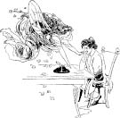

一部百科全书式的魔鬼心理学

