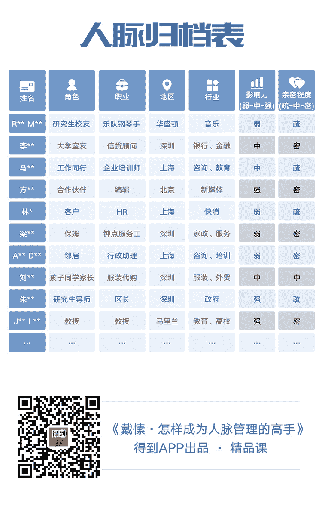
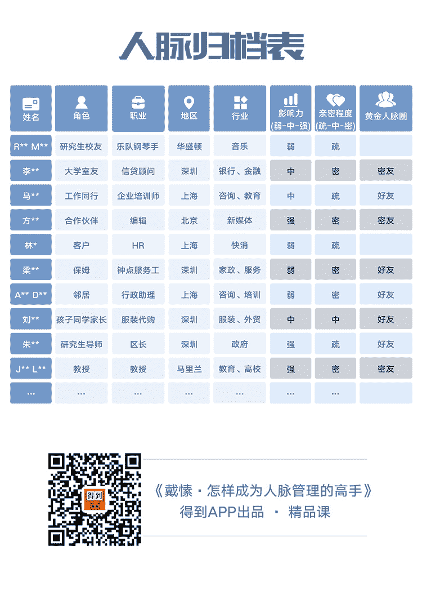
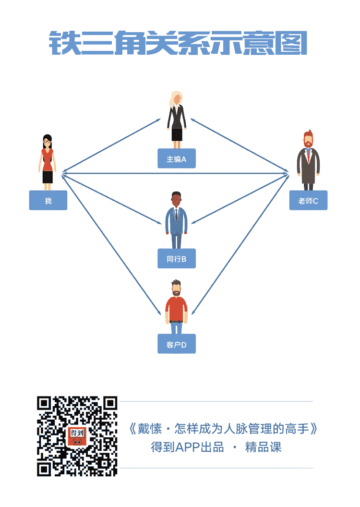
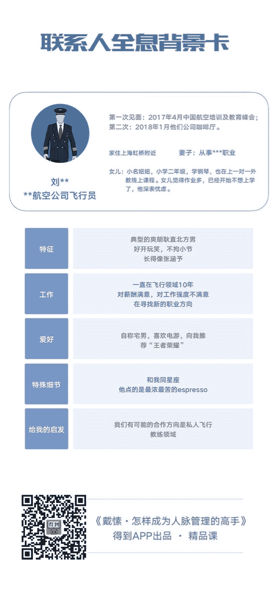

# 介绍

本电子书由公众号*懒人找资源*根据网上公开信息爬取，仅在*懒人专属群*内分享学习。

所有内容版权归得到 app 所有，未经允许，不得转载。

# 【试听】为什么你需要人脉管理

你好，我是戴愫，欢迎来到我的得到课程《怎样成为人脉管理的高手》。

我是一名跨文化研究者，我在过往 13 年的跨文化研究中，接触过不同文化里的社会精英。我发现他们有一个共同之处——  
**想要有所作为，除了自身的实力和努力，更重要的推动因素是，他们都具备人脉力。**

什么是人脉力呢？

人脉力是你建立人际网络的能力，指的是你利用非正式关系提升自己的社会资本，创造更多的机会和运气。

*   也许你在创业过程中，急需各种资源；
    
*   也许你到了一个新领域，需要有人帮你指路；
    
*   也许你遇到职业瓶颈，想在公司内外寻找突破；
    
*   也许你在营销、市场领域，想最大限度扩大影响力；
    
*   也许你想把自己的研究成果做成产品。
    

如果你觉得头绪太乱，任务难度太高，濒临崩溃，你可以闭上眼睛想一想：“怎么办？事情真的有那么难吗？”

**其实，如果有方法能联系到正确的人，这一切就都不是问题了。**

这其中，就需要我这堂课要讲的人脉力。

你可能会说，每个人的人际网络是天然的，我的学历和专业、我现在所处的行业和职位，给了我现在相应的人际网络，个人很难改变。

我想告诉你，并不难。

**我们每个人都具备一定的人脉力，比如你现在的朋友圈子，你所在的职场环境，其实都是你主动编织的关系网。**

只要你有意训练，你可以提升这种能力，建立更广泛的人际网络。

你也可能会说，我技术超群，业绩突出，我只要努力工作，就会有所收获，不一定非要使用人脉。

我想告诉你， **不要妖魔化“人脉”。在英文里，人脉叫做 connection，人脉广，叫做 well-connected。** 我觉得这个词很招人喜欢。

就拿我自己来说吧，回忆我的人生足迹，20 岁以后我在这些地方居住过：大学毕业之后去了广州，之后去马里兰求学，在华盛顿、弗吉尼亚、新加坡分别工作和生活过，后来搬到上海，还在洛杉矶、纽约居住过，现在住在深圳。

**我发现，我这一路走来，就是一个有意识地提高自己的人脉力，从而源源不断获得引荐的历程。我所做的，仅仅就是“借用”圈内人的社会资本，将我领入圈内。**

现在，我想通过这堂课来帮你提升人脉力，让你成为人脉管理的高手。

我想讲清楚这个概念里的三点。

**第一点：人脉力是隐性的。**

美国著名社交专家 Judy Robinett 有个很形象的比喻，  
**成功人士之间的连接，就像埋在地底下的电缆，大多数人看不见这些电缆线，但传输的电能让全世界运转。**

答案、交易、机会、信息、影响力、引荐，等等，都流通在这条电缆里，它隐秘地发挥着实实在在的影响力。并且，它的能量，还会实实在在地影响到你的下一代。

**第二点：社会资本包括了正式关系和非正式关系。**

我的课程要教你的是如何建立非正式关系，这才是社会资本中的真正基石。

正式关系指上下级、商业伙伴、客户、同事等，它与阶层、等级、权势有关； **非正式关系指的是在正式关系之外自愿结成的关系，它和信任、偏爱、互相依赖有关。  
**

正式关系在等级中实现；非正式关系能让我们跨越阶层，打破制度，去成就一些你本以为成就不了的事。

**第三点：人脉力能创造更多机会和运气。**

因为连接创造价值。

这个世界的财富每一次指数级增长，都和每一次新科技让人们的连接程度提高有关。

印刷术、电话、火车、飞机、互联网，推动人类一次又一次财富的巨增，这几乎成了永恒规律：连接越多，创造的价值越多。

于是，更多的机会在这些新创造出的价值中产生了。

通常情况下，我们不喜欢把“命运的起落”和运气联系在一起，因为运气超出了我们的可控范围。如果一切的一切都牵涉到机缘巧合，那我们的主观努力起什么作用呢？

答案是：

我们除了提高自己的实力之外，我们还可以努力为自己创造出更多的关键命运时刻，提高成功的几率。

这些时刻包括：和他人的一次跨界的交谈，一次关键的引荐，在拐角处一个正确的指引，在快跌倒时一次给力的扶持。你可以为自己多创造一些类似的暗藏成功的决定性瞬间。

接下来几分钟，请你盘点一下自己的人脉：

*   你有多少联系人呢？你对他们了解多少？你有持续地为他们增加价值吗？
    
*   你在有限的时间精力里，是对他们区别对待吗？
    
*   你有不同领域的、不同质的联系人吗？
    
*   对你格外珍惜的联系人，你在有意识地深化关系吗？
    
*   你有没有特别想结识的人物清单，你有没有清晰的计划去结识他们？
    

也许你已经有了财务计划、时间管理计划、学习计划、工作计划、健身计划，那么，千万别漏掉这份 **人脉管理计划。**

在接下来的 8 节课里， **我会和你一起系统性地打造高质量战略型人脉网络，帮助你成为一个人脉管理的高手。**

首先， **与人连接，找到那个可以帮你成事的人，定位他，靠近他，结交他，求助于他。**

然后， **巩固你和他的交情，打造终生友谊。**

接着， **加速拓展人脉，利用会议、社群，一个圈子一个圈子地铺开，最大化你的社交效率。并且，不断对人脉圈进行修剪、更新。**

最后， **实现核爆，在圈子之间串联，让人脉价值呈指数增长，形成新的格局。**

另外，我还精心为你准备了 **两个模板：初次接触的邮件模板和再次联络的邮件模板。** 当然，这两个模板发短信也适用。

我还为您提供了 **一些工具，比如：联络人人脉归档表、联络人全息背景卡、5 个找人的网络工具、会议前/会议中/会议后的行动清单。**

学完这一个多小时的课程后，我相信你将懂得，怎么跟别人建立有意义的连接，并在这个过程中，不断传达你的温度和关爱，不断展示你的能力和天赋。 \*\* \*\*

结果就是， 你和你要达到的目标之间，也许就是几个联系人的距离。

当大家都把互助和给予作为自己的行事标准，世界因此而更美好，你的生活和事业也将获得真正的富足。

下面，就开始第一讲：我们从盘点自己已有的人脉开始。

[公众号懒人找资源，懒人专属群独享](https://lazytest.vercel.app/#/data/13.通才计划)

\# 2.1.可视化盘点自己的人脉.html

# 1\. 可视化盘点自己的人脉

在这第一讲中，我会带着你明确自己的人生目标，进而定义出自己的标签和价值；同时，盘点你已有的人脉，绘制一张人脉归档表，并划出 155 人黄金人脉圈。

## 四个问题明确人生目标

一谈起社交，一定会说到六度人脉理论。这个理论告诉我们，最多只需要六步，你就能和这个星球上的所有人建立联系。这个理论不是噱头，它在不同时期，被不同专家用实验、大数据证实过。

可是你知道吗？ **要真正让六度人脉起作用，需要两个基本条件：**

1.  你要明确知道你要到达的目标人物是谁；
    
2.  你的人脉圈要足够多元化。
    

首先，你要明确知道你要到达哪个目标。所以， **你的第一个动作是，明确自己的人生目标。**

如果你的人生目标很清晰，机会一旦出现，你就能迅速识别出来。而且，你有了人生目标，你就有了标签和价值，否则，别人就会用别人的理解来定义你。你先定义了自己，之后你自然会持续强化自己的这一个标签，直到有一天它坚不可摧。

为了帮你准确地定位人生目标，我这里有一个 四步追问法。

用四个问题找出自己的人生目标：

*   你想做什么？
    
*   你为谁而做？
    
*   他们需要什么？
    
*   因为你，他们有什么改变？
    

第一个问题是关于你自己，后三个问题是关于他人的。

服务于外部世界的人生观，会让你更幸福。

我来试着回答一下这四个问题。

> 第一个问题：“你想做什么？” 这问的是我擅长的，我能教别人做什么？
> 
> 我的回答是：“我喜欢去观察不同人群的文化性格，去分析不同人群的行为模式，来调整我和他们沟通的方式。”

> 第二个问题：“你为谁而做？”
> 
> 我的回答是：“我做的这个事情，是为了帮助中国企业里那些要去到海外做拓展的经理人。”

> 第三个问题：“他们需要什么？”
> 
> 我的回答是：“在海外拓展的过程中，他们需要了解不同文化的游戏规则，做到理解当地人，并且影响到当地人。”

> 第四个问题：“因为你，他们有什么改变？”
> 
> 我的回答是：“有了我的帮助，他们面对不同人群时，能自如地切换文化性格，领着中国企业走出国门，荣耀东方文明，促进世界融合。”

你看，我越说到后面，越激动。 **第四个问题精准地诠释出了我的动机，说出了我的价值。**

在我的学员中，不同职业的人在思考到第四个问题的时候，都给出了让自己惊喜的答案。

> “因为你，他们有什么改变？”

*   健身教练回答：“让我的健身客户们都成为自己故事里的英雄。”
    
*   幼儿园老师回答：“我把这个世界用最美好的方式打开给孩子们看。”
    
*   企业培训师回答：“我去帮助他们交付最棒的工作成果，做出最正确的决定。”
    

你看，人人都可以找到自己的答案。丘吉尔可以说自己拯救了英国，拯救了那个时代。餐馆洗碗工可以说把肮脏的世界变干净；快递小哥可以说把期待和惊喜送到家家户户的门口，圣诞老人不就干这事儿嘛。

好，定位好人生目标之后，该盘点一下自己已有的人脉了。

## 绘制你的人脉归档表

你有过这种时候吗？翻看老照片时，会感慨：“呀，这么多年，怎么把他忽略了呢？为什么我们一直都没有联系？”

我自己就有过这样的时刻，而且年龄越大，这样的时刻就越多。有一些值得我维系关系的人，被我忽略了，他们从我的生活中就这样消失了。

**为了减少这样的遗憾，我来带你做一次人脉大盘点，制作一张人脉归档表。归档以后，我们就能把命友、密友、好友，按照不同方法有规律地维护。**

**这可能是一份会改变你一生的清单。**

参照不同社交专家给出的归档方式，包括美国的 Judy Robinett 和韩国的张慧敏，我制作出了一份模板，供你参考。

这份人脉归档表包括以下几栏： 名字、角色、职业、地区、行业、影响力、和你的亲密度。

其中影响力指的是他在他那个领域内的影响力，分为弱、中、强；和你的亲密度也分为疏、中、密。

在我的这份表格中，我孩子同学家长，是政府人员，他的职位比较高，所以他的影响力我写的是“强”，但他和我的交往很少，我们只是在家长会上的时候寒暄过几句，所以在和我的亲密度上，我写的是“疏”。

而我的助教，刚刚毕业，进入培训行业，她的影响力是“弱”，但她经常在工作中协助我，所以她和我的亲密度是“密”。

你做好这个表后，就要开始做这四项观察。

**首先，观察“角色”一栏，你看看，自己的交友模式多集中在工作上，还是私下生活中。**

我的朋友中 80%以上都是工作中的联系人。

**其次，观察“地区”一栏，你看看地区是不是足够多元化。**

我的不够多元化，多集中在上海。

**然后，观察“行业”一栏，你检查一下是不是六大生态圈的联系人都有。**

这六大生态圈是：

1.  与兴趣爱好相关的联系人：在俱乐部里建立的友谊，比职场上建立的更真实。
    
2.  与工作相关的联系人：包括客户、供应商、竞争对手等等。
    
3.  政府：这个生态圈可以帮你更深入、更生动地了解国家的宏观政策。
    
4.  金融：这个生态圈当然重要，钱都在他们那儿。
    
5.  媒体：这个生态圈对你打品牌、应对公关危机有重要价值。
    
6.  社区：这个生态圈让你接地气。
    

我发现我的大多数联系人都集中在培训、教育、咨询行业，他们非常同质，这样不好，因为我和他们的信息来源有很多重叠的地方。

**最后，你再观察一下，在这个人脉归档表里，你有没有找回几个温暖的名字？如果有，你要马上和他们重新取得联系。**

这份表格可能还会改变你的沟通习惯，当你遇到问题的时候，你会更有针对性地更有方向地去主动挖掘已有资源。

比如，我从上海搬到深圳的时候，在“地区”那一栏，找到了好几个深圳的朋友，我就和其中一个说：

> “我要从上海搬到深圳了，我对那儿一无所知啊，只能投靠你这个 20 年资深的深圳人啦。”

她说：

> “你要来这里太好了！你在找房子吗？我认识一个靠谱的房产中介。我还认识一个你的同行，培训师，就住在我们小区，下周来我家坐坐吧，我约她一起。”

瞧，我的这位朋友利用她的人脉，给了我指数级的价值，同时，她的影响力在我这里有了指数级的倍增。本来她和我的亲密度是“中”，现在我搬家过来以后，我们的亲密度是“密”。

**所以这份人脉归档表是你一生中需要不断打理的社交网络。它能让你进行有意识的思考，这些联系人能分别把我带到哪里？它会激发出你要建立人际网络的意识，展示你开始努力的决心。**

做完这个表格之后，接下来我们来确定一下 155 人的黄金人脉圈。

## 确定 155 人的黄金人脉圈

进化心理学家罗宾·邓巴发现，由于受大脑所限，人类所能保持的朋友圈在 150 人左右。所以，不同的社交专家也是在这个著名的邓巴理论的基础上来做建议的。

我就选用 Judy Robinett 的 5+50+100 的数字来建议你吧。

**我把它叫做 155 人黄金人脉圈：命友 5 人，密友 50 人，好友 100 人。**

刚刚做出来的人脉归档表，最后那两栏就能帮你圈定自己的 155 人黄金人脉。

**只要联络人的这两栏组合不是“弱”+“疏”，那他就应该进入你的黄金人脉圈。**

也就是说，只要这个人在自己行业里有中等或中等以上的影响力，或者，他和你的亲密度达到中等或中等以上，那就应该进入你的 155 人的黄金人脉圈里。

至于他应该进入命友、密友，还是好友，你可以先跟着我了解一下各自的定义，自行斟酌。

*   **首先，命友 5 人。**
    

根据美国著名的商业哲学家 Jim Rohn 的说法：“你是和你相处时间最多的五个人的平均值。”

我们和这五个人，彼此分享生命，我们是对方一辈子的铁杆拉拉队。这 5 个人可以是亲人，也可以是闺蜜或哥们儿。

我希望你可以立刻想出你的命友是哪五个人。

我们可以深夜里向他们电话求助，我们不怕在他们面前展示自己的脆弱，我们因对方的优秀而骄傲。

**命友是我们不可取代的财富。对于这 5 个人，你要有事没事都联系一下，内容不重要，而“联系他”的这个动作更重要。**

在他们身上的投入，我们不期待事业上的回报，而是情感回报，而且一定会有加倍的情感回报。

*   **然后，密友 50 人。**
    

密友，就是亲密的朋友。这 50 个人有强烈吸引你的地方，可能是：

**他喜欢你（这是排名第一的原因）、你们个性相似、他有智慧、他有专业能力。你想和这 50 个人走得更亲密。**

**对于他们，你要努力寻找机会为他们创造价值。**

问问自己，什么对他们重要？时刻关注他们，为他们收集有用的资源。

**你们的联系频率至少每周一次，** 比如微信点赞，微博私信，喝喝咖啡，约着一起打羽毛球，等等。

*   **最后，好友 100 人。**
    

对于这 100 人，你不希望自己只是对方通讯录上的一个名字，你希望能更多地了解他，也让他有机会更多地了解你。

**对于他们，你至少每个月要联络一次。节日、生日、与他相关的重大事件发生时，一定要和他联系。并随时考察，哪些人值得进入 50 人的那个名单。**

我在找出自己的黄金人脉圈后，在人脉归档表的最右端，加上了这一栏的信息，我标出了哪些联系人是 155 人黄金圈里的，并且具体标明哪些是密友，哪些是好友。至于命友那五个嘛，不用列在表格里了，早就刻在我的心上啦。

看着完整表格，是不是有点控制感和团队感了？ 这个大盘点带给了我强大的自信，我觉得，我需要认识的那个可以帮助我的人，可能我早就认识了。

好，我已经带着你揭开了 人生中最伟大、最有价值的奥秘之一，那就是你的黄金人脉圈关系，因为“人”让一切发生，而黄金人脉圈里的“人”是你的核心竞争力。

这是一个我们多年来用爱和无私奉献逐步构建起来的圈子，请慎重选择这 155 个人。

就像每一个上市公司要按期出财务报告一样，你需要对你的 5-50-100 的人脉资源每年出一份新的报告，以供鉴定和调整。

在更新的报告中，命友 5 人一般不会做调整，密友 50 人和好友 100 人，会根据你的短期目标和工作生活状态的变化，50 人中的某几位可能会调整到 100 人里，100 人中的某几位可能会升级到 50 人里。

另外，非黄金圈里的那些联系人真的就没有可能进来吗？是否需要激活一下已经冬眠的关系，将他拉入到黄金圈来？

这就是战略化地管理人脉资源。

**不要把每个关系都看作理所当然，关系需要培育，而战略化管理，就是优化自己的时间精力，让人脉网络更有活力、更健康。**

##

本讲小结

在这一讲中， **我用四步追问法带你明确了人生目标：  
**你想做什么？你为谁而做？他们需要什么？因为你，他们有什么改变？明确了目标，我们更容易找到达到那个能帮助我们的目标人物，以及到达他的路径。

**并且，我带着你绘制了一份人脉归档表，盘点了一下你现有的人脉。  
**命友 5 人，密友 50 人，好友 100 人，需要用不同的频率维系关系。并且，这 155 人也需要根据你的工作生活状态，不断地更新。

##

课后作业

你用四步追问法，问出你自己的人生目标了吗？为了达成这个目标，在你已经绘制好的那张人脉归档表里，能看出哪些地方是可以提升的吗？

欢迎你把答案写在留言区，和我互动。期待看到你的答案。

下一讲，我教你制作联系人全息背景卡，并用 6 个方法加厚、加深你们的关系。

公众号懒人找资源，懒人专属群独享  
  
  
  

\# 3.2.维护和升级长久的友谊.html

# 2\. 维护和升级长久的友谊

在这一讲中，我来教你制作联系人全息背景卡片，并告诉你 6 个方法来建立与他终生有效的关系。

## 制作联系人全息背景卡

一旦你认识了一位你觉得值得结交的朋友，回家之后要立刻记得制作联系人全息背景卡。

**稳固的人脉关系不是靠记忆力，而是靠战略化的管理和经营。**

这一招我是从克林顿那儿学会的。克林顿说自己每天晚上睡觉前，会在一张卡片上记下当天联系的朋友，时间、会晤地点，以及谈到的某些细节，然后输入秘书为他建立的关系网数据库里。

在我的这个卡片上， **记录对方的爱好、职业、家庭成员信息、重要日期、我和他的第一次见面、我们共同认识的人、他的目标，以及我们相处时他透露过的细节。**

**注意，细节取胜。**

比如他孩子的年龄，他最爱的早餐搭配，他找到的好用的 App，等等。

**这张卡片需要持续地补充内容，补上那些你日后追踪他的时候，你找出的某些细节。**

比如，他朋友圈记录的他上一次的担忧，他最近一次开心的体验。卡片上哪怕只记下了几个关键词，这样的信息对你的帮助也很大，能提高后续联系的质量。

如果你的卡片上有足够的背景信息，你一见面可能自然就会说：

> “你们的年会开得怎样？/你上次去的那家寿司店，我上次也去了，名不虚传。”

有一次，对方告诉我，他运动过度，膝盖受伤了。几个月后，我又遇见他，问起他的膝盖，他很惊讶我居然还记得。

每当你提到他生活中刚刚发生的事情，不论大事小事，你实际上都在向对方发送信号：“你是我生活中的主角，你是我的明星。”

**这就是交朋友时可以用的“追踪”技巧，就像粉丝追踪自己的明星偶像一样。**

追踪技巧，让你们的交往不是分散的点，而是连成了一条线。当你成为一位串联者之后，这些线就编织出了人际关系网。什么是串联者——这是我们第七讲的内容。

卡片制作好了，下一步是怎样和对方建立终生有效的关系。

做销售的朋友都知道，发现一个新客户的成本，比留住一名现有客户的成本昂贵 11 倍。所以说留住一个现有客户是最划算的事情。放在朋友身上也一样。

**与这个值得结交的朋友巩固关系，比你去忙着结交新朋友，意义更重大。**

**建立关系，就是建立信任。**

有了信任，下次你说想让我帮个忙，我会直接说 yes，我甚至不需要听具体帮什么忙，因为我相信你不会提出超出我能力范围的请求。

信任怎样建立呢？信任的建立取决于交往的长度、频度、深度。

**长度，** 指时间越长，越有利于建立信任。友谊像美酒，越久越醇香。

**频度，**  
指你们互动的次数多。人们并不会精确计算他们获得了多少恩惠，实际上也算不出来，于是，即使你为对方做了很小的事情，也能形成回馈的义务。而对方的回报程度，与你的帮助次数是有一定关系的。

**深度，** 就是打造洋葱心友谊。逐层剥下洋葱皮按顺序逐层深入，交流一些触及内心的东西。

**用一句话总结，关系的巩固，取决于你能否在一个更长的时间区间里，做更频繁更深入的互动。**

## 用 6 个动作建立终生有效的关系

那么，具体该怎么做呢？想想看，你在喜欢对方，把对方看做自己人的时候，会有什么行为呢？我觉得，  
**有这么几个动作：欣赏、分享、陪伴、推荐、指导，甚至保护。**

第一个动作，欣赏：

如何表达出你的欣赏呢？ 用杀手锏赞美。

美国人际沟通专家莉尔·朗兹(Leil Lowndes)把“杀手锏赞美”定义为  
**对方身上非常隐秘的优点，可以是某种个性，或魅力，是那个你看到却不敢告诉对方的优点。**

请对他的自我定位进行全盘的考察和充分的理解，然后给予全力支持。

**赞美的秘诀不是那些陈词滥调，而是巧妙地支持对方眼中理想的自我形象。**

从你们第一次交谈开始，就密切留意他的弦外之音，探索他到底如何看自己。

我接着强调两点：

*   第一：你赞美别人时的词汇不应该是“好”“棒”“颜值高”等，去看看同义词词典，那里有很多更细化的同义词。你的赞美要特别、要生动、要精准，比如“玉树临风”“IT 界徐静蕾”“楚楚动人”等。
    
*   第二：将赞美埋伏在句子里，频繁使用，并脱口而出。
    

比如：

> “像你这样谈吐优雅的人，在当时那种场合，肯定不会紧张。”
> 
> “那个门真的很重，不过像你这样身材健美的人，肯定可以轻易搞定的。”

这些句子听起来不像是有意恭维，更像是脱口而出。

你的持续欣赏和赞美，让他证实了自己长期以来的猜想：“我是独一无二的，我是优秀的。为了感谢你发现这个事实，我决定要和你结交。” \*\* \*\*

**在马斯洛的需求理论里，人都需要安全感，希望得到别人的认可。** 你就是他的安全港，他可以在你的友情中，躲避人生的暴风骤雨。

第二个动作，分享：

**我们和好朋友会分享什么呢？分享秘密。**

这秘密既包括你的小秘密，也包括你们都知道的那个秘密。

**首先，你透露的一个关于你的小秘密，仿佛是送给对方的一份亲密礼物。**

比如，你费了很大劲儿才改掉咬指甲的毛病；你是个路盲；你不大擅长婆媳关系，等等。这种自我披露式对话，可以营造亲密。你把自己脆弱的一面向他袒露，你在他面前不端架子。

**注意，只袒露小缺点。** 如果刚刚接触，你就告诉对方，你曾被勒令退学，或婚内出轨，他会迅速失去对你的好感。

**另外，这里的秘密还包括你们俩的一些私密的玩笑、用语等等。**

也就是那些全世界都不知道，只有你们彼此听得懂，并听完后相视一笑的语言。

找到这样的笑话，其实不难。每次他在说故事的时候，你要认真地找出他最喜欢的部分，然后为此设计一个能让他想起那个故事的短语，或笑话。在以后的交往中，你将这个短语或笑话重复地讲给他听。就这样，你们拥有了私密的笑话。

注意，我们一般只挑选让他深感自豪的那件事，他在故事中是个英雄。

这就是分享的动作。分享秘密，包括你的小秘密，以及属于你们俩的共同的秘密。

第三个动作，陪伴：

**你对他的朋友圈点赞加评论，就是一种最轻柔体贴的陪伴。你生活中的变化，也要及时告知朋友：搬家、换手机号、换工作，让他觉得你重视他，你们一起在经历生活。**

好，普通的陪伴我们都能做到，我想对你提出更高的要求，那就是： **在不断更新的类别里持续陪伴。**

什么意思呢？真正意义上的陪伴，指的是同类别的人彼此间的惺惺相惜、肝胆相照。

每个人都有很多属性，很多标签，属于很多不同类别。比如，我们是有血缘关系的亲人；比如，我们是同宿舍的室友。这里，血缘关系、同宿舍，就是类别。

**类别还可以是籍贯、职业、生活趣味、世界观、人生难题等等。** 你看，连人生难题都可以是一个类别，比如，同为孩子教育发愁的家长类别。

**在你和他交往过程中，要跳出默认的初始类别，找到其他方面的类别，做到持续的高质量的陪伴。**

所谓初始类别，和你们俩初次相识的方式有关。比如，你和同事，是职业类别；你和同乡，是籍贯类别。

那么， **随着时间的推移，你需要更新类别，为你们的交往赋予新的意义。** 比如，你们都成了星球大战迷，或者你们都有了移民计划，等等。

举个例子，本来我和我的室友属于同学类别，后来都成为妈妈了。那么，我会在妈妈这个新类别里继续陪伴她。我去联合国大厦参观时，给她的小宝贝寄了一张明信片，写着：“将来你的舞台就在这里。”

在不断更新的类别里持续陪伴非常重要，所谓关系历久弥新，就是这个意思。

第四个动作，推荐：

比如推荐精彩的餐馆、电影。或者，当你发现他在某个地方游玩时，推荐一些你所知道的那个地方值得一游的信息。

好，我也来对推荐做出更高的要求。 **你的推荐能不能带着他做新的尝试，给他意想不到的体验？**

如果他有点宅，你约他去漂流。如果他爱体育，你约他去音乐会感受一下。

我是个生活比较简单的人，所以我永远记得带我去首次体验全身 spa 的那位闺蜜。不管我是否最终会喜欢做这些，他们带着我挑战人生边界，丰富了我的经验。这就是朋友的意义。

第五个动作，支持：

**一次给力的支持，会迅速提升你在朋友那里的价值。**

别人向你寻求支持的时候，如果你没有答案，请你至少在你的人脉圈里，挑出五个可能有答案的朋友，帮他问问。

平时没事的时候，我会经常有针对性地转发文章给不同的朋友，给他们提供策略支持、资讯支持和情感支持：

*   第一类：策略支持，这些文章能帮他们从新的认知角度分析问题、解决问题；
    
*   第二类：资讯支持，增加他新的谈资，尤其是那些反直觉，反预期的信息；
    
*   第三类：情感支持，这些文章能够精准地帮他喊出他心中的想法，让他有共鸣。
    

另外，英语语言是我的优势，所以，我经常提供一些国外的，与朋友那个行业相关的，有洞察力的文章，我翻译出核心信息，加上几句评论，发过去给他。

寻找高质量的文章，推荐给朋友。这个动作，我想我们的用户会经常做。我们得到平台上就有很多高质量的文章嘛。

第六个动作，保护：

这个动作很厉害。 **让对方感觉到：“一只温暖的手拍在了我的肩膀上”。**

有一次，我收到过去学员的一条短信：

> “戴老师，我在印度恒河，为你祈了个福。”

他还附了一张恒河边很欢乐的照片。我非常感动，因为那段时间，确实有些挫折。突然我就好受多了，我真实地感受到了来自朋友的保护。

这就是我们对朋友做的六个动作：欣赏、分享、陪伴、推荐、指导、保护。

**如果你持续地做这六个动作，对方会不断地感觉到，你们有相似的个性，互补的需求。你这个“人”和他这个“人”开始真正的交往。**

人际关系是瞬间的作用，为了产生这瞬间的作用，你需要具备与人深交的能力，这个能力要内化成像游泳、骑车这样的本能，成为你的生活方式。

##

本讲小结

在这一讲中，我教你制作了联系人全息背景卡片，用这个卡片来展示“追踪”技巧。

接着，我们探讨了怎么样与对方建立终生有效的关系，也就是要在一个更长的时间区间里，做更频繁更深入的互动。具体做这六个动作：

*   欣赏：让杀手锏赞美脱口而出。
    
*   分享：分享秘密。这秘密既包括你的小秘密，也包括你们都知道的那个秘密。
    
*   陪伴：在不断更新的类别里持续陪伴。
    
*   推荐：推荐他做新的尝试，给他意想不到的体验。
    
*   支持：包括策略支持、资讯支持、情感支持。
    
*   保护：这个动作最厉害。
    

##

课后作业

请找出三位你要终生结交的朋友，他们心中理想的自我形象是什么？你对他们的杀手锏赞美是什么？怎样让这个赞美在日后你和他的交往中脱口而出？

欢迎你把答案写在留言区，和我互动。期待看到你的答案。

下一讲，我会教你怎么样找到并联系到目标人物。

公众号懒人找资源，懒人专属群独享  
  
  
  

\# 4.3.找到并联系你的目标人物.html

# 3.找到并联系你的目标人物

这一讲中，我会带着你有策略、有计划、分步骤地去结交新朋友。

我会向你推荐几个网络工具，帮你联系上那个你要找的人，在线上为你们的初次见面造势。然后，你要制造至少三次和他在线下见面的机会，让你不再是他的陌生人。

## 善用网络工具，建立初步联系

首先，提供几个网络工具，帮你在线上与他们建立初步联系，为线下见面创造条件。

**第一个工具：以微博为代表的自媒体平台。**

假设你要为年会找嘉宾，可能这位大咖就是微博大 V，上微博上搜搜他的主页。如果是外国人，那就是 twitter。然后在微博上直接私信他。

不要以为大 V 就一定很多人私信，或者他们没时间看私信，其实不是这样的。粉丝一般用评论，有事儿才会私信。 **私信是可以获取他注意力的。**

你找到他的微博主页后， **观察他的个性域名，** 可能是一个有意义的名字，也可能是你看不懂的字母加数字组合。

**注意，这些名字很可能就是他的微信号或者 QQ 名。**

**很多时候，大咖会把自己，或经纪人，或助理的邮箱和电话直接亮在主页，因为他们也需要有社会合作的机会。**

你如果看到了他本人的邮箱地址，除了给他发邮件之外，不妨大胆地用邮箱@之前的那一段，假设是他的微信号，去试着加微信。

**第二个工具：从公司主页上寻找蛛丝马迹。**

如果你想找某家公司赫赫有名的 CEO，怎样找呢？

每家公司的主页都有“联系我们”的页面。不过，通常是个 400 开头的总客服电话，或整个集团的总号码。

**那么，我们可以通过地图软件，输入公司名，找到当地公司的地址和电话。** 一旦联系到当地办公室，你找起人来会更得心应手。

**公司主页上的联系邮箱还会给你一个重要信息：他们公司的邮箱设置格式，至少是@之后的那一节。**

比如，小米官网上显示的邮箱地址是：shouquanhezuo@xiaomi.com。那不难推断，小米的员工们的邮箱地址都是以@xiaomi.com 结尾的。

如果你想找出小米公司里某位大佬的邮箱，你可以百度一下这个邮箱后缀，结果会跳出小米公司别的同事的邮箱地址，根据这些邮箱地址，你很容易能找到规律。

**你发现，它们的前缀都是用拼音的全称构成，姓在前，名在后，姓和名中间没有符号。** 这下，你要找的那位大咖的邮箱地址不是已经被你推导出来了吗？

退一步讲，如果你用邮箱后缀，百度之后，找不到这家公司任何人的个人工作邮箱地址，那就猜测一下吧。

拿我的名字举例，公司的邮箱设置不外乎就这几种模式：

*   sudai
    
*   sdai
    
*   daisu
    
*   dai.su
    
*   dai\_su
    
*   dai-su
    

然后，用这三个网站验证一下你猜测的邮箱地址中哪些是正确的：

*   www.mailtester.com
    
*   www.verifyemailaddress.org
    
*   https://verify-email.org
    

把你猜测出来的邮箱地址一一输入这些网站，网站会告诉你，哪些是有效的邮箱地址，哪些是无效的。

**第三个工具：多角度尝试百度搜索。**

大多数人都习惯用百度的“网页”搜索功能， **其实你还可以开始多多使用百度的“图片”搜索和“文库”搜索。**

我经常在“图片”搜索里直接搜到某位大咖的名片，还记得有一次，我正想联系某位著名学者，一搜文库，有他的 PPT，在 PPT 的最后一页，是他自己留下的联系方式。

**第四个工具：天眼查。**

天眼查 App，这是我最近用得最多的 **挖掘商业信息的重要工具。**

输入公司名，你能看到高管的姓名、职位、简介。有的公司页面里，联系方式还会直接公布出来。

顺着这个页面你继续往下看，会看到和这家公司有关的“竞品推荐”和“有关新闻”。不要小看这两部分，这可是你收集谈资的有效渠道。

在天眼查里，你还可以用人名搜索，看到这个人开了哪些公司，合作者有哪些人。甚至，你还可以查某两个人的商业关系。

**第五个工具：领英。**

领英过去是外企员工用得多，现在你在领英上找中国人，也容易多了，它和微信有战略合作。 **很多人在领英上直接放了自己的微信二维码。**

如果你要找外国人的信息，试试这个网站：

*   rocketreach.co
    

这个网站首页就显示了比尔·盖茨的联系方式。你输入名字即可查到他的联系方式，为了在同名人之间缩小范围，你可以输入地区、行业、职位、公司继续圈定范围。

以上这就是我推荐的几个高效找人的网络工具，请使用你的洞察力和行动力开始吧。

## 为初次见面造势

找到他的联络方式之后，你需要开始为你们的初次见面造势。

比如，在微博私信他，或邮件他。

这其实就是利用先发影响力，在见面以前就开始对对方施加影响。

你的信息怎样能在一堆信息中跳出来，引起他的注意呢？我给你一个邮件模板，短信也适用。你的文字要依次包括这三个内容：

*   你是谁
    
*   你仰慕他
    
*   你能给他带来价值
    

**其中的第二项内容“你仰慕他”，要写具体。**

比如，你可以咀嚼一下他说过的某句话，说说这句话给你带来的影响，还可以为这句话赋予新的含义。

**第三项内容，“你能给他带来价值”，更要好好想想，这是你和他交往的前提。**

为他增加价值——这其实也是我们和所有人的连接方式。

如果对方是一位大人物，你也不用担心，你同样可以为他带来价值。  
**你有时间资源，你的情感支持，你所代表的那个人群的视角，你的独特观点，这些都是你重要的资源。**

这个部分会让他眼前一亮，当你在线下见面再次提起自己的名字时，这个名字就有了标签和价值。

有一次，我收到过这样的邮件，让我印象深刻：

> “戴老师，我是复旦大学大四学生\*\*\*，和您一样，也是英语专业，有幸读了您的书《不会写，怎敢拼外企》，深受启发。您提出写作前要做的三步思考 TCS 中的 T——tone，语气，真的很重要，而且，语气和英语书面文字表达之间的切换技巧很微妙。我希望能将您的理念带给我们学校即将毕业的同学们，为他们走上职场做准备。我知道您下周在上海读书节有签售，期待和您交流更多。”

这短短的邮件里，她成功地找到了和我的共同点——英语专业；她掌握了我的一个重要的写作理念；她还预示了可能为我提供的价值。这就是初次见面前的一次成功的造势。

接着，你要推理他可能出现的地方，制造至少三次见面机会。

## 制造至少三次见面机会

FBI 高级探员乔·纳瓦罗曾在探员培训课上说：

> “一个人对另一个人的评价是和与其见面次数成正比的。一个人对陌生人的信任不是在第一次见面中就可以产生的，多次短时间的见面才是更有效的。”

一旦见过第一次面，你对于他就不是陌生人了，你跨越了人际交往的第一层屏障。第二次见面，他会更加舒适惬意。第三次见面，恭喜你，你具备了成为他的朋友的前提条件。

所以，只见一次面，聊 9 分钟，不如分开三次见面，每次聊 3 分钟。反复曝光，会增加你的积极形象，人们更喜欢他们熟悉的东西。他记住你了，就等于他选择了你。

**重要人物经常出现在这么几个重要场合：**

开业典礼或周年庆典活动；行业峰会；产品说明会、发布会；TED 演讲；艺术沙龙；热销作家见面会，等等。

**并且，你的目标人物所处的生态圈也会受到地理要素的影响。** 比如，北京的政治圈，深圳的科技圈，上海的外企圈。

**另外，高尔夫球场、五星宾馆、高级俱乐部、银行的 VIP 客户部，都可能是大咖常出现的地方。  
**你如果有在这些地方工作的联系人，这是很宝贵的资源，请他们给你提供信息，让你适时地出现在这些地方。

如果你了解到自己的某一类目标人物可能会出席某些活动， **你还可以积极参与其中做志愿者。** 当你在这些活动中提供高质量的服务时，他自然会注意到你。

另外， **你还可以利用你的工作平台，去创造与大咖接触的机会。** 比如代表公司参加各种活动，获得接触他们的机会。

或者， **联系主办方，表示有兴趣做此类活动的赞助方，利用这次机会去现场了解一下情况。**

主动创造和目标人物见面的机会，这是一次高级的考验，考验你的勇气和智慧。

##

本讲小结

在这一讲中，我鼓励你大胆走近目标人物，主动结识他。

我推荐了几个网络工具，让你找到那个你想联系的人，这些工具包括 **：  
**以微博为代表的自媒体平台；从公司主页上寻找蛛丝马迹，并猜测其邮箱地址；多角度尝试百度搜索、天眼查、领英等等。

找到他的线上联络方式后，要在线上给他发信息为你们的见面造势。 **信息模板当中有这么三个内容：你是谁，你仰慕他，你能给他带来价值。**

最后，你要用勇气和智慧，去主动制造至少三次和他见面的机会。

##

课后作业

最近，你想联系的人是谁？他的线上联络方式你找到了吗？为了给你们的初次见面造势，你决定给他发的信息是什么？请用我给你的模板来写一下。

欢迎你把答案写在留言区，和我互动。期待看到你的答案。

下一讲，我会和你聊聊怎样让新朋友喜欢你、愿意帮你。

公众号懒人找资源，懒人专属群独享  
  
  
  

\# 5.4.让新朋友喜欢你，愿意帮你.html

# 4\. 让新朋友喜欢你，愿意帮你

在这一讲中，我要告诉你三个方法，利用好见面的短短几分钟，让对方喜欢你，愿意帮你。我还要告诉你，在见面后的 24 小时内，怎样和他再次互动。

## 三个方法给对方留下积极印象

首先，给对方留下积极印象的三个方法。

第一个方法：找到他的需求点，贡献你的价值。 \*\* \*\*

这一点很重要，我们在上一讲里也提到过。我们每个人都有自己的独特价值，而且每个人，包括大咖，也都有需要别人帮忙解决的问题。

比如：

*   富豪需要找到稳赚不赔的项目；
    
*   科技天才需要找到足够的钱来实现某个技术上的奇迹；
    
*   意见领袖需要大众的拥护和回应；明星知识分子需要了解商业运行的规则；
    
*   商业大亨需要通过学术界的创造力和研究，为他的产品更新换代提供资源；
    
*   地方高官需要吸引投资，来提高政绩。
    

找到他的需求点，贡献你的价值，你们很容易一拍即合。

第二个方法：把你或你的目标放在更宏大的背景当中，吸引他的支持。

**首先，你要有引人注目的价值主张** 。

比如，你手头的这件工作，是为了职场女性，或者为了边缘儿童，或者为了癌症患者，或者为了留守老人。你的努力和某个目标相连，并且这个目标在社会价值观上是可取的、令人瞩目的。他忽略了你，就相当于忽略了边缘儿童，忽略了癌症患者。

换句话说， **往高大上的方向聊。** 这种聊法会让你忽略掉眼下的尴尬，还会让对方原谅你可能犯的错误。这是很厉害的一招呢。

我用自己的故事来演示一下这两个方法，是我十几年前刚到美国的例子。

之所以用这个例子，是因为 **那时候的我，在美国社会就是零背景、零经验，没有任何社会资本。  
**如果你觉得自己现在起点低，那当时的我，在那个环境下，起点更低。

到了美国后，迫在眉睫的任务是，我需要在校园里找一份 GA（行政助理）的工作。我跑遍了校园里所有办公室，投下简历，获得了两个面试机会，可最终都没被录取。

我仔细分析后，很快发现， **问题不是出在我的英语水平或沟通能力上，而是，我在这个新的国家里，没有任何人脉，我是圈外人！**

也就是说，我没有任何人际关系网来协助我完成以后的工作，来解决可能会遇到的难题！在同等条件下，人家当然会选择和这个社会有千丝万缕联系的当地同学。

怎么办呢？人一着急，总是会想出办法的。第二天就是学校的 open house 迎新活动，我知道校长会出席。不管怎样，我要和他攀谈一下。

在现场，校长出现了，满头银发、面容慈祥。我找到一个机会，清清嗓子，鼓足了勇气，上去介绍自己。

我先表达了能被马里兰大学录取的感激之情。接着，我告诉他，之所以在几个 offer 中选择了马大，是一直向往这里的多元文化，和对中国学生的友好。

当我告诉他 UMCP(University of Maryland at College Park)被我们中国学生昵称为另外一个 UMCP（University  
of Many Chinese People）后，他哈哈大笑起来。

然后我说：

> “作为像我这样的中国研究生，大多来自普通家庭，我们有足够的冲劲儿，热切地想对马大的学术做出贡献。如果我们在刚到校园的时刻，这里的各种机会能够对我们更友好更开放一些，让我们排除障碍，更有效率地投入到学术研究中，那马大的兼容并包的美名一定会走得更远。”

这时，校长有些吃惊，接着问我有什么苦恼。然后，他爽快地亲自把我带到 Mac  
Nelson 先生面前，Mac 是当时的学校电影制作办公室主任。校长说：“Mac，你那里有什么职位空缺吗？这是 Su Dai，你们俩可以聊聊。”

有了校长的背书，Mac 后来欣然招募了我，我顺利地进入了 Mac 的电影制作办公室。

**之后，我在美国的奋斗，有了实质性的改变。**

电影制作办公室，是我能想到的，对于一个零社会资本的人的最佳入口。我和 Mac 在那两年一起采访过很多和马大有直接关系或间接关系的成功人士。

在我的这个故事中，我用的就是这两个方法。

**第一，** 找到了他的需求点。

他是校长，他当然希望马大的名望越来越高，尤其在国际教育领域。

**第二，** 我把我和我的目标放在了更宏大的背景中，吸引他的支持。

我背后是中国学生群体，乃至所有的国际学生群体。

另外，你发现了吗，我同时还用了一个小技巧： **不做反馈，做前馈。**

反馈，是对过去做法的对错给出建议。而前馈，强调的是做好什么准备来应对下一阶段的挑战，迎接未来的挑战。

做反馈，很容易让对方觉得，自己是弱者。而做前馈，不会激起对方的防御心理。

我当时说的是“让马大兼容并包的美名走得更远”，这是基于我对学校的爱和信任，希望她更好。我当时说的不是“我觉得马大在兼容并包方面做得不够”。如果我真这么说，他会想：一个刚到美国的小丫头，竟然敢挑刺！

这就是让目标人物对你有积极印象的前两个方法。

第三个方法，聊些长远的发展，让对方觉得你是一个有长期交往价值的人。

比如，我经常这样结束聊天：

> “我知道贵公司的视野早已经没有局限在国内了。我是研究跨文化的，在未来的海外扩展方面，我们一定有很多可以交流的。”

记得我在美国的时候，仰慕一位作家，去听他的讲座。结束后，我和他交谈了几句，我提及了几个和他同一个领域的中国作家，告诉他我在中国也出了两本书，建议他可以考虑翻译版在中国销售。

就只聊了两分钟。在短短两分钟里，我展示了我对他的了解，我知道什么对他重要，那就是作品的全球认可，并且还有和同行的交流，我还预示了我可能可以为他增加的价值。当晚，他主动给我发了邮件。

**聊天结束，就像在喜剧的最高潮，你展示了你的所有风采，留下了回味无穷的观众。**

这种长远发展的聊法，还包括你来 **提出一个挑战，** 一个在你和他的专业领域都很有意义的挑战。

这通常是一个跨界的、超越你们自身的挑战，让它成为你们共同的长远的挑战，然后带动他和你一起解决。

这样，你不仅仅留下了印象，还引起了他的兴趣，为下一次见面做铺垫。

如果他在房地产领域，你是做互联网的，你可以在快结尾时，这样聊：

> “在限购政策下，租赁市场出现了机会，现在的在线短租还没有形成规模呢，说不定咱们以后有联手的机会。”

好，这就是给对方留下积极印象的三种聊法。

## 24 小时内再次互动

初次见面以后，你需要在 24 小时内再次互动，也就是，当你们的聊天还有余温的时候。 **邮件、微信、领英的邀请，都行。**

我来给你提供一个再次联络的邮件模板。

*   首先，感谢他和你交谈，邀请他和你保持联系；
    
*   其次，提供一些对他有价值的东西。可以是某条链接，某个他可以联系的人，或某条信息。
    
*   接着，再次给出自己完整的联系方式，比如手机号、微信号等等。最后，发出再次见面的邀请。
    

比如，你可以发出这样一封邮件：

> 很高兴在昨天的活动中认识了您，您关于各地文化活动开幕式的专业点评，让我印象深刻。
> 
> 我记得您提到贵公司马上要承办本市文化节的开幕式，主题是让文化和科技互动。我今天正好看到一则新闻，西安 1374 架无人机在国际文化节做的光影盛宴，用这个代替焰火，很壮观，也很环保。这里是链接：**\*\***。
> 
> 我有朋友在大疆。如果您有兴趣找赞助商，我可以帮忙连线。
> 
> 南京路上有一家星巴克，离您和我上班的地方都不远，我经常在那里会朋友。请您抽空喝杯咖啡吧。我下周三四五都有时间，您看是否方便？
> 
> 我的电话是**\*\***。
> 
> 期待和您有更多的交流。

在这封邮件里，我表示了对他的浓厚兴趣，我提供了别人提供不了的信息，我乐意贡献我的价值，我表示期待和他见面。

如果你觉得还没有准备好和他马上见面，发一条简短的信息也挺好的。

比如：

> “今天和您聊得真开心，这是我提到的《哈佛商业评论》上的那篇文章，里面有你们行业的案例呢。”

或者，你可以这么发：

> “很荣幸今天认识你，你对于中美贸易危机反而带来很多新机会的见解，让我大受启发。预祝你成功。我们后会有期。”

或者，你还可以写成：

> “我对您二十年前只身来深圳闯荡的故事记忆深刻，真是年轻人的楷模。下次您来北京，请一定给我电话啊。”

##

本讲小结

在这一讲中，我和你分享了三个方法，给对方留下积极印象：

*   第一个方法，找到他的需求点，贡献你的价值；
    
*   第二个方法，把你或你的目标放在更宏大的背景中，吸引他的支持；
    
*   第三个方法，聊些长远的发展，让对方觉得你是一个有长期交往价值的人。
    

并且，我提醒你，在第一次见面之后的 24 小时内要再次联络他。

##

课后作业

请思考一下，你目前想结识谁？怎样用到我们课程里讲的三个方法，让他对你有积极印象？

欢迎你把答案写在留言区，和我互动。期待看到你的答案。

接下来，我要教你，怎么样去优雅地求助。

公众号懒人找资源，懒人专属群独享  
  
  
  

\# 6.5.如何优雅地求助.html

# 5\. 如何优雅地求助

在这一讲中，我要教你，怎样优雅地向别人求助，如果被拒绝，该怎么办。

## 如何优雅地求助

“优雅地求助”和“乞讨式求助”是有区别的。

前者的 关键词是合作、互惠、交换。 后者的关键词是：绝望、屈尊、操纵。

怎样饱含激情地去做一次“优雅地求助”呢？

**首先，我们心理上不要怕向人求助。**

在大街上跌倒，很多人站起来第一句话就是“我没事儿”。其实，让对方扶一把，挺好的。当一支蜡烛点亮另一支蜡烛的时候，这支蜡烛毫无损失。

当有困境出现时，往往成功人士与普通人的区别在于，成功人士会提出很好的解决方法——并且首先考虑的解决方法大多是基于黄金圈关系的，当然，也就是求助。

那么，技术上具体怎样做呢？

**求助有六个技巧：**

**第一，寻找成熟的时机。**

套用肯尼迪的那句话：

> “不要问别人能为我们做什么，要先问自己能为别人做什么。”

全球最大的商界人脉组织 BNI 的指导原则是 “付出者收获”。  
所以，不同的社交专家给出的指导很类似，有的是 3:2 原则，你要帮助他至少三次，才可以求助两次，有的是 6:4 原则，你要帮助他六次，才可以求助四次。

**第二，求助时，用巧妙的提问，唤起他那种“对小弟”的情怀。**

有的人一上来就和大咖说：“您做我的人生导师好不好？” 这样，会把他吓跑。你只要把他当做自己的导师就行。

你提出巧妙的问题，自然会得到巧妙的答案。

比如，你可以说：

> “我也是同济大学毕业的，我觉得自己和三十年前的您很像。非常羡慕您现在的经验和才华，请问，您在我这个年龄的时候，是怎样展望自己事业的？”

这样的问题能唤起他那种对小弟的情怀。

**成功人士在给普通人建议的时候，就像是在和过去的自己谈话。**

谁不爱过去那个青涩的、有些野心的，甚至莽撞的自己呢？用你巧妙的提问，让他们和过去的自己相遇。

你还可以这么问：

> “说起来，您当年好像也有一段类似的经历，请教一下，当时的您是怎样应对的呢？”

如果你有心吸纳他的意见，他将毫无保留、倾囊相授。

**第三个技巧，求助时，告而不求。**

如果是面对面的求助，你可以“告之而不请求”，这是一种足够委婉的请求方法， **让对方零压力。**

我们可以向《红楼梦》里的刘姥姥学习，她可是“告之而不请求”的高手。

刘姥姥到了荣国府里，和周瑞家的说的是：两边本是亲戚，自从自家家道中落，没有好时机相互走动，刚好今年呢，因为庄稼收成不好，有了空闲的时间，专程过来见老太太。

最后，刘姥姥获得了个大丰收，满载而归。

我向人求助的时候，不会一上去就问“你能赞助我吗？” 而是说：

> “我有一家管理咨询公司，专提供跨文化沟通的培训和咨询服务。我们在上海和深圳都有办公室，我们正在寻找合作伙伴，将业务扩展到美国。”

就算对方当时没有能力帮助我，日后只要我们有联络，他会想办法为我提供有价值的线索，或给予我下一次机会。

**第四个技巧，不求一步到位，而是分步实现。**

当我向对方请求推荐客户的时候，不会直接问：“您知不知道哪家公司需要跨文化沟通的培训？”  
如果这样问，他可能直接就回答“不知道耶”。这种问法似乎让对方当场就做承诺，他极容易给一个 no 的回答。

我们要做的是，与对方聊，聊开了，对方可能在聊的过程中会想起自己的某些资源，发掘出某些机会。

我应该问：

> “您能否给我些建议？我正在寻找您这个行业的客户，您觉得用什么方式靠近他们比较合适？”

如果你是求职，请不要问对方：“你们公司需要工程师吗？”

你应该问：

> “我知道贵公司和手机行业联系紧密，现在有很多手机公司在开发区块链功能，您一定也有关注到吧。”

**让对方帮忙也是从帮小忙开始。**

影响力专家罗伯特·西奥迪尼把这个叫做 **持续法则——当对方回应了你的一个小小请求后，他会倾向于持续地兑现帮助你的承诺，你也持续地向他做进展汇报。**

帮忙从小到大，一步一步，可以是这样的：从一个微信名片的推送，或对你的一句话建议开始，然后，是 10 分钟的电话，然后，是 20 分钟的见面，等等。

一个有实力的人，可以把一个又一个的小机会，撬开成一个又一个的大机会。小机会如果利用得好，会形成神奇的马太效应。

**第五点，轻松一些，给他退路。**

求助的同时，请表达出： **如果您没有时间，或不感兴趣，我完全理解。** 让他有主动选择权，而不是把他放在一个不得不作出回应的境地。

要知道，一旦你发出了求助的信号，不管你们之间的关系如何，你们俩都会有焦虑感。你需要用这种方式主动消除这种焦虑感。

另外，求助的时候，如果你用一些有意思的表达法，也可以帮助消除焦虑感。比如：

> “我现在前面的陷阱是……如果不找一个业内高手点拨一下，我恐怕就要栽倒在这个关卡上了。请教您通关诀窍有吗？”

**第六点，让对方用最方便的方式帮到你。**

比如：

*   我请对方给我的新书写评价，我应该自己先写出范本。
    
*   如果你想让对方做个引荐，你要写好自我介绍和诉求，让他直接转过去即可。
    
*   如果你要和对方当面求教，你要充分帮他节约时间，利用他上下楼乘电梯的时间，来去机场在车上的时间，午餐时间，等等。
    

所以，优雅地求助不是低人一等，不是自尊缺失，不是地位缺失或独立性缺失。你要成就大事，必须有求助的动作。

**优雅求助，不仅不会损耗你们的关系，还会加深关系。**

人们不仅在观察别人，也在观察自己。当我们发现自己为某人做了一件事情，并且不求当即的回报，那么自我对话会告诉我们，这意味着我们喜欢他。

## 被拒绝后怎么办

当然，哪怕你掌握了优雅求助的所有诀窍，也会有求助不成功的时候。

**如果没有成功，你不需要有负面情绪，** 原因是：

**第一，他可能真的没有能力帮到你。**

要知道，你求助他可能觉得难以启齿，他拒绝你的求助，可能也难以启齿。他拒绝一个朋友的求助，其实成本也挺高的。请理解，他可能真有难处。

**第二，如果你的眼里装着更大的世界，你自然不会给自己戴上负面情绪的枷锁。**

高眼界和大格局，会赋予你自信和乐观。这就是为什么我们课程的最开始，要求你找到自己的人生目标，找到人生的大线条。

如果眼里只有自己的小世界， 那么，别人的不够热情，容易解读为别人瞧不起自己，心存怨恨，这种不必要的敏感是不对的。

所以， 你的求助失败后，我建议你还是要非常真诚地感谢他，感谢他花时间给你回复，让他不用担心，你会想别的办法。

这背后的潜台词是：你虽然没有帮上我的忙，但你还是收获了我的心。

**接着，你直接喊“Next！下一个！”**

下一个如果还是没有帮到你，你就再喊下一个。坚韧执着至关重要。

我用著名的 **“走廊原则”  
**来鼓励你，想象你走过一个两边都是门的长长走廊，如果前面几个门都关着，你不要灰心，不要以为门都不会开，很可能下一扇门就会打开。

所以， **不要停留在第一个联系人那里。**

**或者你可以用概率的角度去看。  
**如果你想获得更多有意义的扶持和帮助，你需要有勇气去和更多的人结识和求助。这样，你找到那个和你气质相投、守望相助的朋友的概率就越高。

##

本讲小结

好，总结一下，在这一讲中，我给了你 6 个求助的技巧：

1.  寻找成熟的时机；
    
2.  用巧妙的提问，唤起他那种“对小弟”的情怀；
    
3.  告而不求；
    
4.  分步实现你的求助，从帮小忙开始；
    
5.  轻松一些，给他退路；
    
6.  让对方用最方便的方式帮到你。
    

如果对方没有帮到你，不用沮丧，直接喊“下一个”！

##

课后作业

你最近有什么难事需要向人求助吗？你打算在什么场合，用什么样的语言，将求助信号发给他？

欢迎你把答案写在留言区，和我互动。期待看到你的答案。

下一讲，我来帮你将社交效率最大化。

公众号懒人找资源，懒人专属群独享  
  
  
  

\# 7.6.通过会议和社群，加速社交效率.html

# 6\. 通过会议和社群，加速社交效率

**这一讲的关键词是“效率”，我要告诉你如何利用会议、社群，最大化你的社交效率。**

你会获得会议前、会议中、会议后的三个行动清单，你还将学到如何在线上寻找和创立社群，在线下缔结真实的交情。

首先，我们要认识到，建立人脉和建立账户不一样。不要理解为：在人脉账户里，你存入你的时间精力，取出他人等量的时间精力。不对，我们的时间精力都是无价的。

所以，我们努力的方向是，让自己的信息、价值、影响力，在和别人的连接中呈指数级增长。

**参加会议或社群，就是一种在极短的时间里，与大量的人建立连接的社交体验。**

## 参加会议的十一条行动清单

我们应该怎样去参加一次会议呢？我来给你三个行动清单。

*   会议前的行动清单：
    

**1.选定正确的、高手云集的会议。**

想一想，哪一类人有能力有兴趣真正推动你在做的事情。并且，找到那种能挑战你的舒适区的会议，也就是说，会议上都是水平很高、价值很高的人。

如果这个会议在城市、在全国、在全世界都有网络，那就参加尽可能高级别的。

**2.想办法获得邀请。**

*   你可以联系主办方，询问参加会议的条件，需要买入场券就买。
    
*   门票如果不外售，你问问你的朋友圈里，看谁有办法获得会议邀请。
    
*   或者，你可以用我们第三讲介绍的方法，作为一个潜在的赞助方的身份，表达对会议的兴趣，或者表达自己做志愿者的兴趣。
    

**3.拿到演讲者名单和参与者名单，做好调研。**

我的习惯是，参加任何活动之前，我都会设定一个 10 人目标。我要至少和 10 个人交谈，并提前重点研究是哪 10 个人。

我调研的内容包括：

**他们是做什么的？此时他们的事业或生活遇到了什么挑战。有了这些调研结果，我就知道，自己大概可以为他们提供什么价值。**

**我还会把在领英、微博上搜到的照片存在手机里，这样在现场可以很快找到他们。**

*   会议中的行动清单：
    

**1.早到十分钟，获得现场掌控感。**

不要每次去参加会议都把时间掐得那么准。你早十分钟到，干什么呢？找感觉，找“我是主人”的感觉，并且，你可以和组织者聊一聊。

**2.以圈内人的衣着、气质融入会场。**

不要随意穿着，除非你有巨大的价值把别人吸引过来。而此刻，你是被这个圈子吸引，你想进入这个圈子，你应该用圈内人的着装表达对这个圈子的认同。

**3.开启你的观察力，找出谁是核心人物。**

通过观察小细节来锻炼高超的观察判断能力。在会场上，那位男士的打开、放松的站姿，他手腕上不经意露出一只价值不菲的表，那位女士精致的发型，得体的微笑，都在传递出他们的威望度和调性。

你还可以观察，当谁到场的时候，很多人都迎上去，那没准儿就是个重要人物。

你也可以直接问会议的组织者或志愿者：“这里谁你觉得我应该去结识一下？” 如果一个名字被很多人提起，那么他应该就是核心人物。

**4\. 让自己被看到，被听到。**

**你要记住，我们是带着目的来参加会议的，不要单独坐在那里，你要主动去和别人搭话。**

茶歇的时候，去热闹的地方，比如站在咖啡机和食物旁，或者签到处，或门廊人们等待的地方，我的另一门课《有效提升与陌生人的社交能力》，那里有和人聊天的方法。

不管你是不是个内向的人，这几十分钟请一定释放出你外向的那一面，秀出你最胆大狂野的一面。

**5\. 不要现场兜售你的业务，而是切换成，为他人解决问题的姿态。**

你只需要让别人了解你的特长，你能解决何种问题就行了，千万不要做现场销售。

你的专注永远在为他人增加价值上。你的目标就是告诉面前这个人，你的价值何在。

**你们的交谈不要漏过这四个关键点：**

*   **我可以怎样帮你；**
    
*   **你对我有什么建议；**
    
*   **我觉得你还可以和站在那边的某某谈一谈；**
    
*   **你觉得我还可以和谁谈谈。**
    

**6\. 用“播种”的方式来结束谈话。**

你结束谈话的模式，千万不要是“请问您有名片吗？”或者，“可以加你微信吗”，接着就拜拜了。所谓播种，就是为再次联络留下线索，或再次联络时让他记住你。

你可以根据你们聊天的内容，在快结束时提醒自己：“如果说出一点，只说一点，为什么对方要和我保持联系，用这句话来结束”。

比如，你可以说：

> “迪拜是个学习金融的好地方。你儿子从那儿毕业后，如果想再待在金融行业，我很乐意帮忙关注一下这方面的机会，我有好几个客户就是金融行业内的。”

哪怕是给名片，也有方法。在给出名片的时候，可以多说一句：

> “稍等，我给你我的私人手机号码。”

在拿到名片的时候，你也可以多问一句：“什么方式联系您最好？” 或者：“您助理的名字是？”然后在他的名片上做记录，当然是征得他的同意之后。

以上就是会议中的行动清单。

*   会议后的行动清单：
    

**1.制作联系人背景全息卡片。**

还记得吗？我们在第二讲里讲过的方法，会议后一定要把今天交谈过的人，制作联系人背景全息卡片。

**2.24 小时内再次联络。**

这是我们第四讲里讲过的方法，请你一定要熟练运用。

如果你按照这三份清单去参加每一次会议，一定会收获满满。

## 线上寻找和创立社群

**除了参加会议，加入某个社群组织，也是快速打开社交的方法。**

你要拥有一些属于自己的社群组织，这种社群组织，是在工作之外的组织，你愿意长期花时间参加的组织。比如海归协会、toastmaster、羽毛球协会，等等。

加入这样的组织的好处是，你有参与和退出的主动权。在一对一的交往中，如果你太过主动，对方会吓跑。

**而社团活动，是一种发散的交流，能在更自然的状态下找到和你气场相合，值得结交的人，来和他结交。**

现在，越来越多的人喜欢用自己的社群身份，来取代职业身份。

这种社群组织，也可以是志愿者活动，志愿者们是个能聚集正能量的人群。

**如果你找不到自己感兴趣的组织，那正是一个绝好的机会自己来组建。** 比如，家长联谊会、小区业主委员会、本地的小企业主俱乐部，等等。

**做群主，比做一个路人要好很多。你有掌控感，并且知道谁是重要人物，你也很容易被人记住。**

要知道，社会资本不仅和你的人脉数量、质量有关，你在这些关系中的地位，也至关重要。

怎样组建？在哪里组建？你没有必要建立自己的社交网站。很多社交平台都有建群功能：微信、领英，等等。

在哪里建群并不重要，建群的动作也非常简单，群主把联系人拉进来，以后的成员可以自行邀请新成员加入，大家共同遵守本群的规则。

关键是，你的群能不能实现这三个功能：

*   1.有明确主题，帮助成员表达出了“我是谁”的声音。
    
*   2.群内成员互问互答，提供第一手反馈和帮助。
    
*   3.大家积极参与主题活动，有归属感。
    

如果你打算组建社群，我的第一条建议是， **这个群的主题越小众，黏性越大。**

也就是说，当你发现自己和对方都有一个很感兴趣的点，而且这个点别人越无法分享，你们俩越来劲。洪荒之力，也就是社交能量，就这样被激发出来了。

社群人数可大可小。成员加入后是否留下来，取决于其他成员的质量和参与程度。所以，我的第二条建议是， **不要盲目追求规模，要把控好加入的标准和规则。**

我们了解完线上社群之后，需要思考一下，线上社交能否产生真正的信任。

我认为，线上的信任，建立在专业度和共识的基础上，这种信任不是瞬间的自发。它更像是漫长的“发现之旅”，通过交换、共享信息，你打破界限，获得更多的发现。

而线下的社交，是短时间内培育和升级情感的必不可少的方式。

千万不要把网上社交当做社交的全部。

接下来，我要告诉你，怎样在线下缔结你和他人的真实的交情。

## 线下缔结真实的交情

如果你是社群的组织者，定期来一次线下聚会吧。

**找那种每个人可以自己单点的餐馆，采用分开付账的方式，并提前告诉参与者预算范围。每次聚会最好不要超过 15 人。同时，我建议找那种西式的长桌，或者几个小桌子。**

我这样建议人数和桌子的形状，是为了创造大家一对一交流的空间。为什么呢？

中式圆桌通常是大家坐一圈，一两个人唱主角，其他人附和即可。而西式长桌上一两个人唱不了主角，你坐在那里，要么和左边那位，要么和右边那位交谈，每个聊天组合通常是两位，最多就三位。这样，大家能开始有效地一对一连接。

作为组织者，如果你频频在现场听到有人说：“诶，看看这个你会不会有兴趣”，这绝对值得你高兴，那些以前永远不会被发现的机会，被你的这次聚会制造出来了。

**所以，这种线下聚会最好的效果是，聚会结束前，大家彼此间一一找到了有意义的连接，甚至还敲定了他们之间的第二次见面时间。**

这就是你举办聚会的真正价值，参与者也会因此而感激你。

##

本讲小结

在这一讲里，我建议你通过会议、社群，最大化自己的社交效率。

我给了你三份参加会议的行动清单。

*   会议前：选定正确的、高手云集的会议；想办法获得邀请；拿到演讲者名单和参与者名单，做好调研。
    
*   会议中：早到十分钟，获得现场掌控感；以圈内人的衣着、气质融入会场；开启你的观察力，找出谁是核心人物；让自己被看到、被听到；将“兜售业务”的思维，切换成“为他人解决问题”的思维；用“播种”的方式来结束谈话。
    
*   会议后：制作联系人背景全息卡片，24 小时内再次联络。
    

另外，我鼓励你参加或组建工作之外的社群。利用线上社群认识更多的人，利用线下聚会培育真实的交情。

##

课后作业

请问，如果让你组建一个线上社群，这个群你愿意花长时间运营，并且群成员都能从中获益，那么，你可以建一个什么样的群呢？

欢迎你把答案写在留言区，和我互动。期待看到你的答案。

在下一讲，我将告诉你更新人脉的三个原则。

公众号懒人找资源，懒人专属群独享  
  
  
  

\# 8.7.更新人脉的三个原则.html

# 7\. 更新人脉的三个原则

前面几讲我分别教了你如何盘点人脉、维护友谊、结识新人，以及如何加速你的社交效率。

在这一讲中，我们的关键词是“修剪人脉”。

我要告诉你怎样让你的人脉圈除旧迎新，以保持健康活力。 **我会给你三个原则：体面地离开老朋友；遇到损友三步走；两个标准甄选新朋友。**

## 体面地离开老朋友

哪些老朋友需要离开呢？ 健康的黄金人脉圈是赋能型的。

也就是说，这 155 人能给你带来活力和能量，他们不断创造出美好的事物和体验。也许你刚刚还在为某个问题烦恼、紧张，他一出现，说了某句关键的话，你深受启发，或者如释重负。

与之相反，如果你发现这 155 人中，有人总是过多地叹息、吐槽。你每次都不由自主地跟随他们一起，关注到生活的灰暗面，于是你也不停地叹息，就像气体从气球中漏出来。

**这样的朋友不仅没有给你赋能，反而在耗尽你的能量。那么，请把他们放在 155 人黄金圈之外。**

有人曾经做过这样的比喻，我觉得很贴切：

想象一下，你带了一台只有一张内存卡的相机去旅游，你没有带电脑，拍好的照片没有办法导出来，也就是说，所有照片都要储存在这一张内存卡上。开始呢，你可能随意地照，但随着空间变小，你每照一张新的，就需要删除一张老的照片，很残酷。

**也就是说，每当你将一个新朋友纳入，你就要挤出一个老朋友。**

是的，很无奈地挤出老朋友。

**你每次换工作、搬家、毕业，就是不得不挤出老朋友，迎来新朋友的时刻。其实你的老朋友们，也会随着自己工作生活的不断变化，同样有更新朋友圈的需要。**

当你从一个人脉圈中退出，加入新人脉圈的时候，该怎样给这个背影呢？

我的建议是， **要给一个体面而华丽的背影。**

我第一次换工作时，当时很年轻，只顾着奔赴更好的前程，忽略了老领导，至今追悔莫及。要知道，他当初给了我充分的信任，特殊的资源，在他给我搭的平台上，我才成长如此快，才会获得更好的机会。

**那个时候，我应该向他表达最高程度的感激。** 哪怕你觉得老领导待你不公，但是，你也在他这里获得了难得的成长。表达感激之后，这样的话要记得说：

> “刘总，我会一直在这个行业的，相信咱们未来还会有交集，我很期待啊！如果我能在任何方面为您尽些微薄之力，不管是职业上，还是生活上，请一定让我第一时间知道。”

这是一个小世界，眼光放长远些，你们真的会有交集，别的不说，麻烦他写推荐信的时候总会有吧。

**搬家时，对邻居也要有从容而友好的道别，千万不要一声不吭就消失了。**

人和人的缘分很奇妙。有时，你比普通人多做一个小举动，就那么一个小举动，可能会让对方记忆深刻，那你和他的缘分就没有尽。

不断流动的人脉圈才是健康的。

所谓战略性管理人脉，不是积累联系名单，而是不断更新那个最适合你当下的状态的 155 人。

## 遇到损友分三步走

接下来我告诉你第二个原则，遇到损友怎么办？

损友比“耗能”型朋友更糟糕，他们做出了一些对不起你的事情，比如诽谤你、取乐你。面对这样的损友，你该怎么办呢？

**我给出三个步骤的建议：**

**第一步，  
**你问问自己，是不是已经对他们表达了你的友善，如果你之前一直忽略了他们，那么，在他们的世界里，你就不是朋友，他们做些不道德的事情，也更容易被宽恕。

**第二步，** 如果你之前确实从未对他们表达过友善，我建议你补上这个动作，因为你想让别人怎样对待你，你就应该怎样对待他人。

**你后补上的这个友善，给了双方一个机会不去树敌，而是交朋友。**

人生不易，能少一个敌人就尽量少一个。

那话说回来，如果你之前已经对他们表达过友善了，他们却没领情，对你不友善，那么，直接忽略他，如果他们实实在在伤害到了你的利益，你就反击。

**第三步，** 如果一段时间之后，他转变了态度，想过来和你交朋友，那就尽释前嫌。所谓不打不相识，面对未来永远比纠结于过去更有格局。

这就是遇到损友的三个步骤。

## 两个标准甄选新朋友

最后一个原则，是用两个标准甄选新朋友，我们要敢于开启人脉拓展的新篇章。

我们需要定期接触新朋友，在和不同的人聊过之后，怎样甄选新朋友放进人脉归档表里来呢？

我有两个标准：第一，有温度；第二，有见识。

**先来看第一点，有温度。** 有温度的人，能让周围的人很自在，很开心。我的第一标准之所以是这样，因为这能帮我厘清交朋友时某种功利的想法。

**我经常提醒自己，不能和自己根本不喜欢的人打交道。  
**如果仅仅追逐那些所谓的地位、权力和金钱，我就已经被生活愚弄了，我将错过真正的人生财富，例如内心的和睦，与朋友互动的幸福。

再说了，按照心理学的 **相悦定律： 想让你喜欢我，我得先喜欢上你。** 那些值得一生一起走的朋友，一定是我喜欢的人。

**甄选出新朋友的第二个条件：有见识。**

我的经验是， **有“跨越”经历的人，往往有见识。** 比如跨学科做过研究，跨地域生活过，跨行业工作过，或者跨越不同时代的人。

**有见识的人，他的认知在不断更新。这种更新，你能从和他的聊天中感知。  
**尤其是咱们得到上的用户，你的成长速度会快过周围的朋友。随着你的认知更新，你自然会更新朋友圈。

**如果一个人既有温度，又有见识，我会立刻把他纳入我的人脉归档表里，并且紧紧抓住他不放，不求回报地帮助他。**

还记得人脉归档表的最后那两栏吗？“你和他的亲密度”以及“他在自己领域内的影响力”。

你会发现，有温度的人就像磁铁，你想靠近他，那么，你们亲密度会逐渐成为“密”。并且，有见识的人通常在自己领域里的影响力，也会逐渐变“强”。

**也就是说，这样的人一旦纳入你的人脉归档表里，他们很容易在日后成为你的 155 人黄金人脉圈。**

你看，人际关系其实并不需要那么多时间和精力，它需要的是系统规划和重心切换。

我们当前的时代正在进行重要的社会变革和企业变革，其中的一个大趋势是，责任从组织层面向个人层面转移。这个趋势在告诉你，你必须为自己的职场生涯、人生规划负起责任。

**不断更新你的黄金人脉圈，就是在有效地管理自己职业和生活。**

##

本讲小结

在这一讲里，我们认识到健康的黄金人脉圈需要除旧迎新。

我给了你三个原则：

*   首先，体面地离开老朋友，请保证黄金圈里的 155 人是赋能型的。耗能型朋友要清除出黄金人脉圈，在和老朋友告别时，记住给一个体面而华丽的背影。
    
*   其次，遇到损友三步走。
    
*   最后，用两个标准来甄选出新朋友，那就是有温度，有见识。
    

##

课后作业

最近，因为你的工作或生活变更，需要和哪些老朋友告别？你打算怎样告别？

欢迎你把答案写在留言区，和我互动。期待看到你的答案。

下一讲，我将教你怎样在圈子之间，串联起新格局。

公众号懒人找资源，懒人专属群独享  
  
  
  

\# 9.8.在圈子之间，串联起新格局.html

# 8\. 在圈子之间，串联起新格局

在这一讲中，我要带你认识一下串联者的价值，并让你成为一个不可多得的串联者。我还会告诉你如何引荐他人，并被他人引荐。

在前几讲里，我们完成了与人一对一的连接。接着，我们为了最大化社交效率，学会了怎样融入某个圈子，以圈子为单位，来扩大自己的社交范围。

那你意识到了没有， **在圈子和圈子之间，有空隙，这就是社会学中所说的“结构洞”。**

**串联者就是在圈子之间做连接，填补结构洞的那个人。**

## 串联者的四个特征

串联者有什么特征呢？有四个特征。

**第一，他们知道自己的价值不可估量。**

大家都喜欢自己的圈子。圈子内部的沟通很高效。但是，圈子的弊端是，它封闭了信息和机会，可能还会扼杀新观点，相同的观点随着时间的流逝不断加强，新的好的观点可能会被淹没。

**一个人为什么很难突破自己的圈子？因为成本太高！**

比如，我想进入金融人士的圈子，我关注了微博上的某几位金融界的知名人士，这样做，确实能让我比朋友多一些金融方面的见识和谈资，但是我同时还要浏览大量和我的工作生活没有太多交集的内容。

**如果信噪比过低，** 也就是说，我获取有用信息和听到的噪音比例太低，我可能就不会关注他们了，而把精力拉回到自己的圈子里，维系自己圈子里的关系。

你看，保持多维度、不同质的人际关系，成本非常高。

从以上的分析中，你应该能看出串联者的价值了吧。 **他的这个串联动作如果放在商业活动中，就是中间人、中介，或叫做掮客、媒婆，是可以获得高额回报的职业。**

串联者从一开始就非常认同串联的价值，他要跨越毫无联系的社交网络，把一个个孤岛连接起来，这种价值不可估量。

**第二，串联者是“资源盈余”思维，他的身份是“问题的终极解决者”。**

串联者相信资源盈余，相信资源会在串联之后越变越多。相反，有些人觉得资源是有限的，经常把信息和机会藏着掖着。

串联者的人脉网络不是封闭的，而是开放的，他是联盟互惠的心态，而不是争夺心态。

每认识一个新朋友的时候，串联者想的不是“我能从你那里得到什么好处”，而是  
**“让我多多了解你，知道你的长处，同时知道你的难处，我来为你提供解决方案。”**

我在和串联者聊天的时候会发现，他对我那些诉苦的句子很敏感，因为这些句子迅速触发他的串联动作。比如，

> 我说：“今年暑假我特别忙，都没时间陪孩子了。”
> 
> 这个串联者会回应：“我听说你们那片区的少年宫组建了少年帆船队，没准儿你们孩子会感兴趣。我待会儿给你个联系人。”

如果你是做销售、做顾问行业的，尤其要让自己成为一个这样的串联者。

**第三，串联者的终生习惯是，持续有规律地帮助缩短物理距离或社交距离。**

持续有规律，指每周一次牵线搭桥，串联者的声誉就是这样形成的。

串联者不一定位居高职，或德高望重。他们是人脉网上的那些结点，掌握了这些结点，就掌握了整个网的脉络，只要提起这些结点，整个网就跟着你走了。

串联者做的动作就是缩短地理距离或社交距离。

**地理距离，** 指的是双方本质很相似，因为地理位置不在一起而产生的距离。

比如，外企的管理层，就是帮国外总部和国内当地的运营部门缩短地理距离；或者北京总部的人，为成都和长沙分部的人缩短距离。

我在美国工作时，就是公司里唯一一个能连接中国护校和美国劳工部的人。我经常组织双方管理层的电话、会议、聚餐，并协助翻译。我从中不仅获得大量信息，增长了见识，还在被咨询意见时扩大了我的影响力。

其实，对于外语好的人，这就是一个职场上的发力点。占据中介位置，缩短国内和国外的地理距离，弥补结构性空洞。

**你的社会资本，一定程度上以你个人弥合了多少空洞来衡量。**

**社交距离，** 指的是双方地理位置很靠近，但各自属于本质完全不相同的社交圈而产生的距离。

比如，大学里创业比赛的冠军组和商业领域的投资圈。哪怕这些冠军学生和投资人生活在同一个城市，出现在同一个会场，彼此也都难以融入对方：投资人大多年长、成熟、富有，大学生闹哄哄，身上没有商业标签。这时候，如果校长，或者投资圈的校友可以帮忙串联一下，就会很不一样。

**第四，串联者认识新朋友的目的就是为了实现更多的串联。**

每认识一个新朋友，串联者都会问自己这些问题：

*   我的黄金人脉圈里，有没有他已经认识的人，哪些人我可以立刻介绍给他认识？
    
*   他有哪几个常混的圈子？我的圈子里，哪些人也在那些圈子里？
    
*   他的黄金人脉圈里，有哪些人可以求他向我引荐一下？
    

好，串联者的四个特征我就给你介绍完了，你可以看一下自己是否具备以上的某一个或者全部特征，我希望你能有意识地去培养这些特征。

## 引荐和被引荐时的注意事项

当你了解了串联者的四个特点之后，我再来带你看串联者使用的方法，他们的串联方式就是引荐。

引荐的本质，是打造铁三角关系。

比如：

*   我在得到的跨年演讲会上认识了主编 A，得知 A 正在找某个领域的老师合作，这个需求触发了我的串联。
    
*   我问同行 B 是否认识这个领域的有口碑的老师，B 介绍了老师 C，我马上将主编 A 和老师 C 串联起来了。
    
*   有一天，老师 C 的客户 D 需要为他们的公司找一个培训师，老师 C 马上将我和客户 D 做了串联。
    

在这个例子中，我在引荐和被引荐过程中，做了三个铁三角：我-B-C，我-A-C，我-C-D，我不仅加深了和老朋友的关系，我还收获了两个新朋友 C 和 D。

你看，能量就在这种串联中发酵起来了。

在为他人引荐新朋友的时候，要做到以下几点：

**1.为双方提供可担保的可靠人品。**

社交网络越来越发达，情报收集越来越方便，人们更容易彼此联系上。这也带来一个坏处，大家更容易淹没在信息海洋里。比如，招聘经理永远有读不完的求职信和简历。

那么这时，推荐者的作用就来了，他能提供隐性信息。这些隐性信息是简历上看不到的、更有参考价值的。比如，对方的人品，这个人品是有推荐人的信用担保的。

**所以，真正起作用的引荐，是有信用担保的引荐。**

每次引荐之前，你自己要想清楚，这一次做的是介绍认识，还是强烈推荐。如果只是做一次拓展性的介绍认识，请让第三方知道。

**2.有搜寻和甄选的能力，知道哪两个人应该认识，并且你的引荐对他们双方都有利。**

这样，他们双方才会都积极跟进。如果这两个人一经你介绍后，就一拍即合，那就是对你搜寻甄选能力的直接肯定。

**3.记得先问问他们是不是已经相互认识了，** 以免让人家觉得你多此一举； **并问问他们是不是愿意互相认识，  
**这样才能确保双方在被引荐之后全力以赴。

**4.你需要跟踪你的每一次推荐。**

不要把自己完全挡在对话之外。你应该了解他们关系的进展，这样你知道还可以怎样帮忙，并且，这才算得上是铁三角关系。

**5.口头推荐完以后，别忘了书面也表达一下。**

把他们互相认识以后的益处用书面表达出来，让他们印象更深刻。另外，你还要表达，你为何分别是他们的粉丝。

以上就是你引荐他人时，需要做到的 5 点。那么，如果你被引荐，需要注意什么呢？请你复习一下第五讲的内容，如何优雅地求助。

**另外，我补充两点：**

**1.被推荐后请立即采取行动，这是基本礼节。**

假设，你想帮朋友一把，建议他可以联系某某，还把微信名片和电话号码都给了他，并且和那个某某也打过招呼了。结果发现，你朋友根本没有联系，你是不是感觉自己白忙活了？你以后大概再也不会为他做任何引荐了吧。

**2.被引荐后，和对方搭上了线，不能把推荐人忘得一干二净，一定要表示感谢，并向他更新进展。**

这就是被引荐的时候你需要注意的两点。

**朋友的价值，在于你和他可以共同创造的新价值。**

你的人脉和他的人脉向不同方向和空间辐射，串联后，你们有更大的交集，不同的交集也在继续向不同方向和空间辐射，这就是人脉结合产生的核爆现象。

串联者贯穿在不同领域和文化之间，创造新的信息链、新的关系、新的入口，串联者引发核爆。

总结一下，在这一讲里，我希望你做一名串联者，来填补圈子和圈子之间的结构洞。

串联者有四个特点：

*   他知道自己的价值不可估量；
    
*   他是资源盈余思维，他的身份是“问题的终极解决者”；
    
*   串联者的终生习惯是，持续有规律地帮忙缩短地理距离或社交距离；
    
*   串联者认识新朋友的目的就是实现更多的串联。
    

串联就是做引荐。引荐他人和被引荐都有需要注意的细节，让人脉在有意义的引荐中实现核爆。

##

课后作业

思考一下，你最近结识的朋友是哪一位？你现有的 155 人黄金人脉圈里，哪些朋友是可以介绍给他认识的？他们需要彼此认识的原因是什么？

欢迎你把答案写在留言区，和我互动。期待看到你的答案。

##

总结

讲到这里，我们的课程就进入尾声了。让我来带你回顾一下这个系列课程的要点：

**在第一讲中：  
**你用四步追问法明确了自己的人生目标，进而定义出自己的标签和价值，同时，你盘点了已有的人脉，绘制出了一张人脉归档表，并划出需要重点培育的 155 人黄金人脉圈。

**在第二讲中：** 你学会了制作联系人全息背景卡片，并开始用 6 个方法来建立与对方终生有效的关系。

*   欣赏：让杀手锏赞美脱口而出。
    
*   分享：分享秘密。这秘密既包括你的小秘密，也包括你们都知道的那个秘密。
    
*   陪伴：在不断更新的类别里持续陪伴。
    
*   推荐：推荐他做新的尝试，给他意想不到的体验。
    
*   支持：包括策略支持、资讯支持、情感支持。
    
*   以及最后一个很厉害的方法：保护。
    

**在第三讲中：  
**你学会了怎样利用几个网络工具，联系上那个你要找的人，并在线上为你们的初次见面造势。然后，制造出至少和他见面的三次机会，让你不再是他的陌生人。

**在第四讲中：  
**你学会了给对方留下积极印象的三个方法，找到他的需求点，贡献你的价值；把你或你的目标放在更宏大的背景中，吸引他的支持；说些长远的发展，让对方觉得你是一个有长期交往价值的人。并且，我提醒你，在初次见面之后的 24 小时内要再次联络他。

**在第五讲中：** 你学会了向人求助的六个技巧，以及，在求助失败后正确调整心态。

**在第六讲中：  
**你学会了通过会议、社群，来最大化自己的社交效率。我给出了三份参加会议的行动清单。我鼓励你参加或组建工作之外的社群，利用线上社群认识更多的人，利用线下聚会培育真实的交情。

**在第七讲中：  
**你学习了更新人脉的三个原则。你认识到遇到“耗能”型朋友要及时离开，并且离开的背影要体面。你学会了怎样用三个步骤对待损友，以及如何用两个标准甄选出值得一生一起走的朋友。

**在第八讲中：** 你了解了串联者的四个特征，并学习了引荐他人和被引荐时需要注意的细节。

谢谢你跟着我学完了课程。我希望这个课程已经为你将人际网络赋予了一个全新的形象：人际网络不是让你通过不正当手段获得你不应当得到的东西。

我很赞同之前提到的那位美国社交专家 Judy 的观点，他将“人脉高手”更名为“给予者”。  
真正的社交，是你的不断给予，并在你的人脉圈里形成一股向上的螺旋力量，这是能量巨大的暴风眼。

因为你，“给予者”，会成为你身边人的共同身份；“不断给予”，会成为大家的行事标准。最终，每个人都被暴风眼提升上空。世界因此而更美好。

所以，最终你的头衔是什么不重要，挣了多少钱也不重要；重要的是，你在给予过程中，成为了一个什么样的人。

幸福没有统一的标准，但我相信，生机蓬勃的人际关系，会给你带来快乐的情绪，提升你的人脉力。

**我们的终极目标，不只是成为一个人脉管理的高手，还要成为一个更幸福的人，成就一个更丰盛的人生。**

公众号懒人找资源，懒人专属群独享  
  
  
  

\# 10.【附】人脉管理工具包.html

# 【附】人脉管理工具包

在这门课程里，我为你准备了很多工具、模板和行动清单。为了方便你使用，我把它们整理成了一个人脉管理工具包，集中放在文稿区。它们分别是：

1.  人脉归档表和 155 人黄金人脉圈样表，帮你清晰地盘点已有人脉；
    
2.  联系人全息背景卡，帮你维护和升级长久的友谊；
    
3.  5 个网络工具，帮你联系上你想找的那个人；
    
4.  初次见面前的邮件/信息模板，为你们的初次见面造势，给对方施加影响；
    
5.  24 小时内再次联络的邮件/信息模板，帮你沉淀和加深双方关系；
    
6.  参加会议的十一条行动清单，让你的社交效率最大化。
    

欢迎你随时查看，随时取用。在实践过程中，如果你遇到了问题希望交流，可以写在留言区，我会不定期查看和回复。

> 工具 1：人脉归档表
> 
> 用途：盘点已有人脉、找出 155 人黄金人脉圈

*   盘点已有人脉-样表：
    

这份人脉归档表包括以下几栏：名字、角色、职业、地区、行业、影响力、和你的亲密度。其中影响力指的是他在他那个领域内的影响力，分为弱、中、强；和你的亲密度也分为疏、中、密。

你做好这个表后，就要开始做这四项观察。

**首先，观察“角色”一栏，** 你看看，自己的交友模式多集中在工作上，还是私下生活中。

**其次，观察“地区”一栏，** 你看看地区是不是足够多元化。

**然后，观察“行业”一栏，** 你检查一下是不是六大生态圈的联系人都有。这六大生态圈是：

1.  与兴趣爱好相关的联系人：在俱乐部里建立的友谊，比职场上建立的更真实。
    
2.  与工作相关的联系人：包括客户、供应商、竞争对手等等。
    
3.  政府：这个生态圈可以帮你更深入、更生动地了解国家的宏观政策。
    
4.  金融：这个生态圈当然重要，钱都在他们那儿。
    
5.  媒体：这个生态圈对你打品牌、应对公关危机有重要价值。
    
6.  社区：这个生态圈让你接地气。
    

**最后，你再观察一下，在这个人脉归档表里，你有没有找回几个温暖的名字？如果有，你要马上和他们重新取得联系。**

这份表格可能还会改变你的沟通习惯，当你遇到问题的时候，你会更有针对性地更有方向地去主动挖掘已有资源。

*   155 人黄金人脉圈-样表：
    

针对你做出来的人脉归档表， **最后那两栏就能帮你圈定自己的 155 人黄金人脉。包括命友 5 人、密友 50 人，好友 100 人。**

**只要联络人的这两栏组合不是“弱”+“疏”，那他就应该进入你的黄金人脉圈。**

也就是说，只要这个人在自己行业里有中等或中等以上的影响力，或者，他和你的亲密度达到中等或中等以上，那就应该进入你的 155 人的黄金人脉圈里。

> 工具 2：联系人全息背景卡
> 
> 用途：维护和升级长久的友谊

*   联系人全息背景卡-样本：
    

**在这个卡片上，记录对方的爱好、职业、家庭成员信息、重要日期、我和他的第一次见面、我们共同认识的人、他的目标，以及我们相处时他透露过的细节。**

注意，细节取胜。比如他孩子的年龄，他最爱的早餐搭配，他找到的好用的 App，等等。

**这张卡片需要持续地补充内容，补上那些你日后追踪他的时候，你找出的某些细节：  
**比如，他朋友圈记录的他上一次的担忧，他最近一次开心的体验。卡片上哪怕只记下了几个关键词，这样的信息对你的帮助也很大，能提高后续联系的质量。

> 工具 3：5 个网络工具
> 
> 用途：帮你联系上你想找到的那个人

**第一个工具：以微博为代表的自媒体平台。**

你可以 **直接给大 V 发私信。**

你找到他的微博主页后， **观察他的个性域名，  
**可能是一个有意义的名字，也可能是你看不懂的字母加数字组合。注意，这些名字很可能就是他的微信号或者 QQ 名。

**第二个工具：公司主页。**

我们可以 **通过地图软件，输入公司名，找到当地公司的地址和电话。** 一旦联系到当地办公室，你找起人来会更得心应手。

公司主页上的联系邮箱还会给你一个重要信息：他们公司的邮箱设置格式。 **你可以通过格式推测你要找的联系人的邮箱。**

拿戴愫的名字举例，公司的邮箱设置不外乎就这几种模式：

*   sudai
    
*   sdai
    
*   daisu
    
*   dai.su
    
*   dai\_su
    
*   dai-su
    

测试邮箱是否有效的校验网址：

*   www.mailtester.com
    
*   www.verifyemailaddress.org
    
*   https://verify-email.org
    

**第三个工具：多角度尝试百度搜索。**

大多数人都习惯用百度的“网页”搜索功能，其实你还可以开始多多使用百度的 “图片”搜索和“文库”搜索。

**第四个工具：天眼查。**

天眼查 App，是挖掘商业信息的重要工具。输入公司名，你能看到高管的姓名、职位、简介。有的公司页面里，联系方式还会直接公布出来。

**第五个工具：领英。**

领英和微信有战略合作。很多人在领英上直接放了自己的微信二维码。

另外，还给你推荐一个网站，如果你想找外国人的信息，可以试试：

*   rocketreach.co
    

> 工具 4：初次见面前的邮件/信息模板
> 
> 用途：为你们的初次见面造势，给对方施加影响。

模板：

文字要依次包括这三个内容——

*   你是谁；
    
*   你仰慕他；
    
*   你能给他带来价值。
    

**第二项内容“你仰慕他”，要写具体。** 比如，你可以咀嚼一下他说过的某句话，说说这句话给你带来的影响，还可以为这句话赋予新的含义。

第三项内容，“你能给他带来价值”，更要好好想想，这是你和他交往的前提。 **为他增加价值——这其实也是我们和所有人的连接方式。**

> 工具 5：24 小时内再次联络的邮件/信息模板
> 
> 用途：沉淀和加深关系

模板：

*   首先，感谢他和你交谈，邀请他和你保持联系。
    
*   其次，提供一些对他有价值的东西。可以是某条链接，某个他可以联系的人，或某条信息。
    
*   接着，再次给出自己完整的联系方式，比如手机号、微信号等等。
    
*   最后，发出再次见面的邀请。
    

> 工具 6：参加会议的十一条行动清单
> 
> 用途：通过会议，最大化社交效率

十一条行动清单包含会议前、会议中、会议后三个部分。会议前的行动清单：

1.  选定正确的、高手云集的会议。
    
2.  想办法获得邀请。
    
3.  拿到演讲者名单和参与者名单，做好调研。
    

会议中的行动清单：

1.  早到十分钟，获得现场掌控感。
    
2.  以圈内人的衣着、气质融入会场。
    
3.  开启你的观察力，找出谁是核心人物。
    
4.  让自己被看到，被听到。
    
5.  不要现场兜售你的业务，而是切换成，为他人解决问题的姿态。
    
6.  用“播种”的方式来结束谈话。
    

会议后的行动清单：

1.  制作联系人背景全息卡片。
    
2.  24 小时内再次联络。
    

公众号懒人找资源，懒人专属群独享  
  
  
  

