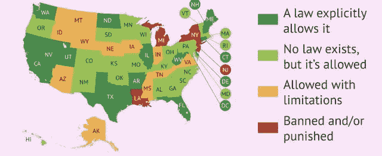
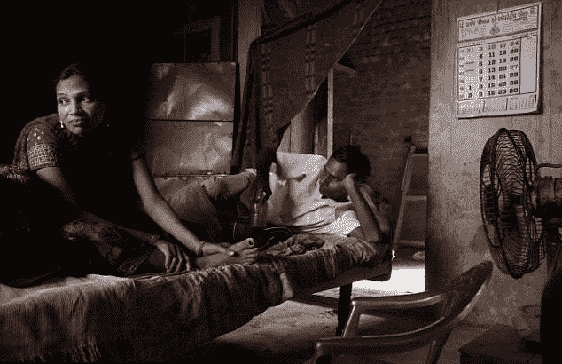
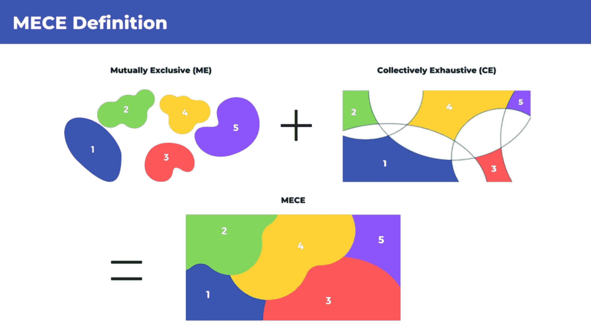
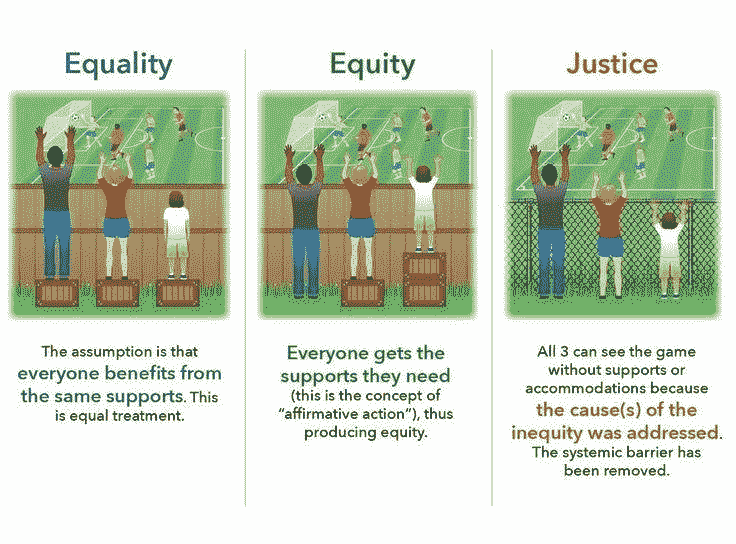

# 文档介绍

本文档由 **公众号懒人找资源** 整理分享，仅供懒人群群友阅读学习。

请于下载后 24 小时内删除。

请到**看理想**app 里付费支持正版。

若有侵权,请告知删除。

# 梁文道：我所深信的，经得住考验吗？

（公众号懒人找资源，懒人专属群分享）

### 文稿

您好，我是梁文道，我很开心能够在这里推荐我的朋友庞颖在看理想 APP 推出的新节目《思辨力：像辩手一样思考》。

一开始我要先说句老实话，我年轻的时候也参加过辩论队，玩过辩论比赛，但没多久我就觉得自己实在没兴趣。为什么呢？那是因为当时年少的我觉得辩论这件事情太无聊了。你想想看，你是抽签选一个立场，然后你就要想尽办法去替自己那个未必能够很赞同的立场去给它辩护，这多没意思呢！

可是后来到我渐渐长大，尤其是后来看到像庞颖这些很出色的辩论奇才们的表现之后，我发现我错了。

为什么？因为就像庞颖在这个节目里面所说的，有时候我们如果抽到了一个自己不赞成的立场而还要拼命替它辩护的话，这是什么样的一种情况呢？你当然可以说这是不是有点像律师，有时候接到一个案子，不一定很想认同你的当事人的角度，但可能是法庭指定，你没办法。

你当然可以这么说，但是我觉得最重要的就是， **你能够换一个角度去思考，去同情地理解跟更深度地认知那些你本来不认同的立场**  
。这个时候，你不会再轻易地把所有你不认同的一些的角度、你一开始不太能够接受的立场，都看成是提出这些立场或者站在这种立场上思考的人都是笨蛋，都是我的敌人。不会的，你就会开始变得从他们的角度想，他们是否也有他们的道理呢？

当然最后并不是说我完全就要放弃自己的立场、自己原来的坚持，而是你可以反过来去理解，到底我的坚持的价值有多大呢？我原来深信的那套东西到底有多经得起考验呢？这样一来，对于自己原来深信的东西，你一方面当然可以增加了更深的理解，同时你还可以更理性地、更客观地、更宽容地去认知这个世界上面林林总总、形形色色不一样的思路，不一样的角度。

所以我很希望你跟我一样，都能够透过庞颖的这个节目学到更多辩论所要求的逻辑思考的方法，理解对方言语能力的角度。  
**如果我们每个人都能够更好地学到这些技巧以及方法，更重要的是态度的话，我相信我们未来的公共生活应该有可能变得更加理智、更加富有同理心。**

# 黄执中：在日复一日的柴米油盐中，多感受思考这种“奢侈”

（公众号懒人找资源，懒人专属群分享）

你好，我是黄执中。

想当年，在大学的时候，有个老师说过一句话，让我印象很深。

他说辩论呐，其实是一种奢侈的贵族运动。什么意思呢？你想，一般人平常在意的通常都是些什么问题？都是些与他切身相关的，柴米油盐之类的生活问题，好比：老板什么时候给我加薪呀？小孩功课不好怎么办啊？客户这个要求，要怎么达成啊？而我们的脑袋、精力与才情，往往就耗在这些问题上面。

当然，这没什么不好，很正常。但也因此，如果有个人，能够在她日复一日的日常问题中，短暂地，抽身而出，试着去思考一些，所谓"无关紧要"的问题，好比：同性婚姻该不该合法化？二十岁一夜成名是不是好事？

你看，能够做这种事的人，该有多奢侈？

因为，它不是让你放空，不是让你什么都不想，而是帮你的脑袋，换一种刺激，去试着为一些与己无关的事情伤伤脑经，这是一种很宝贵的刺激大脑的方式。所以我常常推荐别人，去参与一些辩论思考。因为即使你口才不好，但听听别人在辩论中的思考，让自己的脑袋，有机会跟着颠过来，倒过去…那感觉，特别奢侈。

所以今天这条音频，就是想跟大家介绍我有个学妹，叫庞颖，她在看理想上做了一档节目，叫《思辨力，像辩手一样思考》。

庞颖这个学妹啊，有两个特色：

**第一是在辩论上，她很专业。**  
庞颖她自己也许不好意思说，但是在她担任新加坡国立大学辩论队教练的时候，新加坡这支队伍的战绩，连续四五年都是全亚洲第一，那都是庞颖教出来的。所以在辩论上，她绝对够专业。

**第二个特色，是庞颖这个学妹个性特别朴实。**  
她的辩论，重点都不放在口才上，也不搞情绪。所以，听庞颖讲辩论，全是干货，都是一步一步的推论与逻辑，对于想刺激脑子的人，特别有帮助。

在日复一日的柴米油盐中，如果你想"奢侈"一点，让辩论刺激一下脑子，那么，会特别推荐庞颖的这个节目《思辨力，像辩手一样思考》。

我是黄执中，到时候，我也会跟你们一起，听她这门课。

# 许飞：我渴望拥有精准提问、淡淡反驳的能力

大家好，我是许飞。

阿庞终于做出了我期待了很久的辩论节目，今天我要兴高采烈地向大家推荐这个新节目。

做音乐许多年，我没有其他奢望，只盼着自己说的也能像唱的一样好听。在无数的工作中，每当与人对谈甚至争执后，我都会重重地自责，"当时我要是说这句话就好了"，"那会儿我要是不那么说多好呀"……可是哪有后悔药可以买啊，所以我无比羡慕并渴望能够拥有精准提问、淡淡反驳的能力，这也是阿庞和阿詹的辩论我至今都百看不厌的原因。

生活的迷雾与嘈杂常把我们搞得晕头转向，谁不想沉浸在初秋的虫鸣细雨中呀？谁不向往无边无际的大草原和蓝蓝的天呀？然而谁真实的生活不是刀光剑影呢，所以此刻阿庞的辩论节目就太具有诱惑性了。

阿庞有着聪明绝顶却又令人愉悦的说服力，同时兼备最系统的、由无数优秀辩手验证过的强大教学能力。表面上教大家辩论，底层逻辑其实也是在教我们如何明察秋毫，发现自己和他人的陈词滥调、成见与弊病。

希望阿庞的新节目可以帮助到更多和我一样的听众，让我们一起坚持不懈地勤于思考，通过学习来不断塑造我们的心灵，让头脑更具开放、批判和对话性，让我们一起获得更多的力量。

# 詹青云：遇到进退两难、无从着手的反驳，她是我第一个会想到的人

你好，我是詹青云。

我跟阿庞因为辩论相识已经超过 10 年了，在这 10 年里她始终是我最好的对手、队友、教练和幕后军师。我自己最喜欢的、最觉得有所得的那些辩论赛，或是我在屏幕上偶然留下过的"金句"，背后总有她无私的帮助和参谋。

阿庞是一个非常亲切而靠谱的人，无论是刚刚进队毫无辩论经验的小朋友，还是像我这样已经在辩论里沉浮了十几年的老辩手，每当我们遇到毫无头绪的题目、进退两难的困境、无从着手的反驳或是茫然纷乱的思绪的时候，她总是我们第一个会想到的人。

她有一种让人镇定和安静下来的力量，为"剪不断、理还乱"的一团思绪搭建出条理分明的框架，把一团问题变成一个个可以逐步去回答和解决的问题。她是我的私人智库，也是大家的军师。

思辨和表达能力这件事有的人靠的是天赋，有的人靠的是在实践当中对得失的不断总结，对经验的不断辨析，孜孜以求不断精进。

当然从繁杂的事例中抽象出规律，从自我的实践和指导他人的实践中总结出方法，而且是可迁移可分享给他人的方法论，这本身也是一种天赋。

相比于阿庞作为一个辩手的天赋，她作为教练、作为方法论的探寻者和分享者的天赋，尤为让我佩服，让我自愧不如。

很高兴看理想找到了阿庞，也很高兴阿庞找到了看理想，这个平台能够赋予她最大程度的自由，去用它特有的亲切朴素但是又利落的表达方式，把她自己实践过用来帮助过我，也帮助过许许多多其他的辩手和职场人的这套方法分享给大家。

对我来说，辩论看上去仿佛只是一个业余爱好，但事实上在我求学、升学、求职、升职的这些年里，思辨的能力，有理有据的说服的能力始终是不可或缺，至为重要的基础能力。

我曾经在看理想为大家讲过一个叫《像律师一样思考》的节目，我想《像辩手一样思考》是《像律师一样思考》的基石，也是它的升华；而《像辩手一样思考》，通往的一定不只是《像律师一样思考》，他也通往像职业经理人、像战略咨询师、像团队领导者或是像高校的打工人一样思考。

希望这个节目在接下来的一段时间里成为大家亲切但又充满启发的一段陪伴，也在未来更漫长的时光里，成为一个常思、常新、常学、常有所得的更为久远的陪伴。

# 0\. 如何在网络混战中发现真正的分歧？

### 文稿

大家好，我是庞颖，我是一个辩论教练，也是一个管理咨询顾问。

可能多数听说过我的朋友都是因为《奇葩说》，我参加过两季。其实在《奇葩说》之外，我打过十几年的辩论，曾经代表新加坡国立大学和哈佛耶鲁辩论联队拿过许多国际冠军。我也做过新加坡国立大学的辩论教练，系统地教过大学生，也教过中学生。我做教练那几年，几乎拿遍了所有国际大赛的冠军，这种成绩在之前和之后都非常少见。

2018 年的时候，我从耶鲁管理学院硕士毕业加入了波士顿咨询公司。从最开始参加 MBA 的入学考试，到求职时的案例面试，到真正的日常工作，辩论的训练都让我这条路走得相对轻松一些。我的很多同事和同学他们都表示，他们常常能在我分析问题和发表观点的时候看出辩论的影子。所以他们常常问我，能不能把对辩论的理解和在辩论中学到的东西总结出来，讲一些对每一个人都有用的东西，讲一些对不参加辩论赛的人也有用的东西。

#### 辩论有关思辨的技术和艺术

其实我很认同他们，辩论对我个人来说，帮助更大的部分其实是在辩论赛之外。

有人可能会觉得，辩论就是口舌之争或者就是一个口语表达的能力。我并不这么想，我认为学习辩论对人至关重要的改变和提升其实是内在的思辨力。

什么是思辨力？它包括逻辑分析、思维框架、思考与表达时的清晰性和条理性，还有深度理解事物的能力。

什么是深度理解事物的能力？比如说在错综复杂的事物中，什么是核心，什么是杂音；在看似无关的事物中找到共通联系是什么，什么是一致的底层价值，什么是共通的逻辑思路；我们如何把一个庞大的问题切成小的问题来分析和解决它……

所以引申来讲，思辨力与人的认知能力和学习能力是非常共通的，它是人的底层能力，自然会在生活、工作和学习中都发挥巨大的作用，所以无论是在国内的公务员考试，还是美国的商学院、法学院的入学考试，它的题目都与辩论有极大的重合。

比如说我之前作为咱们看理想平台另一位主讲人青年律师詹青云的法律节目的常驻救场嘉宾，我与她录过几期番外，比如美国工厂是福报还是剥削，推特封禁特朗普的账号是利大于弊还是弊大于利。

你看，我是一个非法律人士，我参与了一个法律节目，这侧面证明了思辨力的应用范围是很广的。

再比如拿我的日常工作来举例。我是一个管理咨询顾问，我的专业就是给各行各业的决策者出谋划策。很多时候我作为乙方，我面对的甲方是年资和行业经验都比我更加丰富的企业董事、政府高管等等。所以第一个问题是我如何利用自己分析问题、解决问题的能力去真正地创造价值，第二个问题是如何让他们信服我是真的在创造价值。

其实这一份工作的内核和辩论并无两样，我们需要的东西是非常一致的：我们需要缜密的逻辑和分析、详实的数据和佐证、真正有价值的洞见、愿景和价值观上的共鸣，还有清晰的思路和表达。甚至有的时候开会的时候，现场情绪上的连接都非常的重要。

什么是现场情绪上的联结？比如说《奇葩说》曾经做过一个数据分析，他们发现，开场的人能不能把气氛搞起来，对整场辩论内容的走向都有至关重要的作用。

所以有道理是一方面，别人愿不愿意听你的道理，你如何把你的道理更好地组织和表达出来也非常的重要。这就是为什么辩论既需要理论和数据，也需要好的例子和故事。所以，辩论既是一门技术，也是一门艺术。

辩论我们抽到的立场不见得是我本人的天然立场，但很多时候我们去摒弃我们原有的立场、偏见和情绪，去站在对立面思考，是会有收获的。有的时候我们会发现一些之前没有想到的对方的合理性、对方的点，又或者是我们发现了对方与我的身份不一样，所以看事情的角度不一样，又或是我们成长的经历不一样，所以造成了底层价值观的不同等等。

或许最后我内心的立场并没有变，但是对方在我的眼中不再是一个非蠢即恶的人，我们的分歧是可以放在理性层面去进行讨论和碰撞的。在动不动就站队和网暴的环境中，能够拥有这样的一种理性的心态和理解，本身已经是一种收获了。

我们举一个具体一点的例子，比如说代孕能否合法化的问题。这么说吧，我既可以帮正方也可以帮反方去辩护。并不是因为我这个人没有原则，而是因为代孕合法化是一个非常复杂的事情，我们有无数的看待它的角度和方式，这个问题能够被切分为许多不同的环节。

我们是完全讨论原则，还是要考虑具体的操作问题，它得到的支持或不支持的答案是不一样的。

那今天，我们拿三种代孕来举例讨论。

第一种代孕，《老友记》里面的 phoebe，她自愿为自己的亲戚代孕。没有人逼她，甚至没有人去劝她，她这种是纯自愿的非商业行为。

phoebe 自愿为他人代孕

第二种代孕，比如说美国，即使是商业代孕也是合法的。一个人可以通过帮他人孕育胎儿去赚钱。

美国各州对商业化代孕的态度

第三种代孕，比如说印度的代孕村，不但代孕的价钱已经被压到非常低了，那里的女性甚至会被丈夫和家人逼着去代孕，他们会说"你有能够躺着为家里赚钱的机会，你为什么不去呢？"

印度代孕村

所以，当我们在反对代孕时，我们反对的是哪一种代孕合法化？我们反对的是什么？

如果我们连第一种 phoebe 的自愿的代孕都反对，那很有可能我们认为代孕这个行为本身有一些本质性或原则性的问题。比如，从伦理来说，我们觉得一个人不能够孕育他人的基因；又或是一个孩子不能同时拥有两个生理意义上的母亲；又或者当一个事情对身体有危害的时候，我们不能够让他人替我们去承担风险，哪怕那个人是自愿的，等等原则上的问题。

那如果我们支持第一种代孕，不支持第二种商业化的代孕，那很有可能这个问题出在商业化上面。我们可以 996，我们可以出卖时间、出卖劳力，但是有一条线，当过了这条线，这个东西对我们生命和身体的影响过于大的时候，我们认为，它不能够被交易。因为在这个世界上，贫富权利的天平过于倾斜，一旦我们把这样的东西放到交易市场上去，穷人或者弱势群体就会丧失对自己生命和身体的掌控权，我们会经历不同形式的威逼利诱。这是为什么，我们反对任何商业化的代孕。

那也有可能，我们支持第一种和第二种的代孕，但是反对第三种的代孕。在这种情况下，我们应该是认为商业代孕在原则性上是没有问题的，只不过我们认为印度现阶段还没有达到那种社会发展水平。印度的医疗条件非常差，对孕母的法律保障也非常差。

那在这个时候我们要问自己的一个问题是：那一个社会要发展到什么程度才叫作"够好了"呢，才叫作可以支持商业化代孕了呢？是它的整体富裕程度的问题，还是贫富差距的问题？还是法治建设的问题，医疗水平的问题？甚至是一些软性的条件：一个社会有多么尊重个人的自由和选择？一个家庭有多大的能力可以把一个家庭的决定强加在个人头上这样的文化问题呢？这样的话我们就会知道，有什么样的指标要去监测，有什么样的改变要去推动，那这样我们就可以判断，一个社会在什么时候可以支持商业代孕的合法化了。

你看，这么复杂的问题，你在理论上支不支持？你在现实中支不支持？你认为一个人自愿的去帮别人代孕，你支不支持？还是你认为在一个性别权力结构不平等的今天，在一个贫富权力差距甚至没有办法被消灭的世界上，你认为真正的自愿、有效的自愿是根本不可能的？这都有可能。

可是现在在社交媒体上，我们很难看到这样的心平气和的理智的去讨论问题、分析问题的环境了。社交媒体更像站队，你站 A 被 B 骂，站 B 被 A 骂，不站队，所有人都骂你，说你装死，这就比较遗憾了。所以希望看理想的平台能够成为一片净土，供我们思辨。

#### 如何做到思辨？

我们现在来提取一下，在刚才这个问题的分析中，有什么可迁移的思辨力是对我们日常的思考、工作和学习有用的。

**第一，保持思想上的开放，不急于下结论。** 愿意站到对方的角度去看问题，愿意把大问题切成小问题去进行分析，这种愿意聆听和思考的态度本身就是很有用的。

**第二，很多常见的分析问题的思维模型、逻辑思路都是可以放到别的地方去用的。**  
比如说刚刚我们在谈论代孕的时候，我们提到了一个"理想状态是什么样"和"现实状态是什么样"的一个区分。理想状态我们探讨的是它的原则，现实状态我们探讨的是操作中的损益比。它有点像物理中的摩擦力的问题，当我们忽略摩擦力的时候，我们看的是什么；当我们加回摩擦力之后，它的表现又会是怎样。这种切题思路可以帮我们快速的锁定与对方的共识在哪里、分歧在哪里。

**第三，如何去论证，如何表达，用什么样的例子，用什么样的数据也非常的重要。**  
比如说我今天是要支持代孕的，我去分享，我见过一个美国同事，分享她代孕成功的照片，照片里包括她们一家人，包括医生，包括代孕的孕母，包括孩子，气氛非常温馨和谐，孕母本人也笑得非常的发自内心。放上这样的材料，会不会更好地佐证我们的论点？

又或是刚才我们挑出了 Phoebe、美国和印度这三个例子。这世界上有这么多的关于代孕的例子，我们挑选出哪一个才有可能最有效的展示它们之间相通的逻辑和它们彼此之间的差异和分歧、更加有代表性，可以供我们最快速有效地分析这个问题？这个也是一种可迁移的技巧。

所以总结，开放理性的思考，缜密的逻辑，恰当的论证和表达，这三样东西加在一起就是思辨力。

#### 我将讲哪些内容

我们现在回到这个节目要怎么做。

我会以内容有趣、引人思考为第一要义，同时我会总结出一些可迁移的思辨技巧和方法，让大家可以应用在其他的场景中去举一反三。如果你有研究过学习能力和认知能力的提升，你会发现，"举一反三"是人提升认知能力的至关重要的环节。

整个节目的框架会有三大板块：第一，破；第二，立；第三，经典辩题。

我们先说第一部分，破，也就是反驳。很多人喜欢辩论，或者说发现自己的辩论天赋都是从喜欢怼人开始的，也就是我会教你如何用逻辑和思辨给别人挑错。

比如，有人说女性不结婚，人到中年的时候很惨的。我们可以说，错，您这是因果倒置。不是因为女性到了中年收入下降，所以需要家庭的支持，明明是结了婚的女性收入才开始下降。

我们会一起去分析很多逻辑的谬误，为什么相关性不是因果性，什么是循环论证、虚假两难、以偏概全、偷换概念，常见的数据错误有哪些等等。我们会把这些问题都包在有趣的辩题中去进行分析和讨论，这是第一部分。

第二部分我们再讲立。为什么先破再立呢？为什么破完之后还要立呢？会拆台，不代表自己能搭；会说别人错，不代表自己知道什么是对。这种杠精我们见得多了。所以第一部分更多的是点对点的逻辑拆解，到了第二部分，我们的重点是大局观，是论证的整体结构。

比如说在政策性辩论中，我们常常用的一个框架叫做 **" 需根解损"**，需求性、根属性、解决力、损益比，这是一套分析政策的框架。

比如我们今天讨论要不要对垃圾食品收税，我们不仅要讲垃圾食品给健康造成的伤害、给医疗系统造成的负担等等需求性和根属性，我们还要讲解决力。

什么叫解决力？你这个税能收得上来吗？比如说夜市卖炸鸡的，连个流水都没有，你怎么去收这个税呢？我们还要讲损益比。什么叫损益比？比如说你怎么定义垃圾食品，一碗阳春面只有碳水，这是不是垃圾食品？富人当然不这么吃，他们吃高蛋白的、贵的、健康的，但是穷人他依赖高卡路里且便宜的食物，为体力劳动提供能量。你这个税要怎么征呢？你征了垃圾食品税，会不会对穷人的生活成本影响非常大？这么干是不是弊大于利的呢？

我们再举一个框架的例子，我们管理咨询有一个词叫做 **MECE** （mutually exclusive, collectively  
exhaustive），它中文的意思是相互独立、完全穷尽。也就是说，对于一个重大的议题，我们把它拆成不同的方面、不同的角度或论点去进行分析，它论点彼此之间能够做到不重叠，它加在一起能够对这个问题做到不遗漏。

MECE 分析法

这个思路放到辩论里也特别有用。比如说有一类辩题是刘备和曹操谁更适合做领袖，林黛玉和花木兰谁更适合做女友，这种问题很容易沦为一方说一个优点，另外一方说一个缺点，这一方再说一个优点，另一方再说一个缺点等等。

可是如此列举，那算谁赢呢？我们一定要从整体的思路上手，给这个比较框定一个比较标准，一个框架。

比如说我们可以说领袖一定要做到这三个部分：第一，组建团队；第二，运营团队；第三，带领团队。因为曹操在从头至尾这三个环节都更加优秀，所以更适合做领袖，这样就比大家散着往外扔曹操和刘备的优点和缺点要更加有逻辑有结构。

总结一下，在立的部分，我们强调的不再是点对点的逻辑，而是框架式的思维方式，它更加的整体和宏观的去分析问题。在破和立的部分，我们的每一期节目会着重讲解一个核心逻辑或是一个思维框架，然后我们用几个有趣的辩题去讲解和举一反三。

第三部分是经典辩题。我们的每一期节目会以一个经典辩题为核心，去带出那些最底层、最能够被举一反三的分歧的思辨方法。

其实这个世界上的分歧千千万，可底层的逻辑模型和价值观的分歧就那么几种。我会邀请我的对方辩友詹青云与我来一起辩论一些经典的题目，比如杀一救百是不是正义之举，什么是正义，经典的电车难题有太多可以应用到现实中的场景。

比如说 2003 年 SARS 期间，台湾和平医院发现了几例 SARS 的病例，当时我们缺少有效的预防治疗 SARS 的方法，而且这个医院它里面条件比较简陋，它缺乏单独隔离的硬件。换句话说，如果把这个医院关了，它里面的人就会交叉感染；但如果这个医院它不关，里面的人走出来，有可能会在社会上造成感染，甚至是更多的感染。所以这个时候我们要不要把医院关了？我们关了医院叫不叫正义之举？

究竟什么是正义？正义是对我们行为的指导吗？还是说，正义是一种绝对的律令，哪怕我们做不到，它也不可以妥协？

还有很多相似的例子……

*   安乐死是人道吗？
    
*   对于一个深思熟虑后想要自杀的人，应该阻拦吗？
    
*   我能够售卖我的器官吗？
    
*   我能够自由地决定我想胖就胖吗？
    
*   我如果把我的口腹之快放在个人健康之前，这样的价值排序是比较低级的吗？
    
*   那些为同性恋争取权益的人，Ta 可不可以放弃同性恋是天生的这个论点？
    
*   哪怕同性恋不是天生的，是一个后天的选择，如果 Ta 未伤害他人，可否也应该拥有自由和平等的权利呢？
    
*   我们每个人都承认自由，追求自由，可是当自由被推到了司空见惯之外，你还能接受吗？
    

这一些问题可以供你举一反三，展示如何捍卫某一方，也向你展示如何攻击另一方。真理越辩越明，这句话本身能不能被辩论呢？

辩论是一个非常有用的东西。为什么哲学家要辩论？为什么竞选要辩论？为什么制定政策要辩论？为什么标准化考试要问你如何才能够增强和削弱某一个论证的论证力度？为什么有结构性的分析问题，它本身就可以成为一个高薪职业？为什么辩论训练是常见的培养人才的项目？为什么议论文是每一个人的必修课？

如果你特别喜欢思考，思考那些甚至没有明确答案的事情，如果你想要自己的思考和表达都更加有条理，如果你想把常见的逻辑框架和经典的思辨问题都纳入到自己的知识库中，如果你对提升自己的底层能力----  
**思辨力** ----有兴趣，这个节目应该会适合你。

咱们看理想的编辑丫丫曾经跟我说过一句话，她说她听到过的像我这样能够条分缕析说清一件事情的人真的不多，这话给了我很大的鼓励。看理想的平台上有那么多的大师，我能够站在他们旁边深感荣幸，我会努力把这个节目做好。如果大家在收听的过程中有任何的反馈和建议，请多多留言，我会无比欢迎和感激。

我是庞颖，《像辩手一样思考》这段旅程，请多关照。

# 1\. 相关不等于因果：女性到了中年收入会下降，所以一定要结婚？

（公众号懒人找资源，懒人专属群分享）

### 文稿

你好，我是庞颖。

不知道你在生活中有没有被这样劝导过，比如说我妈叫我锻炼延迟满足的能力，她说因为有实验证明，懂得延迟满足的小孩会更加成功。

也有朋友拿着一张 10 年前的照片跟我说，阿庞，你看照片上的你那么瘦，显得年轻 10 岁，所以你快减肥吧。他们这些心情我是可以理解的，但是他们也说服不了我。因为这种劝导里都有个同样的逻辑错误，就是错把相关性当作了因果性。

相关性指两件事有关系、会同时发生。而因果性代表一者是另一者发生的原因。

我们为什么在第一期节目就要讲相关和因果？这是因为，"错把相关当因果"是生活和工作中最常见的逻辑错误之一。两件事情到底有没有因果关系，也是许多科学研究中核心要区分和解决的问题。比如说吸烟与肺癌有因果关系吗？低雌性激素水平与高心脏发病率有因果关系吗？政治体制与经济发展有因果关系吗？这一季度的销量增长到底是因为我们花了钱做广告，还是仅仅是巧合呢？

#### 相关性不等同于因果性

让我们先用一个最简单且真实发生过的例子来看看相关性和因果性的差别。

20 世纪初的时候爆发过一场非常严重的小儿麻痹症，影响了非常多的孩子。但那个时候没有人知道小儿麻痹症的原因，所以科学家就通过数据分析，终于发现了小儿麻痹症的"罪魁祸首"，他们认为那个"罪魁祸首"就是冰淇淋。

为什么呢？因为他们发现冰淇淋的销量和小儿麻痹症发病率的曲线，两条曲线的起落几乎完美一致。有些人认为是因为冰激凌太凉了会引发小儿麻痹症，有些人认为是冰淇淋太甜了会引发小儿麻痹症，吓得家长禁止小孩吃冰激凌。

但是这个结论正确吗？其实不正确。冰淇淋和小儿麻痹症虽然看似相关，但它们并没有因果关系。因为夏天小孩更喜欢吃冰淇淋，因为夏天小孩与病毒接触的机会更多，所以小儿麻痹症容易在夏天高发，跟冰激凌的销量在时间上就是完美契合的。但并不是因为吃了冰激凌导致小儿麻痹症，家长就算禁止小孩吃冰淇淋，也不能减少或预防小儿麻痹症。

说到这里，我们应该已经意识到了相关性和因果性的差别。相关性只代表 A 和 B 同时发生，但不代表 A 是 B 的因。就好像冰淇凌的高销量和小儿麻痹症的高发病率，它们同时发生，但这不代表是因为吃冰激凌，才导致了小儿麻痹症。所以如果 A 和 B 只有相关性，我们是不能通过改变 A 去影响 B 的，我们不能通过改变小孩吃不吃冰淇凌来减少或解决小儿麻痹症的问题。

那么相关性的作用是什么呢？它可以有一些预测作用。我们可以通过看到了 A 来预测 B 也会发生，我们可以通过看到冰淇淋销量上涨，那小儿麻痹症的发病率可能也要上升了，我们要准备好我们的医疗设施等等。

一句话总结，相关性可以用来预测，唯有两件事具有因果性时，我们才可以通过改变因来影响果。

#### 错把相关当因果，会影响决策和方向

你应该听说过一个非常有名的关于延迟满足的实验，叫斯坦福棉花糖实验。

心理学家找了一群小孩说，面前的这个棉花糖你要是能坚持 15 分钟不吃，我就会再给你一个。然后他们发现那些能够挺住不吃的小孩，在未来成功的概率会更高，所以他们就得出结论，延迟满足与成功之间有因果关系，因为你可以延迟满足，所以你会获得成功。

如果我们接受因果关系的结论，那就代表如果我想要获得成功，我就可以通过培养自己的延迟满足能力而去获得成功。乍一听其实挺老生常谈的，你去搜搜这些关键词，真的有很多成功学、育儿经都在讲，如何提高自己的延迟满足能力，比如，把好饭好菜端到餐桌上但不让吃来训练孩子的延迟满足能力。

但如果这个实验并没有成功的证明因果关系呢？这个实验在后来受到了很多的挑战。

最常见的对于这个实验结论的挑战是，延迟满足与成功之间并不是因果关系，它们仅仅有相关性，背后的真实原因是孩子家庭所属的社会经济地位。

简单来说，有钱家的小孩平时想啥有啥，糖果并不是稀缺品，所以对他们来说忍耐 15 分钟太小意思了。但是对穷人家孩子来说呢，平时吃个糖果就像过年，棉花糖对他的吸引力太大了，这种忍耐就更加困难。所以你看上去，富人家的小孩可以坚持，延迟满足能力就更高。当然由于家庭条件优越，他们接受了更好的教育，拥有更好的资源，自然成功的概率就更大。

所以延迟满足能力和成功，它们是同一个因产生的两个果：因为富有，所以可以不吃那个棉花糖；因为富有，所以成功的概率大；所以延迟满足和成功它们同时出现，它们相关，但它们并不是因果关系。

如果延迟满足和成功之间真的只有相关性，那代表什么呢？那代表我们并不能通过锻炼自己的延迟满足能力来获得更高的成功概率。

这是一个很好的例子，它向我们展示了如果错把相关性当成因果性可能会出现什么问题。它的问题就是，它会指引我们去采取错的行动，它指引了错了方向的，它的这种行动是徒劳无功的，甚至有的时候会耽误真正重要的解决方案。

有一个《奇葩说》的辩题，叫"决意要离婚的父母，要坚持到孩子高考结束吗？"我是反方，也就是该离婚就离婚，不要刻意地坚持和拖沓。正方一定会举很多父母离婚后，孩子受到重大的负面影响的例子和数据，用来证明父母离婚这个动作本身对孩子负面影响非常大，所以要拖到孩子长大一些，不要影响孩子的高考。

可是我们想一想，我们印象中，单亲家庭对孩子的伤害一定是离婚这个动作本身造成的吗？离婚这个行为和对孩子造成伤害这个结果，它们真的是因果关系吗，还是仅仅是相关？

比如说单亲妈妈带着孩子，爸爸不闻不问，要抚养费就吵架，我们觉得没爹的孩子真可怜。可问题是，这跟离婚有关系吗？这样的爹他没离婚的时候他也不负责任啊。爹不靠谱，所以爹妈离婚了；爹不靠谱，所以孩子受伤；所以爹妈离婚和孩子受伤都是结果，它们同时发生，但是不是因果关系，这是归因错误。

所以伴侣不靠谱的时候，我们靠延迟离婚能够争取到幸福吗？不是啊，快点离开 ta，找伴侣的时候不能太凑合，才是真正的解决之道嘛。

再比如，我们或许见过一些离异家庭的孩子不信任亲密关系，然后我们就得出结论：因为离婚，所以孩子不信任亲密关系了。但真的是这样的因果关系吗？会不会有可能是因为婚姻观、教育观落后，所以处理不好感情导致婚姻破裂；同样的，因为婚姻观教育观落后，也没有能力去引导孩子疏导孩子，没有能力让孩子感受到爱学会爱。所以这是同一个因产生的两个果。

如果我们不懂得如何处理感情如何教导孩子，我们仅靠推迟离婚就能够避免对孩子的伤害吗？不能啊。我们只有改变那个真正的因，才有可能影响那个果；我们唯有靠提升自己的婚姻观和教育能力，才能降低对于孩子的伤害。如果不能解决这个因，拖着不离，只会加大伤害。

扯远一句，为什么离婚和伤害孩子是一个直接的因果关系这件事情那么容易被我们接受呢？因为它是我们根深蒂固的思维模式。

很多时候这种根深蒂固的思维模式代表的不仅仅是我们逻辑思维上的懒惰，它也是由于我们改变自己的行为模式、改变自己观念上的懒惰。比起在亲密关系和孩子教育等课题上，不断地学习最新的理念，不断地更新自己的理解和提高自己的能力，隐忍、忍着不离，它其实更在我们的舒适区内。

让我们再来总结一下，为什么相关性特别容易被解读为因果性。当我们看到两件事情同时发生的时候，直觉上就觉得一定有点什么关系，而且高相关性并不是一时或一次同时发生，它们的起落是有巨大的一致性的。

特别是当这种因果的解释符合我们某种预设或者偏见的时候，我们就特别容易直接把它当成因果去看待。比如说锻炼小孩的延迟满足能力有利于成功，比如说延迟离婚会降低对孩子的伤害等等，这些都非常符合我们东方的价值观。

#### 相关却不是因果的三种可能

其实呢，当我们从日常的观察或者数据中看出两件事情，A 和 B 有相关性时，这真的不一定代表是因为 A 所以 B，还有其他三种可能性。

第一种，因为 B 所以 A，它是因果倒置的关系。

第二种，C 导致了 A 和 B 的同时发生，所以 A 和 B 之间并没有因果关系。

第三种，A 和 B 的相关，仅仅是巧合。

所以当我们看到相关性时，我们需要三连问：是巧合吗？是不是因果倒置？有没有第三个因素同时导致了 A 和 B 的发生？关于巧合今天我们就不具体讲了，毕竟能被我们看到的数据分析绝大多数是经过了回归分析的，排除了巧合的这个可能性。那么其他的两个原因，我们各举几个例子。

#### 因果倒置

首先我们来讲第二种可能，因果倒置， **不是因为 A 所以 B，而是因为 B 所以 A** 。

比如有一个说法，"女人到了中年收入会下降，所以一定要成家，依靠婚姻才会有保障"。这挺符合很多人的想象的，女人不善于挣钱得靠男人得靠家庭，但其实吧，"女人到了中年收入会下降"这个数据要看得再具体一些。女职工是生育后工资才下降，女职工生育后工资待遇下降的有 34.3%，其中降幅超过一半的达 42.9%。

所以是因为女性收入下降所以要依靠家庭吗？不是的。恰恰是因为我们进入了家庭，我们为家庭奉献了付出了，在工作上投入的时间减少了，所以我们的收入降低了。并不是家庭解决了我们女性收入降低的问题，而是家庭创造了我们收入降低的问题，这是一个因果倒置。

其实在工作环境中类似的逻辑有很多，比如有数据显示，数字化程度高的企业业绩更好，但这能不能证明企业可以投资数字化转型提升自己的业绩呢？不一定，这个数据本身它只证明了相关，它没有证明因果。说不定是因为业绩好的企业才有钱去搞数字化转型，并不是因为搞了数字化转型所以业绩好。

再比如，有一些数据证明了，对少数群体更包容的企业业绩更好，所以鼓励企业去包容少数群体。但坦白讲，如果就事论事，这一条数据不见得证明了因果性。究竟是因为包容，所以业绩变好了，还是说业绩好的公司才有时间和精力去在公司里推行各种包容性的培训呢？

在这个例子里代不代表这个数据就完全没有意义？也并不是。我们回想一下，相关性给我们的意义是什么？是预测性。如果今天我想找一个业绩好、前途好的公司，我如果看到他们数字化程度高，我如果看到他们很包容少数群体，我管它因果，我至少确定这两件事情同时发生。

#### C 同时带来 A 和 B

我们来讲另外一个相关并不是因果的可能性，C 同时带来 A 和 B 这样的一种结构，这种例子其实是最隐秘的。

比如说有数据显示，哈佛毕业生的收入比其他学校的毕业生要高。如果我们直接把这种关系理解为因果关系，它非常符合我们的预设或者说直觉，代表着因为上了哈佛，所以未来收入提高了，也就是说哈佛的教育能够提高人赚钱的能力。

但是这个数据有考虑那个可能的真正背后的因 C 吗？比如说如果我们看哈佛他们这些学生他们的家庭条件，15%的哈佛学生的父母收入属于全美顶尖 1%。请问，这一些学生毕业之后收入高，到底是哈佛教育的功劳，还是人家父母的功劳呢？因为父母水平高，所以孩子上了哈佛；因为父母水平高，所以孩子毕业之后收入高，完全有可能是 C 导致的 A 和 B 同时发生。如果我们控制了变量，我们比较同等家庭收入的孩子去哈佛的和去其他学校的，他们未来的收入差距能有这么大吗？有真实的数据证明了，没有那么大。

另外我们要借机强调的一点是，因果关系它也不见得是有和无的差别，它有一个强度或者说程度的差别。简单来说，我们并不是否认哈佛教育的作用，并不是说它对提升学生的收入水平一点作用都没有，只是说在没有控制学生父母的收入前，它这个作用看起来非常的大，如果我们控制了学生父母收入这个变量，它的作用就变得小了很多。

我们稍微把这个问题扯远一些。公司的 HR 招聘都喜欢要名校毕业生，有些甚至把名校毕业生设为了硬性门槛。但这真的代表 HR 认为名校培养人才的能力更高吗？其实不见得。名校和人才之间不见得是因果关系，有可能只是相关。入学门槛高是背后真正的因，它是那个 C。

因为入学门槛高，所以这个学校被定义为了名校；因为入学门槛高，所以你毕业生中人才密度就更大，这都是相关的。好学生进来，好学生出去。所以 HR 要求名校毕业生，不一定是相信他们背后的因果关系，非常有可能仅仅是利用了相关性所带来的预测作用。

#### 如何识别和反驳相关和因果的混淆

好的，下面我们来总结一下，我们应该如何识别和反驳关于相关性和因果性的混淆。

首先，要有辩手一般的质疑精神，听到两件事情同时发生或者正相关，先问问真的吗？一定吗？您说了相关，您证了因果吗？怎么证的呢？控制了哪些变量？

第二，对方如果说 A 带来 B，我们就试着反着说，B 带来 A，听一听能说得通吗？如果能说得通，问问对方排除这个可能性了吗？

第三，想一想，有可能有什么样的 C 会同时带来 A 和 B，问问对方这一个变量您控制了吗。

在这里我们就不得不引入两个统计学的概念。

第一个概念叫做 **" all else  
equal"**，所有其他的东西都一样，控制变量。像是最常见的家庭背景、收入、教育、族群，肯定都要控制一下，在这些东西相同的情况下，再去比较我们想要的那个变量。但是兴许有一些我们未知的 C，没想到的 C，我们无法主动地去挑出这个变量去控制。

最简单的达到"all else  
equal"的场景，就是利用随机性。我们随机选出两个完全随机的实验组，所以理论上来讲它们是一样的，只去改变我们要考察的变量，然后再去看结果，这一个是通过随机性创造的"all  
else equal"。

第二个统计学概念叫做 **" difference in  
differences"**，在不同中的不同。什么意思？其实很简单，我们举个例子。比如说我们公司季度的销量增加了，有多少归功于季节因素，有多少归功于我们新请的形象代言人呢？

比如说整个市场从春季到夏季，销量涨了 50%，但我司的销量涨了 70%，我们基本上做了一件特别的事情，就是请了一个形象代言人，所以大概率那 20%就是我司跟市场比起来做出的额外努力的成果。如果我们知道请代言人花了多少钱，我们也知道 20%的销量是多少利润，这就很容易比出来请这个代言人到底划不划算。

#### 尽信数据不如无数据

我们来总结一下，有数据很好，但是我们要抱有思辨的精神和习惯。

有的时候科学研究的论文里面会很诚实地写道，我们这个实验只证明到了相关性，因果性还未知。但是一到新闻报道里面和我们寻常人的理解里面，瞬间这个相关性就变成了因果性，特别是当这个因果的关系特别符合我们的直觉、思维定式、惰性或者先入为主的观点时。

我们再回到开头举个例子，有人拿着我 10 年前的照片跟我说，阿庞，你看照片上的你那么瘦，因为瘦，所以显得年轻 10 岁，所以你快减肥吧。

因为瘦显得年轻，或者人就应该减肥，这也很符合我们的思维定式。但是这张照片它本身就是个 10 年前的照片，10 年前，其实是那个 C：因为 10 年前我代谢快，所以我瘦；因为 10 年前，我当然看上去就年轻 10 年；所以瘦和年轻 10 年它本身是一个相关，并没有因果关系。现在你让我减肥，本来脂肪让我的脸显得很饱满，我这一瘦，坏事了，脸塌了皮松了，看着更老了。

所以，当我们误把相关性当成因果性解读的时候，它会对我们的行为产生误导，所以我们说尽信数据不如无数据。

相关性和因果性有时的确很难区分，但它们的差别却十分重要。我们再最后重复一次， **相关可以帮助推测，但只有因果才能够通过改变因去影响果** 。

最后给大家留几个思考的问题。

第一，大家可以去查查，低雌性激素水平与高心脏病发病率之间有因果关系吗？我们能够靠注雌性激素降低心脏病的发病率吗？这是历史上真正的我们混淆了相关和因果的例子。

第二，每天跑步 5 分钟能更长寿，有什么说得通的 C，有可能会同时带来每天做到跑步 5 分钟和更长寿的呢？

第三，有这样一个数据，说结婚的时候买的钻石越大，离婚率越高。我想问问大家，这中间是因果关系吗？因为钻石大，所以离婚率高，还是说有什么其他的解释方式呢？

好，这一集就到这里了。谢谢大家，我是庞颖。像辩手一样思考，下集见。

# Q&A; | 性解放会降低生育率？

（公众号懒人找资源，懒人专属群分享）

### 文稿

你好，我是庞颖。

今天是第一期问答，我们会来讲上一期那个关于"相关性和因果性"的正题最后给大家留下的三个共同思考的问题。以后大概率我们也会跟着这个模式，在正片的时候讲某一个概念，最后留下几个大家一起思考和讨论的问题，然后在问答的部分我们再来解释这几个问题。

#### Q1: 注射雌性激素能降低心脏病发病率？

第一个问题是与雌性激素水平和心脏病发病率有关的。这两个东西之间究竟是因果关系还是相关性而已呢？

最开始的时候，科学家发现了数据，这个数据证明，低雌性激素水平和高心脏病发病率之间，它是一个正相关的关系。我们最开始把它解读为了一种因果。

如果是因果的话，就代表因为我的雌性激素水平低，所以我的心脏病发病率就高；为了降低我的心脏病发病率，我可以改变我的激素水平。所以就有这样一个激素疗法，通过给一个人注射雌性激素，然后想要降低他的发病，但实际上这个对高心脏病发病率并没有作用，我们就发现了其实这两个之间并不是因果关系，而是因为第三个因素 C。

这个 C，其实是女性的更年期，更年期同时带来了雌性激素水平的降低和心脏病发病率的提高。所以雌性激素水平和心脏病发病之间只是相关，并没有因果的关系。

#### Q2: 每天跑步五分钟能更长寿？

我们留下的第二个问题是，每天跑步 5 分钟是否可以更长寿。

有这样一个数据证明，每天跑步 5 分钟的人更能长寿。听着有一点道理，但如果我们把这件事情解读为了因果关系，那就代表如果我想要长寿，我只需要做到每天跑步至少 5 分钟，就能够有一个明确有效的效果。

但实际上这个研究它仅仅是一个观测性的研究，它并没有建立每天跑步 5 分钟和长寿之间任何的生物学、化学、分子学或者是荷尔蒙上的关系。我们想一想，那些能够做到每天跑步 5 分钟的人，他们非常的活跃，这一些人和那些做不到每天跑步 5 分钟、非常不活跃的人，他们应该有很多其他的差别。这些差别被控制变量了吗？这真的是一个只有一个变量、"all  
else equal"的对比吗？

那有可能它们是有一个共同的因素 C，这个 C 是这些人非常在乎健康且非常自律。因为在乎健康且自律，他们能够做到每天都够都去跑步，每天运动至少 5 分钟；同时因为非常在乎健康，也非常自律，这些人可以做到睡眠健康、饮食健康、不抽烟、不喝酒等等，很有可能跑步和长寿之间它们仅仅是一个同时发生的相关的关系，其实是那些所有的饮食习惯、睡眠习惯、生活习惯等等，带来了长寿方面质的改变。

如果你那些东西不做，仅通过每天跑步 5 分钟，能不能做到有效的长寿？那很难。在这一个实验里面，这些变量并没有被控制。

什么叫做真正地控制变量？如果今天你能够做到你这种观测性上的研究有两个实验组，实验组上的人他们饮食习惯是一样的，关于抽烟，关于喝酒、睡眠等等所有我们已知的与健康有关、与长寿有关的东西，他们的变量完全都是一样的，在这种情况下只动了跑步 5 分钟这一个变量，或许我们还能证明这是因果关系。但实际上这个观测并没有做到这些点，所以不能够得出因果关系的结论。

而且今天我们要讨论的跑步这个问题，它跟那些饮食习惯、其他的生活习惯，它们本身之间就是有巨大的相关性的，所以说你想要找到唯有跑步这一个变量变，所有其他的生活习惯都一样的实验组，这本身就是一个非常难的事情，甚至可以说几乎是不可能的事情。

#### Q3: 为什么钻戒越贵，离婚率越高？

第三个例子是说有一个研究发现，订婚（结婚）时的钻石戒指越贵，离婚率就越高。有一些新闻把这个数据解读为了，因为在结婚的时候买了特别贵的钻戒，所以更容易离婚，所以不应该买太贵的钻戒。这就是一个因果性的解读，你可以靠买更便宜的戒指，降低离婚的概率。

但是这个听上去有点玄学，是因为买太贵的戒指不吉利，所以导致了你离婚概率变高？或者是因为买太贵的钻戒花钱太多了，让你婚后的生活根本维持不下去，所以更容易变高？所以因果性的解释是稍微有一点扯的。那会不会是背后有其他的原因造成了这两种现象同时出现？

比如会不会是因为收入问题？因为高收入，所以更容易买更贵的钻石；因为高收入所以更容易离婚，比如诱惑更多，或者离婚时没有经济上的后顾之忧等等。所以是高收入同时带来了订婚的钻戒贵，同时带来了离婚率高。

又或者说会不会是因为学历问题？因为高学历所以高收入，所以买大钻石；因为高学历，所以思想更独立，所以对离婚的负面偏见更少，想离的时候就离了，那是因为高学历同时带来了钻戒贵和离婚率高。

总之，大钻石和离婚它都是共同的 C 带来的果，你可以靠钻石的大小预测离婚率，但不能靠在其他因素都不变的情况下，仅仅靠刻意去买小的钻石而降低离婚的概率。当然了你也不能在其他因素不变的情况下，靠买大钻石增加离婚的概率。

#### 判断因果先"三思"

再重申一下我们之前的观点：相关性可以用来搞预测，因为这两个果常常会同时发生；但是当这两件事情没有因果关系的时候，我们是不能够通过改变一者来影响另一者的。

在判断两者的关系时，有三种它们当中并不是因果关系的可能性。

第一种，可能是这两个同时发生的事情的发生仅仅是一种巧合。

我随便举个例子，比如说萧敬腾一开演唱会就下雨，这是因果关系吗？真的是因为萧敬腾开演唱会，所以下雨吗？这八成是一种巧合，只是说他来的时候没有下雨的时候我们都不提，他来了下雨的时候我们大家都去宣传，所以给我们造成了这样的印象，这个是第一类。

第二种，A 和 B 同时发生，但并不是 A 带来了 B，而是 B 带来了 A，这样就是一种因果混淆的状况。

比如说什么？在美国曾经有一段时间，他们认为应该培养孩子的无端自信，因为孩子的高自信和学习成绩好这两件事情有非常大的正相关，他们认为是因为自信所以容易表现好。但是这样教育了很多年之后发现原来这个因果关系是反着的，是因为有些小孩表现好，所以他们更自信，你光靠培养孩子的无端自信是没有办法带来他们学习成绩的提高的，这个是一个因果倒置的例子。

第三种，并不是 A 带来的 B，A 和 B 同时发生，是因为 C 带来了 A 和 B 的同时发生。我们已经举了非常多的例子讲了这个 C 的情况，我就不再赘述了。

#### 发现生活中混淆的相关与因果

最后，我想鼓励大家在浏览微博或者是其他互联网内容，或者是在工作、学习、生活当中，多去看看有什么把相关性和因果性混淆的例子，因为这种例子特别多，特别好玩。

我们借这个机会，也来讲一下我前两天读到的一条微博，这条微博很显然也是混淆了相关性和因果性。

他转发了一个数据，这个数据说的是我国总和生育率低于国际警戒线，所以忧国忧民，要为国家出谋划策。这个心态我们是很赞扬的，只是说他出的这个谋、划的这个策实在是有问题。

他认为，为了提高我国的生育率，我们不能够性开放，不能够性解放。什么意思，我们必须把性生活与生育这个目的给绑定。他的论证是什么？他认为你放眼全球，你会发现全球那些性开放的地方是生育率比较低的地方，全球那些性不开放的地方是生育率比较高的地方。所以性开放与否是因，生育率高低是果。

这种因果判断是一个很明显的混淆。为什么？它其实是跟这个国家的发展的程度有关系的。当我们从一个落后国家发展为发展中国家，进而发展成发达国家的时候，它会同时带来两个果，一个果是我们的思想，我们的观念，包括性观念变得更加开放了，另外一个果是说生育率降低了。

生育率降低有可能有很多原因，比如说当我们社会经济更发达的时候，我们不需要人力去务农了；又或者是说因为我们的整个社会发展的水平更高了之后，大家对教育质量的要求更加高了，生活成本也更加高了，所以养育的成本太高，你又没有那么需要的情况下，从整体上对个人来说从经济上没有那么划算，所以生育率就低了。

所以性开放与否和生育率高低与否，它是社会发展状况同时带来的两个果。你不能说我国现在我们已经经济社会比较发达了，单纯靠性开放这件事情上去开倒车就能提高生育率？先不说在性开放这件事情上开倒车在价值上是不是我们应该倡导的，它从逻辑上也是一个混淆了相关和因果性带来的错误的结论。

好的，谢谢你，像辩手一样思考，我们下期再见。

# 2\. 实然不能论证应然：从来如此，便对吗？

（公众号懒人找资源，懒人专属群分享）

### 文稿

你好，我是庞颖。

有一句话叫"落后就要挨打"，我们应该如何理解这句话呢？

第一种理解，落后时更容易会有人来欺负我。第二种理解，如果我落后了，别人打我、欺负我无可厚非，落后的人和国家就应该被别人欺负，甚至是消灭。这两种不同的理解就分别对应了两个概念：实然和应然。实然，descriptive，对现实的描述；应然，normative，讲的是什么是应该的，什么是好的、对的、值得追求的。今天我们就来区分这两个概念。

#### 他不该杀人 vs 他杀了人：实然如此，应然不该

让我先用第一个最简单的例子来阐明基础概念。

第一种说法：他不应该杀人。这是应然判断，因为我们讨论的是对错。第二种说法：他杀了人。这是实然判断，没有在探讨对错，只是说这件事情发生了。比如说警察和法官在调查取证和审判时做的是实然判断，我们讨论人应不应该杀人，人有没有自杀的权利，我们应不应该废除死刑，我们能不能堕胎合法化等等，这是应然层面的讨论。

在这个例子里，应然是立法层面的判断，实然是执法层面的判断。有时我们会问，"应不应该支持安乐死呢？"有的人会回答说不应该，因为安乐死不合法，这就是问的人和答的人两个讨论的层面错开了：  
**问的人想讨论的是我们应不应该改变现状，回答的人说的是现状是这样** 。

这两个概念也是很多学科中的基础概念。比如在哲学中，道德是一种应然层面的主张，探讨的是什么是对的，什么是应该追求的。再比如，行为经济学和传统经济学有什么不一样呢？传统经济学假设人是理性的，所以按照理性去推测人的行为和反应，但实然上那可不一定。

行为经济学中的假设是，虽然理性上人应该这么做，但实然上人常常不会这么做。

比如你让一群人来猜，从波士顿骑自行车到佛罗里达需要多久，或者说从佛罗里达骑自行车到波士顿多久。按道理来说时间是应该差不多的，但是行为经济学家做了这个实验，发现大家的答案觉得从北向南要比从南向北要快很多，因为大家直觉上好像感觉从上往下更省力，从下往上更费力，但实际上这个完全是一种错误的直觉。这就是一个直觉超越了理性的例子，应然上答案应该是一样的，实然上人类好像不太聪明的样子。

#### 实然还是应然：门当户对是否过时？

在很多日常的表达里，究竟我们是在讨论实然层面还是应然层面，有的时候是语义不清的，所以导致了很多鸡同鸭讲、南辕北辙，讨论的根本不是一个事情的情况。

比如说有一个常常会被问到的问题：门当户对是不是过时的婚姻观。这个问题应该怎么理解呢？"是不是过时的婚姻观"，它探讨的是实然还是应然呢？这就是语意不明的地方。

如果是实然层面的讨论，我们只需要做一个问卷调查，我们去调查现代人在考虑婚姻的时候还是否在乎门当户对。如果这个问卷调查告诉我们，更多的人不在乎是否门当户对，这就代表门当户对已经过时了。

如果要进行再复杂一些的论证呢？比如说我们有 20 年前的数据、10 年前的数据和今天的数据，我们发现人口比例中在乎门当户对的人是在逐年下降的，这也能够加强门当户对越来越过时的论证。

又或者，如果因为数据的局限性，我们没有历史数据，甚至我们问卷调查的时候发现，仍然有超过一半的人在意门当户对，我们有没有办法去实然论证呢？也有可能。比如说我们按年龄层来统计，50 后、60 后、70 后、80 后、90 后，我们分别问他们，也许我们发现，越老的人越在乎门当户对，越年轻的人越在越不在乎门当户对，我们仍然可以试图去证明，从实然层面上来说，门当户对是一个过时的价值观。

但这些都是实然层面的讨论，那什么是应然层面的讨论？应然层面是抛除了实际上怎么样，我们去探讨我们现代人应不应该还在乎门当户对。就算是实然上大家都在乎门当户对，我们仍然可以从应然上去试图论证，大家不应该在乎门当户对。也许实然上没有人在乎门当户对，我们也可以从应然上去论证大家应该在乎门当户对。看出实然和应然的差别了吗？

我们可以说因为门当户对这件事情去棒打鸳鸯，这已经不符合现代精神了；我们认为现代人的生活模式已经不再是大家族式的生活模式，所以家族的匹配没有那么重要了；又或者是我们认为现代社会已经开始尊重个人的选择，而且两个相爱的人有足够的机会，可以通过自己的劳动和努力去为了自己想要的生活而打拼；此爱隔山海，山海亦可平。我们也可以去举反例，有很多为了门当户对牺牲爱情的人过得并不幸福。

**我们甚至可以去对美好的社会应该是什么样的有一个倡导。**  
我们可以去倡导，我们所追求的美好社会是应该有足够的社会流动性的，这样我们才能允许两个相爱的人不必在乎出身，靠自己的努力去追求幸福的生活。我们应该追求的美好社会，是每个人与人之间尊重彼此的选择的社会，如果今天你的后辈选择了他相爱的人，作为长辈，作为身边的人，你就应该去支持和祝福他的婚姻。

所以，应然层面的讨论我们是可以推得更远的。我们甚至是可以去讲述我们心中美好的社会是什么样的，哪怕它跟现在现实中的社会是不一样的，我们认为我们应该去推动社会的改变，以达到我们心中想要的美好社会。

#### 实然不能论证应然：被误读的"存在即合理"

好，我们刚刚已经讲了实然和应然的差别是什么，在这里我就不得不提到一句话，叫"存在即合理"。这句话常常被误解和错用，很多人错误地使用"存在即合理"，试图用实然层面上的存在来论证应然层面的合理。

比如有人会说，自古至今都是男主外女主内，存在即合理，这样的分工一定有道理。

这样的说法不但是逻辑上的混淆，也是对于"存在即合理"这句话的误读。

这句话是黑格尔的话，它的原意是：凡是现实的都是合乎理性的，凡是合乎理性的都是现实的。这个"合乎理性"和中文中的"合理"并不是一个意思，"存在即合理"的"合理"、"合乎理性"，它并不代表应然上的正确，只代表这是有原因的、可被归因的、有迹可循的。

比如说自古至今都是男主外女主内，存在即合理，它仅能证明这样的分工的起因是有迹可循的，或许是因为在狩猎时代这样的分工在应然上是好的，所以我们在实然上就开始这么做了，所以在实然上我们一直都这么做，但是它并不能代表应然上它在今天还是对的、好的、值得追求的。

我们用个类比来解释，比如说自古有很多栏杆，羊遇到栏杆它就会跳，因为这个在应然上是合理的，实然上是真实发生的。当羊形成习惯之后，就算你把栏杆移除，那个羊还是会跳。所以栏杆已经没有了，羊还在跳，这个是真实发生、实然发生的，这种原因它是有历史的原因，也是有羊的习惯的原因的，但是在应然层面，直至到没有栏杆的时候羊还在跳，这是愚蠢与错误的。

所以很多时候当我们在探讨一个事情在应然上是不是好的、对的的时候，总有人跟我们讲历史原因、进化原因等等。这些东西有价值吗？或许有，但它没有回答这个问题，它的历史原因、进化原因不能够回应它在现在这个社会在应然层面上是不是仍然是好的、对的、值得这么做的，这是两个不同的层面。

#### "TA 真的很努力"，是不是一句好话？

第五季《奇葩说》有个题目叫"'TA 真的很努力'，是不是一句好话？"这个应该是从实然层面去理解，还是应然层面去理解呢？正反方肯定想要的东西不一样。

认为"TA 真的很努力"不是一句好话的人，他一定想从实然层面去论证这件事情。他会说在现实生活中，我们使用这句话是有语境的，是有习惯用法的。比如说：

"小张在这个项目中表现怎么样啊？"

" **他真的很努力** 。"

"如何评价这两个学生呢？"

"王同学很聪明很优秀， **张同学他真的很努力** 。"

这一方非常想从实然层面去论证。他们会说语言的意思取决于社会环境下每一个人对其理解的约定俗成。管它努力是不是一个可贵的品质，在现实生活中，我们只有在实在是找不到优点的时候才会说一句话，说"TA 真的很努力"，所以"TA 真的很努力"是一句坏话。

他们的对方，认为"TA 真的很努力"是一句好话的人，他们八成非常想从应然层面去论证。他会去讲努力的意义，他会讲努力是一个优点，就算说出这句话的人十有八九是心怀贬义，甚至是恶意的，但是作为听的一方，我应该如何去解读和看待这句话呢？我仍然应该把它当成一句好话去听。

别人说我真努力，我就高高兴兴的继续努力；别人暗暗说我笨，我心里要明白这是他的问题，是他观念过时，他还认为人的能力是固定的、一成不变的、由天赋决定的。而现代的观念讲究的是什么呢？是成长型思维，人是在不断地终身学习和成长的，唯有努力会让人越变越好，因为聪明而看不起持续努力的人终究只是小聪明，一时风光，没有后劲罢了。所以作为听者，我会觉得这是一句好话，感谢你夸我"真的很努力"。这是另外一方从应然层面去论证。

这个时候想从实然层面去论证"TA 真的很努力"不是一句好话的人，一定会去试图说服观众，我们今天就事论事，不要扯远。

当然，另外一方想从应然层面去论证"TA 真的很努力"是一句好话的人会告诉你，应然层面的探讨是更有指导意义的。我们今天有很多小孩子被这句话所困扰，告诉他们怎么做，如何积极地去面对，这种指引作用是一个更有意义的解读。作为观众，你可以更喜欢正方，也可以更喜欢反方，但是我们首先要意识到，他们是在什么层面讨论问题，他们每个人在自己的层面上都能做到逻辑的自洽。

#### 人性本善还是人性本恶？

下一个例子，人性本善还是人性本恶呢？这是 1993 年国际大专辩论会的决赛辩题。正方，台湾大学，人性本善。反方，复旦大学，人性本恶。双方都各自从事实和价值层面去进行论证，让我们来梳理一下双方的核心论点。

正方，认为人性本善的一方，他们的理论是" **性善为本，性恶为果**  
"。佛家说，一心迷是真身,一心觉则是佛。正因为人性本善，每个人才能随时随地地放下屠刀，立地成佛。为什么人一教就懂得什么是善呢？正因为人性本善，人有善端，才能被教化出善行。

就像小鸟有飞翔的基因，你教它，它才会飞；人没有飞翔的基因，你再怎么教也没有用。就像我如果想要种出西瓜，我一定要种出西瓜的种子，才能长出西瓜。虽然有的时候比如说天气原因，连日暴雨，有一些西瓜可能不会成熟，会烂掉，但这不能否认我们种的是西瓜的种子；就像有些人在恶劣的环境下会变成恶人，但这并不能够否认人性本善。

认为人性本恶的反方是什么观点呢？他们说，荀子说，" **人之性恶，其善者伪也**  
"。什么是恶？恶是本能和欲望的无节制扩张。周口店的猿人就懂得用火把来把同类的头骨烤着吃；儿童的时候，我们就懂得嘲笑那些矮的、胖的、结巴的；所以人的自然属性本恶，文明和道德是我们后天经过教化和改造后的社会属性。

正方虽然说放下屠刀，立地成佛，但屠刀是什么？屠刀指的就是人性本恶与生带来的自私和欲望。唯有我们放下人性本恶当中这些坏的东西，我们才能够接近文明和道德。为什么学好三年，学坏三天？为什么道德教育和法律监管花的力气这么大，这世上的恶人和恶行还这么多？因为善离我们的本性更远，而恶只需要遵从本性就好了。这个是反方的观点。

总结到这里，我们讲的是双方各自的实然层面的论证。 **所谓实然层面，他们是真的在描述、辩论、探讨和总结人性是什么样的。**  
比如说：人在未受到社会教化和污染的时候是什么样？我们是小时候更有同情心，还是长大了、经过教化才懂得"君子远庖厨"呢？究竟是恶人恶行比较多，还是善人善行比较多？又或者是我们没有了外在约束的时候人的本来样貌是什么样的，在夜里没有警察的时候人闯不闯红灯、扔不扔垃圾，还是说学好容易还是学坏容易等等，这些都是事实层面的论证。

这属于求真，他们双方认为人真的有一个比较统一的本性是可以被归纳的，这就像他们抛事实、举数据、举观测，他们在争地球究竟是圆的还是平的一样，这是事实层面的讨论。

什么是应然层面的讨论呢？双方都会去讨论我们应该如何看待人的本性，他们都会说，如果你像我方一样看待世界会更好，如果你像对方一样去看待人的本性这个社会就会变得更坏。

正方说了，如果我们都跟对方一样认为人性本恶，那契约不能被相信；利他的人我们会怀疑他们是居心不良；善良的人，我们会怀疑他们是装腔作势；做出善行的人，我们会认为他们是沽名钓誉；人世间不可能产生真的道德，人类无时无刻都需要外在的约束和无穷无尽的老大哥的监督；我们只能把世界看成  
**狗咬狗的世界** ；我们每个人不再相信友情，不再相信约定，剩下的只有 **无休止的囚徒困境**  
……所以千万不要像对方那样相信人性本恶，这会让我们的世界变得更差。

反方的价值层面呢？反方说，相信我方才能有更好的世界。唯有我们相信人性本恶，我们才会重视德育教育，我们才会投入足够的资源进行法制建设，我们才能重视是人类文明的方向的引导，我们才能  
**对自身的欲望保持警惕** ，我们才能做到 **自省、进步** ，我们才能做到吾日三省吾身。 **黑夜给了我黑色的眼睛，但我要用它追求光明** 。

你看，说到了这里，人性究竟是什么样仿佛已经没有那么重要了，重要的是我们应该如何定义人性、看待人性、理解人性才能给我们带来更美好的世界。甚至进一步讲，真的有一个统一的人性吗？

人性是复杂的，如何看待人性，究竟是把复杂的人性叫做人性本善还是看作人性本恶，才能够更支持他们各自倡导的实现善的方式呢？这个就是应然层面的论证。

#### 应然层面的论证更具有指导性：关于自由意志与迟到的正义

同样的思路可以被应用在很多问题上。因为很多问题在事实层面它是暂时没有科学定论的，又或是也许永远我们都不会有一个统一的定论。所以在这些事情上，我们很多时候是在探讨从应然层面上应该如何看待它。

比如说，人有没有自由意志，至少在现在这个时候科学上没有定论，所以我们讨论的是我们应该怎么认为。

那些支持人应该认为自己有自由意志的人，他会觉得唯有这么想，我们才会觉得自己的生命更加有意义，我们才会觉得有主观能动性，要去改变自己，改变社会。

支持人应该认为自己没有自由意志的人，他们会说，唯有认识到我们没有完全的自由意志，我们才不会认为一个人的个人的成功都是自己的功劳，我们才不会对那些环境和条件都很艰难的人说你惨就是因为你没有我有毅力，就是因为你没有我主观努力，因为一个人的自律，一个人是否能够努力，有可能是因为他的基因，有可能是因为他的客观环境对他造成的影响，它不是主观上可以被掌控的东西。

还有一种情况就是我们探讨的主体，它本来就不是一个在客观层面上一成不变的东西，它有可能是一个人为的概念。

比如说迟到的正义是不是正义？我们是可以去说正义根据某种学说有三个标准，迟到的正义是否还符合这三个标准，从事实层面上去论证迟到的正义是不是正义。

你是可以这么论证，但这个意义是不够完整的。为什么呢？因为正义说到底并不是某一种物理物质，我们今天可以像面对物理物质一样去发现它的质量和性状。正义的定义和正义的标准本来就是一个人定的东西。

所以我们今天如果往后推一步，当我们从应然层面去讨论迟到的正义还是不是正义的时候，我们讨论的是，如果我们还把迟到的正义叫做正义，它的好处和坏处分别是什么。

如果今天我站在支持迟到的正义仍然是正义的一方，我会说：正义无论时间，应该保有一个绝对的指引方向。就像是让一个受冤枉的人沉冤得雪，无论多少年过去了，它是一个指引的方向，指导着我们的人不断地向着正义的方向去努力，让我们把这个事情越查越清楚。

如果迟到的正义，我们就不把它叫做正义了，一个案子在 16 年后沉冤得雪换来的却只有骂名，一个办案人员有什么动力在这么多年之后仍然努力，仍然吃力不讨好呢？所以为了让更多的人可以沉冤得雪，我们应该把迟到的正义叫做正义。

另外一方当然也可以从应然层面去论证，认为我们不应该把迟到的正义仍然叫做正义。如果迟到的正义也是正义，那办案人员有什么动力去尽快调查呢？有什么动力去避免冤假错案呢？

16 年啊，人生有多少个 16 年？一句迟到的正义也是正义，这让这 16 年的痛苦和委屈就一笔勾销了吗？

有多少事是回不来的，有多少事情是于事无补的？现在一句迟到的正义也是正义，大家敲锣打鼓认为正义到来了，这样的正义已经失去了正义的神圣。

#### "实然"留给科学家，"应然"留给我们

我们已经举了很多具体的例子，我相信基本的概念你已经清楚了。他有没有杀人是实然论证，他应不应该杀人是应然论证。我现在要总结两件事情。

**第一，应然层面可以被理解为我们应该如何看待一件事情。**  
有的时候实然论证和应然论证是可以同时做的；有的时候实然论证是留给科学家的，留给我们的兴许只有如何看待一件事情，比如说人有没有自由意志；还有的时候，问题的本身就倾向于人对主观概念的看待，比如迟到的正义是不是正义。

**第二，要警惕事实层面的存在不能够论证应然层面的应该，存在即合理，这句话是一个曲解。**  
实然是实际的样子，应然是应该的样子。如果我们一直接受实际的样子，世界就不会进步到它应该有的样子。

下班后的工作消息该不该回？996 我们要不要反抗？或许这个消息我回了，或许我现在仍然在 996，但是现状的不理想，一个人的势单力薄，都不应该成为改变我们心中是非标准，改变那个应然的标准的理由。无论是道德的律令，还是对文明和幸福的永恒憧憬，这些都像是天上的北斗星一样，指引的是方向。

就算我现在做不到，我知道我是谁，我知道我想成为谁，我知道我理想的世界是什么样的。8 小时工作制怎么来的？是因为我们始终相信人是目的，不是手段。要是再有人说，从来都是如此，我们就怼一句：从来如此，便对吗？

最后我们照例留下两个问题供你思考。

第一个问题，如果一个女生两米高，她可以明确被定义为高；一个女生 1.3m，或许她可以明确被定义为矮；如果像我这样 1.6m，我是高是矮呢？把一个 1.6m 的人定义为高还是矮，会有什么好处、坏处或者实际的影响呢？如果有一个成年女性只有一米高，这个一米它是一个矮的问题，还是一个疾病的问题？疾病的标准应该如何定？

第二个问题，有一个辩题叫做"对于女性在职场中的焦虑，男士是否可以感同身受？"我们如何从事实层面上去论证这个问题，我们如何从应然层面上去说？究竟理解到什么程度才能够被称为感同身受？这对你对这个问题的看法会有什么样的影响呢？

好的，谢谢你，我是庞颖。

像辩手一样思考，我们下期再见。

# Q&A; | 对于女性的职场焦虑，男性能否感同身受？

（公众号懒人找资源，懒人专属群分享）

### 文稿

你好，我是庞颖，欢迎来到《像辩手一样思考》的第二期问答。

今天我们第一个部分是关于实然不能论证应然的正篇最后我们留下的两个问题。第二个部分，我们再往回走一点，走到"相关和因果"的第一期 Q&A;的部分，评论区有两位朋友都留下了关于雌性荷尔蒙和心脏病发病率之间的关系的非常有用的评论，我们一起来看一下。

#### Q1（1）：高矮胖瘦的定义有什么实际影响？

首先我们进入到第一个部分，去看第二期正片最后的两个问题。

第一个问题，一个成年女性如果身高 1 米 6，我算高还是矮呢？其实高和矮是一个描述，它也并没有一个非常统一的客观的标准。比如说不同国家的人，他的平均身高是不一样的，中国的南方和北方平均身高也是不一样的。我去查了一下最新的数据，2020 年我国女性平均身高是 1 米 58，所以其实 1 米 6 是超过了平均身高的，所以你是应该管我叫矮呢还是高呢？会有什么样的实际影响呢？

如果你管我叫矮的话，坦白讲，矮这个词稍微带有一点点负面的意味。比如说今天你给我介绍对象，说这是一个矮的人，它八成还是一个减分点。再比如，体育老师说"给我来几个同学打篮球，矮的不要"，那如果你认为 1 米 6 叫矮，我就丧失了这个机会。把人安上一个相对负面的词，有可能会把他挡在机会之外。

但当然如果我 1 米 6，你管我叫高，是不是就完全没问题？也不一定。比如说今天坐飞机，有人喊"给我来个个子高的"，我过去了，结果发现人家是想从头顶的行李架拿东西，那以我的身高我确实也够不着。

所以，通过这件事情想告诉大家的是，面对一些没有完全客观标准的东西，特别是有一些概念带有负面意味的时候，我们要格外的小心。

其实说一个人高还是矮还是相对无害的，如果这件事情变成胖和瘦，那就不一定了。我国成年女性的平均体重是 59 公斤，但又有人说"好女不过百"。如果今天一个 55 公斤的女生被人叫做"胖"，会有什么样的问题？你说她矮也就矮了，如果你还叫她"胖"，这个问题就会跟你不自律，管不住自己，馋、懒，等等一切"坏"的东西，"坏"的品格就联系起来了。所以在这个时候，如果把一个 55 公斤的女生定义为胖，对她产生的负面影响要大得多，所以对于这种词语我们要非常的小心。

#### Q1（2）：如何定义疾病？

好，我们现在从一个相对无害的高矮胖瘦的定义转换到一个影响力更大的领域，疾病的定义。

如果一个人今天特别矮，超乎寻常的矮，他的身高非常的反常。身高反常这件事情本身它是不是一个疾病？我们现在的医学认为他只要没有病发的问题，而且无行动障碍，他就是单纯的身高反常，医学上一般不认为这是疾病。如果今天一个小孩，一个青少年身高比同龄人矮了很多，他可以去看医生，但医生会帮他排除，这是不是由于疾病带来的他身高比较矮。他会去排除这个人是不是有甲状腺功能的问题等等，有没有疾病导致了他矮，但是矮这件事情本身它并不是一个疾病。

如果我们把矮这件事情本身当成一个疾病，那矮的人就要去治，比如说通过外科的手术或者通过一些激素疗法等等，但反而我们是发现那些在儿时接受过增高治疗的人，他们长大了之后，他们产生心脑血管问题的概率会是更大的。所以如果一件虽然反常，但是并没有带来功能性障碍的问题，被我们定义为了疾病，这种带来的治疗反而会是弊大于利的。

相似的例子还有同性恋。1970 年代，科学家、医学家把同性恋从精神疾病的名单中拿了出来。为什么？因为他们做了很多实验，发现同性恋虽然是少数，但是在精神的稳定性、社交功能等等身心的功能上面没有任何的差别。所以科学家说医学病症，要么有主观情感上的痛苦（比如感到疼痛），或是对社交功能有损害，在没有这些东西的情况之下，就算是少数，就算异常，但异常本身它不是一个疾病。

如果我们把不一样的东西、少数的东西就当成了疾病，你就要去治，比如说同性恋扭转治疗等等，这些东西不但没有效果，反而会带来非常大的弊害。

#### Q2: 对于女性的职场焦虑，男性是否可以感同身受？

第二个问题，有一个辩题叫"对于女性在职场中的焦虑，男士是否可以感同身受"。正方和反方要如何从事实层面上去论证这个问题呢？

正方可以采用一些数据、例子和解释告诉我们，男士确实能够做到感同身受。比如说他可以举例子，第一个，有一个调查问卷，问女性"在职场中的焦虑是什么"，也问男性"在职场中的焦虑是什么"，那个调查问卷的结果显示，男性和女性在职场中的焦虑是非常非常类似的"，所以并没有那么不一样，并没有那么难懂。这是第一个例子。

第二个，正方也可以举出一些积极的例子，比如说有一些男士本身就是女权主义者；又或是公司中去推动积极的制度改变的人，很多他们本身也是男士；又或是在女性推动的时候也得到了男士的支持。这一些例子和数据都可以在事实层面上支持正方，认为男士确实可以做到感同身受，他不是不可能的事情。

反方如何从事实层面去论证男士做不到对于女性职场焦虑的感同身受呢？

比如第一点，反方可以试图去描述女性的职场焦虑和男士的职场焦虑有多么的不一样。比如说正方的数据，它告诉我们男性和女性都是因为升职加薪而焦虑，但是，  
**这种焦虑的具体表现形式和具体感受、具体成因，真的完全一样吗？**  
比如说对于一个想要升职加薪的女性，除了升职加薪本身的困难程度来说，她还要面对什么？她要面对他要生儿养儿所给她带来的一些额外的压力。

再比如，说我们这个社会对于"女强人"，有的时候印象并没有那么的友好，所以对于一个非常进取的职场女性，她要克服的困难是更加多的。但对于一个男士来说，当然他也会面临到升职加薪本身的困难，但是对于一些女性独有的压力，男性是不会遇到的。比如说这个社会对于一个进取求成功的男士是表示非常的赞许支持的，所以就算两者都担心升职加薪的那种具体的感受非常的不一样，所以男士并做不到对于女性的感同身受。

第二，反方也可以举出一些反例：有时男士觉得自己做到了感同身受，但做出的行为却是南辕北辙的例子。比如说有一些决策者认为，延长女性可以享受的产假，这个是对女性更加公平的，但也许女性认为允许更加公平的在父亲和母亲之间分配产假，才是真的对于女性的职场保护。

总结，刚才说的都是事实层面的论证，论证男士做不做得到感同身受。说到这里，我们可能发现了一个问题，我们基本能够被说服，男士可以做到某种程度上的理解，但是这个叫不叫完全理解呢？这个能不能够被称为感同身受？究竟什么是感同身受呢？比如说我妈妈对我很理解，但是有一种冷，叫你妈觉得你冷，她好像也做不到感同身受。人与人之间究竟有没有感同身受呢？我们要把感同身受的标准定在一个什么样的位置呢？所以这一场辩论的后半部分会非常自然而然地变成"我们应该如何定义感同身受"的这样一种应然性、价值性上面的讨论。

正方一定会主张，不要把感同身受的标准定得那么高，定到了这个世界上最友好、最有善意的男性，即使使出了浑身解数去聆听、去理解，也无法对女性做到感同身受。这样一来让很多本来想要努力去学习，努力去理解的男士望而却步了。你让我们这个世界上的男女对立变得更差了。

作为反方，我肯定主张要把感同身受的标准定高，  
**因为在这个世界上，人与人之间相处最大的问题永远都不是我做不到感同身受，最大的问题永远都是我以为我做到了感同身受**  
。如果今天感同身受的标准被定到很高，我做不到，那又怎么样呢？在一切涉及到别人感受的事情上，我就多问、多听、多尊重别人是怎么描述他的感受的。如果我今天以为我能做到感同身受，那问题是什么？那问题是我见到一个抑郁症的朋友，我跟 ta 说，"我也不开心，我就是靠想开点走出来的，你也想开点吧"；我今天遇到一个朋友，他的原生家庭给他带来了很大的痛苦，我跟 ta 说，"我懂你，我爸妈也吵过架"，这个才是更大的恶的来源。

回到职场的问题。如果我们今天要制定一些关于女性在职场平等方面的政策，那就应该叫女性来参与；如果我们今天认为男性可以对女性感同身受，决策过程中有没有女性就变得无所谓了。

#### Q3: 再谈雌性激素水平和心脏病发病率的相关性、因果性始末

好的，我们也总结了双方在应该如何理解感同身受这个词上面的不同的主张，我们现在来到这一期问答的第二部分，我们回到相关性和因果性的讨论。

那一期问答我讲了雌性激素水平和心脏病发病率之间的关系，评论区有两个或许是学医的朋友留下了非常宝贵的留言，因为他们的留言我又去查了几个小时这方面的资料。我发现这是确实是一个比较复杂，甚至可能没有一个非常明确和清晰的科学界结论的问题，所以我之前的说法确实是比较简化的，我现在把我查到的更加完整的资料与大家分享，供大家思考。

2002 年之前，有一个观测性的数据。这个数据告诉我们，那些接受了雌性激素疗法的女性，她们的心脏病发病率显著地更低，我们就认为这两者当中应该有一个非常明显的因果关系。

2002 年的时候，另外一个科学机构它做了一个比较受控制的临床实验，它不再是一个观测性的实验了。在这个临床实验里面大家发现接受了雌性激素疗法的这些女性，并没有明显的心脏病发病率的降低，甚至这个风险还会有一点点的增高。这个时候我们就开始怀疑这两个东西之间到底是一个什么样的关系。

所以要如何解释这两个不同的实验给我们带来的不同的结论呢？

有一种说法是这样，也就是我上次说的，他们认为是更年期带来的更加综合的变化，引发了心脏病发病率的增加。

第二种说法是说那个 C 是什么呢？是这些女性她们的经济社会状况。他们发现在之前那个观测性的实验里面，那些会去接受激素疗法的女性，是相对来说生活质量比较高的女性，她们的心脏病发病率也是更低的。所以是生活质量比较高作为 C，同时带来了 A 去接受激素疗法，B 她们的心脏病发病率更低。

当然还有第三种说法，他们会去质疑，之所以在这个实验里面雌性激素和心脏病发病率没有这样的关系，是因为人天然而然的雌性激素和在激素疗法中使用的激素它们之间的差别；又或者开始进行激素疗法的时间，对于这个实验结果的影响也非常非常的大，所以这是一个非常复杂的问题。

所以我建议大家，在这里把这个非常复杂的医学问题，仅仅当成一个逻辑思考的问题去使用，如果今天你面临着要不要接受激素疗法这样的一件事情，还是要遵医嘱。

好，谢谢大家，我是庞颖，《像辩手一样思考》，我们下期再见。

# 3\. 行，但不对：杀一救百是不是正义？

（公众号懒人找资源，懒人专属群分享）

### 文稿

你好，我是庞颖。

2020 年 10 月，网上传出一封广西大学生的公开信，声称"6 亿收入不到 1000 的穷人时刻在拖累我的国家"。他表示大学生联合起来，一个月杀光这些低收入者可以省下无数的钱和土地。

如果我们要反驳他，应该从哪里入手呢？是说杀光 6 亿穷人对振兴祖国并无好处，还是人是目的不是工具，杀人牟利是错的？前者是说你这样不行，后者是说你这样不对。要怎么反驳呢？最有效的反驳当然是你这样既不行也不对。这位大学生的发言当然是极端甚至是惊悚的，但是他的发言引出了一个常见的逻辑区分，  
**行不行和对不对** ，是我们今天的重点。

让我先来列出一些有关系的辩题，比如：要不要以暴制暴，要不要营救式刑求？面对男性的凝视，女性凝视是不是应对之道？要不要杀一救百，要不要征收肥胖税？

回答这些问题都可以从这两个方面去分析：第一，你这样行不行；第二，你这样对不对。

所谓行不行，指的是这些行为能否做到他本来想要的功利性的目的。所谓对不对，指的是这些行为在道德上来讲是不是对的，是不是正义的，是不是应该做的。如果你画出一个 2×2 的矩阵，就会有四个结果：  
**行也对，行但不对，不行但对，不行也不对。**

首先，让我先以营救式刑求为例，讲一个直觉上行但不对的例子，我们应该怎么反驳。

#### 营救式刑求，行不行？

营救式刑求指的是，通过对所谓犯罪分子造成肉体或精神上的痛苦，逼迫他坦白对拯救行动有利的事实。

举个例子，比如我们抓到一个恐怖分子，对他甚至是他的家人进行折磨，为的是让他快速说出窝藏人质或者埋藏炸弹的地点，以解救人质或者其他无辜的潜在受害者。

所谓行不行，讨论的是营救式刑求真的能达到救人的目的吗？所谓对不对，讨论的是，在文明世界中，我们能够虐待任何人吗？特别是在紧急状况下，虐待未经审判的嫌疑犯，这不符合程序正义，能这么干吗？

作为支持营救式刑求的正方，最想要达到的效果肯定是说，营救式刑求即行也对，既能救人也很道德。作为反方最想要达到的效果肯定是说，营救式刑求既不行也不对，既救不了人也不道德。

让我们首先来看行不行这个层面的交锋。

正方为了证明营救式刑求能够救人，他一定会举那些成功了的例子和数据，又或者诉诸人们朴实的推理能力，甚至是情感和直觉。

比如他会去描述某恐怖主义集团已经在一个人声鼎沸的广场上埋下了炸弹，现在既然已经抓到了这个恐怖集团的一个成员，那就快折磨他，折磨他的家人，一旦他受不了，说出了埋藏炸弹的地点，几百上千的人就得救了。

而且我方有论文，根据《营救式刑讯的正当性探讨》一文，刑讯使犯罪分子的意志被削弱，供述的可能性会大大提高。而且美国中情局也有一个调查报告，2002 年恐怖分子阿布祖巴在接受水刑后，由原来的抗拒明显变得配合，警方因此而阻止了他的同伙在华盛顿和纽约组织放射性炸弹袭击，救了多少人啊！

台湾南头县曾经有一名未满三岁的小男孩被绑架，绑匪领取赎金的时候被逮捕了。但无论警察怎么动之以情、晓之以理，甚至还动用了地毯式的搜索都没有任何进展。我们正常的审讯三天都没有结果，警方不得不采取了营救式的刑求，犯罪分子立刻交代了小男孩的藏匿地点。只可惜由于天气寒冷，小男孩已经在警察登门前被活活冻死了。

正因为像您方这样的人认为营救式刑求不能用，警方拖拖拉拉，耽误了救人的时机。如果营救式刑求被允许，就可以在类似的案件中适时出手，拯救无数的生命，而不是像您方一样坐以待毙，眼睁睁的看着无辜的民众活活等死。我看您方就是关心犯罪分子超过关心可怜的小男孩，您方就是圣母！

好，我们现在冷静一下，看看反方会怎么反驳。其实我个人也认为从直觉上来说，是很能够接受正方说，营救式刑求会增加救人的概率这一件事情的，但是代不代表它不能够被反驳？也不是。

反方可以说，首先你抓到的嫌疑犯他是不是真的这一个团伙的罪犯，这是第一个疑问。而且我们也没有读心术，我们并不知道他是否掌握那些核心的信息，一个犯罪团伙里并不是每个人都知道炸弹埋在哪里。

就算我们运气好，碰到的嫌疑犯是罪犯，而且知情，可是他是亡命之徒，他是受过训练的恐怖分子，电视剧里我们看多了，宁可咬舌自尽也什么话都不说的人，极大可能性他们不会透露任何的信息。

就算他说出了信息，一方面由于时间的紧迫性，我们根本没有办法去验证信息的真伪。他告诉你埋在东边，我们去了东边，结果炸弹在西边爆炸了，怎么办？另一方面，信息是否还有用，你也不得而知。他被抓起来了，没抓到的同伙转移了人质和炸弹，所以我们得到的信息也全部都是误导。

耶鲁大学有一个调查显示营救式刑求，60%的人不会开口，30%的人会给出虚假信息。只有 10%的有用信息，但它并不具有独特性，完全可以用其他的手段来代替。《华盛顿邮报》也指出，布什执政的 2001-2009 年，采取所有营救式刑求的案例中没有一例成功。因此，营救式刑求没有办法达到救人的力，更会因为纠结于逼供信息，辨别信息的真伪，而耽误了最宝贵的营救时间。所以营救式刑求不能救人，不能采用。

经过如此一轮交锋，在营救式刑求行不行这个层面，你是被正方说服了，还是被反方说服了呢？我们大概可以知道，营救式刑求有时有用，有时没用。正方一定会揪住不放，"哪怕只是有时有用，救了那么多的人，当然也是划算的"。所以行不行？行。这时候我们就要进入下一个部分，它对不对。

#### 营救式刑求，对不对？

正方认为营救式刑求对，基本上有两条逻辑线。

第一，他认为营救式刑求是有限定条件的，类比于紧急避险，在特定的危急的情况下，我们可以剥夺公民的某些自由和权利。所以如果要使用营救式刑求，我们要设立一些前提。

*   第一个条件，刑求一定是营救为目的，为了防止正在发生的危害，拯救生命。
    
*   第二个条件，被审讯的罪犯，他是正在实施危害的行为，或者正在犯罪的时候被抓获的，我们认为证据确凿，没有疑问。
    
*   第三个条件，它是在紧急情况下，所有其他的手段都失效的时候，作为最后的手段使用。
    

这三种条件必须同时被满足，营救式刑求才会在危害公民生命、危害公共安全和恐怖袭击等案件中被使用，它是在最后关头可以把受害人生存的可能性和社会效益最大化的最后手段。因为我们十分谨慎，因为我们监管滥用，因为我们只在极其确定的情况下把它当成最后的手段，所以这是正义的。

第二，正方还会说，从功利主义的道德观来看，最大化生命和社会整体利益的手段就是正义的。

让我们趁这个机会来澄清一个对功利主义道德观常见的误解。

功利主义，功利二字听上去有些 low，好像唯利是图，非常自私，但其实这是一个翻译时的选词带来的印象问题。功利主义实际上说的是 Utilitarianism，Utilities 功效，是一个比较中性的词，不像功利二字在中文中有一些负面的意味。首先功效不止计算的是钱，它可以是生命、福祉。其次，功效的计算不仅仅是自私的，对某个人来说，它是以对社会整体为主体的整体效益最大化的计算。

反方如何在对不对这个层面去论证呢？

第一，任何人都应该享有不被虐待的人权。所谓疑罪从无，只要没有经过严格的符合程序正义的审讯和宣判流程，嫌疑人就仅仅是嫌疑人，我们不能把他当作罪犯去对待。众所周知，将一个无辜之人判定为罪人，事关法律正义，有一套非常严格的过程，控方、辩方律师、法官、陪审团，需要反复地验证与辩论，疑点利益归于被告。仅是检证这个环节，中国平均 2 个月，而德国甚至需要 6 个月，在营救式刑求中，6 个月的查证时间变成了几个小时，它简化了环节，缩减了辩护的时间，牺牲了谨慎的态度，它一定会牵扯到无辜的人。

更何况哪怕是罪犯，我们也不能虐待，不能虐囚，这也是一个文明社会应该追求的价值。

第二，反方也可以说，哪怕一件事情从功利主义角度是利大于弊的，它也不见得是正义的，因为人是目的，不是手段，不是工具。

双方一旦进入了这一步的交锋，问题就复杂了，因为这是 **两种道德观的交锋** 。

对于持有功利主义道德观的人来说，一切都是权衡利弊，当一件事情可以达到对这个世界功效最大化的时候，它就是正义的。

对于道德绝对主义的人来说，他们心中有一条红线，一条底线，不能够因为功利和功效的计算就去逾越的底线。他们认为如果为了利大于弊，如果为了功效就可以牺牲一个人，就可以逾越底线地去对待一个人，这就叫做没把这个人当成人，而是当成了一个工具。

如果仅仅涉及到每个人自己的价值观，其实我们不需要比较和说服。但是我们无可避免的会进入到公共领域、团队领域，我们就不得不面对不同的人其实价值观不同的情况。无论是立法也好，是否进行某种行为也好，我们必须要得出一个是否要这么做的结论。那么顺着哪一种价值观去推广，会让我们更容易得到别人的认同呢？我下面展示一个对于同一件事情，两种不同的价值观的说服方式，让你感受一下他们的不同。

#### 功利主义道德观 vs 绝对的道德观：利弊权衡中隐藏的风险与危机

今天我要举的这个例子是关于如何让本地的居民更加接受外来移民的。

2017 年的时候，我曾经去参观过特朗普刚刚废除 DACA 时耶鲁学生的游行，这个东西一废除就代表特朗普可以驱逐那些从小在美国长大的外来非法移民的后代。当时有两幕给我留下了非常深刻的印象：一是有一个人拿着喇叭在人群中走，他在那喊，"我们不是那种人，我们不是那种会拒绝别人伸出手向我们寻求帮助的人"；第二个场景是有人举着牌子，上面写着"我的祖父母也是外来移民"。

为什么我特别受震撼？我当时觉得，这种关于共情，关于诉诸"我们是拥有高尚价值观的人"的观点，竟然是可以有市场的。

我在新加坡留学很多年，当然很多新加坡本地的公民也非常反对外来移民，他们认为是外来移民抢占了他们的工作机会，破坏了他们的生活环境等等。新加坡政府说服新加坡公民的办法，总是经济利益。比如说最常用到的例子，有个印度移民在新加坡开了一个巨大的 24 小时超市，为很多新加坡本地人也创造了就业机会。他们会说新加坡人才短缺，有了这些外来人会让新加坡的经济更好，这样对每一个新加坡人都会更好，这个就是偏功利主义的论证方法。

同一个目的，两种不同的着重点，你自己更能够被哪一种方式所说服呢？

坦白讲，功利主义的道德观在团体讨论或者公共辩论中是更容易使用的。为什么呢？它今天讲的是你可以救更多的人，你可以整体利大于弊，你可以让社会整体的福祉最大化，所以它像是不同价值观的人当中的最大公约数。

一旦今天我们进入到一个交锋，一个事情好像是有效的，好像是行的，但是它不对，支持这件事情的一方是更容易去论证的。像康德那样的绝对的道德观，显然论证责任是比较大的，或者说对道德观不同的人的教育责任是更加重的。所以今天我们来讨论一下，有什么办法可以推广这种更难推广的价值观。

推广这种绝对的道德观有两个办法。

**第一种，描述场景或者创造某种沉浸式的体验。利用画面感或者其他的感觉来触发，甚至改变人心中的红线。**

我曾经上过一门课叫公共领袖的道德选择，教那门课的老师曾经是麦肯锡的一个合伙人，专门做政府业务，他曾经帮美国政府执行过很多海外的任务。课程里面有一个例子，说当时美国进入到阿富汗的时候，站在美国的角度，他们当然是在做一个很大的正义的事情。但是他们当时面临着一个选择，他们必须要跟当地的地头蛇合作，才能保证行动的成功。

但是，与所谓的美国文明的标准相比，那个地头蛇简直无恶不作，他暗杀人，虐待囚犯，还行贿。美军要不要为了所谓的大的正义之举的成功与这些地头蛇合作呢？当然，有些人认为这种事情在落后国家很正常很常见，为了大正义放弃小正义还是正义，如果你为了小正义放弃大正义，那就是妇人之仁。

但是当美军进入到了地头蛇的办公室，看到那个地头蛇真的把一些囚犯关在他的办公室的金属笼子里，有一些甚至是裸露的或者是年龄非常小的，很多人瞬间就开始怀疑他们做这件事情的正义性了，这种感官上的冲击触发了他们心中的红线。

当你听到一件事情的时候，它可能没有那么差。但当你感受到了它，当它触发了我们人之为人的那种同理心的时候，它是有可能改变我们心中的道德红线的。

当我们脑子里想的只有数字的时候，比如说牺牲了两个人救了 100 个人，我们可能觉得这没什么；但当我们感受到了，听到了那两个人的痛苦和哭泣的时候，也许我们的想法就变了。

**第二个办法是什么？我们还可以去比较，为什么秉持着绝对道德观的世界会更好。**

比如说营救式刑求的逻辑就是，法律程序可以被缩减，就算无法确定是否无辜，也要强加虐待。这是一个什么样的原则和逻辑呢？它就是说，只要紧急就可以不择手段。可以不择手段这件事情要是被放在了一个社会里，这个社会会变成一个什么样的社会？

比如说，一旦有不利的情报指向了你我，我们只能百口莫辩，无法自证清白。这样一个没有程序正义的社会，对百姓来说谈何安全，又谈何正义呢？一个丧失了正义性的政府，它本质上又与恐怖分子有什么区别呢？当丧失了正义性的政府，号召民众以正义之名去反恐时，根本无法令人信服，反而会给了恐怖主义更多的反政府、反社会的借口，恐怖主义只会越发猖狂，对整个社会的伤害更加严重，这样的世界会是一个更差的世界。

第二种方法有一点像站到对方功利主义的道德观中去反驳他。其实功利主义道德观最大的问题之一是什么？不就是利和弊其实难以穷尽的计算吗。

当我们去比较虐待了一个嫌疑犯，却救出了几百个人，好像很划算，甚至哪怕虐待十次，只有一次营救成功，那也是牺牲十个人，营救了几百个人，好像还是划得来。

但是这样的一个计算，我们利弊的范围它真的准确吗？如果我们可以不择手段，可以牺牲无辜，可以不遵守程序正义……当我们接受了这样的观点和行为的时候，它影响的范围真的仅仅有广场上的那几百个人吗？不是，它是影响到这社会当中每一个人。

君子有所为，有所不为，它可以是一种自我的道德要求；但当我们说公权力要有所为，有所不为时，它仅仅是一个道德感的问题吗？不是，是因为这些事情影响的范围非常的广，甚至我们根本就没有办法去计算利弊。所以一种绝对的道德观，一种有底线的道德观，才能真正地保护社会当中的每一个人，这才是真正的让社会整体效益最大化的方式。

我们几乎用了这一个例子，把所有关键的概念都讲了。第一是区分行不行和对不对这两个层面：又行又对，大家都想要；既不行又不对，大家都不想要；不行但对，一般也没有人提出要这么干；最常见及复杂的状况就是，行，但不对，这就涉及到了第二个关键的问题，也就是道德观之争。这两个问题都是非常常见的，可以举一反三的分析问题的框架和方法。

#### 面对男性凝视，女性凝视是不是应对之道？

让我们再回到最开始的一串辩题当中，我们再选择另外一个。比如说面对男性的凝视，女性凝视是不是应对之道。

男性凝视指的是将女性性客体化，以取悦异性恋男性的行为。男性作为权利的上位者，期待或者要求女性符合他们想要看到的女性气质，比如外表上白幼瘦、黑长直，内心上服从、不争权，对男性温柔体贴，不符合这些标准的女性会被嫌弃，甚至受到某些形式的惩罚。

如果我们对应的去思考，女性凝视是什么？是女性作为妈妈粉女友粉去凝视小鲜肉吗？还是我们女性团结起来，开始在生活中和职场上对"中年油腻男"进行指指点点？

也许女性凝视能够减轻一些男性凝视给女性带来的伤害。比如说，或许很多男性只是从出生时就被按照刻板印象去培养，他们也不是有意识地在进行凝视，他们也没有意识到这种凝视是不公平的，是会对女性产生切身的限制和伤害的，人与人之间的悲欢并不相通，男性没有办法感同身受。只有当他们受到了女性凝视的时候，他们才会意识到，原来被当做客体凝视是这样的感觉，如此不舒服，身心受到限制和伤害，这时一部分男性才会切实理解到女性的困境，才会减少男性的凝视。

刚才说的这些是在论证这样行，当然我也可以论证这样不行。比如说在社会性别权力结构没有扭转之前，根本不可能存在有效的女性凝视。凝视指的不只是看而已，指的是这种看可以造成压力和影响。在现状下，女性的眼光无法对男性造成同等的压力和影响，所以女性凝视也只不过是一厢情愿的、非常表面上的模仿，它缺乏凝视的实质。

论证到这里，我们还是在行不行这个层面去论证了女性凝视的效果，下面让我们进入到对不对这个层面，让我们姑且站在反方去论证。

正方他肯定认为女性凝视对抗男性凝视，就算不是万能的，它也会起到一些作用，所以它一定是一个利更多的东西，它哪怕解决了一些，它就是好的东西，它就是行的东西，行的东西就是对的。

站在反方，我们要怎么去反驳呢？

反方的第一条路，是去呼吁一种高尚的价值观，是去呼吁一种有底线、有所为有所不为的价值观。

比如说可以说哪怕女性凝视有效，但是这样以暴制暴的方式真的对吗？为了让男性不爽，我们就要大力鄙视他们的矮穷挫，我们要抡圆了嘲讽他们秃了的脑袋，肥了的肚腩，这样真的对吗？我们是这样的人吗？我们做得出这样的事情吗？我们与自己最瞧不起、看不上的人有什么差别呢？这不就是屠龙少年最终变成了那条恶龙吗？

说到这里，是不是跟营救式刑求的思路很像？回忆一下，第一步我们是做道德上的呼吁，我们说任何人都不应该被虐待。第二步，我们就是要站在对方功利主义的道德观里去质疑他的功利计算有问题了。

站在反方，第二步我们可以这么说，当我们嘲讽男性矮穷挫的时候，我们是不是回归了一套传统的两性性别刻板印象呢？这世界上有那么多负面的词语，我们为什么要挑"矮""穷""挫"出来去骂那些男性呢？这是不是恰恰认为传统的观念里面，我们认为男性是高大、威武、保护人的那一方。为什么骂他穷？因为我们认为男性是负责赚钱，应该赚钱的那一方。为什么骂他挫？是因为我们认为男性应该成功，应该有担当，他们是领导世界的那一方。

当我们使用这套话术的时候，请问，我们是削弱了两性的性别刻板印象，还是巩固了它呢？这真的是在帮女性解套吗，还是说我们是加固了、强化了这套两性的刻板印象？

当我们强化了、巩固它的时候，这个东西对男士虽然也有伤害，但是对女性的伤害是更广泛、更严重的。为什么？对男性的刻板印象是要成功要有担当，他固然也是一种压力，也违背一部分人的意愿，但总之，它是把男生往更成功的个体的方向推，而社会也创造条件把他们往这个方向推。那反过来，对女性的刻板印象恰恰是不要成功，不要担当。你想当消防员，人家都不给你做体测，看了你的性别就把你给毙掉了；你想要主外，人家说不，女生负责主内；你想要成为企业的领导，人家说不，这个东西是更适合男性的。社会为女性成为成功而独立的个体，设置了种种的障碍，所以当我们使用这套话术，当我们去使用符合性别刻板印象的话术去伤害男性不够强壮，不够有钱，不够有能力的时候，这对女性自己来说是伤敌八百，自损一千。

#### 相互作用的行与对：杀一也许不能救百

好的，两个例子讲完了，让我们来做一个总结。

第一，对一件事情的讨论可以被分为两个层面：行不行和对不对。

第二，在行不行这个层面，主要拼的是双方摆事实、举数据的能力，比如营救式刑求，到底是救了人的比较多，还是误了事的比较多，真的是考察你查资料的能力。

第三，在对不对这个层面，一般正方比较容易说，因为如果站在功利主义的道德观上，行就代表对，而功利主义的道德观又是群众基础比较广泛的，又或者他是秉持着很多不同价值观的不同人当中的最大公约数。那反方呢？

反方第一步可以进行道德呼吁，我们不是这样的人，我们不能成为自己最鄙视的人。人之为人，文明社会我们应该有追求，有底线。

反方的第二步是可以站在对方功利主义的道德观当中，去质疑对方的功利计算有问题，不全面。比如反方会说，一旦接受了营救式刑求，您方的世界中是一个允许不择手段的世界，我方的世界中是一个不允许不择手段的世界，双方世界的差别非常大，影响的范围非常广。

反方常常这么质疑，所以现在你就可以理解，为什么正方很喜欢为一件有争议性的事情限定使用场景了。比如说营救式刑求，正方一定会说，这是在能救人，确定是犯罪分子且逼不得已、没有其他办法时的最后手段。比如杀一救百的电车难题，正方一定会说没有其他办法，我们只是在这种确定会成功且没有其他办法的情况下，作为最后手段使用，这是无奈之举。

这个时候就引出了我们今天最后一个点，行不行和对不对是完全独立的吗？还是有可能会相互作用呢？你秉持的价值观会不会影响你对事实的判断？会不会影响你对行不行的判断？

回到电车难题， **这真的是唯一的、别无选择的有效的方法吗？**

跳出实验环境，进入真实生活。你把那个胖子扔下去，真的能挡住火车吗？杀一真的能救百吗？你站在火车外面，你怎么知道火车制动不能及时停住？本来旁边有一块大石头可以扔的，但你被那杀一救百的个人英雄主义和末日文学的悲壮冲昏了头脑时，你是不是都看不见旁边那明明可以被扔下去的石头？你沉浸在这杀一救百的正义感中，是不是都忘了去问责，为什么铁道上会有人呢？

当我们认为杀一救百可取，当我们甚至认为杀一救百可以被叫做正义时，是不是给了我们解决问题时一个轻松懒惰的出口呢？是不是在英雄和正义的欢呼中，我们忘了去问责究竟是发生了什么，为什么我们会被置于今天两难的境地中呢？

好的，这个话题有点越说越沉重了，让我们止步于此吧。

今天节目的最后你可以想想这三个问题。

第一，套用营救式刑求的思路，分析一下要不要以暴制暴。

第二，肥胖税如何不行，如何不对。

第三，著名的性格测试 MBTI 里面有一个维度是 thinking 对 feeling，也就是思考对情感。重思考的人喜欢用分析，用逻辑客观的方式去决策；重情感的人相对来说不重逻辑思考，而是偏向用价值导向，用情感的方式去决策。他们两种人谁会更加容易被说服呢？或者是他们更容易被哪种方式所说服？

好的，谢谢你，像辩手一样思考，我们下期再见。

# Q&A; | 当我们用邪恶对抗暴力时，还能全身而退吗？

你好，我是庞颖。欢迎来到《像辩手一样思考》第三集的 Q&A;部分。今天我们照例也有三个问题：

#### Q1:要不要以暴制暴？

今天这个问题我并不打算细说。为什么？因为营救式刑求本身就是以暴制暴的一个例子，或者说一个子集，所以那天我们在正篇中讲的关于营救式刑求的思路，无论是行不行的层面，还是对不对的层面，其实都可以几乎被搬到以暴制暴这个问题上来。

所以，与其我再讲一遍同样的东西，不如你自己尝试从你的脑中过一遍，或者甚至是讲出来，讲给别人听。不是有一个学习方法叫做费曼学习法吗？他说当我们听东西、看东西的时候是被动学习，当我们去讨论、实践，甚至是教给别人的时候是主动学习，它其实更有利于我们的理解、吸收和内化。

当然，以暴制暴它的应用范围是比营救式刑求更广的。比如说面对网络上现在这么多恶意满满的谩骂，你要不要骂回去，这个本身也是一个以暴制暴的延伸问题。

去年的时候我和詹青云做过一场看理想的直播，辩论的就是这个辩题，题目是"对充满恶意的人要不要充满恶意"。里面讲了很多具体的例子，包括营救式刑求，包括以暴制暴等等其他的问题。

如果非要说那一天的辩论里面有什么我们正篇中没有提到的论点，那就是，当你绞尽脑汁地想出一个邪恶、暴力的方法去对付那些坏人的时候，你真的可以全身而退吗？当你绞尽脑汁地去想有什么样骂人的话，可以比你妈死了更加的邪恶，更加的让人受伤，更加的让人不舒服的时候，它会不会改变我们的思维方式，会不会改变我们成为什么样的人？

好的，其他的不多说了，请大家到《像律师一样思考》那个节目当中去找那个番外，直播的图像，大家也可以在 B 站搜"庞颖、詹青云对充满恶意的人是否可以充满恶意"就能找到了，这是第一个问题。

#### Q2:征收肥胖税如何不行？如何不对？

所谓肥胖税又叫垃圾食品税，指的是对那些高油、高盐、高糖，低蛋白、低营养、高热量的食物或者饮料的一种征税，它的目的是为了通过抬高价格、降低销量，让人们少吃不健康的东西，多吃健康的东西，这样整个社会的健康状况就会变得更好，不但是个人的福祉，也是对整个社会医疗体系的负担的减小。

这个题目我特别熟悉，因为以前我打辩论的时候有打过这道题目的政策辩论。以前本来我是要去新加坡的李光耀公共政策学院读一个公共政策的硕士，面试题就是这个题，Sugar  
tax，所以这个题常有的争端也在 **行不行** 和 **对不对** 两个层面。

所谓行不行，大家讲的就是说你这个钱真的收得上来吗？就算你这个钱收得上来了，真的会对销量有影响吗？比如说双方会就垃圾食品的价格弹性展开争论。

如果我们今天站在反方，认为垃圾食品税其实没有效果，第一个论点很有可能就是关于它的价格弹性，我们会认为它的价格弹性非常低。为什么非常低呢？因为垃圾食品有这种上瘾的感觉，它像烟、像酒一样，这种含糖的饮料，这种肥宅快乐水，它就算更贵了，你也不会因为这个少喝，因为你离不开它，这个会是反方的第一个论点。

第二个论点可能是执行起来的困难，因为监管其实很难。像我之前说过的，比如说你在夜市卖奶茶、卖炸鸡、卖炸串，你根本就很难记录究竟卖了多少。所以道高一尺，魔高一丈，有没有其他的办法可以偷税漏税，或者不真实地记录垃圾食品的销量？所以只要这个税能逃，就算你征的话，也不会产生实际的影响。

第三个论点，还有其他的不行，这个有可能就是可以根据你的地域去说。比如说在新加坡这个地方特别特别的小，跟马来西亚就是一桥之隔，就很像香港和深圳的地理关系，非常近。就算你新加坡征收了垃圾食品税，大家开车去马来西亚卖，去马来西亚吃，去马来西亚喝，所以你也没有办法。比如说在国内，你一个城市征，其他城市不征。北京征税，我去河北喝行不行？我去河北买一车，你真的要去监管吗？这个成本太高吧。

第四个论点，我们少喝那两口可乐，我们少吃一点那个垃圾食品，究竟对我们的健康能有多大的影响呢？我知道会有影响，但是究竟能有多大呢，对不对？我们的基因，我们其他的生活方式，我们压力这么大……在所有其他的东西都这么不利于健康的情况下，你只动垃圾食品这一件事情，究竟对我们的身体会有多大的影响，这也是未知的，或者说程度非常小的。

所有的这些论点我们都可以拿来削弱，垃圾食品税在行不行这个层面的效果。

那从对不对这个层面考虑呢？如果今天我站在垃圾食品不对这个层面，我或许可以从个人选择的自由或者是公平性上面来论证。

比如我今天可以说，我想吃什么，我想胖想瘦，我把个人的健康在我的个人价值体系中排到什么位置，这都是我个人的自由。我这就是个生活方式的选择而已，我又没有伤害别人，我也没有给这个社会造成什么危险，为什么公权力要介入到我个人生活方式的选择呢？

你说我身体不健康，有可能会对公共医疗系统造成问题。首先对健康有影响的事情多了，996 最影响健康，你跟他们收健康税了吗？再者说，谁说我以后就一定要公费医疗呢？我们家身体健康的基因这么好，我再怎么吃垃圾食品，我也不会生病。就算我生病了，到时候你再跟我收钱不行吗？为什么要现在收？这特别不公平，  
**这有碍于我作为一个公民的自由** 。

好，我们下面进入公平这个点，基本上我们会认为有两个群体会特别受到影响。第一个群体是低收入人群，第二种人群是小商贩、经营垃圾食品的人。

我们先说第一类人。对于收入低群体的人来说，糖、盐、油这些东西在他的日常支出中占的比例是较高的，所以你给这些东西，比如说多征了 50%的税，这对他的生活成本是有实质的影响的。

我们为什么提糖、盐、油征税？那是因为很多时候我们在制定垃圾食品税的具体收法的时候，我们发现从奶茶上征税不容易征。为什么呢？你也很难监管这个奶茶里面是低糖的还是加糖的，因为垃圾食品税它的额度应该跟你这里面含有那些垃圾食品物质的比例相关，但是没有人可以去监管你这奶茶里面究竟放了多少糖。

所以大家一般为了解决这个问题，就说我们从源头收税，我们从糖这种原材料上面征。所以当这个奶茶店老板往这里面放更多的糖的时候，他也会愿意收更高的价格，因为这个才能够弥补他买糖的时候的成本，所以很多时候就变成了我们对盐、糖、油这些东西收费。

当时我去面试公共政策的硕士的时候，也被问到你怎么保护低收入人群？我当时也没啥办法，我就说可以有一些特殊的商店、特殊的通道，或者是发放一些购物券、补贴等等，专门针对他日常需要的额度，我们给他一个不征收垃圾食品税的价格。

第二个人群是经营垃圾食品的小商贩，奶茶店、炸串店、炸鸡店的老板等等。为什么我们要征垃圾食品税？就是为了把那个销量降下来，所以这个税会一直加，加到这个销量有明显的下降为止才达到我们的效果，它不然就没有效果，它只要有效果，它就会对这个产业有很大的打击。

比如说这些主营垃圾食品的店，他们本来就占到了饮食业很大的一部分，现在整个突然被打击，他们的生计，他们之后去做什么，这都有很大的问题。

本来是一个愿买，一个愿卖的事情，好像对这个社会也没有什么巨大的伤害，现在我们突然对这个产业进行打击，这样的利弊要怎么去比较，也是常常会被提到的公平问题。

#### Q3:重思考和重情感的人，谁更容易被说服？

好的，我们来到今天的最后一个问题，关于著名的性格测试 MBTI。它里面有一个维度是" **thinking** "对" **feeling**  
"，也就是思考对情感。

重思考的人喜欢用分析、用逻辑客观的方式去决策；重情感的人相对来说不重视逻辑的一致性等等，而是更偏向用价值、用情感的方式去决策。比如说，重情感的人，他会认为为了照顾人的感情，你说谎是没有什么问题的；但是重思考的人就会把事实说出来，有的时候觉得很伤害别人的感受等等。

简单来说，重思考的人是用脑子在思考，重情感的人是用心在思考。这两种人在工作环境中，谁更容易被说服呢？

我个人认为，用脑子思考、重"thinking"的人是更容易被说服的。为什么？因为我们在工作环境中做的很多决策，我们是有一定的道理、分析、逻辑和数据的，这些东西至少对同一个地方工作的人来说是比较通用的。但是对于感受和情感来说，有的时候我可能更能跟 A 共情，你可能更能跟 B 共情，那我们要怎么改变一个人的感受呢？它更加的混沌，更加的个性化。

所以简单来说， **如果今天要讲道理，我们大家的道理比较通用；如果今天要改变一个人的心，那可能更要看缘分。**

这两种人的人口分布是怎么样的呢？MBTI  
Institute 公布的数据是这样的："thinking"，用头脑去做决策的人占 40%；"feeling"，用情感去做决策的人占 60%。

这种四六开的局面就让我们就意识到，为什么讲道理这么难了。为什么无论是在演讲、电视节目、电视辩论中，讲一个无论是好笑还是煽情的故事这么有市场？可能这也是原因之一。

好的，谢谢你，《像辩手一样思考》，我们下期再见。

# 番外：做辩论教练，是一件我少有会承认自己有天赋的事 | 《不合时宜》

（公众号懒人找资源，懒人专属群分享）

### 文稿

\*本集节目来自庞颖在《不合时宜》的对谈，编辑有删减，完整版收听请前往[《不合时宜》](https://www.xiaoyuzhoufm.com/episode/613f2d9769010c74c3a68715?s=eyJ1IjogIjYwMzVhMDBkZTBmNWU3MjNiYmQzNDFiOCJ9)。

#### Q：阿庞是如何走上辩论之路的？辩论有带给你什么影响吗？

**A：**  
我是在大一的时候参加了新加坡国立大学的辩论队，那个时候真的没有想会和这与这个东西结缘这么多年。那个时候在线下真的是认识了很多天南海北的打辩论的朋友，包括詹青云也是那个时候就认识了的。

其实我在生活中是一个非常回避冲突的这样一个人，所以我觉得在辩论场上就给了我一个光明正大、冠冕堂皇、合情合理地释放我所有攻击性的这样一个场合。其实在东方文化里大家还是很含蓄的，如果这不是一个辩论，我就算心里不认同 ta，有多少人会指出来跟人家正面杠呢？但是在辩论场上这个游戏的规则其实给了你正面杠的正当性，大家不会因为礼貌和含蓄就让不同的观点被淹没。

不同的价值观，他们在现实的社会中、世界中也许并不是势均力敌的，但是在一个辩论场有游戏规则的情况下，他们是有足够的比较平等的关系可以被同时表达出来的，这也挺可贵的。

#### Q：辩论在你的生活里占据了什么样的比重呢？生活中如何平衡工作和辩论呢？

**A：**  
我以前本科学土木工程的，第一份工作是在新加坡政府部门，我是做道路规划的，比如说你这边要建一个新的商场，建一个新的住宅区，然后我就会去负责计算周边的路网可不可以支持，如果不可以支持的话应该怎么改变路网。

那个时候基本上能够做到晚上 7 点下班，然后我基本上 7 点以后的时间和周末就都花在辩论上。我当时同时带两个辩论队，包括新加坡国立大学中文辩论队的大学生，然后还带一队中学生（新加坡的一个中学）。他们要去打比赛的时候其实是最忙的，准备辩论赛的时候我大概能够做到周一到周四一边给两天，然后周五是我们辩论队常规训练，周末一边再去个半天一天的，基本上所有的时间都给了辩论。

现在工作比较忙肯定就没有了，现在在我的生活中，辩论更多的变成了一个广义上的辩论，而不是狭义上的辩论赛了。它在我的生活中占的比重还是很大的，但只不过是更广义的那种辩论了。

#### Q：辩论需要天赋吗？

**A：** 其实辩论也有很多不同的风格和层面。

我觉得从逻辑说理这方面，其实是任何人都可以通过学习达到的。但是它也有比如说语言表达、文采的部分，我觉得它是比逻辑更难训练的一个东西。那除了这个逻辑和文采之外，还有一类人靠的是什么，完全靠的是个人魅力，那种更加难学的了，比如说我觉得詹青云就是那种比较有个人魅力型的，那种你就很难学。但是逻辑它其实就跟上学一样，就跟你学一个学科一样，你很认真地学习，其实你也能够建立很强的那种逻辑性思维。

#### Q：阿庞有没有想过做一个职业辩手呢？

**A：**  
我有没有想过做一个职业的辩手呢？其实也没什么职业的辩手，可能这世界上只有黄执中一个职业辩手。倒是有一些搞口才培训的，但是我还是想在外面或者各种没有经历过的空间闯一闯，也不是说有朝一日一定不会。

其实我不太说我有什么天赋，但我觉得做辩论教练这个事情真的是我少有的可能会承认自己有天赋的一个事情。我就有那种很明显的感觉，比如说我在答应带中学之前，那个中学参加过非常多的辩论赛但没有拿过成绩，但是那群小孩都特别喜欢辩论，所以我当时心里特别犹豫，因为我知道一旦带了他们我就不再会有自己的时间了。但是我当时心里就很明显的知道，至少在当时那个情况下，只有我能够带他们去圆他们的那个梦，我就真的有这种感觉。

可能我比较有耐心，我也可能很适合教人，可能哪天做管理咨询顾问实在是太累了，说不定我就当教练去了，也有可能。专业的教练可能是唯一的一种职业辩手，其他的你说你干嘛呢？要是我去做一个专业的辩手，我至少可以做一个教练；詹青云要是去做一个专业的辩手，她连一个教练都做不了，她是那种天才型的选手，她教不了别人，她就是自己厉害。

《奇葩说》有很多以这个为职业的，你比如说肖骁、首尔姐，人家是有其他的天赋。比如说肖骁，人家就是可以把很冷的场子瞬间炒起来的，对吧，人家是真有这个技能；首尔姐呢，人家以前是个作家。

你说我去我能干嘛？我去给人家商演吗？人家有唱歌的跳舞的，我上去干嘛呢，给人家辩一段论吗？真的商演的时候，詹青云站在那儿怎么着？背两句诗吗，还是拔个高啊？这很奇怪啊！（笑）她还是做律师吧，她也很喜欢读书写作，她要是做作家兴许是可以的，但是你让她做专业的辩手，那真是做不了。

#### Q：阿庞生活中会不会有情绪化的时刻？如何表达这种情绪呢？

**A：** 我不是一个特别情绪化的人，哪怕在工作的时候，我觉得我也是一个非常冷静的人。

我曾经可能都不会表达情绪，去美国上硕士的那一年其实对我还有蛮大的改变。我们在管理学院有上那种人际关系的那种课，十几个人围在一圈，没有任何固定的话题和结构，就是去交流，去发现大家彼此交流中出现的问题，然后练习你要怎么把你的负面情绪以一种不攻击式的方式表达出来。经过了沉浸式的一个教学之后，我觉得现在我会去表达情绪了，但我也是不会用很情绪化的方式去表达情绪。

#### Q：阿庞比较早就出国读书了，这种经历会让你在某些时刻感到和家人或国内氛围的割裂感吗？

**A：**  
坦白讲我倒觉得没有。我觉得其实稍微有一点距离是有利于我们看清彼此之间的这种影响的。有很多人跟原生家庭特别靠近的时候是看不清楚关系是怎么回事的。我很从小就离开了他们之后，反而让我觉得能够比较客观地去看待他们身上的优点和缺点，能够在有意识的情况下进行一些对于优点的学习和缺点的回避，而不是说你们一直很近，在你没有看过其他的世界的情况下，有一种不加挑选的被影响的这样一种感觉。所以我觉得分开从这个层面上来讲其实是更好的，但只不过就是说确实少了一些天伦之乐，这比较遗憾。

我爸我妈都是那种比较乐观，比较活跃的那种人，也没有那么固步自封，还是有的时候是可以对话的，所以有时候觉得如果我们在一起的时间更长的话，也许他们的观念可能会更加的年轻吧。

#### Q：阿庞在社交媒体上也常常会跟大家探讨一些性别议题，大概是什么时候开始关注这些问题的呢？

**A：**  
我当时在耶鲁待的那一年我们学院是可以到处选课的，所以我选了一门性别心理学，那个课上就讲了各种各样的女性主义，然后就发现有很多以前我没有意识到其实跟性别相关的东西，有很多我以前看不到的大家对待男性和女性的差别也都通过那个课之后我就能看到了。

我举两个例子。比如说性侵，为什么都是男性的强奸犯好像比较多？我以前一直非常好奇这个问题，我一直就想为什么呢，这是因为男性的性需求真的就比较强所以会有这样的问题吗？还是因为男性在身体上他比女性力量更大，所以他能够操作这件事情。然后当时就在那个课里面学到了说，性侵跟性的关系并没有与权力的关系大，它更多的是关于一个权力的问题。我以前没有觉得这种东西跟性别权利结构有关系。

然后那是 2017 年，那时候正在看《爸爸去哪儿》。上那个课之前，我看那个节目也没觉得什么，上完之后我就觉得，你看那里边小女孩哭了的时候，大家都会去照顾她，然后还会让小男孩去照顾那个小女孩；但如果是小男孩哭了，他们就说你是男子汉，你不要哭，很明显对男生和女生从小的教育的模式、教育的模板是有很清晰的差别的。这有点像自我实现的预期，你就应该长成这样，所以你不符合这个的时候就打击，你符合的时候就奖励你，然后最后把你教成了这个样子。所以我真的是在那个课的时候才意识到的这些问题，就是詹青云用的那句话：你的眼睛一旦可以看见了你就关不上了。

#### Q：阿庞现在的工作是管理咨询顾问，也是一个相对而言"男性主导"的环境，在成长和工作的过程中是否有感受到女性身份对你的束缚？

**A：**  
这是一个非常好的问题。坦白讲，我小的时候"像个女生一样"这个东西在我身上的束缚相对来说是低于平均值的。我小时候其实是一个假小子，女性占了的便宜就是，如果一个男生像女生她从小就会被嘲笑，但是在小的时候一个女生像男生没有太所谓，甚至家长都觉得像个男孩挺好的，然后就觉得显得好像是更有本事，更有领导才能，更自主，更自立，所以女生像男生至少在小时候是没有问题的。

然后在我再大一些的时候，我觉得性别对我的束缚（我以前没有意识到）是比较和善，是反冲突，不展示自己有攻击性的一面，或者不展示自己很强势、非常有自信的一面。一个男性展示他非常强势、非常有信心、非常有攻击性的一面，他会被认为这是优秀的表现，但是一个女性这样的话是会被人讨厌的，会觉得这人怎么这样啊之类的。

其实这是有数据的，比如说在面试的时候，跟 HR 谈薪水的男性大家会对这个人的评价会更高，觉得这个人更加勇敢，更加能干，更加有能力；但如果有女性跟 HR 谈薪水的话，大家就会觉得这个人怎么这么事儿，或者这个人怎么这么不知好歹，或者是没有自知之明，所以大家对女生的印象会降低。

当我第一次我进入到现在的公司，我做的第一个项目就对我有一个非常积极的影响。传统东方女性的一个特征，一般我也不会怼人或者说你让我干什么我就不干，我不想干，或者我觉得你这样不对，我就不会这么干。

但那一次是有一个合伙人，翻来覆去的我有点忍不了了，我就觉得这个东西没有意义，我觉得我们要的答案已经有了，没有必要再做更多的东西了。所以我就在有一天晚上，很晚了，我们已经做了工作很久之后，我就"怼"了他，我就说你能告诉我你干这个事情的目的到底是什么吗？然后合伙人听了就闭嘴了。那是一个男的，一个印度人，他就闭嘴了，然后这个事就过去了。这个合伙人是比较高层，我的经理是中层，他后来就因为这件事情狠狠地夸了我。

这个事情给了我非常大的鼓励，等于我改变了自己的行为模式，做了我以前认为不合适的事情，并没有受到任何负面评价或者惩罚，我反而受到了奖励以及得到了我本来就想要的那些东西。现在我想要什么，我会比以前更加直接了，所以我觉得现在这个性别对我的束缚变得越来越小了，我非常大的扭转了性别对我的限制。

又要回到我刚才说的我曾经上的那门课，那个课对人最大的鼓励是， **你能不能够冒着风险去尝试一件你以前没有尝试过的事情**  
。因为我们很多事情都是自己心里给自己设限，你一旦踏出那一步之后，你会发现其实这个你想象中的可怕的东西并不会发生。当我表达出我真实的脆弱，真实的负面情绪的时候，它甚至会拉近两个人的距离、增加了解，而不是让两个人的关系变得更差。所以我觉得我自己对女性对我身上的束缚大概就是这么一个过程，我觉得现在女性身份对我的束缚是非常小的。

#### Q：阿庞现在是否会感受到作为女性的婚育压力？

**A：**  
我父母对我肯定也有婚育方面的催促和期待，其实今天白天的时候我跟他们打电话，他们还分别轮番上阵来跟我讲这个事情。但是我不知道，也许到了我这个年龄，可能就算就是个男生他们也会催，年龄本身的因素在这件事情中影响的比重越来越高了。我也跟他们辩论嘛，他们说一些东西我也会反驳，后来我妈的论点就变成了你一定要有一个人在你身边，最后论点变成了这样之后我觉得就可能跟男生女生关系变小了。

（你觉得跟家人辩论有用吗？）

（跟家人用得上辩论技巧吗？）

**A：**  
你们这种外行总觉得辩论是技巧，我们是诚心诚意的表达真理。（笑）我会跟他们表达，我其实觉得表达是比敷衍更尊重的一种方式。然后当然他们还是在催，但我也觉得在我的倒逼之下，他们催婚的论点也在不断提升。

#### Q：阿庞和阿詹在日常生活中会有意见分歧吗？会有辩论发生吗？

**A：**  
很多啊！比如说以暴制暴这件事情，我们当时在看理想搞了一个辩论，就是"对充满恶意的人充满恶意是可以的吗？"然后当时她拿的立场是可以的，我拿的是不可以，这个辩题就有点像"要不要以暴制暴"。我觉得在她的价值观里，她其实是比我在这个光谱上更接近认为以暴制暴是 ok 的那样的人，但我更是接近不可以。

因为她从小是看武侠小说长大的，非常憧憬武侠小说那种行侠仗义，那里面有很多个人英雄主义或者是不按法律的那种形式，武侠小说里面英雄都是这样的，所以她对那样的行侠仗义是很有憧憬的。所以我说詹青云你也就是个女生，要是个男生，一定是一个非常有大男子主义和个人英雄主义的这样一个人。然后我就受那种影响比较少一点，可能在女性主义这个问题上比她觉醒得更加早一些，所以在这方面都是庞老师在教她。

#### Q：教大家"讲道理"还是一个风险比较大的事情，甚至可能收效甚微，为什么会想做这样一个节目呢？

**A：**  
前两天我有一个挺长期的粉丝，他在转发我的节目的宣传的微博的时候说，啊哟庞老师，竟然想要给网友教辩论，胆子也太大了，或者这人也太神经了，我觉得非常有意思。很多不具备这种想法的人，他可能自己本身都没有认知度，但是我觉得也有一部分人并不是完全没有去理性讨论问题的意愿，他们是真的也欠缺一些土壤和一些基本的理念和工具。但是因为现在的舆论空间没有这样的场合，然后工作学习中可能也没有教这些东西，所以我觉得还是有意义的。通过我这个节目能够捡起这种理性的辩论思维，哪怕多几个人也是多了。

#### Q："杠"和"辩"的区别和边界是什么呢？

**A：**  
我自己觉得杠精的一个问题就是，他们只拆台，不试图去论证一个东西。杠精就是你说啥他都说你不对，但你问他那什么对？怎么说？他也说不出来。我觉得这是一个杠精的很大的问题，他就是完全在攻击，完全是非建设性的去干事儿。

第二个是，在微博上的杠精，我觉得是可以泛化太多的，比如说断章取义，人身攻击，立场先于你的逻辑、道理、论证等等，所以真的是一个综合性全方位的一种"杠"。

其实还有一个事情，我觉得辩论跟辩论赛还不一样。辩论赛是不能认输的，辩论赛是不能说我被你说服了的，你在辩场上不能这么干，但是在真实中的广义上的辩论我觉得是可以服输的，我是可以被你说服了的。所以在微博上或者在很多地方，杠精还有一个问题是他是不会去承认别人的对和自己的错的，他一定要赢，然后有的时候甚至为了维护自己的这种正确去干一些很愚蠢的事情，我觉得这也是一个很大的差别。

在现实生活中，比如说我跟詹青云我们也常常辩论，辩论就不是辩论赛的辩论，真的是发生了什么事儿，真的去讨论，我们是会认输的，我是真的会觉得"你说的对""我被你说服了""这点我之前没想到"之类的话的，如果是这样的话，这种辩论就是比较健康的了。

#### Q：阿庞如何看待当下的公共讨论空间中的舆论氛围呢？是什么造就了这样的现状呢？

我觉得这里面有几个核心问题。

第一个问题在于，在互联网上究竟是缺少理性讨论的意愿还是缺少能力呢？还是就是为了杠而杠呢？肯定是有这样的人的。

除了他们本身的这种问题，我觉得还有一个问题是，在互联网上你不太能够感受到真实的人的温度，甚至在现在的线下生活中，我觉得很多人身边并没有高质量的模板。所以有些事情叫什么？就是夏虫不可语冰，就是大家有的时候信不信一个东西存在，跟你的人生经历有非常大的关系，比如说你信不信有男性的女性主义者的存在？这件事情如果大家都没见过，纯去说这件事，纯去猜这件事情，纯去辩论这件事情，我觉得是很空泛的，也是很没有劲的。

所以这是为什么有人说读万里书还有行万里路。我觉得线下的扩宽自己的社交圈，丰富自己的人生的经历，其实对一个人对事物的理解、对于人性的理解，甚至对于自己整个德行、心态的影响都是非常大的。所以我觉得这个也是一个很大的问题，大家在线下都缺少，在线上就更缺少了。

第二个问题是类似杨笠的这种。当我们很多人说一个事情很极端的时候，大家的定义是很模糊的。什么叫做极端女权？是说你表达的方式更加极端吗，还是你的立场本身就非常极端？我觉得杨笠属于第一种，她是一个显然还是对和男生谈恋爱非常有兴趣的一个人对吧，她不是像有一些在观念上都非常极端的女权是拒绝异性婚姻的对不对？是认为只要是进入异性婚姻的都叫婚驴对吧？是有这样的人群，但很显然杨笠不是这样的人。

她是什么？ **她是对一个温和的立场、温和的观点的一个非常极端的表达。**  
比如说男生都是一些不好的词之类的，这肯定是一个极端的表达。你说她的表达本身是不是公允的呢，我觉得不是公允的；但是公允与否是不是应该衡量她的发言的时候所使用的比较标准呢？我觉得不是。因为你如果一点那种夸张的表达方式都没有的话，可能这件事情根本就不会进入到公共视野，根本不会有现在这么多人去反思和谈论这个问题。

当然在反思谈论这个问题的时候，应该有一些好的指引，能够稍微让大家更加理性一点，而不是以一个非常对立和站队的这种方式。但现在最可怕的一点是我觉得你现在即使非常想中立的，或者非常想单纯地表达一个观点，并不是在为谁站队，但可能网友不相信这件事情是存在的，就是你说什么话大家都觉得你一定在推动某些东西，认为你一定是站谁不站谁，这就让人不敢说话了。

所以播客，包括我做的辩论节目也是一样，一期有 20 多分钟非常集中的内容，我觉得它本身也是一个筛选，在节目里说话或者在你们这里说话，我觉得比在微博上说话让我感觉更加安全。

现在还有一个什么风气让我觉得挺可怕的，就是 **不允许人与人之间有不同** 。

哪怕大家都是女性主义者，其实在这个光谱也是有很多位置可以站的。但是感觉现在大家没有办法心平气和的接受这件事情，就觉得只要没有到光谱的同度，就是某种背叛，某种十恶不赦，仿佛就是一个观点跟你不一样，就代表了这个人整个人都不行，然后你就要站到这整个人的对立面，这个人说的任何话你都不再认同，这个人好像就一无是处。大家看人好像非常简单粗暴，非黑即白，我觉得这个也有点吓人。看两句话就已经抄家伙了，5 秒钟家伙已经上去了，根本没有能够克服自己的第一系统的思维直觉去进入到第二系统的理性思维，根本没那个时间，还没进入呢人已经骂完了。

比如说我现在关注的很多博主，我其实认同他们的某一些观点，但我也不认同他们的另一些观点，但我不会因为他们发表了我不认同的观点我就觉得我要取关这个人，我就不看这个人说的任何东西了。

我觉得人与人之间有差别，这太正常了， **这个世界上没有一个精准度极高的真理，有很多的事情都是在不断探索的。**  
包括你反省你自己这个人，在不同的时候，在不同的年龄，在不同的经历之后，你的想法也是在不断变的。不能说有些人跟我们想法不完全一样就上纲上线，觉得人家是敌人，觉得人家十恶不赦，我觉得这个也是比较遗憾。

# 4\. 滑坡是谬误，也是合理质疑：安乐死应不应该被合法化？

（公众号懒人找资源，懒人专属群分享）

### 文稿

你好，我是庞颖。

不知道你有没有听过这样一种论调：如果同性婚姻可以合法化，是不是恋童癖也可以合法化了？下一步我们是不是就得允许你跟猴子结婚，你跟桌子结婚了？这太可笑了，所以同性婚姻不能合法化。

这种论调有没有很熟悉？它涉及到了一个非常常见的概念，滑坡论证，这就是我们今天节目的重点。

#### 滑坡谬误：一环连着一环不成立

滑坡论证常常会被当成一种逻辑的谬误。

滑坡谬误的逻辑就是说，如果 A 发生，B 就会发生；B 发生，C 就会发生；C 发生，D 就会发生……直到 Z 发生。由于 Z 是一件听上去非常恐怖的事情，所以我们不能允许 A 的发生。

为什么这是一种谬误呢？因为在你使用滑坡论证的时候，你并没有去论证推理当中每一个环节是否真的成立，还一环不成立连着下一环不成立，最后武断地得出了一个很可怕的结论。

让我们再来举几个例子给大家感受一下。

第一个例子，你今天敢用同事的钢笔不告诉他，明天你就敢用他的钱包不告诉他，后天你就敢去用更多人的钱包而不告诉他们，你就会变成一个小偷，所以不要动同事的钢笔。

第二个例子，我们今天如果允许了自愿的安乐死合法化，不久的将来，我们就会允许非自愿的安乐死发生，我们就会去屠杀所有劣等的人，我们就会变成法西斯，所以安乐死不能合法化。

第三个例子，如果美国今天开始限制拥枪，就会彻底禁止拥枪。那当恐怖分子出现的时候，美国人民不就不能用枪来抵抗了吗？恐怖分子就会控制美国，所以限制拥枪会导致美国的沦陷。

第四个例子，这里的限速是 70 迈，如果你说 71 迈跟 70 迈没差别，那 72 迈跟 71 迈也没差别，73 跟 72 也没差别，所以你只要敢开 71 迈，你就敢开到 130 迈，这太可怕了。

好的，让我们来看一下为什么在刚才的这四个例子里面，这些人听上去都那么的无理取闹。它的问题就在于这当中每一步的因果关系都不必然，甚至非常微弱，甚至根本就是无稽之谈，根本不是前一件事情发生，后一件事情就会发生。

根本不是说这个车一旦从山顶往下滑了 10 米，它就会无限制地滑到山底下。我们可以控制车速，我们可以掉头换方向，这个坡上也有可能有障碍物……  
总之并不是 A 发生了，Z 就必然会发生，所以我们也不能因为 Z 很可怕，就因为这个原因去禁止 A。

比如说，谁说我随意用同事的钢笔，就会导致我随意用他的钱包？随便用别人的钢笔和随便用别人的钱包，它完全是两种不同的道德性质，我只做道德允许的事情，不会做道德不允许的事情，所以这个滑坡并不会滑过去。这当中有道德的对错作为坡的阻拦和路障。

再比如，量变的积累会带来质的不一样。限速 70，我觉得 71 迈可能安全，不代表我觉得 130 迈还是安全的，我能接受 70 上下 5%的误差范围，不代表我就能接受无限度的加速，所以这些滑坡都没什么道理。

滑坡谬误常在什么时候发生呢？比如说人们在激烈的争论中，倾向于去夸大一个事情的后果，或者说会带来的连锁反应。又或者最终的那个 Z 确实有些恐怖，有些人就利用这种恐慌，转移听众对中间诸多环节论证力度的注意力。

我们来总结一下，听到滑坡谬误之后反驳的步骤。

第一步，指出来说你这是滑坡谬误，你这个根本就是逻辑错误。

第二步，质疑凭什么 A 发生 B 就会发生？你给我证明一下，凭什么我今天吃肉，明天我就会吃人呢？

第三步是去提出 A 发生了，但 B 并不会发生，甚至是 A 发生了，Z 并不会发生的理由，最好的反驳是要配上干货的。比如说你如果有实证，去论证有很多国家、很多地方、很多人做了 A 但并没有做 B 的实例来论证我们阻止这个滑坡是非常容易的。

#### 关于安乐死的滑坡论证：人有否放弃人格权的自由？

好的，我们下面进入到更加复杂一些的情况。

滑坡论证经常会被直接等同于逻辑谬误，主要原因是，上一件事情为什么必然会带来下一件事情是没有论证的。

但是如果是有论证的呢？换言之，如果有良好的证据显示，初始行动必然会带来某些结果，或者有非常高的可能性可能会带来某些结果，那么滑坡论证也可以作为一个不错的论点，至少是一种合理的质疑。

追求逻辑的一致性是一种正当的诉求，所以有的时候使用滑坡论证是为了指出，支持某一件事情的理由可以直接被用来支持另外一些或许你没有那么喜欢的事情；又或者，这些理由有很大的概率可以被用来支持其他的事情。

比如，我们拿被动安乐死和主动安乐死举一个例子。

什么叫被动安乐死？它指的是停止那些人为的支撑和延长生命的药物和仪器，等待病人自然死亡。主动安乐死指的是主动注射毒药，主动地让病人即刻结束生命。

世界上有挺多国家都是允许被动安乐死，但是不允许主动安乐死的。如果我今天作为反对被动安乐死的一方，我可能会这么说：如果今天您方因为尊重一个人自己决定生死的权利就把被动安乐死合法化了，我们有什么理由去反对主动安乐死呢？在您的国家主动安乐死并不合法，既然你们这么不喜欢主动安乐死，你们为什么要支持被动安乐死呢？这背后的逻辑是一样的呀。

我们为什么说刚才那个质疑是一个有意义的质疑呢？因为它会带来对两件事情的讨论。

第一，我们究竟是出于什么原因，甚至是什么样的限定条件，去支持被动安乐死的。

第二，被动安乐死和主动安乐死，到底有什么核心的区别。

要知道，不同的人支持同一件事情的理由，很有可能是不一样的。

比如说，如果我们支持被动安乐死的理由是，我们认为绝症末期的生命是不值得活的，在那种情况下人非常的痛苦，所以我们应该有自由和权利去选择有尊严地离开。那么在我们心中，被动安乐死和主动安乐死并没有差别。

但如果我们支持被动安乐死的时候还多了一个限定条件，就是如果我们认为人应该敬畏自然呢？那么我们只能等待死亡的自然到来，不能创造死亡，所以被动安乐死和主动安乐死在我们心中就有着至关重要的区别。

**这完全取决于在对于你重要的那些原因或者是价值观上面，这两件事情它们存不存在质的差别。**

好的，下面我再举另外一个例子，支持安乐死和支持自杀。能不能用不应该支持自杀来论证不能支持安乐死呢？

如果今天我的对方辩友他支持安乐死的唯一理由是，人对自己生命的决定权是至高无上的，我就会去质疑他：您说生命是自己的，所以我们应该拥有最终的决定权，当我们认为痛苦无法忍耐，死亡更有尊严的时候，就应该拥有选择安乐死的权利和自由。

请问，如果我们拥有这种至高无上的决定权，为什么一定要有医生的证明，证明我正处于不能减轻和不能忍受的痛苦当中呢？为什么我不能自己决定呢？如果我们真的拥有这样至高无上的决定权，那我们也应该允许自杀。即使他人不觉得我的痛苦不能减轻及不能忍受，只要我自己这样认为，我就应该拥有这样的一个选择的权利。即使我还年轻，还身体健康，我也应该拥有选择安乐死的权利和自由。所以一旦安乐死合法化，我们根本没有理由去反对自杀。

这样的质疑对于我的对方辩友来说可能会造成压力，也可能无法造成压力，这取决于他们对自杀的态度。如果今天他们大大方方的说，对，我们就是不应该反对经过深思熟虑的自杀，我可能就要换一个角度去攻击了。这里我的对方辩友也展示了另一个反驳滑坡论证的方式，那就是就算做了 A 会出现 Z，那又怎么样呢？Z 虽然听上去可怕，但实际上也是没问题的。

我的对方辩友还有可能有另外一种回应，就是他也认为自杀不应该被支持，这样我的质疑就会对他造成很大的压力，他就必须要去论证，为什么安乐死和自杀有着本质的区别，或者说他会对他支持安乐死的理由增加一些限定条件。总之他会努力去论证，为什么安乐死合法化不代表自杀也要合法化，毕竟对很多人来说，自杀并不是一件好事。

在很多国家，自杀也都不合法。比如说我国《民法典》第 990 条规定，人格权包含生命权；第 992 条规定，人格权不得放弃。有一些国家，他们甚至会真的追究责任，比如新加坡。给大家讲个小故事，我有个朋友，她跟她老公吵架，结果她被抓进了警察局，要我去保释她。我问她，为啥被抓的是你？原来是因为她在前面跑，她老公在后面追，她跑到马路上的时候没看车差点发生危险，结果警察认为她有自杀倾向，所以把她给抓了，我真是哭笑不得。

言归正传，像这样的对于滑坡的可能性的讨论是十分有意义的，它让我们检视自己的逻辑和价值观的一致性，也让我们发现不同立场的人，甚至是同一立场的人真正的共识和分歧在哪里。

比如说，支持安乐死合法化代不代表就要支持自杀合法化。会支持的人是有着什么样价值观的人呢？ **他们认为人对自己命运的支配权高于自然规律，人定胜天。**

那不接受支持安乐死可以推论到支持自杀的人，他们是拥有什么样价值观的人呢？他们认为有没有身体上的绝症、是否接近自然死亡是至关重要的差别，或许他们并不认为人有完全决定自己命运的权利，他们只是认为安乐死是在一种极端的、无逆转机会的、命运已定情况下的对痛苦的减少。  
**不是人定胜天，而是拜倒在命运脚下的时候的最后一次体面。**

其实很多反对安乐死合法化的人怕的都是一种滑坡，一种认为有一种生命是不值得活的的理念的滑坡。如果今天我们开始区分绝症的病人可以死，年轻的身体健康的人不可以死，我们首先已经承认了，不是所有的生命都值得活。然后我们就开始区分，区分什么样的生命值得活，什么样的生命不值得活，  
**生命就被分出了三六九等，生命与生命就不再平等** 。

这是一种非常危险的价值观，因为它是很多区别对待的根源，甚至是把某一部分人不当成人的起点。而且这种标准貌似是公认的，所以是"公正的"哦。那么如果公认的标准认为一个癌症末期的人不值得活了，但是这个人自己还想活呢？

有一些人对文明社会的底线是有信心的，他们相信自愿是一条不可逾越的底线，所以这个坡滑不下去。但也有些人对人性没有信心，对自愿的执行层面没有信心。

一个癌症末期的病人没有扭转的机会了，活着就是在烧钱----  
烧家人的钱，烧别人的钱，烧那些还有希望的后辈的钱。但是他不想死啊，他会不会因为有压力，自己提出要去安乐死呢？会不会有旁人对他指指点点，觉得这个人怎么这么不懂事？家人的某个眼神会不会让他多想？

虽然我们认为一个自愿安乐死的人应该拥有自由，但是我们如何判断一个人是不是真正的自愿呢？

政策制定要考虑最终的利弊比较，为了不伤害大多数的被迫自愿的人，我们两害相权取其轻，只能限制那些真正自愿的人的自由了。

提炼一下逻辑，我同意一个身患绝症十分痛苦的人，应该拥有结束自己生命的权利。但是由于这个支持的理由太容易被滥用造成滑坡，比如造成不自愿的安乐死也会发生，比如认为有一些人的生命是不值得活的，所以他们不会得到平等的待遇等等。所以从实际操作的层面，我宁愿不支持安乐死合法化。

#### 关于同性婚姻的滑坡论证：有效自愿与道德原则

好的，安乐死的题目我们暂时讨论到这里。下面我们回到最开头的问题，如果同性婚姻可以合法化，是不是乱伦、恋童都可以合法化了呢？

提出这样滑坡质疑的人，他背后的一致的逻辑可能是：既然人有婚恋的自由，那就彻底自由；既然人可以离经叛道，我们也不必受其他传统伦常的限制。

又或者换一个个方式去理解，你今天要是批准了同性婚姻合法化，那以后乱伦、恋童来找你的时候，你有什么理由拒绝他们呢？这有点像新加坡政府部门办事，最担心的就是创造先例。放到公司的行政部门也是一样，一旦你批准了这个，一堆类似的请求，你怎么拒绝那个呢？

比如说大家知道美国是一个判例法的国家，一旦一个案子是这么判的，这个判决就成为了法律，以后发生类似的案子，一方的律师会拼命证明现在的这个事情跟以前的判例是一样的，另一方的律师会去拼命证明现在这个事跟以前那个判例有本质性的差别。你看，这像不像咱们刚才在比较被动安乐死和主动安乐死，到底有没有本质性的差别的思路。

再说回同性婚姻。 **文明社会的两条最基本的原则，一是自愿，二是对他人无害。**  
支持同性婚姻不仅仅是因为人有自由、人可以离经叛道，也因为同性婚姻同时符合这两条原则，所以才可以合法化。所以这套支持同性婚姻的理由，真的能够被用来支持所有其他的非主流的性偏好吗？

首先，恋童显然不满足这套标准，未成年儿童不具有完全民事行为能力，简单来说他还没有能力知道自己是不是真正的自愿。未成年人在经济能力和心理认知上，与一般成年人仍然有差距，因此在生活中更容易对他人形成信赖和依附关系，性意志更容易受到影响和操纵，这就是为什么有法定的未成年人性同意年龄，也就是能对性行为作出有效同意的最低年龄。在我国，性同意年龄为 14 周岁，与不到 14 周岁的未成年人发生性关系，哪怕这个未成年人表示自愿，也算作强奸，且加重量刑。

我们再多说一句。 **什么是有效的自愿，这也是一个比较复杂的问题。**  
除了最低年龄之外，在性同意方面，还有一个概念叫不平等关系或地位，比如监护人、老师、教练、上下级、爱豆与粉丝等，利用权威地位、受信赖地位等不平等关系或地位与未成年人甚至是成年人发生性关系，在道德上，甚至是法律上都是不能被接受的。

归根结底，我们认为这样的自愿，不是真正独立的判断，很有可能是直接或间接被逼迫和操纵的结果，所以不算做有效的自愿。这就是为什么接受同性婚姻合法化，不能滑坡到接受非自愿或无效自愿的性关系，比如恋童，比如师生恋，比如睡粉，有效的自愿这条原则，就是这个滑坡的路障。

还有一个比较少被提及的概念：动物恋。支持同性婚姻合法化，代不代表我们就要接受动物恋或者兽交的合法化呢？

我们确实有可能可以从支持同性恋滑坡到支持动物恋。前提是什么？前提是如果我们认为动物不是道德实体，我们不必在乎动物是否自愿、是否受到伤害，既然我们认为不符合传统风俗不是障碍，那么既然可以支持同性恋，也可以支持动物恋。

第二种情况，我们也可以支持同性恋，但不支持动物恋。我们认为动物是否自愿、动物是否受到伤害也应该被考量在内，所以同性恋和动物恋有本质的差别。支持同性恋的那一套三个理由，并不能够被搬到支持动物恋上面。

第一个差别，美国人道主义协会称动物没有能力像人类般思考，所以它们不能给予完全知情的同意。该协会认为不论动物有没有在过程中受到伤害，所有人类与之发生的性行为皆为虐待，真正的性同意就必须神志清醒，充分知情，积极地面对欲望。因为我们没有办法知道动物是不是真正的同意，所以动物恋有悖道德，所以很多国家是通过动物保护法或者反虐待动物法去禁止动物恋的。

第二个差别，在香港法律中，兽交是违法行为，违法者可被控以"违反自然性交"罪。值得注意的是，香港的法律，已经把成年人之间的肛交去罪化了，也就代表他们认为同性性行为不违反自然性交，但人与动物的性行为违反自然性交，他们认为这里有一个至关重要的差别。

什么是非自然法性行为呢？它起源于中世纪基督教神学中非属于神学自然法规范的性行为，一般指男性与男性之间的肛交行为，也可能指女性与女性之间的性行为、人类与动物之间的性行为，以及人类的一切非生殖性的性行为，比如自慰等。性悖轨法（Sodomy  
law）就是把非自然法性行为定义为犯罪的法律，比如新加坡一直到今天，还仍然留有英国殖民时期留下的"鸡奸罪"，虽然他们不会积极执行。同为英国殖民地的印度和香港，都已经废除了这条法律，也就是把同性性行为去罪化。

**很显然，这种什么是符合自然的、符合风俗的、符合传统道德要求的标准，哪怕是在有宗教依据的西方社会都是在逐渐瓦解的。**  
比如同为非自然法性行为，非生殖性的性行为和同性性行为，在大多数文明社会都已经是可以被接受的了，那么依照这条法规去反对兽交，还能成立多久呢？换个方式说，如果没有其他的实际伤害，只是违反了无论是基于宗教的还是习惯的禁忌，一旦我们开始接受了某种方式的打破禁忌，这确实可以滑坡到接受更多的打破禁忌。

再说回乱伦。有些人认为一旦接受同性恋就会接受乱伦，因为乱伦不能被接受，所以同性婚姻不能合法化。

关于乱伦，我们一般上认为它与同性恋的区别在于乱伦会造成伤害，最严重的伤害是近亲繁殖会增加遗传疾病发生的风险。而一般上，我们认为健康不只是对个人的伤害，也是对公共医疗系统的负担。

听到这里可能有人会问了，男同性恋之间的肛交也是更容易传播艾滋病的，与乱伦有什么区别呢？这里我们要引入一个概念叫做根属性。利于艾滋病传播不见得根属于同性性行为，而是根属于未受保护的同性性行为。当同性恋只能在地下时，这会让性教育变得更难，这会让拥有固定性伴侣变得更难。

有人会说了，这个逻辑我们也可以套在乱伦上，谁说乱伦就一定会带来伤害呢？如果自愿去结扎呢？如果通过基因测试排除遗传疾病呢？甚至推而广之，我们进入到思想实验的层面，如果我们可以防止任何实质伤害的发生，我们还有理由去反对近亲结婚吗？我们可不可以接受很多所谓的"伤风败俗"的东西？

前一段时间 Clubhouse 很火的时候，我们在一个房间里聊恋童的道德评价。有一些人最初的想法是如果天生有恋童癖，这个人有道德义务去进行矫正和治疗。另一些人就问我们来做一个思想实验，如果我们能够保证恋童癖只利用虚拟的漫画、动画、VR 或者想象来满足自己的性癖好，永远不会伤害到真正的孩子，他的癖好可以被接受吗？他有道德义务去进行矫正吗？这时候大家的想法就变成了，虽然还是觉得怪怪的，甚至不太舒服，但是好像也说不出来一定没有伤害的恋童癖哪里不可以被接受。

稍微扯远一点，这时我们就涉及到了一个概念叫做 **道德失声现象**  
。比如说我们认为乱伦是错的，是出于一种直觉上的反感，我们的反感好像不来源于它造成的伤害。因为就算对于没有造成任何伤害的乱伦，或者不会造成任何伤害的恋童癖，我们也有一种直觉上的反感，甚至是恶心。这种对乱伦或者同性恋或者动物恋、跨性别甚至是娘娘腔等等的反感，是难以用理性去解释的，这种直觉上的反感先于合理化的解释。

这种反感是天生的吗，还是后天习得的？它是人类统一的，还是取决于不同文化的？它是如何在进化和社会中建立的，又是如何在进化和社会中消失的呢？我们能够基于这种直觉上的反感，就立法禁止某种行为吗？有些人看衣衫褴褛的乞丐还感到非常反感，我们能因此就禁止乞讨吗？

放在有些例子上，我们觉得不应该因为反感而说别人有道德问题，甚至要立法禁止，比如说娘娘腔，比如衣衫褴褛的乞丐。但是放到另一些例子上，我们好像确实因为直觉上的反感，影响了我们的道德观，甚至是立法。

我下面以新加坡对待 LGBTQ 的态度为例。在新加坡，同性婚姻不合法，《刑事法典》第 377A 条规定，男性性行为仍然违法，所以它连最基本的去罪化都还没有做。新加坡现任总理李显龙在多个正式场合回应过关于 LGBTQ 的问题。

李显龙对这件事情的回应是这样的，他说，新加坡有 LGBTQ 人士，他们是这个社会的一员，我们欢迎所有的 LGBTQ 人士在新加坡工作与生活。但是新加坡是一个多种族、多宗教的社会，同性恋在很长一段时间内仍然会是一个敏感的话题，它不符合新加坡的 social  
norm 社会规范，新加坡人的价值观跟美国加利福尼亚不一样。当然社会的主流价值观也是在不断改变的，比如年轻人就比老年人更加开放，但是这样的改变是需要时间的，我认为不应该强迫或是硬推，一旦硬推就有可能会造成更大的反对，更严重的社会两极化，造成的社会状况会比现在更差。

可见，现实中敏感议题的复杂程度远超某一条逻辑或某一条原则的滑坡论证，社会主流的道德直觉依旧有很大的影响力，甚至在很多地方仍会被作为评价体系中的一个重要的标准，且这种道德直觉是非常细分的。

政策和法律是不同价值观的博弈和平衡后的结果，因为我们常常需要具体情况具体分析，所以滑坡论证多数时候都立不住，但是利用滑坡论证和思想实验，也往往可以帮我们发现事物中间真正的区别在哪，以及一件我们觉得可以接受和一件我们觉得不能接受的事情之间，真的有道德直觉之外的差别吗？

好的，让我们来快速总结一下今天的节目。

上半部分我们提到一个概念叫滑坡谬误。

当一个人说如果 A 发生 B 就会发生，B 发生 C 就会发生，然后一连串都会发生，直到 Z 发生。因为 Z 很恐怖，所以我们不能允许 A 发生。为什么这是一个滑坡谬误呢，因为它并没有论证这每一个环节中的必然因果关系，而且当环节变多的时候，这里面出现其他因素的可能性也就更加大。看上去好像每一个步骤间直觉上都没有太大差别，但是每一步占一个小便宜，整个滑坡就占了一个大便宜。很多时候它是利用了听众的恐怖情绪，并放大了这种恐怖情绪。

好的，让我们再快速总结一下第二部分。

如果提出了滑坡论证的人能够论证每个环节之间是必然的，又或者是 A 有很大的概率会带来 B，B 有很大的概率会带来 C，那这样的论证至少是一个合理的质疑。这个时候双方需要去争论 A 和 B 到底有没有实质差别，支持 A 的那套理由是否能够被用在 B 上面？如果 B 真的不能被接受，我们支持 A 的理由需不需要完善呢？

最后，让我们留下三道思考的问题。

第一个问题，如果政府提供免费的医疗，下一步人们就会要免费的住房、免费的车、免费的手机，所有的东西就都得免费了，这个国家的经济就垮了。所以政府不能提供免费医疗。这个滑坡论证要怎么反驳呢？举出什么样的实例可以更有效地反驳呢？

第二个问题，我们不能允许医生给病人开大麻，因为这会让人们认为大麻是寻常的，是可以接受的，人们就会要求娱乐性大麻合法化；一旦娱乐性大麻对成年人合法化，下一步大麻在未成年人当中也会变得非常寻常，这太可怕了。这个滑坡论证要怎么反驳呢？在哪两个推论步骤使用反例，会加强你的反驳呢？

第三个问题，今天你允许小张请带薪病假，明天大家都要请带薪病假怎么办呢？你能不能综合两种不同的情况来反驳这句话呢？第一种，A 不会带来 Z；第二种，就算 A 会带来 Z 又怎么样呢？

好的，谢谢你的陪伴，像辩手一样思考，我们下期见。

# Q&A; | 不适合未成年触碰的东西，就应该从社会中彻底消失吗？

你好，我是庞颖，欢迎来到《像辩手一样思考》第四集的问答环节，今天我们要对上一节课留下的三个问题进行解答。

**Q：如果政府提供免费的医疗，下一步人们就会要免费的住房、免费的车、免费的手机、免费的吃喝拉撒，所有的东西就都得免费了，这个国家的经济就垮了，所以政府不能提供免费医疗。**

A：对于这个滑坡谬误我们要怎么反驳呢？

首先第一步，我们要喊出来：你这是滑坡谬误，这根本就是一个逻辑错误！

第二步我们再去让他论证，把论证责任抛给他：你给我论证论证，谁说了提供免费医疗就得提供免费的吃喝拉撒，世界上哪个国家是这么干的？

第三步，我们再自己举出一些实例、反例，比如说加拿大、澳洲，这些都属于全民免费医疗的国家，也没见到这些国家送房子、送手机、送面包，经济就都垮了，是不是？

好的，我们再稍微细讲几句。比如说加拿大、澳洲，这些都属于有 Universal Health  
Care 的国家，也就是属于我们一般概念上的全民医疗免费的国家，他们的公民、永久居民可以免费享受大部分的医疗服务，所以你还别说会滑坡到免费的车、免费的手机，其实连医疗相关的费用也不都是 100%政府负责的。

比如说澳洲的系统 Medicare，它包公立医院的所有服务，私立的医疗机构是有些包有些不包的，所以整体来讲，在澳洲只有 68%的费用是各级政府出的，17%是私人出的，9%是私人私立的保险公司出的。

再比如，加拿大的免费医疗也很有名，他们的政府医保也不包一些处方药、牙科理疗等等，也需要私人保险去补充，所以根本就不会滑坡。

我再拿新加坡举一个例子。在新加坡，接近 80%的居民都住在政府补贴的组屋里面，这种房子是远远低于市场价的，但是新加坡却并没有免费的公立医疗。

所以说很多决定是可以单独做的，不是说一定要"一免都免"，它取决于每个国家的国情和执政思路。所以要不要免费医疗，我们还是要就事论事，比较利弊，不能利用滑坡谬误来吓唬人，是不是？

还有一点，这跟政策的沟通也有很大关系。当一个政策被推行的时候，如何去解释它的目的和背后的理由，如何确保这些话能被民众听进去和记住，这也决定了民众是否会用同样的一套解释去要求其他的东西。

比如说，如果免费医疗被理解为政府的责任是无限大的，自然你还可以用这个理由去要求很多别的东西；但如果免费医疗被理解为是更加合理的利用资源，那就没有那么容易滑坡。比如说与免费医疗配套的是一套科学的医疗保健制度来杜绝小病大医，人们就不会因为小病不敢看，然后拖成重病，反而增加了各方面的负担。

如果我们支持一个事情的理由是更加具体和全面的，它就更难被直接搬到其他东西上面，造成一种滑坡的局面。

**Q：我们不能允许医生给病人开大麻，因为这会让人们认为大麻是寻常的，是可以接受的，人们就会要求娱乐性大麻合法化；一旦娱乐性大麻对成年人合法化，下一步大麻在未成年当中也会变得非常寻常  
……太可怕了，所以我们不能允许医生给病人开大麻。**

A：这个滑坡逻辑里面的两个环节都能够被切断。

第一个环节，谁说我们允许医生给病人开一个东西，我们就会让这个东西广泛的合法化？比如说在中国，我们允许医生给病人开吗啡，但这没有让人们觉得吗啡是寻常的、可以接受的，也没有让吗啡广泛地在社会中流通，没有让毒品对成年人合法化，更别提未成年了，对不对？

第二个环节哪里可以被切断？就算有些东西在成年人当中合法了，我们也能够有效地控制它在未成年人当中的流通，比如说香烟。《中华人民共和国未成年人保护法》就明确规定了，学校周边不得设置烟酒、彩票销售网点，任何人不得在学校、幼儿园和其他未成年人集中活动的场所吸烟、喝酒。

再比如说新加坡，未成年人如果被发现使用、购买或藏有烟草制品，最高罚 300 新币，也就是 1500 元人民币。如果帮未成年人购买香烟，最高会罚 5000 新币，也就是 25000 人民币。而零售商如果卖香烟给 21 岁以下的，青少年最高会罚一万新币，也就是 5 万人民币和吊销执照。由于这些严苛的这些政策，确实有很多零售商的执照被吊销了，然后新加坡政府就把未成年人的吸烟率从 2013 年时候的 8%下降到了 2016 年的 4%。

所以说有一些精细化的管理是有可能的，不是说一个东西对某个年龄层不合适，我们就要让它从这个社会上彻底的消失。

**Q：如果你今天允许小张请带薪病假，明天大家都要来请带薪病假，你怎么办呢？**

A：这句话其实特别容易反驳，我们一句话就可以解决了。

如果别人跟小张的情况不一样，你批了小张，也不代表要批准别人的病假；如果别人跟小张的情况是一样的，你就批了，你也很应该批，对不对？

这个是一个非常常用的技巧，用分情况讨论来把对方两头堵死。而你分情况的时候最好要利用一个什么原则？利用 MECE 的原则。也就是说，你的情况之间彼此是不重合的，但加起来就穷尽了所有的可能性，所以在每一个情况之下都是你对，那这样加起来就能够把对手两头堵死了。

好的，谢谢你，像辩手一样思考，我们下期再见。

# 5\. 平等与正义之间隔着一个公平：为什么现阶段需要强调女权？

### 文稿

你好，我是庞颖，欢迎来到《像辩手一样思考》第五集。

有句话我们常常看到：

"我们不要女权，我们要平权"。

查过"女权"这个词出处的人都知道，女权其实就是平权，女权追求的就是两性平等。诶，那么，问题就来了：

为什么要叫女权而不叫平权或是人权呢？

"关照和扶持女性是在推崇女尊，强调女性视角是在追求女性至上"。遇到这样的观点，我们要如何反驳呢？

那些出于善意的对女性的保护的"骑士精神"，究竟是不是性别歧视呢？

今天我们的重点是通过区分平等、公平和正义这三个概念的分析框架来分析以上这些问题。

#### 平等 vs 公平 vs 正义

你有没有看过这样一个漫画，三个身高不同的人站在围墙外看足球赛。

第一张图，他们虽然身高不同，但踩的是同等高度的垫子，所以高的人能看到比赛，矮的人看不到比赛。

第二张图，他们三个人踩的垫子的高度不同，高的人踩矮垫，矮的人踩高垫，最终呢大家的眼睛都在同样的高度，都能以同样的视角看到比赛。

第三张图，围着赛场的围墙被拆掉了，换成了透明的矮网，每个人不需要踩着垫子就能看到比赛。

第一张图体现的是 **equality, 平等** ，它是不论差异，给每个人完全一样的支持。

第二张图体现的是 **equity，公平** ，也就是为弱势群体提供更多的帮助，以达到结果上的平等。

第三张图体现的是 **justice** ， **正义** ，也就是去除了不公平的源头、去除了系统性歧视。

所以，在没有达到第三张图正义的世界中，完全一样地对待不同的人群，不见得是最公平的选择。

#### 美国大学录取黑人的 Affirmative action

我觉得理解这个问题最直接和简单的例子是美国大学录取黑人的 affirmative action。

**Affirmative action** ,  
翻译为平权法案、肯定性行动，也称为优惠性差别待遇、积极平权、矫正歧视措施等等，指的是通过优待少数群体或弱势群体，去对抗他们在就业和教育上受到的歧视，而达到各族群之间的结果平等的状态。

在美国黑人考大学这个例子里，因为平权法案，黑人的种族身份会给他们加成，也就是说其他条件相同时黑人会比白人更被优先录取。甚至，在有些情况下，黑人的客观分数不如白人时，结果是黑人被录取，白人没有被录取。（当然了，因为美国大学录取本来就考虑很多不同的因素，像个黑匣子一样，所以也很难做出很直接和量化的比较。）

如果今天我们要追求的是第一张图里面，每个人站在同等高度垫子上面的 equality 平等，这显然不是。但如果我们探讨的是第二张图里面的矮个子有高垫子，高个子站矮垫子的 equity 公平，这是一个典型的例子，它追求的是对歧视的补偿，以达到大学中种族比例在结果上的平等。也就是说，通过过程不平等，达到结果平等。

关于大学录取的 affirmative action 补偿的是什么呢？补偿的是 **代际积累的种族不平等。**

美国一直到 1865 年才废除了奴隶制度，而且之后还有很多不平等政策，比如吉姆\*克劳法。这个法制造种族隔离、限制黑人的投票权、规定黑人白人使用不同公共设施和交通工具等，所以呢黑人能够使用的如图书馆、学校等公共设施要远远差过白人。这个法到了 1965 年才被彻底废除，大概就是电影《Hidden  
Figures》（《隐藏人物》） 里面讲的那个年代，NASA 都已经把宇航员送入地球轨道了，但是他们的黑人女科学家还不能跟白人使用同样的饮水机呢。

1965 年离现在真的很近，因为我自己的父母是 1963 年生人，也就是说哪怕是现在进大学的黑人，他们的父母也没有生在种族隔离废除后很久。种族隔离废除之后还有很多其他的限制，比如说经济歧视，一直到 1980 年代还有一些社区的银行、诊所、超市拒绝服务黑人，有一些房子不卖给黑人等等，这些种族歧视影响了黑人的经济和教育水平。

众所周知，一个孩子的学习表现或者说为了达到同一水平的表现所需要付出的努力程度与他家庭起点有很大的关系，比如经济状况和父母的受教育程度。特别是美国的大学录取制度，他们考虑综合因素，比如说，课外活动、体育等。

而且美国的基础教育比如公立学校和私立学校之前的差别也很大，穷人去的起的学校在教育水平、课外活动、运动团队等方面就是不如那些富人去的学校。

再加上美国很多大学还有 legacy  
preference，意思就是说如果你有亲人是这个学校毕业的，那你进入这个学校的机会就更高，这个几乎也都是白人在受益，因为倒推几十年，大学里根本没什么黑人。

Affirmative  
action 平权法案就是为了补偿黑人在几百年的压迫中积累下来的代际劣势。换句话说，一个白人如果在美国高考 SAT 中能考到 2100 分以上，加上什么管乐队冰球队，所要付出的个人努力是远远少过一个黑人孩子达到同等水平甚至是稍差一点的水平的。所以，在录取过程中给黑人优待，是给高个子矮垫子、矮个子高垫子的 equity 公平。

从数据上来说，平权法案确实给美国的大学和职场带来了种族方面的结果平等。比如说 1980 年，美国联邦政府要求自己的供应商执行平权法案，因为有了政府的要求，这些机构的少数群体的员工数提高了 20%。

**通过补偿性的手段来达到公平，这是不是最理想的状态呢？我觉得不是。**

如果我们想想第三张漫画，就是把球场周围的墙移掉换成透明矮网，让每个人可以不需要垫子就都能看到比赛，这个是正义 justice，它指的是我们能够彻底地消除掉现由的系统性歧视，或者消除掉不平等的根源，让我们不需要这些补偿性的措施就可以平等，这当然是最好的。如果已经到了这种状态，我们自然也就不需要那些补偿性的平权措施了。

那么，看看现在的美国，对黑人的"系统性种族主义"和"无意识偏见"还存在吗？肯定是存在的。

比如 2020 年的 black lives  
matter 的运动是被什么点燃的？首先，乔治\*弗洛伊德事件，这代表美国的警察会更容易把黑人看做疑犯，对待黑人疑犯时的态度会更恶劣。而且，在同一天纽约的中央公园，有个黑人男性叫一个没有拴狗的白人女性拴狗，那个白人女性就报警，报警时说"有个黑人在威胁我和我的狗，快派警察来"，大家就认为，如果是个白人男性叫她拴狗，她会有这么大的反应吗？是不是根深蒂固地还是觉得黑人就是坏人，这对黑人公平吗？

再比如，现状下，黑人婴儿的死亡概率是白人婴儿的三倍；在新冠病毒大流行期间，美国少数族裔族感染和死于这种疾病的可能性是白人的两倍；英国足球评论的研究发现，"在战术上，白人男性被描述为'聪明'的可能性比黑人高出 60％，但黑人足球运动员被称为'强悍'的比例则要高得多。这一研究突出显示了我们在种族偏见上的盲点。"

总结来说，最终我们想要的、最理想的世界是一个不分颜色都能得到公平和平等待遇的世界，是一个完全 colour  
blind 的不分颜色的世界，就是完全不需要考虑种族因素的世界，那时所有的系统性歧视已经被消除，我们做到了 Justice。

但现在，在黑人还是在遭遇种族歧视的时候，我们不能给黑人和白人同等高度的垫子，我们需要给黑人更高的垫子，至少先做到结果平等，做到 equity 公平。

所以，面对那些看到给黑人的垫子比白人的高就喊"对白人不公平"的人，要按照我们刚才说的道理去反驳。

在系统性种族歧视存在的世界里，如果给黑人和白人一样的垫子，反而才是不公平。这是为什么黑人的命也是命，要叫 black lives matter 而不是 all  
lives matter，这是因为白人的生命本来就受到了应有的尊重，这个口号强调的是要把黑人在现状下的劣势补齐。又或者说，all lives  
matter 听上去太像给每个人同样高度的垫子的平等了，而在种族问题上，我们在现状下需要的不是平等，而是给黑人更高垫子的公平。

也就是说如果我们能达到第三幅画那是最好的，但是如果我们达不到第三幅画，我们需要的是第二幅画，而不能做第一幅画。

**当然，大学录取的平权法案也有很多争议，或者说也是可以被反驳的。** 比如美国亚裔起诉哈佛。

美国亚裔是一个神奇的存在，简直对平权法案的一些核心逻辑和假设构成了挑战。亚裔在美国也是受到系统性歧视的少数群体，但是孩子们的成绩却特别好，好到虽然亚裔是少数族群，不但不需要降分录取，还得把录取线调高。也许这是因为亚洲人的文化特别重视学业。也许这是一种选择性偏差，当年移民美国的亚裔要不就是虽然文化程度低但是机智勇敢勤劳才能成功漂洋过海的；要不就是受过高等教育去美国搞学术的，并不像黑人单纯是作为奴隶被进口的。

总之，亚裔证明了即使因为肤色受到了不公平的待遇，至少在学业和成为大厂打工人这件事上，是可以靠个人的努力克服逆境的；黑人成绩不行不是因为他们受到种族歧视，而是因为他们不努力或者不重视学业，凭什么把白人，特别是我亚裔的名额让给他们！

我个人认为，这是一个受压迫的程度或者说起点有点低和特别低的问题。亚裔起点确实比白人低，但是有没有低到黑人那个程度，应该还是没有的。

还有一个对平权法案的反驳是所谓的逆向歧视。有的白人觉得我也不是来自什么大富大贵之家，我勤勤恳恳考了一个分数，结果想去的学校优先录取了黑人。或许这个白人没有反思自己享受的特权或者说优待，认为自己现有的一切都是自己努力的功劳；又或许他反思了，但是发现那个黑人的父母或许比自己的父母有更好的工作，这在个体上是有可能的。

美国黑人的精英和穷人的两极分化比白人更加严重。举一个极端一点的例子，詹姆斯的孩子生在高收入的社会阶层，一定是有很多白人孩子的父母的社会经济地位不如詹姆斯的。那詹姆斯的孩子报考大学的时候黑人身份会不会给 ta 加分呢？我们不得而知，因为美国大学录取像一个黑匣子，他们会说这是综合考量的结果，不是单纯因为黑人就降分录取。

从这里我们可以看出，一刀切的平权政策，随着弱势群体与优势群体的起点的逐渐拉近和掺杂了其他非常多的复杂性，这个垫子到底要给多高才合适，每个人的情况应该怎么算，它一定会越来越算不清楚。

2003 年时美国最高法院说 25 年后美国就不再需要种族优惠政策了，也就是 2028 年，离现在也不远了，到时会不会做到图三中的正义？让我们拭目以待。

#### 女权为什么叫"女权"？

讲到这里，相信你已经很清楚平等、公平和正义这三个概念的区别了。我们再引入一个思路：

1.目标状态

2.起始状态

3.从起始状态走到目标状态的过渡状态

我们谈论事情的时候，必须要理清楚我们讲的是哪个层面。比如，我说应该对黑人优先录取，然后有人骂我，说我搞黑人至上、搞黑命贵。没有，我并没有说黑人被优待是我们的理想世界，在目标状态中理想世界中应该是人人平等的，没有人要承受系统性歧视，没有人要承受代际积累的压迫，所以也不需要给任何人垫垫子，包括黑人在内。问题是，咱们不还没到那个状态呢吗。

在现阶段对黑人是有歧视，所以我们需要补偿，我们需要改变，所以，所谓对黑人优先录取，是针对于往目标状态走的时候的这个过渡状态的。如果你作为一个黑人小孩，你发现你的校园里没有教授跟你同一种族，只有清洁工跟你同一种族，这会不会对你认为自己能做什么造成一定的限制呢？你身边的白人同事也是在这样的环境里长大的，他们能不能接受你做他们的领导呢？所以，我们需要一些补偿性措施，给更多黑人受教育和就业的机会，让大家习惯黑人在底层之外的存在，尽快把劣势补平，才能更快达到人人平等的理想状态。

我们再把这个框架套到女权上来说。

首先，女权要的是男女平等，这是女权的目标状态。但是因为在现有状态下，权力天平向男性倾斜，所以女权是说要为女性争取更多的权力以拉平到两性平等的目标状态。

举个类比，理想状态是咱们两个拥有同样数量的苹果，但是现在我只有两个，你有八个，所以我得跟你要三个苹果，又或是在新发苹果时我得比你多分一些，最终咱俩才能一样。你可能不太愿意，我看上去好像是在跟你抢东西，甚至我仿佛想要骑到你头上似的，但实际上不是这样的，这是一个达至理想状态的过程而已。

这就是为什么女权没叫平权，跟 black lives matter 没有叫 all lives matter 逻辑一致，我们强调的是女性需要关注，需要支持。

与现状比起来，女性需要更多的教育机会、职场晋升机会、做领袖的机会等等，并不是要女尊男卑，而是要补齐，达到两性平等。所以当有人因为女权叫了女权就代表是在追求女尊时，我们就要这么反驳，叫女权是为了强调需要补偿女性权力的缺口，仅此而已。

#### 追求公平是通往正义的过渡状态

当然，一切平权最高的追求是正义 justice，也就是第三张图，去除不公平的源头、去除系统性歧视。

女性现在有没有受到系统性的歧视？我们的社会有没有做到正义？显然有很多观察和数据都告诉我们，在世界范围之内，还没有。

比如，有些学校和专业对男生降分录取。比如说，有很多研究发现在去除了其他因素的影响之后，性别本身这个因素就会带来同工不同酬。比如现在世界上多数国家的父亲产假都很短，无法让男职工和女职工自由选择如何分配育儿责任以及其带来的对事业的负面影响等等。现在默认就是女性应该承担这个责任和随之而来的对事业的影响。

我们虽然在努力，但是还没做到，一时半会可能也无法改变很多根深蒂固的性别刻板印象，特别是对于家庭责任的分配、对于事业的预期等等。

所以在现阶段，我们仍然需要追求公平的举措。比如说有些大公司有性别公平的措施，给每个女性中层配备一个导师，帮忙指导事业发展，帮忙解决事业中的问题特别是女性独有的问题；在招聘过程中有专门开放给女性的茶会、答疑……等等，这些都是额外给女性的、男性享受不到的，但这代表它不平等吗？或是在推崇女尊男卑吗？不是的，这是对现状下职场上对于女性的系统性歧视的补偿。

再比如，很多国家都有专门开放给女孩子的理科课程，有人捐款专门给女孩子教编程。

这是要打压男孩子吗？不是的。这是因为一个女孩子在学习成长的过程中要面对太多"女孩子不擅长理科"、 "女孩子只会死记硬背"、  
"一旦上了高中女孩子物理就跟不上了"  
、"女孩子还是选文科吧"的阻力。所以，无论是专门开放给女生的理科课、编程课，还是对于女科学家的重点宣传和奖项等，都属于追求公平。

把这个逻辑理顺，我们就能反驳两种情况。

第一：如果讲的是已经去除了系统性歧视的理想世界，那个正义的世界，如果还有人认为男生就该负责买单不能 AA、女生就该不承担经济责任，那是不对的，那是反两性平等的。

第二：如果讲的是达到理想状态的过程，就是还没达到正义的时候，那为女性设置的奖学金、帮扶、增加女性在管理层、理科届，甚至是综艺节目导师席的存在的措施并不是在推崇女尊，是一种推进两性各顶半边天的方式。在这个阶段，如果你的家里家务、育儿和照顾老人的责任还都是由女性在承担，那你也不应该要求这个家的经济开销两人各负责一半。

#### 补偿会促进正义还是会拖累正义的达至？

下面，我们来聊一个更加有争议性的问题，彩礼。

奇葩说第七季有个题目是说"女性该不该收彩礼"。我们套着这个今天的思路说。

当然，最理想的状态是正义，也就是婚姻中没有导致两方不平等的因素，我们去除了传统性别分工、男主外女主内的束缚、产假和育儿责任的不均、认为婚姻是女方嫁给了男方属于男方家不属于娘家等观念，这时候没有谁吃亏，没有谁要补偿谁，没有谁被转交了所有权，自然，彩礼就不应该存在了。

但是，在现状下，很多婚姻里是女性主动或被动放弃了事业、承担起照顾老人和孩子的责任，如果某一个婚姻是按照这样的剧本去规划的，那么这样的彩礼（注意，我们这里说的彩礼是男方给女主角的，不是给女主角的父母的），我们可以把这样的彩礼解读为一种为了追求公平的补偿。

当然，有很多独立女性，是不打算要彩礼的。这如同美国现任大法官中唯一的黑人，托马斯，反对针对黑人的补偿性措施。

这里面呢有一个鸡生蛋蛋生鸡的问题：你是因为被歧视了成为了弱者所以需要补偿呢，还是因为接受啦补偿所以才被或更加被看做弱者呢？是接受补偿更容易达到理想的正义世界呢，还是不接受补偿更容易反抗偏见呢？

比如，对于黑人的平权措施导致黑人的律师、黑人的医生的水平受到怀疑，"他们能做律师医生是因为他们的水平高呢，还是因为降分录取了呢？我还是躲着他们走吧。"

甚至，托马斯认为平权法案给黑人的保护从本质上仍然是一种歧视，因为它认定了"这个人种不如其他的人种，所以需要特殊的政策照顾"。

这让我想起了在脱口秀大会看到的一幕，杨笠经历了一年的网暴又回到了舞台，一个男脱口秀演员说："不能让她一个女生一直冲冲冲，我觉得我们要保护好她"。

我们要如何理解这句话呢？是因为我们觉得观众对女性脱口秀演员格外不友好，脱口秀这个职场也对女性脱口秀演员格外不友好，所以我们需要给女生额外的协助以达到第二张图中的公平？

还是说，我们觉得女生更脆弱、女性更应该被保护、女性一个人冲冲冲是不合适的，那这样的观点就变成了一种 benevolent sexism  
，友善的性别歧视。也就是说，你认为了这个性别不如其他的性别强，所以需要特殊的照顾。

我现在把这个问题抛给你： **如果你是女性，你愿意接受针对女性的额外的保护吗？还是你宁愿不要特殊待遇，要正面挑战偏见呢？**

我有一个老板，是一个马来族裔女性，双重少数群体。她从小成绩就超乎寻常的好，一路名校加天才班（新加坡的教育体制中有天才班制度）。她身边的人就说，你只要进入新加坡政府，政府一定会保证你平步青云，因为政府需要少数族裔代表。她就故意不去政府，非要到没有优待的地方靠自己去打出一片天，去证明自己。

其实我并不觉得哪一种方式就一定更好，它是要分人、分情况的。性别给每个人带来的束缚是不一样的，有的更容易摆脱，有的可能没有那么容易摆脱。我能摆脱，不代表这完全是我个人努力的功劳，我可能只是身处较难模式，我或许可以给那些身处超难极难模式的人加油鼓劲，但并不能要求所有人都拒绝补偿。

我们拿筛选简历做个例子。什么叫作补偿呢？我筛选简历时能看到性别，然后特意多挑了一些女性。

补偿是更容易产生争议的。有些人就说了，你这个有性别配额，代表被选上的女性其实没有那么好。那不一定，什么叫无意识的偏见，就是你认为的你对女性的客观评价，其实有可能是在潜意识里打了折扣的。

耶鲁管院做过一个研究，他们把很多随机的投资报告随机地属上明显的男性名字和女性名字，这些报告在水平上是没有差别的，但是收到这些报告的人明显倾向于对属男性名字的报告有更高的评价和信任度。所以在无意识的偏见存在的情况下，这个补偿其实是矫正了它的效果。

换个例子讲这个道理。虽然有人可能会质疑托马斯大法官能当上大法官是不是降分录取了，但是真正能够扭转人们对黑人的偏见的，还是看到了托马斯大法官优异的表现。如果没有平权法案，美国高校中极少的黑人或许不会受到降分录取的质疑，但是会有更多的黑人没有办法从那种几代奴隶的现状中走出来，没有办法通过教育和就业改变命运，这样一来"黑人只配做底层"的偏见不是更加难以改变吗？这是为什么，我们认为补偿机会是可以打破这个恶性循环的。

#### 如果正义到来，我们还需要骑士精神吗？

当然，通往正义之路不光要有补偿，更重要的是移除不平等的根源。

什么叫移除不平等的根源？我们不再宣扬郎才女貌，我们不再认为男主外女主内，我们不再拦着女生学理科、长肌肉，我们不再格外反感女性的强势和攻击性。像德国那样，小孩觉得最高领导人是个女性挺正常，甚至德国家长们要时时刻刻提醒德国男孩，"男性也能当总理"。

好，现在我们来假设一下：如果在一个世界里，所有的关于性别的不平等的根源都被移除了，我们还需要与性别相关的高垫子和矮垫子吗？换言之，  
**当我们消除了按照性别刻板印象去养育男孩子和女孩子之后，男性和女性在能力的层面究竟还会有多大的差别？**

比如，如果我们没有从小就教育女孩子以瘦为美、以白为美、以没有肌肉为美、以高跟鞋蓬蓬裙为美，如果我们也没有特别教育男孩子就应该多出去玩儿、多运动、淘气一点没问题、就应该有肌肉、从小就应该帮爸爸妈妈抗东西……如果所有人不论性别而是按照个人的喜好和特征去发展的，那么，如果再遇到泰坦尼克，我们还需要女士优先吗？我们还需要骑士精神吗？

泰坦尼克那种女人老人小孩先走，就是明显的在当时那种状况下的公平。先离开船舱的人更容易，因为船舱里水少好走；后离开船舱的人会更困难，比如水多还有浪，需要奋力游泳甚至需要躲避漂浮物等等。身体弱的人先走的逃生概率和身体强健的人后走的逃生概率是平等的，所以在理论上这是公平的。

但是，男女性体力的差别有多少事先天的成分有多少是后天成分呢？如果我们去除了后天培养的差别，只剩下先天的差别，它是否还足够以构成需要女士先走的公平？如果不是默认女人负责带孩子，是不是应该是那些带孩子的男人和女人先走？不带孩子的男人和女人后走呢？

我们不替科学下结论，我们只做思想实验。

如果，就算去掉了人为的性别培养，因为基因和激素的问题，男性整体和女性整体的体力差别仍然会大到影响求生概率的程度，那么，在这个领域，确实还是需要男生垫矮垫女生高垫的公平，也就是说，我们还需要女士优先，我们还需要骑士精神。但是，需要它们的场景会大大减少。

如果去掉了人为的性别培养，女生练肌肉练武术练铅球不会被说三道四，男生不热爱运动也不会被要求要"像个男生的样子"，那个世界里的个体差异会不会大过整体性别的差异呢？

也就是说，虽然比较奥运级别的百米跑，男生快过女生，但是放到大千世界里，会有很多女生比很多男生更加热爱运动；虽然在同等锻炼和技术下或许男生因为基因和激素比女生有生理优势，但是，更喜欢运动更擅长运动带来的效果可能大过了生理差距，那就代表会有很多女生比很多男生要强健。这时，基于性别的"女生先走"，就不再会被需要了。

或许那时候我们会有一条不是基于性别的谁先走谁后走的公平标准。就如同，消防员不应该只招男生不招女生，应该有不分性别的体能测试，无论性别，及格的可以上，不及格的不能上。

我们来做一个小小的总结。

**平等 - 给每个人垫一样的垫子**

**公平 - 给矮的垫高垫，通过补偿性措施来达到结果平等**

**正义 - 从根本上消除歧视的来源，所以没有人需要垫子**

理想的世界是正义，那里人人平等，不需要优待谁，谁也不应该再要求优待。在正义未到的时候，我们需要的是补偿弱势群体的公平，这个时候要平等就是在欺负人。

当然，追求公平的补偿性措施特别有争议。

第一，一个人的境遇有多大程度是环境需要负责任的，有多大的程度是自己需要负责任的。

第二，一个人的身份不是单一的，我可能是黑人，但我同时是奥巴马的亲戚。我的起点到底是高是低，要怎么补偿、补偿多少才合理？

第三，接受补偿会不会做实甚至是加强了我是弱者的偏见？我宁愿不接受优待靠自己的努力去硬刚偏见可不可以？但是，每个人从小所处的环境的难度级别是不一样的，有人能正面刚当然好，但是，千万不要责备去那些难度级别更高的人选择接受补偿。

最后，我们照例留下一些问题：

1.你能再想出一个 affirmative action 也就是优惠性差别待遇吗？它在补偿的是什么？

2.我们刚才区分了目标状态和现有状态与目标状态间的差距和补偿，简称，缺啥补啥。如果我们套用缺啥补啥这个思路去分析年轻人更应该做加法还是做减法，或者德和才何者更重要，我们应该怎么说呢？

3.其实我们给公司做战略最常用的思路之一就是定义目标状态、分析现在状态，然后发现两者之间的差距以及建议补偿方式。如果现在我说，贵公司的 A 部门是最需要钱去转型的，这代表 A 部门就是整个公司最重要的部门吗？

好的，谢谢你，我是庞颖，像辩手一样思考，我们下期再见。

# Q&A; | 需要补偿的是最重要的，还是最缺乏的？

（公众号懒人找资源，懒人专属群分享）

### 文稿

你好，我是庞颖，欢迎来到《像辩手一样思考》第五集的问答环节。

**Q：你能再想出一个 affirmative action 也就是优惠性差别待遇吗？它在补偿的是什么？**

A：我看到了评论区，有很多朋友都在提少数民族加分政策，确实是。我国有这个政策，少数民族高考加分，它的初衷是因为考虑到少数民族学生所处的教育环境要比其他学生薄弱一些，所以呢给予一定的高考加分，为的是促进教育公平、社会公平，它符合我们图二中所说的，给矮个子垫高垫子的公平。

但是呢，这种加分多年以来也有一些质疑。

比如说有人说，不是所有的少数民族学生的受教育环境都比汉族学生要薄弱，比如说也有一些少数民族学生同样在大城市学习生活，对不对？为什么有高考加分呢？也有一些汉族学生，他们生活在少数民族聚集区，他们受教育的环境也是一样的。如果我们只按民族身份简单地去进行教育公平的补偿，它是容易造成不公平的。

2015 年，当时的教育部民族教育司司长曾经表示，最终的目标肯定是不加分，但取消高考加分还没有明确的时间表。

你看这个政策跟我们之前讨论的那个框架是非常相似的。

一切的平权，一切的补偿，它的最高级别都是第三张图：去除了任何系统性歧视，去除了任何不平等的根源的 justice 正义的一种状态。

但当正义还没有达到的时候，我们需要第二张图中的一些补偿，为的是可以达到公平。

江苏省已经在 2021 年取消了少数民族高考加分；有少数民族人口全国第四多的贵州省也宣布了，未来 5 年内会逐步取消民族自治地方外，大部分地区的少数民族高考加分。所以我们是能够看到这个政策的一些趋势的，就是这些补偿性的措施，它必须真的要补偿的是那些起点比较低的人，是真的在使用那些比较差的教育资源的人。

比如说，我们严格落实一个所谓的"三统一"的政策。就是要想享受高考加分，那个考生必须三年有完整的户籍、学籍以及实际就读经历，在那个条件比较差的那个地区，这是为了打击有一些变更少数民族身份、高考移民等这样的行为。

第二个呢，是对加分的适用范围进行精准到县、乡甚至是村级的调整，所以也是确保能够让这些补偿真正的作用于存在较大教育差距的民族地区。所以呢不是直接地按考生身份，而是更加精准地去划分，确保我们补偿的是起点比较低的人，这样才能真正的做到公平。

**Q：我们平时有很多辩题或者说日常的思考会问我们：年轻人应该做加法还是做减法呀？在公司里 "德"和"才"何者更重要啊？**

A：这些东西呢让我们乍一听，我们比不出来。所以如果我们套用我们新介绍的这个思路，就是我们把东西区分成：

1.目标状态

2.现有状态

3.现有状态跟目标状态比起来中间的那个差距，以及你要走过去怎么补偿

所以我们如果套用这个思路，怎么去把那些很难做的比较给它比较出来。

比如，年轻人应该做加法还是做减法。那如果在一个绝对的状态下或者是一种静止的状态下，或者说在我们的目标状态中，这两者怎么比呢？那加法重要还是减法重要呢？很难比。所以呢正反方都用了什么思路呢？他们用的都是缺什么就补什么的思路。他们并不是说这个东西就绝对的比另外一个东西更好，他们只说现在这个东西比较缺。

比如说反方说年轻人应该做减法。他就说，哎呀，现代社会消费主义盛行，物欲横流，现代社会的选择太多了，所以年轻人缺的是什么呢？年轻人缺的就是减法。

那正方，他说年轻人应该做加法。他说的是什么？他说的是，哎呀，现代社会在一些无关紧要的事情上面给了我们很多选择，但是呢在人生的重大选择和模板上却要求我们回归一套社会范式，所以呢年轻人更稀缺的是什么呢？是加法。

你听上去这个例子跟什么女性平权、黑人平权离得特别远，但是仔细想一想，它并不是说在目标状态下这两个东西绝对地比起来谁更重要，它是说在眼下这个环境中缺什么补什么的思路，这个竟然是共通的。

那我们再举那个"德"和"才"何者更重要的题目。

如果按照传统的思路，我们会去比较，德有什么好处、才有什么好处，比如说缺德能造成多大的伤害呀，缺才华能造成多大的伤害啊等等。这个思路呢是可以比，但是呢，很难比。

那有另外一个思路是什么，是缺什么补什么的思路，就是两手抓，两手都要硬，"德"和"才"一个人都应该具备。

我们现在比的是什么？比的是现代人更缺"德"还是更缺"才"。

比如说他说，哎，现代公司招聘流程通常都能对才华有很好的考量，但是"德"呢你是很难一下子看出来的，日久见人心吗！所以呢，我们其实并不太知道你招进来的人德行如何，所以在这种情况下，我们对德的强调是更缺少的，所以我们必须要更加强调"德"比"才"重要才能够补齐这种缺口。

那套到逻辑框架里它的意思就是说，在目标状态里，"德"和"才"都重要，只是在现状下，我们的评价体系中"德"更欠缺，所以需要补偿。

我们并不是倡导员工只要有"德"就可以不在乎"才"，我们也并不是说我们公司要招那些有德无才的人，我们说的是两手抓，两手都要硬，只不过现在一边放松了，所以我们要强调"德""比"才重要。

**Q：最需要钱转型的部门就最重要吗？**

A：我作为一个管理咨询顾问，我们帮公司去制定战略和行动计划的时候，最常用的思路之一就是先去定义目标状态是什么，然后呢再去分析你现在的状态是什么，你想去哪，你现在在哪，然后呢再发现两者之间的差距以及一些补偿方式。

我或许会对这些差距和补偿方式，以某一种思路某一种方法给他们进行一个排序，列出来具体的行动计划，所以这个是我们如何导出一个行动计划。

我不能只去想这个公司的目标是什么，就去做这个行动计划，它必须是要看目标和现在之间的差距，根据这个差距去制定行动计划的。

所以问题来了，如果我现在做了这样一套分析，然后说，哎，贵公司的 A 部门最需要钱去转型，这代不代表 A 部门就是整个公司最重要、最高贵的部门呢？它其实并没有这个意思，有可能那个真的最重要、最高贵的部门已经得到了足够的钱，他都已经做到了它的目标状态了。

那所谓的 A 部门，它是什么呢？它是一个最需要补偿的部门，它是一个跟目标状态之间差距最大的部们，这样而已。

所以说呢有的时候要预算要资源，不见得需要论证自己是最重要的，只要论证自己是最缺乏的，缺啥补啥，这也是一种思路。

好的，谢谢你，像辩手一样思考，我们下期再见。

# 6\. 三段论里的不证自明：所有指出问题的人，都不爱国？

（公众号懒人找资源，懒人专属群分享）

### 文稿

你好，我是庞颖。欢迎来到《像辩手一样思考》的第六集。

《奇葩说》第六季刚一开始，詹青云对上了一个很厉害的留法理工博士生，题目是"要不要复活去世的伴侣"。理工博士上来就说，作为一个理科生，这是一个送分题，让我用经典三段论来论证一下：

大前提：人活着是好事。

小前提：我的伴侣是人。

结论：复活伴侣是好事。

场下观众一片欢呼，"太有逻辑了！"

今天我们就来讲一讲，什么是三段论，能反驳吗？要怎么反驳？

#### 什么是三段论？

三段论是逻辑学上至关重要的论证方法，它由三个部分组成，大前提、小前提和结论。举个例子：

大前提：所有的人都是哺乳动物。

小前提：所有的辩手都是人。

结论：所有的辩手都是哺乳动物。

听上去可能有点怪，但是这是正确的，我们大家都是哺乳动物。

三段论的结构中至关重要的是一个包含关系，又或者反过来说是从属关系。

大前提"所有的人都是哺乳动物"，也就是说人从属于哺乳动物这个更大的整体，也就是说人是完全被哺乳动物大类所包含的。如果哺乳动物这个类别是一间屋子，人就是放在屋子里的箱子，完全被包含。

小前提"所有的辩手都是人"，就是说辩手是被人包含的，人是箱子的话，那辩手就是在箱子里的盒子。因为箱子在屋子里，那必然盒子在箱子里，盒子就也在屋子里，辩手也就被哺乳动物大类所包含了，所以所有的辩手都是哺乳动物。

三段论的意义在于，它是一种正确的逻辑结构，是一种推理关系。只要你把内容正确的大前提和小前提，按照符合三段论要求的结构放进去，推理出来的结论就是 100%正确的，你根本都不需要考虑结论中的内容，就可以直接推理。

所以说三段论是一种逻辑推理结构，它属于 **演绎论证 Deductive Argument** ，只要前提没错，结果就必然不会错。

演绎论证是由一般原理出发推导出个别情况的结论。

什么意思？比如，我们已知的是所有的人都是哺乳动物，因为所有的辩手都是人，所以所有的辩手都一定是哺乳动物。庞颖是哺乳动物，詹青云是哺乳动物，巧了黄执中也一定是哺乳动物，这个叫由一般到个别的论证方法。

与之不同的是 **归纳论证 Inductive Argument**  
。归纳论证是由个别到一般的思维过程，比如说如果今天我们还不知道人类是不是哺乳动物，我们可能去研究黄种人是不是符合哺乳动物的特征，那非洲人呢？世界上有没有一种奇奇怪怪的躲在深山老林里的人类是不符合哺乳动物的特征的呢？

归纳论证与演绎论证不同，它并不是 100%靠谱的，因为它前提的信息少，结论的信息多，所以多多少少都会有错误的风险。

其实我们之前讲过的，通过观测数据去论证因果关系就是一种归纳论证。如果从生物学、细胞学、病毒学等等发现了小儿麻痹症的病因，那么这就是演绎论证，我们发现了一般关系。如果我们还不知道原理是想通过观测去推理，那么这就是归纳论证，取决于我们的数据和数据分析的质量，结论的靠谱程度有高有低，但是不能保证 100%靠谱。

我们回到三段论。如果三段论是绝对靠谱的演绎论证，那么他能被反驳吗？要怎么反驳？

#### 对于三段论的反驳：内容与结构

三段论的反驳有两大类。

第一类是说，对方辩友，虽然你三段论的结构是对的，但是前提中的内容不对，也就是说也许大前提不对或者小前提不对，或者两个都不对。

比如说刚才的大前提，如果换成所有的人都是蛋生动物，所有的辩手都是人，所以所有的辩手都是蛋生动物。这个推理结构没问题，但是因为前提的内容错了，所以结论也是错的。就像英文里面有个短语，rubbish  
in rubbish out。你这个机器再好，结构再好，算法再好，如果你输进去的是垃圾，产出来的也是垃圾。

第二类反驳是说，对方辩友，你这个三段论根本就结构不对，并没有成功地组织出一个有效的三段论的结构，您以为这是个三段论，但不好意思，您搞错了。

好的，现在咱们把这两种反驳套回到最开始复活伴侣的题目。

我们来回忆一下：

大前提：人活着是好事。

小前提：我的伴侣是人。

结论：复活我的伴侣是好事。

我们要如何用这两种方式去反驳呢？

第一种方式，我们可以反驳他的大前提或者小前提不正确。比如，谁说人活着就一定是好事？要不然为什么会有个词叫生不如死呢？为什么有人想要自杀？为什么有的病人身处痛苦不想要继续那些维持生命的药物和仪器，而我们往往会尊重他们呢？为什么安乐死在很多国家是合法的？这些都证明了您的大前提不成立，人活着不见得是好事。这是反驳他的大前提的内容不正确，前提的内容不正确，就算结构正确，结论也不正确。

第二种方式，我们可以说它结构不对，这个"三段论"是一个无效的三段论。三段论有且只能有三项，如果你要利用三段论的推理结构，那你就要必须符合它的规则。因为活着和复活并不是同一个概念，所以这个三段论里其实出现了四项，这样三段论的推理结构就不再适用了。

我们再听一遍原文。

大前提：人活着是好事。

小前提：我的伴侣是人。

就算两个前提都对，最多能证明到我的伴侣活着是好事，这与复活我的伴侣是好事一定是一个意思吗？活着代表 Ta 还健康，复活是要复活到什么状态呢？是复活到年轻健康的状态，还是重病缠身的状态？是去世多久后才有技术去复活它？新闻里面有一个富翁把他的妻子冰冻起来，想要等到人类的科技可以治愈癌症时再将她解救复活。请问一个被冻了几十年完全与世界脱节的人，与一个一直健康地活着的人的幸福感能一样吗？

其实这也是一个最经典的偷换概念。没想到在热搜上被扣上了"偷换概念"帽子的詹青云也被别人偷换概念了。我们下一期再具体讲偷换概念，帮阿詹鸣冤。今天我们的重点是三段论。

#### 三段论的 4 条有效性规则

三段论可以有很多有效的形式（因为它有很多项排列组合出来，有很多不同的形式），有效的有二十四式。记住这二十四式是比较麻烦的，更简单的方法是从规则入手。咱们先列出三段论的四条有效性规则，这四条中的每一条都是必要条件但不是充分条件，也就是说只要违背了四条中的一条就是无效的，唯有满足全部四个条件，才是有效的三段论。

1.有且只能有三个不同的概念。在三段论中这个概念叫词项，这些词项的意思应该清晰明确，因为一旦一个概念产生了歧义，它可以被理解为两个不同的意思，你的三项就变成了四项，这就是偷换概念的一种。

2.中项必须在前提中周延一次。中项不周延这个词听着挺学术，等下我会用白话文翻译。

3.结论的量必须反映前提的量。也就是说，如果你前提里说的是"一些"，结论里就只能说"一些"；前提里说的是"所有"，那结论里也得说"所有"。

4.结论的质必须反映前提的质。所谓"质"，指的是肯定还是否定。一个有效的三段论不可以有两个否定的前提；如果有一个前提是否定的，那么结论也一定是否定的；如果结论是否定的，那么必然存在一个前提也是否定的。

关于第一条不能使用四个概念，我们前面已经举例了，就不再赘述。

下面我们讲一下最常见的问题。第二条所谓的中项不周延。

#### 中项不周延：没有全称出现的三段论

举个例子：

大前提：所有看理想的听众都是人。

小前提：所有懂礼貌的都是人。

结论：所有懂礼貌的都是看理想的听众。

这个例子我们用常识就觉得结论不对，它的错出在哪儿？错在中项不周延。

什么叫做中项？就是大前提和小前提里面都出现的概念。

你想想，我们一共有三个概念，只会有一个概念在大前提和小前提当中同时出现，这个东西就叫做中项。

所有看理想的听众都是人，所有懂礼貌的都是人，同时出现的是什么呢？是人，所以人就是这个三段论的中项。

在三段论的规则里，中项是去连接大前提和小前提的那个东西，它必须有一次做到"周延"才能发挥它的连接功能。所谓周延它指的是"全称"，什么叫全称？其实很容易理解，翻译成白话就叫做，所有的，每一个，包山包海的。也就是说，这个中项必须有一次是可以被"所有的"去修饰的。

回想一下咱们在最开始举的有效的三段论的例子，它的大前提是所有的人是哺乳动物，小前提是所有的辩手是人。那如果以一个包含关系来说，最大的类是哺乳动物，它是一个屋子；中间的那个类是人，它是一个箱子；最小的类是辩手，它是一个盒子。它的大前提告诉我们，所有的人都是哺乳动物，也就代表这个箱子完完全全的在这个屋子里；它的小前提告诉我们，所有的辩手都是人，也就是说这个盒子完完全全的在箱子里；所以这个盒子就完完全全的在屋子里面。

如果这个中项不周延，它的意思是什么？它没有说所有的人都是哺乳动物，（而是说）一些人是哺乳动物，那也就代表这个箱子它一半在这个屋子里一半在这个屋子外。那就算辩手是被箱子完完全全包含的，我们也不能得出辩手都是哺乳动物这个结论，这个就叫做中项不周延。所以你这个中项没有起到它应该有的连接作用，因为它一部分在屋子里，一部分在屋子外，我根本就没有办法从这件事情推论出来辩手究竟在哪，辩手有可能是在屋子里那一半有可能是在屋子外面那一半，也有可能辩手的一部分在屋子里一部分在屋子外，这都有可能，所以没有办法得出肯定的结论，它三段论的结构也就不成立了。

在看理想听众那个例子里，大前提是所有看理想的听众都是人，小前提是所有懂礼貌的都是人，同时在大前提和小前提当中出现的是哪一项？是人，所以人是中项。我们看一下中项有没有至少一次在前提中周延。

大前提，所有看理想的听众是人，我们尝试一下用"所有的"去描述这个"人"看看合不合理，这句话就变成了"所有看理想的听众是所有的人"，这就不对了。看理想的听众仅仅是一些人，是人的子集而已，所以这里的人并不是一个全称，它只是一个特称，它只指的是一部分。

小前提，这句话是所有懂礼貌的是人，难道是所有懂礼貌的是所有的人？也不对。一样的道理，人在这里也不是全称，所以在这一个三段论里，试图帮助大前提和小前提建立关系的这个共有项，人并没有任何一次可以被"所有的"去描述，也就是中项不周延。

其实无论是大前提还是小前提，它的结构都是"什么东西是什么"。凡是出现在"什么东西是什么的"后面的项（也就是谓项）是不可能用"所有的"去形容的，或者绝大部分情况是不可能用"所有的"去形容的，它都是特征。所以但凡中项两字都出现在后半句，那就是中项不周延。

接下来让我们试图调整一下这个无效的三段论，来测试一下我们刚才说的东西对不对。

如果人这个中项我们试图让他在大前提当中去周延，这个前提就会被改成"所有的人都是看理想的听众"。这个三段论就变成了什么？

大前提：所有的人都是看理想的听众。

小前提：所有懂礼貌的都是人。

结论：所有懂礼貌的都是看理想的听众。

这个三段论的结构就是正确的（虽然内容不对，是假设的）。

当然我们也可以让中项在小前提当中去周延，比如说把"所有懂礼貌的都是人"变成"所有的人都懂礼貌"，这样中项就周延了。也可以说"每一个人都懂礼貌"，是同样一个意思。那这个三段论就变成了：

大前提：所有的人都懂礼貌。

小前提：所有看理想的听众都是人。

结论：所有看理想的听众都懂礼貌。

这样这个结构就是正确的了（当然它的前提内容也是假设的）。

下面我再举第二个中项不周延的例子。

大前提：一些辩手有礼貌。

小前提：一些年轻人是辩手，

结论：一些年轻人有礼貌。

这个例子在直觉上就没有刚才错的那么明显，它是更加模糊的，让我们来检测一下。

我们先看哪个概念是中项。一些辩手有礼貌，一些年轻人是辩手，辩手同时出现在大前提和小前提当中，是试图建立连接的中项。

我们看一下中项有没有一次是周延的。大前提说，一些辩手有礼貌，显然不是指所有的辩手，他是一个特称不是全称，在这里没有周延。那么小前提呢？一些年轻人是辩手，我们刚才说了，凡是出现在后半句的叫谓项，通常都不周延，也就是说不能被所有的去修饰。

我们套进去测试一下这句话。如果套进去就变成了，一些年轻人是所有的辩手，也不是说不可能，但是呢我们如果是这样的关系，就代表辩手成为了年轻人的一个子集。

在三段论中，我们的表达方式通常会说，辩手是年轻人，所以在刚才那种说法当中，我们也没有办法确定中项在小前提当中是周延的。它没有任何一次周延，所以这个三段论也就是无效的。

其实为什么要学这么绕的逻辑？有的时候直觉更容易，但是有的时候直觉是比较模糊的，所以我们可以靠逻辑规则去确认它究竟对是错。真的遇上了需要反驳别人的时候，对待那些有文化的人，你可以直接跟他说，你这个三段论中项不周延不成立。对于其他的人，最快最有效的方式还是举一个反例，比如说什么？

你说一些辩手有礼貌，一些年轻人是辩手就能证明一些年轻人有礼貌？那可不一定。万一唯有老人的辩手有礼貌，而所有的年轻人都没礼貌，你这个结论不就不成立了吗？

这个例子我们怎么调整才能周延呢？比如说我们换成：

大前提：所有的辩手都有礼貌。

小前提：一些年轻人是辩手。

所以结论：一些年轻人就有礼貌。

辩手在新的三段论里周延了一次，这个结构就是对的。

#### 结论必须反映前提的量

这里我们也就可以顺便引出第三个规则：结论必须反映前提的量。

结论是，一些年轻人有礼貌，年轻人这个项，当它在前提中出现的时候，是全称还是特称的？也就是说指的是所有的还是一些的呢？

我们回忆一下，我们说的是一些年轻人是辩手，所以在前提中年轻人是特称，在结论中年轻人也是特称，它是符合的，所以这里没有犯错。

你不能前提中说一些年轻人是辩手，然后得出的结论是所有的年轻人都有礼貌，这个时候你的结论的量大过了前提的量，也就是说前提里都没给的信息，你竟然能得出结论，那肯定是错的。

如果你结论里面想要用"所有的"，那么这一个项在前提里也必须得是"所有的"。

我们举一个直觉上更加模糊的例子：

大前提：每个看理想的小编都是文化人。

小前提：每个看理想的小编都努力工作。

结论：每个努力工作的人都是文化人。

这是对的吗？我们按照刚才的方法去分析一下，结论的主语是谁？是努力工作的人，说的是每个努力工作的人，也就代表它在结论中是全称的。

我们现在要去前提里面找努力工作的人，看它被提到的时候是全称的还是特称的。它出现在小前提当中，"每个看理想的小编都努力工作"，我们刚才说了谓项通常都不是全称的，也就代表结论中的努力工作的人是全称的，但是在前提中却是特称的，也就代表结论超越了前提中同一个项目的量，这就是错误的逻辑。

#### 结论必须反映前提的质

现在我们讲第四条有效性规则，结论必须反映前提的质。所谓"质"在逻辑学里表示肯定或者否定，比如没有人是外星人，这就是一个否定的前提。

刚才我们举的三段论的例子，刚才我们举的三段论的例子里面都是肯定的句式，代表的是包含。人是动物，代表人是被动物包含的；动物是一个大圈，那人就是大圈里的一个小圈。

所谓否定句是什么意思？没有人是外星人，代表人和外星人这两个圈是没有交集的。

为什么两个否定的前提不是有效的三段论呢？比如说：

大前提：没有人是外星人。

小前提：没有人是火星人。

大前提告诉我们人和外星人这两个圈没有交集，小前提告诉我们人和火星人这两个圈也没有交集，那外星人这个圈跟火星人这个圈有交集吗？前提里面并没有告诉我们这个信息，所以我们没有办法得出确切的结论，有可能有交集，也有可能没有交集。

你能说没有火星人是外星人吗？不能。你能说火星人是外星人吗？这个东西结论是对的，但是你是借助了场外信息得出来的结论，并不是靠这个三段论的结构推理出来的。

比如说我可以给你举出另外两个否定的前提：

大前提：没有人是外星人。

小前提：没有人是石头。

跟刚才那两个大前提小前提是一样的逻辑，两个否认，但是能得出确切的结论吗？刚才那里面火星人是外星人的子集，现在这里面石头不是外星人的子集，所以两个否定的前提无法得出肯定的结论，因为中项以外的那两项可以是任意关系，那两个圈可以包含可以有重合，也可以完全没有重合。

结论要反映前提的质还包含一条什么规则呢？它的规则是：如果有一个前提是否定的，那么结论也一定是否定的；同样，如果结论是否定的，那么必然存在一个前提也是否定的，这就叫做结论要反映前提的质。

逻辑是很绕的，但是根据我个人的经验，最容易搞清楚的方法是什么？是画圈圈。

大前提，没有人是外星人，所以人和外星人是两个没有交集的圈，也就是说他们彼此之间是互斥的。小前提，辩手是人，也就是说辩手是人的子集，辩手是人这个大圈里面的小圈。结论，没有辩手是外星人，这个结论就是 ok 的，因为辩手被人纯粹完全的包含了，那人又与外星人互斥，所以人与外星人也互斥，他们没有任何相交，没有任何交集。

所以，换句话说，如果两个前提表示的都是互斥关系，那么你得不出确切的结论。

如果你前提里有一个互斥关系，也就代表结论里一定也得有一个互斥关系，为什么呢？因为你没有足够的前提去得出一个肯定结论。如果你的结论里得出了一个互斥关系的结论，也就代表你的前提里也得有一个告诉你斥关系的前提，不然你这个结论当中的互斥关系也不能空穴来风嘛。

#### 前提并非不证自明

其实呢，稍微高质量的讨论或辩论是几乎不会出现三段论的结构性错误的，更多的还是内容性错误。

其实三段论在生活中无处不在，只是大家说话的时候，很多时候不会把这么工整的结构说出来，而是变成一种隐藏的前提，是需要我们去指出并反驳的。

比如说，"他捐钱，所以他沽名钓誉"。这句话背后前提假设是什么？

大前提：人行善都有功利的目的。

小前提：他行善了。

结论：他有功利的目的，他是伪善，他是假情假意、沽名钓誉。

再一个例子，"他搞批评，所以他不爱国"。这个结论隐藏的前提是什么？

大前提：所有指出现状中不好的人都不爱国。

小前提：他指出了现状中的不好。

结论：他不爱国。

如何反驳呢？

第一步，我们要发现前提，指出被对方隐藏掉的大前提是什么。

第二步，我们再看这个大前提是否有问题，如果有问题，我们就需要反驳这个大前提。反驳前提错误最简单的办法就是提出反例，比如，谁说只要是对现状有批评就是不爱国？鲁迅对现实诸多批评，国家三部门要对涉嫌就业性别歧视的用人单位实行联合约谈，人民网也常常会报道社会上不好的那一面，比如郑州 9 名公职人员因疫情防控不力被问责……提出社会上存在着不好的人不好的事，并提出了批评，并不一定是给境外媒体递刀子，展现我们发现问题解决问题，这恰恰是非常积极正面的爱国行为。

这样隐藏大前提的例子太多了。比如我们用之前节目中提到过的例子，"为了你的幸福，你应该结婚"。这背后的三段论是什么？

大前提：所有结婚了的人都更幸福。

小前提：你想要更幸福。

结论：你应该结婚。

我们就可以指出隐藏的大前提并反驳隐藏的大前提：并不是所有结了婚的人都更幸福，不然为啥离婚率那么高？

这里我们要培养的辩手思维也就是三连问：你的前提假设是什么？一定对吗？反例是什么？

为什么这样的隐藏了大前提的三段论会常常出现，往往说的人都是认为这个前提简直是不证自明的、一定的、有共识的、说都不需要说的，这个被隐藏掉的大前提体现了我们的偏见、思维定式和错误的直觉。

其实很多错误的推理都很具有迷惑性，有时甚至听上去比正确的推理还更合理，为什么呢？错误的推理利用的就是直接作用于人的情感和直觉的方式来战胜正确的逻辑推理。

当然还有一种人，他们是故意隐藏掉了那个一旦被说出来就会被反驳掉的大前提，想要蒙混过关，所以我们更是要主动地去思考对方说的话想要成立，背后的大前提是什么，这个前提为什么不对。

比如说，我曾经参加过一个辩论赛，那个题目是"要不要禁用免洗餐具"，我的立场是不支持禁用免洗餐具，而我方的立论特别不走寻常路，想要打对方一个措手不及，所以我们查资料查到了一种新的环保材料叫做 PLA。这种材料，号称可以跟塑料的餐具、泡沫的餐具有一样的便携性，但是却完全环保，特别容易被降解，不会像普通塑料一样会对环境造成诸多的问题。

对方辩友是马来亚大学，当时他们气呼呼地问了我们一句：垃圾掩埋场连报纸都降解不了，怎么能降解 PLA 免洗餐具呢？我们就很轻易地回了一句：因为 PLA 免洗餐具比报纸更容易降解啊。他们这就是在视同他们这就是在试图利用人的直觉做一个隐藏前提。直觉就是，一个一次性的杯子一定会比报纸更难降解，但是符合直觉的就不需要被审视吗？

好的，我们来总结一下今天的节目。

首先我们讲了三段论结构有效的四个必要条件：

**1.有且只能有三个项**

**2.中项至少周延一次**

**3.结论要反映前提的量**

**4.结论要反映前提的质**

如果遇到一个三段论，我们要逐条审视它有没有违反任何一个条件，只要违反了一个就是犯了结构错误。

如果没有犯结构错误，还有一个可能就是犯了内容错误，也就是说至少有一个前提是在胡扯。

很多时候，人在说话的时候会隐去大前提，我们要发现它的大前提，然后审视它有没有内容错误。

最后我们照例留下三个例子给大家讨论：

**一、以下三段论是犯了结构错误还是内容错误呢？哪里错了，如何反驳？**

大前提：所有生物都需要水。

小前提：猫需要水结论。

结论：猫是生物。

**二、以下的话隐藏的前提是什么？怎么反驳？**

"他被性骚扰了一定是因为他穿着暴露。"

**三、以下三段论有效吗？如果无效是犯了什么错误呢？**

大前提：没有人是外星人。

小前提：人是哺乳动物。

结论：没有哺乳动物是外星人。

好的，谢谢你，我是庞颖，像辩手一样思考，我们下期再见。

# Q&A; | ta 被性骚扰了，一定是因为 ta 穿着暴露？

（公众号懒人找资源，懒人专属群分享）

### 文稿

你好，我是庞颖，欢迎来到《像辩手一样思考》第六集的问答环节。

#### Q：以下三段论是犯了了结构错误还是内容错误呢？我们要发现它哪里错了，要如何反驳。

#### **A：**

大前提：所有的生物都需要水。

小前提：猫需要水。

结论：所以猫是生物。

首先，这个结论从内容上来说是对的，猫确实是生物。但是我们的这个判断是来源于场外的信息呢，还是是这个三段论通过它正确的推论来告诉我们的呢？

首先，我们来检验一下它的前提的内容。"所有的生物都需要水"、"猫需要水"这两个前提的内容都是对的。

那我们来检验一下这个三段论的结构，我们看一下哪一个是中项。"所有的生物都需要水"、"猫需要水"，水在两个前提中都出现了，所以是中项。但是中项在两个前提中它都是谓项，都是特称，并不是指所有的水、全体的水，也就是说中项不周延。

所有生物都需要水，所有、生物，所以生物是全称；猫需要水，所有的猫都需要水，猫是全称。所以谓项中的水并不是全称，所以中项不周延。

所以"猫是生物"这个结论它的内容是正确的，但是它只是凑巧的。我们知道它正确也是介入了常识进行判断，它并不是这个三段论所给我们创造的价值。

重申一下，三段论是一个推理结构，只要前提正确，在正确的三段论结构里，它的结论必然是 100%正确的，我们不需要借助场外信息自己去判断结论中的内容是不是正确的，我们也不需要在知识层面去了解结论中的内容。

换而言之，如果前提和结构都对，你根本不需要提前知道猫是不是生物，这个三段论就会告诉你这个结论。

同样错误的三段论结构，我给你换一个内容就更加明显了。

大前提：所有大熊猫保护基地的熊猫都有名字。

小前提：阿庞有名字。

结论：阿庞是大熊猫保护基地的大熊猫。

嗯，这我也不说了，你肯定知道是对的还是错的。

#### Q："ta 被性骚扰了，一定是因为 ta 穿着暴露"这句话它背后隐藏的前提是什么？要怎么反驳呢？

**A：** 有可能这个人说出这个结论是基于一个结构正确的三段论，那么：

大前提：所有受害的人都是有错的。

小前提：ta 受害了。

结论：ta 有错。

这里呢错的是大前提的内容（虽然这个三段论的结构是对的）。我们可以反驳说，你这个推理要想成立啊，前提是所有受害的人都是有错的。谁说所有受害的人都是有错的呢？你的论证在哪儿呢？我们见过无数的受害者都是无辜的呀。

比如美国有大学搞过" What Were You Wearing"（你当时穿什么）的展览，他们展出了性侵受害者在受到侵害时的着装，很多衣服非常寻常----  
运动套装，衬衫等等，一点都不暴露，甚至在性别刻板印象的判断标准之下，这些衣服看起来十分的"不性感"，但是 ta 们却受到了性侵害。

你为什么要把矛头对准受害者，而不是加害者呢？错的是加害者，你为什么不在加害者身上找问题，反而在受害者身上找问题呢？加害者完全可以伤害无辜之人，错的在于他们。

那关于"受害者有罪论"究竟是怎样一种心理来源，也有很多理论。无论是恃强凌弱、更倾向于站在强者那边指责弱者，还是厌女，还是本能上对自己的安慰和保护的"公正世界谬误"也好，这都是一种错误的前提。

什么叫做 **"  
公正世界谬误"**？持有这个想法的人，假设了这个世界是公平公正的，坏事不会降临在好人身上，也就是说所有受害者都是有错的。再换句话说，只有有错的人才会受害，有错是受害的必要条件。

为什么说这是一种对自己的心理安慰呢？这些人宁愿相信，因为有错是受害的必要条件，所以呢只要自己不犯错，坏事就不会发生在自己身上----  
只要我健康饮食，我就不会生病；只要我遵守交通规则，我就不会遭遇车祸；只要我好好照顾我的孩子，孩子就一定不会生病夭折；只要我穿着保守，我就不会受到性侵……

**实际上这个世界不是这样的，有很多我们不可控的因素，有很多无差别的恶意。**  
所以说，公正世界的假设是一个谬误，这样的一个假设虽然安慰了你自己，但却伤害了那些已经受到了侵害，还要受到大家的指责的人。

当然也有人在说"ta 被性骚扰了，一定是因为 ta 穿着暴露"的时候，是错误的逻辑推论出来的，也就是说这个人逻辑不严谨，不懂三段论，自己脑子里得出的这个结论的过程都是错的。他们可能在想：

大前提：有错的人受害了。

小前提：ta 受害了。

结论：ta 有错。

这里面的大前提呢"有错的人受害了"，听上去可能比"受害的人都有错"稍微好一点，但是大前提的内容也不见得对。还有呢，它最重要的一定错了的地方是什么呢？是非常非常经常出现的结构性错误，跟刚才那个猫是生物和阿庞是大熊猫的逻辑错在了一样的地方。

所以遇到这种人，我们可以问，"哎，你是怎么推理出来的？"我们引导 ta 说出推理的过程，然后再告诉 ta，为什么这个推理过程是错的。

我们可以用类比嘛，比如用大熊猫的例子来告诉 ta 为什么这个逻辑不对。

我会说：哎，您的意思是说您看到过有错的人受害了，而 ta 也受害了，所以代表 ta 也有错，这个是您的逻辑吗？哎，您这个逻辑就像说熊猫吃饭我也吃饭，所以我就是熊猫吗？不对嘛！

#### Q：以下这个三段论有效吗？如果无效的话，是犯了什么错误呢？

**A：**

大前提：没有人是外星人。

小前提：人是哺乳动物。

结论：没有有哺乳动物是外星人。

那我们按照之前说的四条规则一条一条来检测。

第一条，三段论只能有三项，这个 ok。

第二条，中项必须周延。大前提"没有人是外星人"，小前提"人是哺乳动物"，也就是说中项是人，人在大前提和小前提中都是全称的，它都在前面：没有人是外星人，所以所有的人都不是外星人；人是哺乳动物，所有的人都是哺乳动物；所以呢，人也是周延的。

第三条，结论必须反映前提的质，也就是说，这个三段论涉及到了否定的形式，它的结论是"没有哺乳动物是外星人"，我们来逐条检测一下。

首先，一个有效的三段论不可以有两个否定的前提，这个三段论只有一个前提是否定的，所以 ok。

然后，如果结论是否定的，那么必然存在某一个前提也是否定的。那此题符合吗？"没有哺乳动物是外星人"，这个是结论；那大前提是"没有人是外星人"，它也有一次是一个否定的前提，所以呢结论确实也反映了前提的质。

最后一条，结论必须反映前提的量。在结论中，周延的项在前提出现的位置上也必须周延。如果你结论中敢说是所有的什么什么都怎么样，它在前提中必须出现过一次也是所有的怎么怎么样，不然前提都没告诉你的事情，你就结论得出来了，那就肯定是错的。

结论是"没有哺乳动物是外星人"，所以哺乳动物是全称的，所有的哺乳动物都不是外星人。那我们现在去前提里面找哺乳动物，看它是不是所有的。

哺乳动物呢出现在小前提中，"人是哺乳动物"。以我们之前所说的，谓项它都不是全称的，指的是所有的人都是哺乳动物。究竟所有的哺乳动物怎么样？这个小前提并没有告诉我们，所以呢哺乳动物在结论中是全称，但是在前提中却是特称，这问题就出现在这里。

如果我们画个图：

大前提说"没有人是外星人"，所以呢人和外星人是两个圈不相交。

小前提说"人是哺乳动物"，也就是说，人是被哺乳动物包含的，人是一个小圈，哺乳动物是一个大圈，把人完全的包含在里面了。

但是究竟哺乳动物这个圈要画到多大呢？这个前提并没有告诉我们。这个哺乳动物的圈与外星人那个圈大到相交吗？大到哺乳动物把外星人都包起来了吗？还是说小到它和外星人是互斥的，也就是说，"哺乳动物"和"外星人"这两个圈完全没有任何重合的地方？

这些信息呢，前提并没有告诉我们，所以我们无法得出结论，所以这个三段论就错在了这里：它的结论并不反映前提的量。前提里面说的是特称，结论里面说的是全称，前提没告诉你的结论得出来了，结论中的信息超过前提中的信息，所以它必然是错的。

好的。谢谢你，我是庞颖，像辩手一样思考，我们下期再见。

