# 致富指南

# 獻詞

謹將本書獻給

瓊恩（June）、喬安（Joan）和傑瑞（Jerry）

---

# 推薦序
# 先有財務計畫，再談投資計畫

財經作家 綠角

在理財的世界，「如何投資」總是吸引了最多的目光。

買對股票，短時間內就可以有數倍的獲利。如何操作進出市場，才能掌握上漲躲過下跌？這就是許多人理財的重點。似乎只要投入心力研究單一公司的財報，一個國家的經濟指標，投資賺大錢是可以辦到的。

既然投資可以賺大錢，那麼其他財務問題就不再是問題。收入不多，儲蓄不高怎麼辦？沒關係，靠投資就可以賺很多錢。欠高利卡債，還有學生貸款怎麼辦？沒關係，投資解決。彷彿投資做好了，一切財務問題就迎刃而解。其實，這是一種完全錯置的理財想法。

投資，只是理財的一個部分。投資有其重要性，但它必須是一個人將其他更重要的基礎處理好之後，才要去做的事。從最基本的收支平衡開始，一個人要先有儲蓄，接下來才能討論投資。假如身上背著高利率的信用貸款或是卡債，要先把這些債務償清。因為這些債務的利率往往超過股市投資所能達成的報酬率。等這些問題都處理好了，再來研究如何投資。這才是理財的正確順序。

《慢慢致富》這本書就是教讀者，如何從觀看全局的角度，檢視個人的整體財務狀況，從基礎做起，一步步走向財務幸福的方法。全書分為 77 個短篇，讓讀者一天處理一個面向。把看似龐大的工程，拆解成一個個簡單可行的任務。

書中也觸及更深層的金錢問題。例如工作，那是大多人一生主要的財富來源，但是不少人卻抱持著要擺脫工作才能財富自由的想法。

工作會占去人生很大一部分的時間與精力。假如你在工作中無法找到目的，無法得到成就感，這是一個必須正面處理的問題。而不是在這樣一個讓自己不快樂的工作中持續的忍耐，認為自己忍耐夠久或是經由某種投資操作，就可以財富自由。

還有金錢的目的。書中提到，假如你問一個人，「要有多少錢你才會感到滿足？」不管自身財富多寡，大多數人講出來的數字大多是目前財富的數倍。有 500 萬的人，說要有 2000 萬；有 2000 萬的人，說要有 1 億才會滿足。

有那麼多錢之後，真的會比較快樂嗎？你是否會幻想著下一個更大的數字？一路的追求，數字沒有上限，人生成為不斷累積金錢的遊戲。這樣一來，到底是金錢為人所用，還是人被金錢奴役？

我們終究要想清楚，金錢對自己的意義到底是什麼？你想用錢去達成哪些可以讓自己感到滿足與快樂的人生目標？找到金錢的意義，這時，錢才真正是你的工具。

人生不是有錢就會快樂。但財務狀況不良，人生很難快樂。有夠用的錢之後可能快樂，但你要知道，自己累積金錢的目的。

誠心建議你，好好的、慢慢的看過本書的每一章節，實踐它，你可以為自己打下良好的財務基礎，並進一步思考金錢的意義。

金錢將成為你邁向快樂人生的助力。

---

# 第 1 週

## 第 1 天
### 從這裡起步，我們可以慢慢致富

> 我們的目標不是要擊敗市場，證明我們自己有多聰明，或者是成為社區中最富有的家庭。我們的目標是要有足夠的能力來過我們想要過的生活。

你想要建立起一個更幸福快樂、更豐盛的財務生活嗎？我所要求的很簡單，那就是在接下來的 77 天裡，你只需要每天騰出來五到十分鐘的時間。有的時候，我會給你一個簡短的財務課程；有的時候，你要自己學習；也有的時候，我會告訴你應該採取些什麼簡單步驟。

你可以把這本書想像成你、我之間的一個對話——如果你有的話，也應該邀請你的配偶或伴侶一起來參與。你是否有過這樣的經驗？就是對方一直喋喋不休大談他們自己，而你連插話的機會都沒有。經常會碰到這種情況，是吧？這本書是我寫的沒錯，但你可要負責大多數說話的部分。

你應該隨時準備好一枝鉛筆，在我們最後完結的時候，我希望你已經在書頁上寫滿了註記——然後擦掉它們，再回頭複習一下你所記下的那些要點。在接下來的日子裡，我們將一起來找出：你到底希望財務生活是怎樣的一種狀態，一起檢視你對於金錢方面的信念，收集各種資訊，同時採取必要的步驟來建立並完成更好的生活。

與此同時，你將會認識並瞭解到一些審慎處理金錢的關鍵概念，這些觀念並不僅僅是關乎金錢的價值，我們會花相當的時間在金錢的人性面——我們為什麼要做某些事，以及金錢可以為我們做些什麼。我最希望見到的是：第 77 天的時候，你已經不再把金錢當作是一種負擔，而是你生命中的一部分，你只要花一點點力氣，就可以讓它變得更为豐碩。

## 第 2 天
### 安全的通往舒適的退休生活

> 生活不應當是那種在衝動之下不經思考就買東西的模式，我們的財務規劃也許不完美，有所欠缺，但好過完全沒有。

從現在開始直到退休的理財之旅，我們都只有一個機會，沒有失敗的本錢，即使我們打算工作到生命最後一天，這也不切實際，因為總有那麼一天，老闆或者是你自己年邁的身體，都將使你無法再繼續工作下去——那一天到來之時，我們需要足夠的大筆存款來因應退休生活。

我們該怎麼做，才能為自己創造出更為有利的條件，讓自己存下一筆退休金？在接下来的日子裡，我們將專注於探討下述簡單但實用的策略：

- 努力的存錢。
- 把債務控制到最低的程度。
- 確保自己能夠避免主要的財務危機和威脅。
- 為失業做好準備。
- 降低投資成本。
- 把稅負盡量壓低。
- 避免無必要又有風險的投資。

這些事情看起來似乎沒有什麼出奇之處，但其結果卻相當重要：你可以把你自已帶上一條正確的道路，不僅能讓你在當前的財務方面獲得安心，也讓你的生活在往後過得更舒適。

「 但我並不只想過得舒適而已，」 你也許會這麼說， 「 我還想要很有錢。」

那就得看你怎麼來定義「很有錢」，你也許終有一天會「很有錢」，但不太可能很快就辦得到。

「 如果我馬上就開始進行當沖的股票買賣，或者借一大筆錢來買賣房產，或者投資連鎖加盟商店？」

沒錯，這些都可能讓你比較容易快速致富，但同樣的，也有可能很快就讓你進入貧民收容所。不要忘记福禍相依的道理，風險和報酬通常都是緊密連結在一起。一個可能創造潛在巨大財富的策略，同樣也有可能帶來巨大失敗的風險——事實上，風險愈高的策略，帶來失敗的可能性也愈高。而我們的目標是：**讓你在從現在通往退休的旅途上一路平安，而且快快樂樂。**

## 第 3 天
### 讓財務不再成為夢想的阻礙

> 人總是靜不下來的：我們老是在煩惱，老是不滿足，老是想要求進步，老是想要預測未來會怎樣。

如果對你來說錢不是問題，你會想要怎樣去改變你的生活？你會想要買些什麼東西？你會繼續當前的工作、更換工作、還是退休？你可以天馬行空的去想，做那些大大小小的夢，然後把它們記錄在下方的表格裡。這些事情並不見得一定要花錢去完成，但卻很可能還真的需要花些錢。

我無法保證你一定可以把所有的夢想都實現，但這是一個你可以弄清楚自己想要完成什麼事的機會——是你弄清楚你將如何處理手上金錢的重要第一步，與此同時，也可以讓你明白應該要做什麼短期的犧牲。也就是說，如果我們要对當前的許多花費說「不」，就必須把我們的長程目標設定得更誘人。

接下來的幾星期，我們將會來檢視你在這裡所記下的願景，我們會從三個方面來予以思考：每日的花費、大筆採購、以及相關的主要生活目標。目的則是：微調你剛才所做出的列表，讓它更能貼近現實，以便讓你更能專注於可以實現的夢想，以及對你而言最重要的事。

## 第 4 天
### 別對自己如何用錢太有自信

> 溫良謙遜的人也許無法一夕之間成為巨富，但他們卻很可能可以舒舒服服的退休。

我們都喜歡有自信，這本來就是一個有用的特質，那些有自信的人通常比較快樂，做起事來比較有彈性，在事業上也會比較成功。但在金錢的處理上面，自信卻不見得那麼有用。你想要避免在財務處理上犯錯嗎？首先，我們必須承認有五個主要的誤區。

首先，我們並不見得真正知道自己想要什麼。我們選定了一個事業或職業，結果發現並不是自己真正想要的。我們買了一棟房子，卻發現生活因此而變得更艱難而非更快樂。我們渴望擁有一輛豪華跑車，最後終於想辦法買了，卻發現並不如我們所預期的會提升我們的生活品質。所以，我們究竟想要些什麼呢？這是一件頗費思量的事，在接下來的幾星期當中，我們將會一再觸及這個主題。

其次，我們不知道未來會帶來什麼。在我們的想像中，明天會像今天一樣，但我們的生活可能眨眼之間就大翻轉，我們也許會失去工作、罹患嚴重疾病、遇到未來的人生伴侶、家庭中有人過世、跟配偶離婚、突然看到夢寐以求的房子、生兒育女。大多數的人都有驚人的能力來應付變動，我們也都能很快的適應，然而在接下來的日子裡，你會發現這種狀況有好也有壞。

第三，我們對金錢的期待過高。不錯，較高的薪水和較多的財富確實可以增進我們的生活，但盲目的追求財富和任意的花費金錢並不能保證快樂、幸福，而且還可能帶來反效果。如果我們花費過多的時間來追求事業的發展，就會減少與朋友和家人相處的時間，而與朋友和家人相處正是達到幸福的重要因素。如果我们不加以思慮亂買東西，就可能會累積許多需要經常維護的無用之物，結果變成生活上一種累贅。

第四，我們缺乏自我約束的紀律。如果我們要在「今天就花錢」和「為未來做儲蓄」之間做一選擇，我們通常會犧牲掉未來。事實上，許多人會有不切實際的想像，認為他們未來的財務狀況會因為高投資報酬、接收某位親戚的遺產、或者下一次買的彩券而解決，但以上這些情況發生的機會都微乎其微。你想要變得更富有嗎？對於大多數的人而言，通往富裕之路在於長達三、四十年的勤勉儲蓄。

最後，我們經常會高估了自己的投資技術。我們幾乎都沒有能力選擇可以贏過市場的股票——也幾乎不可能找到可以代替自己操盤的人。我們也不太可能靠著換房、期貨交易或者投資親戚的創業而致富。簡單的說，無法快速致富，但只要有耐性、韌性，我們確實可以累積出舒適過日子的財富。

## 第 5 天
### 雙贏計畫：退休基金 + 減少卡債

> 你可以有卡債，也可以把鈔票從窗口丟出去，因為它們是同一件事。

你如果諮詢過財務顧問，他們應該會告訴你，每一個人的財務狀況都不一樣，所以沒有單一的解決辦法。這個說法大體上是正確的，但下列兩個忠告還是適用於所有的人——如果你還沒有遵循實施，現在就是開始的時候了。

首先，如果你已經有 401(k) 或者其他的類似的雇主贊助退休計畫，就應該存下足夠的錢，以便能得到僱主的全額相對基金。例如，你的僱主同意提供上限為你的薪資 6% 的一半做為相對基金。所以，你如果把薪資的 6% 移作退休基金，你的僱主就要提供 3% 的相對基金，加起來就是 9%。換句話說，你的投資報酬是立即的 50%。如果你還沒有把薪資 6% 的上限移做退休基金，你應該馬上就去做，否則的話，就是一個最愚蠢的理財失誤（編按：依據臺灣現行的勞工退休金制度，是由雇主按月繳 6% 退休金至勞保局設立的勞工退休金個人專戶。勞工亦得在每月工資 6% 範圍內，個人自願另行提繳退休金，勞工個人自願提繳部分，得自當年度個人綜合所得總額中全數扣除）。

其次，你不應該有卡債——另一個最蠢的理財失誤之一。你的卡債利息可能高達 20% 或更高（編按：台灣目前的信用卡之循環信用利率上限為年利率 15%），長期下來，就算是你把錢投資在股票市場，你也不可能賺到足夠的錢來支付這些利息。所以，你應當每個月都把信用卡的應付款付清。

**問問自己：**

- □ 是的，我已把足夠的薪資移做退休基金，以便獲得雇主的全額相對基金。
- □ 是的，我已經付清信用卡的應付款，我也有每次都盡快付清的計畫。

## 第 6 天
### 讓複利幫助你，而不是害了你

> 那些讓我們當下感覺良好的事物——花錢、大吃垃圾食物、飲酒狂歡——經常會在事後讓我們感覺更糟。

昨天，我強烈建議你啟動你的 401(k) 退休計畫，同時盡早付清信用卡應付款，為什麼？因為這兩者都彰顯了複利的威力——**前者的複利讓你變得更好，後者的複利則會讓你最慘**。

複利是一個能讓你的金錢增長的過程。每一年，我們不僅能從原先的投資獲利，也能從前一年你留在帳戶裡的利得而獲利。

舉例來說，你的資本利得是每年 6%。你如果投資 1,000 美元，每年的利息是 60 美元，所以 10 年之後你就有 1,600 美元，20 年之後是 2,200 美元，30 年後是 2,800 美元。但如果是本金加利息之後的複利計算，這個數字就會大得多—— 10 年之後是 1,791 美元，20 年後 3,207 美元，30 年後則是 5,743 美元。

以前述的例子來說，30 年之後的 5,743 美元已經幾乎相當於沒有複利的 2,800 美元的兩倍。這意味著帳戶餘額中大約有將近一半是來自於原 1,000 美元的投資——另一半則來自於投資利得的收益。我們把這些利得留在帳戶中，它們會進一步為我們賺取額外利得，不是很棒嗎？

此外，如果我們投資 401(k) 退休計畫再加上雇主的相對基金，我們就會享受到本身投資，以及雇主相對基金的雙重收益，長時間下來，就會是一筆相當可觀的數字。

舉例來說，我們每年往 401(k) 退休計畫裡放進 5,000 美元，雇主的相對基金是 50%，那就意味著每年有額外的 2,500 美元。假定我們的投資利得是每年 6%（編按：參與該退休計畫的雇員可選擇不同的投資方案，承受不同的風險與相應的報酬），40 年下來，我們就會累積了超過 120 萬美元的退休金。如果我們延遲五年才啟動退休計畫，我們是否因此省下了五年的投資支出？錯了，我們的拖延將會有相當大的代價：因為當我們 35 年後終於退休時，我們的退休金將會少了 28%，也就是 34 萬 4 千美元。

卡債再加上時間的因素也會產生相當驚人的後果——但得益者是信用卡公司。如果我們的卡債是 1,000 美元，信用卡公司收取的利息是 20%，那麼，接下來的五年，我們要付的利息是 1,488 美元。想像一下：我們買了價值 1,000 美元的物品，結果最後付出的是 2,488 美元。另外，假定你還是不付清的話，這個數字還會愈演愈高。

## 第 7 天
### 有效避免花錢衝動

> 如果我們一直想要跟朋友在花費方面一較高下，我們就會更落後於那些表面上看起來樸實無華，實際上卻擁有七位數美元退休金的朋友。

如果我們買了一樣東西，我們就沒辦法買另一樣東西。我們今天花了錢，就沒辦法把錢留存給明天。如果我們決定要買一間大房子，就可能必須縮減其他的開銷，例如說孩子的教育費用，以及我們自己的退休基金。

我們的財務生活就是一連串不斷的妥協：每當我們為了某個目的花錢，我們就得放棄一些其他的東西。經濟學家常常喜歡提起「機會成本」這個名詞——但我們卻常常不去仔細思考那些「放棄掉的機會」。

我們要如何才能有效運用錢財？每當我們打開皮夾子的時候，我們應該想到的不僅是會得到什麼，也要想想我們究竟放棄了什麼。可惜的是，通常都很難做到，理由有二：

首先，我們會對眼前的事物感到興奮，而在衝動之下掏錢購買。我們是那麼的興奮，以至於根本不會去想是否還有其他選項。解決辦法：按下「中止鍵」，暫停一下，我們也許可以要求自己等24小時，然後再做是否掏錢購買的決定，如果是大宗物件，可以把這個「暫停」延長為一到兩個星期。其實，就算是你轉身走出商店，然後在外面等十分鐘，也都能夠讓你更清楚的思考你可能做出的選擇。

但這也並不意味著你就能解決這個問題，為什麼？以下就是我們通常在決定是否用錢時，不會考慮其他選項的第二個理由：我們在本能上就傾向於要花錢就是現在，而不是再等到下個月或明年。

經濟學家把這個現象稱之為「雙曲貼現」（Hyperbolic Discounting，意指人寧願選擇眼前的享樂，卻忽略長期的目標）。實驗結果也表明，我們寧願要眼前的小報酬，也不會去期待一年之後的更大報酬——就算是這個更大報酬意味著我們在接下來的12個月內會賺得多很多。因此，為了不要迷失自我，我們應該要密切留意那種催促我們今天就把錢花掉的衝動，同時好好思考一下避免掉前述的衝動所能帶來的好處。

一個小妙招：我們專注於未來可能獲得的更大報酬的同時，也應該想想如果只滿足於當前的小確幸，我們將會蒙受怎樣的損失。事實上是，我們會陷入損失厭惡（Loss Aversion）——指人們面對損失時所感受到的痛苦，遠大於獲得時所感受到的喜悅——所以，你如果能把眼前的小確幸視作損失，就有助於你控制住可能帶來更糟結果的本能衝動。

舉例而言，如果你現在是 30 歲，你現在所花掉的每一元，就意味著你放棄了四元可以用在退休時的花費——等於你損失了原本你將可以擁有金錢的 3/4。

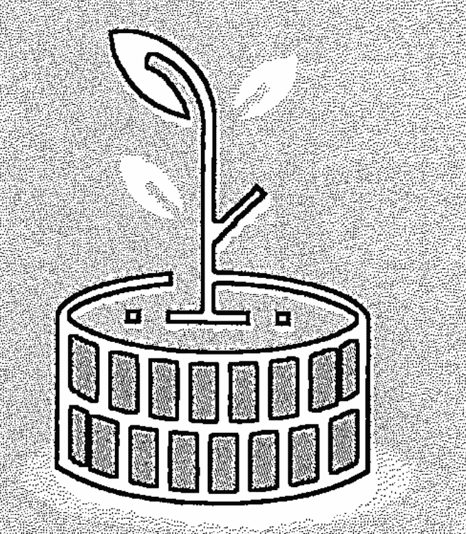

# 第 2 週

## 第 8 天
### 你有多幸福？

> 為什麼我們存那麼少的錢？因為我們高估了花費所能帶來的幸福感，但如果運氣好的話，一再的失望最終會讓我們更加有智慧。

總的來說，你認為自己日子過得怎麼樣？你是會說自己：

- ☐ 非常幸福（Very happy）
- ☐ 相當幸福（Pretty happy）
- ☐ 不那麼幸福（Not too happy）

從 1972 年開始，芝加哥大學的「社會概況調查」（General Social Survey）的問卷中就一直有這個問題。根據 2016 年的調查結果，30% 的美國人自認非常幸福，55% 表示相當幸福，感覺不那麼幸福的則有 14%。有趣的是，儘管美國經過通貨膨脹調整後的人均所得已經倍增，但這個調查結果 44 年來卻並無多大變動。

換句話說，我們的生活水準已經大幅改善——收入更高、醫藥衛生大幅改善、房屋更大、車子更好、科技超群——然而我們的幸福感覺無多大變動。這就引出了一個重要的問題：金錢可以買到幸福嗎——如果不行，為什麼？

## 第 9 天
### 享樂跑步機

> 持久的幸福在於日復一日、年復一年去做那些有意義的工作。

我們昨天討論到「社會概況調查」。為什麼我們的幸福感不會隨著生活水準的改善而提升呢？問題出在所謂的「享樂適應」（Hedonic Adaptation），或者也可以稱做「享樂跑步機」（Hedonic Treadmill）。

現在來想像一下我們去乘坐加勒比海遊輪、買了一座更大的房子、開起來更快的車，或者是獲得晉升外加薪水調高。當這些事發生在我們身上時，我們一定會感到更加幸福——但只是短暫的。當遊輪之旅結束了，我們也很快就會將之拋諸腦後。同樣的，我們也很快習慣了更大的房子、更快的車、更高的薪水，然後就不再把它們當作一回事了，我們的注意力會轉移到其他事物上——想要得到另一次晉升、一棟度假屋或另一輛更快的車。

感覺上這好像讓人頗為氣餒，但你應該要記住兩件事。首先，雖然我們會很快就認為晉升或者最近所做的購買是理所當然，沒什麼了不起，但我們在追求這些目標時，卻相當享受其樂趣。為了晉升而努力工作，會帶給我們相當的滿足感，期待買一座新的屋子也會讓我們倍感興奮。最終的目標也許沒有我們所預期的刺激，但追求的過程卻樂趣無窮。

其次，還是有方法來對付這種「享樂適應」的現象。我們可以不時重溫一下當初聽到晉升消息時的心情；當我們跨出車門時，不妨想一下能夠擁有這樣的好車是件多麼幸運的事；我們也可以拿出去年的出遊照片，回想一下在遊輪上度過的快樂時光。

## 第 10 天
### 更多的錢就能解決你的擔憂？

> 如果我們一直保持花費過高的習慣，我們買東西帶來的幸福感，終將不敵它們會給我們帶來的壓力。

一星期前，我們曾經談到你的夢想，我們今天要來談談你的擔憂。現在請把你最關心的財務問題記在下列的表格中：

| |
|---|
| |
| |
| |
| |
| |
| |
| |
| |
| |

你該怎麼做，才能減輕上述的擔憂？很明顯的：要有更多的錢。但明顯的答案並不意味著就是正確的答案。如果你問其他人，他們要多有錢才算是有錢，他們會給你的數目通常會是他們現在所擁有的數倍——不管他們現在的身價是兩萬美元或者兩百萬美元。

這裡所隱喻的是：**擁有更多的錢未必能減輕我們在財務上的憂慮**。從另一方面來說，想要減輕前述憂慮，答案也許在於進一步清楚瞭解自己所擁有的、簡化自己的財務安排、密切注意自己的花費、付清債務、改變投資方式，多想想自己需要什麼而不是想要什麼。這些都可以讓我們更有自我控制的概念——這是通往幸福的要素之一。

## 第 11 天
### 債務處理

> 如果儲蓄是延後滿足，借貸就是延遲痛苦。

你在昨天所表列出的憂慮是否包括了各種債務？現在請你提供下列五個訊息，讓我們來檢視一下你的整體財務狀況。在加總「其他債務」時，請將汽車貸款、學生貸款、以及信用卡最低付款額包括在內——雖然你實際上應該要想辦法，尽可能付出超過最低額愈多愈好。

- 你的每月稅前收入：$
- 你的每月房貸支出：$
- 你的每月其他債務加總：$
- 用你的每月房貸支出除以每月收入，再乘以 100 得出百分比：______________________%
- 用你的每月債務加總除以每月收入，再乘以 100 得出百分比：______________________%

你的借貨人（例如銀行）會告訴你，你的每月房貸付款（包括地產稅、以及房屋保險）不應該超過每月稅前收入的 28%。至於「其他債務」呢？你也許不應該讓這一部分的支出超過收入的 10%。但在實際的情況下，如果你剛剛畢業而且還有學生貸款要還，就很難將每月需要償還的債務壓在這個門檻之下。

如果計算的結果是超過上述的標準過多，你就確實會遇到棘手難題，我們在這裡可以給你六項建議：

- ①停止使用信用卡，用現金支付所有費用，你就不會讓花費超過你的收入。
- ②集中支付利息最高的債務，通常都是信用卡卡債。
- ③如果你有已經快付清的借款——例如說學生貸款或汽車貸款——就算是利率很低，你也應該加速償還。**你如果能擺脫這些每月的負擔，就能立即改善你的現金流。**
- ④如果你所擁有的是聯邦學生貸款，可以考慮採用那種以收入為基準的償還計畫，也許對你會更加有利。
- ⑤如果你擁有一座房屋，你可以考慮申請房屋淨值信用貸款（Home-Equity Line of Credit），然後利用這個貸款來支付利息相對更高的債務，例如說汽車貸款和卡債。
- ⑥研究一下是否可能就已有的房屋、汽車、學生貸款重談貸款條件，就算無法降低貸款利率，但或許可以延長還款期限，降低你的每月負擔。比較不利的是：你最終將會付出更多的利息。

## 第 12 天
### 回顧過去的理財抉擇

> 我們判斷財務抉擇時只有一個殘酷的標準——是否能讓我們賺錢。但那也可能導致錯誤的回饋，進一步讓我們養成壞習慣。

你曾經做過自認為最聰明的三項理財動作是什麼？這些動作包括實際作為，或是處理財務問題的習慣。

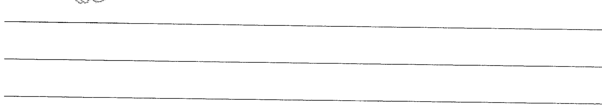

你所犯下的三個最嚴重的理財錯誤是什麼？包括了你所做的事，或是你沒做到的事。

## 第 13 天
### 盡量控制自己的金錢流向

> 許多看起來愚蠢的人卻有辦法短期內在市場裡賺到錢，但以長期來說，降低投資成本和只冒合乎情理的人，才會在最後真正勝出。

讓我們回頭看一下你昨天所記下最聰明和最愚蠢的理財動作。現在問問你自己：你自認為聰明的舉動真正聰明嗎？還有，你認為是愚蠢的作法真的愚蠢嗎？

舉例來說，2007 年到 2009 年股票市場崩盤之前投入大量資金，看起來是一個愚蠢的舉動，但我们怎麼會知道股市就要崩盤了？我不會說那是個愚蠢之舉，只能說是運氣不好。

現實的狀況就是，財務的世界裡有太多不可控的因素，所以運氣就扮演了很重要的角色。我們不知道市場是否明天會崩盤；我們無法控制自己是否會罹患重病，結果需要花費昂貴的醫藥費；我們也無法阻止老闆關閉某個部門並遣散所有員工。

聽起來很糟，是吧？雖然我們不能控制這些事情，但我們卻可以做好準備——為自己買好保險，和確認自己的財務狀況可以支撐長時間失業。

此外，我們的財務生活中也有不少可控的部分，控制得宜的話，會對我們有幫助，反之，當然就會有傷害。例如說找到工作之後馬上啟動雇主贊助的 401（k）退休計畫，就是一個聰明的作法。利用信用卡毫不考慮大肆購買，則是個愚蠢之舉。這兩個都是我們可以完全控制的決定。

我們還能控制些什麼？你可以回頭看看我在第二天所提供的簡單策略——努力存錢、控制債務、購買所需的保險、降低投資成本、瞭解自己在工作上或職務上的風險，以及充分利用退休基金帳戶來節稅。在這些領域內，我們只要付出一點努力，就會有相當的回報，也能讓我們在財務方面更有安全感。

同樣的，我們也可以藉著堅持在自己熟悉的領域內做簡單投資，來達到個人財務穩定的目的——我們將在明天觸及這個話題。

## 第 14 天
### 簡單化的理財工具

在財務管理的領域內，複雜固然也意味著精密，但通常也是那些不走正途投資者愛玩的把戲。

金融市場相當引人入勝，充斥著一飛沖天的股票、口條清晰且滔滔不絕的權威專家、令人驚艷的投資產品、炙手可熱的基金經理人、每個交易日都不斷上演的不同戲碼。我給你個忠告：**好好享受這場表演——但如果你想賺大錢，就別讓精彩的表演把你搞昏頭了。**

現實的狀況是，你如果想好好處理有關金錢方面的事，最好的作法就是保持單純，同時用最省錢的辦法。如果你對某個產品不太瞭解，就不要去買它。如果你沒有辦法抓住某個策略的精髓，就不要去實施。如果成本過高，就去尋找一個比較便宜的替代方案——或者乾脆略過。在實際的操作中，這意味著什麼？以下是一些你可用來增強家庭財政軍火庫的簡單理財產品：

- 指數共同基金（Index Mutual Funds）
- 股票型指數基金（Exchange-Traded Index Funds）
- 高息儲蓄帳戶（High-yield Savings Accounts）
- 定期存單（Certificates of Deposit）
- 美國國庫債券（Treasury Bonds）
- 401（k）退休計畫（401〔k〕 plan）
- 個人退休帳戶（Individual Retirement Accounts）
- 健康儲蓄帳戶（Health Savings Accounts）
- 定期人壽保險（Term Life Insurance）
- 回饋信用卡（Rewards Credit Cards）
- 普通貸款（Conventional Mortgage）
- 房屋淨值信用貸款（Home-Equity Lines of Credit）

那麼，有哪些是你應該要避免的？以下是一些所費不貲、過於複雜或兩者兼具的理財產品或策略，其中有不少是由華爾街強力推薦——但正因為如此，你才要特別小心：

- 變額年金保險（Variable Annuities）
- 現金價值人壽保險（Cash-Value Life Insurance）
- 指數年金 (Equity-Indexed Annuities)
- 連動債券 (Structured Products)
- 對沖基金 (Hedge Funds)
- 槓桿式指數型交易基金 (Leveraged Exchange-Traded Index Funds)
- 期權交易 (Options Trading)
- 當日沖銷交易 (Day-Trading Stocks)
- 賣空 (Selling Stocks Short)
- 適時進出市場 (Market Timing)
- 融資交易 (Buying Stocks with Margin Debt)
- 只付利息貸款 (Interest-only Mortgages)

我本來還想把一些不那麼複雜或昂貴的理財產品也加進上述表列，但那樣做的話，可能會讓人感到失望、沮喪，因為那就將包括了主動式管理共同基金 (Actively Managed Mutual Fund)、個別股票 (Individual Stock)、首次公開募股 (Initial Public Stock Offerings)、封閉型基金 (Closed End Funds)、單位投資信託 (Unit Investment Trust)。總體而言，這個主題的底線就是：你如果專注於第一個列表中的產品，同時規避第二個列表中的項目，你就將會領先大多數其他的投資者，也會比他們更有在財務管理上成功的機會。

你是否擁有上述「有希望的」以及「有危險的」表列中的項目，請登錄在下列表格中：

| 有希望的 | 有危險的 |
| :--- | :--- |
| | |
| | |
| | |
| | |
| | |
| | |
| | |
| | |
| | |
| | |
| | |

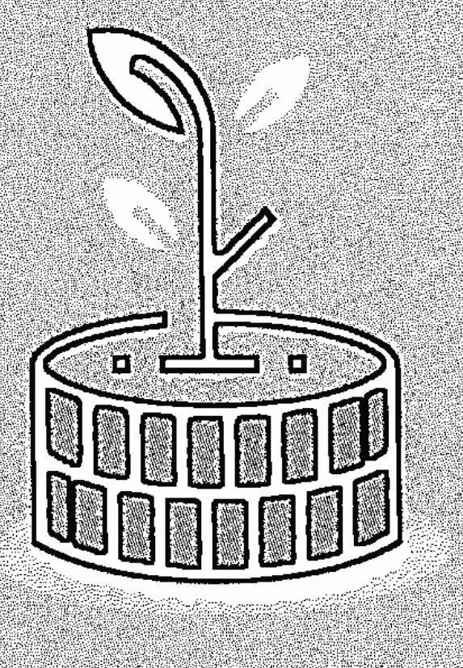

# 第 3 週

## 第 15 天
### 享受幸福的日子

> 想要更好的享受生活？那就放下你手中的遙控器，慢慢的遠離電視，去做一些自己能夠參與其中的事，而不是只做為一位旁觀者。

隨著時光的流逝，我們的記憶也會逐漸粉飾起來，我們會逐漸忘記早年歷經的奮鬥和憂慮，記住的只是那些較美好的部分。然而，我不會想去重過當年的那種生活，我相信你也不會，因為我們潛意識裡會比較鄙視年少時的輕狂浮躁，也不會希望再成為那樣。

雖然我們可能不會希望再回到從前，但你也許能想起過去的一些幸福日子——可能比現在還幸福。

- 那是什麼時候的事情？
- 那時你做了什麼？
- 你那時跟誰在一起？
- 金錢在那時所扮演的角色重要嗎？
- 你現在思考如何妥善運用你的時間跟財富時，當中所經歷過的幸福時光有給你什麼啟示嗎？

上述這個練習題的目的何在？它可以讓你回想起過去你所曾經付出的熱情，但後來卻逐漸淡忘、放手的事，而那種熱情可能會促使你現在選擇事業上的改變、開始某種嗜好，或者決心過一個完滿的退休生活——進一步充實你未來的人生。

## 第 16 天
### 做真正重要的事

> 我們應該為了擁有某些東西而花費，還是應該為了某些人生的體驗而花費？人生的體驗可以為我們帶來美好記憶，所擁有的東西卻會為我們帶來修理費用的帳單。

研究表病人一生的幸福感呈 U 字型曲線，我們從成年期開始表現出相當高的幸福感，但在二十及三十多歲的這段時間裡開始下滑，到四十多歲時達到谷底，然後又開始回升。

這個幸福感的起伏該如何解釋？沒有人肯定的答案，一個可能性是：在一個人進入成年的初期，我們重視的是外在的報酬，例如說工作上的晉升、薪水的調漲，以及物質上的成功象徵，如擁有豪華的房子和車子。然而許多人在達成這些目標後，卻發現並沒有體驗到應該伴隨而來的滿足感。事實上，他們甚至還感到空虛、失落。我們獲得了晉升，但卻發現工作壓力更大；我們終於買了嚮往已久的房子，卻發現自己陷入必須不斷維修花費的困境中。這些不滿足

的感覺，通常在四十多歲時達到高峰——典型的中年危機。

這也是許多人開始重新思考人生的契機——也許努力求取晉升並非通往幸福之路，也許做我們所愛的工作才是真正重要的事。也許擁有更多的東西不會讓我們更加幸福，也許我們應該把金錢花費在一些人生體驗上面，例如說跟家人或朋友相處，因為這些事情似乎更能增進我們的幸福感。

結果就是：我們開始慢慢變老，也開始不再在意別人的肯定，不再在意是否能在工作上出類拔萃、或者炫耀自己的地位表徵——我們開始更重視自己是否在做真正重要的事。

## 第 17 天

### 統計生活開銷

> 財務自由並不是說我們有能力買任何想要的東西，而是能夠確認我們已經有了所需要的東西。

你每個月最低限度需要多少花費，才能支撐你的財務生活？我指的是固定開銷——定期付出而且至少在短期內很難削減的開銷。在下列表格的右邊填入個別項目的花費數字，為了確保沒有遺漏，你應該檢視一下支票登記簿，以及信用卡的付款通知，如果你的房貸包括了地產稅及房屋保險費，就填入總數，無須分開填寫。

| 費用項目 | 金額 |
| --- | --- |
| 房屋貸款或租金 |  |
| 地產稅 |  |
| 房屋修繕費 |  |
| 汽車貸款 |  |
| 車輛其他開銷（汽油、維修） |  |
| 水電費 |  |
| 有線電視費 |  |
| 電話費 |  |
| 網路費 |  |
| 食品雜貨 |  |
| 保險金 |  |
| 其他 |  |
| 總計 |  |

## 第 18 天

### 準備應急基金

> 想要減輕財務上的壓力？你該做的就是降低債務，在銀行裡存上幾千美元，以及實施規律的存款計畫。

財務專家經常勸導我們應該要準備好應急基金。他們建議我們把大約足以應付三到六個月生活費的錢放進所謂的「現金投資」裡——諸如活期存款帳戶（Savings Account）、貨幣市場基金（Money Market Fund）以及類似的安全性較高的投資。

為什麼要準備這麼多現金呢？從這些現金儲備通常被稱作「月生活費」其實已經透露出本質。這筆錢並不是要用來應付修理汽車、汰換冰箱這類緊急事件，因為這些事情都不難解決。具體而言，所謂應急基金，其實就是失業基金，因為失去工作是一個巨大的財務緊急事件。

昨天，你已經記錄了每月的固定開銷數目，現在，你來想像一下自己失去了工作，必須要開始靠儲蓄、失業救濟金以及其他的花費來源過日子。那麼，你要用什麼來應付每月的固定開銷？請記錄在下面：

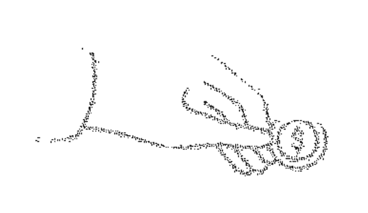

_______________________________________________________________

_______________________________________________________________

_______________________________________________________________

_______________________________________________________________

_______________________________________________________________

_______________________________________________________________

_______________________________________________________________

_______________________________________________________________

_______________________________________________________________

_______________________________________________________________

_______________________________________________________________

如果你仔細檢視一下你所列出的上述財務來源，你認為自己能夠撐多久？把你估算出來的月分數記錄在下方：

_______________________________________________________________

你在估算自己應該準備多少應急基金的同時，也應該想一想自己大概要花多少時間才能找到新的工作。這在很大程度上得看你找的是什麼工作，如果你原先是一個餐廳侍者，也許一星期內就可以尋得另一個工作，但如果你是一位資深的公司執行階層人員，也許就要花上一年或更久的時間才能再找到相應的工作。

## 第 19 天

### 強化財務保障

> 如果我們希望對當前的財務狀況感覺良好，我們就應該花點時間想一想明天會有什麼花費。

當人們失業的時候，他們通常都會做那些可能進一步損及財務前景的事。舉例來說，他們會開始累積信用卡債，走投無路的跳過房貸以及拖延車貸付款。他們也可能把退休帳戶變現，結果必須繳交更多的稅乃至於稅款罰金——讓他們的退休生活承擔風險。然而，你一定能採取前述的作法嗎？你現在可以回頭看看昨天所做的紀錄，如果你現在還沒有足夠且必要的資金來應付可能長期失業的狀況，你可以考慮下列的四個步驟：

1. 想一想，有哪些花費可以立刻刪除，是否可以今天就刪除。你把生活所需費用降得愈低，你現有的儲蓄就可以支撐你更長的時間。
2. 想清楚，你的應急基金應該是準備多少個月的生活費。其次，開設一個高利息的儲蓄帳戶或一個貨幣市場共同基金。你可以很容易就在網上找到類似的基金。美國領航集團（Vanguard Group）經常推出這類高收益貨幣市場基金，而且投資的成本也很低。一旦設立好這類應急基金帳戶，你就應該做好每個月自動存入的安排，直到達成你所選擇的額度為止。
3. 如果你擁有房產，去設立一個房屋淨值信用貸款額度，一點都不麻煩，只是一些紙上作業再加上每年大約50美元的費用，你就隨時可以運用這筆錢。當然，最好是你不需要去動用到它——但有準備總好過臨時措手不及。
4. 啟動羅斯個人退休帳戶（Roth Individual Retirement Account）。這個帳戶的好處是，無論何時只要有需要，你都可以從這個帳戶提現，無須繳稅也無罰款——這是其他類型退休帳戶所沒有的彈性，其中也包括了羅斯401（k）退休計畫。唯一的例外是如果動用到羅斯個人退休帳戶裡的投資所得，就會有稅務的問題。如果你已經有前述房屋淨值信用貸款額度，你應該就不會用到羅斯個人退休帳戶來應急，而可以讓這個帳戶裡的錢持續成長，又不用付稅。

上述的這四個步驟不僅會在你失業時發生作用，它們也會讓你在財務方面覺得安心有保障，運氣好的話，你就再也不用擔心錢方面的問題了。

- ☐ 是的，我有一個高利息的儲蓄帳戶或貨幣市場基金，裡面的錢足以應付一段失業的日子，我也安排了每個月自動把一部分薪水存進這個帳戶。

## 第 20 天

### 父母教的金錢觀

> 孩子比較可能追隨我們設下的先例而不是我們所提出的忠告。

你從父母那邊學到什麼有關金錢方面的事嗎？有些也許是他們很刻意想教導你的，另外一些則是你觀察他們的言行所學到的東西。記下你所記得孩提時期學得的教訓，這些教訓也許有關於花錢、借貸、儲蓄、投資、保險、汽車、地產或者一些其他有關金錢的議題。

現在來看看你剛才所記下的項目，有哪些是你現在還信服的，哪些則已經扔到一旁？

| 現在還用得上 | 已經丟棄了 |
|---|---|
| | |
| | |
| | |
| | |
| | |
| | |
| | |

## 第 21 天

### 關於錢的八個問題

> 對你來說，真正有意義的是你所專注的事，你想要更加幸福？那麼，你就不應該去關注別人所擁有的財富，或者是那些不屬於你的東西。

我們對於金錢都有很強烈的看法，只是有時並不自知。從某個角度來說，我們通常都是和某人產生關係之後，才真正瞭解自己的信念有多麼堅定——而我們的配偶或夥伴通常也都會堅持他們知道有更好的辦法。

昨天，我們探討了你從父母那邊學到什麼有關錢的事，以及你是否也把那些想法吸收了。另一方面，你也可能透過朋友、同事、專家、廣告、電視節目以及電影而得到其他的想法。你可以藉由回答下列八個問題來發掘自己究竟採行了哪些信念，如果你現在已經與人有了長期的關係，你也可以向你的配偶或伴侶提出同樣的問題。

1. 對你來說，擁有一輛好車是很重要的事嗎？
2. 盡速致富是你的人生主要目標之一嗎？
3. 擁有一棟房屋是個好投資嗎？
4. 什麼時候比較適合開始有債務？
5. 股市是個好的還是危險的投資場所？
6. 身為一位投資者，你應該努力去擊敗市場嗎？
7. 你應該為孩子提供多少財務協助？
8. 如果你手上有些錢，你應該提前把房貸付清嗎？

在接下來的幾個星期裡，我們將逐一觸及這八個議題，如果夠幸運的話，你將發現自己會開始更嚴肅思考有關錢的問題————也許你還會去修正一些原先的想法。

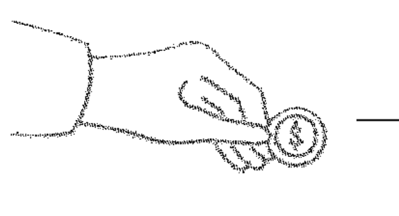

# 第 4 週

## 第 22 天

### 克服害你金錢不斷流失的本能

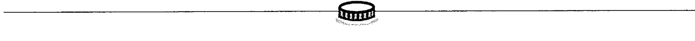

> 「經濟人」（Homo Economicus）也許一直都能理性處理事情，但我們身為一般人，倒不需要在家裡存放太多巧克力。

我們都有很多與生俱來的本能——但我們也並不是很清楚它們究竟是些什麼東西。這其實正是「本能」的特質：那些我們在不自覺的情況下會去做的事。

大多數的情況下，本能對我們會有很大的幫助。它會告訴我們縮回手，以免被熱鍋燙傷；在人潮洶湧的馬路上，告訴我們哪一個是會為我們指路的友善陌生人。這是我們那些生為狩獵者、以及採集者的老祖宗，經年累月從生活中磨練出來的本能，讓他們得以生存並繁衍後代。必須銘記在心：沒有他們，也不會有今天的我們。

只不過，我們的原始本能固然多數的時候會指引我們正確的方向，可是在現代的財務世界中，它們也會讓我們迷失方向：

- 我們有盡可能隨時消費的傾向，但我們也很快又會覺得不滿足。能吃就吃而且愈多愈好，這對我們的祖先而言很有意義，然而在今天，不但會讓我們吃得過多，也會讓我們花費過度。
- 我們相信成功的關鍵就是努力工作。這種屬性讓我們的老祖宗得以生存，也讓我們得以在各自的工作環境中領先，但這種努力工作的信念再加上我們的自信，卻可能會導致我們在股票市場上因為求勝心切而過度交易，投進過多的資本而承擔過度的風險。
- 我們傾向於模仿他人。我們的老祖宗就是這樣學會了狩獵、捕魚、建造棲身之所。然而處身今日，模仿他人卻有可能讓我們買下廣受歡迎但價格過高的投資產品。
- 我們在本能上會去察覺固定模式，對我們的老祖宗來說，這可能是個很重要的技巧，因為他們可以藉之學習如何狩獵，預測季節的變化。然而就今天來說，我們搜尋固定的模式，可能會讓我們自以為可以預知財務世界的動態，事實上卻只是價格的不規則波動。
- 我們都厭惡失敗，對於我們的游牧老祖宗而言，這是一個可以理解的本能，因為失去食物或庇護所很可能就意味著死亡。然而時至今日，我們的「損失規避」（Loss Aversion）心態可能會讓我們對股票市場卻步，這樣做雖然可以讓我們規避短期損失，但同樣也會阻斷我們長期獲利的可能。
- 我們所關注的是當前的處境，比較不太注意未來。同樣的，這對我們的老祖宗確實有其意義：他們無須擔心為退休生活預作儲蓄，問題是，如果是現在，這種本能會導致我們無法存下足夠的錢，而且忽視了我們的長期目標。

我們要如何克服這些本能，同時讓我們自己保持在正確的理財道路上？一般來說，關鍵就是暫停一下，讓我們的思考跟本能做一番角力。有衝動想要做一個大筆資金的購買，或是想要對自己的投資組合做一個重大的改變？如果你不想事後再後悔的話，你應該花幾天時間好好思考一下。

## 第 23 天

### 讓支出不超過收入的一半

> 不管你認為自己買了多好的東西，你走出店門時，你的錢已經變少了。

拿出你的薪水明細單，也許再加上最近的銀行及信用卡明細，先從你的每月稅前收入開始——把它分類為下面四個項目：

| 項目 | 金額 |
| :--- | :--- |
| 固定生活費用 | |
| 非必要支出 | |
| 稅金 | |
| 儲蓄 | |
| 總計 | |

固定生活支出包括了房租或房貸、汽車貸款、保險費、地產稅、水電費、網路費、電話費、食物雜貨費以及其他的定期開銷。你如果還記得的話，你在第 17 天時計算過這個數字。

稅金的部分，應該包括聯邦及州的收入稅、社會安全及醫療保險稅，如果你受雇於人，這些資料應該都在薪水單上。儲蓄的部分，列入你每月放進退休計畫裡的錢，這個資料也應該在薪水單裡。另外，你每個月所存的錢當然也算在內。

現在，用你的每月稅前收入減去固定生活開銷、每月儲蓄以及稅金，你得到什麼結果？這個結果就應該是你的非必要支出——例如外食、音樂會、嗜好、度假。

你的財務安排達到平衡了嗎？你應該專注於兩組數字上面。在理想的狀態下，你的固定支出應該不要大過於收入的 50%。此外，除非你將來會有來自雇主的養老金或退休金，你應該每個月挪出收入的 12% 做為退休準備金。如果你還有其他的目標，例如說設置應急基金或者為孩子儲存大學費用，你的存款數額應該還要更高才對。錢存得不夠多？沒有太多的非必要支出可花？最可能的狀況是由於你的固定開銷太高，你也許可以透過提高保險的自付額（deductible）、選擇較便宜的有線電視配套、去雜貨店和超市買東西時更加謹慎等方式來東省一點、西省一點予以降低。對於大多數的美國人而言，兩樣最大的花費就是房子跟車，如果你的固定支出超過收入的 50%，你應該要考慮採取較積極的方法來降低這兩樣開銷。

- □ 是的，我的固定生活開銷不大於稅前收入的 50%。
- □ 是的，我已經把稅前收入的 12% 移作退休基金。
- □ 是的，我還為了其他的目的存了額外的錢。

## 第 24 天

### 成功的條件

> 如果我們的目標是比別人更有錢，那麼，我們應該會永遠都嫌錢不夠多。

找出三個財務狀況良好的朋友或家庭成員，請注意：你必須確信這三個人是真正財務狀況良好的人——不要只根據他們的外在做的判斷。把這三個人記錄在下方的列表中：

他們在理財方面成功的關鍵各是什麼？把他們之所以能獲得成功的特質或屬性記載在下方的列表，個別的特質或屬性並無必要同時適用於三者。

- _______________________
- _______________________
- _______________________
- _______________________
- _______________________
- _______________________
- _______________________
- _______________________

## 第 25 天

### 成功理財第一原則：儲蓄

> 每一位有百萬以上身價的美國人都有些什麼共通的特質呢？他們都特別節儉——也可以說是小氣。

成功理財的祕密其實根本就不是祕密：就是養成良好的儲蓄習慣。是的，聰明的投資可以增加我們的財富，愚蠢的投資則相反。然而沒有良好的儲蓄習慣，再高超的投資技巧——或者欠缺技巧——其實都無關緊要了。畢竟，如果我們只有 1,000 美元拿來做投資，那麼我們在接下來的一年能夠賺得 2% 或 20%，其實並沒有多大差別，因為也不過就是 20 美元跟 200 美元之比——對於是否能靠它過一個舒適的退休生活，基本上無甚意義。你現在可以回頭看一看昨天所記下的三個人，以及他們之所以能成功的特質。他們也許薪水很高，投資得很聰明或者有自 己的生意，但能夠把這些財務上的優勢轉變為可觀的財富，是因為他們都擅長於儲蓄。

你可以考慮把他們當作你的模範，請教他們的成功經驗，用他們的故事來激勵自己，你甚至也可以告訴他們有關你自己的理財目標，因為你想獲得他們的讚賞，這樣做還可以達到更進一步激勵自己的效果。

就事實而言，成功的理財其實跟個人的心態很有關係。想要成為一個好的儲蓄者，很顯然的，你必須先要有收入，而且收入愈高，愈容易做到。但我們還需要具有另外五種特性來配合：

- 低固定開銷。為什麼這麼多家庭無法有效儲蓄？就如同我在第 23 天所提及，因為他們受限於一連串每月都必須支付的固定開銷，使得他們就是無法存下錢。這些開銷包括了房屋貸款、保險費、電話費、網路費、線上音樂串流服務費……。結果就是：他們在財務方面可以操作的空間很小，以至於幾乎不可能存錢。
- 自我控制。就算是我們把固定開銷壓得很低，我們還是會因為受不了各種消費的誘惑而無法存錢。當某些東西吸引住我們的目光時，我們需要立刻澆熄打開錢包的衝動。藉由這種將滿足自己的衝動往後延的作法，我們就會有時間好好思考究竟是否值得花那個錢。對某些人來說，這很容易辦到，但對許多人而言，卻很困難——就好像少吃、多運動也很難辦到一樣。
- 避免產生財務壓力。花錢可以帶來短期的興奮，但過度花費也會為我們帶來財務壓力，例如說付不出信用卡帳單甚至於房租的時候。如果我們能切實體會那種壓力有多可怕，以及能夠控制好自己的財務狀況又有多好，花錢的誘惑力就會降低了。
- 自我反省。當我們還年輕的時候，我們花了很多錢在無法帶來太多幸福感的東西上面，而正是因為太年輕，所以我們沒有時間從經驗中記取教訓。但這些失望慢慢累積起來之後，我們逐漸開始瞭解買那些東西並沒有帶來相應的幸福感。到了這個階段，自制力也不再成為問題，因為那些買來的東西似乎已經顯得不重要了。我們能夠愈早到達這個階段，就愈能控制住我們的花費，走上正確的理財軌道。
- 珍愛未來的自己。我們如果今天把錢花掉，明天就沒錢花了，更別說 30 年以後。如果我們夠理性，就應該在年輕的時候想遠一點，因為前面的日子還很長。不過很諷刺的，我們似乎都是在逐漸變老之後，才會去思考未來的自己。

## 第 26 天
### 最享受的時刻是什麼？

> 會讓你感覺幸福的不是更大的房子、新買的家具或是整修過的廚房，而是那些跟你一起生活的人。

現在來回想一下在某個星期裡，你最享受的時刻是什麼？你所進行的哪一樣活動最有趣？把它們記錄在下面：

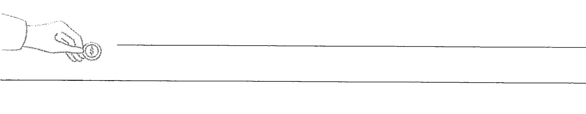

現在再來想一想同樣的一個星期中，你最不喜歡的部分又是些什麼？

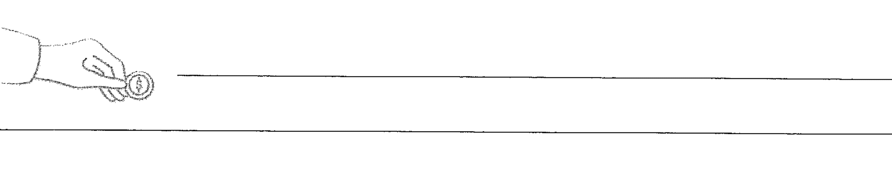

## 第 27 天
### 正確享受金錢的方式

> 感覺上，金錢好像是我們最缺乏的資源，但實際上時間才是。

現在回頭看一下你昨天所記下，有關一星期中最幸福、以及不太幸福事件的記述。你有辦法讓幸福的時光增加得更多嗎？另一方面，是否可以減少一點去做不太喜歡事情的時間？

思考這個問題的同時，你也可以從不同的角度來思考一下有關金錢的事。首先，金錢可以扮演什麼角色？乍看之下，這裡面的關連性似乎不太強。如果你喜歡教孩子踢足球而又不喜歡通勤，金錢方面也許不會是個主要的考量，但你可以改變生活的模式——增加在家工作的時間，省下通勤的時間，這樣就可以花多在孩子身上——但你可能要換一個新的工作，或者搬遷到離工作地點更近的地方。

其次，你可以做到改變花錢的方式，享有更多的快樂時光，並且少花一點時間在你所不喜歡的事物上面嗎？舉例而言，如果你喜歡外食，也許你可以多撥一些去餐廳進食的預算；另外，你如果不喜歡園藝工作，也許可以僱用造景服務公司來代勞。你現在對於讓你每週的日常生活更有趣、更快樂的作法，是否已經有了新的構想？把它們記錄在下面：

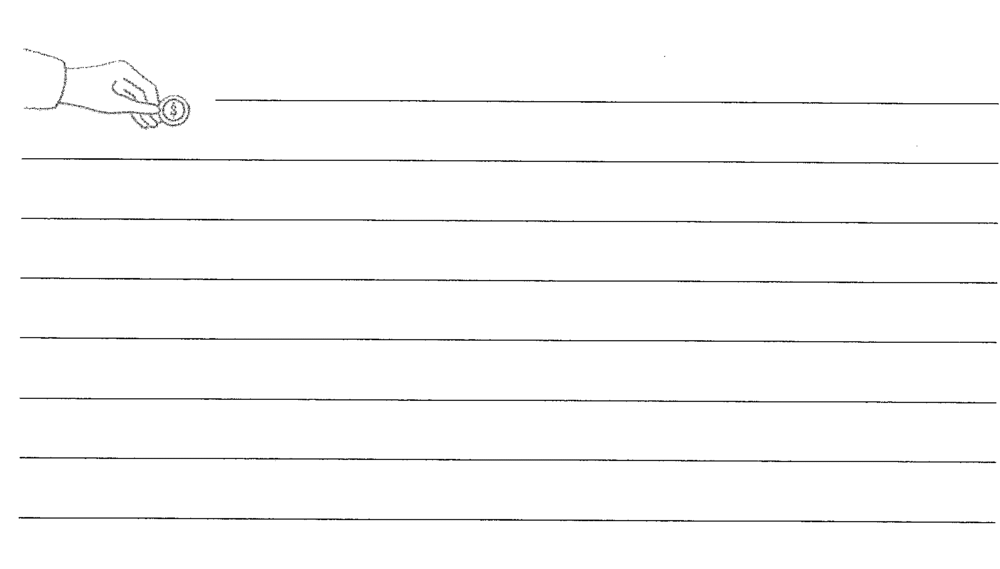

有的時候，我們並不是花錢來讓自己更快樂，而是避免讓自己更快樂。我們都有「阿基里斯的腳跟」（Achilles' Heel 意謂：致命的弱點）——讓我們自覺恥辱的弱點。我們也許會把這個弱點隱藏起來，這個弱點可能是賭博、亂花錢、喝酒、嗑藥或者暴飲暴食。

你現在可以想想自己有多個或哪些弱點，它們是可以被接受的嗎？或者你應該要做改變？你的弱點對你的理財會造成什麼影響？它們會影響到你達成理財目標的能力嗎？現在來想像一下，如果你屈服於自己的弱點，不是只有今天而已，而是接下來一年的每一天，這個累積下來的損害會有多大？還不夠讓你感到恐慌而亟思改變嗎？

為了要積聚起抵擋這種糟糕本能的意志力，我們需要先照顧好自己的身體，花多一點时间在戶外，睡覺的時間拉長，多做運動。我們如果做不到這些事，抵擋誘惑的能力也會被減弱——我們就會吃喝過多，花錢無度，因為我們只想短暫地刺激自己的精神。

## 第 28 天
### 妥善運用自己的「人力資本」

> 對大多數的人而言，我們最重要的資產就是自己的賺錢能力，所以，我們不應該把所有的籌碼都加倍下注投資在雇主所提供的股份上面。

如果你剛從大學畢業，你可能會背了一大筆學生貸款或卡債，但與此同時，你也很有一錢。怎麼說呢？因為擺在你眼前的是可能長達 40 年的薪水支票。根據美國普查局（Census Bureau）的資料，一位大學畢業生一生可能賺到的薪水大約 240 萬美元。經濟學家把這個賺取薪水的 ability 稱之為「人力資本」（Human Capital），而我們可以如何處理所賺得的薪水，就「人力資本」而言則有四項含意在內：

- 我們可以先跟「人力資本」借支，在我們進入成年的初期就先負債——特別是學貸和房貸——就理財而言，這個作法是有意義的。我們所借的錢，可以讓我們去買當前買不起的東西，重點是我們要確認自己有足夠的賺錢年限來清償這些債務，然後過一個安穩的退休生活。要注意的是千萬不要做過頭：我們不該借貸超過我們可以從容償還的額度，不應該利用借貸來投資，不要利用借貸來購買日後可能會後悔的奢侈品。

- 我們需要好好保護自己的「人力資本」。我們應該買好「失能保險」（Disability Insurance），以備可能因為受傷或生病而失去工作時之需。如果我們的家庭都得倚賴自己的薪水，就還需要一個人壽險。萬一丟掉了工作？這就是我們必須準備好應急基金的最主要理由。

- 我們必頭靠自己的「人力資本」來儲存好退休時所需。工作年限就意味著我們的「人力資本」開始產生收入，然後累積成大筆的財務資本，以便有朝一日我們能夠舒適的退休——已經沒有來自「人力資本」的收入，但日子還是得過。

- 收入讓我們得以投資在股票市場。我們的「人力資本」讓我們可以有收入，因此我們比較不需要去購買那些較為保守的投資項目，而是可以投資在更有長期成長潛力的股票市場。

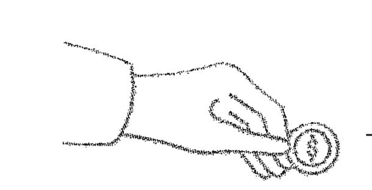

# 第 5 週

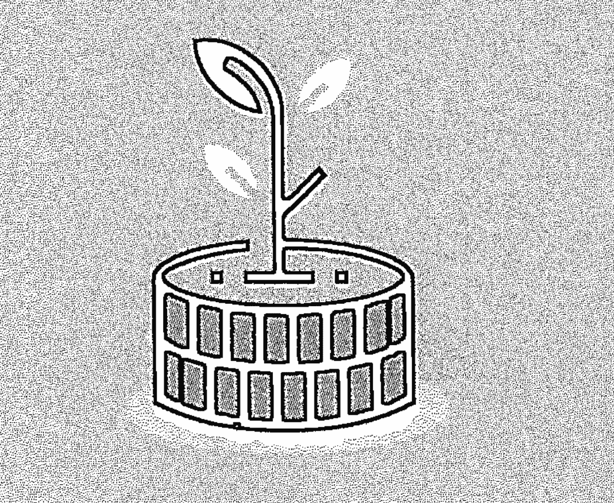

## 第 29 天
### 承擔責任

> 還沒有立好遺囑？你也許以後不會後悔，但你的家人絕對會。

就財務方面而言，有誰倚賴你？如果答案是「沒有人」，那即使我們不再有任何收入，受影響的也只有我們自己，而對那些我們所認識或所愛的人，並不見得會有什麼不好的影響。

可是如果答案是「不少人」。那當我們不再有收入，我們的配偶、伴侶、孩子，或許還有一些其他的人都可能受到影響。在下面的表格中，列出那些會受到你的財務狀況影響的人。

想一想，你要為他們提供多久的財務支持。如果你的配偶是不工作的，那麼，你就要準備在你的餘生——以及他或她的餘生——負擔起所有的家用花費；對於你的孩子，也許是負擔到高中或大學。這些，應該在你開始大學時期儲蓄計畫時便列入考慮，我們會在第 53 天時討論到這一方面的實。我們在第 70 天時也會討論到你的遺產計畫。另外，這一方面也會跟你的保險計畫產生關聯——我們會在明天予以討論。

| 誰會倚賴你 | 多久 | 誰會倚賴你 | 多久 | 誰會倚賴你 | 多久 | 誰會倚賴你 | 多久 | 誰會倚賴你 | 多久 | 誰會倚賴你 | 多久 | 誰會倚賴你 | 多久 |
| :--- | :--- | :--- | :--- | :--- | :--- | :--- | :--- | :--- | :--- | :--- | :--- | :--- | :--- |

## 第 30 天
### 大家一起來保險

> 我們不應該把自己視為一個追求表現的人，而是一個風險管理者。

保險是什麼？別去管保險契約中那些故意把字體放得很小，希望簽約人不要看得太清楚的附屬細則——自付額、特別附加條款、排除給付條款、以及那些吹毛求疵的法律用語。說到底，保險就是把風險匯聚在一起，你、我還有其他一大堆人把錢匯集在一起，交由保險公司監管，那些遭逢不幸的人可以從這些匯聚的錢中得到所需要的援助，其他的人就繼續繳保險費，什麼也得不到——而這正是我們想要的，因為這意味著我們都活得好好的。

保險可以為我們提供應付各種不幸事件的財務保障，包括了房子毀於火災、生病、車禍、身心受殘、官司、生命告終使得家人陷入困境等。

根據各種不同的狀況，上述的這些事件對個别人所形成的風險亦大小不等。舉例來說，如果你現年 40 歲而突然猝死，對於那些在財務上必須倚賴你的人，將會形成很大的問題，在這種情況下，有一個人壽保險就是件好事。但如果你是一位 70 歲退休的人，就不太會形成一個主要的財務問題，因為在那個時間點上，你的孩子很可能都已成長離家了。那麼，你的配偶呢？他或她也許會對你的逝去感到傷心，但卻可能在財務上更好過一些，因為你們原先為兩個人生活所規劃的積蓄，現在只需要用在一個人身上了。這裡所隱含的意義是：人壽保險其實並沒有那麼必要。

因為保險會成為一個賠本生意，所以我們應該只要去購買那些絕對需要的保險。你應該好好思考一下自己可能面對的所有財務風險，你如果認為自己應付得來，就不需要去買保險。但如果你認為那些風險不是你或家人有能力承擔，那麼，你也許就需要保險。我的忠告：買那些你真正需要的保險，但只要那種提供最低保障的即可。

## 第 31 天
### 該買哪些保險？

> 你可以更新人壽保險以及退休帳戶上的受益人——或者你也可以不要這麼麻煩，就讓你的配偶在你身後來處理這些事。

我們在第 18、19 天討論過假如果你失業了好幾個月，你該怎麼辦。但如果你是因為傷殘而永遠無法再工作——或者英年早逝呢？

如果你是單身一人，沒有必要倚賴你的家屬，死亡就不會成為一個大問題，因為沒有人會因為你的死亡而陷入困境，因此，你根本都不需要人壽保險。至於傷殘，那就會是個大問題。如果你因為身體的狀況而無法繼續工作，不再有收入，你要怎麼養活你自己？又如果你有家庭，你又要如何去支撐他們的生活？

美國的社會安全制度也許會因為你的傷殘而給付福利金，但資格審查相對困難：你的傷殘程度必須達到未來一年都無法工作或甚至會導致死亡的程度。另外，即使是你合乎申請福利金的標準，也可能至少要等五個月才會核發。

正由於社會安全福利金不容易請領，許多雇主會為所僱用的人員提供短期或長期的傷殘保障。但如果你的雇主沒有提供這類保障呢？如果你是位自雇者呢？你就應該嚴肅考慮是否該買一個傷殘保險。如果你是一個辦公室工作人員，由於幾乎沒有因工作而受傷的可能性，你也許會認為不需要買傷殘保險。但不要忘了一大多數的傷殘並非因為意外而是疾病。

如果你有一個在財務上必須倚賴你的家庭，你就可能需要一個人壽保險。最理想的是一個低保費的定期人壽險，而不是那種保險推銷員最喜歡推薦的高保費有現金價值的保單。那麼，你應該買一個怎麼樣的保障呢？你應該買一個保障足以付清房貸和其他債務、孩子的大學教育費用、以及家庭成員未來三到五年生活費用的人壽險，因為他們必須利用這段時間來適應沒有你以及你的薪水的活動。

如果你已經有相當足夠的存款，你也許可以考慮買一個保障更低的壽險。經驗法則：如果你有 100 萬美元在儲蓄和投資帳戶，你可能就不需要人壽險和傷殘失能險了。

- 是的，我有傷殘保險，或者我有足夠的存款來應付此生的生活費用。
- 是的，我有一個必須倚賴我的家庭，但我有足夠的定期壽險和存款，可以讓他們在財務上無憂。

第 5 週 095

## 第 32 天
### 以防萬一的八種保險

> 陽光是最好的消毒劑：找個時間讓你的朋友看一下你的財務明細，我相信你就會重整你的理財安排。

這個看起來也許有點嚇人，你可能需要八種不同的保險：

- 人壽險
- 失能險
- 醫療險
- 長期照護險
- 汽車險
- 房屋險
- 租屋險（Renter’s Insurance）
- 傘覆式責任險（Umbrella Liability）

聽起來很像是個家庭預算殺手？好消息是，真正八種保險都需要的人其實很少，另外，你也可以想辦法壓低所需保險的保費。舉例來說，如果你擁有一棟房子，你就應該買一份房屋險，事實上，貸款公司也會要求你要有房屋險。但你可以把自付額訂為 5,000 美元。沒錯，那意味著一旦遇到損失，前 5,000 美元要你自己出，所以你必須要有心理準備。只不過這麼一來，你所需要繳付的保險費就會低得多，可是當你遇到重大損害例如說火災時，你仍然可以獲得保障。

同樣作法也可以應用在醫療險跟汽車險的自付額，另外就是例如失能險和長照險的免責期，長免責期的作用就相當於高自付額——只不過免責期指的是從你申請理賠，到保險公司開始給付理賠的時間間隔。

你的財務狀況愈來愈好之後，你也許可以考慮取消一些保單。就如同我昨天所提到，如果你已經有 100 萬美元或更多的儲蓄，你可能就不再需要人壽跟失能保險了，甚至也可以跳過長照險。就算你還沒有存到 100 萬美元，你也可以視自己的財務狀況降低個別保單的保障（目的是降低保費）。不過，你倒是應該買一份傘覆式責任險。為什麼？因為你的財務狀況好轉之後，可能會成為那些好打官司者的對象，如果你被告了，傘覆式責任險就可以發揮保護的作用——而且，這種保險的年費相對並不算高。

在上面所列出的八項保險中，把你已經有的用打勾做個記號，同時註記你準備做的修正，例如降低保障或增加自付額。

## 第 33 天
### 最開心和最後悔的三樣花費

> 如果你的人生一開始就是頭等艙，你就會認為那是理所當然。但如果只是偶而升等，你才會真正享受那個樂趣。

現在來回想一下你在成人生活中所做過的重大花費——買房、買車、大學學費、度假、整修房屋、婚禮花費、長期嗜好、家具……。把最讓你開心的三樣花筆記在下面：

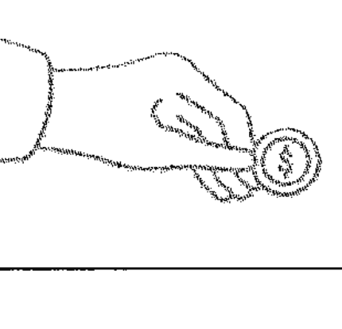

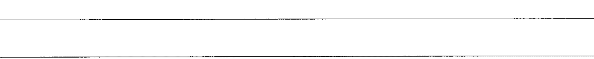

### 哪三樣花費最讓你感到失望——也許還讓你後悔？

___________________________

___________________________

___________________________

___________________________

## 第 34 天
### 花大錢要值得

我們通常買了事後後悔的東西又捨不得丟，就會把它們都存放在地下室。

我們在一星期前曾經討論到你的日常花費，以及思考如何運用不同的方式，讓你的花費可以為你帶來更多的幸福感。今天，我們要來檢視一些比較大的花費——也許是很大的花費。

現在是時候來列出未來幾年你可能會想要有的大筆花費了，你可以有很多選擇：一輛新車、起居室的家具、房屋的主要整修、一個特別的度假旅遊、為你的孩子辦一場盛大婚禮。你在列出這些項目時，回頭看一下你昨天的列表，想一想過去讓你感到幸福的、以及那些無法感到幸福的花費。

你擬定這個願望表時，應該要有兩個目標。**首先**，這應該是一個讓你感覺到一點樂趣的機會，有誰不想做白日夢呢？**其次**，

列出一個表之後，你就可以比較各種可能性，同時決定出其優先順序，以及哪些可能並沒有你想像中的這麼了不起。我的勸告：每一或兩個月回頭看看這個列表，有些項目可能很快就被你刪除，另外一些則會留下來——這就意味著你認為這些項目值得用你那些辛苦賺來的錢去換取。

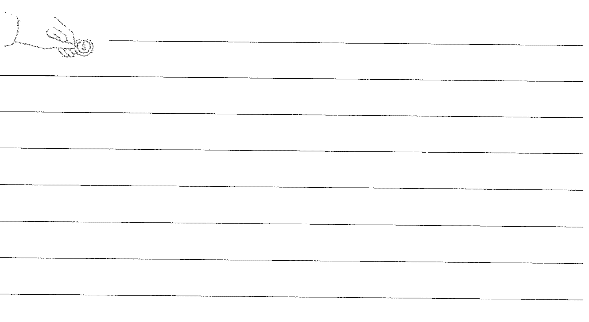

## 第 35 天
### 透過期待與回顧增加幸福感

> 如果我們今天看到一個想買的東西，我們應該等到明天再買，這樣會讓我們有時間細細品味這個採購行為，同時仔細思考一下是否值得。

當我們重新整修廚房或者去做一趟昂貴的度假旅行時，在我們的想像中，最大的快樂會來自於廚房完成時，或我們實際踏上旅程之際。這些當然都會是我們幸福感的高點，但實際上，幸福感還會延續得更久。

我們也許會發現，最快樂的時候是事前，當我們構思新的廚房設計或計畫旅行時。因為在那個時候，我们可以做白日夢，腦中會出現各式各樣的廚房、想像各種異國情調的旅遊點。當我們準備實現計畫時，我們對新的廚房或旅程充滿了期待，腦中想的都是事情將會多麼美好。

然而一旦廚房裝修完工、旅程結束，我們就很容易把它們置諸腦後了。我們很快就適應了新廚房而將之視為理所當然，或者將那個美好的旅遊給忘了。那麼，我們該怎麼辦呢？

為了要把我們已經花掉的錢再多擠出一點幸福感，我們應該不時停下腳步，欣賞一下那個新廚房，想想自己是多幸運，可以擁有這樣的廚房。我們也應該把旅遊當時所拍的照片再拿出來，回味一下所經歷過的快樂時光。

廚房和旅行固然都能為我們帶來幸福感，但後者卻更為有效。這個現象似乎有點違反直覺，畢竟，廚房還一直存在在我們的生活裡，但旅行已經結束了。只不過，這恰恰是問題之所在。就跟其他我們所擁有的東西一樣，廚房在我們的眼前會逐漸老化，櫥櫃會磨損，水管遲早需要修理，各種用品也需要更換。

旅行卻不一樣——就如同其他的經驗——它們不會隨著時間而變質衰退。相反地，我們在回憶旅程時會更帶有歡喜的心情，因為我們記得的都是當時的亮點，至於旅途中偶而不免碰到的一些小小不愉快，我們早就忘了。這就是經驗比所擁有的東西更能帶來幸福感的另一例證。

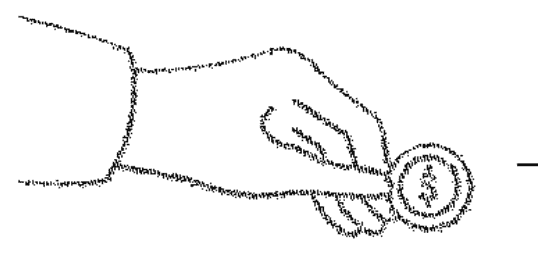

104 慢慢致富

# 第 6 週

## 第 36 天
### 交通費用讓你存不到錢

每當你在街上見到一輛豪車駛過時，停下腳步，靜下來想一想，有多少鈔票就這樣不見了。

根據美國勞工統計局（Bureau of Labor Statistics）的數字，一般美国家庭花費有 33% 是用在住屋，包括房屋貸款或租金、地產稅、水電費、家具……。另外有 16% 是用在交通，而且大部分是用在車輛上面，包括了買車或租車費用、加油、汽車保險……。

上述兩項花費加起來，意味著半數的花費是用在住屋及車輛。我們都需要有一個住所，也需要出外去辦事，但我們是否在這兩方面花費太多了？現在讓我們來檢視一下你在車輛上面的花費。

你在這方面的花費是多少呢？估算一下你每年在車輛方面的費用：

| 汽車貸款 | 金額 |
| :--- | :--- |
| 汽油 | |
| 保險 | |
| 定期保養維修 | |
| 汽車登記證 | |
| 其他 | |
| 總計 | |

現在，問一下你自己：跟你的年收入對照起來，你在車輛方面的總花費合理嗎？還是你花費過多了？

## 第 37 天
### 如何控制車輛花費

> 「車輛的花費會影響到你的 401（k）退休計畫。」

花錢並不是壞事，但過度花費則是——或是錢沒有花在我們真正關切的事物上面。對於某些熱愛車輛的人來說，在汽車上花大筆的錢，他們會覺得是用對了地方，雖然如此一來，他們可以用在其他方面的錢就變少了，但他們會認為還是值得的。

但如果你並非熱愛車輛的人呢？你就應該用比較合理的價格去買一輛適合家用的車。其實這件事並不複雜，如果你的目的只是要買一輛實用的車，而不是想要向鄰居誇耀，或是想要享受駕駛豪車的樂趣，那麼，你有兩個原則可以遵循。

首先，你在買新車之前應該要多想一下，因為你所要付出的是一種「溢價」。這是因為車輛的主要折舊都集中在頭三、四年——另外，新車的保險費也較高。

**其次**，你換車的次數愈多，所需付出的代價也愈高。因為你會面對銷售稅、車輛登記費、以及車商的利潤加成。

**要點**：最好的選擇應該是車齡三到四年、行車里程兩萬到三萬英里的二手車，因為該折舊的都已經折了，但還有很多里程可跑。許多租賃車輛公司會定期汰換車齡三、四年的車輛，所以你會有更多的選擇。這樣的車輛，你至少還可以開上六到七年。

## 第 38 天

### 留意你的信用積分

> 借貨可以讓我們去買當前買不起的東西，一般會把它說成是「消費的平滑性」（Consumption Smoothing；也就是透過借貨讓人生每個時間點上的消費差別不要太大），但卻會給自己帶來麻煩。

信用積分（Credit Score）似乎已經變成美國人所追求的身分表徵。其實這個現象有點悲哀，因為信用積分是有關於你所借的錢。信用積分是根據有關你的信用報告而計算出來，也就是你多年以來的借貨歷史，例如房屋貸款、汽車貸款、信用卡等。

美國有三間主要的消費者信用報告機構，分別是艾可飛（Equifax）、益博睿（Experian）和環聯公司（TransUnion），他們收集消費者的借貨、還款資訊，然後將之轉換為數字積分來表現其信用度優劣。最受歡迎的計分制度是「信用積分」（FICO），評分從 300 分到 850 分。一般來說，平均分大約在 700 分上下，750 分或以上就會被認為信用良好。

你應當不時檢視一下自己的信用報告，特別是準備要申請房貸、車貸或其他大筆貸款之前。你應該注意其中是否有錯誤的資訊，例如說你明明準時付款了，但卻被記錄成延遲付款，或是否有重複登錄的欠款，你也應該要檢查一下其中是否有你不認得的帳號，如果有的話，就有可能表示你的身分遭人盜用。

如果你準備要申請房貸或車貸，你應該要確認一下自己的信用積分，那可能需要付一點費用。不過，現在有些信用卡轉介網站會提供這一方面的免費服務（例如「信用因果公司」（Credit Karma）、「錢包中心」（WalletHub）以及其他類似的公司）。另外如美國第一資本（Capital One）、大通公司（Chase）、發現信用投資公司（Discover）等財務公司也都提供此項服務。

會查看信用積分的並不只有貸方而已，保險公司設定保險金和房東審查潛在房客時，也都會去查看對方的信用積分。與此同時，潛在的屋主雖然不見得會關心你的信用積分，但他們可能會對你的信用報告有興趣。

不幸的是，現在盜竊身分的問題愈來愈嚴重，你要如何保護自己呢？除了定時查看你的信用報告之外，你還可以做三件事。

第一，你可以凍結你在前述三家主要消費者信用報告機構裡的信用帳號，如此一來，就沒有人可以冒名申請，這也是最妥善的辦法——但如果你定期需要辦理新的貸款或申請新的信用卡，那就會增添不少麻煩，因為你每次都需要申請解凍。

另外一個作法是，你可以前述三間消費者信用報告機構有關你的信用資料設置「詐欺警示」功能，貸方在同意貸款前就必須先確認申貸者的身分，才能在你的名下開設帳戶。

第三個作法呢？你可以申請設置「信用監控」，不少網站都提供免費的服務（例如前述的「信用因果公司」、「錢包中心」，以及其他相似的公司）。「信用監控」並不是特別理想，因為當你收到警告時，問題已經發生了，不過你應該還是有時間去予以阻止。

- 是的，我已經從 AnnualCreditReport.com 取得了我的信用報告。（編按：在台灣可去「財團法人金融聯合徵信中心」網站查詢）
- 是的，我準備要申請貸款，所以我去查看了自己的信用積分，看看自己處在什麼地位。
- 是的，我凍結了我的信用帳號，設置了詐欺警示或申請了信用監控。

## 第 39 天

### 提高你的信用積分

> 如果你對自我價值的評估是建立在車輛是否花俏、房屋是否夠大上面，你將永遠不能滿足，心情也將永遠無法平靜。

信用積分相當重要，所以你應該要設法盡量將之提高。雖然有些方法不是很清楚簡單，但大部分確實不困難——這些步驟也是你謹慎理財的必要手段。以下是六個你可以採行的方法：

- 檢查一下你的信用報告，看看其中是否有誤。
- 準時付清帳單，特別是貸款和信用卡。貸方在遇到你延誤付款時，通常都會在第一時間就通報信用報告機構。
- 把你的信用卡每月應付款控制在信用限額的 10% 或以下。就算是你準備或一直都付能付清欠款，這個作法也相當重要。為什麼？因為你如果每次的應付款都占了信用限額的很高比例，信用報告機構會認為你可能有財務方面的壓力，進而影響對你的信用積分估算（編按：在臺灣不管使用額度多少，只要能夠全額繳清、正常繳款即可，只要信用卡沒有遲繳或未繳，基本不會影響信用機構的評分）。
- 就算你已經不再用那張信用卡，也不要結束帳號。因為這樣做的話，會降低你的整體信用額度，那麼，當你使用其他的信用卡時，你的借貸在整體信用額度的占比就會上升，也會讓你顯得在財務上有壓力。
- 不要申請無必要的信用額度，也不要在短時間內申請太多不同的信用卡。如果你從事行業需要申請許多車貸，那麼，把申請案分幾個星期來完成。
- 把信用卡和車貸、房貸，以及其他的分期貸款混合運用，這樣，長時間下來將有利於你的信用積分。但不要利用借貸來提高信用積分，那樣反而會對你的積分有害。

## 第 40 天

### 理財自動化

> 如果你定期購買股票，你實際上是在做一種無差異購買：市場上揚的時候，你會賺到錢；市場下跌，你就可以用較便宜的價格進行投資。

有的時候，我們會忘記——有的時候，是不想記起來。許多人經常不去想是否應該為未來做些儲蓄，特別是在想花錢買一些讓我們心動的東西的時候。又有些時候，我們經常會忘了準時付帳單。還好這兩樣問題都有解決的辦法：把你的理財自動化。

一旦我們把理財自動化，過去那種宛如仇敵的惰性就會變成我們的好友——我們也更能做到準確的管理財務，遵守並完成我們在財務方面的承諾。

幾乎所有的帳單都可以設定自動轉帳付款，包括了貸款、保險、水電費、電話費、有線電視費……。設定自動付款之後，省去了每個月都要親自繳款的麻煩，也能讓你避免逾期付款的罰金。請注意，逾期付款也會影響你的信用積分。

設定自動付款之後還需要注意兩件事。第一，確認你的帳戶裡保有足夠的錢來繳付這些帳單，否則的話你就會透支，同時因為存款不足而受到罰款。如果你的自動付款金額每個月起伏並不大，就相對比較容易在帳戶裡保有足夠的錢。

第二件要注意的事是：如果你設定了信用卡自動付款，你應該要確認設定的到底是什麼？如果你不夠小心，你會發現設定的只是每月最低付款額度——那就意味著你還有未付清的部分，而需支付高得荒唐的利息。如果你讓信用卡公司每個月自動從你的銀行帳戶中提取全額應付款？這樣的安排會好得多——但也會產生另一種風險：由於每個月的應付款有可能差別很大，所以你必須特別注意，保持帳戶中有足夠的錢，否則的話，就會碰到因存款不足而無法繳清的罰款。

將應付款自動化對你會有幫助，將投資自動化更是必要的作法，因為這等於是強迫存款。如果不這樣做，你很容易就會過度花費，到了月底才發現沒什麼錢可存了。與其先花錢再把剩下的存起來，你更應該做的是把存錢列為優先事項，同時強迫自己靠剩下來的錢來過日子——這就得靠你把投資計畫自動化來達成目標。

我們已經討論過有關移出部分薪水，挹注在僱主所提供的退休計畫，以及每個月自動在應急基金中增添金額，直到你準備好足夠的財務緩衝為止。但除此之外，你可能還會有其他的目標，例如說為子女儲備大學教育費，或是儲備購屋頭期款。你也該為這些儲蓄計畫做好自動化設置。

舉例來說，你想在五年之內買房。那麼你也許可以開設一個貨幣市場共同基金戶或一個短期的債券基金戶。當你開設這類帳戶時，對方可能會提供你「每個月將錢從銀行帳戶直接轉入這個帳戶」的選項。如果是這樣的話，就算是每個月只能存入 50 美元，你也應該接受這個安排，養成這種良好的存錢習慣。不用擔心，你會找到沒有這些錢也能過日子的方法——而且運氣好的話，你以後可能還會有辦法增加自動存入帳戶的金額。

- 是的，我已經把每個月的付款都自動化瞭。
- 是的，我已經把每個月的存款以及各種投資都自動化瞭。

## 第 41 天

### 賺取額外的利息

> 儘管他們的財務狀況已經面臨大災難了，但許多人還是寧願相信虛假的保證而不願意去面對不討喜的事實。

當我們想要好好利用自己的金錢時，通常都會專注於為手中的投資帳戶和退休帳戶去選擇較好的投資。其實，我們也應該去想想如何妥善運用手中的現金？

就這一方面來說，有兩個策略可以列入考慮。第一，當你需要用錢時，盡量使用那種會根據你的花費而給你回饋的信用卡，如此一來，你就能贏得現金回饋或者旅遊的回饋點數。但你必須注意的是，不要因為有回饋就花費無度。因為如果你欠下了卡債，你所需要付出的利息，會遠遠超過所得到的回饋。

第二，不要在支票戶（Checking Account）中維持沒有立即用途的大筆款項，因為支票戶要不就是利息很低，要不就是根本沒有利息。一個比較好的作法是：支票戶中僅維持著恰恰到夠日常生活必須支出的存額，但同時也要留意銀行所規定的最低限，以免因存額不足而被收取費用。你可以把多出來的錢存進跟支票戶有連結的高利息存款戶。我在第 19 天時曾經建議為應急基金開設一個高利息存款戶，你現在就可以利用那個帳戶來存入你的多餘現金——你如果比較傾向於把這些錢分開來放，就去開設另一個高利息存款戶（編按：在台灣可使用銀行的支票存款、活期存款、定期存款、數位帳戶互相搭配）。

把現金放進高利息存款戶中，好處是相當明顯的：你可以賺取利息。你可以把準備支付房貸、信用卡帳單……的錢放進這個帳戶，等到需要付款時再把它們轉進支票戶。另一個作法就是，你也可以安排讓這些應付款直接從你的存款戶裡扣除。

把這些暫時用不到的現金從你的支票戶移出，也可以避免你把錢浪費在一些無必要的消費上面。我們其實都習慣於所謂的「心理帳戶」（Mental Account）：也就是說我們在花支票帳戶裡的錢的時候，比較沒有心理負擔，至於存款帳戶和投資帳戶裡的錢，我們就會格外小心。現在，你就可以好好運用這種心理狀態，把多餘的現金移出你的支票帳戶。

- 是的，我都盡量用有回饋功能的信用卡購物。
- 是的，我已經把多餘的現金移出支票戶，放進了高利息的存款戶。

## 第 42 天

### 小心稅負和通膨吃掉你的獲利

> 財務市場有兩大主要功能：可以讓我們隨著時間變得愈來愈富有，或者把我們在財務上弄得焦頭爛額。

當你看到各種存款或投資帳戶的價值上升時，自然會感覺良好。只不過，這就意味著我們真的在財務上有進步了嗎？要回答這個問題，我們必須要考慮兩個因素：稅負和通貨膨脹。

舉例來說，我們如果用需要繳稅的戶頭裡的錢去買了債券，賺得了 4% 的利潤，但這個戶頭的邊際稅率（Marginal Tax）是 22% 或 24%，那就意味著我們投資所得的大約 1/4 要繳給政府，所以我們的稅後所得就成了 3%。感覺上，這還算不錯——但如果通貨膨脹率也是 3% 呢？那就意味著其實我們只是在原地跑步。我們也許會因為帳戶的價值增加而感覺良好，但那就是所謂的「金錢幻覺」，因為我們實際上沒有變得更好。

昨天，我鼓勵你把支票戶裡多餘的現金轉移到高利息的存款帳戶裡，如果你很快就需要用到那些錢，這個作法是值得的，因為至少你還可以賺一點利息。不過可惜的是，你所賺得的利息可能並不足以抵銷通貨膨脹和稅金。

那麼，你應該如何做，才能克服前述的這兩種障礙，而且讓你擁有的錢能夠增長呢？顯然的，你可能需要冒一點風險——債券也許可以幫你應付通貨膨脹和稅金，特別是如果你用可以延稅或避稅的退休帳戶來購買債券。但你如果真正想要贏過通貨膨脹和稅金的話，就需要冒更大的險——讓自己從一個出借者變成擁有者，也就是說你應該買股票。

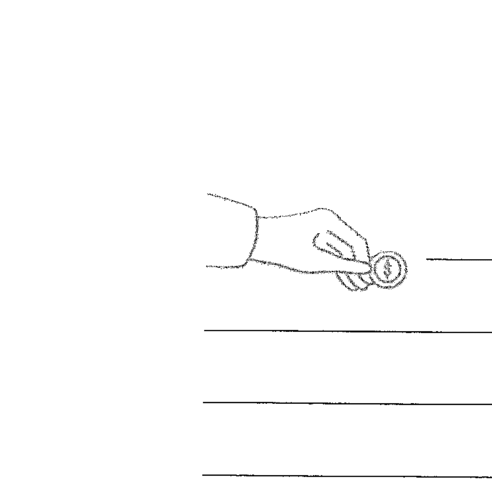

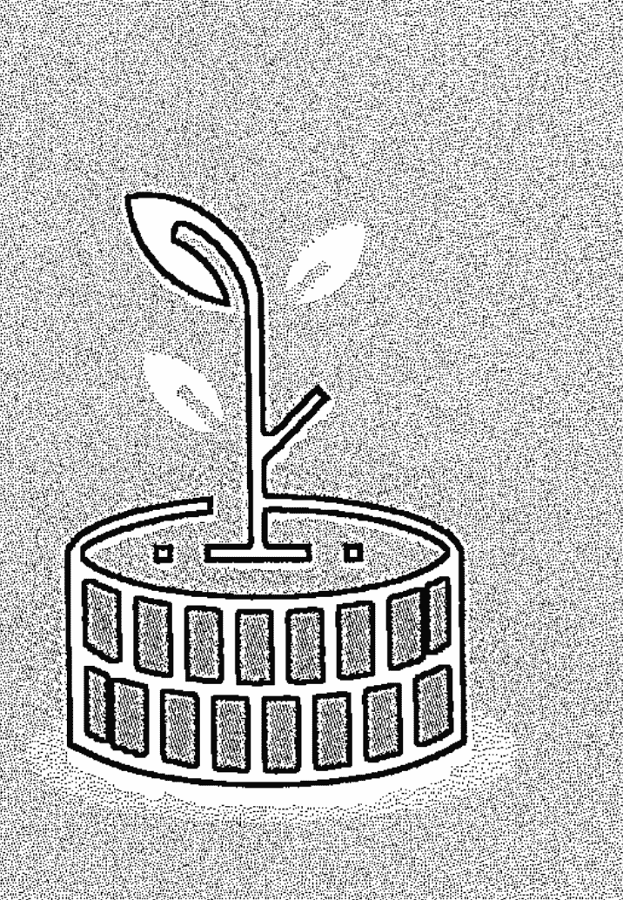

# 第 7 週

## 第 43 天

### 該不該擁有房子、車子？或股票？

> 今天，我們也許會擔心在股票上的投資是個壞主意，但 30 年後，我們會想，早知道當初就投入更多的錢。

不管是汽車、房屋或投資，我們都面臨了一個重大的財務決定：我們想要成為擁有者嗎？以汽車來說，那就意味著我們要買一輛車而不是租賃；以房屋來說，就是要決定究竟是買屋還是租屋就好；至於投資，那就是究竟是買股票、股票基金（Stock funds）——讓我們成為相關公司的擁有者之一——還是做一些更保守的投資，例如說債券、定存存款、活期存款……，單純只是把錢借出去藉以賺些利息。

如果我們有足夠長的投資期限（Time Horizon），我相信大多數的人都希望成為擁有者。我們想駕駛一輛新車，但計畫三年之後就換車，那麼，租車應該是比較好的選擇。同樣的，如果我們沒有打算要住五年以上，我們也許只需要租屋就可以了，因為投資期限只有這麼長，我們就不太可能累積足夠的資產升值，來抵銷在短時間內買賣所需付出的成本。股票方面也是一樣：如果計劃在五年內就要收回成本，也許還是專注於保守的投資較好，因為我們沒有足夠的時間來撐過股票價格的一次低潮。

但如果投資期限夠長，成為一個擁有者就很有意義了。不錯，擁有一座房子比租屋麻煩多了，擁有股票也比購買債券更讓你神經緊張，但報償也大得多。買房子，等於是把我們每月生活費的一大部分鎖定在當前的房價上面，然後，我們最終會擁有一個完全屬於自己的主要資產。同樣的，長期下來，股票的定期報償會比債券好得多。那麼汽車呢？幾乎每一種車都有貶值的問題，不過買車讓我們有「長時間擁有」的選擇——很可能是車貸付完之後許多年，這些年間，我們就不會有租車帶來的各種費用問題。

## 第 44 天

### 你的個人淨值

> 如果所有的人都知道個人的淨值，那麼，大家就可能哪兒也不敢去，都乖乖地待在圖書館裡，二手車也會成為一種身分的象徵了。

你到底多有錢？想想你所擁有的——以及你所欠下的——包括銀行帳戶、退休帳戶、汽車貸款、信用卡債，以及其他有關財務方面的一切，把它們記錄在下方的表格中，同時也列出相應的金錢數額。

| 你所擁有的（資產） | 價值 |
| :--- | :--- |
|  |  |
|  |  |
|  |  |
|  |  |
|  |  |
|  |  |
|  |  |
| 總計 |  |

| 你所欠下的（負債） | 價值 |
| :--- | :--- |
|  |  |
|  |  |
|  |  |
|  |  |
|  |  |
|  |  |
|  |  |
| 總計 |  |

用你的資產減去你的負債：

你的淨值

財務諮詢師在計算顧客的淨值時，會把汽車貨款和信用卡債計算進去，但並不會把用這些債務去買的東西列入計算，為什麼？因為你的車、家具，以及絕大多數的家庭用品都會貶值，最終成為毫無價值的東西。更重要的是，當你陷入財務危機時，你不見得能夠把這些東西變現，不然你要怎麼出門？你要坐在地板上嗎？

有些財務諮詢師會更進一步把房貸視作負債，只把房價的一部分當作是資產——而且是在屋主退休之後，把現住的房子換成較小屋子，以便能運用房屋淨值的情況下。這個作法，跟前述把所擁有物件排除在資產外的道理並無二致：你必須要有地方住，所以住屋不是可以賣掉來產生可花費金錢的物件（雖然，一旦退休之後，你可以考慮是否啟動「反向抵押貸款」（Reverse Mortgage）來獲得生活費用）。

想看看你的未來真正會是什麼樣子嗎？可以把你的其他生活目標成本包括進負債裡面，讓你的財務分析更加精細化。例如說你需要 100 萬美元來過舒適的退休生活，同時準備 20 萬美元做為子女的大學教育費？那麼，你就應該在你的負債中再加上 120 萬美元。

你現在是否覺得自己有點窮了？如果你計畫把你的前述生活目標成本納入負債的項目，那麼，你也應該把自己的「人力資本」視作主要的資產。根據你所從事的職業，如果你現在是二十來歲的人，你的未來賺錢能力應該是從 150 萬美元（一般文書工作者）到 500 萬美元或以上（例如律師）之間。這個賺錢的能力可以讓你做好儲蓄，來支付你的生活目標花費。

## 第 45 天

### 符合生命週期的慢慢致富策略

> 我們開始成人生涯時，大多數都沒什麼錢卻有許多時間——這是一個可以讓（財富）小水流成大河的優勢。

兩天之前，我們曾經討論了有關成為一位擁有者的好處。昨天，我們列出了你的資產與負債。那麼，在你的一生中，這些事物會有些什麼變化呢？

我們剛開始踏進社會的時候，也許背負了可觀的學生貸款，同時只有一點點或甚至根本沒有存款，但擺在我們眼前的卻是可能長達 40 年的薪水支票。當我們到達退休年齡時，我們將不會再有薪水可領，但是——如果一切順利的話——我們也不再有能力償還債務，卻擁有屬於自己的房子和可觀的儲蓄。這些儲蓄包括了股票、債券等。

那麼，這個過程中發生了些什麼事？一開始的時候，我們的債務會累積得很快、很高，除了待清償的學生貸款之外，我們會開始因為買車而擁有車貸，買房而擁有房貸。我們在這個階段要特別小心，以免背負過高的債務。但從另一方面來說，背負債務也不失為一個良好的理財策略，因為我們可以藉此啟動理財生涯，我們也知道，由於有幾十年的薪水可領，未來可以漸漸減輕債務。

就算我們在成年生涯早期開始負債，也應該開始為未來的日子進行儲蓄。那麼，我們應該如何做投資呢？如果把投資目標放在多年之後——例如準備退休金或孩子的大學教育費——這時我們就應該把大部分的钱放进股票市场。但这样做，感觉上似乎颇有风险。

但如果我们把眼光放远、放大，这个风险其实没那么大。我们放进投资组合里的钱，与我们预期会领得的薪水相较起来，可能只占了一小部分。我们的薪水支票是源源不断又稳定的收入，所以我们其实并不需要债券或其他相对保守的投资，因为这类投资的特性就是稳定，以及能让我们赚取定期的利息。

除此之外，我们会把收入的一部分存起来，这就让我们有机会利用这些钱来购买股票，有些高价，有些低价。万一股市崩盘了？听起来好像是个坏消息，但实际上却可能是个致富的机会，因为这个时候你可以用很低的价格买进股票。换句话说，在我们的成年生涯中，我们不仅有足够的投资期限在股市里赚钱，而且因为已经有稳定的收入，我们也不需要去投资那些相对保守的理财项目。

但当我们逐渐接近退休时，这些都会慢慢改变。我们的薪水支票很快就会没有了，所以需要从投资组合里取款过日子，但那就意味着我们应该把半数的钱转为较为保守的投资项目，另外一半则留在股票市場裡繼續成長。沒有收入之後，我們也將難以承擔債務，所以我們應該避免繼續舉債，同時盡早把已有的債務清掉。

## 第 46 天

### 實現你的長期目標

> 如果我們弄不清楚自己為什麼要理財，自己的財務生活應該往哪裡去，我們就可能到達一個自己不會喜歡的地方。

我們已經檢視了你的日常花費和某些較大的消費，我們也確認了你的錢都應該花在刀口上。現在，是時候來討論一下你可能會有的最大花費：你的長期目標。

我們通常都會有三個長期目標：退休生活、孩子的大學教育、以及購買屬於自己的房子。但你也許還會其他的目標，例如，第二棟房子、主要的房屋維修，這些可能都需要多年的儲蓄來完成。現在，就把你的長期目標登錄在下方，設定預定完成日期，同時估計大約要花多少費用。你也可以再加進一些細節，例如你想在哪裡過退休生活？想要買什麼樣的房子？想讓你的孩子進哪一所大學？這些細節有助於你去實現目標，也有助於你產生理財的動力。

| 目標 | 何時完成 | 預估費用 | 其他細節 |
| :--- | :--- | :--- | :--- |
| | | | |
| | | | |
| | | | |
| | | | |
| | | | |
| | | | |
| | | | |
| | | | |
| | | | |
| | | | |
| | | | |

## 第 47 天

### 提前為退休做準備

> 為退休做儲蓄及投資的最好時機已經過去了，次好的時機就是今天。

你現在已經訂出了長期目標，但你應該把哪一個當作優先處理的目標呢？這個似乎並不難決定，以時間序來說，退休應該是你的最後人生目標。但我們應該把它當作最優先事項——因為它是唯一沒得選擇的項目。

我們並不一定得買房子，我們也並不一定要幫孩子負擔大學費用，但除非我們早死，否則我們總有一天要退休，那就需要一大筆退休金來過活。為了準備好足夠的退休基金，我們就必須把儲備退休金當作職場生涯中的最優先事項。

我明白感覺上這好像有點前後顛倒，我們為什麼要把很多年以後的退休當作優先事項來處理——而且是在我們可以買房子或者為孩子準備大學費用的時候，這些事都是我們馬上需要面對的。許多人就是因為如此，所以都專注於當前的目標，而將退休金儲蓄延後處理。然而，這是一個巨大的錯誤。如果我們把退休金的儲備延遲到三十多歲的晚期或甚至到四十多歲，就將會面臨到「是否有辦法存下足夠資金」的巨大壓力，除非你能找到方法把收入的 20% 或更多儲存為退休基金，否則你很難可以有個舒適的退休生活。事實上，如果我們拖延過久，將不可能存下足夠的錢，只能面對窮困的退休生活，或者不得不延長我們的工作年限到原先無法預想的地步。

我的忠告：一旦你開始工作，就啟動並參加雇主所提供的退休計畫，或者啟動個人的退休帳戶，最好是兩者兼備。不錯，這是一個頗為艱鉅的工作——因為你當時的收入可能很一般，也許還要償還學生貸款——但潛在的利益卻巨大，因為你所存下的每一塊錢都夠以幾十年的複利來成長，使得你更容易累積起能過舒適退休生活的基金。

那麼，為買房存下頭期款，以及預先為孩子準備教育費用呢？這兩樣都是有價值的人生目標，如果有能力的話，當然應該去做——但不應該以犧牲你自己的退休生活為代價。

## 第 48 天

### 充實的退休生活

我們花了幾十年的時間來為退休作準備，但卻很少去思考退休之後應該作什麼，應該怎麼過日子？

現在來想像一下完美的退休日子。你要如何打發早上、下午及晚上的時間？把你從起床到就寢之間可能會做的事情記在下面：

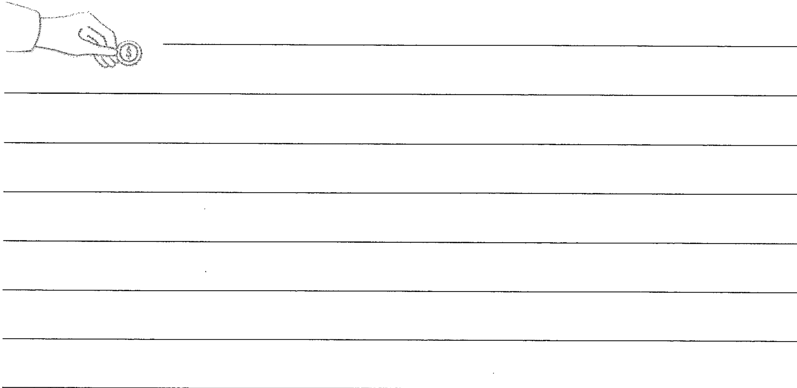

慢慢致富

毫無疑問的，在起初的一、兩個星期，你會很快樂的根據這個作息過日子，但你會就這樣一直快樂無憂的度過餘生嗎？許多退休的人都有「度假錯亂」（Vacation Confusion）的問題，他們把退休當作是在度一個長假，但很快就開始覺得無聊甚至於沮喪，他們會發現那種無止境的好玩跟放鬆其實並不那麼讓人滿足，他們會回想起從前的工作時光而覺得那樣的生活才有意義。

你也許會想：「為什麼你現在就拿這件事情來煩我？退休？還早呢。」

話是不錯，但你應該未雨綢繆，先把退休的日子想好，就像是你現在會回想生命中所度過的那些快樂時光，都是同樣的道理。如此一來，你才能真正掌握想要過的日子——不僅讓你的退休日子有所依循，也會讓你在以後的日子裡發展出新的嗜好，甚至於另一段事業。所以，你應當找出能寄予熱情的活動，尋找各種挑戰，確認你覺得重要同時又擅長的事情。

當我們在從事這些活動的時候，我們會發現自己是處於一種心理學上稱之為「全身心投入的精神狀態」（Flow；心流），我們會在時間的流逝中，體會到全身心投入自己所作所為的幸福感，我們也許不會感受到傳統意義上的樂趣，但這些卻可能是我們最感幸福的時光。

這些活動會催促我們早晨起床，然後不管是在工作的年月或是退休之後，都能讓我們覺得每天都過得很有意義、很有目標。事實上，我想看到的是工作和退休之間的界線徹底消失，我們應該把它們視作是彼此之間的延續：即便是退休了，我們也應該繼續專注於能實現自我的事情，更好的是，我們現在已經沒有要賺取收入的生活壓力了。

你有什麼想立即投身而人的活動？運氣好的話，這也能讓你盡快把自己的財務狀況導入正軌，讓你能沒有後顧之憂，去過你過過的生活。

## 第 49 天

### 計算一下你該為退休存多少錢

> “每個月都能按照計畫存足退休基金當然很理想，可惜的是，現實情況往往麻煩得多。我們只能依據真正存下來的基金度日——當然是愈多愈好。”

你需要有多少錢才能過舒適的退休生活？這裡有一個簡略的計算方法：把你當前的稅前年收入乘以 12。舉例來說，如果你的年薪是五萬美元，你就需要 60 萬美元的淨值做為退休之用，所謂淨值，就是減去負債之後你各種帳戶內的餘額總數。

這個計算後面的邏輯基礎是什麼？一個經驗法則告訴我們，在退休的第一年裡，你應該會從退休基金內領出 4%，以後則會根據通貨膨脹而逐年遞增。以前述的 60 萬退休基金來說，4% 就意味著你第一年会提出 24,000 美元，近乎於你工作時所賺取年薪的一半。

除此之外，你應該也有社會安全福利金可領。典型的社會安全福利金大約一年 16,000 美元，加上先前的 24,000 美元，你就每年可以有 40,000 美元做為退休之用。一般來說，如果你是屬於較低薪階級，你的社會安全福利在薪水中的比例會相對較高，如果是這樣的話，你為自己準備的退休儲備金就可以少一些，也許是你的稅前收入乘以八即可。

同樣的，如果你有一般常見雇主所提供、每月都可以領取的養老金，你也許可以不用自行準備那麼多退休儲備金。舉例來說，你不僅有資格領取社會安全福利金，也有相當於退休前薪水 1/4、雇主所提供的養老金，那麼，你另外自行準備的退休儲蓄金可能只需要當前年薪的六倍即可。

就算是有社會安全福利金和養老金可領，你在退休之後的收入通常還是不如你在工作的時候，不過請記得，你在退休之後的花費也會降低。一旦退休了，你就不需要再為退休而存錢，也不再需要支付社會安全稅以及聯邦老年醫藥保險稅，這些錢加起來可能會達到你的收入的 20%。如果運氣夠好，你這時應該已經擁有自己的房子，而且房貸在退休前都已付清，所以你的生活花費又可以進一步降低。

現在，你應該已經知道上述的計算方法是怎麼一回事了。那麼，請你問一下自己：

- 我應該存多少倍的收入來做為退休金。
- 如果換算成鈔票的話，是多少 $

你可以去 Calculator.net 網站，然後用 Investment Calculator 功能來計算一下自己是否能存下正確的退休基金。你按一下「最終金額」（End Amount）的功能標號，然後輸入你準備幾年後退休、你現在已經儲蓄好的退休基金有多少、你現在每個月在不同退休帳戶裡存入的總數是多少。我們可以把回報率訂為 2%，雖然這個數字看起來有點低，但我們必須要把通貨膨脹和投資所需付出的成本也列入考慮。

計算的結果和你所定下的目標有差距？你可以增加每個月存入的數額，你可以選擇把你預定退休的日期往後推遲幾年，你也可以準備好過一個相對節儉的退休生活，或者你可以把前述幾個作法綜合一下。那麼，你的計畫是什麼？

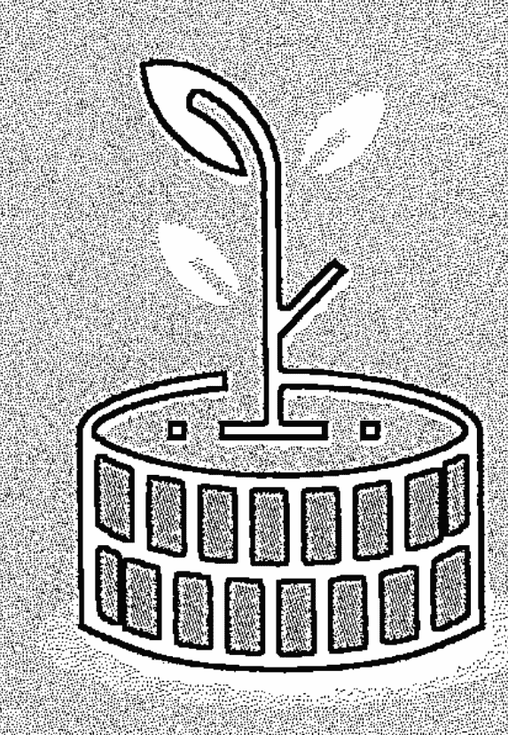

# 第 8 週

## 第 50 天

### 先顧好需要什麼，再談想要什麼

> 豪華車輛，是租來的嗎？房子很大，房貸也大嗎？花園很美麗，造景公司的錢付了嗎？

你買得起心目中的夢想之屋嗎？你有必要的資金來為你的孩子支付大學費用嗎？去一趟兩星期的歐洲旅行，是個精明的財務決定嗎？我並不是在這裡告訴你怎麼去花你的錢，你可以決定自己該怎麼做——只要你能把自己的未來、以及那些在財務上需要倚靠你的人照顧好就行了。

這就意味著：你應該每個月都要確認自己為將來的退休做好足夠的儲蓄。除此之外，你的「財務工具箱」內還需要另外四樣東西：**醫療保險**、萬一失去工作時的**應急基金**、存款不足 100 萬美元時的**失能保險**、存款不足 100 萬美元而且有家人的倚賴你時的**人壽保險**。這些都有了嗎？那麼，其他的財務安排就隨你了。

運氣好的話，你在處理好所有的財務需要之後，你還會有一些錢財方面的操作空間——你現在就可以把錢花在你想要的事物上面。這也是為什麼我們先前已經花了不少時間，去探索你日常最享受什麼，以及未來最想要些什麼。

所以，你看重的是什麼？有些人會想買房子或第二間屋子，有些人會想讓孩子去上的大學，有人會想幫自己買一輛夢幻之車，也有人會想去一趟特別的旅行或給自己一個相對豪華的日常生活。以上這些都不是不好的選擇——只要它們是你真正想要的，而且不至於影響到你對未來所做的安排。

許多人認為養成每個月記帳以及固定預算的習慣是件好事。如果你的日常生活不是那麼寬裕，或者必須很努力為未來預作準備，這可能是必要的。但如果你已經為未來做了充足的準備，也有辦法應付可能遇到的壞時機，我倒不太擔心你是否應該記帳或規定出每月生活預算。我們所談到的目標其實很單純：**你現在在希望能夠存下足夠的錢，以保證未來有足夠的錢可用。與此同時，你現在當然也能夠在你認為有價值的事物上花些錢**。

- 是的，我已經採取了必要的步驟來照顧好自己的未來以及家人。

## 第 51 天

### 擁有房地產的優勢

> 想要把股票賣掉，然後去買一間屋子來收租？請記住，股票不會在半夜兩點打電話給你，告訴你廁所的排水管堵塞了。

我認為每一個人都應該把「成為屋主」當作自己的目標，因為如此一來你就可以鎖定你的住宅成本（購買時的房屋現價），而且最終可以將之全部消除。不錯，你如果擁有一棟房子，你將需要付出地產稅、房屋保險金、以及房屋維修修繕費用，這些費用會隨著通貨膨脹上升，而且一直要付。

但如果你選擇的是固定利率貸款，你的最核心成本——每個月 的房貸還款——就不會上升，而且你的薪水會隨著通貨膨脹以及你的工作表現而增加，你繳付貸款的壓力就會愈來愈輕。如果你選擇的是可調利率貸款，當然就要面對一些不確定的因素，不過你那跟隨通貨膨脹而變動的每月還款，隨著時間也會慢慢縮小。

更好的是，一旦你付清了貸款，也意味著你占你每月支出的一個主要項目就不用再繳了。租房子住的人就享受不到這種解脫：他們面對的是無止境而且會隨著時間增加的每月支出。

雖然擁有房屋是個聰明的作法，但還是要小心，不要做過頭去買一個大而無用的房子。擁有一個超過家庭需求的大房子並無任何好處。你可以從兩方面來思考這個問題。**首先**，房價的升值：長期下來，房價的升值感覺上是超過通貨膨脹，但這是把各種成本列入考慮之前，如果你把維護費用、地產稅、保險費都考慮進去，房價的升值就很可能不足以抵銷通貨膨脹——所以你可能會賠錢。結果就是：如果你買的是一間過大的房子，你就是在房子的投資上賭得過大，而無法在房價升值上得到什麼回報。

所幸的是，擁有房屋所能得到的回報還可從**另一方面**來考慮：估算租金（Imputed Rent）。這是什麼？如果你住在自己擁有的房子裡，你等於是把房子租給你自已——也就意味著你可以從這座房子得到許多實際上的價值。那麼，有多少呢？你現在來想一下，如果你是把這座房子租給別人，每年可以收到多少租金，然後再把這個收取的租金來跟房子的現價對比一下，這個「估算租金」很可能會是房價的6%或7%（編按：以台灣的情況而言，租金報酬率通常在房價的3%左右或更低）。

重點是：一座房子的「估算租金」會比房價升值的本身高出許多，這在理財方面又意味著什麼？它意味著如果你買一間屋子，或者是換一間更大的屋子，你的目標應該是買一間足夠家庭使用而非超過的屋子。如果你買了一間過大的屋子，就等於是把錢拋在水裡，也等同於租了一間很大的房子，但只使用了其中一半的房間。

## 第 52 天

### 買房注意事項

> 想要傷害自己的幸福感？去買一個需要大量維護費用和交通費用的大房子。

想要買房子或是要換大一點的房子？以下是注意事項清單：

- 是的，買房子對我來說是合乎情理的決定，因為我們至少要在買來的屋子住五年以上，甚至是七年或者更久。

如果你的投資年限低於五年，萬一房市下跌，你就有可能無法在房市回升之前脫手而蒙受損失。就算是你可能在房地產價格上升中獲利，所賺到的錢也有可能被轉手之間所產生的費用抵銷。

- 是的，我檢查了我的信用報告跟信用積分，所以我知道貸款成功的機率不小。

你最好在準備申請貸款的至少六個月之前，就去查一下你的信用報告和信用積分，如此一來，你才有時間去糾正信用報告中可能存在的錯誤，以及採取步驟去改善你的信用積分。

- 是的，我有足夠的錢來支付買房頭期款，或者我現在已經開始儲存所需要的錢。

為了規避「私人抵押貸款保險」（Private Mortgage Insurance）所可能產生的費用，你應該想辦法盡量支付 20% 的頭期款。另外，就算是你沒有能力支付 20% 的頭期款，也應該盡量付愈多愈好。在真正著手買房之前，你應該把未來準備用來支付頭期款的錢放在貨幣市場共同基金或其他高利息的儲蓄帳戶裡。

- 是的，我造訪了網站 HSH.com，同時用了「我能買多少錢的房子？」（How Much House Can I Afford?）計算機功能，計算了我可以貸到多少款。

一般來說，貸方會要求你承擔地產稅、房屋保險費用，這些費用再加上每月還款數額會相當於你每月稅前收入的28%上下。

- 是的，我明白買屋時還有其他的開銷，包括了法律文書費用、產權保險、搬家費用、貸款申請費……，所以我也存了額外的錢來應付這些方面的花費。

買房子固然要花錢，賣房子可能花費還要更多，這是因為你必須付出5%到6%的經紀人佣金。這就是爲什麼你最好能確認自己會擁有房子五年以上，如此一來，房價的上升才有可能抵銷買、賣之間所產生的費用。

## 第 53 天

### 孩子的教育經費

> 是不是該跟孩子談一下的時候了？你應該要知道該談的重點——在他們的大學教育費用上面，你可以幫多少忙。

你是否有想要幫助的孩子——你的或其他人的。如果是的話，你準備提供怎麼樣的幫助？先表列出你想幫助的孩子，想幫到什麼程度，你計畫投入多少錢，一次性的還是按月支付。

| 誰？ | 為什麼？ | 多少錢？ |
| --- | --- | --- |
| | | |
| | | |
| | | |
| | | |

你也許是想幫忙他們買房子或是資助買車的頭期款，但最可能而且最大筆的應該是大學教育費用。如果這些確實在你的表列上面，下一步就是好好思考你究竟該怎麼樣幫忙。以下是一些簡單的思考方向：

- 如果你是孩子的父母之一，而你們的合併年收入低於十萬美元，孩子就有可能得到政府的補助，所以你們應該把重點放在加強自己的理財，例如說設立退休帳戶、買房子以及付清債務。你通過這些步驟改善自己的財務狀況，當孩子的大學費用帳單開始進來時，你就能更容易的提供幫助——**重點在於，不能危及你為他們提供幫助的能力**。
- 如果你並非孩子的父母，而且孩子父母的合併年收入低於十萬美元——你就應該把準備用於孩子大學教育費的錢先放在自己的名下，等孩子進大學之後，把這筆錢以捐贈的名義交給孩子的父母。
- 如果你是孩子的父母之一，而你們的合併年收入在十萬美元以上，你們的孩子接受政府財務補助的可能性就較低。你可以設定一個 529 大學儲蓄計畫，然後定期把錢存放進去。如果你並非孩子的父母，但孩子的父母合併年收入超過十萬美元以上，那麼，你可以把你願意資助的錢定期存入孩子的父母所設置的 529 大學儲蓄計畫。這個儲蓄計畫裡的錢是免稅的，條件是必須用於合乎資格的教育用途。由父母設置這個帳戶，可以免除財務補助可能帶來的麻煩。

在選擇 529 大學儲蓄計畫時，先確認一下是否有減免州稅的優惠。你可以去 SavingforCollege.com 網站查詢，如果不能減免州稅——或者你身處的州所提供的計畫成本較高——你可以考慮購買領航集團所提供的較低成本 529 計畫。這個計畫由內華達州支持，可以透過 Vanguard.com 設置。

## 第 54 天

### 享受一生的複利

> 如果我們現在不教導孩子有關金錢的事，將來那些經紀人就會給他們難忘的教訓。

現在讓我們回到第六天，我們當時討論到複利。我那時告訴你們如果投資 1,000 美元，年利率 6% 的話，30 年之後你會有 5,743 美元。但如果把這 1,000 美元放在那邊成長 60 年呢？——還有，如果成長的部分都免稅？那麼，60 年後，你就將會有可以任意處置的 3 萬 2,988 美元。

我現在就告訴你怎麼樣給青少年或二十出頭的人一個財務大禮。如果他們已經開始有收入了——意味著他們已經有工作、有薪水可領了——你應該幫助他們設置一個羅斯個人退休帳戶（Roth IRA）。可以放進羅斯個人退休帳戶的投資上限，是他們的年收入或者當年的法定上限（2018 年是 5,500 美元）兩者之中較低的一

個。羅斯個人退休帳戶並沒有減免初期稅的優惠，但卻可以延後繳稅——也就是說最終還得付稅，但在投資本金生息成長期間不用繳稅。

因此之故，如果設置了羅斯個人退休計畫，一個青少年等於可以有 60 年、或者更長時間的免繳稅投資本金成長期。你幫青少年孩子設立了羅斯個人退休計畫後，他應該會願意每年再繼續往裡面存錢——等到他退休的時候，帳戶裡很可能就已經超過百萬美元了。要注意的是，如果收入過高，可能就沒有資格設置羅斯退休計畫，但對於剛開始工作的年輕人來說，一般都不會有這種情況。

你想要確定你的青少年孩子願意做這種理財安排？你可以這樣做：告訴你的孩子，如果他們往羅斯退休計畫裡面放進一塊錢，你就提供一塊錢的相對基金。或者你可以提供兩塊錢、甚至三塊錢的相對基金，來進一步提高他們的興趣。另外，在設置帳戶的同時，你應該進行機會教育，告訴他們有關投資和羅斯退休計畫的好處，以及你自己選擇了什麼特定的投資項目。

感到有興趣了嗎？把你想協助他們啟動投資生涯的青少年或青年成人表列在下：

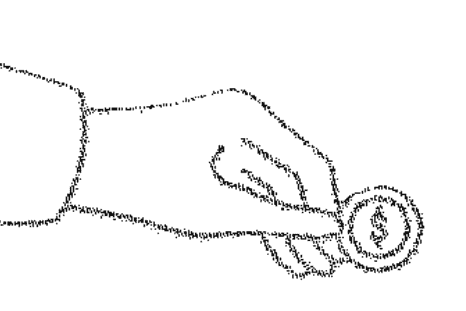

## 第 55 天
### 從歷史汲取教訓要讓數字說話

不管我們是否密切注意，股市每天都會起伏。

今天，我們要來檢視一下你做為一位投資者的經驗。我們以兩個觀念做為開始。第一，前事不忘，後事之師。第二，我們常常會把「前事」記錯了。

事實上，說「記錯」是太客氣了，我們實際上根本是昧於事實而把自己的投資技術想得太好。我們在意像中以為自己能夠預測市場走向，我們記得自己在市場衰退中勇敢的買進，但實際上我們當時是慌亂的拋售。我們老是在騙自己——但我們還不自知。

這些，都會讓我們難以成為一個好的投資者。想要好好理解自己究竟多精明以及過去所犯的錯誤？你應該把對過去的記憶放一邊，專注於證據：

如果你的經紀公司、401(k) 退休福利計畫或共同基金公司計算出你的投資回報率，你應該拿它來跟主要的市場指數對比一下。舉例來說，你可以把自己的投資回報率來跟領航集團的大盤股票市場指數基金、以及大盤債券市場指數基金做個比較。透過同一時期的比較，檢查你的投資報酬表現是否顯得微弱？也許你應該停止自己去挑選以為會賺錢的投資項目，而是去購買跟著市場走的指數基金。

如果你是在 2008 年末及 2009 年初股票市場崩盤時做的投資，那麼你就應該把當時的帳戶報告拿來好好檢視一下，你當初是買進還是賣出？如果你是賣出，那就表示你承受風險的意志較低，你也許應該做比較保守的投資組合。

看一下去年你的股票和股票基金買賣紀錄，如果買賣次數不多，那就意味著你只是有時需要點現金，或是你為了要維持自己的投資目標而將各種項目略作調整。但如果買賣很頻繁，那就可能意味著你的心意和投資策略經常改變——這是一種你不太真正知道自己在做什麼的跡象。

## 第 56 天
### 衡量投資風險承受度

如果市場崩跌不會讓你感到興奮，你在投資的道路上就可能會經常感到焦慮，成功的機會也很渺茫。

當我們的投資目標日設得很遠，例如說退休或是孩子的大學教育費用，我們就應該要估量兩個主要的風險。第一，我們投資過於保守，結果報酬不足以抵銷通貨膨脹和稅金而造成準備金太少。第二，投資過於積極，結果在市场衰退時措手不及而遭套牢，或者是在最糟的時刻拋售出場。

上述的第二個風險所可能帶來的損害又更大。如果我們在股市崩盤時驚惶失措，然後以極低的價格賠售，就將會付出慘痛的財務代價。我們昨天曾經討論了你的投資經驗。你是否有經常變換投資標的的歷史？如果有的話，你也許不應該去碰個別股票，而應該選擇投資共同基金——特別是提供更廣泛分散風險的類別——讓你的投資組合更趨向於保守。

如果你對投資沒什麼經驗，怎麼辦？除非你已經學會妥善處理自己對風險的承受度，否則還是謹慎一點不要去冒險比較好。你可以有的作法也許是把投資分開為股票和債券基金兩部分，如果你已經有幾年投資股票的經驗，認為自己有承受一些風險的把握，你就可以考慮把投資股票的部分酌量增加。

- 以 1 到 10 為級距，10 代表無所畏懼，你認為自己對風險的承受度是哪個等級？
- 以 1 到 10 為級距，10 代表你是一個很成熟的股票投資者，投資的理念也一直都很一致。你要如何評估自己的投資能力？

現在問問你自己：你現在擁有的投資組合符合你對自己風險承受度的評估嗎？你是位成熟的投資者？或是太積極、太精明？

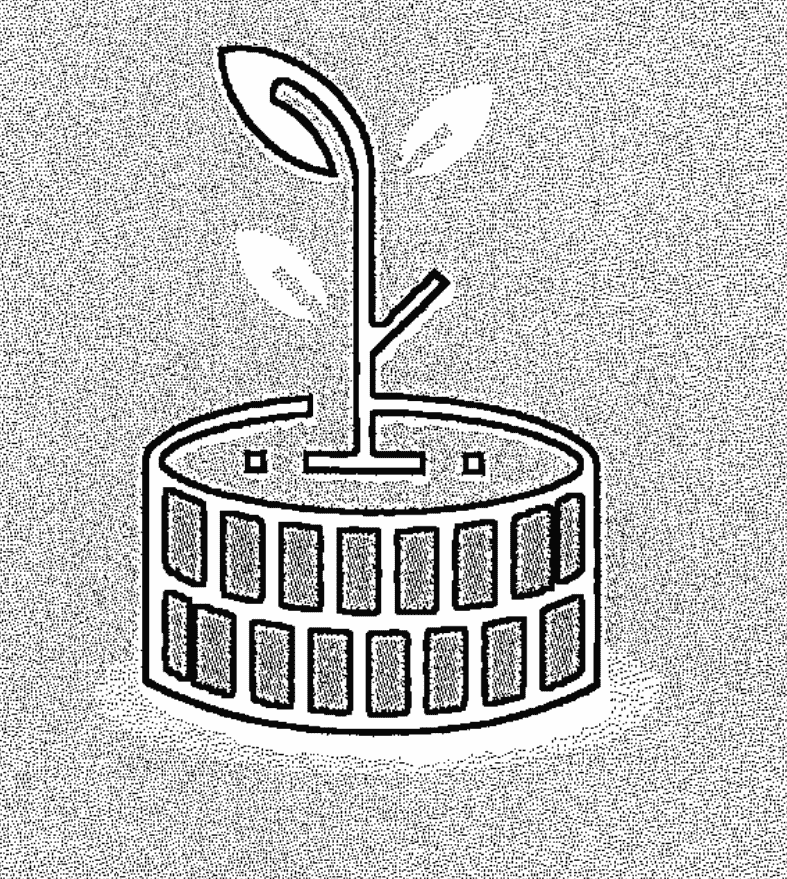

# 第 9 週

## 第 57 天
### 符合目標的投資配置

> 重點不在於我們如何精細配置股票、債券、現金以及另類投資，重點在於配置之後的堅持執行。

投資組合裡短期價值波動和長期報酬的主要推動器，就是所謂的資產配置（Asset Allocation）。也就是我們如何調配投資組合裡的四類基本項目：「股票」、「債券」、「現金投資」（像是貨幣市場基金和存款帳戶），以及黃金、房地產、避險基金等「另類投資」。

以短期來說，股票無疑是有風險，但以長期來說，它會是投資組合裡資本成長的發動引擎，它的獲利很輕易就可以超過通貨膨脹。現金投資一直被認為風險很低，但如果把通貨膨脹以及稅金考慮進去，我們很可能會在這方面的投資蒙受損失。

那麼，債券和另類投資呢？大多數的債券都被認為是保守的投資，它們的價格波動不大，利息穩定，但有些的價格則起伏很大，其中包括了高報酬的垃圾債券（Junk Bonds）、新興市場債券（Emerging Market Bonds）以及 20 年期或以上的美國國庫長期債券（Treasury Bonds）。

同樣的，另類投資通常也是雜七雜八的組合。一般來說，另類投資的作用是希望在股市疲軟時依然能有獲利機會，只不過並不保證一定能達到這個效果——事實上也經常會碰到價值猛烈起伏的狀況。這也是為什麼投資者傾向於把另類投資限制在總投資組合的 10%，有些人則完全不做這方面的投資。

對於你的每一個主要投資目標，你都應該分別予以設定資產配置。舉例來說，如果你計畫在三年之內買房子，你就不能冒太大的風險，所以你的資產配置也許應該全部設定為現金投資。但如果你投資目標是 30 年之後的退休，你的資產配置也許就應該是 90% 股票、10% 債券。

把你的主要投資標的列在下方，然後分別設定資產配置——股票、債券、現金投資以及另類投資各自占的比例。

| 目標 | 投資組合 |
| :--- | :--- |
|  | %股票 |
|  | %債券 |
|  | %現金 |
|  | %另類投資 |

## 第 58 天
### 分散風險

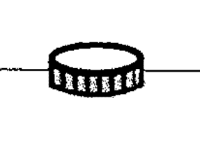

> 令人吃驚的是，我們的投資組合經常是在我們未加關注時成長，我們一旦介入，它們反而停步了。

一旦你已經設定好相關的資產配置，下一步就是要使之多樣化——也就是說盡量購買多種有價證券。

不過就現金投資來說，多樣化並不是那麼重要，如果你已經有了一個貨幣市場基金帳戶，其實就並無必要再去開個高利息存款戶。但對於債券、另類投資或股票來說，分散投資以及多樣化就很重要了。如果你只擁有一家公司的股票，萬一這家公司的財務出了狀況？不管整體的股市表現得如何，你都很可能蒙受重大損失或者甚至血本無歸。你冒了一個很大的風險——把一個大賭注下在單一公司上面——結果卻一事無成。

想要避免這種命運，你需要擁有大量股票——或大或小、美國的或外國的。同樣的，你應該買許多不同的債券、許多不同的有價證券。多樣化可以降低只擁有單一股票或債券的風險，而且更可能從投資中獲利。換句話說，如果你把投資多樣化了，市場隨著時間開始趨於強勁，你的投資組合自然也會隨之增值。

買這麼多股票和證券感覺上很困難，但實際上卻頗容易——這都要拜共同基金和 ETF 之賜。這類基金是把不同的股票、債券及其他投資綁在一起成為單一組合，使得投資者能以相對較低的資金，卻可以分散更多的投資風險。例如領航集團所推出的全球股市指數基金（Total World Stock Index Funds），就包括了全球市場裡的八千種股票，這是一個不得了的多樣化組合——但只需要 3,000 美元就可以開戶。

## 第 59 天
### 降低投資成本

> 當我們去買一個投資項目時，並無法確認自己一定會獲利，但如果把費用壓低，我們至少可以確認能夠多保住一點獲利。

投資者通常會被獲利弄得眼花撩亂，而忽略了他們所需付出的費用。我們如果不小心處理的話，就可能會發現自己原來要付出整體投資 2% 或更多的費用。如果我們買的是高費用的共同基金、被包裝成投資的保險產品、以及交易太過頻繁或者所僱用的經紀人、財務顧問引導我們去買的那些高費用產品，我們就很可能會付出前述的 2%。

不錯，每年付出整體投資的 2% 感覺上也沒那麼糟——這就是為什麼華爾街把投資費用設計成這個比例的原因。但你要知道，2% 實際上已經吃掉你每年可能盈利的一大部份了。舉例來說，你投資股票市場的回報是 6%，那麼付出 2% 的費用後，你的實際收益就剩下 4%。換句話說，你投資收益的 1/3 都繳給華爾街了。

你今天的工作：算出你的投資所需付出的費用。

把投資所需付出的費用壓低是件很重要但又很困難的事。有些類型的投資如存款帳戶、定期存款、固定年金險（Fixed Annuity）、現金價值壽險（Cash-Value Life Insurance）並無明訂的操作費用比率（Expense Ratio），但這並不意味這類投資所需要的費用就會比較低。特別是幾乎所有保險公司推出的投資產品都需要付出佣金給相關銷售員，同時也會收取相當高的日常維持費用，但保險公司一般都不會讓客戶知道這些細節。

另外的一些投資——如股票和債券——由於不需要付出或只需付出很少的佣金，會讓你感覺投資費用很低，但其實真正的費用是產生在股票的交易價差（Trading Spread）以及債券的成本加成（Markup）。每一種股票和債券都有兩個價錢：買價和賣價。前述的「交易價差」以及「成本加成」指的就是這兩種價錢的差別，但一般的投資人並不太容易弄得清楚這個價差。

還有一些投資類型——特別是共同基金，也包括了你的僱主所提供的退休計畫——你會比較清楚買賣時是否需要付出多少佣金，以及日常維持費用是多少。理想的狀態是，你應該擁有那些不收取銷售費用的基金——沒有買賣佣金以及年度維持費用不超過 0.5%——也就是說你如果投資 100 美元，每年的維持費用是 50 美分。總之，投資的費用應該壓得愈低愈好。

現在把你所擁有的投資、買賣的費用以及日常維持費用列在下方。如果你不清楚這些費用，就註記「不清楚」，如果「不清楚」的註記有很多，那就是個警訊——可能意味著你在投資方面付出了太多費用。

| 投資項目 | 購買費用 | 日常維持費 | 出售費用 |
| :--- | :--- | :--- | :--- |
|  |  |  |  |
|  |  |  |  |
|  |  |  |  |
|  |  |  |  |
|  |  |  |  |
|  |  |  |  |
|  |  |  |  |
|  |  |  |  |
|  |  |  |  |
|  |  |  |  |
|  |  |  |  |
|  |  |  |  |
|  |  |  |  |
|  |  |  |  |
|  |  |  |  |
|  |  |  |  |

## 第 60 天
### 如何減稅、避稅

> 繳稅固然是成功的象徵，但也沒有必要在山姆大叔（美國政府）面前炫耀。

在盡量壓低投資所需付出的費用同時，你應該特別留意其實是大筆的投資費用——稅。那麼，該怎麼做呢？以下是四條簡單的規則。

規則一，充分利用有利於減稅的投資帳戶。401(k) 退休帳戶和由僱主贊助的退休帳戶讓你能夠進行三種投資操作：立即減稅、延稅以及取得僱主相對基金。另外，如果你符合資格的話，傳統的個人退休帳戶可以讓你有兩種操作：減稅和延稅。

那麼，羅斯個人退休帳戶或羅斯 401(k) 退休帳戶呢？這兩個帳戶並不提供立即減稅優惠，但如果從帳戶中提錢卻完全免稅，如果是非羅斯退休帳戶的話，提款時就要付收入稅。如果你希望在退休後享受較低的稅率，減稅或免稅帳戶應該是最合理的考慮。如果你期待你的稅率級距在退休後維持一樣或稍高，羅斯退休帳戶就會更適合一些。

規則二，不要用一般需要付稅的帳戶來賺取大筆利息。利息收入——債券或存款戶的利息——會立即被徵收邊際收入稅（Marginal Income Tax；雖然有些聯邦政府發行的債券不會有州稅的問題，市政府所發行的債券利息也可能完全免稅）。你是否正在為你所賺取的額外的錢付出 12%、22% 或 24% 的稅，如果有，這就是你所付的邊際收入稅——也是美國政府從你賺取的利息中分去的部分。

規則三，盡量不要用一般必須付稅的帳戶來進行交易。如果你出售應稅帳戶裡的投資項目，你就必須要付出資本利得稅——如果這個投資項目在你手上還不滿一年，稅率將會非常高。另外要注意的是，你不僅要關注自己所經手的交易，也要注意你所擁有應稅共同基金帳戶內的交易。這也是為什麼我們建議把股票指數基金（Stock Index Funds）放在應稅帳戶裡的原因，這類基金只是根據市場指數單純的收購並持有股票，因此產生的稅金有限。

規則四：不要浪費繳稅年。如果你剛剛退休或者失去工作，你也許在當年只欠政府一點稅或者根本不欠稅，但如果你什麼都不做，就等於浪費了一個機會，為什麼？因為你可以利用那樣的年份讓你的投資獲利，或者把一部分傳統個人退休帳戶改為羅斯退休帳戶，如此一來，你所需付的稅與正常年份相較起來，就會大大減少。

編按：由於美國在生活水平與稅負，和臺灣相比，較為沉重，所以他們有各種投資節稅的管道。在臺灣，能透過退休帳戶自行投資，且有節稅優惠的只有私校退撫基金。此外，臺灣投資人可以利用個人勞退帳戶，自提 6%，享「遞延稅負」效果。另外，若利用一般個人帳戶投資，會有兩種情形：

- 一、買賣境內基金：
  - 投資國內市場標的，其買賣價差（資本利得）是不課稅，配息所得則是有一年 27 萬元以內的免稅額。
  - 投資海外市場標的，其買賣價差（資本利得）亦不課稅，配息所得（海外所得）則是有一年 100 萬元內免申報。
- 二、買賣境外基金，則不管是資本利得或配息，都是一年 100 萬元內免申報。

## 第 61 天
### 延稅的好處

> 想要增加我們的財富？我們應該要降低會被減去的部分：稅金、投資成本，以及愚蠢的財務下注。

我們昨天討論了把基金放入退休帳戶，以及盡量限制應稅帳戶中交易行為的重要性。就大多數的情況來說，這兩種策略的目的只是把最後清算的日子往後延：意味著當你開始從大多數的退休帳戶提款，以及從你的應稅帳戶中出售有利可圖的投資項目時要繳稅。不管怎麼說，你如果能夠把這些稅金盡量延後，你就可以賺取更多的錢。

我們可以從這個角度來思考：如果你有意在傳統的 401(k) 退休帳戶裡，或者你在應稅帳戶裡有可以獲利的投資項目，政府就有權向你收稅，但你可以把繳稅的時機延後，你就可以利用這些錢來賺取更多利益。

這種延稅的作法有什麼好處呢？我們來看一個例子：丈夫和妻子各自在同類的投資項目中放進了 1,000 美元，丈夫用的是一個應稅帳戶，妻子用的則是不提供開戶減稅優惠但有延稅設計的傳統退休帳戶。在接下來的 40 年間，這個投資的每年獲利率是 6%。

丈夫每年都要為這 6% 的獲利付出其中的 24% 做為稅金，妻子的稅率也是 24%，但她可以等到 40 年之後退休時才付這筆稅金。結果是：丈夫最後的餘額是 5,951 美元，妻子的則是 8,057 美元，足足多了 34% 以上。

## 第 62 天
### 在不同帳戶配置不同的投資

> 如果你對所持有的、所售出的資產，以及市場會如何表現有一定程度的認知跟瞭解，你還會想要擁有手中現有的投資組合嗎？

兩天之前，我列出了有關如何處理投資稅金的四個規則，昨天，我們談到有關延遲付稅的好處，這些意味著什麼？意味著你要想清楚哪一類投資應該放在對稅務較為有利的退休帳戶，哪一類應該放在一般的應稅帳戶裡。理由：如果處理不善，有些投資或投資策略可能會讓你因為繳稅而損失投資所得的 1/4 或以上。但如果處理得好，你就有可能損失很少或根本不會損失。

舉例來說，公司債券每年都會給付利息，而這個利息是需要繳稅的——根據收入稅率而不是較低的資本利得稅率。按照現行稅法，一般收入稅的聯邦稅率可以高達 37%，幾乎是長期資本利得稅和合格股息收入（Qualified Dividends）稅的兩倍。後兩者的稅率大約是 20% 或以下。

同樣的，如果你的股票都是短期交易，持有不到一年就脫手，你的利得就無法享受長期資本利得稅率，而需按照一般收入的標準被徵收高得多的稅金。

相較之下，其他的一些投資項目則可以享受低稅率甚至不用繳稅。舉例來說，你買了股票或者股票指數共同基金，但你只是放在手上並不進行交易，所以就不會有資本利得稅——由於大多數的指數基金並不會積極進行交易，所以它們在資本收益分配（Capital Gain Distributions）方面所需付出的費用也十分有限甚至根本沒有。不錯，你會有股利分紅，但稅率相當的低。

以上這些對你的投資組合而言究竟意味著什麼？意味著你應該運用你的應稅帳戶來處理那些不至於產生高稅金的投資，另一方面，可能導致高稅金的投資則放在退休帳戶裡。以下就是實際上可以採行的配置：

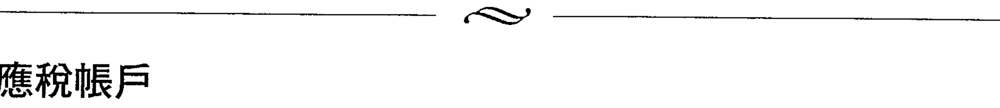

**應稅帳戶**
- 股市指數基金
- 長期持有的股票
- 免稅市政債券和債券基金

**退休帳戶**
- 主動式管理股票基金
- 短期操作的股票
- 應稅債券和債券基金
- 不動產投資信託

現在你應該檢視一下你的投資組合，是否各項投資都放對了位置？不過這裡也要提出一個重要的警告：你並不一定要按照上述的方式配置投資項目，因為我並不認為短期的股票交易或者購買主動式管理共同基金是聰明的作法，它們過去的紀錄並不好。但如果你一定要照做的話，還是使用退休帳戶較好，否則的話，報稅的時候可能就要大禍臨頭了。

我們在過去三天中討論了投資方面的稅務問題，你是否要做一些配置上的調整呢？你可以把想要做的改變列在下方：

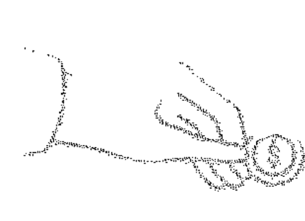

## 第 63 天

### 無法擊敗的市場

華爾街一直灌輸我們一個夢想，就是我們可以贏過市場。

因為這個夢想可以讓他們（華爾街）賺大錢。

想像你加入一群「週末勇士（指只有週末才出動的業餘者）」的陣容，面對一個職業籃球隊；或者你在網球場的這一邊，而站在對面的是溫布頓網球大賽冠軍；又或者你把自己的老舊自行車從車房中牽出，站上環法自行車大賽的起點上。你認為你自己的勝算有多少？這個問題並不難回答：你得勝的機會就在「零」與「什麼都沒有」之間。

投資也是一樣。

大量的統計和不可推翻的邏輯都告訴我們，投資就是一個輸家遊戲。絕大多數的投資者——業餘的或職業的——所賺到的都低於市場平均值。

在扣掉投資成本之前，我們所有人的確從股票或債券市場賺到回報，但扣掉成本之後可能所剩無幾。

不錯，就像是也有人會中彩券一樣，少數的投資者確實可以賺到大錢。你今年也許可以勝過市場平均值，或許明年也可以，但那冷酷無情的投資成本遲早會讓你付出代價——你花了一輩子投資想要贏過市場的機率，不會比你贏過職業網球選手的機率高多少，事實上，可能還要更糟：職業網球選手可能還有失常的一天，但股票市場可是每天都要激烈競爭的。

許多人都願意接受這樣的看法。我們那不可靠的記憶會讓我們以為自己的投資表現比實際上要好，我們經常落於過度自信，覺得自己知道股市什麼時候會飆升，市場的下一個走向會是什麼。但這種妄想會讓人付出巨大的代價——我們愈快知道并接受自己不太可能勝過市場的這個事實，我們的財務前景就會更為光明。

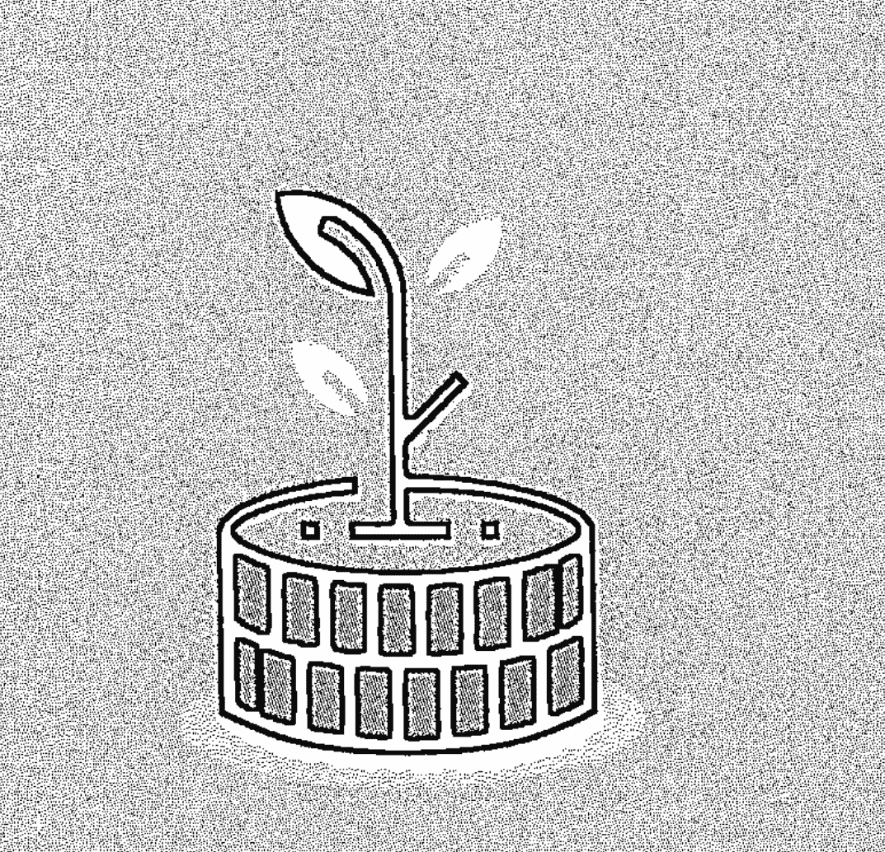

# 第 10 週

## 第 64 天

### 用指數基金建構你的投資組合

> 有些人會認為自己是投資天才——那些精明的人則會投資指數基金。

現在，你可以開始準備選擇投資項目了。過去一星期，我們談了有關資產配置——股票和其他更保守的項目如何配置。我們討論了分散投資以及壓低包括稅金在內投資成本的重要性，也討論了你不太可能勝過市場。

這所有的一切對於你所買的投資項目有些什麼意義？許多認同投資基本規則的人，最後都設置了包羅萬象的不同投資組合。現在，讓我建議兩個相當簡單的策略，我們今天先談一個，另一個明天再談。

今天的建議：用三個核心指數基金來建構你的投資組合。指數基金屬於被動型投資，係按照市場指數構成的標準，購買該指數包含的全部或一部分證券，其目的在於達到與該指數同樣的收益水準。通常由於相關費用的關係而無法達成所期待的收益目標，不過好在這個投資的費用相對很低，所以差額也很有限——遠低於大多數主動型投資者會遇到的狀況，主要的原因就是後者的投資成本相當高。結論：把目標設定在一般的水準，指數基金的表現會好得多。

指數基金有兩種類別：共同基金和指數股票型基金（Exchange-Traded Funds）。共同基金由基金公司直接提供，它們的價格就是交易所當天休市時的價格。至於指數股票型基金則是在股市正式上市，只要是交易日都可以購買，只不過你需要先開設一個經紀人帳戶。

你可以設置一個由三個指數基金組成的投資組合：美國股市指數基金、美國債券指數基金以及國際股票指數基金。富達投資（Fidelity Investment）和領航集團都以共同基金的形式提供這三種指數基金。安碩公司（iShares）、標準普爾公司（SPDRs）以及先鋒公司則以指數股票型基金形式推出。

嘉信理財（Charles Schwab）也提供前述三種指數基金的共同基金和指數股票型基金，不過國際基金的部分只限於成熟市場（Developed Markets，係是指高收入國家或地區的股市，即以美國、日本為代表的 34 個發達國家或地區，以及歐盟 17 個成員國）。這意味著你或許應該在投資組合中，再加入第四個專門針對新興市場的基金。嘉信理財所提供的基金以費用低而廣為人知，另外，它的共同基金最低起始投資額只需一美元即可。

你應該把你的錢如何分攤在這三種基金裡呢？以美國股市指數基金和國際股票指數基金來說，應該是六比四。債券的部分呢？那得看你願意冒多大的風險，以及你的投資目標日設定得多遠。你的目標日設得愈近——你就愈容易對股市的起伏感到不安——你就愈應該把錢放進債券市場指數基金裡。另外，你應該把債券基金放進退休帳戶，這樣你就不需要每年為所生出的利息付稅。

## 第 65 天

### 用目標日期基金一次搞定

> 全球市場分成主要四個部分：美國股票市場、美國債券市場、外國股票市場、外國債券市場。你只投資了一種？那你算是賭很大。

我們昨天討論了如何用三個指數基金，來建構一個全球性的多元化投資組合。今天我就來告訴你另一個更為簡單的方法，也就是你可以購買一個目標日期退休基金（Target-Date Retirement Fund）。這種基金本身就有多元化的組合，同時根據購買人預定退休日期設定期年限。舉例來說，一個設定 2045 年到期的基金，其本身包括了股票及債券的投資類型，就很適合在 2045 年前後達到 65 歲退休年龄的人購買。

目標日期基金的最大好處就是單純，這類基金實際上已經是許多 401(k) 退休計畫的主流產品，也被公認為是投資的當然選項。不過目標日期基金也還是有些缺點。亦即雖然大多數的目標日期基金本身並不收取任何費用，但它們所投資的是由相關贊助基金公司所提供的產品——這些產品可能費用頗高，而且幾乎都屬於主動管理的性質。

這裡有三個例外：嘉信理財、富達投資以及領航集團。它們都提供一系列的目標日期基金，但也都是投資在本身所擁有的指數基金。這就意味着這些基金的年度費用很低，嘉信理財收取的費用是 0.08%，富達投資是 0.15%，領航集團則是 0.13% ～ 0.15%。需要注意的是，這些基金的股票指數部分並不會產生太多的稅金，但是債券所產生的利息卻必須繳收入稅——假定你是用一般的應稅帳戶，而不是退休帳戶來處理你的目標日期基金。

另外要注意的是，富達投資和嘉信理財也有另外一系列目標日期基金是投資在主動管理基金，因此會有很高的年度費用。

你不太可能只擁有三個指數基金或一個目標日期基金。可能的狀況是擁有一個 401(k) 退休計畫、一個個人退休帳戶以及一個應稅帳戶。你的配偶也可以做同樣的配置，也許你還可以在為孩子設置一個 529 大學儲蓄計畫。在每一個帳戶裡，你我都應該至少有一個投資項目。

此外，你不要把目標日期基金和指數基金放進你的 401(k) 退休計畫裡，否則的話，你可能會發現自己不知不覺中已經建立出一個並不真正很想要的多元化投資組合。**不管怎麼說，你應該注意的原則是盡量找那些低成本、低費用的選項，同時愈多元愈好。**

那麼，你的計畫將會是如何呢？參考下列的選項並做出你的選擇。

- ☐ 我想用三種市場分散的指數基金來建構我的投資組合。
- ☐ 我會去買一個目標日期退休基金。
- ☐ 我有些做其他種投資的想法，以下是我的計畫：

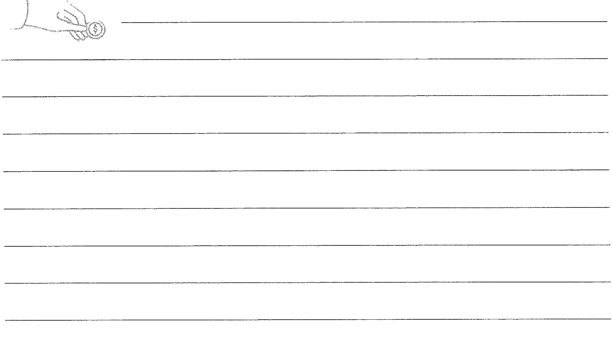

## 第 66 天

### 如何對付瘋狂的市場

> 財務上的智慧是體現在我們需要常常質疑我們的第一直覺反應。

買股票和股票基金並非難事，難的是你在投資過程中所可能面對的掙扎。我們現在所管理的錢也許是為了幾十年後退休之用——這個過程可能是 20 年、30 年或者更長的期間——但我們所密切注意的卻是股票市場每天的變化，特別是股市動盪的時刻。這裡面所潛藏的危險是：我們面對市場下滑時驚惶失措，以至於在最糟的時刻脫手拋售。

如果運氣夠好的話，一段時間之後，你也許會適應股票市場的這種不確定。不過以下這三種策略可能也會對你有所幫助：

- 你應該要能看到黑暗中的光明面。如果市場下跌，當然會損及你現在手上所擁有的投資，但你如果一直有往你的投資組合裡注入新的儲蓄，就意味著你其實也可以在下跌中獲利，因為你可以在這個時刻用更便宜的價格買進股票。實際上的情況就是，如果你現在是 20、30 歲，你手上現有的投資組合價值跟你 10、20 年後可能做的投資比較起來，其實算不了什麼。
- 你應該關注所擁有的所有資產。就算是市場下跌讓你的股票投資縮水了 20%、30%，你的總財富也不太可能就跟著也縮水那麼多。因為你可能還有錢是放在債券、銀行帳戶、所擁有的房屋、社會安全福利計畫、有資格領取的退休金以及——也許是最重要的部分——你的人力資本裡，而這一切的價值都和以前一樣，沒有變動。
- 請記得，股票是有基本價值的。在股市動盪時，帳戶報告上所顯示出來的只是數字而已，而且是不斷縮水的數字。但這些下跌數字的背後卻是實實在在的商業行為，是為大家生產出每日所需商品或服務的商業。總有一天，投資者會認知存在於那邊的價值，同時會投入資金而使得股價再度攀升。

## 第 67 天

### 投資組合「再平衡」

> 我們以為自己知道財務市場走向時，我們其實已經迷失了方向。

投資的目標就是低價買進、高價賣出，這個策略聽起來很容易，但執行上卻並非如此。市場飆升的時候，我們欣喜若狂，結果是造成我們在股市裡投資過多。股市下跌時我們又驚駭莫名、不知所措，結果很可能是讓我們因為驚慌而拋售。

該如何來避免這種愚行呢？你應該從一開始就做好資產配置，把投資組合裡的股票、債券、現金、以及另類投資的比例分配好。舉例來說，你的目標配置可以是股票占 55%，債券 35%、現金 5%、另類投資 5%，然後你應該不時檢查一下，確認保持住上述的比例。

如果你發現股票部分的占比超過了 55% ——當股價上升時你手中的股票價值也跟著上升——你就應該脫手一些股票，讓這部分的占比回到原先設定的目標。反過來，當股市下滑時，你會發現投資組合裡股票這一部分的占比也下滑了，這時你就應該從組合裡其他的部分轉移一些資金到股票這邊來，使其占比回復到 55%。

這個調整投資組合占比的過程，被稱作為「再平衡」（Rebalancing）。就理財來說，這個習慣的養成十分重要，因為它會強迫你施行逢低買進、逢高出售的股票理財原則，你也可以利用這個作法來控制風險，保持你的股票配置在一種「舒適」的狀態，還可使得你的投資年限產生意義。

但如果你所擁有的全是目標日期的退休基金，你就不需要煩惱「再平衡」這檔事，因為基金的本身就會自動處理了。除此之外，每個人每年都應該做一次「再平衡」的動作——特別是市場動盪太大而導致你的投資組合失控時，你更應該提早「再平衡」一下。

今天的家庭作業：訂下每年為你的投資組合做「再平衡」的日子。許多人會選擇每年的年底，但其實任何一天都可以，重點是訂下之後就要堅持實施。

- □ 我每一年都要在 ____________________（日期）再平衡我的 ____________________（名稱）投資組合。

## 第 68 天

### 負數債券

> 償還債務可以保證有回收，而且會是超過債券可以帶來的收益，這是其他的投資都辦不到的。

我們通常都會用所謂的「心理帳戶」來看待我們所擁有的錢，會把我們的薪水支票、投資組合、房子、車子、保單視作不同的財務項目，但實際上它們都彼此相關，而且如果我們可以看清楚它們的相關性，就將能夠做出更聰明的抉擇。其中的一個聯繫就是：**我們財務生活中的許多部分都有點像債券**。

債券是一種可以為我們帶來定期收入的投資，但我們也可以從許多其他的來源獲得定期收入——雇主發的薪水、定期存款、儲蓄帳戶、社會安全福利金、退休金、養老年金……，我們在設計投資組合時，也應該將這些列入考慮。

舉例來說，在我們工作的歲月中，我們比較不需要擁有債券——因為我們有薪水做為定期的收入——所以我們可以讓投資組合以股票為主。同樣的，如果我們的退休生活花費可以用社會安全福利金和傳統的養老計畫來支付的話，我們就可以在投資組合裡少配置一些債券而繼續以股票為主，這個作法甚至還可以延續到我們不再工作之後。

這讓我們可以產生一個簡單但強勁的理財觀念——除了上述那些「類債券」之外，我們還有大量像房貸、學生貸款、信用卡債、汽車貸款，以及其他可以被稱為「負數債券」的債務。債券可以為我們帶來利息收入，這些債務卻向我們收取利息——而且我們被收取的利息通常都會大過債券所生出的利息。

舉例來說，我們有 20 萬美元的債券，但同時也有 20 萬美元的債務，在這種情況下，我們可以說所擁有的債券淨值是零。這裡面於是出現了兩個意涵：第一，我們整體的財務風險可能比想像的要大。第二，與其還要去買更多的債券，我們可能更應該選擇償還債務。再進一步來說，合理的作法可能是出清債券，然後去清償債務。

## 第 69 天

### 瞭解你的債務和利息

> 如果我們想過一個舒適的退休生活，就應該先讓債務「退休」。

債務並不見得就是壞事，如果不是透過欠債，我們之間很多人會付不起大學費用、買不起第一輛車或者房子。但雖然債務可以幫助我們開啟財務生活，我們卻需要留意，不要欠下難以處理的債務——另一方面，我們也應該提醒自己，有能力的話，應該盡可能早一點把債務清償，特別是信用卡債，因為信用卡公司收取的利息實在高得離譜。

那麼，其他類型的債務呢？你在第 44 天時曾經計算過自己的淨值，其中也包括了列出你所有的債務，我現在希望你把它們再列一次——這一次加上你所需付出利息的利率：

| 債務類別 | 利率 |
| --- | --- |

在一些情況下，你真正需付出的費用可能會低於表面的利率，這是因為所付出的利息屬於可以減免稅金的項目，例如房貸、學生貸款或者經紀公司所提供的保證金帳戶（Margin Account）都屬於此類。你如果在聯邦報稅單上選擇逐項列出明細，而非採用一般的扣除方式，就可以把房貸和保證金帳戶的利息做為扣除額。

與此同時，假定你的收入不是很高，學生貸款的利息也有機會成為免稅扣除額。

如果任何所付出的利息可以成為減免稅扣除額——這個「如果」是很大的可能——你每付出一塊錢的利息，大概可以省下 12% 到 22% 的稅，確實的數字得看你的邊際收入稅級距。但一般來說，如果你的房貸利率是 4%，實際付出的則大約是 3%。

上述的作法感覺上頗划得來。但你也應該想一想可以買的債券及債券基金，就算你把一些省稅的方式都已考慮進去，它們所付給你的利息很可能也都會低於你在房貸方面所要付出的利息。另外，你如果用一般應稅帳戶來處理這些債券或債券基金，你可能就必須付利息收入稅。如此一來，你能放進口袋裡的錢就變少了。

關鍵因素在於：清償債務是合理的作法。現在來思考一下你可能會有的投資機會：如果你的雇主願意提供相對基金，你就應該把 401(k) 退休計畫做為優先選項。接下來，你應該清償信用卡債。再接下來，設立一個個人退休帳戶。

上述的步驟都做好了？下一個聰明的作法，應該是在一般應稅帳戶裡做股票指數基金投資。但如果你比較傾向於在銀行裡留存一些額外的儲蓄，或用這些錢去買債券也可以，但一定要先清償債務，就算是利息很低的抵押貸款，你也應該先還清。

假若你的抵押貸款費用相對很高呢？假定抵押貸款的餘額是十萬美元而你並不考慮在三年內搬遷，你就應該考慮重組貸款。這個程序包括設定新的貸款合約以及新的利率，一般來說，新的利率應該要比舊的下至少 1%。另外，你應該要確認新貸款的期限不長於現有的合約。例如，你現有的合約還有 22 年才清償，那麼，你的重組新合約期限就應該是 22 年或者更短。

你想把債務做一些改變嗎？把你計畫採行的步驟記錄在下方：

## 第 70 天

### 理財單純化

> 我們在塵世的不朽還得靠其他人去想起來，所以要確認他們能記得。

假定你明天突然死去。我知道這個想法不會讓人舒服，但在那種時刻，你自己的財務問題已經一了百了，但你的家人呢？他們的問題才正要開始，特別是如果你留下來的是一團混亂，他們要如何妥善處理你的遺產？如何解開你所留下如一團亂麻的財務迷宮？為了讓你的家人更容易處理問題，你現在就應該整理一下自己。

許多人都會陷入我所稱的「天真多元化」的處境。我們以為僱用多位財務諮詢師、設立多個銀行或經紀帳戶、在同一個投資市場中擁有多個基金或投資項目，我們就會在理財方面更為安全。其實在大多數的情況下，我們自以為的額外保障都是幻象而已。我的忠告：把財務諮詢師、銀行、經紀公司、共同基金、目標日期基金、讓你能同時觸及多個市場領域的全市場指數基金，都限制於各有一個就好。這樣做會讓你的理財單純化。

另外，你也應該簡化所保存的財務文件，只留下過去七年的報稅單及相關材料即可，其他都可以丟棄。如果你的經紀公司或共同基金公司可以提供付費的資料，你自己除了最近的一份報告之外，根本就不用保存任何文件——甚至於那份日期最近的報告都可以上網去搜尋。

至於保險單，只需留最近的一份即可，除非你正在申請理賠或擔心會有什麼法律訴訟，那麼，你就應該留下受到影響年份的紀錄以及其他相關文件。如果你擁有房產，你應該保留房屋裝修的詳細記錄，如果有一天要賣房子，就可以據之估算出售價為何。最後，把所有的用戶名及密碼做成列表，放在安全的地方——但要確認所信任的家人能找到。

- 是的，我的相關財務事項都已經組織好了。

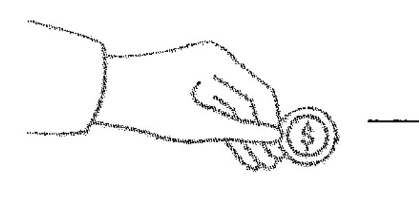

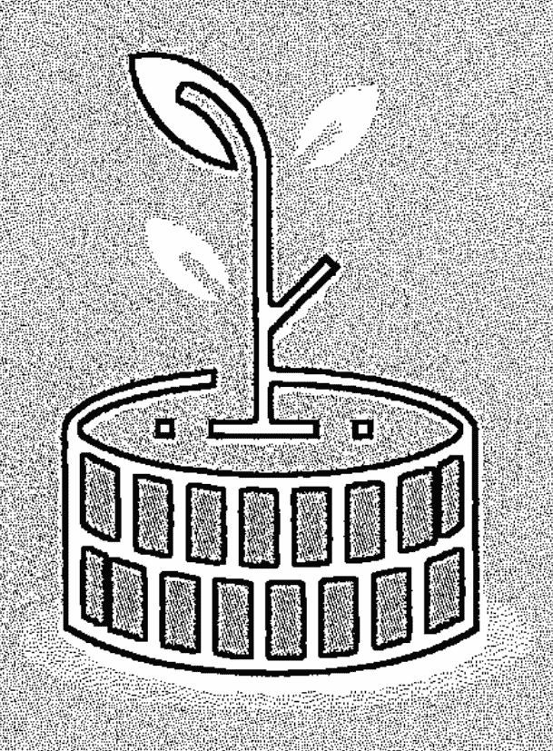

# 第 11 週

## 第 71 天

### 捐助他人

> 有撈才有得：把錢花在別人身上，往往比花在自已身上更有幸福感。

你願意支持哪一個慈善機構、政治團體、或宗教組織？你願意讓哪一個機構或個人繼承你的遺產？把你願意提供財務幫助的對象做出一個列表，註明你願意提供多少錢，以及生前或死後才提供。

| 誰 | 多少錢 | 什麼時候 |
| --- | --- | --- |
| | | |
| | | |
| | | |
| | | |
| | | |
| | | |
| | | |
| | | |
| | | |
| | | |
| | | |
| | | |

## 第 72 天

### 把錢留給你愛的人

> 如果你把集郵冊留給孩子，他們會記得你。如果你留給他們的是羅斯個人退休計畫，他們會很高興的記得你。

遺產規劃聽起來是頗複雜的一件事——假如你超級有錢、在不同的州境都擁有房子、某一家庭成員有特殊需要、或者你結婚不只一次，有現在的配偶以及前次婚姻的子女必須照顧。那麼，確實會比較複雜。

但對大多數的人而言，遺產規劃是個直截了當的事，目的就是確認我們的資產留給了正確的人。為了達到這個目的，我們可以採行四個作法：

1. 我們可以採用「生存者財產權」（Right of Survivorship）而與其他人共同擁有資產，當我們過世之後，這些資產

&nbsp;&nbsp;&nbsp;&nbsp;——一般都是房屋或車子——就自動轉移給另一方。
2. 我們可以在退休帳戶裡指定受益人，這些帳戶就會自動轉移給我們指定的人。
3. 我們可以在人壽保單上指定受益人，同樣的，理賠就會直接撥發給我們所指定的人。
4. 立下遺囑。這個遺囑處理的是除了以上所列的其他事項——並非共同擁有的產業，以及被指定為受益人以外的人。

&nbsp;&nbsp;&nbsp;&nbsp;為了更進一步保證所有的事情都妥善安排，我們還可以設置授權執行人（Power of Attorney），他們可以在我們喪失行為能力時，代為做出有關健康及財務方面的決定。但對於還在工作中的人來說，上面所提及的四種作法應該已經足夠了。

&nbsp;&nbsp;&nbsp;&nbsp;你想確認自己是否已經做好準備？現在請核對一下以下的清單：

- 是的，我已經做好了共同所有權的安排。
- 是的，我已經在退休帳戶裡指定了受益人。
- 是的，我已經指定了人壽保險保單的受益人。
- 是的，我已經立好了遺囑。

&nbsp;&nbsp;&nbsp;&nbsp;最後，還有一個你幾乎不用特別擔心的事：聯邦遺產稅。根據稅法，2018 年的聯邦遺產稅免稅額是 1,100 萬美元（編按：目前台灣遺產稅免稅額為 1,200 萬台幣），所以，只有 0.1% 的死亡案例需要繳聯邦遺產稅。對大多數的美國人來說，最大筆的「死亡稅」是死者退休帳戶遺贈所需繳的收入稅。你想要確認受贈者不需要繳這個稅？你可以考慮設置羅斯 401（k）退休計畫、羅斯個人退休計畫，以及把現有的傳統退休帳戶改為羅斯帳戶。

## 第 73 天

### 金錢不該是禁忌的話題

> 你可以跟你的父母好好談一下他們退休後的可能財務狀況，或者是你覺得尷尬而不願意談。那麼，你最好去買間多出一個臥房的屋子，等他們來跟你一起住。

&nbsp;&nbsp;&nbsp;&nbsp;可以這樣說，金錢一直是個禁忌的主題。我們很少告訴別人自己的薪水是多少、欠了多少債、存了多少錢——每當這個主題出現時，我們通常都會有所隱匿，目的是讓我們自己在別人眼中看起來好些。這個，其實是很不健康的作法。

&nbsp;&nbsp;&nbsp;&nbsp;**今天的工作是：** 跟你的配偶、孩子、父母敞開胸懷談一下你自己以及他們的財務狀況。你會發現有奇妙的事情發生了——你也許會對配偶有關金錢的焦慮出現新的看法，你的父母也許會對他們的財務問題暢所欲言，也許你會激發孩子的投資意願與興趣，你們之間的對話也會讓孩子對即將來臨的成人生活做出更好的準備。也許最重要的是，你可能會想好好重整一下你自己的財務狀況。所以，進行這些對話絕非一件令人尷尬的事，反而會是以後能讓你們感到自豪的泉源。

- 是的，我跟家人已經就金錢方面有了一場坦誠的對話。

## 第 74 天

### 尋找合適的財務顧問

> 現金價值人壽保險的優點是顯而易見的——只不過是對賺取佣金的保險公司推銷員而言。

&nbsp;&nbsp;&nbsp;&nbsp;讀了這本理財指引之後，有些讀者可能會覺得已經具備了處理財務問題的能力與知識，但另外一些人可能還是想要尋求專業協助，因為他們的財務狀況比較複雜，或者他們在努力存錢及如何做聰明的投資之間經常陷入兩難。那麼，你在找尋財務顧問時要注意些什麼呢？這裡有五項忠告：

1. **不要把保險經紀人當成你的主要財務規劃師**。保險經紀人只會想要賣價值不斐的保險產品給你，例如各種不同的年金保險以及有現金價值的人壽保險，這些都已證明為不怎麼樣的投資。
2. 不要用只靠佣金收入的經紀人。在許多情況下，就法律上來說，經紀人並不需要維護你的最高利益——但他們卻有誘導你進行無必要交易的財務動機，同時會傾向於把佣金比例最高的產品推銷給你。
3. 如果你的財務問題不算是太複雜，可以考慮用「機器人投資顧問」（Robo-Advisor）。市面上的「機器人投資顧問」例如「改善財務」（Betterment）、「未來顧問」（FutureAdvisor）、以及「個人退休計畫再平衡」（Rebalance IRA）收取的費用都不高，為顧客做的投資也大多是低費用的指數基金。你也可以去查一下各大財務公司所提供的低價理財顧問服務，例如嘉信理財的「明智投資組合」（Intelligent Portfolios）、領航集團的「個人顧問服務」（Personal Advisor Service）。
4. 如果你的存款超過 25 萬美元，財務問題又相對複雜的話，你應該去找一個純收費（不收佣金）的財務規劃師來幫忙。大多數的「機器人投資顧問」都只專注於投資組合的管理，但一個好的財務規劃師還可以在許多其他的方面協助你，包括了保險、遺產規劃、稅務等。
5. 可以考慮找按小時收費的財務投資顧問。按時收費的財務顧問並不多，而且相對上收費頗為高昂，只不過，跟一般按投資組合 1% 收取年費的財務顧問相較起來，應該還是很划算。另一方面，計時收費的財務顧問也有可能建議你買某些投資項目，你不確定是否要聽他的建議？那麼，你也許可以去找機器人投資顧問或純收費的財務規劃師。

## 第 75 天

### 慢慢致富的良性循環

> 一夕致富並非易事，但慢慢致富絕非難事。

&nbsp;&nbsp;&nbsp;&nbsp;當你起步改善你的理財生涯後，一開始的進步會顯得相當緩慢，這是因為清償債務和累積儲蓄都需要花時間，但你堅持不懈一段時間之後，你將會發現自己進入了一種自我充足的良性循環——最終會使你變得十分富足。這個良性循環有三個元素。

&nbsp;&nbsp;&nbsp;&nbsp;第一，當你建立起儲蓄的步調並且開始累積財富之後，你就應該能夠漸漸降低你的生活花費，與此同時，你當然就有能力做更多的儲蓄了。那麼，這些省下的錢從何而來呢？當你的銀行帳戶和理財帳戶裡的錢逐漸增加之後，你就比較不可能因為帳戶透支或無法維持最低餘額而付出費用。另外，你的債務逐漸下降之後，每個月所需付出的利息當然也就隨之減少——而且總有一天，就算是像買車、買房這樣的大筆開銷，你可能都不再需要舉債了。

&nbsp;&nbsp;&nbsp;&nbsp;儲蓄增加之後，自我保障能力顯然也跟著提高，你就可以考慮提高健康、房屋及汽車保險的自付額，也可以加長失能保險及長期保險的免責期。如此一來，你的保費就可以降低而讓你有更多的錢可以儲蓄。你甚至於也可以考慮將一些隨著個人財富增加而變得不是真正有需要的保單停掉。

&nbsp;&nbsp;&nbsp;&nbsp;**第二，如果你買了房子，等於就是把房屋的成本鎖定在現價。** 不錯，地產稅、維護費用以及房屋保險金也許都會隨著時間而上揚，但如果你選的是固定利率貸款，每個月需要償還的本金跟利息就是一定的數目，那就意味著當你的收入開始上升（即使只是因為通貨膨脹），你就會愈來愈輕鬆，也會讓你有更多的錢可存。

&nbsp;&nbsp;&nbsp;&nbsp;**第三，如果你定期把收入的 12%~15% 移做退休準備金並投資**，那麼，12 至 15 年之後，你的投資組合將會抵達一個轉折點。這個轉折點是什麼呢？就是你每年的投資所帶來的收入將會開始相當於甚至超過你要存入的錢。這個時候，你的投資和正常的存款就會像兩個同時噴發的汽缸，讓你的退休準備金跳躍式的前進。

&nbsp;&nbsp;&nbsp;&nbsp;**要享受這個良性循環的好處，你需要開始行動——而且愈快開始愈好。**

## 第 76 天

### 金錢能買到的東西

> 銀行帳戶裡有豐厚的錢，並不見得會讓我們更快樂，但空空如也的話，就注定會讓我們陷入悲慘。

&nbsp;&nbsp;&nbsp;&nbsp;我們要如何讓金錢把我們的生活變得更好？很顯然的，無論今天還是未來，金錢都可以讓我們買到想要的東西跟服務。但多數的時候，我們只是原地跑步而已：我們買東西的時候會有一陣子短暫的興奮，但幸福感很快就消失了。我們付完一批帳單之後如釋重負，結果不久之後又來了新的一批。我們想辦法存了一些錢，但整天想的就是希望存摺簿裡的餘額能夠再多一點。

&nbsp;&nbsp;&nbsp;&nbsp;我們要如何才能擺脫這種周而復始的煩惱，讓我們的錢可以帶來更多的幸福感？我現在從三個泛泛的方面來談。

&nbsp;&nbsp;&nbsp;&nbsp;第一，我們應該想辦法把財務上的煩惱拋掉。我認為金錢有一點像健康，我們只有在生病時才會發現健康有多重要，同樣的，當我們破產的時候，才會知道把個人財務狀況弄好是多麼重要的一件事。簡單的說，我們想要達到一個境界，亦即金錢不再會是日常煩惱的來源。這對每個人來說可能有不同的意義，但我們也許都會發現，想要在財務方面能夠安心，重點是在消除負債，且能擁有一個豐厚的緊急儲備金，同時瞭解到自己應該為退休以及其他長程的目標做定期儲蓄。

&nbsp;&nbsp;&nbsp;&nbsp;第二，我們應該設計出一種生活，讓我們能夠做自己喜歡做的事。放鬆當然很享受，但對大多數的人來說，真正的快樂是在工作之中——只要我們認為那是重要的工作，可以在其中找到挑戰，可以激發我們的熱情，或者是我們所擅長的工作。想一想在某個星期裡那些讓我們心馳神往、全身心投入的時刻，那些我們埋首做自己喜歡的事，時間就這樣悄悄流逝的時刻。想辦法重新安排你的家庭和⼯作生活——以及⽤⾦錢——讓自己能有更多這種可以享⽤的時光。

&nbsp;&nbsp;&nbsp;&nbsp;最後，我們跟朋友或家人相處時會帶來極大的愉悅。同樣的，你可以重新安排你的日常時間表——以及如何用錢——讓你能夠跟所關心的人有更多共處時間。那意味著你可以安排特別的家人晚餐聚會、與朋友外出、午休時和同事一起午餐。

## 第 77 天

### 最後的願望

> 如果你能在白天作自己喜歡的事，晚上和所愛的人共度時光，你的生活就很富足了——雖然你也許並不富有。

&nbsp;&nbsp;&nbsp;&nbsp;想像一下你在為自己寫訃聞，或者你正在協助家庭成員構思你死後在追悼會上要唸的悼詞。想想你所做過的那些能讓你引以為傲的事——事業上的成功、對家人提供過的幫助、為社區所做過的貢獻等。把它們記在下面：

&nbsp;&nbsp;&nbsp;&nbsp;你還有些什麼想加進去的成就嗎？如果你在餘生中還想要有三、五個重要成就，會是什麼？

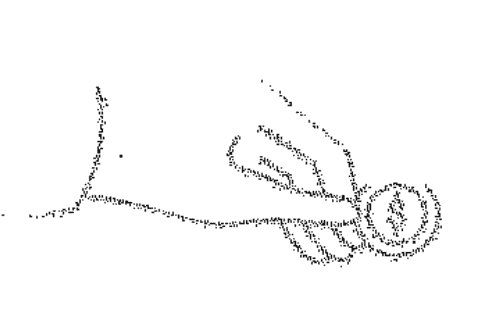

&nbsp;&nbsp;&nbsp;&nbsp;現在還不太晚，如果你能好好控制理財生活，就等於為前面的歲月買到了自由，而你可以用這個自由來成就一些了不起的事。聽起來很讓人興奮？你還在等什麼呢？

# 謝詞

&nbsp;&nbsp;&nbsp;&nbsp;我原先並沒有計畫要寫這本書，而是在另外三個計畫中掙扎：一系列簡要的財務見解、經過規劃並能探查讀者理財觀點的一系列問題、能夠幫助讀者逐步妥善理財的指引。但卻發現好像都無法單獨成書。直到有一天，我那迷惑的腦袋突然想通了，把這三個計畫合在一起不是很棒嗎？我希望你同意我的看法。

&nbsp;&nbsp;&nbsp;&nbsp;過去的四年，我和約翰威立出版公司（John Wiley & Sons）編輯爾・佛龍（Bill Faloon）一直在探討各種出書的想法，但都無法達成一致。我認為時間實在拖得太久了，但我也很高興終於完成了這件事。

&nbsp;&nbsp;&nbsp;&nbsp;這本書的經紀人是珍妮佛・里昂經紀公司（Jennifer Lyons Agency）的露辛達・卡特（Lucinda Carter）。她是個善體人意的大美人。你們是否覺得我對她的介紹有些不太得體？別擔心：露辛達是我的太太。

&nbsp;&nbsp;&nbsp;&nbsp;最後，這本書是要獻給三位名字以「J」起頭的人——瓊恩（June）、喬安（Joan）、傑瑞（Jerry）——我的母親、岳母和岳父。

&nbsp;&nbsp;&nbsp;&nbsp;他們都是意志堅如磐石的人，永遠帶著微笑以及體諒人的神情，慷慨大方不時發出爽朗的笑聲。在那些我必須要「裝大人」的年月裡，他們就是我最好的模範。

# 關於作者

&nbsp;&nbsp;&nbsp;&nbsp;喬納森·克雷蒙（Jonathan Clements）是HumbleDollar.com的創辦人，曾經出版了七本有關個人財務規劃的書籍，其中包括了暢銷書《金錢超思考》（How to Think About Money）。他也是美國最大財務顧問公司之一「創意規劃」（Creative Planning）的顧問及投資委員會成員。喬納森曾經在華爾街日報（The Wall Street Journal）工作長達20年，主要的工作是撰寫個人理財專欄。他也在花旗銀行集團（Citi Group）工作六年，擔任集團內個人財務管理教育部門主任。

&nbsp;&nbsp;&nbsp;&nbsp;喬納森熱中於自行車，偶爾也跑步。他出生於英國倫敦，畢業於牛津大學。喬納森已婚並有兩個婚生子及兩個收養的孩子，一家人住在紐約市的北邊。

&nbsp;&nbsp;&nbsp;&nbsp;如果你想要讀更多喬納森的文章，可以前往HumbleDollar.com搜尋。你可以在那邊讀到最新的部落格貼文、註冊閱讀免費的每月通訊以及HumbleDollar裡有關金錢的全面指引，其中包含了跟本書所討論許多理財主題有關的其他細節。

國家圖書館出版品預行編目（CIP）資料

慢慢致富：告別金錢焦慮，77 天思考練習不再害怕負債、低薪、沒工作，打造財務幸福循環／喬納森·克雷蒙（Jonathan Clements）著；梁東屏譯。-- 初版。-- 臺北市：
樂金文化出版；方言文化發行，2020.08
224 面；14.8×21 公分
譯自：From Here to Financial Happiness: Enrich Your Life in Just 77 Days.
ISBN 978-986-99229-0-6（平裝）
1. 個人理財
563
109009911

# 慢慢致富：

告別金錢焦慮，77 天思考練習不再害怕負債、低薪、沒工作，打造財務幸福循環

From Here to Financial Happiness: Enrich Your Life in Just 77 Days.

作 者 喬納森·克雷蒙（Jonathan Clements）
譯 者 梁東屏

編 輯 黃憶翎
編輯協力 林映華
總編輯 陳雅如
企劃部 謝孟辰
業務部 康朝順、葉兆軒、林子文、林姿穎
管理部 蘇心怡、張淑菁、莊惠瑋

封面設計 耶璐米工作室
內頁設計 綠貝殼資訊有限公司

出 版 樂金文化
發 行 方言文化出版事業有限公司
劃撥帳號 50041064
通訊地址 10045 台北市中正區武昌街一段 1-2 號 9 樓
電 話 （02）2370-2798
傳 真 （02）2370-2766

定 價 新台幣 320 元，港幣定價 107 元
初版一刷 2020 年 8 月
初版四刷 2020 年 9 月
ISBN 978-986-99229-0-6

“From Here to Financial Happiness: Enrich Your Life in Just 77 Days”
Copyright © 2018 by Jonathan Clements. All rights reserved.
Published by John Wiley & Sons, Inc., Hoboken, New Jersey.
All Rights Reserved. This translation published under license with the original publisher John Wiley & Sons, Inc.
Orthodox Chinese language edition published by BABEL PUBLISHING COMPANY © 2020

版權所有，未經同意不得重製、轉載、翻印
Printed in Taiwan
