# The user wants me to translate the book title "成交心法" into Chinese.

Wait, the input is "成交心法". This is already in Chinese.
"成交" means "closing a deal" or "transaction".
"心法" means "mental method", "psychology", or "inner wisdom".
The title "成交心法" is likely the title of a book about sales psychology or closing deals.

However, the prompt says: "参考示例，翻译指定的图书标题到中文" (Refer to the examples, translate the specified book title into Chinese).
The input "成交心法" is already in Chinese.
Is it possible the user made a mistake and intended to provide an English title? Or is this a test?
If the input is already Chinese, I should probably just output it as is, or perhaps it's a specific book title that should be kept as is.
Let's look at the examples. They all translate from English to Chinese.
If the input is "成交心法", which is already Chinese, the "translation" into Chinese is just "成交心法".

Let's re-read the prompt carefully.
"要翻译的标题" (Title to be translated): 成交心法.
It's already Chinese.
Maybe the user *meant* to write the English title of a book that corresponds to "成交心法"?
Common English titles for this concept might be "The Psychology of Closing" or "Art of the Sale".
But I cannot guess the English title. I must translate the *given* title.

If the input is Chinese, and the target is Chinese, the output is the input itself.
However, sometimes "翻译到中文" implies the input *should* be English. If the user provided Chinese, they might be checking if I recognize it's already Chinese, or they made a copy-paste error.

Let's assume the user *did* make a mistake and meant to provide an English title, but I only see "成交心法".
If I treat "成交心法" as the source text to be translated to Chinese, the result is "成交心法".

Let's consider if "成交心法" is the *English* title? No, it's Chinese characters.
Is it possible the user wants me to translate the *concept* into a standard Chinese book title format?
"成交心法" is already a very standard Chinese book title format (like "销售心法", "管理心法").

Let's look at the instruction: "只需要输出翻译，不要输出其他任何东西" (Only output the translation, do not output anything else).

If the input is "成交心法", and I output "成交心法", that seems the most logical action for a translator who detects the target language is already present, unless it's a specific stylistic translation task. But the examples are strictly English -> Chinese.

Hypothesis 1: The user made a mistake and pasted the Chinese title instead of the English one.
Hypothesis 2: The user is testing the system.
Hypothesis 3: "成交心法" is the name of the book, and I just need to return it.

Let's look at the examples again.
"deep learning with python" -> "python 深度学习"
"beginners guide" -> "初学者指南"

If the input was "The Psychology of Sales", I might translate it to "销售心理".
If the input is "成交心法", it's already in the target language.

However, in many contexts, "成交心法" might be the *translation* of a book like "The Art of Closing". But without the English source, I can't reverse-engineer it.

Let's assume the prompt is a template and the user forgot to change the input to English, OR the user is asking to translate the *English* equivalent of "成交心法" back to Chinese? No, that's circular.

Most likely, the user simply wants the Chinese title for the book that is currently labeled "成交心法". Since it's already Chinese, I will output "成交心法".

Wait, could "成交心法" be a typo for an English word? Unlikely.
Could it be that the user wants me to *standardize* the title?
For example, if the book is "The Closing Mindset", "成交心法" is a good translation.

Let's consider the possibility that the user *intended* to provide an English title but provided the Chinese one by accident. I cannot invent the English title. I can only process what is given.
Processing "成交心法" into Chinese yields "成交心法".

Let's double check if there's any ambiguity.
"成交" = Closing/Deal
"心法" = Mental Method/Wisdom
"成交心法" is a common title for sales books in Chinese.

If I strictly follow the rule "Translate ... to Chinese", and the input is Chinese, the output is the input.

Output: 成交心法

- 他就是教育培训改变世界的传奇人物
- 万能成交创始人
- 万能营销创始人
- 万能演讲创始人
- 企业品牌营销策划顾问——九鼎老师

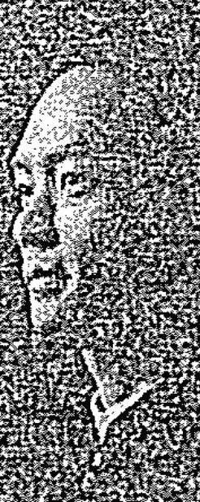

# “改变世界英雄会”——九鼎老师：医扶有志者成大业

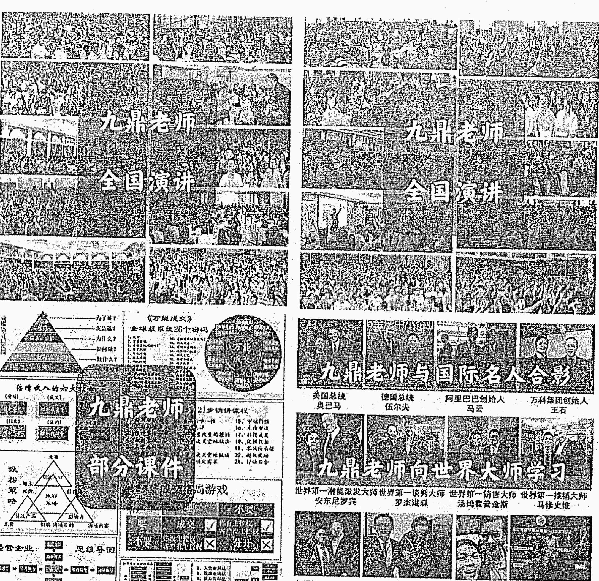

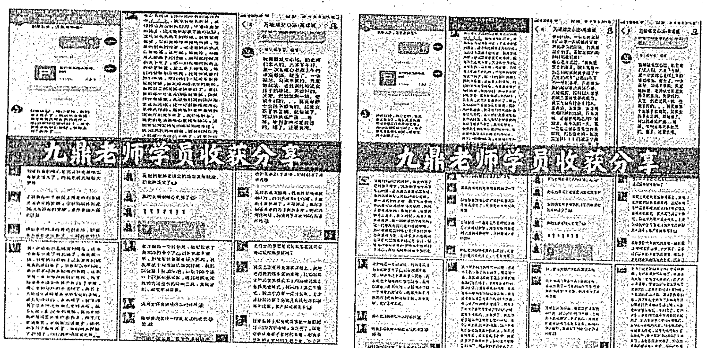

> 更勾魂、更完整的成交绝学，尽在《万能成交》课程

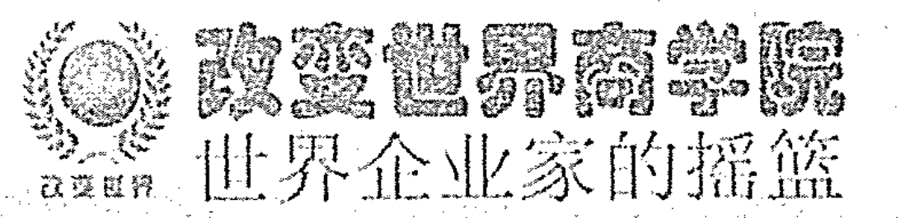

# 改变世界校训——

忠党爱国，服务民族
正心正念，利他思维
为人师表，立德树人
仁爱宽容，尊重学生
传承文明，启智求真
为国育才，铸就师魂

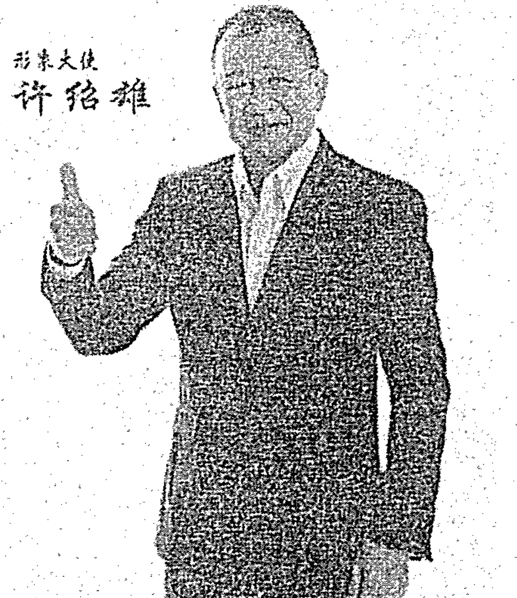

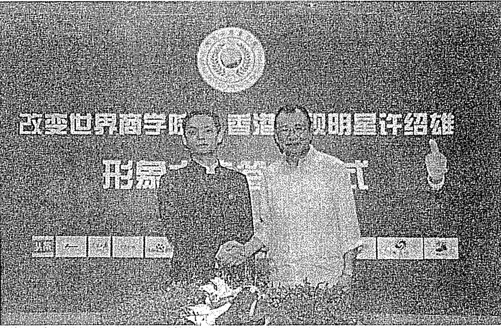

改变世界商学院形象代言人：著名影星——许绍雄

# 名人见证

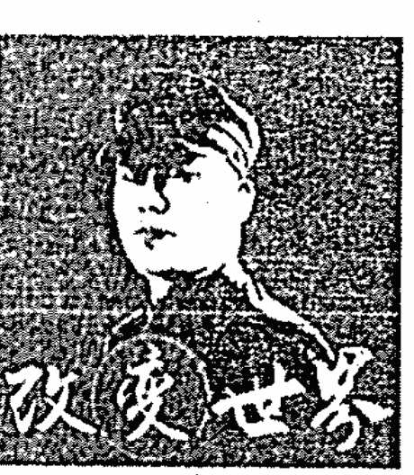

> 你好！我是……诺老师，我为你隆重推荐：九鼎老师！九鼎老师是我见过最用心，最负责任，最实战的成交大师！九鼎老师的所有课程和书籍，你值得拥有！
改变世界商学院创始人：诺老师

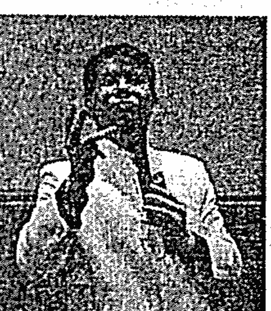

> 温教授说：“九鼎老师是实力派讲师！”
中国毛泽东思想研究会常务副会长、中山大学中外管理研究中心副主任、北京大学民营经济研究院管理智慧课题组组长、首席专家、曾历任共青团茂名市委宣传部部长、新华社粤西办事处副主任——温度教授

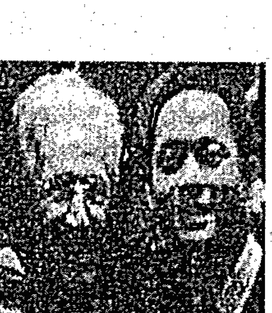

> 九鼎老师是我见过的全世界华人当中，最有状态的讲师，他曾经数次与我同台演讲，是我在世界华人当中唯一指定接班人，他传承了我在销售上成交一切都是为了爱的精神！
世界销售冠军：乔·吉拉德

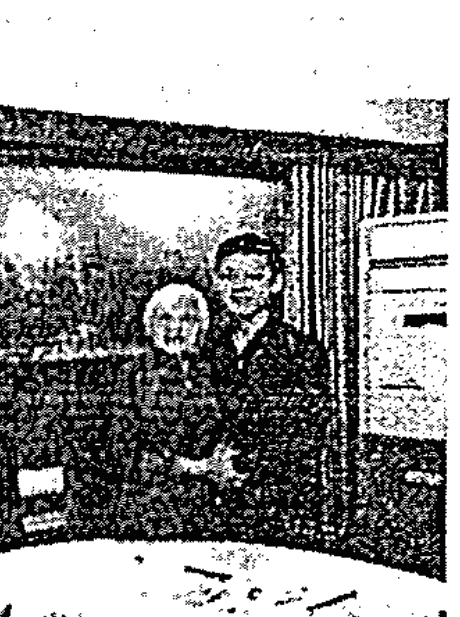

> 九鼎老师是我见过最有能量，最有责任感，最有使命感的成交大师，毛家饭店在全国 400 多家分店，3 万多名员工，经过九鼎老师课程系统的训练现在业绩倍增，每年纳税 2 个亿，感谢九鼎老师《万能成交》课程的训练！
毛家饭店创始人：汤瑞仁

# 前记

有一次，九鼎老师应邀出席一场国际峰会，在峰会上，遇到改变世界商学院创始人一诺老师，一诺老师是我见过的全世界最最最伟大的企业家导师。

就是这次相聚，我人生中的贵人出现了，就是一诺老师，我们早就知道彼此在培训界的份量，神交已久只是没有机会谋面，这次相遇一见如故。

攀谈中，一诺老师给我讲解了她的改变世界的宏伟计划，九鼎老师听完之后相当兴奋，九鼎老师发现在教育培训界根本就没有像一诺老师这样有大爱、有梦想、有格局的老师，跟九鼎老师的理念不谋而合。

一诺老师不单境界高，而且一诺老师的课程都是实战案例教学，无论你是从事任何行业，一诺老师能在一分钟之内就帮你策划一个商业模式。

而且一诺老师是一个非常付出人，他为了要给学员讲解更好的课程，常常设计课件到很晚才睡觉，只为了要把更实战的课程内容，给到学员。

# “改变世界英雄会”——九鼎老师：医扶有志者成大业

因为一诺老师觉得作为老师就是要对学员负责任，学员付学费给一诺老师学习是对他的一种信任，一诺老师在给学员讲完课的晚上，既然亲自到学员的房间，让学员为小组，一诺老师去给他们一对一的辅导，直接现场解决很多企业家的问题。现场就给学员设计一套商业模式，有一次忙到晚上4点才睡觉，第二天9点继续上课。

九鼎老师第一次看到后非常的震撼，因为在过去九鼎老师做教育十多年，还从来没有见见过哪一个老师像一诺老师这样为学员付出，学过一诺老师课程的企业家满意度达到99.9%。

所以，九鼎老师决定，跟一诺老师合作，创立改变世界英雄会，共同改变世界，让我们中国的企业遍布全球，实现我们伟大的中国梦！

一诺老师有众多弟子，如果你渴望成功，渴望建立伟大企业，如果你想学习商业模式的最高境界，营销的最高境界、演讲的最高境界、融资的最高境界、说服的最高境界、领导的最高境界”九鼎老师强力推荐你，你一定要拜一诺老师为师！

因为一诺老师能够直接把他19年的功力传授于你

更勾魂、更完整的成交绝学，尽在《万能成交》课程

下面是一诺老师简介：

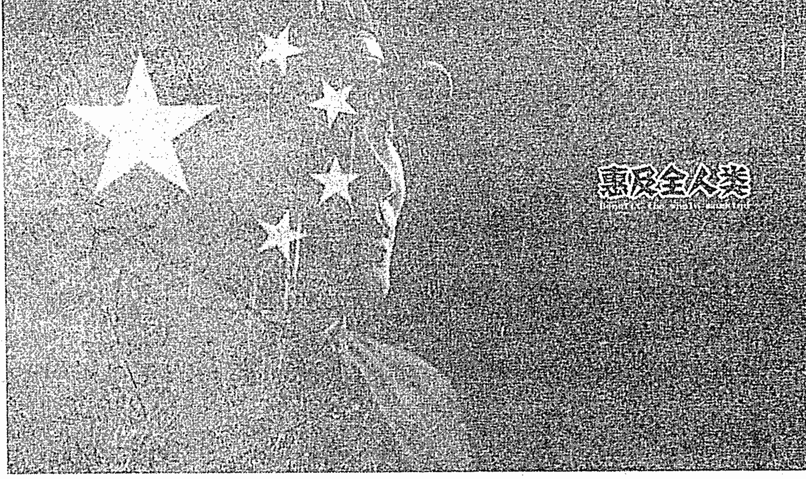

一诺老师的梦想就是成就你的梦想！

- 社会主义·接班人
- 人民日报·最佳评论人
- 改变世界·创始人
- 《猪买单》著作权人和商标持有人
- 《商业模式·顶层设计》创始人
- 作家、演说家、教育家、思想家、经济学家
- 一诺老师从事教育行业19年，能系统拆解古今中外企业家成功案例，并将总结的商业模式深入浅出的穿插在教学中。

一诺老师的使命是——惠及全人类

# 自序

当你翻开这一页起，你的人生将会彻底改变。

现在请你空出三天时间，找一个安静的地方，关上门，关掉手机，不要让任何人打扰你，细细品读书里面的内容，当你把书里面的内容融会贯通时：

你的人生将会脱胎换骨，改头换面。

是的，你没看错，别紧张，深呼吸………

相信自己，你的未来不是梦，历史从今天开始改写，你将成为自己命运的主人，你将实现你人生中想要达成的任何梦想。

接下来，九鼎老师告诉你一个只有很少数人知道的秘密……

十二年前，九鼎老师还是一名普通销售人员，通过自己不断努力我组建了一家公司，有了自己的团队，当时我的团队人员工作不积极，情绪低落，互相抱怨业绩不理想。

# “改变世界英雄会”——九鼎老师：匡扶有志者成大业

整天九鼎老师为了团队的事情而烦恼心力憔悴，后来九鼎老师发现原来团队所有的问题都是因为不会成交。

于是九鼎老师决定训练我的团队提升成交技巧，九鼎老师为了要教学，我去学习演讲，我又去买大量的书籍，国外国内的通通都研究了一遍。

直到有一天我无意中看见了一本中国古代秘传的书籍，九鼎老师看完之后瞬间开窍醍醐灌顶，震撼心灵。

九鼎老师发现纵观古今中外，但凡最有成就的伟人，原来他们都有一种能力。

那就是成交一切的能力。

九鼎老师研究发现纵观古今中外的伟人比如：刘备、吕不韦、刘邦、成吉思汗、毛泽东、孙中山、马云、李嘉诚、华盛顿、亚历山大、拿破仑、比尔盖茨等等。

他们之所以伟大，是因为他们掌握了一个成功的秘密。

他们说完话能够：

更勾魂、更完整的成交绝学，尽在《万能成交》课程

把自己的思想装进别人的脑袋。

别人会按照他说的话采取行动。

别人会把心交给他，把钱交给他，甚至把命都交给他。

他们掌握了一套成交任何人的方法。

于是九鼎老师研究书里面的方法加上自己多年来做销售的实战经验总结出一套系统的方法。

后来九鼎老师把这一套方法用在我的公司上，没想到我的销售团队通过我的训练竟然业绩倍增，接着我的目标一个个实现，并且九鼎老师把这一套方法去给其他的行业培训，给很多企业打造销售团队。

有的销售人员用我教的这一套成交方法，从收入不到3000竟然爆炸式增长到月入100万。

有的人用这套方法竟然成交了梦中情人，过上幸福美满的生活。

有的企业家用我这一套成交方法去成交大客户，成交代理商，成交投资者，企业业绩增长20多倍。

并且还请九鼎老师做企业的顾问，还请教九鼎老师如何设计招商演讲 会议流程，设计演讲稿。就这样九鼎老师在全国各地这十多年来我通过演讲帮助非常多的人学会这一套方法。

很多人问我：

“九鼎老师，是什么支撑你十年如一日的演讲？

你的最大感悟是什么？”

每当听到这样的问题，九鼎老师就想起自从拿起麦克风的那天起，至今已有十年时间，这十年来九鼎老师站在舞台上演讲，九鼎老师的勤奋给我换来的是桃李满天下。

每当我站上讲台，台下就掌声雷动，从一个城市讲完，就赶紧去下一个城市讲，就这样全世界飞来飞去，整天被鲜花掌声与喝彩鼓励着我继续前行，曾经也想过是不是该停下来了？

有一次我的弟子这样对我说：“九鼎老师，你应该休息了，你已经在很多年前就实现了财务自由，干嘛还这么累？”

九鼎老师回答说：“是使命！世界上的财富有很多种，但是没有一种获得财富的方式比改变别人的命运来的更有意义！”

有一天，我的助理帮我统计一个数据，她说：“九鼎老师，截止2016年底，你已经进行了大大小小的演讲1500多场，听过你演讲的人超过了100万人，但是这100万人后面有100万个家庭，你实际上帮助了超过1000万人。”

九鼎老师听到之后，沉默良久，感觉自己付出还不够，因为我的目标是要帮助全世界更多人，九鼎老师要帮助全球10亿人改变命运。

九鼎老师突然觉得虽然10年帮助了1000万人，但是离帮助10亿的人还差100年，于是除了收弟子复制我的能力帮助更多人之外，也在寻找更好的方法。

虽然之前九鼎老师写了几本书籍，每一本都非常畅销，但是九鼎老师觉得对人的影响和帮助还不够全面。并没有一套详细的系统和流程让你看完一本书就能学会如何把话说出去，把钱、把心、把人收回来的能力。

所以，为了要帮助更多人，于是我做了一个决定。

九鼎老师决定把在过去我投资自己的大脑最少超过800万以上的学费，见过100多位亿万富翁请教他们成功致富的方法，再加我自己十几年通过实践所累积起来的经验总和，浓缩成更勾魂、更完整的成交绝学，尽在《万能成交》课程

# “改变世界英雄会”————九鼎老师：匡扶有志者成大业

本世界上最经典最实战最系统的成功致富书籍——《成交心法》。

书里面的大部分的内容都是九鼎老师课程里面的讲稿，和很多成功者他们致富的内部操作机密。

而这些实战的干货一般没有使命的人他们是不会公开的。

而九鼎老师非常清晰我的使命，我的使命就是要帮助全世界的人更成功。

九鼎老师的这本书目标就是要成为世界文化遗产，成为传世千古佳作，成为改变世界改变亿万人命运的成功秘笈，成为人手一本的致富圣经。

为什么九鼎老师这个有自信说这本书即将改变世界？

因为在九鼎老师写这本书的时候，每天深夜我往往兴奋的睡不着觉继续在写作。

在过去九鼎老师做教育培训十多年的经验，给很多企业做顾问打造销售团队，帮助无数人提升成交能力倍增收入，我阅读过三千本书籍。

九鼎老师发现世界上大部分成交书籍或者课程，都只是更勾魂、更完整的成交绝学，尽在《万能成交》课程

教你简单的理论知识，根本就没讲到核心，不够系统不够全面。

九鼎老师发现在这个世界上从来都没有一本书像《成交心法》这样能够系统实战的拆解成交技巧，绝对没有，你以前买的那些书籍现在可以扔到垃圾桶去了。

不要再去浪费你的时间，想要学成交和销售世界上唯有《成交心法》这一本。

只要有这一本就够了，其他关于销售成交的书一切都是苍白，你会发现有很多书有的讲很多道理，有的讲很多理论，有的讲很多方法。

但从来没有一本书是结合道、法、术，为一体的书籍，先让你从道的层面提升思想境界，再让你学会销售的原理和理论，再让你学会技巧和方法。还有再加上九鼎老师十几年的销售经验也在里面。

这本书最让九鼎老师引以为傲的地方有两大方面：

第一、在前面两集感恩和付出，是能量朗读部分，只要你读一读就能全身充满能量，不管你是企业家还是员工甚至是家庭主妇，只要你坚持读，你的整个能量将会改变。

尤其是销售团队，你可以每天上班开会时，整个销售团队人员都拿起这本书读一读，就能快速增加能量学会感恩学会付出调整情绪。直接冲出去，把话说出去把钱收回来。

第二、在成交的十大流程当中，九鼎老师研究出一套方法，九鼎老师把销售拆解成26个小步骤，直接教你如何一句话一句话的跟客户对话的整个成交流程，已经证明有效。在这个世界 上再也没有这么详细的销售书籍，你现在所看到的这本书，就 是全球唯一一本。

整本书通俗易懂，逻辑清晰，案例讲解。这是一本人人都可以学习的书本，可以赠送给你的团队，你的合作人，你的客户，你的亲朋好友的书籍。

因为成交的技能是人人都要学的技能，两姓关系需要成交，家庭关系需要成交，朋友的关系需要成交，面对客户更需要成交，人生就是一场成交。

个人想倍增收入，想让更多人喜欢你，相信你，支持你，

# “改变世界英雄会”——九鼎老师：匡扶有志者成大业

你要学会的最重要的一种能力，就是把我的思想放进你的脑袋，让你按照我的话采取行动。

尤其是销售团队应该人手一本成为你公司的业务必备手册。
因为一个企业生存最重要的核心关键就是创造业绩。

**个人不成交，收入等于0**

**企业不成交，一切等于0**

谨以此书献给所有追求人生幸福的人。
把这本书研究透彻，融会贯通，去实现你的梦想吧。

2017 年 7 月 2 号

九鼎老师

更勾魂、更完整的成交绝学，尽在《万能成交》课程

# 道（思想篇）

# 第一章：攻城为下、攻心为上

## 一、故事

万三站在楼台前瞭望着远方，这是这座城市最大最高的建筑了，站在上面，整个城市的风景尽收眼底。

“老爷这是您这么多年一手创建的城市啊！”站在身旁的老主管老张说道。

“是啊，我记得在我小时候，整个城市的房子都破旧不堪，那个时候因为家里很穷，连饭都吃不上，没有身份地位，想不到今天会成为举国受人爱戴的万老爷。”

整个国家没有人不知道万三这个名字，百姓都知道万三的财富已经富可敌国，万三良心经商的故事，万三救济穷人的故事，万三支援国家爱国的故事，成了人们茶余饭后津津乐道的话题，也成了说书人和戏剧经常传颂的故事。

万三在全国及海内外经营着上百种产业，药店、饭店、农业、钱庄、丝绸、陶瓷、珠宝、海外贸易等，这些产业造福着老百姓过着更好的生活。他掌握着全国的经济命脉。

“老爷西部连年旱灾，老百姓多年庄稼颗粒无收，咱们上次捐赠的粮食农民都吃完了，很多老百姓都饿的只能吃野草。”

“你到仓库再去拿三千万斤粮食去分给那些穷人。”

“好的，还有钦差大人来到府上请求说，国家边境遭遇外族入侵连续战争，疆土失守国库紧缺，兵器不足粮饷不够，需要再次支援。”

“国家有难，匹夫有责，我所累积的财富都是国家的政策赐予的，你再到钱庄里提出五千万两黄金上报给国家。”

“好的，我这就去办。”

万三转向老张：“老张，咱们的钱庄里现在有多少现款，所有的？”

“所有的？我最近没有盘点，不过总数在八千万万两黄金以上。”

“仓库里的现货，折合成金币是多少？”

“老爷，这一季的货还没有到齐，不过我想少说也合个六千万两黄金。”

万三点了点头：“不要再进货了，马上把所有的现货卖了，换成黄金。”

老张目瞪口呆，一句话也说不出来，非常吃惊地说道：“老爷，您把我弄糊涂了，我们今年的财运最好，各大产业都说上个季度销售量又增加了，就连军方都向我们买货，我实在弄不明白，您为什么要……”

万三微微一笑，和蔼地拉着老张的手：“老张，你还记不记得好多年前你刚来的时候，我跟你说过，我们要把所赚的钱分一半给穷人，那时候，你不是认为我是个做生意的傻瓜吗？”

“我那时候觉得……”

“你现在不承认当时多虑了？”

“是的，老爷。”

“那么，我劝你对我刚才要你做的事要有信心，我会把我的用意解释给你听的，我已经老了，需要的东西很简单，自从夫人走了以后，我就决定把财富大部分分出去，自己留点够用就行了。”

除了清理财产之外，我希望你准备一些文件，把钱庄的所有权证明文件，转移给所有钱庄的账房，另外再拿出五十万两金子分给每一个账房，这么多年来他们一直忠心耿耿，任劳任怨。以后，他们喜欢卖什么就卖什么。”

老张张了张嘴，万三挥手阻止了他。

“你不太喜欢这么做，是吗？”

老张摇了摇头，勉强露出笑容：“不是的，老爷，我只是不明白您为什么要这么做，您好像在交代后………”

“你就是这样，老是想着我，从来不替自己想想，我们的生意不做了，你就不为自己打算打算？”

“我跟了您这么多年，怎么能只想自己呢？”

万三拥着老张继续说道：“别这样，我要你马上把五百万两黄金转到你的户头上，然后我求你留下来，等我把多年来的一桩心事了结以后再走。到时候，我会把这栋地产和仓库都留给你，然后我就找夫人去了。”

老张睁大眼睛看着主人，不敢相信自己的耳朵：“五百万两黄金、房子、仓库……”

万三点了点头：“我一直把你的忠心当作最大的财富，和它比起来，我送你的这点小东西根本算不上什么，你懂得生活的艺术，不为自己，为别人活着，你懂得付出和感恩，这就是你与众不同的地方。

我现在要你做的，就是帮我尽快完成计划，我的日子不多了，对我来说，没有什么比时间更重要的了。”

老张转过头，不让主人看见眼里的泪水：“您说您有心愿未了，是什么心愿？您对我像亲人一样，可是我从来没听您提过什么心愿。”

万三双臂抱在胸前，面带笑容：“等你把今天我交代给你的事办完以后，我会告诉你一个秘密，这秘密只有夫人知道，五十年了……。”

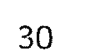

就这样，老张按照万三的吩咐处理了所有的事情，每个账房都收到了万三的厚礼。他们得知主人退休的消息，个个目瞪口呆，不知说什么好。马车驶过最后一站，它的使命就全部完成了。于是，曾经显赫一时的商业王国从此不复存在。

老张心情沉重，不久，传话的人回来说主人要马上见他，要他在禁地等着。

万三深深地端详着老张，然后问道：“事情办完了吗？”

“都办完了。”

“别难过，老张，跟我来。”万三领着老张，向房屋的禁地走去。老张发现天天守在这里的警卫已经不见了，阔大的房子里，只有他们的鞋子“嗒嗒”响着。

当他们走近一个书柜时，万三的脚步突然慢了下来。万三按了一下书柜旁边隐藏的一个开关，顿时书柜向边上移动，地上有一块地板打开了，原来这里是通往密室的通道，连老张都不知道。

接着，两个人开始走下楼梯，脚一踩到石板的时候两边的烛台自动点亮，楼梯一直通向藏在密室最里面的房间。

“慢点，前面有关！”万三大声说道。

万三按了一下墙上隐藏的按钮，顿时前面射出千万支利箭，又喷出几米远的火焰，就像刀山火海一样。

看的 老张心惊肉跳，等机关解除之后，老张小心翼翼地跟在万三后面。走到最里面有一片石门，万三从腰带上取下一把钥匙，插入那尘封已久的锁孔一拧，顿时沉重的石门自动打开了。

走进这五十年来的禁地，灰暗的烛光夹杂着尘埃从密室的缝隙中渗漏下来。老张抓住万三的手，渐渐适应了幽暗的光线。密室里几乎空无一物，只有那儿放着一个香柏木制成的小盒子。

老张环顾四周的时候，万三脸上浮现出淡淡的笑容。

“让你失望了吧，老张？”

“我不知道说什么才好，老爷。”

“你难道不会对这里的摆设失望吗？这五十年来，我一直请人严加守卫，大家一定常常议论，猜测这里面放了些什么神秘的宝贝。”

老张点点头。

“不错，这些年来常听大家议论说我有一个密室藏了一件价值连城的宝贝，有许多谣言，其实这些谣言我都听过，有人说密室里有堆积如山的钻石、黄金、珠宝，也有人说这里面有珍禽异兽，甚至有人说我的财富是因为有一个聚宝盆。

你看，其实这里除了一只普通的箱子以外，什么也没有，来，过来。”

两人走到箱子旁蹲下身去。

万三小心地把包在箱子上的皮革掀开，深深地吸了口柏木散发出来的气息，最后，他按下箱盖上的开关，盖子一下子弹开了。

老张向前倾着身子，目光越过万三的肩头，落在箱内的东西上，这一来，他更糊涂了，箱子里除了一本破旧的书以外，什么也没有。

万三伸手轻轻地拿出这本书，闭上双眼，把它紧紧地抱在胸前。

他的脸变得平静安详，几乎抚平了岁月留下的皱痕，他站起来，指着箱子说道：“就算这屋子里堆满黄金钻石，它的价值也无法超过你眼前的这本书，我的成功、快乐、爱心、声望、安宁、财富全来自这本书，我永远无法报答它的主人。”

老张听了万三说话的语气，惊骇得后退了几步，问道：“这是不是您说的秘密？这只箱子和您说的心愿有关吗？”

“一点儿不错。”

老张擦了擦额头上的汗珠，不敢相信地看着主人。

“这本书里究竟写了些什么，会比钻石还珍贵？”

“老张，其实你不知道，这本书里面藏着一个惊天骇浪的大秘密，如果你也拥有这本书，你会变得跟我一样富有甚至比我更富有。”

“为什么？”

万三看着老张疑惑的眼神，讲起了他的故事……………

万三出生在一个农民家庭，小时候家里很穷，父母亲都是老实人，家里的土地大部分都给地主霸占了，仅剩的土地种出的粮食只能勉强维持生存。

常常因为粮食不够吃，父母亲只好为地主做苦工，每天起早贪黑，没日没夜，劳心费力。

直到万三十八岁那年，村里闹饥荒，很多农民都饿死了。原来农民的土地全部都给地主霸占了，而且农民替地主做完苦工，地主不给农民分发粮食，剥削农民。

万三看到农民受地主的压迫，非常的气愤，看到越来越多的人快饿死了，心里非常的着急，于是他把自己家米缸的米分给穷人。省吃俭用去救济穷人，生病了悉心去照顾，有时自己挨饿只能去挖草根吃野草充饥。

有一天，万三扛着一把锄头在去往田地务农，在路上看见一个老人摔倒在地上，万三赶紧上前问道：“老爷爷，您没是吧。”

老人表情万分痛苦的说道：“我脚摔的很疼，现在走不动了。”

“您是想要去哪里啊老爷爷？”

“我要去县城看望我女儿。”

“您现在走不动了，在这荒山野岭的，我背你去县城吧！”

老人惊讶地说：“这里离县城足足有五十里地啊，小伙子，你背得动我吗？”

“我现在年轻有力，您放心吧，我背得动。”

就这样，万三放下锄头，背起年迈的老人，翻山越岭举步维艰地终于把老人背到了县城，找到了一家客栈。

把老人放在床上之后万三说道：“老爷爷，县城到了。”

老人躺下来示意万三过来。

他微笑着说道：“小伙子，我跟你非亲非故，你为什么费这么大力气帮助一个陌生人？”

万三擦了擦额头的汗一边喘着气一边说道：“也没什么，就是我得觉得看见别人有困难的时候帮助他是我应该做的。”

“你帮助了我，我应该报答你，我有一个传家宝我要送给你。”

“老爷爷，不用了，传家宝还是你留着吧，我不要任何回报，能把你送到县城我就很开心了。”

老人仰天长望深深地叹了一口气：“终于被我找到了！”

“老爷爷，您在说什么？”万三满脸疑惑望着老人。

“小伙子，你的发心很好，你是一个非常善良的人，你有什么心愿，看我能不能帮助到你？”

万三摸了摸脑袋不假思索地说道：“心愿？我还没想过什么心愿，就是我在想为什么在这个世界上有这么多穷人，而富人都是剥削穷人，有没有什么方法能够帮助穷人过上更好的生活？”

老人听完面带微笑地说道：“你想要帮助穷人，首先要成为一名富人。”

“富人不都是为富不仁吗，就像我们村里的地主？”万三疑惑的等着老人回答。

“为什么很多人会是穷人，因为他没有富人的思维，在穷人的世界里，他们认为富人都是奸诈狡猾之人，专门坑害平民百姓的邪恶之徒，无奸不成商，富人就是投机取巧，为古人所不齿，这是很多穷人之所以贫穷的原因。”

“为什么这样讲呢？”万三急迫地想知道答案。

老人语重心长地说道：“因为富人之所以富有，是因为他们帮助很多人解决了问题，帮助别人创造了更大的价值，比如为什么会有商人，这世上往往就是卖的找不到买的，买的找不到卖的。

为什么把货物叫作东西，就是把东边的东西买卖到西边，再把西边的东西买卖到东边，商人要经商，就是要度远近，辨贵贱，调余缺。

这世上不能没有商人，商人所赚取的财富就是帮助别人买到对他有帮助的产品解决他的问题。商人赚取的是良心，不是剥削穷人，商人是贡献，而那些少有的黑心奸商，那些剥削穷人的地主，他们不是利他的原则，迟早是会被打倒的，不能长 久而。

而且你说要救济穷人，如果你没有财富你拿什么去救济呢？只有你成为富人才有更多的财富去救济穷人。”

万三听完老人这一席话，犹如醍醐灌顶，瞬间开窍。

激动地说：“我要成为一个富人，可是我要怎样才能成为一个富人呢？”

“你真的想要成为富人吗？”

“是的。”万三眼睛里充满着渴望。

这时候老人不慌不忙的从怀里拿出一本书，上面写着四个大字《成交心法》。

万三不解地问道：“这是什么书？”

老人悄悄地对万三说道：“我告诉你一个秘密，在我年轻的时候，当时我也很穷，但是我有一颗善良的心。

有一天我在沙漠里无意救了一个富人，他快渴死了，我把他虚弱的身体带回家里面，细心地照顾他，给他调养身体，他见我这么善良，就送给我这本《成交心法》。”

万三非常感动的的望着老人说：“看完这本就能成为富人吗？”

“他告诉我要运用书里面教的方法去执行，就会就变成一个富人。

于是我按照书里面的方法去做，果然我成为了富甲天下的富人，他告诉我必须要做到两件事：

- 第一，要把所有赚的财富一半给需要帮助的人：
- 第二，《成交心法》不能给别人，甚至不能让人看到，只传承给一个人。

但是我花了一生的时间都没找到，我今年已经很老了，时间不多了，我把我所赚的财富大部分都贡献给了社会、国家、和跟随我的人，只留了一点给我的亲人。

我一直在寻找我的接班人，直到我路过你们村的时候听到你救济穷人的故事，刚开始我不相信，便亲自测试一下你。没想到你这么热情主动地帮助我，还不求任何回报，我发现你是一个非常爱心懂得付出的人，你有富人的特质，你跟我很像，将来你成为富人。

我相信你会把财富用在有价值和对社会对国家、对人民有帮助的事情上，你具备财富的承载能力。

当我听到你说我不要用任何回报的时候，我才听到内心深处有一个声音说：我长期以来的寻求，可以结束了，我终于等到了可以继承《成交心法》的人。

万三眼睛睁得大大的望着老人，他简直不敢相信自己的耳朵。

老人微微颤抖着说：“从我确定你就是我最合适人选的时候开始，我的精力便开始衰竭。现在我的大限已到，可以安心地走了。”

老人的声音越来越微弱，他握紧双拳，倾身向前对万三说：“孩子，你仔细听着，因为我没有力气再重复这些话了。”

万三含着泪，坐到老人身旁，他们握着手，老人吸了口气，继续说道：“我现在把这本价值连城的《成交心法》交给你，但是你必须先答应我几件事情。这里有一个钱袋，装着一百枚钱币。

你可以用它们维持生计，再买一些布料开始做销售。我可以给你更多钱财，但是这对 你只有百害而无一益，你要靠自己的奋斗，成为世上最伟大的富人，你愿意吗？ ”

“我愿意！”万三立刻说道。

“你只要照着《成交心法》教的方法去做，将来会比自己梦想的还要富有，成为富甲天下的富人，因为所有的富人都擅于沟通，懂得销售，富人说完话就能成交别人，说服别人按照他说的话采取行动。

这本《成交心法》就是教你如何成交客户，成交人才，成交一切的秘籍，这本书是无数代在这个世界上最富有的人所总结出来的成功方法，已经证明有效。

整本书分为三个部分，书的前面两章感恩之心和付出精神是能量朗读，是道的层面，你可以大声地读出来，当你每天读一遍每一次都会增加能量。

当你遇到挫折和逆境的时候你读一读就会扭转逆境，因为

富人最重要的特质就是感恩和付出，一个不懂得感恩的人就会不断地抱怨产生负能量，一个不懂得付出的人就会不断地索取没有行动力。

你最好每天早中晚读三遍，坚持读下去你会发现全身上下每个细胞都充满能量。

书的第二部分是法的层面，里面有很多成交的理论和流程。

书的第三部分是术的层面，教你的是一句一句去成交的对话，你要不断地练习才能学会。

整本书你要不断地看，不断地读，不断地练习，当你看到一百遍的时候奇迹就会在你身上出现，整个人就会脱胎换骨。

你要把整本书读得滚瓜烂熟融会贯通变成自己身体的一部分，你愿意去做吗？"我愿意。" "还有你必须赚良心的财富，把多赚到的钱贡献给需要帮助的人，这一点不可以含糊，你愿意吗？" "我愿意，老爷爷。"

# “改变世界英雄会”——九鼎老师：匡扶有志者成大业

“现在，还有最重要的条件，你不能把《成交心法》的内容告诉任何人，将来有一天，在缘分的指引下你会找到这个传人。你答应吗？”

“答应。”

老人长嘘一声，如释重负。他面带微笑，用骨瘦如柴的双手捧起万三的脸庞：“带上《成交心法》上路吧。我们不会再见面了，我爱你，孩子。

最后一句话，用心学好《成交心法》，提升成交能力成为富人，用经济强国，从而让人民过上富足的生活，让世界变得更美好，小伙子，改变世界的重任就交给你了，我相信你能做到，祝你成功。”

泪珠顺着万三的脸颊滚落下来，他拿起《成交心法》向前走，走了几步又转回头看了一下老人，老人靠在床上，微微点了点头，笑着朝他挥手告别。

更勾魂、更完整的成交绝学，尽在《万能成交》课程

万三抱着书籍一路上心情沉重得回到家里，他拿起《成交心法》翻开，见标题上写着：感恩之心，于是他念了下去……

## 二、感恩之心

### 能量朗读：奇迹将会在感恩的人身上持续出现

我要用感恩的心来迎接今天，富人会更富有，穷人会更贫穷，我的人生不是进入良性循环，就是进入恶性循环。

我知道，我现在的人生，我的金钱、健康、幸福、快乐、家庭、事业、人际关系，凡是那些我认为满意的地方，一定是因为我心怀感恩，富足和幸福也一定是感恩之心对我的回馈，那些我认为不好的地方，就是因为我不懂得感恩。

心怀感恩之人将被赐予更多，变得更富余，不存感恩的，连他所有的也要夺去。一个人最大的不幸，不是得不到别人的恩，而是得到了却漠然视之，因为一个不懂得感恩的人，只会把别人的给予当作理所当然，只会一味索取，而不知道给予。

不去感恩的人，永远也不可能获得最大的满足，永远都不会有所成就，整天只知道抱怨发牢骚，满脑子都是负面信念，放弃自己，庸庸碌碌，自甘堕落。

越是这样，而所得到的，也终将失去，我知道那样的人并不是我。

感恩就是一种能量，这种能量会支配着我的思想和灵魂，无论我在思考什么，我的感情如何，这种能量都会被我的思想所吸引，我的感恩之情越强烈，我所吸引的正面事物就会越美好。

现在我已经洞悉了人生中最伟大的奥秘。

我要用感恩的心来迎接今天

### 我该怎么说呢?

我知道，我现在的人生都是我吸引而来的，是我的思想造成的，有什么样的思想，就会有什么样的行为，有什么样的行为就会有什么样的结果。

我的人生都是我说出来的，如果我整天说的都是负能量的词语，满脑子想的都是: “我不喜欢这份工作，我赚的钱太少了，我过得不快乐，我不会成交客户，我和别人关系不好，我真的好倒霉，别人都不关心我。”

那这些麻烦就真的会被我的思想所吸引，来到我的身边。

从今往后，我已经深知了人生的奥秘，唯有感恩，方能成功。

- 我要告诉自己：
  - 我喜欢我的工作！
  - 我喜欢我的朋友！
  - 我越来越富有！
  - 我每天都很开心！
  - 我感恩我的父母！
  - 我感恩我的领导！
  - 我感恩我的客户！
  - 我是一个成交高手！
  - 我是一个演讲高手！
  - 我一定能实现梦想！

我发自内心地表达感恩，我一定会吸引更多美好的人、事、物来到我的生命中。它的原理如同磁铁吸引金属，花朵吸引蜜蜂。感恩像磁铁一般带有磁性，我就是宇宙中最大的磁铁，我越感恩，越多的恩福就会降临在我身上，这就是人生的秘密。

我要用感恩的心来迎接今天

### 我该怎么做呢？

现在我已经领悟了人生的真谛，我不再像过去一样，我不是任人鞭打的羔羊，我是猛狮，不与羊群为伍。

我不想听失意者的哭泣，抱怨者的牢骚，这是羊群中的瘟疫，我不能被它传染，失败者的屠宰场不是我命运的归属。

我不是为失败而来到这个世界上的，我的血管里也没有失败的血液在流动，我不是随意来到这个世界上的，我生来应为高山，而非草芥。

我是千万年进化的终端产物，头脑和身体都超过以往的帝王和智者，我是自然界最伟大的奇迹，这一切都是因为我是一个懂得感恩的人。

从今往后，我要脱胎换骨，改头换面。

我要怀着一颗感恩的心，去看待周围所有的人。

- 感谢伤害我的人，是他们磨炼了我的意志！
- 感谢鼓励我的人，是他们让我信心十足！
- 感谢教导我知识的人，是他们照亮了我前进的道路！
- 感谢哺育我的人，是他们让我丰衣足食！
- 感谢帮助我的人，是他们给了我努力的希望！
- 感谢嘲笑我的人，是他们，激发了我的斗志！

- 今天，我开始新的生活！
- 今天，我迎接最美的太阳！
- 今天，我重新来到这个世界上！
- 今天，我拿出巅峰状态去创造我的未来！

我知道，一切达成目标的资源早就已经在我的体内！

我知道，种什么因得到什么果，种瓜得瓜种豆得豆，以及付出什么就会收获什么，付出感恩就会收获感恩。

清晨起身，感谢晨曦，感谢我的生命和力量，感谢盘中的食物和生活的美好。

我知道，事实上，不管我想成为什么样的人，想做什么，想要什么，感恩都可以帮助我实现。

感恩会让我今后的生活光彩夺目，心存感恩，我就能洞悉生活究竟哪里出现了问题，我的生活到底缺失了哪样东西。

感恩的生活态度，会令我在每天醒来时为自己还活着而感动，我会发现自己对生活充满了热爱，所有事情都变得轻而易举，我会感觉到自己的身体轻盈得像一根羽毛，全身充满了能量。

我要用感恩的心来迎接今天

### 如果我不去感恩：

我将不再获得回馈，美好也会随之消失。

当我不感恩的时候，我阻断了更佳的健康、更好的关系、更多的快乐、更多的金钱，以及我的工作和事业的发展。

用感恩表达我的谢意，做不到这一点，一切美好都将离我而去，我就无法获得所期望的生活。

如果我只是一时感恩，只能获得一时的收获，想要长久，我必须不断地表达感恩，让感恩成为生活的一种习惯。

### 我要感恩父母：

感谢父母多年来的养育之恩，感谢父母不离不弃的陪伴，感谢父母给我无穷的动力，就算初生牛犊的我，乱闯乱撞，直到遍体鳞伤，你们依旧给予我温暖的疗伤室。

没有阳光，就没有温暖的日子，没有雨露，就不会有五谷丰登，没有水，就不会有生命，没有父母，就不会有我自己，感谢父母给予我生命，鸦有反哺之义，羊有跪乳之恩，滴水之恩，涌泉相报，你们的恩情我会用一辈子去回报。

### 我要感恩领导：

感谢领导一直以来对我的关心和支持，是你提供了这么好的平台，让我有施展才能的机会，因为有你才激发我的斗志，点燃了我的梦想，开拓了我的眼界，增长了我的见识。

你是我的榜样，感谢你平日指点，感谢你对我的悉心栽培和培养，让我不断地学习成长，没有伯乐，我永远都不会是千里马，因为有你的带领，才有我今天的成就，衷心地感谢您！

### 我要感恩同事：

你是我生命中最好的伙伴，因为有你的陪伴我能更开心地工作。感谢在我遇到拒绝时，因为你的一句鼓励，使我的心情豁然开朗。

感谢你在我工作中的陪伴和支持，我们一起哭过，笑过，疯过，是你让我感觉到团队的温暖，是你让我学会互相帮助，团结合作。

感谢你跟我分享你宝贵的经验，让我少走弯路，在我要放弃的时候，是你在后面一直鼓励我支持我，谢谢你。

### 我要感恩老师：

当我无知而犯错的时候，是老师给我耐心的教导，当我在迷失中遇到坎坷挫折的时候，是老师给了我信心和帮助，让我不在坎坷挫折中跌倒。

感谢老师，你是黑夜中的启明星，让我在迷茫中找到希望；你是海上的罗盘针，让我看到了人生的方向。

是老师为我的成就铺下坚定的道路，我要感恩，感谢老师激发我的潜能，放大我的格局，激发我的梦想，教导我实战的知识，感谢你为我付出的辛勤教育。谢谢你。

### 我要感恩客户:

感谢有你的支持和信任，你就是我的衣食父母，因为有你的支持才让我的家庭过的更美好，让我的事业目标一步一步实现。

感谢你选择相信我，你的反馈和建议，使我不断地完善自己，是你的建议和批评，让我不断提升我的服务标准和流程。

感谢你的信任和包容，成就了今天的我。感谢你的拒绝，使我不断成长，不断创新、不断超越。因为有你，我会继续前行，提供最好的产品和服务。

我要用感恩的心来迎接今天

### 我要感恩困境:

当我发自内心地感恩时，我就会发现，抱怨是无谓的，烦恼是不应该的，困难是可以征服的，梦想是可以实现的。

如果我现在身处困境，我应该学会感恩，因为感恩是扭转逆境的秘诀。

如果我是一个苦恼的人，我应该学会感恩，因为感恩是驱除我苦恼的一剂良方妙药。

如果我是一个对生活心灰意冷的人，我应该学会感恩，因为感恩可以让我的身心得到温暖。

如果我是一个郁郁不得志的人，我应该学会感恩，因为感恩会使我的心情渐渐舒畅。

如果我是一个被生活压得喘不过气的人，我应该学会感恩，因为感恩会使我逐步释放压力放松心情。

如果我是一个只顾索取的人，我更应该学会感恩，因为感恩会使我懂得付出和给予。

如果我是一个快乐的人，我也应该学会感恩，这样，我的快乐就会取之不尽。

### 当我心怀感恩；

我就会少一份抱怨，多一份发自内心的快乐，时刻充满激情和状态，只要我心怀感恩，我便会发现，原来是生活如此的和谐和美丽。

感恩之心可以化解人与人之间的鸿沟，解开人之间的矛盾。感恩是我打开人们心扉的钥匙，是我抵挡仇恨与愤怒的盾牌，感恩使挫折变得如春雨般温和，感恩是我商场上的护身符，孤独时给我支持，绝望时，使我振作，狂喜时，让我平静。

这种能量会在我身上一天一天加强，越发具有保护力，直到有一天，我可以自然的面对芸芸众生，处之泰然。

我要用感恩的心来迎接今天

**从今往后，我要感恩一切：**

我的一生，无论成败，都会得到太多人的帮助。父母的养育、老师的教诲、配偶的关爱、朋友的帮助、领导的教导、客户的支出、大自然的恩赐、时代的赋予。

我成长的每一步，都有人指点，我生活的每一天，都有人帮助，正因为这样，我才度过一个个难关，才有我今天的结果。

当我不断的表达感恩时，感恩会化做一种充满爱意的能量，这种能量可以化腐朽为神奇，化冰峰为春暖，化干戈为玉帛。

这种能量会吸引更多财富，吸引更多贵人相助。

### 现在我有了—颗感恩的心:

清晨起身，感谢晨曦，感谢我的生命的能量，感谢盘中的食物和生活的美好。

我更要感恩大自然，感恩万物，感恩苍天和大臣，感恩太阳给予我光明和温暖，感恩明月照亮了夜空。

从今往后，感恩就是我生命的全部，他就像氧气，就像生命离不开水的滋养，我也离不开感恩的相伴。

我相信，只要我怀着一颗感恩的心，我就能披荆斩棘，扭转人生，实现我生命中所有的梦想！

### (案例)

### 奇迹将会在感恩的人身上持续出现

好人有好报，善人有善报，这是电影里才有的情节吗？不是，真实世界也会发生。

在美国，有一个叫莎拉达琳的女生，有一天，她因为手指有点发痒过敏，她就把订婚戒指拿下来塞在钱包里面。第二天，

# “改变世界英雄会”——九鼎老师：匡扶有志者成大业

她走过一座桥下，看到一个流浪汉就起了善念，想要找一些零钱给他。她把钱包打开，可是因为装零钱的口太小，她把手伸进去拿不出来，便索性把钱包拿过来全部倒到他的碗里，倒完以后流浪汉跟她说了声谢谢，她就走了。

过了几天，她找不到她的订婚戒指，她很着急，这么重要的东西，该怎么跟他的未婚夫说呢？于是她冷静地坐下来想，订婚戒指到底丢在哪里了。啊，她想起来了，订婚戒指塞到钱包里了，钱包里的东西全部倒给了流浪汉。她赶快跑到桥下，一看，流浪汉还在，可是她想，这个流浪汉是不是把她的戒指吞掉了，如果上去直接问，万一不是他拿走的，会不会侮辱到他呢？

她小心地走上去说：“我有一个很重要的东西，不知道是不是掉在这里？”这时候流浪汉从口袋里掏一个东西说：“这不是你的钻戒？”

她说对，流浪汉说我替你保管得好好的，这个流浪汉叫比利哈里斯，他把这个钻戒还给了达琳。

达琳很开心又很疑惑，这个流浪汉明明知道是一枚钻戒，要是换作其他人肯定不会承认。于是达琳就问他，流浪汉说他也不是没有受到诱惑，当他发现那个戒指的时候，他想这个戒指不错，今天运气真好，他便拿去当铺估价，结果估出来有四千金。

他很开心，本来可以一下拿到四千金，好好的享受一下。

可是，这个时候他想起了他的祖父，他的祖父是一个牧师，从小跟他讲了很多做人的道理，告诉他要学会感恩别人，所以他决定，不可以独吞这个不义之财，因为达琳有给他施舍帮助过他，他要感恩回馈她，所以他就留着等着达琳回来，把戒指还给她。

达琳因为看到哈里斯的感恩之心，所以很感动，她把自己的经历和跟流浪汉的照片发布在网上，想要帮他募款，本来想着要募四千金来感谢流浪汉的善心，结果你猜募了多少钱？

竟然有八千多人进来捐款，她总共募了十九万美金，哇，比例哈里斯这一下爽死了，但是他没有用这些钱好好的享受，

虽然他已经五十五岁，他平时很喜欢音乐，一直有一个梦想组建一个乐团。

于是他用这笔钱创办了一个爵士乐团，成为了一个老板。实现了他的梦想。所以他的感恩之心逆转了自己的人生。

记住，无任你是谁，无任你现在是否贫穷富有，奇迹将会在懂得感恩的人身上持续出现。

## 三、付出精神

### 能量朗读：付出是成功的唯一出路

付出是成功的唯一出路，因为，将欲取之，必先予之，这是付出的真谛。

我想要得到什么，就要先付出什么，为什么我现在的结果不好？客户拒绝我？朋友不喜欢我？家人不支持我？每天都有很多事情困扰着我？而身边却有很多人过的幸福快乐？

我应该静下心来深深反省，我缺金钱、缺快乐、缺朋友、缺客户，这一切的原因都是因为我付出的还不够。宇宙有一个因果法则，种瓜得瓜、种豆得豆这是因果，种瓜想得豆、种豆想得瓜，这是违反了因果，是得不到结果的。

我知道：

- 当我看到有人摘下一颗苹果，一定是，以前他在那里种下一颗苹果树的种子
- 当我看到有客户帮他转介绍，一定是，他为客户付出了很多的心血和精力
- 当我看到有人赚钱买车买房，一定是，他在背后付出了很多的辛勤和努力
- 当我看到有个女孩跟他约会，一定是，他为这个女孩付出了很多关心和爱心
- 当我看到有人成为销售冠军，一定是，他学习了很多销售知识和技巧方法

付出是成功的唯一出路，从今往后，我要做一个付出的人。

### （案例）

虽然我训练过无数的销售人员，有很多人想学我的课程，但是总有人会说：“九鼎老师你的课程真的很好，我以后再来学。”

我说：“为什么要等到以后再学？”

他说：“因为我现在没有钱，所以我学不了。”

我说：“你知道你为什么没有钱吗？”

他说：“我知道，那是因为我运气不好，因为环境不好……”

我说：“你可能给整反了，你工作这么久连要学习的学费都交不起，我告诉你，没钱是结果，而不是原因。"

### 能量朗读：收入不高是果、能力不强是因

付出是成功的唯一出路，我知道，以前我经常告诉自己，我现在还没有实现目标，还没赚到钱，那是因为我不会销售，because 我没有口才，因为我没有领导力，因为别人不支持我，因为客户总是拒绝我，因为家人不支持我，所以我赚不到钱。

我知道这是大错特错，我的人生全都整反了。从今天往后，我要改变这种思想，我要逆转我的人生，我深深地知道，赚钱是结果，没有赚钱的能力才是原因。

我知道：

- 没有新的客户是果，没有付出行动力是因！
- 没有销售业绩是果，没有学销售技巧是因！
- 常被客户拒绝是果，没有学化解抗拒是因！
- 辛苦赚不到钱是果，没有赚钱的能力是因！
- 企业经营不好是果，没有学营销模式是因！
- 被朋友看不起是果，没有帮助到朋友是因！
- 不会带领团队是果，没有学习领导力是因！
- 家里人不支持是果，没有感恩到父母是因！
- 人生不太理想是果，没有利他的思维是因！

付出是成功的唯一出路，我知道，我现在的人生一切的一切都是一个结果。无论我是成功富有功成名就，还是一无所有穷困潦倒，这一切都是结果，而不是原因。

如果我还没有成功，那就说明在过去我没有种下成功的种子，我没有销售业绩，那就说明我没有种下提升业绩的种子。我没有好朋友，那就说明我没有种下让别人成为我好朋友的种子。

### 付出是成功的唯一出路：

为什么那个人不跟我打招呼？为什么那个人不请我吃饭？为什么那个美女不和我说话？因为那个人曾经和他打过招呼，那个人曾经请过他过吃饭，那个人曾经帮助过美女。别人是先有舍才有得。

我不播下种子就想收稻谷，不种下果树就想吃水果。不学习销售技巧就想要成交，这是痴心妄想，我知道这并不是我。从现在开始，我要为我的未来播撒成功的种子。

### (案例)

九鼎老师有一个学生叫张勇，是做工程项目的销售，有一次在我的《成交心法》课程上，他问我：“九鼎老师，我做的销售是大工程的销售，面对的是大客户，有的时候用一些销售的话术并不适用，因为客户不相信我，要怎么跟客户建立信任？”我教他面对客户要付出，要用心。

有一天他了解到在一个开发区有一个工程项目，项目的一些条件正好与他公司的产品相符，于是赶紧赶到那里去了解情况。找到负责项目的王总，通过沟通了解到客户与另外一家公司有长期的合作关系，在交流过程中王总对张勇介绍的产品还是比较认可的，虽然对张勇不了解，但还是愿意给张勇一个机会，所以张勇把公司的所有资料给王总准备了一份，并热情邀请王总去公司考察。

于是王总就开车来到公司考察，却发现产品对项目有点不太符合，而且比他以前的合作商的价位偏高，不太满意，所以还是有点犹豫不定。

当时虽然是 5 月，南方天气已经比较炎热，大家穿的都是半袖。没想到当天天气突然骤变，天气冷得让人直打哆嗦。这时候王总打了一喷嚏，有点着凉，考察结束之后便赶紧回到酒店休息。

晚上躺在床上张勇在想，九鼎老师说要为客户着想，付出啊，要攻心啊，不能让客户早上起来仍旧穿着半袖挨冻吧。想到这，第二天张勇一早就起来，赶到市里给客户买了一件衬衣和一些感冒药。虽然张勇买的衣服不贵，或者买的也不合身，但这代表的是张勇的一片心意。

买完东西回到酒店与王总一起吃完早餐，当张勇把衬衣和感冒药送到王总手里时，王总看到后，非常惊讶、非常感动和认可，对张勇的态度立刻好转，亲近了很多。

本来决定要走的王总，再次到公司考察，考察结束之后，王总二话没说就把合同签了下来，说公司有这样的人，这样的公司值得信任。在此之后，王总又陆续给张勇介绍了很多个客户，帮他签下了不少的大订单。

所以付出非常的重要，客户有的时候不是因为你说了什么话，用了什么话术去说服他，而是你真心的为客户付出，客户是会感觉到的，客户是会被打动的。

### 能量朗读：成功不是偶然，而是必然

付出是成功的唯一出路

我知道世界上没有一件事情是偶然发生的，别人那么成功，一定是付出得比我多。当我看到别人开豪车住豪宅，事业有成、功成名就，越成功的人付出的一定比别人越多。

当我看到有人在舞台上发表魅力的演讲，一定是他在台下付出比常人更多的精力去练习。

我知道任何人的成功都不是偶然，而是必然，每一件事的发生必有其原因。这是宇宙的定律。我的命运也遵循这个定律。我今天有什么样的思想、什么样的语言、什么样的行为，在未来都会变成一个结果。

我知道如果我的因是好的，那么我的果也是好的；如果我的因是坏的，那么我的果也是坏的。未来的人生，都是现在的思想造成的，是种“善因”还是种“恶因”，都是由自己决定的。我的命运不是天生注定的，命运掌握在我的手上。

因此，我要改变命运，必须要先注意我的每一个想法，我的起心动念会引发什么语言，造成什么行为，我的语言和行为会导致什么结果。

从现在开始，我要心怀正心正念正能量，不断付出正面，才能收获正面。

### （案例）

在一个平常的晚上，当时已经非常晚了，有一对年老的夫妻走进了一家小旅馆。夫妻俩想要一个房间住一晚上。但正好那天旅馆已经住满了人，于是前台服务员对夫妻俩说：“不好意思，两位客人，今天我们的旅馆已经住满了人，没有空房间了。”两位客人听到后明显有点失望，不知道该怎么好。前台服务员看着夫妻俩疲惫的神情，想着在这个小城里，估计其他的旅馆可能也会客满关门了。

他实在不忍心让这对年老的夫妇在这样的深夜里还出门去找地方住，他担心到时候这对疲惫不堪的老人会在深夜里流落街头。于是善良的服务员就把夫妻俩带到了一个整洁干净的房间。服务员说：“两位客人，这间房不是很好，但这是目前我能找到的最好的了。”夫妻俩看这间房其实还算温暖舒适，于是他们就开心地住了一晚。

第二天早上，他们到前台去结账，还是昨天的那位服务员。服务员微笑着跟他们说：“两位客人，你们不用结账了，因为我不过是把自己的房间借给你们住了一晚，希望你们有个愉快的旅途。”

## “改变世界英雄会”——九鼎老师：匡扶有志者成大业

原来服务员昨晚一晚没睡，在前台值了一个通宵的夜班。夫妻俩很感动，老人说：“孩子呀，你是我见过的最好的旅店经营人，你会得到报答的。”服务员笑了下，没把它当回事。服务员送夫妻俩出后门，又接着忙自己的事了，然后就把这事忘得干干净净了。

但是不久后的一天，这位前台服务员收到了一封信，信里面还有张去纽约的机票，而且有聘请他去做另一份工作的简短附言。服务员坐飞机来到了纽约，根据信里面的路线到了一座金碧辉煌的大酒店面前，他震惊了。

其实事情是这样的，数月前，这位前台服务员接待的碰巧就是一个有亿万资产的富翁和他的妻子。

这位老人很感谢这位服务员，也很看好他，于是他便为服务员买下了这座大酒店，想要让这位服务员经营这家酒店。而且老人深信这位服务员会把这个大酒店经营管理得非常好。而这个故事其实也就是现在在全球都非常有名的希尔顿饭店的第一任经理的传奇故事。

所以付出很重要，当一个人付出的是真心，那么获得的结果必将也是真心。一个人奉献的是爱，那么获得的结果也将也是爱。所以一个团队，想要有凝聚力，有爱心，有氛围，必须要学会付出精神，只有发自内心的付出才能得到客户的回报。

付出就是舍得，道的最高境界，就是大舍，唯有大舍，才能大得。当真正通过一个产品、一个项目，去帮助别人的时候，这个社会会回报的，客户会回报的。

有很多人问我：“九鼎老师，为什么有这么多企业家投资 300 万请你做顾问？你的每一次课程都有上千人，每一个人都花几万的学费来学你的课程，你教的这些方法和策略是哪里来的？”

九鼎老师跟他讲：“你表面上看到我站在舞台上发表魅力的演讲，每一场都引爆全场，有很多人都非常感谢我，学完我的课程有多大的改变，甚至有很多学员想拜我为师，想请我为企业出谋划策。但是很多人其实没有看到我在台下的努力，台上一分钟，台下十年功。

一个老师他之所以能够出来讲一堂两三天的课，他不是随随便便就能讲的，他一定具备别人没有的能力才能出来教别人。就像九鼎老师为什么能出来教别人如何成交？如何招商？如何倍增企业业绩？

那是因为在十多年前，九鼎老师在市场第一线每天面对面对客户销售，做过十几种的销售行业，九鼎老师创办过三家公司。也就是说九鼎老师有非常实战的销售经验。

而且在过去九鼎老师投资自己的大脑 800 万以上的学费，向世界上最顶级的大师学习，向最实战的企业家请教。也就是说我的课程里面不仅仅是我的经验，而且还加上一百多位的大师几十年的经验，几百位企业家几十年的经验。

所以为什么有人学完我的课程会这么实战落地，学完直接能够把话说去，把钱收回来。

## “改变世界英雄会”——九鼎老师：匡扶有志者成大业

那是因为九鼎老师付出了很多时间去实践，付出了很多学费投资自己的大脑去学习，付出了很多精力去研发课程。”

所以付出非常重要，每一次九鼎老师为了要给学员讲解更好的课程，每天晚上做课件忙到 3、4 点才睡觉，只为了要把更实战的课程内容分享给学员。因为九鼎老师觉得作为老师就是要对学员负责任，学员付学费向我学习是对我的一种信任。

九鼎老师在给学员讲完课的晚上，有的时候九鼎老师会亲自到学员的房间，让学员以小组为单位在一起，九鼎老师去给他们一对一的辅导，现场直接解决很多企业的问题，现场就给学员设计一套盈利模式。有一次忙到晚上 3 点才睡觉，第二天 9 点继续上课。

课程结束之后，为了要帮助学员更加落地，九鼎老师甚至每天都会花两个小时在线上给学员亲自辅导落地，有的时候两个小时还不够，还要继续付出更多的精力和时间，目的就是为了解决学员的问题。

### 能量朗读：不懂得付出，就是眼光不够远

付出是成功的唯一出路

我知道想要赢得客户的心，一定要懂得先付出我的心给客户，人不成熟的第一个特征就是立即要回报。

只有春天播种，秋天才会收获。

很多人在做事情的时候，刚刚付出一点点，马上就想要得到回报。就像做销售，开始没有什么业绩，就想着要放弃。有的人一个月放弃，有的人三个月放弃，有的人半年放弃，有的人一年放弃……这是失败者的习惯，我知道这样的人并不是我。

付出就要坚持，坚持就是眼光，我要有眼光，要看得更远一些，眼光是用来看未来的！我是一个懂得付出的人，我是一个眼光长远的人。

## “改变世界英雄会”——九鼎老师：匡扶有志者成大业

为什么很多销售员没有业绩，因为他们有一个穷人的心态，总想一夜暴富，没有付出精神，没有付出就没有回报。

就像一粒种子，把它种下去以后，需要浇水，施肥，锄草，杀虫，最后才会长成参天大树。很多人失败的原因就是因为急功近利，马上想得到回报。我知道，天下没有白吃的午餐，没有随随便便的成功，成功不是偶然，而是必然，选择付出就要坚持。

我知道从现在开始，我想要得到什么，首先我就得先付出什么。

如果我想让人对我微笑，首先，我要先对人微笑！

如果我想让别人相信我，首先，我要先相信别人！

如果我想让别人支持我，首先，我要先支持别人！

如果我想让别人尊重我，首先，我要先尊重别人！

如果我想让别人帮助我，首先，我要先帮助别人！

### （案例）

有一位抱着柴火的人坐在寒冷的夜里，对着一只因缺柴而熄灭的大火炉叫道：“你什么时候给我以温暖，我什么时候才会给你添加柴火。”殊不知，你不先给火炉添加柴火，火炉怎么会给你温暖？

只要当和你交往的人，感觉到与你交往过程中有获益，人们才会回馈更多。一个只想自己，只算计自己能收益多少的人，最终不会获得他想要的，甚至他永不知道满足。

一个盲人在夜晚走路时，手里总是提着一盏明亮的灯。

人们很好奇，就问他：“你自己看不见，为什么还要提着灯走路呢？”盲人说：“我提着灯，为别人照亮道路，同时别人也容易看到我，避免了碰撞。这样既帮助了别人，也保护了自己。”

### （案例）

九鼎老师有一个学生叫刘辉，他来上九鼎老师的现场课程，九鼎老师当时想要把我这本书的利润分出去，可是名额有限，我只要三个，现场有十多个学生想要报名。

当时九鼎老师就在挑选，九鼎老师发现刘辉非常有状态有能量，一眼看上去跟其他的人不一样，而且非常的相信我认可我，于是我就选了他。

后来刘辉跟我分享了他的经历，原来他是一个非常付出的人。他在一家大企业做电脑技术的总经理，刚开始工作的时候也只是一个普通的电脑员，但他对工作非常的付出，非常的用心，专心提升他的能力，而且他人非常善良，待人热情，终于受到领导的提拔成为技术总监。

九鼎老师了解到，刘辉的发心也非常的好，他做工作从来没想着要赚多少钱，而是把产品做到最极致。

因为他的努力，他加入了全国最大的地理信息研发中心成为总经理，带领团队将国产 GIS 平台推向全球，振兴国产的地图软件产品。这些年目标一个一个接着实现。

有一天，在朋友的一次聚会中，刘辉了解到传统行业的不景气，传统行业里朋友们的各种难处，他在感慨社会的变化，同时又感觉到自己的无助，不能为传统行业中的朋友提供一些援助。一种强大的使命感油然而生，刘辉在想，能为他们做些什么？

于是，刘辉给自己定下目标：他觉得他的人生不应该只是在他那个行业发挥光彩，而是要帮助身边的朋友突破经营困局。

那他该怎么做呢？刘辉觉得他的思维有局限性，接触面很窄，圈子很小。当刘辉在目标渺茫的时候，吸引力法则给他上了九鼎老师的《万能成交》课程。学完课程之后他相当震撼，茅塞顿开，放大格局，了解到成交的重要性。

于是重新立下目标，刘辉立志要成为一名像九鼎老师这样的演说家，用演讲帮助企业倍增业绩。

从此之后，他开始不断地付出，见到身边的人就把自己所学的知识毫无保留地分享给别人，帮助别人。九鼎老师看见他这么付出，收他为弟子。

后来在九鼎老师的辅导下，九鼎给他一本《万能演讲稿》，他拿到之后设计了一套演讲，没想到，现在很多企业给团队做激励培训，一场演讲出场费 5 万以上。

所以一个人的付出是能看到的，付出越多的人收获就越多，付出越多，越能得到贵人的帮助。

### 能量朗读：业绩是付出最大的奖励

付出是成功的唯一出路

从今天开始：
- 我要付出我的热情：因为热情能够温暖人！
- 我要付出我的微笑：因为微笑可以拉近心与心的距离，打开客户的心门！
- 我要付出我的赞美：因为赞美能够让客户开心，快速建立信赖感！
- 我要付出我的知识：因为知识可以为客户答疑解惑！
- 我要付出我的行动：因为所有的梦想和目标只有通过行动才能转换成结果！
- 我要付出我的学费：因为只有学习才能快速让我成功，缩短自我摸索的时间！
- 我要付出我的服务：因为只有长期的服务才能感动客户帮我转介绍！
- 我要付出我的爱心：因为爱心是一切成功最伟大的秘密！

我知道：如果一个销售人员：
- 不想开发客户
- 不想拼命努力
- 不能坚持到底
- 不想参加学习
- 经常抱怨别人
- 不懂得感恩
- 不会付出
那我送你一个碗吧，坐在那里就可以不劳而获！

为什么很多销售人员经常抱怨没有业绩，客户不好找，就是因为没学会付出精神，不懂一分耕耘一分收获，一分付出一分回报的道理。所以，当我没有业绩时，问问自己：

我付出了多少行动？

我付出了多少时间？

我付出了多少精力？

我付出了多少笑容？

我付出了多少学费？

结果不好，原因只有一个，那就是付出得不够多。

### （案例）

在一家公司，大部分销售人员总想学销售技巧。

可是根据九鼎老师研究，80% 的销售失败都是来自于自身心态的问题，如果只是学了销售技巧但是心态没有改变，也只是治标不治本，这是不够的。

所以在九鼎老师的《21 天改变命运》课程里面，首先就是要激发你的潜能，扭转你的信念，改正销售人员的销售心态。当心态正了，人变的更自信了，学任何的技巧才会变得更容易，心对了一切都是对的，尤其要学会付出的心态。

销售就像是渔民，需要不断去放钩，在放钩之前还必须了解什么地方有鱼（客户调研），哪个地方的鱼喜欢吃什么样的诱饵，什么时候鱼嘴容易吃诱饵（客户分析）。

比如说钓河里的鱼就远比掉池塘里的鱼难，钓鱼的时候最好还不要穿黑色的衣服，这样鱼能看到人站在河畔，就不会吃钓，也就增加了难度。而这些工作必须是前期就要付出大量的时间和精力去了解。还有钓鱼的时候你得先买鱼竿，有了鱼竿后，你得去买诱饵，这些具备后你得找时间去钓。鱼竿、鱼饵、时间就组成了钓鱼的前期付出。

拜访客户时，你需要投入前期的时间去了解客户。在销售的过程中，你还得有很多的配套工具，如产品宣传资料、样品、广告等工具。

销售成功后你还得去花时间、金钱等去维护客户，同时也有可能长期合作。

而这些工作都是前期付出的成本。同时也 有可能你花费了很多的精力，但客户暂时却没有购买的预算，要等到下一季度或者下一年度，为了能最终销售成功，你得不断维护这个潜在的客户，维护时的费用构成了前期的成本，也都需要销售人员不断地付出。

所以一个销售冠军和一个普通的业务员最大的差别就在于，销售冠军一定比普通的业务员付出得要多多得多。

最后记住一句话：业绩是付出最大的奖励。

## 四、利他思维

### 什么是利他思维？

你会看到这样一个现象，有很多企业刚开始做得很好，但后来慢慢的业绩下降直到市场淘汰消失不见。

为什么？

因为在追求利益的过程中却忽略了客户的体验。

你还会看到这样一个现象，有很多销售人员每天很辛苦地去拜访客户，天天喊着梦想和目标，努力向客户介绍产品，但是业绩却并不是很高，甚至到后面转行不做了。

为什么？

因为拼命介绍产品的时候他却忽略了客户的感受。

所以凡是那些失败的人，倒闭的企业，他们的失败只有一个原因，那就是不以客户为中心，只想着自己的利益，只想着自己的好处，不顾及客户的利益和感受。

很多企业赚钱几乎到了不择手段的地步，急功近利，只顾眼前的利益，不管客户的健康和生命，不管环境和未来。

比如你会发现，你喝牛奶可以喝到三聚氰胺，吃猪肉可以吃到瘦肉精，吃海鲜可以吃到福尔马林，吃火腿可以吃到敌敌畏。在日本每天一瓶牛奶振兴一个民族，在中国每天一瓶牛奶震惊一个民族，这一切的背后就是企业家道德的沦丧。

请问这样的企业怎能做大呢？

凡是那些成功的企业，他们成功的秘诀只有一个，那就是不断地为客户创造更优质的产品和服务，即利他思维。

比如马云，他为什么能够成为千亿富豪，因为他在开始创业的时候想的最多的就是怎么帮助更多的中小企业把产品卖出去。

就是因为这样的一个使命，直到现在阿里巴巴已经发展成为世界顶尖的商业帝国，这一宗旨仍然没有改变。

世界 500 强持续排第一的企业是沃尔玛，为什么沃尔玛的创始人不在了，企业依然能成为世界 500 第一名？

因为沃尔玛的创始人山姆沃尔顿当时看到很多老百姓买菜不方便，买日用品不方便，要跑到很远的地方买，还要跑几家，于是他想能不能把所有的商品全部都集合在一起，让老百姓用最优惠的价格最方便的方式买到东西。

就是这样的一个利他思维，让他成为世界首富。就算他不在了，他的这个使命，他的企业文化依然传承了下来。所以一个公司的企业文化相当重要，关于企业文化的设计在九鼎老师的高级课程里面有详解，或者直接请九鼎老师做企业顾问来帮你设计。

自利就是自己的利益，利他就是他人的利益，所谓利他利己，就是为了自己获利而采取的行动，但必须先让他人也获利，对方也赚钱，自己才能赚钱。这就是真正的商道。

所以做企业或者做销售之前，首先想的应该是怎么去帮助别人成功，帮助别人更好地去赚钱，而自己成功是建立在前面所有的基础上的。在我们生活中，经常能听到这样的评价：说某某人很细心，很会做人。

事实证明，这一类人的人际关系不会差，因为他们懂得换位思考，懂得别人的需求在哪里，然后如何去让别人舒服，利他的同时无形中也提升了他在朋友圈中的形象，别人相信他，认可他！

### 销售就像追女孩一样，先利她

一个陌生的女孩，她不认识你，你见到她之后，很渴望与她在一起。

如果你一开始就上去说：“嗨！美女，我太喜欢你了，我们结婚吧！”你得到的肯定会是一巴掌。

有经验的朋友都知道，第一次上去搭讪，都是简单的聊聊天，然后索取电话号码，方便下次约人出来聚餐或者方便你请她去喝杯咖啡。然后慢慢的大家熟悉之后，会约一些朋友出去游玩。不断地给予她关心和呵护，顺利的话会成为男女朋友，最后结婚。

而追女孩跟销售有什么关系呢？

销售也是一样，客户不认识你，对你没有一个清晰的认知，只知道你希望赚他的钱，因为你是商家。这时候你不要一上去就说：我的产品真的很适合你，我们成交吧！客户肯定会大骂一顿时走人。

在客户接触到你的第一时间，你不应该只想赚钱，而应该先让他认识到你可以为他做些什么。

比如美容，很多都是通过朋友介绍而去美容店的，因为没有熟人的介绍，没有女孩愿意拿自己的皮肤做赌注。当她第一次接触你的时候，你可以给她一个清晰的皮肤保健指南，告诉她在日常对自己皮肤的正确保养，应该如何去做，需要避免什么，需要注意什么。

当你免费送她东西的时候，再要求她留下联系方式，客户会问：“为什么要留啊？你不会天天打电话来烦我吧？”

这时候，你可以说，我们经常会有免费的保养活动，只为留下联系方式的朋友服务，没有留下联系方式的，我们是不会为她服务的，而且你跟她说的是免费的。

你想想看，当你每个月不断地教导她正确的保养皮肤的知识，还免费的给她做指导，她肯定是感激你的，然后会尝试你的服务和产品。在她的角度，你没有收钱，却只给予她希望得到的，一段时间后她肯定会回报你的努力，只要她购买了你的服务，就是你终身的客户了。

很多人都认为现在市场上没有同行这样做，自己也就不做了，这样的想法是错的。当你保护自己的利益时，客户也在保护自己的利益，你要想办法融化客户的防护之心，就像追女孩一样，感动她，不断给予她呵护和关心，她一定会认识到你的价值。

你得到的回报，就是一辈子的利润。这样就从单纯的销售，转变成提供价值的渠道，让客户知道主动找你，是她的明智选择。

所以，销售就像追女孩一样，当你喜欢上一个人，你就会发自内心地对她好。当你真心想要帮助客户，你才会发自内心地站在他的角度思考问题，关心客户，为客户着想。客户感受到你的好，相信你了，才会和你成交。

### 你的成就来自于你帮助了多少人

一个人越想着怎么赚钱，其实就越赚不到钱，但是，偏偏世界上有很多成功的人。因为所有成功者的思维都是利他思维，这种神秘的力量，让一个人可以持续地吸引财富。

一旦你掌握了利他思维这个规律，你想要赚钱，就去思考一些能够利他的事情，能够为别人创造价值的事情。

你要问问自己，我能帮助到别人什么？我能提供给别人什么价值？我还能付出什么？

曾经九鼎老师开了一家公司，有了自己的团队，在领导团队的时候，我发现我的很多员工，每天上班都没有什么激情和状态，不懂得付出不懂得感恩，员工都快离职了，那该怎么办呢？

九鼎老师发现，原来这一切的问题都是因为他们销售业绩不好，导致情绪低落，做销售没有动力，没有团队精神。那员工为什么会这样？

# "改变世界英雄会"——九鼎老师：匡扶有志者成大业

九鼎老师发现原来他们的问题都是九鼎老师的问题，因为九鼎老师没有好好的带领他们，九鼎老师没有去训练他们的销售能力，我想我要改变他们。那一定要先改变自己啊。

然后九鼎老师为了要训练我的团队，九鼎老师去买各种关于打造销售团队的书籍。九鼎老师不会演讲，我花学费去学演讲，到后面九鼎老师总结出一套打造销售团队的方法，去教我的员工提升销售能力，拥有团队精神。

没想到，我的团队经过我的训练之后，面对客户非常热情主动，业绩慢慢的提升了。

因为员工的收入增加了，业绩治百病，整个团队氛围都变得更好，也学会付出，学会感恩，公司也不断在发展壮大，到后面开了十几家分公司。

后来有一次，我的一个同行一个老板，他发现，九鼎老师既然有这种打造销售团队的能力，他想请九鼎老师去给他公司的员工打造销售团队。九鼎老师公司有个高管对我说，他不是我们竞争对手吗？你要是帮他公司打造销售团队，他们的公司员工能力提升了，那不抢走我们的生意了吗？

当时听完之后九鼎老师有点犹豫，不过我后来一想，九鼎老师不应该这么自私，既然这个训练团队的方法这么有效，九鼎老师不应该独享，九鼎老师应该把这么好的课程去分享给更多人，帮助到更多人。

于是九鼎老师就去给他的员工打造销售团队，给他们演讲，在演讲之前，他们公司的很多销售人员，经常达不到销售目标，团队没有凝聚力，抱怨老板抱怨公司。九鼎老师给他们训练完之后，团队的精神都不一样了，学会了销售，学会了感恩老板，学会了团队互相合作。

两个月之后，公司整体的业绩，就翻了两三倍以上。

后来，有很多老板都知道九鼎老师能帮助企业打造销售团队，都请九鼎老师去给他们训练，甚至其他行业也请九鼎老师去。九鼎老师发现，我的打造销售团队的方法不只适用于自己的行业，而是适用任何一个行业，因为这是一套模式。

于是九鼎老师就这样走上了讲师的道路。九鼎老师培训过的企业包括：链家地产、广发银行、永琪美业、新华保险、等等。接受过九鼎老师训练的团队整体的业绩都提升了很多。

随着九鼎老师演讲能力的不断提升，有很多老板也想要学习演讲技巧，说企业想要开招商会，他要去路演、要去融资、众筹，他要通过演讲来吸引更多的投资者和合作伙伴。慢慢的九鼎老师给越来越多的老板做辅导，帮助他们设计演讲稿，有很多老板经过我的辅导之后学会了演讲。

记得有一次，有一个老板打电话来感谢我，他说九鼎老师你教的演讲方法实在是太有效了。

他在一次高端的会议上，用我教的方法说服主办方，让他上台讲一个小时演讲，没想到，他讲完之后，台下就有非常多的人要做他的代理商，现场就成交了 500 多万，而且还有人说想要投资他。

他说他能在不到一小时的时间收到这么多钱，完全是因为学习了九鼎老师的《万能演讲》课程。

而且当时九鼎老师给了他一篇文章《万能演讲稿》，他拿着这篇万能演讲稿就知道怎么一步一步去设计演讲，而且是如何批发式收钱、收心、收人的演讲。

关于如何学会批发式的销售，学会招商路演公众演讲，你可以搜索微信公众号：九鼎老师，回复万能演讲稿，可以找到九鼎老师的助理领取，或者在九鼎老师的公开课程和网络课程里面，有机会九鼎老师可以送你一份万能演讲稿。

就算你没有演讲功底，你也可以学会演讲。

这就是九鼎老师要成为讲师的原因，当九鼎老师把这些知识教给别人的时候，九鼎老师看到那些老板因为学会了演讲，他就不用那么辛苦了，不用一对一地去成交，直接批发式的成交，去找到代理商、资商、合作伙伴，这样他可以节省时间，快速地把企业做大。

九鼎老师帮助很多企业打造销售团队，教他们销售，训练员工懂得了感恩、付出，当看到员工业绩提升，公司整体业绩提升，老板不再为团队而烦恼，九鼎老师内心有一种说不出来成就感，因为九鼎老师也做过销售，九鼎老师了解销售人员的难处，九鼎老师自己也做过老板，九鼎老师了解老板的痛苦。

九鼎老师的使命就是匡扶有志者成大业，在未来帮助更多的企业家学会批发式地成交，学会打造一批威震全球的销售团队，让每一个员工跟随你都能实现梦想，让老板做企业不再那么辛苦，身心得到解放，有更多的时间站上世界的舞台，去展示中国的企业，让中国更多的企业成为世界 500 强，让中国企业的产品服务全人类，让全世界对我们中国的企业刮目相看。

九鼎老师还要帮助一群曾经也像我一样，没有高学历、没有背景、没有人脉没有资金、没有自信的人，让他们突破自己的潜能，学会销售技巧，成为销售冠军，月入百万买车买房。

九鼎老师还要打造一群讲师，也像我一样，能够站在舞台上面对成千上万个人发表魅力的演讲，让台下的人尊敬你，崇拜你，喜欢你，让曾经看不起你的人对你刮目相看，出人头地改变家族的命运，让你的父母看到你站在舞台上，为你骄傲。

所以你一定要有利他的思维去成就别人，九鼎老师当时就是具备利他思维才有今天的结果。你在经营你的企业也好，你是一个销售人员也好，你都要问问自己，你为什么选择这份工作，你的发心是什么，是为自己还是为别人？你的使命是什么？

# 你的使命就是帮助客户解决痛点

很多人问我：“九鼎老师，为什么我跟客户讲了很多但是他不跟我合作？”九鼎老师说：“你没有站在客户的角度着想，帮助客户解决问题。”

大多数的人一见到客户就拼命讲解产品，也不管客户爱不爱听，也没有了解客户的现状没有了解客户的问题，这是非常自私的行为，因为你根本就是为了自己，你没有为客户着想，所以客户感觉不到你的利他，拒绝你是正常的。

就比如九鼎老师的课程，为什么场场爆满？

当时九鼎老师发现，很多企业家做生意很辛苦，竞争越来越激烈。产品越来越不好卖，员工跳槽流失，有的企业甚至都快倒闭了。

为什么会这样？

因为很多企业的老板根本就不懂营销、不懂成交、不懂带团队、不懂招商路演，所以做企业很痛苦，虽然外人看起来光鲜亮丽，实际上内心的苦只有自己知道。

为什么他们都不懂，因为他们没学过。这是很多企业的痛点。

虽然有很多人在外面学了很多老师的课程，学的时候感觉很有效果，可是回到公司里面却不知道该怎么做。九鼎老师发现这是很多人的痛点，那九鼎老师课程的最大特点是什么呢？是落地。

九鼎老师不但在课程上教你如何设计盈利模式讲很多案例很多方法，而且在课程结束之后，还进行跟进辅导。

比如九鼎老师和一诺老师共同创立的“改变世界英雄会”。

你要你成为英雄会的会员，每个星期九鼎老师就会亲自辅导会员。专门开设一堂课程《月入百万合伙人密训》。

在这堂课程里面，九鼎老师亲自激发他们的潜能，教他们如何在互联网吸粉、成交、裂变等。

如果你也想改变命运，实现月入百万，你可以联系九鼎老师助理拉你进辅导群。

还有九鼎老师《万能营销》课程，很多老板学完九鼎老师的课程之后，有的从十多家店变成八百多家店，有的公司业绩从3千万做到4个亿个营业额，这种案例实在是太多了。

在市场上哪有这样的课程能做到？也就是说，很多企业家学完课程之后，经过老师的辅导，你可以设计一套真正的盈利模式用在你的企业上，还可以跟老师交流，让老师帮你出谋划策帮助你解决企业的各种问题，所以不用担心学完课程不落地，毕竟课程落地是很重要的。

所以就是因为这种利他思维，九鼎老师才会桃李满天下。

因为我不断地在思考：

- 我能给客户带来什么价值？
- 我能帮助到客户什么？
- 我还能再贡献什么？

那些能够加入“改变世界英雄会”的会员，就是相信九鼎老师的人，每一期为了帮助他们更加落地，每一期的《月入百万合伙人密训》课程，九鼎老师往往为了要做好课件，每晚都忙到三四点才睡觉，因为只有贡献最实战的课程，才能帮助学员月入百万。

包括九鼎老师线下其他课程，九鼎老师都是精心准备，如果现在你还没有来到现场学习，那你一定要来九鼎老师的课程现场来亲自体验，你会震撼的。

同样，从现在开始，问问你自己，我的产品到底能给客户带来什么好处？

提供什么价值？

我还能为客户做什么？

只有你不断地利客户，你才能够真正的得到客户的心。

# 五、唯有用过心、方能卓越

我心即宇宙，宇宙即我心，心者道之主宰！

伟大的毛主席在他 24 岁的时候写了一篇《心之力》，这篇文章被他的老师杨昌济打了 105 分的高分，被称为旷世佳作。在文章的开头写到：宇宙即我心，我心即宇宙。

在《华严经》上说道：“若人欲了知，三世一切佛，应观法界性，一切唯心造。”一切道理，都是唯心所现。三世一切佛，也是唯心所现。

总而言之，宇宙所有存在，皆由心所变现，世间的万物，你看到的，听到的，感觉到的，这一切的一切，都是唯心造。人能造天堂，人能造地狱，行十善便是造天堂，行十恶便是造地狱。心又能造人、造修罗、造畜生、造饿鬼。人的心就是这样微妙，千变万化不离一念，故曰：“一切唯心造。”

所以：
为什么我很努力却没有得到好的结果？
为什么我付出很多得不到别人的认可？
为什么我学了那么多却还是不会成交？
为什么我拜访很多客户而他却不买单？
这一切都是我造成的：

我现在的 生活，我的家庭，我的事业，我的收入，我的朋友，我的团队，这一切的现状都是一个结果，而原因就是——我自己。

# 我是一切 的根源！

在过去我训练过很多销售团队，我发现为什么一家企业的销售团队当中，有的销售人员业绩做得很差，有的甚至好几个月都没有业绩，连吃饭都是个问题，更不要谈交房租了，而有的销售人员业绩却做得很好，一个人的业绩都可以抵十个人的业绩，达成心中理想的目标。
这两种人为什么会有这么大的差距呢？

在几年前 我认识了一个销售人员，他是我一个朋友的同乡，在朋友的一次聚会上认识了他。当时他了解到我是一个销售训练的老师，便问了我一个问题：

“九鼎老师，我要怎样增加销售的业绩啊？”

由于当时九鼎老师还有其他的事要做便对他说：“今天时间比较急，九鼎老师待会还有其他事情要处理，如果你真的想倍增业绩的话，九鼎老师建议你来学我三天《万能成交》系统的课程，这样才能够真的帮助到你。”

他说：“我整天都在跑市场，我很忙啊，等我有时间了再去吧。”

然而等了好几年，九鼎老师都没有见到他来学习我的课程。

有一天跟朋友聚会，又见到了他，我问他：“几年没见，你现在业绩做得怎么样啊？”

他说：“我已经好几年都没有做销售的工作了。”

九鼎老师说：“那你现在在做什么工作？”

他说：“我现在在工厂里上班。”

九鼎老师听完之后，非常惊讶，不可思议。

“你当初不是很有梦想的吗，为什么跑到工厂里去上班了？”

他说：“哎，九鼎老师，你不知道啊，我以前那家公司产品不好卖啊，我以前那个领导有问题啊，那家公司的制度不太好啊……”

他找了一大堆的理由和借口，跟我抱怨这个不好，那个也不好，好像全世界都不好，就只有他是好的。

九鼎老师跟他讲：“你知道吗，这就是为什么你做销售没有业绩的原因？”

他问为什么？

九鼎老师说：“有没有人跟你同一天进公司的，结果他的业绩做得比你好？”

“有。”

“产品不一样？”

“一样。”

“制度不一样？”

“一样。”

“领导不一样？”

“一样。”

“培训一不一样？”

“一样。”

“那到底是谁不一样？”

“是我不一样。”

九鼎老师说：“同样的国家同样的政策同样的改革开放，有人成为亿万富翁，但是有人却沦落到街头要饭，到底是谁不一样，是自己不一样。

同样的公司同样的制度同样的产品同样的价格，有人成为销售冠军，有人却成为卖不掉产品被市场淘汰的销售员，是谁不一样？是自己不一样。

同样的学校同样的老师同样的课本，有人考上大学成为第一名，有人却考不上大学被学校退学，是谁不一样？当然是自己不一样。”

他听完九鼎老师的话之后非常后悔，他说：“九鼎老师，你说得对，这都是我自己的问题，但是我还是觉得做销售没有保障，收入都是要靠做业绩的，没有业绩就没有收入，还是找一份固定工资的工作比较有保障。”

## 用心对待客户才会有保障

九鼎老师跟他讲：“你永远要记住，在这个世界上没有人可以保障你，企业保障不了你，公司保障不了你，国家保障不了你，政府保障不了你，就连你的父母也保障不了你，那谁才能保障你？

记住，只有客户才能保障你，有客户有保障，有客户有饭吃，有客户有收入，一家公司如果没有客户就连董事长都要下岗。如果你认为做销售没有保障的话，其实你会更加没有保障，因为你不擅长创造客户，你不擅长创造收入，其实销售是世界上最 有保障的工作。

为什么？

因为当你有这个能力创造客户，你能帮助客户提供价值，你能够满足客户的需求，解决客户的问题。

你有了这种能力，就能够把话说出去就能够把钱收回来，这就是一种保障。那为什么你没有这个能力，那是因为在过去你做销售根本就没用心，你没用心去研究销售，学习销售，你没用心去服务客户，你没用心去做。所以你就没这个能力。”

九鼎老师说完这段话之后，他顿时开悟，醍醐灌顶：“九鼎老师，我知道了，原来我以前做销售业绩不好，一切都不是别人的问题，都是我的问题，都是因为我不具备销售的能力，都是因为我不够用心啊，如果在前几年前我听了你的建议去学九鼎老师的课程，我肯定不是现在这个穷样子，所以我现在要学习销售的技巧提升我的能力，九鼎老师你的课程在哪里开课，这次我下定决心一定要去学。”

只有意识到所有的问题都是自己的问题，他开始学会对自己负责的时候，他才会自我反省，才会决定要学习提升自己的能力，如果他没有意识到自己的问题，还是抱着过去的想法，用过去的方法，只能得到过去的结果。

因为：

- 一个不懂得销售不会成交的人，他再怎么换公司也是增加不了收入的。
- 一个不懂经营家庭不关心人的人，他再怎么换爱人都是解决不了问题的。
- 一个不学习不懂带团队的老板，他再怎么努力公司也是做不大的。

一切问题的根源就是我自己，为什么我还没有赚到钱，那是因为我还不具备赚钱的能力，所以必须要先改变自己，认识自己。

过了一段时间之后，他学习完三天的课程，并且重新找了一份销售的工作，把学的销售技巧用在他的工作上，到后面九鼎老师了解到，这个销售员成为了公司的销售冠军。

所有的问题都是自己的问题，最终的原因就是因为自己不够用心。

# 什么是用心？

在过去我训练无数个销售人员。我发现有很多销售员：

每天起得比鸡早，睡得比狗晚，吃得比猪差，做得比牛多，电话打了很多个，信息发了很多条，广告发了很多张，客户见了很多个，但就是不成交。

最终只能归结于是运气不好。真的仅仅是运气不好吗？

有两个发广告宣传单的销售员，每天早上很早起床一起出去发宣传单收集客户信息。其中一个在发单的时候心里一直想着，我怎样找到准客户？谁需要我的产品？我的产品能帮助到谁？怎样跟客户沟通？想着帮助客户之后的感觉。

而另一个则一肚的怨气，为什么我总是不出单？为什么客户老是拒绝我？为什么我运气这么差？想着想着就没动力了，于是就想早点下班吧，下班了去哪个网吧上网？明天休息了跟女朋友去哪里玩呢？

人在那里发单，思想却没在发单，像个行尸走肉一样。结果一天下来，一个一天收集了几十个准客户，而且还带了几个客户回公司成交了，另一个收集了几个信息还是不准的客户混了一天就结束了。

这两个人都是早出晚归，但是业绩相差是非常明显的，第一个是有用心，积极行动，主动热情。第二个是没用心，人在心不在，混吃等死。

所以很多人为什么结果不好，很显然做销售这么多年根本就沒有用心。很多人看似每天都很辛苦，早出晚归，但是实际上却在敷衍了事，在骗公司，在骗老板，在骗父母，最后其实是在骗自己。

一个小和尚担任撞钟一职，每天都能按时撞钟，但半年下来主持却很不同意，就调他到后院劈柴挑水，说他不胜任撞钟一职。

小和尚很不服气地问：“我撞的钟难道不准时，不响亮？”

老主持耐心地告诉他：“你撞的钟虽然很准时，也很响亮，但钟声空泛、疲软，没有感召力，钟声是要唤醒沉迷的众生的，而我却没有听到这样的声音。”

小和尚不过是做一天和尚撞一天钟而已，并没有融入一颗唤醒众生的心。有多少销售人员每天过的浑浑噩噩，工作十年二十年庸庸碌碌，一事无成，看似很努力，每天早起坐地铁，挤公交，赶到公司上班打卡，其实每天跟做一天和尚撞一天钟的小和尚一样。

从这则故事中明显可以看到，用心做事和随便做事是两种截然不同的态度。随便做销售的销售人员只是为了把事情做完，按照条例完成领导交代的任务而已。面对客户也不知道微笑热情，像个机器人一样。

而用心做销售的销售人员是发自内心的，专心一致，一切以利客户的角度为客户着想，面对客户积极热情。不是为了销售而销售，而是用心地去帮助客户解决问题，所以，摸着自己的心，问问你自己，这么多年你真的用心了吗？

三个工人在建筑工地上砌墙，有人问他们在做什么？
第一个工人气愤地说：“你没看到，我正在砌墙吗？”
第二个人认真地回答：“我在建一栋大楼。”
第三个人快乐地回应：“我在建一座美丽的城市。”

十年以后，第一个工人还在砌墙，第二个工人成了建筑工地的管理者，第三个工人则成了这个城市的领导者。

同样一件事，有人感觉枯燥乏味，有人却能以快乐的心情面对。这就是”用心去做”和不用心的差别。

## 用心是一种人生的大智慧，是一种责任和境界

为什么很多销售人员工作十年，十年如一日，人生不如意，还只是一个普通销售员，还抱怨公司不给机会，因为整天抱着一个想法。

我每天只要来上 8 小时班就好，按照老板布置的任务，打完电话就好了，管他有没有业绩，反正只要一个月时间到，没有业绩我也可以拿个底薪，就这种人天天在公司混吃混喝。

做事根本就没用心，一点责任心都没有，而老板拿这种员工还没有办法，开除他吧，他以前也有业绩也有功劳，不开除吧又不能为公司创造业绩，浪费公司资源。所以员工为什么还是员工，因为还没有上升到老板的境界。

请记住：

- 企业聘请你的目的是为了帮助企业创造业绩！
- 你成功是因为你能够帮助别人创造价值！

有一次九鼎老师训练一个销售团队，他们是做健身减肥的，在课程上其中有讲到如何设计销售信，九鼎老师教他们该怎么写，然后布置作业让他们自己写，晚上把写好的销售信转发给意向客户，然后用九鼎老师制订的营销方案和設計好的话术成交客户。

等到第二天九鼎老师检查成果，有的销售人员一个晚上最高成交了7万块，而最少的竟然一毛钱都没有成交，到后来九鼎老师检查那些业绩高的和业绩不高的，九鼎老师对比了一下，发现业绩不高的写的一塌糊涂。

九鼎老师发现那些业绩不高的人写的文案，有很多内容都是复制粘贴的，配的图片都是别人的、排版乱七八糟，写的一点逻辑性都没有，一点都不用心，九鼎老师看都看不下去，我

## “改变世界英雄会” —— 九鼎老师：匡扶有志者成大业

看他发的信息，和客户的对话，完全是敷衍了事，好像是做给九鼎老师看一样。

而那些业绩高的人写的文案，一看就是用心做的，图片跟文字配的非常好，整个文案行云流水，条理清晰，符合逻辑性，看见内容有画面感，故事讲的生动，有很强的购买欲望，九鼎老师看他和客户的对话，很明显能感觉到是在关心客户，为客户着想。

这就是很明显用心和不用心的区别。有很多销售人员做完销售之后以为万事大吉了。没有了后期的服务，结果客户要退货，这就是不用心，有的销售人员成交之后还一直关心客户，服务客户，这样客户再帮他转介绍，业绩越来越好，这就是用心。

就像九鼎老师在写这本《成交心法》的时候，真的可以说倾尽九鼎老师的心血，九鼎老师累积的十多年知识和实战经验，在决定写这本著作之前，九鼎老师调研发现原来全球都没有一本能够真正帮助销售人员提升销售能力的书，没有一本能够真正帮助到老板成交生意的书。

九鼎老师发现不管古今国内外都没有一本系统的成交书籍。

有的要不就是大篇的理论知识不够落地，有的要不全是技巧招式，格局不够大没有境界，有很多书的技巧招式根本就够实战，甚至有的书乱七八糟的根本就看不懂，误人子弟，一点营养都没有，完全是标题党。

所以九鼎老师在想，有没有一本书能够又适合销售人员又适合老板看的成交书籍，能够学到最实战的成交技巧，而且还能够提升人的格局和境界。

于是九鼎老师每天加班加点到深夜，每一个字都是用心扣出来的，看了不行改了一遍又一遍。一定要做到通俗易懂，简单的文字中具有大智慧。

为什么九鼎老师这么用心去写？

因为九鼎老师的的定位就是要帮助全世界的人，写出让所有人必读的一本成功书籍，领导训练销售人员的课件，销售人员必备手册。

九鼎老师的定位就是要超越圣经成为全球帮助人最多的畅销书，成为流传千古的经典佳作，成为中国最骄傲的文化遗产，从而因为这本书改变世界。

所以写的不好丢的不只是九鼎老师的脸，而是国家的脸，九鼎老师能不用心写吗？

为什么九鼎老师讲的《万能成交》课程，有这么多来自全世界的女企业家来学习？为什么很多学员成为九鼎老师的弟子？

因为九鼎老师对学员的用心，九鼎老师辅导我的弟子，九鼎老师亲自帮他的企业做策划，如何打造品牌，如何营销，如何策划招商会，如何打造团队，甚至有的时候九鼎老师帮他吧演讲稿都设计好，课件都做好。

所以九鼎老师这种用心的态度，追求卓越的精神，吸引了一大批女企业家跟九鼎老师学习。

所以做任何事情都要用心，工作需要用心，交朋友需要用心，谈恋爱需要用心，你用不用心，对方是能感觉到的，心在哪里，你的成果就在哪里。

### 但凡成就之人，都是一个懂得用心的

记得有一次跟一位企业家探讨问题，其中聊到家庭，九鼎老师了解到他竟然是一个结婚20多年没跟妻子吵过架的男人，九鼎老师问他是如何做到的？

他说很简单：“只要在与对方的相处中，能够做到用心，而不用心计就行了。”九鼎老师点点头，九鼎老师又问：“那用心和用心计有什么区别呢？”

他说：“用心，是不怕被对方识破，而用心计，不仅害怕对方识破，而且一旦被对方识破，你今后就是真心待她，她也会认为你是在对他用心计。用心，可以让对方信任你一辈子；用心计，只能让对方相信你一阵子。

用心，是带着情与爱来思考问题，是以尽可能有的善意与诚意来处理事情；用心计，则是用瞒与骗的方式来耍花招，是用说起来做起来很好听很好看的方式，来包藏、隐藏自己并不美丽并不美好的思想与行为。心与心总是相通的，心计与心计总是相克的。”

他说完这段话，令九鼎老师非常震撼，难怪他的企业做得这么成功，源于他的思想他的”道“是正确的。他的心是正确的。

在过去这么多年九鼎老师接触过非常多的企业家，包括研究非常著名的企业家，九鼎老师发现他们的成功都不是偶然，而是必然。

台湾著名实业家王永庆在创业初期曾经开过一家米店，与其他米店的做法不同，他总是自己先将米中的杂物拣干净再出售，客户买几斤米他还送鸡蛋，而且为顾客送米上门。

因为他的用心，所以很受顾客的喜欢。他有一个小本子，上面记着许多顾客的情况，如家里几口人，上次是什么时间送的米，大概什么时间可以吃完，顾客什么时候发薪水等。如果顾客手头不方便，他会先把米送过去，然后等他们发薪水的时候再去收钱。

而且送米的时候，他不是送到就算，而是会替顾客把米倒进米缸里。如果里面还有旧米，他就先把那些旧米倒出来，把米缸刷干净，再把新米放进去，然后再把旧米放在上面。正是因为他的”用心”，赢得了越来越多的顾客，生意也越做越红火，到后面成为台湾的首富，成为了受人尊敬的企业家。

所以想要让客户心悦诚服，销售员必须要知道，客户要的并不是一次性的解决问题，而是需要一个完整的问题解决方案，不只是一种产品或服务，是长久持续的帮助客户解决问题，提供价值。

因为销售员比客户要掌握更多的信息、经验和相关知识，所以更有优势提供解决方案。当你能够做到想客户所想，急客户所急，需客户所需，你还怕业绩做不好吗？

所以销售员应该站在客户的角度上去思考：

- 我还能为客户做什么？
- 我还能提供什么价值？
- 我还能帮助到客户哪里？

以客户为中心，假如我是客户我需要一个什么样的销售人员？

用心为客户着想，这样不但可以满足客户的直接需求，还能够超过客户的期望，以及连客户自己都没有意识到的隐性需求。

就算你不能提供长久的服务，但是因为你用心，你抓住了客户的内心，客户变成了你的粉丝，变成了你的朋友，你在客户的心目中是专家，是老师，是知己。

你要知道，每一个客户的背后都有无数个客户，因为你的用心，客户感觉到了你的用心，客户才会愿意帮你转介绍。如果你没有这种思想，你只是为了销售而销售，那客户也会为了买单而买单，你们之间往往只能算一笔买卖，一买一卖，交易之后就没有交集。

所以，用心比任何技巧和方法都更重要。唯有用心，方能卓越。

古人云：人心都是肉长的，彼此用心，才能做到血肉相连，彼此用心，就是在心与心之间铺路搭桥；彼此用心计，就是在心与心之间埋陷阱。

很多喜欢玩心计的人，以为玩心计能显示自己的聪明与高明，其实，那是最大的愚蠢与糊涂。在任何情况下都用心，那才是最高最大的智慧。

所以，夫妻之间要用心，朋友之间要用心，销售之间也要对客户用心，当你真心为客户着想，当你站在客户的角度去考虑问题，客户是能够感受到的。

### 什么是不用心？

- 1、你在给客户介绍时你的发心是什么？你是想真正帮客户买到适合他的产品，还是只是想通过各种手段、方法迫使其成交后，你能拿到业绩及提成，这是问题的关键所在。

如果你的发心是后者，你明明知道自己的产品不适合客户，却要强推给他，这样做只会让客户反感，觉得你这个人不值得信任，即使当时成交了，过后也会反悔，甚至退货。

- 2、你在给客户介绍时有没有将所有的注意力放在客户身上？

很多人在跟客户交谈时，心不在焉，脑子里还在想着其他的事，昨天跟男朋友吵架了、心情不好啊、最近还有什么事没办好啊、今天如果还不成交怎么办了……

当你的思维处于游离状态时客户是能感受到的，当你心不在焉时，客户的心也就不了了，他就在想着什么时候回去，会问你车什么时候走啊等等。

- 3、说得太多，不顾及客户的内心感受，只想急于成交的心态导致想一口气把所有的、你知道的产品优势全部一股脑的倒给客户，基本不给客户说话的机会，客户只有点头的份。

最后你问客户怎么样，客户说很好啊，但就是不交钱。

- 4、对自己的产品不太了解，不相信，对价格没有从心里认可，虽然嘴上说得很有自信，但心里没有底气，也会认同自己的产品价格偏高，并认为这是不成交的重要理由。

销售其实就是信心的转移，你有200%的信心，你就会转移120%的信心给客户，他就会跟你成交。如果你自己只有70%-80%，那么到客户那里就只有30%-50%，客户是不可能跟你成交的。

- 5、闭关自守，不花时间学习，不用心去研究销售，不去设计如何化解客户抗拒的方法，不知道总结和反省，不走出去多了解竞争对手的情况，竞争对手有什么特色你都不知道。

你怎么知道你的产品有竞争优势呢，有时候客户对产品的了解甚至都比你多，你拿什么说服客户，你又如何让别人相信你说的？

### 如何用心？

- 1、谈过恋爱的人都会有这样的感觉，你的男朋友女朋友有一点点细微的变化，你都立马能感觉到。为什么？

因为你用心了，心与心是相通的有感应的，即使对方不说，你也一定感觉得到。就像很多人在接待客户时经常会遇到客户说：“今天定不下来，我要回家跟家人商量一下。” 当客户跟你讲这句话时，如果你用心了的话，你能感受得到客户是真的需要跟家人商量，还是在敷衍你。

- 2、用心，就是要求你必须活在当下。什么是活在当下？

活在当下就是你的思想与你在行为在此时此刻保持一致。

我们很多人不是活在过去，就是活在未来。你要么在回忆着过去的好的坏的事，或者在幻想着未来，很少是活在当下。只有你活在当下，你才能发现客户的美，才能聆听到客户的信息，从而及时赞美客户，认同客户，和客户一起探讨解决方案。

- 3、用心做好有关于销售的功课。你必须要花心思了解你的产品，有什么功效，有什么成分，你要了解公司的信息、愿景价值观，你还要了解客户的信息，客户的思想和价值观。

还要了解你的行业，行业有什么变动？谁的产品卖的好？哪个产品卖得比较差？最近有没有新的产品上市？多关注新闻媒体有关行业方面的最新消息。这是做一个好的销售人员必须做的功课，你一定要做足。

用心，是对每个细节极尽苛刻的自我要求。小到文章图片，大到经营管理，追问下自己：用尽全力了吗？是不是做到最好的了？还能再好一点吗？

但凡有成就的人都是重视细节的人。大由小起，看一个人能不能做大事，就看他能不能把小事做好，小事就是大事的反应，一件事就是所有事，天大的事情都是由无数个小细节组成的。

很多人又会问了：“领导者，要充分放权，不要太过问细节。”错，没有细节何来领导。

- 毛主席细到亲自写乡村广告标语；
- 张瑞敏细到公司制度不能在工厂撒尿；
- 乔布斯细到苹果小图标都要让我看上去有食欲，想舔一口。
- 刘伯承细到逢战必亲临战场，了解几条路、几个村、多少村民；
- 美国第34任总统艾森豪威尔，指挥多国联军登陆诺曼底，细到每个士兵带几斤干粮。

他们哪一个不用心？哪一个又不是在各个细节上追求完美？在细节上没有倾心、苛刻、炼狱般的要求，只有两种情况：一是没有用心；二是不懂细节。不懂，可以学，但是，不懂的核心还是缺少用心，至少是用心的动机。

哪里还能不能做得更好一点，哪里还能不能更完美一点，哪里还能不能提供服务多一点用心，是用感情做好每件小事。但凡将心注入，无不倾注感情，只有源自内心的爱，才有情感的事。

想想工作，我们写一段文字，倾注了自己的感情吗？我们的一个作品，表达了内心的风格和烙印了吗？想想面对客户，你真的倾注了自己的感情了吗？我们完成一件工作，是不是想尽一切办法做到自己最大潜能了呢？

有时候，我们被电影、小说、故事、情节，深深的触动了内心，甚至黯然泪下，为什么？是因为它震撼了我们的心灵，是因为它唤醒了我们尘封的情绪，在背后因为有导演有编剧有演员等，是用他们的用心才创作出伟大的作品。

所以用真心换取信任。最好的销售就是用心，得人心者得天下，得客户心者得黄金。

你的世界，是由你创造出来的。

你的一切，都是你创造出来的。

你心在哪，成就就在哪。

## 六、成交境界、道法术器

### 攻城为下，攻心为上

《三国志》中说道：“用兵之道，攻心为上，攻城为下；心战为上，兵战为下。”意思就是说用兵的原则，从精神上瓦解敌人为上策，强攻城池为下策；以征服人心为上策，单纯靠武力取胜为下策。

武力只能暂时解决问题，过分强求换来的将是”身在曹营心在汉”的结局；而攻心就不同，攻心战是通过兵不血刀的手段来获得真心的臣服。

若想要让对手永远心服口服地臣服于自己，首先你要先把他的心”攻陷”下来。成交的技巧就是武力，技巧只能暂时成交客户，后期客户有可能会退货，但是如果你能抓住客户的心，客户才会心服口服。

战争的对手其实不是他的军队，而是他的思想精神和。你的目标不是客户口袋里的钱，而是客户的思想和灵魂。

在汉朝垓下之战中，刘邦的两次攻心战术都取得了完美的效果，一个是对韩信 的拉拢战术，一个是对楚军的攻敌战术。

前者是抓住韩信想要封王的软肋，让其称心如意，并感恩戴德，打仗便更有斗志，后者是趁楚军身心疲惫，再借助明月当空的环境渲染，勾起楚军思乡之情，消磨他们的斗志，令其无心再战。

总结起来，就是攻克对手的心理防线，达到自己的目标，最后夺取胜利。所以想要让客户成交，必须要攻克客户的心理防线，让客户发自内心地认可你，才能和客户保持长久的关系。

三国时期，诸葛亮率军南征讨伐，当时攻打孟获，但是担心孟获不服，找到参军马谡让他赐教。

> 马谡回答道：“愚有片言，望丞相察之：南蛮恃其地远山险，不服久矣；虽今日破之，明日复叛。丞相机大军到彼，必然平服：但班师之日，必用北伐曹丕；蛮兵若知内虚，其反必速。夫用兵之道：‘攻心为上，攻城为下；心战为上，兵战为下’，愿丞相但服其心是矣。”

马谡的一席话，正好说到诸葛亮的心坎里。诸葛亮感慨道：“马谡足知吾肺腑也！”在以后的实践中，诸葛亮坚定不移地执行这一谋略，对孟获七擒七纵，创造了攻心为上的千古绝作，终于使孟获感激涕零，发誓子子孙孙永不再反，为诸葛亮挥师北上奠定了巩固的基础。

刘备也深得”攻心为上”的谋略，非常注意收买人心。他在许多场合，把自己装扮成爱民惜物的忠厚长者，一位仁慈圣明的君主。

他刚刚就位新野牧，就造福于民，赢得新野百姓一片爱戴。他一到西川，便广施恩惠，以收民心。

他文不及孔明，武不及关、张，而能被曹操称作和自己并驾齐驱的天下英雄，被周瑜、鲁肃看成是不好对付的枭雄，在你争我夺的乱世中平步崛起，其根本原因就在于”攻心为上。”

古人云：“得人心者王。”

《孙子兵法》中有”三军可夺气，将军可夺心”，注意民心的向背，赢得民心，治国则可长治久安，治军则可令兵效命，制胜则可实现兵不顿，可利可全，不战而屈人之兵的最佳目标。

“上兵伐谋”，这里的”谋”是多方面的，其中谋得人心，则是伐谋中的精髓。所以得人心者得天下。只有得到客户的心，才能让客户心悦诚服。

### 何以攻心？

有很多人问我，九鼎老师，在过去我看了很多销售成交的书籍，也学了很多销售的方法成交的技巧，为什么现在还是没有办法增加成交率呢？

九鼎老师研究发现，为什么很多人学了很多”葵花宝典”“降龙十八掌”之类的功法和招式，但并没能让客户买单？

为什么好好的招式和话术，面对客户却成交不了呢？

很多人百思不得其解，于是开始怀疑自己的能力，怀疑公司是不是有问题，怀疑是不是自己不适合这个行业，开始放弃自己，自甘堕落，有些老板甚至怀疑自己不适合创业等等。

为什么？

因为一开始就错了。

在过去十多年来，九鼎老师一直专注于打造销售团队、成交技巧训练，读过上千本书籍，向世界最顶尖的大师学习，与成功的企业家交朋友……

九鼎老师把所有的知识研究透彻之后，再加上我自己实战的经验总结研发出《万能成交》课程。

为什么很多人学习九鼎老师的《万能成交》课程？因为在课程里面九鼎老师会教很多人如何去跟客户建立信任，如何攻心？通过一整套系统的方法和技术去成交客户，然后把产品卖出去，把钱收回来。

而且这堂课课程跟一般的老师讲的完全不一样，一般的老师只教你如何成交。

而九鼎老师的《万能成交》课程不只是教你暂时的成交，而是成交之后，客户还愿意为你疯狂转介绍，愿意成为你一辈子的朋友。客户愿意成为你的心腹知己，把客户变朋友，变粉丝，变股东，不仅仅是停留在术的层面。

不只是一次性地为客户解决问题，而是终身为客户提供价值。只有这样才能让客户心服口服，这才是攻心。关于如何攻心？了解《万能成交》系统课程，可以加九鼎老师助理微：13006659939。

一般的销售员他只是停留在术的层面，而真正的高手他一定是上升到道的层面。

### 何为道?

在老子的《道德经》中有一句非常经典的话：“有道无术，术尚可求，有术无道，止于术。神即道，道法自然，如来。”

“以道御术”即以道义来承载智术，悟道比修练法术更高一筹。术要符合法，法要基于道，道法术三者兼备方能立于不败之地。

这段话的意思是说，一个人有道，但是没术，术可以通过后天的学习而来，但是一个人只是有术没有道，那就很难成大亚。

道是术的基础，术是道的表现，有道才能成更高的术，有术无道只能是普通人，道法自然即是道应该合乎于人理、天理，结果功到自然成。

而九鼎老师的《万能成交》课程是结合了道、法、术、器四者为一体的成交系统。

什么是道？—道是万物变迁循环中亘古不变的规律，一切大自然的法则、宇宙运行规则。

道是天定的，比如，太阳每天会升起，一年的春夏秋冬、人生老病死等，道是不能用肉眼看到的，必须要用慧眼，高人说肉眼看世界，法眼看神通，说的就是这种道理。用在人的层面就是人生境界和思想价值观。

什么是法？—法是一套规则体系和原理原则，是实现价值观的指导方针和思路，可因事物内在的变化规律而变化，通过对长期实践的思考 and 归纳总结而得出。

法是人定的，法要基于道，比如一个国家的法律法规，比如做一件事的流程、结构、理论依据，这些通过人总结出来的条例条规就是法。

什么是术？ 一 术是在规则体系指导下的具体操作方法，只要指导原则（法）不变，具体方法可千变万化。

术可通过练习获得，亦可通过对法的推理而产生。比如道家分支属于玄学范畴的“符”命理学中的卦、数学中的运算方式等都属于术的范畴。

什么是器？ 一 器就是做事情用的工具，比如军队要打仗，需要武器和枪支弹药，建设一栋大楼需要挖土机、运输车、砖、水泥，剪头发需要剪刀、梳子、围布。我们读书为了考试考高分，我们也需要工具，需要书本来复习。

### 成交四大关键：

- 道 成交的境界
- 法 成交的理论
- 术 成交的技巧
- 器 《成交心法》书籍

对企业来讲：道就是企业的使命、愿景、价值观，法是公

# 道与术

企业的制度纪律、商业模式、营销策略，术就是执行企业战略的团队。

为什么人们会说，道术结合，天下无敌。其实中间加一个法更加厉害。

所以，一个企业做强做大，并不只是他的术有多厉害，而是道。道厉害了，再结合一些术，自然就会强大。

对个人来讲：道是一个人的思想和境界、品德和格局、修养和人品。为什么有些人在短时间赚一大笔钱，却很快失去，因为他的“道”修行不够，没有承载力，没有影响力。法就是一个人掌握的知识和学问，术就是一个人做事的方法和技巧。

对成交来讲：道是销售人员的思想和境界、品德和格局、修养和人品。法是成交的理论和知识，术是成交的方法和技巧，器就是成交用的工具。

比如《万能成交》课程里面九鼎老师给到学员的作业就是工具。课程结束之后你现在正在看的这本就是工具，九鼎老师不在你身边的时候，你依然可以通过我的书来复习我教的知识。

所以为什么这本是销售人员人手一本的业务手册，因为每天当销售人员上班开会之前先读一读感恩和付出，就会有能量和状态，后面还有很多具体的技巧和话术。

真正的成交高手懂得用道，用道去影响客户，领悟了道，术可以千变万化。但遗憾的是，大部分的销售人员根本就没到这个境界，一心想着用什么方法成交客户，想着要如何达成目标，结果却适得其反。

记得有一次九鼎老师给一家企业打造销售团队，在培训的时候老板说：“有一个销售人员今天没有参加。”

九鼎老师说：“为什么？”

老板说：“这个销售员他说今天要去成交一个大客户。”

九鼎老师说：“这个销售人员是不是很厉害啊？”

老板说：“业绩做得一般，但是我相信他未来一定很厉害？”

九鼎老师问：“你怎么知道他未来会很厉害？”

老板说：“这个员工很努力，我经常看到他在微信朋友圈转发‘如何搞定大客户’，‘如何用5招让客户掏钱买’这类文章。”

九鼎老师听完之后，哑然失笑，后来那个销售员失业了。为什么？

# 大音希声、大象无形

这句话出自老子的名言，意思就是，最大的声音是没有声音的，最大的象是没有形象的。

为什么那个销售人员会失业？

他以为自己已经很厉害了不需要学习。为什么很多人很辛苦很努力却没有得到好的结果，学了那么多招式方法却没用？

因为一开始就错了，他整天想着要去成交客户，整天想着如何增加业绩，这种感觉会传染到客户身上，成交就是能量的传递、信心的转移，客户感觉到你是为了要成交他，为了销售而销售。他没有提升到道的层面，自然也就得不到客户的心。

在武侠小说中，不管是什么门派，有多厉害的武功，最后成为武林盟主的往往是大侠的最后一个绝招，即“无招胜有招”。

无招不是真的没有招数，否则隔壁老王也可以称霸武林了。无招的前提是有招，无招是让对方感觉到无套路无规范，随心所欲，上善若水，如水的品性一样至善至柔能容纳万物。

就像著名的武术学家李小龙先生说的：“以无法为有法，以无形为有形，以无限为有限。”

这就是销售的最高境界，但要做到这一点，就像武学一样需要极深的武学功底做基础，极高的武学造诣做保证，方能无招变幻自如，无可预料，让敌人无迹可寻，自可以万变破敌。

销售成交也是一样，为什么客户会拒绝你？

很多时候是客户感觉到你的招式和套路。甚至有的客户已经猜到你下一句要说什么，知道你下一步要成交了，所以他就提前做好了防御准备，他告诉我我要考虑考虑，我再看看，以后再说等等。

要达到无招的境界，需要“术”销售技巧的深厚功底，无招的意思不是不需要学销售技巧，而是当你把所有的技巧和招式都融会贯通，你才能运用自如，随机应变，行云流水，变幻莫测，看似无招，达到无招胜有招的境界。

无招：胜的不是武功，胜的是人生。

成交：胜的不是业绩，胜的是人心。

什么是真正的销售？销售的最高境界是什么？

销售的最高境界是：销售于无形

张三丰被人偷袭，受了重伤，无忌前来救援，可惜不会武当功夫，于是张三丰当场教了一套太极拳给无忌。

“无忌，太极拳你还记得么？”

“师傅，我已经忘记很多招式了。”

“忘得好，现在呢？”

“已经忘了一大半。”

“忘得真好，现在呢？”

“已经全忘了。”

“好，你出师了。”

销售的最高境界是忘记了自己是销售，别人也不认为你是销售，你可以是朋友，是老师，是顾问，是专家，是任何身份，而不是销售。

所以学过九鼎老师《万能成交》的人都知道，在课程上面九鼎老师有讲到什么“无痕成交大法”，也就是你的成交能让人感觉到没有痕迹，客户主动交钱给你。

通常学过九鼎老师《万能成交》现场课程十遍以上的人，就可以达到这种出神入化的境界。

其实世界上是没有销售这个职业的。

- 企业家是销售，他要推销企业的形象；
- 领导者是销售，他要让属下意见统一；
- 谈恋爱是销售，商品就是你自己；
- 父母是销售，要卖给孩子正确的生活方式；
- 老师是销售，要卖给孩子知识和世界观。

不会销售的人，企业会倒闭，员工会离职，婚姻会破裂，孩子不听话，朋友不支持。

但是那些做得最好的人，他们并不是在生硬的销售，而是在分享，在贡献，在关心，在传播，在理解，在感恩，在付出，在包容，在展现更好的自己。

销售的最高境界就是：“你真的是个销售么？不像啊。”“其实，我是一个演员，还有，不准叫我死跑龙套的。”

所以想要提升人生境界，想要真正成为一个成交大师必须要提升你的道行。为什么很多人赚到一笔钱到后面就没有了，因为他没有承载金钱的能力，道行不够，德行不够，他的格局不够大，心胸不够宽广。

他没有修养，没有内涵，他的知识不够，所以他在大客户面前，表现得很低级，甚至有些人没有品德，如果一个人的心是歪的，他看这个世界也是歪的，道正确了，再学法和术。

在九鼎老师这本《成交心法》书里面前两篇能量朗读，感恩和付出就是在提升你的道。在《21天改变命运》课程里面有更多提升道行和潜能的方法，你不要以为这个不重要，这个很重要。

如果你只学术，只有招式是不够的，只有术你只能成交小客户，真正的大客户是用你的人格魅力去吸引的，而不是一味地成交。

所以，一定要提升道的层面，提升自己的思想和境界，多跟一些比你更成功的人在一起，多阅读一些提升自己道德修养的书籍，多参加一些高端的企业家课程。

有了道行之后的，还要有“法”的理论支撑。再加上术的具体操作的方法，在本书当中我会结合“道”“法”“术”，三者结合再变成的器，就是你看的这本书，把人的思想、销售的理论、销售的技巧和话术一步一步教会你，当你把所有的技巧、理论、话术融会贯通之后，你才能做到销售于无形的最高境界。

# 法（理论篇）

# 第二章：知己知彼、百战不殆

## 一、研究客户、五种性格

在孙子兵法中说：“知己知彼，百战不殆；不知彼而知己，一胜一负；不知彼，不知己，每战必殆。”

意思是说，在军事纷争中，既了解敌人，又了解自己，百战都不会有危险；不了解敌人而只了解自己，胜败的可能性各半；既不了解敌人，又不了解自己，那每战都有危险。

我们每天都会面对各种各样的客户，为什么在过去你用同样的销售技巧，同样的销售话术但是有的人会赞成你，有的却反对对你？

因为客户的性格不同，每个客户喜欢听的话也不同，所以我们的应对技巧也要所有变化。对症下药，才会事半功倍，只有在销售之前先了解客户有什么种类，客户有什么性格，当你一见到客户就能快速地判断客户的类型，才能做到百战不殆。过去，我面对非常多的客户做销售，阅人无数，我总结出客户分为五种性格，现在就给大家一步一步分析以下该如何应对？

### 1、支配型

**客户特点：**

有自信，决断力强，说话声音大，虚荣心强，不喜欢啰嗦，喜欢直入主题。

**客户表现：**

这类客户通常比较有钱，是属于做事爽快，决策果断，以目标为中心。行动力强，喜欢支配人和下命令。他们的时间观念很强，讲求高效率，喜欢直入主题，不愿意花时间同人闲聊，讨厌自己的时间被浪费。

这种人常常比较霸道，非常主观，喜欢别人奉承及赞美，受不了别人的刺激。说话时的声音特性：往往讲话很快，音量也会比较大，可能面无表情。

**应对技巧：**

- 1、由于时间对他们来说很重要，所以他们喜欢直入主题。他会直接问你价格，但不会听你耐心地讲解，只想一步达到他的目的。如果他想知道什么你就告诉他什么。

他不喜欢绕圈子，喜欢直接，不过像这种人是非常要面子的，如果他问完价格不想买，你要给予他适当的刺激，即激将法。因为要面子也许一赌气他就会买，把他抬得高高的把自己放在低处，要对他进行大量的奉承和赞美。

- 2、要表现得非常专业，要一针见血地指出对方所存在的问题，以击中要害。如果他提出些问题销售人员不能很好回答，那么对他的吸引力就会大大降低。

在与他们探讨需求的时候，尽可能地使用可以刺激他们需求的话语和词汇。如：高效、时间、领先、竞争优势、变革、权力、地位、威信、声望和掌握大局等。

- 3、暂且把自己忘记，此时别把自己太当回事。切忌不能和客户在沟通中发生冲突，要知道，你赢了，沟通就终止了，你输了，可能客户会给你惊喜。对此类客户要表现得足够热情和自信，他的自尊心才能得到满足，此时成交才有可能性。

### 2、表达型

**客户特点：**

待人热情，口才好，喜欢闲聊，爱表现，性格开朗，好交朋友。

**客户表现：**

很擅长言语表达，具有丰富的面部表情，性格活跃，典型的外向性格，客户喜欢跟你聊天，比如家庭事业兴趣爱好，最近发生的事，他想到什么都会跟你说出来，爱表现自己。

这类客户在购买产品的时候发现有不满的地方也会跟你说出来，比如他会跟你说同行的产品有多好，喜欢进行比较，经过反复比较以后，觉得购买合适就会购买。

比如同样的品牌，同等质量的产品，市场竞品售价是10元左右，最后客户和你谈成价格是8元，这类客户就会立马感兴趣，认为买得值。

**应对技巧：**

- 1、应多给客户进行一些比较性介绍，让客户比较，一旦客户觉得你公司的产品，在质量、价格、款式、花色及销售服务等方面好于同行时，客户就会觉得这是个难得的好机会。

- 2、表达型的人喜欢表现自己，他会一直向你诉说他的种种不满或自己的很多事情，喜欢东拉西扯。像这种人我们一定要做一个倾听者，尽情让他说，要不断的点头认同他，不要和他抢话。找准适当的时机要插上关于客户需求产品的话题，把他给拉回来。

### 3、和平型

**客户特点：**

友好、镇静、拖延，行动缓慢，犹豫不决

**客户表现：**

属于特别好的人。做起事来显得不急不躁，属于肯支持人的那种人。爱好和平，持之以恒，忍耐度强，优柔寡断。

他们需要与人建立信任的关系，不喜欢冒险，喜欢按程序做事。

他们往往比较单纯，个人关系、感情、信任、合作对他们很重要。他们做事情以稳妥为重。通常客户不会立马下决心购买，常常表现为顾虑、不安，恐怕自己考虑不周而出现差错，往往希望他人能为其当参谋，并且这种类型的客户还会将这种想法较为明确地告诉销售人员，而这种类型的客户本身又都是比较敏感的，一旦感觉到了销售以较浓的商业味道推销，便会产生不信任感。

**应对技巧：**

- 1、面对这种类型的客户时，销售人员不可马上直白地销售客户所需的产品，而是要先建立信任，做好铺垫，不可操之过急，先打好感情牌再介绍有关产品或服务的情况，让客户自己从中作比较后，再选择产品。

- 2、在沟通时，销售人员要显得镇静，不可急，讲话速度要慢，音量不要太高，相对要控制自己的声音，并尽可能地显示出友好和平易近人，表现得要有礼貌。

- 3、对于这种人是属于做什么事情都会拿不定主意，你说什么他都会说好好好，可是到后来经常告诉你，我再考虑考虑，我要和家里人商量商量，针对这样的人我们要帮他拿主意，多重复客户需求，帮顾客下定决心。对客户多说这样的词汇有：我保证、一定会，你放心、保证让你满意、相信我、一定有效等

### 4、完美型

**客户特点:**

追求完美，注重细节，爱挑毛病。

**客户表现:**

完美型的客户最大的需求就是精确，有条理、做事情要有个圆满的结果。重视专业的循规蹈矩。

非常注重细节，喜欢追求完美。喜欢在产品或服务的细节方面发现毛病和缺点，重视体验，并对销售人员采取苛刻、强硬的态度，期待客服人员来解决这些问题。

这种类型的客户遇到一点不满就牢骚满腹，抱怨不已，非常固执。此类客户，常常会为他能够当着销售人员的面或购物现场发泄心中的牢骚抱怨而满足，其目的就是让推销者当场解决他心中的结。

**应对技巧:**

- 1、作为销售人员：对待他们要认真细心，不可马虎，凡事考虑得要仔细。注意一些平时不太注意的细节。不可与他们谈论太多与目的无关的东西，要直入主题，注重客户体验的感觉。

- 2、接受客户不良的情绪，允许客户发泄心中的不满，仔细倾听客户的挑剔，让客户感到你在尊重他。从客户的角度来理解客户挑剔的原因，让客户感觉你已经与客户在同一频道。避免责备客户，学会在适当的时候进行道歉。最后，提出解决方案，解决客户问题，满足客户的需求。

### 5、理智型

**客户特点：**

说话条理清晰，理智，喜欢思考，沉默，喜欢分析

**客户表现：**

这类客户往往讲话不快，音量也不大，不太配合销售人员的工作，不管说什么，他们可能经常会“嗯嗯”让销售人员觉得无从下手，讲起话来一般面部毫无表情。

如果销售人员表现得很热情的话，他们往往觉得不适应，让人琢磨不透难以理解。他们喜欢思考，喜欢分析，更喜欢通过大量的事实、数据来作判断，以确保他们做的是正确的事情。这类客户思考周密。

**应对技巧：**

- 1、他们会计问非常专业的数据，所以我们一定要提前做好充足准备，做到让他感觉到我们很专业，问什么都能应需自如。

- 2、要用大量的证据去证明你讲的话是对的，提前准备大量的客户见证资料，产品见证资料、公司资料等，把见证资料展现给他看。

以上讲的只是了解客户的性格，想要做到知彼还要了解客户的心理，在后面的章节客户心理十大循环中，会有更加详细的讲解，一步一步地揭开客户做决定的心理奥秘。

在九鼎老师的《万能成交》课程里面还有更详细的了解客户的方法，比如读心术、勾魂术、催眠术、攻心术等，教你如何通过几句话就能瞬间了解客户的心理，打开客户的心门，勾住客户的灵魂。在网络班课程里为你揭秘。

## 二、研究自己、五大信念

在过去这十几年的时间，九鼎老师研究发现，很多人努力十年二十年，人生不理想，家庭不幸福，事业不如意，经营企业，业绩目标达不成，这里面有一个最根本的原因，就是你头脑的信念出了问题。

九鼎老师给很多企业打造销售团队，有很多人想直接学方法和技巧，但是九鼎老师发现直接教方法他们也很难使用出来，为什么？

因为很多人在内心对销售有一些误区，甚至有些人讨厌销售，排斥销售，很多人以为销售是很低级的事，销售就是卖东西，销售就是求别人。

所以他一想到销售就是负面的联想，感觉销售是肮脏、下流、龌龊、无耻的行为。

当你一想到销售是很痛苦的事情，你就不愿意去做那件事情，你怎么可能会有心情和动力去研究销售呢？你不去研究不用心学习销售，你的销售能力怎么会变好呢？

九鼎老师研究世界上最顶尖的销售大师，像乔·吉拉德、汤姆·霍普金斯、马修·斯维等包括我接触过的很多企业家，还有我自己，在他们的头脑里面，他们一想到销售就热血沸腾，他们一想到销售就是付出和贡献。

为什么在过去我能持续成为销售冠军？

就是因为我非常喜欢销售，我热爱销售的工作，我觉得销售是世界上最光荣的工作，销售是天经地义理所当然的，销售是成就感，销售就是利他，销售等于收入，销售等于一切。

一个企业最重要的部门，不是技术，不是客服，不是生产，而是销售，因为只有销售才能带来业绩，只有销售才能养活家人。

如果一个企业家做企业没有业绩，那就是在犯罪，因为他辜负了那些相信他跟随他一起打拼的兄弟。

如果一个人赚不到钱，那也是在犯罪，因为他没有办法孝顺父母，没有办法给孩子更好的教育，没有办法给家人更有保障的生活。

所以，从现在开始，九鼎老师要你正确看待销售，喜欢上销售，当你喜欢上一件事情的时候，你才会用心去琢磨去研究如何提升你的销售能力，你才能真正成为一个成交大师。

世界上成功的人士对销售有五大信念，不管你是老板还是员工，你都要好好地研究一下。

现在让九鼎老师来彻底打开你销售的开关！

### 激发你销售的潜能！

### 1、领导等于销售

过去九鼎老师给很多团队做内训，帮助他们打造团队，发现很多业务员每天都在用错误的方法做销售，每天都在帮公司赶跑客户，损失业绩。

九鼎老师问他们，你们的销售技巧是谁教的啊？

他们说是领导教的。

九鼎老师心里想，难怪公司业绩提升不上来，事实上有很多领导和老板，他自己对销售都不是很专业，他只不过是凭自己的经验在教员，并没有一套系统的销售模式，所以导致员工没有业绩而流失。

这也就是为什么很多老板说业务员难招，业务员流失率很大，其实企业所有的问题都是老板的问题，员工的问题是主管的问题，主管的问题是经理的问题，经理的问题就是老板的问题，也就是说员工收入不高业绩不理想，都是老板的责任。

因为有很多老板都不太重视销售，他说我是老板呢，我才不用学销售，销售是业务员的事。

就这个思想不改，还抱着过去旧社会的思想让中国无数个企业从辉煌到倒闭烟消云散，九鼎老师现在给你揭秘一个企业成功的最大的秘密。

凡是企业做的最好最有影响力，全公司最会销售的人不是公司的销售冠军，不是销售经理，而是公司的老板也就是创始人。

也就是说一个成功的企业一定有一个擅长销售的领导者。

那领导者怎么销售你知道吗？

你知道为什么有很多老板开着奔驰宝马去外面去做什么？

因为他要去见客户，他要去签订订单签合同，谈合作谈生意，他要销售他的观念销售他的梦想，他要把他的公司推销出去招商引资，才能吸引更多人才吸引更多合作伙伴。他要把他的思想放进别人的脑袋引导别人采取行动。

所以老板就是一个开着豪车的业务员，能明白我的意思吗，如果你想要成为一个伟大的领导者，你必须要擅长销售。

前亚洲首富李嘉诚16岁从销售做起；

台湾首富王永庆9岁开始卖大米；

马云创业的初期挨家挨户地去推广他的中国黄页；

世界首富比尔·盖茨每次演讲完见完客户，都会做一个动作——卖他的软件。

他们今天的成就，秘诀只有一个，很显然，他就是比你会销售。

### 2、团队等于销售

一个企业最缺的不是钱，不是产品，不是工厂，不是技术，而是客户，客户从哪里来，客户是销售团队为你创造的。

一台高铁为什么跑得比火车快？

因为火车要靠火车头带，而高铁是每一节车厢都在跑。

所以一家企业，老板一个人的能力再强，也比不过一支强大的团队。所以为什么你的企业业绩很难增长你知道了吗？

过去九鼎老师发现有很多企业花很多资金用在产品研发上，用在公司的装修上，花很多时间用在技术上，唯独没有重视销售部门。

不可思议，所以他根本没有抓到重点，你觉得一家公司会成功的最重要的关键你觉的是什么？是他产品最好吗？是他技术最好吗？是他的服务最好吗？

请问有没有有的公司他的产品不是最好的，但是他却卖得

## “改变世界英雄会”——九鼎老师：匡扶有志者成大业

很好？

今年过年不送礼，送礼就送…下一句是什么？我想你应该知道了吧。我想很多人都买过，但很多人到现在为止都还没搞明白，这款保健品效果到底好不好？

九鼎老师当时买给我爸爸吃，我问他感觉效果怎么样？

我爸爸说，吃了跟没吃没什么区别。后来我又问很多吃过的人，他们也说效果不是很明显。那既然这款保健品没有什么效果可为什么还有这么多人买呢？

因为买这款保健品的人一般都是送给别人吃的，而吃的人因为他没花钱，就算没效果他也不在乎，反正他也没花钱，而买的人因为没有吃过，所有他也不知道有没有效果。

所以这款保健品的广告语是，送礼就送…

他的意思是叫你买来送礼的啊！没叫你吃啊！有没有效那有什么关系。

所以这款保健品会成功的关键就是因为他懂得客户的心理，很显然他就是比你会卖。

# “改变世界英雄会”——九鼎老师：匡扶有志者成大业

你会发现有的人有很多好的产品，但 他的产品不是在客户手上，而是在仓库，所以产品再好也没用，因为你卖不出去。

很多人都整反了，以为别人卖得好是因为产品好，而你却不知道别人是用了什么策略和方法在卖。

记住，一个企业最重要的部门，不是技术部门，不是客服部门，不是行政部门，而是销售部门，因为只有销售才能带来业绩。

在当今这个竞争激烈的时代，不管你的产品是用什么样的方式在销售，最终都离不开销售团队的支持。

只要你 会卖，你能训练你的团队变得 很会卖，你的产品不好，你也可以代理别人好的产品来卖，你同样也可以把公司做大，在这个世界上不缺好的产品，缺的是很会卖的人。

所以，必须要重视你的销售部门，如果你想要占领更多市场，取得更好的销售业绩，必须要打造一支英勇善战、虎狼之师的销 售团队，因为销售团队就是企业的军队，就是一个企业

的命脉。

为什么很多人想请九鼎老师做企业顾问，让九鼎老师帮他们训练销售团队？

因为在过去九鼎老师一直专注于打造团队这个领域，包括很多行业，训练团队提升销售技巧、执行力、凝聚力、感恩的心态。

九鼎老师训练完之后可以让销售人员直接把话说出去，把钱收回来，直接为企业创造业绩，所以别人愿意付我十几万的顾问费，因为我能给别人带来比顾问费出场费更大的价值。

团队实在是太重要了，你要知道团队最重要的第一种能力就是销售能力，就是收钱的能力，第二种能力就是执行力。

为什么很多老板说带团队很辛苦，因为你的指令你给团队设定的目标，很多人不去执行，很多的员工拖延懒散没有行动力，互相抱怨没有激情和状态。

没有团队精神，也不知道要付出，要感恩，所以老板很辛苦，关于如何提升销售团队这些能力，在九鼎老师的网络和线下的课程里面会讲到，如何让员工学会负责、感恩、付出、等

包括会教你如何一些特别的方式给员工洗脑，给你揭秘人脑控制术的原理，如何让员工死心塌地跟随你？如何让员工拥有激情和和自信？如何拥有超强的行动力不断为企业创造业绩？

当然如果你的团队很大，有机会九鼎老师来帮你亲自训练。可以关 注 微 信 公 众 号：九鼎老师，联系助理老师洽谈。

# “改变世界英雄会”——九鼎老师：匡扶有志者成大业

### 3、收入等于销售

一个人的收入怎么来？

记住，收入来自交易，而交易就需要沟通，需要人与人之间的互动。

如果你是一个销售人员收入不高，业绩不理想有两个原因：第一种原因：你跟客户的互动太少了，你见的客户数量不够，行动不够。

销售人员想要有高收入必须要做到量大，记住量大是致富的关键，只有大量的行动才能带来大量的结果。

那为什么有的人明明知道这个道理可是他却不愿意大量行动呢？

九鼎老师直接告诉你原因，因为你的内心有障碍，有恐惧，你不相信客户会向你卖单，你害怕客户拒绝你，你自卑胆小，所以你有心病。

就这种情况都突破不了，你学再多的销售技巧你也用不出来，在我的《21 天改变命运》课程里面，我会针对这种类型的

人，从内而外地去改造你的心智，彻底增强你的自信，激发销售潜能。

第二种原因：有的销售人员他很自信，内心没有障碍，他很努力大量行动，但是业绩收入并不是很高，为什么？

因为虽然他很努力大量的采取行动，可是他行动的方向是错的，怎么理解这句话的意思呢？

比如一只苍蝇往窗户上飞 100 次，没有飞出去，他再飞 1000 次撞得头破血流你觉得他能飞出去吗？答案当然飞不出去。

就像很多销售人员每天很努力地用错误的方法在做销售。今天遇到客户一个问题拒绝，明天遇到同样的问题还是拒绝，后天再遇到同样的问题还是被拒绝。

如果他不懂得去总结，不懂得反省，不去学习和改进，再怎么努力也只能赚点小钱，对不对？所以这种销售人员缺少的是方法，缺少的是一套系统的销售模式。

所以当你看到这里的时候，你就知道你有多荣幸了，因为

# “改变世界英雄会”——九鼎老师：匡扶有志者成大业

这本《成交心法》的书籍就是全世界最实战的销售流程。

你一定要用心去研究九鼎老师在后面讲到的客户十大心理，成交的十大步骤，你一定要把它研究的透彻融会贯通变成自己的，你才可能成为成交大师。

九鼎老师建议你这本书你要随身带上包里，这是一本业务手册，每天都要看都要复习。当你把这本书看完 100 遍的时候，奇迹将会在你的身上出现。

如果你是团队领导者要给每一个销售人员人手都发一本，如果你的悟性不是很高，有些地方不太理解，你可以来请教九鼎老师，或者直接来我的网络班《万能成交》精品课程里面，九鼎老师会帮你解答。网络班的学费非常的低，低到颠覆你的价值观，但是你会发现学完之后价值最少值一个亿。

那有人会问，九鼎老师，我不是做销售工作的，我应该不用学销售技巧了吧。如果你有这种想法，我就知道，这就是为什么你工作十年二十年收入不高的原因。

有人说我是做技术的，我是做设计的，我是做行政的，我

# “改变世界英雄会”——九鼎老师：匡扶有志者成大业

是做客服的，我拿的是固定工资，我也不用见客户，我学销售有什么用？其实这是天大的误区。

刚刚九鼎老师讲过，收入来自与人的沟通，来自交流和互动，就算你是做行政的，那你要得到老板的赏识吧？难道你不需要跟老板沟通吗？难道你不需要跟同事沟通跟朋友沟通吗？你不想加薪吗，你不想升职吗？

有的人说升职我不需要多说什么，我只要踏踏实实的把我的工作做好就可以了，不需要拍马屁。

其实，拍马屁就是一种销售能力，只要是与人沟通要张口说话，这种能力就是一种销售能力。

所以你就知道为什么你努力这么多年还是个小职员，还抱怨公司不给你机会，所以根本就没用心，也没想着怎么去提升口才，提升沟通能力。

记住，穷人通常不擅于沟通，不懂销售。

甚至有的人会有这样一个误区，他以为销售只是业务员学

的，销售就是卖东西，九鼎老师告诉你这都是远古人的思想，在当今这个时代，人人都是销售人员，每个人都需要学销售技巧，连我们伟大的习大大都要去国外销售我们的高铁，你还有什么理由不学销售？

# “改变世界英雄会”——九鼎老师：匡扶有志者成大业

### 4、家庭等于销售

为什么家庭等于销售？

九鼎老师记得曾经有一个电视台的新闻报道，说为什么有的男人爱在外面找小三？根据他们调查研究，他们把小三和家庭主妇做了一个对比，对比了10项，是哪10项？

比如，个性相貌能力等等。比完10项之后，他们发现，家庭主妇竟然只赢了1项，输了9项，赢哪1项呢，做饭洗衣服带小孩子，输了哪9项？

不管是个性温柔体贴还是装扮，统统都输掉。为什么会这样？

因为他们发现，这些家庭主妇婚前很会销售自己，把自己打扮得漂漂亮亮的，说话用最温柔的语气，用最好的一面展示给男友看。

你知道吗这就是在销售自己，可是结婚之后，没有注重销售，没有做好售后服务，结果老公要退货。

结婚之后一天到晚凶巴巴的，也不知道要温柔体贴支持老公，就会跟他吵架，每天穿个睡衣头发也不梳，整天就知道抱怨，老公怎么还不回家，你这个死鬼跑哪去了。

所以这样子，老公怎么会喜欢你呢？很显然不会销售自己。

在家里教育小孩也是一样。你发现儿子很喜欢吃肉不喜欢吃青菜，你想要让儿子多吃点青菜，你对儿子说，儿子啊，多吃点青菜。儿子说我不吃，请问这是一个不是一个销售过程？

第二天你再跟儿子说，不要吃那么多的肉要多吃点青菜听到没有。

儿子问为什么要吃青菜？

你说多吃点青菜对你身体好啊。儿子听不懂，什么叫对身体好啊，吃肉不一样吗？所以很显然你根本不懂得销售，不会把自己的观念让别人接受。

一个老公回家对老婆说，你该减肥了，请问这是不是销售？老婆说我不肥。所以很显然销售没有成功。

有一天老公陪老婆逛商场，老婆开心地对老公说：我要买这个包包，老公说太贵了，不买，请问这是不是销售？

所以销售不只是卖产品，而是随时随地。

因此一个幸福美满的家庭是销售出来的。而那些婚姻破裂，孩子叛逆，原因只有一个，那就是销售的失败。

所以你知道这本书为什么可以卖到全世界吗？

你知道为什么这本书可以改变亿万人的命运吗？

因为在这个世界上人人都是销售人员，每个人都需要学销售技巧，学过销售的人他知道待人要热情，他懂得赞美，他懂得理解，他说的话都是以你为中心是为你着想的，就像我们销售要以客户为中心，利他思维为客户解决问题。

所以如果你身边的人都学会了《成交心法》都变好了，甚至你的家人也变好了，能够更好地沟通了，包括我在《万能成交》网络班的课程里面会教学员，深层次的沟通技巧，如何赞美一个人，赞美到感动的流泪，赞美到他会觉得，原来这个世界上只有你懂我，瞬间相信你，信赖你。

所以什么很多人购买《成交心法》这本书，不是购买一本，不是十本，而是一百本两百本的购买，因为他要用送给他的家人，他的孩子，送给他的朋友，送给他的团队，送给他的股东等等，爱他，让他们一起共同成长。

### 5、人生等于销售

为什么有的人一生穷困潦倒碌碌李总，而有的人功成名就幸福快乐，他们最大的差别在哪里？

人生的奥秘在哪里？

你会发现在这个世界上有那么一小部分的人，在家庭上、工作上、事业上、人际关系等各方面都很成功，成为别人羡慕的人生的赢家，那他到底具备了什么样的能力什么样的特质才能够做得这么好呢？

九鼎老师在课堂上也经常 会问很多人这个问题。

有的人说，是因为他口才好，是因为他有领导力，有远光，有格局，有方法运气好…这些答案都很好，但不是真正的核心答案。

直接给你揭秘，世界上任何一个成功的人他所有的能力综合起来最终化为三个字，叫影响力，也就是他能影响人，有人可能会问那这个跟我们做销售有什么关系呢？

因为我们生活在这个地球上，你不是一个人在战斗，而是身边有无数人。如果你有能力，让多人相信你，支持你，喜欢你，你能够影响人，影响人做决定，影响人采取行动，有多少人成为你的粉丝，你就有多大的成就。

所以一个有影响力的人，当他在带领团队的时候，你会发现为什么有的团队成员愿意死心塌地跟随一个领导者，你打他都赶不走？

就像马云在创业的初期当时没有资金发工资给员工，当他一站上舞台，一讲完话之后，你知道发什么事情了吗？

不可思议，下面的员工竟然回家向亲朋好友借钱给马云发工资，为什么会这样呢？因为马云有影响力。

你会发现为什么有的人家庭过的非常幸福，老婆爱他孩子很听话，他做什么事情家人都很支持他，为什么？因为他在家里有影响力。

还有为什么有的人不管走到哪里，去到任何的场所，都会成为众人的焦点，别人愿意跟他交朋友，愿意跟他合作，或者

加入他的团队，为什么？因为他就是比你有影响力。比如我的合作伙伴一诺老师就是一个非常有影响力的人。

那影响力是什么？影响力就是让别人采取行动的一种能力。

也就是你跟任何人沟通完之后，别人就会按照你的话去行动。那我们学的是销售，学的是成交，成交是什么？

成交就是让别人采取行动的一种能力。有人说怎么两个是一样的？

对，没错，影响力就是销售的能力，而销售的目的就是成交，成交别人的能力等于影响力。以后你不要再研究那些成功人士成功的秘诀是什么，他们的成功的秘诀答案只有一个，很显然他就是比你会销售，他就是比你有影响力，他讲完话别人就是会按照他的话去行动。

所以记住，未来想要生活过的更好，事业更成功你这一辈子必须要学会的就是销售，销售目的是成交，成交的关键是影响对方采取行动。

# 第三章：运筹帷幄、未雨绸缪

## 一、做好准备、完整计划

### 1、设定销售目标

九鼎老师发现，很多人的生命就像一艘船在水上漫无目的地漂流，即使漂了10年，仍然不知道该去向何方。

直到有一天当他突然遇到一个瀑布被急流冲下的时候，他们才惊觉到自己失去了方向，他才开始拼命地划，希望能够挽回，但为时已晚，这样的人生是相当可悲的。

但是，只要你知道自己要的是什么？

你的人生目标是什么？

你10年的核心目标是什么？

5年的核心目标是什么？

并且给每一个目标都加一个期限，再将它写下来，这就好像你在大海中握有航行图一样，它将影响你的人生走到你要去的地方。很幸运的是，这个航行图不用别人来设计，你自己就

# “改变世界英雄会”——九鼎老师：匡扶有志者成大业

可以去到你家去的任何地方。

很多问我：“九鼎老师，你曾经那么平凡普通，为什么现在这么成功，你是怎么做到的？”

九鼎老师说：“我跟一般人最大的区别，就在于我有非常明确清晰的目标，当九鼎老师还是一个普通销售员的时候，那时的我在人生最低谷，穷困潦倒一无所有。”

当时九鼎老师因为学习了一堂课程激励了我的斗志，从此立志要成为一名帮助人成功的讲师。

因为九鼎老师知道，我的成就来自于我帮助了多少人。

当时九鼎老师给自己的人生设计出一张蓝图，就像要建一栋大楼一样，不是万丈高楼平地起，而是万丈高楼蓝图起，是先画出一张蓝图，事先知道这栋楼要盖多少层？地基打多深？形状什么样子？

就这样，我把人生的目标统统都写下来，我朝着目标一步步的努力，没想到我当初给自己设定的目标就像魔术般的一一

实现。

后来，九鼎老师拥有了自己的豪宅，豪车，我还拥有了我的公司，九鼎老师一场会议面对几千个企业家演讲，教他们如何成功的方法，每一次我上台演讲无数个粉丝给我鲜花和掌声，这一切回想起来是多么的不可思议。

如果不是因为学习一堂课程，我从来没想过一个出生在农村的穷小子，一个没有学历，没有背景，没有人脉，没有经验的普通人，竟然可以通过学习一堂课程出人头地，改变家族的命运。

今天九鼎老师的所有成就，我要感谢，当初我做了一个学习投资自己大脑的决定，我要感谢，当时给自己定下的人生目标。

所以，现在为什么很多企业家见九鼎老师还要预约？

因为九鼎老师的全年行程都排满了，整年的演讲和顾问策划的时间表都排到了明年，很多人想见九鼎老师要提前最少半年预约。

因为九鼎老师有非常清晰的目标，我知道我要干什么？

# “改变世界英雄会”——九鼎老师：匡扶有志者成大业

知道我的·年目标，五年目标，十年目标，一辈子的终极目标。

所以九鼎老师的时间安排的非常满，九鼎老师不会浪费时间，九鼎老师按照设定的目标一步一步的在前进，一切跟我目标没关系的事情我就不会去做，跟我目标没有关系的人我也不会见，九鼎老师的每一分每一秒都在做最有生产力的事情，所以才有今天的成就。”

为什么很多销售人员看起来很忙，但实际上是在瞎忙，没有方向的忙，就是因为他们根本不清楚自己的目标，不清楚未来的长期目标，中期目标，短期目标，每一天的目标，他庸庸碌碌每天浪费很多时间，到现在为止还是一事无成。

你到底是要掌握你自己的命运，还是要随波逐流？

假如你真的要掌握你自己的命运的话，那么请你现在就做一个决定，开始去画出你人生的航海图。关于详细设计目标的方法可以收听《21天改变命运》课程，九鼎老师把这堂课程录制成音频，你可以找到九鼎老师的助理领取。

### 2、制定销售计划

当你列出你的目标之后，只是有目标还是不够的，你要把目标拆解成详细的计划，具体要做什么才能达成目标？

比如你要建设一栋大楼，设计出图纸是目标，具体该怎么施工？第一步要请工人，第二步要买材料，第三步要挖地基等等，这些步骤和流程就是销售之前的准备工作。

没有准备就是在准备失败，没有计划就是要计划倒闭。列出计划就是为每一次的销售提前做好准备。

开一家公司我们要先对它经营计划，做一次的销售，我们要对这一次的销售做一次全方位的准备。你计划这一次的成交额是多少？你要的结果你要先想好，对方需要什么，对方的需求你也要先想好，我的底线是什么。

你销售不掉一万元的产品，你能不能销售八千元的产品，你都要事先想好。客户会有什么抗拒？你要事先推测一下，你要怎么去解答客户的每一个抗拒，你要事先想好化解的方案。最后你要如何成交？如何收钱？你都要事先想好。

如果你事先不将这几个问题想好而是没有计划地去做销售，你很有可能谈话时走偏了方向，你很有可能会被客户引导了。

你的思维和讲话的方式决定你很有可能会被客户的反对意见激怒了，让自己一时之间说出不适当的话，最后就算脸红脖子粗地争辩，也无法成交。很有可能你谈话费了很长的时间，大家感情非常好好了，但是你还是没有达成交易就走掉了。

这是为什么？是因为你不知道你这一次到底要谈些什么，所以你所需要做的第一项准备，就是对整个谈话的结果去做准备。

### 3、为结果做准备

很多人都没有目标感，没有结果思维，在过去我给企业训练销售团队，讲到激发潜能课程的时候，第一课就是要让员工学会结果思维。

很多销售人员看起来天天出去拜访客户很辛苦，可是一到结算薪水的时候却不能为企业带来业绩，他以为自己很努力，大量的行动，公司就应该发工资给他。

实际上是，公司能发薪水给他是因为他创造的业绩里面提成出来的，如果一个销售人员没有销售业绩，每个月还拿着公司的底薪，这种员工就是公司的负债。

所以你就知道培训有重要了，一个企业最大的成本就是没有接受正确训练的人，天天拿着你的薪水在得罪你的客户，损失业绩，赶跑客户，本来会买的不买，因为没有系统的接受正确训练，没有方法，也不知道该怎么做。

所以训练员工有一个非常重要的观念就是结果思维，要为企业创造结果，在《21天改变命运》音频课程里面会讲的更详

#### 1、我要的结果是什么？

每一次做销售见客户之前一定要为结果做好准备，你要问自己六个问题：

今天我跟客户谈话，我准备成交的金额是多少？是一万还是两万？这次见客户我的目的是什么？是为了要成交还是要先建立信任，一定要明确结果。

#### 2、客户要的结果是什么？

客户的需求最想要的是什么？客户喜欢什么？喜欢听什么话？希望解决什么问题？

如果你不知道的话，你就无法去成交他。很多人只是想着我要的结果是什么，我要赚钱，我要成交，这是不对的，这是自私的行为，你要知道客户会选择购买你的产品，那是因为你满足了他的需求，然后他才会给到你要的结果。是你先付出，你有利他思维，是你先为客户解决了问题帮助了客户，客户才会给到你的回报。只要你让客户知道照我的话做，客户会得到什么结果，客户就会照你的话做，当客户照你的话做，你也得到了你想要的结果，这就是最完美的成交。

#### 3、我的底线是什么？

假如你想要成交1万元，你可能要报价2万元，因为客户可能会说我少买一点好了，那只买1万元，也就达到你的底线了。

很多销售人员不知道自己卖的产品底价，比如有的客户说我一次性购买多少，你给我优惠或者给我赠送，而这时候销售人员说我要回去问问老板，等你再跟他沟通的时候客户觉得你不爽快就不和你做生意了，所以你要知道你的低价优惠幅度，最低少于多少。

#### 4、客户可能会有什么抗拒？

这个非常重要，为什么很多企业销售人员流失，就是因为销售人员每次遇到客户同样的问题给难倒，不知道该怎么去化解客户的抗拒。

比如说太贵了，每次都不会化解，所以销售人员失去信心辞职不干了，这就是没有事先做好准备。很多人不知道总结不知道反省，这就是业绩不高的原因。

很多人学完九鼎老师的课程，为什么还要花几十万请我做顾问训练他的团队？因为内训课我是针对他的公司他的产品而设计的课程，我会把他公司客户的抗拒全部都列出来，比如客户常见的十大抗拒，通通都列出来，然后做针对性的教学。

#### 5、我该如何化解客户抗拒？

当这些抗拒全部都列出来之后，还要设计出化解的方法，比如客户说我要考虑考虑，价格太高了，我不感兴趣，下次再说等等。

这些所有抗拒的解答方法全部要设计出来。

所以想一想你的企业有没有设计出这些化解抗拒的方法？如果没有你知道在过去你损失了多少的业绩吗？为什么很多人请九鼎老师做企业的顾问？因为有很多人不知道如何去化解，没有方法，以前学过一些销售的课程看过一些销售的书籍，但是对自己的产品并不是那么有针对性。

所以在过去十多年九鼎老师接触过这么多行业，帮很多企业设计整个销售的流程，九鼎老师所有的时间不是在研究销售就是在课程上讲解销售，这就是我的专业。

记住，你永远不可能跟专业的人士比，就好像你不能跟刘翔比跨栏，你不能跟乔丹打篮球，因为他们是专业人士，所以这就是我存在的价值。

#### 6、我该如何成交？

很多人前面做了很多的动作，花了很多的时间拜访客户，整理名单打电话，他们花了很多时间去跟客户交流，他们的目的只有一个，成交收钱。

但是很多人忘记了这个动作或者不擅长这个动作，甚至不好意思对客户说要付钱，他们做了很多事情都白做，白做之后造成很大的浪费。

记住，销售最重要的目的是成交，除了成交其他一切都是成本。

所以你要先想好，我要如何成交？是刷卡还是转账，你要如何去要求客户付钱给你，该用什么话术都要提前设计好。如果你这六个问题都问过自己了，你已经做好了初步的准备。接下来你还要对产品知识做准备。

## 四、产品知识准备

如果你是老板你可能对你的企业你的产品非常了解，可是如果是员工那就不一定。

为什么很多销售人员常常被客户拒绝？

有一个最主要的原因，就是当客户问销售人员一些产品问题的时候，销售人员却不能很流利的答出来，客户这时候就会感觉不够专业。记住客户要的是一个专家，就像你去看病的时候，你会找一个不专业的医生吗？

过去九鼎老师发现有很多公司新招进来的员工都没有接受过培训，然后就让他们出去见客户做销售，结果常常碰壁，这是一种不负责任的做法。真正的大企业都有个培训商学院，凡是新进来的员工都要接受学习，比如学习企业文化，产品知识，销售技巧等等。

凡是做的好的企业都是个培训公司你同意吗？

李嘉诚长江实业有长江商学院，马云巴巴巴有阿里巴巴商学院，联想集团有联想商学院，他们都非常重视教育。

就像孙中山先生要革命也要先建立黄埔军校培训将土，毛主席要联合工农建立新中国都要开办农讲所。毛主席是老师，他都知道农民要打仗要接受训练，因为以前没学会过不会开枪。

而如果你是老板，你要问问自己，你的公司有没有商学院？

你的销售大军在销售之前有没有接受专业的销售技巧训练？有没有接受产品知识的训练？有没有接受潜能激发的训练？有没有接受团队精神的训练？

有很多企业请九鼎老师做顾问的原因还有一个，我可以给他一些建议帮他的企业建立商学院。

有人会说，九鼎老师那我的公司还很小，建立商学院很难啊。如果你还没有到建立商学院的规模，那你有没有去外请专业的老师来培训，或者有没有跟外面的商学院合作，这是很多老板要去思考的问题。

产品知识非常的重要，因为销售的过程就是我的优点能够解决客户的痛点，你一定要知道你的产品具备什么优势。因为客户要买的不是你的产品，是你产品背后带来的好处。

### 1、我的产品能给客户提供哪十大好处？

把你产品具备的所有优势提供给客户的好处全部都列出来，你的产品为什么值这个钱？客户为什么一定要买你的产品？最大的理由是什么？比如你的产品能给客户带来健康，快乐、节省时间、安全、自信、人脉圈子、身份地位、赚更多钱等等。

至少要列出你的产品能给客户带来的十大好处，并且把这些背的滚瓜烂熟，这样你才能在客户面前不决词穷，自信面对。

### 2、我的产品最独特的三个卖点是什么？

你的十大优点和好处你不一定要每一条都背给客户听，但你一定要知道你的产品最独特的两三个卖点是什么？

比如你的产品是功能最齐全？还是价格最实惠？还是产品品质最好？还是你的售后服务最好？

你一定要找到一个最，唯一，是你有别人没有的，这才叫最独特的卖点。在面对客户的时候就可以展示为什么不跟竞争对手买，而要向我买，因为我有最独特的卖点。

## 五、客户背景准备

### 1、客户的十大痛点是什么？

为什么客户会选择跟你购买产品？为什么会选择跟你合作？原因就是因为客户现在有问题需要解决，也就是说客户有痛点，而你的产品就是能够解决客户的痛点。

很多人面对客户说很多话，可是都打动不了客户，话说不到点子上，因为他根本就不了客户的痛点。所以你一定要找到客户的十大痛点。

比如我经常跟一些企业家聊着聊着他就想请我去做内训，因为我非常了解企业的痛点是什么。

比如有很多企业痛点是：产品不好卖，不会营销策略，招不到人才，人才流失，销售团队没有业绩，员工上班没激情没状态，团队互不信任，没有团队精神，员工不懂感恩，不会付出，不会承担责任，没有执行力。最重要的是不能够为企业带来业绩，不会销售等等。

这些问题如果再不解决就会很严重，所有很多老板感觉到痛了他才想请我去做顾问。

同样的，你的客户也是一样，你一定要清楚你的客户的痛点是什么？把客户的十大痛点通通都列出来。

### 2、客户最大的三个痛点是什么？

你列出来的十大痛点不一定是客户都要解决的，一定有客户最需要解决的两三个痛点，你要重点的找出来。

比如你的客户嫌现在的产品质量不好经常维修，造成成本过大，浪费时间，价格太高，服务不好，功能不齐全等等。找出他最渴望解决的三个问题。

### 3、调查客户的信息资料

你一定要彻底地了解客户信息资料，对客户的背景做准备。把客户所有的背景信息全部都调查出来，比如客户的生日，客户的兴趣爱好，喜欢吃什么，喜欢听什么音乐，家里有多少人，公司的状况，有什么思想和价值观，客户的性格等等，全部都列出来。

只有你足够了解客户的时候，你才能在适当的时候说出客户喜欢听的话。

客户为什么不跟你购买的原因只有四个字，那就是信任不够。

九鼎老师曾经收了一个弟子，是一个公司的老板。

九鼎老师个人很少收弟子，因为收一个弟子实实在在是他身上要花费非常多的时间和精力，九鼎老师要经常的辅导他，激励他，发现他哪个地方做的不对还要去纠正他的错误。

九鼎老师觉得别人拜我为师是相信我，九鼎老师就要对他负责任。那九鼎老师为什么要收他呢？因为我发现在他实在是他付出太努力了，九鼎老师教给他的方法，他没有任何怀疑，立即去执行。

我记得当时他问我：“九鼎老师，我要怎样去跟一家大公司谈合作？”

当时九鼎老师教了他一套方法，就是要对客户的背景做充足的准备，了解客户的信息，从而在适当的时候给客户惊喜。

后来他用我教的方法使用之后，彻底的了解客户的背景，有一天非常兴奋的跟我分享，他说：“九鼎老师你教的方法实在是太有效了。”他说他最近成交了一笔大订单。那他是怎么做到的呢？

他当时要去拜访一个集团的董事长张总。

他在没有拜访之前吸取了以前的教训，他发现以前如果直接去找董事长，直接介绍他们公司的产品，往往客户因为不够相信他而常常受到拒绝。

所以他学了九鼎老师的方法知道要了解客户的信息和资料，于是他先去找到张总公司的一个员工请他吃饭要到了张总的秘书联系方式。

又把张总的秘书约出来请他吃饭给她送礼从跟她聊天的过程中了解了张总的很多信息，比如有什么兴趣爱好，喜欢吃什么，经常去哪里玩等等。

当他了解了之后，有一天他发现今天张总会去高尔夫球场去打球，他提前知道了张总喜欢穿什么样的运动服，于是他就去买相同款式的运动服、鞋子、帽子的颜色都是一样的。

人有一种心理就是人都喜欢像他自己的人。

所以他要打扮得跟张总是同类的感觉，于是是穿着跟张总同样的衣服提前到高尔夫球场，当张总一看，怎么有个人跟我一模一样，他看到一个很像自己的人，就像多年失散的兄弟一样，对他立刻有好感就跟他聊了起来，聊的很开心。

聊完之后又隔了几天，他发现张总喜欢下午去健身房健身，于是是又提前到健身房，又遇到张总，张总说我们真是有缘分啊，要不我们一起去吃个饭吧。

于是两人就一起去吃饭，于是是点完饭，菜一上桌，张总吓一跳，你怎么知道我喜欢吃这个菜。

他说我也不知道啊，我从小就爱吃这个菜。

原来他提前就知道了张总最喜欢吃什么菜，点的全部都是张总最爱吃的，两个人聊天聊到兴趣爱好，张总说人喜欢游泳，他说他也喜欢，张总说人喜欢唱歌，他说他也喜欢，于是两个人就像情同手足的兄弟一样。

最后张总说：“你到底是做什么工作的啊？”

于是他就跟张总说：“我们公司生产的是什么产品，现在不知道该跟谁合作？”张总说：“你的产品好啊，刚好我们公司需要，我看我们可以合作一下？”

后来，张总跟他签下了两千万的订单。

所以，为什么他最后不用怎么介绍产品就可以成交？

原因就是他花了很多时间在跟张总培养关系，培养信赖感，建立交情。他为什么能有这种能力？因为他彻底的准备，了解了客户的背景。

记住一句价值亿万元的话：只要关系到位，什么都不是事。

当然，你要记住，用这种方法那要看面对的是什么客户，如何你面对的是大客户，开张吃三年的客户，这个方法非常有效，如何只是小客户，那要计算你的时间成本。

以前九鼎老师给团队做训练的时候，九鼎老师训练他们要认真的研究每一个人，了解别人的需求，了解别人的背景、家庭、生活、事业、健康、爱好，因为越了解客户的时候就越能投其所好，客户就越欣赏她、喜欢他，他的关系就越好。

那九鼎老师是怎么训练他们的呢？九鼎老师有一张客户资料表，九鼎老师会给每一个接受训练的人。让全公司的每一个销售人员一定要填这份资料表，里面详细记载了有关于客户生平的一切。

包括客户的生日、血型、家庭，什么时候结的婚，小名叫什么，读哪个小学初中高中大学，得过什么奖项，在什么地方第一份工作，在什么地方第二份工作，人生的目标是什么。

全部详细地要求销售员对他的大客户进行调查，这样调查的结果就是，每一次要去拜访某一个客户之前，先复习一下这些客户资料，复习完之后再出场去拜访那个客户总是能说适当的话做适当的事，让客户感觉到非常喜欢、信赖和欣赏这个销售人员。这张表在我的《万能成交》网络班课程里面我会送给你。

## 八、学会调整情绪

### 1、对精神上做准备

你喜欢有能量有状态的人？还是萎靡不振半死不活的人？

销售其实就是信心的传递，能量的转移。

在每一次面对客户销售之前，你一定要做精神上的准备。

你要告诉自己：我是开发新客户的专家，我是产品介绍的高手，我可以化解客户任何的抗拒点，每一个客户都很乐意购买我的产品，我提供给客户世界上最好的服务，我可以销售任何产品给任何人在任何时候。

当你精神上已经达到100%的对产品有信心的时候，你才可以出马做销售。精神上要先赢过对方。拳王阿里说我是最棒的于是打倒对方，没说我是最棒的于是被对方打倒，因为精神上你需要先赢对方。

精神上的准备做好了，下一项你要做体能上的准备。你需要有充分的休息，适当的饮食运动，精力要充沛，销售的时候，成交的时候是一种能量的比赛。

当你比他更有能量的时候他会向你买东西，当你看起来奄奄一息、萎靡不振的时候，他怎么可能向你买东西？所以一个销售人员要有良好的体能，需要良好的生活习惯。

销售人员每天在与客户沟通的过程中会遇到很多拒绝和反对，销售人员一旦被拒绝或反对，心情会陷入低潮，一旦进入低潮之后，再拜访下一个客户的时候，不容易让客户感觉到销售人员的兴奋跟热诚，客户反倒会给他更多的拒绝，更多的拒绝会导致更低潮，更低潮又会招致更多人的拒绝，这叫恶性循环。

所以一个好的销售人员要擅长面对任何的拒绝和反对意见，客户不买你也要能够将低潮化为高潮，也要能调整情绪到达巅峰状态，甚至你根本不可以有任何的低潮。销售人员最重要的一个技能，就是一定要学会情绪控制。

九鼎老师在网络课或者线下课程里面，我最少花一天的时间教人情绪控制。很多人就是因为不会控制自己的情绪而葬送了自己美好的前程。

那些关在监狱的人其实不是坏人，而是不懂控制情绪的人。

情绪控制不好的人，甚至连生命都会结束。当年张国荣就是没有控制好自己的情绪而跳楼自杀了。

在九鼎老师的《21天改变命运》课程里面，九鼎老师有二十多种如何调整情绪的方法，如何增加能量的方法，如何增强自信心的方法。

由于篇幅所限，给大家分享其中一种能够快速调整情绪的方法，那就是：

### 2、肢体动作创造情绪

九鼎老师开过三家公司，在九鼎老师带领团队的时候，为什么九鼎老师带的团队都很有激情很有状态？

因为每次九鼎老师跟团队开会就会说：“各位你们想不想天天快乐？”他们说想。

“你们想不想让自己赚大钱？”他们说想。

“想的话请音响师帮我放音乐，全体起立，起立之后我们开始来跳一段舞好吗？”

于是就开始在那边跳舞了，当员工活跃地跳上跳下跳左跳右，跳了十几分钟气喘如牛的时候，九鼎老师说：“各位，为了我们要过上富人的生活，我们现在就开始干吧。”

九鼎老师就这样天天给他们开早会，早上起立放音乐，开始跳热身操。跳完之后九鼎老师说现在全体出发拜访客户，大家都杀出去，把话说出去，把钱收回来。

所以调整情绪最快的方法就是改变肢体动作，士气高昂就是欢呼雀跃。当你的军队士气在最高状态的时候，不用多说了出去就对了。因为教太多也没用，最关键的是状态。

兴奋就会冲出去，你的团队就必须在一大清早早会结束后，就想立即迫不及待地站起来冲出去，把话说出去把钱收回来，这种军队才会是一个冠军团队。

而到了晚上开会，九鼎老师说：“各位，经过了一整天的拜访客户，现在我们都累了，全体起立放音乐。”又开始跳迪斯科欢呼雀跃。

跳了十几分钟，有人会说明早上跳完干吗晚上还要跳？

有很多人不懂带团队，没有领导力，因为到了晚上所有人心情已经被打击被挫折被拒绝，弄得很低潮，所以为了要让大家调整情绪再度地欢呼跳舞就是为了抚慰他们受伤的心灵，让他们忘记伤痛。

跳完舞之后，他们隔天才会有更好的状态和激情重新出发。

所以改变肢体动作就是改变情绪最好而且最快的一个方法。

以前你开心所以你唱歌，现在九鼎老师教你唱歌你就会开心，以前你快乐所以你跳舞，现在九鼎老师教你，你跳舞你就会快乐。

现在正在看书的你，可以试试看，你站起来活动活动，可以握紧拳头说YES。你也可以对自己加油说声YES。像球队一样，他们不管乒乓球打得好还是打得不妤，他们都会握紧拳头说YES。

当他们情绪被调整到最好状态的时候，他们才能继续赢球。

不相信你仔细观察那些体育活动，你会发现成功的足球队、篮球队或者是赛跑的运动员，刘翔在跑之前他会做什么动作？或者看那些乒乓球选手，他们在打球不管打好还是没打好，都有一些特别的动作来激发自己的状态，最好的状态会让他有好的表现。

只有好的状态才能给客户好的印象，因为销售是信心的传递，情绪的转移。

还有很多人甚至在面对客户的时候，他自卑，胆小不够自信。

针对这种人你需要学习九鼎老师《21天改变命运》的课程，或者亲自接受九鼎老师的网络课程激励，把你激励成超人。

或者在线下课程面，九鼎老师会通过一些很特别的方式，比如一些游戏互动，来让你突破，彻底的相信自己。

包括在课程里面我会给你分享到修神的六大法门，如何让别人喜欢你，崇拜你，把你当成专家权威的方法，或者你也可以关注微信公众号：九鼎老师，来找到九鼎老师。

### 3、先相信再看到

### 1、想象力等于事实

凡是加入“改变世界英雄会”的会员，九鼎老师都会亲自训练会员，很多人没有自信，很多人不会成交，九鼎老师在《月入百万密训》课程里面，我教很多人面对客户之前，先要闭上眼睛，在心灵中做一次预演。

想象你跟客户谈话完美而成功的景象，包括你会说什么话，客户会怎么回应？回应之后你要怎么去回答？他会有什么抗拒？你要怎么解决？最后两个人怎样开心地握手？最后怎么样顺利地成交？

你完美地想象，当你想象得越丰富越真实，这个画面成真的几率就会越高。

心理学家研究，一个人脑海里预先看到的画面越多次，这个画面会在潜意识深处引导他的言语行为配合这个画面而散发出一种磁场，让对方也去感受到这个人的信心。

## "改变世界英雄会"——九鼎老师：匡扶有志者成大业

有很多弟子问我：“九鼎老师，为什么你演讲的时候那么有激情有状态，舞台魅力那么好？”

九鼎老师告诉弟子，因为九鼎老师每次出场之前，我一定会先想象完美的演讲成功画面，然后再出场，这叫心灵预演。

九鼎老师还没有上场演讲之前我已经看到了我一站上舞台，台下的学员就掌声雷动，九鼎老师一开口就震撼全场，九鼎老师已经听到了学员的掌声欢呼声，已经在心里看到了这个画面，所以事情的发展也就被九鼎老师头脑里的画面所吸引，梦想就变成现实。

后来九鼎老师的弟子也学会了，用九鼎老师教的方法，一出场，就震撼全场。

可是一般没接受九鼎老师训练的人，在出场做销售之前，在出场演讲之前，他的头脑里总是想象失败的画面，总是问自己万一被拒绝怎么办？所以他就真的被这些负面的画面所吸引。这叫吸引力法则，你想象什么，你就会得到什么。

你想象的是正面，你得到的就是正面，你想象的是负面，你得到的就是负面，所以为什么在本书前面我要让你能量朗读，就是让你学会感恩，充满状态。

所以你在拜访客户，开会做任何事的时候，要先想象自己成功的景象再去拜访客户，你的销售会有完美的演出的。

高尔夫球选手是在闭上眼睛想象挥杆出去球如何完美地进洞的画面之后才去挥杆，而他不一定能完美进洞，但他会更接近目标。

赛跑运动员是在还没有鸣枪起跑的时候先想象自己一马当先的样子，然后听到枪声跑出去的速度就比别人都快，这叫心灵预演。奥运金牌得主都知道这个秘诀，而你身为销售冠军成交高手，你如果善用这个方法的话，你会快速的提升你的情绪达到巅峰状态。

### 2、 相信是一种能力

要想做到想象力等于事实必须要选择相信。

因为相信是一种能力，成功者都是先相信在看到，而普通人都是要先看到了他才相信。

就像九鼎老师，记得在十多年前，当时九鼎老师坐在台下认真听老师的演讲，九鼎老师觉得老师讲的实在是太好了，改变了我原有的很多固有思维。

九鼎老师当时听完老师的演讲有两个想法，第一，原来人是 可以改变的，第二，原来我也可以通过学习，提升自己的能力，我也可以变成一个成功者。

当老师问很多人，你们有没有收获，很多人回答有收获。当老师说你们想不想有更大的收获更大的改变，很多人说想，当老师说我有一堂更高级的课程，学费要1万五，想要报名学习的请举手。

这时候九鼎老师立刻马上举手，但是九鼎老师看了一下全场，刚刚说有收获的很多人并没有举手。老师说举手的朋友可以报名，这时我立刻去报名。

可是九鼎老师看见真正去报名的人很少。

后来九鼎老师发现，原来很多人想要改变命运，想要突破自己，想要实现梦想，但是他们也只是想一想，他们并没有下定决心，他们在行动的一瞬间在为自己找借口。

有人说我下次再学，有人说我没钱，有人说学完真的有效果吗？有人说万一学不会怎么办…

记住，梦想很伟大，但是借口更伟大，一个人如果有梦想又有借口，他是不可能成功的，只有不找借口的人才能实现梦想。

为什么当时同样的一堂课程，同样的老师，九鼎老师立刻行动报名学习，到后来九鼎老师成为超级演说家改变家族的命运，而有些人却为自己找借口呢？

九鼎老师觉得最重要的原因就是那些人不相信自己，而九鼎老师选择相信我自已，因为九鼎老师有一个信念，我是一匹千里马，我只不过是没找到伯乐而已。

在九鼎老师很平凡很普通的时候我就相信未来会一定会很成功，只不过我没找到一个伯乐。而九鼎老师觉得人生当中最大的伯乐，就是我第一次学的这堂学校里面没有教的课程，我的启蒙老师。

当九鼎老师听完他的故事，九鼎老师非常兴奋，他曾经也是一个很普通的人，后来学完一个老师的一堂课程，他立志要成为一名老师，于是后来他成为一名讲师。

九鼎老师觉得他能做到，我一定也能做到，我相信我自己，九鼎老师看到他站在舞台上发表魅力的演讲，当时九鼎老师就想象自己站在舞台上发表魅力的演讲，九鼎老师已经看到了这个画面，九鼎老师百分之一万的相信我们做到，没想到，后来九鼎老师也成为了一名帮助人改变命运的老师。

这一切都是因为，我选择相信。

所以，你相信自己你可以成功吗？

你相信你能通过一堂课程改变命运吗？

你相信你能拥有梦想中的豪车和豪宅吗？

相信是一个人成功最重要的基石，经营企业就是经营相信，带领团队就是带领信心，人活在这世上就只有两个字：信心。

如果一个人连未来都不敢去想，连未来都不相信，那你也不可能会有未来。

所以，当你想要成交任何人，无论是成交客户，成交人才，成交代理商，成交投资者，成交你的另一半，你面对他的时候，最能够打动对方的就是你的信心，

你一定要百分之一万的相信你自己，相信你的公司，相信你的产品，这样才能传递你的信心给对方，从而让对方相信你。

而且你还要相信对方，相信客户一定会购买你的产品，相信客户购买完你的产品会感谢你。

相信自己是一种能力，相信别人是一种智慧，因为不相信别人，就是不相信自己的眼光。

就像有很多人，他连九鼎老师的面都没见过，只是看到九鼎老师的一篇文章，一本书，他就立刻马上加微信公众号：九鼎老师，联系助理老师报名九鼎老师的课程。

说明他是一个很有魄力，很有行动力的人，他能立刻马上加公众号，说明他行动力很强，渴望改变命运，渴望倍增收入，他相信自己一定能成功。他报名参加九鼎老师的课程，说明他很有智慧，他相信他的投资眼光，他具备成功者的潜质，未来一定会成功。

## 二、客户分析、锁定目标

### 1、客户在哪里?

有很多公司给销售团队训练产品知识，训练话术，训练完之后让销售人员冲出去，可是当销售人员冲出去之后，却不知道客户在哪里，像无头苍蝇一样，忙了一天也没有找到一个准客户，浪费时间和精力。

所以寻找准客户是销售成功的第一步，也是最基础和最关键的一步。

如何在茫茫人海中搜寻到准客户资料，从成千上万的资料中找出潜在客户，筛选出目标客户，找出最有成交希望的客户是销售人员必须要掌握的技巧。

你经常会看到这样一个画面，很多销售人员每天挎着一大包公司资料，依靠双腿到街边发传单，挨家挨户像扫楼一样，每日辛辛苦苦奔忙在市场上。

可是时间花了，精力花了，金钱花了，效果却不明显，时间一长，意志被消磨，常常怀疑自己的能力，觉得自己不适合做销售，慢慢就被市场淘汰了。

比较懒惰的销售人员，预支了公司的差旅费用，干脆就躲在自己的领地心情好的时候出去晃悠晃悠，三天打鱼两天晒网，大多数时间就躲在网吧上，躺在家里睡觉，坐在公园看风景，胡编乱造一些数据、报表糊弄公司。

反正他们的目标只是抠点公司差旅费用。

所以这种没出息的销售人员其实骗的不是公司，而是自己，浪费的是自己的时间，这是非常可悲的事情。

所以销售人员在进客户资料收集之前，首先必须要明确自己的客户目标。公司的产品应用于哪些行业？各行业的所有客户名单，哪些客户会需要你的产品，根据公司的产品市场定位，哪些客户是公司的潜在准客户？

一定要记住，我们要找的是准客户，大客户，因为我们的时间是有限的，而客户是无限的，我们只能用有限的时间花在高品质客户的身上。找到客户资源有三种方法：

### 2、上策：借用资源

最快速最省时间的方法就是借用资源，就是别人已经有的资源你直接借用它。你不需要再花时间和精 力去寻找，如果你是老板，你想快速的建立销售渠道最快的 方法就是借用。

例如强生收购大宝的案例，他就是借用销售渠道快速的在打开中国市场，那他是怎么做到的？

当时强生还没有市场，强生是美国品牌，中国的消费者并不知道这个品牌。当时中国销售量最大的护肤品是大宝，大宝的品质好又经济实惠，在那个年代几乎老百姓都买过，但这不是强生看重的，强生看重的是大宝在中国累积十几年的销售渠道。

于是强生就找到大宝说：

- “你想不想要把你的产品卖到全世界？”
- “当然想啊。”
- “我强生是国际品牌，我可以帮你把产品卖到全世界，而且有国际的高端技术，可以提升你的品牌价值。你的企业现在值多少钱？”
- “最少值12个亿。”
- “我现在给你双倍的价格23个亿我买你的企业，我占大股，你占小股，企业还是你的，你可以继续做企业，你愿不愿意？”
- “愿意啊。”

后来强生利用大宝在中国的销售渠道在全国各地快速的打开市场，就不用自己那么辛苦去拓展了。

这个方法本来是营销的技巧，这本书讲的更多的销售技巧，关于增加客户数量，其实要站在企业顶层的营销来设计，比如打造品牌，爆款设计，产品包装，营销造势主动吸引客户等，在九鼎老师《万能营销》课程里面有三十多种如何借力的营销方法，以及如何整合同行的方法。

但在这本《成交心法》这本书九鼎老师最起码可以给你一些基础的营销策略。

真正的大企业都不是靠自己慢慢去经营的，这样速度很慢，而且还很辛苦。

最快的方式就是借力，为什么有很多人来到九鼎老师的课堂学习，学习是一点，但更重要的是九鼎老师的课程里有很多企业家，有很多高端的人脉，很多人在我的课程上就能找到客户，找到代理商，找到投资者，找到人才，找到贵人。

所以他借用九鼎老师的平台来快速实现他的梦想，你就不需要自己浪费很多时间去开发客户了。

一堂课程直接面对 1 千个客户，缩短你奋斗的时间。

有人会说：九鼎老师，我企业现在做的不是很大，又 没有多少资金，我还达不到收购别人的规模。

这就是你企业做不大的原因，这就是小老板的思想，学过九鼎老师《万能营销》课程的人都知道，真正的大企业家都不是花自己的钱，而是拿资本市场的钱，拿投资人的钱去做大你的企业去并购你的同行，在九鼎老师另外一本书《勾魂修神说术》中，也会讲到，什么是资本，什么招商，什么是上市等。

有人会说我没上市啊。

没上市，那你现在知道融资有多重要了吗？众筹有多重要了吗？上台演讲招商路演都多重要吗？

你会演讲吗？记住，公众演讲是实现梦想最快的捷径，因为你可以直接一对一百人、一千人、一万人，你可以快速融资，快速众筹，快速吸引人才，批发做销售，快速的缩短你的时间。

在九鼎老师的高级课程教很多人学会如何演讲，学会招商路演。

当你来九鼎老师的网络或者线下课学习，有机会你也可以得到我的《万能演讲稿》。

曾经九鼎老师把这篇《万能演讲稿》送给很多企业家，他们拿到这篇万能演讲稿，直接按照里面的提问填写，就能设计出一篇演讲稿，一场会议就收几百万，具体你可以关注微信公众号：九鼎老师，联系助理老师领取。

### 3、中策：跨界资源

跨界资源就是找谁拥有你的客户，你就跟他合作，跟他交换。

例如：宝岛眼镜和班尼路合作，当时宝岛眼镜业绩下滑，实体店生意越来越难做，成本越来越大。

宝岛眼镜就想了个方法，他发现买他眼镜的客户很多都是时尚年轻的人士，他再想，哪个行业买了他的产品之后顺便有可能会买眼镜呢？于是宝岛眼镜就找到了班尼路，班尼路在中国上千家店，而且卖的衣服都是年轻的。

于是他说：

- “你想不想要让所有店的业绩提升 10%？而且不花一分钱的投资，你想不想？”
- “当然想啊。”
- “你的店的客户都是时尚年轻的人，他们买完衣服之后，有没有可能再买一些时尚的饰品搭配这个服装，比如买眼镜有没有可能？”
- “有可能。”
- “如果你自己去进货一些饰品来卖，你还要付出很多成本和人力，而现在，你只需要跟我合作，在你的每一个店空出不到一个平方的位置，我来出成本给你做一个展柜，我来给你铺货，不需要你花一分钱，而且卖出去的货，给你分一半，如果卖不出去我承担所有的费用，你没有任何风险，你愿不愿意？”
- “愿意。”

宝岛眼镜就这样跨界班尼路的渠道，迅速的在全中国多增加上千个销售店，整体业绩提升30%以上。

所以你也可以根据这个思路，好好的想一想到底谁拥有你的客户，你找到他直接跟他合作，你可以跟他资源交换。

有必要的时候甚至花钱也要买高质量的资源，只要你能给到别人足够的好处，给他不可抗拒的理由，我想任何都会跟你合作的，这样可以节省你很多时间，快速找到精准客户，倍增业绩。

### 3、下策：自己开发

最传统最原始的方法就是自己开发。

作为老板你最好用上策和中策，作为销售员，有**条件**的你可以用中策，直接花钱买资源。

有很多企业直接就省去了销售人员去开发客户寻找资源的时间，因为公司已经花了钱买了很多资源，销售人员直接打电话或者微信联系就好了。或者公司已经做好了整套的营销设计，主动吸引客户客户，而销售人员不需要找客户，只需要面对客户成交就好了。

自己开发，该如何开发？

想要开发客户，必须要懂得营销。

很多大企业营销做的非常好，有一个专门的营销部分负责营销，或者请专业的营销老师策划营销。

营销和销售是不一样的，比如九鼎老师《万能营销》网络课程。里面包括了品牌打造，产品包装，顶层设计，模式设计，九鼎老师有三十二种营销策略教会你把产品变的更好卖主动吸引客户。

最重要的是，现在很多人都缺客户，缺粉丝，你想象一下，假如你的客户数量增加 100 倍，你的收入会不会增加？

在课程里面九鼎老师会教你传统实体如何增加客户数量，如何通过互联网增加客户数量吸引大量粉丝。

销售是把产品卖好，营销是把产品变的更好卖，营销是吸引更多的客户，销售是成交更多客户。这两种技巧是不一样的。

营销做的好的销售人员在开发客户上就不用那么费力，可能客户就会自己主动找上门，比如设计一封让人无法抗拒的销售信。

如果公司营销做的不是很好，品牌也没知名度，也没有给你客户资源和名单，或者资源不够用了，销售人员有的时候还是要用下策传统的方法了。只能靠自己去开发，那自己开发也是有方法的，不是你漫无目的的冲出去到街上看到人就讲，那是不对的，那是没有接受九鼎老师课程训练的人，天天在浪费时间和青春。

现在就给大家分享开发精准客户有三个渠道方法。

#### （1）、网络：

当今是互联网的时代，几乎你想知道的所有信息都在互联网上。

包括你想要的客户名单，可以通过百度淘宝公众号等去搜索，也可以找到你同行业的网站去找客户名单，还可以在招聘网上，比如 58 同城、赶集网，比如做美容的可以到 138 招聘网等等，那里面会有客户留下的联系方式，和公司的介绍信息。

但缺点是往往留电话的是前台小姐，而只有那些小公司才会留老板本人的电话。

有的网站包括像阿里巴巴、慧聪网，很多商家都会在网上发布供求信息。销售人员可以通过他们联系客户的资料。

还有像微信，QQ 群，微博、其他的热门火爆的 APP 发布一些信息去吸引客户等等。

平台有很多，你不可能每一个平台都去试一下，因为你的时间是有限的，根据九鼎老师研究发现，最好的吸粉平台，到现在依然是微信，因为微信是全世界使用人数最多的APP，我们每时每刻都离不开微信，我们想要的客户、财富、梦想都在微信上。

所以九鼎老师过去带领一群相信九鼎老师的人，通过微信帮助他们吸粉、成交、裂变，帮助他们实现月入百万的梦想。

为什么他们会跟随九鼎老师呢？

因为九鼎老师研发出一套万能吸粉大法“一二三策略”。

只要是加入“改变世界英雄会”的会员。

在《月入百万合伙人密训》课程里面，九鼎老师会详细教你如何透过微信，通过社群，通过互联网，实现月入百万具体操作的方法。

任何人，只要学会“一二三策略”，就算你是小白，你也能逆袭成大神，不需要你有多聪明，不需要你有没有经验，只要你听话照做就行。

#### （2）、人员：

通过面对面的接触，比如那些陌生拜访去扫楼去发传单，那些都太传统了，效率不高。

九鼎老师不建议你去做，你最好是发动你身边的人都你介绍，比如亲人、朋友、同学、同事、同乡、同行、客户，通过朋友介绍是非常快速的方法，因为很容易就建立信任，不像陌生人那样，还要花很多时间去建立信任。

而最好的方法就是客户转介绍，因为客户帮你介绍，表示 他是产品的受益者，他觉得好认可产品认可你才会帮你介绍。

不管是谁帮你介绍，你一定要设计出他帮你介绍的好处和 理由，比如介绍一个客户给他多少提成，给他赠送什么礼物， 给他什么附加价值。

要学会换位思考，假如有一个销售人员跟你讲帮他介绍客 户，你觉得在什么情况下他给你什么样的好处？你才会帮他转 介绍，答案只有一个，那就是利益，他问问自己，跟我有什么 关系？

所以你的格局一定要放大，该分的分，不要只看眼前的短 期利益。

就像九鼎老师的月入百万计划。

只需要简单到动动手指，转发一封销售信，你就能实现月入百万。

九鼎老师刚开始在设计这套模式的时候，九鼎老师一直在思考这个问题。

- 别人凭什么要转发这封销售信？
- 转发有什么无法抗拒的好处和理由？
- 不转发有什么损失？

当九鼎老师想明白之后，九鼎老师知道，这个世界上没有无缘无故的爱，这个世界上没有人会去做对他没有利益的事情。

所以九鼎老师设计这个模式，首先我必须要大格局，九鼎老师必须要想方设法去成就一批人，九鼎老师必须要先帮助一群人月入百万，所以只要加入“改变世界英雄会”的会员，九鼎老师亲自训练我的会员，包括激发潜能的《21天改变命运课》。

所以九鼎老师设计出的模式，就是九鼎老师把大量的提成都分出去，九鼎老师一分钱都不要。九鼎老师一公布这个模式出来，九鼎老师的很多学员都快疯了，果然，对他们有利 益，这封销售信就疯狂的在转发，理由很简单，谁转发谁收钱，谁转发谁吸粉。

九鼎老师相当于给他们设计了一封空手套白狼赚钱的工具，快速吸粉的工具。

而且九鼎老师《月入百万合伙人密训》课程上。还教他们如何在互联网上如何一步一步吸粉，养粉、变现、如何赚取人生中的第一桶金。

所以根本无法抗拒，他不是为九鼎老师转发，而是为 他自己转发。因为九鼎老师设计的这封销售拥有神奇的魔力，每个人看完之后就想拥有，看完之后就会点击购买，看完之后一定会转发。

在九鼎老师公布这封销售信不到两天，就有人突破收入1万元人民币，是额外的收入，还没有算后期产生的收入。如果你想知道我这封销售信是怎么设计的，你可以关 注 微信 公众号：九鼎老师。

## “改变世界英雄会”——九鼎老师：匡扶有志者成大业

### 三、圈子

假如你成交的是大客户，九鼎老师教你最快的方法，就是打入大客户的圈子。

今天你是谁不重要，重要的是你跟谁在一起。

比如一些高端会所，健身房，高端的课程会议，游艇俱乐部，高尔夫俱乐部，等等，你能想到的高端的地方你都要想一遍。

你一定要记住，要时刻问自己一句话，我的大客户在哪里？再问一遍，我的大客户在哪里？你不要每天找那些没有钱的，没有档次的人做销售，那样就算你成交十个也许都比不了成交一个大客户。

其实越是没钱的人就越难成交，其一，因为他没钱，其二，因为他总是犹豫不决，怕东怕西，做不了决定，这是典型的穷人特征。

往往越成功的人越容易成交，因为他们做决定很爽快，他们更注重时间效率，他们更有眼光。

甚至有些人看到你这么坚持，觉得你是一个人才，只因为想支持你的梦想就跟你买了。

更勾魂、更完整的成交绝学，尽在《万能成交》课程

在很多年前九鼎老师做销售的时候，就了解了这个方法。

九鼎老师经常去找一些高端的地方，有钱人的地方去混，九鼎老师花非常多的钱把自己的形象打扮的像一个成功人士，甚至我为了要加入一个富人的圈子我刷信用卡都要交会员费。

九鼎老师为了要接触成功人士，九鼎老师去学习一些高端的课程，比如营销模式，领导力等等。九鼎老师在学习上花了几百万，有很多人说我傻。

但事实证明，这些年九鼎老师不断跟一些企业家交流，了解他们做企业的方法和观念，受他们影响，九鼎老师的收入也在不断增加，最重要的是九鼎老师的能力也在不断提升，九鼎老师竟然从一个普通销售人员蜕变成一个给很多企业家讲课的老师。

马云的圈子他身边都是马化腾，柳传志，王健林等。成功的人有成功的圈子，健身有健身的圈子，美容养生有美容养生的圈子，旅游有旅游的圈子，企业家有企业家的圈子，爱学习的人有爱学习的圈子。

就比如九鼎老师的《万能营销》课程，里面都是爱学习的企业家，当你来到课程学习，那你就可以一次性认识全班的人脉，你还有机会可以在舞台上招商路演，这样比你一个人一个人的去交朋友更节省你的时间，你一定要知道你的客户他会在什么圈子里面。然后你想尽一切办法去进入那些圈子，当他们都成为了你的朋友，跟你买东西，跟你合作那是很自然的事情。

## 三、客户关系、建立信任

客户为什么要向你购买，那是因为对你有信赖感。

信赖感有两大方面。

### 1、产品的信任

#### 客户对产品的信任

比如，你同样是卖一台手机，假如你拿一台苹果手机，你说今天这台手机打7折，你觉得你想要卖掉这台手机容不容易？

假如你卖一套产品，你说这套产品某某明星都在使用，并且拿出见证，你觉得这套产品好不好卖？

客户之所以购买，那是因为对产品的信任，对公司的信任。

你的产品经常在电视上有广告，这种品牌的印象在客户的头脑里面就会有一种信赖感。你可能都不需要怎么介绍自己，不需要怎么介绍产品，因为你的产品有一定的知名度。

今天你是谁不重要，重要的是你跟谁在一起，一根草的价值，如果跟大白菜捆绑在一起，那就是大白菜的价格，如果跟一只鸡捆绑在一起那就是鸡的价格，如果跟一只大闸蟹捆绑在一起那就是大闸蟹的价格。

所以想要提升产品的价值，提升客户的信任那就要学会傍大款。

给你分享提升产品信赖感九招。

- 一、 傍市场
- 二、 傍名人
- 三、 傍历史
- 四、 傍高手
- 五、 傍媒体
- 六、 傍政府
- 七、 傍股东
- 八、 傍企业
- 九、 傍客户

这九个方法，假如你只学会其中一种，你都可以快速的提升客户的信任，你还要学会打造品牌，学会营销，营销就是让产品变得更好卖，销售就是把产品卖好如何收到钱。

假如一开始你的产品就是错的，你的产品都不具备优势，你用《成交心法》的技巧也能去成交收到客户的钱，但是你忘记了你的发心，你的发心是利客户帮助客户，如果你的产品都不对，就算成交了也不能长久。

所以九鼎老师建议你一定要设计出能帮助客户的产品，做好营销，做好傍大款，设计出一套不可抗拒的营销模式，由于篇幅有限关于傍大款九招更多细节，在《万能营销》的课程里面会讲到。

### 2、本人的信任

#### 客户对你本人的信任

一流的销售人员花 80% 的时间去建立信赖感，最后只需要 20% 的时间就能成交。三流的销售人员花 20% 的时间建立信赖感，所以最后他用 80% 的力气去成交，但也很难成交。

为什么客户会买你的产品？

是因为信赖你，所有竞争到最后都是人际关系的竞争。

同样的产品同样的价位同样的服务同样的公司，最后你到底要跟谁买？如果你有两个可以选择的话，谁跟你关系好你跟谁买。

所以销售就是在交朋友，最高明的销售策略，就是把客户变成朋友。因为把客户变朋友了，你就不需要用销售技巧了，对朋友卖东西是很自然的，跟朋友买东西也是很正常的事情。

如果你以前在销售的时候，你发现你口才很好，销售技巧很好，产品知识很好，最后还是无法成交，可能你不太擅长建立你的信赖感。

建立信赖感有哪些具体的方法技巧或者是注意事项？

### 3、倾听术

每个人都认为是世界上最重要的人，你我都不例外。

团体照拿出来请问你先看谁？自己。

所以每个人都是以自我为中心。如果团体照里面你样子没照好，你会说这张照片没照好。事实上并不是照片没照好，是你自己样子没照好，你就说照片没照好，这叫做以自我为中心。

每个人都希望自己被别人重视，每个人都希望得到被重视的感觉。每个人都希望别人听他讲而忘记了要去听别人讲，所以每个人都不能带给对方很重要的那种感觉。

大部分这样做的人人际关系都不太好。你愿意听别人讲话，他就得到那种被重视的感觉。

九鼎老师曾经跟一些人聊天，发现很好玩，他们很爱讲，九鼎老师很清楚，只要让别人畅所欲言地尽情发挥，九鼎老师倾听他，他最后就会感觉到他很重要。

他觉得我重视他，他能从我这得到快乐的感觉，他就很喜欢我，所以九鼎老师就听他讲，他从头到尾一直讲我就一直听，最后，九鼎老师没讲什么话，他却对我说跟你谈话发现真快乐，你口才真好。

我都没有讲话他说我口才好，为什么？因为他跟我谈话很快乐。

有一次，乔吉拉德在演讲的时候讲到一个故事，他毕生做错了一个最失败的交易。

有一次有一个客户跑进来看汽车，他在详细询问了顾客要什么款式要什么价格要怎么付款的时候，他认为他已经十拿九稳能成交这个客户了，但他还提醒自己要倾听客户，所以他就跟客户聊家常，问到工作、事业、家庭、孩子。

客户聊到他的孩子上高中了，成绩有点不太好，以及他是怎么教育小孩的。结果这个客户就一直谈孩子，乔吉拉德当时走神了，正在想自己的汽车等一下要怎么成交，要让客户买什么汽车的装备跟配备，于是谈完孩子以后客户很开心，就说乔吉拉德先生跟你谈话很开心我决定跟你买车了。

乔吉拉德就开单，然后就准备要交车的手绪，所有的合约办完毕以后，乔吉拉德就很轻松，便再和客户聊了一下家常：“先生，那您孩子多大了？”

这位先生一听吓了一跳，心想：我刚刚跟他谈了那么长时间有关于我孩子，他现在竟然问我孩子多大了，他是没有仔细听我讲话，他只是装着在听我讲话，他不打算认真听我讲话，我也不打算相信他了。

这位客户就说：“乔吉拉德先生我再考虑考虑，等我想清楚了有可能会来跟你买汽车。”

乔吉拉德不知道怎么回事，客户明明要买了，为什么在临买之前做了一次反悔呢？

乔吉拉德百思不得其解地看着客户离去，十多年后乔吉拉德才拿起电话打电话问他：“我现在已经退休不卖汽车了，我很想问问你，当年你本来要跟我买车，为什么最后不跟我买？”

人家才告诉乔吉拉德，当初我跟你讲我孩子讲了多长时间，你竟然在最后还问我孩子多大了。对不起，你没有打算听我讲话，我就不打算跟你买车。乔吉拉德从那一次开始受到了深刻教训，完整地上了一课。倾听有多重要，一个对别人感兴趣的人比一个想要别人对你感兴趣的人交到的朋友多得多。你要去对别人感兴趣，倾听，少说多听，上帝给两个耳朵一个嘴巴就是多听少说，这样才能建立信赖感。

### 4、赞美术

每一个人都喜欢别人的肯定，每一个人都喜欢听到好话，所以你要给别人喜欢的东西，真诚的赞美而不是虚伪的赞美。

什么叫真诚的赞美，讲出别人有但你没有的优点而且是你很羡慕的，这叫真诚的赞美。

比如如果有一个一个人自己皮肤还不错，看到另外一个人说你皮肤真好，也许那个人皮肤没有你好，她听完会觉得你皮肤好你还故意嘲笑她皮肤不好。

如果你小孩子考试成绩很好，你看到另外一个人的孩子你不要说你孩子考试成绩真好，人家可能会认为你在嘲笑讽刺他，你在突显你自己小孩成绩有多好。

你要说你孩子性格真开朗我孩子就是个书呆子，性格就是没有你孩子开朗，我真羡慕你孩子，你这样讲别人可能还会觉得你是真诚地赞美别人。所以不是阿谀奉承一味地虚伪，而是讲出别人有，你没有而且你很羡慕的优点，这叫做真诚的赞美。

赞美一个人的行为，他就会重复不断地加强那个行为，你批评某一个行为，他就会停止消失那个行为。人会朝你赞美的地方走，人会朝你赞美的地方做，所以你赞美你的客户，能增进你们之间的关系，你就常常去赞美。

### 5、认同术

前面讲过一个原则，每个人都认为自己是重要的，所以对方讲的话你常常同意他，说对我很认同，有道理你讲得是没错，很好我学到了很多东西。

常常这样讲对方也会喜欢你。当客户有疑问的时候，我发现很多没有接受训练的销售人员，会对客户说，不是，不对。当你这样一说客户就感觉没有受到认同，你在反驳他，客户就不想听你讲。

比如当客户说太贵了，担心效果不好，质量不好等等，普通的销售人员都是直接去解释。

但是接受过九鼎老师《万能成交》课程训练的人，他一听到这些话首先想到去认同客户，不管客户说的对于错，都要先讲一句：

我很理解你的心情, 我很认同的你的看法，我理解你的兴趣。对，你的没错，你讲的太有道理了，等等。

当客户受到认可之后，你再讲他才愿意听你讲，因为客户受到尊重的感觉。

### 6、模仿术

人喜欢什么样的人？像自己的人。

人既然喜欢像自己的人，当你像客户的时候，他感觉你们是同一类的人，他就喜欢你，喜欢你进而才会信赖你。

英文 LIKE 什么意思？喜欢。LIKE 又有另外一个意思，相像。当你 LIKE 别人的时候，就是像别人的时候，他也会 LIKE 你喜欢你。人会喜欢像自己的人，人也会像他所喜欢的人。

你会不由自主地模仿你喜欢的人吗？夫妻结婚久了别人说你们有夫妻相，那不就是因为两个人结婚久了互相模仿对方吗？

所以人会喜欢像他的人，人也会像他所喜欢的人。你先去像你的客户，客户喜欢你了，于是他就会像你，所以他就认同你的观点。当你的客户认同你喜欢你的时候，不就建立了这种信赖感了吗？

假如我跟你说有一个人非常像你，样子跟你一模一样，你会不会立刻想认识一下这个人，想交这个人做朋友？你有没有这样一种经验，跟一个人认识了才一天，但是一见如故。为什么会这样？就是因为彼此之间很多共同点。你有没有跟一些人认识八年了，话不投机半句多？为什么？因为彼此有太多的不同点。所以相像是很重要的。

九鼎老师记得在很多年前有一次，九鼎老师去北京拜访一位董事长，第一次使用了模仿客户这个方法，可是费了很大功夫的。

九鼎老师到了董事长办公室，他就说：“九鼎老师，你好。”

九鼎老师说：“老总，你好。”他说请进，我说你也请进。

他说坐下来吧，九鼎老师说坐下来吧。他叹气，我也叹气，他讲话讲的很慢。

“九鼎老师，这次来找我是什么事情呢？”

“这次是来跟你谈一谈合同的事情。”

他说：“九鼎老师, 谈合约别着急，我也不是不想找你培训，只是考虑考虑行吗？”

于是九鼎老师就说：“董事长。”

这时候，九鼎老师看他是跷着脚我也跷脚，他叉腰我也叉腰，但是九鼎老师看他被我吸引了，因为我讲话我也很慢：“董事长，基本上这个事情。”

这时我就放下脚，我一放下脚我看他也放下脚，他放下脚我身体往前倾, 我看他也往前倾说:“九鼎老师，你讲得有道理。”

九鼎老师说：“所以，董事长，让我们考虑也可以，可是节省时间就是节省金钱，你说是不是呢？”

九鼎老师一边讲话一边点头，于是他也说是啊是啊。

九鼎老师说：“董事长，如果再让我们考虑很多时间，可能等我回深圳你再请我来培训，还要花很多机票钱，还不如今天做决定，你说是不是？”

于是他也在那边点头说是啊是啊是啊。

知道为什么他会点头吗？因为九鼎老师像他所以他像我他被我带动，九鼎老师要先进入他的频道他才能进入我的频道。

沟通不在一个频道内是无法让对方收到信号的。

手机收不到信号，是因为不在覆盖区内，收音机收不到广播信息，是因为不在信号区内，你跟别人讲话要先进入对方的频道，对方才能收到你的频道，收到你的信号，于是你再把他带到你的频道去。

九鼎老师在点头的时候，就是九鼎老师要带动他的时候了，“董事长，让我们看看合同吧。”他就点点头。这时候合同拿出来了他还抓抓痒，于是九鼎老师也边看合同边抓痒。

九鼎老师拿出我签字的那支笔放在他手上，他握着那支笔我也握着另外一支笔，他看看我，我看看他，他也就说，我先签字，签完我该签的字之后他又看看我，我也看看他，他也就签字了。可是他签字了你要继续像他，你别一下子太棒了 YES，总经理谢谢你，他会突然醒过来的。

你必须一直保持沉稳，跟他一样的频率，直到走了为止。

你拜访下一个客户，他是比较开心快乐快速语调高音的，你也去变成开心快速语调高音，动作像另外一个人，连动作声音语调都要像对方，这是建立信赖感的一个很快速有效的方法。

这是一门行为科学，这一门科学在全世界已经被印证有效了，叫做神经语言学。这是一门最先进的心理学。去模仿，绝对有效果。

但是有时候你要特别注意不要模仿别人的缺陷。

有一次在广州我没有经验的时候来讲这一堂课，有一个小伙子他很兴奋，他说老师模仿客户没问题，我肯定拿下我的那个客户。我说好，加油。

他一个礼拜后跑来跟我讲，九鼎老师我去模仿了。我说结果呢？他说没效。我说怎么没效？

他说他去拜访客户的时候，走进客户家门发现客户小儿麻痹，他竟然走进客户家里面，本来很正常的，发现别人小儿麻痹，他也这样。这个客户一看，脸一阵绿一阵青一阵红一阵白，说你什么意思。

他说没什么意思我来拜访你。这客户一看说你给我滚出去。为什么客户把他轰走了？因为你模仿对方的缺陷，注意模仿缺陷会让别人很丢脸。

所以你不要嘲笑别人，就不要模仿他的缺陷，要不然他以为你在嘲笑他。

还有一个美容师更好笑，他说他本来很正常地讲话，然后为了要模仿顾客，他就问，客户你买不买啊。客户说太太太太贵了。这个美容师就说为为为为什么你你你觉得得得贵贵贵呢。

这个美容师讲完话以后，那客户气得半死，以为他在嘲笑他讲话口吃。所以缺点不要模仿，正常的动作才可以模仿。

有一次，九鼎老师去见一个 5 年没见面的朋友。

为了给我的朋友留下深刻的第一印象，九鼎老师决心要用我刚学会的这个模仿技巧去模仿她。九鼎老师敲门进去后，我朋友就说，九鼎老师你来啦，我说是刘小姐我来了。她说请进，我说你也请进。来换拖鞋，我说来你也换拖鞋。

别客气嘛，坐。你也别客气嘛，坐。她一坐我就坐，她帮我倒水我也帮她倒水，她一喝我也喝，她上厕所我也去上厕所，她回来我也回来。两个人模仿了半天之后我就说刘小姐，你觉得今天我有没有什么地方不一样。

她说有啊。我说你觉得我哪里不一样。她说我觉得你像神经病。

我说刘小姐你怎么骂人。她说你今天浑身上下是不是哪根筋不对。

我说你怎么可以这样说我，她说因为我觉得你全身上下都好像在模仿我一样。我才发现我模仿她但被她察觉了这是不对的。

所以我现在经验丰富，教你成功的方法的同时也告诉你失败的教训：模仿别人可以建立信赖感，但不要同步模仿。人家跷脚你别马上跷，人家咳嗽你别马上咳，那样别人会说你疯了。

你要慢 30 秒再跷慢 30 秒再放下，慢 30 秒再叉腰，别人感觉不到察觉不到，但他眼睛看到以后他的潜意识察觉到了，他潜意识喜欢你就够了，用不着他意识到。

### 7、包装术

想想看，假如有一天，你走进电梯看到一个人，从 1 楼到 10 楼短短的十几秒当中，你对这个人其实已经有一定的印象了。

比如他是个商界成功人士，还是个失败讨人厌的人士，都从这十几秒当中你可以分辨出来。每个人都有第一印象，而第一印象永远没有第二次的机会。

穿着的重要性是，别人看到你的时候，你露在身体外面的 90% 全是你的服装，而别人的视觉印象看到的，全是你的服装，你怎么可以不重视你的穿着？

不只是你的穿着，连你用的文具，连你的配件皮包皮鞋，都应该是整齐大方得体的。

我坚信你所拿的皮包皮夹，你所用的眼镜、配件、耳环，你所用的笔等这一切小东西，都在对外界传达信息，都在传达你是一个什么样的人给客户看。

假如有一天你快要成交了，拿出皮包，这时候客户一看皮包破了一个洞。你把皮包打开来，想拿出签约单的时候，订货单拿出来掏了半天皱巴巴的，铺开来准备要签名的时候你说对不起，这个刚刚没找到有点皱了，掏笔的时候拿出笔，笔又漏水了。

你想象一个画面，你客户一看到皮包破洞，订单皱巴巴的，笔也漏水了，他可能跟你讲，让我考虑一下，我再想想要不要买好了。

他都不知道他为什么不买，你也不知道他为什么不买，因为他眼睛看到了你的东西都这么破，感觉你卖的产品可能也好不到哪里去。

千万不要让这些小时候小细节，外表的一些服装或者是配件，影响了你的大生意，这是很吃亏的。

每天早晨起床你只需多花 15 分钟时间重视一下外表，你一整天的生意可以做得顺利，你愿不愿意？

每天早晨起床的时候，你不重视那 15 分钟，外形乱七八糟出去，你一整天生意不顺利，你干吗吃这个亏？我们都说不要以貌取人，你可能会认为我讲这些东西好像是以貌取人，是不对的，但是你想想看，每个人都知道不要以貌取人，但是每个人从小到大都还是在以貌取人，你也不例外。

九鼎老师跟很多老板聊怎么决定录取谁，很多老板没有办法判断谁能力强谁能力不强，如果大多数人学历一样谈吐差不多，最后对谁第一印象好就录取谁。

不是说长相怎么样，而是你外形穿着打扮，不一定要你穿时尚名牌时装，但你一定要整齐大方，看起来像是个有潜力的人，看起来像是一个重视外表重视清洁的人。

大老板虽然知道你不一定是个很成功的人，但是愿意给你个机会，因为你外形穿着好。不要轻视这种小小的事情，因为它太重要了。在心里要牢记：穿出成功来，为胜利而打扮。

> 更勾魂、更完整的成交绝学，尽在《万能成交》课程

### 8、见证术

#### 使用客户见证

使用客户见证是最重要的，是用第三者来替你发言，而不是你本人来发言。你自己讲你产品有多好，别人会说王婆卖瓜自卖自夸，还不如让客户来替你讲话。如果你善用这个方法的话，你的生意一定会节节高升。

使用客户见证的第一个方法、让消费者替你现身说法。

让客户来讲给你的潜在客户听，在你的潜在客户听完之后，对你的信赖感大幅度提升。

使用客户见证的第二个方法、照片。

比如你会看到有很多减肥成功者减肥后的瘦身的样子跟减肥前的样子，有照片也比你讲话好多了。

使用客户见证的第三个方法、统计数字。

根据统计有多少客户知道我们的产品，有多少客户使用了产品之后达到99%的满意度，这叫统计数字。

使用客户见证的第四个方法、叫做客户名单。

我们的客户有哪些人，拿出这些名单的时候，也会增加你在客户心目中的信赖感。

使用客户见证的第五个方法、自己的从业资历。

你在这个行业里面10年了还是8年了，在这个行业里面已经是专家了是元老是资深的了，这也会增加你的信赖感。

使用客户见证的第六个方法、获得的声誉及资格。

你曾经得到过什么荣誉，你曾经被什么协会被什么政府国家或大企业或什么企业单位表扬过，你获得了这个声誉跟资格，也可以增加你的信赖感。

使用客户见证的第七个方法、就是你在财务上的成就。

比方讲有人说他们年营业额多少，他们的年利润达到多少，他个人的财富到多少了，这些也可以增加他的信赖感。因为别人会用你的财富来衡量你这个人的能力。

使用客户见证的第八个方法、你所拜访过的城市或国家的数目和经过。

比如三年来你到过 60 个不同的国家的城市，你到过多少个国家去演讲去访问，去会见行业中的权威人士，这也可以增加你的信赖感。

使用客户见证的第九个方法、你所服务过的客户总数。

比如你所服务过的客户已经超过 10 万人次。

你的客户总数，可以让市场上的潜在客户相信你是有能力来帮助他的。最后你可以使用大客户名单，比如特朗普总统都喝我们的饮料，某某企业家都使用我们的产品，这个大客户的名单如果是确实拥有的话，就可以迅速增加你在市场上的地位。以上所简单介绍的方法，都是使用客户见证的方法。

当然关于建立信赖感的方法，还有很多种，本书由于篇幅有限，比如在九鼎老师的线下课或者网络课程里面有讲，如何让陌生人通过你说的几句话，就能让他瞬间打开心门建立信赖感，有讲到十二种勾魂术，只要你学会这十二种勾魂术，你再也不用担心别人会不想听你讲话。你能勾住他的灵魂让他对你感兴趣。

## 第四章：客户心理、十大循环

## 一、销售要学内功

一个人在购买一件产品或选择跟你合作，这个过程就是内心下决定的过程。

内心做了决定才会做出购买的行为，而为什么有的客户会做决定购买，有的却决定不买？

这两种决定的不同其根本原因就是头脑的想法不同，客户在做决定的时候会在内心思考，所以如果我们有方法能够预测到客户的内心世界，了解客户头脑的想法，你觉得成交率是不是会增加呢？

那要如何才能了解到客户的心理？

这个问题就是《成交心法》的精髓部分，客户做决定的十大心理学步骤，当你学会这十大心理之后，你会了解到客户做决定的奥秘，了解客户心理之后，再去对应在后面我会讲到的成交的十大步骤具体去化解。十大心理和十大成交步骤是相辅相成的。

也许你以前也听过很多销售的课程，很多老师会直接教你一些销售的话术，你听完之后觉得很实用，可是在面对客户实战当中，你会发现原来有的话术不一定适用每一个客户，有没有这种情况？

九鼎老师告诉你为什么会这样，接下来你看完，你就知道以前你到底错在哪了，损失了多少客户？

原因就是因为话术是死的，人是活的，不同的人有不同的年龄，不同的职业，不同的性格，所以每个人想听的话自然也都不一样，如果你只是拿死板板的话术背给每一个客户听，只能说你在碰运气，碰到喜欢听的就买，不喜欢的听的就不买。

因为你不了解客户的内心真实想法，不知道客户的价值观，所以你付出了很多行动非常辛苦，但业绩非常有限。

那应该怎么做呢？

其实九鼎老师也教话术，九鼎老师的意思不是说话术不重要，但那不是重点，重点是什么？

现在就跟你揭秘销售最精髓的部分，什么叫精髓？

精髓就是骨髓，一个人如果没有骨髓他身体再强壮也没用 对不对，也就是说接下来大家讲的是销售的内功，那话术是什么，话术是外功。

你觉得一个想要习武的人是内功比较重要要是外功比较重要？答案当然是内功，因为只有你内功强了，你学任何的招式，才会学的非常的快，对不对？

就好像当年张无忌学会了九阳神功，当他发现乾坤大挪移，别人要学三十年，而他只需要3个小时就能学会，为什么？因为九阳神功是内功，所以他学任何功夫都很快，可是很可悲的是大部分的人学的销售都是外功，学了很多的招式，所以根本没有学到精髓。

那销售的内功怎么去理解这个意思？

当我们面对客户的时候，不管是产品介绍，化解客户抗拒，成交的话术，这一系列九鼎老师都称为外功，叫招式。

而内功是什么？

内功就是，当你还没有见到客户之前，你就已经知道了客户有什么种类，客户他从不买到后面变成要买，他整个内心世界的想法是什么？

在什么时候你该讲什么话？这就是你在做销售之前应该要研究的，九鼎老师称为是内功。也就是说，如果你要去战场上杀敌，那你事先应该研究下敌军，是什么样的情况，所以这叫，知己知彼百战不殆。

接下来你学会这个部分，哪怕你什么都没学会，你就把这个研究透了，九鼎老师直接告诉你，你就再也不用烦恼为什么客户会拒绝我，这样的问题。

你会了解到客户心理的秘密，你会了解到任何人下决定的步骤，甚至可以你变成一个心理学专家，帮助别人也帮助自己做决定。

做销售有十大内功心法，九鼎老师会给你一步一步的分析，在学习这十大心法之前先给你分享一个非常重要的观念。

## 二、客户喜欢自己做决定

在这个世界上任何一个客户在购买一个产品的时候，他都喜欢自己下决定。客户不喜欢被别人强迫买东西，所以我们在销售任何产品的时候，要让客户自己下决定。

做销售我们必须要先研究客户的心理学，研究他背后的心理到底是什么？

在销售过程当中，必须要尊重客户的心理的过程，客户心里是怎么想的，你要去是顺应着他的想法，一步一步的去引导他，他就会顺利的让你成交。

如果你违反了客户的心理，你不尊重客户的心理过程，他根本在无法做决定的时候你要让他下决定，他就感觉你在逼她下决定，他根本今天不可能买这套产品，你便是在这个时候要他做决定，他是不可能让你成交的。

在过去这十多年来，九鼎老师研究过世界上非常多的销售大师他们是怎么做销售的，包括房地产世界销售大师汤姆霍普金斯，世界上最伟大的推销员乔·吉拉德，以及各个行业的销售冠军。

九鼎老师发现他们都懂得抓住客户的心理，所以我把他们最精华的部分加上我实战的销售经验，研究出一套销售最核心的十大内功心法。

也就是客户的心理有十个阶段。你一定要仔细的学，当然当你来到九鼎老师《万能成交》课程你会学到更多，九鼎老师本人讲的效果会更好更有针对性，你可以问九鼎老师问题，就像很多公司请九鼎老师给他的团队做更有针对性的内训。

现在我们来学第一阶段。

### 第一阶段：自我满足

#### 一、客户真的没有问题

什么叫自我满足？

在我们面对客户的时候，你有没有发现有的一些客户，他们的心理认为他们的生活都很好，各方面都不错，他们没有任何的问题，你从客户的身上看不出他有任何的需要。

比如一个人跑到沙漠里面想要卖游艇，不管这个人怎么说他的游艇有多好有棒，但是没有用，因为那里的人根本不需要，也没有理由需要，因为他们真的没有问题，他们对游艇就是处在自我满足阶段。

比如你想要让别人加盟你的事业，成为你的加盟商代理商，想让别人跟你合作，你想要整合别人，你说你的公司有多好，品牌有多好，项目有多好，产品有多好，你问他一些问题，他都告诉你，他的产品比你好，他的项目比你好，他说要不你来加入我的事业吧，他对他事业各方面都很满意，这就是自我满足阶段。

比如你要卖一套健康产品给客户，你可能要寻找他健康方面的问题。

你问他说，请问一下你的身体怎么样啊？请问一下你睡眠怎么样啊？请问一下家人的身体状况怎么样啊？

他都告诉你挺好挺好不需要不需要，他说他精力充沛，他说他睡眠良好，他说他从来不生病，你有没有遇到这样的客户呢？这种客户就是自我满足阶段。

比如你想要挖一个人才，你问他，你对目前的工作满意吗，收入怎么样啊，工作环境怎么样啊，他都说很好啊，没有任何的抱怨，面对这种情况的人才，你想要让他换工作可能也不容易，这叫自我满足。

比如我要卖你一台电脑，我问你现在用什么电脑，你说你的电脑太棒了太好了没有任何的问题，你非常的满意，你还要继续用好几年不想换，这时候这个客户对电脑他又处在自我满足。

那一个客户为什么会买你的产品，为什么会选择跟你合作，客户的购买动机是什么？

#### 二、客户买的是问题的解决方案

记住：你卖的不是产品，你卖的不是服务，你卖的不是合作项目，你卖的是解决方案。记住一句话，你卖的是客户问题的解决方案，每一个产品都是解决别人问题的方案。

为什么客户要买眼镜，因为他要解决他视力不良的问题。

为什么客户要买衣服，因为他要解决到很多场所没自信的问题。

为什么他要买房子，是因为丈母娘不喜欢他的问题。

为什么他要买车，是因为谈生意没有交通工具或者体面形象不够的问题。

为什么他愿意加入你的事业成为你的加盟商代理商，因为他现在事业不好做的问题。

每个人都在解决现在他自己遇到的问题，而要买一个解决方案，你的产品就是解决方案你同意吗？所以客户购买的核心秘密就是，客户买的是问题的解决方案。

一个人刚结婚，你想让他换一个老公，不管你用什么技巧，都不太容易，因为她现在在蜜月期。

有的人他的蜜月期很长，蜜月期 5 年，他的产品还想继续用 5 年，你想快速成交他，那是不可能的。

所以客户只有在有问题的时候他才想要找解决方案，但是很多客户给你的回答是他没有任何问题，你很难卖他东西也很难跟他合作，那要怎么办呢？

#### 三、让客户意识到有问题

处在自我满足的人，该怎么办呢？

九鼎老师直接告诉你，你无法销售给他任何产品，当你遇到这种客户该怎么化解？

首先你必须让他意识到有问题，并且问题是非常严重的，他才有可能会下决定。

可是据九鼎老师研究大部分没有接受正确训练的销售人员根本就不懂这个，很多老板也不懂，不管三七二十一——见到客户就拼命讲，根本不懂客户的心理，所以成交率很低。

那要怎么做？

一开始你不要卖他东西，你需要的是不断的，探索他心理中的各种问题，看看他是否真的处于自我满足。

坏消息是自我满足的客户你无法成交他任何产品，好消息是处在这一阶段的客户，比你想象中的多还是少，答案是少。

可能会有很多人说，我见到好多客户他们都是自我满足啊。

九鼎老师告诉你，其实你被客户给骗了，他告诉你他没问题事实上这并不是真的

大多数的客户告诉你我没问题我很好，我不需要你来跟我谈产品，他们是骗你的，让你以为处在这一阶段的人很多。事实上真的认为生活中事事完美的人非常少。

他们干嘛要骗你呢？

现在九鼎老师就跟你揭秘，讲完你就会明白，因为他们担心向你承认他有问题，他可能就要向你买东西了，他担心向你承认他的不满足后你会卖他东西，他处于本能的防备销售的心理，他会告诉你他没有问题，而实际上真的对一切都感觉到完美的人很少。

有些人可能会说我见到的一些客户他真的感觉到很完美，他真的没问题，他没有骗我，为什么会这样？

#### 四、客户有问题自己不知道

九鼎老师告诉你，其实也不一定他真的就没有任何问题，也许是他有问题他自己都不知道，也就是说他处在一种所谓的幸福的无知阶段。

比如明明有人他的服装仪容不整齐，经常拜访客户的时候，让别人看起来形象不好，所有人告诉他你该改变形象了，你要不要去买几套衣服。他可能会告诉你你不需要，我怎么会需要改变形象呢，他有问题他不知道他处在幸福的无知阶段。

比如有的人做销售常常被客户拒绝，有的老板找加盟代理商也被拒绝，你跟他讲说，你的销售成交技巧不是很专业啊，

我建议你应该去学一学九鼎老师的《万能成交》课程，他说我不需要学这些东西啊，我业绩做的还可以，我公司做的还可以啊，我认为那些东西我都明白我都懂我都知道我都了解。

而事实上大家都知道他有问题但他自己还不知道，有没有这种人呢？他处在什么阶段，自我满足阶段。

但是他不是真正的没问题，他是有问题只不过是不知道，所以真正对事情感觉到完全满意的，他真的没有任何问题的人非常非常少。

所以看到这里，你就会发现，九鼎老师教的《成交心法》，并不是传统的高压式推销，而是以客户的角度专家的姿态，站在客户的立场，为客户解决问题。

你要做的就是站在客户的立场快速把客户带到购买的阶段，快速让他心理从不做决定变成下决定，并不是勉强客户买东西，其实事实上没有你，有些客户也自然会经历过这些心理阶段而跑去购买一个产品，跑去找别人合作，然而有了销售之后，销售的工作就是快速将客户经历这些心理变化。

所以客户的心理有十大阶段，客户在不同的阶段会有不同的想法，比如他在第一阶段你想要他做第八阶段的事情是不可能的，他在第二阶段你想要他做第五阶段也是不可能的，他在第三阶段会走到第四阶段，他一定会照这个程序第四阶段走到第五阶段，直到他做出决定购买的时候。

整个流程，你要是知道客户当时处在哪一个心理阶段，你再运用《成交心法》后面九鼎老师教你的成交的十大步骤，九鼎老师会一步一步的解析教你如何从自我满足阶段带到认知不足阶段。

刚刚给你分享的是客户心理的十大阶段，第一阶段、自我满足。当客户从自我满足意识到有问题之后接下来就是第二阶段、认知不足阶段。

### 第二阶段：认知不足

什么叫认知不足？

认知不足阶段就是客户意识到自己有问题，在前面自我满足阶段是客户不知道自己有问題，客户他不认为自己有问題，当客户如果没有认知到他有问題，我们是没有办法卖东西给他的。

可是很可悲的是，大部分人根本就懂这个，对客户都不了解，都不知道客户是在满足阶段，还是在认知不足阶段，就直接介绍产品，介绍生意，客户说我不感兴趣，客户说我不需要。

所以一定要了解客户的心理，针对客户的心理去找到客户的问题，把他从自我满足阶段带到认知不足阶段，有的人可能会说我的客户他也有问题啊，他承认他有问题啊，可为什么他还是不买，为什么？

#### 一、客户不解决小问题客户只解决大问题

很多人以为让客户买解决方案之前让他意识到有问题他就会买吗？

比如九鼎老师在《万能成交》课程上会也经常会问学员这个问题，很多学员说，九鼎老师你说的对，有问题客户就会买。

现在我告诉各位，各位答错了，九鼎老师直接告诉你，客户有问题他也不会买，为什么？

记住一句话，客户不解决小问题客户只解决大问题，那具体是什么意思？

九鼎老师经常在课程上当场问全场的学员，九鼎老师问他们，我说在座各位，目前对你的工作，没有任何问题没有任何缺点完美的，完全满意的请举手，九鼎老师看见现场大部分的人都没举手。

九鼎老师再问他们，我说马上就想要换工作的请举手，我看见举手的也只不过几个而已，为什么会这样呢？为什么大部分的人有问题还不行动，对工作不满意那就行动啊，因为虽然有，问题，可是还没那么严重嘛。

九鼎老师在现场我又问他们，我说对自己的身材完全满意的请举手，没有多少人举手，我说明天打算去减肥马上要去健身房锻炼体型的请举手，也没有多少，怎么会这样呢，因为虽然对自己身材不满意但还没有那么差嘛。

九鼎老师说对你自己目前的另一半完完全全满意，没有任何缺点，完美无缺的请举手，我看见现场大部分的人还是没有举手，表示有问题，有缺点，不满意。

九鼎老师再问他们说，马上就想换人的请举手，我看见又没有几个人举手，为什么会这样？因为大部分人有缺点不满意，但不马上行动，因为有问题可是问题还没那么严重嘛。

有一次九鼎老师培训一家美容公司给他们团队做训练，九鼎老师在现场问他们，我说你们在销售的时候遇到最大的问题是什么？

有一个美容师说，我经常跟客户聊天，都会问到客户一些问题，客户也经常告诉他说，他对她的身材不是很满意，他对她的皮肤不是很满意，到后面他跟客户介绍说，我们这里有减肥瘦身的产品，有美容皮肤的产品这些产品有多好多棒，可是到后面客户都会说我考虑考虑，以后再说。

为什么会这样呢？

我想你在销售的时候也会遇到类似这样的问题。

不管你是做什么行业卖什么产品。九鼎老师可以直接告诉你，你遇到的大部分的客户都是处在认知阶段，生活中处在认知阶段的人最多。

认知阶段的客户你要卖他东西很难，你需要把他带到下一阶段决定阶段，如何带，在后面的成交的十大流程 26 个密码里面九鼎老师会讲到，在九鼎老师的《万能成交》课程里面也会给你分享具体的步骤和方法，

就好像有很多人对自己住的房子觉得太小，开的车子太耗油，故障率高，多少会有些不满意，有问题，但为什么没有立刻决定去换房换车，因为问题还不大还可以将就用嘛。

所以记住客户只会对最急迫最大的最严重的问题进行行动去解决，为什么客户会这样？

九鼎老师再告诉你一个秘密，大多数的人都有一种病，是什么病？叫拖延症，很多人他要拖拖拖，拖到拖不了了他才要行动。

就好像有很多人买了很多书放在家里面放了好几年都还没看完有没有这种情况，还说自己没时间，是真的没时间吗？

所以客户也是一样，所以这也就是无数个销售人员连这个都没搞懂，天天在损失客户。

所以要怎么样卖东西，九鼎老师现在要讲一个销售的核心思维，到现在还不懂什么叫销售的人，努力十年还没办法月收入超过五万的人，只要你学会这个思维这个观念，今天哪怕什么都没学会，只懂这个观念就已经够了。

那具体是什么意思？

当你见到客户，你要在他身上找一个伤口，找一个软弱的伤口，你用手摸摸摸到之后，你就拿一把刀往他的伤口上，休，插进去，你问客户什么感觉，？

客户说有一点疼，有一点疼不行，你再拿着刀转一下，现在有什么感觉？

很疼，很疼，还是不行，你再把手拔出来，你拿一把盐往他的伤口上使劲按。哇好痛！

客户先生，我这里有解药你有没有兴趣，一盒八千块你要几盒，你看懂了吗？

所以如果我只是插一刀，后面的动作不做，我就问他要不要买，可能他感觉还没那么严重可能就不买了。

所以也就是为什么很多客户经常会对你说，以后再买我考虑考虑。用这种鬼话来骗你牵著你的鼻子走，原因是因为不够痛。

所以要让他一痛再痛，让他痛的不得了，他才想要立刻买。

你要记住，客户说以后再买这句话，根本就没有以后那回事，你现在搞不定他，以后也轮不到你。

可是一般人知道了这个道理也不会用，他说他懂了。

## "改变世界英雄会"——九鼎老师：匡扶有志者成大业

有人说九鼎老师我听懵了，他说我知道了，销售就是要让客户有问题让客户感觉很痛苦客户就会买嘛！

他说他听懵了。

于是他见到客户怎么说你知道吗？

九鼎老师现在给你示范一下。看有的人是怎么卖的，九鼎老师让你知道没接受正确的销售人员是怎么天天在外面赶跑顾客的，九鼎老师来示范一下：

跑去卖东西见到客户就说：

“哎：没有我的净水机啊你的肾会坏掉，肝会烂掉！”（你才烂掉啊）

“全家会死光啊！”（你有毛病啊）

“不买我的保险坐飞机会坠机啊！”（你才坠机啊）

“不吃我的保健品你会短命啊！”（你才短命啊）

“不用我的保养品你老公会出轨啊！”（你才出轨啊）

“不买我的产品后果很严重哦！”（你胡说）

你看到没有，这就是无数人这辈子变普通的原因之一。

他说，额，刚刚我是照老师讲的在做，销售就是要让客户感觉痛苦那为什么他不接受了呢？

怎么搞的怎么回事？

## 二、客户不相信你讲的话，客户只相信自己讲的话

你有没有发现这些问题这些痛苦都是业务员说的你发现没有，客户不接受。

为什么客户不接受？

记住一句话，客户不相信你讲的话，客户只相信他自己讲的话。

也就是说客户不相信你，客户只相信他自己。

你讲的话在客户眼里就是老王卖瓜自卖自夸。所以如果你想讲什么话，你不要讲，你只需要引导客户让他自己说出来。

那具体表现在什么地方？

## “改变世界英雄会”——九鼎老师：匡扶有志者成大业

九鼎老师有一个学生是做健康行业的，他来学《万能成交》课程的时候现场问我，他说：“九鼎老师，为什么我找了很多客户介绍产品我很努力但是成交率不是很高？”

九鼎老师问他：“你在跟客户沟通的时候一般跟客户聊什么啊？”

他说我跟客户聊天的时候我就说：“大姐你看哦，现在的城市环境啊污染比较严重，很多食品蔬菜水果都有很多残留的农药，当人吃了这些不健康的食品之后，就会对身体造成一些影响，刚开始你可能感觉不到，人长期食用之后啊，身体就会慢慢累积毒素，于是你就会感觉失眠多梦没有精神，于是慢慢的就会产生心脑血管病，高血压糖尿病等等。”反正他跟我说了一大堆，

九鼎老师跟他说：“你这样对客户说话，你知道吗，这就是你收入不高的原因。”

他说为什么？

九鼎老师说：“你这种销售的模式放在上个世纪还适用，你讲的是很好，讲的很有道理没错，真的很有道理，但这样只能赚小钱，永远赚不了大钱，为什么？

因为现在几乎每个销售人员见到人都是这样说，客户见多了听的多了，所以现在的客户已经不相信很会说的销售人员，讲的很有道理的销售人员。

很会说是 什么？很会说是 很会说故事，而不是 很会说产品，客户相信什么？客户相信的是，能够真正站在他的角度关心她健康的销售人员。”

所以要怎么做呢？

记住永远不要把问题说给客户听，要用发问的方式引导客户让他自己说出来。

所以当九鼎老师这个学员听完之后彻底顿悟。

他说听九鼎老师讲完之后，以前学的一切都是苍白全都给整反了。

所以三天的销售课程他非常认真的记笔记，非常认真练习，三天课程结束之后把九鼎老师教的很多销售方法去实践，不可思议的是，没想到在不到短短一个月的时间，从一个普通销售人员月收入就破六位数字以上，到后面还用这一套销售成交的方法，半年之内打造 500 多人的团队。

所以懂得销售的人绝对会引导客户让他自己说，而不是自己很会说。也不是说的很多有道理。

当你看到这里你就知道无数个销售员天天在市场上，在社会上努力十年天天说这种废话，十年如一日，人生不理想，你就知道他根本就没用心研究过销售。

所以未来什么人有高收入？

记住，只有懂得攻心的人才会有高收入。

为什么？

## 三、销售要了解客户的内心

因为你都不知道客户心里在想什么？

你都不了解客户的价值观，不了解客户现在的身体情况，也不知道客户对保健品是怎么看待的。

你没有这些信息，你就一味的想把你要做的事让别人接受，也不经过别人不同同意。

这叫什么叫什么？

记住，凡是没经过客户同意的销售就是耍流氓，就是在扰民。

所以你就知道为什么现在很多人很讨厌销售人员，像过街老鼠一样，你会发现在中国每天都有一群这样没受过专业训练的销售人员，天天在市场上拉低销售行业的身份，天天在给销售行业抹黑对不对？

九鼎老师告诉你，其实销售是世界上最光荣的工作，销售是帮助人解决问题的行业，是很神圣非常有使命感的行业。

凡是市场上见到客户就一味的对客户讲，没有我们的产品你的健康会很严重，没有我们的产品你的皮肤会衰老，就这样的话，类似这样的话，你知道是什么意思吗？

意思就是，没有我们的产品你会死的很惨，你觉得客户会喜欢听吗？

所以虽然做销售是要让客户有问题让客户痛苦。

但你要记住，不是从你嘴巴说出来，而是要让客户自己说出来，或者你用讲故事的方式表现出来。

难就难在这里，你要懂得发问。

九鼎老师再说一次，记住客户不相信你讲的话，客户只相信他自己讲的话，你想告诉他什么不要说，闭嘴，让他自己说，你只需要懂得问就好了，懂了吗？

如果你还不懂没关系，这个发问技巧是要经过训练的，就像人的肌肉一样要经过锻炼，但需要有教练在身边指导，在九鼎老师现场的《万能成交》课程里面，九鼎老师会指导你销售该怎么去问，你会学到一套完整的，系统的科学的，销售技巧，九鼎老师会教你所有的销售核心。

当客户从满足阶段走到认知不足阶段，下一步我们要引导客户走到第三阶段，决定改变阶段。

### 第三阶段：决定改变

什么叫决定改变？

在前面客户进入认知不足阶段，他虽然知道了他有问题，但是他并没有决定要改变这种现状，所以我们的工作就是把客户的心理带到决定改变阶段，让他做一个决定。

#### 一、灾难性的问题

决定阶段的人分为两种，一种是灾难性的问题，一种叫小问题的累积。

什么叫灾难性的问题？

比如我开车，每次都感觉刹车不灵，我明明知道我的汽车刹车不灵，但是我不打算马上就换一台新车，我只是偶尔去修一下。

修完之后没多久刹车又不灵，现在我承认我的车有问题，但是因为工作很忙和其他的原因并没有打算立刻就换一台新车，这种人心理就是处在认知阶段。

有一天我开车在马路上突然前面有一台车，紧急刹车，我赶紧也紧急刹车，可是当时因为刹车不灵我又怕追尾，我赶紧使劲把方向盘往右边转了一下，使劲踩刹车，汽车终于停下来了，我下车之后我一看，吓出一身冷汗，原来下面就是悬崖，如果我刹车再晚一点的话可能命都没有了。

这时候惊魂未定，休息了十分钟，抽了一根烟，想了一下，不行，我决定要换车了，所以这时候客户从认知阶段就进入了第三阶段，叫决定阶段，可能明天就要去看一台新车了。

所以是什么会让一个人从认知阶段进入决定阶段？

第一个，记住是灾难性的问题。

发生了大问题之后会让一个人进入决定阶段，如果不是发生了灾难性的问题，有另外一种情况，也会让一个人进入决定阶段，

### 二、小问题的累积

什么叫小问题的累积？

比如今天有一个人开车他感觉刹车不灵，明天刹车不灵后天刹车不灵，他不敢开快车，因为他开快车的时候他怕刹不住。

所以他上班常常迟到，他约会常常迟到，他老婆常常抱怨，他儿子常常抱怨。

有一天车子要借一个朋友开，朋友又说，你车子性能真差，他感觉很没面子。

就这样累积了太多的小问题，又一次他又刹车不灵，真的差点撞到前面的车子，虽然没有发生灾难性的问题，可是他终于受不了，压垮骆驼的最后一根稻草出现了，所以决定要换车了。

比如为什么两夫妻离婚，今天跟老婆吵架，明天跟老婆吵架，下个月又跟老婆吵架。

吵架吵了三个月了，实在是受不了了，到最后竟然因为一件小事啊，两人一言不合，你爆发了，你说我受够了，我决定要跟你离婚了。

你老婆觉得很奇怪怎么小小的事情你要跟我离婚呢？原来是经年累月累积太多不愉快的事终于你爆发了，有没有这种情况啊？

所以刚刚我讲了客户会决定，分为两种，一种是发生了灾难性的问题，一种是小问题的累积。

灾难性问题的客户很好成交，因为问题已经很严重了，你只要塑造好你的产品价值就好了，最难成交的就是客户只是有小问题，而针对这种客户该怎么化解呢？

### 三、客户做完决定之后很容易后悔

客户常常下完决定之后，下一秒钟就容易反悔。

他还是不想下决定，为什么？

比如你跟老板意见不合你决定要辞职了，在家里面想了一夜你说明天我一定要跟老板辞职。但是睡一觉醒来之后，你想了一下，还是继续做好了，毕竟老板待我也不薄啊，忍耐一阵子再说，有没有这种情况？

比如你今天去商场试穿了一件很漂亮的衣服，你真的很喜欢，你下决定要买了，但是由于钱没带够，你说我明天钱带够了，明天我一定过来买。

你经过另外一家店，你看见有一件衣服更漂亮，于是你告诉自己，那件衣服还是算了。

你会发现，你经常会这样，而你的客户也会这样，明明答应的事到后面却反悔了，有没有这种情况？

所以当你学会这客户心理学的十个阶段，你就能理解了，因为这就是人性，你也不用太纠结。

比如你牙痛，去医院看医生，医生说你的牙齿里面有蛀牙，你问医生那该怎么办，医生说想要治好必须要拔牙。

你说，啊，拔牙啊很痛苦啊，算不拔了。

不拔，结果你忍受了很长的时间，终于痛的受不了了，你觉得这样下去不行啊吃饭都吃不下，你从认知阶段知道自己有牙痛不打算改变，到了决定阶段我一定要拔牙。

结果去医院预约拔牙，预约好了拔牙之后可能等三天还是等五天，但是你的牙齿这几天又不痛了，不痛了之后你感觉其实还没有那么大的问题，毕竟你生活中还有很多别的事要做，算了别想了，拔牙的事改天再说吧。有没有这种情况？

所以我们常常，下了一个决定就容易反悔。

那要如何确保客户决定了之后不反悔？下一步我们要放大客户的问题。

### 四、放大客户的问题

这句话怎么理解？

九鼎老师做销售十几年，培训过无数人。

今天九鼎老师可以跟你保证，在市场在凡是做销售努力十年二十年业绩还不不太理想人生还不太满意的人，甚至被市场淘汰的业务员，90%的人都不懂这个，都不懂把客户的小问题变成大问题，这个才是销售的核心。

因为真正的销售高手都知道把客户的小问题。

客户在认知阶段不打算改变，把他带到决定阶段，真正的销售高手知道如何让客户一点一点的意识到问题的严重性，再不改变的后果，再不改变要承担的代价，再不改变会发生的最坏情况，再不改变可能会遇到的事情是哪些？

所以做销售必须要让客户感受到痛苦，人不痛苦就不会改变，客户不难受客户就不会改变。

你要让客户难受，你要让客户痛苦，这个小问题扩大的过程把他伤口扩大的过程，就叫做销售。

那到底要如何扩大客户的伤口把小问题变成大问题呢？

到底要如何让客户从认知阶段走到决定阶段呢？

接下来就跟你揭密在中国95%的人都不懂的问题扩大模式，如果你能把他研究透，保证你提升 50%以上的业绩。

比如我要卖保健品，当你的客户知道他有问题，他知道他健康不好，睡眠不好，这种心理就是认知阶段。

这时候如果你直接问他，你要不要吃我们的保健品，他可能会说太贵了，考虑考虑不需要，有没有这种情况？

那你应该怎么办呢？

九鼎老师现在直接教你。

当见到客户，你不要直接产品介绍，你要先问他一些问题，具体问什么问题？

你就问他，睡眠不良已经多久了？

感觉怎么样啊？

再这样下去会怎么样？

会对工作造成什么影响？

影响工作会损失多少钱？

长期这样无精打采的状态会对生活品质带来什么后果？

有一天你到医院里，医生告诉你一个不可挽救的消息的时候你有什么感觉？

你要不断的去发问，去引导客户，让客户去联想感觉到痛苦难受，不是你说出来哦，你是问他，让客户回答你。

当他遇见后果严重了，这时候他终于要改变了，于是这时候他才会从第二阶段走到第三阶段认知阶段，能明白九鼎老师的意思吗？

所以当客户到第三阶段决定阶段的时候，你才有机会去跟客户介绍说，你要不要解决这个问题？你想不想试用一下我们帮助睡眠的保健食品？这时候你才能够产品介绍，

这十大内功心法非常重要的，做销售的时候你必须要懂得客户的心理阶段。

在比如今天我卖一台仪器，客户知道仪器有一些小毛病，但是不打算换一台，我要怎么让他从认知阶段走到决定阶段呢？

现在就教你具体该怎么问，要问一些什么问题呢。

请问一下你们是用什么品牌的仪器啊？

用多久了？

使用效果感觉怎样呢？

以前还用过其他的仪器吗？

当时考虑过哪些厂牌呢？

是哪些人在使用呢？

有哪些不满意的地方吗？

哦，每年要维修两次为什么呢？

维修费用是多少钱呢？

为什么经常造成故障呢？

对工作进度会造成什么影响呢？

看到没有，我东问西问已经抓出了一些问题的方向，我开始想要把顾客的小问题变大问题了。

所以当客户意识到问题的严重性，他才会从认知阶段，走到决定阶段，这个阶段就是把小问题变成大问题的过程，能看懂吗？

如果你还没听太明白，没关系，你可以来九鼎老师《万能成交》的课程里面，在现场，九鼎老师能跟你一对一的对话，来示范发问的流程，来示范销售的流程。

九鼎老师能不断的示范让你看到很多案例，所以如果今天你只是看这本书，九鼎老师没有办法跟你互动，来让你回答我很多问题，也没有办法让你看到九鼎老师跟其他人互动做销售的示范。

所以这也是这个书的最大的缺点，如果你想要学到更多，有机会你来现场接受我的《万能成交》的现场的气氛和现场的案例演练，看看我们现场是怎么运用这些方法的，然而今天这本书对你的帮助已经很大了，他至少让你知道你犯了哪些错不该再犯。

他至少让你知道哪些是正确的方法你可以自行去演练，但如果你能够在教练面前真实的做一次销售演练给我看，九鼎老师看出你的问题，九鼎老师才能给你纠正错误，给你正确的指导。

再跟你举一个例子，假如今天我要跟你谈培训销售团队的合作，一个企业内训的方案。

你是公司的老板，你知道你公司的团队业务人员存在一些问题，你处在认知阶段，但是你不打算要改变，你并没有决定要请老师来给你们团队做内训。

那我要怎样让你从认知阶段到决定阶段呢？

现在九鼎老师开始要问你

刘总，请问贵公司有多少人啊？

员工的素质和状态怎么样呢？

你对他们的工作效率感觉如何呢？

员工工作没激情没状态会对工作造成什么影响呢？

继续这样下去业绩你感觉会怎么样呢？

人才经常流失，会浪费多少成本呢？

再这样下去不解决的话，贵公司的目标每年都达不成的话，会浪费多少时间损失多少业绩呢？

对公司的发展会带来什么后果呢？

你看到没有，九鼎老师从各种不同的问题找出了一个小问题之后把他扩大成大大问题，虽然你没有听到对方回答，但是你能想到，对方回答的都是些，员工状态不好啊，业绩目标达不成啊，浪费时间损失业绩啊，这样的问题。

为什么九鼎老师要这样问呢？因为如果我不这样问，事实上有的公司也会发生这样的事情，只不过他还没有意识到问题的严重性。

同样当你面对客户销售的时候，也是一样，你不引导客户联想，事实上客户也会遇到这样的问题，为什么呢？

### 五、预防大于治疗

这句话怎么理解？

作为一个销售人员我们的使命是什么？

现在九鼎老师直接告诉你，我们的工作不是治疗，而是要预防，就好像如果你是一个卖保险的，有一天你接到一个电话，对方说，你是卖保险的吗？你说是啊，对方说，赶快卖我一份保险。

你接到这个电话你觉得你开心吗？不要开心的太早了，你只要问他，医生是不是告诉你快死了？

其实当客户已经发生了严重的问题，事实上已经来不及了，所以那个时候也不需要销售人员了。

客户想要买保险，保险公司已经不卖了。

所以记住一句话，销售人员的工作就是预防客户还没发生的问题，这样才能体现你的价值。

刚刚九鼎老师问刘总，如果我等到他公司都倒闭了，事实上也不需要我了，还培训有什么用，培训就是在问题还没那么严重的情况下才有效对不对？

所以，如果你是公司的领导者，当你听到这里的时候，如果你也有以上这样的情况，你听完之后是不是也很想要解决这个问题呢？

在这个阶段，我们要把认知不足阶段的客户带到决定改变阶段，具体怎么带，在后面的章节成交的十大流程 26 个密码里面我会详细的讲解。

当客户决定要改变之后，这时候客户要进入第四阶段，衡量需求阶段。

### 第四阶段：衡量需求

什么叫衡量需求？

在前面我们已经学到了客户的三个心理阶段。

我们来复习一下，客户刚刚开始处在满足阶段，就是他不知道他有问题，当他意识到问题之后就是第二阶段，认知阶段。

如果你说你的客户，为什么你一卖他，他就决定要买了？

可能他刚好处在第三阶段，叫决定阶段，也就说他已经确定要买了。如果你的客户不是处在决定阶段的话，你要把他带到决定阶段，到了决定阶段，当客户下决心要改变的时候，客户就会问自己，我要买的产品应该是什么样子？

我要选择的合作项目应该是什么样子？

比如你要买一件衣服，你会问自己要一件怎样的衣服，颜色、款式、面料？

你要买手机，你会问自己，你要买一个怎样的手机、品牌，性能、价格？

你要选择跟别人合作，要符合怎样的条件你才会合作，投资额度、回报率、信誉？

你要买房子了，你喜欢的房子应该是怎样的，面积、楼层、环境、价格、格局？

你心里面会有一个明确的需求标准，符合你条件的符合你需求你才会选择。

在比如你要交朋友，你理想当中的好朋友应该具备什么样的条件？不符合你性格和条件的朋友不交。

你交朋友内心的条件可能是，第一，人要善良，第二要有上进心，第三要有爱心，第四要有魄力等等。

#### 销售要找到客户需求清单

现在九鼎老师给你揭密一个，在中国99%的人不懂得销售秘密。

你发现凡是见到客户直接介绍产品的销售人员，根本做销售都还没及格，现在九鼎老师就告诉你，为什么你讲完之后客户会拒绝你？

因为你根本还没找到客户内心真正的需求，很可悲大部分没有接受正确销售训练的人，都不知道要找到客户的需求，大部分的人会直接介绍产品，说我的产品有什么优点有什么好处。

可是你会发现当你介绍完产品之后，客户还是会问你很多问题，会有很多抗拒，并没有一听完你介绍完产品就买，

为什么会这样？

原因就是因为你没有找到客户的需求清单。你没有针对客户的需求去介绍你的产品。

所以今天这一课非常重要，你一定要仔细看，当你学完之后，事实上你可以用这个方法，去成交人才，成交合作伙伴，成交代理商，找女朋友男朋友，都是这个方法。

在前面九鼎老师给你分享过，客户有问题才会产生需求，当你找到问题之后接下来就是要找需求，而不是直接介绍产品。

什么叫客户内心需求，就是一个人在买一件东西的时候，他一定会在头脑里面思考他买的东西应该是什么样子？具备什么样的条件？

而且这个条件并不只是一个两个，有的人甚至有五六个，也就是说你的内心有一份需求清单，符合所有的条件你才会买。

### 一、买某某产品的时候你最重视的条件有哪些？

比如我要买一台笔记本电脑，我的需求清单可能是：

- 第一，我要电脑屏幕是14英寸的；
- 第二，我要高清分辨率；
- 第三，我要I7处理器；
- 第四，我要发烧级的显卡；
- 第五，我要价格可能一万左右；
- 第六，我要惠普、华硕、还是联想其中一个品牌。

我在心里面有一个需求清单，少了一个我可能都不会考虑。

所以我们卖任何产品也是一样，如果我们有一份客户的需求清单，你觉得销售会不会变得更易呢？

当你没有客户需求清单的时候去介绍产品，这时候你讲的很多话我直接跟你讲基本上都是废话。因为客户根本就不重视你讲的那些话，你讲再多产品的优点，带来的好处都没用，根本就没说到点子上，也没说到客户心里面，所以你讲再多也激发不了客户购买的欲望。

所以你会发现，在市场上有无数个没有接受训练的销售人员，天天面对客户讲这种鬼话，把公司的产品十大优点通通背给客户听。当你背到第三条的时候，客户说我再看看，有没有这种情况？

当客户说我再看看的时候表示你已经把客户气的半死。业务员还很辛苦，但业绩非常有限。那应该怎么办？

现在九鼎老师直接教你，如何找到客户的需求清单的具体方法？在客户面前不要讲那么多废话，要讲就讲重点，一针见血，直指核心。

这里面总共有六招，具体该怎么说呢？

**第一招：**

> “刘总，你在选择一套房子的时候你最看重房子的哪些方面？”
> 或者说：“你要找的房子怎样的才符合你的条件？”

这时候客户就会告诉你他的需求：“第一房子的价格，第二，我看重楼层，第三，环境也很重要。”

### 二、还有其他的吗？

我问客户：“还有其他的吗？”

这时候如果客户没有其他的他就会说没有了，如果还有他就会告诉你，比如客户说：“朝向也很重要啊！”

### 三、排列优先顺序

“刘总，刚刚你说的这几点，哪个你觉得第一重要？”

客户说：“我觉的价格最重要，要是价格太高，那我就不会考虑了。”

我再问客户哪个第二重要，哪个第三，客户可能会说，环境第二，楼层第三。

### 四、明确定义

我问他：“刘总，你说的价格，那多少的价格是你能接受的范围呢？”

客户：“两百万到三百万是我能接受的价格。”

我：“你说的楼层指的是多少层是你喜欢的？”

客户：“我喜欢楼层高一点，这样可以看风景，最少10层以上吧。”

我：“你说的环境，你觉的怎样才算好的环境呢？”

客户：“环境就是附近要有商场，医院学校，最好是繁华一点的地段，这样比较方便一点。”

我：“那你说的朝向是指哪个方向？”

客户：“东面，或者东南面，这两个比较适合我的风水。”

### 五、还有其他要补充的吗？

“还有其他要补充的吗？”

“没有了。”

### 六、如果有一套产品能符合你以上所有的需求你会选吗？

我：“刘总我想我已经够明白你的需求了，如果有一套房子能符合你以上所有的需求，价格合理，楼层是你喜欢的，环境很好，你会选吗？”

这时候客户会怎么说，当然会说会啊！

为什么？因为我这些需求是客户自己说出来的，所以接下来我就按照客户的需求去介绍房子就好了。

我们现在再来捋一遍：

- 第一，买某某产品的时候你最重视的条件有哪些？
- 第二，还有其他的吗？
- 第三，排列优先顺序。
- 第四，明确定义。
- 第五，还有其他要补充的吗？
- 第六，如果有一套产品能符合你以上所有的需求你会选他吗？

以上这六招，适合任何行业卖任何产品。

那刚刚卖房子我为什么要这样问？现在九鼎老师一步一步跟你解析其中的奥秘。

第一句话，我问客户，刘总，你在选择一套房子的时候你最看重房子的哪些方面，这句话为什么要这样问？

因为我不了解客户内心的真实想法，不知道他内心的需求，如果我不问这句话直接产品介绍，说的再好听也没有办法打动客户。

所以当我问出这句话的时候，客户就会主动告诉我的他内心真正的需求。不管你卖任何东西，找客户的需求很简单。

比如你卖手机，我教你一句话，你就说，买手机你最看重的条件有哪些？

买化妆品你最看重的条件有哪些？

买一份保险，你最看重的条件有哪些？

跟一家公司合作你最看重的条件有哪些？

找男朋友你最看重的条件有哪些？

选择一个投资项目你最重要的条件有哪些？

当你学会这句话，事实上你可以找到任何人的需求，能明白我的意思吗？

然后我问第二句话，还有其他的吗？

意思就是客户可能说的不全，所以我要提醒他思考，他的需求现在就要全部告诉我。

如果我不问，可能到后面成交的时候客户又会冒出其他的问题，还不如在前面我就要找到了所有的需求，然后再确认这是他所有的需求。

接下来我问他第三句话，刚刚你说的这几点，哪一点对你第一重要？

为什么这样问？

因为我要找到客户最重视的，也就是客户的购买价值观，关于这个我会在成交十大步骤下一章详解。

接下来我问客户第四句，明确定义，这句话是什么意思？

因为客户虽然告诉我第一价格很重要，第二环境很重要，第三楼层很重要，第四朝向很重要。

可是我并不知道，价格是指多少钱才是价格？

环境，怎样的才算好环境？

楼层，几层才是好楼层？

他说的这些只不过是名词，并没有明确的意义。

因为每个人在心里面对价格的定义不一样，楼层的定义也不一样，理解的意思不同。

所以你要问客户说出背后代表的具体的意思是什么，关于明确定义更深的意义，九鼎老师会在后面的章节详解。

接下我问客户的第五句话，我说，还有其他要补充的吗？

这句话的意思就是再次确认客户的需求，如果不确认，到后面客户可能又会冒出还有其他的需求，有需求现在就要知道。

我问客户的第六句话，如果有一套房子能符合你以上所有的需求你会选他吗？

为什么这样问？

因为我问的是如果有一套房子能符合你以上所有的需求你会选他吗？看好，是符合所有的需求。

这时候客户一定会说，会，为什么？

因为前提是条件能符合他所有的需求他才会选啊！

而且你有没有发现，上面的需求清单都是客户自己说的，所以他不可能说不会。

记住一句话，客户不相信你，客户只相信他自己。

所以这个销售的方法厉害就厉害在这里，步步为赢，环环相扣，客户一定会说会。

那如果客户说不会那怎么办，不用紧张，他并没有拒绝你，你只要再问他，你还有哪些没有说清楚的吗？

然后你再让他列出来还没说的，直到他说完之后，再问他如果有一套房子能符合你以上所有的需求你会选他吗，懂了吗？

好了，如何找客户的需求清单这六招全教给你了，你用这六招，几乎可以卖任何产品成交任何客户，当你来到九鼎老师《万能成交》课程里面，九鼎老师会让你更清晰的学到这一点，你会看到九鼎老师亲自演练做示范，你就知道该怎么结合你的行业去用。

### 如何成交人才？

有一次在九鼎老师的《万能成交》的课程上面，有一个老板在现场问我：“九鼎老师，你教的这些销售技巧很好，我现在知道怎么去成交我的代理商了，我有一个问题，这个成交的技巧可不可以去成交人才？”

我说当然可以啊！

于是九鼎老师就教他怎么去成交人才？

他听完之后对我说：“九鼎老师，我要是早5年学了你的课程我的公司可能就不是今天这个样子了。”

九鼎老师说：“为什么？”

他说：“当时他亲自招聘了一名经理，在刚开始面试的时候以为这个人才是他想要的，可是当人才进去公司之后，过了一段时间慢慢的才发现，这个经理怎么一点执行力都没有，推卸责任，不懂得付出，没有团队精神。还一天到晚抱怨公司，在团队当中还传播负面情绪，到后面因为一些利益问题就辞职了，搞的团队都快解散了，离职的时候还带着公司的机密和客户竟然跑到竞争对手那里去了，抢走公司的市场。”

所以这就是不懂成交的结果。

有些公司做不大，也许就是因为当时选人才的时候，选错了一个人才而阻碍公司的发展。

这六招你一定要好好学。现在九鼎老师就教你，九鼎老师当时开创公司的时候我是怎样成交人才的？九鼎老师当时就用这六招，并且把这六招教给我的高管，招的人才基本上都是我要的人才，跟我的思想同频价值观同频。

在九鼎老师的另外一本书《能量摄心降术》有讲解到，如何带领团队，如何让团队思想同频团结一致拥有团队精神。

九鼎老师在现场的课程上面，九鼎老师就现场演示怎么去成交人才。

这个老板学会之后，用在他的企业上，半年之后他告诉我，现在企业的业绩比以前最少增长了三倍以上。

接下来九鼎老师给你详解。

很多人面试的时候，大部分的人都是问一些，你以前做什么工作的啊？

在哪里做过啊？

为什么要离职呢？

你的优点和缺点是什么啊？

就这种像审犯人一样的面试方式，九鼎老师今天就直接告诉你，基本上讲的都是废话。

面试完的人两种结果，第一，要不就不来了。

第二，要不进公司了也做不久。

为什么？

因为每一个人找工作的想法和需求都不一样。

假如今天你要找一份工作，你在心里面一定会列出一些条件，就像你要买电脑有一份需求清单一样，不符合你条件的不买。

找工作也是一样，不符合你条件的公司他也不会好好干，所以大部分的人犯的错误就是不了解这一点浪费很多人才。

所以我们必须要找到人才找工作的需求清单，你才能成交他。

当你有了他的需求清单，你就知道他的想法跟价值观跟你是不是很一样的。

根据这个思维，我们就可以用到找客户需求清单的这六招，

我们前面用的六招是成交客户，现在是要成交人才，找人才的需求。

具体该怎么做？

见到人才面试，前面可以闲聊一下建立信任。

当有一个很好的氛围之后再慢慢切入主题。

问他一句话：“你找工作的时候比较在乎哪些条件？”

这时候，他就会告诉你他的条件。

假如他说：“要能发挥他的能力，工作待遇要合理，要有成长的空间，公司的气氛要好，等等他会说一些。

接下来九鼎老师再问他：“你刚刚说的这些很好，还有其他的条件吗？”

他可能会说：“呃，同事关系也很重要等等。”

接下来九鼎老师再问他：“刚刚你说的这些，对你来说，你觉得哪个对你最重要？”

他说：“工资待遇比较重要。”

九鼎老师说：“哪一个第二重要？”

他说：“要能够发挥他的能力。”

九鼎老师说：“哪一个第三重要？”

他说：“成长空间。”

接下九鼎老师问他：“你说的工作待遇，怎样你觉得才算待遇好呢？”

他说：“呃，一个月的收入最少要两万左右，还有每个星期最少有一天的假。”

九鼎老师说：“你说的发挥能力具体是什么意思呢。”

他说：“就是我做的工作要能发挥我的专长，符合我的专业。”

九鼎老师说：“你说的成长空间怎样你觉得才算有成长空间。”

他说：“就是公司经常有学习和培训的机会。”

九鼎老师说：“怎样你觉得公司气氛才算好呢？”

他说：“就是公司经常会举办一些活动啊，同事之间的关系相处都很好啊。”

九鼎老师说：“还有其他要的吗？”

他说：“没有了。”

九鼎老师说：“如果有一份工作能满足你刚刚说的这些条件，工资待遇好，能发挥特长，有成长空间，你会做这份工作是吗？”

他说：“会。”

当九鼎老师这样问完之后，我就知道了他找一份工作的内心需求，九鼎老师了解了他 的价值观。

接下来，九鼎老师再根据他的需求清单，再去介绍公司和岗位。如果九鼎老师觉的他的要求完全不符合我的需求，完全不符合我要的人才价值观，那我跟本就没必要再跟他谈了。

如果这时候，他说的一些需求九鼎老师大部分能满足，九鼎老师觉的这个人才还是可以塑造的，但是工资却给不了两万，只能给1万5，那怎么办？

现在九鼎老师就教你怎么去化解？

九鼎老师问他：“如果有一份工作能发挥你最大的特长，公司也有很多机会学习成长，公司气氛也很好，但是刚开始的时候可能工资只有1万5，后期会慢慢提升到两万，你能够接受吗”？

通常情况下，都会说能接受，但是如果他说不考虑，低于两万我不考虑，如果这个人才真的是一个人才，这时候我就要去塑造公司或者岗位的价值，去化解他的抗拒。

所以你一定要学会整套的《万能成交》，找到需求清单之后，你还要学会如何塑造公司，如何化解抗拒。在后面的章节九鼎老师也会有教大家，当你来到九鼎老师课程你会学的更详细。

所以，当我们再面试人才的时候，我们了解了人才的需求清单，了解了他的价值观和找工作的动机，在以后领导人才的时候，我们就知道了该怎么去领导。

比如一个人才最重视的是工资待遇，在激励他的时候就要讲梦想，讲赚大钱，讲要买车要买房，要孝顺父母，这样他才会有动力。

比如有的人才第一价值观最重视成长空间，你就要跟他讲达成目标之后，可以成为经理，未来的发展锻炼空间，奖励他去参加学习课程，比如学习九鼎老师的《万能成交》、“21天改变命运”课程等。

其实激励员工有非常多的方法技巧，在九鼎老师的另外一本《能量撮心降服术》的书籍里面一整本书都会讲到，如何激励员工像战士一样，到前线为公司创造业绩。

### 如何成交合作伙伴？

有一次在九鼎老师线下的课程里面，有一个老板姓刘。

刘老板问我：“九鼎老师，我们公司想要有更多合作商代理商，我怎么用这个方法去成交他们跟我合作呢？”

九鼎老师说：“只要你把《万能成交》学的融会贯通，用这个方法你可以成交一切”。

九鼎老师在现场就给他们演示我是怎么和别人谈合作的。

刘老板听完之后非常感慨的对我说：“如果以前我在成交代理商的时候学会了这一套方法，我想我现在的公司业绩可能最少要翻十倍以上，那些代理商就不会拒绝我了，那些投资商就不会不理解我了，唉，要是能够早一点学到这么好的课程那就太好了。”

那九鼎老师在现场是怎么教他们的？现在给你演示一下：

有一次九鼎老师去一个大型的平台谈合作，他们是国内非常出名的教练技术平台，全国有几十家分公司。

九鼎老师了解到他们平台讲的课程有教练技术，九型人格，家族系统排列，都是一些内心成长的课程，九鼎老师自己也讲这个打造团队魔鬼训练的课程。

九鼎老师了解到他们公司这一类型的老师很多，唯独就是缺少讲销售方法的老师。

他们也给很多大企业很多团队做顾问培训，给很多企业打造团队魔鬼训练，但是他们有一个问题，就是学员学完之后非常有激情有状态，有梦想，但是却不知道怎么去做销售，没办法。所以这也是他们最大的困惑。

九鼎老师在很多年前就意识到这一点。

九鼎老师觉的一个企业想要做大，一个人想要成长倍增收入，如果只是讲团队激励，一个人只是有激情有梦想，可是他缺少方法也是不够的。

一个团队只是有团队精神团结一致，但是不能为企业创造业绩，那也是不行的。

所以九鼎老师的课程体系，里面有教你打造团队，让人变的有团队精神，如何激励团队激发潜能和梦想。

最重要的就是销售技巧，教你直接把话说出去把钱收回来 实战方法，我觉得这些课程是一个企业团队建设必须的课程。

他们意识到这一点后想找一个讲销售非常专业的老师合作。

他们谈了很多个讲师都觉得不太合适，当我知道这些情况之后，跟他们谈合作，那个公司的老板姓陈。

九鼎老师见到他之后刚开始闲聊先建立信任，慢慢切入主题，九鼎老师要找到他的需求清单。

九鼎老师说：“陈总，你们现在是想找一个什么类型的讲师合作，这个讲师应该具备什么条件，我看我们有没有机会合作？”

陈总说："我们找的这个讲师必须要 有非常丰富的授课经验，这个讲师要是实战派的讲师，还要有很多案例。"

九鼎老师：“还有其他的吗？”

陈总：“还有讲师要有亲和力要有爱心。”

九鼎老师：“好，陈总你刚刚说的这几点，你觉的你最看重讲师第一条是什么，第二条是什么？”

陈总：“第一是实战派的讲师，第二要有丰富的授课经验，第三要有自己的销售案例。”

九鼎老师：“你所指的实战派，怎样的你觉的才算实战派呢？”

陈总：“呃，就是讲师自己要销售基层做起，成为销售冠军的那种？”

九鼎老师：“好，那你说丰富的经验，怎样才算经验丰富呢？”

陈总：“最少讲课要有十年以上的时间，演讲要有几百场以上。”

九鼎老师：“你说的销售案例是指的是哪方面呢？”

陈总：“就是不要那种全部讲理论的，要有很多案例教学，课程学完之后要有效果。”

九鼎老师：“还有其他的吗？”

陈总：“没有了。”

九鼎老师：“陈总，如果有一个讲师能符合你刚刚讲的这些条件，实战派的，有丰富的授课经验有很多案例教学的讲师你会和他合作是吗？”

陈总：“会”

于是这时候我再去根据他说的需求来介绍我自己。

九鼎老师说：“陈总，我明白你的意思了，那我来介绍下我自己，我个人从十多年前就开始做销售，在做销售不到三个月就成为公司的销售冠军。

十多年前就为公司创造了一千多万的业绩，拥有市场上最实战的销售经验，也就像是你不用担心讲师只是理论派而不是实战派，毕竟你说过你们想要合作的讲师是想要实战派的，你说是吗？”

陈总：“是的。”

九鼎老师说：“当时我成为销售冠军之后，我开始组建公司给我的团队做培训教他们销售。

有一次我的客户无意听到我的课程，发现我讲的非常好，于是就请我到他们公司给他们团队做培训，没想到很多人学完之后销售能力提升的非常快，业绩倍增。

就这样很多人都请我来给他们团队做内训，从此我就在全国各地去演讲，面对各行各业，到现在为止已经有十年以上的时间，也就是说你不用担心讲师经验不丰富，毕竟你说过你们想要合作的是经验丰富的讲师，你说是不是呢？”

陈总：“是。”

九鼎老师说：“在这多年的时间我训练无数人，包括非常多的行业，像清华保险，广发银行，中原地产，永琪美容美发等很多公司都是我的客户。

有的学员学完我的课程在一个月时间赚100多万，有的公司请我做内训，整体业绩增长四五倍以上，有的人学完我的课程三个月的时间就打造一千多人的团队。

于是我拿出手机给他看，我说你看这是我是在现场培训的照片，你看这是我的学员学完我的课程之后的改变，我说，如果课程效果不好，那他们也没有这么大的改变，也就是说你不用担心课程学完之后学员没有效果，毕竟你说过课程的效果你很重视对不对？”

陈总：“对”

九鼎老师说：“陈总这种类型的讲师是你们想要合作的吗？”

陈总：“是的。”

九鼎老师说：“你还有其他的问题吗？”

陈总：“没有了。”

于是我就站起来，伸出手，握住他的手说：“祝我们合作愉快。”

看到没有，九鼎老师有没有成交他？

有没有发现，九鼎老师介绍自己都是按照陈总的需求来介绍的。

可是一般没有接受《成交心法》训练的人，见到别人想跟你合作，都是先介绍自己的产品的优点，生意的优点，我们的产品有多好，生意有多好做，你投资我能赚多少钱。

结果别人听完之后说我要考虑考虑，原因就是因为你没有讲到客户的心里去，你没说到点子上。什么叫客户的心里话，就是客户真正在乎的需求。

所以你讲的都是客户的需要，客户能不买吗。

我记得有一次在九鼎老师线下《万能成交》课程现场，我课程讲到这里的时候，其中有一个老板姓刘。

刘老板举手说：“九鼎老师，我还有一点没听太清楚”。

他问我具体该怎么去成交投资商代理商呢？

现场九鼎老师就教他，九鼎老师针对他的公司和产品帮他设计了一套成交流程。那九鼎老师是怎么教他的呢？

比如你想要别人投资你的项目，你要先知道客户内心的需求是什么，客户会在心里面他会问自己，什么样的项目值得我投资？他心里面一定会有一些符合他的条件。

现在九鼎老师给你分享，投资者最关注的五件事。

- 第一、低风险，
- 第二、高回报率，
- 第三、值得信耐，
- 第四、投资额度，
- 第五、回报周期。

事先一定要站在客户的角度去思考，假如我是客户我最在乎什么？

只有你先了解了客户的需求,然后你再用我教的成交方法,设计出一套成交流程，记住任何事情都是设计出来的，想要绝对成交，就要事先设计出一套让客户不可抗拒的成交流程。

九鼎老师帮这个刘老板设计了一套成交流程之后，他顿时恍然大悟，课程结束后回去立刻用九鼎老师教的这些方法去落地，去成交代理商、投资商，到后来他就用这套方法业绩倍增了五六倍。

所以如果你的悟性很高，你只是看看书都能学会，那你可以自己去做设计。

但是你的悟性不是那么高，你又想快速的节省你的时间快速的倍增你企业的业绩，具体的方法那你可能要来请教我，你可以关注微信公众号：九鼎老师,联系助理老师找到我。

有机会九鼎老师亲自帮你的企业设计一套成交流程，把这个成交流程复制给你的团队，让他们每个人都学会。

假如你的团队每一个人多成交一个客户，多赚 1000，多成交 100 多赚 10 万，多 1000 个多赚 100 万，你觉得有没有可能？你觉得企业业绩有没有可能快速倍增？

绝对是有可能的，因为在过去九鼎老师帮助非常多的企业做顾问，就是针对每一个企业给他们打造销售团队，设计整个成交流程，策划营销模式。

刚刚九鼎老师讲的这个案例，其实不止六招，还有很多方法，当你来到《万能成交》完整课程，把所有的方法都学会，把成交的原理学透，然后转换一下设计适合你公司你的产品的话术，如果你不会转换，没关系，在课程上你可以问我，九鼎老师来帮你设计。

### 如何成交对象？

记得在几年前，在一个朋友的饭局上认识一个做电脑设计的朋友，他在电脑这方面是专家。

九鼎老师了解到他今年30多岁，但是还没有找到女朋友。

### “改变世界英雄会”——九鼎老师：匡扶有志者成大业

他对我说：“九鼎老师，我是专门搞电脑的，你那个《万能成交》的课程我觉得都是业务员学的，对我不太适用。”

九鼎老师对他说”你知道吗，这就是你为什么现在还没有找到女朋友的原因。”

他说：“为什么？”

九鼎老师说：“因为你根本就不懂得销售，你不懂得把自己销售给女生，你不懂得女生的心理，你不懂得塑造自己的优点，所以别人不愿意跟你交往。”

他说：“那我应该怎么办？”

九鼎老师说：“你来学我三天《万能成交》课程，你学会之后你就知道怎么去找女朋友了。”

结果他跑来学我三天的课程，课程结束之后，他用我教的成交方法，邀请其中一个女学员一起吃饭，一起逛街，一起看电影，过了不到两个月他们就结婚了。

那九鼎老师当时是怎么教他的呢，接下来给你详解。

当你找到一个你喜欢的女生，你先不要表现出你的爱慕，先跟他当朋友正常的聊天。

你要先学会换位思考，如果你要找一个女朋友，那你要什么样的条件呢？

你在心里面就问自己了，要漂亮的，要孝顺的，要爱我的，要年龄多大的，身高多高的等等。

所以这是你内心的需求，那女生她心里也会有一个标准，所以要找到她内心的需求清单。

比如小明要成交小红，有一天小明就可以这样问小红：

小明：“小红啊，你看你这么优秀，我身边有认识很多优秀的 朋友，我帮你介绍一个好不好？”

小红：“好啊。”

小明：“那你要告诉我，你要找的男朋友是什么样子，应该 具备什么条件，有没有适合你的。好帮你介绍啊？”

小红：“呃，如果我要找男朋友，我要人品好的，条件好的， 还要有安全感。”

小明：“还有其他的要求吗？”

更勾魂、更完整的成交绝学，尽在《万能成交》课程

小红：“哦还有身高不要太矮了，要长的帅一点。”

小明：“你刚刚说的这几点哪一个对你第一重要，哪个第二哪个第三？”

小红：“第一要有安全感，第二要有相貌，第三条件要好。”

小明：“你所指的安全感是什么意思呢？”

小红：安全感就是，他要很爱我，很疼我，对我要专一，要懂得保护我。”

小明：“怎样的相貌是你满意的？”

小红：“呃，相貌就是身高要一米七五左右，体重不超过70公斤，长相最重要的是我对他有感觉就好了。”

小明：“你说的条件，怎样条件是你满意的呢？”

小红：“条件就是，他最好要有车有房，有一份好的工作。”

小明：“还有其他的要求吗？”

小红：“没有了。”

小明听完之后了解了她的需求。

小红要的是一个爱她的人，相貌没有特别的要求感觉好就行。

### “改变世界英雄会”——九鼎老师：匡扶有志者成大业

这两个要求他都能够符合，但是他现在也没有车没有房，而且他的身高只有1.7米，不符合小红的要求1.75米那怎么办？小明这时候要化解他的抗拒。

小明说：“我大概明白你的意思了，如果有一个男生可能身高没有到一米七五可能要矮一点点，现在也没有车没有房，但是他很爱你，懂得疼你，他能够把你像掌上明珠一样保护你一辈子，并且他也很上进心有梦想很努力的在赚钱，未来也会有车有房，如果有这样的男生你会考虑吗？”

小红这时候想了一下说：“呃，如果他真的很爱我，对我很好，那我会考虑一下的。”

各位看到没有，为什么不符合客户的的需求客户也会选择，因为小明抓住了重点，小红最重视安全感，最重视一个男生是不是很爱她。

所以以后小明在跟小红的交往当中，不断的给小红安全感，不断的让小红知道他是一个对情很专一的人，不断在小红面前

表现好的感觉，让她感觉到他很有上进心，跟她讲他有多大的梦想，未来要过多好的生活。

所以这个过程就是产品介绍的过程，只有你了解了客户的需求你才知道怎么去介绍你的产品，只有你了解了一个女生找男朋友的需求，你有了她找男友的需求清单，你有了一张表，你才知道在她面前要展现哪一面，明白了吗？

当然你想要追到你的梦中情人，只学这六大步骤是不够的。

你还要去跟她讲情话。

你还要去不断的勾魂。

让她对你持续的保持新鲜感和好奇心。

你还要去制造一些浪漫。

甚至你还要去使用一些欲擒故纵的技巧让她对你爱的死心塌地。

在《万能成交》课程上，我会做一个调查，我说：“是单身的请举手，两性关系不幸福的请举手”。

针对这两种人，九鼎老师会赠送一份价值100万的恋爱葵花

更勾魂、更完整的成交绝学，尽在《万能成交》课程

宝典给他们，里面有九鼎老师十多年在情场上总结的经验，加上全世界最精华的恋爱秘籍都在里面。拿到这份资料的人，通常在半年之内就能追到他的梦中情人；在九鼎老师《勾魂修神说服术》中也有写到。

所以，现在你知道懂得成交心法有多重要吗？

你的幸福可以成交，你的事业可以成交，你的财富可以成交……你缺什么都可以通过成交心法，只要你有这种能力，你可以把话说出去把钱收回来，把话说去把人带回来，把心收回来，一旦你有这种能力，你可以成交你想成交的一切。

在这部分九鼎老师给大家举了很多案例来让你学会，当客户在衡量需求之后，客户会进入第五阶段，衡量价值阶段。

### 第五阶段：衡量价值

什么叫衡量价值？

我们经常会这样问别人或问自己：“我做这件事情有必要吗？”“这件事情值得吗？”“有意义吗？”

这些话都代表一个共同的含义：价值

意思就是你会在心里面做一个衡量，你觉得哪一个对你更有价值你就会去做，哪一个没价值你就不会去做，这就是价值观。

在前面一个阶段我们找到了客户的需求清单，假如客户告诉你客户在乎5个方面，难道你的产品都能满足客户吗，不一定，所以我们要找出客户最重视的价值是什么，也就是客户的价值观。

#### 一、什么是价值观？

用一句话概括价值观就是：你认为最重要的事情。

九鼎老师在《万能成交》课程里面经常会问学员一个问题，我说：“有一天晚上，当你骑着一辆单车，不小心你撞到一辆价值百万的奔驰，把车的一个灯给撞坏了。

这时候你看见四处无人，没有人看见，你觉得你是赶快跑掉，还是留一张小纸条写上你的联系号码，说这车是你撞的，明天你会向他赔偿？"

我问他们我说你们会选择哪一种？现场有的学员说：“九鼎老师，要是我的话，我当然要跑掉啊，四处无人啊，别人又没看见，要是被别人抓住了的话那还得赔钱啊”。

现场也有另外一部分人说：“九鼎老师，要是我的话，我会选择留下一个小纸条”。

我问他为什么？

他说：“如果我要是跑掉的话，虽然没有人看见，但是我看见了，我觉得我撞坏别人的车就应该要赔偿他，我要是跑掉，我良心都会过不去，我自己可能都不会原谅我自己。”

看到没有，这两种人就是很明显的价值观不同，两个不同

价值观的人就会有不同的行动，造成不同的结果。

在《21天改变命运》的课程里面也会重点的讲到价值观，价值观对人生的意义实在是太重要了。

为什么很多人过的不是很开心，经常的情绪化，家庭关系不好，同事关系不好，朋友关系不好，甚至经常浪费时间，目标模糊没有优先顺序，其根本原因就是因为价值观不明确。

因为当我们说某样东西有价值，我们就赋予了它某种程度上的重要性，当你喜欢某样东西，就表示它在你心中具有一定的价值。

人生的价值观是生命中最重要的一堂课程。在个人的价值观里，有价值的东西分为两类，一种是终极型价值观，一种是工具型价值观。

如果我问你。你认为最重要的价值有哪些？

你的回答也许是，爱、家庭、金钱……在这里，爱就是终极意义上的价值，因为它能引发你的情绪，它带给你的是一种感觉，而家庭和金钱就是工具上的价值，它们只是一种渠道，

### “改变世界英雄会”——九鼎老师：匡扶有志者成大业

帮你达成得到爱的终极价值。

如果我问你。家庭能给你什么？

你的回答可能是，爱、安全感和快乐。这些就是你心中的终极价值，也就是你心中真正想要追求的。

同样的，在提到金钱的时候，如果我问你。对你而言金钱真正意味着什么？它能给你带来什么？

如果你的回答是，自由、影响力、奉献能力和安全感。

从中就可以知道，金钱只不过你达成这些的一种工具，能明白吗？

很可悲的是很多人没有学过这一堂课程，他根本就没有弄清楚什么是他人生的终极价值和工具价值。

结果拼命的想要去实现目标，却不知道实现目标的目的是什么？想要得到什么样的感觉？导致过的不开心不快乐。

记住每个人追求的不是具体事物，而是事物带给他的感觉，只有终极价值才能使你的心灵得到满足，让你人生更精彩，

> 更勾魂、更完整的成交绝学，尽在《万能成交》课程

更有成就感。

在九鼎老师看来，人生最大的悲剧就是过得浑浑噩噩，不知道生命中真正有价值的东西是什么？有那么人在拼命追求，实现目标后依然内心空虚，感叹道人生难道只是如此？

在《21天改变命运》的课程上，有一个企业的老板，程总说，他现在企业做的很好，这么多年经营企业目标一个接着一个实现，每天都很忙，但是他说他过的并不是很开心。

我了解到，原来他当时为了想要让妻子和父母过上更好的生活，为了给孩子更好的教育，他从一个员工向银行和亲朋好友借钱自己创业开办了一家公司。

随着公司做的越来越大，客户越来越多，团队也不断在倍增，他的生活方式也发生了变化，他要花更多的时间用在工作上，常常因为应酬每晚回家却忽略了家庭。

因为出差也没有多少时间陪家人，妻子觉得他不爱她，孩子因为没有过多的沟通，导致孩子叛逆，父母也常常抱怨他不顾家，所以虽然在外人看来他事业有成，但是在他内心，只有他自己知道，这样的生活并不是他想要的。

程总虽然达成了他的目标，但是他却失去了生命中最渴望的最终价值。

他忘记了他达成目标之后的目的是什么，他价值观不明确，在他心中没有优先顺序，他不知道他最终要的是一种感觉。

那么你呢？

你是否也有过这样的经历，拼命去追求的仅仅是工具价值，而非终极价值，想要获得内心真正的快乐，就一定要分清楚何为终极价值，何为工具价值。

并且排列优先顺序，在课程现场我帮程总调整了价值观，让他知道对他来说什么是工具价值，什么是终极价值，帮他捋清楚在他生命中哪个第一重要？哪个第二？哪个第三？哪个第四等等。

他听完之后顿时开悟，心情舒畅，终于知道他应该怎么去做，知道如何在事业的同时也要重视家庭。

所以价值观对人很重要，当你来到《21天改变命运》的课程九鼎老师可以帮你调整，这堂课程在过去帮助无数人激发潜

能改变命运，九鼎老师为了要帮助更多人，我把《21天改变命运》课程录制成21节音频可以，你不用见到九鼎老师，在家里收听九鼎老师的音频课程，也能改变你的命运。

#### 二、找到客户的购买价值观

每个人都有认为重要的价值观，对于客户也是一样，每个客户也有购买产品的价值观，客户的购买价值观就是：客户认为最重要的事情。

每一个客户在购买一件产品的时候，他在心里面对一件产品一笔生意也会有一个价值的衡量。

有的客户他的内心有很多的需求，那客户的这些需求可能我们没有办法完全的满足他，所以我们要找到客户对他最重要的需求是什么，排列优先顺序，找到客户购买的价值观。

客户购买的价值观就是客户认为买一件产品他最重视哪方面。

比如买一台汽车，有人最重视品牌，有人最重视价格，有

### “改变世界英雄会”——九鼎老师：匡扶有志者成大业

人最重视操控，有人最重视油耗。

比如买一套房子，有人最重视楼层，有人最重视格局，有人最重视价格，有人最重视环境。

所以也就说每一个人在购买一件东西的时候最重视的地方都不一样。

在前面一个阶段我们是要找到客户的需求清单，而这个阶段我要把客户的需求清单做一个排列优先顺序，客户第一重视什么，第二重视什么，第三重视什么？

最少要找出他前三个认为最重要的，你在塑造产品的时候就可以重点强调，在化解客户抗拒的时候也可以重点强调。

在这一阶段你只要了解客户有衡量价值这个心理阶段就好了，关于如何找客户的购买价值观请对应成交的十大流程，后面会讲到，当客户衡量价值之后接下来就是第六阶段，衡量定义阶段。

更勾魂、更完整的成交绝学，尽在《万能成交》课程

### 第六阶段：衡量定义

什么叫衡量定义？

就是把客户的需求让他说出背后代表的意思。

当客户明确了他内心需求，并且知道了哪一个需求是他最重要的，最在乎的。

接下来客户会在心里面想，我要的产品具体应该是什么样子？比如我要买一台电脑我很在乎价格，但是具体多少的价格才是我满意的？

是八千，还是一万，数字要明确，这就是衡量定义。

比如客户要投资一个项目，客户最重视投资回报率，那多少的回报率是他满意的呢？

假如客户心里想有30%以上的回报率他才会投资，这就是定义。

有一个房地产的销售人员，他以前也学习过一些销售课程，但是没有学到核心，他见到客户他也知道要找客户的需求清单。

于是他就问客户，买房子你最重视哪些条件？

客户就 对他说，环境很重要，楼层很重要，朝向很重要。

于是这个销售人员就说：“太好啦！你刚刚说的这个正好我们这边有一套房子符合你的条件。

你看我们这套房子环境多好，在城市中心最黄金的地段，附近有商场，有学校，有地铁站交通你看多方便。

你看楼层多好，住在十八楼，一眼你就能看到整个城市的景象，而且朝向坐北朝南你看多好。这套房子一定适合你” 。

当他讲完之后，客户说我再看看。

为什么会这样呢？

原来客户说他 要环境好，意思是他想要的房子，是附近有山有水空气清新比较安静一点的地方，是在郊区。

他想要的楼层是一层，不用坐电梯那么麻烦。

他想要的朝向是坐南朝北。

所以 当销售人员说完之后，跟他内心的需求完全是相反的，

所以客户很讨厌他，只能对他说我再看看。

直到他来学习九鼎老师的《万能成交》课程。

学会了客户的十大心理才恍然大悟，终于知道以前错在什么地方了。

所以你就会知道，学错东西比不学更贵，如果他要是能早一点学《万能成交》，也不会发生这样的事情，本来会买的客户不买，损失客户，损失业绩。

所以同样是环境，楼层，但是每一个人的定义不同。

你要问客户的需求背后代表什么具体的定义。

不懂这一阶段的人，他经常做错事情，我有一套好房子你看啊，这个你看价钱多便宜，你看这个交通多便利，你看附近有闹市，有菜市场百货商场，学校地铁站，楼下就是步行街，多好的地段啊！

结果客户不想买。他说我要的不是这些，我要的是清净，我要的是安全，我要的离社区远一点，我要能修心养性的地方，你看，你不了解客户需求想卖东西冒太大风险了。

现在让九鼎老师来教你，该怎么做？

比如，有人要找工作，他说我找工作的时候我要离家近的，他说我要薪水高的，他说我要符合兴趣专长的。

你就要问他离家近，多近才算近？距离要明确，开车时间还是坐车时间，还是走路时间要多长时间？

他说要薪水高，你要问他每月多少你认为是满意的？数字要出来，这叫明确定义阶段。

如何明确定义的具体话术和方法请对应成交十大流程。

当客户衡量需求，明确定义，明确了定义之后，你手上有了一个需求清单！下一步他要干嘛呢！不是购买哦，客户这时候会进入下一个阶段叫，评估比较阶段。

### 第七阶段：评估比较

什么叫评估比较？

当客户从第六阶段，明确自己具体要什么产品的时候，在这一阶段的客户，最常做的一件事情就是到处看看，到不同的地方看相同的产品，找不同的业务员，来介绍相同的产品。

比如你要买衣服，你不会看上了立刻就买，你会到很多店去比较比较。

比如你要买一台电视，你会去看很多品牌不管买任何东西，你都会去比较，金额越大就越会去比较，当然如果你只是买一瓶矿泉水那就没必要比较了。

所以当我们在研究客户的心理学，其实也是在研究我们自己，任何人的心理变化过程都是一样的，这是宇宙的规律，所以当客户知道他要什么了。

他会问自己两个问题：

- 第一、我为什么要买你家的产品，而不是别家的？

### 第二、我为什么要向你买，而不是其他的业务员？

这时候你就需要解决这两个问题，就是要分析你的同行和竞争对手。

### 分析竞争对手

客户在听完你的产品介绍之后感觉想买，但他会说“我要比较比较，我要看看别人卖多少钱”。

你要分析一下竞争对手同样的产品，同样的服务，为什么客户一定要向你买而不是别人买的理由是什么？

- 是因为他的产品没有你的品质好？
- 还是服务没有你好？
- 还是公司的附加价值没有你好？

如果你懂得主动把竞争对手的种种条件拿出来摆在桌面上，对你的客户做分析比较，并且你的优势胜过对手的话，你就不会让顾客说“我要去比较比较”了。

下面是几个分析竞争对手一定要做到的步骤。如何与竞争对手比较，有以下六个步骤：

#### 一、了解竞争对手

什么叫了解竞争对手？你要做到三件事情：
1. 取得他们所有的资料、文宣、广告手册；
2. 取得他们的价目表；
3. 了解他们什么地方比你弱。

为什么很多人学完九鼎老师的《万能成交》课程之后，他们都非常兴奋，他们说：“九鼎老师你讲的课程太实战太落地了。”

为什么九鼎老师能讲出这么实战的课程呢？

因为过去九鼎老师不断投资自己的大脑向各个世界大师学习，并且把所有的教育培训界做过调查和研究，把所有的老师课程书籍资料都研究透了，九鼎老师发现很多老师的课程，学员听完之后不落地，为什么？

因为很多老师的教学的发心就错了，一心想要收学员的学费，只是为了赚钱，课程结束之后也没有跟进辅导。

很多学员学完之后当时很有效果，但是回去之后就不知道该怎么做 了。

所以，九鼎老师发现，做教育的目的不是为了赚钱，做教育的目的是为了帮助学员答疑解惑，不断为学员创造价值，目的是利他。

而一般的老师出书，只是写一些大道理，不够实战落地。九鼎老师把研究十几年的成交 26 个密码都公布出来了。如果没有大格局，没有使命感，没有利他心是做不到的。因为，九鼎老师出书的目的就是为了要帮助更多人。所以，这就是九鼎老师和其他老师最大的区别。

《成交心法》这本书，定位就是要卖到全世界。

在世界上还没有任何一本写销售成交方面的书，有《成交心法》这么系统这么实战的。

世界上也没有任何一堂课程，有《万能成交》这么落地。

结合道、法、术、一句话一句话的教你如何成交。

九鼎老师在写这本书之前，研究过几百本类似的书籍，我发现国内很多都是理论不够实战，国外的书很多都看不懂，没有逻辑。

所以很多人买了很多书都没什么用，这是所有人的痛点。

为什么九鼎老师说每个销售人员要人手一本《成交心法》？

因为九鼎老师写出来的这本书，一定要成为旷世精品。

能够成为人手一本的书，一定是要有能量的书籍，能够读一读就能激励自己的书。

所以在前面，是有能量朗读的，前面就是道。

很多人讲道都是在解释，而九鼎老师不解释，直接让你读出来。

这就是一般的书做不到的，而且后面的术也是一句话一句话实战的技巧。所以这本书是结合九鼎老师十几年成交的经验和学习的知识总结出来的用心作品。因为九鼎老师的发心就是利他，相信各位也能感觉得到。

以上就是九鼎老师给你演示的简单分析竞争对手的技巧，你看懂了吗？

#### 二、不要批评你的竞争对手

也许你的客户是竞争对手的朋友，也许你的客户是你竞争对手的亲戚。

所以你在客户面前批评对手会造成一些风险，别人搞不好更不跟你买，或者是别人觉得你这个人没水平心胸太狭窄。

也许他本来跟你的竞争对手做生意做了很多年了，他很欣赏你的竞争对手，只是想来考察考察你的，你因为批评了你的竞争对手，而失去了生意。

#### 三、对比你和竞争对手的区别，强调自己的优点

有一个卖奔驰汽车的销售人员，看到有一个客户进来说：

“先生你目前开什么车？”

他说我开宝马。

“宝马是市场上非常棒的一款汽车，宝马的优点是豪华，高档，德国汽车，高品质，宝马代表的种种优点，都是我们所欣赏钦佩的，这些优点奔驰统统都有。”

“同时奔驰还有什么优点是宝马目前比较不具备的，这位先生如果你今天不买奔驰我真的建议你买宝马，因为它的确是除了奔驰之外市场上第二好的汽车。”

这样讲不但没有批评打击对手，同时还会去称赞对手，但是称赞完对手之后也展现出奔驰汽车的哪些优点强过了宝马。最后一定要表现出你与对手的差异之处，并且你突出的优点强过他们。

#### 四、提醒客户竞争对手产品的缺点

是提醒而不是去强调，强调会变成批评了，所以是提醒顾客对手产品的缺点。

#### 五、拿出一封竞争对手的客户后来转为你买产品的客户见证

有一次九鼎老师给一家婚纱摄影的销售人员培训，九鼎老师刚开始不懂婚纱摄影行业，所以九鼎老师要亲自去考察很多婚纱摄影。

九鼎老师走进去发现销售人员非常厉害，把我抓着就跟我谈，叫我拍照，从几千块一组到几百块都可以帮我照。她就是不允许我空手走出去，非要我花钱不可，我感觉她们的销售技巧已经很不錯了。

有一天九鼎老师就考察到一家某某摄影连锁店，后来我说不照，因为另外一家比较有名气，这时候她立刻跟我分析竞争对手，她说另外某某家，你等一下我想起来了，有一份资料给你看。

于是她拿了一组婚纱摄影照，九鼎老师一看这个新娘的服装怎么看起来不好看，新郎的裤子怎么都照起来那么难看，这个相片怎么照成这个样子，我觉得很糟糕。

她说：“忘了跟你讲，这就是我们的某一位客户，这对新婚夫妇先跑去那一家照相。照完相之后拿到这些相片时非常生气，于是他们就跑来我们这边重新照了一组，你看看这是他们重新照的”。

九鼎老师看了一下，简直是一个天一个地，一个是美丽的新娘新郎，一个是非常差劲的新郎新娘。她说完来客户照完之后很满意，他原来在那家店照的这个相片就不要了，就留在这儿了，我刚刚突然想起来了，拿给你看一看。

多么高明的分析对手方法，她拿出客户的证据来说竞争对手不够优秀，而不是拿自己的嘴巴来说顾客不如她优秀。

在评估比较这一阶段，我们要做的就是要展现我们的优势，用解答的方法去分析竞争对手并且要塑造出你产品的价值，只有当你把产品的价值塑造的比价格大的时候客户才会选择买。

关于如何塑造产品价值的方法请对应成交的十大流程，后面我会更加详细的给你拆解。

当你塑造完产品之后接下来客户就会买吗？不会。这时候客户还会有一个心理阶段，那就是第八阶段，犹豫不定阶段。

### 第八阶段：犹豫不定

什么是犹豫不定阶段？

当客户了解自己想要买的具体产品之后，销售人员也介绍了产品，是符合客户的内心需求的，这时候客户就会掏钱买吗？

不会，客户在心里面会想，是不是太贵了？是不是别家更便宜？是不是买完之后不太合适？

于是很多客户就会说，我再考虑一下，我到时候再来买，我再看看，太贵了，等等。

这些抗拒就是客户的第八大心理阶段，犹豫不定阶段，客户拿不定主意，他担心万一买错了怎么办？担心买的比别家贵怎么办？担心万一买完之后售后服务不好怎么办？

客户这时候的心理会产生对未知事件的恐惧，所以客户用拒绝你的方式想让你去证明。

当你在解答客户抗拒的时候，如果这时候你没有足够的信心和能量，你也很难令客户信服。

化解抗拒就是一种信心的传递，能量的转移。

当客户说产品太贵了，首先你要深信你的产品不贵，你深信客户花多点钱买的值得，因为能给客户带来更大的价值，你有足够的信心，你才能打消客户犹豫不定的心理。客户才会对你的能量和状态所感染。

在这一阶段，我们在了解客户心理的时候同时也要了解自己的心理，很多人其实不是被客户的抗拒给难倒的，而是被自己的负面信念，负面情绪给打倒的。

这个世界上最大的敌人不是别人，而是自己。

#### 一、正面思考客户抗拒

很多人就是在这一阶段常常遇到客户的抗拒，而没有办法去化解，导致很多人失去信心，甚至放弃自己的事业，这是很可惜的事情。

为什么会这样？

因为很多人根本就不了解这个观念，他整反了，他以为客户拒绝他就等于他做的很失败，他的头脑联想出了问题，思考的方向错了。

在《21天改变命运》课程里面九鼎老师会讲到，影响一个人做决定的因素其中最重要的一个关键，那就是：思考。

什么是思考？

思考就是自问自答的过程。

比如很多人当遇到客户拒绝之后，他就会在内心问自己，为什么客户总是拒绝我？为什么客户不跟我买，为什么客户不相信我？为什么我这么倒霉？

当他一这样问，他的头脑就会找出客户拒绝我，是因为我不够优秀，客户不跟我买，是因为我的产品不够好，我这么倒霉，是因为我没有能力等等。

问的这些问题全是负面的，而得到的这些就是答案，越是这样问就越是证明我很倒霉，我不够优秀。

当得到这些答案之后就越来越不自信，越来越不相信自己，导致情绪低落，就更没有能力去化解客户的抗拒。

因为你在心理都不相信你能化解客户的抗拒。这是非常可悲的事情，这也是在过去很多人经常犯的错误。

#### 二、拒绝等于成功

当你有了这种正面的思考能力，当客户拒绝你的时候，很多没有接受正确课程训练的人都害怕客户的拒绝，不喜欢客户的拒绝，这是世界上最大的误区。

现在当你看到这里的时候，你看到的就是全世界最伟大的成交书籍，九鼎老师要改正你的观念，抛弃旧的观念。

从现在开始你要告诉自己，客户拒绝你，客户有抗拒那是正常的。

为什么？

因为拒绝等于成功，一个人的观念一定有人反对，也一定有人赞成。

没有一个人是全世界都反对的，也没有一个人是全世界都赞成的。

再伟大的人也有人反对，比如耶稣基督有人反对也有人赞成，释迦牟尼有人反对也有人赞成。

连美国总统他能当选也不是全美国 100% 的人都赞成他，也有很多人反对他啊！假如美国总统有 51% 的人赞成他就当选，可是你别忘了还有 49% 的人反对他啊！被 49% 的国人反对也阻止不了他成为名垂青史伟大的人。

就连本拉登几乎全世界的人都在反恐反对他，可是他也**有**自己的粉丝，那个拿着生命开飞机撞大楼的就是他的忠实粉丝。

所以，记住在这个世界上，没有 100% 的人都赞成你，也没有 100% 的人反对你。

曾经有一个人想跟我学演讲，他说：“九鼎老师，我很想跟你一样站在舞台上发表魅力的演讲，可是我怕我一上舞台有人不想听我讲。”

九鼎老师告诉他一句话，我说：“在这个世界上，再平凡再普通的人都有一群认可你的粉丝，青菜萝卜各有所爱，只要你要量大。”

这句话是什么意思呢？

也就是说，只要你大量的去找人销售产品，大量的拜访客户，大量的采取行动，会有人反对，但一定会有人赞成。

根据几率法则，当你遇到拒绝的次数越多就表示你的行动量越大，行动量越大遇到的拒绝越多得到的赞成也就越多。

你不管多少个 NO，你要的是得到那个 YES，行动了 100 次有 95 个说 NO 不重要，重要的是你会得到那个 5 个 YES，你要的是 5 个 YES，所以客户拒绝你其实不重要，也许这 5 个 YES 就能带给你一大笔收入了。

九鼎老师给很多企业做顾问，在我训练团队的时候，我问很多销售人员。

九鼎老师说：“你们喜不喜欢拒绝？”

很多人说：“我不喜欢客户拒绝，我一个拒绝都不想听。”

九鼎老师听完之后就知道了，这就是为什么很多销售人员业绩不高的原因。

所以，为什么销售团队要接受训练？因为没接受过训练没有学过，他们也不可能会有这个观念。

这个观念就是，如果你不想听到一个NO，那你永远也不可能听到YES。

刚刚也有讲过，听到的拒绝越多表示行动量越大，这个世界上没有100%的人都是赞成他的，如果一个人一个拒绝都没听过，那就表示他根本没行动，或者行动量不大。

在这个世界 上还没有任何一个人只要你一开口就能100%说服别人的，没有。

所以一个从来都不被拒绝的人就是最不成功的人，所以听到的拒绝越多，得到的赞成也就越多。

所以拒绝等于成功。

从现在开始，你要改正你的心态，你要喜欢拒绝，热爱拒绝。

当你学会了这个观念，当客户拒绝你产生抗拒之后，你要知道，这是一次锻炼的成长能力的机会。

但只有正确的观念还不够，你还要有正确的方法和步骤去化解客户的抗拒。

后面对应的成交十大流程26个密码有详细的化解方法，当你化解客户抗拒之后，客户的下一个心理阶段就是第八阶段，决定选择阶段。

### 第九阶段：决定选择

什么叫决定选择？

也就是要成交了，客户决定要付款了。

一个不买的客户，从第一阶段被你不断的引导之后到这个 阶段，他的心里对产品已经没有任何的问题，终于觉得这个产 品对我有帮助，决定要买了，你以为这时候你可以收到钱了吗？

其实收钱也是有方法有技巧的。

过去九鼎老师培训无数人，九鼎老师发现很多人前面找客 户的问题需求，塑造产品价值，化解抗拒，做的都很好，客户 已经没有任何问题了，可是就是差最后临门一脚，球没射进去。 前面的一切都等于 0. 所以成交这个环节，也是销售过程当中最重要的部分。

别忘记，客户这时候还有最后一个问题，那就是，为什么 我现在就要买？现在买对我有什么好处？

在前面犹豫不定阶段，我们化解了客户对产品的很多抗拒。

这时候客户对产品很满意。

但在决定选择的时候，客户还有一个疑问，客户会在心里说，你的产品是很好啊，我对你的产品没问题啊，我也很需要，我是决定要买啊，但我为什么现在立刻就要买？

客户可能不会直接告诉你他的想法，如果你在这一阶段你没有办法解决这个问题。

客户就会告诉你下次我再来我买，或者其他的抗拒。

所以在这一阶段，你一定要让客户立刻马上就下决定。

有的人在成交阶段，在让客户付钱的时候要求一次，客户看到你没有什么信心，就说下次，你就不再继续了，所以客户感觉不到你的信心和能量。

首先你要拿出非常坚定的语气，你要先相信你的产品，相信客户现在买现在做出选择能给他带来什么好？，以后再买会带来多大的损失？

你的这种自信在要求成交的时候，这种能量是能感染到客户的，成交就是信心的传递，能量的转移。当客户看到你这么

自信，第一次说下次，你再要求一次，客户再说下次，你又再要求一次，直到客户实在不好意思拒绝你，是你的这份坚持感动了客户，如果你连自信都没有，那你一定要听九鼎老师的《21天改变命运》激发潜能音频课程。

你要设计一个为什么现在就要买不可抗拒的理由。

比如客户先生，你知道你现在就买的话可以打7折，如果你以后再买会错过这次机会还会涨价，而且现在买还赠送什么礼物，也就是说你现在付款可以花最低的价格买到最好的产品帮你节省钱。

人做决定的时候都需要一个合理的理由，这个现在就买的理由，你一定要用心的去设计。

关于成交的具体技巧，在成交十大流程会讲到。

当客户决定现在就买之后，客户付钱给你了，还有最后一步心理，第十阶段，重新考虑阶段。

### 第十阶段：重新考虑

什么叫重新考虑？

也就是当客户买完之后，客户可能会退货。

为什么会退货？因为客户后悔了。

比如客户做完发型之后或者做完美容之后，你让客户办了一张会员卡，客户当时做完之后很满意，可是回去没多久，感觉效果没有想象中的那么好，所以客户吵着闹着要退卡，有没有这种情况。客户会重新考虑。

比如你买了一件衣服，当时你觉得很满意，衣服很漂亮。

但是回家之后，你老公告诉你衣服不好看，你上班的时候，同事告诉你衣服的颜色不符合你的气质。

于是这时候，你对买的衣服又后悔了，你说早知道我就该买那一套了，所以你想要去换一件衣服了，对不对？

所以不管客户或者是你买任何东西都是一样，你买完车子过段时间，发现油耗很高，你说早知道就买另一台车了，结婚

之后又觉得，早知道应该晚点结婚，找到工作以后就说，当初应该选那家公司。

你常常在作出选择之后又后悔，客户也是一样，这就是人性，这就是心理学。

所以不要以为卖完产品之后就觉的没事了，你还要做最后一件事，那就是避免客户后悔。

如果你不学这个，你会发现还不如当时不卖给客户这个产品，还搞的这么麻烦，还浪费时间损失信誉。

关于如何避免客户后悔，你只需要对应成交的十大流程售后服务，再后面九鼎老师会详细讲解。

以上就是客户的十大心理阶段。

如何让一个对你产品不感兴趣的人，第一阶段满足阶段，一直带到第十个阶段，到后悔阶段避免他后悔，整个流程就是完整的销售过程。

当你学完之后，事实上你没有卖不出去的产品，就连飞机

你也能卖出去，金额越大这个方法就越好用。

那有人会问，九鼎老师，这样是不是很麻烦啊，我的产品价格很便宜，不用那么复杂吧。

你不用担心，当你能学会这一套销售的模式，其实这里面就已经包括了所以行业所有的产品，卖任何产品都适用。

比如你是开店的，客户进到你店里面已经是决定阶段了，你不需要再去研究前面的阶段，也不需要用前面的方法。比如找客户的问题找客户的需求，已经没必要，客户直接告诉你他要买什么产品，所以这时候你只用整个销售里面的一部分，化解客户抗拒的这部分就好了，设计好话术客户就会买单，很简单。

比如你是做微商的，那更简单，你只要用到成交环节里面的成交技巧就好了，因为不同的行业卖不同的产品，和不同的价格，客户做决定的速度也不一样，用的方法也不一样。

但所有的方法都在九鼎老师这一套销售的模式和流程里面，当然还有九鼎老师的《万能成交》课程里面教的更高级的技巧。

这是一套成交大单的流程，如果你把一整套都学会了，你还害怕简单的销售不会吗？

所以也就是为什么很多公司专门请九鼎老师去做顾问？

因为九鼎老师可以针对适合他们的行业设计一套话术，帮助他们的倍增业绩。

如果你的公司也需要设计，你可以关注微信公众号九鼎老师，联系助理，或者在九鼎老师的网络课程见，你有任何问题都可以问我，有机会九鼎老师帮你设计一套话术，或者九鼎老师帮你训练团队。

当你学完客户的十大心理之后，接下来就是成交的十大流程，这十个流程就是对应十大心理的具体步骤和方法，里面有交你如何一句话一句话去跟客户沟通的话术。

**更勾魂、更完整的成交绝学，尽在《万能成交》课程**

# 第五章：成交心法、十大流程

## 揭秘史上最系统的成交 26 个密码

### 一、研究背景

#### 什么是研究背景?

有一个医生给病人看病，医生还没有给病人开药方之前，一定是先拿听筒听心跳，听脉搏，测温度，看瞳孔等等。

医生会问病人很多问题先诊断病因，各种查病的过程九鼎老师称为研究背景。

所以我们在面对客户的时候，你要先研究一下，这个 person 身上到底有没有可以被你解决的问题？

就像拿一个探测器，在地上探探探，探出哪里有金矿，哔哔哔，你探出金矿了，你朝那个方向挖，你挖到底才能挖到金矿。

可是很可悲的是，很多人都没有探测到金矿的地点，就在那里挖矿，挖的非常辛苦，挖到最后什么也没挖着。

原因就是因为一开始在研究背景的时候没有做好，就一味的觉得别人是不是有健康的问题？是不是有美容的问题？

一见到客户上去就想跟客户讲：
- 我有一个美容的产品你要不要听？
- 我有一个能帮助你健康的产品你要不要听？
- 我有一个非常好的项目你要不要听？
- 我有一笔好的生意你要不要听？

不管你讲什么对方都不想听，为什么？

因为你根本没有研究出对方的问题，你发现的问题不准。

前面我们讲过客户买的是问题的解决方案，所以研究背景要怎么做才能找到一个可以深挖的问题呢？

如何让客户从自我满足阶段进入认知不足阶段？

首先有一个很重要的原则。

#### 找对关键人物决策者

记住，跟你交谈的人除非决策者是他，否则我们没有必要浪费时间去研究。

我们想想看，假如你是一名医生，有一天你帮一个大叔看病，大叔跟你讲，身体不舒服。

你说哪里不舒服？

他说胃不舒服，结果你照了半天发现没事啊。大叔说真的不舒服。你又照了半天真的没什么事啊，大叔说很痛，真的快要死掉了。

你对大叔说：你看起来没死啊。

大叔说不是我，我是帮别人来看病的。请问如果你是医生你会不会继续给他看病？医生不看了，一定要叫本人来。

所以你就会发现无数人都在犯这样低级的错误。

在客户身上花了很多时间很多精力浪费很多表情，结果客户对你说，这个不是我负责的我做不了决定，你要找某某人，或者我要问问某某人。

记住，在跟客户交谈之前，先不要谈这么多，你一开始就要问出跟你交谈的这个人他有没有决定权。

那该怎么问呢？

有的人直接问“你有没有决策权？”

这样问是不对的，因为任何人听到这样的话都会觉得，哎，你是不是很小看我啊，那我就算没有决策权，我也要告诉你说我有决策权，因为他为了自尊心他要骗你，所以你听不到真话。

那怎么办呢？

你要问他：“除了你之外，还有谁参与决定，或者除了你之外还需要别人批准吗？”

假如他说要，要问问我们领导。

假如是这种情况，你就没有必要在他身上浪费太多的时间。

或者你对他说：“你能帮我引荐一下你们的领导吗？”

如果他是老板，他说还要商量一下，你要问他和谁商量，有哪些人要参与决策？

所以记住，不管你是在谈生意，谈合作，销售产品之前，你必须要先找到决策者关键人物。

如果你一开始人都没有找对，你谈再多也是努力白费。

你找对决策者关键人物之后。接下来就是研究背景。

#### 研究背景有三个步骤：

1. 闲聊
2. 背景探测
3. 还有其他的问题吗

#### 1、闲聊

当你见到客户之后一开始不要直接进入主题。

九鼎老师见过非常多的老板，他想要去整合别人，想要让别人跟他合作，见到客户就说：“我们的项目非常好公司非常好，有什么样的优势有什么特点，如果你成为我们的合作商你能有多大的好处。”这个老板讲了一大堆，最后客户说我再考虑一下。

九鼎老师见过无数个销售人员想要卖产品给客户，见到客户就说：“据我所知贵公司的仪器效果不是很好导致贵公司流失客户损失业绩，刚好我们公司的仪器效果非常好，美国进口的，让我来给你详细介绍一下。”

结果客户说我们不需要，客户想要赶他走，为什么会这样呢？

因为客户感觉到你的目的性太强，客户有一种本能的抗拒销售的心理，客户感觉你就是来成交他的，他感觉你就是想要赚他的钱。

所以凡是用这种方式一见到客户就聊产品聊功能聊问题的。

就好比有一天你在街上看见一个美女，于是你跑过去对美女说：“嗨美女，我很棒我很优秀我很有钱我们结婚吧。”

你觉得客户会答应你吗？

她会送你三个字，神经病。

所以，当你见到客户的时候，刚开始你要聊一些跟你的项目你的公司你的产品没有关系的话题，你要刚开始跟客户闲聊然后一步一步去引导客户。

那跟客户聊什么呢？

聊客户喜欢听的，简单容易回答的话题。

#### 1、真诚的赞美客户

建立信任最快的方法，就是不断的让客户感觉跟你在一起很开心，跟你沟通跟你聊天是一种享受。

因为你懂得赞美客户，认同客户，关心客户，客户感觉到了你的用心，所以语言是世界上 最厉害的武器，每一个人都喜欢别人的肯定，每一个都喜欢听到好话。

见到客户如何瞬间打开客户的心门？你一见到客户就要讲客户喜欢听的话，而不是你想讲的话。

阎王爷听说阳间有个专门拍马屁干坏事的人，一怒之下，派出牛头马面，把那个马屁精抓来审问。

阎王爷威风凛凛地升堂，一拍惊堂木，冲着他吼道：“大胆马屁精，你在阳间专门拍马屁，干尽坏事，实在可恶，今日，你落在我手里，若不从实招供，决不轻饶！”

马屁精扑通一声跪下，哀声哭道： “大王啊，我从来都不想拍马屁的，可是阳间那些贪官污吏，在阳间为非作歹，搞得民不聊生乌烟瘴气。若能学得大王您的一星半点，像大王您这样公正廉洁、铁面无私、作风正派、明察秋毫、执法严法的实在是太少了，真乃万民之福啊，小的为了生存，不得不这样啊，若在大王您的治理下，小的是决不敢拍马屁的，请大王您明断啊！”

阎王爷一听： “还有这等事？看来我是错怪你了，那你回去吧！”

你千万不要误解我的意思，我不是叫你拍马屁，我是想要告诉你，人都喜欢听好话，不是叫你阿谀奉承一味的虚伪，面对客户要用心去赞美，要真诚的赞美，而不是虚伪的赞美，你的赞美要有理由，有依据，不是凭空而论。

讲出客户有但是别人没有的优点，而且是你很羡慕的，这叫做真诚的赞美。

比如你的皮肤还不错，看到客户你说客户皮肤真好，也许客户的皮肤并没有你好，客户会感觉你是故意嘲笑她皮肤不好。

你就不要赞美她皮肤，你要讲客户的优点，赞美有分外赞美和内在赞美。

外在的，比如你可以赞美客户的身高比你高，客户的身材比你好，客户长的比你漂亮，客户比你帅，客户的眼睛很迷人，客户的头发乌黑亮丽，客户的笑容很甜美等等。一定要讲客户的优点。

内在的，比如你可以赞美客户是一个有决断力的人，客户做决定很快我很佩服，客户是一个待人热情的人，客户是一个有远见的人，客户是一个有智慧的人，有爱心的人等等。

比如你的小孩考试成绩很好，你看到客户的小孩，你不要说你小孩考试成绩真好，客户会认为你在嘲笑讥讽他，你在突显你的小孩成绩有多好，你要说，你孩子的性格真开朗，我孩子就是一个书呆子，性格就是没有你孩子开朗，我真羡慕你孩子。

这样讲才是真诚的赞美客户，不是虚伪的赞美，你要讲出客户有，别人没有的，你没有的，这才是真诚的赞美。

赞美一个人的行为，他就会重复不断的加强那个行为，你批评某一个行为，他就会停止消失那个行为，人会朝你赞美的地方走，人会朝你赞美的地方做，所以你赞美客户，能增进你们之间的关系，建立信任。

#### 2、聊客户的兴趣爱好

我有一个非常好的朋友，他的企业一年也就可以做到六个亿。

大家都叫他李总，他做企业做了十几年，他的销售技巧非常厉害，几乎企业一些大的订单，大的合作商，优秀的人才，都是他成交的，他怎么会这么厉害呢？

每一次李总见到有意向的客户都不是直接讲解他的公司他的事业，而是跟他们闲聊，当他发现客户很喜欢喝茶，他就陪客户喝茶，他发现客户喜欢喝酒，他就陪客户喝酒，他发现客户喜欢历史就聊历史。

李总不单只是陪他们，比如喝茶他可以讲解茶的种类茶的文化，一个普洱茶饼的重量是357克，一筒是7个茶饼，为什么呢？因为当时古代马拉货为了运输方便，一筒茶就2.5公斤，一件是12筒30公斤，一匹马左右各驮一件，两件就是60公斤，刚好可以负重前行。

当李总发现客户很喜欢喝红酒，他就给客户聊红酒的种类，以成品颜色来说有三种，红葡萄酒，白葡萄酒，桃红葡萄酒，红葡萄酒又分干红葡萄酒，半干红葡萄酒，甜葡萄酒，他跟客户聊怎么品酒，酒的产地，酒的文化。

当李总发现客户很喜欢历史，他就陪客户聊历史，从古代三皇五帝，到辛亥革命抗日战争，滔滔不绝引经据典。

当李总发现有很多老板产品不好卖，不懂营销不会成交，招不到人才，员工素质差抱怨，不懂销售，团队没有凝聚力不懂得带领团队，他就给很多老板分享他是怎么做营销的，他是怎么提升团队销售技巧的，怎么带团队的。怎么成交客户的。所以很多老板看到他这么厉害，情愿被他整合。

所以很多人很喜欢跟李总聊天，觉得这个人有深度有内涵有文化有品位有知识。跟他聊天可以学到很多东西。所以当一个人喜欢跟你聊天的时候，他就会对你感兴趣，他就会相信你，当你讲对方喜欢听的话，然后你再去慢慢引导客户讲出你该讲的话，

那该怎么讲呢？

#### 跟客户沟通聊天有四重境界

1. 先讲对方想听的话
2. 再讲对方听得进的话
3. 再讲你应该讲的话
4. 然后再讲你想讲的话

这四句话怎么理解呢？

比如当你见到底客，一开始你要讲客户感兴趣的话题客户喜欢听的话，你要站在客户 的角度想一想，假如你是客户你喜欢听什么样的话？

当建立信任之后，然后你再去引导让客户讲出他现在的痛点，他现在遇到的一些难题和需要提升的地方。

然后你再去引导客户联想，如果问题不解决再这样继续下去会有什么样的后果？带来多大的损失？

最后你再讲你的产品你的项目就是客户的梦想，你再去塑造你产品的价值和优势。

所以为什么李总聊着聊着就会成交？

背后的原因，原来九鼎老师发现他非常爱学习，他为了要了解茶文化，他去加入茶文化的圈子向那些有文化有品位的 企业家学习。

他为了要了解红酒，他还专门报了一个品酒师的课程去学习。

他为了要了解历史他买大量的书籍学习。

他为了要帮助更多企业家老板，帮助到他的销售团队，他去学营销、成交、演讲、打造团队的、如何带领团队、激励团队的课程。

所以为什么别人愿意李总聊天，喜欢跟李总在一起？

那是因为李总能给别人带来价值，李总能给一些建设性的方法去帮助到别人。

可是很可悲的是大部分的人聊天，说出来的话都没有什么营养，你讲什么客户都知道，不能给客户带来价值。

记住只要你讲的话对客户没有帮助基本上讲的都是废话。

所以两个人之间的差别就是脖子以上，成功的人为什么会有大成就？

因为他懂的知识比你多。

脑袋决定口袋，想要口袋富有必须先让脑袋富有。

让自己变成一个值钱的人，这背后就需要你有深厚的累积和丰富的知识，还要有舍得付出金钱投资自己的大脑不断学习。

记住，闲聊的时间要根据你的产品你的项目，还有你和客户之间的信任程度而决定，

有的销售人员可能是第一次上门拜访客户，客户也没有更多时间跟你闲聊，可能你只是赞美客户两句就直接表明来意切入主题。

最好的方式是大家都有时间可以坐下来好好聊的这种，比如谈合作谈生意谈大订单。

把客户约出来一起吃饭，一起喝茶，场地也是很重要的。

如果是上门拜访的方式，因为时间的关系在很短时间很难建立信任，而且你的身份是和客户不对等的，你上门拜访你进入的是客户的场，主控权在客户身上。

记住闲聊是不谈工作，不谈事业，不谈产品的。

闲聊的目的是为了拉近心与心之间的距离，因为你没有办法跟一个背对着的你的人聊天，只有当客户的心门打开了，客户才会接受你的建议。

闲聊的目的是为了建立信任销售自己。

你可以在闲聊当中了解到客户的一些信息、价值观、性格、想法、兴趣爱好，这样你才能够在适当的时候说出客户喜欢听的话。

与人闲聊，就是一种沟通的能力，沟通是一门艺术，是一门学问。

如果把沟通的技巧全部讲完，可能一本书都不够，这本书主要是教你成交技巧，更深层次的沟通，比如有种技巧可以让你在面对任何人的时候，瞬间让对方对你说的话感兴趣，瞬间抓住对方的注意力，瞬间勾住他的灵魂。

比如：

你有没有曾经见到一些人，不管他们的相貌多么好看，讲的话多么好听，但你就是偏偏没办法相信他们？同时，你也没有办法让别人相信你。

但有一些时候，你才见到一个人，他才讲了两三句话，你就好像跟他有一见如故的感觉？

如果九鼎老师在《勾魂修神说服术》书籍中告诉你，如何让每一个人见到你，就像是一见如故的感觉，瞬间打开心门建立信赖感，甚至喜欢上你，有十八套诱心勾魂术，六套塑造权威修神法，你想不想学会这些技巧？

你应该见过那些训兽师，把小动物训练到让它站就站，让它坐就坐，让它滚它就躺在地上打滚。

如果九鼎老师在《能量摄心降服术》书籍中教你，怎样用训练动物的方法去训练你的团队，训练你的客户，训练你身边的每一个人，弄到他们也像动物一样听话，把你当成神一样崇拜，给你分享人脑控制术的原理，你想不想知道？

你曾经有没有这样的体验，有些人他站在舞台上一讲话，台下的人就掌声雷动，台下的人会认真听他的演讲。

但是有些人他一站在舞台上，他就好紧张，不知道讲什么，甚至腿发抖心砰砰跳，冒冷汗，就算他不紧张，他讲的很好，但是听众听完他的演讲也不会买他的产品采取行动。

如果九鼎老师在《万能演讲征服术》中给你揭秘，公众讲话的21步秘诀，让你一上舞台，只要你一开口就能够震撼全场，只要你一演讲完，就能批发式的卖你的产品，让你学会如何批发式的收钱、收心、收魂的演讲技巧，你们想不想学？

看到这里你是不是很想了解一下，有没有勾到你魂，你感不感兴趣。

这些勾魂的技巧在《万能成交》网络班，和另外一本书《勾魂修神说服术》书中有详细讲解，有18套勾魂术。

比如：
- 绝学一：天堂地狱法
- 绝学二：明阳对比法
- 绝学三：未卜先知法
- 绝学四：欲擒故纵法
- 绝学五：出其不意法
- 绝学六：概念勾魂法
- 绝学七：欲盖弥彰法
- 绝学七：好奇勾魂法
- 绝学八：对比反差法
- 绝学九：缺点逆反法
- 绝学十：数字勾魂法
- 绝学十一：矛盾张力法
- 绝学十二：状态利益法
- 绝学十三：强力语气法
- 绝学十四：戏剧冲突法
- 绝学十五：词汇勾魂法
- 绝学十六：幽默勾魂法
- 绝学十七：一二勾魂法
- 绝学十八：神秘勾魂法

更多书籍目录，可以联系九鼎老师的助理老师。

为什么要学这个呢？

因为，很多人在一开始，他没有办法抓住客户的注意力，他没有办法吸引客户认真听他讲，客户对你讲的话都不感兴趣，不给你讲的机会，你后面学再多一切等于 0.

所以九鼎老师发现这个问题，为了要帮助更多人，九鼎老师投资大脑向各个大师学习勾魂技巧，勾魂技巧不单是在刚开始面对客户时用到，而是在跟客户整个沟通过程中，当你学会这些勾魂技巧，你讲的每一句话都可以搭配这些勾魂术，让你讲的每一句话都起到勾魂的作用，这样才能让客户一直对你说的感兴趣，一直听你讲下去。

有人会说，九鼎老师，既然你这么会勾魂，那为什么这本《成交心法》并不是很勾魂？

因为这本书是九鼎老师在五年就写出来的书籍，那个时候九鼎老师还不叫九鼎老师，而是——唯心老师！

但由于唯心二字太敏感，所以改名叫九鼎老师，所以你不要问我为什么抄袭唯心老师书籍，因为我就是唯心老师, 哈哈！

《万能成交》这堂课程在九鼎老师十年前就开始讲的课程，如果你发现市场上有一个老师，也讲客户十大心理循环，成交十大步骤 26 个密码，跟九鼎老师一模一样，那他肯定是抄袭九鼎老师，如果你发现谁抄袭，麻烦你联系九鼎老师，因为九鼎老师早在多年前已经把这本书申请了版权。

那为什么九鼎老师没有把这本书修改呢？

因为九鼎老师全年有 200 天站在舞台上演讲，根本就没有时间大改，而且这本书一旦大改，你现在也没有机会看到原作，所以九鼎老师把关于，勾魂、修神、说服等更高级的成交技巧，另外写成《勾魂修神说服术》，这本书只是后期稍微修改了一点，懂了吗？

#### 2、背景探测

什么叫背景探测？

背景探测就是了解客户的背景信息。

用发问的技巧找到客户可能存在的一些小问题，以这些小问题为切入口。

背景探测就是对应客户的十大心理学第一阶段自我满足阶段，让客户从自我满足到认知不足。

比如在公安局里面的侦探和刑警，是很会问话的。

你看电影里面那个嫌疑犯，被带到房间里面去，警察进来不会先问，你有没有杀人？也不会问你那一天有没有在凶杀现场？警察一定是先让他放松，跟他闲聊。

“我看你蛮年轻的，多大了？”

“哎，我看你蛮斯文的嘛，戴个眼镜一看就是读书人，读什么学校毕业的……啊！我也是读那个学校毕业的，（建立信任），你抽什么牌子的雪茄啊？我看一下。”

你知道他干嘛这样问吗？

因为当天凶杀案现场留下来的物品。

1. 香烟的屁股，牌子被他们搜集了，不是雪茄，故意问你抽什么牌子的，这样可以套出他是抽雪茄还是抽香烟，还是不孕，还是抽什么牌子的。
2. 凶杀案的现场下来了一个嫌疑犯的包，那个包里面有两本很有层次的人看的书。但是他会不一进来就问：“你有没有看过那两本书？你是不是很爱看书？”

警察不会这样问，也不会问你抽什么牌子的香烟。所以警察先让他放松，先建立信任，通过闲聊去确认这个疑犯的嫌疑有多大。

如果当天现场遗留下来的是卷的头发，但是看到嫌疑犯的时候，却看到它是直头发，各位，如果你是警察你该怎么问话？

一开始背景探测应该怎么问？

“你发型蛮好看的，哪里做的啊？现在年轻人喜欢烫发，你喜欢烫卷还是喜欢烫直？”可能就会套出来一些信息。

原来凶杀案是两个月前、三个月前，抓住疑犯是三两个月后的事了，他已经把头发变直了。

这时警察只是心里面猜测，但是警察不能直接说出来，警察不会说我猜你是卷头发，今天烫直了，警察不可以这样问。

警察会问很多开放式的问题，通过嫌疑犯的回答了解到更多的信息，然后一步一步的去引导让嫌疑犯让他自己露出马脚。

销售成交也是一样，了解客户的信息一步一步去引导客户让他自己说出他的痛点，这就是背景探测。

### 背景探测这一阶段有三个很重要的原则：

#### 1、问开放式的问题

什么叫开放式的问题？

开放式的问题包括，哪里、什么、为什么、谁、如何、怎样等等这一系列让客户自己去描述，答案有无限种的就是开放式的问题。

封闭式的问题包括，是不是、好不好、要不要、有没有、对吗、是吗、你想吗、刷卡还是付现金、一个还是两个等等，这种答案被限制的就是封闭式的问题。

为什么在这一阶段要用开放式的问题去提问？

因为我们要了解客户足够多的信息，尽量让客户畅所欲言，如果你问封闭式的问题，客户回答只有一两个字，对、是、好、要。这样你就了解不到客户的信息，你也没有办法去发现客户可能存在的小问题。

而封闭式的问题是后期用来确认的，用来成交的，但现在你不要问这种问题。

#### 2、不要谈客户的痛点

在这一阶段有的人会直接问客户：“贵公司的业绩做的怎样啊？贵公司产品效果好不好啊？贵公司的在拓展市场的时候有遇到怎样的难题啊？生意好不好做啊？”

一旦你问出这样的问题，客户心里面就会想，我回答你好呢？还是不回答呢？

回答你是不是你有答案在等着我？你解决了我的问题我待会是不是要向你买产品了？我待会是不是要跟你合作了？我待会是不是要刷卡了？

所以客户感觉到你问的这个问题是有目的的，太直接了，他就不想回答你，也不敢回答。

所以这些问题九鼎老师的意思不是说要问，而是不是现在问，成交的技巧是有一套流程的，你必须要按照流程来，否则就因为你错了一句话，就损失了一笔大生意，在后面九鼎老师会讲什么时候该问客户痛点的问题。

#### 3、客户的痛点等于你的优点

在背景探测这一阶段，在前面闲聊是为了建立信任，了解客户，闲聊是不谈工作不谈事业不谈产品的，而在这一阶段我们要用发问的技巧去引导客户说出他的一些小问题。

记住不是你说出客户的问题，而是让客户自己说出来。

那该怎么问呢？

首先你要知道客户的痛点是什么？

你的产品的优点是什么？

你的每一个问句你要知道你为什么要向客户提出这样的问题？你希望客户给你的答案是什么？

这一切你都要在心里面设计好，表面上你提出问题客户感觉不到目的，但其实你心里面你的提问是有目的的。

你想要客户回答你什么，你就问什么。

记住一句话，问题就是答案。客户的痛点就是你的卖点，客户最大的困扰就是你最大的优势。

比如你卖的产品最大的优势是便宜，你该怎么问？

你要引导客户让他自己说，以前用的产品太贵了，成本太高了，不划算。

比如你卖的产品最大的优势是品质，你就要引导客户说，以前用的产品质量不是很好，经常出现故障，一年要维修好几次啊。

比如你是老板你要整合别人，你的项目最大的优势是有一套很好的商业模式能够帮助客户做生意更轻松，你就要引导客户让他自己说出来，生意不好做啊，产品不好卖，货物积压，没有好的渠道啊，非常辛苦招不到人才啊。

比如你是做健康养生的，你要引导客户说，每天上班很累啊，腰酸背疼，身体有毒素啊。

所以当你朝着你的优势去问这些问题，客户就会给你想要的答案。

记住千万不要问你的产品不具备的优势问题。

比如你的产品的优势是质量非常好但是很贵，如果你问客户，以前产品投资多少钱啊，成本是多少啊。结果到后面客户嫌你的产品贵，那就糟糕了，为什么客户会嫌贵？

“改变世界英雄会”——九鼎老师：匡扶有志者成大业

那是你造成的，记住你的每一个发问都是在客户的头脑里面种下一个思想。你想要让客户给你什么答案，你就问什么样的问题。

可是很可悲的是，大部分没有学过九鼎老师《万能成交》课程的人，不懂这个，经常见到客户没聊两句就说，我这里有解决你问题的方法，我这有能帮助你的产品，我这里有能帮你赚钱的项目。

你发现这样一讲，客户就说，我再考虑考虑再看看。

原因就是因为客户只是在十大心理的认知不足阶段，并没有决定要改变，所以问的太早了，没有按照成交的流程来，没有遵照客户的心理，客户当然会拒绝你。

那具体该怎么问呢？

#### 4、背景探测具体问话技巧

以前九鼎老师给一家卖美容仪器的公司，给他们训练销售团队。

有一天九鼎老师接到一个电话，是这家公司的老板马总，他通过朋友介绍找到我他说：“九鼎老师，我们公司的销售员每天工作都没什么状态，业绩做的也不好，有一些销售人员都辞职了，你可不可以来给我们训练一下团队？”

九鼎老师在电话里了解了公司的一些信息和现状，九鼎老师发现原来很多销售人员在做销售的时候根本就没有一套成交流程，不懂得正确的销售技巧，也不知道该问客户什么问题该聊什么话题。

因为以前没有接受过专业的销售技巧老师的训练，有的也只是讲一些理论不够实战，导致销售人员每天在用错误的方法在做销售，天天被客户拒绝，被客户赶走，得罪客户损失业绩。

后来九鼎老师按照他们公司的卖点设计了三天的打销售技巧的课程，教他们怎么卖美容仪器。

结果给他们训练完以后，三个月的时间公司的业绩倍增两倍以上，接受过训练的人就是不一样。

今天把这些实战的谈话技巧给你分享。

假如我是一个卖美容仪器的业务员，当见到客户先确定他是决策者，建立信任闲聊之后切入主题。

【实战技巧】

- “你们公司目前是用什么品牌的仪器啊？”(背景探测)
- “是用某某品牌的。”
- “使用它有多长时间了？”(背景探测)
- “已经有两年多了。”
- “当初为什么买这个品牌的仪器呢？”(背景探测)
- “我以前买了一台效果不是很好，这个品牌的效果会更好一点。”
- “那现在这个品牌的仪器这两年来用起来感觉怎么样呢？”(背景探测)
- “现在感觉效果还可以。”
- “这台仪器如果还可以更好一点或者你不太满意的地方在哪里？”(背景探测)
- “功能有点少，维修成本有点贵。”
- “还有其他的问题吗？”（还有其他的吗）
- “没有了。”

九鼎老师现在对这个客户的研究背景阶段就做完了。

因为九鼎老师已经知道了，他现在的机器功能比较少，维修费很高，然后他对品质很伤心。

所以他现在可能有的问题，大概就是品质问题，我找到了，九鼎老师要先摆在我心里深处，九鼎老师不要一听到就马上：

“哎，这样子啊，老总太好了，我跟你讲我们的仪器啊，我跟你保证，5 年之内免费维修，品质第一。” X

你知道吗？九鼎老师一讲产品他就开始了：

“喔、我再看看，我再考虑考虑。”

因为他现在不处在决定改变阶段，还不够痛苦，九鼎老师不可以讲产品。所以你一定要戒掉这个坏习惯。

给你举一个案例，九鼎老师自己本人从销售基层做起，后来成为公司的销售冠军，在这十几年的时间九鼎老师训练过无数人，帮助很多企业打造销售团队倍增业绩。

九鼎老师那个时候经常会参加一些高端会议，在会议有认识一些老板，会议结束之后有一个老板请我吃饭，想要请教我一些销售团队的事情，那个老板姓张。

【实战技巧】

- 张总：“九鼎老师要怎么样打造销售团队？”
- 九鼎老师：“张总除了你之外，还有谁在训练销售团队这一方面要参与决定？”（背景探测）
- 张总：“没有。”
- 九鼎老师：“张总，我想了解一下你们公司今年的目标是多少？”（背景探测）
- 张总：“1 亿。”
- 九鼎老师：“1 亿，那今年的目标达成的情况怎么样？”（背景探测）
- 张总：“不到五千万吧。”
- 九鼎老师：“不到五千万，你觉得是哪方面做的还不够没有达到目标呢？”（背景探测）
- 张总：“在销售方面。”
- 九鼎老师：“在销售训练上你们都采用什么样的方法来训练？”（背景探测）
- 张总：“我们以前也有请过一些讲销售的讲师来讲课，我们公司也有内部的讲师。”
- 九鼎老师：“训练完效果怎么样？”（背景探测）
- 张总：“以前请的讲师训练完会有效果，但还是理论太多技巧太少，我们内部的讲师缺乏专业性，一般是讲产品的。”

好，现在我谈话到这个阶段，客户已经谈出一点点的问题了，是他自己说的，你注意了，九鼎老师用的是开放式的问句，但是很多人在第一步就弄错了。

假如九鼎老师用封闭式的问句。

九鼎老师说：“你们是需要同销售的训练是吗？你们以前的培训效果不好是不是？你不满意对不对？达不成目标对不对？” X

九鼎老师如果这样问，客户不容易承认，他有一种压迫感，感觉是你强迫他说的，所以问一些让他自由的开放的问题让他自己回答。

这就是背景探测，探测出他存在的一些问题。

#### 3、还有其他的问题吗

接上面：

- 九鼎老师：“张总，你是说你对以前的培训效果不满意不够实战是吗”？
- 张总：“是的。”
- 九鼎老师：“还有其他的问题吗？”（还有其他问题吗）
- 张总：“还有我们的销售人员状态不是很好，没有团队协作的精神。”
- 九鼎老师：“还有呢？”
- 张总：“员工执行力不强，有的时候让他们去做一件事情很辛苦，不够积极主动。”
- 九鼎老师：“其实员工执行力不强那是因为员工不懂得承担责任不懂得感恩，我想我大概已经了解你目前的情况了，还有其他的问题吗？”
- 张总：“没有了”

第二步背景探测，九鼎老师用发问的技巧引导客户回答了他的一些现状存在的问题。

第三步我只要问，还有其他的问题吗？

这句话很神奇，当我问这句话的时候客户就会联想他可能还有一些问题没有说出来，所以他就会主动的说其他的问题。直到客户说没有了，我再继续下一步。

### 问题就是答案

记住在背景探测你问的每一个问句当中，一定要明确你想要得到客户的什么答案。

客户的回答就是你想要的答案，也是你产品的优势，问题就是答案。

当你知道你卖的是什么产品，具备什么样的优势，你就知道应该问什么样的问题，

【实战技巧】

平安保险最大的优点是什么？

平安保险跟其他的保险最大的优点是世界 500 强企业大集团公司，而竞争对手没有他公司大。

所以你就可以问客户：

- “在投保的时候，你认为理赔你有什么很重要的要求吗？”
- “投保的时候这家公司的实力你怎么看呢？”

为什么要这样问？因为平安公司可能理赔实力强。

记住你不要问他一些跟你公司无关的东西不是公司优点的问题。

记住一定要清楚你的产品，你的项目，你们公司最独特的优势。

【实战技巧】

如果一个女孩子，她相貌平凡，很一般，她去相亲。

她会不会这样问人家：

- “你知道找女朋友的时候找一个美女有多重要吗？”
- “你知道找一个美女赏心悦目有多好吗？”
- “你知道娶到一个美女当老婆对你多有面子多快乐吗？”

请问这个女孩子她不是美女她会这样问吗？她肯定不会这样问，除非她神经病。

她应该这样问：

- “你对一个人的内在美是怎样看的？”
- “你觉得一个女人涵养有多重要？”
- “人都会老的，当人老珠黄的时候，你觉得你最在乎对方的是什么？”

这个女孩子为什么要这样问？

因为她在展现她的优点，这个展现并不是拿出来说，而是用发问的技巧引导对方说出来。

当你问一个问题的时候，你就是在对方的脑袋里种下一个思想。

所以如果所有的女孩子学了九鼎老师的《万能成交》，你还害怕她找不到男朋友找不到老公了吗？男的找老婆也是一样的技巧。

【实战技巧】

如果你今天卖他的是有关保健品方面的，能提升免疫力方面的，你背景探测应该怎么问？

首先你要先知道产品的优势，人有免疫力就可以少生病。

所以一开始你应该这样问：

- “最近有没有感觉到身体某些方面不太舒服啊？”
- “你一般都用什么方法保养你的身体？”
- “我看你气色蛮好的，你一般多久运动一次啊？”
- “哦，很少运动啊，人多运动可以预防生病，你上次生病是在什么时候啊？”
- “哦，上次为什么会生病呢，是什么原因造成的呢？”
- “给身体带来什么样的影响呢？”
- “还有其他的吗？”

【实战技巧】

如果我是卖 SPA 水疗小型机器的，我应该问客户：

- “你每次去美容院做 SPA 的时候都去哪一家做，花多少钱？”
- “你一个月做几次啊！”
- “哦。很麻烦啊！”
- “如果你出差去外地不知道哪里有怎么办？”

为什么九鼎老师问这样的问题呢？

因为这样的问题可以引导出，不方便和很昂贵，很多成本，浪费时间这样的话。

为什么九鼎老师要让她说出这样的话呢？

因为九鼎老师卖给她的机器是可以带着出差的，放在家里就可以做的，跟外面的有所不同，这是我产品的优势，所以问题就是答案。

如果你要卖他的是美白的护肤乳液，那你不要问她有关于皱纹的问题。

- “你对头上的皱纹太多有什么感觉？”你问这个干什么？

你应该问他美白的问题：

- “你这个斑是什么时候长出来的，出来多久了？”

【实战技巧】

如果你卖的是一楼的房子，你的房子的优势是带地下室的。

你应该这样问：

- “你现在住高层已经住多久了？”
- “家里几个房间？”
- “货物堆放在哪里？”
- “电梯停的时候怎么办？”
- “地震的时候你在哪里？”

他一听，啊！对啊！

他就会想，来了地震怎么办？是不是有个地下室的房子才好？

所以客户会有这种想法，那是因为你问出来的，客户才会联想，这是客户现在不具备的，也是他担心的，你引导出他的回答全都是有利用于你的局面。

但如果你要卖他的是高楼那你应该怎么问？

- “你现在住一楼，景观你能看到什么？”
- “一楼很潮湿，一般家里有老人住是吧？”

客户这时候就会想，楼层低的不太好，还是高层的好又可以看到风景。

为什么九鼎老师总是知道我要问什么，跟九鼎老师要卖给他产品是有关联的，好像巧合一样，但是不是，是九鼎老师设计出来的，客户可能会回答什么，九鼎老师心里面已经知道了。

【实战技巧】

如果你要卖他的是旅行车，你应该怎么问？

- “你家里一共有多少人啊？”
- “一家三代都出去玩的时候，你们都坐什么车？”

他一定会告诉你：“坐不下，很挤。”那怎么办？坐公车，坐火车。于是你就有机会去介绍你的旅行车。

如果你要卖的是豪华的轿车，你该怎么问？

你要说：

- “你做生意的时候，客户看到你车的几率有多少次？”
- “你觉得如果总是开一台普通的旅行车，越野车，对你的商务形象你觉得会有什么影响？”

所以在研究背景阶段就是对应客户十大心理的第一阶段自我满足阶段。

这一阶段你要做的就是第一步、闲聊，再加上勾魂术，和客户建立信任。

第二、背景探测，用发问的方式引导客户从自我满足到认知不足让他自己说出他的问题。

第三、还有其他的问题吗？让客户自己补充自己的问题。

在这个阶段，你要千万要注意啊！这三步都是取得客户信任的过程。

不要以为只是闲聊才是建立信任，整个研究背景都是在建立信任，你哪怕问错一句说错一句，都会让客户感觉到你不是站在他的角度着想，你只是为了赚他的钱。

所以整个问句你都要提前设计好，你要让客户很放松的跟你对话。

为什么很多销售人员常常被客户拒绝？

就是因为他没有九鼎傲视这套科学的销售系统成交流程。

他在客户面前都不知道该讲什么话，客户不喜欢听，本来想买的不买为公司损失业绩。

所以一个企业最大的成本就是没有接受正确训练的销售人员在市场上天天得罪客户，帮公司赶跑客户，损坏公司形象。

很可惜。所以凡是做强做大的企业一定重视教育，重视员工的成长，老板也应该经常学习，就比如美业。

九鼎老师记得去美容美发店的时候，只要是接受过正确训练的美容师，一开始她是不会卖东西的，她要先背景探测：

- “先生你是住在这附近还是住在哪里？”
- “你以前都在哪做美容？”
- “公司离这里有多远？”

她为什么要问这样的问题？

因为等一下她可能要卖给我会员卡，她如果不来这些问句，她直接卖我会员卡，九鼎老师会说对不起，我不住在这附近，公司也不在这，你卖我卡有什么用。

她前面要了解我的一些信息，她才知道要不要卖我会员卡。

如果客户没有办理会员卡的可能，她可以卖给我一套买回家就用的一套产品。所以这就是接受过正确训练的结果。

当你结束了研究背景阶段，问完了三个步骤，你找到客户的一些小问题，

接下来就是第二阶段，分析问题阶段。

### 二：分析问题

#### 什么是分析问题？

分析问题阶段是在研究背景阶段，你已经找到了客户的一些线索，发现了可能存在的一些小问题。

你再通过引导让客户感觉到这是一个问题，然后让他意识到问题的严重性放大问题的痛苦。这一阶段的重点就是让客户从认知不足阶段快速走到决定改变阶段。

因为客户不解决小问题，客户只解决大问题。

分析问题阶段有三个步骤：

- 一、引导问题
- 二、形成问题
- 三、放大问题

这三个步骤怎么理解？

九鼎老师先给你讲一个故事，在古代一个钉子造成一个国家的灭亡。你看完这个故事你就知道这三个步骤怎么理解。

- “把钉子钉入马蹄时，遇到了什么困难？”（引导问题）
- “有些钉子会断掉。”
- “钉子多久会松掉一次？”（形成问题）
- “半年”
- “钉子掉了，对马蹄铁会有什么影响？”（形成问题）
- “马蹄铁会不稳定”
- “马蹄铁不稳定马会怎么样？”（形成问题）
- “马会乱跑”
- “马乱跑马背上的人会怎么样？”（形成问题）
- “人会摔伤”
- “人受伤了如果他是送信的，信会怎么样？”（形成问题）
- “信就会送不到”
- “如果军队少了一封很重要的信，会对战争造成什么影响？”（放大问题）
- “军队会打败仗”
- “军队打败仗了会对国家造成什么后果？”（放大问题）
- “国家会灭亡”

这三个步骤是成交流程中非常重要的步骤，很多人都不懂这个，为什么客户常常拒绝你，说下次再说，我考虑考虑？

就是因为你不懂这个技巧，客户感觉还不够痛，无所谓。

所以这三步就是把小问题变大问题的技巧，一定要好好学，在市场上你根本就买不到这么实战的销售书籍，一句话一句话的教你。

很多老师教的课程也只是理论，说实话没有这么实战的，所以为什么九鼎老师为什么说这就是全球销售成交最实战的书，你知道九鼎老师研发这成交 26 个密码，经历多少实战测试，费劲多少心血才设计出这套成交流程，所以，这就是世界最伟大的书籍，没有第二本，价值一亿都值。

九鼎老师先来教你第一步，

### 4、引导问题
### 5、形成问题
### 6、放大问题

什么叫引导问题？

就是你还不确定在研究背景阶段客户回答的，是不是真的是他的问题，所以你现在要确认客户回答的，让他知道这是一个问题。

### 【实战技巧】

假如九鼎老师还是卖客户一台美容仪器，九鼎老师用在课程上教学员的方法再给你演示一下，现在用这三个步骤一起来演示你就会明白。

在前面研究背景阶段九鼎老师已经找到客户可能存在的小问题，现在九鼎老师要深入去挖这个问题：

在前一阶段九鼎老师问客户：（按背景探测案例）

> “还有其他的问题吗？”（还有其他的吗）
> “没有了。”

“您现在的美容仪器功能比较少，维修成本高，您觉得给你的生意带来什么样的困扰？”（引导问题）

“有的时候顾客想要做一个美容项目做不了，维修的时候会浪费很多钱。”

“功能不足不能满足到顾客，会给你的生意带来什么影响？”（形成问题）

“可能客户就去别家做了。”

“客户流失了会给公司造成什么损失？”（放大问题）

“会损失很多业绩？”

“仪器每次坏掉，维修要花多少钱？”（形成问题）

“前几次都是免费的，后来维修一次大概要两千左右。”

“当你的一个大客户在使用仪器的时候，突然坏掉了，会带来什么后果？”（放大问题）

“可能会影响美容效果。”

“影响了美容效果，你觉得客户心里会怎么想？”（放大问题）

“客户会很生气，甚至会投诉。”

“当客户很生气，对你们失去信心了，并且还告诉街坊邻居说你们店美容效果不好，你觉得会对你们店的生意造成什么影响？”（放大问题）

> “可能客户会变的更少，生意越来越不好做”
> “您觉得仪器用到现在为止，因为功能不足，仪器经常坏掉，影响美容效果导致客户生气，还传播不好的口碑损失你们店的形象，您觉得最少让公司损失多少业绩？”（总结性放大问题）
> “可以有几十万吧。”

各位看到没有，九鼎老师已经把一个小问题演变成一个大问题。

刚开始用第一步：引导问题，客户说仪器功能少，维修费用高，这只是一个存在的现象，但并不是一个问题。

什么叫问题，问题就是这个现象给客户带来的损失，后果，有多严重。

所以九鼎老师要通过发问的方式去引导，到后面客户自己都说，美容的时候很多项目做不了，维修会浪费很多钱。

于是就有了第二步：

### 二、形成问题

客户自己说顾客会去别家做，维修一次要两千。再接下来就是第三步：

### 三、放大问题

客户自己说，会损失很多业绩，影响美容效果，顾客会生气。

有损形象，生意不好做，为什么九鼎老师要这样问呢？

因为客户不痛苦他就不会改变，一定要把小问题让他意识到大问题，最后一个问句一定要作一个总结性的大问题，客户自己说会损失十几万，这样客户才会从认知不足阶段下定决心决定要改变，接下来客户才会有兴趣想听你的解决方案。

#### 问题要一个一个挖

在前面研究背景阶段，你要了解客户的信息要问很多问题，拿个探测器拿个听筒，探探探，东问一下、西问一下。

发现客户说功能有点少，维修成本贵，这是两个现象，你把它记在心里。

到了分析问题阶段，就把这两个现象引导成问题，再把这两个问题一个一个的深挖。

第一个问题形成问题再放大问题，然后第二个问题形成问题再放大问题。如果你发现客户有三个问题，你也是一个一个的挖，最好是两个和三个问题，不要太多，要不客户觉得你啰嗦。

记住千万不要把两个问题放在一起问，比如，如果我问客户：

“仪器功能不足会给生意带来什么影响，维修费用会浪费多少钱？” ✗

这时候客户可能只会回答你其中一个问题，而另一个忘记了，如果你再问一次客户就会感觉你啰嗦，所以要一个一个来。

### 【实战技巧】

有一次，九鼎老师跟一个企业的老总在聊天，他姓王，他在全国有几十家分公司，有很多销售团队。

### “改变世界英雄会”——九鼎老师：匡扶有志者成大业

在聊天当中九鼎老师发现他的企业有两个问题：

第一个问题，销售训练虽然有，但是效果不是很好，第二个问题，团队的凝聚力执行力不强，假设九鼎老师在研究背景阶段探测出了这两个问题，九鼎老师演示一下如果我用错误的方法会怎样？

九鼎老师：“王总，这个销售训练效果不好，而且团队凝聚力执行力也不强，会带来什么影响？” ✗

王：“业绩不理想啊。”

九鼎老师：“业绩不理想，团队没有凝聚力没有执行力，会带来什么后果啊？” ✗

王：“业绩不理想啊。”

我刚刚示范的是错误的，每一句话我都把两个问题合并在 一起，来挖痛苦。所以客户不知道回答哪一个，你继续问同样 的问题，客户会感觉你很烦，所以要一个一个来问，先针对第 一个问题，再问第二个问题。

现在演示正确的方式：

> 更勾魂、更完整的成交绝学，尽在《万能成交》课程

九鼎老师：“王总，这个销售训练效果不好，员工没有学到实战的销售知识，你觉得对达成目标有什么影响？”（引导问题）

王：“员工可能会达不成目标。”

九鼎老师：“员工经常达不成目标，没有业绩赚不到钱，你觉得员工会怎样？”（形成问题）

王：“员工可能失去信心了。”

九鼎老师：“员工对公司失去信心了，你觉得会流失多少人才？”（放大问题）

王：“可能很多员工都会辞职。”

九鼎老师：“很多员工都辞职了，公司缺少很多优秀的人才，你觉得会对公司的发展造成什么后果？”（放大问题）

王：“可能公司都很难发展了。”

九鼎老师：“团队没有凝聚力没有执行力这种状况已经有多久了？”（引导问题）

王：“已经有一年多了。”

九鼎老师：“如果这个问题再不解决的话，长期这样下去，会对公司造成什么损失？”（形成问题）

王：“会影响公司的业绩。”

所以当九鼎老师这样问完，客户就主动的问我，九鼎老师你来给我们训练销售团队吧。

所以只要你问话正确，你能够把话说到客户的心里去，你不一定要按照成交的所有步骤全部都走完，有的时候客户都等不及了，所以你要学会随机应变。

以前九鼎老师训练卖汽车的销售团队，对已经有同类产品的人，你想要让他换一台。

假如九鼎老师是一个卖汽车的销售人员.

### 研究背景阶段:

### 【实战技巧】

“你现在开什么车？”（背景探测）

“本田。”

“本田买多久了？”（背景探测）

“买了有两年多了吧！”

“你一般用他的用途开到什么地方比较多？”（背景探测）

“上班谈生意。”

“当初为什么去买这台车？”（背景探测）

“工艺还可以油耗低。”

“开了这么久你觉得哪一点还可以更好，哪里你觉得还可以改善？”（背景探测）

“档次不是太高”

“档次为什么对你来说是很重要的事呢？”（背景探测）

“因为档次不高，对有些人没有吸引力。”

“好，还有其他的吗？”

“没有。”

我现在已经做完研究背景阶段了，我找到了一点线索，那就是客户感觉档次不高，会让他 在谈生意的时候，吸引人才的时候造成一些影响。接下来分析问题阶段：

#### 分析问题阶段：

### 【实战技巧】

“开着车出去当碰到熟人的时候，心理觉得我的车档次不 够的感觉，这样会让你的心情和自信有什么影响？ ”（引导问题）

“感觉不太自信，有心理阴影。”

“这样的阴影对你的说服力和领导力会有什么损失？ ”（形成问题）

“我自己对自己还是有信心，但是不知道别人会怎么看我。”

“当你去谈生意，客户看见你开的车没他的车好的时候，他不跟你做生意了，你有什么感觉？ ”（放大问题）

“感觉很难受，这是一个问题。”

“像这样的感觉已经有多久了？ ”（引导问题）

“有一段时间。”

“你认为这个问题，这些年来如果你开一台好车跟现在这个车比，已经让你至少少赚了多少钱？ ”（形成问题）

“可能有几百万”

“如果继续开这样不是很档次的车，客户看见你不够有档次，未来五年会损失多少生意，少赚多少钱？ ”（放大问题）

“可能几千万了”

“如果有一天有一个很棒的人才要加入你的公司，但他看 你开的车没有他好，他加入别人的团队了，那个人后来帮别人多赚好几千万，还抢走了你的生意，你觉得你有什么感觉？”

（放大问题）

“深深惨痛。”

最后一个问题你要来个猛烈一些的，把他伤口彻底撕开。

#### 深挖客户的痛点

研究背景阶段就像拳击手打拳一样，我们看，在第一回合的时候是真打吗？

不是，第一回合不是真正出拳，两个人都是都在搞清情况，都在试试挥拳，没有出力。

看看对方是右钩拳厉害，还是左勾拳厉害，看看对方哪里挡不住？看看对方速度怎么样？看看对方力气怎么样？第一回合的拳击，双方都不会真正的猛打。

这就叫作研究背景，去探测对方。

叮叮叮，裁判说时间到了，他在旁边休息，有人在按摩，

### “改变世界英雄会”——九鼎老师：匡扶有志者成大业

有人在喂水，教练不会这样讲，刚刚他右拳好像不太好，你在右边的攻击上不要打的太多，轻轻的打，教练肯定不会这样讲。

教练会说，朝右边打，朝右边打，用力打，他的右边挡不住你的拳，他的速度太慢了，你刚刚已经击中了他的右边，朝右边打下去就对了，对不对？

于是他知道了，第二回合上去以后，一直出右拳打他右边，哇，他已经眼睛模糊了，哇，血肉模糊了，血都出来，受不了了，教练在下边喊，右边、右边、打右拳、打右拳、对不对？

这个步骤就是形成问题，当打到最后，来一个右钩拳，啪、把他的头撞到柱子，再朝右边的脸，啪、脸骨粉碎了，最后一拳叫什么？

最后一拳就是总结性的放大问题。

中间不断的击打叫形成问题，最后的致命一击暴击伤害叫做，放大问题。这个放大问题，要看你有多狠，有的时候你可以问成很令人痛苦的问题，有时候你也可以不那么痛苦。根据你卖的产品，你和客户的信任程度而决定。

#### 预防比治疗更重要

但是很多销售人员听到这一阶段，通常都有一种感觉，九鼎老师我不太好意思问客户这么痛苦的问题，我感觉很令人不好受，令人很难堪，令人很尴尬，很多人会有这种情况。

如果你有这种情况的话，你忘记了你的使命，记住你是要帮助客户预防问题的发生，而不是帮助别人处理善后。

你等他遇到问题了，再出来解决已经晚了。

所以你为了要让人不要遇到这样的问题，你先要在他的头脑里面，把这些事情当成是个问题，所以你再不敢问，你也要问，问这个问题是在帮他，你有这种使命感，你就不害怕问他这种的问题。

甚至拳击手有时候，明确规定不准腰部以下的攻击，他还朝下啪一拳，裁判说你打下面了犯规，抱歉，对不起，继续往上打。

对方一想，哇，你朝腰部以下攻击，但是他也要从腰部以下攻击，虽然不行但是他还要犯规一下，为什么？因为那样能让人痛苦。

什么叫腰部以下的攻击？

同样买车：

“如果有一天，你已经费了一大堆时间你要成交一个人，并且你在他面前说你赚了很多钱，结果一谈完话出来，你发现他开奔驰，他本来要加入你公司的，却看到开本田，那一刹那，你打电话他再也不接了，过两天你发现他加入别的团队了，遇到这一天你有什么感觉？”

请问问这个问题残忍不残忍？一定是开放式还是封闭式，开放式的。

我们看看问封闭式会有什么后果？

### 【实战技巧】

“你本田的汽车形象不好对不对？”✗

“形象不好会让你在别人面前没面子对不对？”✗

“就算你能力很强，事业心很强，别人看你车子档次不高 还是看不起你对不对？ ” ✗

“如果有一天人才想加入你的团队，看到你开本田，别人肯定不加入对不对？ ” ✗

当你问完封闭式的问题，他会说：

“不对，哪会啊，我认为不会这样吧，没那么严重吧。”

你问封闭式的你就会被拒绝，记住在这一阶段重点是问开放式。”

- 要客户让客户己说:
  - 会有什么困扰？
  - 你感觉有什么挫折？
  - 你遇到什么麻烦？
  - 会有什么损失？
  - 会有什么代价？
  - 会有什么后果？

都是这样的词语，损失、代价、后果、痛苦、麻烦、挫折、浪费多少成本浪费多少时间。

### 为什么客户不回答你的问题？

九鼎老师在课程上有很多学员问我：“九鼎老师，客户常常不回答我的问题，客户他不配合我，为什么？”

有两个很重要的原因：

#### 第一、你没有和客户建立良好的信任。

客户的心门还是封闭的，你说什么客户都不相信你，他不想回答你。

所以你要注意，你在客户面前表现出来的言谈举止，在客户面前一定要热情懂得赞美客户，认可客户，要站在客户角度为他去着想，让客户感觉到你问他问题是想要帮他。

记住一定要有利他思维，否则客户感觉你有目的性，就是想要赚他的钱，所以他会防着你，那怎么行呢，所以为什么九鼎老师要专门写一本书《勾魂修神说服术》，因为这本书就是专门解决，如何勾魂，如何建立信任，如何塑造权威修神的技巧。

所以，只有当客户的心门打开了，他开始接受你了，你才有机会去跟他对话。

因为没有人会拒绝别人帮助他，拒绝别人爱他。

#### 第二、你没有按照成交的流程来问话。

客户不回答你的问题，有的时候客户自己都不知道该怎么回答。

你的问话没有逻辑性，其实在背景探测的时候你就应该问出一些小问题，客户为什么不好意思回答你？因为你的问话顺序让他感觉不太合理，没有连贯性，不符合逻辑。

当你在背景探测的时候都没有问出一些小问题，你就想直接进入分析问题阶段，你就想去形成问题，放大问题，你太快了。

你没有按照成交的流程来，所以他就会不好意思回答你，有种被强迫的感觉。

就好像九鼎老师在前面有讲过，警察不会在一开始就问嫌疑犯：“你有没有抽那个牌子的烟？”

嫌疑犯通常都不敢承认。

警察说：“你是不是前几个月是卷发现在烫直了？”

嫌疑犯他也不会承认的，但是警察如果他的发问技巧正确，到了一定的时候，真相自然会出来。

所以当你建立信任之后在研究背景阶段，你确定已经探测到了客户的一些小问题，你真的确定在这个阶段做的很好了，你才进入到分析问题阶段，要一步一步来，千万不要跳过，否则客户会很讨厌你，嫌你啰嗦，想要赶你走。

### 在研究背景阶段探测不出客户有问题怎么办？

在《万能成交》课程上，有很多学员问我，九鼎老师，我见过很多客户，我问他很多问题，可是不管我怎么问，客户的回答看不出他有任何的问题，问他什么，客户都是很好很满意，当客户没有问题我也不能去形成问题放大问题，该怎么办？

当我们在研究背景阶段探测不到客户的问题。

这种客户第一，要不就是不信任你不想说实话给你听，他不想承认他有问题。

第二、也许他真的是对自己的现状很满意，或者他自己有问题他自己也不知道，在客户十大心理学当中，这种就是很典型的自我满足阶段的客户。

对于这两种客户不管是哪一种，九鼎老师教你一句话就能化解。像九鼎老师刚刚问到汽车的时候，九鼎老师也感觉好像他对现在的车已经很满意了，九鼎老师再问下去也是很难找到他的问题的，还记得吗？九鼎老师问了一句：

### 【实战技巧】

“开了这么久你觉得哪一点还可以更好，哪里你觉得还可以改善？”（引导问题）

客户说：“档次不够高。”

如果我不直接来这一句我还可能继续问，也很难找到问题。

如果九鼎老师直接问：

“你对目前的车有不满意的地方吗？”✗

有的人会回答说不满意的地方，但也有的人会说很满意，还不如直接问哪里可以改善？

这样任何人都会说出可以改善的地方，只要客户信任你，他不是刻意刁难你。

所以记住，当你问不出客户问题的时候，你就问：

- “哪里可以改善？”
- “哪里可以提升？”
- “哪里可以更好？”

这是万能的一句话，当客户说出可以改善提升的地方，就是他不满意的地方，也就是他的问题痛点，然后你再把这个 问题深挖。

### 做好记录，为下次做好准备

如果你发现在分析问题阶段实在是找不到客户的问题，客户真的是对他现在所使用的产品，没有任何的缺点，你问他哪里还可以改善？他说对他的现状很满意，他根本对你的产品没有任何的需求。

这种客户就是全球为数不多的自我满足阶段，当你发现客

### “改变世界英雄会”——九鼎老师：医扶有志者成大业

户是处在这种阶段，你向他介绍你的产品也是没有意义的，所以遇到这种人该怎么办？

第一、就是放弃他，如果他不属于大客户，只是个小客户，九鼎老师不建议你在他身上花费太多的时间，毕竟我们的时间是有限的，而客户是无限的，所以我们要把有限的时间去成交高品质的客户。

第二、你要判断真假，如果他不骗你，只不过他只是在对他的产品现状很满意，并且你确定他就是一位大客户，成交他可能会带来一大笔生意。

所以你要做的就是，记录下来跟他谈的内容，因为客户现在不跟你合作，不代表以后不会跟你合作。

这个客户现在很满足，可能等三个月、半年，你再去的时 候，他可能已经进入认知不足阶段了，他可能已经意识到他的 问题了，你再跟他谈的时候，你就可以翻开以前的记录，你就 知道他的心理阶段以前跟他谈了什么。

如果你真的确定他是一位大客户，你确定你的产品真的能

帮助到他，你在他身上花费再多的时间都值得，属于那种一年不开张，开张吃三年的客户，只要这个客户是对的，就算他是骗你的，你要相信客户只不过是暂时对你不熟悉，不信任。

所以有的时候，你要有小强精神，你一次不行就来第二次，第二次不行来第三次、第四次、第五次、第六次，有的时候技巧不行，你要懂得运用人性，用你的真诚去感动客户、用心去服务客户。

所以如果你们公司销售人员大家都懂得客户的的十大心理，和成交的十大流程，你们有了一套公式，在面对客户的时候，你就知道客户现在在什么心理阶段，你就知道在什么阶段说什么话。

当第二阶段分析问题之后，接下来就是进去第三阶段确认承诺。

### 三：确认承诺

#### 什么是确认承诺阶段？

在前面分析问题阶段，我们已经找到了客户的问题，放大了客户的问题，客户已经意识到了问题的严重性，但客户并没有说他要解决他的问题，他也没有说他想听你的解决方案。

在这一阶段，我们要让客户自己说出来他要解决他的问题，在这一阶段就是客户的十大心理对应决定改变阶段。

客户从认知不足到决定改变，我们要做的就是确认他真的要改变，我们要得到客户的承诺，得到客户的允许，然后客户才有兴趣有耐心听你讲解产品。

确认承诺有三个步骤：

- 一、确认问题
- 二、还有其他要注意的吗？
- 三、承诺改变

#### 7、确认问题

先讲第一步确认问题，在前面九鼎老师训练销售团队卖美容仪器，我放大问题之后，我再来一句：

### 【实战技巧】

“我想我已经大概了解你的情况了，你是说现在的美容仪器功能不足，维修成本高影响你的生意是吗？”（确认问题）

“是的。”

这一步骤就是这么简单，把前面客户的痛点问题再确认一次就可以了。

你不用再跟客户讲其他的，你要养成一个习惯，就是常常把你跟客户之间的对话，来一个总结重复回顾，然后让客户说：“对，是的，没错。”做一个确认表示讲的话是对的。

如果你不问这句话，你就有可能对客户的意思理解有误，问这句话的目的就是为了跟客户的想法一致，得到客户的认同。

记住千万不要这样问：

### 8、还有其他要注意的吗？

### 【实战技巧】

接下来第二步：还有其他要注意的事吗？

“还有其他要注意的吗？”
“没有。”

当你问客户这一句话的时候，你的目的是看看客户有没有其他我没有问到，没有发现的问题。

如果客户说没有，表示你已经确认他没有其他的问题了，你就继续下面的步骤。

如果客户回答其他的，说明还有一些你没有找到的问题只是客户没有说出来，你问他了，他说出来对你是好事，他说的

问题越多对你越有利。

比如你要卖他一台仪器，你说：

“我想我已经大概了解你的情况了，你是说仪器功能不足维修成本高影响你的生意是吗？”（确认问题）
“是的。”
“还有其他要注意的吗？”
“还有这台仪器太费电了，体积也太大了占空间。”

当你听到这里，你开不开心，当然开心，客户问题越多客户

就越容易下决心。

所以这个时候你再去根据这两个问题去放大问题，如果你觉得前面问的问题已经足够了，你就再重复一次：“除了这两个问题还有其他的吗？”

直到客户说没有其他问题了，你再继续下面的步骤。

### 9、承诺改变

什么是承诺改变？

### 【实战技巧】

“如果有方法能解决你现在的问题，你想听听看吗？”（承诺改变）
“如果有一台新的仪器能满足你现在的需求，你感兴趣吗？”（承诺改变）
“你是想要改变这种状况是吗？”（承诺改变）
“你是想要解决这个问题是吗？”（承诺改变）

问这句话的目的就是要得到客户的允许，确定客户确实想要解决他的问题。问这句话代表的是一种承诺，承诺他对以前不满意，现在要改变。

但是你千万不要问这样的问题：

“如果有一台仪器功能齐全，维修费也不高，你会买吗？” ✗
“如果有方法能解决你的问题，你要不要？” ✗

这两句话的句型是对的，但是用词不当，因为客户一听，要不要，买不买，这样的词，就表示如果回答你，那待会他就要向你买，他就要付钱了，客户就会有压力。

所以不要问的目的感这么强烈，要多用一些这样的词语。

“你想听听看吗？”
“你感兴趣吗？”
“你想要改变这种状况吗？”
“你想要解决这个问题吗？”

不管你怎么问，你要的答案就是要得到客户的一个承诺。

其实成交就像医生看病一样，医生用的很多技巧其实都在九鼎老师的成交十大步骤里面，只不过他不需要用到全部的步骤，他只需要用其中的几个步骤就够了。

九鼎老师现在已经教你三个步骤了，现在九鼎老师来给你拆解一下医生的套路。

假如今天你去看医生，你说：“医生，我不舒服。”

#### 第一阶段：研究背景阶段

他会不会这样讲：胸部痛不痛？胃痛不痛？肩膀痛不痛？头痛不痛？背痛不痛？

请问医生会这样问吗？

不会，这样很笨，因为刚刚问的全部是封闭式问题。

所以记住，在研究背景阶段千万不要问封闭式的问题。

同样我们在面对客户的时候。

你不要问：“他生意好不好做？”
“产品好不好卖？”
“你关节酸不酸？”
“你有没有经常做SPA？”
“你身体疲不疲劳？”
“你的毒素多不多？”
“你的电脑有没有常常故障？”
“产品品质重不重要？”

这些都不要问，不要这样问，医生看病都懂得问开放式的问题。

医生会说：

“你哪里不舒服啊？”
“头疼。”
“最近睡眠感觉怎样啊？”
“睡的不是很好。”
“你是做什么行业的？”
“我是做培训行业的。”
“一般都培训到几点？”
“培训到晚上11点左右。”
“那晚上回家以后几点钟开始睡觉？”
“通常1点钟。”
“几点就要起来呢？”
“最近都吃了什么…”

医生在前面会用开放式的问题，了解你的背景信息。

#### 第二阶段：分析问题阶段

在前面九鼎老师讲过，分析问题阶段是，我们要用开放式的问题引导客户自己说出痛点，而不是销售人员自己说。

但是医生不一样，医生不会问他很痛苦的问题。

医生会用很多手段让他痛苦。

医生会直接讲出痛点。

医生如果要卖药，在前面了解病人信息之后，他不会再去发问，而是直接诊断，直接讲出病因，直接讲出你该吃什么药。

他会说这个问题很严重，这样下去会精神衰竭，这样长期下去会导致病变，他会讲一些案例吓你，如果再不解决后果很严重…

#### 第三阶段：确认承诺阶段

当医生前面讲完之后，医生会进入确认承诺阶段。

### 【实战技巧】

“根据我的理解，你现在睡眠不足，头痛、感觉很严重是吧？”（确认问题）
“是。”
“还有什么要注意的事吗？”（还有其他要注意的吗）
“没有了。”
“你想医好吗？”（承诺改变）
“想。”

接下来直接开单，然后病人交钱看病。

成交了没有？

你看好了哦，是直接成交哦，医生他不需要后面的步骤，比如明确需求，排列顺序…后面的步骤都不要了。

有人会说：“九鼎老师，为什么医生这么容易成交病人。”

九鼎老师现在告诉你一个只有少数人知道的秘密。

医生和销售人员最大的区别就是：

因为医生是权威、因为医生是专家。

医生让你一天吃三次药，你不敢一天只吃两次。

#### 为什么会这样呢？

因为医生掌握主控权。

成交的最高境界是不销而销，是求我卖你。

那要如何做到？

你要学会掌握主控权，就比如，假如你是一个穷小子，你想要去追一个女神，这样你很难追到，因为女神有主控权，追她的人要排队，女神可以选择，可以挑选。

如何扭转主控权？

假如你是刘德华，请问一下，你追女神容不容易？当然容易，因为想要追刘德华的人要排队，刘德华有主控权，刘德华可以挑选。

具体该如何掌握主控权？

九鼎老师有一整套的策略和方法，在九鼎老师《勾魂修神说服术》书籍中。

- 九鼎老师会教你：
  - 如何化被动为主动？
  - 如何塑造修炼成神？
  - 如何让客户崇拜你？
  - 如何增加权威感？

## “改变世界英雄会”——九鼎老师：医扶有志者成大业

如何让客户求我卖你？

这些技巧曾经是帝王之学，是最顶尖的谈判策略，学会这些招式，最少让你多赚1000万。

而且九鼎老师把这些绝密招式的话术全部都变成了电子版，九鼎老师在《万能成交》网络课程面，我会给学员发一份，学员看着就能学会，详细想要这份资料可以关注微信公众号：九鼎老师，联系助理老师。

我们再来总结一下，确认承诺阶段我们的目的就是要让客户确定他已经很痛苦，受不了了要改变。有三个问句。

第一句：

“根据我的理解，你对现在的销售人员的培训感到效果不好，团队凝聚力不强感到不满意是吗？”（确认问题）
“是的”
“还有其他要注意的事吗？”（还有其他要注意的吗）
“还有九鼎老师，如果你能帮我们留住更多的销售人才更好。”
“对对对，留住更多人才，我忘了这一条，还有什么我要

更勾魂、更完整的成交绝学，尽在《万能成交》课程

注意的事？”
“没有了。”
“如果有方法能解决这个问题，你想听听看吗？”（承诺改变）
“想。”

这句话讲完，已经完成三个阶段了。

### 这里是顾客跟你成交的第一个 YES 出来了。

没有这个 YES，后面的统统不可能。

没有这个 YES，后面的不要做不可能的事。

成交就是让客户回答你很多小 YES 加起来就是一个大 YES，这是堆积出来的，小 YES 在这边第一个堆积出来了，在后面我们继续下去会看到，第二个第三个第四个 YES，最后他就买了，成交了，但是如果没有前面第一个 YES 是不可能的。

现在已经是成交十大流程中第三阶段确认承诺，记住了，在这个阶段都是问封闭式的问题，千万不要问开放式的问题。

更勾魂、更完整的成交绝学，尽在《万能成交》课程

而在前面两个阶段都是问开放式的问题。

所以你有没有感觉到封闭式问题的作用，封闭式的问题问到关键时刻，客户回答你的只有一个字或两个字。

封闭的问题在整个成交过程中占的比例是很少的。

可是很可悲的是大部分没有学过九鼎老师课程的销售人员，根本就不懂得如何运用封闭式的问题，往往在前面就问客户封闭式的问题，都整反了。

有些人也学过一些其他老师的销售课程，有些老师会教你做销售要问一些简单容易回答的问题，简直是胡说八道误人子弟。

结果很多销售人员发现做销售这么简单啊。

见到客户就问：“贵公司是不是在市场上遇到难题啊？”
“你感觉现在身体不是很好对不对？”
“你想要解决你现在的问题对不对？”

结果客户感觉有压力不想理你，这种问话统统都是不对的，很显然根本没入门，如果你也是这么做的，你就知道在过去你损失了多大的收入。如果在5年前就学了九鼎老师的课程呢？你的人生是否会不一样。

### 练习题：

先找到你的一位朋友，两个人做这个案例的练习，假设你是一个卖房子的。假设你在跟客户闲聊的时候或者提前了解到了客户的一些信息。

- 第一、客户现在住房子很偏僻不方便。
- 第二、客户住房子孩子读书离学校很远。

假设你和客户有时间跟他谈话。

假设客户处在自我满足阶段，你要让客户从自我满足阶段到认知不足阶段到决定改变阶段，首先你要用研究背景阶段去探测客户的问题。

接下来你问客户很多开放式的问题，背景探测，九鼎老师把问话大概的框架给你演示一下。

#### 研究背景阶段：

“你现在住哪里？”
“哎呀，怎么会买那边，开车要多久啊？”
“离你上班的地方有多远？”
“小孩子现在有多大了？”
“为什么上学很麻烦？”
“那一般要用你多少时间？”
“我想我大概了解你的情况了，还有其他的事吗？”

#### 分析问题阶段：

“据我所知，你对现在住房偏僻，未来小孩上学不方便，

感觉到非常的担心是吧？”
“太偏僻会怎么样？”
“然后呢然后呢然后呢？”
“像这样的问题你还要继续多久？”
“造成不方便又会怎么样？然后呢然后呢然后呢，浪费你

多少时间？”
“那小孩去哪里上学，将来教育受影响怎么办？”

“孩子只有一个童年，给他这样一个童年，你感觉会怎么样？”

#### 确认承诺阶段：

“根据我的理解，你现在对家住的太偏僻交通不便，房子太远的问题，造成你很大的困扰是吗？”
“还有其他我要注意的事吗？”
“你想要解决这个问题吗？”

最后来一句让他说 YES 的问题。

#### 注意事项：

一、刚刚的演示只是一个大概的框架，你千万不要照背，实际过程当中会有很多对话，要学会随机应变。

但是不管和客户聊到哪里，你心里面都有一套成交的程序，有一套流程在心里，到哪一步该讲什么话，你非常清楚。

二、你找练习的这个人也不用太刁难，就正常作为一个买房子的意向买主，要正常对话，也不是说要配合你，要符合逻辑的正常对话，你练习完了之后让他再来练习，互相演练。

#### 练习目的:

第一、因为这一套知识只是拥有是没有用的，越熟练才能越有用。如果你只是知道知识那就是理论，只有做到那才叫实战，练习的目的就是要让你更熟悉。

为什么你不会成交？不懂销售？不懂的背后代表一种行为习惯和能力，因为你以前没有用过正确的成交技巧，没有用过你就没有这种行为。

所以当你通过不断练习，这样才能把知识转换成一种行为习惯，变成一种能力。

为什么学过九鼎老师《万能成交》课程的很多学员说，九鼎老师的课程很落地很实战，因为九鼎老师不单只是教你知识，九鼎老师的课程里面会有很多练习，会有很多游戏和互动，现场你有犯错，九鼎老师会纠正你的错误，你通过练习这样才能养成好的行为习惯，养成一个销售冠军的习惯。

第二、首先不要卖你的产品，因为你越熟你的产品，你越不会问，你越会用讲的。以前的你已经养成了一个错误的销售

习惯。

假如你是卖保险的，你一定不会用问的，你一定用讲的，“你知道平安有多好吗，我来给你讲解一下。”

所以你会不自觉的用以前很多老师教的错误的方法。

你先把这个案例做好，先试一试其他的行业，因为九鼎老师教你的是一套成交的模式，任何行业都适用，原理是一样的，当你懂得这套模式了你就去练习你的行业。

### 四：明确需求

#### 什么是明确需求阶段？

在前面我们已经找到了客户的问题，也确认了客户要解决问题，你可以产品介绍了吗？

不可以，因为我们只是知道了客户的问题，并没有客户的需求，虽然我们心里知道客户的需求，但客户并没有说出来，我们要确认一下。

什么是问题，问题就是客户不想要的。

什么是需求，需求就是客户很想要的。

让一个人行动只有两种力量，一种是追求快乐，一种是逃离痛苦。问题是客户的痛点，需求是客户的梦想。

只是让客户意识到问题是不够的，还要有梦想，我们要把问题转换成需求。

#### 明确需求阶段有两个步骤：

- 一、详细列出需求确认
- 二、还有其他的需求吗？

### 10、详细列出需求确认

举一个案例卖房子给客户，在背景探测阶段被我发现 了客户两个问题：

第一、他嫌现在房子的采光不好。

第二、嫌离他的地铁站太远了。

假设就是两个问题，那现在这两个问题在背景探测阶 段被九鼎老师听出来了，接下来该怎么说？从前面先给你演示。

### 【实战技巧】

“还有其他要注意的吗？”
“没有了。”

接着要进入分析问题阶段。

“你房子现在因为楼间距太小了，造成采光不足，这会有什么困扰？”（引导问题）
“几乎都没有阳光，白天还要开灯。”
“然后呢？”（形成问题）
“然后很费电啊。”
“还有呢？”（形成问题）
“还有住在冰冷的地方感觉也不舒服。”
“会对身体有什么影响呢？”（形成问题）

一连串的形成问题到最后，九鼎老师要去放大问题。

“如果你一天到晚晒不到阳光，这种生活感觉怎么样？”（放大问题）
“啊，很不好啊。”
“离地铁站每天有多远？”（形成问题）
“走路大概要二十分钟。”
“每天去上班要多久时间？”（形成问题）
“要一个半小时。”

他给我的回答都是，麻烦啊，浪费时间啊，我说然后呢，还有呢。

“如果有一天，你有一位非常重要的客户要见，但是你上班迟到了而损失了这个客户，你有什么感觉？”（放大问题）
“感觉实在是不好。”

放大完之后进入第三阶段、确认承诺阶段。

“根据我的理解，你对你的房子采光问题和地铁站太远的问题感到很不满意是吗？”（确认问题）
“是的。”
“还有我其他要注意的事吗？”（还有其他要注意的吗）
“没有了。”
“那你希望改善这种状况吗？”（承诺改变）
“希望。”

我已经做完了前面三个阶段，接下来九鼎老师就要进入第四阶段、明确需求阶段。

#### 第一个步骤：详细列出需求确认

## “改变世界英雄会”——九鼎老师：医技有志者成大业

### 【实战技巧】

“所以，如果现在考虑采光的问题，你现在要的是一个楼间距比较大，能照射到阳光的房子是吗？”（详细列出需求确认）
“是的”

问这句话表示九鼎老师详细的列出了一个需求并确认了，九鼎老师把他的痛点转换成了梦想，这是客户的第一个需求。

“那如果考虑交通的问题，你要的是一个离地铁站非常近的房子是吗？”（详细列出需求确认）
“是的。”

九鼎老师又列出了一个需求确认了。

问完这两句话九鼎老师就做完了详细列出需求确认的动作。

九鼎老师再举一个例子，比如九鼎老师卖一台电脑，客户嫌他的电脑维修很费力气，维修服务不好，又经常死机。通过前面的背景探测，九鼎老师找到了问题，也确认他要解决，现在要详细列出需求确认。

更勾魂、更完整的成交绝学，尽在《万能成交》课程

### 【实战技巧】

“根据我的理解，你现在考虑换一台电脑的话，你要一个使用起来很稳定的，不死机品质比较优良的电脑是吗？”（详细列出需求确认）
“是的。”
“还有你现在要的电脑，是还要能够在维修方面，能够及时维修降低维修成本，甚至有免费维修服务，你要的是一个售后服务好的公司是吗？”（详细列出需求确认）
“是的。”

这就是详细列出需求确认，

再举一个案例，比如九鼎老师卖汽车：

“根据我的理解，你现在对你的本田汽车最不满意的地方，是它的档次还不够高，有碍你做生意是吗？”（确认问题）
“是啊。”

请问这一句话是在做哪一个 小步骤？

千万别搞混了，这个问句是确认问题阶段。

现在是确认需求，要把问题转换成需求，继续往下。

“还有其他我要注意的吗？”（还有其他要注意的吗）
“没有了。”
“你希望解决这个问题吗？”（承诺改变）
“希望。”
“好，如果考虑档次的问题，你现在是要一辆能代表你形象地位身份品味的车子是不是？”（详细列出需求确认）

这一句话就是详细列出需求。

#### 问题是需求的前身

刚刚前面九鼎老师举的例子，是客户有一个需求或者两个需求，如果在前面你发现客户有三个问题，你就一个一个来确认，确认最好不要超过三次。

详细列出需求确认就是把前面你找到的问题以相反的角度来确认。

记住，一个问题就代表有一个需求。

问题是需求的前身。

问题是成本很贵，需求是要便宜实惠的。

问题是档次不够，需求就是档次要高。

问题是售后服务不好，需求就是要维修服务好。

问题是常常死机，需求就是要品质高。

问题是采光不足，需求就是要楼间距大的。

问题是离地铁远交通不便，需求就是要一个离地铁站近的。

问题是汽车常常故障，油耗很高，需求就是要品质好很省油的。

问题是负面的，需求是正面的。

问题是痛苦，需求是快乐。

问题的痛点，需求是梦想。

问题是逃避的，需求是追求的。

### 【实战技巧】

现在把上一阶段连起来。

“根据我的理解，你对物业服务费很高感觉到很吃力是吗？”（确认问题）

“是的。”

“还有其他要注意的事吗？”（还有其他要注意的吗）

“没有了。”

“你希望解决这个问题吗？”（承诺改变）

“希望。”

“你说的物业费问题，你现在要的是一个物业费低的，省钱的一个住所是吗？”（详细列出需求确认）

“是的。”

这一句话客户一定会回答是的，因为前面已经摆明了，问题已经很明确了，客户已经说那个问题他不想要，已经自我承诺要改变，所以他的需求就是问题的另一面。另一面就是他追求的快乐。

当客户说是，接下来下一句。

### 11、还有其他的吗？

这个步骤就是问客户，还有没有其他的需求没有说，你

### 【实战技巧】

“好，现在如果考虑采光的问题，你要的是一个楼间距大，能常年照射到阳光的房子是吗？”（详细列出需求确认）

“是的。”

“如果考虑交通问题，你要的是一个离地铁站很近的房子对吗？”（详细列出需求确认）

“对。”

九鼎老师已经做完详细列出需求的步骤，接着下一句话九鼎老师就说：

“还有其他需求吗？”（还有其他需求吗）

答案只有两种，一种是没有，一种是还有。

如果客户说还有，你不用紧张，因为这说明客户很渴望改变，他的需求很强烈，这是对我们有利的，你要让客户说来说还有什么没说清楚，然后你再列出来。

如果说没有那就更好，表示你刚刚听得很明白，他他已经彻底发现他的需求了，他也承认了，你就继续往下。

千万要记住，在确认问题阶段，问的是还有其他的问题吗？

现在是详细列出需求确认，问的是还有其他的需求吗？

一个是问题，一个是需求。

或者这两种问题你都不要提问题和需求这两个词，你可以这样问，还有其他要注意的吗？

所以细节很重要，当你问完这句话，接下来下一步。

### 五：排列顺序

#### 什么是排列顺序？

在前面假如我们找到客户的三个需求，但我们并不知道客户最重视哪一个。

或者当你问完：“你还有其他的需求吗？”

如果客户回答你他还有其他的需求，你算一下客户说了五六个需求，难道你的产品都能满足客户的需求吗？这是很难的。

所以虽然客户对你说了好几个需求，他一定有非常重视的一个需求，哪一个是第一需求？哪一个是第二需求？

在这一阶段，我们的工作就是要帮助客户理清他的购买价值观，什么叫价值观？

价值观就是你最重视的事情。

比如有人买车重视品牌，有人重视油耗，有人重视外观，有的重视操控，有的人重视舒适。

每个人在购买一件东西的时候都会在他心里面有一个1234，有一个购买的优先顺序。

比如有的人买车第一重视油耗，他非常在乎油耗，油耗太高就算车比同级别的车再好他也不买。

你跟他讲品牌讲操控没用，他是个出租车司机，买车就是为了打的养家糊口，你没说到他最在乎的，没说到他心里。

所以你就要重点去塑造你的车有多省油，他就会很喜欢听，你要找到客户最重视的两三点朝那边去塑造。

#### 12、哪一个对你最重要？

### 【实战技巧】

“还有其他的需求吗？”（还有其他的需求吗）

“没有了。”

接下来就是排列顺序阶段，只有一个步骤：

“阳光充足和地铁站近，这两项条件，哪一个对你最重要？”（哪一个对你最重要）

“当然要阳光充足了。”

问完这一句这一步骤就做完了。

比如卖电脑客户有四个需求。

“还有其他的需求吗？”（还有其他的需求吗）

“没有了”

“你说你考虑一台电脑要品质优良的，价格合理，性能出色还要有好的服务，这几个当中你最在乎哪一点？”（哪一个对你最重要）

“我最在乎品质”

“第二呢？”（哪一个对你最重要）

“价格”

“第三呢？”（哪一个对你最重要）

“性能”

“第四就是服务是吗？”（哪一个对你最重要）

“是的。”

当你问完你就知道了，哦，原来他第一在乎品质，第二在乎价格，第三就是性能。

你就记住他前面三个就够了，记住不管你问出客户多少个需求，比如5、6个，一般你在塑造价值的时候重点去塑造前面三个。不要忘记，最重要的要去塑造排第一的。

#### **注意区别问题和需求：**

有很多人学到这一段的时候，经常问九鼎老师，说容易混淆这两个阶段，好像感觉确认问题和详细列出需求确认很像。

问话的语句好像把之前的重温一遍。

其实不是这样的。

比如我们再来看看卖房子：

### 【实战技巧】

“阳光不充足和地铁太远的问题，让你感觉很困扰是吗？”（确认问题）

“是的。”

“还有其他的问题吗？”（还有其他问题吗）

“没有了。”

“你希望改变这种状况吗”？（承诺改变）

“希望。”

“那你现在想要的是一个阳光很充足的房子是不是？”（详细列出需求确认）

“是”

“离地铁比较近的房子是吗？”（详细列出需求确认）

“是的。”

你要注意了，一个说的是问题，一个说的是需求，是不一样的，如果你没有学精通你就会出现问题。

九鼎老师示范一个错误的例子：

“你现在对阳光不足和地铁太远的问题，感到很困扰是吗？”（确认问题）

“是的。”

“还有其他要注意的问题吗？”（还有其他要注意的吗）

“没有了。”

“你要解决这个问题吗？”（承诺改变）

“要。”

### “改变世界英雄会”——九鼎老师：医扶有志者成大业

接下来要详细列出需求确认：

“那现在买房子第一个你嫌阳光不充足是吗？” X

“是的。”

“你嫌地铁太远了你要解决是吗？” X

“你刚才不是问过我了吗，怎么又问一次。”

“啊，对不起，对不起。”

这是招客户骂啊，所以你就知道为什么客户觉得你这么啰嗦。

以前有一个学完就犯过这样的错误，学完九鼎老师的《万能成交》课程，由于上课不投入学艺不精，别的学完学完倍增业绩。

后来他学完回来复训的时候问我，九鼎老师你教的方法不适用啊！

九鼎老师说你先别急，上次你听课没投入，这次你好好的用心听。结果三天课程结束之后，他说九鼎老师，哎，怪我上次没用心学，这次通过复训我全听懂了，如果上次我就学会了至少让我多赚几百万。

更句规、更完整的成交绝学，尽在《万能成交》课程

所以，不要指望一本书你能把九鼎老师《万能成交》全部学会，因为如果只是看书，学习吸收的效果能达到 30%，如果是现场听课，有游戏，有演练，有老师指导纠正指导，学习效果能达到 90%。

所以如果你只是看书，这本书你一定要不断重复的看，如果你的悟性非常高，可能你看一遍就学会了，毕竟这么聪明的人很少。

如果你的悟性一般，你看完这本书再加上线下的实战课程，现场有实操有演练，可以请教九鼎老师问题，这样你能快速的学会这套方法把它变成你自己的。

如果你的悟性很低，你说你没有时间来线下课，你找各种不参加九鼎老师课程的借囗和理由，那你最少要看这本书 100 遍以上你才能学会。

如果你想快速学会，那你还不如直接来九鼎老师线下课学习，因为这样比看 100 遍的书节省时间，花学费买老师的智慧换自己摸索的时间，让自己少奋斗二十年。

### 【实战技巧】

再来示范几个没有接受九鼎老师纠正错误的案例。

> “你想不想解决这个问题？”（承诺改变）
>
> “想。”
>
> “好，我理解你的意思了，你是说现在你需要的是一台质量很好的电脑，维修成本低，不经常死机，工作稳定品质有保障的电脑是吗？”（详细列出需求确认）
>
> “是的。”
>
> “还有其他要注意的吗？”（还有其他的需求吗）
>
> “没有了。”
>
> “那你要不要解决这个问题？”×
>
> “哎，你刚刚问过，你怎么那么啰嗦啊。”

这个话跟上一段重复了，一不小心就变重复了，所以一定要分开。

客户原来的问题是经常死机很困扰，维修很烂，刚刚问完需求之后，就不要再问问题了。

假如九鼎老师想挖一个人才，九鼎老师发现他对现在的工作不是太满意，被我在研究背景阶段研究出来了。

九鼎老师发现她嫌现在的工作赚钱少，他嫌离家工作太远，他嫌工作跟他志趣不和，这是九鼎老师用开放式的问题探测出来的。

那九鼎老师是怎么问出来的呢？

### 【实战技巧】

“你对现在的公司感觉怎么样啊？”(背景探测)

“家里离公司距离有多远啊？”(背景探测)

“你的志向是什么呢？”(背景探测)

“你现在做的工作符合你的志向吗？”(背景探测)

“为什么做这份工作呢？”(背景探测)

“做起来心理感觉怎么样呢？”(背景探测)

### “改变世界英雄会”——九鼎老师：匡扶有志者成大业

九鼎老师在他的回答当中探测到了一些问题，我记下来，接着九鼎老师就要用到分析问题阶段，引导问题，形成问题，放大问题。

把赚钱很少的问题先痛苦，钱少会怎么样？然后呢？然后呢？（形成问题）

离家远会带来什么影响，然后呢？然后呢？然后呢？（形成问题）

志趣不合造成什么问题，然后呢？然后呢？然后呢？（形成问题）

记住是一个问题一个问题的挖。

好，接着要确认问题了。

“根据我的理解你现在的这份工作，赚钱比较少，然后又离家太远，还有与志趣不和这些是你的最大的困扰是不是？”（确认问题）

“是的。”

“还有其他的问题吗？”（还有其他的问题吗）

“没有了。”

“你想不想要改善这种状况？”（承诺改变）

“想要。”

接下来要进入明确需求阶段，详细列出需求确认：

“我明白你的意思了，你是说你想要找一个收入高，离家比较近，符合你志向的工作对吗？”（详细列出需求确认）

“对。”

“还有其他要注意的吗？”（还有其他的需求吗）

“没有了。”

在自我满足阶段客户好像没有问题，被你研究出来了。

研究出来之后，你发现只要一步一步把问题扩大，客户从认知不足阶段就会被带到决定改变阶段，可是你要确认客户到有没有到决定阶段，所以你要用确认承诺阶段来对应。

当确认了，你已经得到了客户的承诺，客户已经做出决定了，这时候客户心里面就会想，我要的产品应该是什么样子，客户会在心里面有一个衡量标准.

于是你就用明确需求阶段去对应客户内心的标准，详细的列出他的需求，你要的第一个需求是这个对不对？第二个是这个对不对？第三是这个对不对？还有别的没有？哪个排第一？哪个排第二个？

当你问出客户需求的时候，刚好是他这时候的心理最需要的间自己的问题，你帮客户理清了他的思路。

如果你问需求，客户拒绝你犹豫不决，可能连他自己都不知道为什么，因为可能他自己要买的东西具体是什么他都不是很清楚，你问出来了表示确认了他想要的需求。

### 练习题：

现在我们从前面的案例开始练习，前面讲到客户嫌现在的房子，第一个太偏僻，第二个附近没有学校，小孩大了上学不方便。

你先不要把前面的加进去，太复杂了，你直接从确认到要求，现在练两阶段，怎么说呢？

> “根据我的理解，你现在嫌这个房子太远了，上班不方便上学也不方便感觉到很不满意是吧?"
>
> "是的。"
>
> "还有其他要注意的事吗？"
>
> "没有了。"
>
> "你希望改善这种状况是吗？"
>
> "希望。"
>
> "好了我理解你的意思了，你现在想要的是一个阳光充足楼间距大一点的房子，能让你常年可以照射阳光的是吧？"
>
> "是的"
>
> "那交通的问题，你现在要的是一个离地铁站近上班方便，每天在 10 分钟到 15 分钟内到的房子是吧？"
>
> "是的。"
>
> "你还有其他的要求吗？"
>
> "没有了。"
>
> "哪一个比较重要？"

按照这个流程练习一次。

知识想要完全吸收，一定要把知识通过行动转换成结果。

> 更勾魂、更完整的成交绝学，尽在《万能成交》课程

很多人学了很多，看了书籍知识渊博，但是他只是停留在思想，一切不以实务都是纸上谈兵。

九鼎老师教你的不单只是知识而是一种技能，技巧，技巧是需要练习的。

钢琴是弹出来的，游泳是游出来的，跳舞是跳出来的。

就像我们学英语一样，你只是看书是学不会的，你要开口练习，同样的销售技巧和英语是一样的口语能力，是需要开口练习的同意吗？

为什么一定要来现场来学九鼎老师《万能成交》课程，因为在现场九鼎老师会给你练习的时间，你哪里有错我会及时给你指正，就像你学英语的时候老师也会纠正错误，你在健身的时候有教练会给你指导。

如果你有哪些不懂的地方，你可以关注微信公众号: 九鼎老师，找到我有问都可以问我。

所以你一定要花时间去练习成交的对话，只有这样你才能把这些知识转换成自己的的能力。

### 六： 明确定义

#### 什么是明确定义？

当客户的心理衡量需求排列顺序之后，他会在心里对这些需求有一个定义。

如果我们不问客户，客户自己是不会说出来的。所以，我们要问出客户需求的具体定义是什么？

比如客户会问自己，我到底找的房子要离地铁多近才算近，大约多少公里？采光充足怎样才算阳光充足？是有一个大的落地窗？还是怎么样的？

你问他，他说他重视价格，那你并不知道价格具体指的是多少钱，是 1 万还是 10 万还是多少？

比如你要跟别人谈合作或者众筹让别人投资你，他说他很重视投资回报率，那你并不知道多少的回报率才是他想要的。

所以必须要需求的定义弄清楚，要量化。

如果你没有明确他需求的定义就去介绍你的产品你的项目，你会误解客户的意思，介绍完他也不会买，就算客户到最后买你的产品也会后悔？

为什么？

接着往下看你就会知道。

### 明确定义阶段有两个步骤:

- 一、你是如何定义的？
- 二、有这样的你会选吗？

#### 13、你是如何定义的？

### 【实战技巧】

比如你想要成交投资者把钱投资给你，该怎么说？

详细列出需求确认：

> “你要的是投资额度少，回报率高，风险比较低的项目是吧？”（详细列出需求确认）
>
> “是的。”
>
> “还有其他的吗？”（还有其他的需求吗）
>
> “没有了。”

“哪一个排第一，哪个第二，哪个第三？”（哪一个对你最重要）

“风险排第一，投资额度第二，回报率第三。”

接下来进入明确定义阶段：

“你觉得怎样才算是低风险呢？”（你是如何定义的）

“我觉得这个项目应该是…”

“投资多少的额度是你能接受的？”（你是如何定义的）

“前期我可以投资100万到200万左右。”

“多少的回报率，你认为比较满意？”（你是如何定义的）

“回报率一年应该是……。”

### 【实战技巧】

比如成交一个人才，该怎么说？

首先详细列出需求确认：

“你要的是收入比较高，上班时间合理还符合你志向的工作是吧？”（详细列出需求确认）

“是的。”

“还有其他的吗？”(还有其他的需求吗)

“没有了。”

“哪一个排第一、哪个第二、第三？”(哪一个对你最重要)

“志向排第一，工资第二，上班时间第三。”

列完之后，接下来进入下一个阶段，这时候客户会在心里对工作有一个数字，志向有一个定义，离家近有一个距离，所以你要问出来，怎么问？

“请问怎样的工作你觉得才叫符合你的志向？（你是如何定义的）

“就是要能够发挥我的特长，做我专业的领域。”

“多少的工资你认为是你满意的工资？”（你是如何定义的）

“一个月要有 5 万左右。”

“怎样的上班时间你可以接受？”（你是如何定义的）

“就是一个星期最少有一天的放假，加班的时候不超过两个小时”

更勾魂、更完整的成交绝学，尽在《万能成交》课程

这个问话的目的是要找出来他对每一个需求的明确定义。

#### 如果客户不知道怎么回答你的定义怎么办？

一般情况下，你问客户需求的具体定义，只要你发问正确，95%都能回答你。

只是有很少一部分人会回答的很模糊，如果客户回答的不清楚，这样是不行的。我们一定要明确客户的需求定义，我们要引导客户让他确认。

### 【实战技巧】

“你觉得怎样的房子才算是阳光充足呢？”（你是如何定义的）

“就是要阳光充足一点啊。”

假如客户的回答他自己都不清楚，这时候你可以自己说出来让他确认。

“如果一个房子南北通透，周围都没有挡的，一年四季可以照到充足的阳光，你觉得这是你要的吗？”

“是的。”

客户说他要品质好的产品，你应该怎么问？

“你觉得怎样的品质才算好呢？”

“呃，就是要品质要好啊。”

假如客户说不出来，说的很模糊，你可以提示他，而你提示的方向，记住要跟你的产品优势是一致的。

“如果一个产品是经过 ISO 认证，经过二十万次的测试，客户零投诉，满意度 99% 以上，三年免费保修，这是你要的品质吗？”

“这个看起来不错。”

这个步骤叫做明确定义阶段里面的第一步骤，你是如何定义的。为什么要定义？

因为客户要的不是品质稳定，而是定义。

客户要的不是售后服务好，要的是售后服务好后面的那个明确定义。

将需求转换成定义。

要的不是品质，要的是产品不会坏掉，要的是性能，要的是办事效率。

要的不是服务，要的是维修成本低，要的是不要那么麻烦，要的是一种重视的感觉。

所以一定要问出客户需求的具体定义是什么？

你对服务的定义是什么？

你对省钱的定义是什么？

你对品质的定义是什么？

你对效果的定义是什么？

你是如何判断他是有效的？

问出具体定义之后，再来一句：

有这样的产品，你会选择他吗？

有这样的方案，你会选择他吗？

#### 14、有这样的你会选吗？

说这句话的目的就是让客户对他所说的这些定义和条件做一个承诺。

### 【实战技巧】

“找工作的时候，如果有一家公司满足你说的这些条件，你会加入吗？”（有这样的你会选吗）

“如果有一款产品能符合你说的这些条件，你会选吗？”（有这样的你会选吗）

“如果有一个好的项目满足以上所有的条件，你会做吗？”（有这样的你会选吗）

“如果有一笔生意符合你刚才说的这些条件，你会做吗？”（有这样的你会选吗）

“如果有一栋房子符合你说的这些条件，你会考虑吗？”（有这样的你会选吗）

这个问句有很多种，不管你怎么问，你的目的就是要他回答一个 YES。

### “改变世界英雄会”——九鼎老师：匡扶有志者成大业

你觉得当客户听到这句话，会不会回答YES？

一定会？为什么？

因为，九鼎老师问的是满足所有的条件，他在说YES之前，有一个前提是满足所有的条件他才会选，而且这些条件是他自己说出来的，是经过你一步一步确认的。

只有当客户回答这句后，九鼎老师才再继续接下来的步骤。

当客户同意了，再去介绍你的产品。

在这里有很多人会犯一个错误，记住千万千万注意，不要这样说：

“如果我能提供这样的产品，你会买吗？” X

“如果我能提供给你一个这样的房子，你会买吗？” X

这样是不对的，当你这样问完之后，客户就会想，哦，原来你说这么多就是想要让我跟你买啊，客户就会有压力。

所以在这里先不要让客户对你承诺，你让他承诺是让他对自己承诺，因为这些需求和定义是他自己说，是他自己想 要的，是对这个解决方案承诺。

对我承诺在下一句才会讲到，是客户先承诺了解决方案再向我承诺。

#### 如果客户说不会怎么办？

### 【实战技巧】

在《万能成交》课程上，有人问我九鼎老师，如果我问客户，但是客户回答我 NO 怎么办？比如：

“买房子的时候你会以这个为依据吗？”

“我还要考虑一下。”

“如果有这样的产品能符合这些条件，你会选吗？”

“我还要再看看？”

“如果有这样的生意符合你刚才说的，你会做吗？”

“不一定。”

竟然不回答你 YES，遇到这种情况怎么办呢？

如果你听到客户这样的回答，你就不要继续往下走，客户回答你 NO，你再怎么塑造产品的价值也是没用的，你继续往下等于是自找麻烦。

他已经告诉你了，我不一定会承诺你的，他已经告诉你，你有这样的方案我也不一定会买的。

你再继续，你就准备听我的拒绝吧，针对这个问题是有办法解决的。

所以这就是《成交心法》的魅力，当你学会之后，你在还没跟客户谈之前，你就已经预测到了客户会有什么样的抗拒，你心里面就已经知道客户会怎么回答你，你知道该怎么化解，因为你懂得客户的十大心理，你懂得《成交心法》的整个流程。

现在九鼎老师教你该怎么化解，你只要听到的答案不是 YES，你不需要往下继续，你这样说：

### 【实战技巧】

“刚刚我听你说你要的是一个品质优良，价格合理，性能出色的机器是吗？”

“是的。”

看来你还有一些没有告诉我的，你能告诉我你还有哪些条件是你要考虑的？

“额，还有…”

“除了这些之外还有其他的吗？”

“没有了。”

“如果有一台机器能够满足以上你说的这些条件，你会考虑吗？”

“会。”

假如这个时候客户还是说不会，那你就再来一次：还有其他的吗？为什么呢？一定要让客户说出原因。当客户说出原因了，你就再重复一次：如果能满足你说的所有条件你会考虑吗？

只要你前面流程正确，这个时候客户一定会同意。为什么客户会说不，有三种原因。

### 第一、你还没有列清楚客户的需求

你要记住，即使客户说不会，那也不代表客户是拒绝你，你也不要担心。客户拒绝的是他还有一些没有列清楚的需求，他还遗漏的地方没有讲出来，他并没有拒绝你。你的工作就是确认他没有讲出来的，然后再确认一次就好了。

### 第二、客户还有其他的问题

就算真的是客户拒绝你，那你现在就要知道，总比到后面拒绝你更好。为什么？

因为他有问题不跟你讲，到后面你花那么多时间介绍产品，介绍完了之后他还是会拒绝你。所以要拒绝你，现在你就要知道。所以这个问句还有一个目的，那就是引出客户的拒绝原因。

当你问了几次，重复了好几次，客户都说不会，这时候你就问他为什么？客户迫于无奈，最后说，因为我现在没有钱，我家人不同意等等。这个时候你就知道了他说不会的真正原因。你再去针对他的问题去化解。在后面九鼎老师会教你怎么去化解抗拒。

### 第三、客户对你还不够信任

比如有一天你要买一台相机，你去到一家店里面，营业员问你要买什么相机，于是你告诉他你要的相机是什么品牌、多少价位、什么配置。

这时候营业员拿出一台相机，你看见这台相机非常符合你的需求，你对相机很满意，但是在跟营业员聊的时候，你问他一些问题，你觉得这个营业员态度实在是太差了。营业员问你要不要买，你说我再看看。你有遇到这种情况吗？

为什么你不想买呢？不是你对产品不满意，而是你对这个人不满意。问他两三句话他就感觉不耐烦，所以你不想跟他买了。

客户拒绝你说明你跟客户的信任程度不够，他不相信你这个人，你问他，他也不会直接告诉你“我不相信你”。

所以这个时候你就要表现得非常真诚去赢得客户的信任，或者你也可以直接问客户：“可见你对我还不够信任，你能告诉我，我要怎么做你才会相信我呢？”记住一定要真诚。

### 练习题

比如你成交一个人才，或者你想找工作，找一个人互相练习。先找到人才的需求清单，再排列优先顺序，再明确每一个需求的定义。先不要管研究阶段与分析阶段，九鼎老师要你从确认阶段开始。

“根据我的理解，你现在对你现在的工作，工资太少、志趣不合、离家太远造成困扰是吗？”

“是的。”

“还有其他我要注意的事吗？”

“没有。”

“你希望寻求新的改变吗？”

“希望。”

“那工资方面你要的是工资更高的，待遇更好的，是吗？”

“是。”

“距离方面你要的是离家更近的是吗？”

“是。”

“你这个工作方面你要的是跟你志趣吻合的是吗？”

“是。”

“还有其他需要吗？”

“没有了。”

“哪一个排第一、第二、第三？”

“……”

“怎样才叫……怎么定义的。”

“有这样才能符合这些条件的，你会选吗？”

“……”

《成交心法》26个步骤进行到这里，你已经得到了第二个YES。

还记得第一个YES吗？在承诺改变阶段，客户说，我要改变我现在的现状。第一个YES，要不要改变，要不要解决。

在这里你得到第二个YES，我要怎样的解决方案。你已经得到两个小YES了—一共有4个YES。所以九鼎老师要你从确认阶段开始找一个人练习，一定要练习。所以为什么很多人才来学习九鼎老师的课程，因为课程里面可以练习。

### 七、建议解答

#### 什么叫建议解答？

在前面我们已经找到了客户的问题，确认了需求并且明确了定义，客户也承诺了如果有符合他条件的就会选择，我们得到了客户的承诺。

接下来就是建议解答，意思就是在这一阶段我们要介绍产品了，塑造方案、讲解合作项目了。

建议解答阶段有两个步骤：

- 一、向我承诺
- 二、建议方案确认

#### 15、向我承诺

在前面客户已经回答了你两个YES，第一、我要解决问题，第二、我要这样的方案。

在前面明确定义阶段问客户：“有这样的你会选吗？”客户说：“会”。

在这一步骤没有学精通的人很容易犯一个致命的错误，那就是直接介绍产品。结果介绍了半天要成交的时候，客户却说我耍考虑考虑。

到后面你问客户：“你不是说有 这样的产品你你就会要吗？”

客户却说：“没错我是答应你有 这样的产品我就会买，你的产品也很符合我的需求，但是我并没有说要向你买啊。”

所以看到没有，还记得客户的十大心理吗？

在第七阶段，评估比较，客户有一个评估比较的心理，那就是他虽然知道了他要的是什么产品，但是他会问自己“我该找谁买？谁值得我信任？他会问自己还有哪个产品哪个人可以选择。”

所以你在塑造产品之前，在还没要求成交之前你一定要问这一句话。问这句话的目标就是事先化解抗拒，打预防针，这个步骤的目的是让客户向我承诺。

### 【实战技巧】

比如找别人谈合作谈生意：

- “如果有这样的生意能符合你的条件你会做吗？”（有这样的你会选吗）
- “会。”
- “如果是我向你推荐的我们有机会合作吗？”（向我承诺）
- “有。”
- “好让我来给你介绍一下…”（建议方案确认）

比如卖产品：

- “假如有一套产品能满足你这些需求你会选择吗？”（有这样的你会选吗）
- “会。”
- “如果是我向你推荐的我有机会为你服务吗？”（向我承诺）
- “有。”
- “好让我来给你讲解一下…”（建议方案确认）

#### 16、建议方案确认

当你得到客户的确认之后，表示客户已经相信你了，接下来你再去塑造你的产品你的项目。

在《万能成交》课程上，有人会问我：“九鼎老师，那万一客户回答我不会那怎么办？”

那就表示客户对你这个人还不够信任，你只要问客户一句：“为什么”？

客户就会告诉你拒绝你的原因，关于如何化解抗拒请参阅下一阶段化解抗拒里面九鼎老师会详解。

或者你也可以很真诚的问客户一句：“哦，看来你还不够相信我，你能告诉我哪里做的不够好，要怎样你才能相信我呢？”

这时候客户回答的问题，你就用化解抗拒里面的方法去解答就好了。

当客户向我承诺之后，接下来下一步就是建议方案确认。什么叫建议方案确认？

意思就是提出解决方案介绍你的产品，并且得到客户的确认。

怎么介绍产品怎么塑造你的解决方案呢？在塑造产品的时候有五大关键：

- 1、需求
- 2、优点
- 3、利益
- 4、证明
- 5、确认

#### 1、需求

什么是需求？

需求就是客户在前面回答你的需求。

客户告诉你他第一重视什么，第二是什么，第三是什么，是客户想要的，客户的梦想。

你的产品等于客户的梦想，所以你在塑造产品或者跟他讲解你的合作方案，一定是要讲他想要的。我们前面做的那么多的步骤就是为了要找到客户的真正需求，然后我们再针对客户的需求去塑造，客户才会喜欢听。

#### 2、优点

什么是优点？

优点就是你的产品，你的项目最大的特色，最大的卖点，可能你的竞争对手很少有的，那就是你的优点。比如你卖的房子的优点是，视野特别好，绿化率特别大，是同类的房子所不具备的。

那需求和优点应该怎么排列顺序呢？

顺序是讲完需求之后再讲优点。

比如客户想要的房子是阳光充足，离地铁站近，你就先讲客户的需求。

我们的房子最大的特色就是阳光充足离地铁站近，客户的需求要重点去塑造，然后你再讲房子的优点，视野特别好绿化率特别大。

你的优点一带而过，作为一点红利，因为客户最在乎还是他的需求。假如客户拒绝你，你要重点反复讲客户的需求，还有要讲需求前面的痛点问题去刺激他。

#### 3、利益

什么是利益呢？

利益是对客户的好处。

比如有很多公司都会有一些专有的名词，比如说我们的产品含有氨基酸，高科技蛋白、纯天然、绿色、ISO 国际认证、无污染、纯植物精华、科学证明、全球网点，还有一些什么复合配方、无副作用等等。

这些词一般都是很多人很喜欢讲的，很多公司也是这样教的。

可是很多客户一般都听不懂啊！所以好像有时你介绍的很专业，但是客户听的很模糊也不一定会买，但是这些专业名称是你们的特点啊你又不得不讲。

这些词那该什么时候讲？

到后面九鼎老师会教你，这些词都是我方语言，你是站在自己的角度在讲话，并没有站在客户的立场去理解，你只是想着怎么赚客户的钱，并没有想着要利他。

所以如果你是客户你问自己你喜欢听什么样的话？你就会明白你该讲什么？所以你要讲对方能听得懂的语言。

什么叫对方能听得懂的语言？

利益，才是客户要的，对他的好处才是客户想要的，能解决他问题的才是客户想要的。

比如卖房子，客户的需求是要阳光充足，离地铁站近的房子。

那我该怎么去介绍我的房子呢？

### 【实战技巧】

- “第一、我们楼与楼间距都在超过100米以上非常的宽，全年可以照射到阳光，没有任何的遮挡，你在白天不需要开灯，也就是说当你每天起床可以通过大的落地窗享受到清晨的第一缕阳光，让你有一个愉悦心情起床，毕竟你说过阳光充足对你很重要是吗？”（建议方案确认）
- “是的。”
- “第二、房子楼下往前走过两个红绿灯就到地铁站，也就是说你每天上班坐地铁只需要15分钟之内就可以到地铁站，5分钟到你公司，你来回1天才花20分钟一趟，这样你不用那么辛苦可以节省你更多的时间，毕竟你说过省时间对你很重要是吗？”（建议方案确认）
- “是的。”
- “第三、这套房子虽然现在 1 平方米两万二，但是由于你是我朋友介绍的，这一户是我特别替你挑到的，靠近水池位置是最好的，我还给你申请了一个优惠价只需要 1 平方米一万八，也就是说这样你可以比别人买同一套房子节省十几万而且环境还是最好的，毕竟你想要优惠的价格是吗？”（建议方案确认）
- “是的。”
- “同时你知道吗，我们的环境是整个市区最好的，房子后面有山前面有湖，整个房子的周围都是绿化，也就是说，全家人都可以在这里散步，住在一个天然的大氧吧，吸收健康的空气，身体会变的更好。当你站在阳台看见一片绿悠悠的树林，心情都会变的更好，毕竟我们的健康和心情也是很重要的你说对不对？”（建议方案确认）

看到九鼎老师塑造产品没有？

如果一个房地产销售人员这样对你说，你心不心动？而且我的房子有两项符合他的需求那是客户的梦想，还有其他两项是额外的红利，你觉得如果你也学会了这一套塑造产品的方法，你还怕客户不喜欢听你讲产品吗。

你会发现这里面其实运用了很多技巧。

你有没有发现九鼎老师每讲一条都会把房子的特点优点转换成对客户的好处，转换成对客户的利益。

而且有画面感，客户听完之后可以联想。所以一般没有接受九鼎老师《万能成交》课程训练的人就不懂得这样讲，常常犯这个错误，讲到一半客户就不耐烦了不想听了想赶你走，得罪客户损失业绩。

所以如果你的销售团队也学会这个了，想想看能帮多增加多少业绩。

比如有很多人来学习九鼎老师的《万能成交》课程，那九鼎老师的课程里面有一个优点，可以无限次复训。如果九鼎老师只是讲“学我的课可以无限次复训”，很多人听完感觉并不是很强烈。

但是九鼎老师说：“我的课程可以无限次复训，也就是说你不用担心一次学完学不会，以后你可以终身过来学习直到学会为止，并且你每次回来学都不用付学费，你可以无限次降低成本并且结交平台上长久的人脉，毕竟价格对你很重要是吗？”

“是。”

所以你必须要有利他的思维，想尽一切办法去帮助到客户。所以九鼎老师常常在想，来学习九鼎老师课程的学员或者有的企业请我去训练他们的销售团队，九鼎老师在想我如何给到的学员创造最大的价值，让他们学完之后能够真的落地。

因为九鼎老师发现在市场上很多老师的课程学完之后，学员最大的困扰就是不落地，为什么会这样？

因为很多老师教学的目的就错了，他只是想要收到学费，所以他讲完课就结束了，发心一开始就错了，九鼎老师发现这种老师太不负责了。

九鼎老师觉得作为一个老师，教育的目的不是为了收学费，教育目的是为了答疑解惑，是为了能够帮助学员创造价值解决问题。

所以九鼎老师的课程一般都会有跟进辅导，这就是为什么很多企业投资几十万想要请九鼎老师去给他们做内训的原因。

所以你千万要记住客户为什么会向你购买？

那是因为你能帮助到客户，你能提供利益创造价值给客户。既然我们的出发点是要利客户，所以以后把你产品的优点统统转换成对客户的好处。

怎么转换呢？

现在九鼎老师教你，假如你要朝三个方面去塑造产品，当你讲完每一条你要在后面连接到客户的利益 1……利益 2…… 利益 3……

前面讲的是你产品的优点，讲完之后再加上四个字——也就是说。

讲完之后，再加上一个“因为”去证明。

后面再转换成对客户的好处。再加上五个字——毕竟你说过。

**也就是说……因为……毕竟你说过……**

讲客户前面承诺过的需求，因为你会讲这三点，都是因为客户告诉你的，所以产品介绍最厉害的地方就是提醒客户这是他说的，不是我说的。

所以客户不断的说是啊、对啊。

产品介绍的时候你只需要不断的让客户点头，说是、好、喔、哇、想、对。

但是如果有的人没有学透，他没有完全弄懂九鼎老师整个成交的流程，他直接就说：“毕竟你说过景观优美对你很重要是吗？”

客户说我说过啊！

为什么会这样？

因为你在前面没有问出客户的问题、需求、定义、承诺，你就直接来个“毕竟你说过”，你就会遇到客户的抗拒，明白了吗？

所以成交是一门大学问，这26个步骤是九鼎老师十几年销售的经验智慧，投资自己的大脑向世界大师学习，向企业家请教，九鼎老师阅读过几千本的书籍。

这些智慧经验的总和，九鼎老师才精心设计出这26个成交步骤。一步一步，环环相扣，步步为赢，天衣无缝。

你其中一个步骤没学到位，可能客户就会拒绝你，但是你能融会贯通，你能接受九鼎老师亲自的辅导，你相信吗，这世界上没有你成交不了的客户。

#### 4、说明

什么是说明？

当你介绍完一条优点，比如：

**【实战技巧】**

“我们公司的设备品质非常好，也就是说这样可以为你提高生产效率降低维修成本，毕竟你说过你要的是一台品质优良的设备对不对？”

“对”

客户听完这些话表面上他会对你讲：“对。”

其实他在心里面他会想这是真的吗？真的有用吗？真的品质这么好吗？他在心里会怀疑，你讲的这么多好处，到底是不是真的？

所以什么叫说明？

说明就是很多人最喜欢的产品介绍的那些讲解，比如我们的产品含有氨基酸，高科技蛋白，ISO 国际认证，纯天然，绿色，植物精华，无污染，全球网点，无副作用等等。

比如同样是设备九鼎老师可以这样讲：

“我们公司的设备品质非常好，也就是说这样可以为你提高生产效率降低维修成本，因为它是经过科学研究十几年才研发出来的成果，经过 ISO 国际质量认证，纯美国进口，技术领先世界第一，也就是说你可以花最低的价格买到市场上质量最好的设备，节省成本提高效率。毕竟你说过你要的是一台品质优良的设备对不对？”（建议方案确认）

“对。”

**【实战技巧】**

比如你卖健康产品：

“我们的产品含有维生素ABCDEFG……也就是说它符合你身体所有的营养成分，你每天吃一粒就能满足你身体营养的所有需求让你的身体更健康。因为这个是经过科学家研究试验、证明、提取纯天然无污染的植物精华，经过 88 道工序，还配有独有的祖传秘方精制而成。也就是说你不用担心吃完没有效果，毕竟你要的是一款天然无染有效果的产品对不对？”（建议方案确认）

“对。”

看到没有，九鼎老师这样讲如果符合你的需求你是客户的话，你有没有购买的冲动？

可是一般没接受九鼎老师《万能成交》课程训练的销售人员一见到客户就猛讲这些专业话术。

你有没有发现九鼎老师介绍产品是有顺序的，九鼎老师先讲产品的优点，再转换成对客户的好处利益，再用“因为”两个字去证明我讲的是真的。

什么叫证明？证明就是要有理论依据，你前面讲那么多你要去证明你前面刚刚讲的需求、优点、利益，是真的、是合理的、是存在的、是合乎逻辑的、是可信的。所以这些专业名词要用到这里明白了吗？

#### 5、确认

什么是确认？

确认就是当你前面讲解完需求，优点，利益，说明，你塑造完产品之后，你要得到客户的承诺，最后你要确认一下，我介绍的产品是客户想要的，得到客户的确认。

“这是你要的产品吗？”

“是的。”

“这是你要的生意吗？”

“是的。”

“这是你要的工作吗？”

**【实战技巧】**

比如九鼎老师是卖平行进口车的：

“让我来为你介绍一下，我们公司现在代理的汽车是德国奔驰系列，我们这里的汽车最大的特色就是我们比同行优惠十个点左右。

而且还赠送大礼包后期的维修保养服务，也就是说你可以花最优惠的价格买到最豪华的车，而且你不用担心汽车坏掉售后服务的问题，因为我们跟保险公司合作，跟很多维修网点合作，可以让你的车坏掉之后跟国行版一样，免费保修3年，后期的维修费也是同样的价格。

你选择到我们这边买车，品牌都是高端的奔驰，也就是说它能代表你的形象能代表你的身份地位，能代表你的事业成就。

你想像一下，当你开这样的车子在谈生意的时候，客户见到你有多么信任你，也放心跟你合作，大幅增加你的成交率。

因为世界上根据豪华轿车评比，全球投票率第一的是奔驰。根据10多年来全中国大陆民众统计，事业成功之后，大老板开的车都是奔驰。所以你开这辆车就是老板的象征，你觉得这样的车适合你吗？”（建议方案确认）

“适合。”

我们来分析一下刚刚这一段话，请问九鼎老师在里面都用了哪些技巧？

- 第一、九鼎老师前面介绍品牌奔驰是需求。
- 第二、我们这里比同行更优惠还赠送大礼包保养服务是优点。
- 第三、提升形象，提升身份地位成就事业是利益。
- 第四、全球投票率根据什么调查民众统计啊讲的是说明。
- 第五、你觉得这个适合你吗是确认。

我最后只要来一句确认，也是建议解答阶段的第二步。

比如：

- “这是你要的方案吗？”
- “这是你要的吗？”
- “你觉得这个适合你吗？”
- “这符合你的需求吗？”

不管怎么问，你最后就来一句封闭式的问题去确认这是他想要的。

比如九鼎老师现在问你，你现在学到这里，你觉得对你有没有收获呢？

如果九鼎老师能帮助你提升成交技巧，你愿不愿意来到九鼎老师《万能成交》课程学习呢？

如果九鼎老师能帮助你全公司的业务员整体业绩提升，你觉得你愿不愿意找九鼎老师来做顾问训练你的团队呢？

如果你愿意的话，你想提升的话，你是想快一点还是慢一点呢？

> 更勾魂、更完整的成交绝学，尽在《万能成交》课程

如果想快一点，你觉得你现在是不是要赶快关注微信公众号：九鼎老师，联系助理老师报名学习呢？

这就是确认，封闭式的问题。

当我们问完这个阶段之后，在这里又得到一个 YES，是第三个 YES 了。

- 第一个、我要解决问题。
- 第二个、我要这样的方案。
- 第三个、如果你能给我这样的方案我就跟你买。

当你学到这里，你以为塑造价值这部分就讲完了吗？

其实还有很多塑造价值的技巧，产品介绍的技巧。

比有一种塑造价值的方法非常有杀伤力，在过去如果你要是学会了最少让你多赚一个亿，没学过最少损失一个亿。

不开玩笑。

因为在过去九鼎老师研究过，在这个世界上凡是最有成就的人，他们都掌握了这个成交的任何秘密，他们用这个技巧去成交他们想要成交的任何人。

所以他们才能变成金字塔顶端3%的人。

这个技巧就是：讲故事

记住，客户不喜欢听产品介绍，但客户喜欢听故事。

小孩喜欢听故事，大人喜欢听故事。

真正的高手懂得把产品和观念植入到故事里面，让别人在听完故事后不知不觉中改变思想，渴望拥有你的产品。

而不是赤裸裸的讲解你的产品。

讲故事是一门艺术。

讲故事分为：

- 一、讲自己的故事
- 二、讲客户的故事
- 三、讲团队的故事
- 四、讲品牌的故事
- 五、讲名人的故事

由于篇幅有限，没有办法把讲故事的所有技巧写到这本书里面。

此处省略十万字………………………………………

相信有缘分的人，我们在《万能成交》网络课程里面讲解。

当你塑造完产品价值最后问一句封闭式的问题，有人会说，在这里客户说不会那怎么办？有抗拒怎么办？

有抗拒很正常，接下来就是第七阶段，化解抗拒。如果客户没有抗拒，直接跳过化解抗拒，进入到第九阶段，确定成交。

### 八：化解抗拒

如果你前面的流程做的非常好，找到了客户的问题，确认了需求，也了解了详细的定义，当你介绍完产品之后，你问客户：“这是你要的方案吗？”

客户的回答只有两种，如果你前面的流程做的够好，第一、客户回答 YES，那这时候你就可以直接进入成交阶段。

如果流程做的不够好，第二，客户回答的是 NO，比如客户回答说不是，那怎么办？

很简单，你就问他为什么？

客户就会告诉你原因，或者客户直接回答你比如，太贵了，这个不好，那个不好，我要考虑一下等等。

当客户出现这些抗拒，我们该怎么化解？

接下来九鼎老师会一步一步教你如何化解。

首先我们要知道客户为什么会有抗拒？

客户为什么拒绝你有八个最主要是的原因。

#### 1、没有找到准客户

什么叫准客户？

- 第一、对产品有需求的人。

假如你跑到沙漠里找那边住的人卖游艇，你跟他们讲我们的游艇有多好有多棒，那里的人都说我不需要我不感兴趣。因为沙漠里面的人根本就没有理由要买一台游艇，他根本就没这个需求。

- 第二、有经济能力购买的人。

假如你要卖一栋价格1000万的房子，但是如果你找到是月收入5000的普通职工，你跟他聊了很多他都觉得很好这套房子太好了，到要买的时候他却掏不出钱那也是不行的。

- 第三、有决定权购买的人。

假如你卖的是一台大型的仪器，需要老板做决定，但是你找的是员工，你跟他讲了半天，他说我做不了决定你还是去问我老板吧。

所以不但他不能购买还浪费了你宝贵的时间，所以如果一开始你的客户就不准，注定客户会拒绝你，因为一开始就错了。

所以在找客户谈话之前你必须要考虑这三条。

#### 2、没有建立信任

你在前面没有建立信任，你讲再多，产品再好也没用，因为客户根本就不信任你。

记住，你卖的不是产品，你卖的不是服务，你卖的不是能给客户带来多大的利益，首先你要卖的是自己，你要让客户接受你，对你感兴趣。

这样客户才会对你的产品感兴趣。

所以你要重新建立信任，但最好的方式就是提前建立信任。

#### 3、塑造产品没有针对问题和需求

你在研究背景阶段，你没有找到客户真正的问题，在后面也没有找到客户最渴望的需求。

所以你在塑造产品的时候，没有针对客户的需求去塑造，客户听完之后没什么感觉，因为你根本就没有说到重点。

#### 4、痛苦还不够

在前面分析问题阶段，你在引导客户问题的时候，客户没有感觉到痛苦，或者痛苦还不够，你没有放大客户的痛点。

你没有让客户联想，如果不买你的产品会带来多大的损失，带来多大的后果，继续这样下去会怎样。

客户不够痛，所以客户就感觉买不买都无所谓，这时候你要再次引导客户的痛点。

#### 5、梦想还不够

梦想就是包含了，价值，好处，利益等等，在建议解答阶段，你塑造产品的力道不足，你没有塑造出产品的真正价值。

客户买你的产品感觉快乐还不够，所以客户在买之前还是犹豫不决，记住一定要把产品的价值塑造大于价格，这时候你要再次去塑造产品的价值，把你的产品变成客户的梦想。

#### 6、没有针对客户价值观

你虽然找到了客户的需求，但是你没有找到他最重视的需求，也就是客户的购买价值观，你没有重点去塑造客户最重视的。

#### 7、没有事先预防抗拒

在整个成交过程中，你没有事先预防客户的抗拒，在后面九鼎老师会教你怎么预防。

#### 8、没有依照成交的流程

你没有一套成交的流程，你心里面没有1、2、3、4，没有步骤，你没有学会一套科学的系统的成交模式，就算你学了也是没有学精通。

所以你在跟客户交谈的过程中没有逻辑性，你讲的话听起来不够合理。

你也没有依照客户的心理步骤，所以如果你中间任何一个环节出问题都无法成交是正常的，会有抗拒也是正常的，所以要学就要学精通，把《成交心法》融会贯通，你才能成为成交大师。

### 判断真假

什么叫判断真假？判断真假就是你要先知道他讲的是真话还是借口。

你的大多数客户跟讲的问题大多数都是借口，比如我要考虑考虑是借口，太贵了也通常是借口，明天再说通常是顾客太喜欢讲借口。为什么？

有两个原因：

- 第一、他怕讲出真话。你是训练有素的推销员，万一讲真话被你给说服了，他就得买你的产品，所以他干脆讲个假的，放烟雾炸弹给你，你去解决那个问题。

于是他便用了调虎离山之计，他就可以抽身了。他故意说我明天就来买，他故意说我回去考虑考虑，你别逼我，其实都是假的。

- 第二、客户不好意思拒绝别人。大多数人害怕被拒绝，也害怕拒绝别人。

所以客户只好说，不是你不是是你的产品我已经有了，你讲得非常好我打算以后就买。

他讲假话的原因是因为不想拒绝你，他怕拒绝你太难看了。

就是因为他不敢正面拒绝你，你更要勇敢的找出真的问题把它解决。因为他害怕拒绝别人，所以他意志力薄弱，你要坚持到底，如果你不好意思，那你就把产品带回家，客户不好意思，客户就把产品带回家。

### 套出真相

现在九鼎老师给你分析客户抗拒点经常有哪些假的？

- 1、我要考虑考虑
- 2、我要和某某人商量商量
- 3、到时候再来找我我就全买
- 4、我从来不一时冲动下决心
- 5、我还没有准备好要买，太快了

这些话全是借口，顾客心中真正的原因是什么？

- 1、没钱
- 2、有钱舍不得花
- 3、借不到钱
- 4、别家更便宜
- 5、不想向你买

这才是客户真正的抗拒原因，客户很喜欢讲谎话讲借口，客户可能是骗子，他们经常在讲骗人的话。你想想你自己当客户的时候，有没有骗过别人？

你自己当顾客的时候有没有说过谎话？有没有本来你想买某一个产品，但是想去别家比较比较？你就故意说明天我再来买，但实际上你明天不会来买。有没有这种情况？

一定有，你也当过骗子。所以你千万要记住不要轻易被客户骗，听到顾客抗拒点要判断真假，套出真相。

### 预先化解抗拒

其实成交的十大步骤，你在前面七个步骤如果做的非常好，你从研究背景，到分析问题，一直到建议解答，如果你整个流程做的都非常完美，事实上第八个步骤化解决抗拒就不需要了。

为什么？

因为真正的成交高手他懂得预先化解抗拒，他知道在成交之前就埋下了很多伏笔，在跟客户沟通的时候预先就化解了抗拒，到成交的时候，其实客户已经没有抗拒了。

所以当你流程正确，步骤正确，发问的技巧正确，你是站在客户的角度在引导客户一起解决问题，你是利他的思维，为客户着想，成交是水到渠成的事情，客户的抗拒就会很少。

但是很多人都做不到这一点，以为自己看一遍书就会了，这是大错特错，学习是要重复的，你看一遍也只不过是初步的了解，没有人学一遍就会完全吸收，除非是天才。

如果你不是天才，九鼎老师建议你，看完书之后还要实地演练，练习。

所以为什么九鼎老师一直强调，你要来现场学习，因为现场有游戏，有互动，有演练，有老师，有学员，你运用了听觉、视觉、感觉、触觉等等，这样你的学习效果才会更好。

只有通过现场的学习，你才能把《成交心法》融会贯通，做到万能成交。或者这本书你最少要看100遍以上，奇迹将会在你的身上出现。

九鼎老师知道很多人都做不到客户没有抗拒的成交，但至少九鼎老师可以教你如何预先化解抗拒。

预先化解有三个步骤：

#### 一、夸奖客户

你要去夸奖、赞美客户。

#### 二、主动提出

主动提出客户可能有的抗拒。

#### 三、化缺点为优点

你要把你的缺点化为优点，如何转换，后面我会教你。

### 【实战技巧】

比如九鼎老师卖的产品有一个型号缺货，但是客户就是喜欢这个型号怎么办？

给你演示一下错误的：

我：“你快点买吧，下订单付钱吧。” X

客：“今天能不能拿货。”

我：“不好意思，这个型号缺货，要过两天才能拿到货。” X

客：“这样，那我不买了，我去别家看。”

如果九鼎老师这样说就损失了一名客户，每一个人都想马上拿到货，所以缺货是缺点那怎么办？

九鼎老师要事先就要提出来，把缺点转换成优点，不要等到成交的时候才说，要在还没成交之前就要预先化解。

九鼎老师：“先生，您的眼光真好啊，您选的这一套产品正是我们这边最抢手的，你知道吗？这套产品是效果最好的，你看，现在这套产品都卖空了，每次一到货就被抢光，等到了货再买肯定不够，因为太多人预订了。

先生，你喜欢吗？那赶快预订，否则等货来了你再买还是被别人前面先订的拿走了，到多少货都不够。”

看到没有，九鼎老师预先就想到了，客户可能有的抗拒。

九鼎老师先赞美客户，再提出问题，再把问题抗拒转换成优点，这就是预先化解抗拒。

在九鼎老师刚开始演讲的时候才 20 岁左右，当时九鼎老师去给很多企业做内训，我每次讲完之后，九鼎老师发现有很多人都*太投入学习，那怎么办？

九鼎老师发现原来听我演讲的人有很多比我的年龄还要大很多，有些人不太相信我能教他什么，这是一个问题。

于是到后面九鼎老师就学会了，我要预先化解抗拒，把缺点转换成优点。

一上台九鼎老师就问：“各位请问你们今天来听演讲，想要学会快速达成目标的方法，还是慢慢达成目标的方法”？

他们说：“快速。”

九鼎老师说：“假如你跟一个 50 岁的人学习他如何成为销售冠军，如何达成目标，你大概也要等到他的年龄才能做到，因为你跟老人学，他只能教你慢慢达成目标的方法，那是他的经验。

今天我 20 岁出头，就突破自己的外在年龄条件的限制，激发自己的潜力推销自我成功，就表示我能教你们快速达成目标的方法，你们说是不是”？

年轻本来是缺点，被九鼎老师设成了优点，这就是预先化解抗拒。主动提出夸奖它，把它当成是有利的条件。

如果客户已经提出抗拒问题，怎么办？提出抗拒问题以后怎么解决？

#### 化解抗拒阶段有三个步骤：

- 一、确认唯一抗拒
- 二、测试成交
- 三、解释并确认

在前面讲的是预先化解抗拒，现在是当客户说出抗拒之后的化解方法，分为三个步骤。

在以前有一个手机连锁店的老板，请九鼎老师去给他的销售团队做内训，在课程上，有学员问我：“九鼎老师，有很多客户啊，经常看了手机觉得很喜欢，但是就是到后面觉得价格太贵了，我降价他也不买，这个该怎么化解？”

九鼎老师发现这个问题困恼他们很多销售人员，就因为不会化解这个问题，经常损失客户损失业绩。于是我就针对他们的情况在现场就给他们设计了一套话术。

结果，就因为这套话术，帮助他们整体的业绩，第二个月就提升 80% 以上。那九鼎老师是怎么教他们的呢？

接下来给你分享，先给你演示一下没有接受训练之前是怎么说的：

### 【实战技巧】

“这个手机太贵了，能不能便宜一点。”

“这个手机不能再低于 2800 了。” X

“便宜一点嘛。”

“好吧给你优惠两百 2600，最低价了。” X

“再便宜一点嘛。”

“最低 2500，这是底价了。” X

“再便宜一点吧。”

“你到底要不要买？” X

“我再考虑一下，我再看看！”

你看，客户套出底价了，还是不买，这就是没有经过训练的人天天帮公司损失业绩，自从经过九鼎老师训练之后，有了一套方法，知道该怎么化解了，来看一下正确的该怎么化解：

“这个手机太贵了，能不能便宜一点。”

“除了价格之外，还有其他的问题吗？这个手机你喜欢吗？”（确认唯一抗拒）

“没有其他问题，这个手机我看还行。”

“便宜一点今天你就会买是吗？”（测试成交）

“要是价格合适我就买。”

“那你是刷卡还是付现金呢？”（测试成交）

“都可以。”

“要不这样，你今天确定要，你给我说一下你想优惠多少钱，因为我们这边的手机是很少打折的，都是实价，但是看你这么喜欢，我去给我们经理申请一下，可能会优惠一点点。”

如果这个时候客户说出来的价格很低，那你根本就没必要降价，你直接告诉他，那是不可能的事，再次问他，你真的喜欢吗？你诚心要吗？

只有客户说出你预想中的价格，销售人员再去向经理申请，其实不是申请，于是销售人员说，我去向我们经理申请一下，看他同不同意，于是就跑到后台，悠哉的吸一根烟再出来说，我们经理同意了，哈哈！

这就是人性，越难得到的他就越想要，物以稀为贵。

如果你一听到要便宜一点你就马上降价，客户知道了底价他也不买，有可能他只是随便看看，想买的客户他会觉得这个产品到底值不值啊，他是不是赚了我很多钱啊。

所以要让客户感觉对其他都不降价，只是对你降价，你今天买就是赚到了，明白了吗？

#### 1、确认唯一抗拒：

### 【实战技巧】

> “这是今天你唯一不能跟我合作的原因吗？”
> “这是你唯一不能买的原因吗？”
> “这是你唯一的问题吗？”

假如回答 NO，表示这不是真的抗拒点，那还有别的问题，就问他：

> “你还有问题吗？”

假如回答 YES。

再确认一次：

> “要不是因为价格的问题就你就买了对不对？”
> “要不是因为……你就……是不是？”

#### 2、测试成交：

> “如果我能让价格便宜一点你会买吗？”
> “如果这个不是问题，你会跟我合作吗？”
> “如果我能跟老板申请到优惠价你会买吗？”
> “如果我能……你就会……吗？”

如果客户是钱的问题，客户会说，接下来你只需要去解决钱的问题就好了，如果他说不会，表示钱不是问题，钱不是他的主要抗拒点，表示钱的抗拒是假的，客户是骗你的，或者客户还有其他的抗拒没有说出来，你就问他：

“你能告诉我，你还有什么问题，没有跟我说清楚的吗”

“你能告诉我，你还担心什么问题吗？”

#### 3、解释并确认：

解释就是确认客户的真正的抗拒之后，再来解答，一定要找到真的抗拒。

（关于解释，化解抗拒的话术在后面一个章节中，有专门详解的化解方法）

解释就是化解抗拒的话术，确认是当你讲完之后，比如客户说太贵了，当我解释完之后，我最后来一句：

> “你还有其他的问题吗？”
> “你还有其他 的疑问吗？”
> “你还有哪些问题？”

最后一句就是确认，表示这个抗拒已经被解决了，已经没有其他的抗拒了。

### 化缺点为优点

关于如何化解抗拒的话术，后面有专门章节教你。

现在九鼎老师来教你一种万能的化缺点为优点技巧。

如何化腐朽为神奇？

这一个技巧，如果你能融会贯通，最少让你多赚 1000 万。

比如我们看一张钞票，可能你会看到毛主席头像，但是在同个地方我可能看到了人民大会堂。

怎么会这样？

因为是角度不同所以一体一定有两面。

客户说太贵了，你要告诉他：“是的，正式因为产品太贵了今天我才来找你买，为什么？因为像你这种档次的人怎么可以买低级货，怎么可以为次级品付出代价，我怎么敢卖你烂东西，要用就要用最好的，以我代表市场上最好的公司为荣为傲，只有最好的公司才会卖最好的产品，只有最好的人才能进最好的公司，只有最尊贵的客户才能享受最好的产品。”

等于你把贵翻过来让他知道，什么是贵？因为品质好、服务好。这就是化缺点为优点。

人才看见你公司很小不愿意加入你公司。

你要说：“是的，正式因为我们公司现在还小所以你才要快点加入，为什么？

你现在加入，以后公司上市了，你就是创始人，你就是元老级的人物，你就是功臣，马云的十八罗汉都是在阿里巴巴还

很小的时候进来的。如果你现在去到一家大公司，你只不过是大公司里面的小职员，竞争太激烈你连发展的机会都没有，所以正是因为小，所以你要赶紧加入啊。”

你要让他知道小公司的优点立刻化缺点为优点。

因为每一个缺点也都是一个优点，太贵了是缺点也是优点，公司小也是缺点也是优点，他不买的原因就是他应该购买的理由。

他说你们公司是小公司，我才不要跟你们做生意。

他看到这一面，你要翻过来：“就是因为我是小公司，你应该跟我们做生意，因为我们更重视客户。我们上至总裁下至每一个业务员都会亲自服务你，对于大公司而言你只是其千万名客户中的其中之一，他怎么会这样给你服务？”

比如你卖保健品，客户说：“我才不买你的保健品。”

你应该回答：“对，正是因为这个原因我才会找你买，为什么？

因为你从不吃保健品，表示你身体现在处在在一个没有保健的状态之下，所以你更需要吃保健品，今天我的使命就是让不懂健康的人身体健康。如果你吃了很多保健品的话找你干什么”？

如果他说我家里很多保健品了，你找我干什么？

“对，就是因为你家很多保健品，我才找你买这个保健品。因为那些不重视健康的人我才懒得找他，你家有这么多保健品品牌表示你重视健康，来告诉我你买什么了？买维他命 c、买钙片，你还买帮助肠胃消化的。今天你还缺一个，只要吃这个就全部都好了，我这款产品是让你细胞健康，全身细胞都健康的，不是等于什么都健康了吗？”

客户不买的原因就是他应该购买的理由。

不管客户说什么，你永远可以说对，这就是今天我来找你的原因。

他会说为什么？

于是，你就将他不买的那个原因去找出那个正是因此他才应该买的理由，所有抗拒的解答方案都可以用这个方法来发展出一套非常好的解释，因为这是一个真理，其实一体有两面，

这个真理你要是真的把它学精通的话，你会成为一个成交大师、说服大师、领导大师。

所以当你看到这里，你觉得有没有收获？

你可能只投资了一点点的钱就购买了这本书，你就学到了这么实战的内容。

想象一下，如果你投资的学费更多，来学习九鼎老师更高级的课程，是不是会有更大的收获呢。

### 九：成交阶段

有很多人花了很多时间拜访客户，整理名单，请客户吃饭，花很多时间和客户交谈，前面都做的很好，他们的目的只有一个：成交。

是很多人都忘记了这个动作，或者是不擅长这个动作，做了很多事情都白做，造成很大的浪费。

记住，没有成交一切都是浪费，一切都是成本，只有成交才能带来收入。

**个人不成交收入等于0。**

**企业不成交一切等于0。**

所以成交环节是销售过程当中最重要的环节，这一课你一定睁大眼睛好好看。

因为，这关乎你的收入，你的梦想。

**成交阶段有四个步骤：**

#### 第一步、确认优势

#### 20、确认优势

什么叫确认优势？

确认优势就是确认客户的好处和利益，然后经过客户的同意再成交。

在第七阶段塑造完产品之后来最后一句“这是你要的方案吗？”

当客户说是，就进入确定成交阶段，来确认优势；如果塑造完产品，客户说NO，客户有抗拒，你要去化解抗拒，解释完之后，最后来一句“还有其他的问题吗？”客户说没问题了，再进入成交阶段，去确认优势。

**【实战技巧】**

- “让我来跟你讲解一下，我们的汽车……这是你要的汽车吗？”（建议方案确认）
- “是的。”
- “先生，如果你拥有这台汽车的话，给你带来的好处是，可以提升你的形象和身份地位，让你的生意变的更好做，你同意吗？”（确认优势）
- “同意。”

这就是确认优势，就是把解决他问题的产品能带来利益的那个最大的，那个未来的优势说出来，并且让客户同意。

- “让我来给你讲解一下，我们这个项目……这样的项目是你要吗？”（建议方案确认）
- “投资金额太高了。”
- “除了投资金额高，还有其他的问题吗？”（确认唯一抗拒）
- “没有。”
- “如果不是投资金额的问题，你就会合作是吗？”（测试成交）
- “是的。”
- “我非常有理解你的心情，其实……你还有其他问题吗？”（解释并确认）
- “没有了。”
- “先生，如果你现在选择跟我合作的话，能给你带来渠道，带来客户，以最低的投资额度带来最大的回报，还能给你们有培训的支持，你同意吗？”（确认优势）

你看到没有，这就是确认优势，把好处和利益做一个总结，让客户同意，你看，客户连这句话都会回答，表示他对我的产品或者项目是完全认可的，等一下九鼎老师要成交的时候容不容易？当然容易。如果说不同意，客户说NO，那你再用化解抗拒的三个步骤去化解抗拒，直到客户说同意为止。

**确认优势：**

- “先生，如果你今天接受我的建议，即将帮助你解决困扰你多年的问题，让你做生意变的更轻松，你同意吗？”
- “同意。”
- “先生，这套房子能为你带来更多采光，更有效率的上班时间，更美好的生活你同意吗？”
- “同意。”
- “先生，如果你今天选择这份工作的话，你即将每天工作更快乐，薪水更高，离家更近你同意吗？”
- “同意。”
- “美女，如果你今天选择这一套护肤品，你的皮肤即将更白更明亮，让你焕发青春，变的更年轻更自信，你同意吗？”
- “同意。”

这一个同意意义有多大你知道吗？

这个同意已经表示他已经告诉你，对，这个能解决我的问题。对，这个就是能带给我好处的。你同不同意它可以让你怎样你可以随意发挥，而最好是跟你前面发现的问题和确认的需求，和你在解答阶段讲的利益好处，和这一句你同不同意它会为你带来什么是一致的。

- “亲爱的，如果你今天接受我的建议和我在一起，你同不同意未来你会吃香的喝辣的，无忧无虑同意吗？”

如果这句话都说：“嗯。”下面还有什么好说的，下一步就是行动啊，成交啊。

所以在要求别人承诺之前，先确认优势，这是多伟大的一句问句啊，终于客户同意了，客户相信了，确认完优势之后。

#### 二、讨论售后支援

#### 21、讨论售后支援

什么叫讨论售后支援？

有人会说，不是还没有成交吗？售后的服务不是成交之后再做的事吗？

《成交心法》的秘密就在这里，很多人在成交阶段，就要求客户付钱，结果客户感觉你太利益化了，九鼎老师的意思不是说成交不好，而是不要那么明显的成交。

当九鼎老师还没有要求客户付款之前，九鼎老师假装他是已经买的人，九鼎老师去跟客户讨论售后服务，这是一种利他的思维，客户还没买，就考虑到买之后的需求，这也是一种成交信念，你要坚信客户一定会买你的产品，你要先假设他已经成交了，这更是一种催眠手段，在九鼎老师《能量摄心降服术》会详细讲到什么催眠。

你要用成交之后的口语跟他去沟通，催眠客户让他把自己当成已经是买的人，所以客户不管怎么回答，在潜意识里面就表示他已经是买了。

当他回答我几个问题之后，九鼎老师再要求他付款是水到渠成的事情。

**【实战技巧】**

- “先生，如果你拥有这台汽车的话，给你带来的好处是，可以提升你的形象和身份地位，让你的生意变的更好做，你同意吗？”（确认优势）
- “同意。”
- “很高兴我能为你找到心目中理想的车子，你看一下汽车的牌照是你自己去办理还是我们安排给你去办？”(讨论售后支援)
- “你们给我办吧。”
- “好的，那保险你是自己买，还是我们帮你买？我们这边跟保险公司合作，会更优惠一点。”（讨论售后支援）
- “你们帮我买就好了。”
- “还有这辆汽车你要记得，2000公里回来做一次保养，是免费的哦。”（讨论售后支援）
- “好的。”
- “还有你记得，车子开回去以后，我们会有客服人员跟你沟通回访，你把你使用的情况跟他们做一个反馈，这样才能更好的为你服务，这个是这车主手册，你拿好。”（讨论售后支援）
- “好的。”
- “美女，你今天选择这一套护肤品，你的皮肤即将更白更明亮，让你焕发青春，变的更年轻更自信，你同意吗？”（确认优势）
- “同意。”
- “好的，你看下这批货你是要送到家里还是公司。”（讨论售后支援）
- “家里。”

#### 第三步、要求选择

#### 22、要求选择

什么叫要求选择？

当讨论完售后支援之后，客户已经回答了你的问题，表示他已经默认要买了。

要求选择这个步骤就是要求客户付款，要求客户现在做一个选择，不管客户选哪一个都是确定要成交的，在这个步骤一定要用封闭的问题，二选一的问题。这句话就是一个成交动作。

**【实战技巧】**

- “先生，如果你现在选择跟我合作的话，能给你带来渠道，带来客户，以最低的投资额度带来最大的回报，还能给你们有培训的支持，你同意吗？”（确认优势）
- “同意。”
- “好的，很高兴我们能够合作，你看下，到时候你是自己来学习还是带领团队来总部学习。”（讨论售后支援）
- “到时候我带团队来学习。”
- “那你要记得哦，我们总部每个月都有两次学习的课程，来提升你们的能力，来学都是免费的，记得要来哦。”（讨论售后支援）
- “好的。”
- “我们还有专业的团队，下店去指导，待会我帮你预定一下好吧？”（讨论售后支援）
- “好的。”
- “那你是先投资50万还是100万？”（要求选择）
- “50万吧！”
- “您是刷卡还是转账？”（要求选择）
- “刷卡。”
- “你的卡呢？，我帮你办理一下。”（要求选择）

你看到了吗？成交没有？收到钱没有？

这就是环环相扣，滴水不漏、天衣无缝、步步为赢、绝对成交，这就是世界上最伟大的《成交心法》，这就是九鼎老师研发出来的万能成功秘籍。

即将载入史册，服务于全球销售大军的旷世佳作。

看到这里，当你完全看懂了这本书，你可能会对这本书佩服的五体投地，但是对于九鼎老师来讲，这些技巧都是小意思，都只是初级。在九鼎老师另外一本巨作，《勾魂修神说术》中，当你看完之后，将会彻底颠覆你的价值观，你会发现，这个世界上，还有这么毒辣的技术没被公开，只是世界上少数的富人才掌握的绝学。

前面九鼎老师讲解这么多，只有一个目的，成交。

记住一句话：一切不以成交为目的的销售就是耍流氓，凡是不教你如何成交的老师也是耍流氓，你会发现其他很多老师都只是讲一些理论，哪有九鼎老师讲的这么透彻。所以你就知道，为什么九鼎老师每一堂课程都这么火爆，学员砸锅卖铁都要报名九鼎老师的课程，因为不成交一切都等于0。

成交这个步骤一定要问二选一的问题。

- 刷卡还是现金？
- 转微信还是支付宝？
- 买一件还是买两件？
- 买一箱还是两箱？
- 100万还是两百万？

不管客户回答哪一个都是成交的。

千万千万要记住，在问这句话的时候，问完之后要闭嘴，不要说话，客户不说话，你也不要说话，你问完之后回答的责任在客户身上。

在这个步骤，有很多没接受九鼎老师课程训练的人往往犯一个大错误。

问完之后，他见到客户不讲话，他就觉得不好意思，他就开口讲了，于是客户就不用回答了。

记住，成交阶段，提出一个问题，闭嘴，谁先说话谁就把产品带回家。

最后一句，记住，一定是一个行动的指令，你的卡呢？把卡拿给我，我帮你办理。你的手机呢？来，你不会我帮你弄，来，在里面把名字签一下。

一定要有一个动作，很多人往往在这个阶段没有做好，不要傻乎乎的等着客户主动交钱给你，你要把手伸出去，要求他把卡交给你，把钱交给你，明白了吗？

成交阶段是整个成交过程中最简単的一个部分，也是最难最重要的一部分。为什么？

因为在这里可以成交，那是因为你在前面的二十多个步骤都是对的，在这里你只要问几个简单的问题，几乎是轻而易举、易如反掌、小菜一碟、水到渠成就能成交。

所以当你学到这里，你就知道流程的重要性了，为什么你以前学了那么多，还是没有学到成交的核心，就是因为以前学的不够系统，不是你随便向某个老师学一学就能会的。

这是一套系统的、科学的、符合人性和逻辑的成交过程。

九鼎老师建议你，你一定要把整个流程都学的滚瓜烂熟，融会贯通你才能变成自己的，看书至少看100遍以上。

或者你直接来九鼎老师现场的课程，你会学的更快，缩短你的时间，你会学的更深、更透彻，在课程里面你会学到这本书没有的更高级的成交技巧。想要学会这本书没有的，更高级的成功技巧，立刻马上关注微信公众号：九鼎老师。

要求选择之后，还有第四个步骤。

#### 四、向客户保证

#### 23、向客户保证

什么叫向客户保证？

大部分你的客户之前为什么这么难成交？

这么多步骤尤其最难的是在第一阶段研究背景，第二阶段分析问题阶段。那两个阶段是最难的。

因为要通过客户最困难的第一个决定，我要不要解决问题，这是最难的。那一关没过，后面都不可能。

为什么这么难？

因为大部分人害怕改变，客户有恐惧心理，连销售员都有恐惧，何况购买的人，连卖东西都有恐惧，有的人连赚钱都有恐惧，何况买东西的人他会有更多的担心和恐惧，他会担心他买错了，对不对？

所以你能千辛万苦走到这一步，你已经克服了自己的恐惧，也取得了客户的信任，也克服了他的恐惧，也加强了他的决定，一步一步走到这里成交了，讨论售后支援，你可千万别急着走，面对客户你还要有最后一个步骤，要再次向他保证。

什么是向客户保证？

不知道你你有没有看过电影中的警匪片？

在真实生活中有一种情况是土匪会挟持人质关在房屋里面。

警察会说：“里面的人，放下人质，你已经被包围了，举起手来，放下枪戴罪立功投降吧。”

里面的人很强硬啊，决不投降，我决不妥协。

结果警察跟土匪说：“投降后警察会给他美好的生活会放了他，会转移为污点证人，会让他说什么关两年就出来了。”

但土匪不相信还是不出来，实在没有办法外面的人说：“我们数三声，你不投降我们就冲进去了。”

土匪说：“你们冲进来大不了同归于尽。”

警察说：“你的母亲在我手上，你不想和他讲话吗？我把麦克风给你的妈妈。”

“小明，你在里面干什么，你出来吧，你伤天害理的事做得还不够啊，我是你妈，你快点出来吧，不要再害人了!”

里面的土匪一听：“啊，妈，妈！”

妈也在外面喊：“我的儿啊，小明，小明！”

这时候他的心慢慢变的脆弱：“你们放了我妈，你们想干嘛？”

警察说：“旁边是你老婆，你听你老婆的声音。”

“小明，小明，你不要这样，我原谅你所有的错，你出来吧，我们的女儿快要出生了。”

土匪听到这里心都快碎了，都要崩溃了，终于卸下了心里最后一道防线：“你们放了我老婆，放了我妈妈，我一定会跟你们妥协的。”

警察说：“你先把人质放出来。”

这时候里面放出来一个人质，接着土匪举起双手慢慢的出来了。

请问你，这是什么阶段？

这就是接近于成交阶段了快成交了。

注意了，那个土匪出来以后，看到被这么多警察拿着枪包围，很恐惧啊，他会后悔自己放了人质这个决定，他会怀疑那些警察是不是说得真话，警察说的什么关两年就会放了他，转移为污点证人是不是骗他的，出来之后面对的压力，想到这，这时候他做了一个决定，会拿起枪来对自己的头“呼”自杀了。

你有没有在电影里面看过这一幕？

为什么会这样？

因为他最后还是后悔自己出来了，他不想面对现实所以干脆自杀了。

所以当时那些警察如果学会了九鼎老师的《万能成交》课程，当土匪走出来之后你觉得警察应该怎么说才能挽救一条生命挽救一个家庭？

现在九鼎老师直接教你。

当土匪走出来。

警察要说：“你放心，你要相信我，你绝对不会受到任何的伤害，你把枪放下，放心，你相信我，我会遵守我们的承诺，我会向政府申请特赦你，你放心，你老婆你女儿，你妈妈会一样平安无事的，你放心，这是你人生中最正确的选择，为你家庭负责任的，你放心、放下枪慢慢走过来没事的，你放心警方绝对会公开公正保护你的，你不会有事的，先把枪放下，走过来、走过来。”

一把抓住他。

“赶快铐起来。”

“啊，你们怎么这样对待我啊。”

“你放心，这是程序，把他带上车。”

想想你在当初追你老婆的时候，当她卸下心防终于信任你，愿意把恐惧卸下的时候，在这个关键一刺，当你要得到她之前，请问她有没有抗拒过？

肯定有。

你要说服她：“你放心我会爱你的，我会对你负责的，相信我，我不是你想像中的那种坏男人，我会让你过上好生活的，将来我们幸福快乐一辈子，生下宝宝买房子、买车子，带你出国旅游，相信我，我爱你。”

“真的吗？”

“真的，我会爱你一辈子，你看不出我的诚意吗？”

“可是我爸爸说会怀孕的。”

“你放心我会娶你的，没事的。”

这就是向客户保证，懂了吗？

用在客户身上怎么说？

**【实战技巧】**

- “先生，你的选择从此会让你拥有与众不同的生活的，你的选择太明智了，你的眼光真的是太好了，我真的觉得这跟你以前的车比起来，性价比太高太高了，我相信你的事业会更上一层的。”(向客户保证)
- 再次握他的手对他说：“你放心这个车子绝对会让你满意的。”(向客户保证)
- “我们公司的房子绝对会让你满意的。”(向客户保证)
- “住这里这个房子绝对会为你带来阳光充足，地铁站明年之前绝对建好，这是你新家的钥匙你跟你太太马上就可以搬进来住。”(向客户保证)
- “先生，你选择跟我合作，绝对是你最明智的选择，我相信，在未来我们可以一起把事业做强做大，去帮助更多需要帮助的人，同时也顺便实现我们的梦想生活，这是一番有意义的事业，相信我，你的选择是对的。”(向客户保证)

最后一定要对客户做一个保证，说：“你的选择是对的。”

要不然客户会很快的在离开的时候会产生恐惧，害怕，后悔，怕自己是不是做错决定，怕自己是不是太冲动。

做完保证之后，成交的这四个步骤就做完了，你可以跟客户说再见了。

但是还有一个非常重要的步骤。

我想问一下各位，你是想要实现一笔交易还是实现无数次交易？

你是想赚一次钱还是赚无数次钱？

你是想要和一个人保持一次关系，还是一辈子？

如果你只是想要一次，那你学到这里就可以了，如果你想持续的和客户发生关系，那就是下一个阶段，售后服务。

### 十：售后服务

很多人以为成交之后收到客户的钱就万事大吉了，大错特错，还记得客户的十大心理吗，客户付款之后，客户会进入重新考虑阶段，客户可能会后悔。

可能一个月，可能半年，不一定什么时候，所以我们要有了第十步骤，叫做售后服务阶段。

如果你不做这个步骤，第一，客户可能会退货，第二，你无法跟客户保持持久的关系，你没有办法让客户帮你转介绍，你没有办法让客户持续消费。

根据九鼎老师研究，售后服务阶段有三个步骤：

#### 第一步、回访售后支援

#### 24、回访售后支援

为什么要回访售后支援？

因为在成交阶段的第三个步骤，你跟他讨论过会给他售后支援，并向他保证，让他放心。

他买回去一段时间你就要打电话发信息给他，或者见到面跟他说：

**【实战技巧】**

- “先生，我们的工作人员有没有帮你上牌啊？”（回访售后支援）
- “有。”
- “2000公里免费保养你有去吧？”（回访售后支援）
- “有。”
- “他有没有帮你洗车、打蜡？”（回访售后支援）
- “有。”
- “对整个服务，维修，保养，你统统都没问题吧？”（回访售后支援）
- “没问题。”

#### 第二步、回访解决方案

#### 25、回访解决方案

回访解决方案就是客户最重视的需求有没有被满足，客户当初买这套产品遇到的问题，有没有解决，还记得吗？客户买的是问题的解决方案？

**【实战技巧】**

- “先生，我们交楼的时候，交楼工作人员态度还好吧？钥匙有给你两把吧？物业有准时上门拜访吧？房子交给你的时候，电梯啊、用电啊，都还好吧？”（回访售后服务）
- “先生很高兴你能这么满意我们的服务，那现在我想了解的是，你住进去这几个月来，阳光是否充足呢？”（回访解决方案）
- “阳光还好。”
- “每天上班坐地铁方便吧？”（回访解决方案）
- “方便。”
- “开这几个月车子，感觉怎么样？”（回访解决方案）
- “感觉还行。”
- “开着这辆车应该对你的生意有帮助吧？”（回访解决方案）
- “有。”
- “发动机的油耗和性能还满意吧。”（回访解决方案）
- “满意。”
- “车子有没有什么故障吧？”（回访解决方案）
- “没有。”

#### 第三个步骤、叫做探讨改变

#### 28、探讨改变

什么叫做探讨改变？

就是一阵子之后你又发现，原来你的车，奔驰宝马满街都是，好像也不是非常顶级。

一阵子你又发现你的邻居好像素质是不好的人，让你感觉到不舒服。

一阵子你又发现你的小孩子长大了，要上学了，附近又没有学校。

一阵子你又发现，这个电脑买回来，虽然维修很好不死机，但是你感觉这个外观不太好，又推出新的东西了。

所以，让客户发现不满意的地方，就是我们要来做的工作。

### 【实战技巧】

“先生，虽然我觉得这辆车之前对你是很适合的，你觉得用了这么久了，这个车已经开了多少公里了？你一般都不去什么地方开这个车啊？”（探讨改变）

“先生，这套产品很好，但是时间过了这么久，你觉得现在用这套产品有哪些地方还可以提升的？”（探讨改变）

我又开始了，我又开始问一大堆开放式的问题，我又重新回到客户心理自我满足阶段，用研究背景阶段去探测客户现在的问题。

但是我不讲他有没有问题，我要找出他的问题，能卖他下一个升级的产品，卖他下一套配备，卖他另外一套产品，卖他另外一种功能的东西，能明白吗？

所以这是一个生态循环，永无止境，让客户一辈子离不开你。

所以整个 26 个步骤，到最后又重新接上下的一轮的循环，来到新的第一步骤了，她皮肤已经美白了，可是她又发现她的皱纹没有去掉，皱纹去了一圈；我再开始对他下一轮需求的探测，探测到，喔，原来他嫌他的眉毛不够好，能明白吗？

因为客户会进入重新考虑阶段，所以你反而要利用人的重新考虑阶段，这个时刻来临的时候做他下一笔生意，所以这个循环 26 个步骤再来一遍，你这个客户就可以一直重复。

《成交心法》的这 26 个步骤，十大阶段，完美无瑕、天衣无缝、密不透风、滴水不漏、珠联璧合、环环相扣、只要你把这 26 招学会，在江湖上你就再也没有对手了。

世界上没有人可以再告诉你，他成交技巧比你好。

世界上没有一个客户是你真的要拿下却又拿不下的。

# 更勾魂、更完整的成交绝学，尽在《万能成交》课程

世界上再也没有一堂销售成交训练的课程比得上《万能成交》。

世界上再也没有一个老师能像九鼎老师这样大爱格局教你最系统的成交。

当有人在你面前讲销售，讲成交，开玩笑，26 个天王级的步骤你学过没有？

你一听，不对，你就要指出他的缺点，因为现在变成销售方面的专家了。没有人可以在你面前糊弄你了。

因为你看了九鼎老师的书，当然你要把《成交心法》学到融会贯通，你要在九鼎老师的网络课程或者线下课程接受九鼎老师的《万能成交》亲自训练和辅导，得到九鼎老师的真传，你才能成为一个真正的成交大师。

所以只有一个人可以成为你的老师，那就是九鼎老师，只有一个课可以成为你的必修课，那就是《万能成交》。

成交心法的技巧，九鼎老师可以负责任告诉你，你学的这一套技巧就是世界上最顶级的成交技巧，世界 500 强都在用的顾问式销售技巧，而且还没有九鼎老师研发的这么详细。

这十大阶段26个步骤，是九鼎老师结合顾问式销售的基础上，加上九鼎老师十几年的销售经验，阅读过上千本书籍，用心研发而来的，更符合中国人的更实战更落地销售绝学。

你在世界上再也找不到有一套销售的课程会教你这么细致，还给你一步一步解析成26个步骤，这就是九鼎老师的发明和创举，独一无二，举世无双。

市场上已经有很多晚辈抄袭九鼎老师，一直被模仿，从未被超越。

现在你学会了，想象一下如果你的团队也学会了呢？

如果你公司的每一个销售人员都懂得用这26个步骤做销售，你公司的整体业绩能倍增多少？

这一套销售的技巧，如果一家公司要买这套训练，一家公司请九鼎老师帮整个团队训练辅导，并且设计一套针对公司的销售脚本，你觉得付出一点顾问费值不值？

或者公司老总和销售总监一起来学现场的课程，付出一点学费，你觉得的值不值？

# 更勾魂、更完整的成交绝学，尽在《万能成交》课程

为什么一定要来现场学？

因为今天你只是看的是一本书，在现场有互动，有演练，九鼎老师会亲自指导你该怎么去做，及时纠正你的错误，而且还有很多没有写的，还有很多更高级的，比如神奇的催眠术，勾魂术，修神法，深层次沟通，批发式的演讲技巧等等，一切尽在《万能成交》网络或者现场的课程。

当然还有九鼎老师其他的课程，比如激发潜能的《21 天改变命运》课程，如何吸粉，如何包装，如何裂变的《万能营销》课程，如何创业，领导团队，经营企业的《领袖商业玄机》课程等等。

你想要学更高级内容，立刻马上关注微信公众号：九鼎老师，有更多学习内容。

在过去，九鼎老师帮助无数企业打造销售团队，就是把这一整套的销售系统，导入到企业，训练让每一个销售人员都能学会。

九鼎老师教他们把这个销售的步骤和流程画成一张图，客户十大心理，成交十大流程，26 个步骤全部画在一张卡片上，把这张卡片放在身上，天天见到客户，就开始复习一下，检查一下到那里了，对话按着流程和步骤一点一点往下走。

现在九鼎老师已经把这一套方法写成这本书了。

所以，如果你有团队，如果你有想帮助的人，你希望你的朋友也倍增收入改变命运。

这本《成交心法》，是送给团队，送给销售人员，送给领导者，送给朋友最好的礼物，爱他就要送《成交心法》，他看完之后一定一辈子都会感谢你。

# 第六章：兵来将挡、化解抗拒

## 化解客户十大抗拒

在成交流程化解抗拒阶段，当客户有抗拒该怎么化解？九鼎老师专门用一个章节给你详细讲解。

在销售过程当中，为什么你那么辛苦费尽口舌的跟客户讲而客户却不下单？

据九鼎老师所知在中国有90%以上的销售人员收入不高的原因都是因为不懂得化解客户的抗拒，每次遇到同样的问题给拒绝，导致情绪低落，对工作失去信心，最后放弃了事业，从来不去学习不知道去总结客户有哪些抗拒，也没有用心去研究化解抗拒的话术。

所以，化解抗拒是销售当中非常核心的一部分，很多人就因为有这一套话术，就让他的业绩倍增，在过去这十几年九鼎老师研究发现客户的抗拒，比如客户说，太贵了，我考虑考虑，以后有需要再找你，我不感兴趣，等等，而这些抗拒都有化解的方法，九鼎老师会给你一步一步分析。

## 你的收入来自化解客户抗拒

在做销售的时候，客户常常会拒绝你，一个不懂得化解客户抗拒的销售人员是没有办法赚大钱的，因为你的收入来自化解客户的抗拒。

你知道为什么那些在工厂上班的人员，或者公司一些岗位像后勤人员，行政人员，客服人员，他们的收入通常比较固定，也很少有 机会赚大钱为什么？

因为他们的工作不需要去化解客户的抗拒。

好处是，他们的工作没有风险，没有压力，只做好份内工作，收入比较稳定，所以他们只能拿死工资，同时也永远没有机会有高收入，一个月发多少薪水的权利永远掌握在别人身上。

而做为销售人员，在面对客户销售的过程当中，会遇到无数个挫折和拒绝，做的不好可能连房租的钱都交不起，高风险。

但是你记住，在这个世界上，只有高风险才有高收入，就是因为收入不稳定所以才要挑战高收入，就是因为销售不好做，所以才有我出人头地的机会。

如果销售那么好做，哪轮到我，就是因为销售会遇到客户的拒绝，所以我才要做销售，因为拒绝等于成功，因为我知道我的收入就是来自化解客户的抗拒。

## 化解抗拒要学习

在过去九鼎老师培训过很多人，九鼎老师发现很可悲的是，大部分的人明明知道化解客户抗拒很重要，但是真正用心去研究如何去化解客户抗拒的人很少很少。

大部分的人每天几乎是被客户同样的问题给难倒，这一次不会解答，下一次遇到同样的问题还是不会。

就好像你每次在跟客户交手的时候对方总是用左勾拳，但是你却不知道，这个左勾拳又要出来了，你又被左勾拳给打倒了，你觉得这种情况多不多？好不好笑？

所以这就是无数人变普通的原因。

根本就没去研究，没去琢磨没去总结如何化解，每天下班之后宁可玩手机玩电脑，也不去研究销售。

过去九鼎老师做销售十多年，培训过无数人，阅读过几千本的销售书籍，包括学习世界上最顶尖的销售大师，乔吉拉德，汤姆·霍普金斯等等一些老师。

九鼎老师总结出一套，适用于任何行业的化解客户抗拒的方法。

里面可能有一些行业没有说到你的行业，不过没关系，你要看懂原理，这是一套化解抗拒的模式，你要转换变通一下再设计出适用你的行业话术。

如果你实在不会设计有缘分的话，你可以来请教九鼎老师。

九鼎老师研究发现，客户的抗拒种类总共加起来大概有十种。你学完之后，立刻缩短你自我摸索的时间，用证明有效的方法去帮你倍增收入，有以下十种抗拒。

## 化解客户十大抗拒话术

- 1、价格太贵了
- 2、我再考虑一下
- 3、以前买过其他的产品
- 4、我要和别人商量一下
- 5、我到时候再买
- 6、别家更便宜
- 7、我没有时间，我很忙
- 8、我不感兴趣/我不需要
- 9、我不相信产品有效果
- 10、我经济紧张/我没有钱

## 抗拒之一：价格太贵了

在“改变世界英雄会”会员中，九鼎老师亲自辅导英雄会的会员如何在互联网上实现月入百万，九鼎老师调查很多学员发现，大部分的人常常被客户拒绝，老是被同样一个问题给难倒，在客户所有的抗拒之中，其中价格太贵的问题占80%以上。

所以九鼎老师在针对会员的《月入百万密训》课程中，九鼎老师专门训练他们如何化解价格的问题，因为客户经常说价格太贵了，这是最让很多人头疼的问题。

一个不会化解价格问题的销售人员是没有办法赚大钱的，所以化解价格的抗拒是销售中重中之重。

九鼎老师根据实战经验研究总结出了以下化解的方法。

首先客户说太贵了，有的客户是借口，你要确认是唯一抗拒，在成交的十大流程第八步骤化解抗拒里有讲过，前面都要加上这三句话。

我：“价格的问题是你唯一不买的原因吗？”

答：“是的。”

我：“除了价格的问题还有其他的问题吗？”

答：“没有了。”

我：“如果价格不是问题的话，你就会买是吗？”

如果客户说不是，那你就问他还有其他什么问题，找到他的真正问题再去化解。

## 1、分解法

比如你的产品卖 1800 元，客户说太贵了。

我：“你说价格太贵了是吧，我非常能够理解你的心情。那 你觉得贵多少？”

客：“我觉得 1000 块还差不多。”

我：“也就是说贵八百对不对？”

客：“对。”

我：“你觉这个产品你买回去之后你能使用多少年？”

客：“呃，可能 5 年吧。”

我：“那 800 用 5 年，平均一年就是 160 块对不对？”

客：“对。”

我：“那 160 块，一年有 365 天，也就是说平均每天你只需 要多花不到 5 毛钱，你就能用到品质优良的产品，你觉得如果 你使用这个产品，能给你带来更好的效率，节省时间，为你赚 更多钱，你觉得每天只需要多花 5 毛钱你觉的值不值？”

九鼎老师记得有一次我在武汉给一家整形医院给他们做顾问训练他们团队。

我们都知道要做整形费用还是比较高的，少的动个鼻子要一两万，大的整形要十几万，所以客户常常说太贵了，就这一个问题就令他们的销售顾问很烦恼，很郁闷，老是被同样的问题拒绝。

常常抱怨对老板说：“我们的整形费用能不能再便宜一点，我很多客户本来就要做了，但是发现费用那么高，就说太贵了，不做了，让我损失那么多业绩。”

所以这个公司的老板和员工的关系并不是很好，这也是老板很困惑的地方，我在训练他们团队的时候就训练过他们如何化解这个问题？

九鼎老师教了他们好多种化解客户说太贵了的方法，员工学完之后很开心，很兴奋，并且他们把我教的这些方法和话术整理成一个小本子，随身放在口袋里，把它背的滚瓜烂熟，当每次遇到客户说太贵，条件放射式的马上回答出来。一种方法化解不了，就换第二种，第三种，这些员工学完之后，老板统计了一下，以前的成交率不到15%，学完之后提升到85%。

那九鼎老师是怎么教他们的呢？

现在给你分享，客户说贵，其实是一种感觉，你要让他感觉到其实不贵，也就是说你要转换客户的感觉，怎么转换呢？客户说贵有两种情况，第一种是客户自己感觉贵，第二种是客户感觉比你的竞争对手贵，不管哪一种都是一样的方法，化解有四招。

## 第一招、问客户贵多少

比如今天你要让客户做一个祛斑美容的项目，客户说太贵了，你说：“贵多少呢？”

客户说：“一般其他的店做祛斑只要８千块，而你们要１万块，太贵了。”

## 第二招、计算这个产品的使用的年份

“刘姐，你知道我们这个产品，虽然比别人贵，可是你知道它能保持多久吗？它可以保证你十年不再长斑不反弹。”

## 第三招、算出每年平均贵多少

“也就是说，刘姐，你每一年平均才多花两百块。”

## 第四招、将这个数字除以365天

“刘姐你知道吗，一年365天，所以我们算一下每天其实除下来平均才多花多少，不到6毛钱，刘姐，你愿不愿意每天只要多花6毛钱，让你的皮肤拥有白里透红没有斑的健康皮肤呢？”

所以当你这个算完之后，客户就不会感觉到贵了。

或者你想要卖他保健品，或者是一种服务，或者是一个整体的解决方案，只要他嫌你的产品贵，算出来贵多少，再用贵多少除以使用年份，再除以天数，最后算出每天多少钱，他就会感觉实际上不贵。

所以你现在也可以用这个价格转换法计算一下你公司销售的产品，分解到每天为这个产品投资多少钱。

或者是你比同行贵多少，如果你是卖2000块同行卖1800块，所以贵200块，你就把这个贵200来算一算，算到每天投资多少，去使用一下这个方法，让客户感觉其实也不贵。

所以你看完之后要立即行动，你要设计出这样一套话术，是适用你的产品的，只是看书是学不会的，能明白九鼎老师的意思吗？

学完之后你一定要找到一个人互相的练习一下，因为知道加做到等于得到。

虽然你看了这本书，但是九鼎老师告诉你，你看完之后如果不练习，吸收的效果并不是最好的，你只不过是知道了，并没有把这些方法变成自己的，销售技巧是一门口才，要用嘴巴说。

如果你只是知道了方法而不去练，九鼎老师保证你过段时间你就会忘掉。

所以为什么说成功需要教练，因为通常一个人他不会去练习，很多人没有自觉性，会给自己找很多借口说没时间练，也没有演练的对象。

当有教练去指导你，激励你，你会更加有动力，所以这也是为什么很多人，看完九鼎老师的书来现场学习的原因，这也是为什么有很多学员想要成为九鼎老师弟子的原因。

因为来现场学习不单能学到整套的销售方法，还可以有时间大量的练习，大量的演练，现场有教练指导，有学员互动，你用了听觉、视觉、感觉、触觉，所以效果要比看书只是看文字要好十倍以上。

## 2、对比法

什么叫产品对比法，也就是说客户的头脑里面根本不清楚你的产品到底贵多少，或者说他想要花多少钱买，或者说你的产品为什么会这么贵，他都不清楚，他很模糊，他只是口头禅讲太贵了，这种客户太多了。

所以要怎么办呢？

九鼎老师给你一个我给美容整形企业做顾问设计话术的案例，化解价格太贵第二种方法，这个方法有三招。

## 第一招、你跟什么比

比如我是销售顾问，客户说：“整形费用太贵了。”

我说：“你跟什么比？”

客户说：“我以前在我家楼下的街上一家美容店问过，把鼻子垫高一点他们只需要7000块，而你们这边要两万多，太贵了。”

## 第二招、为他为什么

我说：“为什么他们这么便宜呢？”

客户说：“他们的店比较小，是一家小美容店。”

我说：“有什么不同吗？”

客户说：“那当然了美容店里面做整形不太正规嘛，而你们是一家整形医院，是正规的有专门的医生比较放心一点。”

我说：“刘姐，那你应该知道我们这边为什么比他们贵的原因了吧？”

客户说：“知道了。”

## 第三招、对比好处和坏处

我说：“刘姐，你来 做整形就是想要让自己变的更漂亮一点对不对？”

刘姐说：“对。”

我说：“如果你在一家没有资质的小美容院里面做，假如效果做的不好或者有副作用，你看我们经常会看到一些新闻，有人因为图便宜啊，而到没有资质的小美容院做失败的案例。甚至有的毁容，毁掉容貌，老公都跟她离婚了，朋友都远离她了，我想这也不是你想要的结果，所以刘姐宁可多花一点钱也要保证效果啊，因为一次就花对了，你说对不对？”

刘姐说：“对。”

我说：“刘姐如果一次专业的整形，能够让你一辈子没有副 作用，不反弹，保证你一辈的美丽效果，让你变的更年轻更漂 亮，老公更爱你，朋友更喜欢你，可是费用要比小美容院贵一 点，但是能给你最好的效果你觉得好不好？”

刘姐说：“好。”

看到没有，当客户说贵，我问她跟什么比，这时候她自己 会说出来，原来是跟小的美容院比。

我再问她为什么，客户自己就会说出原因，都不需要我来 说，客户说完之后客户的头脑里面会思考，所以客户自然会知 道小的美容院和正规的整形医院的区别，小的美容院便宜，可 是不正规不安全啊。

所以后面她自己都把自己的问题给解决了，到后面我再跟 她对比两个地方的做整形的好处和坏处，让客户联想在小美容 院做很痛苦，在我们这边做很快乐，让她知道效果比价格更重 要。

所以你要记住，客户说太贵了，你问他跟什么比，第二句话，问他为什么，然后再对比好处和坏处。

以前有一个开品牌连锁服装的老板陈总请九鼎老师做顾问。

九鼎老师和他一起在他店里做调查的时候，发现很多销售人员都不懂销售，服务的态度也不好，像个机器人一样，我们亲眼看到，当客户来买西服，客户问：“这套西服多少钱？”

销售员说：“要五千。”

客户说：“五千块太贵了，能不能打个折扣？”

销售员说：“我们这套西服是新款最多打九折。”

客户说：“九折还是太贵了，我再看看。”

这时候销售员说：“这套西服不贵，质量非常好，你要是觉得贵的话你再去看看你可以去比较比较。”

请问你，如果你是客户你听到这样的话，你有什么感觉？

所以，这时候客户心里会怎么想，客户会感觉到你不尊重他，没有卖东西是这样对客户说话的，好像感觉他买不起一样，所以客户就不买了，跑到竞争对手那里去买了。

你要记住一句话，没有接受正确训练的销售人员是企业最大的损失。这就是没有接受正确销售训练的结果。

如果你想要把公司做大，你千万要训练好你的销售人员，九鼎老师发现很多人是这样讲的，天天在市场上得罪你的顾客，帮你赶跑顾客，所以这样实在太可惜了。

九鼎老师看到这样，我说：“陈总你知道，这就是为什么你公司做了 8 年了业绩做的不高的原因。”

陈总说：“那应该怎么办？”

九鼎老师说：“业绩来自能力，能力来自训练。”

于是后来我帮他们公司的所有销售团队集体训练，把我的这一套科学的，系统的销售方法全部复制给他的销售团队。

过了一段时间之后，我再和陈总一起去实地调查。

当客户来了，客户说：“这套西服多少钱？”

销售员说：“五千块。”

客户说：“太贵了。”

销售员说：“你说太贵了你是跟什么比呢？”

客户说：“我在其他店也看到有卖这一个款式的西服才卖”

销售员说：“才 500，为什么那么便宜？”

客户说：“他们店卖的衣服不是名牌，你这边卖的是名牌。”

销售员说：“那你是想要穿名牌的西服还是杂牌的西服？”

客户说：“当然是名牌的啊。”

销售员说：“为什么？”

客户说：“因为我是做生意的，穿名牌可以提升形象啊。”

销售员说：“先生你看哦，如果你花 500 块，买一套杂牌的西服，虽然便宜，但是你看看那衣服的质感，和你穿在身上那种劣质的感觉，如果有一天你穿上那套便宜的西服，去谈一笔很重要的生意，如果对方是识货的，发现你这套西服是杂牌，你觉得客户对你的信赖感有多大的影响？对你的身份会怎么看待？也许就是因为一套西服，就让你损失了一笔大生意，你觉得有没有这个可能？”

客户说：“额，有可能。”

销售员继续说：“先生，今天这套西服虽然有点贵，但是贵的值得，为什么？因为这套西服是国际品牌，衣服的质感和面料都是一流的水准，像先生您这样有身份和地位的人就应该穿这样上档次的西服。

你想想看，当你穿上这套西服，你的自信心会有多强，当你在谈生意的时候气场会有多强大，也许就是因为一套有品位的西服，让客户感觉你有很高的身份值得信赖就愿意跟你合作了，多赚回来的钱可不止这一套的西服的钱呢？

所以先生，宁可一开始就买贵的，因为一开始就买对了你说是吧？”

客户说：“是的。”

你看到没有，这就是训练过跟没训练的销售员，这就是差别。这些销售人员接受训练之后业绩明显上升，有的业绩倍增四五倍以上。

记住一句话，没有笨的员工，只有不舍得在员工身上投资的老板。

客户嫌你贵，你一定要让他说的具体一点，因为贵是一种感觉，今天 10000 块买的东西算贵还是算便宜，有些人说太贵了，有些人说太便宜了，为什么？

是两个的参照物不同，100 块钱可以买的东西，干嘛要花 10000 块买，当然太贵了，他是拿 100 来比，100 块的东西是劣质品，所以价格贵和便宜是比出来的，这家公司的销售团队其实九鼎老师教了他们很多种化解的方法。

## 3、免费法

我：“什么，2000 你都觉得贵？如果有一个免费产品你想不想要？”

客：“想”

我：“要不这样，你先交 2000，这套产品你先拿回去用，如果你用完之后，要是感觉没效果对你真的是没有帮助，我自己私人掏腰包我把 2000 退给你，如果你要把我当朋友你就相信我一次，这套产品绝对会令你震撼的，你觉得这样好不好？”

这套方法针对熟客或者朋友，语气要坚定，让客户相信你。

## 4、打击法

假如你的产品卖 2000，客户说贵。

我：“什么，2000 你都觉得贵，不会吧，看你不像拿不出 2000 的人啊，2000 现在这个社会能干嘛，也许你请人吃顿饭买一件衣服就没有，可是你知道吗，只需要花 2000 就能让你的全身细胞都健康，每天充满能量，你觉得好不好？相信我，我都买了，你还不相信我吗，你学完会让你震撼的。”

这套方法针对支配型性格的人，这种性格的人好面子，这就是激将法，但其他性格的不太适用，要学会分辨客户的性格。在九鼎老师现场的《万能成交》课程有更详细的客户性格分析。

## 5、惊讶法

我：“什么，你说太贵，你怎么会说出这种话呢，我跟很多客户讲，还从来没听过一个人说贵，哦，也许你以前从来没有买过是吧？我跟你讲啊，在市场上有好多类似这样的产品，但是用完之后都没有效果，而且还有副作用，价格还死贵，2000 已经是超值了，而且这套产品还得过奖，某某明星代言，我身边好多人都用啊，相信我，你赶紧买吧。”

这套方法也是针对支配型性格的人和熟客或者朋友，语气要坚定，生客不建议。

## 6、价值法

### 1、反问价值

### 2、产品优势

### 3、计算未来能赚多少钱

### 4、不买的损失

比如学习九鼎老师《万能成交》课程，有人说这本书 19800 元太贵了，他为什么会说太贵呢？

因为他不知道这堂课课程的价值，所以九鼎老师要让他知道课程的价值在哪里。

九鼎老师：“你说 19800 元太贵了是吧，我非常能理解你的心情，但是你知道吗，你今天只需要投资 19800，你知道这堂课程对你有多大的价值吗？在万能成交课程里面会讲到非常多成交的技巧内容，当你学完这堂课程哪怕你只学会了一个成交的方法，有没有可能每天多成交一名客户？”

客：“有可能”

“改变世界英雄会”——九鼎老师：匡扶有志者成大业

九鼎老师：“假如每天多成交一名客户多赚 1000，一个月赚 3 万，一年就赚 36 万，请问一下你学会这个能力你可以用多少年？是一辈子啊。

我们就算是三十年就是赚 1080 万，如果你把这种能力复制给你的团队，十个人就是赚 1 亿 8 百万，复制 100 个人赚 10 亿 8 千万，你想想看，你今天投资 19800 才多少钱？

其实你学到的不只是一堂课程，你学到的是九鼎老师经过十几年累积的知识和实战经验，相当于你只需要花 19800 元就可以买到九鼎老师一辈子的知识直接复制到你的大脑，缩短你自我摸索的时间。

你买的不是老师的时间，你买的是自己的时间，因为你的知识丰富能力加强了，你能快速的成功缩短你奋斗的时间，你想要节省自己的时间吗？”

答：“想”

九鼎老师：“如果你不学习，还是用过去错误的方法，你不懂得成交技巧，你可能要花十几二十年才能慢慢的摸索出一点方法，可是等你摸索出来的时候，你已经五六十岁了，你想要年轻成功？还是想要等到年老才成功？

更勾魂、更完整的成交绝学，尽在《万能成交》课程

“改变世界英雄会”——九鼎老师：匡扶有志者成大业

客：“年轻成功。”

所有只需要你投资 19800 元，就能快速的提升你的收钱能力，学会如何把话说出去，把钱收回来，把心收回来，把人收回来，未来让你多赚 10 亿八千万你觉得值不值？”

客：“值。”

## 7、品质法

为什么你的产品贵，记住一句话，你的产品贵那是因为你的产品品质好，你要让客户知道，好货不便宜，便宜没好货，产品贵，那是贵的值得。

所以你要让客户看到产品的品质，

怎么做呢？产品品质法有3招，

### 第一招、认同客户

当客户说太贵了，你说：“刘总，你说贵我很理解你的心情，每个人都想花最低的价格买到最好的产品，但是你知道吗，通常最好的产品质量也是最好的，其实贵正是我们最大的特点，你知道为什么吗？”

客户说：“为什么？”

### 第二招、转换思维

“刘总我想你买一件产品在乎的不只是产品要花多少钱，更重要的是产品能否帮助到你，这才是你最关心的，你说对吗？”

客户说对。

### 第三招、讲解品质带来的价值

“那我现在就告诉你为什么我们产品要比同行贵，到底贵在哪了？

其实在我们公司研发这套产品的时候，就面临两个选择，第一，我们可以用最低的成本来设计这套产品，让它价格可以降到最低，第二，我们也可以花巨资来研发这套产品，使它的品质功能达到最好的效果。

我们觉得，如果我们卖一款品质不是很好的产品，虽然价格便宜比较好卖，但是事后如果产品品质不好，我们为质量道歉也没有办法弥补客户损失的利益。

所以最终我们公司决定，宁可让客户第一次投资就投资最好的产品，也不要让客户一辈子为次级品付出代价。

其实最贵的产品也是最便宜的，因为你第一次就把东西买对了你说对不对？”于是这时候客户说对，这时候你就解决了价格的问题。

所以你要让客户知道我们公司的产品比较贵，那是因为投资的钱比竞争对手那里便宜的产品更多，一分钱一分货。

也就是说，你要让客户知道不是我的产品贵，而是我花了太多的成本让它的品质达到一流的水平。

所以产品价格贵，那是因为贵的值得，你要讲给客户听。

比如我是卖美容产品的，客户说太贵了，

### 第一招、认同客户

> “刘姐我很理解你的意思，我们每个人都想花最低的价格买到最好的产品，但是你知道吗，通常最好的产品生产成本也是最高的，你同意吗？”

### 第二招、转换思维

> “我想你买一套护肤品并不只是在乎价格有多便宜，而是更加在乎产品是不是有效果能不能帮到你这才是重点，你说是不是？”

### 第三招、讲解品质带来的价值

“刘姐，你知道吗，我们这一瓶护肤品为什么会比较贵，那是因为我们的护肤品用的水是喜马拉雅山上的天然雪水，里面含有长白山最珍贵的人参，有野生的天上雪莲，有千年灵芝，所有的成分都是纯植物纯天然的可食用的。

并且还经过 99 道工序才加工而成，也就是说，你买到的是品质最好的护肤品，而且你不用担心会有副作用，所以要么就买最好的，一次就把产品给买对了，你说是吗？”

当你这样说完之后，客户就知道了，原来这瓶护肤品品质这么好啊，于是他就知道贵的原因了。

## 8、说故事法

通过讲真实的故事去影响客户。

比如有一次在九鼎老师的公开课上，有很多学员听完我的课程心情很激动，很想报名参加九鼎老师的《万能成交》课程，有很多人行行动了；但是有一部分人听到九鼎老师的学费 19800 元觉得有点贵，还在犹豫不决。

当时有一个老学员见到有些学员说贵，他就上台分享他学习我的课程体验和感受。

以下摘自学员课程现场分享片段：

老学员：“你们说学费太贵了是吧，我非常理解你们的心情，因为两年前，我也是通过一个朋友介绍，我记得有一天我的那个朋友对我说，九鼎老师的课程不错，他说他学了九鼎老师的课程收获很大，建议我如果想要把企业做大也可以去学一学。

我当时就问他，我说那学习九鼎老师的课程要多少学费？

他说三天的课程要 19800 元，我一听，我说，啊，是什么课程听一听就要 19800 元，太贵了吧，他说不贵。

后来他跟我说他学完老师的课程有多大的改变，后面我一听，好吧，既然是朋友，那就试试看我也去学习一下吧，不学怎么知道有没有效果呢。

后来我学完之后，我非常的兴奋，彻底颠覆了我的观念，震撼了我的价值观，我发现九鼎老师才是真正的大师，九鼎老师的课程全程都是干货，幸好我报名学习了，我告诉各位啊，如果我要是在十年前就学了九鼎老师的课程我的人生一定非常的成功，你们想知道为什么吗？”

学员：“为什么”

老学员：“因为我发现啊，最近这几年，生意越来越不好做，竞争越来越激烈，找不到好的渠道，产品不好卖啊，我学了九鼎老师的课程之后我才发现原来这些都是有方法的，只不过是我不懂，我觉的我以前啊，我根本就算不是一个企业家，只能算是一个小老板，自己摸索了这么多年好辛苦啊，

自从学了九鼎老师的课程之后，九鼎老师不单教我成交收钱的方法，而且还帮我设计了一个营销方案，没想到，我用这个方案就帮我的企业业绩增长了 5 倍。

“改变世界英雄会”——九鼎老师：匡扶有志者成大业

所以我觉得，19800 元实在是太便宜了，学费早就翻 N 倍赚回来了，如果你们也学会的话，你们就不用那么辛苦了，直接学会把话说出去，把钱收回来的能力，直接用一套营销方案去整合别人。

所以如果只需要 19800 元就可以改变你的人生，让你业绩倍增 5 倍，你们觉得值不值？”

学员：“值。”

以上是 8 种化解价格太贵的方法，你学会了吗？

关于化解价格的问题，九鼎老师的网络或者线下课程里面，还会讲到更多化解价格的更高级技巧，比如谈判技巧。

谈判跟成交有一定的区别，成交是把产品卖出去，成交是把一个不想买的客户引导他，然后满足他的需求让他购买，但是还有一种情况，比如谈生意，谈合作。

就比如你去租办公室,这种情况是双方都需要，一个想买，一个想卖，但是就是价格谈不拢。

所以针对这种情况那就不是简单的化解价格抗拒了，而是一整套的谈判技巧。

更勾魂、更完整的成交绝学，尽在《万能成交》课程

在九鼎老师的网络或者线下课程会给你详细拆解谈判三十六计，详情关注微信公众号：九鼎老师，学习更多谈判技巧。

## 抗拒之二：我再考虑一下

客户经常会告诉你要考虑考虑。

有很多客户常常在销售最后的时候对你说，我要考虑考虑，该怎么回答？

先思考一下客户是真的要考虑吗？还是大部分都是借口。答案显而易见，大部分都是借口骗你的。

所以你要解决的不是任何实质的问题，而是排除他这个借口，让他说出真正的原因。

当你听到客户说我要考虑考虑，假如他是男性，你第一句话可以这样说：

“客户先生，太好了，想考虑一下就表示你有兴趣是不是呢？”

我们来看一下这句话为什么要这样讲？

首先你要先肯定对方，不要听到别人任何的抗拒或者借口你就跟他反驳，反驳针锋相对，这样是不会产生任何的效果的，客户只会越来越反对你。

更勾魂、更完整的成交绝学，尽在《万能成交》课程

“改变世界英雄会”——九鼎老师：匡扶有志者成大业

你要先认同对方，你要说：“客户先生，太好了，想考虑一下就表示你有兴趣是不是呢？”

当你这样问他的时候通常客户都会说：“是。”为什么？因为客户想敷衍你，因为他想尽快地让你以为他真的要考虑考虑，所以客户大部分会说他有兴趣。

如果他说没有兴趣的话，那表示不会说他要考虑考虑，表示你还没有把产品的价值塑造起来，表示你要重新回到塑造产品价值的部分。

“客户先生，太好了，想考虑一下就表示你有兴趣是不是？”

他如果说是他就已经先肯定了，他想考虑这个产品是因为他对这个产品有兴趣，所以接下来你可以再往下问，当他是，你要再问他第二句：

“这么重要的事，你需不需要和别人商量商量呢？”

想想看这句话为什么要这样问？因为你要先确保他是真的有决策权，还是真的要考虑考虑。

你要检查一下，他如果是没有决策权的话你往下讲也没用的，所以你需要很客观的问客户，这么重要的事情你需不需要和别人商量商量。

你不要不敢问这样的话，因为他如果真的要和别人商量，你不问这样的话，你继续往下走，到最后也不会成交的。

所以他如果说不用和别人商量了，表示你检测成功。表示他自己就可以做决定。

这时候你要说：

“客户先生实在是太好了，一般很多人没有决策权，你是一个决断力很强的人，我非常欣赏你这么有主见。”

你先要肯定他一下，你肯定完他以后，人受到赞美了，他会更加觉得自已要做出决定。

当你说完很少有人像你这么样有决策权和主见的人，非常欣赏你后，他一般都说：

“哪里哪里。”

这时候你要再问一句：

“客户先生，你这样说该不会不想考虑吧。”

“改变世界英雄会”——九鼎老师：匡扶有志者成大业

你要事先问出这一句话，你不要怕。为什么？因为很多人说考虑考虑，就是不用考虑，事实上是骗你的，这时候你主动要先问出来。

通常一般人听到这个话都会有什么反应？“不会，不会，不是这个意思”。他一说不会不会不是这个意思。

那你就说：

“那好，那我放心了，没那个意思就好，那表示你会很认真地考虑我们的产品了？”

他一定会说。是，是，是，我会考虑的。为什么？

因为他前面都是是是。只要前面是正确的程序，这一句话问出来，通常他都会说是是是，我会认真考虑的。

因为他多么想要赶快让你相信，他是真的很认真地考虑，为了自己前面的话，他就是想骗你他也要骗到底。

这是借口，他根本就不是要真的考虑，他只是拿出一个借口。

所以他要让你相信，他真的很想考虑考虑，对这个产品很有兴趣，他想借此放烟幕弹让你不要再说了。

兵不厌诈你说那表示你会非常认真地考虑我们的产品，他说是的，我会非常认真地考虑的，于是你最后一句怎么说？你开始要逆转形势了。

“既然这件事这么重要，你又会很认真地考虑你的最后决定，而我又是这方面的专家，何不让我们一起来考虑，你一想到什么问题我就立刻回答你，这样够公平吧。？

于是客户听到这里他就会告诉你真的原因，比如说太贵了等等。

如果客户还是不说出原因。

于是你就说：

“坦白讲，客户先生，你现在最想考虑的第一件事是什么呢？是不是钱的问题？”

于是这时候客户才不得不说出他心中真正不买的原因了。假如客户说是钱的问题，你就说：

“除了钱的问题还有别人的问题吗？”

“没有了。”

“如果不是钱的问题你就会买是吗？”

“价格合理我就买。”

“那太好了，让我来讲解一下为什么这个产品这么贵？”

然后你再去用化解太贵的话术。

## 抗拒之三：以前买过其他产品

有人会说找我客户买我的产品，但是客户说他已经有买了。

比如我要卖你一套雅斯兰黛的护肤品，可是客户家里已经有一套其他的产品了，面对这种客户，你的目的是要让他替换原来的产品该怎么替换？

总共有五招。

### 一、问客户现在用的产品是什么？

“刘姐，你现在是用什么品牌的护肤品啊。”

客户说：“我现在用的是欧莱雅。”

### 二、问客户现在最喜欢产品的哪些优点？

“刘姐，当时你为什么会买欧莱雅呢，你最喜欢欧莱雅哪些方面？”

于是客户就会跟你说，第一欧莱雅是国际品牌，第二欧莱雅效果非常好，第三价格比较实惠等等。

### 三、问客户希望未来产品有什么优点或者哪里可以改善？

“刘姐，欧莱雅确实非常好，那如果以后有一套新的护肤品能帮助你比现在更好的话，你希望那套产品还应该具备什么优点？”

这时候客户可能会跟你说，第一，美白效果更好一点，第二抗衰老效果更好一点，第三祛斑效果更好一点，不管客户怎么说，客户这时候一定会说出现在用的产品没有被满足的的地方，而这个客户说出来的就是她的需求。

### 四、问客户这为什么对你这么重要？

“刘姐，你刚刚说的这个，为什么对你这么重要？”

她说：“那当然了，我花了这么多钱买国际品牌，效果当然要更好一点才好啊！”因为什么什么，她会说一些，这时候客户会跟你说很多，一般说的都是在强调，没有被满足那部分需求对他的重要性，客户说的越多对你越有利。

### 五、提出没有被满足的需求的解决方案

“刘姐，如果有一款产品也是国际品牌效果非常好价格实惠，而且美白，抗衰老祛斑效果都比欧莱雅好，你有没有兴趣想了解一下呢？”

为什么这句话要这样讲？第五招的意思就是，我有产品能符合你现在产品所拥有的 123，而且还能满足你现在产品所不具备的 ABC。

所以当客户听完之后一定会说，那你说说看是什么新产品。于是这时候你再去产品介绍。

这些方法只要你把他学透，不管你做什么行业卖什么产品，其实原理都是一样的，你要做的就是把它融会贯通，根据这些方法去设计出适合你公司的话术，当然要做到这一点并不容易，不会设计可以来请教九鼎老师。

## 抗拒之四：我要和别人商量一下

客户常常会告诉你我要回家问我家人，我要问我朋友，我要问我老板，我要和别人商量一下。

九鼎老师记得有一次一个刘老板请教我，他说他跟客户谈生意经常遇到这个抗拒，当时我就给他设计了一套化解我要和别人商量一下的话术，刘总他使用九鼎老师设计的这套话术成交了好几笔生意。

那九鼎老师是怎么给他设计的呢？

比如刘总要找一个老板谈生意，客户说他要和他股东商量一下，化解方法有六个步骤。

“客户先生，如果不用问股东你自己就可以做决定的话，你会买吗？”

客户如果说不和，那表示他不是为了要问股东，是他自己都不认可，他是骗你的，那你就要套出真相，去找出真正的原因。

你可以这样说：“客户先生，听你这样讲，显然你还有其他的原因，请问到底你是什么原因，不肯跟我做生意？”

“会。”

当客户说会，接下来就是真正的化解他的抗拒。

## 第一个步骤

“客户先生，如果不用问股东，你自己就可以做决定的话，你会买吗？”

客户：“会。”

当客户说会，表示他很喜欢这个产品，只是要经过别人同意。

## 第二个步骤

“也就是说你认可这个产品是吗？”

“认可”。

他不能买是因为他真的要问股东，他告诉你我没有决定权要和别人商量。

没关系，九鼎老师设计的步骤，每一步骤都是扣得牢牢的，环环相扣，客户不管怎么回答，不是套出真相就是继续往下让他成交。

## 第三个步骤

“那换句话说，你会向别人推荐我的产品是吗?”

“会。”

为什么第三步骤会说会？

因为他前两句说认可你产品了，所以第三步骤他当然说会推荐你的产品了，如果说不会，那表示前两步骤是骗人的，就不用继续往下。

## 第四个步骤

“请允许我多问你几句，你对产品品质还有问题吗？”

“没有问题。”

“对服务还有疑虑吗？”

“没有。”

“对价格还有疑虑吗？”

“你对我个人还有别的问题吗？”

“没有。”

当确认客户什么都没问题了，你才能往下说第五步骤。

## 第五个步骤

“那我们什么时候可以跟你的股东见下面？”

为什么这样问呢？

因为假如客户还有问题的话，跟股东见面也没用，他自己都不想买，他没问题的话就差要问股东了。

所以你己经排除所有的问题，就差股东的确认了，他很认可你的产品，所以你们的工作就是一起去见他的股东。

然后你再对他的股东做一次介绍跟说明，你不要期待他会回去帮你推销产品。

很多人搞不懂说。好吧，你回去问你的股东吧，你回去问你的家人吧，问完之后你再来买跟我买哦。

记住，客户是不会帮你推销产品的，因为你是专家，你是最懂的人，你怎么可以期待他去帮你讲解？他不会，他没有受过训练他对你的产品不懂。

他只是一时听起来很有道理而已。

所以你必须跟他再去见一次那个做决策的那个人，然后你出面再去介绍一次，但是你要让他担保，因为前面他已经承诺过你了，他认可你的产品，他会向别人推荐你的产品，的确他没有其他的产品、服务、质量、价格、公司等任何的问题。

## 第六个步骤

让客户在中间做担保与推荐。

你要提醒客户你说过你认可并且没有什么问题的，你会向别人帮我推荐这个产品的，

也许你可以在见他的股东之前先跟客户打好招呼，你也可以在他的股东面前直接暗示他，假如客户姓王，他的股东姓陈。

见到股东之后：

> “好吧，王总换你向陈总介绍一下，你多么认可这个产品。
陈总，王总真的是非常尊重你，他都非常认可这个产品了，但他仍然要问你，可见你在他心目中的地位。他决定要买这个产品，但他说他一定要请示你。”

所以陈总一听完：“不用了，王总喜欢的话，就买吧，我相信他。”

更句魂、更完整的成交绝学，尽在《万能成交》课程

王总说没问题陈总，这产品的确好，于是你就成交了。

王总会担保是因为前面他已经向你承诺了。

前面为什么问那么多问题，都是埋伏笔。

这六个步骤是世界最顶尖的解决这个问题的方法，再也没有比它更好的方法了。

## 抗拒之五：我到时候再买

很多客户常常会告诉你我到时候我再买，我过两天再来买，我下个月再来买，半年后我再买。

这些到时候我再买的抗拒该怎么化解呢？

首先你要先确认客户是不是真的到时候就要买？是客户真的有一些原因还是说是骗你的？

如果是真的，你还是能够让他现在就买的，如果不是的话，你要套出真相，找出真正的抗拒原因，确认是真的我们再米化解。

有七个步骤。

### 第一个步骤

客户如果说下个月我再来买，你就说：

“下个月后你真的会买吗”

如果他说会，那就表示你可以继续第二步，如果他说不会，那就表示刚刚他跟你讲是借口。

### 第二个步骤

当他回答会后你就问他：
“现在买跟下个月后买有什么区别呢？”

如果客户自己讲出一套差别，支支吾吾地听不出道理来，说明是借口。

如果他真的讲出一些他自己的问题道理，没关系，只要你发现是合理的就往里，只要发现是不合理的你就直接去推翻他这个问题，证明他是借口。

于是你就问他：
“说实话，你能告诉我到底真正的原因是什么吗？我知道你没告诉我真话，显然你心里有些问题还没有告诉我。”

套出真相，去找出问题在哪里。

现在我们假设客户真的是说出一番道理了。

### 第三个步骤

你可以问他：
“你知道现在买的好处吗？”

让客户说出来，或者客户说不出来你就告诉他现在购买的好处，比如现在有优惠，现有有赠送等等。

### 第四个步骤

“你知道下个月后再买的坏处吗？”

让他知道拖到下个月后再买可能会有哪些坏处，可能会涨价，可能会缺货等等。

不管怎么样你要让他自己知道下个月后再买是有坏处的。

### 第五个步骤

计算现在买和下个月后可以节省多少钱或多赚多少钱？

“你现在提早购买我这套产品，而不是下个月后再买我这套产品，这一个月，你可以节省多少或多赚多少钱……。”

算出钱给他看。

假如你算到这里客户还无动于衷，表示客户说下个月后再买是假话，是借口。

正常如果他的真的是下个月后要买的人，你讲完现在买能多赚多少钱，下个月会让他少赚多少钱，他是会被打动的。

所以如果客户会无动于衷的话，那表示客户是真的是在骗你，你再去找出真正的抗拒。

## 抗拒之六：别家更便宜

当你说完价格之后，客户常常告诉你别家更便宜。

你怎么跟他解释我的产品品质好，我的效果好，你怎么跟他强调我的产品其实很便宜，客户还是跟你说，一样的东西别家更便宜。

怎么办？

没关系。九鼎老师有方法，见招拆招，兵来将挡水来土淹。

“客户先生，你说的可能没错，你或许可以在别家找到更便宜的产品，在现在的社会中我们都希望用最少的钱达到最大的效果不是吗？”

客户说是。

于是接下来你说：

“同时，我也常常听到一个事实，那就是最便宜的产品往往不能得到最好的效果，不是吗？

许多人在购买产品时通常会以三件事作评估，一是最好的品质，二是最佳的服务，三是最低的价格，你说对吧？”

客户说对。

“到目前为止我还没发现有任何一家公司可以同时提供给客户这三件事情。

所以我很好奇，为了能让你长期使用这个产品。这三件事，对你而言哪一项是你愿意放弃的？
是最好的品质吗？
是最佳的服务吗？
还是最低的价格呢？

最后一句话要放低音调，还是最低的价格呢？”

因为你要引导客户去想那个最低的价格才是愿意放弃的，所以你就需要放低音调看着他，然后让他被你引导。

看着他眼睛问完以后，你就说：
“我们宁可投资最好的产品也不要买次级品，你说是不是？”
“是。”

这个道理很简单，就是说你要给他三选一，选愿意放弃哪一个？

“这位先生，我同意你的说法，每个人都希望以最低的价格买到最好的产品，同时我也知道每个人买东西的时候都会以三件事做评估。

第一是最好的品质，第二是最好的服务，第三是最低的价格。

那我做生意这么多年，还没有发现有任何一家企业，能同时提供给客户这三件事情。因为好货往往不便宜，便宜往往没好货，没有哪一件产品是质量是最好的，同时价格也是最低的，你说是不是？”“是。”

所以我很好奇，为了能让你得到最佳的效果，这句话很重要，你要先把这句话讲出来。

“所以我很好奇，为了能让你得到最佳的效果，为了能帮你得到最佳的效果，客户先生，这三件事情哪一件是你愿意放弃的呢？
是最好的品质吗？”

“不是。”

“是最佳的服务吗？”

“不是。”

“那是最低的价格了？”

如果你没有把前面那一句话说出来，你没有说为了能帮你得到最佳的效果，如果你直接问：

“客户先生所以我很好奇，这三件事情哪一件是你愿意放弃的呢？是最好的品质吗？是最佳的服务吗？”

他说是。

糟了怎么办？客户宁可要最低的价格，他也不要最好的服务。

所以你要先问他。为了能让你得到最好的效果，这三件事情哪一件事是你愿意放弃的？是最佳的品质吗？”

“不是呀。”

因为要得到最好的效果。

“是最好的服务吗？”

“不是呀。”

为了要最好的效果必须要服务。

“那是最低的价格了。”

于是当你问完这一句话以后，他说那放弃最低的价格吧，你就成交了。

或者是他不说话，你就说：

“我们宁可一开始就买最好的，也不要到头来为次级品付出代价，你说是不是？”

你不管最后一句话说什么，都是引导他说是，你就化解这个抗拒了。

## 抗拒之七：我没有时间，我很忙

比如你想让客户办理会员卡、健身卡、美容卡、英语学习卡，你想让客户报名你的舞蹈培训班等等。

凡是占用客户时间的，客户都会说我没时间，我很忙。

这个抗拒该怎么化解呢？

比如有很多人学习九鼎老师的线上课程，但是想来学习《万能成交》线下课程却说没时间，是真的没有时间吗？

不是，每个人的时间都是最重要事情的安排。

比如叫你现在去挖一个金矿，你会说自己没时间吗？

比如说你的梦中情人想约你去旅游，你会说自己没时间吗？

所以很多企业家不来学习，是因为没有看到课程的重要性和价值。

当客户说我没时间学习，我很忙：

> “你有想过你为什么会这么忙吗？我想你忙的目的也是想要有一天不要再这样忙了你说是不是？”

“是。”

“你忙的目的也是想要有一天过上理想的生活对不对？”

“对。”

“你整天忙代表你不懂得正确的经营企业的方法，真正的企业家应该是为企业做战略做规划的，为企业思考未来的。

而那些辛苦的，累的，费时间的事应该交给你的下属去执行，你想要让自己变的不要在那么忙，变的更轻松一点吗？”

“想。”

“你现在还这么忙说明你的企业没有一套能让你轻松的模式，你不懂营销，不懂成交，你没有一套激励员工的机制，所以很多事都要由你亲自去做，而你的员工却闲的没事干。

你可能整反了，真正的大企业老板是最轻松的，而员工是最累的。

其实正是因为你现在这么忙，你才要停下来思考一下，如何让你变的更轻松的方法，如何设计一套盈利模式让你的企业快速增长的方法，你同意吗”。

“同意。”

“所以其实你现在抽出时间来学习，虽然会占时耽误你两天的时间。

但是如果你学会一套成交流程，学会成交人才，成交股东，成交客户，学会让你变的更轻松的方法，几天的学习其实是在为你节省自我摸索的时间，学习就是为了省时间，你想要节省自己的时间吗？”

“想”

“如果你想要节省自己的时间，那么你应该要投资你的大脑，学会不再那么忙，不再那么辛苦的方法，你别小看这几天课程的学习，其实这几天是九鼎老师这十几年的累积的知识和经验，辅导过无数个企业的实战案例，你只需要花两天就能复制老师十几年的智慧你觉得好不好？”

“好。”

## 抗拒之八：我不感兴趣/我不需要

客户说不感兴趣，不需要，那是因为价值没有塑造到位，或者信任不够。

所以客户说不感兴趣是骗你的，或者你没有把产品介绍清楚，客户没听懂他就会说我不感兴趣，我不需要。

所以我们要找到客户有什么原因，有哪些还没听懂的。

- “听到你说不感兴趣我很惊讶，因为我们的产品有这么多优点，而且这个产品是能帮助到你的，而你却不感兴趣。不过我敢肯定你不感兴趣一定是有道理的，你能给我说一下是为什么吗？”或者“你能给我说下你哪里还没懂得的吗？”这样问的目的是要找出客户真正的原因。
- “你是说不需要是吗？在以前也有几个客户，他们刚开始也说不需要，但是后来使用我们的产品之后，他们非常的震惊，因为他们没有想到看似普通的产品功能却这么强大。自从他们购买这个产品使用之后，他们公司的业绩就提升几倍以上，他们说幸好当时选择购买了 这个产品，要不就浪费了很多业绩了。

所以客户先生，可能你还有些地方你还没有听清楚，你能告诉我是哪里不清楚的吗？”
- “你说不需要，我非常能够理解你的心情，很多人刚开始不了解的时候都说不需要。

我想问你一下哦，如果有一个产品真的能帮助你倍增企业业绩你有兴趣听一下吗？再说你又没有使用过，你怎么知道你是真的不需要呢？

我保证你了解完这个产品之后你会震惊的，因为我们这个产品就是为你量身定做的，要不我也不会跟你讲这个产品，让我来给你讲解一下……”

## 抗拒之九：我不相信产品有效果

当客户说他不相信产品的效果的时候，很多人都会说我们的产品效果很好，产品有什么成份，有什么功能，价格多低，你说一大堆，客户还是不相信。

现在九鼎老师教你怎么化解，很简单用讲故事的方法去化解。通过一个故事去证明。

我：“我非常能够理解你的心情，在我还没有做这个行业之前，我有一个很好的同学我当时见到她，她是生完孩子有两年了，一直都是体重150多斤。

她买了很多减肥的产品，吃完之后没有效果，她还去做什么瑜伽减肥，说可以通过练习瑜伽，通过运动的方式减肥，可是还是没有把她的体重减下。

她在减肥上面的花的费用都超过了20万，都没有效果，她老公就因为这个事情，整天跟她吵架，说她体重这么重每天待在家里又赚不到钱，还一天到晚买很多没有效果的产品浪费那么多钱，看到她跟个肥婆似的一点美感都没有。

到后来她发现她老公每天很晚都不回家，她心理非常的痛苦，说给公公婆婆听，公公婆婆都说她不好，说给朋友听，有的朋友都嘲笑她那么肥，她因为减不了肥每天看着镜子丑陋的自己，心理非常的难受，对生活都失去信心了，每天以泪洗脸，连死的心都有了。

直到有一天，有一个朋友对她说，有一个产品能真的帮她减肥，她刚开始不相信，因为她试了这么多都没效果，可是最后的希望她不想放弃。

于是她决定要试一次，吃了一个疗程之后，没想到足足减了 20 斤，直到吃了三个疗程之后减到了 95 斤，恢复到了她产前的体重。

她看到自己这么苗条的身材非常开心，老公看到她的身材也更爱她了，公公婆婆也更喜欢她，从此她的生活变的更好了。

有一天我再次看到她的身材，我吓一跳，我就问她，你用的什么品牌的减肥产品，于是她就告诉到哪里卖，我买完之后只用了一个疗程我也减了 20 斤。

于是我决定我要代理这个减肥产品，因为这个市场太大了，这个产品实在是太有效果了，因为我就是产品的代言人。

还有我的同学，她 150 斤吃完都能减肥，你还担心减不了没有效果吗？”

所以任何的化解抗拒的话术都是设计出来的，你也可以根据这个故事框架去设计适用于你的公司话术。

不单只是客户说效果不好，客户说质量不好，服务不好等等，你都可以去用一个故事的方式去设计一套化解话术。

记住，最好的说服别人技巧就是故事说服法，刚刚给大家演示的故事说服法中的其中一种，九鼎老师《万能成交》课程里有 18 种故事说服法。

看完上面这一段，你觉得针对减肥行业有没有帮助？请问你是做什么行业的？如果有机会九鼎老师给你设计一套适合你公司你的产品的话术，你觉得对你有没有帮助？

为什么很多企业请九鼎老师做顾问？

因为我能针对他的企业产品去做针对性的设计。我还会帮企业设计一整套的销售成交流程，销售团队直接用我设计好的销售流程就能把话说出去，把钱收回来为企业创造业绩。

## 抗拒之十：我经济紧张 /我没有钱

客户经常告诉你我没钱，等我有钱了再来买。

其实真的等客户有钱了已经晚了。

比如你想让一个女人减肥，她说：“现在经济有点紧张，等我以后有钱了再来减肥。”

等到她有钱了幸福的婚姻却破碎了。

比如健康养生，客户说：“等我有钱了我再养生。”

事实上等客户有钱了，健康的身体却没有 了，一切都是空谈。

所以这是客户的误区，总想等以后，作为销售人员的你，你的使命就是让客户预防大于治疗，不要等到客户说得癌症了才用你的产品，而是没病的时候就要预防。

任何人说没钱都是一个借口，重要的是看他把钱放在哪个他认为最重要的事情上，再没钱的人为了生命他也会去借钱。

过去九鼎老师接触过很多企业家和销售人员，有做的很成功的，也有做的很失败的。

为什么这两种人的差别会怎么大呢？

原来九鼎老师发现凡是那些做的好的入，他们都有一个共同点，那就是爱学习。

他们知道，人为什么会走弯路？

那是因为没有正确的方法，为什么没有正确的方法，那是因为没有学过。

就像我们小时候读书算数识字，有老师教。

想要开车，有教练教。

想要弹钢琴，有老师教。

想要跳拉丁舞，有老师教。

就像那些运动员要拿奥运冠军，也有教练教。

他们知道做任何事情都要先学习，要有老师要有教练，所以他们花非常多的时间买书读，交学费去学课程，缺什么就学什么。

而那些庸庸碌碌过的平凡的普通人，他们不断的在市场上碰璧被客户拒绝，在贫穷和痛苦中挣扎度过。

抱怨父母，抱怨朋友，抱怨公司，抱怨一切。

最根本的原因就是因为，他们不知道要学习。

他们以为在读书时代就已经学完了，步入社会长大成人就不需要学习了。

这是大错特错。

比尔盖茨和巴菲特自述他们成功的秘诀只有四个字：终身学习。

李嘉诚说他的能力全部是通过学习而来的。

毛主席说：三天学习赶不上刘少奇。

所以，凡是成大业之人都是爱学习的人，而在过去九鼎老师遇到很多人。我告诉他们公司做的不好，业绩做的不高，我建议你去现场学习一门课程可以帮助你。

他们往往找出非常多的理由和借口来骗自己，而说的最多的就是我没钱。

比如，很多企业家请教我：“九鼎老师如何打造销售团队？”

九鼎老师给他们分享了一些方法，我继续说：“今天分享的这些方法你不一定会去执行，打造销售团队员工要接受训练，训练是要持续的，如果九鼎老师是你的企业顾问，九鼎老师可以帮助你系统的打造销售团队。”

很多企业家一听到顾问费要花多少钱，就说我们现在公司业绩还不是很理想，等以后业绩高了再来请你。

于是等以后就没以后了，等以后公司也没有了。

“你的企业做的这么大，公司有这么多员工，公司一个月业绩做这么多，怎么可能连请老师给团队训练的费用都出不起呢？

如果企业真的是没钱的话，你知道为什么开公司这么久了连请老师做顾问的费用都出不起吗？

这说明在过去，你公司用的方法一定是有问题的。

你想一想，如果你懂得带团队。

如果你能把一套好的销售技巧复制给你的团队，让他们学会把话说出去把钱收回来的能力，为企业创造业绩，怎么可能连培训员工的费用都出不起呢？

所以，企业没钱。说明你的销售团队他们不能为企业创造业绩。业绩来自能力，员工没有成交的能力他们又怎么为企业创造业绩呢？

当员工没有业绩经常达不到目标，就会导致情绪低落抱怨公司抱怨老板，在团队中传播负面的情绪。

有一天当员工带着你的团队带着你的客户离开公司跑到竞争对手那里去做了，你内心有什么感觉？

所以如果现在就请一个专业的顾问来打造你的销售团队，让他们学会感恩，学会付出，学会销售为企业创造业绩，你觉得这是你想要的吗？

你觉得你还会说没钱吗？”

比如，我以前遇到很多销售人员，他们有请教我：“九鼎老师如何提升销售能力？”

九鼎老师给他分享了一些销售技巧之后我说：“我现在可以

## “改变世界英雄会”——九鼎老师：匡扶有志者成大业

教你的销售技巧，只是一部分，你只学一点是不够的，因为销售的能力是一套系统的，科学的一套成交流程。

在九鼎老师的课程里面，我会通过几天的时间来教会你整个技巧。”

他说我有买你的书啊。

九鼎老师说：“既然你都有买我的书，书里面有很多方法，那你为什么还要来请教我问题？”

他说：“这本书确实非常好，给我有很大的帮助，但是还有一些细节我还不懂？”

九鼎老师说：“书本教的是一些知识，有人看完这本对他的帮助已经很大了，如果你的悟性很高你可以吸收很多。但是你的悟性不是很高，你想把《成交心法》全部学透，你必须要到九鼎老师《万能成交》课程现场，亲自接受九鼎老师训练，亲自感受九鼎老师的能量，这样才能彻底激发你销售的潜能。

因为在现场九鼎老师可以亲自给你示范销售的过程，九鼎老师会让你演练销售的每一个步骤和技巧，现场有教练、有助教、有同学、有游戏、有互动、有演练，老师可以亲自见到你，

更勾魂、更完整的成交绝学，尽在《万能成交》课程

你有问题可以直接面对面问九鼎老师，九鼎老师可以给你解答给你纠正错误，这是书里面的文字给不了的。

有一些人一般听完我这些话就会来现场学习，但是有一些没有魄力的人就会犹豫不决。

这是穷人的特征。

他们会说，我现在业绩做的不好，我没钱。

有些人可能是真的没钱，但是他们的人生都整反了。

他们告诉自己因为我没钱所以我不能学习，他们把没钱当成原因。大错特错。

记住，没钱是结果，没钱是过去十几二十年失败的结果。

原因是没有赚钱的能力，所以才会没钱，还有一些人说这句话其实是有钱的，但是舍不得花，他们其实是在骗他自己，骗他的梦想和未来，他没有成功者的魄力。

“为什么你没有钱，那是因为你没有赚钱的能力，你因为没有赚钱的能力你就更赚不到钱，导致恶性循环。你还想这样继续下去多久？每天没有钱的日子想做什么事情都做不了，这种感受你受够了吗？

每天住在小房子里你受够了吗？

每天挤公交挤地铁吃快餐的日子你受够了吗？

当你看到想买的东西，你看到喜欢的人，你看到父母都老了，但是你却拿不出钱的那种痛苦的感受，你受够了吗？

如果你受够了你的生活！

如果你想买车买房！

如果你能快速实现梦想！

如果你想让家人过上更好的生活！

如果你想出人头地，改变家族命运！

那你现在就要大声的告诉自己，赚钱是结果，能力是原因。

我一定要学习，我一定要改变。

如果你因为没有钱而不学习，你还是用过去的方法，你只能得到过去的结果。

不好的结果导致你继续赚不到钱，赚不到钱就更加没有赚钱的能力，没有赚钱的能力你何时才会有钱？继续没钱你就继续抱怨。

从此你的人生进入恶性循环，世世代代永远是穷人，永无翻身之日。

请问一下，这是你想要的结果吗？

你知道吗？

真正懂得这个道理的人，那些富人曾经是穷人的时候，他知道就算他现在没钱，他也要打断恶性循环，就算是借钱刷信用卡砸锅卖铁，他也要去学习如何提升赚钱的能力。

当下决心想出，拿出魄力和行动力报名学习，然后拥有赚钱的能力，有了能力就能赚更多的钱，有了更多的钱就更能提升赚钱的能力，就会更自信，更有能力更自信，就会赚更多的钱。从此你的人生进入良性循环。

记住，人生就是一个选择，你可以选择你的人生进入恶性循环，你也可以选择你的人生进入良性循环。

九鼎老师相信你是一个有魄力，有行动力，渴望改变家族命运的人。

所以，想要有更好的结果，就必须要学会新的方法。

世界上稳赚不赔的就是投资自己的大脑。

记住一句话，学习不是消费，而是投资自己的未来。

富人和穷人最大的区别就是脑袋里装的东西不同。只有你通过学习能力强了，你才能够赚到更多钱。才能够实现你想实现的任何梦想。你相信吗？

相信的话，现在握紧拳头大声对自己说：YES，我是最棒的，我一定会成功，加油。”

所有的梦想、目标、计划、幸福，只有通过行动才能转换为结果，只有通过行动才能改变命运。现在就行动吧，把学到的成交心法付出实践，去创造你的人生传奇。

# 后记

当你看到这里，你以为《成交心法》的课程就结束了吗？

这本书只不过是九鼎老师整个《万能成交》系统课程的冰山一角。

这本书是九鼎老师所有课程里面的内容不到十分之一，你会发现就算看完整本书，其实你还有很多不会的，比如：

- 如何让陌生人瞬间对你产生信赖感？
- 如何让别人把你当神一样崇拜你？
- 如何控制任何人的思想和灵魂？
- 如何说服任何人为你做任何事？
- 如何通过谈判把价格压到最低？
- 如何站上舞台发表魅力演讲？
- 如何一对多招商路演批发式销售？
- 如何拓展销售渠道打造团队？
- 如何营销产品自动吸引客户购买？
- 如何激发自己和团队的潜能？
- ……

还有很多课程内容由于篇幅有限，没有办法全写在一本书里面，整本书写的都是如何一对一成交。

而世界上最快速的方法，就是一对多，就是如何面对成千上万人发表魅力的演讲。

如何在同样的时间，面对 100 人、1000 人、10000 人？

如何快速缩短奋斗的时间？

如何批发式的销售产品，批发式的融资，批发式成交代理商，批发式的吸引人才？

这些都是公众演讲的技巧，九鼎老师有一本《万能演讲稿》，任何人只要得到这本《万能演讲稿》，你只需要填一填就能设计一篇收钱、收心、收人的销售型演讲稿。

当你来到九鼎老师的《万能成交》课程里就机会你将得到。

在九鼎老师的线下课或者网络班的课程里面。

九鼎老师会给你揭秘江湖已经失传的绝技，在这个世界上只有金字塔顶端 3%的人才知道的致富绝学，学完之后会颠覆你的价值观。

更勾魂、更完整的成交绝学，尽在《万能成交》课程

你会发现原来这个世界上既然还有这么多你不知道的秘密，价值一个亿的高级课程：

1. 勾魂十八套绝学
2. 修神六套法门
3. 人脑控制术的原理
4. 万能语言解码器
5. 神奇的催眠术
6. 说服力的公式
7. 谈判十二大谋略
8. 公众销讲二十一步
9. 招商路演八大流程
10. 深层次沟通的九大奥秘
11. 产品营销的三十二大策略
12. 融资三十六计
13. 21 天改变命运
……

如果你渴望激发潜能！

如果你渴望成就一番伟业！

如果你渴望光宗耀祖改变家族命运！

如果你渴望为这个世界留下点什么名垂青史！

## 那就立刻加入“改变世界英雄会”
跟九鼎老师和一诺老师一起共同改变世界！

佛度有缘人，有缘课程来相见。

一生其实很短，能在茫茫人海相见，是前世 500 年修来的福报，相信我的人，我只会让你赢。

我是九鼎老师，我爱你们，有不懂的地方，我们课程不见不散。

# 《勾魂修神说服术》书籍前言

在万千学员呼唤之下，天下第一本勾魂摄心、修炼成神、说服人心的领袖圣经横空出世！

此书一出、天下无书！

拥有此书、横扫江湖！

精通此书、秒杀天下大师！

### 严重警告!!!

心术不正者！请立刻停止阅读此书，立即焚烧！不要让欲望冲昏你的理智走火入魔！

阅读此书，必须德行配位，方可修成正果。

阅读之前，九鼎老师必须先提醒你，此书将会彻底摧毁你已有的价值观，九鼎老师将以一种霸道的催眠手段，将这套毒辣的勾魂修神、说服人心的魔术，强势植入你的大脑。

它将颠覆以往你所认知的任何销售、成交、说服书籍和课程，九鼎老师保证，读完此书，将提升你一甲子的说服功力！

说实话，九鼎老师本不想把这项技术泄密出去，因为它一直是九鼎老师的看家本领独门绝学。

以这门绝学，九鼎老师从一名负债累累的屌丝，逆袭成功赚取亿万身家，买车买房衣锦还乡改变家族命运！

九鼎老师从一名默默无闻的草根，修炼成受万人敬仰的超级演说家，全国巡回演讲传道布施改变无数人命运！

九鼎老师今日之成就，只因习得此绝学，商场如战场，无数欲成大业者，争相窥得此绝学，无不以失败告场！

因完成使命，匡扶有志者成大业，发心利他创立“改变世界英雄会”，与志同道合者共同分享此绝学，共同改变世界！

### 此书到底写了什么，让人如此神往？

古往今来，凡成大业者，无不以说服人心者得天下。

如何说服人心？

根据九鼎老师十二年潜心研究，说服就是一场能量格局对战游戏，如何在这场对局中轻松掌控主控权，完成勾魂、修神、说服人心？

更勾魂、更完整的成交绝学，尽在《万能成交》课程

在九鼎老师看来，犹如探囊取物、易如反掌，只因常人无法领悟其中之玄机，此书将拆解四大玄机。

1. 三大维度秒懂商业玄机！
2. 揭秘十八套诱心勾魂术！
3. 六套扭转权威修神绝学！
4. 破解大师八套说服策略！

当你读完此书，领悟这四大玄机，你也可以做到随心所欲说服人心，无论是用在沟通、销售、说服、泡妞等，还是用于营销、文案、写作、广告等，威力足以碾压同行。

切记！

此书不得传于心术不正者，否则商场将掀起一场腥风血雨。

接下来，让九鼎老师把这些尚未披露甚至失传的独门绝学传授于你。

是的，不要激动，这就是你神往已久梦寐以求的九阳神功。

改变从这一瞬间开始！

2019年3月3日——九鼎老师
