# 成交的最高境界

伟大的一诺老师 20 多年呕心沥血的巅峰之作

一诺老师 · 亲自执笔

成功只有一条捷径，那就是跟着一诺老师实操落地！

所以，成为一诺老师的亲传弟子是实现梦想最快最有效的途径！

## 前言

大家都知道一诺老师自创立《商业模式》课程起，在教育事业辛勤奉献 20 多年，凭借 100% 实战案例教学，不仅桃李满天下，也为社会培养了无数弟子。这些弟子都在授课《商业模式》、《顶层设计》、《利他模式》、《免费模式》、《盈利模式》、《股权兵法》、《融资兵法》、《信用融资》、《营销兵法》、《万能营销》、《成交的最高境界》、《万能成交》、《品牌魔力》、《魔鬼营销》、《疯狂爆粉》、《魔力演说》等。一诺老师很荣幸能为社会培养这么多优秀讲师人才。

大家都知道，一诺老师的课程采用 100% 实战案例教学，案例全部来自于一诺老师原创！是一诺老师深入成功企业、走访全球成功人士、一诺老师亲自顾问案例及弟子实操案例。

众所周知，一诺老师一直被模仿，从未被超越！一诺老师已经把整个培训界甩开了一个银河系的距离！

见证奇迹的时刻！激动人心的时刻！不要哭、不要激动，现在就马上开始体验这本旷世绝学——《成交的最高境界》！

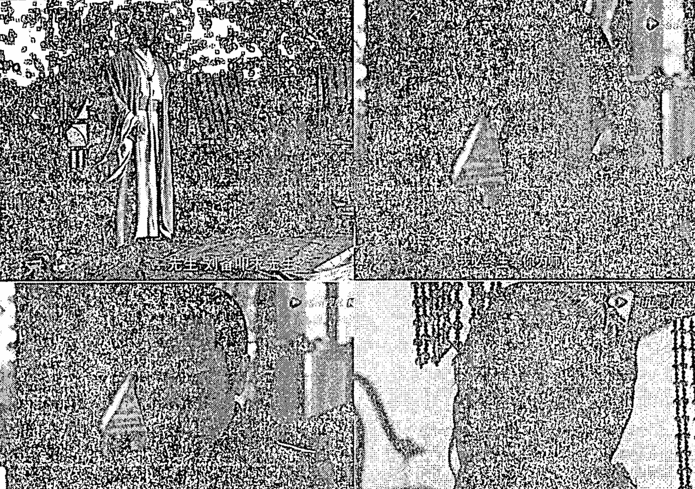

刘备三顾茅庐（跪拜、哭求）奉诸葛亮为师，终成帝业！

## 自古成功有路——师道

荀子的老师是孟子、孟子的老师是子思、子思的老师是曾子、曾子的老师是子贡、子贡的老师是颜回、颜回的老师是孔鲤、孔鲤的老师是子路、子路的老师是孔子。

刘邦的老师是张良！刘备的老师是孔明！你的老师是谁？

一诺老师是你最佳人生导师、梦想教练！

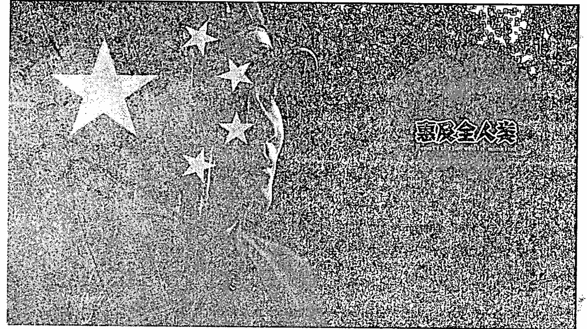

愿景：**惠及全人类！** 使命：**帮助更多人实现梦想**！

- ☆ 改变世界商学院·创始人
- ☆ 中国梦集团·独立董事
- ☆ 波思密码·独立董事
- ☆ 共产主义接班人
- ☆ 人民日报最佳评论人
- ☆ 作家、演说家、教育家、企业家
- ☆ 一诺老师从事教育行业20余年，能系统拆解古今中外企业家成功案例，并将总结的商业真谛深入浅出地穿插在教学中。

**一诺老师的梦想就是成就你的梦想**！

### 一对一收钱《成交的最高境界·上》把话说出去，把钱收回来的能力！

#### 一诺老师与德国前总统伍尔夫

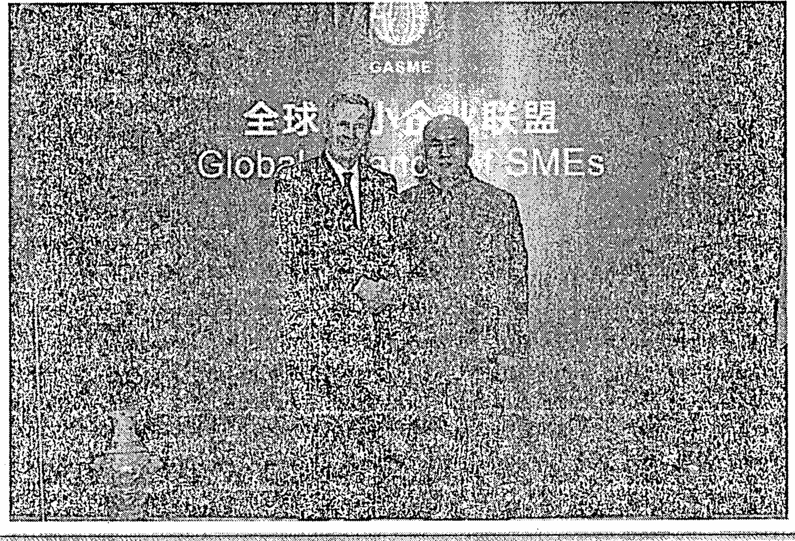

2017 年 11 月 27 日，全球中小企业联盟大会在上海胜利召开，一诺老师应邀出席会议。席间德国前总统伍尔夫亲自会见了一诺老师，高度赞扬一诺老师对全球中小企业做出的杰出贡献，并充分肯定了【改变世界商学院】世界企业家摇篮的地位！

面对一诺老师盛情邀请，伍尔夫出席《全球中小企业·改变世界论坛》欣然接受并表示期待！

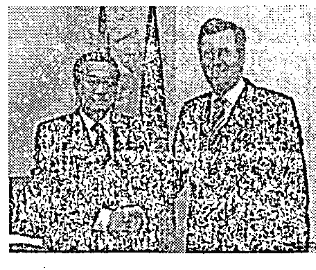
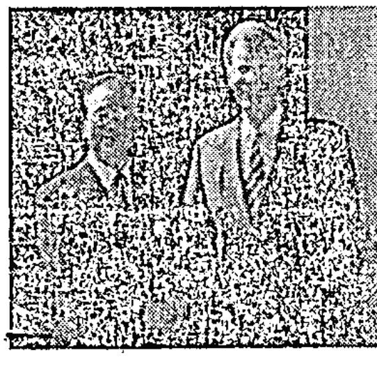
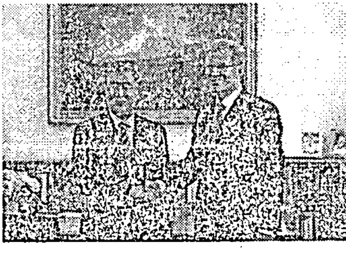

彻底地解决一对一收钱的所有问题！让天下客户削尖脑袋交钱给你！

#### 许绍雄出任改变世界商学院联席院长・形象代言人

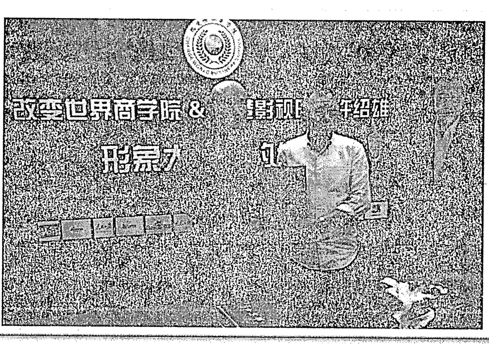

1972 年，许绍雄在第 1 期无线电视艺员训练班毕业后加入无线电视，曾在无线工作三年后转到丽的电视工作，四年后再回到无线。许绍雄是第一个驾驶奔驰上班的艺员，所以他被人们称为“Benz 雄”。2012 年，获得万千星辉颁奖典礼杰出演员奖。2013 年香港 TVB2013 台庆颁奖礼，许绍雄凭借《My 盛 Lady》获得最佳男配角。2014 年，在周润发的电影《澳门风云》中饰演了奔驰哥一角。2015 年，在郑中基、何超仪主演的《第七谎言》中饰演了包租公。2016 年，回归电影《使徒行者》……

#### 一诺老师近期课程部分剪影

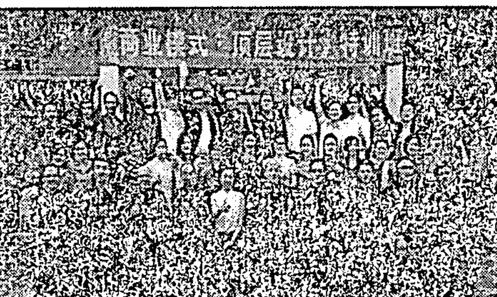
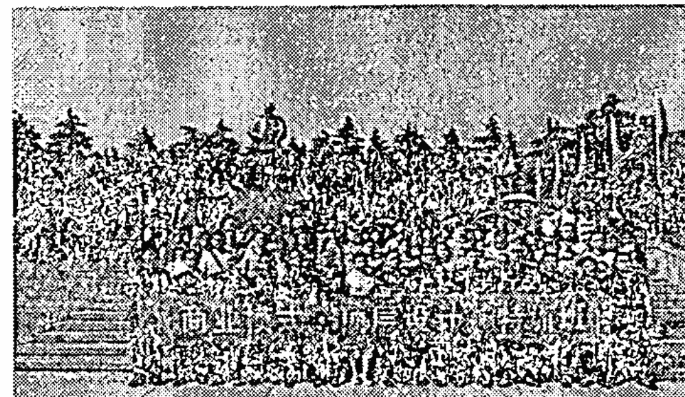
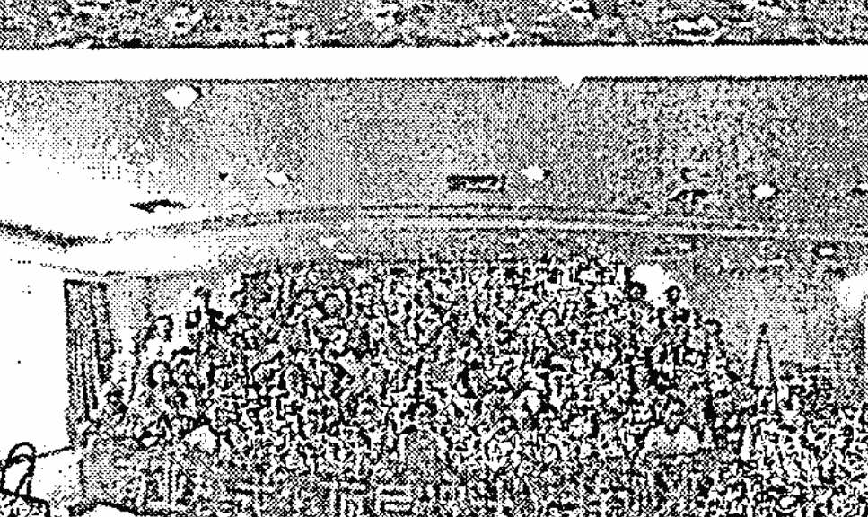
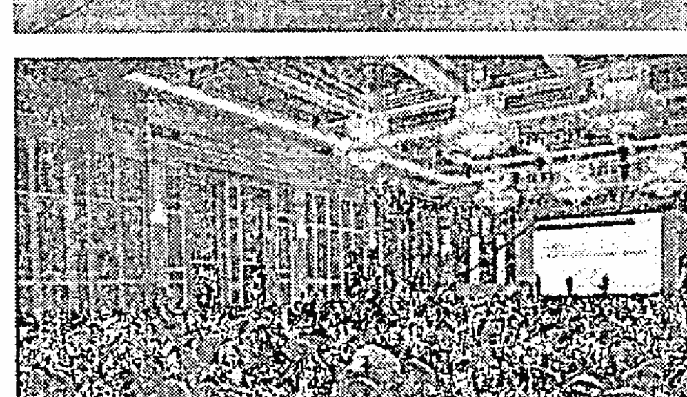

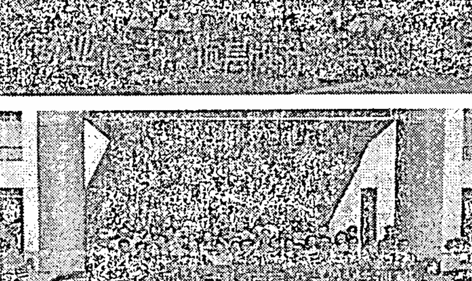

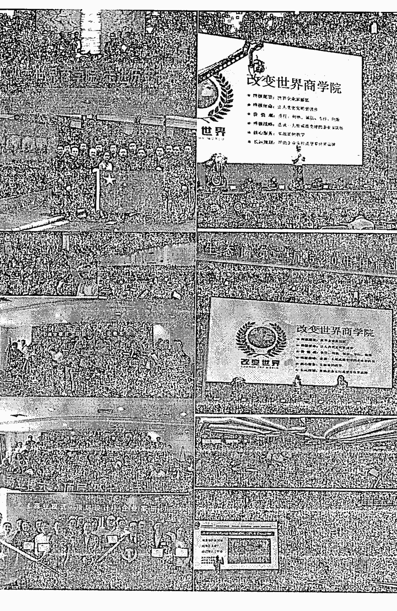

#### 一诺老师带领各分院院长们革命圣地游学

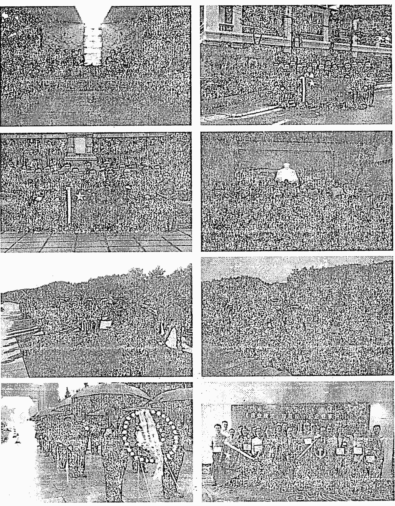

#### 一诺老师课程现场指导企业家落地

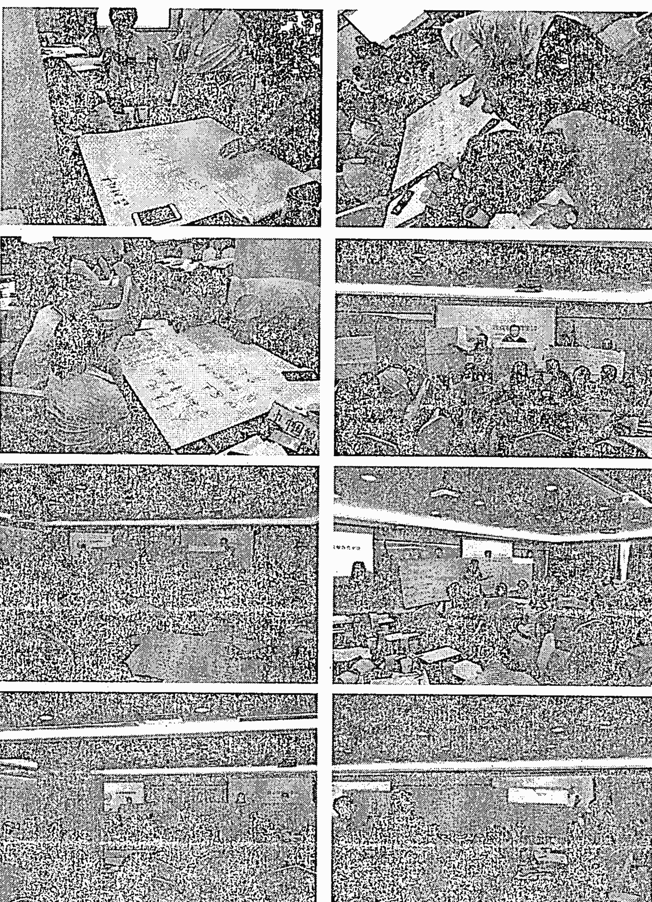

#### 一诺老师《杂传弟子密训》

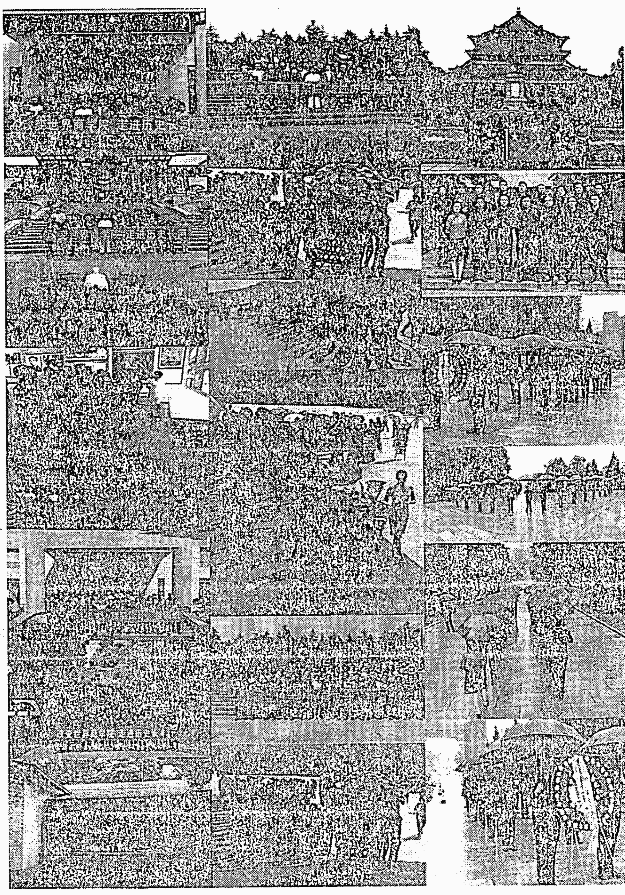

### 一对一收钱《成交的最高境界·上》把话说出去，把钱收回来的能力！

彻底地解决一对一收钱的所有问题！让天下客户削尖脑袋交钱给你！

彻底地解决一对一收钱的所有问题！让天下客户削尖脑袋交钱给你！

### 一诺老师谈：成交的最高境界

#### 为什么要学成交的最高境界

踢足球，所有的努力都是为了最后的射门！

谈客户，所有的努力都是为了最终的收钱！

也就是——成交能力！

不会这种能力：你只能眼睁睁看客户转身离去，而你却无能为力，这是何其悲哀！

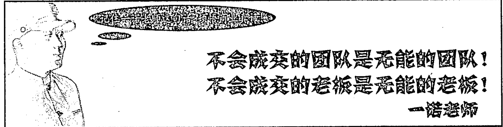

收钱环节——

是魔术师神奇表演的后台！

是谜语未揭开最后的谜底！

是美女身上最后一件衣服！

超级富豪打死不说的秘密！

是不是有很多的客户咨询你的产品？

可是你和你的团队，就是不会收钱！

就像猫儿看到池塘的鱼——只能是干着急！

就像一群太监上青楼——只能望女兴叹！

就是因为你不会成交，所以你一直经济窘迫！

就是因为你不会成交，所以你错过多少机会？

就是因为你不会成交，所以你错过多少财富？

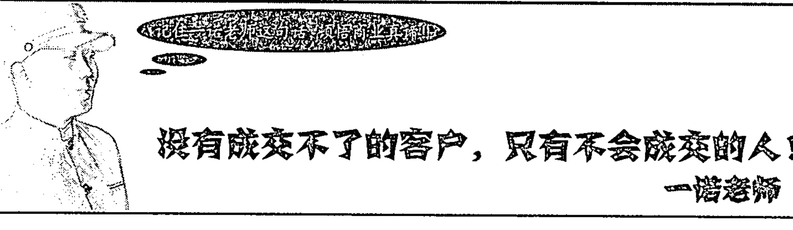

只要你学会《成交的最高境界》

你就会拥有：把话说出去，把钱收回来的能力！

只要你学会《成交的最高境界》

你就会拥有：一步一步引导别人说 Yes 的能力！

只要你学会《成交的最高境界》

你就会拥有：让客户主动送上门，疯狂抢购你产品的能力！

只要你学会《成交的最高境界》

你就会拥有：让客户相信你、喜欢你、疯狂的爱上你，对你欲罢不能的能力！

只要你学会《成交的最高境界》

你就会拥有：把自己的思想放进客户的脑袋，把客户口袋的钱放进自己口袋的能力！

既然要学就要学最好的！

一诺老师是这个领域中最好的！

一诺老师已经把整个培训界甩开了一个银河系的距离！

很多作者的书 10 块钱都卖不出去，一诺老师却能把一本书卖到 298、398、698、998、1980、3980 元

很多讲师，只能在微信群里 8.8、9.8、19.8 捡硬币的时候，一诺老师却能不见面，把课程卖到几千、几万、几十万！

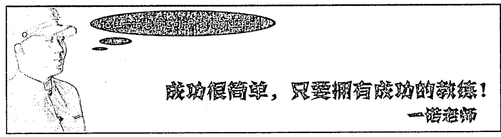

是的，只有一诺老师能够做到！

是的，只有一诺老师具备这种能力！

是的，也只有一诺老师能够复制给你这种能力！

是的，你也只能找一诺老师学习这种能力！

### 一对一收钱《成交的最高境界·上》把话说出去，把钱收回来的能力！

假设这种能力，能让你的成交率提升2倍、3倍、5倍、10倍，这种能力1万块值不值？（值）

假设这种能力，能让你业绩提升10倍、20倍、50倍、100倍，这种能力1万块值不值？（值）

假设这种能力，能让你的团队每一个收入倍增几十倍、上百倍，这种能力1万块值不值？（值）

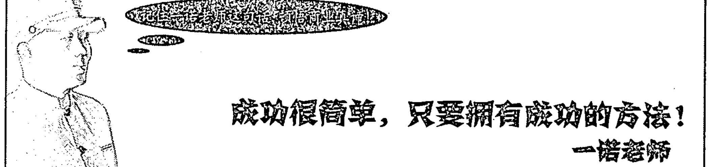

听好了！

听好了！

听好了！

这种能力不用1万块！

也不用8000块！

也不用5000块！

甚至连3000块都不要！

只需要2980元！

彻底地解决一对一收钱的所有问题！让天下客户削尖脑袋交钱给你！

没错，只需要 2980 元就能拥有一本《成交的最高境界》，就能够复制一诺老师一模一样能力！

当你拥有《成交的最高境界》你就可以在任何时间、任何地点、成交任何人！

当你拥有《成交的最高境界》你可以上卖天、下卖地、中间卖空气！

当你拥有《成交的最高境界》你可以让活人闭口，你可以让死人喘气！

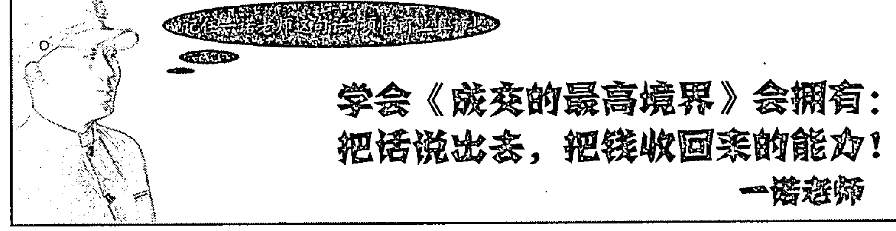

而且，今天就开始预定的！

提前预定，再减 1000 元！

没错！

是的！

你没有看错！

再减 1000 元！

彻底地解决一对一收钱的所有问题！让天下客户削尖脑袋交钱给你！

仅需要 1980 元！（不可思议）

1980 元，你就能够拥有：

- 倍增 100 倍业绩的能力！
- 倍增 100 倍收入的能力！
- 随时随地收钱的能力！

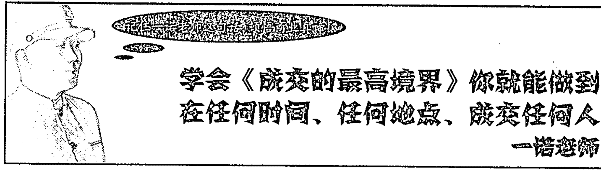

2020 年 12 月 26 日是毛爷爷诞辰 127 周年！

而且，2021 年元旦将至！

一诺老师决定：1980 元也不要了！

听好了！

听好了！

听好了！

前 100 名预定的人，只需要 980 元

就可以拥有这本，惊天地、泣鬼神！前无古人，后无来者的旷世收钱绝学——《成交的最高境界》。

前 100 名，仅仅 980 元！

不仅能拥有《成交的最高境界》这本书，而且，还配有一诺老师首席授权讲师【天字老师】为大家录制的音频课程。

《成交的最高境界》分为上下两册，一诺老师历时 3 年，经过千锤百炼、铸就而成！

所有内容，都是一诺老师亲自执笔，保证原汁原味！

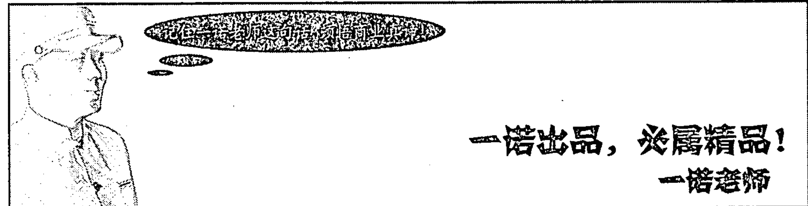

你是不是迫不及待地想要拥有？

来吧！

现在！立刻！马上！

开始这不可思议的，探索宇宙最高成交秘密的旅程吧！

### 第 1 课：得人心者得天下市场

#### 攻城为下，攻心为上

兵法曰：“用兵之道，攻心为上，攻城为下；心战为上，兵战为下。”意思就是说用兵的原则，从精神上瓦解敌人为上策，强攻城池为下策；以征服人心为上策，单纯靠武力取胜为下策。

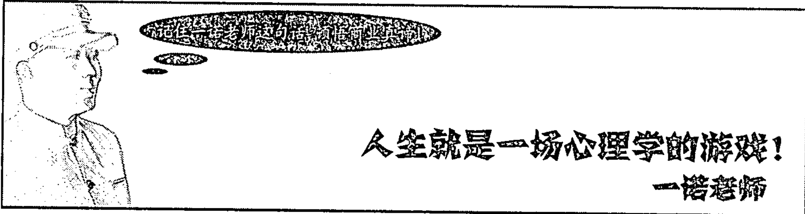

武力只能暂时解决问题，过分强求换来的将是“身在曹营心在汉”的结局；而攻心就不同，攻心战是通过兵不血刃的手段来获得真心的臣服。

若想要让对手永远心服口服地臣服于自己，首先你要先把他的心“攻陷”下来。成交的技巧就是武力，技巧只能暂时成交客户，后期客户有可能会退货，但是如果你能抓住客户的心，客户才会心服口服。

战争的对手其实不是他的军队，而是他的思想和精神。

你的目标不是客户口袋里的钱，而是客户的思想和灵魂！

在汉朝垓下之战中，刘邦的两次攻心战术都取得了完美的效果，一个是对韩信的拉拢战术，一个是对楚军的攻克战术。

前者是抓住韩信想要封王的软肋，让其称心如意，并感恩戴德，打仗便更有斗志，后者张良使用了“四面楚歌”，趁楚军身心疲惫，再借助明月当空的环境渲染，在楚军营外唱起了楚人的歌，勾起楚军思乡之情，消磨他们的斗志，令其无心再战。

四面楚歌，就是攻克对手的心理防线，达到自己的目标，最后夺取胜利。所以想要让客户成交，必须要攻克客户的心理防线，让客户发自内心地认可你，才能和客户保持长久的关系。

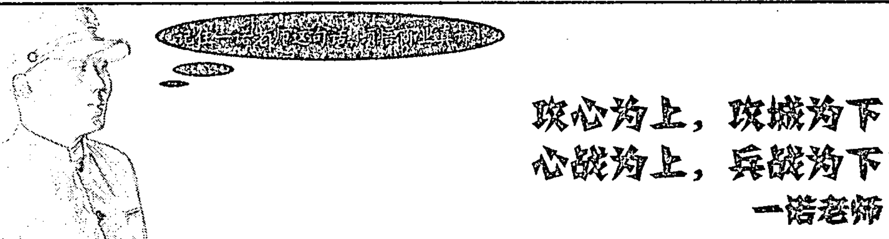

三国时期，诸葛亮攻打孟获，但孟获不服。

但诸葛亮深知：攻心为上，攻城为下；心战为上，兵战为下，于是乎，诸葛亮对孟获七擒七纵，创造了攻心为上的千古绝作，终于使孟获感激涕零，发誓子子孙孙永不再反，为诸葛亮挥师北上奠定了巩固的基础。

刘备也深得“攻心为上”的谋略，非常注意收买人心。

他在许多场合，把自己装扮成爱民惜物的忠厚长者，一位仁德圣明的君主。他刚刚就位新野牧，就造福于民，赢得新野百姓一片爱戴。他一到西川，便广施恩惠，以收民心。

刘备文不及孔明，武不及关、张、赵！却能被曹操称作和自己并驾齐驱的天下英雄，被周瑜、鲁肃看成是不好对付的枭雄，在乱世中平步崛起，其根本原因就在于——攻心为上。

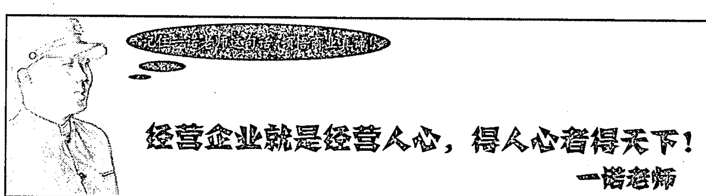

古人云：“得人心者王。”“三军可夺气，将军可夺心”，注意民心的向背，赢得民心，《孙子兵法》治国则可长治久安，治军则可令兵效命，制胜则可实现兵不顿粮、草，可利可全，不战而屈人之兵的最佳目标。

“上兵伐谋”，这里的“谋”是多方面的，其中谋得人心，则是伐谋中的精髓。一诺老师认为，所以得人心者得天下。只有得到客户的心，才能让客户心悦诚服。

### 第 2 课：打造一部自动赚钱机器

#### 成功很简单，只要方法正确

有很多人问一诺老师说，在过去我看了很多销售成交的书籍，也学了很多销售的方法和成交的技巧，为什么现在还是没有办法增加成交率呢？为什么很多人学了很多“葵花宝典”“降龙十八掌”之类的功法和招式，但并没能让客户买单？

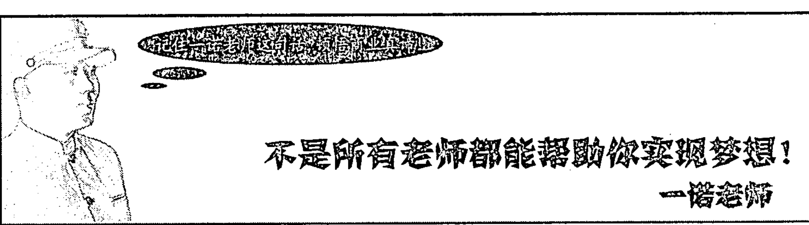

学了那么多的招式和话术，面对客户为何成交不了呢？

很多人百思不得其解，于是开始怀疑自己的能力，怀疑公司是不是有问题，怀疑是不是自己不适合这个行业，开始放弃自己，自甘堕落，甚至怀疑人生！

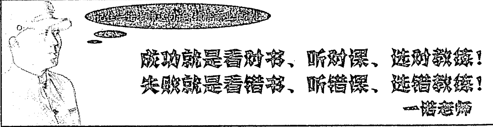

你会发现，市面上那些跑江湖的讲师，披着老师的外衣，其实自己没有成功的经验，偷了一诺老师的演讲稿，就到处忽悠别人的学费！一副丑恶的骗子嘴脸！骗完学费还不能落地，只能靠自己苦苦挣扎！

然而成功不是靠听几堂课、看几本书就能成功的，他需要一位教练，一位有责任心的教练，这样才能手把手地教练你的每一步。例如，一诺老师有一个《梦想教练》就是一个教练式的学习方式，学员在深圳跟着一诺老师一年学习实操！

大家都听过“躺着赚钱”这一说法，到了一诺老师这里将不再是传说，是能够落地的，赤裸裸的现实！

一诺老师白手起家创业, 17 岁就获得人生第一桶金 37 万，当时的 37 万可以在深圳买 3 套房子，换作今天的房价，也值好几千万了！一诺老师早已经实现财富自由了，却不满足于自己的小小成就，而是把时间花在“成就别人梦想”的事业上来！

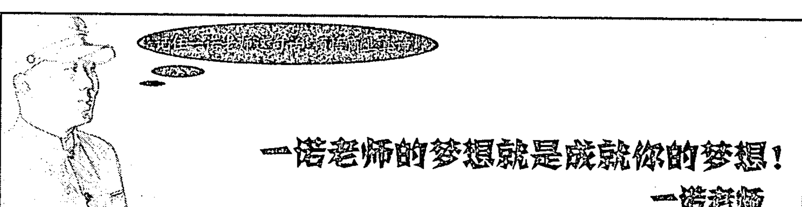

就像一诺老师平时教导我们的，成功不是看你自己的成就，而是要看相信你、追随你的那批人，他们的成就如何？

一诺老师曾经的很多弟子，例如：*导、*文强、*心、*为、*金、*鼎、*成、*文强、*国顺、*引华、**贤、*涛、*灵富、*栋、*万才、*践、*志强、*超、*婕、*魏、*克亚、*强、*志一、*才文、*一等，他们苦尽甘来，终于可以站在台上批发式地收钱——把话说出去，把钱收回来！

就像很多人被忽悠学习已经烂大街的所谓的成功学，在课堂是满血复活，可是回到现实中却发现不是这样的！一次又一次地上当受骗，一次又一次地希望！一次又一次地失望！

学费倒是交了不少，整天被忽悠，从来不落地！

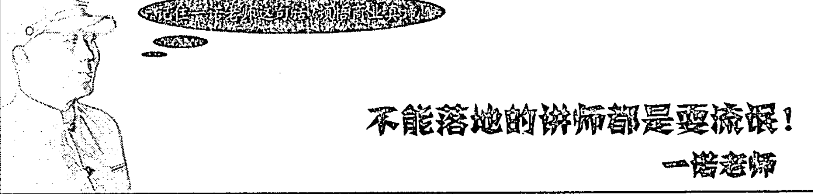

后来他们听说这么多的世界大师都曾是一诺老师的弟子，于是千方百计地找到一诺老师，拜师学艺！

有的三个月开上了宝马、有的半年住上了别墅，将来机会你参加《梦想教练》就会明白一诺老师的课程为什么那么实战！而且，参加这个班的师弟，都会和已经早你一步住进别墅的师兄成为好兄弟，除了接受一诺老师的亲自辅导，还有这些已经成功的师兄带你实操落地！

全宇宙你再找不到这样教练式的教学方式！

因为一诺老师的境界和实力，早就把整个培训界的徒子徒孙甩开了一个银河系的距离！

最近我看到很多参加《梦想教练》的师弟师妹，他们在一诺老师的指导下，跟着师兄师姐一起实操！可能你以为会很辛苦吧？其实不然，他们每天早上结伴相约起来跑步——

早上是实战训练时间——

一起来到海边练习《演说家能量咒语》……

一起练习声音爆发力、五星级的微笑、眼睛放电等演讲基本功的训练……在海边迎着日出练习演讲，练到鱼儿跳出来！

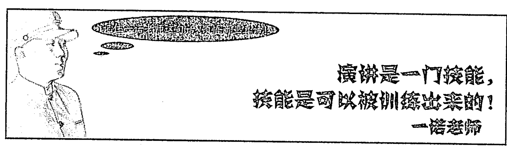

中午相约聚餐或一起买菜做饭，其乐融融……

午饭后的睡午觉、有的看书、有的在别墅的花园里交流学习心得。很多《梦想教练》班的童鞋们不禁感慨道：这才是人过的日子、这才是梦想生活……

下午是实操时间——大家一起来抓钱，注意！这不是学习！

也不是演习！而是实战演练！

大家用一诺老师教的方法和师兄师姐总结的话术，来践行“把话发出去，把钱收回来！”为什么是发出去，而不是说出去呢？因为直接发微信就行了！（偷笑）

一诺老师说过，要赚钱不能靠自己，靠自己赚钱自己就是机器！只有靠机器赚钱，自己才能解放出来，才能享受生活！

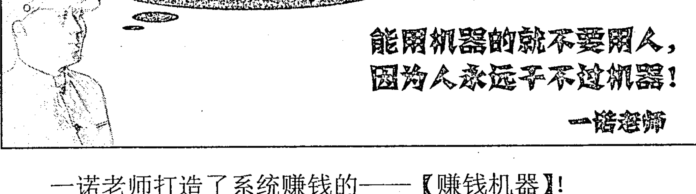

一诺老师打造了系统赚钱的——【赚钱机器】！

到了师兄的别墅，你会看到几百部被改装过的手机在那里自己运行，几百部呀，都在做同样一个动作，是不是很壮观呢？

### 第 3 课：人人为我我为人人

#### 你能成就多少人,就有多少人成就你

很多师弟师妹开始的时候，由于赚钱机器要投资几十万可能会囊中羞涩！

唉！一分钱难倒英雄汉呀！

别着急，一诺老师都为大家都想好了！

这些设备，由已经赚到钱的师兄师姐赞助，而且每位师兄师姐还要承诺，当自己赚到 100 万的时候，要拿出 9.8 万，这 9.8 万平台会添置改装更多的【自动赚钱机器】，让刚进来的师弟、师妹有实操的工具！

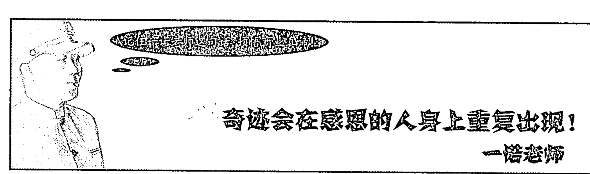

师弟、师妹使用这些【自动赚钱机器】批发式地收钱的同时，一边跟着一诺老师实操、跟着师兄弟结伴晨跑、练习演讲等，当你赚到钱之后，你可以添置更多的【自动赚钱机器】，因为一诺老师说过，量大是致富的关键！

当你使用一诺老师的方法、在师兄弟师姐的辅导下，并使用【自动赚钱机器】赚到之后，你也要累计捐助9.8万，并至少要帮助10位师弟师妹，让他们也改变命运！

想想看，别人之前是如何帮助你的？

你为什么不能回馈社会？

不能的请滚开，没人拦着你！

也没人骂你，骂你脏了自己的嘴！

愿意付出的就留下！

当然了，虽然你愿意留下来，但是一诺老师会因为你的付出和大爱，继续帮助你达到人生的巅峰！

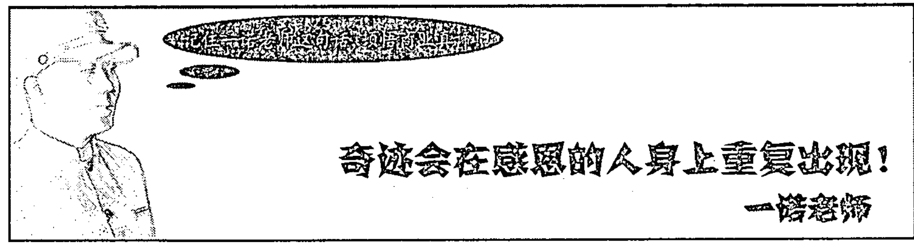

就像现在很多师兄、师姐，在一诺老师的亲自辅导下，设计了自己的演讲稿、写出了自己的书籍，不仅可以登台演讲，更加可以像一诺老师那样，仅仅通过互联网演讲，就可以吸引粉丝的青睐，通过互联网就可以销售自己的书籍和课程。

有人说，我想直接去学习演讲，直接就当讲师可不可以？

对不起！不行！这里不欢迎假大空的人！这里不是坑人害人的成功学训练班！你自己都没有赚到钱！还要教别人赚钱？你自己都没有成功，还要教别人成功？这样的人，简直就是不负责任、误人子弟、丧尽天良！

一诺老师教导我们，做人做事要——正心、正念、正能量！

那些为了骗取学费的人，早晚有一天会遭报应的！

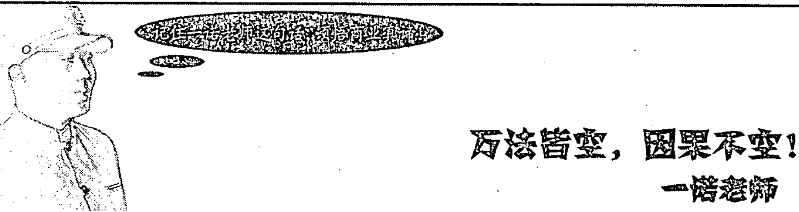

在一诺老师这里，想要当讲师只有一条路，那就是一诺老师指导下、在师兄师姐的帮助下、在平台大集体的温暖下，你先赚到100万，因为当你赚到100万的时候——

你的自信、经验、磁场自然就不一样！

只有这样，你才有资格去谈所谓的教别人成功！

否则就是睁眼说瞎话，自己都没有成功就去骗别人的人，这跟那些成功学的大骗子有什么区别？

### 第 4 课：知己知彼百战不殆

#### 你要比客户还要更了解他自己

在《孙子兵法》中说：“知己知彼，百战不殆；不知彼而知己，一胜一负；不知彼，不知己，每战必殆。”意思是说，在军事纷争中，既了解敌人，又了解自己，百战都不会有危险；不了解敌人而只了解自己，胜败的可能性各半；既不了解敌人，又不了解自己，那每战都有危险。

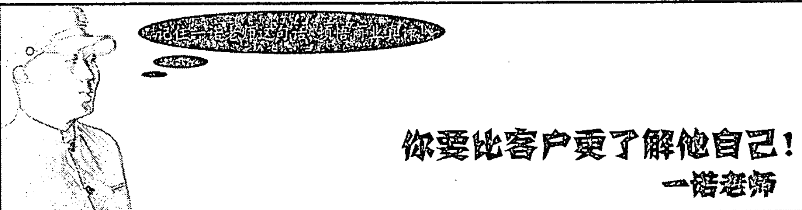

我们每天都会面对各种各样的客户，为什么在过去你用同样的销售技巧和话术，但是有的人会赞成你，有的却反对你？

因为客户的性格不同，每个客户喜欢听的话也不同，所以我们的应对技巧也要所有变化。对症下药，才会事半功倍。只有在销售之前先了解客户有什么种类，客户有什么性格，当你一见到客户就能快速地判断客户的类型，才能做到百战不殆。

一诺老师为我们总结出客户的五种性格，请看下一课。

### 第 5 课：支配型客户

#### 客户五大类型：第一种类型

- **客户特点**：有自信，决断力强，说话声音大，虚荣心强，不喜欢啰嗦，喜欢直入主题。

- **客户表现**：这类客户通常比较有钱，是属于做事爽快，决策果断，以目标为中心。行动力强，喜欢支配人和下命令。他们的时间观念很强，讲求高效率，喜欢直入主题，不愿意花时间同人闲聊，讨厌自己的时间被浪费。

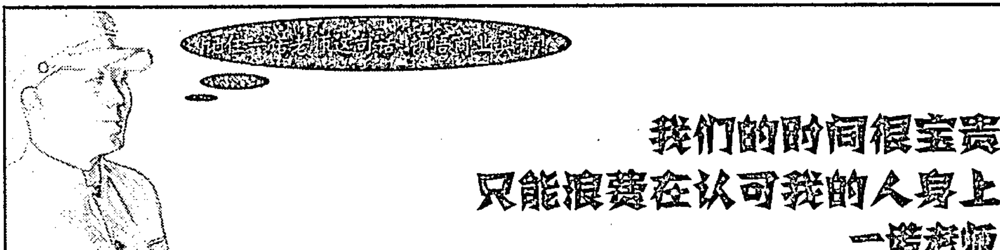

一诺老师研究发现，这种人常常比较霸道，非常主观，喜欢别人奉承及赞美，受不了别人的刺激。说话时的声音特性：往往讲话很快，音量也会比较大，可能会面无表情。

- **应对技巧**

1. 由于时间对他们来说很重要，所以他们喜欢直入主题。他会直接问你价格，但不会听你耐心地讲解，只想一步达到他的目的。如果他想知道什么你就告诉他什么。
   他不喜欢绕圈子，喜欢直接，不过像这种人是非常要面子的，如果他问完价格不想买，你要给予他适当的刺激，即激将法。因为要面子也许一赌气他就会买，把他抬得高高的，把自己放在低处，要对他进行大量的奉承和赞美。

2. 要表现得非常专业，要一针见血地指出对方所存在的问题，以击中要害。如果他提出些问题销售人员不能很好回答，那么对他的吸引力就会大大降低。
   在与他们探讨需求的时候，尽可能地使用可以刺激他们需求的话语和词汇。如：高效、时间、领先、竞争优势、变革、权力、地位、威信、声望和掌握大局等。

3. 暂且把自己忘记，此时别把自己太当回事。切忌不能和客户在沟通中发生冲突，要知道，你赢了，沟通就终止了，你输了，可能客户会给你惊喜。对此类客户要表现得足够热情和自信，他的自尊心才能得到满足，此时成交才有可能性。

了解书籍和课程，请在微信内添加一诺老师官方公众号【梦想教练】和【改变世界商学院】。

### 第 6 课：表达型客户

#### 客户五大类型：第二种类型

- **客户特点**：待人热情，口才好，喜欢闲聊，爱表现，性格开朗，好交朋友。

- **客户表现**：很擅长言语表达，具有丰富的面部表情，性格活跃，典型的外向性格，客户喜欢跟你聊天，比如家庭事业兴趣爱好，最近发生的事，他想到什么都会跟你说出来，爱表现自己。
  这类客户在购买产品的时候，发现有不满的地方也会跟你说出来，比如他会跟你说同行的产品有多好，喜欢进行比较，经过反复比较以后，觉得合适就会购买。

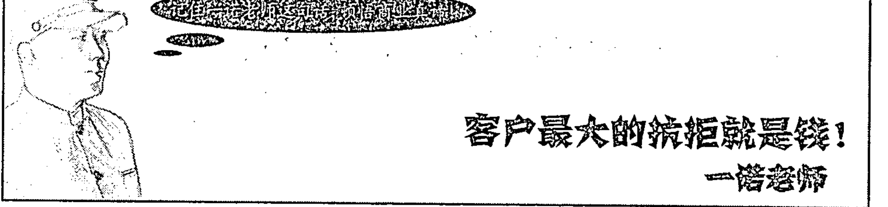

比同样的品牌，同等质量的产品，市场竞品售价是10元左右，最后客户和你谈成的价格是8元，这类客户就会立马感兴趣，认为买得值。

- **应对技巧**

1. 应多给客户进行一些比较性介绍，让客户比较，一旦客户觉得你公司的产品，在质量、价格、款式、花色及销售服务等方面好于同行时，客户就会觉得这是个难得的好机会。

2. 表达型的人喜欢表现自己，他会一直向你诉说他的种种不满或自己的很多事情，喜欢东拉西扯。
   像这种人我们一定要做一个倾听者，尽情让他说，要不断地点头认同他，不要和他抢话。
   找准适当的时机要插上关于客户需求产品的话题，把他给拉回来。

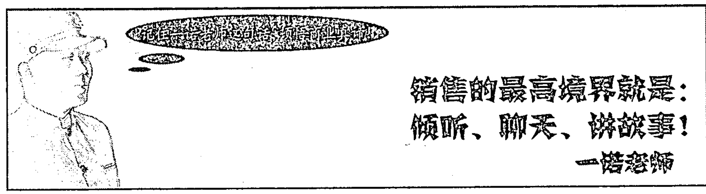

了解书籍和课程，请在微信内添加一诺老师官方公众号【梦想教练】和【改变世界商学院】。

### 第 7 课：和平型客户

#### 客户五大类型：第三种类型

- **客户特点**

友好、镇静、拖延，行动缓慢，犹豫不决

- **客户表现**

属于特别好的人。做起事来显得不急不躁，属于肯支持人的那种人。爱好和平，持之以恒，忍耐度强，优柔寡断。他们需要与人建立信任的关系，不喜欢冒险，喜欢按程序做事。他们往往比较单纯，个人关系、感情、信任、合作对他们很重要。

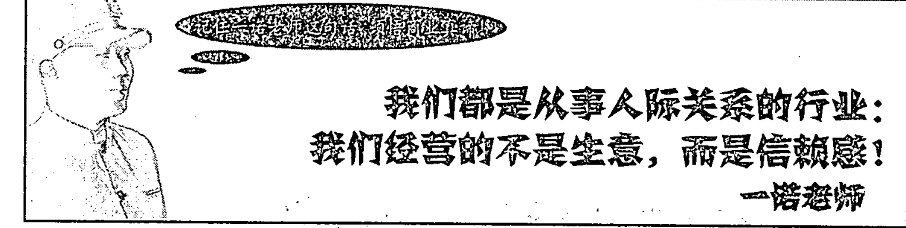

他们做事情以稳妥为重。通常客户不会立马下决心购买，常常表现为顾虑、不安，恐怕自己考虑不周而出现差错，往往希望他人能为其当参谋，并且这种类型的客户还会将这种想法较为明确地告诉销售人员。这种类型的客户比较敏感，一旦感觉你在推销，便会产生不信任感。

- **应对技巧**

1. 面对这种类型的客户时，销售人员不可马上直白地销售客户所需的产品，而是要先建立信任，做好铺垫，不可操之过急，先打好感情牌再介绍有关产品或服务的情况，让客户自己从中作比较后，再选择产品。

2. 在沟通时，销售人员要显得镇静，不可急，讲话速度要慢，音量不要太高，相对要控制自己的声音，并尽可能地显示出友好和平易近人，表现得要有礼貌。

3. 对于这种人属于做什么事情都会拿不定主意，你说什么他都会说好好好，可是到后来经常告诉你，我再考虑考虑，我要和家里人商量商量，针对这种人我们要帮他拿主意，多重复客户需求，帮客户下定决心。对客户多说这样的词汇有：我保证、一定会，你放心、保证让你满意、相信我、一定有效等。

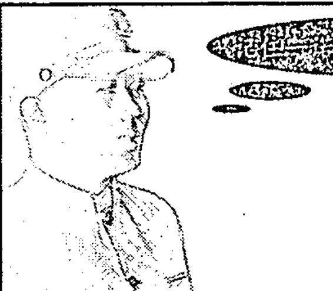

> 在这个信赖感缺失的时代：我们需要给到客户安全感！ ——塔忽悠

### 第 8 课：完美型客户

#### 客户五大类型：第四种类型

- **客户特点**：追求完美，注重细节，爱挑毛病。

- **客户表现**：完美型的客户最大的需求就是精确，有条理、做事情要有个圆满的结果。重视专业的循规蹈矩。
  非常注重细节，喜欢追求完美。喜欢在产品的细节方面发现毛病和缺点！重视体验，并对销售人员采取苛刻、强硬的态度，期待客服人员来解决这些问题。这种类型的客户遇到一点不满就大发牢骚，抱怨不已，非常固执。

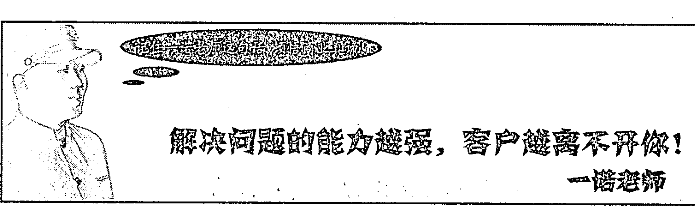

此类客户，因为自己能够当着销售人员的面，或购物现场发泄心中的牢骚、抱怨而满足！
其目的就是让推销者当场解他心中的结。

- **应对技巧**

1. 作为销售人员：对待他们要认真细心，不可马虎，凡事考虑得要小心。注意一些平时不太注意的细节。
   不可与他们谈论太多与目的无关的东西，要直入主题，注重客户体验的感觉。

2. 接受客户不良的情绪，允许客户发泄心中的不满，仔细倾听客户的挑剔，让客户感到你在尊重他。
   从客户的角度来理解客户挑剔的原因，让客户感觉你已经与客户在同一频道。
   避免责备客户，学会在适当的时候进行道歉。
   最后，提出解决方案，解决客户问题，满足客户的需求。

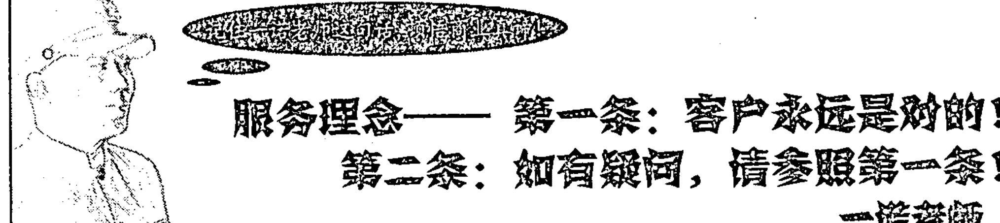

了解书籍和课程，请在微信内添加一诺老师官方公众号【梦想教练】和【改变世界商学院】。

### 第 9 课：理智型客户

#### 客户五大类型：第五种类型

- **客户特点**：说话条理清晰，理智，喜欢思考，沉默，喜欢分析。

- **客户表现**：这类客户往往讲话不快，音量也不大，不太配合销售人员的工作，不管说什么，他们都会“嗯嗯”来应付你，这让销售人员觉得无从下手，讲起话来一般面部毫无表情。
  如果销售人员表现得很热情的话，他们往往觉得不适应，让人琢磨不透难以理解。他们喜欢思考，喜欢分析，更喜欢通过大量的事实、数据来做判断，以确保他们做的是正确的事情。这类客户思考周密。

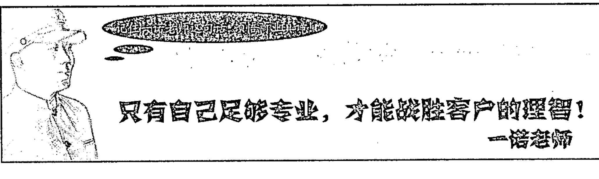

- **应对技巧**

1. 他们会问到非常专业的数据，所以我们一定要提前做好充足准备，做到让他感觉到我们很专业，问什么都能应答自如。

2. 要用大量的证据去证明你讲的话是对的，提前准备大量的客户见证资料，产品见证资料、公司资料等，把见证资料展现给他看。

以上只是了解客户的性格，想要做到知彼还要了解客户的心理，在一诺老师后面的课程——客户心理十大循环中，会有更加详细的讲解，一步一步地揭开客户做决定的心理奥秘。

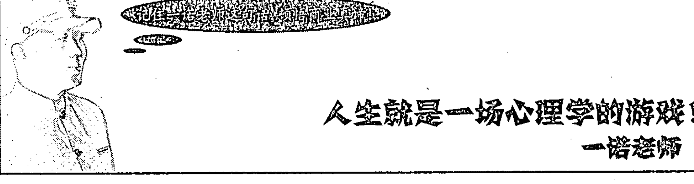

将来有机会来到一诺老师的课程，还有更详细的了解客户的方法，比如读心术、勾魂术、催眠术、攻心术等！
教你如何通过几句话就能瞬间了解客户的心理，打开客户的心门，勾住客户的灵魂……
在一诺老师的课程里都会为你深度揭秘！

了解书籍和课程，请在微信内添加一诺老师官方公众号【梦想教练】和【改变世界商学院】。

### 第 10 课：销售冠军的基因

#### 冠军是一种习惯,更是一种信仰

很多人问一诺老师，什么才是销售冠军的基因？

一诺老师研究发现，很多人努力十年二十年，人生不理想，家庭不幸福，事业不如意，经营企业，业绩目标达不成，这里面有一个最根本的原因，就是你头脑的信念出了问题。

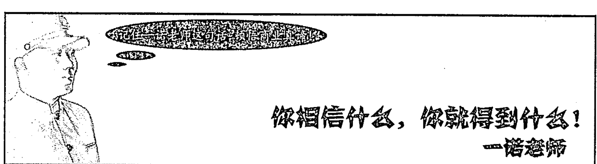

一诺老师给很多企业打造销售团队，有很多人想直接学方法和技巧，但是一诺老师发现直接教方法他们也很难使用出来，为什么？

因为很多人在内心对销售有一些误区，甚至有些人讨厌销售，排斥销售，很多人以为销售是很低级的事，销售就是卖东西，销售就是求别人。

所以他一想到销售就是负面的联想，感觉销售是肮脏、下流、齁龌、无耻的行为。

当你一想到销售是很痛苦的事情，你就不愿意去做那件事情，你怎么可能会有心情和动力去研究销售呢？
你不去研究不用心学习销售，你的销售能力怎么会变好呢？

一诺老师研究发现，世界上最顶尖的销售大师，像乔·吉拉德、汤姆·霍普金斯、马修·史维等，包括一诺老师接触过的很多企业家，还有一诺老师自己，在他们的头脑里面，他们一想到销售就热血沸腾，他们一想到销售就是付出和贡献。

为什么在过去一诺老师能持续成为销售冠军？

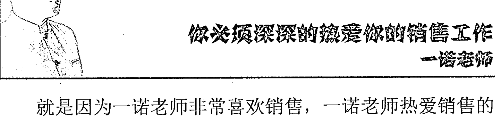

就是因为一诺老师非常喜欢销售，一诺老师热爱销售的工作，他觉得销售是世界上最光荣的工作，销售是天经地义理所当然的，销售是成就感，销售就是利他，销售等于收入，销售等于一切。

## 一对一收钱《成交的最高境界·上》把话说出去,把钱收回来的能力!

一个企业最重要的部门，不是技术，不是客服，不是生产，而是——销售！
因为只有销售才能带来业绩，只有销售才能养活家人。

如果一个企业家做企业没有业绩，那就是在犯罪，因为他辜负了那些相信他,跟随他一起打拼的兄弟。

如果一个人赚不到钱，那也是在犯罪，因为他没有办法孝顺父母，没有办法给孩子更好的教育，没有办法给家人更有保障的生活。

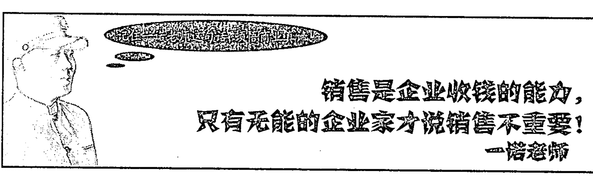

所以从现在开始，我要求你也要正确看待销售，喜欢上销售，当你喜欢上一件事情的时候，你才会用心去琢磨、去研究如何提升你的销售能力，你才能真正成为一个成交大师。

一诺老师总结出，世界上成功的人士对销售有五大信念，不管你是老板还是员工，你都要好好地研究一下。

现在就让我们跟着一诺老师一起，彻底打开自己的任督二脉，彻底打开你销售的开关！激发你无限的销售潜能！
彻底地解决一对一收钱的所有问题！让天下客户削尖脑袋交钱给我！

### 第 11 课：领导=销售

#### 销售冠军的第一个信念

过去一诺老师经常给很多企业团队做内训，帮助他们打造团队，发现很多业务员每天都在用错误的方法做销售，每天都在帮公司赶跑客户，损失业绩。

一诺老师问他们，你们的销售技巧是谁教的啊？

他们说是领导教的。

一诺老师就在心里想，难怪公司业绩提升不上来，事实上有很多领导和老板，他自己对销售都不是很专业，他只不过是凭自己的经验在教员工，并没有一套系统的销售模式，所以导致员工没有业绩而流失。

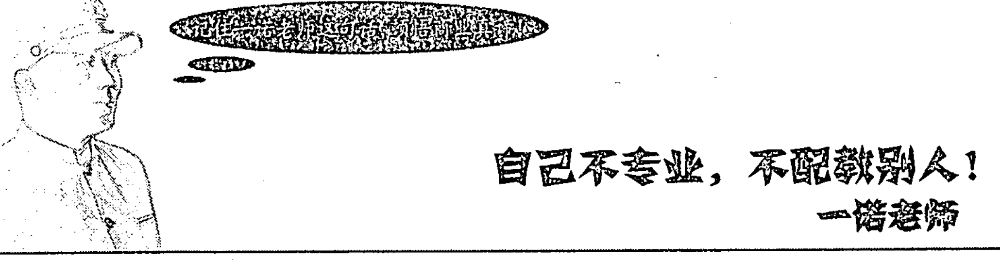

这也就是为什么很多老板说业务员难招，业务员流失率很大，其实企业所有的问题都是老板的问题，员工的问题是主管的问题，主管的问题是经理的问题，经理的问题就是老板的问题，也就是说员工收入不高、业绩不理想，都是老板的责任。

因为有很多老板都不太重视销售，他说我是老板呢，我才不用学销售，销售是业务员的事。

就这个思想不改，还抱着过去旧社会的思想让中国无数个企业从辉煌到倒闭烟消云散，现在就由一诺老师给你揭秘一个企业成功的最大的秘密。

企业做的最好最有影响力，全公司最会销售的人不是公司的销售冠军，不是销售经理，而是公司的老板也就是创始人。

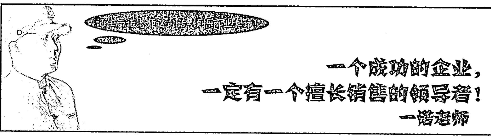

那领导者怎么销售你知道吗？
你知道为什么有很多老板开着奔驰宝马去外面去做什么？
因为他要去见客户，他要去签订单、签合同，谈合作、谈生意，他要销售他的观念、销售他的梦想，他要把他的公司推销出去招商引資，才能吸引更多人才吸引更多合作伙伴。他要把他的思想放进别人的脑袋，引导别人采取行动。

一诺老师经常在讲课的时候说——老板就是一个开着豪车的业务员！对此我深信不疑！
是的，我完全同意！
如果你想成为一个伟大的领导者，你必须擅长销售。

> **销售是白手起家必修课！**
> ——一诺老师

前亚洲首富李嘉诚16岁从销售做起；
台湾首富王永庆9岁开始卖大米；
马云在创业的初期挨家挨户地去推广他的中国黄页；
世界首富比尔盖茨每次演讲完、见完客户，都会做一个动作——卖他的软件。

他们今天的成就，秘诀只有一个，很显然，他就是比你会——销售！

了解书籍和课程，请在微信内添加一诺老师官方公众号【梦想教练】和【改变世界商学院】。

### 第 12 课：团队=销售

#### 销售冠军的第二个信念

一个企业最缺的不是钱，不是产品，不是工厂，不是技术，而是客户，客户从哪里来，客户是销售团队为你创造的。

一辆高铁为什么跑得比火车快？
因为火车要靠火车头带，而高铁是每一结车厢都在跑。

所以一家企业，老板一个人的能力再强，也比不过一支强大的团队。所以，为什么你的企业业绩很难增长，你知道了吗？

> **不会带团队，你就干到死！**
> ——一诺老师

一诺老师研究发现，很多企业花很多资金用在产品研发上，用在公司的装修上，花很多时间用在技术上，唯独没有重视销售部门。

I 服了 U，这简直是不可思议！他根本没有抓到重点！各位想想看，一家公司会成功，关键是什么？是他产品最好吗？是他技术最好吗？是他的服务最好吗？

请问你啊，有没有公司他的产品不是最好的，但是他却卖得很好？

今年过年不送礼，送礼就送……下一句是什么？

我想你应该知道了吧。很多人都买过，但很多人到现在为止都还没搞明白，这款保健品效果到底好不好？

很多老人家表示，吃了跟没吃没什么区别，既然如此，那为什么还有这么多人买呢？

这款保健品的广告语是，送礼就送……
他的意思是叫你买来送礼的啊！没叫你吃啊！
有没有效，又有什么关系呢？

看过一诺老师《猪买单》的都知道“沙丁鱼罐头的故事”
沙丁鱼不是用来吃的，是用来……所以，脑*金不是用来吃的，是用来送礼的！

这款保健品会成功的关键就是——因为他懂得客户的心理，
很显然他就是比你会卖。

你会发现有的人有很多好的产品，但他的产品不是
在客户手上，而是在仓库，所以产品再好也没用，因为
你卖不出去。

很多人都整反了，以为别人卖得好是因为产品
好，而你却不知道别人是用了什么策略和方法在卖。

记住，一个企业最重要的部门——

不是技术部门！不是客服部门！不是行政部门！而是
销售部门！因为只有销售才能带来业绩！

在当今这个竞争激烈的时代，不管你的产品是用
什么方式在销售，最终都离不开销售团队的支持。

只要你会卖，你才能训练你的团队变得很会卖！
你的产品不好，你也可以代理别人好的产品来卖！
同样也可以把公司做大！
在这个世界上不缺好的产品，缺的是很会卖的人。

所以，这就是为什么一诺老师不断地教导我们，必须要重视销售部门，如果你想要占领更多市场，取得更好的销售业绩，必须要打造一支英勇善战、虎狼之师的销售团队！

因为销售团队就是企业的军队，就是一个企业的命脉。

为什么很多人想请一诺老师做企业顾问，希望让一诺老师帮他们训练销售团队？

在过去，一诺老师曾经帮助过无数企业打造团队、提升销售技巧、执行力、凝聚力、感恩的心态。

经过一诺老师训练之后，就可以让销售人员直接把话说出去，把钱收回来，直接为企业创造业绩，所以为什么别人愿意付一诺老师几百万、乃至上千万的顾问费？因为一诺老师能给别人带来比顾问费、出场费更大的价值！

团队实在是太重要了，你要知道团队最重要的第一种能力就是销售能力，就是收钱的能力，第二种能力就是执行力。

为什么很多老板说带团队很辛苦？

因为你的指令、你给团队设定的目标，很多人不去执行，很多的员工拖延懒散、没有行动力，互相抱怨、没有激情和状态！没有团队精神，也不知道要付出和感恩！所以老板很辛苦！

关于如何提升销售团队这些能力，在一诺老师的课程里会讲到，如何让员工学会负责、感恩、付出、等等。

包括会教你给员工洗脑的最高境界！
给你揭秘人脑控制术的原理，让员工死心塌地跟随你！
让员工拥有激情和自信！
让员工拥有超强的行动力！
让员工不断为企业创造业绩！

### 第 13 课：收入 = 销售

#### 销售冠军的第三个信念

很多人问一诺老师，销售冠军的收入来自什么地方？

记住——收入来自交易，而交易就需要沟通，需要人与人之间的互动。

如果你的收入不高，业绩不理想有两个原因——

- 第一种原因：你跟客户的互动太少了，你见的客户数量不够，行动不够。

销售人员想要有高收入必须要做到量大，一诺老师经常教导我们——量大是致富的关键！只有大量的行动才能带来大量的结果。

那为什么有的人明明知道这个道理，可是他却不愿意大量行动呢？

一诺老师告诉我们，因为你的内心有障碍，有恐惧，你相信客户会向你卖单，你害怕客户拒绝你，你自卑胆小，所以你有一心病！

就这种情况都突破不了，你学再多的销售技巧你也用不出来，在一诺老师的《改变命运》课程里面，一诺老师会针对这种类型的人，从内而外地去改造你的心智，彻底增强你的自信，激发销售潜能。

- 第二种原因：有的销售人员他很自信，内心没有障碍，他很努力地大量行动，但是业绩收入并不是很高，为什么？

因为虽然他很努力大量地采取行动，可是他行动的方向是错的，怎么理解这句话的意思呢？

举例：一只苍蝇往窗户上飞 100 次，没有飞出去，他再飞 1 千次、1 万次！撞得头破血流，你觉得它能飞出去吗？

标准答案——不能！

就像很多销售人员，每天都很努力地，在用错误的方法做销售。今天遇到客户一个问题拒绝，明天遇到同样的问题还是拒绝，后天再遇到同样的问题还是被拒绝。

如果他不懂得去总结，不懂得反省，不去学习和改进，再怎么努力也只能赚点小钱，对不对？

所以这种销售人员缺少的是方法，缺少的是一套系统的销售模式。

所以当看到这里的时候，你就知道你有多荣幸了，因为这本《成交的最高境界》的书籍就是——成交的最高境界！

你一定要用心去研究！特别是一诺老师在后面会讲到的客户十大心理和成交的十大步骤！你一定要把它研究得透彻，融会贯通变成自己的，你才可能成为——成交大师！

一诺老师建议我们这本书要随身带上包里，这是一本训练手册，每天都要看都要复习。

当你把这本书看 100 遍以上！奇迹将会在你的身上出现！

如果你是团队领导者，要给每一个销售人员人手都发一本，如果你的悟性不是很高，有些地方不太理解，你可以直接在【梦想教练】公众号上面免费学习《成交的最高境界》的音频课程！

而且，只要是购买此书的人，都可以免费学习这门课程！

那有人会说，我不是做销售工作的，我应该不用学销售技巧了吧？有这种想法的人，我就知道，这就是为什么你工作十年二十年收入不高的原因了！

有人说我是做技术的，我是做设计的，我是做行政的，我是做客服的，我拿的是固定工资，我也不用见客户，我学销售有什么用？其实这是天大的误区！

一诺老师说过，收入来自与人的沟通，来自交流和互动！

就算你是做行政的，那你也要得到老板的赏识吧？难道你不需要跟老板沟通吗？难道你不需要跟同事沟通跟朋友沟通吗？你不想加薪吗，你不想要升职吗？

有的人说升职我不需要多说什么，我只要踏踏实地把我的 工作做好就可以了，不需要拍马屁。

其实，拍马屁就是一种销售能力，只要是与人沟通要张口说话，这种能力就是一种销售能力。

所以，你就知道为什么你努力这么多年还是个小职员，还抱怨公司不给你机会，因为你根本没有用心，也没想着怎么去提升口才，提升沟通能力。

很多人以为销售只是业务员学的，销售就是卖东西，一诺老师跟我们说，这都是吃瓜群众的思想！在富人的世界里，人人都是销售人员，每个人都需要学销售技巧，连我们伟大的习大大，都要去国外销售我们的高铁，你还有什么理由不学销售？

### 第 14 课：家庭 = 销售

#### 销售冠军的第四个信念

为什么家庭等于销售？

曾经有一个电视台的新闻报道说——为什么有的男人爱在外面找小三？

根据他们调查研究，他们把小三和家庭主妇做了一个对比，对比了 10 项，是哪 10 项？

比如，个性相貌能力等等。比完 10 项之后，他们发现，家庭主妇竟然只赢了 1 项，输了 9 项，赢哪 1 项呢，做饭洗衣服带小孩子，输了哪 9 项？

不管是个性温柔体贴还是装扮，统统都输掉。

为什么会这样？因为智慧不够！

一诺老师研究发现，这些家庭主妇婚前很会销售自己，把自己打扮得漂漂亮亮的，说话用最温柔的语气，用最好的一面展示给男友看。

你知道吗这就是在销售自己，可是结婚之后，没有注重销售，没有做好售后服务，结果老公要退货。

结婚之后一天到晚凶巴巴的！也不知道要温柔体贴支持老公，就会跟他吵架，每天穿个睡衣头发也不梳，整天就知道抱怨，老公怎么还不回家，你这个死鬼跑哪去了。

这样子，老公怎么会喜欢你呢？

很显然是不会销售自己。

在家里教育小孩也是一样。你发现儿子很喜欢吃肉不喜欢吃青菜，你想要让儿子多吃点青菜，你对儿子说，儿子啊，多吃点青菜。儿子说我不吃，请问这是一个销售过程？

第二天你再跟儿子说，不要吃那么多的肉，要多吃点青菜，听到没有。

儿子问为什么要吃青菜？

你说多吃点青菜对你身体好啊……

儿子听不懂！什么叫对身体好啊？吃肉不一样吗？所以很显然你根本不懂销售，不会把自己的观念让别人接受。

老公回家对老婆说，你该减肥了，请问这是不是销售？老婆说我不胖！很显然，这就是没有成交！

老公陪老婆逛商场，老婆开心地对老公说：我要买这个包包！请问这是不是销售？老公说不买！这就是没有成交！

所以销售不只是卖产品，而是随时随地！

因此一个幸福美满的家庭是销售出来的！

那些婚姻破裂、孩子叛逆，原因只有一个——销售的失败！

所以，你知道为什么一诺老师这本书可以卖到全世界吗？

你知道为什么这本书可以改变亿万人的命运吗？

因为在这个世界上人人都是销售人员，每个人都需要学销售技巧，学过销售的人——他知道待人要热情、他懂得赞美、他懂得理解、他说的话都是以你为中心，是为你着想的！

就像一诺老师经常教导我们的那样——销售要以客户为中心，利他思维为客户解决问题！

你身边的人都会学会了《成交的最高境界》都变好了！甚至你的家人也变好了！能够更好地沟通了！

包括一诺老师在课程里面教弟子们——深层次的沟通技巧、如何赞美一个人、赞美到感动得流泪、赞美到他会觉得——原来这个世界上只有你懂我……很多一诺老师的亲传弟子都能做到——让客户相信你、喜欢你、疯狂地爱上你、对你欲罢不能！

这就是为什么很多人购买《成交的最高境界》这本书，不是购买一本，不是十本，而是一百本、两百本的购买，因为他要用来送给他的家人、他的孩子、送给他的同学、送给他的战友、送给他的同事、送给他的朋友、送给他的团队，送给他的股东等等！因为如果你爱他，就让他们和你一起共同成长。

### 第 15 课：人生 = 销售

#### 销售冠军的第五个信念

为什么有的人一生穷困潦倒、碌碌无为！而有的人功成名就幸福快乐，他们最大的差别在哪里？

人生的奥秘在哪里？

你会发现在这个世界上有那么一小部分的人，在家庭上、工作上、事业上、人际关系等各个方面都很成功，成为别人羡慕的人生的赢家，那他到底具备了什么样的能力？什么样的特质？才能够做得这么优秀呢？

一诺老师在课堂上也经常会问很多人这个问题。

有的人说，是因为他口才好、有领导力、有远光、有格局，有方法、运气好……这些回答都很好，但不是标准答案。

直接给你揭秘，世界上任何一个成功的人他所有的能力综合起来最终化为三个字，叫——影响力！也就是他能影响人。

有人可能会问，那这个跟我们做销售有什么关系呢？

有大关系了！别着急，听我细细道来！

因为我们生活在这个地球上，你不是一个人在战斗，而是身边有无数人。如果你有能力，让更多人相信你、支持你、喜欢你！你能够影响更多人做决定、采取行动，你影响的越多，你的财富就会越多！

你会发现，为什么有的团队成员，愿意死心塌地跟随一个领导者，你打他都赶不走？

就像马云在创业的初期当时没有资金发工资给员工，当他一站上舞台，一讲完话之后，你知道发什么事情了吗？

不可思议的事情发生了，下面的员工竟然回家向亲朋好友借钱给马云发工资，为什么会这样呢？因为马云有影响力！

你会发现为什么有的人，家庭过得非常幸福，老婆爱他孩子很听话，他做什么事情家人都很支持他，为什么？因为他在家里有影响力。

还有为什么有的人不管走到哪里，去到任何的场所，都会成为众人的焦点，别人愿意跟他交朋友，愿意跟他合作，或者加入他的团队，为什么？因为他就是比你有影响力。

比如一诺老师就是一个非常有影响力的人，在互联网上有上亿的粉丝，是一位非常低调的教育培训界的网红大咖！

那影响力是什么？

影响力就是让别人采取行动的一种能力。

也就是你跟任何人沟通完之后，别人就会按照你的话去行动。那我们跟一诺老师学习销售，学习的是成交！

纳尼，成交又是什么？

成交就是让别人采取行动的一种能力。

有人说怎么两个是一样的？

对，没错，影响力就是销售的能力，而销售的目的就是成交，成交别人的能力等于影响力。

你不要再去做研究那些成功人士成功的秘诀是什么，他们的成功的秘诀只有一个，很显然他就是比你会销售，他就是比你有影响力，他讲完话别人就是会按照他的话去行动。

记住咯，未来想要生活过得更好，事业更成功，你这一辈子必须要学会的就是销售，销售的终极目的是——成交！

成交的关键是影响对方采取行动。

了解书籍和课程，请在微信内添加一诺老师官方公众号【梦想教练】和【改变世界商学院】。

### 第 16 课：设定销售目标

#### 工欲善其事，必先利其器

记得一诺老师说过，很多人的生命就像踩西瓜皮一样，滑到哪里是哪里！这样的人生是悲催的！

换句话说，就像一艘船在水上漫无目的地漂流，即使漂了 10 年，仍然不知道该去向何方。

直到有一天，当他们突然遇到一个瀑布被急流冲下的时候，他们才惊觉到自己失去了方向，他才开始拼命地划，希望能够挽回，但是为时已晚，这样的人生是相当可悲的！

你要知道自已要的是什么？

你的人生目标是什么？

你 5 年的核心目标是什么？

你 10 年的核心目标是什么？

并且给每一个目标都加一个期限，再将它写下来，这就好像你在大海中握有航行图一样，它将影响你的人生走到你要去的地方。很幸运的是，这个航行图不用别人来设计，你自己就可以去到你去的任何地方。

很多问一诺老师——您曾经那么平凡普通，为什么现在这么成功，您是如何做到的呢？

一诺老师回答道——我跟一般人最大的区别，就在于我有非常明确清晰的目标，当一诺老师还是一个普通销售员的时候，那时的我在人生最低谷，穷困潦倒一无所有。

当时一诺老师因为学习了一堂课程从此改变了自己的命运，成为了子女的榜样、父母的骄傲、家族的荣耀！

从此顿悟人生真谛………

一诺老师曾经给自己的人生设计出一张蓝图，就像要建一栋大楼一样，不是万丈高楼平地起，而是万丈高楼蓝图起，是先画出一张蓝图，事先知道这栋楼要盖多少层？地基打多深？形状是什么样子？

就这样，一诺老师把人生的目标统统都写下来，一诺老师朝着目标一步步地努力，没想到一诺老师当初给自己设定的目标就像魔术般地一一实现。

后面有机会，参加一诺老师的《梦想教练》班，会由一诺老师手把手地教你如何设定目标、分解计划、付诸行动……直到你的人生华丽转身！

今天一诺老师的所有成就，

要感谢，当初做了一个学习投资自己大脑的决定！

要感谢，当时给自己定下的人生目标！

现在很多企业家想见一诺老师，但是一诺老师的时间真的很忙，就像一诺老师经常说的那样，我们的时间很宝贵，只浪费在认可我们的人身上！

一诺老师的行程都排满了，演讲和顾问策划的时间表都排到了 2030 年，很多人想和一诺老师语音通话都要提前 1 年预约。

因为一诺老师有非常清晰的目标，一诺老师知道自己要干什么？一诺老师知道自己的一年目标，五年目标，十年目标，一辈子的终极目标。

所以一诺老师的时间安排得非常满，一诺老师不会浪费时间在不认可自己的人身上！

一诺老师按照设定的目标一步一步地在前进，一切跟一诺老师目标没关系的事情，一诺老师就不会去做，跟一诺老师目标没有关系的人，一诺老师也不会见，一诺老师的每一分每一秒都在做最有生产力的事情，所以才有今天的成就！

为什么很多销售人员看起来很忙，却依旧吃喝盒饭、坐着公交、住在贫民窟？因为他们一直在瞎忙！没有方向地忙！

因为他们根本不清楚自己的目标，不清楚未来的长期目标、中期目标、短期目标、每一天的目标！他庸庸碌碌每天浪费很多时间，到现在为止还是一事无成。

他们被那些坑爹的、假大空的成功学忽悠得很惨，就像玻璃上的苍蝇，感觉前途一片光明，如何走向光明？却不知道！

你到底是要掌握你自己的命运，还是要随波逐流？

假如你真的要掌握你自己的命运的话，那么请你就做一个决定，开始去画出你人生的宏伟蓝图！

关于详细设计目标的方法可以收听一诺老师的《改变命运》音频，只要下载【改变世界】APP，就可以免费学习这门课程！

- 如果你想改变自己和家族的命运！
- 如果你想缩短奋斗的时间快速成功！
- 如果你想拥有整合天下资源的能力！
- 如果你想拥有最实战的营销能力！
- 如果你想拥有一本万利的商业方案！
- 如果你想拥有颠覆整个行业的能力！
- 如果你想拥有跨界打劫的整套方案!
- 如果你想让赚钱变得像呼吸一样简单!
- 如果你想设计出免费比收费更赚钱的可行性方案!
- 如果你想拥有一套简单粗暴有效的商业模式!
- 如果你想让合作伙伴相信你、喜欢你、彻底爱上你！从今以后离不开你、对你欲罢不能!
- 如果你想借一诺老师的智慧，整合天下资源!
- 如果你想用别人的时间，花别人的钱，办大家的事情，钱进你的口袋!

一定要学习一诺老师的课程——《改变命运》!

当你学会一诺老师的《改变命运》,

你将会轻松实现财富自由!

金钱就如潮水般向你涌来!

你将会成为子女的榜样、父母的骄傲、家族的荣耀!

来吧！让一诺老师牵着一你的手!

帮助你改变命运！实现梦想!

你愿意吗？（愿意）

来吧！立刻践行英雄的决定!

### 第 17 课：制定销售计划

#### 结果是可以被规划出来的

当你列出你的目标之后，只是有目标还是不够的，你要把目标拆解成详细的计划，具体要做什么才能达成目标？

比如你要建设一栋大楼，设计出图纸是目标，具体该怎么施工？第一步要请工人，第二步要买材料，第三步要挖地基等等，这些步骤和流程就是销售之前的准备工作。

没有准备就是在准备失败，没有计划就是要计划倒闭。列出计划就是为每一次的销售提前做好准备。

开一家公司我们要先对它有经营计划，做一次的销售，我们要对这一次的销售做一次全方位的准备。

你计划这一次的成交额是多少？你要的结果你要先想好，对方需要什么，对方的需求你也要先想好，你的底线是什么。

你销售不掉一万元的产品，你能不能销售八千元的产品，你都要事先想好！

客户会有什么抗拒？你要事先推测一下，你要怎么去解答客户的每一个抗拒，你要事先想好化解的方案。最后你要如何成交？如何收钱？你都要事先想好。

如果你事先不将这几个问题想好，没有计划地去销售，你很有可能谈话时走偏了方向，你很有可能会被客户引导了。

你的思维和讲话的方式，决定你很有可能会被客户的反对意见激怒，让自己一时之间说出不适当的话，最后就算脸红脖子粗地争辩，也无法成交。

很有可能你谈话费了很长的时间，大家感情非常好了，但是你还是没有达成交易就走掉了！

为什么？因为你不知道你这一次到底要谈些什么，因此你所需要做的第一项准备，就是对整个谈话的结果去做准备。

> 彻底地解决一对一收钱的所有问题！让天下客户削尖脑袋交钱给你！

### 第 18 课：为结果做准备

#### 成功来自于充分的准备

很多人都没有目标感，没有结果思维。记得一诺老师说过他在二十年前给企业训练销售团队，讲到激发潜能课程的时候，第一课就是要让员工学会结果思维。

很多销售人员天天出去拜访客户很辛苦，可是一到结算薪水的时候却不能为企业带来业绩，他以为自己很努力，大量的行动，公司就应该发工资给他。

实际上是，公司能发薪水给他是因为从他创造的业绩里面提成出来的，如果一个销售人员没有销售业绩，每个月还拿着公司的底薪，这种员工就是公司的负债。

所以，你就知道培训有重要了，一个企业最大的成本就是没有接受正确训练的人，天天拿着你的薪水在得罪你的客户，损失业绩，赶跑客户，本来会买的不买，因为没有系统地接受

正确训练，没有方法，也不知道该怎么做。

所以训练员工，一诺老师有一个非常重要的观念就是结果思维，要为企业创造结果！

在《改变命运》音频课程里面会讲得更详细，而且这个课程是免费的，只要下载【改变世界】APP 就可以免费收听！

一诺老师经常教导我们，每一次做销售见客户之前，一定要为结果做好准备，你要再问自己六个问题：

1.  **我要的结果是什么？**
    今天我跟客户谈话，我准备成交的金额是多少？
    是一万还是两万？这次见客户我的目的是什么？是为了要成交还是要先建立信任，一定要明确结果。

2.  **客户要的结果是什么？**
    客户的需求最想要的是什么？客户喜欢什么？喜欢听什么话？希望解决什么问题？

如果你不知道的话，你就无法去成交他。很多人只是想着我要的结果是什么，我要赚钱，我要成交，这是不对的，这是自私的行为。你要知道客户会选择购买你的产品，那是因为你满足了他的需求，然后他才会给到你想要的结果。

是你先付出，你有利他思维，是你先为客户解决了问题帮助了客户，客户才会给到你回报。

告诉客户，只要你让客户知道照你的话做，客户会得到什么结果，客户就会照你的话做。当客户照你的话做，你也得到了你想要的结果，这就是最完美的成交。

3.  **我的预期是什么？**
    假如你想要成交 1 万，你必须要求 2 万，因为客户可能会说少买一点好了，那只买 1 万元，也就达到你的预期了。

    很多销售人员不知道自己成交金额的预期，比如有的客户说我一次性购买多少，你给我优惠或者给我赠送，而这时候销售人员说我要回去问问我老板，等你再跟他沟通的时候，客户觉得你不爽快就不和你做生意了，所以你要知道你的低价优惠幅度最高是多少。

4.  **客户可能会有什么抗拒？**
    这个非常重要。为什么很多企业销售人员流失，就是因为销售人员每次遇到客户同样的问题都被难倒了，不知道该怎么去化解客户的抗拒。

    比如说太贵了，每次都不会化解，所以销售人员失去信心辞职不干了，这就是没有事先做好准备。很多人不知道总结、不知道反省，这就是业绩不高的原因。

很多人学完一诺老师的课程，为什么还要花几百万请一诺老师做顾问？因为一诺老师是针对他的公司、他的产品而设计的方案。一诺老师会把他公司客户的抗拒全部都列出来，比如客户常见的十大抗拒，通通都列出来，然后做针对性地教学。

5.  **我该如何化解客户抗拒？**
    当这些抗拒全部都列出来之后，还要设计出化解的方法，比如客户说我要考虑考虑，价格太高了，我不感兴趣，下次再说等等。这些所有抗拒的解答方法全部要设计出来。

    各位想想看，你的企业有没有设计出一套化解客户抗拒的方法呢？

    如果没有，你知道在过去你损失了多少的业绩吗？

    为什么很多人请一诺老师做顾问？

    因为有很多人不知道怎么去化解，没有方法，以前学过一些销售的课程、看过一些销售的书籍，但是对自己的产品并不是那么有针对性。

一诺老师接触过这么多行业，帮很多大型企业设计整个销售的流程。一诺老师用大量的时间研究销售和成交的法门，这就是一诺老师的特长之一。

记住，你永远不可能跟专业的人士比，就好像你不能跟刘翔比跨栏，你不能跟乔丹打篮球，因为他们是专业人士。你不要跟一诺老师比销售和成交的能力，因为一诺老师已经把整个培训界甩开了一个银河系的距离！

你会发现，一诺老师在课程中从来不销售，但是一诺老师的每一本书都卖到脱销！一诺老师在课程中从来不成交，但偏偏很多人都争着抢着买单！

将来有机会成为一诺老师的亲传弟子，会得到一诺老师的真传！各位请想象一下：一诺老师一辈子总结的智慧，全部地、百分百地复制给你！

你的成交能力会不会更厉害？

你的营销能力会不会更厉害？

你的财富收入会不会更厉害？

你的命运会不会改变？你的人生会不会华丽转身？

成为子女的榜样、父母的骄傲、家族的荣耀！
请问，这是不是你想要的？

6.  **我该如何成交？**
    很多人前面做了很多的动作，花了很多的时间拜访客户，整理名单、打电话，他们花了很多时间去跟客户交流，他们的目的只有一个：成交收钱。

    但是很多人忘记了这个动作或者不擅长这个动作，甚至不好意思对客户说要付钱。他们做了很多事情都白做，白做之后造成很大的浪费。

所以你要先想好，我要如何成交？

是刷卡还是转账，你要如何去要求客户付钱给你，该用什么话术都要提前设计好。如果你这六个问题都问过自己了，你已经做好了初步的准备。接下来你还要对产品知识做准备。

### 第 19 课：产品知识准备

#### 你要疯狂的爱上自己的产品

如果你是老板，你可能对你的企业、你的产品非常了解，可是如果是员工那就不一定。

为什么很多销售人员常常被客户拒绝？

有一个最主要的原因，就是当客户问销售人员一些产品问题的时候，销售人员不能很流利地答出来。客户会对你产生什么样的感觉呢？标准答案：你不够专业。

记住，客户要的是一个专家。就像你去看病的时候，你会找一个不专业的医生吗？

一诺老师研究发现，有很多公司新招进来的员工都没有接受过培训，然后就让他们出去见客户做销售，结果常常碰壁！

这是一种不负责任的做法！

真正的大企业都有个培训商学院，凡是新进来的员工都要接受学习，比如学习企业文化、产品知识、销售技巧等等。

凡是做得好的企业都是个培训公司，你同意吗？（同意）

李嘉诚长江实业自有长江商学院，马云有阿里巴巴商学院，联想集团有联想商学院，他们都非常重视教育。

孙中山先生要革命也要先建立黄埔军校培训将士，毛主席要联合工农建立新中国都要开办农讲所。毛主席是老师，他都知道农民要打仗就要接受训练，因为以前没学会过不会开枪。

而如果你是老板，你要问问自己，你的公司有没有商学院？

你的销售大军有没有接受专业的销售技巧训练？

有没有接受产品知识的训练？

有没有接受潜能激发的训练？

有没有接受团队精神的训练？

有很多企业请一诺老师做顾问的原因还有一个，一诺老师可以给他一些建议帮他的企业建立自己的商学院。

有人会跟一诺老师说，那我的公司还很小，建立商学院很难啊。如果你还没有到建立商学院的规模，那你有没有去外请专业的老师来培训，或者有没有跟外面的商学院合作，这是很多老板要去思考的问题。

产品知识非常的重要，因为销售的过程就是我的优点能够解决客户的痛点，你一定要知道你的产品具备什么优势。

因为客户要买的不是你的产品，是你产品背后带来的好处。

1.  **我的产品能给客户提供哪十大好处？**
    把你产品具备的所有优势提供给客户的好处全部都列出来。
    你的产品为什么值这个钱？
    客户为什么一定要买你的产品？
    最大的理由是什么？

    比如你的产品能给客户带来健康、快乐、节省时间、安全、自信、人脉圈子、身份地位、赚更多钱等等。

    至少要列出你的产品能给客户带来的十大好处，并且把这些背得滚瓜烂熟，这样你才能在客户面前不觉词穷，自信面对。

2.  **我的产品最独特的三个卖点是什么？**
    你的十大优点和好处你不一定要每一条都背给客户听，但你一定要知道你的产品最独特的两三个卖点是什么？

    比如你的产品是功能最齐全？还是价格最实惠？还是产品品质最好？还是你的售后服务最好？

你一定要找到一个最好！唯一！是你有别人没有的，这才叫最独特的卖点。在面对客户的时候，就可以展示为什么不跟竞争对手买，而要向我买，因为我有最独特的卖点。

### 第 20 课：客户背景准备

#### 知己知彼，百战不殆

1.  **客户的十大痛点是什么？**
    为什么客户会选择跟你购买产品？为什么会选择跟你合作？原因就是因为客户现在有问题需要解决，也就是说客户有痛点，而你的产品就是能够解决客户的痛点。

    很多人面对客户说很多话，可是都打动不了客户，话说不到点子上，因为他根本就不了解客户的痛点。

一诺老师经常教导我们：一定要找到客户的十大痛点！比如一诺老师经常跟一些企业家聊着聊着，他们就请一诺老师去做内训，因为一诺老师非常了解企业的痛点是什么。

比如有很多企业痛点是：产品不好卖！不会营销策划！招不到人才！人才流失！销售团队没有业绩！员工上班没激情没状态！团队互相信任缺乏！没有团队精神！员工不懂得感恩！不会付出！不愿意承担责任！没有执行力！最重要的是不能为企业带来业绩！不会销售等等！

这些问题如果再不解决就会很严重，所以很多老板感觉到痛了，他才想请一诺老师去做顾问。

同样的，你的客户也是一样，你一定要清楚你的客户的痛点是什么？把客户的十大痛点通通都列出来。

2.  **客户最大的三个痛点是什么？**
    你列出来的十大痛点，不一定是客户都要解决的，一定有客户最需要解决的两三个痛点，你要重点找出来。

    比如你的客户嫌现在的产品质量不好经常维修，造成成本过大，浪费时间，价格太高，服务不好，功能不齐全等等。

    找出客户最渴望解决的三个问题。

3.  **调查客户的信息资料**
    你一定要彻底地了解客户信息资料，对客户的背景做准备。

    把客户所有的背景信息全部都调查出来，比如——客户的生日、兴趣爱好、喜欢吃什么、喜欢听什么音乐、家里有多少人、公司的状况、有什么思想和价值观、客户的性格等等，全部都要一一列出来。

    只有你足够了解客户的时候，才能在适当的时候说出客户喜欢听的话。

    客户之所以不跟你购买的原因很简单，那就是——没有安全感！

一诺老师曾经收了一个亲传弟子，是一个公司的CEO。

一诺老师在2019年之前很少收弟子，因为收一个弟子实在是一诺老师身上要花费非常多的时间和精力！

一诺老师要经常地辅导他，激励他，发现他哪个地方做得不对还要去纠正他的错误。

一诺老师觉得别人拜一诺老师为师是相信一诺老师，一诺老师就要对他负责任！那一诺老师为什么要收他呢？

因为一诺老师发现他实在是太付出、太努力了！一诺老师教给他的方法，他没有任何怀疑，立即去执行。

他问：“一诺老师，我要怎样去跟一家大公司谈合作？”

当时一诺老师教了他一套方法，就是要对客户的背景做充足的准备，了解客户的信息，从而在适当的时候给客户惊喜。

后来他用一诺老师教的方法使用之后，彻底地了解客户的背景，有一天非常兴奋地跟一诺老师分享，他说：“一诺老师您教的方法实在是太有效了。”他说他最近成交了一笔大订单！

那他是怎么做到的呢？

他当时要去拜访一个集团的董事长张总。

在没有拜访之前吸取了以前的教训，他发现以前如果直接去找董事长，直接介绍他们公司的产品，往往客户因为不够相信他而常常受到拒绝。

在一诺老师的辅导下，自己知道要了解客户的信息和资料，于是他先去找张总公司的一个员工请他吃饭，要到了张总的秘书联系方式。

又把张总的秘书约出来请他吃饭，给她送礼！

从跟她聊天的过程中，了解了张总的很多信息，比如有什么兴趣爱好，喜欢吃什么，经常去哪里玩等等。

当他了解了之后，有一天他发现，张总要去高尔夫球场去打球，他提前知道了张总喜欢穿什么样的运动服，于是他就去买相同款式的运动服、鞋子、帽子的颜色都是一样的。

人有一种心理——就是人都喜欢像他自己的人！

所以，他要打扮得跟张总是同类的感觉，于是他穿着跟张总同样的衣服提前到高尔夫球场，当张总一看，怎么有个人跟我一模一样，好像似曾相识的感觉，就像多年失散的兄弟一样，对他立刻有好感就跟他聊了起来，聊得很开心！

聊完之后又隔了几天，他发现张总喜欢下午去健身房健身，于是他又提前到健身房，又遇到张总，张总说我们真是有缘啊，要不我们一起去吃个饭吧。

于是两人就一起去吃饭，于是他点完饭，菜一上桌，张总吓一跳，你怎么知道我喜欢吃这个菜。

他说我也不知道啊，我从小就爱吃这个菜。

原来他提前就知道了张总最喜欢吃什么菜，点的全部都是张总最爱吃的。两个人聊天聊到兴趣爱好，张总说他喜欢游泳，他说他也喜欢，张总说他喜欢唱歌，他说他也喜欢，于是两个人就像情同手足的兄弟一样。

最后张总说：“你到底是做什么工作的啊？”

于是乎，他就跟张总说：“我们公司生产的是什么产品，现在不知道该跟谁合作？”

张总说：“你的产品好啊，刚好我们公司需要，我看我们可以合作一下？”

后来，张总跟他签下了两千万的订单。

所以，为什么他最后不用怎么介绍产品就可以成交？

原因就是他花了很多时间在跟张总培养关系，培养信赖感，建立交情。他为什么能有这种能力？因为他彻底的准备，了解了客户的背景。

当然，你要记住，用这种方法那要看面对的是什么客户。如何你面对的是大客户，开张吃三年的客户，这个方法非常有效；如果只是小客户，就要计算自己的时间成本。

一诺老师经常教导我们——要认真地研究每一个人，了解别人的需求，了解别人的背景、家庭、生活、事业、健康、爱好等。因为当你越了解客户的时候，就越能投其所好，客户就越欣赏你、喜欢你，你们的关系就越好！

具体如何做呢？

一诺老师有一张客户资料表，每一个销售人员一定要填这份资料表，里面详细记载了有关于客户生平的一切。

包括客户的生日、血型、家庭，什么时候结的婚，小名叫什么，读哪个小学初中高中大学，得过什么奖项，在什么地方第一份工作，在什么地方第二份工作，人生的目标是什么。

全部详细地要求销售员对他的大客户进行调查，这样调查的结果就是，每一次要去拜访某一个客户之前，先复习一下这些客户资料，复习完之后再出门去拜访那个客户！

总是能说适当的话做适当的事，让客户感觉到非常喜欢、信赖和欣赏这个销售人员。

至于更多的细节，将来成为一诺老师的亲传弟子，这一切都不是问题！

### 第 21 课：学会调整情绪

#### 成交是信心的传递，情绪的转移

1.  **能量场上的准备**
    请问，你喜欢有能量有状态的人？还是萎靡不振、半死不活的人呢？

一诺老师曾经教导我们，每次面对客户销售之前，一定要做能量场上的准备。要告诉自己——

> **冠军销售员能量状态**
>
> 我是开发新客户的专家！
> 我是产品介绍的高手！
> 我可以化解客户的任何抗拒点！
> 每一个客户都很乐意购买我的产品！
> 我能够提供给客户世界上最好的服务！
> 我可以在任何的时间、任何地点、销售任何产品给任何人！
> 我一定可以做到！一定可以做到！Yes! Yes! Yes!

当你能量场上已经达到 100%地对产品有信心的时候，你才可以出马做销售。精神上要先赢过对方。

拳王阿里每次出场之前都对着镜子疯狂的叫嚣——
- 我是最棒的！
- 我是最棒的！
- 我是最棒的！

于是乎，一出场就打倒对方！

有一次没说“我是最棒的”，结果很不幸的被对方打倒！

因为能量场上你需要先赢对方！

大家看到古代剑客决斗之前，剑客一拔剑，有一方就知道自己输了，为什么？因为高手之间都是能量场的比拼！

关于能量场的提升，其实很简单，只需要五个步骤，就可以拥有世界大师的超能量！只需要五个步骤，就能够让自己的小宇宙燃烧起来！让自己满血复活！所向披靡！

想要知道这五个步骤，请下载【改变世界】APP，找到一诺老师的音频课程《改变命运》，大家都知道一诺老师的粉丝有几千万，所以前 100 万名打开这个音频的都可以免费学习！

2.  **体能上的准备**
    能量场上的准备做好了，下一项你要做体能上的准备。

    你需要有充分的休息，适当的饮食运动，精力要充沛。销售的时候，成交的时候是一种能量的比赛。

    当你比他更有能量的时候，他会向你买东西；当你看起来奄奄一息、萎靡不振的时候，他怎么可能向你买东西？所以一个销售人员要有良好的体能，需要良好的生活习惯。

> 强大的人能建立自己的能量场！
> 智慧的人可避入他人的能量场！
> —一诺老师

3.  **情绪控制**
    销售人员每天在与客户沟通的过程中，会遇到很多拒绝和反对，销售人员一旦被拒绝或反对，心情会陷入低潮！

    一旦进入低潮之后，再拜访下一个客户的时候，不容易让客户感觉到销售人员的兴奋跟热诚，客户会给他更多的拒绝！

    更多的拒绝会导致更低潮，更低潮又会招致更多人的拒绝，这叫恶性循环！

    一诺老师经常教导我们——一个优秀的销售人员要擅长面对任何的拒绝和反对意见！客户不买，你也要能够将低潮化为高潮！也要能调整情绪到达巅峰状态！甚至你根本不可以有任何的低潮！

    销售人员最重要的一个技能，就是一定要学会情绪控制！

    一诺老师在《改变命运》课程里，最少花 7 堂课的时间，教人情绪控制！很多人就是因为不会控制自己的情绪而葬送了自己美好的前程。

    那些关在监狱的人其实不是坏人，而是不懂控制情绪的人。

情绪控制不好的人，甚至连生命都会结束。当年张国荣就是没有控制好自己的情绪而跳楼自杀了。

在一诺老师的《改变命运》课程里，一诺老师有几十种如何调整情绪的方法！增加能量的方法！增强自信心的方法！

由于篇幅所限，在这里给大家分享其中一种能够快速调整情绪的方法，那就是——

##### 2、肢体动作创造情绪

一诺老师在17岁的时候，就开始带领团队，为什么一诺老师带的团队都很有激情、很有状态？

因为每次一诺老师跟团队开会就会说：“各位，你们想不想天天快乐？”他们说：“想！”

“你们想不想让自己赚大钱？” 他们说：“想！”

“想的话请音响师帮我放音乐，全体起立，起立之后我们开始来跳一段舞好吗？” 他们说：“好！”

于是乎，就开始在那边跳舞了，当员工活跃地跳上跳下跳左跳右，跳了十几分钟气喘如牛的时候，一诺老师说：“各位，为了我们早日实现梦想，现在就开始干吧。”

学过一诺老师的一门课程叫做《说服的最高境界》你就会明白，说服的最高境界就是一步一步引导别人说Yes！

一诺老师就这样天天给他们开早会，早上起立放音乐，开始跳热身操。

跳完之后一诺老师说：“现在全体出发拜访客户，大家都杀出去，把话说出去，把钱收回来！”

对于老业务员，一诺老师经常的台词是：“我们的房子、车子、票子、女人……你想要的一切，都在客户那里，你们怎么办？”他们兴奋地回答说：“去抢回来！”

所以，调整情绪最快的方法就是改变肢体动作！

士气高昂就是欢呼雀跃！

当你的军队士气在最高状态的时候，不用多说了！出去就对了。因为教太多也没用，最关键的是状态！

兴奋就会冲出去，你的团队就必须是一大清早早会结束后，就想立即迫不及待地站起来冲出去，把话说出去把钱收回来，这种军队才会是一个冠军团队。

而到了晚上开会，一诺老师会说：“各位，经过了一整天的拜访客户，现在我们都累了，全体起立放音乐。”

于是乎，又开始随着DJ的节奏疯狂摇摆！

跳了十几分钟！

有人会对一诺老师说：“一诺老师啊，早上跳完，晚上干嘛还要跳？”

有很多人不懂带团队，没有领导力，因为到了晚上，所有团队的心情，已经被打击被挫折被拒绝！弄得很低潮！

所以为了要让大家调整情绪，再度地欢呼、跳舞，就是为了抚慰他们受伤的心灵，让他们忘记伤痛！

跳完舞之后，他们隔天才会有更好的状态和激情重新出发。

经过一诺老师20多年的教学和实操经验发现——改变肢体动作就是改变情绪最好的、最快的、最有效的一个方法！

### 一对一收钱《成交的最高境界·上》把话说出去，把钱收回来的能力！

以前你开心所以你唱歌，现在一诺老师教你唱歌你就会开心，以前你快乐所以你跳舞，现在一诺老师教你，你跳舞你就会快乐。

现在正在看书的你，可以试试看，你站起来活动活动，可以握紧拳头说 YES！

你也可以对自己加油说声 YES！

像球队一样，他们不管乒乓球打得好还是打得不好，他们都会握紧拳头说 YES！

当他们情绪被调整到最好状态的时候，他们才能继续赢球。

不相信你仔细观察那些体育活动，你会发现成功的足球队、篮球队或者是赛跑的运动员等，比如说，刘翔在跑之前他会做什么动作？或者看那些乒乓球选手，他们在打球不管打好还是没打好，都有一些特别的动作来激发自己的状态，最好的状态会让他更好的表现。

彻底地解决一对一收钱的所有问题！让天下客户割尖脑袋交钱给你！

只有好的状态才能给客户好的印象，就像一诺老师经常教导我们的那样——销售是信心的传递，情绪的转移！

还有很多人甚至在面对客户的时候自卑、胆小、不够自信！

针对这种人，你需要学习一诺老师《改变命运》的课程，这个可以能让你满血复活、激情澎湃、把你激励成超人！

或者在线下课程里，一诺老师会通过一些很特别的方式，比如一些游戏互动，来让你突破，彻底地相信自己。

在《改变命运》的课程里，一诺老师会给你分享到修神的六大法门，如何让不人相信你、喜欢你、崇拜你、疯狂地爱上你、对你欲罢不能！

了解书籍和课程，请在微信内添加一诺老师官方公众号【梦想教练】和【改变世界商学院】。

### 第 22 课：相信就会得到

#### 你相信什么,你就能得到什么

##### 1、想象力等于事实

但凡成为一诺老师的亲传弟子，一诺老师都会亲自训练他，很多人没有自信，很多人不会成交，一诺老师有一次在做亲传弟子内训的时候，给亲传弟子做心理能量的加持，教我们面对客户之前，先要闭上眼睛，在心灵中做一次预演——

想象你跟客户谈话完美而成功的景象，包括你会说什么话，客户会怎么回应？回应之后你要怎么去回答？他会有什么抗拒？你要怎么解决？最后两个人怎样开心地握手？最后怎么样顺利地成交？

你完美地想象，当你想象得越丰富越真实，这个画面成真的几率就会越高。

心理学家研究，一个人脑海里预先看到的画面越多次，这个画面会在潜意识深处，引导他的言语行为配合这个画面而散发出一种磁场，让对方也去感受到这个人的信心。

有很多弟子问一诺老师：“为什么一诺老师在演讲的时候，那么有激情、那么有状态，舞台魅力那么好？”

一诺老师告诉弟子：“因为一诺老师每次出场之前，我一定会先想象完美的演讲成功画面，然后再出场，这叫心灵预演！”

还没有上场演讲之前，一诺老师已经看到了自己一站上舞台，台下的学员就掌声雷动！一诺老师一开口就震撼全场！一诺老师已经听到了学员的掌声欢呼声！已经在心里看到了这个画面！所以事情的发展，也被一诺老师头脑里的画面所吸引，梦想就变成现实！

后来一诺老师的弟子也学会了，用一诺老师教的方法，一出场，就震撼全场。

可是没接受一诺老师训练的人，在出场做销售之前，在场演讲之前，他的头脑里总是想象失败的画面——

总是问自己万一被拒绝怎么办？

所以他就真的被这些负面的画面所吸引。

这叫吸引力法则，你想象什么，你就会得到什么。

你想象的是正面，你得到的就是正面；你想象的是负面，你得到的就是负面，所以为什么在本书前面我要让你能量朗读，就是让你学会感恩，充满状态。

所以你在拜访客户，开会做任何事的时候，要先想象自己成功的景象再去拜访客户，你的销售会有完美的演出的。

高尔夫球选手是在闭上眼睛想象挥杆出去球如何完美地进洞的画面之后才去挥杆，而他不一定能完美进洞，但他会更接近目标。

赛跑运动员是在还没有鸣枪起跑的时候，先想象自己一马当先的样子，然后听到枪声跑出去的速度就比别人都快，这叫

###### 心灵预演！

奥运金牌得主都知道这个秘诀，而你身为销售冠军成交高手的你，如果善用这个方法的话，你会快速地提升你的情绪达到巅峰状态！

##### 2、相信是一种能力

要想做到想象力等于事实，必须要选择相信！

就像一诺老师经常教导我们的那样——相信是一种能力！

在二十多年前，当时一诺老师坐在台下认真听老师演讲，一诺老师觉得老师讲得实在是太好了，改变了一诺老师原有的很多固有思维。

一诺老师当时听完老师的演讲有两个想法——

- 第一，原来人是 可以改变的！
- 第二，原来我也可以通过学习，提升自己的能力，我也可以变成一个成功者。

### 一对一收钱《成交的最高境界·上》把话说出去，把钱收回来的能力！

当老师问很多人，你们有没有收获，很多人回答有收获。

当老师说你们想不想有更大的收获，更大的改变？很多人说想，当老师说我有一堂更高级的课程，学费要 7 万……听到这个数字没有被吓倒的、想要报名学习的请举手！

这时候一诺老师立刻马上举手，但是全场刚刚说有收获的很多人并没有举手。老师说举手的朋友可以报名，这时一诺老师立刻去报名！

一诺老师说他看见真正去报名的人很少。

后来一诺老师是他发现——原来很多人想要改变命运，想要突破自己，想要实现梦想，但是他们也只是想一想，他们并没有下过决心，他们在行动的一瞬间在为自已找借口！

有人说我下次再学，有人说我没钱，有人说学完真的有效果吗？有人说万一学不会怎么办……记住：梦想和借口永远不可能住在同一个屋檐下！

彻底地解决一对一收钱的所有问题！让天下客户削尖脑袋交钱给你！

梦想很伟大，但是借口更伟大，一个人如果有梦想又有借口，他是不可能成功的，只有不找借口的人才能实现梦想。

为什么当时同样的一堂课程，同样的老师，一诺老师立刻行动报名学习，到后来一诺老师成为超级演说家，改变了自己和整个家族的命运！而有些人却继续为自己找借口呢？

一诺老师觉得最重要的原因就是——那些人不相信自己，而一诺老师选择相信自己！

在一诺老师很平凡、很普通的时候，一诺老师就相信未来一定会很成功！

当一诺老师听完他的故事，一诺老师非常兴奋，他曾经也是一个很普通的人，后来学完一个老师的一堂课程，他立志要成为一名老师，于是后来他成为一名讲师。

一诺老师觉得他能够做到，自己一定也能做到！

一诺老师相信自己，一诺老师看到他站在舞台上发表魅力的演讲，当时一诺老师就想象自己站在舞台上发表魅力的演讲，一诺老师已经看到了这个画面！

一诺老师百分之一万地相信自己能够做到，果不其然，后来一诺老师也成为了一名帮助人改变命运的老师。

这一切都是因为，一诺老师选择了相信！

所以，你相信自己你可以成功吗？

你相信你能通过一堂课程改变命运吗？

你相信你能拥有梦想中的豪车和豪宅吗？

相信是一个人成功最重要的基石！

经营企业就是经营相信！

带领团队就是带领相信！

人活在这世上就只有两个字——相信！

如果一个人连未来都不敢去想，连未来都不相信，那你也不可能会有未来。

所以，当你想要成交任何人，无论是成交客户，成交人才，成交代理商，成交投资者，成交你的另一半，你面对他的时候，最能够打动对方的就是你的信心！

你一定要百分之一万地相信你自己！相信你的公司！相信你的产品！这样才能传递你的信心给对方，从而让对方相信你！

而且你还要相信对方！相信客户一定会购买你的产品！相信客户购买完你的产品会感谢你！

相信自己是一种能力！相信别人是一种智慧！

因为你不相信别人，就是不相信自己的眼光！

就像有很多人，他连一诺老师的面都没见过，只是看到一诺老师的一篇文章、一本书、一个音频，就立刻、马上加微信，联系一诺老师的助理，报名一诺老师的课程。

说明他是一个很有魄力、很有行动力的人！

他能立刻马上加微信，说明他行动力很强，渴望改变命运，渴望倍增收入，他相信自己一定能成功。

他报名参加一诺老师的课程，说明他很有智慧，他相信他的投资眼光，他具备成功者的潜质，未来一定会成功。

很多人想要成功，但是他在微信上问东问西，问这问那，什么都问——担心学不会、担心自己太笨了、担心上当、担心受骗、担心明天会下雨、担心后天起台风、担心爹死娘嫁人！

最后，一诺老师助理跑过来请教一诺老师说：“请问一诺老师，这样的人该如何回答他呢？”

是的，正如一诺老师经常教导我们的那样——我们的时间很宝贵，只浪费在认可和相信我们的人身上！

## 第23课：客户在哪里

#### 踏破铁鞋无觅处得来全不费工夫

有很多公司给销售团队训练产品知识，训练话术，训练完之后让销售人员冲出去，可是当销售人员冲出去之后，却不知道客户在哪里！像无头苍蝇一样，忙了一天也没有找到一个准客户，浪费时间和精力。

所以寻找准客户是销售成功的第一步，也是最基础和最关键的一步。

如何在茫茫人海中搜寻到准客户资料，从成千上万的资料中找出潜在客户，筛选出目标客户，找出最有成交希望的客户是销售人员必须要掌握的技巧。

你经常会看到这样一个画面，很多销售人员每天挎着一大包公司资料，依靠双腿到街边发传单，挨家挨户像扫楼一样，每日辛辛苦苦奔忙在市场上。

可是时间花了，精力花了，金钱花了，效果却不明显，时间一长，意志被消磨，常常怀疑自己的能力，觉得自己不适合做销售，慢慢就被市场淘汰了。

比较懒惰的销售人员，预支了公司的差旅费用，干脆就躲在自己的领地，心情好的时候出去晃悠晃悠，三天打鱼两天晒网，大多数时间就躲在网吧上，躺在家里睡觉，坐在公园看风景，胡编乱造一些数据、报表糊弄公司。

反正他们的目标只是抠点公司差旅费用。

所以这种没出息的销售人员其实骗的不是公司，而是自己，浪费的是自己的时间，这是非常可悲的事情。

记得一诺老师说过，销售人员在进客户资料收集之前，首先必须要明确自己的客户目标。公司的产品应用于哪些行业？各行业的所有客户名单，哪些客户会需要你的产品，根据公司的产品市场定位，哪些客户是公司的潜在准客户？

在《宝贝计划》这部影片里，古天乐对成龙说：“妞是无限的，男人的精力却是有限的。我们要用有限的精力，抱高品质的妞!”(掌声)

这句话放在你开发粉丝入口上，也同样适用。(捂脸)

一定要记住，我们要找的是准客户，大客户！

一诺老师为我们总结了，找到客户资源的三种方法，我们下堂课再见……

了解书籍和课程，请在微信内添加一诺老师官方公众号【梦想教练】和【改变世界商学院】。

### 第 24 课：借用资源

#### 开发客户的上策

一诺老师研究发现，开发客户最快速、最省时间的方法就是——借用资源！就是别人已经有的资源你直接借用它！

你不需要再花时间和精力去寻找，如果你是老板，你想快速地建立销售渠道最快的方法就是借用。

例如：一诺老师课堂上讲过的强生收购大宝的案例，就是借用销售渠道快速地打开中国市场，那他是怎么做到的？

当时强生还没有市场，强生是美国品牌，中国的消费者并不知道这个品牌。

当时中国销售量最大的护肤品是大宝，大宝的品质好又经济实惠，在那个年代几乎老百姓都买过，但这不是强生看重的，强生看重的是大宝在中国累积几十年的销售渠道。

于是强生就找到大宝说：

“你想不想要把你的产品卖到全世界？”

“当然想啊。”

“我强生是国际品牌，我可以帮助你把产品卖到全世界，而且我有国际的高端技术，可以提升你的品牌价值。你的企业现在值多少钱？”

“最少值 12 个亿。”

“我现在给你双倍的价格 23 个亿，我买你的企业，我占大股，你占小股，企业还是你的，你可以继续做企业，你愿不愿意？”

“愿意啊。”

后来的强生，利用大宝在中国的销售渠道快速地打开市场，根本不用自己那么辛苦地去拓展！

这个方法本来是营销的技巧，这本书讲的更多的销售技巧，关于增加客户数量，其实要站在企业顶层的营销来设计，比如

### 一对一收钱《成交的最高境界·上》把话说出去，把钱收回来的能力！

打造品牌，爆款设计，产品包装，营销造势主动吸引客户等，在一诺老师《全球疯狂营销》书里面，有三十多种如何借力的营销方法，以及如何整合同行的方法。

但在这本《成交的最高境界》书中，一诺老师认为最起码可以给你一些基础的营销策略。

真正的大企业都不是靠自己慢慢去经营的，这样速度很慢，而且还很辛苦。最快的方式就是借力！

这就是为什么很多人到一诺老师的课堂学习，学习是一点，但更重要的是一诺老师的课程里有很多企业家，有很多高端的人脉，很多人在我的课程上就能找到客户，找到代理商，找到投资者，找到人才，找到贵人。

所以他借用一诺老师的平台来快速实现他的梦想，就不需要自己浪费很多时间去开发客户了。

一堂课程直接面对1千个客户，缩短你奋斗的时间。

有人会对一诺老师说：“一诺老师，我企业现在做的不是很大，又没有多少资金，我还达不到收购别人的规模。”

这就是你企业做不大的原因，这就是小老板的思想，学过一诺老师课程的人都知道，真正的大企业家都不是花自己的钱，而是拿资本市场的钱，拿投资者的钱去做大你的企业去并购你的同行！学过一诺老师课程的人，才会真正的明白——什么是资本、什么招商、什么是上市、什么叫做资本运作！

有人会说我没上市啊。

没上市，那你现在知道融资有多重要了吗？众筹有多重要了吗？上台演讲招商路演都多重要吗？

你会演讲吗？记住，公众演讲是实现梦想最快的捷径，因为你可以直接一对一百人、一千人、一万人，无论你众筹资金、招募团队、招商路演、说服投资人、媒体公关、接受采访等，你都需要炮制一场漂亮的演讲！

### 一对一收钱《成交的最高境界·上》把话说出去，把钱收回来的能力！

一诺老师的《授证讲师班》会教亲传弟子如何演讲、如何招商路演、如何互联网销讲、如何批发式地收钱！

当你来一诺老师的课堂，你也可以得到一诺老师的《万能演讲稿》。

一诺老师曾经把这篇《万能演讲稿》送给很多企业家，他们拿到这篇万能演讲稿，直接按照里面的提问填写，就能设计出一篇演讲稿，一场会议就收几百万，具体的你可以联系一诺老师的助理领取。

了解书籍和课程，请在微信内添加一诺老师官方公众号【梦想教练】和【改变世界商学院】。

## 第25课：跨界资源

#### 开发客户的中策

跨界资源——就是谁拥有你的客户，你就跟他合作，跟他交换资源。

一诺老师经常教导我们——

成功如果有一万种方法，不用问，那一定是合作！

成功如果只有一种方法，不用问，那一定是合作！

记得一诺老师的《商业模式·顶层设计》课程中有讲过一个案例——

宝岛眼镜和班尼路合作，当时宝岛眼镜业绩下滑，实体店生意越来越难做，成本越来越大。

宝岛眼镜就想了一个方法，他发现买他眼镜的客户很多都是时尚年轻的人士，他再想，哪个行业买了他的产品之后顺便有可能会买眼镜呢？于是宝岛眼镜就找到了班尼路，班尼路在中国上千家店，而且卖的衣服都是年轻的。

于是他说：

> “你想不想要让所有店的业绩提升 10%？而且不花一分钱的**投资**，你想不想？”
>
> “当然想啊。”
>
> “你的店的客户都是时尚年轻的人，他们买完衣服之后，有没有可能再买一些时尚的饰品搭配这个服装，比如买眼镜有没有可能？”
>
> “有可能。”
>
> “如果你自己去进货一些饰品来卖，你还要付出很多成本和人力，而现在，你只需要跟我合作，在你的每一个店空不到一个平方的位置，我来出成本给你做一个展柜，我来给你铺货，不需要你花一分钱，而且卖出去的货，给你分一半，如果卖不出去我承担所有的费用，你没有任何风险，你愿不愿意？”

“愿意。”

宝岛眼镜就这样跨界班尼路的渠道，迅速地在全中国多增加上千个销售店，整体业绩提升 30%以上。

所以，你也可以根据这个思路，好好地想一下到底想拥有你的客户，你找到他直接跟他合作，你可以跟他资源交换。

有必要的时候，甚至花钱也要买高质量的资源！

只要你能给到别人足够的好处，给到他不可抗拒的理由！

任何人都会跟你合作的！

这样可以节省你很多时间，快速找到精准客户，倍增业绩。

了解书籍和课程，请在微信内添加一诺老师官方公众号【梦想教练】和【改变世界商学院】。

## 第26课：自己开发

#### 开发客户的下策

最传统最原始的方法就是自己开发。

作为老板你最好用上策和中策，作为销售员，有条件的你可以用中策，直接花钱买资源。

有很多企业，直接就省去了销售人员去开发客户寻找资源的时间，因为公司已经花了钱买了很多资源，销售人员直接打电话或者微信联系就好了。

或者公司已经做好了整套的营销设计，主动吸引客户，而销售人员不需要找客户，只需要面对客户成交就好了。

现在我们要教大家自己开发，那该如何开发呢？

想要开发客户，必须要懂得——营销！

如果你看过一诺老师那本书叫做《营销的最高境界》，你就会明白什么叫做营销的最高境界！

很多大企业营销做得非常好，都有一个专业的营销部门负责营销，或者请专业的营销老师策划营销。

营销和销售是不一样的，比如一诺老师《商业模式·顶层设计》网络班和网络班辅导教材里，就包括了——品牌打造，产品包装，顶层设计，模式设计等，还有一诺老师的几十种营销策略，教会你把产品变得更好卖，主动吸引客户！

最重要的是，现在很多人都缺客户，缺粉丝，你想象一下，假如你的客户数量增加 100 倍，你的收入会不会增加？

如果有一天，你十分幸运地成为了一诺老师的亲传弟子，一诺老师会亲自教练你——传统实体如何增加客户数量，如何通过互联网增加客户数量吸引大量粉丝。

还会送你一本只传亲传弟子的《顾问的最高境界》，大家都知道，凡是书名叫做《XX 的最高境界》都是亲传弟子才能学习的内容，《顾问的最高境界》这本书会教你“客户倍增+成交转化秘籍”，这样你无论是开公司、开酒店、开饭店……实体店等等，一本书轻松搞定任何难题！

因为这是一诺老师 20 年来，从弟子案例和顾问案例中精选的几百个实战落地的案例，这里面不仅有实战的案例，还有实操落地的模版！

一诺老师经常教导我们说——

> 营销是吸引更多的客户，销售是成交更多客户！

这两种技巧是不一样的！

营销做得好的销售人员在开发客户上就不用那么费力，可以做到让客户就会自己主动找上门，比如设计一封让人无法抗拒的销售信！

如果公司营销做得不是很好，品牌也没知名度，也没有给你客户资源和名单，或者资源不够用了，销售人员有的时候还是要用下策传统的方法了。

只能靠自己去开发，那自己开发也是有方法的，不是你漫无目的地冲出去到街上看到人就讲，那是不对的！

没接受一诺老师课程训练的人，天天在浪费时间和青春！

现在就给大家分享开发精准客户的三个渠道方法。

了解书籍和课程，请在微信内添加一诺老师官方公众号【梦想教练】和【改变世界商学院】。

## 第27课：网络渠道

#### 开发客户的第一种渠道

当今是互联网的时代，几乎你想要的所有信息都在互联网上。

包括你想要的客户名单，可以通过百度、淘宝、公众号等去搜索，也可以到你同行业的网站去找客户名单，还可以在招聘网上，比如 58 同城、赶集网，比如做美容的可以到 138 招聘网等等，那里面会有客户留下的联系方式，和公司的介绍信息。

但缺点是——往往留电话的是前台小姐，而只有那些小公司才会留老板本人的电话。

有的网站包括像阿里巴巴、慧聪网，很多商家都会在网上发布供求信息。销售人员可以通过他们搜集客户的资料。

还有像微信、QQ 群、微博、其他的热门火爆的 APP 发布一些信息去吸引客户等等。

平台有很多，你不可能每一个平台都去试一下，因为你的时间是有限的，根据一诺老师研究发现，最好的吸粉平台，到现在依然是微信，因为微信是全世界使用人数最多的 APP，我们每时每刻都离不开微信，我们想要的客户、财富、梦想都在微信上。

所以，在一诺老师的《梦想教练》课程里，一诺老师及亲传弟子们，会带领一群相信一诺老师的人，通过微信帮助他们吸粉、成交、裂变，帮助他们实现月入百万的梦想。

而且，一诺老师及团队已经研发了【自动赚钱机器】，把几百台乃至上千台手机进行改装，所有手机可以同时做一件事情，这样只需要一个人操作一次，就能抵几千个人的效率！

为什么他们会跟随一诺老师呢？

因为一诺老师研发出一套万能吸粉大法！

只要是报名《梦想教练》参加实操落地的学友们，一诺老师会详细教你如何微信，通过社群，通过互联网，实现月入百万具体操作的方法。

任何人，只要运用一诺老师的方法，就算你是小白，你也能让自己的命运华丽转身！不需要你有多聪明，不需要你有没有经验，只要你听话照做，就可以做到躺着赚钱！

> **人生需要磨碟，成功需要教练！**
>
> — **一诺老师**

了解书籍和课程，请在微信内添加一诺老师官方公众号【梦想教练】和【改变世界商学院】。

## 第28课：人脉渠道

#### 开发客户的第二种渠道

通过面对面的接触，比如那些陌生拜访，去扫楼、去发传单，那些都太传统了，效率不高。

一诺老师不建议这样去做，你最好是发动你身边的人帮你介绍，比如亲人、朋友、同学、同事、同乡、同行、客户，通过朋友介绍是非常快速的方法，因为很容易就建立信任，不像陌生人那样，还要花很多时间去建立信任。

而最好的方法就是客户转介绍！

因为客户帮你介绍，表示他是产品的受益者，他觉得好，认可产品、认可你，才会帮你介绍。

不管是谁帮你介绍，你一定要设计出——他帮你介绍的好处和理由！

比如介绍一个客户给他多少提成，给他赠送什么礼物，给他什么附加价值。

要学会换位思考——假如有一个销售人员跟你讲，让你帮他介绍客户，你觉得在什么情况下，他给你什么，你才会帮他转介绍！答案只有一个，那就是——好处！

没错，一诺老师经常教导我们——客户的时间留给好处，客户的资源留给好处，客户什么都可以帮助你做，关键是好处是什么！好处到位了，一切都不是问题！

所以，你的格局一定要放大！该分的分！一诺老师说过，能够看到的钱，都是小钱！盯着小钱，会让你错过大钱！

就像一诺老师的亲传弟子和全球合伙人，学费是百分百地分配给他们，而且课程和书籍由一诺老师开发，这才是一本万利，可以彻底地解决一对一收款的所有问题！让天下客户削尖脑袋交钱给你！利的生意！可是很多人拿不起330万顾问弟子费，怎么办呢？

为了帮助更多人实现梦想，一诺老师在亲传弟子的建议下，开发了一个教练式的线下实操班叫做——《梦想教练》。

每天除了跑步、练习演讲，就是喝茶、聊天散步，只需要听话照做，操作【自动赚钱机器】就能实现月入百万。

等你赚到100万再补交9.8万！是赚到哟！

而且，补交的9.8万是用来增加【自动赚钱机器】，用这些【自动赚钱机器】帮助更多人实现梦想！

因为一诺老师早就实现财富自由了，一诺老师不需要靠学费来发家致富，一诺老师从事教育的目的是因为看到很多迷茫和无助的人，被假大空的成功学忽悠得家破人亡、妻离子散！

一诺老师发愿，为了帮助更多人实现梦想！学费自己一分不要！一诺老师经常对我们说：“人民币是人民的，不能装在我的口袋，应该取之于民，用之于民！”

## 第29课：圈子渠道

#### 开发客户的第三种渠道

假如你成交的是大客户，一诺老师在课程里教我们最快的方法就是，打入大客户的圈子。

比如一些高端会所、健身房、高端的课程会议、游艇俱乐部、高尔夫俱乐部等等，你能想到的高端的地方都要想一遍。

大家你一定要时刻问自己一句话，我的大客户在哪里？

再问一遍，我的大客户在哪里？

你不要每天找那些没有钱的、没有档次的人做销售，那样就算你成交十个也许都比不了成交一个大客户。

其实，越是没钱的人就越难成交！

其一，因为他没钱！

其二，因为他总是犹豫不决，怕东怕西，做不了决定，这是典型的穷人特征。

往往越成功的人越容易成交，因为他们做决定很爽快，他们更注重时间效率，他们更有眼光。甚至有些人看到你这么坚持，觉得你是个人才，只因为想支持你的梦想就跟你买了。

在20多年前一诺老师做销售的时候，就精通这个方法。一诺老师经常去找一些高端的地方，有钱人的地方去混，一诺老师花非常多的钱把自己的形象打扮得像一个成功人士，甚至为了要加入一个富人的圈子，刷信用卡都要交会员费。

一诺老师为了接触成功人士，一诺老师经常去学习课程，比如——销售、成交、营销、演讲、销讲、金融、股权、融资、资本、领导力、商业模式、顶层设计等，单单投资脑袋以上就花了上千万学费！

不过呢，现在大家幸福了，只要成为一诺老师的亲传弟子，就可以免费地、百分百地复制一诺老师的所有能力，并且能够得到一诺老师一对一地亲自辅导！

一诺老师在学习上都花了上千万，有很多人说一诺老师傻！

但事实证明，这些年一诺老师不断跟一些企业家交流，了解他们做企业的方法和观念，受他们影响，一诺老师的收入也在不断的增加，最重要的是一诺老师的能力也在不断的提升，一诺老师竟然从一个普通销售人员，一个穷人家的孩子，蜕变成位一个企业家的梦想教练！

马云的圈子里都是马化腾、柳传志、王健林等。成功的人有成功的圈子，健身有健身的圈子，美容养生有美容养生的圈子，旅游有旅游的圈子，企业家有企业家的圈子，爱学习的人有爱学习的圈子。

就比如一诺老师的《梦想教练》课程，里面都是爱学习的企业家，当你来到课程学习，那你就可以一次性认识全班的人脉，这样比你一个人一个人地去交朋友，更节省你的时间，你一定要知道你的客户，他会在什么圈子里面。

然后你想尽一切办法去进入那些圈子，当他们都成为了你的朋友，跟你买东西，跟你合作那是很自然的事情。

了解书籍和课程，请在微信内添加一诺老师官方公众号【梦想教练】和【改变世界商学院】。

## 第30课：产品的信任

#### 如何建立客户信赖感一

客户为什么要向你购买, 那是因为对你有信赖感。

一诺老师说, 客户之所以购买, 首先是对产品的信任!

比如你是卖一台手机, 假如你拿一台全新苹果手机, 说这台手机 7 折, 你觉得你想要卖掉这台手机容不容易?

假如你卖一套产品, 你说这套产品某某明星都在使用, 并且拿出见证, 你觉得这套产品好不好卖?

你的产品经常在电视上有广告, 这种品牌的印象在客户的头脑里面就会有一种信赖感。

你可能都不需要怎么介绍自己, 不需要怎么介绍产品, 因为你的产品有一定的知名度。

记得一诺老师的《商业模式·顶层设计》网络班里不断地强调——今天你是谁不重要, 重要的是你跟谁在一起!

一根草的价值，如果跟大白菜捆绑在一起，那就是大白菜的价格，如果跟一只鸡捆绑在一起那就是鸡的价格，如果跟一只大闸蟹捆绑在一起那就是大闸蟹的价格。

想要提升产品的价值，提升客户的信任那就要学会傍大款。

给你分享一诺老师的提升产品信赖感九招——

- 1. 傍市场
- 2. 傍名人
- 3. 傍历史
- 4. 傍高手
- 5. 傍媒体
- 6. 傍政府
- 7. 傍股东
- 8. 傍企业
- 9. 傍客户

好了，将来有机会学习一诺老师的《商业模式·顶层设计》网络课程，一诺老师会详细为您分解这些方法和技巧！

这九个方法，假如你只学会其中一种，你都可以快速地提升客户的信任，你还要跟一诺老师学会打造品牌，学会营销！

假如一开始你的产品就是错的，你的产品都不具备优势，你用《成交的最高境界》的技巧也能去成交收到客户的钱，但是你忘记了你的发心，你的发心是利客户、帮助客户，如果你的产品都不对，就算成交了也不能长久。

所以一诺老师建议，一定要设计出能帮助客户的产品，做好营销，做好傍大款！

运用一诺老师教你的方法，设计出一套不可抗拒的营销模式，由于篇幅有限关于傍大款九招更多细节，在一诺老师《商业模式·顶层设计》的课程里面会讲到。

## 第31课：本人的信任

#### 如何建立客户信赖感二

客户为什么要向你购买，那是因为对你有信赖感。

一诺老师说，客户之所以购买，首先是对产品的信任！第二就是——客户对你本人的信任。

一流的销售人员花 80%的时间去建立信赖感，最后只需要 20%的时间就能成交。三流的销售人员花 20%的时间建立信赖感，所以最后他用 80%的力气去成交，但也很难成交。

为什么客户会买你的产品？

是因为信赖你，所有竞争到最后都是人际关系的竞争。

同样的产品、同样的价位、同样的服务、同样的公司，最后你到底要跟谁买？如果你有两个可以选择的话，谁跟你关系好你跟谁买。

所以销售就是在交朋友，最高明的销售策略，就是把客户变成朋友。

因为把客户变朋友了，你就不需要用销售技巧了，对朋友卖东西是很自然的，跟朋友买东西也是很正常的事情。

如果你以前在销售的时候，你发现你口才很好，销售技巧很好，产品知识很好，最后还是无法成交，可能你不太擅长建立你的信赖感。

建立信赖感有哪些具体的方法技巧或者是注意事项呢？

了解书籍和课程，请在微信内添加一诺老师官方公众号【梦想教练】和【改变世界商学院】。

## 第32课: 倾听术

#### 如何建立客户信赖感三

每个人都认为自己是世界上最重要的人, 你我都不例外, 团体照拿出来请问你先看谁? 标准答案——自己!

因为每个人都是以自我为中心！如果团体照里面你样子没照好，你会说这张照片没照好。事实上并不是照片没照好，是你自己样子没照好，你就说照片没照好，这叫做以自我为中心。

每个人都希望自己被别人重视，每个人都希望得到被重视的感觉。每个人都希望别人听他讲，而忘记了要去听别人讲，所以每个人都不能带给对方很重要的那种感觉。

大部分这样做的人，人际关系都不太号。你愿意听别人讲话，他就得到那种被重视的感觉。

一诺老师曾经跟一些人聊天，发现很好玩，他们很爱讲，一诺老师很清楚，只要让别人畅所欲言地尽情发挥，一诺老师

### 一对一收钱《成交的最高境界·上》把话说出去，把钱收回来的能力！

倾听他，他最后就会感觉到他很重要。

他觉得一诺老师重视他，他能从一诺老师这得到快乐的感觉，他就很喜欢一诺老师！所以一诺老师就听他讲，他从头到尾一直讲，一诺老师就一直听！最后，一诺老师没讲什么话，他却对一诺老师说跟你谈话发现真快乐，你口才真好。

一诺老师都没有讲话，他说一诺老师口才好，为什么？因为他跟一诺老师谈话很快乐。

有一次，乔·吉拉德给一诺老师讲了一个故事，他毕生做错了一个最失败的交易。

有一次，有一个客户跑进来看汽车，他在详细询问了客户要什么款式、要什么价格、要怎么付款的时候，他认为他已经十拿九稳能成交这个客户了，但他还提醒自己要倾听客户，所以他就跟客户聊家常，问到工作、事业、家庭、孩子。

客户聊到他的孩子上高中了，成绩有点不太好，以及他是

### 第 33 课：赞美术

#### 如何建立客户信赖感四

怎么教育小孩的。结果这个客户就一直谈孩子，乔·吉拉德当时走神了，正在想自己的汽车等一下要怎么成交，要让客户买什么汽车的装备跟配备，于是谈完孩子以后，客户很开心，就说乔·吉拉德先生跟你谈话很开心，我决定跟你买车了。

乔·吉拉德就开单，然后就准备要交车的手续，所有的合约办完毕以后，乔·吉拉德就很轻松，便再和客户聊了一下家常：

“先生，那您孩子多大了？”

这位先生一听吓了一跳，心想：我刚刚跟他谈了那么长时间有关于我孩子，他现在竟然问我孩子多大了，他是没有仔细听我讲话，他只是装着在听我讲话，他不打算认真听我讲话，我也不打算相信他了。

这位客户就说：“乔·吉拉德先生我再考虑考虑，等我想清楚了有可能会来跟你买汽车。”

乔·吉拉德不知道怎么回事，客户明明要买了，为什么在临

买之前做了一次反悔呢？

乔·吉拉德百思不得其解地看着客户离去，十多年后乔·吉拉德才拿起电话打电话问他：“我现在已经退休不卖汽车了，我很想问问你，当年你本来要跟我买车，为什么最后不跟我买？”

人家才告诉乔·吉拉德，当初我跟你讲我孩子讲了多长时间，你竟然在最后还问我孩子多大了。

对不起，你没有打算听我讲话，我就不打算跟你买车。

乔·吉拉德从那一次开始受到了深刻教训，完整地上了一课。

乔·吉拉德恍然大悟地对一诺老师说——倾听太重要了！

你要去对别人感兴趣，倾听，少说多听，上帝给两个耳朵一个嘴巴就是多听少说，这样才能建立信赖感。

了解书籍和课程，请在微信内添加一诺老师官方公众号【梦想教练】和【改变世界商学院】。

彻底地解决一对一收钱的所有问题！让天下客户削尖脑袋交钱给你！

每一个人都喜欢别人的肯定，每一个人都喜欢听到好话，所以你要给别人喜欢的东西，真诚地赞美而不是虚伪地赞美。

什么叫真诚的赞美，讲出别人有但你没有的优点，而且是你很羡慕的，这叫真诚的赞美。

如果有一个 人 自 己 皮 肤 还 不 错 ， 看 到 另 外 一 个 人 说 你 皮 肤 真 好 ， 也 许 那 个 人 皮 肤 没 有 你 好 ， 她 听 完 会 觉 得 你 皮 肤 好 ， 你 还 故 意 嘲 笑 她 皮 肤 不 好 。

如果你小孩子考试成绩很好，你看到另外一个人的孩子你不要说你孩子考试成绩真好，人家可能会认为你在嘲笑讽刺他，你在突显你自己小孩成绩有多好。

你要说你孩子性格真开朗，我孩子就是个书呆子，性格就是没有你孩子开朗，我真羡慕你孩子，你这样讲别人可能还会

### 第 34 课：认同术

#### 如何建立客户信赖感五

觉得你是真诚地赞美别人。

所以不是阿谀奉承一昧地虚伪，而是讲出别人有，你没有而且你很羡慕的优点，这叫做真诚地赞美。

赞美一个人的行为，他就会重复不断地加强那个行为，你批评某一个行为，他就会停止那个行为。

只要你把一诺老师《成交的最高境界》学习 100 遍以上，你就会发现一个人性的秘密——

人会朝你赞美的地方走，人会朝你赞美的地方做！

所以，只要你赞美你的客户，就能增进你们之间的关系！

因此，大家一定要常常去赞美你的客户。

了解书籍和课程，请在微信内添加一诺老师官方公众号【梦想教练】和【改变世界商学院】。

一诺老师之前讲过一个原则，每个人都认为自己是重要的，所以对方讲的话你常常同意他，并告诉他——对，我很认同，有道理你讲得是没错，很好，我学到了很多东西。你常常这样讲对方也会喜欢你。

当客户有疑问的时候，我发现很多没有接受训练的销售人员，会对客户说，不是，不对。当你这样说客户就感觉没有受到认同，你在反驳他，客户就不想听你讲。

比如当客户说太贵了，担心效果不好，质量不好等等，普通的销售人员都是直接去解释。

但是接受过一诺老师课程训练的人，他一听到这些话首先想到去认同客户，不管客户说的对与错，都要先讲一句——

我很理解你的心情，我很认同你的看法，我理解你的兴趣。

### 第 35 课：模仿术

#### 如何建立客户信赖感六

对，你说的没错，你讲的太有道理了……等等。

当客户受到认可之后，你再讲他才愿意听你讲，因为客户受到尊重的感觉。

了解书籍和课程，请在微信内添加一诺老师官方公众号【梦想教练】和【改变世界商学院】。

人喜欢什么样的人？标准答案——像自己的人。

人既然喜欢像自己的人，当你像客户的时候，他感觉你们是同一类的人，他就喜欢你，喜欢你进而才会信赖你。

英文 LIKE 什么意思——喜欢。

LIKE 又有另外一个意思——相像。

当你 LIKE 别人的时候，就是像别人的时候，他也会 LIKE 你、喜欢你。

你会不由自主地模仿你喜欢的人吗？

夫妻结婚久了别人说你们有夫妻相，那不就是因为两个人结婚久了互相模仿对方吗？人会喜欢像他的人，人也会像他所喜欢的人。你先去像你客户，客户喜欢你了，于是他就会像你，所以他就认同你的观点。当你的客户认同你喜欢你的时候，不

就建立了这种信赖感了吗？

假如我跟你说有一个人非常像你，样子跟你一模一样，你会不会立刻想认识一下这个人，想交这个人做朋友？

你有没有这样一种经验，跟一个人认识了才一天，但是一见如故。

为什么会这样？

就是因为彼此之间很多共同点！

你有没有跟一些人认识八年了，话不投机半句多！

为什么？

因为彼此有太多的不同点！

所以相像是很重要的。

在 20 多年前有一次，一诺老师去北京指导一位顾问单位落地，第一次使用了模仿客户这个方法，可是费了很大功夫的。

一诺老师到了董事长办公室，他就说：“一诺老师，您好。”

一诺老师说："某某总裁，你好。"

他说："请进。"

一诺老师说："你也请进。"

他说："坐下来吧。"

一诺老师："坐下来吧。"

他叹气，一诺老师也叹气，他讲话讲得很慢。

"一诺老师，您这次来找我是什么事情呢？"

"这次是来跟你谈一谈合同的事情。"

他说："一诺老师，谈合约别着急，我也不是不想找你培训，只是考虑考虑行吗？"

于是一诺老师就说："某某总裁……。"

这时候，一诺老师看他是跷着脚，一诺老师也跷脚；他叉腰，一诺老师也叉腰；结果他被一诺老师吸引了，因为一诺老师讲话也很慢："某某总裁，基本上这个事情。"

这时一诺老师就放下脚，一诺老师一放下脚他也跟着一诺老师放下脚；一诺老师身体往前倾，他也往前倾说：“一诺老师，您讲得有道理。”

一诺老师说：“所以，某某总裁，让我们考虑也可以，可是节省时间就是节省金钱，你说是不是呢？”

一诺老师一边讲话一边点头，于是他也说是啊！是啊！

一诺老师说：“某某总裁，如果再让我们考虑很多时间，可能等一诺老师回深圳，你再请一诺老师来培训，还要花很多机票钱，还不如今天做决定，你说是不是？”

于是他也在那边点头说是啊！是啊！是啊！

大家知道他为什么会点头吗？

因为一诺老师像他，所以他就容易被一诺老师带动，一诺老师要先进入他的频道，他才能进入一诺老师的频道。

沟通不在一个频道内是无法让对方收到信号的。

手机收不到信号，是因为不在覆盖区内，收音机收不到广播信息，是因为不在信号区内，你跟别人讲话要先进入对方的频道，对方才能收到你的频道，收到你的信号，于是你再把他带到你的频道去。

一诺老师在点头的时候，就是一诺老师要带动他的时候了，

> “董事长，让我们看看合同吧。”

他就点点头。这时候合同拿出来了，他还抓抓痒，于是是一诺老师也边看合同边抓痒。

一诺老师拿出刚刚自己签字的那支笔放在他手上，他握着那支笔，一诺老师也握着另外一支笔，他看看一诺老师，一诺老师看看他。他也就说：“一诺老师先签字。”

签完字之后他又看看一诺老师，一诺老师也看看他，他也就签字了。可是他签字了，你要继续像他，你别一下子太棒了YES，总经理谢谢你，他会突然醒过来的。

你必须一直保持沉稳，跟他一样的频率，直到走了为止。

各位啊，当你拜访下一个客户——

他是比较开心、快乐、快速语、调高音的，

你也去变成开心、快乐、快速语、调高音的，

动作像对方，连动作声音和语调都要像对方，这是建立信赖感的一个快速有效的方法。

这是一门行为科学，这一门科学在全世界已经被印证有效了，叫做神经语言学。这是一门最先进的心理学。

相信一诺老师，现在就去模仿把，绝对有效哦！

但是有时候你要特别注意不要模仿别人的缺陷。

20 年前在广州，一诺老师没有经验的时候来讲这一堂课，有一个小伙子他很兴奋，他说老师模仿客户没问题，我肯定拿下我的那个客户。一诺老师说“好，加油！”

几天后，他跑来跟一诺老师讲：“一诺老师我去模仿了。”

### 一对一收钱《成交的最高境界·上》把话说出去，把钱收回来的能力！

一诺老师说：“结果呢？”

他说：“没效。”

一诺老师说：“怎么没效？”

他说：“他去拜访客户的时候，走进客户家门发现客户小儿麻痹，他竟然走进客户家里面，本来很正常的，发现别人小儿麻痹，他也这样。这个客户一看，脸一阵绿、一阵青、一阵红、一阵白，说你‘什么意思啊？’”

他说：“没什么意思，我来拜访你。”

这客户一看说：“你给我滚出去。”

各位啊，为什么客户把他轰走了？

因为你模仿对方的缺陷，注意，模仿缺陷会让别人很丢脸。

所以你不要嘲笑别人，就不要模仿他的缺陷，要不然他认为你在嘲笑他。

还有一个美容师更好笑，他说他本来很正常地讲话，然后

彻底地解决一对一对一收钱的所有问题！让天下客户削尖脑袋交钱给你！

为了要模仿客户，他就问，客户你买不买啊。

客户说太太太太贵了。

这个美容师就说为为为为什么你你你觉得得得贵贵贵呢？

这个美容师讲话以后，那客户气得半死，以为他在嘲笑他讲话口吃。所以缺点不要模仿，正常的动作才可以模仿。

20多年前，一诺老师去见一个5年没见面的朋友。

为了给朋友留下深刻的第一印象，一诺老师决心要用一诺老师刚学会的这个模仿技巧去模仿她。

一诺老师敲门进去后——

一诺老师朋友就说：“一诺老师您来啦。”

一诺老师说：“是的，刘小姐我来了。”

她说：“请进。”

一诺老师说：“你也请进。”

她说：“来换拖鞋。”

一诺老师说：“来换拖鞋。”

### 第 36 课：包装术

#### 如何建立客户信赖感七

她说：“别客气嘛，坐。”

一诺老师说：“你也别客气嘛，坐。”

她一坐，一诺老师就坐，她帮一诺老师倒水，我也帮她倒水；她一喝，一诺老师也喝；她上厕所，一诺老师也去上厕所；她回来，一诺老师也回来。两个人模仿了半天之后……

一诺老师说：“刘小姐，你觉得今天有没有什么地方不一样。”

她说：“有啊。”

一诺老师：“你觉得我哪里不一样。”

她说：“我觉得你像神经病。”

一诺老师：“刘小姐你怎么骂人。”

她说：“你今天浑身上下是不是哪根筋不对。”

一诺老师：“你怎么可以这样说我。”

她说：“因为我觉得你全身上下都好像在模仿我一样。”

一诺老师才发现，模仿她，但被她察觉了，这是不对的。

所以，一诺老师现在经验丰富，教你成功的方法的同时，也告诉你失败的教训——模仿别人可以建立信赖感，但不要同步模仿。

人家跷脚你别马上跷，人家咳嗽你别马上咳，那样别人会说你疯了。

你要慢30秒再跷，慢30秒再放下，慢30秒再叉腰，别人感觉不到，察觉不到，但他眼睛看到以后，他的潜意识察觉到了，他潜意识喜欢你就够了，用不着他意识到。

了解书籍和课程，请在微信内添加一诺老师官方公众号【梦想教练】和【改变世界商学院】。

各位，假如有一天，你走进电梯看到一个人，从 1 楼到 10 楼短短的十几秒当中，你对这个人其实已经有一定的印象了。

比如他是商界成功人士，还是个失败让人讨厌的人士，从这十几秒中，你完全可以分辨出来。每个人都有第一印象，而第一印象永远没有第二次机会。

穿着的重要性是，别人看到你的时候，你露在身体外面的 90% 全是你的服装，而别人的视觉印象看到的，全是你的服装，你怎么可以不重视你的穿着？

不只是你的穿着，连你用的文具，连你的首饰、手表、皮包等，都应该是整齐大方得体的。

你所拿的皮包、皮夹，你所用的眼镜、配件、耳环，你所用的笔等等，这一切小东西，都在对外界传达信息，都在传达

### 一对一收钱《成交的最高境界·上》把话说出去，把钱收回来的能力！

你是什么样的一个人，客户都看在眼里。

假如有一天你快要成交了，拿出皮包，这个时候客户一看皮包破了一个洞。

你把皮包打开来，想拿出签约单的时候，订货单拿出来皱巴巴的，铺开来准备要签名的时候，你说对不起，这个有点皱了，掏笔的时候拿出笔，笔又没有墨了。

大家猜猜看，你的客户会如何的呢？

他可能跟你讲，让我考虑一下、我再想想要不要买好了。

他都不知道自己为什么不买，你也不知道他为什么不买，因为他眼睛看到了你的东西都这么破，感觉你卖的产品可能也达不到哪里去。

千万不要让这些小地方小细节，外表的一些服装或者是穿戴，都会影响你的生意，这就是因小失大。

每天早晨起床，你只需多花15分钟时间重视一下外表，你

一整天的生意可以做得顺利，你愿不愿意？

每天早晨起床的时候，你不重视那 15 分钟，外形乱七八糟出去，你一整天生意不顺利，你干吗吃这个亏？

我们都说不要以貌取人，你可能会认为一诺老师讲这些东西好像是以貌取人，是不对的，但是你想想看，每个人都知道不要以貌取人，但是每个人从小到大都还是在以貌取人，你也不例外。

一诺老师研究发现：

- 在决定录取人才的时候，很多企业家都没有办法判断谁能力强，谁能力不强！
- 如果大多数人学历一样谈吐差不多，最后对谁第一印象好就录取谁。
- 不是说长相怎么样，而是你外形穿着打扮，不一定要你穿时尚名牌时装，但你一定要整齐大方，看起来像是个有潜力的
- 人，看起来像是一个重视外表、重视清洁的人。
- 大企业家虽然知道你不一定是个很成功的人，但是愿意给你个机会，因为你外形穿着好。

不要轻视这种小小的事情，因为它太重要了。

在心里要牢记：

了解书籍和课程，请在微信内添加一诺老师官方公众号【梦想教练】和【改变世界商学院】。

## 第37课：见证术

#### 如何建立客户信赖感八

##### 使用客户见证

使用客户见证是最重要的，是用第三者来替你发言，而不是你本人来发言。

你自己讲你产品有多好，别人会说王婆卖瓜自卖自夸，还不如让客户来替你讲话。

如果你善用这个方法的话，你的生意一定会节节高升。

- 第一个方法：现身说法
  让客户来讲给你的潜在客户听，在你的潜在客户听完之后，对你的信赖感大幅度提升。
- 第二个方法：照片为证
  比如你会看到有很多减肥成功者减肥后的瘦身的样子跟减肥前的样子，有照片也比你讲话好多了。

**第三个方法：统计数字**

根据统计有多少客户知道我们的产品，有多少客户使用了产品之后达到99%的满意度，这叫统计数字。

**第四个方法：客户名单**

我们的客户有哪些人，拿出这些名单的时候，也会增加你在客户心目中的信赖感。

**第五个方法：从业资历**

你在这个行业里面10年了还是8年了，在这个行业里面已经是专家了是元老是资深的了，这也会增加你的信赖感。

**第六个方法：声誉资格**

你曾经得到过什么荣誉，你曾经被什么协会被什么政府国家或大企业或什么企业单位表扬过，你获得了这个声誉跟资格，也可以增加你的信赖感。

**第七个方法：财务成就**

比方讲有人说他们年营业额多少，他们的年利润达到多少，他个人的财富到多少了，这些也可以增加他的信赖感。因为别人会用你的财富来衡量你这个人的能力。

###### 第八个方法：人生阅历

比如三年来，你到过 60 个不同的国家的城市，你到过多少个国家去演讲去访问，去会见行业中的权威人士，这也可以增加你的信赖感。

###### 第九个方法：客户总数

比如你所服务过的客户已经超过 10 万人次。你的客户总数，可以让市场上的潜在客户相信你是有能力来帮助他的。

最后你可以使用大客户名单，比如特朗普总统都喝我们的饮料，某某企业家都使用我们的产品，这个大客户的名单如果是确实拥有的话，就可以迅速增加你在市场上的地位。

以上所简单介绍的方法，都是使用客户见证的方法。

当然关于建立信赖感的方法，还有很多种，本书由于篇幅有限，比如一诺老师的《全球疯狂勾魂》书籍里有讲——

如何让陌生人通过你说的几句话，就能让他瞬间打开心门建立信赖感，有讲到 50 多种勾魂术，只要你学会一诺老师这 50 多种勾魂术，你再也不用担心别人会不想听你讲话。

你能勾住他的灵魂让他对你感兴趣！

了解书籍和课程，请在微信内添加一诺老师官方公众号【梦想教练】和【改变世界商学院】。

### 第 38 课：销售冠军的内功心法

#### 拥有冠军的心态，才能有冠军的结果

一个人在购买一件产品或选择跟你合作，这个过程就是内心下决定的过程。

内心做了决定才会做出购买的行为，而为什么有的客户会做决定购买，有的却决定不买？

这两种决定的不同，其根本原因就是，头脑的想法不同，客户在做决定的时候，会在内心思考，所以如果我们有方法能够预测到客户的内心世界，了解客户头脑的想法，你觉得成交率是不是会增加呢？

那要如何才能了解到客户的心理？

这个问题就是一诺老师《成交的最高境界》的精髓部分，客户做决定的十大心理学步骤，当你学会这十大心理之后，你会了解到客户做决定的奥秘，了解客户心理之后，再去对应彻底地解决一对一收钱的所有问题！让天下客户削尖脑袋交钱给你！

后面一诺老师会讲到的“成交的十大步骤”具体去化解。

十大心理和十大成交步骤是相辅相成的！

也许你以前也听过很多销售的课程，很多老师会直接教你一些销售的话术，你听完之后觉得很实用，可是在面对客户实战时，你会发现，原来有的话术不一定适用每一个客户，有没有这种情况？

为什么会这样呢，接下来看完《成交的最高境界》，你就知道以前你到底错在哪了，损失了多少客户？

原因就是因为话术是死的，人是活的，不同的人有不同的年龄，不同的职业，不同的性格，所以每个人想听的话自然也都不一样，如果你只是拿死板板的话术背给每一个客户听，只能说你在碰运气，碰到喜欢听的就买，不喜欢听的就不买。

因为你都不了解客户的内心真实想法，不知道客户的价值观，所以你付出了很多行动，非常辛苦，但业绩非常有限。

那应该怎么做呢？

其实一诺老师也教话术，一诺老师的意思不是说话术不重要，但那不是重点，重点是什么呢？

现在就跟你揭秘销售最精髓的部分，什么叫精髓？

精髓就是骨髓，一个人如果没有骨髓，他身体再强壮也没用对不对，也就是说接下来一诺老师跟大家讲的是销售的内功，那话术是什么，话术是外功。

你觉得一个想要习武的人是内功比较重要还是外功比较重要？答案当然是内功，因为只有你内功强了，你学任何的招式，才会学得非常的快，对不对？

就好像当年张无忌学会了九阳神功，当他修炼乾坤大挪移，别人要修炼三十年，而他只需要 3 个小时就能炼成，为什么？

因为九阳神功是内功，所以他学任何功夫都很快，可是很可悲的是大部分的人学的销售都是外功，学了很多的招式，所以根本没有学到精髓。

那销售的内功怎么去理解这个意思？

当我们面对客户的时候，不管是产品介绍，化解客户抗拒，成交的话术，这一系列一诺老师都称为外功，叫招式。

而内功是什么？

内功就是，当你还没有见到客户之前，你就已经知道了客户有什么种类，客户他从不买到后面变成要买，他整个内心世界的想法是什么？

在什么时候你该讲什么话？

这就是你在做销售之前应该要研究的，一诺老师称为是内功。也就是说，如果你要去战场上杀敌，那你事先应该研究下敌军，是什么样的情况，所以这叫，知己知彼百战不殆。

接下来你学会这个部分，哪怕你什么都没学会，你就把这个研究透了，你就再也不用烦恼“为什么客户会拒绝我”这样的问题。

你会了解到客户心理的秘密，你会了解到任何人下决定的步骤，甚至你可以变成一个心理学专家，帮助别人也帮助自己做决定。

做销售有十大内功心法，一诺老师会给你一步一步地分析，在学习这十大心法之前，先给你分享一个非常重要的观念。

了解书籍和课程，请在微信内添加一诺老师官方公众号【梦想教练】和【改变世界商学院】。

### 第 39 课：客户喜欢自己做决定

#### 你想要的答案，要从客户嘴巴里说出来

在这个世界中任何一个客户在购买一个产品的时候，他都喜欢自己下决定。客户不喜欢被别人强迫买东西，所以我们在销售任何产品的时候，要让客户自己下决定。

做销售，我们必须要先研究客户的心理学，研究他背后的心理到底是什么？

在销售过程当中，必须要尊重客户的心理的过程，客户心里是怎么想的，你要去顺应着他的想法，一步一步地去引导他，他就会顺利地让你成交。

如果你逆反了客户的心理，你不尊重客户的心理过程，他根本在无法做决定的时候你要让他下决定，他就感觉你在逼她下决定，他根本今天不可能买这套产品，你硬是在这个时候要他做决定，他是不可能让你成交的。

在过去几十年来，一诺老师研究世界销售大师他们是怎么做销售的，包括房地产世界销售大师汤姆霍普金斯，世界上最伟大的推销员乔吉拉德，以及各个行业的销售冠军。

一诺老师发现他们都懂得抓住客户的心理，所以一诺老师把他们最精华的部分，加上一诺老师指导亲传弟子们实战的销售经验，研究出一套销售最核心的十大内功心法。

也就是客户的心理有十个阶段。你一定要仔细地学，当然了，将来你来到一诺老师的课堂，你会学到更多，一诺老师本人讲的效果会更好更有针对性，你可以问一诺老师问题，就像很多公司请一诺老师给他的团队做更有针对性的内训。

现在我们跟一诺老师来学习第一阶段。

了解书籍和课程，请在微信内添加一诺老师官方公众号【梦想教练】和【改变世界商学院】。

### 第 40 课：第一阶段 · 自我满足 1

#### 客户真的没有问题

什么叫自我满足？

在我们面对客户的时候，你有没有发现有一些客户，他们的心理认为他们的生活都很好，各方面都不错，他们没有任何的问题，你从客户的身上看不出他有任何的需要。

比如一个人跑到沙漠里面想要卖游艇，不管这个人怎么说他的游艇有多好有棒，但是没有用，因为那里的人根本不需要，也没有理由需要，因为他们真的没有问题，他们对游艇就是处在自我满足阶段。

比如你想要让别人加盟你的事业，成为你的加盟商代理商，想让别人的你合作，你想要整合别人，你说你的公司有多好，品牌有多好，项目有多好，产品有多好，你问他一些问题，他都告诉你，他的产品比你好，他的项目比你好，他说要来加入我的事业吧，他对他的事业各方面都很满意，这就是自我满足阶段。

比如你要卖一套健康产品给客户，你可能要寻找他健康方面的问题。

你问他说，请问一下你的身体怎么样啊？

请问一下你睡眠怎么样啊？

请问一下家人的身体状况怎么样啊？

他都会告诉你挺好、挺好，不需要，不需要！他说他精力充沛！他说他睡眠良好！他说他从来不生病！

你有没有遇到这样的客户呢？

这种客户就是自我满足阶段。

比如你想要挖一个人才，你问他，你对目前的工作满意吗，收入怎么样啊，工作环境怎么样啊，他都说很好啊，没有任何的抱怨，面对这种情况的人才，你想要让他换工作可能也不容易，这叫自我满足。

比如我要卖你一台电脑，我问你现在用什么电脑，你说你的电脑太棒了、太好了、没有任何的问题，你非常满意，你还要继续用好几年，不想换，这时候，这个客户对电脑他又处在自我满足！

那一个客户为什么会买你的产品，为什么会选择跟你合作，客户的购买动机是什么？

了解书籍和课程，请在微信内添加一诺老师官方公众号【梦想教练】和【改变世界商学院】。

### 第 41 课：第一阶段 · 自我满足 2

#### 客户买的是问题的解决方案

一诺老师经常教导弟子——你卖的不是产品、你卖的不是服务、你卖的不是合作项目、你卖的不是投资方案、你卖的不是股权、你卖的是解决方案。你卖的是客户问题的解决方案，每一个产品都是解决别人问题的方案。

为什么客户要买眼镜，因为他要解决他视力不良的问题。

为什么客户要买衣服，因为他要解决到很多场所没自信的问题。

为什么他要买房子，是因为丈母娘不喜欢他的问题。

为什么他要买车，是因为谈生意没有交通工具或者体面形象不够的问题。

为什么他愿意加入你的事业，成为你的加盟商代理商，因为他现在事业不好做的问题。

每个人都在解决现在他自己遇到的问题，而要买一个解决方案，你的产品就是解决方案，你同意吗？所以客户购买的核心秘密就是，客户买的是问题的解决方案。

一个人刚结婚，你想让他换一个老公，不管你用什么技巧，都不太容易，因为她现在在蜜月期。

有的人他的蜜月期很长，蜜月期 5 年，他的产品还想继续用 5 年，你想快速成交他，那是不可能的。

所以客户只有在有问题的时候，他才想要找解决方案！

但是很多客户给你的回答是——他没有任何问题！

你很难卖他东西，也很难跟他合作，那要怎么办呢？

了解书籍和课程，请在微信内添加一诺老师官方公众号【梦想教练】和【改变世界商学院】。

### 第 42 课：第一阶段 · 自我满足 3

#### 让客户意识到有问题

处在自我满足的人，该怎么办呢？

你无法销售给他任何产品，当你遇到这种客户该怎么化解呢？

首先你必须要让他意识到有问题，并且这个问题是非常重要的，他才有可能会下决定。

可是一诺老师研究发现，大部分没有接受正确训练的销售员根本不懂这个！

很多老板也不懂，不管三七二十一，一见到客户就拼命讲，根本不懂客户的心理，所以成交率很低。

那要怎么做？

一开始你不要卖他东西，你需要的是不断地，探索他心理中的各种问题，看看他是否真的处于自我满足。

坏消息是自我满足的客户你无法成交他任何产品，好消息是处在这一阶段的客户，比你想象中的多还是少，答案是少！

可能会有很多人说，我见到好多客户他们自我满足啊。

一诺老师说，其实你被客户给骗了，他告诉你他没问题，事实上这并不是真的！

大多数的客户告诉你“我没问题”“我很好”，“我不需要你来跟我谈产品”，他们是骗你的！

你以为处在这一阶段的人很多！

事实上，真的认为生活中事事完美的人非常少。

他们干嘛要骗你呢？

现在我就跟你揭秘，讲完你就会明白，因为他们担心向你承认他有问题，他可能就要向你买东西了！

他担心向你承认他的不满足后你会卖他东西，他处于本能的防备销售的心理！

他会告诉你他没有问题，而实际上真的对一切都感觉到完美的人很少。

有些人可能会说，我见到的一些客户他真的感觉到很完美，他真的没问题，他没有骗我，为什么会这样？

了解书籍和课程，请在微信内添加一诺老师官方公众号【梦想教练】和【改变世界商学院】。

### 第 43 课：第一阶段 · 自我满足 4

#### 客户有问题自己不知道

一诺老师告诉我们，其实也不一定他真的就没有任何问题，也许是他有问题他自己都不知道，也就是说他处在一种所谓的幸福的无知阶段。

比如明明有人他的服装仪容不整齐，经常拜访客户的时候，让别人看起来形象不好，所有人告诉你他该改变形象了，你要不要去买几套衣服。

他可能会告诉你不需要，我怎么需要改变形象呢，他有问题他不知道他处在幸福的无知阶段。

比如有的人做销售常常被客户拒绝，有的老板找加盟商代理商也被拒绝，你跟他讲说，你的销售成交技巧不是很专业啊！

这说明你该去学一诺老师的课程了！

他说我不需要学啊，我业绩还可以，我公司还可以啊，我认为那些东西我都明白！我都懂！我都知道！我都了解！

而事实上，大家都知道他有问题，但他自己还不知道，有没有这种人呢？他处在什么阶段，自我满足阶段。

他不是真正的没问题，他是有问题，只不过是自己不知道而已，所以才对事情感觉到满意！

当你学到这里，你就会发现，一诺老师教的《成交的最高境界》，并不是传统的高压式的推销，而是以客户的角度、专家的姿态，站在客户的立场，为客户解决问题！

你要做的就是站在客户的立场，快速把客户带到购买的阶段，快速让他心理从不做决定变成下决定！

并不是勉强客户买东西，其实事实上没有你，有些客户也自然会经历过这些心理阶段而跑去购买一个产品，跑去找别人合作，然而有了销售之后，销售的工作就是快速将客户经历这些心理变化。

### 一对一收钱《成交的最高境界·上》把话说出去，把钱收回来的能力！

一诺老师研究发现，客户的心理有十大阶段，客户在不同的阶段会有不同的想法。

比如在第一阶段，你要他做第八阶段的事是不可能的！

他在第二阶段，你要他做第五阶段也是不可能的！

他在第三阶段会走到第四阶段，他一定会照这个程序第四阶段走到第五阶段，直到他做出决定购买的时候。

整个流程，你要是知道客户当时处在哪一个心理阶段，你再运用《成交的最高境界》后面一诺老师教的成交的十大步骤，一诺老师会一步一步地解析，教你如何从自我满足阶段带到认知不足阶段。

刚刚我给你分享的是——客户心理的十大阶段，第一阶段：自我满足。当客户从自我满足意识到有问题之后，接下来就是第二阶段：认知不足阶段。

### 第 44 课：第二阶段 · 认知不足 1

#### 什么叫做认知不足？

认知不足阶段，就是客户意识到自己有问题，我在前面讲的自我满足阶段，是客户不知道自己有问题，客户他不认为自己有问题，当客户如果没有认知到他有问题，我们是没有办法卖东西给他的。

可是很可悲的是，大部分的人根本就不懂这个，对客户都不了解，都不知道客户是在满足阶段，还是在认知不足阶段，就直接介绍产品，介绍生意，客户说我不感兴趣，我不需要。

所以，一定要了解客户的心理，针对客户的心理去找到客户的问题，把他从自我满足阶段，带到认知不足阶段，有的人可能会说我的客户他也有问题啊，他承认他有问题啊，可为什么他还是不买，为什么？

# 第 45 课：第二阶段 · 认知不足 2

#### 客户不解决小问题客户只解决大问题

有很多人以为让客户买解决方案之前，让他意识到有问题他就会买吗？

比如一诺老师在《成交的最高境界》课程上，会也经常问学员这个问题，很多学员说：“一诺老师你说的对，有问题客户就会买。”

现在我告诉你——各位答错了！

我直接告诉你——有问题他也不会买，为什么？

记住一句话，客户不解决小问题，客户只解决大问题！

> 客户不解决小问题，客户只解决大问题！
> ——一诺老师

那具体是什么意思呢？

一诺老师经常在课程上当场问学员，一诺老师问他们说：“在座各位，目前对你的工作，没有任何问题、没有任何缺点、认为是完美的，完全满意的请举手。”

一诺老师看见现场大部分的人都没举手。

一诺老师再问他们：“马上就想换工作的请举手。”

结果举手的也不过几个而已，为什么会这样呢？

为什么大部分的人有问题还不行动，对工作不满意那就行动啊，因为虽然有问题，可是还没那么严重嘛。

在现场一诺老师又问他们——对自己的身材完全满意的请举手！结果没有多少人举手！

一诺老师说：“明天打算去减肥马上要去健身房锻炼体型的请举手。”

也没有多少，怎么会这样呢？

因为虽然对自己身材不满意，但还没有足够的痛点！

一诺老师说：“对你自己目前的另一半完完全全满意，没有任何缺点，完美无缺的请举手。”

现场有一部分人举手！

表示有问题，有缺点，不满意！

一诺老师说：“马上就想换人的请举手！”

结果没有几个人举手，为什么会这样？

因为大部分人有点不满意，但不马上行动，因为有问题，可是问题还没那么严重嘛。

春天去庙里与大师论道，看到门前有一只狗在叫……

春天问：“那只狗为什么叫呢？”

大师说：“因为它坐在一根钉子上。”

春天问：“那它为什么不站起来？”

大师说：“因为它还没痛够！”

一诺老师经常教导我们——销售高手不光是成交的高手！
还是制造问题的高手！

当你见到客户，你要在他身上找一个伤口，找一个软弱的伤口，你用手摸，摸到之后，你就拿一把刀往他的伤口上，咻

### 第 45 课：第二阶段·认知不足 2

#### 让客户一痛再痛

地插进去！你问客户什么感觉！

客户说有一点疼！

有一点疼不行啊，你再拿着刀转一下，现在有什么感觉？

客户说很疼，很疼！

还是不行，你再把刀拔出来，你再拿一把盐，往他的伤口上使劲地按！……呀！

客户说，哇！好痛！好痛！好痛！

客户先生，我这里有没有解药你有没有兴趣，一盒八千块你要几盒呢？

各位啊，你看懂了吗？

如果你只是插一刀，后面的动作不做，就问他要不要买，可能他感觉还没那么严重，可能就不买了！

也就是为什么很多客户经常会对你说，以后再买、我考虑考虑、我要跟家人商量一下……客户用这种鬼话来骗你！牵着你的鼻子走，原因是因为客户不够痛。

你要让客户一痛再痛，让客户痛得不得了，他才想要立刻就买！你要记住，客户说以后再买这句话，根本就没有以后那回事，你现在搞不定他，以后也轮不到你。

> 客户说以后再买，就是在婉言拒绝！
> 一诺老师

可是一般人知道了这个道理也不会用，他说他懂了。

有人说：“一诺老师我听懂了！他说我知道了，销售就是要让客户有问题，让客户感觉很痛苦，客户就会买嘛！”

他说，他听懂了。

于是他见到客户怎么说，你知道吗？

来，示范一下：看有的人是怎么卖的，我让你知道没接受正确训练的销售人员，是怎么天天在外面赶跑客户的。

他跑去卖东西，见到客户就说：“瞧一瞧看一看，没有我的净水机，你的肾会坏掉，肝会烂掉！”（客户心想：你才烂掉啊）“全家会死光！”（客户心想：你有毛病啊）

“不买保险坐飞机会坠机!”（客户心想：你才坠机啊）

“不吃我的保健品你会短命!”（客户心想：你才短命啊）

“不用我的保养品你老公会出轨!”（客户心想：你才出轨啊）

“不买我的产品后果很严重哦!”（客户心想: 简直是胡说八道）

你看到没有，这就是无数人这辈子变普通的原因之一。

他说：“一诺老师啊，刚刚我是照您讲的在做，销售就是要让客户感觉痛苦，那为什么他不接受了呢？”

怎么搞的，怎么回事？

了解书籍和课程，请在微信内添加一诺老师官方公众号【梦想教练】和【改变世界商学院】。

### 第 46 课：第二阶段·认知不足 3

#### 客户不相信你的话，他只相信自己讲的话

你有没有发现这些问题、这些痛苦，都是业务员说的，你发现没有，客户不接受！

为什么客户不接受？

也就是说客户不相信你，客户只相信他自己。

你讲的话，在客户眼里就是老王卖瓜自卖自夸！

如果你想讲什么话，你不要讲，你只需要引导客户让他自己说出来。

也就是一诺老师在亲传弟子密训里，经常教导我们的那句话——你想要说的话，不要自己说出来，因为你说的客户不相信，客户只相信他自己说的话！

那如何做呢？

你要一步一步引导客户说 Yes！

你要引导客户去说出你想要的答案！

学过一诺老师那门课程叫做《说服的最高境界》，你就能一步一步引导别人说 Yes!

如何引导客户说出你要的答案？具体表现在什么地方？

一诺老师有一个弟子是做健康行业的，几十年前，他来学《成交的最高境界》课程时，弟子现场问道：“请问一诺老师，为什么我找了很多客户介绍产品，我很努力！但是成交率却不是很 高呢？”

一诺老师问弟子：“你在跟客户沟通的时候，一般跟客户聊 什么啊？”

弟子说：“大姐，你看哦，现在的城市环境啊污染比较严重，很多食品蔬菜水果都有很多残留的农药，当人吃了这些不健康的食品之后，就会对身体造成一些影响，刚开始你可能感觉不到，人长期食用之后啊，身体就会慢慢累积毒素，于是你就会感觉失眠、多梦、没精神，于是慢慢地就会产生心脑血管病，高血压糖尿病等等。"”

一诺老师跟他说：“原来你是这样对客户说话的呀，这就是你收入不高的原因。””

弟子问：“啊？为什么啊？请一诺老师赐教！””

一诺老师说：“你这种销售的模式，放在上个世纪还适用，你讲得是很好，讲得很有道理，但这样只能赚到小钱，永远赚不了大钱！””

弟子问：“请问一诺老师，这是为什么呢？””

一诺老师说：“因为现在，几乎每个销售人员见到人都是这样说，客户见多了、听的多！麻木了！所以客户已经不相信很会说的销售人员，口才越好，越是适得其反！””

弟子问：“那请问一诺老师，客户相信什么呢？””

一诺老师说：“客户相信的是，能够真正站在他的角度关心他健康的销售人员。""

所以要怎么做呢？

记住！永远不要把问题说给客户听，要用发问的方式引导客户让他自己说出来。

在一诺老师辅导下，弟子醍醐灌顶、彻底顿悟！

弟子说：“听一诺老师讲完之后，颠覆了我以往的认知！才知道我以前学的销售和成交知识是那么地拙劣不堪！之前普通书籍里的知识是那么肤浅和苍白！”

三天的销售课程，他非常认真地记笔记，非常认真练习，三天课程结束之后把一诺老师教的很多销售方法去实践，不可思议的是，没想到在不到短短 3 个月的时间，从一个普通销售人员月收入就破 7 位数字以上，到后面还用这一套销售成交的方法，半年之内打造 500 多人的团队。

所以，懂得销售的人，绝对会引导客户让他自己说，而不是自己很会说。

当你学到这里，你就知道无数个销售员天天在市场上，在社会上努力十年天天说这种废话！

十年如一日，人生不理想！

你就知道他根本就没用心研究过销售。

未来什么人有高收入？

记住，只有懂得攻心的人才会有高收入。

为什么？

我们下堂课再说！

了解书籍和课程，请在微信内添加一诺老师官方公众号【梦想教练】和【改变世界商学院】。

### 第 47 课：第二阶段 · 认知不足 4

#### 销售冠军要洞察客户的内心

如果你都不知道客户心里在想什么！你都不了解客户的价值观！不了解客户现在的身体情况！也不知道客户对保健品是怎么看待的！你没有这些信息，你就一昧地想把你要做的事让别人接受，也不经过别人同不同意。

这叫什么？

为什么现在很多人很讨厌销售人员，像过街老鼠一样，你会发现在中国每天都有一群这样没受过专业训练的销售人员，天天在市场上拉低销售行业的身份，天天在给销售行业抹黑，对不对？

我告诉你，其实销售是世界上最光荣的工作，销售是帮助人解决问题的行业，是很神圣，非常有使命感的行业。

凡是市场上见到客户就一味地对客户讲，没有我们的产品你的健康会很严重，没有我们的产品你的皮肤会衰老，就这样 的话，类似这样的话，你知道是什么意思吗？意思就是，没有我们的产品你会死得很惨，你觉得客户会喜欢听吗？

虽然做销售是要让客户感觉自己有问题、让客户痛苦。

但你要记住，不是从你嘴巴说出来，而是要让客户自己说出来，或者你用讲故事的方式引导对方思考并说出来。

难就难在这里，你要懂得发问。

再说一次——客户不相信你讲的话，客户只相信他自己讲的话，你想告诉他什么不要说，闭嘴！让他自己说，你只需要懂得问就好了，懂了吗？

如果你还不懂没关系，这个发问技巧是要经过训练的——就像人的肌肉一样要经过锻炼！请登录【改变世界】APP 在一诺老师《说服的最高境界》音频课程里，一诺老师会指导你销售该怎么去问，你会学到一套完整的、系统的、科学的销售技巧，一诺老师会教你所有的销售核心密码。而且全部都是公式，可复制、可套用的公式！你一现就懂、听懂易学、一学就会、会了能做、做了有效！

只要你学会《说服的最高境界》，你就能一步一步引导别人说 Yes！

只要你学会《说服的最高境界》，你就能把自己的思想放进别人的脑袋，把别人口袋的钱放进自己的口袋！

只要你学会《说服的最高境界》，你就能让他哭！让他笑！让他晚上睡不着觉！

只要你学会《说服的最高境界》，你就能让活人听了有死亡的危机，让死人听了有复活的希望！

当客户从满足阶段走到认知不足阶段，下一步我们要引导客户走到第三阶段，决定改变阶段。

### 第 48 课：第三阶段 · 决定改变 1

#### 什么叫决定改变？

前面讲到客户进入认知不足阶段！

客户虽然知道了他自己有问题，但是他并没有决定要改变这种现状！

所以，接下来我们要的工作就是——把客户的心理带到决定改变阶段，让他做一个决定！

了解书籍和课程，请在微信内添加一诺老师官方公众号【梦想教练】和【改变世界商学院】。

### 第 49 课：第三阶段 · 决定改变 2

#### 决定动力 1 灾难性的问题

决定阶段的人分为两种：一种是灾难性的问题，一种是小组问题的累积。

什么叫灾难性的问题？

举例：春天开车，每次都感觉刹车不灵，春天明明知道自己的汽车刹车不灵，但是并不打算马上就换一台新车，春天只是偶尔去修一下。

修完之后没多久刹车又不灵，现在春天承认自己的车有问题，但是因为工作很忙，和其他的原因，并没有打算立刻就换一台新车，这种人心理就是处在认知阶段。

有一天，春天开车在马路上突然前面有一台车，紧急刹车，春天赶紧也紧急刹车，可是当时因为刹车不灵，春天又怕追尾，春天赶紧使劲把方向盘往右边转了一下，使劲踩刹车，汽车终于停下来了，春天下车之后一看，吓出一身冷汗，原来下面就是悬崖，如果春天刹车再晚一点的话可能命都没有了。

这时候惊魂未定，休息了十分钟，想了一下，不行，春天决定要换车了！所以，这时候客户从认知阶段就进入了第三阶段，叫——决定阶段！

可能明天春天就要去看一台新车了。

所以是什么会让一个人从认知阶段进入决定阶段？

第一个，记住是灾难性的问题。

发生了大问题之后，会让一个人进入决定阶段！

如果不是发生了灾难性的问题，有另外一种情况，也会让一个人进入决定阶段！

了解书籍和课程，请在微信内添加一诺老师官方公众号【梦想教练】和【改变世界商学院】。

### 第 50 课：第三阶段·决定改变 3

#### 决定动力 2 小问题的累积

什么叫小问题的累积？

比如今天有一个人开车，他感觉刹车不灵，明天刹车不灵后天刹车不灵，他不敢开快车，因为他开快车的时候他怕刹不住。

所以上班常常迟到，他约会常常迟到，他老婆常常抱怨，他儿子常常抱怨。

有一天，车子要借给一个朋友开，朋友又说，你车子性能真差，他感觉很没面子。

就这样累积了太多的小问题，有一次，他又刹车不灵，差点撞到前面的车，虽然没有发生灾难性的问题，可是他终于受不了，压垮骆驼的最后一根稻草出现了，所以决定要换车了。

比如为什么两夫妻离婚，今天跟老婆吵架，明天跟老婆吵架，下个月又跟老婆吵架。

吵架吵了三个月了，实在是受不了了，到最后竟然因为一件小事啊，两个人一言不合，你爆发了，你说我受够了，我决定要跟你离婚了。

你老婆觉得很奇怪，怎么小小的事情你要跟我离婚呢？

原来是经年累月累积太多不愉快的事，终于你爆发了，有没有这种情况啊？

所以刚刚讲了客户会决定，分为两种——

- 一种是发生了灾难性的问题！
- 一种是小问题的累积！

灾难性问题的客户很好成交，因为问题已经很严重了，你只要塑造好你的产品价值就好了，最难成交的就是客户只是有小问题，而针对这种客户该怎么样化解呢？

### 第 51 课：第三阶段 · 决定改变 4

#### 客户做完决定之后很容易后悔

客户常常下完决定之后，下一秒钟就容易反悔。

他还是不想下决定，为什么？

比如你跟老板意见不合你决定要辞职了，在家里面想了一夜你说明天我一定要跟老板辞职。

但是睡一觉醒来之后，你想了一下，还是继续做好了，毕竟老板待我也不薄啊，忍耐一阵子再说，有没有这种情况？

你今天去商场试穿了一件很漂亮衣服，你真的很喜欢，你下决定要买了，但是由于钱没带够，你说我明天钱带够了，明天我一定过来买。

你经过另外一家店，你看见有一件衣服更漂亮，于是你告诉自己，那件衣服还是算了。

你会发现，你经常会这样，而你的客户也会这样，明明答应的事到后面却反悔了，有没有这种情况？

所以当你学会这客户心理的十个阶段，你就能理解了，因为这就是人性，你也不用太纠结。

比如你牙痛，去医院看医生，医生说你的牙齿里面有蛀牙，你问医生那该怎么办，医生说想要治好必须要拔牙。

你说，啊，拔牙啊很痛苦啊，算了不拨了。

不拨，结果你忍受了很长的时间，终于痛得受不了了，你觉得这样下去不行啊，吃饭都吃不下，你从认知阶段知道自己有牙痛不打算改变，到了决定阶段我一定要拔牙。

结果去医院预约拔牙，预约好了拔牙之后，可能等三天还是等五天，但是你的牙齿这几天又不痛了。

不痛了之后你感觉，其实还没有那么大的问题，毕竟你生活中还有很多别的事要做，算了，别想了！

拔牙的事改天再说吧。

有没有这种情况？

所以我们常常，下了一个决定就容易反悔。

那要如何确保客户决定了之后不反悔？

下一步我们要放大客户的问题。

了解书籍和课程，请在微信内添加一诺老师官方公众号【梦想教练】和【改变世界商学院】。

### 第 52 课：第三阶段 · 决定改变 5

#### 放大客户的问题

这句话怎么理解？

我们知道一诺老师做销售几十年，培训过无数人。

今天一诺老师可以跟你保证，在市场凡是做销售努力十年二十年业绩还不太不理想，人生还不太满意的人，甚至被市场淘汰的业务员，90%的人都不懂这个，都不懂把客户的小问题变成大问题，这个才是销售的核心。

因为真正的销售高手，都知道把客户的小问题放大！

客户在认知阶段不打算改变，你就把他带到决定阶段！

真正的销售高手知道——

如何让客户一点一点地意识到问题的严重性！再不改变的后果！再不改变要承担的代价！再不改变会发生的最坏情况！再不改变可能会遇到的事情是哪些！

所以做销售必须要让客户感受到痛苦，人不痛苦就不会改变，客户不难受，客户就不会改变。

你要让客户难受，你要让客户痛苦，这个小问题扩大的过程把他伤口扩大的过程，就叫做销售。

那到底要扩大客户的伤口，把小问题变成大问题呢？

到底要如何去让客户从认知阶段走到决定阶段呢？

接下来，让我们跟随一诺老师来学习——在中国95%的人都不懂的问题扩大模式。如果你能把他研究透，保证你提升50%以上的业绩。

比如你要卖保健品，当你的客户知道他有问题，他知道他健康不好，睡眠不好，这种心理就是认知阶段。

这时候，如果你直接问他，你要不要吃我们的保健品，他可能会说太贵了、考虑考虑、不需要，有没有这种情况？

那你应该怎么办呢？

我现在直接教你——

当见到客户，你不要直接产品介绍，你要先问他一些问题，具体问什么问题？

你就问他，睡眠不良已经多久了？

感觉怎么样啊？

再这样下去会怎么样？

会对工作造成什么影响？

影响工作会损失多少钱？

长期这样无精打采的状态，会对生活品质带来什么后果？

有一天，你到医院里，医生告诉你一个不可挽救的消息的时候，你有什么感觉？

你要不断地去发问，去引导客户，让客户去联想感觉到痛苦难受，不是你说出来哦，你是问他，让客户回答你。

当他遇见后果严重了，这时候他终于要改变了，于是这时候他才会从第二阶段走到第三阶段认知阶段，能明白这个意思吗？

所以当客户到第三阶段决定阶段的时候，你才有机会去跟客户介绍说，你要不要解决这个问题？你想不想试用一下我们帮助睡眠的保健食品？这时候你才能够产品介绍！

这十大内功心法非常重要，做销售的时候你必须要懂得客户的心理阶段。

比如你卖一台仪器，客户知道仪器有一些小毛病，但是不打算换一台，我要怎么让他从认知阶段走到决定阶段呢？

现在就教你具体该怎么问，要问一些什么问题呢。

- 请问一下你们是用什么品牌的仪器啊？
- 用多久了？
- 使用效果感觉怎样呢？
- 以前还用过其他的仪器吗？
- 当时考虑过哪些厂牌呢？
- 是哪些人在使用呢？
- 有哪些不满意的地方吗？
- 哦，每年要维修两次为什么呢？
- 维修费用是多少呢？
- 为什么经常造成故障呢？
- 对工作进度会造成什么影响呢？

看到没有，你东问西问已经抓出了一些问题的方向，你开始想要把客户的小问题变大问题了。

因此，当客户意识到问题的严重性，他才会从认知阶段，走到决定阶段，这个阶段就是把小问题变成大问题的过程，各位有没有听懂？

如果你还没听太明白，没关系，你可以登录【改变世界】APP，学习一诺老师《说服的最高境界》的课程里，一诺老师来

用实战案例模版的训练方式，亲自示范发问流程，让你一步一步引导别人说Yes，让你拥有把话说出去，把钱收回来的能力！

再跟你举一个例子，假如今天一诺老师要跟你谈培训销售团队的合作，一个企业内训的方案。

你是公司的老板，你知道你公司团队存在哪些问题，你处在认知阶段，但是你不打算要改变，你并没有决定要请一诺老师来给你们团队做内训。

那一诺老师要怎样让你从认知阶段到决定阶段呢？

现在一诺老师开始要问了：

“刘总，请问贵公司有多少人啊？
员工的素质和状态怎么样呢？
你对他们的工作效率感觉如何呢？
员工工作没激情没状态会对工作造成什么影响呢？
继续这样下去业绩你感觉会怎么样呢？
人才经常流失，会浪费多少成本呢？
再这样下去不解决的话，贵公司的目标每年都达不成的话，
会浪费多少时间损失多少业绩呢？
对公司的发展会带来什么后果呢？”

大家看到没有，一诺老师从各种不同的问题，找出了一个小问题之后把它扩大成大问题，虽然你没有听到对方回答，但是你能想到，对方回答的都是些，员工状态不好啊，业绩目标达不成啊，浪费时间损失业绩啊，这样的问题。

为什么一诺老师要这样问呢？

因为如果一诺老师不这样问，事实上有的公司也会发生这样的事情，只不过他还没有意识到问题的严重性。

同样当你面对客户销售的时候，也是一样，你不引导客户联想，事实上客户也会遇到这样的问题，为什么呢？

## 预防大于治疗

这句话怎么理解？

作为一个销售人员我们的使命是什么？

就像一诺老师经常跟亲传弟子说的，我们的工作不是治疗，而是要预防，就好像如果你是一个卖保险的，有一天你接到一个电话，对方说，你是卖保险的吗？
你说是啊，对方说，赶快卖我一份保险。
你接到这个电话你觉得你开心吗？不要开心的太早了，你只要问他，医生是不是告诉你快死了？

其实当客户已经发生了严重的问题，事实上已经来不及了，所以那个时候也不需要销售人员了。

客户想要买保险，保险公司已经不卖了。

所以记住一句话，销售人员的工作就是预防客户还没发生的问题，这样才能体现你的价值。

刚刚一诺老师问刘总，如果一诺老师等到他公司都倒闭了，事实上也不需要一诺老师了，还培训有什么用，培训就是在问题还没那么严重的情况下才有效，对不对？

所以，如果你是公司的领导者，当你听到这里的时候，如果你也有以上这样的情况，你听完之后是不是也很想要解决这个问题呢？

在这个阶段，我们要把认知不足阶段的客户带到决定改变阶段，具体怎么带，在一诺老师《成交的最高境界》后面章节——成交的十大流程“26个密码”里一诺老师会详细分解。

当客户决定要改变之后，这时候客户要进入第四阶段，衡量需求阶段。

#### 什么叫衡量需求？

在前面我们已经跟一诺老师学习了客户的三个心理阶段。

我们来复习一下——

- 客户开始不知道自己有问 题，因此处在——满足阶段；
- 当他意识到问题之后就是第二阶段——认知阶段；
- 如果你说你的客户，为什么你一卖他，他就决定要买了？可能他刚好处在第三阶段，叫——决定阶段！也就说他已经确定要买了！

如果你的客户不是处在决定阶段的话，你要把他带到决定阶段，到了决定阶段，当客户下决定心要改变的时候，客户就会问自己，我要买的产品应该是什么样子？
我要选择的合作项目应该是什么样子？

比如你要买一件衣服，你会问自己你要一件怎样的衣服，
颜色、款式、面料？
你要买手机，你会问自己，你要买一个怎样的手机、品牌，性能、价格？
你要选择跟别人合作，要符合怎样的条件你才会合作，投资额度、回报率、信誉？
你要买房子了，你喜欢的房子应该是怎么样的，面积、楼层、环境、价格、格局？

你心里面会有一个明确的需求标准，符合你条件的、符合你需求，你才会选择。

再比如你要交朋友，你理想当中的好朋友应该具备什么样的条件？不符合你性格和条件的朋友不交。
你交朋友内心的条件可能是，第一，人要善良，第二要有上进心，第三要有爱心，第四要有魄力等等。

## 销售要找到客户需求清单

现在让我们跟随一诺老师来揭秘，世界上99%的人不懂得秘密——
你发现，凡是见到客户直接介绍产品的销售人员，根本是做销售都还没及格，为什么你讲完之后客户会拒绝你？
因为你根本还没找到客户内心真正的需求，很可悲！

> 没有经过正确训练的销售员，是企业最大的成本！—一诺老师

大部分没有接受正确销售训练的人，都不知道要找到客户的需求，大部分人会直接介绍产品，说我的产品有什么优点有什么好处。
可是你会发现，当你介绍完产品之后，客户还是会问你很多问题，会有很多抗拒，并没有一听完你介绍，就买产品。
为什么会这样？
原因就是——因为你没有找到客户的需求清单！
你没有针对客户的需求去介绍你的产品！
所以呢，今天这一课非常重要，你一定要仔细学，当你学完之后，事实上你可以用这个方法，去成交人才，成交合作伙伴，成交代理商，找女朋友男朋友，都是这个方法。

前面我给你分享过，客户有问题才会产生需求，当你找到问题之后接下来就是要找需求，而不是直接介绍产品。
什么叫客户内心需求，就是一个人在买一件东西的时候，他一定会在头脑里面思考——他买的东西应该是什么样子？具备什么样的条件？
而且这个条件并不只是一个两个，有的人甚至有五六个，因此你的内心要有一份需求清单，符合所有的条件你才会买。

比如我要买一台笔记本电脑，我的需求清单可能是：
- 第一、我要电脑屏幕是14英寸的；
- 第二、我要高清分辨率；
- 第三、我要I7处理器；
- 第四、我要发烧级的显卡；
- 第五、我要价格可能一万左右；
- 第六、我要苹果、惠普、华硕、还是联想其中一个品牌。

我在心里面有一个需求清单，少了一个我可能都不会考虑。
所以我们卖任何产品也是一样，如果我们有一份客户的需求清单，你觉得销售会不会变得更容易呢？

当你没有客户需求清单的时候去介绍产品，这时候你讲的很多话--我直接跟你讲--基本上都是废话。
因为客户根本就不重视你讲的那些话，你讲再多产品的优点，带来的好处都没用，根本就没说 到点子上，也没说到客户心里面，所以你讲再多也激发不了客户购买的欲望。
所以你会发现，在市场上有无数个没有接受一诺老师训练过的销售人员，天天面对客户讲这种鬼话，把公司的产品十大优点通通背给客户听。
当背到第三条的时候，客户说我再看看，有没有这种情况？
当客户说我再再看看的时候，表示你已经把客户气得半死。
业务员虽然很辛苦，但业绩非常有限！
那应该怎么办？

现在，就跟着我学习——如何找到客户的需求清单的具体方法？在客户面前不要讲那么多废话！要讲就讲重点！一针见血！直指核心！
经过一诺老师20年研究总结出——搞定客户万能六招！
是哪六招呢？
且听我下回分解！

了解书籍和课程，请在微信内添加一诺老师官方公众号【梦想教练】和【改变世界商学院】。

## 成交万能公式 · 六脉神剑

- 一、买某某产品的时候，你最重视的条件有哪些？

怎么理解这句话的意思呢？几十年前在广州，一诺老师培训一群房地产的销售人员，在一诺老师还没有给他们上课之前，先实地考察，看看他们的业务员是怎么卖房子的。
一诺老师发现他们卖房子的方式，跟其他行业的销售人员卖产品的方式基本都是——样，也是拼命地介绍产品的优点和好处，所以业绩增长得很慢。
于是一诺老师就教了他们这六招，设计了一套话术，你别小看这六招，这六招让他们整体业绩增长3倍以上！

现在我来教你，假如一诺老师是房地产销售人员，我们一起看看一诺老师是怎么卖房子的——
给你演示一下正确的销售流程。

当客户有意向要买房子的时候——
一诺老师第一招就问他：“刘总，你在选择一套房子的时候，你最看重房子的哪些方面呢？”
或者说：“你要找怎样的房子才符合你的条件？”
这时候客户就会告诉你他的需求：“第一房子的价格，第二，我看重楼层，第三，环境也很重要。”
接下来一诺老师就问他——
二、还有其他的吗？
我问客户：“还有其他的吗？”
这时候，如果客户没有其他的他就会说没有了，如果还有他就会告诉你……比如客户可能会说：“朝向也很重要啊！”

三、排列优先顺序
一诺老师说：“刘总啊，刚刚你说的这几点，哪个你觉得第一重要？”
客户说：“我觉得价格最重要，要是价格太高，那我就不 会考虑了。”
一诺老师问他：“哪个第二重要，哪个第三重要。”
客户可能会说：“嗯、嗯、嗯，环境第二，楼层第三。”

四、明确定义
一诺老师问他：“刘总，你说的价格，那多少的价格是你 能接受的范围呢？”
客户：“两百万到三百万是我能接受的价格。”
一诺老师问他：“你说的楼层指的是多少层是你喜欢的？”
客户：“我喜欢楼层高一点，这样可以看风景，最少10层 以上吧。”

一诺老师问他：“你说的环境，你觉得怎样才算好的环境 呢？”
客户：“环境就是附近要有商场，医院学校，最好是繁华一点的地段，这样比较方便一点。”
一诺老师问他：“那你说的朝向是指哪个方向？”
客户：“东面，或者东南面，这两个比较适合我的风水。”

五、还有其他要补充的吗？
一诺老师问他：“还有其他要补充的吗？”
客户说：“没有了。”

六、如果有一套产品能符合你以上所有的需求你会选吗？
一诺老师说：“刘总，我想我已经够明白你的需求了，如果有一套房子能符合你以上所有的需求——价格合理、楼层是你喜欢的、环境很好……请问你会选吗？”
这时候客户会怎么说，当然说：“会啊！”
为什么？

因为这些需求是客户自己说出来的，所以接下来一诺老师就按照客户的需求去介绍房子就好了。

我们再来跟着一诺老师的思路捋一遍——

## 成交万能公式: 六步计划

| 步骤 | 万能公式 |
|---|---|
| 第一步骤 | 买某某产品的时候你最重视的条件有哪些？ |
| 第二步骤 | 还有其他的吗？ |
| 第三步骤 | 排列优先顺序 |
| 第四步骤 | 明确定义 |
| 第五步骤 | 还有其他要补充的吗 |
| 第六步骤 | 如果有一套产品能符合你以上所有的需求，请问你会选它吗？ |

以上这六招，适合任何行业卖任何产品。
那刚刚卖房子的案例，一诺老师为什么要这样问？
现在，就让我们跟着一诺老师来探究其中的奥秘——

第一句话，一诺老师问： “刘总，你在选择一套房子的时候你最看重房子的哪些方面？” 这句话为什么要这样问？
因为一诺老师不了解客户内心的真实想法，不知道他内心的需求，如果一诺老师不问这句话直接产品介绍，说得再好听也没有办法打动客户。

所以当一诺老师问出这句话的时候，客户就会主动告诉一诺老师他内心真正的需求。
不管你卖任何东西，找客户的需求很简单。
比如你卖手机，我教你一句话，你就说，买手机你最看重的条件有哪些？
买化妆品你最看重的条件有哪些？
买一份保险，你最看重的条件有哪些？
跟一家公司合作，你最看重的条件有哪些？
找男朋友你最看重的条件有哪些？
选择一个投资项目，你最重要的条件有哪些？
当你学会这句话，事实上，你可以找到任何人的需求，能明白我的意思吗？

然后一诺老师问第二句话：“还有其他的吗？”
意思就是客户可能说得不全，所以一诺老师要提醒他思考，他的需求现在就要全部告诉一诺老师。
如果一诺老师不问，可能到后面成交的时候，客户又会冒出其他的问题，还不如在前面一诺老师就找到客户所有的需求，然后再确认这是他所有的需求。

接下来一诺老师问他第三句话：“刚刚你說的这几点，哪一点对你第一重要？”
一诺老师为什么这样问？因为一诺老师要找到客户最重视的，也就是客户的购买价值观！

关于这个一诺老师会在下一章节详解——成交十大步骤！

接下来一诺老师问客户第四句，明确定义：“这句话是什么意思？”
因为客户虽然告诉一诺老师：第一价格很重要，第二环境很重要，第三楼层很重要，第四朝向很重要！
可是一诺老师并不知道，价格是指多少钱才是价格？
环境，怎样的才算好环境？
楼层，几层才是好楼层？
他说的这些只不过是名词，并没有明确的意义。
因为每个人在心里面对价格的定义不一样，楼层的定义也不一样，理解的意思不同。

所以你要问客户，说出背后代表的具体的意思是什么，关于明确定义更深的意义，我会在后面的章节详解。

一诺老师问客户的第五句话：“还有其他要补充的吗？”
这句话的意思就是——再次确认客户需求，如果不确认，后面客户可能又会冒出其他的需求，有需求现在就要知道。

一诺老师问客户的第六句话：“如果有一套房子能符合你以上所有的需求你会选他吗？”
为什么这样问？
因为我问的是如果有一套房子能符合你以上所有的需求你会选他吗？看好，是符合所有的需求。
这时候客户一定会说：“会！”
为什么？
因为前提是——条件符合他所有的需求，他才会选啊！
而且你有没有发现，上面的需求清单都是客户自己说的，所以他不可能会说不会。

所以，一诺老师的这个万能公式的厉害之处，就是——步步为营，环环相扣，客户一定会说会！
那如果客户说不会那怎么办？不用紧张！
他并没有拒绝你！
你只要再问他，你还有哪些没有说清楚的吗？
然后你再让他列出来还没说的，直到他说完之后，你再问他——如果有一套房子，能符合你以上所有的需求，你会选他吗？各位，听懂没有？

好了,如何找客户的需求清单,“成交万能公式·六脉神剑”——这六招全教给你了!
用一诺老师这六招——几乎可以卖任何产品!成交任何客户!

如果有一天，当你成为一诺老师的亲传弟子——
你会改变自己的和整个家族的命运!
你会成为子女的榜样!父母的骄傲!家族的荣耀!
所有的人都会对你说Yes!
天下所有的资源都能为你所用!
你会轻松实现财富自由!
金钱将会如潮水般向你涌来!

了解书籍和课程,请在微信内添加一诺老师官方公众号【梦想教练】和【改变世界商学院】。

## 成交万能公式 · 成交人才

几十年前,在一诺老师的课程中,有一个学员问道:“请问一诺老师, 您教的这些销售技巧非常好! 我现在知道怎么去成交我的代理商了! 但是我还有一个问题, 这个成交的技巧可不可以去成交人才呢? 请一诺老师赐教!”

一诺老师说: “当然可以啊!”
于是一诺老师就教他怎么去成交人才?
他听完之后说: “感谢一诺老师! 我要是早 5 年学了一诺老师的课程, 我的公司可能就不是今天这个样子了。”
一诺老师问: “为什么?”
他说: “当时他亲自招聘了一名经理, 在刚开始面试的时候以为这个人才是他想要的, 可是当人才进去公司之后, 过了一段时间慢慢地才发现, 这个经理怎么一点执行力都没有, 推卸责任，不懂得付出，没有团队精神，还一天到晚抱怨公司，在团队当中还传播负面情绪。
到后面因为一些利益问题就辞职了，搞得团队都快解散了，离职的时候还带着公司的机密和客户，竟然跑到竞争对手那里去了，抢走公司的市场。”

所以这就是不懂成交的结果。

有些公司做不大，也许就是因为当时选人才的时候，选错了一个人才而阻碍公司的发展。
这六招你一定要好好学。
现在让我们跟随一诺老师的脚步，看看当时开创公司的时候一诺老师是怎样成交人才的。
一诺老师当时就用这六招，并且把这六招教给公司的高管，招的人才基本上都是一诺老师要的人才，跟一诺老师的思想同频、价值观同频！

在一诺老师《领导的最高境界》有讲解到，如何带领团队，如何让团队思想同频、团结一致、拥有团队精神，那种愿意为团队牺牲奉献一生的动力！

最重要的是——解放老板！

因为老板都太苦逼了！

你不要看平时这些所谓的老板——衣着光鲜、出入高等场所，其实内心是嫉妒、空虚和疲惫！

他们起得比鸡早！睡得比狗晚！

也许，只有老板知道自己有多苦！有多累！

所以，一诺老师《领导的最高境界》就是要解放老板！

一诺老师就在现场的课程上，演示怎么去成交人才。

这个老板学会之后，用在他的企业上，半年之后他告诉一诺老师，现在企业的业绩比以前最少增长了三倍以上。

接下来听一诺老师给大家详解。

很多人面试的时候，大部分的人都是问一些，你以前做什么工作的啊？

- 在哪里做过啊？
- 为什么要离职呢？
- 你的优点和缺点是什么啊？

就这种像审犯人一样的面试方式，基本上讲的都是废话。

面试完的人两种结果——

- 第一，要不就不来了。
- 第二，要不进公司了也做不久。

为什么？因为每一个人找工作的想法和需求都不一样。

假如今天你要找一份工作，你在心里一定会列出条件，就像你要买电脑，有一份需求清单一样，不符合你条件的不买。

找工作也是一样，不符合你条件的公司，他也不会好好干，所以大部分的人犯的错误，就是不了解这一点，浪费很多人才。

所以必须要找到人才找工作的需求清单，你才能成交他。

当你有了他的需求清单，你就知道他的想法跟价值观跟你是不是一样的。

根据一诺老师的万能公式，就可以用到找客户需求清单的这六招，一诺老师前面用的六招是成交客户，现在是是要成交人才，找人才的需求。

具体该怎么做？

见到人才面试，前面可以闲聊一下建立信任。

当有一个很好的氛围之后再慢慢切入主题。

问他一句话：“你找工作的时候比较在乎哪些条件？”

这时候，他就会告诉你他的条件。

假如他说：“要能发挥他的能力，工作待遇要合理，要有成长的空间，公司的气氛要好，等等，他会说一些。”

一诺老师问：“你刚刚说的这些很好，还有其他的条件吗？”

## 一对一收钱《成交的最高境界·上》把话说出去,把钱收回来的能力!

他可能会说: “呃, 同事关系也很重要等等。”

一诺老师问: “刚刚你说的这些, 对你来说, 你觉得哪个对你最重要？”

他说: “工资待遇比较重要。”

一诺老师问: “哪一个第二重要？”

他说: “要能够发挥他的能力。”

一诺老师问: “哪一个第三重要？”

他说: “成长空间。”

一诺老师问: “你说的工资待遇, 怎样你觉得才算待遇好呢？ ”

他说: “呃, 一个月的收入最少要两万左右, 还有每个星期最少有一天的假。”

一诺老师问: “你说的发挥能力具体是什么意思呢。”

他说: “就是我做的工作能发挥我的专长, 符合我的专业。”

一诺老师问: “怎样才算有成长空间。”

他说: “就是公司经常有学习和培训的机会。”

一诺老师问: “怎样你觉得公司气氛才算好呢？ ”

他说: “就是公司经常会举办一些活动啊, 同事之间的关系相处都很好啊。”

一诺老师问：“还有其他要的吗？”

他说：“没有了。”

一诺老师问：“如果有一份工作能满足你刚刚说的这些条件，工资待遇好，能发挥特长，有成长空间，你会做这份工作是吗？”

他说：“会。”

当一诺老师这样问完之后，就知道了他找一份工作的内心需求，一诺老师了解了他的价值观。

接下来，一诺老师再根据他的需求清单，再去介绍公司和岗位。如果觉得他的要求完全不符合一诺老师的需求，完全不符合一诺老师要的人才价值观，那一诺老师根本就没必要再跟他谈了。

如果这时候，他说的一些需求一诺老师大部分能满足，一诺老师觉得这个人才还是可以塑造的，但是工资却给不了两万，只能给1万5，那怎么办？

现在我们看一诺老师是怎么去化解的。

一诺老师问他：“如果有一份工作能发挥你最大的特长，公司也有很多机会学习成长，公司气氛也很好，但是刚开始的时候可能工资只有1万5，后期会慢慢提到两万，你能够接受吗？”

通常情况下，都会说能接受，但是如果他说不考虑，低于两万我不考虑，如果这个人才真的是一个人才，这时候我就要去塑造公司或者岗位的价值，去化解他的抗拒。

你一定要好好学习一诺老师的《成交的最高境界》课程，找到需求清单之后，你还要学会如何塑造公司，如何化解抗拒。

在后面的章节一诺老师也会教大家，当你来到一诺老师课程你会学得更详细。

所以，当我们在面试人才的时候，我们了解了人才的需求清单，了解了他的价值观和找工作的动机，在以后领导人才的时候，我们就知道了该怎么去领导。

比如一个人人才最重视的是工资待遇，在激励他的时候就要讲梦想、讲赚大钱、讲要买车要买房、要孝顺父母——这样他才会有动力。

比如，有的人人才第一价值观最重视成长空间，你就要跟他讲达成目标之后，可以成为经理，未来的发展锻炼空间，奖励他去学一堂课程，比如去学一诺老师的《改变命运》和《梦想教练》等课程。

其实激励员工有非常多的方法技巧，在一诺老师的另外一门课程叫《领导的最高境界》里面都会讲到，如何激励员工像战士一样，到前线为公司创造业绩！

了解书籍和课程，请在微信内添加一诺老师官方公众号【梦想教练】和【改变世界商学院】。

### 第 58 课：第四阶段·衡量需求 5 成交万能公式·成交合作伙伴

有一次在一诺老师线下的课程里面，有一个弟子姓刘。

弟子问：“请问一诺老师，我们公司想要有更多合作商代理商，我怎么用您这个方法去成交他们跟我合作呢？”

一诺老师说：“只要你把《成交的最高境界》学得融会贯通，用这个方法你可以成交一切”。

一诺老师在现场就给他们演示如何与别人谈合作。

刘老板听完之后非常感慨地对我说：“如果以前我在成交代理商的时候学会了这一套方法，我想我现在的公司业绩可能最少要翻十倍以上，那些代理商就不会拒绝我了，那些投资商就不会不理解我了，哎，要是能够早一点学到这么好的课程那就太好了。”

那一诺老师在现场是怎么教他们的？

现在给你演示一下——

大概在20年前，一诺老师去一个大型的平台谈合作，他们是国内非常出名的教练技术平台，全国有几十家分公司。

一诺老师了解到他们平台讲的课程有教练技术，九型人格，家族系统排列，都是一些内心成长的课程，一诺老师自己也讲过这种打造团队魔鬼训练的课程。

一诺老师了解到他们公司这一类型的老师很多，唯独就是缺少讲销售方法的老师。

他们也给很多大企业、很多团队做顾问培训，给很多企业打造团队魔鬼训练，但是他们有一个问题，就是学员学完之后非常有激情、有状态、有梦想，但是却不知道怎么去做销售，没方法！所以这也是他们最大的困惑。

一诺老师在很多年前就意识到这一点。

一诺老师觉得一个企业想要做大，一个人想要成长倍增收，如果只是讲团队激励，一个人只是有激情有梦想，可是他缺少方法也是不够的。

一个团队只是有团队精神、团结一致，但是不能为企业创造业绩，那也是不行的。

所以一诺老师的课程体系里，有教亲传弟子打造团队，让人变得有团队精神，如何激励团队激发潜能和梦想。

最重要的就是销售和成交技巧，教你直接把话说出去把钱收回来的实战方法！一诺老师觉得这些能力，是一个企业团队建设必须的课程！

他们意识到这一点后想找一个讲销售非常专业的老师合作。

他们谈了很多个讲师都觉得不太合适，当我知道这些情况之后，跟他们谈合作，那个公司的老板姓陈。

一诺老师见到他之后刚开始闲聊先建立信任，慢慢切入主题，一诺老师要找到他的需求清单。

一诺老师：“陈总，你们现在是想找一个什么类型的讲师合作，这个讲师应该具备什么条件，我看我们有没有机会合作？”

陈总：“我们找的这个讲师必须要有非常丰富的授课经验，这个讲师要是实战派的讲师，还要有很多案例。”

一诺老师：“还有其他的吗？”

陈总：“还有讲师要有亲和力要有爱心。”

一诺老师：“好，陈总你刚刚说的这几点，你觉得你最看重讲师第一条是什么，第二条是什么？”

陈总：“第一是实战派的讲师，第二要有丰富的授课经验，第三要有自己的销售案例。”

一诺老师：“你所指的实战派，你觉得怎样才算实战派呢？”

陈总：“呃，就是讲师自己要从销售基层做起，成为销售冠军的那种？”

一诺老师：“好，那你说丰富的经验，怎样才算经验丰富呢？”

陈总：“最少讲课要有十年以上的时间，要有几百场以上。”

一诺老师：“你说的销售案例是指的是哪方面呢？”

陈总：“就是不要那种全部讲理论的，要有很多案例教学，课程学完之后要有效果。”

一诺老师：“还有其他的吗？”

陈总：“没有了。”

一诺老师：“陈总，如果有一个讲师能符合你刚刚讲的这些条件，实战派的，有丰富的授课经验、有很多案例教学的讲师，你会和他合作是吗？”

陈总：“会！”

于是这时候我再去根据他说的需求来介绍我自己。

一诺老师说：“陈总，我明白你的意思了，那我来介绍下我自己，我个人从十多年前就开始做销售，在做销售不到三个月就成为公司的销售冠军。

十多年前就为公司创造了一千多万的业绩，拥有市场上最实战的销售经验，也说是你不用担心讲师只是理论派而不是实战派，毕竟你说过你们想要合作的讲师是实战派的，你说是吗？"

陈总：“是的。”

一诺老师说：“当时我成为销售冠军之后，我开始组建公司给我的团队做培训教他们销售。有一次我的客户无意听到我的课程，发现我讲得非常好，于是就请我到他们公司给他们团队做培训，没想到很多人学完之后销售能力提升得非常快，业绩倍增。

就这样，很多人都请一诺老师来给他们团队做内训，从此一诺老师就在全国各地去演讲，面对各行各业，到现在为止已经有十年以上的时间，也就是说你不用担心讲师经验不丰富，毕竟你说过你们想要合作的是经验丰富的讲师，你说是不是呢？”

陈总：“是。”

一诺老师说：“在这多年的时间，我训练无数人，包括非常多的行业，像清华保险、广发银行、平安保险、中原地产、美联物业等，很多公司都是我的客户。有的学员学完我的课程在一个月 的时间赚100多万，有的公司请我做内训，整体业绩增长四五倍以上，有的人学完我的课程三个月的时间就打造一千多人的团队。

于是我拿出手机给他看，我说你看这是我在在现场培训的照片，你看这是我的学员学完我的课程之后的改变，我说，如果课程效果不好，那他们也没有这么大的改变，也就是说你不用担心课程学完之后没有效果，毕竟你说过课程的效果，你重视，对不对？”

陈总：“对！”

一诺老师说：“陈总，这种类型的讲师是你们想要合作的吗？”

陈总：“是的。”

一诺老师说：“你还有其他的问题吗？”

陈总“没有了。”

于是一诺老师站起来，握住他的手说：“祝我们合作愉快。”

看到没有，一诺老师有没有成交他？

有没有发现，一诺老师介绍自己都是按照陈总的需求来介绍的。

可是一般没有接受一诺老师训练的人，见到别人想跟你合作，都是先介绍自己的产品的优点、生意的优点，我们的产品有多好，生意有多好做，你投资我能赚多少钱。

结果别人听完之后说——我要考虑考虑！

原因就是因为你没有讲到客户的心里去，你没说到点子上。

什么叫客户的心里话，就是客户真正在乎的需求。

所以你讲的都是客户的需要，客户能不买吗？

我记得有一次在一诺老师线下《成交的最高境界》课程现场，一诺老师课程讲到这里的时候，其中有一个老板姓刘。

刘老板举手说：“一诺老师，我还有一点没听太清楚，请问一诺老师，具体该如何去成交投资商和代理商呢？

现场一诺老师就教他，一诺老师针对他的公司和产品帮他设计了一套成交流程。那一诺老师是怎么教他的呢？

举例：你想要别人投资你的项目，你要先知道客户内心的需求是什么，客户会在心里面问自己，什么样的项目值得我投资？他心里面一定会有一些符合他的条件。

记得一诺老师说过，投资者最关注的有五件事。

- 第一、低风险；
- 第二、高回报率；
- 第三、值得信赖；
- 第四、投资额度；
- 第五、回报周期。

事先一定要站在客户的角度去思考，假如我是客户，我最在乎什么？

只有你先了解了客户的需求，然后你再用一诺老师教的万能成交方法，设计出一套成交流程！

一诺老师帮这个刘老板设计了一套成交流程之后，刘老板醍醐灌顶！恍然大悟！

课程结束后，回去立刻用一诺老师教的这些方法去落地和践行！去成交代理商、投资商，到后来他就用一诺老师这套方法业绩倍增了100多倍！

所以如果你的悟性很高，你只是看看书都能学会，那你可以自己去设计。

### 一对一收钱《成交的最高境界·上》把话说出去，把钱收回来的能力！

但是你的悟性不是那么高，你又想快速地节省你的时间快速的倍增你企业的业绩，建议你可以下载【改变世界】APP，一诺老师会把这个音频课程更新到上面，只要购买这套教材的学员都可以免费学习！

假如你的团队每一个多成交一个客户，多赚1000，多成交100多赚10万，多1000多个赚100万，你觉得有没有可能？

你觉得企业业绩有没有可能快速倍增？

绝对是有可能的，在过去一诺老师帮助非常多的企业做顾问，就是针对每一个企业给他们打造销售团队，设计整个成交流程，策划营销模式。

刚刚一诺老师的这个案例，其实不止六招，还有很多方法，你可以在【改变世界】APP上面免费学习《成交的最高境界》的完整课程，把所有的方法都学会，把成交的原理学透，然后设计一套适合你公司你的产品的话术，将来成为一诺老师的亲

传弟子，就能得到一诺老师的亲自辅导，这一切都不是问题！

了解书籍和课程，请在微信内添加一诺老师官方公众号【梦想教练】和【改变世界商学院】。

### 第 59 课：第四阶段·衡量需求 6 成交万能公式·成交另一半

几十年前，在一个朋友的饭局上认识一个做电脑设计的朋友，他在电脑这方面是专家。

一诺老师了解到他今年30多岁，但是还没有找到女朋友。

他说：“一诺老师，我是专门搞电脑的，你那个《成交的最高境界》的课程我觉得都是业务员学的，对我不太适用。”

一诺老师说：“你知道吗，这就是你为什幺现在还没有找到女朋友的原因。”

他说：“啊？为什幺？”

一诺老师说：“因为你根本就不懂得销售，你不懂得把自己销售给女生，你不懂得女生的心理，你不懂得塑造自己的优点，所以别人不愿意跟你交往。”

他说：“请问一诺老师，我应该怎么办？”

一诺老师说：“你来学我三天《成交的最高境界》课程，你学会之后你就知道怎么去找女朋友了。”

结果他跑来学一诺老师三天的课程，课程结束之后，他用一诺老师教的成交方法，邀请其中一个女学员一起吃饭，一起逛街，一起看电影，过了不到两个月他们就结婚了。

那一诺老师当时是怎么教他的呢，接下来给你详解。

当你找到一个你喜欢的女生，你先不要表现出你的爱慕，先跟她当朋友正常地聊天。

你要先学会换位思考，如果你要找一个女朋友，那你要什么样的条件呢？

你在心里面就问自己了，要漂亮的，要孝顺的，要爱我的，要年龄多大的，身高多高的等等。

所以这是你内心的需求，那女生她心里也会有一个标准，所以要找到她内心的需求清单。

比如春天要成交女神，春天就可以这样问女神——

春天：“女神啊，你看你这么优秀，我身边有认识很多优秀的朋友，我帮你介绍一个好不好？”

女神：“好啊。”

春天：“那你要告诉我，你要找的男朋友是什么样子，应该具备什么条件，有没有适合你的。好帮你介绍啊？”

女神：“呃，如果我要找男朋友，我要人品好的，条件好的，还要有安全感。”

春天：“还有其他的要求吗？”

女神：“哦还有身高不要太矮了，要长得帅一点。”

春天：“你刚刚说的这几点，哪一个对你第一重要，哪个第二哪个第三？”

女神：“第一要有安全感，第二要有相貌，第三条件要好。”

春天：“你所指的安全感是什么意思呢？”

女神：“安全感就是，他要很爱我，很疼我，对我要专一，要懂得保护我。”

春天：“怎样的相貌是你满意的？”

女神：“呃，相貌就是身高要一米七五左右，体重不超过70公斤，长相最重要的是我对他有感觉就好了。”

春天：“你说的条件，怎样条件是你满意的呢？”

女神：“条件就是，他最好要有车有房，有一份好的工作。”

春天：“还有其他的要求吗？”

女神：“没有了。”

春天听完之后了解了她的需求。

女神要的是一个爱她的人，相貌没有特别的要求，感觉好就行。

这两个要求他都能够符合，但是他现在也没有车没有房，而且他的身高只有1.7米，不符合女神的要求1.75米那怎么办？

春天这时候要化解他的抗拒。

春天说：“我大概明白你的意思了，如果有一个男生可能身高没有到一米七五可能要矮一点点，现在也没有车没有房，但是他很爱你，懂得疼你，他能够把你像掌上明珠一样保护你一辈子，并且他也很有上进心，有梦想，很努力地在赚钱，未来也会有车有房，如果有这样的男生你会考虑吗？”

女神这时候想了一下说：“呃，如果他真的很爱我，对我很好，那我会考虑一下的。”

各位看到没有，为什么不符合客户的需求，客户也会选择，因为春天抓住了重点，女神最重视安全感，最重视一个男生是不是很爱她。

以后春天在跟女神的交往当中，不断地给女神安全感，不断地让女神知道他是一个对情很专一的人，不断在女神面前表现好的感觉，让她感觉到他很有上进心，跟她讲他有多大的梦想，未来要过多好的生活。

这个过程就是产品介绍的过程，只有你了解了客户的需求，你才知道怎么去介绍你的产品，只有你了解了一个女生找男朋友的需求，你有了她找男友的需求清单，你有了一张表，你才知道在她面前要展现哪一面，明白了吗？

当然你想要追到你的梦中情人，只学这六大步骤是不够的。

你还要去跟她讲情话。

你还要去不断地勾魂。

让她对你持续地保持新鲜感和好奇心。

你还要去制造一些浪漫。

甚至你还要去使用一些欲擒故纵的技巧，让她对你爱得死心塌地。

在几十年前，一诺老师《成交的最高境界》的课程上，一诺老师会做一个调查，一诺老师说：“是单身的请举手，两性关系不幸福的请举手”。

针对这两种人，一诺老师会赠送一份价值100万的恋爱葵花宝典给他们，里面有一诺老师十多年在情场上总结的经验，加上全世界最精华的恋爱秘籍都在里面。

拿到这份资料的人，通常在半年之内就能追到他的梦中情人，在一诺老师的《勾魂修神说服术》书中也有写到。

所以，现在你知道懂得成交有多重要吗？

你的幸福可以成交，你的事业可以成交，你的财富可以成交……你缺什么你都可以通过《成交的最高境界》，只要你这种能力，你可以把话说出去，把钱收回来！把话说出去，把人带回来！把心收回来！一旦你有这种能力，你可以成交你想成交的一切！

其实讲这么多，才讲到《成交的最高境界》的冰山一角！

### 第 60 课：第五阶段 · 衡量价值 1

#### 什么叫做衡量价值?

什么叫做衡量价值？

我们经常会这样问别人或问自己：“我做这件事情有必要吗？”“这件事情值得吗？”“有意义吗？”

这些话都代表一个共同的含义叫做——价值！

意思是你会在心里面做一个衡量，你觉得哪个对你更有价值，你就会去做；哪个没价值，你就不会去做；这就是价值观！

在前面一个阶段我们找到了客户的需求清单，假如客户告诉你，他在乎五个方面，难道你的产品都能满足客户吗？

不一定！

所以，我们要找出客户最重视的价值是什么，也就是客户的——价值观。

### 第 61 课: 第五阶段 · 衡量价值 2

#### 什么是价值观？

很多人问一诺老师：“请问一诺老师，什么是价值观？”

一诺老师在课程里经常会问学员一个问题：“有一天晚上，当你骑着一辆单车，不小心你撞到一辆价值百万的奔驰，把车的一个灯给撞坏了。这时候你看见四处无人，没有人看见，你觉得你是赶快跑掉；还是留一张小纸条写上你的联系号码，说这车是你撞的，明天你会向他赔偿？”

一诺老师问他们会选择哪一种？

现场有的学员说：“一诺老师啊，要是我的话，当然要跑掉啊，四处无人，别人又没看见，被抓住的话，还得赔钱！”

现场也有另外一部分人说：“一诺老师，要是我的话，我会选择留下一个小纸条。”

一诺老师问：“为什么？”

他说：“如果我要是跑掉的话，虽然没有人看见，但是我看见了，我觉得我撞坏别人的车，就应该要赔偿他，我要是跑掉，我良心都会过不去，我自己可能都不会原谅我自己。”

看到没有，这两种人就是很明显的价值观不同，两个不同价值观的人会有不同的行动，造成不同的结果。

在《改变命运》的课程里，一诺老师也会重点地讲到价值观，价值观对人生的意义实在是太重要了。

为什么很多人过得不很开心，经常地情绪化，家庭关系不好，同事关系不好，朋友关系不好，甚至经常浪费时间，目标模糊没有优先顺序，其根本原因就是因为价值观不明确。

因为，当我们说某样东西有价值，我们就赋予了它某种程度上的重要性，当你喜欢某样东西，就表示它在你心中具有一定的价值。

人生的价值观是生命中最重要的一堂课程。

在个人的价值观里，有价值的东西分为两类——

- 一种是终极型价值观！
- 一种是工具型价值观！

如果我问你：“你认为最重要的价值有哪些？”

你的回答也许是：“爱、家庭、金钱……”

在这里，爱就是终极意义上的价值，因为它能引发你的情绪，它带给你的是-种感觉，而家庭和金钱就是工具上的价值，它们只是一种渠道，帮你达成爱的终极价值。

如果一诺老师问你：“家庭能给你什么？”

你的回答可能是：“爱、安全感和快乐！”

这些就是你心中的终极价值，也就是你心中真正的追求！

同样地，在提到金钱的时候，如果一诺老师问你：“对你而言，金钱真正意味着什么？它能给你带来什么？”

如果你的回答是：“自由、影响力、奉献能力和安全感！”

从中就可以知道，金钱只不过你达成这些的一种工具，明白一诺老师说的意思吗？

很可悲的是，很多人都没有学过《改变命运》这堂课！

他根本就没有弄清楚——

什么是他人生的终极价值和工具价值！

结果拼命地想要去实现目标，却不知道实现目标的目的是什么？想要得到什么样的感觉？导致过得不开心！不快乐！

> 只要你愿意，你的命运就能够被改变！

记住：每个人追求的不是具体事物，而是事物带给他的感觉，只有终极价值才能使你的心灵得到满足，让你人生更精彩，更有成就感！

在一诺老师看来，人生最大的悲剧就是——过得浑浑噩噩，不知道生命中真正有价值的东西是什么！

有那么人在拼命追求，实现目标后依然内心空虚，感叹道人生难道只是如此！

## 一对一收钱《成交的最高境界·上》把话说出去,把钱收回来的能力！

我们稀里糊涂地活着，堂而皇之地死去！

一辈子碌碌无为！

难道这就是你想要的生活吗？

难道这就是你想要的人生吗？

要不要改变？

在一诺老师的《改变命运》课堂上，有一位企业家叫程总，他说：“他现在企业做得很好，这么多年经营企业目标一个接着一个实现，每天都很忙，但是他说他过得并不是很开心！”

一诺老师发现，原来他当时为了想要让妻子和父母过上更好的生活，为了给孩子更好的教育，他从一个员工向银行和亲朋好友借钱自己创业开办了一家公司。

随着公司做得越来越大，客户越来越多，团队也不断在倍增，他的生活方式也发生了变化，他要花更多的时间用在工作上，常常因为应酬每晚回家却忽略了家庭。

彻底地解决一对一收钱的所有问题! 让天下客户削尖脑袋交钱给你！

因为出差也没有多少时间陪家人，妻子觉得他不爱她，孩子因为没有过多的沟通，导致孩子叛逆，父母也常常抱怨他不顾家，所以虽然在外人看来他事业有成，但他内心一直徘徊在崩溃的边缘，这样的生活并不是他想要的！

程总虽然达成了他的目标，但是他却失去了生命中最渴望的最终价值。

他忘记了他达成目标之后的目的是什么，他价值观不明确，在他心中没有优先顺序，他不知道他最终要的是一种感觉。

那么你呢？

你是否有过这样的经历，拼命去追求的仅仅是工具价值，而非终极价值，想要获得内心真正的快乐，就一定要分清楚何为终极价值，何为工具价值。

并且排列优先顺序，在课程现场一诺老师亲自辅导，帮程总调整了价值观，让他知道对他来说什么是工具价值，什么是终极价值，帮他捋清楚在他生命中哪个第一重要？哪个第二？哪个第三？哪个第四等等。

他听完之后顿开悟，心情舒畅，终于知道他应该怎么去做，知道如何在做事业的同时也要重视家庭。

所以价值观对人很重要，当你来到《改变命运》的课程，一诺老师可以帮你调整！

一诺老师《改变命运》的课程在过去帮助无数人激发潜能！改变命运！为了要帮助更多人实现梦想！一诺老师把《改变命运》课程录制成音频课程，大家可以下载【改变世界】APP直接免费学习，你不用见到一诺老师，在家里收听一诺老师的音频课程，也能改变命运！

了解书籍和课程，请在微信内添加一诺老师官方公众号【梦想教练】和【改变世界商学院】。

## 第62课：第五阶段·衡量价值3

#### 找到客户购买的价值观

每个人都有认为重要的价值观，对于客户也是一样，每个客户也有购买产品的价值观：

每一个客户在购买一件产品的时候，他在心里面对一件产品、一笔生意也会有一个价值的衡量。

有的客户他的内心有很多的需求，那客户的这些需求可能我们没有办法完全满足他，所以我们要找到客户对他最重要的需求是什么，排列优先顺序，找到客户购买的价值观。

客户购买的价值观就是——客户最重视一件产品的哪方面！

比如买一台汽车，有人最重视品牌，有人最重视价格，有人最重视操控，有人最重视油耗。

比如买一套房子，有人最重视楼层，有人最重视格局，有人最重视价格，有人最重视环境。

## **一对一收钱《成交的最高境界·上》把话说出去，把钱收回来的能力！**

也就说，每一个人在购买一件东西的时候，重视的地方都是不一样的。

在前面一个阶段，我们要找到客户的需求清单！

而这个阶段，要把客户的需求清单做一个排列优先顺序，客户第一重视什么，第二重视什么，第三重视什么？

最少要找出他前三个认为最重要的，你在塑造产品的时候就可以重点强调，在化解客户抗拒的时候也可以重点强调。

在这一阶段，你只要了解客户，有衡量价值这个心理阶段就好了，关于如何找客户的购买价值观，请对应成交的十大流程，一诺老师在后面的实战课程中会讲到，当客户衡量价值之后，接下来就是第六阶段——衡量定义阶段。

了解书籍和课程，请在微信内添加一诺老师官方公众号【梦想教练】和【改变世界商学院】。

### 第 63 课：第六阶段 · 衡量定义

#### 什么叫衡量定义？

什么叫衡量定义？

就是让客户说出他需求背后代表的意思。

当客户明确了他内心需求，并且知道了哪一个需求是他最重要的，最在乎的。

接下来客户会在心里面想，我要的产品具体应该是什么样子？比如我要买一台电脑，我很在乎价格，但是具体多少的价格才是我满意的？

是八千，还是一万，数字要明确，这就是衡量定义。

举例：客户要投资一个项目，客户最重视投资回报率，那多少的回报率是他满意的呢？

假如30%以上的回报率，他才会投资，这就是定义！

有一个房地产的销售人员，他以前也学习过一些销售课程，但是没有学到核心，他见到客户，他也知道要找客户的需求清单。

于是他就问客户，买房子你最重视哪些条件？

客户就对他说，环境很重要，楼层很重要，朝向很重要。

于是这个销售人员就说：“太好啦！你刚刚说的这个正好我们这边有一套房子符合你的条件。你看我们这套房子环境多好，在城市中心最黄金的地段，附近有商场，有学校，有地铁站交通你看多方便。

你看楼层多好，住在十八楼，一眼你就能看到整个城市的景象，而且朝向坐北朝南，你看多好，这套房子一定适合你。”

当他讲完之后，客户说我再看看。

为什么会这样呢？

原来客户说他要环境好，意思是它想要的房子，是附近有山有水、空气清新、比较安静一点的地方，是在郊区。

他想要的楼层是一层，不用坐电梯那么麻烦。

他想要的朝向是坐南朝北。

所以当销售人员说完之后，跟他内心的需求完全是相反的，所以客户很讨厌他，只能对他说我再看看。

直到他来学习一诺老师的《成交的最高境界》课程。

学会了客户的十大心理才恍然大悟，终于知道以前错在什么地方了。

所以你就会知道，学错东西比不学更贵，如果他要是能早一点学《成交的最高境界》，也不会发生这样的事情，本来会买的客户不买，损失客户，损失业绩。

所以同样是环境，楼层，但是每一个人的定义不同。

你要问客户的需求背后代表什么具体的定义。

不懂这一阶段的人，他经常做错事情，我有一套好房子你看啊，这个你看价钱多便宜，你看这个交通多便利，你看附近有闹市，有菜市场百货商场，学校地铁站，楼下就是步行街，多好的地段啊！

结果客户不想买。

他说我要的不是这些，我要的是清净，我要的是安全，我要的离社区远一点，我要能修心养性的地方，你看，你不了解客户需求想卖东西冒太大风险了。

现在一诺老师来教你，该怎么做？

比如，有人要找工作，他说我找工作的时候我要离家近的，他说我要薪水高的，他说我要符合兴趣专长的。

你就要问他离家近，多近才算近？

距离要明确，开车时间还是坐车时间，还是走路时间要多长时间？

他说要薪水高，你要问他每月多少你认为是满意的？

数字要出来，这叫明确定义阶段。

如何明确定义的具体话术和方法，请对应成交十大流程。

当客户衡量需求，明确定义，明确了定义之后，你手上有了一个需求清单！

下一步他要干嘛呢？

不是购买哦，客户这时候会进入下一个阶段叫——评估比较阶段。

了解书籍和课程，请在微信内添加一诺老师官方公众号【梦想教练】和【改变世界商学院】。

### 第 64 课：第七阶段·评估比较 1

#### 什么叫评估比较？

什么叫评估比较？

当客户从第六阶段，明确自己具体要什么产品的时候，在这一阶段的客户，最常做的一件事情就是——到处看看！

到不同的地方，看相同的产品，找不同的业务员，来介绍相同的产品！

比如你要买衣服，你不会看上了立刻就买，你会到很多店去比较比较。

比如你要买一台电视，你会去看很多品牌，不管买任何东西，你都会去比较，金额越大越会去比较，当然如果你只是买一瓶矿泉水那就没必要比较了。

所以当我们研究客户的心理学，其实也是在研究我们自己，任何人的心理变化过程都是一样的，这是宇宙的规律。

所以当客户知道他要什么了，他会问自己两个问题：

- 第一、我为什么要买你家的产品，而不是别家的？
- 第二、我为什么要向你买，而不是其他的业务员？

这时候你就需要解决这两个问题，就是要分析你的同行和竞争对手。

了解书籍和课程，请在微信内添加一诺老师官方公众号【梦想教练】和【改变世界商学院】。

## 第65课：第七阶段·评估比较2

#### 分析竞争对手

顾客在听完你的产品介绍之后，感觉想买，但他会说：“我在看看、再想想、再考虑考虑、再对比一下……”

你要分析一下竞争对手——同样的产品，同样的服务，为什么客户一定要向你买，而不是跟别人买的理由是什么——

- 是因为他的产品没有你的品质好？
- 还是服务没有你好？
- 还是公司的附加价值没有你好？

> 人生是一场心理学的游戏，
> 你要比客户更了解他自己！
> ——诺老师

如果你懂得主动把竞争对手的种种条件，拿出来摆在桌面上，对你的客户做分析比较，并且你的优势胜过对手的话，你就不会让客户说“我要去比较比较”了。

下面是几个分析竞争对手一定要做到的步骤。

如何与竞争对手比较，有以下五个步骤——

##### 一、了解竞争对手

什么叫了解竞争对手？你要做到三件事情：

- 1、取得他们所有的资料、文宣、广告手册；
- 2、取得他们的价目表；
- 3、了解他们什么地方比你弱。

为什么很多人学完一诺老师的课程之后，他们都非常地兴奋，他们说：“一诺老师的课程太实战！太落地了！”

为什么一诺老师能讲出这么实战的课程呢？

一诺老师不断投资自己的大脑，向世界大师学习，深入世界500强企业内部学习，把所有教育培训界的精华进行总结，把所有的老师的课程、书籍资料都研究透了，研读几千本专业书籍，经过20年的企业顾问实战经验，几千万粉丝证明行之有效的方法！

很多老师的课程学员听完之后不落地，为什么？

### 一对一收钱《成交的最高境界·上》把话说出去，把钱收回来的能力！

因为很多老师的发心就错了，一心想要收学员的学费，只是为了赚钱，课程结束之后也没有跟进辅导。

很多学员学完之后当时很有效果，但是回去之后就不知道该怎么做了。

所以，一诺老师发现，做教育的目的不是为了赚钱，做教育的目的是帮助学员答疑解惑，指点迷津，不断为学员创造价值，目的是利他。

而一般的老师出书，只是写一些大道理，不够实战落地。

一诺老师的把研究几十年的——26个成交密码，都毫无保留地公布出来！

如果没有大格局，没有使命感，没有利他心是做不到的。

因为，一诺老师出书的目的——帮助更多人实现梦想！

所以，这就是一诺老师和其他老师最大的区别。

一诺老师定位就是要惠及全人类！

在世界上还没有任何一本写销售成交方面的书，有《成交的最高境界》这么系统！这么实战！

世界上也没有任何一堂课程，有一诺老师的课程这么落地！结合道、法、术、一句话一句话地教你如何成交。

一诺老师发现，国内很多都是在老生常谈地讲理论！不够实战，国外的书很多都看不懂，没有逻辑！

我们买了很多书都没什么用，这是我们的痛点。

为什么我认为，全世界每个销售人员都要人手一本《成交的最高境界》呢？

这本书一定要成为旷世精品！

能够成为人手一本的书，一定是要有能量的书籍，能够读一读就能激励自己的书！

如果你学了《改变命运》就是道的层面，而《成交的最高境界》就是术的层面！

这就是一般的书做不到的，一诺老师后面教大家的术——也是一句话、一句话实战的技巧！

所以这本书，是结合一诺老师几十年成交的经验和学习的知识，总结出来的呕心沥血之作！

因为一诺老师的发心就是利他，相信各位也能感觉得到！

以上就是我给你演示的简单分析竞争对手的技巧，你看懂了吗？

##### 二、慎重批评你的竞争对手

也许你的客户是竞争对手的朋友，也许你的客户是你竞争对手的亲戚。

所以你在客户面前批评对手会造成一些风险，别人搞不好更不跟你买，或者是别人觉得你这个人没水平心胸太狭窄。

也许他本来跟你的竞争对手做生意做很多年了，他很欣赏你的竞争对手，只是想考察考察你的，你因为批评了你的竞争对手，而失去了生意！

但是教育界不同，很多披着老师的外衣，却在疯狂忽悠学员的学费，一诺老师看在眼里痛在心里，一诺老师已经忍了 20 年了，这 20 年看到多少人因为看错书、上错课程、选错老师，而一个个地，梦想破灭！

一诺老师忍无可忍！无需再忍！希望可以避免更多人被假大空的成功所学毒害！

##### 三、对比你和竞争对手的区别，强调自己的优点

有一个卖奔驰汽车的销售人员，看到有一个客户进来就说：“先生你目前开什么车？”

他说我开宝马。

“宝马是市场上非常棒的一款汽车，宝马的优点是豪华、高档，德国汽车，高品质，宝马代表的种种优点，都是我们所欣赏钦佩的，这些优点奔驰统统都有。同时奔驰还有什么优点是宝马目前比较不具备的，这位先生如果你今天不买奔驰，我真的建议你买宝马，因为它的确是除了奔驰之外市场上第二好的汽车。”

这样讲不但没有批评打击对手，同时还会去称赞对手，但是称赞完对手之后，也展现出奔驰汽车的哪些优点强过了宝马。

最后一定要表现出你与对手的差异之处，并且你突出的优点强过他们。

##### 四、提醒客户竞争对手产品的缺点

是提醒而不是去强调，强调会变成批评了，所以是提醒客户对手产品的缺点。

##### 五、拿出客户投诚的证据

竞争对手的客户后来转为向你买产品的客户见证！

有一次，一诺老师给一家婚纱摄影的销售人员培训，一诺老师的方案不是闭门造车，因此一诺老师要亲自去实地考察。

一诺老师走进去，发现销售人员非常厉害，把一诺老师抓着就跟一诺老师谈，叫一诺老师拍照，从几千块一组到几百块都可以帮一诺老师拍。

她就是不允许一诺老师空手走出去，非要一诺老师花钱不可，一诺老师感觉她们的销售技巧已经很不错了。

有一天，一诺老师就考察到一家某某摄影连锁店，后来一诺老师说不照，因为另外一家比较有名气，这时候她立刻跟一诺老师分析竞争对手，她说另外某某家，你等一下一诺老师，想起来了，有一份资料给你看。

于是她拿了一组婚纱摄影照，一诺老师一看这个新娘的服装怎么看起不好看不好看，新郎的裤子怎么都照起来那么难看，这个相片怎么照成这个样子，一诺老师觉得很糟糕。

她说：“忘了跟您讲，这就是我们的某一位客户，这对新婚夫妇先跑去那一家照相。照完相之后拿到这些相片时非常生气，于是他们就跑来我们这边重新照了一组，您看这是他们重新照的”。

一诺老师看了一下，简直是一个天一个地，一个是美丽的新娘新郎，一个是非常差劲的新郎新娘。

她说：“后来客户照完之后很满意，他原来在那家店照的这个相片就不要了，就留在这儿了，我刚刚突然想起来，就拿给你看一看。”

多么高明的分析对手方法，她拿出客户的证据来说竞争对手不够优秀，而不是拿自己的嘴巴来说客户不如她优秀。

在评估比较这一阶段，我们要做的就是展现我们的优势！

用解答的方法去分析竞争对手，并且要塑造出你产品的价值，只有当你把产品的价值，塑造得比价格大的时候，客户才会选择买。

关于如何塑造产品价值的方法，请对应一诺老师的成交十大流程，后面会更加详细地给你拆解。

当你塑造完产品之后接下来客户就会买吗？

不会！这时候客户还会有一个心理阶段，那就是第八阶段，犹疑不定阶段。

了解书籍和课程，请在微信内添加一诺老师官方公众号【梦想教练】和【改变世界商学院】。

### 第 66 课：第八阶段·犹豫不定 1

#### 什么是犹豫不定阶段？

当客户了解自己想要买的具体产品之后，销售人员也介绍了产品，是符合客户的内心需求的，这时候客户就会掏钱买吗？

不会！

客户在心里面会想——是不是太贵了？是不是别家更便宜？是不是买完之后不太合适？

于是乎，很多客户就会说，我再考虑一下，我到时候再来买，我再看看，太贵了……等等。

这些抗拒就是客户的第八大心理阶段，犹豫不定阶段，客户拿不定主意，他担心万一买错了怎么办？担心买的比别家贵怎么办？担心万一买完之后售后服务不好怎么办？

客户这时候的心理会产生对未知事件的恐惧，所以客户用拒绝你的方式想让你去证明。

当你在解答客户抗拒的时候，如果这时候你没有足够的信心和能量，你也很难令客户信服。

化解抗拒就是一种信心的传递，能量的转移。

当客户说产品太贵了，首先你要深信你的产品不贵，你深信客户花多点钱买的值得，因为能给客户带来更大的价值，你有足够的信心，你才能打消客户犹豫不定的心理。

客户才会对你的能量和状态所感染。

在这一阶段，我们在了解客户心理的时候同时也要了解自己的心理，很多人其实不是被客户的抗拒给难倒的，而是被自己的负面信念，负面情绪给打倒的。

这个世界上最大的敌人不是别人，而是自己。

了解书籍和课程，请在微信内添加一诺老师官方公众号【梦想教练】和【改变世界商学院】。

### 第 67 课：第八阶段 · 犹豫不定 2

#### 正面思考客户抗拒

很多人就是在这一阶段常常遇到客户的抗拒，而没有办法去化解，导致很多人失去信心，甚至放弃自己的事业，这是很可惜的事情。

为什么会这样？

因为很多人根本就不了解这个观念，他整反了，他以为客户拒绝他，就等于他做得很失败，他的头脑联想出了问题，思考的方向错了。

在《改变命运》课程里面一诺老师会讲到，影响一个人做决定的因素其中最重要的一个关键，那就是——思考。

什么是思考？

思考就是自问自答的过程。

比如很多人当遇到客户拒绝之后，他就会在内心问自己，为什么客户总是拒绝我？为什么客户不跟我买，为什么客户不相信我？为什么我这么倒霉？

当他一这样问，他的头脑就会找出客户拒绝我，是因为我不够优秀，客户不跟我买，是因为我的产品不够好，我这么倒霉，是因为我没有能力等等。

问的这些问题全是负面的，而得到的这些就是答案，越是这样问就越是证明我很倒霉，我不够优秀。

当得到这些答案之后，就越来越不自信，越来越不相信自己，导致情绪低落，就更没有能力去化解客户的抗拒。

因为你在心理都不相信，你能化解客户的抗拒。这是非常可悲的事情，这也是在过去很多人经常犯的错误。

当客户出现抗拒的时候你应该怎么正面的思考？

首先你要在内心问自己，该怎么说，才能化解客户的抗拒？

于是你的头脑去思考，你就会找出化解抗拒的答案。

你要问自己，我哪点做的还不够完善？

我要怎样做才能让客户相信我？

于是你就会在头脑里思考找出答案。

当你实在化解不了客户抗拒的时候，你每次遇到客户说太贵了，你都不会化解，很多人这时候就会产生负面情绪，产生抱怨，这个产品怎么这么难卖？销售怎么这么难做？

越问这样负面的问题，就越会得到负面的答案。

真正接受《改变命运》课程训练的人，同样遇到太贵了不会化解，他会告诉自己，我应该怎样做才能化解当下次客户说“太贵了”的情况。于是他就会找出答案。

他就会去研究化解太贵的方法，去买销售的书籍来看，去请教老师，去参加销售的课程等等。

关于如何让自己拥有正面的思考能力，如何调整自己的情绪在一诺老师的《改变命运》的课程里，有更加详细的讲解！

如果你想要改变自己和家族的命运！

如果你想让赚钱变得像呼吸一样简单！

如果你想让合作伙伴相信你、喜欢你、彻底爱上你！从今以后离不开你、对你欲罢不能！

如果你想借一诺老师的智慧，整合天下资源！

如果你想用别人的时间，花别人的钱，办大家的事情，钱进你的口袋！

一定要学习一诺老师的课程——《改变命运》！

当你学会一诺老师的《改变命运》

你将会轻松实现财富自由！

金钱就如潮水般向你涌来！

你将会成为子女的榜样、父母的骄傲、家族的荣耀！

来吧！让一诺老师牵着你的手！

帮助你改变命运！实现梦想！

你愿意吗？（愿意）

来吧！立刻践行英雄的决定！

### 第 68 课：第八阶段·犹豫不定 3

#### 拒绝等于成功

当你有了这种正面的思考能力，当客户拒绝你的时候，很多没有接受正确课程训练的人都害怕客户的拒绝，不喜欢客户的拒绝，这是世界上最大的误区。

现在当你学到这里的时候，你学到的就是全世界最伟大的成交课程，一诺老师要改正你的观念，抛弃旧的观念。

从现在开始你要告诉自己，客户拒绝你，客户有抗拒那是正常的。为什么？

因为拒绝等于成功：一个人的观念一定有人反对，也一定会有人赞成。

没有一个人是全世界都反对的，也没有一个人是全世界都赞成他的。

再伟大的人也有人反对，比如耶稣基督有人反对也有人赞成，释迦牟尼有人反对也有人赞成。

连美国总统他能当选也不是全美国 100%的人都赞成他，也有很多人反对他啊！假如美国总统有 51%的人赞成他就当选，可是你别忘了还有 49%的人反对他啊！被 49%的国人反对也阻止不了他成为名垂青史伟大的人。

就连本拉登几乎全世界的人都在反恐、反对他，可是他也有自己的粉丝，那个用生命开飞机撞大楼的就是他的忠实粉丝。

曾经有一个人想跟一诺老师学演讲，他说：“一诺老师，我很想跟你一样站在舞台上发表魅力的演讲，可是我怕我一站上舞台有人不想听我讲。”

一诺老师告诉他一句话：“在这个世界上，再平凡再普通的人都有一群认可你的粉丝，青菜萝卜各有所爱，只要你量大。”

这句话是什么意思呢？

也就是说，只要你大量地去找人销售产品，大量地拜访客户，大量地采取行动，会有人反对，但一定会有人赞成。

一诺老师研究发现，当你被拒绝的次数越多就表示你的行动量越大，行动量越大遇到的拒绝越多，得到的赞成也就越多。

你不要管多少个 NO，你要的是得到那个 YES，行动了 100 次有 95 个说 NO 不重要，重要的是你会得到那个 5 个 YES，你要的是 5 个 YES，所以客户拒绝你其实不重要，也许这 5 个 YES 就能带给你一大笔收入了。

一诺老师给很多企业做顾问，在我训练团队的时候，我问很多销售人员。

一诺老师说：“你们喜不喜欢拒绝？”

很多人说：“我不喜欢客户拒绝，我一个拒绝都不想听。”

一诺老师听完之后就知道，这就是为什么很多销售人员业绩不高的原因。

所以，为什么销售团队要接受训练？因为没有接受训练没有学过，他们也不可能会有这个观念。

这个观念就是，如果你不想听到一个 NO，那你永远也不可能听到 YES。

一诺老师前面也有讲过，听到的拒绝越多表示行动量越大，这个世界上没有 100%的人都是赞成他的，如果一个人一个拒绝都没听过，那就表示他根本就没行动，或者行动量不大。

在这个世界上还没有任何一个人只要你一开口就能 100%说服别人的，没有。

所以一个从来都不被拒绝的人就是最不成功的人，所以听到的拒绝越多，得到的赞成也就越多。

所以拒绝等于成功。

从现在开始，你要改正你的心态，你要喜欢拒绝，热爱拒绝。

当你学会了这个观念，当客户拒绝你产生抗拒之后，你要知道，这是一次锻炼的成长能力的机会。

但只有正确的观念还不够，你还要有正确的方法和步骤去化解客户的抗拒。

别着急，只要你跟着一诺老师的节奏，在后面有对应的成交十大流程和 26 个密码等详细的化解方法。

当你化解客户抗拒之后，客户的下一个心理阶段就是第九阶段，决定选择阶段。

了解书籍和课程，请在微信内添加一诺老师官方公众号【梦想教练】和【改变世界商学院】。

### 第 69 课：第九阶段 · 决定选择

#### 什么叫决定选择？

也就是要成交了，客户决定要付款了。

一个不买的客户，从第一阶段被你不断地引导之后到这个阶段，他的心里对产品已经没有任何的问题，终于觉得这个产品对我有帮助，决定要买了，你以为这时候你可以收到钱了吗？

其实收钱也是方法有技巧的。

过去一诺老师培训无数人，一诺老师发现很多人前面找客户的问题需求，塑造产品价值，化解抗拒，做得都很好，客户已经没有任何问题了，可是就是差最后临门一脚，球没射进去。前面的一切都等于 0！

所以成交这个环节，也是销售过程当中最重要的部分。

别忘记，客户这时候还有最后一个问题，那就是，为什么我现在就要买？现在买对我有什么好处？

在前面犹豫不定阶段，我们化解了客户对产品的很多抗拒。

这时候客户对产品很满意。

但在决定选择的时候，客户还有一个疑问，客户会在心里说，你的产品是很好啊，我对你的产品没问题啊，我也很需要，我是决定要买啊，但我为什么现在立刻就要买？

客户可能不会直接告诉你他的想法，如果你在这一阶段你没有办法解决这个问题，客户就会告诉你下次我再来我买，或者其他的抗拒。

所以在这一个阶段，你一定要让客户立刻、马上就下决心。

有的人在成交阶段，在让客户付钱的时候要求一次，客户看到你没有什幺信心，就说下次，你就不再继续了，所以客户感觉不到你的信心和能量。

首先你要拿出非常坚定的语气，你要先相信你的产品，相信客户现在就买，现在做出选择能给他带来什幺好处，以后再买会带来多大的损失？

你的这种自信在要求成交的时候，这种能量是能感染到客户的，成交就是信心的传递，能量的转移。

当客户看到你这么自信，第一次说下次，你再要求一次，客户再说下次，你又再要求一次，直到客户实在不好意思拒绝你，是你的这份坚持感动了客户，如果你连自信都没有，那你一定要听一诺老师《改变命运》的音频课程。

你要设计一个为什么现在就要买不可抗拒的理由。

比如：客户先生，现在就买的话，可以打 7 折，如果你以后再买，会错过这次机会，还会涨价哦！

而且现在买，还赠送 XX 神秘大礼，也就是说，你现在付款可以花最低的价格，买到最好的产品帮你省钱！

帮你省钱你愿意吗？（愿意）

人做决定的时候都需要一个合理的理由，这个现在就买的理由，你一定要用心地去设计。

关于成交的具体技巧，在成交十大流程会讲到。

当客户决定现在就买之后，客户就会付钱给你了嘛？

答案是：不一定！

因为，还有最后一步心理，那就是：

第十阶段——重新考虑阶段。

了解书籍和课程，请在微信内添加一诺老师官方公众号【梦想教练】和【改变世界商学院】。

### 第 70 课：第十阶段 · 重新考虑

#### 什么叫重新考虑？

也就是当客户买完之后，客户可能会退货。

为什么会退货？因为客户后悔了！

比如客户做完发型之后或者做完美容之后，你让客户办了一张会员卡，客户当时做完之后很满意，可是回去没多久，感觉效果没有想象中的那么好，所以客户吵着闹着要退卡，有没有这种情况？所以，客户就会重新考虑。

比如你买了一件衣服，当时你觉得很满意，衣服很漂亮。但是回家之后，你老公告诉你衣服不好看，你上班的时候，同事告诉你衣服的颜色不符合你的气质。

于是这时候，你对买 的衣服又后悔了，你说早知道我就买那一套了，所以你想要去换一件衣服了，对不对？

不管客户或者是你买任何东西都是一样，你买完车子过段

## 一对一收钱《成交的最高境界·上》：把话说出去，把钱收回来的能力

时间，发现油耗很高，你说早知道就买另一台车了，结婚之后又觉得，早知道应该晚点结婚，找到工作以后就说，当初应该选那家公司。

你常常在做出选择之后又后悔，客户也是一样，这就是人性，这就是心理学。

你不要以为卖完产品之后就觉得没事了，你还要做最后一件事，那就是避免客户后悔。

如果你不学这个，你会发现还不如当时不卖给客户这个产品，还搞得这么麻烦，还浪费时间损失信誉。

关于如何避免客户后悔，你只需要对应成交的十大流程售后服务，在后面一诺老师会详细讲解。

以上就是客户的十大心理阶段。

如何让一个对你产品不感兴趣的人，第一阶段满足阶段，一直带到第十个阶段，到后悔阶段避免他后悔，整个流程就是完整的销售过程。

当你学完之后，事实上你没有卖不出去的产品，就连飞机你也能卖出去，金额越大这个方法就越好用。

那有人会问，一诺老师，这样是不是很麻烦啊，我的产品价格很便宜，不用那么复杂吧。

你不用担心，当你学会这一套销售的模式，其实这里面上面已经包括了所有行业所有的产品，卖任何产品都适用。

比如你是开店的，客户进到你店里面已经是决定阶段了，你不需要再去研究前面的阶段，也不需要用前面的方法。

比如找客户的问题找客户的需求，已经没必要，客户直接告诉你他要买什么产品，所以这时候你只用整个销售里面的一部分，化解客户抗拒的这部分就好了，设计好话术，客户就会买单，很简单。

比如你是做微商的，那更简单，你只要用到成交环节里面的成交技巧就好了，因为不同的行业卖不同的产品，和不同的价格，客户做决定的速度也不一样，用的方法也不一样。

所有的方法，都在一诺老师《成交的最高境界》课程里！

这是一套成交大单的流程，如果你把一整套都学会了，你还害怕简单的销售不会吗？

也就是为什么很多公司专门请一诺老师去做顾问？

因为一诺老师可以针对适合他们的行业设计一套话术，帮助他们倍增业绩。

当你学完客户的十大心理之后，接下来就是成交的十大流程，这十个流程就是对应十大心理的具体步骤和方法，里面有交你如何一句话一句话去跟客户沟通的话术。

了解书籍和课程，请在微信内添加一诺老师官方公众号【梦想教练】和【改变世界商学院】。

### 第 71 课：终极成功秘密

自古成功有路——师道也

刘备三顾茅庐（跪拜、哭求）奉诸葛亮为师，终成帝业！

荀子的老师是孟子、孟子的老师是子思、子思的老师是曾子、曾子的老师是子贡、子贡的老师是颜回、颜回的老师是孔鲤、孔鲤的老师是子路、子路的老师是孔子。

刘邦的老师是张良！刘备的老师是孔明！你的老师是谁？

一诺老师是你最佳人生导师、梦想教练！

#### 为什么你需要一诺老师

为什么你会开车？（学过）
为什么你会跳舞？（学过）
为什么你会游泳？（学过）
为什么你懂英语？（学过）
为什么你不会开飞机？（没学过）
为什么你还没有成功？（没有成功的教练）

你只是缺一个教练，教你的机会而已，同意吗？（同意）

既然要学，就学最好的，一诺老师是这个领域中最好的！

一诺老师通过互联网演讲就吸引千万粉丝，一套本书能卖 9999 元，这是人类有史以来，史无前例！无人能及的能力！

一诺老师已经将整个培训界的讲师甩开了一个银河系的距离！成为一诺老师的弟子，就可以 100% 复制一诺老师的能力！

伸出你的手来，做出自豪一生的决定！

让自己和一诺老师成为一生的好朋友！

让一诺老师来拯救你、帮助你！

你愿意吗？（愿意）

来吧，立刻践行英雄的决定！

愿景：惠及全人类！ 使命：帮助更多人实现梦想！

- 改变世界商学院 · 创始人
- 中国梦集团 · 独立董事
- 波恩密码 · 独立董事
- 共产主义接班人
- 人民日报最佳评论人
- 作家、演说家、教育家、企业家

一诺老师从事教育行业 20 余年，能系统拆解古今中外企业家成功案例，并将总结的商业真谛深入浅出的穿插在教学中。

一诺老师的梦想就是成就你的梦想！

#### 一诺老师最高境界系列书籍

| 书名 | 副标题 |
| :--- | :--- |
| 《猪买单》 | 空手道最高境界 |
| 《商业模式·顶层设计》 | 模式的最高境界 |
| 《一步一步引导别人说 YES》 | 说服的最高境界 |
| 《全球疯狂吸金》 | 吸金的最高境界 |
| 《全球疯狂变现》 | 变现的最高境界 |
| 《全球疯狂盈利》 | 盈利的最高境界 |
| 《全球疯狂演说》 | 演讲的最高境界 |
| 《全球疯狂营销》 | 营销的最高境界 |
| 《全球疯狂销售》 | 销售的最高境界 |
| 《成交的最高境界》 | 成交的最高境界 |
| 《融资兵法》 | 融资的最高境界 |
| 《顾问兵法》 | 顾问的最高境界 |
| 《领导兵法》 | 领导的最高境界 |
| 《股权兵法》 | 股权的最高境界 |

成功只有一条捷径，那就是跟着一诺老师实操落地！

所以，成为一诺老师的亲传弟子是实现梦想最快最有效的途径！
