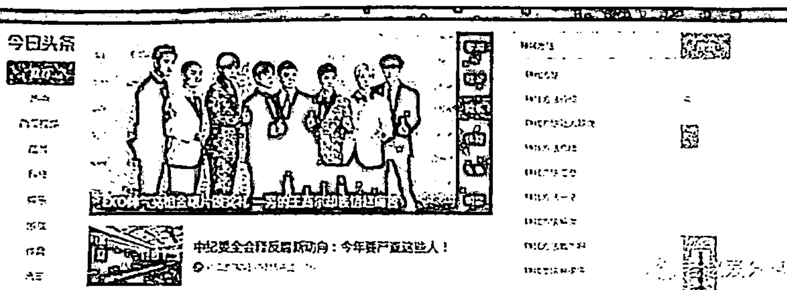
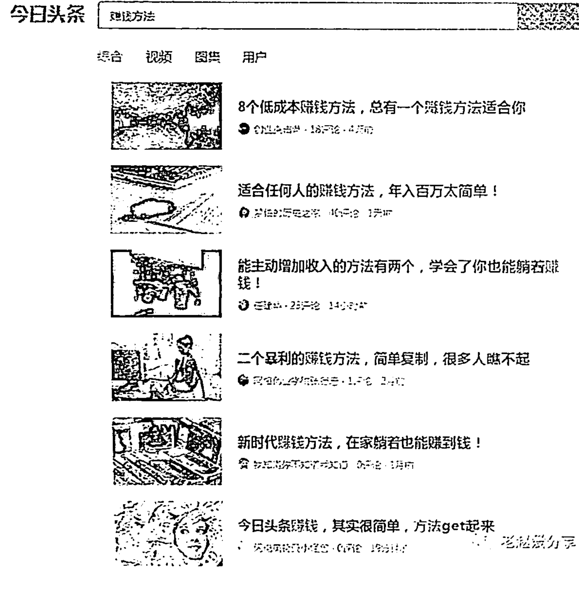
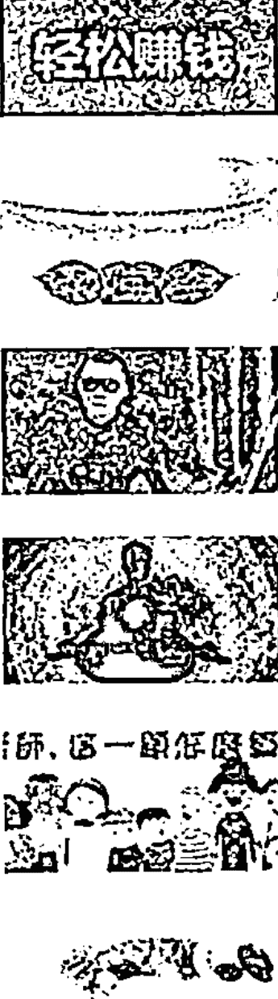
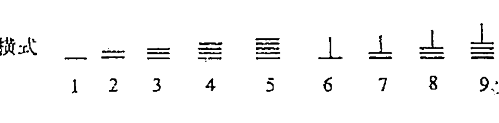
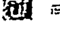
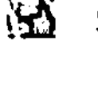
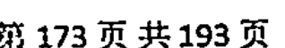
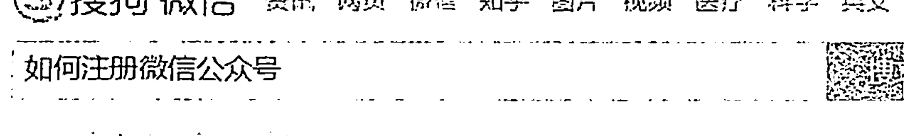

# 捞金指南

## 1. 人与人之间的切社交都是源于什么？你一定不知道！

人与人之间的切社交都是源于利益和价值！

看到这句话，你的第一反应，或许会说，不对，我和父母，小孩之间是例外，是无私的爱。

那，先别急，首先理清一个概念，利益和价值是个什么东西？

利益和价值，不单单指钱，名誉，面子，名声，虚荣等等，都是利益和价值的一种……

朋友之间，同事之间，生意合作伙伴之间等等，主要是因为利益和价值，这个我想没有争议。

家人之间也一样，比如到了一定年纪，很多父母喜欢催婚，表面看是关心自己的子女，其实是为了自己的面子，怕周围人说：你家的孩子都那么大了，怎么还不结婚……

小时候每次考试分数果不高，很多父母就会生气，或者打骂……
因为小孩考试分数太低，在同事朋友面前感觉抬不起头。

再比如，一个娘胎出来的亲兄弟，因为财产分配不均，为了几千元钱可以反目成仇，这种现象在生活中不是个例，而是司空见惯，很常见。

当然，说那么多，不是让我们去抱怨这个社会，我们父母依然是爱我们的，我们也要回馈爱。但必须明白一些真相，这个真相不管你接不接受，就是客观事实。

记住一点：客观事实，是不以人的意志为转移的

如果你接受了上面的观点，那么你就明白了，很多人热衷的结交人脉，根源还在自己。

人脉=利用价值，人脉=认识

见到一个高价值的人，很多人习惯于跪舔，没有必要，你认识马云都没用，因为你没有利用价值！

朋友之间，人脉之间，本质是互相利用，才能保持长久稳定的关系，什么层次就有什么层次的朋友人脉。

我认同你的观点，但是我没有背景，只是普通家庭长大的，我没有价值怎么办？

其实没有价值是假象，提升价值的方法当然是有的，你不知道是而已……

下一篇文草，告诉你提升价值的最快方法！

## 2. 提升价值最快的方法！仅3步！

今天是 2018 年，1 月 13 日，昨天分享了人与人之间的一切社交都是源于利益和价值。

反响热烈，但是很多人觉得自己没有价值怎么办？

今天持续分享干货，主题：提升价值最快的方法是什么？

先举几个例子，

- 说话走路从不会到会，后天学习的
- 骑自行车从不会到会，后天学习的
- 做饭也是从不会到会，后天学习的
- 开车也是从不会到会，后天学习的
- 游泳也是从不会到会，后天学习的
- ......

有没有发现共同点？

对，就是我们先天不会的，或者不擅长的，都可以后天学习掌握。

说话走路，骑车，做饭，开车，游泳等等，这些都是什么？

对，这些都是通过后天学习掌握的能力（技能）。

我们掌握了能力后，当然对自己有好处，除此之外有什么作用？

掌握能力的目的：提供价值！

这就涉及到了昨天分享的：人与人之间的一切社交都是源于利益和价值
没看过的朋友建议去看看，结合阅读效果更佳。

接着讲......

我们具有的能力怎么来的？

没错，就是学习

说话走路，骑车，做饭，开车，游泳等等，哪一样，不是学习掌握的？

学习不一定指手把手教，你观察，模仿后掌握的，也是学习的一种。

到此明了，提升价值三步曲：学习→能力→价值

这个世界上没有学不会的！
告诉你学不会的人，两种情况，要么自负，故意误导你，要么自卑，充满负面消极。

你想获得什么样的能力，就学习相应的能力！

- 你记忆力差，有做记忆力培训的
- 你情商很低，有做情商培训的
- 你不会社交，有做社交培训的
- 你不会恋爱，有做恋爱培训的
- 你不懂打扮，有做形象培训的
- 你不够强壮，有各种武术培训
- 你不会沟通，有做沟通培训的
- ……

你所困惑的任何问题，现实中都可以找到答案。

当然，每个行业都有认真做事，保证结果的。也有混吃混喝的。
注意识别真伪，找到靠谱的答案就行。

就连很多人最困惑的赚钱，也一样可以找到答案。
赚钱和走路，开车，做饭，都是可以后天掌握的能力，你不会赚钱或不擅长赚钱，学习就行。

赚钱的培训有很多，找到靠谱的学习即可。

现在互联网上，有很多免费可以学习的资料。

你如果没钱，可以先免费的学习，然后赚了点心钱，再报名儿百的培训，然后赚钱后再报几千的培训，依次类推，几万，几十万，几百万，甚至上亿的培训都有。

你不用急，可以一步步来，先学些低价的课程，慢慢提升，可以生活的很好。
你如果有点钱，赶紧找个几百，几千的靠谱培训报名，学些赚钱的核心，然后实践赚钱。

如果没钱，下一篇文章为你揭晓：如何在网络学习免费赚钱资料？

## 3. 百度揭秘：在网上免费学习海量干货！

上一篇文章，分享了 提升价值最快的方法？仅三步！
没有看过的推荐点击阅读

今天分享主题：百度揭秘：在网上免费学习海量干货！

推荐我常用的一些，当然远不止这些，但已经够用。

### 1 搜索引擎

- 百度
- 360 搜索
- 搜狗搜索
- 还有，有道，必应，谷歌，神马搜索等等

你想搜什么，输入关键词即可

### 2 自媒体平台

- 今日头条
- 微信公众平台
- 百度百家
- 搜狐媒体平台
- 腾讯媒体开放平台
- 网易媒体开放平台
- 新浪微博
- 凤凰自媒体
- 一点资讯
- 知乎专栏
- 简书

还有很多，这些已经够用。
你想搜什么，输入关键词即可

以今日头条举例子，
登录今日头条官网 www.toutiao.com，在搜索框输入：赚钱方法如图：

输入后，点击搜索

我们看到有很多文章，作者，有些是讲理论的空话，而有些是干货。

你逐一点击阅读即可

然后，随意点击一篇文章进去

### 二个暴利的赚钱方法，简单复制，很多人瞧不起

成功的人总目标不安，方法总是在改变。失败的人总目标也是在变，可是他的总改不好，方法永远不变。

其实赚钱的点子有千千万，有利可图的事业也点多如芝麻，只是很多人没有用心或贪心就丢过而已，我认为一个白领，他是谈钱伤感情的，主管说涨工资，每次只有在职员开的时候，谈如何他总是怎么抱怨，由于他的业务能力不够高，也不参加销售市场，他就觉得坏了，他的职位管理定，不敢宣传市场产品，客户只关注营销时间预定，不敢决不肯做，薪金涨越低，清高就高。

- 10句话的赚钱的秘诀！学会富人思维，是成为富人的第一步
- 没钱应该这样怎么赚钱？善于自由做，快看赚钱
- 富人世界的“穷人思维”，真的让一个人贫穷了
- 信马开单绝佳的盈利话题，很多人看完全后“感觉”

右侧可以看到作者（避免广告嫌疑，已打码），如果你觉得他写的干货，点击他的头像，继续查看更多文章

文章 视频 做头条 275 7116

- 富人赚钱的十大秘密，你知道几条？
- 一个人是否真的有钱，就看这两点
- 每天赚几千没问题！不为人知的暴利赚钱方法
- 分享两个羊毛出在驴身上猪来买单的营销思维（以矿泉水为例）

近期最佳文章

你一篇稿点开来看似就行，根据自己需要。

干货的文章，我会以截图的形式保存，或者复制粘贴到WPS，转成PDF格式，再打印出来，

至于打印，淘宝搜：打印服务，有很多家，你挑一家就行。而且会帮你装订好，看起来很方便。你去实体店打印装订成册，价格要贵几倍。

接着回到正题，右侧有没有看到关注，你可以关注他，而且他也关注了很多人，你点开一一看，觉得有价值的，又可以关注，持续挖宝！

关键词很多可以搜，快速赚钱，暴利产品，微商教程，创业秘籍，如何成交，情商提升等等，想搜什么搜什么。

关键词搜的越多，你找到的干货越多。

很多时候干货遍地都是，但就是因为没有主动去寻找！

### 3 网盘搜索

常用的一些，其他还有很多，这些已经够用

依然是搜关键词，赚钱教程，微商教程，创业秘籍，还有就是搜一些培训名称，或著名的老师。

- 去转盘网
- 网盘007
- 搜云盘
- 盘搜搜

搜到干货资料，然后学习，并且实践，就能赚钱。

## 4. 赚钱的核心是什么？赚钱最快的方法又是什么？

赚钱的核心是什么？赚钱最快的方法又是什么？

刘强东一次演讲中说过，你能解决一个问题，就可以创业成功。

所以赚钱的核心，解决问题。

为什么是解决问题，你想想啊，你什么情况下白愿付钱给别人？

买早点，超市买饮料，理发店理发，饭店吃饭，菜市场买菜，商场买衣服裤子，买房，买车...

哪一个不是解决你的问题？

而市面上流传的成功和情商，人脉很有关系，这个是误导。

你走进超市买东西，难道会问：老板你情商怎么样，你情商高我就去你这里买东西，情商低我就去其他超市买？

你去理发店理发，难道会问：老板你有没有人脉介绍给我，有人脉就在你这里理发，没有我就走了？

不可能有这样的人对吧……

很多老板白手起家，也没有人脉背景，学历一般。

他创业一开始就想的是，如何把这个问题解决掉，发自内心的想要帮助别人解决问题。

比如马云，心里想着让天下没有难做的生意，然后开始创业到现在。

所以你想赚钱，就是找某个问题解决就行了啊。

看到这里，非常干货对吧！

接下来分享的更加干货……

再分享个干货，赚钱最快的方法是什么？

复制！

记住一点：别人在赚钱，必然是在解决某个问题，而不是偶然。

所以你想赚钱，也去解决问题，就一样赚钱啊。

但是有的问题有很多人愿意付费，有的就不一定，

有的问题别人愿意付低价，有的愿意付高价

我们当然要选择愿意付费的，利润呢当然越高越好。

所以，我们复制别人，是赚钱最快的方法！

复制，可以最大化降低测试的风险，成本，时间……

而且每一个环节都可以复制优化

鱼饵设计，鱼塘选择，销售流程设计，成交主張，赠品设计，如何成交，话术技巧，后端打造，如何转介绍等，

一切都在同行那里，大量收集同行案例，每个环节择优录取，杂交同行，杂交主义！

至于如何找同行，就是搜关键词，关键词越多，同行案例就越多

具体参考上一篇文章

百度搜索：在网上免费学习海量干货！

限于篇幅，先大致分享这些，是够你用了！

## 5. 以后学任何能力，直接去教别人！

以后学任何能力，直接去教别人！

学习的真正作用：是提高纠错效率

教别人可以让你减少犯错

学习最快的方法，是教别人

为什么？

有几点原因

1. 加强记忆，减少重复犯错几率

比如学聊天时，自己学习的时候，知道不要一闷--答聊天、不要查户口聊天，这样会让人无聊。但是自己实践的时候，依然容易犯错。

而教授别人就不一样，你教一遍，就重复一遍。而且教之前你还要提前思考，相当于重复了好几遍。减少犯错的次数

比如有人学两性幸福，课程中说，不要翻老公的手机。这是不信任对方的表现。自己虽然知道，依然可能会犯错。但是当自己教的时候，不容易犯错，因为会重复的想起这种注意事项

2. 注意力（能量）聚焦，结果导向

你在教的时候，全心全意投注在这件事情上，就是要把人给教会。所以不管你查资料什么的，都是带着问题学，严格的结果导向，目标导向。

不然自己学的时候，容易被很多无羌的事情所影响，分散注意力。
看新闻，刷抖音等等

3. 教别人自然有源源不断的动力，动力练出能力

要练出能力，必须要有动力。
只要想办法产生持续的动力，什么方法都可以。

比如梦想，财务自由，情感自由等
比如动力，就是要教会别人，因为收钱了，因为有成就感。
比如我要证明给别人看，老子就是行！
比如欲望，我要住大别墅，我要开豪车等等

所以，以后要掌握任何一个能力，学任何一个东西。
第一件事，不是学，而是教别人，而且必须收学费，不然可能有惰性

通过教别人来学习，有很多好处：

1. 必须教会别人，有持续不断的动力
2. 严格的目标导向，注意力集中
3. 每天数量级的重复总结，数量级的深度思考

## 6. 你没钱，没女友，是“思想有问题”！如何解決两大问题？

你没钱，没女友，是“思想有问题”！如何解决两大问题？

世间万物都有规律，掌握规律很简单，不掌握规律就困难

- 赚钱有规律
- 创业有规律
- 投资有规律
- 谈恋爱有规律
- 开车有规律
- 游泳有规律
- ……

很多人不知道有规律，所以总是犯错。

- 创业之前不学如何创业，直接去创业，可能亏钱
- 炒股之前不学如何炒股，直接去炒股，可能亏钱
- 投资之前不学如何投资，直接去投资，可能亏钱
- 谈恋爱之前不学如何与异性相处，直接去表白，可能被拒
- 开车之前不学如何开车，直接上高速，非常危险
- ……

你想要的金钱，女人/男人，事业（公司），房子，车子等等，都是二维空间的实相

下面讲的可能比较烧脑，如果你没接触这方面的知识。
可自行查阅北大刘丰教授关于维度的说法

一维是二维的投影，二维是三维的投影，三维是四维的投影

投影区都见过，我们想要改变屏幕上的像，你直接去屏幕那里弄，是没用的。而是从投影源这里下功夫

投影仪-改变，像自然改变

那我们想要的金钱，女友/男友，房子，车子等等，都是三维空间的实相
三维是几维的投影？
四维

四维是什么？在哪？
思想 头脑

改变思想，你三维空间想要的一切，自然就会有。

拿赚钱来说，富人和穷人的思想，思维，观念等等是完全不一样的
假设要创业，要做成一件事。

- 穷人思维是：我有什么资源，才能做什么事情
- 富人思维是：我要达成什么结果，需要什么条件？（以终为始思维）

而且富人创业首先想的是风险最小化，他什么都借！

拿谈恋爱来说，你会发现吸引女人的男人，和没女人缘的男人，对待女人态度，说话，肢体动作，是完全不一样的

让他拿个东西，掉男马上上去拿。但有的会善意的开个玩笑，有啥好处啊
这给女人的感觉完全不一样

好，讲了那么多，那怎么才能掌握规律呢？
不需要自己研究，找到已经研究，总结出规律的人，向他学习！

这个时代非常幸运，有各种培训

- 赚钱培训
- 创业培训
- 脱单培训
- 财商培训
- 成交培训
- 投资培训
- 社交培训
- 情商提升培训
- ...

只有你想不到，没有搞不出来的哈哈
为啥？
早说了，一切都有规律，有规律自然能学，自然能教
因为规律，就是必然的东西！
是确定，一定以及肯定！

当你通过学习，你的思想调整后，自然获得你想要的结果

这篇文章信息量巨大，慢慢消化
有收获，可以分享给你的朋友，他们会感谢你

限于篇幅，改天再分享更多
文中提到的一些小点，我有空拆分讲解

## 7. 自由职业赚钱的N种方式揭秘（上）

自由职业赚钱的N种方式揭秘（上）

如果你不喜欢做枯燥的上班族
如果你不喜欢做忙碌的老板

喜欢自由
又能轻松赚钱
那就做自由人赚钱吧！

首先要明白，赚钱和创造价值成正比
创造多大的价值，赚多少钱

## 8、钱是越花越有！怎么可能？

换句话说，你要有创造价值的能力！

哪些东西可以创造价值呢？

思想、知识、经验、技能、智慧等等，都是无形资产。资产可以创造价值，可以变现，可以赚钱。

- 做律师赚钱
- 做心理咨询赚钱
- 做情感咨询赚钱
- 做营销咨询赚钱
- 写销售文案赚钱
- 做社群赚钱
- 做微商赚钱
- 写文章赚钱
- 做各种培训赚钱

拿学技能赚钱来说。

掌握技能的时间不要太长，1-3 个月为宜。

然后你的技能越稀缺价值越高。

你的技能所需要的客户越高端越容易收高价。

所以你看，情感咨询师和营销咨询师蛮不错。

很多成功人士，事业不错，但是未必擅长处理情感问题，他可能单身，可能经常和对象吵架。

你能教他解决这些问题，赚钱很自然。

很多老板虽然不缺钱，但每天很忙碌，因为不懂营销。

老板缺的不是钱，缺的是规避风险的策略。

你懂营销，就能帮他多赚一些钱，然后分钱。

不管你想输出什么技能（价值）来实现赚钱，首先，要想清楚三个问题：

1. 客户是哪一群人？
2. 这群人的市场有多大？
3. 如何变现？

否则，你学会了一门技能，但不知道客户是谁、市场有多大、如何变现赚钱，费时间费金钱，毫无意义。

明天继续揭秘，解答这三个问题。

有收获，欢迎分享出去（朋友圈，微信群，好友），一起传播价值吧。

钱是越花越有！怎么可能？

如果在几年前，有人告诉我，要大胆花钱，钱是越花越有的，我会觉得不太可能，钱当然是越花越少啊，怎么不减少还增加呢？

而且家人通常都会教育小孩，钱要省着点花啊，花了就没了。

举几个例子你就明白，钱为什么越花越有了。

你花钱学一门技能，然后透过这门技能，去解决问题，去创造价值，是不是能赚回 N 倍学费？考一个证书，学个技术也是同理。

你去投放广告，卖出很多产品，赚回广告费。

你花钱加群，不管门槛费是 1 元，还是 50 元，还是几百元，几千元，几万元。只要能赚回比投资多的，都是越花越有。

很多人参加各种培训，不管是创业的，财商的，网赚的，营销的，投资的。给自己的头脑/成长花钱，改变自己的思想，然后去行动赚回很多倍学费。

你买个几十万的豪车，戴个几十万的表。别人因此感觉你有实力，信任你，成交大单。

所以富思维，钱是越花越有的；穷人思维，钱是越花越少的。

那是不是所有情况，钱都会越花越有？不是。钱花在资产上，越花越有；钱花在负债上，越花越少。比如吃喝玩乐，当然是负债，越花越少。

租个 100 平米的大房子，隔成 3 间，能收更贵的价格。

假设你买一整箱 12 盒的牛奶，花 28 元，但是一盒可以卖 3 元。
12 * 3 - 28 = 8 元。

为什么同样是 12 盒牛奶，最后凭空多出来 8 元？因为换了个卖法：切割。

切割属于金融领域的知识。一切割，流动性加强，直接带动资产升值！

当然，金融玩法无穷多，这只是冰山一角上的一朵小雪花。

所以，给你的行动建议：你每天练习花钱。先从花一元钱开始，思考如何赚回 2 元、3 元、5 元。这个功夫你就越练越精。当然，也可以咨询我。

## 9. 让鱼塘主快速赚钱法（价值十万）！

让鱼塘主快速赚钱法（价值十万）！

这个方法，你去市面上学，你没有十万，很难学到。直接分享给你。

塘主不是鱼塘的主人哈。

你想要的客户，在别人那里也有。

+ 微信：736447167，了解更多资讯。

一个商家，实体店，就是鱼塘，客户聚集的地方。这个鱼塘的负责人老板，就是塘主。

举例：你是美发店的，你和超市说：只要在我店里消费满 160 元，送 60 消费券（不是代金券），直接可以在超市用。

当然，现在手机上也有很方便的功能，美发店一消费，超市立刻收到钱都知道。做头发成本很低，假设成本是 20。

160 - 60 - 20 = 80 元。

理解没？就是客户在超市购物的钱，相当于美发店付了。但是他依然还有钱赚。还没有计算，有一定比例的人会锁定后续消费呢。

假设一个超市每天能吸引 5 人到美发店消费。

80 * 5 = 400 元。

你谈十个超市，就是每天 4000 元。

当然只是举例，不一定找超市，也可以是和饭店合作。很多饭店同样帮你，自动输送源源不断的客户和钱。

你如果没有实体店，没有产品都没关系。自由人依然可以赚钱。

直接找到美发店谈，我帮你推荐拿提成。然后去超市谈，你就算只拿 20，也是一天 1000。

这个思维你掌握，会发现无数的赚钱机会！很多产品，服务都可以卖。很多商家之间都可以合作。

有没有看明白？真的看懂了，应该脸都笑烂了。立刻去实践，反馈给我效果，告诉你更多厉害的赚钱秘诀。

## 10. 如何轻松去做不敢做的任何事？（绝对没听过！）

如何轻松去做不敢做的任何事？（绝对没听过！）

你玩游戏的时候，为什么很轻松自然，甚至兴奋激动？打麻将可以通宵，丝毫不累。

因为它可以迅速反馈，大脑分泌多巴胺，产生愉悦感，很快乐，就很愿意去做。也就是游戏心态。

玩游戏，点一下立刻有积分，立刻打死一个怪，反馈又快又频繁，所以游戏容易上瘾。

每个人都有不敢做的事情，都有焦虑，紧张的时候。你换种游戏心态，立刻不一样。

游戏心态操作的关键：必须自己去设立反馈点。这样才能轻松开心去做原来不敢做的事情。

举例子：你对谈合作陌拜很紧张，如何破解？

比如你是做资源整合烧钱的，以开场为例。通常员工在店里。

第一种：你好，我有个方案可以帮助你家庭提升业绩，请找你老板谈谈。对方一般回答：没兴趣，或者不需要。

第二种：你好，我是 XX 店的，这边有大概几百个会员要对接到这里，请问老板在吗？对方马上就联系老板。

你看，虽然意思都是要给对方带去好处利益，但是不一样的表达方式，给对方的感觉完全不一样。

所以，当你用第一种方式去膜拜（陌拜）的时候，被拒绝，然后陌拜紧张焦虑。换种游戏心态完全不一样：哇好有意思，为什么我换一种方式，对方就接受了呢？这样，你就以游戏的心态去调试，去玩。

当你这么一想的时候，就是反惯（反转/习惯养成），然后分泌多巴胺，就会产生愉悦感，就能轻松去做不敢做的任何事。

再举例：写公众号写文章。很多人说我要坚持公众号写文章，每天一篇。当坚持不住的时候，就告诉自己：为什么别人能坚持我不能？我觉得这样太苦逼。

你必须寻找到更轻松快乐的方法。公众号写文章，每天一篇，也有找到反馈点？当然。

- 昨天 21:13 发送完毕：让利用块块快乐赚钱法（价值十万）！ 156 4 0 1
- 星期五 20:34 发送完毕：钱是越花越有！怎么可能？ 84 3 0 5
- 星期五 21:52 发送完毕：自由职业能玩 N 种方式揭秘（上） 319 6 6
- 星期六 22:35 发送完毕：你没钱，没女友，是‘思想有问题’！如何解决两大问题？ 137 2
- 星期日 18:44 发送完毕：以后做任何能力，直接去较别人！ 40 2
- 2018 年 01 月 19 日 发送完毕：赚钱的核心是什么？叫我赚钱的方法又是什么？ 137 0 4

看图找反馈点，考考你。很简单，阅读量是不是反馈点？

在看教（在看/点赞）是不是反馈点？评论是不是反馈点？赞赏是不是反馈点？当然还有每天关注人数。

只要我的文章写完发出，这些数字会不停上涨。所以我每天一篇文章，是享受啊，是玩啊。当然，前提是文章有价值，再加上主动去传播。当然写文章的好处还有更多，改天再分享。

游戏心态的反馈点，你可以任意去联想，去设定，产生愉悦的效果就好。

> 你记住：这个世界上，任何你觉得很难的事情，都有解决方案！

希望这个成为你的信念。所以可以评论栏互动下：当你遇到任何不敢做/不想做的事情，如何运用游戏心态，设定反馈点的方式，去轻松解决？比如跑步健身，比如拜访大客户，比如搭讪，比如演讲等等，看谁写的最精彩哈哈。

## 11. 为什么很多人赚钱没耐心？不可思议！

为什么很多人赚钱没耐心？不可思议！

发现很奇怪的点：

- 学一门技术
- 学一个兴趣爱好
- 学一个技能
- 玩一个游戏

人都有耐心。

打球，羽毛球，乒乓球。刚开始，你用拍子去发球，可能经常扑空，但是你很有耐心，一次次的去练习。

别人球发过来，你可能接不住，但是依然会继续打，你不会说：“死我了，再也不玩了”。

打篮球，你投篮没进，会继续投，你不会说：“我再也不投篮了，反正很难进”。

你学游泳，刚开始经常呛水，你不会说：“怎么老是呛水，再也不游了”。

你学做菜，菜炒焦了，盐放太多了，你不会说：“再也不做菜了”。

你打麻将，赢了很开心，输了会继续。

你学习骑单车，摔了一跤，会继续练。

你看，人做这些事情时，都不怕失败，遇到困难解决困难，很有耐心，而且乐在其中。因为你把它当成了乐趣。

那为什么赚钱，做项目，很多人却没有耐心呢？

遇到项目一点点困难，就放弃了。

比如找客户，那所有项目都需要去吸引客户啊，你换个项目，就不需要新客户了？

操作项目一周，没赚钱，就放弃了。

弄了个促销方案，效果不好，就不再想了。

销售话术有问题，就懒得变了。

富人不是这样的，富人是真正喜欢赚钱。

穷人把赚钱当目的，富人把赚钱当乐趣。

把赚钱当目的、任务，当然痛苦啦；当成乐趣，就完全不一样。

就像我们打球，打游戏，赢了固然好，输了也没事，因为这些娱乐活动，就是为了玩的开心。

富人把赚钱当乐趣。赚钱了当然好，没赚钱也无妨，依然能够融入金钱游戏的乐趣中。

所以，你也要培养这种富人思维。把赚钱当乐趣，把财富当游戏，赚钱是一项娱乐活动。

这样的心态，你赚钱遇到小挫折，不会放弃，没事，再玩一局。

你不断去改进，不断去尝试，不断去调整，这样自然会赚钱，项目自然能做好。

除了当成娱乐活动，还可以当成技能，技术。技术、技能不是一学就会的，会犯错，会失败，但是你很有耐心。

- 你会想着不断的微调
- 不断琢磨细节如何把控
- 不断的试探新的方式，找到手感
- 最后就熟练掌握了

赚钱也同样。

- 成交话术如果不对，怎么去调整改进
- 客户鱼塘不精准，如何去寻找精准鱼塘
- 文案没有吸引力，如何写出攻心文案
- 标题没有吸引力，如何写出诱人的标题
- 销售流程不顺畅，如何改进使其顺畅
- 成交主张没有吸引力，如何打磨成无法抗拒

……

- 都是在不断微调，不断测试，不断实践
- 赚钱这项技能，你就越练越精！

如何精进我有耐心？
赚钱领域想帮帮帮帮
把赚钱变成一项技能
还有其它？

## 12. 无论学习任何东西，还是要得到任何结果，说白了很简单！为什么？

如果直接说答案，你印象不深刻，收获就小。别急，后面会讲到。

有个老板，找一个销售文案高手，希望能够卖出更多产品。销售文案高手回答：写一封销售文案收 60 万。

这个老板挺贵，于是高手给了一个模板，先让他自己写。一个礼拜后，老板主动找到高手说，赚了很多钱，想马上交钱请你写更厉害的。

你看，写销售文案，都有固定的文案模板，你一套就行了。

- 标题怎么写？
- 如何刺激欲望？
- 如何建立信任？
- 如何塑造价值？
- 如何打造无法抗拒的成交主张？
- 如何吸引注意力？
- 如何让人立刻下单购买？
等等。

都有固定的模板，公式，框架，流程，工具......

有的做营销策划的，也是如此。比如学一套提升业绩的策略，就可以一直用，而且无数家实体店，无数的行业，都能通用。

有的做情感指导的，教脱单的，也是如此。和对方陌生阶段，该说什么做什么；熟悉阶段，该说什么做什么；对方反应好，如何拉升关系；对方反应不好，该说什么做什么。

演讲也是如此，都有演讲的模板，流程，步骤。

招商，有固定的模板，流程，框架，步骤，公式。

成交，有固定的模板，流程，框架，步骤，公式。

说服，有固定的模板，流程，框架，步骤，公式。

炒作，有固定的模板，流程，框架，步骤，公式。

引流，有固定的模板，流程，框架，步骤，公式。

裂变，有固定的模板，流程，框架，步骤，公式。

......

实在太多，不再一一列举，篇幅有限，无法具体展开。

大道至简，无论学东西，还是拿结果，工具都很简单：模板，流程，框架，步骤，公式，套路。

## 13. 如何让所有难事变容易？

# 细分（拆解）思维

Plan 子（拼子？），营销高手，情感老手，金融高手，文案高手等，都擅长细分，拆解。

做决策消耗能量，所以一定要细分，拆解。

- 大目标拆解成若干个小目标
- 大任务拆解成若干个小任务

营销高手，不会上来直接成交，而是细分成若干个小步骤。比如先留下你的联系方式，先让你免费试用产品，免费看有价值的资料报告货到付款，满意后再付钱等等。建立信任，受益之后，再成交。

Plan 子，也是先送点小东西，给老人先送鸡蛋，再听公益讲座，再成交。

情感老手，也是先做些小测试，表达一些观点看看是否基本认同，再是牵手，再是接吻，再是……

金融高手，会把一个大项目，切割成小项目，这样融资容易多了。一个项目需要资金 500 万，向一个人融 500 万，难度大。但是切割成 50 份，每人只要拿出 10 万，这个比较容易。只要项目让人感觉可盈利。

就像生活中，你有个房子，整套租出去，每月 2100 元。然后里面共有 3 间，你就可以切割租出去，每间收 900 元。

2700 - 2100 = 600 元。

一切割，钱生钱了。900 元和 2100 元，900 元更容易决策。

文案高手，也是拆解，先写标题，再设计销售主张，价格如何处理，列出诉求点，如何建立信任等等。如果不拆解，写文案可能就一片空白。

销售流程也是，细分成很小的几个步骤，让人可以很轻松的采取行动，做决策。

设定赚钱计划，同理。

假设每年赚 120 万，细分成每月就是 10 万，每天就是 3333 元，假设一款产品 1111 元，每天卖出 3 个，这样年底 120 万，就等于每天卖售价 1111 元的产品即可。

健身也一样，刚开始不要一次性跑 5 公里，第一天跑 400 米，第二天跑 600 米……循序渐进，逐步加量，过一阵子，跑个 5 公里也很简单。

写文章，刚开始不要一下子写 1000 字，你不一定有货。先写个 100 多字，后面 200 多字、400 多字。实在不知道写啥，记录小账也行。完成比完美更重要。

通过细分，拆解，很多看似很困难甚至不可能的事情、任务，都变得可能、容易了。

本文价值巨大，可以运用到生活的方方面面。包括但不限于销售，营销，情感，金融，文案，说服，健身，读书，写文章……

## 14. 水能免费喝。为何还有人花钱去超市买？

你走在街上口渴，会去超市买瓶水，付 1 元。但你去街上免费要过水喝吗？

很多实体店，你进去要个水，只要有礼貌，问十个有八个能成功。肯德基，麦当劳，免费提供饮用水，还能提要求：“你好，白开水加冰谢谢”。你想付钱都不收的。

有的读者可能会问，向人要水，别人会不会用异样的眼光看待？那是自己想太多，又不是要钱，没有体验，没有发言权。

你发现没，同样是喝水，可以免费喝，也可以付费喝。

穷人和富人看到这个现象会有完全不同的想法。

穷人想，可以免费喝水，那肯定没人花钱买水，没什么赚钱机会。
富人想，连水都有人买，这是赚钱机会啊。

# 富人专注机会，穷人专注障碍

就像有些公共场所，社区等，墙上有免费的 TT（纸巾/卫生纸？）提供，一按就下来一盒，但是依然不影响 TT 的销售啊。

饭店离家里，步行五分钟到。节省体力，叫外卖，多付几元就行。

穷人想，走个几分钟就到，怎么会多付几元。
富人想，很多人懒得动，赚钱机会啊。

有些教程资料网上可以搜到，但是想节省时间，想直接找搜集整理好的。

穷人想，免费的资料怎么会有人买。
富人想，那就我来整理搜索吧。

听到有人说，网上能赚钱。
穷人：网上能赚钱，怎么可能？那谁还去上班。

关键是执行力。有执行力才有流量，有流量才有成交。没执行力，确实赚不到钱，适合上班。

就像外卖员送外卖，单子是一单单送出来的。你做网络上的项目，流量是“卡”（扣？获？）出来的。

做淘宝的，做微商，赚钱的大有人在。
写文章赚钱的，大有人在。
写软件赚钱的，大有人在。
写销售信赚钱的，大有人在。
做社群赚钱的，大有人在。
做咨询赚钱的，大有人在。
做抖音赚钱的，大有人在。
做直播赚钱的，大有人在。

……

没有不赚钱的项目，只有不赚钱的人。

赚钱大道千千万，为何独走上班桥？

## 15. 为什么不自律？自律和自尊水平有关

为什么不自律？自律和自尊水平有关。

关于提高自尊水平，推荐两本书：
1. 《自尊》（原书第 4 版） 马修·麦凯
2. 《恰如其分的自尊》

尤其是第一本，有具体的方法论，你可以照者（照着）去做。尤其是《自尊》（原书第 4 版）这本书，是一本自助的书，就是照着里面的方法，去做练习，就能逐步提高你的自尊水平，此书真是相见恨晚。

比如有个三程式方法：
1. 自我陈述
2. 扭曲想法
3. 反驳语句

你可以在纸上写，直到成为思考习惯。

举例：
- 自我陈述：我赚钱太少
- 扭曲想法：我无能，什么都不行
- 反驳语句：我只是**暂时**赚钱少，以后会赚钱很多。很多富人也是从穷人变成富人的，别人可以我也就可以。

- 自我陈述：我发的广告没收到钱
- 扭曲想法：我赚钱不行
- 反驳语句：可能是推广的人不够多不够精准，可能是广告不够吸引人，需要修改广告。可能是提供的价值不够。

平时一定多多练习，直到（知道）成为你的思考习惯，就不用在纸上写，直接大脑中思考就行。

还有一个，就是玩小清单游戏：
- 列个好多个很小的事情，
- 必须是短时间内，你很容易完成的事情。

比如刷袜子（杀袜子），扫地，洗碗，晒衣服，下楼取快递，去超市购物，写一篇文章都行。每完成一个小清单，就在前面打一个勾。

因为你每做完一项清单任务游戏，内在的价值感就会上升，自尊水平就会提升。所以可以每天大量的玩，随时随地玩。

比如你要准备做一件重要的事情，但感觉状态不好，你可以临时让自己做个小清单游戏，列个很容易完成的事情。完成后，你的状态就好了，自尊水平自然提高，再去做那件事情的（非常）巧妙。

三栏式方法和小清单游戏，建议多玩玩。自尊水平就会显著提高。而且你小清单游戏做得越多，效果就越多，因为能量会叠加。你的能量场会越来越强，每天建议至少玩几十个清单游戏。

突然又开发了调整感觉的方法：小清单游戏，每做完一个，就升起一次美好的感觉。哇哇哇，每天做 N 次，就是恒定在高频啊。

三栏式方法，是在把负面的转正面，感觉调频。两个方法，都是在调整感觉。

## 16. 赚钱就是发广告收钱！你不会？

赚钱就是发广告收钱！你不会？

很多人选择创业项目，会选择餐饮、美发这种重资产实体生意。必须租店铺，招员工，包广告位......这种思维太落伍，完全没有必要。

有很多轻资产项目，零成本项目，空手套白狼项目...

举例：

1. 中介类

如房屋中介，找房源，我要租房的人。就是发广告，有人咨询就看房，引导付钱，房东那里分成提。循环这个动作，不停收钱。

如搬家公司。

常规思维做法：先注册公司，花钱招司机，搞车。业务还没来，钱花了…大笔。

轻资产创业操作方法：先去传播发广告。

# 吸引人咨询成交

再分钱给人干活

循环这个动作，不停收钱。看懂没？

你去大量传播，你提供搬家服务，留下联系方式。然后有人咨询你，引导成交付钱。收到钱后，再找有车的司机，分钱给他，让他去搬家。

看到没有？

前期你什么都不需要有，什么都不用投入。而且你分钱大方点，对方干劲更足。因为他一天能搬家的次数是有限的，而你可以同时让几十个搬家司机帮几十个客户搬家。

你的钱必然是他的几倍、几十倍。所以老板的钱为什么永远比员工多？老板的单位时间效率高，能倍增复制。

有的人又有疑问，发广告不是很简单，为什么员工不能自己干？这个世界就是这么神奇。看下这篇文章，看完再回来：水能免费喝，为何还有人花钱去超市买？

## 2、卖信息

你要做中医养生项目，需要自己懂吗？不需要。还是发广告。

- 有人咨询
- 引导成交
- 再找懂中医养生的做服务
- 分完钱
- 继续发广告
- 发广告是正事
- 不发广告是不务正业

看明白？

还有很多类似项目：

- 心理咨询，舒缓人精神烦恼痛苦
- 情感咨询，教人脱单
- 都是不骗的赚钱
- 都是卖信息
- 项目太多，不再列举
- 也可私聊找我

还有一点，有人担心收钱后，找不到做服务的人，怎么办？退钱就行了啦，多简单。

这就是轻资产思维。

- 传统重资产思维就是先花钱，招个做服务的人才，再去找客户。
- 如果客户没找到，招人的钱就浪费。时间一长，现金流断裂，项目就黄。
- 这个世界的资源无穷无尽，人才资源同理，不可能找不到。

如何寻找人才资源？也可私聊我。所以去干就完了。

## 3、预售

有的高手，想在一个地段开饭店，找到早餐不经营的几家店，租用早餐时间段，测试人流情况。人流不错，再考虑开店。

有的人要研发新的产品，把产品的好处写清楚，会对老客户预售，测试很多人付费，收钱后再开发产品。

这些都是预售。预售思维可降低风险，掌握现金流。先举这些，想更多可私聊。

所以，你要做的就是去传播，搞流量，把你的产品信息展示给更多人看到。主动传播去引流，引导成交先收钱，分钱找人做服务。

你不是自己做服务，自己创造价值，这个让别人去干。让会做服务的，用心做服务，实实在在解决问题，然后带来好的口碑，更多新客户进来。你只负责释放价值，发广告就是释放价值。

释放价值赚大头，创造价值赚小头。

脑白金，提供送礼的解决方案。怕上火，喝王老吉，提供吃东西上火的解决方案。但是喝王老吉真的能解决上火的问题吗？这个不重要。只要让人感觉能，就行了。他感觉这个对他有用，就是价值。感觉需求被满足，就付钱了。

当然，发广告有很多讲究，广告分为硬广告和软广告。根据你的产品，项目，有不同的操作注意事项。

私人社群分享内容：

- 什么样的要发硬广告？
- 什么样的要发软广告？
- 同行也在发广告，为什么选择你？
- 如何打造购买理由？
- 如何打造行动理由？
- 广告文案如何速成？
- 如何吸引对方主动咨询？
- 如何让对方求着成交？
- 赚钱的吸金两步如何操作？
- 发广告区别同行的一个词是什么？
- 如果把心理效用在广告中，提升成交率？
- 没有项目，如何私人订制轻资产项目？
- 如何零成本搞流量？
- 如何低成本测试项目？
- 如何测试不同鱼塘的效果？
- 如何让你的投产比最大化？
- 赚钱最快的方法是给什么？
- ......

以上是部分内容，很小的一部分。不再一一列举。

想获得一对一咨询，立刻扫码，私聊我。开语音咨询一次，并且可申请进入私人社群。一对一咨询每天只限8人，精力有限。本文过于核心，随时可能删除！这是一篇能改变普通人命运的文章，你识货吗

### 17 如何心想事成？（表达方式篇）

为什么同一个意思，不同的表达，给人感觉就不同？沟通，表达的方式很关键。

情景1：你想帮实体店对方提升业绩，顺便自己分钱。同一个意思，但是不同的表达，会有不同效果。

低效的：
你说：“你好我是做营销策划的，可以帮你提升业绩，然后我在分钱。”
通常回答：不需要。这种成功率较低，可能3‰不到。

几类人会愿意交流：
- 思想观念敞开的老板，会愿意交流
- 正在冥思苦想，尝试过很多策略依然无效的人，会愿意交流
- 爱占便宜，套方案的人，反正听又不用钱，会愿意交流

高效的：
你好，我可以长期介绍客户过来消费，占比较大，可以谈一下提成吗？
这个成功率比较高。但当然有更好的开场切入方式，改天再讲。

上面情景 1 的例子，为什么同一个意思，不同的表述方式，给人的感觉不同，效果也不同呢？这个你可以思考。

情景 2: 广告文案表述卖点：牛肉新鲜。

低效的：
*我家的牛肉很新鲜*

高效的：
*10 小时前，我家的牛，还在农场散步*

*同样表达的都是牛肉新鲜，但效果不同*。直接说自己的牛肉新鲜，会让人不可信，有抵牾。心理有疑问：你是卖牛肉的，当然说新鲜了。但是你说，10 小时前，我家的牛，还在农场散步。*这让人自己得出结论：牛肉新鲜*。人都喜欢自己思考得出的结论，不喜欢被说服。

情景 3: 给老客户发促销短信。

低效的：
你好，还记得 XX 菜馆吗？今天我们推出了最新的特色菜，因为你是老客户，可享受八折优惠哦

高效的：
你好，还记得 XX 菜馆吗？今天我们推出了最新的特色菜，老客户享受八折优惠，上次打折期间餐厅爆满。这次，我们只是随机抽选了几位顾客发送了短信，你是非常幸运的。

后者的短信内容，让人更加想去，有稀缺感，很幸运。

情景 4: 如果你开水果店，客户购买了水果，你额外再付出一点，多说一句话，就能增加收入。同样是多赠送一个新鲜的水果，时间和方式很关键。

低效的：
客户买了一大袋水果，在他付款前，你赠送了个新鲜水果，时间不对。他会以为是理所当然的，没有惊喜的感觉。

高效的：
客户买好，付款了。然后你微信热情的说：这是额外送的一个新鲜水果，尝尝。放入袋子里。这就是额外的惊喜。触发客户的感动，增加后续消费频次。表达的时间点很关键。

时间有些晚，先举这几个例子吧。很多的点子、策略，之所以你用的没效果，和表达方式，表达时间，表达对象，表达顺序等都有密切关联。同样的点子、策略，换一个人去用，完全不一样的效果。

### 18 富人思考方式：先输后赢

高手都是输家思维，就是做事情先输后赢。先小范围立刻测试成功还是失败，失败就调整优化。或者预知以后会失败，就把损失降到最小。这样就不会有根本性的损失，风险在可控范围内。

做任何事情前，我都要预知是输是赢，我都必须要有底而且要最短时间内，最低成本内知道。就是测试。测试失败，就调整优化，或者直接放弃。测试成功，就正式行动。这和孙子兵法讲的一样：先胜后战。

### 举例 1

如田忌赛马，就是先输第一局，下等马对上等马。第二局，上等马对中等马。第三局，中等马对下等马。三局两胜，就赢了。

### 举例 2

买客户思维也是一样。先小号，先验，小范围测试，用引流产品去免费、低成本吸引客户进店。假设 10 个能够成交 1 个，你的成本就回来了；也就是 10% 的成交率，就不亏本。那 10 个成交 2 个就赚了。

小范围测试，先发出去 30 张，对接精准鱼塘，精准客户，派发引流卡。发现 30 个成交了 8 个，成交率 26%左右。有的赚，就可以逐步放大。或者再优化调整测试，把成交率继续提升。如何 30 个成交 2 个，就有小号。那就暂停下来，思考效果差的原因，进行修改即可。

### 举例 3

卖啥里的预售，也是如此。比如我说，我要开发某个产品，想知道多少人会买。把产品解决什么问题详细描述下，看多少人付钱。付钱了，再去开发产品。

传统思维，就是觉得这个产品肯定能畅销。然后花了很多时间、资金去弄。弄好后，没有客户。这是浪费，所以就可以直接放弃。时间和钱就不用浪费了。更多干货，分享在我的朋友圈。

### 19 自由职业赚钱的 N 种方式揭秘

文章为喜欢自由职业的人而写。什么是自由职业赚钱？

就是不需要上班、不需要公司、不需要产品、不需要有员工、不需要花钱租店铺、不需要人脉、不需要看人脸色……只需要思想、能力。时间自由安排，全国各地游玩赚钱，生活两不误。

当然，自由职业有很多种，各自需要不同的能力，去创造价值，顺便获取回报。自由职业有哪些？N 种。我讲几种。

#### 第一种，营销咨询师

如果你能帮助任何一家公司，和老板分享策略，然后执行赚钱，你分到钱，这是很轻松的。这个世界上，有无数的公司、实体店、企业，但是大多数的营销都做的不好，大多数老板都不懂营销。

你作为营销咨询师，可以看到很多老板看不到的机会。随便举个例子，比如一个饭店，可以弄个点菜排行榜。挑选店里偏贵的八个菜，取名，本月点菜排行榜。这样可以引导客人点，增加每次的消费额度。因为人们点菜时，面对菜单上的菜，也不知道进什么好。所以这个策略，可以零成本零风险，增加业绩。

有很多这样的方法，限于篇幅，不再展开。上面的营销策略，背后的人性、心理效应，就是从众心理。从众心理，这个有无数的玩法。比如有的奶茶店、房产售楼处，雇人排队，造成产品热销的场景，引发很多人购买。

所以，营销咨询师，为什么是不限行业的，原因就在这儿。营销策略之所以有效，它的背后，都是人性、心理学相关的东西，这和行业无关。

除了从众心理，还有占便宜心理，登门槛效应，路径依赖效应，目标趋近效应，好奇心理，锚定效应，互惠心理，惊喜心理，对比心理，理由效应，损失规避，心理账户，虚荣，贪婪，懒惰，近视......饭店的引流策略，可以用到饭店，也可以用到美容行业。奶茶店的充值策略，可以用到奶茶店，也可以用到教育培训行业。

需要系统的学习更多，想作为营销咨询师赚钱，或者帮助家人朋友的公司，可以找我。

读者常问的问题：

#### 1，营销咨询师有什么门槛？

没有门槛，你也不需要考什么证书，也没人问你学历。只要你能给人创造价值，你的方案能帮老板赚钱。

#### 2，我需要系统的学完才能做营销咨询吗？

不是，学一招用一招。然后立刻产生结果，你才能分到钱，也能收到反馈，增加实践经验。同时老板对你更有信心。配合你做更大的营销动作，比如重塑销售流程。

#### 3，成为营销咨询师，需要什么能力？

首先，肯定是要有客户，不然你再好的方案策略，没法去实践拿结果，也没人付钱给你。因为你作为自由人，没有公司，你可以借别人的公司赚钱。

- 沟通的能力：设计方案后，如果需要和一些异业商家合作，整合资源，那就需要沟通。很多时候，你表达的是同一个意思。但就是因为表达方式错误，导致别人不愿合作。而表达方式正确，别人甚至求着你合作，整合资源就很轻松。整合资源的能力也要具备。
- 写文案的能力：和客户沟通时，你需要沟通的工具，就是你的文案。形式有宣传单，引流文案，成交文案，朋友圈海报，群发短信等，都需要精心设计。
- 制定可执行方案的能力：你的方案，必须是可执行的，有细节，有话术。不然执行效果就不好。
- 监控效果的能力：不管是投广告，还是与商家合作，发广告单。你必须能够知道客户从哪里来的，哪里的精准，哪里的消费能力强。这样你帮老板投的每一笔钱，都可以计算投产比。
- 测试的能力：任何方案，都需要小范围的测试。测试效果好就放大，不好就改进。比如话术，你准备三种，分别测试三十人，看哪种成交率最高，就用哪种。比如引流文案，你准备四个不同标题，分别测试两百人，看哪种响应率最好，就用哪个。
- 设计销售流程的能力：一个新客户从接触你的产品服务，到购买，是一个系统的流程。要设计符合人性的销售流程，才能让公司业务运转流畅。
- 收钱的能力：你帮助老板赚钱，如何让他愿意分钱给你，这是关键。也是有方法的。如何谈分成比例，结算方式，结算周期等等。

下面简单总结：

**营销咨询师需要什么能力？**

- 找客户的能力
- 沟通的能力
- 整合资源的能力
- 写文案的能力
- 制定可执行方案的能力
- 监控效果的能力
- 测试的能力
- 设计话术的能力
- 设计销售流程的能力
- 收钱的能力

哇，好多能力。有没有晕头的感觉？都是一层窗户纸，一点就破，不复杂。

学习方式分两种：免费和付费。

- 免费方式：优点：省钱。缺点：浪费时间。你需要去逐一补齐各项能力，实践，当然遇到小问题，只能自己反馈思考。
- 付费方式：优点：找个精的，让他带你。少走弯路，省时间，遇到问题，立刻有人告诉你，反馈及时，进步快。缺点：要付出钱。

花钱的时候，只需要考虑一点，就是投资回报率。我花一元钱，如果能赚两元，那就继续花。学会营销咨询，你的钱没有上限，因为你可以同时给多个公司做营销咨询。你花的时间很少，但是创造的价值巨大，赚钱却轻松。所以，建议付费方式去学这项技能，可找我。

#### 第二种，文案策划师

文案策划师。这里特指，能让客户采取行动的。不论是引流，还是成交，只有行动文案才有意义。你的文案写完，目的是什么？让客户留下联系方式，打电话，还是进店领取赠品，还是付钱购买等等。都是让客户采取具体的行动。所以我把它叫做行动文案。

如果你通过练习，成为文案策划师，那是非常爽的一件事。一篇销售文案写好，去投放给目标客户看，钱就不断的进来。甚至你可以和营销咨询结合。

比如，你刚认识个老板，他有 2000 个老客户名单，你说，我擅长写文案，帮你追销产品赚钱，写完后去发，赚钱分成如何。你写完，他一发，24 小时内、钱不停进账。他就震怒了，很想请你做营销咨询，帮他赚更多钱。

比如，街上你任意找到家公司，我帮你写广告文案，赚钱后分成。文案赚钱速度非常快。文案策划赚钱，也和营销咨询一样。学一招用一招，立刻有结果。

比如朋友回避文案，卖价格较低的产品。你帮老板修改重写一下，他一发，立刻有好几位客户主动咨询，立刻收到几笔钱。马上就看到你的贡献。你再收费，帮他写长文案，卖更贵的产品。

文案策划师，同样细分成很多能力：

- 写标题的能力
- 写故事的能力
- 引发兴趣的能力
- 刺激欲望的能力
- 建立信任的能力
- 引导购买的能力
- ...

别看着复杂，背后都有固定套路，公式。就拿写标题来说：

**故事型标题**
“他月薪三千，兼职写文章竟月入三万？”

**名人型标题**
“连马云都推荐的公众号：老赵爱分享”

**数字型标题**
“自由人赚钱的五种方式，不需要上班，不需要公司，不需要产品，只需要一部手机”

**反问型标题**
“同样是搞人脉，为什么别人都富了，你一直穷着？”

不再列举，都很简单，你学了立刻会。

- 如何写故事？
- 如何抓住阅读兴趣？
- 如何刺激欲望？
- 如何获得信任？
- 如何引导购买？
- 都有方法

你要成为文案策划师，同样也有免费和付费两种方式，优缺点同上。你可以自己去补齐能力，或者付费找人教。可找我。

除了营销咨询师和文案策划师，其他自由人赚钱的方式有吗？非常多。比如心理咨询师，现在的人工作压力大，需要心理疏导。比如情感咨询师，教人脱单，很多人也需要这个。当然，优先推荐，营销咨询师和文案策划师。因为既然你的目的是赚钱，那就学离钱近的技能。

### 20 赵能习：实体店引流(抵用券引流)

今天分享实体店引流的抵用券引流。你去饭店吃饭，消费 80 元，给你打 8 折，你付 64 元，老板损失 16 元。如果是抵用券引流，是不一样的。

你消费完，付了 80 元后，送你一个抵用券，券上写：消费满 80 元，抵扣 16 元。还要注意限定使用截止日期。一周内，一个月内，这个自己设定。如有效期：2020.4.20-2020.4.30。

抵用券的目的，是增加客户回头率，从而提升营业额。抵用券上的数字金额，你打印也行，手写也行。但可能手写，更加让人感觉用心。具体效果是否有区别，你对试试看知道了。发现区别没？

如果下次没来，相当于没有打折。来两次，就是 160-16=144 元。原来的方式，160-16-16=128 元。这就是营销的艺术。

### 这招可以增加客户回头率

如果你是老板，立刻去用。如果你想做营销咨询师，立刻去用。如果想让抵用券效果更好，还有更多玩法。

### 21 越能习：为何完成任何目标/任务/解决问题/学习技能时，要细分？

因为一切都是能量。所以完成任何目标，任务，解决问题，学习技能时，这些都是能量。当你感觉困难，迷茫时，就说明能量过高。解决方案有两个方向：

1. 提升自我能量
2. 降低对方能量

细分，就是在降低对方能量，从而自己可以轻松解决，完成了。

比如你做营销咨询，要学的、要掌握的东西太重要了。那你可以细分，就学一个小点，去实践掌握，再去实践下一个。比如代金券引流，学了后就去实践，掌握后，再去实践赠品引流。还有很多，比如设计成交主张，价值主张，销售流程，提高成交率，追销，定位等等。

等把逐个分项都掌握，就可以连起来，营销咨询师，这个完整的技能就掌握。就能创造价值，解决问题，变现。先分后合思维。

像玩游戏一样，细分成很多游戏小关卡，小关卡难度不大，逐个击破。等所有的都解锁了，就游戏通关了，非常妙。

### 22 赵能习：遇到问题解决问题，遇到卡点解决卡点

就是实践中，如果遇到问题，在哪里卡住了，就解决什么问题，就解决这个卡点。

比如做网赚赚钱，写文章赚钱，需要流量，才能有接收。那就去解决流量问题啊。关于引流的教程，资料，淘宝，网盘，公众号、自媒体平台都有一大堆，然后照着去做就行了啊。

比如做营销咨询。你没有客户，这个卡点，就去解决啊。用一种开场方式，成功率低，那就换一种，新的方式，效果好，就持续用。

学营销的时候，发现有些是理论，比如怎么吸引客流，具体的操作方法你不知道怎么弄。你发现很多细节不知道怎么弄，那就去解决啊。去网上搜索关键词，教程，文章，音频，视频。然后就解决了啊，就这么简单。然后再去解决下一个问题。

遇到问题解决问题，遇到卡点解决卡点。要有这种思考习惯和行动习惯。目标不定，方法不对，要灵活变通，换新方法，效果好持续用。效果不好，不是直接放弃，而是换新方法。

### 23 吸引力法则如何实操？

看过秘密这本书的人，都知道吸引力法则。但是书中没有讲清楚，如何实操吸引力法则。这是很多课程的收费内容。分享给你我的实操经验。

#### 1，强烈的目标感

目标一旦定了，不完成不许改，24 小时脑子里全是想着目标。目标可以是：

- 月赚 XX 元
- 拥有某项技能
- 等等

#### 2，根据目标，分析达成目标需要的条件，资源，方法，能力等等，逐个解决

目标定了不能改，但是实现目标的方法，途径，要非常灵活。这种方法不行，立刻试新方法。因为同样的方法，要达到不同的结果，这不太现实。给你一根筋。

#### 举例 1：拼魔方

高中的一个暑假，看到别人几分钟就拼好魔方。受到刺激，于是就想着，别人行，我为什么不行。虽然当时不知道方法，但是就是想着一定要拼出六面。

然后我记得就上网搜：如何拼魔方，魔方教程等等关键词。先是文字和图片的教程，我照着拼，感觉理解起来费劲。后来看到有视频教程，我非常兴奋，哇，原来魔方居然可以学啊，像骑车一样，只是技能。

于是就照着拼。当时正好暑假，没什么事，又很渴望快速学会拼魔方。两天时间，一起床就开始，拼到晚上 11 点，大概 30 个小时，就拼好六面。重新打乱，可以独立完成。

#### 示例 1：学会拼魔方

所以，分析一下整个流程。我当时有强烈的渴望，一定要学会拼魔方！脑子里没有想拼不出怎么办。

而且当时我并不知道拼魔方的方法哦，但是因为信念很强，于是就在电脑上搜：如何拼魔方、魔方教程等等关键词。

### 信念大于方法

然后找到了方法，也就是方法、资源、条件这些东西，突然出现了。这就是吸引力法则吸引来的。

首先是文字和图片教程，但是感觉理解起来费劲，我没有执着于这个方法。又遇到新的方法，视频教程。然后照着练习，视频随时可以暂停，也可以重听。

练习的过程是非常枯燥的，也想过放弃。但是我想不行，连拼魔方这种小事都要放弃，还有什么事情能坚持做成？

你看，还是强烈的渴望，信念。只有你有强烈的渴望、信念，那么方法、能力、执行力、坚持这些问题都不存在。

#### 示例 2：成为营销咨询师

定好目标后，认真思考、成为营销咨询师，需要什么能力？细分为很多：

- 找客户能力
- 收钱的能力
- 写文案的能力
- 沟通的能力
- 设计方案的能力
- 等等

比如找客户的能力。营销咨询师的客户，是公司老板。你的方案能帮老板赚钱，你才能分钱。所以，首先你要拥有找客户的能力。

刚开始，不知如何切入，或许直接说：你好，我是做营销咨询的，可以帮你公司赚钱，然后再分钱，有没有兴趣谈一下？

通常回答：不需要。那就说明这种方式错误，低效。你就要换更高效的方式，用新的方式切入。

具体点击查看：自由职业赚钱的 N 种方式揭秘

#### 总结：吸引力法则如何实操？

1. 我要实现的目标是什么？写下要实现的目标。
2. 如何实现目标？分析达成目标需要的条件、资源，方法，能力等等，都列出来，逐个解决。
3. 重复执行。执行时，如果方法效果差，寻找并且更换新方法，高效就持续用。

#### 注意事项：

1. 实现的目标，必须是下定决心，强烈的渴望信念，不达目标绝不罢休。
2. 先实现一个目标后，再实现下一个目标，别贪多。
3. 方法必须灵活，老方法低效，就找新方法。有效就持续用。
4. 先想着要做什么，再想着怎么做。
5. 行动越强，方法越灵活，实现目标越快。

#### 吸引力法则实操九字经

定渴望
巧方法
重执行

### 24 赵能习：赚钱就是低买高卖，东边买进，西边卖出

赵能习：赚钱就是低买高卖，东边买进，西边卖出。街上看到这个，看看你的经商直觉如何。

全场商品 3 元，很多小的东西：碗，碟子，保温杯，高脚杯，筷子，笔，各种生活用品，口红，饰品等等。不少市场价都是十几元的。

赚钱，就是低买高卖，东边的东西卖到西边。东边低买，西边高卖。发现赚钱机会没？

你可以少量买个几十个小商品，成本也就不到一百。然后拿到另外一个人流大的地方，加价卖，只要比市场价低，就会有不少人买。效果不错，继续进货卖。

每天都有很多实体店准备转让清仓的，所以你可以低价买进，换个地方加价卖出（低于市场价）。所以零成本、低成本项目到处都是。

很多服装店经常有清仓、换季的，你换个城市，就能卖高价。有的公司低价卖掉桌椅等办公设备，同样是低买高卖。今天的你真正看懂，会发现很多赚钱机会。

### 25 赵能习：如何根据人性心理设计引流方法

赵能习：如何根据人性心理设计引流方法？

实体店流量来源三种：自然流量、推广引流、口碑转介绍。本文重点讲解如何做推广引流。

吸引客户主动进店，有三个诱因：

1. 占便宜心理
2. 从众的心理
3. 额外附加价值

你只要把这三个人性心理，其中任意一个，就能轻松设计出引流的方法。

#### 引流方法举例

##### 方法 1，超级爆品引流

买服装店 58 元的现金抵用券，可以得售价 98 元的电热水壶，这个有没有吸引力？

为什么以前你的赠品效果不好？因为你设计的赠品没有吸引力，让人感觉不值。你买了 58 元的现金抵用券，以后买衣服裤子可以用，电热水壶不是白拿了？反正去哪买衣服都一样。但是你这样依然有利润。因为现金抵用券可以注明：消费满 400 元可使用此券。除去衣服和电热水壶的成本，依然有的赚。

而且这个券，是你花钱买的，你去消费的几率很大。如果是送的现金抵用券，那种感觉是不一样的，去消费的几率小很多。

##### 方法 2，低价引流

常见的超市送鸡蛋，低价的鸡蛋引流，人来了，就会消费其他的。饭店也可以这么弄，一个热销的菜，低价引流，来了还会消费其他的。

##### 方法 3，排队引流

有的饮品店，雇人排队，造成热销的场景，引发路人来消费。

##### 方法 4，额外附加价值引流

两家店，产品、价格都一样，但是一家店的 WIFI 特别快，你去哪家？当然是上网快的那家，这就是额外的附加值。有很多额外的附加值，可以设计到你的产品中、你的实体店里面。你可以自己思考，不会可找我。

### 26 赵能习：如何通过换好思维，让钱生钱？

赵能习：如何通过换好思维，让钱生钱？本文分享内容，富人只会告诉子女。

应该听过富人常说：钱是越花越多的。很多人不懂，钱怎么会越花越多呢？我手里 100 元，去超市买一袋大米，买一箱牛奶，买点菜，100 元就花完了。怎么会越花越多？

可以看下这篇文章：钱是越花越有！怎么可能？

看完后回来，继续。同样的钱，可以买不同的东西，它的价值是不一样的。比如 1 元，可以买什么？可以换什么？

- 1 元，可以买一个馒头
- 1 元，可以买一瓶水
- 1 元，可以打印广告单
- 1 元，可以买 3 个群
- 1 元，可以淘宝买 N 多教程资料
- 1 元，可以买很多小项目
- 1 元，可以买引流教程，学会引流方法
- 1 元，可以买销售教程，学会成交方法

思维发散，无穷无尽。1 元只是举例，10 元、100 元也是同理。

比如，你花一元，买个群。在群里，只要赚的钱，大于 1 元，就可以继续放大。买更多群，赚更多钱。

当然，前提你要根据你的产品，寻找你的客户在哪里，然后去加入相关的群。再是如何成交？可以直接发广告，也可以分两步。先给予部分价值、结果、完整的解决方案，付费。你也可以找我。

#### 换个空间卖

比如小卖部 1 元的水，地铁商场可以卖 2 元，五星级酒店 20 元，沙漠随便开价。有的店清仓，产品价格很低。你可以批量买，搬到另外一个地方加价卖，或者直接卖给其他同类店。

如果你担心卖不掉，可以少量进一点，试卖，能卖出去再大量进。几百元就能测试出来。

#### 如何换个人群卖？

#### 如何换个价值主张卖？

#### 如何发掘闲置资源，轻松卖给需要的人群？

#### 如何花 1 元，变成 2 元，4 元，10 元？

上面讲的，其他地方，付费都难看到。想知道如何透过花钱来赚钱，扫码私聊。发送：花钱 两个字。告诉你如何钱生钱。

### 27 赵能习：赚钱一定要瞄准有钱有问题的人

赵能习：赚钱一定要瞄准有钱有问题的人。本文从潜意识三套软件，这个角度来分析，为什么赚钱一定要瞄准有钱有问题的人。

#### 潜意识三套软件

- 信念
- 价值感
- 能力

这三个东西，同时满足，人才会行动购买，勤于行动的一种。

为什么谈钱要瞄准，**有钱有问题的人**？有钱有问题的人，有钱，就是能力这个版块，天然已经解决。只需要解决价值观和信念两个版块。

价值观，就是认为重要，有需要，想要，比如欲望爆破，换框，塑造价值等等方法。

信念，就是信任，相信产品服务能解决他的问题，相信自己能够通过购买使用产品服务，实现梦想，结果。比如结果细分，先让对方体验部分结果，发现确实有效，无销售成交。

客户见证，付款截图、发货截图，销量，专家明星代言，新闻媒体等等，都是解决信念这个版块的问题。

解决能力版块的营销手段有：分期支付，按揭等。有的人买手机，买房，一次性付清有压力，就可以分期付。解决能力版块的问题。

穷人，就是经常要解决能力版块的问题。改变人的价值感、信念、需求这些，都不难，但是让没钱的，短时间变有钱，这相对难很多。所以，谈钱要瞄准 有钱有问题的人。然后成交呢，结果细分，先让人体验部分结果，再成交，不需要销售。

思考：有钱、有问题的人，有哪些人群？在什么地方？仔细思考，是想不通，找我。

### 28 赵能习：先细分，再单爆，轻松解决任何问题

赵能习：先细分，再单爆，轻松解决任何问题。

找对象和营销一样，都是要收集实践小模式，小方法，收集分组。营销中，要不断收集小模式，分组收集，立刻套用。具体如何做营销，感觉很难，问题太大，那就细分。

任何公司门店，要提升营业额，做营销，只有三件事：引流，成交，追销。比如引流的小模式，成交的小模式，追销的小模式。当然，如何引流，还可以往下继续细分：新客户引流，以老带新引流，合作商家引流。

引流的小模式，汇总：

1. 优惠券引流
2. 赠品引流
3. 低价商品引流
4. 免费体验引流
5. 老带新优惠引流
6. 礼品合作引流
7. 异业联盟引流
8. 集赞引流
9. 排队引流
10. 同行截流
...

分别收集提炼个几十、几百个，立刻套用，获得结果。

找对象也是一样，以找女朋友为例。找对象分为，收集资源，微信聊天，约会操作，现场聊天，私密空间，确立关系等等。

拿聊天来说，还可以细分：如何开场，如何延续话题，如何推拉，如何拉升关系等等。你逐个击破，直到细分到你很容易解决为止。你解决不了的问题，说明对方的能量高于你。一细分，能量就小了。

拿如何开场为例。你就网络搜索，如何开场，相关的关键词都行。百度、自媒体平台、微信，知乎，喜马拉雅等等，有很多文章。然后把各种方法，都整理出来。会有几种、几十种聊天开场白的方法，比如：

- 好奇开场白
- 发图片开场白
- 发视频开场白
- 请教问题开场白
- 趣事分享开场白
- 强盗默契开场白
- 唱歌开场白
...

至少能整理出个几十种，然后你逐个去实践就行。其他的也是同样的方法做，逐个掌握，直到全部攻克，结果完成，能力掌握，目标实现。最后自然找到对象。

像房地产、金融，经常用到切割、细分的思维：

- 假设需要资金 2000 万
- 找一个人一次性投 2000 万比较难，找 100 人，每人投 20 万，就简单
- 只要项目不错

**总结：解决问题/完成目标，感觉困难复杂时，一定要细分，再细分，然后逐个解决，逐个击破。小目标一个个都完成，大目标自然完成**

### 29 超能习：很多东西都能换成钱！你竟然不知道？

# 很多东西都能换成钱！你竟然不知道？

一切都能互相转换。拿钱来说：赚了钱，用来干嘛，买吃的，买穿的，买用的，买房子，买车子等等。也就是钱可以换资源。钱等于资源，资源等于钱。资源也可以换资源。

- 比如做资源整合的，就是用资源换资源
- 你有产品资源，我有客户资源，一整合，就变成钱
- 或者客户资源互换
- 你有 100 个客户名单，我有 100 个客户名单
- 交换一下，彼此创造更大的价值

钱等于流量，流量等于钱。钱也可以换钱：100 元，可以买 100 个客户数据，印刷几百份宣传单，租用临时摊位，雇你兼职地推，加 100 个群等等。然后赚回更多的钱，就可以不断放大。

钱还可以等于什么？什么情况下，你会把钱给别人？信任。钱等于信任，钱可以换信任，信任也可以换钱。所以你去积累信任，就能换钱。

什么情况下，你会迫不及待掏钱？欲望。当有欲望，这时用钱能解决欲望产生的压力，你就愿意掏钱。所以欲望等于钱，钱等于欲望。

还有什么等于钱？一个公司，有很多销售，为什么有的业绩好，有的业绩差？能力不同。能力等于钱，钱也等于能力。能力可以换钱，钱可以换能力。

钱还能换什么？思想。思想可以换钱，钱可以换思想。思想等于钱，钱等于思想。富人就是思想值钱，然后去行动，就变富了。智慧和钱，可以互相转换。

万事万物都是能量信息体，所以可以互相转换。钱=资源=信任=欲望=流量=能力=思想=智慧。这个公式，还可以无限的延伸下去。

钱可以换钱，资源可以换资源，能力可以换能力，欲望可以换欲望……

能力可以换能力。一个很擅长营销策划，一个很擅长文案，一个很擅长成交，一个很擅长搞流量，一个很擅长资源整合... 而这些，都只是能力罢了。都是一层窗户纸，一点就破。彼此之间都可以交换技能。

### 欲望可以换欲望

你看到一个项目很好，很想投。他的项目又需要资金。你有个问题需要解决，别人恰好有解决方案。你付费购买解决了问题，他也赚钱了。所以，欲望可以换欲望。

不再说了，信息量巨大，好好消化。本文需要一定的知识基础。不懂可问我。

### 30 赵能习：赚钱可以细分很小的点

# 赵能习：赚钱可以细分很小的点

赚钱可以细分很小的点，任意一个小的点，都能轻松赚钱，并且学习掌握比较快。拿营销策划来说，任何一个小的点，都可以。

比上门店店名优化，只做抓潜，只做成交，只做成交主张，只做追销，只做转介绍，只做宣传单，只做维护老客户，只做销售流程设计，只做打造后端，只做实体店转让急售。

拿行业来分，可以是餐饮策划，美容营销策划，建材营销策划，家装营销策划，婚庆策划。

拿文案来说，可以只写引流文案，成交短文案，销售长文案，朋友圈文案，海报文案，宣传文案，视频文案，菜单文案等等。

拿卖项目来说，只做项目设计，如何引流，如何成交，如何谈判。

拿引流来说，只做线上引流，线下引流，甜品引流，联盟引流。

拿成交来说，只做一对一成交，批发式成交。

拿赚钱方式来说，分为营销策划赚钱，文案赚钱，吸引力法则赚钱，资源整合赚钱，等等。小细分，大市场。

因为在在中国，很细分的一个领域，都有很大的市场。当然这个细分领域的人，他最好是有钱的人，这样才有支付能力。而且你解决的这个问题，越紧迫越好。而且细分，你学习掌握的比较快，上手就比较快，迅速解决问题，收到回报也快。

### 31 赵能习：别人做的好的不学，这个世界很神奇

别人做的好的不去学，这个世界很神奇。就是这个世界很神奇，别人做的好的不去学。

比如，拿房屋介绍来说，谁家就提供很多免费便民服务，喝水，充电，借雨伞，打印文件，问路等等。其他中介可能就不行。这就是很神奇的这个世界，别人做的好的不去学。

就像肯德基、麦当劳，免费提供水，卫生间，坐着休息没有赶。而很多餐饮呢，没有消费还想坐？一般会对你说：不行的，没有消费这里不能休息的。这就是赶客行为。

店里有人去，路过的人看到，就会不自觉的走进店里消费，从众心理。有很多人在里面，那感觉肯定有它的独特之处，就会进去看看。店里没什么人，就不想去，因为店里消费的少，别人会感觉口味应该不怎么样的。

还有比如文案。很多都是自己的世界里，同行写的优秀的销售文案，不懂得去借鉴，而是自己在写。

今天去娄山关路地铁附近，有很多商场。还有附近的美天王坪菜市场附近，有很多街道的实体店。收获巨大。主要是很多餐饮的店看了不少。

#### 客人候餐时比较无聊，如何解决这个问题？

有的提供座位，提供茶水，小零食，气球，免费充电。大转盘，转到什么就送小饮料，小菜，桌上放瓜子等等。

#### 让客户持续回头的引流策略

18 元办理儿童套餐卡，可以免费吃一年，无限次。非常划算，小孩吃饭肯定有家长带着，几个大人的消费，早就消化扣送的。这样可以刺激客户多次回头。还有其他很多方法、策略，有空再写。要懂得走出自己的世界，汲取百家之长。

### 32 赵能习：如何找收钱的软文？

赵能习：如何找收钱的软文？找软文，然后去发布收钱。软文哪里找？天涯论坛，看看十库，音频平台，视频平台，自媒体平台，公众号文章等。这些里面，都有蛮有价值的软文。就是你看了有没有付费的冲动。你愿意付费，别人也会付费。你复制去发就行。换个平台发，或者稍微改下，换个标题，内容稍微改下。关注很多有价值的公众号，然后有的是付费阅读的文章。

你就可以把付费文章的免费试看部分直接复制，或稍微看到，发到更多平台，让其他人看到，然后找你收费。当然也可以整理很多，免费的有价值的文章，去释放给更多人。

#### 赚钱，就几步。

1. 整理，包装好解决方案，有价值的信息。
2. 释放部分价值，或部分解决方案。让更多人看到。
3. 别人主动找你，付钱。

#### 软文赚钱三步走

1. 整理
2. 释放
3. 收钱

整理部分包括如何改版文章。释放部分包括如何推广，搞流量。收钱部分包括短文案撰写。不懂可找我。

### 33 赵能习：从成功走向成功-文案速成篇

# 从成功走向成功-文案速成篇

从成功走向成功。很多人都听过这句话。这句话，在赚钱领域有很多的运用。

比如追销，面对购买过的、体验过产品好处的老客户，进行追销。比如别人已经在打广告持续做的项目，说明是可以盈利的，然后你模仿做就行，这就减少你摸索项目的风险和成本。比如成交时，成交高手，会寻找对方的需求框架，然后在他的框架之上，给出一个更高的标准，轻松成交。还有很多，有空再分享。

今天就拿文案赚钱来具体讲。因为一切营销的落地，首先是语言的落地。新手立刻能上手的，就是找到已经销售产品火爆的销售文案，然后改编。

产品替换成你的产品。卖点替换成你的卖点。标题改编成你的产品。故事改编成你的产品的故事。客户见证换成你的产品的客户见证。每一个精彩的环节，都可以模仿改编。而且，可以参考很多篇。

比如，这篇销售文案的标题不错，就改编这篇文案的标题。比如那篇文章的价格处理很巧妙，可以借鉴。比如这篇文案的成交主张不错，可以模仿。比如这篇文案的客户见证的角度多方位，可以拷贝。等等。

你这样做，把很多验证卖爆产品的销售文案的精华之处，都学习借鉴。这样你每一个环节，都无比精彩，无可挑剔。正所谓：取众之长，方长于众！

### 34 赵能习：执行标准要可量化

# 执行标准要可量化

以下聊天记录摘自私人分享群。

老赵：人性不喜欢思考。所以，做营销也好，写文案也好，必须要清晰明确具体的动作指令。比如，你想别人给你介绍。你不要说，帮我介绍一下客户。你要提供工具模板。

老赵：如：7 月 5 号，13 点，来我公司体验一下 XX 产品。

老赵：因为人懒得思考，他会想，我应该怎么组织语言？想想太复杂，就很容易放弃。

老赵：再比如，你让对方转发朋友圈。

老赵：你要给予工具模板。

老赵：直接把转发的文字和图片准备好。

老赵：再把好处说好，对方行动的可能性就增加。

老赵：好处和动作要匹配。

老赵：就是价值和行动要匹配。

老赵：就像，我要你走路 3 公里，给 1 元，这个好处太小，动作太大，不容易行动。

老赵：但是，如果你走路 100 米，就给你 5 元。这个动作小，但是好处大，很多人就愿意行动。

老赵：

所以，时刻记住好处和动作要匹配。

老赵：
好处可以大于动作，但是动作不要小于好处。

老赵：
所以，为什么用成交文案去引流，非常容易？因为成交文案给予的好处很大，而动作，只是添加联系方式这样的小动作。

老赵：
再讲治疗拖延方面的运用。很多人为什么该做的事情，总是拖延？因为不知道具体该做什么？什么时间做？做多少？多少的执行量？所以执行时，必须是非常具体明确清晰的、可以量化的。

比如，明天上午看《爆款文案卖货指南》这本书，这就不是清晰明确可量化，不容易执行。正确应该是：明天上午 9.00-9.30 看《爆款文案卖货指南》前 50 页。

然后加上好处就更好。比如看完，吃个水果等等，这个自己随意奖励。

人的大脑就是电脑，换成顶级的程序软件。富人的思维、习惯，全部列出来，意官方三方面都列出来，列个几十个，上百个。最重要是照着做，刻意练习，直到全部内化到潜意识，自动运行，这样就换程序了。每一个富人高手的思维，都是优质的，高效运转的软件。

老赵：
定行动力为例子。很多人为什么迟迟不去做，为什么拖延？其中一个原因，就是不知道具体做什么。比如网络发布信息：发什么信息，信息怎么写？去什么平台发布？如何发布？联系方式如何留？来了后话术怎么说？等等。就像计算机的程序，你必须输入明确的指令，它才能输出，才能运行啊。

每天列出可量化的执行标准。比如：上午 8.00-9.00 发布信息到头条，知乎，简书，小红书，喜马拉雅五个平台。每天必须引流多少，比如 30 人。晚上统计，加你微信的有没有 30 人，没有完成要总结原因：是释放的价值不够，还是发布信息的渠道不多？如果是释放的价值不够，那就修改你发布的内容；如果是渠道不够多，那就增加发布渠道，或者多个账号发布。

老赵:
来了后, 主动咨询的多少人？成交了多少人？话术要怎么改进？文案要怎么修改？购买理由要如何增加？等等。每天都要写出来, 不断总结优化调整。这才是可量化的执行标准。所以, 如果你做一个事, 总是拖延, 把拖延的那个点列出来，写在纸上, 然后制定修改可量化的执行标准。

## 35 赵能习: 资源整合空军赚钱的难点在哪？

赵能习: 资源整合空军赚钱的难点在哪？

@梨花 什么是资源整合, 刚刚你乱聊。

**资源整合赚钱**

有的人有产品, 但是卖不出去, 他需要客户, 渠道, 流量。有的人有渠道, 流量, 客户, 比如实体店, 超市。希望他的流量可以变现, 销售更多产品, 赚更多钱。你如果有好的方案, 点子，找他们分别去谈，牵线搭桥，然后分钱就行。

当然, 虽然听着兴奋，但是具体落地执行时，有几个难点：
- 具体设计什么样的合作方案
- 如何谈，对方愿意接受

资源整合，那肯定是需要你去谈判，沟通，说服。嗯，很多人第一时间就会去想，哎，我该用什么样的这个沟通话术？嗯，技巧对吧，对方是什么性格。这个是沟通的术，关键还是要这个掌握沟通的这个道。

沟通第一步。分析对方的利益诉求和风险。就是对方，他的利益诉求是什么？对吧，可能是这个增加客流对吧，可能是增加这个收入。可能是让客户这个重复的消费，或者说更大金额的购买。风险呢，根据具体的合作情况，比如超市的风险是产品没销售完会亏钱。

所以，沟通第二步，设计一个让对方立刻感知到好处，而且容易操作，并且没有风险的合作方案。比如你要把产品铺到超市，你要直接铺货，第二天铺货的时候收回一批卖掉产品的货款，没卖掉的产品收回来。这对方就没有风险了。

还有最后第三步。完整内容进内部群。

## 36 赵能习： 想快速赚钱，看工具类资料？

赵能习：想快速赚钱，看工具类资料？

以下聊天记录摘自私人分享群

老赵：
想要立刻产生结果的，就是看各种工具书，或者方法论，模板，导图。无论是赚钱，情感，说服。

老赵：
什么是工具类的资料？就是拿来能够直接用的。

沐言：
非常正确，而不是作者营销我们的书。

老赵：
@沐言?没错。就拿赚钱来说，市面上没有讲具体如何赚钱的，都是讲一些听起来很有道理的理论。听着兴奋，感觉有道理，去用的时候就傻了，不知道干嘛，没有方向。就我分享的这些，如果书店里的实体书都写出来，那富人“吓坏”了。现在网络时代，真是非常幸运。很多高价值信息，网络都有：公众号，知乎，自媒体，网课，培训教程。

老赵：
我关注几百个公众号，全是赚钱相关的。
- 如何引流
- 如何成交
- 如何选择项目
- 如何写销售文案
- 如何设计销售流程
- 如何打造成主张
- 如何资源整合
- 如何谈判
- 富人的思维习惯有哪些？
- 如何塑造价值
- 同行那么多，如何让客户只选择你？
- 自由人怎么轻松赚钱
太多了，分享几年可以不带重样。当见识认知打开，可以看到无穷无尽的机会，无致赚钱项目。

## 37 赵能习：引流的核心：四个字

赵能习：引流的核心：四个字

以下聊天记录摘自老赵价值释放群

老赵：
分享引流。不同的人群，他的需求不一样，感兴趣的东西不一样，他的痛点不一样。比如你去打工群，分享如何赚钱，如何创业这些东西，基本是找喷，找骂，因为他们看不懂思维，智慧没法同频。但是你去老板群，营销群，高管群，他们是很感兴趣的。如果分享的确实有价值，都会赞你，还会主动加你。

老赵：
再举例。你去家长群，分享什么，引流效果好呢？分析他们有什么痛点，感兴趣的：小孩子不愿意学习，怎么办？孩子记忆差怎么怎么办？孩子早恋怎么办？孩子沉迷游戏怎么办？等等。然后你寻找，组织成文章，或者直接送教程，很多人就主动加你了。

老赵:
引流，必须做到 诱其必应。这个来自孙子兵法。因为古代打仗，士兵上前线，是要流血死人的，所以兵法对人性非常精通。击中对方最核心的欲望和恐惧，一定会有反应。所以，关键是，你要站在对方的角度思考：最想要的是什么/最担忧的是什么。投其所好。这样，你的引流效果，会做到最优化。因为假如你是去打广告，同样投资的钱，你当然希望引流最大化，降低平均获客成本。

## 38 赵能习: 目标分解和执行

赵能习: 目标分解和执行

我们要完成一个目标，达成结果，首先必须是分解，不然你没法弄，你不知道干啥。这时候要横向分解，可以按智能分，时间分解，人员分解，空间分解，类别分解，步骤分解等等。

比如月吸 1 万，你可以按时间分解。一个月吸 1 万，每天吸多少？每天吸 333 元。那如何才能每天吸 333 元呢？就卖产品服务来说：
- 比如产品单价是 333 元，那一天成交一单，就行
- 产品单价是 666 元，两天成交一单就行
- 产品单价是 111，需要一天成交三单
能看懂吧？

假设产品定价 333 元，一天成交一单，那你每天具体要做什么呢？成交金额=流量 × 成交率。所以，你可以再分解纵向分解：如何提高成交率，如何增加流量。假设转化率是 1%，那你需要每天引流 100 个流量。如何才能引流 100 个？线上引流和线下引流，线上引流再分解：百度系引流，腾讯系引流，阿里系引流，群引流，微信搜一搜关键词布局引流，抖音引流，小红书引流，头条引流，知乎引流，裂变引流，转介绍引流等等。当然，也可以参考同行。一定要分解到每一步可动手操作，最小可动手单元，单点爆破，数量级刻意练习。掌握后，再单挑下一个可动手单元。

注意：我们在思考问题时，是动脑。但是在执行层面，是不用动脑，只要动手，傻瓜式操作就行。只有这样，才能复制、才能流程化，员工一看就懂。把所有的可执行单元单独完，都掌握后。串联起来，总目标完成。

目标分解与执行导图，五步骤，一看就能照着做。再举例：教小学生数学。有个老板的女儿三年级，数学成绩需要提高。看我是如何用目标分解与执行导图，教小孩数学的。我先看数学课本，目录有分数，速度距离，计算器，条形统计图，几何，算筹等等。她数算不擅长，我就先教她算筹，单点爆破。

算筹的横式和纵式，难以区分。我想，怎么才能让她一眼就明白数字是多少呢？看了一会瞬间就发现规律了，因为纵式和横式都有的时候，分不清整的那根是五，还是横的那根是五。

所以，我立刻设计模板步骤：
1. 都是横式，有几根就是几
2. 都是竖式，有几根就是几
3. 横竖都有的情况，根数少的是五，其余每根都是一

我把这个写到她本子上，让她记忆这个算筹口诀。每次做题，按这个口诀就行。再给她出了一些算筹题目，全部答对。你看，这就是模板步骤，一看就明白，不需要动脑。所以，当你掌握一些思维方式，很多领域都可以通用。算筹掌握后，再学下一个，全部掌握后，串联起来，数学考试，自然就高分了，总目标完成。

# 再举例：写文案赚钱

也是一样，先横向分解：找客户的能力，写文案的能力，收钱的能力，推广文案的能力等等。写文案的能力，纵向分解：如何写标题，如何抓住注意力，如何激发欲望，如何让人立刻下单，如何设计成交主张，如何解除风险，支付方式怎么处理，等等。比如写标题，就单爆，照着方法，去写个几百个。掌握后，再单爆下一个。最后，所有的可动手单元，串联起来，总目标完成。

总结：目标分解与执行导图
1. 横向分解成多个子目标
2. 子目标纵向分解成多个可动手单元
3. 单爆一个可动手单元
4. 再单爆下一个可动手单元
5. 串联起来，总目标完成

## 39 赵能习：不存在拒绝，只有你放弃

别人拒绝不用在意，不要有拒绝的概念，这个世界不存在拒绝。领袖思维没有任何限制。很多时候，不用去管人拒绝你。拒绝你，不要直接放弃。你可以把拒绝理解成：你换种方式我就答应。你可以改变一个框架，他可能就会改变主意。比如做销售，对方拒绝你，说这个产品不需要，但是这个产品可能他父母需要。你把他大脑中的框架，换到父母这里，他自己不需要，但是他父母需要，可能就买了。人的大脑是很有意思的，有时候糊涂，有时候明智，有时候感性，有时候理性，情绪有好有差。对方拒绝你，你就换一种方式。老方法出老结果，用新方法，就可能会成功，多尝试几种。就像很多人给领导拍马屁，领导不喜欢这个，就送那个。总有一个是对方喜欢的。广告文案也是，写很多购买理由，很多好处。这个购买理由拒绝，不需要。但是其他的购买理由中，有一个是客户需要的，就买了。客户需要解决的问题，可能细分出来，有很多痛点。你能能解决的痛点都罗列出来，总有一个能够击中对方。从现在开始，忘掉拒绝的概念。领袖思维没有任何限制，没有任何不可能，没有失败的概念。

## 40 越能习：如何凭空创造价值，获得钱和资源？

有很多方法，可以给对方好处，但是自己并没有额外的付出。创造价值是很神奇的。举例，租房：你自己租房，有个人也租房。你们分别都要拿出房租。但通常情况，一个人住和两个人住，房租是一样的。你让对方搬过来合租，相当于他原来该付的钱，就不用付了，但是你并没有额外付出。却给了对方好处。当然，也可以分掉房租。

举例 协议控制赚线：我免费提供给你一个产品，是你需要经常用的。但是需要你问我买其他东西，也是必需品。你已经和别人买了，只是把支付的对象换成我而已，非常轻松简单。免费提供给你一个产品，我需要付出，但是通过另外的盈利点赚钱，这个就把我送的产品，成本给消化了，同时你没有额外付出，但是给了你好处。

举例 很多的营销策略点子，也是这种类似操作。比如送代金券，积分这种，所以需要你再次重复消费，才能享受这些东西，但是心理感觉上给了你好处。

举例 资源整合：我有大量客户资源，刚好是你需要。问你要礼品，去吸引客户来你这儿消费。同样的，可以同时找很多互补商家，这样你可以同时整合到很多礼品，可以给你的客户促成成交。而你一分钱成本都没有出。

有的要办演讲，打算找 10 位很有知名度的讲师，和第一位讲，我要找 10 位很有知名度的讲师，举办万人演讲，你想想不来？这个讲师当然很有兴趣，条件是要带 1000 人来，成交后可以分成。讲师自己有很多粉丝，这个很简单。如法炮制，万人演讲就搞定了。办演讲的这个人，前期没有花钱去请讲师，也不用想着如何招满 1 万人。给讲师一个很大的好处，驱动他为自己做事，非常好。给对方一个很大的好处，驱动别人为自己做事，就能获得自己想要的一切。当你想要任何东西，不论是钱，还是资源，还是其他，始终思考，如何给对方一个很想要的好处，同时不需要你额外付出。这就是创造价值，顺便获得你想要的。

## 41 赵能习：让客户不需要，变成需要你的产品！如何轻松做到？

以下聊天记录摘自老赵价值释放群

老赵：
2020.7.14 分享，如何让客户从不需要你的产品，转为主动购买你的产品？

老赵：
人的观念，思维，需求是可以改变的。人如何才会改变，要满足两点：1，很不舒服，2 深刻意识到。比如赚钱，假设一个人本来觉得钱够用就好。这是他的观念对吧。如果他的母亲生了病，需要一大笔钱做手术，这时候，他对赚钱就非常迫切，因为想要给母亲做手术，恢复健康（前提是孝子哈哈）。所以，新闻上不是看到做违法的事情，因为要急用救家人，借钱借了追还是不够。这时候，如果你要是和他说，赚钱是可以学的，他会愿意听，因为情况非常紧急，很需要钱。换到平时你和他讲，他是没兴趣听的。这时他的观念，为什么发生改变了呢？因为深刻意识到钱的重要性，没钱很不舒服。这个例子有听明白吗？

老赵：
分享第二个例子。烫伤晒喷雾的一个文案。明明也有很认真地涂防晒、举遮阳伞，我还是光荣地晒伤了！不仅黑了整整一个度，后骨、手臂都有大片的发红。紫外线过度照射会使皮肤发炎，炎症会导致局部毛细血管扩张，直接表现为红肿瘙痒。很多人以为（包括曾经的我），被晒到顶多变黑，捂几天就白回来了，其实你不知道的是，紫外线潜藏着让你变丑、变老的四段危机。如果不及时压制，不出一个月，皮肤就会看起来变得很糟糕。刚开头的部分内容，通过具象化、细节描述，让你产生很不舒服的感觉，意识到防晒是一个很必要的事情。放大痛苦、放大严重程度，让 你不买东西，就很难受。但是，如果直接说，我的防晒喷雾防晒效果很多，买一只，效果就差很多。当然刚刚的只是文案的其中一部分而已，还需要其他的策略配合。所以，做到改变人的两点，可以让原来没需要的客户，变成有需要、主动购买你的产品。今天分享的很重要。客户购买产品，最重要是观念的改变。

老越:
本来他觉得不需要的, 你可以通过语言的描述, 让他需要。本来他认为不重要的, 让他认为很重要。这个可以写到你的文案以及成交话术中。具体不同的产品, 文案和成交话术不一样, 你需要自己设计，也可以找我。

## 42 越能习:做任何事情, 不需要任何经验

做任何事情, 不需要任何经验, 铺垫, 积累的。就像做销售, 可以直接卖房子, 卖车这些高价产品, 提成一单就是几万, 几十万的。而不是先卖低价产品。就像找对象, 直接找美女帅哥, 而不是从丑的谈起, 积累经验, 不需要的, 难易程度一样。做项目也一样, 可以直接做大项目, 不需要做小项目积累经验, 难易程度差不多。

很多人挨圈子, 改变环境。自己一无所有, 直接去认识年入百万的富人, 认识几十个, 这样富人很多的小项目, 都可能交给他去做, 只要这人还不错, 而且愿意主动分钱。那相当于富人的一个被动收入管道了。因为很多小项目, 富人没有时间精力做, 他交给谁做都一样的。就像女人生孩子, 都是没有经验的, 也不需要。老板创业开公司，也没经验，能成的照样成。上班只能积累打工的经验。如果你想当老板，可以进我社群。我会教你如何**选择零成本项目，如何引流，如何成交**等等。

## 43 赵能习：年赚几百万项目？这个看个人

以下聊天记录摘自老赵**值释放群**

分享个零成本项目，如果你执行力强，年赚几百万。执行力强，年赚0元。项目就是：取名。如何知道取名的市场需求有多大？百度指数，微信指数。日搜索至少几千，说明有市场需求。取名这个关键词，还可以细分：宝宝取名，公司起名，商铺取名，艺人取名等等。具体做哪个，看你自己选择。这里说下，**选项目的错误方法和正确方法**。

很多人打算做一个项目，会问周围的家人朋友同事，假如你自己小孩出生，会付钱找人取名吗？如果大多数人回答：会，他就觉得项目可以做。如果大多数人回答：不会，他就觉得项目不可以做。这是一种错误的选项目方法。

# 正确的选择项目方法：是找同行，找广告

有很多同行在做，在打广告，说明可以做。因为广告是要钱的，没利润怎么会长期打广告呢？

新公司起名,认准猪八戒网,专业起家公司

- 找公司起名,专业注册大公司,猪八戒网 - 一站式品牌注册服务商,提供八大行业商标注册、域名注册、专利申请、版权登记、商标代理、专业起名认证,更为大家提供起名资讯、公司起名大全等。
- 免费起名大全,2020取名,生辰取名,八字起名。
- 取名,取名大全,取名,取名专业起品牌名注册,专业品牌策划,专业,取名,起名,取名,生辰,八字, 姓名学, 专业起名, 取名大师, 起名, 取名, 免费, 专业取名, 取名, 免费, 起名, 取名, 生日, 免费, 专业, 取名, 取名, 免费, 起名, 取名, 生日。
- 取名,起名,品牌,商标注册大全,全国品牌推荐的起名网站。
- 取公司名称,专业姓名学, 起名, 取名, 品牌, 专业, 取名, 免费, 公司, 取名称。
- 宝宝起名, 公司起名, 免费适合生辰八字起名。
- 宝宝起名，专业姓名学，起名，公司起名，起名，宝宝起名，宝宝起名，姓名学，专业， 专业, 取名, 免费, 公司, 取名称。
- 起名网-找公司 取起名 名网 品牌 打造 平台。
- 在 线 起 名 网 免 费 起 名 ， 在 线 免 费 起 名 好 址 ： 起 名 家 。 免 费 起 名 大 全 。

看看，圆圈里有广告的，都是花钱做的百度竞价，成本很高的。当然，百度搜关键词，只是其中一种方法。还可以微信搜索，抖音搜索，等等。找到大量的同行，大量的推广文案。

## 44 赵能习：赚钱是可以拆分的技能

再加同行的联系方式，看他朋友圈是如何打造的，成交话术是怎样的。找个几十个同行，筛选出好的模仿即可。你还可以取众之长：有的推广文案不错，但是朋友圈系统不行，话术不行，定位不行；有的话术很好，但是推广文案不行；有的朋友圈系统很好，话术很好，推广文案很好，但是定位不好。你可以汲取所有同行的好处，都为你所用。

然后就是每天重复的执行执行执行，收钱收钱收钱。

还有个问题，你不会取名怎么办？
- 线下招人合作，有偿取名的，分钱即可。
- 取名软件。

长期做的活，建议是招人合作。

好，这个问题解决，可能又会有疑问了，别人会取名的，为什么要与我合作，他自己不能引流吗？

这个世界很神奇。有的人不擅长推广，或者就是不喜欢引流。这样的机会是无穷无尽的，无数个项目，都可以用类似的手法做。

具体这个取名项目，能赚多少，当然取决于个人。有的千几天，没出单，放弃了，或许 0 元；运气好，刚好朋友圈有好友需要取名，出了两单，赚个几百。然后就不去外部推广引流了，就放弃。

有的执行力很强，而且很有耐心，可能一周没出单，继续干，可能两周出单了。然后持续的推广引流，持续的每天找同行，学习同行，持续优化话术，持续寻找优质的鱼塘，持续优化文案，持续优化朋友圈系统。

出单越来越多，一个人很忙碌，于是招员工打造团队，分工合作：
- 搞文案的每天找文案，修改文案。
- 做客服的每天做客服，优化话术。
- 做朋友圈系统的，每天做朋友圈系统。
- 搞流量的，每天搞流量。

团队运作这个项目，就是一年几百万。建议先从一个人做起，持续出单后可招人做。

分享完毕。更多项目，以及操作细节，可进内部群。今天 300，明天恢复 1000。群友们总能识别本次分享的价值。

以下聊天记录摘自老赵价值释放群

老赵: 推荐个公众号: 思维有了模型。讲的是学习方法。看似和赚钱无关，其实有关联。因为赚钱只是一项技能，和炒菜、开车、游泳一样。

比如厨师学炒菜，他不是每天炒菜，而是技能拆分，拆分为: 刀工、 甜锅等。今天就练习刀工, 熟练后明天练习甜锅。很多的细项练习熟练后、 再串联起来。

比如打篮球这个技能，专业的运动员, 不是天天打篮球比赛，而是练习各项基本功。包括脚步移动技术，篮球传接球技术，运球技术，投篮技术，抢篮板球技术等。每一个细项的提升，对整体的提升都有帮助。

说回赚钱。赚钱的方式有很多种，比如写文案赚钱。文案赚钱这个技能，细分为很多：写标题的能力，刺激欲望的能力，建立信任的能力，打造成文主张的能力，推广文案的能力，找客户的能力，写故事的能力等等。

每一个细项，逐个去练习。写标题都有模板，照着训练就行，写个几十，几百个，熟练为止，然后练习下一个。最后所有的串联起来，融会贯通，就能写出销售文案了。

就像我们打游戏一样。我们要完成的目标，要习得的能力，是一个游戏。游戏又分为很多小关卡，一个个关卡都完成后，游戏自然打通了。

关于标题，分享几种常用的类型：
- 提问式标题。例子：如何 1 个月学会文案赚钱？
- 矛盾式标题（冲突式标题）。例子：这个小学毕业的保姆，值月薪 2 万。
- 利益式标题（价值感塑造式标题）。例子：学会这 4 招，让你立刻成交率提升 2 倍。

当然还有更多标题类型。

再说下营销策划赚钱。营销策划这个能力，又可以细分很多小细项：如何引流，如何打造成交主张，如何设计销售流程，如何选择精准鱼塘，如何统计投资回报率，如何追销，如何定位，如何设计成交话术，如何转介绍等等。加法炮制，还是逐个击破，闯关一样，最后串联起来，营销策划这个能力就搞定了。

当然，学习任何能力，可以自己学，也可以找人带，都是可以学会的。就像学游泳，有自学的，也有找教练的。

再说下，为什么练习任何技能，完成任何目标，首先必须拆分呢？
从能量的角度说，是为了降低目标的能量。因为挡人迷茫，感觉很困难，没方法，都是自身能量的不足。所以要拆分，而且要拆分到能直接动手的程度，就是一看就能练习。

为什么人不喜欢思考，就是因为动脑非常消耗能量。所以能让人动手，不要让人动脑。

## 45 赵能习：7.21 老赵语录

信任建立的核心，最具杀伤力的就是：碾压并升高他们的原有认知。

微信、QQ、搜索引擎、支付宝、今日头条、抖音、快手、喜马拉雅、知乎、小红书、豆瓣、贴吧、淘宝、天猫、京东等等，这些是什么？都可以看作是一个一个流量池。

客户是你的资产，你每天有没有引流？精准引流就是在存钱，只不过不是立刻取出。引流的所有动作就是：鱼塘+内容+诱饵。不断循环。

通向富人的路：慢、专注、死磕、多干、边干边总结。稳定在穷人的路：贪多追快，学的多，干的少。

做项目需要三颗心：利他心、耐心、恒心。

流量从来不缺，流量只是在流动，因为人的欲望在流动。

最顶级的营销大师，都深谙社会心理学、行为心理学。如果你想把引流、成交、复购三大系统做得更牛 X，就多看看心理学知识吧。社会心理学、消费行为学、乌合之众、行为设计学等等都是不错的心理学知识。还有就是多研究广告、多研究电商平台商品详情页。

你的环境不改变，你想要的结果永远看不见。
- 宁可在富人堆里做穷人，也不要在穷人堆里做富人。
- 宁可在学霸堆里做学渣，也不要再学渣堆里做学霸。
- 宁可在型男堆里做挫男，也不要在挫男堆里做型男。

## 46 赵能习：对付拖延的小策略

赵能习：对付拖延的小策略 可视化要事清单

以下聊天记录摘自老赵价值释放群

分享对付拖延的小策略：可视化要事清单。赚钱的方法很简单，难的是执行。管不住自己，是很多人的通病。

记住一句话：你遇到的所有问题，都有解决方案。不要觉得管不住自己，是正常的，不要说身边很多人，也都管不住自己。富人思维，遇到问题不逃避，不拖延，而是直面问题，解决问题。

就像王健林说的，砸到南墙搭个梯子就过去了，遇到黄河搭个桥就过去了。董明珠也是，很喜欢战胜困难，问题。富人面对问题，困难是兴奋的。再准确点说：富人眼里没有“困难”“问题”这种概念。

像我以前离职时，我想当天就弄好所有离职手续，领导说，你这个要很多部门签字，一天搞定不太可能。我就想：别人一天不能搞定，那我一天搞定，不是很有意思，做到别人做不到的事情，完成所谓"不可能"的事。于是，就一个个打电话，有的重复打，结果，当天就搞定所有事情。就像这个世界上的发明创造，都是被敢想敢试的人，创造出来的。

所以，说到执行力：
- 执行力的 3 层：
  - 第 1 层是想到就去做。
  - 第 2 层是排除万难拿结果。
  - 第 3 层是敢于挑战不可能。

真正的执行力，不是冲动的决定，而是强有力的行动和长久的坚持。想得到某件东西，就努力去做，在遇到挫折时依然不会退缩，终究会取得想要的成功。

执行力方面涉及的东西太多，先分享对付拖延的小策略：可视化要事清单。
- 可视化的要事清单：
  - 准备一个便签或一张纸，在纸上写下当前要做的 5 件事情（放在醒目位置）。
  - 把当前正在做的事情，做个标记加打钩。
  - 每做成一件事之后，就要立刻划掉一件事。
  - 记住这个清单上只能有五件，想增加一件就必须划掉一件。
  - 一定要写在纸上，不要写在手机电脑上。
  - 每次的小任务都要记录时间。
  - 这个可以记录，或者截图提醒自己，直到内化成本能。

今天内容分享完了。再分享点其他内容：你知道为什么要记录任务清单？为什么每次只完成一个小任务？为什么要设置时间？

很简单，大脑和计算器完全一样，输入什么指令，就输出什么。某个时间段，需要操作什么，就设置好时间，这个任务完成，就自动增加新的任务。哇，这个就是和机器一模一样。所以，列清单，就是影响自己大脑算法的其中一种方法。

很多富人的思维习惯，行为习惯，他们的算法，软件非常的高效，运行身体执行，产生更高效的结果。后续再展开分享富人的思维习惯，行为习惯。更多分享，关注公众号：老赵爱分享。

## 47 赵能习：学习就是建房子

赵能习：学习就是建房子

以下聊天记录摘自 老赵的群分享

今天分享学习方法。费曼说过，凡我不能创造的，我就不能理解。费曼学习法不少人都有听过，费曼学习法为何是终极学习方法？因为学习的目的是创造，而费曼一起步就是创造，高手都是以终为始。高手不管是解决问题，还是赚钱，还是学习方法，都是以终为始。

费曼学习法，就是学了后，能够去教别人，并且用通俗易懂的语言去教别人，还能够创造，能举一反三。高手学习时的深度思维，是这样的：
- 先学会一个东西。
- 复盘，总结，自己到底是怎样学会一个东西的。
- 总结不忘记，再加法规制。

为方便理解，以拼配方为例。很多年前，我拼配方就是这样。魔方有固定的公式，照着公式就能拼全六面。有的知识技能比较特殊，遇到卡点不能跳过，所以逼迫人不得不彻底掌握一个小点，再掌握下一个小点。比如拼魔方，必须拼完一个面，才能操作下一步。

而有的知识技能，遇到卡点可以跳过。比如看书，学课程。遇到不懂的就跳过，就学不会。很多年前，我两天时间内，从早到晚在看着教程拼出魔方六面。第一步拼完，第二步如果遇到卡壳，必须回到第一步连接第二步卡壳的地方，反复看教程，反复的模仿。第二步顺利完成，再是第三步。第三步卡壳，还是回到前面卡壳的地方。步步为营。

就像建房子一样，必须是砌好第一块砖，再砌第二块砖。然后立刻回顾看看，有没有砌歪。砌歪就打掉重砌，再是第三块，第四块，第五块。必须时刻回顾，经常用尺子量，有一点歪，都要重新砌，否则房子建不成，勉强建好也可能倒。

这在学习知识技能时，就是要清晰知识点。你回忆起任何知识点，不够清晰，说明这个小知识点，不牢固。再次回顾，直到清晰为止。学习的过程，不是像建房子，就是建房子。

## 48 赵能习：影响潜意识，提高成交率的大招是什么？

赵能习：影响潜意识，提高成交率的大招是什么？

以下聊天记录摘自 群分享

上次的群分享，大家都反响很热烈。这次分享，提高成交的一个大招：“暗示”。

海量的客户见证，客户好评，都是暗示产品很畅销，产品很不错，你人很不错。这些都比较常见的暗示的具体运用。

还有一些，我讲一下。你刚进水果店，老板就在对着手机说：好的，两箱苹果待会送过去。你一听到，潜意识就会觉得，水果店生意不错。

有的服装店，没生意时，门口让员工站着。这就是在暗示 店里没有客户，为什么没有客户呢？可能产品不怎么样。潜意识会有一系列的连锁自动思考。所以，店里没客人时候，一定要让员工忙起来，整理东西也可以，要产生忙碌的景象。客人潜意识就觉得挺忙碌的，生意应该不错，提高进店率，进店率提高，成交率提高。

有的朋友图个性签名或引流文案中写若：咨询的人较多，请耐心等待通过。这也是暗示的一种运用。有的电影网站，需要付费开通 VIP。写若：已经有 3682 人开通 VIP。这也是暗示。

今天就分享这个成交大招“暗示”。更多干货，入群学习或私教学习。

## 49 赵能习：赚钱只是一项技能，下定决心就学会！

8.18 分享 赚钱只是一项技能，下定决心，谁都能学会

以下聊天记录摘自 内部老板社群分享

任何事情，当你下定决心去做，去解决，就很简单。

引流，有很多的引流教程，文章，你照话去执行就行，遇到小问题，就一个个解决，然后持续的引流，流量就持续的增加子。成交，有很多的成交教程，文章，你照话去执行就行，遇到小问题，就一个个解决，然后持续的成交，成交率就持续的提高了。找项目，也是同理。制心一处，无事不办。

就像学游泳，可以找个教练，按照他教你的去练习，练习时呛水很正常，调整一下，多练习，就会游泳了。学游泳时，呛水，一般不会有入说：太烦了，居然呛水，我不学游泳了。赚钱也是一样的，遇到小困难，迎刃去解决。

问题困难像弹簧，你害怕解决问题，他就顶着你不让你过去；你上去迎面解决问题，他就缩回去了，像乌龟的头。就这么简单。

回想我们从小到大，解决了无数的问题。学走路，掉跤无数次，最后学会；学用筷子，菜掉了很多次，最后学会；学会了说话，学会了写字，学会了骑车，学会了开车等等。可以列一列，你学会了多少东西，你会发现大吃一惊，信心极大提高。

所以害人强者，看到问题是兴奋的，开心的。问题被解决，说明自己能力变强了，智慧提升了，能反又上升了。原来的一些事情，就不是问题。换句话进，问题消失了。

就像我们玩游戏时，知道这个游戏关卡，有十个怪，打掉十个怪，就可以升级到下一关。我们看到怪物出现是兴奋的，而且希望他快点出现。怪物早点出现，我们就能立刻打掉，然后打掉下一个，然后玩下一关卡的游戏更加的精彩。

而且游戏有时间限制，人生也是一样，有时间期限。所以绝不拖延。打游戏时，希望快点出现怪物，然后立刻打掉怪物，绝不拖延。为什么？因为游戏有时间限制，而且下一关的游戏更加精彩，完满期待，同时打掉怪物，会获得金币和装备。

人生游戏，希望问题快点出现，然后立刻解决。为什么？因为人生有时间限制，而且阶层上升非常喜悦幸福，都是正能量的富人；同时解决问题，会拥有金钱，房车等物质奖励。

# 人生是不断解决问题的过程
- 小时候，不会说话，解决说话的问题。
- 上学时，解决写字的问题。
- 想骑车，解决骑车的问题。
- 出社会，解决赚钱的问题。
- 解决情惑的问题。
- 结婚后，解决夫妻相处的间题。
- 有小孩后，解决教育小孩的问题。

每一个阶段，都会有新的问题，但是一解决，就消失。不解决，就粘着你。

更多干货，入群学习或私教学习。

## 50 赵能习：一个关键词就是一个项目

赵能习：一个关键词就是一个项目

以下聊天记录摘自 内部老板社群分享

分享个挖掘项目的方法，这个方法，可以发现无穷无尽的项目：一个关键词就是一个项目。

比如亲情。亲情，有很多种，亲子关系，夫妻关系，婆媳关系，兄弟关系，姐妹关系。拿亲子关系说，育儿就是一个关键词，就是一个项目。育儿有什么痛点呢？
- 不肯写作业。
- 不愿意吃饭。
- 东西乱扔。
- 等等。

列出几十个，几百个小痛点，不清楚的网络找同行就行。

再举例：爱情，也是一个关键词，也是项目。爱情，细分出哪些关键词：脱单，挽回，狙击等等。每一个关键词，都是项目，都已经有很多人在做。

比如脱单的痛点有哪些？
- 不会聊天。
- 约会不会如何安排。
- 如何认识更多异性。
- 等等。

想出单快，可选择迫切的解决方案。拿情感项目说，挽回比脱单要迫切。

再举例：赚钱，是一个关键词，也是项目。如何才能赚钱呢？肯定需要项目，也就是具体解决什么问题。有了项目，还需要引流，需要成交等等，还可以拓展很多关键词：赚钱，项目，引流，成交。每一个关键词，都有很多同行在做。

更多干货，推荐入群学习或私教教学。历史文章干货很多，推荐立刻翻看。

## 51 赵能习:执行的动力，来源于确定感

赵能习:执行的动力，来源于确定感

为什么很多人喜欢学习，不喜欢赚钱？为什么上班一个月后才拿钱，每天起床靠自律？马拉松冠军，轻松夺冠的秘密是什么？为什么单身者，宁愿看 plan，也懒得去约会？

往下看。

例 1：为什么很多人喜欢不断的学习，不喜欢赚钱？
因为学习，可以高频的收到反馈，总感觉很有收获，有收获感，成就感。比如一篇文章，很干货，5 分钟读完，收获巨大。收到了反馈。就想看更多干货文章，有更多，更频繁地反馈。

而赚钱不一样。你去发个广告，几分钟内不一定能收到钱。甚至几天都不一定有赚钱。所以很多人做项目，容易放弃。就是没有短时间内，收到正向的反馈。还可能收到很多负而反馈，同行骂，负能量的人骂。但学习不会，学习的时候，你很兴奋。“啊，这个我没听过；哦，那个我原来不知道；哇，又知道一个新方法……”学习时，你始终是高频的正反馈，确定有收获。

而赚钱在短期内，不一定有高频的正反馈。当然，这个取决于你的流量情况，产品价格，需求强度，人群购买力等等。如果流量很猛，价格不高，需求强烈，那也可以频繁出单赚钱，高频地体验到正反馈。

例 2：有位马拉松冠军，很多年后分享他的秘诀：比赛前，提前开车把几十公里的赛道，分解成很多小目标，做好标记。比赛的时候，冲向第一个小目标，立刻收到反馈，有确定的感觉。然后冲向下一个小目标。

这游戏中的进度条相似。你很确定，你目前完成的情况，以及还有多久可以达成总目标。设想一下，游戏中没有进度条，你不知道什么时候能升级，什么时候能进入下一关，你还有兴趣玩吗？肯定没兴趣，对吧。

所以，做项目，做销售也是如此。设置进度条。假设根据你的经验，100 个精准客户，能成交 3 个。那你想明天出三单，只需每天引流 100 个流量。这样，你执行的时候，就很有确定性。人只要有确定的感觉，不需要立刻收获结果，依然有执行的动力。

这就引出了下面的例子。

例 3：为什么上班，是月结工资，但是很多人依然有上班动力？很简单，你今天工作一天，虽然钱是一个月后拿到，但是你心中很确定，每天赚多少钱，只是一个月后拿到而已。这就会有动力。比如你月薪是 6K，你知道工作一天就是 200，心中非常确定。

例 4：为什么很多单身男士，宁愿看 plan，不去认识异性，不去约会？因为看 plan，立刻能够收到反馈，声音，画面，即时反馈，他很确定能收到反馈刺激。而去认识异性，他怕被拒绝，约会，也不一定能确立关系，也不一定有结果，他不确定能收获什么，所以没有动力去认识异性，约会。

所以通过四个例子总结：如何巧妙的设计，让自己高频的体验到，确定的感觉，就有动力。你不会设计，可以找我。

赵能习：老板社群内容

# 老板社群内容

# 项目篇
- 哪些是轻资产项目？
- 哪些是零投入高利润项目？
- 哪些是有市场，有趋势的项目？
- 如何选择有兴趣，有赚钱的项目？
- 微信：736477687，了解更多信息

# 引流篇
- 如何线上引流。
- 实体店引流。
- 抖音引流。
- 贴吧引流。
- 群分享引流。
- 换群引流。
- 朋友圈互推引流。
- 豆瓣引流。
- 微博引流。
- 等等另外还有几十种引流。

会具体讲细节：比如引流文案怎么写？不同的人群要涉及不同的鱼饵，不同的渠道要不同的文案。

# 成交篇
- 朋友圈布局。
- 朋友圈短文案例撰写。
- 反锁截圈要怎么发。
- 售前截图具体怎么办。
- 咨询截圈要展示什么内容。
- 营销策略要如何布局。
- 成交话术要这么铺垫。
- 客户犹豫要怎么引导下单。
- 如何巧妙定价，提高成交率。
- 怎么抓住注意力？三种勾魂模板。
- 怎么激发欲望？五种套路。
- 等等，更多不一一展示。

# 富人思维篇
赚钱其实最重要的思维，很多方法，技巧，都是由思维推演出来的。分享至少 40 种富人思维，可以用于赚钱，和解决人生各种问题。

# 高手人脉篇
我的社群中，微信中，有各领域的高手，都可以帮你链接。文案高手，引流高手，销售高手，金融高手，演讲高手，商业模式设计高手，营销高手等等。

# 认知提升篇
推荐优质的书籍和课程。

有的课程和书籍，市面上难以找到。而且不少是工具类的书，就是直接能用的，书店里少有。

推荐优质的公众号，都是关于赚钱的，全部是经过我筛选的，让你的认知一日千里的进步。听群分享，每天疑虑思维。

## 执行力篇

- 有的人懂赚钱方法，但管不住执行。
- 特此推出执行力篇，就是讲执行力。
- 执行力差的根源是什么？分别有几种原因？针对每一个原因，如何解决？
- 自律是一门科学，和赚钱一样，都有方法工具能够轻松解决，而且不需要靠意志力。
- 很多东西都是一层窗户纸。
- 还有更多好处，入群体验，绝对值回门票。

当然，还有私教一对一指导。私教贵一些，但是更细致，更高效，可以随时打我电话。

## 53 谈判的核心靠什么？

- 谈判的核心靠什么？谈判的核心，是实力，实力就是筹码。
- 实力、筹码，你不一定是真的要有。只要对方感觉你、相信你有实力、有筹码，就可以。比如资源整合谈判时，你表达出有对方迫切想要的资源，对方就很有兴趣听你讲，就有了谈判的机会。
- 而假设你并没有，但是对方感觉你可能有，这就够了。这就是筹码的其中一种，虚拟筹码。
- 所以，如果你较长深度思考，就发现了，信息差，才让你有了筹码。

借力时，有句话：只要你有一个比别人更好的想法，这个世界上的一切都可以为你所用。想法由信息组成，想法更好的人，可以创造更大的价值。

所以做销售、谈业务、谈合作时，有的很会包装，目的就是为了让对方感觉，他很有实力。

举例：
- 戴昂贵的手表（原文“党员贵”推测为“戴名贵”或类似误识，此处依语境修正为昂贵手表，但为保留原意可改为“戴名贵手表”或保留“昂贵的手表”。鉴于OCR错误，"党员"极可能是“戴名贵”的误识，这里修正为“戴名贵手表”）
- 开劳斯莱斯
- 秘书、司机，保镖好几个
- 等等

谈判的对象一看，蛮有钱的，应该蛮有实力，后面的谈判就容易多了。说到谈判，谈判筹码至关重要，你没有足够的筹码，对方不会和你谈。

筹码有很多种：
- 虚拟筹码
- 资源筹码
- 奖励性筹码
- 惩罚性筹码
- 时间筹码
- 空间筹码
- 人物筹码
- 机会筹码

更多谈判时的筹码，以及每种筹码如何使用，可以加入内部群，会详细分享。分享内容：谈判、资源整合，引流，销售，项目、文案等等。

## 54 赵乾习：谁更能满足需求，就有无数赚钱项目

谁更能满足客户的需求，谁就胜出，财富就流向哪里。

讲下十倍思维。

京东快递员月入八万的真实事件，他是怎么做的呢？

一般快递员，都是送到前台。他是送到老板办公室，客户的感觉当然很满意，感动，然后大单就给他做了。

再一个例子：王永庆卖米。

- 别人也开了米店，为什么王永庆当时可以胜出，有很多客户？
- 第一，他是送货上门。
- 第二，他把米缸里的旧米倒出来。
- 非常细心，考虑更加周到、更加满足客户需求，所以很多客户选择跟他买米。

这两个例子的共同点：和别人做同样的事情，都在解决问题，都在满足客户需求。但是我如何把这个事情做得更好，让客户更满意，甚至感动？

你就要换位思考，去发现客户的痛点，甚至是客户都发掘不了的点，然后把他做好。客户就会优先选择你，财富就流向你。

不管是个人做小生意，还是创业，其实都是适用。你不一定要做一个独一无二的事情。

你去观察，别人正在做的事情。他们已经在解决问题，在满足需求。然后你看看能否，更好的满足客户需求。找到后，就是干。

了解这种富人思维的好处，就是可以提炼出来，刻意的使用。

刚刚提到的快递员、王永庆，他们可能并没有刻意用，只是很擅长换位思考。

总结：寻找正在解决的问题，正在满足的需求，然后思考，能否更好的满足客户需求，有更好的解决方案？然后你去更好的满足客户需求，财富就流向你。

以上是内部群的部分内容，可以加入内部群。会详细分享。分享内容：谈判，资源整合，引流，销售，赚钱项目，文案等等。

## 55 赵能习：渴望，下定决心，做成任何事，为什么？

渴望，下定决心，做成任何事，为什么？

当你有强烈的渴望，下定决心，你可以做出任何事情，解决任何问题，成为任何人。因为渴望时，你根本就没有在想“不可能”。

当你用脑的时候，就是在分析，大脑充满负面，都是各种困难、阻碍、不可能。而你渴望时，就是用心，就是高我在驾驭肉身。而高我是无所不能的。

你越渴望，发出的脑波越强烈，同频共振吸引的人事物越快，实现目标越快。

就像学赚钱、学文案、学营销策划、学资源整合等等。凡是可以速成提升技能、赚钱、掌握技能的，都是极度渴望的。

把相关的资料都全快速看一遍，然后能够实践的立刻去实践。该花钱学的就花钱，这样就非常快成长起来。

新闻中，有个小孩被卡车压住了。母亲立刻冲上去把卡车抬起来。但是孩子救出来后，再去抬车，再也抬不动了。因为当时情况很紧急，是用心，不是用脑。高我是无所不能的，潜能立刻激发，所以能轻松抬起卡车。而再次抬车的时候，就抬不动，因为在用脑分析：我怎么可能抬动卡车？

稻盛和夫也讲，什么时候神（高我）会帮你，就是你极度的渴望，头脑没有任何限制。

很多人创业成功后，别人问：当初有没有想过可能创业失败？回答：根本就没有想过创业失败怎么办。就是因为强烈的渴望，我一定要创业赚钱。

就像我拼魔方时（原文“排魔方”修正为“拼魔方”），就想着一定要拼出六面魔方，很渴望，没想着拼不出怎么办。

所以，什么时候，高我会帮你，给你无限能量，激发潜能？
1. 非常专注时
2. 极度渴望时

当然，还有更多方法。

## 56 赵能习：如何用“框架效应”快速赚钱？

赵能习：如何用“框架效应”快速赚钱？

下面的摘自群分享：我挑几个分享下。

### 第一个：框架效应

听完我的分享，你的理解会更加深刻。可以用到项目中，销售话术中，成交中。

根据你的目的，在语言表达中，设定参照，影响人的认知判断。

- A: 这三斤猪肉，含有 80%的瘦肉
- B: 这三斤猪肉，含有 20%的肥肉

两种表达，意思是一样的。这是这些猪肉，80%是瘦肉，20%是肥肉。但是 B 说法，买的人少。A 说法，买的人多。因为多数人喜欢吃瘦肉多的。

再举例：

发奖金时，说：今年公司业绩不好，本来发 8000 的奖金，只有 5000 了。听到这个什么反应?是不是负面情绪？因为它的描述，让你产生了“失去”的框架。

今年公司业绩不好，本来奖金只有 2000，现在争取到 5000 元。听到这个什么反应?是不是积极情绪？因为它的描述，让你产生了“得到”的框架。

人性都喜欢得到，不喜欢失去。这是在管理沟通中的运用。人更喜欢积极框架，也就是看上去更积极的描述，虽然他们并没有什么不同。

下面讲销售中的运用。两种描述：

- 第一种：这个面包 5 元，如果现金付，要额外加 0.5 元。这听着感觉亏了，失去的框架。
- 第二种：这个面包手机支付 5.5 元，比现金付，省去 0.5 元。这听着感觉占便宜，省钱了。获得的框架。

开水果店，客户说，来 4 斤苹果。称重时，有讲究。你要少余一点，再投点添，这样感觉获得。反过来，你先拿很多，再拿掉两个，这样感觉失去了。

这一切都发生在潜意识，不知不觉中。但你懂框架效应，就感觉问你的买东西开心。往外拿水果，这个动作，是给人失去的心理暗示框架。

往里添加水果，这个动作，是给人获得的心理暗示框架。甚至说话的语气，服务态度。都会给人正面或反面情绪，也就是得失两种框架。

所以，你的文字，语言，行为，潜沟通，语气等等，都可以任意营造出不同的框架，从而达到不同的效果。还有，不同的场景中，也会产生不同效果。

比如一家超市，旁边就是一个小区。如果要使用一个促销策略：消费满100送价值30元的一箱牛奶，应该如何设计？

- 第一种：直接在超市里，贴着促销广告。
- 第二种：做成一张卡，上面写着：消费满100送价值30元的一箱牛奶，只限三天，掉卡有效。然后去小区里发。

第一种，就很简单见的做法，第二种效果就不一样。因为你手里已经有一张卡。可以享用这个满100送牛奶的好处，如果你不去用，就是损失。

人性厌恶损失，如果他正好要买牛奶，就可能来买。思考快与慢中，也讲到损失厌恶。但是没有细讲，因为书中篇幅有限。

这里，在举个例子。运用的原理是损失厌恶可以帮助你迅速赚钱的。

和上面的例子类似，比如服装店，客人一进来，不管是购买，还是随便看看。直接送1000的会员卡（每次只能抵扣消费的20%）。比如你买了一件衣服，200元。会员卡抵扣20%，就是需要支付160元。会员卡扣掉40元。他会经常来，因为感觉不来，就浪费了这种会员卡。其实，就是打八折哦。但你换了一种操作手法，效果完全不同。

整理下方你对照：
- 第一种：直接说，本店消费打8折。
- 第二种：进店直接送你1000元的会员卡，每次可以抵扣20%。

后者的感觉更好，获得的框架。站在客户的角度，他感觉，我拥有了一张1000元额度的会员卡，不去就浪费了，感觉失去了什么。

站在商家的角度，客人消费，我就能赚钱。不消费，我也没损失。所以营销，可以做出魔术的效果。

上面的框架效应，损失厌恶，两个小技巧，可以衍生出很多项目，策略，技巧，去变现赚钱。

当然，还有更多非理性决策可以用来赚钱，销售产品的。欢迎入内部群。

如何学赚钱？方法很多，其中两个是这样：
- 方式一：直接学赚钱理论，看教程，文章，书籍。
- 方式二：看赚钱故事，营销案例技巧，提炼背后的东西。
    - 就是为什么这样的方法策略能赚钱，有效果？
    - 背后是什么原因？
    - 人性，心理，认知偏差，非理性决策，等等。

以上是内部群的部分内容，可以加入内部群，会详细分享。

## 57 快速赚钱之沉没成本效应

“沉没成本”是一个经济学概念，是指过往已经发生的、不可回收的历史成本，“沉没成本”与当前决策无关。当前决策考虑某件事未来可能发生的成本和未来所获得的收益，而不会考虑过往已经发生的成本。举几个例子，你修改下，就能立刻赚钱。

应用 1：定价
例子 1，蛋糕店，买一个面包 6 元，第二个 2 元，顾客心理就会想，如果买两个，相当于每个只要 4 元。只买一个，相当于多付了 2 元。于是，很大比例会买两个，让客户消费额度多了 2 元。这就是沉没成本效应。

你是卖服装，也可以用这个方法，如第一件 350，第二件 50，其他产品，灵活变通。

应用 2：引流
- 花 5 元，送 50 元代金券，分五次用。
- 相比免费赠送代金券，付出金钱，会更加珍惜，增加回头消费次数。

应用 3: 成交
让客户多试用作产品，多试穿试驾，就能提高成交率。

应用 4: 追销
有的产品分为基础版和高级版，如果购买基础版后，想继续获得更多产品的好处，就会购买高级版。

以上是内部群部分分享，还有几十种心理效应，都可以用来直接赚钱。更多关于项目，引流，成交的干货，进内部群。

## 58 赵能习：轻松增加金钱的几个方法

1. 改变职位高低

你如果现在是普通员工，可以直接去面试经理，主管。因为经理主管，接触的人，需要做的工作是不一样的，你会积累到经验。而经验，是无形资产，资产就能变现。

那人家为什么要录用你？你可以工资要少点，或者直接不要工资。就说你没事干，就想找点事情干。等你干了几个月，积累了经验，就可以辞职，去其他公司做经理主管。此时，你已经有了经理主管的经验，拿到的就是正常的工资了。当然，有的公司要求高，你免费干也不一定录用你。但是有的公司，要求低，就会用你。

2. 换空间

同样是服务员，贵州可能 3K 月薪，到上海可能 5K 月薪。能力没有改变，做着同样的事情，工资就是不一样。当然有人可能会说，那上海消费高啊。餐饮行业包吃住。

3. 换行业

比如在快递公司里的快递员，和做 IT 的。待遇是不同的。IT 一万月薪是基础。有的 2 万月薪。再高点的 4 万都有。

比如会计和写广告文案的，后者创造的价值大，待遇高。

为什么会有那么大的差别？有很多原因，信息差，观念差等等。

技能专业，有的是大学里学的，有的是自学的。同样的时间精力，选择练习不同技能，就会练成什么技能。而不同的技能，创造的价值是不一样的，社会对技能的需要程度是不同的，因为获得的金钱回报也是不同的。

上面三个方法，好好消化，可分享给自己或者身边人去实践，他们会受益。更多轻松赚钱的方法，可以入内部群。分享内容：赚钱思维，挖掘项目，引流方法，成交方法等等。

## 59 赵能习：赚钱是创造有价值的交换物？

整理自老赵价值释放群

公号：老赵爱分享：

赚钱是创造有价值的交换物。

- 什么是交换物？
- 有多少种类型的交换物？
- 如何创造有价值的交换物？
- 交换物必须自己创造吗？
- 如何加速交换的速度？

公号：老赵爱分享：

什么是交换物？

公号：老赵爱分享：

你走进饭店要吃饭，饭店做好饭菜给你吃，你给饭店金钱，这就是交换。

来自于远古时期的物物交换。你有很多牛，我有很多羊。剩余的资源多了，怎么办，就互相交换。比如一头羊换一头牛。而且大家都觉得亏。后来物物交换太麻烦，就出现了货币。

所以，商业的本质是交换。最关键的要找到对方需要什么。因为交换是基于价值。我们不会交换一个自己认为不需要的，没用的东西。而有用没用，需要还是不需要，是自己主观的一个判断，一个感觉。可以人为的影响对方的判断，感觉。所以，赚钱就是价值交换。

像月饼为什么要高档的包装盒？就是提升月饼的价值感。

接下来讲，有多少种类型的交换物？

公号：老赵爱分享：

非常多。有价值的东西非常多。图片，文章，音频，视频，一条信息等等。

简单展开一下，帮助更多人理解。有哪些有价值的图片？美女图片有没有价值？帅哥图片有没有价值？设计图纸有没有价值？图片中写着一个项目，有没有价值？图片中写着赚钱思维，有没有价值？图片中写着升官发财的秘诀，有没有价值？等等。

再说文章。小说类文章，有没有价值？读到一半，非常精彩处，要求你付费继续阅读。你的好奇心或欲望被吊起，有人就愿意付费阅读。干货类文章，有没有价值？比如我的文章，就是干货类文章，看了就有用的。音频，视频，电子书等等，都是有价值的交换物。

接着讲，交换物必须自己创造吗？

当然不。一切交换物，都已经天然存在了。比如农产品，房子，车子，文章，书籍，家电，都有人生产出来，创造出来。你不用自己生产，也可以赚钱。只要把这些交换物，拿去和需要的人交换，就行。也就是让更多人知道你有某个交换物，再是让对方愿意用钱交换。说人话：引流和成交。

1. 去传播，让更多人知道你的交换物。
2. 做成交，让更多人愿意用更多钱交换。

所以，赚钱落实在行动上，每天要做的就是这两件事。

接着讲 如何加速交换的速度？

获取财富的速度，和你交换的速度成正比。所以后来就出现了公司。你看像有的收购的，把你的员工，产品很多都换掉，但是只留渠道。为什么只留下渠道？很简单，渠道可以快速交换，产生现金。而渠道是天燃存在的。中国有无数的实体店，都是成熟的渠道，拥有庞大稳定的流量。

你只需思考解决两个问题：
1. 别人的渠道为什么放上你的交换物（产品）。
2. 如何让客户愿意付钱换取交换物（产品）。

这就涉及模式和系统的优劣情况。暂时分享到这里。

微信搜关键词：赵能习，都是我的文章。分享内容：赚钱思维，挖掘项目，引流方法，成交方法等等。

## 60 赵能习：想赚钱？每天不做这些事，不可能！

内部老板社群 2.23 分享

每天关注赚钱反而赚不到钱，每天积累资产，变现资产，才能持续赚钱？

资产分为有形资产和无形资产。

有形资产，就是企业，房子，车子，有价证券（股票，基金，债券），专利权著作权，可以保值，升值，流通的物品（黄金，古玩，字画）等等。

无形资产，有哪些？非常多。知识，信息，专业，经验，技能，技术，信用，品牌，人脉资源，客户资源，营销资源，影响力等等。

知识、经验、信息，好理解。比如一个引流方法，你学之后，去用，就用吸引客户，然后成交就有钱。比如你听到一个项目，然后去操作后赚钱。比如你原来是服务员，月薪5K。然后你学会了 IT 的技术，去做 IT，月薪 1 万。这就是技术。

技能也一样，你学了推广技能，招人引流客户赚钱。学了文案技能，招人提高成交赚钱。

信用也是，你帮助了别人，别人自然信任你。有合作优先会找你，有产品购买优先找你。或者你包装自己很牛逼，别人觉得你很有实力，也会对你有信用。

品牌，个人品牌和企业品牌，也是无形资产，可以让客户优先选择你。影响力，也是无形资产。比如有的营销人，自己很有影响力。很多老板客户找他提升业绩，他时间精力有限，就可以让其他做营销的做，他拿提成。

自明星是，有自己的粉丝，粉丝的数量越多越好，质量越高越好。客户资源，也是无形资产。要么是自己每天一个积累客户，要么资源整合快速积累客户。

所以，如果要赚钱，时刻应该做积累资产的事情。

哪些是积累资产的事情呢？

看书，经济学，营销心理学，行为经济学，广告文案书籍，沟通说服类书籍。看自媒体文章。比如知乎，公众号。就像我的文章。你要看哪些文章呢？搜索赚钱相关的关键词，如：赚钱，赚钱找项目，如何成交，如何推广等等。

看教程，网上有很多赚钱教程，免费付费都有向高手老师请教问题，获取答案。

上面的几件事情，都是在学习。获取高价值信息，这些信息里的知识经验，是无形资产。后续等你去执行，就能赚钱。

那再讲，你执行的时候，做的什么事情是积累资产呢？

赚钱，你要有三个东西。客户，产品，成交。也就是如何吸引更多客户来，如何让更多客户购买产品，就是你能提供什么好处。所以，落实到执行层面。就是搞流量，做成交。

再分享，如何变现资产赚钱？

前面讲了，客户资源，技能、知识经验都是资产。变现资产赚钱，就是把这些东西都卖出去。自有客户资源，对接更多产品来卖。没有客户资源和产品资源，资源整合赚钱、有技能知识经验的，通过分享去卖给需要的人。

再一个，资产和资产之间，也可以通过交换来赚钱。因为不同的资产，他的价值是不一样的。也就是以物易物。就像空调和家具，市场价假设都是 2000 元一个产品，但是他们的成本价是不同的，流动性是不同的。所以可以通过交换，再巧妙卖出赚钱。

再插一句，钱和钱之间，也可以交换后，多出来钱。比如外汇，低买高卖。

关于如何变现资产赚钱，后续内部老板社群慢慢分享，今天的先消化一下。

## 61 赵能习：你想要的一切，是正确解决问题（提供价值）的奖励！

这个世界上，你想要的一切（包括但部局限于金钱，权利，对象），是你正确提供价值（正确解决问题）的奖励？

1. 为什么富人赚钱很简单，有人赚钱很难？
2. 为什么有人升官很快？
3. 为什么老实人总被女的嫌弃，而渣男不缺女票？
4. 为什么小孩总是不肯听话，让自己上火？
5. 为什么签单总是失败？
6. 为什么...

方法不对，努力白费
你想要的一切，都是你正确提供价值（正确解决问题）的奖励！
扫码入群，马上分享

这个世界上，你想要的一切，是你正确提供价值（正确解决问题）的奖励？

包括但不局限于金钱，权利，对象，小孩听话，管理员工

## 1. 为什么富人赚钱很简单，有人赚钱很难？

富人是因为发现了赚钱规律，按照规律去做，然后赚钱了

赚钱，就是解决问题，并且是正确的解决问题

举例，一个老奶奶已经过马路了，一个年轻人没看到，以为要去另外一边，还没问就立刻去扶到另外一边。这就是没有正确解决问题，俗称帮倒忙

举例，开快递公司的，客户的需求当然是快，你很慢送货，就没有正确提供价值。客户就会选择送货快的。比如京东，顺丰

所有的产品，都是为了解决客户的某个问题（给予好处）

饭店的美食，减肥产品，生发产品，算命课程，一本书，一个社群等等，都是解决你某个问题（给你好处）

## 2. 为什么有人升职升官很快？

权利，也是如此。是你正确解决问题的奖励

上司交给你的活，你解决的很好，对你印象就好

要加班时，其他领导叫不动，你却能叫动。为什么？

因为之前员工加半天班，你可能后续补上一天休息。这样就很好管理

同理，解决其他事情，你也自己的方法。

所以，职业升迁时优先考虑你

当官的也是一样，政绩好，自然升官快。政绩好，有方法吗？当然有

所以，权利也是正确解决问题的奖励

## 3. 为什么老实人总被女的嫌弃，而渣男不嫌弃女累？

因为老实人无趣，而女人是受情绪支配

而渣男天生擅长调动情绪，所以女人很有感觉

老实人聊天时，经常查户口，看似是关心对方。在女的看来，是索取价值的表现

而渣男天生擅长调动情绪，误导误揽。正确提供了价值。

老实人送礼物送包，但没有给予情绪的价值。所以没有正确的提供价值，下场就比较惨。花了时间金钱还没被人赏识

当然，现在有情感培训，就是教你正确的提供价值。你自己去找好了，国内有 10 多年了这个市场

## 4. 为什么小孩总是不肯听话，让自己上火？

道理一样，没有掌握沟通的方法

擅长沟通的家长，小孩就很听话。

不擅长的家长，只能用打骂，发怒。

教育小孩，同样是有正确解决问题的方法

这个市面有相关课程，自己去找。学了后，教育小孩就不用打骂了，家长也不用跟着生气了

## 5. 为什么签单总是失败？

做销售，其实对高手来说，很多秘诀无非是一层窗户纸

举例，房产销售，经常遇到个问题。和客户最后谈好准备签单时，同行会打电话来干扰客户，导致签单失败。这个难题很多人不知如何解决。高手是怎么做的。买个屏蔽器，屏蔽周围的信号，电话就打不进来，就顺利签单

这就是正确解决了问题

做销售当然还有很多难题：如何邀约不被拒、砍价如何应对，犹豫如何引导购买等等背后都有方法论，高手都能正确解决这些问题

## 6. 谈判，也是正确提供价值的奖励

你有很好的点子，需要找人合作，这就需要进行谈判沟通

你的语言表达能力不对，开场第一句对方可能就没兴趣。表达方式正确，对方就有兴趣合作

## 7. 文案，也是正确提供价值的奖励

卖牛肉的文案，写卖点时。两种不同的写法，效果完全不同

同样是新鲜的卖点

写法一：我的牛肉很新鲜，快来买吧

写法二：10 小时前，我家的牛还在草地上散步

哪种写法更让人信服？
第二种。为什么？人不喜欢被说服，喜欢自己得出结论

这就是从语言上，正确提供价值的例子

所以，以后看到问题，不要急着解决，要思考，我的做法，是否正确的解决了问题

你想给对方价值，要思考，有没有正确的提供了价值？

### 62 越练习：为什么文案能够促成？

文案是成交的利器，待会分享文案

为什么文案能够促成？

因为文案高手，在写的时候

脑海里都有大量固定的公式结构

写的时候，都是走流程，就像工厂的流水线一样

工具产品特点，人群情况，撰写不同的文案结构

你的目的是赚钱，不是每个个人都要成为文案大师

长文案和短文案，背后都有很多固定的结构公式

今天晚了，随便分享几个

公式一：新货+数量限制+呼吁行动+后果

例子 本店新到羽绒服一批，数量不多，仅有300件，预购从速，晚了买不到！

公式二：提问+自身案例+引导行动

你是否想知道，我是如何通过一个简单的赠品策略，让别人一场会议营销多赚26万？想学习策略，回复11，免费告诉你

公式三：好友的产品+好处+引导行动

朋友家自己种的草莓，颜色鲜艳，香甜可口，绿色健康纯天然

现在加他微信xxx，一元红包就可以领取（多少斤）尝尝鲜

每天只限60份！要吃的马上加他微信哦！

公式四：最新+好处+稀缺性限制+引导行动

最新引流方法，日吸精准粉80人，只开放4个名额，想学的立刻加微信xxx申请

以上是老板社群内部分享，欢迎加入

### 63 赵能习：如何卖价值感快速发财？

分享让普通人发财的方法 卖价值感

我们卖的是什么？

- 价值和感觉
- 或者说好处和感觉

这是卖东西的最高境界

价值感定义：让人心理上感觉花的钱值

关键词-心理 感觉 值

所以，你去看很多策略，项目，之所以效果好，就是让人心理上感觉值，就愿意掏钱。因为赚钱是价值交换，所以要有个心理平衡

如果人觉得自己亏了，不愿意交换。感觉值，不亏，就愿意交换。而感觉是可以随意影响的

讲几个策略和项目，帮助更好的理解，如何影响人的感觉，从而达到轻松赚钱的目的

#### 比例偏见

你买只手机，要 2000 元，送你 100 的充电宝。客户没啥感觉。我买 2000 元的东西，才送这点东西啊？

换种方式，手机 2000 元，加 1 元送你价值 100 的充电宝。

后者的价值感更大

这就是比例偏见对价值感的影响

#### 锚定效应

比如租房，有的就用到锚定效应

中介先带你去看一套差的房间，但是价格明显很贵。再带你去看一套好的房间，但是价格合理甚至明显便宜

你心中暗自窃喜，马上决定租“价廉物美”那个房间，其实对方就是使用了锚定效应，影响了你的价值感判断

再讲一些项目，赚钱故事

我们看到一些项目 赚钱故事，要看分析思考，为什么有效果？

很多时候，就是影响人的价值感而已

举例，买鞋油送雨伞

鞋油 5 元一盒，买两盒鞋油送雨伞

一个鞋油的成本 0.5 元，一把雨伞的成本 4 元。

所以收益-成本=5 元

这种卖法，买的人很多，因为感觉买得值。

而换种卖法，买雨伞送鞋油，效果就不同

举例：20 元抽奖送 2000 元的电动车，只有一个幸运者。没抽中送市场价 20 元的袜子 5 双。参与人数 500 人

袜子批量进货，成本低。

收益-成本，能赚好几千一次抽奖活动

抽奖的那位很开心，没抽中的也感觉不亏。20 元拿到 5 双袜子

时间关系，先分享这些。更多秘诀，会在这个内部老板社群再分享

### 64 赵能习：高手都有兵器库

高手都有兵器库

各领域的高手，都是有自己的兵器库

要用 的时候，随时提取使用

高手和普通人的区别在哪？

能力强

如何才能能力强呢？

方法多，策略多，选择多，点子多，套路多，角度多

+V：七二六四四七 六七七，知晓更多运营资讯。

哈哈哈，反之就是多

赚钱高手，项目多

引流高手，引流方法多

成交高手，成交技巧多

追销高手，追销方法多

文案高手，文案模板多

软文高手，软文形式多

讲故事高手，故事套路多

营销高手，营销策略多

### 65 赵能习：微信群引流

今天分享微信群引流

微信群，属于腾讯系统量

流量已经在腾讯系里面，已经在微信里面。

我们想办法把天然的流量，转移到我们的个人号，微信群就行

微信群引流，有很多方法

方法一，群里分享干货

群里分享干货，解决群友的痛点

方法二，送东西引流

可以是实物礼品和虚拟礼品

虚拟礼品：包括电子书，视频，音频，软件等等

方法三：购买相关领域书籍，书里有群，你入群就行

书费只要几十元，但是群里的几百人都是精准人群

方法四：购买相关领域课程，课程一般会有群，有的几十，有的几百。群里的人都是精准人群

方法五：换群
群里的群友，一般都不止一个群，你可以互换

方法六：用资料换群
你有有价值的资料，可以和别人换群。
同样也可以用群，去换有价值的资料。
资料也可以互换

方法七：花钱进入付费群
计算好投资回报率，有的账持续找更多付费群

方法八：和群主利益分成
卖打广告卖东西，收益分成

欢迎加入内部老板社群

### 66 赵能习：卖信心也能空手赚钱？

先揭露几个项目，再解析背后人性

- 项目 1，考驾照包过

很多人考驾照，练得很好。但是总担心不过，所以很多时候，是心理因素，恐驾心理
有个项目，就是考驾照包过，不过全额退。
你可以收几百

- 项目 2，算命

去算命的人，就是求个安心
要给人一个积极的暗示，他谈会往积极的暗示去做
罗森塔尔效应，可以影响一个人

- 项目 3，世界杯赔球

有人说，他能预测哪支球队赢，预测不准退钱
预测准了，人家很开心。预测不准，退钱也没话说

就是给人信心

- 项目 4，中考，高考包上重点院校

有的教学水平高的老师，就有这种，中考包上重点，高考包上 211 985

当然，这个是有前提，老师本身的教学水平很高，而且他会挑选成绩好的去辅导。这样就比较容易，也是给家长和孩子信心。

也是承诺没考上进钱，考上进付高价辅导费，最少几万块。可能辅导几个月时间

一般的考试辅导，你要人付高价，有难度。

他这种承诺，就会给客户信心，高端客户就愿意付高价

这是额外的心理需求

只有卖心理需求，才能卖上高价！

你去思考项目包过这些，就是卖心理需求，满足你的虚荣，面子，身份感

不然几块布，谁愿意花几万

简单分析下，这些项目背后的人性：

人都不自信，很多事情总有焦虑，担心，恐惧。

希望有人能给予心理安慰，给自己信心，让自己有确定，肯定的感觉。

传说中的爽感觉

哈哈

上面的总结，你去拓展思考，其实可以创造很多项目

懒得思考，就进内部老板社群

### 67 赵能习：富人思维-前提思维

以下摘自内部老板社群

公号：老赵爱分享:

分享富人思维

富人有很多思维，和穷人不一样，早练了结果不同

今天讲前提思维

前提思维，是非常核心的一个思维

如果没有这个思维，很多事情你就总感觉不可能，自我设限

当你具备前提思维，很多问题的答案自然出现

完成目标达成结果是有一些前提条件，满足了前提条件，目标自然达成，结果自然实现。

首先列出满足什么样的前提，满是什么样的条件？能实现这个结果。

举例：客户凭什么信任我？

这是错误的提问方式，思考就是向大脑提问

正确的提问方式就是满足什么样的前提条件下客户会信任我？

然后就是尽可能多的列出这个各种各样的可能性。

随便列几个

1. 对我们有好感，就会有信任
2. 给客户好处，就会有信任
3. 有很多客户见证，就会有信任

还可以列很多

然后再去思考，做什么事情，可以达到这些

拿第一个，建立好感举例

做哪些事情，会让人产生好感？

还是逐个列出

比如赞美客户

比如进店给客户递杯热茶，零食

这些前提条件做好，结果自然实现

再举例邀约客户，很多人邀约不出

依然是前提思维，满足什么样的前提条件，客户愿意出来？

这就需要你换位思考，击中他的核心欲望或恐惧，一定会出来

再举例，如何引流进店消费？

列出前提条件

举例 有好处

你可以增设一款引流产品

如果是网络, 可以是电子书

再举例, 如何让客户回头消费?

再次回头有优惠, 这就是消费抵用券的由来

或者消费满几次, 就赠送你一次免费的机会

这都是根据前提思维, 设计出来的

刻意去训练前提思维, 你的点子方法源源不断

### 68 赵能习: 分享学习方法 (一手加二手)

老赵:
书是有能量的, 自身能量不够时, 是很难看清的

老赵:
比如道德经, 普通人不看注解版本, 自己看, 是很难懂

老赵:
看懂是第一步, 然后才是运用

老赵:
当自己能量提升, 很多经典难懂的书, 一看就懂

老赵:
因为能量同频共振了

老赵:
比如论语, 学而时习之。语文书上是学了经常复习, 这是错误的解读, 领悟

老赵:
华杉讲透论语, 这本不错。

老赵:
里面讲正确意思, 学习就是模仿加练习

老赵:
我们说话是模仿加练习

老赵:
走路是模仿加练习

老赵:
开车, 游泳, 赚钱, 做项目销售, 都是模仿加练习

老赵:
对就是练习

老赵:
先去实践看懂的, 正确

老赵:
分享个学习方法

老赵:
一手资料+二手资料结合学习

老赵:
一手资料, 就是经典的书籍

老赵:
比如论语, 道德经, 影响力, 思考快与慢等等

老赵:
先看一手

老赵:
再看书籍中, 你看不懂怎么办?

老赵:
肯定有其他高手老师看过

老赵:
他们的理解、领悟比你深刻

老赵:
你去看他们的注解书籍或者文章，课程等等

老赵:
这样你就更好的理解，如何去运用了

老赵:
因为学习的目的是为了用

老赵:
那没看懂怎么用？借助二手资料

老赵:
就是高手的理解领悟

老赵:
刚刚的例子就是一个

老赵:
论语那句：学而时习之，这是一手信息

老赵:
华杉讲透论语的解读，学习就是模仿加练习。这是二手信息

老赵:
再举例，影响力这本书很经典

老赵:
但是很多人不知道怎么运用？

老赵:
里面有六个原理

老赵:
可以用来影响人

老赵:
可以用来干嘛？

老赵:
赚钱，销售，谈判，教育小孩等等

老赵:
就拿互惠原理，举例

老赵:
你看了不知道怎么用

老赵:
很简单

老赵:
[图片]

老赵:
有很多高手已经帮你解读了

老赵:
看这些信息，相当于免费雇佣老师帮你解读书籍

老赵:
而且你要多看不同人的解读

老赵:
不同的人，解读角度不同，你的理解更加的全面完整

老赵:
举几个例子，都是存在现实中

老赵:
逛商场，有的提供免费试吃蛋糕，吃了后，你购买的几率就大大提高，感觉不买不好意思，因为对方先给了恩惠，激发了人的亏欠感

老赵:
当然，自己没钱，确实不需要的情况除外

老赵:
再一个，刚认识一个朋友，对你特别大方，主动请你吃了几次饭，送了小礼物。你感觉人真好。突然向你借钱，然后消失了

老赵:
这是反例

老赵:
我们学习东西，可以正用，还可以用来防止被套路

老赵:
@· 互惠原理，是为了激发对方的亏欠感，这样对方就愿意掏钱

老赵：
这个书里面就没没讲到 所以看高手解读领悟很快

老赵：
@· ·你不用去管这些 没有方法可以百分百有效，但是会提高成功率

老赵：
学习的目的，是为了增加成功的几率

老赵：
不是追求百分百

老赵：
完美主义是一种病态 不存在

老赵：
其实这些都是利用人性的弱点，漏洞来影响人

### 69 赵能习：如何通过交换，获得想要的一切？

这个世界，无时无刻不在进行“交换”
能量是守恒的

动物呼出二氧化碳，而植物需要二氧化碳，同时提供了氧气给动物
动物和植物在进行交换

你问路，也是在交换
第一种，尊重对方。你好大叔，请问附近有什么饭店吗？
第二种，不尊重对方。嘿，老头，附近有什么饭店？

第二种，对方就算知道也不一定愿意回答，因为你没有尊重他
而第一种，就很愿意回答。
因为给了对方尊重，对方给你指路。这就是一个交换

两性感情中也是一样
第一种，有钱的男士，用金钱硬价值进行交换，房子车子包包这些
第二种，情感高手，虽然都比较穷，他们找对象基本不需要金钱，因为擅长提供软价值，情绪价值等等
第三种，屌丝。硬价值，软价值，都不能提供，想要交换到伴侣就比较困难

## 销售中也是如此

你邀约客户，是要交换到客户一小时的见面时间。那你要想清楚，你拿什么和客户交换？
能引起他好奇的？能满足他利益的？能解决他问题的？

群发信息，你的目的是对方回应你。你就要想清楚，你的文案信息，如何撰写，对方愿意
和你交换，回应你？

交换，必须是对方需要的，想要的，感兴趣的，感觉划算的，安全的

因此，一切都是价值交换

价值的本质是一样的，没有人会用 10 块钱交换 10 块钱。这没有意义
价值交换的目的不是质，而是量的增加
那么就必须通过，各种方法技巧让对方定价错误

常见的，就是心理效应。非理性决策等等
这个以前内部社群有分享，可以回顾

简单回顾几个

三人成虎效应

比如一套房子，在一个县城一般卖 80 万。有的人买房子是这样操作的。

先找个人去，开价 68 万。房东一般不同意，直接走人，找第二个去，开价 66 万。再找第
三人，开价 65 万，再找第四人，开价 69 万，找第五人，开价 65 万。

这种方式，会影响对方的判断。怎么来的人开价这么低，难道我的房子就值 70 万左右吗？
最后可能 70 万买到手，转手再卖掉

锚定效应，也是-种

星巴克的一瓶水卖 20 多，目的不是为了卖。是为了锚定的作用。我一瓶水都要 20 多，一
杯咖啡 30 多，就不显得贵了

时间关系，先分享这些

更多价值内容，可入内部老板社群
V:zhaonengxi

### 70 赵能习：资源变现，就能轻松赚钱？

分享资源变现

养成一切资源变现的习惯意识

什么是资源呢？

- 产品是资源
- 客户是资源
- 能力是资源
- 知识经验是资源
- 优势天赋是资源

很多人有产品卖不掉
很多人有客户流量资源，不知道如何变现盈利
有的有能力，不知道怎么去赚钱

你可以专注做资源变现

因为一切资源都是天然存在，你不需要再创造资源出来

你找到有产品的人，再想办法巧妙卖掉
找到拥有客户流量的人，嫁接更多产品盈利
你找到有产品卖不掉的人，再找擅长写销售文案的，再找擅长推广引流的，卖货赚钱

不同行业的客户资源也可以合作，因为同个群体的需求有多种

你找到擅长销售的，但是他缺客户，再找擅长推广的，一连接快速变现

你就做个组织者、连接者，但是你很稀缺，你可以决定如何分配财富

所以，你可以专注做资源变现

### 71 题练习：见了个朋友，聊到了第一桶金

今天在南翔见了个朋友

我这个朋友，她很擅长链接高端人脉
就是可以让很多大人物都认可她，信任她

我们交流了很多
我随便挑几个她的分享
希望对你也有所帮助

是个女生，初中 14 岁时，学校食堂饭菜不太卫生，她找食堂工作人员不搭理，找老师也让她别多事，索性直接去找了校长：“我今天在食堂遇到这个问题，其他人也会遇到，请校长解决一下。”

校长立刻带着她去了食堂，食堂立刻整改。
以后食堂工作人员，看到她非常客气。

她说：你能站在谁的角度思考问题，就能撬动谁的资源

大学时，去寝室卖东西。别人都是这样：“你们好，我们是卖什么什么的，开个门吧。”很多人不开门。
而她是这样，用很欢快的声音说：“我带了好吃的什么东西，你们谁要吃啊？”90%都开门。

我说你知道为什么你这句话效果很好吗？
很简单

两者的推销开场白有何不同？
一个索取价值
一个提供价值

所以她大学卖东西，也赚了不少钱

她还分享了一些老板的第一桶金是如何来的

首先，做好自己，做事情认真靠谱负责，贵人给你个机会。有了第一个成功案例后，后面就是滚雪球了。

我说，是的，这是第一种方式，靠机遇。但是这个不可复制。

有可复制的吗，当然有方法。

比如先帮助政府、大的商家、当地优秀企业等等，必须是找有影响力、有说服力的。只有这样的合作案例，才能让你后续的业务源源不断。

可以低价甚至免费做业务，这样人家自然会把业务给你做，但是别人不知道啊。

你给别人一看成功案例，而且极其有说服力的，立刻震撼，马上业务给你。

总结就是，你牺牲首次业务的利润，目的就是要打造震撼的成功案例！
后来就是滚雪球了

第一桶金，除了搞大单
另外一种，就是小利润批量放大

比如你和一个实体门店合作卖你货，一个门店就算一天 200，10 个就是一天 2000，50 个一天就是一万。

更多赚钱方法和项目，进内部老板社群
微信：zhaonengxi

### 72 赵能习：学习，是为了正确解决问题（提供价值）！

你要喜欢解决问题，因为当你正确解决了别人的问题，自然可以获得你想要的。

你看到有人在刷朋友圈，刷抖音，你指出问题说：“这个太浪费时间了，没意义，别刷了。”
这样沟通不正确，你没有帮助他解决问题。

行为背后一定有动机

他在刷这些信息，是为什么？
可能是无聊，可能是解压，可能是其他。

总之背后一定有某个问题
人的言行，就是他问题的解决方案

你要帮助他解决这个问题，除了这个解决方案，还有没有其他的？

当然有

学习、健身运动、唱歌跳舞、做公益、做项目、赚钱等等

你看到小刘在欺负小王，很多人觉得是坏习惯，要改。

但是你要思考，为什么要去欺负人呢？

因为是在寻找存在感

欺负人，是小刘能够想到的寻找存在感的解决方案而已

换言之，只要能有存在感，其他解决方案也可以。

但是小刘想不到其他的解决方案啊。

同样的，为什么有些穷人要去抢？因为抢，是他看来轻松快速赚钱的唯一解决方案。

因为穷人的信息匮乏，智慧不够，见识不多，思维不行，所以总感觉赚钱很难，于是只能剑走偏锋。

而对富人来说，赚钱很简单，可以看到很多赚钱机会、项目。

你的小孩沉迷游戏，你觉得是个问题。

但你不知道，在大人这里得到的永远是打击、责骂，他没有任何成就感。

但是游戏中，可以找到成就感。

打游戏，是你小孩获得成就感的解决方案。

如果你直接让他不许玩游戏，拿走解决方案，相当于让他直面问题。

人而面对问题，会怎样？

当然是痛苦

而人性是趋利避害

他必须要寻找问题的解决方案

老毛病就又犯了

这也是为何习惯总是难改的一个原因。

如果你看过改变习惯这类的书籍，就知道其中一个方法，就是改变惯常行为。

用今天文章的话说，就是提供新的解决方案，去解决问题。

所以，你应该是帮助他，一起解决他的问题，帮助他寻找正确的解决方案。

你发现没，沟通是在解决问题。

除了沟通，说服、求偶、谈判、合作、销售、教育等等，和人打交道，都是在解决问题。

通过提问的方式，找到他的问题，匹配正确的解决方案（答案）。

通过对方的解决方案（如言行），找出背后的问题，再匹配正确的解决方案（答案）。

连接问题和正确的解决方案（答案）。

学习，是为了正确解决问题（提供价值）。

高手时刻在思考，如何正确解决问题？

解决问题，是有很多方法论的。

更多核心，可进内部社群。

### 73 赵能习：索取价值如何转为提供价值？

如何巧妙让索取价值转为提供价值

为什么要讲到索取价值和提供价值？

这和赚钱有毛线关系？

关系大了

你想要的一切，都是你提供价值获得的。

往下看

索取价值谁都会

- 你给我钱
- 你帮我倒杯水
- 你给我讲个笑话
- 你的联系方式留下来
- ...

你让别人付出金钱、体力、脑力、精力等，都属于索取价值。

索取价值，让人想远离
提供价值，让人想靠近

为什么？
人性：趋利避害

提供价值是什么？

- 给别人钱
- 给人送礼物
- 赞美关心别人
- 和人分享知识经验
- 帮人搬家
- 帮别人省钱
- ...

给别人好处。不管是物质、精神、情感，都属于提供价值。

你要尽可能做个提供价值的人，这样你的人生各方面才能更加顺利
不管是赚钱、销售、人际关系、沟通、谈判等领域。

索取价值和提供价值，可以巧妙转换吗？
当然

取决于你如何表达，如何塑造

举几个例子

#### 例子 1. 演唱会招聘

演唱会现场活动，需要招聘很多兼职的工作人员、临保，协助、引导这些。
因为明星歌手喜欢他的粉丝很多，所以能够近距离见到自己偶像，是非常激动的事情。
像招聘一般需要花钱，但是对喜欢偶像的粉丝来说，根本不用钱，免费，付钱都愿意做事情。
本来招聘兼职干活，是需要花钱，属于索取价值。
但是站在粉丝角度，能够见到自己偶像，很激动兴奋荣幸，对粉丝而言就是提供了价值。
这就是索取价值巧妙转化为提供价值，从需要花钱到免费。

#### 例子 2. 上万张会员卡免费印刷

刘总准备做 5000 张专门给大学生的打折卡，而又不想自己掏钱，决定找人赞助。

看到大学附近，有驾校的宣传单，打电话说：“我是xx，我准备做5000张会员卡发给学生，带上你的广告，有兴趣赞助吗？”

对方回复：不需要！

为什么对方会拒绝？

因为刘总在直接索取价值。

后来，刘总请教高手后，对方很高兴的提出赞助，掏钱印刷卡片。

下面看高手如何指导操作的。

推荐回顾下之前的文章，关于价值交换的，这样更好的理解下面内容。

**赵能习：如何通过交换，获得想要的一切？**

我们要让对方赞助，这是索取价值，你要思考用什么样的价值去交换呢？

也就是：如何提供价值，交换对方的价值（赞助）？

思考对方想要什么？

学校的大学生资源，肯定感兴趣，是精准客户群体。

于是，打电话，刘总说：“我这里有1万个大学生的资源对接，这里肯定有一部分是你想要的客户，有兴趣我们面谈下具体合作事宜。”

对方听完，立刻要求见面。

刘总来到驾校后，装作考察的态度，问：“你这边的条件还可以，想了解下，介绍一个提成多少？”

对方回答：推荐一个200提成。

刘总不屑的说：“200太低了吧！”

然后谈到提成300。

准备走时，说：“上次我看到很多广告单被丢到垃圾桶里，效果如何？”驾校负责人就诉苦，生意难做啊之类的。

刘总说：“我刚刚想到个办法，可以帮你。我现在打算印刷一批新的会员卡，背面反正空着，就把它带上吧，给你做广告了。”

驾校的负责人非常感谢。刘总继续说：“还有方法可以让学员优先选择你。就是在卡上面写上‘上持卡报名优惠 300’。”

驾校负责人急了：“这不行啊，300 是给你的提成，这样还赚什么钱？”

刘总说：“这提成我就不要了，就当帮你了。”

对方连连感谢。

刘总继续：“你看这样吧，我准备印刷 5000 张新卡，我们分摊一下成本吧。”

驾校负责人直接提出，所有的印刷费用他来出，印刷 1 万张。

看到这里，明白了吧。

本来是索取价值，想找人出钱印卡，常规做法一般失败。

但是，巧妙的方式一转变，变成了提供价值给对方（介绍客户，还不要提成）。

你提供了价值，自然就换回对方的价值（赞助印卡费用）。

关于如何索取价值，转为提供价值，更多的方法技巧，可入内部社群。

微信：zhaonengxi

### 74 赵能习：人性受价值驱动

人性受价值驱动

**人性就四个字：趋利避害**

**所有的方法技巧策略套路，不是帮助人趋利，就是帮助人避害**

你可以归类

**只要是和人打交道，必须是提供价值贯穿每时每刻**

做销售、引流、谈判、约会、社交、看文章、聊天等等

**一切，都受价值驱动**

聊天，如果你发的信息没有价值，对方就不愿意回复。

**信息有价值，就愿意回复**

引流也是一样，要么你送东西，要么能够获得什么东西，要么满足好奇心都是趋利。

写文章，你的标题如果没有吸引力（没价值），他就不想点。

哪些标题有价值呢？
新奇的、神秘的、引发好奇的、和自己相关的、帮助自己规避损失的（避害）等等。

有价值就会点击阅读。
读到任何段落中，有看不懂的、感觉没价值的可能立刻退出。

谈判，你开场必须引起对方的兴趣，这样你就有价值，才愿意和你谈下去，否则免谈。

广告中，为什么要激发好奇？
因为好奇是人性，满足人性，就是提供价值。

为什么要让客户付出代价得到东西？
比如转发、点赞、分享。

付出了他才认为有价值，免费得到就认为没价值。

让对方转介绍，为什么要提前准备好介绍的活术、文字、图片？
因为人性都是懒惰，不喜欢动脑。顺应人性的懒惰、大脑的运行方式，就是提供价值。

为什么有的要包装高大上的身份？专家的身份？
因为你比起强，就认为你有价值；你很专业，就认为你有价值。

网购，七天无理由退款，这是什么？
承担你的风险，属于避害。这就是价值。

聚会社交中，能调动气氛、给大家好心情的人，就有价值，你就想靠近。
角落里不怎么说话的、给你消极情绪的，你就认为没价值，就想远离。

你有钱了，就巴结你。没钱了，就嘲笑你。
你漂亮，就捧夸你，不好看，就厌恶你。

人性是残酷的，但同时也好幸福（注：原文为“霍”，疑为“好”或特定语境，此处依逻辑修正为“好”或保留原意，鉴于OCR常见“好”误识为“霍”或形近，结合上下文“残酷但...”，通常为“好”或“可”推测，但为严谨保留原意若不确定可保留，此处根据语境“因为规律可循”推导为积极面，故修正为“好”或保持原样？通常这类文章说人性残酷但也是可预测的/有益的。看原文“但同时也霍幸福”，极可能是“好幸福”或者“可幸福”。考虑到OCR错误，修正为“好”。）
因为有规律可循。

帮他人趋利和避害。

下一个指令，就是做出响应行动。

没有帮助人趋利和避害，下一个指令，就是做出不同响应。

就像机器的算法一样，很奇妙。

你要做个提供价值的人，这样就能轻松驱动人。

具体还有哪些是价值，这个就非常广了，以后再讲吧。
有点晚了，先这样。

### 75 赵能习：细节决定成败的真正含义？

昨天讲了提供价值是贯穿人性的所有领域，任何时刻。

但不是简单的提供价值就行，很有讲究。

- 还没看的可以点击上方关注，翻阅历史文章，或搜索：人性受价值驱动

- 今天要分享的主要是正确提供价值和错误提供价值

两者产生的结果是完全不一样。

举几个例子，帮助你理解。

**例一**，实体店常用策略，赠送引流产品，吸引客户进店。

第一种方式，直接拿着这个宣传单页去大街上赠送。

第二种方式，是和其他实体店的商家合作，在那个商家里面消费满多少元，才有这个赠送。

这两种方式，前者的效果很差，而后者的效果就很好。

后者这种方式就会有很大比例的人，去那个店里而领取这个引流产品，自然就有一定比例的人购买主营产品，然后就赚钱了。

第一种方式没有信任，价值是基于信任的，还有就是他没有付出代价，免费得到的东西，这就不珍惜，认为这个没有价值。

第二种方式，它是消费一定的金额之后才可以去得到这个东西，所以他付出代价，他认为这个是有价值，而且是在另外商家那边消费了，对这个商家有信任，信任转移。

你看这就是一个简单的赠送这个引流产品的宣传单，你是去路边发、大街上发，跟这个有信任的一个场所去发，并且是付出代价才得到，效果就完全不一样。

第一种是错误提供价值的方式，第二种是正确提供价值的方式。

**例二**，文案为什么要勾起？为什么要吸引好奇？激发欲望？
因为人性就是好奇。

那就满足人性，顺应人性，这就是正确提供价值。

**例三**，转发、转介绍，是否给予了转发的模板？具体简单的动作指令？

转发转介绍，你都要提前把这个具体的文字内容和图片准备好。
这样人就不需要动脑去思考，转发转介绍的概率就大大的提高。

因为人的大脑不喜欢思考，人性是懒惰。
所以你提前编辑好这个转发的内容，就是让对方懒惰，不用思考。

顺应人性，就是正确提供价值。

还有更多例子根本举不过来。

所以高手和新手使用同样一个策略，高手的有效新手却无效；同样一个赚钱项目，有的人能成功赚钱，有的人却操作失败，关键在细节。

- 微信：736447167，了解更多资讯

关键就在细节方面。

细节什么意思？
就是说正确提供价值还是错误提供价值。

学习的目的是为了什么？

# 正确提供价值！

学习引流，是为了正确提供价值，这样才能吸引别人联系你。

学习销售是为了正确提供价值。

学习写文案，也是为了正确提供价值。

学说服，是为了正确提供价值。

...

你想要的一切，都是正确提供价值后获得的回报。

关键词：正确提供价值

### 76 赵能习：智慧是什么？

智慧是什么？

- 智慧，是知道规律，并且按照规律行动
有智慧的人，就是知道规律，并且按照规律行动的人。
智慧按照领域分，非常广。

- 开车，有开车的规律
- 游泳，有游泳的规律
- 赚钱，有赚钱的规律
- 营销，有营销的规律
- 人性，有人性的规律
- 情感，有情感的规律
- 销售，有销售的规律
- 引流，有引流的规律
- 管理，有管理的规律
- 文案，有文案的规律
- 说服，有说服的规律
- 炒股，有炒股的规律
- 投资，有投资的规律
- 记忆，有记忆的规律
- 健身，有健身的规律
- 等等

智慧按照先天和后天分。
有的先天有智慧，有的后天有智慧。

就像狗，天生就会游泳，不需要学。我们需要后天学习，掌握水性，学会游泳这项技能。

就像赚钱，有少数人天赋异禀，不需要学，就知道怎么赚钱。大多数人都不擅长赚钱，只是不知道赚钱规律而已。

掌握赚钱规律，要么自己研究，要么找人学。

所以，要想知道规律，两个方法：
要么自己研究，要么找到已经研究总结出规律的人，学习即可。

上面讲的这些领域的规律，市面上都有培训，自己去找就行。

所以，从这个角度讲，学习是为了什么？

学习是为了获得智慧。
学习是为了掌握正确的规律，并且指导正确的行动。

看完有启发，可私聊我做：zhaonengxi
关注公众号：老赵爱分享

### 77 赵能习：销售最高境界是卖什么？情感高手为什么不缺美女？

销售最高境界是卖什么？情感高手为什么不缺美女？

两个字：感觉

买的任何东西，其实都是买感觉。
卖的任何东西，都是卖感觉。
谈的也不是恋爱，谈的是感觉。

# 感觉分为几种

视觉、听觉、味觉、嗅觉、触觉。

对应五官：眼、耳、鼻、舌、身。

你网购，并没有看到产品，而是看到图片和文字。

图片和文字是感觉的载体。

销量和好评，让你产生信任的感觉。

客户见证中，文字中描写了使用产品后得到你想要的结果，这是让你激发欲望的感觉。

感觉，可以通过两种方式来自营营造：

- 一种是 XXXX
- 一种是 XXXX

文字信息，对应动作描写。
非文字信息，对应动作演绎。

非文字信息：直接感官（看、听、闻、摸、吃），产生情绪。

文字信息：通过你的动作描写联想、回忆到情景，间接感官（看、听、闻、摸、吃），产生情绪。

情绪→感觉→行为

# 产生情绪的四种方式

触觉、视觉、听觉、嗅觉、味觉（注：原文误写为“感觉”，结合下文列举修正为味觉或保留原文？下文举例是味觉，这里原文写“感觉”可能是OCR错误或笔误，通常五感是视听味嗅触。原文：“触觉，视觉，听觉，嗅觉，感觉”。根据下文“商场有蛋糕试吃...味觉”，此处应修正为“味觉”或保留。鉴于任务是纠正OCR错误，且“感觉”与“味觉”形近音近易混，故修正为“味觉”或保持原状？下文举例明确是味觉。这里暂保留原词或修正？看下文“这些都是文字信息动作描写”，这里的列表是感官。原文最后一项是“感觉”，但前四项是具体感官。结合下文举例，这里应该是“味觉”。但我不能过度推断，若原文确为“感觉”且指代不明，可能保留。不过看下文“举例...味觉...”，说明这里漏了味觉。OCR可能将“味觉”识别为“感觉”？或者原文就是错的。为保险起见，保留原文“感觉”或修正为“味觉”？通常五感。这里修正为“味觉”更符合逻辑，但若不确定，保留原文。再看下文“这些应该好理解”，指代上述举例。上述举例涵盖了触觉、味觉、嗅觉。所以这里列表缺味觉。原文写的是“感觉”。OCR错误可能性大。修正为“味觉”。）

上面已经提到。

举例，你用手（注：原文“指你朋友的腿”，应为“打”或“拍”？“用于”是OCR错误，应为“用手”或“打”？“你用手打你朋友的腿”更通顺。原文“你用于指你朋友的腿”，“用于”可能是“用手”之误，“指”可能是“打”之误？或者“你用手打你朋友的腿”。结合语境，应该是肢体接触。修正为“你用手打你朋友的腿”或保留。原文“你用于指你朋友的腿”，可能是“你用手打你朋友的腿”。“用于”->“用手”，“指”->“打”。）你朋友的腿，他会痛，这是触觉。

商场有蛋糕试吃，店员夹着一盘面包小块，让你免费品尝。味道不错再考虑买。你品尝后，味道蛮好。味觉让你的情绪愉悦，你就有购买的感觉。

化妆品店，让你试涂香水（注：香水通常闻，不涂。原文“试涂香水”，可能是“试喷香水”或“试抹粉底”？“香水”对应嗅觉。修正为“让你试闻香水”或保留。原文“试涂”，可能是“试喷”之误。），你闻着味道很香，影响嗅觉，产生购买（冲动）。

这些应该好理解。

下面是文字信息动作描写。

举例：两人暧昧中，男的说：“我如果是皇帝，就让你做皇后。”

听到这个女的一般会开心。回复后，你立刻接一句：“皇后就是又老又丑的那个哈哈。”

这就是一个情绪波动。

一会积极情绪，一会消极情绪。

情绪波动，就产生感觉。

你想要对方有什么情绪，就用相应的动作描写或动作演绎。

你想要对方有什么感觉，就用相应的动作描写或动作演绎。

比如：你想要让对方生气，用动作演绎和动作描写，如何做？

动作演绎：直接骂他，听觉接受到了，于是生气。白（注：原文“白”，应为“瞟”或“瞥”之误，OCR形近）对方一眼，视觉接受到了，于是生气。

网络聊天，可用动作描写。

时间有些晚，建了个网盘群，专用下载资料，都是人性相关。包括赚钱、引流、成交、文案、情感、心理、权谋等等。陆续会上传。加我百度网盘账号：xxx

今天上传一个文件，就是和卖感觉有关。

此分享整理自人性高端交流群。

上层社会都精通人性，所以拥有金钱权利。如果你生在普通家庭，想跨越阶层，就要精通人性。人性学校不教，父母不懂。你靠自己摸索很累很难。

目前群门槛不高，后续随时上涨。

具体如何入群，加微 zhaoerigxi（注：前文多为zhaonengxi，此处zhaoerigxi可能是OCR错误或不同账号，保留原文拼写），回复：老师向你学习。

### 78 赵能习：给个理由，人愿意做任何事？

给一个理由，就能影响人的行为。

这个世界很奇妙。

你给一个理由，就能影响人的行为，配合你做出动作。

比如付费，肯定有购买理由。

有 26 个购买理由。

我分享部分，完整的上传到了网盘群。

- 理由 1，赚钱
那种加盟的、投资理财的、网课、各类培训、广告里就是说可以让你赚钱。

- 理由 2，省钱
今天购买只要 500，明天涨价为 600。如果你本身有购买需求，就会立刻今天买下。

- 理由 3，节省时间
点外卖，就是节省时间。参加学习、培训也是节省时间，自己摸索浪费时间。

- 理由 4，摆脱身体痛苦
比如痛风（注：原文“痛结”，应为“痛风”）产品、治疗脱发的产品，都是帮助你摆脱身体痛苦。

- 理由 5，受到欢迎
报名情商培训、穿名牌衣服，是为了受到欢迎。

#### 理由 6，吸引异性
买豪车，戴名表。是为了吸引异性

#### 理由 7，满足好奇
文案为什么经常用悬念？为了满足你的好奇心

#### 理由 8，模仿他人
别人用什么手机，自己也跟着买。别人开什么车，自己也跟着买同一个牌子

#### 理由 9，获得更好的身体健康
去健身房报私教，买减肥产品。都是为了获得更好的身体健康

购买理由暂时分享到这里。

所以，你如果卖产品服务，你的广告中，就是购买理由。购买理由要越多越好，因为不同的客户，他关心的理由，能打动他的理由，是不一样的。只要有一个购买理由，一句话打动，就付费了。

再举几个例子。

大街上要钱能要到吗？
如果没有实践过，你可能说：不能。
如果实践过的，就知道，可以。
你要成功率高些，就是你的要钱理由。
比如：我一天没吃饭了，可以借个几十吃个饭吗？问个几十人，基本能要到。

比如你要插队，你直接说：我要插队。这个成功率低些。
你加个理由就不一样。而且理由越让人感觉合理，效果越好。
你说：我上班快迟到了，请让我插个队。
你说：我刚刚在前面的，后来去了趟卫生间，请让我插个队。等等

再举例，约会。男生约女生，女生通常问：为什么要跟你出来，出来干嘛啊？你看，还是理由。
你给出的理由可以是：约会项目很有趣，你这个人很有意思，我可以帮你介绍某个人认识等等。
约会中，你想邀请去家里坐坐。你不能直接说：去我那坐坐。你要给出理由（台阶）。
根据具体情境和两人的关系，给出不同的理由。
比如我家阳台比较圆，我要和你一起吃早点/看日出；我家里有电脑，去看电影吧；房间的小猫很可爱，会跟随你。

先分享这些。
对“理由影响行为”有自己理解的，可以群里交流。

## 79 赵越习：为什么高手必然套路多？

高手都是结构套路多。
不知道这个群可以交流什么主题呢？
我研究的蛮多。学习方法，思维模式，赚钱，文案，人性，情感等等，都涉猎。

> “人所掌握知识和技能绝非是零散的信息和随意的动作。它们大多具有某种‘结构’。这个结构就是套路。”

举几种技能的例子。

情感是一项技能，情感高手，同样有大量的结构套路。
比如聊天。
很多人不知道聊天怎么开场。
对高手来说，开场的方式有多种：
- 唱歌开场
- 图片开场
- 描述状态开场
- 征求意见开场
- 好奇开场
- 提供价值开场
- 表情开场
- 等等

为什么高手开场方式多？因为他掌握的结构多，套路多。

再讲个技能：文案技能。
文案是离钱最近的技能之一。
- 首先，标题很重要。
- 标题不吸引人，文案等于白写。

文案高手，标题的写法有几十种。
举几个例子：

**利益法**
- 《200多套简历模板，总有一个适合你》
- 《我有10个职场经验，价值100万，但今天免费》

**悬念法**
- 跌落的原理居然是...

**提问法**
- 《大妈叫我让座，难道我就不能拒绝？》

**夸张法**
- 你的房间角落有300只小虫子，而你却看不见

**名人法**
- 赵薇和马文交流了什么，让她一年内财富增加了20倍？

**数据法**
- 10天成为销售高手

等等。

文案高手的脑子里，存储了大量的标题库。
根据不同的产品，不同的人群，不同的卖点，写出相应的标题。

标题写完，是文案的正文。
正文肯定会有故事。
故事又有很多种写法，很多类型。
故事中又要融入情绪。
不同的产品，不同的人群，不同的卖点，要融入不同的情绪。

- 故事开头的写法
- 故事结尾的写法
- 成交主张的写法

都有几十种结构套路，存储在高手的脑海里。
需要用的时候，随时提取。

所以，就像图片中讲的，“刻意”练习。

举个例子，文案的卖点：新鲜。
普通写法：我家的牛肉很新鲜。
高手写法：10小时前，我家的牛正在草地上散步。

第一种，看到文案就想，王婆卖瓜自卖自夸。
第二种，人看到这种文字的描述，就自己得出结论：新鲜。
后者更加信服，效果更好。

这就是卖点的一个套路。第一种方式很真诚，但是效果不行。第二种运用了套路，但是效果好。

如果你的产品好，再加好的文案，自然转化率高。

为什么几乎所有领域的技能知识，都有套路结构？
一句话：正确提供价值，和规律无缝对接。

讲了文案技能，再分享赚钱技能。

比如很多人不知道如何找赚钱项目。
其实思维打开，很多项目：
- 一个痛点是一个项目
- 一个问题是一个项目
- 一个请求是一个项目

除了项目外，赚钱还需要两个：引流和成交。
赚钱三要素：项目，引流，成交。

讲到引流，又是一个技能。
流量高手，有几十种引流方法。

小老板开个实体店，可能就知道几种。坐在店里等、或者街上发宣传单页，效果差。
而高手方法多，方法多就是能力强。

引流方法：
- 免费体验引流
- 小礼物引流
- 赠品引流
- 合作互推引流
- 会员引流
- 口碑引流
- 抵用卡引流
- 排队引流

成交方法也一样，是技能。

陈后圣：
@上海·咨询-赵棍习 感谢赵老师不断输出经验，可以把要表达集中写出来哈，这样大家看起来会方便点。

赵越习：
行的，分享完整理好发给大家。

高手来说，成交方法有几十种。
所以，他确定一个项目后，需要根据客户人群，选择适合的引流方法和成交方法。
然后就是持续的引流成交，收钱。

前提是大脑要存储大量的项目，引流方法，成交方法。才能够随时提取。
所以就是刻意练习，积累大量的结构套路。
也就是很多人常讲的、见识要广。

今天是即兴分享，看到结构套路，引发了我的思考。
分享对别人有帮助，对我也有帮助。

又想到一个，补充下。
幽默也是一项技能。
幽默背后仍然有固定的结构套路。
幽默公式也几十种。
教幽默的书也有讲到。
看综艺节目，也可以学习幽默。

比如吴宗宪，他主持节目，说了哪句话，让你笑了。你暂停，倒回去看一下。
看什么？看这个让你发笑的点，它的结构套路是啥。

所以，很多领域的高手，观察能力都蛮强。
观察能力强，就是提炼结构套路的能力强，悟性高。
这也是自学快的人，一个特点。擅长提炼结构套路。

以后你看到一篇爆文，从头到尾看完，它的结构套路是什么？标题如何抓住你注意力？故事是怎么样的？又是如何引发你转发的？

看到抖音短视频也一样，比如大蓝的视频为什么比较火，你去认真看几个，就能提炼出结构套路。

看到别人的广告，点进去看看整个结构套路。
具体卖啥的，推广渠道是什么，成交方法是什么。
看一看，就基本摸清了。

养成一种习惯，看结构套路的习惯，你的进步一日千里。
看完之后，转身立刻为你所用。

一切套路为我用，所用一切度众生！

此文整理自，我在一个群的即兴分享。

更多价值输出，在我内部群
人性高端交流群

上层社会都精通人性，所以拥有金钱权利
如果你生在普通家庭，想跨越阶层，就要精通人性
人性，学校不教，父母不懂。你靠自己摸索很累很难

不是什么人都能进
认知水平高，正能量的欢迎

具体如何进，点击关注，翻看历史文章，或朋友圈
V: zhaonengxi 扫一扫

## 80 赵能习：卖东西最高境界是啥？两个字！

人吃饭，人性吃价值
你好，我是老赵

以下整理自群分享

老赵：
喜欢分享，释放价值，研究比较广，赚钱，引流，成交，情感，人性，心理，文案等，想听什么，可以打出来。

老赵：
分享销售的最高境界。

老赵：
是卖啥？

老赵：
就两个字。

老赵：
感觉。

老赵：
感觉的载体是什么？

老赵：
信息。

老赵：
信息有几种表现形式？

老赵：
文字，图片，视频，音频。

老赵：
淘宝网，京东网，58同城，都是一个网页。

老赵：
网页上文字和图片为主。

老赵：
随便拿个京东的栗子。

老赵：
首先图片很诱人，刺激你的视觉和想象。

老赵：
然后看评价。

老赵：
评价呢，有的是真实，有的是刷的。

老赵：
这个我们也不清楚。

老赵：
非常可爱的小栗子，高端零食，高温蒸煮系列，第1次吃到的时候感觉口感就比外面炒的口感更细腻，没有杂质，觉得肯定是煮的，味道甜甜的像蛋黄一样很美味，小朋友特别喜欢吃。

老赵：
看这一句评价。

老赵：
味道甜甜的，像蛋黄一样很美味。

老赵：
调动你的味觉。

老赵：
软软糯糯的口感，很想念。好吃，一直吃这个牌子，不用剥皮，吃着方便，携带也方便。

老赵：
看这句评价。

老赵：
不用剥皮，吃着也方便。

老赵：
文字描述要多用动词，容易调动感觉。

老赵：
当然还有其他好评，会提到其他感觉。

老赵：
感觉有五种：视觉，听觉，味觉，嗅觉，触觉。

老赵：
因为网络上，你并不能真实接触到产品。

老赵：
所以买的就是两个字：感觉。

老赵：
最常用的就是文字和图片。

陈红伟：
唉，赵老师这个分享挺好的。

老赵：
需要死磕产品和技术都不赚钱。

老赵：
卖文字和图片的赚钱。

老赵：
你苹果，小米他们的新手机发布会的视频图片，都是花了几百万做的。

老赵：
目的就是“欺骗”影响人的感觉。

老赵：
像农夫山泉，有40元一瓶的矿泉水。

老赵：
他的瓶身的图案，是三个国家的顶尖设计师做的。

老赵：
让人一看就像艺术品，买的值。

老赵：
下面举几个例子，五感的文字描写。

老赵：
普通版：使用一周后，你的皮肤会很好。

老赵：
触觉版：当你使用七天后，脸蛋像熟透的柿子，一掐就出水。

老赵：
普通版：别人都说你有狐臭。

老赵：
听觉版：你知道吗，你的同事，你的亲朋好友，都在背后议论着你，议论着你的狐臭。

老赵：
可以，这种是修辞手法。

老赵：
调动感觉，要场景化描写，越具体越好，越清晰越好。

老赵：
多用动词+修辞手法+心理活动。

老赵：
嗅觉版：你刚刚说的，比螺蛳粉还臭就蛮好。

老赵：
你这句其实一箭双雕，又调动嗅觉，又运用了修辞手法，妙哉。

我专注研究实战赚钱9年，涉猎人性，销售，心理，文案，引流，NLP，财商等等。

老赵：
去吃吃东西，有空群友再交流。

老赵：
我的公众号干货蛮多的，微信搜：老赵爱分享 就行。

加私人微信，zhaonengxi
朋友圈价值很多
建议入内部群，更加核心

## 81 赵能习：精通人性不缺项目之送礼社群

精通人性不缺项目之送礼社群

以下整理自内部群分享（人性高端交流群）

人的问题，困惑，需求，痛点都是项目。
在这些后面加个社群就是某某社群项目。

送礼就是一个很常见的一些这个困惑，或者我们应该如何去送礼。送什么礼。
比如说在公司，给上级领导怎么送礼？
在这个就是两性情感中，跟异性心仪的对象怎么送礼？
给岳父岳母怎么送礼，给公婆怎么送礼。等等。

那你的素材怎么来呢？
就是说你说你也不懂啊，那有很多书籍或者一些课程，对吧？
你去买来，然后一点点分享出去，然后这个弄个收费社群就有人付费。

你自己定价，几十、几百元的入群费，你会包装，几千都卖得出去。
我待会儿这个送礼的书信上传到那个网盘。

然后你去很多地方搜索，送礼的关键词。
项目的第一步，就是你要找同行，就比如说微信搜同行，搜狗搜同行，百度上搜同行，拼音（品）上搜同行。等等。

找到很多同行之后加他们微信，对吧？
看他们朋友圈是怎么弄的，成交话术是怎么样的，对吧？
全部模仿就行了。

这种就是轻资产项目，低投入甚至零投入，但是利润却很高。

我的公众号干货蛮多的，微信搜：老赵爱分享

## 82 赵偈习：最落地的赚钱招式

最落地的赚钱招式

我是老赵，疯狂热爱个人成长。研究和实践包括：赚钱，引流，成交，情感，文案，礼仪，NLP，心理学，营销，人性等等。

接下来做个即兴分享，释放价值。
讲到哪算哪吧。

**主题**
1. 赚钱的核心？
2. 最最落地的赚钱招式？
3. 最暴利的项目是哪些？（绝对合法）

**1，赚钱的核心？**
解决问题，释放价值。

释放价值是什么意思？
价值：是对别人有用的（信息）。
一本书，一句话，一个社群，一篇文章，一个图片，一个课程。只要对方感觉有用，就是价值。
而这些，都是信息。

帅哥美女，高颜值是有价值的信息。
人脉资源，是有价值的信息。
包装的有钱，是有价值的信息。
有权利的人，是有价值的信息。
等等。

**具体讲下网赚方面**
在网络释放价值，就是释放有用的信息。
信息的载体，文字，图片，音频，视频。
淘宝网，京东网，58同城。都是一个网页。
网页上面都是文字，图片这些信息。
通过这些信息，调动五感，产生感觉。感觉有价值，就付钱了。

所以，聪明人都是卖文字图片的。低手是去死磕技术。
所以搞策划，搞文案的，搞软文的，赚钱很轻松。
因为人购买的不是产品，是感觉，而文字图片这些，是感觉的载体。

**2，最最落地的赚钱招式？**
释放价值收钱。
翻译成人话：发广告收钱。
听者非常low，但是赚钱的人，都在这么干！而且早已干吐。

释放价值收钱，按直接和间接划分，具体分为三种。

第一种：直接发硬广告。
这个好理解，直接写销售文案成交。
或者一句话说道直接介绍业务的，比如楼贴贴的开锁修锁，家电维修。

第二种：软文广告。
这种，比如天涯、贴吧，都有很多软文，大多是故事的形式。
我原来有什么问题，使用了很多产品无效。感觉没希望时，遇到了XX，尝试购买一下，结果解决了问题，太幸福了。就类型这种软文广告。
当然软文有10多种形式，限于时间就不展开了。

**3，释放痛点信息**
释放痛点信息，就是一心一意帮助客户解决问题。
在成交前，可以就帮助客户解决了问题，或者部分问题。
成交是水到渠成。

所以，释放价值收钱，是每天要干的事情。
释放什么？就是这三种：
- 硬广告
- 软广告
- 痛点信息

如果上面的已经很干货，接下去的价值就更高了。

**3，最暴利的项目是哪些？（绝对合法）**
宗教为什么千年不倒？
他只卖一种需求。
谁能猜到是什么需求？
完整版，进内部群。

往期公众号文章都是干货，推荐阅读。
朋友圈也是价值释放。
加微：zhaonengxi，备注：学习，等待审核通过

## 83 赵能习：讲几个个性心理（用于赚钱）

讲几个个性心理。
可以用于设计赚钱项目。
可以用于引流。
可以用于成交。

**第一个心理：求快心理**
- 比如：七天学会xxx
- 七天学会弹吉他
- 七天成为销售高手
- 30天学会xxx

根据你的产品服务，赠送相关的虚拟资料，就可以引流。
人性都没有耐心，喜欢求快。

**第二个心理：贪婪心理**
免费送实物产品，实现引流的目的。
比如超市常用的，免费送1个鸡蛋，吸引很多大爷大妈早起排队伍。

**第三个心理：好奇心心理**
比如一些培训课程，释放部分内容，你感觉很有价值，想要看更多，就付费。这就是好奇心心理在成交的应用。
有的文案经常用悬疑句，引发你的好奇。
好奇心心理，也可以用来引流。
比如你搞情感培训，很多人不知道聊天应该如何开场，你说有10个开场的方法，分享4个，剩下的六个，找我要，也可以用来引流。

**第四个心理：从众心理**
有的奶茶店，就是花钱雇人排队，路过的看到生意这么好，奶茶应该挺好吧，受到从众心理影响，也排队购买。
网购时，你看到销量好的产品，会优先考虑购买那个店铺的产品，就是从众心理。

今天先这些，有感悟的群里交流。

此分享整理自 人性高端交流群

上层社会都精通人性，所以拥有金钱权利
如果你生在普通家庭，想跨越阶层，就要精通人性
人性，学校不教，父母不懂，你靠自己摸索很累很难

目前群门槛不高，后续随时上涨

## 84 赵棍习：赚钱的核心，哪四个字？

以下分享整理自内部老板社群

**赚钱，就是创造价值**

老赵：
**都说赚钱，就是创造价值**

老赵：
**那么哪些是创造价值呢？**

老赵：
**非常多**

老赵：
**满足人的自私，人性的弱点，满足心理需求，都能够创造价值**

老赵：
**帮助人省钱，是创造价值**

老赵：
**去肯德基，比如一个汉堡20，可乐8元。套餐两个一起只要12元。这就是帮助你省钱，或者让你占便宜的感觉，就是创造价值**

老赵：
**人性都是懒惰，所以你需要对方转发宣传信息时，要把信息内容编辑好，这样人不需要动脑思考，复制粘贴。这满足人性的懒惰，就是创造价值**

老赵：
**人性贪婪，购买产品后，赠送一大堆赠品，成交率就上升，这就是创造价值**

老赵：
**人性都好奇，所以你的文案，你的分享中，要满足好奇。这也是创造价值。全盘托出，就没有满足了好奇，没有创造价值**

老赵：
帮助人赚钱，也是创造价值。你有好的想法，策略，能让对方客户增加，回购次数增加，单次销售额增加，都是帮助对方赚钱。

老赵：
给人机会，也是创造价值。比如现在流行的合伙人。购买XX产品，自动成为合伙人。这就是给人赚钱机会。

老赵：
今天即兴分享，改天好好展开下。

## 85 赵能习：赚钱要卖刚需的概念

以下分享整理自内部老板社群

老赵：
赚钱要卖刚需的概念。

老赵：
什么是刚需呢？

老赵：
就是客户认为重要的，需要的，才是刚需。

老赵：
所以要站在客户角度，而不是自己的角度认为对方是否需要。

老赵：
客户认为人脉很重要，你可以教如何搞人脉。

老赵：
有的富人，可能有小三破坏家庭和谐，就有了现在的小三劝退服务。

老赵：
很多人认为学历很重要，就有学历提升，考研培训这些。

老赵：
以前有减肥产品，有个叫左X肉X的。就是炒作的概念。让需要减肥的人，感觉很需要这个产品，自然会买。

老赵:
很多男人想要脱单，女人想要嫁高富帅，就有了情感培训，这就是刚需。

老赵:
女人想要变美，男人好色，老人想健康，小孩重视教育，都是刚需。

老赵:
现在副业赚钱，也是刚需的概念。

老赵:
很多人想要戒烟，戒烟是一个刚需的概念。

老赵:
很多人想要戒色，戒色是一个刚需的概念。

老赵:
找到一个刚需的概念，赚钱项目千千万。

老赵:
把很多人认为重要的，需要的，你找一个理由来说，这个问题我帮你解决，就赚钱了。

有两个内部群，如何加入，看我圈。

往期公众号文章都是干货，推荐阅读。

朋友圈也是价值释放。

加微: zhaonengxi，备注: 学习，等待审核通过。

## 86 赵能习: 内部群的两个暴利项目

以下是内部老板社群的部分精华记录

老赵:
分享项目。

老赵:
项目一：去那种爬山的景区，去山下低价收购拐杖，再加价转卖给上山的游客。

老赵:
看到任何项目，你要想为什么能够赚钱?

老赵：
我来给你剖析。

老赵：
去那种需要爬山的景区，很多游客可能年纪比较大，或者说他比较腿脚不便，所以说他需要一个拐杖，这样走路更轻松一点。

老赵：
所以他上山之前你卖给**他拐杖**，他对拐杖的需求是比较大的，**有需求就有价值**。

老赵：
而游客下山之后，他对拐杖已经没有需求。这根杖就没有价值。对于没有价值的东西，对吧？他可能不知道怎么处理，可能打算扔。你出现，**低价收购**这个拐杖，大家都很开心。

老赵：
低价收购的拐杖，再去加价卖给那些上山之前的游客。

老赵：
所以你仔细思考就会发现，这根拐杖在游客的心目中，需求，价值是不断在变动。

老赵：
上山之前，这根拐杖对游客是有需求，有价值的。下山之后，这根拐杖对游客就没什么价值。

老赵：
所以**看到一个项目如果能够照搬的，你可以去照搬**，或者你有兴趣的话。

老赵：
如果**不操作这个项目，你要把背后的这个赚钱的原理给提炼出来。自己去创造项目**。

老赵：
就以这个项目举例。

老赵：
就是找到人们心目中**没有需求，没有价值的东西，你再加价给他买回来**，然后再去卖给那些对**这个东西有需求，有价值**的人。

老赵：
你看你那种什么衣服回收啊，家电回收啊，等等。都是类似。

徐威：
[强]

老赵：

@徐成 [握手]

老赵:
项目二 驾照包过

+微信: 736447167，了解更多资讯

老赵:
比如交五百，保你这个驾照过，没过就退你 500。

老赵:
你想要成交率更高的话，就说退你 500，另外再给你 100。这样给人的就是信心就更强了。

老赵:
像这种项目就是卖信心，因为人们都不自信。

老赵:
再加上就是一个概率控制。你通过测试就是这样的一个概率的话，哎，你不会亏，有的赚就 OK。

老赵:
卖信心，加概率控制的项目还有哪些呢？

老赵:
非常多

老赵:
比如那个什么中考，高考，包上 xx 大学

老赵:
比如包生男孩

老赵:
除世界杯赌球的那个足球队对吧也是一个概率的控制

老赵:
比如表白包成功

老赵:
比如沪牌代拍

老赵:
沪牌代拍也是一样的就是说很多人不不是说信心不足，拍不上，让别人去拍可能会拍上。交钱帮你拍，拍上了钱不退，拍不上，退你钱就这么简单。

老赵:
给人信心，也是满足需求，对吧？然后再加上一个概率控制，这样就非常多的项目。

更多赚钱项目，点孑，加入内部群 +V: 7364471677，知晓更多秘密资讯。

## 87 赵棍习：为什么包装项目才能卖高价？

以下是内部老板社群的部分精华记录

分享 项目包装

项目必须包装，从两个角度，高价值感和高信任度

高信任度，很简单，就是让对方感觉你可信

比如养生类项目，算命项目。这种人们感觉年纪大的，有经验。如果年纪轻，就感觉没经验。当然这个和年纪关系不大，但是多数人，就信这个。你顺应即可。

所以你去抖音上，朋友圈头像，有些项目就是包装了一个年纪大的专家老师而已

还有拼多多，淘宝，很多销量好评是刷的，人就看这个。买的人很多，就更加信任

还有就是证书，锦旗。

你去看一些房产中介门店，墙上挂着几扇锦旗。老中医的医馆，墙上挂着好多锦旗，都是为了影响人的潜意识，增加信任感。

当然，有的确实是客户真实赠送，有的是自己做的。不管真的假的，总之增加了信任度，成交率提升了

还有的大项目，号称是国家扶持，也是一样，为了增加信任度

比如做外贸的，开的劳斯莱斯大多都是租来的。因为这样别人一看，有实力，才有信任。有的谈业务，坐个儿十方的表，有的是买的，有的是租的借的。但不管怎样，对方都有信任感

就像前阵子比较大的，拼下午茶假名媛。几个人同时拼一个下午茶，或者高端酒店，奢侈品包包等等，有的男的，跑车是租的借的，伪装潢一代。

难道你以为这些曝光于大众视野中，会失效吗？不会啊。依然有效

所以，这就是顺应人性的重要性

下面是高价值感

刚刚提到的豪车，名表，也是高价值感

月饼礼盒看着很高档，也是包装高价值感

和明星合影

和行业名人，专家合影

脑白金注入孝心，价值感立刻提升

哈根达斯注入爱怜，价值感、价格立刻提升

LV 奢侈品注入身份，价值感价格可以足很高

太多了，不胜枚举

有个方法，你可以反向提炼 高价值感如何打造

就是看那些价格高的产品服务，为什么价格高？高价格必然对应高价值感

更多核心的可以入群

有两个内部付费群，如何加入，看我圈

往期公众号文章都是干货，推荐阅读

朋友圈也是价值释放

加薇：zhaonengxi，备注：学入。等待审核通过

（至少看 10 篇公众号文章才能加）

## 88 赵能习：赚钱要瞄准哪群人？

以下是内部老板社群的部分精华记录

赚钱要瞄准哪群人？

下行重磅分享预告

赚钱要瞄准哪群人？

这一群人在哪里？

赚钱，就是释放价值
赚钱，就是帮助别人解决问题

但是，细节有讲究

你帮助穷人（弱者），他也没有能力回报你
帮助富人（强者），可以轻松回馈你给出的价值

赚钱，一定是瞄准有钱的人，对着富人释放价值，帮助富人解决问题

当然，强者有四类
有钱的人，有权的人，有智慧的人，潜力股（未来强者）

而且金钱，权力，智慧，是可以相互转化的
金钱=权力=智慧

金钱换权力，举例，有在职场的，给上级送礼，换取职位升迁。自然工资待遇也跟着涨。

权力换金钱
举例，有些做生意的人会用各种手法，去向政府官员获得机会，获得审批，获得项目。

资源整合时，你有对方想要的资源，你就可以控制对方的资源，为你所用。这就是权力，换取金钱

金钱=智慧
最常见的就是学习，买书，买课程，进入付费社群，进入高端圈子等等。比如我分享的，都是智慧。金钱的智慧，权力的智慧。

智慧换权力
学习授课，学习如何升官。学会之后，就能升官，当领导。这是智慧换权力

继续讲回，赚钱要瞄准有钱人，帮助有钱人解决问题

有钱的人，有哪些问题需要解决呢？
非常多

- 公司需要更多客户
- 老客户能够更多的回头
- 小孩的成绩能够提上去
- 有小三破坏家庭
- 家里的老人需要健康长寿
- 优质女想找高富帅
- 买房子不伤风水
- 婆媳关系很糟糕
- 优质男想找伴侣
- 有钱但不知道做什么项目
- 不懂投资
- 炒股总是赔，不懂炒股
- 太多了..

帮助富人，去解决他们的问题，问题越迫切越好，就赚钱

而且，你不是找独一无二的问题去解决。每一个问题，都早已有很多同行在解决问题了，你找一个问题去解决就行

同行怎么解决问题，你就怎么解决问题
同行怎么释放价值，你就怎么释放价值

再分享，富人都在哪里聚集？

线下，高档小区，豪车俱乐部，高档美容院，高档写字楼，商业财经杂志等等

线上，营销炒股财经理财等公众号的粉丝，天涯论坛，抖音，知乎，付费社群等等

去到富人聚集的地方，释放价值，吸引加你，持续释放价值，引导成交

大致这些

待会网盘群，上传一份资料
该资料揭示了营销的真谛，挣钱的真谛。配合今天的分享，理解更加深刻
群友私聊我，进网盘群，我发你网盘号

第 176 页共 193 页

@小特 恭喜徐总成为弟子

欢迎总在群里上香

徐总自己开公司 很有实力

@小特 恭喜徐总成为弟子

谢谢老师 @赵能习

大家好

@梨变成麦田忌 谢谢

谢谢老板
投老板生五个儿子

恭喜恭喜

欢迎徐总

下午望盼分享预告
赚钱要瞄准哪一群人？
这一群人在哪里？

赚钱，就是释放价值

老池爱分享
赚钱，就是帮助别人解决问题

更多核心的可以入群
有两个内部付费群，如何加入，看我圈

往期公众号文章都是干货，推荐阅读
朋友圈也是价值释放

## 89 赵能习：为什么高手的思维模式，到处都是钱？

赵能习：为什么高手的思维模式，到处都是钱？

以下是内部社群的部分精华记录

精通人性的高手，他们达到目的的思维是怎么样的？

高手赚钱想要赚钱，想要别人的资源，想要别人的好处，想要别人做什么事情。和普通人是不一样的

直接要，是索取价值。

人性对于索取价值，是厌恶逃避的
人性对于提供价值，是喜欢追逐的

高手不会直接索取价值，而是先提供价值，从头到尾站在别人的角度，为别人谋利益（创造价值），高手就是想着怎么利他。

先展示，给予，对方想要的价值，再巧妙的达成自己的目的。
因为一切都遵循价值交换定律

道德经讲：欲先取之，必先予之
意思就是，你想要获取什么（价值），就先要舍什么（价值）去交换。

创造价值，是一门艺术，是一门科学

举几个例子，方便群友理解

案例一：你的目的：给实体店老板出点子方案，提升业绩后，再分钱。

问题来了，能不能直接和老板说：你好，我可以帮你提升业绩，帮你赚钱，然后再分钱，想不想谈谈？

这个基本被拒。因为没有信任，而且给人有索取价值的感觉

那么换一种方式

提供价值版开场：你好，我这边有大量的客户，都是你们店里的精准客户，想要推荐到你这边来消费，有没有兴趣谈下分成？

这种开场，成功率比较高，为什么？

很简单，你展示出了，对方想要的价值。

关键词：想要，而不是需要

你要影响人，必须给对方想要的，才能影响他

案例二：你的目的：让驾校出钱，帮自己印刷上万张会员卡

你看，如果很直接，你出钱帮我印卡吧。这就是直接索取价值 肯定不行，要换种方式

你要站在对方角度，思考对方想要什么？

驾校的客户，是不是他想要的呢？当然。所以大学里的学生资源，就是你开场的切入点

先告诉别人，你有大量学生资源，有学车需求。这样老板很有兴趣谈，然后再谈提成。谈完后，又提提成不要了，打算印刷一批会员卡，反正背面空着，就顺便印上你的广告。我们平推下印卡成本好了。驾校直接提成，印卡的所有费用我来出！

你看，这就是把直接索取价值，改为先提供价值，再巧妙的达到自己目的（索取价值）

具体索取价值如何转为提供价值？

点它超能 -1：索取价值如何转为提供价值？

案例三：两个小伙，同时追求一个女生，都是花了 2000 元。

小 A，用 1500 买手机送女生，500 元留游吃板 Kf。骑着电动车去找女生，女生说：你是好人我们不合适

小 B，用 700 元租了一辆 BMW, 然后去批发市场 300 元买了 99 朵玫瑰，告诉妹子，他喜欢手牵手去那些浪漫的小吃店 100 元，还剩 900 元，找了五星级酒店的海景房。女生说是爱情

所以，高手做事，和普通人的思维是不同的

上面的段子也是几年前，比较大的

给你分析，为什么小 B，能够胜出

小A，用1500元买手机，这是因为他站在自己的角度，认为送手机很实用，认为女生需要。

小B，是站在女生的角度。他知道女生想要的，是能够满足虚荣心，浪漫这些东西。所以宝马车和玫瑰，正好提供了女生想要的价值

普通人，站在自己的角度，给予对方需要的价值
高手，站在对方的角度，给予对方想要的价值
结果，都是后者胜出

案例四：超市消费后，凭小票抽奖，抽中送代金券或礼品

消费满100元，可以抽奖。中奖后，直接送你价值600的吊坠。但是要拿走，必须花300元买任何一个产品，才能拿走。

然后和你简单聊会天，最后突然说：看我们聊得这么来，也算是朋友，今天我为你破个例，这款原价1400多的产品，今天500给你，另外你中奖的产品也可以拿走。还是证书加假一赔千

也就是500元拿走价值2000元的两个产品，给你占便宜的感觉，这就是提供价值

而且是在超市消费了后，才有抽奖机会。人性认为付出得到的，才有价值。
占便宜的感觉加自己付出了，至少提供两个价值

如果换个方式，客户一走出超市，直接说：原价2000元的产品，500给你。这种效果就差很多。除非是刚需类产品

高手都是先把别人进行催眠，让你没有任何知觉抵触，然后按照他的思维走，这样就控制了你的思维，赚钱就很自然

其实，销售、文案、说服、沟通，和催眠有密切关系。
先分享这些，改天群里分享催眠

## 90 赵能习：再分享一个暴利项目！

再分享一个暴利项目！

以下是内部社群的部分精华记录

老赵：
前面分享过，赚钱要瞄准有钱有问题的人

老赵：
没看过的再回顾下
赵能习：赚钱要瞄准哪一群人？

老赵：
就拿一个老板来说，有的行业，是需要垫付，或者对方一季度结算，半年结算，一年结算都有。

老赵：
有时候客户不能按时结钱，同时你又不能逼太急，翻脸的话，可能就停止以后的合作了，给自己造成损失。

老赵：
所以，账款催收，是很多老板的痛苦，烦恼

这就是一个项目

老赵：
账款的金额可能，每个人的情况不同，拖欠几十万，几百万，甚至更多钱都有。你能够帮助收回米，自然能赚钱

老赵：
你可以自己学，也可以教别人如何催收账款。一对一教授，社群教授，都可以。收个几千，几千都行

老赵：
只要能够创造价值，解决别人的问题，钱对你来说真的不是问题

老赵：
账款催收，是一门科学

老赵：
有账款催收的书籍，课程

老赵：
网盘我上了资料，要做这个项目的，可以去下载

其实，你所有的问题，答案书里面都有

老赵：

这个樊登也讲过

杜国楹也讲：看经典，干！

老赵：

就像古代的苏秦张仪，用一张嘴可以说诸侯王。账款催收也是一样，有沟通方法

老赵：

这也是老板的痛点 很严重的问题

迫切的解决方案

所以，精通人性，你可以发现很多项目

更多核心的可以入群

有两个内部付费群，如何加入，看我圈

## 91 赵能习：富人是如何找项目的？

5.24 分享 富人是如何找项目的？

以下是内部社群的部分精华记录

今天和刚入群的黄总，开语音交流了

把我们的交流内容，部分核心内容简单分享下（已经过同意）

问：你是怎么看到我微信？为什么加我？

答：在看其他文章时，系统自动推荐你的文章。看到你的文章很有价值，就加了。你的历史文章看了十八篇。

分享中，突然有新想法，决定剖析一下成交流程

加了朋友圈后，我第一件事，一般让人看朋友圈，为什么？

做转化

什么东西会帮助转化？

依然是释放价值

展示高价值感和高信赖感

朋友圈应该分享什么，可以促进转化？

图片和文字都要有，还要高频展示

咨询截图，售后服务截图，转账截图，售中服务截图，客户成功案例，等等

等朋友圈看的差不多了，问：有没有价值

为什么要这么问？

因为人为价值买单，只有先认可价值，再提成交，就很自然。

发了一些语音交流下、收钱

为什么当天加上，当天成交？

她回答：对赚钱有欲望，我文章的思想从来没听过过。而且身边有个同学，也做项目赚钱，自己也想赚钱，不想上班

每个人付钱的理由，都可能不一样

她的付钱原因，有几个。自己有赚钱欲望，不知道做什么好。我公众号文章很有价值，朋友圈有价值，同学创业在赚钱

当然，本身也有魄力。看到有价值就掏钱。这是富人的一个特质，有魄力，做做决定。穷人看到花钱，一般是考虑一下，先观望个两个月再说。看到项目也是，别人都在操作赚钱，他依然在观望，或者寻找更轻松的项目

我问：身边有没有做生意的，创业的人

回：有的。一个同学做论文代写，挺赚钱的。

医生评职称，需要写论文。很多职业，都有论文代写的需求。

像这种就是好项目，为什么？

轻资产，前期零投入。找到需要论文代写的人，收钱，再外包给专门写论文的人。

任何项目，其实都是这样。就是中介，桥梁的思维

我问：你同学是怎么接触这个项目的？

回答：有一次看到一个广告，论文代写。就自己去干这个了

我问：那你看到这种广告，第一反应是什么？

回答：感觉应该没什么人付钱吧

我说：你看，这就是富人和穷人，对待广告的不同思维意识

富人看到广告，第一反应，原来这种需求，这种问题，有人愿意付费解决，那我也能去干

而穷人，比如在一个群看到广告，第一反应：是喷，是骂，广告狗，群主踢掉他！也电线杆上看到广告，直接撕掉，或者当笑话。

穷人看到广告是骂，没有感觉，富人看到广告是开心，哇，又发现个项目

所以，你以后看到广告，就要知道这是一个项目，然后添加联系方式，看他干什么的，是怎么赚钱的，怎么引流的，怎么成交的

线上找项目的地方：微信公众号，朋友圈，微信群，抖音，知乎，小红书，论坛，喜马拉雅等等

线下找项目的地方：公交，地铁，牛皮癣广告，楼道，写字楼，报纸等等

其实我们聊了蛮多，为什么我要询问，她那个同学能够赚钱，能够成为富人

我是在告诉他，赚钱的人，在我们身边。赚钱的项目，在我们身边。

今天分享总结：

1. 看到广告，就是一个赚钱项目
2. 当你想付钱时，分析整个成交流程，快速学习成交
3. 要做轻资产项目,必须前期零投入

（更多轻资产项目，入群）

## 92 赵能习：指导内部学员操作项目（干货多）

指导内部学员操作项目（干货多）

以下是部分聊天记录（已经同意）：

你说喜欢像我一样传播思想

Lonely:
嗯嗯
很喜欢你这样的

你可以写文章+收费社群
教人引流

线上线下，所有行业，都需要流量客户

你不要说你不会
教是最好的学

Lonely:
没做过

淘宝，拼多多，讲流量的教程一大堆
你去免费释放的有价值的

Lonely:
首先我得自己做起来吧

吸引人加你
然后朋友圈做转化

别人有公司，有项目，有产品，都需要客户，需要流量
这是刚需

Lonely:
要是我写文章，没有你那么犀利，一针见血

你去教，就是创造价值，帮助他们解决问题
文章的素材你不用担心

同行有大把的

Lonely:
也是淘宝上吗

写文章，只是把你脑子里想的，和人面对面说的，用键盘打出来而已

人只关心内容的价值，不会关心文采
写文章，只是释放价值的一种方式而已

Lonely:
我看你写的就挺好
很会输出

我就是怎么想怎么写
分享输出，进步非常快
你也要写起来

是越写越牛逼，越分享越厉害
不要变得厉害了，再去分享，再去教
这是富人思维

Lonely:
一边自学一边教

学习五天
你造是什么？

Lonely:
看你朋友圈说过

不许偷看，想的起来吗？想不起来 说明钱交的不够，不够重视
时间关系，我继续讲

学思想教导

Lonely:
嗯嗯，你说

大多数人，都停留在学和思。后面是行动，救援别人，盈利

所有你直接去收费救别人
直接练到五星天！\牛逼啊

Lonely:
确实有道理

Lonely:
是要先开个公众号？
然后去别的地方，引流到公众号？
再建社群？

是的，开个公众号。每天写一篇引流的干货案例都行。然后去其他地方引流到个人号，朋友圈做好转化，收钱后拉入群，继续分享引流的干货

分享的素材怎么来。朋友圈怎么打造？等等问题

项目第一步，关注同行

你先定位
先要帮助线下实体店引流，还是线上的商家引流

定位就是我准备服务的对象？
如搜索关键词：实体店如何引流

项目都是解决某一个问题，定位，就是帮助哪一群人，解决哪一个问题

Lonely:
我选择线上
线上与线下有啥区别？

我的意思是，你是帮助线下的实体公司引流，还是帮助线上的一些创业者引流，看你自己的兴趣

教授，都是在社群教授

或者你搞两个服务也许。一个社群，一个一对一引流方案设计

Lonely:

嗯嗯

而且你和客户，是不需要见面的

Lonely:

就像我跟你一样的

只要你的点子、方法，能够引流，他们是很开心的。因为有了精准客户，别人才有更多的成交

是的，就像我和你，从来没有见过，认识一天就发生金钱关系，核心是什么？价值

Lonely:

是

如果确实有效果，还可以有其他合作，比如帮助他们提升成交率

又有更多盈利渠道

当然，你一步步来

Lonely:

嗯嗯

先聚焦引流这个能力

引流的能力，是离钱最近的能力之一

Lonely:

就是吸别人关注微信公众号

所有行业，线上，线下，都需要流量，才能实现

Lonely:

理解

你有流量技能，绝对是老板眼中的香饽饽，合作分成就说了算

因为大多数老板，都不懂营销，不懂引流

Lonely:
嗯嗯

公众号，微信个人号，里面的人，都是自己的鱼塘的鱼

你想卖什么东西，不需要额外付广告费，随时就可以促销任何东西，随时提现

任何生意，都是在固人，搞流量

因为赚钱，就是解决问题，就是释放价值

但是释放价值，要有释放的对象啊

解决问题，要有需要问题的人，才能解决啊

Lonely:
为别人解决问题的同时自己也可以获得收益

所有项目定下来后。第一步：找同行

非常正确。赚钱是解决问题的报酬。

就像游戏一样，打掉怪物，获得金币。

Lonely:
嗯嗯

在富人眼里，赚钱就是游戏。帮助一个人解决问题，相当于打掉一个怪物，获得游戏金币。

你要以这种游戏的心态，去享受财富游戏

Lonely:
嗯嗯

所以，你要爱上解决问题，富人面对困难问题，是非常兴奋的。很多穷人有畏难情绪，看到困难问题，是退缩，是放弃

Lonely:
确实是上样

问题，它是欺软怕硬的。你去直面解决，他给你让路，让你往前走。

你害怕退缩，哎，它一看你很怂，就踩着你，不让你往前走。

做项目中，会遇到许多多的大小问题。一个个解决即可。每遇到一个小问题，你要想：

太开心了，游戏中的怪物出现了，立刻打掉它，游戏金币就出现了

举例

你公众号和微信号，可以新注册一下

这个，对有的穷人来说，就是个问题困难

他会觉得，哎，好麻烦啊
公众号名字该怎么取，我该写什么文章，收费服务该收多少等等

一步步来，一点点解决，不要有畏难情绪。时刻告诉自己，你是富人，富人看到问题，都是直接干掉！

遇到不懂的问题，先问搜索引擎，再不懂问老师。这是富人的习惯

### 手把手教你怎么注册微信公众号

我们遇到的很多问题的答案，搜索引擎都有

- Lonely: 是
- 你先注册微信号 再注册微信公众号
- 注册好和我说
- Lonely: 好的
- 可以模仿很多同行怎么弄，你怎么弄
- 怎么找同行？搜关键词

搜索：微信如何引流，会出现很多文章，有些就是纯广告，没有价值，就略过。文章有价值的，你关注下，关注至少30个优质同行，和我说

文章中，又会出现其他的关键词，你又可以 去发散搜索，又搜到更多同行

除了微信搜关键词，找同行，也可以抖音搜，小红书搜索，喜马拉雅搜索，拼多多搜索

- Lonely: 好的

### 结束语

恭喜看完

如果现在已经有赚钱想法，就去行动。还没有就多看不追

如果遇到问题，希望有人答疑指导，可以申请加入老板社群或私教

书本也可以作为礼物赠送给家人朋友贵人，他们一定会感谢你
毕竟我这种讲赚钱秘密的书，书店是买不到的

如果需要买书送人，联系我购买，量多有优惠
也可以卖书，定价自定。收益都归你

公众号：老赵爱分享
微信号：zhaonengxi

百度和微信搜索：赵能习
都是我的文章

