# 支配他人的黑暗心理术

釣魚不如懂釣人  
願者上鉤、不願者也得上鉤  

## “最強的65個攻心法則”  
Psychological tactics to control others  

只要會「操縱人心」，就能建立起良好的人際關係

非常感謝你拿起這本《支配他人的黑暗心理術》來閱讀。

也許有些人會對「支配他人」、「操縱人心」這幾句話感到吃驚，然而本書所說的「支配」與「操控」，絕不是強烈的心智控制或惡意催眠之類的「欺騙」行為。

使用心理戰術或其為基礎所發展出來的心理技巧來「操縱人心」的行為，其實是一種可以讓人與人之間的溝通更加圓滑，建築起良好人際關係的一種有效手段。本書會在每個章節解說相關的心理學知識與心理技巧。應該有很多人為了私人與職場的人際關係，甚或男女戀愛時的溝通問題感到非常煩惱吧！有這種困擾的人請務必閱讀這本書。

### 第 1 章

### 究極黑暗心理學家譜

那個人也使用了心理術！？

#### 心理學的起源

現代的科學心理學誕生於十九世紀末。被稱為心理學之父的德國哲學家、生理學家威廉·馮特（Wilhelm Wundt），在德國的萊比錫大學開設了心理實驗室，這正是心理學的起源。

當然，在那之前也有各式各樣的哲學家及醫學家，持續對人類心理相關的問題進行探索。

提倡「人類的心理，從出生之後便已具備了各式各樣的觀念」這種先天形成觀念的是古希臘哲學家柏拉圖（Plato），而柏拉圖的學生亞里斯多德（Aristotle）則認為「人類的精神狀態在剛出生後是完全呈白紙的狀態，是經由成長、學習之後，才學會以各種方式運作」。雖然兩人的想法是對立的，但至今仍都持續影響著現代心理學。

因為「我思，故我在」這句名言而廣為人知的十七世紀法國偉大哲學家勒內·笛卡兒（René Descartes），他不僅是近代哲學之父，同時也是將延續至現代的心理學根基進行孕育並統整的關鍵人物。笛卡兒對於「剛出生的人類心理，是否已經具備了各種不同的觀念，或是完全如白紙般的狀態」這個主題，原本就抱持著與柏拉圖相近的立場。之後，便依循著人類並非靠著學習或經驗來獲得各式各樣的概念，而是從出生後便已經擁有的先天形成的概念，提倡了分析人類精神構造的「官能心理學」（Faculty Psychology）。

另一方面，在十七世紀時，英國的哲學家約翰·洛克（John Locke）和大衛·休謨（David Hume）等人，也提倡了與笛卡兒的官能心理學呈對照性的理論。他們所推廣的是，將人類是藉由經驗來獲得知識的英國經驗論作為基礎，被稱為「聯結心理學」（Associational Psychology）的理論。

雖然這類研究一向被歸類在哲學領域，但到了十九世紀，由於生理學及解剖學、物理學等的發達，而衍生出了自然科學類的心理學流派。尤其是德國的物理學家古斯塔夫·費希納（Gustav Theodor Fechner）所提倡的「心理物理學」（Psychophysics），便是將精神與身體、心靈與事物的關係，藉由實驗或測定的方式來加以數據化的一門學問，這也是著重以實證來考量人類心理變化的現代心理學重要的基礎。

#### 從哲學心理學演變至科學心理學

開頭所介紹的德國哲學家、生理學家馮特，便是在由哲學心理學演變至科學心理學的背景下，登場於十九世紀。在那之前，對於人類心理運作相關的研究一直是由哲學家來負責進行，然而，馮特將自然科學的手法帶入研究當中，並藉由他身為生理學家的立場，利用「實驗」及「觀察」，實踐了以實證來探求心理的「實驗心理學」（Experimental Psychology）。

他認為人類的心理運作，是經由聚集各式各樣的心理因素而構成，並針對這些心理因素進行個別分析。同時也認為只要能夠解開這些因素的構造，就能明白人類心理的運作狀態。因此，他使用了稱為「內省法」的實驗手法，對實驗對象施加各種刺激，並詢問調查被實驗者當時的心理運作狀態，希望能藉此解明心理因素和建構法則。從此之後，馮特的實驗心理學也被稱為是「建構主義心理學」（Constructivism）。

由於內省法欠缺了客觀性，因而受到之後主張行為主義及機能主義的心理學家們的批判。然而，馮特不但讓心理學得以在由實驗及觀察為主軸的科學範疇內獲得成立，同時也使心理學從哲學性的研究方法中獨立出來，並得以進化。

對馮特的建構主義心理學加以批判的代表之一，就是德國的心理學家馬科斯·韋特墨（Max Wertheimer）所提倡的「格式塔心理學」（Gestalt Psychology）。相對於馮特主張「人類的心理是聚集了各種要素而構成」的建構主義心理學，格式塔心理學則主張「人的知覺並非由刺激各個感覺來構成的，它不僅無法還原成個別的刺激，也受到整體架構的限制」。

以膠捲電影來做例子，它是一張張的靜止畫面所聚集而成的。如果站在馮特的立場來看，就如同將膠捲電影每個分鏡的靜止畫面一樣，人類也能由這些「要素」來加以辨識，但實際上，卻是將靜止畫面辨識為「影像」。原本應是靜止的狀態，看起來卻像是正在動作，這是由於「似動運動」（Apparent Motion）所產生的效果。

韋特墨便是從這個觀點來對馮特的建構主義心理學進行批判。

之後，格式塔心理學受到德國心理學家沃爾夫岡·苛勒（Wolfgang Köhler）及科特·考夫卡（Kurt Koffka）的推廣而獲得進一步發展。此外，出生於德國並活躍於美國的心理學家庫爾特·勒溫（Kurt Lewin），由於受到格式塔心理學的影響，認為人類的行動並不只是受到個人的性格或欲望，同時也受到人所處的生活空間影響，並因此推展出「拓樸心理學」（Topological Psychology）。

#### 與各門類的學問連結，持續發展出新領域的心理學

與格式塔心理學同時期在美國開始受到推廣的是，由心理學家約翰·華生（John Broadus Watson）所提倡的「行為主義」（Behaviorist Psychology）。格式塔心理學以「人類的心理為一體無法分割」這樣的理由來批判馮特的建構主義心理學，而華生則認為，內省法是採取以詢問方式來調查被實驗者的心理變化，但由於被實驗者仍有說謊的可能性，因此華生批評其使用的方法是不具科學性的。也因此華生提倡，研究刺激與反應的關係，應能取得更客觀的數據。

華生所進行的實驗如下述。向出生後十一個月的嬰兒展示白色的老鼠，每當他要伸手觸碰時，就以槌子敲打出巨大聲響使他受到驚嚇。而在實驗結束後，除了白老鼠以外，嬰兒就連看到白色的兔子或穿著白色毛皮的人類都會感覺到恐懼。經由這個實驗，華生認為人類的不安或恐懼，受到後天環境的極大影響。

然而，也有不少的新批評認為，行為主義以太過機械化的方式來掌握人類多變的心理和意識。因此，克拉克·赫爾 (Clark Leonard Hull) 、愛德華·托爾曼 (Edward Chase Torndie) 、伯爾赫斯·斯金納 (Burhus Frederic Skinner) 等人則提倡，對於複雜且多變的人類意識變化的過程，也應該針對各種反應一一加以掌握的「新行為主義」。新行為主義或格式塔心理學雖然都對現代心理學帶來了極大的影響，但是，相對於這兩者都是由批判馮特的建構主義心理學而開始發展彼此的理論，另有一個學派則是站在與馮特完全相反的角度開始發展，並成為現代心理學的源流之一。

那便是由澳洲的精神科醫師西格蒙德·弗洛伊德 (Sigmund Freud) 所推崇的「精神分析學」 (Psychoanalysis) 。

人類的行為中，带有自己心裡也沒有明瞭自覺的部分，也就是包含了無意識的願望，察覺到這點的弗洛伊德認為，人類的心理是由最原初始性的衝動「本我」 (id)、「自我」 (ego) 及「超我」 (superego) 所結合而成。無意識的概念被稱作二十世紀的最大發現，弗洛伊德的精神分析以這個概念作為基礎，並為許多心理學者帶來不少的影響。奧地利的精神科醫師阿爾弗雷德·阿德勒 (Alfred Adler) 所提倡的個體心理學 (Individual Psychology) 、由卡倫·霍妮 (Karen Horney) 、埃里希·弗羅姆 (Erich Fromm) 、克拉拉·湯普森 (Clara Thompson) 等人所提倡的新弗洛伊德學派 (Neo-Freudism) 。Eustach Thor)，瑞士的卡爾·榮格（Carl Gustav Jung）所提倡的分析心理學（Analytical Psychology）等，為數不少的新興學派因此孕育而生。即使到了現代，心理學仍藉著與各種學問連結，讓新的領域接連而生。心理學當中，又大致分類為：社會心理學或發展心理學等，研究心理學一般法則的「理論心理學」，及以臨床心理學為首，將從理論心理學中習得的法則在各種領域進行活用的「應用心理學」。不論在企業進行市場調查或商品開發、運動、教育、醫療臨床等領域，都充分活用心理學的知識。

#### 希特勒的演講中所暗藏的究極黑暗心理術是？

藉由巧妙利用人類的心理，並對全世界曆史帶來極大影響的人物，這個人就是納粹德國的獨裁者阿道夫·希特勒（Adolf Hitler）。你是否曾在教科書或電視上看過，希特勒站在上萬人的觀衆面前，揮舞著誇張的肢體動作進行演講的身影呢？從他對演講的考量方式以及實際的演講內容中，都可以發現到隨心所欲操控大眾心理的心理技巧。舉例來說，希特勒堅持演講必須在黃昏的時候進行。這是因為人類的思考及判斷

斷能力會在早上起床之後，隨著時間的經過或周遭的氣候變化而上下波動，一旦到了黃昏更會隨著疲勞的累積或周遭環境昏暗等的相乘影響，使得情緒急遽低落。心理學上將這稱為「黃昏時效應」（Twilight Effect），希特勒則特別選擇大衆的思考能力變得遲鈍，且容易受周遭意見影響的時間點來進行演說。

為了讓大眾掌握自己的政策，希特勒會在演講中將同樣的台詞反覆複誦多次。心理學上將這種手法稱為「單純曝光效應」（Mere Exposure Effect）。反覆給予人們特定的刺激，讓人們對於該種刺激及施加該刺激的人或物所抱持的警戒心獲得解除，並反轉為好感。

希特勒認為「大眾的包容力有限，理解能力也很弱，但卻很容易遺忘」，因此他將自己的政策濃縮為一句簡短的口號，並且為了避免大眾感到厭煩，特別以不同的角度或使用不同的詞彙，持續表達著自己的訴求。

他在演講當中價用的說法是，將自己的國家——德國的現狀，徹底的貶得一文不值，然而，陷入如此絕境的國家在越過重重阻礙後，最終將重新找回過去的榮景，打造出美好的未來。當造成全世界恐慌的經濟危機侵襲德國時，這種充滿故事性的說法很容易就取得了大眾的認同感。在心理學當中，有著與這樣的手法相似的心理技巧，稱為「羅密歐與茱麗葉效應」（Romeo and Juliet Effect）。

這個心理效應的名稱，就源自於莎士比亞創作的經典悲劇〈羅密歐與茱麗葉〉（Romeo and Juliet）。當面對某個目標時，遇到的阻礙越多，在越過阻礙達成目標後的成就感也會更加高昂。這種心理效應很常被拿來套用在戀愛問題上，但就如同稀有價值高的物品更能引發消費者的購買慾望等等，這樣的心理技巧也常被套用在企業進行市場調查等場合上。

在演講當中，希特勒也時常對聽眾提出二擇一的選擇題：「你希望讓德國受到共產黨的支持嗎？還是支持我們德意志勞工黨？」「選擇戰爭還是和平？」「要繼續讓猶太人支配我們嗎？還是要將他們殺光呢？」等等。雖然他提出的都是內容極端的選項，但是卻讓聽眾感受到，彷彿除此之外已別無選擇的壓迫感。這樣的情況可從被稱為「錯誤前提暗示」的心理狀態來加以說明。指的是當人類接收到最極端的情況或選項時，即使除此之外還有其他選擇，卻很容易只從接收到的選項來對事物進行判斷。

##### 希特勒主要使用的心理技巧

- 黃昏時效應
- 單純曝光效應
- 錯誤前提暗示
- 等等……

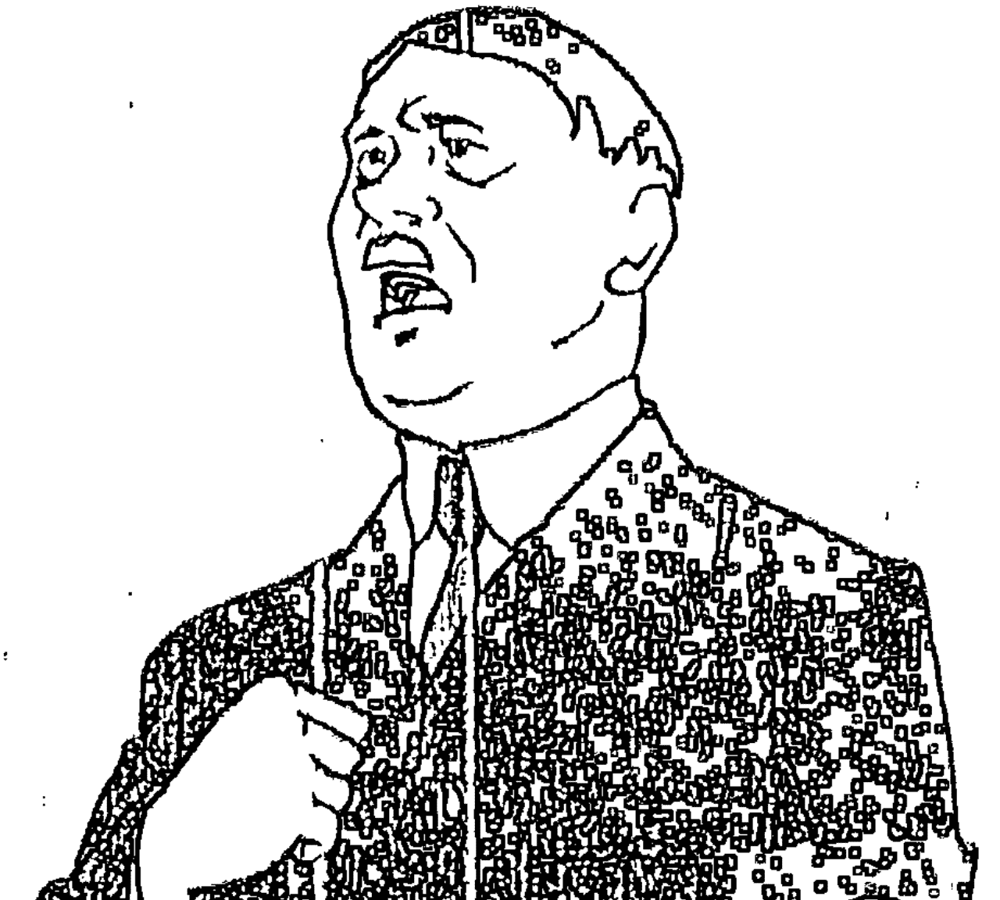

#### 選舉的演說中也使用了心理術！

橋下徹的心理學演講術

希特勒巧妙活用至今仍被使用於各種場面的心理技巧來操控大眾心理，並打造出獨裁國家。日本的政治家——橋下徹，同樣也曾被批判為「獨裁者」，即便如此，他卻仍在二〇一一年的大阪大阪市長選舉中，以壓倒性的勝利獲得了大阪市長寶座。而橋下徹身為演說名人，其技巧更是讓其他政治家無法望其項背。

對橋下的演講進行分析後，結果發現與過去希特勒在抨擊貶低國家，並同時要找回過去光榮為主題的演講手法如出一轍。

下面的文章，截取自二〇一〇年四月的大阪維新之會發起總會中，橋下在大阪府議會、市議會、以及電視媒體面前演說的內容。

「如果大阪一直維持現在的狀態，那我一點都不想繼續在這裡住下去。我也一點都不想在大阪這個地方培育孩子。（中略）但是，當上知事的這兩年來，我學習到不少事物，而且我認為大阪所擁有的潛力是相當大的。就算在全世界的排名中也能擠進前十名，大阪正擁有著這樣強大的能力。（中略）日本丸已經開始沉淪了吧，我想應該已經沉淪了。但是我無法就這樣眼睜睜的看著他持續沉淪下去。我想大家也都和我抱持著同樣的心情。既然如此，不如讓我們由大阪丸開始向前邁進重新打造一番新的局面吧！」（〈獨裁者的最強演講術〉川上徹也／星海社著）

當時，他對自已搶任知事的大阪進行了徹底批判，接著作談到了大阪的可能性，更以日本丸來比喻沉淪中的日本，並同時提出了振興大阪的想法。憑藉著這樣的說法使聽眾將情感帶入自己的故事中，牽動人們的情緒。

二〇一〇年十一月，大阪維新之會的街頭演說中，也能看見他使用了一錯誤前提暗示一心理術的演說技巧。以下的文章，是橋下針對他的「大阪都構想」受到當時的大阪市長平松邦夫批判後所作出的反論。

「所有大阪的民眾們，問題不在於大阪都構想這個新制度存在著多少問題點。重點是，你們還想繼續維持現狀下去嗎？要讓大阪就如現狀一樣的繼續衰退下去嗎？你們認為現在的體制比較好嗎？還是希望轉移成新的制度呢？問題的重點應該是這個才對。」（〈獨裁者的最強演講術〉川上徹也／星海社著）

這樣的提問中，選擇「衰退的一方」的人肯定相對較少。巧妙的提出由衰退中的現有體制與新體制中二擇一的提問，這也促使聽眾選擇新體制——大阪維新。

橋下為了加深大眾對演講內容的印象，大量使用了簡短易懂且帶有刺激性的口號。這種手法被稱為「精句」（Sound Bite）。

所謂的「精句」就如同它英文文字面上的意思，「使用聲音來緊咬不放」。如同剛才引用的演講中的「大阪都構想」，以及「由大阪丸開始向前邁進，重新打造一番新局面吧！」等口號，都是使用了這個手法。

藉由不斷重複著無論是誰聽到都能馬上記住、簡潔有力的口號，不但能讓這些訊息確實記憶在聽眾的腦海裡，也讓電視台或報紙等媒體，方便引用這些口號。

像這樣巧妙運用精句來操縱大眾或媒體的技巧，據說是始於羅納德・雷根任職第四十任美利堅合眾國總統的時代。

在雷根之後，精句獲得不少政治家的採用，前首相小泉純一郎的「由我來摧毀自民黨」、「不改革構造就無法成長」，或是第四十三任美國總統喬治・布希對於那些贊助恐怖攻擊的政權發表「邪惡軸心」的看法、第四十四任美國總統巴拉克・歐巴馬的口號「Yes we can」等，相信這些口號至今仍讓許多人印象深刻。

#### 你也正受到操控?!潛藏在超級市場中的心理術陷阱

不僅在政治領域，心理術正被活用在我們日常生活中的各種場合。例如：大家日常生活中常去的超級市場。你是否察覺到，幾乎所有的超市或購物中心，都會將店裡的客戶動線設計成「靠左側」呢?

當人類往心臟所在的左側方向移動時，容易對周遭的空間產生舒適的感受，相反的往右側方向移動，則會覺得不自在。據說這個設計便是源自於這樣的人類心理。

也就是說，要讓客戶感覺店裡是舒適的空間，並延長停留在店裡的時間藉此提高銷售量，因此才設計出這樣的動線。

此外，水果或蔬菜的販售區一定會在超市的入口處，也是一種基於人類心理的銷售計畫。

這是因為心理學認為，人類會受到「顏色」所帶來的各種影響。因此在居家或公司等多種環境中，皆使用了要讓人們更舒適且有效率的活動，被稱為「色彩調節」的技巧。

例如：紅色或橘色等暖色系的顏色帶給人溫暖或正面的感覺，相反的，藍色或綠色等寒色系的顏色則給人冷靜或涼意的感覺。

如此以這些由顏色引發的心理作用為架構，將色彩鮮豔的水果或蔬菜配置在商店的入口，使客戶的情緒變得高昂，以藉此提高購買慾。

而店裡播放的背景音樂也使用了提高購買慾的心理技巧。根據美國市場調查學家羅納德·聨理曼所進行的研究，實驗結果顯示當超級市場內播放節奏較快的背景音樂時，店內的人潮及銷售額會比起播放節奏和緩的背景音樂時更高。此外，在餐廳進行同樣的實驗後，結果發現播放節奏和緩的背景音樂會使客戶在店裡停留的時間增長，點餐次數也跟著增加。

在聽到相較下節奏偏快的背景音樂時，人類的活動力也會跟著提高，相反的，若聽到節奏偏慢的背景音樂，則會使情緒顯得放鬆，這些都是受到心理作用的影響。

而對於超市或餐廳等店家來說，背景音樂也是用來提高銷售額的重要手段。

#### 便利商店是心理術陷阱的寶庫?

總是讓人不自覺就想買東西的便利商店，在設計店鋪的動線時也應用了心理學上的技巧。

為了要讓每次進到店裡的客戶都能多買一些東西，就必須讓客戶在店裡「多走幾步驟」。因此，便利商店就如左頁上圖顯示的，會將銷售狀況較佳的商品陳列在店的角落，藉此拉長客戶行走的動線。

也就是說，將雜誌區設置在入口處附近，並將飲料區設置在其內側，飲料區的旁邊為甜點或沙拉，接著擺放便當或飯糰、三明治等，藉由這樣的擺設，讓客戶在店裡走一圈，使客戶能夠買入更多的商品。

此外，時常可以見到雜誌區被設置在入口附近的玻璃窗前，也是為了讓在店內閱讀的客戶發揮「捕蚊燈」的作用，將店外的客人吸引進入店內，並同時帶給其他客戶店裡還有其他人在的安心感。

不光只有店鋪的擺設，展示架上的商品也是基於心理學的原則加以配置的。人類普遍的心理變化，會在該領域位於自己視線上方時呈現尋求成長的心理狀態，而該領域位於視線下方時則呈現尋求安心的心理狀態。以這點為基礎，便利商店展示架的商品配置，可細分為如P31下圖所示的：

- A的領域……呈現以希望及思考為中心的心理狀態，因此為需要留下空間的領域。
  大多的店鋪會藉由降低展示架的高度來調擊出空間，以減少壓迫感。
- B的領域……呈現思考和清潔感的心理狀態，最適合用來設置標語或促銷活動的POP等。
- C的領域……感受到個人主張和情感領域，也是最容易確認物品的位置，因此被稱為「黃金領域」。最適合用來擺放熱銷商品。
- D的領域……呈現習慣的心理狀態，適合擺設會經常使用的商品或基本商品。

現代的便利商店就是像這樣用心理學的技巧來控制它的客人們。

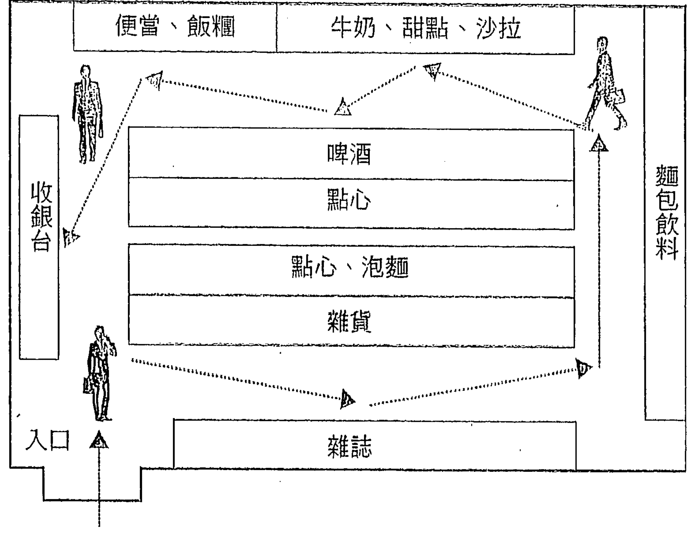
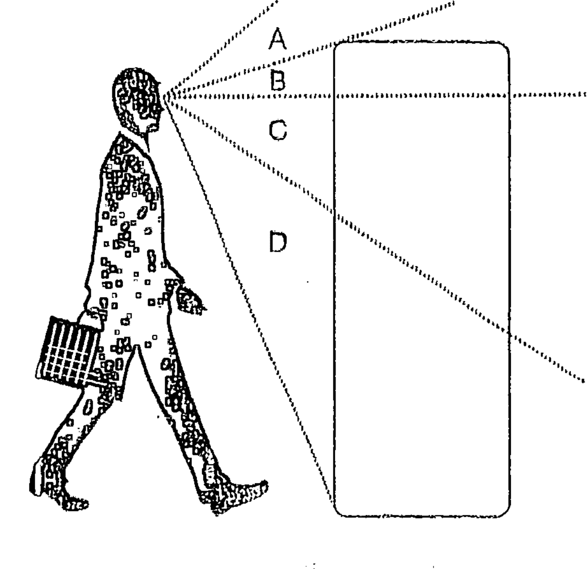

#### 藏身於廣告中的黑暗心理術

我們在日常中看到的廣告，裡頭也同樣應用了許多心理技巧。廣告的種類有電視廣告、報紙或雜誌廣告、街頭海報、網路廣告等，種類相當多樣。然而，這些不同種類的廣告通常都會運用：經由反覆釋出相同訊息來提高在消費者心中好感度的「單純曝光效應」，或是藉由誇示品牌魅力等方式讓消費者對該商品的優越性有所認知的「月臺效應」（Halo Effect）等，廣告就是巧妙地利用這些方式來刺激消費者的購買慾。

大家是否曾在電視上看過，請來上班族或家庭主婦暢談商品功效的健康食品廣告呢？當人們在認同對方與自己為同類型人物時，便容易增加親密度，而這種廣告手法便是利用了這種稱為「類似性法則」的技巧，目的就在使觀眾對於廣告的演出人員產生親近感，進而對商品也產生親近且隨手可得的感覺。

此外，美國的深層心理學家歐內斯特·迪希特（Ernest Dichter）則認為廣告應該要切合消費者的深層心理，他曾說「在人類的心理裡，快樂與罪惡感隨時都在衝突著。身為廣告人最重要的工作，不是將商品銷售出去，而是帶給消費者合理的安心感。」

迪希特將這樣的想法運用在糖果的銷售上。在一九五〇年代的美國，添加了砂糖的零食被認為是形成蛀牙及肥胖的主因，因此造成了零食的銷售銳減。迪希特就在大糖果盒中裝入可一口吃掉的小型糖果，並將這樣的零食進行販售。然後，消費者的心中便開始產生了「我只吃一口而已，其他的可以丟掉」的安心感，結果也讓糖果的銷售量直線上升。

像這樣探索出消費者內心深處對消費行為產生動機的手法，稱為「動機研究」（Motivational Research）。動機研究受到了廣告相關人士的注目，其中寶僑公司香皂「象牙皂」（Ivory）的廣告詞「Wash your troubles away（幫你把煩惱也洗掉）」，便是在迪希特的建議下誕生的經典台詞。

迪希特的手法至今仍對變化多端的現代廣告、市場調查業界持續產生影響。在近期的市場調查業界中使用的，經由消費者調查或社會動向等方面來洞察消費者的「消費者洞察」（Consumer Insight）等手法，也被認為與迪希特的手法類似。

### 第2章

### 從對方的「表情」、「動作」透視出對方本意的方法

#### 從「表情」、「動作」來解讀對方的本意

接下來要介紹的是，為了使人際溝通能更加順利，在「操縱人心」時所必要的「看透對方心理的方法」。

日常生活中，我們隨時都在與周遭的人取得交流。除了言語上的交談之外，我們還會透過對方的「表情」或「動作」等，來判別對方的想法。

然而，若我們只將焦點著重在讀解對方說的話，要解讀出對方真正的想法幾乎是不可能的事。情感與語言並沒有太大的連結，即使對方說了與實際的想法完全相反的話，要能看透對方真正的心思也不是件容易的事。

想要知道說話者真正想法，就必須要能解讀與情感有深刻連結的「表情」或「動作」。心理學上，將這種以除了語言之外的要素進行溝通的方式稱為「非語言溝通（Non-verbal Communication）」。

為了更有效活用「非語言溝通」，最重要的是必須先了解對方所表現出的表情或動作分別帶著什麼樣的情感。解讀手、腳、姿勢的小動作，或是微妙的表情變化，並與自己的知識加以對照，如此便能理解到對方真正的情感或心理變化。

此外，表情或動作也會反射性的表現出連本人都未能發覺的「情感變化」。不自覺的假笑、為了與對方的話語同調而刻意作出誇張的反應、在肢體上表現出更加強烈的反射性動作，這些都是在不想讓對方知道自己的真正想法時的表現。

只要能適當使用非語言溝通，並理解這些反應，就能掌握到解讀對方心理的許多線索。

#### 表情是1面反映心理的鏡子

人的「情感」會化成各式各樣的「表情」顯現在臉上。表情能敏銳的反應出情感的變化，也與個性深刻的連結著。

有人說，「表情」是人類在進化的過程中，為了適應眼前發生的各種現象而殘留下来的反射性動作。

例如「眉毛上揚」的動作，是為了確實捕捉需要以較大視野來觀看的事物而產生的動作；感到惶恐時會「張開嘴巴並感到緊張」，則是為了對應惶恐的情緒而作出的預備動作。

因此，即使想要隱藏自己內心的想法，但在經過情感與思考後，反射性動作必定會在表情上留下一些蛛絲馬跡。

提倡這些論點的是，在美國進行了與表情相關實驗的心理學家保羅・艾克曼。他提倡的學說是，當人類感覺到特定的「情感」時，所有的人普遍都會表現出相同表情的「面部動作編碼系統（Facial Action Coding System，簡稱FACS）」。而這些普遍且特定的情感有、「驚訝」、「恐怖」、「悲傷與絕望」、「氣憤與惱怒」、「嫌惡」、「輕蔑」、「愉悅與歡喜」這七種情感。當然，情感並不只這幾個種類，但是與這七種情感連動的表情，據說是全人類共通的。

所有人在日常生活中，都會將這些表情當作溝通的指引，並下意識的讀取對方的情感。同時，當要在對方面前表現自己的情感時，也會因為意識著自己是被看著的一方而「演出」著自己的表情。例如：當對方興高采烈的說著話時，即使自己並不認為特別有趣，也會裝出「笑臉」來表現出自己認為最適合當時場面的反應。換句話說，當人們想讓對方認為自己感受到了某種情感時，便會隨著那種情感而作出「應該展現的表情」。

如果對方並非真正覺得開心，我們卻還是自願自地發言，這並不能稱得上是所謂的「溝通」。因此，為了了解對方真正的心理，就必須要掌握能看穿「偽裝的表情」的技巧。然而，幾乎所有的人都無法察覺這些偽裝出來的笑容，反倒覺得這些是真實的笑容。

那麼，就讓我們先從理解這七種情感個別的表情特徵開始著手吧。只要能了解這些特徵，就能輕易地掌握對方的心理。

接下來，將對各種表情特徵一一進行介紹。

##### ①「驚訝」的表情特徵在「眉毛」和「額頭的皺紋」

首先，人在感到驚訝時，一定會將眉毛往上揚，並且額頭會出現橫向的皺紋。接著眼睛會張得更大，上下眼瞼也會張開，露出眼白。最後，下顎下拉，嘴巴微微張開。

此外，「驚訝的表情」與「驚嚇的表情」是完全不同的，讓我們好好的來加以辨別吧。

被巨大的聲響嚇到的瞬間，表情是眼睛微閉，眉毛往下垂，嘴唇緊閉並水平延展。這樣的表情會在非常短的時間內就消失，但卻無法隱藏，相信是非常容易辨識的。

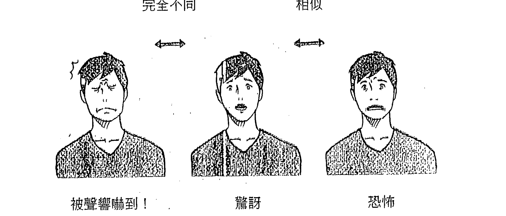

##### ②分辨「恐怖」與「驚訝」的表情

感到恐怖時的表情，與感到驚訝的表情相似，因此必須要留意區分。雖然與感到驚訝時同樣會將眉毛上揚，但會拉近眉間距離，使眉毛呈現一直線的形狀。此外，上眼臉會朝上，下眼臉則會放鬆。有時候會出現嘴巴呈水平延伸的狀態，或只有嘴巴的部分輕微歪斜的情況。

##### ③要留意「輕蔑」的表情

輕蔑的表情與嫌惡的表情非常相似。當露出輕蔑的表情時，特徵是只有臉部的一半會有變化產生，且嘴角僵硬並微微上揚。下巴會稍微向上抬，並稍微皺起眼睛。

##### ④「惱怒」的表情也很簡單就能作出！

為了區分出憤怒的表情，要將焦點放在額頭、眼睛及嘴巴。據說大多的人在憤怒時額頭不會出現皺紋，且眉毛向下垂，眉間會出現縱向的皺紋。此外，眼神也會變得銳利，但會瞇起眼睛也有可能是精神集中在某件事情上，因此必須同時觀察嘴部的變化。

憤怒時，下顎會向前伸出，嘴脣緊閉。但是，若只是單純將嘴脣緊閉，也同樣可能是精神集中在某件事情上。在搬起重物時，也會有同樣的動作變化。

若對方表情變動的部分只有在眉毛，那麼對方可能是試著在隱藏自己的憤怒，或是因為感到驚訝而意識集中在該件事情上。

憤怒時所動用到的都是相當容易活動的臉部肌肉，因此，要作出憤怒的表情也是非常簡單的。記得配合言語和動作兩者一併判斷。

##### ⑤「嫌惡」的表情與「惱怒」的表情相似

嫌惡的表情是在看到噁心的事物，或是吃到討厭的食物時會露出的表情。出現這個表情時，一定會在鼻子上出現皺紋，並扯動上嘴唇。有時候，下嘴唇也會被扯動，並向前推出。嫌惡的程度越強烈，在臉的下半部出現的皺紋也會更多。此外，偶爾也會有眉毛向下垂的表情出現。這是嫌惡的表情與憤怒的表情不同之處，記得多加留意。

嫌惡的表情大多數會以嘴巴和鼻子周遭來加以表現，這也是容易活動的肌肉，因此不論是表现出感到噁心的表情，或是相反的想掩飾嫌惡的表情，也都是相對簡單的。

##### ⑥「絕望」的表情簡單易懂

灰心或失望時，臉部的表情會顯得無力並且停止活動。眉尾微微向上，出現縱向的皺紋，視線朝下，嘴角下垂。若是感到強烈的悲傷，下眼臉也會輕微被延展開來。

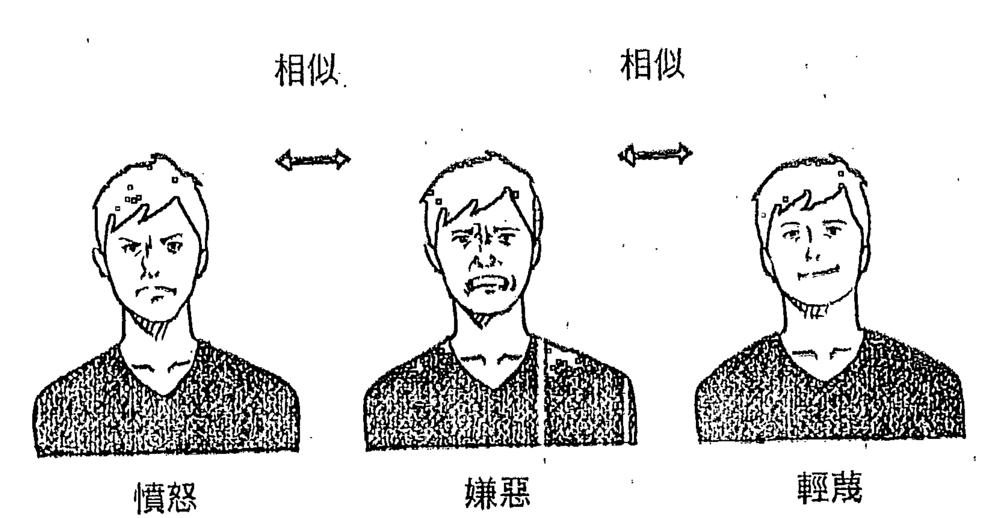

##### ⑦一眼看穿「假笑」

最後要介紹的是愉悅的表情。愉悅的表情也就是所謂的笑容，而真正的笑容和應酬式笑容的區分方式，可從眼睛是否也跟著笑來進行判斷。最早著手研究假笑與真笑之間差異的是法國的學者紀堯姆·杜背內（Guillaume-Regnar-Arnald Duchenne），他發現了展現笑容時會使用到的肌肉有：將嘴角往顳骨方向拉提的大顏骨肌，以及將臉頰向上拉提的眼輪匝肌。藉由觀察這些肌肉的活動，我們可以了解到，當露出真正的笑容時，大顏骨肌的活動時間比起假笑時的要來得短。因此，維持長時間的笑容，很可能就是在假笑。

#### 掌握心理的關鍵就在「瞬間顯現的「細緻的表情」

對於這些普遍的表情，我們可以本能地對其加以辨別，就如在看見笑容時，就會覺得對方「正感覺到快樂」。

但是，提倡這個理論的艾克曼 (Paul Ekman) 表示，在大多數的表情當中，同時也存在著「細微的表情」，而這些細微的表情也正明確的表達著真正的想法。

即使人類想要隱藏自己的情感，並保持中立的表情，卻仍會不由自主的在一瞬間露出沒意識到的表情。這就稱為「微表情」(Microexpression)。這種「微表情」是連本人也無法察覺的下意識反射反應，這樣的表情大多會顯現在整張臉上，但也有只顯現在其中一部分的情況。顯現的時間只有極短的零點二秒左右，這也是其特徵之一。由於這樣的表情只發生在一瞬間，若未能加以留意細心觀察，一不小心就會錯過了。也因此，能掌握這些「微表情」並加以解讀，是在理解對方情感時的最大線索。

#### 什麼是溝通時不可或缺的「社會性知性」

據說情感化為表情顯示出來的平均時間大約只有兩秒鐘，不過，也有顯現不到一秒鐘的情況，但也有維持達四秒鐘的情形發生。顯現的時間越長，則表示情感越強烈。同時，研究也發現了，細微的表情會以左右不對稱的方式展現出來。若某個表情並未長時間展現的特徵，則很可能是對方正壓抑自己的情感。

除了「微表情」之外，其他常見的表情有「局部的表情」、「微弱的表情」、「代理的表情」等。「局部的表情」、「微弱的表情」是指，人們想要隱藏自己的情感而只在臉部的某一小部分出現變化，或是因感情薄弱而只在很短的時間內展現出的表情。連自己都未察覺的小小憤怒漸漸的湧現出來時，就會以微弱的表情來展現，而在自己察覺後想要隱藏這個情緒時，這個表情便會跟著消失，以上的情況便符合這個說法。

此外，「代理的表情」指的是，為了與對方的話語同調而「刻意作出」的表情。例如：在聽到對方的抱怨時，你是否也曾露出嫌惡的表情？這就是為了將同調的表情展現給對方看見，向對方傳達「我是站在你這邊的」的表情。

各位曾經說過「社會性知性」這個字眼嗎？這是指藉由表情或視線、動作等，對周遭人們的關係性或意圖加以讀取的能力，它也是在進行人際溝通時所不可或缺的重要能力之一。

我們每天都會在無意識中使用「社會性知性」，若缺乏這個能力，便很難建立起與他人之間圓滑的溝通或人際關係，且社會生活將無法成立。具體來說，在朋友或工作夥伴、家人等各式各樣的人際關係之中，人類會根據對象或狀況來判斷彼此的關係，並因應狀況來與對方溝通。

這種能參透出關係性的能力，便是社會性知性當中的能判斷雙方親密度的能力。心理學家丹恩·亞契（Diane Apter）的著作《肢體語言讀解法》（暫譯，原書名：How to Read Someone），就針對如何判斷親密度的實驗結果加以記載。

在這項實驗中，他們向被實驗者展示了「男性以手勾住女性的脖子，並親吻臉頰」的照片，請被實驗者判斷照片中的兩個人是否為真正的夫妻。這可從照片中，男性搭在女性肩膀上的手的角度較淺，且手部及手腕的形狀不自然來判斷出，他所觸碰的並非是與自己親近的人。

人類便是如此，藉由社會性知性來判斷與對方的關係性，並推導出自己認為適當的對應方式，以達到順利的溝通。

那麼，為了提高社會性知性的能力，接下來就搭配著前面提到的「表情」，來學習隨著感情而表現出的「動作」特徵吧。動作的種類有眼神、身體動作、手部或頭部、嘴巴的動作等，由身體的各個部位所表現出來的動作。接著就依序來看看從每個部位的動作所表現出的情感。

#### 「眼睛」比嘴巴更擅於表達？

我們常聽到「眼睛比嘴巴更擅於表達」的說法，正如這句話所說的，心理學當中也有著這樣的說法，從視線的動向、眼神、瞳孔大小等方面，便可以某個程度的解讀對方的「思考」或「情感」。與表情相同的，我們可以對視線作出一種程度的控制，但是視線是會在無意識的狀態下變動的，只要能夠掌握這個部分，相信會是了解對方心理的一大提示。每個視線的變動都存在著意義，因此，除了掌握視線之外，也必須確實觀察對方的表情、言語以及其他動作，結合各項情報來判斷對方的心理。

#### 從視線的變動了解心理狀態的「眼睛解讀線索」

首先，先由「視線的變動」能理解的思考內容來進行介紹。人類會將眼前發生的事物或刺激，經由視覺、聽覺、嗅覺、觸覺、味覺這五種感官來傳達至腦部，經過思考後加以處理，並藉由搭配過去的經驗和知識來表現出反應。

這樣的說法是來自完形治療家理查·班德勒（Richard Bandler）及語言學家約翰·葛瑞德（John Grinder）所提倡的「神經語言程序式學」（NLP）學說。

該項學說中介紹了，當人們以思考的方式來處理眼前發生的事物時，會隨著思考的內容來決定視線的移動方向，被稱為「眼睛解讀線索」的思考方式。意即在經由「視覺」、「聽覺」、「感覺」、「觸覺」等五感進行處理的過程中，所引發的視線變化。若能掌握這些變化，就能了解對方是否產生視覺上的想像、是否聽見聲音、或是在些感受。

此外，在五感中，使用哪種感覺來處理事物的比例因人而異，而這些差異的產生更會造成視線不同的變化。接下來，就針對視線的變動方向及其與五感間的相對關係來加以詳細說明。

##### ① 視線朝上、左上、右上移動時

當浮現視覺性印象時，視線會向上移動。此外，若視線從你的角度看來呈現在右上的方向時，表示對方「正在回想」，若在左上的方向，則表示「正在設法思考」。例如：當對方試著要回想起昨天的領帶顏色時，由於顏色是經由視覺處理的，因此從你的角度來看，對方的視線應該是朝著右上方。另一方面，當在思考想要的領帶顏色時，從對面看來對方的視線是朝著左上方。從這些傾向看來，視線的變動是看透對方是否說謊的手法之一。例如：當詢問對方昨晚去了哪裡時，若對方的視線從你的角度看來是往左上移動，則表示對方並不是在「設法回想」，而是在「設法思考」，因此，對方說謊的可能性相當高。同時，若只是單純的眼神游移不定、眼瞼快速眨眼，就是內心動搖的證據，所以說謊的機率應該是相當高的。

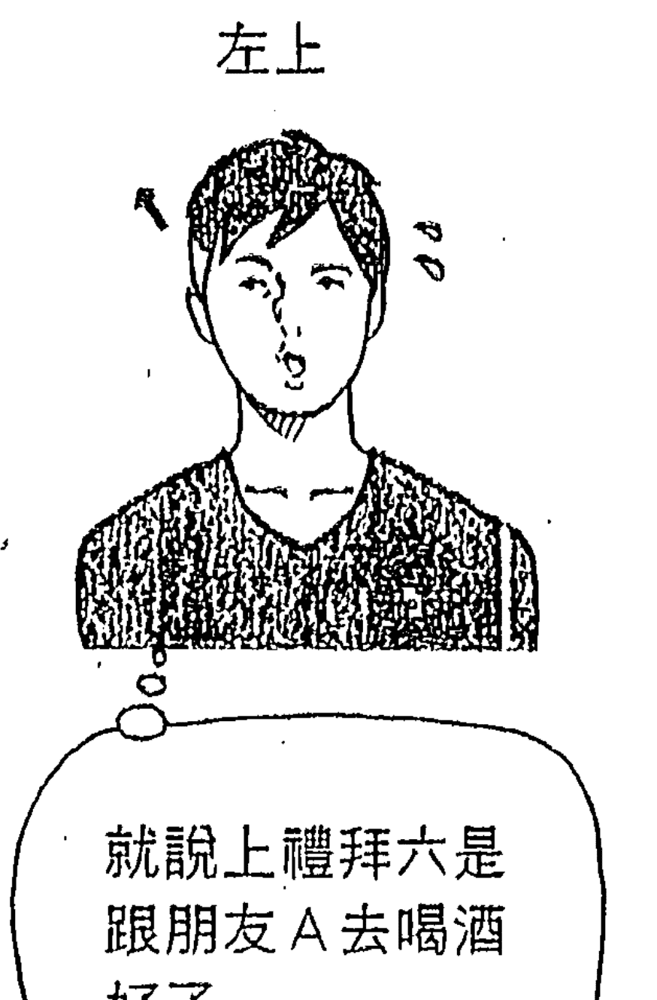

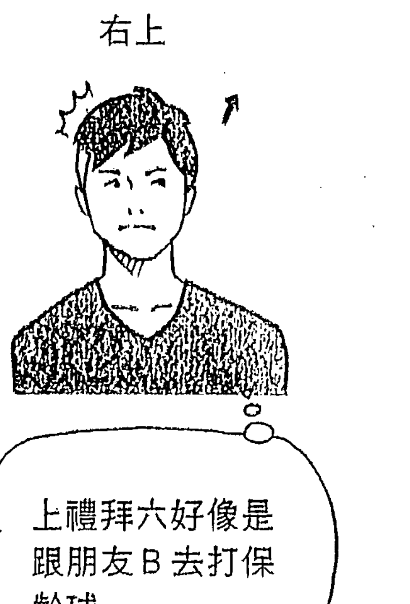

##### ② 視線水平朝右、水平朝左時

當在思考與聲音有關的聽覺印象時，眼神通常會往兩旁移動。同樣的，視線往右或往左移動時，分別可知道對方是在「回想」或「思考」。例如：當回想起上司的聲音時，從你的角度看來對方的眼神應該是水平朝右。另一方面，若是想像近期内將調動至自己部門的新人的聲音，則從你的角度看來，對方的眼神應該是水平朝左。

##### ③ 視線向左下移動時

回想起感覺或感情、（觸碰自己的身體）、觸覺時，視線應會向左下移動。「昨晚洗澡時熱水的溫度夠熱嗎？還是溫溫的呢？」「接受頒獎時的心情如何呢？」「現在鞋子裡腳尖的感覺如何呢？」試著提出這些詢問就可以獲得答案。

#### 視線交會時能掌握的深層心理

藉由對話中眼神交會的時間和次數等，會受到當時的情感或本人的性格、與對方的關係而影響。若是戀人關係或家人等關係較親密的對象，在眼神交會時往往沒有什麼特別的意思，但若對方是初次見面的對象或雙方的關係僅在工作上有交集，則眼神的交會便可用來作為計量雙方關係性的溫度計。

若對方未將眼神移開，並且直視著你，則對方可能对你懷有戒心，亦或抱著挑戰的情感。因為這對於不擅長與他人眼神交會的日本人來說，是極為不自然的舉動。

此外，在希望對方相信自己說的話時，也會有認真的盯住對方雙眼的傾向。然而，在想欺騙對方時，也會有類似這個動作而不移開眼神的情況發生。例如當詐欺師為了騙過對方，想掩飾謊言時，就會認真的緊盯著對方不放。

相反的，若對方完全不願與你的視線交會，表示可能对話題沒興趣，或對你保持著否定的情感。此外，立刻將視線移開，或以斜眼看著另一方，則非常有可能性是對方輕視或感到嫌惡。

在進行溝通時，最理想的視線交會方式是，適度的將眼睛移開，但同時也必須確實與對方的視線有交會。

除此之外，個性的不同也會造成在與對方視線交會時出現差異。在對話途中會積極的與對方的視線交會的人，並非對眼前出現的對象抱持著情感，而是希望能與更多人變得親密所帶來的反應。

但是，容易感到寂寞且希望與對方變得更親近，擁有這種「親和欲望」的人，同樣也會盡可能和對方眼神交會。相對的，在對話中幾乎不和對方眼神交會的人，通常性格較膽小，對於與人相處感到害怕，並有著強烈自卑感。

#### 日本男性不願意和女性的視線交會？

根據心理學家肯頓與庫克的研究，一般來說，相較於男性，女性會更願意與人有視線的交會。從同性間的交流來看，女性之間眼神交會的程度比起男性間顯得壓倒性的多。

由男女之間來看，雖然視線的交會減少，但仍然以女性會對男性投出較多的視線。常常會有男性因為被女性盯著看，就誤以為對方對自己有好感，但是女性通常會在無意識的狀況下投出視線，所以最好不要有過多的聯想。

此外，心理學家大坊郁夫先生指出：「在日本男女之間，由於男性太過分意識性别的差異，因此無法坦率的表現出自己的關心。」例如：當男女三人在進行對話時，其中一位異性不看著你，卻一直對著另外一位對象說話。若是你身在那樣的情況下，或許會認為自己被那位異性討厭了，但實際的情況卻是相反的。也就是說，對方對你感興趣，但會為了掩飾而傾向將眼神移開。

此外，心理學家麥可·阿蓋爾和哈瑞·英漢姆的研究顯示，在對話時，比起發言者，聽的一方將視線投注在對方的程度也比較多。這是因為發言的一方會將精神集中在整理思緒上，因此投注視線的量也相對較少。

在發表報告或商討事項時，通常面對的對象也在復數以上，因此會將精神投注在發言內容，而無法將意識放在自己的視線上。然而，若想要讓自己的發言更有說服力，適度的與每個人視線交會是成功的祕訣。

隨著與對方的關係性、本人的個性或當時的情感等各種不同的情況，視線也會跟著產生變化。或許單從眼神來判斷並不容易，但配合著表情或其他部位的動作來進行綜合判斷才是重點所在。

#### 從瞳孔放大的程度來讀取對方的心

在過去的某個實驗中，將「嬰兒的照片」、「異性的裸體照」、「同性的裸體照」、「風景照」等四張照片給接受實驗的男女看，結果在看見異性的裸體照時，被實驗者的瞳孔放大了百分之二十。

這是一「瞳孔擴張」相關研究的第一把交椅，美國的心理學家艾德·海斯所進行的實驗。所得到的結果是，人類在看到有興趣或讓自己感到舒適的東西時，瞳孔也會跟著放大。這就表示，我們可以觀察瞳孔的大小，知道對方對事物是否真的感興趣。

我們常聽說，眼睛大的女性較受歡迎。這是因為眼睛大會使人聯想到小嬰兒的臉，而讓人產生想要加以保護的衝動。然而，瞳孔張大的表情也和大眼睛有著同樣會帶給對方好印象的效果。

此外，在其他實驗中，也曾將女性的瞳孔放大及縮小後的兩張照片給年輕的男性看，結果瞳孔大的女性獲得的答案是「較女性化且可愛」，而瞳孔縮小的照片則帶給人「自私又冷淡」的印象。

從這些結果看來，不光只有女性，男性也同樣了解瞳孔大的表情不但看起來閃閃發亮，同時也帶給人好印象。

由於瞳孔的動作是無法控制的，因此是可用来看穿對方心理的一大線索。即使無法確認瞳孔的大小，但如果對方的眼睛看起來又大又閃亮，這也是對方希望更進一步了解你而發出的帶著善意的暗示。把這當成是對方帶有好感的表現，相信也是不會錯的。

#### 感情會先表現在［嘴部］

對於嘴巴往下垮的人，以及閉起雙脣且嘴角上揚的人，大家比較喜歡哪個表情呢？嘴部的表情會大大改變一個人帶給人的印象。

嘴巴往下垮且微微張開的人，會帶給周遭懶散的印象；而緊閉嘴巴的人，則給人知性且充滿緊張感的印象。

在高度經濟成長後出生的年輕世代，由於飲食習慣改變的關係，減少了吃硬的食物機會，也因此下巴的肌肉不夠發達，無法確實閉起嘴巴的人也越來越多了。

若是過去不太注意嘴部表情的人，最好也從平時就多加留意，特別在職場中，記得讓自己隨時看起來都緊閉著嘴巴。

時常咬嘴唇，或露出歪嘴表情的人，可能是在忍耐著某些事物，或是感到不愉快。甚至很有可能對某些事情感到不甘心。

當人正在忍耐某些事物或心理狀態呈現緊張的狀態時，嘴角的肌肉容易會呈現緊繃的狀態。嘴角下垂給人的感覺較沒有緊張感，原因正是如此。

另一方面，與對方進行對話時，如果將嘴巴緊閉，很容易會被對方認為這是你在發出拒絕的信號。要使溝通能夠順利地進行，可以利用笑容或驚訝等的表情來使嘴巴的緊繃感適度獲得緩解，使表情上帶有變化也是在溝通上相當重要的一環。

除此之外，吐出舌頭的動作代表了拒絕，或表示了正集中精神於某件事物而不希望受到打擾的意思。

相反的，舔嘴唇的動作則是代表肯定的信號。如果對方在傾聽你說的話題時，不自覺的舔了嘴唇，那可能代表對方對你的話題相當有興趣。

另外，還有一個相當有趣的話題，是關於嘴巴的動作與「笑容」的關聯性。心理學家阿吉爾表示，為了與人更加親近，重要的除了與對方之間的距離、視線、對話的內容之外，「笑容」更是一個相當重要的因素。

在溝通對話中，若發現對方是在假笑，這除了了解到了對方對自己所抱持的情感為何之外，也會使你對對方的信任感消逝無蹤吧。因此，藉由觀察對方的「笑容」來看清對方對自己或自己提出的話題是否真的感興趣，這也是在順利進行溝通對話時，非常重要的關鍵之一。

我們曾在說明「表情」的項目中提到過，要看穿假笑的方法，可以從大顱骨肌的活動時間長短來加以判斷。這裡將介紹利用「嘴巴的動作」來判斷假笑的方法。

其實，人在露出真正的笑容時，首先嘴巴會先開始動作，接著眼睛才會慢慢的改變動作。但是，當人在假笑時，嘴巴和眼睛很容易會同時動作。這是在判斷假笑時非常簡單的一項技巧，請務必試著活用看看。

當人真正感到有趣且大笑不止時，不光只會露出笑容，甚至會流出眼淚，並且身體產生搖晃，因此，對方究竟是在假笑，或是真的感到好笑，一眼就能判斷出來。

#### 能從手部及手腕的位置了解到的心理狀態

在前面提到過的法恩·亞契對於親密度的實驗結果顯示了，當接觸到非親密的人時，人的手部及手腕的形狀會顯得不自然，甚至是被實驗者也能輕易的看出這些差異。這是因為從社會道德規範的角度來看，而產生了「不能觸碰與自己沒有親密關係的人」這樣的想法。從這點也可以清楚的了解到，手腕及手部能夠反映出相當強烈的情感表現。

同樣為身體中的部位，表情是我們可以在某種程度上加以控制的，但是手腕和手部卻會展現出反射性的反應，因此是在解讀對方心理時非常有利的一個助力。

心理學用語中有著「自我親密行為」這個用詞。這是指，使用自己的手觸碰自己的身體或頭髮，以藉此安撫不安、緊張、憂慮、不滿等的情緒，所表現出來的行動。若談話對象頻繁的出現「自我親密行為」，這表示對方可能對你的態度或說話方式帶有負面的情感，因此最好多加留意。

其實「自我親密行為」是一種將童年時期父母親撫摸自己的頭時所帶來的安心感由自己加以重現的行動。由此可推測出，頻繁出現自我親密行為的人大多是愛撒嬌或依賴心較重。

常見的「雙臂交叉」的動作，也是自我親密行為的一種。心理學家麥可·阿蓋爾提出了手腕、腳、身體的姿勢所表達的情感特徵，尤其手腕更有著關係到「自我保護」的傾向。

其中，環抱身體的動作代表著自我防衛的行為，而雙臂交叉則是心中抱著不安情緒的證明。若雙臂交叉時手掌插入身體與手臂內側並雙臂緊抱，則可能表示完全抗拒對方。

另一方面，在想讓自己看起來強悍時，也會作出雙臂交叉的動作。這種情況下，會作出身體往上挺、下巴向上揚，給人感覺像是在輕視對方的姿勢。

#### 千萬別錯過無意識中表現出的「手部動作」！

手部的動作也同樣會表現出各式各樣的心理狀態。聽話的一方若以手指敲打桌子或椅子，則表示無意識的在妨礙對方的談話，希望話題趕快結束。

此外，將手掌給對方看，則證明對方讓自己感到放鬆，或是對對方感到認同並抱著親近感。相反的，若雙拳緊握並放在身體前方，則是抗拒對方的表現，很有可能感到了憤怒或不悅。一直碰觸或移動桌上的物品，這樣的行動也可能是對於對方或對方的談話內容感到抗拒的表現。

此外，將手放在鼻子下方，作出摩撩鼻子的動作時，表示對對方說的話感到懷疑，若是撫摸下巴則表同意對方說的話並感到欽佩。

時常碰觸嘴唇的人，可能是愛撒嬌並且有比較不容易獨立的傾向。較嚴重的情況可能會發展出咬手指等的行為。

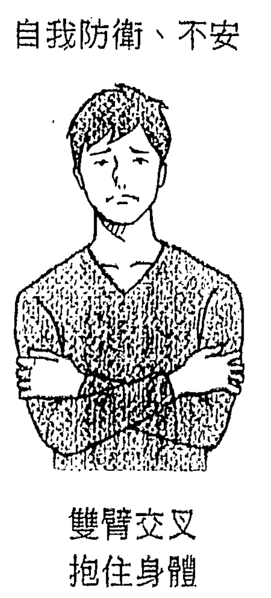

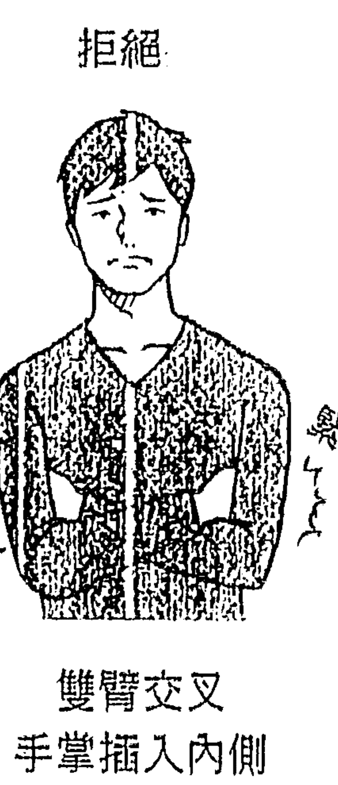

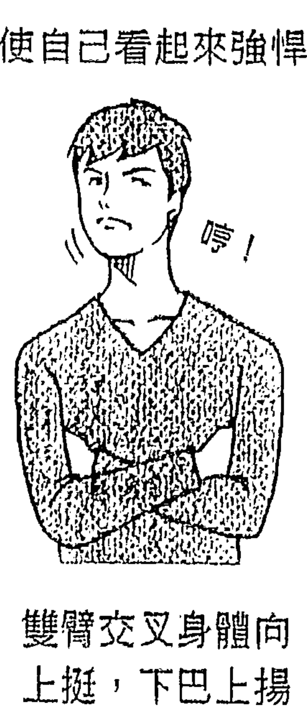

| 動作 | 描述 |
| :--- | :--- |
| 雙臂交叉 | 抱住身體 |
| 雙臂交叉 | 手掌插入內側 |
| 雙臂交叉 | 身體向上挺，下巴上揚 |

我們常看到男性作出將手插入口袋的動作。若對方與你面對面時，將手放入口袋內撥弄口袋內的物品，則對方在說謊的可能性非常高。人類在說謊時，會由於緊張而雙手顫抖或冒汗，因此便會下意識的想要加以隱藏。

此外，身體或手部動作大的人，可能是屬於自我陶醉型的人。若在對話中出現了這樣的動作，那麼對方可能會為了逗你開心而誇大自己說話的內容。

手掌或手臂放置的位置不同，以及狀態的不同，都會大大改變帶給周遭人們的印象。然而，心理狀態並非藉著一部分的動作就能作出評斷的。必須綜合姿勢或表情、手腕、腳等各個部位的狀態來加以判斷。

#### 以「腳尖的方向」來指出感興趣的方向

人類會刻意的控制表情和動作，但身體部位與頭部的距離越遠，傳達意識的難度也會隨著增加，因而出現無意識的情感或思考反應。也因此，留意腳部的動作便是掌握對方心理的一大提示。

心理學家麥可·阿蓋爾指出，腳部動作表現出的情感特徵，代表的是「對異性的興趣」。例如：女性將雙腿交叉在膝蓋時，雖然帶有自我防衛的意識，但故意交叉雙腿或使雙腳呈現平行狀態，則表示想要誘惑異性的意思。

女性反覆變換交叉雙腳的動作，也同樣可以視為是誘惑性的舉動。雖然有些人在討論時或會識進行中，以交叉雙腿的狀態與對方進行談話或溝通，然而，無論對女性或男性而言，雙腿交叉的動作都不適合成現在商務情境的舉動，因此最好多加留意。

美國的心理學家弗拉茲爾的研究實驗中，便針對一千名女性在面試場面中雙腳的交叉方式進行觀察，實驗結果顯示雙腳的交叉方式與人特質有著相關性。例如：膝蓋緊閉且雙腿並列的女性個性較板一眼、小腿交叉的女性則個性較親和且養育慾望較強烈等，總共列出了十個種類。

在電車中，偶爾會看到誇張的盤起腿，態度給他人帶來困擾的人，這樣的情況，通常是自我表現慾望強烈、以自我為中心的人。

此外，也可以從雙腳的開合程度來判斷對方的信賴度。雙腳緊閉時，代表了緊張或不安，而坐下時雙腿自然的稍微分開，表示對方讓自己感到安心且呈現放鬆的狀態。若雙腿向外踢出且大大張開，則表示輕視對方，或是本身是個以自我為中心且個性傲慢的人。

在溝通的場合中，可以從腳尖的方向來了解那個人所在意的方向。如果對話者將自己的腳朝向你的方向，表示對方對你說的話感到興趣，但若對方將腳朝向其他方向，則可能表示對方想遠離你，或對話題不感興趣而想離開現場。

其他會表現出心理狀態的腳部動作，還有抖腳的動作。這樣的動作可能是心理狀態浮躁，或是感覺強烈的不愉快、不安。若對話時對方出現抖腳的動作，可能是已經不想繼續聽你說話，或是想要早點回家。

也許你已經在無意識之下養成了抖腳的習慣，但那樣的動作絕對不會給周遭的人留下好的印象，因此，在商務場合請盡量避免出現這樣的動作。

#### 「動作」、「姿勢」是表現兩人關係性的提示

心理學家麥可·阿蓋爾（Michael Argyle）指出「身體的動作傾向與不安的情緒連結」。例如：男性緊張僵硬的姿勢或女性露出僵直的姿勢，是表示感到不自由且受到拘束而覺得不安的狀態；身體上下擺動、顯得不鎮定時，則表示充滿無力感或希望向他人求助的狀態。

能自然挺直背部坐姿漂亮的人，心境上看來也相對的平穩。因此，對於自己所

#### 姿態與社會地位的相對關係

擺出的姿勢也要隨時留意。

此外，美國的心理學家艾伯特·麥拉賓（Albert Mehrabian）所提倡的「麥拉賓法則」中，便說明了姿態與社會地位的相對關係。當面對地位較高的對象且感受到壓迫感時，手腕或腳部會微張開，呈現向前屈的姿勢，這表示手腳僵硬且不斷攪動。相反的，地位較高的人在面對對方時，則常會呈現後傾的姿勢。實際上，地位高的人也容易給人擺著架子的印象。從這兩者之間的姿態，就可以看出雙方相對的關係性。

##### 前傾姿勢表示抱著「特別的興趣」

「聽人說話的姿態」，會表現出相當容易掌握的反應。若聽你說話的對象擺出前傾姿勢將身體往前靠，則表示對你感到興趣且認真的在聽你說話。此時，對方的腳部應該呈現比90度更向內側彎的狀態。

那麼，如果對方的身體往椅背傾靠，且雙腳向前方伸出時，代表了什麼意思呢？這可能是對你的話題不感興趣或是不想聽你說話。此外，姿勢向左右傾並以手托腮時，則很可能是對方對於你所表達的內容感到無法認同。

這項結果在美國心理學家艾伯特·麥拉賓於一九七二年進行的實驗中獲得了證實。從學校課堂中，老師對於自己看好的學生提出要問題時，出現身體前屈的姿勢而得到了這個實驗結果。

這就表示，身體的前傾角度與「對話題感興趣的程度」呈現正比。上司或工作夥伴對你說話是否感興趣，也可以藉由這個姿勢一目了然。若前傾的角度不大，則必須好好思考自己的談話內容對對方而言是否有值得聽下去的魅力。

##### 要留意脖子的角度！對方可能在藐視你？

頸動脈所在的「脖子」，對動物而言是弱點的所在。當動物將同样是弱點的肚子展示给对方看时，可能是为了表示对对方的信赖，或是在传达投降的意思。

同样身为动物的人类，在倾斜头部露出脖子时，也同样有「信赖对方」或对于带给自己压迫感的人展现出「服从」之意的两种解释方式。因为倾斜脖子的姿势会带给人无防备的印象。此外，这也是较胆小或姿态低的人会展出的姿势，当对自己的发言感到没自信，并想取悦对方时便会摆出这样的动作。

常常可以看到性感的女性会将脖子倾斜并以斜眼看着男性。这是藉由故意露出自己的弱点，向对方传达出信赖，并在无意识中诱惑男性的动作。

相反的，當頭部向前傾並作出隱藏自己脖子的動作時，則表示因為警戒著對方，且感到不安而在無意識中作出的防衛動作。若對方在進行交談時出現了這樣的動作，可能表示對你所說的話感到無法理解。而下巴向內收並緊盯著對方看的行為，也代表著否定且挑釁的心理狀態。

此外，脖子向後倒，露出喉結且下巴向上揚的動作，正是輕視對方的證明。這是藉由故意露出弱點，向對方表示自己是需要戒慎恐懼的對象，而表現出的動作。在雙方人馬吵架前，也會看到向對方作出這樣的動作，原因正是如此。

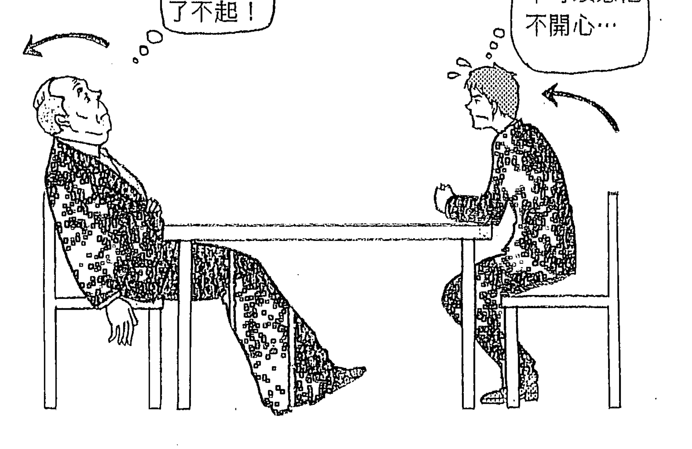

這就表示，下巴向上抬會給人威嚇對方的印象，而頭部向下低並將下巴內收則會給人謙虛且姿態低的印象。

在人際溝通中，作出輕視對方的動作會帶給人相當不好的印象。記住只要從頭部或下巴的一點點角度變化就能知道人類的心理狀態。

### 第 3 章

### 操縱人之前…… 影響行動的八大心法

#### 了解決定人類的行動的「行動原則」

人類的行動中有著幾項心理性原則，我們每天便是依據著這些原則行動著。這些原則在心理學的世界裡，被稱為「行動原則」。若你希望能了解對方的行動，並藉由有效的心理操作，使雙方間的溝通更加圓滑，那麼理解「行動原則」對你而言將是不可或缺的知识。

本章當中，將從大量的行動原則中，節選出理解行動所需要的八個基本項目來進行介紹。

在進入主題之前，先對行動原則的大原則來進行說明。包含人類在內，地球上所有的生物都是以「舒服或不愉快」的感覺來決定自己的行動。

解決飢餓或口渴的問題、一頭栽入感興趣的事物中、想與喜歡的人在一起的心情，人類的生活當中，也會像這樣理所當然的採取自己感覺「舒服」的行動；相反的，也會迴避飢餓或口渴、無聊或疲倦、疼痛等「不愉快的感覺」。這是在任何場面都通用的一大原則，若摒除了愉快（舒服）、不愉快的情緒，將無法理解人類的行動。

然而，在另一方面，由於人類生活在「稱為社會的集團」當中，要單純以愉快、不愉快作為生存的判斷基準也是不可能的。為了維持與多數人的關係或社會的規範等，必須要經過各式各樣的判斷。同時，作為判斷根源的「行動原則」的數量也不在話下。

人類的行動便是這些「行動原則」交互作用下產生的結果。

#### 最大獲利的原則：人類會選擇對自己「有利」的行動

無論任何人，只要認為對自己有「有利」，就會想辦法讓自己獲得最大利益。想要盡辦法賺更多的錢、結婚對象最好是俊男美女、想要結交更多有魅力的朋友……這些都是人類共通的慾望。

當然，也有人是抱持著為了他人著想的想法，因此採取了犧牲自己的行動。然而這些的行動，也同樣是來自於想要提升自己在對方或周遭的人們心中好感的一種慾望；或是為了更貼近所謂被社會需要的人這樣得理想形象，而在受到各式各樣的社會規範影響後所展現的行動。同時，這也可能是犧牲自我的人們，在不斷追尋後認為對自己是最有利的結果。

另一方面，人類有著希望將自己的損失控制在最低限度的慾望。當有人說自己壞話時，基本上應該不會有人感到開心。因此，人類在採取任何行動時，都會在選擇認為對自己有利的事物後再採取行動。在心理學的世界裡，稱之為「最大獲利原則」。

「最大獲利原則」是關係到人類所有行動的慾望，若排除這項原則，我們將無法理解人類的行動。

#### 公平性原則：人類社會中「公平性」是不可或缺的

在這個地球上，自古便存在著各式各樣的生物，且景象繁榮。然而，就在數千年前，人類以霸者的姿態君臨地球，之後便持續支配這個星球至今。若以單一個體看來，人類的存在是非常弱小的，但同時卻也逐漸擁有了統御其他強悍的肉食動物的能力。

這是因為人類自古代理便選擇了以「集團」互相協助的方式生存下去，因此使原先一個人無法達成的事情變成了可能。而這個集團也發展成了許多「社會」，並憑藉先人傳承下來的眾多智慧，而獲得更進一步的發展。

剛才我們提到了行動的大原則是一「最大獲利原則」。然而，人類生活要繼續存在這樣社會集團中，就不可能只專注在追求個人的利益。若只顧著追求自己的利益，那麼也許就會想要藉著欺騙他人來獲取利益。如此一來，這樣的人也會從集團中被排除。若長時間的加以觀察，會發現自己雖然身在集團當中，而也因此失去了本該獲得的利益。

因此，為了在集團中生存下去，就必須遵守社會性規範。因為在社會規範當中，包含了相當重要的「公平性」。

要使社會集團得以持續，必須公平的分配每個人所能獲得的利益。若社會團體長期處在分配不公的情況之下，則該集團內的人際關係可能會因此而無法繼續維持，甚至造成該團體的崩壞。以報酬來說，勤奮工作的人就有權利獲得較多的報酬，相反的，選擇輕鬆過活的人則只能獲得相對應的報酬。

「公平性原則」便是人類在社會集團中行動所必要的原則。在資本主義社會的日本，存在著「獨占禁止法」這樣的法律。獨占禁止法是為了防止因人或單一公司獨占利益，使得周遭的人產生不滿，而造成社會整體平衡瓦解。

乍看之下，「公平性原則」與「最大獲利原則」是互相對立的原則，但若以長期性的增加利益的觀點來看，卻有著互補的效果。這兩項原則都是人類存在社會中，選擇行動時重要的判斷基準。

#### 回報性原則：人類會因為個人獲得過多利益而感到不快

前面我們提到了，人類為了在社會上生存，會壓抑了自己追求利益的慾望，並同時衡量了公平性之後再採取行動。

然而，即使處在允許自己一個人獨占所有利益的情況下，人類也會因此而無法感到愉快。

為了證明這種心理狀態，學者們進行了下述的研究。存在戀愛關係的雙方之間，常有一方單方面的獲得對方贈送各式各樣的物品，則獲贈的一方對於對方的付出所抱持的情感是，幸福感、滿足感、罪惡感、憤怒感，這四種情感中的哪一種呢？研究結果顯示，單方面持續獲贈物品得利的人，會抱有強烈的「罪惡感」，而且最終對對方的「憤怒」也會變得強烈。

這是人類在接受對方的付出時，認為也必須加以回饋的「社會性規範」反映在個人的對等心態中而產生的結果。而當獲得的事物已經超過自己能回饋的範圍時，便會開始感到罪惡感及不安。這樣的情況稱為「心理性負債」，而想要加以回饋的心理則稱為「回報性原則」。

這種「回報性原則」不光只能在證明實驗結果的戀愛關係當中，也可以套用在所有人際相處的關係上，也因此，非貨幣經濟的島嶼部族之間便實行了以物易物的方式。此外，從文化圈中存在著即使本身已破產仍會進行「償還」的做法來看，「回報性原則」可說是深植於人類種族間的行動原則。

目前為止所提到的「最大獲利原則」、「公平性原則」、「回報性原則」這三項原則，都是人類行動的大原則。這些也都是人類社會中重要的元素，若排除這些原則，人類社會將無法成立。

除此之外，還有其他被用來做為判斷基準的行動原則，讓我們依序看下去。

#### 一貫性原則：人類一旦做出決定，即使得不償失也會堅持下去

假設有人已經宣告自己要挑戰大考，卻在翻開書開始苦讀時，發現掌握不到要點…：但是，若是告訴周遭的人自己要放棄，一定會被認為是沒用的人。因此只好勉為其難的繼續念下去。

這時候，由於不想讓周遭的人認為自己是意志薄弱且無法言出必行的人，也無法接受自己就這樣輕易放棄已經開始的挑戰，因此，想要採取「有一貫性的行動」的心理便開始產生影響。這樣的行動在心理學用語中被稱為「一貫性原則」，它是左右著人類活動的重要心理原則之一。

由於人類原本便厭惡會讓自己得到負面評價的事物，因此即使痛苦的研讀下去也一無所獲，仍然會為了讓自己獲得高評價而持續下去。如此希望自己能獲得高度評價的心理，稱為「自我增能慾望」。這種欲望與「一貫性原則」有著連帶關係。

以結果而言，這些行動心理都是站在自己獲利的觀點來對事物加以考量，因此也是以「最大獲利原則」為基礎衍生出來的。

此外，若對自己而言重要的事物發生「自我矛盾」，並因而無法維持「一貫性」時，也會使人有不快感產生。例如：「想要注重健康但卻戒不了菸」，對這種「自我矛盾」所產生的不快感稱為「認知不協調」，而為了消除不快感，人們便會開始採取各式各樣的行動。同時，也會將無法維持一貫性的行為加以合理化。

以下就來看看人類為了消除自我矛盾所產生的不快感，而會採取的行動。

- **改變行動**—戒菸。
這是為了消除行動上的矛盾，因此藉由改變行動模式來維持一貫性。

- **改變認知**—無法戒菸的情況。
為了將無一貫性的行動正當化，而變更原有的認知。具體來說，會藉由『並不是全世界所有吸菸者都會得肺癌』、『吸菸者也有人很長壽』等的認知，來告訴自己並沒有必要戒菸。

- **重新評價自我的行動**—無法戒菸的情況。
同樣也是為了將行動正當化而變更對自己抽菸行為的評價。具體來說，會重新評價『自己並不是菸槍，所以應該不會得癌症』，或改抽尼古丁含量較少的牌子。

由此也可以了解，每個行動都是由許多複雜的要素所交錯而成的。這也表示，在維持一貫性行動的背後，不但帶有各種不同的理由，同時這些理由也都是以自己獲利為考量下產生的結果。然而，冷靜思考後便會發現，並非所有結果都是對自己有利的，也因此，擁有能夠停下腳步來變更方向性的勇氣也是相當重要的。

#### 類似性原則：人類的對象，抱持好感

人們在與自己有共通話題或相同興趣的人、對事物的思考模式相似的人相處時，會感到快樂且抱持著安心感。這就是心理學上的「類似性原則」。

那麼，為什麼人們會對擁有相同價值觀的人帶有好感呢？那是因為在與自己抱持相同意見的人相處時，可以隨時肯定自己本身的行為是正確的。如果與價值觀不合的對象相處，則自己的意見或態度很有可能被否定，同時也有可能讓自己的感到不愉快。

此外，若對象是價值觀與自己相近的對象，就能輕易的預測到「自己想做的事情，對方也一定能認同」。因此，這樣好處就在於，既不需要拚命推測對方的想法，也不需要強迫自己配合對方，雙方可以自在的相處。

像這樣，雙方之間的意見對彼此的關係性產生影響，可由「平衡理論」來加以說明。例如：當雙方對重要的事情意見不同時，便會產生不快感。而為了消除這樣的不快感所採取的各種行動便稱為「平衡理論」。

若自己討厭的事物恰巧是對方的喜好時，人便會努力讓自己喜歡上那件事情；相反的，若自己喜歡的是對方討厭的事物時，也會試著讓對方也喜歡上該事物。然而，如果這樣的調整作業未能順利進行，雙方間的平衡便會崩毀，而演變成不愉快的關係。

我們常聽到「夫妻臉」這種說法，夫妻倆在觀看、聆聽、享受彼此喜好的同時，也因為臉部肌肉的發達狀態相近而使得長相也越來越相像。由此可知，擁有相同價值觀會對人類帶來相當大的影響。

#### 社會證明原則：多數人在做的事情，就是正確的事情

在日本有句話叫做「排隊引來的排隊人潮」。所指的是，例如某家餐廳前面排了一條長長的人龍隊伍，路過的人見狀便跟著加入排隊的現象。但為什麼人們會受排隊人潮的影響而加入隊伍呢？

事實上，人們的想法中帶著「多數人都在做的事情就是正確的」的心理，這在心理學上被稱為「社會證明原則」。也就是經過判斷後認為「這麼多人即使冒著「排隊」會帶來不愉快的風險也想要進到店裡，那這家店一定很好吃。」

這種「社會證明原則」，不但是在判斷事物正確與否時的基準，更是在判斷意見、主張、興趣或喜好等沒有正確答案的事物時，相當常用到的心理狀態。同時，這也是決定人類行動的重要心理原則。

相反的，即使自己堅信是正確的事物，當大多數的人提出與自己相反的意見時，也會同時會感到不安。

心理學家所羅門·阿希（Solomon Asch）進行了一項「同調心理」的實驗，研究人們會受他人的意見多大程度的影響。這項實驗中調查了，當被實驗者已能明確肯定正確的答案時，除了被實驗者外的所有人卻都一致選擇了錯誤的答案，那麼被實驗者能否不受影響。結果顯示，被實驗者即使能明確肯定答案的正確性，卻還是有不少人做出與其他人相同的錯誤解答。

這樣的結果也顯示了，人們的判斷受到他人相當大的影響。

#### 權威原則：人們會受到擁有權威者的影響

我們在另一個項目中提到了，人類受到他人相當大的影響。其中又以在社會上擁有一「權威」的人物擁有最大影響力。這種社會性權威的影響力，在心理學上被稱為「社會性勢力」。

所謂「社會性勢力」——被認為擁有權威的人——除了是在實際上擁有高社會地位的人物，更是擁有社會地位象徵的人物。
例如：穿著訂製西裝，乘坐高級車等，只要多少帶著一點權威感，就能使社會性勢力產生作用，並使人輕易的相信該位人物。

利用這樣的心理來持有權威，稱為「附加權威」。而我們最好記得，在社會中有不少一「附加權威」的行為，而不自覺的順從著這種權威的人也不少數。

- 1. 賞勢力：使人認為順從這個人一能獲得好處一的影響力
- 2. 訓勢力：使人認為不順從這個人一會遭受懲罰或損失一的影響力
- 3. 正當勢力：由社會性的立場上看來，使人認為必須順從的影響力
- 4. 專門勢力：身為專家的立場使人認為應順從的影響力
- 5. 參考勢力：使人對於擁有魅力的人物抱著憧憬，並想要模仿的影響力

中的人氣明星便是利用這種影響力，來刺激觀眾的購買慾望。

此後，其他研究人員也陸續提出了以下兩個社會性勢力。

- ①情報勢力：訊息中帶有說服力，使人想要順從的影響力
- ②魅力勢力：即使是有魅力的人物，也不一定是所有人都想要模仿的對象，但如果是被自己有好感的人拜託，則會有使人認為順從對方也沒關係的影響力

在企業等的社會組織中，當然也使用著這些各種不同的社會性影響力。同時也要了解到，有多數人便在無意識當中，被有意圖的影響、操縱著。

#### 稀少性原則：越是難得到的東西越是想弄到手的心里

在收藏家的世界裡，數量越稀少的物品，越能以高價獲得交易。此外，掉落在路邊的石頭明明不帶有任何價值，但是不易採集的鑽石則擁有幾百倍的價值，這也是社會上的常識。

這在心理學當中被稱為「稀少性原則」。為什麼稀少的物品會讓人認為有價值呢？那是因為所有人都從經驗中了解到了社會上所存在的「稀少的物品價值較高」這項原則。同時，也因此產生了越難獲得的物品，讓人越是想要擁有的心理。這種心理狀態稱為「心理抗拒」，指的是當感覺到自己自由的權利受到威脅時，便非得對該項權利加以再三確認的心理狀態。

換句話說，由於「能獲得想要的東西」這種自由權利，受到稱為「稀少性」的困難所阻礙，因此認為必須重新確認自己的權利，最終便產生了「想要獲得稀有物品」的慾望。

同時，即使並非是那個人感到興趣或重要的物品，仍會因為數量稀少，而讓人判斷該物品是有價值的；相反的，當然也有在社會上被認定有價值的物品，然而因為該物品對自己而言並不重要，而認定該物品完全沒有價值的情況。

例如：位於巴米揚山谷（Bamiyan Cave）中的世界遺產巨大佛像遭到塔利班破壞的事件，便能說明這項原則。對於否定偶像崇拜、狂熱的伊斯蘭教原則主義者而言，所有佛像都是毫無價值的廢物，即使那尊佛像被稱為世界遺產也是一樣。

除了目前為止所提到的決定人類行動的八個「行動原則」之外，我們仍然會受到社會性影響或文化的不同而改變，因此並非所有的人都會有同類的行動行為。然而，只要對左右人類行動或決定的心理「原則」加以理解，就能將對方誘導至對自己有利的方向，相信對雙方溝通也會有一定的幫助。

### 第 4 章

### 控制他人的究極黑暗心理學

#### 以「言語」控制他人的誇張心理術

「我本來不打算幫忙的，卻不知不覺答應對方的要求了。」

在與朋友及職場的同儕溝通時，你是否曾有過這樣的經驗呢？說不定當時，對方正是用心理術的手法在控制你。

為了建立起良好的人際關係，心理術當中，存在著能讓對方配合自己的步調，且讓自己自然的占有優勢的技巧。這樣的技巧，與其說是看穿對方的行動模式，其實是早對方一步搶得了先機。

這麼說來，可能會讓你覺得自己使用的是一些強迫對方配合的手段，但事實並非如此。這個心理術的技巧主要是利用了人們想幫助人的好意，並有效討得對方歡心，也因此，能意外的很輕易就引導對方，並且使自己占有優勢。使用這項技巧時，多少需要一些表演成分。其關鍵就在「言語」、「動作」、「外表」。此外，並非使用單一方法就能控制他人，這些方法必須互相發生交互作用才能順利產生效果。

首先，讓我們先來了解以「言語」控制他人時所需要的準備。

#### 將聲音區分使用，以此籠絡對方

要以言語來引導對方時，邏輯思考能力強的男性，很易將重點擺放在說話的內容。然而也必須同時留意，依據當時的狀況或對象來調整聲音的質量或大小，也是必須同時留意的。

當陷入窮途末路時，回答時需注意的是一出軌時，最糟糕的就是從聲音中表現出自己的出軌時，最糟糕的就是從聲音中表現出自己的情緒。若聲調變高或變得尖銳，且說話速度加快，內容卻又不知所云，反而會更令人起疑。為了順利避開這種進退維谷的情境以及談論分手的話題，以低沉的音調慢慢陳述，便可巧妙地籠絡對方。

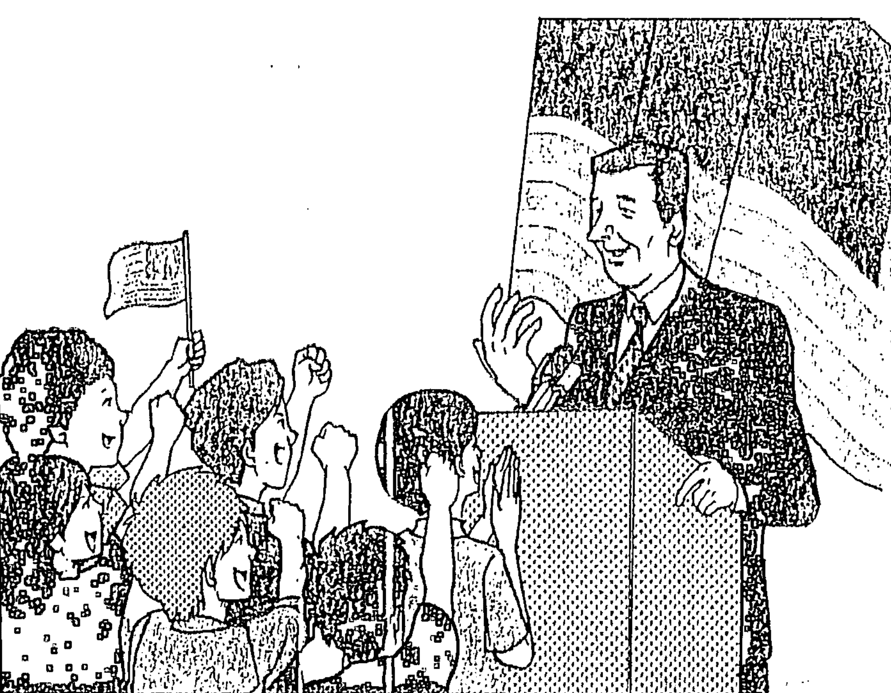

票率與說話聲調高低的因果關係進行調查的數據中，結果顯示了聲調低沉的候選人得票率，比聲調高亢的候選人高出了不少。尤其美國前總統雷根，據說便巧妙的使用了他低沉且沙啞的嗓音獲得了許多支持。除了歸功於他的演員身分外，相信他對聲音的重要性也有一定程度的認知。低沉且沙啞的聲音，能強調出男人味並帶給人溫暖的感覺。

男性低沉的聲音，對女性而言是男性化的象徵。若男性說話時聲音略為低沉且語尾有力、並且採取了對事物明言的態度，則較容易獲得好感。

此外，針對不同情況調整使用的聲音大小也是相當重要的一環。想要拉近與對方距離的時候，運用低沉的聲音便能增加雙方的親密度。美國前總統雷根的經驗就是很好的例子，以低沉且沙啞的嗓音輕輕陳述的說話方式，表現出了給人感覺容易親近的形象。

#### 控制說話速度，讓人感覺是「有能力的傢伙」

在商務現場發表簡報，或為了向客戶推銷商品時，若像這樣需要以帶有說服力的語調、氛圍進行解說，則最好在演說當中加入不同聲調。

但是，說話的速度必須隨著對方的年齡不同加以改變。千葉大學的一川誠副教授的實驗當中，找來約三千五百位四到八十歲的民眾，請被實驗者在自己感覺經過了「三分鐘」時按下按鈕。實驗結果顯示，年齡越大的人，越容易有在超過三分鐘的時間後才按下按鈕的傾向。更進一步的分析後，發現二到四歲便會隨著年齡的增長而感覺一秒鐘的時間變長，到了七十歲後甚至會覺得比實際時間更增長了一成左右。

換句話說，隨著年紀越長，自己所感覺到的時間經過速度會越慢，並感覺實際的時間過得比較快。常聽到大人說「時間過得真快」，指的或許就是這個意思。像這樣，實際的時間與人類感受到時間有所不同，在心理學中被稱為「時間感覺」。

若以年齡層的不同來考量對時間的感覺，那麼在對五十多歲的人說話時的速度，應該比對二十多歲的人說話時更為放慢速度，如此一來也能讓他人對自己的印象加分。下次與特定年齡層的人談話，或是與年齡相近的人說話時，請務必留意這一點。

#### 藉由誇獎男性的能力來誘惑對方

無論對方是什麼樣的人，都不會因為被誇獎而感到不開心。即使對方在當下表現出一副若無其事的表情，但想必內心一定是非常雀躍的。

然而，應該誇獎的重點，男性與女性各有不同。若沒能掌握這項要點，就會做出文不對題的發言，如此一來，不但無法打動對方的心，對方甚至會覺得「你根本不了解我！」

在誇獎男性時，重點在於誇獎對方的能力。這是因為男性的腦內受到了狩獵本能的影响。在古代，男性最重要的工作就是為了家族捕獲獵物。也就是說在當時，捕獲獵物的能力與否決定了一切。因此，「身體練得真壯耶！」「聽說你三兩下就拿到與 A 公司的合約了，真厲害！」等，會使人聯想到能力強度、成果、結果的話語，會使男性感到開心。男性很容易因為能力受到讚美，或使自己感到自豪的話語而受到影響。

當對方為男性時，將對方憑藉著自己能力的成果所得到的收穫加以稱讚，也相當具有效果。靠著自己的能力所得到的成果，就如同在戰爭最後獲得的戰利品。除了象徵著成功的同時，這些滿足成就感的物品，所存在的意義也如同是在展現自己身分。例如：會使用獎金去購買車子或手錶、豪宅等高價物品原因便是如此。因此，以「那支手錶看起來好高級喔！」「這套西裝的剪裁真棒！」等言語來稱讚對方，那麼被誇獎的一方一定會相當開心。

由於能力的高低所能獲得的東西，並非只有實實在在的物品。學歷或地位也都是能力高而所能獲得的。「○○大學真是一流的大學」「一哇，原來你就是那家公司的部長！」等的言語，雖然聽起來太過刻意，然而即便明白對方只是在說客套話，被稱讚的一方仍會因此而感到滿足。在酒店裡，因為被捧上了天而成為常客的男性，所抱持的就是這種心理狀態。

#### 藉由誇獎女性的行動使其產生愛慕之情

與男性相反，當對女性稱讚其成就或結果時，並無法產生太大的效果。基本上，相較於男性，女性的疑心病較重，所以在稱讚對方能力時，說不定反而會招來對方的猜疑心。因此，稱讚對方的行動或行為較容易得到效果，換句話說，對女性而言過程重於結果。

例如：在稱讚勤奮工作的女性時，與其稱讚對方「這個月的業績排名第一呢！」反而是「妳總是加班到很晚喔？」「妳對應客戶的時候真細心。」這樣的話語，更能使女性感到開心。

在古代，女性最重要的工作便是支撐家庭。與男性的工作不同，這並不是一份會因為成果而有不同展現的工作。相較之下，更重要的是每天一步步的累積。正因為如此，讚美對方勤奮努力的身態是相當重要的。此外，稱讚女性的關鍵在於，必須同時表達出對對方想法的理解。女性想要獲得同感的心情較強烈，若要使對方的好感產生，重點在於理解對方的心境和行動後再加以誇獎。對於時尚較敏感的女性，最好稱讚對方「那件裙子選得真棒！」「妳昨天剪頭髮了吧，很適合妳喔！」

然而，誇獎的若盡是一些理所當然的事物，則會顯得成效不彰。對於天生麗質，平常就聽慣了這些稱讚的女性而言，即使稱讚對方「妳真漂亮！」，對方也只會認為「啊，又來了！」，並不會因此而對你留下印象。

這種情況下，改為稱讚對方的內在，以稍微不同的角度來讚美對方，應該會有較明顯的效果。例如：「妳連這個都為我著想到了啊，真是太貼心！」「妳在工作時流露出借著知性的眼神，相當吸引人。」這一類的表現方式較為恰當。由於平常不習慣被這麼稱讚，反而會因此使對方產生強烈的印象，進而產生「那個人能了解真正的我」、「他一定能將我的優點帶出來」這種類似於愛慕的情感。

想要稱讚女性時，重點在於從平常就必須調查對方有興趣的事物，並且觀察對方的行動或動作。

#### 察言觀色來操控日語

在語言學當中，文章的前後或背景的銜接，稱為「文章脈絡」（Context）。日語的表達方式，並非用盡言詞來向對方表達自己的意思，而是會根據狀況不同來察覺對方想表達的意思，這種語言環境稱為「高情境文化」。相反的，憑藉著帶有理論性的語言，並經由說明能力、說服、交涉等反覆交流來溝通想法的歐美型語言環境，則被稱為「低情境文化」。

在如日語那樣高情境文化成立的環境中，所需要擁有的不只是單純的言語能力，而是要能讀出隱藏於背後的真意。要能自在使用日語，就必須要學會「讀出字裡行間的意思」、「看氣氛」。

例如：當對方說了「好熱喔！」的時候，

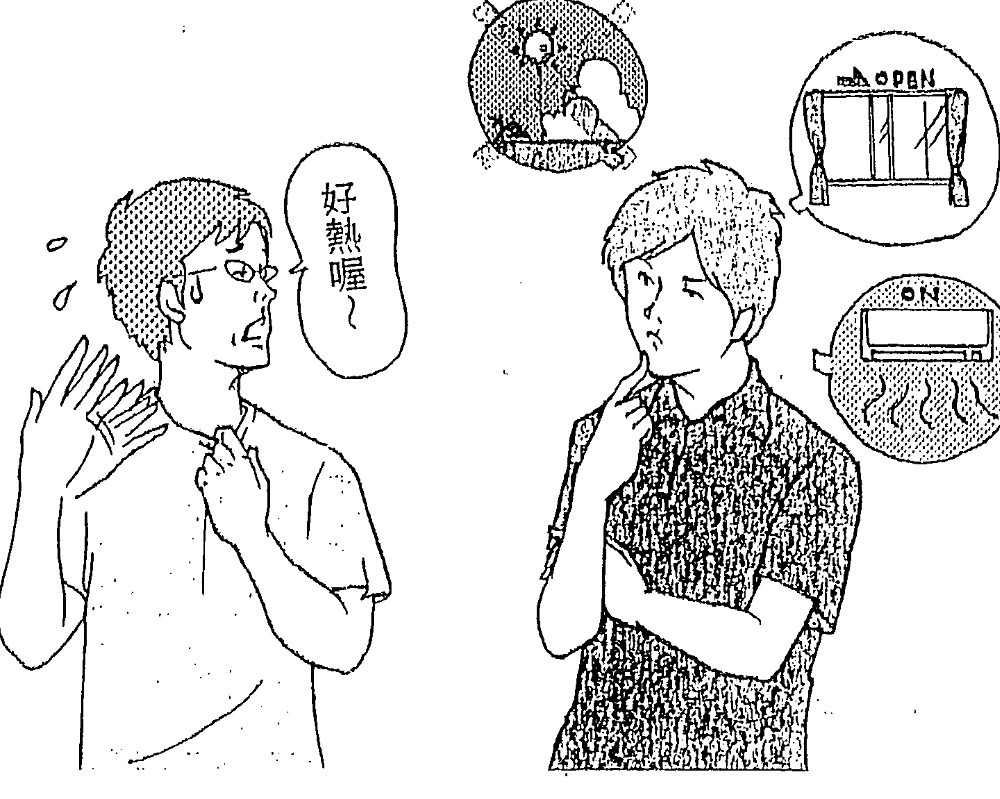

雖然有可能只是單純提到天氣的話題，但是依據情況不同，也可能隱藏了「這個房間好悶喔，真希望開一下空調。」的真心話。

在這種語言環境下，自然而然的會產生真心話與場面話。想要以日語來支配他人，就必須注意到對方的真心話藏在什麼地方。

#### 那個人的真心話表現在哪裡？

除了「察言觀色」之外，日語的表現方式還有其他需要注意的重點。那就是像「我是覺得這樣比較有趣，但是……」「大致上應該是 OK，但是……」的表達方式。

雖然這都是常用的表現方式，但因此而冒冷汗的人應該也不在少數吧。

這些表現中，雖然都加入了「有趣」、「OK」這類肯定性的句子，很容易讓人因此就鬆了一口氣，然而，後面接續的「但是……」才是問題所在。日語的特徵就是必須聽到最後才能了解句子為肯定或否定的「文末決定性」。若語尾加入了否定形，便表示否定的情緒較為強烈。日本人「盡可能使用曖昧的表現」、「但求息事寧人」的心情，使這個表現方法更被廣泛使用。若想要了解對方的真心話，就必須將注意力放在語尾。

相反的，這種表現方式也可以在想要緩和否定情緒時使用，因此，也能適時的對話中發揮緩和的效果。但是，如果對象是較遲鈍的人，或是想要直接傳達訊息時，則要盡量避免使用這種表現方式。

#### 甜言蜜語要用電子郵件來傳達

我們在現代社會中，每天都有許多用到電話或電子郵件的機會，不光是與自己親近的人聯絡，這些不需和對方碰面就能交談的工具在工作職場上更是不可或缺，因此，必須針對這些工具的特徵不同來加以活用。

相較於面對面的交談，使用電話或電子郵件時，是第二手或第三手情報無法傳入，處於封閉空間內的溝通方式。言語所扮演的角色，是相較於雙方面對面談話時更為關鍵的溝通工具。

也因此，電子郵件與手寫信件相同，都是能擴展自己形象的工具。憑藉著言語的含義內容，展開了各式各樣的推論。這種情況就如同小說，比起電影更容易引發讀者對人物或場景的想像力。自己所期待的世界隨著想像展開，也能使讀者的情緒更加高漲。

這種情況下，對於壞事情的想像會更加惡劣，對好事情的幻想也會更加美好。這也表示了，在向客戶致歉或處理客訴等惡劣狀況的對應時，最好不要使用電子郵件或電話。道歉或告知的對應處理中，應該在對方對惡劣印象過度想像之前，直接前往到當事人面前對應處理比較妥當。

相反的，開心的消息或浪漫的情話，則使用電子郵件或電話來傳達會更容易使情感高漲。藉由網路相識的兩個人，僅在經過短暫相處後就決定要結婚，這就是因為密閉空間促使情感高漲的表現。

此外，對於失去新鮮感的情侶關係，電子郵件也是在修復雙方關係上的一大助力。若對方將身邊有自己的存在視為理所當然，而自己卻因此感到困擾時，不如試著減少雙方見面的次數，嘗試在一、兩個月之內，以電子郵件為中心來與對方連絡吧！重新回到只讓對方看到自己美好一面的關係上，再慢慢累積浪漫的甜言蜜語。如此一來，過去曾經擁有的情感會再次復甦，更能加深雙方對彼此的想法與牽絆。

#### 不發一語的聆聽，使對方接受要求

前面所提到的，大多是以言語來獲得優勢時，所需的基本思考方式和準備。接下來將具體來介紹，以心理學、心理術的思考方式為基礎，利用「言語」巧妙誘導他人的技巧。

首先要介紹的是，刻意限制言語使用的「無言的技巧」。光是減少發言，就能控制對方的心情。對於聽到要使用言語控制他人就認為「難度太高了」的人，這個方法是最適合不過的了。

其中，仔細聆聽對方發言的「傾聽」便是方法之一。這也是現代臨床心理學的現場中，最主要被採用的方法。這個方法是由美國的心理諮詢師羅傑斯所提倡，並成為了現在的諮詢模式的基礎。

在傾聽時，曾經由讓對方說話的方式來整理自己的思緒，如果對現狀有所不滿，也可以藉此回頭檢視自己（或對方）的處理方式並加以反省，這樣的方式同時也帶著讓自己（對方）本身來找出解決方法的效果。此外，聆聽對方說話時，也會讓說話者對於無條件接受了自己的對象（傾聽者）產生信賴感。

應用這樣的方式，就有方法能不發一言的讓對方接受自己的要求。例如：當希望因工作忙碌而看起來很暴躁的女友能展現如以往般的笑容，因此男友估算了女友回家的時間，並詢問她：「最近好像很忙喔？工作很辛苦嗎？」

如此一來，女友便會開始傾訴對工作上的不滿，或自己處境的艱難之處。而你除了偶爾附和之外，大多數時間都只需要靜靜的傾聽。不久之後，女友便會因為自己的話獲得聆聽而感到滿足，並開始進入自我反省。

相信她同時也會對於認真傾聽自己說話的男友感到非常窩心，並且自發性的開始認為「要對男友溫柔一點」。在這樣的契機下，相信從此她對男友展現笑容的機會也會開始增多。

#### 以沉默在對方心裡植入恐怖感

無言的技巧，在「想拒絕對方」、「想讓對方感到恐懼，佯裝為強悍的人物」時也會被使用。若不帶表情也不表示贊同，只靜靜的聆聽著，一定會打亂對方的步調，並使對方對於自己想說的內容失去自信。

美國的心理學家約瑟夫·馬塔拉佐（Josef Matarazzo）在一九六四年所進行的一點頭認同實驗中，也證實了這項結果。實驗是以接受面試的男性為對象，實驗的條件為，在四十五分鐘的面試中，其中一組的面試官會在十五分鐘內頻繁地點頭，另一組則不增加點頭次數。

結果顯示，頻繁點頭的該組被實驗者，在面試中的發言次數增加，並且對答流暢，而另一組則無顯著的變化。

從實驗結果也可以清楚的了解到，點頭可說是發言時的潤滑劑，點頭越頻繁，對方的口語也會更加流暢。相反的，若想阻止言詞流利的營業推銷，只要反過來不動頭，就能達到阻止對方情緒上揚的效果。

這個方法也可使用在與辯才無礙的朋友或公司同僚的溝通上。如果老是被迫接受對方的要求，又不希望產生口頭上的衝突，只要持續的不發一語就能擾亂對方的步調。此外，若在對話的最後加入否定的言詞，就會使對方的談話無法繼續進行下去。

#### 限制情報，維持幸福感

無言的技巧中，較高難度的便是限制情報。在與對方交談且要說服對方時，並將想法全部表達出來就能說得通的。

相信你一定有過這樣的經驗。當你的面前擺放著美味的冰淇淋或巧克力，而你又正好感覺肚子有點餓時，一定會覺得「看起來真好吃」並忍不住的伸手拿。但是，當看到標示卡路里、添加了鮮奶油等的文字內容時，卻又會想「吃了會變胖，還是不要吃好了。」

「如果沒有標示卡路里，就可以毫不猶豫的好好品嘗了……」這就是所謂的，不懂的人比較幸福。

這樣的說法，也能同時驗證在我們的對話當中。如果男性對自己的女友說「我和二十個人交往過」，那麼即便是熱戀中的情侶，也會瞬間生厭。相信這對於女友來說，也是不知道會比較幸福。

在說話時會刻意選擇避開不必要的內容，這樣的做發與其認定它是一種技巧，不如說這是對聽話者的顧慮。在說話之前，記得先衡量話題是否適當之後再說出口。

#### 以「畢馬龍效應 (Pygmalion Effect) 」加以期望教育

在說明為了使自己處在優勢而使用言語巧妙誘導他人的心理術之前，我們曾提到，任何人在被稱讚時都會感到很開心。接著，我們將更進一步的介紹，使對方能依照自己期許的方向前進的「期望教育」心理技巧。

美國的心理學家哈洛克讓小學五年級的學生進行了連續五天的算術測驗，並且不分成績優劣，對第一組的學生無條件給予鼓勵，對第二組的學生加以斥責，對第三組的學生則不聞不問，藉由這樣的內容分別對應並比較這些學生成績進步的幅度。

結果顯示，獲得鼓勵的該組學生成績進步，受到斥責的學生成績停滯，而不聞不問的該組學生則未表現出變化。

像這樣，實驗對象因為受到期待而誘發出衝勁，進而使成績獲得提升的現象稱為「畢馬龍效應」。這個名詞源自於希臘神話中，塞浦路斯的國王畢瑪龍，日夜不斷的對自己所雕刻的象牙少女像傾注愛意，最終使少女像化為真實的故事，而心理學便以此加以命名。

當然，這種心理手法不光只能用在孩子的身上，同時也能用在大人身上。若希望伴侶能更加溫柔，那麼只要在對方為自己付出時向對方表示感謝，就會慢慢達到效果。

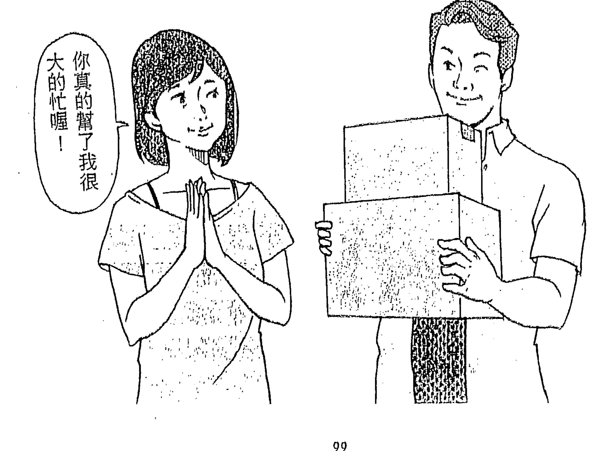

對對方說句「謝謝妳這麼為我著想，妳真的好細心。」或是希望丈夫幫忙做家事時，在對方幫忙完畢後說句「謝謝你。東西太重了我都快搬不動了，你真的幫了我很大的忙。」等，像這樣對對方的付出反覆加以稱讚就可以了。這個技巧只需要稍微留意就能輕鬆達成，請務必嘗試看看。

#### 以稱讚抑制成長，讓敵方敗在自己手中

只要能善加運用稱讚的技巧，除了有好感的對象外，就連散發出敵意的對手或自己不喜歡的對象，都能加以控制。雖然要稱讚自己不喜歡的對象多少會讓人感覺火大，但是只要想想這是馴服對方的過程之一，心理應該多少會舒服一點。

假設你希望能馴服對手，並偶爾能將自己不想碰的工作推給對方。此時應該使用的是「認知失調理論」的心理學概念。所謂的認知失調理論，是在一九七五年由美國的社會心理學家雷恩・費斯汀格（Leon Festinger）所提倡的概念。

這是指，當人遭到某些事情時，由於所發生的事情跟自己預想的狀況不同（失調），而為了消除這種失調的情況所產生的心情狀態。

例如：「受到敵方稱讚」的情境也符合這種情況。所謂的敵對關係指的是，即便平時互相認同對方的能力，卻並非會互相稱讚的關係。因此，會使敵方產生「不可能的對象稱讚」的失落感。而心理上為了消除這樣失調的感覺，就會開始產生認為「那傢伙說不定意外的人還不錯」的心理作用。

在如同下述對方贏得功勞時，正是最適合稱讚敵手的最佳時機。

- 「聽說你在五家公司參與競賽的設計比賽中獲勝了？做得不錯嘛！」
- 「聽說你拿到 A 公司的訂單了？那間公司的部長不是聽說很難搞嗎？」

大致上是這樣感覺。

就這樣把握時機藉由稱讚的方式來抑制對方，就能使對方漸漸卸下心防。當對方的競爭意識與敵對心消失，便在不知不覺中開始會聆聽你說的話。這個時候，就可以將麻煩的事或較有危險的案子塞給對方處理。由於對方內心必須回應要求的潛意識作業，因此，雖然在過去完全料想不到，但對方說不定會相當乾脆的就接受你的要求。

像這樣隨時在自己內心設下「稱讚開關」，相信理想的狀態會隨時到來。只要每天不斷磨練稱讚的技巧，連敵手都會對你伏首稱臣。

#### 利用「重覆答話」來裝出認真傾聽的樣子

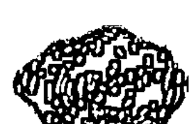

當想讓對方認為你有認真的在聆聽時，或是對方說著無關緊要的話題，但是對方的身分又使你不得不聽時，「重覆答話」這個方法是相當方便的 psychological 技巧。

重覆答話是心理學用語中「呼應」（Echoes）的其中一項。所謂的呼應是指，配合對方說話的節奏、速度，或是音調的高低、聲音的大小等，藉此使對方產生親近感的心理技巧。

在重覆答話中，經由重覆對方所說的話，產生使對方認為「自己獲得接受」的效果。方法也相當簡單，只要抓住對方說話的語尾或關鍵字，再加以複述就可以了。例如：工作結束後，居酒屋裡，為了配合老是自誇個不停的上司時，就可以用下述的話來附和。

- 上司：「高爾夫比賽的時候，我可是一桿進洞了哩！」
- 自己：「一桿進洞啊！」

- 上司：「A公司的鈴木老是一副自以為了不起的樣子，所以我上次當面唸了他一頓。」
- 自己：「唸了他一頓啊！」

基本上，不需要認真的去聽對方說的内容，只要復誦句子就可以了。光是做到這點，對對方而言就是一種「你有認真在聽我說話」的信號。

在黃湯下肚後，對方對於自己自誇的話題或抱怨過的内容也不會記得，因此也不需要太認真聽。但是，若沒有表現出這種傾聽姿態，就會被對方以「你根本沒在聽！」為理由纏上，如此一來場面就變得更加棘手了。

當然，在想要認真的傾聽對方說話時，這個方法也能將你的想法確實傳達給對方知道。你只要記住，不知該如何適當回應時，試試「重複答話」也是一個不錯的方法。

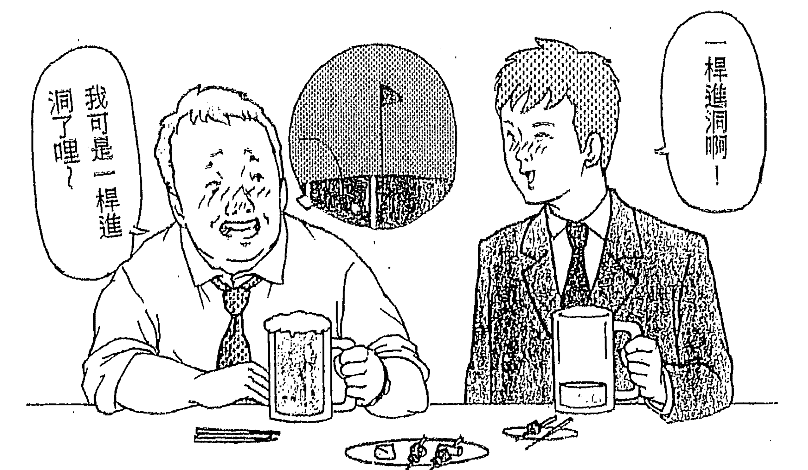

#### 利用「真的」來包容對方

我們在前面的提到了，稱讚女性時，使用帶有認同感的句子會更有效，但這並非只適用於稱讚對方的時候。因為女性基本上有著強烈希望受到認同的傾向。

你是否曾有過這樣的經驗，當女友或女性友人找你商談時，你明明覺得自己已經表達出意見並提出了建議，但對方卻露出了無法接受的表情？其實在這種情況下，女性想尋求的只是你的認同。

當男性提到「商談」時，通常會以理論的方式找出「解決」的方法，但是女性的心理並非如此。「我有事情想要跟你商量……」這句話的真意其實是「我希望你能傾聽——『我希望你能理解』」。

男性在感到煩惱、脆弱的時候，也會有同樣的心境產生。也就是說，希望將自己的想法正當化。這種情況下，像「真的——」「我了解。」的句子較能帶來效果。這些句子中，包含了肯定對方且表示「妳是正確的」、「我站在妳這邊」的含義。這種肯定的言詞在心理學中被稱為「社會正當化」。

紐約州立大學的心理學家悉尼．休雷克（Sydney C. Finkel）便透過對話的實驗來證實了這個理論。休雷克將被實驗者帶到了某個場所，將被實驗者分為男女混合的

三人組，並讓各組在一定時間內進行對話。在實驗結束後，調查了所有參與的人對此的印象，其中獲得高評價的是「願意對自己的發言加以肯定的人」。

  想要抓住別人的心，最重要的是自己必須先接受對方。即使認為對方的意見「不正確」，也最好先表達自己的認同感。只要靜靜的以寬闊且包容的心情來面對，就能掌握對方的心。

#### 想要提反對意見時，利用「yes but 法則」來掌握主導權

  當想要對對方的意見提出反論，或是提出難以令對方接受的要求時，你是否曾滿口理論的想要說服對方呢？只要試著站在對方的立場思考就能了解，在這樣的情境下正面進行交涉，很容易就會引起對方的不滿。

  在這個時候，心理術更能助你一臂之力。重點就在於，你必須先試著接受對方。

  首先仔細聆聽對方的意見，並先暫時接受對方的意見。此時，最好再加上「原來如此！」「你說的沒錯！」「我了解！」等，帶有「yes」含意的回覆。

  之後，在對方認為雙方意見一致並感到安心時，再開始提出自己的意見。這時的重點在於，同樣必須留意到盡量不要使用否定的字眼。例如：若是在商務場景進行交涉，可以試著以「我能理解你的心情。但是，在這個情況下我認為這麼做是比較恰當的。」或「很遺憾的，我們不能採用那個方法，但是若是這個方法的話，我們很願意為你效勞。」這樣的說法來進行提案。

  這個方法稱為「KOGG法則」，同時也是銷售員法則中很常使用到的心理技巧。為何這項法則能帶來如此的效果，是因為其中包含了心理學中的「認同」。也就是同意對方的主張，在對方面前表現出接受的行為。即使感到憤怒或反感，包含對方的立場和理由在內，都暫時全部接受。

  此外，在這樣的對話中，只要在文末以肯定的句子來結束，或不使用命令的語氣而改以委託的方式來表達，就能大大改變帶給別人的印象。

  避免「雖然能達到高品質，但成本的問題也請你有所覺悟。」這種說法，改成「雖然成本較高，但是品質是可以保證的。」來表達。比起「請到我們公司來」，「可否請你到我們公司一趟呢？」等的說法更為適當。

  在不表達反對意見的情況下，掌握住實質的主導權是相當重要的。雖然一開始必須先放棄自己的意見跟尊嚴，但是最後微笑獲得勝利的人一定是你。

#### 以刻意「委託幫忙」來籠絡對方

  想要讓對方配合自己的步調時，刻意拜託對方幫忙也是手段之一。你可能會認為「這麼厚臉皮的事情……」而退縮，但越懂得適當的運用他人的力量，就能更巧妙掌握這項技巧。

  美國的心理學家吉姆·傑可（Jim Jacka）與大衛·蘭迪（Dave Lundy）便藉由「援助的認知失調實驗」來證明了「委託幫忙」所產生的心理效果。首先，先請接受實驗的大學生幫忙解答問題，並支付三美元或六十分美元的報酬。之後，負責人以「資金周轉不過」為理由，向學生提出了「歸還報酬金」的請求。

  此時，藉由①由負責人直接委託②由大學職員委託③不委託歸還，這三個方式及歸還金額的不同，來比較大學生對負責人所抱持的好感度。結果顯示，①由負責人直接委託時，被實驗者對於負責人所抱持的好感度最高，同時，要求歸還的金額越大，好感度也相對較高。

  乍看之下，委託對方幫忙會帶有給人添麻煩的印象，但是以對方的立場來看，根據內容的不同，反而會讓被委託的對方產生滿足感、好感及親近感。同樣的，若在商務場合中對同儕或後輩委託「現在情況很緊急。能請你幫個忙嗎？」並在結束後向對方表示「你幫了我一個大忙，真的很感謝」。一時，相信對方也會因為自己成為了他人的助力並且受到了感謝，而更強烈的感受自己存在的意義。不但如此，也會對於委託自己幫忙的人加深好感。

  在委託他人幫忙後還能獲取別人的好感，對自己而言是穩賺不賠的。這種方法也可以活用在長輩或立場相近的人，甚至是異性身上。好好活用拜託別人幫忙的機會，來增加自己的夥伴吧！

#### 頻繫的稱呼「名字」來增加親密度

  在商務會談時，如果與對方的關係變得親密，就會變得很難拒絕對方的提案。心理技巧中便有著這樣一個方法，可以善用人的這項心理作用，及早與對方培養出親密的關係，使對方無法拒絕自己提案。這個方法就是「頻繫的稱呼對方的名字」。

  心理學當中將這樣的心理狀態稱為「社會性報酬」。稱呼對方名字的行為，是屬於在溝通場合上「認同你的存在與價值」的報酬行為。

  美國循道大學的丹尼爾．霍華德博士便進行了下述的實驗，證實了「社會性報酬」所帶來的效果。首先，先請學生們進行自我介紹，並個別將學生叫入博士的房間內。接著進行【稱呼學生的名字、②因忘記名字而請學生再次自我介紹、③不稱呼名字】以上三個對話模式後，詢問學生是否有意願購買餅乾，結果分別有①90%、②60%、③50%的學生購買了餅乾。

  人類只要聽見自己的名字出現在對話中，就無法不對其產生關心。在被連續呼叫名字的過程中，也不自覺得開始對對方產生親近感。

  在商務場合中，時常見到雙方公司不分你我，都會在對話中以『部長』等的頭銜，或是以『貴公司』和公司名稱等的稱呼來開啟對話。此時，請務必培養出習慣，以『鈴木部長』等加上姓氏的方式來稱呼對方，或是直接稱呼對方的名字，而非公司名稱。

  同時，在打招呼的時候也同樣的利用『鈴木部長，早安。』這種加上稱呼的招呼方式，或是在詢問對方的判斷時，以『鈴木部長，你認為如何呢？』的方式來加以詢問。這樣不但能使對話在不知不覺中成為了一個人與個人的對談，並且能增加親近感，使雙方不再侷限於只是互相認識的關係。

  如此一來，過去一直受到對方忽視的問題，對方也會變得願意確實對應。此外，在提出詢問時，對方也會更願意回答問題。

  這項技巧不光能用再商務場合，當雙方是長年相伴的夫妻、或是與不太熟的朋友相處時，若過去是以「姓氏」來稱呼對方，那麼就試著改以「名字」來呼喚對方，也同樣的能達到拉近距離感的效果。

#### 展現自己的弱點，以較少的報酬帶給對方滿足感

  「我沒有錢，但是希望能滿足她。」「我們只能付出這點的金額，但希望你能努力工作。」

  雖然這些都是些古錙便宜的想法，但是心理術當中，確實有著讓這些想占便宜的想法實現的手段。那就是讓對方看見自己的「弱點」。這個方法是運用了稱為「認知失調理論」的這項心理學理論。所謂的認知失調理論指的是，所獲得的東西較少卻反而感到滿足、且變得願意為此付出一切的心理狀態。

  美國的社會心理學家雷恩·費斯汀格便以實驗證明了，勞動者在勞動條件越苛刻的情況下，越是容易因為便宜的工資而感到滿足。

  在這項實驗中，先是讓複數的學生團體進行了簡單的作業內容。在聽取對於作業內容的感受時，所有學生的評價都是「無趣」。接著，在分別發放了高額報酬及少額報酬後，繼續讓學生團體分別進行作業，之後再次聽取學生對作業的評價時，獲得高額報酬的團體所評價的內容並沒有改變，但是獲得少量報酬的團體對工作所作的評價則變成了「有趣」。

  為何獲得的報酬少卻覺得「有趣」呢？那是為了要否定明明工作內容嚴苛但報酬少，原因是出自於「自己的評價較低」的想法，因而產生了「我是因為感到開心才工作的」的心理狀態。

  這種心理法則也可以使用在滿足另一半身上。例如：在平常約會時，刻意不去高價的餐廳，並告訴對方「不好意思喔，我沒辦法花太多錢。不過等拿到獎金，我一定會帶妳去那家餐廳（高級餐廳）的。」這時候，女友的心理便會將內心真正的想法，改以「就算不去高級餐廳也沒關係。因為我只要能和他在一起就覺得很開心了」來帶入。

  之後，女友也會開始樂於為對方付出一切。當然，別忘了偶爾還是要帶她到高級餐廳吃頓大餐，或送她一份貼心的禮物喔！這些事都會在她的內心留下深刻的印象。了解了心理學或人的心理法則後，就不需為了另一半勉強自己花費大量的金錢了。

#### 以「展現自我」來提升第一印象

  在聯誼或聚餐等認識朋友的場合中，自己介紹顯得相當重要。因為無論是在建立對方心目中的印象，或是在雙方日後相處時，第一印象都會帶來很大的影響。心理學中將這稱為「初位效果」。而為了將好印象植入對方心中所使用到的心理學手法則稱為「自我展現」。找出自己的優點或想展現出的關鍵點，藉此帶給對方好的印象。

  例如：聯誼的場合中，心儀的女性表示自己「喜歡強悍的男性」時，為了表現出自己內在強悍的一面，你便可以試著表示出自己「有在跑健身房鍛鍊肌肉。脫掉衣服的話很有看頭」。即使你實際上一個月只去一次也沒關係，只要不說謊就沒問題。

  此外，自我展現中，也有著稱作「自我展現內在花」的效果。像在剛剛的例子中，男性表現出了代表自己強悍的一面，而由於在眾人面前作出宣告之後，本人也會開始將自己認知為是個強悍的人。

  在聯誼時，如果不展現出真實的自己，很容易就被埋沒了。若可以帶給對方好的印象，那麼就能轉換成等候對方來向自己表達的立場。或許說出來的內容多少帶點誇張的成分，但藉著這樣的機會，也許某天就真的能成為自己理想的样子。

#### 以「雙面展現」使對方完全信任自己

  與前面提到的自我展現不同，還有另一個做法是展現出不好的一面使對方信任自己。在心理學的世界上，將這稱為「雙面展現」。

  這種方法最常被使用在銷售商品的場合。例如：某個洗髮乳的商品特點在於富含了保持頭髮健康的成分，同時，對於抑制頭皮屑及頭皮癢也能發揮相當不錯的功效。不但如此，這項商品擁有這樣的好品質，價格卻非常親民。像這樣光是針對洗髮乳的優點加以宣傳，相信也會不少人會不禁開始產生懷疑。這個時候就可以告訴消費者，該產品由於帶有藥效，因此缺點是味道上多少帶了一點藥用成分。

  若針對商品的長處說個不停，就會使聽的人開始產生警戒，此時只要稍微加入一些缺點的說明，反而會使消費者感覺「毫不隱瞞，誠實的將情報公開」，而對商品抱持信賴感，並開始產生好的印象。

  雙面展現的效果，在社會心理學家林理及山岡和枝的實驗中也獲得了證明。在實驗中，他們以保險廣告為題材，將不告知風險的廣告以及告知了風險的兩種版本的廣告，播放給接受實驗的大學生觀看，並詢問大學生們「對哪個版本較有好感」。結果顯示，有百分之八十的大學生表示對於告知了風險的廣告較有好感。從這個結果中也可以了解到，比起基本情報或僅告知好的情報，人們對於連同風險也一同告知的情況較容易產生好感。

  這項理論也可以使用在販售各式各樣的商品。你在與客戶洽談時，是否只顧著推廣自己公司商品的優點呢？此外，你是否只顧著透過工作的方式，向客戶們表現出自己優秀的一面呢？不光是商品，對人而言，雙面展現也是相當具有效果的。不妨偶爾向客戶們展現出自己的缺點，說不定客戶對你的信賴感和好感度會一口氣上升不少喔！

#### 藉由「小動作」來迷倒對方的極秘心理術

  「那個人的動作相當俐落，看起來非常能幹。」「我的心被女性的性感動作拐走了！」「你是否曾在私底下有过这样的对话呢？这么一说就不难发现，『小动作』也是非常厉害的沟通手段之一。除了言语之外，身体的姿态、手部的动作、视线的移动的方式等，都可以动摇人的心理。」

  日本人通常不需要太多言语上的说明，只要从对方不经意吐露的自言自语，就能读到对方想要的东西并探知对方的意图。由于这样的习惯早已培养而成，因此只能看到对方的一些小动作，脑子里都会下意识的去探索对方想表达的意思。

  例如：在商务洽谈中，当说明完自己的商品后，只要看到对方双手环在胸前，就不自觉的产生要拉拢对方的想法，并且开始思考著『是否再降低价格比较好呢……』而我们便可以利用这样的心理状态，来将对方带入自己的步调当中。

  此外，也有某些技巧是利用了人类在无意识当中所感受到的好印象及坏印象的这类深层心理。

  我们常说『眉目传情』，视线的变动也会带动人的心理变化。接下来将介绍在商務等的場合中，能對人際關係帶來幫助的各種與「小動作」相關的心理技巧。經過言語的下一步，就讓我們來研究與動作相關的技巧吧。

#### 利用「同步行動」悄悄拉近距離，使對方感覺親近

  從公司的上司或客戶端的關鍵人物，乃至於心儀的異性，你是否有一想跟對方打好關係」、「希望帶給對方好感」的對象呢？

  心理學上有著稱為「鏡射」（Mirroring）的技巧，可以幫你達成這樣的心願。做法相當簡單，只要模仿你希望對你產生好感的對象所做的動作即可。與對方做出同樣的動作，是表示「接受對方」的信號。隨著動作無意識的將自己認同著對方的情感表達出來。

  關係良好的雙方，即使不需要對話，只要在一旁看著就能理解彼此。因為氣味相投的人、互有好感的人們，無論是小動作、態度、說話的節奏都很相像。相信你曾經覺得走在路上看起來感情很好的女孩子們，連動作也很相像吧。當然，這些都並非是刻意而為，全都是在無意識之中不知不覺產生出來的。這樣的現象，在心理學用語中稱為同步現象。

  也就是說，應用了鏡射技巧，從日常中就開始觀察對方的口頭禪或說話方式、語調。若是在商務會談中，則配合對方喝茶的時間點或是模仿對方擺動身體的姿勢。雖然是從表面著手的行為，卻能讓你在不知不覺中同時也掌握對方的內心。如此一來，即使是冷淡的商談對象，相信也會漸漸的對你敞開心房。

#### 控制「眨眼」的頻率來獲取對方的信任

  眨眼是表示正在說謊時的信號之一。因為在對方的言語行動有所動搖，並希望恢復冷靜時，眨眼的次數就會跟著增加。在被對方緊盯著時，或是對方有出人意表的行動時，眨眼的次數也會增加。

  眨眼次數變多時，心理反應會本能的想避開對方的視線。看到眨眼次數多的人，會令人感覺可疑、不可信任，就是這個原因。

  美國曾對「眨眼」跟「心理」的關係進行了心理學上的相關調查。美國的波士頓大學神經心理學教授約瑟夫·泰斯（Joseph Teece），在一九九六年的《新聞週刊》雜誌中，發表了當年的美國總統候選人電視辯論會上的眨眼次數。當時的候選人為鮑勃·多爾（Bob Dole）及比爾·柯林頓（Bill Clinton）。他們在選舉期間進行辯論時的眨眼次數，多爾平均次數為一百四十七次，相較之下，柯林頓平均只有九十九次，而最終的選舉結果，則由柯林頓獲選。

  約瑟夫·泰斯教授除了一九九六年的總統大選之外，也分別對其他五次總統大選進行了調查。調查結果也指出，在辯論中眨眼次數較多的候選人全數落選。雖然眨眼並非影響選舉結果的直接原因，但或許多爾在美國國民的眼中，呈現了較膽小的印象。

  男性在說謊時，眨眼的次數會增多，多爾也是如此。但是，女性在說謊時，反而會減少眨眼的次數，並且會直盯著對方。據說這是因為女性本能的就了解到，說謊時眨眼次數會變多的道理。

  男性們不如試著學習女性的動作，在與人說話時有意識的將眼睛睜大，並且忍受。

#### 以『真摯的附和』征服對方的心

  耐減少眨眼的次數吧。如此一來，即使被懷疑出軌而受到逼問時，或是因為發表報告而感到緊張時，也不容易被發現。配戴隱形眼鏡的人，容易因為眼睛乾燥而使得眨眼次數變多，所以在碰到關鍵時刻時，建議還是配戴眼鏡比較適當。

  附和的有無，可說是在聽對方說話的時候，能夠掌控對方步調的關鍵動作。附和是代表正在認真聽對方說話的一種信號，並與是否產生共感有所關聯。

  附和的方式也存在著帶有效果的心理技巧。美國馬里蘭大學的心理學家亞倫席格曼，便以四十八名女學生作為對象，針對附和的時間點進行了實驗。

  在實驗中，將對學生進行的訪談分為前半段與後半段，並分別改變附和的有無來進行訪談。同時在實驗結束後，向學生們詢問訪問者是是否位親切的人物。

  結果顯示，若在前半明明有附和，在後半卻沒有回應，則會在學生心裡留下冷淡的印象。這表示附和的動作在中途停止的話，評價將會變低。

  對話中的附和，最重要的是必須持續回應到對話結束。因為這象徵了自己是熱心的在聆聽對方說的話。此外，若一開始附和次數較少，到了後半附和次數跟著變多，也可以展現出「還想要再聽你說更多的話」的意思。

  若能夠巧妙的附和，就能成為很好的聆聽對象。在社會上，有很多人都希望能夠有願意傾聽自己說話的對象。特別是年齡越長的人越是覺得「想向年輕人傳授自己的經驗」。

  如果有機會聽取公司的上司或客戶的上級長官的談話，好好的附和讓對方認為「對這個人說話時，感覺心情真好」。藉此取得對方歡心，並取得信賴吧！

#### 以性感的「反差」來操控異性

  你是否曾聽過「招來桃花的動作」這個說法呢？有些動作在同為男性或女性眼中，並無法感受到任何的刺激，但是在異性眼裡，卻是會讓人感到心跳加速的動作。基本上，男性心理對於強調女人味的小動作特別無法招架，而女性心理上也容易對於強調男人味的小動作感到心動。

  會讓異性感覺女性散發出性感特質的是觸摸頭髮的動作。相較於男性而言，女性的頭髮較長且髮量也較多，因此會使男性認為，頭髮是自己所沒有的性感象徵。經過保養後的柔順秀髮，更是提高了讓人「想要觸碰」的慾望。將頭髮勾在耳後、以手撥弄頭髮、綁頭髮的動作等，各式各樣的動作都能引起男性的興趣。此外，頭髮長度長，所能看到的變化也更顯著，相對的也更有效果。

  同樣的，能強調女性特有的身體曲線的動作，也帶有令男性感到心跳加速的效果。刻意以左手拿取位在右邊的東西，這種動作稱為十字法則。例如以左手碰觸右耳上的耳環，只要兩手呈現交叉的動作都適用於這項法則。

  相對的，會令女性感到性感的男性動作之一，就是將領帶弄鬆的行為。男性的脖子到胸口，是象徵著 on 與 off 交換的區域。一下子改變了打上領帶時正經八百的形象，而當窺視到那結實胸膛的瞬間，讓人再也捨不得將目光移開了。這在心理學上稱為反差效果。

  其他像捲袖子的動作也能讓人感受到反差。當在工作中需要搬送重物，而脫掉了外套，露出平常看不到的強壯手臂時，也會使女性感到心跳加速。當心臟的女性因為搬不動的重物而感到困擾時，正是男性們「捲起袖子」「自我展現」的最佳時機。

  向對方表示「搬重物的工作就交給我吧」，暴露自己溫柔的一面，並同時強調手腕的強壯，這樣一來就可以利用身為男性的魅力來抓住對方的心。

#### 以「輕輕觸碰」的技巧來消除警戒心

  相信有不少人都有過這樣的經驗，在聯誼中被女性觸碰了手或肩膀，而因此不知覺的對對方產生了好感。在美國進行的心理學實驗中發現，適度的身體接觸，不光是對於異性，甚至也可能是對同性產生好感的契機。

  實驗的設定如下：在街上進行問卷調查時，設定了下列兩種情況，一種為詢問者會輕輕觸碰回答者的手臂來取得對方的答覆；另一種則不觸碰對方。接著在問卷調查即將結束前，詢問者手中的問卷將散落在地上，藉此比較回答者是否會幫忙撿取問卷。

  結果顯示，被觸碰手臂的回答者幫忙撿取問卷的比例較高。由此可見，身體接觸是獲得對方好感的契機之一。人在身體被觸碰時，會產生如同回想起嬰兒時期被母親抱在懷裡的安心感。

  若是想讓上司或客戶對你帶有好印象，不如試著製造機會不經意觸碰對方看看。此外，由於男性之間的相處，也很容易就會對對方產生警戒心，因此如果能輕輕觸碰對方以解除警戒心，相信也會是讓對方產生好感得契機。例如：當發現上司走在前方時，可以輕碰肩膀來向對方打招呼，或是當與客戶交涉成功時，可以伸出

#### 控制視線，掌握對話的主導權

常常聽到公司的人或雙親說「與人對話時，要好好看著對方的眼睛說話」，這是身為社會人的基本禮儀。接下來，將為你介紹另一個更高階的技巧，那就是以「視線的動作」來掌握對話主導權的方法。

基本上，在對話的時候，大多都會適度的與對方視線相交。這是代表自己有確實的在聆聽對方說話的象徵，但重點就在這之後。視線交會時有著這樣的心理效果，認為先將交會的視線移開的人較占有優勢。人們普遍認為，將眼神移開是缺乏自信的表现，但事實並非如此。

這種心理效果在英國的心理學家布萊恩·強普士所進行的實驗裡也獲得了證明。在實驗裡，將初次見面的學生以性格主動與被動加以分組，並從中各挑選一名組成配對。在配對的學生中間放置不透明的玻璃，讓他們在看不見對方臉的情況下對坐。之後，再將玻璃抽開，使雙方面對面。接著調查主動組與被動組，哪一方會先將視線移開，最後的結果顯示，主動組將視線避開的比例非常高。

這是因為先將視線避開的話，有帶來使對方感到不安的心理效果。在對話中，當雙方眼神對視時便會形成對等的關係。然而，若對方先將視線避開，則被避開的那一方便會產生「我是不是做了什麼不該做的事」這樣的不安定的心理狀態。如此一來，避開視線的那一方，將容易掌握對話的主導權。

試著從日常生活中衡量避開視線的時機吧。相信這項技巧也能在商務會議或洽談等需要內心角力的場合帶來幫助。

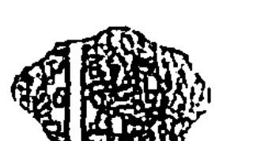

#### 從上司的右側接近，以獲取對方的安心感

到目前為止，我們已經介紹了不少與對方對峙時的心理技巧，但實際上手對峙開始之前，從接近對方的那一刻起，心理戰就已經開始了。此時需要注意的技巧就是「該從哪一側接近對方？」

人幾乎無時無刻都會無意識呈現出要保護心臟的心理狀態。因此，若有人站在與心臟同樣方向的左側時，就會無意識的感到壓迫感。這種情況，在遇見完全不認識、初次見面的人時會更加嚴重。如果與對方不夠熟識的話，建議還是從右側來接近對方比較好。

此外，因為右手為大多數人的慣用手，因此也會讓對方抱有可能緊急情況時還有手可以活動的心態，也同時帶來降低對方警戒心的效果。這也是百貨公司在接待客戶或銷售員的世界裡，常使用的技巧。要向上司提出企劃案時，或在公司的慰勞宴上要為上司斟酒時，也記得活用這項技巧，隨時注意從右側接近對方吧。如此一來，也能夠使上司無意識的對你產生安心感。

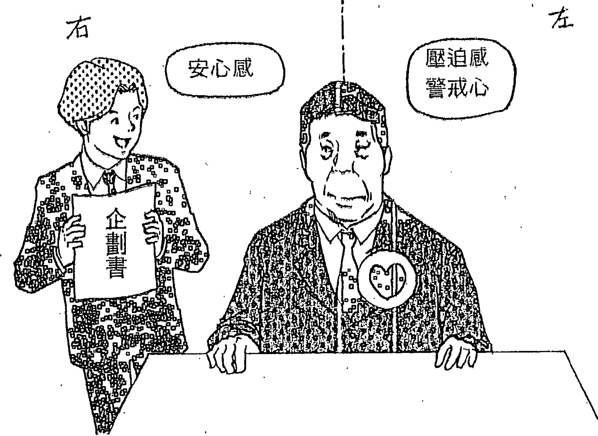

相反的，若站在左侧則可以給予對方壓迫感，因此若有讓你感到「已經不想再繼續相處下去」的對象時，試著從左侧接近对方也是一个不错的方法。

#### 藉由進出房間的禮儀，展現自己有能力的一面

在學生時期參加就職活動開始，你是否就曾經有過被提醒「面試的勝負關鍵就在於前三分鐘」的經驗呢？

為何開始是最重要的關鍵呢？那是因為任何人對於事物都會從第一印象來加以判斷。若在一開始就帶給對方不好的印象，之後便很難抹去那些印象。因為人們會認爲自己所接受到的第一印象是正確的，同時也會傾向於選擇能夠證明這種想法的情報。

像這樣從第一印象中帶來的情報，直到後來仍強烈殘留的作用，在心理學用語中稱為「初始效應」。與此相對，最後得到的情報得以強烈殘留的作用，稱為「時近效應」。

相信你也曾有過這樣的經驗，在聽完演講之後，走出會場時，與同行者談論的話題，都是在演講最後所聽到的。也就是說，只要能在開始與結束時提升帶給人的印象，就能讓見到的人對你保持著好印象。對於初次見面的人更是如此。

即使是在商務場合，與初次見面的客戶碰面時，如果在進入與離開室內時招呼表現的得體幹練，那麼就能使該印象留在對方的心中，而讓對方感覺你相當的「有能力」。所以說，在一開始碰面打招呼並且交換名片時的動作也顯得非常重要。打招呼或交換名片是與人碰面時所必要的交流，因此，從新人時期起就對鏡子練習也是不錯的方法之一。開始與結束的表現將會影響到整體的印象，因此，記得要好好表現。

#### 掌握主導權，魔法的開場握手

若在初次見面的時候，已成功交換過名片的話，推薦你大膽的跨出一步的招呼方式。一個動作就可以一下子縮短你與對方的距離。那就是要求握手。

握手在商務場合裡，是輕易且相當制式的身體接觸。雖然在日本很少有請手的場合，但是在初次見面時，微笑的接近對方並要求握手，相信不會有人會因此而感到不愉快。

雙手要求握手，而這些行爲也不會帶給人不自然的感覺。即使是同性，若要拉近彼此的關係，也可以試著運用「輕輕觸碰」的技巧喔。

此外，就心理學而言，握手還包含著另一個意思，那就是進入了對方的個人空間。所謂的個人空間，是指人能感受到屬於自己空間的距離。就如同在爆滿的電車中會感到不適一樣，當不認識的陌生人進入到自己的個人空間時，不管是誰都會感到不愉快。

美國的文化人類學家愛德華·霍爾（Edward T. Hall），便將與對方之間的關係及距離感分成四大類

##### 愛德華·霍爾所分類的「四個距離帶」

- ①親密距離（intimate distance）：0cm～45cm 能夠觸碰到身體的距離。僅能接受家人、戀人等親密的人進入，但若有除此之外的人接近這個領域，就會產生不快感。
- ②個人距離（personal distance）：45cm～120cm 兩人將手伸出就能觸碰到對方的距離。朋友之間，私下的談話交流時所維持的距離。能夠展現雙方的交情。
- ③社會距離（social distance）：120cm～350cm 無法觸碰到身體的距離。在商務的場合或與上司對應時所維持的距離。
- ④公共距離（Public distance）：3.60m以上。在演講等正式的場合，能夠面對面的距離。如同演講者與聽眾的關係，基本上與對方是不相識的關係。

由於在握手時能夠自然地築構起②的關係性，因此距離感一下子就會被縮短。此外，在握手的時候，最好確實握緊並維持三秒左右。如此一來，被握的對方會覺得你很積極，同時也會留下好的印象。開幕的握手不但能贏得對方的信賴，更是能巧妙掌握對話主導權的第一步。在有利益關係的商務場合更是如此。想要讓交涉成功的時候，採取主動的姿態將會更加奏效。

#### 在發表簡報時，能抓住對方視線的誇張肢體動作

「那個人的簡報做得真好！」當你這麼想時，表示對方的簡報一定相當有說服力，而且重點是容易使人印象深刻。

像這樣會使人在腦海留下印象，所必要的動作就是稍微誇張的肢體動作。想要將熱忱傳達給對方時，利用事先架構好的內容來吸引對方是必然的，而要使內容更容易傳達給對方，所必要的手段就是採取誇張的肢體動作。

因為誇張的肢體動作擁有能吸引對方的力量，所以長於此道的政治家在進行演講時，手部的擺動動作一定會加大，而聽眾在看到這些動作時，應該也會對該政治家產生可靠、有魄力的印象。

將這種效果巧妙運用的人物中，最具代表的就是納粹德國的獨裁者阿道夫·希特勒。除了聲音本身具有穿透力外，他更在演說中採取了吸引聽眾目光的肢體動作，也因此成功獲得人們熱烈的支持，這點也在歷史上獲得了證明。

此外，誇張的肢體動作也具有讓自己放鬆的心理效果。如果像木頭一樣直挺挺的站著小小聲的說話，不但緊張感永遠不會消失，也因為音量小會造成話語含混不清，使聽眾難以聽取，讓現場的氣氛變得更加緊張。

然而，當肢體動作加大時，緊張的情緒也會漸漸獲得緩和，對方也很容易聽得清楚，隨著時間經過，氣氛也會跟著熱絡起來。

一開始先從基本做起就可以了。將音量放大，以表演的心態來試試看吧！慢慢的就會找到屬於你自己的風格，相信到時候你也能成為一名簡報高手。

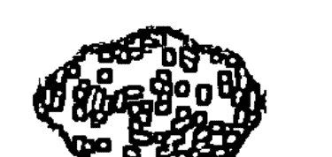

#### 左右對人印象的是「下巴的角度」

好感度高的人，不僅是在對話的時候，即使是其他狀態下，也能夠給予不曾相識的人很好的印象。能證明這件事就在於，有些人會頻繁的被捲問路，相反的，也有人完全不曾被問過路。

印象的好壞取決於「臉的角度」。在其中最重要的是下巴擺放的位置。

而證明了這項差異的心理實驗，是由加拿大的麥基爾大學所舉行的。在實驗裡，使用了CG將下巴的角度以每十度為單位來改變傾斜角度，並藉此測定這些改變帶給人的印象有何不同。實驗結果顯示，當下巴的角度呈二十度時，會帶給人愉快且較佳的印象；而下巴呈三十度時，則會使人感覺表情相當傲慢。

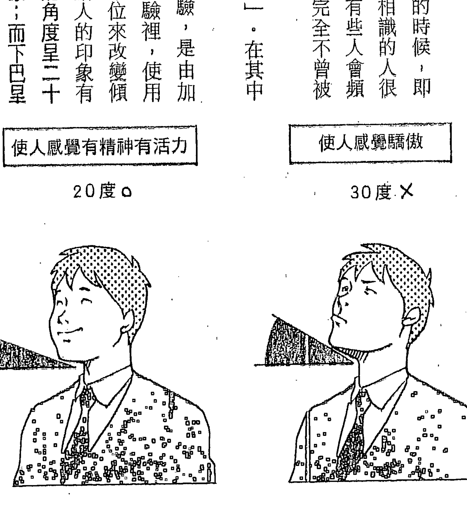

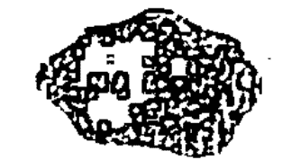

如同從實驗中所得到的結果，下巴角度有些微不同，就會大幅改變臉部帶給人的印象。試著環顧四周看看，確實有些人平常的表情就讓有帶著不滿的印象，但也有人則看起來生氣蓬勃。而這些差異，相信就是由下巴角度的不同所造成的。

「那個人一直都很有精神，真讓人心情舒暢。」——如果想給人如此的印象，請試著在鏡子前面研究屬於自己的「二十度角」。當然，臉部也要保持微笑。笑容迷人的人才能夠吸引別人靠近。

在會議或商討時，頻繁的出現沉默，或是沉默的時間過長，就會使人相當在意對方的想法。僅是身在無言的情境下，就會讓人因為搞不懂對方的想法而越發感到緊張與不安。

#### 看右上上方，讓人認為你是「深思熱慮的傢伙」

為了探索對方的想法，人們思索所以出了各種方法。其中一項，便是藉由對方視線的方向，來想像對方腦海中思考事物的心理技巧。這項技巧是以人類眼睛的動作與腦部的動作相互連結為前提而推導出來的。因為人的眼睛動作時，會使用對方方向的腦部來思考事物。例如：看向左邊的時候使用的是右腦；看向右邊的時候則使用左腦。

將右腦跟左腦的功能與方向加以整理後就能了解，在看向左邊時，正在思考視覺或映像、插圖等有關於創造的想像，而看向右邊時，則是以理論性的思考來歸納事物。

此外，心理學上被稱為「視線解析」的理論中說明了，當視線的動作在上方時，是在思考有關視覺的想像，呈水平時為與聽覺相關的想像，朝向下方時則為自我對話或與身體接觸相關的想像。同時，也可以將朝向右側視為思考未來的事物，朝向左側則表示在回顧過去。

而實際上對方究竟在思考什麼，只要將當時的話題與狀況套用到這項理論上，大致上就可以猜測出來。

相反的，若是與熟知此項理論的人進行商談或會議的話，只要看向右上方作出煩惱的表情，就能讓對方認為你經常在動腦思考。此外，若是碰上了想要駁回的企劃，只要視線看向左下側，對方就會有企劃案並沒有取得好的印象的覺悟。

雖然這項技巧難度略高，但也可說是以姿勢來使對方屈服的聰明方法。

#### 以『外表』來迷惑思考的魔法心理術

「真是個笑容燦爛又開朗的人。」「表情與服裝都很寒酸，真是個陰沉的家伙。」等等。人們很容易以『外表』來判斷他人的性格與能力，相信這麼說沒有人會反對吧。特別是在初次見面的時候，在對對方的情報一無所知的情況下，很容易就會以外表來評斷對方，擅自將對方想成『這樣的人』。例如：看到禿髮的年輕人時，會認為對方是『輕浮又不認真的傢伙』，看到穿著西裝戴著眼鏡梳著三七分頭的人就會認為對方是『認真又不苟言笑的人』，像這樣自己隨意的推測判斷。

心理學將這種情況稱為『刻板印象效果』。刻板印象的確也會有與實際形象吻合的時候，但若受刻板印象影響卻又猜錯時，就會產生誤解。

美國羅格斯大學的斯坦利·科恩（Stanley Cohen），根據刻板印象所產生的偏差認知進行了實驗。在實驗中播放了段十五分鐘的影片給被實驗者們觀看，影片內容為某位女性的日常生活片段，並在事前向半數的被實驗者說明這位女性是『圖書館管理員』，對另外一半被實驗者則說明是『服務生』。

而實際上，這位女性擁有九個屬於圖書館管理員的刻板印象的特徵，同時也具備了九個屬於服務生的刻板印象特徵。幾天後，當被實驗者被詢問到關於影片的內容時，他們所提出的報告內容，比原先被告知職業所擁有的特徵更多上許多。

我們都在不知不覺中以刻板印象來判斷人與事物。以此為前提也讓我們了解到，當你與初次見面的人碰面時，就必須先將你希望在對方心中留下的形象表現在外觀上。

職業為作家的某位男性，平常總是穿著牛仔褲等輕鬆的裝扮在工作，但只要是與初次見面的人碰面或是受訪時，一定會穿上西裝。因為想要給與初次見面的人留下「得體的人」這樣的印象。有時候對外表加以修飾，也提升自己帶給人的印象。最好從平常就留意到這點，在外觀上多下點功夫吧！

#### 能迷惑對方的表情是？

為了要帶給別人好的印象，所要注意的不僅有裝扮，表情也相當重要。如果想以表情讓別人對你擁有好印象的話，最好的作法就是流露出自然的笑容。笑容有著可以讓人的心情緩和的效果。

最好的例子就是在電視上可以看到的偶像們。不管她們有多累，只要站在歌迷或攝影機前，就會露出非常燦爛的笑容。也因此，看著偶像的人也會不自覺流露出笑容。

據說前AKB48成員的前田敦子在參加試鏡的時候，由於太過於緊張，因此在演唱結束的時候表情顯得相當陰沉。但是，在回答問題之後露出的燦爛笑容獲得了非常高的評價。她的笑容抓住了審查員的心，也因為那一個笑容使她通過了試鏡。就如大家所知的，前田成為了國民偶像團體AKB48中最具有人氣的成員。或許擁有著極具魅力的笑容，也可以稱為是一種才能。

有關於笑容包含的能量，也在心理學實驗中獲得了證實。英國的亞伯丁大學的林登·艾爾斯博士，在實驗中準備了男女各三名模特兒的照片，並將照片拿給男女共四十位的被實驗者閱覽，再調查被實驗者的反應。實驗結果顯示，若照片中的模特兒是呈現笑容的話，所受到的注目會比面無表情的照片高出二十倍之多。笑容就具有這種能吸引人的效果。

此外，笑容所影響的不只有當事者，也會傳染給周圍的人。請你也試著將笑容當成武器，建立起能擄獲周圍人心的好印象吧！

#### 巧妙活用顏色來製造氣場

你知道美國的曆屆總統，都有著一套在關鍵時刻用的決勝服嗎？那就是「白色襯衫」、「深藍色西裝」、「紅色領帶」。據說這樣的搭配能將顏色的特徵與效果發揮到極致。這也表示，顏色帶著各種不同的特性，並且暗藏著不同的效果。

上述的搭配正是美國總統的決勝服，白色襯衫代表清潔感與氣質品味，同時象徵了永恆；深藍色西裝代表冷靜沉著與才智，也具有男人味；紅色領帶則展現了熱情。除了考量到顏色的搭配，整體上也給予人正統的安定感，領帶則使用了代表熱情的紅色，是相當具有效果的組合搭配。

除此之外，從心理學的角度來看，綠色代表了安定與協調、黃色代表希望與光芒、紫色代表高貴與欲求不滿等，隨著顏色的不同也帶給人不同的印象。

若在與人見面時，能夠根據狀況巧妙的將顏色搭配使用，就能在該場合中帶給人深刻的印象。

例如：與第一次合作的客戶窗口打招呼時，可以穿著淡綠色的襯衫帶給對方安心感；在進行簡報的時候，則繫上紅色領帶一決勝負。此外，在暗罪的場面時，可以繫上藍色或灰色的領帶來達到緩和對方情緒的效果，到了晚上被邀請出席宴會時，則改以紫色為基調的服裝搭配來打造出優雅的氣質。

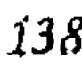

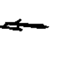

相反的，顏色也會對自己的心理狀態產生影響。因此，如果想展現出衝勁時，可以會穿上紅色的服裝，想要保持冷靜時就以藍色為搭配的重點。另外，穿著綠色的衣服使情緒感到安穩，紫色的服裝則可以帶出優雅的氣氛。

試著靈活搭配顏色，為他人及自己帶來好的影響吧！有關於各種顏色所代表的效果及最適合的場景，將在其他頁面進行詳細的介紹。

#### 小心「制服效果」！

你是否曾在看到身穿制服的空服員時，明明還沒開始接受任何服務，卻不自覺認為對方「應該是細心的人」；相反的，急診的患者，在看到忘了穿上白袍就匆忙前來治療的醫生，則感到不安。制服，某種意義上來說所象徵的是信賴感與能力。

制服所擁有的這種力量，在心理學用語中被稱為「制服效果」或「著裝效果」。應該有人曾有過這樣的經驗，因為認為對方是警察，而前去問路，卻發現那個人卻完全不知道路，正覺得疑惑時才發現到衣服上配有一○○警備保全」的徽章。

警衛的制服與警察制服如此相似，在某種意義上，或許是為了帶給人如警察般嚴肅的印象。

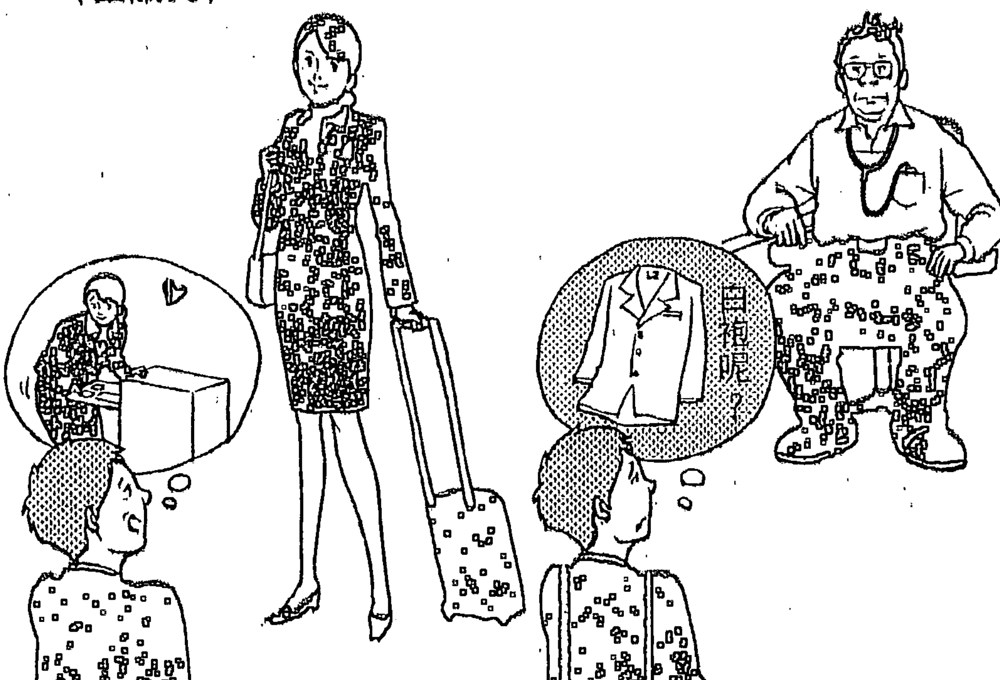

這種由制服所帶來的力量，也在心理學上獲得了證實。美國麻薩諸塞州克拉科科學中心的心理學家李奧納多·皮克曼進行了以下實驗。他請來了三種不同類型裝扮的人在街上叫住路人，並請路人協助一些事情。然而，每套服裝都有所不同，其特徵如下：

- ①穿著外套打上領帶的商務人士
- ②穿著白色圍裙販售牛奶的小販
- ③穿著類似警察裝扮的警衛

路人被他們拜託的事項有，「是否能幫忙移動這邊的看板？」「因為身上沒有零錢，是否能給我一分錢？」「是否能幫我撿掉在地上的包？」

結果，壓倒性的獲得最多幫忙的是③穿著類似警察裝扮的警衛。由此可知，光是制服的不同，給人的印象就有著如此巨大的差異。

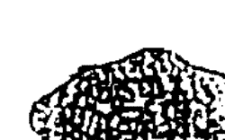

若是學校老師，則擔任理科或護理老師就穿著運動服，同樣可以發揮制服效果。此外，若是擔任淨水器或滅火器的銷售員，試著穿著工作服應該也能發揮制服效果。相反的，也有人利用制服效果所帶來的影響而進行詐騙，因此，也必須留意千萬不要光看服裝就受到影響。

#### 在關鍵時刻利用「決勝負的紅色」來激發熱情

根據不同情況來分別使用不同顏色，可以提升外觀所帶給人的印象。這次將特別針對紅色的效果加以說明。看到「紅色」時，你有什麼想法呢？

紅色在心理學上，代表了能激起拼勁的顏色。我們一般認為有「元氣」的狀態，是指腦內物質中的腎上腺素提升了血液及心跳速度，促使人呈現覺醒的狀態。而紅色就帶著刺激交感神經、分泌正腎上腺素的效果。

因此，到了一就是現在！這種決勝負的日子或要進行報告、重要的商談會議時，男性就會打上紅色領带来表現自己的幹勁與熱情。不但能傳達給對方，也能達到振奮自己的效果。

然而，即使對自己而言到了勝負關鍵，在某些需要冷靜交涉的場面中，還是必須避免造成對方的興奮或激起對方的狀態，因此最好使用較低調的紅色。如果只是想要達到振奮自己的效果，那麼建議可以穿上紅色的內褲。雖然不會直接顯現在外，但只要想到自己正穿著紅色的衣物，同樣可以提升自己的幹勁。

此外，紅色也是相當容易引人注目的顏色。優衣庫、ZU DONG'S、日本航空、三菱集團等企業的商標上都使用了紅色，以及超級市場在標示價格時也同樣會使用紅色，原因正是如此。在進行關鍵的報告時，將資料中重要的部分使用紅色加以標示也能引起閱讀報告的人的注意。若在讀書時，因為想睡覺而提不起勁，也可以試著暫時改用紅筆在筆記本上抄寫重點。雖然只是顏色上的不同，但還是能帶來一定程度的效果，請務必一試。

#### 「黑色」代表了「獨一無二」的存在感

介紹完紅色之後，接下來要說明的是「黑色」的效果。黑色屬於基本的色調，大多的文件也都是白紙黑字，本書的印刷字體也同樣是黑色。這也表示，黑色是在任何場合都能使用基礎色調之一。

#### 支配他人的黑暗心理術

然而，黑色並沒有因此而遭到埋沒。相反的，黑色是無論在任何場合都能展現存在感的色調。正因如此，當你希望自己獲得信任，並且成為對方無可取代的存在時，就可以寄託於黑色。

黑色並非能動搖情緒的顏色，但却能表現出威嚴、氣度及穩重感，為人所帶來實際的價值感。

尤其全身穿著筆挺黑色套裝時，任誰都會感受到那股氣勢。商務人士所穿著的套裝，以深藍色最為常見，正因如此，換上一套風格截然不同的黑色套裝，才能顯示出與其他人的差異。在進行像「關於這點絕對不退讓」的問題交涉時，以黑色為基調的裝扮風格前去，更具有效果。黑色不但能向對方展現威嚴，在與客戶交涉的過程中，也能將事物引導至有利於自己的方向。

此外，總理大臣、法官、教授、社長等社會地位較高的人士也大多給人穿著黑色的印象。黑色也同樣能顯現出各種幹練的氣度。

其他在出席一些正規的活動或婚禮、喪禮等場合時，也會使用到黑色。以往人們對於黑色服裝的印象，大多停留在參加婚喪喜慶時的裝扮，在商務場合上黑色並不受青睞。但是，現代的時尚風格多變，同時也設計出不少帶有都會感的黑色外套或黑色套裝，一改以往帶給人只限於參加正式場合或喪服的印象。不如試著尋找一套適合自己身型的時尚「黑色套裝」吧。

#### 能自在穿搭「藍色」的人就能縱橫商場

「藍色」是冷色調的代表色，給人的印象是冷酷或冷靜。同時也帶有如遼闊的大海或天空般爽朗的印象，是令人感覺清新並容易產生好感顔色。在色彩心理學中，藍色擁有使情緒沉著、提升集中力的效果。此外，當日本男女被問到「你喜歡什麼顔色？」時，藍色不但占據排行榜前幾名的顔色，從綜合層面來看也是最具有人氣的顔色。

因此，藍色也是被不少企業所選用的顔色。舉例來說有日本電信電話、瑞穗銀行、全日本空輸、日產汽車等等。相對於紅色給人王者的感覺，藍色則因為帶有光明挑戰的印象、以及給與人信賴感的印象等理由而獲得採用。

此外，據說看見藍色的事物會使體溫降低、情緒感覺平靜。因此是適用於需要使頭腦冷靜的辦公室或學校的顏色。但另一方面大量使用藍色也會有太過冷靜的傾向發生，因此記得適度使用，以免產生消極的效果。

在商場不合中穿著的服裝，以藍色及深藍色最為常見。因為除了能使溝通圓滑進行，藍色也同時帶給人知性的印象。試著對自己進行自我分析，若覺得自己的強項在於知性上，那麼建議一定要在身上配帶深藍色或藍色的配件，將藍色視為自己的印象色加以展現。

附帶一提，在美國總統候選人的政見發表會上，深藍色西裝可說是最基本的配備。關鍵同樣在於深藍色西裝所帶來的信賴感及安心感。此外，領帶選用藍色或水藍色，則有著能使發言變得溫和的效果，並且能順利架構出人際關係。若想要制霸商場，建議你多多磨練以藍色或深藍色、水藍色為中心的搭配能力。

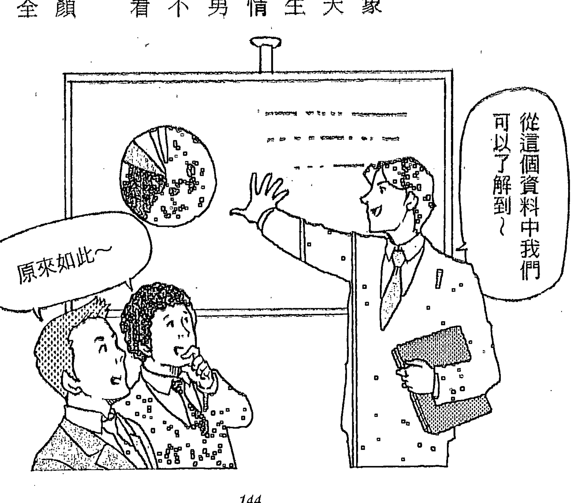

#### 利用能夠引起親密感的「黃色」來取得內幕消息

在商務現場，每天都必須不斷的與人溝通。一想要以親密的交流使商務洽談能順利進行——有這樣想法的人，若將「黃色」使用在關鍵處，那麼洽談商務能順利進行的可能性也會跟著提高。

在心理學上，黃色帶有讓人變得開朗、給予人親近感、使人的心情獲得解放的效果。因此，黃色也被稱為溝通用色。

說到日常生活場景中帶有黃色的場面，就讓人不自覺想起超級市場的POP或廣告文字、標幟。黃色除了能使情緒變得開朗之外，也有提醒告示的效果，以及給人感覺高性價比的效果。

特別是在背景使用黑色、藍色時，由於兩者呈對比色，因此也更引人注目。在製作簡報資料時，若想更講究表現感，那麼試著活用這個方式，就能使畫面效果更加顯著。

想要使用黃色來提升外觀的效果時，最適合的場景就是與初次見面的人碰面的情況。在與新客戶碰面或拜訪客戶時，可以使溝通用色發揮其效果，使氣氛變得融洽。要建立起新的人際關係時，打上黃色領帶或是在平常使用的記事本等配件上加

入黃色的成分，都是不錯的選擇。

此外，若是社內的部門異動或第一天到新公司上班時，在搭配上加入黃色配件，那麼能自然融入周圍環境的效果非常值得令人期待。

關於帶給對方的影響，由於明亮的配色能使人的情緒獲得舒緩，因此雙方都容易變得開朗，並帶有能使對方的口風變鬆的效果。祕密或內幕消息也都是重要的情報。若想要使氣氛變得坦率，以藉此延伸話題，進行溝通或打聽到更多情報時，善用黃色能帶來不錯的效果。

#### 在謝罪的場合上使用「灰色」來隱藏存在感

當感覺到「今天真是提不起勁……」時，你是否曾無意識的發現自己手上正拿著灰黑色西裝呢？實際上從心理學的角度來看，這個行動是個非常明智的判斷。

這樣的說法或許會使你感到意外，但灰色其實是療癒用色之一。不但帶有能適當緩和刺激的效果，需耗費神經的工作從事者也大多有喜歡灰色的傾向。

此外，灰色也被稱為是能提升工作效率的顏色。也因此，辦公室的擺設品或事務用品、電腦等，大多是灰色。然而，灰色在提升工作效率的同時，又帶有安定情緒的效果，因此若是需要激發創作靈感的辦公室則不太適合使用灰色。

灰色能發揮最大效果的場景，就是賠罪的場合。例如：企業所舉辦的道歉記者會中，如果有三個低頭道歉的人，那麼至少會有一個人穿著灰色西裝，也至少會有一個人打上灰色領帶。因為從色彩心理學來看，灰色具有緩和對方的警戒心及帶給人沉穩的印象、襯托對方的效果。灰色的西裝或領帶、襯衫，最適合用來使對方平息怨氣。灰色是可以蓋掉本身的特質的顏色，因此想要保持低調時，就穿著灰色的衣物來安靜度日子吧。

在想要展現時尚感時，灰色也是非常適合用來搭配的颜色。灰色不但在襯托其他鮮豔的顔色時能發揮效果，也能隨著不同的穿搭方式，來展現出帶有自己品味的气質搭配。此外，雖然同樣是灰色的衣著，羊毛材質能帶給人沉穩的感覺，而缎面材質的灰色衣服則能同時給人華麗及穩重的感覺。新郎在婚禮上穿著灰色燕尾服就是這個道理。

若能將灰色活用在各種不同的穿搭上，就能帶給周圍的人時尚達人的印象。

#### 利用不同款式的眼鏡，自在操控自己的形象

許多人都認為，男性要在商務場合中成功改變外觀形象是很困難的事。西裝的色調大多為深色系，加上頭髮短，所以即使想要改變也無法帶來太大的成效。但是，只要妥善運用某項配件，就能大大改變自己的形象，那就是「眼鏡」。

過去對眼鏡的印象，都是厚重的鏡片以及讓人對眼睛缺乏印象，然而，現在的眼鏡不但鏡框的形狀與材質變化多樣，顏色的種類也相當繁多，價格親民的平價鏡框也逐漸增加。試著配合場面享受變化鏡框的樂趣，改變自己外觀帶給別人的印象吧！

演員也會配合角色改變所配戴的眼鏡。知名演員福山雅治在電視劇中演出頭腦清晰的物理學家時，所配戴的就是「無框眼鏡」。無框眼鏡除了給人知識份子的印象外，也同時帶出個人風格，可說是與角色性格完全吻合。

選購的鏡框種類不同，所帶給人的印象也會跟著改變。黑框眼鏡能露出的眼部範圍較大，能展現知性並給人留下深刻印象。在發表簡報等帶有演出成分的場面時，能發揮出不錯的效果。相反的，細框眼鏡則有著能帶給人溫和印象的效果。如果客戶或交易對象的負責人是女性，建議可以配帶細框眼鏡前往拜訪。

#### 依據情況區分使用左右側的表情

除了鏡框的種類以外，鏡框的形状也會影響帶給他人的印象。方形鏡框能幫助你在會議或簡報等需要有說服力的場合中大大活躍。因為人們對於臉型瘦的人較容易产生信賴感。而方形鏡框能使臉型看起來變尖，也因此能增加帶給人的信賴感。

相反的，圓形鏡框則適用在需要緩和場面的情況。圓形具有讓表情看起來變得容易親近的效果。可以幫助你與對方的關係變得更加親密。

若能配合商務場景，改變眼鏡來操作給人的外在印象，你也能稱得上是操作心理技巧的高手了。

##### 〔眼鏡的種類〕

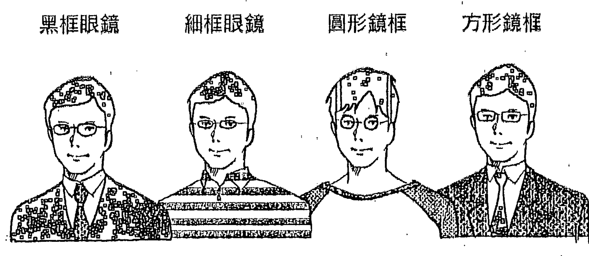

##### 〔給人的印象〕

- 知性印象深刻
- 柔軟
- 溫和
- 信賴感

我們在前面曾談到，臉部的印象會依據表情或角度的不同而改變，但在更進階的技巧中，有著分別使用左右側表情的方法。

首先，請先試著在鏡子前面觀察自己的臉。你應該能發現，右側與左側的肌肉分佈、臉部的彈性、眼睛的大小等，意外的有著不少的差異。接著再更仔細一看，面向右側時與面向左側時的臉部表情，所給人的印象也有所不同。站在鏡子前面，交互以紙張遮住左側和右側的臉就更能清楚比較。

大部分人會認為，自己的右側臉較為尖瘦且帶有知性的感覺，而左側臉則較為豐滿並帶有溫柔的感覺。右側臉可以用來表現出官方有原則的一面，左側臉則可以用在表現私底下真性情的一面。

接下來將說明，能在商務場面等不同情況中區分使用自己臉部的方法。

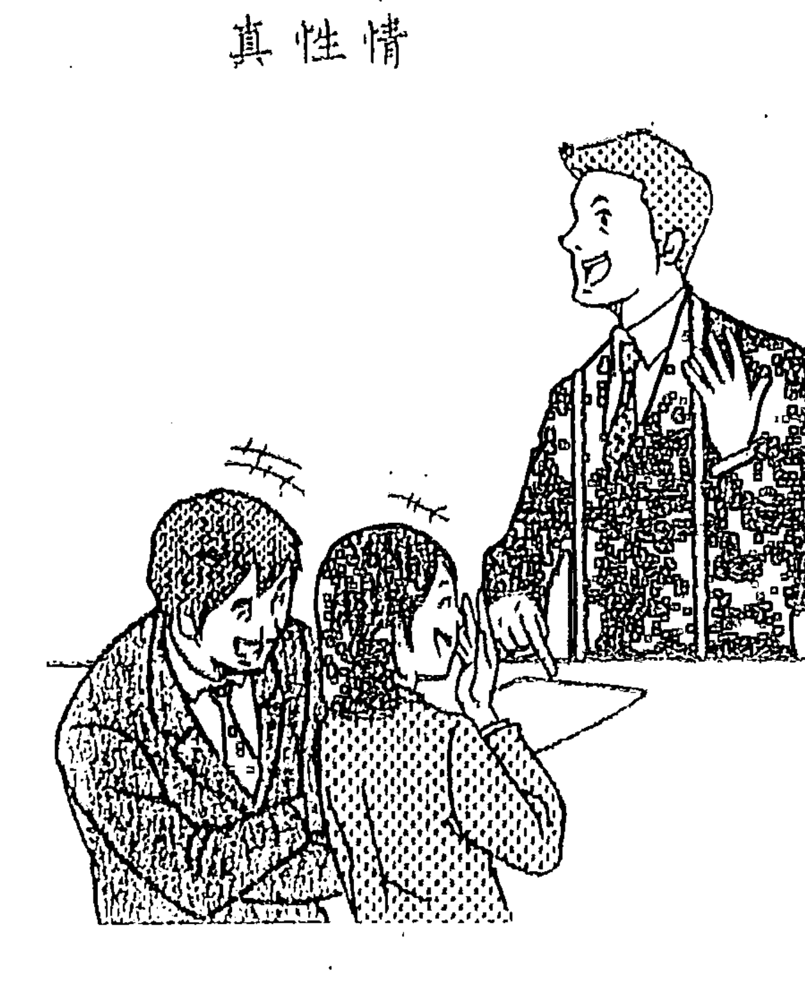

- 左側：
    - 柔情
    - 溫性
    - 真性
- 右側：
    - 瘦則
    - 尖性
    - 原則
    - 知有

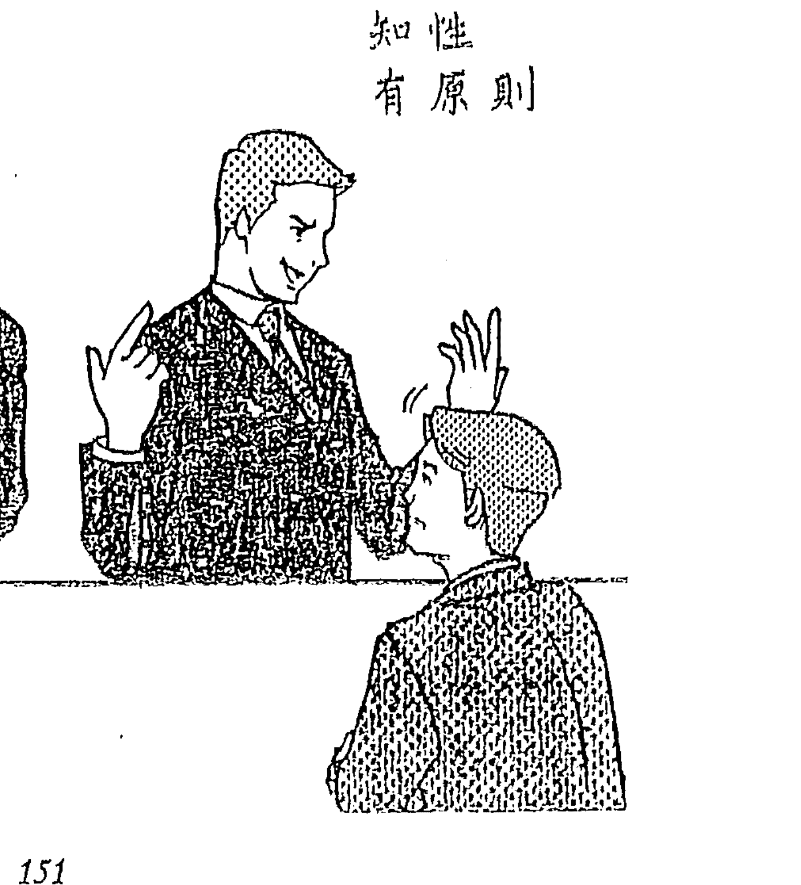

在想要說服對方、表達訴求時露出右側臉、在與人初次見面招呼時或想拉近與對方的距離時則露出左側臉。雖然自己的臉只有一個，但就某種意義上來說，也是擁有可以分別使用的兩張臉。

但在實際執行時，若一直將臉擺向右側，或維持某個角度，則會顯得舉動不自然。如果坐的椅子是可以擺動的，坐的方向最好不要正面朝向對方，而是以稍微偏對方的右側或左側的方向較佳。

#### 以矛盾的服裝使對方覺得你是「令人存在的」

在與「外觀」相關的心理技巧解說前，最後要介紹的是僅靠「外觀」來使對方為自己感到在意的方法。所謂的「感到在意」並非只限定於戀愛情感，而是表示令人忍不住多看一眼的存在，因此在此各種場合都能適用。

了使對方「感到在意」，採取令人感覺不自然的行為是最為有效的。而廣告中就巧妙運用了這種手法。所謂的廣告，若不引人注意就沒有存在的意義，因此廣告中通常暗藏了許許多多的小巧思。例如：「小巧的大空間」、「用吃的減肥」這樣的標語。兩者都用了互相矛盾的句子，因此會引起人的注意。但又因為能讓人覺得「說不定是指這個意思」，尚在勉強能夠想像得到的範圍內。

對這樣矛盾的內容加以探討「是不是這個意思」的狀態，在心理學上被稱為「認知失調」。自己一直以來所保有的觀念被顛覆時，人們會試著要想辦法加以補正。而這種補正的作業就是「感到在意」的狀態。

要藉由自己的外表來使人產生這樣的心理，只要運用服裝的「外在技巧」就可以了。例如：整體的裝束看似保守但卻戴了一副相當前衛的眼鏡、或是整個人充滿了時尚感卻拿著鉛筆在作筆記等，在外觀上加入一個關鍵點。

此外，平常都穿著正規套裝上班，卻在假日出勤時穿了夏威夷衫等，在一年內製造幾次機會讓周遭的人看見你與以往不同的一面，也會讓人忍不住想探索「那個人並不是那麼正經八百的人」、「應該帶有某種魅力」。

雖然維持相同外觀能帶給人安心感，但相反的可能也會給人性格呆板無聊的印象。試著巧妙利用「不自然」的感觉，讓周遭的人也忍不住對你多看一眼。

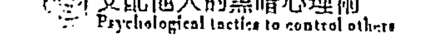

#### 在會議、簡報、交涉等場合中，讓對方說「Yes」的禁忌心理術

只要是社會人應該都曾經面臨過，在會議或發表簡報、與對方交涉等場面中，為了讓對方接受自己的要求或從對方口中聽到想要的答案而吃過不少苦頭吧？

相信也有不少人認為「只要表達出誠意應該就能順利傳達」、「只要埋頭苦幹總有一天對方一定會接受」，而每天不斷向前邁進。但是，背負著業務效率化或對手企業的競爭等壓力的現代商務人士，可以聰明選擇以心理技巧作為武器，將自己的意見、主張傳達給對方，確實讓對方說出「Yes」。這個章節中，我們將介紹能應用於社內外交各種交流場面的禁忌心理術。

##### 亞里斯多德所提倡，能確實使對方說出「Yes」的說服手法

要向對方說明事物並獲得對方的贊同時，所需要的就是「說服」的能力。古希臘的哲學家，被稱為「萬學之祖」的亞里斯多德說到，在試圖說服對方時，關鍵在於遵循下列 5 個步驟。

- 說服他人的五大要則
    1. 提出能引起聽者注意的故事或訊息
    2. 提出需要解決或回答的問題或疑問
    3. 對所提出的問題提出解答
    4. 具體說明提出的解答中所能帶來的好處
    5. 以行動號召

在有限的時間裡，卻又必須針對各式各樣的案件進行檢討會議或發表簡報時，必須如①中所提醒的，若話題中沒有能勾起聽者有興趣的內容，那麼對方也不會對你的話題感到興趣。除此之外，提出對方的問題點以及問題的解決方案（②③），讓對方能想像得到解決問題後所能帶來的具體效果（④），藉此來促使對方跨出行動（⑤）。

只要能確實遵循這些步驟，就能提高說服力。但是，亞里斯多德也提到了，在說服他人時，更重要的是必須具備以下三個要素。

- 說服他人的 3 大要素
    1. 邏輯（LOGOS）：以邏輯理論證明的方式來說服對方
    2. 情感（PATHOS）：以能誘發聽者情感的方式來說服對方
    3. 信譽（ETHOS）：以說話者的個性及信用來說服對方

例如：有某句廣告標語說到了「這是以植物的天然成分所製造而成的，因此對身體及環境而言都是一款溫和的沐浴乳。」這就是①所提到，以邏輯理論說服的方式。此外，如「一般售價為二十萬元的商品，僅限於今天購買的顧客，我們將以十萬元的價格來提供你本項商品。」這類銷售用語，則是為了引起顧客「現在不買就再也買不到這麼便宜的價格了」這種不安心理的說服（②）方式。同時，當有事件或事故發生時，電視節目找來了大學教授以專家的身分登場，並使用困難的專業用語來進行解說的場面，便是採用了信譽的說服（③）方式。

在說服他人時最重要的是，在遵守這些要素的情形下，並利用能使對方口中說出「Yes」的具體心理技巧。

##### 說服對你毫無興趣的對象「突降法」

再說。

在進行說服之前，最好先想好，你所想表達的事物，究竟該先說還是放在最後。

在說完無關緊要的話題之後，再切入重要的話題或提出委託事項的方法，在心理學中被稱為「層進法」。另一方面，從一開始便單刀直入的切入重要話題的方法則被稱為「突降法」。

根據對方是哪種類型的人，或說服對方時的情境等條件來分別使用這些說服方法，將能獲得不錯的成效。

例如：若能判斷出對方是講究前言的人，或者是對你感到有興趣並會從頭到尾確實聆聽你說話的人，則可以使用層進法。相反的，若對方表現出對你的話題不感興趣，或對方是個會思考事物合理性的人，這時使用突降法較能發揮效果。

若發表簡報的對象同時也在關注著你的企劃案時，使用層進法來敘述話題較能炒熱當下的氣氛。但是，要以電話行銷爭取訂單時，最好使用省去了前言，直接表達主題的突降法，較能降低慘遭掛斷電話的可能性。

為了提升層進法與突降法的效果，確實掌握當下的狀況及了解對方立場也是非常重要的。

##### 以邏輯說服對方

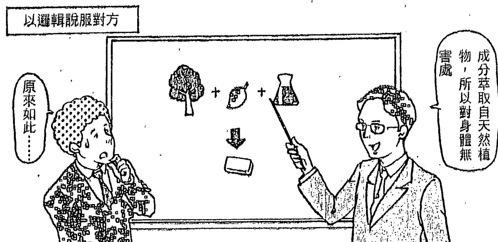

- 原來如此...．
- 成分萃取自天然植物，所以對身體無害處

##### 以情感說服對方

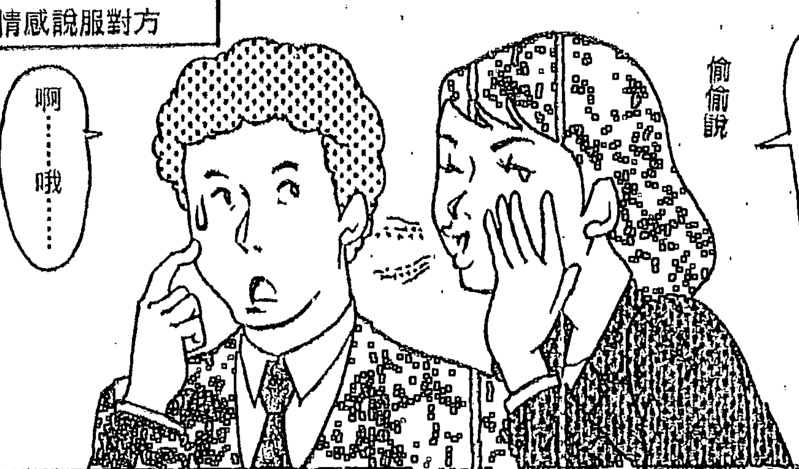

- 啊···哦
- 偷偷說這個價格只限現在喔！只·限·現·在·喔！

##### 以信譽說服對方

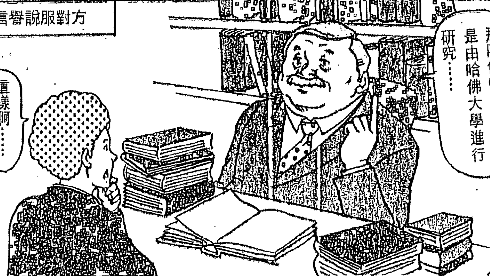

- 這樣啊…
- 那叫做○○理論，是由哈佛大學進行研究...

##### 以「錯誤前提暗示」的陷阱來控制對方

在向對方傳達了子虛烏有的假設後，藉此依自己的想法來控制對方的判斷結果，這是稱為「錯誤前提暗示」的心理技巧。

你是否曾有過這樣的經驗，在速食店進行點餐時，原本明明沒有打算要吃，卻在被詢問了「請問配餐要搭配薯條還是沙拉呢？」之後，不自覺地做出了「那就薯條……」的回答。

這是利用了，當人被詢問了貌似合理的假設或選項後，即除此之外的尚有其他的選擇，卻不自覺地從當下獲得的選項中去判斷事物的人類心理。

將購買配餐以彷彿理所當然般的詢問方式「暗示」對方，使對方產生非得從薯條與沙拉當中擇一的心理。

錯誤前提暗示也能應用在希望周遭的同事幫忙分攤自己工作的时候。不要直接的要求對方「幫忙分攤一下我的工作嘛！」而是以「你要幫我影印這份資料呢？還是要幫我輸入文件呢？」這樣彷彿幫忙是理所當然般「選」的詢問方式。

只要冷靜思考就會發現，其他還有如「幫忙訂資料」「確認資料是否有缺漏」等的選項，像這樣將選擇特定在兩個選項的方式，稱為「二分法的陷阱」。如此一來，對方就會受控制必須選擇你希望對方幫忙的選項。

此外，以二選一的方式提出請求時，將你最希望對方幫忙的項目放在後面，據說更能達到效果。

這是因為人類心理中，若有複數的事項被以條列式的提出，個別的记忆就會開始產生差異，而使得對最接近結尾的項目記憶最為鮮明，這被稱為「新近效應」。

##### 逆向操作「一貫性原則」，硬塞給對方無解難題

如果有一天，突然有熟人或朋友向你提出了「借我十萬塊」的要求，你也許會認為對方在開玩笑而拒絕，即使答應借給對方，也仍然會忍不住抱著「要拿去幹什麼用？」「什麼時候可以還我？」等的警戒心。

然而，若對方說「借我一百塊！」你可能毫不猶豫的就會借給對方，甚至連對方提出「借我一百塊，可以順便給我一根菸嗎？」這樣的追加要求，你也會忍不住就答應。

人對於「小小的請求」，較容易接受要求，而在接受了這樣的請求後，即使對方提出新的要求也會忍不住就回答「Yes！」。這是為了使自己的行動或態度維持「一貫性，稱為「一貫性原則」的心理狀態在作祟。

利用這樣的心理作用，讓對方從小小小的要求開始到大大的要求都「併接受的心理技巧稱為「得寸進尺效應（foot-in-the door）」。

得寸進尺效應的說法是來自於，在對方將門打開時，暫時以腳插入門檻內，讓對方無法將門關閉，如此便能慢慢得到進入門內的機會。例如下列的情境：

- A：「抱歉！」可以請你找出這個商品以前的廣告影片嗎？」
- B：「咦？啊，可以啊。」
- A：「還有，可以請你依照廣告撥出的時間排列嗎？」
- B：「是可以順便啦……」
- A：「那麼，可以請你將排列完畢的廣告燒成DVD，然後連同清單一起寄給……」
- B：「咦……是可以啦，沒差……」

像這樣，先提出能讓人確實接受的小要求，使對方說出「yes」之後，再慢慢提高要求，使對方能夠接受你最終也是最大目的的要求。

與得寸進尺效應同樣使用了一貫性原則的還有被稱為「低門檻策略（Low ball tactic）」的技巧。這是指隱瞞對方不利的要求，等對方接受了自己的請求後，再提出該項要求。這個稱呼源自於一開始先投出讓對方能輕易說出「yes」的「誘導球（Low ball）」。以下對話為例說明：

- 上司：「可以請你稍微加個班嗎？內容還滿簡單的。」
- 下屬：「喔，可以啊。什麼樣的內容？」
- 上司：「是明天開會要用的資料，我想請你幫忙確認一下裡面引用的數據有沒有錯誤，請你從頭到尾檢查一遍。」
- 下屬：「好、好的……」

先投出誘導球讓對方上當之後，接著再投出讓人出乎意料的變化球時，對方在無路可退的情況下也只能摸摸鼻子接受，這項技巧便是利用了這樣的人類心理。

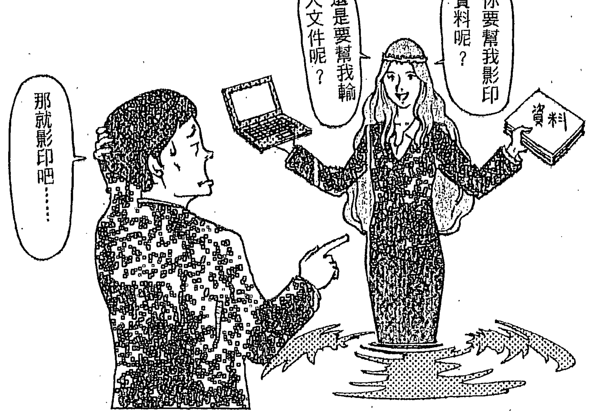

> 你幫我影印資料呢？
> 還是要幫我輸入文件呢？
> 那就影印吧……

#### 利用人類罪惡感的惡魔技巧「以退為進效應」

與開始於小小願望的「得寸進尺效應」相反的另一個委託法，是先提出誇張的要求使對方拒絕，接著再帶出自己真正要求的「以退為進效應（Door in the face）」。英文原文是源於對吃閉門羹的想像，即門在自己面前被重重關上的情況。

例如：當你與上司交涉「如果要我負責這麼多工作，至少也幫我加個薪吧？」時，一定會被以「這有點困難，其他人也都是相同條件下努力工作著」加以拒絕。然而，若你在這個時候提出自己真正的請求「既然這樣的話，等這個專案結束之後，請讓我休個長假。」，那麼對方同意的可能性也會相對地提高。

這裡所運用到的心理技巧，是在拒絕對方的要求後，人會產生罪惡感的心理，或聽到對方讓步後，認為自己也必須退一步的「回報性原則」。

這項技巧的關鍵在於，如果不僅是過分的要求被拒絕，就讓自己真正想提出的請求都被拒絕時，就必須有節奏明快地向對方提出替代的要求。

持續提出「如果沒辦法休長假，包含週末在內的連休也沒關係」「這天的話，對方應該也不會採取行動，所以放假也不會有任何問題」等等的要求，相信對方一定會說「YES」的。

##### 對比效應

與以退為進效應相似的效果中，有著被稱為「對比效應」的心理現象。對比效應是利用人類在無意識中會將數個選項進行相對比較的心理技巧。假設在餐廳或咖啡廳中看到下列的菜單：

**【①餐廳】**

- A套餐 2000日圓
- B套餐 1500日圓
- C套餐 1200日圓

**【②餐廳】**

- A午餐 1500日圓
- B午餐 1200日圓

當菜單如此標示時，①餐廳的B套餐與②餐廳的A午餐在相較之下，前者會相對較容易受到客戶的青睞。
儘管兩家餐廳都有定價相同的套餐，但由於①餐廳的菜單設定中，有著高於一千五百日圓的套餐，相較之下B套餐就給人相對便宜的感覺。

不動產公司帶客戶去參觀租賃房屋時，也會活用這項對比效應。在介紹數間價格相近的房屋時，先帶客戶去看過屋齡較高、條件較差的房屋後，再介紹不動產公司想推薦的房屋，如此一來，該房屋與最早看見且印象較差的房屋便呈現出了鮮明的對比，即使條件並不佳，客戶簽訂契約的成功率也會提高。

在針對新企劃案進行簡報時也同樣如此。從預算上來看是完全欠缺考量的A案、最符合現實狀況的B案、企劃本身與其他兩者相比完成度就不高的C案，除了首推的企劃案以外，並先準備其他頂替的假企劃案，如此一來就能發揮對比效應，讓自己最希望推行的企劃案能獲得「Yes」的機率相對提高。

##### 以「預防接種理論」來踢掉競爭對手

相信你也曾經為了對流感等的傳染病產生抗體，而接受過預防「接種」的疫苗吧。

在心理學的世界中，也有著同樣的原則，這是由美國的社會心理學家威廉．麥奎爾（William James McGuire）所提倡的「預防接種理論」。

這是指對於某些事項，若在先前就先接受反對意見以獲得免疫，則當日後真的受到反對時就比較不容易被說服的思考方式。例如：「每天早上吃早餐比較健康」「不需明言」就獲得眾人接受的道理，因此，對於反對意見並沒有免疫能力。正因為如此，若被以「其實吃早餐並不健康」加以攻擊時，很容易被說服。但是，若在事前就先體驗過反對意見，讓腦中深植「那個反對意見是錯誤的」這樣的情報，那麼即使被批評「早餐對健康有害」時，也能作出抵抗的反應。

利用這項原則，將自己的缺點事先傳達給對方，使其產生抗體，那麼當缺點真的暴露出來時，或許對方會比較能夠接受。

例如：你告知客戶端的社長─雖然本公司的影印機與其他公司相比，價格貴了幾千塊，但是在發生問題時的對應措施是相當健全的。除此之外，對於其他事務機我們也能一併支援處理，你不需再花費時間與眾多廠商聯絡，節省下來的時間跟勞力，能讓你更專心在衝刺業績上。如此一來，即使該社長從其他業者口中聽見了關於你公司产品價格過高的批評，也會在考量到完整的問題對應策略以及在其他服務也能充分被支援的條件下，提高與你的公司簽訂契約的可能性。

在這個例子中，重點就在於在事先能對可能被競爭對手拿來作比較的要點加以掌握，並將能進行補強的優點優先傳達給客戶。

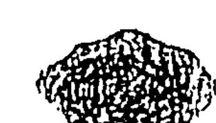

#### 隨心所欲控制會議的「史汀薩效應」

各位是抱持著怎樣的態度去面臨社内每週例行的會議呢？美國心理學家史汀薩的研究結果發現，在會議等有眾人集合的場合中，可以歸納出以下法則：

- 過去曾在會議等場合中受到議論的人，會刻意想坐在該議論對象的對面
- 在某項發言結束後的下個發言內容，通常是對上一個發言的反對意見
- 若該會議的議長能力較弱，會使參加者想與對面的人交談。若該議長的權限較小，則參加者傾向於與隔壁的人交談

這三個效果被稱為「史汀薩效應」。不光只有出席會議的人，若負責擔任議長或司儀的人也能依循這項法則，對於坐在正面的對象也能抱持著對等的心態討論問題，不單只持反對意見，使正面的建議也能獲得提出，從參加者私語的情況掌握會議的流向，並採取行動加以控制，這才是使會議能圓滑進行的關鍵。

此外，會議的流程也會受到會議桌的形狀或出席者的座位分布而影響。例如會議桌的形狀，相較於方型的桌子，圓桌較不容易展現出能力關係優劣，因此出席者會更願意自由的發表意見。

相反地，方型的會議桌則會依座位而顯現出下述的傾向。

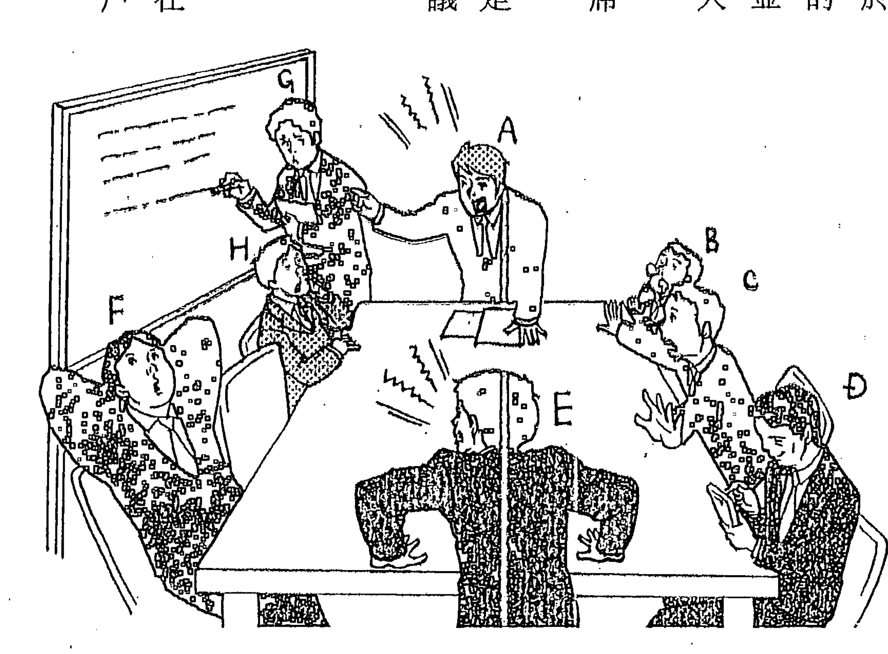

如插圖所示，會議桌上 A、E 的座位由於可看到所有出席者的狀況，因此是屬於議長的座位。而能夠提醒出席者發言、活化會議，並具有彙整話題流向使會議順利運作的促進型人物則適合坐在 C、G 的位置上。

同時，也可以看出坐在其他位置上的出席者，積極參與會議的意願較低。

若希望自己的構思能夠獲得採納、或是想帶給管理階級和上司留下好印象的重要會議時，最好多加留意這幾項要點。

#### 使用「午宴技巧」帶來正向談話的錯覺

像「能量早餐」、「能量午餐」那樣，在吃早餐或午餐的同時，進行社内會議或與客戶商討的型式，最近在日本也越來越常見了！

在吃到美食或身處於美好的環境下時，人的腦部就不容易產生否定的思考，並且能對當下發生的事情留下深刻的記憶。此外，從心理學的角度來看，在享受餐飲的同時，一邊討論工作內容或與對方進行交涉，是對於能引導出正面積極的話題相當具有效果的手段。

美國的心理學家魁格利．拉茲蘭（Gregory Razran）將這種技巧命名為「午宴技巧」，並提倡藉由在享用美食或歡樂的時間中，為當時的對話或人物帶來好的印象。在享用美味午餐的同時開會討論，不光只有午宴技巧能發揮效應。由於會產生出某個對象與另一個對象互相結合之錯覺的「連動原則」，因此，當時的美味料理與開會內容便會以「氣氛很棒的會議」這樣的印象殘留在記憶中，同時，你也會在對方的心中留下高度的好感度。

附帶一提，「午宴（Luncheon）」雖然在英文中代表「形式上的午餐」，但只要是可以愉快進餐的場合，就算不是午餐時間也能帶來同樣的效果。這樣一來，從早期就相當盛行的「接待」習慣，也與心理學有著理論上的連結。此外，午宴技巧不僅限於工作上，也能使用於戀愛等的情境。想要提高自己在剛認識不久的異性心中的好感度，或想追求對方時，這個技巧也能為你帶來不錯的效果。

#### 使多數派服從的「莫斯科維茲策略」

與公司內外的人聯手組成專案小組推進工作時，你是否曾因為自己的意見老是不被採納，或是說出了擾亂團隊和諧的反對意見，而因此遭受到身旁的人冷眼相對呢？

要使自己的意見在團體中獲得採納是相當困難的事，就更別說經驗或實績不足的人了。但是，如果利用「莫斯科維茲策略」這項心理技巧，或許就能讓你的意見受到周遭的理解或採納。

所謂的莫斯科維茲策略，是指團體中的少數派影響多數派的「少數人影響」這個心理原則所提倡的方法之一。即使是以沒實績的人，只要重複堅持自己的意見、主張，持續採取一貫的態度，就能瓦解多數派的意見。

例如：即使被退回多次，仍認為「這個企劃案一定能在簡報中拿下勝利」而持續提出同樣的企劃，就會使多數派開始對自己的信心產生動搖，甚至會覺得「說不定我們真的錯了……」「既然他那麼堅持，不如就試試看吧……」，並且變得能夠接受該項意見。

這是法國的心理學家賽奇·莫斯科維奇（Serge Moscovici）的實驗中所得到的結果，他找來了四名受實驗者及兩名偽裝者，進行了請受實驗者回答藍色幻燈片顏色的實驗，當少數派的偽裝者一直維持回答「綠色」的「錯誤」答案時，多數派的受實驗者也受到了少數派的一貫回答所影響。

#### 上司、部下、同僚等
##### 操控職場人際關係的惡魔心理術

公司當中，聚集了正職員工、約聘員工等，除立場不同之外，年齡、性別、成長環境也都有所不同的各種「個體」。

至今還滿腦子過時精神論的頑固上司、麻煩事全部都推給別人的同僚、在電子時代成長而不懂得如何與人面對面溝通的年輕員工等等，公司裡面充滿了麻煩人物，老實說還真會讓人待不下去。

在這個章節中，我們將介紹要在公司中順利推進工作所不可或缺的惡魔心理術。

##### 基本上所有上司都很「無能」

「只會提一些不中用的建議」、「老是講一些沒營養的內容，根本就是性騷擾」、「愛搬弄剛學會的商業用語，裝出自己很行的樣子」、「自己的周遭為甚麼沒有半個值得依靠的上司……」像這樣悶到不行卻還是天天被工作追著跑的人相信不在少數。

其實這個「一堆沒用的上司」的機制，可以藉由南加州大學的教育學家勞倫斯．彼得（Laurence J. Peter）所提倡的「彼得原則」來進行說明。

根據他在一九六九年發表的「彼得原則」提到，以能力主義或成果主義來決定升遷的公司，若員工持續被升遷，會使他「被擢升自己到不能勝任的地步」，結果反而變成了「無能」的人才。

一般公司的體制，會對於有能力的一般員工抱持著期待，「這個人應該能夠付得了更高難度的工作」來分配職位。接著，在這些人才當中表現又更為優秀的人就獲得了升官的機會。

話雖如此，在一般員工中屬於優秀人才，能力卻不見得能在科長或課長等職位中獲得發揮。若能力不擔任課長的人擴任了課長的職位，那個人便無法再繼續升遷，只能停留在同一個職位上。就這樣，公司內便呈現了各個職位上被無能的人所填滿的狀況。

這項「彼得原則」的變化型就是一「呆伯特法則」。「彼得原則」指的是原本有能力的人因為升遷而變得無能，而「呆伯特法則」則是指「為了避免無能的人造成周遭的困擾，而有系統的將這些人升遷」，表現方式比「彼得原則」更為諷刺。

##### 滿足無能上司「欲望」的祕訣

這是美國的漫畫家斯科特．亞當斯（Scott Adams）在連載漫畫《呆伯特（Dilbert）》中所提到的理論，亞當斯在一九八五年的美國經濟報、華爾街日報中解釋了這項法則，並獲得了全美的一致好評，無論是「彼得原則」或「呆伯特法則」雖然都以比較激烈的字眼來表現，但是卻又讓人不得不同意「這麼一說好像真的是這樣……」

在有能力的上司身邊工作，不但令人感到愉快且業務內容也能順利推進，但若不幸跟到了「無能的上司」，身為部下的你在與上司一起工作時又該注意哪些問題呢？

「找那個人討論也只會講一些不著邊際的話。」「只會滿口精神理論，一點建設性的建議都沒有。」如果以這些理由來避開與上司溝通的機會，相信上司也不會覺得開心，甚至會招來「自以為是」、「瞧不起我」的惡評。若產生了對於惡意態度也要以惡意回應的「以怨報怨」心理狀態，對你的評價也會造成不好的影響。即使身為上司，對方也只是個一般人，也同樣會時常希望獲得周圍的人尊敬、受到他人的喜愛。美國的心理學家亞伯拉罕·馬斯洛（Abraham Harold Maslow）對人的五大需求加以定義。

###### 馬斯洛的需求五層次理論

- ①生理需求：對食物、排泄等，為了生存所需要的最低限度本能需求
- ②安全需求：對人身安全及生活安定的需求
- ③社會需求：被自己所屬的集團或夥伴需要的需求
- ④尊重需求：希望獲得他人認同、喜愛的需求
- ⑤自我實現需求：滿足了①～④的「基本需求」後，開始追求自我可能性的需求

現今的日本由於生活富足，因此大多數人的「生理需求」或「安全需求」都已獲得了滿足。

但是，希望被周圍人們接受、希望獲得尊敬的「社會需求」及「尊重需求」，卻是生活基本再穩固也無法獲得滿足的。在與上司相處時，要如何滿足上司的這些需求也是一大要點。

例如被上司呼喚「○○君」時，由於對那個人沒有好感而裝做沒聽到，如此一來，上司的「社會需求」就無法獲得滿足。即使覺得煩還是得露出親切的笑容好好回應。當部長在早上的晨會講話時，不可以露出不開心的表情，該笑的時候跟大家一起笑，需要附和的時候也要好好回應。這些簡單的行動經過日積月累後，對方的需求也會獲得滿足，這時候對上司而言，就會對你留下「懂得尊重自己上司的人」的深刻印象。

##### 以「姿態反應」輕鬆獲得上司的信賴

身為管理職的人，通常會有著希望部下跟自己採取相同行動或思考的傾向。不願意聽自己說話或擅自行動的人，即使再優秀，都會讓人想要對他的行動加以矯正或排除，而對於遵從自己做法的部下，即使沒有什麼優點，還是能獲得頗高的評價。

正因此，大多數從屬於像公司這一類團體之下的人，通常會避免自己偏離並且會配合當下 的氣氛採取「同步行動」。

這是出生於波蘭，並且從華沙亡命到美國的心理學家所羅門·艾許所證實的理 論。當人深處於複數人所集結而成的團體中，就會變得容易受多數意見影響，無論 是有意識或無意識的狀態下，都會採取與多數派相同的行動或主張。

利用這項同步行動，就有辦法能獲得上司的信賴。做法很簡單。只要和上司一 起共進午餐，並選擇與對方相同的餐點即可。如果上司點了炸豬排定食，那你也跟 著一起點同樣的東西。若是因為「油炸的東西要少吃……」這樣的理由而點了其他 的餐點，則將無法帶來任何效果。

這是使用了同步行動中被稱為「姿態反應」的一種技巧。人可藉由拉進他人 關係來取得信賴感，並且使動作、表情或行動等方面也變得彼此相似。這是在關係 良好的朋友及戀人之間很常見的現象，由於行動像鏡子反映出來般相似，因此在心 理學上被稱為鏡射（Mirroring）。與對方說話的速度和語調相似的呼應（Pacing）也 是其中一種。

若能刻意引起姿態反應，就能使上司認為你與自己（上司）帶有相同的價值觀， 並產生你是「值得重新評價的人」的錯覺。

人類溝通時最基本的工具是「語言」，但美國的人類學家雷·博威斯特別說明了，在對個人的對話中，語言能傳達的訊息僅有35%、剩下的65%則需要依靠表情或動作、行動等語言以外的手段（非語言溝通）來進行傳達。這也表示，人類能經由語言以外的動作或行動等方面，來讀取相當多的訊息。

說一些恭維的話博取上司的歡心，積極採取語言以外的溝通方式，都是能夠有效提高自己評價的技巧。

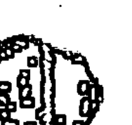
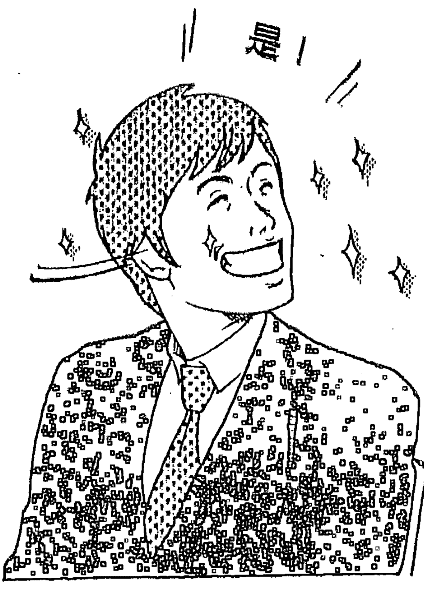
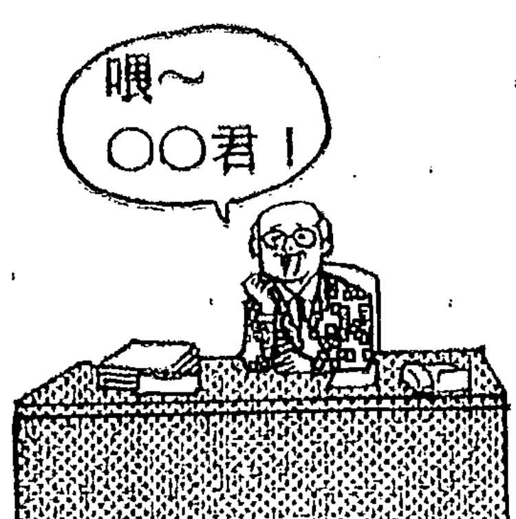

##### 讓煩人的上司閉嘴的「反同步行動」

姿態反應是與對方採取同步的行動，反之就是「反同步行動」。就如同剛才所舉出有關午餐的例子，只要與上司點同樣的餐點，就代表在執行同步行動。此外，對於面帶笑容與自己攀談的人，同樣以笑容回覆附和也是同步行動的一種。藉由於對話中配合與對方的行動或動作同步，就會帶給對方你很容易攀談的氣氛，愉快的對話也能持續下去。

然而，若對方興高采烈地說著話時，你卻露出一副不開心的態度，對方也會感受到你對他的話題不感興趣、無法產生共鳴，對話也會因此而中斷。這就是反同步行動。雖然應該多加避免這樣的行動才能使溝通能夠順利進行，但是有時候採取反同步行動也能帶來好的效果。

例如：在被上司挖苦且不斷訓責時，若只是一味說著「對不起！」「很抱歉！」的姿態縮下去，就會變成配合了對方的同步行動，而使得這煩人的情境無止境地延續下去。

這個時候，就可以採取如下面例子中的反同步行動，使對方來配合你冷靜的態度採取同步行動。

上司：「我不是說過好幾次了嗎！你這個人啊——」
下屬：「部長，請你不要那麼大聲發脾氣好嗎？這樣會造成其他人困擾的。」
上司：「你說什麼？你現在是在頂嘴嗎？」
下屬：「不是的，你一直發脾氣我該怎麼跟你溝通呢？我是在拜託你，希望你能冷靜下來。」

面對因為暴怒而情緒高昂的對象也不要覺得害怕，試著以淡然且冷靜的態度來指摘對方不當的言行。這樣的態度會使對方感到怯懦，之後怒氣也就跟著消失了。

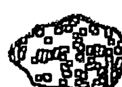
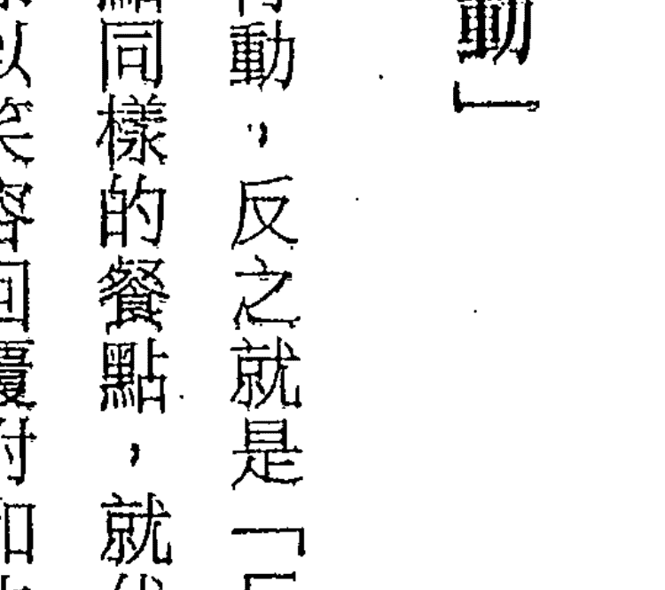

##### 對於前來挑釁的上司，以「沉默」使對方畏懼

有些壞心眼的上司會不斷挑釁，且抓住機會就想激怒別人。即使採取冷靜措辭對方不當的同步步行動，仍會被窮追猛打，試圖逼得你能如他所願反過來大發脾氣。

面對這樣的對象，請採取不管被怎麼辱罵都不回話，稱為「沉默」的同步步行動。

大嘆一口氣讓對方都聽得到，好好的調整呼吸，壓抑住自己被惡言刺激的怒氣。就算怒氣就快要一發不可收拾了，也記得要冷靜，總而言之，請你不發一語的保持沉默。

沉默的效果是「使對方開始思考沉默代表的意義」。是因為在反省所以都不回話嗎？「我會不會被揍啊……」等，這些猜測不停地在上司腦中盤旋，站在沉默不語的你的面前，對方反而會開始感到畏懼。沉默是非常有效的「反抗手段」。

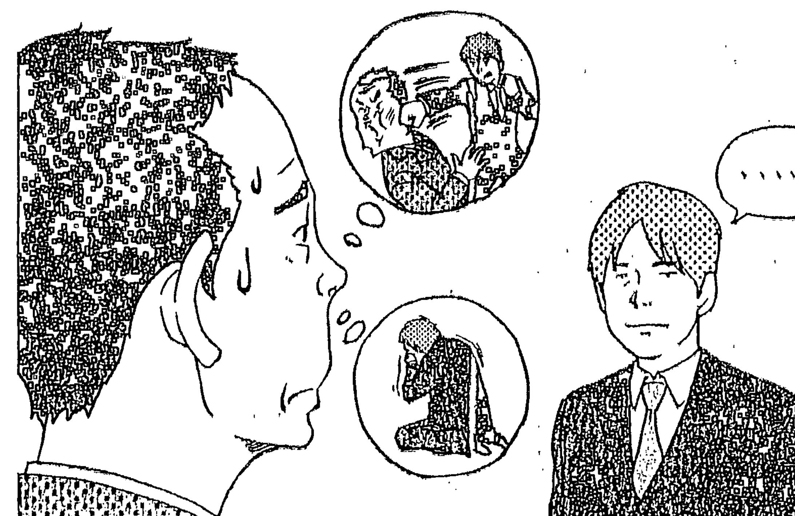

#### 支配他人的黑暗心理術

##### 在社會上爆增的「想法天真」的年輕員工

「真搞不懂最近的年輕人在想什麼！」相信有不少人在接觸新進員工或年輕的下屬時，都不自覺的這樣抱怨著。明明自己以前也曾經年輕過，卻因為代溝而變得不知道該怎麼跟這些年輕人相處。

然而，身為社會人士的前輩，對於這樣的後輩還是必須給予關照，因此最好多了解現在有哪些種類的年輕人。

從事社會保險勞務顧問的田北百樹子將愛遲到、無故曠職、不聽上司勸言的年輕人命為「砂糖員工」。砂糖員工有以下幾種類型。

**「砂糖員工」的類型：**

- ①依賴直升機父母型：直升機父母（Helicopter Parent）只要小孩發生什麼事就會立刻飛過來，這類型的砂糖員工是非常依賴雙親的類型。
- ②私生活延伸型：以私生活最優先，將私生活的問題帶到職場上的類型。
- ③單人房能力型：能力範圍狹隘，只能負責特定的簡單工作，且無法成長的類型。
- ④自我崇拜型：對自己的評價異常的高，十分尊敬（respect）自己，就算受到責罵也會把錯誤推到別人身上的類型。
- ⑤越獄風雲型：討厭的工作就不願意做，發生問題就輕易離職，無法承受壓力的類型。

現在的社會上，像這種「過於放縱自己」的年輕人正不斷增加當中。造成這種現象的背景之一，就是已經過了成年期還不願意離開父母或放手讓孩子自己生活的案例不斷增加，以及從小就在數位產品的環境下長大的年輕人，因此不擅長發展與真人交流的人際關係，這些錯縱複雜的原因造成了這種社會現象。

「跟他提醒了工作上應該注意的事情，也不會直接過來道歉，只用『寫了幾句反省的話』。」「明明辦公桌就在隔壁而已，卻只用『E』聯絡工作的進度狀況。」相信不少人也都有以上的情況吧。若要将這些年輕人視為戰力，不需要因為他們做法與自己不同感到生氣，而是要好好掌握他們的心態後，再從溝通上多下點功夫。

#### 逼迫有氣無力的部下做出「公開承諾」

每年過了日本黃金週之後，就會開始聽到「五月病」這句話。在心理學上被稱之為「上班族無力症」（Salaryman Apathy）的症狀，指的是新近員工認為實際公司生活與自己的想像有落差，失去工作興趣，呈現無力的狀態。

究竟該如何讓這些缺乏幹勁的員工提升起工作的拚勁呢？其中一個有效的方法就是讓本人在員工面前發表目標宣言。

或許每個人在執行任何事物之前都會先立定一個目標，但是這個目標如果只放在自己心中，很容易就會開始偷懶。

然而，若在人前宣示了自己的目標，就會讓人產生了達成該項宣言必須展開行動的責任感，如此一來，也能提高朝著目標努力邁進的機率。

這種心理現象稱為「公開承諾」（Public Commitment）。如果隨便亂開支票，很容易就會把自己逼人無法達成目標的窘境，因此無論如何都得逼自己提出幹勁。

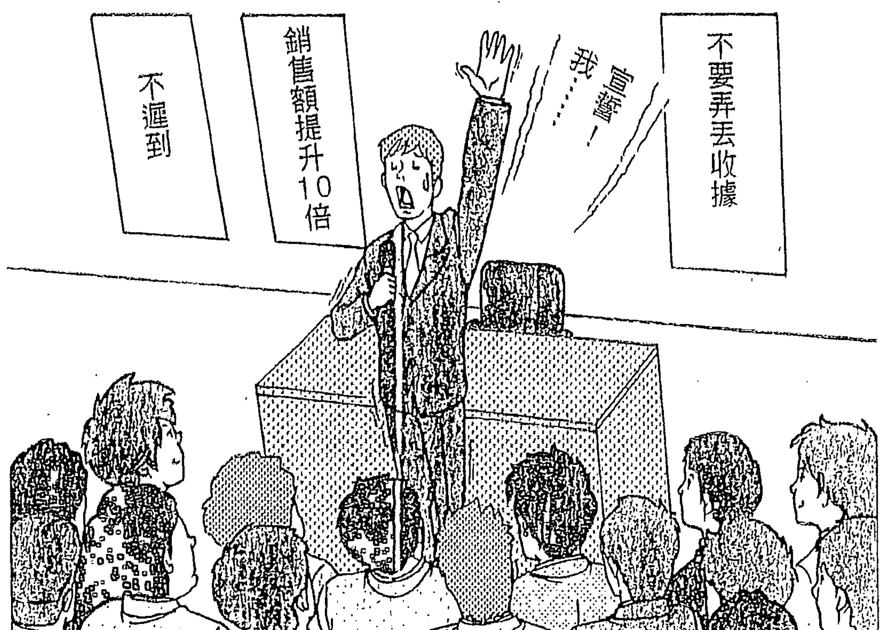

#### 使沒用的部下能上得了檯面的「畢馬龍效應」

要對付缺乏幹勁的部下還有其他方法。我們在前面提到過了。人們都擁有希望能滿足「社會需求」或「尊重需求」的願望。

因此，在鼓勵部下時，並非以「好好加油！」來激勵對方，而是對於他「正在努力中」的狀態加以稱讚，以提升對方對自己的肯定感。

心理學中有著稱為「畢馬龍效應」的心理行動。這是由美國的教育心理學家羅伯特·羅森塔爾（Robert Rosenthal）在一九六四年所提倡的心理原則，這項學說表示，周遭人們的期待，可以對人的智能與學習欲帶來強大的影響。

「畢馬龍」是出於古希臘神話中登場的塞浦路斯國王之名，他愛上了自己以象牙雕刻出來的女性雕像，並且熱切的祈禱雕像中的女性能成為自己的妻子，愛與美的女神阿芙蘿黛蒂便賜予雕像生命，實現國王的心願，而畢馬龍效應的名稱就是源自於這段佳話。

只要對方保持期待，「你對這方面很擅長，應該很適合負責這個工作。」「你的優點是做事很謹慎啊。如果能加強這一點，就能勝任更多有趣的工作。」像這樣持續不斷地關注與鼓勵，相信對方總有一天會如你所望。

#### 藉由「拉抬效應」來控制任性的部下

雖然沒幹勁的部下也很讓人頭痛，但是畢業於知名大學、充滿自信且工作成績也蒸蒸日上的部下、後輩中，也有人基本上很瞧不起自己的前輩或上司。

因此，有時會出現部下未與上司報告、聯絡、商談，就擅自執行重要的案件，一旦這樣的行動被上司警告，反而因此產生排斥感而失去幹勁。

這種心理現象稱為「回彈效應」（Boomerang Effect）。例如：你小時候是否曾有過這樣的經驗，正想開始念書的時候，卻被父母說「快去念書」，而因此幹勁全消。

這是因為被說服的一方（小孩）認為說服的一方（父母）對自己「什麼都不了解」，由說服的一方所帶來的壓力太大所造成的。

美國的科學家傑克·布倫（Jack Brehm），將這種心理行動命名為「心理抗拒」，所指的是當想要自由選擇自己的態度或行動時，這樣的自由卻受到了威脅，而使人想要堅持己見的狀態。

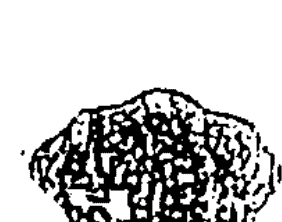

即便如此，上司仍不應該放任部下擅自行動。這種情況下，可以試著參考以下的對話，對部下自發性的行動給予讚賞等言語上的獎勵，等對方再度燃起幹勁時再採取「拉抬效應」，相信效果會相當顯著。

上司：「○○君，你總是這麼積極行動，真的幫了我很多的忙。我認為這次的簡報困難度還滿高的，你成功的因素是什麼呢？我想聽聽你的分析」

部下：「咦……你聽那個做什麼？」

上司：「○○君這麼優秀，我也得好妤學習一下才行啊！」

部下：「真是這樣的話就好了……」

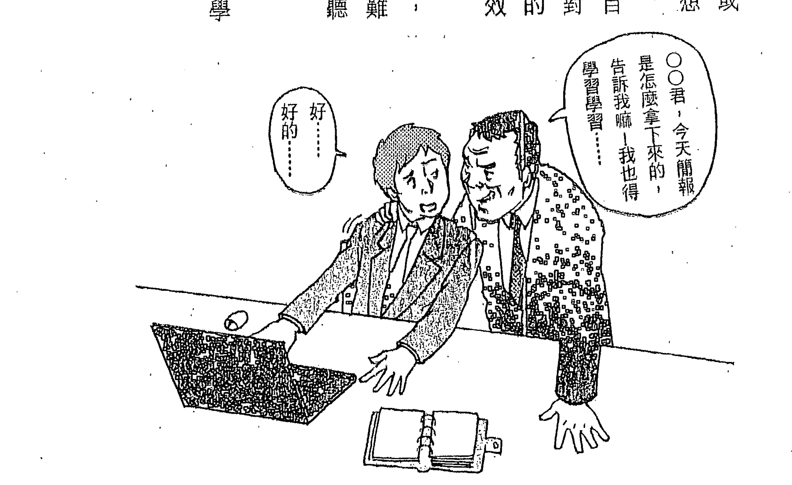

像這樣挑起部下的自尊心，利用帶給對方特別感的話語，讓部下的內心產生接受好意也必須以好意來回報的「好意回報性」，而對上司感到有恩情。如此一來，就能在不降低部下幹勁的狀態下對其加以控制。

#### 讓愛說謊的部下「自我設限 (Self-handicapping)」

「明明說去開會卻跑去打小鋼珠。」「明明是自己的錯誤給客戶帶來困擾，才讓客戶決定取消交易，卻捏造了其他理由。」等等，部下對上司說謊的情形也是花招百出。

其實在心理學上就提到了，人類會撒下的十二種謊言。

##### 人類的12種謊言

- ① 預防線：為拒絕而找理由搪塞、破壞雙方的約定等，為了將可預測的問題防範於未然而說謊
- ② 合理化：因失敗而遭到指責時說的理由
- ③ 逃離現場：無中生有的放完話後就逃離現場
- ④ 利害：與金錢相關時，回答對自己有利的答案
- ⑤ 姑息：為了讓自己獲得理解、擁護而說謊
- ⑥ 藏罪：為了掩飾自己犯下的錯而說謊
- ⑦ 能力、經歷：為了在與對方的關係之間占有優勢，而對個人資歷扯謊
- ⑧ 虛榮：為了滿足使自己看起來光鮮亮麗的虛榮心而說謊
- ⑨ 體貼：為了不使對方受到傷害而說謊
- ⑩ 惡作劇：能一笑置之的嘲弄與玩笑話
- ⑪ 自以為是：因自己知識不足搞錯而變成了謊言
- ⑫ 毀約：雖非本意卻無法履行約定而說謊

正如一便利的謊言—這句話所說的，為了使工作或人際關係圓滑進行，有時候說謊是必要的。然而，若給社會帶來極大的損害，或破壞了上司與部屬間信賴關係的謊言，甚至因為說謊而阻礙了部下本身的成長機會，就不能只是一笑置之。

例如：有部分對於設有限期的工作，卻在期限結束時仍未提出，同時還說出了因為其他的工作太忙了，沒有時間處理這個工作這樣的理由來搪塞。這種心理狀態可以利用『自我設限』來加以說明。

所謂自我設限，是指在有意識或無意識當中，自己對於完成事物的難度設下了限制（不利的條件），自己降低成功機率的行为。

#### 要看穿輕蔑的謊言就必須關注對方的非言語面

若對方瞧不起自己或公司並扯謊時，就必須想辦法盡早讓對方招認。

一旦撒了謊，為了掩蓋真相就得持續不斷的用其他謊言來加以掩飾，等到自己無法招架時才自白，那時已經對你與公司造成了極大的傷害。因此，身為上司或前輩必須身體能看破謊言的技巧。

若自我設限後卻成功達成目標，就能夠以“在這麼多不利的條件下，我卻成功了！”來進行自我肯定，同時也能獲得周遭的高度評價。此外，即使失敗了，也能以“如果沒有其他工作，就能順利完成。”等外在因素當理由為自己辯解，因此也不需要為自己的失態進行反省。

無論最終成功或失敗，自我設限都帶有著有着一定程度的缺點，同時，擁有成功執業務能力的人反而容易採取自我設限的行動。然而，自我設限說破了也只是在對自己的謊，並無法讓你體驗到付出真正的努力後所能得到的充實感及滿足感。

若有所下採取了這樣的行為，就必須讓對方有所自覺，這樣的行為對自己一點好處都沒有。

關鍵就在於對話中，關注對方的言語面（語言的要素）和非言語面（非語言要素）是否一致。即使從嘴巴說出的語言（言語面）聽起來像真的一樣，也可能從非言語面表現出一正在說謊一的真心話。具體來說有如下所示的言行。

- 無法冷靜，以手頻繁碰觸頭髮和臉部
- 眨眼次數增加，視線游移不定，瞪大眼睛盯著不動
- 狂冒汗，呼吸急促
- 說錯話的次數變多，回答著未被詢問的問題
- 將手藏入口袋中

若對方有這樣的言行舉止時，請留意對方說謊的可能性相當高。

此外，若懷疑對方說謊，則應該在掌握到無法動搖的證據時，再徹底一網打盡。

「現在說實話還來得及。」「你說的謊都已經被看穿了」「就以這樣刁難、威脅的方法，來保住身為上司與前輩的威嚴吧！」

#### 以「霍桑效應」來提升懶惰員工的效率

在執行一個以多數人所組成的團隊企劃專案時，應該都會有老是拜託別人，自己什麼都不做的懶惰員工。

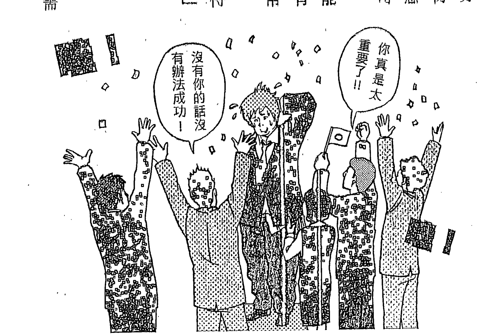

##### 支援他人的黑暗心理術

這是法國的心理學家馬克西米利安・林格曼（Maximilien Ringelmann）所提出的心理現象，稱為「林格曼效應」。

林格曼使使用拔河來進行實驗，觀察一個人參與拔河、兩個人參與拔河、三個人參與拔河……像這樣參加拔河的人數增多時，個人所發揮的力量有怎樣的變化。結果發現，當參加拔河的人數越來越多時，個人的效率將會降低。也就是說，當人身為集團當中一個齒輪在作業時，若有人數增加，就很容易會產生「反正其他人會想法吧！」的想法，因而降低個人對作業的貢獻度。這個現象在心理學上也稱為「社會的偷工減料」、「不勞而獲現象」等等。

那麼，為了讓懶惰的員工發揮身為企劃案的一員的力量時，又應該怎樣做才好呢？在這裡需要運用的心理技巧就是「霍桑效應」（Hawthorne Effect）。

在霍桑效應中說明了，一般人普遍喜歡受到關注，如果受到特別的對待時，就會產生將所長有效發揮的傾向。

這是在美國芝加哥的霍桑工廠所進行的社會實驗裡被引導出來的結果。為了讓勞動者的工作效率提升，而針對有效的改善方法進行了調查，結果發現到當工作環境的照明變得明亮、作業員的休息時間與薪資等勞動條件獲得改變時，不論以什麼方式進行實驗，所得到的結果都能明顯看出勞動者的工作效率獲得了解。由此可知，當物理上的職場環境有所變化時，由於勞動者們意識到自己正被為了實驗而來的調查員與上司「注目著」，因此提升了生產效率。

也就是說，即使是懶惰的員工，讓對方能意識到「自己是受矚目的存在」、「如果沒有我的話，這個企劃就沒有辦法進行」也是非常重要的。

因此，針對對方進行工作的方式抱持期待與鼓勵，並活用「畢馬龍效應」或「公開承諾」的技巧，藉此達到提升對方幹勁的效果。

#### 輕鬆融入新職場的「亞隆森出軌法則」

當你轉換跑道時，要融入新的職場往往需耗費不少的心力。要在新環境中建立起人際關係時，可試試著使用「亞隆森出軌法則」。

美國的心理學家艾略特・亞隆森（Elliot Aronson）認為，由不熟的人身上所獲得的讚賞與評價，遠比從熟識或親近的人身上得到的讚賞給人的感覺更加強烈。

例如：長年在相同職場工作的同儕口中聽到「○○你真會整理資料耶！」時，跟剛從轉換到這個職場的人說道「○○你整理的資料好容易懂喔！」時，對當事人而言所感受到的差異不言而喻。

即使是從一起工作好幾年的夥伴口中反覆聽到的一句話，換成被關係較不熟的人稱讚，同樣能帶給人新鮮感。

換到新的環境時，碰到必須構築新人際關係的狀況時，最好以這樣的立場來思考一下人們的心理狀態。接著，再使用如下面舉例的台詞，積極地說出讓對方感到愉快的話吧。

- 「○○，你也會說英文對吧？曾到過哪裡留學呢？」
- 「週末要不要去打美式足球？我自己也很想打。」
- 「我聽說你的興趣是玩相機，那你現在是用哪一台相機呢？」
- 「請告訴我靠外匯交易賺大錢的訣竅！」

諸如此類，先針對對方擅長的事物或興趣、嗜好等各方面加以調查，再於對話中穿插話題，相信一定很快就能拉近和對方的距離。因為無論是乍看不太好相處的上司、或不曾打過招呼的員工，每個人都擁有著想要被對方接受、想被認同的「社會需求」「尊重需求」

#### 讓中意的異性有回應的戀愛心理術

「雖然有中意的人，但總是很難搭上話。」「雖然想邀約在酒吧裡每次都會遇到的人，但該如何開口好呢……」「即使是工作能力強的人，關於他人的愛情問題總是能給予解惑的人，一旦自己的戀愛有了苦惱時，很多人就變得更小了吧？還在躊躇不前的時候對方就有了男女朋友，不得不放棄這段戀情的人也不少吧？有人說『跟自己想像的人結婚』，這種說法可以用美國心理學者伊萊恩·哈特菲爾德（Elaine Hatfield）所提倡的『配對假說』來加以說明。

所謂配對假說，就是人們有選擇身體魅力與自己相似的伴侶的傾向。雖然實際上是想追求比自己更具有身體魅力的異性，又害怕向對方告白後被拒絕，或者對於魅力不如自己的對象會以「不適合」來拒絕對方，因此到頭來便傾向於選擇與自己十分類似的另一半。

但是，如果有機會能讓喜歡的對象成為你的愛人呢？接下來就來介紹與這相關的心理術。

#### 人與人變得親密的過程

與異性相遇、彼此關係變得更親密的過程，都曾經成為各個心理學家研究的對象。美國的社會心理學家羅伯特·路易斯於一九七三年所提倡，從相遇到結婚，人們的心理會經歷下面的六個階段。

##### 到結婚的六個階段

- 階段①類似性的認知……關於價值觀、興趣、喜歡的事物等，了解兩個人的共通點的舞台
- 階段②建築期望的關係……共同擁有愉快的經驗，促進互相理解的階段
- 階段③自我了解……關於自己的事情屬實的說出來並且分享祕密，增進親密關係的階段
- 階段④取得角色……互補互相不足的地方，同心協力的階段
- 階段⑤配合角色……扮演好自己角色的階段
- 階段⑥結晶……認定對方是自己的任，決定要以兩個人作為一個單位走下去的

此外，美國的心理學家巴納德・麥斯坦（Bernard Murstein）於一九七七年發表的「SVR 理論」中，也將人際關係的深度分成三個典型的階段。

##### SVR 理論

- 階段①刺激（Stimulus）……外觀及聲音、性格等，受到外表及感情的表現所接收到的狀態
- 階段②價值（Value）……共享對事物的興趣及關心、價值觀等的狀態
- 階段③角色（Role）……不只是價值雷同，能互相察覺對方所期望的事情，並且雙方協調承擔角色的狀態

雖然心理學上來看經過這個階段後，男女的距離會變得親密，但最初相遇所產生的「第一印象」還是最重要的。為何會這麼說，最初相遇時讓對方產生的印象為「初始效果」，這對接下來的印象成形也會有很大的影響。

例如：朋友說「要介紹女生給你」並安排好場地，但你卻遲到了，還一副剛睡醒的樣子的話，這時給對方留下的壞印象是很難抹滅的。

#### 以「暈輪效應」來控制第一印象！

另一方面，外表看起來優秀的話，也能大改變給人的第一印象。「穿著合適的西裝，工作能力應該也相當不錯吧！」「穿著高貴像公主一樣，性格應該也很溫柔婉約。」在被外表吸引的情況下，也會覺得對方的所有一切應該都是優秀的。

這樣的心理效果稱為「月暈效應」。讓月暈效應起作用的不只是外表而已。性格及在社會上的地位、學歷等要素，如果其中有一項令人注目的話，其他的部分的表現也會被認為很優秀。

因此，在戀愛場合這種第一印象非常重要的情境中，為了讓對方對你留下好的印象，試著利用這種人類心理，營造出你想打造的第一印象吧！

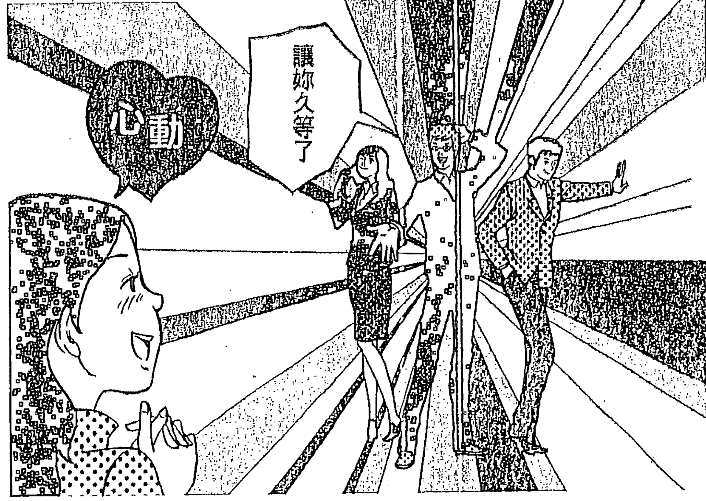

例如：認為自己性格內向的人，要補強其性格要素，展露出開朗的表情、說話時採用正面積極的用詞、不要有小鼻子小眼睛的態度、穿著乾淨亮色的衣服等，表面上也要顯露出自己和善的一面。這樣的話，對方就會認為你是個「讓人感覺舒服的人」。

此外，暈輪效應也會在自己周圍的人起作用。在職場或拜訪客戶時，若遇到心儀的異性，同時帶著帥哥或美女同事、部下的話，他們的外表上的條件也會帶給人好的影響，連帶著你本身也會給人更好的印象。

#### 「單純接觸」讓對方的警戒心放鬆

美國的心理學家羅伯特·查瓊克（Robert Zajonc）所提倡的「查瓊克法則」中提到了，「人們會對不認識的人採取攻擊、冷淡的態度。」「人們相遇的次數越多就會對對方越有好感。」「人們在知道對方的另一面時，會更提升對對方的好感。」總之，雖然人們會對不熟的人或事物採取攻擊的、批判的態度，但只要反覆碰面使「單純接觸」次數增多，就會因此而對方抱持好感。

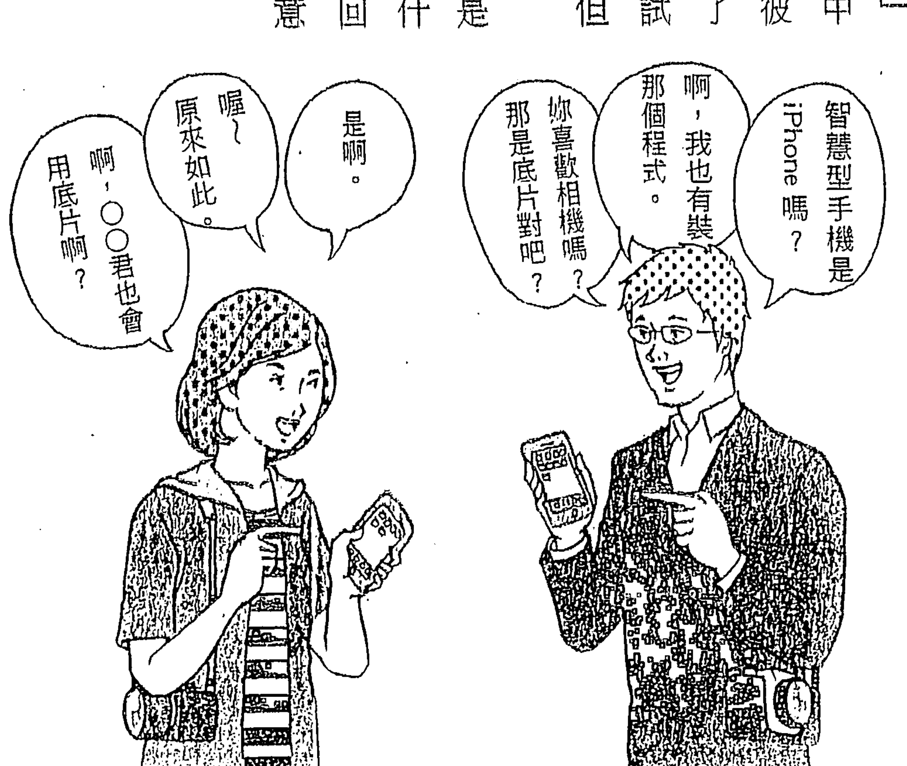

就如同像電視及雜誌上不斷重複的廣告商品，會比其他廣告露出量較少的同質性商品更讓人感到親切，人際關係也是如此，隨著相遇的次數越多，警戒心也會逐漸變淡了。

總而言之，若希望心儀的異性有所回應的話，積極的與對方接觸是很重要的。職場中若有令你在意的異性，最好盡可能出現在對方視線內，即使是簡單的打招呼也沒關係。當不斷重複這些的動作後，對方也會慢慢放下警戒心，或許在某個偶然的機會，就能自然的聊起來。

若不知該說跟對方聊些什麼，不如試著請對方幫忙。「不好意思，可以借我修正液嗎？」「方便借我手機的充電器嗎？」等，拜託一些對方能輕鬆對應的內容，若對方答應幫忙，記得要禮貌性的回覆。

雖然對對方而言，受人所託是件麻煩事，但也同時會產生「自己被拜託了」的優越感，在對方的好意也需要以好意回應的「好意回報性」一起作用下，就產出想要回應的心情。這樣持續一來一往下去，慢慢的對方的心中也會無意識的為自己的行為，帶入如「我對○○這麼親切，是不是我對○○有好感……」的動機，使對方的心情漸漸的能回應你的期望。

另外，剛剛介紹的「到結婚的六個階段」及「SVR理論」中也有提到的，心理學中的「共通項、類似性原則」，當雙方意識到彼此是相同的人時，親密度也會跟著提升。為了要找到可以聊天的機會，有許多人應該都會試著找出能引起對方共鳴的話題，這種行為不但能帶給對方安全感，也能使對方感覺親切。

對於想吸引的異性，「你的智慧型手機是iPhone嗎？還是Android？」「最近有發現到什麼好吃的店嗎？」就像這樣積極的提出容易回答的問題，並同時探索對方感到有興趣及注意的事物吧！

#### 簡單使兩人關係變深之「互補性原則」

共通項及類似性越來越多時，兩人的親密度也會隨著上升，隨著這樣的關係加深，「自己雖然很容易緊張，她卻很大刺刺的。」「跟我不同，原來他對時尚沒啥興趣呀？」等，也變得開始注意到對方與自己不同的地方。

到了這個階段，接下來會產生的是，彼此互補不足部分、漸漸產生協調性的關係。在心理學稱為「互補性原則」。

例如，對自己神經質的性格感到自卑的男性若與個性大刺刺的女性交往，不但能解除男性的自卑感，女性太過大刺刺的個性也會變得細膩，進而產生了由對方的優點來補強自己缺點的互補相關性。

為了有意識的建構出彼此的關係，使兩人的關係更加親密，試著讓彼此像「老師、學生」一樣分攤角色也是一大關鍵。

若男方對流行沒有興趣的話，女方則可以當作是男方的造型師給予男方穿搭上的建議。而對料理不在行的女性，男方可以讓女方對料理產生興趣，試著兩個人一起作飯看看。這樣彼此互補，也能使兩人的關係性更加深刻。

只是，對於初次見面及認識不久的人，過於強調彼此的差異點是萬萬不可行的。

在還不知道彼此的相似處時就說出「跟我都不一樣耶！」「想法也可能不一樣」等，反而會造成反效果了。

#### 以「自我展現」來拉近對方的心

想要更加深與對方的關係，「自我展現」是非常重要的行為之一。所謂自我展現就是將自己的感情及價值觀、人生觀等情報如實的傳達給對方，與對方討論。

除了感到自我肯定的部分之外，負面的缺點也要毫不隱藏的完全呈現出來，而接受你自我展現的對象也會因為覺得「竟然連這樣的事也跟我說，也許我的存在真的很特別。」而對你抱有特別情感。隨著別人對我的付出我也要加以回報的「回報性原則」發揮作用下，對方也會說出自己的情報，如此便能讓兩人對彼此的了解更加深刻。

此外，藉由「我只跟你說喔…．…」這樣訴說特別情報的行為，兩人也會開始產生共享秘密的關係，這也是想拉近對方的心時，很有效的一個技巧。

話雖如此，如果對認識不久的人進行自我展現的話，可能會使對方擺起姿態，或是對此感到有負擔，因此循序漸進的分享自己的情報也是「大要點。」

同時也要記得避免自誇或過度吹捧自己的行為。雖然要表現出真實的自我，但若反而因此傷害到對方是絕對不可行的。像是「○○看起來有點笨笨的耶！但這個部分又滿可愛的…．…(笑)」這麼說時，只會讓被說的人留下不愉快的感覺，因此

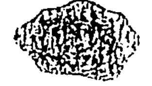

大前提還是得要先為對方著想。

相對於不分自己的特質好壞全盤托出的自我展現，只將對自己有利的情報傳達給對方，則稱為「自我呈現」的表現方式。

自我呈現除了是為了達成自己目的的一個手段之外，在活動溝通上、或提高自己的自尊心時都是不可或缺的行爲，但是由於與操控情報改變給予對方印象的「印象操作」類似，因此很容易帶給人負面的印象，將其區別來考量也是相當重要的。

#### 「有點不一樣的稱讚法」讓對方產生錯覺

在你一心想與心儀的異性靠近時，是否曾有過這樣的經驗？「這個飾品，好漂亮喔！」等，像這樣對於眼中所及的物品，直接表達出該物品帶給人的印象。

對於別人對自己的稱讚，應該很少人會感到不愉快吧？可是，若是說出了任誰都能作出的評論，那麼表示你的存在感不帶有令人深刻的印象，說不定還給人「這個人跟其他人一樣……」這樣的負面印象。

稱讚意中人時，使用稍微有點不同的稱讚方法，來加強自己給人的印象也很重要。

納姆效應 (Romm Effect) 的心理效果就能輕鬆搞定。

所謂巴納姆效應，是即使說了可以套用在每個人身上的曖昧句子，仍可以讓對方堅信那是專為自己而說的心理效果。這個名字是源自美國的雜技演員費尼爾司泰勒・巴納姆 (P.T. Barnum)，同時也可稱為源自美國的心理學家伯特倫・弗瑞爾 (Bernou Fore) 的「弗瑞爾效應 (Fore Effect)」。

例如：現在的心理學中雖還沒有證實血液與性格的因果關係，但大多數的人仍很相信血液占卜及性格判斷。如果聽到「O型的男生跟A型的女生結婚比較合。」「同樣B型的情侶會吵個不停。」等說法，就產生感覺像自己被說中的一般錯覺，這是因為巴納姆效應發揮了效果。

在稱讚對方時，若對方帶給人的是開朗的印象，就試著以「雖然你看起來個性自由奔放，但其實你看事物的角度是相當冷靜的。」之類對方很少被說到的地方來表達。要稱讚擁有頭銜的人時，「在業績不斷提升的過程中，其實也吃了不少苦頭吧！」像這樣連同對方達到現有地位的過程也一併加以稱讚。如此一來，就能帶給這個人可能滿了解我的事的吧「錯覺」，進而產生特別的感情。

#### 男女開心的點完全不同嗎？

稱讚異性時，男性與女性會感到開心的點有所不同，戀愛中的情侶記得把這點也記在腦海裡。

男女性別開始產生不同，據說是源自於人類還在過著狩獵採集生活的原始時代。男人負責外出狩獵、保護女人及小孩不受外敵攻擊、並從中獲得為確實捕獲獵物而擁有的戰略性、理論性的思考力，此外，還有重視結果好壞的傾向。

另一方面，女人在受到男人的守護下，要生小孩、在團體中照顧家人，並從中獲得了在團體生活中的同理心及理解、體諒的感受，同時有重視事物發展過程的傾向。

當然這樣的認知也存在著個人差異，不能以「男生是○○」、「女生是○○」來一概而論。但是從這樣的背景來看，「工作能力强」「博學多聞」等，對於成果及結果等，讓人感覺到男人強悍之處的語言特別敏感，將自己獲得的戰利品視為是自我認同的準則，這正是男性特有的特徵。

例如：用工作賺到的錢購買了高級名錶及鞋子、進口車等東西作為「成功的象徵」，即使只是基於場面對這些成果加以稱讚，也有不少男性會像是期盼已久一般開始自我吹噓。

相反的，與男性相較之下，比起成果及強悍度等部分，女性更希望完成事物的「過程」受到稱讚，因此若與心儀的女性一同參與專案時，可以試著用「少了妳，這個專案就無法順利了！」等的話語，以及不論結果而對於過程加以稱讚的方式，說不定能讓對方對你留下好的印象。

#### 無意識中的啟動「鏡射技巧」

觀察了咖啡廳及餐廳內感情不錯的情侶後發現，兩人會有一些非常有趣的動作。比如說「男朋友喝咖啡的話，女朋友就喝水」、「女朋友用手撐著臉頰的話，男朋友就開始弄頭髮」的情況。

至於為何會有這樣的動作，原因在於互相帶有好感及信賴感的人，會在不知不覺中無意識的模仿起對方的習慣跟動作，這是稱為「鏡射」的人類心理引發的反應。雖然稱為鏡射，卻並非就是如反應在鏡子裡作出和對方一模一樣的動作，但若與對方的波長相合，即使不是情侶也會產生同樣的現象。

若跟心儀的人在一起的時候，有意識的使用鏡射技巧，配合彼此的波長，就能讓彼此產生出親密感。在使用時需注意的事是，絕對不能被對方發現。若動作完全相同會讓人心感不自在，因此最好不知不覺的，偶爾把時間稍微錯開，在對方不會發現的狀態下嘗試看看。

順利的話，下次就會產生改由對方模仿你，這種現象就被稱之為「交叉映現」。

#### 使用在不把你告白當一回事的對象之心理術「密技」

即使跟心儀的異性已經進展到可以小聊的階段了，但要向對方表白自己的想法卻還缺乏一點勇氣。「萬一對方有其他喜歡的人怎麼辦……」等，太害怕被拒絕，而裹足不前。

但是，沒有人會因為被說「我喜歡你。」而感到不開心的。即使告白被拒絕了，在對方心中「被告白」了「這件事關心的事仍會繼續留在心中。此外，當被說「我喜歡你」時，同樣也會產生認為需要回報某些東西給對方的「回報性原則」，因此，即使是原本完全沒有任何想法的對象，之後也會開始變得有點在意。

然而，若彼此的社會地位及年齡差距過大，對於你的告白對方可能也不會太認真看待。

這個時候，為了要讓對方的心情如自己所願該如何做才好呢。在心理術中存在著稱為「睡眠者效應」（Sleeping Effect）的「密技」。

納粹德國的宣傳大使，被稱為「宣傳天才」的約瑟夫·戈培爾（Josef Goebbels），他的名言是：「謊言說了一百次就會變真的了！」雖然這句話是否真的是出自他本人口中，說法眾說紛紜，但這句話的內容卻在心理學上獲得了印證。

所謂的睡眠者效應，是指人們最初雖然會懷疑對方「勸說」的可信性，但隨著時間流逝會忘了要懷疑「可信性低」，而相信了勸說內容的心理現象。換言之，「沉睡」在對方的腦海中「可信性低」的內容，隨著時間的流逝也開始發揮其持有的效果。

因此，若是在男女關係中，不斷重複說著

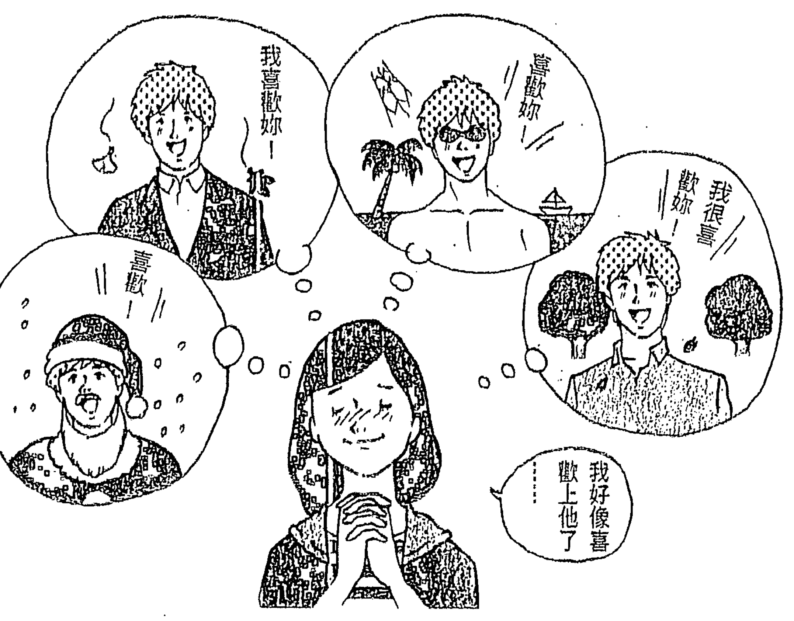

#### 以「反差效果」來隱藏自己的缺點

「我喜歡你」的話，剛開始會表現出「怎麼這麼說（笑）」完全不相告白放在心上的對象，也會隨著時間經過，使「不能相信」的記憶慢慢淡去，而變得開始相信「我喜歡你」的告白了。知道有這樣的心理作用的話，即使在最初對你而言是不利的狀況，仍是有可能會發展成順利交往。

為了要讓「睡眠者效應」順利發揮功效，有個條件是不能讓對方討厭你。如果已經被對方討厭了，你卻還一直不斷像對方的傳達「我喜歡你」，這樣只會帶來反效果，並使雙方關係更加惡化。

若想讓討厭你的人對你產生興趣，請將希望寄託在「反差效果」（Gappo）上。所謂的反差就如字面上的意思，帶有「意外性」。如果能讓對方看到還未曾對你抱有好感的部分，說不定從中帶來的意外性，能讓對方提高對你的好感度。

因此，首先要清楚了解對方對自己的印象是如何。想想為何會被對方討厭，可以的話問看看對方的親朋好友，了解自己給了對方什麼樣的印象。像是「輕浮」、「強勢」、「看起來陰沉」，若是有機會可以改正的原因，就可以藉由「其實我很熱心的在參與義工活動。──喜歡戶外活動所以休假時常去爬山。──建立起這樣的落差，讓自己的負面印象可以被覆蓋過去。

「反差效果」不限於被討厭的情況，還可以應用在各式各樣的情況。例如：在職場上總是給人感覺工作能力很強的男性，以博取同情的語氣說了「忙了一天回家後卻只有自己一個人，總覺得好寂寞啊！」聽者因此將那種心情投射在自己身上，而不自覺的說出「那下次一起吃飯吧？」若能像這樣引起「救援行動」的話，也能使雙方發展出更親密的關係。

#### 以「以退為進效應」的技巧使對方無法拒絕邀約

要邀約心儀的異性時，任何人都會帶著「被拒絕了怎麼辦……」的不安心情。但是，若能巧妙的使用心理術，要使對方輕鬆答出「OK」的機會也會跟著提高。

以下的對話為其中一個案例。

- 男：「下次連假一起去韓國玩啦？」
- 女：「欸，去國外喔，不可能啦。（笑）」
- 男：「也是……那這個週末要不要去大久保那一間○○韓國料理啊？」
- 女：「嗯，這倒是可以喔。」

這就是，最初就先想好對方會拒絕的「誇張要求」，等對方拒絕後再提出真正想要提出的「小小要求」，就是所謂的「以退為進效應」技巧。像這樣的勸說過程，會使對方對於「拒絕了最初的邀約」產生罪惡感，而當提出下個邀約時，促使對方決定要答應要求的「回報性原則」就會開始發揮作用，而無法再拒絕己方所提出的小要求。

與「以退為進效應」相反，難以拒絕對方，小要求不斷的累積，最後會接受更大的要求的技巧就是「得寸進尺效應」。

如果是見面沒多久的人的話，一開始先從「告訴我[]或推特的帳號」「容易接受的要求開始，慢慢提出「放假時出去玩吧」「可以去你家嗎？」「今天可以住下來嗎？」等等，較高階級的要求。

這個是利用一旦接受對方的要求，如果不採取首尾一貫的行動的話，將會影響自己的信用，稱為「一貫性原則」的技巧。就如同無法拒絕「無理的請求」一樣，從最小限度的請求開始試試看吧。

#### 以「錯誤前提暗示」自在的誘導對方的心理

「以約會為前提」像這樣的有點積極的邀約方式也不錯。「有些評價不錯的店，要選擇和食還是義大利菜呢？」「像這樣提出無法回答好不好的『二選一』的問題」，會使對方意識集中在「要選和食呢？還是選義大利菜？」而使拒絕邀約的機會降低。

這是從「一開始以錯誤的前提來誘導對方的心理，稱為『錯誤前提暗示』、『錯誤前提誘導』的心理技巧。

就如同「二選一」的問題被認為有「親近化效果」，最後說的句子比較容易留在記憶裡也是其特徵之一。兩個人一起吃飯，不知不覺中已經很晚了，「下一間店要選哪間呢？要在這附近找，還是要往靠近我家車站的方向移動呢？」這樣詢問的話，後面的選項將會留在對方的腦海，容昜回答「那就往你家的方向……」。這樣的請求，在對方鬆懈的時候不經意的提出，會更具效果。

此外，若能巧妙使用像「例如」、「如果」這樣的假設句，也可能產生意願。

- 男：「如果約會時要去吃飯的話，和食、義大利菜、中華料理、民族料理，哪一個比較好呢？」
- 女：「如果是我的話應該是和食。」
- 男：『和食也有多種類，妳喜歡哪一種呢？』
- 女：『果然還是壽司吧。』
- 男：『是喔。例如場所的話，應該選哪裡比較好呢？築地、銀座、六本木…………』
- 女：『我想想。應該是築地吧。』
- 男：『原來如此。說到這個，我知道築地有間很好的店喔。』
- 女：『真好！』
- 男：『那麼我帶妳去吧。星期四跟星期五，哪天方便呢？』

像這樣以舉例開始展開的話題，會使當事人的意識就會薄弱，甚至不去在意自己正在接受詢問，也因此能輕易的誘導對方的心理。

#### 利用「吊橋理論」，引起戀愛感情

當兩人一起出遊的時候，流行的景點或能夠享受到好吃料理的餐廳，也是不錯的約會行程，但是，在擬定行程時请务必將『黑暗的地方』排入行程當中。如果你認為目的是因為「在黑暗的場所，兩人之間的距離也會更近」的話，原因正是如此。對黑暗抱有不安與恐怖，是自古以來就不曾改變的人類心理。由於在這樣的空間裡，誰都無法預測何時會遭到襲擊，因此人類自然的那產生了互相保護、互相依靠的習性。因此，若兩個人單獨去到昏暗照明的酒吧或夜晚的公園等地方，兩人間的物理距離也會縮短變得更靠近。

物理距離近的話，心理的距離自然也會跟著縮近。美國的心理學家波札特針對五千對有婚約的情侶進行調查，發現有 33% 的情侶住在距離五條街以內的區域，而兩人居住的距離越遠，最後一起步入結婚的機率也較低。

人在不安的時候，會無意識的開始對身邊的人感到在意。那是因為在感到恐怖，生理上變得興奮時，人類會以為那個興奮並不是因為感到恐怖，而是產生了「為對方感到心跳不已」的錯覺。

加拿大心理學家唐納·達頓 (Donald Simon) 與阿瑟・亞倫（Arthur Aron），便證實了被稱為「吊橋理論」的心理現象中，如果有共同體驗如走吊橋般的緊張感，被認為發展成戀愛感情的可能性很高。像遊樂園的鬼屋、雲霄飛車，這樣的設施，晴空塔或六本木Hills的展望台的高處，如果能產生心跳不已的情況的話，不管在哪裡都能期待它的效果。

#### 以「身體接觸」來簡單的改變對方的心情

實驗證實，適度的觸碰對方的身體，這樣的行為，有著讓雙方親密度提高的效果。

根據在美國進行的心理實驗，據說女服務生在接待男性客人時，若自然的碰觸了對方，所獲得的小費會比沒有碰觸客戶時高出約四成。即使是輕微的身體接觸也能夠改變人心理的狀態。

雖然如此，與歐美相比，日本目前仍沒有擁抱或身體接觸的習慣。由女性來碰男性比較容易接受相比，若是由男性觸碰女性的話，則會使對方感到緊張，因為當對方有抽身或將包包抱在兩人中間的舉動，最好視為是對方表示NG的暗示。應該碰觸身體哪個部分也是很重要的。實驗結果顯示，不論男女都很難對上手臂保有警戒心，而女性則對於被觸碰頭或頭髮會感到招架不住。另外，觸碰的時機，建議是在說話的途中或是吃飯的時候，不經意的觸碰較為自然。不論是哪一個情形，笨拙的觸碰會引起反效果，還請多加注意。

### 第5章

### 「不被人操縱」的心理建設

到目前為止的章節，介紹了各式各樣隨著語言或姿勢來將對方引導到自己所期望方向的心理技巧。

事先知道這樣的心理技巧，除了可以操控對方使情況變得對自己有利以外，還有其他的好處。那就是「被操控」的危險性變少了！

到目前為止介紹的操控對方的心理技巧，也有些被詐欺集團或宗教狂熱團體用在進行精神控制的情形。因此，若察覺到對方使用了這些「手法」，你可能會覺得「這傢伙說的話，總覺得有點奇怪……」「無意識之中也會有種違和感。

被人操控的情形，不算只發生在像惡質的宗教勸誘或詐欺等等特殊的情況，在日常的朋友相處或戀愛中的人際關係也是，此外，會議或是商談的商務場合等，在日常生活中的各種場合都頻繁的在發生。

例如：在商務場合裡中，公司內部人際關係的小動作，或討論關於交易條件等的場合時，對方為了簽署對自己與自己公司有利的條件，會想盡辦法操控對方的思考。在這時候，為了不被牽著鼻子走，事前知道一些不被他人操控的準備與心理技巧是很重要的。

在此我們將以目前所學到的心理技巧為基礎，另外來解說避免被他人操控的準備與心理術。

#### 別想著要讓所有人都認為自己是「好人」

為了不讓人騙，重要的準備。其中之一就是「不要認為所有的人都是好人」。我們為了不讓人感到困惑與不愉快，一直以來都被教育要成為能讓別人感到信賴的人。這個禮儀與社會的常識，會左右我們的行動。

例如：當被別人親切的對待時，回禮是應該的。這以心理學用語來說是稱為「回報性原則」的心理。這的確是理所當然的事，當受到朋友或認識的人親切對待，一般來說在心情上都會想要回禮，也是一種禮儀。如果連這樣的事都沒辦法好好做到的話，與朋友的相處將會變得很困難，也不易取得他人的信任。

但是，若只是保持著這樣的想法，就有可能被那種心理利用而受騙，所以必須要注意。在這裡最重要的，就是一開始說的「別想著要讓所有人都認為自己是好人」的準備。

例如：像小禮物或是試吃品等以服務為心態所提供的禮物之類的小小恩惠，就不需要有很大的回報。只要在試吃後真的覺得「好吃」時再購買就可以了。這時候不需要過度的回報，所以要記住並不是因為試吃了就所以下定要購買，在那之後也不需要感到內疚。

#### 有時候也需要有改變自己的意見與主張的勇氣

另外，經常改變自己的意見和態度，常會被認為是不能信賴的人。我們希望自己能成為受到其他人信賴的人，因此記得讓自己的發言與行動保持【一致】吧！

像這樣的心理，以心理學用語稱為【一貫性原則】，如果自己的發言與行動不能一致時，會讓人感到不快（認知不協調）。因此，人們會為了避免讓自己有這種不愉快的心情，而強迫自己的發言與行動一致的情形。

例如：從平日就強烈要求周圍部下徹底執行「經費縮減」的上司，當事情有變化想使用經費時，在要求了部下要徹底執行「經費縮減」的前提下，即使是真的可以使用的經費，心理狀態也會變得很難說服自己去做使用。

但是，像這樣對於以「一貫性原則」為基礎的心理行動過分要求的人，實際反而是【容易被欺騙】的人。例如：惡質的宗教團體等，就是利用了這種的「一貫性原則」提出「自己決定好的事情，在中途改變心意的話，就是心與意志薄弱的證據。」用這樣的理由來責難與威脅，並利用「貫徹理念到最後，我們一起努力吧！」的激勵方式來欺騙民衆上當。

確實，如果意見經常改變、立場不堅定的話，或許會讓人覺得不能相信。但是若有明確的理由而改變自己的想法，或在中途改變方針的情形，努力對周圍的人們進行說明並獲得理解也是很重要的。

「想被認為是好人」、「想被大家尊敬」這樣的想法如果太過強烈，就無法像這樣好好的傳達自己的主張，而會被「一貫性原則」所利用操控，更有可能發生受騙的情形，必須要好好的留意。

#### 不要害怕與其他人採取不同的行動

除了「回報性原則」、「一貫性原則」之外，還有另一個為了顛覆「想被認為是好人」的人的意識所使用的心理。那是指想避免只有自己採取與他人不同行動的「社會證明原則」。

相信你應該也常有這樣的心情「因為對自己的判斷沒有自信，所以配合別人的行動的話較能感到安心」。此外，經過多數人認同、評價的東西，也會讓人不自覺的認為「應該就是這樣沒錯吧！」

這樣的結果，也造成了隨時都跟別人採取了一樣的行動。雖然不造成他人困擾也是很重要的，但是沒有必要常常與別人採取同樣的行動，也沒有必要因採取與別人不同的行動而感到不安。

人不同行動而感到惶恐。

與別人意見、興趣志向不同，都是再理所當然不過的。不論是在私下或是商務場合懂得聽取意見都是非常重要的，但是懂得不隨波逐流，確實遵從自己的意見與想法來行動，也是非常重要的事。

「回報性原則」、「一貫性原則」、「社會證明原則」這三個想法，仔細想想其實都是一些非常理所當然的道理，但是從日常生活起就意識到人們普遍的心理現象，使自己能成為「不被操控的人」是非常重要的。

#### 別在情緒受到牽動的情況下判斷事物

在惡意或宗教或欺騙的手法裡，巧妙的利用人的不安或恐懼心、迫切感、優越感、同伴意識等的感情，來煽動對方的情緒，然後，在當下就逼迫你做決定是非常見特徵。

例如：想要買東西的時候用「這是非常稀有的東西，現在不買的話很快就賣完了！」像這樣樣逼迫對方。這是一邊煽動迫切感，一邊強調賣的東西的稀有性，讓你認為產品看起來的價值比實際上更高的技巧。

#### 只要仍有不理解，就請對方說明到能接受為止

在聽對方說明時，當感覺到所說的事有矛盾、內容不一致時，指出疑問，請對方說明到可以接受為止，也是不被別人操控的必要準備。

保留自己的判斷，拖延時間是比較好，但是不能讓對方的說明拉長。在常見的詐欺手段裡，有這樣的情形，為了不讓你指出矛盾點，故意使用你無法理解的專門用語來說明。

一般來說，稀少的東西，難以入手的東西較有價值，相反的，不管是誰在甚麼地方很容易就入手的東西價值較低，價格也低。重點是，那個「稀少性」並非都對自己有利益。只要說「很難入手的東西」或者「之後再加價，以高價賣出的話……」，像這樣想像的話，就會感受到比實際金額還高的魅力，需要小心翼翼。不僅是買東西的時候，在商務場合的商談與交涉也可說是相同的情形。吊你胃口，煽動你，使你在意志動搖的狀態下，無法保持冷靜的判斷。在這個時候，一定要避免「當場」做出結論，這是為了「不被操控」很重要的準備。

離開現場，經過一些時間讓自己獨自冷靜思考是非常重要的。當要對金錢、對未來做出重要決定時，試著與該事無關且自己能夠信賴的人商量，也是方法之一。

#### 用語來說明

當他一直使用專門用語時，你會容易產生這個人是專家的錯覺。無法接受的話，不知道的事就說不知道，讓他以誰都能理解的「一般語言」來好好的說明吧。

站在負責說明的立場，如果無法用明確的說明讓一般人了解的話，持有「總覺得哪裡奇怪」的懷疑是非常重要的。不知道並不是壞事，無法簡單說明的人才有錯。

#### 別輕易相信其他人口中「不自然的大舉獲利」

「我只對你說這個賺錢的好方法」、「我只告訴你會賺錢的投資情報」這些在常見的詐騙手段裡是常常可以聽见的句子，坦白說，像這麼這麼好康的事在世上根本不存在。

最好認為像這樣從他人無條件獲得的金錢與社會地位、名聲一定藏有「陷阱」。雖然對方想以甜言蜜語來操控你，但只要思考一下那是否屬於「不自然的大利益」，應該就能冷靜判斷。如果是絕對會賺錢的事，應該不會去特意的告訴不認識的人吧。

#### 具備情報收集能力和分析能力

為了判斷事物，需要有能夠分析的「情報」。具備能夠收集情報進而比較分析、討論的技能也是能避免自己受他人操控的重要技能。

另外，即使是同一件事情，能夠收集來自不同來源的情報也是非常重要的。例如：在體育報紙裡，就算是相同的比賽，各家的報社報導的方式也應該不一樣。如果立場不同，針對事件的看法也會不同，用自己的方式來分析及理解其中的差異，將能夠拓展你的知識。

如果比較各種情報的話，就能發現其中一致的部分與矛盾的部分。大多數時，產生矛盾之處與不同立場的情報的來源，正是問題的核心所在。如果在聽取對方說話的同時也能以這樣的視野來分析的話，就能有效防止被騙與被利用的情形。

#### 別忘記隨時以「批判的心態」來看待事物

即使得到必要的情報，也不能就這樣全盤接受。這表示你被對方的甜言蜜語所操控利用了。在這裡最重要的是，從已經得到的情報中掌握「批判點」的視野。

所謂的找出批判點，是指『以自己的頭腦思考』。基本上就是找出矛盾的地方。

例如：對方的主張是否偏離大衆知識與科學知識、法律，一邊檢查主張的理論是否有矛盾，一邊聽取他的話。

另外，以商務的場合來思考，被要求的工作量是否符合等值的報酬，這樣的檢脸是很重要的，相反的，也要留意被介紹不自然的大利益提案。

除此之外，針對得到的情報與對話的內容，如果有『總覺得不太理解……』『總覺得哪裡奇怪……』等的想法，即使不了解具體的原因，在感受到『違和感』時就要多加留意，是否有著被對方操控的危險性。

因為自己無意識的直覺與感覺，實際上成為非常重要的警示的情形很多，所以好好重視這樣的感覺吧！

#### 突然其來的舉止變化就是在『說謊』的信號

到目前為止進行了為了不被操控的心理建設解說，接下來，要說明看破對方『說謊』的具體方法。知道對方在說謊的話，就能預防被騙、被操控。

為了看破對方的謊言，仔細確認對方的表情與動作，留意在那時所顯現的『變化』是非常重要的。為什麼呢？因為人在說謊的時候，其中最大的特徵，可以說是當事人的動作、手勢或態度「突然」產生變化。

如果是商務場合裡，在會議或商談的時候，說話者有了目前為止沒看過的動作、身體上的態度變化的話，那時候所說的內容或許有所隱瞞或說謊的地方。特別是用手隱藏嘴巴的周圍時，要特別注意。

除此之外，打算要回答問題的人，如果摸著自己的後腦一邊回答的話，可以認為是「對自己所說的話沒有自信」。除了後腦以外，觸碰耳朵或脖子、臉頰也是一樣的情形。如果是女性，觸碰衣領或胸口、首飾之類的話，可說是對發言感到不安的證據。

人在想對自己或自己的發言信心的時候，會無意識地觸碰身體的各個部位。摩擦、按摩手或手腕之類的行動，有可能是想要隱藏不安與沒自信。當然，單純抓癢的情況或聽膩你的話的情況也有吧。最重要的是，那樣的動作是在什麼樣的對話下產生的，思考對方發言的內容來做判斷，是很重要的警示。

像這樣觀察對方的動作，如果能明確發現可疑的地方，以下列的方法，將可以更明確的判斷是否是謊言或有隱藏的事。

首先，先進行無關緊要的對話，記得觀察對方那時的動作與手勢。接下來，針對對方可能說謊的內容或想隱藏的內容來進行對話。然後確認對方的動作等等是否有變化。

在轉換話題的時候，如果動作與態度突然有變化的話，基本上應該就沒錯，可以認為對方在說謊，並以感到內疚的心在說話。

#### 結語

謝謝你將本書讀到最後。

無論是誰都會有「如果別人能照自己的想法動作的話就好了」的念頭，因為不管是誰都希望別人對自己的事感興趣。

正因為如此，才會產生「希望對方理解自己」的想法，進而成為無法順利溝通的障礙。特別是對於社會人士來說，溝通的能力是除了工作以外最重要的技能。應該有很多人都為對此所苦吧。

為了構築人際關係與能夠流暢的溝通，「對對方抱有興趣」、「理解對方」、「向對方傳達想法」針對這幾點能夠真摯的應對是很重要的。在這個時候，本書所介紹的解讀對方的心理與操控對方心理的技巧，應該能夠派上用場。

如果能夠靈巧的「操控」對方的話，人際關係與人之間的溝通，將能變得更豐富吧。能夠將「支配他人」、「操控他人」的技能舉起來的話，就有「學習使對方心情變好的溝通技巧」。

如果在本書所學到的心理學的基本與心理技巧，使人的溝通能夠更加順利話，我們將感到非常光榮。

那麼，讀完此書的你，首先要先「操控」誰呢？

#### 參考文獻

- 選擇社會心理學－ 14 姿態的溝通——人該如何傳達親切（大坊郁夫／學問社／ 1998 ）
- 兒童學的科學基礎 II , （山岡重行／聖德大學通信教育部／ 2001 ）
- 為了不成為糟糕的大人的心理學 , （山岡重行／ BRAIN 出版／ 2001 ）
- 好好相處吧! - 為了不成為糟糕的大人的心理學 2 - , （山岡重行／ BRAIN 出版／ 2003 ）
- 因為有趣所以容易理解社會心理學 , （長尾光彦／日本文藝社／ 2003 ）
- 「騙人」的黑暗心理術- 在初次見面就得到 100% 的好感方法 , （內藤脩人／大和書房／ 2005 ）
- 惡的「王牌」讓對方按照自己所想動作的技巧 , （匠英一／幻冬舍／ 2005 ）
- 真的常上忙的商務心理學 , （山岡重行／何出書房新社／ 2007 ）
- 看「姿勢」就能了解 9 成的想法! , （瀨谷昌三／三笠書房／ 2008 ）
- 用的上！禁止惡行的心理學技巧 , （岡崎博之／寶島社／ 2008 ）
- 因為有趣所以容易理解「人類心理」的說明書 , （有趣心理學會／青春出版社／ 2008 ）
- 能夠精準的瞬間看破「他人心理」！ , （有趣心理學會／青春出版社／ 2009 ）
- 那個演說會何打動人心？ , （川上徹也／ PHP 研究所／ 2009 ）
- 因為有趣所以容易理解！心理學的書 , （瀨谷昌三／西東社／ 2009 ）
- 最佳 導航心理學介紹 , （山岡重行／ BRAIN 出版／ 2010 ）
- 透視心的技術 , （伊達一駿／日本文藝社／ 2011 ）
- 【圖解】—瞬間操控他人的心理法則 , （內藤脩人／ PHP 研究所／ 2011 ）
- 關鍵字溝通社會心理學 , （二宮克美 子安増生／新曜社／ 2011 ）
- 靈活地透視心的方法 , （圖斯汀 海菲納／ SUMMARK 出版／ 2011 ）
- 「操縱人心的技術以讓心術與說話方式，交涉與溝通也能夠上手」（櫻井直也／彩團社／2012）
- 「就如能了解取得「人心」的心理學」（涩谷昌三／三笠書房／2012）
- 「因為有趣所以容易理解！他人的心理學」（涩谷昌三／西東社／2012）
- 「隨意操縱對方的黑暗心理術」（神岡真司／日本文藝社／2012）
- 「獨裁者的最強演講術」（川上徹也／星海社／2012）
- 「自由操縱人心的技術 THE MENTAL HYTHM」（MeNTaLiS Tda1Qo／扶桑社／2012）
- 「靈活操縱心的方法」（圖斯汀 海菲納／SUMMARK出版／2012）
- 「讓人覺得「是靈敏的人」103的心理誘導技巧」（神岡真司／角川學藝出版／2013）
- 「為什麼！女朋友花了一萬元買原價100元的東西呢？」（神樹兵輔／FOR ST出版／2013）
- 「如社交達人般的說謊」（內藤諄人／日本經濟新聞出版社／2013）
- 「以姿勢與小動作來看穿本意的心理學一瞬間解讀對方的心、自在誘導的方法」（內藤諄人／日本實業出版社／2013）
- 「如所想般的操縱對方的心理學大全」（齊藤勇／寶島社／2013）

#### 國家圖書館出版品預行編目資料

支配他人的黑暗心理術 / MARCO社編著 ; 劉曉茹譯. -- 初版. -- 臺中市 : 晨星, 2015.06

面 ; 公分

ISBN 978-986-443-000-0(平裝)

1.應用心理學 2.成功法

177

104005005

#### 支配合人的黑暗心理術

- 作者 MARCO社
- 譯者 劉曉茹
- 編輯 楊豐懋
- 排版 蔡艾倫
- 美術設計 許芷婷
- 封面設計 高勝安
- 創辦人 陳銘民
- 發行所 晨星出版有限公司
- 台中市 407 工業區 30 路 1 號
- TEL: (04)23595820 FAX: (04)23597123
- E-mail: service@morningstar.com.tw
- http://www.morningstar.com.tw
- 行政院新聞局局版台業字第 2500 號
- 法律顧問 陳思成律師
- 初版 西元 2015 年 06 月 01 日
- 郵政劃撥 22326758 (晨星出版有限公司)
- 服務專線 04-23595819#230
- 印刷 上好印刷股份有限公司
- 定價 280 元

> （缺頁或破損的書，請寄回更換）

TANNIN WO SHIIHAISURU KUROSHUGIRU SINRIJITSU
by verib (Kensaku Oota, Nozomi Okamoto, Satoshi Narita, Makiko Sugihara)
Copyright © marcosha 2013
All rights reserved.
Original Japanese edition published by marcosha
Traditional Chinese translation copyright © 2015 by Morning Star Publishing Inc.
This Traditional Chinese edition published by arrangement with marcosha, Tokyo, through HonoKizuna, Inc., Tokyo, and Future View Technology Ltd.
Printed in Taiwan
All Right Reserved
版權所有·翻印必究

以下資料或許太過繁瑣，但卻是我們瞭解你的唯一途徑

誠摯期待能與你在下一本書中相逢，讓我們一起從閱讀中尋找樂趣吧！

- 姓名：___________________ 性別：☐ 男 ☐ 女 生日：____/____/____

- 職業：☐ 學生 ☐ 教師 ☐ 內勤職員 ☐ 家庭主婦 ☐ 軍警 ☐ 企業主管 ☐ 服務業 ☐ 製造業 ☐ SOHO 族 ☐ 資訊界 ☐ 醫藥護理 ☐ 銷售業務 ☐ 其他_______________

- E-mail：___________________ 聯絡電話：_____________________

- 聯絡地址：☐☐☐

- 購買書名：支配他人的黑暗心理術

- 誘使您購買此書的原因？
  - ☐ 於_________________書店尋找新知時 ☐ 看_________________報紙/雜誌時看到你
  - ☐_________________ 電視 DJ 熱情推薦 ☐ 親朋好友拍胸脯保證 ☐ 受海報或文案吸引
  - ☐ 電子報 ☐ 晨星勵志館部落格/粉絲頁 ☐ 看_________________部落格版主推薦
  - ☐ 其他編輯萬萬想不到的過程：____________________________________

- 本書中最吸引你的是哪一篇文章或哪一段話呢？____________________

- 您覺得本書在哪些規劃上還需要加強或是改進呢？
  - ☐ 封面設計 ☐ 版面編排 ☐ 字體大小 ☐ 內容
  - ☐ 文／線條 ☐ 其他____________________

- 美好的事物、聲音或影像都很吸引人，但究竟是怎樣的音貌能吸引你呢？
  - ☐ 價格殺紅眼的書 ☐ 內容符合需求 ☐ 贈品大碗又滿意 ☐ 我誓死效忠此作者
  - ☐ 晨星出版，必屬佳作！ ☐ 千里相逢，即是緣 ☐ 其他原因_______________

- 你與眾不同的閱讀品味，也請務必與我們分享：
  - ☐ 心靈勵志 ☐ 未來趨勢 ☐ 成功故事 ☐ 自我成長 ☐ 宗教哲學 ☐ 正念禪修
  - ☐ 財經企管 ☐ 社會議題 ☐ 人物傳記 ☐ 心理學 ☐ 美容保健 ☐ 親子教養
  - ☐ 兩性關係 ☐ 史地 □ 休閒旅遊 ☐ 智慧格言 ☐ 其他_______________

- 你常跑到哪個通路購買書籍呢？ ☐ 博客來 ☐ 誠品 ☐ 金石堂 ☐ 其他_______________

- 你最近想看哪一位作者的書籍作品？____________________

- 請推薦幾個你最常看的部落格或網站？____________________

以上問題想必耗去你不少心力，為免徒份心血白费

請務必將此回函郵寄回本社，或傳真至（04）2359-7123，感謝！

若行有餘力，也請不吝賜教，好讓我們可以出版更多更好的書！

- 其他意見：

晨星出版有限公司 編輯群，感謝你！

請填妥後對折裝訂，直接投郵即可，免貼郵票。

台灣中區郵政管理局
登記證第 267 號

407

台中市工業區 30 路 1 號

### 晨星出版有限公司

請沿虛線擇下裝訂，謝謝！

凡詳填《支配他人的黑暗心理術》回函，並加附 50 元郵票，馬上送好書！

《成功者不會說的祕密》
數量有限，送完為止
原價：200 元

