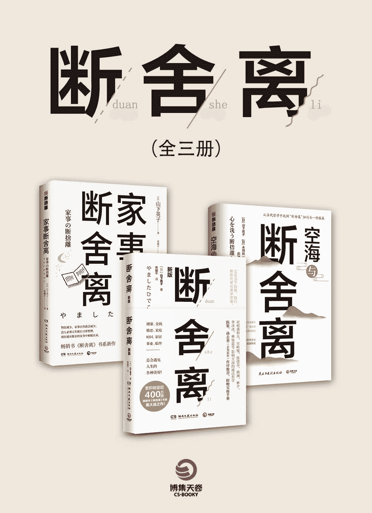

## 版权信息

书名：断舍离（全 3 册）

作者：【日】山下英子 永田良一

译者：贾耀平 曲冰

本书由天津博集新媒科技有限公司授权亚马逊发行

版权所有 侵权必究

# 目录  
CONTENTS

断舍离 家事断舍离 空海与断舍离  

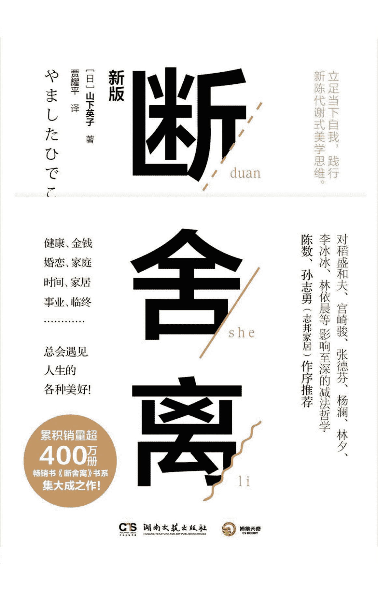

## 版权信息

书名：断舍离

作者：【日】山下英子

译者：贾耀平

出版社：湖南文艺出版社

出版时间：2019-01-01

ISBN：9787540489304

本书由天津博集新媒科技有限公司授权亚马逊发行

版权所有 侵权必究

# 目录  
CONTENTS

推荐序一：做物质的减法，精神的加法 推荐序二：断舍离帮我们实现对家的美好想象 断舍离的奥义不只是“扔东西” 第一章 你之所以无法放手的原因 被困在水槽淤泥口的鲇鱼 我们生活在“事物随意渗入生活空间”的年代 “不收拾”的深层原因是顽固的“物质轴”思维 因过度焦虑而郁闷的我们 体验谈 1 自身觉醒·启动“整理开关” 断舍离注重的不是物品，而是空间 家里家外·情绪反差的痛苦 体验谈 2 整理乱七八糟的家后，我遇见了灵魂伴侣 “无法放手”的人有三类 “舍”与“弃”的不同 人有“获得的自由”，也有“放手的自由” 第二章 这就是断舍离的工作机制 断舍离，就是扔东西 观念上的断舍离 1 认识现状 观念上的断舍离 2 停止自我否定 观念上的断舍离 3 描绘家的具体构想 杂物上的断舍离 1 拿出杂物，俯瞰 杂物上的断舍离 2 扔掉“怎么看都是垃圾·废品”的东西 杂物上的断舍离 3 以自我·时间为判断基准，考虑自身与物品的“关联度”，再进行取舍 体验谈 3 找回“自我轴”，处理大量餐具 杂物上的断舍离 4 以“必要·合适·愉快”为标准进行取舍 体验谈 4 从“必要·合适·愉快”三个维度断舍离，形成良性循环 杂物上的断舍离 5 收纳在杂物最适化之后进行 收纳指南 1 “三分法” 收纳指南 2 “7·5·1 法” 收纳指南 3 “1 out 1 in 法” 体验谈 5 实践过“1 out”之后，出现了“1 in”大惊喜 收纳指南 4 “one touch 法” 收纳指南 5 “自立·自由·自在法” 从切实能出成绩的小地方着手 体验谈 6 扔掉的筷子给了我直面命运的勇气 有心无力时，先找“出口” 居所整体进行断舍离的要点 衣柜的断舍离 壁橱的断舍离 厨房的断舍离 餐具柜的断舍离 冰箱的断舍离 书架的断舍离 厕所的断舍离 玄关的断舍离 客厅·餐厅的断舍离 再利用的断舍离 第三章 断舍离改变人生 一阵莫名的清爽感抚过心头 摆脱过剩执念，减轻心灵负重 体验谈 7 扔掉前夫的家具后，重获 7 年不见的痛快感 获得深刻的智慧 提高选择·决断的精度和行动速度 清除闭塞感，疏通人生路 体验谈 8 放手风水开运的摆件后，人际关系得以改善 引导现在的自己做出最恰当的选择与决断 “身体、心灵、生命”机制的回归 沟通力显著提升 比想象更怡然的人生就在不远处 第四章 断舍离，怡然生活 没有“出”，则难获自在 体验谈 9 表达出自己的感情，才不会被他人的观念所左右 获得主体性的生活方式 抛开家庭关系的烦恼 体验谈 10 当我抛开对他的期待后，他也开始改变了 遵守三大原则，收获怡然人生 体验谈 11 断舍离后，我竟有了自己梦寐以求的家 断舍离，让人生处处自在怡然 “信息”与自在人生 “时间”与自在人生 “烦恼”与自在人生 “节约”与自在人生 “结婚”与自在人生 “家务”与自在人生 “终活”与自在人生 “搬”家，遇见新的自己 在必要的时刻，能获得必要的东西 恢复“呼吸空间”，获得自在人生 体验谈 12 反复地“出”，获得自在人生的实际感受 用心珍惜当下的人·事·物 不断地追寻“出”之美学 后记 

放手一个无用之物，就腾出一点空间。处理一件多余之物，就减少一份负担。减少一次浪费，就恢复一分精气神。然后，翻开人生新篇章。

## 推荐序一：做物质的减法，精神的加法

——陈数（演员）

第一次接触到山下英子老师和她的《断舍离》，是在 2014 年，源自一位朋友的分享。不知为什么，初看到“断、舍、离”三个字，便被深深吸引，果断买回一本细细阅读。

事实上，在遇见这本书之前，关于“断、舍”，我一直有小小地践行。我时常会跟身边的朋友分享我的好物，时常琢磨、学习各类整理妙招。山下老师的《断舍离》更进一步，强调立足当下，通过整理、梳理人与物品之间的关系，脱离对物品的执念。我便从在那时开始意识到，如果只是物质上的“断”和“舍”，而没有在心中确立“离”的精神高度，内心还是会常常纠结。

除了物质，令我纠结的还有我未来要走的路。

很少有人知道，曾经有两年时间，我主动拒绝了很多影视剧拍摄邀约，选择停下来。曾经有朋友替我可惜，觉得我此举无异于演艺生涯的“自杀”。

但不是这样的。

在我看来，演员需要根据导演和剧本的要求，进行表演形式上的再创作，完成好对应的角色。这需要演员把自己的能量、内在修养和积累，甚至是对生活和生命的热情，源源不断地、没有保留地投入进去。所以每完成一个角色，对我来说，都是自身不断地被掏空。

如果一个人感冒、发烧、切菜切到手、骨折等等，都可以看医生，吃多少药、吃多久，如果遵医嘱，便可迅速康复。可在被掏空之后，来自内心的巨大精神困惑，我又需要多长的时间，去把它们填充和治愈呢？

最低谷的时候，我甚至不知道自己能不能让内心重新充盈起来。

我就这样选择了停下来。

持续很多年高密度的工作安排后，那一段主动停下来的日子，让我一下子有了大量可以自由、自主安排的时间，瞬间成了“时间暴发户”。我不需要频繁地看手表，不需要查通告，不需要化好装等待那一声“action”，接着迅速调整自己，进入主人公的内心世界，更不需要奔波在去机场的路上……

我终于可以去看话剧、舞剧、音乐剧，也可以一整天看书、写笔记、和好朋友喝茶、恢复瑜伽练习、远足、回到大自然……或者，什么都不做，只是发发呆不说话，按照心跳的节奏去做事。

是的，这是我停下来的意义。

我需要停下来，去感受生活。

我需要慢下来，去独处，去思考，去阅读，去旅行……

我想做物质的减法，精神的加法。

提到减法，想起有一次跟经纪公司的小伙伴们开会，有个女生半开玩笑地说：“陈数老师，如果您生活过的是减法，那我可能过的就是乘法。”当时给我带来不小的触动。这其实体现了当下很大一部分群体的生活态度。随着人们消费水平和购买力的提高，很多时候大家买一样东西，并不是真的需要它、会去使用它，而是渴望拥有和获得，这位女生用到“乘法”这个词，并没有夸张。

那时的我，正在用“断舍离”梳理我的身心。确立了“断舍离”的生活态度，我正在学习卸下负重，轻盈前行。

我学习欣赏物品而不去占有，学习与他人分享而不独享，学习探寻自我和生命之路，不惧旁人的异样眼光。作为一名女演员，甚至不介意一件礼服再穿几次，对我来说，保持审美的品格，比单品不重复更重要。

2018 年 11 月，我的节目《SHU 理生活》第一季上线了。这是国内首档生活美学综艺节目，大家可以透过我的视角，感受丹麦、中国、日本三个国家对于“生活美学”的理解和态度。与众多生活家、艺术家交流，分享彼此生活中点滴细节的美好和人生的感悟，转向内心，寻找缺失太久的“幸福力”。

很快，我们到了日本这一站。第一眼见到山下老师本人，哎呀，原来是这样眼睛弯弯的前辈。节目录制得非常顺利，与老师的交流真诚、深入。“断舍离”三个字已然内化在她的生命里，举手投足间亦平和、亦睿智。喜欢看着她的眼睛，那里面有对生活的豁达、接受和喜悦。霍金曾说：“世界上最让人感动的，是遥远的相似性。”这句话完美地诠释了我与老师的缘分。

在这次对话中，内心的那份探索和坚持，越发清晰、明朗。我们断的是物品，但其实，脱离的是执念。“断舍离”是对自己人生的整理，这才是其不同于其他整理法的真意吧。

山下老师的《断舍离》深深影响了我，让我受益良多。希望《SHU 理生活》对老师的这一期访谈，可以让更多的朋友有所受益。“断舍离”不光是关于物品的整理，大家一定能从中得到更多感悟。

很荣幸为山下英子老师《断舍离》这本书的中文版作序，希望这本书可以帮助越来越多的人重拾轻盈的人生。

## 推荐序二：断舍离帮我们实现对家的美好想象

——孙志勇（志邦家居联合创始人）

我成为断舍离践行者是偶然也是必然。早些年还没有接触断舍离，每逢换季或节假日前，我都会在家做一些清扫和整理，每次整理完都会觉得身心愉悦，很享受空间的变化。这与后来 2014 年在上海出差读到一整版关于断舍离的报道，再到 2015 年去东京专程拜访山下老师，有很大的渊源。

那张报纸我还一直保存着，我觉得与老师产生了很多认知上的共鸣——原来我们做的不仅是简单的家居整理，更是践行一种生活哲学，一种一直隐藏在内心的对生活之美的认同。

这些也影响到我后来的创业，在接触了千千万万的家庭用户后，我们提出在研发产品的同时，尝试将断舍离融入家居空间设计，与我们的用户一起实现对美好生活的向往。现在，山下老师的生活美学经典著作《断舍离》出了新版，我们的志邦厨柜也升级成志邦家居，从厨房空间走向全屋定制，提供更为全面的整体家居解决方案。我们的初衷都是一样的，希望能够让更多人过上理想生活。

我们每个人都在有限空间、物件与人脉关系中生活，在什么样的空间消耗，用什么风格的东西，和什么样的人交往，这些构成了真实的自己。你的圈子越广，就越容易生活在别人的生活中；你需要的东西越多，就越容易迷失在物品之中。经常有人盲目攀比效仿他人的生活，或者在购物季冲动地买买买，其实这都是对自己真正的需求认知不够，心中混乱的执念往往也会映照在生活环境中。

断舍离不仅仅是家居整理术，对于工作、人际交往也有指导意义。相比整理技能，其实山下老师更注重道的层面，她倡导通过身心修行，在杂物上做减法，在心灵上做加法，引导读者立足当下，积极进行身体和外界环境的流动交换，促进新陈代谢。

从 1998 年我与许邦顺共同在合肥创立志邦品牌开始，我们的创业之路基本上也是一直在思考人生取舍的问题，比较幸运的是，我们在某种层面上把企业的这种取舍和大众需求的取舍有机结合在了一起，通过不断加深对断舍离的了解，我们也为企业发展找到了知行合一的哲学根基。

2018 年是志邦家居成立 20 周年，全屋定制成了我们新的起点，能发挥的价值更大了。未来希望能够和山下老师一起，帮助更多人实现对家的美好想象。

## 断舍离的奥义不只是“扔东西”

“断舍离”的热潮，从兴起到现在已经过去 8 年了。

这 8 年间，很多人通过书籍、研讨会、讲座了解、体验到什么叫“断舍离”：

斩“断”物欲

“舍”弃废物

脱“离”执念

作为这一概念的提倡者，这是极为荣幸和激动的事。三个浓缩的汉字竟有如此大的驱动力，真是令人感叹万分。“断舍离是没有错的”——自己内心藏着的对断舍离“默然的确信感”能得到印证，获得这么多人的支持，我感到无限宽慰和安心。

随着这一概念社会认知度的提升，逐渐开始有一大部分人将其简单理解成“断舍离就是扔东西呗，图个痛快”，每当听到这种说法，我心头总是涌出深深的遗憾。

因为，断舍离的奥义并非在此。

实际上，“清理废弃物”只是“断舍离”的敲门砖。

橱柜里、餐架上或者冰箱中囤积的无用之物，家里随处堆积的废品破烂，还包括精神层面上那些不适宜的过剩观念，或是让自己陷入自我否定、自我谴责境地的消极思维或情感纪念物。只有放手这些东西，才能解放自己、解放人生。

当做到观念精神上的“断舍离”时，我们才能获得俯瞰式思维——高视点·宽视野·深洞察。这才是真正意义上“自在·随心”的生活之路。在这条“路”上，一定会有“怡然自得”的你。

本书也将详细地介绍如何才能走上这条“怡然之路”，“断舍离”的目标即是这种“怡然自得”的生活方式。

“怡然自得”是个好词。人生路上无论遭遇什么困境，工作上无论碰到什么难题，首先要保持心灵的“晴空”。当太阳被任性的乌云遮蔽，内心被坏情绪肆意摆弄时，如果能找到一种方法，驱走乌云，重现晴空，人生才会变得阳光明媚、春风快意。

而“断舍离”的真义就是指导我们如何避开乌云，如何把心头的乌云赶走。

市面上流行很多成功学、幸福学的方法，而断舍离则是在告诉我们：获得成功、幸福之前，如何保持怡然从容的心态。

如何才能保持好心态呢？好心态并不是只言片语的形而上的学问，它是通过具象化的“实物”获得的体验。

“断舍离”并非仅仅是处理废品杂物。它带有让人生焕然一新的力量。

本书就是围绕这个核心主题，以集大成的形式，将“断舍离”的精髓总结其中。那些“只知道断舍离的含义，不懂断舍离的价值”的读者，还有“仅仅知道如何对杂物做到断舍离，却不知道断舍离更深层意义”的读者，可以阅读本书，学习放手无用之物的方法，深刻感受“断舍离”真正的奥义所在。

读者朋友现在是如何看“断舍离”的呢？

可能依然是流行的刻板印象：

断舍离=清理杂物

或是：

狠心放手不舍得“扔掉”的东西

也许人们贪图“断舍离”的新鲜感，去完全替代掉听上去并不美好的“抛弃”一词。然而，我始终坚持的观念则是：

断舍离并不是单纯地处理杂物、抛掉废物，

而是在充满闭塞感的人生长河里唤醒“流通”的生命气息。

这不仅仅是我一个人的感受，而是从空间、工作、人际关系等人生方方面面，体验过动态变化的断舍离实践者共同的感受。

为什么断舍离拥有如此深刻神奇的力量呢？

直到最近，我终于找到了一个简单却能诠释其本质的字。它也成了我撰写本书的动机。这是一个出乎意料甚至有些让人失望的简单的字：

“出”

没有“抛弃”听起来那么苦涩，没有“放手”听起来那么哀伤。

笔画简洁、立场不偏不倚、浑然天成。

断舍离，即“出”之美学。

用人体学来比喻的话，也许会更容易理解。

假如一个人长时间进食但是不排便，也就是长时间便秘，不难想象他的心情多么糟糕。人作为生物，一定要遵守规律——摄取食物，消化后吸收营养转化为能量，再排出废物——新陈代谢。

新陈代谢，就是所谓的“生命机制”。

进，则出。

出，则进。

然后，再出。

这一简单的生命机制隐藏着巨大的力量：

左右人生。

提升“人生的新陈代谢机制”。

回归本真，让生活更上一层楼。

人生中如跳槽、结婚、离婚、再婚、分娩、乔迁等，断舍离会以不同的形式体现在这些重大事件中。

说起来，我们很多人的生活都一直在做“加法运算”，总是被纷繁的信息牵着鼻子走，无形中为自己“加”了形形色色的东西。随着时间的流逝，这些东西成了我们物质上和精神上的负担，致使我们在冗长琐碎的生活中迷失了自己。

面对这些困境，市面上给我们提供的策略只有“收纳术”或“整理术”，而这些策略本质上是在宣传如何把过多的物件密密实实地、见缝插针地塞满我们的生活。这种“收纳式思维”只会让我们在“浪费”“过剩”“惰性”中喘不过气来。

居住环境、工作现场、人生境遇，何其相似。

家、身体、心灵，何其相似。

现在兴起了“极简生活”概念，让越来越多的人有意识地去体验抛掉杂物、减少物欲的生活。但依然有很多人压抑不了物欲——先收入囊中再说吧，他们陷入“收纳”的沼泽地，无法脱身。

“断舍离”则主张尽可能地做压缩生活的减法运算。“斩断”“舍弃”“脱离”就属于这种减法。

这种“减法”正是总是本能地、反射性地压抑不住购买囤积物欲的我们现在所必需的。

不过，“断舍离”本身不是我们的目的。

断舍离确实会给我们带来精简、朴素的生活，但是其中的核心是“出，则进”“进，则出”的循环反复。需要强调的是，“进”与“出”一样，都是不可或缺的。

这本书并不是极简生活的倡议书，也不是收纳整理的指南手册。

它最大的目的是撼动我们根深蒂固的“物品价值观”，鼓励我们甩掉惰性，采取行动，促进生活和生命的新陈代谢，从而迎来焕然一新的人生。

请和我一起，走进“断舍离”的深处。

——山下英子  
2018 年 2 月

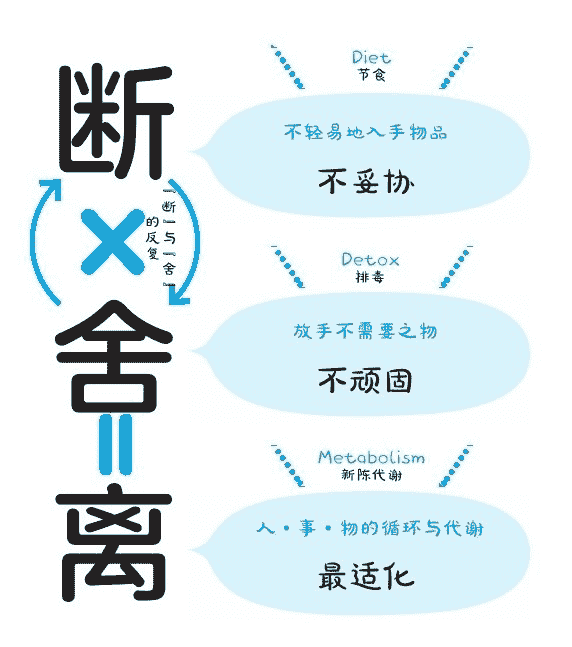

断舍离是受到让人放下心中执念的瑜伽修行哲学“断行·舍行·离行”启发而生成的思维方式。它以居所和心灵整理术的形式，提倡将瑜伽精神融入日常生活，为身边的杂物“减肥”，让我们学会放手不需要的东西，从而促进自我周身的新陈代谢。“清出”过多的杂物，实现居所环境的“良性循环”。

## 第一章 你之所以无法放手的原因

有一个需要切实认清的现实：

我们身处“物质过剩”的世界。

明白自己“不能收拾家务”的心理机制，

重新审视自我的物质观，

为断舍离的实践活动装上助推器。

### 被困在水槽淤泥口的鲇鱼

物质过剩的现代人总是一边感叹着“东西难收拾”，一边视若无睹地过日子。断舍离认为这样的人就像是：

本来能在干净的溪流潇洒畅游的香鱼，逐渐变成了水槽淤泥口边困顿窘迫的鲇鱼。

可以想象一下这个场景：自己变成了一条鲇鱼，找不到本来就存在的进出水口，被形形色色的东西和废弃物包围着，困在水槽里，整日一筹莫展……

住所里堆满了乱七八糟的东西——“优惠打折品”“高价品”“图方便品”“没有的话会发愁品”——在推销人员忽悠下冲动带回家的各种商品。

居住在水槽中的我们，其实是从这条叫作“消费社会”的大河里摄取食物。但是水槽进水口上的“断”字进水阀却十分松动，而出水口上的“舍”字出水阀却因为“太浪费了”“真麻烦”“总会用上的”这些想法而无法打开。

原本有着适当活水循环的水槽，因为进出水阀的故障而变成了“储水槽”，不知不觉中沦为了“污水池”“淤泥地”。

换句话说，我们现在的住所就等同于死水的淤积地。

假如比喻成人体的话，就相当于人体代谢功能减退、毒素长期堆积的状态。

随着年龄的增长，或是长期处于不良生活习惯中，皮肤、血管、内脏里就会一点点地堆积起代谢物质。

这些代谢物积累到一定程度，就会引起“亚健康”，不久将出现疾病症状。我们在确切症状出现之前很难判断是代谢物引起的。

曾经的一次经历，让我对此感触颇深。

有次我在泰国进行“Fasting（斋戒）detoxed（排毒）”疗法时，接受了嘴巴、皮肤、内脏等各个部位的“detoxed=舍”治疗法。所有参与这种疗法的人都仅用一天体重就减轻了 2～3kg。

就像平时我们堆在抽屉里的大量杂物一样，我目睹了人体内部残留的淤水般没有完全排出体外的代谢物。

居住在进水口开放、出水口关闭的“储水槽”中的我们

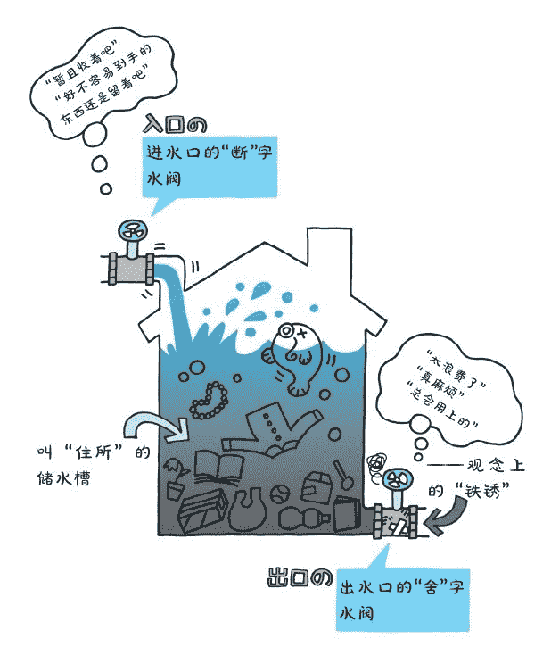

当把这些代谢产物彻底排出体外时，那种舒畅痛快感简直终生难忘。

人体可以通过这种外部疗法获得刺激，并通过身体机制促进新陈代谢。但面对我们自己家中的杂物，只能亲自行动，处理杂物。并且也不存在亚健康或患病等警戒线。

因此，很多时候“自己眼中正常的杂物数量”，实际上“接近或等同于患病状态”。甚至可以说，大多数时候，这些杂物的量即使花上一星期也处理不完。

如果自己不来回翻箱倒柜地找家中的“淤积物”，恐怕不会发现它们的踪迹。不拉开壁橱、拉开抽屉，就不会在意这些杂物，所谓“眼不见为净”。

就像鲇鱼总喜欢待在水槽的澄清部分，而忽略下层的淤泥一样，假如我们不打开收纳箱，不翻出来堆积的杂物废物，那么也不妨碍日常生活。

然而，依然会抱有不安——一旦来回搅动，上层的澄清部分就马上变成一团混浊。

好不容易一鼓作气开始收拾杂物后，又惹家人生气“摆得乱七八糟，找也找不到了”，碰了一鼻子灰，进而没有耐心再进行整理。想必我们有过多次这种经历。

接着，这种储水槽的状态变成了自己生活的常态，已经熟视无睹了。

最后就变成了你现在居住的这个“污泥淤积的储水槽”。

### 我们生活在“事物随意渗入生活空间”的年代

当我们亲身感受到这种物欲横流的现状时，总是会下意识地责备自己。其实，在造成这种状况的原因中，社会因素占了一大部分。

我们总是喜欢囤货、无法舍弃的主要原因有以下三点：

消费型社会里洪水般的物量

物品被过度制造、被过快流通的物理性原因。

对居住空间的考量不足

虽然具备丰富的家装知识和收纳整理技能，但对于舒适生活所需要的物品数量的估测和考量不足。

上个时代的价值观

现代的生活方式和物品产出数量已非昔日能比，然而我们依然会受到来自父母或是上个时代的价值观——“太可惜了”“不能搞浪费！”的影响，因此这属于观念上的原因。

消费型社会总是想方设法地研究如何让人“买东西”。

电视购物节目、邮寄广告、上门推销等各种促销手段，消费社会总是挖空心思地对我们的心理需求“挖地三尺”，直到挑起我们的“对实际不需要的产品的购买欲”，让我们觉得好像就是自己本来特别想买的一样。

不是被别人强迫，是我们自愿地把东西买进家里，我们确实有不可推卸的责任。只要我们不小心，“进水口”的阀门就容易松动，很可能到最后我们的橱柜里、洗手池下、衣柜中，甚至地板上都摆满了密密麻麻的根本不需要的物品。

### “不收拾”的深层原因是顽固的“物质轴”思维

在上一节我们分析了主要有三个主要原因导致我们为身边的杂物烦恼。实际上这种烦恼的背后还有更深层次的原因。

自诞生之日起，人类依赖物质、重视物质的历史很长，在此过程中，我们逐渐形成了以物质为标准的行为习惯，即“物质轴”的思维方式。

据某位地质学家分析，从住宅、公路到智能手机，人类制造的物质资料竟有 30 兆吨。这几乎是个天文数字，并且其中的绝大部分都是在 20 世纪之后产生出来的。20 世纪之前，人类长时间处于严重物资不足的时代。

因此，当我们面对“物质”时，不是从“这个东西需不需要？”的角度，而是往往下意识地从“这个东西能不能用？”的角度——以物质资料为基准轴的观点来进行取舍和判断。这就是“物质轴”思维。这种思维方式就导致：如果这个东西还能用（或者即使不能用），我们就在“暂且”“好不容易”的心理暗示下，把这个东西留在身边。

某位哲学家曾说过“人们总是习惯思考‘有效性’，却往往忽略了作为‘有效性’前提的‘必要性’”。人们对物品也会有同样的定式思维——“（可能）以后也没有使用的必要，不过还能用，姑且留下来吧”。

人们带着这种“物质轴”思维方式，不知不觉地扎进这个无法想象的物质过剩时代。可以说，拥有 500 万年历史的人类被卷入前所未有的物质变化洪流中。比如说，在自己的家里，壁橱里面就藏了很多不用的杂物，像已经变成“化石”的礼品毛巾套、已经抛在脑后的暖炉套装、只在孩子小的时候用过几次的野营工具等等。尽管如此，我们还是不停地埋怨“家太窄了”“找不到东西”，这其实就是我们的居所物质过剩的一个缩影。

### 因过度焦虑而郁闷的我们

15 年前，我刚刚向社会推出自己的“断舍离”概念时，在开展讲座期间碰上了很多焦虑的听众。她们怒气冲冲地抱怨道：

“孩子乱扔东西，丈夫又不帮我收拾，全落我身上了！”

“收拾来收拾去，就是收拾不干净，真是没完没了！”

（实际上正是她们本人在囤货）

15 年后的现在，讲座上的听众仍总是显得闷闷不乐，会场氛围沉重，大部分人一脸呆滞愁闷。

说老实话，我甚至觉得倒不如像 15 年前，大家有什么怒气就倾吐出来反而会更好。因为，在某种意义上，将压抑在内心的情感表露出来就相当于把坏情绪发泄出来，有利于身心的健康。

比如，当自己的妈妈（妻子）发脾气时，孩子和丈夫会马上意识到“不好，她现在心情不好”“现在暂且不要惹她”，暂时逃离现场避避风头，等狂风暴雨过去后再若无其事地一起吃饭。

但是，如果母亲（妻子）总是闷闷不乐、愁眉不展，那么这种消极的“负面磁场”会影响到全家人，导致最后大家都陷入了郁闷的状态。

假如杂物遍地，家里塞得满满当当，那这些杂物给人的压迫感，以及狭窄的空间带来的阻塞感会逐渐让生活在这里的人思维迟钝，行动迟缓。长此以往，人们逐渐变得封闭，不想外出，进而演变成近似愤懑抑郁的状态。这种案例不在少数。

随着人们对于“断舍离”概念的关注，应电视或杂志采访的邀请，我帮一些家庭进行杂物整理的项目也激增了不少。

说实话，现场的情况真是让我大吃一惊，比想象中的还要糟糕。

它们并不是媒体宣传的“垃圾房”，一般就是很普通的三四口之家。其中还有刚刚建好 1～2 年的新房子。从踏进大门的那一刻起，我就马上被庞大的杂物量惊得目瞪口呆。

家里的杂物是不是像这样摆得满满当当，到处都是？

冰箱

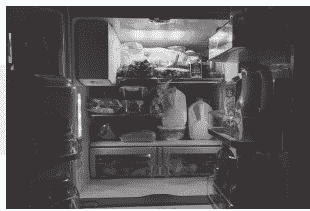

所有的架子上都塞满了食材，照明灯几乎不能完全照亮整个冰箱内部。

厨房吧台

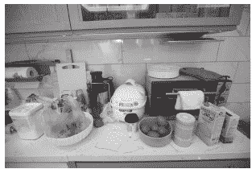

本来是“传菜吧台”，却变成了各种杂碎物品的堆放台。

顶墙式大收纳立柜

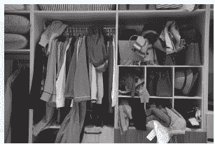

压迫感十足的杂物似乎要溢出来。虽然媒体鼓吹这种“顶墙式大收纳立柜”的各种好处，实际上很多情况下，这种立柜让整个空间看上去像被封埋在杂物之中。

洗漱台

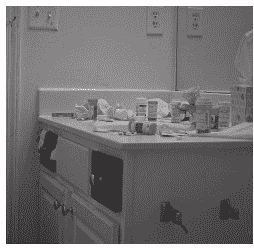

镜子柜里塞不下的大量的卫生用品堆成一团，理不清的不仅是这些插电用品的电线，还有住在这里的人的思绪和活动路线。

很多情景对于住在这里的人来说可能是司空见惯，不足为奇。比如说，大门口的立伞架，上面密密麻麻地放着 20 多把长柄伞和折叠伞，等等。这只是冰山一角而已。又比如厨房的抽屉，那些随意扔着根本不再使用的厨房用具，如木筷子、一次性汤勺、保鲜膜、塑料袋等，东西塞得密密实实，收纳率达到了 200%。

那些东西可能未必都是不能使用的，但没有人考虑过将来这些东西是否有必要性，就下意识地把它们塞满了整个家。

除了上面这种情况，还有一些房子，看上去收拾得干干净净，但一打开收纳橱柜的门，就能看见里面挤满了惊人的杂物。甚至连住在这里的人也不知道里面放了些什么东西。因为“眼不见为净”——只要关上门，只要看不见，就能眼不见心不烦地过日子。这种状态已经不是简单的“囤积”阶段，而是严重到连收纳都无法进行的“塞东西”阶段。

但是，即便是这样的家，也可能因为小契机而开始尝试断舍离。我现在来介绍一个案例。

#### 体验谈 1　自身觉醒·启动“整理开关”

应电视台的现场采访要求，我来到了 70 多岁的千惠（匿名）夫妇家里。

在工作开始前进行“协商”的客厅里，各种各样的日常用品和杂物已经多得“溢出来了”，所谓的“收纳”完全没有起作用。桌子上的文具、调味料、茶碗、报纸、遥控器……都摆不下了，地板上乱七八糟地堆放着手工爱好者千惠女士收集的各种各样的小零件、料理器具、密封罐，等等。

男主人的东西也很多。特别是作为爱好的垂钓工具。很多根鱼竿杂乱地立在房间的一角。

首先是女主人千惠小姐类似唠叨般的理由——“太忙了没时间”“太累了没力气”“觉得哪一件都有用”……这在以前电视采访的时候也多次遇见。虽然邀请我来的就是千惠（匿名）女士本人，但看样子她还是有很大的戒备心。

而男主人则是双臂交叉胸前，一声不吭地静坐着，好像在说“我不管你怎么想，反正我才不会扔东西呢，东西又不是随随便便就能扔掉的”。

面对这种场景，我反而不会做任何“整理指导”，那我做什么呢？

就是不说话、倾听。对于无法放手杂物的各种理由，都只是随声附和一下。在这种谈话进行了几个小时之后，我开口说：

“如果是想留下的，咱们不扔掉也没关系。”

结果，千惠女士突然拿起手边十几副团扇，说“这个不需要吧”，然后起身开始收拾东西了。她把塑料制的团扇通通扔掉，仅留了三副竹子制的好团扇。接着，男主人又拿出垃圾袋开始收拾自己的钓鱼器具。就这样，夫妇二人连续收拾了两天。

厨房的餐架上叠放着大量的千惠女士用于储藏自烹料理的容器。我断定“她会很难放手这些东西”，所以也没有过多地提这些容器的事情，只是稍微提醒她“有可能会掉下来，比较危险”。

当我 10 天后再去拜访千惠夫妇时，发现原先堆成小山一样的瓶瓶罐罐居然减少了一半。这个变化是在意料之外，我情不自禁地为她感到高兴：“千惠女士，太厉害了！”

我完全没有做过什么整理家务的指导，那为什么千惠夫妇的家能获得如此大的整理效果呢？一开始，对我这个“反派”，夫妇俩还有很大的排斥心。随着交流的深入，他们逐渐打开心扉，意识到自己说的某些话其实是在为自己找借口。

这，就是千惠夫妇的转折点。

断舍离讲求的就是这种内部的自觉自省的意识，而不是外部打着“正论”旗号的训诫。因为，真正的“正确答案”本来就在自己心里。

另外一个要点是，就像我赞赏那位放手很多自己喜爱的瓶瓶罐罐的 A 女士一样，当自己尝试实践“断舍离”后，要大力地犒劳自己、奖赏自己。

有意识地去除自责的情绪，坦然地倾听内心的声音——“原来真的不能像从前一样”“我想改变”等这些声音会渐渐地转换为一种内驱力，让我们自觉地将实践进行下去。

这种良性循环会让断舍离的实践进展得更快、更深入。

### 断舍离注重的不是物品，而是空间

断舍离注重“空间”，即以空间为主体核心的思维方式——空间轴。

“东西过多所以扔掉”“没有需要所以扔掉”等想法无可厚非。但是，断舍离的“空间轴”思维注重的是“扔掉东西”之前——“为确保空间的干净整洁，而将物品量尽可能地缩减成最适合的量。”这种思维是实践断舍离不可或缺的。

断舍离就是“生活的新陈代谢”。将生活用品的量锁定到适当程度，同时在适当时点，更换这些生活用品，这才是生活的理想状态，也是生活原本的自然状态。而这种状态也可以称为悠然有暇的美的空间。

而以物品为思考基准的“物质轴”，则是从“还能使用”这个角度考虑问题的，遮蔽了“放手不需要之物”的正当性。

老实说，就算是现在已经在脑中为“物质轴”设置警惕灯的我，有时候也会陷入“物质轴”的思维陷阱。

前几天，我收到一位曾在海外出差时对我多有关照的朋友的礼物。而包装礼物的是一个颜色鲜艳、设计精美的盒子。因为实在喜爱这个讲究的盒子，我想也没想就收进了橱柜里。

过了几天后，我猛然清醒过来，自己大吃一惊。买大牌商品的时候，人们总是不舍得扔掉包装纸，一张一张地逐渐囤积成了小山。我收集包装盒的行为和前者并无区别。

说实话，保留一些箱子袋子也没关系。但是当时我并没有想到这一层，脑中的思维顺序是“设计讲究的盒子→留下来”。几乎是一种条件反射行为。

这个盒子换成钱的话，不过是几百日元。我并没有想到“没有需要，可以扔掉”，而是想当然地抱着盒子放进了橱柜里。

也许，物质本身就带着某种看不见的“黏着剂”。

一开始就没有断然“因为看起来将来也没有使用的需要，可以扔掉”，过后再处理的话，物品在手里就会有一种沉甸甸的感觉。这是一种心理上的沉重感，带有叫作“执念”的黏着剂，其实就是对物品的定式思维。

有人会把住所里的物品占比换算成房租。假设这些毫无用处的废品杂物被扔在屋子里几年、几十年，累计起来的金额与杂物废品本身的价值相比，简直是天上地下，得出的数字让人头晕目眩。不过，我们不会简单地认可这种换算的逻辑性。

比如，在一些手纸、保鲜膜等日常易耗品上，我们容易倾向于不在乎这些钱，因为这些东西价格也不高，换算成金钱后数额也不大。这样就致使我们不自觉地把这些“以后一定用得着”的杂物、用品囤积起来，最后被它们占据了我们大部分的空间。

### 家里家外·情绪反差的痛苦

已经不穿的衣服被主人一件一件地塞在衣柜里。虽说衣柜不是电视剧里的后宫，其实也有人把衣柜比喻成“皇帝不会驾临的冷宫”。这个比方实在是妙不可言。当耳朵贴在衣柜上，仿佛就能听见衣服在默默地哀叹：“主人总穿其他衣服，我得等到什么时候呀！”

换一种说法就是：“不穿的衣服”认为自身与主人的关系上存在一种“惰性”。

被一堆堆不穿的衣服塞得满满当当快要关不上的衣柜里，哗啦哗啦地冲出惰性的大洪流。被卷入这种惰性洪流中的人自然也会感染惰性，闷闷不乐，打不起精神来。在这个惰性弥漫的家里生活的人，自然变得不想待在房间里。

那些常常烦闷房间空气混浊、心情不畅的人，其中有大部分是在工作上精明能干、能力过人的高知女性。她们常常因为在外部工作上备受好评的工作态度和能力，与她们下班回家后乱七八糟的家庭空间及烦闷低落的情绪形成的巨大反差，而饱受诟病。外出所带的东西全是高级的大牌商品，而房间里却是杂物堆成的贫民窟。像这样我们笑也笑不出来的情况数不胜数。

“绝不能让人知道我的房间居然是这副鬼样子。”于是，有的人“连四年一次的天然气公司上门检查的时候也谎称家里没人”，有的人甚至“在朋友临时造访时匆匆把杂物扔进浴缸盖上盖子”。

话说回来，其实这么做，她们自己的心里也不好受。

还有很多人，他们逃避不收拾家中杂物的现实，一头扎进所谓的灵修世界。

耳朵里进来的都是什么“爱”“光”“净化”等动人悦耳的词汇。经不起这些美丽词汇的诱惑，他们潜入灵修世界，试图提高“自我认同感”。然而，越是陷进这种虚妄的幻影世界，就越会脱离现实，只能看见自己想要看见的东西，而对其他现实中的事物视若无睹。

我现在说一个利用断舍离摆脱虚妄世界的案例。

#### 体验谈 2　整理乱七八糟的家后，我遇见了灵魂伴侣

洋子小姐（匿名）从外表上看，是一位精明能干、积极阳光的 30 多岁职业白领。

但是，她的家里却是触目惊心地脏乱差。工作用的大量资料扔得到处都是，搬家打包好的纸箱子居然还没开封，摆在一个角落落了几层灰，床头柜上密密麻麻地堆着她私下里着迷的占卜和灵修的书籍。

她交往的对象常常是比她年龄大并且社会地位高的男性。这也无可厚非，不过他们都是已婚人士。她的住处和恋爱同样都是属于“无法对旁人言及”的状态。

心里总是想着“找个时间一定要收拾屋子”，可是一回到家，就感觉像被巨大的磁场吸附着一般，身体一点也不想动，只能大口地喝酒、抽烟，这个连窗子都未打开的房间里烟雾缭绕，空气混浊不堪……

“现在想想，那时候的自己简直就是在大烟窟里生活。”

但是，某一天，转机降临了。

洋子小姐受到朋友的邀请，参加了断舍离的讨论会。她很快就明白了“扔掉不需要的杂物，建立舒适的生活空间，才有可能改变人生”。在旁人看来光鲜靓丽、潇洒快活，而内心却陷入深深的烦恼中，生活在“不可告人”的垃圾囤积地里，是断舍离为自己指明了一条路。

之后洋子小姐用了大概三个月的时间处理掉了各种杂物废品。

不久之后，她就遇见了一位和以往的交往对象完全相反的同龄人，年纪相当且干净利落。契机就是“有空请来我家玩吧”的一句邀请。

进入洋子小姐家后，年轻人竟然下意识地脱掉了袜子。以前连个下脚的地方都找不到的房间，他居然极为自然地、舒适自在地留了下来。这是一次心情愉快的做客。之后，两个人很快就结婚了，有了孩子。现在的洋子妈妈已经辞去工作，在小城市里悠悠闲闲地相夫教子。

可以说，当洋子小姐把大量的无用杂物清理出自己的世界后，就迎来了与“真我”十分契合的人生伴侣，开启了幸福的人生之旅。

### “无法放手”的人有三类

前面已经分析了“我们烦恼于物质过剩的状态以及这种状态背后的心理原因”，这一节我们重点具体分析一下“无法放手”的心理原因。除了实体的杂物外，我们还要直面自己的内心。

根据常年处理物品和人之间关系的经验，在我看来，那些常常抱怨“还是无法放手……”的人大致有以下三类：

逃避现实型　这类的人，一般因为工作繁忙，待在家里的时间少，所以整理家务的事情总是推后进行。乱七八糟的家让人心情也很糟糕，就更不愿意待在家中，陷入了恶性循环。

执着过往型　这类的人总是珍藏了很多以前的相册、信件、纪念品等旧物。他们不愿意直面现实，总是沉湎于过去快乐的时光。

忧虑未来型　这类的人总是担心“没有某个东西会发愁”，总是不停地为不知何时才会发生的未来事件储蓄物资。这也是三种类型中人数占比最多的一类。

这三种类型的人共通的一点就是“对时间的意识比较淡薄”。

其实，在日常生活中每个人都有自己独特的时间感。但我们时常遇到时间感的平衡被打破的情况，此时我们的内部时间轴就会出现某种错位和偏差。

另外，上面介绍的三种类型之间并没有明显的区分线。其实每个人的内部都隐藏着这三种类型，只不过是其中一种倾向的表现较其他两者更为突出罢了。

我们可以看看自己的哪种倾向比较突出，进而加深自我认识，更顺利地实践断舍离。

“无法放手”的三类人

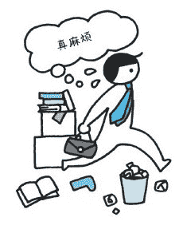

逃避现实型

这类的人由于工作繁忙，待在家中的时间短，不会认真地做家务。还有很多是对家庭和家务有情绪，不想待在家中，只想埋头工作。另外，看到家里乱七八糟，心情特别差，更是不愿意待在家中，陷入了不良循环。但是一旦开始收拾整理后，对物品本身并无多少执念，会整理得干净利落，不会犹豫拖沓。

执着过往型

这类的人总是会收集和珍藏很多现在不用的旧物，小心翼翼地保留着以前的相册或是奖杯奖牌，以及带有过往回忆的信件、照片等小物件。他们总是沉湎于过去快乐的时光，而不愿意直面现在和现实，这种类型也和逃避现实型有关系。

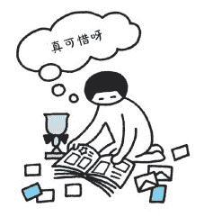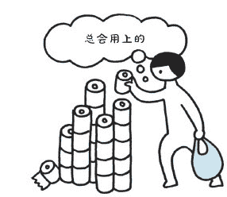

忧虑未来型

这类的人总是不停地为将来的事情忧虑，不停地为将来储备东西。眼睛只盯着“某些东西没有，自己将来必定会发愁”，过多地囤积手纸等日用品。未雨绸缪并不是不好，但反应过度会给日常生活带来焦虑。

### “舍”与“弃”的不同

“执着过往型”的人有个口头禅——“太可惜了”。

这句话是表现人们珍惜事物的意思，不过很多时候却被当作免罪牌，用于回避处理杂物。

我们口头上常常把“舍弃”作为一个词来讲，其实它是由两个字组成的：

“舍”

“弃”

佛教用语中有“布施（将金钱或贵重物品捐赠给寺庙或贫苦人）”一词。其中的“施”就是“施舍”之意。也就是说，因为这些东西在我处不再起作用，而让它们在别处起作用。

这带有“二次循环”“再利用”的意思。从广义上来说，即便是那些被销毁的东西，只要遵守规则，处理得当，这些东西本身作为“物质”也只是形式上变化而已，依然属于再循环的范畴。

而再来看“弃”，即“废弃”的“弃”。

从意思上看，物品被不管不顾、置之不理。“非法丢弃”就是一个常用词汇。

你家里有这种被弃之不顾、置之不理的物件吗？这种毫无用处的废品一样的东西被随意地扔在角落，或是保留在箱柜里，本质上就像被人抛弃一样。它们和我们每天扔的垃圾和废物没多大区别，只不过一个在外面、一个在家里。

断舍离，不是要求人们随意地“弃”，而是把“舍”作为解决问题的方法之一。

“舍”即为“出”。

如果实践“舍”，确实会暂时出现大量的不得不处理掉的东西。在进行取舍时，我们应该挑选出有质量的东西，将物品压缩到能够建立和保持一定社会关系性的量即可，这样才能找回我们曾经失去的健康美丽的空间，才能从最本真的意义上珍惜事物、热爱生活，并不是随意地、不走心地囤东西、扔东西。实际上，后者才是“太可惜了”。

“舍弃”的作业，并不好受。

收拾东西时，有时内心会翻涌着怒气：“我居然买过这种东西！”

有时会后悔地掉着眼泪，决心“绝不会再买第二次”。

但是，生气归生气，生气之后要记得不能“弃”。为了重新找到自己和“物品”之间真正的联系，就必须一个一个地重新审视每个东西，在自省自审的基础上，进行物品的取舍。所谓的“舍”，其实就是直面内心。

以历史的眼光来看人与物，两者都是在某一个时点出现，又在某一个时点消失，区别不过时间的长短之分罢了。一个人与一件物品相遇是极为短暂的、微弱的缘分。只有尽力去珍惜爱护这种缘分，才是真正意义上对“太可惜了”这种感叹的回应。

### 人有“获得的自由”，也有“放手的自由”

当读到这里时，想必有读者想起了自己的家，觉得心里不痛快。其实这就是对“放手”本身有根深蒂固的抵触观念的表现。然而，断舍离之所以能够被大家接受，就是因为越来越多的人想要挣脱潜意识中对“放手”的抵触感的束缚。

而我们本来就拥有以下三种自由：

放手的自由

保留的自由

取舍选择的自由

在断舍离的概念刚刚出来不久，我的博客收到了一段留言：

“断舍离，说得好听，对收拾不了的，女人可不就是只扔东西嘛。浪费了多少东西！”

说老实话，这句话听着刺耳，却真的是一针见血。因为，实际情况就是这样。

那些因“做不完家务”而烦恼的人，特别是被冠以“整理不了家务的糟糕主妇”的人，她们面对乱七八糟的家，就会不自觉地一刀切——只有把“多余的东西扔掉，才能把东西过多过乱的家恢复到以前干干净净、让人神清气爽的状态”。

“收拾东西就是做家务活，女人当然就应该会收拾东西，然而自己居然连这点事情都做不好，一定是个糟糕的主妇”，很多女性要比男性更容易在不知不觉中陷入“物质轴”思维的泥潭。

但是，学习过“断舍离”后，从这种束缚中觉醒，明白了“自己拥有取舍选择的自由”，她们会立刻开始行动，着手处理过剩的杂物。

因此，我会再三地告诉今后准备努力实践“断舍离”的人：

如果你不想再吃了，

如果肚子已经吃得饱饱的，

那就应该放下碗筷，不多吃也没问题。

因为，吃不吃饭我做主。

如果你不想再穿了，

如果这件衣服已经让你厌烦了，

那就应该脱下衣服，不穿也没问题。

因为，穿不穿我做主。

可喜的是，现在的日本已经能够实现这种观念。基本上想要的东西能够满足，想处理的东西也能处理掉。但是，为什么前者顺利，后者那么困难呢？我们总是有各种各样的理由要东西买东西，又有各种各样的借口不去放手而囤积东西。

难道是怕家人责怪？

难道是介意周围人的眼光？

以前我和公公婆婆住在一起，准备处理不需要的杂物时，总被他们唠叨说“太可惜了”，不让我扔。那时候起我明白了一个道理：想要的东西得不到，人会难过。但是想扔的东西扔不得，会更痛苦。

再说一个听起来不太恰当的例子，在我们还是个婴儿时，想哭的时候可以尽情大哭；想吃奶的时候，可以用力吃奶；想拉屎撒尿的时候，谁也管不了。无论“获取”还是“排出”，都不存在任何阻碍。

然而，当我们长大后，被断掉爱喝的母乳，被去掉尿不湿，不得不自己控制排泄的欲望和时间。我们被放逐到“规矩世界”的条条框框之中，缩头缩脑、畏首畏尾地学会了忍耐。

孩童的世界有孩童的规矩和不自由，少男少女的世界有少男少女的规矩和不自由。已经淹没在忙碌的成人世界中，遗忘了少年时光的我们，其实在心海最深处的岩石上，依然留着童年时期的“不自由”的刻印。

也就是说，在我们的居所，堆积如山的“收拾不了”的杂物本身就是人类“物质轴”思维方式的具体表现，也是在“不能胡乱排出”“不可任性”这种潜意识下的自我约束的表现。

但是，这种不自由已经不需要了。

你自己的东西，如果你认为它对你已经没有价值了，感觉已经不适合你、不会给你带来好心情了，你完全可以自由地处理它，不必在意任何人的眼光，没有必要为东西本身留情。

“我想要这个东西”“我不需要这个东西”，无论是获得还是放手，都要做到坦诚地面对自己的内心。剩下的就是开始行动。

别人的东西姑且不说，至少自己的东西自己要做主。

## 第二章　这就是断舍离的工作机制

具体应该做什么，怎么做呢？

根据八个技巧和五个收纳指南，

了解断舍离的工作机制和“放手”的效果，

刷新对物质的观念，

就会迫不及待地想要清理杂物。

### 断舍离，就是扔东西

以前做“整理家务 before/after”主题采访的杂志社编辑曾经告诉我这么一段话：

“关于断舍离，只要能读懂书本里的东西，人就会自觉地行动，开始想收拾处理东西。这种学习知识后，自觉实践的情况我是头一次碰到。”

据他称，做“整理家务 before/after”采访时，受访者一般是边听指导师的建议边进行家务整理，但是断舍离却比较特别。受访者只需要读懂书籍，理解其中的要点，自觉地开启“引擎”，即使没有指导师在一旁指挥，采访也能顺利进行。

知晓断舍离的工作机制，明白舍弃东西的效果，更新对待事物价值的观念，只有这样，身体才能觉醒，我们才会自觉地做出行动。很多明白断舍离内涵的人，总是摩拳擦掌，迫不及待地要收拾东西、清理杂物了。

不是要开启按钮，而是要拧紧我们的“螺丝”。假如螺丝拧坏了也不要紧，重来一遍就行。断舍离就是反复地拧紧螺丝。

序言部分写着“断舍离的奥义不只是扔东西”，而这里的“断舍离，就是扔东西”，有特别的意义在其中。

其实确切地说，应该是“想要在未来重新找回健康的居住空间，最开始就不得不扔掉大量的东西”。也就是说，断舍离是具有体系和系统程序的。

而如何扔东西，也需要合理的方法。

在对居所杂物进行断舍离的同时，脑中也要进行断舍离的作业，即进行思想观念的整理。这样可以对我们自身进行“体质改善”，改变我们无法放手，总是囤积货物的毛病。

比方说，我们“为了减肥”“为了护肤和健康”，要控制饮食，多排出宿便。但是长时间进行减肥和饮食控制的话，就需要搞清楚“该吃什么东西”“怎么吃”“为什么以前的饮食方式有问题”等问题，否则会很快退回到以前不健康的生活状态。

以上面所说为前提，接下来将按照以下步骤进行解说。

观念上的断舍离

1.认识现状

2.停止自我否定

3.描绘家的具体构想

杂物上的断舍离

1.拿出杂物，俯瞰

2.扔掉“怎么看都是垃圾·废品”的东西

3.以自我·时间为判断基准，考虑自身与物品的“关联度”，再进行取舍

4.以“必要·合适·愉快”为标准进行取舍

5.收纳在杂物最适化之后进行

收纳指南

1.“三分法”

2.“7·5·1 法”

3.“1 out 1 in 法”

4.“one touch 法”

5.“自立·自由·自在法”

断舍离分别从物质和精神两个方面进行“物品的断舍离”和“观念的断舍离”。只有两者同步，家务清理工作顺利进行，思维方式也逐步更新，才能形成一个良性循环。最后，在物品数量减少到最适量时，再转移到“收纳”作业上。

#### 观念上的断舍离 1　认识现状

“观念上的断舍离”是指在对家里进行杂物处理时，对让自己士气低落，不愿意再进行收拾整理的旧观念、旧思维进行摒除和更新。

当我们决心进行断舍离时，最先应该做的是什么？

答案就是把衣柜、壁橱、抽屉等所有的收纳容器的盖子打开，让平时看不见的东西全部展现在眼前。

尤其是柜子，只打开一扇门是不够的，需要两边的拉门全部卸下，把柜子完全敞开。而且，不是仅仅从外面简单确认柜子内部的整体，需要一个一个地确认，掌握收纳的总量。

这种最初的认识现状的作业是尤为重要的，如果不把握家里有多少东西，就草率地开始作业，很快会因为杂物的量超出想象，而造成身心上的徒劳和疲倦感。

为什么掌握家里物品的现状很有必要呢？

因为，人本身有一种倾向——总是看不见不想看见的东西。比如说“不想看见堆在柜子里的东西”“不想看见电视机后的灰尘”等，我想你应该懂我的意思。

绝大多数的人对自己在怎样的物品过剩的环境里生活，其实完全没有什么概念。比如说一个没有登山经验的人在不掌握登山知识和装备工具的情况下，突然说“我要登上富士山”，这是非常不切实际的。家务整理也是同一道理。

登山新手应该做的事情就是掌握登山的距离和时间，准备必要的工具，确认路线，等等。家务上，就是掌握家里物品的数量质量，观察东西是否过剩的现状。

为什么登山前我们会自然而然想到做“登山前的准备”，而在整理家务时却意识不到呢？因为我们脑中“整理就是理所当然的家务劳动”这一观念根深蒂固。

而现实的状况并不如想象中那么乐观。

物品的量远远超过“理所当然的量”，也需要一套系统的整理指导。

再加上“家务劳动=理应会做的”这一牢固观念的影响，一种“被迫感”也就是“不得不做”的压迫感也随之增加。从而导致了一种“视若无睹”的状况。

断舍离将从三个阶段检查住所的现状。

收纳空间的物品量合理，没有过度过量，偶尔出现“凌乱”情况。

收纳空间已经满载，甚至出现物品“溢出、过剩”情况。

东西已经好多年没有整理过，出现了“堆积”情况。

首先确认物品的“量”，接下来再判断居住空间的“质”处于什么水平。

从以上阶段来看，把“清除垃圾·废品”的状态作为“分界线”的话，那么分界线以下则是“淹没在杂物海洋”的状态。

我们大部分人都处在分界线下层的状态中。

一直长时间徘徊在垃圾“分辨层”的人，总是拖拖拉拉的，提不起劲儿来收拾东西。不过，他们也可以在朋友或是整理专家的帮助下，重新回到“分界线”上层。一旦离开地下，回到“地上”，领略过上层的舒适宜人，“我要住这样的家”的欲求就开始在脑中生根发芽。

物品的“量”和空间的“质”的现状认识

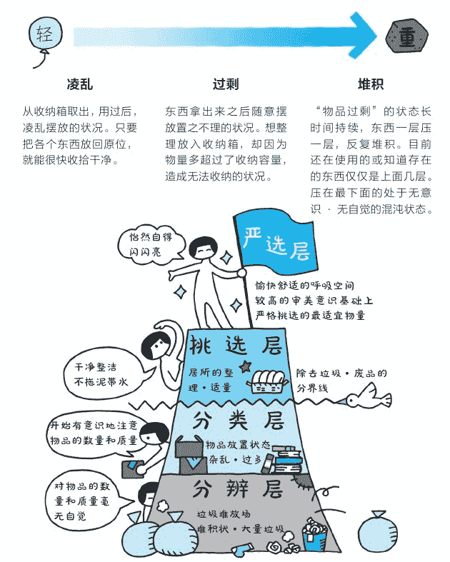

说个不太恰当的比喻，如果便秘，自己无法排便时，就应该吃点泻肚子的药或是诉诸外科手术。

很多人告诉我自从走出了“分辨层”，他们享受过上层世界的舒适感后，接下来就能自觉地开始实践断舍离。我想大声地告诉大家：

“不管怎么样，请尝试先从淤积着垃圾废品的蓄水池跳出来吧！”

#### 观念上的断舍离 2　停止自我否定

很多女性很容易陷入自责的脑回路中，把自己定义为“不会整理的废柴女”。其主要是因为她们把“收拾家务”直接等同于“理所当然应会的家务劳动”，简单地把家务整理分成“会收拾”和“不会收拾”，理解成能力问题。

而男性则简单地直接理解为“不收拾”，并没有添加什么个人情绪在其中。

也就是说，女性既受到了“没有收拾干净的环境”的损害，又不得不自虐地自嘲为“不会收拾家务的女人”，心理上受到的伤害也越发地深刻。

特别是很多职场高知女性，非常容易陷入完美主义的陷阱。

她们在外面能力超群、精明干练、备受好评，而自己的家里却乱七八糟、一塌糊涂。她们极力想让家里和职场一样，干净整洁、完美无缺，却真的是一筹莫展。

这种反差越大，自责的倾向就越强烈：

“必须得想想办法！”

“这样下去可不行！”

只有摆脱这种自罚性的思维倾向，不再去否定自我，才能实现思维观念上的断舍离。

再强调一下，我们现在身处的正是物质和信息极为丰富甚至过剩的社会。在这样的社会中，假如没有一个明确指出“如何与物质和信息打交道”的方向标，我们可能很快就会被物质和信息的洪流吞噬。

因此，你要告诉自己，造成这种局面并不全是因为你自己。

#### 观念上的断舍离 3　描绘家的具体构想

为东西过多而发愁的人总是盯着眼前的东西，想不出办法来，甚至会强迫自己“必须收拾东西”。他们热衷于搜罗各种各样的收纳术和整理术的书籍，虽然能按着前几页认认真真地实践，不过也是三天打鱼两天晒网，热情骤减后又把视线转移到其他书上……反反复复，对家务的理解和自身的视野变得异常狭小。

这时候，我们应该做的就是停下来，仔细想想。

难道“为了收拾东西而收拾东西”是我们的目的吗？

实际上，我们真正想要的是“健康舒适的居住空间”。搞清楚这个目的后，显而易见，“收拾东西”仅仅是实现这个目的的手段而已。

因此首先应该做的是明确描绘住所的蓝图——收拾整理完后，我想在这里进行怎样的生活。

简约风格的空间——摆放北欧系家装用品或原木家具

民族风格的空间——装饰有东南亚风格的布衣或藤编家具

现代流行风格的空间——以办公为主的功能性家具

其实，每个人都应该有自己的“理想居住空间”。但可惜的是，很多人没有清晰地设想过。甚至很多人连该如何构想都抛到脑后了。这个时候，就应该反复地“放手”杂物，通过取舍物品，来重新审视自己的家居设想，细致地描绘自己理想的家。

这样，你会隐隐约约地看见某种轮廓，比如：

“这么说起来，我比较憧憬那种宽敞舒适的空间。”

“比起家具的功能性，我更想加强与家人之间的联系。”

“我对理想的家和现实的家存在很大的差距，并没有什么大的问题意识。”

这种模模糊糊的念头可以帮助我们回到人生的原点——“我究竟想要怎样的生活”，也会变成我们实践断舍离的原动力。

#### 杂物上的断舍离 1　拿出杂物，俯瞰

前面我们对杂物的三种思维观念进行了梳理，这一节将介绍处理杂物时，如何对东西进行观察和判断。

把握自己现在的居所物品过剩、无法收纳的现状后，把杂物全部摆出来，放在地板上、桌上等水平面的位置。然后从高处对杂物总量进行俯瞰。

首先是“出”。

无论是餐具柜还是衣橱，我们平常只看到其中收纳的东西的“面”，而看不见放在最里面的“体”。找东西花时间也是因为对其没有全面认识。把东西晾晒出来，可以从“体”的角度一个一个全面确认。

值得提醒的是，越是初学者就越会像“打激素”一样，立马想从“大块头”着手，花费比原计划更多的时间和精力去对付庞大的杂物量。

又或者是从最惦记的什物——很难放弃的东西、含有个人情结的东西等开始处理。

因为还没有体验过断舍离，不小心就把目标设定的“高大上”以至于高不可攀。

一旦从“大块头”“大物量”开始“啃”，好不容易提起来的热情马上就被浇灭了。即使只对衣柜进行“断舍离”，如果被无法想象的有压迫感的物品量惊吓到，心情立刻萎靡消沉，没什么干劲儿，那么断舍离的任务就无法在计划时间内完成，最后半途而废，反而让整体更加混乱，心情也更加糟糕。

因此，在开始实践断舍离时，要在计划的时间内从少量的、小单位的着手。单位越小，将物品从收纳柜取出来所花的时间就越少。

这种小单位量的断舍离持续下去，不久就会变成大单位量的断舍离。

#### 杂物上的断舍离 2　扔掉“怎么看都是垃圾·废品”的东西

断舍离将家里大量的杂物，通过三层“筛子”进行选择取舍。

扔掉“怎么看都是垃圾·废品”的东西

以自我·时间为判断基准，考虑自身与物品的“关联度”，再进行取舍

以“必要·合适·愉快”为标准进行取舍

第一层筛子就是筛掉“怎么看都是垃圾·废品”的东西。

拿食物作为例子来解说比较容易理解。你把冰箱里的食物全部拿出来摆在桌子上，如果其中有过了保质期的生鲜食品或是还在保质期内却看起来没有食欲的食物，就应该立刻处理掉。杂物处理也是同样道理。

地板上和桌子上摆满了各种不同的杂物，先从已经损坏的、被弄脏的、不能使用的、已经被抛到脑后的东西，将来也用不上的东西开始处理。

碰见让我们犹豫的“还能用”的东西时，不用烦恼，可以自问自答——确实还能用，不过它是不是仍在“心里的保质期内”。

也就是说，它对自己来说是不是“美味的”“有吸引力的”。那些答案是否定的东西尽管放弃就好，不需要留恋再三。明白这一点后，处理杂物的速度一定会明显提升。

也就是说，垃圾·废品相当于“忘却物”，连存在本身都被忘记的东西。绝大多数的“忘却物”对现在的自己来说都是“无所谓”的东西。它们被塞在各种小盒子和壁橱里，挤在那些只要关上门就统统可以装作不存在的收纳空间里。

经济学上有个“巴莱多定律”。

它指的是“公司 80%销售额是由 20%的员工创造的”“80%的成果是在所花全部时间的 20%中产生的”等这些现象，又简称 80/20 定律。

在收拾整理家务的现场也同样适用这一定律。

“居住空间里的东西，其中 80%是忘却物，目前在使用的东西只占了 20%。”更不用说平常基本上不怎么开的壁橱和抽屉，里面的忘却物比率甚至超过了 80%。

断舍离把这些忘却物比喻成“陌生的大叔”。而衣柜、壁橱显然是这些陌生的大叔的聚集地。

如果是普通的大叔也罢，它们是“陌生的大叔”，它们成群结队地寄生在壁橱、衣柜、收纳架这些地方。“陌生”这个修饰词说明了它们和现在的你没有什么太大交集，在之前的人生里，不过是擦肩而过罢了。

或是之前有过点头之交，或是吃过几次饭的茶友，或是被问到“还记得我吗”却完全想不起来的人。你的橱柜、抽屉里是不是住着这样让你绞尽脑汁也想不起来的大叔呢？

“忘却物塞得满满当当的家里”很像是经常载满人的电车一样。原本宽松舒适的家里，却因为客厅里、厕所内、厨房中等各种地方站满了“陌生的大叔”而显得异常狭小。

而且，这些“陌生的大叔”沉默着，一声不吭。家里的空气非常混浊、呼吸不畅，它们却依然沉默寡言，一个劲儿地挤来挤去。

我们的收纳空间里就是这样一幅情景。

只有找到一种合理的方法，才能把这些“陌生的大叔”请出家门。

带着这种意识来再次审视我们的居所，就能清清楚楚地看见哪些东西可以立刻处理。

你家里是不是住着很多“陌生的大叔”（忘却物）？

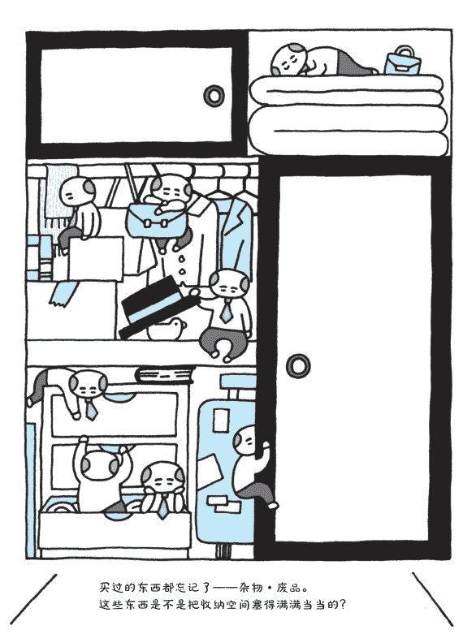

#### 杂物上的断舍离 3　以自我·时间为判断基准，考虑自身与物品的“关联度”，再进行取舍

第二层筛子是“自我轴”和“时间轴”。这实际上是断舍离最核心的部分。其主要是因为以下三点：

从这些角度进行杂物取舍，会了解自己的内心，接纳喜欢上自己

掌握以物品与自身的“关联度”为焦点的思维方式

清晰地展现随着时间变化，自身与物品关联度的变化

下页图中的横轴为“重要度轴”，纵轴为“时间轴”，两轴相交的原点，前者为“自己”，后者为“现在”。也就是说，“对现在的自己非常重要的东西”处于原点位置。我们在不知不觉间把“重要度轴”偷换成以他人价值观为基准的“他人轴”。价值核心变成了以“物品”为主题的“物质轴”。在日常生活中，常常不是沉湎于“东西曾经有用”的历史，就是对未来怀抱期待和不安，常常觉得“东西以后会用得到”。

看清物品本身的重要工具——“重要度轴”与“时间轴”

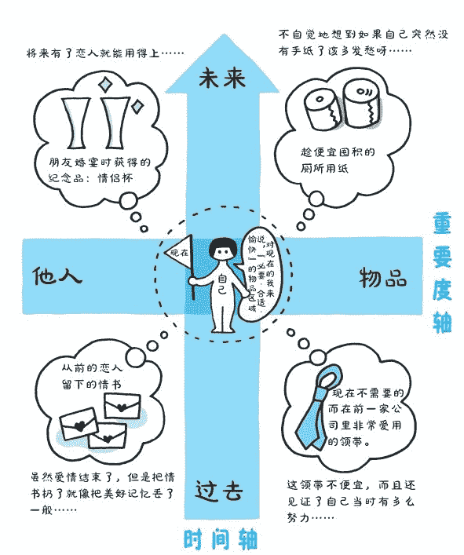

在处理掉垃圾·废品之后，有意识地按照自我轴和时间轴进行杂物的取舍，就能在大量杂物之中锁定那些对“现在”的“自己”必要的东西。

比如说，我把用了 10 年以上的眼镜送给你，“这副眼镜非常好，务必戴”，你会用吗？不同的人有不同的视力，而且眼镜的样式合不合胃口还难说。那么“现在”的“你”应该很容易判断这副眼镜的价值。

但是，这副眼镜并不是不能用。而且，眼镜框上还有高级品牌的 logo。可能看到这里你会产生一种“太可惜”的感觉。

我们可能选择收下这副眼镜——“毕竟是他给的，拒绝起来也不好意思”“眼镜还能用，暂且收下吧，况且还是大牌货”，这种思维本身就是焦点错位，变成了“他人轴”或“物质轴”。

从便利店的免费一次性筷子到和自己风格不相称的回礼品情侣杯等，很多“基本上不怎么会用的东西”你还会带回家吗？

而以“自我轴”为基准进行取舍时，只需要考虑“这个东西我想不想用”。

焦点集中在“这是不是我需要的眼镜”，而不是“这个眼镜还能不能用”。

在压缩和锁定物品的过程中，以前“对自己真正重要的东西”这一模模糊糊的概念就逐渐地清晰起来了。而这也将促进“真正了解自己的内心”“喜欢上自我”的自我肯定感的提升。

另外，被父母、配偶、学校老师等价值观影响而接受的东西则是“他人轴”支配下做出的选择，而这些价值观与自己原本的价值观非常接近。

固然，他人价值观并非不好，只要记得主体不是他人，而是自己。不过，很多情况下他人的价值观不会给自己带来积极影响。这些价值观、想法随着杂物整理也一起从脑中统统卸下来。在实践断舍离的过程中，坦然地正视那些有违和感的思维、观念，建立以自我为主体的价值观非常重要。

“时间轴”就是指“现在”。

我们回顾一下在前面介绍的“无法放手的三种类型”。这三类人有一个共通点——没有活在“现在”。总是不断感叹着“太浪费了”和“以后可能会派上用场”，意识总是徘徊在过去或是将来，却没有脚踏实地正视眼前的问题，以至于人生的“现在”成为一个空洞。

在这些杂物中，有些东西可能一年才用上一回，或是红白事的时候才用得上。对于这些东西，不要从频率，而要从和自己的“关联度”的视角进行判断。

这种“关联度”也是非常重要的一点。

我们在取舍时，往往容易优先考虑物品的利用价值或角色作用，但实际上，物品的“活用价值”得以实现是以物品与我们生活的“关联度”为前提的。

再怎么美味诱人的食物，如果吃饭的人没什么胃口或是肚子吃饱了，想必也无法领略这种“美味”。

物品与自己的关联度会随着时间而变化。同一件物品，不同的人会有不同的评判，也有不同的关联度。这是所有的人·事·物三者的关系网成立的大前提。在这个大前提下，那些同时满足必要·合适·愉快三个维度的物品很快就能被锁定，并且可以摆脱把人·事·物单纯理解为非对即错、非善即恶的二元思维，逐渐形成多元性的、尊重他人的意识。在这里我介绍一个在整理杂物的过程中意识到“自我轴”，同时也迎来人际关系改善的案例。

“物品”与“我”的关联度是不是高频的、活跃的？

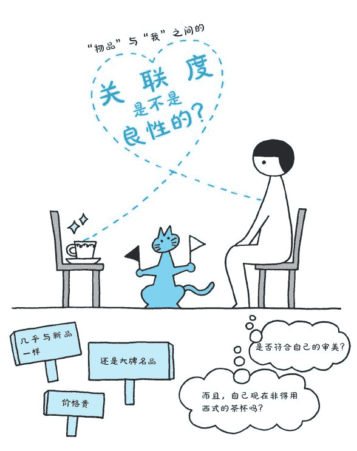

#### 体验谈 3　找回“自我轴”，处理大量餐具

长时间持续实践断舍离的幸小姐（匿名），在生活上已经能够轻松自如地处理衣服，严格挑选喜爱的衣物。但是对餐具的断舍离却进步缓慢，米饭碗、木碗、茶杯、碟子、小钵、马克杯、玻璃杯等，橱柜里面摆着各种各样整整齐齐的餐具。可是她“每个都不喜欢”。

其实这些餐具全是婆婆送给她的，其中很多是别人给婆婆送的。看起来像是婆婆把这些送给幸小姐，其实转嫁了负担这些餐具的责任。无论是红白喜事还是各种节假日、年末送礼，各种各样的餐具络绎不绝地涌进橱柜里。这些东西也没有坏，质量也不错，所以幸小姐也没有想过把它们“扔掉”。就这样一直让餐具挤在柜子里，一挤就挤了 20 年。

终于，幸小姐鼓起勇气，准备收拾整理这个橱柜。

一旦开始向代表婆婆强行善意的橱柜出手，她马上就意识到以前白净的架子居然已经变得脏兮兮的。她把柜子里的东西全拿出来，开始一点点地擦柜子，边擦边流着眼泪：“真对不起，把你弄得这么脏。”她为什么会哭呢？她根本就不喜欢这些餐具，也没有打扫过橱柜，为什么会流泪呢？因为在擦拭橱柜的过程中，她意识到自己太过顾虑婆婆怎么想，却忽略了自己内心的声音。总是以他人为价值标准，而让自己牺牲了很多。那声“真对不起”既代表她决心要和婆婆建立新的关联性，又代表总是以“物质”和“他人”为思考基准的她向真正的自我的道歉。最后，幸小姐终于处理掉了大量的让她心累的餐具，她的生活也翻开了新的一页。

#### 杂物上的断舍离 4　以“必要·合适·愉快”为标准进行取舍

第三层筛子就是“必要·合适·愉快”的视点。

这个视点是对以“自我轴”为基准的杂物取舍指南进行提炼后的“筛子”。具体是指自问自答“这个东西对我来说是必要的吗？是否适合我？使用起来是不是心情愉快？”。这种自问自答的时间轴毋庸置疑就是“现在”。

反过来，对“现在”的我来说，那些“不需要·不合适·不愉快”的东西应该处理掉。从以下三个视角对杂物进行选择和抛弃时，全部调动自己的知性、感受和感觉。

不需要的东西　东西使用起来很便利，虽然没有坏，但是丢了也不发愁。

不合适的东西　以前很重要，但是对现在的我不合适。

不愉快的东西　长时间使用，但会有莫名的违和感和不快情绪。

在前面我们把“忘却物”叫作“陌生的大叔”。把这些陌生的大叔赶出家门后，下面就轮到被断舍离叫作“爱管闲事的大叔”的无用之物。这些爱管闲事的大叔，人又热情又多话。与成群结队却沉默无声的“陌生的大叔”正好相反，它们也没有什么恶意，总是一片好心地鼓吹自己有多厉害。因此，并不是那么容易就能斩断与它们的关系。

如果把这些大叔换成杂物呢？

这种杂物通常是我们在各种各样的电视购物上，或推销员的花式推销、宣传轰炸下，迷迷糊糊交钱买下的。这些东西不过是“有的话确实比较便利，没有的话也不会太发愁”而已。

但是，一旦准备把这些东西抛掉时，那些“爱管闲事的大叔”就会跳出来，戴着“热情亲切的面具”开始啰唆了：“这样扔掉真的没关系吗？当时花了不少钱吧，现在暂时还用不到，不过以后必要的时候还能派得上用场。再说，首先扔东西难道不可惜吗……”但是你要知道，让它们这么唠叨的不是别人，正是你自己。

与忘却物不同，这些“图个便利”的东西总是在放手时，让人恋恋不舍。所以，这种“爱管闲事的大叔”就被叫作“留恋物”。

“忘却物”的判别比较简单。只需要“集体面试”，整块地进行大规模清除就行。而像“留恋物”这种“爱管闲事的大叔”，就需要“个别面谈”，从“必要·合适·愉快”三个角度进行判断后再做处理。

首先从容易对付的“忘却物”开始，然后再对付无用处的“留恋物”，在处理这些杂物的过程中，你的“断舍离 EQ”也会提升。同时也会注意到“不合适”“不愉快”的“事”和“物”。只有坦然地面对自己的感觉和感受，才能看清楚哪些东西是“不合适”“不愉快”的。有意识地以这三个标准进行取舍选择，才能不断地磨炼自己。这里我介绍一个案例。

你家住着“爱管闲事的大叔”（留恋物）吗？

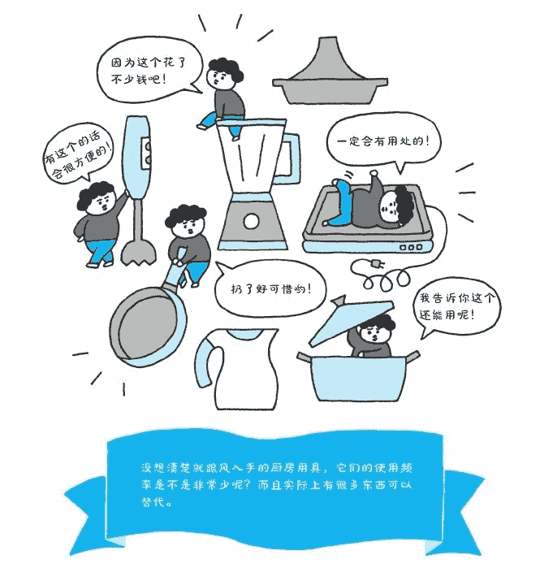

#### 体验谈 4　从“必要·合适·愉快”三个维度断舍离，形成良性循环

在日本泡沫经济期度过青春时代的美登利女士（匿名），每次买西装犹豫该买棕色还是黑色时，她的先生总会冒出几句口头禅——“哪种都会用上，干脆都买了吧”“再犹豫就错过了，两件都拿下吧”。先生这些话，在泡沫经济崩溃后艰难度过青春时代的美登利女士听起来就像恶魔的低语。不过，她不介意这些，结婚之后她慢慢地向先生的生活习惯靠拢，毕竟“他是自己的爱人”“直接拿下两件衣服，也不会浪费时间”。

原本喜好简约清爽风格的美登利女士，发现自己家里一直在不停地增加各种各样的杂物。有一天，先生告诉她想搬家去邻近的城镇，他在那里刚买了一个大房子，他想在大自然中悠悠闲闲地过日子。不过，这其实是个幌子，实际上是先生觉得家里东西多得放不下了才想换房子。美登利女士无法对先生说出自己的心里话——对两个人来说，这么大的独栋独院居然放不下东西了。

不久，日本突然发生了大地震。地震引起的核电站事故导致新家所在区域变成了禁区，搬家的意义已经不存在了。这时候他们遇见了“断舍离”。

美登利女士读了很多遍书籍，她抑制住兴奋的情绪，在心中做出了断舍离的清单。在做好充分准备之后，她开始实践断舍离。OL 时代的套装、别人送的自己却不怎么喜欢的大牌包、忍着脚疼穿出去的高跟鞋、婆婆给的辟邪用的钱包、因开始亲自洗碗而不再使用的洗碗机……她从“必要·合适·愉快”这三点开始实践断舍离。

妻子兴奋地处理她自己曾经颇为喜欢的东西，这让她先生觉得很不可思议。可是当看见不需要的杂物被整理出能占一卡车的量时，听到自己的妻子提议搬家到市区的公寓里时，总是疲于长途上下班的先生爽快地答应了。搬家后没过多久，某一天，美登利女士听先生说“可能不需要电视机”——之前在独栋独院里用的 60 英寸大电视搬进两室一厅的小公寓里，确实大得很不合适。美登利女士吓了一跳，没想到原本以“犹豫的时候就买两件”为口头禅的先生，居然会说“墙壁又白面积又大，咱们买个小型投影仪就行了”。

一周以后，没有电视的生活开始了。以前边吃饭边漫不经心地盯着电视机的先生居然开始面对面地和妻子吃饭了，而且两个人聊天的次数和质量飞速提升。并且，先生毅然决然地与“丰盛的午餐以及吃饱、吃撑的饮食习惯”分道扬镳，上班时带着妻子亲手制作的蔬菜汤当作午餐。坚持了两年后，先生成功减重 36 斤，体检后发现身体健康度也从 C 级提高到 A 级。

减肥成功的先生非常高兴，开始严格挑选自己想穿的衣服。运气来了挡也挡不住，当时正赶上人事调动，又获得晋升。正想用扫地机做家务时，又在公司举办的活动上中了头奖——扫地机。运气好得简直让人大吃一惊。

另外，说起来，美登利女士和先生的“夫妻关系”也在发生质的变化，新婚以来，两个人虽然并没有吵过架，但也过得仿佛是结婚之前的单身延长线一般。因为美登利女士并没有什么自我认同感，她不愿意被先生讨厌，也不需要负什么责任，干脆就把想说的话咽进肚子里。就靠着这种脆弱的“轻松感”一路走过来。

而当她默默地努力，重新取得“自我轴”后，给自己的夫妻关系带来了重大改变，也把自己的先生带进了生活的良性循环里。

“不需要·不合适·不愉快”的杂物

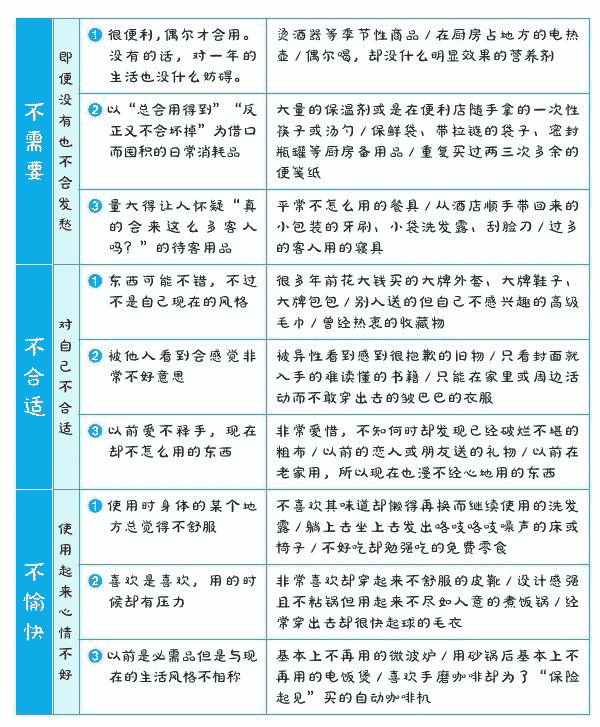

#### 杂物上的断舍离 5　收纳在杂物最适化之后进行

清除忘却物，抛弃留恋物，筛掉不合适不愉快的东西。

到了这个阶段，家里的杂物量应该已经压缩很大一部分了。留下的东西也是比较高质量的。从空间感觉上说，家里比以前显得更加宽敞、轻松、呼吸顺畅。

只有将杂物压缩到这一步，才能真正进入“收纳”环节。在“收纳”之前，在这里介绍一下断舍离对于“收拾”和“打扫”的定义。

“收拾”就是对庞大的杂物量进行压缩和收纳的作业

“整理·分类”+“扫除”，总称为“打扫”

曾经在一本杂志上的关于收拾家务的特辑中，卷首一页介绍除污小苏打的使用方法时，发生了令人吃惊的问题。原来不光是普通人，连这些提供知识的专业杂志也把“收拾”一词当作“整顿”或“扫除”等几个意思稀里糊涂地使用。

因此，突然要对因囤货而藏污纳垢的家里进行“大扫除”时，本来应该像断舍离所说的先从大量的忘却物、留恋物开始处理，可是很多人热情高涨过头，却先转而要买最新的扫地机或是强力清洁剂等。所谓本末倒置，不过如此。

面对“大扫除”时，我们的思维很容易混乱不堪。

而在“断舍离”的大前提下，最正确的“打扫”程序是首先清除那些垃圾、废品，以及不需要·不合适·不愉快的杂物，之后再转而进行杂物收纳，进行“清扫·擦拭·磨刷”。

因为，不按这个顺序做的话，把垃圾、废品或者不需要·不合适·不愉快的杂物重新塞进收纳箱，就完全失去了打扫的意义。而且，塞进柜子之后，这些杂物依然是以“机能不全”的状态藏在家里，“大扫除”并没有任何实际的意义。

以前，有从事家政服务工作的朋友来听过断舍离的讲座。他们听课的原因让我印象颇深：

“从工作角度上看，家政人员没有权利对杂物进行选择取舍，连那些怎么看都是垃圾·废品的东西也只能拿出来，清理一下，再放回去，重复来重复去，工作中充满说不出来的矛盾和徒劳感，所以自己深感断舍离的必要性。”

“打扫”的概念、收纳与断舍离的区别

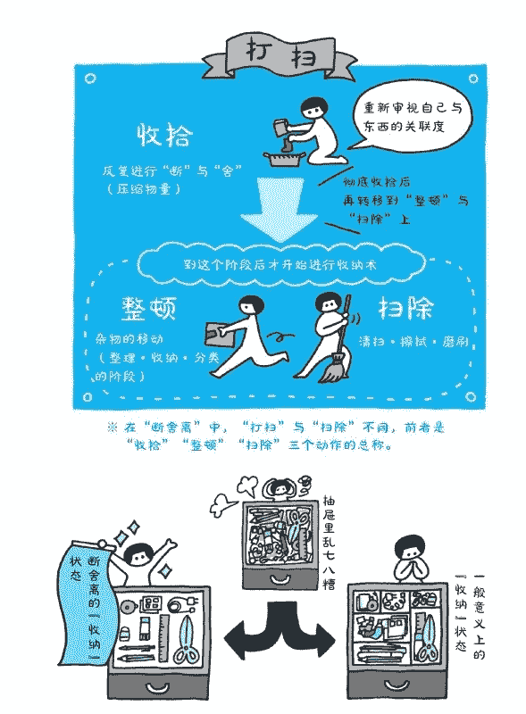

现在市面上充斥着大量的关于“整理术”“收纳术”的书籍，其中很多书并没有提醒读者思考东西的价值，而把着眼点放在“如何高效率地保管·分类杂物”上。

这样就导致按照书里的方法整理家务后，实际的杂物量并没有减少。收纳箱里囤的东西也不知道什么时候会派上用场。所谓“整理”并没有达到整理的效果。

而断舍离正好相反，它是以东西的代谢为前提的。

在进行断舍离之后，空间会呈现动·流的感觉，也就不需要那些为了储藏或分类物品而购买或制作的收纳用品，甚至一开始就会把用于收纳的用具处理掉。

因为，在有意识地以“自我轴”和“时间轴”进行断舍离的过程中，杂物的量会做到尽可能地压缩，最少量收纳容器就完全足够。也就是说，断舍离收纳概念的出发点在于“如何才能不做收纳”。

另外，“收拾”一词从广义上来说是“收拾残局”“善后”的意思。它的反义则是我们“置之不理”“放任不管”，又或是当自己与物品关联性了断后，物品还处在原先的位置，甚至被遗忘。

“善后”，如字面意思一样，认认真真地将一件事做到“最后”，我们需要通过“断舍离”，真正地掌握这种做事情做彻底的感觉。

#### 收纳指南 1　“三分法”

在对压缩、挑选后的杂物进行收纳时，我这里介绍五种收纳指南。

在讨论会或讲座上，经常有人这么问我：

“我能扔掉××吗？”

“没有用多长时间，能扔吗？”

……

但是，断舍离并没有什么规则或说明书。因为，东西能不能扔掉，选择和决定权不是别人，正是东西的所有人——你自己。

在这样一个物质过剩、各色价值观横行的世界，对这个简单的道理也心存困惑也是无可厚非的。因此，断舍离虽没有什么规则指南，但能提供“自我轴”“时间轴”和“必要·合适·愉快”等新的思考方式。

同样，“收纳”并没有什么既定的规则。

“收纳”并没有什么手把手的操作手册，不是按照操作手册上一步一步来就能做好收纳作业。常年和杂物、空间打交道，我找到了各种与它们“友好相处”的方法，在见证过各种各样的事实和案例后，我总结了几条黄金定律。

首先，在把杂物放入收纳箱前最重要的是“分类”。

整理·分类的工作只要想做是做不完的。但是分得太细，自己也记不住；分得太粗，东西又不太容易找到。断舍离把分类作业分为三个要点：

大分类→中分类→小分类

把自己想分类的杂物按“大中小”分为三类，然后再重复三遍。小分类部分完成才正式进入“收纳”阶段。

日语中有很多常用的三字词，如“松竹梅”“金银铜”“天地人”等，被称为“三字诀”。人们的大脑已经非常熟悉把事物分成三部分的方式。二分法会形成对立，四分法则事无巨细，会导致遗漏。因此，断舍离也分为“断”“舍”“离”三部分。

接下来，以厨房为例，介绍一下三分法。

大分类

先把厨房中的所有东西分为“食材”“料理用具”“餐具”三部分。这次分类关键是三类不能交叉。餐具类放入调味料，料理用具旁边放马克杯之类的都属于范畴错误。这种错误越多越会导致找东西花时间，思维也会发生混乱。

中·小分类

**（食材）**

我自己的家里，所有食材包括调味料和生鲜全部都放进冰箱里。冰箱有三个门，从上到下是“冷藏室”“蔬菜室”“冷冻室”，不同的食材放在不同的区域。比如：

冷藏室　食品、饮料、调味料等

蔬菜室　叶菜类、根茎类、作料类等

冷冻室　已经做好的熟食、准备做的食材、需要冷冻的零食等

**（料理用具）**

根据用途分为“洗涤类用具”“燃气类用具”“电器类用具”

厨房分类模板

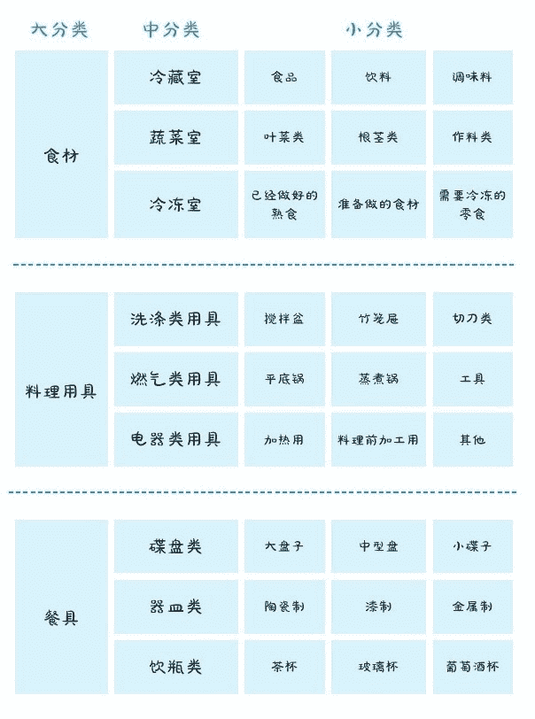

三类。比如：

洗涤类用具　搅拌盆、竹笼屉、菜刀、切菜板等

燃气类用具　平底锅、蒸煮锅、大汤勺等

电器类用具　烤箱、微波炉、厨房多用机等

**（餐具）**

首先把餐具分为三类，“碟盘类”“器皿类”“饮瓶类”，根据用途、大小、质地等再进行小分类，用起来比较方便。

碟盘类　大盘子、中型盘、小碟子

器皿类　陶瓷制、漆制、金属制

饮瓶类　茶杯、玻璃杯、葡萄酒杯

分类方法没有绝对答案，大家可以根据各自的生活习惯，建立自己的三分法。需要强调的是，最开始的大分类如果出错的话，之后的中分类和小分类部分会出现问题，因此认真地做好大分类是关键。

不过，还是有很多人不知道怎么开始。

我们长时间把焦点放在“物质”上，导致视点水平低，视野幅度狭窄。也就是说，缺少俯瞰整体的能力。

观察一下市面上流行的“收纳术”，就会发现，很多都是一开始就进行具体分类，接着就是更加细微的分类，这样只会导致收纳出现混乱。

就像从日本→东京都→港区一样，焦点从大区域逐渐过渡到小区域，才不会引起思考的混乱。

收纳上的分类思维方式也能磨炼工作上必备的技术。能在生活中锻炼工作的思考力，进行断舍离式的收纳也是很有价值的。

#### 收纳指南 2　“7·5·1 法”

“7·5·1 法”指的是进行杂物收纳时，对收纳空间的物量进行的大致估测。

根据不同的收纳情况，将杂物总量压缩到收纳空间的“7 成”“5 成”“1 成”，该法则与下一节的“1 out 1 in 法”统称为“总量限定法”。

“看不见的收纳空间”占 7 成

像衣柜、壁橱、抽屉等关上门就“看不见的收纳空间”所放杂物的量基本上占整体空间的 7 成。

这个比例其实是为了建立物品进出的通道。也许有人觉得反正“看不见”，塞得满满当当的，放成乱七八糟的样子没关系。但是相比很多人碰到过，想拿柜子最里面的东西时，不得不先把前面的东西拿出来再重新去取……这个过程非常麻烦。

显然，不会有人想收拾一个塞得满满的收纳柜，余下 3 成空间会让人提起“收拾”的劲头。

“看得见的收纳空间”占 5 成

像带玻璃门的碗筷架或橱柜等关上门依然能“看得见的收纳空间”所放杂物的量基本上占整体空间的 5 成。

因为外面总能看见里面收纳的杂物，所以应该尽量地保持一定的美观。“美观度限定量”为 5 成。正因为既不“炫耀”又不“隐藏”，空间才能自然地流露整洁美好的印象。

“展示性的收纳空间”占 1 成

像玄关鞋柜上或橱柜上等水平面上的“展示性的收纳空间”上所放杂物的量基本上占整体空间的 1 成。

这个比例借鉴了美术馆或艺术画廊艺术品的布置。宽阔的空间上仅装饰一幅作品，整体会显出美感。虽然我们的居住空间里并没有美术馆的条件，但是以“1 成空间放一点”的思维去装饰空间时，即便是不起眼的日常小物件也会带出空间的美感，形成别具一格的装饰品。

可能有人认为“7·5·1 法”太过浪费——收纳空间竟然没有 100%地利用起来，而还分成 7 成、5 成、1 成。

其实只要杂物的总量减少后，就不会觉得没有完全利用空间就会浪费，甚至觉得“7·5·1”的比例很合理，并且能重复享受取舍的过程。

比如说，“看得见的收纳空间”中有 20 件杂物，那么就要思考“这 20 件杂物中我要留下哪 10 件”，接下来就会自动地挑选“自己最喜欢的 Top10”放入收纳柜中。

另外，限定杂物总量，从“自我轴”和“时间轴”认真进行杂物取舍，才能让居所的各个地方产生出“留白”，用于创造更加有内涵的美的空间。

#### 收纳指南 3　“1 out 1 in 法”

这是为了坚持上一节“7·5·1”收纳空间整理法所必需的。当我们按照“7·5·1”的原则收纳好喜爱的物品后，假如突然又入手了一件新东西，就需要去掉之前的 Top10 的末位物品，而补入这个新物品。

反复进行这个“1 out 1 in”后，我们会深刻领会到自己收纳的东西越来越喜欢，自身的审美意识和品位在逐渐地提升。

不过，值得注意的是要遵守“处理一个，收纳一个”的原则。一般在收拾家务时经常是“收纳一个，处理一个”，不过断舍离的 out 走在 in 前面。

原因在于，先收纳一个（即使是临时的），物品总量就会超过限度。

反过来说，先取出一个，再放入新东西，就不会出现失败的可能。夸张地说，就是故意把自己置于必须“背水一战”的情景下。那么收纳东西的心理准备与“先进后出”一定不同，而且筛选购买东西的水平和能力也会提升。

也就是说，特地给自己制造“为难的境地”，让自己产生“决不能再随意买一些乱七八糟的东西！”的觉悟。这样一来，在面对可入手的诱惑时，有一点犹豫的话也不会冲动购入。

同时，“先出”的概念与新陈代谢或呼吸运动也是相通的。有意识地“先出后进”，才能唤起良性循环。

这个规律不仅适用于物，同样也能用在事和人上。

当一个人还没有和“关系已经走到尽头”的恋人正式分手，就开始和新的恋人开始交往，人们一定会对这个人抱以不自然的想法。

即便多么想拥抱崭新的有魅力的人、事、物，我们首先应该做的是把之前的“人·事·物”之间的关系“收拾”干净，整理清楚。这才是断舍离的思维方式。因为先处理之前的关系才能切实地提升再一次的“获得”的质量。

这里介绍人·事·物进行“1 out 1 in”的两个案例。

#### 体验谈 5　实践过“1 out”之后，出现了“1 in”大惊喜

当她扔掉一堆教人如何赚钱的书之后……

一直拼命想赚钱的今日子小姐（匿名），在遇见断舍离后，把自己家里收藏的 47 本教人如何赚钱的书一口气扔得干干净净。

她意识到这 47 本书代表着自己对“钱”过度的执念。当她清理了这 47 本书的同时也意味着她摆脱了“有钱人=人生赢家”的思维怪圈，改变了自我的金钱观。

之后没多久，发生了一件意想不到的事情——她从几乎不怎么联系的父母那里分到一笔财产。刚刚摆脱了对金钱的执念，金钱却又不请自来了。

不像真事的真事。

当她顺利结束前一段关系时……

理香小姐（匿名）是一位离过婚的 30 岁女性。

离婚后，她又遇见一个人，接着就是轰轰烈烈地恋爱，两个人已经订婚了，但是最后的最后依然还是分手了。

在消沉了很长时间后，她因为断舍离意识到自己对于“结婚”二字的执念。伤痛愈合后，她来到了曾经祈祷过幸福婚姻的神社，而这次她是去“解愿”。所谓“解愿”就是当一件事情了结之后，不管结果如何，都去神社感谢神灵和陈情。

谁都多多少少会去神社或寺庙里祈愿祈福。理香小姐认为“当自己祈求过什么小愿望时，不管结果好坏，最重要的是好好地做个了断”。当理香小姐“解愿”之后，她变得神清气爽，连朋友都觉得她气色不错。

虽然并不是什么杂物收纳，但通过“收拾整理”自己的感情，理香小姐感到有什么崭新的东西进入了自己的内心。之后，她遇见了和自己家境相似的人，两个月后订婚，意气相投的两个人很快就结婚了。

#### 收纳指南 4　“one touch 法”

我们在进行杂物的取舍和收纳时，都希望能更快更好更不费时间精力。

实际上，即便是限制了杂物总量，做出留白，创造美好的空间，在进行杂物整理收纳时，打开收纳柜的门，取出里面的箱子，再打开盖子——这三个动作足以让人觉得太过麻烦了。

同样，使用之后再收纳同样也会花时间，所以更不愿意再重新放回原位，只会随意扔在桌子上或地板上。

因此，杂物拿出放入的动作就是：

“打开门→拿出来（放回去）”。

只需要把动作压缩成这两步，以 one touch（一键式）取出来，这样一来既没有了什么多余的压力，也不会觉得“太麻烦”。

我基本上是把要放进箱子里的杂物打开盖子进行收纳。

像一些袋装的咖啡奶油等，袋子口朝外翻折一下，张着袋子口放进冷藏库中。

有人会用橡皮筋儿把袋子口扎起来，但其实这么做无论是扎皮筋儿还是解皮筋儿都很费劲儿。而且很多东西并不需要密封保存。对于需要扎口的东西，我一般用洗衣服用的衣服夹或长尾夹。

尤其是觉得“家务事真烦琐”的人，一定要动动脑子，下点功夫去减少“花时间的、烦琐的”做法，这样的话，家务活做起来会越来越有意思。

#### 收纳指南 5　“自立·自由·自在法”

我们在收拾衣服、毛巾时会无意识地把东西叠得有棱有角，让东西看起来整齐，拿起来方便。而“自立·自由·自在”的原则就是将这种审美意识提高一个层次，使家里的各个地方都能看出主人的用意用心，建立一个舒适自由的空间环境。

自立

在收纳杂物时要有“立”意识。

家里厨房的毛巾放在方形浅盘里，最多放 10 条。总量限定后，整齐地叠放，摞在盘子里。看起来又美观又方便拿取。

自由

这里的自由是指“选择自由”。

便利店的饮料柜里各式各样的塑料装饮料摆得整整齐齐，一目了然，我们想买哪个就买哪个。而且当最前的饮料被买走后，相同的饮料马上被推到前面补位。其实，收纳杂物时可以借鉴这个方法。

餐具柜中像茶杯、玻璃杯、葡萄酒杯之类的杯子，可以根据不同的种类进行分组，一个一个套着摆放，方便拿取。如果乱摆一通，我们往往只用手边的杯子，而浪费了其他杯子的价值。

自在

衣服类等无法“立式”收纳时使用的方法。

“自在”有“随心所欲”的意思。底裤、T 恤、袜子等不要让其绷开，团着叠起来。底裤和袜子团成小块，而且不能绷开散开。其实这个工程收拾起来很有趣。

在我家，底裤团着叠好后就扔进筐子里，而 T 恤则叠成圆筒状，“自立”着放入收纳箱。另外，放进收纳箱里时，不要挨挨挤挤地塞进去，有点间隙空当地放进去，心情也不会“太拥挤”。

杂物的“自立·自由·自在”的状态也会有利于它的主人

“自立·自由·自在”地生活。

另外，因为厨房的柜子抽屉太多，很多时候我们找不到太多地方放筷子、勺子等餐具，只能挨挨挤挤地堆在一处，整体看上去显得很不美观。

“断舍离”首先会压缩物量，去掉多余的隔间隔板收纳箱，把空间变大变宽敞，从而能在宽松的空间里放置杂物，这样也会让心情不那么“拥堵”，变得宽松、舒畅。

假如你是被收纳的杂物，你愿意待在自己整理的收纳箱吗？

每天开合的抽屉、筐子、箱子里到底是什么样子？

这些答案自然是不言自明的。“物如其人”，杂物收纳的样子就是你本身的样子。

“自立·自由·自在”锤炼审美意识

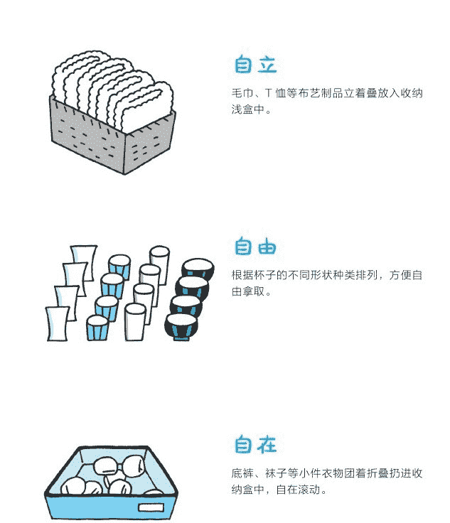

### 从切实能出成绩的小地方着手

我们已经介绍了断舍离的具体实践方法。

这些方法可以浓缩成“处理不需要的废品”“出”几个字。这几个字能够表达出断舍离的精髓。

因为处理杂物也有其正确的方法。

对于初学者来说，一提到处理杂物，首先想到的是如何扔掉自己最想抛弃的东西。其实，很多人一开始实践断舍离，想都不想就先拿自己最纠结的书籍或衣物类开刀，这样反而无法坚持下去，产生了多余的杂念，最后没有什么成就感，“断舍离”也半途而废了。

断舍离则是“加分法”。也就是尽管得分较低，全力集中在“达成事件”上，一点点地增加成就感。

以前高考复习法中流行一种学习方法——做一做小学生的算术题给自己打气加油。

让高考生做小学生的算术题简直是杀鸡用牛刀，每项肯定是满分。这种方法就是通过做小学算术题来体验“我能得满分”的小小成就感。小成功的不断叠加会给人带来巨大的自信心。

而断舍离也正是要从非常简单的小地方着手的。小地方获得的小成功的不断累加，能给人以勇气和信心去面对自己的老大难问题。

面对家庭、工作上的种种不称心不顺意，我们会不由自主地给自己扣掉分数。那么，在“断舍离”的实践上就多给自己加分数，自我表扬“又扔掉一件杂物，成功了”，给自己的“自信心账户”一点点地转账存钱。

这样既可以避免不必要的精力浪费，也不断地鼓起勇气面对断舍离的问题。可能有些人会觉得自己从“收拾钱包！”“收拾桌子的一个抽屉”这些小地方开始收拾没问题，但是一想到整个房子都要整理清理一遍，就会感觉任务好大、脑袋很疼。这其实也是对我们自己的心理小锻炼。

还出现一种现象——“我也不是不懂断舍离的道理，也认为清理东西很有必要，但是，我就是莫名其妙地提不起劲儿来，动不了……”也就是说，总是我已经发动起来了，却没向前走，车轱辘一直空转。

这就像士兵上战场前突然丧失战斗力一样。有限的时间、有限的精力、庞大的整理量，三座大山横在面前，我们会下意识地觉得特别束手无策，不知如何是好，只好装作若无其事，半推半就地把处理杂物的任务无限期延后了。

有很多“必须去做的事情”，却“提不起劲儿行动”，这种“有心无力”的状态持续下去，会过度泄漏我们的精力（精气神）。这才是真正的“太可惜了”。

这时候，我们有必要重新回到原本的出发点——现在的自己，负载的人、事、物已经过大过多了。

其实话说回来，东西多的人往往面临的事情也多，首先压缩一下自己要处理的事情。然后从最简单的一小点开始实践断舍离。

不过，这种情况也容易让人觉得“所有的东西都很重要”。正因为如此，更要有意识地通过杂物整理，锻炼“现在、这里、我”的三要素标准。

只有这样，才能看清楚“对现在的我来说什么最重要”。

#### 体验谈 6　扔掉的筷子给了我直面命运的勇气

12 年前，由美女士（匿名）生下一个有残疾的孩子。当时她的先生每天加班到深夜，可以依靠的亲戚和朋友又不在身边。而她的第二个孩子依然有残疾，并且孱弱多病，是医院的常客。

“为什么只有我这么不幸？！”

雪上加霜的是，她又得了疝气，身体无法自由行动，做手术也无法根治。这种 24 小时折磨人的病痛，再加上两个需要照顾的孩子，找不到人帮忙的她甚至想过一死了之。

重压之下，家里就变得乱七八糟，到处脏兮兮的，灰尘遍布，对现状灰心丧气，对自己麻木不仁的她，每天如行尸走肉般得过且过。

当她的健康逐渐恢复，身体能一点点地自由活动时，她遇到了断舍离。在与断舍离的老师和学员朋友进行自我剖析时，那个曾经连哭泣都忘记了的她竟然变成了“小哭鼻子虫”，痛哭流涕。当眼泪流出来时，她把憋在心里的苦楚和无奈也流“出”来了。

当她重新找回自己的笑容，要再次振作起来时，回到家里后，眼前依然是翻倒的垃圾桶、依然是衣来伸手饭来张口的两个孩子，还有加班到深夜的先生。

“光这些事情就够我受的了，哪还能腾出手来收拾东西。”当她脑子里蹦出这些念头时，断舍离的学员朋友来了一封意想不到的信：

“今天的断舍离就是这个。”

短信下面附有一张扔掉的筷子的照片。

“？！难道这就算是断舍离了？那我也能做！”她瞬间鼓起勇气，开始迈出断舍离的第一步。

她飞快地走到厨房，只留下好的筷子，把有瑕疵的筷子捆起来一起扔掉。瞬间，平常把她弄得心烦意乱的空间居然变得整洁宽敞了很多。

那天以后，由美女士的身上开始发生变化了。

以前那位“只剩下 15 分钟，什么也干不了”的稀里糊涂过日子的人逐渐变成了“还有 15 分钟呢，看看有什么地方还能做断舍离”的积极乐观面对生活的人。她现在特别有精神劲儿，总想着找点事情做。实践断舍离之后，家里的各个地方都发生了变化，变得让人心情舒畅，甚至变得让人想轻声哼歌。

由美女士以前也不是没有听过关于整理家务的方法，但是都没有在生活中实践，她说：“连我这样脑子都生锈了的人，也认识到了能收拾的东西就在眼前。”也就是说，断舍离让她看待事物的角度发生了质的变化。

断舍离会表现在行动的结果上。这些结果也一点点地转化成了她的喜悦和自信心。

她鼓起了勇气，用心面对自己的两个孩子，直面自己的命运。

### 有心无力时，先找“出口”

断舍离把我们的生命分为三块——肉体生命、社会生命、精神生命，三者是我们生存下去不可或缺的。

肉体生命是作为生物的人的生命。

社会生命是对归属和被承认的欲望。

精神生命是对智慧、美、沟通的渴望。

我们常常认为只要肉体生命存在，就是活着。假如这个论调是真的，那么就不会有人因为被解雇而痛苦自杀，也不会有人因爱而身心疲惫走向生命尽头。

无论是谁，不管他生活在哪个地方，都会有一种倾向——轻视肉体生命，只关注社会方面和精神方面的事物。这种倾向也许可以归结为“人性”。但是肉体生命是一切的基础。只有这个肉体基础健康良好，才可能让自己的社会生命和精神生命绽放光彩。没有气力开始实践断舍离，总也迈不出第一步的人，首先要让作为根基的肉体生命恢复元气。

断舍离通过改善作为生命基台的肉体的生存环境——家，来保持三个生命的完备与健全。它并不是简单的内装或收拾整理，甚至可以说是回归作为人的尊严的“空间创造”。因为我们正处于一种散漫颓废的空间中，在无意识地折磨自己。

另外，我们的居住空间的每一个部分按照这三种生命扮演不同的角色。

比如说：厨房和浴室、洗漱台直连着“肉体生命”，客厅、书架直连着“精神生命”，橱柜和书房直连着“社会生命”，等等。

每个人对自己的居住空间各个部分的角色定义各有不同，但假如我们从这三种生命的角度再观察居所时，会发现自己的哪一种生命显得较为脆弱。

断舍离的精髓在于“出”，因此，在家中实践断舍离时先从“出”这一点着手，恢复家里的流动感。比如说厨房主要是水池、排水管、垃圾桶这些需要“出”的地方。当我想活动一下身体时，就会重点清理这些“出口”。

从上到下俯瞰厨房的剖面图时，可以清楚地看见不同的东西扮演着不同的角色：冰箱和食品柜是杂物入口，排水管和水池是杂物出口等，也就是说，厨房这一个空间同时包含了入口和出口。这些地方，我们在清理出口的时候，也会自然想到严格控制入口。

当人们清理出口，消除阻塞后，会更加注意入口，严格筛选进入的杂物。

一出一进才是真道理。

厨房以外是 3B，就是浴室（Bathroom）、卧室（Bedroom）、厕所（日：Benjo）。

浴室能洗去肉体的污垢，厕所冲走排泄物，卧室驱赶走疲倦。几乎可以断定，那些在肉体上疲惫不堪的人他们身处的这三个场是混乱的、肮脏的。因此，总发愁“该从哪个地方着手”的人应该针对相应的“出口”实践断舍离，首先要在相应的场，恢复肉体上的舒畅和健康。

三个生命基台即是“居所”场

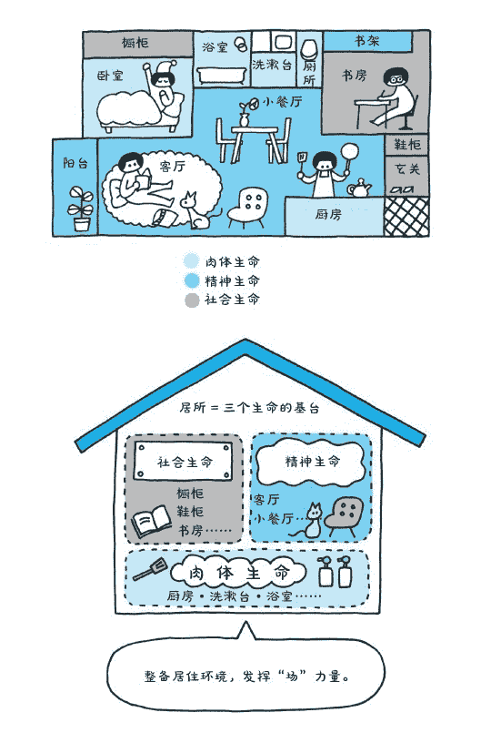

### 居所整体进行断舍离的要点

以下是针对居所整体断舍离时，总结出的各个位置的象征性意义和对各个位置进行断舍离的要点。

【断舍离的步骤】Step1“认清现状”，Step2“选择取舍”，Step3“收纳整理”。

#### 衣柜的断舍离

很多人每次拉开橱柜，看见满满当当的一摞一摞衣服，总在唉声叹气“没有衣服可以穿”。而“衣着”在一定意义上是我们社会性的或精神性的自我意象的投影，因此“没有穿的衣服=没有想穿的衣服”相当于还没有稳定的自我意象。

我们总是凭借衣物穿着来把握“潮流”这种季节性的能量。

不过，假如自己并不欣赏“潮流”，那也没关系，按照自己的感觉进行断舍离，严格挑选自己喜爱的衣服，它们也会不断给自己带来高新鲜度的能量。

【断舍离的步骤】

Step1　把柜子的门全打开，拿出所有的衣服，全部摆在面前。

Step2　丢掉发霉的旧衣服、有裂缝划痕的破衣服等不能再穿的衣服，从“必要·合适·愉快”三个维度压缩衣服量。

Step3　衣柜基本上是“看不见的收纳空间”，物量应该大约占空间的 7 成。从“易取·好收·美观”三个维度收纳整理，做到使用方便。

#### 壁橱的断舍离

老实说，实际上很多人想要好好考虑某些东西要不要处理掉，但是往往不愿意面对扔掉东西后的麻烦和后悔，于是胡乱找个临时的地方“强塞进去”等以后再用。这种类似反射性的“给臭东西盖上盖子，眼不见为净”的做法，就是思维贫乏的表现，而被强塞进壁橱里不再穿戴的衣物就是懒惰的证明。

另外，日常生活中看不见的事物常常和自我的潜意识相连接。关于壁橱的整理，有一位学员的案例让我印象深刻。

多次恋爱却没有开花结果的她在接触断舍离后，突然发现自己的壁橱深处塞着纸箱子，箱子里面全部是结局不幸的悲剧恋爱小说。这个箱子与客厅的书架上摆成一溜儿的社科类书籍形成鲜明对比。于是她打开了壁橱，把一箱子的悲剧小说，连同自己消极的恋爱观一起抛掉了。听说，后来她又邂逅了新恋情。

换句话说，处理掉忘却物象征清理潜意识中的沉淀混浊物。同时，把“看不见的收纳空间”整理成无论对谁都能大大方方展示的状态，才能立竿见影地提高自我肯定感。

【断舍离的步骤】

Step1　完全打开壁橱，拿出所有东西，摆在面前。

Step2　从已经毁坏的、不能用的杂物开始处理，逐步以“必要·合适·愉快”三个维度压缩物量。

Step3　壁橱基本上是“看不见的收纳空间”，物量应该大约占空间的 7 成。从“易取·好收·美观”三个维度收纳整理，做到使用方便。

#### 厨房的断舍离

厨房是蒸煮锅、平底锅、料理器具、密封瓶罐套装等厨房用具类的杂物聚集的巢穴。这里的很多东西都是在“我要做个料理高手”“我要当个好主妇”之类的冲动下买下的。一旦这些东西买到手后，就仿佛这些白日梦已经成真了一样，主妇们就会把它们抛到脑后。

那么到底自己是在冲动下购买的，还是因真的想做好料理而下定决心购买的？只要看看东西现在的使用状态就一目了然了。

常见的一种状态是：厨房用具、刀具挨挨挤挤地堆在抽屉的隔断收纳盘里，还有家常菜附带的一次性筷子或塑料汤勺等和“能用却不想用”的东西杂乱地塞在一起。

假如尽可能地压缩这些厨房用具的量，将它们松松散散地放在抽屉里，既好拿又好放，那么收纳隔盒根本用不上。不是用隔断来固定杂物的位置，而是让它们身处一个“宽松舒适”的空间。这样，当我们打开抽屉，犹如爽风吹拂一般，心情也会很不错。

民以食为天。厨房整理是整备全家人生命基台的重要作业。在繁忙的日子里，我们也许会感到过于麻烦，但是我们应该根据不同的情况，判断这种麻烦是“必要的麻烦”还是“可以省掉的麻烦”，从“one touch 法”的角度来看，整备出能够轻松煮饭和便利行动的路线，才能提高全家人的生命质量。

“吃饭”，吃的不仅是味道和营养，更是“气氛”。煮饭时，不能急躁地撒调料，最重要的是创造美好的煮饭吃饭氛围，这会让饭菜更香。

【断舍离的步骤】

Step1　完全打开橱柜，拿出所有东西，摆在面前。

Step2　从已经过期的食品、不能用的工具和碗筷开始处理，逐步以“必要·合适·愉快”三个维度压缩物量。

Step3　厨房橱柜和抽屉基本上是“看不见的收纳空间”，物量应该大约占空间的 7 成。从“易取·好收·美观”三个维度收纳整理，做到使用方便。

#### 餐具柜的断舍离

吃饭并不是填饱肚子，而是五官一起感受色香味的愉悦时刻，没有什么比吃饭的用具更能左右饭菜的好坏了，那么，可以说盛放食物的餐具正是让食物以美好姿态登上舞台的衣装。

与衣服不同的是，它们不会被端到外面去，而是为了盛自己和家人的饭菜。因此，可以说对餐具讲究品位和美感的人其实怀着让自己和家人愉快吃饭的心情。进一步说，他们并不在意是不是被人看见，只是内心“想这么做”，这种理想形象就是他们的自我意象。

断舍离把“款待自己和家人”作为基本的思维方式之一，因此并不把餐具分为待客用和日常用。我们可以考虑从这个角度取舍杂物。

很多家庭的餐具柜都是玻璃橱柜，属于家里“看得见的收纳空间”，所以摆放自己喜爱的餐具是一件特别享受的事情，能够锻炼我们的审美意识。把餐具摆放在餐具柜里就像把一张画嵌入画框里一样，会给厨房带来别具一格的风格。

因此，当我去那些总是发愁收拾家务的人家时，总是先从餐具柜着手，把餐具柜收拾得美观整洁，来激发他们断舍离的动力。

【断舍离的步骤】

Step1　完全打开餐具柜，拿出所有东西，摆在面前。

Step2　从有裂纹的、有缺口的餐具开始处理，以长期未用的餐具或待客用餐具为重点，逐步以“必要·合适·愉快”三个维度压缩物量。

Step3　餐具柜基本上是“看得见的收纳空间”，物量应该大约占空间的 5 成。从“易取·好收·美观”三个维度收纳整理，做到使用方便。

#### 冰箱的断舍离

一般来说，冰箱里都是食物，只需从保质期和“好吃不好吃”来取舍就行，所以冰箱正是最容易实践断舍离的地方。另外，冰箱里的食物大部分都是“生鲜食品”，断舍离时同样也要重视“新鲜度”。

如果冰箱被塞得满满当当，而其中一些食品自己碰都不想碰，却又不想扔掉，这其实是“太可惜了”的心理在作祟。“绝不糟蹋食物”固然没错，但是把食物扔进冰箱置之不理，难道就是在珍惜食物吗？这一点也是我们需要反省的。

另外，食材的质量和我们的身体直接相关，因此冰箱相当于“打造身体的‘原材料’容器”。

在对冰箱进行断舍离时，如果看食物的视角从“反正可以放冰箱，饭做多了也没关系”转化成“只做好够现在吃的量就 OK”，那么饮食习惯就会出现很多转变，不知不觉身体就会变得结实紧致起来，成功去掉多余的脂肪。我的很多熟人都做到了这一点。

【断舍离的步骤】

Step1　完全打开冰箱，拿出所有东西，摆在面前。

Step2　从过期的食物开始处理，包括那些看起来一点胃口也没有的食材，从“必要·合适·愉快”三个维度压缩物量。

Step3　冰箱是“看不见的收纳空间”，物量应该大约占空间的 7 成。从“易取·好收·美观”三个维度收纳整理，做到使用方便。

还有，冰箱门上如果有便利贴或冰箱贴，把这一块儿作为“看得见的收纳空间”，占整体面积的 1 成空间。将这些东西压缩后，厨房和厨房周边的空间会焕然一新。

#### 书架的断舍离

我们从小就被教导“读书要读到最后”，在这个观念的影响下，“不怎么有趣的书，终于努力看完了”的人不在少数吧？这其实是浪费时间和精力。其实只要我们坦然面对自己，很多书是可以放下的。

在最后一节如何压缩书籍量上，诀窍就是判断这本书对自己来说是否“好吃”。书籍也有保质期，尤其是情报通信类的商务书籍。

即使书架上摆着很多没有读过的书，但其中一定有那些对自己来说是“好吃”类的书。因为，纸质书与电子书不同，它是包括纸质、重量、设计等各种元素的综合艺术，并且书籍本身也有类似“气质”的能量。那些“不知为何拿在手里，心里就一阵欢呼雀跃”的书籍也不在少数。从这个意义上来说，书籍不同于其他杂物，是一种特别的元素。

另外，书籍的数量也是求知欲的一种表现，同时也带有一种“看，我多厉害”的感觉。即使那些未被翻阅过的书，摆在书架上也会产生某种错觉——“希望被认可”的欲求得到了满足。最后，这些书就成了“囤本”被晾在书架或者书桌上。如果书架上有这种作为“装饰”用的书籍的话，只有痛快地清理掉，才会意识到自己并不需要这些东西来装饰生活。

最近几年，因为网络书店和二手书店的兴起，那些以前被处理掉的书也可以在需要的时候很快买到手。

如果是为了获得信息情报，很多时候可以利用电子书或是互联网，而不必购买纸质书籍。

以前一个人的信息量和知识储备基本上等同于他的藏书量。今非昔比，“书籍”的概念发生了很大变化。因此，带着“（网络）书店也是我家的书架”的感觉，根据自己的需要清理或购入书籍，轻轻松松地压缩书籍量。

不过，话说回来，书籍作为一种特殊元素，很多人对其有着深刻的执念。按照断舍离的铁则——勿从执念强烈的杂物开始实践断舍离，新手应该先从其他地方开始锻炼选择取舍的能力，之后再挑战书籍的断舍离。

【断舍离的步骤】

Step1　书架是全部书籍都以看得见的状态陈列的，所以，首先是多次估计藏书量。

Step2　压缩书籍量的唯一关键点就是看这本书对自己来说“好不好吃”。从这一点就能认清自己和书籍之间有没有互动性。

Step3　在“看得见的收纳空间”中物量应该大约占 5 成，不过书籍是个例外。只需认识到“总量限制”——书籍能全部收纳到书架上就可以。从“易取·好收·美观”三个维度收纳整理，做到使用方便。

#### 厕所的断舍离

家里最具代表性的“出口”场就是厕所。最容易脏的地方，应该抱着力求最干净的心态去收拾。

风水学上有“扫厕所，开财运”的说法。这一说法到底是不是真的还不知道，但是在提升“排泄”的质量上，把厕所打造得干净漂亮其实和断舍离的“出”的意义是相通的。

不管厕所有多小，里面总有洗涤剂、马桶刷、清新剂、手纸等很多杂物。我不会放马桶刷、芳香剂等，只放手纸一卷。用薄荷油代替芳香剂，涂抹在纸上，这样可以飘出若有若无的清凉香气。厕所最重要的是“清洁感”，尽量不要放杂物。

【断舍离的步骤】

Step1　全部打开厕所里的收纳箱，确认下东西的状况。

Step2　扔掉一些会给人造成不洁净印象的杂物，比如说那些满是灰尘的芳香剂或小装饰物、洁厕灵等，要不扔掉，要不擦干净再放回去。

Step3　厕所里面是“看不见的收纳空间”，物量应该压缩到大约占空间的 7 成。从“易取·好收·美观”三个维度收纳整理，做到使用方便。

#### 玄关的断舍离

玄关是家的颜面、入口。一进门是让人舒一口气还是让人觉得好累，全部取决于开门的那一瞬间。如果玄关放满了杂物，就会影响对家的整个第一印象，所以要重点收拾玄关。

尤其是要注意，家里的玄关处有没有什么高尔夫球包、煤油灯等偶尔使用或季节性用品被扔在那里。否则这些杂物可能会变成玄关的一部分，根本没有人注意到是什么影响美观的杂物。

在玄关处经常还会看见几十柄雨伞被杂乱地插进立伞架上。家里只有四口人，却摆了这么多伞——“难道这里也住着千手观音？从快递用的印章、家门钥匙等必备品到花瓶、供品等佛前用品等各种东西被挨挨挤挤地扔在狭小的玄关处。

那么，自己家的玄关处是不是也是这番景象？是不是象征着自己家的颜面？我们可以重新问问自己。假如发现自家里的玄关处也被摆得乱七八糟，那么现在正是果断进行断舍离的好时机。

鞋柜里专门放皮鞋、拖鞋等鞋类，在杂物挑选和清理时不会太过犹豫不决。从这一点来看，鞋柜是断舍离初学者首选的断舍离实践点。

【断舍离的步骤】

Step1　把鞋柜全打开，拿出包括报纸之类的所有东西。

Step2　从旧皮鞋、脏跑鞋、撑不开的坏伞等不能用的东西开始清理，从“必要·合适·愉快”三个维度压缩物量。

Step3　鞋柜是“看不见的收纳空间”，物量应该大约占空间的 7 成。从“易取·好收·美观”三个维度收纳整理，做到使用方便。把鞋柜上面的空间当作“看得见的收纳空间”，物量不超过这片空间的 1 成，把家的“脸”当作艺术画廊，装点成美观的物品展示点。

#### 客厅·餐厅的断舍离

全家人的聚集地，也是全家人所使用的东西的聚集地。清理客厅餐厅时，不要过多在意别人的东西，重要的是彻底整理自己的东西。这两个地方的断舍离，最重要的是做到“不要把东西放在看得见的地方”，这样才能让空间显得干净清爽。

客厅里很常见的是占大空间的沙发。对于一般家庭来说，大沙发体积过大，使得整体空间显得过于狭小，而且扔在客厅的换洗衣物、儿童玩具等更是让人觉得有杂物堆积感。很多时候，只要我们仔细考虑一下，就会发现那些看起来“必须要有”的东西，其实真的“没必要”，有时候不光是“没必要”，甚至“最好是没有”。

【断舍离的步骤】

Step1　虽然想“完全打开门，拿出所有东西”，不过客厅、餐厅是每天全家人的聚集地。没有相当的条件，把东西全部摆出来很不现实。因此，首先从桌子、架子等看得见的地方开始收拾。确认一下东西是怎么摆放的，甚至可以拍个照片，对照片进行仔细观察。

Step2　先从自己的东西或者其他人不需要的东西开始清理，那些 DM（直邮广告）、邮件、报纸、传单等纸质类的东西几乎每天都会成群结队来客厅做客。我们可以注意一下“保质期”或是“消费期限”，多次多量地清除。如果不能立刻全部清理，那就进行局部的小清理，比如说“今天可以做 15 分钟的断舍离，那就只清理这个抽屉吧”，规定好清理的时间和地方，逐渐完成客厅·餐厅的整体清理。

Step3　桌子和边柜上是“看得见的收纳空间”，物量应该大约占空间的 1 成。比如桌子就放一束花，别的什么也不放。其他的杂物从“易取·好收·美观”三个维度收纳整理，做到使用方便。

#### 再利用的断舍离

“嘿！这东西能换钱，打住！”

想必有很多人还记得，这是 2017 年征集到的“断舍离川柳”\[川柳是日本传统的诙谐讽刺短诗，和俳句不同，川柳没有季语（表示季节的固定单词），可以将日常生活中的所思所想用 5·7·5（5 个假名、7 个假名、5 个假名）的 17 音自由表达。\]的入选作品。

对于旧物废品，人们有很多再利用的方法，比如说二次使用、重新包装、拍卖、跳蚤市场或者是转手给专业人员等等。东西的再利用确实很重要，而且本身没坏的东西也可以送给需要的人。这对初学者来说难度很高。

比如说拍卖吧。假如身边有很多想马上出手的衣物或书籍，我们需要先把它们整理好找个地方保管，再等着别人招标，安排发货，确认账户到款等，这一连串的事情你真的会花精力去做吗？你很有可能会因为这些麻烦事而身心压力剧增。

话又说回来，难道不正是因为没有时间没有精力去处理这些麻烦，才使得不需要的衣物和书籍堆积成小山的吗？因此，除非有非常大的决心，否则很难在拍卖或跳蚤市场出手。

其实，大多数时候，与其说是想循环利用，倒不如说想从那些“花大价钱买的东西”的金钱执念或是“扔了太可惜！”之类的罪恶感中逃避出来。因此，为了真真正正地下定决心“不再买东西”，我们要下狠心，让自己真真切切地记住这种“痛苦”，不再重蹈覆辙。

最后一个入选的川柳这么写着：

“一放手，减压力，笑容多。”

## 第三章　断舍离改变人生

舍得便是获得。

复位人生。

做出最适合当下的选择和决断。

重拾自信心。

成就自在·从容的人生。

### 一阵莫名的清爽感抚过心头

这是 40 年前的事情。

当时还是大学生的我并没有像其他同学那样，或拼命地钻研学业，或沉浸在自己的爱好中，或谈一段恋爱，等等充分地享受大学生活。没什么进取心的我总是一副懵懂的稀里糊涂的状态。

姐姐实在是看不下去了，便给我介绍了当时在 New Age 和精神学风潮流行下开始被人关注的瑜伽术。

这种瑜伽和现在流行的以美容、健康为目的的健身瑜伽完全不同。它是从呼吸、食物、姿态、动作、思想、环境这些自身内外部因素来实践瑜伽哲学的“修身养性”瑜伽。

很快我就沉浸在巨大的瑜伽兴趣中。从在文化中心上课开始，到参加“指导员养成讲座”，在学习过程中，我接触到了被称为“断行”“舍行”“离行”的瑜伽修行哲学——并非是书本知识，而是从实践中体验到的哲学。这门哲学可以让人学会摆脱执念、执着。

最有名的“断行”就是“断食”。连续几天除了喝水，不吃任何东西，是考验克制和忍耐力的禁欲式修行。

老实说，当时的我也犹豫困惑，虽说要求“摆脱执念”，但心里还是“这个也想要，那个也想要”，欲求满满，丝毫没有甩掉物欲、贪食的想法，“断行”对我来说简直是不可能的，没有认真地学习过“断行”，自己很快就投降了。

不过，内心还是隐隐约约地感到自己过于“执念”并不是什么好事。“断行”“舍行”“离行”三个词默默地藏在“心柜”深处，沉睡了很久。

直到机缘巧合的一天，这三个词猛然浮现在了脑海里。那天可以说是我的命运之日。

学习“断行”“舍行”“离行”10 年后，那位魅力非凡的瑜伽指导老师突然辞世，我去参加她的葬礼。

在和一起参加葬礼的前辈聊天时，不知是聊到什么地方，我感叹地对前辈说：

“‘断行·舍行·离行’，还有‘摆脱执念’之类的，真是做不到啊。”

我的潜台词是：又不是出家修行的僧人，自己做不到也是无可厚非的。我只是想得到前辈的认可。

听见我的话，前辈竟略带惋惜地说：

“是啊。连我们家的大衣柜里也堆着满满的不穿的旧衣服，因为完全收拾不下去。”

一句话，点醒了我。

大言不惭地说，当时我勉勉强强算是一个精力充沛、麻利能干的家庭主妇，却从来没想过要动手收拾衣物之类的。

衣柜里一摞一摞的衣服堆得满满当当，甚至可以说多得门都关不上，自己却依然埋怨“没有衣服穿”，自己到底是怎么了？！

莫非那一摞一摞满满当当的衣物并不是衣物，而是我背负的“执念”，只不过这种“执念”具象化成可见的衣物而已。

想到这一点，我就立刻开始行动起来收拾衣柜了。但是，想要处理掉不要的衣服真不是一件容易的事。

“我还是蛮贵的！”

“我还没过时呢！”

“没破的地方干吗要扔！”

“不扔也没做错事吧！”

……

衣服在异口同声地向我低语。

而同时也有另一个声音在愤怒地说：

“这种乱七八糟的，居然能有这么多？！”

对当时的我来说，一件一件扔掉不要的衣服，简直是举步维艰。

然而，我依然忍着扔东西的后悔和心疼，一点点地处理起不穿的衣服。逐渐地，沉重的心情轻松起来，甚至有一种莫名的清爽感抚过心头。

扔掉一件无用物，就多一点空间。

扔掉一件多余物，就少一份负担。

扔掉一件废物，就恢复一丝清爽。

这就是断舍离——减法解决方案给人带来的实际感受。

“通过处理多余的杂物，来摆脱执念，恢复自我，发展自我”，这种自我探查法被叫作“断舍离”。

不过，当时使用这个称呼的只有我自己一人，而且是在心中默默地使用着。

### 摆脱过剩执念，减轻心灵负重

就这样，在“看得见的东西”上做减法运算的过程中，我在心理上也逐渐摆脱掉一些“看不见的东西”。

那什么是“看不见的东西”呢？

最初，我只是觉得：“清理掉杂物后，心里痛快极了！”其实，在这个反反复复的过程中，我逐渐注意到某些“看不见的东西”，并开始加强对这些东西的观察。

如第一章所讲，大多数东西都带有一种叫“执念”的黏着剂，当我们看见它们时，这种黏着剂就反射性地在我们心里生根发芽。这就形成了“执念心”。

当然，还有另一种不同性质的“执念心”。

这种“执念心”深深扎根于自我体验和思维观念中。比如，衣柜里多余的一件衣服是我们要处理的一件杂物，但是这件物品也许是重要的人送给自己的，也许是自己用仅有的钱买回来的，它的身上多多少少都会附带着主人的小故事。

家里的一切东西都带有某种故事色彩。不同的东西带着不同的“故事色彩”，不同的“故事色彩”也代表着与主人的不同关联度。可以说，东西是物质和精神的集合体，是“具象化的形态”和“抽象化的情感”的结合体。

但是，这种“抽象化的情感”如果不是“喜爱之情”，只不过是一些“花了大价钱买的”“以前穿的时候感觉不错”“扔了会有报应”“现在虽然不穿，但处理起来很麻烦”“以后可能买不到了”……之类的负面情感，那么说明这件衣服给自己带来的不是什么积极影响。

也就是说，它和我们的关系并非良性。

因此，在处理物品和个体之间的关系时，要问问自己：

“现在的我，对这个东西有着怎样的感情？”

“现在，我是否和这个东西处于良好关系中？”

断舍离非常注重在日常生活中有意识地审视个体和物品之间的关系。

实际上我们真的开始处理杂物后，会出现怎样的情况呢？

“对现在的自己来说，附着在物品上的沉重的‘执念’是不需要的。”——怀着这种态度处理杂物，会让物品和内心产生更剧烈的联动性。当处理掉作为情感依附的物品后，上面附着的情感越是沉重，内心就越能感受到什么叫轻盈。

从表面看来，我们丢掉的是杂物，但是同时我们丢掉的还有看不见的世界里——内心的“多余的执念”。

这里介绍一个案例。

#### 体验谈 7　扔掉前夫的家具后，重获 7 年不见的痛快感

枫女士（匿名）遇见断舍离是在离婚的 7 年后。她一人独居，家里的杂物却摆得放不下了。另外，枫女士有一个秘密——她没有告诉家人朋友她离婚了。

对她出身的传统保守家庭来说，离婚无疑是个大忌。娘家人甚至认为“嫁出去的女儿就是泼出去的水”，结了婚，就不能再跨入娘家的门槛。

这种价值观的家庭里培养出来的枫女士一心认为“所有人都不会同意她离婚”。所以，她也没有主动开口。这个秘密堵在心口 7 年，这 7 年间她从未有过什么痛快和释然。

但是，当她遇见断舍离后，才突然意识到自己家里的杂物真是惊人地多，其中占大头的要数前夫的家具。这些家具里面塞满了自己不需要的杂物，像一个大仓库一样晾在那里。

枫女士为什么没有处理掉前夫的家具呢？那是因为枫女士觉得离婚是件丢人的事情，心里的某个地方不愿意承认自己已经离婚的事实，所以就把这些家具当作不存在似的，随意扔在了一处。

注意到这一点后，枫女士行动起来了。把前夫所有的家具都“断舍离”，扔得干干净净，终于她迎来了 7 年不见的痛快心情，甚至鼓起勇气把离婚的事情告诉了家人和朋友。

终于，7 年之后，枫女士开始真正享受单身生活了。

### 获得深刻的智慧

自从我把衣柜里不穿的衣服统统扔掉后，那种清爽感就一直忘不了。于是“为什么扔掉多余的杂物，能让我们重新梳理看不见的世界、心灵、思绪呢”——这一课题就一直萦绕在我脑中。然而，当我遇到另一句箴言后，才深刻体味到“放手”本身莫大的能量。

为学日益，为道日损。损之又损，以至于无为，无为而无不为。

《老子》第四十八章

翻译过来就是：

求学则日增，求道则日减。减之又减，终空无所有，无所有则无不所有。

想获得知识，请每天增加。

想获得智慧，请每天减少。

别忘了，知识通过行动转化成智慧。

这段话与瑜伽中的“知行合一（认知和行为相统一）”，以及断舍离的思想是一致的。知识与智慧相似，却又不同。

知识——在求知欲基础上集合的显性意识信息。

智慧——体验性理解形成的直达潜意识的深刻智能。

换句话说，必要的时刻，随时都能提取出帮我们渡过难关的就是“智慧”，而要达到游刃有余利用“智慧”，就需要我们“行动”。

那么，“想获得智慧，请每天减少”到底是什么意思呢？答案就藏在《老子》第四十八章浓缩之后的这句名言上。

舍得难舍的，获得应得的。（千贺一生）

置换在断舍离上，这句话的意思就是指“减法运算”可以得到应得的。

囤积在空间中的庞大杂物。

堆积在时间中的冗杂的不得不做的事情。

成为心灵超重负载的人情世故和交际应酬。

所有的这一切，达到临界点时，空间、时间、心灵都无法正常工作，因此要尝试做“减法运算”，排除阻塞物，恢复流动性。这种流动的感觉正是我所体验的清爽感的本源。

那些囤积的、未利用的人·事·物就等同于没有被实践的知识。只有“放手”，才能真正地走近“知识”。

我将老子的思想重新翻译之后，就是：

“有舍，便有得。”

### 提高选择·决断的精度和行动速度

在观察和实践“扔东西”的过程中，我逐渐地明白了为什么清理东西甚至会给看不见的世界和人生带来不一样的体验。

之前说过物品是“看得见的形态”与“看不见的情感”的集合体，除此之外，物品也是我们“思维结果的证据”。自己手中的东西是基于你的某种价值观，基于你的思考、选择和决断之后出现的。即便是想也没想就入手的东西，它本身也带有自己潜意识的投影。

正因为如此，才说“物即物，又非物”。我们在获得和抛弃这个“思维的证据”，也在更换自己的思维。

假如认为手边的衣服“虽然已经不穿了，不过扔了怪麻烦的”，那么“怪麻烦”就是逃避现实的思维证据。也就是自己和衣服的关系并非良好。在这种情况下，我们就要客观审视这个“感觉到麻烦”的自己，甩掉这种思维。

只有不断地处理掉那些不需要的东西，才能在这个过程中专注于那些“生活关系度高=喜爱”的物品，从而逐步形成螺旋上升式的人生路线。

Step1“关联度的质量”上升，带动“思维的质量”上升。

处理掉不需要的物品，专注于那些与自己生活关联度高的物品上，思维和观念就会越发清晰明确。

Step2“思维的质量”上升，带动“行动的质量”上升。

思维流畅无阻，会让我们针对“现在·这里·自我”迅速地做出正确的行动。

Step3“行动的质量”上升，带动“结果的质量”上升。

迅速地做出正确的行动后，也能快速地获得成果，提高决断的精度。

如果把这种变化放在人际关系上会更好理解。

比起不熟悉的陌生人，和坦诚相见的朋友一起工作，“思维的质量”和“行动的质量”更容易提升，也会带来好的结果。

假设你要当面感谢别人，“行动的质量”提升前，总想“找时间得去谢谢别人”却找不到时间，向后拖延而错过了机会，但是“行动的质量”提升之后，就能立刻出发去当面感谢别人。这对自己对别人都是件开心的事。在深入断舍离的过程中，我们选择和决断的精度会提升，行动的速度也会得到提升。

精度的提升，速度的加强，会更快地带来结果，当“结果的质量”提升后，“关联度的质量”也会同步上升。逐渐注意到很多以前没有发现的无用之物，并且在处理这些无用之物时，并没有像以前那样困难。就相当于“断舍离 EQ”高了，进而“人生的质量”提升了。

另外，以前没有成功的事情，如今取得了成功，增强了自我肯定感，与内心的“自我”建立了良好关系。

断舍离——螺旋上升式的人生路线

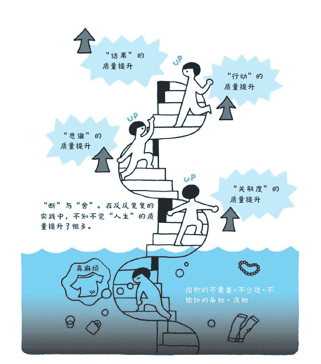

### 清除闭塞感，疏通人生路

当我们的“人生质量”提升后，日常生活中的小变化真是不胜枚举。下面是参加断舍离大会的一些学员的例子。

清理掉桌子上不需要·不合适·不愉快的杂物后，找东西也不用花太多时间和精力，工作也能顺利开展。

清理了电脑桌面的图标，工作起来更方便了。后来养成了整理桌面的小习惯。

利用“7·5·1 法”，缩减杂物量，自觉地早早起床，工作效率也提升了，可以早早回家享受自己的小世界。

减少厨房一次性用品数量，逐步学会收拾厨房，享受做饭的过程。

利用“one touch 法”，取东西的动作只分为两步，而且做饭时会尝试一两道新料理。

只入手特别上心的衣服，不用辛苦地多次熨烫。

团好底裤或袜子放进宽松的收纳箱里，叠放衣物时很享受。

随着生活上这些令人开心的小变化不断累积，闭塞的人生逐渐疏通，恢复流动，也会逐步带来其他的变化。

举个例子：

和之前的恋人感情暧昧，纠缠了多年。学习了“1 out 1 in 法”，痛快地分手，遇见了新的恋情。

总是发愁孩子宅在家不出门，后来扔掉了象征着“对过去的执念”的大量童书，改善了和孩子的关系，孩子也不再宅在家里不出门了。

在重新正视“必要·合适·愉快”的杂物取舍法则的过程中，开始怀疑自己的婚姻只不过是虚有其表，摆脱常年的“婚内分居”迅速离婚了。

烘焙制作、练习瑜伽、学习芳香疗法、跑马拉松等，很多都是心血来潮又半途而废。当把这些所谓的兴趣当成“忘却物”扔到脑后时，发现了自己内心真正想做的事情。现在一边工作一边拼命学习，准备创业。

这种案例不胜枚举。很多人因为断舍离，正视现实，改变了犹犹豫豫、不敢直面问题、总是想逃避的毛病，开启了新的人生。

对一个人来说，工作、合作伙伴、家庭关系具有重大的人生意义，因此，“离婚”“辞职”这些词汇总是带有消极色彩。然而，不管是离婚还是辞职，都是认真整理自己的情感、坦然面对自己的真心后做出的决定。这样才能开启真正的人生。

就这样，并不知道触动了什么样的人生机关，“断舍离后，结婚了”“生了孩子”等，人生在各种机缘巧合下出现了各种意想不到的事情。这些人生事件已经超越了断舍离本身，是唯有那些实践过断舍离的人才能体味到的不可思议的经历。

“有舍，便有得”，是千真万确的。

断舍离，人生新陈代谢的催化剂。

#### 体验谈 8　放手风水开运的摆件后，人际关系得以改善

顺子小姐（匿名）正在逐步实践断舍离。

但不知为何，房间里面摆放的各种风水开运摆件却没有登上她的断舍离清单。当她开始强烈意识到“必须直面多余的物品”后，才注意到自己家里“招财的贝壳和黄水晶”“改善人际关系的松鼠造型”“开运的龙形摆件”等各种各样的小物件叮叮当当地听起来毫不和谐。

“这些东西摆在一起，打扫起来又不方便，走路也碍事，真不知道为什么还留这些东西”，想来想去，顺子小姐突然意识到：“难道是自己固执地认为不依靠别人，自己无法抓住机遇、抓住运气吗？”为什么她会这么想当然呢？答案就藏在顺子小姐的童年时代。小时候的顺子小姐渴望爱，渴望关心，渴望无忧无虑的生活。可是，把家抛在脑后的父亲、对她严厉苛责的继母，种种因素让她和朋友的家庭形成强烈反差，生活并不如意。这样的童年时代让顺子小姐极为困扰，她总是处于“被动”和“放弃”的人际圈。

她现在已经结婚，表面上开始了幸福的家庭生活，但是从家里面各种各样数量惊人的风水开运的摆件可以看出，她的内心深处依然恐惧着财务不自由，依然苦恼着人际关系不和谐，依然缺少对自我的肯定。

当顺子小姐意识到这一点后，果断地开始对这些摆件进行断舍离。清理完这些东西后，她忘不了那种难以言表的清爽感和对自己果断行动的自豪感。

不久之后，发生了一连串不可思议的事。她去见了 15 年未曾谋面的住在养老院的继母，那位自己以前刻意疏远、“绝不会原谅”的继母。当她紧紧地拥抱着对自己严苛的继母时，心里某些僵硬的冰块融化成泪水流下来了——“她并不是不爱我，而是作为一个继母用尽全身力气地养育我教导我”。之后她又去墓地看望了父亲。以前的自己从未想过能有如今这般安稳平静的心境。

同时，她也逐渐地能够放松心态和同事打交道，职场的人际关系也得以改善。

顺子小姐通过对风水摆件的断舍离，意识到自己的苦恼和焦躁都源于缺少对自我的肯定，断然放手曾经折磨自己的执念，迎来了新的心境和人生。

### 引导现在的自己做出最恰当的选择与决断

距离促使我对壁橱彻底断舍离的契机出现的那一天已经过去 10 年了，那一天我加深了对断舍离的理解。那天，我平生第一次踏入真言密教的圣地——高野山。

从石川县的家里，换乘了电车和缆车终于到达了山顶，夜宿的寺院寝房没有任何多余的杂物，只有草席和被褥，而寺庙斋饭的清香带着深意已经沁入五脏六腑。

当我一个人坐在走廊时，看见年轻的修行僧人正在清扫寺院，心中莫名地涌出一种感觉：如果用“场”“空间”“生活”来表现断舍离的话，那么大概是这样的：

高野山为“场”

寺庙寝房为“空间”

修行僧人为“生活”

当我想到这一点时，就想立刻飞奔回家，想在自己家里重现这种感觉。

其实，重现类似高野山上感受到的令人神清气爽的“场”和“空间”，并不需要过多的设备和昂贵的家装，只需要有“空间”的“留白”以及不由自主想深呼吸的“空气感”就足够了。

千真万确。

在高野山上的那段体验，让我深刻感受到“空间”原本的力量。断舍离的结构也逐渐清晰，这是一段无比宝贵的经历。

至于从高野山回来之后，断舍离的速度急剧提高更不用说了。

当时，我自认为已经透彻理解减少物量的重要性了，现在想来自己不过仅仅从“舍弃或不舍弃”的物量角度看事物。从这个角度看问题并非不重要，但也只是停留在表面的理解上。

因为之前从未遇见过像高野山这样的“断舍离表现场”。再加上，高野山是信仰之山，有 1200 多年神圣历史时光的沉淀，是绝好的“断舍离的终极范本”。在这种神圣的山上，能感受到自己的身体、心灵逐渐在巨大的空间磁场中被荡涤、被冲刷。

“明白了，这就是我想要的空间！”

高野山的一段体验让我刷新了对断舍离的理解。

断舍离，是清爽流畅感的“场”“空间”“时间”的创造方法。

它不是“要·不要”的短视视点，而是：

我想要什么样的状态？

空间想要什么样的状态？

从俯瞰全局·整体的角度来理解断舍离。

它不仅仅只是“收拾东西”。

当然，即便不去高野山，也能运用自己的思维·感觉·感受，在坚持断舍离的过程中，逐渐适应并掌握这种观点。

比如说，在做书架的收纳时，当摆放得散漫杂乱的书籍逐渐减少，书架就转变成整齐洁净的空间。抱着减少书籍量的初衷整理书架，逐渐地变成了“书籍量减少到一定程度能够使书架恢复原本的功能，并且看起来整齐干净”这种感觉。这是被杂物掠夺的空间重新回到自己身边的感觉，也是一种非知识量或偏差值（日本对于学生智能、学力的一项计算公式值）或 IQ 能够测试的人的智慧。

我把这种感觉称为“俯瞰力”，掌握这种俯瞰力后，我们的思维精度会提高，我们会做出对现在的自己最恰当合适的选择和决断。

“俯瞰力”到底是怎样的力量呢？

那位备受瞩目的日本史上最年少职业将棋（日本象棋）棋手藤井聪太幼年时期常常喜爱玩瑞士弹珠积木——组合积木，搭建通道，让弹珠能从上到下顺利滑动到目标地的益智玩具——一时间成为人们热议的话题。

他常常仅用几分钟就能完成连大人都难解的积木组合，这让他的妈妈非常吃惊。

这个玩具中，积木内侧设有隐藏的通路，需要不断地尝试如何组合才能让弹珠顺利通过。在玩积木的过程中逐步培养出的“空间认识能力”，对提升将棋能力，乃至战略性思维都有很大影响。

空间认识能力这一概念，比较容易理解的就是足球 MF（中场队员）所扮演的角色。MF 需要在足球场上，有从上空俯瞰整个球场的能力，迅速判断该把球传给哪个队员。

了解了球场的整体现状后，运动员需要迅速判断该以多大的力量把球传到哪个方向，瞬间做出有助进球的动作。

虽说职业棋手和职业球员必需的“空间认识能力”并不能和断舍离的“俯瞰力”直接画等号，但是如果能通过对居所整体的断舍离，将思维方式从物品轴转化成空间轴，掌握俯瞰式思维方式，那我们就会成为“人生达人”：

与地位、名誉、学历、财力无关的人生达人之路

了解自己，喜欢自己

思维·感觉·感知变得敏锐、轻盈、具有洞察力，获得“生命的悠然自得”

帮助处理自己与物品的关联度，创造出空间感的就是这种“俯瞰力”。

人世烦事无尽，需要我们面对和解决的问题一个接着一个。断舍离面对问题时，首先从认识现状开始。

通过对杂物的选择取舍，了解自身，获得对自我的肯定，从物品轴思维转化为空间轴思维。在这一过程中，我们就获得了果断勇敢面对问题、处置问题而不是被其捉弄的能力。

不仅如此，遇到任何事情，并不是仅仅归结于“幸运或不幸”，应该将其作为某种体验，能以一种从容豁达的真我视角来看待人生各种各样的不同境遇。

“杂物整理”与“空间创造”的不同

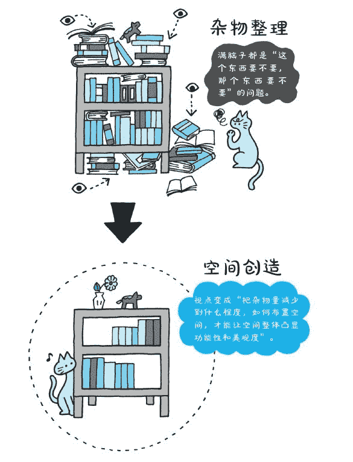

### “身体、心灵、生命”机制的回归

“局部即整体，整体即局部”是日本的一种身体观。

有一种刺激脚掌、手掌、耳朵等部位的医学疗法被称为反射疗法（reflexology）。比如说刺激脚掌的某个特殊部位，来治疗相对应的身体的其他部位。技法精湛、眼光锐利的医生只需要查看和触摸患者的脚掌部位，就能够明白他的全身状况。

同样，数学中的几何学也有类似的观点。比如说，几何学将自然界中树叶叶脉与整个树木的“形”相似的现象称为“分形（fractal）自相似性”。

断舍离引入“局部即整体，整体即局部”“分形”的概念，认为：

“一看居所，就知道住这里的人的内心和人际关系的状况。”

“一看钱包，就知道这个人的居所状况。”

这两句话是在我看过已经数不清的居所状况后得出的小结论，这不是我自己的特异功能。

在日常生活中，我们总是从对方若无其事的表情和说话的语气、语感中揣测这个人的内心活动。也就是说，这些地方有着本人内心的投射。在断舍离中，“局部即整体”这个概念与“空间”是相重叠的。

我曾在某次讨论会上提出一个问题：我们的身体，这个容器里面到底装着什么东西？回答各种各样，比如说，肌肉、肠胃等。确实这些器官是不可或缺的，但是仅仅装在身体里，不工作的话也无济于事。因此，真正重要的“生存机制”装在身体容器里。不，甚至可以说是栖居在这个容器里。简单来说，那就是“生命”。

“体”这个字的词源是“空”“壳”，也就是身体原本就是指容器的意思。

那么我们的居所是何种容器呢？

居所就是身体的容器，而身体则是生命的栖居之处，因此，居所里放置的应该是能让生命健康成长的东西。反过来说，必须把不能促进生命健康成长的东西“排”出去。

“身体容器”里装着“心灵”，也能称为“情感”。

那么，“心灵”是容器的话，里面装着的是“意识”。意识也分好坏，是让自己兴奋的意识还是让自己沮丧的意识，都对自我的肯定有很大影响。这种影响表现在我们的身体上，也反映在我们的居所里。这种“局部即整体”的机制就犹如俄罗斯套娃一般连环嵌套。

但是，“心灵”是看不见的，很难理解，“身体”虽可见，但是无法见其内容，也无法看到“生命”。

断舍离最核心的思想就是“新陈代谢”。我们的居住空间处于代谢（交换）的状态是最理想的，因此，不断地进行“使用所有物，清除无用之物”的循环，才能让居所充满流动感和活力。

下页这幅图着重在说“身体容器”，其实也适用于“心灵容器”。假如形形色色的思绪和复杂多样的情感不断地累积，却毫无发泄的出口，不停地思考却不去表现或者实践的话，无论是感情还是思考都会逐渐懈怠和钝化。

“身体”“心灵”“居所”都具有入口和出口，进出口以“流动=新陈代谢”相连接。三者中最容易理解的是自己亲手进行新陈代谢的“居所空间”。

“身体”“心灵”“生命”既然处于居所空间内部，那么“居所空间”和三者都有直接关系。正因为如此，不需要·不合适·不愉快的杂物的清理有助于促进三者“空间”恢复原有机能。

“心灵·身体·居所”的嵌套结构

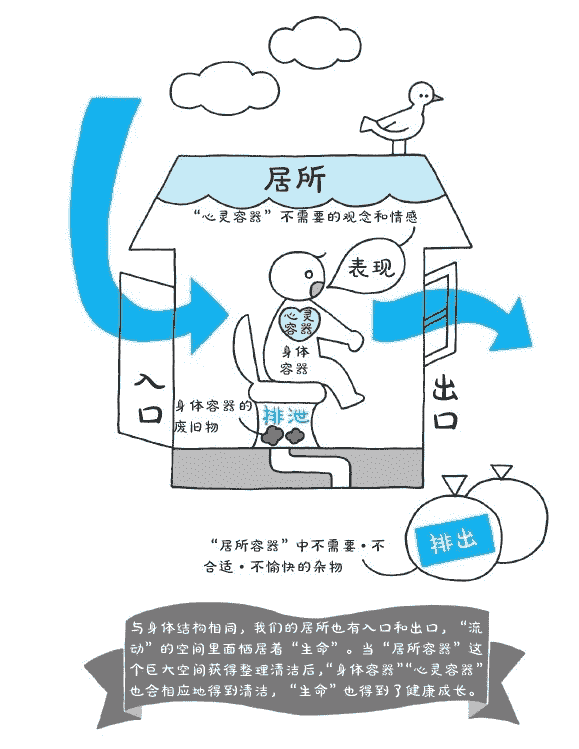

其实，构成这种结构的东西，就是我们身处的这个世界里所有的一切所见之物。在某种意义上，我们自己的人生也可以当作一种“空间”。

人生的入口即呱呱坠地，出口即寿终正寝。而人生中的各种事情、各种邂逅、各种离别，又或者是学校、公司、自治体等都属于出入口之间的流动的空间。假如把这些都理解成有机生命的日常代谢通道，那么这些人·事·物所应有的理想状态，我想也是不言自明的。

### 沟通力显著提升

时间、空间、手间……越了解断舍离，就越会碰到这个“间”字。那么这个“间”字里到底含有什么讯息呢？

要理解这个字，从人际关系方面解释会更容易。

如果想保持良好的人际关系，就需要有“间”意识。

人际关系中的“间”可以从“空间的间=距离”“时间的间=频率”角度理解，也可以理解为空间和时间的“密度”。

人际关系无论是双方距离走得太近还是太远，接触频率太高或是太低，都会出现问题。

距离太近，会觉得烦躁；太远，会感到孤单；接触频率太高，会给别人带来麻烦；太低则会产生被抛弃感。

曾经听过这样一个故事。

有一个从幼年期到 18 岁左右总为特应性皮炎而烦恼的女士，她尝试过很多方法，除了吃西药，还有试过中药、针灸、整体术等各种替代疗法，但是病症并没有什么改观。她就这样从小学、初中、高中毕业，离开了父母进入了大学。她的父母在她的皮肤炎上花了相当多的时间、精力和财力。

但是让人意想不到的是，她离开父母之后，皮肤炎症竟然很快不治而愈了。

特应性皮炎是一种原因尚不确定的皮肤病，并没有什么明确的治疗方法。特应性的词源本身来自表示“奇妙的、不可思议的”希腊词。

并非所有的特应性皮炎病人都能像她这样自愈，但是尝试过各种疗法的她，在离开父母之后确实痊愈了。

另外，她和父母的关系绝不是糟糕，她也非常尊重认真、严厉而慈爱的父母。

她极为感激父母为她的病东奔西走，但潜意识隐隐约约地有一种沉重感。不过这种反映父母和她之间关系“机能不全”的沉重感并没有上升到表层意识，而是诉诸到皮肤上来了。

换句话说，越是亲密的关系，双方越要有意识地保持恰当的时间和空间的密度。是走近一点好，还是离远一点好，每个人都有各自要把握的“密度”，而且这种“度”也是会发生变化的。现在的她依然和父母保持着适当的距离和见面频率。

像上面这个案例一样，空间和时间的密度对人际关系有着很大的影响。父母子女、丈夫妻子、兄弟姐妹、上司下属……各种关系也适用同样的道理，不过，保持恰当的“密度”并非口头说的这么简单。在具体的场合、具体的时间，理解恰当的“间”，保持恰当的密度，这种能力是极难达到的。很多人像从前的她一样，一直处在不良的“间”的人际关系中，没有究明其原因，稀里糊涂地走过来了。

正因为如此，利用“间”意识，才能真正感受到自己沟通能力的明显提升。

“人”在日语中被译为“人間”，其中的“間”即为简体字的“间”，换句话说，单单一个“人”字，并不完整，有了“间”之后，才真正成为“人”。因此，就需要我们注意“间”有没有正常工作。如果这种“间”意识在日常生活中成为自然而然的下意识，那么我们就能与所有的人·事·物等对象建立机能性的关系。

要理解“间”意识，我们可以学习那些会说话的人。会说话会沟通的人无一例外都是善于利用“间”技法。这种被称为“话艺”的技能，被活跃在文艺界的艺人提高到了艺术层面。

曾经听过一位在当代实力、人气首屈一指的落语（日本传统曲艺形式之一）大家的某则逸事。

在某次落语演出上半场结束后，观众们被预告“休息之后，马上开始下半场”。当下半场开始后，会场上鸦雀无声，台下的观众等待着落语师开口，他们屏气凝神，一副不要错过一丁点表演的架势。

察觉到会场异样的紧张气氛后，这位落语大师轻轻抛出一句：

“大伙儿吹口气也没事。”

“砰！”一句话戳破了紧张的空气，会场“哗啦哗啦”笑声鼎沸。趁着观众松了一口气，大师迅速进入下半场正题了。

这种一张一弛、一松一紧，就是艺术的间隔、时机。从这则逸事中，我们可以感受到台下观众非常欢迎和欣赏这位落语大师即席制造的会场氛围。

落语除了妙趣横生的语言之外，还能享受落语家利用“间”所创造的现场氛围。其实在所有的艺能、艺术上，“间”都扮演着极为重要的角色。

这是艺术世界的小故事。对于普通人来说，想要获得悠然自得的生活，就要让生活与“间隔”“时机”实现无缝连接。

有意识地利用时间·空间·手间（精力）的“间”意识，随机应变，因地制宜，人际关系机能才能更顺畅地发挥作用，与他人的沟通才能更有效率，人生才能更上一层楼。

想必您已经明白了“间”意识。

在日常生活中掌握“间”意识的方法就是“断舍离”中宽松有度的空间制造。也就是说，利用看得见的物品，俯瞰空间整体，重新恢复居所的“间”功能。

具体的操作，可以参考“7·5·1 法则”，将物量压缩至适合空间的量，为空间制造恰当的“宽松度”，也就是“间”。

在俯瞰空间时，我们可以自问自答：

有没有硬塞太多东西，以至于缺少“间”？

尝试减少杂物量，腾出“间”之后效果如何？

筛选东西，为其分配“间”之后心情会如何？

尝试过给予居所“间”之后，我们一定会感受到前所未有的清爽、通畅，以及呼吸的自由感。虽然这只是一种推测，但是能够从思维·感觉·感受三方面把握空间的整体意识，之后就能自然而然地思考如何建立适合自己的“间”。

还是和之前落语大师的逸事相似，有一位广播作家曾说过：“那些在逗乐艺术上获得大成就的人，家里大多数都整洁干净，并且摆的东西比较少。”

逗乐艺术需要有敏锐的思维和清晰的思路。它之所以特别要求能够对事例信手拈来的构想力和即兴表现能力，原因就在于在梳理记忆的同时，“间”或者“留白”中寄居有“启示”以及“灵感”。

这些解释可能已经超越了理论逻辑，不过，居所的状态确实会间接投射在本人的文艺表现上。

断舍离也是“间”的创造。

在断舍离的不断实践中，创造出时间的“间”、言语的“间”、沟通的“间”，让人们在当时·当地建立起对人际关系恰当的“间”。

前面所说的“人生之路的达人”就是“间”之达人。断舍离，可以让我们在日常生活中边享受边掌握这种“间”之术。

### 比想象更怡然的人生就在不远处

物质的最小单位为“基本粒子”。近几年据说逐渐证明存在有空间的最小单位——基本领域。有专家称，基本领域的集合体将产生超越一般物理规律的存在，比如说在基本领域的空间施加“爱”“祈愿”等意识，则可以获得巨大的能量。

作为外行，更复杂的解释我无法做出说明，但是从“间”被表现为“空间”（space=宇宙）并非是偶然或巧合。“空”的地方正隐藏着非常重要的东西。

“空”并不意味着空洞、空无一物。

这些“空”地方隐藏着那些安抚我们的内心、激励我们、给我们带来畅快心情、让我们与世界建立良好关系的事物，正因为这些事物，才让“间”充满了温暖。

虽然我们从“断舍离就是脱离执念”的理解开始的，但到现在，我要把断舍离解释为“锤炼执念心的方法”，因为，“脱离执念”的出发点本身就是顽固的执念。

断舍离保留的、获得的人·事·物，对我们来说都是非常珍贵、非常喜爱的才被筛选出来的。这就是锤炼执念心的结果。

我也是在反反复复的失败和尝试中走上了断舍离的路，这条路也是我自己的人生成功进行巨大变革的路。而我身边也有很多人在坚持着断舍离，完成崭新的转身。为何缩减物量，整备空间会具有如此大的改变人生轨道的力量呢？我想，可以用一句话总结：

断舍离，让人与空间力为伍，

比想象更怡然的人生就在不远处。

请你和我一起用断舍离这件武器，重新夺回自由自在的生命，开启真正属于自己的愉快人生吧。

## 第四章　断舍离，怡然生活

“活在当下”“结果反馈到自身”“给予”镌刻心中，

不断地深入断舍离，

找回自由呼吸的美好空间，

怡然自得地享受人生。

### 没有“出”，则难获自在

又是老生常谈，断舍离即“出”。

如果只是垃圾·废品，“扔掉”即可。如果是与自己关联已经终结的杂物或是失去效用的杂物，可以扔掉，或循环利用，以合适的方法“排出去”。

只进不出的空间，会让我们的生活停滞不前。

关于 2011 年的东日本大地震想必大家记忆犹新，据说当时，很多人从灾区被救援回来后，却在避难所离开人世了。在参加日本内阁府的“‘生活品质’提升研讨会”时，听说这种现象与“排泄”有很大关系。

避难所会提供盒饭等食物赈灾，所以即便存在很多不便之处，也算是能保证灾民的营养。但是，据说因为厕所的数量不够，很多中老年人忍着不上厕所，逐渐影响身体，抵抗力变弱。而且厕所也很容易堵塞，很多人想去又去不了，所以上厕所这件事对灾民的身心有很大影响。由此看来，排泄对人是件大事，也是人的一个盲点。

当发生大的自然灾害时，我们马上想到要给灾区“送吃的喝的”，很少人会想到“送厕所”。这也是因为我们常常把注意力集中在“如何获取东西”上。

我们自呱呱落地到长大成人，一直被各种各样“不准排出”的要求所束缚。曾经听过一句话——只有人和宠物会便秘。与野生动物不同，只有人和宠物是不能随心所欲、随时随地排泄的。我们常常忍耐生理需求，逐渐被动地接纳这种习惯，形成一种自觉的潜意识。

同样，我们也不能随时随地、随心所欲地扔垃圾，必须要遵守垃圾回收时间表和垃圾分类的规定，即便是扔无用的东西，也得在限制之内。

因此，夸张点说，现在的情况是“我们总把衣柜、壁橱、天花板顶、地板下等都当作了垃圾放置场”。

也就是说，住所出现“排泄”阻塞后，住在这里的人也变得散漫、没有精神，总是提不起劲儿投入生活。结果，生活变得越发无聊和枯燥。如果到这种地步，已经谈不上“怡然自得的生活”了，并不是“收拾收拾家务”就能解决的了。

除了杂物，“排出”的“出”对感情生活也很重要。

两者看起来不同，其实本质是相通的。下面是一位断舍离实践者的故事。

#### 体验谈 9　表达出自己的感情，才不会被他人的观念所左右

断舍离大会上有各种各样烦恼自己“无法放手杂物”的人前来参加，其中有一位叫作早智（匿名）的女士，从她灰暗的表情中可以看出她内心非常苦恼。

“我很痛苦，无法放手已经走了的儿子的遗物，大块头的东西已经处理了，就是无法再继续处理其他的了。我真的不能这么一直难受下去，想尽快地处理掉，往前走。”

但是我听出她话里的不自然，便问道：“‘不能这么一直难受下去’是你自己的想法吗？”早智女士摇摇头。她说这是周围人劝她的话，而她自己还沉浸在悲伤中。

当我说出“不要压抑自己的感情，你可以痛痛快快地哭出来”后，她甚至有些感激涕零。早智女士之所以为自己无法前进而痛苦的原因不在于她无法处理孩子的遗物，而是没有允许自己释放感情。听到那些充满善意的劝诱，她无意识中全盘接受，才把自己真正的情绪闷在了心中。

我告诉早智女士，自身要尤为注重自己最真实的感情，而不是受其他人的观点所影响。

首先就是打开盖子，让感情发泄出去。无论花多长时间也没关系，只有把感情全部释放出去，才能迈出真正的第一步。

### 获得主体性的生活方式

“很多罪犯的家或是出现犯罪的家，总是乱七八糟地扔着很多东西，生活很颓废。”

曾经听警界人士和媒体记者这么亲口说过。

我认为这种现象其实是某种“原因与结果”的具象化，在断舍离上称为“相”。

一般说到“相”，人们会立刻想起有代表性的“手相”“面相”，“相”也指从“看得见的世界”的相关信息来判断其背后“看不见的世界”的状况。因此，在“犯罪”上，“乌七八糟颓废不堪的居所环境”则是犯罪者的“相”的外在表现。人们不能轻易地改变手相或者面相，但是我们居所的“相”是可以改变的。

我在讨论会上经常引用德国诗人歌德的名言：

“人最大的罪就是不快活。”

犯罪的出现可能是有其直接原因或导火索的，但肯定是不快活达到一定程度的结果。催生犯罪者的不快活的原因很可能有“乌七八糟颓废不堪的居所环境”的因素。

我们需要强烈认识到“居住环境自带的强大能量”，正如我再三强调“改善居住环境，最重要的就是‘排出’”。

那么，有意识地“排出”后，到底会给我们的生活带来多大变化呢？

生活产生“流动感”

人生出现新陈代谢

明白了舍弃的辛苦，就更慎重地对待获取

有意识地入手对自己发挥更好机能的东西

不久，物品量压缩成适度，生活范畴也得到最优化

因此，很多人因断舍离而“成功减肥”，还有的人“开始存下钱”了，这也是“饮食”“财务”上意识改革的表现。

相反，有些人“想要提高生活品质，把钱花在了家装上”。

改善与杂物的关系的同时，我们的内心也在发生崭新的变化。

之前总是马马虎虎地过日子，而现在在摄取东西时，也能同时从时间轴（现在）与重要度轴（自己）两方面考虑问题，掌握了如何保持空间的平衡感和关系度的方法，把“此时·此地·自己”的思维方式化为己有。

换句话说，逐渐形成了自己的主体性的生活方式。

### 抛开家庭关系的烦恼

开始实践断舍离后，最初碰到的一个大难题就是与家人、同居人的关系。当一个人看自己的东西的视角改变后，别人的东西在自己眼中也会变得很碍眼。

很多人看到别人的东西觉得碍眼，心头直冒火“我这么辛苦地收拾东西，居然成了这副样子”“为什么要把这些破烂货带回家”！

人也是动物，两个以上的人在同一空间内的话，就会相互划定势力范围。这种势力范围就是每个人天生具有的“认可欲求”——要承认我、要明白我——的表现。与撒尿来划定范围的狗不同，人是用物品来圈定的。这种范围欲求越不被满足，达到一定程度就会转化为行动表露出来。

另外，相互体谅的意识越是薄弱，就越觉得对方的东西是破烂、是垃圾，越碍眼。导致不留神就脱口而出：“快把你这破烂扔掉！”甚至连生气都懒得生气，直接随手处理掉，惹怒对方，引起争吵。

在和别人同住的居所实践断舍离时，尤其要注意不管自己多介意别人的东西，也不要随意地处置。

即使是家人，被人随意处置东西就意味着“原本属于自己的选择和决断的领域被人侵犯了”。不仅是这些东西，别人人生的所有选择·决断应该属于他自己。

当我们觉得对方的杂物看起来是垃圾或者废品时，就要认真地承认他的“认可欲求”。很多时候展现出自己“想要理解对方”的姿态，反而能让“圈地”行为稳定下来。

但是，现实大部分情况是“越是介意别人东西的人，其实越没有充分收拾自己的东西”。

这些人带着被害者意识总把责任推向他人，长此以往，就会形成根深蒂固的消极情感。

还有“他为什么不给我收拾收拾”——依赖别人的消极态度也只会增加自己和他人的压力，丝毫没有让状况改善。

那么，到底应该怎么做才好呢？这里有个诀窍。

自己心情愉快地对自己的东西进行断舍离。“断舍离，好厉害！”“一旦入道，心里神清气爽！”……当实践断舍离时的愉快心情表达出来时，对方也会受到感染，消解不愉快。“眼见为实”，这种享受断舍离的样子才具有说服力。

另外，说话也要讲究方式，比如说，“快扔掉这个垃圾”就没有“你挑挑自己喜欢的东西吧”中听。我们常常因为缺少相互体谅、相互尊重价值观的习惯，而把自己的想法强加在别人头上。因此，当我们想责备别人时，可以试着考虑下别人做出让自己不满行为的原因，同时尽快抛掉“希望对方做出某些行为”的期待。

这并不是简单的事，不过，只需要有意识地反省“糟啦，我是不是对他期待过高了？！”，就会自然地产生体谅他人的想法。

其实，人的烦恼大部分来自人际关系的问题，这些烦恼绝大部分都是源于“单方面的期待过高”——过多地给对方施加自己的价值观。这种过度施压总跟随着关心和爱护一同出现，因此，越是亲密的家人或恋人越容易出现这种问题。

这种情感处于看不见的心灵领域，再怎么提醒，这种情感也并非能容易抛开的。因此，要通过杂物的断舍离，一点点地积累经验，学会抛开期待和执念。

当对别人抱有期待，或是要责备别人时，要立刻意识到“首先自己要做好！”，主动地开始行动。在不断地体验、积累经验的过程中，逐步掌握好如何与人保持恰当的距离，学会抛开人际关系的烦恼。

在这里介绍一个案例。

#### 体验谈 10　当我抛开对他的期待后，他也开始改变了

美香女士（匿名）几年来一直坚持断舍离，体会到精神上的解放感，但是她的烦恼来自有收藏癖好的先生。虽然她多次苦口婆心地告诉先生断舍离是多么有趣又有意义的整理术，但是丈夫总是丝毫不感兴趣。

他爱好收藏，不断地购买、囤积。东西多得书房也盛不下，还租借仓库来放。而他收藏的东西有 17 台电子管收音机、20 幅画作、化石块、陨石块、一大衣柜的硬币、100 套古典 CD 和书籍全集套装、300 册藏书。最震惊的是仓库里还有未开封的纸箱子。小心地打开一看，居然是在网店拍回来的绳文陶器的碎片！堆了整整两大箱子。

美香女士觉得再这么下去自己家就变成大魔窟了。与忧心忡忡的她相反，她的先生根本就听不进去劝阻，而且愈加顽固起来了。

有一天，当她目送先生出勤上班时，望着先生逐渐缩小的背影，她突然心头有些难过。与工作上越来越大的责任相反，先生的脸色越来越疲惫。“他到底觉得自己家里住得舒服不舒服啊？”美香女士去看了书房一眼，东西多得都溢出来了，连地板都看不见了。整个房间显得乱七八糟，昏暗不堪。

第二天，她就这么对先生说道：“让我收拾一下你的房间吧，我会让书房变成让人舒舒服服的新书房。”

她并没有说“赶快给我扔掉”，而是换成“先把东西放在一个临时保管地吧”。

首先，美香先把东西分类。先生最喜欢的电子管收音机放在墙内收纳柜里，美观漂亮地展示出来。化石和陨石是每个月放在玄关处进行展示。

看到自己的藏品能装饰在玄关，先生心里美滋滋的。以前总是一副“我绝不扔这些宝贝”的顽固态度，却被认真保管那些没展示的东西的妻子的背影所融化，脱口而出“也不需要这么多东西”。最后，先生把贵重的化石和电子管收音机捐给了乡土博物馆，东西的量大幅度减少了。

这就像北风和太阳谁能最快让人脱下衣服的故事一样。美香女士并没有强硬地处理先生的东西，而是让丈夫感受到什么叫舒适的空间，让他主动行动。他们只做了一个约定——一年之后确认保管的收藏品的状况。在这个基础上，两人又一起商量了下那些未开封的东西以后怎么处置。

现在，先生也不像以前那么爱买东西了，而美香女士也摆脱了以前“让别人去收拾”的强硬观念。

### 遵守三大原则，收获怡然人生

在翻阅那些讲成功学的商业书籍或励志书籍时，我发现一个特征——每一本书都是长篇大论围绕着下面的三大原则来展开阐述的。

活在当下

结果反馈到自身

给予

这里的“给予”相当于断舍离的“舍”。在前面介绍“舍”与“弃”的异同时，我说过“舍”有“施与”的意思，更抽象一点就是“出”的意思。成功，乍一听像是不由分说地填充自己全部的贪欲，但其实是正相反的，只有不断地放手、舍弃、施与他人，才能形成流动的循环。

“活在当下”“结果反馈到自身”的思维和“时间轴为现在”“重要度轴为自己”的思维是相通的。对杂物挑选取舍的两个标准与开拓人生的方法两者相通并非偶然。

我们每天都在做着大大小小的选择和决断，也在不断地入手大大小小的东西。而这选择、决断换个角度看就是“时间”和“精力”，而入手物件就是入手了杂物附带的“情感”。也就是说，这些东西象征着“时间”“精力”和“情感”。因此，利用断舍离，只保留自己喜爱的物品其实就是提升花费的时间、精力的质量。

“现在”的“自己”压缩物量，只入手保留与自己关联度较高的物品也表现出“心灵世界与物质世界的磨合”。我们来试着讨论一下这个原因。

物品，即“有具体形态的不会移动的存在=物体”，没有外力作用，它们会一直停在某处不动。但是我们的心灵总是在瞬间回到过去——那时候真好啊，转瞬间又飞到未来——总有一天，我会……它们瞬息万变，行踪不定。

不过虽然没有具体形态，心灵却以我们入手的物件的集合为形式，在我们的身边留下了情感痕迹。比如说那些象征着不安、因担忧未来而囤积的过多消耗品，那些象征着过去辉煌和荣光的纪念品。

当我们对这些“痕迹”司空见惯，当“痕迹”融入日常生活时，我们就过多地忽略了“现在”。只要这些情感的物化物在我们身边一天，它们就会作用到我们的意识和无意识一天，逐渐阻碍着我们去珍惜“现在”。

正因为如此，当我们把杂物以“现在”“我”“高关联度”的维度进行压缩，我们就能“活在当下”，逐步向成功的三原则靠拢。但是，不同的人有不同的成功价值观。有钱就是成功还是有名就是成功，每个人有自己的定义。不过，不同的成功人士共通的一点就是拥有“人际关系”财富。我自己也深刻感受到断舍离给我带来的巨大的人际关系财富的积累。

心理上最大的变化则是能够以“坦然和真诚”面对自我和他人。这是一件说起来容易做起来困难的事情。

而清理居所中摆得乱七八糟的“不需要·不合适·不愉快”的杂物，只入手和保留那些“必要·合适·愉快”的东西正是“坦然和真诚”的体现。总是保持“无论向谁展示，无论被谁看见都没关系”的居家状态要比想象中更能促进自信心的建立。

那些来家里做客的人常常一脸惊讶“真的是哪个柜子都这么干净整洁呀”。虽然作为断舍离的传播者，这些情况对我来说是极为平常的事情，但实际上做起来并不是那么容易。

别的不说，最重要的是，断舍离并不是花时间费精力的家务劳动，而是充满“愉快感”的居所保养方法、让人生获得自在·自由的护理工具。因此对我来说，断舍离是极为平常的事。

坦然面对自我的思维·感觉·感受，就不会出现表里不一的自己，也是开诚布公地展示自己。也就是说，自然地袒露自己的内心，也逐渐地消除了对方的戒备心，也加速了自己碰见“机缘”的速度。

“机缘”到底是什么呢？这个词让人想到一个词——啐啄同机。

雏鸡欲出时以嘴吮卵壳声为“啐”，母鸡欲使小鸡出壳而吃壳为“啄”，只有“啐”与“啄”同步进行时，雏鸡才能破壳而出。

从原意引申出来的“啐啄”指的是弟子欲悟道，师父倾囊相授，引导其获得开悟的境界。如果我是雏鸡，那么人生中遇到各种大大小小的机缘就是母鸡。当我欲破壳而出时，因为绝妙的机缘，获得了外部的协助。

换言之，在断舍离的指导下，实践“活在当下”“结果反馈到自身”“给予”成功三原则的过程中，自我内部的变化与外部的协助两相吻合的机缘会越来越多。

在重视“啐啄同机”的整体世界中，这种两相吻合也被叫作“机·度·间”。

机　机会、机缘

度　程度、力度

间　间隔、节奏感

技艺精湛的整体师能够准确地抓住对象身体所需要的“机·度·间”。

我利用断舍离，也在迅速地提高自己抓住人生“机·度·间”的准确度。这种准确度就像是内部世界和外部世界各自的齿轮“咔嚓”一声咬合住一般。

这种大大小小的“咔嚓”声带来的珍贵奇妙的感觉，我在人生中遇见过无数次，其中印象深刻的一次发生在几年前的某次研修旅行上。

某次，坐飞机去海外参加研修，因为各种碰巧，我没有坐上自己预约的位置，被升到了头等舱。

那是我第一次坐头等舱。最巧合的是我的邻座居然是自己非常尊敬、憧憬多年的一位实业家。

在钻研磨炼断舍离的过程中，我也多次参加他的讲座和学习会，但是从没有机会和他这么面对面一对一地直接对话。对话虽然并没有什么大道理，但是在飞机上的谈话让我感慨颇深。

这次偶然的机缘让我感到“自己现在的工作并没有问题”，我内心获得了极大的鼓舞，这种感受直到现在记忆犹新。

这里还有一个案例。是一位家庭主妇在默默实践断舍离的过程中，同我一样出现了“啐啄同机”的、意想不到的事件。很多人都说因为那次事件，她的人生发生了戏剧性的改变。

#### 体验谈 11　断舍离后，我竟有了自己梦寐以求的家

知华女士（匿名）特别喜欢《家庭主妇》杂志，总是从头到尾一页一页地反复看。她自从成了家庭主妇以后，就绞尽脑汁地在各个方面厉行节约，目的是未来买到一套属于自己的房子。

知华女士总是花大量的时间和精力囤积便宜的东西，比如“今天价格打七折，干脆全买了”“能多积分，尽量下雨天去买东西”等一些“现在用不上，以后总会用上的某些东西”。因为，她总觉得能省钱就是“好主妇”的标准之一。

遇到断舍离后，知华女士有种被彻底颠覆的感觉，冲击了她觉得理所当然的消费方式。

从断舍离的角度看买卖的话，对于那些销售自己筛选的高质量商品的店铺来说，顾客宁愿花大钱去购买。比如说，与其积累积分去获得一些粗糙的产品，倒不如把这些小便宜舍弃掉。

知华女士现在才意识到，自己不能纠结几十日元的小折扣，而是要看自己现在需不需要这个东西。于是，她把所有的积分卡都扔掉，明确了自己买东西的标准——自己需要的不是积分卡，需要的是商品。

而且，在食物消费上她的角度也发生了变化。“与其节省饭菜的钱，倒不如高高兴兴地把钱付给那些为自己提供精心制作的美味菜肴的人。”逐渐地她开始发觉食物的丰富和美味，尝试了五谷杂粮配蔬菜的素食，结果一发不可收，饭菜钱也大幅度下降，而且因为不怎么用油，锅碗瓢盆直接能用水洗，连洗洁精也省下了。

以此为契机，知华女士意识到自己的日常生活并不需要太多的东西。于是，她一下子把大衣柜、收纳箱、柜台桌、两面镜子、30 件衣服处理了，把昂贵的海外版内饰家装书装了三大纸箱捐给了图书馆。

然后，她从剩下的家装的书和杂志里，把自己喜欢的厨房、浴室、厕所的照片剪下来，贴在自己的构图本上来想象自己理想的房子，没想到这时候先生说要和她一块儿去看房子。

一个月之后，他们买了新房，基本上能实现她无意中写在手账里的小愿望，并且翻修的家装几乎和她在构图本上贴的图片很接近，简直像做梦一样。

知华女士以前梦想的家是“能感受到阳光和风”，而如今她的家能看见山峰、能沐浴夕阳、能感受海风，每天睡在柔软的床上、穿上漂亮的衣服时，她都能闻到太阳的味道。她觉得很幸福。

知华女士利用断舍离获得了她梦寐以求的家。

### 断舍离，让人生处处自在怡然

我想，到这里想必大家已经对断舍离改变人生，进而获得自由·自在人生的作用有了一定了解。从这一节开始，针对如何把断舍离的思维方式运用到家务整理以外的场合，如何才能改善人生之路，收获自由·自在的人生的问题进行详细的介绍。

在不断坚持断舍离的过程中，居所的空气流动起来，新陈代谢加速循环，这时候自然而然上升的境界被定义为“自在”。它指的是一种无拘无束的、悠然的、各方和谐的状态。无拘无束，并非是任意妄为，而是得到周围自然而然的协助。

举个刚刚呱呱落地的小婴儿的例子。

还在吃母乳的婴儿，只要一哭就有人给他喂奶，只要一大小便，就有人为他擦干净屁股。这其实就是自在的状态。换句话说，完全确信自己可以“在必要的时刻，获得必需分量的必要的东西”。

然而，随着成长脚步的加快、经验的不断累积，那种不安、恐怖的情感逐渐在内心发芽，我们时而为未来忧虑万分，时而又沉湎过去无法自拔。受过普通教育的人，在“目标未达成是因为自身不足”的观念灌输下，总是爱给自己做“减法运算”。（固然，这也是为了社会立足而无奈的事情。）

但是，断舍离则用“加法运算”来关注那些积极方面。比如说，“还没有完成的地方非常多，不过对桌子抽屉的断舍离完成得不错，给人带来自信心”。

换句话说就是“聪明的傻子”的活法。从加法运算的视角能够更靠近“在必要的时刻，获得必需分量的必要的东西”的自在。

一旦家里杂物量减少到最适度，进入了新陈代谢的良性循环，在精神方面的人际关系也会改善，也就是人生本身一定会流动起来，形成了良性循环。你会发现自己的身体不再像从前一样紧绷着，变得舒畅轻松起来，而且笑容总是挂满眉头。

有一次，一位学习断舍离的人告诉我，“自己的插花能力提高了”。她不仅锻炼了自己观察空间整体的审美眼光，明白了如何搭配花和枝叶才能为空间画龙点睛，同时也对花材、花器的挑选有了明确的方向，不再像从前那么迷茫了。

从高价奢华的材料到朴素简单的器皿和花草、什么位置搭配什么素材、会带来什么效果等，她的审美意识逐渐变得简洁、细腻，有了进一步提高。

从人际关系上来讲，这样的人既有从全局看问题的眼光，也能自由地察觉那些烦恼之人内心的微妙。也就是说，断舍离既培养了全局眼光，又提高了关注细节的精度。

我把前者称为“龙睛”，后者称为“蛇目”。人如果同时拥有“龙睛蛇目”，人生的“明度·彩度·辉度”会有显著提升。但是鱼和熊掌兼得并不是什么简单的事情，我也是每天都努力地朝着这个目标前进。

#### “信息”与自在人生

现代日本是信息泛滥的社会。固然，信息不足并不好，但是，如同物质过剩扰乱我们的思维一样，信息泛滥也会引起思维混乱。这要比缺乏信息更遗憾和不幸。并且，信息并不像物品一样，能从视觉上感受到空间压迫感，因此就更需要警惕信息过剩。

面对新信息时，我首先想到的是瑜伽师的告诫“不信、不疑、亲自确认”，包括那些可疑的信息，亲自确认信息的来源、根据，就不会被它牵着鼻子走了。面对不确定信息，无论是选择相信还是怀疑，都很有可能出现问题。

不过话又说回来，自己一个人的能力也是有限的。我们面对日常生活中的小疾病或是食物营养之类的知识等一个人无法做出判断，需要向专业人士咨询，这种情况下，我就把事情完全委托给一位我信任的朋友、熟人或者专业人士。

《徒然草》里有这么一句话。

良友有三：一为乐善好施之人；二为医病疗伤之人；三为有慧根灵性之人。

第二个医病疗伤之人即“医师”。医师即具备专业知识和技能的人。也可以是那些未谋面的却通过书籍、媒体知晓从心底比较信赖钦佩的专家。在这样信息泛滥的社会，自己可以信赖的人是必不可少的，他们能帮助我们选择正确的信息和情报。

不过，智者千虑必有一失。即便是这些专业人士出现问题，也不必过多责备，因为“是自己选择去相信的”。这也是保持良好人际关系的道理。

最近，经常听到一个词——SNS（社交网络服务）断舍离。我们一直有和其他人产生联系的欲望，但是一旦在 SNS 上产生联系，“庞大的信息=聊天”就呈雪崩之势压倒而来，很多人对此烦恼不已。

在 SNS 等社交通信工具上交错乱飞的那些任性地钻入眼球的信息，甚至会挑起人们内心原本无用的欲望。脸书（Facebook）、推特（Twitter）、照片墙（Instagram）等社交软件为人们提供了拓宽交际圈的渠道，但是往往不知不觉中，我们的欲望越来越大，想获得一些不必要的东西，与一些不想产生联系的人建立了联系，自己的思想、行动和真正的内心需求错位越来越大，并且越来越摆脱不了这个社交泥潭。

长此以往，就越发觉得自己的生活离不开 SNS，一旦离开就会有担忧和不安。其实，与物质一样，我们应该和信息本身保持一定的宽松距离。“在必要的时刻，获得必要分量的必要信息。”我深感这种距离感是现在这种信息泛滥时代每个人都必需的东西。

#### “时间”与自在人生

我想很多人都把“没时间”这句话挂在嘴边。

这其实和我们面对塞得满满当当的衣柜却埋怨地说“没衣服可穿”的情形并没有区别。把空间不留一丝缝隙地“塞满”“填满”，还是保持一定宽松度的“放满”，这种空间的利用法其实和时间是一样的。

重视宽松空间的断舍离认为，保持一定宽松度的“放满”方式是比较理想的时间利用法。那我们该怎么做呢？其实步骤和收纳的感觉差不多，重视要完成事项之间的模糊时间段。

比如说通勤和移动的时间。可以漫不经心地眺望下车窗外的风景，可以迷迷糊糊地打个盹儿，可以继续读未看完的书籍，等等，暂时不要管手头的工作和要事。把这些零碎时间当作一个事项之间的缓冲带。

还有，洗澡也是一个放松的时间。最近常常看见有些人把手机带到浴室，或者有人坚持去做皮肤护理等，他们轻视迷迷糊糊泡澡盆的时间。但其实当人们把自己全身瘫在澡盆里时，这种慢慢悠悠的时间里才会激发意想不到的各种灵感。

还有很多经常迟到的人总是被人说“要多留点时间”。而不擅长安排时间的人总是有不到最后一刻不行动的毛病。“提前 5 分钟集合”这个对策就相当于收纳空间中杂物与杂物之间的空隙，每个事项都附加 5 分钟来考虑就行。

如果收纳空间宽松地放置东西后，空间和杂物就显得“易取、好收、美观、清爽”。同样道理，日程安排的时间能坚持做到“镇定、宽松、充实”，就仿佛有凉风吹过，呼吸也变得顺畅，心里变得舒服极了。只要稍微意识到这一点，每天的时光就明显变得轻松又充实了。

但对于适应了高强度任务安排，事项一个接着一个的人来说，这种思维方式也可能显得不太现实。“自我轴”的事项或工作姑且可以这么做，但是很多人也有像一些护理、育儿等“他人轴”的事情。对于这些人来说，断舍离提出来以下两个问题：

“现在准备做的一些事项或待办事项，对于你来说都是必要·合适·愉快的事情吗？”

“日程里面是否有一些其实不过是自己想当然的事情？”

即便换成其他领域，这种“必要·合适·愉快”的三原则提问也是行之有效的。那些“应该做的事项”除了可能感觉是必要的，最重要的是那些如果因为忙而耽误了该工作，会让自己有所损失的。因此要细致地检查自己的日程里面是否有明明可以更改却“想当然”的事项。比如说：

“那场会议你必须参加吗？那个被委托的事情必须由你去做吗？”

经过详细的检查后，说不定真的能发现很大一部分是“因为懒才继续这么做”或者“无法拒绝只能接受”的事项。

#### “烦恼”与自在人生

“烦恼”相当于是“心灵的废品”。

与杂物同样，陷入烦恼而不能自拔的人很难去客观地带着全局视角来看问题。我们把烦恼的种类进行大致分类，分为以下三种：

金钱

健康

人际关系

你的烦恼对应着哪一种呢？其实烦恼最多的是三者之中处于基底的“人际关系”。

比如说生病住院。

表面上看，引起疾病的直接原因是病毒或者年龄性衰老，但很多情况下是父母子女之间或是夫妻之间等关系亲密的人带来的压力引起病情加重或者妨碍康复速度。

另外，还有很多是住院的费用不够，却找不到能够帮忙的人。

俯瞰和抽象化这些烦恼后，我们会深深地感到人总是在各种关系网中烦恼不已。

另外，还有一个重要的角度是看起来比较烦恼，却不过是“牢骚”和“自我炒作”。把“烦恼”当作一个重大问题，并非在思考解决之策，而是不断地唠叨抱怨，却不肯改变现实，依然安于现状的情况。

比如说有一些老年人是医院的常客，他们嘴里说着“这里疼”“那里麻”之类的话，与其说是来医院治病，倒不如说来医院发发牢骚，也是病友之间的一种交流。但是他本人并没有意识到。

不过，我们真的能笑话老年人吗？其实这种抱怨和牢骚也是我们常常会做的，并且也是最不能解决烦恼的方法。

断舍离是怎么一步一步地解决“烦恼”的呢？

断舍离并不是一个一个消灭具体的烦恼，而是要改善人本身的“烦恼体质”。对于烦恼的人来说，一个良好的状态会让烦恼本身自动解除。

那这是怎么实现的呢？我自己小时候总会因为某些鸡毛蒜皮的小事烦恼，利用断舍离，在整理杂物和空间的过程中，切实感受到自己摆脱了之前的烦恼体质。“烦恼”的感觉最开始是没完没了地想同一件事情，“烦恼”的感觉，逐渐变成了对问题对象的“思考”。也就是说，自然地过渡到不断思考，找到解决问题的线索和切入点的阶段。

当身陷烦恼的自己能够积极地整顿清理自己所处的空间环境时，内心世界也会发生改变。扔掉一个不需要的杂物，内心就挪出一个空间。不管这个杂物有多小，都没关系。

因此，到了现在，一旦感觉到“糟啦，心里有点不痛快”，就开始断舍离。也就是说，整理清扫烦恼的我的容器——居所这个大空间。

毋庸置疑，如果身处一个乱七八糟的居所空间，烦恼本身也一定会膨胀，因此，一烦恼就整理家务。虽然乍一看两者八竿子打不着，但是整理家务也是向彻底解决烦恼迈出的一大步。

#### “节约”与自在人生

断舍离很容易被错认为是过“清贫的生活”。在这里，我并不是要否定那种艰苦朴素的美德，但是断舍离最重要的并不是使用最少量的物质，而是把多余的杂物清理出空间，恢复“生活”的流动感。

我们经常说不能乱花钱，要有理想有目的地节约。是不是我们太过在意节约用钱，以至于有很多人并没有找到有效利用金钱的方法和目的，就不由自主地被“节约用钱”的念头束缚着不能自由行动。

实际上，节约的对象大致分为以下三类：

金钱

精力

时间

把三者放在天平上衡量是一个重要的思维习惯。

比如说，厨房里想放置个洗碗机。首先需要成本（花钱买洗碗机），有些家里厨房面积小，洗碗机会让厨房更狭窄，还有洗碗机用起来要费力、费时、费电、费水。考虑到这些时，就可以从“洗碗机带来的好处和坏处哪个多一些？”“我是不是真的喜欢洗碗？”等多个角度考虑问题。

节约和断舍离的共同点可以说都是“减法解决法”，但是后者强调的是在减少的基础上获得生活的自由自在。也就是利用精简化或智能化的手段创建最佳化的生活环境。要想获得“自由·自在”的生活，自己应该挑选什么？又要放手什么呢？

举一个我自己的例子。从我一个人开始努力锻炼断舍离开始，在乘坐新干线时我就决定了一件事情——要坐软座。因为软座宽松的空间里有更大价值。

当时我还是个家庭主妇，并不是不在乎花钱，只是想让自己在新干线上的时间充实起来，才花这个钱的。

不要被人们口中的“常识”所束缚，从自己独特的“必要·合适·愉快”来决定事情的优先顺序，或者减少浪费，或者投资理财。这才是超越节约本身，将各自人生中的杂物进行精简智能化。

#### “结婚”与自在人生

在某个杂志的问卷调查“你想要断舍离的是什么东西？”

一问中，女性最多的答案就是“丈夫”。这个答案是值得我们深思的。

假如换成男性的话，答案是不是“妻子”不好说，那么让妻子想要放弃婚姻的原因究竟是什么呢？

我认为想要理解这个问题，就必须要把“结婚”这个概念再理清一下。

我们经常说的“结婚”有三个观点：

精神性的结婚

动物性的结婚

社会性的结婚

“精神性的结婚”：如字面意思一样，是灵魂的结合。是真正意义上的两个人的爱情。只要是两情相悦，互相爱慕，即便是不在户口本上体现，也是精神上的结婚。

“动物性的结婚”：指的是人和动物一样，都需要性伴侣。据说即便总在精神上和社会上出现不和谐声音的夫妇之间，只要肉体上有很高的契合度也不会分开。

“社会性的结婚”：户口本上标明结为夫妇这一行为的本身就是社会性的结婚的重要因素。社会上很多未婚女性对结婚对象有“高收入、高学历、高社会地位”“颜值高”等高要求，这些要求其实是和“社会性的结婚”挂钩的条件。也就是说，作为这种符合高要求的对象的配偶，自己可以获得社会性的利益和社会性的承认。另外，结婚并不是两个人结婚，而是两个家庭结合的问题，因此三者之中“社会性的结婚”的比重逐渐增高。

据统计，有 8 成的日本人一生当中经历过一次婚姻。从上面三个婚姻要素来看，这些人的结婚对象能全部满足三个条件的到底有多少呢？

即使如此，我们究竟为什么对结婚怀抱着强烈憧憬呢？

本来结婚是“结不结婚”的问题，但不知何时被偷换成“能不能结婚”的问题，导致很多女性的自我肯定感下降。现在不管我们有没有结婚，一直笼罩在“社会性的结婚”的结婚制度的大伞下。

只要在这个伞下，我们就有安心感。只要走出去，就会被雨淋湿——流行的社会婚姻观念。实际上，有很多时候伞外的天空是晴朗的艳阳天，一望无际。这把“伞”可以置换成“日本社会的常识”。

比如说，在法国，想要和伴侣共同生活有三种类型：“结婚”“PACS 婚（在纳税和社保上享受与结婚同等保障的连带市民协约）”“同居（不受法律约束和保护的关系）”。作为一个信奉恋爱至上主义=精神性的结婚的国度，这三个婚姻选择也极具法国特色。

那居住在日本的我们，要怎样来理解结婚呢？

融入婚姻制度中，把婚姻当作人生的全部可以吗？

把婚姻制度为我所用进行人生设计，行得通吗？

摆脱婚姻制度的框架，选择自由超脱的人生行不行？

自问自答以上这三个问题，就能找到自己与“结婚”保持良好关系的恰当位置。

不过，断舍离发源于瑜伽哲学的思想，因此总是站在动摇既成观念的立场上，最优先考虑那些因无意识摄取的观念和价值观反而把自己困住的情况。

让人意识到这一点的一个方法就是海外旅行。

假如你稍稍迈出“伞”外，就立刻能明白，结婚观所代表的常识和价值观实际上不过是家常问题。在“伞”外会找到比“日本人式的结婚观”更为自由的位置来看问题。同时也许会庆幸自己生活在日本。

从这些角度来看，想要挑战“结婚”这项“冒险旅程”，最重要的是像维护“空间环境”一样，不断地坚持“保养”和维护夫妻关系。重要的就是“保养”。也就是，通过家务劳动来体现对对方的关心和爱护。

#### “家务”与自在人生

家务活有很多，打扫卫生、洗涤衣物、开火做饭、收拾整理……传统上看，女性是家务劳动的主力，但是如今全日本也在推进男性参与到家务和育儿活动的潮流。

话说回来，家务到底是什么呢？家务从本质上来说是“养育生命的重要工作”。家务既不等同于“家务劳动”，也不是按小时给酬劳的作业。家务不仅仅为了家人，也是为了自己。

那么，是不是可以说家务就是家庭内部的新陈代谢呢？

那些认为“家务太麻烦”的人在某种意义上是认为“生活的新陈代谢太麻烦”。那么为什么家务让人感到麻烦呢？

以前，我不能完全说“自己喜欢做家务”。原因显而易见——东西太多。东西一多，做起来就非常烦琐。所以“麻烦”这个词就在脑海凸显萦绕出来。

但是，只用那些经过筛选出来的东西来组成空间，那么，也不会花太多的时间和精力，而且，清洁、洗涤、煮饭等家务做起来也很轻松愉快。

越是觉得家务麻烦的人，就越要尝试一下“压缩杂物=节省时间精力”。这是达到“享受家务活=获得自在人生”境地最好的最便捷的通道。

#### “终活”与自在人生

临终笔记、生前整理……这些终活热潮已经掀起很久了。“终活”这个词本身就是超高龄老人的专利词汇。

我自己也见过很多高龄老人的遗物整理现场，让我感觉痛心的是“我们总不自觉地带着很多有形无形的‘遗憾’迎来与世界的永恒离别”。

我丝毫没有否定“遗憾”本身的意思。我只是对此抱有一点疑问——只要快步入老年，就真的要有“终活”的意识吗？

突然想起来一位治疗癌症的医生曾经说过一番让我颇感意外的话。

癌症，从某种意义上来说是幸福的死亡方式。

并不是像心脏病或脑中风这种突然死亡的病症。

在死亡来临之前，还有力气来做想做的事情。

还能在死亡来临之前，全身心地用力生活。

我明白这番话的大意，但同时，也明白存在因为突然的死亡而迎来临终的情况。

而且，并不是说人一定会快到年老之后才会迎来死亡。尽管“人生多憾事”，我们至少要拼尽全力去努力生活，让自己临终时不再有遗憾。其实人生本来不就是活一天少一天的“终活”嘛！说到“终活”，我们总是会关注遗产分割、葬礼、埋葬方法等等。其实在日常生活中保持让人生的各项事情都有始有终，不留遗憾的态度才是最重要的。

日常生活中必要的并不是“未来”，而是“当下”。如果朝衣柜、壁橱里塞乱七八糟的东西，并不去收拾整理，忙碌于其他事情，就等同于努力地进行终活，却依然会抱着遗憾死去。

不管年龄如何，不管健康与否，如何才能让“当下”的自己获得自在的人生，如何充实地过好“当下”？其实谁都能够做到的就是清理自己居所的废品杂物。

我们的终活要从塞在壁橱里的忘却物·执念物的断舍离开始做起。

### “搬”家，遇见新的自己

断舍离分为两种。

一种是清零式的断舍离。

把居所过剩的杂物以“必要·合适·愉快”标准缩减数量。

因为与大量的忘却物、执念物进行战斗，要消耗大量的精力和体力。比如要完成“今天我要把冰箱收拾完！”这个目标，就需要用心用力。

另一种是保养式的断舍离。

这种断舍离的感觉就是居所的杂物已经缩减到某个程度，要保持这种程度，每次都对居所的“污垢”进行清理。到了保养阶段，就不怎么需要专门去搞大规模的断舍离，也就是说，可以进行“愉快的断舍离”的境地。

我们的身体每天都在代谢，居所的杂物也有出有进。而代谢也有一定的频率：

“天”“周”“月”“季度”“半年”“年”。

比如说，换衣物是在春夏季。春夏季处理掉的衣物就是以“季度”为单位的废品。像我家所有的毛巾类的物品都在年底换新，这就是以“年”为单位处理的废品。

以“天”为单位的废品也不是没有，但大多数人都会偷懒，以至于到年底大扫除的时候要和其他人一起进行“大工程”。

我家并没有类似这种的大扫除。因为每天进行清零断舍离，以“天”为单位处理掉废品，年底的大扫除只是“清扫·擦拭·磨刷”的小作业。

我想有很多人现在处于“清零式的断舍离”的阶段，而断舍离的精髓可以说到“保养式的断舍离”的阶段才能发挥出最大效果。

原因是在这个阶段：

与物品打交道是个愉快舒适的过程。

物品不是大麻烦，而是小伙伴。

空气清新、舒爽，让人想多待在这样的环境里深呼吸。

到了这一阶段，即便家里稍微有点散乱，也会毫无压力，“有点乱，不过马上就能收拾完”。

经常听说“把家务整理习惯化”的说法，但是断舍离并不是“习惯化”，用“自然化”形容比较恰当。先通过“清零式的断舍离”彻底缩减物量，之后就能顺势进入轻松地让居所恢复到简洁·舒适状态的良性循环中。

“出”是恢复到人本原的日常生活状态。

“出”是自然的回归。

很多人认为的断舍离是“清零式的断舍离”——不管三七二十一的“出”。我想要向准备进行这种断舍离的朋友们强调一下“断舍离其实是不搬家的‘搬家’”。

意思就是虽然在同一个地方，住在同一所房子里，却像搬了新家一样，居所空间和自己发生了巨大的颠覆性的变化，这种“搬家”的时机多种多样，比如黄金周、夏休、长假等，如果找不到长假，心血来潮也是一个机会。不少人这样一点一点地挤出时间，利用断舍离，让人生重新发出明亮的光芒，重新创造宽松自在的居住空间。

断舍离，并不是充斥徒劳感的“收拾整理”，而是提升空间次元的“搬家”，同一个地方，同一所房子，却有完全不同的风景，还有崭新的自己。

### 在必要的时刻，能获得必要的东西

我经常在采访和讨论会上被人问道“有没有扔掉东西后会发愁的事情呢？”我常常这么回答：

“请试着先扔掉东西，再发愁吧。”

在不断深入实践断舍离的过程中，也会发生一些处理掉东西后发愁后悔的事情。但是并没有人深入思考过“发多大愁”“有多后悔”，没有考虑过负担过多的忘却物而带来的消极影响有多大。

设想“扔了东西会发愁”的只是“现在”的自己。

“扔了东西会发愁”就像一种增压训练。

我认为一定程度的负荷是提高自信心的一种方法。在那些认为人生就应该事事准备万全，才能预防“万一”的人看来，这种思维方式可能比较极端。但是，人总是通过失败才能有所觉醒，才能掌握要领不再重蹈覆辙。

从实际情况上来看，“因为处理掉多余杂物，人生才重新恢复光芒”的人远比“因为扔掉了某些东西，之后特别发愁”的人要多得多。怀着愉快的心情，利用“加分法”，积极地、反复地实践断舍离，这个过程让我们即使碰到什么困难，也能带着明媚的犹如乐天派的态度对待一切问题。

不知不觉中，“没有的话，创造条件也能克服！”“就算不放在家里，需要的东西也能很快检索到！”“正想要这个东西呢，朋友就把它当礼物送过来啦！”等各种“东西不在手边也不担心”的情况越来越多。我们突然发现自己越来越确信自己“在必要的时刻，能获得必要的东西”，越来越感觉到自己的身体自然而然地“生长”出让生活和人生变得自在、怡然的“肌肉”。

### 恢复“呼吸空间”，获得自在人生

一旦自己的居住环境从以前的乱七八糟的杂物堆积场，变成了筛选后的珍贵物品被仔细地爱护、保养着的整洁环境，很多人都会说“空间感觉清爽起来”“呼吸特别顺畅”“情不自禁地深呼吸”等等。

我们在学校学过“呼吸是指氧气和二氧化碳的进出”。假如呼吸只是这个意义的话，那为什么在塞满杂物的空间里人们会感到“喘不过气来”呢？从物理上讲，这种空间并没有被隔绝氧气。

就像前面所说的，断舍离来源于瑜伽。而瑜伽非常重视呼吸，因此，断舍离的精髓就在瑜伽所倡导的呼吸方式中。

呼吸中最重要的首先是“吐气”。所谓“呼吸”，先“呼”后“吸”。从吐出阻塞的气体开始。呼吸又称为“调息”，发生在无意识和有意识之间，是“结合”无意识和有意识的行为。实际上，从生物学的观点来看，呼吸也是指既能在以心脏搏动为代表的无意识自律神经系统的控制中，又能被意识控制的唯一生理机能。另外，“瑜伽”在梵语中的意思为“结合”，因此，甚至可以说“呼吸”就是指“瑜伽”本身。

那么“结合”是指什么呢？

比如说，牛、马不受人控制，任意地来回吃草排泄而生存，但是这样的牛马无法为人类服务。但是如果与犁头、车辆相“结合”就能为人所用。换句话说，“结合”给予了牛、马新的价值。

而瑜伽，也就是呼吸的目的，就是“结合”。

但是在昏暗混浊的环境中，本能的呼吸并不能给人带来调和的新价值。而同呼吸一样，需要来回进出的物品也同样如此。过多的欲望带来各种各样的东西，并不会产生有用的价值。

因此，高质量的“呼吸”首先需要“吐”。生理学上也讲，有意识地进行深度呼气（吐息），能提高内脏系统的活动机能，会直接唤醒生存本能。

断舍离把这个过程形容如下：

“吐”，是“自力”的行为。

这可以说是对生存本身的宣言。也就是说，只要能够“吐（出）”，就会自然而然地“吸”，会自然而然地涌入活下去的力量，进入“他力”的境地。

物品也是如此，保持持续地“出、出、出……”。

由此恢复“生命的机制”，超越“表面上干净整洁的居住环境”，而进入“生存”的整体更新。

你的居所是否是“呼吸空间”？

待在杂物过多、空气不流畅的居住空间里你是否会经常叹气呢？

你是否觉得在扫除不彻底，遍布灰尘和霉味的房间里喘不过气来呢？

因为某些东西而跟家人吵架，最后是否只会觉得“真是合不来”？

想要获得自在的人生，也要恢复健全的“呼吸空间”。

这里介绍一个利用断舍离，重新恢复原本“呼吸空间”的案例。

#### 体验谈 12　反复地“出”，获得自在人生的实际感受

和半身不遂的先生一起生活的由利子女士（匿名）遇见断舍离是在 3 年前。对断舍离越来越感兴趣的她在某天早上准备彻彻底底地整理一下食材。当她干劲儿满满地打开冰箱后，才发现因为没有电，里面的东西全坏了。食物统统被扔掉了。她因此换了小一号的冰箱。这是她断舍离的第一步。

接着，处理了三个餐具架子中的两个，包括一些不需要的餐具。结果厨房显得宽敞了不少，而且走动起来也很方便。

另外，考虑到先生不方便活动，就把他的随身用品集中放在旁边，坐在轮椅上可以随处移动。但是房间宽敞之后，却意识到某些东西的不同。原本是想让先生多活动多走动，却给了他一个不活动也不影响的环境。也就是说，之前通过轮椅、伸手够得到东西看起来是关心他，实际上反而帮了倒忙。

那时候，每隔两三天就带着儿子来娘家玩的二女儿对于这里的变化感到很吃惊。由利子女士还把客人用的睡觉用品压缩到了两人份。仔细筛选了自己的衣物，又去掉了一个大衣柜。

她说：“开始减少家里的东西后，有些以前怎么也不会扔的东西也显得特别碍眼，特别想处理掉。”而且原本打算将来再拿到网上拍卖掉的那些“入手之后又后悔的东西”很快被她痛快地处理了。不过，到最后还是未能扔掉的是收藏的书籍。那些几万日元的罐子也很快就处理了，结果一本 1500 日元的书不舍得扔，总觉得卖了换钱会更好。而且，她的部分书籍甚至存了有 30 多年。最后，由利子女士决定把一半藏书捐给图书馆。

她常常说自己的断舍离之路还在途中，但很显然，她的生活的舒适度已经提高了不少。

从很长时间没回娘家的大女儿“一进玄关，就觉得空气不一样”“呼吸也顺畅了”的话语中也能感受到由利子女士家的大变样。其实，不光这些变化，还有：

先生变得想做康复训练了。

女儿携家带口来娘家玩耍时，也能自觉地收拾好东西再返家。

打扫卫生变成享受了。

洗碗池和饭桌上的东西只有必要的东西，没有其他多余。

无论何时有客人来都没关系，甚至可以展示自己的冰箱。

很高兴回到家。

原本为招财才打扫厕所卫生（日本民间认为财神在厕所），现在自然而然地想保持清洁。

体重也在逐渐减轻。

由利子女士正切实感受着断舍离带来的“自在人生”。

### 用心珍惜当下的人·事·物

从前，一位僧人兼宗教学者曾经这么形容断舍离：

每个人都会在某一天失去自己最宝贵的东西。

几乎没有人能在最关键的时刻做到释怀。

只有在日常生活中不断地练习如何放手，

才能坦然地接受烦恼，

甚至衰老、病患和死亡。

这番话是精通佛法的高人对断舍离的诠释。“断舍离归根结底是为了让我们坦然接受自身的、珍爱之人的死而进行的训练。”因为，我们的死亡率是 100%的。死，是我们最后等待的肉体的断舍离。无论是谁都避免不了。

在“终活”一节也讲过，不管有意识与否，我们每一天是一步一步地靠近死亡。因此，在某种意义上，每天都是我们的“终活日”，断舍离就是“终活”。

为了这在某一天必然要迎来的“死亡”，为了现在能获得自由·自在的人生，就必须要做到摆脱身边的“执念物”，也就是要“清出”。这是断舍离的立场。

也有正相反的价值观。

出、舍、放手

入、拾、占有

固然，两种价值观都是必要的，两者并存才会产生“新陈代谢”。

但是，再深入探究的话，其实可以说所有的物品其实都是来自地球的借用品。那么，我们是把自己从地球处买的东西、获赠的东西错当成自己的东西。

换句话说，“占有”其实是我们的一厢情愿，是人类社会撇开地球、私自制定的特殊契约罢了。如果物品只是临时借用品，所谓“占有”只不过是在物质这一悠久历史长河中随机截取了一小段水流，那么我们要珍惜自己与所谓“占有的物品”之间极为偶然的缘分。当缘分终结时，我们要痛快干脆地放手。

人世间的一切人·事·物都是如此。

包括我自己在内，随着不断缩减自己周边的杂物量，这种“珍惜当下·缘尽放手”的意识逐渐在内心生根发芽。东西越多，整理起来就越混乱。相反，东西越压缩，就越激发对当下的人·事·物的珍爱之心。在生活的每一天，我也仔细感受到珍惜每一个“人·事·物”的重要性。

我们常常会忽略的是，生命是有限的，时间和空间也是有限的，可用的能量也是有限的，正因为如此，我们才要断舍离。

### 不断地追寻“出”之美学

虽然“熵增定律（物质从有序趋向无序）”并不是指人的行为规律，但是不愿放弃、渴望获得、期盼增殖的欲望是基于人的本能的。

诚然，在以往的年代，人们渴望不断地获取知识、信息，不断地增加物质量的消费型生活方式饱受推崇。因为喜欢而选择或者获取是无可厚非的，但是假如旅途中的酒店房间东西摆得乱七八糟，你会心情愉快地住酒店吗？

想必一个人都不会有。除非是感觉麻木的人，空气清爽、干净整洁的房间才会让人感觉舒适。也就是说，“想待在美好的空间”这一欲求是基于本能的，也就是“生命自由·自在”的状态。

一个简单的事实就是，因为现代社会中形形色色的观念和价值观鱼龙混杂、良莠不齐，能为自己和家人提供让生命本能感受到舒适美好的居住环境的人并不多。

在这个意义上，断舍离就是恢复生命原本的自由·自在的手段。一旦“出”内化成人生习惯，那么，深入一定阶段的“清出”行为本身也逐渐变成了一种整洁、讲究的行为。

举个日常的例子。当我们将杂物精简到一定程度后，日常清出的垃圾量也会显著减少。而清垃圾这个行为并不显得有多脏多累，反而是一种讲究。

另外，我们在处理杂物时，也毫不犹豫捐赠或者再利用，而且还能最大限度地从自己和他人考虑问题。

超越了“舒畅、整洁、精简地生活”的词源，朝着更美好的、审美意识更高的阶段迈步，成为“间”之达人和人生达人。也就是说，在获得生命自由的同时，也达到与空间的对话，对空间的高审美意识和精简、讲究的境地。

断舍离是在“出”的思维的引导下，将物质、空间乃至自我内心精简化，让“此时此地的我”焕发人生光彩的“美学”。

## 后记

8 年时光，埋头讲述“断舍离”。

8 年时光，一心宣传“断舍离”。

8 年前，从第一本《新·整理术·断舍离》问世以来，我一直在加倍地努力实践断舍离。

而如今，除了日本本土，我的“断舍离”让包括亚洲、欧洲、美洲等世界各地诞生了无数名断舍离实践人。

换成从前的自己，这简直是无法想象的。首次向别人宣传这个原本不过是我私下的“生活哲学”的断舍离是在 17 年前，2001 年 9 月。最初的课堂是在我的客厅里，8 名左右的学员围着长桌子开始的。而在更久以前的 23 年间，我独自一个人，在反复试验中不停地实践我自己的“断舍离”。不，其实根本称不上反复试验，只是东跑西窜地凭着感觉乱走罢了。

在战战兢兢地推广“断舍离”的 17 年前，我心中隐隐约约地有一种莫名的确定感——“断舍离”会改变世界。这是一个找不到什么理论根据的甚至有点奇怪可笑的确信感，如果被扣上一顶“痴心妄想”的帽子也找不到什么挑剔反驳的理由。然而，最开始参加断舍离课堂的那几位学员完全没有嘲笑这种既不像开玩笑又不像说真话的授课。

尽管有这种模模糊糊的确信感，但是要说 17 年前我到底对自己是不是有充足的自信心，自己也不敢打包票。事实上，当时的我一直徘徊在消极的意识中，完全没什么自我肯定感。

尽管看起来不怎么靠谱，随着我的“断舍离”的推广，它竟然反过来从那些实践和有所觉悟的人身上吸收了很多营养，实现了茁壮迅速的成长。

越来越多的人来到了断舍离的课堂和讲座，他们又带来了自己的朋友，又带来了自己的家人，甚至邀请我到世界各地去宣传推广断舍离。

就这样，我又开始了在各地飞来飞去地去做讲演。接着又涉及了书籍出版，不仅在日本，还在中国、中国台湾、欧洲各国成为畅销书，也获得了越来越多海外邀约和采访的机会。

是的，我的人生，发生了巨大的无法想象的变化。甚至可以说以前缺乏的自我肯定感，自己竟然连担心都不再担心了。因为“断舍离”，我收到了来自世界各地不断的邀约；因为“断舍离”，我遇见了从前几乎不可能遇见的卓越人才和优秀之人，并与他们成为挚友。这些可谓是我孕育出的“断舍离”对我的馈赠和感恩。

但是，不可否认的是，“断舍离”也是一个放荡不羁的浪子。其常常借着媒体东风到各地旅游探访，也生出不少事端，招惹了很多误解，这也是无可厚非的。要传播一些前所未有的新价值观，就必然会引来反对的声音，也必然会因为对方的种种条条框框而愁云满目。更何况，“断舍离”的影响要远胜过语言。

因此，我特意选择了一条路——把“断舍离”当作“日常的新‘整理’法”提供给全世界的人。因为我坚信，用深奥的、哲学气息浓厚的语言来诠释“断舍离”，并不能让它贴近甚至融入我们日常生活这个“场”中，反而无法实现它的价值。

即便这样也有可能让“断舍离”被误解成一种单纯的“整理术”，因为那些以“整理”为入口，螺旋上升式地达到改变人生的目的的人已经有几十万几百万了。

曾经，仅仅是私人生活哲学的“断舍离”升华成了“人生实践哲学”，接着又成为每个人都能实行的“改变人生的断舍离”，从“哲学”逐渐升华成“美学”。

这是极为难得的过程。

本书又重新回到“断舍离”原点，希望这个反复强调新陈代谢的“会呼吸的断舍离”能切切实实地传达给你，我也会由此获得无上的兴奋和喜悦。

山下英子

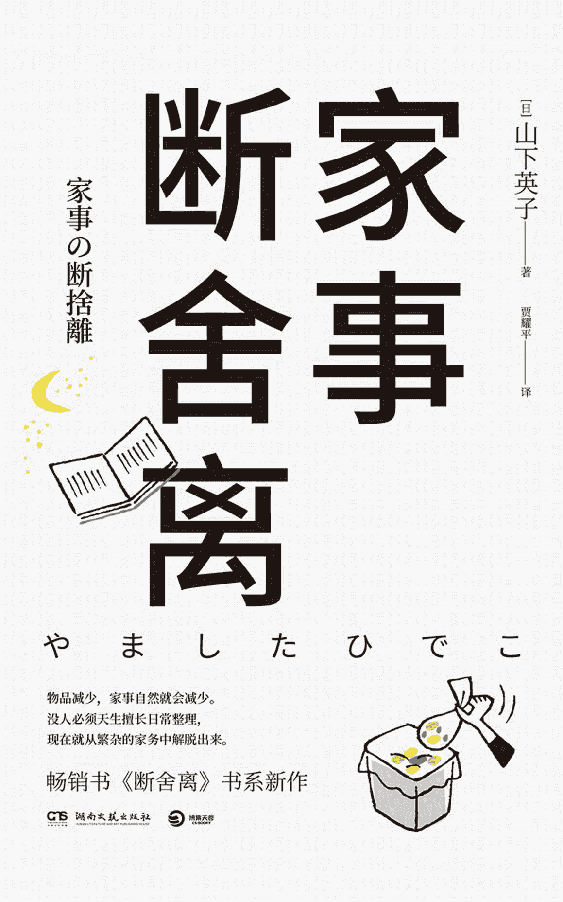

## 版权信息

书名：家事断舍离

作者：【日】山下英子

译者：贾耀平

出版社：湖南文艺出版社

出版时间：2019-09-01

ISBN：9787540493417

本书由天津博集新媒科技有限公司授权亚马逊发行

版权所有 侵权必究

# 目录  
CONTENTS

前言 其实我以前也总为家务活发愁 第一章 “家务常识”断舍离 常识 1 “收纳”无法收拾好家 常识 2 不为家务事后悔 常识 3 “家务集中做”的陷阱 常识 4 不需要特意做菜单 常识 5 不“节约” 常识 6 不考虑做家务的活动路线 第二章 从晚上 6 点开始的“晚家务” “晚家务”守则 维护保养守则 料理守则 善后守则 第三章 早上 6 点开始的“早家务” “早家务”守则 清扫守则 洗衣守则 准备守则 第四章 “周末家务” “周末家务”守则 保养守则 取舍守则 后记 家务里饱含的赞美之音 

# 前言  
其实我以前也总为家务活发愁

大家好，我是山下英子。

请问，你喜欢做家务吗？是不是也很会做家务？

别看我在演说中或出的书里常常提起“断舍离和家务”，说实话，我以前也做不好家务活。与那些来参加断舍离讨论会的听众聊天，我发现很多人对于家务有各种各样的烦恼：

●收拾来收拾去，家务活总是没完没了。

●总后悔“没有认真搞家务”。

●有开销记账本却看不见省出来的钱。

●一直想完成的家务活总是被各种事情拖延。

●每天因为家务活忙里忙外，没休息好，有压力。

写这本书的目的就是为了解决这些烦恼。因为我曾经也有相同的感受——做家务，真辛苦！

在某些以昭和初期为背景的电视剧中，剧中人物总是感叹：

“家务活，简直就是重体力活！”

与昭和时代相比，如今人们依靠各种各样的机械设备，耗费在家务上的精力和时间省去了一大半，家务也轻松了不少。但是，家务依然是繁重的体力作业——“不得不做”的心理压力和“日复一日”的重复劳动。

如果这项繁重的作业能变得轻松、愉快，那么我们就会省去很多烦恼，生活也会多一点阳光。

### 让家务事变得轻松有趣

其实，90%的家务是保养管理的作业。

断舍离告诉我们，保养管理作业是有很大价值的。我以前一直认为“制造新东西”才算是有价值的事，其实，制造新东西固然重要，对制造出来的新东西进行“维护管理”“保养管理”同样是非常有价值、有意义的。

因此，那些从事街道清扫工作的人更应该受到尊敬，他们并不是什么“扫大街的”。而那些家庭主妇和家庭主夫也应该昂首挺胸地为自己的辛劳感到骄傲，因为家务，也就是保养保全工作，是非常有价值、有意义的。我想借这本书打破“家务很辛苦但有价值，家务有价值但很辛苦”的死循环。

家务=有用=有趣

这本书不是什么提高家务技能的手册，也不是什么灵修指南。

它的主旨是“让家务更轻松有趣”。

它的目的是把各种让人们觉得家务是繁重枯燥的重体力活的“想当然”彻底“断舍离”。在这里，我简单归纳和总结一下什么是断舍离。

●断——切断庞杂的物品来路。

●舍——舍弃不需要的物品。

●离——在反复的断与舍中，脱离对物品的执念。

其实，断舍离就是指对自己和物品关系进行刨根问底的训练。提到断舍离，我们总是把焦点放在“舍弃”上，其实有些东西可以通过断舍离，重新找回来。

### 物品本身附带“三间”——手间[^(\[1\])](#part0054.xhtml_zhu1)、时间、空间。

从下图可以看出，物品周身一定会附着维护管理所需要的“精力”“时间”“空间”。

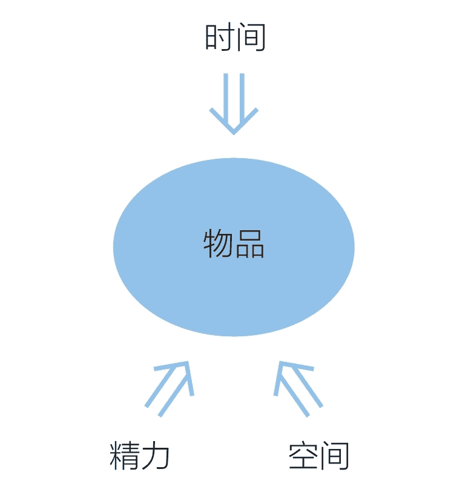

要实现家务的轻松有趣，第一步就需要扔东西。所谓的“收纳”，只是在“移动”东西，并不实际减轻或减少维护管理物品所需要的精力、时间和空间。

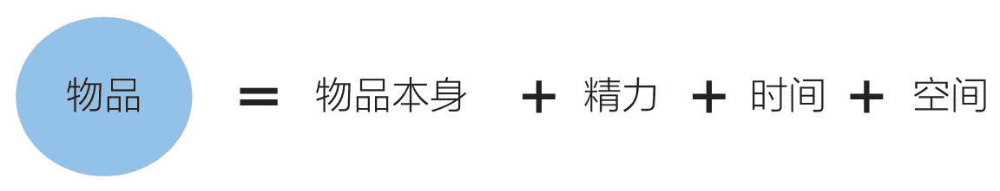

人们总认为花精力的事情很麻烦。丢掉多余的杂物会节省很多精力（手间），同时也能节省时间，恢复空间。我们重拾“三间”，其实就是重新找回生活的从容感。

很多人晚上下班回到家，总是拖着疲惫的身躯在勉强做家务，特别是那些还带着孩子的职场妈妈。那么，能不能在短时间内整理好家务就显得尤为关键了。

包括那些家庭主妇和家庭主夫，他们不会每天待在家整理家务，都希望白天摆脱家务，做点其他事情。

首先，我们把工作日期间晚上的家务活叫作“晚家务”，然后再来说如何实现晚家务的轻松和有趣。本书将在第二章介绍如何做好以“我回来喽”开始的晚家务。相对于晚家务，从早上起床到出门上班这段时间做的就叫“早家务”。

我知道很多人不喜欢早起，所以也不会奢求大家早起做家务。本书将在第三章介绍一些做早家务的关键点。这些早上进行的“关键”家务活会让你下班回家做家务更轻松。

工作日的“早家务”“晚家务”之后，就是周六、周日的家务。本书将在第四章的“周末家务”进行介绍。

“周末家务”的主旨是“不要让家务占领周末”。如果把平时拖延累积的家务全部放在周末去处理的话，那么本应该好好休息的周末就全部被家务填满了，不利于身心休息。第四章将着重介绍如何在周末做家务才有意义。

“家事断舍离”的目的就是想通过断舍离，抛掉以往想当然的固化思维，用更少的精力去做更有价值的家务，让身体和心灵都放松下来。同时，我也想通过断舍离，让我和我的学员们能逃开“家务烦恼的怪圈”。

让我们跟着这本书一起努力练习吧！

——山下英子

* * *

[\[1\]](#part0054.xhtml_zw1)手间：日文汉字，意思为精力，下同。

# 第一章  
“家务常识”断舍离

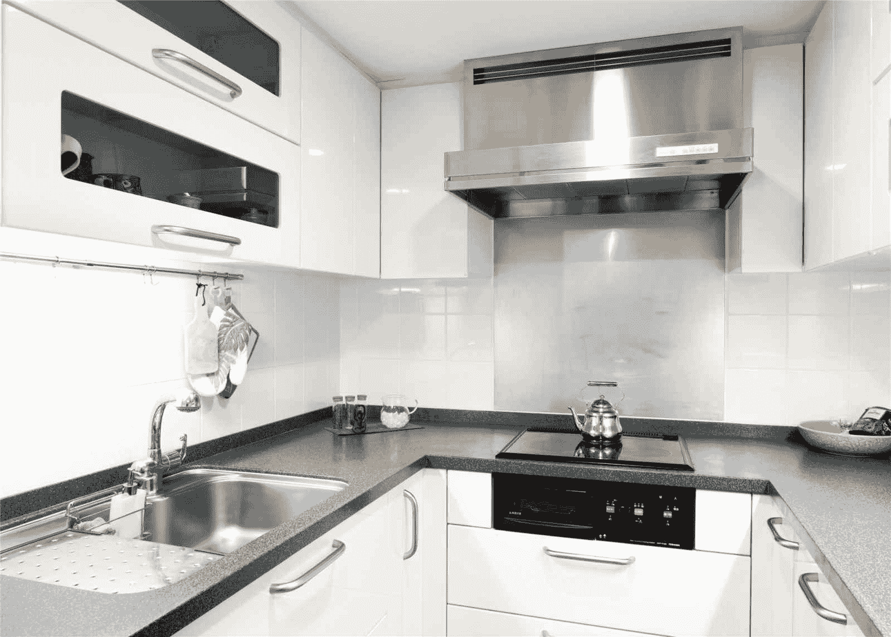

## 常识 1  
“收纳”无法收拾好家

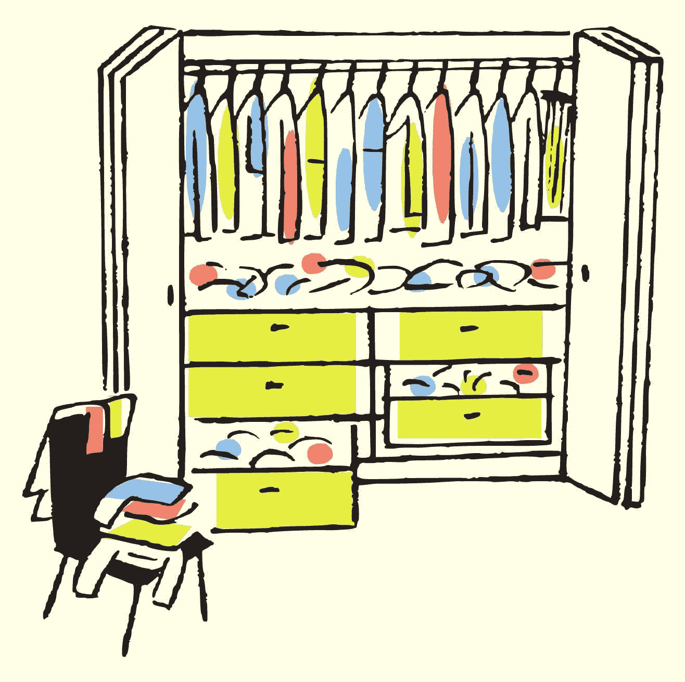

### “收纳”会让家务更辛苦

下面我们来一件一件验证，到底以前那些想当然的家务常识是否正确。

家务的第一误区不是其他，而是“收纳”。

很多人会觉得东西摆得乱七八糟的房间，只要一收纳起来，立刻变得整洁了很多。

很多人一般都会用收纳箱、收纳盒把乱七八糟的零碎物件分门别类地摆放好。

但是，我敢说，收纳并没有解决问题。下面介绍一个案例，你会发现收纳让家务变得异常辛苦。

我应杂志社的“断舍离 before after”的策划而探访这户人家。

这是个七口之家。三十多岁的爸爸妈妈带着五个孩子，最小的只是个婴儿。爸爸妈妈很辛苦，很伟大。

要养活这个家庭，首先要花费大量的时间和精力去解决生活必需品的事情。五个孩子都嗷嗷待哺，而且还得准备很多换洗的衣物，另外还需要更新一下玩具和学习用具。

因此，这些日常用品也需要大量的时间和精力去整理和收拾。这位好客爱下厨的妈妈总是在塞满食物的大冰箱和大餐桌之间，专注地炒菜煮饭。她灵巧地从摆满料理器具的架子上拿起煮饭锅和平底锅，收纳柜的门前地板上直接（问题点）放着一个特大号的调味料瓶（大问题点），所以柜子门打不开。

打开冰箱后，表面的食材能看见，但是最里面到底藏着什么东西看不出来。所以，食物总是买重。为了确保随时不缺食材，妈妈总是不停地买买买。

### 名为衣柜的“垃圾堆放场”

各个房间都带有收纳柜，每个柜子都塞得满满的。那些塞不进溢出来的杂物怎么处理呢？

就“扔”在离我们最近的地方。

这就是名为衣柜的“垃圾场”。另外，楼梯下面不到 1.6 平方米的地方，各种不用的玩具、妈妈的手工作品、爸爸的爱好物、野餐用具等塞得满满当当。

一般的厨房垃圾或是废纸什么的会在指定日按时扔掉，但是碰见稍微大一点的垃圾，就怕麻烦，不想扔。首先，因为大型垃圾的处理方式是特定的，不能随便乱扔；其次，还要和大型垃圾清洁工联系，请人处理，说不定还要花钱。所以总是把这些东西直接放在 24 小时随时方便扔东西的“垃圾堆放场”。

但是，问题是很多时候“垃圾堆放场”里不全是“垃圾”，还混埋着一些有用的必需品。那又得花时间、花精力去“垃圾堆”里做挖掘作业了。

当她把杂物全部搬到柜子里后，客厅就显得宽敞了不少，这就容易给人一种错觉——客厅收拾得真干净。也就是说不再是什么垃圾场客厅，再加上客厅的墙壁上、柜子里都放着精致的摆件和垂下摇摆的装饰品，甚至能称得上时尚整洁的客厅。但真相是：这些“时尚用具”全都布满灰尘。因为被放在不方便清洁打扫的地方，所以落满灰尘。而且这位妈妈根本没有多余的时间和精力把这么多的东西一个一个拿起来清扫、擦拭、刷洗。

她没有意识到越想通过“收纳”来解决家务，越是让问题越来越多、越来越大。

我们在前面介绍过物品附带有维护管理所需要的精力、时间和空间。接下来从“意识层面”认识一下物品的构成。

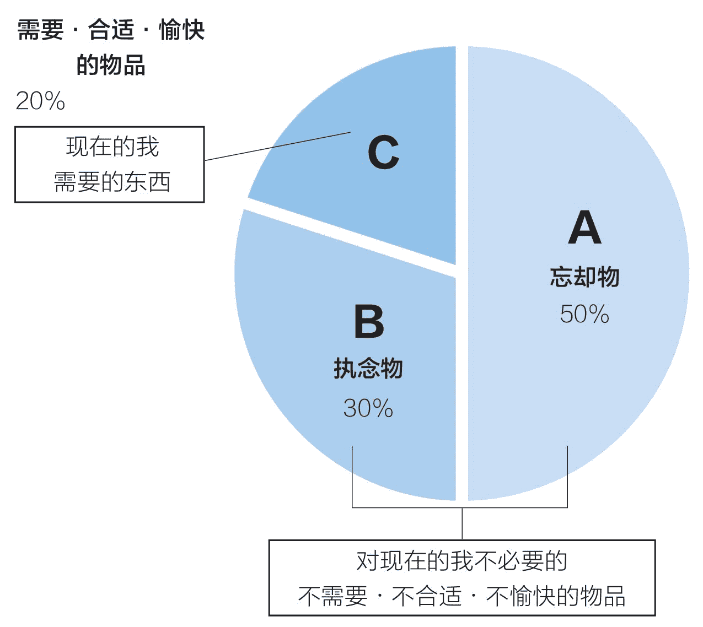

“物品意识”

### 为什么会“想扔却扔不掉”？

从图中我们会发现家里最多的东西是忘却物。“忘却物”即那些我们连其存在都不知道的、无法想起的杂物。人总是很难想起看不见的东西，我们总是被这些忘却物夺去空间，夺去时间和精力。

“执念物”即那些我们虽然能意识到其存在，却无法丢弃和处理的东西。像一些往昔的纪念品、亲手制作的小东西等我们常说的“想扔，扔不掉”的杂物。通常，我们并非很珍惜和喜欢这些杂物，只不过随处搁在家里，不去想如何处理罢了。换句话说，这些杂物属于上图中的 A 区和 B 区范围，是“不需要·不合适·不愉快”的需要“扔”的杂物。

而“需要·合适·愉快”的物品即有价值，被我们所需要，让我们心情愉悦舒适的东西。即上图的 C 区，是需要保留的物品范围。

这个区域的物品：

是我们“要花时间，想花时间”而不是“被迫花时间”的物品。

是我们“想腾出地方安放”的物品。

是我们“想花精力，想维护管理”而不是“被迫花精力”的物品。

对于不同区域的东西，我们内心发出的声音是完全不同的。

“忘却物”和“执念物”是内心所排斥的。“需要·合适·愉快”的物品是内心所期待的。前者让我们心灵衰败枯萎，后者则让我们心灵充盈丰润。后者让人与物品建立一种舒适愉快的良好关系。

有一点需要注意的是，这三个区域划分不是绝对的，也会随着时间而改变。“需要·合适·愉快”的东西会逐渐变成“忘却物”或者“执念物”。物品和人的关系也不是一成不变的。

### 分类则满足的“标签化收纳术”

我曾经也尝试过“收纳术”。

第一件事就是买收纳箱。

有了收纳箱，把一些零零碎碎的东西一股脑儿地放在箱子里。其他的不说，首先这些乱七八糟的杂物从视野中消失了。

结果，它们不仅从视野中消失了，也逐渐从脑海里消失了。

换句话说，所谓收纳，好像是收拾之后就可以坐视不管，置之不理了。从某种意义上来说，收纳是种忘却物催化剂。需要的收纳箱越来越多，占据的空间也就越来越多，家里也就显得越来越狭窄拥挤。

收纳术的老师还教我们如何贴标签把物品分门别类。包括建立收纳隔间，粘贴便利贴区分杂物类别，等等。这些工作无一不是要花费时间和精力的。一旦开始贴标签，我们就会下意识地把“贴标签”当作第一目标。

杂志上展示的完美收纳空间中，有五颜六色的调味料瓶整齐排列的置物架，有犹如图书馆一般系统严谨地摆放书籍的书架，还有按大小功能等分门别类收好的文具柜子，等等。看见这些彩页时，想必有人会感叹“真是再怎么努力也做不好呀”。

“做不好”是肯定的，只有那些每天以高标准要求自己的收纳达人，才能长期保持这种“杂志彩页水准”。不是专家做不到，只有收纳专业的人才能做得这么专业。但是对非收纳专业、每天工作事务繁忙的我们来说，这种“收纳”标准过高过难。就好像强迫一个从来没练过慢跑的人去跑全程马拉松一样，不切实际。

我想说的是：

收纳，需要时间。

收纳，需要空间。

收纳，需要精力。

购买东西容易，维护保养很难。不注重管理和保养，就容易成为灰尘的温床。

最简单的是，家里没有那些需要贴标签、需要管理保养的东西。从另一个角度来讲，把用过的东西按照标签放回原处的想法也是有问题的。假如不存在什么多余过剩的杂物，其他东西放在哪里就会一目了然。这就是断舍离。

人是一种能多省事就想多省事的生物，也是一种万事想要蜻蜓点水就直接了事的生物。从人的这种“懒”心理出发，不得不说所谓的“收纳术”的想法太过天真。因为对付乱七八糟，整顿、收纳的方法并不能解决根本问题。

整顿、收纳前我们需要做的是：

●减少杂物。

●精简杂物。

●精选杂物。

也就是对杂物进行断舍离。只保留精挑细选之后需要的适量的物品，即便是看起来杂乱无章，收拾起来也不费什么精力。

需要断舍离的烦恼

□ 给杂物贴标签分类的时间和精力。

□ 没有及时处理的无用品。

□ 动不动就得重新收拾房间的压力。

## 常识 2  
不为家务事后悔

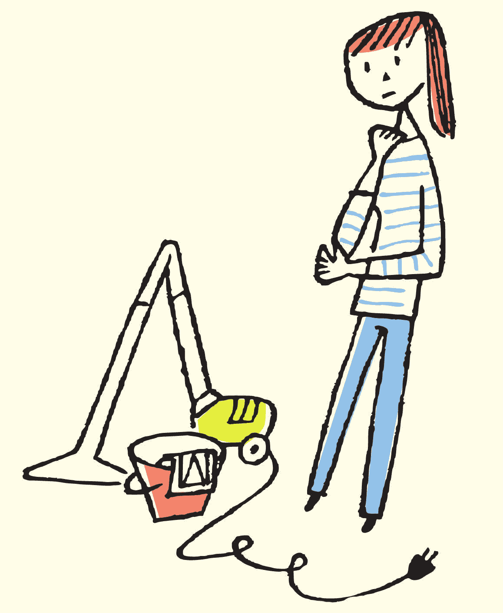

### 从“严格认真”的传统标准中解放出来

我们经常在媒体上看见很多在做家务和培养孩子上做得堪称完美的超级主妇。

无论是烹饪、收拾家务，还是子女教育，只有耐心、认真、井井有条才是正解。媒体时不时地暗示人们要多花时间、精力去做，才能当好家庭主妇。

你是不是常常为自己“由于没有多花时间、多花精力而做不好家务”感到内疚和惭愧？

很多人觉得自己在要下功夫的地方偷懒，挤不出时间来整理东西。他们内心总是有一种“我不该把家务做成这样”的罪恶感和愧疚感。

我想说的其实是“我们来多偷点懒吧”！

“偷懒”可能不好听，那我就换个词——省事。如果工作很忙的话，也花不了多少时间和功夫。

因为，这本书的主旨是省事、简单、享受、有趣。

这本书想告诉那些对家务感到惭愧内疚的人，如今的时代并非什么都必须花时间、花精力的时代。

从前的家庭主妇还身处要身体力行，花精力、下功夫做家务的年代，有些家务即使有机械设备辅助，还是有需要人下功夫的地方。如今科技进步，家用电器花样百出，越来越多的家务活不需要人再花时间和精力。

但是，我们内心还隐隐残留着某种难以描述的感觉——身为家庭主妇、身为母亲还是身体力行的好。

可是，你到底在介意什么？别人的评价？家人的眼神？

最后，你自己做的家务活，居然变成了以“他人为标准”来评判。比如说“卡通便当”，最开始就是为了孩子开心而做的，渐渐地做便当的目的变了。就像圣诞节的小彩灯一样，五花八门的彩灯逐渐出现，最后谁也不知道圣诞彩灯存在的意义是什么。

另一方面，那些认真做家务的人也有失落感。

他们认认真真地做家务，却没人赞扬夸奖，逐渐地做家务成了一种负担。“都是我在拼命做家务，竟然没有人夸夸我……是不是我做得还不够好……”他们心里会滋生一种“受害者意识”。

### 不能为了“香喷喷的饭菜”而过于拼命

“就感觉像是说不会做年夜大餐的自己很不够格一样……”

在厨房干脆利索地做家务的妈妈这么说。

可以说，即便在女性已经走入职场的现在，她们心中依然残存着对于家务事的保守“常识”。说不够格的其实是她们自己，那么到底她们对什么感到内疚和惭愧呢？

当“食育[^(\[1\])](#part0056.xhtml_zhu1)”这个词出现的时候，我就预感做妈妈的负担又要加重了。既要家务活身体力行，又要保证全家团圆和睦。压力山大！妈妈根本没有太多的精力去实践“食育”。

不知从何时起，社会开始要求女性既要承担做妈妈的责任，又要担负起做爸爸的责任。在外面工作，回家依然要工作。这种社会氛围带来的无形压力，让每个妈妈感到某种内疚和惭愧感。整个时代都在剧烈地变化着，做妈妈的我们却依然墨守成规，被旧时代的思想观念束缚着脚步。

我在亚洲很多国家旅行时，对于当地的“饮食文化”尤为好奇和兴奋。在像泰国这样保留宫廷的国家，我深感其饮食水准之高，却又有开放的饮食文化，也就是对“饮食”没有太多的条条框框。

在日本，一说早餐，大家依然想到的是“妈妈用心做的早餐”，而在泰国，“大家去小摊儿吃早餐吧！”已经是常态了。这种自由自在的感觉让我很羡慕。

三餐，就要在家吃，要女人每天早上、晚上亲手做出来。这种感觉不光在欧美，在亚洲各国都不怎么常见。希望这本书能帮助大家彻底“断舍离”这种“强迫观念”。

很多妈妈是“为了孩子”“为了这个家”而忙里忙外的，但是没什么心情做饭的时候，也不妨到外面去吃饭。

酒店、餐馆的早餐也很美味。虽然不能经常去旅游，但是也能在附近的早餐店里享受美味早餐。

周边的小吃店多一点就更好了。

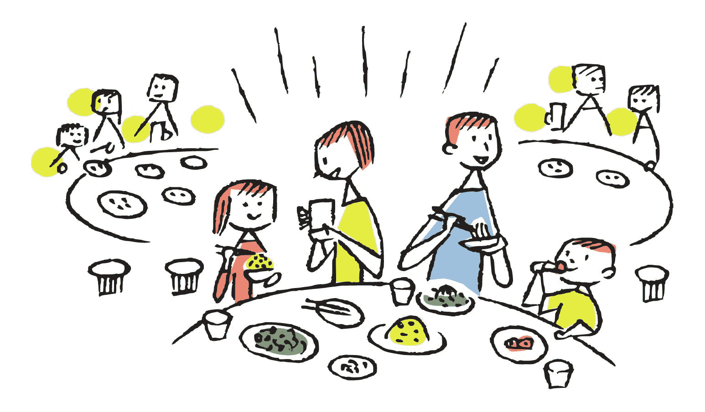

普通店铺的早饭

认真地好好吃营养早餐确实没错，但偶尔也可以放松放松，吃个简单高兴的早餐。

日本的女性（男性）都在努力。日式料理文化确实是非常出色的文化。但是过于出色，过于讲究精致，标准过高，致使制作日式料理的人也过于辛苦。还有盛料理的器皿，形状各异，用途不同，收拾起来也颇费工夫。

希望大家记得：与世界流行的常识相比，有些事情实际上不需要多么高的标准。

需要断舍离的烦恼

□“好妈妈”“好主妇”的他人眼光。

□“拼命”就等于“伟大”的自我满足意识。

□必须亲自做家务的信条。

* * *

[\[1\]](#part0056.xhtml_zw1)食育：良好饮食习惯的培养教育。从儿童时期开始，培养孩子通过各种活动获得关于“饮食”的知识和选择“食物”的能力，实践健全的饮食生活。按照日本 2005 年 7 月 15 日颁布实施的《食育基本法》，以培养国民终身健康的身心和丰富的人性为目的。

## 常识 3  
“家务集中做”的陷阱

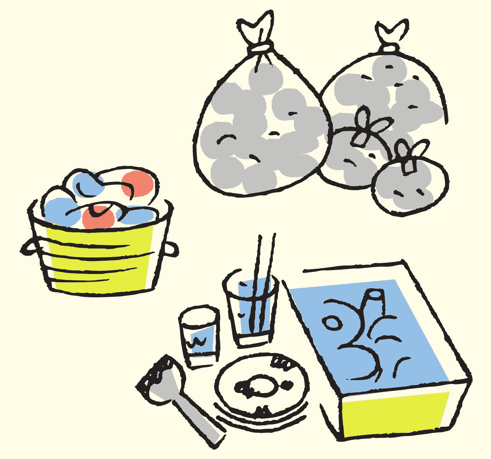

### 抛掉“满箱思维”

你是不是总是等脏衣服堆满篮子之后才放进洗衣机？

你是不是总是等垃圾袋塞满才想封口丢掉？

你是不是总是等××满了之后……才要……

我把这种情况叫作“满箱思维”。

人们总是莫名感觉“集中做家务才合理，才有效率”。

其实不然。

所谓的合理效率是指省力？省电？

都不是。我们俯瞰“满箱思维”“家务集中做”的做法，实际上一点都不合理，没有效率。原本因为忙碌没时间才打算集中做家务，但既然已经很忙碌了，怎么会挤出专门的时间去专门做家务呢？

假如在事先计划好的专门做家务的时间内，突然出现其他事情呢？如果只是挤出时间洗几个碗碟的小事情，优先做其他工作，推后洗碗碟的时间也没关系。但是如果堆了满满一洗碗池的碗筷，整个家务工作都被堵塞，无法顺利地进行，这个场面简直让人无从下手。

有的人“每周只洗两回衣服”。可能独居的人感觉没必要每天都洗衣服。“把脏衣物集中起来洗”只需要每周麻烦两次，也能省不少电，看起来效率高，很合理。

但是，脏衣物没有及时清洗会让污垢越来越顽固。怎么洗都洗不干净的衣服，只好搁到一边再买新的。所以积累了很多很多内衣内裤。集中清洗的内衣内裤数量多，晒衣服、收拾衣服也会花很多时间和精力。

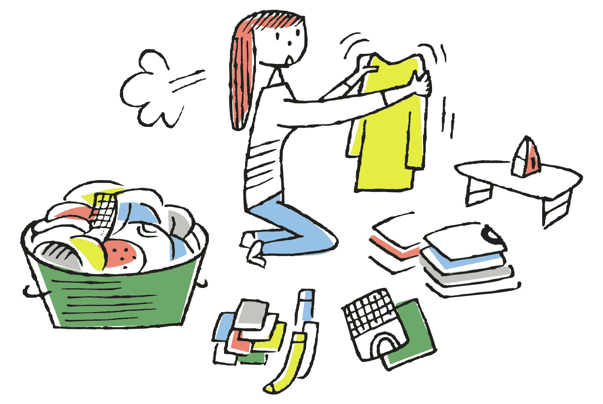

稍稍一拖延，小作业就变成了大工程。

家务活是利用零碎时间做的工作。每天洗衣服叠衣服工作量很小，一旦拖上两三天，就成了大工程。

垃圾桶的问题也是一样。尤其是厨房的垃圾桶，如果不及时扔掉，时间久了就会发出难闻的臭味。一个垃圾袋也就几分钱，换个垃圾袋就能防止臭味散发，我觉得这几分钱花得非常值得。而不常换垃圾袋，只会形成“满箱之后再处理”的习惯。

“集中做家务”也会造成心理上的负担。这种负担来自“waiting（等待时间）”。比如每周只洗两次衣服，中间的两到三天就是等待时间。这段时间心里总有个声音在嘀咕：“唉，还堆着脏衣服呢……”越来越多的负担逐渐累积起来，变成了精神上的消极影响。

介意→\_→不开心→\_→烦恼

一开始稍微介意的事，最后居然滋长成压力甚至变成心病，想想就觉得恐怖。

### “提前做好饭菜”与“集中买东西”的风险

以前，“提前做好饭菜”的热潮风行一时，实际上提前做好饭菜会让家务更辛苦。把三餐饭菜提前做好放在冰箱、冰柜里随后再吃的想法，就是一种“集中做家务”的思维，错认为“提前做好，之后就能轻松很多”。实际上提前做好饭菜的工作量并没有减少，也需要相应的时间和精力。

有很多上班的妈妈总是信心满满地说：“早上，我要 5 点起床，提前做好饭菜，加油！”这样的妈妈确实很努力地在做家务，但是当她们吐露出自己在加油准备饭菜时，就已经表明这件事得让她提着劲儿去做，也是个辛苦活。一定有一些妈妈觉得自己周一到周五要工作，就趁着周末提前准备，所以提前把一周的量都准备好。假如妈妈是开开心心准备的话，也没什么问题。可如果是“必须”“不得不”做的话，就很容易形成压力。而做饭这件事则变成了为“提前准备饭菜”而做饭了。

“提前预备好”最大的风险是“用不完”（吃不完）。因为人每天的心境、心情是不一样的，想吃什么、想吃多少也是在不断变化的。

食物最讲究新鲜度。即便是放在冰箱里，过四五天，食物也会变得很不新鲜，给人很强的“剩饭”感。人们对“剩饭”自然有抵触感。

即便有些主妇提前准备半熟食材或半熟食物放在冰箱里，到时候可以按心情调换菜品，感觉也差不多。除非周遭特别不方便买东西，不然最佳的饮食依然是“当时买”“当时做”的饭菜。现在是物流非常便利的时代。

“集中购买东西”也同样不好。

这个大前提是人无法管理太大量的物品。把食材塞进狭窄的冰箱、冰柜里，每天按适当的量拿进拿出，到最后把食材用得干干净净的人并不多。

食材料理专家能做到这一点，收纳专家也一样能做到。

如果有过“吃不完的东西只好扔掉”的经历，那就立刻停止“提前做好饭菜”的行为。想当然地能管理好食材食物和真有能力管理好食材食物是不一样的，该放弃的事情就要放弃。

这样就能让家务活立刻减量，让你变轻松很多。

### 与生活习惯不协调的“大容量”

“大的东西就是好东西”。这是昭和三十九年，森永制果的巧克力广告词。一种浓浓的正值经济高速增长期的日本昭和氛围扑面而来。

“二战”之后，类似冰箱和洗衣机的家用电器在日本普及。即便是少子化的现在，家用的冰箱、洗衣机的容量也逐年增大。大容量冰箱、大容量洗衣机这些流行产品的不断问世，就暗示着人们“为集中做家务加油”。

“提前做好饭菜”和“集中购买东西”让东西把冰箱完全占领了。最后，对食材食物管理不够，仅仅在冰箱前部看得见的地方来回拿食物，对冰箱深处被搁置到过期的食物却视而不见。

这也是除了大容量冰箱等大容量家电，还出现了类似“掌上洗衣机”的家电用品的原因。（仅仅适用于洗衣服的领子之类的小型家电。）

听说近些年，百元店（这里指日元，100 日元约合 6.38 元人民币）的洗衣板非常畅销，人们开始熟练地使用各种适合自己家庭使用的电器和器具。

还有些房地产开发者把“大容量收纳”作为广告词极力宣传，但是到底有多少人能正确恰当地使用这些收纳空间呢？在我看来，大容量收纳空间其实就是一个 24 小时开放的“垃圾破烂收集场”。

一些不需要的东西要及时地从家里扔到外面，适时地清理和处置。

### “集中做家务”转换为“分散做家务”

从上面可以看出，“集中做家务”看似合理，却存在很多不合理的地方。

集中做家务就需要集中做家务的大块或整块时间。但是我们首先要意识到我们没有整块或大块的时间。

做家务的铁则就是“分散做家务”。每次做一点，每次做一点，每次都会顺利地做完。不过这也有个先决条件，当东西过多过大时，就不能勉强“分散”进行，“分散”做就会变成很大量。

比如，脱下衣服后，把它放进衣柜里一分钟都花不了。但是我们嫌麻烦就随手把衣服扔在一边。当我们随手扔放的衣服达到 60 件时，原本可以不花 1 分钟就能整理的事情，结果却花了“1 分钟×60 件=1 小时”。

卖衣服的商店里，店员常常仔细地一件一件地整理衣服放到购衣架上，在家肯定是做不到这个地步的。为了减少衣物量，转换成“分散做家务”就有必要进行“断舍离”。

提到“分散做家务”，我就想起自己的婆婆。我把这种做家务的方法叫作“山下美子式”家务法。

婆婆是个急性子，什么事情都要立马做。别人还在吃饭，她已经唰唰唰地开始洗碗筷了。嘴上说着“慢点吃饭”，手上已经闲不住开始做家务了。正做着饭发现没有酱油了，就马上出去买，且家里还一刻不停地转着洗衣机。

但是我还满腹牢骚：

“一块儿做不是更好吗……”

“洗碗筷什么的着什么急？”

现在看来，她这么做更能尽快地解决问题，而不是积压问题。

和她住一块儿时，刚刚开始会觉得合不来，因为跟不上她麻利的节奏。比如锅碗上粘着大米时，本来稍微用水泡一阵子就能直接洗下来，但是婆婆却拿刷子拼命地刷，她是那种不会拿时间来解决问题的人。当然，除了这种“浸泡”的家务，“山下美子式”的家务法是没错的，她其实就是采用了“断舍离”的思维方式。

### 及时完成家务活的基本原则

做晚饭，让上小学的孩子吃饭，然后收拾碗筷。

再让放学回家的初中哥哥吃饭，然后收拾碗筷。

最后让下班回家的丈夫吃饭，然后收拾碗筷。

这三个场景基本上是所有日本家庭的日常。而家庭主妇的压力就来源于此，为了适应每一位家庭成员而把自己的时间分割成小碎片。自己连半小时的小块时间都没有，只有断断续续的几个 5 分钟、10 分钟而已。在这种生活节奏里，所谓“整块时间集中做家务”的要求肯定会让主妇（主夫）们倍感压力。

家务活，讲究的是有了活就要及时完成。

时间，讲究的就是利用碎片时间。

既然负责了家务，就要有所觉悟——家务事就是家务事，有自己的特点。所谓“集中一下子收拾完”简直是幻想。只要看见有什么家务活，就马上去做。事情越少，收拾起来就越容易，感觉脏的地方就立马去擦掉。

“断舍离”反复强调的就是减少物量——溺“物”之人的求生之道。

要处理的杂物的量和种类过多，导致很难进行优先顺序排序。如果一下处理 5 个东西，就变成了大作业。如果可以排优先顺序，就可以按顺序一个一个地有秩序地处理。

集中一块儿做家务，就会随手把一些鸡毛蒜皮的小事向后拖延。本来一回只需要洗 5 个盘子，结果稍微拖一段时间，洗碗池就堆满了碗筷。

本来家务活一件一件做比较简单轻松，一下子做五六件，负担立刻就大起来，导致花了大量的时间和精力，自己的心情也被拖累。“集中做家务”所面对的困难要比想象的大得多。

“分散做家务”的另一个优点就是别人愿意帮把手。因为家务活被切割成分散的“小块”，相对来说做起来不困难，麻烦别人搭把手也很容易。

我把它叫作“碎片小请求”。

有个学员为了在二楼阳台上晒衣服，总是把洗好的衣服特地从一楼拿到二楼去晾干。后来她想到“为什么不在上二楼时顺带着把要晾的衣服带上去呢？”碰到要上楼的丈夫，她随口说“帮我把衣服晾上去吧”。随口一句话，就省去个小麻烦，家务活的压力负担也相应减少，而别人听到具体的请求也会及时行动。

做饭中途用完的酱油可以拜托别人“回家时顺路买回来”，这种“碎片小请求”也是夫妇之间的交流内容。

需要断舍离的烦恼

□“集中做家务更轻松”的想当然。

□只看眼前利益的“节约思维”。

□无法解决问题的精神压力。

## 常识 4  
不需要特意做菜单

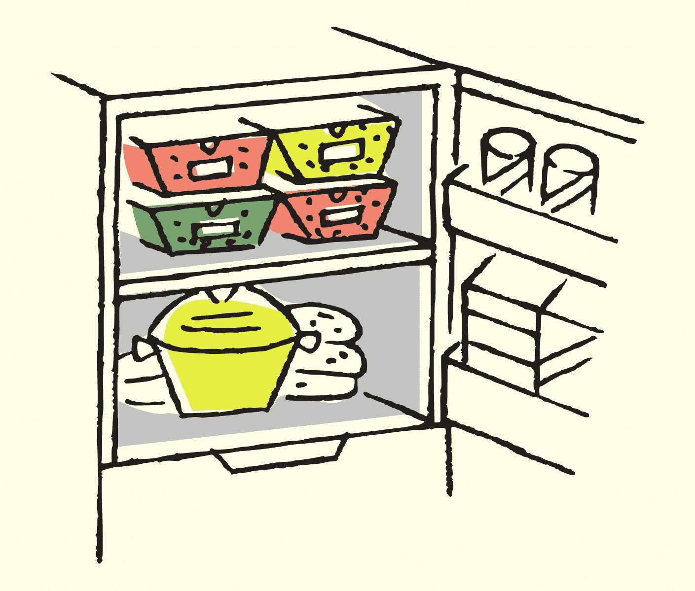

### 你确实吃着爱吃想吃的东西吗？

我有一个喜欢订购“安全自然食材”的朋友。她总是喜欢储备过量的食材。不知道从什么时候开始她觉得“不能过多地储备食材，必须全部用完”，最后听说她已经不再订购食材了。

这种转变在于她的思维方式发生了变化。从“按照自己想吃的美味料理准备食材”变成“手边的食材怎样才能做成美味料理”，她成了一个“吃货奴”。而以前的她是个“食材奴”，也就是“杂物奴”。

虽然一些人高调地说“集中做家务是行不通的”，但依然有一部分人落入“集中买东西”的陷阱。

因卖得比较便宜，所以要多买点。

鸡蛋用完之后再买鸡蛋。

（然后，查看冰箱）

有这个蔬菜、那个蔬菜，就做道××菜吧。

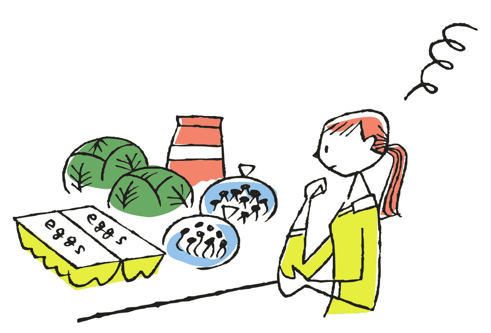

以“食材”为标准买东西的话

“正优惠呢……不小心就买多了”，便宜是便宜，但做出来的饭菜毫无食欲，这样的食材囤了一大堆。越是这种难吃的食材就越难做到有效循环利用。本来冰箱里已经很多——又多买了很多——用不完剩下，“食材轴”的买东西方式很容易陷入这种日常陷阱中。

这个蔬菜放的时间有点长，赶快用掉吧。

也就是说“做什么料理”是以“有什么食材”为标准的——食材轴。民以食为天，“食”是人的基本需求。即使食材再怎么安全安心、营养充分，却无法满足人“吃”的需求，就会出现“不匹配”。

重新回到人的需求原点。人有三大需求——食欲、睡眠欲、排泄欲（也包括性欲），这三个需求就是和生存密切相关的求生需求。当然，除此之外，还有作为人的社会需求。

人的三大生理需求中的“排泄需求”也被社会所束缚，并不能随时随地排泄。一旦“厕所”停止运行，人就会便秘。而动物却没有被束缚，可以随时随地排泄，不存在便秘现象。

食欲也一样。根本没什么食欲，却在进食。在不想吃饭的地方、不想吃饭的时间吃饭，只不过“因为到晌午了”，因为社会是这么约定俗成的。其实这对健康并没有什么好处。

我们必须好好倾听和回应人的基本生理需求，至少在家时能做到：想吃的时候就吃自己想吃的东西，想扔出去的东西就立刻扔出去，想睡觉的时候就去睡觉。

你可能会说，有家人在的时候不能这么随意吧。即便如此，请大家记得：在家这个私人空间里，我有“吃”的自由和“不吃”的自由。

### “12 点吃午饭”不是死规定

私下说，其实我有时在家不吃饭。我知道有本书叫作《每周两天断食》，而我在生活中会把三餐间隔尽量拉开一点。如果晚上和朋友出去聚餐，我会注意吃的时候保证营养均衡。而在家就会随便吃点，比如吃点生鸡蛋拌饭、喝点发酵饮料等，甚至什么都不吃。

虽然不能因为在家不吃饭晚上就要尽情地吃喝玩乐，但是确实没有必要总是神经绷紧小心翼翼地过日子。我想强调的是“不那么严格遵守规矩也没关系”。过于严守规矩，把冰箱塞得满满当当，反而特别麻烦。

“精致生活”是现在的流行语。精心整理空间，细致地品味美食本身就是非常值得赞美的。

但是这里的“精致”到底是以何人的评判作为标准呢？

很可能是他人眼中或世俗常识中的“精致”，而不是对自己的“精致”。我们既有生理需求，又有心灵层面的需求。我们首先要坦然面对这些需求，这才是所谓的“精致”。

重要的是不断磨炼和提高对自我需求的敏感度，将接收自我需求信号的传感指针锤炼得锃亮发光，而不是任它生锈发霉。

那么，你现在想吃什么东西？

“fasting”即我磨炼自己对“吃”这件事敏感度的方法，意思是“断食”。并不是字面意思上的“真正的断食”，而是加入自我理解的“断食”，也可以说是对“人应该认真严格地吃三餐”这个常识的断舍离。

很多人一直以来都认定“人不吃饭就没精神”。实际上，疲惫没精神的是我们的肠胃。

肠胃是极容易受到人的精神影响的器官。一个人，有没有压力从肠胃运作正常不正常就能看出来。现在的社会绝不是物资匮乏的时代，而是营养过剩的时代。“吃”需要很多时间和精力，包括食材的采购、烹饪、用餐和餐后收拾碗筷等都要花时间。而且人吃完饭就想睡觉。因此，偶尔让肠胃放个假也是很重要的。

“吃”是一件非常私人的事情。虽然我把自己“吃”的事拿出来做例子，但是“吃”不应该问他人，而应该问自己、问自己的身体。并不是对“你”好的，就肯定对“我”好。更何况，人是很容易喜新厌旧的，现在对我合适的东西，不一定将来也对我合适。

我百吃不厌的就是米饭。我也喜欢糙米，但我的身体不喜欢糙米。所谓“吃”，不仅要讲想吃不想吃，也要讲适合不适合。

所以，没必要规定自己必须“12 点吃午饭”。虽然公司的午休时间规定可能是 12～13 点，不过，至少在私人时间什么时候吃、想吃什么是你的自由。

一般来讲，早饭和午饭的间隔比较短，午饭和晚饭的间隔比较长。所以，下午 2 点吃午饭也没太大影响吧。另外，不吃午饭，“一日两餐”也是可行的。

在拉丁美洲，很多有午睡习惯的国家，人们不怎么拘泥于什么时间必须吃什么饭。那里的人吃完早饭、午饭，然后睡个午觉，傍晚 5 点左右开始在露台喝酒，等到晚上八九点才开始吃晚饭，然后接着喝酒……人生一路带着醉意酒香，令人羡慕，其实这也是一种活法。

### “列每周菜谱”的陷阱

你现在是否感到不用再对“吃”那么用力了？

作为对“吃”非常认真的“严格”派的典型做法就是“列每周菜谱”。这在我看来也是不好的。人们想吃的饭菜每天都是不一样的，好不容易列了一个每周菜谱，万一一周过后，全部不想吃了怎么办？

无论列菜谱的心情，还是买食材的心情，每天都是在变化的。

学校的食堂会把“每月菜谱”发给每个学生，这种菜谱是营养专家从孩子发育的角度出发，综合考虑设计的菜谱，也就是“客观视角”。

而自己吃的东西、全家人吃的东西必须从“俯瞰视角”考虑。从“俯瞰视角”可以发现包括自己在内的家人对“吃”的需求和心情的变化。

因此，吃什么最好由“当日、当时、当场”来决定，最多把第二天的饭菜定好，不能再多了。

比如“今天超想吃肉，现在的鱼正肥美，看起来很好吃，今天就吃鱼吧”。即使选择失败也没关系，多尝试几次，总能找到适合自己的方法。

那么，现在出门买东西吧！要磨炼自己对“吃”的敏感度！去菜市场逛逛也是一种乐趣。只要按照“美味”“想吃”的标准来选食材，“每次做饭前去买菜”的家务也就显得不那么麻烦了。

需要断舍离的烦恼

□以食材为标准做饭。

□吃不想吃的食物。

□别人口中的“正确、规矩的饮食生活”。

## 常识 5  
不“节约”

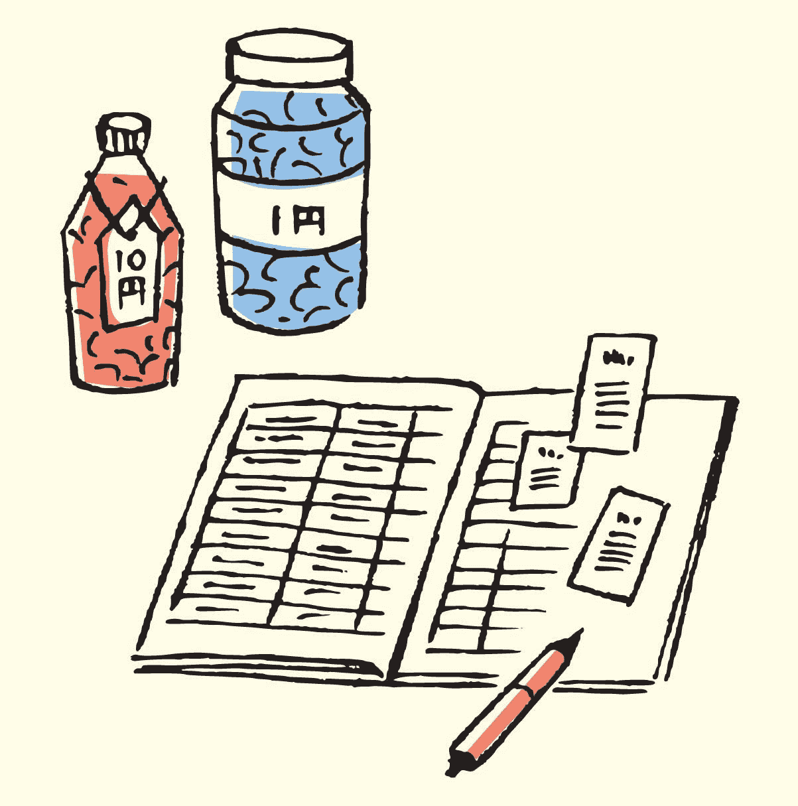

### “小节约”会消耗大能量

经常碰见主妇们拿着超市的促销传单从这家商店逛到那家商店。

她们的钱包里总是塞满了一沓一沓的积分卡，正在为“节约”而拼命。

但是，为节约奔跑的主妇们是否开心呢？

如果有人把节约当成兴趣，我自然无话可说。但是如果节约给自己带来了痛苦，那为什么不停止呢？

人们总会在各种地方强调节约，省钱、省水、省电……整个社会环境把“反对浪费·提倡节约”作为一种不容置喙的美德，还把“减少浪费”直接等同于“绿色环保”。

但是，我们所提倡的“小处节约”“小环保”其实是“大浪费”。因为我们为了减少浪费，需要“搞小发明、小创意”，需要“忍耐力”，需要“收纳技能”，需要“集中做家务”，等等。我们会发现为了节约，我们花去了大量的时间、空间和精力。主妇们花尽心思“节约”后，可能省了 1 日元（大约 6 分钱）、10 日元（大约 6 毛钱）、100 日元（大约 6 块钱）。从费用和效果比来看，明显不合算。有人会把自己的劳动看作免费的、无偿的，这是不正确的，因为你自己既是资本又是成本，首先我们得树立这种成本意识。

如果经常在各方面抠搜节约，有时候会一下子浪费很多。比如说因为在各方面都缩手缩脚，使得精神上有压力，有时候会想给一直拼命的自己花个大钱，放松一下。我把这种循环叫作“捡芝麻丢西瓜定律”。

其实，凡事都讲“省”，总会让人有种烦闷不痛快之感。严重点说，越讲究“省”的人，他的人生也会强迫自己凡事都必须从“省”出发。所以，首先我们要对这种思维方式断舍离。

又有人会说：“既然如此，干脆不要讲什么节约，出去工作赚钱开源便好。”但现实是有些人无法外出工作，而且出去工作反而会出现多余的开支。工作中把一只长筒袜给弄破了，就等于当天一半的时薪泡汤了。

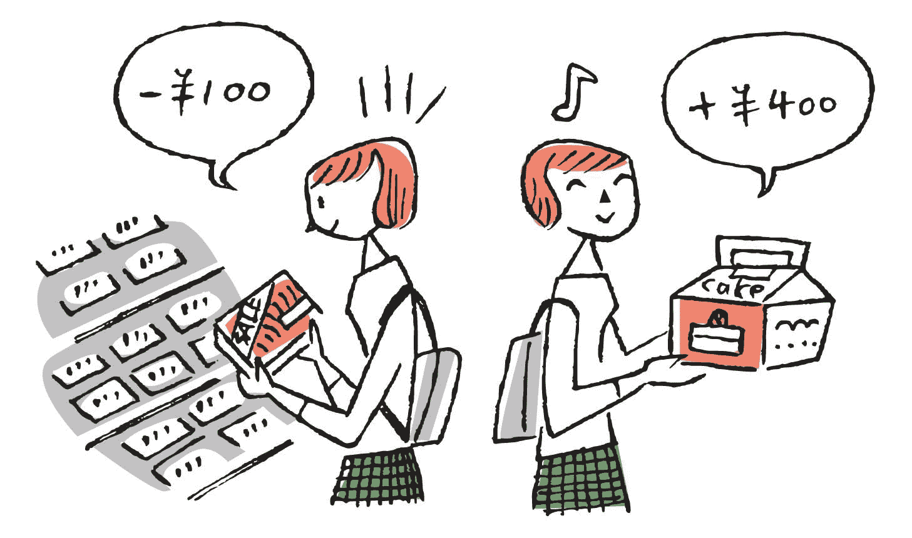

捡芝麻丢西瓜定律

隔壁的超市搞大促销，蹬着自行车奔向“成功的节约”。自己这么努力，买个大蛋糕犒劳自己吧。哎？！回家算算节约了多少钱，结果发现收支不但没有平衡，反而超支了！以后，不要被一时的“优惠”牵着鼻子走。

换句话说，我们在任何情况下都可能或多或少地出现突发状况。因此，首先要把生活基础巧妙地进行“downsizing”。

所谓“downsizing”指的就是按照空间大小，对其中的杂物进行精减。杂物一旦减少，麻烦就会减少，时间和空间也多了出来，生活也会显得从容淡定。同时，家务和生活中大大小小的事情也能分得出优先顺序。在这个前提下，可以出去工作，也可以待在家里，怎么做是自己的自由。

### 为了记账而记账就毫无价值

就像“节约”没什么意义一样，家里的账簿也没有什么太大的意义。确切地说，仅仅为了记几个金额而记账的话，是没有什么意义的。仅仅在账簿上记下密密麻麻的数字就很满足的人不在少数，可是记账到底是为了什么呢？

之前，在一个资讯类节目中看到理财顾问给一位有两个高龄父母却没有兄弟姐妹的单身女性理财建议。这位单身女士既要照顾两位老人，又要保证自己的健康和生活，心里非常不安。这位理财顾问给出了建议，大致的意思是“多少年之后住宅费得花多少钱，加上看护费，一共要花多少钱。那么从现在开始每天攒多少钱”，顾问说完之后加了一句“这么看来，是不是心里没那么大压力了？”

这位女士点头说确实压力减轻了不少。

“咦？！”我有点吃惊。因为即使按照自己的生活节奏再怎么计划，谁也不知道什么时候会发生什么事情。

不知道大家有没有听说过“singularity（奇点）”这个词？现在已经迎来了比上一次产业革命更加剧烈、更加迅猛变化的时代。AI（人工智能）也很快要迎来能够自主改良升级自身系统的时刻，这个时刻就是奇点。也就是说，AI 大范围地剥夺人们的工作机会的时代快要来临了。

在电视播放的资讯节目中我们时常能看到以 AI 为代表的高精尖的科技迅猛发展，超越了人们的预测和想象，也会看到很多严重的环境破坏问题。在这种自然和社会环境下，我们不可能基于什么稳定因素来谈未来的人生计划。

刚刚我谈到列菜谱是不好的，其实主要是想说制定菜谱时人们往往没有考虑到“变化”的问题。因为，人的心情和周围的环境时时刻刻都在变化着。

记账簿也是一个道理。为了记账而记账，对节约没什么帮助。最关键的是要知道“我的欲求是什么”。只有在这个大前提下，才会对记账不记账的效果产生重大影响。

需要的东西则保留或入手，不需要的东西则处理或无视。

在我看来，这才是深思熟虑之后记账簿应该发挥的作用。只有认清自己，坦然面对自己的需求，才能真正做到节约不浪费。

需要断舍离的烦恼

□“拼命节约却不见效果”的小处“省”的习惯。

□“只要记账就是节约”的想当然。

□没有把“变化”考虑在内的“人生计划”。

## 常识 6  
不考虑做家务的活动路线

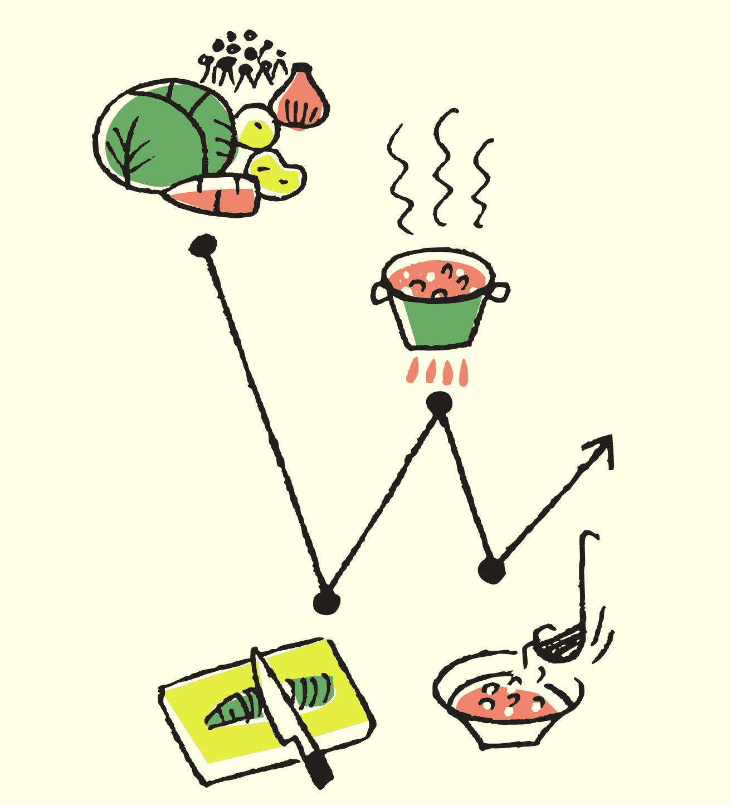

### 优先考虑“步骤”，而非活动路线

在盖房子和装修时，人们普遍认为“能考虑到顺利完成家务的活动路线的布局”是最理想的。

厨房的活动路线一般是“从冰箱里拿出食物，放在菜板上切好，然后放在燃气上烹饪，之后从碗筷柜里拿出盘子和碗，最后盛好饭上桌”。这一连串动作所包含的设计思路就是“各个活动点要尽量紧凑，以便完成作业”。但是，这种思路适合面积比较大的海外家庭，而一般亚洲国家的家庭没必要用这种思路。

空间宽敞的话，即便没什么特定的活动路线，也能顺利地做家务。空间显得宽敞主要是因为没有多余的杂物。这些杂物包括自以为必需的家电或家具，还有些小器具、小挂件，等等。

首先认真地问问自己：“这个东西是必需的吗？”

其实，与其把精力浪费到如何设计最省力的活动路线，倒不如多走几步路，这样也能锻炼身体。在宽敞的家里边做家务边运动，比起在家里无所事事却花大价钱去健身房要“节约”得多。

比起活动路线，我们先要考虑的是“步骤”，相当于“精力”。

人是一种越是花精力就越感到麻烦的生物。因此，要尽量考虑如何减少精力支出。

比如，厨房的柜子里放着的砂锅。因为不怎么用，所以特地搁在箱子里收好。假如某一天我们突然要用砂锅，现在我们来按照下图的步骤计算使用砂锅的“动作=精力”支出吧。

数一下用砂锅要做多少动作。装进箱子的砂锅即便只是“拿出、使用、收起”也需要八步。

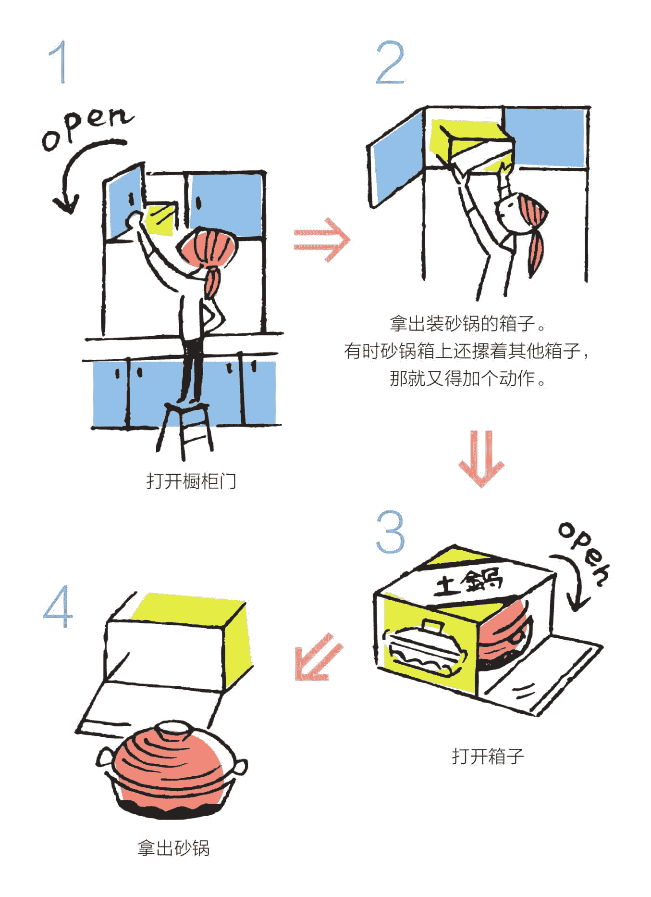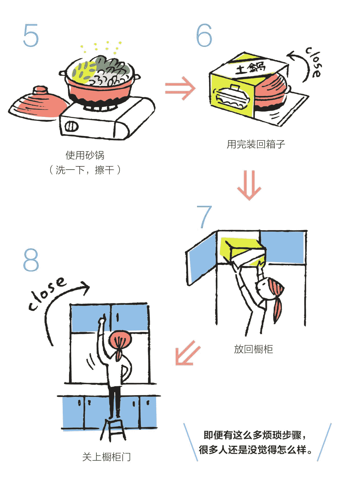

不知道你是否感觉到仅仅为了用砂锅，我们花了多少精力。箱子是商家的包装，并不是家里放东西用的。箱子一般可以摞着放（既是长处也是短处），不知不觉间就堆了好几箱。

尤其是经常使用的餐具或工具，要特别注意它们的“动作计数”。整理成一打开抽屉就能一目了然的状态，一伸手就能拿得到。只有精简杂物量才能做到这一点。

### 一开始的“小麻烦”换来以后的“大省事”

“动作=精力”越是消耗得多，人就越感到麻烦。而且如果把本来当时要做的“动作”向后拖延，人就愈加感到头疼麻烦了。

如果这个动作只需要花一点小精力，那一开始就花掉这点小精力来处理这个“小麻烦”。意思是说我们应该在“入口关卡处”就把所有可能产生的麻烦压缩到最小。

比如，买东西附带的袋子或箱子要立刻处理掉。像上面所说的砂锅箱子，还有大袋子里有分装成小袋子的酱汁之类的，也可以直接处理掉大袋子，放好小袋酱汁，用的时候可以少一个从大袋子里掏拿的动作。

囤货的规整法则

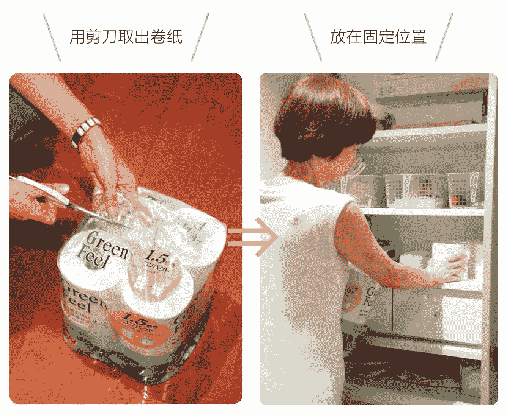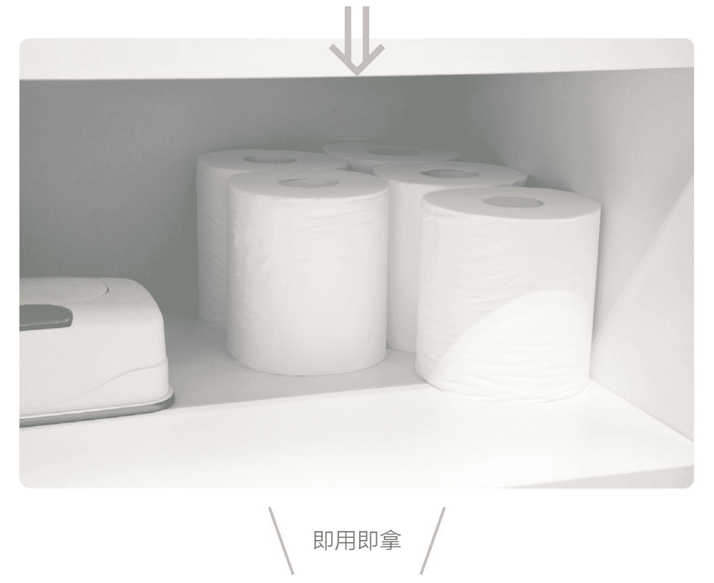

从袋子中取出来

一卷一卷地拿出来易于储存，方便直接拿到厕所使用。花同样时间的话，那就提前顺手做完。

我会把商标撕下来之后再把瓶子放进冰箱。因为商标有各种不同的颜色。有的人如果看不见商标，那么连瓶子里装的是什么都不知道。话说回来，连里面装的是什么都不知道的东西千万不能塞进冰箱里面。因为处理瓶子时必须撕掉商标，所以一开始就把商标撕掉。

厕纸也同样。我们总是把厕纸连同袋子随手搁在地板上或架子上后就置之不理了，这时候我们就要处理这个“小麻烦”。如果从袋子里面取出来，一卷一卷地摆放好，就不需要乱丢在地上了，而且取用也方便。

还有的人买回来衣服，连标签都不摘掉就直接挂进衣柜里。还有的人从干洗店拿回衣服直接套着塑料防尘膜放进衣柜里。他们总想着“穿的时候摘掉也不迟”，但其实早上匆匆忙忙地赶着上班，哪里会顾得上摘掉标签。而且，干洗店的塑料膜如果不早点摘掉，会让衣服有潮味。

需要断舍离的烦恼

□想当然觉得“家务活动路线应该尽可能短”。

□妨碍拿取的箱子、标签、包装。

□自以为“必需品”的家具、家电。

我们看到了很多不知何时成为“正确的家务常识”的例子，让大家偏偏选择辛苦的方式去做家务，偏偏为毫无价值的事情努力。撇开这些所谓的“家务常识”，你是否会感到心情轻松一点？

下一章将进入晚家务、早家务、周末家务的内容，一起来看一下具体的“流程”和关键点吧。

# 第二章  
从晚上 6 点开始的“晚家务”

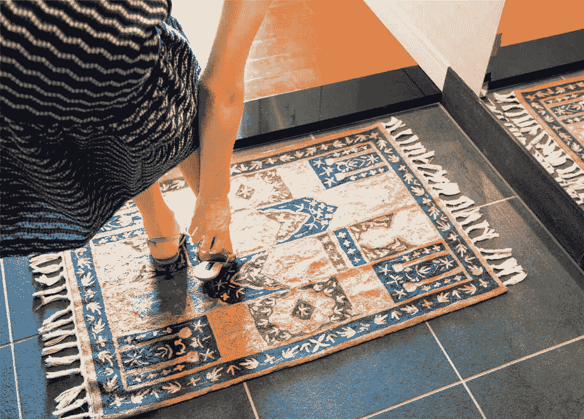

从“我回来喽”开始轻松灵活的家务安排

## “晚家务”守则

欢迎回来。

很多白天外出的人主要做家务的时间是在晚上。拖着劳累了一天的身体回到家，无奈地看着一堆家务活，还要思考得从哪件家务事下手好，想想就觉得更累了。很多养孩子的爸爸妈妈特别希望能充分利用好“孩子睡觉前的繁忙时间”。

那么，我们就需要给家务活做个“流程”。

所谓“流程”，并不是“活动路线”，而是时间的安排、家务作业的安排。

拿我自己举个例子。下面是山下英子的“晚家务”安排。

不同的时期有不同的生活状态：和公婆共同生活时，我家三口共同生活时，我一个人独居时……现在是只身一人去外地工作的状态。

山下英子式的“晚家务”流程图

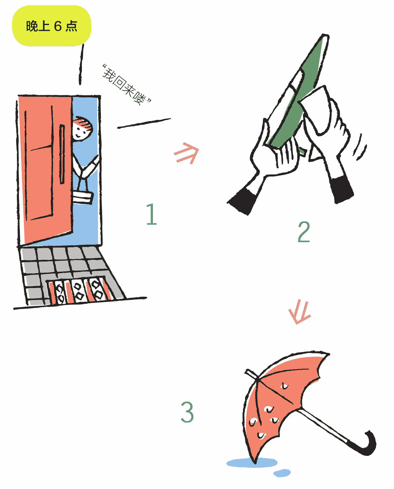

1 “我回来喽”

想回家，回到那种干净整洁的自带“欢迎回家”音效的家里。

2 保养鞋子

回家的小仪式，简单用布一擦即可。鞋柜里每层放两双，易通风。

3 撑开带雨水的伞

湿伞直接收起来容易发臭、发霉，要尽早晾干。

回到“welcome 空间”

晚上 6 点，和客户谈话之后回到家。虽然家里没有人，还是大声地自言自语“我回来了”。从这句话的回声中可以听见，家里也在说“欢迎回家”。从一个“令人神清气爽的房间”走出去我们会感到身心舒缓。其实反过来也一样。

进家门之后，脱掉鞋，光着脚，不要穿拖鞋。鞋子上有污迹，就立刻用布擦掉。污迹去得越早，保养起来越方便。鞋上出现潮气时要把鞋子拿出来晒晒，然后再收进鞋盒里。

使用的雨伞要撑开放在客厅里。等雨水潮气蒸发完了再收进鞋柜里，做到“玄关处不放杂物”。

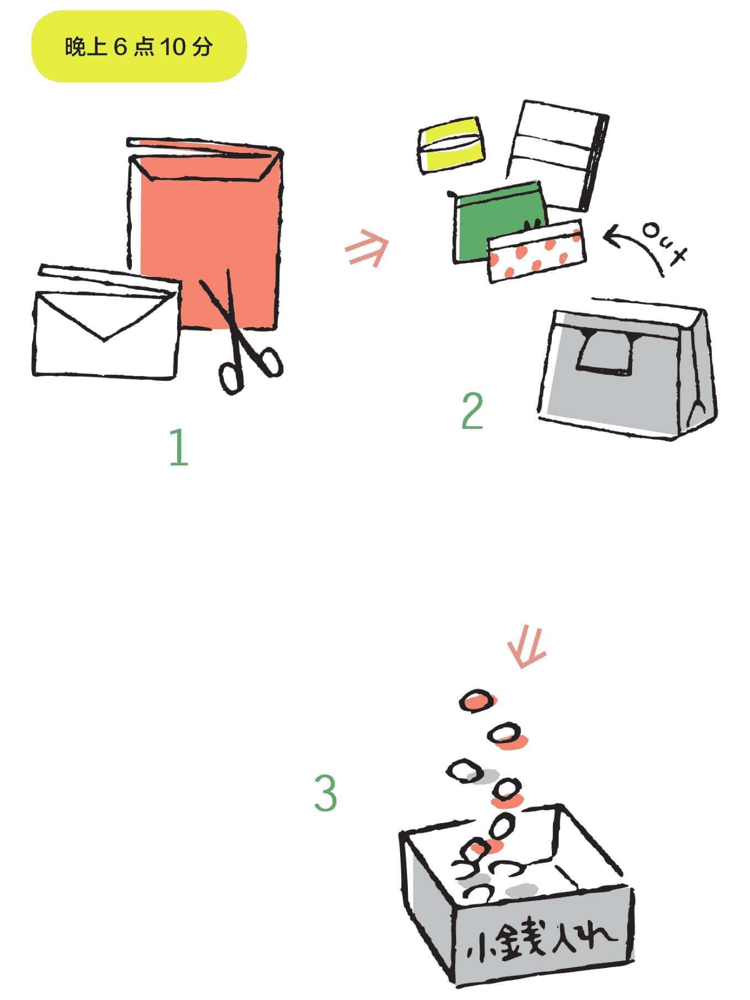

1 扔？不扔？

信函、快件之类的看完内容，马上决定扔不扔。扔，就刺啦刺啦地撕碎扔掉。不扔，就咔嚓咔嚓地剪开封口收好。

2 掏空包包

从装满“一整天小故事”的包包中把东西全部掏出来，让它好好休息。

3 零钱盒

检查钱包，从辛苦一天的钱包中掏出小票、零用钱，也让钱包好好休息。

今天的包包今天清完

对厨房兼书桌上放着的各种小包裹进行选择取舍。我拿着剪刀，咔嚓咔嚓地剪开包装，看里面是什么东西，然后再换个包裹拆开看。当场做决定要不要包裹里的东西。在一些小包裹、小邮件的信封上唰唰唰地留些折痕，方便读取里面的信件。

怀着“今天包包辛苦了”的感恩心情，把今天带出去的包包里面的东西全部倒入筐子里。清理包包最里面积攒的垃圾，取舍收到的名片。把包包清理得干干净净，再放进衣柜里让它好好休息，为下一次出阵养精蓄锐。

接着就是检查钱包。发票、收据放进记账簿的抽屉，把零钱放进存钱盒里，把银行卡也掏出来收好。

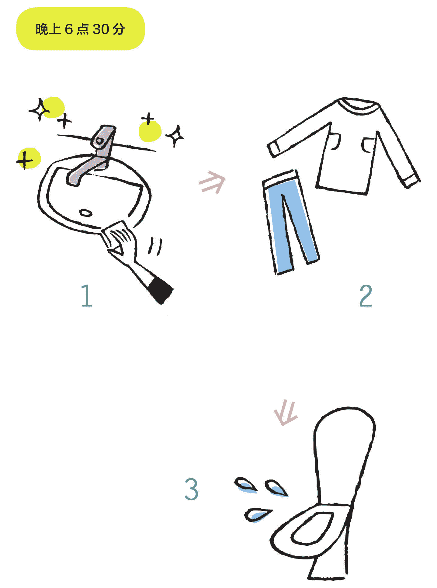

1 把镜子也擦得亮晶晶

每次洗完手，就顺便擦擦洗漱台。随手擦干净水龙头和镜子。

2 换上家居服，切换成宅人模式

做家务穿介于制服和睡衣之间的家居服，让在家休息的时间也充实起来。

3 不需要厕所用拖鞋

果断扔掉不可能每次用厕所都要洗的地垫和拖鞋。

水沫水泡要当场擦干

在洗漱台上洗手、卸妆后神清气爽。溅起的水泡水沫用洗漱台抽屉里的纸巾擦掉。擦完后，依然用这张纸巾擦一下镜子和水龙头，做到“当场擦拭”。

在带壁柜的卧室里换上家居服，把心情从外出模式切换成回家模式。脱下来的衣服放在衣柜里的“通勤服装角”，用衣架挂好。

上厕所时也做到“即用即扫”。拿起放在厕所架子上的厚湿巾，擦一下坐便器，再擦一下地板。为了保养管理方便，不要在厕所放置坐便套、蹭脚垫、拖鞋。

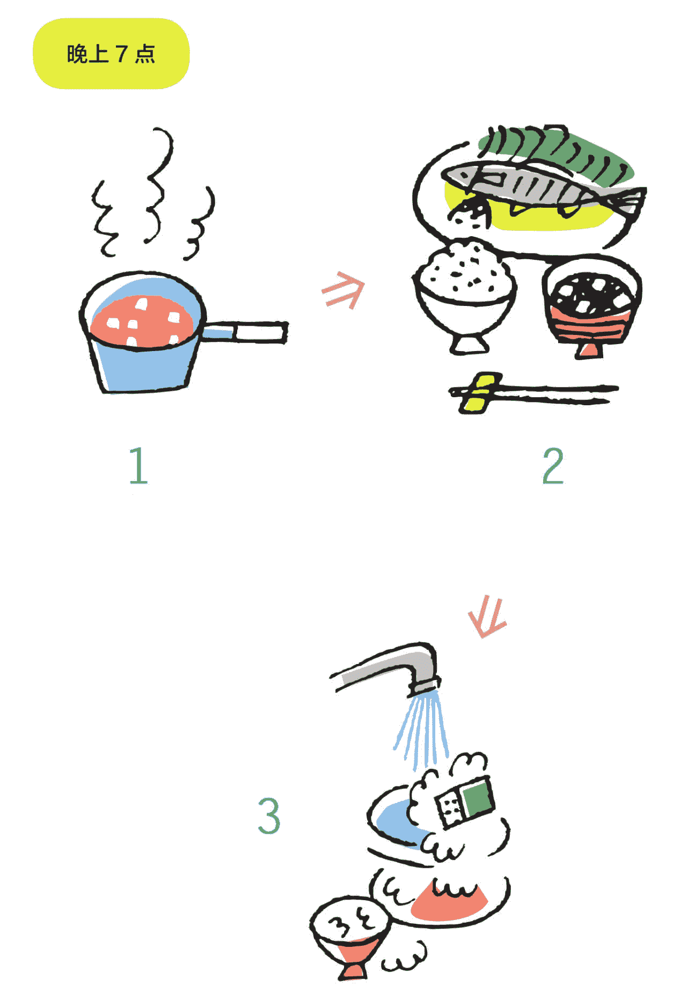

1 今天的简易菜谱

觉得“看起来不错”，就立刻买来做晚饭的食材。今天的主角是鳄梨。

2 幸福“一人餐”

越是一人独居，就越要找时间犒劳自己。不要只是喂饱肚子就算了。

3 不需要沥水架

洗少量碗筷时，关键是手洗完用纸巾擦干。

晚饭用最爱的餐具

晚饭是五分之三在外面吃，五分之二在家做。基本上是“满桌蔬菜”或是带“配菜”的简单料理。这天买回来好吃的鳄梨，切成大块，再搅拌上切碎的蓝纹奶酷，稍微加点酱油。

吃饭时，盛进最喜欢的九谷烧的瓷碗里，放在盆上，开始“一个人的美餐”。即便没有旁人的眼光，也不会直接吃带包装袋的现成饭菜。吃之前说一声“我开动了”，吃完之后说一声“多谢款待”。

洗完碗筷后，扣倒放在铺好的纸巾上面。厨房的瓜果菜皮垃圾放进小垃圾袋里，封好口。

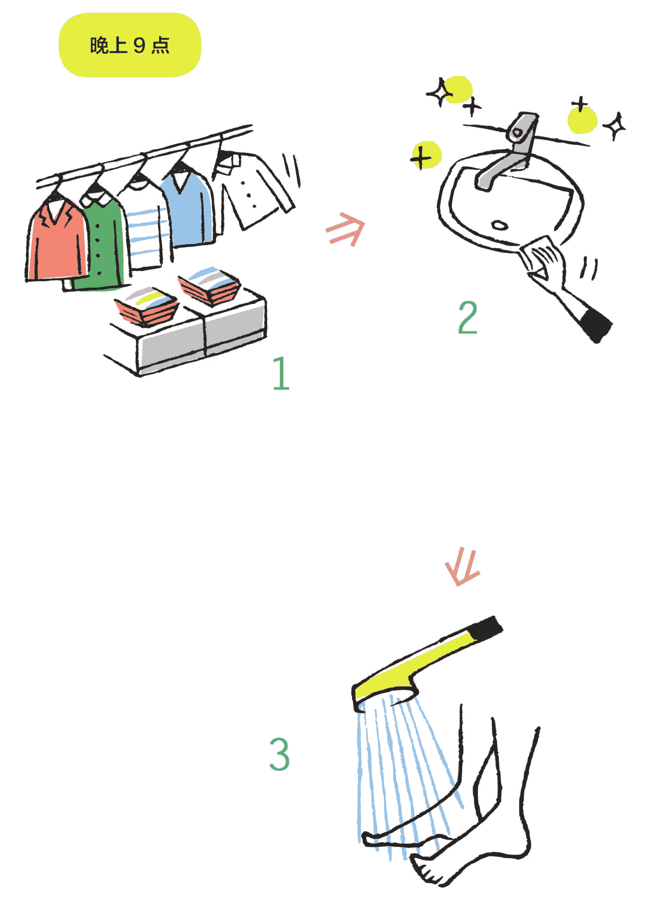

1 不叠衣服

要叠的只有毛巾。松松地放在洗漱台下面的抽屉里。

2 常用的物件用完及时放回原处，如牙膏、牙刷、洗面奶……

只要有一件东西被丢在洗漱台上没有被收好，很快就会有第二件、第三件……

3 晚上淋浴

为了省事，有时候只冲冲脚。洗脚还有放松的效果。

简单收拾晾干后的衣物

早上把在浴室烘干的衣物放回衣柜里。像衬衣或者罩衫之类的衣物挂在衣柜里，内衣叠放入不带盖子的衣筐，毛巾放进洗漱台的抽屉里。

刷牙时，用纸巾擦擦洗手台。牙刷、牙膏、洗面奶、化妆品等要全部放进架子的固定位置。不随便乱放。洗漱台上不放杂物，也会迅速完成“每次清洁”。

我喜欢早上洗澡，所以晚上就简单地冲一下身体，或者只洗洗脸和脚。从浴室出来时要注意检查下出水口，并打开排气扇。

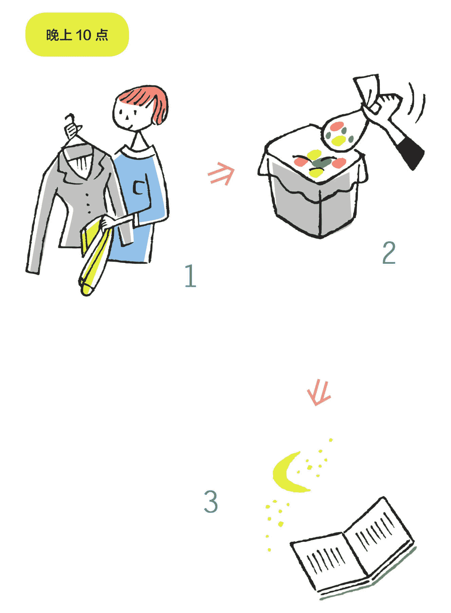

1 明日着装角

将明天要穿的衣服挂在衣柜正前方空出来的横杆上。

2 厨房的善后和扔垃圾

现在在公寓的每层楼中都设有 24 小时可处理垃圾的垃圾场，太好了。

3 绝美的睡前“躺着看书”时间

随意躺着看书，有小说还有实用书籍，与工作相关的书籍，最好不在书房读。

睡前小整理

第二天不慌慌张张赶时间的窍门在于前一天准备好出门的衣服。在脑子里大致过一遍第二天要做的事情，做到心中有数。

另一个睡前必做的事情就是厨房的整理。擦擦扣在纸巾上的碗筷，放回柜子里，再用纸巾擦擦水槽和台面，防止水分残留。把封口的垃圾袋拿到 24 小时都可回收垃圾的公寓垃圾场。

然后，把家居服脱下来换上睡衣。

拿一本自己最喜欢的书，最好不在书房或者客厅读，而是随意躺在床上看。一般不写稿子的时候，差不多看到深夜。该睡觉了，晚安。

## 维护保养守则

### 玄关处不放杂物——没有伞架和拖鞋架的空间

玄关是“welcome”空间。当我们下班回到家后，最先来迎接我们的就是“玄关”。我特别注意玄关处“绝不放东西”。

准确地说只放了一个脚垫，铺在玄关处的水泥地上。脚垫连接家里家外，类似一个踏脚石或门帘的作用。

回家之后，在脚垫上脱下鞋子，进入客厅。鞋脏了的话就立刻用布擦干净。鞋面上有潮气，就先在玄关处晾晾再放进鞋柜。

下雨天，先把伞撑在客厅晾干，也可以放在玄关通道或者房檐下。不过我家是内部带楼梯的复式公寓，在客厅就能晾晒。晾干伞之后，就放进鞋柜里的伞盒中。玄关没有伞架。只有一把雨伞，有时也多拿一把折叠伞。

在家总是光着脚走路，不穿拖鞋，还跟客人说可以赤脚进门。不穿拖鞋，所以不用放拖鞋架。

虽然公寓面积不大，但总是有客人赞叹说“好宽敞呀”。

这是因为没有杂物。在不丹菜市场买的色彩艳丽的三合土脚垫是家里唯一的色彩点缀。除此以外，没有什么东西需要特别进行管理保养。而且这个脚垫是每三个月才去干洗一下。

一人独居和多人共同住在一起的生活是不一样的。人越多东西就越多。那么，是不是可以说鞋子多得鞋柜里都放不下，乱堆在玄关也是没办法的办法呢？

不是，仔细观察一下你会发现，自己现在穿的鞋基本上都没放进鞋柜，而是乱摆在地上。而鞋柜里基本上都是没放在显眼处的鞋子，还有那些被遗忘、变得不被需要、永远没有出场机会的鞋子。伞也一样。各种各样的伞密密麻麻地摆在伞架上，比家里人还多。还有几把塑料伞找不到主人。拖鞋架上塞着拖鞋，鞋柜里塞满旧鞋。大衣架上挂着大衣、帽子、围巾、包包。脚底也堆满了孩子的溜冰鞋等玩具。

这种玄关完全没有它本身的“welcome”的意义。

你回到家想看见什么样的玄关呢？

不放鞋子的玄关

没有摆鞋子的玄关

回家后，把修整好的鞋子放入鞋柜，玄关的地面上放着一张脚垫。

1 长柄伞一把、折叠伞一把

看见塞满各种雨伞的伞架总是忍不住感到呼吸困难，我家的伞全部放在鞋柜旁边的架子上。

2 鞋柜里每一层放两双鞋

很喜欢露脚趾的后跟高 7 厘米的浅口皮鞋。把它们像商场的鞋子一样展示在鞋柜中。

### 纸质类要即读即处理——不拖延

回家后，检查信筒，总有几封信或者明信片。随便瞅瞅，先存起来之后再细看。这样只会让各种邮件越积越多。“先存着之后再看”这个想法浮现的一瞬间已经被举红牌了。

正确的做法是：随手拆开看看，当场做决定扔不扔。

但是，为什么我们总是想先存着之后再细看呢？

没时间所以之后再看。

打算之后认真整理。

这么想着想着，这些纸质的邮件不知何时就堆成了小山，也不知何时山就会塌下来。

“之后再做”就等于“集中再做”，等于我喊了很多次不要做的“集中做家务”。“集中再做”也就是推后再做判断。一般来说，人人都有拖延的潜质。不在现在下判断，不做决定就会辛苦。

邮件包裹是一些本来家里没有、被人任意送到家的东西。但奇怪的是，没看见它们的时候，我们不觉得它们推荐的东西很有必要，但当我们看见的时候，会下意识地把这些东西当作必需品。这里面甚至有不少假货山寨品。

邮购广告册就是这类典型。

打开这本“不速之客”后，边翻边觉得这里的东西确实有自己需要的。脑子里面蹦出很多想法——哎，这个东西我原先就准备买呢。这种现象叫作“拉布拉多脑”的表现。

我们往往不是想要什么东西才去买，而是为了买东西去找东西买。希望以后能为买东西找到理由。

那应该怎么做呢？最好是看见邮购的信件广告，拆开翻一下，然后立刻扔掉，忘记这回事就可以了。

也有人不拆开看直接扔掉。如果你愿意的话，拆开看看后扔掉也没关系。不过，只要一翻，脑子会自动浮现想买这个想要那个。因此，这时候一定要提醒自己“只不过是看见了这个东西才觉得想要罢了，其实自己并不需要”。

深吸一口气，告诉自己“我原本就不想要这个东西的”，然后把它扔进垃圾桶。如果看了之后觉得有必要的话，留下来也没关系。

我也保留着某些邮购小册子没有扔。都是些小地方的美食目录，是之前订购过东西的商家新寄过来的。

保存这些邮购件的东西有个窍门，就是把邮件袋用剪刀剪开后放好。这样想看的时候一下子就能取出来看。

邮购袋的封口有胶水，拿出广告册时容易黏住页面。所以先把东西取出来，剪掉封口的胶水部分，看起来比较麻烦，其实是为了下一次看的时候方便拿取。

我觉得剪刀真是个伟大的发明。用剪刀裁剪和直接用手撕，方便程度和切口的美观度真是天差地别。

剪刀是件好宝贝，简直可以每个房间都准备一把。

保存的信函快件，坚持易看好取主义

信封口剪成波浪形

用来装邮件信函的信封大胆地用剪刀剪下封口。有截止日期的文件也能马上发现，称得上是个提醒装置。

### 包包里的东西通通放进筐子——“是否是自己需要的东西，一目了然”

外出一天，带出去的包包仿佛变成了垃圾箱。一回到家我就马上把包包里的东西全部清空。

打开包包，清掉垃圾，把里面的东西全部收拾到筐子里。包括刚刚认识的人的名片、新的策划资料、刚刚出版的新刊物……边收拾还能边回想一下今天我做了什么事情。

俯视包包，也能综合审视所有事物。比如发现文具快用完了，就进行补充；注意到其实自己没必要带化妆小包，因为我不化妆。

也能防止自己忘东西。

第二天，无论是用同一个包，还是换个包包，都从筐子里将物品原路搬回包包。用不着为了找东西而慌里慌张。

钱包也一样，回到家看看钱包里的东西。收集的票据等放进书房的票据夹里保存。虽然不记账，但为了核算开支也保留着小票。

养成每天掏空包包的习惯

1 回忆这一天的事情

一个一个地把包包中的东西全部放进筐筐中。算是回家后小段的单人仪式。

2 只放要用的卡

最近开始用的长皮革钱包。除了现金只有一张银行卡、两张信用卡、PASMO（交通卡）和保险证。

零钱全部从钱包中取出，存起来。

存多了说不定可以去泡泡温泉。

这样一来，包包清空，钱包也减重了。无声地告诉它们“今天辛苦了”，让它们也喘口气休息一下。

像包包和钱包我常会定期更换。

我特别喜欢各式各样的包包，很多包包是在旅途中一眼看中买下来的。不过，手里的包包数量会做个“总量限制”——通常都是 5～6 个，再加上 2 个手提行李箱。如果超过了这个数量，就会马上为它找个“婆家”嫁出去。

钱包使用周期大约是 1 年。

钱包是钱的窝，所以要常常通风换气，有出才有进。

### 对零碎物件进行“集中式管理”——不要备存太多文具

你是不是曾经在家翻箱倒柜地找，发现“确实买过的干电池找不到了”。干电池是大家经常用却没有固定放置地方的东西。

从家务的活动场所来看，把干电池放在“使用电池”的地方看起来是比较方便的。但是厨房、客厅、洗漱台等很多地方会用到干电池，每个地方都放的话，来回找，也会经常找不到。

因此，只能指定唯一一个地方放干电池。这就是“集中式管理”。

当我们没有目的地，东一榔头西一棒槌地找东西时，心情一定不怎么好。但当目的地明确，径直走过去就能拿到东西时，这种心情肯定大不相同。

我的干电池的特定席位就是玄关的架子，电池和灯泡一起放在加装的玄关抽屉里。

旁边的抽屉里是点火器和打火机。柜子里还存放着厕纸、纸巾、防灾用的矿泉水、手电筒、灯、透明胶、绝缘胶带、透明胶布、五金工具等。

也就是说，所有的日常用品都在这个柜子里进行“集中式管理”。尤其是为灾害或停电时备用的应急用品，集中放在防灾玄关附近比较放心。

文具用品都在书房的抽屉里进行“集中式管理”。特别是橡皮、墨水等零碎物件，很多人喜欢用标签化进行管理，其实没必要。再怎么细化分类，东西的功能是不变的。

断舍离的系统建立，让我们可以不进行细致分类，也能顺利完成工作。

这种“集中式管理”可以让人“俯瞰”抽屉，对内容一目了然。同时也要求我们精选抽屉里存货的内容和数量。我定下的“总量”是一支圆珠笔、三支签字笔、一卷透明胶带、五个便签。

很多人存了像小山一样的文具，导致很多没有出场机会的无用藏品。成堆的圆珠笔里混着几支签字笔，用的时候找不到只好又跑去商店买。

自己有什么东西都能一目了然、一清二楚，这才是断舍离的应有之态。

去掉盖子，放在指定位置毫不费力地取出东西的布局

1 打开柜门，随用随拿

去掉螺丝刀收纳盒的盖子，随用随拿即可。玄关的柜子里放着防灾用品以及日常用品的库存，大致分类后进行“集中管理”。

2 螺丝刀盒也能当作书夹

用于应急的东西只准备了水。食物在冰箱和冰柜里存放。坚持“72 小时”努力自救，思考之后的措施。

1 文具进行集中式管理

书房柜子的抽屉是文具的专用地。备用的文具这么少会不会不够用？没关系。每次补货时再检查数量就够了。

2 订书针也做到随用随拿

有人觉得没有盖子不好，其实主要因为库存太多罢了。换订书针的时间比较不固定，所以尽量做到随用随拿。

能立刻知道什么东西放在什么地方！无盖收纳，一触式成为可能

1 人们常常把针线盒做得很大

没必要，有些家庭会大量使用白线。钉扣子和改短裤边裙边之类的针线活，这种大小的盒子正好合适。

2 家庭开支用的收据发票放在这里

每天把钱包里的收据或与开支相关的东西保存在这个盒子中，定期送给受委托的税务人员。

3 存得越来越多的零用钱

回家后照例检查钱包，掏出零钱，放入这个小存钱盒。也不是为了存钱，就是一个小乐趣。

4 让人恢复元气的钥匙挂件

在亚洲的小市场中一眼就看中的小挂件。鲜艳的颜色和奇特的形状特别能刺激交感神经。

## 料理守则

### 不想做饭是怎么回事？——从打造一个愿意走进去的做饭空间开始

听到很多主妇（夫）抱怨道：

“做饭真麻烦。”

“考虑做什么饭太费脑子了。”

但是该做饭时她（他）们还是硬着头皮去做，因为家里人正饿着肚子翘首以盼呢。也许做饭真成了一些人的心理负担。

这本书并不是教大家“掌握某个小技能就能即刻提高做饭水平”，而是要改变大家对“做饭”的初衷和认识。

其实，主妇（夫）们所抱怨的“真麻烦”“太费脑子”“不愿意做”的情绪后面隐藏着对于做饭本身抱有“这是个作业”“这是个义务”“不得不做”的深层情绪和认识。

那我们如何才能找到“想吃的饭菜”，如何才能“愿意主动去做饭”呢？

之前我说过家务的基本做法是分散做家务。做饭也一样，时刻契合当时的心情和状态来行动才重要。假如能意识到人本是一种心绪变化无常的动物，就不会再冲动地“一下子把一个星期的用量全买下来”。

除此之外，还有适用于专业料理人的超大量的食材和调味料也是家庭主妇的盲区。一旦被“超省钱！超优惠！”的噱头吸引住，只会让存货越多，浪费越多。这些东西要设定一个囤货“上限”，要适量。

另外，也不要“提前准备好饭菜”，这也是“集中做家务”的一种表现。“提前准备以后的饭菜”说白了就是认为“有剩余食材，干脆多做一些吧”或者“还有时间，再多做些吧”。

“集中买东西”和“提前做好饭菜”导致的后果就是厨房会被各种各样的东西占满。台面上乱七八糟，冰箱里挨挨挤挤，同时洗碗池里堆满了碗筷。你想想谁愿意站在这种厨房做饭？肯定嫌弃地不愿意踏进去。

因此，打造一个“人愿意进去做饭”的厨房的第一个条件是减少物件。不堆放多余的杂物，不集中多个任务。

厨房台面上整洁干净，不摆杂物；冰箱里面的食材一目了然，这样人才会有食欲，这样才会有动力卷起袖子做一席“美味大餐”。

### 冰箱里的东西要“一目了然”——不用购物塑料袋包装食材

请大家打开家里的冰箱门看看。

里面有什么食材？有多大量？

食材或调味料是不是“看一眼就明白”？

很多人经常是把食材连同超市塑料袋一起塞进冰箱。蔬菜也是连同塑料袋一起放进蔬菜盒中。也许购物袋大小与蔬菜大小正合适，但打开蔬菜盒，如果东西都挤在一起，那便分不清是萝卜还是白菜。

另外，有些超市还配有比购物袋更薄的透明塑料袋，为的是提回去的时候防止食材溢出或者漏汤汁。食材放进冰箱时，这种透明袋已经没用了。带托盘或包装盒的肉或者鱼类，要把盒子折成更方便看清楚和拿取的状态再放进冰箱里。

买东西回到家就马上从购物袋或透明袋里把食材通通拿出来。这个“小麻烦”可以省去以后的“大麻烦”——冰箱里的东西一目了然，而且拿取方便。

我是把蔬菜转移到密封保鲜袋里。鸡蛋则是从购物袋里拿出来，像橘子一样堆放在盆子里。

调味料也是“随用随买”。常备的调味料有酱油、食盐、豆酱、调料酒、白酒等，另外还有配合烧的菜而买的必要调料。

有些人的家里，厨房像饭店的后厨一般摆着一溜儿调味料。平常会用到什么泡打粉吗？囤的很多食材或调味料最后都会用不完扔掉。一旦习惯“集中购买”或“提前做好饭菜”，我们的大脑就懒得去思考了。同时，感受性和敏感度也会降低。

冰箱里的食材原则是“能一下子拿出来”，因此，冰箱里的东西要做到一目了然。如果食材被塞进冰箱最里面，看不见就会忘记。结果就会导致东西买重。

冰箱里面有什么东西、东西够不够，这些情况如果掌握不好，就要立刻“断舍离”。

冰箱中的瓶瓶罐罐尽量不带什么花哨颜色

摆满鲜美食材的冰箱

像装食材的塑料瓶上的包装纸、商标之类的在第一时间就撕下来扔掉。除了给客人喝的碳酸饮料等。调味料和海鲜干货放在冰箱里集中管理。

对常用物件进行“集中式管理”

从包装袋中取出下水道滤网

厨房下水道用的滤网要从包装袋中取出放入透明盒中，放在水池上的架子上。

### 无须带盖的容器——方便拿取的透明袋

保鲜盒之类的密封容器是非常方便的，不知道你家放着几个保鲜盒？

我听说很多人家里的保鲜盒都是大的套小的，小的套更小的。如果有 100 多个保鲜盒，那就需要专用收纳空间来放置这 100 多个盒子。

我为了不让这种密封容器增多，特意把东西保管在冰箱里。规定好保鲜盒的数量，小保鲜盒只用 10 个（Ziploc[^(\[1\])](#part0063.xhtml_zhu1)制品），大保鲜盒只用 5 个。以前是用保鲜盒装饭菜，放进冰箱冷冻。现在对保鲜密封盒进行了“断舍离”，改为 Ziploc 制造的密封袋。因为，保鲜盒有盖子，不能一下子拿出里面的食材。而且用保鲜盒可以上下摞起来，特别容易堆积食物。

前几天，我去一位学员家观察了一下厨房情况。

冰箱里面放着在百元店买的两层可抽拉搁物板。一般是打开冰箱，抽出搁物板，拿出里面的东西。

我看到她打开冰箱后，直接把手伸进里面拿出了食材。

这个过程中她没有抽出搁物板而直接完成了，也就是说搁物板是不必要的。虽然这个搁物板的广告宣传词是“收纳托盘，能抽出来取东西，超方便！”但实际上，我没见她用过这个“抽拉”功能。

很多人是在冰箱前面来回走动作业，那可以干脆选择薄款冰箱。

因此，我爱用密封袋代替保鲜盒。基本上是即拿即用，也可以用完扔掉。也有人洗洗密封袋重复利用，不过用过的袋子再清洗、晾干也会花精力，本来用这个袋子是为了减少麻烦的。

大米、小米也用密封袋保存。我一般是买 4 斤米先放在大的密封袋里，量越用越少就换成小袋子。

我家的冰箱门两侧的抽屉里插着 8 个强力夹，这些夹子用来封口一些未用完的袋装食材。一打开冰箱门，这些夹子就清楚地告诉我哪些东西是未用完的或者吃了一半的。

透明胶带也放入密封袋中

透明胶带也放入密封袋中

密封袋不仅可以用在冰箱中，透明胶带也可以放进去避免发黏。毫无压力。

洗漱台处也做到随用随拿

洗漱用的各种小物件都一目了然地摆放在洗衣机上面的架子上。按类别装入不同的透明玻璃杯中，可以马上实现“一触式使用”。把容易丢失的梳子和刷子收在一起。

### 厨房台面的杂物控制在最少量——视野范围内的煮锅和平底锅

以前在一本杂志上看过介绍英国厨房的一篇文章。文章中有个醒目的广告语“台面上只放一个水壶”，这句话对我触动很大。

现在我家的厨房台面上只有茶具套装、装饰用的容器、新蒸汽烤面包机，然后就是水壶。零碎的物件收进抽屉，碗筷餐具收进柜子。

电磁炉和电饭锅可以用其他用具代替，所以进行了“断舍离”。

有个词叫作“用之美”，意思是好用的东西经由风霜雨雪千锤百炼之后会自然带有一种美。我选择厨具的关键就在于此。视觉上的美感即是正解。

煮锅和平底锅用的是 Le Creuset[^(\[2\])](#part0063.xhtml_zhu2)制造的红色厨具。红色据说可以增加食欲。

包括标准大小的煮锅、稍微大一点的椭圆形锅、稍微小一点的煮米锅，还有平底锅 4 个。它们都放在燃气台下的抽屉里，一目了然，易取易拿。每个锅下面垫个垫子（NITORI 制造的垫子），隔出空“间”。因为数量有限，所以这么做也没问题。抽屉里没有什么不用的锅或者用起来不顺手的锅。

为了心情愉快地在厨房做饭，重要的不是考虑活动路线，而是考虑动作（精力）的消耗。

用 Le Creuset 的时候，打开抽屉，直接拿出厨具。炒完饭菜之后直接端到餐桌上。拥有“用之美”的料理用具不仅仅是样式美观，而且有烹饪的便利性以及增强美味度的功能。

让人想一展厨艺的厨房

有可爱的水壶、碗盘、茶具等小玩意点缀的厨房，绝对让人有“好，我要一展厨艺喽”的冲动。害怕煮饭，怕麻烦的人可以试着从“减少厨房杂物”开始。

大勺和铲子放在从台面和燃灶台上一下子就可以拿出来的柜子里进行“集中式管理”。

很多人会把这些料理厨具挂在厨房的某处，我其实不太喜欢吊挂着很多东西的空间。

我家的厨房垂吊的东西只有小切板、防烫垫布和剪刀。

如果东西不多，这种“垂吊感”还是挺有趣的。

同样，取碗筷的原则也是“几乎一把能拿取”。因此，要限制碗筷的数量。我只保留喜欢的东西，对自家厨房的每个碗、每只杯子都怀有感情。

要实现随用随拿的便利性，关键是尽量不叠放餐具。如果必须叠放同类型的餐具，也要尽可能地少量叠放。叠放得越多，行动精力和时间消耗就越大。长此以往，就会出现小盘子被当作底垫放在大盘子下面的惋惜情况。

请把餐具和厨具展示在橱柜里吧，就像摆放在商店里的商品一样，注意每个商品之间有合适的“间距”，这不仅看起来美观整洁，方便程度也会明显升级。

厨房中的有爱小玩意

能饮一杯否？

厨房的一角摆着一套茶具。因为我常去中国大陆和中国台湾，有机会碰到各种各样的香茶。我通常会加点蜂蜜在茶里。味道会更好。

新来的厨房家电

把咖啡机断舍离后，入手了一台烤面包的专用烤箱。因为除了面包，还想吃烤饼。

### 简单食谱

不需要菜单的配菜料理

料理的概念是“简单美味”。搭配豪华配菜。

我从不需要什么菜单，而是交给我的“食之感应器”。

现在的我想吃什么？

或者（有客人的时候）想一起吃点什么？

在这个前提下，就和冰箱里的食材“聊一聊”，如果恰好对胃口，就立刻开始煮饭。

否则便上街去买菜。

同样在商店也要询问自己。

我的客人大为称赞的是下面这道菜。

蒸煮圆白菜，配点腌制沙丁鱼

食谱

1.洗净切碎圆白菜，铺在锅中。

2.将罐头中的沙丁鱼分散在白菜上，蒸 15 分钟，用盐、胡椒、清酒来调味。

3.撒上作料（荷兰芹等），直接端锅（Le Creuset）上桌。

很简单吧。不用烤箱，只需要蒸蒸即可。

这道菜里的食材代表一切。买来新鲜的圆白菜，好做又好吃。沙丁鱼罐头不要买便宜的，选一款味道好的来用，因为“鲜”是食材的命。

一位朋友说过：

“经常做清煮扇贝和胡萝卜色拉，一旦买些便宜的扇贝来煮的话，菜会变得超级难吃。为了省 100 日元，却毁了一道大菜，得不偿失。”

我的料理宗旨是“食，讲究的不是别的，而是选材和搭配”。撒上作料后，款待客人的色香味俱全的菜就完成了。

多余的葱、姜切碎后放入冰箱保存。不用专门为配菜而买的，可以用剩下的调味品。

这些调味品长时间搁置在冰箱里的话，会出现霜渣，因此要尽早使用。实在用不完的，要及时处理掉，不要勉强使用。

虽然用不完食材会有浪费粮食的罪恶感，但这也属于断舍离所反对的“提前做好”的一类。尽管把它当作用不完的东西，也没关系。我们有必要摆脱“东西必须用得干干净净”的幻觉。

除此以外，我还存有“秋葵、香菜、岩烧海苔、鲣鱼干”等各种各样的调味品。把这些调味配料撒在豆腐上，就可以立刻做出一道别致的菜。冷面上堆着冒尖的配菜也是我喜欢的吃法。

直接将蔬菜“整个儿煮”“整个儿炒”“整个儿蒸”

我既喜欢把蔬菜切碎做配菜，也喜欢直接把整棵蔬菜单独烹饪。比如：芦笋、秋葵、香葱……整个儿烹饪后，在中间滴几滴酱油，既美味又美观。

烹饪方法也比较简单，或炒、或蒸、或煮、或直接上桌。也可配点肉。无论是日本风、中国风，还是西洋风，随时可以变身成各种风格的菜肴。

因此，关键是用新鲜的蔬菜。再研究一下作为点缀的奶油、盐、胡椒。整道菜的味道和卖相会一下子提高。

蔬菜的单品料理，我首推的是葱。

炖大块葱，培根风味

食谱

1.将一根标致的大葱横切成 5cm 的小段（下仁田葱真是绝美）。

2.放半锅水，用清汤煮大葱。

3.煮好后撒上培根碎。

做起来很简单吧，其实尝起来也很美味。

“山下英子牌的炖大块葱，培根风味。”给自己的每道菜都起个有趣的名字也是一种乐趣。甚至可以作个俳句，添点风雅。

此外，还有其他好吃的料理。大家知道，我的调味料基本上是酱油。

蔬菜单品的料理食谱

秋葵拌豆腐皮

在热水中加一勺盐，将秋葵稍稍过下水后，捞出来拌上豆腐皮，洒上酱油（高汤酱油味道更鲜美）。

酱油芦笋

把芦笋在放入一勺盐的热水里过一下，加上点酱油（直接品尝蔬菜的鲜味）。

番茄浓汤

将番茄切成 4 等份，用清汤煮烂后变成番茄汤（番茄汁的美味）。

烤辣椒

将红、黄、橙色的辣椒切成薄片，铺在铁板上烤制，烤好后洒上酱油。

蓝纹奶酪拌鳄梨

鳄梨切成大块，拌上蓝纹奶酪块，洒上酱油。

纳豆梅干

小颗粒的纳豆拌上稍微大一点的碎块梅肉，搭配点秋葵和大葱做配料。

整烧芦笋

芦笋拌上意大利干酪，洒上橄榄油，加上点胡椒盐，炒制即可。

烤青椒

在青椒上洒上点橄榄油，用烤箱烤热即可（这也是蔬菜本身的味道）。

裙带色拉

裙带菜上洒上芝麻油和橙汁调配即可。

* * *

[\[1\]](#part0063.xhtml_zw1)Ziploc：密保诺（Ziploc）是美国庄臣父子公司(SC Johnson & Son Inc.)旗下的密实袋品牌。

[\[2\]](#part0063.xhtml_zw2)Le Creuset：1925 年成立的知名法国厨具品牌，国内也称为“酷彩”。

## 善后守则

### “用完后立刻收拾”是基本原则——让“过程”保持流畅，不停滞

吃完食物、喝完饮料、用完工具之后要立刻收拾。但是这种“善始善终”却出乎意料地很难做好。我遇见的基本上都是“善始不善终”。

多次亲眼看到的“不善终”的情景之一就是飞机上借用毛毯后的处置。很多人把毛毯随便皱皱巴巴地扔在座位上就扬长而去。至少也要折叠一下，可是很多人这点工夫也不愿意浪费。

叠放整齐的情况不多。

还有，新干线的厕所垃圾篓里用过的厕纸堆成山，快溢出来了。我已经见怪不怪地将纸丢进马桶，“哗啦”冲下去再推开门出去。

因为经常去中国出差，我发现中国人不会把厕纸扔进马桶，而是扔进垃圾篓。可能因为水质偏硬，厕纸不易溶解的缘故吧，所以每次看见垃圾篓里垃圾成山的场景，只能用“灾难”来形容。

当然，日本在这些事情上也是半斤八两。

日本只不过保养管理的次数多，保洁人员多次清扫，所以才不显得过于脏乱差，但是其实都一样。

最重要的是不让其延迟保养管理。

请大家牢记：没有任何一件家务活是集中起来做是最好的，也没有任何一件家务活是推迟之后做是最好的。

当然，人有惰性，会堆积东西，会有拖延症。而将堆积和拖延的事情尽早处置，让空间恢复到顺畅流动状态的正是“断舍离”。

### 用纸巾擦餐具——一般是用过就扔掉，擦得快，擦得干净

吃完饭收拾厨房的家务活，很多人觉得太麻烦，都不喜欢，甚至想吃完下一顿集中收拾。其实这时正需要“分散做家务”来帮我们减少麻烦。

趁着煮饭的间隙洗盘子，不用的厨具迅速洗干净。

每次用完餐具立刻收拾，会减少之后收拾的麻烦。两三个盘子洗起来虽麻烦，可一旦在洗碗槽里堆成小山，麻烦和困难度会猛然提升。因为集中起来做家务，会让家务活变成困难作业。

有人说自己用洗碗机，“碗筷可以集中起来后再按 start（开始）键完事”。这种说法看起来合理，但实质上也是“集中做家务”。因此，所谓“趁着电费很便宜，用个洗碗机，省了 20 日元”的小心思只会显得窘迫，是错误的“节约”。

把餐具扔在洗碗机里搁置的时间，即“等待时间=waiting”会给我们造成压力。少量的餐具可以立刻哗哗哗地洗干净收拾好，让整个家务活“流畅”起来。

为“分散做家务”加油鼓劲的工具是纸巾。洗完餐具后不用沥水架，而是用纸巾擦干。沥水架上堆很多碗、筷、盘、杯子的样子会显得不美观。

以下是收拾餐具的顺序：

1.先在洗碗槽的旁边铺好纸巾。

2.洗好的碗筷放在纸巾上沥水。

3.沥水之后，用新纸巾擦拭后放回橱柜。

先意识到纸巾是“临时放置在那里的”，然后再把餐具收拾进橱柜。

从台面到水槽，用纸巾全部擦干净。擦完之后直接丢进垃圾桶。用过之后就扔掉的纸巾就是这么方便。

我家的“清扫·擦拭·刷洗”的工作基本上都用一次性的东西。

洗碗用的海绵也是用两到三天后就换新的。

海绵特别容易滋生细菌。

绝不能一直坚持用到破、用到脏。

不用擦桌布、擦碗布、抹布。婆婆总是用完抹布后立刻要洗抹布。如果不用抹布，换成一次性的纸巾会很省事。

这种“善后”用的擦布类东西也要进行善后，既要清洗，又要消毒，还要晾干，花工夫，又占地方，看起来还不美观。从清洁度来看，纸巾比抹布类要干净得多。

纸巾要放在“想用的时候，能立刻拿到手”的洗碗槽下或洗漱台下等地方。备用品放在玄关的架子上进行“集中式管理”。

善后工作要清爽、整洁

1 绿色环保的多功能洗涤剂

天然植物提取的洗涤剂“松之力”。这个也能用于清洗食物。

2 随时利用纸巾

厨房中的劳动明星就是纸巾。放在水池下的抽屉里的透明盒中。准备随时出场。

方便活动的空间

碗筷沥水完毕后，用纸巾擦干放回原位。

### 坐垫、地垫、脚垫——不知何时被塞过来的杂物

我家没有厕所用拖鞋，但因为来家的客人会找拖鞋穿，所以只在有人来家做客时准备好拖鞋。厕所干干净净的话，也没有必要穿拖鞋。

厕所用拖鞋是以前老式的、经常湿漉漉的在厕所里用的拖鞋。但现在厕所都安装冲水式马桶，所以没有必要准备。

据说学校出现大规模流行性感冒的原因之一也在于厕所用拖鞋。以前，人们打扫厕所时总是从其他地方吭哧吭哧地来回打好几桶水去清洗厕所。而等变成了干布打扫厕所后，也就是马桶变成冲水式后，也就抑制了流行性感冒的发生。

厕所的拖鞋打理起来也很麻烦。拖鞋变脏了，说明厕所地面变脏了。尤其是坐便垫子、厕所地垫。要把它们打理好是极为困难的。

因为玄关地毯和厨房地毯之类的打理起来很辛苦，所以没有用。我不知道为什么很多人一定要在阳台、厨房等出入口放脚垫。

地垫之类的东西是思维懒惰的反映，直接沿袭父母一代的做法，只会消耗更多保养维护所需的体力和精力，只会为打扫房间制造障碍物。也就是说，“以物品为标准”的“物质轴”思维在这个过程中会得到形成和强化。

之前也反复说到过：一件物品，不仅指物品本身，还有附带的时间、空间和精力。因此，减少杂物就相当于重新获得了时间、空间和精力。

台面上干净轻松的空间

1 地板上没有任何杂物的整洁空间

不放地垫或拖鞋的话，厕所就马上宽敞起来。随用随擦，上完厕所后，顺手用湿巾擦擦马桶四周、地板，甚至马桶内侧。

2 享受“放松”一刻

厕所的柜子上摆着我在秘鲁小巷拐角处买下的画，还有别具当地风格的趣味小摆件。享受轻松一刻。摆件的故事还能成为与客人的谈资，时不时还能换个布局，换个心情。

### 垃圾袋，多多益善——抛掉“满箱思维”

大家一般什么时候会扔掉超市的塑料袋呢？

想必很多人会说：“不扔，反正总会有用的。”

也有很多人耐心地把购物袋折成三角形，叠放着囤起来。

的确，把购物袋当作垃圾袋用很方便。尤其是装食材的塑料袋，里面多少有点脏，正好用来当厨房的垃圾袋。换句话说，带回家的购物袋在家的停留时间并不长。

因此，家里的购物袋是会繁殖的。所以，我们要有“总量控制”的意识。

难道扔掉购物袋就是浪费吗？

请你把耐心折叠购物袋的时间换算成时薪，对比起来，肯定是不合算的，所以就不必担心浪费不浪费的问题了。

现在社会的物流是极为便捷的。人们意识到购物袋是随时可以入手的，或者人们觉得并不应该随时入手购物袋。

我“断”掉了购物袋。

去超市买东西就自带包包。而厨房用的垃圾袋会专门再买。小号（10 升）、中号（30 升）、大号（45 升）的全都有。

其实基本上都非常便宜。不像购物袋，垃圾袋被包装好装进盒子里，基本不占什么地方。

扔垃圾时，先扔进小袋子里面，快满了就立刻封好口。然后把小袋子扔进中号的垃圾袋里。中号垃圾袋快满的时候也立刻封好口，扔进大号垃圾袋里。

像这样收拾完后，不会出现什么垃圾的异味、臭味等。

垃圾桶放入水池下的抽屉里

没有味道，美观大方

我的原则是：扔也扔得漂亮。带水垃圾扔到水池下面抽屉中的果蔬垃圾桶中，抽屉中分纸垃圾、可循环垃圾、可燃垃圾三种，带水的果蔬垃圾的残留时间尽量做到最短。

# 第三章  
早上 6 点开始的“早家务”

出门之前做好这些事

## “早家务”守则

早上好！

大家是怎么起床的呢？

对我来说，比较理想的起床方式是“肚子饿了我就醒了”。让肠胃好好休息，睡眠质量就会马上提高。另外，泡个热水澡也是每天早上必做的功课。

很多要早起出门的人，没时间做家务活，出门前只是慌慌张张地收拾东西。

但是“早家务”的重点就是“出门前做好这些事情，回家后会让人心情愉快”！

本章将介绍一下缩短早上出门前收拾东西时间的小窍门——“随用随扫”“洗衣守则”等等。

下面就是我的“早家务”。很多时候我是早上 5 点起床，大家也可以尝试从起床就开始当天的“早家务”。

山下英子式的“早家务”流程图

1 晚睡早起的生活

自然睁开眼睛。感到肚子饿了就醒来的早晨充满活力。

2 首先拉开窗帘

东京的天空尚未破晓。站在窗前远眺窗外风景。

3 整理好榻榻米的被子

睡起来安稳舒适的胡桃原木，叠起床铺，活动一下身体。

4 关爱我的观叶植物

我养了一些耐干的观叶植物。它们自己会告诉我什么时候想喝水。

拉开窗帘，活动身体

我基本上属于晚睡早起派。有时候写稿子生物钟会混乱。虽然没有闹钟，但到 5 点我会自然而然睁开眼睛。

起床之后，先拉开窗帘。东京的天空还没有破晓。看着远方的高楼大厦逐渐地染上光亮，自己的心情也跟着高扬起来。

晚上在榻榻米上睡觉，所以先把被褥叠好。

给观叶植物浇水一般是夏天每周一次，冬天两周一次。这些植物基本上都是耐干的。插花的水是每天都换新水。在有鲜花绿叶的环境里，再怎么忙碌，看见这些花草，心里总会宁静片刻。

1 趁着放洗澡水的空隙准备早餐

从卧室可以直接到浴室，放好早上泡澡用的热水。

2 早饭是轻食

今天早上是酵素饮料，兑上水后，甜度刚刚好。来一口，神清气爽。

3 用纸巾把厨房各个角落擦干净

吃完饭立即收拾碗筷，不拖延。随后封好垃圾袋。

马上封好垃圾袋口

因为早上有泡热水澡的习惯，所以先放热水。趁放水时间去吃早餐。早餐很简单，很多时候只是吃点鸡蛋拌米饭或者昨晚的剩饭之类的，最近基本上就喝点酵素饮料。

我知道，早上吃轻松一点有利于身心活动。

早餐吃得简单，收拾起来也很简单。洗干净的碗筷倒扣在纸巾上沥掉水分，然后擦干净放进厨柜。再用擦碗的纸巾擦一下水池边后扔进垃圾箱，然后把装瓜果蔬菜的小垃圾袋封好口。

不在家的时候，如果想到家里的厨房还有剩东西或是垃圾的话，心情也不会太好。

1 洗衣机启动

去浴室泡澡让洗衣机自己咕噜咕噜地工作。把自己泡在热水中，泡 5 分钟的热水澡。

2 方便清洁的浴室

用肥皂和海绵打扫浴室，做到随用随打扫。因此，不存在什么顽固污垢，也不需要用硬刷擦磨。

3 浴室晾衣杆上挂好衣服烘干

衬衣和睡衣挂在衣架上。而毛巾、牛仔裤、长筒袜可以直接搭在晾衣杆上。

同时烘干浴室和衣服

进浴室之前，把脱下来的衣服也放进洗衣机里。

趁着洗衣机工作，就去泡澡。洗澡用的东西直接拿进浴室。热水澡大概泡 5 分钟。

洗完澡之后，放掉热水，打扫一下浴室，收拾下排水口的毛发。用海绵擦一遍浴缸和地板。不需要专门的清洗剂，用沐浴的肥皂就行。因为浴室不放什么杂物，打扫起来很方便。

衣服洗好之后，撑上衣架挂在浴室的晾衣杆上。毛巾直接挂上去，定好烘干的时间，开始“嗡嗡嗡……”

1 化妆、收拾仪容

工作日化妆照常按步骤进行，宅在家的时候保持素颜。

2 厕所用完即擦

打扫厕所时，用点精油，“让整个空间变得清爽干净”。

把水龙头擦得锃亮

刷牙之后就是化妆时间。因为“断舍离”，常常出现在公众面前，因此养成了仪容整洁的习惯。不过一般洗完脸后不护肤，属于“无作为护肤”。

化妆的一套工具放在镜子后的柜子里。洗漱台上一瓶也不会放。用抽屉里的纸巾擦一下镜子和洗漱台上的水珠，然后再擦水龙头。

每次用厕所，做到“用完即擦”。厕纸卷芯里塞点蘸有精油的棉花，空气中就会飘有淡香。这也是一种享受。

1 穿上昨晚准备好的衣服

无论早上多慌张，衣柜里“明日衣角”的工作装即拿即穿。

2 出门前检查各个台面

东西虽少，但还是会出现“随手放东西”的情况。

3 “我出门喽”

收拾好房间，穿着合身的衣服，精神抖擞地开始工作！

保持台面清洁干净

穿上衣柜里“明日衣角”的衣服，搭一个合适的包包。从之前掏空包包的杂物筐里挑出当天要用的东西，放进今天的包包中。

出门前养成习惯——保持地板和桌上不放杂物（尤其是与视线平行的吧台等）。保证地板上没杂物，就可开启扫地机器人。

拿着昨晚封好口的大号垃圾袋，扔进每层设置的垃圾场。这也是高层公寓的优点。

在玄关处检查一下仪容，朝着整洁的家说一声“我出门喽”。

### 不要勉强自己“好好做早餐”——从早起就不要勉强自己

早餐的英语是 breakfast。这个单词拆开来看就是“break（打破）fast（断食）”的意思。早餐正因为肚子饿得咕咕叫才显得香气诱人。

有时候我们因为睡前吃得太饱，一晚上没有消化完，而使得早上起来感到身体有点疲惫。这时候不妨省掉早餐，喝杯促进消化的饮料。我把这种早餐叫作“fasting”，可以调整自己的身心状态。

绝大多数人认为要“吃好早餐”。

这里的“好”是什么意思？

有规律地吃？

三菜一汤？

我认为这里的“好”是“遵从身体”的意思。有时候早上想吃饭，有时候则不想吃。肠胃是特别容易受到人的情绪影响，也是最容易疲劳的器官。人确实应该有规律地吃早餐，但是假如人已经过着并不规律的生活，所谓“有规律地吃饭”也只是空谈。

对于人来说，忍着肚子饿不吃饭很痛苦，反过来吃饱了还得吃饭也同样痛苦。因此，我吃早餐分两步：

第一步是决定吃不吃早餐，第二步是决定吃什么。

不管三七二十一，通通都要“吃好早餐”实在是做不到。如果想要规律地吃早餐，就必须有规律的生活节奏。要及时反省自己的生活节奏和质量，才能“好好吃早餐”。

“吃”是非常私人的事情。“早餐好好吃”的要求会让人感到有压力，因为“好好”这个修饰词不是指身体的行为，而是个人的态度。

其实，为家人准备早餐的主妇主夫们不必一天不漏地“好好”做早餐。现在是个营养过剩的时代，很多畅销书也在提倡“一汤一菜”，即便自己觉得“是不是有点分心了”的早餐，只要自己和家人吃得香、吃得开心就足够了。

请不要勉强自己，被“必须吃好早餐”所限制。

## 清扫守则

### 浴室里不放杂物——随用随拿式

近几年，包括日本人在内，越来越多的人不去澡堂泡澡了。正常体温比较高的外国人用淋浴冲冲澡倒也没什么问题，不过，对日本人来说，泡个热水澡才有洗澡的实感。与冲澡相比，泡澡更能让身体的毛孔打开，利于人体排出毒素。

有数据显示每日泡热水澡的人和不泡的人相比，幸福荷尔蒙（5-羟色胺）的分泌量是不同的。

我是晨澡党。5 点起床，到浴室放水，洗澡水设定为 42 摄氏度。早上洗澡的原则是“泡较短时间稍微烫一点的热水澡”。一泡澡，交感神经立刻变得活跃起来，脑子甩掉睡意，思维集中敏锐起来。

而晚上泡澡正好相反——泡适量时间的温水澡。适当的泡澡时间对身体有益，反之则有害。

洗澡的方式采用“澡堂式”——需要用什么带进去什么。我是把肥皂和洗发露放进小篮里带进去。

所以，一般浴室不放任何东西。包括脸盆、洗澡椅、洗发露、护发素、沐浴露、洗面奶、毛巾……都没有。连浴缸盖都觉得占地方。洗澡时才会把海绵、刷子等清洁工具带进去。

没有碍事的杂物，所以清扫起来很轻松。也不用什么浴室清洁剂，就用洗澡的肥皂来刷洗浴室。浴室的污垢是自己身体上的污垢，用肥皂完全可以清洁。

捡起落在排水口的头发丝，再用海绵擦拭一下，就洗完澡了。

“洗完澡立刻打扫”可以保持浴室不会滋生霉菌、不会产生滑腻处和水锈。

任何事情最重要的是反复循环。每次洗完澡就把碎头发丝捡起来，不费一丁点工夫。反而去清扫排水口下面长时间积累的厚厚的脏头发、脏垃圾需要很大勇气，会费很大工夫。

也就是说，平时就要保持浴室在不使用洗涤剂等清洁物就能简单清洁和维护的状态。

因为清洗的衣物要在浴室烘干，所以浴室也能保持干燥清洁，不会产生什么霉菌。

方便清洁的浴室

1 洗漱台下的沐浴用品

毛巾、抽纸、垃圾桶整齐地放入抽屉。

2 要泡澡喽！

“泡澡套装”：洗漱台下的第二个抽屉中放入小提桶。洗手液（有时候也用肥皂）随用随拿。一是浴室会烘干，二是无添加剂的洗手液不会因为发热而伤害皮肤。

宽敞无杂物的台面

因为是泡澡，所以洗澡的地方也不摆放任何杂物。不仅打扫起来方便，而且不需要花时间擦干净被打湿的瓶瓶罐罐。

### 厕所“随用随打扫”——没有拖鞋和地垫的厕所总是很干净

我很想摆脱一个潜意识——家居环境要保持干干净净，但是厕所脏也是没办法的事。

如同美食可以款待客人一样，厕所也能给客人带来享受。我们每天都要上厕所，都要在厕所里待一会儿。没有人不想保持厕所的干净整洁。

因此，带着“感谢之情”去“清扫·擦拭·刷洗”。

从厕所出来之前，可以顺手用纸巾擦一下坐便器和地板。就像随时抖掉身体上的脏东西一样，及时擦掉厕所的污垢。这就是“随用随打扫”。某些用纸巾擦不掉的，可以用厨房的旧海绵摩擦一下再擦。

既然“随用随打扫”，那么就不需要在厕所放置地垫、坐便器垫、厕所拖鞋。每次用厕所，多多少少都会制造点污垢，那么，如何对待这些灰尘污垢，才能保持厕所的干净整洁呢？

经常用完厕所就及时打扫，这样就不需要在客人造访时慌慌张张地倒大量的清洁剂去打扫厕所了。

不说别的，保持厕所的干净整洁会给我们每天的生活带来好心情。假如做不到这一点，心里的某处会不停地逼着自己“必须打扫干净”，必定会给自己带来很大的压力。

洗漱台也是一样。随用随收拾。及时捡起掉落的头发丝，擦干净喷溅的水珠，擦干净水龙头，擦干净镜子。

其实，如何能高高兴兴地“随用随打扫”，就在于台面上不放任何杂物，包括洗手液、牙刷、牙膏、化妆品、护发素、梳子等等。这些东西每天都要用，容易摆满台面，应该用完就及时把它们收进柜子。

打扫卫生用的纸巾也及时放入洗漱台的抽屉里。

你要不要尝试一下，这种“随用随打扫”的习惯会让人随手主动地保持环境的整洁，随时想要去打扫卫生？

假如地板上放满了东西，轻轻松松地用清洁工具打扫地板显然是不能实现的。

假如桌子上摆满了东西，简简单单地擦一遍桌子也是做不到的。

一个人之所以做不到随用随打扫，主要是因为打扫之前杂物已经放置得乱七八糟，无从下手了。

因此，扔东西！扔东西！扔掉多余的不需要的杂物！

扔掉打扫厕所的“马桶刷”

清洁工具放在不可见的地方

清洁工具占地方又不美观，全部集中放入一个柜子中。不需要用马桶刷。马桶也可用湿巾来擦，不需要专用的马桶刷。

### 随着季节，更新“百日元小摆件”——买多少，处理多少

很多 100 日元店（相当于中国的 10 元任选店）里面摆满了各种各样可爱的小玩意小摆件。进去逛上一逛就不小心买回一大堆。心想着“不过是 100 日元而已”，也没想太多，直接扫进购物筐里，等算账时往往不是以 100 为单位的消费。

等回过神再看，家里已经成了自建的“100 日元小件”的宝库。玄关竟然装饰着 100 日元×20 个=2000 日元的东西。这些东西没时间一个一个地仔细擦拭，满是灰尘。显然直接买个价值 2000 日元的东西更容易保养。

这种遗憾的情况其实就是忘记了物品本身是附带着保养管理的精力需求的。买东西之前，并没有意识到“清扫·擦拭·刷洗”会花很大的精力。

不过，虽然有很多家庭东西很多，但还是喜欢买小玩意装饰家。小摆件、小饰品确实让人觉得格外别致，但是我在这里强调的是认真细心地保养这些东西会比较花时间、花精力。

我不是说不让大家去买，反而我很赞成心情雀跃地逛街买东西。像 100 日元店的小摆件最适合用来做展品，体现春夏秋冬的不同气息和感觉。比如正月里放点代表正月的小玩意，万圣节摆上奇形怪状的鬼怪玩意。一定会给节假日增加色彩。

但是，哪个季节就放哪个季节的东西，过了这个季节就马上处理掉。同样，哪个节日就放哪个节日的东西，节日一过就处理掉。

“买多少，处理多少”。

这就是断舍离的基本原则。

也许很多人误解断舍离就是禁欲式的克制物欲。其实不然。

我拜访过很多人家，他们最喜欢听的是“买东西吧，扔东西吧”。大家有购物的欲望，因为有很多店的东西又便宜又可爱。

我超爱买东西。买东西那一瞬间心情非常兴奋。当然，也有买失败的经历。

买东西就有买失败的风险。买失败并不可怕，反而是我们重新审视该如何处理物品和自己关系的机会。然后“该扔掉的尽快扔掉”。

实践断舍离后，我们会意识到以前意识不到的东西，比如藏在暗处的灰尘、隐蔽的污垢等。所以我们才想要“清扫·擦试·刷洗”。

数据线丢失的状况再也没有了

1 用绑头发的皮筋束起来

酒店中的洗漱用品中有棉质的束头发用的皮筋。一些容易缠绕在一起、理不清的数据线、耳机之类的，就用这种皮筋束起来。和橡皮筋不同，这种皮筋解起来也很方便，外形也很可爱。

2 用专门的“电子产品收纳筐”，防止找不到东西

像照相机、录影机、手机、U 盘、充电器之类的掌上用品或数据线、耳机之类的东西全部放在书房柜子里的抽屉中进行“集中式管理”，根据不同功能，进行大致分类，防止用的时候找不到。

## 洗衣守则

### 洗衣是每日必做功课——少量衣物也不拖到明天

“要洗的东西挺少的，存多点再放洗衣机吧。”

看起来没什么矛盾的想法，其实这真是把自己逼到绝路的“满箱思维”。

只要有要洗的衣物，就当天洗当天晾晒。不要让家务活的“流动”堵塞不畅，保持良性的循环，才是最关键的。

每天早上，进浴室泡澡之前就打开洗衣机洗衣服。因为是一个人，所以衣物件数不多，不过还是保持“随换随洗”。

洗完澡出来，衣服也洗好了。把脱水后的衣物撑上衣架放在浴室烘干。毛巾、牛仔裤、长筒袜等直接晾在衣杆上。过一会儿再翻一翻。

本来应该把洗好的衣服晒晒太阳。阳光的味道真是好味道，不过现在住在高层公寓的我只能妥协了。

我烘干衣服的同时也可以烘干浴室，不至于产生潮气，滋生霉菌。一石二鸟。

家务事不能拖。

当杂物扔得乱七八糟、脏衣服成堆、未洗的碗筷积满水槽进入我们视野时，想要收拾的劲头已经殆尽了。勉强自己去收拾家务，才会让家务事做起来沉重无聊。难得的节假日就被这样不情不愿地消磨掉了。

因为我洗澡时已经打开了洗衣机，所以当天擦身体的毛巾就没办法洗了。也就是说还是有少量的东西要洗。有很多人特讨厌“剩东西”，会第二次去洗衣服。

实践“山下美子式工作法”的婆婆就特别讨厌“剩东西”，特别是残留垃圾。所以当每周只有两天才能扔垃圾时，即便是正吃饭也会放下碗筷赶紧去扔掉垃圾。洗衣机也是时刻工作着。

我个人觉得剩少量的未洗的衣物很正常。像一两条毛巾之类的可以直接忽略，问题是不能有大量的未洗衣物堆积。这只会让人直接推到周末集中洗衣服，是个大陷阱。

清爽干净的洗漱台也会滋润心灵

1 摆列出的化妆用品

镜子后面的架子上做出小隔间，摆放化妆用具。按顺序拿单品，用完之后立刻放回原位。化妆是认真仔细修整仪容，焕发气质的时段。

2 首饰的休息小屋

出门戴的首饰回到家后临时放在洗漱台上的白手帕上，经常使用的首饰可从这里再次“出场”。

### 用衣架晾干，用衣架收好——底裤放入无盖的衣筐中

常常听主妇们说：

“洗好的衣服叠得整整齐齐才算把家务活做得漂亮。”

比如，大容量的洗衣机一下子可以洗 30 件衣服。当然，晾衣服也是个大工程。收拾衣服也是大工程，更不要说一件一件地叠好收起来。叠好的衣服堆在沙发上变成了小山，再不整理，小山就变成了大山。

如果这种场景变成了日常，难免让人对家务活生出一种厌烦感。

因此，我就断舍离“叠衣服”这个步骤。

“叠放”是一个重要的“善后”动作。就像下飞机前把借过来的毛毯叠好还给空姐一样。

但是，在忙碌的日常生活中，我们并没有太多时间和精力一件一件地叠放衣服。家里人口多的话，衣物的件数更会成倍增加。

有人会说：“叠好衣服的话，抽屉里就能放下很多衣服了呢。”

把衣物摞着放或是叠成团的“收纳术”其实是难度系数高的家务技能。

我用不惯抽屉。抽屉本身会让人产生塞东西的想法。不管里面是不是塞得满满当当，只要“啪”的一声合上抽屉，就是眼不见为净，获得暂时的安心感。而衣服本不应该叠放着收纳，那就要用到“不叠放收纳”——衣架晾干·衣架收纳。

早上把衣服撑上衣架挂在浴室烘干，晚上带着衣架直接放进衣柜。T 恤、衬衣、短裙、睡衣也不需要从衣架上摘下来叠放，穿的时候直接摘下来便可。

内衣、紧身裤、长筒袜、手帕、洗澡用的衣服包直接放进衣柜下方不带盖子的衣筐中。没有盖子的衣筐，东西好放好拿。

有盖子的话，不能立刻看见里面放了什么东西，人们总是擅长遗忘自己看不见的东西。一旦忘记了，一些穿旧的紧身裤之类的东西就逐渐塞满了衣筐。

洗衣服，晾衣服，收衣服，穿衣服。

只要这个过程“流动”起来，做家务要花费的精力和时间便会立刻减少缩短。

无须折叠的收纳法

直接扔进无盖的筐子里

底裤、紧身袜、长筒袜、手绢等，直接扔进衣柜下的无盖筐中。底裤、紧身袜之类的量为 3 套之内。这是我的守则。

洗衣服，晾衣服，收衣服，穿衣服的家务程序

1 100%植物提取的天然洗衣液

排出去也不会污染河流，All things in nature 洗衣液。

2 泡澡时就启动洗衣机

洗衣量比较少，每天都要洗。洗澡脱下的衣服一并放入洗衣机，泡、洗、脱水。

3 把衣服挂在浴室的晾衣杆上，开启烘干功能。

T 恤、衬衫要甩平整，撑上衣架后，挂在衣杆上。毛巾或被单等大块头的衣物要折两次，直接搭在衣杆上，过段时间再翻过来烘一下。

1 不用去掉衣架，直接挂进衣柜的横杆上

烘干的 T 恤、衬衫可以直接带衣架挂在衣柜里，长筒袜、内衣放入衣柜下面的衣筐中。毛巾放入洗漱台的抽屉中。

2 穿衣服时也舒服极了

晾在衣架上的衣服平平整整，没什么褶皱，也不用熨烫。从衣架上摘下来，直接穿上。

### 不再为“没有衣服穿出去”发愁——用衣架规定衣量

现在的衣柜是成“コ”字形穿过衣架杆。

衣柜的右边放着平时穿的衣服和睡衣，左边放着工作用的衣服，大致是左右分类。衣杆的正中间不挂衣服，空着，专门做“明日着装角”。

衣柜里的大衣数量用衣架做“总量限定”。一个空着的衣架就是一个“可以再买件衣服”的信号。衣架也选美观好看的，看起来整洁统一。

这样一来，什么衣服在什么地方也一目了然。也不会匆匆忙忙地抱怨：“有这么多衣服，却找不到一件可以穿出去的！”

在每个季节，穿上喜欢的当季衣服，穿旧，最后放手。当自己不怎么情愿穿某件衣服时，就是放手这件衣服的时刻。把旧衣服处理掉，空出来的衣架上再买入新衣服。

顺便说一下我的“既定总量”：工作用服装为 6 套、平时的衣服为 6 套、寝衣 3 套。

也就是尽量在这个总量的范围内进行衣物的更新更换。

这样也能时刻保持衣柜的新鲜感。

“コ”字形的带横杆衣柜

面向衣柜，左边为工作时穿的服装（交感神经衣服），右边为平时穿的服装、睡衣（副交感神经）。正面的衣杆上为“明日着装”。

另外，书中多次提到“寝衣”一词。其实这个词并不确切，睡觉穿的衣服到底应该叫作什么呢？“觉觉衣”听起来有点孩子气，而且“睡衣”又不是睡袍。

我一般是穿质地舒适的白色纯棉罩衫和松紧裤。基本上以宽松为主，不过有时候穿高贵优雅的睡衣，有时候则穿轻松休闲的。

我一直觉得“睡觉，即是旅行”。

换句话说，睡衣是“享受旅行过程的休闲装”，穿着这件衣服享受 7～8 小时的旅途。只要踏上旅程，白天遇见的烦心事也会烟消云散，自己也会恢复元气。

因此，不要认为“就是睡觉而已，穿什么不都一样”，要善于享受，多多款待自己。

### 生活需要质地细腻柔软的毛巾——粗糙廉价的毛巾用来“打扫卫生”

你家里有几条毛巾呢？

是不是数也数不清？有泡温泉赠送的毛巾、质地不好的廉价毛巾等。柜子里的架子上总是叠放着满满当当的毛巾。比起放在上面的毛巾，被压在下面的毛巾基本上没有出场的机会。

处理这些毛巾最重要的是要做到从“入口”进行断舍离的“断”。

不过，有些东西比如说像乔迁的近邻拿来的小礼物等，是无法直接拒绝的。那么这些粗糙廉价的毛巾最适合当作抹布，用完直接处理掉。

我不是说“不用就扔掉”，而是让它发挥完作用后再说拜拜。

毛巾用于“擦掉污垢较重”的地方非常便利，因为毛巾比纸巾结实耐用。

我今天也是用粗糙的毛巾擦完阳台的泥垢后立刻扔掉了。只要毛巾上沾上泥垢，一般都很难洗掉，而且我们一定不愿意用脏兮兮黑乎乎的抹布来擦东西。

而那些洗澡用的浴巾、洗脸用的洗脸巾，我会从商店里面挑自己喜欢的买回家。我非常重视这些毛巾的触感，我爱用大小和种类比较统一的，像酒店里的白素毛巾。这个时候应该多花点钱买质量较好的毛巾。

我有 2 条浴巾、6 条洗脸巾。因为平时我不用浴巾，所以 2 条浴巾是为客人准备的。

如果毛巾经过多次洗涮，出现手感粗糙的时候就该更换了。一条毛巾的周期是一年左右。一条细腻柔软、肤感舒适的毛巾一定会让人感到幸福愉悦。

一天用 2 条毛巾

洗漱台下的抽屉里放置 6 条洗脸巾，也可以洗澡后用。客人用的 2 条浴巾。抽屉和纸巾都收进垃圾桶中。

## 准备守则

### 回到“让人心情愉快的家”——没有洗完的衣物怎么办？

旅行、出差、还乡。当一个人离开东京的公寓时，我总是不停地在实践断舍离和大扫除。打包行李和断舍离，还有大扫除都是旅行前的必要准备。

这时候总是会出现一个问题——没有洗完的衣物怎么办？虽然说洗衣服是洗完了，不过并不能说全部都洗完了。因为在换上去旅行的衣服之前，还剩下实践断舍离和大扫除时穿的衣服。

其实我特别希望把衣物全部洗完一件不留，再潇洒出门。当然，这是幻想。我其实也想过对策：

1.穿着旅行用的衣服进行断舍离和大扫除。

2.不穿衣服进行断舍离和大扫除。

那我到底采用了哪种方法呢？答案交给大家想象。

在某个电视节目中，我找到了和我想法一样的人，他们是一对艺人夫妇。听他们说全家准备旅行前，就一起光着身体吃饭，理由是他们想把衣物全部洗完晾干。

我边看边笑边感同身受地感叹：“真是特别想不留一件脏衣服，把家里打扫得干干净净、清清爽爽地再出门旅行呀！”我扭头对正在看电视的丈夫说：“我特别能理解他们的心情。”丈夫也点点头：“我好像也有点明白这种感觉。”只可意会不可言传，明白的人一定明白，不明白的还是不明白。

但是，假如出门之前做不到这么彻彻底底，某天旅行回到家，一进家门，发现家里乱七八糟，不像样子，一定不会有“啊，我终于回到家啦”的安心和归属感。

回归的家应该是 welcome 空间。一推开家门，整个家应该散发出“欢迎回家”的氛围。

虽然没必要做到彻底完美，但是出门之前要把家收拾到一定的干净整洁度。否则家里乱七八糟，在外面也无法安心旅行。

人有时会不停地想：“万一有人来家怎么办？万一碰到什么状况，需要拜托别人到家拿衣服怎么办……”

不过，话说回来，出门前把家里收拾得干干净净并不是为了防止突发事件，最重要的还是让心情愉快。

保持好的心情也相当于为突发事件做好准备。

因此，这个星期也把家里的魔窟进行了断舍离。

住在『想要回去的家里』

减少不必要的杂物后，就想用画或鲜花装饰房间，把房子打造成有归属感的理想之家。

### 提前决定“明天穿什么”——同时决定搭配的鞋子和包包

别看我现在挺高效，其实我也是个慢性子，做事情慢吞吞的，早上出门前的准备工作会花很多时间。其中最花时间的是挑衣服。

所以，我在前一天就决定好穿什么衣服。

也就是在衣柜横杆的正中间位置挂好“明天外出穿的衣服”。因为准备好了衣服，所以出门也非常方便。

另外，我认真吃早餐，就会花很多时间准备早餐，吃完早餐，收拾碗筷。这些细碎的小家务竟会特别消耗时间和精力。最近，我的早餐确实是时有时无。

回家把包包里的东西全部掏出来的习惯，也让我第二天早上的工作变得轻松很多。当天要用的东西一个一个地检查之后再放进包包，不会忘拿任何东西。

另外，认真准备早餐，认真吃早餐的话就会花去大把的时间。准备早餐、吃早餐、收拾早餐等，这些工作确实会占用一大部分时间和精力。近些年，基本上是有时候吃有时候不吃。

提前把包包里的东西全部清出来，也让早上的工作轻松了不少。把东西一个一个检查之后再放入包包中也不会出现遗漏物品的情况。

很多抱怨早上总是没时间、总是慌慌张张出门的人只要能弄清楚到底在哪些地方浪费了时间，有针对性地采取对策，就能收获一个不慌不忙、从容不迫的早晨了。

早上容易消耗时间的事

□穿衣服

□吃早饭

□化妆

□准备外出用品

□收拾房间

□扔垃圾

很多人穿好衣服、化好妆、吃完早饭、检查下包包有没有忘记什么东西后，就已经没什么时间了，只好丢下乱七八糟的屋子，慌慌张张地出门。

虽然很多人嘴上说不介意屋子乱糟糟的，但是心里的某个地方还是觉得有个梗。如果真是一点儿“想早点回家打扫卫生”的念头都没有，那就有大问题了。

“一点儿都不介意”本身就是个大问题，有可能预示着“做家务的天线”已经生锈了。

首先要重新恢复“天线的敏锐度”，换句话说应该从“断舍离”开始做起。

卧室的箱柜搬到客厅

1 想换个心情时就变个模样

将本来放在卧室的箱柜移到客厅，改变房间的布局，也换个心情。长时间不挪动家具位置的情况非常少见。

2 手表党的小格子

我是个手表粉，即使在家也戴在手上。夏天戴白色系的，冬天戴深色系的。不同款式的手表，带来不一样的好心情。

3 小首饰装点心情

箱柜中的一个抽屉专门用来放首饰。用泰国的报纸防潮，每件首饰都舒舒服服地躺在漂亮的花布上。

4 放在身边的药箱

抽屉中一般备着带密封袋的口罩、眼药水、创可贴等常用医药用品，即使没有医药学知识，这些常备紧急医药用品也能解燃眉之急。

5 欣赏用的漂亮小盒子

虽然总是提倡随手处理掉买东西的包装箱、包装袋和包装纸，但只把小盒子保留下来。纯欣赏用的漂亮盒子。

### 不在台面上堆放杂物——有一就有二，有二就有三

家里的很多台面上摆满了各种各样的东西。比如地板上、桌面上、橱柜顶部、沙发上、厨房灶台上、洗漱台上等。

把杂物搁在这些台面上的一瞬间，就是杂物开始繁殖的时刻。放一个东西，就会放第二个东西，然后是第三个……我们的脑中不自觉地就会进行“自我辩护”——放这儿也没关系。

有很多人理所当然地认为台面就是为了放东西、摆东西的。比如说窗台边、纸箱上、保险柜上等。甚至杂物一层摞着一层放。

也有人反对说“我们这么放不是随手放的，而是摆在这里为了好看”，实际上，这些小装饰品的旁边没过多久就会出现纸巾盒子，接着就是手表、圆珠笔，等等。

这不是我胡诌的，而是事实。

有户人家的厨房里竟有很多杂物被直接放在地板上。6 瓶矿泉水的箱子、专用的调味料等被直接搁在橱柜前，连橱柜的门也不方便打开。

因为柜子里已经塞满了不需要的东西，收纳的地方每减少一个，就会导致应该放入柜子的东西不得不扔在外面。

少了一个收纳空间，本该放入里面的物品就被挤到外面了。

靠墙立放的手动吸尘器也不能忽略。正是因为地板上放置了杂物，很容易让人在杂物旁边“随手”放置购物袋之类的其他杂物。

杂物放在桌面上也是不好的，桌面上放的东西仅限“正在使用的东西”。

台面上除了杂物还是杂物

到处都摆满了杂物，几乎看不见台面。乱七八糟的东西一个接着一个映入眼帘，行动起来又很不方便。各个地方散发的众多压力让人喘不过气来。

比如说当编辑们光临家中，在客厅兼书房的桌上讨论问题时，桌面上就摆着与策划相关的资料、两本相关的书、圆珠笔、签字笔、饮料、点心、纸巾等。这些东西并不是“原本搁在桌上的”，而是“我们正在利用的”。讨论结束后，这些东西都会从桌面上撤下来，重新恢复桌面的整洁干净。

### 创造洁净房间的“三个台面”——不在不易拿放的地方“收纳杂物”

“想回到一个清爽干净的房间”的人需要注意三个台面。

地板、桌面，还有目之所及。目之所及就是指架子上、厨房、吧台等地方。

这三个地方特别容易随手放东西，也特别容易被人看见放置了杂物。

换句话说，这三个地方放置的东西是我们在生活中正使用的，与我们自己有着活跃关系的物品。因此，把这三个场所收拾整洁干净后再出门，整个空间的印象就会焕然一新。

清理掉了 3 个台面的杂物后

与 P167 是同一间屋子。将 3 个台面的杂物全部清理后，屋子的印象立刻发生一百八十度的变化。让人想放一些可爱的摆件或者鲜花、绿植来装饰房间。

这三个地方是手容易接触到的，反过来说，其他地方是不容易接触到的。因此，像一些挨着天花板的高个儿收纳柜，或者向内纵深的收纳箱等手不方便接触到的地方，可以说是起不到收纳作用的。

提倡大容量收纳的厨房里有很多“天花板收纳”处。

我们甚至踩着凳子，硬是把杂物塞进高高的柜子中，并且还十分满足。其实“天花板收纳”处正是忘却物的催化剂，对于这些地方，我基本上空着，不用的。即使用，也只是利用“靠前”的地方。

即便像我这样有“使用原则”的人，也很难去熟练利用这些不易接触到的地方。

去中国进行“断舍离”巡讲时，曾经遇到过一个让我颇感深意的“收纳”。

那户人家的厨房呈“コ”字形——有效利用台面下的空间。转角整体做成抽屉形式，并且能全部抽拉出来，抽屉里摆满了各种各样的调味料。

能看得出来，这家主妇想利用“创意”来对抗不断增加繁殖的杂物。

我总是在不断地强调“断舍离不只是扔东西”，但是当我看见各种各样的杂物挨挨挤挤的场景，就忍不住想说“不对，断舍离只是扔东西”。

如果橱柜前堆满了杂物，连门都打不开，也就是说这个橱柜里面装了很久不用的无用之物。那么，这样的橱柜出现一个丢一个！

同样，如果沙发被各种各样的杂物占领，谁也坐不成沙发。也就是说这个地方应该放置一个实用的收纳箱。那么，这样的沙发可以扔掉。

台面和杂物之间仿佛有相互吸引的亲密关系一般，但其实建立这种“亲密关系”的人正是我们。正是我们无论走到哪里都想随手放东西、塞东西，只要这种不自觉、无意识的习惯不改变，问题就无法解决。

断舍离的“舍”就是让我们从这种不自觉、无意识的习惯中毕业，摆脱各种杂物的困扰。

### 专栏 成熟女士会享受一人食

无论是吃什么东西，没有比在原产地品尝原汁原味的更令人享受的了。因为吃东西，也是在吃气候风土、吃氛围环境、吃春夏秋冬。

东京这个地方有个优点就是有日本各地的商品直营店。新桥那里有一家我特别喜欢的酒馆，在这里能享受到青森原产地美食。虽然我不是酒馆的常客，也不认识酒馆的老板，但还是经常一个人去那里，轻松自在地吃着美食，丝毫不在意别人的眼光。

我既喜欢在外面“一人食”，也爱在家里做“一人餐”。

拿出喜爱的餐具，在大盘子里盛一丁点主食，上面撒上大分量的小点心做点缀。在家无须顾虑他人的眼光，以舒适的姿势随心随意地品尝美食。这是可以独享的独一无二的美食。

那些现在忙忙碌碌为家人煮饭炒菜的主妇再过 5 年、10 年，等孩子们能独立自主之后，也不再如此忙碌了，也要习惯不让自己忙得团团转。

人，总有一天会独处。即使对家人，也要培养不被束缚的能独处自立的能力。

记得有一次和常在工作上合作的前辈到一家法国餐厅吃饭。餐厅座无虚席，全是成双成对的情侣和三五成群的老友。我发现其中有位老太太在独自一个人用餐，年龄大概七十过半。

“山下，你看那位老太太，一个人能大大方方地来餐厅享受美食，一个人能安详自在地在酒吧喝点小酒，这才够称得上‘成熟女人’。”

前辈这么说道。

原来，享受人生就是尽情地享受独处时光。这种“人生达人”的姿态，让我感触甚深。

成为一个无论何时何地都能自得其乐、善待自己的人。

# 第四章  
“周末家务”

不要让家务占领周末

## “周末家务”守则

你是怎么过周末的呢？

外出旅行、做运动、读几本爱书、逛街购物等，周末的时间都想花在喜欢做的事上。

不过，生活还要继续，家务也没有归零。我们既要吃饭也要洗衣服，至少要保持身边干干净净的。“分散做家务”的方式就是把该收拾的地方，不拖延，立刻收拾干净。家务是日常活动，不分周末还是平时。

假如把平常做不了的家务“放到周末集中做”，负担就会陡然加重。

周末家务不是把东西“集中留到周末”再收拾的家务，而是仅利用周末就能完成的家务。就像整理被褥一样，只要每周整理一次，就能体会到各种好处。

做完之后，就能尽情地享受周末时光了。

山下英子式的“周末家务”安排

1 准备早起洗澡

从卧室直接到浴室，放好洗澡水。

2 打开窗帘

东京的天空还是灰蒙蒙的，不知道外面是不是下雨了，住高层就有这个毛病。

3 精心准备简单早餐

今天的早餐也是消化饮料，不管有多忙，也不忘记说一声“我开动啦”。

4 今天是洗床单日

每周洗一次被罩、枕巾、床单，天气不好也没关系，这是高层公寓的优点。

5 睡个小懒觉

稿子只差收尾了，昨晚写到深夜，第二天早上可以起得晚一点。

周末洗床单

周末的早上，比平时起床稍微晚一点，拉开窗帘，日头已经高高挂起了，不过东京的天空依然有点阴沉。

高层公寓的视野很不错，但是分不清外面有没有下雨是一个缺点。算了，反正都要躲在公寓写稿子。

周末是床单、被罩、枕巾枕套的洗衣日。把这些东西全部剥下来放进洗衣机里洗，顺便到浴室放水准备泡澡。

前一天晚上去聚餐，所以早饭吃得不多——喝一杯促消化的饮料。准备早餐一分钟，收拾早餐也是一分钟。喝的时候坐好对着早餐说“我开动了”。

1 床单叠放入洗衣机

大号的被罩拉好拉链，叠放入洗衣机。

2 洗澡的同时洗衣服

和平常一样，泡澡的同时让洗衣机工作。一箭双雕。

3 衬衫和床单在浴室烘干

没有条件完全打开晾晒，床单一般折两下搭在横杆上晾干。

浴室和洗好的衣物同时烘干

因为还有床上用品，周末要洗的衣物比平时多。不过，洗衣机一下子塞太多衣物的话，也洗得不干净，有时候要分两次洗。

洗衣液使用的是不含表面活性剂的“All things in nature”。100%从植物中提取，流入下水道后不会污染河流大海。这是将我学到的本领回馈给自然，也体现出“环保”意识。

趁着洗衣机工作，我就去泡澡。洗完澡后打扫浴室，然后穿着家居服把洗好的衣服挂在浴室烘干，这就是每天的“流程安排”。床单类的大件折叠后直接挂在晾衣杆上烘干。

1 自觉动手打扫

“用完立刻打扫”，不会让水滴飞沫晾一边。或者滞后一点清理洗漱台。

2 开始魔窟断舍离

就像考试之前想整理抽屉，在截止日期之前开始断舍离。

3 写稿之前，打扫卫生让心情愉快

断舍离之后，会发现之前看不见的灰尘，然后把角角落落全部擦一遍。

断舍离，迅速推进家务事

洗手、刷牙、化妆后清洁一下洗漱台和化妆台。上完厕所后打扫一下厕所。在什么地方用过什么东西后进行收拾整理成了自然而然的习惯。“即用即收拾”形成习惯后，会觉得“用完不收拾干净”心里会不舒服。

今天是写稿日。不过偶然在书房瞥见衣橱最里面放着东西，才想起来可能是自己带着“不纯”动机买回来的东西。“不把魔窟彻底断舍离根本静不下心写稿子”的我马上开始收拾东西。

断舍离告一段落后开始伏案写稿。偶然抬头扫见书房的电器上落着一层浅浅的灰尘。马上断舍离的神经又绷紧了，又进入了一个人的“清扫·擦拭·刷洗”模式。

1 换上刚刚洗好的床单整理好床铺

用个小技巧就能简单地罩好被罩，把床收拾舒服后，换上外出的衣服。

2 来一顿忘掉烦恼的晚餐

一直宅在家里，周末要外出。呼吸下外面的新鲜空气，到附近的步行街去溜达溜达。

随心肆意，自得其乐的酒馆小酌

从浴室把晾干的衣物直接带着衣架挂在衣柜里。内衣内裤贴身衣物直接放入不带盖的衣筐里。把毛巾放回洗漱台的抽屉里。这是收拾衣物的“步骤”。把干干净净的床单被罩类的床上用品和被褥放在一起，整理好床铺。

脱下家居服，换上休闲的外出服，把钱包、手机塞进手提包，出门踏入东京的夜景。今天常去的烤串店已经人满为患了，便绕到了对面的酒馆。这也是一种邂逅，与一家提供大海鲜美馈赠的酒馆的邂逅。

1 撑开雨伞放在客厅

湿鞋子和雨伞晾干后，收回柜子。回家以后把包包和钱包里的东西全部拿出来。

2 换上不宽不紧的家居服

今晚估计要熬夜写稿子。换上家居服，进入写作模式。

3 无论何时何地都不要忘记善后

卸妆刷牙后，随手擦擦洗漱台。洗澡的时候，也顺便洗洗脚。

4 晚上写稿子

践行断舍离后，坐在清爽的书房中，开始敲字。夜已深。

下雨天，花一分钟修整自己

“我回来喽。”

从下过雨的路面上回到家，先用布擦掉皮鞋上的泥，再撑开雨伞晾在客厅。

然后，把手提包中所有的东西放进收纳筐中，钱包里的收据或者零钱也取出来放在固定抽屉中。

之后，洗手、刷牙、洗脸。照常用纸巾擦一遍洗漱台。

现在有点晚了，直接换上睡衣也行，我换上了家居服。因为还有写稿的长夜在等着我。穿着宽松舒适又有适当紧张感的家居服开始伏案写稿子。周身是一种经过白天的断舍离连看不见的地方都干干净净的清爽感……

换被罩的简单方法

换床单和被罩是比较费工夫的。其实利用睡床来替换被罩时比较轻松。把床的两边空出来，换起来更方便。

1 剥下被罩。

2 被罩里外颠倒，直接拉好拉链，折叠起来。

3 放入洗衣机。晾的时候折两折，挂在浴室烘干。

1 把被子在床上铺平。再把干干净净的翻过来的被罩平铺在被子上。四个角打好结。

2 四个角没有绳子时，先用强力夹夹一下。

3 轻轻地翻转。

4 用手抚平褶皱，整理好被子。

5“睡觉即是旅行”的床铺搞定了。

## 保养守则

### 清洁排气扇、空调的最佳时间——委托专业人员也是捷径

大扫除必做的，少不了清洁空调的过滤器和抽油烟机的排气扇。不知道你是多久清洁一次。一年一次？还是半年一次？

近几年出现了附带自洁功能的家电产品。有了这种方便功能，即便主人不维护清洁，家电也能干干净净，远离灰尘和油污。

等一下。

这里是不是有什么误解？其实无论添加什么功能都需要“最低限度的保养维护”。比如，有的抽油烟机的排气扇虽然可以让油流入小玻璃瓶中，但是也不能说机器完全没有油污。带有自洁功能的抽油烟机和空调打扫起来轻松是轻松，但并不是不需要人工的维护保养。可是要清洁抽油烟机和空调过滤器依然需要一定的时间和精力，那么怎么办呢？

就交给专业人士吧。

一听到这句话，有人会吞吞吐吐地说：“那得有钱请人做才行……”其实，这时候更应该改变下“不舍得”的思维。钱不是白花了，而是花在家电的维护保养上。

在家电的保养维护上花钱是一种对自己的投资。花钱请人保养家电就是腾出时间让自己休息放松，储备精力为下一个工作努力加油。与给自己买首饰，做个漂亮的发型目的是一样的。不需要为自己在家务上的投资感到惭愧。

以前人们确实觉得“在打扫卫生上花钱”纯属浪费。现在有这种想法的人依然存在。不过与 5 年前比起来，非常愿意在家务上投资、保养家电家具的人急剧增加。

没有人比专业人士更懂怎么清洁排气扇和空调过滤器。专业人士能彻底地分析油垢污垢的化学成分，然后有针对性地进行专业迅速的清洁。

电视杂志等很多媒体上会介绍各式各样的“污垢清除技巧”，最后来一句“看看，真的清除得一干二净”，要我说的话“这些全仰仗专业人士”！

“这点儿家务活都做不好的话，还怎么称得上好主妇、好妈妈呢”——请大家一定要抛开这种所谓“必须做个聪明主妇”“必须做个贤惠妻子”的思想。

其实，除了抽油烟机、空调之外，家里的窗户也可以交给专业人士。窗户擦得亮晶晶的，心情也会很不错。

### 在保养维护上投资——好环境带来好运气

前几天，我租住的这座有 13 年建筑史的高级公寓里，请来专业清洁人员做卫生。

这座公寓的排气系统是 24 小时不停运转的。因为是高层封闭性公寓，不能随时开窗通风。在我搬到这里一年之后终于到了每年的保养维修日。

这种保养服务是收费的，随叫随到。那天才发现似乎前一个租户并没有定期保养过滤器。记录本上明确显示着上一次更换过滤器是 4 年前。

果然，拆下来的过滤器完全是焦黑焦黑的。虽然换上了新的过滤器，暂时安心了不少，不过一想到这一年竟然是呼吸着这种黑乎乎的过滤器过滤的空气吃饭睡觉，真是浑身鸡皮疙瘩。

这次服务，包括清洁费一共 7500 日元。我不知道是贵了还是便宜。可能上一个租户觉得比较贵，因此，“眼不见为净”，权当看不见照样过日子吧。不过，如果他能看见这个黑乎乎的过滤器，也许不会安安心心地置之不顾的。

看见排气系统清洁得干干净净，我心情特别好，干脆又拜托清洁人员“请把家里的每个角落都清洁一下吧”。因为自己是亲眼看见，亲身感受到“专业人员的专业性”。

排水系统、厨房、浴室、厕所、木地板、玻璃窗，家里的各个地方被清洁得锃亮发光。果然是专业人做专业事！

全部的费用加起来有 4 万日元。不能把这笔钱仅仅当作打扫了房子收拾了家务的花销，其实这也是治疗这座房子，治愈自己的治疗行为的花销，是一种家庭预防医疗。所以，这笔花销绝不贵。

我们可以再梳理一下：

收拾杂物就是对应乱七八糟。

清洁就是对应污垢。

只要减少杂物量，收拾杂物就变得很轻松。

只要减少杂物量，打扫卫生会变得很简单。

即便如此，如果出现了实在是让人束手无策的灰垢污迹，就可以花钱请专业人员清除。

人们总是对投资“无形之物”有抵触感，惊讶于“保养维护居然要花这么多钱”。

其实这本质上说明我们对于保养的认识不高。我真想提高一下大家的保养意识，想给“打扫卫生的阿姨”最高的报酬。

我们至今一直活在以物品为判断标准的“物品轴”的环境中，没有认识到空间的价值。我们还没有意识到一个令人神清气爽的“空间”会给人带来多大的营养，身处一个干净整洁的空间中会促使人产生多少巨大的能量。

把保养维护交给专业人士与直接摄取营养品一样，都有很高的投资价值和意义。

### 家电坏了怎么办？——不能继续将就地使用

假如某天，像电视机、扫地机、空调、洗衣机之类为我们的生活提供服务的家电产品突然不运转了，怎么办？

那就打电话给负责维修的人。但是如果维修的人不能当天就来，衣服又不能拖三天不洗，那应该怎么办才好？

如果维修的人来了，他告诉你一个不安的事实——这个家电有些年头了，以后也不知道什么时候会坏。质保期早就过了很久，你也只好如数支付维修费。

也就是说，维修前后，电器都是个大压力。

这时候，我们应该采取的对策只有一个——换。

电器已经为我们服务了相当长的时间，没有必要在修理后勉强继续使用了。坏掉的电器里既有灰尘堆积，也一定会发霉生锈，电器罢工也一定有它的理由。

的确，东西坏了，修修再使用也不是什么坏习惯。但是与包包、鞋子、宝石等不同，家电还是越新的越好。首先，新的电器有新的功能。

我曾问过一家电器厂商：“如果你们要买电器的话，会按什么标准来买？”

厂商说：“最好是功能简单易懂，目前是市场上最新款的。没必要有感应器按钮。功能越简单越不容易发生故障。就像空调的型号。越是最新款，环保功能就做得越好，也就越省电费。”

我也是爱用新款电器党。借着搬家的机会，按室内布局买了一些电器。家电也是从外观角度挑选的。家电和厨具一样，都属于“用之美”。

## 取舍守则

### 循环利用书籍杂志——尽早放手的方法

之前有写过“吃东西就是吃鲜度”。其实读书也是读新鲜度。也就是这本书是否对“现在的我”有必要。如果有必要，就趁着“新鲜”赶快使用。听过有 5000 人等待到图书馆读书的事情，有些吃惊。如果想读某本书就不要等待，要马上拿来阅读。读书也是对自己的投资。

另外，我喜欢边读书边记笔记。因此一般不会从图书馆或者别人那里借书。而且，我读过的书到处都有笔记或记号。

有时候，我也会碰到那种“尝了一口”就感觉不对口味的书。其实挑书和点菜一样。看着好吃，端上来尝一口发现不合胃口。点菜会点错，买东西也会买错。

第一口就感觉不对味儿的书就第一时间合上，放下书。当然，有人会觉得从一本书的某句话中有收获也是值得的。

我买书的频率大约是两三天一本。也有因工作关系收到别人送来的书。所以我的书籍量总是在不停增加。这时候就需要进行“总量限制”。手边的书全部是“尝过一口就觉得是美味的”。大概有 300 本。我把它们放在书架的固定位置，每天都在新旧书的取舍之间战斗着。

比起书来说，杂志的更新频率更快，不停地购买，不停地处理。因为我把杂志当作“信息”。

处理书籍和杂志的方法主要是送人。随口打声招呼，让人带走看上的书或者杂志。

书是对自我的投资

书分有趣和无趣，必须读上一读才能判断。家里最好不要放那种“挺无聊的，不过扔掉太可惜了，权当打发时间”的书。

这种方式并非“卖二手书”的感觉，只要书能继续发挥其作用就已经满足了。

其实，除了书和杂志，处理任何东西，都要尽可能地选择不费时间和精力的方式。

比如说“拿到跳蚤市场顺利卖掉”的机会是很难碰到的。当然，对于常常出入跳蚤市场的人就另当别论了。但对于一般人，比如“出让一套二手制服”的话，还要先去干洗店洗好之后再去卖。既花钱又花时间。假如把逛跳蚤市场当作乐趣的话也没问题。

想要循环利用书籍的话，可以考虑旧书店、二手店或义卖市场等。如果想在网上拍卖的话，要限定时间点，尽早脱手。

### “可以扔掉吗？”“不能扔掉？”——自己来决定

绝大多数刚刚接触断舍离的人都会问到的问题有以下几个：

“我无法扔掉以前的照片……”

“别人送的东西扔不掉……”

“我不知道该拿父母的遗物怎么办……”

接着他们又说：

“怎么办才好呢？是不是还是扔掉好？”

如此，有很多烦恼“还是舍不得，扔不掉”的人总是习惯向旁人寻求对策。对于这些问题的咨询，我常常这么回答：

“扔掉好不好，不是我来决定的。因为这个东西是你的，不是我的。”

接着我就反问：

“你觉得自己想扔掉它的理由是什么？”

“有必要扔吗？扔掉的意义是什么？你能告诉我吗？”

这时候对方就沉默了。他第一次认真地去思考这些问题。

在我首次对外宣传断舍离时，听到不少反对的声音——来自“真可惜，太浪费”的物品价值观。

“什么？扔掉？这种浪费行为我才不会干呢！”

“要是我这么糟蹋东西，你让周围的人怎么看我！”

他们总是紧扣住“真可惜，太浪费”这一点，却没有想过到底是什么东西、到底会造成多大的浪费。

因此，我认为这种不思考而直接入手或把东西留在身边的行为并没有反映“节俭珍惜”的价值观，而是显示出“思维停滞和懒惰”。现在的我意识到自己已经摆脱了“真可惜、太浪费”的顽固思维，开始形成“舍”的新思维方式。

无论是照片，还是赠品、礼物，还是亲人的衣物，只要认为是对自己必需的，就好好珍藏保管，认为对自己没有必要就可以立刻处理掉。

只要有珍藏价值和意义的东西，就毫不犹豫地留在身边。没有价值没有意义的，就马上处理掉。很简单，不复杂。

换句话说，自己的事情不能停止思考。放弃思考就相当于放弃人生。断舍离就是重拾思考，重启人生。

断舍离并不止步于“扔不扔东西”。

我自己提倡并推广断舍离正是因为我并不擅长断舍离。

当一个人时常在应该“断舍离”时，犹犹豫豫、恋恋不舍、拖拖拉拉，不愿意放手时，这种现象也是“物品轴”思维的反映。

当思维方式转换成“空间轴”后，我们才能更全局地俯瞰杂物，大大地减少被“杂物”牵着鼻子走的情况。

“空间”=“思维”。

抽纸放进抽屉中

卧室环境的基本要求是安全，安全。家具统一不要太高。防止高架倒塌或是砸下什么东西。只有内饰物放在外面。

### 如何处理信件、贺卡、名片——不要欺骗自己的内心

某位当红的相声演员曾经咨询过我一个问题：

“我收到了很多粉丝的信，不知道该怎么处理？”

“你不已经没有了当初收到信的激动高兴劲儿了吗？”“那就遵从内心吧！”

“扔掉就行吧！”

别人送来的东西要怎么处理还是要自己自主来决定的。

旁人也不清楚的事情没有必要去反复欺骗自己。

信件、贺卡、礼物的意义在于收到的那一瞬间，也就是感受到别人心意的瞬间。

因此，当我们犹豫烦恼“这个东西，该怎么办呢”“扔了怪可惜呢”时，就代表我们已经没有了刚刚收到礼物的激动心情了。所以不必掩饰自己，诚实地承认这份心情的消失也不是什么坏事。

那些让你真正感到珍贵，需要珍藏的东西，并不会浮现在你断舍离的目录中。只要一想到这些东西，心中满是欢喜之情，它们让你怀念往昔时光，你会不由自主地把它们当作珍宝收藏好。

面对一些旧物时，当你并没有什么感动或者触动时，就说明它带给你的感受已经不复当时了。这时候你要回忆起当时收到它们的激动心情，同时好好与这些旧物告别。

我在处理旧信件、旧明信片时，总会把它们撕碎后再扔掉。否则自己还会恋恋不舍。这也是一种告别仪式。

名片和信件、贺卡不同。尽量在当天就处理。也许你觉得用名片可以记住别人的联络方式。其实现代社会，通信手段各种各样。重要的伙伴用邮件短信就能立刻联络到。

名片只是为了初次会面时，双方能迅速记住对方的名字，所以名片只在初次会面的当时当场有意义。

### “临时之物”不如不要——（吾爱吾物）

以前在某个旅游地得到一件纪念品。虽然知道纪念品的意义，但陌生人给的纪念品多少还是让人觉得困扰，不知道怎么处理才好。

这时候，可以暂且放在手边，给自己一个“犹豫期”。

一般“犹豫期”是一个月左右，一个月的时间足够我们跟朋友聊聊旅游的感受，展示一下当地的纪念品或者特产，犹豫期一般是一个月，长则半年。

我遇见过形成鲜明对比的两个房间。

一个是开讲座时青年会议所的办公室兼接待室。

接待我的人打了声招呼“请在这里稍等一下”。我一回身，就发现这是个不得了的地方。沙发上堆着成山的资料，连坐的地方也找不到。地板上也堆着杂物，杂物摞着杂物。不难看出来，这是个乱七八糟的房间。

另一个是某个厂商的大楼的接待室。

接待室里摆着沙发和桌子，上面收拾得干干净净。实际上，对我来说两个接待室都没什么不一样。至少对我来说，这两个房间放不放东西，或者放什么东西，我根本不关心。

后者的架子上摆着鲑熊、小木偶人、九谷烧的陶器、木雕，等等。这些东西的选择和摆放方式没有任何意义。也许这些只是可有可无的赠品，无法处理掉，就随便放在架子上当装饰物吧。没有人关心的杂物都被扔到这个架子上。

其实，鲑熊和小木偶人是日本人家里有代表性的装饰物，如果主人特别爱惜，用心装饰房间的话，它们会更显眼，更有存在感。

如果只是在某个地方临时地放置某些东西，其实不如不放。所谓“临时”“权宜”“姑且”这些词汇不仅反映了物品的意义，也折射出我们的生活方式。

### 如何处理孩子的作品——让大家都满意的“纪念照”

除了料理之外，人们也特别重视“手工作品”。一旦别人送给自己某个亲手制作的东西，我们绝不会把它们扔到一边，置之不理。随手扔掉更会受到报应。

诚然，如果喜欢手工、享受手工作品韵味的话，把亲手制作的作品装饰房间，或者随身携带也是一件乐事。

但是，尽量不要把自己的手工作品硬塞给别人。“亲手做的东西”并不代表“这个东西饱含深情”。假如是自己家孩子的绘画作品，哪怕再拙劣，也会高高兴兴地收下的。但其他人的东西却很难说。

曾应电台的邀约，去一户人家整理家务。主屋住着双亲，长男在同一片地基盖房子住进去了。我们要收拾长男以前在主屋留下的东西。

长男特别擅长画画。母亲从他小时候就开始收藏他的每一幅作品。

当他看见这些绘画时，他说：

“确实画得不错，不过没有想象中的好。”说罢就把画都扔掉了。

定格作品与孩子笑容的“一瞬间”

这是孩子努力完成的绘画作品。爸爸妈妈应该先表扬赞美，而不是评头论足地挑毛病。将孩子的笑容和作品定格在照片中，孩子满意，大人也满意。

对于这些学校的绘画作业，大家是如何处理的呢？

有人说这是成长的印记，是童年的回忆，想扔也扔不了。很多人也向我咨询该如何处理这些东西。

手工作品之类的杂物最重要的是新鲜度。当孩子带着自己做好的手工作品回到家给妈妈看时，妈妈大声地表扬他。

然后，孩子拿着作品，拍张照片。整个事情就可以结束了。

孩子受到表扬，非常满足，因为他本来就想感受一下妈妈看见他的画时的笑容。

### 大块头的家具真有必要买吗？——用不惯的大沙发

所有的坏事都来源于那超大的沙发。

可能这么想会受到家具厂商的白眼。可这是我的真心话。因为我见过很多家里放着超大的沙发，简直非常碍事，而且占用面积很大，和整个家居空间很不协调。

大沙发妨碍了自己和家人的自由活动，给日常生活带来了越来越多的不顺心，让我们身心累积了不少压力。

甚至有些家庭竟要跨过沙发才能打开窗帘，嫌太过麻烦，干脆不管窗帘，整个屋子黑乎乎的不见阳光。

话说回来，沙发这种大块头的家具本来是放在非常宽敞的空间中的，并不是贴着墙壁的。

买沙发之前，首先你是否用得惯沙发？是不是最多用来扔点儿脏衣服，或是堆放点杂志书籍等，抑或是坐在地板上把沙发当靠背罢了。

因为沙发是大家具，所以也很难轻易扔掉。因为我们下意识地认为只要家具没有坏，就能一直用下去。而且这上面还花了大笔钱。

我从前也是为沙发发愁的人。所以现在的客厅根本没有放沙发。餐桌和书桌兼用一张。

家里的家具数量尽量压缩到最少量。因此，客厅的空间可以根据来客的人数变大变小。

有些客人是喜欢在客厅伸展身体，舒展手脚的人。

家具与其他零碎的小物件不同，必须有很大的力量才能做到断舍离中的“断”。买家具前要诚实地问问自己“到底这个东西是不是真需要”。

我买家具的要领是：能长时间使用和有独特的家具感。三合板的家具时间一长容易开裂，而原木家具时间越长越有韵味。

餐桌兼书桌用的是核桃原木。再用上天然植物油的涂料，连缺口也会散发出木头的香气。包括床和餐具架子，书房的书架，都是几年前专门定制的。

而且，我买家具必须买带脚的家具，地板露出来才让空间显得清爽干净，打扫起来也方便。可爱的扫地机也能自由自在地活动。

### 如何扔掉量大块头大的杂物——怎么处理不用的被子

阁楼里出现了 100 条不用的被子。

这不是什么好笑的故事。

一直与公婆住在一起的石川家里放着很多被子。以前很多家庭都会为客人准备被褥。亲戚来了用的被褥，还有毛巾。如果有 4 套床上用品的话，就是 3×4=12 条。

各个床上用品反复用过多次，逐渐地就会变破变旧。所以又要准备 3×4=12 条新的被子褥子备用。但是以前的破旧套装又不是不能用了，只好收进橱柜中。

这种旧的不扔、新的又来的情况，在这个家里 40 年间上演了 4 回，基本上就能积累成 100 条被子。

因为旧的还能用，舍不得扔掉。

这其中既有心理上的问题，也有因为块头大不好扔的问题。因为体积大，占地多，不方便搬动，还得选个大型垃圾回收处。所有大型垃圾处理起来得花很多时间。

这种床上用品又不能当成礼物送人。被子里满是裹过这个被子的人的情绪、气息，送人简直是煞风景。而且被子很容易滋生跳蚤，必须扔掉。

那么，我们可以把这些东西转移到本书在第一章介绍的 24 小时可用的垃圾场或者储藏室、仓库、阁楼中。这些被子之类的大物件，如此大量的物件应该怎么扔掉呢？

我在某个杂志的“断舍离企划”中，决定把这些大件家具交给专业人员。所有的大件物品全部交给处理废品的专业人员，拜托他们全部搬走。

这些东西居然占了两卡车，花费了 8000 日元。如果交给别的人要花 2.5 万日元，真的是赚到了。一般来说，按垃圾场的量来商议价格就行，而被子之类的每家有 1～2 床就完全足够了。因为现在的亲朋好友到别人家住宿过夜的情况逐渐减少了。

看完晚家务、早家务、周末家务后，你有什么感想呢？

对家中杂物践行断舍离，减少不需要的东西，切实减轻做家务的负担。

今天也可以边享受香茶，边轻松愉快地做家务了。

# 后记  
家务里饱含的赞美之音

家务内容无非是煮饭、收拾、打扫、涮洗。

不知从何时起，家务开始被一些框框限制、规制起来——认真地、努力地、细腻地。

但这些词汇包含的对家务的期待是强制性的，勉为其难的。换句话说，就是无法实现的幻想。

所谓“认真地、努力地、细腻地”，有多少时间都不够用，即使时间充裕，家务永远是做不完的。

因此，还有另外一种家务做法：

马虎粗糙地做家务、应付式地做家务、随随便便地做家务。

但是，事无巨细的家务该如何做到马虎、敷衍、随便呢？光是想想做什么家务就够人头大的了。但是一旦这么做了，少不了更多的后悔和懊恼。

要想认真地、努力地、细腻地做家务，我们的身体会很辛苦。一旦马虎、敷衍、随便地做家务，我们的心里会很难过。

无论怎么想、怎么选，家务活始终是一种负担，甚至可以说是徒劳。

但是，家务也是充满奖励或赞美的。

用精美可爱的餐具，尝一口香喷喷的饭菜，简直没有比这更开心的事情了。

刚刚收拾完的家，干净整洁，令人神清气爽，裹上清爽的充满阳光香味的被单进入甜美梦乡。

香甜。

洁净。

清爽。

这是家务之后等待我们的奖赏。

这也是家务送来的礼物。

因此，家务一定是充满愉悦和惊喜的。

那你会和谁来一起分享这种快乐呢？是与心中的珍宝吗？还是独占这份快乐呢？

其实无论是独享还是分享，这种悦心之感都是毋庸置疑的。

【全文结】

# 版权信息

书名：空海与断舍离

作者：【日】山下英子 永田良一

译者：曲冰

出版社：民主与建设出版社

出版时间：2019-09-01

ISBN：9787513925921

本书由天津博集新媒科技有限公司授权亚马逊发行

版权所有 侵权必究

# 目录  
CONTENTS

推荐序 卷首寄语（一） 卷首寄语（二） 题记 第一章 空海与断舍离 堆积在衣柜里的执着心 降临在高野山上的转机 对过剩采取“斩断”“舍弃”“离开”乃当务之急 初识空海与瑜伽的关系 注 了解原始佛教的宇宙观 “身心一如”和“身与心的交汇点” 合气道忌“停留” 是偶然还是必然 （参考文献） 何谓瑜伽 第二章 空海的一生 背负家族期望的空海 离开大学寮遁入佛门 作为遣唐使赴唐 回到日本 空海与最澄 日本真言密教的创立与社会活动 晚年的空海 专栏 关于《十住心论》 第三章 断舍离的精髓与空海生活方式的真谛 “为何无法舍弃物品”——来自断舍离的建言 “心若存污秽，环境也混浊”——来自空海生活方式的建言 “断舍离并非舍弃一切”——来自断舍离的建言 “不必舍弃欲望与烦恼”——来自空海生活方式的建言 “向众人传播断舍离之大欲”——来自断舍离的建言 “从小乘佛教，到大乘佛教”——来自空海生活方式的建言 “潜入断舍离的更深处”——来自断舍离的建言 “密教与断舍离的共性”——来自空海生活方式的建言 “不再使用双重否定”——来自断舍离的建言 “美好的语言带来美好的人生”——来自空海生活方式的建言 “审视关系至关重要”——来自断舍离的建言 “萌生一个念头：那该怎么办”——来自空海生活方式的建言 “从自己实践开始”——来自断舍离的建言 “无欲则无法救人”——来自空海生活方式的建言 “收纳术就像坐跷跷板”——来自断舍离的建言 “断舍离蕴含曼怛罗的力量”——来自空海生活方式的建言 “学会发现机遇”——来自断舍离的建言 “空海在自然中找寻乐趣、磨炼感性”——来自空海生活方式的建言 “改变思考维度的重要性”——来自断舍离的建言 “俯瞰全局，可消除不安与烦恼”——来自空海生活方式的建言 “自问自答有助于舍弃物品”——来自断舍离的建言 “空海的断舍离——与最澄断交”——来自空海生活方式的建言 卷末寄语 空海著作一览 

# 推荐序

《断舍离》一书的作者山下英子女士是东京盛和塾的塾生，前几天，她和她的助手冯女士一起，专程来无锡拜访我。与山下女士共著《空海与断舍离》的永田良一博士，也是我的好朋友，他是鹿儿岛继稻盛和夫之后的第二位著名企业家，同时是一家大医院的院长，用质子线治疗癌症的专家。稻盛先生曾经亲自推荐过他的作品。更重要的是：《空海与断舍离》是从整理术开始的“断舍离”向带有禅意的生活方式升华的一本书，我乐意为这样的著作写推荐序。

在与山下女士的交流中我得知，山下女士受瑜伽启示，从自身及自己周围的环境开始，身体力行“断舍离”。

关于“断舍离”，按我粗浅的理解，所谓“断”，就是断绝购买不必要东西的冲动；所谓“舍”，就是把家里用不到的东西舍弃；所谓“离”，就是与过度的欲望保持距离。

从最容易着手的衣服、房间等的整理开始，再进一步思考，总结出一种简约的生活哲学。

在接待山下老师之前，为了获得体验，我赶紧把自己的书架“断舍离”了一下，果断丢弃了大约 1/5 的书籍，虽有不舍之情，还是坚决割爱。我想，不管做什么，都要尽快付诸实践才有意义。

《断舍离》为什么会在日本引发广泛的关注呢？是不是可以这样解释：日本是一个先富起来的国家，而且是在二战以后迅速富裕起来的。而市场上层出不穷的新产品，以及夺人眼球的宣传广告，不断刺激人们对物品的购买欲望。同时，日本又是一个岛国，国土狭窄，人口密度高，特别是大城市，更是寸土寸金，一般民众的住房面积都不大。记得 26 年前，我去东京出差，还住过胶囊旅馆。在这样空间小的情况下，物品多的话，就会有压抑感，而经历过物质匮乏的人，又往往不肯轻易抛弃似乎还有用的东西，这种矛盾的心理在人类社会中很普遍。后来，虽然日本民众开始从追求物质的富裕，转向追求精神的满足，但心理上仍然存在种种纠结。在这样一种矛盾的社会背景下，《断舍离》的理念一下子就拨动了人们的心弦。

从身边的物品开始“断舍离”，这种容易下手的、改变自己生活方式的手法，以及背后的哲学，也击中了当今中国社会的痛点。中国经济高速发展，富裕人群的数量很快扩大。许多人，特别是年轻人，又特别是年轻女性，他们对于物质的需求依然十分旺盛。然而，人们也逐渐感觉到，物质的富裕很难填补精神的空虚。在这样的心理状态下，“断舍离”理念的到来，我想是适逢其时。

“断舍离”向带有禅意的生活方式升华，对于这一点，我也饶有兴味。日本真言宗的圣地高野山我去过两次，我走过古木森森的“奥之院”，拜谒过供奉着弘法大师空海御尊像的御影堂。但我对密教素无研究。然而，对密教的精髓“即身成佛”这句话我非常喜欢。

包括真言宗在内，许多宗教修行的目的，都是抑制自己过度的利己的欲望。想要摆脱私利私欲的束缚，精神获得解放，我们就可以“用善恶而不用得失”作为基准，对我们在生活和工作中的所有问题做出正确的判断，我们的工作就会顺利，人生就会幸福。

有人说，众生是没有开悟的佛，佛是开悟了的众生。我认为，只要我们果断地对自己过度的私欲来个“断舍离”，把这件事做长久、做彻底，我们就可以事事实践“用善恶而不用得失”这一判断事物的基准。如果养成这种习惯，我们就可以逐步走向开悟的境界，这就是所谓的“即身成佛”。

2019 年 9 月

稻盛和夫（北京）管理顾问有限公司董事长 曹岫云

## 卷首寄语（一）

卷首寄语之感恩告白。

致多年来一直支持我的诸位。致多年来使我的断舍离不断升华、深化的三位男士：

一位是从过去到现在，在冲道瑜伽路上与我并肩走来的前辈导师——龙村修；

一位是从现在到未来，向我传授神道秘典的同岁导师——三枝龙生；

一位是从未来到现在[^(\[1\])](#part0077.xhtml_zhu1)，为我带来崭新能量的年轻同道——自凝心平。

而如今，又一位男士加入我们当中。

不知何时何地，他出现在我的生命里，并与我共同撰写本书。他就是真言密教实践者、社会实业家——永田良一。

以上四位与我杳然凌驾于时空之上，在意识世界里紧密相连。

不仅如此，他们还与 1200 年前的空海有着深厚的缘分。

也许这些不过是我的“痴心妄想”，还望大家海涵。

接下来，请随我一起去空海的密教世界开怀畅游吧！

2017 年于阴历九月十三日月明之夜

山下英子

* * *

[\[1\]](#part0077.xhtml_zw1)从未来到现在，指自凝心平先生带给了作者山下英子女士对未来的希望。

## 卷首寄语（二）

记得初次遇见山下英子女士大约是在 2010 年。那时，我正好在鹿儿岛县指宿市参与建设最先进的专门治疗癌症病患的质子线治疗中心，并且与因西蒙顿疗法而闻名的川畑伸子女士一起在鹿儿岛市内进行了演讲。众所周知，质子线治疗是一种“副作用较小的高端治癌疗法”。我参与建设的是日本九州地区首家粒子治疗机构。该机构同时还关注精神护理，并协助推广西蒙顿疗法。

据我所知，断舍离是山下英子女士根据自己在瑜伽道场修行的经验提出的一个理念，可以说断舍离是从起源于印度的瑜伽中产生的。而空海的思想（真言密教）也源于印度的佛教，后来经由中国传到日本。因此，二者同根同源，均起源于印度。

在撰写本书期间，我与山下英子女士交流了断舍离与空海真言密教的关系。在此过程中，发现二者具有很多共性，因此我们两人相谈甚欢。

我认为，若能知晓空海的一生，理解真言密教的入门理论，便可在更深刻的层面理解断舍离。也恳请诸位读者一定要去参拜一下高野山的奥之院。时至今日，空海还在那里。在通往奥之院的参道两旁，有着数百年历史的杉树排排耸立，空气中充满凛然肃穆的气息。参道两旁立着许多历史人物的墓碑，行走其间可以亲身领略日本的历史。

那么，就让我们一起乘坐这架“断舍离时光机”穿越时空隧道，回到 1200 年前那个空海生活过的日本吧！

2017 年 12 月

永田良一

## 题记

本书中的“空海”是生于 774 年（宝龟五年）的历史人物，但在本书中的概念更加广泛，还包括历史人物“空海”开创的整个真言宗（真言密教）体系和密教的哲学思想，在某些场合下甚至囊括整个“佛教”体系。

历史人物“空海”开创了真言宗，而真言宗被划分为佛教的一个宗派，这一点毫无疑问。因此，本书考察的对象还包括虽然空海本人并未在著作中直接阐述，但当时已在佛教思想中根深蒂固，而且无疑对空海的思想产生过巨大影响的内容。

在读者产生“这并非空海的思想，而是佛陀的思想”等疑虑之前，请允许我先赘述这一前提。

还望各位理解。

# 第一章  
空海与断舍离

欢迎来到断舍离的世界

欢迎进入空海的宇宙观

## 堆积在衣柜里的执着心

将美好之物置于中心

所见、所闻、所触，

将造就我们自身。

将心仪之物、美好之物，

置于生活的中心吧！

杂乱不堪的生活，

只会让人散漫无度。

立行扫除之举吧！

——《性灵集》

（摘自松永修岳所著《心译·空海箴言》）

我眼前这本手撕日历上写着上面的句子。

这是空海密教的大行满[^(\[1\])](#part0081.xhtml_zhu1)大阿阇梨——松永修岳先生用通俗易懂的话语解释的空海的教诲，将其作为“拯救现代人的建言”。

空海原著的《性灵集》等著作太过高深，我无法理解其中含义。但上文中的句子映入眼帘时，我不由得心生一种溢于言表的喜悦。

这正是我在日常生活中一直追寻的境界，当然，是通过断舍离做到的。

所谓断舍离，是我将放下执着的行法哲学——“断行”“舍行”“离行”作为一种原创的自我探索之法落实到了日常整理上。

学生时代，我在冲道瑜伽道场上幸运地邂逅了“断行”“舍行”“离行”。

可是当时我才 22 岁，人生中充满了不确定与不稳定。对尚且年轻的我大讲特讲“执着”，只会让我感到一头雾水。因为那时我的内心充满了想得到一切的物欲、想知道一切的好奇心，虽然不知如何自处，但丝毫没有想过舍弃这些物欲和好奇心。

于是，我选择把“断行”“舍行”“离行”当作耳旁风。

我决定把佯装不知坚持到底。

放下执着根本就是天方夜谭，而且这究竟有何意义呢？我才不想放下执着，在枯燥无味的世界里度过自己的一生呢！关键是我还想尝尽人间美味呢！

断行？尤其是断食，恕难从命！就这样，我说服了自己。

但是，或许我内心深处早已察觉到：那过剩的执着心、那多余的执着心，终会损耗自己。虽然在表层意识决定佯装不知，但这并非彻底放下执着，而是通过钻进内心这个“壁橱”的深处将其封锁了起来。

终于，我迎来了解除这一幼稚“封印”的日子。那是在我得知“断行”“舍行”“离行”10 年后的某日，冲道瑜伽道场的冲正弘导师溘然长逝，道场为他举行了告别仪式。

那天，我对一同参加导师告别仪式的冲道瑜伽指导员倾诉道：

“什么断行、舍行、离行，什么放下执着，根本做不到嘛！”

或许当时我在寻求共鸣，毕竟能放下执着的人屈指可数。出家修行的僧人姑且不谈，反正我做不到是理所当然的。归根结底，还因为我已经开始对自己封印“断行”“舍行”“离行”的行为感到内疚了。

指导员前辈答道：

“是啊，就连家里的衣柜，明明塞满了不穿的衣服，却一直舍不得扔掉一件呢！”

我大吃一惊，简直如梦初醒。

再加上这是位男指导员，居然从他口中听到收拾衣服这件事，这更加令我顿然醒悟：

“原来如此啊！”

那时我已结婚，成了一名差强人意的主妇，正鼓足干劲儿投身到家务劳动当中。对我来说，最大的难题就是整理物品。

尤其是整理衣物，更是令我头疼不已。面对塞得满满当当的衣柜，我简直束手无策。日常便装已经无处安放，像从衣柜里溢出来一样散落满地。然而，我明明拥有这么多衣服，却总在抱怨“没有衣服穿”，这到底是怎么回事啊！

我瞬间理解了前辈的那句话。这些令我一筹莫展的衣服我早就不穿了，早已不需要它们了，可为什么不处理掉，而堆放在衣柜里置之不理呢？

这无疑是执着心存在的证据。

换言之，这让执着心变成了肉眼可见的东西。

我漫不经心地积存在衣柜里的无用衣物，完美地诠释、证明了我的执着心的分量和固化程度。

那些衣服堆积如山，说明我的心里充溢着执着。

那些衣服一直堆积如山，说明我心里的执着寸步未离。

这太可怕了！原本肉眼看不见的执着心、原本无形的执着心，现在变成了肉眼可见的有形之物横躺在衣柜里。没错，我不能再继续自欺欺人了，也不能再熟视无睹了。

想到这些，我立即着手收拾衣柜里那些无用的衣物。

这个瞬间，我把放下执着心的行法哲学——“断行”“舍行”“离行”作为“断舍离”，落实到了日常生活中的“收拾整理”上。当然，那时的我并未意识到这一点。

然而，当我开始直面塞满衣柜的衣服时，才发现事情并不简单。根深蒂固的执着心在我耳旁喋喋不休：

“啊，那件衣服可不便宜啊！

“哎呀，这件衣服说不定还会流行起来呢。

“保存得这么好，还能再穿呢。

“扔掉太可惜了吧。

“搁在柜子里也没有损失啊。”

这喋喋不休几乎要将我击败，几乎要说服我：它才是正确合理的。我顶着这种压力收拾那些无用的衣服，简直苦不堪言。

既然这般痛苦，还不如塞回衣柜里继续保存下去，那该多轻松啊！

与此同时，一股奇怪的怒火却从心底涌出：

为什么有这么多没用的东西？

为什么我一直在做这些毫无意义的事？

当然，我是对这混乱局面的始作俑者——自己感到气愤。

虽然我承受着舍弃物品的不舍，背负着舍弃物品的歉疚，还要忍受着自责的怒火，但开始实施断舍离之后，内心确实变得轻盈了。

每舍弃一件无用之物，衣柜和心里就会多一分空间。

每舍弃一件多余之物，衣柜和心里就会少一分负担。

每舍弃一件冗余之物，衣柜和心里就会多一分清爽。

就这样每天品尝着点滴的清爽感，感受着那块三寸空间一点点变美，我隐约开始相信：是断舍离让我重振了自我，还进化了自我，它完全可以成为日常生活这一阵地中的自我探索之法。

* * *

[\[1\]](#part0081.xhtml_zw1)大行满，指密教中在灵山修满 1000 日得到的称号。

## 降临在高野山上的转机

距离我在衣柜里实践断舍离，已有 10 年岁月。那天，我生平第一次造访高野山——空海留下深深足迹的地方。

安排这次出行完全出于偶然的好奇心，并非因为对空海或高野山抱有任何兴趣。当时，精神呼吸法，即那时流行的新世纪系列讲座，恰好在高野山的禅房举行。我是为了参加这次活动而去的。

说来惭愧，其实那时我对空海的认识仅限于教科书上的知识，诸如“空海即弘法大师”“是从中国带回密教教义的高僧”“是真言宗的开山始祖”等。

至于为何动心参加那个呼吸法讲座，是因为这种呼吸法可以使人有意识地进入过度呼吸状态，从而体验不同于清醒时的感觉。回想起来，那时的我一定暗暗向往着那种精神恍惚的状态。

我家本不宽敞，而且我们和极其喜欢积攒物品的公婆同住。每日做着毫不擅长的个体会计工作，应付着先生公司的客户，而他们总是厚颜无耻地提出过分的要求。因此，我想掌握一种可以逃离日常生活中堵塞感和缺失感的方法，哪怕片刻也好。

坐上从大阪驶向高野山的“高野号”特快列车，起初有种郊游的感觉。但没过多久，当我透过车窗望着厚重的铅灰色云层砸下大颗大颗的雨滴，心里突然后悔无比。

我开始怀念那个总是包容我的老公、那个经常发出可爱笑声的稚嫩无比的大儿子，还有我心爱的瑜伽教练的工作。丢下这些难以割舍的存在，大老远跑到和歌山的深山老林里，到底有何意义啊？

“高野号”特快列车在单轨线上缓缓地驶进大山。到达终点站“极乐桥”之时，我的悔意达到了顶点。有什么可“极乐”的？在这个深山老林里，怎么享受极乐啊？

登上高野山山顶需要搭乘缆车。乘客们都一路小跑赶去换车，唯独我侧目望着他们，拖着沉重的步子走在后面。

不料，刚到山顶，一下子就豁然开朗了。

为何空气有这般感觉？

为何空气如此透明？

为何空气如此静谧？

坐在开往禅房的巴士上，与生俱来的好奇心重新点燃了。我占据车厢后排高处的座位，扭转着头，瞪大眼睛凝视着小门前町的那一户户人家、狭窄小巷里那一家家商铺。

没过多久，巴士抵达禅房。我以前只住过度假酒店和温泉旅馆，禅房是初次体验。里面除了榻榻米和纸拉门之外再无他物，反倒令人神清气爽。而且当晚的斋菜也很可口。当然，饭菜非常朴素。

至于那个源于美国的新世纪系列呼吸法，由一对夫妻兼任主办和指导，感觉二人很不搭调，毫无默契可言。再一问来参加讲座的其他人，居然是为了体验幻觉，我顿时失去了兴趣。借用当时流行的说法来形容我的心情，那就是“扫兴”。从那些想体验幻觉的参加者身上，我仿佛窥见了自己的“心术不正”，感觉有些无地自容。

翌日清晨，有人来通知禅房住客可以自由参加早课修行，于是我加入了他们。铜锣声和铃声回荡在狭小黑暗的禅堂中。伴随着修行僧焚香诵经之声，我忍受着跪坐引起的脚麻感，竟陶醉在那既轻快又厚重的交响声中。

虽然禅堂如此昏暗狭窄，却丝毫没有阴郁的感觉。不仅如此，甚至仿佛被一团不知来自何方的强光笼罩着。

后来得知强光源自“大日如来”，解开了我的疑团。“大日”指的是日轮，而“大日如来”是真理的化身，不断向宇宙倾注远比太阳更明亮的光。也许这只不过是我的想当然，但如果不这样想，便无法解释那黑暗中直射眼底的夺目光彩。

早课之后，我独自坐在开阔的檐廊，望着清扫庭院的小沙弥，突然一种感觉涌上心头。他正拿着竹耙一样的扫帚，在白沙表面用旋涡和曲线勾勒出周正的图案。

原来如此，断舍离并非一个词语。假如它是“环境”，假如它是“空间”，假如它是“生活”，那么我正在品味的“高野山”这一环境、“禅房”这一空间、“小沙弥”的生活，正是断舍离本身。

这种感觉让我萌生立刻回家的念头。我要先把日常生活的空间打造成这个禅房的模样：不依靠多余的器具，不堆积多余的物品。当然，我丝毫没有出家修行的志向，只不过目睹了将断舍离做到极致的范本之后想尽力模仿一番，这也是顺其自然之事。

如今回想起来，我的思想在那一刻发生了转变，由关注外物的“物轴”转变成俯瞰整个空间的“空间轴”。

于是，我买了一大堆高野山的特产——那令我由衷赞叹“竟然如此美味”的“芝麻豆腐”，然后匆忙地踏上了归路。

直至离开，我依旧不明白高野山是气场何等强大的修行圣地，依旧对空海和真言密教的真正含义懵懂无知。

## 对过剩采取“斩断”“舍弃”“离开”乃当务之急

在初访高野山后，我的断舍离速度一下子加快了。准确地说，是“舍弃”多余东西的速度提升了很多。但令人费解的是：无论怎么舍弃，多余的东西还是源源不断地涌出来。磨蹭不得，要是慢悠悠地实施，那到任何时候也不可能获得如自己憧憬的禅房般清爽的空间。

奋战对象除了物品，还有我的婆婆。她对舍弃的做法有抵触，认为“太可惜了”。而我却偏偏没有沿着她的思路。不仅如此，我还逐渐通过讲座的形式，开始向包括瑜伽班学员们在内的周围人讲授断舍离。我并没有将断舍离作为一种行法哲学，而是将其纳入“收拾整理”的方法，传授给周围那些自认不擅于整理的主妇们。

当时，正赶上收纳术最盛行的时期。各路备受推崇的明星收纳老师，陆续推出一系列独出心裁的创意，教大家如何在有限的空间内高效地收纳更多东西。可惜不管主妇们如何努力效仿，结果只能得到一时的整齐利落，没过多久就凌乱如初了。即便如此，这世上的主妇们依旧沉迷于那些收纳专题的电视节目和杂志。

我也未能免俗，曾尝试过这些夺人耳目的收纳术，可是很快就放弃了。因为我的脑海里浮现出这样一个疑问：

到底要大费周章地收纳什么呢？

令人遗憾的是，这些收纳术都是“物轴”的产物，从头到尾都在考虑如何高效地把身边堆积如山的物品收拾好。结果，居住空间中反而徒增了“收纳神器”这类多余之物，有限的空间不断变得更紧张。而“收纳神器”里的那些物品究竟是否必要、是否合适？几乎没有人考虑过这个问题。

这种囿于“物品”的浅薄认识到底从何而来？

自不待言，始作俑者就是“对物品的执着心”。换言之，倾注于物品的心意、寄付于物品的情感会导致我们停止思考。那些物品已经毫无用处，人们却仍然竭尽全力地去收纳、去积存。沉迷于收纳术的人，只不过把源于执着心的“积攒物品”换成了“收纳”这一体面的说法而已。

当执着心披上收纳术的糖衣，不快感减少了。但是，这导致一个令人不寒而栗的现象：由于我们接触的物品和信息泛滥成灾，原本显而易见的道理变得不易察觉了，审视“物品与自我关系”的思考能力变得越来越迟钝了。

正因如此，哪怕是为了自己，我也要不遗余力地讲述并传播断舍离。

如今，我们需要的不是如何高效地收纳，而是应当把目光投向那些“过剩的物品”，并将其摒弃掉。关注过剩、聚焦过剩，对过剩采取“斩断”“舍弃”“离开”乃当务之急。

如此一来，既可以轻松解决困扰我们的整理收纳问题，又可以重拾舒适的生活空间。

在尽力实践这项活动的期间，某日，受冲道瑜伽道场负责人——龙村修的邀请，我参加了集训讲座的活动。大学四年级的时候，我初次拜访了瑜伽道场，那时龙村修是道场的见习生，作为冲正弘导师的直系弟子日日钻研修行。冲导师逝世后，龙村修肩负起瑜伽道场的重任。后来自立门户，成立了龙村瑜伽研究所，并被誉为日本瑜伽界第一人，当属实至名归。此外，他与我是早稻田大学的校友，加上这层学长学妹的缘分，我们两人的交情未曾间断。

受邀参加的集训讲座，在高野山的“无量光院”禅房举行，讲座主题是“学习弘法大师的瑜伽智慧”。

这个讲座我非去不可，一定要参加，因为我对高野山和那里的禅房怀有感激之情。虽说我尝试将断舍离落实到了日常生活中的“整理收纳”上，但是这个词语蕴含的力量太过强大，我完全处于被动局面，或者说始终停留在思想观念的层面。正是高野山使断舍离从语言或思想中跳脱出来，转换成日常生活中的“行动”和“目标”，即“环境”“空间”与“生活”。这是日常生活的基本要素，是生存下去的基础。

在高野山的瑜伽集训讲座上，我初次接触到空海的宇宙观。

## 初识空海与瑜伽的关系

虽然是故地重游，高野山依旧是个不可思议的地方。乡村铁路在险峻的山坡上缓缓前行，到达终点后换乘缆车，然后转坐巴士。真是深山老林啊……心里刚刚划过一丝不安，刹那之间视野豁然开朗，仿佛眼前打开了一扇巨门。

险峻的山顶上是开阔平坦的台地，四周环绕着被称为“内八叶”和“外八叶”的 16 座山峰。高野山宛若如来、菩萨的莲台，仿佛一朵盛开的莲花。难怪选择这里作为真言密教的修行之地，我由衷地敬佩起空海的独到眼光。

此时我才知道空海与瑜伽的关系。

空海在《即身成佛义》中道：“六大无碍常瑜伽……”

六大无碍常瑜伽，

四种曼荼各不离，

三密加持速疾显，

重重帝网名即身。

## 注

六大：构成宇宙的六大要素，“地”“水”“火”“风”“空”“识”。

瑜伽：融合、合为一体。

三密：“身密”“口密”“意密”，即行为、言语、思想，是密教修行的三大原理。

在集训讲座上，我聆听着无量光院住持——土生川正道大僧正的讲解，多年来在瑜伽训练中了解的用语和空海的教诲在脑海中联系了起来。

空海的“瑜伽”与我平时训练的瑜伽（YOGA）是相通的，在梵文中意为“结合”，是自我与圣谛之道合为一体的行法。

即“梵我一如”。“梵”本意婆罗门，是孕育我们的一切神圣之力。“我”即自我、我、我们。换言之，“梵我一如”便是我们自身与圣谛之道合为一体。

真言密教、空海的瑜伽以及传统的瑜伽修习，都是与圣谛之道的融合，都是为达此目标的思考方式和行法，即通过三密加持，以自我之身与宇宙的根源佛——大日如来合为一体。所以才说“即身成佛”。

那时的我虽然只不过是在语言层面上将这些联系了起来，但同时肉身也品尝到了思悟带来的畅快，或许算是体验了一把身心一如的感觉吧。

接下来简单回顾一下我的第二次禅房体验。

禅房的清晨来得很早。6 点开始在禅堂举行“护摩仪式”，吟诵《金刚经》的节奏动听悦耳，小铜锣和铜铃的欢快余音在耳畔回响。诵经之声富有朝气，轻快无比。借着烛光定睛望去，声音的主人竟是年轻的比丘尼，或是异国面孔的小沙弥。当然，还有许多旅客来参加，无论男女老少，不问国籍人种。最后，众人一齐对大日如来合掌顶礼，结束约一个半小时的晨课。

早晚都是斋菜，即日式的素食料理。以为是甜烹蛤蜊，入口才发现是大豆制品；看上去像炸童子鸡块，其实是面筋做的。样样鲜美可口，处处独具匠心。

还有沙弥们精心的服侍，或许这也是他们修行的一个重要环节吧。甚至连被褥都替我们铺好了，着实出乎我的意料。

这里的浴室和卫生间是公用的。房间之间只用纸拉门隔开，连门锁都没有。如此简单质朴的环境反而有一种新鲜感，令人不由自主地放下了警戒心与猜疑心。

我走出禅房，索性前往高野山最神秘的圣地——奥之院走走，这是空海灵庙的所在之地。从参道入口的“一桥”经过“中桥”，一直通往灵庙。在这段路上，有着几百年树龄的参天老杉依旧苍翠欲滴。路旁大约有 20 万，不，至少 40 万座墓碑和灵塔。

织田信长灵塔、丰臣家族墓地……

武田信玄、上杉谦信、明智光秀、石田三成、伊达政宗、千姬、春日局……

浅野内匠头、赤穗四十七义士……

亲鸾圣人、法然上人……

简直像在翻阅日本 1200 年历史的教科书。随处可见的是战争中的牺牲者的灵塔，还有现代企业的公司墓。如今，在高野山上拥有墓地已经成为身份地位的象征。据可靠消息，墓地价格已经直逼东京的黄金地段了。

弘法大师空海的灵庙正堂，原本是一座小小的木造建筑。如今在前方用水泥建起了一座宏伟的伽蓝，巨大的天井上挂着无数祭祀祖先的灯笼。当然，这一定需要大量的布施。

我无法想象，早已开悟入定的空海，会怀着何种心情看待自己逝后的情景，但有一件事令我觉得非同寻常。

那就是为入定之后的空海举行的“生身供”，即每天向空海奉膳的仪式。一日两次，四菜一汤。据说，每天为弘法大师准备膳食的习惯已经持续了千年之久。也许这早已成为晨课的一环，但是，我对此的确有种与信仰世界相去甚远的世俗印象。不知是错失了停下的时机，还是无人敢出言反对。

所谓信仰、所谓崇拜、所谓敬畏，其对象究竟是真理还是教义，抑或是人物呢？这个单纯的问题又一次浮现在我的脑海里。

接下来，让我们把话题拉回圣地奥之院中一个极具特色的墓碑——“五轮塔”吧。

五轮塔从下往上依次是：

方形代表地轮，

圆形代表水轮，

三角形代表火轮，

半月形代表风轮，

宝珠形代表空轮，

即地、水、火、风、空。

五轮塔聚齐了宇宙的构成要素。我曾产生这样的疑问：“不应该是六大构成要素吗？”原来，只有合为一体才能化作宇宙能量。我不可思议地产生了共鸣，等我逝去后也将重归宇宙，我的身体将成为宇宙的一个构成要素。于是，我愈加觉得世间的葬仪多此一举，墓地也是画蛇添足。死后只求彻底燃烧，化作一把清灰，倾倒于身边的树木之本，肥沃一片净土。

想起后来我和龙村修去不丹研修的情景。在那里，藏传佛教依然保留着浓厚的印迹。这与我们日本人执着于遗体、遗骨的意识大相径庭。墓地也是一样，只在长长的竹竿顶端绑上写有经文的白色旗帜，在蔚蓝的高空随风飘扬，不久后也将重归于土。

## 了解原始佛教的宇宙观

四法印为如下四个标印：

诸行无常

诸法无我

一切皆苦

涅槃寂静

在这次题为“学习弘法大师的瑜伽智慧”的集训讲座上，我从龙村修学长那里重新聆听了四法印的讲解，即原始佛教的宇宙观。

万物皆无常，无常即万物。

万物存因果，因果相辅成。

由因而生果，有果必有因。

万物终涅槃，因果亦调和。

以上是我当时对四法印的理解。虽说是学习，其实连一知半解都算不上，只是初尝其味而已。但浅尝一口便知其中滋味，而且这滋味对于日后加深我对断舍离哲学的信念发挥了巨大的作用。

但是，要将其咀嚼消化并吸收转化为自己的知识，还需待以时日。直到我遇到另外一位导师——三枝龙生，他身兼合气道大师与整体师[^(\[1\])](#part0086.xhtml_zhu1)的身份，更是一位著名的神道秘典研究者。直到他为我讲解“三枝版”神道秘典，我才真正吸收（后文详述认识三枝龙生先生的经过）。

当时，有一条道路坚定了我的信念，那就是半圣半俗。其实，我原本就未曾选择投身圣地灵峰的修行道路，作为一介世俗之人，只愿自己尽可能在平淡寻常的生活空间里保持清净。而且我也明白，永恒的清净只是痴人说梦罢了。因此，如果环境变污浊了就将其打扫干净，如果再变污浊，那就再打扫。我只求自己能在日常生活中做一个这样的人。

在这个过程中，最重要的是能够发现自身污浊的意识，察觉到思考、感觉和感性中的阻塞并予以清除。而造访灵山高野山这一次非日常性的体验，给了我俯瞰日常生活的机会。

走下灵山高野山，等待我的是日常生活中的柴米油盐。现在家里一定又堆满了脏衣服，房间角落里也积了一层灰尘，精美的插花已经是枯枝败叶，出门前整理好的物品又凌乱不堪了吧。

打理生活环境时，稍有疏忽就会变回当初的样子。在日常生活中，要维持一个神清气爽的环境、一个有“神圣感”的空间，唯有重复这朴素而略显“俗气”的家务劳动。

所谓冥想的三昧。

通过冥想、坐禅、止观达到的三昧，指的是彻底止息杂念、回归自我的状态。这里的三昧亦属“圣谛”范畴。可以把所有日常生活中的家务也看作一种冥想修行，从一种需要努力完成的任务，变为一种可以沉迷其中的乐趣，继而进入三昧的境界。如果沉迷于居家清扫并集中精神持续下去，那么，只要度过某个点就一定能进入三昧。

这就是我的半圣半俗。通过每天整理生活空间，从日常生活中提炼出“圣”。或许，此时我重新认识到，自己日日夜夜坚持的断舍离，其实就是空间的瑜伽、空间的“动禅”。

※在本章末尾引用了冲道瑜伽的冲正弘导师及其衣钵传人龙村修导师的文章，敬请参阅。

* * *

[\[1\]](#part0086.xhtml_zw1)整体师，是一种职业，用手或器械对全身关节的扭曲、错位进行矫正，以及对骨骼筋络进行调整。

## “身心一如”和“身与心的交汇点”

第二次造访高野山是在平成二十一年，也就是 2009 年夏季。

那时，点连成了线，我开始在日本各地举办断舍离的讲座。最初那个“点”始于我在家中客厅举办的沙龙，在我的邀请下，许多同人过来捧场。不知不觉之间口口相传，一些东京或地方的自发性讲座也开始邀我参加。

这要感谢当时勃然兴起的社交网络，参加者陆续发布了大量称赞讲座的消息。甚至用幽默风趣的笔触描述了对断舍离的“痴迷”，令我大受鼓舞。

此外，那时我还对一份邮件杂志非常着迷。

自凝心平《身与心的交汇点》

身与心休戚相关。甚至连头痛、腰痛、肩痛、痛经、花粉过敏也是有蕴意的。以 15 年临床经验与 18，000 件心理咨询案例著称的身体心理学专家——自凝心平为您讲解不可思议的身心复原法。

我惊讶万分，居然有人自称是“身体心理学专家”，而且杂志的内容确实证明了他的名副其实。更加令人吃惊的是这个标题——“身与心的交汇点”，我甘拜下风。

“身心一如”是冲道瑜伽灌输给我，同时也是我主动灌输给自己的一个概念、一个思考视角。身与心本为一体，这是不言而喻的事实。心病则身病，身病亦会导致心病。

然而，我认为理所当然的观点却常常不为人所意识到。实际上，熟识“身心一如”这四个汉字的人寥若晨星。因此，我对自凝心平先生的“身与心的交汇点”钦佩得五体投地，这多么通俗易懂，多么富含感染力啊！

此外，我把自己的断舍离之法，作为一种始于审视自身与物品关系的沟通方式、始于俯瞰空间的环境优化方法，通过不断摸索形成了自己的见解。不仅“身心一如”，我认为物品与物品所在的居住空间也属于自己的内在、内心，即“物心一如”。

换言之，断舍离总会回到物品、空间与身体上，揭开内心的谜团，为内心的阴霾照进一丝阳光。

我暗自自诩：如果自凝心平先生擅长在身体领域阐释心理问题，那么，或许我擅长的是在生活空间这个领域化解内心、治愈内心吧。甚至我想在面向学员的博客——“断舍离通信”的简介中这样写：

“内心、物品与空间，休戚相关。横七竖八的物品、杂乱无章的房间亦是有蕴意的。以 30 年摸索整理方法的经验和学员众多而著称的空间心理学专家——山下英子，为您讲解不可思议的身心复原法——断舍离！”

然而，不知什么缘故，不久后这个我所钟爱的邮件杂志突然停刊了，这太遗憾了。于是，我干脆把那些内容转发到自己的博客。当然，注明了文章的出处，但完全未经这位素昧平生的自凝心平本人许可。

就在这一年，2009 年年底，由点连成线的断舍离终于有机会连线成面了。这只能解释为“神的安排”吧。幸运接踵而至，我的书居然要出版了。

坦白说，那时我做梦都想把“断舍离”汇集成书。因为可以让更多人了解断舍离，可以把断舍离传播到更远的地方。

我的愿望为何如此强烈呢？

其实，在我梦想的深处流淌着“愤怒”。因为得不到理解而愤怒，因为得不到认可而愤怒，因为得不到称赞而愤怒。换句话说，我在断舍离上倾注的心血与周围人的理解程度相去甚远，我因此而感到愤怒。同时，这还反映出我渴求得到世人认可的强烈欲望。

表面看来是我们拥有物品，实际上却是物品绑架了我们，结果只能哀叹“明明想扔，却扔不掉”。人们抱着多余之物，任由它们侵蚀自己的时间、空间与精力，却只能哀叹“无力整理”。采用这种以物质为轴心的思考方式，而不懂得俯瞰空间，会导致我们无法认清现状，最终把自己贬低到不如物品的境地。

我愤怒的是，我们怎能陷入这般境地却无动于衷！

我愤怒的是，我们怎能对这种状态毫不自知！

这些怒火的能量就是我梦想的源泉。

2009 年 12 月，我的处女作《新·整理术 断舍离》（MAGAZINE HOUSE 出版社）出版发行了。原本以为与写作出书无缘的我，转眼间竟然成为一名畅销书作家。

若问我是否对此感到意外，说出来可能招致误解，其实并没有。我的真实感受是世人终于跟上我“断舍离”的脚步了。虽然这对我来说确实是一个尚未习惯的陌生舞台。

然而，周围却把“断舍离”看作一股热潮。于我而言，断舍离就是每天的生活，而且我将其作为自己的生活哲学，花费了近 40 年时间反复地思考、尝试，最后创造而成，今后也将继续摸索下去。

无论是把断舍离看作风行一时的热潮，还是浅薄地解释为“丢弃类整理术”，都在我心中交织成一丝丝愤慨。

话虽如此，但自从跻身于畅销书作家这个显而易见的公开“舞台”，与过去截然不同的出场人物接踵而至。首先就是出版社的编辑们，新书约稿接连不断，不知不觉我开始靠码字糊口了。

其中有一本是我一直坚持更新的博客——《断舍离通信》，这最令我欢欣鼓舞。因为写的时候就是按照书籍的体例，而且我一直有汇集成书的打算。

2010 年 6 月，《欢迎进入断舍离的世界——物、事、身、心的整理术》（宝岛社）出版发行。由 2007 年 3 月—2009 年 1 月的博客文章汇集而成，又一次登上了畅销书的宝座，于是我立即着手准备第二部。

2011 年 6 月，《欢迎进入断舍离的世界——打造我的容身之处》（宝岛社）出版发行。

第二部收录的博客文章中，有很大篇幅是从素昧平生的自凝心平先生编写的邮件杂志擅自转发的内容。既然要出版成书了，礼节上当然要征求原作者的许可。于是我通过出版社与他取得了联系，对方也立刻爽快地答应了。就是从那一刻开始，我和自凝心平先生结下了深厚的缘分，开始并肩前行。

在博客中，我记录了初次见面时的情景。

断舍离遇见自凝心平 2011/09/03

今天也有新的相逢。

感觉似曾相识，倾盖如故。

他是自凝心平先生。

丝毫不像初次见面，

我们一见如故，开怀畅谈。

过去我钟爱的邮件杂志——《身与心的交汇点》，

作者就是自凝心平先生。

我引用了他不少内容，出版了《欢迎进入断舍离的世界》。

也因此通过宝岛社的编辑同人与他结缘。

他懂得倾听“身体之声”，

甚至可以解读“心灵之声”，太难得了！

这不可思议的本领来自刻苦勤勉的研究，

来自接近两万名患者的咨询经验，

是不断努力、刻苦钻研的成果。

面对生命，与患者共同流泪。

面对生命，与患者共同欢笑。

这就是他的事业，

我不由得期盼，也能拥有这样一份事业。

对于困扰大多数现代人的生活习惯病，自凝心平先生早已洞察一切，他如是说：

“生活习惯病，即生活‘过剩’病。”

现代人身体稍有不适就直奔医院去服药，或者尝试各种所谓的健康疗法。可是，关键的是病状的“含义”，人们却不会解读。至今为止，我接触过两万多名患者，与各种疾病、病症打过交道。在这期间我最深切的体会就是，几乎所有的现代疾病都源自“过剩”。暴饮暴食、过度呼吸，甚至包括信息爆炸引发的心理压力。在 22 年的咨询生涯中，我不断传递着这样的信息：

时刻注意如何“释出、舍弃”，如何简单地生活。

（自凝心平）

自凝心平先生所说的于我而言就是“断舍离”，只不过我们涉及的领域不同而已。横七竖八的物品、杂乱无章的房间如果变成一种常态，那就是空间上的生活习惯病。不，应该说是一种生活“过剩”病的典型症状。换言之，生活过剩所引发的龃龉，同时还体现在身体与生活空间上。

此外，自凝心平先生还指出：所谓生活“过剩”病，同时还是生活“麻木”病、沟通“不足”病。

我不禁点头道是。正如我们在信息大潮中随波逐流，物品也朝我们的空间蜂拥而至。对此，我们不假思索地全盘接收，毫无意识地淹没在物质的海洋。最终，这些无力处理的过剩物品与我们的关系无疑会招致沟通不足、交流障碍的弊病。

这种弊病就是横七竖八的物品、杂乱无章的房间，也是被无用之物耗尽精力的生活空间所患的疾病。是身体的疾病，也是心灵的疾病。

于是，如同过去为打倒旧势力而拉帮结派的“革命人士”，自凝心平先生和我决定向旧观念宣战。当然，就像空海当年凭借智慧统合佛家各派势力、弭平纷争一样，自凝先生也深谙无须暴力攻击，机智地通过脚踏实地的努力获得成功的方法。他可以自然而然地和三教九流结成至交就是最好的印证。

得益于他的这种才能，我也可以广结良缘，认识了众多有着独特见解的新朋友。

## 合气道忌“停留”

与自凝心平先生相识一年后，得益于《断舍离》（MAGAZINE HOUSE 出版社）的出版，又一个相遇之“运”降临到我的身上。对于这场出乎意料的邂逅，我只能理解为缘分即运气，运气即缘分。或许是《断舍离》说服了三枝龙生先生，让他走进我的人生。

处女作《断舍离》的责任编辑关阳子女士很早之前就计划去采访那位著名的合气道大师兼整骨名师三枝龙生先生。不知她是怎样得到的灵感，居然给三枝先生送去了《断舍离》的赠本。先生读后便在他的会员网上写道：

我认为“断舍离”并非提倡丢弃物品，首先应该面对物品。因为这一切都是自己曾经选择的，也是自己曾经接受的。假如实施断舍离，就不会随随便便地接受了。

无论是物还是人，都是值得怜惜的。

——龙生

竟然有人能够一语道破断舍离，我简直喜出望外。因为越来越多的人浅显地认为“断舍离就是扔东西”，而三枝龙生先生居然言简意赅地道出了断舍离的价值，他不凡的悟性真令人感到惊喜。

是关阳子编辑灵光一闪，猜到以三枝先生深刻的洞察力一定可以精确地把握“断舍离”的意图。我和关阳子编辑由衷地希望当面致谢，于是我们前去三枝府上拜访。但是，印象中他是一位难以取悦、貌似黑道大哥般的铁面人物。因此我们都有些忐忑不安，毕竟只是一名出版社的小编辑和一个刚混进畅销书作家队伍里的新手。

没想到出门迎接我们的三枝先生心情愉悦、笑容满面。我们意气相投，当晚直奔居酒屋开怀畅饮。对此我只能这样理解：合气道中的“合气”意为“意气相合”，所以合气道大师可以轻而易举地与别人意气相合地交流。

三枝先生心情大好，还向我们展露了几手合气道的入门招式。结果一根手指就把我们放倒在地，这可着实令我大吃一惊。由于是第一次体验，我深感不可思议，反而来劲儿了，要求由我方出招。三枝先生欣然同意了，而且老老实实被我给放倒了。然后告诉我在他漫长的合气道生涯中，只有两个人初次见面就要过招。一个是驻日法国大使，另外一个就是我。真是无知者无畏，令众多徒弟胆战心惊的事情，我居然面不改色地做到了。

那天我们喝得酩酊大醉，借着酒劲儿结了干亲。实在不敢当三枝先生武道的弟子，所以做了义女。我是 1 号义女，关阳子成了 2 号义女。而且，这 2 号义女竟然在义父和我都不知情的情况下和他家的大公子坠入爱河，最后还“合气”到了婚姻的殿堂。

作为三枝龙生的义女，我便有机会混在一众徒弟之中窥探合气道的奥秘。在我看来，合气道也是断舍离的一种表现形式。

合气道忌讳“停留”，正因如此才可以毫不费力地躲避对方的攻击。一般来说，人一旦遭遇攻击就会试图“停”下来，为了“停留”而站稳脚跟。如果身体迅速放弃“停”在原地的执念而动起来，那对方发动的攻击会原封不动得全部返还回去。也就是说，如果对方向前拉，则尽管随其拉力而动；如果对方向后推，则尽管随其推力而动。如此一来，对方拉动的力量、推动的力量将无处可去，最终以数倍的力道反弹回去，令对方自行毁灭。

“停留”=“执着”。

忌讳“停留”即忌讳“执着”的合气道，同时也是一种心灵的修行。通过身体力行、反复练习，改变执着于“停留”的身体，同时扫除内心的执着。同样，断舍离忌讳积存物品，即忌讳执着，通过反复选择来防止物品“停留”家中，从而掌握与执着心和解的方法。

身不停于一处，心亦不停留，方可放下执着。

物不停于一处，心亦不停留，方可放下执着。

身体这一空间、家这一空间，皆是心灵的居所。无论从身体出发，还是从家出发，虽然方式不同，但都可以攻入我们的执着心并使其分化。

三枝先生除了指导我合气道的入门招式之外，还教给我一些可以预防身体极度恶化的整骨方法。但我从他那里得到的绝对不止这些，因为我居然有机会接触到了神道秘典的古代文献。

神道秘典可以追溯到遥远的上古绳纹时代，与其说是一种未知的文明，莫如说是识者自知。战后，一个名叫楢崎皋月的人偶然在神户深山中发现了一些古代文献，由 80 首“神歌”构成。还包括以“……谨奉神谕”开头的通神灵音——神歌 104 首，皋月在译解诵读此文献时与神灵产生了共鸣。

据说，三枝先生 40 年来一直孜孜不倦地研究神道秘典。他将秘典视为“日本神道的神学”，同时也是一种与现代社会相通的“实践哲学”。

《神道秘典·神歌》第一首

神道秘典灵音，一统间域

谕不容于众者，习神歌者，

聆听神道秘典，神歌不怠。

围绕这首开篇神歌，三枝先生向我解释道：

“神道秘典中最重要的部分是，能否理解‘一统间域’的含义。但是无论在哪个时代，如此重要的‘习神歌者’总是少数派。如果你今后想修习神道秘典，那就要做好心理准备，即便成为‘不容于众的少数派’也不要受到周围的干扰，要踏实认真地学习。”

归根结底，三枝先生是想告诫我：

无论在哪个时代，探求事物本质的人都屈指可数；

用自己的双眸去观察，然后做出判断的人更是凤毛麟角。

一统间域。

所谓“间”，意为时间、空间与人。

所谓“一统”，意为统一、统治、正统。

因此，神道秘典是一种上古文明的科学，是一种智慧、一种哲学、一种思想。“一统间域”指的是容纳时间、空间与人，将其统合、融为一体。

三枝先生传授的神道秘典一下子把我的视野打开了。一直以来，我都在思考“物质的本质到底是什么”，终于在这里找到了答案：

物，是时间、空间与人的集合。

断舍离，是审视物与“人”本身的关系。

断舍离，是自己创造“空间”。

随着“时间”的流逝，物品与自己的关系也会发生改变。过去必不可少的物品也许现在已经变得可有可无、无关痛痒，甚至成了累赘，被当作空间杂乱的元凶。因此，断舍离是基于这种瞬息万变的关系，周而复始地对空间进行破坏和创造的过程。换句话说，是一段与时间、空间互动的旅程。

对于物品所在的空间，如果从更高维度的空间来看，它就会变成物品。从生活空间中的物品一直到整个宇宙都适用这个道理。反过来，无论什么物品，如果从微观维度进行观察，它就会变成一个空间，这可以延伸到生活空间中的物品（分子、原子、粒子空间）。而且，这种关系会随着时间的推移而不断改变。

对于这种机制，龙村修在瑜伽中表示为“部分即整体”，自凝心平在身体心理学中表示为“分形”，三枝龙生在神道秘典中表示为“异本同源”，而我在断舍离中表示为“俯瞰空间、时间与人的关系”。

归根结底，万物唯一，同源同相。

而后，我加深了对四法印的理解：

“诸行无常”，主旨是变化，是对时间变化的认识；“诸法无我”，主旨是关系，是对自身与空间之关系的认识；“一切皆苦”，主旨是经验，是对变化与关系之延续性的认识；“涅槃寂静”，主旨是境界，通过以上三种认识探索人之一生。

此外，我还想起：

万物唯一，同源同相。因此，“身心一如”与“物心一如”是毋庸置疑的。正因如此，通过观察一个人的物品、居住的空间就可以推测出他现在的思想、感觉和感性，甚至还可以猜到过去的与未来的。不仅我可以做到，断舍离是任何人都能实践的自我探索之旅。

另外，三枝先生还向我解释了《神道秘典·神歌》第四十八首的含义。

《神道秘典·神歌》第四十八首

高天原神谕曰：穷竭所能，诵读此歌。

愿为世不容者，喜乐无穷，独善其身。

这首神歌的意思是：拥有无限神力的神主用各种方式昭示真理奥义，以此为这些不为世人所容的信众带来希望与梦想，使其切身体会到生命的意义。

令我惊讶的是，三枝先生说完后又补充道：

“对于大日如来的伟大教诲，其化身——不动明王，以慈悲亲切、通俗易懂的方式，有时则以愤怒伏魔之相阐述佛法，使芸芸众生可以为这个世间感到喜乐，并为之奋勇拼搏。”

这是神道秘典的三枝先生对真言密教的理解，于我而言，神道秘典与真言密教在这个瞬间融会贯通了。

而且，对于断舍离，三枝先生也提出了出人意料的理解：

真言

曼荼罗

仪式修行

每个人都必须持有各自的真言。断舍离是我的真言，通过断舍离创造的生活空间就是片刻的立体曼荼罗，而实践断舍离就是小我皈依于一个至高存在的仪式修行。

## 是偶然还是必然

回想起来，学生时代偶然想学习瑜伽，而且碰巧就是冲道瑜伽。

真是不可思议，如果那时我想学的是其他课程或是众多瑜伽派系中的另一种，那一定没有现在的我，也一定没有现在的断舍离。

想来确实奥妙无穷，为什么那时想学瑜伽呢？为什么选择冲道瑜伽呢？直到今天我依然找不到答案。

我听过这样一句话：世上无偶然，一切皆必然。

也许事实本如此，但是我依然认为与冲道瑜伽的相逢是偶然的，还有遇到龙村修这位冲道瑜伽的优秀使徒，碰巧还是我的大学前辈，这些都是偶然之事。

若把这一切看作必然，那我未免太狂妄自大了。

然而，赋予偶然的相逢何种意义完全取决于自己。对于冲道瑜伽，我也许……大概……不！一定是赋予了“生活根基”的意义。如今，冲道瑜伽无疑是我“断舍离”的基础与前奏。

接着，出现了一个新的偶然——永田良一先生。我做梦都想不到会与他相遇，更想不到现在居然和他一同出书，这简直是个奇迹！

“东证一部上市企业 CEO（首席执行官）、执业医师、医学博士、医疗研究财团理事长、密教学修士、高野山大学客座教授、不丹王国驻日荣誉领事、学校法人理事长，等等。”

光鲜亮丽的头衔不胜枚举，又有傲人的成绩可以证明他的实至名归。研究态度一丝不苟，同时不忘与实践相结合。而我，如同无根浮萍左右飘摇，怎会与他产生交集呢？

可是，我永远都忘不了初次聆听永田先生演讲时的题目：

二而不二。

当时永田先生阐述了空海的“二而不二”，于我而言正是“部分即整体”，是“分身”也是“异本同源”，也就是断舍离中的“俯瞰空间、时间与人的关系”。归根结底，是一种超越黑白对立的世界观。

虽为二者，实为一元。

虽为一元，各分二者。

这种豁达自在的观点正是我毕生追求的思想。

行文至此全是我在断舍离中的私人琐事，有污清听，敬请见谅。可是，如果没有这些经历，我便不可能与虔诚的密教实践者、社会企业家永田良一先生相遇。

而且，我还深信永田先生是来斥责我，负责给我当头棒喝的。如今，到处都在传扬“断舍离”，早已远远超出了我的控制能力。现在是一个关键时期，我必须回到原点、精益求精。而惰性却渐露端倪，正需要一个人时时刻刻鞭策我。

我不知道他是不是受空海之命（命令、指示）来到我身边的，可我不禁这样想，因为这偶然的相遇实在太过幸运了。

## （参考文献）

舍弃之心

冲正弘

宗教之心即舍弃之心，而舍弃之心即无求之心、离开之心、忘却之心、无意之心、无牵挂之心、无执着之心、接受一切之心。

舍弃之心是强者之心。对于斟酌舍弃之后会困顿不堪的弱者、忧虑舍弃之后便无法再得到的弱者，彻底舍弃与彻底放下都是天方夜谭。

唯有相信绝对之人，才能做到自由舍弃。唯有悟出自身生存于世是因接受扶助与赐予，方能催生舍弃之心。唯有相信自己能生存于世，才能做到自由舍弃。唯有一直相信自己备受赐予和守护，才能做到自由舍弃。自由舍弃之人不会担心求而不得，亦不会忧虑得不偿失，更不会担心遭人夺取。只是接受一切，交由天命。唯有确信上天赐予的机缘都自有其价值，内心才能永远平安祥和、心旷神怡。对一切充满感恩，每天开心喜乐。

因为无信仰，所以执着于占有。因为不解赐予之恩，所以为占有而焦虑。而占有之心又催生出担心遭人夺取的不安、因得不到而感到的不公、因害怕邪恶而产生的恐惧。占有之心还会催生拒绝他人之心，无法接受他人的拥有。每天心烦意乱，不得不与他人争夺。而且，占有之心让人奢望永远占有，始终活在失去的恐惧之中。手持一物，则无法持另一物。唯有空无一物之手，才拥有获得万物之自由、接受万物之权利。

舍弃之心永远空无一物，因为空白，所以一切皆能进入真理。占有之心是偏颇的，执着之心是倾斜的。封闭之心与偏颇之心无法反映真实，唯有舍弃之心才拥有绝对的自由。舍弃了条件，无条件之心方可看到万物之善。舍弃了要求，无要求之心方可因万物而喜。舍弃了立场，无立场之人则不生争端。拥有舍弃之心者，永远平静如水，安于素朴之境，生活于无畏之中。

舍弃之心亦是接受之心，坚信生于他方给予的善意之中。舍弃之心无施恩图报之意，视一切为恩赐，对一切怀感激，将一切解读为爱。

舍弃算计之心，人生如一场游戏。生活是游戏，工作亦是游戏。因身处游戏而与喜乐形影相随，因身处游戏而修行唯物之心。舍弃之心无好恶之分、成败之别，唯有生命，唯有修行。

舍弃成败之心，再无痛苦。接受一切结果之心，再无不安。接受他人给予之物而生，则心无焦虑，这就是处变不惊之心、悠然自得之心、顺其自然之心。舍弃之心即领受神心之心，对一切合掌谢恩，将一切交付神明而自身唯有努力。舍弃之心可生一切，舍弃之生活令神佛（生命）之花绽放。舍弃我愿，方能支配本心，无愿则不受缚于人、心无障碍，舍弃之心通往自由与解脱之门。舍弃之心永保丰盈，因放下手中之物，即可自由拾取万物，故此丰盈。

舍弃之心是三昧之心，了无牵挂，毫不执着，只专心工作，只享受生活。因为不占有一物，所以一切顺其自然，故此每天诞生新的生命活力。若陷入执着，则万物皆死。舍弃之心是鲜活之心，使人永葆生机。

无执着之地，万物皆生。陷入执着则善恶混淆，放下执着才可坦诚面对万物。舍弃之心永无痛苦，接受本应接受之物即可。不得受任何事物的束缚，因束缚他物而感痛苦，因被他物束缚而感苦楚。因为违背天命，所以痛苦。

舍弃吧，舍弃吧。

唯有彻底舍弃，真理才能进入。

摘自《求道实践》（瑜伽研修会刊发）

## 何谓瑜伽

龙村修

◇瑜伽的本义

瑜伽一词的本义是“结合”，意思是给牛套上犁、给马套上车，将它们“结合”在一起。那些在原野中生息的牛马原本只会随意吃草、活动，对人类毫无帮助。可是，当人类把犁等农具与牛相结合、把车与马相结合并加以控制，即可利用牛马之力完成各种工作，创造了栖息在原野上的牛马绝对无法发挥的价值。而瑜伽一词包含控制生命力的意思，从中又可引申出多重含义，主要包括将神明的力量和宇宙的能量与自己相结合、将身与心相结合，激发并控制这些力量等等。此外，如果将二者相结合则珠联璧合，因此还包含“统一”“协调”或者“平衡”“协作”之意；如果自己与他者结合则融为一体，因此还可以引申出“一体化”之意。

在古典名著《卡塔奥义书》中，主人命令御者驾驶五马之车奔赴目的地，作者利用此情此景阐明了瑜伽的意味。在这里，瑜伽表示“控制”之意。而瑜伽界的权威人物——帕坦伽利大师在《瑜伽经》的开头描述了瑜伽的定义，有两个译本，一个是“对内心活动的控制”，另一个是“对内心活动的止灭”，本书取“控制”之意。

◇瑜伽诞生于何时

在印度河流域发现的古印度文明（前 2350—前 1750，距今约 4000 年前）遗迹中出土了雕刻着图形的印章与黏土板，其中就有类似打坐冥想的图案，因此，人们推测瑜伽在那时已经诞生了。大多数人认为瑜伽是一种体操运动，其实不然，瑜伽的本意是冥想。因此，瑜伽修行是保持身体不会出现酸痛或伤害的姿势，通过使人心平气和的打坐方式，关注内心、调整呼吸，去冥想那些关注外物时绝对感受不到、察觉不到的事物。在这种状态下，可以接受宇宙或神灵的启示，可以领悟神明与自我关系的智慧，可以得到各种各样的体会。从实用的角度推测，古代的神官们也会通过冥想来探寻民众想知道的事情（例如，何时播种？今年有无水灾？是否风调雨顺？）。

◇为何做体操式动作

要让现代人尝试打坐法中的结跏趺坐，估计大多数人很难做到。即使做到了，也会因疼痛而难以保持片刻。为了在一定时间内保持骨盆稳定、背脊挺直、肌肉舒展、呼吸放松、大脑平静的状态，身体必须通过歪曲或收缩来保持血流通畅、自然呼吸。因此，才诞生了各式各样类似体操的瑜伽动作。在释尊时代（约 2500 年前），关于瑜伽坐姿（坐法、姿势）的日语词汇只有正坐、结跏趺坐、半跏趺坐、安定坐法、达人坐法（姿势）几种。源于上述目的，瑜伽的姿势随着时代的变迁而越来越多，据说 13 世纪时已经多达数百种了。此外，冥想不仅可通过静态方式进行，还可以在动态中达成，人们从中发现了巨大的价值。例如，在哈他瑜伽中，“哈他”意为“阴阳”，表示瑜伽控制力量与能量之意。

◇形形色色的瑜伽派系、瑜伽种类

印度古典著作《薄伽梵歌》（约公元二三世纪成书）阐述了传统瑜伽的派系，如：业瑜伽（奉献之道、行为瑜伽）、信仰瑜伽（信爱、祈祷、信心之道）、智瑜伽（知识之道）、王瑜伽（王者之道）等。如同富士山上有不可计数的登顶之道一样，瑜伽派系的区别在于达到解脱与开悟的道路不同，并非技术名称的差异。除了以上种类之外，后来又加入了 8 世纪之后开始流行的哈他瑜伽、昆达里尼瑜伽。但是，有些人不懂这些传统分类的意思，把阿斯汤加瑜伽、好莱坞瑜伽、艾扬格瑜伽等名称也加了进去。这如同把“瑜伽”和国名、城市名、动物名摆在一起，导致不了解瑜伽的人产生混乱。例如，“阿斯汤加（八支分）”的本意是瑜伽修炼的八个阶段（支分），也就是帕坦伽利大师提出的瑜伽修习八大步骤。可是，近年来在南印度地区有个名叫帕塔比·乔伊斯的人却用来表示自己总结的“连续动作的技术性瑜伽”。而艾扬格瑜伽和冲道瑜伽都是以开创导师的名字（B.K.S.Iyengar 和冲正弘）命名的。尤其冲道瑜伽是一种综合性的派系，涵盖了哈他瑜伽、王瑜伽、业瑜伽和智瑜伽等内容。此外，“好莱坞瑜伽”只是好莱坞演员用于锻炼的连续性动作，是某公司基于这一意思命名的，不能归入瑜伽本来的分类。“瑜伽”本不是某种技能的代名词（表示统一或协调状态的词语），但现在人们却如此使用了。

◇瑜伽意为与神结合

前文提到瑜伽的基本含义是“与神（宇宙）结合”，在《瑜伽经》中将其定义为“瑜伽就是对内心活动的控制”（岸本英夫译）。它的原文是“YOGASCHITTAVRITTI NIRODHAH”，对于“NIRODHAH”一词，前文曾提到有人翻译为“控制（掌控）”，也有人翻译为“止灭”（佐保田鹤治、中村元译）。此处“止灭”的含义与“完全控制”或“三昧”基本相同。因此，从本义中也可以看出，瑜伽一词并无体操之意。无论何物都会随着时间的推移而改变，若不关注原点而只看瑜伽现在的表象，就会误解它的本质。希望大家从“瑜伽引导释尊开悟”以及“释尊和耆那是历史文献中最早的瑜伽修行者”这两点来想象一下，通过体操是绝不会达到那种境界的。

◇误把准备动作当成瑜伽

还有一个容易引起误解的现象，那就是从入门到最终目的分阶段讲解瑜伽，而且不同阶段有不同的行法，因此很多人只观摩或体验了其中一部分便误以为这就是瑜伽的全部。一般来说，众人误解的瑜伽其实只是第二、第三阶段，即“调身（Asanas）=坐法、体位法”阶段。这本是瑜伽中“冥想”行法的准备步骤，但人们对其印象较深刻，误认为这就是瑜伽。例如游泳这项运动，本质是在水中自由游动而不会溺水。但是人类并非一开始就会游泳，大多数人在下水之前会做准备体操，或抓住泳池边缘练习用脚拍水，或把头浸入水中练习吐气、屏气，或昂头做吸气练习。经过这些练习之后，才可以在水中自由地游动（学会游泳）。但是，拍水练习和换气练习并不能称作“游泳”，只是游泳（为了学会游泳）的一部分而已。同样，许多人认为的瑜伽也只是瑜伽的一部分，并非瑜伽本身。

（见图 1）

图 1 冲道瑜伽的十个阶段

# 第二章  
空海的一生

首先，介绍一下，空海是一个怎样的人以及他度过了怎样的一生。由于是 1200 年前的历史人物，因此，关于他的人生轨迹，除了本书以外还有多家之言，望各位海涵。

## 背负家族期望的空海

774 年，空海生于赞岐国，即现在的日本香川县，父亲是当地的郡守——佐伯田公。据说，空海的乳名叫“真鱼”。

空海是闻名遐迩的书法家，字写得非常漂亮，而且是一位出色的文学家，留下了不少隽永篇章，这似乎是受到舅父阿刀大足的深刻影响。阿刀大足是位了不起的人物，甚至曾任桓武天皇皇子的家庭教师。空海从 15 岁开始跟随阿刀大足学习《论语》和写作，这一点在后来的著作中也提到过。本是有才之人，又脚踏实地跟随良师学习，所以空海的学问突飞猛进，令周围人惊叹不已。

792 年，18 岁的空海入读大学寮（大学）。这是培养官僚的学校，由于当时严格的身份制度，没有相应身份的人是无法就读的。佐伯家似乎也不够格，不能轻而易举地入学。后来，在阿刀大足的帮助下空海才得到批准。

当时，只要没有严重问题，进入大学寮就意味着走上仕途。用今天的话来说，颇有种“高级储备干部”的意思。而且，那时官僚能享受的荣华富贵是今天的不能相提并论的。这就意味着进入大学寮已经不是空海个人的问题，他肩负的是佐伯一家甚至亲戚同族的繁荣兴旺。

不仅空海的亲人，全族都将希望寄托在他一人身上。

据说进入大学寮之后，空海发愤忘食地学习。后来他在书中自述：古有“萤窗雪案”学习的故事，还有“悬梁刺股”强忍困意坚持读书的故事，但是，和我当年努力学习的程度相比，连他们都显得懒惰了。（《三教指归》）确实如此，空海的努力程度达到了废寝忘食的地步。

空海之所以如此刻苦，当然和与生俱来的求知欲有关，除此之外似乎还源于他对世间真理、人生真理的渴求。

## 离开大学寮遁入佛门

与其说大学寮是为了追求真理而专注学问的地方，莫如说是培养官僚的机构。从古至今，官僚都以循例主义为判断标准，无论先例好坏。而锐意进取、风华正茂的空海当然无法忍受这些。

他意识到，这种学问无论坚持多久，也无法参透世间真理与人生真理。为了追求思想与学问的自由，空海下决心离开大学寮、遁入佛门。

这在当时是令人难以置信的选择。前文提到进入大学寮就相当于走上仕途，全族都能享受荣华富贵。居然有人放弃这些而遁入佛门，简直令人匪夷所思。

周围也（向整个家族）投来尖锐的目光。空海肩负国家重任而入读大学寮，（在世人眼中）却在毫无正当理由（比如疾病）的情况下退学。世人误解他任性妄为或是背叛国家，也是无可奈何之事。

结果，空海被贴上了对国家“不忠”、对父母及同族“不孝”的标签。面对“不忠不孝”的污名，空海后来在书中塑造了一个人物形象，通过讲故事的形式据理反驳，可以看出他想洗清“不忠不孝”污名的愿望非常强烈。

父亲佐伯田公也对此勃然大怒，空海因此陷入了深深的苦恼。

但是，最终他仍然选择坚持自己的信念，为钻研真正的学问、探究真理，选择退学并遁入佛门。

走上修佛之路的空海未在官方的戒坛院（为成为正式僧侣而受戒的机构）受戒，而是在他所敬仰的高僧门下剃度受戒。这样一来，空海成了一名没有国家正式认可的“私度僧”。

据空海书中记载，佛门修行伊始，某位沙门（原指古印度婆罗门阶级以外的出家人，后来演变成僧侣的统称）曾经传授给他“虚空藏求闻持法”的修法。

据说只要每天诵读“虚空藏求闻持法”的真言（南牟·阿迦舍·揭婆耶·唵·阿唎·迦麼唎·慕唎·莎诃）1 万遍，连续修行 100 日，总共诵读 100 万遍就可以具备牢记佛经的记忆力。空海在四国岛土州室户崎（今高知县室户市最御崎寺）实践此修法，最终获得了神秘的体验。

对此，空海曾写道：“观心，明星入口。”（《临终遗偈》）翻译成现代语就是“若心无旁骛地诵读真言，明亮的星辰都会飞入口中”。

## 作为遣唐使赴唐

此后，空海邂逅了密教典籍《大日经》，确信唯有密教才是彻底揭示佛教乃至世界本质的教义。可惜那时日本没有人潜心钻研密教、理解密教，于是空海坚定了远赴中国（大唐）学习的决心。

这个愿望在 804 年实现了。空海作为遣唐使中的留学僧东渡大唐，期限是 20 年。

一介私度僧以留学僧的身份乘坐官方的遣唐使船，这是史无前例的。事实上，直到出发之际空海才得知私度僧不得乘坐遣唐使船，从难波港起航的前一周才匆忙获得官方的度牒。

当时年轻无名的空海能作为留学僧乘上遣唐使船，定有高人从中斡旋，但详情我们不得而知。

回归正题，同年 5 月 12 日，共有四艘遣唐使船从难波港出发，但最终抵达大唐的只有两艘。

而空海所乘的第一艘船在航海途中遭遇风暴，严重偏离了当初的航线。8 月 10 日漂流到中国（今福建省）时，由于当地人怀疑他们是海盗，空海一行被扣留在船内（50 天左右），未能上岸。

于是，空海代表遣唐大使（同乘第一艘船）给大唐官府写信，得益于他出类拔萃的文笔和字迹，府官猜测这一定是位举足轻重的人物，这才批准他们登陆。

而且，因为是从日本远道而来的大使，所以，他们受到了盛情款待。这件事可以反映出空海的文章确实卓乎不群。

话说第二艘遣唐使船上还有一位高僧，那就是与空海并称日本密教推动者的最澄。在同一时期，同样作为遣唐使东渡大唐（所乘船只不同）。而且，颇有意思的是当时四艘船当中，只有空海所乘的第一艘和最澄的第二艘成功抵达大唐。

当时，最澄的地位（天皇护法）远在空海之上。因此，并未像空海一样作为留学僧长期留在大唐，而是以“还学僧”的身份短期留学，仅逗留半年左右就踏上了归途。

再说空海，到达大唐都城长安（今西安）之后，以留学僧的身份协助遣唐使的工作，待遣唐使一行归国后便正式开始潜心修行密教。为此，首先要攻克语言难关（学习梵文），不久之后他前往长安青龙寺（今天仍在）拜访密教付法第七祖——惠果阿阇梨。

对为修习密教而远渡大唐的空海而言，最大的目的就是得到七祖惠果的教诲。不料，惠果一见到空海便说：“我知道你会来，一直在等你。”立刻接受了不请自来的空海，并承诺将他收为徒弟，传授密教的奥义。

惠果一眼就洞见了空海的才华，尽管弟子众多，却决定向突然而至的空海传授密教奥义，他独到的眼光实在令人钦佩。

此时，惠果也许已经悟到自己命不久矣，虽然称不上快马加鞭，却也一鼓作气地向空海传授了密教奥义。

就在 6 个月后，传授完毕之时，惠果突然一卧不起，弥留之际对空海道：“及早回日本传播密教，解救日本众生，安邦济民。”留下这句遗言便圆寂了。灭度之时，空海代表众弟子撰写了追悼碑文。

## 回到日本

翌年，空海遵从惠果的遗言踏上了归国之路。碰巧有船返回日本，空海决定搭乘此船回国。当然，是在获得大唐中央政府的批准后才离开的。

但是，空海并未获得日方的批准。他是一名以 20 年为期限的留学僧，日本朝廷也是以此为条件将他送往大唐的。因此，擅自缩短留学时间提前回国，违反了规定。但是对空海而言，信守师父惠果的遗愿远比遵守朝廷规定重要得多。

不料，途中遭遇暴风雨，空海一行被迫临时停在五岛列岛中的福江岛。到了 806 年（日本大同元年）10 月才抵达博多港。然而，空海却被勒令留在太宰府的观世音寺，直到 3 年后平城天皇让位，才允许入京。归根结底，是因为没有遵守留学 20 年之期提前两年回国的问题。

直至 809 年（日本大同四年）平城天皇退位，嵯峨天皇即位后空海才得以入京。终于，他获准入住京都的高雄山寺，从此以这里为据点开坛讲法。

## 空海与最澄

早一步归国的最澄虽然僧位更高，但在密教方面却一直视空海为上位。回国之后，空海把从大唐带回的典籍、佛像、佛画、法具的由来和意义编纂成一本目录，即《御请来目录》，这被称为空海改变原定 20 年留学期限而提早回国的辩护书。里面写道：“取得如此成果，该学的已全部掌握，故提前回归祖国。”

最澄读后，立即大加赞赏。通过阅读此目录，他发现与自己在中国浅尝辄止的密教截然不同，空海学成带回的才是正宗的密教。这本目录流传至今，现在珍藏于京都东寺，被认定为日本国宝。从那之后，最澄便经常向空海借阅密教典籍，学习密教知识。

就这样，空海与最澄的真挚友谊维持了许久。811 年，最澄请求空海传授密教，空海欣然同意了。翌年，即 812 年，空海在高雄山寺开坛灌顶，受戒者当中就有最澄与其弟子的身影。

由于接受了空海的灌顶仪式，这就意味着最澄成了空海的弟子。

然而，也许因为最澄太过忙碌，所以把最重要的弟子留在空海门下，自己则返回了比叡山。

最澄门下有位名叫泰范的弟子，曾跟随最澄在比叡山修行。后来因为同门弟子猜疑他行为不端，最后无奈下山。

而最澄深知，泰范是品格出众之人，便写信邀请泰范一同接受空海的灌顶仪式，于是泰范也参加了。在最澄返回比叡山之后，泰范依然留在空海门下继续修行。

后来，最澄希望这名优秀的弟子回到自己身边，于是再三写信敦促。或许他是希望从泰范那里学习空海传授的知识吧。但是，泰范是因受到猜疑才离开比叡山的，因此并不想回去。而且，在接受空海教诲的过程中，泰范越发感受到学习真言密教的快乐。

然而，面对自己敬仰的师父（严格说是前任师父）最澄的请求，却又无法置之不理。一筹莫展的泰范最后找空海商量。

最后，空海给最澄写了一封信，此后泰范便正式归入空海门下学习真言密教了。自古以来就有人将这件事解读成“空海抢走了最澄的弟子”。但是，空海根本没有这样做的理由。事实上，是泰范自己选择留在空海的门下。

虽然“空海夺最澄之徒”有些耸人听闻，但也可以理解人们为何这样猜测。原本空海与最澄交情甚好，常常借阅书籍（空海借给最澄），但从某一时期开始，两人几乎断绝了关系。

这也事出有因。

813 年（弘仁四年）11 月，最澄写信向空海借阅《理趣释经》一书。《理趣释经》是惠果之师——不空大师对般若经典（即真言宗的核心经典）《理趣经》所著（所译）的注释。不空是惠果之师，对空海而言就是真言密教师父的师父，是一位至关重要的人物。

这次，空海直截了当地拒绝了最澄借阅书籍的请求。普遍认为，空海之所以拒绝，是因为真言密教的本质在于实践（师父直接传授三密，即身口意），而最澄却想通过阅读经典达到参悟，空海无法容忍他的这种态度。

《理趣经》与其他经书略有不同，对人的“性（sex）”持肯定态度。当然，这里面蕴藏着深刻的含义。但只从字面来看，容易解读为“歌颂性行为”，所以才必须直接跟师父学习（直接传授）（这也是密教之所以称为密教的原因）。因此，倘若只靠文字来学习《理趣经》及其注释《理趣释经》，是无法参悟其中奥义的，而且一旦这些文字在世间流传，后果将不堪设想。出于这种考虑，空海才干脆利落地拒绝了最澄。

这封拒绝信收录在空海的诗文集——《性灵集》当中，今天我们依然可以读到。信中采用古汉语，思路清晰地（也许有人认为他过于爱争辩）表达了拒绝之意，可以感受到空海坚定的决心与强劲的气魄。

还有许多人注意到最澄在此事发生之前刚刚写了《依凭天台集》一书，阐述了天台宗的绝妙之处，还说其他宗派都是对天台宗的效仿。甚至对真言密教祖师之一的不空大师颇有微词。空海读后，内心定是怒不可遏。

即使抛开个人情感来说，原本《理趣释经》就是不空所著（所译），而最澄在《依凭天台集》中批判不空之后，又要借阅、学习不空的著作，空海认为这不合情理，也是理所当然。或者，连《理趣释经》都未曾读过就大肆批判，空海对此深感震惊，认为“事到如今再借给你也无意义”，也很正常。

无论原因是什么，总之原本亲密无间的空海和最澄确实因此事绝交，从此分道扬镳。

## 日本真言密教的创立与社会活动

此后，空海为在高野山上建设金刚峰寺投入了全部心血，同时笔耕不辍，完成了真言密教的哲学体系。

821 年，赞岐国郡守诸人上奏朝廷，请求为“满浓池”（日本最大的灌溉池，现位于香川县）筑堤。这个贮水池已经决堤三年，筑堤工作毫无头绪，奏章中恳请当地出身的空海出任监工。

或许有人认为让密教僧侣负责监督筑堤工程是“门不当户不对”。但在过去，僧侣参与土木建设的例子并不少，行基等人也曾不遗余力地投身农田开垦、治水架桥等社会活动。大概是因为僧侣不仅博闻多识，精通各种技术，而且广结善缘，与各专业人士交往颇深。同时又具有号召力，擅长召集劳动者。

在长安留学期间，空海见识了印度传来的有关土木建设的最新技术，他运用所学知识，还召集动员了众多劳动力，成功修复了这个日本自古以来最大规模的农用贮水池——满浓池的堤防。

823 年，朝廷赐京都东寺（教王护国寺）作为真言密教的道场。有人称真言密教为“东密”，就是“东寺密教”的意思。

828 年，在东寺东侧设立了私立学校“综艺种智院”。当时的教育机构就是空海曾经入读的大学寮和一些地方性的国学学院而已，只有贵族或郡守子弟等少数人可以入学，而“综艺种智院”则对所有庶民开放，可谓一所划时代的教育机构。

空海一定想在“综艺种智院”里对自己就读大学寮时发现的问题进行改善。实际上，这所机构所教授的内容不仅包括当时作为主流思想的儒教，还包括佛教、道教等各个派系的思想与学问。

830 年，空海撰写了《十住心论》（后文专栏中也会讲解），针对真言密教与其他宗派的区别，将人的生活方式、思想境界分成十个层次并做了详细的阐述。此书是受天皇之命而著，因此空海总结了各宗思想，成书后进献天皇。

## 晚年的空海

从这段时期开始，空海变得体弱多病。831 年，他以身体不佳为由，请辞大僧都（僧官名）一职，因天皇诚挚挽留而未能如愿。于是，空海继续殚精竭虑，全力以赴地普及发展真言密教。据弟子实慧记录，无论出门还是在家，空海都不遗余力地为众人传授密教、灌顶受戒。

而且，大概是想远离都市的喧嚣，空海移居到了高野山。实慧记录道，空海从那以后开始辟谷，钟爱坐禅。

到了 835 年 3 月 21 日，62 岁（虚岁）的空海入定（意思是进入永远的冥想）。

空海被称为“弘法大师”，这是入定之后，921 年醍醐天皇所赐的谥号。“大师”是朝廷赐予得道高僧的尊称，在日本历史上，首位得此尊号的是 866 年获赐“传教大师”的最澄与获赐“慈觉大师”的圆仁。如今，“大师”一词似乎成了“弘法大师”空海的代名词。

大师的真言密教流传至今，香火不减。以高野山和东寺为首，由各地“大师”薪火相传。

## 专栏 关于《十住心论》

永田良一

830 年，空海著写了《十住心论》一书。

空海认为人心是瞬息万变的，为了引导人心向好，他总结了十住心论。将人心分为十个层次，即“十住心”，并对每个层次进行了阐述。若不亲身实践密教修行是很难理解这一理论的，但从阅读本书的角度来看又甚为重要，因此我决定参考我的导师——惠观大僧正的著作《弘法大师空海〈十住心论〉磨炼心境·圆满本心》（池口惠观 著，KKLONG SELLARS 出版社），用现代语对其概要（精髓）进行解读。

首先，十住心可分为“芸芸众生住心”和“佛法慧根住心”两大类。芸芸众生住心又被称为“世俗三住心”，对应第一~三层次，代表尚未皈依佛教的普通人的心境。

佛法慧根住心分为小乘佛教与大乘佛教两大阶段：小乘佛教住心对应第四、第五层次，大乘佛教住心对应第六~十的五个层次。下面分别介绍一下各个层次的住心。

◇第一住心：知晓心处黑暗

生而为人却纵欲而生的阶段。

恣意妄为，如我所愿则相安无事，若不合心意，即使诉诸暴力也要固执己见。

与此同时，由于深陷想得到一切而不能的苦恼之中，精力已被自我侵蚀殆尽，根本无暇顾及他人。既不知欲望之意，也不知如何调整。还表示身处黑暗世界，无法区分善恶而茫然自失的状态。

空海将此心境解释为：仿佛羝羊一般执着于食欲与性欲，纯粹依本能而生。

◇第二住心：善心的预兆、皈依我佛的起点

拥有“人生于世，不得烦扰他人”的伦理观，刚刚体会到与人分享喜悦的美妙。

领悟到善行使人快乐，并反复坚持善行。如同优秀的音乐家通过演奏乐器，为听众的心里照进一丝光亮。

此外，空海还强调了遵守五戒（仁、义、礼、智、信）与十善戒（不杀生、不偷盗、不邪淫、不妄语、不绮语、不恶口、不两舌、不悭贪、不嗔恚、不邪见）的重要性。对于这种心境，空海解释道：即使愚笨的少年，只要有良师指导就可以做到审慎自省，心生施与他人之念，遵行伦理之道。

十善戒按身口意（身——身体动作；口——语言活动；意——精神）分为以下几类：

【身业】

不杀生：不杀害生灵。

不偷盗：不窃取他人之物。

不邪淫：不发生违背道德的性关系。

【口业】

不妄语：不说谎。

不绮语：不花言巧语。

不恶口：不诋毁他人。

不两舌：不一口两舌。

【意业】

不悭贪：不贪得无厌。

不嗔恚：不无端发怒。

不邪见：不坚持错误的观点。

◇第三住心：祈祷之心觉醒，以初心通往天界之道

基于自己的人生经验，害怕死后世界和天灾人祸，因畏惧而萌生宗教之心，试图达到安心境界。

空海道：“这是经历人生苦恼之后对宗教的觉醒阶段。宛如婴孩依偎在母亲怀中而不知人间疾苦，又似牛犊依赖着母牛而安心闲适，开始向宗教寻求慰藉。”

这个阶段的宗教主要指道教、婆罗门教、印度教等佛教之外的宗教。

◇第四住心：领悟自我的实体本不存在

听闻佛陀声教而证悟的出家弟子被称为“声闻”。每日诵读经典，在生活中体验佛教。日积月累，逐渐发现肉眼看不到的存在，意识到佛教的无常观。但空海指出，这并非开悟。

通过以冥想为主的修行，进入一种超越身心感觉的平静“虚空”状态，这就是声闻悟道的成果。悟，即不安与恐惧的消失。空海认为，事物的本质实际并不存在，人与万物只是在保持一种假象。第四住心是这一佛教意识的第一阶段。

这是自身开悟的阶段，也是修行的必经之路，属于小乘佛教。

◇第五住心：领悟一切生于因缘

因缘将会成为一种契机，因机缘而开悟即缘觉。进入这一层次之后，领悟到一切事物皆生于因缘，摒弃自己根源上的无知，摆脱迷茫的世界，独自进入悟道的世界。

在这一阶段，认为远离烦恼即可解脱，独自脱离世俗而投入修行当中，进入一种宁静的境地。虽然领悟到斩断自己迷思的方法，但只能独自领悟，不能向他人说法（大乘），仍属于小乘佛教的阶段。

大乘佛教中的“大乘”意为“巨大的交通工具”，与独自乘坐小舟到达开悟境界的“小乘”佛教不同，大乘佛教是众人共同乘坐一艘巨轮进入开悟境界。

当然，空海的真言密教宣扬的是“拯救众生（众生一同乘坐巨轮进入开悟境界）”。

思考时是站在“被救”一方还是“救人”一方，结果大相径庭。

这一角度对把握空海与真言密教乃至整个佛教来说都是极为重要的。

◇第六住心：爱一切生命之心，生大慈大悲之念

登山途中，眼看绳索即断，悬于半空之时，为拯救他人而自行割断绳索，最终坠落悬崖。这是为救同伴牺牲己命的故事。再看另一边，巨轮即将沉没，登上救生艇的人为了自救而拒绝他人上船。两个故事中，前者与后者的心境有着云泥之别。

第六住心阐述拯救他人之心，禁戒利己，倡导利他。换言之，心生慈悲之念，达到“不仅要自救，还要救众生”的高尚境界，属于大乘佛教的最初阶段。

所谓慈悲之心，是与他人共生于安心境地，与他人共同分享喜乐。

◇第七住心：领悟世俗一切皆为幻象

空海教导我们：从整个生命来看，世上的一切事与物都是假象。因此，执着于此并与人争夺、互相伤害是何等愚昧无知之事。生命的根本在于大日如来（大宇宙、大生命体），切不可执着于肉眼所见之物。

空海还说，以“苦”的形式存在的现象也是假象，最终会随着心境的变化而改变。苦的真实面目是感觉苦痛的内心。

若要让苦烟消云散，须将心中感受苦的波动变成“乐”，唯有将内心之苦转化成对他人之爱，拥有慈悲之心才能获得醒悟。

有多少苦，就有多少悟。明白心境是自然天成，回归本心原点，追求“空”这一自由境界。

◇第八住心：一切生灵，身心本来清净

我们每个人都有一个小宇宙，与大宇宙——大日如来相互感应。当小宇宙无限扩大，就会成为大宇宙（大日如来）。换言之，我们的生命如同在宇宙暗处闪烁的明星。而且，正因有暗处才能看到光辉。

试想盛开于泥沼（泥沼即贪、嗔、痴）中的白莲，虽扎根于泥沼，漂浮在混沌肮脏的水中，却依旧保持洁白清纯的姿态。白莲的绽放需要泥沼的支撑，也需要污水的滋养。空海告诉我们，认为泥沼肮脏的想法本身就是错误的。面对一切，都应接受其原本的姿态。

所谓菩提（觉悟），即知晓内心本来的面目，并且悟到一切现象皆为真理。进入这一住心，领悟万物皆为真理本身，一切原本都是清净的。

◇第九住心：迷茫之心波动不止，故无法领悟本心

到达第九住心时，只剩一步即可大彻大悟。然而，这最后一步才万分艰难，此时绝不可疏忽。这一住心就是告诫我们不要犯这“最后的疏忽”——误以为自己已经登峰造极了。换句话说，转换心态和保持从容很重要。

以人之喜为己之喜，己之喜便会增多。同时，不断挑战自己的极限，便可走向成功。争执和敌对都是因为心胸狭窄，应当拥有足以包容他人思想与情感的宽广胸怀。

空海告诫我们，真正的本心无边无际，能容纳不同之物。

◇第十住心：宝库大门开启之时，领悟此心无垠

断舍离诞生于变化激荡的现代，若夹杂感情则很难付诸实践。毕竟人性本如此，对于舍弃还能使用的物品都有抵触心理。于是全部保留下来，导致家里泛滥成灾。

一切皆为佛的旨意，我们应当重新审视自己珍惜物品的心境。若要珍惜物品，首先要思考是否珍惜自己的本心。

生命在于运动，包括思想运动、心灵运动与身体运动。运动过度将引起失控，运动不足将导致滞涩，唯有掌握平衡才能生存下去。

烦恼是生命力的另一种形式，若视为恶事而企图消除它，这种执着反而会引发新的烦恼。若萌生欲望就如实接受，并认真磨炼辨别之心。若欲望超出本心的承受范围，那就扩展本心的容量。那么，欲望将安居在心中，化作生存的动力。

空海教导我们，人的心态形形色色，若能明白本心的根源并改变心态，便可从阴霾中逃离出来。这就是真言密教的最高境界。

在十住心当中，第五住心与第六住心乃是小乘佛教与大乘佛教的分界，这之间存在巨大的差异（分水岭）。从第一住心到第五住心以“自己被救”为目标，从第六住心开始追求“拯救他人（众生）”。

一般人仅凭诵读佛经是无法理解第六住心以上层次的，事实上我自己也尚未达到。上文是借用导师惠观大僧正之言进行讲解的。作为一介凡人，先以第六住心为目标，不懈修炼下去即可。

惠观大僧正经常教导我说：“若遭遇苦难，就当作对智慧的考验吧！若成功了，就视为上天的恩惠，与他人一同分享吧！”此外，我的一位同乡、也是我敬重的前辈——京瓷荣誉会长稻盛和夫先生曾说：“人在诞生之初，都如同一块宝石的原矿石。只有经历后天打磨，才能拥有璀璨宝石般的高尚人格。至今我所遇到的伟大人物全都经受过这种考验。换句话说，苦难才是磨炼自己的机会。”（见图 2）

图 2 秘密曼荼罗十住心论

# 第三章  
断舍离的精髓与空海生活方式的真谛

## “为何无法舍弃物品”  
——来自断舍离的建言

物质泛滥的环境，是反映内心的明镜

看到“断舍离”一词，大家会联想到什么呢？

“不就是扔东西吗？”

“东西少了就容易整理了呗。”

大概以上印象比较深刻吧。没错，完全没错。虽然没错，但不完全正确。

断舍离是扔东西，但又不是扔东西。

断舍离是整理，但又不是整理。

准确说，断舍离并不只是“扔东西”和“整理东西”。

其实，断舍离是一个审视自己与物品关系的过程。在此过程中，必须仔仔细细地观察自己的内在与内心。

为何无法舍弃物品？原因大多不在于物品，而在你自己的内在与内心当中。一个物质泛滥的环境，其实就是一面反映你内心的明镜。

在断舍离中有这样一句话：“环境调和则内心调和，内心调和则环境调和。”若要究其原因，我也无法给出一个逻辑严密的答案。但是，从过往的经验来看，如果一个人住在物质泛滥的房间里，原因一定潜藏在他的心里。若能坚定地实践断舍离，下定决心舍弃物品，把房间打扫得一尘不染，那么，过去心里的疙瘩、芥蒂就会烟消云散。如果心里不再有芥蒂，始终保持调和的状态，从此以后就不会再积存物品了。

若每天都能时刻体会到环境与心境互为表里，也许就是断舍离吧。

## “心若存污秽，环境也混浊”  
——来自空海生活方式的建言

心与环境是一个整体

空海在《性灵集》中写道：“夫境随心转，心垢则境浊；心逐境移，境闲则心朗。心境冥会，道德玄存。”

翻译成现代语是：环境随心而变，如果心存污秽，环境亦会混浊；反过来，心也为环境所左右（身处混浊的环境，心也会变混浊），若环境闲适，心也会明朗。心与环境浑然一体，世间真理及其影响就存在于其深处。

这与断舍离的境界确有相通之处。

断舍离通过调和环境从而达到内心的调和。杂乱无章的房间、物品泛滥的家都是人心状态的投影。因此，通过整理房间或置身于一个井井有条的房间中，即可实现内心的调和。

梳理内心的环境

还有一点，梳理内心的环境也很重要。

我们每天都要做出各种判断，然后决定要采取的行动。很多人认为，每天竭尽所能做出更多的判断，然后雷厉风行地完成工作，这就是精明能干的表现。实际上，选项越多就越难选择，而选择这个行为本身就非常消耗精力，容易使人陷入“决策疲劳”的状态，最终导致无法做出正确的判断。因此，必须减少“判断”的次数。

例如，如果拥有过多的衣服，忙碌的早晨就会为穿哪一件而犹豫不决。一日之计在于晨，在原本朝气蓬勃的时光却把精力消耗在选衣服上了。

世上的成功人士每天都穿着相同的衣服，就是为了减少判断的次数以节省精力。

穿什么？吃什么？这些都是微不足道的小事，无须过多思考。应当极力减少做决定的次数，在决策次数上实施断舍离，以便发生重要事情时可以做出正确的判断。

空海认为内心与周遭环境互为表里，而断舍离主张环境调和则内心井然。从这一点来看，说这两种思想同根同源也不为过。

## “断舍离并非舍弃一切”  
——来自断舍离的建言

“断舍离”与“极简主义”的区别

听闻很多朋友眼中的“断舍离”之后，发现存在一个很大的误解，认为“断舍离就是扔掉所有东西”。随着“断舍离”一词的流行，越来越多人认为“断舍离”就是“扔东西”（虽然没错，但不完全正确），这种误解也一同流传开来。

事实上，“断舍离”是通过“舍弃物品”的行为打造一个舒适的居住空间，同时令心情愉悦舒畅。因此，在初始阶段理解为“断舍离”就是“扔东西”也无妨。

但是，如果认为“断舍离就是扔掉一切，只留最小限度的必需品生活”，那就大错特错了。这并非“断舍离”，而是“极简主义”，实践这种思想的人是“极简主义者”。断舍离的思想与极简主义截然不同，下面介绍一下两者到底有何差异。

前文提到极简主义者主张“不管三七二十一把一切统统扔掉”。何止保留“最小限度”的物品啊，简直连“必需品都不剩”！因此，可以说极简主义者追求的是“空无一物”的状态。

断舍离并不提倡这种状态，而是主张只在身边放置精挑细选的“称心”之物，以此打造一个令人心旷神怡的居住空间。

一方主张“舍弃一切”，而另一方追求“精挑细选的称心之物”，两者对待物品的方式和观念有着本质的区别。

断舍离向那些苦于“房间里物品泛滥而无法整理”的人提出了这样的建议：先挑选出真正称心的物品，剩余那些“并不称心”的，何不扔掉呢？

然而，想挑选出称心之物并非想象中那么简单，需要下定决心才行。但是，即便刚开始很难做到，只要一步步坚持下去就会逐渐得心应手起来。挑选出真正中意的物品并舍弃其余者，就可以生活在称心之物的怀抱之中。

断舍离正是为了创造一种被称心之物所围绕的生活。

为何物品会泛滥成灾

现代社会物质泛滥。在这个大量生产、大量消费的时代，几乎没有人能做到不买东西而生。即便在寻常生活中，物品大潮也会汹涌袭来。

因此，从某种意义上来说，家里物品泛滥是个无可奈何的正常现象。虽说如此，但我们也不能无动于衷。如果已经多到无法整理，再也无法忍受这般杂乱的环境了，那就必须对这些蜂拥而至的物品采取对策了。

断舍离建议只保留精挑细选的称心之物，除此之外还有各种各样的战术来抵抗那些纷至沓来的物品。例如“限制总量”战术，有一物来，就让一物去，保持所持总量是固定的。生而为人，则无法摆脱物欲。既然问题只是在于“物品过多”，那就把总量控制在一定范围内。

说起来可能出人意料，其实我非常喜欢买衣服。每当喜欢的品牌发来广告，我都不由自主跑到店里一探究竟。旅途中若看到漂亮衣服，也常常忍不住冲动消费。

但是，我一定会遵守总量原则。每买回一件称心如意的衣服，就会相应地舍弃一件（其实有时一口气舍弃好几件）。舍弃曾经中意的衣服需要很大的决心，但在舍弃之前我已经充分享受了它带给我的快乐，而且还能迎来一件新朋友，因此我会毅然决然地放手。

极简主义者似乎否定的是物欲本身，而断舍离并非如此。它并不否定物欲，而是提倡巧妙地控制欲望，以便过上舒适的生活。

被精选的称心之物包围的舒适生活

试想一下，被精选的称心之物所包围的生活，与物品泛滥、鱼龙混杂的生活有何不同呢？显而易见，当然前者更舒适。为了更形象地说明这一点，我常把所持物品的集合比作“体育队”。

据说几乎所有的体育队都有首发队员和等候中途出场的替补队员。而且，大队伍还分为第一阵容和第二阵容，规模再大一点的甚至还有第三、第四、第五阵容。

被精选的称心之物所包围的生活如同仅由第一阵容甚至是首发队员组成的队伍。但在物品泛滥、鱼龙混杂的生活中，不仅有第一阵容的首发队员，还掺杂着第二、第三甚至第五阵容中的替补队员。而且，作为教练的你根本分不清谁是第一阵容，谁又是第五阵容。

在这种状态下，到了一决胜负的时刻能发挥出真正的战斗力吗？当决胜之机降临，该把击球手送去代打时，如果教练分不清谁是第一阵容谁是第五阵容，是不可能正确发号施令的。在关乎成败的绝杀时刻，本想派出第一阵容的王牌，结果却派出第五阵容的候补。在这种状态下，谈何胜利呢？

相反，如果组成一支只有第一阵容的队伍，无论派出哪一个队员都是王牌，战斗力绝对不会严重下降，且在一决胜负的关键时刻总能带来精彩绝伦的比赛。

断舍离并不否定物欲，而是提倡巧妙地控制物欲；断舍离也不主张舍弃一切，而是建议精选真正心仪之物。审视自我与物品的关系，以“此时”“此处”“此身”为轴心，判断物品的“必要性”“适宜性”与“舒适性”。

如果这样看待断舍离，行动起来会变得轻而易举。

## “不必舍弃欲望与烦恼”  
——来自空海生活方式的建言

断舍离与求不得苦

现代社会物质泛滥。但纵观历史，人类曾长期生存在物质匮乏的饥饿当中。于是，一直以来我们都在思考如何提高生产力，如何为更多的人送去食粮与生活必需品。

从这个角度来看，物质泛滥是实现富裕生活之后的状态，是实现人类长久梦想之后的状态。

然而，人类在获得丰富的物品之后，不仅没有感到满足，反而奢望得到更多，欲望无限膨胀，甚至连那些不知道是否需要的东西也想收入囊中。身边的无用之物已经泛滥成灾，却仍在强烈欲望的驱使之下不断索取。

与此同时，世界上有很多国家仍深陷贫困之中，孩子们因饥饿而朝不保夕，但真正在努力帮助他们的人却寥寥无几。

佛教中有“四苦八苦”一词，在现代文中被当作熟语使用。意思是，人生本来有“生老病死”四种苦，再加上“爱别离苦”“怨憎会苦”“求不得苦”和“五蕴盛苦”，总共有八种苦（“苦”意为“无法逃脱的痛苦”）。但凡活在世上，就无法逃脱这些苦。

“生老病死”相信大家都能理解，其余四种苦也许需要稍加说明一下。

“爱别离苦”指的是与所爱之人离别之苦；“怨憎会苦”指的是与怨恨之人相见之苦；“求不得苦”指的是想得而得不到之苦；“五蕴盛苦”指的是执着于身心、不如所愿之苦。五蕴包括色、受、想、行、识，翻译成现代语就是物质、感觉、记忆、意志、知识。

其中，与断舍离关系最大的就是“求不得苦”。如前文所述，“求不得苦”指的是“因得不到所求之物而感到痛苦”，其实并不是单纯因得不到而痛苦，而是得到之后还想得到更多，苦于这种无穷无尽的欲望。

在这个物质泛滥的大消费时代，尤其是日本这样的发达国家，相比那些因得不到必需品而感到痛苦的人，更多人是虽然已经拥有了必需品，心里的物欲仍然不断涌出，导致自己深陷在这种“求不得苦”当中。

为“求不得苦”照进一丝光明的就是山下英子女士的断舍离。断舍离提倡精心挑选，同时直面自己，以自己为标准精选物品。通过断舍离，就可以放下对物品的执着。

“求不得苦”是因为对物品的执着而痛苦，那么，断舍离就是为了从“求不得苦”中解脱出来。

空海的座右铭是“济世利民”。

意为“挽救天下，拯济百姓”。而断舍离正是为了拯救物质泛滥的现代社会，为世人带来丰盈的心灵，而非丰富的物质。

不必舍弃“欲望”

山下英子女士在前文中阐述了“极简主义”与“断舍离”的区别，其实，无论是佛祖还是空海都未曾提倡“舍弃欲望”或“斩断烦恼”。

归根结底，人是无法彻底摆脱欲望与烦恼的。如果完全斩断了食欲、睡欲等生存所需的生理活动，人会变成什么样子呢？大概生命将不复存在了吧。面对欲望与烦恼，我们不应该试图舍弃，而应减少到自己可驾驭的程度，然后准确地加以控制。

断舍离不提倡斩断一切物欲，而是建议精心挑选物品，减少至可控的数量之后牢牢地掌控住。

说句失礼之言，通过山下英子女士的介绍来看，似乎“极简主义者”正在向彻底舍弃欲望与烦恼的方向努力。但在现实中这是不可能的，因为否定了人类的本性，说不定反而会导致更多的“求不得苦”。

持“大欲”

前文介绍的《理趣经》中有这样一句话：“大欲得清净，大安乐富饶”，意思是“持有净化过的清澈纯净的大欲望，将引人进入丰裕富饶无比安乐的境界”。

要彻底理解大欲望（大欲），需要经过漫长的岁月与体验（修行）。在此只浅显易懂地讲一讲。

首先，密教并不否定欲望。执着于自我——“我执”，是人类本来的面目。试想，当参加孩子的运动会、发表会的时候，家长们都会先给自己的孩子加油打气吧？这是自然而然的行为，是人类的本性，我们并不否定人类重视自己与家人的本性。

但是，不要止步于自我，还要珍惜亲朋好友、左邻右舍、就职的公司以及居住的街道，还有自己的祖国甚至全人类，这种愿望就是“持大欲”。人必须要积累这样的欲望，只有当自己欲望堆积如山，才能达到持大欲的境界。

换言之，以自我为中心，能与自己保持的距离越远，则“大欲”的境界越高。我的密教导师曾经教导我：“要心怀八千八百万的欲望”。

在现实当中，一般人所怀的欲望最多不过千数。若超过这个数字，那此人一定远远地超越了自我，心系着成千上万的他人。

当然，要实现这种大欲，必须通过不懈的努力并忍受随之而来的苦恼。如果坚信这些苦恼能使人成长，即可通向无比安乐的境界。

另一方面，如果所定的目标过高，即使竭尽全力纵身一跃仍无法企及，或者必须连续几个阿克塞尔三连跳才能触碰到，而且还需要长期坚持。这种目标如此难以实现，那达成目标的执着心也会逐渐消磨掉。

归根结底，究竟应当执着于什么呢？换句话说，如何定位自己的目标呢？其实，只要是踮起脚尖就能触及的高度就不会太吃力。而且，为了得到而做出努力，既能获得成长还能为社会做贡献。

因此，可以先从小事做起，设定一个可以轻易实现的目标，然后再持之以恒地坚持下去。

例如，乘坐电梯时为后面的人开门、开车时为他人让行、遇到有难之人就上前帮一把、获得有用的信息就分享给朋友，这种微不足道的小事也无妨，我们力所能及的事情有很多。

空海曾说：“积累小小的善行，会把我们引入安乐之境。”

事实上，如果认识到这些行动原本就是欲望的表现，那就可以客观地观察自己的行动。再进一步，如果可以不假思索、自然而然地做出这些善行，那我们的心境也会得到升华。

## “向众人传播断舍离之大欲”  
——来自断舍离的建言

断舍离与大欲小欲

永田良一先生讲到“大欲”和“小欲”，这与我走过的“断舍离”之路是相通的。

如第一章所述，断舍离源于我修炼的瑜伽（冲道瑜伽）中的“断行”“舍行”和“离行”。应用于房间和空间的整理上，就成了“断舍离”。

我过去并不擅长整理，而且同住一个屋檐下的婆婆喜欢攒东西，因此家里堆满了物品。

最初，为了改善自己的居住空间，我开始实施断舍离。尝试之后，意外地发现我不仅获得了舒适的空间，而且明白了自己与物品的关系。不只是对物品，对自己也有了新的认识。

如果满足于此，恐怕会在为自己打造舒适的生活空间这个“小欲”之后止步。但是，我的欲望并未因此得到满足。我想让更多人体会到我总结的“断舍离”经验，让更多人探寻舒适的空间以及自我与物品的关系，以此让更多人过上愉悦的生活。

于是，我开始举办“断舍离讲座”，最初是一个只有寥寥几人的聚会。但开始之后，参加者纷纷向我表示感谢：“家里收拾整齐了”“家里东西少了，生活变舒适了”。听到这些话我欣喜不已，直至今日“断舍离讲座”仍在进行中。

此前我并没有意识到自己心情的转变。自从聆听了永田良一先生的教诲，才发现原本认为只要自己实施断舍离就好的“小欲”断舍离，通过开始举办“断舍离讲座”，转变成“大欲”断舍离——向更多人传播断舍离的魅力，让更多人因断舍离而过上愉悦的生活。

将断舍离与密教中的“大欲”做比较未免自不量力，而且“路漫漫其修远兮”，但二者在根源上也许有相通之处。

领悟大欲的断舍离导师

提到“大欲”和“小欲”，这与“断舍离导师制度”的想法颇为相似。“断舍离导师制度”是面向接受“断舍离导师课程”的学员，由我和现役导师通过面试或登门拜访，授予他们“断舍离导师”资格的考核形式。有了这种资格，就能以“断舍离导师”的名义举办“断舍离讲座”和名为“断舍离畅谈会”的沙龙。

简言之，就是断舍离的官方传道士。

在接受课程之前，这些断舍离导师都是自愿来学习断舍离的学生。不久前还在参加我的讲座，学习如何实践断舍离。

他（她）们过去为了让自己做到断舍离（小欲）而不懈努力，达到一定水准之后，开始“希望向他人传递其中的美妙之处”“让更多人品尝到愉悦的生活”（大欲），于是决定成为一名断舍离导师，把断舍离教给他人。

也许在他们当中，有些人会在某个阶段进一步升华，萌生出“想让更多人了解断舍离”“想让更多人通过断舍离过上幸福生活”的念头。

我认为，这就是对“大欲得清净，大安乐富饶”的实践。

## “从小乘佛教，到大乘佛教”  
——来自空海生活方式的建言

“十住心”与断舍离导师

本书专栏中介绍了空海的“十住心论”。站在“十住心论”的角度来看，山下英子女士自己开始实践断舍离属于第三或第四住心，宗教心开始萌芽，迈出了通向悟道的脚步。

此后，她在断舍离的道路上继续前行，不断磨炼自己、精益求精，通过断舍离改善自己的居住环境之后，上升到第五住心的境界。

如前文所述，第五住心之前属于独自悟道的小乘佛教阶段，从第六住心开始便进入拯救他人、使他人悟道的大乘佛教。

山下英子女士并未满足于改善自己的居住环境，而是通过断舍离讲座的形式向世人传播断舍离，这就迈出了一大步，从第五住心上升到了第六住心。换言之，从只改善自己的居住环境这一“小乘断舍离”，升华到改善众人的居住环境这一“大乘断舍离”。

到达第六住心后又进一步升华的断舍离无疑获得了“大欲”，将帮助更多人的生活。

前文介绍了断舍离导师制度，这是从“小欲”到“大欲”的迈进，从“第五住心”到“第六住心”的升华，其视角发生了巨大的转变。

断舍离导师起初因自己无力整理房间而寻求山下英子女士的帮助，通过“修行”断舍离而得到帮助，自己受益后又去帮助其他人。

真心希望他们将这项以获得“无比安乐的境界”为目标的活动继续下去。

## “潜入断舍离的更深处”  
——来自断舍离的建言

断舍离的本质在于实践

本章开头曾写道：“断舍离是整理，但又不是整理。”

或许有人不明其意，简而言之就是：“虽然要整理，但这只不过是断舍离的一个入口而已，最终要通过整理潜入更深处。”

曾经有人问我：“归根结底，断舍离究竟是什么？”如果能一言以蔽之就好了，可惜就连正在传播断舍离的我也无法简单概括，对此自己也时常感到不可思议。

听到这个问题，我一般会回答：“断舍离就是整理”“首先要从舍弃物品开始做起”。紧接着就想补充一句：“但不只是这样。”然而，如果对那些刚刚开始实践断舍离的朋友说得过多，就会模糊了重要的部分，没等他们潜入深处就“撑肠拄肚”了。

而且，在实践“整理”和“舍弃”的过程中，下一个层次会自然而然地显现出来。这是断舍离的不可思议之处，也是美妙之处。

也许有读者会问：“‘更深处’究竟是什么？”

这也很难用语言形容。通过举办断舍离讲座，我发现大家起初都是苦于“整理”才来参加的，但大多数人最后都意识到其实“无法整理的原因”在自己心里。

他们将痛苦的记忆封印在内心深处，最后发现无法整理的原因就藏在那里，这种例子不胜枚举。

甚至有不少人泪眼婆娑地敞开了心扉（诉说衷肠）：“如果没有遇到断舍离，大概我现在也不会意识到这一点。”

这已经超越了理论的层面，因为无论你如何苦口婆心地劝导别人“无法整理的原因就在你心里”，无论讲得多么合乎逻辑，也不会有人泪眼婆娑地敞开心扉吧。

通过亲身实践断舍离并不断坚持下去，人们开始审视自己与物品的关系，然后发觉那些埋藏在内心深处被自己遗忘的经验和执念，以及无意识当中尘封在内心深处的思绪，然后潸然泪下，开始真正地面对它们。

断舍离的本质在于实践，只有通过收拾整理这一身体活动才能体现出来。

当然，如果不认可理论就无法认真地投入行动。从这个意义上来说，理论与实践如同断舍离的两个车轮，少了哪一个都无法正常运转。据说，李小龙曾经说过：“不要思考，要去感受。”于断舍离而言也许就是：“要去思考，也要去感受。”

“关键就是舍弃呗！”如果只靠这种理论来理解断舍离，则一般不会顺利。唯有亲身实践“舍弃”，通过整理和舍弃去感受断舍离才能潜入更深的境界。

## “密教与断舍离的共性”  
——来自空海生活方式的建言

密教须亲身实践

前文提到，断舍离是在理论与实践两个车轮的驱动下运转的，这与真言密教有着相通之处。

密教当然也有理论体系，但是，只通过大脑对理论的理解是无法参透密教奥义的。必须驱动自己的身体或者借助法具、持诵真言、实践密教的各种行法，才能向深层境界迈进。

在《空海的一生》章节中提到，空海在某个时期决定与交情颇深的最澄绝交。原因众说纷纭，其中最有力的说法是，从空海的角度来看，最澄误以为阅读经典即可参透密教。

有人评价“空海是天才，最澄是逸才”。毋庸置疑，最澄确实勤奋好学。但是在体悟密教方面，这种勤奋反而起了反作用，至少在空海眼中是这样的。

山下英子女士阐明“理论与实践”对断舍离而言也极其重要。尤其是通过“舍弃”与“整理”等身体力行的实践，可以审视自我与物品的关系，从而开拓出通向更深层次的道路。

由此可见，密教与断舍离具有极大的共性。

## “不再使用双重否定”  
——来自断舍离的建言

断舍离与语言

断舍离的起点是整理收纳，但前路漫漫，还有更深的境界等着我们。甚至有人从中发现了人生的真谛，从而令人生焕然一新。

通过断舍离改变人生的人有几个共同点，其中一个便是“有意识地使用语言”。例如，我常建议人们“不要用双重否定”“不要说否定的话和轻蔑他人的话”等等。双重否定指的是类似“那件事不许不做”的表达方式。

我们常对他人说“不那样做不行”。在对方听来，“不行”的语气非常强烈。即使原本想表达肯定的意思，一旦使用“不行”或“不许”来强调语气，于己于人都会感到不快。

那应该怎么说呢？例如，想说“吃饭时不细嚼慢咽不行”或“不要的东西不许不扔”时，不要使用双重否定，直接表达原本肯定的意思即可，也就是“吃饭时要细嚼慢咽”“不要的东西可以扔掉”。

“吃饭时不细嚼慢咽不行”和“吃饭时要细嚼慢咽”，“不要的东西不许不扔”和“不要的东西可以扔掉”，表达的意思基本相同，但是传递给对方的感觉却截然相反。

母亲对孩子说“吃饭时不细嚼慢咽不行”时，往往带着责备的强硬语气。但是，如果说“吃饭时要细嚼慢咽”，一般不会用严格强硬的态度。而说话的目的是相同的，都是要求孩子吃饭时仔细咀嚼。（如果不是出于这个目的，而是为了释放压力故意责备孩子就另当别论了。）

如果你站在听话者一方，对方采用哪种表达方式时，你会发自内心地听从他“细嚼慢咽”的建议呢？这样一想，答案就不言而喻了吧。

双重否定不仅影响对方的心情，还会极大地影响说话者自己的情绪。事实上，说出的话在传达给对方的同时，还在潜意识当中传递到自己身上。

潜意识也在仔细聆听着自己的话语，这些话语会一点一点地渗透，切切实实地影响着自己。若长期使用“不许不做”“不做不行”之类的表达方式，那么“不行”“不许”等词语就会在潜意识里带来负面影响。

虽然只是微乎其微的差异，但也有可能破坏自己的情绪、扭曲自己的心灵。反过来，只需稍稍注意一下遣词造句就可以改善自己的心情和内心，既能给对方带来积极影响，还能更好地传达自己的心意。

说到这里，偶尔会有人问：“如果孩子做了危险的事或不该做的事，也不能说‘不许那么做’吗？”其实，“不许那么做”“不能那么做”并非双重否定，而是为了表达禁止，所以不能替换成其他说法，只能说“不许那么做”“不能那么做”。

若要换个说法，还可以说“不那样做比较好”。但是，这就改变了原意，削弱了“禁止”的强调程度。严重时我们还会说“绝对不许那么做”“绝对不能那么做”，在这种情况下应当切实表达出“禁止”的意思。

否定句式本身并无问题，这里只是针对那些原本想表达肯定之意，而且可以使用肯定句式的情况。在这样的情况下，若不使用双重否定，于人于己都会带来积极的影响。

## “美好的语言带来美好的人生”  
——来自空海生活方式的建言

断舍离与身口意

佛教中有“身口意”一词。“身”指身体行动；“口”指口中说出的语言；“意”指心意或想法。

对世人（众生）称之为“身业”“口业”“意业”，统称“三业”。在佛教中则称为“身密”“口密”“意密”之“三密”，唯有佛家的三密才是业已完成的“身口意”。空海认为，世人的三业与佛家的三密在本质上是相同的，因为芸芸众生也是有佛性的，所以归根结底并无二致。

人心所想汇成语言，最终化作行动。一般来说，未曾想过之事不可能从口中说出。心中无此念，则口不出此言，唯心有所思，口才会出此言。

语言孕育行动，若持续坚持一个行动，就会变成习惯。良好的习惯能培养高尚的人格与品性，品格高尚之人可以收获美好的相遇（良缘）。良缘将演变成决定命运的邂逅，最终使人度过美好的一生。

这就是“身口意”三密的真谛。

山下英子女士提到实施断舍离要注意所用的“语言”，这对应“身口意”中的“口”。

换言之，“身口意”认为美好的语言可以带来善行，养成良好的习惯就能引来善缘，最终获得精彩的人生。断舍离提倡“不使用双重否定”与此如出一辙。

语言和行动相互影响、互为表里。二者当中，“语言”更容易改变，更容易有意识地加以控制。只要内心有意识地改用美好的语言，那随着“身口意”步调趋于一致，行动也会向更好的方向发展。如此一来，就可以度过美好的一生。

然而，世上却有很多人故意使用刻薄、污秽、否定的语言。故意对孩子说出刻薄、污秽、否定话语的父母也大有人在，这实在太遗憾了。

使用美好的语言无须付出多大的努力，只要时刻提醒自己即可。另外，说话前要三思；要考虑对方的心情并挑选恰当的语句；要注意说话的时机。只需在日常生活中反复训练这三点，就可以养成良好的习惯。

如果心里有强烈的意识，语言和行动都会变得美好。

这是来自空海的教诲。

沉着冷静地控制感情

所谓沉着冷静，是一种能够保持理性而不感情用事的平和状态。无论发生什么事都能从容不迫、沉着冷静地面对。相信很多人都想成为这样的人，我也不例外。

但是在现实当中，生而为人就一定会有不公和不满、不安和恐惧、愤怒和嫉妒等负面情绪，而这些情绪会导致感情用事或不恰当的言行。如果说这是人类的本性，我们也无可奈何。既然这一本性是无法逃避的，我想在接受这个事实的基础上竭尽所能地保持沉着冷静。

通读了一些书籍后，我总结出冷静之人主要具备以下特征。

1.客观判断力很强。

2.人生经验丰富并充满自信。

3.有放弃的觉悟并能迅速调整心态。

4.随时做好接受现实的心理准备。

5.三思而后行，避免轻率的言行。

每种特征都有具体案例为证。由此可知，成为一个沉着冷静之人的捷径，那就是对感情这一人类的本性加以控制，并把这些具体的案例融会贯通。

## “审视关系至关重要”  
——来自断舍离的建言

把丈夫断舍离

断舍离始于空间整理。从自己的房间开始，不，从一个抽屉开始，然后到整个空间，进一步潜入更深奥的境界。在审视自己的内心时，若发现执着之物即可将其舍弃。

此外，断舍离还提倡审视自己的人际关系，然后做出取舍选择。这样说可能稍微有点刺耳，但实施断舍离之后人们确实会在交往方式上设定一个尺度。

在断舍离讲座上，当话题深入到人际关系时，必有学员提出“想把丈夫断舍离”的想法。这可不能算作沉着冷静的心态，甚至有人觉得把人作为断舍离的对象有点别扭。但是，每每提到人际关系方面的断舍离，一定会有学员提出这一想法。

确实，我一直告诫大家断舍离取舍物品（人际关系同样如此）的标准是“此时、此处、此身”，要符合“必要性、适宜性、舒适性”的原则。即便是过去曾经深爱之人，若以“此时”为标准考虑其“必要性、适宜性、舒适性”，也许答案已是“不必要、不适宜、不舒适”。试想，夫妻二人因为难得的缘分而相遇相知，跌跌撞撞终于喜结连理，而且共同生活在一个屋檐下，相信无论是谁都想维持一种恩爱的关系。

话虽如此，夫妻两人也各有苦衷。哪怕是夫妻关系，如果被迫和厌恶之人（变得厌恶之人）共同生活也是不健康的。而且，若因家庭暴力等原因而伴随生命危险，当然尽快做个了断为好。

但是，大部分学员都有一个共同点，那就是并未认真地审视过与丈夫之间的关系就轻易地说出“想把丈夫断舍离”这句话。（若是认真审视之后得出的结论，那么她们说出口的不是“想把丈夫断舍离”，而是“决定断舍离”或是“已经断舍离了”。）而“想把丈夫断舍离”大多并非发自肺腑的声音。

与此相比，有一种妻子的情况更加严重，她们默默地忍受着丈夫家庭暴力、拒绝养家、无所事事、吃软饭等种种劣迹。

无论是说出“想把丈夫断舍离”的人，还是默默忍受着丈夫的一无是处而暗自痛苦的人，都没有认真地审视过自己与丈夫的关系。

似乎很多人误以为“断舍离”就是“扔东西”，其实它的本质是审视自己与物品的关系。这也可以应用到审视与他人的关系（人际关系）上，许多人通过断舍离成功建立了良好的人际关系（无论结果是分道扬镳还是重归于好）。

即使那些原本厌恶自己丈夫的妻子，通过断舍离重新审视了两人之间的关系后，发现问题所在并予以修复，最后破镜重圆的也大有人在。

## “萌生一个念头：那该怎么办”  
——来自空海生活方式的建言

领悟怨憎会苦

在佛教的“四苦八苦”中，有一种“怨憎会苦”，指必须与厌恶之人、怨恨之人见面而感到痛苦。

“四苦八苦”表示无法逃避、身不由己的痛苦。因此，和厌恶之人、怨恨之人相见也是无法避免的，即使心里不想见也无法如自己所愿。

山下英子女士在前文中提到“想把丈夫断舍离”的话题，可见原本真心相爱而结为夫妻的两个人不知不觉间也有可能变成对方“怨恨”的对象。而且既然是夫妻就很难做到“不见面”，最终将演变成“怨憎会苦”。

如果明白人类无法逃避的“四苦八苦”中有一苦是“怨憎会苦”，生活方式就会发生变化。哪怕是夫妻关系也会随着时间的推移而改变，自己也有可能成为对方“怨憎会苦”的对象。若领悟到这一点，就会萌生一个念头：那该怎么办才不会变成那样呢？

根据不同的情况有各种各样的诀窍和对策。例如，不忘关心、感谢对方；明确地向对方表达爱意；养成站在对方立场上考虑问题的习惯；等等。

职场也有“怨憎会苦”

“怨憎会苦”不仅发生在夫妻之间，职场中也有可能发生。我经营着一家公司，深感组织方式中也需要这种思想。如今，“黑心企业”一词流传在街头巷尾，不仅是公司本身的问题，似乎还有上级造成的“职权骚扰”和“性骚扰”等诸多问题。

社会上有不计其数的员工被迫在自己厌恶的上司手下工作，对此也许有人会说：“不喜欢就辞职呗！”但是，他们费尽千辛万苦才进入一家公司，若没做多久就辞职不干了，不仅能力得不到提升，也无法保证下一家公司的上司就一定不招人厌恶。再者，能否立刻跳槽成功也是个问题。

如果上司和部下都明白“怨憎会苦”的道理，也许事情的发展会有所改变。站在部下的立场来看，“怨憎会苦”是无法逃避的“四苦八苦”之一，因此，无论去哪一家公司都会遇到“厌恶之人”。那么，在选择辞职之前就会想：“反正去哪一家公司都无法逃脱厌恶的上司，与其为此纠结不已，还不如在现在的工作中找到价值，提高自己的实力。”

换言之，应该与令人厌恶的上司保持适当的距离，把精力集中在有价值的工作上。对此可能有人会说：“这太难了！”但是，至少知道了“怨憎会苦”之后，就会改变对待上司、公司或工作的方式以及投入程度。

若站在上司的角度上，领悟“怨憎会苦”的效果是立竿见影的。那些天生坏心眼、喜欢欺负人的家伙另当别论，一般来说上下级之间只是工作上的关系，因此，上司的目的只不过是促进工作顺利完成而已。

如果理解“怨憎会苦”的道理，上司就会产生这样的念头：“我这么做都是为了推进工作或是为了培养部下，但他却有可能在怨恨我，这可不是我的本意啊！那么，怎么做才能避免这种情况呢？”只需这一个念头，对待部下的方式就会发生转变。

若上司改变了对待部下的方法，公司组织也会随之改善。上下级不再处于相互“怨恨”之中，而是形成一种类似师徒之间的“尊敬”关系。徒弟不可能怨恨自己尊敬的师父，师父也一定会珍惜自己宠爱的徒弟。

人一旦被迫做什么事，就会产生一种强迫感，若是主动自律地去做，就会变得积极起来。所以上司不应该给部下施加“强迫感”，这样可以使工作变得富有乐趣。试想一下，一边是勉为其难地工作，一边是春风满面地工作，哪一种状态更容易取得优异的成果呢？答案是不言而喻的，当然开开心心地工作为妙。

如果取得了成果，就会对工作感到跃跃欲试。若能保持这种状态，自然而然会对培养自己的师父（恩师）心生深深的敬意。

## “从自己实践开始”  
——来自断舍离的建言

希望家人一起“整理”的念头

在断舍离讲座等活动中，除了上文提到的“把丈夫断舍离”的想法之外，还能听到“想让丈夫（孩子）一起整理”的声音。许多人明确告诉我不想止步于自己，还“想让家人也实施断舍离”。对于这样的要求，我的答案非常明确。

“我们无法控制他人。”

没错，我们不能强迫他人行动。试想一下，如果你的家人要求你做自己本不擅长的事，你会怎么样？你会做吗？答案是一定的，一定不会做。收拾整理也是一样的，对不擅长的家人来说，再怎么要求也是无用功。

如果想让家人行动起来，应该先从自己做起。我们无法强迫他人，但是可以决定自己的行动。对于这样的学员，我会说：

“请你自己先实践断舍离，快快乐乐地实践，并向你的家人展示这种快乐。这时，你的家人大概会跑来问：‘什么事做得这么开心呀？’起初你可以煞有介事地卖个关子，说：‘我才不告诉你呢！’然后原原本本地教给他，把断舍离的乐趣传递给他。”

如果自己没有身体力行地实践断舍离，就无法向他人传递其美妙之处。相反，如果自己意兴盎然地实践着断舍离，周围人也会开始感兴趣，产生“看他做得那么开心，不如我也尝试一下”的念头。实际上，只是因为自己默默地实践断舍离，最后家人也加入进来的例子不胜枚举。

因此，请先从自身实践开始。

这是扩展断舍离圈子最有效、也是唯一的方法。

## “无欲则无法救人”  
——来自空海生活方式的建言

为众人带来快乐的正能量欲望

如前文所述，“大欲”思想是密教的本质。

从自我拯救的“小乘”到拯救苍生的“大乘”，空海为我们揭示了“十住心”的境界。但是，他并未说过“小乘不可取，只学大乘即可”，也未曾宣扬“舍弃小乘，只修行大乘”。“十住心”表示心境的高尚程度，没有人可以一步登天，也没有人能越过前面的五个层次直接迈入大乘的境界。

空海告诫我们：“若不先自救，便无法拯救他人。”正因如此，才应当先通过小乘拯救自己，然后再进入大乘去拯救天下苍生。

归根结底，人有欲望才会充满活力。“我想去某处、做某事、吃某物、成为某人”，内心不断惦念着某种具体的“事物”，本身就会成为活力的源泉。如果没有想要之物、想做之事，只是单调乏味地生存于世，这样的人生不能算幸福吧。

但是，如果欲望给他人造成了困扰或是需要夺人所爱，或者会破坏环境，等等，那么即使欲望达成，负能量也会如回旋镖一般返回到自己身上。

而那些不只祈求自己幸福，还不忘关心周围人、为众人带来快乐的欲望，终会变成正能量。

另一方面，对卧床不起的病人来说，与病魔抗争已经让人筋疲力尽，美味珍馐也无法下咽，连生存下去都苦不堪言。还有那些每日疲于工作，因强烈的责任心而不断强迫自己并为此深深苦恼的人，逃离这个困境已经难于登天了。如果再要求他们“持有欲望”，只会加深他们的痛苦。

如果周围有人萎靡不振，请帮助他获得欲望，哪怕再渺小、再简单的欲望也好。这不但可以助他迈出通往大欲的第一步，还会为自己带来活力。

## “收纳术就像坐跷跷板”  
——来自断舍离的建言

“断舍离”的发音

值得庆幸的是，随着“断舍离”一词的广泛使用，不少人因为这个词才开始有意识地整理收纳或舍弃无用之物。在使用这个词之前，无论我对谁解释都得不到理解。如今只要听到“断舍离”三个字，几乎所有人都会联想到“整理”和“扔东西”。

说起来可能有点异想天开，我认为这和“断舍离”一词发音悦耳有关。这个词由瑜伽中的“断行”“舍行”“离行”之三“行”合并而成，之所以能让人联想到“整理收纳”和“舍弃无用之物”，就是因为它“朗朗上口”和“发音悦耳”吧。

三分法

我时常发表一些不太支持“收纳术”的言论，因为如果不减少物品的总量，只是一味地在“收纳”（强行塞进空间里）上下功夫，将导致物品越来越多，收纳任务量越来越大，最终物品与收纳好像在坐跷跷板一样，时而一方占领高地，时而另一方迎头赶上。而通过断舍离减少物品的总量，就可以把收纳术从根源上断舍离（甚至连收纳神器也将成为断舍离的对象）。

有一档叫作《住宅瘦身》（BS 朝日）的电视节目，内容是走进各种各样的家庭帮忙收拾整理。参加后我重新认识到：虽然我时常否定“收纳术”，但实际上是非常善于收纳的。

这听上去像是自吹自擂，不过我觉得那些声称自己“正沉迷于收纳术”的主妇其实并不擅长收纳，如今我获得了很多向她们传授收纳术的机会。

当主妇们学会断舍离流派的收纳术之后，短时间内就可以巧妙且实用地掌握收纳物品的方法。当然，需要在某种程度上实践断舍离之后才能达到这种效果。

断舍离流派的收纳术当中，最有效的当数“三分法”。简而言之就是把杂乱无章的物品分成三个类别。例如，厨房用品可以分为“烹饪用具”“餐具”“其他”，衣柜里可以分为“便装”“正装”“半正装”，或者“暖色系”“冷色系”“其他（中间色及白色）”，等等。

根据不同的情况和对象来决定三分法，这个思考过程也很有趣，而且有助于训练断舍离的能力。此外，在三分法当中设定一个“其他”类，简直便利之至。犹豫不决时就归入“其他”类，事后再细细考虑即可。

有人曾问我为什么不是两类或四类，偏偏是三类呢？我很难逻辑清晰地给出一个明确的理由，不过根据自己的经验来看，两类一般不太够（有的物品无法归于任何一类），而四类会导致“阶级混乱”（四个类别当中，总有两个可以归为一类）。说到底这只不过是我的个人经验而已，但是至今为止还未曾出现过不符合经验的情况，而且三分法本身非常易于操作，因此推荐给大家。

三分法最大的益处在于实用性。收纳的目的不是简单地将物品塞进空间里，而是为下次使用提供便利。采用这种方法，需要时立刻便知放在哪里。

如果分成五类、六类、七类，如此多的分类会导致使用时必须回想“当时放在哪一类了呢？”而分成三类的话一下子就能想起来（如果只有两类，原本不同类别的物品混杂在一起，还是很难找到）。

此外，容易拿取就意味着容易收纳，而容易收纳出乎意料地重要。那些家里乱糟糟的人，一般经历了这样一个过程：“不知道放在哪里”“所以感到收纳很麻烦”“暂且放在那边吧，以后再说”。如果能马上收纳起来，家里就不会乱七八糟了。因此，便利的收纳才是整理、整顿的关键。

而且，分类收纳看起来非常漂亮，令人赏心悦目。如果外观美丽，人们会不由自主地想要保持这种美丽。没有人愿意把垃圾扔到光可鉴人的地板上，即使那些平时若无其事在路边扔垃圾的人，也会在一尘不染的地方收敛自己，因为在干干净净的地方扔垃圾反而需要勇气。

然而，如果看到脏乱不堪、满是垃圾的地板，人们会产生“再扔点也大差不差”的想法，结果自己也随手乱扔。可见身处赏心悦目、井井有条的空间和一尘不染、光可照人的空间，人的心境也会发生改变。

## “断舍离蕴含曼怛罗的力量”  
——来自空海生活方式的建言

《般若心经》与曼怛罗

真言宗经常持诵《般若心经》，空海也将其视为一本与众不同的经书而倍加重视，甚至专门撰写了解说书（注释书）——《般若心经秘键》。

《般若心经》凝结了“空”等佛教思想的精华，可谓最著名的经典之一。而亲手抄写佛经，即“写经”时，《般若心经》也最受人们青睐。

究其原因，也许因为只有不到 300 个汉字，恰好宜于抄写吧。更重要的是人们在短短的篇幅里能感受到佛家教诲的精髓，这是深受日本人青睐的最大原因。

佛教经典起源于印度，原本用梵文所撰，《般若心经》当然也不例外。后来由中国的高僧翻译成汉语，佛教才得以传遍世界（传到日本也是经由中国）。在经书翻译上，有两位历史人物功不可没。

一位是在 4 世纪后叶—5 世纪初叶做出巨大贡献的鸠摩罗什，还有一位是活跃在 7 世纪的玄奘，以《西游记》中的三藏法师而广为人知。（《西游记》描写了玄奘法师赴印度取经并带回中国的故事）

鸠摩罗什所译版本被称为“旧译”，玄奘版本被称为“新译”，《般若心经》的两个版本也稍有出入。空海基于其中差异，在《般若心经秘键》中讲解了《般若心经》究竟是一本怎样的经书。据说，日本持诵、誊写所用的《般若心经》是玄奘法师的“新译”版本。

空海之所以如此重视《般若心经》，原因之一在于心经的结尾部分，即“揭谛揭谛，波罗揭谛，波罗僧揭谛，菩提萨婆诃”。其实这一部分并未翻译成中文（准确地说是音译，将其发音替换成汉语中的汉字而已），而此句之前的经文全都采用意译的方式翻译成了汉语。（当时的）中国人应该可以理解《般若心经》（深层思想姑且不谈），唯独“揭谛揭谛，波罗揭谛，波罗僧揭谛，菩提萨婆诃”这一部分，中国人也不明其意，因此直接把梵文音译成了汉字。

“揭谛揭谛，波罗揭谛，波罗僧揭谛，菩提萨婆诃”是曼怛罗（真言），或许有人感觉像是咒语，但实际上空海明确地阐明了真言与咒语的区别，因此将曼怛罗当作咒语是一种错误。这里不再深究两者之间的差异，只讨论一下《般若心经》中的曼怛罗。

真言密教中的真言即曼怛罗，由此可以看出真言密教为何如此重视唱诵“揭谛揭谛，波罗揭谛，波罗僧揭谛，菩提萨婆诃”的《般若心经》。

也许有人会想：“难道经书不都是曼怛罗吗？”当然，确实大部分都是如此。但值得注意的是《般若心经》前半部分的意思完全翻译了出来，唯独最后的“揭谛揭谛，波罗揭谛，波罗僧揭谛，菩提萨婆诃”没有翻译，只是沿用了原本的发音。而且有不少人感觉读完这部分之后豁然开朗，只唱诵这一部分就会感到心情舒畅。

把梵文佛经翻译成汉语时，有一个规则叫作“五种不翻”，指的是不翻译曼怛罗、陀罗尼等词的意思，而是直接采用原来的读音。大概玄奘法师也在这些发音中感受到一种强大的力量吧！而且确实存在一种言灵信仰，认为曼怛罗、陀罗尼等词蕴含着不可思议的力量。

或许空海也感受到曼怛罗余音中的力量，才在真言密教中将《般若心经》作为重要的经书极力传授。因此，可以说是曼怛罗成就了《般若心经》，令其时至今日仍然广为传颂。

那么，为何要在关于断舍离的书中谈论《般若心经》呢？这是因为笔者感觉“断舍离”一词的发音所蕴含的力量与“曼怛罗”有着共同之处。正因为“断舍离”的发音具有无穷的力量才得以被口口相传，成为“整理收纳”“舍弃无用之物”的代名词并深入人心。如今只要提到这三个字，人们就会联想到整理收纳并涌出实践的欲望，而且能持之以恒地坚持下去。不是“整理”或“收纳”，也不是“整理整顿”，正是“断舍离”这三个字的发音才能令人涌出这股力量。

之所以能将“断舍离”与“空海”、或“断舍离”与“真言”结合起来，正是因为我感觉“断舍离”一词本身就蕴藏着曼怛罗一般强大的力量。

“断舍离”与“曼荼罗”

提起密教，很多人会联想到颇具代表性的“曼荼罗”——用一幅画展示了密教的世界观和宇宙观，画中主尊坐镇中央，众佛分布四周。曼荼罗种类繁多、设计多样，但佛尊都井然有序地分布各处，形成一种不可思议的几何图案，美得夺人心魄。

第一个把曼荼罗介绍到日本的是空海，它被作为密教理论体系的图解从中国带回，后来随着密教的发展而深入人心。

山下英子女士曾公然声称“讨厌收纳术”，同时又说“断舍离中也包含收纳术”。具体做法是先通过断舍离减少物品的总量，然后采用三分法进行收纳。

我曾在电视节目中亲眼观看过这种收纳法，它的美可以比作“物之曼荼罗”。在断舍离当中，生活空间对居住者来说就是一个宇宙，一定会折射出居住者的宇宙观。

按照密教思想解释宇宙的图画是曼荼罗，那么，通过断舍离打造的生活空间可谓“断舍离曼荼罗”，是按照断舍离思想解释宇宙的画卷。

## “学会发现机遇”  
——来自断舍离的建言

断舍离，让感性“天线”更灵敏

断舍离提倡减少住宅等空间里的物品，对不断涌现的物品设置一个总量，在总量较少的状态下实施整理，然后进行清扫、擦拭、刷洗等清洁工作。如果物品堆积如山，就很难进行这一系列的清洁工作。试想，若地板上堆满了东西，根本看不见地板的踪影，那是无法清洁的。而如果上面空无一物，清洁起来自然易如反掌。

依我看，对物品泛滥的空间置之不理是“感性缺失”的表现。因为感知物品泛滥的传感器已经锈迹斑斑，因此对空间里堆满物品的现象变得迟钝不堪。

录制电视节目期间，每当走进各家各户帮忙整理，几乎都能听到这样的声音：“真没想到家里竟然有这么多没用的东西！”每次我们把数百公斤的无用之物从家中拖出去处理，请“肇事者”猜测重量时，大多数人的答案都比实际重量少一位数，更有甚者整整少了两位数。这些人感知家中物品泛滥的传感器已经生锈，感觉已经麻木了。

即使那些过去丝毫不在乎物品泛滥的人，当他们通过断舍离减少了物品，重拾清爽的生活空间之后，也不太会增添东西了。因为，如果生活在一个物品极少的空间里，立刻就能察觉到新来的家伙，并且会介意它的存在而想要立刻恢复原貌，于是会付诸断舍离。

之所以从前没有感知到七零八落的物品，只是因为感觉麻木了。传感器只是生锈了而已，并没有损坏。

实践断舍离可以唤醒感性传感器，不仅能察觉到变得窗明几净的空间，还能感知到过去一直忽视的关于自身的种种。

只不过把生活空间整理干净了，为什么会发生这么大的变化呢？这很难从理论上进行说明，但所有实践过断舍离的人都能切身体会到这一点。或许对生活空间的感性复苏之后，“察觉”能力变得更加灵敏了，所以才能发现过去一直忽视的事物。

感性传感器“起死回生”之后，可以发现过去人生中已经错过的小机会。无法发现机会的人，自然无法抓住机会。也许有人认为即使发现了也未必能抓住机会走向成功。但是，与那些连发现都做不到的人相比，抓住机会的概率一定高得多。

综上所述，断舍离可以清除掉感性天线上的斑斑锈迹。

## “空海在自然中找寻乐趣、磨炼感性”  
——来自空海生活方式的建言

感性与大乘

感性、感受性的灵敏度是高是低，往往表现在只能考虑自己还是可以关心他人的差别上。遇事先考虑自己是人类的本性，这绝不是什么坏事。但如果止步于此，那最高只能达到“十住心”的第五个层次。

当然，珍惜自己、祈祷自己的幸福非常重要，但如果没有在此止步，而是意识到身边存在与自己相同的邻人，就可以珍惜他们并祈祷他们的幸福。再进一步，如果能意识到邻人的身边还有其他邻人，还有更遥远的邻人，关心除了自己之外的人，这就意味着已经做好迈向“十住心”第六层次的准备了。

意识到身边存在着与自己本性相同的人，他们同样重要，同样值得自己为其幸福而祈祷，这就是通向下一个境界的关键所在。

你是否听说过“二而不二”一词？

这个词作为佛教用语而广为人知。指的是：虽然自己与他人在这世上是各自独立存在的，但如果站在人类的角度上，考虑到生前世界和死后世界是相通的，那么自己与他人原本并无区别，在本质上是毫无差异的。

为了讲解“二而不二”，举一个我常用的例子。那就是学会跨越时代思考问题的方法。

假设一对夫妻生有 2 子，每个孩子也各生 2 子，那就有 4 个孙子，每个孙子也生 2 子，就有 8 个曾孙。假设平均生育年龄在 25～35 岁之间，那么约 1000 年后就有 30～40 代人。假设有 40 代且每代各生 2 子，那子孙人数将超过 1 万亿（240）人。

那么，40 代之前的祖先展望现在，则共流逝了 1000 年的岁月，共繁衍了 1 万亿子孙后代，我们也是其中之一。如此看来，我们现代人都是亲族同胞。

实际上，若通过人类的遗传基因寻根寻源，最终都会追溯到四位非洲女性那里。我们这一代并非独立存在于现代的，而是存在于在世代交替着这一生物学的连续性当中。此时此地，我们共享着同一时间与空间，若能体会到这美妙的缘分，是否感觉身边的邻人也亲切无比呢？

“二而不二”为我们指明了这样一种智慧，即在与周围人的关系中找到自己的存在。人类相互之间并非竞争对抗的关系，而是通过合作互助、和谐相处，创造更美好的现在与未来。我们真切地感受着从遥远祖先那里继承的血脉，并为给下一代保留更好的环境而不懈地努力，这就是人生的根本目的。想到这里，心情不可思议地舒畅起来。

归根结底，能否意识到这些完全取决于感性，需要敏锐的感受性。借山下英子女士之言，若感性的天线锈迹斑驳，则无法察觉到这一切。

要想到达十住心的第六层次，即大乘境界，必须清除感性传感器上的锈迹。山下英子女士曾说：“通过实施‘断舍离’，感性天线上的斑斑锈迹将消失殆尽。”

凝视自然的双眸与感性

所谓感性或感受性，指的是能够察觉到细微变化的能力。这是可以通过努力提醒自己去感受而磨炼出来的，因此要有意识地去察觉微乎其微的变化。比如，在 1 月上旬的寒冬时节，路边的行道树光秃秃的，满目荒凉的景象。别说生命的气息了，仿佛万物都已经枯萎凋零。

我公司的办公室位于东京筑地附近，那里生长着许多樱花树。到了 1 月，彻底变成枯枝败叶。某日，我驻足树下仔细地观察了一番，居然发现一株非常细小的新芽（即将变成新芽的芽苞）。就是这样一个微不足道的小芽，将在春天绽放花朵，然后披上绿装。

即使在严寒的 1 月里，萧索的樱花树看上去宛如一棵枯木，但只要仔细观察就会发现它坚韧不拔的姿态，在寒风中努力迎接春天的到来。大部分人看到枯萎的行道树会想：“好冷啊，看来春天还早着呢！”甚至有人连这种感觉都没有，只是漠不关心地路过那些已经映入眼帘的树木。然而，只要驻足仔细观察或拥有驻足观察的意识，那么，即使在寒冷的严冬也能感受到大自然正一步步走向春天。

这虽然需要一点感性、感受性，但任何人都是可以做到的。只需把目光投向大自然，拥有欣赏大自然的意识，无论是谁都能感受得到。之所以有人做不到，是因为对感性传感器弃之不用，导致它生锈了，只要清除掉上面的锈迹，传感器便立刻“起死回生”。

空海的感性

空海喜欢去山中修行，在寂寥无人的山间坚持修炼。著作《性灵集》第一卷中有一节以《山中有何乐》为题，写道：“山鸟来时，奏歌一曲。山猿轻跳，技艺绝伦。晓月朝风，洗尽情尘。”

空海在山中废寝忘食地打坐修行，甚至忘记了岁月的流转。他曾问自己：“到底有何乐趣让我如此持之以恒呢？”当然，修行是为了开悟，在此过程中可以体会到不断接近开悟的喜悦。但不仅如此，空海还把目光投向了大自然，在这里找到了乐趣。

鸟儿时常飞来为自己歌唱，猿猴在眼前轻快地跳跃，为自己展示妙趣横生的技艺。实际上，鸟儿并非为空海所唱，猿猴的动作也不是为空海所做。但空海拥有了这样的感性，听到鸟儿的歌声和看到猿猴的动作，可以发出“欢乐无比”的感叹。如此一来，山中的修行也变得欢乐，可以全身心投入，甚至忘记了岁月的流逝。

通过凝视大自然，打磨感性的传感器，空海得以在通往开悟的道路上前行。

## “改变思考维度的重要性”  
——来自断舍离的建言

何谓俯瞰力

断舍离非常重视“俯瞰力”，甚至我曾专门写过一本以此为题的书（《俯瞰力》，MAGAZINE HOUSE 发行）。因为没有这种能力则无法实施断舍离，同时，通过坚持断舍离也可以提高俯瞰力。

俯瞰力之“俯瞰”，意为从上方立体地观看整个事物。如同鸟儿在高空用一个宽广的视野观看大地，因此接近“鸟瞰”一词。另外还与“客观”的概念类似，但两者稍有不同。

“客观”是“主观”的反义词，指的是不用自己的双目观看，而是跳脱出来借用他人的视角，或在另外的地点支一台照相机，借用照相机的角度来观察事物。而“俯瞰”是指从上方观看整个事物，这里面包含了他人的视角以及位置不同的照相机的角度。

“客观”一词当中没有“高度变化”的概念，但“俯瞰”提升了高度，是一种改变“维度”的观察方式。

对酒的讲究与酒腻子

“改变维度”的思考方式至关重要，因为这有助于获得“改变抽象度”的观察方式。

这里出现一个晦涩难懂的概念，“抽象度”是什么意思呢？举一个例子吧，这样比较容易理解。

某酒席上，爱喝啤酒的 A 先生、爱喝清酒的 B 先生和爱喝烧酒的 C 先生饮着各自钟爱的美酒，觥筹交错。A 先生边喝边称赞啤酒的美味，B 先生开始介绍清酒的口感，C 先生开始描述烧酒的醇香。就在三人各自谈论着自己倾心的美酒时，慢慢变成吹捧自己所爱之酒比其他的更好，进一步演变成其他酒都不如自己的。最后开始攻击对方的嗜好，不一会儿就发展成人身攻击了，再争执下去就是一场唇枪舌剑。

“啤酒”“清酒”和“烧酒”是不同的酒类，在这一维度争论“哪一种最好喝”只会带来意见不合。但如果俯瞰这三种酒类，就可以发现“无论哪一种都是酒（酒精）”。无论是啤酒派 A 先生、清酒派 B 先生还是烧酒派 C 先生，大家都是好酒贪杯的“酒腻子”。

“不管怎么说，咱们都是嗜酒如命的酒腻子啊！”

通过俯瞰获得这样一个角度，就可以避免争执，优哉游哉地喝个痛快了。

相比“啤酒”“清酒”和“烧酒”，“酒（酒精）”的抽象度高出一级。换言之，“酒（酒精）”涵盖了“啤酒”“清酒”和“烧酒”，涵盖者的抽象度高于被涵盖者。

站在更高的抽象度俯瞰下方，低维度的对话将变得毫无意义。与其为“啤酒”“清酒”和“烧酒”之间微不足道的差异争论不休，还不如和志同道合的“酒腻子”们和和睦睦地开怀畅饮呢！

通过断舍离锻炼俯瞰力

那断舍离与俯瞰力究竟有何关系呢？

简而言之，没有俯瞰力就很难进行断舍离，而通过反复实施断舍离，自然而然就能拥有俯瞰力。是不是有点不明所以？下面降低抽象度具体说明一下。

在断舍离的实践中，面对物品时需要主动地问自己：“这对‘现在’的‘我’来说，是‘必要、适宜、舒适’的吗？”也许过去曾是“必要、适宜、舒适”的，但对现在的我来说是怎样的呢？对这个问题的思考，本身就增加了时间轴这一维度，因此抽象度已经提升了。进一步，我们思考的是对自己而言是否“必要、适宜、舒适”，而非他人。因此，思考中包含一个可称为“人轴”的维度。由此可见，通过断舍离增加了过去不曾有过的思考轴，因此思考的抽象度得到了提升。

由以上可知，如果不提高思考的抽象度则无法进行断舍离（无法做到舍弃），而通过断舍离不断地重复这种思考方式，就可以锻炼抽象思考的能力，自然而然地做到断舍离。

读到这里，你是否明白了断舍离与俯瞰力的关系呢？断舍离是整理，而不只是整理。你是否逐渐理解了它的含义呢？

## “俯瞰全局，可消除不安与烦恼”  
——来自空海生活方式的建言

空海与俯瞰力

要像鸟儿俯视大地一般，从一个较高的视角俯瞰全局。空海曾在多处提到这句话，而且密教、佛教甚至所有宗教都是通过俯瞰人生和死亡来消除不安、烦恼、苦楚、疼痛和悲伤等消极情绪的。

例如，前文提到“身（行动）口（语言）意（内心）”，密教认为人是由这三业（三密）构成的。

也许有人会提出质疑：“只有三个吗？”但密教认为，若俯瞰整体，一切都可以汇集在这三业当中。

当初空海之所以与最澄分道扬镳，原因之一是空海拒绝了最澄借阅《理趣释经》的请求，他在拒绝信中写道：“而所谓《理趣释经》，汝之三密即为释经。汝身等不可得，吾身等亦不可得，孰求孰可与乎？”意思是：“《理趣释经》如同你的三密（身口意），你的三密既不可得（空），我的三密也是空，有谁会借空，而又有谁能将空借予他人呢？”

最澄说“想借《理趣释经》”，空海答“那是你的身口意，而身口意即是空，所以无法借予”。

这种说法抽象度极高，十分难以理解，只有俯瞰全局才能说出。

山下英子女士在前文中提到，面对物品时若站在“必要性、适宜性、舒适性”三个角度上，以时间和人为轴心进行思考，就可以提高思考的抽象度。我认为这与密教凝结于三业之中的思想相通，可谓“断舍离之三业”。

## “自问自答有助于舍弃物品”  
——来自断舍离的建言

人际关系的断舍离

断舍离的起点是对物品的取舍选择，然后逐渐深入到人际关系、自身的执着等束缚我们的观念上。

几乎所有人都是因为“物品太多、无法整理”而走进断舍离的，随着不断自问：“为什么会积攒物品？为什么无法扔掉它们？”人们会察觉到那些束缚着我们的观念，当摒弃掉这些观念时，就可以做到舍弃物品了。

有一位正在学习断舍离的学员（暂且称她为 A 女士），她有一个“家里蹲”的弟弟，从未出去工作过。A 女士已经年过六旬，弟弟至少 50 多岁了。多年来一直是 A 女士照顾弟弟，当然是在“经济方面”。弟弟完全不工作，从小依靠 A 女士的收入过活，而 A 女士因为心疼弟弟，几十年如一日地负担他的生活费。即使结婚之后，由于丈夫是位通情达理之人，A 女士仍在经济上支援弟弟。

然而，A 女士的丈夫退休后，夫妻二人的收入大幅下降。靠着微薄的退休金，二人勉强可以维持生计，但弟弟的生活费成了千斤重担。A 女士因此愁眉不展，若不再管弟弟，那他可能会流落街头。若继续维持现状，那自己的生活也会苦不堪言。于是，她跑来向我诉说衷肠。

我的建言是：

“你的人生是你的，弟弟的人生是他的。你没有义务背负弟弟的人生。

“同时你也有选择背负的自由。但是，必须做好心理准备，准备好接受弟弟的一切。你做好连累自己的丈夫，一同与弟弟流落街头的准备了吗？”

A 女士思考了数日，估计还与丈夫促膝长谈了一番。一段时间后跑来告诉我她的决定。

“我和弟弟断绝关系了。”

这一定是经过深思熟虑做出的决定吧。A 女士说：“我终于明白了，我的人生是我的，弟弟的人生是他的。”

不知断绝关系之后弟弟现在怎样，若真的发生什么事应该会主动联系姐姐的。既然没有联系，现在大概在找工作吧。如果他能自食其力，无论对自己还是 A 女士夫妻都是一件好事。

我相信正是因为 A 女士把“作为姐姐必须照顾弟弟”的想法断舍离了，才使得彼此都过上了更美好的人生。

## “空海的断舍离——与最澄断交”  
——来自空海生活方式的建言

空海曾否断舍离

本书的主题是空海与断舍离，那么，空海可曾实践过断舍离呢？身为一位僧侣，原本就只拥有最小限度的必需品，仅靠喜舍、布施等他人的捐赠以及朝廷的援助维持生活。

不仅是空海，所有的僧侣都是如此，即便在现代也是大同小异。现实中因为布教需要资金，还要照顾众弟子的生活，因此有人兼职其他工作，这也是很正常的。

原本只有最小限度的必需品，在这种状态下根本不需要断舍离吧？也许断舍离只是大量生产、大量消费的现代社会独有的概念。

但是，正如山下英子女士所说，断舍离不只是舍弃物品，还可以借助断舍离对人际关系进行取舍选择。读到这里大概不少人会感到惊讶。

不要管过去怎样，应把判断标准定为对“现在”的“我”来说是否必要、适宜且舒适？山下英子女士在上文中介绍了 A 女士的例子，由此可知，如果对现在的我而言是不必要、不适宜、不舒适的关系，即便是家人也可以断舍离。

再看空海，他曾多次做出把人际关系断舍离的决定。正如《空海的一生》章节中所述，原本空海可以当上高官，背负整个家族的重任。可是，他认识到“人生不是家人和同族的，而是自己的”，于是把家人、同族的人际关系断舍离掉，从此遁入佛门。

除此之外，空海还断舍离了与最澄的关系。如今空海与最澄被称为日本密教的两大始祖，最澄年长于空海，僧阶亦处于上位，因此空海在与他交往时一直毕恭毕敬。

然而，当最澄提出借阅《理趣释经》时，空海却寄来了拒绝信，信中写道“究竟是何种理趣呢？”“理趣是无法从书中学习的”，这就意味着他主动断绝了与最澄的关系。

空海当然深知这一点，即便如此也毅然决然地断绝了关系。这一定是因为他判断对“现在”的“自己”来说，最澄不再“必要、适宜、舒适”了。

以上可知，空海也曾实施过人际关系的断舍离。

# 卷末寄语

时间创造者

山下英子女士认为，断舍离的高手是空间创造者。大概是因为他们可以牢牢地掌控自己的房间吧。

我在时间轴的管理中导入了断舍离的思路。无论古今未来，每个人一天都只有 24 个小时，众生平等。在这 24 个小时内，若产生尝试新事物的念头，比如考取资格证书、学习新技艺或是学习英语，那要怎么办呢？

归根结底只有两个选择，一个是压缩此前某事物的时间，另一个是干脆终止某事物。然而，若是自己长期坚持做的事，则很难再进一步缩减时间了。如此一来，只剩下放弃某事物这一个选择了。换言之，通过把日常生活中的某个习惯断舍离，就可以为一件新事物挤出时间。这就是时间的创造者。

不可思议的是，即使是那些长期坚持的习惯，只需要停下两周时间就可以自然而然地舍弃。相反，开始一项新事物之后，会逐渐养成习惯固定下来。这样就可以做到以时间轴为中心进行断舍离了。

尝试一项新事物的门槛很高，需要足够的动力，必须是那些发自内心想做或不得不做、必须做的事。但是，通过把某件旧事物断舍离即可降低门槛。我就是通过这种方式学习了研究生课程、资格考试和英语课程。

最近，我利用过去看晨间新闻的时间一边听英语一边做柔韧性运动和腹肌训练来锻炼身体。之所以可以把晨间新闻断舍离掉，是因为我现在利用碎片时间在 iPhone 上看新闻。若发生重要的事件，多家媒体都会大肆报道，因此我并没有因为放弃看晨间新闻而感到任何不便。另一方面，此前我一直提不起兴趣锻炼身体，如今因为挤出了早晨的时间才终于养成习惯。

要开始一项新行动，与其要求自己有持之以恒的毅力，不如实际创造一个可行的环境。这样可以降低门槛，原本很难做到的事情也会有一个良好的开端。在最初两周时间里，停止另外一项行动，把时间用于想做的新行动当中，这就是“时间创造者”的第一阶段。

谢词

在撰写本书中关于空海的内容时，高野山清凉院住持静慈圆导师及高野山大学前校长藤田光宽先生给予了我悉心的指导，在此由衷表示感谢！

永田良一

## 空海著作一览

《秘藏宝钥》

《十住心论》的摘要，与《十住心论》一同问世，全书共 3 卷。空海晚年所著，与《十住心论》并称为空海的代表作。

《性灵集》

正式名称为《遍照发挥性灵集》。收录了空海所作诗歌、表章、祈祷文等，由弟子真清整理，全书共 10 卷。编纂不久后，第 8～10 卷佚失，其后用空海遗文汇集而成的《续遍照发挥性灵集补阙钞》补充。可通过本著领略空海的根本精神。

《十住心论》

正式名称为《秘密曼荼罗十住心论》。解释了真言密教的体系，是空海受天皇敕命汇总而成。全书共 10 卷，将人心分为第一住心（本能阶段）到第十住心（大彻大悟）十个层次。将儒教、老庄思想、小乘佛教、大乘佛教等当时的代表思想安插在各个层次中，系统地呈现了人心境界。到达第十住心时，心会与大日如来融为一体，到达真理之巅，这就是真言密教的境界。

《教王经开题》

《教王经》的注释书。《教王经》作为真言宗的根本经典《金刚顶经》的开篇而颇受重视。

《秘藏记》

空海师父惠果和尚的语录，由空海记录。

《三教指归》

空海著于 24 岁，所谓出家宣言书。采用了戏剧结构，剧中人对儒教、佛教和道教进行比较、讨论，证明佛教最为出色。

《即身成佛义》

空海思想核心——即身成佛思想的启蒙读物，从原理、实践、心理层面阐述了即身成佛的可能性。

《般若心经秘键》

《般若心经》的注释书。批判了《般若心经》是 600 卷《大般若经》的摘要这一前人的观点。判断《般若心经》开示了密教思想，是阐述大般若菩萨[^(\[1\])](#part0124.xhtml_zhu1)慈悲为怀的密教经典。

《一切经开题》

《一切经》的注释书。《一切经》是佛经的统称，也称《大藏经》。

《理趣经开题》

《理趣经》的注释书。《理趣经》是密教根本经典《金刚顶经》系列中阐述读诵功德的经典，是真言宗对本尊诵经、佛事、法会时持诵的常用经典。

《御请来目录》

空海作为遣唐使赴唐，回国后向朝廷提交的目录。除了数册经典（含新译经论等 216 部 461 卷）之外，还有曼荼罗、密教法具、惠果阿阇梨传授之物等，内容极为丰富。

《高野杂笔集》

空海的书信文集。在对空海事迹及思想的研究中，与《性灵集》同样备受重视。共 2 卷，部分内容与《性灵集》重复。

《惠果和尚之碑》

对密教恩师惠果和尚的追悼文，作于留学之地大唐。关于追寻密教而远赴大唐的求道旅途，空海以“虚往实归”表达了与师尊结缘的感恩之情。

* * *

[\[1\]](#part0124.xhtml_zw1)大般若菩萨，是《大般若经》的本尊，又叫般若菩萨，般若波罗蜜菩萨，是智慧之佛。