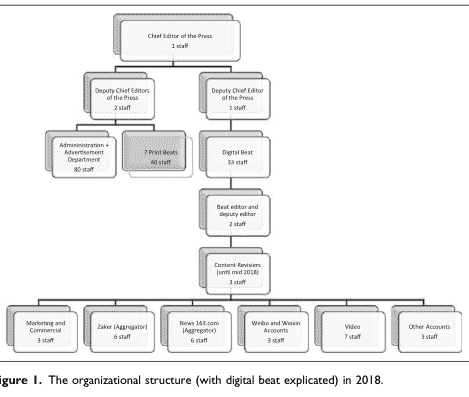

#### 新闻实验室会员通讯（580）中国媒体的去新闻化

### 580 20220412 中国媒体的去新闻化

#### 新闻实验室会员通讯（580）中国媒体的去新闻化

##### 学术

###### 中国媒体的去新闻化

在政治、商业、技术的多重压力之下，中国的新闻媒体最近 10 年的生存异常艰难。人们经常提起的，是调查报道的锐减、调查记者的“消失”、言论的审查等。但在这个整体生态中，还包括其他方面的、公众关注更少的重要变化。

在今年稍早些时候发表于学术期刊《Journalism》上的一篇文章中，香港浸会大学的王丹和郭忠实两位学者介绍了一种他们称为"un-news"的现象——大概可以翻译为“非新闻”、“去新闻”，这种现象就属于重要但公众关注较少的变化。今天的会员通讯，我们就来了解这种“非新闻”现象。

##### 中国特色的新闻聚合：政治控制的逻辑

所谓"un-news"，在这篇论文的定义中，指的就是新闻机构从事新闻聚合类的业务。

新闻聚合指的是不做原创的新闻采编，而是将其他地方发表的新闻进行转载、编辑和刊登，这是一种全球性的模式，在很多国家都有聚合类的新闻网站和 app。但是，中国的新闻聚合有其特色。

如这篇论文所揭示的，从事新闻聚合的，很多都是地方报业集团机构媒体，而非专门的创业公司。地方媒体之所以要专门安排人力来做聚合（而不是原创新闻的生产），主要是因为，国家希望增强媒体在互联网上的声量和影响力，而新闻聚合可以在短时间内增加媒体发布的信息数量，也就有可能会吸引更多的受众。因此，如两位研究者所言，机构媒体从事新闻聚合，是官方希望增强互联网舆论主导权所作的尝试之一，政府专门给媒体提供资助来做这件事情。而转载、聚合新闻所需要的资质牌照，也被政府牢牢限制，主要发给机构媒体。

这些机构媒体在做新闻聚合的时候，并非各种来源的内容都能转载，而是只能转载官方认可的信源，也就是官方媒体、政府机构等。这就非常方便官方消息的大规模传播。

新闻聚合深刻地改变了中国的媒体生态。以往，各地的地方媒体各有特色，有不少城市都有能做调查报道的报纸，比如北京和广州的多份报纸、上海的《东方早报》、成都的《成都商报》、西安的《华商报》、长沙的《潇湘晨报》等。即便不太做调查报道，各地媒体也至少会有自身的特色，为各地的受众提供多样化的内容。然而，如今各地的地方媒体在新闻聚合的逻辑之下，在很大程度上都成了千篇一律的官方消息转载者，失去了内容上的自由发挥权。内容相近的宣讲内容占据了地方媒体的页面。

从商业上来说，新闻聚合也改变了媒体的市场逻辑。由于社交媒体平台夺走了大部分广告额，新闻媒体不得不寻找新的收入来源。这时，从政府那里拿到财政补贴就成了解除燃眉之急的方式。会员通讯 525 期曾介绍，由地方政府机构投放的软文改变了新闻生态。而新闻聚合业务则是另一个政府用钱”改造”媒体的例子。

###### 新闻机构内部如何看待新闻聚合

从微观的角度来看，新闻聚合与传统的原创新闻采编是非常不同的业务，遵循着迥异的工作流程，所需要的能力也是非常不一样的——新闻聚合更多需要的是网络搜索、内容排版、多媒体设计、编辑发布、持续更新的能力。而这些能力，其实在传统的记者眼中，都属于被鄙视的对象，因为传统的记者看重的是突破能力、拿料能力、与信源维持良好关系的能力等。

为了更近距离地观察新闻聚合在媒体机构中的运行，论文的第一作者王丹于 2018 年 9 月到 2019 年 2 月之间在南方的一家地方报业集团的新媒体中心做了 5 个月的田野观察。她先是被派到微信公号编辑的队伍中工作，后来又负责 Zaker 平台的更新，每天朝九晚五，一周工作五天。在这期间，她还与 15 名从事新闻聚合的同事以及 10 名传统的报纸记者做了深度访谈。

这家报业集团的新媒体中心成立于 2014 年。2018 年，报业集团得到政府一笔 400 万人民币的资金资助，招募了一批专门从事新闻聚合业务的年轻人——他们大多刚刚大学毕业，没有什么记者经历，但都熟练使用互联网。

根据一名报社副主编的说法，新闻聚合部门的招聘标准有两方面。一方面，对于资深编辑的职位，主要的要求是不能犯政治上的错误，要懂得遵循国家的方针政策。因此，两名非常有经验的报纸记者被安排到这个岗位上。另一方面，对于底层编辑，则主要要求年轻和有网感。

在这家报社的新媒体中心，一共有 33 名员工，除了 2 名负责的资深编辑和 3 名审核员之外，其余人分别为六个方面服务：
- 微博微信（3 人）
- 网易新闻平台（6 人）
- Zaker 平台（6 人）
- 视频（7 人）
- 市场营销（3 人）
- 其他账号（3 人）

这个规模几乎与报纸的传统采编规模相同。

从办公室空间上看，聚合编辑与传统采编在不同的楼层工作，两批人之间几乎没有交流。研究者说，让从事原创新闻采编的记者和从事新闻聚合的小编坐到一起聊业务，是一件不可想象的事情。

即便是在聚合编辑内部，也有一种强烈的孤立感，内部缺乏活力。在底层工作的年轻人，几乎得不到从业经验丰富的上级领导的任何经验传承。

###### 新闻聚合编辑：不是事业，只是工作

研究者进一步详细比较了传统的纸媒采编与从事新闻聚合的编辑。他们发现，二者存在显著的不同。

第一，从个人方面来看，传统的纸媒采编有强烈的职业理想，曾经享有很高的社会地位和工作稳定性，新闻对于他们来说是一种事业。但是，对于从事新闻聚合的小编而言，他们手中只是一份工作而已，并没有什么激情和意义的存在，也感受不到太多的自我实现。

一位资深编辑说：“在我们那个年代，甚至有人说他们愿意为了真正的新闻而牺牲自己的生命。但是对于现在你看到的这批年轻人来说，这听起来像个笑话。”

也正是因为将工作仅仅视为挣钱的方式，新闻聚合编辑们特别看重点击率——这与他们的奖金息息相关。如果一篇文章能够获得 6000 个以上的点赞，那么编辑将会得到 300 元的奖金。

第二，从工作流程来看，聚合编辑面临着巨大的发稿量压力——他们每天要为 Zaker 平台发布 60 篇稿件，为微信公号发布 30 篇稿件。他们的工作就是一天不离开电脑屏幕，与外面的世界不发生任何直接接触，他们对社会的了解就是通过那些官方所发布的信息。这和传统的纸媒记者需要在外面跑新闻、大量接触社会，是极为不同的。

在田野调查的过程中，研究者注意到：从事新闻聚合的编辑经常犯错。在工作微信群里面，短短一个月的时间内就有 95 项错误被记录下来。这些错误显示：编辑们的业务素质有非常严重的不足，而他们也很少得到培训和提高的机会。

另外，传统的纸媒记者都会被分配到一定的条线，发展自己的专业领域。但是，聚合编辑的工作不是按照条线来划分的，而是按照所服务的平台来划分的。这也就使得他们很难积累某一领域的专业能力。

第三，从组织内部来看，传统纸媒采编的工作与报社的品牌直接相关——好的报道有助于打造品牌，而良好的品牌效应又有利于市场竞争。但是，由于聚合编辑经常出错，报社的领导对他们的表现很不满意，认为他们损害了报社的品牌形象——只不过，因为政府提供了经费来做这件事情，所以还要继续做下去。

而对于聚合编辑来说，他们对报社没有什么归属感，和同事没有太多情谊，也并不觉得自己的工作和报社的品牌有太大关系。

第四，从机构和社会的层面来看，传统纸媒的采编以新闻专业主义为指引，希望能在市场和政府之间寻找到平衡，以“无冕之王”的身份寻找官方控制之下的报道空间，而从事新闻聚合的小编则高度依赖官方信息。他们并不在意核查文章事实的准确性，因为这些文章都来自官方认可的信源，即便有问题，他们也不必为之负责。他们也默认了自己在高度管控之下仅仅作为一个传声筒的低微角色。

总的来说，在中国地方媒体发生的新闻聚合是一种高度政治化的变化。从 90 年代开启的中国媒体的市场化改革，让权力从中央下放到了地方（有了五光十色的地方媒体），让市场规律削弱了宣传指令；而如今新闻聚合的盛行，则又将权力从地方收归了中央（地方媒体变得千篇一律），将内容生产的规律重新收归宣传主导。

而且，这种现象还伴随着人才的断层和采编经验的消失。同样是在媒体生产内容，做聚合的这一批年轻人比起传统的采编来说，不仅缺乏职业热情，而且没有得到经验传承。这些职位耗费了他们的青春，却无益于他们的积累，也无益于整个行业的进步。当老一辈编辑记者彻底退出舞台，新一代还能传递多少新闻的薪火？

从这些角度看，“去新闻化”这个说法，可谓相当精准了。

懒人 VX：lazyhelper

---

## Original Article

### Making "Un-news": News Aggregation in Chinese Press

Dan Wang and Steve Zhongshi Guo
Hong Kong Baptist University, Kowloon, Hong Kong

#### Abstract

"Un-news" is a Chinese newsroom jargon that refers to the process as well as the product of aggregation. It encapsulates clashes between digital and legacy journalism, challenges posed by and responses to technologies in the media industry. It differs from aggregation news elsewhere because of dynamic media environment in China. This ethnographic study closely analyzes manifestations of "un-news" churned out by digital aggregators who have to work under management of legacy print journalists and editors in a local Chinese press. The hierarchy of influences model is used to decompose the meanings and complexities of "un-news." Fieldwork observations have confirmed our expectations that the hierarchy model remains structurally valid, although the content and meaning of influence have changed drastically within each level.

#### Keywords

"Un-news", aggregation, hierarchy of influences, digital journalism, Chinese press

Vicky was summoned to the beat editor’s desk for the fourth time that day. As expected, she was given another lecture stowing with harsh words about her persistent failure to meet basic professional standard. Following due apologies, sans sincerity, the disgruntled Vicky went back to her computer, hastily corrected the errors and began to attend to unfinished assignments. Similar to news aggregators elsewhere; Vicky spends her day gleaning the internet for published stories and changing their texts to web style before putting them out on one of the newspaper’s cyber platforms. She primarily uses sources from online legacy media and official social media accounts, in addition to frequently checking the WeChat workgroup for real-time publishing directives from various

#### Corresponding author:

Dan Wang, Department of Journalism, Hong Kong Baptist University, Rm 926, CVA Building, 5 Hareford Rd., Kowloon Tong 999077, Hong Kong SAR.
Email: angiewd@nbu.edu.hk

censorship offices. The problem, however, was that Vicky could not stop making mistakes due to her lack of knowledge about the news routines and culture of the organization and the profession. Many mistakes were repetitive. The beat editor, better known to staffers as the “sleuth newvick” for having a good eye to spot flaws, was recently transferred to the digital beat desk from the print section. To him, digital reporters are non-journalists. “You people are better computer technicians than reporters. What you have here is not news,” said the editor to Vicky, “it’s un-news” (digital beat editor, 2018).

This study tackles the issue of news aggregation in the context of media ecology in China, relying on as well as contributing to the ongoing journalism research agenda (see Coddington, 2019; Lee & Chyi, 2013). To do so, we introduce the term “un-news” by examining its manifest and latent meanings in the newsroom, its micro-level psychological implications for individual journalists and its macro-level bearings on media institutions.

The making of “un-news” is as much a global trend (see Anderson, 2013) as a contextualized local phenomenon. The socio-political infrastructure underpinning news production in China imposes a unique set of constraints unfamiliar in Western journalism. Similar to the West, digitalization has robbed the Chinese newspaper industry much of its advertising revenue (Wang & Sparks, 2019b), forcing most press to move online, even though the bulk of the advertising income was absorbed by search engines and platforms (Cui, 2021). By 2020, the vast majority of the Chinese press, all of which state-owned, has registered digital accounts on various mainstream platforms (ibid). Therefore, news aggregation in the current study refers to institutionalized acts of repurposing as an extension of traditional press operations. Although digital aggregators are structurally managed within the framework of traditional media organizations, they are different from traditional media in operation and they are also distinct from their Western counterparts. Understanding these particular kinds of constraints could broaden our theoretical horizon on the interplays among the state, media, and audience in the digital age. We share the constructivist assumption that changes in journalism represent responses from the profession to the external pressures (McChesney, 2013). The vexation of the “sleuth newvick” in the opening scenario is but one indication of the throes of transition. Looking deeper into the issue, revelations of legacy media to technology reveal, both theoretically and practically, strong contestations over how journalism profession is to be defined, if it needs to be redefined, and whether emerging norms of digital news production are to be accepted as the rule rather than exceptions in the new environment.

As part of our effort to unpack the multiple layers of the making of “un-news,” we adopt the hierarchy of influences explanation proposed by Shoemaker and Reese (2014) as the main theoretical thrust to find out which influences are labile and which stay the same in the wake of media digitalization. We argue that although they continue to exert influence structurally, factors that used to shape traditional journalism have now adapted to cyber-friendly ways such that the mentality of practitioners, news sense, institutional setup, and policies and regulations are synchronized into a new, unified whole. That is to say, the context and content of the hierarchical influence may have changed, but the structure and the mechanisms of influence have perpetuated.

### Explicating “Un-news”

“Un-news” as used by Vicky’s editor in the opening ethnographic anecdote refers almost exclusively to news aggregation. It concretizes the tension between traditional journalists and aggregators in every aspect of news making. The label of “un-news” is therefore mainly a refracted view of aggregation and the new media work environment from legacy media practitioners. Staffers of the legacy persuasion share common paths of newsroom professionalization (Breed, 1955) and identical views about how news is done right. They too are increasingly reliant on new media technology, but the kind of professionalism they feel part of has little, if at all, overlap with that held by aggregators.

In China, digitalization of legacy news is part of a carefully crafted move toward more centralized control from the party state (Reznikova & Fang, 2018; Wang & Sparks, 2019b; Zou, 2021). News aggregation is the latest addition to the party-state’s grand project to shape new discourses on the internet. As part of the information credibility campaign spearheaded by the country’s president Xi Jinping (Xi, 2016), the task of news aggregation has been confined to licensed legacy media only (Cyberspace Administration of China, 2017). Armed with state subsidy, legacy media at all levels have greatly strengthened their digital presence (Yao and Jin, 2017). Most recently, the National Development and Reform Commission (NDRC) (October, 2021) released a regulation constraining private investment in media in the country, consolidating the existing observations on the politicization of online news in China.

Aggregation extracts published propaganda out of its original carrier and repurposes a news item in a spawning process whose effect is the amplified presence of the news. The transformation has taken its toll on the autonomy of digital journalists (Xiong & Zhang, 2018) who are afflicted by a sense of inferiority in front of their print colleagues for professional and financial reasons (Wang et al., 2020; Zhou et al., 2018). News aggregation is subject to these aforementioned transitions.

Simply defined, “un-news” is institutionalized aggregation. In China, “un-news” is the embodiment of a new routine in the heavily politicized practice of repacking news. The uniqueness of “un-news” in China is reflected in three aspects.

- First, different from any second-hand information builders such as start-up news aggregators (e.g., Google News) and non-news information aggregation sites (e.g., Reddit), “un-news” is culled from established news organizations (e.g., People’s Daily online) which have their own stable audience constituencies, market niche, symbolic status and reputations.

- Second, the making of “un-news” is guided by the same professional norms and values that have been structuring traditional news, although the digitally savvy aggregators suffer from a paucity of journalistic knowledge (Lee & Chyi, 2015). To justify their existence and salaries in the hybrid-mode newsroom, aggregators employ various techniques to flaunt their skills and product in front of their traditional colleagues (Grunbemark & Meckel, 2015), an act often interpreted as compensating for low self-esteem (Coddington, 2019). In the organizational setting where aggregators and traditional staffers work under the same roof, “un-news” exacerbates the unbalance in role conception between aggregators and their traditional news-peers.

- Third, the deeply ideological aspect of “un-news” is its mainstreaming of official values through political controls, a tendency that diverges from the past media system in two noticeable ways. One is the permeation of state control into the market, forcing aggregators of commercial media to fear the authorities politically while relying on them financially (Wang & Sparks, 2019a; Wang & Guo, 2021); the other is that cyberspace where “un-news” resides has weakened the inter-institutional mutual dependency between local media and local government in favor of centralized control (Jørgensen & Pan, 2018; Repnikova & Fang, 2018).

To sum up, “un-news” follows the flow of the digital journalism trend of aggregation globally. However, the production and content of “un-news” are largely determined locally. In China, the designated habitat of “un-news” is licensed media organizations with cultural and discursive protection by the state. Freed from market pressures by generous state subsidies, makers of “un-news” are only burdened with the problem of how to more effectively and efficiently repackage authoritative information (Zou, 2021).

### Contextual factors shaping “Un-news” in China

As the defining characteristic of “un-news,” digital aggregation strips news production of practically all the qualities and pursuits valued in the era of legacy media such as scoop, investigative journalism, and proprietary reports with the byline of “our own staff reporter.” “Un-news” is disdainfully termed not only because it deviates from traditional standards which it does, but more importantly, by depriving the newness of news, it heralds the demise of the profession. Few of the existing studies on Chinese media went beyond the “one-size-fits-all” state-market duality model (Zhao, 2012). We adopted the hierarchy of influences model (Shoemaker and Reese, 2014) to analyze news aggregation in China because of the model’s power to transcend specific time and space and its level crossing potentialities.

In its original formulation, the model divides forces driving news production into five levels, ranging from micro to macro: (1) individual perceptions of journalists; (2) routine of practices; (3) organizational constraints; (4) institutional concerns; and (5) the role of journalism in the larger societal power setup. Interwined and overlapping, the forces unleashed at each level vary in their strength. In a recent reflection paper, Reese and Shoemaker (2016) noted that even though technology-induced changes at each level of influence have blurred the boundary of media as institution and journalism as practice, the hierarchy model still holds its explanatory power in the digital era (also see Xu & Jin, 2017).

First, “un-news” is related to identity disparity between print journalists and aggregators at the micro end of the model. While the infrastructure of the internet has dramatically increased the competitiveness of the information and advertising market (Nielsen, 2016) in the form of click rate, posts, and bulletins (Andersson, 2013; Usher, 2014), all these values are realized through second-hand repackaging which is viewed with contempt by traditional journalists (Coddington, 2019; Grunbemark & Meckel, 2015).

Second, the aggregation routine introduced by “un-news” in the newsroom abides by its own logic and requires particular skills in web search, content formatting and relaying, multi-media designing, editing and posting, and constant updating, none of which were respected by legacy journalists. Many age-cherished professional practices face adjustment or abandonment. Traditionally, deadlines which "allow journalists to work quickly without having to think very much" (Ryle, 2018: 59), was secured not only by competence of any given journalist, but equally important, her more or less sizable network of social contact.

News cycle has since changed from "the day before" to "now" (Usher, 2014), and breaking news is covered at the 24/7 pace (Kleinberg, 2005). With the deadline being "anytime" and social relationship rendered nearly irrelevant in the business of news making, news aggregation is valued, if tacitly, much more as something everybody else is doing than something everybody ought to do (Anderson, 2013). Increasingly, many news organizations accept aggregation as a fact of life (Coddington, 2019). Following the debut of the innovative Central Kitchen (Zhongyang chufang) by People's Daily, many local media organizations had no choice but to engage in repackaging official information whose advantage in time-saving, cost-cutting, and political correctness was apparent (Wang, 2016; Zou, 2021).

Third, at the organizational level, what "un-news" has lost in content originality and commercial revenue, it has more than made up with state subsidies. It took 4 years for this to sink in the minds of the studied press leaders (digital beat editor, 2018). Eventually, money from the state coffer and the auspices of state policy drive news organizations to unequivocal compliance (Xiong et al., 2021; Zou, 2021).

Fourth, the exclusive jurisdiction of "un-news" depends on government resources. In contrast, the business model of traditional media was founded on audience appeal which in turn made between-media competitions a necessity (Tong, 2018). In China, where commercial advertising was once the lifeline of the press (Stockmann, 2013), now all media are subject to the state mandate requesting unwavering allegiance to state ideology and unified online discourse (Repnikova and Fang, 2018). With more and more state funding channeled to media organizations for crafting their online appearance, "un-news" is gaining a firm footing in the newsroom and an upper hand over other forms of para-journalism (Wang & Guo, 2021).

Finally, at the macro-structural end, "un-news" is superior to all other forms of news gathering in producing homogenous propaganda, which explains its steady ascendance to prominence in the newsroom. In the pre-"un-news" decades, mass media in China were in possession of a modicum of discretionary power which they took every opportunity to use to cater to audience needs for financial gains and engage in "edge-balling" for political pursuit (Lee, 2000; Shirk, 2011). The resulting small-scale flourishing of diverse opinions and professional competitions among media were largely condemned by local officials in charge of propaganda and tolerated by the state-level information administrations (Lu & Pan, 2002). Today, the space for diversity and competition has been taken away (Hu, 2016). "Un-news" emerged as a new journalistic routine capable of fulfilling the dual tasks of countering market forces and shrinking local power. Desperately seeking support to climb out of economic difficulties brought by digital media, local legacy press rose to the occasion and devoted themselves whole-heartedly to the Faustian deal of reposing content from central media and providing publicity service for local governments in exchange for handsome subsidies (Xiong and Zhang, 2018).

As a result, “un-news” owed much of its rise to prominence to the new institutional structural configuration that involved a host of new task assignment, division of labor, incentives and sanctions, and distribution of material as well as symbolic resources. All things considered, we ask the following research questions:

- RQ1: What are the (tensional) relationships between traditional news staff (journalists, editors, managers) and newly recruited digital journalists?
- RQ2: How do these relationships shape the meaning(s) of “un-news”?

### Methods

The inductive nature of this study dictated a qualitative analytical approach. Data for this study came from 5 months of participant observation from September 2018 to February 2019 in the digital beat (known as New Media Center, NMC) and 3 years of immersion in the press group by the lead author who gained rapport network. Ethnography was chosen because of its methodological suitability for studying changes and nuanced relationships (Willig, 2013). The lead author was assigned as a digital journalist initially to the WeChat Official News account, and then to the ZAKER news platform. She worked 5 days a week from 9 a.m. to 5 p.m., and participated in digital news repurposing, group discussions, weekly meetings, and so on.

The ethnographic method and data analysis were guided by the hierarchy of influences model (Reese & Shoemaker, 2016) with a particular focus on the difference between print and digital journalists in the studied press. Senior staffs at the NMC included in our observation and data analysis were all print journalists. In addition, we also conducted semi-structured interviews with 15 aggregators on the beat and 10 print staffers in the organization including the editors of the press.

Interestingly, mistakes made by aggregators at the NMC, which started off as a side note, gradually came to the center of our attention in the course of the fieldwork because of the realization that these are not mistakes of haste or accident. These were terrain mistakes typically committed by laypersons outside of the news business, an outcome of inexperience and ignorance (see Sewell, 1992). We believe they were more convincing than any indicators to reflect the profound discrepancies between print and digital reporters in terms of routine, epistemology and professional ideals. Floor knowledge in the eyes of beat editors was the ceiling for digital aggregators. In the studied newsroom, the “un-news” problem became so rampant that the management had to bring in content advisers from the printed newspaper to supervise its quality.

A total of 95 mistakes by beat editors were logged in the beat’s WeChat (the equivalence of WhatsApp) work group within a month. The lead author used the chat history retrieving function of the app and noted down all the details of these mistakes. Coding was conducted to categorize the themes (i.e., political, commercial, journalistic) and sources (i.e., inside vs. outside of the organization) of these mistakes. We scrutinized the mistakes and found in them recurring patterns revealing the disjuncture between the print and young digital journalists. All of the respondents and co-workers were aware of the status of the investigator and all were given anonymity as required.

### The case study

The “News Media Centre” (NMC) of the studied press in southern China was set up in 2014, at a time when the entire management team knew very little about digital media. Nor did the center receive financial support from the government because it was placed low in the packing order of the state funding scheme which prioritized central and provisional press (beat editor, 2018). Until 2018, upon the receipt of four million RMB start-up fund, the organization started to take the operation seriously through recruiting internet natives who are novice in journalism but expert in the digital domain (deputy chief editor, 2018). This shows that digital news, including aggregation, was not taken to be a value-generating product at birth.

According to the deputy chief editor of the paper, the staff were recruited by two criteria. For the senior positions, the main objective was to appoint staffs he trusted not to make political mistakes. Credibility and influence were given special emphasis to comply with the state policy mandate. Two well-experienced journalists from the print paper were selected to fit the role. The frontline aggregators were chosen with different qualities in mind: youth and digital expertise.

Aggregation from the published legacy media is the main responsibility for those frontline staffers. The digital beat structure was built upon six functional groups (Figure 1), all of which are aggregators but working for different platforms. Structurally, beat editors report to deputy chief editor. In our case, one of the three deputy chief editors was in charge digital development. In total, there were 33 staffers (45% of all beat reporters) responsible for producing multi-media content for the beat.

Located on different floors, the print and digital groups of staffers hardly engage in any formal or informal interpersonal exchanges. It was an unimaginable sight to see legacy journalists and aggregators sitting down together to discuss news matters. Among all kinds of work, soliciting government funded native advertising plays an increasingly important role in defining the value of journalists. Along with the gradual revenue decline for the commercial press and increased demand for propaganda by the state, native advertising has become the core of the new business model. Journalists are asked to solicit as well as produce native advertising, a new routine that linked the ability to rake in native advertising with status and respect.

Among the staffers from the digital beat, social isolation was constantly reinforced. At the management level, two staffers whose seniority was gained from experience in the printed newspaper were in charge of the daily operations of the center. Because them, people running the various online operations were chosen specifically because they lacked the tacit knowledge possessed by their superiors. Two distinct occupational cultures based on differences in age, work schedule, experience, and skills were merged within one workplace. So far as the NMC was concerned, the community of practice is moribund and the informal mechanisms for the transfer of tacit knowledge are barely present.

Figure 1. The organizational structure (with digital beat explicated) in 2018.

### Findings

Although our ethnographic work was inductive in nature and open to new and unknown directions, the hierarchy of influences model lurked at the back of our minds throughout the observation period to give coherence to the massive amount of field records and notes. Gradually, patterns began to emerge from the kaleidoscope of observed facts. An initial finding (summarized in Table 1) contrasts differential impact of digital technologies on the print and digital contexts across the five levels of influences. This finding addresses the issue raised in RQ1 about the tensions between traditional and digital staffers (not limited to interpersonal relationships, but also the norm and culture that sustain the relationships). And responses to the impact constitute the meaning and consequences of “un-news” which answer the query of RQ2.

#### Individual level: Career versus job

At the individual level, makers of “un-news,” mostly millennials fresh from college, find themselves entering a trade with shrinking space for professional advancement and declining social respect. And “un-news” did its part to strip new staffers of career vision and job motivation, a mentality felt more or less equally by legacy journalists. The aggregators in our study were obligated to submit a certain number of cloned news to desk editor to fill the platform bill which recorded their productivity and click rate. The value of aggregation and aggregators is locked in metrics. The daily hustle and bustle in the cubicles of digital and print reporters belie two distinct and yet unannounced sets of work sentiment. Feeling powerless and anomie, the young digital journalists gravitate to a role perception that alleviates dissonance: viewing what they do as a job rather than a career. To them, the news world consists of nothing more than a copycat and a computer. In contrast, the print staffers emit enthusiasm and act with purpose and a sense of self-actualization (Peng, 2017).

**Table 1.** Differential impact of digital technologies on the print and digital contexts across the five levels of influences.

| Level | Print | Digital |
| :--- | :--- | :--- |
| **Individual** | • open space for professional aspiration (my career) • high social status and job security • deadline is tonight • limited number of news per issue • topic/beat-based | • closed space for professional pursuit (work for salary) • precarious social identification • deadline is now • unlimited number of news online • platform-based |
| **Routine** | • revenue by market competition, content under ideological control • brand building | • state subsidy for fulfillment of propaganda obligations • organizational brand irrelevance |
| **Organizational** | • credibility based on profession | • credibility based on authority |
| **Institutional** | • balancing tension between market and state • high status as “king without crown” • regulations versus resistance | • following party directives in the move toward media convergence • low status as news peddler • tighter control |
| **Societal** | | |

According to the deputy chief editor, in the golden age of the press back in the early 2000s, local residents would queue up outside the newspaper’s public liaison office to lodge complaints on various personal or social matters and offer news leads. The words of the beat editor hit home when he said, “In my time, there were actually people who’d say that they were willing to die for true news. I would sound nothing more than a joke to the whole bunch of journalists you see around here now” (digital beat editor, 2018).

As legacy media have been operating in the red since the penetration of digital technologies in the press, they were forced to downsize and cut wages. Journalists used to be a top earning occupation in the city. After several rounds of deductions, at the time of our fieldwork, average salary for an entry level reporter in the studied press was less than that of a primary school teacher whose social status and salaries were close to the bottom range of the wage ladder (chief editor of the press, 2019). Remunerations for aggregators are one scale lower because they do not need to step out of their cubicles (Wang & Sparks, 2020). “With this chicken feed, I can’t care less about the professionalism” (aggregator C in Weibo work group, 2019).

That is why beat staffers take their bonus extremely seriously and try to make click rates out of dry propaganda. Digital and print journalists are subject to distinct systems of incentives. The press group’s latest initiative announced a series of rewards, including a

#### Routine level: News cycle, network, and expertise

RMB300 bonus for each news article receiving 6000 or more likes online, reserved exclusively for digital journalists to boost their sense of self-worth. In the words of the print beat editor, “real journalists like us are willing to die for a scoop, but those copycats only know how to hunt click rates and reap likes online” (2018).

Since “un-news” is made up of repurposed content, digital reporters are under tremendous pressure to crank out stories, an average of 60 per day for ZAKER and 30 for WeChat, three times the number print reporters. As the beat editor saw it, repurposing and re-mediating news content fuels the vicious circle of “not caring-not knowing-caring even less-knowing even less” (2018). Without the shared knowledge most basic for the maintenance of the community of practice, barriers between digital and print beat journalists become insurmountable. The gap therefore avails itself as fertile grounds for the growth of “un-news.” A typical day of an aggregator starts and ends without leaving the computer on the desk. Outside world is known through all sources of published authoritative information.

Technically, aggregators have two options after selecting a story: relay the story verbatim or remEDIATE the content to fit the organization’s platform style. To gain more “likes,” staffers usually chose the latter. Mistakes were inevitable. To illustrate, when the city where the newspaper is located was listed on Lonely Planet’s top travel list, one digital journalist repurposed the story on the net without highlighting the city. “What a rare chance to boost the pride of local residents! Anyone with the most basic sense of news would have done that!” lamented the editor.

Different routines breed different tacit knowledge (Wenger et al., 2002). As aggregators only work from the desk, the need for contacts and sources in the traditional news making routine evaporated, causing a “blanket of naive and ignorant mistakes” (deputy chief editor, 2018). As one entry on the fieldnote showed, a staff from NMC relayed a story about food poisoning in a shopping mall. The chief editor called in directly asking the beat editor to take down the coverage because the shopping mall was one of the biggest local advertisers of the newspaper. In this case, the source of “error” was lack of knowledge about the organization’s network, which can only be gained through immersion into the real world outside of the cubicle. In her defense, the digital journalist stated, “We know they are doing professional jobs because we relay news from trusted legacy media. They wouldn’t lie to the society, would they?” (aggregator D in ZAKER work group, 2018). Together with the disappearance of journalist-source relationship, is the fading of local discursive space that traditional journalists relied on for their autonomy (see: Tong, 2010).

Traditionally, the press beats were divided by topic or field, each connoting specific area knowledge. Since the digital platform-based reporting is not area-specific, journalists on the beat are not professionally socialized to be a jack of all trades, but master of none. This explains the label of “platform manager” in their role conception during the in- terviews. Therefore, in the NMC, “beat” only has a nominal existence on the lips of staffers and managers.

#### Organizational level: Restoring the old order

At the organizational level, “un-news” is a consequence of a chain of antecedents born out of the inability on the part of the management to properly position NMC. The main motivation for establishing the NMC, the deputy chief editor of the press (2018) explained, was the RMB200 million annual state subsidy. At the peak of the convergence campaign, the managerial board had decided to start to recruit digital journalists on merit of technical skills (digital beat editor, 2018). The frequently appearing mistakes from the hands of the cheap labor constantly put the institution and its managers under the fire of criticisms from higher authorities.

To aggregators themselves, getting scolded in the cyber space where chat history can be tracked was a serious matter. “The editors are not directly in charge of us, so they usually won’t interfere with our work. But when they do, it could only mean one thing: we blew it big time.” (digital beat editor). To the editors, however, seemingly trivial issues such as the mismatch between headline and content reveal larger and more fundamental problems. “These are not errors of oversight or hurriedness. These are mistakes of wrong work attitude” (aggregator A in WeChat work group, 2018).

Another remedial measure adopted by the management was to herd some of the print reporters to the digital platforms to do the work of digital reporters. The move clearly indicated mistrust and impatience of top leaders toward “un-news.” To procedurally block out editorial mistakes at the organizational level, an official Code of Conduct was enforced in 2018. According to the new policy, all news articles were to go through “three revisions and proof three readings” (sanshen sanjiao) before being sent out for publication. In practice, all to-be-repurposed content needs to pass three layers of checking: first by the journalist, then the platform head, then the beat editor. The reason that mistakes still surged after the implementation of the new procedure was that the platform head and beat editors only checked the content after it was published. The beat set two deadlines for the sub- mission of a platform bill (a list of URLs linked to the content published), one at 11 a.m. and one at 6 p.m. “Each platform will publish 40 to 60 pieces of stories a day and we have six platforms. It will be too inefficient to check them one at a time.” (digital beat editor, 2018).

By mid-January 2018, three new journalists, all from the print floor, joined the staff as “news reviewers.” Their task was to make sure that the checking procedure was followed to the letter. Without doubt, entrusting the three to man the daily operations of the NMC demonstrated the commitment of the managerial board to traditional news values and the misgivings the board had about the way digital newsroom was run.

Lying at the heart of organizational level influence is sustainability (Westlund & Ekström, 2019). For the chiefs of the press group, the frequently appearing mistakes in news text tarnish the reputation of the organization and ultimately the entire profession. “These hiccups make us look like a bunch of amateurs” (aggregator B in WeChat work group, 2018). The deputy chief editor concurred with the chief editor when he said, “we anticipated all kinds of negative sides of establishing the digital beat, but we had never expected the sort of mistakes they would make when relaying other journalists’ work.”

This sentiment, prevailing as it was among print journalists, was not shared among aggregators because maintaining the organization’s reputation and enhancing its brand were far out of their career goal and field of vision in professional development. “We are merely a by-product of TeKan [government paid content]. We have no reason to promote or defend that brand” (aggregator A in ZAKER group, 2018). Situated at the economic, social, and cultural margins of the news business, most aggregators we interviewed did not report feeling a sense of belonging to the organization, nor a sense of camaraderie with fellow workers.

#### Institutional and social level: Legitimacy and power re-orientation

Both institutional and social influences are acted out at the intersections between media and other fields or institutions (Ryfe, 2006; Schudson, 2010). Our data show that the ascendency of centralized political power in China which leaves no institutions unscathed turned out to be a hotbed for “un-news.” At the institutional level, power centralization which had taken away what limited resources institutions once possessed has structurally changed the operations of various social groups and institutions, accounting in part for the shifting cultural authority of media from offline to online platforms. During the early 2000s, both communication scholars and industry observers pinned hopes on media professionalism (Chen & Hu, 2016; Lu & Pan, 2002). Their optimism was founded on practices by journalists who actually stood by and spoke for the public, especially the disadvantaged and marginalized groups. Most of the senior print journalists in the studied newsroom personally witnessed or professionally participated in that wave of now de-funct media reform. Understandably, the aggregators, almost completely oblivious of the historical landmarks in their profession, sought legitimacy in an entirely different discursive universe.

At the institutional level, press releases from various government offices and corporations come, at least in the eyes of audience members, from identifiable formal sources whose authority serves as a disclaimer for the digital beat to absolve responsibilities to the public and a safe haven from offending censors. Different from the Western aggregation (e.g., Coddington, 2019), aggregators of this study will take the platform pushed articles as fact without worrying about fact-checking. This expectation clearly implies the irrelevance of depth knowledge and exclusive socio-spatial relations with sources in any beat area in the new, robotized mode of news production. If the process of marketization decentralized power from central to local (Zhao, 2008), control of the process of digitization witnessed a reversal of it. The positioning of government as the only source of news has cemented the status of media as apparatus.

Societal level impact is quite easily detectable in the newsroom. Media convergence is the buzzword in the conversations of journalists on both digital and print beats. At the daily beat editorial meeting, few decisions are discussed, and statements uttered without having “in keeping with the drive for media convergence” in the same breath, more so for digital than print. Apparently, convergence makes a convenient double-speak and argument stopper for digital people to justify their existence, secure their turf, and command compliance from others.

Sorting through the mass of interview transcripts, we discovered that digital journalists found solace where they could also maintain or regain their superiority complex. The first

is the press card. In 2014, the state proposed to issue press cards to digital journalists, a rare privilege previously reserved only for traditional media journalists. Although the proposal was canceled due to potential consequences of further divide, all news producers including aggregators have to obtain press cards for work. Second, several digital journalists mentioned in the interviews that they relay and dispose content (or “un-news”) from local officials’ accounts which are more professionally created and maintained from their own in terms of the quality of videos and photos, not to mention the mass followings attracted by these portals of local and central government whose subscribers make up the bulk of the press group’s lifeline (for evidence, see discussions about information subsidy in **Wang & Guo, 2021**). Together, the three factors constitute the power base for digital journalists to claim legitimacy and cultural authority.

“Un-news” can also be seen as a function of the changing position of journalism, legacy included, in the digital age at the societal level. As an important arm of the Chinese propaganda machinery, legacy media in China have always been enjoyed state funding and public respect (Lee, 2005; Tong, 2015). However, a reversal of fortune and fame befell onto legacy media following the rise of digital media. On the one hand, attention from news sources and advertisers was swinging rapidly toward click rate-based para-journalism. “Newspapers, we are constantly reminded by commercial sources that no one cares about newspapers anymore” (print journalist A, 2018).

On the other hand, the state’s ever tightening grip on news production has bound legacy and digital to the same fate, practically eliminating the space for tacit maneuvering to circumvent censorship used to blossom during the press expansion days (Tong, 2010). Today, apart from the centralized cyber administration, local information officers routinely send their staff at different levels to the WeChat work groups of newspapers to supervise their work. During the fieldwork, we noticed that the platform bills submitted by the digital journalists were also scrutinized by two staffers from the censorship institution. Our interviewees all agreed that they have to treat their social media platforms as workspace to brand their organization, or at least project an image of a hard worker in the organization. This not only concurs with **Davis’ (2012)** argument on the alignment of identity presentation in media’s online and offline space, but also implies a growing confinement of journalists to pursue their ideals (**Jian & Liu, 2018**). As a result, power reliance has become the only recourse for digital journalism and media as a whole in China (Wang et al., 2020).

### Discussions and conclusions

With aggregator at the core of discussion, we explored a series of issues emerging in the structural transformation of China’s traditional media. A casual in-talk in the studied press group, “un-news” sums the process through which diametrically opposed attitudes, practices, and work environments led to covert and overt contestations between legacy and digital journalists. On closer look, the aggregator in our study is not identical to that in the Western discourse, neither is it equivalent to the burgeoning online information start-ups. Aggregator in China is a special type of digital news brought into being by a highly politicized move toward power and discourse centralization. The concept of “un-news” is invariably a product of the campaign and its explication contributes to our understanding of aggregation in particular and digital transformation of media in general. It could also enable us to more clearly see how news is getting redefined in the wake of this transformation in the concrete circumstances of China’s media system.

To explore the richness and complexity of the term, we decompose it into meanings, antecedents, and consequences. For that purpose, we have explicated “un-news” on the basis of the hierarchy of influences model proposed by **Shoemaker and Reese (2014)**. The model set the stage for the ethnographic fieldwork and subsequent data analyses designed to answer two research questions: one on the micro- and macro-level challenges mass media face in the transition to digitization; the other on responses from practitioners to these challenges.

Evidence shows that the structure of the five layers of influences remains intact, although technology has changed the content of the influence beyond recognition. At the bottom of the plethora of observed events are two meaning systems that separate the discourse, professional identity, and values and belief systems of the new and traditional media workers. To the extent that a community of practice exists in news making where shared symbolic meanings, concerns and passions govern activities of production, new media technologies are rapidly rendering that ingroup feeling irrelevant for digital journalists.

Our data further indicate that legitimacy of the journalism profession, once grounded in state-market scuffling (**Lee et al., 2007**), has now come to rest solely on authority. By repurposing and relaying press releases from institutions with vested interest and published content from official media outlets, digital beat reporters have turned themselves into a machine of power reproduction. They no longer have to directly deal with real world events, the public, or society at large. With basic transactions taking place in a wholesale fashion between media and other social organizations, the nature of the news profession has shifted from career to careerism and from job to jobber. This finding is inconsistent with conclusions from existing research on Chinese journalists (e.g., **Peng, 2017; Zhou et al., 2018**), calling for either an accumulation of further research or a redefinition of journalism.

We were therefore not surprised to find a new group of staffers whose indifference and apathy, partly a function of the tightening ideological censorship and partly the result of market pressures in the cyber world, were beginning to branch out and infect other members of the newsroom. “Un-news” is the end-product of this process. It explains the resentment shared by many legacy media journalists who look at digital news beat as an affront to their profession. However, the irreversible advancement of technology has endowed “un-news” with inevitability. As such, we believe-adding attention may be more fruitfully reverted to the fundamentals of the gate-keeping mechanisms and the latent interactions among various forces in message production than explaining the surface manifestations of technological change. By depoliticizing alternative discourse at the micro-level and constructing credibility of official propaganda at the macro-level, aggregators have proved themselves as worthy tools of centralized political control.

That is why we adopted the hierarchy model and made observations across the whole gamut of influences in the studied newsroom. To quote **Reese and Shoemaker (2016)**, “the networked public space is constituted with new configurations of media work, institutional arrangements, and global connections” (p. 407). Our findings confirmed these theoretical speculations: “purity” of *individual* young recruits with degrees in computer and data science was achieved at the price of journalism expertise; lack of professional knowledge and online work *routines* greatly increased the possibility of mistakes and loss of news sources and social contact; supervision of digital content by legacy journalists to ensure *organizational* sustainability effectively weakened, if not eliminated, digital staffers’ professional aspirations; heavy reliance on government press releases and legacy media content, while affording *institutional* authority and legitimacy to the press group, results in content uniformity; adherence to state’s call for media convergence at the *society* level forces professional ideals upheld by legacy journalists to recede.

Our explication of “un-news” contributes to the hierarchy model in three aspects. First, this study discovered that the cross-level networked connections are swayed by, at least in the case of the Chinese press, orientations of the political system and the whims of the incumbent administration. It would not be an exaggeration to say that the configuration of news production is defined by and at the mercy of power. Second, our findings suggest that the traditional content-centric approach in media studies may have passed its hour because the proliferation of repurposing practices has increased content redundancy and reduced its diversity. Third, related to content uniformity, findings of our research direct journalism studies toward a new set of questions, mainly focusing on how forces of media relations change, how contending factors negotiate and reconcile, and how and why remedial actions succeed or fail at multiple levels.

The inductive method we employed in this study opened up numerous leads in our fieldwork, some of which obvious and expected, but many non-obvious and unexpected. Were it not for this approach, we would have completely missed the thread of mistakes made by digital journalists and its theoretical value as a new cultural symbol connecting new and old ways of news making. Unlike the West, media space in China has never been a site for free deliberation. On the bright side, however, this unique media ecology compels journalism scholars to look beneath the façade of invariance in search of subtle, hidden and nuanced sources of discrepancies, divergence, and dissonance.

### Declaration of conflicting interests

The author(s) declared no potential conflicts of interest with respect to the research, authorship, and/or publication of this article.

### Funding

The author(s) received no financial support for the research, authorship, and/or publication of this article.

### ORCID iD

Dan Wang ⊗ https://orcid.org/0000-0003-2379-4432

### Notes

1. Discursive autonomy for Chinese journalists, however limited, is a function of negotiations between central and local governments (see: Tong, 2010; Stockmann, 2013). Therefore, increased reliance on state media indicates the re-centralization of control.
2. “Edge-balling” is a tactical move commonly practiced by journalists to sidestep censorship through coating politically sensitive or hostile materials with legitimate rhetoric expressions.

### References

Anderson CW (2013) *Rebuilding the News*. Philadelphia, PA: Temple University Press.

Breed W (1955) Social control in the newsroom: A functional analysis. *Social Forces* 33(4): 326–335.

Chen Q and Hu Y (2016) Xuanchuan luoji yu shichuang luoji — xin meiti shidai Zhongguo xinwen lunli de “lianggan kunjü” [The Logic of Propaganda and the Logic of Market: The Ethical Dilemma of News in China in the Age of New Media]. *Twenty First Century* 153: 4–17.

Coddington M (2019) *Aggregating the News: Secondhand Knowledge and the Erosion of Journalistic Authority*. New York: Columbia University Press.

Cui B. (2021) *Zhongguo Chuanchen Faxuan Baogao [Report on Development of China’s Media Industry] (2016-2021)*. China: Social Sciences Academic Press. p. 2021.

Cyberspace Administration of China (2017, May) Huiliuuanwang xinwen sinxi fuwu guanh guiding [Regulation on the internet news service]. http://www.cac.gov.cn/2017-4/05 c2/42_1120902760. html

Davis K (2012) Tensions of identity in a networked era: young people’s perspectives on the risks and rewards of online self-expression. *New Media & Society* 14(4): 634–651.

Grubenmann S and Meckel M (2015) Journalists’ professional identity. *Journalism Studies* 18: 1–17. DOI: 10.1080/1461670X.2015.1087812.

Hu Y (2016) Three features of China’s internet legal system. *Chinese Law & Government* 48(1): 1–5.

Jaros K and Pan J (2018) China’s newsmarkers: official media coverage and political shifts in the Xi Jinping Era. *China Quarterly* 233: 111–136.

Liu G and Liu T (2018) Journalist social media practice in China: a review and synthesis. *Journalism* 19(9–10): 1452–1470.

Klinenberg E (2005) Convergence: news production in a digital age. *The ANNALS of the American Academy of Political and Social Science* 597(1): 48–64.

Lee A and Chyi H (2015) The rise of online news aggregators: consumption and competition. *International Journal on Media Management* 17(1): 3–24.

Lee C (2000) *Power, Money, and Media: Communication Patterns and Bureaucratic Control in Cultural China*. Evanston, Ill: Northwestern University Press.

Lee C, Zhou H and Yu H (2007) Party-market corporatism, clientelism, and media in Shanghai. *Harvard International Journal of Press/Politics* 12(3): 21–42.

Lee C (2005) The conception of Chinese journalists. In: De Burgh H (ed), *Making Journalists: Diverse Models, Global Issues*. London: Routledge, pp. 107–126.

Lu Y and Pan Z (2002) Chenguang de xiangxiang: zhongguo shehui zhanxinxing guocheng zhong xinwen congye zhe de zhuanwe zhuyi huayao jiangou [Imagining professional fame: Constructing journalistic professionalism in China’s social transformation]. *Mass Communication Research* 71: 17–59.

McChesney R (2013) *Digital Disconnect*. New York, NY: The New Press.

National Development and Reform Commission. (2021) *Shichwang Zhurru Fumian Qingdan (2021 Nian Ban)*. [2021 Market entry permission list] https://www.ndrc.gov.cn/xdzt/tztl/sczrzngdq/ tzgg/1/code=&state=123.

Nielsen RK (2016) The business of news. In: Witseche T, Anderson CW, Domingo D, et al. (eds), *The Sage Handbook of Digital Journalism*. Sage, pp. 128–143.

Peng H (2017) Shejiaomeiti zhong de zihshi “jizhe lianmeng”: shenfen huanjing lunli (The spontaneous “union of journalists” in social media: function, environment and ethics). *Guoji Xinxue [Chinese Journal of Journalism and Communication] 39*(7): 149–168.

Reese SD and Shoemaker PJ (2016) A media sociology for the networked public sphere: the hierarchy of influences model. *Mass Communication and Society* 19(4): 389–410.

Repinova M and Fang K (2018) Authoritarian participatory persuasion 2.0: netizens as thought work collaborators in China. *Journal of Contemporary China* 27(113): 763–779.

Ryfe D (2018) A practice approach to the study of news production. *Journalism* 19(2): 217–233.

Ryfe D (2006) The nature of news rules. *Political Communication* 23(2): 203–214.

Schudson M (2010) Four approaches to the sociology of news revisited. In: Curran J (ed), *Media and Society*. London: Bloomsbury Academic, pp. 164–185.

Sewell WH (1992) A theory of structure: duality, agency, and transformation. *American Journal of Sociology* 98: 1–29.

Shirk SL (2011) *Changing Media, Changing China*. Oxford, UK: Oxford University Press.

Shoemaker P and Reese S (2014) *Mediating the Message in the 21st Century: A Media Sociology Perspective*. New York, London: Routledge.

Stockmann D (2013) *Media Commercialization and Authoritarian Rule in China*. Cambridge, UK: Cambridge University Press.

Tong J (2010) The crisis of the centralized media control theory: how local power controls media in China. *Media, Culture & Society* 32(6): 925–942.

Tong J (2015) Chinese journalists’ views of user-generated content producers and journalism: a case study of the boundary work of journalism. *Asian Journal of Communication and Journalism* 600–616.

Tong J (2018) Journalistic legitimacy revisited: collapse or revival in the digital age? *Digital Journalism* 6(2): 256–273.

Usher N (2014) *Making News at the New York Times*. Ann Arbor: University of Michigan Press.

Wang D (2016) *Behind China’s Media Convergence Campaign*. Retrieved from https://blogs. northhigam.ac.uk/ chinesestudies/2016/12/01/behind-chinas-media-convergence-campaign/.

Wang D, Huang VL and Guo SZ (2020) Maleable multiplicity and power relation: identity presentation by Chinese journalists on social media. *Digital Journalism* 8(10): 1280–1297.

Wang D and Sparks C (2020) Smartphones, WeChat and paid content: journalists and sources in a Chinese newspaper. *Journalism Studies* 21(1): 37–53.

Wang D and Guo SZ (2021) Native advertising in the Chinese press: implications of state subsidies for journalist professional self-identification. *Digital Journalism* 9(7): 974–990.

Wang H and Sparks C (2019a) Marketing credibility: Chinese newspapers’ responses to revenue losses from failing circulation and advertising decline. *Journalism Studies* 20(9): 1301–1318.

Wang H and Sparks C (2019b) Chinese newspaper groups in the digital era: the resurgence of the party press. *Journal of Communication* 69: 94–119.

Wenger E, McDermott R and Snyder W (2002) *Cultivating Communities of Practice and their Value to Organizations*. Cambridge, MASS: Harvard Business Press.

Westlund O and Ekström M (2019) News organizations. In: Wah-Jørgensen K and Hanitzsch T (eds), *Handbook of Journalism Studies*, 2nd edition. Routledge, pp. 135–166.

Willig J (2013) Newsroom ethnography in a field perspective. *Journalism* 14(3): 332–387.

Xi J (2016, February 19). Dang de xinxun yulun gongzuo zuotanhui [Talk on Chinese community party press work].

Xiong H, Liu X and He Y (2021) Claiming legitimacy: journalists’ discursive strategies for rationalizing “Brand Propaganda” within Chinese local press. *Journalism Studies* 22(4): 435–453.

Xiong H and Zhang J (2018) How local journalists interpret and evaluate media coverage: an empirical study of journalists from four press groups in Fujian. *International Communication Gazette* 80(1): 87–115.

Xu Y and Jin J (2017) The hierarchy of influences on professional role perceptions among Chinese online journalists: a multilevel analysis. *Digital Journalism* 5(2): 194–212. DOI: [10.1080/21670811.2016.1162662](10.1080/21670811.2016.1162662).

Yao L and Jin W (2017) 2016 nian Zhongguo Baokan chanye fazhan baogao [Development Report on China’s Newspaper and Periodicals Industry 2016]. In: Cui B. (ed). *2017 Zhongguo chuanmei chanye baogao [Report On Development Of China’s Media Industry 2017]*. Social Sciences Academic Press, 147–169.

Zhou C, Xu Y and Li X (2018) Yetai de lianjie: lijie zhiye gongtongti du biyueyue zhongguo xinxun gongyeche de shendu fantang [Liquaid connection: Understanding occupational community in an in-depth interview with journalists in China]. *Xinwen Yu Chuanbo Yanjiu [Journalism & Communication]* 7(7): 27–48.

Zhao Y (2008) *Communication in China: Political economy, power, and conflict*. Rowman & Littlefield Publishers.

Zhao Y (2012) Understanding China’s Media System. In: Hallin D and Manchinj P (eds), *Comparing the Media System Beyond the Western World*. Cambridge: Cambridge University Press, 143–174.

Zuo S (2021) Restyling propaganda: popularized party press and the making of soft propaganda in China. *Information Communication and Society*. DOI: [10.1080/136918X.2021.1942954](10.1080/136918X.2021.1942954). Available at: [https://doi.org/10.1080/136918X.2021.1942954](https://doi.org/10.1080/136918X.2021.1942954).

### Author biographies

Wang is a lecturer in the Department of Journalism at Hong Kong Baptist University. Her doctoral dissertation was about how a Communist Party newspaper organization responded to the impact of digital media. Her main research interest lies in reconciling macro political economy with micro-sociological details.

Guo is a professor in the Department of Journalism at Hong Kong Baptist University. His research interest focuses on news production and its social impact.
