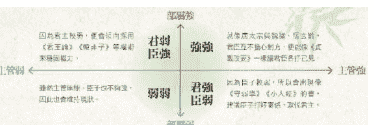

# 易灯权谋合集上册

本材料整理仅供内部学习，请勿传播。

## 由死而生存下来谋略

很多人觉得讲手段，讲谋略，非常的不道德，心理总是有点介意。特别是一些学生和一些一直打工，从来没有做过营销，或者自己做过生意的人。对用手段与谋略嗤之以鼻。

人类如果不用手段与谋略，那么早就在原始社会会被其他动物吃光了。正因为人类会储藏野果，制作猎杀动物的石头，木棍，用血的教训换来的对付敌人的手段，对付饥饿的办法，才在激烈的竞争中，弱肉强食的大千世界里，得以生存和发展。大家的祖先如果不使用手段与谋略，早都变成使用手段与谋略的人的盘中餐了，哪里还有你!!!

在现代社会中，如果你不想被社会边缘化，被淘汰，那么你就得比别人更加有手段，更加有谋略。因为你要生存，要配偶，要房子，要车子，要票子。

现在，我给大家讲两个动物，以改变部分人这种反感使用手段和使用谋略的观念。

天鹅高翔云霄，令狐狸望尘莫及。天鹅组织性强，夜间在草丛睡眠，派一天鹅 “哨兵” 站岗，发现敌情，叫醒其它天鹅。群起抵抗，令狐狸无法得手。但狐狸巧使 “小计”，逼近天鹅，故意用身体摩擦草丛的沙沙声惊动天鹅“哨兵”。“哨兵”惊叫，群天鹅惊醒，狐狸却伏在地上不动，群天鹅见无敌情，安然又睡。

狐狸又惊动“哨兵”，“哨兵”又叫醒群天鹅，群天鹅又不见敌情。几经折腾，群天鹅怪叫着向“哨兵”抱怨、发火，用翅膀扑打它，而后又睡。这以后，无论“哨兵”怎样呼叫，群天鹅也不以为然，只管安然入睡。狐狸则靠着这套“疲惫战”、“麻痹战”和“离间计”的成功，大胆地向天鹅走去，尖尖的嘴稳稳地咬住了天鹅的颈。

老鹰是岩鸽的天敌，岩鸽巢穴中那成群的幼鸽，是老鹰垂涎的佳肴。母鸽为保护子女，与老鹰斗志斗勇。当空中盘旋的老鹰闪电般冲向群幼鸽时，母鸽箭一般地向老鹰迎头冲去。老鹰立即转移目标，直扑母鸽，母鸽一个急转弯儿折向而飞，老鹰全神贯注，穷追不舍，母鸽加速飞临陡崖，突然一个大翻身，直落地面。在即将触及地面时，又突然拉起，直上云霄。身体重、速度快、惯性大的老鹰，无法适应陡然的变速，常常失控，不是撞死在陡崖，就是跌摔在地面——母鸽这一招，真可谓绝妙的“诱敌就范”！

其实，人类社会就是动物世界。在现代社会生存，不讲手段，不讲谋略的，就是傻子，还怎么创业？？？怎么赚钱呢？？

人与人之间的斗争——为衣食，住所，配偶而争，为生存空间而争，为权力地位而争，与动物是一样一样的。都是需要学习与动用手段，谋略的。

## 在古代皇帝一个人为什么可以统治几亿人

很久以前，当我在电视上看到皇帝在朝堂上大声训斥那些大臣，而大臣们一个个唯唯诺诺，战战兢兢的时候，我就在想，那些大臣为什么不上去给皇帝一板砖呢？你们这么多人，皇帝却是一个人啊。有人跟我说，那是因为皇帝有侍卫，大臣们还没动手就被侍卫抓起来砍头了。那我又问到，那侍卫为什么要听皇帝的话啊。有人又跟我说道，皇帝有军队，谁敢不服。我又问到，那军队成千上百的人，为什么要听皇帝一个人的。这人想了想，跟我说道，那是因为跟着皇帝有肉吃，有钱花。我又问到，那他们这么多人干嘛不抢啊，把皇帝的肉抢了

分了不就行了，那人不说活了。

其实这里面隐藏着当老板，当领袖，当老大的核心秘密，谁能领悟呢？

在最初的原始社会，每个个体都是独立的，没有谁统治谁的问题。甲身体强壮，性情狠辣，就可以肆无忌惮的抢夺别人的食物，威胁他人的安全。但是他仍旧没有统治其他人的想法。和甲相比，乙身体弱小，平时获取猎物很困难，还要随时应对同伴的抢夺。和乙有同等情况的，还有丙和丁。面对残酷的自然环境，还有凶恶的同伴，同病相怜的乙、丙、丁为了生存，

结成了联盟。狩猎，我们三个人合作，抢夺别人的猎物，我们也是三位一体。乙丙丁三人虽然身体弱小，但是兄弟齐心，合体无敌。连强壮而又凶狠的甲，也不是他们三个人合起来的对手了。甲平日里习惯了仗势欺人，为了恢复往昔局面，对乙丙丁三人说道，我要加入你们，有好处跟我一起分，有强敌我帮你们打。你们要是不答应，我就跟别人合伙，干掉你们。乙丙丁权衡下，答应让甲加入。于是三人变四人，战斗力再度加强，他们也不去狩猎了，专职抢夺别人打回来的食物，在抢夺食物的同时，他们还严防别人像他们一样结党，一旦看到其它人有团结的苗头，就坚决打压。渐渐地，当地

所有的人都开始受他们的胁迫，四人团体开始领导和统治整个人群，部落形成了，四人团体成了部落的长老，确立了领导地位。随着部落人口的增多，各种矛盾也随之增多，各种业务也随之增多。长老们为了解决矛盾，优化管理。开始定制律法，并招收有管理能力的小弟帮助他们管理部落，这就是官僚阶层。

你们有没有发现谁最终能轻易做老大？做领袖？其实就是最开始最有优势的甲容易坐上老大的位置。那么这就引出一个推理，只要我们在现实社会中，发挥我们的一个极小的局部优势就可以做一个企业的老大。假如你创业，

只要你比你那几个合伙人更加有业务的优势，你发挥你那个优势，就能当老板，当老大。

## 中国历史上最猛忽悠术

1. 最炫的大忽悠烛之武

忽悠术揭秘:以迂为直,以退为进。避开关键，淡化主题,故意绕开的敏感之处，大谈其他的利害关系 给你下猛料,使你的思路为之左右。

忽悠过程回放:烛之武是春秋时期的郑国人。一次晋国和秦国联合攻打郑国,烛之武受托出使秦国,开始忽悠秦穆公,他说:秦晋两国围攻我们郑国,我们知道我们很快就要灭亡了，可是大王想想如果灭掉了郑国对您有什么好处呢？如果好处多多,那就请您自便,可是郑

国离秦国很远而离晋国却很近,你们这么做只能对晋国有利,会让晋国的领土得到扩展,而晋国的实力雄厚了,您的国力也就相对削弱了。假如您放弃灭郑的打算,让郑国作为您秦国的友邦,这样秦国使者往来路过郑国,郑国还可以随时供给他们所缺乏的东西,对您秦国来说,倒是百利而无一害。况且您曾经对晋惠公有恩惠,他答应把焦、瑕二邑割让给您,可是他却出尔反尔,朝辞夕改,既没有信誉野心又大,如果它再把郑国据为他东部的屏障,那么离侵占您秦国也就不远了。总之这事对你秦国没有半点好处相反却能帮了晋国的大忙,这里面的厉害,您好好掂量掂量吧。秦穆公一听,

对呀，这事还真得细琢磨琢磨，幸亏你提醒，要不就便宜了晋国了，秦穆公一高兴就与郑国签订了盟约，还派兵帮郑国守卫，不和晋国玩了。晋国一看秦国撤兵了，也就放弃了攻打郑国的念头，班师回朝。这事在《左传·》上有记载。

忽悠点评：烛之武短短几句话就把堂堂的秦国国君给忽悠了，挽救郑国于生死存亡之间，忽悠本领真是超炫，忽悠能力可谓超强。

2. 最会下猛药的大忽悠晏婴

忽悠术揭秘：挑拨离间，一箭双雕。不动声色，善搞场景和气氛，借助外物吸引注意力，于无形之中已下猛药，挑拨离间，制造矛盾，即达到目的又不漏痕迹。

忽悠过程回放：齐景公手下有三个勇士：田开疆、公孙捷、古冶子。这三个人个个勇猛异常，力能搏虎，深受齐景公的宠爱。但他们却恃宠自傲，为所欲为，横行乡里，鱼肉百姓，被人称作“三害”，晏婴于是决定除掉他们，但是还不能得罪了齐景公。机会终于来了，一次齐景公晏婴等四人在园中喝酒，晏婴说：园子里的金桃已经熟了，摘几个尝尝鲜吧？于是晏婴

在园中摘了六个桃子，一人一个，还剩两个，晏婴就说：请君王传令群臣，谁的功劳大，谁就吃这两个金桃吧。公孙捷第一个走了上来，拍着胸膛说：有一次我陪大王打猎，突然从林中蹿出一头猛虎，是我冲上去，用尽平生之力将虎打死，救了国君。如此大功，还不应该吃个金桃吗？晏婴说：冒死救主，功比泰山，可赐酒一杯，桃一个。公孙捷饮酒食桃，站在一旁，十分得意。古冶子见状，厉声喝道：打死一只老虎有什么稀奇，当年我送国君过黄河时，一只大鼋兴风作浪，咬住了国君的马腿，一下子把马拖到急流中去了，是我跳进汹涌的河中，舍命杀死了大鼋，保住了国君的性命。

像这样的功劳，该不该吃个金桃？晏婴把剩下的一个桃子送给了古冶子。一旁的田开疆看桃子分完了急得大叫：当年我奉命讨伐徐国，舍生入死，斩其名将，俘虏徐兵五千余人，吓得徐国国君俯首称臣，就连邻近的郯国和莒国也望风归附。如此大功，难道就不能吃个金桃吗？晏婴忙说：田将军的功劳当然高出公孙捷和古冶子二位，然而金桃已经没有了，只好等树上的熟了，再请您尝了，先喝酒吧。田开疆气呼呼地说：打虎、杀鬣有什么了不起。我南征北战，出生入死，反而吃不到金桃，受此大辱，我还有什么面目站在朝廷之上呢？说罢挥剑自刎。公孙捷大惊，也拔出剑来说：我因小

功而吃桃，田将军功劳大反倒吃不到。我还有什么脸面活在世上？说罢也自杀了。古冶子更沉不住气了，大喊道：我们三人结为兄弟，誓同生死，亲如骨肉，如今他俩已死，我还苟活，于心何安？说完，也拔剑自刎了。这哥仨火气可都够大的。晏婴见三害已除，不慌不忙地说：他们都是有勇无谋的匹夫，我们国家智勇双全的人多得很，少几个这样的人也没什么了不起，各位不必介意，请继续饮酒吧。瞧瞧，谈笑之间就除了三害，还跟没事儿人似的。

忽悠点评：晏婴用两个桃子“忽悠”的让三害自刎而死，不费吹灰之力，不露一点声色，既

为民除害，又不得罪景公，忽悠的能力还真不是吹的。不过晏婴口碑一直很好，这次“忽悠”也是为了替民除害。算是史上口碑最好的大忽悠。

3. 最草根的大忽悠冯谵

忽悠术揭秘：无中生有。将本来没有的事情制造出让人深信不疑的假象。草根往往被别人所忽视，但却处在冷眼旁观的位置，因此往往更容易洞察上层的弱点，当局者深处局中，更容易被假象迷惑。

忽悠术回放：冯谖是齐相孟尝君门下的食客，草根一个，不过大忽悠的本领可是非同寻常。一次齐国国君听信谗言，罢了孟尝君的相位，冯谖就对孟尝君说我可以让你的相位失而复得，而且比以前更加显贵。孟尝君一听还有这事，那就试试吧。于是冯谖就来到秦国，对秦王说：当今世上能与秦国抗衡的只有齐国，大王想不想让秦国超过齐国，秦王一听当然愿意啦，问怎么办，冯谖接着说：大王也知道齐国罢了孟尝君的官吧？齐国之所以受到天下的敬重，就是因为孟尝君，现在孟尝君因为被罢了官心中很怨恨，他必定背离齐国投靠秦国，他又熟悉齐国国情，你如果得到他肯定对你有

### 4，最懂逻辑的大忽悠苏秦

忽悠术揭秘：用缜密的逻辑混淆视听。环环相扣，密不透风。忽悠起来侃侃而谈，步步为营，诱导你的思路，使你不得不得不信以为真，逻辑性极强，但不乏有诡辩的成分。

忽悠过程回放一：燕昭王是苏秦的第一个伯乐，在苏秦替燕国要回被齐国占领的土地过程中，我们可以洞悉他的忽悠的逻辑能力确实非同一般。苏秦对齐王说：燕昭王是秦惠王的外孙，有强秦作后盾。齐占燕地，必然会令燕国和秦国都对齐国不满，如果大王能把所占的燕国之地归还，那么燕秦二国反而会感激大王的恩德。大王就可以得到秦燕的支持，号令天下，天下还有谁敢不从呢，到那时齐国的霸业也可以成功了。齐宣王一听，是个这么个理儿，就归还了燕国的土地。你看看，人家分明是要东西去了，却摆出为对方着想的架势，绝对是忽悠的天才。

忽悠过程回放二：忽悠齐国打宋国，燕国渔人得利。当时燕王想攻打齐国，苏秦就建议说：如果让齐国和宋国打起来，定会两败俱伤，那时候我们就可以不费吹灰之力得到齐国，你就听好吧。当时正赶上宋国的友邦秦国派人到秦国商量共同称帝的事。苏秦趁机劝说齐王：齐秦并立为帝，天下人是尊齐还是尊秦？齐王说：当然是尊秦了！苏说：那么齐放弃帝号，天下是爱齐呢，还是爱秦？齐王说：当然是爱齐了。苏又说：两帝并立，共约伐赵，与齐军独攻宋，哪一个更有利呢？齐王回答：当然伐宋有利。苏秦接着劝齐王说：如果我们同样称帝，天下只尊秦国，如果我们放弃帝号，天下就爱齐而远强秦，共约伐赵又不如单独伐宋。所以我主张您放弃帝号以顺应天下。齐王听从苏秦建议，与赵国约定共同抗秦，秦齐关系恶化。苏秦趁机劝齐王攻宋：宋国国君桀纣无度，天下共愤，如果我们挥师击宋，正是奉天讨罪的壮举，大王必然威名大振，还可以得到实惠，那时齐国必可称霸东方。齐王于是攻宋。齐国实力因战而衰。

忽悠点评：能说会道是大忽悠们的看家本领。苏秦循循善诱，步步为营，环环相扣，逻辑缜密。既达到了目的，还不漏半点马脚，“忽悠”的本事可谓登峰造极了，无怪乎他能挂六国的相印于一身，游走于列国之间，这“忽悠”的本事也不是随便什么人就能学来的。

### 5，最会诡辩的大忽悠张仪

忽悠术揭秘：善于诡辩。狡猾而又诡计多端，为了达到忽悠的目的，不择手段，让你不由得不上当，有时甚至过河拆桥。即使被人揭穿了，还能鬼言巧变，接茬忽悠，让人应接不暇，只有上当的份。

忽悠过程回放：拆解齐、楚联盟是张仪的“忽悠”杰作之一。他对楚王说：当今七雄之中，以秦、楚、齐最为强大，三者之中，又以秦国最强，齐、楚两国相当。如果楚国与秦国联盟，则楚国就比齐国强大，反之，如果齐国先与秦国联盟，则齐国就比楚国强大。所以，楚国最好的出路就是与秦联盟。他又许诺在楚国与齐国断交同秦国结盟之后，秦国会把占领楚国的六百里土地归还。楚王一看有利可图，就与齐国断交，并且派一名将军随张仪回秦国商量收回土地事宜。谁知张仪回秦之后，佯装摔伤脚，三个月不露面。楚王得知之后，竟以为是因自己与齐国绝交不够，于是又派人到齐国大骂齐王，齐王大怒，决定与秦结盟。这时张仪告诉随行的楚国将领，自己答应归还楚王的不是六百里地，而是六里。楚王得知此事气坏了，起兵十万攻秦，却被齐、秦联军击败，秦王提出换取楚国黔中之地的条件，楚王竟然答复说只要让我亲手杀了张仪，你不用换我奉送了。张仪到了楚国买通楚王上下，又开始“忽悠”楚王说：我可以向秦王建议不要你的黔中之地，两国太子互为人质，永结亲盟。楚王觉得这事可行，再加上下属替张仪说好话，气也消了。就这样，齐楚两国都背离了“合纵”而与秦国结盟。

忽悠点评：张仪运用雄辩的口才，诡谲的谋略，游说诸侯，凭借外交手段，采用连横策略，“散六国之纵，使之西面事秦”，忽悠的本事可见一斑。但是他出尔反尔，过河拆桥，似乎有些卑鄙。他的忽悠本事用道德去评判就渺小了。

### 6，最具投资理念的大忽悠吕不韦

忽悠术揭秘：放长线钓大鱼。眼光看得长远，舍得投资，能在某人未发达之前就把他忽悠住，有耐心，有的放矢，好饭不怕晚。

忽悠过程回放：秦国的太子安国君有个排行居中的儿子子楚，因不受宠爱被派到赵国当人质，生活很是困窘。这时吕不韦就找到了子楚。吕不韦本是河南大商人，游走各国，挣了不少钱，他用商人的眼光看到子楚“奇货可居”，就对他说：我能光大你的门庭。子楚不信，吕不韦又说：我私下听说安国君非常宠爱的华阳夫人没有儿子，而能够选立太子的只有华阳夫人一个。现在你的兄弟有二十多人，你又排行中间，又不受宠，长期在国外当人质，你是无法争太子之位的。子楚问怎么办，吕不韦说：我愿意拿出千金来为你打通道路替你说话，让他们立你为太子。子楚感激不尽，说如果实现了您的计划，我愿意分秦国的土地和您共享。吕不韦算是把子楚给“忽悠”住了。吕不韦给了子楚很多钱，让他交结宾客，有了钱好办事，子楚门前达人贵族络绎不绝。吕不韦到了秦国拜见华阳夫人，就“忽悠”开了，说子楚聪明贤能，所结交的诸侯宾客遍及天下，最难得的是常常念及夫人，说子楚心中把夫人看成天一般，日夜哭泣思念太子和夫人。这话可是受用得很，华阳夫人听后非常高兴。吕不韦乘机又“忽悠”华阳夫人姐姐劝说华阳夫人立子楚为继承人，说子楚不受宠爱，如果得到夫人提携定会感恩戴德的。经过一番“忽悠”，子楚终于被列为继承人。这就是后来的秦庄襄王。庄襄王继位后立吕不韦为相，从此吕不韦权倾一时。

忽悠点评：吕不韦堪称史上最能“忽悠”的政客，从一个商人“忽悠”到一国之相，靠的就是独具慧眼，敢于冒险，营造忽悠的氛围，达到成功忽悠的目的。而且摄政多年，“忽悠”能量真是不小。不过晚年没能把嬴政“忽悠”住，落得饮毒酒自杀的下场。看来就是再有本事的“大忽悠”也终究有马失前蹄的时候。

### 7，最牛人的大忽悠徐福

忽悠术揭秘：趁虚而入。人的愿望越强烈，就会越束缚自己的思维，有时甚至犯些低能的错误。对人对事都会疏于防范，让人趁虚而入。

忽悠过程回放：秦始皇称帝后，为了能仙福永享，一心想得到长生不老之术，这时候徐福就出现了，他选准秦始皇东巡去泰山封禅之时趁机上书，说渤海中有三神山，里面住着神仙，吃了山里的仙药，个个长生不老，他愿意赴汤蹈火，为皇上取仙药。秦始皇龙颜大悦，给了他很多金银财宝，命他入海求仙。这事在《史记》中有记载：“齐人徐（福）等上书，言海中有三神山，仙人居之。请得斋戒，与童男女求之。于是遣徐发童男女数千人，入海求仙人”。但没多久，徐福就将金银财宝挥霍一空，于是又面见始皇，说他见到了神仙，但是神仙嫌礼薄，需要些俊美的童男女和各种工匠用具作为献礼，才能得到仙药，秦始皇一听，觉得是这个理儿，礼少了神仙肯定不愿意，于是就派 500 童男女随徐福再次出海。他再见到徐福的时候已经是十年后，秦始皇第三次东巡。徐福依然没有找到仙药。他的解释是这样的：本来就要拿到仙药了，结果海上出来个大鲨鱼护卫着仙山，异常凶猛，所以无功而返。这还行，到嘴边的鸭子怎么能让他飞了呢，于是秦始皇亲自率领弓箭手到海上与大鲨鱼搏斗，杀死鲨鱼兴冲冲的往回走，想这下子可好了，徐福终于可以拿到仙药了。不想在返回咸阳的路上就病死了，最终还是没得到仙药。而徐福呢，东渡日本，过上了神仙般的日子。

忽悠点评：徐福敢于忽悠生性残忍的暴君嬴政，胆子着实不小。他正是抓住了嬴政求药心切的弱点，趁虚而入，达到自己的目的，见势不妙又溜之乎也，跑到世外桃源，落得个逍遥自在。堪称史上最牛的大忽悠。

### 8，最有文化的大忽悠诸葛亮

忽悠术揭秘：移花接木。采用以伪去真的手段，偷换概念，混淆视听。

忽悠过程回放：赤壁之战前夕，诸葛亮为了达成孙刘联盟，忽悠周瑜，明知小乔是周瑜的妻子，却说：我有一计可以不费吹灰之力就退曹兵，只需将江东乔公的两个女儿送给曹操就行了，这两个人对你们来说无足轻重，就像一粒米一片树叶，可是对曹操来说就重要的多了，曹操专门打造了座铜雀台，就是给二乔盖的，周瑜问有什么根据，诸葛亮说有诗为证，曹操的儿子曹植写了首《铜雀台赋》，其中有两句：立双台于左右兮，有玉龙与金凤。揽二乔于东南兮，乐朝夕之与共。周瑜一听气的不行，诸葛亮还劝他息怒。古代“乔”和“桥”通用，曹植说的桥指从铜雀台出发链接金虎台和玉龙台的两座桥。诸葛亮移花接木，真是能忽悠。

忽悠点评：诸葛亮足智多谋，能说会道，三寸不烂之舌极具煽动性蛊惑性，最终忽悠成了“孙刘联盟”，形成三分天下之势。须知战乱年代，各为其主，忽悠也不仅仅是达到一己私利，为国为民也不失为一种谋略。诸葛亮堪称最为才智过人的大忽悠。

### 9，最雷人的大忽悠安禄山

忽悠术揭秘：装孙子耍无赖。不要脸是看家本领，耍无赖是惯用伎俩。水至清则无鱼，人至贱则无敌。

忽悠过程回放一：安禄山年轻时有一次偷别人家的羊，遭到围打，他大声呼喊道：“大夫不欲灭奚、契丹两蕃耶？而杀壮士”。不说自己偷羊，却扯什么抵御番邦，无赖的本性暴露无疑，忽悠的本事看来是天生的。

忽悠过程回放二：安禄山见杨贵妃很是得宠，就认了比他小十八岁的杨贵妃为干妈，安禄山每次入朝时，常常先拜贵妃，后拜玄宗，玄宗感到奇怪，问他为何先拜贵妃，他回答说：“胡人先母而后父”。安禄山十分肥胖，玄宗问他的肚子里有什么，他诙谐地回答说：“更无余物，正有赤心耳！”逗得玄宗哈哈大笑。这个安禄山“忽悠”时还是挺搞气氛的。

忽悠点评：脸皮厚是“忽悠”的最基本的条件，安禄山甘当儿臣，甚至充当跳梁小丑，没点厚脸皮耍无赖的性体还真是做不来。可最后他终于按捺不住，发动叛乱，本性暴露无疑，无赖到底还是无赖，最终落了个被自己的亲儿子谋杀的下场。

### 10，最山寨的大忽悠史思明

忽悠术揭秘：睁眼说瞎话。不按正常套路出牌。常人 说瞎话会有不自然的反应，或脸红或口吃，瞎话谎话张口就来，煞有介事，让人不得不信。

忽悠过程回放一：公元 736 年史思明因欠官府债款走投无路，逃亡到北方的少数民族奚族居住的地区，被排外的奚王捉住准备杀死，史思明一本正经的说：我是大唐王朝派来与你们首领和亲的使者，你们杀了我，就会招来灭族之灾。奚王被他唬住，赶紧松绑，奉为上宾。

忽悠过程回放二：奚王当时正有意巴结大唐，来了使者真是天赐良机，和史思明一商量，史思明说：我们派去的人档次不能低了，低了显得不重视，效果会更不好，不如派你的大将军去，这样才够分量，唐皇帝会非常高兴。奚王言听计从，算是让史思明给忽悠住了。当一行人到达边寨时，史思明又忽悠守城将领，说奚王表面上是去朝拜，实际是要偷袭你，你看他们最厉害的大将军都来了，于是奚王派去的人全部被杀死。史思明把奚族的大将军捆绑好押送到幽州节度使张守珪那里领赏，张守珪将此事上奏给唐皇，大大称赞史思明。史思明从此官运亨通。

忽悠点评：史思明说瞎话不加思索，生就张口就来的“忽悠”本事，不按套路出牌，一般是做不来的，外加凶狠残忍铁石心肠，最终达到他飞黄腾达的目的。发动叛乱也是其本性使然，终究会有败露的一天。光靠“忽悠”到底是靠不住的。

不同的人有不同的忽悠术和忽悠目的。有的是为了一己私利，害人又害己；有的也不失为展示才华挽回败局的一种策略。那就看谁去用，看用的人的本性如何目的如何了。奸佞之徒能够忽悠一时却不能忽悠一世，最终会被人识破，落得人仰马翻，其结果只能是自己把自己给忽悠了；诚善才智之人于危机时刻挺身而出，该忽悠时就忽悠，该出手时就出手，于国家危难之际力挽狂澜，救民于水火，或是为民除害，倒也不失为一种谋略。

## 富翁的思维方式：要充分为未来做准备

那些成为千万富翁的人都知道他的行业未来会如何改变，会有什么新的潮流出现，他们不断地研究有关趋势的报告，充分为未来做准备。成功者总是善于掌握机会，善于掌握时机，因为他们拥有充分的信息来判断未来的趋势。

超级管理大师彼得·杜拉克曾经讲过：
“了解未来，才能够创造未来。” 每个千万富翁都试图更多地了解行业的未来，这个行业5年之后是否依然盛行？是不是未来最大的产业之一？

以前从事唱片业的认为：自己做到世界第一名就不需要再进步了，他缺乏了解未来的资讯，不了解 CD 即将要取代唱片，你看现在有多少人愿意买唱片，大概是没有。因为每个人都在买 CD，每一个人都在追求高品质的产品，以前这些人并不知道他们的行业会有怎样的转变，因此将遭淘汰了还不知道，也无法做应变，因为他们没有新的知识、新的技能。

喜欢自己独立创业的人知道，必须负担起更大的责任，他必须学习更多，必须充实自己的知识。

当千万富翁知道，自己所从事的行业是未来最热门的行业，是一个时代的趋势，不管是5 年或 10 年之后，都是每一个人想从事的行业，他就会更加充实自己的知识和技能。因为，他相信只要自己比别人懂得都一点多，就可以比别人做更好的准备，把握机会成功的机率一定会大幅度的提升。

为了掌握商业趋势，要先磨练自己的感受。愚钝的人绝对无法捕捉时代的趋势，不具备观察力或判断力绝无法理解社会的动向。

如果只是观察到“现在流行黑色。”这没有什么特殊，人人都办得到。光是看看路人穿的服装，就可轻易地发现现在流行什么。想掌握商业趋势，此法是行不通的。本来，只了解现在流行什么而没有加以掌握，只会徒劳无功罢了。

了解商业趋势的重点在于比他人先走半步，重点并非了解现在流行什么，而是掌握 2 个月后、半年后会流行什么才重要。为何主张要超前“半步”而不是“一步”？

## 反谋略思维与识谋破谋之道

谋略是在活力对抗中寻求致胜之法的思维过程和结果。谋略最本质的内核是智能对抗，最基本的特性是在对抗中产生、在对抗中运用、在对抗中生效。这势必产生谋略与反谋略的斗争，识谋、破谋就成了谋略较量的关键，而反谋略思维正是识谋、破谋、反谋活动的基础。

有了反谋略思维，就有可能使自己在活力对抗中少犯错误。识谋、破谋的反谋略思维方法很多，常用的有：

- **换位思维法**。在活力对抗中，人们常以己方为基础进行思维，我方怎样行动，对方可能怎样行动，形成我变—敌变的思维模式。换位思维法是以对方为基础进行思维，使自己成为对方的“军师”。对方怎样行动，我方应该怎样行动，形成敌变→我变的思维模式。换位思维法并不排除以我方为基础的思维方法，需要两者结合起来，形成一个完整的思维链回路，即敌变→我变→敌变的循环往复的思维模式。过分强调单方面的作用，都可能使这一循环回路断链或阻塞。

- **逆向思维法**。在活力对抗中，人们往往注重顺向思维，按照事件发生的先后顺序推测事物的发展。而逆向思维法是从事件发生的相反顺序推导事件的原因，根据原因推测结果，从因果联系中去发现问题。

- **局外思维法**。对抗双方都是局中人，思维总要受到格局的影响。中国有句古话：“当局者迷，旁观者清。”由于当事人对利害得失考虑太多，过分耗费心机，看问题反而糊涂，没有旁观者冷静、客观、看得清楚。局外思维法就是要跳出对局的圈子，站在更高层次上，把握双方的对抗规律，从而摸准对方的脉络，找到最佳的对策方法。局外思维法要注意处理好两个关系：一是站在局外思维与立足局内决策的关系。站在局外思维可以摆脱局限性，但又不能脱离实际，作出不切实际的决策。二是局外观察与局内权衡的关系。局外思维可以站在局外观察问题，但不能超脱局内利害得失来权衡利弊。一个旁观者常常轻易发表意见，因为后果好坏与其没有直接的利害关系。因此，局外思维必须是在局外观察，在局内权衡定夺。

- **归真思维法**。所谓归真思维法就是排除事物的表象干扰，抓住事物的本质特征，找出事物发展的根源，即先假定事件是某个谋略的真实表现（称为归真），尔后切真寻源，以源捕象，推导事件真伪的思维方法。

总之，反谋略思维是谋略思维的必要补充，对活力对抗双方来说都是必不可少的思维方法，历史上许多杰出的军事家也在自觉地运用着。史料上对成功的谋略战例记载较多，对被识破的谋略事例记载较少，说明了谋略一旦被识破就无奇可言，但这并不代表反谋略思维在活力对抗中不重要。因此，处于劣势的军队要想在与优势之敌的对抗中以巧制胜，不单要注重谋略思维训练，也要注重反谋略思维训练，以提高未来作战谋略艺术。

## 一代枭雄王莽的权谋之路

王莽其实是个皇帝，而且政权存在长达 15 年。从一个角度讲，他几乎是完人，权谋大师，爱民如子，道德高尚，大义灭亲。从另一个角度看看他，他几乎是魔鬼，篡权多位，坑杀亲人，荼毒百姓，用人唯亲。其他与后来的袁世凯有诸多的相同点，如果没有最后的十五年，王莽甚至可以被历史称之为可比周公，伊尹，姜子牙的能臣。可惜历史没有如果。当然我们不是要控诉王莽，或是为王莽翻案，而是从鬼谷子权谋的角度上看王莽是如何上位的。

### 王莽的上位之路

作为外戚身份，虽然尊但却不贵，因其家道中落。但少年王莽并不气馁，他明白一切都可向别人索取，但只有自己的修行必须靠自己。所以勤奋，听话，懂事是王莽给天下的第一印象。但乖宝宝是成不了事情的，王莽懂得两个道理，实则上这两个道理让他成一个小人物最终成为一代枭雄。

### 王莽的智慧一：连接

有人肯定要说了，连接不是互联网时代的？当然不是，2000年前虽然没有互联网，但王莽懂得用书信，用走访亲友的方法取得与他人的连接。当族之中人多为将军列侯，生活侈靡，声色犬马，互相攀比。唯独王莽独守清净，生活简朴，为人谦恭。而且勤劳好学，师事沛郡陈参学习《论语》。他服侍母亲及寡嫂，抚育兄长的遗子，行为严谨俭点。对外结交贤士，对内侍奉诸位叔伯。王莽懂一个道理，如果自己上位，只有一个方法就是与他的叔叔连接，与他的姑妈连接。众所周知王莽的姑妈是汉朝太后，他的叔叔则是大司马。而如果自己想上位就必须显得鹤立鸡群，果不其然如此高尚的王莽不仅在天下得到了美名，更是引起了其姑妈，叔叔的注意。

王莽身居高位，却从不以自己为尊，总能礼贤下士、清廉俭朴，常把自己的俸禄分给门客和平民，甚至卖掉马车接济穷人，在民间深受爱戴。朝野的名流都称赞歌颂王莽，他的名声甚至超越了他那些大权在握的叔伯。当他欺骗了所有人的时候，他也在抵戏他的竞争对手，鬼谷子认为谋划必须遵循一个原则：公开的不如隐秘的，隐秘的不如连接结盟的。人是群体动物，仅靠自己是不能成就大事的，所以结盟才是最好的方式。王莽懂得这个道理。

### 王莽的智慧二：抵戏

王莽的表兄、王太后的外甥淳于长发迹在先，地位超过了王莽，而且他善于阿谀奉承，又曾为汉成帝立赵飞燕为皇后出过力，深受汉成帝信任，很快升为卫尉，掌管皇宫的禁卫，成为九卿之一。这时大司马王根准备退休，很多人认为淳于长应继任大司马。王莽为了扳倒他仕途上的竞争对手，秘密地搜集了淳于长的罪行。然后王莽利用探望的机会告诉王根，淳于长暗中为接替担任大司马已做好了准备，他已经给不少人封官许愿了；同时又说出淳于长与被废皇后许氏私通之事。王根大怒，要他赶快向太后汇报，王太后让成帝罢免了淳于长，查清了他的罪行，在狱中将其杀死。于是王莽顺理成章地成了大司马。

### 王莽的智慧三：舍得

作为野心家，权谋大师，布局30年，最终一跃成为开国皇帝，王莽与其他的奸人不同，他懂得反应，甚至也因此直到今天仍然有人试图为他翻案，就是因为他太懂得欲擒故纵，太懂舍得之道了。为了目的，他舍弃了家产，甚至舍弃亲生儿子的生命。比如为皇帝选取皇后，王莽提出条件，只有自家女儿不能参加，天下人皆可。对于封官问题上，王莽要求把自己的爵位分给其他人，把自己的财产捐给天下百姓。这一招欺骗了他的叔叔、姑妈、皇帝，也欺骗了天下人，认真后世的人。他的含的目的只有一个，就是江山。为了得到江山，手段无所不用其极。

当所有人都翘首期盼王莽开创盛世的时候，事情却出乎意料。王莽登基后，推行新政时，屡有旱、蝗、瘟疫、黄河决口改造等灾害出现。由于王莽改制不仅没能缓和社会矛盾，反而造成了天下剧烈动荡，国库也耗费殆尽无法拨款赈灾，造成了民众生存难以为继。因此于天凤四年全国发生蝗灾、旱灾，饥荒四起，各地农民纷起，形成赤眉及绿林大规模的反抗。最终王莽断送了自己和自己一手开创朝代的命运。

### 王莽的真面目

我们先看一组数据：在他专权期间，一面大封其亲信，多达395人，一面将刘氏宗族诸侯王32人，王子侯181人废黜。

我们不禁要问联盟的目的是为了什么？鬼谷子认为圣人作为引导天下苍生的人，必须懂得阴阳开闭转换的原则，知道存亡之门。懂得万物的规律，通达人心智力，能发现变化的痕迹，而守护门户，所以圣人之道，一也。

鬼谷子认为圣人要做到一也，圣人的目的是为了通过连接，合纵连横，纵横捭阖的方式为天下苍生谋福祉，而不是为自己。这就是王莽最大的问题，如果不是为了自己，他又为何要做皇帝？

心存大善，手段无所不用其极，谋略是有欺骗性的，王莽欺骗了所有人，其实也欺骗了他自己。王莽的面具是高尚、伟大、无私、智慧，而他的真面目，却是贪婪、自私、隐忍、愚蠢的。周公之天下，是为天下人而谋天下，其心是善；王莽之天下，是看似为天下人，实则为已。

## 谋略思维

谋略是人们熟悉而又神秘的字眼，不仅在日常生活中经常碰到，而且还常与一些重大事件和重要人物联系在一起。谋略是一种比其它思维方式具有更强烈动机、主动性和智慧因素的思维方式。领导者要学会谋略思维，谋全局、议大事、出实招、干实事、见实效。

现代社会充满强烈的挑战意识、竞争意识和未来色彩，世界各个角落，方方面面都充满竞争。真正的竞争既需要雄厚的客体实力，更需要主体的智谋和战略。

要用心培养良好素养。领导者要注意培养自己谋略思维的良好素养，使自己具有较强的主体性、独立性、自控性。
- 一是主体性，即具有主观能动性和自主性，能维护和遵从自己的自主选择；
- 二是独立性，即在各种场合不受外界和他人的干扰，独立作出自己的判断，不因他人诱导或环境所困而作出错误决策；
- 三是自控性，即能够自觉控制情绪、好恶，以及事物发展的进程。

要力求把握谋略思维的规律和特性。
- 一是把握谋略思维的多样性，不固守某种方式和领域，随着社会交往范围的扩大和开放程度的提高，而全方位、多层次地进行谋略思维；
- 二是把握谋略思维的开放性，善于接收外界信息，以一种开放的心态，公开化的方式进行谋略思维，不同主体之间以公开化方式进行智谋较量，而不是闭门造车、封闭思维，或是以隐蔽方式在背后施计；
- 三是把握谋略思维的动态性，根据事物的发展变化，不断地调整思维程序、思维方向和思维计谋，让思维不落后于时代，不偏离于实践。

要养成谋略思维的良好习惯。要学会谋略思维，养成良好的谋略思维习惯，根据客体实力，有效发挥主体自主性、独立性、自控性，使谋略思维不断走向成熟。

## 创业思维

1. 不要碰自己不擅长或是不懂的领域。不管做实体经济也好，还是做互联网也好，你懂就去做。因为创业的能力首先在于如何把控风险，如果你在创业开始，压根都不懂自己的创业道路，这种风险无疑是巨大的，而且你还没法把控。自己能力范围以外的事情千万不要去做，对于中小创业者来说，你承担不起失败。

2. 如果你一开始起步很小，就千万不要借钱。

沈腾主演的电影《飞驰人生》里就说过一句话：
> “成年人的崩溃是从借钱开始的”。

有多大本钱就做多大事，不要听那些投资专家说，如何利用金融杠杆，增加自己的收益。那些诱惑是你承受不起的，一旦失败，你的妻儿家庭的幸福都不复存在。如果你是赌徒，算我白说。

3. 不要选择合伙。人家老干妈，光卖辣酱也能做到百亿，老干妈从不合伙，从不融资，就自己卖。而且你必须相信，刚开始创业时，能被你打动的合伙人，思维都很LOW。往后一定会在利益面前，埋下隐患，到时朋友没了，钱也没了，还有惹不尽的官司和麻烦。不能选择合伙人，但你可以选择自己的团队。

4. 不管做什么，都不要选择冷门的东西。我身边就有很多创业者，跟我描绘很多市场和前景，前期投入巨大，三个月热度一过，连本儿都赔光。李嘉诚就说过一句话：“有人的地方，就有财富”，不管你买房，还是做实体，还是做行业，人多的地方你就去，人少的地方别碰。不要相信你就是孤独的幸运者，你真有这幸运还创什么业啊，买彩票去啊。

5. 不要觉得没有尊严。凭劳动挣钱不丢人，不管你做的行业有多LOW，只要心里富足，你已经赢一半了。过去我在楼盘卖房子的时候，总觉得在求人家买房。后来我才发现，我干的工作特别高端，根本不用低人一等，人家有需求我就介绍，没需求我也不巴结人家。当然态度上是为人民服务。所以如果你想创业，选择面很广，放下心里负担，慢慢你就走上正轨了。

## 领导思维

当领导不是光靠有本事，也不是光靠关系好，最重要的是靠你的思维，用领导思维来为人，来做事，特别是下面这五个思维，是你快速上位当领导必须具备的。

- 【1】挖的思维——我们在与领导交往的时候，这个思维应该感触是比较深的，我们解决问题的时候往往只能看到表面上的现象，但领导最懂得挖根源，也就是遇到事情的时候要往深处挖，你就能把事情做到极致，这个思维会让你的思考半径迅速的扩大，快速的把事情的本源给找出来，这样有利于你对很多事情站到更高的高度来看待。
- 【2】发散思维——这个思维的本意是联想，比如公司出了安全事故，要通过这个事故举一反三，那这个举一反三就是发散思维，平时我们只是听说，而没有利用这种思维去做事，典型的发散思维会沿着这样的思路来走，出了安全事故之后，处理善后是表面上的事，谁都知道，如何找到事故的原因，如何通过这种事情对大家进行教育，如何进行预防，其他领域会不会出事等等，这样的话你考虑问题就会非常全面，也就是我们通常说的不会落项，当领导的必须具备这种思维能力。
- 【3】转化思维——真正高明的领导一般情况下不会谈问题，因为你说别人有问题，别人心里面有一种天生条件反射式抵触，这个时候就要用到转化思维，这个思维的核心思想就是不提问题，而是把问题转化为可行的改善行为方案，说白了，就是通过什么样的行为改变可以防止不发生这样的问题，比如张三和李四有矛盾，如果说你们两个人心胸狭窄，那两个人都不高兴，如果领导创造让他们化解矛盾的机会，压根就不提问题的事，两个人都不会说什么，这就是转化思维。
- 【4】绕弯思维——很多人不理解为什么领导喜欢绕弯子，喜欢把一件简单的事情搞的非常复杂，其实绕弯思维的精髓在于其绕，比如，你开车前面有一个坑，无论如何，这个坑你是过不去的，正常的思维是把坑填了，而绕弯子的思维则是，这个坑解决起来比较难，我不如绕路走，还能来点快点，这就是绕弯思维的精髓，用到工作上，比如，一个问题暂时无法解决，作为领导不可能等着这个问题解决再去做别的事，采取绕弯子的思维就能很好解决眼下的难题。

## 让情人死心塌地

女人的一生，能生的孩子有限，因为女人有更年期。而男人的生殖能力，只要保养得好，是一辈子的。赌王何鸿燊是1921年出生的，他最小的女儿何超欣是1999年出生的，赌王78岁还能生孩子。

女人一辈子就希望寻找到优秀男人的基因，资源，还需要这个男人对她专一，只有这样，才对她有利。

而男人呢？总是想在不同的沃土上播种自己的基因。所以男人女人，双方各怀鬼胎。

通过上面对男女有别的论述，我给出针对性的让男女死心塌地的策略。在我的心目中，策略就是营销，营销就是策略。女人怎么能把自己营销给优秀的男人，男人如何把自己营销给漂亮的女人？

首先来说，女人更加注重感情，女人想以感情锁定男人。男人就可以利用感情来锁定女人。男人锁定女人的策略应该要让女人付出牺牲，付出代价，女人就会因为付出的代价而强化自己对男人更加有感情。这就是为什么很多骗女人的高手（不管这个高手是农民工，还是矮丑挫，只要这个男人借了很多这个女人的钱，让这个女人买这买那的，这个女人就会对这个男人产生死心塌地的感觉，对这一点的反面利用就是，如果一个男人不想让这个女人缠着，就经常给这个女人钱财，那么这个女人就不会对这个男人死心塌地，相反出轨的可能性更大。

从我玩魔兽世界的角度来思考，我玩魔兽世界付出了巨大的时间成本与金钱成本，所以好几年，我都舍不得放弃魔兽世界这款游戏，我不断的说服我对魔兽世界是有感情的，但如果是有人给我钱让我打魔兽世界，我估计早都吐血了。早就厌恶魔兽世界了。早都出轨了。）

第二个锁定情人的策略是：第一次性行为要超出对方的舒适区。这个我不在公开场合解释。男人要策略性的在多个不同的地方，用多种不同的手段让女人有强烈的“爱情”感动。男人更加注重性，女人就必须利用性来锁定男人。女人要策略性的在多个不同的地方，让男人与你有“激情”的性行为。

所以，女人锁定男人的策略是要让男人头脑中有多个强烈的性记忆。男人锁定女人的策略是要让女人的头脑中有多个“感情”记忆。

你这样干了，对方的身心灵就会对你越专一。

我不是说女人不重视性，男人不重视感情。只不过男女有别，应该按照我这套策略去出牌，才有效果，很多追女高手都是我开始讲的这个套路，很多勾引男人的高手也是用的我这个套路。

总之对方在意什么，你就利用什么！其实这是经商的法则。女人都是天生的商人。应该说，谁更能参悟动物的本能，谁就是真正的经商大师。

女人化妆的目的就是营销自己。我们招聘女员工的策略就是看一个女人会不会营销自己，一个不会营销自己的女员工，也不太会营销公司的产品与服务，不太会给公司带来利益。

女人脸上的三个主要化妆部位是眼皮，脸颊和嘴唇，这三个部位是用来锁定男人性幻想的。化妆的目的是要男人以为她有性高潮。

有的女人愚昧无知，居然给自己的嘴唇化妆为绿色，男人很讨厌的。所以说没文化，不好学真可悲，本来是为了吸引，结果变成了讨厌。为什么我这样说？

从生理现象来说，女人性高潮的时候，她们的眼皮，嘴唇，脸颊是会充血的，当嘴唇充血胀大时，看起来就比较红润与光滑，所以化妆要涂上口红。男人的基因与潜意识就会认为这样的女人有魅力。而如果傻女人涂上绿色，男人可能会认为你中毒了。

女性在性高潮的时候，脸颊会泛红，所以涂上腮红。而且高潮后，眼皮附近的肌肉会松弛，眼睛会呈现半开半闭的“销魂眼”，那么就在眼皮上涂上眼影，让眼睛看起了像是半开半闭的销魂眼。

女人化妆的时候，涂红这三个部位，是让男人对女人产生有利的潜意识误判，被女人吸引。

我讲的是真理，虽然很多人听着感觉很悲哀，没有办法，科学就是这样。营销的本质就是给顾客带去潜意识误判。通过花招卖产品或者服务。而你要把产品卖给谁呢？当然是卖给人。人就是动物。那么就要多读基因学，生物学，动物学。你就会找到答案，生意兴隆。

## 决不做穷人

为什么？因为做一个富人比做穷人更加的轻松。穷人成天无所事事，其实这种状态心更加的累，人更加的煎熬，而如果你投入到事业中，反而会更加轻松。

学过高中地理的人都知道，飞机基本都是飞在平流层飞的。为什么要飞在平流层？因为：

- 一、能见度高。地球大气的平流层水汽、悬浮固体颗粒、杂质等极少，天气比较晴朗，光线比较好，能见度很高，便于高空飞行。
- 二、受力稳定。平流层的大气上暖下凉，大气不对流，以平流运动为主，飞机在其中受力比较稳定，便于飞行员操纵驾驶。
- 三、噪声污染小。平流层距地面较高，飞机绝大部分时间在其中飞行，对地面的噪音污染相对较小。
- 四、安全系数高。飞鸟飞行的高度一般达不到平流层，飞机在平流层中飞行就比较安全。在起飞和着陆时，要设法驱赶开飞鸟才更为安全。
- 五、经济效益好。飞机的发动机经济性好，较高高度空气阻力小，高度越高就越省油。另外因为平流层的水平气流大，飞机可以借助风力，节省燃料。

人在这个社会上拼搏，跟平流层的道理一样：

在社会底层的人，你混社会的阻力就大，比如，社会底层的人，父母没有钱，你做事业也不能为你提供经济支持，而且还要经常反对你做事业。你在社会底层的亲戚朋友，总是怀疑，否定，打击你，认为你不可能做出事业。如果你好不容易把社会底层的人团结起来做事业，那么他们立马会表演勾心斗角、拖人后腿的事情，在社会底层特别多。

当你进入到社会上层，假如你通过自己的拼搏，做到月收入10W。你会发现不管你做什么，你的父母都变得非常支持你了。你的社会上层的朋友也会鼓励你获得更大的成就，你有任何一个问题提出来，社会上层的朋友，就算不给予金钱支持，也会帮你想办法，出主意，帮你思考，一来是锻炼自己的思考力，二来也帮助到了朋友，对社会上层的人来说，都是划得来的事情。

而社会底层的人，是非常懒惰，不愿意思考的，他们只会通过打击你来掩饰他们自己的无能。

所以，我给大家的经验就是决不做穷人，因为穷人更累，更惨，更没意思。而富人反而轻松，活得舒心。不要听某些成功人士说的：他们愿意做一个普通人。这些人得了便宜还卖乖，并且他们的思想对想成为富人的穷人有arm（危害）。

趁你病要你命，做人要做补刀流。

这跟创业的关系非常大。不过我先讲补刀的概念。就是玩游戏的时候，看到敌人被友方打得只有一丝血的时候，立马跑过去，放个大招，一招要了敌人的老命，自己获得一个人头击杀。

拥有这种思想的人，都在历史上或者现代商业中获得了名声与财富。

举个例子：

汉朝周亚夫平吴王刘濞之乱，吴王西向攻取洛阳的道路中，汉景帝的弟弟刘武的封国梁国是必经之路。吴楚军在梁国南面对败了梁军。梁国告急，请求援助。周亚夫却深沟高垒扎营防御。梁王刘武每日都派使者求援，周亚夫就是见死不救。梁王向景帝上书，景帝派使臣命令周亚夫救援梁国。周亚夫还是将在外君命有所不受。

周亚夫让梁王和吴军苦战，他则悄悄派骑兵断绝吴、楚后方的粮道。吴兵乏粮，饥饿难当。知道是周亚夫劫粮，便来打他。他还是高挂免战牌不出击。

吴兵受饥忍饿，战斗力极弱，便引军撤退回。这时周亚夫挥师追击，大破吴军。

整个平定吴、楚之乱，只用了三个月，可谓神速。君臣上下，三军将士都佩服周亚夫深谋远虑，算无遗策。只有一个人对他恨之入骨，就是梁王刘武，你拿我去喂敌人，仗全是我打的，差点身死国灭，你就是在他们饿死之前推了他们一把。最后敌人垮了，全成了你算无遗策！功劳都成了你的了。

没错，功劳都是补刀流的，你不霸气就扶墙。

现代商业社会，经常有公司，等着别人开发好项目，研究好技术，甚至测试好市场。看到有钱赚，立马复制他的项目，开始赚钱。这其实也是补刀思想，这样的企业很多，聪明的你，特别是在互联网行业，你一定知道我说的是哪些企业。

我还碰到更牛逼的补刀流。就是到处去跟人创业，创业老板探索出来盈利模式了。他自己就把这一套模式复制走，自己玩，这也是补刀思想的应用。

道德不道德，我不跟大家讨论，我只是告诉大家，这种方式是最容易获得成功的。而且不管是历史上还是现代商业社会，很多大人物，大企业都在用。

## 你是被撕开血肉的羊吗

人到底是怎么成功的？？？跟一个人的人际关系、背景、智慧，关系都不是很大。真正的重心就是一个人的性格。这个人的性格到底是狼还是羊的性格。

我们活在这个竞争的世界上，想要成功必须有野性。比如，你去做推销，你打电话给顾客，顾客骂你，你怎么办？？？弱者就直接放弃了。强者换个时间，换个方法，继续打这个电话。你去推顾客的门，顾客拒绝你怎么办？弱者同样是放弃。强者换个时间继续推。

再比如，两个同事，都去抢一个客户？弱者会让强者去抢。他总是有各种理由，什么同事感情最重要，要有包容心，或者讲金钱也不是最重要等连他自己都听不懂的话。而成功者只会想尽一切办法，获得客户，神挡杀神，佛挡杀佛。

再比如，追女朋友这件事，如果两个好朋友都喜欢一个同一个女人，弱者总是会先退出。他又会讲一堆屁话，兄弟感情重要啦，不能重色轻友啦，他要求全自己的高尚情结，最终让别人得手。其实，别人根本没把他当回事。就算你那个朋友追到了那个女人，他们成为一对了，他们两个也不会说是因为你的成全他们才走到一起了。这事情压根就跟你没关系。

人类会实际上就是动物世界。为什么羊被狼吃？狼抓住羊了，羊说，狼先生，可不可以不吃我，我好可怜!!! 或者说，我家里还有三个小羊，我不回去，他们都会饿死。狼还吃不吃他？或者说，你可以去吃牛啊，吃老虎啊，吃鱼啊，为什么要吃我啊？或者说，狼，你能不能也跟我一样吃草呢？我们和平共处嘛。

最后的结果是什么？是狼一定会吃羊。答案很简单，狼吃不了草，狼打不过老虎，抓不到鱼。狼放羊回去了，自己就要饿死。

这就是强者与弱者的本质区别。凡是找借口，不理解的都是弱者性格，他的生活不管怎么样，都过不好。凡是不找借口，接受这个自然规律的人，脑袋里只有目的。神挡杀神，佛挡杀佛的都是强者。他就算现在生活条件很差，也会迅速的发家致富。大家要做什么人，自己选择。

## 我的三个绝招，学会改变你的一生

我有三个绝招，学会改变你的一生。

深入一点讲，是学会并且养成习惯，就改变你的一生。

第一招：到任何地方，见到任何人，任何事情，不要感叹，不管是好的还是坏的。比如，你见到一个企业的老板非常的年轻，但事业已经做得很大了。不要感叹他了不起，也不要感叹自己没本事。又比如我们看电视，伊拉克又在打仗了，你不要感叹哪里的人民生活真辛苦，也不要说什么，他们能赚钱，就是靠石油。因为，人一学会感叹，脑子就不运动了，智商就降低，感叹完了，该学别人的没学到，我们是一个商

人，每时每刻都要以商人敏锐的眼光去看待一切。

看看你接触到的人，事，物有没有值得借鉴的事情，把它沉淀出来，然后运用到自己的企业上，而不是出去感叹。人的思维不一样，就算是同样的事、物，看到的结果也是相差十万八千里的，所以，我建议想做大多商人的人，从现在开始，只用商人的眼光去品味世界。

你见到一个年轻有为的人，你就不要感叹他多厉害，你就要想，他是靠什么把事业做起来的，他有哪些优点可以借鉴过来，我能跟他合作什么，我与他探讨什么话题。这，就算进入商人的思考模式了，感叹是平民的基本行为，快速摒弃。

就算你见到地震了，也不要去想，这些人多苦啊，天老爷怎么这么狠。你唯一要想的就是，这些人需要啥，我能搞点什么东西来卖，一来帮助他们度过难关，二来自己也赚点钱。

第二招：只抓核心。我们做企业的都有体会，当企业稍微发展大一点，就发现事情真多，各种各样的杂事。人事啊，销售啊，财务啊，买什么东西啊，如果当老板的什么都管，企业就进入紧绷期。公司也就很难发展了。很多小企业家老板，就是因为这一点导致自己做不大。任何一个企业，其实只有一个核心业务。如果你认为你的企业有好几个核心点，那么恭喜你，你没有抓住核心。核心业务永远只有一个，其他的业务都是支撑这个核心业务的，所以，老板必须找到企业的核心业务，然后80%的精力做核心工作，20%的工作对非核心业务进行指导，让同事去完成就行了。

第三招：不管碰到什么事情，只想一句话，这个东西对我有什么用，我怎么才能用好这个东西。只要你这个思维，慢慢的，一切就为你所用。自然就变成最有智慧的人。

## 成功者与普通人的差别

第一：脸皮厚，厚到不要脸。所有的成功者丢脸的时候都比有脸的时候多得多。无脸的人才能赚钱，看看电影明星，大企业家的成功历史，你们就知道了。

第二：成功者心很硬，说要怎么干，就怎么干，但腰杆很软，为的是把事情办成，见人就点头哈腰。普通人呢，心很软，很容易放弃，没有不达目的不罢休的心，见人也不喜欢点头哈腰，美其名曰，清高。有志气，其实是傻不拉几的，因为根本没人在意，甚至连他自己也很讨厌自己的清高，因为没钱嘛。

第三：敢于争取机会，敢于掠夺不属于自己的东西，敢于占有资源。并不会被什么道德等条条框框限制，这个社会就是只要你抢到了，就是自己的，抢不到，就是别人的。只要不违法就行。

第四：普通人听到一个道理，都喜欢说我懂了，我明白了，我理解了。而成功者会去练习，直到自己熟练为止，练习到出神入化，完全超越竞争对手。

## 想发财的四条标准

我想是个正常人都想发财，但是却很少有人思考到底从事什么样的工作才能发财。我目前住的地方有一个正在建设的楼盘，每天都能看到建筑工人在挖土，请问这些挖土的人拼命的工作，拼命的挖土，能发财吗？

那么，一个文员在办公室里竭尽全力把手上的工作做好，发财的几率是不是比这个挖土的建筑工人大呢？

进而，我提出一个问题，如果你是公司的一个人事主管，你拼命的把你手上的工作做好，是不是发财的几率会大很多呢？

这个问题再进一步推导，如果你是一个老板，你手上的工作，拼命的干好，是不是发财的几率就大很多？

我直接给出答案，这个建筑工人与文员，与人事主管，与一般的普通老板都一样，根本没什么区别。没有从战略思考点想明白如何才能发财，不管你从事什么工作，在社会中是什么职位，发财的几率都很小。

我给出我的看法，当今社会，赚钱只有一条路，把你的产品或者服务卖给尽量多的人。所以，营销能力大于一切其他能力，由此，我给出第一条赚钱标准。

你所从事的工作，必须最大限度的营销最多的人。

如果不满足这一条，换工作。

第二条、你的工作能让你头脑快速成长吗？比如你是一个建筑工人，或者是一个小吃店老板，请问，你不断的做你的工作，能让你的头脑快速成长吗？

如果一个老板自己不能快速成长，那么企业就不能快速成长，那么你的工作需要调整，或者直接换。

第三条、你的工作能不能让你见多识广。马云能发财，是因为20多年前，跑到了美国去见识到了互联网。凡是不能让你见识越来越丰富的工作，都是不能发财的工作。

第四条、非常重要，就是如果你拼命工作了，你的收入是否快速增加，如果不是，那么必须换。因为这是一个负面反馈，最终会让你认为努力没什么意义，就开始混日子了。所以，你必须要得选择一个努力了，收入就增加的工作。这种工作会让你直接受到正向反馈。你就会更加主动的思考问题，主动工作。

## 如何造反？

中国古代，打下江山，叫着开创基业。就是创业成功！造反，其实就是创业。

我国刘宋顺帝时期，荆州沈攸之造反。他的本钱不小，史书上说，他养了很多马，也有很多粮食，有十万精兵，有两千精锐的骑兵。他的军队到了郢城，这座城易守难攻，没有十天半个月，拿不下来！他的谋臣就告诉他，如果不能顺利拿下，军队的锐气，兵威就没了。造反这事，士兵们一看不行，军心就有变。我们不如放弃易守难攻的郢城，直接去攻打空虚的南京，打下刘宋的根本，郢城就主动投降了。

沈攸之不听，用自己精兵猛攻，结果很长时间没打下来。跟着造反的士兵一看，第一仗就这么难打，纷纷逃亡了，沈攸之见大势已去，跑到树林里上吊自杀了。造反稀里糊涂的失败了，也可以叫创业失败。

我在 11 年前玩魔兽世界的时候，建立了一个公会，组织了 40 人，去打一个副本里的难度很大的怪，结果不断的灭团，然后我的公会就散伙了。跟沈攸之同志一样，我也失败了。后来，我碰到魔兽世界里面一个高人，他说，大家要的只是活动，你没必要组织他们去打难度高的怪，你可以组织他们去打非常简单的怪。所以，我就组织了一批人去打简单的怪，结果大家打的激情高涨，团队慢慢有感情了，配合意识也强了，后来我的公会自然就发展到能打得过难度高的怪了。

讲这个啥意思？就是我们创业刚开始，不要找难的打。打不下的别打，去打得下的。

创业的时候，如果你带着一帮兄弟们做了很久时间，没见到现金，士气没了，团队就没法带，只有散伙了事，所以，创业初期，只要有现金进来，不管什么活，先去干。这样，团队士气就会越来越旺。要先找个很简单的赢利点，让大家快速尝到甜头。团队的信心才能快速建立。大家才会认为跟着你有前途。

## 受人欢迎的思考怎么把事情变得容易

猎豹的妈妈教小猎豹捕杀羚羊的时候，不能在百步之外发动追击，要悄悄的摸到 5 步以内。

然后只需要从草丛中一跃而起，就能扑到羚羊。如果一下没扑到，羚羊一跑，追上的机会就小了。

很明显，如果从一开始就在百步之外发动追击，羚羊反应时间长，直接开跑，猎豹休想追上羚羊。

我们中国古代有个词语，叫百步穿杨。就是射箭在一百步外能射中，这叫本事。但我们当老板的，别到处去寻找这种有本事的人来当员工。

一个是因为不好找，
二是因为成本高！

其实我们找不到这样的员工，也是有解决方案的，就是直接跑到靶子面前，玩两步穿杨！你一定能射中。

举个例子你就明白这种思想了。

中国人最会做饭，但少有世界级的连锁中餐店？为什么？因为中国菜太复杂了。玩的是百步穿杨。

麦当劳，肯德基为什么分店开到全世界？因为，他们的食物，包括厨房的机器，都是流程化的定制产品。招聘过来的员工，稍微培训下，就变成高手了。因为操作很简单，所以，招聘几个毫无经验的大学生，也能经营一个麦当劳，肯德基店。这就是为什么麦当劳，肯德基可以把分店开到全世界的原因。因为简单。而中国的餐馆，你就算想开分店，第一家店与第二家店的口味都不一样了，原因是每个厨师的手艺不一样，口味就不一样。想把菜的味道做得一样，太难。这就是为什么中国餐馆很难规模化的原因。

聪明的老板做事，不是显示自己的本领有多强，而是竭尽全力的把工作变得简单。其实聪明的老板讲话也是这样，都是通俗易懂的话，不管是员工，还是客户一听就懂，大家都知道怎么干，而不是故作高深，讲了一堆，员工根本听不懂，结果就是没效果。

所以，只有简单的东西才容易规模化，容易教会员工，企业才容易做大。

孙子讲：“善战者，无智名，无勇功，胜于易胜者也！” 就是说，善于打仗的人，只做简单的事，只打打得过的敌人。老板也是如此，你所有的思考点就是把敌人变得简单，把事情变得简单。让你的部队只要一动手，就能有收获，而不是炫耀本事，去做那些困难的事情。这也是我选项目的指导方针，我只做那些非常非常简单的项目。或者把项目变得非常非常简单然后让员工去做。

## 如何把一个东西卖到高价

如何建立品牌？如何把一个东西卖到高价？

建立品牌，就是要让用户的脑袋里烙印上正面的印象。需要卖到高价的产品，你就不能只卖实用性，而要卖内涵，再卖一个外延。

中国是一个最好赚取暴利的地方，因为中国人的消费不像西方人那样理性，西方人是什么收入阶层，就有什么样的消费，阶层感比较强。

而中国，由于儒家文化，喜好面子，比较务虚，虽然中国人很穷，但中国是世界上奢侈品消费的大国。中国的普通小白领挤着公交车上班，就敢买 lv 的包包。两个月工资的结余，去买个 7000 块的苹果手机。正因为这种事情在中国极其正常，所以，中国是个赚取暴利的好地方。中国人喜欢炫耀性消费，你有我也要用买。价格低了还不行，贷款都要买。

有了市场，接下来我们就要使点手段，让他们买我们的产品了。我仔细研究过一些品牌，他们就是靠讲故事的能力把产品卖到高价。

比如瑞士军刀，怎么讲故事？有架飞机坠毁了，一位乘客，拿着随身带的瑞士军刀在飞机上刻出一个小洞，钻了出来，刚爬出来，飞机就爆炸了。结果，飞机上就他一个人还活。这种故事极具传播性，听了的人终身难忘，就会以为瑞士军刀的价值很高，所以瑞士军刀就算比其他同样品质的军刀高几百块，听了这个故事的人也会毫不犹豫的买瑞士军刀。

故事能够传递感觉，能够传递价值，其实卖东西，就是卖的感觉。顾客愿意掏高价买，也是因为他感觉值。大家想赚钱，就可以构思一个故事然后套到自己的产品上去卖！我做项目，最舍得花钱的地方，就是找几个策划给我整几个能彻底忽悠得住人的故事，制作成精美的册子，拿去折服顾客。能不能赚钱？你们去试一试就知道了。

多啰嗦一句：讲故事的原则：
1. 短小精悍。
2. 曲折动人。
3. 易于记忆。
4. 没有废话。

## 失败者与成功者一步之遥

成功者会失败吗？答案是：会。但成功者会为自己的失败负责。

典型的例子就是史玉柱。他因为修巨人大厦欠下了 2.5 亿元的债务，没有灰心丧气，逃之夭夭，啥也不管了。而是带着团队，又一次做起来，并且把债务还完了。

成功者都是一样的性格。再比如爱迪生发明电灯，实验了 1000 多次，1000 多次都失败了。但他依然再追求成功，在 1600 多次后成功发明了电灯。

其实再牛逼的 360，也是周鸿祎失败多次的产物。

所有的成功者，都具有填坑精神，他们会不断的填坑，直到无坑可填。失败者，最怕填坑，有的失败者最多填两个坑，就再也不愿意填下去了。

成功者之所以会成功，是因为他们肯失败，不怕失败，甚至可以失败的次数比任何人都多。

社会的真实情况，显然是成功的人是极少数的，想成功而又不成功的占大多数。由于生产力的发展，看起来现在的普通人都比以前的普通人过得好 了。

10 年以前的普通人，可能都没有自己的手机，没自己的电脑。而现在的普通人，人人都有自己的手机，自己的电脑。

看起来现在的普通人要比 10 年以前的普通人过得更加富裕。但真实的情况却是现在的普通人比以前更加的辛苦，更加失败。

因为这个社会，是个 M 型社会。古往今来，都是成功的人越来越成功，失败的人越来越失败。以前的大学生少，毕业后能找到份好工作，日子相对好过些，现在满大街都是大学生。虽然都能找到工作，但基本上都是月光族，处在一个不饱不饿的阶段。大家要快速改变自己的观念，否则，时间越往后面走，失败者与成功者的鸿沟会越来越大，向社会上爬更难。

失败的人，总是以为自己很聪明。聪明人的想法很简单，付出最少，而得到最多。而且要求在短时间内就得到回报。这种思维，就直接导致一个人变成社会上的失败者。

失败者是羊的性格，怕付出过多，怕上当受骗，所以，万事都跟大众一样，就是羊群中的一只羊。只要是大家要的，就是失败者要的，只要是大家都做的，失败者也跟着做。既然大家都做，失败者就想，自己跟着做，也没错。基本上，失败者，就是跟着大众的想法走。

谈完这些，我要给出我的观点了：

你按照我下面给出的观点来做，定然很快就能进入成功者的行列。

第一：变成一个喜欢付出很多，没啥收获也继续付出的人。其实，只要你付出很多，总会有收获的。

第二：不要怕上当，吃亏。因为你本来就很穷，你也上不了啥大当，但是呢，你却可以不断的积累经验，经验多了，就成老手了，练就一双火眼金睛，离成功也就更近一步了，其实成功就是失败浇灌出来的。妄想没有失败的经验教训而直接成功，本来就是及其白痴的想法。

第三：凡是大部分人的想法，做法，自己尽量不要去做。不要征求大部分人的意见，不要跟着大队伍走，真理与财富一直掌握在少数人手里。如果你的想法，做法跟大部分人一样，你就是典型的失败者。

## 智慧型组织是什么鬼

我们当老板的人，要特别注意领导与领导力是两回事。领导的权力来自于他的职务，在企业里的位置。领导力的权力来自于与他的见识，为人，真功夫！

领导往往是任命的，而领导力是靠自己的本事赢得的。比如，你想成为总经理，那么你得先有总经理的能力。如果你没有总经理的能力，就算你被任命为总经理，也是不长久的。你在这个位置上待得越久，对自己和企业都是一种灾难。

给大家讲两种动物，一种是大雁，就是网上经常说，一会儿排成 S 型，一会儿排成 B 型的天上飞的动物。不过，他们真实的情况不是排成 S、B 型，而是人字型。大雁飞的时候，里面有一只大雁，叫领头雁。一种是羊群，羊群里面有一只体格健壮的领头羊！

如果你只是一头羊，可能你会被称为所谓的领头羊，但是实际上你并不能真正领导一群羊。只有牧羊人才拥有这个能力。

我们应该做领头雁，而不要做领头羊。按照我们通常的思维，领头雁就是这群雁里的首领，它率领大家飞行。然而事实不是这样的，雁群是一起起飞的，起飞的位置有前有后，大雁对空气的阻力、对它自身的体能，都会有很好的感知。所以，一旦形成某种格局的话，一只大雁在前面飞，后面就会紧接着跟随。

它们会自行调节，使飞行过程当中的空气阻力最小，然后逐渐就排成了 “人 ” 字形。在飞行的过程当中，后面的大雁飞行是比较省力的。首先，它所处的位置空气阻力小；其次，有一个回流会推动它。这些因素看起来非常微小，但是对于长途飞行的大雁来说，能节省任何一点体力都非常重要，因为它们还有很长的路程要飞。

领头雁是偶然产生的，起飞的时候，它飞到前头去了。并不是固定某一只雁。

领头雁它不是固定的任命，它就是头雁，领着大家飞。它飞到一定程度，如果觉得体力不支了的话，会自动的放慢速度，后面的大雁就会替补上去，成为新的领头雁。简单的说，即领导力，能力是第一位的，第二位才是领导的职位。

就是能够有效飞在前面，是因为你有这个能力，所以你成为领头雁。当你没有能力的时候，就自己主动退下来。领头雁的位置不是终身制的，它是靠自身的能力来决定的。

但是领头羊就不是。

领头羊一般都是被任命的。领头羊和领头雁的区别在于，首先，大雁对自身体能的感受能力是非常敏感的，而领头羊并不具备这种敏感性。然后，羊群之间并不进行信息沟通，但是大雁飞过的时候，我们总能听到雁叫的声音，它实际上是在发送沟通的信号。这是一种信息的沟通，能够让大家步调比较一致，甚至还包含有：我不行了，我现在要调到前头，或者调到后头等等信息。它是雁阵里一个很好的信息沟通系统。

但是在羊群里，领头羊是谁的个头大，体力好，谁就当老大。一旦做上领头羊的位置，就一直是领头羊了。就算能力下降了，大家也习惯了，是一种终身制。最后，这只领头羊没有能力带领大家向正确的方向走的时候，他依然还是领头羊。经济学上有一个羊群效应，即一只羊往哪走，后面的就会跟着走，这就有走错路的可能性。所以羊群之上还有牧羊犬协助牧羊人让羊群走到正确的路上去。所以领头羊并没有领导力，而领头雁是先有领导力，再成为领导的。

如果我们把一个团队视为一个生物群体的话，有的组织就是一群羊，有的组织是一群雁。

我们当老板的要打造大雁一样的团队，选择领导，要选领头雁，而不要选领头羊。

你之所以能做领头雁，是因为你在那一刻最有能力，并且最愿意冲在前面，面对了最大的空气压力和阻力，愿意去承担责任，于是大家就让你做了领头雁。

而且你同时得具有方向感，向羊群一样乱跑肯定是不行的。所以有方向感、自己有本领，有能力是作为一个领导者必须的素质。

现代社会竞争激烈，我们的团队一定是让有能力，业绩最好的人担任领导。先有了领导力，才有领导的位子。我自己不行，会立马下课，让最有本事，业绩最好的人来指挥整个组织。

没有谁现在是领导，一辈子就是领导的说法。根据实际情况，立马调整，这样的组织就有智慧了。

## 哪几种人适合当老大

第一种：从小喜欢当孩子王，喜欢当班长，劳动委员，喜欢指挥别人，管理别人的，养成了一种天性。见人就能炉火纯青的指挥别人。别人也不明所以就听他的话，干活去了。

第二种：表演意识特别强的人，里根总统就是演员出身。施瓦辛格也是演员当了州长，其实我们中国很多老大，包括部分当官的，都是演戏高手。并且特别会操心。大家不自觉的就被盗惑并且心甘情愿的跟这种人干活。

第三种：喜欢吹牛逼的人，当老大不会吹牛逼就不行，你也可以叫画饼，也可以叫给员工愿景。比如，你上学的时候，要让小弟跟你混，你怎么吹呢？你说，谁欺负你，老子拿刀捅死他个逼养的。天天吹，小弟就会交保护费。马云当年创业的时候，十八个人挤在一个屋子里，马云说，以后每个人拥有 50 套房子。华为的任正非给大家说，以后大家买个大点的房子，阳台一定要大，大家问为什么？任正非说，因为以后挣很多钱，钱要拿到阳台上晒晒，不然要发霉。当老大就是要吹牛逼，乐观的吹，其实创业者，都必须是乐观的人。吹牛逼就是画饼，就是愿景，随便你怎么叫，这一招必须会。

第四种：大方的人，如果你前面三招，或者说三种人，你都不会做；还有最后一招。大方，吝啬的人，是一定当不了老大的。水浒传里面的及时雨宋江，就是个大方的人，别人要什么，他就给什么，所以他是老大。梁山最开始的那个首领叫白衣秀士王伦，别人要啥他都舍不得给，所以林冲把他干死了。

怎么叫大方呢？比如你有一瓶好酒，你拿出来让大家喝。历史上大名鼎鼎霍去病，十七岁被汉武帝任命为骠姚校尉，开始建功立业，为什么他能屡战屡胜。我说一件事。在河西战役期间，汉武帝特地从京城送来一坛美酒，霍去病没有独自享用，而是将酒倒入泉水中，让全军将士饮用，将士们感动得流泪，

这战争不打，就已经胜利了。后来，此泉就称为酒泉，当地也就以泉命名。

现代社会，你有一支烟，能抽到一人抽一口，别人就跟你混。

一个更深的大方表现就是，赚钱了，就到处宣传自己赚钱了，不藏着掖着。闷声发大财的人，当不了老大。你必须得学会带动周围的人听你指挥。给你干活。我在我的圈子里，就经常晒我的收入，就会有很多人想跟我学，想让我带。部分朋友还说跟我混，不要工资。

一旦有朋友问我赚钱不赚钱，我就给他看我的支付宝，给他看我的网银，给他看我的财付通。但我说，这钱不借，是公司的。我要拿来做事业。别人一看，就说，你怎么赚这么多？我跟你混吧，或者你教教我吧。

然后，我就会问他，你有啥资源，你会做啥？然后他就说，我有什么什么，我会做什么什么，绝对听指挥。

我就会安排他一个事情，说，那如果你想干的话，你开始干什么什么，干不好，我就会叫你滚蛋。一般他都说，我努力干，争取不给你丢脸。当然，如果对付有一定社会地位的、有一定社会资源的人，我会争取与他合作一个项目。我这个人，平时就是到处琢磨项目，开发了很多项目雏形，我就抽一个我认为合适的项目给他，然后说，要不我们合作这个项目。

赚钱了，3、7 分，你 7 我 3。如果失败了，损失各自承担 50%。他说行的话，我就说，这个活我就交给你做了。我先投 50% 的钱。我们马上就可以签订意向书。

比如：我经常在一个搞 SEO、SEM 的朋友面前吹，我赚了多少多少钱。吹开公司就是赚钱，稍微好点的项目，随便搞 3、5 个人，一年就能搞 100W。这个家伙呢，本来是在别的公司当个小经理，一年也有 10 多万收入。结果就被我鼓动了，想跟我混。

我就说，要不这样，我有丰富的创业、管理经验，忽悠人也是我的特长，挑人选人也是我的特长，你有技术经验。我们各人出 50% 的钱，利润你 7 我 3，你 8 我 2 都行。我们做个 SEO、SEM 公司，专门帮中小企业做优化。具体事情你操作，我出脑子。你看行不行？他说行。我们就合同一签，就开搞了。结果去年不是很理想，5 个人的公司，这个项目搞了 50 万的纯利润。他要给我 25W，我说只要 10W 块就行了。今年利润就开始正常化了。大家听明白了吗？赚钱就是这样一个思路。用别人的人力、物力+自己的脑子。自己永远不干具体的活。只负责吹牛+把控方向，不断的忽悠人去做项目，自己开发项目，指导个方向就 OK 了。这招，其实是我从马云身上活学活用来的。我研究马云，就发现，他就是只负责吹牛+方向，永远不干具体的活。

## 你在哪个层次挖掘财富

很多人都想当老板，但老板分为很多个层次。

1. 卖菜级别：小买卖，只会算数。这种老板连算账都不会算。简单的低买高卖，或者自己种了卖，只能算几个小钱，连时间账都不会算的级别。
2. 小企业级别：这种老板知道招聘员工来干活了，会算账了，靠剥削员工过活，最出力的还是老板自己，总觉得自己操心，其他员工怎么也不把公司的事情当回事。中国大部分老板就是这个层面的，基数也最大。
3. 中型企业级别：这种老板稍微领略了“为将之术”，会了些简单的笼络员工的本领，讲些好听的话，甚至企业里也开始有了专门的培训部门。有那么三五个骨干业务员工跟着这种老板混。也是基数非常大的一批老板。
4. 大型企业级别：这种老板领略了“统帅之道”，已经知道笼络几个将才。已经知道利润都要分给别人一部分，甚至领略了要尊重普通员工这样的普世价值观。很多行业领袖级老板就是这样的。
5. 宗帅级别的老板：企业做成怎么样，已经不关心了，这种老板唯一要干的事情就是成就他人，发掘每个企业里员工的潜力。搭好平台，找到或者培养出来牛逼的闪闪发光的人，把企业做好。自己则归隐幕后，看起来一无是处，甚至你都不知道他的名字。

我们这里只讲第 4 层级的老板怎么达到，至于 1、2、3 我没兴趣讲，第 5 个层级的老板你先达到第 4 层再去探索吧。

我接触过各行各业的大老板，身价上几十亿的都有。发现一个规律。真正的牛逼人物，并不是智商有多高，人有多精明。但成功的老板情商都很高。特别知道怎么让人舒服，也就是交际能力特别的强。这个能力我认为是非常之重要的。人类社会是一个关系社会，赚小钱靠努力，赚大钱靠资源整合，而整合就必须得善于结交人。这其实是一个对内对外都很重要的能力，但主要还是对外。第二个能力是凝聚力。因为一个人不可能完成很多事情。要成为一个成功的老板，你必须凝聚到有能力、有技能的人在你的周围，为一个目标共同奋斗。我认为，要想成为第四个层面的老板，需要有意识的练习与人结交的能力和凝聚力。当然还有很多能力很重要，但我认为这两个能力你可以在生活中开始实践了。拿着你的同事、朋友、父母开始练习，总有一天你会用上。大家可以仔细考量一下马云同志：马云就是情商+凝聚力型选手。

## 请你选择穷和富

01、
富人是一种思维，有钱了不一定是富人，掌握了贝赚钱的秘籍，才算是有钱人。

真正会贝赚钱的人，能够从没有路的地方，走出路来，在有路的地方，走出一条康庄大道来。

02、
网赚核心价值：做得越高端，顿悟的速度越快，真正贝赚钱的，永远不是最忙的那个人，贝赚钱就是思维竞争。

03、
做网赚可以从低端开始，但我们最求的是暴利和高端客户。

做高端仅仅需要勇气和智慧，做低端不仅仅需要勇气和智慧，更需要耐心和毫无原则性的妥协。

如果我们豁出命来做暴利产品，开发高端客户，我们的行动就会越来越有力量，做人就会越来越快乐。如果只是追求低端产品，低端客户，天天都有生闷气！

全国 13 亿人，一个人给我们一元，就是 13 亿，悲哀的是 90% 的人都认同这个观点。

事实告诉我们，赚小钱更难，永远不要试图取悦所有人，不然你会死得很惨，真正贪婪的永远是穷人。

真正的想轻松生活，潇洒赚钱的人，从来不试图改变穷人，一个人到了 30 岁还穷困潦倒，一定有其根深蒂固的原因。

穷，不仅仅是一种状态，有时候是一种心态。

04、
在一个贫穷的环境当中呆三年，我们就会收获一个贫穷的思维；在一个富裕的环境当中呆三年，我们就会收获一个富有的思维。

什么样的环境造就什么样的思维。当我们无力改变自己的居住环境，那么总可以选择居住环境吧。如果我们已住了七八年的民用房或是垃圾小区，那么就很心租高档小区。

你会发现，自己得到的不仅仅是生活质量得到了提升，就是压力也有了。

在一个富有的环境当中有压力，人会奋起反抗，在一个贫穷的环境当中有压力，90% 的人选择了自甘堕落……

## 你必须知道的赚钱理论

赚钱理论 1：
打造一个傻瓜赚钱策划，建立一套系统的分钱模式，所有的人都能操作，核心卖点掌握在老大手中。人人可复制，人人可操作，就是赚钱最快的模式之一！

赚钱理论 2：
任何人与我合作，我都要让他占便宜。不断积累成功案倒，不断打造个人品牌。日久，我的资源就是大家的资源，大家的资源就是我的资源。团结就是力量，整合就是力量。不去挑战人性，只顺应人性，利用人性。

赚钱理论 3：
为什么你失败了，客户可以原谅你，因为他把你当朋友了。能与客户成为朋友就成为朋友。多客户多点儿感情投资，他会原谅我们的失误。什么都太程序化了，数据库流逝的可能性很大！

赚钱理论 4：
笑到最后才是最好的。前端是分钱，后端是赚钱。前面赚多少钱都是浮云，后端有源源不断的收入才是硬道理。与人合作，一是让他在前端赚到钱，二是让他能在后端赚到更多的钱！

赚钱理论 5：
任何一个人能七次在你这儿购买产品，那么他就是你的忠诚粉丝。老是表扬你，从来不在你这儿买单的，都是假士。这样的人可以相互来往，只是不能合作。

赚钱理论 6：
卖概念赚小钱，卖服务，卖文化赚大钱。

赚钱理论 7：
解决信任问题的三个通道：视觉，听觉，感觉。

客户相信什么，我们就释放什么；客户想听什么，我们就说什么；客户想要什么样的感觉，我们就给他什么样的感觉。

赚钱理论 8：
真正的自动赚钱机器是软文，是视频，是小说。

赚钱理论 9：
选择客户聚集量大的平台做会议营销，现场成交客户，才是赚钱的核心秘诀！！

赚钱理论 10：
让媒体成为我们的业务员，与媒体谈好利润分成，利用媒体的公信力赚钱。线下必须有牛逼的实体公司才可以玩这招。牛逼的办公室，牛逼的商务车，只是为了解决客户对我们的信任问题，与装逼无关！！！

赚钱理论 11：
低价积累数据库，高价卖产品，卖服务。

赚钱理论 12：
低价一是为了积累数据库，二是为了提高市场占有率。穷人看电视，一天到晚就是看广告，富人是只投广告，占有穷人的心智模式，日久，穷人的钱就是他的钱了。

赚钱理论 13：
卖服务，要不断涨价。价格上去了，数据库的质量也就上去了；卖产品，也不断走低价，积累数据库，提高市场占有率才是硬道理。一旦多数客户习惯了使用我们的产品，客户后端买单的利润也是非常可观的。具体问题具体分析。

赚钱理论 14：
一步一步蚕食客户，先争取交流的机会，建立感情，解决信任，通过成交一个客户来成交 N 个客户。一个客户，就是一个故事，100 个客户，就是 100 个故事。有了 100 个小故事，年赚百万轻轻松松，似乎年赚千万也轻轻松松。

赚钱理论 15：
把客户圈到自己的跟基地，他们想听什么，我们聊什么。线上玩 YY 扯淡，线下做会议营销。面对面交流，疯狂释放价值，不追求转化率，只吸引精准流量！！！

赚钱理论 16：
不断创造信息差，遇到任何风景市场化。

赚钱理论 17：
与客户分钱，与合作伙伴分钱。有钱一起赚，有权一起用。赚钱可以一个人做战略，只是必须有几千几万名兄弟愿一起跟着干！！！

赚钱理论 18：
靠讲故事赚钱，而不是靠教科书赚钱。

赚钱理论 19：
招聘时一定要高薪，啥价格吸引啥人。我们的底薪就是 2500 元+70% 提成，三个月后，收入不能稳定在 3 万，对不起，你得走人！

有些人是穷在骨子里，没得救了！

有些人穷在骨子里，这是与生俱来的深入骨髓的劣根性，没救！

这次面授，几个兄弟表现的不太好，酒店的经理找了我们三次。

一是他们随便在走廊抽烟，个别兄台抽烟还把酒店的地毯给烧了。是谁我就不说了，我在监控上都看到了。

酒店的阿姨说：“我在这个酒店工作六年多了，没见过素质那么差的人，几个房间，地毯上全是烟头，瓜子皮，纸屑，个别兄台还用酒店的毛巾擦皮鞋。有几个兄台吃饭更是丢人，一个人吃三份饭，饭吃一点儿就扔在那儿了。人可以穷，只是没必要那么贱。”穷人不值得可怜的，他们的所作所为，都是穷人表现。自己是垃圾，而且到了任何一领域，都不会忘记证明自己是垃圾。穷人不会尊重人，上课想来就来，不想来就不来，不知道尊重人。没有尊严的人，都不会尊重人。

真正赚钱的人都很有修养，说话也令人极其舒服。

还有几个学员抽烟，不去抽烟区，而是直接走走廊抽烟，然后把烟头扔在了花瓶里，我在监控上看到很不舒服。他看起来穿的干干净净的，说话也文明，就是做人的素质太差。

人可以没有钱，只是不能没有素质。酒店的经理对我说：“酒店不拒绝穷人，只是拒绝没有素质的人，下期是否继续合作，以后等通知吧。”

通过这次面授，我也明白了一个真理：就是不能做穷人的生意。人穷有他穷的道理，人富有他富的道理。以后我们做面授，依然在五星级酒店，只是不再让大家住五星级酒店，大家住哪儿，自己选择。人到了啥层次，就选择啥样的居住环境。一个人不得志，若不是没才华没能力，就是太没素质，劣根性太多。这些东西都是与生俱来的，如果不加以改变，一辈子就毁了，再也不会进入上流社会。有个学员，走路老是昂着头，一副不可一世的样子。人在年轻时，低头，微笑，倾听，更能学到知识，凡是看起来嚣张的人，家里都是农村的，骨头里都是极其自卑的。因为自卑，所以自傲。越是刻意证明什么，就越想掩饰自己。

有几个朋友，是我免费邀请过来的，缺席了几节课，也没打招呼为什么不来。不说什么，因为无话可说。有时候你把别人当朋友，别人未必把你当朋友。我也不能太实在了，别人怎么对我，我就怎么对待别人吧。人心都是肉长的，你对我好，我也会对你好，你敷衍我，我也敷衍你。将心比心！

这次面授结束，很多朋友都说搞面授太简单了，成本太低了，哈哈，回家你自己试试，也选择五星级酒店，就按照我这个标准吧。如果你能搞出来，我也就退出培训界了。我做起来简单，不代表你做起来简单。我随便在天涯开个帖子，一个月就有五万多的保底收入，你开 50 个帖子，未必能赚到 1W，人与人不一样。尤其是我赚到钱了，你没赚到钱，就说明我们不一样。我发一篇帖子可以赚个 3、5 万，你发 100 篇也未必能赚一毛钱。

## 不物质的女人不是好女人

在这里，我认为，一个男人，毕业工作 5-10 年后，还属于月光族，很少的存款，无存款，无房，无车，并且家境贫寒，父母也生活在最底线。这样的就属于穷人。

我这里没有说上学时期的境况，如果上学期间很穷暂时不算穷人，因为以后还是有发展事业的机会的，还是有一少部分人会变成中产阶级。但是毕业几年之后，还这样，基本上也就这样了。暂不讨论小概率事件。

一些网友不要给我举例子，什么张二麻子，李二傻子，一直很穷，穷到 40 岁，突然有一天，中了 1000 万的彩票，或者突然有一天，被一个大箱子绊一个马趴，一看里面全是人民币。

这里的富人也不是指李嘉诚，更不是比尔盖茨。豪门我不认识，也没见过，我讨论的富人，就是有 100 平米以上高档小区（最好无房贷），有车，有自己的事业，一个人的工资能够负担全家的开销，有经济条件把一个孩子在良好的环境下抚养长大。

嫁给穷男人，你就忍受清贫吧！

你可能会挺着大肚子挤公交车、骑自行车，如果别人撞了你，记得优先保护自己的肚子。更重要的是，你的孩子也会在条件很差的环境中生活，营养也许会很差。也许会输在起跑线上。

因为穷，养不起，你很有可能就要打掉你自己的孩子，也就是杀了他，也有可能导致你以后不孕。

因为穷，你可能在你父母病的时候没钱给他们治疗，也就是说让他们等死。因为中国的医疗保险形同虚设。

现在医院剖腹产手术费是 1 万，产前检查也得好几千，在医院收费口，你没钱交，你告诉人家，我虽然没有钱但是我和老公有爱情，你别收手术费了，行吗！

回来你父母住破破烂烂的小房子，建筑质量很差那种，万一地震可能塌，你没钱，找房产商说，我没钱，但是我和老公有爱情，我也很孝敬父母，你那套防震的房子送给我吧，行吗！

如果一个女的，28 岁以上，搞对象，尤其是通过相亲或者介绍的，找了无存款无车无稳定工作的 30 多的穷男，买不起房子，更生不起孩子，我不会认为这个女人爱情至上，崇高唯美，只会觉得这个女人脑子有病。

下面说又穷又贱的坏男人特征：

- 越是甜言蜜语，越假。甜言蜜语越多，只能证明他经验丰富。经历越多，感情越淡。
- 恋爱时间不长，男人旁敲侧击打听你父母的职位。----绝对不能要。
- 男人注意你的衣服皮包的品牌。----城府极深的贱男。
- 男人明目张胆的盯着大街上走过来美女的大腿。----这类男人绝对不能要，不要以以为是小事，绝对不是小事。这个跟你们细说太麻烦了，有些心理学的东西，总之毫无顾忌盯大腿的绝对不能要，要是还说“瞧那大腿，真性感。”这类男人要了，只能说明你是个白痴。盯着美女脸，或者偷偷看美女脸的可以要，没关系。这个不解释了，麻烦。
- 男人说爱你，但是不舍得给你花钱。---不解释。不懂的是白痴。
- 男人总找你借钱。----绝对不能要，这个不是小事。任何一个有尊严有气魄的男人，真的缺钱，会去找哥们借。如果他觉得天天找女人借钱没什么，那么吃软饭其实也没什么。反应他的生活态度。
- 男人总说爱你，但是不去努力赚钱，而你去努力赚钱，他很高兴。
- 男人第一次去你家，看到你家豪华的装修时，他的眼神里进发中一种异常兴奋的神色。
- 自己又穷又丑又非处，非要找又美又富又处女女的。----这类其实是傻子。
- 有严重仇富心理，看见有钱的就想上去捅几刀。--变态。
- 天天给你灌输一种思想，说有钱人都是坏人，都玩女人，而且还玩好几个，都找小三。只有他这种穷人，才是情真意切一心一意的好男人。
- 一看到有女人嫁有钱人了，他就开始骂，骂这个女人拜金、婊子，什么难听骂什么。说女人嫁给有钱人就是卖身、犯贱，和妓女没什么区别。但是要是嫁给他这种的穷人就是不爱财的好女人。其实他是在害怕，害怕自己打光棍。

男人穷没事，但是你要认识到自己，你能不能给女人带来幸福，能不能让女人怀孕的时候不为生计奔波，能不能让女人生完孩子后用蜜莎丽尔来保养身体，不为孩子奶粉钱着急，不为孩子的学费发愁，能在老婆的父母生病的时候有钱拿出来治病？如果可以，那你不算穷男人。如果不行，你有什么权利指责女人不选择你选择了富男人就是贱货？难道你不比她更贱么？

所以我特别瞧不起那些总说女人物质，而自己却赚不到什么钱的穷男人。难道只有嫁给穷人才是真心想意的爱情，才是脱离了低级趣味的爱情吗？

给那些聪明的穷人，未来的富人的六句话

第一句：不乱交朋友，把人际关系中的泡沫统统挤掉。以前的同学、熟人、没什么能力的人，如果你顾及感情，就保持点头之交，一般的礼节往来。认准生命中的贵人（谁给你钱，谁给你位置谁就是你社会中的贵人），花 95% 的时间与精力与贵人交往，尽你的可能让你的贵人利益最大化，与贵人形成最佳利益联盟，效忠并维护他们。

第二句：你周围有很多人，是拖你后腿的。这些人包括：借钱不还的人，经常麻烦你但给你带不来好处的人，思想偏离正道的人，负能量的人，不讲道理的人，不对你说实话的人，敷衍你的人，脑袋笨懒散的穷人。这些人，直接绝交或者远离。

第三句：对你很忠诚，为你做事上心的人，你必须给予他们一定比例的金钱，只有金钱是实际的，给他们金钱，让别人明白，只要真心为你做事，肯定有肉吃。

第四句：要站对队伍，要成为富人，就得站在富人堆里。不能站在富人与穷人之间，这叫不伦不类、不三不四。墙头草、两面派没人喜欢。

要有清晰的阶层意识。你真要决心成为富人，你必须从心里跟所有的穷人断掉来往。

第五句：养成高效工作的习惯。抓重点，做最有生产力的事。每干一件事，你都要问自己，这件事是否能产生金钱。比如，逛街、看电视剧、与一帮穷人闲扯淡的事情，永远不能再出现在你的生命里。

第六句：搞清楚这个社会到底是靠什么说话的。做一个真君子，真君子就是要有钱、有权、

有势力。伪君子，就是没钱、没权、没势力还大声呼吁没钱、权、势力好的人。

我们这个社会上有很多噪音，把大部分人的脑袋搞的稀里糊涂的，听我的课程，目的就是让你认识到社会的真相，让你拥有真正能让自己飞黄腾达的思想，思想决定一切。

## 卖什么，决定普通人的收入

这个世界上总是有另类，另类就是卖什么，都能赚大钱的妖精或者神仙。

这个世界上有神仙吗？有神仙的。有的神仙做辣椒酱做成了老干妈。有的神仙做矿泉水做成了哇哈哈。有的神仙卖武侠小说，卖成了金庸。但如果你去卖辣椒酱，你就是要饭的。你去卖矿泉水，你也是要饭的。你去卖武侠小说，你也是要饭的。这些事情，只有神仙能干或者妖精能干，你是普通人，你别干。普通人干啥，我等会讲。先给你们讲点理论。

最牛逼的人，只需要优术就行了，管他什么招。

学了就练，练到天下无敌，练成千古绝唱。自然就富贵了。

张国荣的演技、李小龙的武术、老子的道德经。

张国荣、李小龙、老子就属于这种牛逼的人，他们通过技术变成了艺术最终入了道。他们本身就是道，所以他们不用有什么选择。他们的典型代表就是老干妈、哇哈哈、飞雪连天射白鹿、笑书神侠倚碧鸳。

稍微差一点的人，就必须明道。什么叫明道呢？明道就是你知道如何干可以成功。比如，刘德华的勤奋，雷军的劳模精神，周杰伦的勤奋，都导致了他们成功。这其实是天道酬勤。只要选择了一个领域，一辈子坚持下去，不用有多高的艺术成就，也能水滴石穿 绳锯木断。他们不是天才，他们通过勤奋这条道成功了。天道酬勤，就是这个道。

后来、雷军背叛了道，走向了势。就是趋势。雷军说：“只要站在风口，猪也能飞起来！”这招，就是取势了。你是猪，这个猪就是指普通人。这一句话，讲明白了我们普通人成的秘密。

北上广深就有很多猪。这些猪老子有几个户口，然后猪儿子拆迁了，就有几套房子，就成了千万富翁。就有了豪车、美女、房子、票子。

大家别急，我知道你是猪，并且你的猪老子没有取到这个势，我会给出另外的势供你取。

一般的社会趋势，普通人是永远也看不到的，因为自己是猪嘛。但我今天点点大家，大家就能找到一个势。

什么贵，什么便宜，大家还是懂得的。如果这个不懂，我们就没法交流了。

你们去看菜市场的菜农，身上的衣服是不是很便宜啊。为什么衣服很便宜啊？因为他们穿不起贵的衣服啊，他们赚不了什么钱啊。为什么他们赚不了钱啊？因为他们卖的是白菜，萝卜啊。这个白菜、萝卜不值钱，故而菜农穷啊。也就是说，白菜、萝卜的金钱势很小。

你们再到 4S 点里去看那些卖宝马、奔驰的美女。他们的衣服都是名牌哦。动不动就几千块钱，甚至上万一件哦。卖菜的做梦也不敢买这种衣服来穿哦。

为什么呢？因为他们能赚到钱啊？为什么他们能赚到钱呢？因为他们卖的是宝马、奔驰啊。提成高啊。

为什么提成高啊？因为宝马、奔驰动辄几十 万、上百万。也就是说，宝马、奔驰的金钱势 很大。

也就是说：你要跟金钱势大的东西打交道，才会发财。

讲到这里，大家明白了普通人的发财的去处了吗？

看看你手上那点东西。有没有金钱势。你手上那点东西没有多大的金钱势，就赶快换金钱势大的东西做起来。

如果你还年轻，这个势你就能取得起来。如果你已经快要入土为安了。就把我告诉你的这个秘籍告诉你的儿女、孙子吧。

最后告诉大家几句生意经。吕不韦老爸与吕不韦的对话。你们就更能理解什么叫金钱势了。

吕不韦问：“爹，种田能获利几倍？”

爹说：“十倍左右吧。”

吕不韦又问：“爹，做珠宝生意能获利几倍？”

爹说：“一百倍左右吧。”

吕不韦再问：“爹，如果去当官从政，拥立国君呢？”

父亲：“那获利就太多，无法估量了。”

吕不韦听完他爹的答案由马上就叫。当农民是赚不了几个钱的，做点珠宝生意只能赚点小钱。我还是去拥立国君吧，因为只有这个能赚大钱，而且还可以让我的子孙后代富贵。

吕不韦明显是取金钱势的高手。本人最佩服的商人也是吕不韦，应该说，中国的商人，再也没有成就比吕不韦大的了。

## 经商 5 条

- 1，商人要心如水，不要生意好了，就喜，生意差了，就悲。平常把功夫下足了，把资金备足了，有多大能力使多大劲，吃多少饭。生意好，生意差，都勤勤恳恳干活就行了。不弄险，不赌博，不为了短期利益杀鸡取卵。
- 2，用藏富于民的思路来经营自己的生意与人际关系。有钱的时候，不要独吞，让跟着你的人都有得赚，这样跟你合作的人才多，支持你的人才多。自己少拿点，反而可以当老大，财源滚滚。
- 3，要善于抓住趋势，新科技，比如工业革命来了，就做工厂。互联网来了，就做互联网生意。现在移动互联网，社群经济，网红经济来了，就玩移动互联网，社群经济，网红经济。玩知识经济。每一次新的商机到来，跟着趋势跑的人致富几率会大很多。
- 4，每一个人都有长处，有自己特别擅长的角色，要找到你在企业中最擅长的角色，你是不是特别擅长设计？擅长营销？擅长财务？擅长当ceo?还是擅长当董事长。你必须快速搞清楚你擅长什么，找到你的人生坐标，然后你就干你最擅长的事情，其他的事情，就交给别人了。人生，最可怕的是找错了坐标。
- 5，每一个真正成功的人，都知道自己应该干什么，而不是管别人理解不理解。一般情况下，成功者都是逆反常人的，如果大家都理解你干的这个项目，你其实应该放弃了，大家不理解，或者理解的人很少，赶紧做，这就是机会。

## 变成天才的方法

首先要告诉大家 ,你没有办法在每一个领域里变成天才 ,你只能在少数领域变成天才 ,确切的说 ,你只能在你擅长的一个领域变成天才 ,因为时间有限。

也就是说 ,你首先得把精力与时间投入到一个你擅长的领域。

接下来干啥呢 ？就是做笔记。大家不要笑。不管你是打乒乓球 , 还是踢足球 , 还是做销售 ,搞管理 ,当老板办企业。

只要你在你那个领域不断的做笔记 ,不断的研究分析 ,每天都花 3 个小时去写啊写 ,开始的时候，你根本不知道写什么，甚至很多问题你都解决不了，没关系，你就强迫自己写点什么，这个过程会强迫你思考。

你总是会有些结论的。慢慢的，很多问题都被你解决了。如果你能坚持这个动作三年，你就能成为这个特定领域的专家，也就是说，你可以靠这门学问在社会上混饭吃。一定有人买单，因为你的水平已经练出来了。

假如你在这个领域做笔记超过10年。那你就直接变成天才了，你会有行业影响力，也就是说，只要你愿意指指点点，总是有人愿意排着队来向你求教。只要你打算把你的思考与研究结果变成钱，你就能轻易在社会上把你这个特长变成钱。

当然，我要强调的一点是，你只能在你擅长的领域当中选一个小点来做笔记研究。干这件事情的时候，不可以换其他领域去研究。你必须专注在一个领域才能成为天才。

那些什么都想干的人，最终一事无成。而真正在世界历史上留下名号的，几乎就只有一项伟大的成就。

所以，听我课的同学们，现在立马搞清楚自己在哪个领域稍微擅长长点，看看自己是否愿意在这个领域每天思考三小时，并且做十年笔记。只要你这样干了，你就能成为天才，光宗耀祖。

## 发财的三个套路

第一：自己努力学习有价值的技术，经验，知识，然后用这个技术，经验，知识去换钱。为什么要自己努力学习，因为别人学好了，赚到钱了，不会给你，这个套路特别适合于完全没有任何资源的，一穷二白的人用。

顺便介绍下如何学得快：

- 1，多提问，问自己的内心有没有答案，问身边优秀的人是怎么想的，千万别问混得比你还差的人怎么想的。
- 2，多归纳，总结，多对一个问题进行联想，多对一个问题进行推理，把一件事情搞透彻。
- 3，操练。真正的重点在这一步，我们学会了，学懂了，明白了，其实意义都不大，只有你不断的练习，连得炉火纯青了，练到随时随地都能使用出来了才算你学到了。
- 4，融会贯通：把你学到的东西与自己手上的业务联系起来，结合起来，才有用，这叫学以致用，学跟自己业务无关的东西意义不大，也很难融会贯通，比如你是个卖衣服的老板，却天天去学习如何修汽车，这个很难融会贯通。

第二个套路：拜师学艺。 世界上总有些人笨得出奇，以为自己能摸到赚钱的门道，不舍得花时间，花钱，怕丢脸，没面子，不去找师傅学习。实际上，任何一个人能成大功，都是有很多牛逼的老师教的，很少有靠自己摸索出来的。如果没人真心实意的教你，你基本在赚钱这条道上就永远不会进步，永远是个原始人。人只有在有好老师教的情况下，才会飞速进步。连孔夫子都要去拜老子当老师，如果大家去读《论语》会发现，孔夫子拜了很多老师。所以孔夫子才有如此成就。

第三个套路：借力。好风凭借力，送我上青云。你自己确实是很差劲。你找个牛逼的团队老老实实的去打杂，也有机会。比如阿里巴巴，还是慧聪网，还是 facebook 很早的时候，有个保安老老实实的在他们公司干，后来公司上市了，这个老保安也有股份，就自然成了百万富翁。

这个套路的另一个变种就是，刘备同志自己的智力不行，就找诸葛亮来给他当军师，这就是借诸葛亮的智力，从此后，就战无不胜了。

## 牟取暴利的秘密

任何一个企业家，他的本性就是通 过一种思维，一种技术，一种产品或服务，或者商业模 式牟取暴利，其他的都是扯淡。

而这个世界上的人，本质上也不想去过便宜的生 活，都想过有价值的生活，特别是有钱人， 这就说明我们牟取暴利的逻辑是通顺的，是符 合市场的人性的。

所以，牟取暴利的第一条，就是要有为买单能 力的人服务，没有钱的人，就算你再怎么算计 他，他付不起钱，都是白表演了。

我的商业逻辑是 ,把便宜的东西卖贵了那叫本事，把贵的东西卖便宜了那叫废物，公司有这样的业务人员 ,早点开除。一分钱一分货的卖，这种人不值得夸奖。

重点来了 ,如何把一个东西卖贵呢？主要是通过在产品或者服务上制造一种全新的认知 ,让商品属性发生改变。

比如，哈根达斯冰淇淋，能卖 300 块一根！很多人讲，不就是一个雪糕，一个冰淇淋吗？值 15 块差不多了，为什么有人花 300 块去买？秘密就在他让产品的属性发生了改变。他

的口号是：爱她，就请她吃哈根达斯。他卖的不是冰淇淋，卖的是爱她。两个小情侣，男的了为了表现爱女的，只好付出 300 块，这就跟我买几百块的花送给女士一样，这花可能只值 30 块钱，但我买的不是花，是一种感情。

再比如脑白金，他不是卖的 5 块钱的糖水，他卖的是送礼，卖的是孝敬爸妈，这也是给予消费者全新的认知，改变商品属性。

再比如耐克，温州那些鞋厂生产出来的仿制品，质量都差不多，为什么只能卖 100 块，而耐克要卖 700 到 1000？同样的原因，耐克卖的不是鞋子，卖的是运动精神。

我讲这些东西，跟大家有关系吗？太有关系了,这些厉害的企业卖产品的思维完全可以拿过来经营我们自己的产品。如果你用摆地摊的思维来经营你的产品，你永远是个摆地摊的，如果你用这些厉害企业的商业逻辑来经营自己的产品，你就有可能做大。

如今是个产能过剩的年代，你如果只知道卖产品本身，就如同卖没有开过光的佛像一样，很便宜 100 块钱。而如果你通过智慧去给你的产品开光，你的开过光的佛像就可以卖2000,3000 块钱。

苹果手机是富士康做出来的，他的利润率仅仅是 5%。而苹果公司是对苹果手机开光的大师，他的利润率就是 70%。小老板们必须学习这一套开光的手法来做自己的项目，想做开光大师的呢，就重视我讲的这些东西，好好跟我学，不想做开光大师的，你就继续踏踏实实的过日子，老老实实的做人，人的命运，完全取决于你自己。

本材料仅供内部学习，切勿传播。

## 前言

《深度权谋》是多年来从事教育行业的一些总结，深度权谋原名为《深度思维》听取论坛好友的一些建议后更名，比起权谋思维才是万事之本，一个人思维的宽度和深度决定了自已发展的力度。

读前“忙、盲、茫”，读后“静、劲、净”。

追求不需要的东西，是谓贪婪。一达到目标就立刻追逐下一个目标，而不懂得暂停下来慢慢享受，其愚蠢就像辛苦做好了菜肴便立刻倒掉一样。智者善于摄取别人智慧；能摄取天下人的智慧，就已经是大智慧。

## 思维提升:思维广度,深度,高度,远度

### 思维混沌

我们掩盖，才能安全。 我们无法说出原因。我们不惯于解释。 思想混沌，盲目。无法清楚阐述理由。尽管尝试各种表达方式。身体思维分离。我们有双重生命。

你的大脑是你唯一的工具，要正确利用这个工具，唯一的途径就是去了解它。与很多人的直觉相反，实际上我们的思维有着各种各样的缺陷和陷阱 ( keyword: cognitive bias ), 我们解决日常问题的思维方式也并不总是最优的 ( keyword: bounded rationality )

- 人总喜欢沿袭以往习得的经验，并通过类比来进行外推。我第一次在一个地铁终点站坐地铁的时候，看着从远方开来的地铁，我心生疑惑—— "这车每节车厢都这么长，待会怎么调头呢（我心说没看到铁轨终点有一个大大的供调头的 U 形弯啊？）", 当车开始开的时候我终于意识到原来车是可以往两头方向开的。
- 人 喜欢从关联当中寻找因果，有一次我我老婆去银行取款，到了 ATM 室的自动门口，我开玩笑地拿着手头的饭卡去刷了一下，然后——门居然开了。我顿时来了劲，立即得
- 出一个结论：这个刷卡装置不安全，至少不是能够专门识别银联的卡的。我甚至飞快地泛化出了一个更具一般性的理论来解释这个现象：即可能所有带有磁性的卡都可以用来开门。老婆看得得意洋洋，就泼过来一盆冷水：不一定是你的卡刷开的啊，你不刷卡试试看。我不信，说怎么可能呢，心想我刷卡，门就开了，还有比这更明显的因果关系嘛。但出乎我意料的是，我走出门，这次没刷卡，门也开了——原来是感应门——原先这个ATM 室的确实是刷卡门，但后来改成了感应门，刷卡的那个装置只不过没拆除残留在那里而已。

### 总的来说

- 人类的思维充满着各种各样的捷径，每一条捷径都是一把双刃剑。一方面，它降低了大脑的认知复杂性（笼统的看一个问题要比细致的分析简单得多），有助于迅速做出绝大部分时候都正确的判断；但另一方面，它也常常导致人们把大部分情况下成立的法则当成了放之四海而皆准的。可以说，有多少捷径，就有多少条谬误。
- 人类的情绪也在很大程度上影响着人的思考。比如，如果你憎恶一个人，你往往就会
- 反对他的所有立场。反之亦成立。
- 人类大脑经过长时间的进化，先天就具备一些特定的“思维定势”，以使得人类能够在面对进化过程中经常出现的适应性问题时能够不假思索的做出迅速的反应。然而，在现代社会，这类思维定势已经不适应了。
- 人类不可避免的受着各种各样的偏见的影响，这些偏见有些是有一定适应价值的“思维定势”（如事后聪明式偏见），而有些则是大脑的认知机制的“缺陷”。

学习知识的读书：扩展思考范围的“广读”

读书的首要目的是“知识的学习”，但如果读完了书，却没读通，也是枉然。田坂强调，想将书上的“死知识”变成“活的创造力和洞察力”，就必须以建构自身“知识的生态系统”的想法来读书，也就是确立自己读书的目的，然后以一个中心主题出发，有机地将不同范畴的知识连结起来，架构出属于自己独特而有系统的观点。

至于如何建立自己的“知识生态系统”？田坂建议，必须在读书的同时，一边进行相关内容的延伸思考，以拓展学习的广度与深度。在做法上，有4种延伸思考的技巧：

### 技巧 1：边读边 “自我深度提问”

田坂表示，只要提问，就会引发新的联想，进而串联起相关的知识，从中孕育出自身的“知识的生态系”。

举例来说，在阅读《管理在管什么？》这样一本书时，除了理解基本知识（如 “管理” 的定义与理论 ）之外，更要进一步自问： “在网络革命及全球暖化等趋势下，管理的下一步会是什么？” 思考随着时代及趋势的演变，管理这门学问有哪些观念是历久弥新的，又

有哪些必须与时俱进、甚至彻底被颠覆？

此外，与个人相关的各种议题也是延伸思考的重点所在，举凡“公司是什么”“工作报酬是什么”“成功的意义何在”等问题，都能让知识和个人产生联系。

### 技巧2：边读边“连结现象，创造故事”

在阅读的过程中，对应周遭环境正在发生的重大事件，思考“这些事之间可能有着什么样的关连？”田坂以自己为例说明，他在逛书店时，通常都会轮流看各个分类书架上的

书，一边观察 “最新的话题为何” “多数人有兴趣的书是什么” “旧理论有哪些新应用” ，一边构思各种关于未来变化的可能 “故事”。

例如在社会趋势类书区中，发现 “团块世代纷纷届临退休” 相关议题的书籍大量涌现；信息管理学类的书架上，“部落格局架设”“信息管理学” 等书籍很多；在职业进修区看见《成为咨询顾问的方法》等书。乍看都是不相干的信息，但走出书店后，他便会在脑中描绘出以下的故事：

“退休后的团块世代，有工作意愿的人还很多，这其中应该有很多人不会考虑继续在企业中任职，而会依据自身的工作经验，在网络上提供收费的咨询顾问服务。这时，能否为自己架设一个专属的部落格，做为新事业的基础平台，以及能否有效地将过往经验转化为可传授的知识，便是成功与否的关键。因此，提升自我的知识管理与网络技能，将是下一波提升个人竞争力的学习重点。”

田坂表示，这种方法正是“将整间书店当作一本书来阅读”，从单本的书籍内容以外，汲取许多潜在的关键情报。

### 技巧 3：边读边“留心有兴趣的字词”

至于构思故事的秘诀，则有待在平日阅读中多留心观察。田坂说，在读书时，有些“特别有感觉”的字眼会没来由地映入眼帘，他在当下通常不会追问原因，只会先在笔记本写下来，往往等到看过几本之后，就能抓出数个语词做出相关的连结，进而产生新的概念与构想，他将这种方法称为“知的创发”。毕竟创新很难刻意营造，无意识下的迸发，有时反会带来非常好的点子。

### 技巧 4：边读边 “想象未来”

在各种提问与延伸联想的方法中，田坂强调，最重要的莫过于 “对未来的想象”。身处变迁快速的现代社会，集结成书的知识往往都已是第二手信息，一味地生吞活剥，未能同步思考未来的可能面貌，将会局限个人的洞察力与创意畅想。

能够在阅读的同时，一边意识着 “在所属的产业中，将来会发生什么？”是有助于将知识转化为自身智能最重要的思考课题。

## 掌握智慧的读书：亲身感受的“体读”

读书的第二层目的是“掌握智慧”，了解各种行为处事的方法与态度。俗话说“不经一事，不长一智”，许多智能没有亲身经历，只靠阅读别人的经历，很难有深刻体会。如何有效地透过阅读来掌握难以言喻的智慧，田坂提出 5 个重点：

- 重点 1：区分知识与智能

请把别人在书里分享的“智慧”，当成是“知识”就好。

举例来说，市面上常见各种分享“成功方法与秘诀”的书籍，仿佛读完就掌握了迈向成功之路的诀窍。但田坂认为，成功人士的成功关键要素，有时只是事后诸葛，而且常是“个人限定”。读完名人的经验谈与智能结晶，其实只是抓到“这样做或许可以成功的『知识』”而已，还必须透过与自身经验交互验证，才不会陷入误解之中。

重点 2：对照自身经验

要确实理解书中的意涵，得透过将书中所述与自身经验相对照，才能让别人的文字成为自己的体悟，否则一切都只是“别人的经验”而已。

例如业务达人在书中描述：“为缓和顾客与陌生人见面时的紧张感，与顾客会面时的最初几分钟，必须配合对方呼吸的节奏而呼吸。”有业务经验的读者，看到这段文字时，脑中便浮现出拜访客户的场景，并开始思考书中所说的“该怎么观察对方”“该怎么配合”“该用什么速度调节呼吸”是不是真的可以派上用场，这便抓到了自身经验中的重要智慧。

以书中文字为触媒，让智慧从自身经验中浮现的读书，就是“掌握智慧的读书”。藉助于别人的经验，发掘属于自己的体悟。

### 重点 3：抱持谦虚态度

最怕的就是有些人，由于经验不足无法领略书中深奥的智慧，就武断地批判“这本书写啥都看不懂！”“这书毫无实用！”田坂指出，若用这种“因为年轻而傲慢”的态度来读书，就等于扼杀了把前人话语升华为自身智慧的机会。

即使未曾体验过书中所描述的内容，若能抱着“谦虚的态度”来学习与记忆，如此在往后碰到类似情境时，就能两相对照，将过往的文字转化为自身智能。

### 重点4：将感动瞬间铭记心中

在读书时，务必要记得“共感的时刻”，也就是在读到书中某句话时，心中产生了“啊呀！就是这样！”那种被触及、领略到智慧的感动瞬间。就如同平日辛勤操练是为了比赛夺冠时的荣耀，这种感动，是激发一个人追求智慧的最佳动力，也是自我成长的体认。

### 重点 5：抱持实践的觉悟

最后，寻求阅读智慧最重要的一点，莫过于“实践”。田坂指出，好不容易体悟了书中智慧，如果没能真正落实到日常生活中，必定会日渐淡忘，尤其在信息快速替换的时代，失去了，往往就难以追回了。在寻求智慧的同时，更要抱持着“十年修行”的觉悟，真正去实践。

## 思维空像：看不见自己

不知道大家对自然是怎么理解的？老师说 " 自 " 是自我， " 然 " 是样子 . 自然就是自我的样子 . 思维空像就是要我们打破自己现在加在我们身上的框框条条让自回到一个本我的时期一个字 - - " 空 " .

思维空像的原理：无我

简单说就是忘我 不受外界干扰完全和现在所做的东西融为一体 . 就如我们看到小朋友在河边玩沙子的时候 , 那时候的他就和那一堆沙没什么区别了 , 心里想的也只有沙子 . 思维空像的规律：色即是空，空即事色

这句话出自于《般若波罗密多心经》。佛法中这句话基本上是说万物本空的理念，是要我们了解万事本无永恒，一切皆将坏散，教我们不要对万物起执情，而使身心不得自在。

思维空像的方法：悟

其实要有好的思维是要我们养心才能做到的．其实我对悟的理解很简单就是用心去体会．

- 什么是思维一体化？

## 一、思考力专辑概说

包含了时空扫描技术、真理的结构理论、合

理性法则、价值思维方法论、智慧曲线三维模型、一体化理论、制衡理论、系统理论、对立统一规律……等基本概念。

首先：必须了解《文化诊断学：思考力全集》的基本特征和主要用途，才能很好的理解这套书。这套书的主要阅读对象是成人，需要读者首先掌握一定的基础知识，并具有一定的社会阅历和基本的判断能力。其用途不是应付考试，而是帮助一个人建立自己的思考力体系，并在这个基础上通过个性化训练在实践中不断完善自己的思维方式。全集以阐述基本理论、解说主要方法、提出主要问题、

给出解题思路、解读学习疑难为主，同时进行个性化训练。其目的在于启发学习者独立思考的能力，避免知识灌输导致的懒于思考和思维僵化。习惯于应试教育的人在阅读习惯上可能很不适应这种学习方式，有相当一部分学员还没有通过自己的思考，就急于查找问题的答案，然后根据答案生搬硬套，这样的学习方法和急躁态度，怎么锻炼自己的思考力？因此就会出现学习上的烦躁。

其次：必须具备一定的基本功，掌握一些最基本的思维方法，才能在一种创造性的阅读过程中使自己的思考力得到锻炼。从部分学

员寄回来的作业答题看，这些不得要领的学员主要是没有掌握其中的基本概念，同时基本功也不是很扎实，导致学习过程中不得要领的现象。

然后：思考力的锻炼和思维方式的完善是在对象化过程中实现的，在这个过程中，理论学习是基本前提，但是思考力的训练离不开学习与实践的反馈过程。思考力的训练不能用简单的学习来理解它，应该把思考力的学习和训练与自己的生活和工作结合起来。常常会出现这样的情况：从生活和学习中工作中学比从书本上学来的知识更有价值——但是容

易迷失方向，走上弯路，造成“学习浪费”；
从书本上学习比从生活中学习更直接也更加
方便快捷——但思想容易脱离现实，钻牛角
尖，成为书呆子。如果能够在《文化诊断学：
思考力全集》的指导下以一种创造性的学习
方式进行学习和思考，那么，您不但能够创
造出学以致用的价值，也能得到书本知识的
方便和快捷。“一分为二，合二为三”也是
这个道理。

必须掌握三个最基本的概念，即：思考力、
思考力体系完整性、思维方式完善性。文化
诊断学指出：思考力也是矢量，同样遵循力

学原理，决定思考力的三个基本要素是大小、方向、着力点：其大小取决于思考者的知识和信息量；其方向取决于思考者的价值目标和思考的集中性；着力点取决于思考的技巧，即对思考对象关键环节的把握能力。这三个基本要素与具体人的思维活动结合在一起，就形成了一个人具有个性特征的思考力体系和思维方式——思考力个性。

一个人思考力体系的完整性程度，决定了他对事物认知的科学程度；一个人思维方式的完善性程度，决定了他对事物把握的合理程度。其中思考力体系的完整性是由思维速度、

思维广度、思想高度、思维深度组成的，思维方式的完善性是由科学思维水平、价值思维水平、应变思维水平的相互作用决定的。

并且，思考力体系的完整性程度直接决定着思维方式的完善性程度。为了使理解更加直观，这些内容可以总结为如下公式：

- 思考力 = 大小 + 方向 + 着力点
- 思考力个性 = 思考力体系的完整性程度 + 思维方式的完善性程度；
- 思考力体系完整性 = 思维深度 + 思想高度 + 思维广度 + 思维速度；
- 思维方式完善性 = 科学思维水平 + 价值思维水平 + 应变思维水平；

在这里，“=”并不是完全数学意义上的定量相等，而是结构关系式中的“合成”关系，是定性意义上的，其中遵循“一分为二，合二为三”的基本规律；“+”也不是完全数学意义上的相加，而是定性意义上的统一，属于结构关系式中的“合力”概念。要理解思考力的抽象本质，必须理解思考力的三个

基本要素。但是现实创造活动的思考力并不是抽象的，而是与具体的人结合在一起的，因此就形成了思考力个性。一个人的思考力个性具体的表现在思考力体系的完整性和思维方式的完善性程度上，其中，思维深度、思想高度、思维广度、思维速度的统一形成一个人思考力体系的完整性程度；科学思维、价值思维、应变思维的统一形成一个人思维方式的完善性程度。

## 二、思维一体化

人的创造活动离不开思维，同样，人的思维

活动也是再创造活动中不断发展的，并且，在创造过程中形成和总结出来的思维方法是为创造活动服务的。离开了创造活动的需要，也就离开了对思维方法的需要，如果思维方法不能纳入创造力体系和创造活动的需要，那么，琳琅满目的思维方法将失去它们的运用价值。任何创造活动围绕着创造目标都相对独立的形成了自己的创造力体系，通常，这个创造力体系包括：一项创造活动首先需要有相对合理的目标，其次需要有相对可行的方法，第三需要有相对有效的组织方式，第四需要有能满足活动需要的资源配置…

……如果目标不合理，就很难产生可行性的方法；如果方法不可行，就不可能构建有效的组织方式和执行体系；如果组织方式不合理，就很难科学资源配置；如果资源配置不科学，就达不到良好的执行效果……目标合理性、方法可行性、组织有效性、资源配置科学性，这些内容相辅相成、相互制约，构成了运作上的一体化关系，思维是存在的反映，思维对这种一体化关系的把握程度，就是文化诊断学所说的思维一体化水平。

创造力是思考力的对象化过程，如果没有思考力水平，就很难具有创造力水平。思维一

体化水平是思考力体系的完整性和思维方式完善性的具体反映，如果缺乏必要的思维一体化水平，说明思考力体系的完整性和思维方式的完善性存在缺陷，那么，在创造活动过程中就会产生认识上的盲目性、操作上的紊乱性以及资源配置上的浪费性。例如，人们经常出现的顾此失彼、眼高手低、事后诸葛、纸上谈兵、执行力不足等现象，很多情况下都与思维的一体化水平有关。思维的一体化水平越高，则目标的合理性程度、方法的可行性程度、组织的有效性程度、资源配置的科学性程度就越高，其整合效果就越好。因此，思维的一体化程度不但是一个人思考

力水平的综合体现，也是决定一个人创造力水平的关键。

要提高自己的创造力水平，必须提高思维的一体化水平，要提升思维的一体化水平，必须对目标合理性、方法可行性、组织有效性、资源配置科学性进行有机整合——

相对思维的一体化而言，最基本的思维方法就是思维活动的基本元素，思维在进行一体化思考的时候离不开综合运用这些元素，如果一个人没有掌握一些基本的思维方法，思维就不可能在一体化水平上运作。犹如舞蹈

演员要表演出优美的舞蹈必须掌握一些基本动作一样，只有在基本动作的合理组合和明智选择基础上，才能表演出优美的节目。通常意义上，这些最基本的思维方法包括：直觉思维、系统思维、辩证思维、逻辑思维、价值思维、应变思维、形象思维、发散思维、逆向思维等等。当然，仅仅懂得这些思维方法，如果不能将这些思维纳入思考力体系，不能形成思维的一体化，那么这些思维方法将成为一盘散沙，失去了它的创造灵性。犹如舞蹈节目的创意和主题决定了对基本动作的选择和运用一样，思维的一体化水平将赋予这些基本思维方法创造灵性和运用价值。

因此，一个人对基本思维方法的掌握程度决定了他的思维—体化水平，一个人思维的一体化水平决定了他对基本思维方法的运用能力。以下我将从思维一体化需要上，介绍这些最基本的思维方法。

## 三、直觉思维

没有经过深刻的理性分析和严格的逻辑推理就对事物做出判断，在日常生活中这是运用最为广泛的一种思维方式，也就是通常所说的直觉思维。直觉思维是根据经验和感觉迅速地地对问题作出判断，猜想、设想的一种思

维方法，或者在百思不得其解之中突然对问题有 “灵感” 和 “顿悟” ，甚至对未来事物的结果有 “预感” 和 “预言” 等。这种思维方式具有简约性、经验性、主体性、创造性优点，但也有模糊性、偶发性、盲目性、不可靠的缺点。有很多直觉思维导致了发明和发现，同样，也有很多 的直觉思维产生了固执和荒谬，甚至导致了迷信和迷惘。

## 四、系统思维

在理性分析和逻辑推理过程中，系统思维是

运用最普遍的思维方法之一。系统论认为，每一个系统都由各种各样的因素构成，要使整个系统正常运转并发挥最好的作用或处于最佳状态，必须对各要素考察周全，并充分发挥各要素的作用。系统思维是以系统论为指导的一种思维方法，主要采用整体性、统一性的方法分析事物的整体和部分、部分与部分之间的关系，并从大局出发调整或改变系统内各部分的功能与作用。

要想提升思维的一体化水平，首先必须对客观事物及其关系有深刻和全面的分析，这是基本前提。只有建立在相关事物的正确认识

基础之上，才可能形成创造活动过程中的目标合理性、方法可行性、组织有效性、资源配置科学性。《文化诊断学：思考力全集》指出，要想对事物达到最深刻和最全面的认识，必须掌握存在根模式理论和时空扫描技术。在时空扫描过程中，系统思维是其中最主要的思维方法之一，离开了对系统思维方法的熟练运用，时空扫描很难顺利进行。因此，系统思维是思考力训练的一项基本功，掌握了系统思维方法能够使时空扫描更加准确具体，从而有利于拓展人们的思维深度，提高思维的一体化水平。

但是，事物有系统性的一面，也有混沌性、非系统的特征，如果处事事事都用系统论指导自己的思维，把系统论绝对化，思维就具有封闭性、单向性、僵死性。在创造活动中，必须把系统思维和直觉思维等其他思维方法结合起来，才能达到思考力体系的完整性和思维方式的不断完善。思维在一体化过程中根据目标合理性、方法可行性、组织有效性、资源配置科学性的需要，整合了各种思维方法，其中包括直觉思维、系统思维、辩证思维、逻辑思维、价值思维、应变思维、形象思维、发散思维、逆向思维等等，这些方法相辅相成、相互渗透、相互作用，在思维的

一体化关系中形成优化组合，并在优化组合的制约关系中决定了对系统思维的运用程度和运用水平。因此，系统思维是锻炼思维一体化水平的基本功之一，而提高思维一体化水平反过来又会促进系统思维的运用水平。文化诊断学在拓展思维深度的训练中，特别重视对系统思维的学习和训练，尤其是在企业亚健康诊断业务中系统思维运用非常广泛。关于系统思维的学习和运用，《文化诊断学：思考力全集》中有具体案例和实操方略，在此不做过多论说。

## 五、辩证思维

辩证思维是指以矛盾运动为视角认识事物的思维方式，通常被认为它是一种与形式逻辑相对立的思维方式。在形式逻辑思维中，事物一般是 “非此即彼” 、 “非真即假” ，而在辩证思维中，事物可以在同一时间里 “亦此亦彼” 、 “亦真亦假” 而无碍思维活动的正常进行。辩证思维要求观察问题和解决问题时以矛盾的眼光来看问题，它是唯物辩证法在思维方法中的运用，唯物辩证法的范畴、观点、规律完全适用于辩证思维。对立统一

规律、质量互变规律、否定之否定规律是唯物辩证法的基本规律，也是辩证思维的基本规律。

由于矛盾运动具有普遍性，因此辩证思维也得到了最广泛的运用。事实上，思维的一体化水平就是思维大整合的水平，离开了辩证思维谈不上思维整合，从而也就谈不上思维的一体化。例如，在目标合理性分析中需要通过辩证思维分析事物之间的矛盾性和利益相关者之间的矛盾性，并且需要通过辩证思维融合它们之间的矛盾；在方法可行性分析中需要通过辩证思维方法确定着力，并通

过辩证思维融合各种矛盾的力度、适度和量度关系；在组织有效性的分析中，辩证思维更是发挥一个人智商和情商的重要思考方法。因此，在文化诊断学的思考力训练中，辩证思维作为一项基本功其重要性是不可低估的。

## 六、逻辑思维

这里说的逻辑思维指的是形式逻辑。逻辑思维是一切思维的基础，即使是最自由的直觉思维，其中也不同程度的有着逻辑思维的成分。简单的说，逻辑思维以抽象为特征，通过对感性材料的分析思考，撇开事物的具体

形象和个别属性，揭示出物质的本质特征，
形成概念并运用概念进行判断和推理。逻辑
思维的基本形式是概念、判断、推理，主要
方法有归纳、演绎、分析、综合等等。逻辑
思维要求思维必须满足同一律、矛盾律、排
中律和理由充足律。这四条规律能够确保思
维主体在思维过程中的确定性、无矛盾性、
一贯性和可论证性。

逻辑思维也是提升思维一体化水平的基本前
提，思维离开了逻辑的合理形式，就很难产
生合理的内容。但是，形式逻辑本身遵循线
性逻辑，属于直线逻辑。然而世界是普遍联

系的，并且是矛盾运动的，世界的这种普遍联系性和矛盾运动性要求思维必须具有进行多线逻辑的思维能力，并且能够在多线逻辑思维过程中化解思维的矛盾性，否则就会导致无穷无尽的二律背反。因此，形式逻辑必须与辩证逻辑相结合，并能够在真理结构中达到两种逻辑形式的相互转换。

## 七、价值思维

价值思维是对事物的价值本质和合理性指数做出科学分析和准确判断的思维方法，凡涉及价值判断的事物或应该和不应该的行为，

都离不开价值思维，价值思维是实践活动中运用最为广泛的思维方式。在创造活动中人们基本上形成了三种不同的思维方式：科学思维、价值思维、应变思维。科学思维主要是探索“事实真”的思维方法；价值思维主要是探索“应该善”的思维方法；应变思维主要是探索“和谐美”的思维方法。如果我们用科学思维来称谓那些关于客观存在的真实性及其客观必然性的全部思考和认识活动，那么有一种称做善的事物，它表明主客体关系及其评价，常常采用价值判断的方式，例如美与丑、善与恶、好与坏、应该与不应该、有用与无用、合理与不合理等概念都属于这

个认识范畴。科学思维和价值思维是两种不同的思维方式，在科学思维中，作为认知主体要避免一切情感因素和价值欲求的参与，以追求思维内容的客观真实性，比如辩证思维和逻辑思维就属于科学思维范畴。在价值思维中主体的情感和欲望则起着支配性作用，凡是符合或满足主体价值需要和情感需要的对象都会获得积极的评价，并被赋予某种价值属性，反之就是无价值或者负价值。因此，认知主体的价值取向和主体性特征在认知活动中的地位，就成为区分科学思维和价值思维的重要尺度。

## 八、 应变思维

应变思维是实践活动中运用最为广泛，也是最重要的一种思维方法。应变思维是价值思维的延伸，是在价值思维的定性分析上根据具体条件进行的定量分析，并通过定量分析达到对 “度” 恰到好处的把握，创造出实践活动中诸多矛盾关系的和谐，从而完成思考力向执行力的转变。由于应变思维能够根据条件的相对性恰到好处的把握力度、适度、量度和广度关系，因此能够创造诸多关系之间的和谐，产生 “和谐美” 。

科学思维以客体和客观为认知的中心，力求排除认知主体的主观干扰；价值思维则以主体感受和主体原则为评价标准，力求对客观事物的价值属性作出准确判断；应变思维则以环境和相对条件为依据，力求建立主客体之间与诸关系之间的统一性和协调性。思考能否将优势集中在最恰当的时机和最关键的环节上，直接体现了一个人的应变思维水平。圆若用智，唯圆善转，凡智慧和谋略都需要随机应变、圆满通达，如果思想僵化、固执己见，缺乏应变能力和通达能力，即使有很高的科学思维水平和价值思维水平，也很难得出创造性的结果，也会制约思考力水平的

提升。这里所说的“圆”即应变思维能力，具体说来就是做到三个贯通，即：真理一元化贯通、情理法贯通、理论和实践贯通（关于应变思维方法的具体运用方法，详见曹政钧专著：《文化诊断学思考力专辑》第四章）。

科学思维、价值思维、应变思维组成了思维的三维结构，三者不可或缺。如果以科学思维为横轴，价值思维为纵轴，二者的统一能够组成关于思维的平面坐标，这个坐标是平面的，所以这样的思维属于二维平面思维。二维平面思维虽然能在抽象意义上达到主客体关系的统一，但往往是脱离现实条件的纸

上谈兵，有些事情在道理上似乎讲得通，但在事实上不一定能够行得通。如果能够在科学思维和价值思维基础上延伸出相应的应变思维，就会形成思维的三维坐标。这个坐标是立体的，思维也就由平面转化为三维立体了，那么对问题的理解就会由抽象理解和纸上谈兵转向实事求是。一般来说，思维处于一维状态的人很容易“认死理”、“钻牛角尖”；思维处于二维状态的人容易脱离现实条件，患纸上谈兵的毛病；只有思维处于三维状态，考虑问题就会很周密严谨，思维方式也变得相对完善。

## 九、形象思维

人一出生就会无师自通地以形象思维方式考虑问题，形象思维是运用最广泛的一种思维形式，并且会自觉或不自觉地掺杂在所有的思维方式之中。形象思维是指以具体的形象或图像为思维内容的思维形态，是人的一种本能性思维。形象思维是通过形象观念间的类属和类比关系进行的，通过独具个性的特殊形象来表现事物的本质。形象思维始终伴随着形象，通过“象”来构成思维流程。形象思维不仅仅运用于艺术家的创作活动，也是科学家进行科学发现和创造的一种重要的思维形式。

形象思维具有形象性、非逻辑性、粗略性、想象性、模仿性、类比性、直接性、敏捷性、创造性、情感性等特征。

围绕着目标合理性、方法可行性、组织有效性、资源配置科学性，思维在一体化过程中始终离不开形象思维。形象思维的直接性、经验性、跳跃性、敏捷性、创造性能大大提高思维速度和思维的整合效率。但是形象思维的粗略性、非逻辑性、模仿性往往会破坏思维的严谨性和科学性。因此形象思维必须与其他思维方法结合起来运用，才能扬长避短。

思维的一体化过程围绕着目标需要形成了对各种思维方式的整合，任何思维方法都只是构成这个思维整合过程的一部分。各个部分的有机组合不但形成了整体，而且，整体一旦形成自我本质，就会产生一种规定性力量，对部分的合理性做出规范和裁决。

## 十、发散思维

发散思维又称“辐射思维”、“放射思维”、“多向思维”、“扩散思维”，是指从一个目标出发沿着各种不同的途径去思考，探求多种答案的思维方法。发散性思维常常以某个目标或事物作为核心，然后根据事物的相关性扩散开来进行思考，因此，发散性思考具有多样性和多面性的特征。发散性思维有利于延伸思维的广度和拓展思维深度，在文化诊断学进行拓展思维深度和延伸思维广度的训练项目中，这是一种最基本的思维方式。在文化诊断学的时空扫描中，发散思维需要得到充分运用，否则，离开了发散思维时空扫描就丧失了它应有的诊断能力。

由于事物在横向联系上具有普遍联系性，在纵向联系上具有无限可分性，发散思维容易使思考失去目标、迷失方向，它常常使简单的事情复杂化，使思维成为一团乱麻。因此，发散性思维必须纳入思维一体化体系，才能够合理的把握思维的发散方向和发散程度，使思维的发散与思维的集中始终围绕着需要来进行。如果没有思维的一体化驾驭发散思维，发散性思维就会犹如一匹脱缰野马，导致思考因为一种无边的迷失而痛苦的挣扎。

## 十一、逆向思维

逆向思维也叫求异思维，它是对司空见惯和已成定论的事物或观点反过来思考的一种思维方法。敢于 “反其道而思之” ，让思维向对立面的方向发展，从问题的相反面深入探索。通常，人们习惯于沿着事物发展的正方向去思考问题并寻求解决办法，其实对于某些问题，尤其是一些特殊问题，从结论往回推，倒过来思考或许会使问题简单化，甚至因此而有所发现，创造出令人惊喜的奇迹。

例如 “司马光砸缸” 就是典型的逆向思维。逆向思维具有批判性、怀疑性、反向性、异常性、新颖性特征。思维在进行一体化整合过程中，合理运用逆向思维会提高思维的严谨性，大大提高思维的一体化水平。

其实并不存在一种绝对的逆向思维模式，当一种公认的逆向思维模式被大多数人掌握并应用时，它也就变成了正向思维模式。逆向思维是一种重要的思维方法，是发现问题、分析问题和解决问题的重要手段，它有助于克服思维定势的局限性。但是如果滥用逆向思维，任何时候都抱着怀疑态度，就会破坏思维的一体化水平，降低思维的整合能力，导致创造能力的丧失。

## 心灵食粮获得的读书：与作者神交的“心读”

日本作家龟井胜一郎在《读书论》中写道：“读书，就是与作者灵魂的邂逅。” 田坂指出，读书最高一层的目的，就是“获得心灵的食粮”，这尤其表现在许多谈论生死、生命或情感等书本的阅读中，读者透过阅读前人流传下来的叙述，与作家跨时空地开展思辨与交流，从而得到人生的指引、精神的支柱。

田坂以阅读《给飞鸟、给我未从见面的儿子》一书时的感受为例说明：他藉由书中一位青年医生在被宣告仅剩几个月性命后，留给孩子、妻子与双亲的手记，看见了一个人在仅有一次、无法重来的人生中该如何自处与生存，启发了自己对生命更深沉的省思。

人们常被诸如重病、事故、家庭不合、亲人亡故或部属纠葛……等等难以忘怀的负面体验所缠绕，这些仅属于自己的“原体验”，往往不是专业知识和理论所能明白阐述或纾解缓和的，但是却会对个人的行为处事决策产生重大影响。田坂说，透过读书，看见别人如何做抉择，思索对方如此选择的理由，便能从这种“跨界对话”中，丰富心灵的食粮。有时候，多年解不开的执念，说不定就在某本书中的某一句话得到释放。

这就是“心读”，也正是古来所说的“言灵之力”。当读者与作者的灵魂产生共鸣时，那种改变，将会为我们的一生，掀开截然不同的一页，而这是一个人无论喜不喜欢读书，都该阅读的理由。

## 一个人的宽度决定高度

我们常常忽视个人的边界，因为我们无法感知到底什么是个人的边界，也无法界定。

但是，我们常常又能够非常清晰地感知到别人的边界。

我们常常讲“某个人成不了大事，做事太小气”。为什么成不了大事，因为他做事太小气，常常缺乏大气。那么什么是大气，什么又是小气呢？这就很难界定了。对此，有人会 说，人应该胸怀宽广些，容不下你就无法成就大事业；有人会说，人应该不要为眼前的利益所限，为了眼前的利益你会损失未来的利益；又会有人说，人啊，不要总是保守，要思维开阔，保守了你就成不了大事。

胸怀有多大，事业就有多大，这就是格局决定结局。

眼界有多宽，事业就有多大，这就是宽度决定高度。

意识又多新，事业就会有多大，这就是性格决定命运。

人的胸怀是一个能包容的东西多少，眼界是一个人看问题的方式，意识是一个性格的体现。一个人能够包容的东西越多，不仅能包容眼前的人与事，也能包含天下的人和事，还能包含未来的人和事；他的视野越宽，不仅能看到现在的事物的表象及隐藏在背后的规律，而且可以看到过去的及未来的事物的表象与规律；他的意识越新，他不仅能够包容一切，看到所包容的事物的本质，而且他在自己的思维方式及意识方式都能够使他个人接受并随之改变，那么他的成功的可能性就越大。

由胸怀、眼界及意识共同作用就决定了一个的边界。

那么现在的问题是，边界又如何确定呢？它的确定机制是什么呢？我们又如何通过努力去改变自己的边界呢？如果把这些问题搞不清楚，那么就会陷入只知道概念，但不能落地的状况。

常常，我们也知道性格决定命运，也能够应该胸怀更广，也知道眼界要宽，但是常常到遇到具体事情时，还是不能拿得起放得下。 例如，你也知道不能为小钱较，但是当同事比你奖励多拿了五元，你还是心里不舒服。 不舒服就不舒服了，但还会因此让别人说你成不了大事。

最近在看有关企业理论，发现企业的边界实际上与个人的边界有着非常类似的机制。

企业边界是由交易费用来决定的。市场交易总是要花些成本的，无论是时间成本还是物质成本。当生产方式以企业方式组织时，这些交易成本就会降低，就采用企业的方式。当采取市场方式成本低时，就采用市场的方式。随着企业规模不断增大，交易成本就会增加，增加到了，如果再增加就大于市场交易成本时，就不如不用企业方式。也就是说，企业的边界是由企业行政官僚体制所成的交流费用与市场机制所形成的交易费用相等的那个平衡状态决定的。

再说到个人的边界。

一个人随着事业的扩大，他所面临的事情当然就越多，他会越来越感到力不从心。我们经常能看到，做一个车间主任还可以，但是升到了生产副总就不行了。也常常看到，在一个小地方他能如鱼得水，但到了大地方却象是傻瓜一样。

随着一个人事业不断扩大，他将会面临行行色色的人，行行色色的世界观及方法论。

如果他个人的世界观能够融合别人的世界观，并能够将别人的世界观在自己世界观里有序排列，那么他越会感到游刃有余。他的范围越大，能够融合别人的世界观越多，但随着范围越大，有序可能性就越小，最终变得无序。

个人的边界就在于当他的世界观包含有序度恰好等于世界观随机有序度时的位置。

举个例子，我们一个人时，我们世界观假定也是单一的，没有吸收任何外界的信息，那么有序度最大。这就是我们感觉到婴儿有无限前途的原因。随着年龄的增长，我们不断吸收别的信息，我们世界观内有序度就会开始变小。我们常常会感到矛盾，但能够控制。不过人与人之间就有了差异。你控制不了了，你的边界就到了。

世界上有着无数的世界观，之所以能够存在，就是因为他们可以融合。融合不了，是因为我们吸收到自己的范围内重新排序的难度，你越能克服这些难度，你的边界就越大。

这就是所谓的大气。

一个人要成就大事，就必须不断扩展自己的边界，使自己能够更多融合其他世界观。

这中间，一个人世界观有核心成份，有紧密成份，也有松散成份。

不断扩大你的核心成份，你的核心竞争力就会越强。

当你的核心成份很小，动不动就与别的成份冲突时，你就表现得越小气。

那么，你的核心成份有多大呢？这就需要你不断思考，不断调整，你的事业就会不断变大。

## 培养思维：战略思维的四个维度

战略思维需要具备四个维度，以这四个维度思考问题，往往才能达到战略的高度，实现透彻的效果，当然我谈的是思维的习惯，针对重大的事项，不是纯粹的方法论。阐述的目的是想共享一下思维认识。这四个维度分别是：广度、深度、高度、远度。

### 一、思维的广度

思维的广度要求，遇到重大事项，应该善于用联系的方法，将重大事项所关联的外在因素和关系全部找出，重要因素，可以持续延展。从而明白重要事项处在怎样的一种氛围中。

### 二、思维的深度

思维的深度要求，对于重大事项，应该透彻分解内部的因素和关系，寻找出重要因素、次要因素，当然这要根据具体目的，重要因素和关系应该穷究到底。从而明白重要事项处在一种怎样的复杂状态。

### 三、思维的高度

思维的高度要求，在思维广度和深度基础上，根据具体目的，综合一般性认识，达到两种境界（选其一），一是高度综合一般性认识，形成凝练的核心认识，二是超越一般认识，形成创新认识。两种认识都要以一般认识为基础和辅助。

### 四、思维的远度

思维的远度要求，针对重要事项，引入时间概念，从长远角度去思考发展性、变异性，包括事项本身，和方案本身，从而补充和修正目前的认识或方案。

### 五、总结

思维的广度、深度、高度和远度，实际上可以看成是充分利用空间三维和时间一维的概念。广度、深度、高度构成空间三维，远度构成时间一维。之所以要具备这样的思维特征，是因为任何事物都是四维空间内的事物，都逃脱不了时空的氛围，用四维思维一定可以定位住事务。

思维能力的训练是一种有目的、有计划、有系统的教育活动。对它的作用不可轻估。人的天性对思维能力具有影响力，但后天的教育与训练对思维能力的影更大、更深。许多研究成果表明，后天环境能在很大程度上造就一个新人。

思维能力的训练主要目的是改善思维品质，提高学生的思维能力，只要能实际训练中把握思维品质，进行有的放矢的努力，就能顺利地卓有成效地坚持下去。思维并非神秘之物，尽管看不见，摸不着，来无影，去无踪，但它却是实实在在，有特点、有品质的普遍心理现象。

（１）推陈出新训练法

当看到、听到或者接触到一件事情、一种事物时，应当尽可能赋予它们的新的性质，摆脱旧有方法束缚，运用新观点、新方法、新结论，反映出独创性，按照这个思路对学生进行思维方法训练，往往能收到推陈出新的结果。

（２）聚合抽象训练法

把所有感知到的对象依据一定的标准“聚合”起来，显示出它们的共性和本质，这能增强学生的创造性思维活动。这个训练方法首先要对感知材料形成总体轮廓认识，从感觉上发现十分突出的特点；其次要从感觉到共性问题中肢解分析，形成若干分析群，进而抽象出本质特征；再次，要对抽象出来的事物本质进行概括性描述，最后形成具有指导意义的理性成果。

（3） 循序渐进训练法

这个训练法对学生的思维很有裨益，能增强领导者的分析思维能力和预见能力，能够保证领导者事先对某个设想进行严密的思考，在思维上借助于逻辑推理的形式，把结果推导出来。

（4） 生疑提问训练法

此训练法是对事物或过去一直被人认为是正确的东西或某种固定的思考模式敢于并且善于或提出新观点和新建议，并能运用各种证据，证明新结论的正确性。这也标志着一个学生创新能力的高低。训练方法是：首先，每当观察到一件事物或现象时，无论是初次还是多次接触，都要问“为什么”，并且养成习惯；其次，每当遇到工作中的问题时，尽可能地寻求自身运动的规律性，或从不同角度、不同方向变换观察同一问题，以免被知觉假象所迷惑。

（5） 集思广益训练法

此训练法是一个组织起来的团体中，借助思维大家彼此交流，集中众多人的集体智慧，广泛吸收有益意见，从而达到思维能力的提高。此法有利于研究成果的形成，还具有潜在的培养学生的研究能力的作用。因为，当一些富个性的学生聚集在一起，由于各人的起点、观察问题角度不同，研究方式、分析问题的水平的不同，产生种种不同观点和解决问题的办法。通过比较、对照、切磋，这之间就会有意无意地学习到对方思考问题的方法，从而使自己的思维能力得到潜移默化的改进。

## 发散思维的方法

1、一般方法
- 材料发散法——以某个物品尽可能多的“材料”，以其为发散点，设想它的多种用途。
- 功能发散法——从某事物的功能出发，构想出获得该功能的各种可能性。
- 结构发散法——以某事物的结构为发散点，设想出利用该结构的各中可能性。
- 形态发散法——以事物的形态为发散点，设想出利用某种形态的各种可能性。
- 组合发散法——以某事物为发散点，尽可能多地把它与别的事物进行组合成新事物。
- 方法发散法——以某种方法为发散点，设想出利用方法的各种可能性。
- 因果发散法——以某个事物发展的结果为发散点，推测出造成该结果的各种原因，或者由原因推测出可能产生的各种结果。

2、假设推测法
- 假设的问题不论是任意选取的，还是有限定的，所涉及的都应当是与事实相反的情况，是暂时不可能的或是现实不存在的事物对象和状态。
- 由假设推测法得出的观念可能大多是不切实际的、荒谬的、不可行的，这并不重要，重要的是有些观念在经过转换后，可以成为合理的有用的思想。

3、集体发散思维
- 发散思维不仅需要用上我们自己的全部大脑，有时候还需要用我们身边的无限资源，集思广益。集体发散思维可以采取不同的形式，比如我们常常戏称的“诸葛亮会”。在设计方面，我们通常要采用的“头脑风暴”，每个不论可能性的说出自己的想法，只要自己能说通了，都可以被大家认同，而且被采纳，最后总结出结论。这个方法就叫做“头脑风暴”。

4、发散思维与逻辑思维
- 发散思维，就像一棵树。思维本身就好像什么都不是，其实就是一种“迁移类比”的能力。如果说一件事情是“树”的主干，那么它的枝桠、叶子、根茎等就是思维迁移的结果，迁移类比能力越强，自然枝桠、叶子、根茎等就越茂盛。这里的营养就是人本身在生活中积聚的见识和认知，自然这种积淀越深厚，迁移出来的深层认知就越正确，包含也就越广阔。
- 思维发散不依靠任何介质，但一定要有起因，也就是说要有一个引发事件。迁移需要人思维的活性，因为有些事情没有显而易见的关系，那么起初要人为给以假定，然后实践论证。这个方法对进入哲学领域非常有效，因为哲学探讨的广度与深度，不是其它领域能解释的。哲学是用来解释其它领域的，所以要进驻哲学，开始势必是假设。这是发散思维特性的一种补充，是凭空的，但后面必须实践证明，再论证其适用范围，既分辨清这个结果的价值大小，局限性等。
- 发散思维主要是靠“类比”进行的，起因过程结果等，但要注意总结积累，这样发散思维以后才会越来越广阔越来越丰厚。发散思维通常是要借助逻辑思维来建立 “连接关系” 的，因为要使迁移的结果尽可能的客观正确，“连接关系”能不感知的时候尽量不感知。逻辑论证对非感性一类，有普遍的适用性。
- 所以当有些事情牵涉很广的时候，它的枝枨有的则可能是直接用发散思维迁移类比推断的，而有的则可能是只能在用逻辑思维进行理论推导之后而再发散才行的。
- 发散思维的价值更多取决于人本身的阅历、经验对生活对人性的认知。只有这些内容不断丰富，发散思维的价值才会越来越高、体现才会越来越明显。所以发散本身是要借助于人的生活积淀和思维活力才能体现价值的，如果人什么都没有了，那么发散思维就是个空架子，也长不大。所以，这就要求：人要留心生活，要拥有天真，要遇事冷静。冷静是一切事情顺利的开始。
- 要使迁移结果尽可能正确客观，就要求冷静，所以发散思维很大程度上要炼心，对于任何事情，在分析的时候既要有亲临身份也要有一种过客姿态。

## 深度思考

相传秦朝的丞相李斯，年轻时只是一名小小的粮仓管理员，他的立志发愤，竟然是因为一次上厕所的经历。

那时李斯 26 岁，是楚国上蔡郡府里的一个看守粮仓的小文书。他的工作是负责仓内存粮进出的登记。

日子就这么一天天过着，李斯不能说完全浑浑噩噩，但也没觉得这有什么不对。直到有一天，李斯到粮仓外的一个厕所解手，**这样一件极其平常的小事竟改变了李斯的人生态度**。

李斯进了厕所，尚未解手，却惊动了厕所内的一群老鼠。这群在厕所内安身的老鼠，瘦小枯干探头缩爪，且毛色灰暗，身上又脏又臭，让人恶心至极。

李斯看见这些老鼠，忽然想起了自己管理的粮仓中的老鼠。那些家伙，一个个吃得脑满肠肥，皮毛油亮，整日在粮仓中大块朵颐，逍遥自在。与眼前厕所中这些老鼠相比，真是天上下地啊！

人生如鼠，不在仓就在厕，位置不同，命运也就不同。自己在上蔡城里这个小小的仓库中做了 8 年小文书，从未出去看过外面的世界，不就如同这些厕所中的小老鼠一样吗？整日在这里挣扎，却全然不知有粮仓这样的天堂。

李斯决定换一种活法，第二天他就离开了这个小城，去投奔一代儒学大师荀况，开始了寻找“粮仓”之路。20多年后，他把家安在了秦都咸阳的丞相府中。

**虽说是“不扫一屋安能扫天下”，但一个人如果只顾低头清扫他的小屋，而看不到外面的广阔的天地，那又怎么可能展翅高飞？**

一个人的行走范围，就是他的世界。你行走的眼界决定了你看世界的境界，相比于生命风景，有几个地方更值得你去走一遭。

除了多看书、多旅游长见识的方法，今天再和大家分享三条开阔眼界的方法，希望对你有所启发和帮助。

## 1、别让自己成为拉磨的驴子
### 开阔眼界，需要制定远大的目标

有这样一则寓言故事：

唐太宗贞观年间，长安城西的一家磨坊里，有一匹马和一头驴子。它们是好朋友，马在外面拉东西，驴子在屋里推磨。

贞观三年，这匹马被玄奘大师选中，一同去往西天取经。

17年后，这匹马驮着佛经回到长安。在磨坊会见驴子朋友。马谈起这次旅途的经历：浩瀚无边的沙漠、高入云霄的山岭、凌峰的冰雪、热海的波澜……那些神话般的境界，使驴子极为惊异。

驴子惊叹道：“你有多么丰富的见闻啊！那么遥远的路程，我连想都不敢想。”

马说，“其实，要算走的路迹你走的一点也不比我少，不同的是，当我向西域前进的时候，你只是在走圈而已。我同玄奘大师有一个遥远的目标，按照始终如一的方向前进，所以我们打开了一个广阔的世界。而你被蒙住了眼睛，一直在围着磨盘打转，所以你没有我这样荣幸。”

故事简单易懂，但我们从中却能看到一些生活的本质。芸芸众生中，真正的天才与白痴都是极少数，绝大多数人的智力都相差不多。

然而，这些人在走过漫长的人生之路后，有的功盖天下，有的却碌碌无为。

**本是智力相近的一群人，为何取得的成就却有天壤之别呢？**

事实上，杰出人士与平庸之辈最根本的差别，并不在于天赋，也不在于机遇，而在于眼界的宽窄，目光的长短！

就像那匹老马与驴子，当老马始终如一地向西天前进时，驴子只是围着磨盘打转。尽管驴子一生所跨出的步子与老马相差无几，可因为缺乏目标，它一生终走不出那个狭隘的天地。

生活的道理同样如此。对于没有目标的人来说，岁月的流逝只意味着年龄的增长，平庸的他们只能日复一日地重复自己。

一个人没有人生目标，没有了追求成长与成功的动向与努力，那种生活犹如永久躺在病床上的植物人，物体上存在而心灵上死亡，是可悲的。

所以应该铭记，我们要过优雅、精致的生活，就要开阔自己的眼界，为自己制定下远大的目标。

## 2、放眼五湖四海可招八方贤人
### 开阔眼界，需要不断提升你的圈层

最近我发现，作为领导者都有同一个特质的地方，就是在用人上、找人上。老板们无时无刻都在找人，看见哪个身上散发着独特的智慧，就会想把人拉过来。

其实，在用人问题上最能体现一个人，尤其是领导者的眼界与心胸。

俗话说，人无地域之分，更无南北之别，只要为我所用，就都是自家人。这无疑是一位眼界开阔、心胸宽广的领导者。

古人云：能用一人之智者，一世无成；能用三人之智者，事有小成；能用天下之智力，无事不成。

做事业如此，个人的成长大业也该如此，多结识优秀的人，向他们靠近，努力提升自己的圈层，也能快速提升自己的见识和眼界。

之前发布过的文章《进了 985、211 才知道：优秀的朋友圈，有多重要？》也证实了一个圈层对一个人的影响。

宿舍 6 个男生，共拿到 17 个国内名校的保研 offer。接受采访时，他们说：

> “寝室的学习氛围比较强，相互之间鼓励学习，稍微有松懈就会有人提醒。”

在这之前微博上早诞生了一个“学霸宿舍”：全宿舍妹子集体保研名校。

而采访这 4 位妹子时，她们说：

> “我们每天都会互相督促对方，只要有一 个人先起床了，那么其他人也会跟着起床。如果有人赖床，大家会监督她，催她。”

习惯这东西，是会传染的：身边人的好习惯会让你变得越来越好，身边人的坏习惯也会让你变得越来越堕落。

穷人只会教会你如何穷！牌友只会催你出牌！

酒友只会催你干杯！而贵人会引领你到从未及的境界！

人生最大的运气，不是捡钱，不是中奖，而是有人可带你走向更高的平台。

其实限制人们发展的，不是智商学历，是你所处的生活圈子、工作圈子。**所谓的贵人：就是开拓你的眼界，带你进入新的世界。**

优秀上进的人，看问题的角度和思维方式，是不一样的。而这些不一样，也会一点点影响你成为不一样的人。

作家贾平凹说过：

朋友的圈子其实就是你人生的世界，你的为名为利的奋斗历程，就是朋友的好与恶的历史。

你的朋友圈代表了你的审美和生活层次，不愿跳出朋友圈这种舒适圈的人，你的人生会在安逸中和别人的差距越拉越大。

## 3、你唯一的限制，是脑海中设立的那个限制
### 开阔眼界，需要打破思维的墙

一位年轻的女孩，为老板拆阅、分类信件，普通而平凡。她觉得自己没有什么特长，就只能做这些琐碎的事情了。

一天老板让她打印一份文件，文件中的一句话打动了她：“你唯一的限制就是你自己脑海中设立的那个限制。”

这句话深深的震撼了女孩儿，从此她更专注自己的工作，每天都是很晚下班，越来越出色的她受到老板的重视，升职后的她还不断的突破自己，甚至超越了老板，后来自己开了一家自己擅长业务的公司。

有些人自卑是因为他们身上存在着某种先天缺陷，俗话说“尺有所短，寸有所长”，每个人都有自己的长处，也都有自己的短处。

**如果只看到自己的短处，看不到自己的长处就容易产生自卑情绪，其实有时某些短处是可以转化为长处的。**

众所周知，一般的鱼有储气的鳔，便于上浮与下沉，在水中游动自如。鲨鱼无鳔，只有不停地游动才能避免下沉。虽然鲨鱼少了一个生存条件，却成为“水中霸王”。一般的鱼多一个生存条件，命运却不见得怎样好，有的甚至会被鲨鱼吃掉。

其实，任何人不是全能的，你在这方面实力弱，并不意味着你在所有的领域都处于劣势。

同样的道理，暂时的胜负并不能决定人生最后的走向，即便你现在处于社会的底层，你也没有必要垂头丧气，自卑自贱。

不要因自己角色的卑微，而用垂怜的声音与世界对话；不要因暂时的生活窘迫，而放弃了美好的理想。一个人只要永远高昂着不屈的头颅，那么全世界都会给他让路。

现实生活中，工作过于努力的人没有时间去赚大钱。许多人都抱怨：“我工作太辛苦，简直没有时间去读书和思考。”

这句话的意思是，满足生计的需求已占据了一切，以至于你没时间去考虑远大未来的机会，没有时间去看看更广阔的精彩天地。

这就是为什么有人说，懒人往往比勤快人更适合做领导，因为他有时间去思考，有时间补养。在蚁国中，蚁王往往是最懒的。

但你要相信，只要你强烈渴望一样东西，就一定会有时间和精力去做。

开阔眼界，首先你要把自己的思维打开，那些新鲜的东西才能进入，凡事不要急于否定，先试着去了解，去尝试，去努力。

## 4、结尾

视力是你用眼睛看到的，眼界是你用心智看到的。

**人生的任何积极转变，都需要主动改变自己，那种认为自己可以从生活的一个阶段向另一个阶段进步而无需改变自己的想法，是在自我欺骗。**

只有你提升了见识和眼界，很多东西才会到来。也只有拥有了见识和眼界，你才能守住最根本的东西。

**眼界决定境界，境界决定成就。**脚不能到达的地方，眼睛可以到达，眼睛不能到达的地方，精神可以到达，身体和灵魂必须有一个上路。

记得我佛说过一句话：如果智慧是汪洋大海，那上知五百年下知五百年，就是一片羽毛千分之一沾取的海水量。

## 如何将荡妇变成良家妇女？

一个看起来很可笑的讨论题目，可是现实中却一直在讨论类似的命题。

先来听个故事：据说从前有一个荡妇，生性水性杨花，没有男人就活不下去，所以在丈夫死后，干脆开了家妓院，自己做起了头牌，既能赚钱又满足了强烈的欲望。结果，妓院越开越大，客人也越来越多，钱也越来越多。荡妇的名声也越来越大，有一日却忽发奇想，想要个贞洁牌坊。这贞洁牌坊能是随便想要就要的吗？于是，荡妇宣布金盘洗手，暗地找人选了一家尼姑庵，将原先的师太和尼姑们赶走，摇身一变成了尼姑庵的主持。从此以后，尼姑庵便没了清静，白天香火不断，晚上却淫声浪语。

为了掩人耳目，荡妇招了很多穷人家的女孩子进尼姑庵，白天念经，为来自四面八方的香客祈福。到了夜晚，便同时用金钱引诱和强迫这些女孩子接客，不听话的就被打死，时间久了，很多女孩子也变的淫荡起来，不再觉得羞耻。随着尼姑庵的名声越来越大，不少良家妇女慕名而来，纷纷加入尼姑庵，愿意成为荡妇的俗家弟子，并每月按时提供香火钱，令尼姑庵可以维持。这些良家妇女，有的和丈夫感情不合，在荡妇的教唆下竟然也学会了和香客通奸。还有很多的未婚女子，在荡妇的引诱下，认为婚前多尝试男人是好事，纷纷选择婚前同居。

随着时间推移，知道荡妇底细的人都死的七七八八，于是，荡妇的贞洁牌方便在尼姑庵前立了起来。不少慕名而来的游客，都会

在牌坊前听到一段关于荡妇（现任主持）如何忠贞，如何舍命保护穷人家女孩贞洁的传说，如何舍命抢救尼姑庵的英勇故事。

有一天，出现了一个贞洁女子，叫阿秀。阿秀告诉未婚的女孩们要在婚前守住自己的贞洁，已婚的要忠贞丈夫，不能为了金钱去接客，否则短暂的愉悦后留给自己的是无尽的痛苦。阿秀的真诚打动了許多女孩子，她们觉得阿秀说的对，于是纷纷愿意跟随阿秀，寻找一个真正能让自己幸福的地方。结果引起荡妇的极大嫉妒和愤恨。虽然阿秀并没有想和荡妇“抢人”，她只是一心帮助女孩子们，让她们明白怎样获得真正的幸福，却遭到了荡妇的毒害，被迫离开了尼姑庵，四处流浪。一些女孩子替阿秀打抱不平，结果也遭到了荡妇的毒害。

因为荡妇从内心里痛恨这些真正的贞洁女人。这些真正的贞洁女人，反衬出了她的虚伪和肮脏；这些真正的明白道理的女人，不会听从她的引诱，更不会相信她的所谓传说。于是，荡妇决定拿出全年的香火钱，收买刺客，四处打听阿秀和追随她的那些女人们的下落，想将她们除尽。同时，为了和阿秀作对，荡妇决心要把所有的女人变都的和她一样无耻和堕落，那些供奉香火的俗家弟子们不知道自己一直信任的道貌岸然的主持其实是多么痛恨贞洁。要知道，嘴里说贞洁的主持，越堕落越快乐才是她信奉的格言。

为了毒害那些真正的贞洁女子，荡妇很快花光了尼姑庵的经费，于是要求所有的俗家弟子和香客大量增加香火钱。与日俱增的香火钱使得人人的生活都越来越艰辛。同时，各种丑闻不断传出，严重影响到荡妇和尼姑庵的声誉。有人吃惊的发现那些被荡妇选出的年度贞洁女子，原来都是最会勾引男人最淫荡的女人。还有人发现，大量的香火钱消失的无影无踪，主持的房间里传出男人的呻吟声。最严重的是，在荡妇的引诱下，许多女人已经不愿意忠于她们的丈夫，纷纷选择过“越堕落越快乐”的生活。于是，人们开始寻找问题的解药：有人认为是主持堕落了，于是大家开始讨论：如何将堕落的主持归正到从前那样。因为大家对主持的印象还停留在那个在传说中存在的“贞洁女人”。

他们不知道，这个传说中的“贞洁女人”并没有堕落，多年来，她的本性在逐渐的展现和暴露。他们不知道，这个“贞洁女人”掩盖自己的本性有多辛苦。他们不知道，这个“贞洁女人”是个不折不扣的荡妇，从一开始就是。他们更不知道，被这个“贞洁女人”定罪为“勾引外乡男人图谋不轨”的遭到毒害和诽谤的阿秀才是真正的贞洁女人。他们也不知道阿秀为他们的女人们和孩子们默默付出和承受了多少，甚至不知道阿秀在流浪中受到了许许多多人们的喜爱和尊敬。更可怕的是，他们不知道，尼姑庵旁的山石因为长期水土流失，已经松动，尼姑庵就快倒塌。尽管有人提出警告，赶紧远离尼姑庵，免得被山石砸死，还是有很多的香客不听，他们认为山不可能塌，所以依然坚持每月到尼姑庵供奉香火。

他们不知道，造成他们生活如此痛苦的根源就在于他们相信的是一个荡妇，供奉的是一座假庙。这些假尼姑，不仅任意挥霍他们的血汗钱，还引诱他们的女人和孩子，并用来威胁他们从而不断榨取金钱。他们每天活得没有乐趣，为了一点食物打得不可开交，抱怨没有幸福。其实幸福很简单：只要认清荡妇的真嘴脸，选择和她决裂，不再供奉假庙，不再交纳香火钱。最重要的是，远离就快倒塌的尼姑庵！只有拥有未来，才有幸福。

## 目标的思维与智慧

一个内心充实与成功路上的人，目标是不可缺少的，这点是毫无异议的。很多人并非意识不到目标的重要，而是因为不知道目标的原理与本质，从而一直停留或者步伐缓慢的前进，对于个人与社会的发展进步都很不利，

接下来会介绍目标的原理与本质，以及实现目标会遇到的 3 个基本障碍。希望由此可以让困惑于目标的人体会目标的思维与智慧。

目标的本质非常简单：目标=时间+成果。为什么说设定目标的人比没有目标（不会设定目标）人成就大，成功速度快，因为目标的本质就是平衡时间与成果，也就是说设定目标时必须思考的两个问题：

- 目标所要达到的效果是什么？
- 达成目标的时间？

这是最简化的目标本质，做好这两点就已经把握了目标实现的目的，目标也就非常明确了。因此明确目标的设定并非那么复杂，不用去看成功学里的介绍，看得越多，所涉及的领域的知识也就越多，陌生知识的信息量也就大，反而会使人更加迷茫，因为知识量与阅历的不足是无法正确理解那些成功学的知识，尤其对于陈安之的目标设定，他一再强调目标的重要性，但是其阐述方式不是很多人能明白，对于一个没有实践过目标甚至在找方向的人而言，长期目标、中期目标都是浮云，一个没开过车的人不可能让他去玩 F1（饭要一口一口的吃，步子大了容易扯着蛋——《让子弹飞》），一个要进步的人，目标是一定需要的，可是不要贪，就用最简单的，最简单的=最好。

目标的原理是最简单、最容易理解与操作——目标是个人、部门或整个组织所期望的成果。相关：梦想、理想通常是大目标的另一称呼。目标的原理即实现目标，那么目标的原理就是——执行！（一流的创意，三流的执行力与三流的创意，一流的执行力，我宁愿选择后者——马云），目标设定后一定要执行，没有执行就是浮云。

目标的原理与本质是实现价值的核心，然而这篇文章在于帮助没有方向但有雄心，有决心但不知道目标如何设定的有志之人能够有奋斗的方向，能够理解并运用目标的思维与智慧。接下来会更细致的叙述目标的“轮子”

但是只有核心是不够的，是不能实现够实现目标（汽车的核心是引擎，可是只有引擎汽车是无法行动的，还得有轮子。）要成功的人的目的很明确很简单——实现目标，跨越过障碍，排除不确定就实现了，因此我归纳出了目标实现的 3 大障碍，没错，只有 3 个，我要用最简单的方式告诉你很难的东西其实是能很简单的掌握并实践的。

- 诱惑

实现目标过程中的诱惑包括不良诱惑与过良诱惑，不良诱惑这里不谈了，就是个决心的问题，重点说一下过良诱惑，什么是过良诱惑——看似良性的东西是也是路上的障碍，举个简单的例子说明：一个青年的目标是创业，但是他不知道创业要做什么，同时他也面临生活的负担，没有条件停下来思考，于是他决定找一份能够边学习边工作的职位，于是他做了销售（销售绝对是大众创业公司中最基础的技能），好了，可是他也不懂销售，于是他把目标分解，先成为销售高手，然后就会有很多空余的时间去思考去学习创业。这个方向是完全正确的，接下来，他是个非常勤奋的人，他每天都向销售高手请教、购买书籍学习。但是结果是，他没能实现目标，why？这么勤奋，一年后，他没能创业也没有成为销售高手，而且生活越来越差，他的大目标是创业，分解了小目标是销售高手，这份计划很好，但是在执行过程中，购买书籍时，看到与创业有关的书他全买了，什么融资、营销、产品......这些就是过良诱惑，因为学习太广泛，什么都弄不到最好，水要烧到 100°C才会沸腾，而他学习这些知识来扩充能力的出发点是好的，可是请你一定记住：水烧到 100°C才会沸腾。人的精力是有限的，只要时间充足是绝对能够实现他的目标，但是设定目标的目的之一就是加速，同时学习那么多，要理解，要运用，同时烧几壶水，应接不暇，那顾着这壶水，那壶水的温度有降下来了。这就是过良性的诱惑，明确了目标之后一定要坚持到底。

- 方法

实现目标的方法是造成不去设定目标与目标执行行动障碍的原因。例如：我的目标是在一个月赚 5000 块钱，时间：一个月；成果：5000 元。符合目标的本质，有了奋斗的方向，还缺少的就是方法（方式），不妨先这样问问自己：

- 我要以什么样的方式实现？产品、服务
- 目前我知道的赚钱方法（方式）有哪些？销售产品
- 销售的话我要销售什么？要销售多少？平均一天要产生多少销售额？我不会销售，那我要花多少时间去学习？

以上就是个简单的例子，方法有很多，明确目标，积极思考就一定能找到手边可以立即开始执行的事。

- 没有目标

这是实现目标的最大障碍，前面已经用很简单的方式叙述了目标的本质和原理，掌握一定目标的思维与智慧的你应该可以甩开“我不会设定目标”这样的理由了，设定目标也是一个目标，实现了这个目标也就成功了一步（这是最容易做的成功的事），没有目标=没有执行=什么也没有。而不知道如何去实现目标的，方法也介绍了，锻炼肌肉的工具我已经都给你了，做不做就是你自己了。

## 悟和理

思维不同，命运不同。人为什么大多用右手写字？我们都知道是因为左右脑的功能不同，左脑主管运动，语言，逻辑思维，支配右边肢体的活动。右脑管情绪，综合，统揽全局，支配左面肢体的活动。

现代社会进入右脑时代，人的综合分析能力以及情商这些右脑的功能直接影响了人的事业，人的命运。获取知识已经变得非常简单，只要你上网一搜，几乎可以找到你想要的一切知识，这种左脑的通过逻辑思维获取的知识，只是一种工具，而现代社会更需要的是全新的创造性思维，当然要以知识作为基础。比如说汽车，初级阶段它就是一种交通工具，逐渐发展到讲究艺术性，具有了欣赏的功能，又发展到可以旅游做饭等，具有了享受的功能。各行各业的新发展，更加关注感情、感受、关注人的情商。知识很重要，它是基础，是工具，有了基础工具就要注重怎样使用这个工具。当今的管理从思维的角度说是右脑管理左脑，也就是右脑发达的人管理左脑发达的人。在西游记里，唐僧什么也不会，饿了，就叫徒弟去化斋，过河让徒弟找船，而孙悟空几乎无所不能，猪八戒、沙僧也各怀绝技，但他们都听命于唐僧，这是为什么呢？唐僧有紧箍咒啊，他情商高，会用人，别人死心踏地追随他。

为适应当今复杂的环境，最佳的思维方式是左右脑并用，这种人会无往而不胜。有什么样的思维方式，就决定了你有什么样的命运。

你说，失恋是什么样的感觉？“痛苦，放不下，自卑”，换一种方式呢？你会不会产生轻松、平静，甚至兴奋的感觉？再比如：一个美女，一个丑女，普通人眼里，是美女和丑女，把两人放在一间小屋星，放进一百只蚊子，对蚊子来说她们只是面包。再比如，有四棵树，把他们栽在同等的距离怎么栽才是最佳的？对，立体的栽下，他们才会获得最多的阳光和养分。

粗略地分，人的思维有四种；

- 点式思维：只考虑自己，只想当下利益，

这种思维的人自私、狭隘。

2、 线型思维：这是一种习惯性思维，依赖性很强，不断重复的思维，难以突破以前的经验。一只狮子躺在一棵树下休息，突然一头梅花鹿被一群猎狗追逐，慌不择路撞死在树下，而狮子却不知道上前吃到那到嘴的美味，为什么?狮子的思维是线型的思维。线型思维的人占大多数，人的一生是在习惯性思维中度过的，从小养成良好的习惯思维也是非常重要的，对不好的思维有意识地进行突破，会改变你生命的轨迹。

3、 平面型思维，这是一种创造性思维，是一种可以集中精力解决困难的思维。这种人永远比一般人活得更幸福，更快乐，更年轻，更有成就。远有路走，永远有方法，在解决问题中他们会感到创意的快乐。在白纸上一个黑点，你会看到什么，是只盯住那个黑点，还是看到整张白纸甚至更大的范围？现代企业管理的特点，人们总说 “忙” 没有时间学习，结果变得真诚 “盲” 人了，最后感到一片 “茫” 然。所以不如换个角度，站在对方的角度，公众的角度，以一颗慈悲之心，就会处理好各种危机。有一只猴子到河边喝水，被一条鳄鱼咬住了头部，它几乎没有生还的希望，但猴子拼命挣扎，决不放弃，它爬到鳄鱼头上抓住了鳄鱼的眼睛，鳄鱼痛苦地一下松开了嘴，猴子逃脱了。

4、 立体型思维，东方人和西方人的思维是不同的，西方人喜欢把事情说明明白白，丝毫不差；东方人注重“悟”，越高清的东西越无法说清。“上善若水”你说是什么意思，一百个人会有一百个人的解释，这就是东方的智慧、佛的智慧。再比如一个馒头，摆在餐桌上，看上去很干净，吃着很香，如果吃到嘴里，吐到人身上了是什么感觉？

人的思维不同就会心胸不同，制高点也就会不同。

敦煌壁画，非常美丽，令人遐想无边，在这美丽的壁画中间挖出一个门，这是为什么？是有意为之，还是艺术需要。或者历史的必然？不管怎样，它都是一幅绝美的壁画，是独一无二的艺术。

悟性的人生，才是成功的人生。上善若水，用佛家的思想，就是不虚位，可方、可圆，专注于此时此刻，当下事、眼前事。这就是中国的智慧，合情合理，也是当今世界需要的智慧。

## 逻辑思维

“逻辑学”是实践性很强的一门学科,在各个领域中都有着广泛的应用。一个人只要生活着、工作着,就一定运用着逻辑思维,并在其工作生活中起着重要的作用。因此,从某种意义上讲,逻辑思维能力的强弱是一个人智力高低的一个重要标志。很难想象,一个逻辑思维混乱的人能在纷繁复杂的世界中头脑清醒地把握生活、事业之舵,更不用说在事业上有所建树了。

既然逻辑思维能力如此重要,就有必要自觉地学习、掌握一些逻辑知识和有关的逻辑方法。

也许有人会认为逻辑很神秘，是一门玄妙的学问，可望而不可及。其实并非如此，我们每天都在应用着它。只要思考，就离不开逻辑，只不过人的逻辑思维能力有高低之别罢了。有的人十分擅长逻辑思维，能在看似纷乱无绪或模棱两可的现象中明辨是非，论辩起来也是口若悬河，滔滔不绝，无懈可击。而有的人则相反，面对复杂的事物现象，是非难断，与人论辩起来犹如“砂壶里煮饺子——有倒(道)不出”。那么，如何才能改变这一不足呢?逻辑作为一种工具，逻辑思维作为一种能力和方法，是可以靠后天的学习而获得的。诸如对基本的逻辑规律和逻辑方法的认识，正确的论证和推理，对逻辑步骤的基本了解，各种论辩方法、特点的把握和有效运用以及对各类诡辩术的识破与反驳能力等等，这些都可以通过思维训练而得到提高，它会使你观察敏锐、思维敏捷，思辨能力、语言交锋能力大增。只要善于学习、勤于思考，逻辑思维能力的提高是完全可能的。

基本的逻辑知识，掌握一些基本的逻辑方法和应用技巧。它不同于有关的逻辑学论著去系统地阐述逻辑学体系，而是融知识与经验于一体，让你在充满轻松愉快的阅读中受益。或许有一天，你会发现自己分析、推理、论证、论辩的能力大增，对扑朔迷离的案件也能通过分析推论提出合乎情理的看法，面对论敌也敢于以信心百倍的态势与之抗衡。而这，也正是我们所企望的。

2. 一个人的逻辑思维能力并不是一下就能培养和发展起来的，它需要有一个长期的训练过程。不过，总体说，逻辑思维能力的培养要从激发一个人的思维动机，理清一个人的思维脉络，培养正确的思维方法几个方面逐步做起。

人的思维是有机机的，当人有某方面的动机时，思维才会得到开发和运用。因此，激发思维的动机，以产生行为活动的内动力，是培养一个人思维能力的关键因素。认知心理学家指出：“思维能力的发展是寓于知识发展之中的。”所以，对于每一个问题，我们既要考虑它原有的知识基础，又要考虑它下联的知识内容。只有这样，才能更好地激发思维，并逐步形成知识脉络。实际上，提高逻辑思维能力的关键就在于要使思维脉络清晰化，思维脉络的重点理清了，一切问题也就迎刃而解了。

3. 智力水平主要通过思维能力反映出来。思维水平的高低，反映一个人智力活动水平的高低，它从不同方面表现出来：

- 1、独立性：思维能力强的人必定是善于独立思考的人。即使他请教别人、查阅资料，也是以独立思考为前提的。
- 2、灵活性与敏捷性：对事物反映迅速而且灵活，不墨守成规，能较快地认识、解决问题。
- 3、逻辑性：思考问题严密而且科学，不穿凿附会，不支离破碎，得出的结论有充足的理由和证据，前因后果思路清晰。
- 4、全面性：看问题不片面，能从不同角度整体地看待事物。
- 5、创造性：对问题能提出创造性见解，别人没想到的他也能够想到。

### 4. 具体分析

- 1、述某一类人的行为和心理：比如你的父母那一辈子整天在想些什么，他们的感触是什么；你的身边的邻居中那些还在上小学的小孩们他们现在生活中最热门的是什么新事物。
- 2、描述某种场景：比如恋爱中甜蜜的双方会有哪些表现的场景：在公园的长椅上如何如何；他们是怎么向对方说情话的。想得越详细越好。
- 3、搭配不相关的词语，进行联想书——日：对于一个精神至上的人来说，每天读书快感是只有他自己才能体会的。月——花：在月光如水的夜晚，他送给了她一束花。那束花不是从花店里买的，而是在山野路旁摘来的。星——表：星星是永恒的吗？不是，它只在夜晚出现。时间是永恒的吗？不是，它总像流水般逝去。但拥有这块表，这一刻是属于你的。然后，再将这六个字或词互相搭配进行联想。
- 4、设想某种物品未来的发展趋势：向最先进 的方向想。
- 5、练习想想一个东西的 N 种作用：比如杯子 除了喝水还能有多少种作用。可以有几十种 作用。
- 6、将事物的“型”进行相似联想：配合画画。 比如型像梳子的事物都有哪些。可以想得夸 张一些。创意是一项非常迷人的工作，令人 “痛并快乐着”，多少英雄好汉为创意白了 头，发了疯，只为一句扣人心弦的话。而发想，就是创意的源头与动力。有人天生想象力丰富，发想象在喝白开水一样容昜，有些人开生只会直线思考，发想对他而言，像酷刑。第一层次发想：垂直思考法范例垂直发想是最简单的，比如想到“红”，先想红的东西，放眼所见，任何白的东西都可以抄下来，以数量为胜。写一百个试试看。比如：红旗，红色，西红柿，红墙，红辣椒，红苹果，红字，红领巾想得越多越好。可以让你的朋友们一起参加，像在做游戏一样。第二层次发想：如果说垂直发想是用眼，那么水平就是用心了。当垂直发想到“红”写到最后，“红”已非“红”的具象物品，而是一些抽象的感觉了。此时，可以进入第二层次了——有感觉的红了。比如：战场，流血，死亡，革命，有食欲，快餐，少年，激情，性感，活力，燃烧，正气，帮助，财政赤字第三层次发想：坐标系限的深度发想也就是将垂直和水平发想结合起来发想。比如：红色——红领巾——少年——学校——考试流血——医院——白衣天使——爱心红衣女郎——性感——时尚——一种生活方式做广告有些特殊的思维方法，以发散思维和集中思维为主，两者形成了有机的配合，其中发散思维是主要的形式。运用发散思维时要消除思维定势的影响。而发散思维常用的两种形式是多向思维和逆向思维。上面的贴中，讲的是有关如何在日常生活中，工作中如何如何将这种思维方式运用。而逆向思维在考虑问题时一般有以 下特点；

第一，不是从“我要怎么做”，而是“别人要我怎么做”来想。如以市场中的产品定价为例，顺向思维应按成本定价，而逆向思维则应按消费者的接受能力定价。

第二，敢于逆流而上，与众不同，从人们最反对的方面上考虑或提出问题。

第三，从人们从未想到的方面考虑参考答案：给福尔摩斯做助手，同时让华生没意见. 参考答案：经常动手整理自己的物品，使它们有条理，可以锻炼自己的逻辑思维参考答案：闭着眼睛刷牙；多做高中物理题；多看哲学书参考答案：做现实的“象棋高手”(玩象棋每走一步都要想想对方会怎样走，下一步怎样走)只要你每做一件事都想想可能结果会怎样久久在不知不觉中你的逻辑缜维会有好大的提高，下棋是锻炼逻辑思维的方法。

情趣不但能使我们因学习紧绷的神经得以放松，疲劳得以解除，还能使我们充分感受到生活中的美，是我们即使在比较艰苦的环境中也能让生活充满欢乐。

思维能力的训练是一种有目的、有计划、有系统的教育活动。对它的作用不可轻估。人的天性对思维能力具有影响力，但后天的教育与训练对思维能力的影响更大、更深。许多研究成果表明，后天环境能在很大程度上造就一个新人。

思维能力的训练主要目的是改善思维品质，提高思维能力，只要能实际训练中把握住思维品质，进行有的放矢的努力，就能顺利地卓有成效地坚持下去。思维并非神秘之物，尽管看不见，摸不着，来无影，去无踪，但它却是实实在在，有特点、有品质的普遍心理现象。

- （1）推陈出新训练法当看到、听到或者接触到一件事情、一种事物时，应当尽可能赋予它们的新的性质，摆脱旧有方法束缚，运用新观点、新方法、新结论，反映出独创性，按照这个思路对学生进行思维方法训练，往往能收到推陈出新的结果。
- （2）聚合抽象训练法把所有感知到的对象依据一定的标准“聚合”起来，显示出它们的共性和本质，这能增强学生的创造性思维活动。这个训练方法首先要对感知材料形成总体轮廓认识，从感觉上发现十分突出的特点；其次要从感觉到共性问题中肢解分析，形成若干分析群，进而抽象出本质特征；再次，要对抽象出来的事物本质进行概括性描述，最后形成具有指导意义的理性成果。
- （3） 循序渐进训练法这个训练法对学生的思维很有裨益，能增强领导者的分析思维能力和预见能力，能够保证领导者事先对某个设想进行严密的思考，在思维上借助于逻辑推理的形式，把结果推导出来。
- （4） 生疑提问训练法此训练法是对事物或过去一直被人认为是正确的东西或某种固定的思考模式敢于并且善于或提出新观点和新建议，并能运用各种证据，证明新结论的正确性。这也标志着一个学生创新能力的高低。训练方法是：首先，每当观察到一件事物或现象时，无论是初次还是多次接触，都要问“为什么”，并且养成习惯；其次，每当遇到工作中的问题时，尽可能地寻求自身运动的规律性，或从不同角度、不同方向变换观察同一问题，以免被知觉假象所迷惑。
- （5） 集思广益训练法此训练法是一个组织起来的团体中，借助思维大家彼此交流，集中众多人的集体智慧，广泛吸收有益意见，从而达到思维能力的提高。此法有利于研究成果的形成，还具有潜在的培养学生的研究能力的作用。因为，当一些富个姓的学生聚集在一起，由于各人的起点、观察问题角度不同，研究方式、分析问题的水平的不同，产生种种不同观点和解决问题的办法。通过比较、对照、切磋，这之间就会有意无意地学习到对方思考问题的方法，从而使自己的思维能力得到潜移默化的改进。

## “概念”“判断”“逻辑诡辩”的思维

“概念”：任何可以想象出来的名词，谈到概念时，必须将“意义”“意象”分清。

每个人对概念都会有一些经由自己主观经验所形成的特殊意象，很少有人能够完全避开意象，专门就意义部分与别人沟通。学习逻辑首先就必须试着把意象放在一边，仅仅用概念意义来与别人进行思想上的交流，意象会带有个人的情绪与反应。

### 判断

两个以上的概念在一起时，会形成“判断”。

### 推论

从既有判断中推衍出新的判断。

### 逻辑诡辩

两方面的立场看似都能够成立，结果则是流于诡辩。

有一位哲学辩论家毕达哥拉斯，专门教人如何辩论，一次他看到一个年轻人，资质非常优秀，于是就要这个年轻人跟着他学习辩论，这个年轻人家境贫寒，毕达哥拉斯找准他学成后再交学费，他与这个年轻人约定说：“你毕业后去和别人打官司，如果打赢了就代表你学成了，那时候就要付学费给我，如果打输了，就不用付学费。”这个学生学成后，打赢了很多的官司，但就是不肯交学费。最后毕达哥拉斯对这个学生说：“我要去告你，如果法官判你胜诉，那么依照我们的约定，你要付学费给我；如果法官判我胜诉，那么按照法官的判决，你也要付学费给我，因此，无论输赢，你都要付学费给我。” 这个学生回答到：“如果法官判我输，依照我们的约定，我不需要付学费，如果我赢了，那么按照法官的判决，我也不用付你学费。"

## 人的几种类型

事实上，由于家庭背景、文化程度、兴趣爱好以及观念的差异，我们所遇到的人也就形形色色、各种各样。倘若你明白对方属于哪种类型的人，对症下药，见机行事，交流起来就容易多了。哈佛大学公关学教授史密斯·泰格总结了与各种人相处的种种类型：

### 无私好人型

这种人因为他们的确是天底下最善良的人，所以也就往往容易被人忽视，他们不会坏你的事儿，所以你可能也会忽视或者拿他们不当回事。如果那样的话你就错了，其实他们才是你可以真心相处的朋友。办公室里无友谊的论断，只有在这些人身上才会失去它的意义。

### 固执己见型

这类人一般观念陈腐，思想老化，但又坚决抵制外来建议和意见，刚愎自用，自以为是。对待这种人，仅靠你三寸不烂之舌是难以说服他的。你不妨单刀直入，把他工作和生活中某些错误的做法一一扩大列举出来，再结合眼下需要解决的问题提醒他将会产生什么严重后果。这样一来，他即使当面抗拒你，内心也开始动摇，怀疑起自己决定的正确性。这时，你趁机摆出自己的观点，动之以情，晓之以理，那么，他接受的可能性就大多了。在与他交涉的时候，唤起他的兴趣，千万要注意“适可而止”。

### 傲慢无礼型

这种人一般以自我为中心，自高自大，常摆出一副盛气凌人、惟我独尊的架势，缺乏自知之明。和这种人打交道或共事，尽量少说，不要低三下四，也不要以傲抗衡，你只需长话短说，把需要交待的事情简明交待完就行。如果求他办事，那就另当别论了。

### 毫无表情型

仔细观察，就算你很客气地和他打招呼，他也不会做出相应的反应。按心理学中所说，叫无表情。无表情并不代表他没有喜怒哀乐。只是这种人压抑住了激情，不表露出来罢了。所以，对于这种人，你无需生气，只需把你想说的继续往下说，说到关键时刻，他自然会用言语代表表情。

当和这种人打交道时，最好注意他的眼神和下巴。 “眼睛会说话”，“观其眸子”你自然可以知道对方的心思。你可以从对方的表情中，看出他对你所持的印象究竟如何。有时，自己会过分紧张得连表情都不很自在，此时，你不妨看看对方的反应：是不加注意、无动于衷，还是已然察觉、面露质疑，留意他的眼神，你一定可以得到答案。

### 沉默寡言型

这种人一般性格内向，不善交际与言辞。但并不代表他没话说。和他共处，你需要把谈话节奏放慢，多开掘话题。一旦谈到他擅长或感兴趣的事，他马上会“解冻”，滔滔不绝地向你倾诉起来。

对于这种人，直奔主题，采取直截了当的方式，让他明确表示“是”或“不是”、“行”或“不行”，尽量避免迂回式的谈话，你不妨直接问“对于A和B两种办法，你认为哪种较好？是不是A方法比较好呢？”

### 自私自利型

这种人一般缺少关爱，心里比较孤独。他永远把自己和自己的利益放在第一位。你要他做些于己不利的事，那你便难于和他沟通了。和这种人相处，你必须从心灵上关注他，让他感受情感的温暖和可贵。当我们不得不与其接触、交涉时，投其所好，姑且顺水推舟、投其所好，当他发现自己所强调的利益被肯定时，自然就会表示满意。

### 生活散漫型

这种人缺乏理想和积极上进的心，在生活中比较懒惰，工作上缺乏激情。和这种人相处，你只有用激将法把他的斗志给挖掘出来。

### 深藏不露型

这种人自我防卫心理特强。生怕你窥视出他内心的秘密，其实，这是一种非常自卑的表现。你想了解他的为人和心理，不妨和他坐在一起多喝几次酒，让他酒后吐真言。对深藏不露的人，多用心思，要挖空心思地去窥探对方的情况，期待对方露出他的“庐山真面目”来。但是，当你遇到这么一个深藏不露的人时，只有把自己预先准备好的资料拿给他看，让他根据你所提供的资料，作下最后的决断。

### 行动迟缓型

这种人一般思维缓慢，反应迟钝。和他做朋友可以，和他共事，就不是理想的搭档了。对付行动迟缓的人，需要的是拿出耐心。当你碰到这类人时，绝对不能着急，因为他的步调总是跟不上你的进度，换句话说，他很难达到你的预期计划。所以，你最好耐住性子，拿出耐心，尽可能适应他的情况去做。此外，应该注意的是：有些人的言行并不一致，他可能处事明快、果断，只是行动不相符合罢了。

### 草率决断型

这种人乍看起来反应敏捷，常常在交涉进行到高潮时，忽然做出决断，缺乏深谋远虑，容易做出错误判断。和他相处最好的办法就是经常给他泼泼冷水，让他保持清醒的头脑，切莫感情用事草率做决定。

遇到这种人，步步为营，最好把谈话分成若干段，说完一段后马上征求他的同意，没问题了再继续进行下去，如此才不至于发生错误，也可免除不必要的麻烦。

### 过分糊涂型

这种人有点精神分裂倾向，做事时注意力不集中，记忆力低下，理解能力不够。这种人和行动迟缓者一样，不是理想的共事伙伴。但交朋友，这种人很有缘。看起来随便、大度。对过份糊涂的人，尽量躲避。

### 家庭妇女型

这类人不仅指女性，有一部分男性也很“妇女”。这种人，上班一进办公室就把家里昨天晚上直到今天早上发生的事一五一十地跟办公室里的人讲。如果实在没什么说的，就跟你重复昨晚的电视剧。单位的事情没有他们不知道的，张家长李家短的，手里做着工作，嘴上也不闲着。遇见分个福利什么的，他们会尽挑好的往自己那里拢。这种人让你心烦，在你心情不好时，听见他们在你耳边嗡嗡，可能会让你恨不能骂两句才解恨。不过你千万不要发火，这样的人，你少接他们的话就是了，他说什么你全当没有听见。这样的人，在关键时候不太会说你的坏话，还可能说你的好话的，因为他们比较有同情心。

### 搬弄是非型

爱搬弄是非的人。这种人常把别人说的话搬来，在别人的背后传来传去，蓄意挑拔，或在别人背后乱加议论，引起纠纷。

和这种人相处要有正直坦荡的胸怀，应当掌握的准则是：对闲言碎语不听、不信、不传。行之有效的办法是：容纳、承认、重视他们。给对方一个自我的权力，即使对方有某些变态也无妨。承认他们，就会使他们发挥出人性善良的一面。重视他们，以朋友的身份善意地规劝他们，设法巧妙地引导对方获得正确的认识人的方法。

### 欺负新人型

这种人的思想，其实在我们每个人的身上都多少有一些。他们对待新到的人，不管

性别、年龄怎样，都要有相当长的一段时间里拿你不当回事，指使你做这做那，尽是些“下活”。这种人并非真正的坏人，至多算个素质低下的“小市民”，只要他们做得不过分，我劝你还是忍了，过了一段时间，他们自然会接受你的。不过你如果不愿忍，或者说没有那么长时间的耐性，你也不妨抓好时机，奋起反击他们一两次。而这种人一般都是欺软怕硬的主儿，只要你反击，十有八九他们会不敢再怎么样你了，他们的矛头很快会指向下一个新来的人。

### 性格古怪型

这种人多半是天生的，有很大的遗传因素在里边，但他们不势利，也不愿与人同流合污。你可能会莫名其妙地与他们“遭遇”冲突，但不要记恨他们。他们一般是事情过去了也就算了，会仍然像从前一样对你，所以，你不要企图去改变人家什么，当然，人家也不想改变你什么。对这种人，注意不要做过深的交往，也不能对他们有过激的行为和语言。

应付这种类型的人，你要花费些功夫，仔细观察，注意他的一举一动，从他的言行中，寻找出他所真正关心的事来。你可以随便和他闲聊，只要能够使回答或产生一些反应，那么事情也就好办了。

## 如何与人沟通

- 1、了解对方的脾气，习惯，对人际差异要扬长避短
- 2、沟通 50%靠语言，50%靠形体语言（服装、语气、声调、口形、坐姿、站姿）

从赞美开始（见什么人说什么话，见风使舵，树立个人形象）

入乡随俗

要扩大和对方之间的信任性（用一些幽默语言和歇后语引起对方兴趣）

赞美：（把握尺度）

- 1、赞美人所具备的素质

发自内心，准确洞悉心理

渴求什么，忌讳什么，发现闪光点

宽广的胸怀，不计较个人的恩怨和得失，实事求是的承认和赞美别人。

相当的自信心，勇气，通过赞美别人，鞭策、鼓励提高自己

需要有远见卓识，让你的赞美经得住时间的考验，并为别人所赞赏。

准确无误的赞美，有良好的口才，完美的表达你的判断，有声有色的准确无误的传达你的赞美，鼓励，紧扣人的心弦

赞美事业有成的人：

- a、赞美他们的人格和精神
- b、赞美他们独特的本领和创新
- c、赞美他们个人爱好
- d、赞美他们家庭（成功人所具备的一定是家庭和睦）
- e、赞美他们妻子或丈夫和孩子

赞美女人:

- 容貌、修养、善解人意

赞美陌生人：

- a、见年龄降三岁
- b、见职位表升三级
- c、赞美衣服
- d、赞美他的容貌会修饰自己
- e、赞美修养

赞美别人：

- a、赞美别人是帮自己成功
- b、人们对赞美的渴望是人类最深层最持久的需要
- c、赞美你的顾客比赞美你的商品更重要

## 思维核心模式

我们知道，人生一世时间，是十分有限的，包括学习、婚姻、孩子、工作、交往、办事、睡眠、吃饭、出行、住宿、穿着等等都需要占用大量的时间、精力、物力、财力、思维，对于学习时间可谓在实际之中是少之又少。对于想好周易的时间更是如此。因此，为了大量缩短我们学习的时间、精力、财力、物力，而这些主要是由思维过程的学习起核心决定作用的。思维有多种，但其核心思维为体悟式智能思维。我们大人都应该知道，“实践是检验真理的唯一标准”，也是检验各种理论的运用程度，而体悟式智能思维就是运用如此。

现把这一思维介绍一下，请参阅。

我们知道，周易这一门科学，包罗万象，自古以来在中国历史文化的长河中被尊奉为“群经之首”，被冠以“天下第一奇书”的称号，包罗万象，是一切文化的总源头，可谓奥妙无尽，在世界上也与《圣经》、《吠陀》被尊称为世界三大奇书。周易科学的原理曾经使多少的先哲们及研究者奋斗终生，仍然有数不清的困惑，周易需要研究的问题实在是太多了，其应用范围也最广泛，如军事、政治、文化、健康、哲学、天文学、数学、农业等等，可以说是包罗万象，其研究范围可谓“其大无外、其小无内”。其科学原理就如《道德经》上所述的“玄而又玄”，象数之理，蕴涵之深，难以表述，可想而知。

相对来说，尤其是在前科学高速发展的时代，要想学得比较好，的确是一件很艰辛的事，需要长期不断的奋发向上方可。而古代由于缺乏大量的先进仪器和有效的、广大范围的实践。因此，他们总结出来的许多片面、整体的实效理论是怎么来的，这主要就是在一定实践实效的经验上进行体悟式智能思维的拓展，而加以产生的。

## 一、什么是体悟式思维

体悟式思维是一个主观能动创造性的基本所在，是“智能思维多元化”的主角，也更是任何人学习、生存、发展、创新的基本所在。它是贯彻一切思维方式及其过程的本质原理，也是各种思维方式的主线基础。好比大树的主干，其它思维是它的枝杈。

先说一下什么是体悟？【体悟】动词，意思是体会；领悟。【体会】①动词意思是体验领会；②名词意思是体验领会到的东西。【领悟】动词，意思是领会；理解。说到这，体悟式思维的内涵也已经很好理解了。

再来说一下什么是思维？【思维】①名词意思是：在表象、概念的基础上进行分析、综合、判断、推理等认识活动的过程。思维是人类特有的一种精神活动，是从社会实践中产生的。②动词意思是进行思维活动：思维方式。

## 二、体悟式思维是各种思维方式的主线基础

文学作品来源于社会生活中，人类的一切知识文明也都是在社会实践中通过直接和间接的方式加以领悟出来的，而体悟式思维正是其中的本质内涵，言简意赅、高度精炼性概括了这一完整过程。在此基础上又产生了多种形式的思维模式，好比一棵大树的主干，其它思维模式都是这棵树的树根、树冠和树根。

通过以上总结出，也可以这么说，体悟式思维是人潜能的渗透和领悟，具有巨大的对人脑潜移默化及外发发挥的作用效果。

## 三、为什么要进行体悟式思维

### 1. 教与学的需要

对于当今知识型社会来说，应学知识量在激增，学习内容也在趋向于理解性的灵活多样，互动方面及其内容可以说无所不有，靠以往的学习模式根本无法达到要求；对于广大人来说，或许连最基本的合格率也难于做到，对于这些老师和学生来说，都迫切的需要一种高效率的“教与学的思维行为方式”来弥补严重不足。

对于现在我们每一个人，应有的学识应该是很多的，尤其对于周易的学习来说，用大量理论来联系实际是特别有限的，古代的“行万里路，读万卷书”的学习方法已很不实用；现在的学习讲究高质量、高效率、高效益，那最好的模式是进行体悟式的触类旁通的教和一通再通的学。先说说触类旁通的含义，在字典上【触类旁通】掌握了关于某一事物的知识，而推知同类中其他事物。和【举一反三】有着本质内涵相同的意思。“一通再通”是在此基础上再发展、再学习、再进步，不是以往的步步前进、面面发展，而是呈立体形状、辐射拓展形式进行一通再通的；是以往“步步前进”的几何倍数形式。

### 2．理论联系实际的实效再现

理论联系实际的实效再现是指在有限的情感态度与价值观的体验中，用智能思维多元化来和应学的大量知识理论紧密联系、一一对应、相辅相成起来而紧密联系、节贯通起来，以便获得高质量、高效率、高效益、高素质、高素养的反馈。

### 3．奇思妙想、梦想和开发潜能智慧的需要

这是因为思维是可以超越一切时间、一切空间、一切事物规律的限制，在广阔无限的背景下影响着学生的健康需要和素质需要的发展。相对于地球人类来说，无论以后进化如何，但至少现在或在很长一段时间内是丝毫脱离不了时间与空间的规律限制，为了更好地生存在这个地球上，我们一方面可以也需要超越时间、空间、事物规律限制的奇思妙想和梦想，另一方面更重要的是要把这些奇思妙想和梦想用在开发潜能智慧的实效方面上。这一点在学习过程和教学理念中显得尤为的特别重要，是面对现实的生存教育，是一种‘立足于现实，着眼于未来’、‘分辨于梦想与现实”的需要，是永远处在“发展、进化、更新”过程当中的。

## 四、培养学生们体悟式思维模式的总述

培养我们体悟式思维模式，整体上说是举一反三、触类旁通、一通再通的形式而开展智能思维多元化。【多元化】①动词意思：由单向多样发展；由统一向分散变化。②形容词意思：指多样的；不是集中统一的。

培养学生们体悟式思维模式，总的来说：是把自己已有的情感经验和正学习的理论能加以实际收的在结合中整合并优化发展。其内涵主要体现在：

- 1. 对于已有的书本理论，由于知识量比较固定和明确，难度较低，可引导学生在很有限的情感体验中，向正学习的问题用智能思维拓展，并加以在学习中分析、理解和解决，进而达到理论联系实际的目的。其缺陷主要是：由于缺乏明确有效的体验，很难把理论学好学深、学快学多，虽然也能把分数考高，但其能力很低，这就会造成高分低能的人才。
- 2. 对于向书本外有实数联系的内容，如活动课、实践课、实验课、游戏课、技能课等，灵活多样、难度较高，但也会更富有趣味性、神奇性、探究性，因而更能扩大理论联系实际的效果，同时也是在强化和深化智能目标，远比以课堂为主的学习质量要高很多。

**特别注意** 由于社会活动大量增多，其安全隐患也会随之而增加，会令人防不胜防，必然会多多少少的出现，因此需要特别注意预防和排除。

3．上述两条要加以有实效的在结合中整合并优化。但对于我们学习周易的来说，为了学好基本知识和技能，要实现内在功夫与外在功夫的实效整合，少参与些不切目前实际的社会活动。目的是为了注重安全和少接受些不良思想的影响与侵袭。

## 五、以体悟式思维为主干、为基本、为主线而衍生出来的其它思维方式

主要思维方式有：

- 1．正向思维与逆向思维。
- 2．发散思维即辐射思维。
- 3．拓展思维即生成思维。
- 4．单一思维与类推思维。
- 5．求异思维与求同思维。
- 6．多元化即多角度思维。类似的有立体思维、多样式思维、多方面思维。
- 7．自我思维与换位思维、互位思维。
- 8．局部思维与整体思维。
- 9．个性思维与共性思维、融合思维
- 10．感性思维与理性思维。
- 11．逻辑思维与形象思维。
- 12．快性思维与慢性思维。

事物的矛盾法则，即对立统一法则，是唯物辩证法的最根本的法则。列宁说：“就本来的意义讲，辩证法是研究对象的本质自身中的矛盾。”辩证法的三大规律，是研究宇宙万事万物的根本规律，包括学习研究发展各门学科、各行各业生存之道。对于家庭教育、学校教育、社会教育及其各个空间、时间阶段的教育也更是如此。在此，我们把此三大规律贯穿到进行各种教育空间与时间、方法与过程、正效应与负效应的理论与实践 中。

辩证法三大规律的概述 选自“成人高考”。详细内容请参阅有关书籍章节。在以下的内 容中有详述。

## 对立统一规律

### 一、基本概念：

矛盾，矛盾的同一性，矛盾的斗争性，内因，外因，矛盾的普遍性，矛盾的特殊性，矛盾发展的不平衡性，主要矛盾，次要矛盾，矛盾的主要方面，矛盾的次要方面，两点论，重点论，矛盾分析方法，对立统一规律

### 二、重点难点辅导：

1、矛盾是事物发展的动力

注意：第一，这是比较综合的问题，既要谈矛盾的同一性与斗争性在事物发展中的作用，又要讲内外因问题，如果出题只问其中一部分，那么回答所问的那部分即可。

第二，对于事物发展的动力问题，考生容易记住矛盾的对立统一。矛盾的同一性与斗争性对立统一，但往往忽视二者的辩证统一、相互结合构成事物的矛盾运动、推动事物的运动这关键的一层含义。

- 2、矛盾问题的精髓：

要把握矛盾特殊性的具体表现。

- 3、事物发展的内因和外因：

第一，事物发展的内因与外因的辩证关系原理及其现实意义在以以往考试未以大题形式出现过，应予以重视。

第二，内因外因辩证关系中不要以为内因决定外因；内因是事物发展的根据，并不等于内因决定外因。

## 世界的普遍联系和永恒发展

### 一、基本概念：

联系，发展，运动，静止，规律，现象，本质，原因，结果，必然性，偶然性，可能性，现实性，唯物辩证法，形而上学

### 二、重点难点分析

1、两种发展观的对立（唯物辩证法与形而上学的对立）：

注意：形而上学理解的同一，是一种绝对相同，是抽象的同一，是非斥差别的同一。现实中不存在这种同一。形而上学与唯物辩证论对立的焦点就是，是否承认事物的内在矛盾性，是否承认矛盾是事物发展的源泉和动力。而唯物辩证法认为同一是包括差别、对立的同一。

- 2、对立统一规律是唯物辩证法的实质核心：

注意：这条规律是揭示事物发展源泉和动力的规律。矛盾既对立又统一，矛盾的同一性与斗争性的相互结合，由此推断事物的转化和发展。

- 3、规律及其属性

注意：第一，把握规律与认识、规律与真理的区别。规律指的是事物自身具有的、不以人的意志为转移的内在的本质必然联系，具有客观性。真理则是对规律的认识，属意识领域。

第二，承认社会历史发展有规律，不等于承认历史事件可以重复出现。社会历史规律的重复性是指同类历史事件中共同的、本质的东西一再发生作用，并不是历史事件的重复发生。历史事件是历史活动中主客体、各种因素相互作用的结果，它总是个别的、具体的，它是不可重复的，这一点与自然发展的规律有所区别。

4、透过现象揭示本质是认识规律的途径

注意：第一，要掌握这一对范畴要注意本质与规律、必然性的联系。

第二，现象不论是真象、还是假象，都是客观事物自身所具有的，假象不等于错觉。错觉是人们的一种错误的认识，属于主观领域的问题，而假象是客观事物本身所具有的，但假象容易引起错觉。

第三，在表述现象范畴时，注意用语的准确性。现象不是对事物联系的反映，现象总是要表现本质，而不能表述为反映本质。

## 否定之否定规律

### 一、基本概念：

肯定，否定，新生事物，否定之否定，否定之否定规律

### 二、重点难点复习：

1、两种否定观的对立

注意：辩证的否定特别强调否定是事物的自我否定，是自己否定自己。否定不是与旧事物一刀两断，是扬弃。

2、否定之否定规律及其特点

注意：掌握这条规律要正确理解以下几点：

第一，明确否定之否定的含义。

第二，发展的上升性、前进性，这是事物发展的总的趋势。事物的发展不是简单的循环。

第三，事物发展呈现周期性，**特别要注意出发点的确定，事物发展的周期性是事物自身具有的，并不是人为加在客观事物上的。**

第四，重复性，**但不是简单的重复，不是简单的循环。**

## **穷人变富人的思维**

如果人人都赚钱，那么谁赔钱，钱从何处来?

天下人不可能都是富人，也不可能都是穷人!

但富人永远是少数，穷人永远是多数!

这是上帝定的，谁也没办法。

但赚钱总是有办法，就是你去做 10%的人，不要去做大多数人。

做少数富人，你需要换思想，转变观念，拥有富人的思维，就是和大多数人不一样的思维。

有人说得好：“换个方向，你就是第一。”因为大多数人都是一个方向，千军万马都一样的思维，一样的行为，是群盲，就象羊群一样。

你要做羊，还是做狼？

数英雄，论成败，天下财富在谁手?10%的人拥有 90%的财富，90%的人拥有 10%的财富。你要想富，你就得研究富的办法，研究富翁的思想和行为，象富人那样做，立下雄心壮志，做出不凡的业绩，很快你就是富翁!

“富人思来年，穷人思眼前”，这就是赚钱第一定律!

赚钱第二定律：金钱遍地都是，赚钱很容易!

问苍茫大地,谁主财富!为什么他能赚钱，你不能赚钱。追根求源，想赚钱——首先你要对钱有兴趣，对钱有一个正确的认识，不然钱不会找你。钱不是罪恶，她是价值的化身，是业绩的体现，是智慧的回报。

物以类聚，钱以人分。你必须对钱有浓厚的兴趣，感觉赚钱很有意思，很好玩，你喜欢钱，钱才能喜欢你。这决不是拜金主义，而是金钱运行的内在规律，不信你看那些富翁都喜欢钱，都能把钱玩得非常了得，看看比尔盖茨，看看沃伦巴菲特，看看乔治索罗斯。

金钱遍地都是，赚钱很容易。你必须确立这样的观念。如果你觉得赚钱很难，那么赚钱真的很难。那些大富翁没有一个认为赚钱难的，反倒认为花钱太难。你要牢记，赚钱真的很容易，随便动动脑筋就能来钱。这可不是教你吹牛，这是赚大钱，当富翁的思想基础，你不得不信!

眼见他高楼起，气得你心口疼。你仇富吗，千万别。仇富说明你还不富，说明你还有穷人思维，赚钱第一定律怎么讲的，赶快重温。

如今经济全球化车轮势不可挡，市场经济大潮波澜壮阔，中国将飞速发展，风景这边独好，我们是遇到了“千年未遇之变局”，真是生逢良机，你不赚钱，干啥?赚钱玩呗!

正确认识钱，树立正确的金钱观念，这是赚钱的第二定律!

赚钱第三定律：最简单的方法最赚钱!

天下赚钱方法千千万，但最简单的方法最赚钱。虽说条条大路通罗马，但方法归一，简单的才是最好的。

复杂的方法只能赚小钱，简单的方法才能赚大钱，而且方法越简单越赚大钱。比如比尔盖茨只做软件，就做到了世界首富；沃伦巴菲特专做股票，很快做到了亿万富翁；乔治索罗斯一心搞对冲基金，结果做到金融大鳄；英国女作家罗琳，40 多岁才开始写作，而且专写哈利波特，竟然写成了亿万富婆。

具体讲，每个行业都有赚大钱的方法：在商品零售业，沃尔玛始终坚持“天天平价”的理念，想方设法靠最低价取胜，结果做成了世界最大，世界没有免费的午餐，也没有天上掉下来的馅饼。你要研究赚钱，总结自己的简单赚钱方法，然后坚持它，不要轻易改变。

简单的方法赚大钱，复杂的方法赚小钱，这是赚钱的第三定律。

赚钱第四定律：赚大钱一定要有目标！

年年岁岁花相似，赚钱方法各不同。

但有一点是相同的，就是你要赚钱一定要有目标。

成功的道路是由目标铺成的。没有目标的人是在为有目标的人完成目标的。

有大目标的人赚大钱，有小目标的人赚小钱，没有目标的人永远为衣食发愁。你是哪类人？

没有目标，欲说还休，欲说还休，却道赚钱真忧愁！

要赚钱，你必须有赚钱的野心。野心是什么？野心就是目标，就是理想，就是梦想，就是企图，就是行动的动力！

试看天下财富英雄，都是野心家，比如洛克菲勒、比尔盖茨、孙正义等等。没有财富野心，就没有财富。

有野心不是坏事，有野心才有动力、有办法、有行动。

赚钱的野心要越大越好，这不是教你干坏事，干坏事的野心要越小越好。

从现在开始，你要立即“做梦”，当一个野心家，设定赚钱的大目标：终生目标，10年目标，5年目标，3年目标，以及年度目标。然后制定具体计划，开始果敢的行动。

万事开头难，有目标就不难，创富是从制定目标开始的。天下没有不赚钱的行业，没有不赚钱的方法，只有不赚钱的人。

“人穷烧香，志短算命。”要赚钱，你一定要有目标，一定要有野心，这是赚钱的第四定律。

## 赚钱第五定律：一定要用脑子赚钱

天下熙熙皆为名来，天下攘攘皆为利往。在财富时代，你一定要用脑子赚钱。

## 赚钱始于想法，富翁的钱都是“想”出来的！

你见过谁用四肢赚大钱的？一些运动员赚钱不菲，但迈克尔·乔丹说：“我不是用四肢打球，而是用脑子打球。”用四肢不用脑子只能是别人的工具，是别人大脑的奴隶，是赚不了大钱的！

用四肢只能赚小钱，用脑子才能赚大钱。

人的想像力太伟大了，爱因斯坦说过：“想象力比知识更重要”，美国通用电气公司前总裁杰克·韦尔奇说过：“有想法就是英雄”。人类如果没有想像力就如同猿猴和黑猩猩。

赚钱始于想法，富翁的钱都是“想”出来的！

想当初，比尔·盖茨怎么就会做软件，怎么就会搞视窗，因为他想到了，正如他自己说的“我眼光好”。亚洲首富孙正义在美国读书时没钱就发明翻译机，一下卖了一百万美元，后来开办软件银行，他的头脑和眼光也了不得。好孩子集团老板宋郑还是靠卖发明专利起家的，第一项发明卖了 4 万元，第二项发明别人出价 8 万元要买，但他不卖，自己投入生产，结果成了世界童车大王。

现在有的人确实靠嘴巴赚了钱，但他说话之前首先必须想好说什么。也有些人企图靠耳朵赚钱，自己不动脑，到处打听消息，特别在股市里，今天听个内幕消息就买，明天听个小道消息就卖，跟风头，随大流，最后被套赔钱，现在大多数股民都这样，不知道自己的脑子是干什么的!

世界上所有富翁都是最会用脑子赚钱的，你就是把他变成穷光蛋，他很快又是富翁，因为他会用脑。洛克菲勒曾格言：“如果把我所有财产都抢走，并将我扔到沙漠上，只要有一支驼队经过，我很快就会富起来。”让我们再来看看脑白金和黄金搭档，史玉柱的东山再起启示我们，只要把脑子用活，失败了还会成功，再赚钱是不成问题的。

我郑重地告诉大家：你要赚钱你就想吧，想好了就行动，保准你有好收成。

莎士比亚在《哈姆雷特》中讲过： “你就是把我关在胡桃盒子里，我也是无限想像空间的君主。” 展开你想像的翅膀吧，赚钱的第五定律是，你一定要用脑子赚钱!

## 赚钱第六定律：要赚大钱一定要敢于行动!

天下财富遍地流，看你敢求不敢求。金钱多么诱人啊，但要赚大钱一定要敢于行动!

世界没有免费的午餐，也没有天上掉下来的馅饼。

不行动你不可能赚钱，不敢行动你赚不了大钱。敢想还要敢干，不敢冒险只能小打小闹，赚个小钱。

我行我富!试看天下财富英雄都是有胆有识有行动力的，想当年比尔·盖茨放弃哈佛大学学业，白手起家创办微软，是何等的胆识和行动力。美国最年轻的亿万富翁迈克·戴尔，在大学读书时就组装电脑卖，感到不过瘾便开办电脑公司，是何等令人钦佩。

甲骨文公司老板埃里森不仅放弃哈佛学业，赚取 260 亿美金，还回哈佛演讲，鼓动学生退学，被警察拖下讲坛。还有网易丁磊、健力宝张海、实德徐明等等，他们之所以有今天的业绩，就在于他们当初敢于冒险，敢于行动。

你敢富吗?绝大多数人不敢!其实大多数人都没想富，别说敢富。

现在人们谈论财富越来越多，但许多人说得多，做得少。

要知道：“说是做的仆人，做是说的主人”。我们许多经济学家谈财富头头是道，但他们谁富了?中国的股评家评起股来夸夸其谈，但他们谁炒股赚大钱了?如果他们能赚大钱，就不会当股评家了!所以你要炒股，千万不要相信股评家!

德国行动主义哲学家费希特说过：“行动，行动，这是我们最终目的。”要想富，快行动，不要怕，先迈出一小步，然后再迈出一大步。记住：“利润和风险是成正比的”。

## 赚钱第七定律：想赚大钱一定要学习赚钱！

天下聪明人很多，但为什么绝大多数聪明人都不富?在财智时代，要赚大钱一定要学习赚钱！

你学过赚钱吗?绝大多数人没有，所以绝大多数人还不会赚钱。我们在小学没学过赚钱，在中学没学过赚钱，在大学还是没学过赚钱，就连金融、财经类的大学也学不到真正赚钱的知识，看来我们的教育确实有了大问题!

聪明的穷人们啊，你们的智商很高，但你们的财商太低，你们穷得太可怜了!不过高尔基说过：“自学是没有围墙的大学”，你们可以自学赚钱知识。

人非生而知之，谁天生就会赚钱?财商和智商不同，智商有天生的成份，而财商 100%需要后天学习提高。孙正义、李嘉诚、史玉柱等所有大富翁，都不是一生下来就会赚钱，但他们都有两个共同特点：一是有强烈的赚钱企图心，二是很强的学习力，正是由于他们善于学习赚钱，所以他们超越常人，登上财富巅峰。

聪明不等于智慧，聪明赚不到钱，智慧能赚大钱。真正白手起家的富豪，学历不一定高，但一定很有智慧，他们是最善于学习赚钱的一族，他们都有学习赚钱的不凡历程，他们通过学习摸到了赚钱的规律，掌握了赚钱门道，执掌了赚钱的牛耳，成为财富英雄!

英雄起于草莽，英雄不问出处。真正的赚钱者，都是阅读者。你想当富翁吗?你想跨入财富英雄行列吗?那你就赶快学习赚钱：读赚钱书报、听赚钱讲座、向财富精英学习、向身边高人请教等等。比如，炒股你要学习沃伦·巴菲特，尤其学他简单的投资理念。创业你要学习孙正义，他在两年之内读了 4000 本书(不知道是怎么读的)。还有李嘉诚，他为了创业专门到别的公司打工偷艺。向成功者学，像成功者那样干，增长你的智慧，提高你的财商，总结赚钱的秘诀，很快你就会富。

赚钱的第七定律是，要赚大钱一定要学习赚钱!

## 赚钱的第八定律：赚大钱一定要选择!

风水轮流转，今天到你家。如今金钱遍地都是，赚钱方法多如牛毛，但要赚大钱一定要选择。

选择就是命运，选择就是财富。不选择你就会迷失，财富就会与你擦肩而过。

你是命运的主宰，你是财富的上帝。在二十多年前，美国一个17岁少年，一头乱发，一身脏衣，戴着一副高度近视眼镜，但他竟选择了编写软件，创办软件公司，正是由于这一选择，才有今天的微软和今天的比尔·盖茨!

亚洲首富孙正义 19 岁开始创业，一年之内制定了 40 个创业计划，但他只选择其中一个最好的计划——开办软件银行，由此登上了财富的天梯!

在市场多样化加速、越来越细分的时代，只有选择才能成功。沃尔玛只选择做商品零售，可口可乐只卖饮料，肯德基、麦当劳只卖汉堡，日本的松下、索尼、三洋只做电器。

选择的目的就是专一和专注。我国许多知名大企业现在开始走多元化的路子，包括海尔在内，其实多元化之路危机四伏，很有可能要失败，四通、飞龙、轻骑的失败就是例证。史玉柱做保健品很成功，刚一多元化就失败，现在他吸取教训，做保健品重新获得成功。

## 专注 思维智慧

这是一个被说烂的道理，但是真正掌握的人很少，很多成功的道理都是很朴实的，这是实际（就像盖房子用到的材料），其中还有技巧，这就是思维与智慧（房子得是空的才能住人，而思维与智慧看似也是空的）。强调思维与智慧并不是空中楼阁，只要理解并运用就能发挥出效益。

专注是思维与智慧中的一项，大家都明白可是只有少数人知道怎么用，经过不断的探索与实践，发现了人的一生中一个很明显的定律：生活是很简单的，快乐、幸福的生活也很简单，一切简单的事实与道理都需要经过一个困难、复杂的过程才能明白。这就体现思维与智慧的重要性。

专注是一个人快速成功、快速发展的捷径，我不想谈你们都已经听腻的大道理，只是把一些简单的事实说出来，并且怎样简单的去操作，这就是一个思维的过程（人与人的差距在于脖子上的差距——Bill·Gates），那些传播垃圾信息的人每次都只会重复一些空泛的语言，他们那些东西是要多高深的人才会明白啊！要知道，要实现目标得到希望的结果是从手边做起才是最重要的。这段话只想阐释专注作为快速实现目标的重要性——专注是一个人快速成功、快速发展的捷径。

具体来解释专注，以及如何掌握专注的思维与智慧。

首先要明确一点：专注=集中注意力。“come on，怎么又说这无法马上执行的空泛”。前面提到：一切简单的事实与道理都需要经过一个困难、复杂的过程才能明白。而现在就是阐述困难、复杂的过程。

于专注而言，目标是第一步（参看：《目标的思维与智慧》专注于专注就不谈目标了），明确了自己要得到什么才会选择方法然后执行（不会运用执行的思维与智慧参看《执行的思维与智慧》）。专注还有一个时间的问题，专注于某项技术或者知识的时候，是由一个新手到高手的过程，相当于一个人成长的过程，成长的速度与个人心范成正比。刚开始会很难，尤其是没有任何人指导的情况下，这项对自己身的自修能力有很大的要求，要抓住事物的本质（例：商业的本质就是为他人创造并提供有效价值），从而找到有针对性的专注点。

专注点，一定从点先开始，这样的难度不会很大，只要有正确的心态去执行是很快就能得到效果的。每项知识都可以分为很多门类，现在的时代更新很快，信息量空前巨大，因此专注点一定要细，细到马上就能开始研究与实践。

做到专注千万要注意，一旦选择好了专注点，就意味着要完全隔绝其他的息，除点之外任何信息都会分散注意力，从而延缓专注成功的时间。说到底就是专心，小猫钓鱼、猴子扳玉米的故事谁都听过，等到执行起来就都忘了，都有难以拒绝的诱惑，今天看着技术成为主流了，觉得不错，明天有发现还是做学问可以取得的成就大，时常更换目标，时间就在转移注意力的过程中流失，最后生活没有改善，只是浪费了时间。

其实很难做到专注的另外一个客观原因就是事物具有关联性，任何事物都不是孤立存在的，这还是接触的信息太多，使专注再次变成了空泛，看着这个师傅说得不错，那个前辈讲得也有道理，听听这个看看那个，那到底做什么，解决的办法就是认准了谁就听谁的，一条路黑到底，先达到与认准的前辈一样的高度，再去寻找新的专注点。射雕英雄传里，郭靖一开始与江南七怪学习，这个教飞镖，那个又来教鞭子，又来一个教偷东西，再来一个教剑法……刚开始武功菜得那叫差，连灵智上人之类都打不过；（虽然与四位泰山相比丘处机也很差）丘处机教杨康，可杨康一开始也不怎么差，那七个家伙还说郭靖笨，那么老实肯干的人，活生生被教成了不茹流，可后来郭靖成为华山论剑最强的，就是因为后来遇到了洪七公，套用陈安之的一句话：一定要像第一名学习，因为第一名与第二名的差距是很大的。（所以以后学成功学就去学习安东尼·罗宾的，他才是第一名，陈安之是第几名就不知道了，这也从侧面说明陈安之的成功学真的不怎么样，但他的行销技术确实很不错，很多人的注意力放到学习成功学上面，陈安之已经不止一次说过要向第一名学习，学了陈安之成功学无效的人就不要骂了，人家的行销技术很好，而且一直都说要向第一名学习。）也就是说专注于学习一个认同的理论，这样就不会太泛挖，我要创业，那么我要学习比尔·盖茨，可是现在我看到乔布斯好像更厉害啊，媒体都宣传乔布斯啊，那我还是学习乔布斯吧，只要是做企业的都知道，乔布斯与比尔·盖茨是完全相异的两种理论。这样看谁好就学谁，看什么赚钱就做什么，撇开能力不谈，什么都没掌握熟练的人，同时学两种相互斥相异的理论，地球是圆的，无论是从东走还是从西走都可以走到目的地，好的，我学习了比尔·盖茨一段时间，向东走了几里路，乔布斯的理论，向西走，又回到原点，什么也没学到。这就叫跟风。

任何技巧、事物的掌握都需要思维的通路，智慧的感悟，思维与智慧能够正确的认识、掌握，以正确的心态，正确的方法达到想要的结果。

专注的思维与智慧就是：认准了一个理论（一个人），就隔绝其他的任何信息（即使运气好能带来什么），一条路黑到底。世界永远是屈服于静下心来专心做事的人。

## 序言：权谋家进阶必修六章

问学心理学对学习权谋有没有帮助？

当然!

通过对人心理的研究,总结规律,能使你在社会交往中把握分寸,洞悉对方,大大提高人际能力,通过人与人之间思想行为的研究,辩证的看待问题,遵循一定的原则,在大方向上准确的驾驭自己驾驭别人 ,心理学是研究心理现象的科学 ,亦称 “心理科学” 。心理现象是心理学的研究对象。心理学研究心理现象，就是要揭示心理现象发生、发展的客观规律,用以驾驭人们的实践活动。经过多年论坛学习总结出以下六章内容，通俗易懂，供大家阅读，方便学习切勿传播。

## 内容

- 序言：权谋家进阶必修六章
- 第一章：效应心理学
- 第二章：多视角心理学
- 第三章：肢体心里活动
- 第四章：外貌心理学
- 第五章：说话心理学
- 第六章：行为心里学

## 第一章：效应心理学

### 破窗效应

在生活中，你会发现这样的现象：一个房子如果窗户破了，没有人去修补，不久，其它的窗户也会莫名其妙的被人打破；一面墙，如果出现一些牛皮癣广告没有清洗掉，很快的，墙上就布满了乱七八糟的各种广告。一个很干净的地方，人会不好意思丢垃圾，但是一旦有第一个人丢垃圾之后，人们就会毫不犹豫的丢，丝毫不觉羞愧。心理学上把这种现象叫做“破窗效应”。

心理学家研究的就是这个“引爆点”，地上究竟要有多脏，人们才会觉得反正这么脏，再脏一点无所谓，情况究竟要坏到什么程度，人们才会自暴自弃，让它烂到底。

任何坏事，如果在开始时没有阻拦掉，形成风气，改也改不掉，就好象河堤，一个小缺口没有及时修补，可以崩坝，造成千百万倍的损失。

### 责任扩散效应

1964 年 3 月 13 日夜 3 时 20 分，在美国纽约郊外某公寓前，一位叫朱诺比白的年轻女子在结束酒吧间工作回家的路上遇刺。当她绝望地喊叫： “有人要杀人啦!救命!救命!” 听到喊叫声，附近住户亮起了灯，打开了窗户，凶手吓跑了。当一切恢复平静后，凶手又返回作案。当她又叫喊时，附近的住户又打开了电灯，凶手又逃跑了。当她认为已经无事，回到自己家上楼时，凶手又一次出现在她面前，将她杀死在楼梯上。在这个过程中，尽管她大声呼救，她的邻居中至少有 38 位到窗前观看，但无一人来救她，甚至无一人打电话报警。这件事引起纽约社会的轰动，也引起了社会心理学工作者的重视和思考。人们把这种众多的旁观者见死不救的现象称为责任分散效应。

对于责任分散效应形成的原因，心理学家进行了大量的实验和调查，结果发现：这种现象不能仅仅说是众人的冷酷无情，或道德日益沦丧的表现。因为在不同的场合，人们的援助行为确实是不同的。当一个人遇到紧急情境时，如果只有他一个人能提供帮助，他会清醒地意识到自己的责任，对受难者给予帮助。而如果有许多人在场的话，帮助求助者的责任就由大家来分担，造成责任扩散，每个人分担的责任很少，旁观者甚至可能连他自己的那一份责任也意识不到，从而产生一种“我不去救，由别人去救”的心理。

### 晕轮效应

俄国著名的大文豪普希金曾因晕轮效应的作用吃了大苦头。他狂热地爱上了被称为“莫斯科第一美人”的娜坦丽，并且和她结了婚。娜坦丽容貌惊人，但与普希金志趣不同。当普希金每次把写好的诗读给她听时。她总是捂着耳朵说：“不要听！不要听！”相反，她总是要普希金陪她游乐，出席一些豪华的晚会、舞会，普希金为此丢下创作，弄得债台高筑，最后还为她决斗而死，使一颗文学巨星过早地陨落。在普希金看来，一个漂亮的女人也必然有非凡的智慧和高贵的品格，然而事实并非如此，这种现象被称为“晕轮效应”

所谓晕轮效应，就是在人际交往中，容易出现以偏概全的认知偏差。在日常生活中，“晕轮效应”往往在悄悄地影响着我们对别人的认知和评价。比如有的老年人对青年人的个别缺点，或衣着打扮、生活习惯看不顺眼，就认为他们一定没出息；有的青年人由于倾慕朋友的某一可爱之处，就会把他看得处处可爱，真所谓爱屋及乌。

### 霍桑效应

20 世纪 20-30 年代，美国研究人员在芝加哥西方电力公司霍桑工厂进行的工作条件、社会因素和生产效益关系实验中发现了霍桑效应。

实验的第一阶段是从 1924 年 11 月开始的工作条件和生产效益的关系,设为实验组和控制组。结果不管增加或控制照明度,实验组产量都上升,而且照明度不变的控制组产量也增加。另外，有试验了工资报酬、工间休息时间、每日工作长度和每周工作天数等因素，也看不出这些工作条件对生产效益有何直接影响。第二阶段的试验是由美国哈佛大学教授梅奥领导的，着重研究社会因素与生产效率的关系，研究发现生产效率的提高主要是由于被实验者在精神方面发生了巨大的变化。参加试验的工人被置于专门的实验室并由研究人员领导，其社会状况发生了变化，受到各方面的关注，从而形成了参与试验的感觉，觉得自己是公司中重要的一部分，从而使工人从社会角度方面被激励，促进产量上升。

### 习得性无助实验

习得性无助效应最早有奥弗米尔和塞里格曼发现，后来在动物和人类研究中被广泛探讨。简单地说，很多实验表明，经过训练，狗可以越过屏障或从事其他的行 为来逃避实验者加于它的电击。但是，如果狗以前受到不可预期（不知道什么时候到来）且不可控制的电击（如电击的中断与否不依赖于狗的行为），当狗后来有机会逃离电击时，他们也变得无力逃离。而且，狗还表现出其他方面的缺陷，如感到沮丧和压抑，主动性降低等等。

狗之所以表现出这种状况，是由于在实验的早期学到了一种无助感。也就是说，它们认识到自己无论做什么都不能控制电击的终止。在每次实验中，电击终止都是在实验者掌控之下的，而狗会认识到自己没有能力改变这种外界的控制，从而学到了一种无助感。

人如果产生了习得性无助，就成为了一种深深的绝望和悲哀。因此，我们在学习和生活中应把自己的眼光在开阔一点，看到事件背后的真正的决定因素，不要使我们自己陷入绝望。

### 罗森塔尔效应

美国心理学家罗森塔尔等人于 1968 年做过一个著名实验。他们到一所小学，在一至六年级各选三个班的儿童进行煞有介事的 “预测未来发展的测验” ，然后实验者将认为有 “优异发展可能” 的学生名单通知教师。其实，这个名单并不是根据测验结果确定的，而是随机抽取的。它是以 “权威性的谎言” 暗示教师，从而调动了教师对名单上的学生的某种期待心理。8 个月后，再次智能测验的结果发现，名单上的学生的成绩普遍提高，教师也给了他们良好的品行评语。这个实验取得了奇迹般的效果，人们把这种通过教师对学生心理的潜移默化的影响 ,从而使学生取得教师所期望的进步的现象 ,称为 “罗森塔尔效应” ,习惯上也称为皮格马利翁效应 ( 皮格马利翁是古希腊神话中塞浦路斯国王 ,他对一尊少女塑像产生爱慕之情 ,他的热望最终使这尊雕像变为一个真人 ,两人相爱结合 ) 。

教育实践也表明 : 如果教师喜爱某些学生 ,对他们会抱有较高期望 ,经过一段时间 ,学生感受到教师的关怀、爱护和鼓励 ; 常常以积极态度对待老师、对待学习以及对待自己的行为 , 学生更加自尊、自信、自爱、自强 , 诱发 出一种积极向上的激情 , 这些学生常常会取得老师所期望的进步。相反 , 那些受到老师忽

### 齐加尼克效应

齐加尼克效应源于法国心理学家齐加尼克做的一次实验。他将受试者分成两组，分别去完成 20 项工作。其间，他对其中一组进行干预，使他们的工作不能顺利完成，而让另一组毫无阻碍，顺利完成全部工作。尽管所有受试者接受任务时都非常紧张，但顺利完成任务者紧张状态随之消失，而未能完成任务者，思绪总是被那些任务困扰，紧张状态持续存在。

心理学研究发现，人在接受一项工作时，会产生一定的紧张心理，只有当任务完成时紧张才会解除。而工作中的人往往不停地受到叠加任务，因此，紧张状态无时无刻存在并叠加累积，在周末假期休息时甚至都无法放松，长期疲惫不堪，最终导致神经衰弱和亚健康现象。

### 蔡戈尼效应

1927 年心理学家蔡戈尼做了一个实验：
- 将受试者分为甲乙两组，同时演算相同的数学题。其间让甲组顺利演算完毕，而乙组演算中途，突然下令停止。
- 然后让两组分别回忆演算的题目，乙组明显优于甲组。

这种未完成的不爽深刻地留存于乙组人的记忆中，久搁不下。而那些已完成的人，“完成欲”得到了满足，便轻松地忘记了任务。

很多人生来就有追求完美的强迫倾向。要做的事一日不完结，一日不得解脱。蔡戈尼效应使人走入两个极端：一个是过分强迫，面对任务非得一气呵成，不完成便死抓着不放手，甚至偏执地将其他任何人事物置身事外；另一端是驱动力过弱，做任何事都拖沓啰嗦，时常半途而废，总是不把一件事情完全完成后再转移目标，永远无法彻底地完成一件事情。

### 罗密欧与朱丽叶效应

莎士比亚的名剧《罗密欧与朱丽叶》描写了罗密欧与朱丽叶的爱情悲剧，他们相爱很深，但由于两家是世仇，感情得不到家里其它成员的认可，双方的家长百般阻挠。然而，他们的感情并没有因为家长的干涉而有丝毫的减弱，反而相爱更深，最终双双殉情而死。

在现实生活中，也常常见到这种现象，父母的干涉非但不能减弱恋人们之间的爱情，反而使感情得到加强。父母的干涉越多，反对越强烈，恋人们相爱就越深，这种现象被心理学家称为“罗密欧与朱丽叶效应”。

为什么会出现这种现象呢？这是因为人们都有一种自主的需要，都希望自己能够独立自主，而不愿意自己是被人控制的傀儡，一旦别人越俎代庖，代替自己做出选择，并将这种选择强加于自己时，就会感到自己的主权受到了威胁，从而产生一种心理抗拒，排斥自己被迫选择的事物，同时更加喜欢自己被迫失去的事物，正是这种心理机制导致了罗密欧与朱丽叶的爱情故事一代代的不断上演。

心理学家的研究还发现，越是难以得到的东西，在人们心目中的地位越高，价值越大，对人们越有吸引力，轻易得到的东西或者已经得到的东西，其价值往往会被人所忽视。我国民间流行这样一种说法“妻不如妾，妾不如偷，偷不如偷不着”，也就是说的这个道理。

### 权威效应

美国心理学家们曾经做过一个实验：在给某大学心理学系的学生们讲课时，向学生介绍一位从外校请来的德语教师，说这位德语教师是从德国来的著名化学家。实验中这位“化学家”煞有其事地拿出了一个装有蒸馏水的瓶子，说这是他所发现的一种化学物质，有些气味，请在座的学生闻到气味时就举手，结果多数学生都举起了手。对于本来没有气味的蒸馏水，为什么多数学生都认为有气味而举手呢？

这是因为有一种普遍存在的社会心理现象——“权威效应”。所谓“权威效应”，就是指说话的人如果地位高，有威信，受人敬重，则所说的话容易引起别人重视，并相信其正确性，即“人微言轻、人贵言重”。“权威效应”的普遍存在，首先是由于人们有“安全心理”，即人们总认为权威人物往往是正确的楷模，服从他们会使自己具备安全感，增加不会出错的“保险系数”；其次是由于人们有“赞许心理”，即人们总认为权威人物的要求往往和社会规范相一致，按照权威人物的要求去做，会得到各方面的赞许和奖励。

在现实生活中，利用“权威效应”的例子很多：做广告时请权威人物赞誉某种产品，在辩论说理时引用权威人物的话作为论据等等。

在人际交往中，利用“权威效应”，还能够达到引导或改变对方的态度和行为的目的。

### 蝴蝶效应

美国麻省理工学院气象学家洛伦兹（Lorenz）认定他发现了新的现象：“对初始值的极端不稳定性”。又称“蝴蝶效应”，亚洲蝴蝶拍拍翅膀，将使美洲几个月后出现比狂风还厉害的龙卷风！

蝴蝶效应说的就是“一件事”对结果的影响，就像只差了一点数据计算的结果都会相差十万八千里。

### 木桶效应

一只木桶，里面可以装多少水，取决于最短的那根木板。

### 羊群效应

一个羊群（集体）是一个很散乱的组织，平时大家在一起盲目地左冲右撞。如果一头羊发现了一片绿草地，并在那里吃到了新鲜的青草，后来的羊群就会一哄而上，争抢那里的青草，全然不顾旁边虎视眈眈的狼，或者看不到其他还有更好的青草。

### 鲶鱼效应

挪威人爱吃沙丁鱼，活鱼的卖价是死鱼的好几倍。但是，沙丁鱼不爱运动，捕捞到的沙丁鱼很快就死了。只有一位渔民的沙丁鱼总是活的，原因就是他在鱼桶里放了一只鲶鱼。鲶鱼四处游动，而沙丁鱼也会紧张起来，加速游动，如此一来，沙丁鱼便活着回到港口。这就是所谓的“鲶鱼效应”。

### 皮格马利翁效应

远古时候，塞浦路斯国王皮格马利翁喜爱雕塑。一天，他成功塑造了一个美女的形象，爱不释手，每天以欣赏的眼光观赏不止。看着看着，美女竟活了。暗示人的情感和观念，会在不同程度上受到别人下意识的影响。人们会不自觉地接受自己喜欢、钦佩、信任和崇拜的人的影响和暗示。而这种暗示，正是让你梦想成真基石之一……

### 马太效应

马太效应，是指好的愈好，坏的愈坏，多的愈多，少的愈少的一种现象。此术语后为经济学界所借用，反映贫者愈贫，富者愈富，赢家通吃的经济学中收入分配不公的现象。

### 仰巴脚效应

一般来说，人们更倾向于喜欢精明又有小缺点的人，心理学上称此现象为“仰巴脚效应”。意思是精明的人不犯点小错误，不仅不影响他的优点，反而使人觉得他也和常人一样，会犯错误，有平凡的一面，使人感到好接受。

### 刻板效应

人们总是习惯于把人进行机械的归类，把某个具体的人看作是某类人的典型代表，把对某类人的评价视为对某个人的评价，因而影响正确的判断。刻板印象常常是一种偏见，人们不仅对接触过的人会产生刻板印象，还会根据一些不是十分真实的间接资料对未接触过的人产生刻板印象，例如：老年人是保守的，年轻人是爱冲动的；北方人是豪爽的，南方人是善于经商的；英国人是保守的，美国人是热情的；农民是质朴的，商人是精细的等等。

苏联社会心理学家包达列夫，做过这样的实验，将一个人的照片分别给两组被试看，照片的特征是眼睛深陷，下巴外翘。向两组被试分别介绍情况，给甲组介绍情况时说“此人是个罪犯”；给乙组介绍情况时说“此人是位著名学者”，然后，请两组被试分别对此人的照片特征进行评价。

评价的结果，甲组被试认为：此人眼睛深凹表明他凶狠、狡猾，下巴外翘反映着其顽固不化的性格；乙组被试认为：此人眼睛深陷，表明他具有深邃的思想，下巴外翘反映他具有探索真理的顽强精神。

为什么两组被试对同一照片的面部特征所做出的评价竟有如此大的差异？原因很简单，是人们对社会各类的人有着一定的定型认知。把他当罪犯来看时，自然就把其眼睛、下巴的特征归类为凶狠、狡猾和顽固不化，而把他当学者来看时，便把相同的特征归为思想的深邃性和意志的坚韧性。刻板效应实际就是一种心理定势。

《三国演义》中曾与诸葛亮齐名的庞统去拜见孙权，“权见其人浓眉掀鼻，黑面短髯、形容古怪，心中不喜”；庞统又见刘备，“玄德见统貌陋，心中不悦”。孙权和刘备都认为庞统这样面貌丑陋之人不会有什么才能，因而产生不悦情绪，这实际上也是刻板效应的负面影响在发生作用。

比如，人们一般认为工人豪爽，农民质朴，军人雷厉风行，知识分子文质彬彬，商人较为精明，诸如此类都是类化的看法，都是人脑中形成的刻板、固定印象。此外，性别、年龄等因素，亦可成为刻板效应对人分类的标准。

例如，按年龄归类，认为年轻人上进心强，敢说敢干，而老年人则墨守成规，缺乏进取心；按性别归类，认为男人总是独立性强，竞争心强，自信和有抱负，而女性则是依赖性强，起居洁净，讲究容貌，细心软弱。

由于刻板效应的作用，人们在认知某人时，会先将他的一些特别的特征归属于某类成员，又把属于这类成员所具有的典型特征归属到他的身上，再以此为依据去认知他。

造成这种偏见存在于人们的头脑里，有其认识方面的根源。因为人的思维总是从个别到一般，再从一般到个别，如果在没有充分掌握某一类人全面感性材料的基础上就作出概括，往往会形成不符合这一类人的实际特征的印象。而依据这种印象去评价与判断人时，又不考虑个人的具体生活经验，自然就会产生“刻板印象”偏见了。刻板效应既有积极作用也有消极作用。

由于刻板印象建立在对某类成员个性品质抽象概括认识的基础上，反映了这类成员的共性，有一定的合理性和可信度，所以它可以简化人们的认知过程，有助于对人迅速作出判断，增强人们在沟通中的适应性。但它也容易阻碍人们对于某类成员新特性的认识，使人认识僵化、保守，一旦形成不正确的刻板印象，用这种定型去衡量一切，就会造成认知上的偏差，如同戴上有色眼镜去看人。

刻板印象一经形成，就很难改变，例如，市场调查公司在招聘入户调查的访员时，一般都应该选择女性，而不应该选择男性，因为在人们心目中，女性一般来说比较善良、较少攻击性、力量也比较单薄，因而入户访问对主人的威胁较小；而男性，尤其是身强力壮的男性如果要求登门访问，则很容易被拒绝，因为他们更容易使人联想到一系列与暴力、攻击有关的事物，使人们增强防卫心理。

克服刻板效应的具体方法是：

- 一是要善于用“眼见之实”去核对“偏听之辞”，有意识地重视和寻求与刻板印象不一致的信息。
- 二是深入到群体中去，与群体中的成员广泛接触，并重点加强与群体中有典型化、代表性的成员的沟通，不断地检索验证原来刻板印象中与现实相悖的信息，最终克服刻板印象的负面影响而获得准确的认识。

### 登门坎效应

所谓门坎效应，是指一个人接受了较低层次的要求后，适当引导，往往会逐步接受更高 层次的要求。

这个效应是美国社会心理学家弗里德曼与弗雷瑟于 1966 年做的“无压力的屈从——登门坎技术”的现场实验中提出的。

1966 年，美国心理学家曾作过一个实验：派人随机访问一组家庭主妇，要求她们将一个小招牌挂在她们家的窗户上，这些家庭主妇愉快地同意了。过了一段时间，再次访问这组家庭主妇，要求将一个不仅大而且不太美观的招牌放在庭院里，结果有超过半数的家庭主妇同意了。与此同时，派人又随机访问另一组家庭主妇，直接提出将不仅大而且不太美观的招牌放在庭院里，结果只有不足 20% 的家庭主妇同意。

同类实验：实验者让助手到两个居民区劝人在房前竖一块写有“小心驾驶”的大标语牌。在第一个居民区向人们直接提出这个要求，结果遭到很多居民的拒绝，接受的仅为被要求者的 17%。在第二个居民区，先请求各居民在一份赞成安全行驶的请愿书上签字，这是很容易做到的小小要求，几乎所有的被要求者都照办了。几周后再向他们提出竖牌的要求，结果接受者竟占被要求者的 55%。

### 登门坎效应小故事

有个小和尚跟师父学武艺，可师父却什么也不教他，只交给他一群小猪，让他放牧。庙前有一条小河，每天早上小和尚要抱着一头头小猪跳过河，傍晚再抱回来。后来小和尚在不知不觉中练就了卓越的臂力和轻功。原来小猪一天天在长大，因此小和尚的臂力也在不断地增长，他这才明白师傅的用意，原来这也是“登门坎效应”的应用。

“登门坎心理效应”反映出人们在学习、生活、工作中普遍地具有避重就轻、避难趋易的心理倾向。据报载，在一次万米长跑赛中，某国一位实力一般的女选手勇夺桂冠。记者纷纷问其奥秘，她说：“别人都把一万米看作一个整体目标，我却把它分成十段。在第一个千米时，我要求自己争取领先，这比较容易做到，因此我做到了；在第二个千米时，我也要求自己争取领先，这并不难，所以我也做到了……这样，我在每一个千米时都保持了领先，并超出一段距离，所以夺取了最后胜利，尽管我的水平不是最高。”事后，她的教练说，她正是成功地运用了“登门坎效应”的结果。

### 瓦拉赫效应

奥托·瓦拉赫是诺贝尔化学奖获得者，他的成功过程极富传奇色彩。瓦拉赫在开始读中学时，父母为他选择了一条文学之路，不料一学期下来，教师为他写下了这样的评语：“瓦拉赫很用功。但过分拘泥，难以造就文学之材。”

此后，父母又让他改学油画，可瓦拉赫既不善于构图，又不会润色，成绩全班倒数第一。面对如此“笨拙”的学生，绝大部分老师认为他成才无望，只有化学老师认为做事一丝不苟，具备做好化学实验的素质，建议他学化学，这下瓦拉赫智慧的火花一下子被点燃了，终于获得了成功。瓦拉赫的成功说明了这样一个道理：学生的智能发展是不均衡的，都有智慧的强点和弱点，他们一旦找到了发挥自己智慧的最佳点，使智能得到充分发挥，便可取得惊人的成绩。后人称这种现象为“瓦拉赫效应”。

### 海潮效应

海水因天体的引力而涌起，引力大则出现大潮，引力小则出现小潮。此乃海潮效应。人才与社会时代的关系也是这样。社会需要人才，时代呼唤人才，人才便应运而生。对于一个单位来说，要通过调节对人才的待遇，以达到人才的合理配置，从而加大本单位对人才的吸引力。现在很多知名企业都提出这样的人力资源管理理念：以待遇吸引人，以感情凝聚人，以事业激励人。

### 名片效应

有一位求职青年，应聘几家单位都被拒之门外，感到十分沮丧。最后，他又抱着一线希望到一家公司应聘，在此之前，他先打听该公司老总的历史，通过了解，他发现这个公司老总以前也有与自己相似的经历，于是他如获珍宝，在应聘时，他就与老总畅谈自己的求职经历，以及自己怀才不遇的愤慨，果然，这一席话博得了老总的赏识和同情，最终他被录用为业务经理。这就是所谓的名片效应。也即两个人在交往时，如果首先表明自己与对方的态度和价值观相同，就会使对方感觉到你与他有更多的相似性，从而很快地缩小与你的心理距离，更愿你你接近，结成良好的人际关系。在这里，有意识、有目的地向对方所表明的态度和观点如同名片一样把你介绍给对方。

恰当地使用“心理名片”，可以尽快促成人际关系的建立，但要使“心理名片”起到应有的作用，首先，要善于捕捉对方的信息，把握真实的态度，寻找其积极的、你可以接受的观点，“制作”一张有效的“心理名片”。其次，寻找时机，恰到好处地向对方“出示”你的“心理名片”，这样，你就可以达到目标。掌握“心理名片”的应用艺术，对于人际交往及处理人际关系具有很大的实用价值。

### 异性效应

李女士是某公司公关部经理。她联系颇广，出师必胜，为公司立下赫赫战功。公司的原料奇缺，材料科的同志四处奔走，却连连碰壁，而李女士外出联系，不久问题便迎刃而解。公司资金周转严重失灵，急需贷款，急得总经理像热锅上的蚂蚁一样。又是李女士风尘仆仆，周旋于银行之间，竟获得贷款上百万元。李女士因此备受领导器重，工资、奖金一加再加。有人试图总结李女士成功的秘诀，发现她除了具有清醒的头脑，敏捷的口才，丰富的知识和阅历，接物待人灵活之外，和她端庄的容貌、娴雅的仪表也有很大的关系。

在日常生活中，我们经常可以看到男营业员接待女顾客，一般要比接待男顾客热情些。上述李女士成功的原因主要在于：如今的社会还是一个男性占很大优势的社会，外出办事多数要和男性打交道，由女性出面较为顺利，这便是心理学上所谓“异性效应”。这种现象是建立在异性相吸引的基础上的。人们一般比较对异性感兴趣，特别是对外表讨人喜欢，言谈举止得体的异性感兴趣，这点女性也不例外，只不过不如男性对女性那么明显。有时为了引起异性注意，男性还特别喜欢在女性面前表现自己，这也是“异性效应”在起作用。不过“异性效应”不能滥用。女性外表漂亮，讨人喜欢，如果再加上交往得当，在异性面前办事容易，这是正常的；反之，若为达到某一目的，用色相去引诱别人那就不道德了。男性对异性，尤其是年轻漂亮的异性热情些，客气些也无可非议，但把异性当作刺激，想入非非，让人感“色迷迷”的，就超过限度了，因此，与异性接触要把握住“度”。

### 责任分散效应

1964 年 3 月 13 日夜 3 时 20 分，在美国纽约郊外某公寓前，一位叫朱诺比白的年轻女子在结束酒吧间工作回家的路上遇刺。当她绝望地喊叫：“有人要杀人啦！救命！救命！”听到喊叫声，附近住户亮起了灯，打开了窗户，凶手吓跑了。当一切恢复平静后，凶手又返回作案。当她又喊叫时，附近的住户又打开了电灯，凶手又逃跑了。当她认为已经无事，回到自己家上楼时，凶手又一次出现在她面前，将她杀死在楼梯上。在这个过程中，尽管她大声呼救；她的邻居中至少有 38 位到窗前观看，但无一人来救她，甚至无一人打电话报警。这件事引起纽约社会的轰动，也引起了社会心理学工作者的重视和思考。人们把这种众多的旁观者见死不救的现象称为责任分散效应。

对于责任分散效应形成的原因，心理学家进行了大量的实验和调查，结果发现：这种现象不能仅仅说是众人的冷酷无情，或道德日益沦丧的表现。因为在不同的场合，人们的援助行为确实是不同的。当一个人遇到紧急情境时，如果只有他一个人能提供帮助，他会清醒地意识到自己的责任，对受灾者给予帮助。如果他见死不救会产生罪恶感、内疚感，这需要付出很高的心理代价。而如果有许多人在场的话，帮助求助者的责任就由大家来分担，造成责任分散，每个人分担的责任很少，旁观者甚至可能连他自己的那一份责任也意识不到，从而产生一种“我不去救，由别人去救”的心理，造成“集体冷漠”的局面。如何打破这种局面，这是心理学家正在研究的一个重要课题。

### 詹森效应

有一名运动员叫詹森，平时训练有素，实力雄厚，但在体育赛场上却连连失利。人们借此把那种平时表现良好，但由于缺乏应有的心理素质而导致竞技场上失败的现象称为詹森效应。

在日常生活中，有些名列前茅，力雄厚”与“赛场失误”之间的惟一解释只能是心理素质问题，主要原因是得失心过重和自信心不足造成。有些人平时“战绩累累”，卓然出众，众星捧月，造成一种心理定势：只能成功不能失败，再加上赛场的特殊性，社会、国家、家庭等方面的厚望，使得其患得患失的心理加剧，心理

包袱过重，如此强烈的心理得失困扰自己，怎么能够发挥出应有的水平呢！另一方面是缺乏自信心，产生怯场心理，束缚了自己潜能的发挥。

如何走出“詹森效应”的怪圈呢？首先，要认清“赛场”的目的，克服恐惧感，赛场并不可怕，只是比平常正规一些而已。其次，要平心静气地走出狭隘的患得患失的阴影，不贪求成功，只求正常地发挥自己的水平。赛场是高层次水平的较量，同时也往往是心理素质的较量，“狭路相逢勇者胜”，只要树立自信心，一份耕耘必定有一份收获。最终定会交付满意的答卷。

### 酸葡萄”心理和“甜柠檬”心理

“酸葡萄”心理是指自己努力去做而得不到的东西就说是“酸”的，是不好的，这种方法可以缓解我们的一些压力。比如：别人有一样好东西，我没有，我很想要，但实际上我不可能得到。这时不妨利用“酸葡萄”心理，在心中努力找到那样东西不好的地方，说那样东西的“坏话”，克服自己不合理的需。

“甜柠檬”心理就是认为自己的柠檬就是甜的，“甜柠檬”是指自己所有而摆脱不掉的东西就是好的，要学会接纳自己。每个人都有自己的优点，都有自己的优势，每个人也都有自己的特点，千万不要轻易说自己这不好，那不如人，不妨试试“甜柠檬”心理学会接纳自己，逐渐增强自信。

### 南风效应

法国作家拉封丹曾写过一则寓言，讲的是北风和南风比威力，看谁能把行人身上的大衣脱掉。北风首先来一个冷风凛凛寒冷刺骨，结果行人为了抵御北风的侵袭，便把大衣裹得紧紧的。南风则徐徐吹动，顿时风和日丽，行人因为觉得很暖和，所以开始解开钮扣，继而脱掉大衣。结果很明显，南风获得了胜利。这就是“南风效应”这一社会心理学概念的出处。

“南风效应”给人们的启示是：在处理人与人之间关系时，要特别注意讲究方法。北风和南风都要使行人脱掉大衣，但由于方法不一样，结果大相径庭。比如：有些同学与大家一起时很凶很要强，一次、两次可能因为你很凶，要了别人强，占了上风，但不久你就会发现你已经失去了朋友。我们可以还看到，在与别人发生矛盾，各不相让，到最后往往是两败俱伤，想想如果学学“南风”两人平心静气地好好谈谈，结果是否会好许多呢？

### 巴纳姆效应

朋友一次问我世界上什么事最难。我说挣钱最难，他摇头。哥德巴赫猜想？他又摇头。我说我放弃，你告诉我吧。他神秘兮兮地说是认识你自己。的确，那些富于思想的哲学家们也都这么说。

我是谁，我从哪里来，又要到哪里去，这些问题从古希腊开始，人们就开始问自己，然而都没有得出令人满意的结果。

然而，即便如此，人从来没有停止过对自我的追寻。

正因为如此，人常常迷失在自我当中，很容易受到周围信息的暗示，并把他人的言行作为自己行动的参照，从众心理便是典型的证明。

其实，人在生活中无时无刻不受到他人的影响和暗示。比如，在公共汽车上，你会发现这样一种现象：一个人张大嘴打了个哈欠，他周围会有几个人也忍不住打起了哈欠。有些人不打哈欠是因为他们受暗示性不强。哪些人受暗示性强呢？可以通过一个简单的测试检查出来。

让一个人水平伸出双手，掌心朝上，闭上双眼。告诉他现在他的左手上系了一个氢气球，并且不断向上飘；他的右手手上了一块大石头，向下坠。三分钟以后，看他双手之间的差距，距离越大，则暗示性越强。

认识自己，心理学上叫自我知觉，是个人了解自己的过程。在这个过程中，人更容易受到来自外界信息的暗示，从而出现自我知觉的偏差。

在日常生活中，人既不可能每时每刻去反省自己，也不可能总把自己放在局外人的地位来观察自己。正因为如此，个人便借助外界信息来认识自己。个人在认识自我时很容易受外界信息的暗示，从而常常不能正确地知觉自己。

心理学的研究揭示，人很容易相信一个笼统的、一般性的人格描述特别适合他。即使这种描述十分空洞，他仍然认为反映了自己的人格面貌。曾经有心理学家用一段笼统的、几乎适用于任何人的话让大学生判断是否适合自己，结果，绝大多数大学生认为这段话将自己刻画得细致入微、准确至极。下面一段话是心理学家使用的材料，你觉得是否也适合你呢？

你很需要别人喜欢并尊重你。你有自我批判的倾向。你有许多可以成为你优势的能力没有发挥出来，同时你也有一些缺点，不过你一般可以克服它们。你与异性交往有些困难，尽管外表上显得很从容，其实你内心焦急不安。你有时怀疑自己所做的决定或所做的事是否正确。你喜欢生活有些变化，厌恶被人限制。

你以自己能独立思考而自豪，别人的建议如果没有充分的证据你不会接受。你认为在别人面前过于坦率地表露自己是不明智的。你有时外向、亲切、好交际，而有时则内向、谨慎、沉默。你的有些抱负往往很不现实。

这其实是一顶套在谁头上都合适的帽子。

一位名叫肖曼·巴纳姆的著名杂技师在评价自己的表演时说，他之所以很受欢迎是因为节目中包含了每个人都喜欢的成分，所以他使得“每一分钟都有人上当受骗”。人们常常认为一种笼统的、一般性的人格描述十分准确地揭示了自己的特点，心理学上将这种倾向称为“巴纳姆效应”。

有位心理学家给一群人做完明尼苏达多相人格检查表（MMPI）后，拿出两份结果让参加者判断哪一份是自己的结果。事实上，一份是参加者自己的结果，另一份是多数人的回答平均起来的结果。参加者竟然认为后者更准确地表达了自己的人格特征。

巴纳姆效应在生活中十分普遍。拿算命来说，很多人请教过算命先生后都认为算命先生说的“很准”。其实，那些求助算命的人本身就有易受暗示的特点。当人的情绪处于低落、失意的时候，对生活失去控制感，于是，安全感也受到影响。一个缺乏安全感的人，心理的依赖性也大大增强，受暗示性就比平时更强了。加上算命先生善于揣摩人的内心感受，稍微能够理解求助者的感受，求助者立刻会感到一种精神安慰。算命先生接下来再说一段一般的、无关痛痒的话便会使求助者深信不疑。

### 培哥效应

在有些电视节目中，曾有人做过所谓奇特的记忆表演。一般都是在舞台上立一块黑板，然后随意让观众说出一些词语、数字、节目名称、公式、外语单词等等，并按序写在黑板上。表演者在这一过程中不看黑板，但他却能根据观众的要求准确地讲出其中的任意一项内容，甚至还能把全部内容倒背出来。

这种表演看起来十分神奇，其实只不过是运用了培哥记忆术，产生了“培哥效应”罢了。这种方法实际上并不难，它是自创一套记忆编码，比如，(1)——帽子，(2)——眼镜，(3)——围巾，(4)——衣服，(5)——腰带，(6)——裤子……并熟练地记下来，然后通过联想与要记的材料相连接。比如要求你记住这样几个词：(1)大象，(2)打气，(3)洗澡，(4)电风扇，(5)自行车，(6)水……这样你就可以把大象与固定编码的第一号帽子联系起来，联想到大象的鼻子上戴了一顶帽子。要记住第六个词“水”时，把它与裤子产生联想——水把裤子弄湿了。

通过这样的编码联想，记起来就不困难了。因为在联想时，我们有意识地把联想的事物放大，表象清晰而奇特。例如要记住第四个词——电风扇与衣服发生联想时，如果表象是电风扇吹开了衣服就很一般，但如果想象成电风扇穿了一件羽绒服，就非常奇特，这就更便于记住这一对象。

培哥记忆术的固定编码有很多种，如按照自己身体各部分的上下编号，按进门后能看到的东西编码，按自己的亲朋好友的姓名编号等等。

在学习过程中我们掌握了这种方法，就可以避免记忆的枯燥单调，使其妙趣横生了。当然，这种方法的掌握不是一朝一夕的事，它需要我们去经常锻炼，并尽可能地使自己的联想奇特醒目非同一般。

### 迁移效应

在学习心理学中，先行学习对后继学习的影响，称为“迁移效应”。它有三种效应方式：

- 先行学习A促进了后继学习B的效应，称为正效应；
- 先行学习A干扰和阻碍了后继学习B的效应，称为负效应；
- 先行学习A对后继学习B无任何影响，称为零效应。

在日常生活和学习中，不注意有关迁移条件产生的条件，就会发生不必要的迁移现象，如，日本司机在美国开车，常发生困难，甚至出现车祸。这主要是因为在日本是“车左、人右”，而在美国却恰好相反。当然，如果运用好迁移效应就可能产生下面的效果。如，在棒球队员中选拔出高尔夫球的集训队员;让会英语的人去突击学习法语、德语、西班牙语一般都有会取得较为理想的效果。

这一理论给学习的启示是：

- 一是要注意发现概念、原理的相同、相通之处。
- 二是注重学习方法的总结，即在学习过程中注意掌握那些具有规律性的解决问题的方式方法。
- 三是要广泛地积累各方面的学习经验。
- 四是要注意防止在学习过程中，尤其是在解决问题的过程中产生定势。

### 反馈效应

反馈原来是物理学中的一个概念，是指把放大器的输出电路中的一部分能量送回输入电路中，以增强或减弱输入讯号的效应。心理学借用这一概念，以说明学习者对自己学习结果的了解，而这种对结果的了解又起到了强化作用，促进了学习者更加努力学习，从而提高学习效率。这一心理现象叫做“反馈效应”。

下面是一个著名的反馈效应的心理实验：

罗西与亨利把一个班的学生分为三组，每天学习后就没测验。主试对第一组学习结果每天都告诉学生，对第二组学生只是每周告诉他们一次，而对第三组，则一次也不告诉。如此进行了8周教学。然后改变做法，第一组与第三组对调，第二组不变，也同样进行了8周教学。结果除第二组稳步地前进，继续有常态的进度外，第一组与第三组的情况大为转变：即第一组的学习成绩逐步下降，而第三组的成绩则突然上升。这说明及时知道自己的学习成果对学习有非常重要的促进作用。并且是即时反馈比远时反馈效果更大。

心理学家布朗的实验表明，反馈方式不同对学习的促进作用也不相同。一般来说，学生自己进行的主动反馈要优于教师的反馈。这给我们的启示在于：

- 一是在学习过程中，我们一定要及时地进行自我反馈，避免毫无目的的学习和不知道自己的学习结果的学习方式。
- 二是重视老师在作业或试卷上所作的评语，认真总结自己学习上存在的优缺点，从而明确自己的努力方向。
- 三是正确对待自己的学习成绩，取得高分时不骄傲，仍坚持继续努力；成绩不理想时不要丧失信心，决心迎头赶上。

### 水桶效应

一个木制水桶的容量是由最短的那块木板决定的，所以在一个团队、群体中，劣者的危害极大。这就是人们常说的“水桶效应”。

### 奋起效应

这是与破摔效应意义相反的一种积极效应：当一次大的挫折后，受挫人不仅不气馁，反而激发起改变现况、奋力向上的意志，从而迅速成功的心理效应，即奋起效应。

### 糖果效应

我很欣赏萨勒通过实验得出的“糖果效应”这个概念。

萨勒对一群都是4岁的孩子说：“桌上放2块糖，如果你能坚持20分钟，等我买完东西回来，这两块糖就给你。但你若不能等这么长时间，就只能得一块，现在就能得一块!”这对4岁的孩子来说，很难选择——孩子都想得2块糖，但又不想为此熬20分钟；而要想马上吃到嘴，又只能吃一块。

实验结果：2/3的孩子选择宁愿等20分钟得2块糖。当然，他们很难控制自己的欲望，不少孩子只好把眼睛闭起来傻等，以防受糖的诱惑，或者用双臂抱头，不看糖或唱歌、跳舞。还有的孩子干脆躺下睡觉——为了熬过20分钟！1/3的孩子选择现在就吃一块糖。实验者一走，1秒钟内他们就把那块糖塞到嘴里了。

经12年的追踪，凡熬过20分钟的孩子（已是16岁了），都有较强的自制能力，自我肯定，充满信心，处理问题的能力强，坚强，乐于接受挑战；而选择吃1块糖的孩子（也已16岁了），则表现为犹豫不定、多疑、妒忌、神经质、好惹是非、任性，顶不住挫折，自尊容易受伤。

这种从小时候的自控、判断、自信的小实验中能预测出他长大后个性的效应，就叫糖果效应。

当然这只是一家之说，萨勒也未指出实验的样本大小，有多少被试孩子，他们的家教状况如何。

我认为4岁的测试不会绝对性地决定他以后的人格，4—16岁期间，12年的环境与教育会起更大的作用。但萨勒提出的这个效应还是颇有新意的。

### 齐加尼克效应

法国心理学家齐加尼克曾作过一次颇有意义的实验：他将自愿受试者分为两组，让他们去完成20项工作。其间，齐加尼克对一组受试者进行干预，使他们无法继续工作而未能完成任务，而对另一组则让他们顺利完成全部工作。实验得到不同的结果。虽然所有受试者接受任务时都显现一种紧张状态，但顺利完成任务者，紧张状态随之消失；而未能完成任务者，紧张状态持续存在，他们的思维总是被那些未能完成的工作所困扰，心理上的紧张压力难以消失。这种因工作压力所致的心理上的紧张状态即被称为“齐加尼克效应”。

### 霍布森选择效应

1631年，英国剑桥商人霍布森贩马时，把马匹放出来供顾客挑选，但附加一个条件只许挑选最靠近门边的那匹马。显然，加上这个条件实际上就等于不让挑选。对这种没有选择余地的所谓“选择”后人讥讽为“霍布森选择效应”。社会心理学家指出：谁如果陷入“霍布森选择效应”的困境，就不可能进行创造性的学习、生活和工作。道理很简单：好与坏、优与劣，都是在对比选择中产生的，只有拟定出一定数量质量的方案对比选择、判断才有可能做到合理。如果一种判断只需要说“是”或“非”的话，这能算判断吗？只有在许多可供对比选择的反感中进行研究，并能够在对其了解的基础上进行判断，才算得上判断。因此，没有选择的余地就等于扼杀创造。

### 定势效应

定势效应就是一种固定不变的态度，如小品“配角”中朱时茂说陈佩斯：“就你那模样，一看就是个反面角色……”然后说自己：“看我穿上这身衣服，起码也是个地下工作者呀……”这就是从长相产生的定势效应。“疑人偷斧”也是这个道理，它是以逻辑推理的方式而得出的定势效应。在人际交往中要避免定势效应，用发展的、辩证的眼光去看人。而对于一个犯过错误或不被看重的人来说，要改变别人的定势效应，就要对自己的成绩或好事做适当宣传，在别人的心目中改变的、不好的定势效应，建立新的、好的定势效应。

### 得寸进尺效应

美国社会心理学家弗里得曼做了一个有趣的实验：他让助手去访问一些家庭主妇，请求被访问者答应将一个小招牌挂在窗户上，她们答应了。过了半个月，实验者再次登门，要求将一个大招牌放在庭院内，这个牌子不仅大，而且很不美观。同时，实验者也向以前没有放过小招牌的家庭主妇提出同样的要求。结果前者有55%的人同意，而后者只有不到17%的人同意，前者比后者高3倍。后来人们把这种心理现象叫作“得寸进尺效应”。

### 边际效应

边际效应原是经济学上的概念，意思是一样的东西的价值同它满足的需要成正比，这就是雪中送炭之所以比锦上添花更令人感动的原因所在。

### 投射效应

是指在人际交往中，认知者形成对别人的印象时总是假设他人与自己有相同的倾向，即把自己的特性投射到其他人身上。所谓“以小人之心，度君子之腹”，反射的就是这种投射效应的一个侧面。

所谓超限效应是指刺激过多、过强或作用时间过久，从而引起心理极不耐烦或逆反的心理现象。转变后进生不是一劳永逸的，后进生的转化一般要经过醒悟、转变、反复、巩固、稳定的过程，而反复又是转变中的中心环节，甚至会出现几次较大的反复。这是因为这些学生意志品质不够完善，自我约束能力还比较弱，面对后进生的反复，教师要特别谨慎，绝不能气馁和放弃教育，应有锲而不舍的精神，根据学生的不同的心理特点，不断调整教育方案，使后进生渡过反复关，更快地进步起来。在此过程中教师要防止“超限效应”的消极影响。因为有的教师面对后进生的反复，会失去教育的信心，过分责备后进生，在批评学生之后，会觉得意犹未尽，重复批评后进生，接着还是批评……这样一而再，再而三地重复同样的批评，使学生极不耐烦，讨厌至极。教师不能动辄采取“翻老账”、“揭老底”的做法，切忌再用陈谷子烂芝麻翻个没完没了的方法，那样会加重差生的精神负担，使他们丧失进步的信任，并容易造成师生感情上疏远。产生逆反心理，教师讲最多的道理，或要他们做这做那，往往会置之不理。从心理角度上讲，第一次挨批评时，学生的厌烦心理并不太大，但是在第二次，往往使厌烦度倍增，如果再来第三次、第四次……那么批评的累加效应就会更大，厌烦心理就会以几何级数增加，说不定因而演变成反抗心理，甚至达到不可收拾的地步。

## 第二章：多视角心理学

### （1）心理动力学视角

这种方法是指从人类的潜意识观察他人行为，特别是从早期童年经历和人际关系来观察他人性格中潜在的一些因素。

比如，很多性格暴躁，极端的人，很有可能其父母也是如此，这就是其童年经历对其造成的影响。当你了解对方父母是个什么样子的人时，往往也可以推断出其性格的一部分特征。

### （2）行为心理学视角

行为心理学是关注学习行为的观点，即每种行为代表了什么意思。

比如对方摸头的动作代表了对方此时可能内心不安，而将双手放在胸前代表了缺乏安全感。这种方法是先对行为的观察，再去猜测对方的心理。

### （3）认知视角

认知视角是从认知心理学的角度来观察人类行为，这一领域侧重于对人类记忆、思考、解决问题、语言和决策的心理过程进行研究。比如当你得到一个信息时，你的大脑会如何思考，你的心理会怎么变化，从而会如何影响你的行为。这里面的内容非常多，对着感兴趣的可以阅读相关书籍。

### （4）生物学视角

这个是目前非常流行的一种研究方法，当我们思考某些人的行为时，单纯的去考虑所谓的心里变化，而是要与生理变化联系在一起。

就像理解抑郁症，一般人可能很难理解，但是从生物心理学就很容易了，抑郁症患者的大脑与常人不是一样的，其中有个区域发生了病变，导致某物质不能正常分泌，因此才会开心不起来。

### （5）跨文化视角

跨文化心理学是一个相当新的观点，这种方法主要是观察不同文化对人类心理的影响，从而对他人的行为进行解释和预判。

比如，美国人往往更加崇尚个人自由，这就是他们的文化导致，而中国人就更倾向于集体主义和集体生活。而最近文化的变化导致新一代年轻人开始更喜欢自由自在的生活了。因此在分析一个20岁的人和40岁的人时，我们要考虑这方面因素。

### （6）进化心理学的观点

进化心理学是非常有用的一种观点，因为人类很多本能的心理反映，都是在长时间进化中形成的，当你了解这一点后，就会对很多事情豁然开朗。

### 结语

比如，是因为远古时期，比较花心的男性往往会拥有更多的后代，而那些专一的男性因为后代较少，渐渐都灭绝了。所以我们都是花心者的后代，自然都有着花心的基因。

结语：上面的 6 种心理学观察方法中，你可以选择其中一种或多种加以学习，等你学会了，你会发现，读懂他人的心理和行为是如此简单。

## 第三章：肢体心理活动

人的思想感情的表达，有很多种方式。

最主要的大概有文字表达、口语表达和肢体语言表达等。

口语表达是最直接的表达方式，这种表达方式使用频率最高而且使用成本最低。

肢体语言基本上是与口语同时使用的，它是口语表达的补充形式。

正确完美的肢体动作（包括身体动作、手势、面部表情以及眼神等），能使口语表达变得声情并茂，能增强口语表达的感染力，使人的思想感情的表露更为丰富完整。

肢体语言在很多特定的情况下，也被独立使用。某些不使用口语表达的思想感情，人们往往会用肢体语言进行表达。

一个身体的动作，或者一个手势，或者一个面部表情，或者一个眼神，往往都能非常明确地表达一个完整的思想意思。

在肢体语言被独立使用的时候，它的作用往往是一种意思明确的暗示，这种暗示一般都会让受意者（即肢体语言所暗示的对象）心领神会，这是肢体语言的绝妙之处。

因此，一个善于言辞的人，不仅是舌如利刃口似悬河，而且也是善于充分利用肢体语言的。

我们很难想象：一个人在述说某件事情的时候，他（或者她）虽然滔滔不绝地进行口语叙述，但是其面无表情，目光呆滞，其身体如雕塑一般，那种情景会是何等恐怖！

这就告诉我们：肢体语言是多么不可忽视的一种情感的表达形式。

肢体语言密码是一种在各种场合、任何环境下交流具体信息的动作、手势和习惯的结合。如果你仔细听别人说话，并观察他们的肢体动作和面部表情，你会知道他们是在撒谎呢，还是在说实话；他们是喜欢你呢，还是不喜欢你。你还会知道他们是心口一致呢，还是言不由衷。

### 身体不会撒谎

你的身体会告诉你自己和别人的真实情况。手势、站姿和身体姿势都能说明一些问题，因为这些都是你的身体想把某些压抑的情绪表现出来而发出的信号。每一个手势和动作都清晰地传达出你的真实感受。

#### 倾斜

如果你喜欢一个人，你往往会朝他倾斜过去。这是你对他和他的话感兴趣的迹象。当你非常感兴趣的时候，你的身体会朝前倾斜，而双腿往往会向后缩。如果某人坐着的时候朝你这儿倾斜的话，那意味着他正对你表示友好。

当你不喜欢某人的时候，感到和他在一起很乏味，或者很不舒服的时候，你往往会向后倾斜。

#### 模仿别人的动作

要想知道自己对别人是否有吸引力，只要看看他们是否模仿你的动作就行了。如果你们彼此模仿对方的肢体语言，那么有可能其中之一或者你们两个人对对方都有好感。模仿别人的意思是你希望像对方一样。

#### 前后摇晃

这种动作说明某人不耐烦或者很焦虑。成年人在不舒服的时候前后摇晃，或者很焦虑的时候用这种方法让自己平静下来。

#### 烦躁不安

如果某人烦躁不安的话，说明此人正在暗示别人他感到很不舒服，或者某事让他很烦躁。或许他没有说实话，或者他想离开自己所待的场所。

#### 偏着脑袋

把脑袋偏向一边说明此人很有兴趣，正在倾听你说的话。你已经吸引了他全部的注意力，他正在全神贯注地听你说话。

#### 朝前伸的脑袋

朝前伸的脑袋表示一种迫近的威胁。就像往前伸的下巴一样，这是一种攻击性的动作，暗示某人正准备对眼下的问题采取一种进攻性或者有敌意的方法。

#### 挠头

要不是头上有虱子或者头皮屑的话，挠头说明某人感到很困惑或者对某事没有把握。

#### 耸肩

当人们耸肩的时候，这意味着他们没有说实话，不坦率，或者觉得无所谓。正在撒谎的人往往会有快速的耸肩动作。在这种情况下，耸肩不是敌意的，而是下意识里在努力表现得很镇定，但是，实际上并没有达到这种效果。

#### 站姿反映情绪

姿势反映的是你对自己和对他人的看法。很自信的姿态往往是后背挺直，双肩向后打开，脑袋挺直，臀部收紧。姿势看上去很自信的人往往和朋友们在商业街闲逛的时候和出席社交场合一样觉得很自在。他们会很生动地用双手和手臂来帮助表达自己的观点。从另一方面来说，不同的姿势代表不同的情绪。

#### 弯腰驼背的不振姿态

如果某人很伤心的话，他们往往会弯腰驼背，萎靡不振。收拢的双肩是顺从的表现，也是缺乏自信或者很沮丧的标志。据说这种人肩上的担子都很重。如果某人一直都保持这种姿势的话，那么就代表着逃避某种情况或者整个生活。也可能意味着此人对你或者你说的话不感兴趣。此人的身体不朝前倾，而是往后退——这是 对争吵的一种逃避行为。

#### 身体前倾的姿态

如果某人身 体朝前倾，脖子往前伸的话，可以肯定的是这个人在生气。下颌也可能朝前撅着，双拳紧握着。甚至肌肉都会很紧张。这是一种要进攻的姿势。如果某人走起路来匆匆忙忙，身体朝前俯冲，那么你就可以很快做出判断——此人在生气。

#### 僵硬的姿势

有着木头一样呆板姿势的人经常在决策观点上很保守，很顽固。他们往往认为一件事情非黑即白，非此即彼，这种人天生就很霸道。

他们的神情常常很势利，态度也是那种“我比你强”式的。他们的脖子挺着，是典型的瞧不起人的姿势。他们欣赏整洁和秩序，很难在自己熟悉的环境以外表现得很自如。

#### 装腔作势的姿势

这样的人很做作，就像在摆造型，而且始终很在意别人是否在注意自己。尽管他们看上去是一副很势利、很傲慢的样子，其实他们很缺少安全感，很害羞，很自私。他们很自恋，认为生活就是以他们为中心而进行的。

#### 内敛的姿势

别人不喜欢你或者跟你持不同意见的时候会有很多表现，身体也会这样。首先他们的姿态就会比较内敛，比如：脑袋和上身挺得直直的，同时，双手抱着膀子。如果他们是坐姿的话，双腿可能交叉在膝盖处。

#### 中立的姿势

人们如果对你还没有什么看法，或者对某事还没有做出最后的决定的话，他们就会在站立的时候把双手交叠放在自己前面。如果是坐着的话，他们会把双手交叉着放在膝盖上，双腿会交叉在膝盖以上，以采取一种观望的态度。他们身体的一部分采取很坦诚的姿势，如：脑袋和躯干挺得笔直，双臂打开；而身体的另一部分却很收敛，如：双手放在膝盖上，十指不交叉，双腿紧紧地交叉在膝盖上方。

#### 无聊的姿势

当人们感到很无聊或者对什么事情都无动于衷的时候，他们会先把脑袋转开，然后最终把整个身体转开。

十指会交叉在一起，而双手会安放在膝盖上。如果他们越来越觉得乏味的话，脑袋会偏着，而且常常要用双手来支撑。

很无聊的身体姿势通常会朝后仰，而双腿会伸得很直。如果此人是站着的话，双手会放在前面，十指交叉，脑袋偏向一边。

### 含义丰富的双臂

手臂的姿势有着很丰富的含义，它们会告诉你某人的情绪变化。通过理解不同的手臂姿势的含义，可以帮助我们了解手臂所传达的信息。

#### 交叉的双臂

这是一种防御性的姿势，说明某人感到很不自在，希望能够保护自己。这也可能意味着此人正在疏离一个人。当某人感到不安全的时候，他往往会占据较少的肢体空间。

双臂抱在胸前的人如果说他们是用这种方法坚持己见、鼓舞自己的话，其实还意味着他们会拒绝你提供的任何立场。伴随这种姿势的还有紧张和不安。把双臂抱在胸前还非常明显地说明了此人想要掩饰什么。所以当你看到某人把双臂交叉放在胸前的话，这意味着此人想撤退。感到不舒服的人常常也会采取这种姿势。

#### 双手叉腰

如果双手放在臀部，肘部从身体两侧突出的话，这意思是说“离我远点儿”或者“别跟我待在一起”。正如人类学家戴思蒙德·毛里斯所说的那样，这是一种“拒绝拥抱的姿势”。这也是一种非常自信、非常自立的表现。

如果某人想在社交场合把他的人排斥在小圈子之外的话，他会通过把一只手放在臀部的姿势来传达出这个信息。

#### 打开的双臂

双手紧扣放在背后意味着坦诚，有这种姿势的人其实是在暗示：他们无须保护自己。这种姿势是自信的表现。军人们在稍息的时候常常双手握枪，放在背后。他们是放松的，坦诚的，没有什么可以隐瞒的。

#### 挥动的手臂

在很多地中海和西方文化中，挥动的手臂作为正常交流的一部分，是用来帮助表达谈话中某种观点的。但是在西方文化中，挥动的手臂有着完全不同的含义，它意味着某人无法自控，非常情绪化，或者很生气。

### 流露感情的双手

双手如何摆放非常能够说明某人的情感状态。下面是一些手势的含义。

#### 藏起来的双手

如果某人在说话的时候把双手藏起来的话——比如，放在口袋里——他可能在隐瞒一些很重要的信息，一些不想示人的、对个人很重要的事情。

#### 愤怒的双手

紧握的拳头往往意味着此人不想把自己的情感表达出来。无论你何时看到某人在说话的时候握着拳头，那么此人一定是在生气或者感到很难过。如果大拇指藏在拳头里的话，那么此人通常感到很危险，很害怕或者很担忧。

在握拳的时候拇指相扣，就像双手环抱一样，也是一种自我保护的方法。说话的时候用食指朝外指着，或者不停地快速动来动去，这也暗示了某人内心理藏着怒火。

#### 撒谎的双手

一个不坦率的人手部的动作通常缺少表现力。双手不是握着拳头，就是合拢，或者放在口袋里。注意某人在说话的时候手握得有多紧：越紧就意味着越紧张。

当某人抓住某样东西的时候，比如：一把椅子，看起来似乎要紧紧地抓住现实不放。爱自我控制的人往往很紧张，很缺乏安全感，其实他们真正想控制的是其他一些东西。因此，要做到这一点，他们可能就会撒谎，或者努力避免体验一些很强烈的情感。

#### 诚实的双手

反之，当某人很诚实的时候，他的手掌通常是摊开的，手指是伸直的。这表现出了此人的坦率和对他人的兴趣。这是一种接受他人的手势，它意味着此人愿意接受你、并且欢迎你和你 的意见。摊开的手掌还意味着你比较容易受到他人的影响。反之，一个手背向外的人通常不太善于接纳别人，也不够坦诚，而且很孤僻，很保守。

#### 固执的双手

如果你看到某人的大拇指是僵直的，而其他手指伸得直直的，或者握成拳头，这说明此人紧紧抱着自己的观点不放。要想让一个有着这种手势的人接受你的观点，那是非常困难的。

#### 不耐烦的双手

在桌子上轻叩手指或者把手在桌子上敲得咚咚响，这说明此人很不耐烦或者很紧张。还有就是，手里不停地拨弄东西，都说明此人很缺乏安全感，很紧张，很不安。说明这样的人没有自信，需要摸着一些实实在在的东西才觉得自在。

#### 有压迫感的双手

指甲断裂，爱啃或者撕去手上的死皮，双手绞在一起，不安地摆弄着什么东⻄，这些都是烦躁不安的表现。尽管人们内心的骚动不安可能在谈话中并不明显，可是以上这些无意识的动作都是人们感到有压迫感的时候爱做的。这些动作还可能意味着愤怒和沮丧。

#### 感到很舒适的双手

如果某人感到很舒服的话，这种感觉可以通过他的双手反映出来。手部动作有力而又沉着，但是很流畅，一点儿也不机械。双手紧⿊放在脑后，或者双手叉腰都是在表现自己的安全感，这意味着他们感到很舒服，很自在。

#### 自信的双手

一个很自信的人经常会有反映自信心的很多手部动作。十指交叉拱成塔状就是一种表现自信的手势。教师、政治家、律师，以及那些传播信息的人常常会有这种手势。人们在谈判的时候也有这种手势。

### 表示开放的肢体语言

研究者认为人体之间相隔的间距，同他们的亲疏程度有关。有时从人体与人体之间所形成的角度，亦能传达出许多表明他们之间关系和所持态度的无声信号。例如：大多数一讲英语的国家，在正常的社交活动中，一相互交谈的两个人站立时，身体所形成的角度为 90°。这个角度向我们表明了他们二者之间的相互 关系并非是最亲密朋友，他们的交谈也不属于亲密的或私人性质的谈话。因为他们站立时身体所形成的角度暗示出对第三者的邀请，也就是说，第三者随时可以进入空出的一角，加入他们的谈话。如果再有第四个人加入他们的谈话，他们便会站成一个方形；如果第五个人也加入，他们可能会站成一个圆圈形，或呈另一个三角形。因此，这种谈话时所形成的站立角度可以说明他们的谈话性质，是属于一般性的社交谈话。类似这种欢迎他人加入谈话的角度所显示的信号，我们称之为开放式指示信号。

### 表示不感兴趣的肢体语言

人们在注意力高度集中时会情绪紧张，注意力分散或感到枯燥无味时会情绪松懈。交谈的一方在谈话过程中或听众在演讲进程中，减少微笑和点头的次数，眼睛不看着发言者，心不在焉，脑袋扭向另一方向，都暗示了当事者的厌烦心理，这对于正在滔滔不绝的发言者来说，无疑是值得注意的信号。

不感兴趣的身势、取向和眼神在每个人的行为中都有明显反应。而且，对于这些情绪的流露，东方听众比西方国家的听众要显得节制并含蓄得多。

西方国家的人在对某些谈话或演讲感到乏味时，身势反应会很明显，如眼睛下垂或旁顾，脑袋耷拉或扭向一侧，身子下坠或侧转……

东方人在感到乏味时却只是脑袋耷拉着或头一点一点地打瞌睡，而绝大多数身势动作和取向仍然保持精力集中状态。

此外熟人相遇视而不见、转过脸去也是一种表示不感兴趣的体语。一个人见到另一个人，装作没有看见，并且绕道而行，这就表明他眼里没你或根本不想见到你，当然更谈不上对你感兴趣。

### 表示排斥的肢体语言

一个人反感另一个人的行为做派，有时甚至讨厌对方，在这样的情形之下如果这种心理不能用语言表示，他就会使用一系列的拒绝和排斥信号。这些信号包括：背向对话者，用手背往外扇动、推、赶或弹手指等。

用双手往外扇在希腊则表示为“快快滚蛋”！

由于这个手势在希腊具有侮辱性，因此，同希腊人交谈使用手势时应格外小心。

在中国，当一个人谢绝另一人的送行时，往往使用这种扬手往外扇的手势，示意送行者返回或留守。若不慎将这一手势用于希腊人，就会闹出误会。

向对话者吐舌头也是表示拒绝的一种特殊信号。

心理学家认为，在谈话时一个人伸出舌头，表示对说话者的厌烦。这一行为源于人的婴儿时期，吃足了奶的婴儿，常常会将舌头吐出，以示拒绝再吃。这种拒绝行为一直延续到成年期。

### 表示不安、急躁的肢体语言

有不少老师和家长因为孩子不服管教会用双手捂住脸、深叹气或跺脚等表示焦躁不安的信号。面对这些孩子，老师和父母常用这些信号“抗议”他们的“叛逆”行为。对于孩子们来说，这些信号也带有一定的警告性。

当人们有急事去做，无心与他人继续闲聊，就会不断地看手表。在这种情况下，一个有阅历或懂体语的人就应该立刻停止谈话。谈话时不断地叹气，眼睛盯视别处，踏脚，看手表都是急躁信号。

最有代表性的急躁信号就是用手指敲桌子或踏脚。在面对面的交谈过程中，如果你的对话者显示出上述行为，这就证明他急切地想离开谈话场地。同时，踏脚的频率也能暗示出当事人的急躁程度。

### 表示钟情的肢体语言

在心仪的女子面前，男人还会表现出一系列的炫耀——姿态——昂首挺胸、英气勃勃、无所畏惧，他们总希望通过自己的举止来赢得女人的喜爱。事实表明，大多数男人都爱在自己所喜欢的女人面前显得气度不凡、豪迈雄健，同时也整洁利索、温文尔雅。

为了引起女性的好感，男人们还会显示出一系列的炫耀行为。这些行为包括：捋捋头发、抹些脸油、擦擦皮鞋、洗洗脸、刷刷牙、整理衣冠领带、弹弹身上设想中的灰尘、换上一件新衣服......

如果钟情于某个女性，平日不苟言笑行为严肃的男人这时在女人面前也喜在双方单独接触的时 候凝视对方的眼睛，并且面带微笑。如果有某个女性钟情于你，她就什么也不干地看着你，因为她喜欢你，这就是理由。

### 表示隐忍的肢体语言

如果两人交谈时，其中的一方不赞同对方的态度或观点而又不便发表异议时，他会用手摘捏衣服上的线头或捋着衣领，这样的手势表示了他在隐忍。当他做出这种动作时，他的头朝下，眼睛往往是町视着地板。

心理学家认为这种手势不但表现了做手势人的厌烦心理，而且也反映出他在隐瞒自己的不同观点时的消极态度。表示这种消极思想情绪的行为还包括抠树皮、抠墙、抠桌子的边缝等。如果四周没有可触摸的东西，他还会抠自己身上的任何一件东西，比如袖口或指甲或者是包之类的东西。

假如你是一个高明的谈话者，在谈话时，为了了解对方真实的思想态度，就需要采取有效的措施，尽量改变当事者的这种消极姿态。

### 撒谎的肢体语言

孩子撒谎时往往用小手揉揉眼睛，生气地撅起小嘴巴，有时还会低下脑袋避开父母的眼睛。一些父母看到小孩子这种揉眼低头的动作，会更加激愤，会声色俱厉地对孩子喝道：“看着我的眼睛！说，你到底干什么去了？”

其实，父母的这种逼问只能增加孩子的恐惧心理，恶化他的消极态度，最后迫使他溜出家门。

事实证明，这种训斥孩子的方式只能适得其反。其实，小孩子在父母面前揉眼和低下脑袋的姿势动作已经说明他在撒谎或有难言之处，如果孩子的父母换一种方式，耐心等待孩子的解释，小孩儿很可能会向父母道出真情。

当女人撒谎时她们通常用指尖儿轻轻地触摸几下眼角。这很可能是因为她就从小养成的习惯，或是为了防止抹掉脸上的化妆粉。

### 女人的肢体语言

一个女人，相貌不一定出众，走在人群里却绝对吸引目光，那是为什么？

走到哪里都习惯头部高向上扬的女人，通常自视甚高、特立独行、傲慢而唯我。或许是因为她们的先天条件一般都不错；或许是因为她们善于利用肢体语言的妙处，首先从头制胜于人。

喜欢头部侧偏的女人通常充满好奇心，热情活力极富感染力，但有时偏于固执。

#### 手部语言 女人面具的代言词

手心干爽的女人性格开朗；手心潮湿的女人性情较内向。

此外，握手时手心朝上的女人多柔顺且易于相处；手心朝下的女人多争强好胜具有领导欲；而只伸出手指的女人多精于世故，工于心计。

#### 手臂交叉 社交礼仪的隐语

用双手握住双臂的姿势表明了紧张和不知所措；单臂交叉的姿势是女人在缺乏自信或身处陌生环境下使用的体态语言，意味着她需要帮助。掩饰的双臂交叉是常在公众场合露面的女人的常用姿势，这种女人多数虚伪而且老练。

#### 臀部表情 女人的情感标识

走路时左右臀上下摆动的女人往往热情而不拘小节，喜好幻想。

走路时左右臀几乎不摆动的女人现实而功利心机，她们像喜欢巧克力那样喜欢谈恋爱，目的似乎只为了自己。

臀部静止时自然上翘的女人多数热情开朗，喜爱交际又敢爱敢恨；臀部安静时下垂的女人多数性情温顺，对情感专一且执着。

#### 双腿姿势 女人要告诉你什么

落座时双腿同时弯曲：这是富于罗曼蒂克幻想的女人。她们一般自身条件很优越，非常

注意自己的行为。

把右腿翘在左腿上面的女性，是比较有涵养而保守的，因为内向又较理智，习惯压抑控制个人感情。把左腿翘在右腿上的女性正好相反，天性喜爱冒险，恋爱时积极大胆，是标准现代女性。

脚尖交叉型：采取这种方式安放双腿的多有自恋或同性恋倾向，或恋爱受挫厌恶男人的女人。

女人，用身体给男人以渴望，她的每一个动作都是最美的，她们的身体仿佛能说话，的确应该承认，她们的肢体语言确实能无形中给男人以暗示，刺激你的身体各部位，女人都有特异功能吧。

女人的这种肢体语言，能让男人抛弃一切，女人用轻扬石榴裙网住了好多男人，无论是这男人是高官还是贫民。

女人的肢体语言，其杀伤力不亚于高爆炸弹，男人明知一触即发，也以身试“弹”。美国人虽然投了两颗原子弹到日本，可日本女子也用身体的“两弹”最终使美国人败下阵来，战后帮助日本大量的人力物力“旧金山”协定，还帮日本获得了琉球群岛，虽然美国为遏止苏联的需要，但日本女人那种阴柔，多情神秘的体态让美国人战败了。是日本女人挽救了日本。其实中国古代，很多诗词多写女子的体态的，如李清照：“蹴罢秋千，起来慵整纤纤手，露浓花瘦，薄汗轻衣透，见客人来，袜划金钗溜。和羞走，倚门回首，却把青梅嗅。”写一个少女在园子里荡秋千，汗水湿透了衣服，见客人来，含笑欲走，可还要看一眼来客，只好借故嗅青梅了。神来之笔，对一个少女的内心描摹的栩栩如生。作出画来，定有看头。

在此综合女人的肢体语言其令人销魂之处有下面几点：

- 轻甩长发：女子轻甩长发，一种发香自然袭来，实在无法抗拒，犹如说：你很有意思，我很想了解你啊。
- 微张红唇，眼光迷蒙：女子似乎在沉思，其实心里对你作全方位扫描，这可是难得的好时机，你勿要停止表达，要加倍发挥了。
- 女子下蹲时：这时女子最美妙的曲线纤毫毕露，正如周作人说：中年男人看到女蹲下时，犹其要多看几眼，可不能太直接看，只有偷看了。
- 当女子在你怀里害羞，挣脱时：你注意了，这也是最美的。为什么旧时夫妻能几十年都能保持很好的性生活呢。大约就是女人害羞，在丈夫面前也保持一定距离。现在人把害羞抛得干净了。还有什么“性”趣呢？
- 偶露春光：春光乍现，如流星划破夜空，给两性本已神秘的世界平添无限遐想。中外艺人，多用此来迷倒观众。
- 当女子衣服弄湿时：这时你会看到平时无法看的曲线，因为每个女孩子的体形多被衣服包裹，但衣服在紧贴身体时，整个胸背腹都可呈现在你眼前。

## 第四章：外貌心理学

脸形特征和五官形状大部分来自遗传，它不仅

能看出一个人的境遇好坏，而且能看出人的健

康和性格。在初次见面的瞬间，脸是对方递给

来的第一张名片，观察对方的面相，将有助于

我们进一步了解这个人，这样才不会因为鲁莽

而给社交带来损失。

### 一脸带百相，观脸可识人

人们常说 “人不可貌相，海水不可斗量”，这句话只说对了一半，因为它完全否定了相貌跟性格的关系。心理学研究已经证明，性格跟很多因素有关，比如遗传、家庭背景、社会地位、受教育程度、工作环境、年龄，等等。虽然以其中任何一个因素来判断一个人都是不全面的，但不全面并不代表不正确。

刚出生那会儿，我们的脸像未经捏埶的黏土，不知道将来会是什么样子。在走过青春，步向成年的人生历程中，我们的脸形随着后天

的生活状态、社会环境、个人经历开始变化，那些日常的行为和态度慢慢地在脸上烙下印记。有些人笑纹很深，有些人嘴角永远下垂——不管你有什么样的特点，你的脸上都刻着你的过去，而且也勾勒了你的未来。

### 相由心生，他人之心在脸上

相由心生，人的个性、心思与作为往往会通过面部特征表现出来。有什么样的心境，就有什么样的面相。

一个本性悲观的人，常常悲观失望、一蹶

不振, 就会表现出一副无所谓, 爱怎么着就怎么着的样子。一个斯文的读书人的脸形等方面一定和粗犷的运动员有天壤之别。脸形是反映人的内外和谐统一的征兆, 观察人的脸形, 可以粗略地了解并判断对方的个性、品行和专业特长等。

传说韩愈在潮州做官时，有一天外出察访，在街上碰见一个和尚，面貌凶恶，特别是翻出口外的两颗长牙，韩愈觉得此人不是善辈，想回头整治他一下。韩愈回到府里，才下轿，看门的就给他一个红包，里面是和尚的牙齿。韩愈想，我想敲他的牙齿，并没有说出来，他怎么

就知道了呢？后来韩愈才知道，他就是潮州灵山寺有名的大颠和尚，是个学问很深的人。

这个故事告诉我们：在高明的人看来，每个人的脸上都挂着一张反映自己肉体和精神状况的心理地图，能够反映出每个人的性格，因而通过脸来判断人的性格是切实可行的。心理学家把脸形大致分为十种类型。脸形不同的人，性情等也会有天壤之别。

#### 1 长形脸

此类人臉形、五官较大，臉形曲线柔和、

沉稳、成熟，他们做事相当自信，很少考虑别人的感受，甚至到了有些自恋、自大、自私的地步。因此，人际关系通常不是很好。但他们内敛、平实，时间久了就会让人觉得非常有味道。

#### 2 菱形脸

这类人常常不安于现状，他们独来独往、毅力坚强，私欲非常强烈，他们待人傲慢，且缺乏责任感。

#### 3 方形脸

这类人特立独行、具攻击性，拥有很高的智慧及敏锐的观察力，甚至具有超乎常人的第六感。他们的脸形明显清晰，且下颌咬肌较明显，往往给人非常干净、利落的感觉。他们常常不经意间就会流露出一庄重、威严的气息。但由于脸形显得线条过于硬朗，因而这种脸形的女人给人无法接近的感觉。

#### 4 三角形脸

三角形脸的人充满智慧、记忆力强，具有很强的企图心与爆发力，而且他们的疑心往往

比一般人要强得多。

#### 5 倒三角形脸

这种类型的人争强好胜，但叛逆心强，他有毅力、不服输，因而做事总能善始善终，坚持到底。虽然说他们的脸形较为特别，但往往给人一种内秀、文雅的印象。

#### 6 蛋形脸

这种人是标准的完美主义者，他们严于律己、宽以待人，社交手腕老练，有些微的洁癖，

拥有一种与生俱来的优雅气质，但他们好强性急、善妒善怒，因而常常让人又爱又恨。这种脸形是东方女人崇尚的脸形，“非常抢镜头”。

#### 7 圆形脸

这类人乐观爽朗，彬彬有礼，容易与人相处，因而人际关系非常好。他们怜悯弱者，富有同情心，但也比较容易受到异性的诱惑。这种脸形永远不显老，无论从哪个角度看都显得幼稚，因此俗称“娃娃脸”。

#### 8 扁形脸

这类人给人的印象是秀气、柔美而不失端庄。但由于这种脸型既扁又长，所以他们的五官特征非常明显，拥有一双漂亮的眼睛，或者是一张小巧的嘴等，都会给这种脸型增色不少。

#### 9 梯形脸

这类人城府很深，他们对自己的要求往往非常高，他们个性镇静、沉稳，但让人遗憾的是，他们往往会有罹患忧郁症及自闭症的倾向。

#### 10 左右不对称的脸

这类人个性孤僻、自卑感重且会记仇，人际关系的互动往往也较差。

对于很多人来说，不论是生活上还是社交、职场，都会遇到很多人，所谓“知己知彼，百战不殆”，当我们面对一个陌生的上司?同事或客户的时候，通过观察脸形，将有助于我们进一步了解这个人，不至于因莽撞而给我们造成损失。

### 从头发能看出对方性格吗

头发是人体不可或缺的组成部分，它们相应地会透露一些人的内在信息。1450 年，米凯莱·萨沃纳罗拉在他的《面相学的镜子》一书中说，湿热质的人头发粗 冷质的人头发细，湿质的人头发软；湿热质造就勇猛激烈的灵魂，而冷质造就怯懦的灵魂，因为体液决定性格。

另外，对于经常从事公共活动的人来说，保持一个得体的发型更是必不可少的。所以发型也是了解一个人内心特质的重要线索。

#### 发质与人的性格

心理学家认为：头发平滑细致的人，性格多半温柔；头发硬直粗的人，大多个性刚直，情绪较稳定；头发浓黑有光亮的人，通常感情丰富；头发灰黄的人，感情略淡薄；头发较密的人，活泼而健康；天然卷发的人，性格多不稳定，勇气不足。

头发稀少，并且发质很细，这种人心机很重，会打算，算计事情一丝不苟，喜欢把事情清理得很仔细，缺乏气慨和宽容心。

头发浓密而且很黑的人，做事情有条理，很有智慧，懂得发挥自己的长处，有理想，有抱负，是典型的事业型人才。

头发粗直、硬度高的人为人豪爽，行侠仗义，不拘小节，对朋友总是光明磊落，不会玩弄小聪明，并且是很好的患难之交。

头发稍秃的人做事情很勤奋，对待工作认真，对自己本分内的事情具有很强的责任感。

头发自然卷，这种人一般都有很强的个性，喜欢表现自己，常常给别人带来惊喜。

#### 从发型看女人

头发是人体一个很重要的组成部分，关系着人的整体形象。对于女人，发型是一张表情丰富的脸，不同的发型显示着她们的不同性格和心理。

##### 1 飘逸的过肩长发

这类女性比较清纯可人，内心淳朴，个性温柔善良，人缘好，朋友广。她们认为女性的天职是相夫教子，在婚后愿意尽力照顾好家

人，生子后会乐意做全职的家庭主妇。

##### 2 波浪形过肩长发

这类女性希望把自己打造成充满魅力，喜欢个性自由的生活环境。她们也常常令前来追求的男人想尽办法来取悦她们，她们的这种性情对男士非常具有吸引力。这种女性对事业雄心勃勃，她们认为事业的成功是提升魅力的筹码。

##### 3 不加修饰的长发

这类女性很少给头发做护理，因为她们认为装扮自己是在娇揉造作。于是，她们喜欢素面朝天，不化妆也不穿亮丽的短裙，衣服颜色单调，给人一种质朴大方的形象。这类人往往很有内涵，但往往因循守旧，缺乏创新精神。

##### 4 披肩发

中发披肩，既不会短得有点“男人气”，也不会显得太“女人味”。这类女性是中庸之道的拥护者，衣服既不会光艳炫目也不会很朴素，既不是时尚的弄潮儿也不是落伍者。这类人既不守旧，也不主动冲在前面，容易出现满

足心理。

##### 5 短发

这类女性看起来精神爽朗,充满朝气，她们不在意因此失去了几分女人味。她们的生活很有条理，做事情知道轻重缓急，主次分明。而且总是用最直截了当的方法处理事情，不喜欢拖拉。

##### 6 梳髻

这类女性端庄自律，是传统习俗的拥护

者。她们重视家庭，懂得关心亲人，努力维护长者的威信，在长辈面前是懂事的孩子。不喜欢改变，而且执着于传统美德。

##### 7 扎辫

这类女性给人的感觉是干练豁达。她们生活往往按部就班，少有变动，为人处世非常严谨。对她们而言，处理一件事的正确方法只有一个。为了维护自己的立场和观点，她们往往很固执，喜欢把别人的建议拒之门外。

### 从发型看男人

#### 1 随便型

有些男人很随便，从来不从自身条件出发，去做一个适合自己的发型，而是喜欢让自然来修饰自己的头发。在生活中也是这样，他们面对失误，喜欢找很多客观理由来解释一切，他们不愿意改变自己。但让人奇怪的是，不知道为什么他们经常妥协，而且会违心地去做自己不想做的事情。

#### 2 飘逸流畅型

一般是长发或者直发。这种男人是传统与

现代的结合，既世故练达，又前卫新潮。他们能对情势作出良好的判断，自由选择出路。同时由于老于世故，他们行事也很大胆，而且他们自信心和事业心极强，强烈渴望成功。

#### 3 简洁短发型

这一类人大多数都具有强大的野心。他们的生活常常显得很忙碌，他们工作准备得很细致，然而结果常常很糟糕。他们总是希望把事情做到最好，但常常事与愿违；他们缺乏责任心，遇到困难和挫折时常常选择逃避。

#### 4 波浪形烫发

这类人对流行很敏感，对自己的外形很在意。他们常常能够把自己的形象提升到最佳，属于现实主义人格类型；他们懂得随机应变，常常会根据客观现实改变自己；他们会主动地去把握自己的命运，对待任何事情都有一种积极的态度，他们会努力改善自己的生活。

#### 5 蓬松高跷型

这类人做事倾向于保守，他们经常有一点固执，无论对错，只要他们形成了一种看法就

很难改变。

#### 6 搞怪发型

这类人很自我，把发型弄得很奇怪，其实就是为了满足自己的表现欲。他们在表现自我的时候，经常不懂得如何去欣赏其他人的优点，而且也不会考虑别人的心情与感受。他们有自己的看法和认识，并且立场坚定；在做事的时候，他们非常有气魄和胆识，这类人喜欢挑战强权，有不屈的性格特点。

#### 7 平头

喜欢平头头型的男人，男人味十足，但思想比较保守和传统。他们不喜欢和“娘”气的男人交朋友，而对硬气的人，常常会有一种惺惺相惜、相见恨晚的感觉；他们外表看起来似乎缺乏温柔，内心却有温柔细致的一面。这类人非常在意自己在别人面前是否有良好的表现。

#### 8 光头

这是一个非常让人费解的头型。他们也许是为了引起他人的注意，但常常会让人感到一

种痞子气。光头常常给人一种神秘感，很多人都无法猜透其心中所想。

#### 9 浓密粗硬鬃发相连型

粗硬头发加络腮胡子，胡子和鬃发连成一片。这种类型的男子给人一种剽悍强壮的感觉，他们性格比较鲁莽，脾气暴躁，但为人豪迈粗犷，非常豪爽。他们有侠义心肠，好管闲事，常常为人打抱不平。这类人人缘极好，因为他们喜欢广交天下朋友。

### 眉毛长成这样意味着什么

中医认为，多气多血的地方毛多。所以从眉毛可以看出人的气血虚实，也可以看出一个人的性情。眉毛粗且浓密的人爱操心。眉毛淡的人气血不足，人也闲散。人到老年，眉毛里多出几根长长的眉毛，这就叫“寿眉”，是阳气足的一个象。所以说多气足血，人才能长寿。人要是紧张焦虑就爱紧锁双眉，这是一个调阳气上来的象。眉毛脱落，是大风病的一个变现，是阳气衰、血衰的象。

曾国藩认为：“眉崇尚光彩。好的眉毛表现在四个方面，即‘清秀油光’、‘疏爽有气’、‘弯长有势’、‘昂扬有神’。”也就是说，眉毛

应该有光、有气、有势、有神。通常情况下，

年轻人的眉毛都比较光润明亮，而老年人的眉

毛往往比较干枯而且缺乏光彩。这就是因为年

轻人生命力旺盛，而老年人生命力开始衰退的

缘故。

眉毛的光亮可以分为三层：第一层是眉

头，第二层是眉中，第三层眉尾。层数越多，

给人的印象越好，得到他人的提携也就越多，

成功的可能性也相对越大。因此人们都把眉毛

有光亮的人认为是运气特别好的人。

从眉毛的分类看一个人的性格特征，主要

有四个方面。

首先,按眉毛的长度分,可分为长眉和短眉。

- 长眉(长度超过眼睛)

眉毛长的人大多性情温和,宽宏大量,比较重感情,不轻易发脾气,是属于凡事好商量的老好人,但这种人有时候容易多愁善感。

- 短眉(长度不超过眼睛)

眉短之人，性情正和长眉的人相反，较自私易怒，不轻易与人妥协，但有时候也多愁善感，和家人的缘分浅，容易和他们闹僵关系。

其次，按眉毛的浓淡分，可以分为浓眉、淡眉和稀疏眉。

- 浓眉

眉浓得像用浓墨画上的，此种眉相的人性情傲慢顽固，自我意识比较强，不易受他人影响，待人不够谦虚诚恳。好在此类人心机不深，性情率直，也颇有人缘，只要努力，事业也能

成功。

- 淡眉

如果眉毛颜色非常淡，甚至是白眉，则此人反应不够灵敏，心思也简单。眉淡之人虽无雄心壮志，但工作还是比较努力，具有成功的最基本素质。

- 稀疏眉

这种眉毛，远看似无似有。这种人，性格内向，外表文静，主观理智，不易冲动，但情

绪暴躁。工作学习缺乏上进心，与亲人聚多离少，而且自己的健康也不太理想。

再次，按眉毛的粗细来分，可以分为粗眉和细眉。

- 粗眉

眉毛粗代表肝气旺盛，属将军之眉。此人凡事积极，有男子汉气概，当然，这种人在处事上也极易冲动，弄不好会变成有勇无谋。

- 细眉

也就是眉细如丝，大多女性有这样的眉相，此种人个性较消极，遇事优柔寡断。如果是男人，则大部分是娘娘腔，甚至有同志倾向。

最后，按眉毛的形状分，可以分为以下几类。

- 三角眉

俗称勇士眉，所谓的杀手或武士，大都是有这种眉相。这种人刚毅果决，冷酷残忍，不怕遭遇挫折，但比较自我，不易受他人控制。

- 一字眉

眉形犹如正楷一字，也有粗细之分。粗一字眉的人，胆子大、意志力强，说话声音大而且严厉；细一字眉的人，性格固执、做事缺乏耐性，但有可能成为智者。

- 刀形眉

眉形如刀（菜刀方形）之人，其心如刀，此种人聪明果决，处世不懂得圆滑，犀利不讲人情，不够慈悲，完全是一副清官的样子。

- 扫把眉

分眉头开散和眉尾开散两种。眉头开散的人，往往事情都快做完了才全心投入；而眉尾开散的人，做事经常虎头蛇尾。不管是哪种人，如果不克服自己的缺点，事业都很难成功。

- 柳叶眉

眉毛较粗，但眉尾弯曲，呈现出不规则的角状，就像春天的一片柳叶。有这种眉形的人比较诚实，与朋友的关系也比较融洽，唯一不

足的是家庭观念比较淡薄，经常为了朋友而忘了顾家，因此，朋友之间人缘会不错。

- 新月眉

眉毛清秀而细长，眉尾稍微上翘，状如新月。有这种眉形的人性情宽厚，办事果断，人缘不错，也能与人共同分享成果，因而做事容易成功。但由于容易轻信他人而很容易上当受骗。

- 上扬眉

眉尾上扬，此种人富有杀气霸气，太好强，不服输，霸道且不讲理，非常有自尊心，但这种自尊心往往是建立在霸道之上，也让人很不赞同和理解。

- 杂乱眉

这种眉毛杂乱如荒草，是属于四肢发达、头脑简单的人，做事往往无法集中注意力，性情也很莽撞，所以他们最喜欢用武力和争吵来解决问题。

虽然从眉毛不能把一个人的性情全部都

窥透，但至少能从中发现一点对方的性格特点，只要我们细心去观察，就能很好地把握对方的性情，尽量在交往中少走弯路。

### 看眉识男人——女人需要注意的几种男人：

- 眉粗压眼

眉粗的男人看来十分威武,但如果眉粗而贴近双眼，再加上一双闪缩的眼神，这种人当真要好好提防，他们天性奸诈，为了个人利益，可以做出很多暗箭伤人的事。另外，这类人可能做了太多的坏事，所以他们除了信自己之外，很难相信别人，包括自己的女朋友。

- 眉毛平直

眉毛能够代表一个人的心术，要是拥有一条平直的眉毛，便代表这个人性比较公正，无论公事私事都十分公正，而且喜欢讲原则，是不会徇私的正义之士。这类人很受女性欢迎，因为他能给予十足的安全感，亦不容易受诱惑，是理想的结婚对象，不过他对伴侣的要求同时也是很高的。

- 眉毛清

26~36岁间的人走“眉运”?如果眉毛幼细，眉清见底，眉毛顺贴眉骨而生的话，这类人大多得贵人扶助，此段期间的事业运也相对不俗。要是眉形平长而过目的话，便更好好，因为眉长过目，代表这人有上进心，事业发展可以进步神速，要是能在这段期间能把握机会，一定可以出人头地，女性遇上这类男人，也要好好把握，不要就此放过大好金龟婿。

- 眉高鼻窄

如果男人两堂眉毛长得特别高，与双眼有一段距离，再配上一个特别狭窄细小的鼻子，

那就要恭喜你了！因为这类男人，多为富有学识、对潮流有触觉、品位高尚、外形俊朗、有型有格之士。这类人站在人群中，显得与众不同，特别引人注意。如果你的男友正是这种人，就要小心他身边对他虎视眈眈的目光了。

#### 5 眉毛散乱

眉尾散代表财难聚，所以这类人大多投机心非常重，而眉毛乱则代表心乱、智力不足。他们喜欢以小博大，做生意也不肯脚踏实地，给人的印象绝对是志大才疏，所以这类人大多一事无成。如果你的男友有这个特征，你就得

#### 6 眉低压眼

多提醒着点儿，让他脚踏实地做人，这样才能改善他的运势。

眉与眼之间的距离应以可容下一根手指为最标准，但有些人的上眼盖因生得低，令眉与眼的距离过于接近。有这种特征的男人，天生小气，却非常怕事，为人急躁，又唯利是图，所以注定失败居多，而且跟他恋爱也必然苦多于乐，即便你心胸广阔，也会被他的器量和势利性格气得提出分手。

#### 7 眉头带箭

世间上有种人，他无论跟多随和的人相处，最终都会闹翻，究其原因，是这类人天性诸多挑剔，爱为一些芝麻绿豆的小事与人争执，所以难与他人和睦相处。女性们要多注意这种“眉头带箭”的男人，这种人眉头上的眉毛倒行逆生，他们总爱招惹是非，对人挑剔，对己宽松，跟他拍拖，简直是自讨苦吃。

### 看眉识女人——男人需要注意的几种女人

通过大量的研究，心理学家从眉毛形状中发现了其中所隐藏的女性性格特征：

#### 1 眉毛较长的女性

有这种眉毛特征的女性，其性格多属于谨慎型的，做事喜欢深思远虑，通常，她们对婚姻也持有一种十分慎重的态度，爱不言，一爱到底。

#### 2 眉毛较短的女性

有这种眉毛特征的女性，大多缺乏独立性，做事依赖性很强。她们对爱情充满美好幻想，感情丰富、细腻。

#### 3 眉毛较浓的女性

有这种眉毛特征的女性，大多比较粗心，且有些许任性。在行事作风上较有主见，个性上较不服输，比较不愿意过着平淡的家庭主妇生活，但如果能让她在职场上好好发挥，相信是老公的得力助手。面对爱情，她们喜欢主动，慕其所爱、求其所恋、敢爱能放、喜欢感受新潮。

#### 4 眉毛纤细的女性

有这种眉毛特征的女性多爱慕虚荣，偏重名誉，且感情淡薄。她们比较情绪化，做事老是凭直觉，比较不会坚持自己的立场。这样的人让人很不能信赖，所以当她们到了 30~35 岁时会遇到诸多不顺。她们对爱情多不太执著，由此也决定了她们的婚姻来得比较迟。

#### 5 女性眉间距

通常，眉心间隔窄的女性，人际关系好且受人欢迎；眉心间隔宽的女性，自视甚高，个性外向，具有领袖欲。天生双眉距离较近的女性，行事比较冲动，胸襟狭隘、放不开；天生双眉距离较开的女性很容易相信别人，一不小心就被骗，而且性格上很容易举棋不定。

### 从鼻子的形状嗅出对方的“人味”

鼻子是呼吸系统中的重要器官，从整个面部观察，位居中央，高高耸立，号称天柱之山，上接天庭，下临人中。它的职能是辨别气味，更主要的是吐故纳新，关系到人的生命态势。

洛伊希斯在《人体美学》一书中说：“鼻子细而尖，一定脾气不好；鼻子长而薄，为人轻浮；狮子鼻的人，容易上当；鹰钩鼻的人，绝不肯吃亏……”自亚里士多德以来，人们都相信鼻子和性格息息相关。

从这一点讲，鼻子和眉毛一样，它的形状也能很清楚地告诉我们，它的主人有着什么样的性格特征。

首先，从鼻型来分：

- 1 长鼻
  这种人富有理性，又具有美感，不过社交能力不是很强，欠缺社交性格，因此这种人喜爱孤独，并能享受孤独。

- 2 短鼻
  这种人正好和长鼻子的人相反，他们个性开朗，但是他们意志不是十分坚定，观点不够鲜明，容易受他人影响，是一种比较容易被说服的人。

- 3 希腊鼻
  是指在希腊雕塑中经常能看到的一种鼻子的形状，它的鼻梁非常挺直，呈一条有坡度的直线。这种人才华出众，品位很高，对美或高尚的事物造诣很深，又对艺术有很好的理解能力。这种人更是理想主义者，对自己非常有信心，以至于有时会骄傲自大，给周围人一种不好交往的感觉，况且还有洁癖，也往往让周围人感到反感。

- 4 矮小鼻
  顾名思义，这种鼻子比较矮小，似乎正好和坚挺的希腊鼻相反，这种鼻子的人智商比较低，性情比较懒惰，缺乏改变生活的勇气，如果失败，也很难有再次振作的能力，如果出身不好的话，也只能邋邋遢遢过一生了。若是女性的话，还缺少伦理观念，容易被男性玩弄。

- 5 凹陷型
  凹陷型的鼻子是指鼻梁不是一条直线，也不是隆起，而是凹陷的，这种鼻型的人性格比较开朗，对陌生人有一种莫名的亲近能力。

- 6 直线型
  这种鼻型呈一直线，和希腊鼻型不同的是希腊鼻比较高耸，而这种鼻型比较低一点，但也不是矮小。这种鼻型的外观比较时髦，这种人对细小事情顾虑太多，也比较自私，对自己的事情考虑太多。这种人头脑清晰，在工作上或成功的大道上都能顺利。况且这种人比较受异性的欢迎，然而很容易被对方抛弃。

- 7 鹰钩型
  鼻子的形状像鹰嘴一样，鼻尖向下垂成钩状，这种人个性通常阴险凶暴，冷酷残忍。他们虽然寿命颇长，但年老后会很孤独。鹰钩鼻子且眼深者往往生性贪婪，不知足。

- 8 段鼻
  鼻梁中间呈段层状的鼻相，诚如外表的印象，鼻梁有段层者多半是顽固之人。他们的性格具有强烈的攻击性又欠缺协调性，生性顽固而不知“退一步海阔天高”的道理，也正是这样而经常得罪人。

- 9 袋鼻
  袋鼻又叫犹太鼻，即指鼻高、鼻梁略带弧形，鼻头则下垂成钩状，两边鼻翼厚而不太露孔。由于犹太商人精打细算，生财有道故称“犹太鼻”。有这种鼻型的人对金钱极为执着，为了金钱，他们可以舍弃地位、名誉和义理人情，甚至是被人唾骂也在所不惜。他们处世有一套，交际灵活，但不管怎样还是个守财奴的形象。

- 10 袋鼻变形
  和前面的袋鼻不同的是袋鼻的肉厚，而这种鼻子在整体而言肉薄，还带着一点时髦感。虽然鼻型和袋鼻相似，但处世风格完全和袋鼻的人不一样，这种人对赚钱一事毫不关心，绝不会和他有过金钱方面的纠纷。此种对人非非常亲切，绝对不会牺牲别人的利益来满足自己的私欲，因此而受到对方的青睐。

### 对方不张嘴，也能看穿他

嘴能发出声音，是我们与外界交流的一种主要的器官。医学研究发现，从人嘴的大小、弹性，可以显示出一个人的健康程度、行动力与生命力。此外，嘴部的惯常动作，也往往能影响一个人先天形成的嘴型，因此，我们也能从嘴型窥探出一个人内心的秘密。

#### 形状不同，性格不同

嘴按照形状来分，可以分为以下几种类型，同样这些类型的嘴也就代表了不同的性格：

- 1 仰月形
  也称新月嘴 唇角上扬 这种人性情开朗，情感丰富，有幽默感，性格温厚。同时思路清晰，头脑灵活，意志力坚，工作实践能力强，所以他们总是能很快地找到适合自己的工作，让其他人感觉很羡慕。

- 2 俯月形
  此种嘴型唇角下垂，拥有此种嘴型的人性格谨慎，但有些冷峻，脾气怪异，不太容易和人相处，并且好怨天尤人。其实这种人怀有很强的体贴心，只是因为其怪异的性格而难以琢磨，因此，这种人的人缘也不是很好，独来独往居多。

- 3 四字形
  此种嘴型似长方形四字一般，上下唇均厚。这种人人个性强，老实忠厚，有正义感，性情温和。在工作方面有文才，头脑好，具有这种嘴型的人比较容易成功。

- 4 一字形
  上唇与下唇紧闭呈一字形，是一种有信念、意志力强的体现，也是身体健康、认真中有点顽固的标志。

- 5 修长型
  嘴形修长，具有性格明朗、诚实守信的好人品，懂得人情世故，社交能力强，是一个个性圆满的形象。

- 6 承嘴型
  承嘴是下唇突出，似乎是承住上唇一般。这种人爱讲歪理，并且猜忌心重，任性自私，因此也较难得到上司的赏识和提拔，唯一的优点就是忍耐力强，能够忍别人所不能忍，这也是成功的一个基本要素。

- 7 盖嘴型
  盖嘴是上唇突出，盖住下唇的嘴型，正好和承嘴相反，而其代表的性格也与承嘴所代表的性格相反，拥有这种嘴型的人是讲道理、有义气、个性强的人，有着比较完美的人格形象。

- 8 怪嘴型
  怪嘴型好比用嘴吹火般的嘴型。这种人人格很强，有独立的性格，但不免有时候粗野、顽固，并因此影响人际关系。多好说闲话，因此与别人的纷争也不会太少。

#### 状态不同，心情不同

嘴巴不仅是用来表达有声语言的，它同样也可以表达丰富的肢体语言。所以有人说：嘴巴不出声也会“说话”。

嘴唇如果闭拢表示的是和谐宁静、端庄自然。

嘴唇若是半开或全开则是表示疑问、奇怪、有点惊讶。

嘴唇要是全开的话一般表示惊骇。在人际交往中，除非我们是为了沟通谈判的需要，否则不要轻易出现这种嘴部动作。

嘴角如果上扬，这表示的是善意、礼貌、喜悦的意思。人际交往中，这种身体语言特别会让对方感觉到我们的真诚、善解人意。

嘴角如果下垂通常表示的是痛苦悲伤、无可奈何的神情。

嘴唇要是撅着，一般都是表示生气、不满的意思。这种表情在正式的场合出现，会被认为是不尊重对方的表现。

嘴唇如果紧绷，多半是表示愤怒、对抗或者决心已定。而故意发出咳嗽声并借势用手掩住嘴是表示“心里有鬼”，有说谎之嫌。

#### 厚薄不同，德行不同

一些社会学家对嘴唇进行了研究，并且总结出许多经验，不仅得出嘴唇与身体健康有关的结论，而且还得出嘴唇与人的品质性格也有关的结论。

- 1 嘴唇厚的人
  这类人给人的感觉是憨厚、诚实。这种人心地善良而仁慈，在为人处世中，他们总是诚恳待人，对朋友、同事重感情、讲信用，但是，这种人缺乏自己应有的主见，办事不够果断。

  如果一个女人有两瓣丰润的朱唇，那就说明她有福了。因为这不仅表明她为人实在，还表明她身体健康，并且性感十足。

- 2 嘴唇大且厚的人
  这种人给人的印象往往是比较沉着稳重。一般而言，这种人性强，具有很强的自尊心和好胜心，做起事来总有一股冲劲和拼搏力，不达目的绝不会罢休。嘴唇厚的人，面颊往往比较丰满，因此给人一种忠厚老实的感觉，而且这种人待人温和，良好的人缘。为了保持这一系列优势，他们在工作中会愈来愈尽职尽责，也会愈来愈扎实。如果是女性，其内心感情更为丰富。

- 3 嘴唇薄的人
  人的容貌特征与人的道德品质总有一种潜在的本质联系，如相貌端正者作风也正派，贼眉鼠眼者为人的奸诈；鼻正心也正，鼻歪心有鬼。嘴唇厚薄也同样遵循这一规律。在现实生活中可以发现，那些尖酸刻薄的人，天生就爱耍嘴皮子，唠唠叨叨的把嘴唇都磨薄了。在他们的脑袋中，好像只有用滔滔不绝的语言才能战胜对方，他们从不打算用诚信与对方交往。

- 4 嘴唇松弛的人
  嘴唇松弛的人给人一种松松垮垮的感觉。这种人身体一般不会很好，因此办事缺乏足够的体力支持，无论做什么事情，只要过一会儿，他们就会感到精疲力竭。

  这种人适合干那些风风火火的事，因为他们的动作往往很迅速。这种人应该注意锻炼身体和增加营养，把体力和意志都提到一个新的高度。

嘴部的无声语言远远超过了有声语言的作用，它可以一言不发地“告诉”你一切。当然，这要依赖于你对身体语言的理解，只有这样才使其发挥出相应的作用。

### 耳朵和一个人的潜在特质

耳朵作为人的面部的五官之一，其长势与形状，以及与面部其他各器官的搭配是否恰如其分，对人的容貌的影响也是很大的。

中国人比较喜欢耳朵长成轮廓分明，像重城厚堡的样子，耳孔要阔而深，耳朵上部要高于眉毛。即所谓“耳色润觧，高耸于眉，轮廓完整，贴肉敦厚，风门宽大”。这样的耳型给人以为人厚道可靠的印象。

另外，耳朵在面相中是唯一不变的部位，不像有些人的颧骨或是眉毛、嘴型或脸型，长大后因后天的影响，就会有所变化。例如眼睛，有的人过于忧愁或操心，可能会在眼睛周围过早地出现皱纹；再例如鼻子，可能会由于有爱抽动鼻子的不良习惯，而使鼻子的皮肤松弛出皱。但是这种种情况，在耳朵上都不会出现，因此，一个人的耳朵与性格之间联系应该更为紧密。

- 1 有耳垂与无耳垂
  耳朵大致可分为有耳垂与没耳垂两种形状。有耳垂的人，像弥勒佛一样，古人认为是较有福气，个性温和，处理事情井然有序，不会太急，在人际关系方面也较顺畅。

  没有耳垂或者耳垂小的人，再加上内耳部分突出，古人称为“轮飞廓反”，这种人通常叛逆心重，个性冲动，缺乏奉献的精神，较不肯吃亏，但反应机灵敏锐。

- 2 耳朵的形状
  如前面所说，耳朵形状不好且无耳垂，内耳往外突出者，叛逆心重，不服输，也不喜欢接纳他人的意见。例如听到某消息时总是爱说：“哦，是这样吗？”或“我看不见得吧。”

  如果把整个耳朵的形状规则化，一看就觉得圆滑丰满，这种人的人际关系相对会好些。耳型不整齐，有锐角，呈三角形或不规则形状，可能因为脾气过冲，以致人际关系差些。若到了畸形不整的程度，在行为上会有某些不利于发展的缺陷性格。

- 3 耳朵的位置
  耳朵的部位若高于眉毛，即古人所指的耳高于眉者，容易显名。上耳部分显示一个人的行为能力，如果上半部长得好且有力，高度接近或超过眉毛，就说明这个人贯彻事情的意志力很强。下耳部分则显示一个人的思考是否周密，有耳垂的人较圆滑、不易冲动。耳垂往后者，个性内向被动，欠缺热心，不够积极。

- 4 耳朵的肌肉
  耳朵的肌肉厚重有力者，反映了个人的持续力和童年的顺利程度；耳朵薄，表示贯彻事情的意志薄弱；耳垂的肌肉圆满丰厚往前翘者，进取心强，个性外向好动，为人固执而积极，具有领导统帅的才能。

- 5 招风耳
  耳朵的形状向前张开成“招风耳”，会像雷达网一样地接收信息。古书上说，招风耳会败掉祖宗留下的资产，不过这个说法并非绝对，像很多的企业家都是招风耳。

  招风耳表示此人像情报员一般，对于消息的搜集非常灵敏快速，判断事情有自己独到的见解，甚至喜欢从事带有冒险性的工作。此外有投机、吹毛求疵、疑心重等特性。

- 6 耳朵对称
  以耳型判断，左右耳对称、耳型好的人，较有容人长处的宽大心胸；左右不对称、耳型差的人，则较倔强、嫉妒心强且心中不易平衡，不喜欢他人一帆风顺，有愤世嫉俗之心。耳朵往后贴，正面看不到耳朵全貌的人，较能吃苦耐劳且守口如瓶。耳朵长度超过嘴巴，富有群众魅力和领导才能。

- 7 耳朵大小
  耳朵大的人，一般来说，都是心胸比较宽阔的人。此类人对知识的追求和好奇更强，具备过人的见解。是非善恶，真理俗见，均能了然于胸。生命力充沛，个性稳重谨慎、做事头脑清醒、脚踏实地，并且任劳任怨。因此耳大之人，大多事业有成。

  小耳的人大多为感性型的人。情感比较细腻，意志不够坚定，很容易被别人的意见所左右。生活上的困惑较多，往往为芝麻绿豆的小事而过意不去，不太爱面对现实。因自我意识强，所以对别人中肯的意见较难接纳，进而影响到人际关系。而且这类人对用钱较无计划，不太适合做生意。这种人需慎重规划一下自己的人生，以免把自己搞得一团糟。

### 为什么说下巴是个性的标签

下巴处在面部的根基部位，又叫下颏。过去，人们多认为下巴是主导人的荣华富贵的部位。说法的对错姑且不论，这个部位的确给人与众不同的感受。

- 1 下巴突出的人
  这类人通常具有丰厚的爱情欲望，而下巴凹陷的人，对爱情则十分冷淡，或者爱情不专一。下巴发育良好的人，其精力绝伦，常常成为带有英雄色彩的人物。

- 2 下巴尖而狭窄的人
  这类人不论男女均有些神经质，在爱情上不尽如人意。他虽然喜欢与异性共谱恋曲，但是在性生活方面表现冷漠，向往柏拉图式的爱情。

  另外，下巴的形状特点可表示晚年的运势。尖而狭窄的下巴是早夭之相，其人生里程可能很短，即使寿命较长，晚年也是十分凄凉的。例如才能卓越的莫札特、肖邦等人就属于这一类型，在很年轻时就把自已燃烧完毕。

- 3 下巴既狭且圆的人
  这类人是恋爱至上论的崇拜者。他们会为爱而生，为爱而死。如果是一位男性属于这类型，他在实践能力方面可能会欠缺，不适于从事竞争激烈的财经界。因为这类型人的头脑较为清晰，最好去从事文字类的工作，或许更有发展。

- 4 圆下巴的人
  这类人拥有美满的爱情，如果是位女性一定非常顾家；如果是男性，性情一定温和。这种人不仅是恋爱的胜利者，同时由于工作十分热心，也经常身负重任。也具有仁爱之心，子女也很贤孝，可以享受一个幸福的晚年。圆下巴的年轻女子，性器官、骨盆均非常发达，因此，生产也很方便。

- 5 宽下巴的人
  宽下巴人的性格比圆下巴的人性格要强硬些。他们对任何事物均会彻底加以研究，往往拥有伟大的爱情。虽然具有嫉妒心，但也兼有宽容的美德，不会由于激情而毁了自己。他们心中充满了仁义。

- 6 方下巴的人
  方下巴的人是行动派，永远不能无事可做。他们的个性常刚毅果断，当他们有了一个意念时，一定会很坚决地一往无前，不论遇到什么困难，都会坚持到底达到目的。这种类型的人富于进取心，不论是学者、实业家、政治家、作家等，均能获得极大成功。不过，这类人如果走错了一步，他的性格便会一反常态，甚至去从事破坏性的活动。

  方下巴的人是彻底的理想主义者，有时他虽然知道会对自己不利，但仍在有勇气积极行动。有许多男性属于这种类型。在恋爱方面他们也极顽固，对于他们不能理解的人，就会加以冷落。他们一旦产生爱意，就会力排万难，专心一致地努力追求。方下巴的男性中，许多人会被女性全心全意地爱上，成为幸运的艳福者。

- 7 双下巴的人
  有双下巴的男女，通常爱情深厚，性情笃实，心地宽大。双下巴又称“大黑颏”，这种人财运亨通，他们并无激烈的意欲，也不脱离常规的范围，是比较德高望重的。

### 体形：性格的无声解读

人们在工作或社交场合中总是把自己的内心包裹得严严实实，要想了解一个人的性格并不容易，但是人至少有一样东西是难以包裹的，这就是他的体形。中国有句老话：“人需要接近看看，马需要骑着看看。”人的体形不受意识控制，因此通过体形的观察，更可以看出对方的性格特征。

德国心理学家和精神病学家克瑞其米尔曾经发表过《身体结构和性格》，最先将体形与性格联系起来，并进行归类和系统研究。

下面介绍四种不同的体形及其相关的性格分析。

#### 1 肥胖型

这种体形的人的特征就是在胸部、腹部、髀部上厚积了一些赘肉，一旦腹部等处聚集大量的脂肪，俗称的“中年肥胖”便出现了。这类人能很快适应周围变化的环境，大多属于好动的人，乐于偷懒和被人奉承，有时在工作中耍点小聪明。其中许多人仍容易被周围的人理解，是受欢迎的人。

他们的性格特征是热情活泼，喜好社交，行动积极，善良而单纯，经常保持幽默或充满活力，但也有温文尔雅的一面，属躁郁质类型。他们中有许多人是成功的企业家，他们的理解

力和同时处理许多事情的能力很强，但考虑欠缺一惯性，常失言，过于草率，自我评价过高，喜欢干涉别人的言行，喜欢多管闲事。

#### 2 略瘦削的健壮型

这类人争强好胜，无论什么事都愿意接受挑战。他们拥有坚强的信念，充满自信心，坚持不懈，百折不挠，判断及裁决迅速果断，坚信“天生我材必有用”。他们在工作中是值得信赖的好伙伴，在商业交往中也是好顾客。

但这种强烈个性有时会向极端的方向发展，表现为硬干到底、专制、不信任他人、态度不好。在工作中，如果有人无法默默地顺从他们的意志时，他们就会立即与之断绝来往。

由于这类人欠缺思考，所以一旦在脑海中存有某种思想后，要想改变他们的想法便非常困难。

他们缺乏人格魅力，即使有出众的才华或拥有权力，即使有人刻意奉承他，但都会与他保持一段距离，在家庭中也非常容易被孤立。

与这种人接触和交往时，不可以与他对立。因为这类人有一定的攻击性，在自己的正确性被认同之前，必会急切地主张自我的正确性，这类人被认为属于偏执质类型。

#### 3 苗条而有心事型

苗条是针对瘦弱的人所用的词语，瘦弱型的许多人都隐藏心事，给人无法接近和无从交往的感觉。

这类人最大的特色是冷静沉着，但其性格十分复杂，存在互相矛盾的地方，属于分裂质类型。对幻想中的事物兴趣大，不愿让他人了解自己的内心世界或私生活，以冷漠面纱包装自己。

此类人不愿与平常人相交为友，而表现出一种令别人意欲与他接近的贵族气质，他们身上常散发着一种浪漫情调。

他们专心于鸡毛蒜皮的无聊小事，倔强而又不肯包容，骄傲而外表冷漠，当无法下决心时，凭冲动决定一切。他们天生对手工艺、文学、美术感兴趣，对流行服饰感觉敏锐。对他人的—些小事非常热心，表现出优雅的社交风度。

与这类人交往时要知道他们是生性善良，具有细致的心，在生活上严谨慎重，又有点迟钝，意志薄弱，是很难交往的人。

#### 4 强健型

他们具有黏液质类型人的特征，第一个特征是肌肉发达，体态匀称，头部肥大、筋骨强壮、肩膀宽阔，言行循规蹈矩、一丝不苟，诚恳忠实，不少人是举重、摔跤选手或公司领导。他们的抽屉井然有序，写字都是一笔一画正楷写成的。

第二个特征是常以秩序为重，遵循规律，每天生活充实，一旦着手某种工作，必定坚持到最后。

第三个特征是速度迟缓，说话喜欢绕弯子，唠叨不停，写文章过于烦琐，谨慎而周到，洋洋洒洒一大篇。

这类人是足以让人信赖但又稍欠缺趣味性的坚硬型人物，若是男性，易被妻子提出离婚要求。这类人有着顽固执着的一面，也有拘泥于形式思考的习惯。

## 第五章：说话心理学

### 口耳相传：一开口就打动人

心理学家发现：最有魅力的微笑，不是咧开嘴，露出八颗牙就行了，最关键的是听到了声音就能够让人想象出微笑的表情！打动人心的沟通应该是发自内心的，要口到、眼到、心到、情到，这样才能让自己的语言成为春风、春雨，暖透人心！

心理学的奥妙在于“攻心”，直指人的隐秘心灵，每天学点心理学就可以帮助你在复杂的人世中得到纵横驰骋的奥秘，也可以形成一套自己的说话攻心术！

大家会发现，同样都是说话，效果却各不相同。

怎么样才能让自己的语言直指人心呢？一定要“攻心”。以“心”为重，针对我们说话的对象，具体分析他们的心理状态和弱点，以此来决定什么时机该说什么话，什么时机不该说什么话，或是该说多少话。

不该说的，一个字也不多说，如此才能攻到对方的“死穴”，说得恰到好处，才能打动对方，在必要的时候，或者是锦上添花，或者是化干戈为玉帛，这样你就会成为说话的“策略高手”。

从另一个角度来说，心理学家也会通过语言来破解人们的心灵密码。语言与心灵是可逆的，如果我们懂得心理学的奥秘，破解到说话对象的心灵密码，那么，对立和敌意这种来自情绪化的误会就能迎刃而解。

我有一位研究心理学的朋友，有一次，他在下雨天开车，到了某个路口，因挡风玻璃有雨水看不清，他明明瞧见信号灯是黄灯，于是就踩了油门，跟了前面的车越过十字路口。

突然间，他的车子正前方撞上一辆自行车，自行车上的人叫了一声摔倒在地上，他赶紧下车，他先观察了一下骑自行车的人，是个背着背包的学生，自行车也是新的，他判断这个学生不会是恶意敲诈的歹徒，于是就上前扶起他，友善地说：

“先不要说谁对谁错，你有没有受伤？”

我的这位朋友事后说，这时那个男孩正在闹情绪。如果他下了车就与男孩争论对错，不仅没有意义，反而更会有理说不清，也会更加激怒对方，所以他第一句话就关心对方有没有受伤。

那个青年学生听到了这句话，突然间不知道要说什么，就怔在原地。

这时，学心理学的那位朋友又开口说：

“既没人受伤，那你看这件意外要如何处理？我的意见是叫警察来处理，谁对谁错自有公断，后续问题我也会找保险公司来处理，总之，如果是我错，我会负全责，只是可能要花你一点时间，先等警方做事故现场鉴定，然后再做笔录，再等保险公司的人来谈理赔，可能要花五六个小时……”

果然，话还没说完，那个青年学生就给了我朋友一个微笑，然后说：“没事的，谢谢你的关心。再见！”说完就蹬上车，骑着车走了。

这是研究心理学活生生的教材，像这种交通小事故，如果处理不好，情绪爆发起来，必然像洪水猛兽，收不回也挡不住。但是，心理学家告诉人们情绪是一种微妙的反应，有时只要说对一句话，动之以情，用诚意化解情绪上的敌意，任何事情就不会再令人不知所措。

心理学家的那位朋友对此事也颇有感慨，他说大部分的车祸纠纷，其实并不是车祸本身引起的，而是当事人的“情绪”制造出来的，也可以说是人们不懂得“说话心理学”导致的结果。

怎样才能打动人心，其实，看似简单的语言背后需要蕴涵说话者满满的诚意，如果想要具备这种关切别人的诚意，就不能心生怒气，况且心理学家也提醒人们，发怒生气虽然是人人皆有的一种情绪，因为在人际交往中难免产生矛盾和摩擦，但是，生气和发怒都无济于问题的解决，甚至发怒引发的攻击性会伤害别人，也伤害自己，如果不想两方面受伤害，给自己的人生制造一些不必要的麻烦，在发生任何事情的时候要懂得第一步先制怒。

第二步再站在对方的角度换位思考，瑞士心理学家卡尔·荣格说：“事物本身如何并不重要，重要的是如何看待它们。”曾经有心理学家找来两个七岁的孩子进行一项心理测验。小麦是来自一个贫穷人家的孩子，家里有六个兄弟，小米则是一家境富裕的医生的独子。心理学家叫两个孩子看一幅图画，画面是一个小兔子坐在餐桌旁边哭，兔子妈妈则板着面孔，站在一旁，于是心理学家叫他们把画中的意思说出来。

小麦说：“小兔子为什么在哭，是因为它没吃饱，还想要东西吃，但是，家里的东西已经没有了，而兔妈妈也觉得很难过。”小米却说：

“它不是没吃饱在哭，而是因为它已经不想再吃东西了，但它妈妈强迫它非吃不可，”

这个实验的意义在于告诉人们处在什么样的环境，就习惯用什么样的角度看事情。而每一件事情从不同的角度来看时，总会有不同的体验。所谓见仁见智，有些事情并不一定是对或错，而是因为眼光不同，看法也就不一样。

学会制怒，学会换位思考，学会以宽广的态度接纳不同的人、事、物，达到能彼此尊重和体谅，在这样良好的自我心态的调节下，你一定能一出口，便打动人心！

### 渐进效应：循循渐进地说服别人

卡耐基是 20 世纪最著名的成功学导师，同时也是美国著名的心理学家和人际关系学家。他曾指出——间接指出别人的错误要比直接说出口来得温和，且不会引起别人的强烈反感。

说话的过程从某种程度上说是被说服者心理渐变的过程。运用循序渐进的说服技巧，符合心理学的基本规律。在实践生活中，只要运用得恰当巧妙，就能取得理想的说服效果。

在学习渐进效应之前，我们先来看一则和心理学有关的小典故：

公元前 266 年，赵太后刚刚执政，秦国就急忙进攻赵国。赵太后向齐国求救。齐国说：“一定要用长安君来做人质，援兵才能派出。”赵太后不肯答应，大臣们极力劝谏都无效。

左师触龙去见太后。太后气冲冲地等着他。触龙到了太后面前，先问候太后的身体，而且提出了自己的健康建议，太后的怒色稍微消解了些。

后来他又说：“我疼爱小儿子舒祺，希望能让他替补上卫士的数目，来保卫王宫。我冒着死罪禀告太后。”太后说：“可以，你们男人也疼爱小儿子吗？”触龙说：“比妇女还厉害。”太后笑着说：“妇女特别厉害。”

触龙回答说：“我私下认为，您疼爱燕后就超过了疼爱长安君。”太后说：“您错了！不像疼爱长安君那样厉害。”左师公说：“父母疼爱子女，就得为他们考虑长远些。燕后出嫁以后，您也并不是不想念她，可您祭祀时，一定为她祷告说：‘千万不要回来啊！’难道这不是为她作长远打算，希望她生育子孙，一代一代地做国君吗？”太后说：“是这样。”

左师公说：“然而您把长安君的地位提得很高，又封给他肥沃的土地，给他很多象征国家权力的器具，而不趁现在这个时机让他为国立功，一旦您死了，长安君凭什么在赵国站住脚呢？我认为您为长安君打算得太短了，因此，我认为您疼爱他不如疼爱燕后。”

太后说：“好吧，任凭您指派他吧！”

从心理学的角度来审视这个小典故，触龙之所以能说服太后，诀窍在于他不急于求成，而是采用由小到大幅度，招招紧跟的说服方法，一步一步具体而又细致地为对方剖析情势，为其出谋划策，这就一步一步地把双方的心理距离拉近了。

唐代大诗人白居易也说：“感人心者，莫先于情。”根据心理学研究，情感具有五个功能，即动力功能、调节功能、定向功能、感染功能和适应功能。情感的动力功能是指情感对人们的认识活动的顺利进行，具有推动/促进作用。触龙就是从情感的角度出发，促使赵太后的态度一点一点地发生改变，让自己的预期目标由小到大地一步步逼近预定。

现实生活中，无论你想说服别人，还是进行商业谈判，或者是让部下服从自己，人际交往中心理技巧都能发挥作用。大到思想观念，小到生活琐事。然而，成功地说服别人并不是一件轻而易举的事，因为被说服人的思维惯性和既成偏见是相当顽固的。面对这种情况，我们在进行说服时不必急于求成，可以采用循序渐进的技巧，来逐步说服对方。

心理学家告诉我们，遇到十分固执的对象，可以采用以迂为直的策略，先聊一些与实质性问题较远的其他话题，再由远及近一步步切入实质性问题。这种方法的好处是能逐渐拉近双方心理的距离，层层铺垫、步步深入地引导对方。由对方不经意的问题切入可以使对方服从说服者层层逼理的思维轨迹渐渐接受说服者所讲的真理。如果说服别人的时候，问题一下子触及到了核心部分，会给对方带来不必要的压力。

最好先聊什么呢？对于电影、工作内容、家庭成员、将来的梦想等问题，人们相对比较容易回答。因此，最初的时候可以从这些无关痛痒的问题开始。聊了一段时间后，人们就会希望说些更深层次的心里话——和擅长提问的人聊天的时候，我们往往也会有这种感觉。

心理学家为病人开解心结的时候也是这样，有一个心理学家，善于帮助女性走出失恋的痛苦，他在与女性聊天的时候，也是先聊些大众化的问题，慢慢地解除对方的陌生心理。大约 20 分钟后，这些女性都会在心理学家的谈话技巧之下放松警惕，把平时说不出口的失恋故事告诉他，然后进一步解决问题。

最后，还要送给读者一个笑话——主人骑骆驼旅行，夜幕降临时，支起了帐篷睡觉。晚上外面起了风沙，骆驼把头伸进来。旅行者是个善良的人，觉得骆驼只是把头伸进来了，无所谓，就没有在意。过了一会儿，骆驼把脖子和前蹄伸进来了，旅行者还是没有在意。于是骆驼就这样，一点一点地挤进了旅行者的帐篷。

最后，骆驼把整个身子，都挤进了帐篷，可怜的旅行者却被骆驼挤了出去。亲爱的读者，有的时候，我们会不会向这只聪明的骆驼学习呢？

### 诙谐效应：让幽默为你说话

田纳西州州立大学心理学教授柯沃德·约利欧通过对幽默效应的研究发现：幽默能减轻疲劳，振奋精神，使那些从事重复性劳动的人们也能在轻松愉快的气氛中更好地完成工作任务。幽默更是一种最生动的语言表现手法，与幽默的人相处，谈话令人愉快。如果与人发生争执，或是各自坚持自己的意见时，幽默常常可以让人立于论辩的不败之地，并且化争执为会心一笑。

通俗意义上的理解，幽默是一种轻松欢快而又又有严肃内容和深刻意义的笑。但在心理学中“诙谐效应”却是一种防御机制。它指一个人处于困难和尴尬境地时，采用一些诙谐手法，可以自我解脱，应对难关，征服别人。

上大学的时候，我们心理系有位老师，吸烟多年，烟瘾很大。有一次，他和我们打篮球，有同学从衣袋里掉出一盒香烟。事后，老师把他叫到办公室，讲吸烟的害处，想说服他戒烟，可是有意思的是：老师讲着讲着，烟瘾又上来了，不由得自己掏出烟来吸着了。我的那个调皮的同学半开玩笑地说：“老师！您说吸烟不好，您为什么也吸烟呢？”

这是一句尴尬的问话，话一出口连我同学都非常不好意思。但老师没有做任何辩解，也没有以此斥责，而是风趣地为自己辩解：“我深受其害啊！简直是个老烟鬼，老烟鬼你们喜欢吗？”

接着便用手灭掉了烟，非常有力地说：“我从今起要与老烟鬼分家了，请你们监督！但我也不希望你们与老烟鬼交友，这是我三十多年来的教训哟！”老师一席话，让我同学乐开了。从那以后，王老师和他班上几个吸烟的同学都戒了烟。可见，幽默语言不仅能摆脱自己的困境，而且还是十分有效的教育手段，现在想想心理系的那位老师如果不运用幽默风趣的语言，那么，很可能使双方的关系弄成僵局。

无独有偶，苏联著名诗人依尔·日洛夫也是一个幽默教子的高手。有一次，诗人回到家，见一家人慌作一团，诗人母亲正在打电话向医院请求急救。原来诗人的小儿子舒拉为出风头，别出心裁喝了半瓶墨水。诗人明白，墨水不至于使人中毒，用不着惊慌，这正是教育舒拉的好时机。于是诗人问孩子：“你真的喝了墨水？”舒拉得意地坐在那里，做了一个怪相。诗人镇定地从屋里拿出一沓吸墨水的纸来，对儿子说：“现在没办法了，你只有把这些吸墨水的纸使劲嚼碎吞下去了！”一场虚惊就这样被诗人一句幽默冲淡了，在家人的嬉笑中结束，想出风头的舒拉从此再也没有闹过笑话。由此可见，严厉的语言，严肃的面孔，让批评如同冰刀霜剑，容易刺伤孩子的心灵。但是，巧用幽默诙谐，批评就会变得平和亲切，让人容易接受。

不但师生间的心灵交流，教育子女的时候，需要幽默搭桥，在高压的现代生活中，幽默也非常重要，有一本叫做《压力下的最佳生存手段：笑》的书，引起了人们的注意，这本书的作者麦特·卡尔夫说：“我们的公司在经济衰退时却有了很大的起色，奥秘何在？就是笑！”

的确，幽默是生活的重要的调味料。对于语言来说，以恰当的比喻或夸张、诙谐有趣的言语，使人们产生轻松愉快的感觉。生活中来点幽默，对不公下来点“阿Q”式的嘲讽，不仅能让你的愤怒找到更好的出口，还会让笑声给你带来更好的人缘。心理学家认为，因为幽默和愤怒在心理上不能共存，所以，幽默能有效地赶走愤怒。因此，当你感觉到愤怒的时候，不妨幽默一下，让自己给自己一个好心情。

相反一个完全失去幽默感的人则更加容易沮丧，而且那种“精神萎靡症”，是常见的一种轻微发作的抑郁症。患有“精神萎靡症”的人会有烦躁感和空虚感，对生活失去信心，还会对前途悲观失望，有一种深深的负罪感，认为生活毫无意义，他们不能接受外界的影响，对日常生活无任何兴趣，而且还伴随一系列的生理性恶果，如严重的失眠，行为异常，精力不能集中，记忆力衰退或优柔寡断，周身疼痛，常有莫名其妙的忧郁感。

尤其在现代生活中，人与人之间，为了利益或为了理念，难免会陷入紧张或对立的状态；然而，沉重的问题也可以用轻松的方式去解决，严肃的门也可以用幽默的钥匙去开启。

幽默还是减轻工作压力的一种有效方法。著名的伊士曼·柯达公司，在纽约为两万名员工建造了一座有四个活动场所的“幽默房”。其中一个是图书室，内有各种笑话书籍、卡通书籍以及幽默光盘、录像带和录音带；一个是能容纳200人的会议厅，厅内布置了幽默大师卓别林和笑星克罗麦克斯的许多剧照；一个是玩具房，里面有各种各样宣泄压力的器具，比如，仿真人形象的吊袋；一个是高科技房，配备具有幽默功能的各种软件。这些设施可以帮助员工放松神经，增强快乐情绪，减轻工作压力，深为员工所青睐。

所以，人们要注意对幽默感的培养，学会牵动你的嘴角，给自己一个微笑，会发现人生也从此不同！

### 接受心理：有理不在声高

心理学家认为，无声语言所显示的意义，要比有声语言多得多，而且深刻得多。曾有国外的心理学家还对此列出了一个公式：人与人之间的信息传递 = 7%言语 + 38%语气 + 55%表情。对这个公式所表达的言语、语气、表情在信息传递中信息承载量的比例尚可作进一步的研究和探讨，但它强调无声语言在人际传播中的作用，还是有很大的意义的。

真正会说话的人，不仅会用嘴说，还要懂得如何用“不说”来说，同时也必须会运用表情和肢体语言。

无论是让你的老板给你晋升，还是让别人听从你的意见，甚至于是让别人去倒垃圾，事无大小，一样需要说服的艺术。在美国阿肯色大学名誉心理学教授艾瑞克·诺雷斯看来，“说服是一切社会交往的基础”，正是说服使人们有了共同的信念和目标。

众所周知的是，想要说服别人很难，但是，一旦说服的技巧得法，人也是很难抵御被说服的蛊惑。科学家们一直以来被有关说服技巧的问题困扰：为什么有些人天生就更有说服力？为什么一些技巧卓有成效，而另一些则通常无济于事？

其实，真正懂得说服别人的人，更加懂得“不说”，与别人谈话的时候，要集中注意力，听取对方的观点。倾听对方的观点是传递自己的尊重的一个重要信号。不要急于证明自己是正确的，人们最容易犯的一个错误就是急于表白自己的观点。

说话要充分表达自己的意思和情感，但却不是靠声高来实现的，而是靠语气的得体而取胜。虽然说“理直”就“气壮”，但有理也要有礼，有理不在声高。有理再加上得体的语气，才会收到良好效果。所以，把握好说话语气的分寸，对任何人来说都是非常重要、非常必要的。

其实有理不在声高，事实早晚会澄清，倾听一下对方的理由，更容易达到有效沟通的目的。对别人的微笑，也要还以同样的微笑；在别人做得很努力、有成效的时候，要给予真心的称赞；对于下属工作中的不足，要先肯定其工作中的长处，再批评其不足，这样不容易引起逆反心理。适当的反馈，可以进一歩加深沟通。

立场不同，利益相争，尤其是争执的时候，很难有人能够做到有理不在声高，在这里，我想到了一个作家梁实秋，他在《骂人的艺术》一文中写到：“骂人最忌浮躁。一语不合，面红筋跳，暴躁如雷，此灌夫骂座，泼妇骂街之术，不足以骂人。善骂者必须态度镇静，行若无事。普通一般骂人，谁的声音高便算谁占理，谁来得势猛便算谁骂赢，唯真善骂人者，乃能避其而击其懈。你等他骂得疲倦的时候，你只消轻轻的回敬他一句，让他再狂吼一阵。在他暴躁不堪的时候，你不妨对他冷笑几声，包管你不费力气，把他气得死去活来，骂得他针针见

血。”

当然，这不是教人骂人，而是我们可以从这段表述中，学会揣测人的心理，掌握好情绪的人才能掌握好未来，当然梁实秋熟谙“论争心理学”。1930年2月，左翼作家冯乃超在《拓荒者》中骂梁实秋为“资本家的走狗”，梁却洒脱地说：“我不生气。”这句梁式经典语录极大地刺激了与冯乃超同属一个阵营的鲁迅。作为批评家，最恨别人说他打出去的拳像棉花团。于是鲁迅1930年5月发表《丧家的资本家的乏走狗》。在短短一篇文章中，鲁迅用笔之毒前所未有，大大背离了自己“辱骂和恐吓决不是战斗”的信条。也能看出鲁迅先生对此耿耿于怀！

说话看场合，场合指的是说话的时间、地点以及特定的交际场景。场合对于交际有直接的制约作用。说话时要根据场合决定话语的内容和表达方式。著名作家李存葆说过：在战斗最激烈的时候，宣传鼓动不会是长篇大论，有时面对敌人痛骂一声，回头向战友一招手，喊一声：“有种的，跟我上！”这比宣传鼓动更有效。李存葆的话说明，说话只有根据场合，灵活运用语言，才能取得更好的效果。不看场合，随心所欲，信口开河，想到什么说什么，这是“不会说话”人的一种拙劣表现。人，总是在一定时间、一定地点、一定条件下生活的人，在不同场合，面对着不同人、不同事，就应该说不同的话，用不同的方式说话，这样才能收到理想的言谈效果。

而那些懂得看场合，懂得揣测人们心理的人，就会受到大家的欢迎。连战来北京访问的时候，曾经在北京大学做过一个演讲，这次演讲十分成功，给在场的每个人都留下了非常深刻的印象。事实上，他这次报告的成功，与他的开场白有着非常密切的关系。

他演讲的第一句话是这么说的，他说：“台湾媒体报道说我今天回‘母’校，母亲的学校。这是一个非常正确的报道。”说完这句话，整个会场爆发出了雷鸣般的掌声。为什么他会受到如此热烈的欢迎呢？是因为他的地位吗？还是听众仅仅是出于尊重？两者都不是，是因为连战先生的第一句话就抓住了听众的心。

我们可以想象一下，在两岸还未实现统一的今天，能够听到一位来自台湾的人士讲一句这样的话，在场的听众内心会是怎样一种感受。一句话，他就说到了每个人的心里，触动了听众的爱国主义心弦。霎时，他的形象也变得高大起来，整场演讲，每个人都听得聚精会神。

这些事例无一不说明语言是有规则的，说话必须符合大家共同遵守的规则，失意人前，勿谈得意事。因为那只可能加重对方的失落感，所以，即使万事顺心，也要故意说些辛苦处给朋友听。得意人前，勿谈失意事，因为得意人常不能体谅失意者的痛苦。所以，即使许多不如意，也要振作起精神来。

违背这种规则，就会使对方感到反感。而这个规则是非常简单却又需要我们时时提醒自己才能做到的，那就是——什么场合说什么话！

#### 趣味心理：抓住对方感兴趣的话题

谈话中，没有人会对自己不感兴趣的话题投入过多的热情，而如果遇到自己感兴趣的话题，他们常常会情绪激昂地参与进来。因此，在与对方谈话时，我们就可以抓住对方的这种心理，从而实现进一步的交流。

把话说到他人的心坎上，是一种高超的语言技巧。与人交谈时要“投其所好”“避人所忌”。俗话说：话不投机半句多、言逢知己千句少。要想打开交际的大门，就要学会对着对方心窝说话，让美好好听的语言走进对方的心田。

找准话题，就会与对方产生共鸣。谈论别人感兴趣的事物，是深刻了解人并与人愉快相处的交往方式。

据说每一个拜访过美国总统西奥多·罗斯福的人，都会对他渊博的知识感到惊讶。哥马尔·布雷佛写道：“无论是一名牛仔或骑兵、纽约政客或外交官，罗斯福都知道该对他说什么话。”他是怎么办到的呢？很简单。每当有人来访的前一天晚上，罗斯福都翻读这位客人特别感兴趣的话题的资料。因为罗斯福知道，打动人心的最佳方式是：找准话题，与对方心灵产生共鸣。

心理学家卡耐基也告诉人们，如果想要交朋友，并成为受人欢迎的说话高手的话，就要用热情和生机去应对别人。接触对方内心思想的妙方，就是和对方谈论他最感兴趣的事情。但如果我们只想让别人注意自己，让别人对我们感兴趣，我们就永远也不会有许多真挚而诚恳的朋友。对别人漠不关心的人，他的一生困难最多，对别人的损害也最大。

当然，有的时候不是为了交朋友，而是商业性的交际，这一点同样重要。小林是保险促销员，一次，他去拜访一位大客户，某公司的经理王先生。见面之后，小林先对自己公司的险种做了大体说明，使王先生有所了解。但是，王先生在听的过程中几次哈欠连迭。

就在这时，小林发现王先生背后的书橱里放着许多关于《论语》方面的书，并且办公桌的案头也有一本《论语》。于是小林眼前一亮，找到了突破口。小林说：“王先生是不是对中国的古典文化非常感兴趣，尤其是《论语》，您应该有高妙的见解吧？”

本来昏昏欲睡的王先生听到小林谈到《论语》，一下又有了精神，说：“嗯，我对《论语》非常感兴趣，对于于丹讲的《论语》有的地方是赞同的，有的地方也是有保留意见的。”

小林顺势说：“其实，我也看过‘百家讲坛’于丹讲的《论语》，但是我研究不多，听不出她讲的还有不对的地方！如果有时间还希望王先生您能不吝赐教。”

王经理马上被吸引了过来，一下子有了兴致，和小林讨论开来。而且，在讨论的过程中，两个人简直就是相见恨晚，保单也顺利地签了，小林还和王经理成了朋友。

这个故事从心理学的角度来看，非常容易解释，一般情况下，当人们遇到自己感兴趣的话题，就会投入十二分的热情；但是，如果对话题没有丝毫兴趣，即使对方热情高涨，自己也会昏昏欲睡。

在与别人谈话的过程中，也要将心比心，说一些能够抓住对方兴趣的话题，把对方的注意力和好奇心吸引过来。这样会在很短的时间内缩短彼此之间的距离，化解心理上的隔阂，使交流顺利进行。

心理学认为，发展和实现人的潜力，是人贯穿一生的活动，生活的中心任务，就是找出尽可能充实的生活方法。不幸的是，就人们的经验或经历而言，由于人们生活在社会中，却常常感到和人相处不好，给自己带来许多不必要的烦恼。每一个人都生活在一定的文化群体或其他机构之中。在某种意义上，社会的每一个部分往往都有鲜明的人格特征，就是说，每个人都有其特定的方式来行事处世，但是，当你说话时，别人对你的话题感兴趣而且很乐意参与到这个话题当中时，就意味着你们接下来的谈话可能会很愉快。

用眼睛注意对方的手势、姿势、表情以及当时的整个反应，用头脑分析其情况的真实程度，体会对方话语的意义。对方说话时的感受，是高兴、是愤怒，或是焦虑，这些情绪状态有时比话语本身更重要。体会对方谈话时的心情是与他人谈话和沟通的一项重要内容，从而恰如其分地关心对方，缩短与对方之间的心理距离。

世上有种人总认为滔滔不绝的言谈就是沟通，他们自以为能够说服麻雀从树上下来。他们以为沟通就是说话，而忘了沟通的真义是疏通、拉近彼此的关系。沟通的是人，不是语言，言谈只是一种途径。

沟通就是为了彼此建立关系。沟通时，应以关系为重，对方情绪低落时，就不要再滔滔不绝地说对方不感兴趣的话题，从心理学的角度来说，沟通的语言就是不断地翻译。你倾听他人说的，翻译成他人所想的；同样，他倾听你的话，把它译成你想的。

因此，在谈话中，如果对方明显地反映出对你的话题参与不多，言语不多的时候，他可能对你的话题漠不关心，也可能是因为害羞或者是不感兴趣。此时，你要尽量让他的热情高涨，这样才能让你们之间的气氛尽快变得融洽起来。要想做到这一点，如果没有故事中的小林那样反应灵敏，就需要我们在与人说话时，先要多掌握别人的信息，知己知彼，百战不殆，只有了解到一个人的基本性格习惯和心理特点，我们在谈话的时候就不会触礁，反而会谈笑风生，让人如坐春风！

### 巧拍“马屁”：奉承别人也要懂技巧

凤凰卫视节目中，有位心理学家说她做过这样的实验，把同样的米饭分别放在两个保鲜盒里。跟着的几天里，对着其中一个盒里的饭说一些“赞美、欣赏、呵护”的话，对着另一个盒里的饭则说“仇恨、辱骂、难听”的话，甚至把它当作自己最憎恨的人去骂。如此这样连续几天，不可思议的奇迹就出现了，被欣赏、赞美的那盒饭保鲜得好好的，而被仇恨、辱骂的饭就变味了。心理学家说这是她亲自做的实验。

著名心理学家马斯洛提出了著名的“人类需求层次理论”，这应该是拍马屁的最坚实的人性和心理学理论基础。马斯洛认为，人类具有五种需求，从低到高依次是：生理需求、安全需求、归属和爱的需求、尊重需求、自我实现需求。

从层级上看，“尊重的需要”属于人类第四级的高级精神需要，也就是人类在吃饱穿暖之后开始追求外界对自我的尊重和自己对自己的尊重。自己对自己的尊重即自尊，自尊需要的满足是指由于成就、优势、用途等自身内在因素形成的个人面对世界时的自信和独立。外界对自我自尊需要的满足又叫“他尊”，表现为地位、声望、荣誉、威信、赞美等外界较高评价的获得。

由此看来，巧妙地运用奉承手法，让你的上级欣赏你，让你的同事帮助你，让你的工作得以顺利完成，为每个人营造一种和谐的办公室气氛，同时不失去自己做人的尊严和修养，事业的成功也就离你不远了。

尤其是在办公室里，“功力”有有高有低，如果你以为拍马屁就是说点甜言蜜语那么简单，那就低估了拍马屁的学问了。拍马屁大致上可以分为“阿谀奉承型”和“恰到好处型”。

前者的表现是嘴上涂蜜，脚底抹油；后者则深谙心理学，他们往往会发现别人的优点并给予由衷赞美。无论对象是你的上级、同事，还是你的下级或客户，没有人会因为你的赞美而动气发怒。

相比之下，前者比较直接，让人一看就明白，这类马屁“功力”都较浅，容易被人识破，若碰上不吃这套的人往往会适得其反；后者的“道行”则比较高，往往不露声色，但效果却奇佳。这就像武侠小说里描写的两种练武境界，前者用的是你一拳我一脚的蛮力，后者则靠内力修炼，“杀”人于无形。

与之相反还有另外一种情况，那就是把接近领导看作拍马屁的另一种可能，就是过分强调个性。个性过强的人，往往唯我独尊，不能容忍别人的错误，更不能容忍别人指出自己的错误，哪怕这个人是领导。这样的人会把领导看成阿斗，自己则有诸葛亮的能耐，把接近领导等同于拍马屁，而拍马屁就是没能力。有能力的人当然也就用不着拍马屁，领导反而要“三顾茅庐”来洗耳恭听他的“隆中对”。很明显，这种人更加需要学习一点心理学。

管理心理学研究表明，一个人的成功 80%来自情商，只有 20%来自于智商。这时请记住犹太人的这句谚语：“唯有赞美别人的人，才是真正值得赞美的人。”

赞美的语言对人际沟通、维系良好关系会产生重要的作用。它不仅是调整心灵的润滑剂，而且，让别人听了舒服之余，还不会让你降低身份。所以如何适当地赞美他人，也是与人沟通的重要课题。

历史上，韩信在年轻时受过“胯下之辱”，后来，他追随刘邦，屡建奇功。于是有人断言，如果汉高祖刘邦没有韩信，根本无法统一天下。因此，汉高祖对韩信日益强大的力量有所畏惧，并开始有意无意地罗织韩信谋反的罪名，企图以此将其捕而杀之。

此时，韩信并不为自己辩护，只是说：“狡兔死，走狗烹；飞鸟尽，良弓藏；敌国破，谋臣亡。我韩信只有被烹、被杀了！”刘邦听后，也觉得韩信是开国第一功臣，不能要杀便杀，于是将他贬王为侯，以观后效。韩信受此打击，终日忧心忡忡，日子过得很不愉快。

久未谋面的君臣二人终于有了一次见面谈话的机会，于是韩信抓住这个机会，适时地把刘邦赞美了一番，暂时保全了自己。

当时两人的话题是从评论将士开始的。刘邦问韩信：“你看我有率领几万大军的能力呢？”韩信答：“陛下最多只能率领 10 万左右的大军吧！”刘邦又问：“那么你呢？”韩信笑答：“臣当然是多多益善！”刘邦此时也笑着问：“那你又为什么被我所用呢？”这时韩信开始巧妙地赞美道：“陛下虽然没有‘将兵’的才能，却具有‘将将’的才能，而臣之所以被陛下所用，道理也在于此。而且陛下的此种才能是天生的，绝对不是普通人所能具有的。”韩信的这番赞美令刘邦心情大好。至于刘邦之后又是如何作答，史书虽未作记载，但从日后韩信的复出就可想而知了。

如果你想在生活或工作中赞美别人，怎样才能做到恰如其分呢？

赞美他人时，必须对对方的年龄多加留意。面对前途无量的年轻人时，如果你能列举几点来说明他将来会大有成就，他一定会十分高兴。如果你称赞他的父母如何了不起，他未必感到高兴。你说他是将门之后，并把他与他的父母一起称赞，才能赢得他的欢心。反观老年人，也许他历经几十年的沧桑，人生仍未达到他预期的理想。对于自己，他已不再有过多的自信和希望，只能将他希冀的一切寄托于子孙身上。因此，你如果说他的子孙无论学识或能力都是难得的优秀，他一定会相当欢喜，甚至认为你慧眼识英雄！

此外，你应先了解对方的职业之后，再做出适当的赞美。如此一来，将为你与他人建立良好的沟通关系，打下最为坚实的基础。

对于商人，你如果称赞他学问好、品德好、或是清廉自守等，他可能会无动于衷。当你称赞他才能出众、手腕灵活、生财有道等，他一定会非常高兴。

对于文人，你应称赞他学有根底、笔下生花，或者是思想恢弘等。

需要注意的是，赞美他人也要掌握好尺度。在日常生活中，有些人会刻意堆砌一些不适当的敬语，过度地赞美，反而会造成他人的反感。

常言道：“语言是衡量沟通双方心理距离的尺度。”因此令人感到不舒服的赞美和奉承的话，不仅会在无意中拉开彼此的距离，更有防范他人侵犯的意味。如果反复滥用或过度赞美，就会显得肉麻而令人不舒服，至于言不由衷的奉承话，自然更是毫无良好的沟通效果了。

#### 心理共鸣：运用“情感共鸣”来说服对方

由于人与人之间，很难一开始就产生共鸣，所以必须先诱发对方与你交谈的兴趣，再经过一番深刻的对谈，才能让彼此更加了解。当你尝试说服他人，或对他人有所请求时，也同样适用。你不妨先避开对方的忌讳，从对方感兴趣的话题谈起，并且不要太早暴露自己的意图，等对方一步步赞同你的想法后，他们便不自觉地认同了你的观点。

所谓心理共鸣，是指运用心理学中“情感共鸣”的原则，归纳出来的一种说服方法。它一般可分为四个阶段：导入阶段，即心理接触的初级阶段；转接阶段，即心理接触的中级阶段；正题阶段，即心理接触的高级阶段；最后是结束阶段。和不熟悉的人，或有对立情绪的人进行谈话时经常使用此方法。

有一位老师，担任差班的班主任。开学第一天，他亲切地对同学们说：“有人说我们是放牛班、垃圾班，这是没有道理的！拿体育成绩来说，我们班不但不是垃圾班，而且可以成为优等班！”短短一席话，使同学们迅速从低落的情绪中振奋起来，从自卑感中树立了信心。为什么他的话会产生如此大的效果？因为他的话充满信任和鼓励，更重要的是，这位老师在见面的第一天，就把自己置于这个被人瞧不起的集体之中。他左一句“我们”，右一句“我们”，让这些内心充满自卑感的学生，感受到温暖和亲情。总之，由于心理上的接触和情感上的共鸣，老师的话对学生产生非常大的鼓舞作用。

由于人与人之间，很难一开始就产生共鸣，所以必须先诱发对方与你交谈的兴趣，再经过一番深刻的对谈，才能让彼此更加了解。当你尝试说服他人，或对他人有所请求时，也同样适用。你不妨先避开对方的忌讳，从对方感兴趣的话题谈起，并且不要太早暴露自己的意图，等对方一步步赞同你的想法后，他们便不自觉地认同了你的观点。

伽利略年轻时立志在科学研究方面有所成就，因此，他希望得到父亲的支持和帮助。

一天，他对父亲说：“父亲，我想问你一件事，是什么促成了您同母亲的婚事的？”

父亲说：“因为你的母亲十分吸引我。”

伽利略又问：“那您有没有娶过别的女人？”

父亲说：“没有，孩子。家人曾经要我娶一位富有的女士，可是我只对你母亲钟情，况且她当时可是一位风姿绰约、令人倾慕不已的姑娘。”

伽利略说：“您说得一点也没错，她现在依然风韵犹存。而您不曾娶过别的女人，因为您爱的是她，可是您知道吗？我现在也面临同样的处境，除了科学以外，我不可能选择别的职业，因为我喜爱的正是科学！其他事物对我而言，都毫无用途与吸引力！难道我要去追求财富或是荣誉？科学是我唯一的需要，我对它的爱，就如同对一位美貌女子的倾慕。”

父亲说：“像倾慕女子那样？你怎么会这样说呢？”

伽利略说：“一点也没错！亲爱的父亲，我已经 18 岁了！别的学生，哪怕是最穷的学生都会想到自己的婚事。可是，我却从没想过。因为别人都想寻求一位标致的姑娘当终身伴侣，我却只愿与科学为伴。”

父亲不说话了，只是静静地听。

伽利略继续说：“亲爱的父亲，您有才干但没有力量，可是我却能兼而有之。为什么您不能帮助我达成自己的愿望呢？我一定会成为一位杰出的学者，并能获得教授身份。如此，我便能以此为生，而且比别人生活得更好。”

父亲为难地说：“可是我没有钱供你上学。”

伽利略激动地说：“父亲，您听我说，很多穷学生都能领取奖学金，这些钱是公爵宫廷给的，所以我为什么不能去领一份奖学金呢？您在佛罗伦萨有许多朋友，交情也都不错，他们一定会尽力帮助您的。也许您能到宫廷去处理这件事，我们只需要请他们去问问公爵的老师奥斯蒂罗利希就行了，他了解我，知道我的能力！”

父亲被说动了：“嗯，你说得有理，这是个好主意。”

伽利略抓住父亲的手，开心地说：“父亲，求您尽力而为。我向您表示感激之情的唯一方式，就是保证自己成为一个伟大的科学家！”

伽利略最终说服了父亲，实现了自己的理想，成为世界著名的科学家。

伽利略之所以能够说服自己的父亲，是因为他巧妙地运用了“心理共鸣”的说话法，慢慢地让父亲不但理解了他的想法，而且支持了他的想法。由此可见，“心理共鸣”法在现实的沟通中是非常管用的。

## 第六章：行为心理学

1. **以最婉约的方式传达坏消息**  
   **句型**：我们似乎碰到一些状况...  
   你刚刚才得知，一件非常重要的案子出了问题，如果立刻冲到上司的办公室里报告这个坏消息，就算不干你的事，也只会让上司质疑你处理危机的能力，弄不好还惹来一顿骂，把气出在你头上。此时，你应该以不带情绪起伏的声调，从容不迫的说出本句型，千万别慌慌张张，也别使用“问题”或“麻烦”这一类的字眼；要让上司觉得事情并非无法解决，而“我们”听起来像是你将与上司站在同一阵线，并肩作战。

2. **上司传唤时责无旁贷**  
   **句型**：我马上处理。  
   冷静、迅速的做出这样的回答，会令上司直觉的认为你是名有效率、听话的好部属；相反，犹豫不决的态度只会惹得责任本就繁重的上司不快。夜里睡不好的时候，还可能迁怒到你头上呢！

3. **表现出团队精神**  
   **句型**：安琪的主意真不错！  
   安琪想出了一条连上司都赞赏的绝妙好计，你恨不得你的脑筋动得比人家快；与其拉长脸孔、暗自不爽，不如偷沾他的光。方法如下：趁着上司听得到的时刻说出本句型。在这个人人都想争着出头的社会里，一个不妒嫉同事的

部属，会让上司觉得此人本性纯良、富有团队精神，因而另眼看待。

4. 说服同事帮忙句型:这个报告没有你不行啦!
有件棘手的工作，你无法独力完成，非得找个人帮忙不可；于是你找上了那个对这方面工作最拿手的同事。怎么开口才能让人家心甘情愿的助你一臂之力呢?送高帽、灌迷汤，并保证他日必定回报；而那位好心人为了不负自己在这方面的名声，通常会答应你的请求。不过，将来有功劳的时候别忘了记上人家一笔。

5. 巧妙闪避你不知道的事句型:让我再认真的想一想，三点以前给您答复好吗？
上司问了你某个与业务有关的问题，而你不知该如何作答，千万不可以说“不知道”。本句型不仅暂时为你解危，也让上司认为你在这件事情上头很用心，一时之间竟不知该如何启齿。不过，事后可得做足功课，按时交出你的答复。

6. 智退性骚扰句型:这种话好像不大适合在办公室讲喔!
如果有男同事的黄腔令你无法忍受，这句话保证让他们闭嘴。男人有时候确实喜欢开黄腔，但你很难判断他们是无心还是有意，这句话可以令无心的人明白，适可而止。如果他还 没有闭嘴的意思，即构成了性骚扰，你可以向有关人士举发。

7. 不着痕迹的减轻工作量句型:我了解这件事很重要；我们能不能先查一查手头上的工作，把最重要的排出个优先顺序？
不如当下就推辞。首先，强调你明白这件任务的重要性，然后请求上司的指示，为新任务与原有工作排出优先顺序不着痕迹的让上司知道你的工作量其实很重，若非不可的话，有些事就得延后处理或转交他人。

8. 恰如其分的讨好句型:我很想您对某件案子的看法……
许多时候，你与高层要人共处一室，而你不得不说点话以避免冷清尴尬的局面。不过，这也是一个让你能够赢得高层青睐的绝佳时机。但说些什么好呢?每天的例行公事，绝不适合在这个时候被搬出来讲，谈天气嘛，又根本不会让高层对你留下印象。此时，最恰当的莫过于一个跟公司前景有关，而又发人深省的话题。

问一个大老板关心又熟知的问题，但他滔滔不绝的诉说心得的时候，你不仅获益良多，也会让他对你的求知上进之心刮目相看。

9. 承认疏失但不引起上司不满句型:是我一时失察，不过幸好......
犯错在所难免，但是你陈述过失的方式，却能影响上司心目中对你的看法。勇于承认自己的疏失非常重要，因为推卸责任只会让你看起来就像个讨人厌、软弱无能、不堪重用的人，不过这表示你就得因此对每个人道歉，诀窍在于别让所有的矛头都指到自己身上，坦诚却淡化你的过失，转移众人的焦点。

10. 面对批评要表现冷静句型:谢谢你告诉我，我会仔细考虑你的建议。
自己苦心的成果却遭人修正或批评时，的确是一件令人苦恼的事。不需要将不满的情绪写在脸上，但是却应该让批评你工作成果的人知道，你已接收到他传递的信息。不卑不亢的表现令你看起来更有自信、更值得人敬重，让人知道你并非一个刚愎自用、或是经不起挫折的人。

注意：本材料仅供内部学习整理，请勿传播。

### 智谋

有一只老虎，一直以为自己是最强大的动物，谁知有一天，它遇到了一只水牛。老虎使出浑身力气跟它搏斗，结果自己却被打得遍体鳞伤，只好灰溜溜地逃走了。

过了几天，老虎养好伤，到田里散步，惊奇地看到前几天刚刚打败它的水牛，被一个农民吆喝着耕田，还不时遭受鞭子的抽打。它十分奇怪：“水牛曾经打败过我，现在竟然有比它更厉害的人？”它越想越觉得不可思议，便趁农民不注意，悄悄地问水牛：“你这么厉害，怎么会怕一个比自己弱小的农民呢？”水牛叹了一口气，回答道：“你还不知道呀！人有一个很厉害的东西‘智谋’！

老虎吓了一跳：“‘智谋’是什么？”它小心翼翼地走到农民身边，问道：“听说你有‘智谋’，能拿出来让我看一看吗？”农民抬头一看，见一只老虎站在面前，吓得魂飞魄散，但他很快平静了下来，说：“‘智谋’呀！我把它放在家里了，我马上就去拿，但我得先把你捆起来，免得你把水牛吃掉，就不能给我耕田了。”老虎一口答应了，它心想：“等你把‘智谋’拿来，我就抢过来，我有了‘智谋’就天下无敌了，还怕这根绳子不成？”但它不知道，此时农民正和村民一起往这里赶呢！老虎开心地想：“没想到他这么快就回来了！”农民一回到这里，老虎就朝他大喊道：“‘智谋’在哪儿呀！”农民说：“马上你就知道了。”说完便和村民一起把老虎抬进了笼子里。“把我放出去，我要‘智谋’！”老虎大叫道。“这就是‘智谋’！”村民们哈哈大笑。

“原来这就是‘智谋’，‘智谋’好可怕呀！”老虎恍然大悟。

### 统治者智谋

商鞅变法奠定了秦国发展的制度基础，政治凝聚力和军事战斗力都得到了增强。但是，如果没有高超的外交战略，切实的发展路线，要以西北一隅之地、单打独斗之力，吞并唇齿相依、命运相同的东方六国，也不是那么容易的。六国合纵抗秦，对崛起中的秦国构成巨大威胁。

如何选择优先发展目标和打击重点，是秦国外交战略中的重大问题。随着秦统一大业的进展，随着秦国与六国关系的变化，秦国的对外策略有三次大的阶段性调整。

第一个阶段是秦惠文王时期，采取避重就轻，攻灭巴蜀的策略。

第二个阶段是秦昭襄王时期，实施远交近攻，蚕食诸侯的策略。

第三个阶段是秦王嬴政时期，用收买、暗杀和离间手段，破坏六国人才的策略。这里就重点谈谈第三阶段的破坏人才战略。

嬴政亲政不久，发现了韩国水工郑国的间谍案。原来韩国不断被秦国侵削，韩王决定派水利工程师郑国前往游说秦国，修建水渠，以行疲秦之计，用大型水利工程消耗大量人力物力，拖住秦国东进的脚步。事发后，秦国朝野上下，一片哗然。

秦王政十年（前 237 年），秦王下令逐客，解除一切在秦国任职的六国客卿的职务，驱逐出境。在这种情况下，李斯写了著名的《谏逐客书》。

李斯的《谏逐客书》历数秦穆公以来秦国重用客卿的成就，特别是秦孝公以来，商鞅、张仪、范雎等辅佐秦君变法图强的历史经验，认为“不问可否，不论曲直，非秦者去，为客者逐”，无异于“弃黔首以资敌国，却宾客以业诸侯”，把人才往秦国的竞争对手六国推，不等于“藉寇兵而资盗粮”（授敌以兵器，盗资以粮秣）吗？李斯所言，决不是想象之词！曾与李斯同在吕不韦门下任职的司马错，出走赵国，积极谋划联合六国对付秦国，就是现成的例子。

秦王嬴政于是收回成命，召回李斯。六国客卿在秦建功立业，引起秦国贵族大臣对于这些“空降兵”的不满，是可以预想到的。随着秦国国势日益强盛，更有秦人会自我膨胀，认为客卿不足恃，无客卿也可以治国的想法，也是可以预想到的。问题是，秦王嬴政能审时度势，知错就改，收回成命，重用李斯，还是很有领袖风范的。

李斯一方面力谏秦王挽留六国人才，另一方面在辅佐秦王兼并六国战争中，重点打击对方的人才：“阴遣辩士赍持金玉以游说诸侯，诸侯名士可下以财者，厚遗结之，不肯者，利剑刺之，离其君臣之计。”（《资治通鉴》卷六）首先是重金收买，收买不成，派刺客暗杀，用离间计破坏敌国君臣关系。等敌国人才被破坏了，就派军队去收拾他们。

举例来说吧。秦王政十八年（前229年），秦将王翦等伐赵。前线抵御的赵将李牧，是战国时期最优秀的将领。但嬖臣郭开在赵国掌权，拿了秦国的重金贿赂，诋毁说李牧等谋反，赵王听信，派人取代李牧。赵国因此而亡。秦国先用收买和离间的办法破坏敌国的人才，再用军队灭亡敌国，这就是一个经典案例。

再比如，齐襄王的遗孀后夫人去世，弟后胜辅政，辅佐齐王建。秦国贿赂后胜，并且收买了后胜及其身边的门客。齐国的外交人员出使秦国，也被重金收买。他们不仅故意劝齐王放弃强军备战，而且对秦国吞并五国的战争，采取隔岸观火的政策，待到五国先后灭亡，这些腐败分子反而劝齐王朝秦。“不修攻战之备，不助五国攻秦，秦以故得灭五国。”（《资治通鉴》卷七）齐国孤立无援，仓促调集军队到西边抵抗秦军，为时已晚。是腐败使六国丧失了战斗力。

破坏对方人才战略，是秦在战争打击之外的一个长期政策。比如，长平之战中，范雎使用离间计，成功地让赵国撤掉了老将廉颇，换上纸上谈兵的赵括，赵国遭成长平之战的惨败，元气大伤。秦庄襄王时期，曾用重金收买魏将晋鄙的门客，离间魏王对于信陵君的信任。假如说此前还只是互相拆台的偶一为之，到李斯辅佐秦王时，用收买、离间乃至暗杀搞垮敌国领导团队，则被定为与对外战争相辅而成的国策。

当然，六国的人才凋敝，能人下、庸人上，不仅是因为秦国的战略成功，也是六国国君本身的昏庸所致。前面提到吕不韦门客司马错逃到赵国，积极献策，抵御秦国。赵王却不能用，赵国灭亡后，赵人感慨地说：“国亡者，非无贤人，不能用也。”（《战国策》卷七）

总之，秦国统一天下的策略有三：第一，把握时机，选择打击目标；第二，分化瓦解，远交近攻；第三，吸纳六国人才的同时，致力于瓦解六国的执政团队。最后消灭对手，派兵已经不是最重要的，只需要找借口就行了。

### 底层智谋

秦桧当宰相时，宪圣皇后有一天召秦桧夫人入宫赐宴，其中有一道菜是清蒸淮河青鱼。皇后问秦桧夫人：“你吃过这种鱼吗？”秦桧夫人说：“这种鱼我吃很久了，而且比这个更大、更多，我明天就送一些进宫来。”

夫人回家后，将经过告诉秦桧，秦桧听了脸色一变，既生气又担心地说：“你怎么这么不懂事！”

第二天，秦桧派人找来十几条鲥鱼，虽然大尾，却是很低贱的鱼，送进宫里。宪圣皇后看了，笑说：“我就知道秦桧怎么能弄到那么多青鱼，原来是他老婆将鱼搞混了！”

秦桧责骂妻子不懂事，主要是因为他担心妻子在皇后面前的炫耀极可能引起皇后的嫉妒。一般说来，下阶层者嫉妒上阶层者的机会较大，但对上阶层所产生嘲弄或攻击的杀伤力也较小，有时候这种嫉妒还可以激起下阶层者奋发向上的心态。并非事事都比人强的上阶层当然也可能在某些方面嫉妒下阶层者，但因为他的权势较大，所以对下阶层嘲弄和攻击的杀伤力往往也非常大。这种例子在历史上屡见不鲜，譬如朱元璋嫉妒沈万三的财富，结果沈万三全家充军云南，家产被籍没。

避免引起他人嫉妒的不二法宝是“不自我炫耀”，但一旦露了馅，让对方开始留意，那么扑灭嫉妒之火的最佳方法就是像秦桧般自我矮化，让对方觉得自己原先的炫耀其实是来自无知。

### 创业智谋

孔明初出茅庐为刘备制定三分天下的策略后，将识势、造势、借势、用势玩到了极致，刘备娶亲便是孔明造势经典之作，奔赴江东不仅迎得美人而且虎口脱险。

建安十四年冬月（公元 209 年），先是命令赵云、孙乾以及随行的五百兵士，一个个披红挂彩缓入南徐，大肆传播刘皇叔和孙小妹即将成亲的消息，就是要让这则消息传遍东吴大地，让东吴士官百姓人尽皆知、满城风雨。

同时赵云又准备了丰厚礼品，随行刘备拜访德高望重的乔国老。江东两大美女大乔、小乔之父便是乔国老，孔明让刘备拜访乔国老的目的很明显，就是让乔国老向孙权之母吴国太传话，吴国太怒知此事之后质问孙权，并派人到城中探听真假，结果是满城皆知。孙权平日孝敬母亲，面对母亲的责备只能默默无声。

为了女儿清誉吴国太只能看着生米煮成熟饭，最终刘备娶得美人归。不久赵云又依孔明之计借口曹操举兵犯荆州欲离开东吴，最后又在孙小妹的以死相拼之下最终虎口脱险。

孔明造势的目的是要保住刘备的生命，让刘备平安去平安回，本质还是离间计，首先从孙权集团内部瓦解对手，正所谓一物降一物，能制肘孙权最合适的人是孙权的母亲吴国太，孔明巧妙利用了孙权的孝心、吴国太的爱女之心以及孙小妹的爱夫之情从而巧妙的达到了救主目的。

作为初创企业或者研发的新品，在起步阶段实力弱小的时候有必要为自己适当的造势，通过造势来提高公司或者产品的知名度，抢占市场先机，从而快速卖出产品盈利维持现金流。

### 弱者竞争智谋

秦军“制军爵”的奖励政策之所以能在战场上发挥功效，主要是秦国的管理者在长期战略的指导下，系统化地发挥了“重赏之下必有勇夫”的作用，最终以雷霆万钧之势消灭了竞争对手，完成了统一六国的夙愿。但这并不说明，在竞争的过程中，“弱者”就没有机会了呢？对于一个“弱者”或者说是 一个“挑战者”而言，又应该采取什么样的竞争策略呢？“刘邦的智谋”或许能给我们些许启示！

刘邦，汉朝的开国皇帝，中国历史上第一个平民出身的皇帝。与“鞭挞天下，威震四海”的秦始皇相比，他的出身以及打江山的资本实在太微不足道了，他没有潼关、崤山之险，也没有关中、巴蜀之富，更谈不上有秦国的那样一支“铁血军团”。但就是这么一个甚至带有浓重“流氓”色彩与习气的刘邦，却击败了一个又一个强大的对手，让刚刚一统天下的秦朝二世灭亡，开创了汉家四百多年的基业。

这使人禁不住想到比尔·盖茨告诫微软管理层的一句话：你不要觉得目前的微软有多强大，总在和当前的竞争对手比我们公司的优势，微软最大的风险在于那些看不见的对手，你不知道哪天就会从车库里冒出两个小子，把你打得一塌糊涂。

看看刘邦是怎么做的吧

刘邦自身的竞争条件实在是太差了，由无赖到亭长，再后当个“沛公”的时候都快五十啦！声望上也就没有什么号召力了，今天投靠这个，明天依托那个。按今天的话说，既没品牌也没资金。再看看所谓“管理层的核心团队”吧，尽管打下天下之后，刘邦曾自鸣得意地列出什么“汉初三杰”（韩信、英布、彭越）、“十八元功”（具体人史书上有争议）等等，但这些都是经过战争的洗礼之后的总结，当初“我主爷起义在芒砀”的时候，也就是些个小吏(萧何、曹参)、屠夫（樊哙）、小贩（周勃）之流。再看看员工队伍吧，更没有几个“职业军人”，甚至连以往打过仗的都没有，净是一些无组织无纪律的“亡命之徒”。武器就更别提了，与秦军的金戈铁马相比，也就是个“揭竿而起”。如果按现代管理理论与竞争分析，刘邦的企业从一开始就别办了。

但就是这个条件，刘邦却能由小变大，由弱变强,在与群雄逐鹿的过程中笑到了最后。如果把刘邦建立的汉朝当成一个组织的话,其打天下的过程也是这个组织生存与发展、参与竞争的一个过程。在这个过程中,刘邦有两点值得我们深思——

其一,从组织上看,是组织目标的明确,尤其重要的是,这个目标最能满足当时客户的需求,而且说到做到。

人们都知道,秦朝的暴政是导致其迅速灭亡的一个根本原因,尤其是秦二世,用司马迁在《史记》中的话说: “用法益深刻”。加之劳役、赋税的大幅增长，广大人民群众为了自己的生存参加起义成为了一种必然。于是可以看到，刘邦的起义组织有广泛的社会需求基础，与此同时，刘邦组织目标的明确化、清晰化——比如入秦时的“约法三章”，更是最大满足人们社会需求的一个最佳体现。

这就难怪当他和项羽屡败屡战时，关中（原秦国的属地）却给了刘邦前线最大的兵力支撑。所以说，不管你的企业规模刚开始时是大是小，能否最大限度地满足客户的需要，则决定你的企业未来能否做大的。

其二，从管理者自身看，如果说张良作为一个“投资者”（把自己最初的复国计划以及后来的个人理想投资在刘邦身上），讲求的是“机会”与“退出”的话；那么刘邦则更像一个“实业家”（开创自己的帝国），讲求的是“梦想”和“坚持”。于是才会有刘邦百折不挠的韧劲和屡败屡战的豁达。当然，刘邦也有动摇的时候。据《史记》记载，楚汉相争的时候，彭城一役，项羽三万楚军一举击溃刘邦近六十万联军，经历了彭城得失前后大起大落的刘邦，心情很糟，在离开下邑去虞县的路上，他跳下马来，把张良叫到跟前，手扶着马鞍子说：“关外的土地，我不想要了。只要有人能帮我打败项羽，我就把这些土地送给他们。不知道有谁可以同我一起建树这等功业？”

张良告诉刘邦：“可以帮助您打败项羽的人，共有三个，九江王英布是项羽最勇健的猛将，现在同项羽已生隔阂；彭越在梁地反楚，已成气候。这两个人马上可以去联络。汉王麾下诸将，只有韩信可托付大事，是独挡一面的统帅之才。您把土地分封给这三人，一定可以消灭项羽！”

于是韩信被封了齐王，后改封楚王；彭越被封为梁王；英布被封为淮南王；之后，三人会师垓下，霸王别姬之后，自刎乌江。如果说，当年秦军的“制军爵”是一种面对普通员工即时奖励分配的激励机制的话，那么刘邦玩的是以“分封制”为基础的对核心人员的长期回报方案。因为对刘邦这样的一个“后进者”来说，失去的只是锁链，得到的则是整个天下。于是他更注重“筑台拜将”与“分封疆土”。因为他知道，人才对于一个“弱者”、一个“挑战者” 来说是多么的重要，他也知道，对于 “强者” 来说，需要的是严明与规范，而对于所谓 “弱者” 而言，更需要的是目标与包容。

### 智谋五层次

#### 一、博闻强记

某些人可以做到博闻强记，可以把很多具体知识记在脑子里。而对大部分人来说，他们的智力只开发了很微小的一部分，就像一台电脑，它的硬盘可能有20G，但是你也只用了其中不到1/20。而用得好的人，就会变得非常地博闻强记，知识非常丰富。比如说钱钟书：有一次在一个国际讨论会上，谈到意大利一位古代诗人，钱钟书一开口就把那位诗人的许多作品背诵了出来；还有他上大学时，一次在图书馆和他的同学说，这个书架上的书我都会背，他的同学就随手抽出一本书，随口说"第 245 页的第 4 行"，钱钟书立刻就背诵出来了。

#### 二、融会贯通

"通"也是中国古代的话，庄子也写文讲过这个"通"。通是指你懂得自然科学的道理，也能用它来解决人文科学的一些问题；你懂了西方世界的许多事情，你也可以通过它来更好地理解东方世界发生的事情；能够融会贯通于古今、中外、东西、文理之间，而且要触类旁通，因为有些道理有某些一致性。

#### 三、参省悟性

和人说一样的话，有的时候很费劲，怎么说都不明白，而有的人就是一点即透，而且能做出一个正确的选择。这叫决策人的直觉。比如说有几个方案，哪个方案能做，哪个方案不能做，如果让学者研究起来，研究十年也不见得研究得清楚，各有各的好处，各有各的害处，各有各的道理，各有各的风险。但决策人往往会有种直觉，三个方案一听就知道了，只能采取这个方案。但是他道理不一定说得清楚，所以之后再弄个研究室，一帮子人，一帮子秀才，一帮子幕僚再帮助研究，最后找出25个理由来。其实没有这25个理由，决策人也早明确了他的决定。这种了悟和选择也是一种智谋。

#### 四、思维重组

所谓多向思维就是既有正面的考虑，也有逆向的思维。对每一个对象、每一个事物，如果大家都从正面说，我们就可以从反面说，但当然也不限于从反面说。老庄的很多东西就是故意地从反面说，名家也是这样的，都喜欢这种逆向思维。像老子所说：“世人皆知美之为美，斯恶矣。皆知善之为善，斯不善矣”。人们都知道美是美的，美丽是美丽的，美好的东西是美好的，那么这个事可就糟了；人们都知道善是好的，这个事可就不好了，不善了。这个话他说得非常简单，一般都认为他就是个相对主义，有了善就有不善，有了不善就有善，有了美就有了丑，没有美也就没有丑。

#### 五、创造创新

通过思维，提出了与众不同的、前所未有的、新的论点，或者写出了与众不同的、前所未有的、带有开创性的作品。这种所谓创造的享受，可以说是人类智谋里最大的享受。创造的享受包括了个性的享受，包括纠错，包括与众不同的立论等等。还有道德理想主义的享受。人的思想当中必

然会有道德理想主义，会有一种对于最高级的世界、最高级的人生、最高级的人格的享受，全世界都如此。中国早在几千年以前就提出了对大同世界的理想：“大道之行也，天下为公。选贤与能，讲信修睦。故人不独亲其亲，不独子其子……”这种说法对人的感染力非常强。

### 语言智谋

#### 1. 话多不如话少，话少不如话好
智谋的安全在于内心节制。凡是说话随便的人容易遭致失败。话不在多而在于好，悦耳有理的话语是人的品行中最重要的一部分。谈话的含蓄得体，比口若悬河更可贵。

#### 2. 说话好不如说得的巧，要掌握时机
交谈的真谛在于：在恰当的场合及适当的时机，用得体的方式表达自己的观点。说话要讲究方式，会说的能把人说笑，不会说的能把人说恼。得体的话语让人听了如沐春风，浑身舒服，哪怕是批评的话，也容易接受。

#### 3. 真正的赢不在嘴巴上，避免争执
争执是交谈的大忌。占争执的便宜越多，吃的亏就越多。道理不是通过争执就能阐述清楚的，克制和回避是减少争执的最好办法。在与别人交谈时，不要先讨论你不同意的事，而是先强调而且不停地强调你所同意的事，哪怕是不重要的方面，然后说明在某一点上你不同的意见，这样对方容易接受。

#### 4. 话要说得有弹性，能进能退
话不要说得太满或过于直露，不要截断地表示全部的态度，避免与对方短兵相接式的交锋，要给自己留下充分的回旋余地，以便在事情发展过程中随机应变，把握主动权，灵活应对各种局面。要做的袄说话留有余地，可以一语双关，也可以含糊其辞，这样可以自圆其说，进退自如。

#### 5. 以听者的心态去说，以说者的心态去听
交谈是心与心的双向沟通。在谈话时，不能思想只顺着自己的一条线发芽，不停地讲自己单方面的意见，至少要顺着两条线发展。除了吸引对方的兴趣外，还要善于引导对方加入交谈，使交谈有回应、传递，不至于出现难堪的沉默，让气氛活跃起来。

#### 6. 话要说到点子上，击中要害
话要说到点子上，击中要害、动人心弦，是让对方感到话的分量。要抓住问题的核心，必须少说次要的话和废话，要设身处地地为对方关心的问题着想，晓以利害，要发现对方的漏洞和弱点进行有利的反驳，使对方陷入困境而被说服。

#### 7. 恭维的话要说得巧妙，不露痕迹
世界上最美妙动听的语言是恭维的话。说恭维话，别人听了心里舒服，自己也不降低身份。高明的恭维是不露痕迹、恰到好处、极其自然、让人看不出别有出心的，既抬了别人又不贬低自己。恭维要投其所好、扬其长，发自内心，必须确有其事、理由充分。

#### 8. 功夫不在嘴上，而在心上
“嘴巴永远不要比大脑先行一步。”交谈时既要举轻若重，又要举重若轻。面对容易的交谈时，要认为谈话是困难的；面对困难的谈话时，要认为谈话好像是容易的。举轻若重，能使信心不致沉睡；举重若轻，能使信心不致沮丧。

#### 9. 见什么人说什么话，对症下药
射箭要看靶子，弹琴要看听众，说话要看对象。

#### 10. 话要说得先高枕的，但又不完全是真的
与人交谈，要以自然、平实的态度表现自己，真正有魅力的语言来自于肺腑，来自于真诚。说话要说真实的话，让人相信你。

### 阴谋与阳谋
何谓阴谋，何谓阳谋？在一定意义和一定程度上说，中国传统历史就是一部政变史。在这漫长的政变史上，谁又分得清哪些是阴谋，哪些是阳谋呢？

据说，“阳谋”所谋之事是正义的，“阴谋”所谋之事是非正义的，且谋的方式不一样，“阳谋”是在光天化日之下进行的，“阴谋”则是在见不得人的阴沟里进行的。

说来也怪，好听的和好用的往往不能统一在一起。书生之论说起来义正词严，用起来恐怕会迂腐可笑，一败涂地；而用起来得心应手的，也就是“行之有效”的，往往却正是书生们所深恶痛绝的东西。其实呢，说怪也不怪，这就是书生不是政治家，书生也做不了政治家的原因。在中国古代，就是如此。如果有一个书生出身的人做了政治家，那他就失去了书生的品格。

就拿“阴谋”和“阳谋”来说吧，在书生看来两者是泾渭分明的，在政治家看来无所谓阴阳反正，只要成功了就是好谋。在一定意义上，也确实如此。“阳谋”失败了便成为“阴谋”，“阴谋”成功了就变成了“阳谋”，真可谓乾坤颠倒，阴阳不分。

然而历史并不是娼妓，也不是任人打扮的少女，她有自己铁定的法则。至于是阴谋什么是阳谋，自有标准。

东汉以后曹魏时期的司马懿装病避祸而且最终取得了大权，是一场很有意味的政变。政归司马说不上阴谋还是阳谋，最根本的原因是这场政变并没有给人们带来什么好处，当然也没有太大的坏处，老百姓还是谁当皇帝给谁纳粮。其实中国历史上的政变多是属于这一类。

景泰八年（1457）春，明景帝一病不起，皇太子迟迟未立，朝廷内外人心惶惶，群臣恐怕皇帝驾崩之后，朝廷将出现无主的局面，因而纷纷要求早立太子以安人心。就在大臣们喋喋不休地讨论立太子之际，有人却在秘密地谋划拥立太上皇复位。一月十六日，太上皇临朝，下诏改景泰八年为天顺元年。因迎复英宗即位有功，徐有贞不久被升任兵部尚书，石亨为忠国公，其他有功之臣各有封赏。

还有令一种极为巧妙的政变，就是把政治当生意做，这恐怕只有中国人才做得出来。吕不韦把政治当作生意来经营，实在是开了中国“官商一家”之先河，其千秋功罪，即使我们这些后人，又能怎么评说呢？

应该说，“玄武门之变”是一场造就万世英主的政变。

李世民南征北战，为挣得唐朝天下，统一中国立下了赫赫战功，麾下云集了一批文臣武将，在军政各界享有很高的威望。不仅如此，李世民野心很大，他不甘心做一个区区秦王。但按照封建宗法制度，继承皇位的只能是太子建成，况且建成也还算功绩卓著，且聚集了很强的武力。如此看来，一场兄弟间争位火并就不可避免了。

李世民官居唐朝特设的“神策上将”，府中可谓人才济济，其中的十八学士有的名垂千古，至于武将，亲王府精兵猛将极其著名的就有尉迟敬德、秦叔宝、程咬金等，且王府中养有许多兵士。太子建成也不甘示弱，文臣如魏征，武将如薛万彻也很著名，又召集两千天下勇士为东宫卫士，其势力总的看来比秦王府要强。齐王李元吉在三兄弟中最单薄，不足与两人争锋，但他以骁勇善战著称，与李建成联合对付李世民，大大增强了太子势力。还有一个不可忽视的方面，那就是高祖李渊支持建成。但李世民在争取人心方面比李渊建成做得好。李世民本人德高望重，群众基础好，富有斗争经验，才略出众，更主要是他手下人既精明强干又齐心合力，因而，李世民的力量是不能忽视的。

两兄弟势成水火，李建成认为先下手为强，于是，他布置了两次害死李世民的阴谋。

李世民决非持着人为刀俎，我为鱼肉的态度任人宰割，也积极准备力量。兄弟火井迫在眉睫，李世民再也不敢迟缓，他召集王府的人，召开紧急会议，商量如何对付目前的局势。武德九年（公元 626 年）六月三日晚上，亲王府戒备森严。房玄龄先发言说：“太子和齐王已有两次谋害秦王，秦王也差点被他们害死，目前他们正在加紧策划，准备再次加害大王。一旦事变，不但大王性命危险，社稷也会遭到灾难，俗语说得好‘当断不断，自取其乱’。现在弓在弦上，不得不发，在这生死存亡关头，大王应以果断的措施来消弭祸乱。”

房玄龄的话激起了与会者的共鸣，杜如晦附议。

情势如此，李世民被迫做出决定，他叹了一口气，对大家说：“既然事已至此，只好按大家的意思去办了！”

这一次会议一直开到了半夜。当夜繁星满天，万籁俱寂，士兵运动的声音打破了沉沉的夜空。秦王骑着马，率领部下进入玄武门，在玄武门外，共埋伏了秦府一千多卫士。

太子和齐王来到玄武门下，忽然发现殿角有埋伏的士兵，心知有异，他扯了一下齐王衣角，飞奔下殿。但是来不及了，李世民亲手射杀了太子李建成，太子和齐王的卫士也被赶杀殆尽。太子的将士看到太子的首级，呆若木鸡，大多投降，只有薛万彻不肯归附，带着少数人冲杀，李世民命放他一条生路，让他奔终南山去了。

这场宫廷政变就这样结束了。

这场著名的“玄武门之变”，秦王李世民亲手杀死自己的亲哥哥、太子李建成，那是无可抵赖的“阴谋”了，但不管是当时的人还是如今的人，千百年来，有谁会抱住“玄武门之变”的“阴谋”去喋喋不休地责备李世民呢？还不都是一味的赞颂他。

据说是因为“玄武门之变”造就了万世英主李世民，但李世民成为英主，那是在“玄武门之变”之后的事。在这场宫廷政变前，谁也不会知道他将来会成为英主还是昏君，所以这条理由也站不住。“玄武门之变”还是“阴谋”。

其实，倒不是成者王侯败者贼的理论深入人心，也不是人们不分阴谋和阳谋，关键还是要看政变者政变以后的行为是不是利国利民。或许，这才是阴谋和阳谋的真正的水分岭。

### 读书人难成功
何人可以成为帝王，这个问题似乎很滑稽，然而，假若仔细考察漫长的中国古代社会，就会沮丧地发现：成为开国帝王的大概只有两种人：流氓与豪强。何也？概因流氓无顾忌，豪强有势力也！

学者书生与文人雅士是与帝王无缘的，文人书生绝对做不了开国皇帝，这道理说来也不艰深。
一、文人书生所学的圣贤治国安邦之道，绝非为了开国。圣贤之道教人修身养性，绝不教人造反。
二、文人书生所代表的道德理想永远走在现实社会的前面，只能站在现实的面前去召唤或者哀婉、慨叹不尽理想的社会现实，而不会去首倡造反，去在白骨堆上建起新的王朝宫殿。
三、文人书生生长于书斋，两耳尽是圣贤的教诲，缺乏社会锻炼，没有实际操作能力。用诸葛亮的话讲就是“下笔里有千言，胸中实无一策”。
四、文人书生由于道德观念的束缚，缺少开国帝王所具备的野心勃勃、势力、诡诈、机变、老辣、无赖、无耻、狠毒乃至丧尽天良等性格特质。
五、中国历来就是一个学者与帝王分离，文人与官吏分离的国度。学者文人别说做了皇帝，就是做了官吏也往往丧失了学者文人的品格，只剩下了官格，以学者文人所代表的理想道德即行告退，为官之道往往压倒一切。也就是说，学者文人一旦当了官也就不再是学者文人了。
六、最后一个补充方面，是学者文人在古代社会生活地位往往并不低，所以首倡造反的不会是文人书生。

所以中国古代社会就出现了这样的奇异现象，真正的仁德才智之士，做不了开国皇帝，当开国皇帝的大概是流氓和豪强两种人。然而就在这样一个大的历史环境里，却偏偏出了一个书生皇帝，把书生和皇帝这样两种不同的人格结合在一起，造出一种怪胎来。从这一书生皇帝的成败过程，我们可以看出许多有意味的东西。

的确，王莽处心积虑地篡夺西汉政权，利用弄虚作假、矫情作伪的手段收拢人心，一步步攫取权力，树立威信，确实是成功的。但是实际上王莽是否是一个纯粹的骗子，纯粹的野心家，他身上是否连一点的文人学士影子也没有呢？

实际上，王莽的身上还是有着浓厚的书生影子的，在托古改制问题上，他一方面是在拉拢人心，也不能否认他对古制有着深厚的感情，真诚的向往，否则，他明知效仿古制并无多大收拢人心的作用，为什么还要坚持那样做呢？

从他发布的政策法令和他对待起义军的态度方面，就更能够显示他的书生本色。他本以为古制对老百姓会像对他一样有效，所以效仿周代，建立一个理想的德化醇美的社会，但由于他十足的书生气反而弄得天下大乱，自己也成为桀纣。

所以在王莽身上既有虚伪奸诈残忍的一面，又有书生善良真诚教条死板的一面，只是作为一个篡位皇帝，他这一面很难被人发现罢了。

中国的书生就是如此，中国的书也教人如此。因此书生只能摇旗呐喊，而做不了开国皇帝，只能为完善道的做修移黜化的工作，而不能发号施令。这就是书生的品格、书生的本色，丢了这一品格也就不是书生了，就变成了官僚或者政客。

书生与皇帝本是不合拍的，王莽却偏要统一起来，结果就出现了这么一个书生皇帝。

唐朝大诗人白居易有诗于此：
周公恐惧流言日，王莽谦恭下士时。
设使当日身便死，一生真伪复谁知？

什么是真？伪又何在？书生尚且如此评价书生皇帝，何况是流氓呢？王莽至今在九泉之下不得翻身，真是“读书人一声长叹”！

### 外宁必有内忧
宋朝真宗时，李沆做宰相，王旦任参知政事。当时正值西北边境打仗，有时要忙到很晚才吃饭。王旦感叹道：“我们这些人什么时候才能遇到天下太平、悠游无事的时候啊！”李沆说：“稍微有些忧虑，足可以让人警惕，假使哪天四方安宁，朝廷里未必就不会生出事来。俗语说‘外宁必有内忧’。这就好比人有点小病，经常在眼前搅扰你，你就知道忧虑而抓紧治疗。我死后，你肯定要做宰相，朝廷也会很快跟敌人议和。边疆没有了战事，皇帝恐怕又会生出奢侈之心。”王旦听了，不以为然。

李沆还喜欢把四方水患、强盗、乱贼以及忤逆不孝的事情搜集起来禀报皇上，皇上脸色抑郁不乐。王旦认为不应该拿这些琐碎的事情干扰皇上视听。况且丞相每每禀奏不好的事情，尽违背皇上的心意。李沆说：“皇上在少年的时候，就应当使他知道各方面的艰难，常有忧虑恐惧之心。不然的话他血气方刚，不是成天迷恋美女，就是大兴土木、征召军队、建立宗庙。我老了，等不到看到这些情景了，这就是你参政之后的忧虑啊！”

李沆死后，真宗果然与契丹讲和，西夏也向大宋称臣。于是，真宗在泰山封岱庙，在山西建宗庙，大肆营建宫殿，搜集研究已废亡的典籍，没有闲暇之日。王旦亲眼看到了王钦若、丁谓等奸臣的所作所为，但已经对此无能为力了。他想进言劝谏，但自己已经摆脱不开，如果离开朝廷，又觉得皇上对他待遇优厚，不便辞官。这时，王旦才认识到李沆的先见之明，不由得感叹说：“李文靖真是一位圣人啊！”

冯梦龙评论说：《左传》中记载，晋国楚国有鄢陵遭遇，范文子不想与楚国决战，他说：“只有圣人才能既无内忧又无外患，我们不是圣人，外宁必有内忧，何不留下楚国作为外患而警惧自己呢？”国君没有采纳他的意见，与楚国交战，打败了楚国，回来后越发骄横，重用了奸臣胥童，将三大臣诛戮。后来自己被嬖臣丽所杀。李沆之论正是据此而发。

### 从奴隶到智谋家
公元前 655 年，晋献公灭了虞国，俘虏了虞国君主和他的大夫百里奚。之后，晋献公将自己的女儿嫁给秦国国君秦穆公做夫人，于是，用百里奚做女儿的陪嫁奴隶送到秦国。到秦国后，百里奚寻找机会逃跑到宛地（今河南南阳），楚国边境的人捉住了他。秦穆公听说百里奚有才能，想用重金赎回他，但又担心楚国不给，就派人对楚王说：“我家赔嫁的老奴隶百里奚逃到你们这里，请允许我用五张黑色公羊皮赎回他。”楚国就答应了，把百里奚交给秦国人带回。此时，百里奚已经七十多岁。

回到秦国，秦穆公亲手为百里奚打开枷锁，与其谈论国家大事，向他征询治国良策。百里奚推辞说：“我是亡国之臣，哪里值得您来询问？”穆公说：“虞国国君不任用您，所以亡国了。这不是您的罪过。”穆公坚持诚恳虚心地询问百里奚。于是，百里奚打消顾虑，与秦穆公谈了三天，穆公非常高兴，把国家政事交给了他，号称五羭大夫。

不久，百里奚对秦穆公极力推荐蹇叔，说：“我比不上我的朋友蹇叔，蹇叔有杰出才能，可世上无人知道。我曾外出游学求官，被困在齐国至地，向至地的人讨饭吃，蹇叔收留了我。我想去事奉齐国国君无知，蹇叔阻止了我，说无知是个荒淫昏庸的国君，不值得与其谋事。使我得以躲过齐国发生政变的那场灾难。于是，我到了周朝。

周王子隸喜愛牛，我凭着养牛的本领求取禄位，隸想任用我为官时，蹇叔劝阻我，说隸不得人心，肯定是短命的。于是，我离开了隸，才没有跟隸一起被杀；后来我事奉虞国君主，蹇叔也劝阻过我。我虽知道虞君不能重用我，是个目光如豆的人，但实在是心里喜欢所得到的高官厚禄，就暂时留下做虞国大夫。我两次听了蹇叔的话，都得以逃脱险境；一次没听，就遇上了这次因虞君亡国而遭擒的灾难。因此，我知道，蹇叔是个道学深厚、有大智谋者。”于是，穆公派人带着厚礼去迎请蹇叔，让他当了大夫。后来，在百里奚和蹇叔的辅佐下，秦国越来越强大。百里奚的儿子孟明、蹇叔的儿子西乞术都在秦军中当将军。

公元前 623 年，秦国派大军西征攻打戎王，取得重大胜利，增加了十二个属国，开避了千里疆土，终于称霸于华夏西部。

周天子派召公过带着钲 ( zhēng , 钲 )、鼓等军中指挥用的器物去向秦穆公表示热烈祝贺。中原各诸侯国再也不敢小视秦国。

纵观百里奚的人生的经历，使我们深切地感悟到：
1. 一块内藏美玉的璞，当未被人的慧眼赏识的时候，就像块普通的石头，被用来砌猪圈、垒围墙，或者干脆被遗落在荒坡下、古道旁。
2. 一个人，只要你真正有本事，总是会有见用的那一天，就如同把锥子放在口袋里一样，其锋芒就是要露出来的。
3. 成功的过程，是一个漫长等待的过程，鲜花只有到春天，春阳高照的时候，春风暖吹的季节才能开放。
4. 不拘一格用人才，国与业才能兴旺。

### 刘邦的机智
刘邦聪明机智，是历史上少见的明君。

能谋善断。刘邦率军队来到霸上，秦王子婴率众封皇帝玺与符节相迎。诸侯主张杀掉子婴，刘邦说：“始怀王遣我，固以能宽容，且人以为降，杀之不祥。”于是西入咸阳，封秦重宝财物府库，还军霸上。萧何尽收秦丞相文书图籍，刘邦遂召集各郡县官吏，对他们说：“父老苦秦苛法久矣，诽谤者诛，偶语者弃市。吾与诸侯约，先入关者王之，吾当王关中，与父老约法三章耳：杀人者死，伤人及盗抵罪。”宣布废除秦朝苛法，并派人深入县、乡、邑告谕。秦民大喜，纷纷送牛、羊、酒食犒劳军士。刘邦坚拒不受，说：“仓粟多，不欲费民。”秦民更加感动，唯恐刘邦不为秦王。

军至雒阳，刘邦派郦食其劝魏王豹投降，遭到魏王的拒绝。于是刘邦以韩信为左丞相，和曹参、灌婴一起攻魏。刘邦问郦食其，魏国的大将是谁？郦食其说，是柏直。刘邦说：“是口尚乳臭，不能当韩信。”又问骑将是谁？郦食其答道，是冯敬。刘邦说：“是秦将冯无择子也，虽贤，不能当灌婴。”又问步卒将是谁？郦食其说是项侗。刘邦说：“不能当曹参，吾无患矣。”可谓知己知彼。

刘邦与项羽会战广武之间，项羽想与刘邦单独挑战，刘邦历数项羽十大罪状。项羽大怒，用弩射中刘邦，伤其胸部，刘邦扪足大叫：“虏中吾指！”危难之中不忘使诈，安定军心。

刘邦设宴雎阳南宫，问群臣：“我为什么能取得天下，项羽为什么失去天下？”

高起、王陵回答道：“陛下嫚而侮人，项羽仁而敬人。然陛下使人攻城略地，所降下者，因以予之，与天下同利也。项羽嫉贤妒能，有功者害之，贤者疑之，战胜而不与人功，得地而不与人利，此其所以失天下也。”刘邦说：“公知其一，未知其二。夫运筹帷幄之中，决胜千里之外，吾不如子房。镇国家，抚百姓，给饷馈，不”

绝粮道，吾不如萧何。连百万之众，战必胜，攻必取，吾不如韩信。三者皆人杰，吾能用之，此吾所以取天下者也。

刘邦与陆贾谈论天下得失，陆贾进言：马上得天下殊为不易，而治天下更难。刘邦从陆贾所言，延召鲁二生，以求治国方略。鲁二生因刘邦轻侮谩骂儒生，不肯见刘邦。刘邦说：“吾所轻侮者，腐儒尔耳。”派人再次召见鲁二生。鲁二生见刘邦，献治天下三策：即大本、大畿、大法。所谓大本，是指人心所向。所谓大畿，就是指应万物之机变。所谓大法，是指法规制度。刘邦予以采纳，开汉代儒学兴国的先河。

刘邦得天下后，封大功臣二十馀人，而未被封的将领们则相互争功，议论纷纷。刘邦问诸将作何议论。张良说：“陛下与此辈共取天下，今已为天子，而所封皆故人所爱，所诛皆平生仇怨。今军吏计功，以天下为不足用遍封，而恐以过失诛，故相聚谋反耳。”刘邦不无焦虑，说，那怎么办？张良说：“取上奏所不快，计群臣所共知最甚者一人，先封以示群臣。”于是刘邦大宴群臣，对颇有嫌隙的雍齿加以封赏。并命丞相尽快拿出论功行赏的方案，按附件群臣，群臣为此雀跃，都说，雍齿竟能封侯，我们也就没有什么忧患了。

### 学会低头

知名的美国政治家富兰克林，有一次去拜访长者，到长者住所时，因为房门太小了，头不小心撞在门框上，富兰克林痛得掉下眼泪，长者在一旁笑说：“是不是很痛？此行你最大的收获应该就是这个吧。一个人想立足于世间，要过得平安顺利，就得要常常低头，放下身段，千万要记取这个痛的教训，将带给你不少的利益。”

富兰克林牢牢记住长者的教训，从此把“低头、谦逊”列入生活准则。20 岁时，就创立了沉默、规率、节约、勤勉、诚实、正义、中庸、清洁、养生、平静、纯洁、决断、谦虚等著名的 13 训。学会低头，对他成为一代伟人不无帮助。

有人问哲学家说：“从地到天究竟有多高？”

哲学家道：“二尺高。”

“为什么这么低呢？我们人不都长得至少有四、五、六尺高吗？”

哲学家答：“所以，凡是超过三尺高的人身，要立足于天地间就要懂得低头。”

所谓“低头是稻穗，昂首系莠稗”，越成熟的稻穗，垂得越低，只有坏稗麦头才抬得高高的。

汉代名将韩信，未成名前，有次走在淮阴的路上，有个不良少年看他 不顺眼 说：“你看起来挺神气，不过，只是中看 不中用。有气魄的话，你就来杀我；不敢，就从我胯下爬过去。”韩信忍一时之气，从不良少年胯下爬过。他的低姿态，后来 为他立了不少战功。

古有明训 “伸手不打笑脸人” ,真正的 强不是用强，而是用柔。要想进入一扇门， 就须低头比门框矮；要想登上成功的顶 峰，就得弯腰做好攀登的准备。行事能低 头，事情会更顺畅；低姿态可避免嫉妒障 碍。放下身段才能与人和平相处。

### 留破绽给别人

《老子》第五十八章中有这样一句话：“祸兮福之所依，福兮祸之所伏。”意思是祸和福是相对的。当人身处困境应该看到希望，因为事物矛盾之间是相互转化的，随着外在环境的变化，利弊关系也是可以转化的。物极必反、居安思危的道理就是如此，其中蕴含的就是生活中的辩证之法。

当你处在高位时，你要明白“月满则亏，水满则溢”，千万不要自视甚高，自以为是，因为在你的上位总有一个人在看着你，稍有不慎，你的高位就会成为你最后的挽歌。为人臣者，要时刻保持居安思危的意识，即使处在顺境，也不要沾沾自喜；即使处在逆境，也未必是件坏事。

官场如战场，生死一线间。出错固然可怕，但更可怕的是你从不出错。很多人在职场上兢兢业业、呕心沥血却不见“出线”，而有的人是偶尔来个“惊天雷”却能高枕无忧、扶摇直上。为什么呢？因为，你的小心、聪明、不出错，已经让你成为了上司的“眼中钉”，谁都不想看到比自己强的人，谁都不会愿意在自己身边安放一颗“原子弹”。但是，有“漏洞”的小跟班放在身边就不同了，假如手里握着对方的把柄，心里岂不是更安心，也更省心？说到这儿，我就要讲讲历史名人是怎么样“露点”的。

萧何不仅仅是个慧眼识英雄的名将，还是一个懂得明哲保身的识时务之人。

刘邦是一个善于用人的皇帝，更是一个猜忌心很重的皇帝。与项羽征战时的几个主要功臣都没有好下场，像刘邦依赖打下天下的韩信、黥布、彭越三大将，都被冠上罪名逐一除去。与他最亲密的萧何自是每天战战兢兢、小心翼翼地应付。

韩信被刘邦除掉之后，萧何被晋升为相国，加封五千户。群臣都来向萧何祝贺，唯独东陵侯召平前来吊唁，说：“你的大祸将至了。”萧何听到后，大惊失色，慌忙问道：“为何如此说？”

召平说：“主公连年冒着生命危险在外征战，而你却得以镇守关中不必受征战之苦。给你加封土地和赏赐，表面上是重用你，实际上是因为韩信之事对你放心不下。试想，韩信有赫赫战功尚且被杀，难道你的功劳比韩信还大吗？”

萧何听后觉得很有道理，就问：“那您说，有什么办法能让主公对我放下戒心呢？”召平回答：“你可以借着主上加封的机会，把家里的财产全部捐给前线，充足军费。这样，就有可能让主公相信你的忠心。”萧何点头同意，赶紧把家财尽数送到前线，犒劳三军，刘邦非常高兴。

在刘邦讨伐黥布的时候，萧何仍是干着“老本行”，在关中筹措粮草，督运战物。每次押运粮草的官员送粮到军营后，刘邦都会问押运官相国在关中做了什么，押运官称相国还是跟以前一样安抚百姓、置办军械、招揽士兵等等，刘邦听后不再言语。后来押运官回到关中，把刘邦的询问告诉了萧何，萧何很是疑惑。

一天，萧何和一个朋友聊天时就把这件事说了出来，朋友听了之后就说：“你不久要有灭顶之灾了。”萧何一听，吓得手忙脚乱。

朋友告诉他：“你现在已经是身居高位，一人之下，万人之上，再也不能给你加封什么了。皇上如此关心你，显然是想时刻掌握你的动向，怕你久居关中，深得民心，有朝一日会趁关中空虚，号召百姓起事而取他代之。你现在不但不知道帝王的心思，反而仍然对百姓尽心尽力，这又怎能不增加皇上对你的猜忌？等到有一日，皇上的猜忌加深，你的大祸就不远了。不过，这样的情况，你可以‘自污’来保全性命，把自己塑造成一个横行霸道、贪得无厌的小人，让百姓都怨恨你，这样，主上就心安了。”

萧何按照朋友的方法，在民间强买强卖，逼迫百姓把土地贱卖给自己，还错判冤狱，弄得民间怨声载道。等到刘邦领兵归来时，看到大街上请命的百姓都是上告萧何的罪状，心理暗暗高兴，假装要严惩萧何。后来，刘邦让萧何把田价补给原主并向百姓道歉之后，事情就不了了之了。

早在萧何之前，秦国大将王翦就曾经用过“自污”保身之术。

王翦受秦王之命率领六十万大军讨伐楚国，在临行前，王翦先是进宫向秦王索要千金赏赐，秦王答应了。之后，在出征之时，他又向秦王要求良田美宅，大臣们都非常气愤，觉得这王翦仗着自己的能耐，居然得寸进尺，不过秦王都一一允诺了。

身边的侍卫很是疑惑，王翦笑着说：“我这么做是为了自保呀！我手握重兵，身处在外，战事一久，大王若是听信了小人的谗言，对我产生了疑心，担心我谋反，那我就岌岌可危了。现在，我向大王索要那么多东西，假装贪得无厌，大王就会认为我是一个目光短浅、贪图小利之人，就不会怀疑我是一个野心勃勃之人了。”

王翦并不是真正非常爱财之人，而是故意表露出“贪财”的弱点，让秦王对其放松警惕。不容易犯错的人太聪明了，这样的话，上司无法掌控自己的下属，就会产生疑心了。

明成祖时，广东布政使徐奇进京朝拜，特意从岭南带来一些藤席送给朝中的官员。结果，在京城时，被京城的巡逻官员截获，并将这些藤席要送往的官员名单上缴给明成祖。

明成祖看了名单，发现一个奇怪的地方：名单上唯独没有太傅杨士奇的名字，于是就召来杨士奇问个究竟。

杨士奇笑着说：“当初徐奇离京任职的时候，很多官员都前去拜别，还作诗赠言，所以，徐奇此次回京送这些藤席，大概就是答谢当日的送别赠诗之情。而我那次刚好身患疾病，没有前去送别，不然的话，这次我也能捞到一个藤席。况且，这些名单上的官员不一定就会收这个礼物。藤席乃岭南特产，即使收了也没有什么有问题。如果是我，我一定收。”

杨士奇的这段话说得自然得体，恰到好处，明成祖听了也没有什么疑虑了，就原谅了徐奇，令人把名单烧了，此后再没人过问此事。

善于自保的人，懂得随机应变。是不是清官就讨皇帝喜欢？其实不然。杨士奇完全可以在明成祖面前趁机表露自己的清正廉洁、不贪污、不同流合污。但是，他却反其道而行，即时地“露拙”，以消明成祖的猜疑，不可不谓明智之举。因为，自古清官得民心，得民心者又得天下，和贪官贪钱财相比，这当然更令皇帝害怕了。

当年汉武帝杀窦婴的事就是一个典型。汉武帝当然知道是田蚡贪污腐化，但是就因为田蚡的一句“你窦婴是不贪，但是你整天和江湖豪客混在一起，躲在家里密谋，那才是居心叵测”，结果，汉武帝就杀了窦婴。

在如今的职场之上，虽然不是要你做个“十恶不赦”之人，但是至少你要懂得“圆方”之术，什么时候当露拙，什么时候当表现，这些都是职场不败的法宝。综合起来，有以下建议供参考：

- 第一，如果是高层管理者来公司，你要懂得收敛，不要动小聪明，千万不可抢了直属上司的风头。因为，高层不管下面的小职员，即使你犯了些小错误，也不会辞退你。但是，如果你在基层面前抢尽风头，再夸你两句，那么等待你的就是你的上司给你的推荐信，让你另谋高就。

- 第二，如果是在各部门召开的总结会议，各个部门主管都只听不说，那么你们这些小职员就要“八仙过海，各显神通”，为自己的主管脸上贴金，挣口气。

- 第三，露点破绽，也是要讲技巧的。你要露得自然，露得不动声色，让人觉得你是无心之过，更要让上司感到高兴。比如说，当老板正在问责你的上司的时候，你来点小过错，倒错茶水或是打破杯子等等，都可以转移老板的注意力，便能帮助解决上司的困境。这样的话，上司不但不 会责罚你，还会奖赏你。

### 识人智谋

#### “八观”与“八验”

在用人识人方面，魏征给李世民提出了一个基本的建议：“富则观其所养，居则观其所好，习则观其所言，穷则观其所不受，贱则观其所不为。因其才而取之，审其能以任之。用其所长，掩其所短。”

这个建议的内容最早可以上溯到《吕氏春秋》，里面记载了看人识人的“八观”要诀。魏征的“六观”是“八观”的简化，都代表了中国古代管理思想家在看人上的基本态度，就是看行为、看表现，通过行为和表现去推断当事人的内心世界，预测当事人的未来行动。

#### 八观

八观，就是依据人在不同环境的表现来识才。《吕氏春秋》中的“八观”包括：

- 1、通则观其所礼。一个人发达了，要看他是否还谦虚谨慎、彬彬有礼、遵守规则。

- 2、贵则观其所进。一个人地位高了，要看他推荐什么人。他提拔什么样的人，他就是什么样的人。

- 3、富则观其所养。一个人有钱了，要看他怎么花钱，给谁花，花在什么地方。人穷的时候节俭不乱花钱，那是资源和形势所迫。

- 4、听则观其所行。听完一个人的话，要看他是不是那样去做的。不怕说不到，就怕他说了做不到。

- 5、止则观其所好。通过一个人的爱好，能看出这个人的本质。

- 6、习则观其言。第一次跟一个人见面的时候，他说的话不算什么。等相处得久了，再听听他跟你说什么，是不是跟当初一致，跟当初的差别越大，人品越不好！

- 7、穷则观其所不受。人穷没关系，穷人不占小便宜，这样的人本质好。

- 8、贱则观其所不为。人地位低没关系，不卑不亢，保持自己的尊严，这样的人本质特好。

“八观”中至少占六条，才能算本质好；占五条算及格；五条以下就太可怕了，不能考虑。

#### 八验

《庄子》里也提出了一个看人模型，叫“八验”。其内容包括：

- 1、远使之以观其忠。把一个人派到很远的地方，做一件很小的事，看他能不能做到位，以此来判断一个人的忠诚度。

- 2、近使之以观其敬。把下属放在身边工作，工作之外相处多一点，看他对你是不是够尊敬，以此来考察他的自我定位。让下属明白，跟领导的关系再好，该尊敬还要尊敬，工作还要做到位。下属必须清楚自己的角色定位。

- 3、烦使之以观其能。领导不断地给下属压担子，看他的能力倾向。作为员工应该记住，领导在提拔你之前，一定会不断给你加压。这时候你需要做两件事：第一，能做的就做，做不到的，要如实跟领导说。领导是故意让你做不到，看看你做不到时是不是主动说。你明明做不到还承诺，说明你虚伪。第二，如果你做不了，要当面跟领导说，我做不了这么多。不能当面跟领导说“好，好，好”，背后发牢骚，你这叫“两面三刀”。所以当领导反复给你压担子时，能做几件是几件，实在做不完的，要坦荡跟领导说“我能力有限，做不完”，而且永远不要发牢骚。

- 4、猝问之以观其智。突然问下属一个问题，看他的反应速度、智谋、思想的成熟程度和工作能力。突然发问，下属没有时间准备，依此来看这个人的水平。

- 5、急与期以观其信。突然约会，看一个人的信誉。突然的约会不要随便答应，如果你在约定的时间根本到不了还爽快地答应人家，说明你信誉不好。

- 6、醉以酒以观其性。一个人喝醉之后，可以看出他的性格。如果醉酒之后的行为跟清醒时差别很大，那么这个人很可能性格扭曲、心理阴暗，比较可怕，不能用。

- 7、杂以处以观其色。把下属放在复杂的人际关系里，看着他跟别人打交道的能力如何。

- 8、示以利以观其廉。给下属一点好处，看他是不是喜欢占便宜。

将“八观”和“八验”和在一起，一共是 16 条。一般人的人事选拔，要占到 10 条；重大的人事选拔，要占到 14 条，至少 12 条。如果某人能占到 14 条以上，说明这个人能成大事，即使目前的水平不高，也是可以重点培养的。

### 财富智谋

司马迁曾经在《史记•货殖列传》说过：

> “是以无财作力，少有斗智，既饶争时，此其大经也。”

解读一：没钱靠体力，钱少靠智力，钱多靠掌握时机。（简洁明了，一语中的）

解读二：当没有任何资产的时候，应该凭着自己的能力（而不仅仅是体力），去赚钱人生的第一笔财富；当小有资产的时候，应该凭借自己的智谋尽快拓宽赚钱的渠道，以增加自己的财富；当已经富足的时候，就要善于抓住有利时机，继续增加自己的财富。这是人们实现财富增值的共同规律。

解读三：

古时候由于智力劳动工作较少，没有资金的时候，人们主要凭体力劳动积累人生的第一笔财富，凭劳力挣辛苦钱；古时候信息、交通、物流均不发达，中国地大，各地出产不同，小商小贩可以凭着小额资金，发现不同地区间商品短缺及价格差异等商机，发挥小资金周转快的特点，凭智力赚信息和流通的钱；另外，古时候一直是短缺经济，但是在某种商品的丰年，价格便宜，而到了的欠年时候，价格高涨，如有大资金，可在丰年低价囤积商品，在欠年高价出售，可稳获得丰厚的利润，大资金凭赚时机和时间积累财富。

### 用人智谋

孔子说：“政在得人”，吕不韦说：“舜得皋陶而舜受之，汤得伊尹而有夏民，文王得吕望而服殷商。”然而韩愈却说：“世有伯乐，然后有千里马；千里马常有，而伯乐不常有。”可见世上缺少的不是千里马，而是伯乐。古人在识人用人方面，有许多可资借鉴的经验，学习他们的用人智谋，对于我们今天事业的发展是很有裨益的。

一是要有识才之“眼”。我们常说“慧眼识英才”，这就要求“伯乐”们在考察人才时，能够准确地看到人才的过人之处。

萧何于万马军中发现了韩信，坚定不移地把他推荐给刘邦，终使刘邦开创了 400 余年的大汉基业。唐太宗令封德彝举荐贤才，封德彝说：“非不尽心，但于今未有奇才。”遭到了唐太宗的严厉驳斥，“君子用人如器，各取所长，古之致治者，岂借才于异代乎？正患己不能知，安可诬一世之人！”正是唐太宗不拘一格地广揽和使用天下英才，才使得中国历史上出现了“贞观之治”。唐朝中后期，许多佞臣举荐的所谓“人才”则使中国的封建盛世成为昨日黄花，“十二三年就试期，五湖烟月奈相违。何如买取猢狲弄，一笑君王便着绯”就是当时用人情况的真实写照。

二是要有举人之“德”。春秋时期的祁黄羊“外举不避仇，内举不避子”，所举荐的仇人和自己的儿子都在各自的工作岗位上做出了突出的成绩，因他深深懂得自己是在为国求才，而不是为了报私仇、避嫌疑。西汉时，与萧何有矛盾而被贬到外地做官的曹参在听到萧何去世的消息后，马上命令仆人收拾行装准备赴京拜相，手下人不解地问：“萧丞相与你有矛盾，怎么会举荐你呢？”曹参说：“此非尔等所知也。”不久，他果然接到了回京拜相的圣旨，因为它深深了解萧何，这个以国家利益为重的萧丞相，是不会因小恩怨而误国家大事的。当然曹参也不负重托，在相位上恪尽职守，不改萧何制定的律令，终于成就了大汉盛世。而唐朝的刘仁轨则做得有点过头了，袁异式曾是他的仇人，为了求得宽容大度的好名声，在得志后竟然多次越级提拔不称职的袁异式，当时就有人评论说：“斯所谓矫枉过正矣。”可见，作为伯乐，一定要有博大公正的胸怀，不能因仇、因亲埋没人才，也不能因求名而提拔不称其职的仇人。

三是要有求才之“诚”。大凡人才，必然会存有“良禽择木而栖，良臣择主而侍”的心理，领导者只有真正礼贤下士才能求得事业发展尽智尽职的人才。中国的知识分子历来就有“酒逢知己饮，诗向会人吟”、“士为知己者死”的传统，“众人遇我，我故众人报之；国士遇我，我故国士报之”是他们共同的心理特点。“一沐三捉发，一饭三吐哺”，周公求贤若渴，终于巩固了成周江山；三顾茅庐，刘备求来了“鞠躬尽瘁，死而后已”的诸葛亮。否则，“虽有所者，而无礼以接之，贤奚由尽忠？犹御之不善，骥不自千里也”。

四是要有用才之“胆”。既然经过考察认定是人才，就应该放手使用，为人才施展才华提供足够大的舞台，彻底摒弃论资排辈、以貌取人等阻碍人才成长的陈规，不拘一格使用人才。在没有遇到“伯乐”之前，姜尚是渭水边上的一个钓叟，韩信是一个甘受胯下之辱的“懦夫”，诸葛亮是隆中的一个山民，如果论资排辈，从最基层的工作做起，逐级提拔，等到他们做到相帅的时候，恐怕周文王、刘邦、刘备的王霸之业也早就泡汤了。

五是要有容人之“量”。“人无完人，金无足赤”，“以全举人，固难物之情也”，如果一味地求全责备，不但不利于人才的成长和才能的发挥，而且会给事业带来不可估量的损失。诸葛亮一生小心谨慎，事无巨细，用“八观”之法考察人才，常因一着之失痛责手下，“夙兴夜寐，罚二十以上，皆亲览焉”，使得蜀国缺乏人才成长的环境，干部后备力量匮乏，以至出现了“蜀中无大将，廖化当先锋”的严重后果，最终断送了蜀国的事业。而历史上能够不以一时一事之错而求全责备的贤明领导者则深深认识到：“良剑期乎断，不期乎莫邪；良马期乎千里，不期乎骥骜。”“人伤尧以不慈之名，舜以卑父之号，禹以贪位之意，汤武以放弑之谋，五

### 用人智谋

《管子·法法》：“闻贤而不举，殆；闻善而不索，殆；见能而不使，殆。”听闻有贤才而不举荐，危险；得知有善人而不去求，危险；看到有才能的人而不任用，危险。

《荀子·正论》：“德不称位，能不称官，赏不当功，罚不当罪，不祥莫大焉。”道德与诚信不合乎其位，才能不合乎其职权，奖赏与功劳不适当，处罚与过失不适当，都是不祥的大错。

宋·王安石《上皇帝万言书》：“教之、养之、取之、任之，有一非其道，则足以败乱天下之人才。”教以学问，养以礼法，取以贤能，任以专职，有一点不按照正确的方向，都是以荒废、败乱天下的人才。

闻贤不举，闻贤不索，见能不使，德不对位，能不对官，赏不当功，罚不当罪……都是用人的大忌！对于管理者和组织而言，都是危险的管理信号，不容每一名管理者忽视。

#### 第一忌：轻才貌贤，不重人才

《资治通鉴·汉纪》：“何世无才，患人不能识之耳。” 哪个时代没有人才？就怕人们没有赏识的眼光罢了。

战国鲁·尸佼《尸子卷上》：“待士不敬，举士不信，则善士不往焉。” 不尊重、不重视贤能之士，那么有才能的人就不会来了。

首先，如果你连重视人才的最起码的心胸和认识都没有，若你成功了，你也肯定是个“暴发户”，你的成功未必长久！——你必须相信真理！同样如果你想让你的基业长青，在全球激烈的市场竞争中做“常胜将军”，你就必须重视人才！——像重视你的基业以及你自己一样重视所有人才！

任何一名出色的CEO、HR主管或经理人，当你在挑兵选将时，你绝不能“傲慢”，你的傲慢的姿态将让所有贤才避而远之。不要以为你“懂”、“明白”某领域的知识就以高傲或不屑一顾的眼光来看待“专业级”的人才，心中萌生“就那么回事”的想法。每人、才甚至是每个人都有其存在的价值和理由，你没有任何资格藐视任何一名专才（他们所专所长，也许你永远都无法企及！）——已经告诉你，这个世界没有“千手观音”，即使你专业，你都必须给别人实现价值的机会。能否成为用人大师的一个重要区别就在这里——用人大师有着宽博的胸怀，博爱人才，尊重人才，而不是排斥众才，自以为是。

#### 第二忌：不知贤能，知人不举

你有知人的眼光与智谋吗？你能够敏锐、及时、无私地举荐人才吗？

唐·高适《咏史》：“不知天下士，犹作布衣看。”

宋·欧阳修《范文度模本兰亭序》：“时不乏人而患知之不博。”

具备了重视人才的价值观与胸怀，你还必须修炼识人、知人的智谋与眼光。

唐·皮日休《鹿门隐书六十篇》：“知道而不行，知贤而不举，甚乎穿窬也。”意思是掌握理论而不实践，知道贤才而不推荐，这样的人比越墙的盗贼更可恶！

作为公司的 CEO 或是 HR 主管，你是否犯过这样的过失？也许是因为你的犹豫不决，也许是因为你所谓的无暇顾及，甚至是因为你的“妒忌”（你怕他或她将来抢了你的“位子”？），也许是其他的某个原因，人才曾经与你失之交臂。如果这一切曾经发生过，你就应该扪心自问：我算是合格的 CEO 或人力资源官员吗？我配称“伯乐”吗？

铭记古人的箴言——知贤而不举，比盗贼更可恶！

#### 第三忌：惰于求人，选人失准

宋·欧阳修《论军中选将札子》：“非真无人也，但求之不勤不至耳。”并不是真的没有人才，是探求不勤奋，（程度）不达到而已。

欧阳修在他的《论李昭亮不可将兵札子》中又道：“宁用不材以败事，不肯劳心而择材。” 宁可任用没有才学的人导致失败，而不愿意鞠躬尽瘁去选拔真正的人才。——这是求人的大忌！

宋·苏轼《策别二十》：“天下未尝无才，患所以求才之道不至。” 天下不是没有人才，怕是探求人才的渠道与方法不周至。

宋·黄中辅《念奴娇》：“草庐三顾，岂无高卧贤杰？”

不愿意尽心尽力寻求人才，是求人的大忌。做用人大师不是一件易事，你必须勤于求人，广泛地开辟寻求人才的渠道，广招天下贤士。不但要勤于求人，你更要具备三顾茅庐的精神，具备探求人才的坚毅恒心，执着地探求贤能之士。

宋·欧阳修《再论台官不可限资考札子》：“宁用不材以旷职，不肯变例以求人。” 宁可任用没有才学的人导致旷废职守，而不愿意改变旧例选求人才。——这是用人的大忌！

《三国演义》：“舍美玉而求顽石。”舍弃出色的人才而用庸碌无能之辈。

《史记》：“相马失之瘦，相士失之贫。”相马者往往因为马瘦而看错它的材质，相人者往往因为人贫穷而忽略他的才能。

不肯变革陈旧的规定，没有选举人才的科学标准，都是选人的大忌！舍弃“美玉”般的贤才而任用“顽石”般的庸才，如此行事的人根本“不适合”做人力资源或用人工作，更“不配”做用人大师！

同时，每一位能够做出招聘人才、用人等决策的管理者，一定不能允许人才的外表、背景、经济条件、教育经历、年龄等因素冲淡你对人才才华的欣赏，不能让这些因素成为你眼中的翳障，不能在选拔人才时戴“有色眼镜”。比如，在你选用人才时，一名所谓毕业于世界名校而炫耀跋扈、碌碌无为的“庸才”，很多时候也许根本比不上一名普通的勤奋、忠诚的员工。

#### 第四忌：得人不培

唐·韩愈《杂说四首》：“是马也，虽有千里之能，食不饱，力不足，才美不外见，且欲与常马等不可得，安求其能千里也。” 具备千里才能的马，假若吃不饱，则没有力气，表现不出才能，甚至于连普通马的本事都没有，还如何要求其跑千里啊！

得到了人才，却不能精心培育为我所用，是培育人才的大忌！那将是最大的愚蠢与损失。

宋 王安石《上皇帝万言书》：“教之，养之，取之，任之，有一非其道，则足以败乱天下人才。”教以学问，养以礼法，取以贤能，任以专职。如果有一条没有按照正确的方向，则使用人才直到就乱了——那还会有什么人才愿意来呢？

得人，永远只是用人的第一步。关键是要培育人才，使人才为我所用。你得到的也许是一块能够造出美玉的石头，但不经过打磨雕琢，它便永远是块石头。从某种程度上讲，若可造之材荒废在你的手中，你不但不配称用人大师，你还已经流于误人子弟之罪！

#### 第五忌：拥人不任

《战国策 秦策五》：“国亡者，非无贤人，不能用也。” 亡国的人，并不是没有可用之人，而是有人不任啊！

拥有了贤能的人才，却不予以重任，是用人的大忌！每一名人才都希望能够找到自己的用武之地，一展抱负与才华，实现事业梦想。《晋书·姚襄载记》：“洛阳虽小，山河四塞之固，亦是用武之地。” 无论如何，你必须为你的每一名人才提供用武之地，否则只有两种结果：或是人才在你手里被荒废，或是人才将最终离你而去！

——那你是最失败的管理者与领导者，你根本就不配称“用人大师”！

《左传·襄公二十六年》：“虽楚有材，晋实用之。”虽然出国有人才，却被晋国使用了。

楚材晋用，频频的人才流失，我想是任何人、任何公司都不想遇到的事情。那么从现在开始把你的人才任用起来吧！用高薪、股票等各种激励手段刺激他们，用人性化的价值观留住他们，用美好的职业前景吸引他们，为他们创造成功的条件，让他们成功，让你的公司与事业更加成功！

#### 第六忌：任人不信

宋·欧阳修《论任人之体不可疑札子》：“任人之道，要在不疑。宁可难于择人，不可轻任而不信。”用人之道，在于信任。宁可选人时多费功夫，也不能任用人而不信任。

王安石《委任》：“情有忠伪，信其忠则不疑其伪。”内心之情有忠有伪，如果相信了其忠就不要怀疑。

任用人而心寸不信任，是用人的大忌。对所任用的人才不信任，甚至为其设置各种障碍，不但是对人才的不尊重，也是对你自己的折磨——何必如此呢？

谨记八个字：用人不疑，疑人不用。切莫一边任用了人，一边却心存不信任，那决不是用人大师的风范。所以说，看准人才，重用人才，信任人才，也正是对你识人眼光和用人魄力与胆略的考验。

#### 第七忌：激励无方

北齐·颜之推《颜氏家训·慕贤》：“用人之力而忘人之功，不可。”只用人而忘记其功劳而不奖赏，那是不可以的。

唐·刘禹锡《为裴相公让官第二表》：“才微而任重，功薄而赏厚。”重任没有才能的人，没有功劳的人得到厚厚赏赐。

用人而不激励，或激励程度与人才的贡献、业绩不相称，都是激励员工的大忌！作为管理者、领导者，切莫摆出让人脸而远之的 “臭架子” ，杰克·韦尔奇最痛恨的就是那些 “翘着二郎腿” 、 “摆经理人架子” 的人，而发誓要把这样的经理人 “赶出 GE” ！不要吝啬于给你的员工一句鼓励之辞，不要不屑于与下属吃顿饭，不要为应该给予员工的红包与奖励而犹豫不决或大打折扣，也不要懒于给员工发一封电子邮件以示鼓励……英特尔等众多500 强巨头把各种看似小恩小惠的激励方式运用得淋漓尽致，建立了牢固的员工忠诚度。激励士气，激发潜能是一门艺术，你必须综合运用物质激励、精神激励，口头激励、书面激励，公开表扬、单独激励，职位晋升、海外培训、薪资涨张等众多激励手段，做一名善于激励的用人大师！反之，你若激励无方，漠视员工的辛勤工作与杰出业绩，你肯定会被员工视为“小气”、“冷漠”、“自私”，甚至是“无耻”的老板！

#### 第八忌：沟通无道

苏轼《应诏论四事书》：“忠言有壅而未达，贤才有抑而未用。”好的意见因为壅蔽而不能传达，贤明的人才因为受抑制而得不到任用。

————多么危险的境界！举荐无路的国家必将亡国，沟通不畅的组织势必血脉不通，使机体患上致命的恶疾！而沟通不畅、政策不达的公司或组织，肯定是“官僚主义”横行之所，危哉！

不要试图对员工隐瞒他们应该知道的信息，不重视组织内部的沟通，信息不畅，策令不达，势必给“官僚主义”创造温床，而导致组织的败落。

#### 第九忌：用人不当

《新唐书》：“不才者进，则有才之路塞。” 任用了没有才能的人，则有才能的人就没有出路了。

《淮南子·主术训》：“有大略者不可责以捷巧，有小智者不可任以大功。”

南朝梁·萧绎《金楼子·杂记下》：“大器不可小用，小土不可大任。”

《三国志·吴书》：“非才而据，咎悔必至。” 不具备某种才能而担任某种职责，肯定会有差错而悔恨。

用错人的后果，对于企业，有时是致命的！巴林银行的倒闭是个例证。正像上文所言，发现用错了人，要马上接受现实，并勇于放弃，将组织的损失减少到最低。

有时，对待有才能的人才在工作中的过失行为，也许我们还可以​“忘其前愆，取其后效”。但若在诚信等价值观原则问题上出现越轨行为，如何处置非常重要。对待有违诚信的员工，杰克·韦尔奇以及 GE 的用人原则是：放弃，而丝毫不允许这样的员工破坏 GE 的核心价值观，动摇 GE 的立业根基。

#### 第十忌：满足现状

宋·苏轼《上荆公书》：“才难之叹，古今共之。” 感叹人才难得，古今都是一样啊！

宋·王安石《材论》：“天下之患，不患材之不众，患上之人不欲其众；不患士不欲为，患上之人不使其为也。” 天下不愁人才不多，就怕上面的人不愿意让人才聚集众多；天下不愁有才能的人不想有所作为，就怕上面的人不让他们有所作为。

你决不能抱残守缺、故步自封，不要满足于“你认为”已经是“很宽广”的用人胸怀，“很得法”的用人之道，“很壮大”的人才队伍……你必须知道，用人之道，永远没有极限，永远没有止境，只有更好，没有最好！

你的人才还需要更多的培训，还渴望更有挑战性的任用，还需要更有效的激励，外界还有更多的优秀人才，他们正被你的竞争对手一个个请走，甚至你旗下的人才也被挖走……你能高枕无忧吗？

在全球经济竞争与协作中成长起来的优秀跨国公司们，它们成功的重要原因是用人的成功。它们绝对按照“用人大师 10 大秘诀”来云罗人才，发展人才，成为用人实践的佼佼者。反之，那些屡屡踏入“用人大师 10 大忌”管理禁区的组织与 管理者，它们绝对做不了基业长青的竞争赢家。

无论是历经几千年的中国古代文化，还是称霸全球市场的 500 强巨头，它们都知道，这个世界没有“千手观音”，没有“超人”；它们都在阐述着一个永恒的真理——要想赢，要想基业长青，就必须做用人大师！

### 语言智谋

- 1、宋太祖第一次去相国寺，他来到佛像前烧香时，向旁边的人问道：“我该不该向佛行礼呢？”有一个僧人叫赞宁的答道：“陛下不必行礼。”太祖问他理由，他回答说：“皇上是现在佛，没有必要向过去佛行礼。”
这样回答的巧妙之处在于既维护了佛的尊严，也保全了皇上的面子。

- 2、唐高祖的儿子霍王李元轨来到徐州，与隐而不仕的刘玄平成为平民式朋友。有人问刘玄平，霍王有什么长处，刘玄平回答说没有什么长处。问其原故，他说：“人有短处，才能显示出长处。”
刘玄平的回答，是玩了个“故弄玄虚”——如果直接赞美霍王，一是有攀附权贵之嫌，二是显得自己没有水平。

- 3、赵母嫁女儿，临出嫁时告诫女儿说：“应小心谨慎，不要做好！”
女儿说；“不做好，可以做恶吗？”母亲说：“好尚且不可做，何况是恶呢？”
母亲毕竟是过来人，她要表达的无非是“木秀于林，风必吹之”的意思，可惜，女儿初为人妇，理解“歪”了。其实，“不要做好”的境界，又有几个人能参透呢？

- 4、会稽人徐渭，明嘉靖年间为胡宗宪的幕客，很受信赖和优待。胡对徐说：“你是文人，你没有我就不能显荣。”徐说：“公是英雄，公没有我就不能名传后世。”又对胡公说：“公给我的好处是一时的，我报答公的是万世的。徐渭真是个长者呀！”

- 5、和尚贯休，婺州兰溪人。钱谬自称为吴越国王，贯休拿诗去投献他，其中有“满堂花醉三千客，一剑霜寒十四州”的句子。钱谬通知他，将“十四州”改为“四十州”才能相见。贯休说：“州也难改，诗也难改，我如同闲云孤鹤，哪一片天空不能飞？”于是离开吴越，到了蜀中。
给人的感觉贯休似乎蔑视权贵，其实，要真蔑视权贵求不得闲云孤鹤般的自在生活，当初又何必拿诗去投献呢？看来，自由不是超脱的，它也需要饭菜添饱肚皮。

- 6、明代作家汪南明书架上有书万卷，一位客人端祥了好久，开口问：“您都能通读吗？”汪公答道：“汉高祖刘邦争夺天下，他注意的不过关中而已！”
汪南明是真正会读书人！他形象、风趣而智谋的回答，言短意深，简直就是给那位客人上了一课！的确，取其精华，为我所用——这才是正确的读书方法呀。

### 经商智谋

中国人经商的历史源远流长，其商业文化博大精深，在漫长的商业活动中逐渐培育出中国商人“秘而不宣”的经营谋略。

市场经济条件下，如何让企业做的更好，创造更大的利润，这是每个企业的管理者都在思考、探索的问题。依靠科技进步，可以提高企业的收入；加强经营管理，也可以提高企业的收入。在这些方面，企业的经营大多数可谓是行家手里，市面上有关这方面的书也比较多。人们对于现代管理可谓非常之关注，这样的现象是非常好的。但是，现代的人们好像也忽视了一些传统的经营知道，或者说对这些不谙一故，认为这些都是老的东西，已经过时，而笔者却不这样认为中国传统文化中的一些东西，包括古人在经商方面的一些东西，对我们今天的人们的工作还是非常有借鉴意义的，下面就是总结的古人十大经商秘诀，希望能对经营者的工作有借鉴意义。

#### 一、知地取胜，择地生财

兵法云：“夫地形者，兵之助也。料敌制胜，计险厄，远近，上将之道也。知此而用战者必胜，不知此而用战者必败。”可见地形对作战之重要，为将者不可不察也。经商如作战，商场如战常经营者如指挥千军万马之将帅，智谋的将帅往往会占据有利的地形，最终取得战争的胜利。作为春秋战国时期大谋略家的范蠡，更是深谙此道。他以战略家的眼光，认为陶地为“天下之中，诸侯四通”，是理想的货物贸易之地。遂选陶地为营销点，果然，十九年间他三致千金，成为世贾，“陶朱公”的美称也由此而饮誉古今，留名青史。《史记·货殖列传》中所载，秦国灭了赵国以后，实行了移民政策，当时许多人贿赂官吏，不愿搬迁，要求留在原地，唯独富商卓氏要求迁往较远的“紈山之下”，他看中那里土地肥沃，物产丰富，民风淳厚，居民热衷于买卖，商业易于发展。几年后，卓氏成了远近闻名的世富。这种“不惟任时，且惟择地”的观念已为后世商人所接受。“淮左名都，竹西佳处”的江苏扬州，地处南北要冲，交通发达，水运便利，货往频繁。其地膏沃，有茶、盐、丝、帛之利，众多商人纷至沓来，一时商贾云集，秦商、晋商在这里定居经营。有名的徽商也就是从这里开始起步，称雄江湖。

#### 二、时贱而买，时贵而卖

范蠡和商祖白圭认为，“时贱而买，虽贵已贱；时贵而卖，虽贱已贵。”强调商人要善于捕捉商机，把握时机，不失时机地买进卖出。商业的利润源于买卖的差价。一旦发现买卖的时机一到，则要“趁时若猛兽鸷鸟之发”，当机立断。魏文侯时，国人注重农耕，而白圭却乐于观时机的变化。粮食丰收时他买进谷物，卖出丝漆。待蚕丝上市时他就大量收购蚕丝，售出粮食。他曾说:“我做买卖，就像伊尹和姜太公那样有计谋，如孙膑和吴起那样善于判断，还能像商鞅执法那样说到做到。有些人的智谋不能随机应变，其勇敢不能当机立断，其仁爱不能恰当地取舍，其倔强不能坚持原则。所以，这种人跟我学经营之道，我也不会教他的。” 这段话，把他掌握贱买贵卖时机的 “时断”与 “智断” 阐述得淋漓尽致。白圭的经商原则和经验，都被后世商人所称道。他凭着自己的这套经营谋略，精心经营，以至家累千金。

#### 三、见端倪末，预逃生财

春秋时期的越王勾践，为雪亡国之耻，终日卧薪尝胆，励精图治，当得知吴国大旱，遂大量收购吴国粮食。第二年，吴国粮食奇缺，民不聊生，饥民食不裹腹，怨声载道，越国趁机起兵灭了吴国。苦心人，天不负。越王终成霸业，跻身“春秋五霸”之列。这里越王勾践作的是一桩大买卖，他发的财不是金银财宝，而是一个国家和称雄天下的霸业。是商贾之道在政治上运用的成功典范。《夷坚志》载，宋朝年间，有一次临安城失火，“殃及鱼池”，一位姓裴的商人的店铺也随之起火，但是他没有去

#### 四、薄利多销，无敢居贵

救火，而是带上银两，网罗人力出城采购竹木砖瓦、芦苇、橡桅等建筑材料。火灾过后，百废待兴，市场上建房材料热销缺货，此时，裴氏商人趁机大发其财，赚的钱数十倍于店铺所值之钱，同时也满足了市场和百姓的需要。“管中窥豹，略见一斑”，敏锐的观察力和准确的判断力是经商者财富永不干涸的源泉，也是经商者必备的能力之一。

先秦大商理论家计然认为：“贵上极则反贱，贱下极则反贵”，主张“贵出如粪土，贱取如珠玉”。司马迁说过：“贪买三利，廉买五利”，就是说贪图重利的商人只能获利 30%，而薄利多销的商人却可获利 50%。《郁离子》中记载：有三个商人在市场上一起经营同一种商品，其中一人降低价格销售，买者甚众，一年时间就发了财，另两人不肯降价销售，结果获得的利远不及前者。汉高祖刘邦的谋士张良，早年从师黄石公时，白天给人卖剪刀，晚上回来读书，后来他觉得读书时间不够用，就把剪刀分成上、中、下三等，上等的价钱不变，中等的在原价的基础上少一文钱，下等的少两文钱。结果，只用了半天的时间，卖出剪刀的数量比平日多了两倍，赚得钱比往日多了一倍，读书的时间也比往日多了，所以民间有句谚语：张艮卖剪刀——贵贱一样货。

#### 五、雕红刻翠，留连顾客

《燕京杂记》中载：“京师市店，素讲局面，雕红刻翠，锦窗绣户。”有的店铺招牌高悬，入夜家家门口点起了五光十色的锦纱灯笼，把街面照得如同白昼。有的店铺摆挂商品宣传字画，张挂名人书画，附庸风雅。以此来升华店铺的品位与提高顾客的回头率。还有些茶肆、饭馆、酒店中特意安排有乐器演奏和评书为客人助兴。宋代京都杭州的面食店里，只要顾客一进店坐下，伙计立刻前来问顾客所需，“尽合诸客呼索指挥，不致错误”。经营者们深深懂得豪华的装饰，反映一个店铺的实力，于是店堂设计画柱雕梁，古色古香，金碧辉煌，极尽铺陈之能事，以迎合达官巨贾、贵妇名媛“以求高雅”的消费心理。在服务上进门笑脸相迎，出门点头送行。这些敬客如神的作法加上高贵典雅的装饰，使众多顾客“如坐春风”，“一见钟情”，从而留恋忘返、百顾不厌。

#### 六、以义为利，趋义避财

清朝年间，有一商人名舒遵刚，精惟算，善权衡。经商之暇，喜读《四书》、《五经》，把书中的义理运用于经商之中，他曾说：“钱，泉也，如流泉然”。他还说：“对人言，生财有道，以义为利，不以利为利，国且如此，况身家乎。”徽州商人李大皓告诫他的继承者说：“财自道生，利缘义生。”以此严于律己，做到“视不义富贵若浮云。”子曰：“君子爱财，取之有道”。以义取利，德兴财昌，舍义取利，丧失了“义”也得不到“利”，为商家应深以诫之。“积善之家，必有余庆，积不善之家，必有余殃。”如果一个经营者有长期的理性和智谋，他必不会用恶劣、卑鄙的手段去获利，用恶劣的手段去做任何生意，最终将会失去已获的利润。

#### 七、长袖善舞，多钱善贾

《韩非子·五蠹》中说：“鄙谚曰：‘长袖善舞，多钱善贾’，此言多资之易为工也。”这里强调了一个“善”字。资金不足，必须善于使用，使用的目的也是获利，唯有资金与商品流通不息，才能使利润滚滚而来。对待商品要做到“务完物”，即贮藏的货物要完好，“腐败而食之货勿留”；处理资金要做到“无息币”，即指货币不能滞压，“货币欲其行如流水”，货币和商品流通了，买卖就活了。宋代的沈括举例说：十万元资金倘不周转，“虽百岁故十万也”，如果贸而流通，加快周转，“则利百万矣”。

#### 八、奇计胜兵，奇谋生财

兵家常说：“将三军无奇兵，未可与人争利”，“凡战者，以正合，以奇胜”。司马迁《史记·货殖列传》中说：“治生之正道也，而富者必用奇胜。”书中还列举了卖油脂的雍伯、卖肉制品的浊氏等商人，他们都是掌握一技之长，经营奇物的商品而致富的。后世的“张小泉剪刀铺”亦然。清代山西太谷县一个曹氏商人，有一年看到高粱长得茎高穗大，十分茂盛，但他觉得有些异样，随手折断几根一看，发现茎内皆生害虫。于是，他连夜安排大量收购高粱。当时一般人认为丰收在望，便库存高粱大量出手。结果高粱成熟之际多被害虫咬死，高粱欠收。而曹氏商人却奇计获利。

#### 九、居安思危，处盈虑方

《书经》有云：“居安思危，思则有备，有备无患。”《汉书·息夫躬传》有言：“天下虽安，忘战必危。”商人李祖理“精理精勤，竹头木屑之微，无不明当于用，业以日起，而家遂烧”。秦末有位任氏商人“折节为俭”，要求家人“公事不毕则身不得饮酒、食、肉”。古人关于经商理财的记载中还有：“生意要勤快，切勿懒惰，懒惰则百事废；用度要节俭，切勿奢华，奢华则钱财竭”。由此可见，经商者居安思危，勤俭为尚。“处乎其安，不忘乎其危”。少一些安乐，多一份忧患，将使经商者进入佳境。

#### 十、择人任势，用人以诚

孙子曰：“计利以听，乃为之势，以佐其外。势者，因利而制权也。故善战者，必求之于势，不责于人，故能择人而势”。春秋战国时期，有一位齐国的商人叫刀闲。当时的商人一般都不愿雇用头脑灵活的人做事，惟独刀氏专门使用这种人，并给以丰厚的报酬和充分的信任，放手大胆地让他们去干，这些雇工干得十分卖力，也非常出色。明代苏州有个叫孙春阳的杂货店，其店分为南北货房、海货房、腌腊房、酱货房、蜡烛房，“售者由柜上取下一票，自往各房发货，而管总者掌其纲。一日一小结，一年一大结。自明代至清乾隆年间二百多年，子孙尚食其利，无他姓顶代者。”像苏州这个店铺林立之地，孙春阳的杂货房生意竟然能兴盛二百多年，其成功之奥秘当得益于用人以诚，店规之严。清道光年间的黔商胡荣命在江西经商 50 余年，由于他以诚待人，童叟无欺，名声大著，晚年罢业回乡，有人要求“以重金赁其肆名”，他一口回绝，并说：“彼果诚实，何籍吾名也!”

可见，“诚信为本”是中国人经商的传统美德。

### 人才智谋

引才案例：秦昭王五跪得范雎。

引才纳贤是国家强盛的根木，而人才，尤其是高才，并不那么容易引得到，纳得着。秦昭王雄心勃勃，欲一统天下，在引才纳贤方面显示了非凡的气度。范雎原为一隐士，熟知兵法，颇有远略。秦昭王驱车前往拜访范雎，见到他便屏退左右，跪而请教：“请先生教我？”但范雎支支吾吾，欲言又止。

于是，秦昭王“第二次跪地请教”，且态度上更加恭敬，可范雎仍不语。秦昭王又跪，说：“先生卒不幸教寡人邪？”

这第三跪打动了范雎，道出自己不愿进言的重重顾虑。秦昭王听后，第四次下跪，说道：“先生不要有什么顾虑，更不要对我怀有疑虑，我是真心向您请教。”范雎还是不放心，就试探道：“大王的用计也有失败的时候。”秦昭王对此并没有发怒，并领悟到范雎可能要进言了，于是，第五次跪下，说：“我愿意听先生说其详”。言辞更加恳切，态度更加恭敬。这一次范雎也觉得时机成熟，便答应辅佐秦昭王，帮他统一六国。后来，范雎鞠躬尽瘁地辅佐秦昭王成就霸业，而秦昭王五跪得范雎的典故，千百年来被人们所称誉，成为引才纳贤的楷模。

今天的企业老板做何感想，将如何引才纳贤？秦昭王五跪得范雎的典故，是否有老板们来做续篇？

识才案例：一双筷子放弃了周亚夫。

如果说引才，只需要态度友好就够了，识才却是很神秘的工作。所谓识才不只是看看谁是人才，谁不是人才这么简单。而要从小方面推断大的方面，从今天的行為推断以后的行为，得出用人策略。周亚夫是汉景帝的重臣，在平定七国之乱时，立下了赫赫战功，官至丞相，为汉景帝献言献策，忠心耿耿。一天汉景帝宴请周亚夫，给他准备了一块大肉。但是没有切开，也没有准备筷子。周亚夫很不高兴，就向内侍官员要了双筷子。汉景帝笑着说：“丞相，我赏你这么大块肉吃，你还不满足吗？还向内侍要筷子，很讲究啊！”周亚夫闻言，急忙跪下谢罪。汉景帝说：“既然丞相不习惯不用筷子吃肉，也就算了，宴席到此结束。”于是，周亚夫只能告退，但心理很郁闷。

这一切汉景帝都看在眼里，叹息道：“周亚夫连我对他的不礼貌都不能忍受，如何能忍受少主年轻气盛呢”。汉景帝通过吃肉这件小事，试探出周亚夫不适合做太子的辅政大臣。汉景帝认为，周亚夫应把赏他的肉，用手拿着吃下去，才是一个臣子安守本分的品德，周亚夫要筷子是**非分**的做法。汉景帝依此推断，周亚夫如果辅佐太子，肯定会生出些**非分**的要求，趁早放弃了做太子辅政大臣的打算。

识才的策略与传说贯穿中国五千年历史，汉景帝只是其中的一个代表。今天的企业老板们是否也要向汉景帝学点什么？识才的奥妙深着呢！

用才案例：神偷请战。

用人之道，最重要的，是要善于发现、发掘、发挥属下的一技之长。用人得当，事半功倍。楚将子发爱结交有一技之长的人，并把他们招拢到麾下。有个人其貌不扬，号称“神偷”的人，也被子发待为上宾。有一次，齐国进犯楚国，子发率军迎敌。交战三次，楚军三次败北。子发旗下不乏智谋之士、勇悍之将，但在强大的齐军面前，简直无计可施了。这时神偷请战，在夜幕的掩护下，他将齐军主帅的睡帐偷了回来。第二天，子发派使者将睡帐送还给齐军主帅，并对他说：“我们出去打柴的士兵捡到您的睡帐，特地赶来奉还。”

当天晚上，神偷又去将齐军主帅的枕头偷来，再由子发派人送还。第三天晚上，神偷连齐军主帅头上的发簪子都偷来了，子发照样派人送还。齐军上下听说此事，甚为恐惧，主帅惊骇地对幕僚们说：“如果再不撤退，恐怕子发要派人来取我的人了。”于是，齐军不战而退。

人不可能每一方面都出色，但也不可能每一方面都差劲，再逊的人总有一方面较他人一日之长。企业老板们要能很清楚地了解每个下属的优缺点，千万不能夹杂个人喜好，也许你今天看不起的某个人，他日正是你事业转机的干将。

育才案例：纪浪子训鸡喻育才。

一般情况下，人才到位须进行培训，并且育才是企业永久的工程，用才而不育才，人才便没有持续竞争力。据传，周宣王爱好斗鸡，纪浪子是一个有名的斗鸡专家，被命去负责饲养斗鸡。10天后，宣王催问道：训练成了吗？纪浪子说：还行，它一看见别的鸡，或听到别的鸡叫，就跃跃欲试。又过了10天，宣王问训练好了没有，纪浪子说：还不行，心神还相当活跃，火气还没有消退。再过了10天，宣王又说道：怎么样？难道还没训练好吗？纪浪子说：现在差不多了，骄气没有了，心神也安定了，虽然别的鸡叫，它也好象没有听到似的，毫无所应，不论遇见什么突然的情况它都不动、不惊，看起来真象木鸡一样。这样的斗鸡，才算训练到家了，别的斗鸡一看见它，准会转身就逃，斗也不敢斗。

宣王于是去看鸡的情况，果然呆若木鸡，不为外面光亮声音所动，可是它的精神凝聚在内，别的鸡都不敢和它应战，看见它就走开了。

今天的企业老板们从纪浪子训斗鸡，有何启发？我们的育才不正是也遵循这样的规律吗？只有企业自己培育的人才，并且培育到一定火候，才能为企业带来更大的价值。

激才案例：墨子苦心激励耕柱。

人才并不是天生一定为某人做贡献，一定尽全力做贡献，关键是要适当激励，激才智谋在中国历史上不泛其例。耕柱是一代宗师墨子的得意门生，但他老是挨墨子的责骂。有一次，墨子又责备了耕柱，

耕柱觉得自己非常委屈，因为在许多门生之中，大家都公认耕柱是最优秀的，却偏偏常遭到墨子指责，让他没面子。一天，耕柱愤愤不平地问墨子：“老师，难道在这么多学生当中，我竟是如此的差劲，以致于要时常遭您老人家责骂吗？”墨子听后，毫不动肝火：“假设我现在要上太行山，依你看，我应该用良马来拉车，还是用老牛来拖车？”耕柱答：“再笨的人也知道要用良马来拉车。”墨子又问：“那么，为什么不用老牛呢？”耕柱答：“理由非常的简单，因为良马足以担负重任，值得驱遣。”墨子说：“你答得一点也没错，我之所以时常责骂你，也只因为你也能够担负重任，值得我一再地教导与匡正你。”

激励人才是一种艺术，我们的企业家从中得到什么启示。激励无定法，只有合适的激励才能产生期望的效果。墨子的激励措施并不是放之四海而皆准的法则，但可为今天的激才提供借鉴。

留才案例：刘备苦心留住徐庶心。

分分合合，职场中已司空见惯。因此，引才难，留才难，一个小单位留住高才，而留住高才心似乎难于上青天。刘备被曹操赶得到处奔波，好不容易安居新野小县，又得军师徐庶。这日，曹操派人送来徐母的书信，信中要徐庶速归曹操。徐庶知是曹操用计，但他是孝子，执意要走。刘备顿时大哭，说道：“百善孝为先，何况是至亲分离，你放心去吧，等救出了你母亲后，以后有机会我再向先生请教”。徐庶非常感激，想立即上路，刘备劝说徐庶小住一日，明日为先生饯行。第二天，刘备为徐庶摆酒饯行，等到徐庶上马时，刘备又要为他牵马，将徐庶送了一程又一程，不忍分别。感动得徐庶热泪盈眶，为报答刘备的知遇之恩，他不仅举荐了更高的贤士诸葛亮，并发誓终生不为曹操施一计谋。徐庶的人虽然离开了，但心却在刘备身边，故有“身在曹营心在汉”之说。

徐庶进曹营果然不为曹设计，并且在长板坡还救了刘备的大将赵云之命，古往今来，凡是留才的案例，没有超出刘备的。

留才留心，只要能留得人才之心，他即使在天涯海角依然效命。今天的企业老板们在人才震荡的今天，你们如何借鉴刘备的留才策略呢，会不会留才效果与之相反，人是留下了，可心已不在，可见留才亦有着诸多妙处。

去才案例：曹操借刀杀祢衡。

引才难，用才难，去才更难，去一个世人皆以为才，而不能所用的怪才是难上难。东汉名士祢衡，三国著名的一个狂士，志大才疏，口若悬河能言善辩，在当时很有名气。建安七子之一的孔融向曹操推荐了祢衡，曹操派人叫来祢衡。见了面之后，曹操故意给点颜色祢衡看看，不叫这位大学者落座。

祢衡：“唉，天地虽阔，却没有一个人才啊！”

曹操：“我手下有几十位优秀人才，都是当世英雄，怎么能说没有人才呢？”

祢衡：“荀彧可使吊丧问疾，荀攸可使看坟守墓，程昱可使关门闭户，郭嘉可使白词念赋，张辽可使击鼓鸣金，许褚可使牧牛放马！”

曹操：“那么你又有什么本领呢？”

祢衡：“天文地理，无一不通；三教九流，无所不晓。往大里讲，我可以做尧、舜那样的明君，往小里讲，我的道德文章和孔子、颜回可有一比。我怎么能和你手下那些凡夫俗子相提并论呢？”

曹操心里非常恼怒，知道祢衡只会一点耍嘴皮子的功夫，当然不会买他的账。部下张辽想杀掉祢衡，他却制止了，却任命他做荆州的使臣，说服刘表归降朝廷。后来祢衡去见刘表，积习难改，又激怒了刘表。刘表听说过祢衡多次辱骂曹操的事，知道曹操想借自己的手杀掉祢衡，担当“害贤”的恶名，便派他去见江夏的将军黄祖。黄祖是一个小军阀，素质没有达到曹操、刘表那个层次。祢衡见了黄祖，重施故技，没有说几句，便把黄祖得罪了。黄祖惺然大怒，叫人把祢衡拉出去斩掉了。听说祢衡被黄祖杀掉了，曹操哈哈大笑起来：“这个腐儒自己找死，根本用不着脏我的刀。”

尽管三国演义中罗贯中有贬曹操心胸狭窄之意，但曹操去掉这位怪才的策略也的确是高，今天的怪才、狂才也不少，我们的企业老板是如何去才的呢？想必最佳雇主的名声还是要顾及的吧！

中国历史绵绵不断，文化传承更是智谋闪烁，人才智谋更是夺人耳目。以上七个人才智谋案例，只是中国人才智谋园中的几个叶片。因此，要掌握符合中国传统文化的人才策略，必须研究中国人才历史，汲取中国人才历史中的菁华，否则，我们现代的人才策略将成为无源之水，无本之木。

### 管理智谋

管理者的核心工作（领导要会带队伍）：

汉高祖“刘邦”如何靠着“张良、萧何、韩信”三杰获得天下？曾国藩如何培养270多名幕僚人才，悟道管理者的核心工作是储备人才。

- 1、通过别人完成任务（刘邦用人）；
- 2、不看做了什么事，而是看通过什么人做事；
- 3、带队伍，用人才是关键；
- 4、成事、立制、育人。

报时型领导——整个团队都不知道几点了，只有领导知道，大家都来问领导，领导能够准确地告诉大家几点。领导在的时候，一切正常。这样的管理存在两个问题：一是尽管一切正常，但是领导自己会很忙碌、很辛苦，因为所有的人都来找领导，所有的事情都需要领导来拍板；二是如果领导不在，大家找不到领导，正常工作马上就会陷入混乱，找不到报时的人，大家都不知道几点了，都不知道工作该怎么干。

造钟型领导——领导知道几点了，但是主要力量不是放在给大家报时上，而是集中力量给大家造一个钟，不管自己在不在，不管自己说不说，所有的人只要看看钟就知道几点了。让组织有一种自动运行的机制，这是一个非常重要的问题。领导不需要事必躬亲，而应该只关注异常、不关注正常，只关注例外、不关注例行。因为正常的事情、例行的事情，有制度管、有下属管，不用领导自己管。只有那些超出制度框架之外的事情，领导不管就没人来管，这时候才需要领导亲自上阵。

管理首先要把基础的、基本的事情做对。基本的事情就是为组织建立一个自动运行的机制，把基础的制度建设落到实处。基础管理的四化是制度化、标准化、结构化、流程化。通过基础管理，要让组织内的每个成员遇到了正常的、例行的事情时都知道该怎么做。这好比是一座大楼的框架和支柱，先把框架和支柱建结实了，然后才能搞内部装修。规范管理和制度建设是所有组织的基础，一切先进的管理理念和方法都要建立在这个基础之上。

对于一座大楼，如果框架和柱子的问题还没有解决，建设者就热衷于搞内部装修赶时髦，那将是非常可怕的灾难。

#### 二、管理能人

- 1、对有本领的人设定目标，一是远大目标，二是个人目标（个人实惠）；
- 2、对有本事的人进行激励导向（让我抓紧你，我才相信你）；
- 3、人岗匹配——按照“岗得其人”、“人适其岗”的原则，根据不同的人个体间不同的素质，将其安排在各自最合适的岗位上，从而做到“人尽其才，物尽其用”。

其中，岗位职责与员工个体特征相匹配是基础，岗位报酬与员工需要、动机相匹配激励员工行为是关键，也就是通过事得其才、才尽其用即员工的才能高适用、高发挥。

“人岗匹配”三部曲：一是知岗，了解岗位的要求和特点；二是知人，了解要找的人的特点和特长；三是匹配：知人善任，最大限度地利用员工的优点，把合适的人放在合适的位置，尽量避免人才浪费，“没有平庸的人，只有平庸的管理”。

- 1、《西游记》中孙悟空有两个师傅，为什么专门听唐三藏的话？学习唐三藏高明用人智谋。一个人的成长工作中第一要学会做事，第二要学会做人。最重要的管理因素是：人格成长。让员工的人格成长，藏行止，敛偏好。
- 2、学习诸葛亮用庞统 “万里之才，做不了百里之事”的高明之处。劳模不能直接提拔当领导。用通才靠信任，用专才靠安排，用平才靠清醒。从本质上讲，没有人才之分，关键是看你如何使用。
- 3、人才就是千里马。领导培养人才的五个关键因素：草料（待遇）、草原（授权）、鞭子（压力）、对手（庄子哭惠子）、

### 伯乐

### 管理智谋 2

- 1、为什么 “伯乐少、千里马多”的管理学原因。研究传统文化四条路——信、解、行、证。信悟：用信仰信念来指导学习生活；解悟：带着问题学习，带着问题去生活，带着问题找答案；行悟：知得一丈不如行得一尺，下决心去行动；证悟：伯乐与千里马例子。
- 2、不要让沉默的人寂寞，不要让伯乐不快乐。
- 3、中国象棋与国际象棋的区别：一是卒的规则不同；二是中国象棋中没有后；三是中国象棋的士，士的使用三原则：动子叫支士，士得斜着走，士不出九宫。

从国际象棋和中国象棋中“士”的差别，看中国式用人方法。专家，极端性思维；工人，常识性思维。什么是智谋？智谋是在常识性真理面前毫不犹豫。

- 1、《三国志》中诸葛亮为什么“挥泪斩马谡”而痛哭呢？“马幼常言过其实不可重用”痛苦原因：一是哭马谡不忍心；二是哭自己犯糊涂，马谡用错了地方，士当车在用；三是哭的是刘备真有眼光。刘备怎样用“白帝托孤”之策来控制诸葛亮，我们如何用能人的方法。
- 2、管理的四种角色：
    - 法官——审判、定规、处罚、维持公正
    - 教练——对标、指路、支招、严训（员工犯错误怎么办？辅导第一次、警告第二次、处罚第三次）。
    - 拉拉队长——支持、鼓舞、情感交流。
    - 志愿者——物质支持、信息支持、制度支持。
- 3、儒家君子有五德：温良恭俭让，原意为温和、善良、恭敬、节俭、忍让这五种美德。这原本是儒家提倡待人接物的准则。现也形容态度温和而缺乏斗争性。
- 4、领导工作在处理人际关系当中要注意哪几个简单的问题？一是他背后的关联资源是什么？二是观察他的行为倾向。三是看他的需求动机？
- 5、一个队伍的员工有三种需求：一是要喝粥的人(温饱)；二是要喝酒的人(情感)；三是要喝茶的人(境界)。

### 管理智谋 3

- 1、解析《三国演义》三大惨案：
    - A、给吕布当爹比较惨。义父情结。简单粗暴的管理带来两个相反的后果：一是极端退缩，自信心不足；二是极端反抗。人有什么样的原性格就会有什么样的命运。
    - B、给曹操做秘书必死无疑。领导的性格是单位的作风，领袖的性格是民族的命运。单位要看看一个人的性格。
    - C、给刘备做老婆常被抛弃。兄弟如手足，老婆如衣裳，手足不断，衣服常换。

一巴掌复制自己。价值观一致，性格互补，才是正确地用人。

中国式团队：靠利益凝结，一般人跟你干；靠意义凝结，高人跟你干；靠结义，兄弟跟你干。

中国三种英雄：武的英雄，文的英雄，领导英雄。

2、《水浒传》中宋江能用好107名黑社会人员，他为什么能当英雄（领导英雄），他的高明之处在于送和磕头，成全别人的人自己成就最大。

宋江带队伍的经验：

一是适度主动（拥有优势的人要主动，才能有人找你，拥有更多的资源）。
二是管所有下属叫兄弟。
三是给任务（组织可有闲事不能有闲人）。
四是给目标（队伍、个人、远大目标）

一个团队既要有实惠，又要有团队目标，还要有远大理想。

1、《西游记》中人物“角色”的认同，引起我们重视员工的“认同感”。

- A、孙悟空——能人角色。能人要注意多沟通多汇报，大领导喜怒不形于色。把握工作节奏，领会领导意头。干工作积极，但不能着急。不叫不到，一叫就到，随叫随到，到了喊到。
- B、角色问题：任劳任怨从哪里来（自己认同、领导认同）

你谦虚了，你周围的人不会记恨你。最重要的是你谦虚了，你再展示起来，表现得更好。

从心理学的角度讲，谦虚的作用是降低别人的期望，使你在真正表现的时候获得更高的满意度，降得越低获得的满意度越高。

2、展示认同。有人脉、有人气，这种方法叫展示方法。诸葛亮凭什么让刘备“三顾茅庐”？

在我们国家做事情有三个条件：

一是得有人说你行，这叫人脉；
二是说你行的那个人得行，这叫平台高；
三是您得真行，这叫经得起考验。

3、一个人要成功自己必须具备四个条件：

你有能力、你有态度、你有机遇、你得会展示。

一群猪好养，一群老虎就不好养。一群庸人好带，一群英雄难管。带领一支英雄团队，考验一个人的领导水平。

### 管理智谋 4

1、春秋五霸之一的齐桓公“庭燎求贤”和管仲招人才方法的对比（得一人安天下，失一人丢天下）。齐桓公找不到人才的原因：一是你现在的人水平太高；二是大家担心你弃才。应对方法：回报眼前，吸引能人；先用庸人，再用能人。

- 2、孔子对待英雄的认知和态度。
- 3、领导者如何招聘到，为我所用的人才。

招聘，是招人才，不是找人才，只要政策制度到了位，人才自然会来，注意用招的方法，而不是找的方法。

- 4、队伍当中分成四种人：
    - 一是能干又会干的人，我们称之为千里马型员工，应该给机会，给平台；
    - 二是能干但不想干的人，我们称之为鸵鸟型员工，缺激励；
    - 三是不能干也不会干的人，我们称之为猪型员工，直接命令法，胡萝卜加大棒；
    - 四是想干但不能干的人, 我们称之为猴儿型员工 (勤奋的笨蛋), 传授方法 (当拉拉队, 当教练)。

带队伍其实就是四张牌：授权千里马，激发鸵鸟，命令猪，传授猴儿。

权变，因时因地因人而异。

带英雄团队的过程中注意的几个问题：

一是注意你全面的领导风格；
二是注意对责任和真诚的这种理解；
三是注意你在招人过程中你的政策和领导行为。

传播典型、树立榜样的时候，一定要注意它的引导力量。眼见为虚，不能带成见看人。

领导要有领军人物的作用，要加强权威性。

一个不掌握权力的领导，就是一个被架空的领导；没有权力驱动的队伍，就是一个掏空的队伍。

权威、权威，它首先要有威，威慑力、震慑力，震慑队伍的力量。

带队伍要想取得别人的信任，就得注意两条：

第一，不要随便许诺；
第二，许诺了一定要兑现。

树立权威的策略：1、先严后宽；2、上严下宽；3、近严远宽；4、敬畏有余，亲密不足。

怎么提升执行力：用制度管人，用习惯做事。没有永远的感情，只有永远的利益。

等待别人犯错误、用人盯人的方式抓管理，这种方法是最错误的。

你不拿你得让别人拿，你高尚你得容忍别人不高尚，你奉献你得接受别人不奉献。

用理想激励高人，用制度管理普通人，用小人盯着小人。规定动作要形成习惯，自选动作要形成特色。天下大事必作于细，天下难事必作于易。合抱之木生于毫末，九层之台起于垒土，千里之行始于足下。

权威领导必要的手段：

- 第一，你得有奖励的方法；
- 第二，你得有惩罚的方法；
- 第三，你得有奖励的资格；
- 第四，你得有专门的知识；

### 管理智谋 5

多样化的团队如何保持一个比较好的凝聚力。保持的方法在中国传统文化中被称为“和”。

1、“中华人民共和国”的中庸之道，有两个关键字：“中”、“和”，以“中”的道路达到“和”的结果。要提高组织“中”“和”的认同感。

#### 中和的方法

一是模糊表达增加认同。要立个标杆才敢表态，模糊表达获得认同、防范风险。关注认同。学会做认同，关注别人的心理；学会做文化，影响别人的头脑。

世界上有两种民族文化，“力”和“德”的中西文化对比。中国文化特点，不崇尚暴力，融合能力特别强，民族尚德。

在我们的管理当中，小人定义：需求层次低的人；君子定义：需求层次高的人。如何靠制度提高队伍的凝聚力。

二是对行为有问题有毛病的人，我们得了解他们的岗位价值。古代统治阶级知识分子垄断了语言，割裂了思想，歪曲了历史。爱而知其短，恨而用其长。

三是超越自己的感情。

四是认同他人的缺点。教育要等待，管理要民主。似水的柔情，进取的感情。

- 1、打铁还要本身硬，带队伍要不断提升素质。关心一个人，能鼓励一群人，关心员工。

领导要会选点：在急烈的市场竞争中，一把手的个人信息是绝对的机密，必须加强管理。性格就是命运。

管理有三个不可超越：个人利益不可超越，个人感情不可超越，个人性格不可超越。所以要实行集体领导，性格互补。诸葛亮累死工作岗位上司马懿利用身体、培养后人的对比感悟。

2、成功人士要有“君子六成”智谋。

一是炒，修炼；二是沴，谦和；三是色，融合；四是香，诚敬；五是味，舍身；六是品，内涵。

禅宗五杯茶：要事优先，不要给琐碎的事情专门安排时间；要有新的内容，应先清空自己；低姿态即是进步，要懂得低姿态；自己的事情要精心，越精心就能得到更多的帮助；地上种了菜就不会长杂草，心里有了正事就不会生杂念和邪念。

禅师给教授总结五个问题：一是时间管理混乱；二是充满了成见和偏见；三是自高自大；四是做事情混乱一团；五是心里没正事，有杂念和邪念。

如何自我调整：

- 1、要事优先，不要给琐碎的事情安排时间；2、每天清空自己，放下烦恼，放下偏见；3、低姿态做人做事，能获得更多的进步；4、自己的事情自己精心，别人才会帮你；5、每天都有正事，就不会有杂念邪念。

通过中国“茶”文化和“明月禅”文化提高自己修心境界，铭记“打铁还要自身硬”的道理。

司马懿的原则：一是在实践中摔打自己的孩子（实践教育）；二是家里管得特别严（养成教育）；三是坚持读书，营造好的学习环境。

### 管理智谋 6

1、俭静和淡泊

俭朴是一种力量，影响到管理者的形象、作风、工作效率。俭朴一点有利于我们提升形象。随身东西简朴，第一个人形象，第二工作作风，有利于我们提高工作效率。

康熙皇帝的自身修炼智谋。庸人靠东西陪衬自己，高人因自己让东西扬名——康熙。公生明，廉生威。

#### 2、淡泊

平衡心态，幸福常向止中求。

幸福感=效用/欲望，追求幸福的两条路：

第一、在分子上做加法（强者）；第二、在分母上做减法（高人）。

发五心：发感恩心、发惭愧的心、发分享之心、发营养心、发俭朴心。

所谓修养，修的是行为，养的是心灵。我们要有好的行为去修养自己的心灵。在物质财富增长的时代，没有心灵的滋养，我们就活得越来越无根，像天上的云飘来飘去，觉得强烈的孤独感和无望感。所以，物质财富叫小东西小环境，精神财富才是大的境界。因此，在淡泊上，我们特别强调不要追求生活上的享受。要想过得幸福，向内调整一下你的心灵，这叫生活上知足常乐，事业上精益求精。为人要淡泊，做事要执着。

“猴子爬杆”，高高在上的人，要露脸是不容易的，要露屁股是很容易的。

行善如春园之草，不见其长而日有所增

#### 3、静、稳、定力

领导者如何运用“阴阳平衡、动静结合”的原则，提高自身修炼境界。每临大事有静气：五静---镜（反思的力量）、净（秩序的力量，精神面貌，战斗意志）、敬（态度的力量，低姿态做人做事）、境（付出的力量，成全别人的人成就最大，付出是人生的境界）、径（简洁的力量）。

1、从《水浒传》中英雄排位，领导者要注意“分”的重要性。在管理学中，“分”包含两个问题：一是分还是不分，二是分多还是分少。

在事业中，动机是不同的，领导干部分研究动机。需求推动行动，必须满足需求，才能产生动力。

2、根据人有五种不同需求，要尊重下属的需求和满足他们的欲望。

人有五种需求：第一个是生理需求；第二个是安全需求；第三个是社会需求；第四个是尊严需求；第五个是自我实现需求。

层次上有三个规律：一、人是有高有低的；二、一个人在一段时间之内一定有一个主导需求；三、多样性。

管理的三个不可超越：感情不可超越、性格不可超越、物质利益不可超越。

3、山东文化史上的三种人对后人的影响。

山东文化生产中国文化思想史上最经典的三种人：第一种人---圣人（孔子、孟子、孙子、诸葛亮，文化典型）；第二种人---响马（水泊梁山一百零八条好汉，贾柳楼三十六友反山东义和团造反）；第三种人---狐狸精《聊斋志异》《山海经》《搜神记》《阅微草堂笔记》《莹窗异草》《子不语》《夜雨秋灯录》。从这三种人中，可以得出中国男人的六大劣根：胆小、怕事、吃软饭；花心、好色、不负责。

4、利益点决定观点，屁股决定脑袋。第一，每个人都戴着有色眼镜；第二，每个人都特别容易忘记自己带着有色眼镜；第三，人们都特别容易痛恨别人带着有色眼镜。

作为一个管理者，你要有胸怀，要不断调整自己的心态。自我调整心态的三种方法。第一，知道你自己是有色眼镜，没有绝对的公正，没有绝对的平衡（清醒）；第二，尊重每一个人的有色眼镜（宽容）；第三，你要在人人都带有色眼镜的情况下 ,通过利益满足 ,设计一套制度( 高明 )。不要让沉默的人寂寞。年轻员工不怕现在苦，就怕看不到未来。

公=分字头，私字边。要懂得分才能成就事业。

### 情商智谋

一个人所取得的政绩主要来源于这人的智商和情商 ,其中智商决定了这个人做事的能力 ,而情商则代表这个人做人的智谋 ,做事的能力固然重要 ,但做人的智谋亦不可缺。

有个谚语相信大家都会熟悉：“成也萧何败萧何”，说的是西汉的萧何是汉高祖刘邦的重要谋臣。他曾向刘邦推荐了善于用兵打仗的韩信做大将军，使之汉朝的建立立下很大功劳。但后来有人向刘邦的妻子吕后告发韩信谋反。吕后想把韩信召进宫来，又怕他不肯就范，就同萧何商议。萧何设计骗韩信进宫。韩信一进宫，就被吕后以谋反罪名最终杀害。因此有“成也萧何（韩信成为大将军是萧何推荐的），败也萧何（韩信被杀是萧何出的计谋）”的说法。

韩信是我所喜欢的历史著名人物之一，作为开国功臣，在为西汉的建立做出了很大的贡献，其中民间也有流传很多韩信的故事等，比如“胯下之辱”、“韩信点兵，多多益善”、“萧何月下追韩信”、“背水一战”、“十面埋伏”等，可谓是妇孺皆知，但是这样一个精明的人物，为何死于非命、最终落得凄惨下场，不能不说，跟其做人的智谋有很大关系。

从做事(业务)的角度，韩信是个军事家，对排兵布阵、行军打仗的业务自然毋庸置疑，可以说登峰造极，非常的出色，但是这样的人，却在做人的智谋(情商)方面屡屡犯错。

韩信在带兵灭掉魏、赵、燕，并平定齐国后，上书刘邦，希望能留在齐国做代王(估计所谓代王，也只是韩信试探刘邦态度的一种方法)，而当时刘邦正被困在荥阳，情况十分危急，虽说刘邦最后听从谋士的话，最后封了韩信为齐王，但从这件事情可以看出，韩信是个非常没有大智谋的人，尤其是在那种其领导深受围困的危机特殊时刻，不但不去救援辅佐，反而在非常敏感的时期提出那样的要求，不能不让其老板大为光火，也不得不令其怀疑韩信有趁机趁火打劫要挟之嫌疑，我认为这也是后来韩信始终不被刘邦所完全信任的重要原因之一。

试想下，我们不可否认，合理的 要求 是可以提出的，但一定要注意把握好时 机，尤其是比如当公司发生危机时，有员 工借机向老板提出一些要求如加薪等，放 在平时，可能这也是很平常的事情，但若 在这个关键敏感时期提出来，无论你是有 意还是无意，相信都会触动老板的神经。 当然有人会说这个时候提要求容易被答 应和满足，对！估计当时韩信也是这么想 的，囧。

另一件事，也能反映出韩信的性格。

有一天韩信去拜访樊哙，樊哙出于对韩信先前的威望和尊重，以跪拜大礼恭迎恭送韩信，大王(那时候韩信已被贬为淮阴侯)竟肯光临臣下家门，真是臣下的荣耀，言辞可谓是既诚恳又谦恭，而韩信出门时竟笑着跟他人讲：想不到我韩信竟沦落到同樊哙为伍!无论这句话是真也好，假也罢，或者半真半假开玩笑，我认为都是非常失礼甚至愚蠢的！无论对方是谁，都不应该那样去讲！

樊哙是何许人也吗？他可是上司刘邦老婆的亲妹夫！中国有句古话，不看僧面看佛面，事实上樊哙对韩信是非常尊重和相当不赖的，况且樊哙当时的地位也不低的。

内部整理材料，仅供历史爱好者参考，切勿传播。

### 开篇寄语

既然你没死、你还活着，那么你的人生，就只有两条路可走，或为弱者怨恨不公，泪水洒落飘零，乞求强者的残羹剩饭。如狗一般感谢着摇尾乞怜，回到破落狗舍，心怀愤懑舔着犹含汤汁的破碗，想着明天必定要大大哭闹一番。或为强者已远离人群，独自思考该如何制定规则，让弱者分到的残羹剩饭更少些。

是的，如果你是强者你就可以制定规则、划出道理，其余众人要么遵守，要么出走。

因为在世界本没有绝对的平等，所谓公平不过是强者向弱者的示好。弱者泪水换来的食物不是吃剩下的，就是挑剩下的。要追求公平，与强者平起平坐，采集到新鲜甘美果实，只能用智慧来争取，从人类到自然界到整个地球彼此间干扰、争斗不休的根源就是资源。

资源是什么呢“资源”这个词是一个非 常宽泛的概念。资源可以是阳光、水、土壤可以是生存空间，可以是动物植物，可以是饮食男女可以是高楼名车，可以是高高在上，可以是生杀予夺。

资源进入了人类社会之后一般表现为物质资 料即生产资料和生活资料。在这之上资源还表现为金钱、名望和权力。由于资源是稀缺的、有限的、资源与无限的占有总是存在着巨大的鸿沟因此为了争夺稀缺资源的斗争便屡见不鲜了。

比如市场上商人的机关算尽，学界里学者们的党同伐异，官场上官员们勾心斗角，这些都是人们为了争取稀缺资源而进行的竞争。由于资源是稀少的为了夺取稀缺的资源人们便八仙过海各显神通。有的通过暴力掠夺，有的通过欺骗获得，有的通过交易互换有的通过索要勒索等手段不一而足。

资源是有限的，竞争是无情的，你没有智慧只能被收割，最近“智商税”这个词很流行，我认为所谓的智商税就是你对社会的认知不足。

因为你永远无法挣到超出自己认知范围之外的资源，除非你靠运气，但是靠运气挣的资源，到最后往往会靠实力亏掉，这是一种必然。你所挣的每一份资源，都是你对这个世界认知的变现，你所亏的每一份资源，也是你对这个世界认知的缺陷。这个世界最大的公平在于，当一个人的资源大于自己认知的时

候，这个社会有 100 个方法收割你，直至你的资源与你的认知相匹配为止。

此刻你最关心的问题，同时也是身边人最关心的问题，如何最大化地获得自己的利益同时最大化地降低自己的损失。

在竞争中需要勇气和魄力、需要为了自己的目标而做出最大程度的努力。可你轻视了智慧远远比勇气更为重要。

##### 权谋应用

在生活中不乏那些智识之辈一计既出鬼神皆惊。他们往往能够将你死我活的竞争变成任其掌握和操控的游戏，谋定而后动，运筹帷幄之中决胜千里之外。这样的人有着丰富的斗争经验和成熟的斗争智慧、有着敏锐的直觉和睿智的头脑。他们在斗争中从来不会盲目冲动、不会感情用事、不会一厢情愿、更不会随心所欲。

他们在进行任何活动的时候总是要经过复杂的计算、通过认真的推理、通过严格的判断，最后作出一项尽可能逼近事实真相的判断。并且在行动过程中会随着不断变化的事实随时作出新的判断，并调整自己的行动。

相比之下从前的你是否为“三拍”人士？

一拍脑袋作出决策。
二拍胸脯夸夸其谈。
三拍屁股走人了事。
原因在于你不肯动脑筋、不肯研究

事物真相成了为了一个“嘴尖皮厚腹中空”的人。

还有另一种你做事的过程中也有着坚忍不拔的毅力、有着不达目的誓不罢休的精神。但是你从来不能深入到事物内部中，去揭示其真正的规律。而总是凭借匹夫之勇使蛮力用蠢劲，我告诉你这是有勇无谋表现。其结果往往是功夫下了一箩筐最后却竹篮打水一场空。

#### • **势**

经过多年翻阅大量古籍研究积累，最终才发现：

人与人的区别，最终是格局的区别。格局大的人永远都能操控格局小的人。

如果一定要给社会分层的话，我认为应该这样划分：下层人做事、中成人借势、上层人造势。

社会底层做事，遵循的是“事道”，讲究的是“技术”。

这是社会上最多的人，他们往往是工薪阶层、自由职业者、零工、兼职人员等等，他们依靠出卖劳动力和技能生存，比如司机、农民、会计、律师、工人、医生、老师。

首先需要自己拥有某项技能，当然越厉害越好，然后乘以自己投入的时间，这就是自己可以获得的财富。

他们往往需要找到一家能够发挥自己的特长的公司或平台，然后将自己的特长发挥出来，但是对于普通人来说，我们的时间、体力都是相差无几的，没有人一天有25个小时，所以大家只能不断提升自己的技能水平和熟练水平。

但是，这种性质的人有一种方式可以变的强大，那就是：成名。

成名之后才能达到社会中层，你会发现你收入增加了，同样是靠演戏赚钱，你是明星和群众演员的报酬就是天壤之别。同样是靠设计赚钱，你是有名的设计师身价远远高于普通设计师，同样是靠帮别人打官司赚钱，你是大律师身价远远高于普通律师。同样是靠治病赚钱，名医就是要花大钱才能请到。

不止钱财，随着你的声望提升，以前不知道你的人现在开始找你办事，每天收不完的礼品，吃不完的酒局，更重要的是，在此期间你会接触更多社会高层。

所以，“做事”的人在初级阶段靠“技术”，到了一定程度是靠“名声”，但成名靠的是运气和机遇，它并不只是技能高超到某种程度的结果，这是他们最纠结的事。

再看社会高层“做势”的人

这种人往往并不在意一件事如何做好，他们考虑的是设计出个什么样的“模式”，能让那些喜欢做事的人更好的去做事，它遵循的是

“世道”。

我们要记住：“式”永远都在“术”之上。

这种人除了懂技术之外，还要具备一定的文化、眼光、魄力、创新意识，需要对新产品、新渠道、新工具、组织变革有深刻的洞察。创业者、企业家基本上都属于这一类人。

在懂管理和善于梳理的基础上，他们更关注一个团队、一家公司的模式创新，因为有了模式就可以成全无数个做事的人。

“做势”的人必须要懂三样东西：一是看懂社会大势，趋势如滔滔江水，顺之者昌，逆之者亡；二是看懂新工具，比如互联网，三是读懂新政策，配合国家行动。

创业的本质，其实就是从“做事”努力升级到“做势”，这就意味着一个人不用再靠“技术”去挣钱，而是站在更高的位置上靠设计“模式”去赚钱，同时自己的经济、人身、人格都实现了自由。

这是一个社会阶层不断固化的时代，但也是一个逆袭随时可能发生的时代。

提升你的格局，懂得造势，是人生逆袭的唯一途径！

#### ● 造势

造势，要造气势。这需要充分利用各种舆论、文化手段，调动和操纵对抗双方力量中的精神因素，调动和操纵能够影响这些因素的各种内外在条件，形成一种有利自己的强大气势。

现代广告多利用名人的效应来推销自己的产品，说到底，其实就是在谋气势。

赵云是一位智勇双全的人物，有长胜将军的美称。赵云的智勇使他无往不胜，敌军只要远远望见“常山赵云”四字的旗号，就会尽皆逃窜；只要听见“赵子龙在此”的喊声，就会惊得落马。赵云的旗号和大名就是人们在万军阵上对他的形象识别，这一个形象识别同赵云本身一样，具有强大的威势。

古时有个卖马人在马市上蹲了三天也未把马卖出去，他找到了伯乐，请求伯乐给予帮助。伯乐一看他的马，真的是匹千里马，就答应下来。第二天，当马市上交易正繁忙的时候，伯乐出现在千里马旁边，他左瞅右瞧，观察良久，后做依依不舍状离开。伯乐前脚刚走，很多买主就围过来，千里马很快出手，并且卖了一个好价钱。

三国中刘备赴江东招亲时，赵云令荆州随行兵士俱披红挂彩入南徐，便是孔明之计。其目的在于制造出一种热热闹闹办喜事的舆论声势。用现代话来说，这既是表明来意的“安民告示”，又是广而告之的“轰动效应”。结果，这一轰动效应惊动了乔国老和吴国太，孙权和周瑜的假戏不得不真唱下去，最后，刘备得了孙夫人又保住了荆州。

回顾三国演义中造势最多的便是诸葛亮，一个永久的智者，三顾茅庐时利用缺席与周边人传播，最危难的时候，利用空城计。五丈原生命垂危之时利用七星灯造势，可以看出智者的一生有造不完的势。

商战同样需要造式。一个刚开张的新企业，一种刚上市的新产品，知名度低，企业需要造势以提高知名度，为其鸣锣开道；一个实力雄厚的知名企业，一种名牌产品，虽然已有了一股势，仍需继续造式，以巩固市场，提高形象。

有人认为，实力本就是一股强势，人为地再造势无非是花拳绣腿，这种观点有失偏颇。“酒香也怕巷子深”，有实力自然好，但是实力还应当被消费者认识到，才会对企业产生认同感和信任感，因此造势与不造势就大不一样。企业搬家，是再平常不过的事。不造势，路人视而不见，造了式，就可能引起冲击心理的强大轰动效应。

而当一个企业鲜为人知之时，当企业的某个活动不被人理解时，造势开路最具效应。

如果孔明没有造势，江东百姓连刘备过江这件事都不会留意，更何言知其来意。孙权、周瑜本无意演戏，孔明却极想把这出戏热热闹闹地演下去，演戏以前必然有一番招揽看客的锣鼓家伙，披红挂彩入南徐就是开场前的锣鼓，锣鼓敲毕方能引出“二气周瑜”的正戏。赵云的造势明明白白地告诉东吴百姓，刘备过江是来求亲的，不是来打仗的不会给百姓造成威胁，只能因孙结婚给百姓带来好处，从而使东吴百姓，以及东吴的上层人物乔国老、吴国太接受了刘备的此行。

#### 先造势，后谋利

成功是化繁为简、提高效率的学问，一个人要想在有限的时间里成功，就必须学会造势，即借助各种有利条件迅速实现自己的目标。正像一个科学家所言：只有站在巨人的肩上你才能看得更远。

正如我们在前面所说，自身有限的力量要想通过外在的客观条件成倍地增加，就必须处于有利的位置上。如圆石于高山上滚动而下。这种借助的过程充满了“顺应”和“惯性”的动感，力量在这种动感中得到猛增。

所以，要想造就有利于自己的势，就必须抢占最高点，找到有利于自身的位势。

东汉末年军阀混战之际，曹操之所以能够脱颖而出，成为一代枭雄，最后成就大业，和他善于谋势是分不开的。当时，乘乱起兵的大多数领导者，只有军事家的头脑，而很少有政治家眼光。而曹操却独具慧眼，清楚地认识到政治路线的正确与否，民心的向背，是决定胜负的首要因素。

《三国演义》第 14 回记述，荀或向曹操进策：“昔晋文公纳周襄王，而诸侯服从；汉高祖为义帝发丧，而天下归心。今天子䝉尘，将军诫因此时首倡义兵，奉天子以从众望，不世之略也。若不早图，人将先我而为之矣。”曹操听后“大喜”，慨然接受荀彧的建议，“克日兴师”到洛阳为汉献帝“保驾”；接着，他又果断接受董昭的建议，把献帝迎接到自己的根据地许都。从此，汉献帝成了曹操讨伐异己、实现统一的政治工具。这就造成政治上的优式，使割据一方的军阀陷入了被讨伐的境地。

《三国演义》第 56 回又记述，建安 15 年春，曹操大宴文武于铜雀台。这时，虽然赤壁兵败，但整个北方已经扫平。王郎、钟繇、王粲、陈琳等一班文官，在宴会上进献诗章，多称颂曹操“功德巍巍，合当受命”(即该当皇帝)。曹操逐一看了他们的诗章后，笑了笑，冷静地说了一段表白心迹的话。

在这段话里，他一方面极力标榜自己毫无野心，只是顺应历史的潮流而起事，是坚持统一，反对分裂的历史代表和中流砥柱，即所谓“如国家无孤一人，正不知几人称帝，几人称王”；另一方面毫不含糊地表示，决不“慕虚名而处实祸”，放弃手中的兵权，回到所封的武平侯之国安享富贵。这些是多么具有战略家的眼光！

在曹操临死前几个月，孙权上书表示愿意归降，并劝曹操称帝。

曹操并没有老而昏庸，却以清醒的政治头脑，一眼看穿这是孙权的阴谋，企图让自己激怒天下，陷于孤立，于是“观毕大笑”，说：“是儿欲使吾居炉火上耶！”侍中陈群等进一步劝说：“殿下德功巍巍，生灵仰望。今孙权称臣归命，此天人之应，异气齐声。殿下宜应天顺人，早正大位。” 曹操表示，“苟天命在孤，孤为周文王矣。” 意思是说，即使做皇帝的条件已经具备，时机已成熟，自己也不去做。要做，让自己的后辈去做好了。具有强烈正统观点的罗贯中，也不得不在曹操死时引用后人的诗歌称赞曹操：“文章有神霸有气，岂能苟尔化为群？” “安有斯人不作逆，小不为霸大不王？” 可见，曹操能够翦灭群雄，成其霸业，是与他抢占制高点的战略和“挟天子以令诸侯”的战术运用是分不开的。

殊不知，孙子早就说过，“上兵伐谋，其次伐交，其次伐兵，其下攻城，攻城之法，为不得已。”硬拼硬杀其实是下下策，上策是强化市场竞争的“势”，把市场的主动权牢牢把握在手中。

“谋势”，意味着高屋建瓴，驾驭全局，用好机遇，也就是打造“铁一般的成功”；‘谋子’，则是眼光短浅，缺乏战略思考，“捡到篮里就是菜”。精明、成熟的领导者应当善于‘谋式’而疏于‘谋子’，站得高，看得远，少急功近利，多从长计议，所谓“不谋万世者，不足谋一时”。

真正优秀的企业领导者都是战略家，在今日瞬息万变的竞争环境中，战略显得尤为重要。这要求领导者一方面要对形势的发展和趋向，有超前的眼光和判断力；另一方面，要对自已是否具备造势与任势的条件和实力，有清醒的认识和完善的考虑。一个无懈可击的竞争战略，如果执行不力，最后也会变得一文不值；而一个先天偏差的竞争战略，无论企业领袖多么卓而不凡，执行过程无可挑剔，最后也难逃失败的厄运。可以说，善弈者谋一局之胜，不善弈者求数子之得。

#### 造势前置条件

从历史经验来看，中国人做事是最讲究造势的。古人云：名不正则言不顺，言不顺则事不成。自古以来，讲究师出有名。比如在三国演义中，一方欲讨伐另一方,必定要请高手来写一篇檄文,以示对方天人共怒,从而为自己“师出有名”造势。

唐敬宗时，兖州一带大旱，赤地千里、颗粒不收，村间炊烟稀少、饿殍遍野。米价腾贵，有些米商更加囤积居奇，望价待沽。原兖州节度使赈灾不力，朝廷将他革职外调，任命以擅政闻名的令狐楚来做兖州节度使。

上任前夕，令狐楚先派得力助手去兖州，乔装私访，掌握赈灾第一手资料。助手来到兖州，深入乡间、市镇调查，得知：兖州素为鱼米之乡，以往连年丰收，民间贮粮甚多，但多集中在一些财力甚丰的大户手中，广大老百姓没有多少余粮，多是青黄不接时借贷，收下粮食后偿还。这一遇歉收，有的断了顿，有的变卖家产，以求渡灾活命。但因米价天天上涨，故刮起抢米之风，致使不少米店关门不卖米，使米价更加上涨。

加之，前任节度使只知出告示压米价，不知采取有效引导措施，故米店纷纷关门，大户人家更是囤米不卖。百姓嗷嗷待哺，社会局势动荡，潜伏着造反危机。兖州官仓中还有不少存粮，但为了保证驻军的供应，也不敢轻易开仓放粮。

得知这些情况，令狐楚思谋良策，怎样才能让那些囤积居奇的大户们售出仓库里的米来赈救灾民呢？突然，他想起大户们囤积米粮不外乎是想等粮价越涨越高时抛售赚大钱，若他们得知米价涨到极限，马上就下跌时，肯定会纷纷抛售的。对，自己就制造个“米价马上下跌”的假情报。

主意已定，令狐楚带手下人走马上任。消息早传到兖州，州内大小官员迎出郊外。未及进城，寒暄几句后，令狐楚马上问来迎的官吏，州内米价几何，州中有多少官仓，共存米多少。听完汇报，令狐楚掐指算起来：存米多少多少，可调出多少多少投放市场。多少多少米投放市场后，可将米价压下多少。最后说：“看来赈灾救民不成问题了。”他故意算得很响，让前来迎接的官吏和他们的随从们都听到。

官吏、随从们回到家，赶忙告诉自己 的亲朋好友：新来的节度使要开官仓平方米价了，米价马上要下跌，赶快抛售存米！一时间，“米价马上下跌”的消息不胫而走，存米大户纷纷抛米换钱。没用令狐楚开一个官仓，米价就压下来了。

令狐的聪明就在于先制造放粮的假象，进而影响舆论，从而为自己要开官仓放粮平价造式。激化市场。舆论在斗争中是非常重要的。因为大多数公众并不是直接去了解事实真相，很多时候是通过舆论来判断。

北宋大臣文彦博处理危机的方法，与令狐楚的计谋也有异曲同工之妙。当时有位臣僚请求废除陕西铁钱。朝廷虽然没有接受，消息却不胫而走。

平民百姓以为朝廷迟早会这么做，便争先恐后地拿出铁钱去买东西，以免到时候铁钱作废。消费者希望抛出铁钱，而销售者不愿收铁钱。这样，彼此相持不下，长安城因此而发生骚乱，商人们纷纷关店歇业，市场陷入一片混乱，许多人对此束手无策。这时，文彦博出来说话了。针对许多人提出的禁止关闭店门的主张，他提出反对：禁止只会使人们更加疑惑，从而引起更大的骚动，唯一的办法是让官府出面做买卖，只收铁钱不收铜钱。于是他命人召来丝绸行业的商人，让他们卖丝绸时说：“凡买丝绸者一定要用铁钱，铜钱不收。”这样一来，人们知道铁钱不会作废，市场便又恢复了稳定。

从上面的两个故事可以看出，所谓造势，就是制造声势，影响舆论，烘托气氛，为自己的行为寻找合理性的依据和利益点。千万不要小瞧了群众的嘴巴和眼球，它们一点活动起来，就会像风一样不胫而走，影响人的心理，进而影响人的行为和决策。在现代商业的营销活动中，有一种营销方式叫做“事件营销”，就是通过造势来运作的。

所谓事件营销，指的是企业通过主动策划或利用某些具有重大新闻价值或社会影响力的热点事件，以吸引公众注意力，提高企业形象和知名度，提高产品吸引力，并最终达到吸引消费者购买的营销方法。

事件营销的重点是借式和造式，有“事”则借，无“事”则造。

本来没有事，自己造些事出来，事出而势成，于是借势而为，达到了四两拨千斤的效果。

大多靠的则是借势，事件本来就存在，他们所要做的是，以一种合适的方法依附于其上，借着这些重大事件或热点事件万众瞩目的机会，将本来不为人们所注意的企业或产品显露于公众之前，吸引众人的眼球。说到底，事件营销玩的还是一种注意力经济。

对于企业来说，事件营销的好处在于：

- 第一，节约成本，获取超值回报。因为借助全社会所关注的重大事件或热点事件进行营销，新闻媒体往往不请自来，为企业节约了大量的广告费和宣传费。
- 第二，效果立竿见影。事件营销最大的好处是，上午媒体做报道，下午顾客就会有反应，速度非常之快，很多企业借助事件营销一夜成名。
- 第三，企业不但可以推产品，还可以树品牌，一箭双雕。
- 第四，操作简便，可以一个人操作，也可以一群人操作。

#### 造势者都是先传达信念

陈胜、吴广

- **一、借扶苏、项燕的名义。**在起义之前，为起义找一个名头，陈胜说道:'天下苦秦久矣'.认为现在天下人对于秦国的暴政已经忍耐很久了，快要忍耐不下去了，现在起义一定能够得到天下人的支持。陈胜又说道:'（扶苏）百姓多闻其贤，未知死也；….项燕为将….楚人怜之，或以为死，或以为亡；今诚以吾众诈自称公子扶苏、项燕，为天下唱，宜多应者。'扶苏和项燕两个人都是很贤明的，这两个人都有很好的声望，天下的百姓对这两个人都很认同，并且天下人不知道这两人是生是死，如果我们假称是扶苏和项燕的队伍，肯定能够得到天下人的相应。陈胜、吴广起义首先借扶苏、项燕的名义，给自己的起义树立名声，吸引天下人追随。

- **二、问事鬼神。**陈胜、吴广在决定使用扶苏和项燕的名义起兵之后，便想要向鬼神询问这件事的吉凶。卜算的人知道这两人的意思，于是就说：'足下事皆成，有功。然足下卜之鬼乎！'你们两个的事情一定能成功，但是你问过鬼神了吗?陈胜听到后喜，认为这是让他们用鬼神来威服戍卒（此教我先威众耳），于是陈胜：乃丹书帛曰陈胜王，置人所罾鱼腹中，……又间令吴广之次所旁丛祠中，夜篝火，狐鸣呼曰：'大楚兴，陈胜王！'让戍卒认为陈胜称王是鬼神的意志，以此来提高陈胜在戍卒中的威信。陈胜、吴广的做法也确实起到了效果，卒中往往语，皆指目陈胜。陈胜、吴广问事鬼神，借鬼神的名义来树立威信，以便后期统领戍卒。

- **三、同戍卒之念。**起义的名声有了，也经过鬼神同意了，接下来就要发动士卒。一方面吴广利用自己士卒多为用者的优势，激化戍卒与将尉的矛盾。将尉醉，广故数言欲亡，忿恚尉，令辱之，以激怒其众。吴广故意将在将尉面前说自己要逃走，并且辱骂将尉，想要激怒将尉，让将尉侮辱自己，以激发戍卒的同仇心理，让戍卒和自己立场一致；另一方面在吴广激发戍卒同仇的基础上，陈胜将戍卒面对的实现捣漏出来：

> '公等遇雨，皆已失期，失期当斩。藉第令毋斩，而戍死者固十六七。且壮士不死即已，死即举大名耳，王侯将相宁有种乎！'

现在大家遇到雨水天气，已经延误时间了，不能按时戍边了。延误期限，所有人都会被杀，即使没有被杀，戍边死亡的也占有一大半，我们即使死亡也要轰轰烈烈的，王侯将相难道是天生的吗？陈胜通过起义前的鼓动进一步激发戍卒士气，统一自己和戍卒的思想，戍卒敬受命。轰轰烈烈类的大泽乡起义就此来开帷幕。

陈胜、吴广起义可以称作中国农民起义的源头，那么古代中国起义或造反的常见套路是什么呢？

**第一步宣示理念。**宣示理念就是表明自己起义的理念，表明自己的立场。无论大大小小的起义都有着自己 的理念，自己的宗旨，这是起义 能否获取外部支持、能否取得成功 的关键，如果理念能够得到外部的 支持，那么将会出现天下箪食壶浆 以待将军的局面，反之则是一群乌 合之众，天下人追随王师以讨逆贼，徒增笑料而已。西汉末年，赤眉军 起义宣扬：'刘氏复起、李氏为辅' 就是表面起义为了兴复刘氏，引导 天下的支持，天下人支持的是赤眉 军吗？天下人支持的刘氏。刘备用 兴复汉室，还于旧都的口号也是这 个目的，需要注意的是理念需要落到实处，达成理念，不然就成了挂羊头卖狗肉，喊着兴复汉室，却登基称帝了。

##### 赤眉军起义

**第二步明示天意。**中国人自古对于鬼神之说一项是不可不信，但又不能全信，所以孔夫子说敬鬼神而远之，但是渐渐发展为敬天法祖，皇帝自称天子，国人对于天意诚惶诚恐。古代农民起义特别喜欢用天的名义来宣扬自己的政治正确，表明

#### 太平天国运动

自己的起义是得到了天的认可，既给自己增添信心，又给天下人希望。东汉末年，黄巾军起义，张角就喊出了“苍天已死，黄天当立，岁在甲子，天下大吉”的口号，表明自己是顺应天意，天要黄天当立，黄巾起义一定能成功。天意在中国不断发展，到清末的时候，洪秀全的太平天国起义依然摆脱不了天意，只不过换成了宗教的形式来解释天意，自称为上帝之子、天王，来表明受命于天。然天意不过是人心，人心向背就是天下大势，顺之者昌，逆之者亡。

第三步同上下之欲。同上下之欲在宣示理念和明示天意的基础上向起义的士卒和将领表明态度，让士卒明白现在面临什么样的情况，应该怎么去做，为什么这么做，就是给士卒赋予信念。一个没有信念的队伍再怎么强悍也逃脱不了乌合之众的范畴，而一旦有了信念，所有人都愿意做信念的信徒，队伍将会焕发出强大无比的战斗力，孙子兵法云：上下同欲者胜，就是这个道理。《水浒传》中宋江起义，大部分好汉都是逼上梁山，社会黑暗，所以要做的就是替天行道，使梁山好汉上下同欲，天若不能治，梁山治之。秦明想要继续跟随朝廷，宋江让李逵假扮秦明攻打州城，结果无路可投，不得不反，这也是一种上下同欲的方式，只不过是过于极端。真正的上下同欲必定是首领与士卒有共同的信念、共同的追求，为共同的目标努力，才能激发强大的战斗力。

#### 商人对势的应用

市场这个词我理解其意为：民之所需，民之所求，民心所向才能创造机会，创造良好的形势，根据国家政策、根据大的环境、根据大背景，市场经济大潮中有所需就有所求，有所求就滋生出利益之供给，有利益就产生了对谋略之所需。这种市场中的供求经济关系可以引用到现在的市场策划经济效益学。

“需求”这个词并不难理解，但最难的是怎么才能知道别人需要什么，不需要什么，知道需要什么了该怎么样进行供给，以什么方式进行供给，用什么人供给，供给什么产品，产品什么价位等等，这些都是一个策划人在策划之前需要掌握的最基本的情况。总的来说我认为学习策划先要学习“需求”，只有市场中的供求关系搞清楚了，才有可能在原来的基础上进行创新，然后再系统的整合、规划和分解。

我把想和要了解称之为“谋”，把市场之所需称之为“势”。

第一步从“谋势”开始，也就是寻求市场中的需求点。中国历史上就有“谋略、智谋”的称谓。在高级商务策划师培训的讲堂上，周培玉教授讲习中国策划智慧，最多的是体现了历史上著名的“谋略”之术，起初的“谋略”在战争中广泛应用，谋略来源于战争而用于战争，最早的要数伊尹、姜尚，都是以谋为生、以谋立足、以奇谋妙计名传后世的。中国的策划谋略思想曾经出现了四大门派：儒家之智，法家之略，道家之术，纵横家之说，这四门大派其实都在围绕谋略搜寻所需，国之所需，民之所需，有了所需用不同的思想方法和手段进行合理的供给分配。“谋势”用最简单的四个字可以概括为“究其形势”。

策划的第二步从“借势”延伸，也就是在大政策环境下抓住机会顺势而动，三十六计中的胜战计系列都是以借势而展开，例如“借刀杀人、以逸待劳、趁火打劫”等。在现代营销广告策划的案例中，蒙牛集团就是借超女之势来为自己造势提高知名度，获得了空前的成功，但蒙牛集团起初需要的是“谋势”，先分析和研究“超女”的发展的形势，在年轻人的需求中创新出合理的供给，例如其产品“蒙牛酸酸乳”。

策划的第三步从“造势”而攻，就是在原有的基础上创造新的形势，创造新的方法和环境，这是我们在策划中最关键的一环，也就是创新。例如：砸奔驰车事件，人喝涂料事件都是在原有产品上进行营销创新来制造事件，并由此事件为切入点开展新的攻势。古代的大军事家孙武著作中有：凡战者以“正合”以“奇胜”，在造势中要“知常知变”，知常以求稳，知变以取胜，不能盲目的不根据客观事实进行造势，否则造势不成便成为劣势了。

策划的第四步从“控势”来抓，也就是经过“谋势、借势、造势”后必须有控制形势发展的能力，不能任由其自由发展，要有紧有松、有大有小、有前有后、有现在还想到将来。就像有些活动举办时大放异彩，但总有所保留，把一些创新点故意保留，为了下一届活动更加成功而打好基础。要对大至政府权力影响、小至每一个客户在活动创新的基础上有所控制，现在的市场经济下“控势”更多需要的是公共关系和协调能力。

策划的第五步从“得势”中解脱，就如拿到了走向成功的“通行证”一样，在大环境、大政策下，“造势”造就“得势”的成功。有个酒类的品牌名字叫“舍得酒”，暂且不管这个品牌在市场上走不走俏，名字还是挺有意思的。市场之势就是通过“谋势、借势、造势、控势、得势”的建立而完成的。

##### 揭露职场中层借势上位

##### 中国古代职场中的借势之术

弄权者的阴晴心理揭露：凡在下者，应弘思远益，应权通变，多方建树，相时而动。由友及朋，由朋及党，由党及群，与自己志同道合的人滚雪球般越来越多，以自己为中心的势力范围逐渐扩大、蔓延，最终如火如荼，发展成不可遏止的局面。有朝一日，时机成熟，鹰扬而起，夺取权位便如探囊取物一样了。这就是古今政客商才建立基业的必由之路。

位卑力弱的职场新人，有不足惧者三，深可谋者六。其中，庸人讹言不足惧，虎步失行不足惧，亲友不闻不足惧；权借在下深可谋，利异外借深可谋，托于似类深可谋，利害有反深可谋，参疑内争深可谋，敌国废置深可谋。（此《韩非子·内储说下》所言“六微”，即为臣下者六种最为微妙幽隐的权谋。）

意思是被能力平庸或无力攻击自己的潜在敌人造谣诋毁不足为惧，自古成大事者，往往都是谤满天下，誉满天下；因对形势估计不足或一时不察，在小处遭受了失败或挫折，只要没有伤及根基，那么也不足担忧，姜子牙渭水钓文王，八十岁始得拜相。刘玄德势竭访隆中，近花甲蜀中称皇。不经过磨练砥砺就飞黄腾达的，其衰亡也必定迅速；想要成就大业，所行所为经常特立独行，领异标新，却不被世人甚至亲友家人所理解，虽然心情会因此落入低谷，但只要心理素质足够强大，还是能够依然故我、勇往直前。

汉高祖、朱元璋，在天命之年以后，都成了带甲百万，统御天下的雄主，但回顾他们当初的亲戚朋友，难道都认为他们将来很有出息吗？难道没有人用“游手好闲”、“不务正业”等等词语来刺伤他们吗？

一个人如果想成就大的功业，却被以上三种事情所牵绊，弄得焦躁不安，自怨自艾，是不会成功的！

- 借权于上，收揽贤才，打击异己，铺平道路，可以作为谋划之一；
- 集团利益不一致，却私相授受，以便自己暗中做大，可以作为谋划之一；
- 以类似的事情诬陷坑害潜在的敌人或者同事，可以作为谋划之一；
- 隐秘高妙的侵害老板的利益，中饱私囊，可以作为谋划之一；
- 在集团内部最高领导权不明，面临党争内斗的时候，顺手牵羊、隔岸观火，可以作为谋划之一；
- 假借敌对集团的势力，对内栽植党羽，任免人事上的事情，可以作为谋划之一。

以上是经文。

##### 权谋应用

一，权借在下：高在上之人的权势不会轻易借给下人或者职员，因此位卑力弱的人要学会从隐秘幽微的小处上窃取获得上位者的权势。因此在特定的情况下，即便是与位高者谈话时间长、互赠礼品、合影留恋这等微乎其微的资助，也有利于自己日益强大。

精明强干、心思缜密的人不会错过任何生活中的细节。其说见于古时靖郭君田婴任齐相，和老相识谈话的时间长，老相识就变得富有；赏赐近侍小物品，近侍地位就会抬高。

**（古）案例一：** 靖郭君田婴被任命为齐国丞相，领王命夸官三日，巡游京城。一时间从者如云，观者犹如附舄之蚁。

“这不是老乡田婴君吗？居然富贵到这地步！”路边一位劲装结束的老汉说道。

旁边一位看似商人模样的年轻人对这位老者鉴貌辨色，觉得他不像是在说谎，于是道：“你赶紧上去与田丞相搭话！我愿意奉送十金！”

老者虽然一头雾水，但迫于金钱的诱惑，于是上前与田婴叙旧。田婴刚任丞相，不想留下个“苟富贵，即相忘”的恶名，故作亲民，所以双方一直谈了半个多时辰才作罢。

归来时，那个商人外表的年轻人对老者躬身作揖，形态恭敬至极，并如约赠予他十金。老者愈加困惑。

隐伏在周围的官宦巨贾见田婴与这老者相谈甚久，而这衣着华丽的年轻人又自愿送给他钱，以为他地位非凡，又与丞相有非凡的交情，无不心存敬畏。

年轻的商人于是以这老者为招牌，四处纳金，最终富甲一方。

**（古）案例二：** 齐相田婴把一件戴旧了的饰物随手扔到堂外。一位年轻的随从把这饰物拾起来，逢迎道：

“我想用这饰物上的将帅之气给全家四口带来福音，请您成全!”

齐相田婴不置可否。

在以后的日子里，随从经常把齐相的饰物拿来昭示于人，于是左右对他愈加恭敬，就连相府的管事也不敢刁难他。

**防范原则：**

闻恶不可就恶，恐为谗夫泄怒；闻善不可即亲，恐引奸人进身。

亦即：听到有人做坏事不要立刻起厌恶之心，恐怕会被小人利用发泄愤怒；听到有人做好事不要立刻就去亲近交往，恐怕被邪恶之人利用谋求晋升。

**破解之道：**

人们观察和听取他人的言行，如果不加验证，就不会知道实情；如果偏听偏信，就会受到他人的蒙蔽。因此“聪明的人”类推积铍防箭的道理，明察三人成虎的祸患，一一听取各个不同阶层的言论，取巧之言就不攻自破了。

切记“观听不参则诚不闻，听有门户则人壅塞。”

- “有的人在小事情上忠心耿耿，工作干得不错，但其险恶用心在于一旦手握大权，以便实现他的大野心，达到大不忠的目的；有的在小事上，在平时很讲信用，但其目的是为了沽名钓誉，在大事上搞阴谋诡计，达到反叛的目的。对这类人不是应该预防其欺诈吗？”
- “有的人表面上很有魄力，干劲冲天，实际上没有真胆识；而有的表面上非常仁义，可在实际行动上却与仁义相违背。这就要考虑，这些人是不是在弄虚作假？”
- “有人专搞打击同事、贬低同事的小动作，以达到自己被信任、重用的目的，一旦委以重用，就使下情不能上达，上面的计划、政令也不能向下传达。对这类人，我们就要考虑他是不是嫉妒心理在作怪呢？”
- “有人发表似是而非的意见，虽然很中听，但是中了他的邪说就会乱了真理；或者发表貌似合情合理的意见，一旦实行，就会伤害真正的贤能之士。对于这类人，我们就要考虑他是不是在进谗言？”
- “有些人手中有一定的权力，就用不公正的赏赐鼓励自己满意的部下，尽管这些人没有什么业绩；或者用奖赏的办法收买人心，预支恩德；或者用不公正的处罚对待自己不喜欢的属下，以此树立权威，尽管这些人有能力、有业绩。对于出于私心擅自赏罚的负责人，我们就得想想他是不是奸佞之人？”
- “有的人居心不良，存心要陷害某人，就采用明场上抬举他，说好话，而暗地里却用阴谋诡计把他搞垮的手法；或者要谋略什么事情，总是冠冕堂皇地打着公事公办、一心为公的旗号，实际上暗中却塞进了私货，假公济私，但手段非常高明，做得不留痕迹。我们，就要警觉这类人是不是欺世盗名之辈？”
- “有的人专走上层路线，结交领导人左右的办事人员，从而找机会向执政者说项推荐，以达到进身的目的；或者借助领导人重用的、言听计从的人，巴结他们，依靠他们，以此巩固自己的权力和地位。我们就应当考虑，这类人是不是有作伪的动机？”
- “有的人永远随声附和，八面玲珑，有时甚至违心地苟合别人，为的是不得罪任何人，一步步顺利地往上爬。对这类人，我们就要考虑将来的祸患：关键时刻，利害关头，他是不是也会这样呢？”
- “有的人一门心思顺着上级领导的意志，专做上面喜欢搞的事，专说上面喜欢听的话，为的是求得上级的欢心，取得上级的亲情，而这些事、这些话其他同事是好是坏，他一概不去多想。这种人，就得想想他的人品？”

##### 造势高手李园

《资治通鉴》秦纪·李园乱楚

**【原文】**

昭襄王九年(癸亥,公元前 238 年)

楚考烈王无子,春申君患之,求妇人宜子者甚众,进之,卒无子。赵人李园持其妹欲进诸楚王,闻其不宜子,恐久无宠,乃求为春申君舍人。已而谒归,故失期而还。春申君问之,李园曰:“齐王使人求臣之妹,与其使者饮,故失期。”春申君曰:“聘人乎?”曰：“未也。”春申君遂纳之。既而有娠,李园使其妹说春申君曰:“楚王贵幸君,虽兄弟不如也。今君相楚二十余年而王无子,即百岁后将更立兄弟,彼亦各贵其故所亲,君又安得常保此宠乎!非徒然也,君贵,用事久,多失礼于王之兄弟,兄弟立,祸且及身矣。今妾有娠而人莫知,妾幸君未久,诚以君之重,进妾于王,王必幸之。妾赖天而有男,则是君之子为王也。楚国尽可得,孰与身陷不测之祸哉!"春申君大然之。乃出李园妹,谨舍而言诸楚王。王召人,幸之,遂生男,立为太子。

**【译文】**

昭襄王九年(癸亥,公元前 238 年)

楚国的楚考烈王没有儿子，春申君对此十分忧虑，他遍寻众多能生育的妇女，进献给楚王，但是她们最终都没能为楚王生出儿子来。有个叫李园的赵国人带来了他的妹妹想进献给楚王，但听说楚王不能生儿子，便恐怕时间一长，自己的妹妹会失去楚王的宠爱。于是他请求侍奉春申君，做春申君的门人。没过多久，李园请假回赵国探亲，故意超过了期限才返回春申君处。春申君询问他缘由，李园回答说："齐国国君派使者来求娶我的妹妹，我陪那使者饮酒，所以就误了归期。"春申君说:"已经下过聘礼订婚了吗?"李园答道:"还没有。"于是春申君便纳李园的妹妹为妾。不久,李园的妹妹就怀孕了,李园便让她妹妹去劝说春申君道:"楚王非常宠信您,即使他的亲兄弟也比不上。现在您担任楚国的相国都有二十多年了,而楚王依旧没有儿子。照此情景,等他去世以后必将改立他的兄弟为国君,而新国君也必定要使他的旧亲信成为新贵,到那时您又如何能永保自己这种荣宠地位呢!不仅如此,因为您受楚王宠幸,长期执掌国事,肯定会对楚王的兄弟有过许多失礼之处,一旦他们登上王位,您就要面临杀身之祸。现在我怀有身孕的事情,还没有人知道,况且我受您宠爱时间还不长,假如以您的尊贵身份,把我进献给楚王,一定会受到他的恩宠。如果我托福于上天的恩赐生下一个男孩,那么将来继位为王的就是您的儿子了。得到楚国的全部,与在新君主的统治下面临难以预测的灾祸相比,哪一个结果更好呢?”春申君于是同意了,便将李园的妹妹送出府,安置在一个馆舍中住下,然后向楚王推荐她。楚王很快就召她入宫,并且对她百般宠爱。没过多久,李园的妹妹果然生下了个儿子,并被立为太子。

**解析:** 李园所作所为不为人所称道，而且最终不得善终，但是他设计实现自己的目标的手段却是极其漂亮的。下面我们来看看李园如何一步步实现其夺权之旅的。

**社会调查。**

首先是背景调查。通过调查，李园得知当时的楚王（考烈王）没有子嗣，而且有迹象表明，楚王可能生不了孩子。事关国家大计，春申君作为楚相和楚国的王族，对此事极其热心，先后给楚王进献了很多宜男之相美女，但没有一个人生孩子。此时赵国人李园携其妹一起到了楚国，李园特别宝贝他的妹妹，以为他的妹妹极其珍贵，可做王后夫人。有了上述调查结果及自身条件之后，李园便开始预谋他的夺权之旅了。

**李园开始造势。**

能让楚王纳之为妃。对于李园这样出身的人要想直达天听还是有困难的，似乎是比登天还难。李园是外国人，来到楚国人生地不熟，身上也没有多少钱可供他花费，即使有也不入权贵们的法眼，为权贵们出力讨巧的人也不少，根本显不出李园的本事来。于是李园想到了稳扎稳打步步为营的策略：先打进入到楚王的亲人也是当时的楚相春申君那里，通过春申君来慢慢地将自己的妹妹送入王宫。

这一点是可以做到的，因为春申君有好贤之名，如果自己扮成贤士进入春申君家中做个客卿，再好好拿出些本事来帮春申君做一些事情，让春申君知道他，那就成功了一半。于是也不知道他通过什么手段（贿赂门人，托关系，找门子）李园就进入了春申君家，当起了舍人，应该做得不坏，这当然是他竭力巴结的缘故。

##### 引起领导注意的方式

当李园认为如果自己一旦离开就会让春申君觉察的到的时候，便提出回家看看，春申君同意了。

回家看看可不是一件很小的事，这是李园大棋局里很关键的一步棋，因为他要想办法把自己的妹妹引荐给春申君。然而又要不着痕迹，让春申君主动提出宠幸李嫣。好在李园在前面已经做足了功夫，把他妹妹的好处逢人便讲，夸得像是天下只有他妹妹一个好女人似的。这样还不足以让人相信，眼见为实，耳听为虚，一定要让春申君觉得李嫣确实是天下第一美人。

李园这趟回家就是安排这件事的。要想让这件事成功，必须让春申君接纳自己，认为自己是诚实可靠的人，前面在春申君家的表现足可证明，现在要让春申君认为他妹妹是天下第一美人，光靠自己的一张诚实可信的嘴是不够的，毕竟萝卜青菜各有所爱，你李园哥哥看妹妹自然觉得是美若天仙，但别人呢？就未必了吧？嗯，这正是需要解决的问题，李园想方设法说动齐王建派使臣来求娶李嫣。哇，这么大来头都能看上这么一个乡野丫头想来确实美若天仙了。这便是李园造势的过程。

然而这件事必得让春申君知道才有下文，怎么办呢？很好办，现在我在你家做事，我回来几天，本来是我李园的差事就会积压起来，等你春申君都知道了需要你亲自处理的时候，你自然知道我旷工了。当我来了之后，你自然就会来找我了解情况，那时候我就可以告诉你齐王建遣使求亲的事了。人都是有好奇心的，那时你还不想看看我妹妹的美貌？只要你要看，我就有信心让你喜欢上我妹妹，这点自信我还是有的。

##### 春申君不懂审时度势

**史料:资治通鉴·秦纪·秦纪一**

楚王病，硃英谓春申君曰：“世有无望之福，亦有无望之祸。今君处无望之世，事无望之主，安可以无无望之人乎!" 春申君曰：“何谓无望之福?” 曰：“君相楚二十馀年矣，虽名相国，其实王也。王今病，旦暮薨，薨而君相幼主，因而当国，王长而反政，不即燋南面称孤，此所谓无望之福也。” “何谓无望之祸?” 曰：“李园不治国而君之仇也，不为兵而养死士之日久矣。王薨，李园必先人，据权而杀君以灭口，此所谓无望之祸也。” “何谓无望之人?” 曰：“君置臣郎中，王薨，李园先人，臣为君杀之，此所谓无望之人也。”

春申君曰：“足下置之。李园，弱人也，仆又善之。且何至此!" 硃英知言不用，惧而亡去。后十七日，楚王薨，李园果先入，伏死士于棘门之内。春申君入，死士侠刺之，投其首于棘门之外; 于是使吏尽捕诛春申君之家。太子立，是为幽王。

**翻译:**

楚王卧病不起。朱英对春申君说:

“世上有未预料到而来的洪福，也有未预料到而来的灾祸。现在您处于生死变化不定的社会之中，为喜怒无常的君王效力，身边怎么能没有您尚未预料却忽然来到的帮手呢？”春申君说：“什么叫作‘未预料到而来的洪福’呢？”朱英答道：“您担任楚国的相国二十多年了，虽然名义上是相国，实际上却已相当于国君了。如今楚王病重，随时都会死去，一旦病故，您即可辅助幼主，从而掌握国家大权，待幼主成年后再还政给他，或者干脆就面南而坐，自称为王。这便是所谓的

“未预料到而来的洪福”了”。春申君又问：“那么什么是‘未预料到而来的灾祸’呢？”朱英说：“李园不治理国事，却是您的仇敌；不管理军务统率军队，却长期以来豢养一些勇士。如此，楚王一去世，李园必定抢先入宫廷夺权，杀您灭口。这即是所谓的‘未预料到而来的灾祸。’春申君再问道：‘这样说来，尚未预料却忽然来到的帮手’又是怎么回事呢？’朱英回答：‘您将我安置在郎中的职位上，待楚王去世，李园抢先入宫时，我替您杀了他除掉后患。这就是所谓的‘尚未预料却忽然来到的帮手’。”春申君说：“您就不必过问这些事了。李园是个软弱无能的人，况且我又对他很好，哪至于发展到这个地步呀!”
朱英明白自己的建议不会被春申君采纳了，便因担心发生变故累及自己而逃亡他乡。十七天后，楚王去世，李园果然抢先进宫，把他豢养的勇士潜伏在棘门里面。春申君一进来，勇士们即两面夹击，将他刺杀，并砍下他的头颅扔到宫门外面。接着，李园又派出官吏把春申君的家人全部捕获杀了。随后，太子芈悍继位，是为幽王。

解析:

李园的手段固然狡猾险恶，但春申君之死，却有咎由自取的地方。考其致命错误有三。

一是“不识时务”。楚王一去世，迫切追逐权力的李园，势必抢先夺权，杀掉春申君。站在李园的角度，这样做既能剪除异己实力，又能达到杀人灭口、掩盖利用妹妹争夺权力的无耻行径，此为“时务”之一。
继位的新君实际上是春申君的儿子，春申君可以利用这点大做文章，揭穿李园以巩固自己的权位，并且可以先发制人除掉李园，此为“时务”之二。他的门人朱英就充分认识到了这两点。但春申君错误地估计了形势，没有清醒的洞察局势，也就意识不到即将到来的凶险。
二是识人不明。李园安排其妹嫁给春申君，待怀孕后再嫁楚王，将自己妹妹的幸福作为自己进身的阶梯和工具，只有利益和野心，少有血肉亲情。春申君对这样不择手段的人认识不清，对其罪恶本性估计不足，缺乏识人的犀利眼光，反而认为李园是软弱无能之人，对自己很好。
三是听不进不同意见。春申君的门人朱英有智慧，对形势洞若观火，对利害得失了然于心;有谋略，为春申君出谋划策，找到了解决问题的方法——先发制人，除掉李园，将权力掌握在自己手里;有勇气，愿意自己涉险入宫中除掉李园!但春申君对朱英的建议竟然充耳不闻，既不采取措施进攻，也不想办法自保。
游走于权力场上人，过的是刀尖舔血的生活。如果没有过人的谋略智慧，又不能识人用人，是很容易陷入绝境的。

#### 面对新形势要有积极态度

##### 背景：

起初，孙膑与庞涓一起学兵法，庞涓在魏国做将军，自己估量才能不如孙膑，便召孙膑前来魏国，又设计依法砍断孙膑的双脚，在脸上刺字，想使他终身成为废人。齐国使者来到魏国，孙膑以受刑罪人身份与他暗中相见，说动了齐国使者，偷偷地把孙膑藏在车中回到齐国。齐国大臣田忌把他奉为座上客，又推荐给齐威王。威王向他请教了兵法，于是延请他为老师。这时齐威王计划出兵援救赵国，任命孙膑为大将，孙膑以自己是个残疾之人坚决辞谢，齐威王便以田忌为大将、孙膑为军师，让他坐在帘车里，出谋划策。

西方管理学讲鲶鱼效应，就是有新因素介入的话，原本的平衡局面会被冲击。我们看，田忌面对孙膑这条鲶鱼的反应：

- 其一，找人才。什么是人才，管用是人才，当时齐国惦记魏国，想干掉魏国，恰巧有个知道魏国底细的人，恰巧又在那跟魏国权臣庞涓不对付，恰巧又和魏国国防部长庞涓有私仇，恰巧又是个有师承的高材生，恰巧又有了一定的政治经验，哪找去？所以派出齐使，去挖孙膑，你想啊，堂堂齐国外交官怎么会专门跑一趟牛棚呢？背后早有预谋罢了。
- 其二，挖人才。国际较量，情报先行。鬼谷子两个徒弟出名，政治能量肯定是有的，现在这俩人闹得不愉快，把那个弱的挖过来，一是有孙膑想脱身的心理性基础，这事儿能成；二是有庞涓的步步紧逼，庞涓替田忌“先打”，田忌“后拉”，必然得到一忠诚人才。
- 其三，鉴人才。彻夜交谈，实是探听虚实。鬼谷子神乎其神，他的关门弟子孙膑是个智库人物，彻夜长谈，运用各种提问技巧在疲劳状态下突然发问，得到对方真实想法，排出苦肉计、用间计的可能。
- 其四，交人才。人才是好的，但也得听话，不听话白搭还危险。他对孙膑有救命之恩，百般尊重，凭良心任何人不可能不依了他。再说，身为国务官的高级别，肯定有政敌，这也是施恩结党抗敌，一石三鸟。
- 其五，挺人才。瞅准了，自己人，那么就壮大他，夸大其词，推荐给国王，给他战争机会去立功，只要站住脚，田忌就足以对他的的政敌造成攻势。

#### 揭露职场权谋家残忍造势

高层领导昏庸或奸邪，高俣这种职场流氓就会吃香。高层领导昏庸，善恶心分、人鬼不辨，高俣们甜言蜜语，必然吃香。高层领导奸邪，和高俣同类相聚，有很多共同语言，高俣也会吃香。 高俣这种职场流氓很会整人。 整人的方法有很多种，下面简单说几种，我们称之为残忍造势。

- 1. 以帮助人的名义整人。

高俣能整林冲这种人，也能整孔明这种人。高俅会安排孔明做搬运工，每天给大货车卸水泥。不识字、手脚粗的农民每次扛两袋水泥，孔明每次只能扛一袋水泥。高俅手下的小奴才就教训孔明了：“想要事业成功一定要有强健的体魄。你工作能力这么差，领导想提拔你也没办法。”有时候，高俅昏庸的上级领导确实也想帮助人。但帮助人的事情由高俅去安排就变成了整人。高俅昏庸的上级领导读不懂“澹泊明志，宁静致远”，注定与孔明无法沟通。

- 二、通过他最亲近、最信任、交往最多的人来整他。

职场流氓可以通过一个人的父母、子女、妻子、亲属、老师、同学、上级、同事、老板、客户等人来给他做思想工作，让他听话。 在中国任何一个地方，你跟任何一个人交往，职场的流氓都有可能通过那个人给你做思想工作。 职场流氓不止一个，职场流氓有身份、有地位、有异常庞大的势力。很多人出于各种考虑会顺从他们、屈服他们，不敢得罪他们。

- 三. 用没文化的人整人。

没文化的人被洗脑后，会像吸了毒品一样飘飘然，以为自己掌握了宇宙真理，以为自己特别聪明。他们会很兴奋地不断重复职场流氓输入他们大脑的文字，给人做思想工作，以改变别人的意志。 有良知、有思想的人面对这些行尸走肉时，是无法与他们讲道理的。

- 四．孤立他。

职场流氓有办法孤立一个人。 例如，有思想的人批评应试教育。职场流氓在其他人面前就说：“某某人说读书没用。”这样，那些有文凭的人就会痛恨他、厌恶他。或者，职场流氓干脆在其他人面前说某某人反对党，这样所有人都不敢帮助他，而是疏远他。 一些中小城市的市民，基本上都是没文化的农民，思维能力低，分辨能力低，这些人很容易被有后台的职场流氓挑拨。尤其在广东一些地方。 孤立一个人，丑化一个人，瓦解一个人的人际关系，使他处于最弱小的状态。这样，职场流氓就可以象踩死一只蚂蚁一样粉碎他。

- 五. 利用道德文化整他。

一个人不管信仰什么宗教。职场流氓都能找到相应的人来对付他。 这个人信仰基督教，职场流氓就通过道友和牧师来给他做思想工作。这个人信仰儒教，职场流氓就通过讲孝道的人来给他做思想工作。这个人信仰道教，职场流氓就通过道长来给他做思想工作。这个人信仰佛教，职场流氓就通过他的师父来给他做思想工作，通过有名气的佛教人士来给他做思想工作。名人未必是高人。随着权力指挥棒而起舞、而唱歌的宗教人士不能说没有吧？

- 六。综合各种方法整他 职场流氓不需要与被整的人直接打交道。

就算一个人被整了，这个人还不知道是谁在整他。能报复谁呢？ 有时候，与被整的人直接打交道的那些人也被蒙在鼓里，以为自己在帮助人。

#### 权谋家稳定形势手段

西汉袭秦严法，大体较春秋战国而重。然严法之下，社会并不和谐。其时地方豪强，或由宗室演化，或由地主升级，或由巨商转成，或由游侠登堂，飞扬跋扈，横行乡里，乃至与郡守结盟，成为与官方政权平行的一种势力。汉景帝时对此即有少数举措，至汉武帝时始对地方豪强进行全面打击。

汉武帝时期之打豪强，首先是政治目的，又分为中央朝廷维护统治之政治目的与地方官员维护个人地位之政治目的；其次是经济目的，主要是中央政权与地方豪强在经济领域的二元对立，打压豪强的手段常表现为“国进民退”；最后才是微不足道的民生目的，整顿社会秩序，减少豪强兼并，从而改善黎民生活。

考汉武帝时期打压豪强之手段，主要有四：

- 一是利用酷吏诛灭豪强。
- 二是将部分地方豪强迁至长安，以“内实京师，外销奸滑”；
- 三是为弥补因大伐匈奴等造成的财攻空虚，垄断盐铁业，排斥富豪大贾，又出告缗令，鼓励民间对富豪大贾告密，后者罚没家产由政府与举报者对分；
- 四是设置州刺史，推行“六条问事”之监察制度，第一条即是打击豪强。

要打压豪强，必须借助地方官员之力。汉代郡守，名望既重，权力也大，可以专断郡政，自由用人，乃至擅擅杀戮。中央既推行打压豪强之严酷路线，酷吏随之层出不穷。

酷吏郅都，即是西汉中央专为打压地方豪强而派遣的第一个地方大员。《史记》称，其时济南瞯氏，宗人三百余家，豪猾，地方长官莫能制。遂遣郅都为济南太守，至则灭瞯氏首恶，余皆股栗。郅都行法不避贵戚，时人号为“苍鹰”。

郅都虽酷，似尚有“法治”之理念，未见有上下其手之举，后来者则每况愈下，几乎都不顾程序正义，将法令只当作刑具的别名。严延年任河南太守，“其治务在摧折豪强”，流血数里，时人号为“屠伯”；宁成打击豪强，步法郅都，人皆畏之，所谓“宁见乳虎，无直宁成之怒”；周阳由“所居郡，必夷其豪”，执法随心所欲，“所爱者，挠法活之；所憎者，曲法诛灭之”；张汤，好揣摩帝意，所治即上所欲罪，所纵即上所欲释，“所治即豪，必舞文巧诋”；王温舒就更恐怖了，其为河内太守，捕郡中豪猾，相连坐千余家。上书请大者至灭族，小者乃死，杀戮太重，流血十余里。等到春天来了，还有犯人没杀完，而暂不能再杀(汉代执行死刑只在秋冬两季)，温舒竟捶胸顿足地说，要是冬天再长一月，我的事业就大成了！如此好杀，令人不寒而栗，汉武帝却对之甚为推许，“以为能”。

酷吏之盛，酷卒也兴，黑狱风云可屡自史册窥见。《史记·周勃传》记其感叹“吾尝将百万之众，今始知狱吏之贵”；《史记·周亚夫传》记其在狱中不食五日，呕血而死。不食也许可致死，但不至于呕血死，这或是当时黑狱的一种例行死法吧？《史记·李广传》记其不愿对刀笔吏，自刎死；《汉书·司马迁传》记其“见狱吏则头抢地，视徒隶则心惕息”。可见西汉狱吏之尊，且多法外之刑；从酷吏到狱卒，都罕见遵守程序正义。

严打豪强的过程中，由于程序正义之缺失，酷吏捞政治资本之心切，有时也扩大化，殃及平民。酷吏杜周为廷尉，每年要办一千多个案子，大者数百人，小者数十人；远者数千里，近者数百里。犯人如有不服，以掠笞定之。最终“诏狱逮至六七万人，吏所增加十有余万”，其中当有多少冤狱，多少枯骨！

一个法治社会最基本的要求是，罪与非罪的界线和国家权力的运用都应在法律上加以明文规定，国家权力不能因为拥有暴力机器而超越自己所制定的法律规范去行动。在《史记·酷吏列传·杜周传》中，有一段对白泄露了两千余年来古代中国的法制秘密，那就是其决非法治社会。

有客责备杜周说：“君为天子决平，不循三尺法，专以人主意指为狱，狱者固如是乎？”杜周回答说：“三尺安出哉？前主所是著为律，后主所是疏为令，当时为是，何古之法乎！”所谓“当时为是”，即是以当时皇权之是为是，以当时酷吏个人之是为是，所谓律令，不过是满足前二者的工具、刑具，乃至玩具。

然而酷吏之下场，往往也很残酷，因为一个非法治社会，没有规则的社会，往往是吞噬所有人的社会。

非法执法者怎能保证，他自己有日不被另一个非法执法者给办了？前面提到的酷吏们，“苍鹰”郅都被斩，“屠伯”严延年弃市，“乳虎”宁成亡家，张汤死于三长史手，王温舒五族俱灭。这决非世俗意义上的因果报应，但或可视作是一种恶法循环的因果报应。

社会繁荣和稳定的根本在于设置一个相对公正的制度，尽可能合理地分配利益和财富。稳定的根本在于减少社会矛盾，而非无视矛盾，或靠暴力酷刑压制矛盾。依靠暴力酷刑换来的稳定，终将昙花一现。用《后汉书》批评酷吏的话说则是：“未暴虽胜，崇本或略”，酷吏们试图用暴力手段来解决社会失范，只是舍本逐末，无法长治久安。

付出了相当大的社会代价与政治成本，汉武帝打豪强运动的结果却未必美好。汉武帝派往地方州郡行政机关的酷吏，扰乱了地方权力结盟的平衡，却又缺乏有效的措施来控制，结果导致武帝在位后期关东诸郡(华北平原的经济中心)的广泛动荡，乃至群盗纷起，叛乱时作。吊诡的是，这些叛乱分子与地方豪强、地方官员乃至中央政府的高官，都有良好关系。换言之，他们并非下层农民，而是武装起来的地方实力派。这也可视作地方豪强对中央高压政策的一种回应。

#### ● 以利诱控制下属五大手段

作为上司驾御下属的手段有很多，这里着重从利诱单方面进行剖析，从中提炼出驾驭下属的五大手段，详细阐述如下：

##### 一、封官许愿

官本位社会，尤其中国社会，自古至今，在人内心深处形成了强烈的官本位思想，因为官的背后代表的是权力，而权力的背后代表的是可以为所欲为的快感。

##### 二、高薪厚赏

在权力、在位置上没有可调解的空间时，那就在金钱上在做文章。有句话说的好，做官不发财，请我都不来，这话好像是官场人士总结的，实在是深刻啊。

##### 三、名声荣誉

权力的赋予、金钱的赋予都是有限的，功无可封、赏无可赏的时候，怎么办。这更简单了，荣誉啊、名声啊，这些虚的东西成本低廉。

##### 四、攀亲带故

古时候，靠真正的联姻，形成权力联盟。

##### 五、情感关怀

士为知己者死、女为悦己者容。

综上分析：在职场，对待下属，驾御下属，需要从很多方面入手，比如：你要拉拢下属，你要控制下属，你还要防范下属，你还激励下属等方面。以上所述的五大手段，都是从利诱这个大方向，推导出来的，目的就在要拉拢下属，进而控制下属。驾御控制下属的手段有很多，单就这一个方向上，我们就得出五大有利有效的手段，好好利用。

#### ● 权谋成功者

《寻秦记》中有这样一个情节：赵致和善柔终于等到机会刺杀大仇人赵穆，作为剑馆教席的赵致要和作为杀手的善柔一同动手，善柔却不同意。赵致说我作为剑馆的教席，剑法并不比你弱，凭什么你能去我就不能去。善柔对她说道 “作为剑手，我承认你的剑法很高明，但是今晚的任务不是剑手间剑法的较量，而是杀人”。最终赵致没有成行，因为她懂善柔话中的意思。

#### 什么样的人能成功

成功学是剑术，但成功是 “杀人术”。大凡成就大业而善始善终者，必须具备下面两项条件：

##### 第一条 志向野心

每个人的意志都是受利益驱使的，最原始的利益就是食色二字。一个人可能在某个阶段受到极大的打击。生活潦倒，精神萎靡，食欲不振，甚至连对女人都缺乏性趣。但这不是正常的状态，一个人的正常的状态，永远都是不满足的，只要后面没有生存的威胁，他永远都想主动地获取更大的刺激。

有人喜欢权势，有人喜欢金钱，有人喜欢美女，有人喜欢精神满足。

生而为人，必受驱使。这就是权谋学立身的基本。

##### 第二条 敢舍

敢舍，就是在明确自己的野心和谋划方案后，敢于毫不犹豫地舍弃机会成本和成为阻碍的任何资源。我决定要熊掌，我就敢把鱼扔在地上，踏上几脚。我要利，我就敢把名声、面子抛在脑后。反之亦然。

同样是取天下，曹操舍名以势取天下，而刘备则舍利以名正天下。同样的目的，不一样的手段，舍弃的东西不一样，却殊途同归，舍弃从来都是手段。

#### ■解密做局的窍门

- 一，攻心。做局一定要抓住对方的心理特点，甚至是弱点，针对对方的弱点，设计相应的策略！具体方法是厉害关系，以目前或者将来的状况进行分析，夸大造成的危害，逼迫他反思，并且给予他一条成功的途径，如果这么做的话，你会得到什么样的利益或者好处！必须是他看的见莫得着的！在秦始皇死后，赵高问李斯一个问题，你拥立扶苏，只是奉召，没有任何功劳，另外一个，扶苏继位，你和蒙恬谁更能得到公子扶苏的信任，如果我们拥立胡亥，天下其实在我们的手中！简简单单的几句话，很能抓住李斯当时的心情。
- 二，伪装。兵者，诡道也。想玩计谋，就不能胡同里赶猪——直来直去，必须掩盖真实的意图，不见兔子不撒鹰。伪装有很多种，利益的伪装、名声的伪装、陷阱的伪装等，在伪装的过程当中，九真一假，让别人难以分辨！在清朝末年，袁世凯看见革命党很吃香，就和革命见面就论变得，深得谭嗣同的信任，背地里却告密出卖！王莽窜汉，也是进行伪装的，他的儿子王获杀死了家奴，王莽逼子自杀偿命，王莽此举得到人们的好感。多人上书为他反平。在公元前 2 年，王莽获允回京居住，来年哀帝死，太皇太后王政君收了玉玺，召王莽复为大司马，领尚书事，兼管军事令及禁军。
- 三、保密。君不密失其臣， 臣不密失其身，几事不密则成害。这几句话，可见保密的重要性，一个局做前不能说，要不这个局就容易被他人破局，你就白忙活了，做完后也不能说，因为别人知道是你做的，会害怕你，要不就是密谋报复你，在中国历史上泄密的事情不少，在《三国演义》中，汉献帝的血诏本来是有机会公告于天下，揭露曹操的狼子野心，号令天下除汉贼，兴汉室的，但是董承家的下人的告密，结果事情败露，失去了宝贵的翻盘机会，造成董承满门抄斩，由此可见保密的重要性，可以说秘密关系到个人和国家的生死存亡，所以当想逞一时口快之时，请务必慎之又慎。

##### 权谋应用

#### ● 用这四招打败你的上司。

##### 权谋应用

##### 原文：

秦王使人行万金于魏以间信陵君，求得晋鄙客，令说魏王曰：“公子亡在外十年矣，今复为将，诸侯皆属，天下徒闻信陵君而不闻魏王矣。”秦王又使人数贺信陵君：“得为魏王未也？”魏王日闻其毁，不能不信，乃使人代信陵君将兵。信陵君自知再以毁废，乃谢病不朝，日夜以酒色自娱，凡四岁而卒。《资治通鉴》

##### 翻译：

范雎对秦王说：“在秦国听见有太后、有穰侯，不听见有秦王。”于是，太后、穰侯很快就倒霉。秦王派宣传间谍到魏国，魏王又听到：“天下只知道有信陵君，不听说有魏王您呐！”于是，明明看到大厦将倾，且只有信陵君这根柱子还勉强可以支撑，那也毫不犹豫地过去用利斧砍断。

##### 解析：

事实上不论什么时代,身居高位的人永远都像是古代君主,他们都希望自己的地位安全稳定,自己比周围的人更有智慧,更加英明,更富有魅力。有

的人以为展现和夸耀自己的才华和天赋能够赢得上司的喜爱，这是普遍而又致命的谬论。你的上司可能会假装欣赏你，但是他一有机会就会用不那么聪明、不那么有魅力、也不太具有威胁性的人把你换掉，你的上司不会说出和承认真相，但总会找到借口把你搞掉，让你在他眼前消失。

职场启示：

永远让你的上司感到比你优越。在取悦他们或给他们留下深刻印象的同时，不要过分显露你的才华，否则会适得其反——引发他的恐惧和不安。始终让你的上司显得英明聪慧，你就可以达到权力的巅峰，做到以下四条保你安全。

#### 人前吹捧

知道了盖过上司光芒的危险性，你就应该转化运用这条法则，让它对你更有用。首先你必须奉承你的上司，让他飘飘然踌躇满志。公开的奉承吹捧可能会有效果，但也有局限性，因为太直接明显，容易引起其他人的反感。不露痕迹的奉承的效果和威力要大得多。例如如果你比上司聪明，就要表现得相反，让他显得比你聪明干练。

#### 请求援助

你可以故作天真，表现出你十分需要他的指导和意见。有时可以故意犯些无关痛痒的错误，让你有机会向他求助。上司们会非常喜欢这样的请求。如果身为上司不能利用你来体现他的才能和经验，他就可能反过来，对你产生怨恨和憎恶。

#### 把功劳给上司

如果你的想法比上司的想法更有创意，就把它们归到上司的头上，你要尽量表现得非常公开，让大家都清楚，你的意见不过是对他想法的附和。如果你的才智胜过你的上司，那就不妨扮演宫廷小丑的角色，但不可让他与你相比显得呆板冷漠，必要的话要降低你的幽默感，要想方设法让上司成为鼓舞士气、带来幽默欢乐的主角。

#### 找好时机

如果你的上司地位很稳固，虽然你很清楚自己更有才干，也要耐心地等待机会。权力终究会衰退和削弱的，这是自然规律。你的上司总有一天会下台，只要你处事得体，不出差错，你就能经得住考验，终有一天会凌驾于他之上。要仔细评估他的力量。如果他力量变弱了，那就不动声色地采取措施加速他的衰败，在关键时刻超过他，表现得比他更有魅力和智慧。如果他气数已尽，即将衰落，那就顺其自然。不要去冒凌驾已经摇摇欲坠的上司的危险——那样会使你看起来显得冷酷无情，心肠狠毒。

#### 怎样博得好名声

曾国藩讲“全靠名声好，方扯得活”。职场名利场上，名声就是资本、名声就是分量、名声就是权力、名声就是金钱。如何享有盛名，不能守株待兔，要充分发挥自己的主观能动性。

##### 一是要拿得出真本事

真本事就是娴熟的业务技能、看家本领、立身之道。真本事是银行准备金，是真金白银，那是你讨价还价的筹码，比如有人想干掉你，组织离不开你、大家看不过去都为你说话，这样小人只能是自食其果，或者说聪明的小人就不会这样搬起石头砸自己的脚。人家服你的业务，你说话就算数，不过这只是好名声的硬件标配。

##### 二是要哄好你的领导

领导说你行你就行，他是个权力印章，你想上升必须经他审批，必须挖空心思讨好领导，让他对你产生“舒适感”、进而产生“依赖感”，他才能成为你的“橡皮图章”。古往今来的弄臣都是这方面的高手，他们对于主子就像盛开的罂粟花。领导为你张目，你做的事上边总是认可，你过得不但舒服，而且名声怎么会不好呢？

##### 三是要围住你的同事

同事是一个泛化概念，即你圈子内的人，他们每个人共同支撑起这个叫作舆论的东西，记住，在投票权下，每一个人都是你的领导，每个人都要照顾到，最不明智的就是与任何人起任何争执，你得罪一个，就是得罪了他的一圈子，你有几个圈子的面积禁得住这样糟践？好名声要从时刻点滴争取。君子自强不息，重点就是不息。

##### 四是要强化投资意识

许多人算计收获很起劲，比如工资、比如好处，但从不考虑投资，这绝对是失败者的逻辑。好比种花，一定是天天侍弄精心照顾，“如鸡孵卵”，唯有如此，才能成功。严嵩等权臣（注：原文此处提及严嵩，结合上下文应为举例说明投资意识或勤奋尊重，原文表述为“严嵩”后接新章节，根据语境推测前文列举了严嵩等历史人物作为例子，或者此处“严嵩”为OCR误读或排版错误，但根据“保留原文信息和语言”原则，保留原意，此处原文看似在举例前中断，进入下一章，故此处仅保留逻辑连贯性，去除明显的排版断裂，将“严嵩”这一孤立词视为上一段的结尾或下一段的开头，观察原文：`唯有如此，才能成功，严嵩` [PAGE 1123] `# 权谋应用`。这表明“严嵩”是上一页的结尾，可能是列举了严嵩等人的例子。下一页开头是`一个月不洗澡只值班...`。结合语义，`严嵩`可能是`严嵩`（明代权臣）的误写或OCR识别错误，但原文如此。更有可能的是，原文列举了`***`等人，而`严嵩`是其中一个被遮挡或误识的名字。根据OCR文本：`总结了一下***、***等人...`。这里`***`可能是脱敏处理或OCR无法识别。我们保留原文结构。

##### 权谋应用

一个月不洗澡只值班，总结了一下***、***等人年轻时几乎都被评价为勤奋、踏实、很尊重人，这是巧合吗？老子曰“将欲取之，必固与之”，参不透这点，永远卑贱。投资意识，这是你博取好名声的逻辑起点。

真正的权谋就是把朋友搞得较多的，敌人搞得少量的，这就是你为什么要学会操控舆论，为自己争得一个好名声，争得成功。

#### 权谋的内涵

伟大的政治家必是伟大的权谋家
伟大的军事家必是伟大的权谋家
伟大的外交家必是伟大的权谋家
伟大的企业家必是伟大的权谋家
权谋不是吸人骨髓的恶魔
而是帮助人们走出困境，开启成功的钥匙

##### 1.什么是权？

权，原义指秤锤，用来衡量一件物品重量时，需来回滑动，得到一个准确的重量，后引申为权变、权宜，开始有计谋的含义。

在古代，思想家经常将“权”和“经”视为一对范畴，用来说明人们的社会行为。“神即道，道法自然，如来。”这里所谓的“道”是指一般的规律、一般的行为准则，而“权”是这一准则的灵活运用。孟子说：“男女授受不亲，礼也；嫂溺则援之以手，权也。”这里说的“礼”和“权”就是一般行为规则及其灵活运用。总的说，“经”就是天经地义的道理，“权”就是随机应变的手段。

##### 2.什么是谋？

谋，《说文》解释说：“虑难曰谋。”意谓考虑事情的难处，找出应对的方法，就是“谋”。“谋”字朩形从母，《说文解字约注》说：“所以从母者，人世一切谋虑，始于母之为赤子谋也。赤子初生，不能言语，赖母推心为之。时其饥寒而衣食之，候其疾痛而调卫之，以善以育，所以为之谋虑者，至周至密。”《尚书·洪范》说：“明作哲，聪作谋。”

这些都具有计谋、筹划的意思。所以，“谋”就是针对具体的问题，为了达到一定的目的，经过周密的思考而得出的行为方法。

##### 3.什么是权谋？

权与谋，合起来讲，就是随机应变的计谋。荀子说：“上好权谋，则臣下百吏诞诈之人乘而后欺”，“故用国者，义立而王，信立而霸，权谋而亡。”刘向说：“孟子、孙卿儒术之士弃捐于世，而游说权谋之徒贵于俗。”正是就这种概念而言的。这说明权谋不是一种谋略，而是谋略的一部分，它具有随机应变的特性。谋略较权谋的内容要广泛得多，谋为权宜之计，略为长远之策。

##### 4. 权谋的构成

权谋的构成，一般包含四种因素：权谋主体、权谋客体、权谋场和权谋本体。权谋主体，主要指发明和运用权谋的一方，包含谋士、策士和智囊；权谋客体，指被权谋所指 向或支配的一方，是权谋主体的认 识和实践的对象；权谋场指时间、 地点和具体情况等权谋所依托的各 种客观条件；权谋本体指人们处于 特定权谋场内的应对能力和方法。

##### 5.权谋认识的误区

儒家 中，孔子对权谋的认识和理解 持公允态度；荀子尽管兼容儒法， 但本质上站在反权谋的立场上；孟 子也是把权谋放在“信”、“义” 的对立面，彻底否定。《老子》具有明显的反权谋倾向，但在老子本人那里，却包含着较多的权谋成分，如“将欲歙之，必固张之；将欲弱之，必固强之；将欲废之，必固兴之；将欲取之，必固与之，是谓微明。”意思是说，想要收敛，必须暂且扩张；想要削弱，必须暂且加强；想要废弃，必须暂且兴旺；想要夺取，必须暂且给予，这就是深沉的预谋。

唯权谋论的谬误，在于没有弄清权谋的功能；泛权谋论的过错，在于没有弄清权谋的内涵；反权谋论的症结，在于没有弄清权谋的本质。

##### 权谋应用

能说服别人，让别人跟着自己的思路走，这是一个领导者的看家本领。而将这种本领发挥到极致是一种什么样的状态呢？其实就是《孙子兵法》所讲的“上兵伐谋”，即说服你的竞争对手停止和你作对的行为。那么怎么操作才能够使这样看似“理想化”的目标得以实现呢？我们从下面案例的分析之中，就会得到颇多启示：

【案例材料】陶侃与杜弢相攻，弢使王贡出挑战，侃遥谓之曰：“杜弢为益州小吏，盗用库钱，父死不奔丧。卿本佳人，何为随之！天下宁有白头贼邪？”贡初横脚马上，闻侃言，敛容下脚。侃知可动，复遣使谕之，截发为信，贡遂降于侃。弢众溃，遁走，道死。

【案例分析】面对敌方阵营的挑战，谋略家陶侃并没有意气用事，草率迎战，而只是简单地通过三言两语进行回应。然而这“三言两语”的威力却极其巨大，不但保全自己毫发未损，还让对手阵营覆军杀将，一蹶不振。陶侃这位谋略家的言语为什么有这么神奇的力量呢？我们认为他主要抓住了这些谋略要点：

一、以“釜底抽薪”之计动摇了对手的信心斗志，使其畏首畏尾。鬼谷子讲：“心散则志衰，志衰则思不达。”陶侃不与王贡直接硬拼，而是站在遥远的地方，大声揭露其上级领导杜弢的黑历史。且不论其“爆料”的内容是否真实，这一策略都可以让所有人的注意力集中于对方主要领导者的身上，使其本人百口莫辩，在众多属下面前异常难堪。

二、以“庖丁解牛”之技将对手阵营中的各种角色相互剥离，激化内部矛盾。陶侃这一句“卿本佳人，何为随之”，是对鬼谷子“抵巇之术”的灵活应用。他抓住了打工者与雇主之间利害冲突的不同，找到了人与人之间关系的缝隙进行切割，毫不费力地就将对方的组织“碎片化”，将其成员“原子化”。

三、以“远景分析”之策增加对手顾虑，促使临阵倒戈，回头是岸。“天下宁有白头贼邪？”陶侃这一句反问，自戳王贡的心窝，让对方立即感觉自己当前说走的路走不通，必须改弦更张，另辟蹊径。

总而言之，一个高明的谋略家想要说服别人，听从自己，无非这么一个套路：首先，让对方意识到某种问题的存在；其次，让对方看到这个问题可能造成的严重后果；最后，不露痕迹地提供某种物美价廉的解决方案！

#### 权谋家架空领导的原理

任何功能实体都可以被利用，领导作为一个功能实体，同样可以被利用。常在职场的人都懂得架空领导之术，从中获得权利与利益。而架空领导的远离主要离不开以下三个方面。

##### 1 介入

介入其能量团内部，从任何可能的角度。介入生活，为领导考虑周到做私活。介入工作，通过忠诚殷勤获取信任。介入爱好，满足其癖好嗜好。介入的越多得到的就越多。

##### 2 替代

获取了信任和亲近，你就可以为他提供多种多样的信息，包括同事的事，八卦八卦。渐渐成为一个信息渠道。从此以后谁对谁错都你说的算。

##### 3 依赖

最终目的是，营造依赖感。你处处给他舒适，就像罂粟，给他精神快感的同时，瘾就产生了。这时，你可以扭曲意旨，让领导成为你的工具。为自己服务。这个跟喂狗一个道理，一条狗你喂它三次它就不咬你，你喂它一年你把它送人它还会找到家，记住一点你的抚摸和服务都是把领导当狗养，让其为你看守财富大门。

#### 权谋家是擅长口辩与攻心

口辩与攻心密不可分，不善口辩的说理虽正确难于折服人，巧于口辩加上其说有理有据就易见奇效。人的认识决定其思想，思想决定其行动，所以要想纠正或制止人们的错误行动，以攻心为上。威胁或能吓人一时，用武力或可使人畏服，但不可能使人心服，人心不服问题就解决不了，当触动众怒，激起众志成城时，威胁、武力将不起作用，反而自食其果。攻心才能使人心服，战国时期纵横家们以其妙语巧喻，使心悦诚服，听其言服其人，他们因之在政治舞台上十分活跃，甚至成为主宰的力量，干出了人们不能干出的出乎人意外之事。纵横学不仅在战国，一直至唐初仍很有影响。而当今世界从事游说的也不乏其人，尤其是公共关系日益受人重视，口辩攻心更显得重要。本章各节，即：一、利说，二、讽谏，三、妙谕，四、微言，五、巧劝，六、智激，正是总结和探讨古代游说之士的口辩攻心，以及他们的语言技巧，希望能给今之从事类似以口辩攻心为业的人一点启发。

##### 一、利说

凡人做出任何决定，采取什么行动，都要衡量其利害，利则趋之，害则避之。但人的认识有所局限，认为利的未必有利，害的未必有害。所以，古代游说之士正是抓住人们认识上的分歧，向被说者陈说利害，指点迷津，使之趋利避害，加上其说辞有理有据，且妙语巧寓动人，说服力很强，被说者不得不折服。

说以利害，可以说是说人的一个基本法则。

##### 二、讽谏

讽谏，是不直言其事，用一种委婉曲折的语言进行讽谏。它与讽刺有别，讽刺是用含蓄的语言讥刺人，因其带“刺”，往往伤人，易于引起被讽刺者的恼怒。讽刺的语言常用于反对的事和人。而讽谏则不同，常用于对上的劝喻，由于讽谏者谈笑风生、巧妙的暗示，既不刺痛对方，又可使其觉悟。《史记·滑稽列传》所记载淳于髡、优孟、优旃、郭舍人等的谈笑讽谏颇耐人寻味，它使被讽谏者幡然醒悟，达到了讽谏的目的。

##### 三、妙喻

这里所谓的喻，是指开导人，是一种说人的方法。对对方的言行有不同的意见，或对其缺点提出改正的方法，先不提出自己的见解，而是有针对性地引用他事或别人的语言作为譬喻，但譬喻必须有吸引力、说服力、启发力，才能促使被谕者觉悟和易于接受。《战国策》和刘向《新序·杂事》等古代史籍都记有不少妙喻，至今仍不失去其开导人的魅力。

##### 四、微言

所谓微言，是指精微要妙之言。其警句妙辞，可叩人心弦，开人心窍，促人省悟。

##### 五、巧劝

劝解，是件吃力不讨好之事。劝解是为了调和矛盾，使矛盾的双方和好如始，或消除仇恨。矛盾的双方总有是非，劝解者必将赞同一方，劝解者表面上尽管装得不偏不倚，但实际上有所偏护。善于劝解的人，不仅以理眼人，措辞也各有巧妙，或以情喻义，或诹中含谏，或外骂内帮，或反言相劝，都达到劝解的目的。

##### 六、智激

智激，是说人的一种方法。智激有种：或以激试探后始上说辞，或激怒对方引起对方对自己要说的话的注意，或针锋相对地与之辩论以理服之，等等。激的目的，是使被说的人听其说。而激就必引起双方冲突，这种冲突必须掌握分寸，使冲突逐步趋向统一。激怒对方，要使之由怒转喜，这样，被说者则有可能接受所说。不然，说必失败。当然，说理必须充分，对方才能接受。激的对象要选得其人，对方是有所作为，或能分明是非的人，激才有效；如果是无所作为的人，其心已像一潭死水，对这种人不管如何激也激不起波纹。

#### 获得权力的三大策略

1、打断；2、质疑讨论的前提；3、语言有说服力。

【打断】
1. 在所有的互动中，打断是权力的来源之一。有权力的人打断别人，权力较小者被人打断。会议分析领域的一些学者指出，在交谈中打断别人虽然没有礼貌，但可以显示出权力，这是一种有效的权力举动。
2. 在各种情况下，谈话模式都会强化权力和地位差异；这些差异产生于其他来源，比如一般社会期望和专业人士的权威。
3. 权力不仅产生在巨大的讲台上，产生于私人交往和小型会议上。

【质疑讨论的前提】
1. 权力有三个方面：第一个方面是赢得直接争论的能力。例如，在是否推出新产品的争论中，你能不能让自己的观点占上风？第二个方面比较微妙，它是指你能不能决定议程，能不能决定是否在议程中就一些具体问题展开讨论。比如，引进新的产品或服务这个问题，是否甚至会让大家讨论呢？第三个方面则更加微妙，它是指你能否决定人际互动的规则，议程和结果就是通过这种人际互动形成的。
2. 占据优势位置的一方可以用这样的方式来施加影响：即质疑和挑战对方陈述背后的基本假设，这也是在人际互动中获得权力的一项策略。
3. 一个人把看似合理的常识性问题摆到了桌面上，吸引了大家的注意力，让大家不得不重新讨论事情的一贯隐含假设。

【语言有说服力】
1. 有影响力的语言能够引起强有力的画面感和情绪，甚至于可以压倒理性。
2. 话语是唯一永恒的东西。
3. 有些词汇对鼓动情绪十分重要。
4. 那些促进认同感和归属感的语言具有说服力，可以支持你的和他的想法。
5. 要让语言有说服力，句子结构很重要。“在声音的重复和论点的完备之间当然没有任何逻辑关系，但如果运用巧妙，重复可以强化和巩固逻辑点，甚至在没有逻辑点的时候制造出存在逻辑点的幻觉。”
6. 我们经常会避免让我们感到不舒服的情形，但如果想在言语和行事中更好地体现出权力，没有任何东西可以替代经验。
7. 你的社会关系以及你如何通过访谈和举止表现你自己，这些都是树立声望和形象的组成部分。声望是权力的重要来源。

#### 哪些是上等的权谋决断

上等的权谋决断，都至少有三个逻辑起点。
背景：李克用被朱温大军困在太原，经过几番考虑决定放弃北窜、死守太原，李克用弟李克宁本来被封为忻州，正在赴任北上的半路，听说朱温军团攻打太原，立刻折返，说“太原是我葬身之地，我还去哪呢！”
分析：李克宁的决断可以说非常完美，表现出一个权谋家的优秀素质。

1. 避免背上临阵脱逃的罪责。如果李克用抵挡了敌军，自己就很有可能被人以临阵脱逃的罪责构陷。
2. 避免引起李克用怀疑。他可以借北上赴任为由躲避强大的敌军，而让李克用遭受冲击，但实际情况是，敌军凶猛，李家想要生存，就必须拧成一股绳，如果自己丢下李克用北上，李克用会认为他想借敌军杀自己，然后自己取代李克用，引起内乱，这样会让李家军瞬间瓦解。
3. 稳定军心。军事处于劣势，仍可以有经营的余地，如果军心慌乱，队伍就势必瓦解。在危急关头，全军希望看到的是上层的从容镇定和团结一致，如果李克宁先走了，会给人呈现上层分裂的画面。计策的核心，就是计算。计算的得失在于你是否有无懈可击的逻辑起点。这样才会训练你养成周密的素质。

#### 从权谋家身上学习说服别人手段

张仪游说诸侯王们自有一套游说模式，第一步张仪上来就开始危言耸听，鼓吹秦国之强，强调六国所处之劣势，以动摇别国与秦国对抗之决心。“魏地方不至千里，卒不过三十万人。地四平，诸侯四通，条达辐辏，无有名山大川之阻。”“此所谓四分五裂之道也。”“韩地险恶，山居，五谷所生，非麦而豆;民之所食，大抵豆饭藿羹;一岁不收，民不厌糟糠;地方不满九百里，无二岁之所食。”“秦带甲百余万，车千乘，骑万匹，虎擎之士，科头，

##### 权谋应用

贯欧奋戟者，王不可胜计也。秦马之良，戎兵之众，探前后，蹄间三寻者，不可称数也。”张仪抓住别国的忧患，采用铺陈扬厉的游说方法给六国国君造成心理压力，从各个方面进行将六国与秦对比，以突出别国的弱小与秦国的强大，以动摇六国合力抗秦的信心。

第二步张仪把矛头直指合纵，为了证明合纵战略之不可行，张仪直接指出合纵战略在军政上难以实施，比如他对楚王说若是秦国出兵武关

进而向南进攻，那么楚国北面的交通就会被切断，楚国三月之内就会陷入危急形势，若是依靠合纵而等合纵国的援军，最快也要在半年才到，远水救不了近火，楚国就会危亡了。还曾游说齐宣王：齐国与鲁国曾三次交战，鲁国虽三战三胜却因此而走向衰弱继而亡国，虽徒有战胜之虚名却走向亡国的命运，这是因为齐国强大而鲁国弱小。如今的赵国与秦国正如当初的鲁国与齐国，赵国与秦国几次交战虽都战胜秦国，但是赵国实际已经在走向衰亡了，以此向齐宣王证明以弱攻强之不可行。

他还指出合纵战略之所以难以实施还因为合纵国的不可靠。为了使自己的论述更加具有说服力，在陈述的过程中张仪采用列举史实的游说方法。比如为了离间燕赵两国之间的关系，他举出历史事实：昔日赵襄子把姐姐嫁给代君，并送大量的礼物百般讨好代君，但是却是意在吞并代国。他与代君约定在句注关塞会面，暗地里让工匠只做了一个柄极长可以用来打人的铜勺，在与代君喝酒之前吩咐侍者，当喝酒兴致正浓时就找时机用铜勺打死代君。于是当酒意正浓时，侍者趁机用铜勺击中了代君的头，代君脑浆流了一地。代君死后，赵襄子的姐姐得知代君死讯，于是用发簪自杀而亡。在历史事实的面前，成功让燕王觉得赵国的不可相信，成功瓦解了合纵国彼此的信任。

张仪为了推行连横战略往往与合纵者针锋相对，采取直接攻击主张合纵者的方法来使他们失去诸侯王的信任。他游说魏王：主张合纵的策士们大多夸夸其谈并不可信，他们坐着诸侯的车子出去游说，若是成功便可以得到封侯的资本，所以他们并不从实际出发为诸侯王进行谋划，而是只顾自己的利益才大肆鼓吹合纵之利，从而使六国国君在心理上对合纵者产生怀疑。

第三步施加军事威胁。张仪利用了诸侯王们畏惧秦国的心理，从而威胁别国如果继续选择合纵与秦相抗或者保持中立，面临的将是灭国之危。比如他威胁燕王：若是不归降秦国，秦王就会发兵云中、九原，令赵国大军攻入渑水，那么燕国就会失去易水和长城了。他还曾威胁韩王，对韩王说：若是韩王不侍奉秦国，秦王将发兵成、宜阳，切断韩国上党的交通，冬月攻取成、宜阳，这样鸿台、桑林也就不再是大王您的了。若是成、宜阳被秦国占领，上党要道也就随之被切断了，这样韩国也就陷于四分五裂了。张仪的威胁并不是抽象的，相反他将不事秦，秦国将会采取的军事行动详尽地向六国国君进行描述，将抗秦将会面临衰亡的命运摆在他们眼前，增强了他们的危机感，使对方进一步认识到与秦国相抗是无法取胜的。

第四步提出解决的出路。张仪站在别国立场为其分析合纵抗秦将带来的严重后果。在一连串的威胁施压下，已然攻破六国国君心理防线，此时张仪又开始站在别国立场为其分析事秦将会带来的种种好处。他对魏王说：为您考虑不如归顺于秦，若是归顺了秦国，那么楚国和韩国也就都不敢轻举妄动了。没了楚国和韩国的忧患，大王就可以高枕无忧了，国家也就没有忧患了。还曾诱惑韩王说道：大王可以西面侍奉秦国并为秦攻楚，那么秦王就一定会很高兴，这样您不但可以使韩国免于兵祸还可以占有楚国的国土，而且还因此而取悦了秦王。如此晓以利害，软硬兼施，六国国君无力招架，纷纷放弃合纵转而事秦。在这过程中张仪的高明之处在于他不从秦国的角度去劝诸侯王们应该怎样做，而是站在他们各自的立场为其出谋划策，从而打破了诸侯们的心理防线，心甘情愿地按照张仪的想法去步步实施。

#### 权谋家造势细节

##### 原文

史记《晋世家》

十九年，献公私谓骊姬曰：“吾欲废太子，以奚齐代之。”骊姬泣曰：“太子之立，诸侯皆已知之，而数将兵，百姓附之，奈何以贱妾之故，废嫡立庶？君必行之，妾自杀也。”骊姬详誉太子，而阴令人潜恶太子而欲立其子。

二十一年，骊姬谓太子曰：“君梦见齐姜，太子速祭曲沃，归釐于君。”太子于是祭其母齐姜于曲沃，上其荐胙于献公。献公时出猎，置胙于宫中。骊姬使人置毒药胙中。居二日，献公从猎来还，宰人上胙献公，献公欲飨之。骊姬从旁止之曰：“胙所从来远，宜试之。”祭地，地墳；与犬，犬死；与小臣，小臣死。骊姬泣曰：“太子何忍也？其父而欲弑代之，况他人乎？且君老矣，旦暮之人，曾不能待而欲弑之。”谓献公曰：“太子所以然者，不过以妾及奚齐之故，妾愿子母辟之他国，若早自杀，毋徒使母子为太子所鱼肉也。始君欲废之，妾犹恨之，至于今，妾殊自失于此。”

##### 解析：

- 第一步，欲擒故纵。晋献公违卜立骊姬为夫人后，想立骊姬之子奚齐为嗣。骊姬尽管心中甚欲，但却跪求晋献公不要这样，甚至于诚恳到“欲行废立，妾宁自杀”。
- 第二步，结党营私。骊姬以色拿下晋献公身边宠优施，又以金币结交晋献公近臣东关五、梁五。
- 第三步，排除异己。骊姬利用二五巧言晋献公出申生于曲沃、重耳于蒲、夷吾于屈。三公子俱远居晋鄙，骊姬益献媚取宠，以蛊其心。
- 第四步，挑唆父子。骊姬夜半而泣，晋献公惊问其故。再三不肯言，迫之而道出缘由：申生说我惑乱于君，申生人很好，这不能怨他。这是我的不对，为了黎民大业你就杀了我吧。晋献公认为仁爱的申生不会反其父，骊姬亮出了“匹夫以爱亲为仁，上者以利国为仁”的观点，并举了周幽王与周平王父子的例子。这让晋献公十分担心，并且意识到了事情的严重性。骊姬又劝晋献公让国与申生，晋献公不同意。
- 第五步，试探进攻。骊姬让晋献公派申生伐皋落氏。败了“罪其有名”，胜了“信其得众”。
- 第六步，发展势力。骊姬结党荀息使之傅奚齐、卓子，拉拢里克保持中立。
- 第七步，正面交锋。骊姬召回申生，留申生吃饭诬其“言戏于妾”，邀申生游园诽其“调戏于妾”。
- 第八步，收官之作。借晋献公外出之际，骊姬让申生祭祀齐姜，送胙回宫。晋献公回宫后，骊姬下毒于胙，并在晋献公享用之前亲自验之。从而彻底激怒了晋献公。晋献公下令讨杀申生，申生自杀。

如此不难看出，骊姬设计之精巧，毒计之巧妙，连环计之巧合。

先说设计之精巧，八步连环计，环环紧扣，缺一不可。再说毒计之巧妙，单单骊姬把一个晋献公玩弄于股掌之上一点就可见一斑。

最主要的是连环计之巧合。逐出申生、重耳、夷吾巧有曲沃、蒲、屈三城，一人一个；为奚齐找个太傅巧有刚刚假途灭虢得胜而归的荀息；最最巧的是这两个主角：一个是城府极深、貌比息妫，妖同妲己，智计千条，诡诈百出，在献公前，小忠小信，贡媚取怜的骊姬；另一个是慈仁精洁、耻于自污、惮于贼人、愚孝、愚仁的申生。

#### 培养权谋头脑的五个阶段

虽然我们一直很强调「谋略」，但其实这玩意儿一直是社会高层的不传之秘。这些高官、富豪除了让自己的后代接受正规学校教育之外（还都是名校），还会让他们读一些特别的书，甚至有传说，有许多书本并没有流入民间。有一位台商富二代曾告诉我，他老爸在他很小的时候就要他读《菜根谭》。其实不难理解，权谋的本质是道家的东西，再怎么说《菜根谭》也是儒道释三家合一的语录体，有权谋色彩其实不难理解。

实际的情况是，权谋这玩意儿就跟带兵打仗一样难学，而且玩命的程度跟战场没两样。台面上看到这群人都是费尽心机不知道踩了多少尸体才爬上去的高位，有多少踏入这领域的一不小心就掉了脑袋、被关黑牢到天荒地老、或是被劳改到海枯石烂。学任何东西都有其阶段，要成为权谋高手也是，也是要从等级一慢慢打路边野猪练起，时不时还要点一下缺少的技能，练一下打怪的手感。整个权谋的学习过程，可以分为五个阶段：

##### 阶段一：基础知识学习

就跟算数学要先学加减乘除一样，权谋这玩意儿也有基本的组成元件要先拼凑。心法方面，可以读《孙子兵法》、《韩非子》、《战国策》、《老子》，这类专讲谋略或是历史的书。要提醒你的是，读这些书千万不能像语文课的读法一样去读，我们得通晓人性。这正是每一位权谋份子不希望麻瓜们拥有的知识。开玩笑，要是你知道我怎么玩你，那我要怎么玩你？有了这些知识，我们才可以升级到等级二。当然，如果你是高干子弟，从小就耳濡目染在看你老豆怎么搞别人，那可以直接跳第三阶段。

##### 阶段二：实战

我始终相信，只有真正的实战能让人学到真正的东西。前面读了一大堆理论，没有实战做验证，你自己都不太相信读进来的东西是不是正确的。而这个阶段也是最多人放弃的，有些是发现自己不是这块料，有些则是不小心被搞掉……如果你真的要放弃，我希望是第一个原因。

战国时期赵国有个叫赵括的，只读了《孙子兵法》就上场跟秦国名将白起一争高下，一输就输掉了四十万兵马，纸上谈兵这成语就是他创的。

##### 阶段三：近乎冷血的理智

你有没有看见股票涨停以为要变飙股，好不容易梭哈买到涨停价，当天收盘却下杀跌停？或是看到对手出现一个连瞎子都看得到的破绽就见猎心喜长驱直入，却没想到这是一个诱敌引你入局的招？实战时会遇到的一个大问题，就是面对自己的情绪。我们作为凡人，注定有七情六欲缠身。彩卷中奖你会爽半天、股票涨停你会高潮，小赌小闹你还敢大胆去押注，但如果是用人命做赌注的游戏呢？

搞权谋的通通都是这类游戏，小则赌上自己的荣华富贵，大则全家老小的命都赌进去，看看那位关在土城看守所的前总统。

再者，会看这篇文章的可能连只鸡都没杀过，其实我也是，哈哈。那么，你能不能在真的要制敌人于死地之前摒除妇人之仁把他往死里打？我跟这家伙无冤无仇耶，他只不过挡住了我的升官之路，有必要做这么绝吗？要，今天你不绝他，明天就换他绝你子孙。在必要的时候，得牺牲少部分人的权益或是性命去成就大业。

要是这其中有你的家人朋友呢？你敢不敢把他们的牺牲当作统计数字里的一部份放手去干？这就是现实，身为权谋份子，势必要有掌控自己情绪的决断力。

##### 阶段四：决策能力

我始终认为，阶段四是决定一个权谋份子是否优秀最重要的一项指标。各位同学必须整合阶段一到三学到的能力才能在这个项目拿到高分；想像你今天是一场学运的总指挥，或是一场政变的主谋，背负的是几千几千万人的命运，被激怒后不加思索贸然进攻，死；知识不足错判形势，死；用人不明被奸细出卖，死；失败的原因太多，而成功的因素却只有一个，就是每一个环节都妥善规划并确实执行。

这也正考验决策是不是够灵活多变，能够根据现实状况做应变而不是照本宣科去打套路，是能不能笑到最后的一个重要指标。如果这关过了，那还得过第五关才足以画龙点睛成为免许皆传的大内高手。

##### 阶段五：藏

自古以来的权谋高手都有一项特质，叫喜怒不形于色，甚至看起来像个白痴。历史上有太多的例子是装白痴去掩蓋自己的真实意图。各位同学很幸运，我们台湾就有一个很好的例子可以观摩。

有句话说「狼莫大于藏」，我之所以把「藏」放在最后的一个指标，是因为在权谋的路上有太多太多状况让你必须要隐忍，它是一种最强大的心理素质。高手过招时已经不再是拼技术，而是拼谁在心理上先行松懈出现漏洞。有的时候会在同一个对手手上输上好几十次，这时间也可能拉到几十年之久，就为了最后的反扑博得最后胜利。赌神高进不就在前一局故意盖牌输给仇笑痴让他愿意赌手赌眼睛去拼最后一局的红心 A 吗?

上面这五个阶段，其实不是壁垒分明一阶一阶分开，你随时都可以回过头去加强上一个阶段的能力，而这五阶段都具备的人才，那可以说具备了水镜八奇的思考领域。另外，如果阁下想要在华人圈子里搞权谋，务必熟读《论语》这类的儒家学说。

最后，送上我个人很景仰的南怀瑾大帅曾经说过的一段话当作权谋教育的眉批，你就会知道为什么搞权谋一定要懂儒家：

佛为心，道为骨，儒为表，大度看世界；
技在手，能在身，思在脑，从容过生活。

#### 形成迅雷不及掩耳之势要有深刻的权谋算计

刘裕率军攻伐荆州刺史刘毅，诸葛长民监太尉府留事，留守建康，总掎后事，又留刘穆之辅助他，故加刘穆之建威将军。当时诸葛长民自认为自己多行不法之事，经常怕被惩治，刘毅于同年被击败自杀后，诸葛长民更加不安，意图作乱，当时就问刘穆之：“人们说太尉（刘裕）和我不和，为什么呀？”刘穆之就安抚道：“刘裕西征，将年老母亲和幼小弟弟都交托给将军，怎会不和呀！”诸葛长民听后一直犹豫不决，刘裕亦迅速返回建康，诛杀诸葛长民。

1. 表象迷惑。诸葛长民的本质问题是威胁统治权威，这是必然被干掉的。在本质问题没有解决时，任何安抚都是权宜之计，都是暴风雨的前奏。
2. 安排。之所以不立即诛杀诸葛长民，就是因为刘裕的全局安排，帝王术就是摆布平衡，当他要稳住你的时候，你就要注意了。
3. 改进。这还不是最好的办法，对待这种人，应当架空软禁，而不应该贸然除掉，因为一到落下诛杀功臣的名声，就会埋下叛乱的风险，而一旦打响内战，就容易首尾不相顾。

#### 如果你是老板你应该具备哪些权谋？

刘邦是古代屌丝逆袭的典范，是历代君王中出身较为低下、也是最会当领导的人。刘邦知人善用，网罗天下人才为我所用，成就了别人，别人也自然成就了刘邦的霸业。

汉高祖刘邦曾经问臣下自己之所以得天下的原因，回答各有不同。高祖听后说：“公知其一，未知其二。夫运筹帷幄之中，决胜千里之外，吾不如子房。镇国家，抚百姓，给馈饷，不绝粮道，吾不如萧何。连百万之军，战必胜，攻必取，吾不如韩信。此三者，皆人杰也，吾能用之，此吾所以取天下也。项羽有一范增而不能用，此其所以为我擒也。”

刘邦，是当代企业家必须仔细研究的一个管理者。关注他的理由不仅仅在于他是汉朝的开国皇帝，而在于他还是中国历史上第一个平民出身的皇帝。与“鞭挞天下，威震四海”的秦始皇相比，他的出身以及打江山的资本实在太微不足道了。他没有潼关、崤山之险，也没有关中、巴蜀之富，更谈不上有秦国的那样一支“铁血军团”。但就是这么一个甚至带有浓重“流氓”色彩与习气的刘邦，却击败了一个又一个强大的对手，让刚刚一统天下的秦朝二世灭亡，开创了汉家四百多年的基业。

企业处在变革的时期。这个时期给了更多创业者更多的创业机会。这就是我们的企业要关注、研究刘邦的原因所在。管理者如何才能像刘邦那样，利用好这些机会，“因时”、“因地”、“因人”地展开自己的竞争策略呢？

##### 一、知人善用

公元前 202 年五月，刘邦在洛阳的南宫开庆功宴，宴席上，他总结了自己取胜的原因：“论运筹帷幄之中，决胜于千里之外，我不如张良；论抚慰百姓供应粮草，我也不如萧何；论领兵百万，决战沙场，百战百胜，我不如韩信。可是，我能做到知人善用，发挥他们的才干，这才是我们取胜的真正原因。至于项羽，他只有范增一个人可用，但又对他猜疑，这是他最后失败的原因。”

吕后看着弥留中的刘邦，问他死后人事的安排：“萧相国死后，由谁来接替呢？”刘邦说曹参。吕后问曹参之后是谁，刘邦说：“王陵可以在曹参之后接任，但王陵智谋不足，可以由陈平辅佐。陈平虽然有智谋，但不能决断大事。周勃虽然不擅言谈，但为人忠厚，日后安定刘氏江山肯定是他，用他做太尉吧。”吕后又追问以后怎么办，刘邦有气无力地说：“以后的事你不会知道了。”

##### 二、无条件信任

刘邦的队伍里面，有很多人原来曾经是在项羽手下当差的，因为在项羽的部队里面待不下去跑过来投奔刘邦，刘邦敞开大门，不计前嫌，一视同仁表示欢迎。如韩信、陈平，韩信原来是项羽手下的人，因为在项羽手下不能发挥作用，来投奔刘邦。其实，一个领导者如果老是小肚鸡肠、计较甚多，能招募来好的人才吗？恐怕连帐下之人也会离他而去。

##### 三、接班人的选择智慧

刘邦选择接班人的过程中，始终贯穿着几种交叉的矛盾。

一是观念问题。刘盈是长子、嫡子，立他为太子就是天经地义；刘如意不是长子，又是庶出，当接班人名不正言不顺。虽然刘邦在考察中觉得太子“仁弱”，“如意类己”，但是敌不过传统的观念。周昌、叔孙通动不动豁命，“誓死捍卫”刘盈当太子的权力，大约就是出于观念上的原因。

二是派系问题。吕后多年随军，和朝臣打了很多交道，有一定的交情，所以“吕派”实力强大。戚姬只是仗着刘邦当后台，把宝完全压在一个人身上，虽然有最高领导撑腰，却未免势单力孤。

三是心理问题。戚姬的主要后台是刘邦，其实刘邦硬拍板，谁也无 可奈何，但是他始终优柔寡断，朝臣一碰就“卷帘”了。吕后心狠手辣，当时在人们看来却好像处于弱势，从而获得了许多人的同情。

##### 四、豁达大度，从谏如流

在楚汉争霸之初，项羽有雄兵百万，刘邦只有区区二十万，处于明显的劣势。但刘邦接受樊哙、张良、萧何等 人的劝谏，不与项羽正面交锋，而是处处讨好示弱，迷惑项羽。公元前 207 年，刘邦先于项羽攻入秦国都城咸阳，在壮丽的宫殿和无数的珍宝面前，刘邦动了杂念，“意欲留居之”。

樊哙在此时力谏刘邦，他说：“凡此奢丽之物，皆秦所以亡也，沛公何用焉！愿急还霸上，无留宫中！”

樊哙一针见血地指出，奢华之物是秦国灭亡的祸根。在樊哙、张良等人劝说下，刘邦终于醒悟过来，咸阳的财宝原封不动，“还军霸上”。

今天看来，刘邦此举是十分明智而且关键的。倘若刘邦贪图富贵，把咸阳据为己有，等到随后项羽统率几十万大军到来后，刘邦定会遭到屠洗。

此后，刘邦在夺取政权的道路上，屡屡接受谋士谏言，做出了“鸿门宴上示弱脱身”、“与关中父老约法三章”、“拜帅韩信”、“拜相萧何”、“还定三秦”等一系列明智之举，使他逐步迈向权力的顶峰。而项羽攻入咸阳后，肆无忌惮地抢夺财宝，还放火烧了阿房宫，“火三月不灭”。

曾经有人进言说：“关中阻山河四寨，地肥饶，可都以霸。”意欲让项羽定都于此。项羽却说：“富贵不归故乡，如衣绣夜行，谁知之者！”显然是一副草莽流寇的做派。进言人听了，感慨道：“人们常说楚国人是猴子戴人帽，办不成事，果真如此。”项羽大怒，下令烹死了说客。之后，带着财宝和美女，率部东归。

##### 五、卓越智慧放心大胆敢授权

授权是现代管理学的重要原则之一，也是管理人员在日常管理活动中需要经常面对的问题。一个人的精力是有限的，他的知识和才干也是有限的，无论他多么能干，多么有精力和才华，都不可能把一个单位或一个部门的事情全部抓起来，事必躬亲。如果大事小事都事必躬亲的话，必然是大事小事都抓不好，造成“顾此失彼”的现象。

这时，最好的办法是授权。一个成功的领导者，不仅要维护权力、运用权力，还需要适时适度、通过各种方法把自己的权力放给自己的部 属，让他们通过自己授予的权力去 完成某一个方面或某一个领域的任 务，从而服务于自己的总体目标。

在中国五千年的历史长河中，汉高祖刘邦是一个授权的大家。他不仅敢于授权，而且善于授权，充分发挥了授权的作用，达到了很高的水 平。一汉王朝建立以后，在和臣僚 探讨汉兴楚亡的得失时，刘邦曾经 指出：“夫运筹帷幄之中，决胜千里

之外，吾不如子房；填国家，抚百姓，给饷馈，不绝粮道，吾不如萧何；连百万之众，战必胜，攻必取，吾不如韩信。三者皆人杰，吾能用之，此吾所以取天下者也。”

#### 如何避免职场陷入死循环

##### 权谋应用

原文：《资治通鉴》周纪·周纪一

智伯之臣豫让欲为之报仇，乃诈为刑人，挟匕首，入襄子宫中涂厕。

襄子如厕心动，索之，获豫让。左右欲杀之，襄子曰：“智伯死无后，而此人欲为报仇，真义士也，吾谨避之耳。”乃舍之。豫让又漆身为癞，吞炭为哑。行乞于市，其妻不识也。行见其友，其友识之，为之泣曰：“以子之才，臣事赵盂，必得近幸。子乃为所欲为，顾不易邪？何乃自苦如此？求以报仇，不亦难乎！”豫让曰：“既已委质为臣，而又求杀之，是二心也。凡吾所为者，极难耳。然所以为此者，将以愧天下后世之为人臣怀二心者也。”襄子出，豫让伏于桥下。襄子至桥，马惊；索之，得豫让，遂杀之。

翻译：

智瑶的家臣豫让想为主公报仇，就化装为罪人，怀揣匕首，混到赵襄子的宫室中打扫厕所。赵襄子上厕所时，忽然心动不安，令人搜索，抓获了豫让。左右随从要将他杀死，赵襄子说：“智瑶已死无后人，而此人还要为他报仇，真是一个义士，我小心躲避他好了。”于是释放豫让。豫让用漆涂身，弄成一个癞疮病人，又吞下火炭，弄哑嗓音。在街市上乞讨，连结发妻子见面也认不出来。路上遇到朋友，朋友认出他，为他垂泪道：“以你的才干，如果投靠赵家，一定会成为亲信，那时你就为所欲为，不是易如反掌吗？何苦自残形体龀以至于此？这样来图谋报仇，不是太困难了吗!”豫让说：“我要是委身于赵家为臣，再去刺杀他，就是怀有二心。我现在这种做法，是极困难的。然而之所以还要这样做，就是为了让天下与后世做人臣子而怀有二心的人感到羞愧。”赵襄子乘车出行，豫让潜伏在桥下。赵襄子到了桥前，马突然受惊，进行搜索，捕获豫让，于是杀死他。

解析：

智瑶是个有才无德的君主，得罪韩国国君和国相，后来又分别向韩国、魏国及赵国所要封地，因为被赵国拒绝，带领了韩魏两国去攻打赵国，最后反过来家族被杀死且土地被瓜分，赵襄子把智瑶的头骨涂上漆，作为饮具。这个历史人物虽然落到如此的下场，但却不曾想也有人为其报仇。此人就是豫让，先后三次刺杀赵襄子，最后一次被灭亡。其实撇开豫让是否需要刺杀赵襄子这件事情来说，我们以史为鉴，可以看到一个底层小人物的职场故事。

##### 选错平台

豫让刚出道的时候，没有去到一个好平台，在范氏和中行氏当家臣时，没有展现自己才华的机会，于是跳槽来到了晋国，成了智瑶的手下。结果老板自己作死一下子作到连家族都破灭了。女怕嫁错郎，男怕入错行。男子跟错了老板，也是倒霉一辈子。梁园虽好，却非久居之地。智瑶看着花好朵好，却非一个好的选择。

##### 缺乏调查

每个君主或者大家族门下都有若干门客，当选择投靠哪一家的时候，少不得要先做一番尽职调查。看看投靠对象是否有发展潜力。智瑶属于从小被宠惯了的富二代，这个也就意味着肯定会忍不住为自己的马仔们花钱让其努力为自己办事，但是这样的日子并不能长久。因为在整个春秋战国的博弈格局中，这样的人虽然开始有一副好牌，但是却没有好的牌技，因为赌性太大，很容易就会中途出局。所以在真正投靠之前，还是需要选择一个靠谱的投靠对象，以免自己一受了别人的知遇之恩，此生都要尽心回报了。

##### 缺乏表现

豫让的个人品牌塑造缺乏策略，我们继续往后读史书，会看到毛遂自荐脱颖而出的故事，会看到冯谖怀才不遇弹铗而歌的故事，可见很多有才之士一开始也是默默无闻的。如何将自己推荐到主君的面前展现自己的才华也是一个非常重要的技巧。虽然从史书上短短的记载，无法确切的了解豫让到底有多少真正的才华，但是没有办法推广自己，落得最初的抑郁不得志也是正常的。

因此我们就可以看到了豫让的死循环。

- 缺乏个人品牌——>>在范氏、中行氏的不得志——>>由于没有机会展现自己，导致在业内没有名气——>>个人目光短视，跳槽到智瑶手下——>>终于被重用了一把，结果老板狗带了——>>为了报答知遇之恩，刺杀赵襄子——>>执意刺杀有主角光环的人物，所以只能被杀

豫让是很多人在职场上的缩影，最后自己个人的道路越走越狭窄，实在是可怜又可悲。

#### ■ 权谋家必须具备演技

王莽是新朝的建立者，也是这短暂王朝的终结者。最近看《资治通鉴》里的一篇文章——王莽复出，我觉得可以这样评说他，他太会演了，要是在当今，他一定是实力派演员。可是他生在那个纷乱的时代，他的演技全用在谋取大权上了。

看罢此文，很感慨。也许只有这样的人才适合在官场左右逢源。全文非常细致地描写了王莽再次复出之后，为他谋取大业所做的一切。他对自己的言行极其的注意，表现出来的往往是一个谦谦君子的形象，礼贤下士、温和谦恭；所以他拥有家族里甚至官场上绝无仅有的好名声，不像其他骄慢的外戚。但本质上却并非如此，他虽是外戚，但由于父亲和兄长早亡，他和母亲过着凄清的日子，全靠亲戚接济，也由于此原因他练就一套为人处事的本领。机会一旦来临，他会毫不犹豫地摆脱目前的状况，所以，西汉元寿二年(公元前一年)，汉哀帝去世，他被重新重用时，他开始为一个顺我昌逆我亡的朝廷积极筹备。用书里的话说“于是附顺莽者拔擢，忤恨者诛灭”。这让我想到了曹操“宁我负天下人，不愿天下人负我”，这是多大的“雄心”啊！这样的人是可怖的，他慈眉善目之下掩藏的是蛇蝎毒心。多少人被他的外表欺骗，而且是心甘情愿地相信，这只能说明他太会表演了；又有多少人死在他的魔爪之下，不可胜数，只因与他的意愿相悖。

总结起来，他能够执掌大权的原因：

- 一、收买人心，所谓“得人心者的天下”，他很明白，他在大众面前塑造了一个贤者的形象，得到上至太后，下至百姓的普遍信任，为他的宏图大业铺平了道路。
- 二、够狠。政治上一旦有与自己不合的人，那将是极大的威胁，他会找各种理由将他们“合法”地除掉；到最后留下来的全是依附拥戴他的人，这样的朝廷必然由他说了算。
- 三、懂得以退为进。每每退让他应该得到的官职和赏赐，几次三番，他得到的是更高的官职，还有好名声；或在朝廷打击外戚的时候，及时隐退，等待时机复出。
- 四、能够审时度势，“演”得真。他叔父生病，他一连好几个月半步不离地照顾，比亲儿子还亲，只为叔父将官位传给他；在封赏时，他称病不起，再三退让，最后以全民皆赏为条件接受了赏赐，他赢了民心兼职位。

从某个方面来说，王莽不失为一个能人，但是他生活在那个年代，西汉已走入末路的时期，仅凭他一人之力无法扭转整个去势，这也注定了他悲剧的人生结局。

现实如此，王莽，实力派演员，无论如何卖力，也无力改变。不过在历史的银河里闪耀过，并载入史册，也算是他的人生里有意义的一笔了。

#### • “事必躬亲”太累，老板要学做“甩手掌柜”

原文：夫以四海之广，兆民之众，受制于一人，虽有绝伦之力，高世之智，莫不奔走而服役者，岂非以礼为之纪纲哉！是故天子统三公，三公率诸侯，诸侯制卿大夫，卿大夫治士庶人。贵以临贱，贱以承贵。上之使下犹心腹之运手足，根本之制枝叶，下之事上犹手足之卫心腹，枝叶之庇本根，然后能上下相保而国家治安。故曰天子之职莫大于礼也。

《资治通鉴》周纪一 威烈王二十三年（戊寅、前 403 ）

翻译：四海之广，亿民之众，都受制于天子一人。尽管是才能超群、智慧绝伦的人，也不能不在天子足下为他奔走服务，这难道不是以礼作为礼纪朝纲的作用吗！所以，天子统率三公，三公督率诸侯国君，诸侯国君节制卿、大夫官员，卿、大夫官员又统治士人百姓。权贵支配贱民，贱民听从权贵。上层指挥下层就好像人的心腹控制四肢行动，树木的根和干支配枝和叶；下层服侍上层就好像人的四肢卫护心腹，树木的枝和叶遮护根和干，这样才能上下层互相保护，从而使国家得到长治久安。所以说，天子的职责没有比维护礼制更重要的了。

解析：企业规范化管理不仅是一门学科，更是一种文化。要让员工获得成就感，就要把员工看成一种资源，管理者承担的是使员工发挥所长的责任。为什么很多管理者在管理企业时会感到“累”？大部分原因是因为管理者追求“尽善尽美”或“事必躬亲”，整日惶惶不安，为企业出现这样或那样的问题终日奔波在第一线。然而，管理者越是这样，企业唯恐企业出现这样那样的问题而终日处心积虑。据说历史上最勤政的皇帝就是明末的崇祯皇帝朱由检了，但他最后不仅亡国而且自己也吊死在了煤山。可见，勤政和业绩也不一定成正比的。因此，管理者要想轻松、高效地管理企业，就要规范管理企业。

##### 一、分级管理而不越级

当企业发展到一定程度，就要开始进行分级管理。一竿子插到底，让管理者往往“出力不讨好”，因此在规范管理企业上，就要明确各级管理人员的责任和奖惩。即使遇到问题，只要不涉及企业大局的，只需要所属部门自行处理即可。这样即使企业员工再多，管理者也能从管理员工的沉重负担中解放出来，只要管理各部门负责人就能维持企业正常运作。这种管理方式充分调动员工的创造性、积极性、主观能动性和责任感，让管理者有更多时间去研究关于企业发展方向的决策性问题。

##### 二、多想、多看，少说、少干

大小事不必“事必躬亲”，做到“旁观者清”，切勿“当局者迷”，站在客观的角度，才能有效、公正的判断是非曲直；才能看清企业发展出现的内部矛盾与外部危机，分清哪些事情企业应该坚持，哪些需要改进。就算你比你的员工强，也不要“事必躬亲”，一个指令或一个示范即可。

##### 三、大事心知肚明，小事难得糊涂

#### 权谋家“手腕”

- 1. 获利。

利益是衡量一个权谋手腕成功与否的标准，使用权谋手腕的权谋家最终是要获利的。一般说来，利益是谁得到的，就是谁使的手腕，当然这不是明显的，而是迂回的，这也是看其手腕是否高明的准则，手腕越是高明，隐蔽性就越强，这也是值得把握的一点。

- 2. 借势。

权谋家的手腕中，借势已经不再稀奇了，这种借力打力，借力行事更是司空见惯。马基雅维利在《君主论》中有这样一句话：“凡是一度叛变的地方被征服之后不会那样容易丧失，因为统治者会利用叛乱提供的机会毫不犹豫的惩办罪犯，把可疑分子搞清楚，并在薄弱的地方加强自己的地位”。这句话充分说明了作为权谋家的借势，而且要借足势。

- 3. “全”的思想。

我把“全”看成两个方面，第一个方面是对整体的统筹，对整体的规划，是对事物运作全局的把握，这一点可以看出权谋家的洞察力，和对全局的控制力，这里的“全”可以理解为全面。第二个方面是全都的意思，这点尤为重要，这是一个打击面的问题，也是一个全争思想问题，我这有两句话大家看一看哪句话表现的是全争思想，（1）剑是一切。（2）一切是剑。估计大家都已经看出来了，显然是第二句表现出全争思想了，我用我的一句话来形容一下全争思想，那就是：“团结能团结的一切力量，使用能使用的一切手段，利用能利用的一切条件，来为我所用”。

- 4. 魄力。

这在某种程度上表现出不近人情，狠毒，在这里我不想多说。

#### 权谋家擅长礼送出境

我们生活中会遇到各种各样的人，有好人，也有坏人，有投脾气的，还有一见就烦的。

假如和你共事的同事中有一个令人讨厌的家伙，你该怎么办呢？

是引导他，教育他，帮助他，还是和他直接对着干？

《水浒》里的办法和上面说的这些都不是样。

对一 些与整个团队格格不入的人，不打不闹，也不帮助，不教育，最后还把问题解决了，这个办法就是礼送出境。

第一个被礼送出境不是别人，是书中的第一大反面人物——高俅。

当年高俅没有发迹的时候，落魄至极。因为不务正业，被亲生父亲告上官府，发配出东京界。

发配期间，幸而得到赌场老板柳世权的收留，暂且安身。三年之后哲宗皇帝大赦天下，高俅得以重返东京。

我们今天说的这个故事就是从高俅返京说起的。

柳世权柳老板知道高俅可以返京了，但是高俅一个刑满释放分子，返回东京经后是需要生计的。柳老板很是仗义，本着“帮人帮到底，救人需救彻”的精神，写一封书信将高俅托付给东京城里开药铺的将仕董老板。

董老板和柳世权的处事风格截然不同，因此不喜欢高俅。

原因很简单，柳世权开的是赌场，需要地痞、流氓充当打手，所以没事收留一些不务正业的“隔涝汉子”。

而董老板呢？是个正经生意人，一心想的是自己的药铺生意。

##### 权谋应用

开药铺顶多需要一个坐堂先生，你们谁没见过哪个开药铺的还需要站俩黑社会打手？

所以，董老板见了高俅后，肚里寻思：

“这高俅，我家如何安得着遮着他？若是个志诚老实的人，可以容他在家出入，也教孩儿们学些好；他却是个帮闲破落户，没信的人，亦且当初有过犯来，被断配的人，旧性必一肯改，若留住在家中，倒惹得孩儿们不学好了。”

董将仕不仅怕高棣一个人胡闹影响自己生意，更怕把自己苦心经营的团队伍带坏了，看来董老板还很懂企业管理的。

但是，董老板碍于柳世权的情面，还不能不收留高棣，只得“权且欢天喜地相留在家宿歇，每日酒食管待。”

十多天以后，董将仕终于想出个办法来了，就是将高俅——礼送出镜。

董将仕是这么做的：

将出一套衣服，写了一封书简，对高俷说道：“小人家用萤火之光，照人不亮，恐后误了足下。我转荐足下与小苏学士处，久后也得个出身。足下意内如何？”

人家董老板说的多好呀，我们家的光就像萤火虫，照不亮你，怕把人耽误了。换句话说，就是我们水浅，容不下你这条龙。

所谓小苏学士就是苏轼苏东坡，董老板以帮助高俅进一步发展为借口，决定将高俅这股祸水引向苏东坡。

那么苏轼见到高俅以后是怎么办的呢？

苏轼久居官场，也不白给。他早就知道高俅的为人，所以也像董老板来了个礼送出境。

苏轼心想：“我这里如何安看得他？不如做个人情，他去驸王晋卿府里做个亲随；人都唤他做小王都太尉，他便欢喜这样的人。”

而且苏轼的效率要比董将仕高，当下苏轼就给董将仕写了封回信，留高俣在府里住了一夜后，第二天就写信将高俣引荐给了小王都太尉。

这个小王都太尉是哲宗皇帝妹夫，神宗皇帝的驸马，就喜欢主倅这样的人，真是物以类聚，人以群分，小王都太马上收留高俅在府内做个亲随。

亲随虽然不是什么重要职务，只是中央大员的一个跟班，但是亲随能够接触到重要人物。

在以后一个偶然的机会里，亲随身份的高俅来到端王府，凭借一脚精湛的球艺，结识了端王。

端王就是没有登基之前的宋徽宗，

##### 权谋应用

宋徽宗登基后，任人唯朋，让高俅担任太尉。高俅也就完成一个从充军配犯到国之重器的华丽转身。

一个不学无术的市井无赖，最终能够成功上位，里面固然有机遇的原因，有命运的成分，有宋朝皇帝不务正业的大背景在起作用，但大多数人面对负能量的不作为行为则是高俅成功的另一个重要社会原因。

开药铺的董老板，身为国家高级官员的苏东坡对于高俅这样的浮浪子弟既不批评教育，又不愿拒绝好友的推荐，而是采取一个看似高明的“礼送出境”的办法，将祸水引向别处。

#### ●权谋家如何白手起家

和曹操有雄才伟略、孙权承继父兄基业不同，刘备似乎是建立在一穷二白的基础上。一个统治者能够白手起家，且屡战屡败、屡败屡战，这期间刘备的用人之术更让人敬佩。

那刘备虽说是汉景帝中山靖王刘胜的后人，可因为年代久远，本身并不具备号召力，即便是真的，在当时刘繇、刘表、刘岱、刘虞、刘焉、刘璋等人，都是汉高祖的后人，也没有可比性。刘备居然能够脱颖而出，完全是自己魅力的展现。当然刘备和他人不同，最重要的是让人觉得极为真诚。

其一，穷人的孩子早当家。刘备家里穷，根据当时的户籍显示，刘备只是普通的贫下中农，母亲一贫如洗，依靠编草席为职业，刘备小的时候，也做得这一行当，一直做到二十多岁。当然这并不妨碍刘备晚上思量今后的路该如何走？由于没有兄弟姐妹，刘备小时候很重视发现人才，意识到人才的可贵。刘备第一次出山的时候，就得到当地大户苏双、张世平的支持。

其二，喜欢攻心战术。刘备手下最重要的伙伴，就是关羽张飞，这两个人都有万人敌，当初三人食则同桌、寝则同席，关羽和张辽的谈话就表明和刘备之间感情深厚：与兄（指的是张辽），朋友之交也：我与玄德是朋友而兄弟、兄弟而君臣者也。最后又说：“吾受刘将军厚恩，誓以共死，不可背之。”可见在关羽心目中，刘备的地位是什么样子。

其三，刘备能豁得出去。当初张飞醉酒被吕布夺了徐州，让刘备一家老小被困在城中，张飞因为受到关羽责备要自杀，刘备就劝说：古人云兄弟如手足，妻子如衣服，衣服破尚可缝；手足断，安可续？感动得张飞泪如雨下，兄弟三人抱头痛哭，你说人家刘备都对自己这样了，自己还不玩命给人干？

其四，挖人墙角水到渠成。刘备喜欢有本事的人，可谓一见如故如饥似渴，当初欣赏赵云，就是如此。那赵云本是公孙瓒手下大将，一条银枪使得上下翻飞，如入无人之境。刘备看见赵云，便伸手相挽，不想分开，因为公孙瓒是自己师兄弟，不好下手，后来在公孙瓒死后，又给赵云抛了媚眼，方才让赵云死心塌地地跟着自己，从此如虎添翼。

其五，信任别人，不疑神疑鬼。刘备是帅才，不小肚鸡肠，他知道自己的人格魅力，从不给下属使绊子。关羽在曹操手下，刘备在古城相会后，没有像张飞那样的不依不饶，揪住对方的小辫子不放；赵云在长坂坡和敌人厮杀，去救幼主，有人像刘备举报，说赵云投降曹操，刘备说绝不可能；大将黄权在夷陵之战后，投降了曹魏，刘备还是没有搞株连九族，甚至重用黄权的儿子。这个大度量，实在让人羡慕。

其六，刘备对待知识分子很厚道，不仅有了“三顾茅庐”善待诸葛亮的佳话，刘备对庞统、对刘璋旧部法正、张松等人都是极端的虔诚，刘备礼贤下士的举动，让诸葛亮鞠躬尽瘁死而后已，让庞统殲心塌地为之心甘情愿地取西川，让法正占领成都成为刘备的智囊。

其七，刘备虽然早年穷困，可后来却极为慷慨，刘备不吝惜爵位，大胆提拔名不见经传的魏延为汉中太守，让汉中成为守护成都的门户；重用老将黄忠，让老英雄以七十岁高龄仍然效力沙场，甚至斩杀曹操大将夏侯渊，夺取了定军山的胜利。

三国演义是一部波澜壮阔的大书，任何人只要想成就一番大业，便可以从这些英雄人物身上，找到自己效法的榜样，从而兢兢业业踏踏实实，努力去开创自己的事业。

#### 权谋家为何选择将错就错

曹操因疑心重，误以为父辈的世交老友吕伯奢的家人要谋害他，于是先下手为强，一下杀了吕伯奢全家。事后知道杀错，铸成大错，可能私下也是很懊恼的。逃离作案现场的路上，碰巧又遇到吕伯奢为招待他兴冲冲地打酒归来，曹操无法面对，与其让吕老伯回家承受不能承受之痛，或报警寻仇，何不干脆来个错上加错，一了百了，于是把吕伯奢也给杀了。

关于这段震撼人心的公案，历来众

说纷纭。主要观点是说曹操乱世奸雄，宁我负人，毋人负我。也有人分析曹操当时是逃犯，怕吕布奢报警；也有人说曹操杀人成性，狡诈残忍，不可理喻。

这些分析都有道理，我还想补充一点意见，曹操的做法只是一种处理世事手段——将错就错。他只是把这种当权政治家领袖人物都能娴熟运用的权谋发挥到极致，且戏剧性地在短时间完成并收效，成为一件典型的案例标本。

将错就错，负负得正，对于“三无”弱势人群是行不通也不敢行的，但对于强势人或当权者，绝对是处理某些棘手问题的法宝，或称权术。这方面的案例太多，最大最典型的都是牵涉政治的话题，不便举例。打一个极端比方：为了达到某个目标应该向东前进，可是最高领导已下令向西。有人提醒他方向有误，他为了维护权威和面子，在批判向东路线错误的同时，不惜劳民伤财仍坚持继续向西。因为地球是圆的，最后也达到的目标，通过操纵舆论宣传，维护了他一贯正确的伟大形象。

天真的人以为人非贤圣，孰能无过？有错立纠，善莫大矣！话都对，问题在“立纠”二字上。有人犯错，自己心里其实很明白，也不是不想纠正，但要“立纠”，一是面子上下不来，强势人或当权者都是冠冕堂皇很要面子的人；二是眼下局面不好收拾，认错就要改，一改眼前利益损失太大。而将错就错，然后看准时机暗中逐步改正之，曲线纠错，最后归正，以证明他本来就是对的，只是有些庸常之人不能理解而已。虽然这是机巧权术，但与坚持错误死不改悔还是有所区别的。

将错就错毕竟是政治家的权术，太吓人！我们不议论也罢。但在处理普通人际关系上，也有人搬用，就错到爪哇国去了。别人告诉我这么一件事：有二个很好的朋友，曾有很多年友谊交往，后来，其中一位有意无意做了大对不起朋友的事，伤了朋友的心。这位做错事的朋友不是知错立改，坦诚面对，修补友谊，而是自知做了对不起朋友的事，无颜面对朋友，干脆错上加错，离他的朋友而去，连给朋友原谅他错误的机会都不给，后果可想而知。

看来，将错就错，其属性应该类似“三十六计”范畴，正如“上屋抽梯”、“过河拆桥”一样，其使用要分别敌友，有一定适用范围。曹操若是普通老百姓，就凭他将错就错制造的吕伯奢事件，就看出他心狠手辣，让其老老朋友寒心，陈宫不就离他而去了吗？如果曹操开车把人撞重伤了，他也会将错就错，把车倒回去干脆把那人气死算了，免去那人的痛苦和自己的麻烦。但这是法律和道德绝不允许的。而他作为帝王级人物，道德和法律对他是不适用的，在特定时刻毫不动摇地坚持将错就错，正是他雄才大略和英明伟大之处，常人实不可及也绝不可学也。

#### 权力斗争的根本是利益之争

武则天登上政治舞台是因为当时朝廷以长孙无忌、褚遂良为首的元老大臣势力强大，唐高宗的权力受到很大限制。唐高宗决定借“废王立武”来钓鱼，等元老大臣来反对，然后顺水推舟打击他们，重振皇权（钓鱼结果是贬尚书右仆射褚遂良，使其郁闷而死；黜同中书门下长孙无忌，逼其自缢。所以钓鱼技术有时也很可怕。57年反右这种大钓鱼就更可怕）。所以武则天一开始只是高宗政治上的工具。

##### 顾命大臣与高宗的矛盾主要体现在：

1. 李世民授予顾命大臣过大权力
   > “丁卯，疾笃，召长孙无忌（李世民小舅子，高宗亲舅舅）入含风殿。上（李世民）卧，引手扪无忌颐，无忌哭，悲不自胜；上竟不得有所言，因令无忌出。已已，复召无忌及褚遂良入卧内，谓之曰：“朕今悉以后事付公辈。太子仁孝，公辈所知，善辅导之。”谓太子曰：“无忌、遂良在，汝勿忧天下！”

2. 李世民知道以后的凶险
   李世民“又谓遂良曰：无忌尽忠于我，我有天下，多其力也，我死，勿令谗人间之。”（这段话是春秋笔法，李世民知道高宗必然与长孙无忌产生矛盾，在打预防针，要褚遂良中立，不要掺和）

3. 高宗倒扑
   “有洛阳人李弘泰诬告长孙无忌谋反（这个有意思，长孙无忌是皇帝亲舅舅，竟然有人告谋反，没有人操作指使是不可能的，可能是博弈的一部分，至少为后来冲突埋下伏笔或接口），上命立斩之。”

4. 长孙无忌反扑
   “无忌与褚遂良同心辅政，上亦尊礼二人，恭己以听之”（这段话是春秋笔法，实际是迫不得已）。

5. 高宗借题发挥
   “太宗女衡山公主应适长孙氏，有司以为服既公除，欲以今秋成婚。于志宁上言：‘汉文立制，本为天下百姓。公主服本斩衰，纵使服随例除，岂可情随例改，请俟三年丧毕成婚。’（于志宁是高宗心腹，太子府的旧人。所以这话本身就是高宗自己想说的，说明高宗已经不耐烦长孙无忌）上从之。”

6. 直接短兵相接第一回合，高宗占上风
   “己未，监察御史阳武韦思谦劾奏中书令褚遂良抑买中书译语人地（褚遂良压价购买中书省翻译人员的土地）。大理少卿张睿册以为准估无罪。思谦奏曰：“估价之设，备国家所须，臣下交易，岂得准估为定！睿册舞文，附下罔上，罪当诛（置标定价格，是预备国家需要时征收用的，臣下之间的交易，怎么能够按照估定的价格呢？睿册利用文书舞弊，附和臣下，欺罔皇上，按其罪行应当处死）。" 是日，左迁遂良为同州刺史，睿册循州刺史。"
   （这段话很有意思，有点反腐为借口清除异己的味道）

7. 正面与长孙无忌冲突
   “上谓宰相曰（实际就是长孙无忌）："闻所在官司，行事犹互观颜面，多不尽公。（听说你们所在的官署，官员们还要互相观察脸色行事，大多不能完全公正）”长孙无忌对曰：“此岂敢言无；然肆情曲法，实亦不敢。至于小小收取人情，恐陛下尚不能免。”无忌以元舅辅政，凡有所言，上无不嘉纳”（这也是春秋笔法，说明长孙无忌之猖獗，不把皇帝放在眼里，为以后埋下祸根）。

#### 权力斗争的模式

从胡亥，刘彻，杨广，李世民，武则天，赵光义，甚至到朱棣，胤禛，中国历史上任何在若干大位觊觎者中脱颖而出的新君登基，基本行为模式都大致相同。本来中国政治传统就是权力斗争，新君登基就表现得更明显。

对《资治通鉴》中描述的一千多年历史总结，新君登基的基本矛盾，归根到底是新君与旧臣之间的矛盾。元老重臣想倚老卖老，管束新皇帝，稳固自己既得利益；而新皇帝又想按自己的想法去处理朝政事务，摆脱旧臣的控制，尤其是新皇帝的嫡系心腹，也急于瓜分旧臣的利益范围。这种矛盾表现最明显的在唐高宗初年、唐玄宗初年、唐肃宗初年、唐代宗初年。当然后来的清代康熙、雍正、嘉庆几代皇权交替中也都表现得比较突出。斗争的基本模式如下：

1. 权力斗争目的
   稳固大位。

2. 权力斗争的目标
   把自己人搞得多多的，别人人搞得少少的。一般是依赖基本班底（门生故吏，旧友同窗，例如著名的黄埔系，红一方面军系都莫不是如此），用名位争取不得志的阶级（武则天时代的李义府，许敬宗，甚至周兴，来俊臣等等都是不得志而被名位诱惑投靠过来的）。

3. 权力斗争的原则
   首先搞清楚谁是我们敌人，谁是我们朋友，谁是可以拉拢的同盟军。

4. 权力斗争对敌人手段
   各个击破；以虎驱狼；一桃杀三士；挑动内讧；收买拉拢；掺沙子；拉出打入等等。不过最常见的还是倒扑，挑动不明真相群众群殴（海南话读音是昆虫斗昆虫，很形象），再嫁祸于人，激起民愤，最后必成为“咎由自取”，全民共诛之（当然如果酷吏介人，黑白颠倒，指驴为马，牵连冤枉就更常见）。

5. 对自己人手段
   恩威并施，顺我者昌逆我者亡；平衡控制，互相制衡，异论相搅（君主只做天平的支架，哪边权力过大倾斜了，就减少修理一下，以保持平衡。这时局外人看见家奴被修理，千万不要高兴或掺和，因为修理不是抛弃，自作多情的局外人经常认为落井下石时机到来了，其实往往是自己送死。牢记内外有别，就算是王八蛋，也是自己人的王八蛋，轮不到外人来搅合）。

6. 主要工具
   对自己人用名利诱惑；对敌人鼓励告密和重用酷吏。

因为凯触大位者比比皆是，妄想取而代之这不乏其人，不进攻别人，别人就会进攻你，在明处的政治家，最好的防御手段就是进攻，暴风骤雨的进攻可以让敌人无机可乘，无反守为攻的喘息时间。

当然稳固政权光靠整人还不行，还得有办法治国，尤其是要实现国泰民安，安居乐业，否则都没有好下场。

下面以最典型的唐高宗和武则天登基和执政过程来说明（所有资料来自《资治通鉴》唐纪第 14 到 23）。

也许这一段历史是中国传统政治权力搏斗最好的教科书：夫妻，母子，兄弟，父子，舅甥无一不为权力而厮杀。政治家只有利益，没有亲情，更没有什么同情，联盟是因为有利，无利时任何联盟都会取消。纯粹的理想主义者在政治这个漩涡中都活不长，纯粹的实用主义者，也难以长期凝聚人心，保持斗志。真正的政治家都是理想主义与实用主义的结合者。

#### 深藏不露 才能避免别人钻空子

无论何人，只要在社会上混过一段时间，便多少练就察言观色的本事，如果是一个愿意把自己的一切都毫无保留地展示给下属的上司，就可能有这样的下属，他们根据上司的喜怒哀乐来调整与其相处的方式，并进而顺着上司的喜怒哀乐来为自己谋取利益。

上司也会在不知不觉中，意志受到了别人的掌控。如果上司的喜怒哀乐表达失当，有时会招来无端之祸。因此，高明的掌权者都不随便表现这些情绪，以免被人窥破弱点，予人以可乘之机。越是精于领导术的人，城府便更深。

不露喜怒哀乐，不说心里话，等于是藏在暗处，看别人表现一切，而自己决不表态，以免别人的表白受自己的态度左右，然后都好充分掌握真情实况，作出应对决断。

楚汉战争期间，刘邦屡次被项羽打败，兵困荥阳，处境危在旦夕。而正在这时，刘邦的部下韩信在北线却捷报频传，攻占了齐国。随着军事上的节节胜利，韩信的政治野心也膨胀起来。他派人面见刘邦，要求封自己为假（代理）齐王。刘邦一听，便怒不可遏，对前来送信的使大声斥责。张良正坐在刘邦身边，急忙用脚轻轻踢了刘邦一下，附耳说道：“汉军刚刚失利，大王有力量阻止韩信称王吗？不如顺水推舟答应他，否则将会产生意外之变。”刘邦立即心领神会，感到前

##### 权谋应用

言有失，便话锋一转，反攻口骂道：“大丈夫既定诸侯，就要做个真王，何必要做假王！”刘邦原本爱骂人，这一骂不足怪，况且前后两语衔接不错，竟也没露出什么破绽。

不久，刘邦派张良作为专使，为韩信授印册封。刘邦不动声色稳住了韩信，为汉军日后十面埋伏，击败项羽作了组织准备。如果当时便为此事与韩信闹翻，后果不堪设想。

+ 职场中遇到后台硬的人怎么办？

孙悟空是个英雄，早已盖棺定论。

当孙悟空发狠剿灭妖邪时，总在关键时刻，大后台出马，一切变成套路——孙悟空棒下留情！为此，我们扼腕叹息，感到那个神仙世界跟现实世界一样，孙悟空的胆识不外如此！当你切身处地，站在老孙的立场看问题，即换位思考，你会发现西游江湖相当的险恶，孙大圣的棒下只打小小猫、小虾米，有后台的妖怪全部放生，并且非常滋润地放生。你会感到老孙面对强大的社会势力，也是无可奈何的。因为，他的对手都有非同凡响的社会背景。

第一，来自最高决策层。
神仙和佛道的最高首长，分别是玉帝、如来和太上老君。玉帝手下如私自下凡偷情的奎木狼，回归天宫后只是给予象征性的惩罚。如来的“亲戚”大鹏金翅鸟最牛，吃掉整个狮驼国的居民没事外，归降还要讲条件，佛祖无条件答应，把孙大圣气得嘴都歪了。太上老君的童子出去“过家家”，顺便捞几个人吃吃，非但没罪还有功，因为是观音菩萨邀请去助阵的。这样的妖怪能打死吗?

第二，来自直管领导。
在职场上是主管领导。你工作业绩好不好，往往要看他们的脸色，不然辛辛苦苦做事情，到头来连汤汤水水都没有。观音的家奴最为可恨，那条鲤鱼精每年吃掉一对童男童女，那头金毛犼霸占人家的老婆，还奸杀了一批宫女，该当何罪？好在游戏规则是观音制定的，她说没事就没事，你看着办吧！这样的妖怪打得死吗？

第三，来自各种社会关系。
这个妖怪孙悟空自己，谁叫他喜欢结交狐朋狗党，在涉及到情与法、法与理的时候，往往自己手软了。如牛魔王是自己的“义兄”，牛魔王的儿子红孩儿是“义侄”，牛弟弟如意真仙也攀上“义弟”。天上那些朋友更多了。他当齐天大圣时“会友游宫，交朋结义。见三清称个‘老’字，逢四帝道个‘陛下’”。那帮九曜星、五方将、二十八宿、四大天王等，俱只以弟兄相待。西游路上，那些妖怪大多出自这些神仙的门下。这样的妖怪打得死就怪了！孙悟空不敢打死有背景的妖怪问题，在网络上引起热议，跟帖者很多。但是意见几乎一边倒，大家认为孙大圣不敢得罪后台老板，手段尚不够硬朗，扫除魔怪的决心不够坚定，并不是真正的英雄；也有的咬牙切齿猛颈，痛骂那些贪官污吏，横行霸道。不过，我倒认为，孙悟空这样做，是有其道理的。西游是一个江湖，也是一个实打实的职场，你如果要混得好，必须遵循其中的“潜规则”，这样你好我好大家好。如其不然，则会四处碰壁，西天的路并不好走，困难大大的有！因为老孙遵循了潜规则，打死不如放生，才建立了牢固的关系网，确保取经大业的完成。因此说，取经大业是大方向，一切工作都要服从这个大目标。至于打死或不打死那些妖怪，不管他们是否有后台，都是细枝末节的问题。孙大圣应该是这样考虑的！那么，他是如何遵循这些潜规则的呢？

+ 1、没有领导的支持，你的努力经常是白费的。孙悟空深知，取经大业是如来佛祖的布局，因此一切行动听指挥，佛祖指东就打东，叫他走西就走西，一定不能违背这个方向和原则。最终因为工作任务完成得好，立功受奖，授予“斗战胜佛”的光荣称号，这是服从领导的结果。如果你的努力没有得到如来的允许，擅自中途离队，或者半路开小差，这个功劳可要打折扣了。猪八戒经常闹分家，这些最高决策层看在眼里，最终他也得到应有的位置。

2、获得重用或升迁，业绩并不是唯一的标准。孙大圣沿途出的力是最多的，但在唐僧的心里，并非不能“开除”的。因为打死白骨精妹妹的问题，被师父驱逐出境，老孙心中那份惆怅向谁说？气得他眼里掉泪，倒像个多情的男子呢！后来又打死几个拦路抢劫的贼人，依然被唐师父踢出“革命队伍”，这叫做多错多！猪八戒不太干活，师父当他是“甜心”，沙和尚是最闷的人了，从来没挨过一次批评。到了灵山会上，大家都得到奖励，猪八戒还闹意见，佛祖还安抚他，其实你的职位是最实在的！

3、与其到处拉关系，不如与直接领导拉关系。观音菩萨是取经工作的“艺术总监”，包括团队的构建，路线的安排，灾难的策划，矛盾的解决等，她都亲力亲为。最要紧的，是地对项目开展的监管，以及最后绩效的考核。直接服务于观音的天上六丁六甲诸位神将，全程监督工作落实，每天撰写工作日志，取经结束将督查情况上报，观音高兴地说，“准缴，准缴”，又问，“那唐僧四众，一路上心行如何？”诸神说，“委实心地志诚，料不能逃菩萨洞察。”面对如此细心抓落实的主要领导，难道孙大圣能打死她下放为妖的家奴吗？

**4、人在江湖中行走，尽量不伤害有本事的人。漫漫取经路，是一个另**

##### 权谋应用

类江湖。在这里，林子大了什么鸟儿都有，其中“大鸟”也不少。今天的妖怪，变成明日的救星，这就是西游江湖最给力的启迪。如果不给自己留点后路，到时候求着人家，连门儿都没有。孙大圣深谙此道，因此面对天上二十八宿下凡为妖的奎木狼，举起“杀威棒”时也不得不留情！放奎木狼一马，何曾不是放二十八宿一马？后来，需要他们帮忙，个个心存感激，奋勇争先。如不是亢金龙的搭救，老孙可能被黄眉老妖困死在金铙中；如果没有以奎木狼为首的四木禽星相助，老孙岂能打败青龙山的犀牛怪？

5、打死不如放生好，留余地总比没有余地好。虽然沿途打死一些山精树怪、小鱼小虫之类的，但老孙是有底线有原则的。在女儿国时，师父师弟因为喝错了水，怀了“鬼孕”，在取“堕胎泉”水时，被霸占该水的如意真仙阻拦，经过交火打败了他，老孙本想给点颜色看的，但他知道，“正是打死不如放生”，还是留点余地好。留了这点余地，便为自己拓展了一个广阔的新天地，赢得了源源不断的社会资源！

透过这些潜规则，可以看出，孙大圣一切的所为，都是为了实现取经工作的最高目的，而依照职场潜规则办事的。连接这些规则的纽带，是彼此尊重对方的核心利益，自己的利益才能得到保障，甚至是实现最大化！孙大圣也看到了，只要是有人有关系的，就法办不了，慢慢的自己也看到了可能是上司为了考查自己而故意设下的计策，所以不得不做些让步呀，不然如何会产生一个斗战圣佛呢！

#### 权术三重境界

##### 心术:慈,忍,残,变.

慈:仁和止静.务善策者,无恶事;无远虑者,有近忧.

忍:必有忍,事乃有济.小不忍则乱大谋.事物的发展规律往往和我们的意愿相违,只有忍住与规律相违的冲动,舍意愿而从规律,才能顺其自然,见机而作.

残:理性行事,不留性格弱点.看得远,不因小得小失乱大局;忍得住,不因小恨小怨树强敌;狠得下,不因小恩小惠留后患.

变:以仁义治天下,却丢天下,是因为不知权变，设权致变，所以解结，穷而不谋者困，困而不战者亡。穷则变，变则通。

治略：乌龟胜兔。

间接路线：最近的道路上，往往有最多的防守，看似弯曲的迂回，往往是最近的捷径。

治人事天，莫若啬。圣人终不为大，故能成其大。蚯蚓无爪牙之利，筋骨之强，而上食垆土，下饮黄泉，用心一也。专心于一，用蚕食之法，以柔克刚，以小谋大，这就是范蠡难以传人的超世绝学。

##### 治术:

一,出手之前先研究透局势,做到一切了然于胸,而后知道用力方向.

出头之前,需恭俭谦约,韬光养晦,在胸中纵横统筹,全局策划,将自己的韬略系统酝酿成熟之后再治世济务.方可在任何情况下,都心中有数,方寸不乱,在一团混乱中,谈笑自若,指挥若定.驾驭豪杰,统帅万军,于白热化的各类拼杀中游戏自如.

二,手里要有两条路线.

既可预留回旋余地,又可作为遇到障碍时的应变之法.有时也是出奇制胜的必由之路.

三,做事要抓住关键.

不是非做不可的事坚决不做,一来节约兵力,二来为了无为而治.做事贵在进取,贵在疾速.进取则势张,疾速则机得.

四,统筹处理各类关系.

以心理力学之法分析人心,执中致和,务必使各类关系有利于我。

五， 耐心战胜一切。

不做无把握的事是一切战略战术的根本原则， 一切战略说到底也就是一句话：不做无把握的事

#### 虚静无为的帝王权术

##### 权谋应用

在古代帝王的统治术中，有一种名为“无为而治”的权术，主要表现为深藏不露、诡诈多变。这就是道家和法家所极力称道的帝王南面君人之术。

“无为而治”是道家的政治哲学，主要是说统治者应尽量克制欲望，不要劳民扰民，对政事少干预，顺其自然，垂拱而治，这样做就会收到“无为而无不为”的效果，使社会得到大治。后来，他们进一步把这一原则用在君臣关系方面，于是便发展成一套颇具特色的帝王权术学。我国著名史学家钱穆先生指出：“‘无为而无不为’、‘后其身而身先’，此乃完全在人事利害得失上着眼，完全在应付权谋上打算也。”（钱穆：《庄老通辨》卷中《道家政治思想考》）。马来西亚大学的郑良树先生也认为“无不为”是权谋之术。不过他进一步指出：“大概《韩非子》在解释《老子》、利用《老子》之际，于老子‘无为’思想别有会心的了解，乃创立‘人君无为，臣下无不为’的政治法术。后人不察，竟以此权谋法术加在老子朴素的哲学上。”（郑良树：《论帛书本老子》，《竹简帛书论文集》）。

这一帝王权术的内容，首先是指君主不要亲自处理政务，而是指挥臣下干一切事情，使自己处在虚静无为的地位，垂拱而治。君主逞能恃才，事必躬亲，其实并不表明君主的聪明，反倒表现出君主的无本事和低能。法家认为，如果人君亲自处理一切政务，这是代臣下任劳负任，而臣下反而无所事事，享受安逸。这样，君主就把自己降到臣下的地位了。另外，君主处处争先逞能，容易把自己的一切长短优劣都暴露给臣下，而使君主失去主动权，处于被动的尴尬地位。君主的职责是用臣，而不是代臣下办事。君主如果能够像汉高祖那样善于用将，善于任用和指挥天下最有才智的人为其尽力，这才是最高明的统治艺术。韩非说：

明君在上行无为之道，群臣在下则竦惧而不敢为非。明君之道，使智者尽其思虑，而君主因之以断事，故君之智慧无穷；使贤者贡献才能，君主因而任之，故君之才能无穷；办事有功则君主受贤名，有过则臣下承担罪责，故君之声誉无穷。如此，君主虽不贤，可为贤者之师；君主虽不智，可为智者之准则。能使臣任其劳，而君有其成功，此即君主之常法。为君之道在于使臣下无从观测，无从知晓。君主虚静无为，暗中观察臣下的过失，见若不见，闻若不闻，知若不知；知其言则验其言行是否一致，每一官职设一人，无令其相互通气，则万物之情尽显。君主要掩盖行迹，隐匿念头，使臣下无从推测；去掉智巧，不显才能，臣下就无从揣度。不泄露意图而考核臣下是否与我一致，谨慎而牢固地执掌权柄。杜绝臣下的欲望，破除臣下的意欲，无使其贪求我之权柄……为君之道，以静退为贵，不亲操事务而知臣下办事之巧拙，不亲自谋虑而知臣下之谋虑是祸是福。（《韩非子·主道》。）

韩非的这一段议论把这种“无为而治”的要旨讲得非常明白。在法家眼里，无为之术是君主驾驭臣下的一种特殊手段。这一权术的特点就在于：君主在驾驭臣下时，要处在虚、静的地位，以虚制实，以静制动，大智若愚，以“无为”而达到“无不为”。这一权术的内容可以归纳为以下五个方面：

其一，君主要深居简出，神出鬼没，隐蔽自己的行踪，使自己在臣下的心目中充满高深莫测的神秘感。这种神秘感会对臣下产生巨大的威慑力量。在这方面秦始皇最为典型。他经常变换居住的宫室，严禁侍从把他的言行透露给大臣。侍从违令，泄露了他的行踪，就要被处死。汉武帝经常潜游离馆，外朝官难以面见帝王，凡请奏机宜，多由宦官充任，这就增强了汉武帝的神秘性。明世宗十几年不见大臣，有一次，他在内廷召见大臣，几位大臣战战兢兢，诚惶诚恐。世宗听了汇报后，感到不满，哼了一声，一位大臣当即吓得屎尿失禁，秽气熏天，被内侍拖出了内廷。

其二，君主对任何事情都不要事先表态，不要流露出自己的意向。只要君主有任何意向性的表示，臣下都会钻空子，或乘机使诈，这样一来，人主就难免受到迷惑。君主应该尽量让臣下发表意见，让他们尽力去做，自己则冷眼旁观，不露声色，不置可否，在暗中观察臣下的一举一动，伺机捕捉臣下的过失。这就是韩非所主张的“虚静无事，以暗观疵”之术。

其三，君主不要显示自己的欲望，不要随便表示自己的好恶。韩非说，君主不要显示自己的欲望，若君主显示出欲望，臣下将千方百计满足君主的欲望以献媚；君主不要暴露心意，若君主暴露心意，臣下将显示其异能以投其所好。所以君主能隐蔽好恶之情，臣下就能现出本质。臣下总是要千方百计地伺察君主的欲望和好恶，然后投其所好，设诱饵以钓之。据说，燕昭王爱说梦话，为了不把自己的心思泄露给侍从，经常独寝一室。

其四，用权术参验群臣，以察奸邪。韩非对君主参验臣下的权术列举得非常详细，其大意是：参听众人之言，以知其是否忠诚；改易臣下任职之地及其职位，以观其实际才能；根据现有的事实推测审查其隐私隐情，举其往事以知其现状；通过亲昵之人而探其内情；以诡谲之道而使之，以杜绝其渎慢行为；故意说错话、说反话、做错事，试探所怀疑的人，以得奸情；派间谍监视、伺察专任之臣；扬言欲做某事，以察奸人动静；故意显示意欲好恶，以观察人臣的正直或谄谀；臣下结成朋党，则从中挑拨离间，制造事端，使其内部争斗，以散其党羽；详尽掌握一事的原委细节，以惊惧臣下之心，等等。隋文帝就曾派人向官吏行贿，凡接受贿赂者皆处以重刑。唐太宗为了考察官吏是否廉洁，也密使左右向掌管全国关卡通行以及赋税事务的司农令史行贿。该人受绢一匹，就以贿赂之罪杀之。宋太宗即位之初，为了考察臣下处理刑事案件是否公正，用权威镇压臣下，令侍从用自己的佩刀杀死一个在富户门前无理取闹的乞丐，然后弃刀而去。案件上报朝廷，太宗下令严加搜查，务必缉拿凶犯。官府以刀为证据而判该富户犯有杀人罪。刑官将审理结果上奏朝廷，太宗问：“该犯服其罪吗？”刑官答曰：“服矣。”太宗令献上刀来，又叫内侍取来自己的刀鞘，对刑官说：“此为朕所佩之刀，乞丐实为朕使人所杀，你如何冤枉好人？”（《宋人轶事汇编》卷一《太宗》）。朝文武大臣始知太宗治臣有术。

其五，君主驾驭臣下要诡诈多变，出其不意，使其防不胜防，因而不得不慑服于君主的威势。楚汉战争时，张耳、韩信统帅汉军救赵。一天早晨，刘邦带领侍从突然驰入军营。张耳、韩信尚在睡梦之中。刘邦直入其卧室收夺其印信符节，然后才召集众将听令。张耳、韩信从梦中醒来，方知汉王来临，不禁大惊失色。汉王遂命令张耳守赵地，同时拜韩信为相国，全权统兵进攻齐地。刘邦的诡诈之术，就连韩信也佩服之至，由衷地称颂他“善于将将”。

总之，这种“无为之术”，其实质就是如何玩弄权术，搞阴谋诡计，愚弄臣下。历代帝王对这套东西非常欣赏，奉为圭臬。他们在统治过程中，无不熟练地运用这些权术，纵横捭阖。就连唐太宗这样一位被历代士大夫奉为至圣至仁的明君，虽然极力主张对臣下推心置腹，以诚相待，但在其晚年，也多次运用权术驾驭臣下。这是因为在集权专制的封建时代，皇权与其他集团之间始终存在着矛盾冲突，皇权的至尊无上和不容染指，决定了君臣关系中存在阴谋权术的必然性。

不懂权谋，不使权谋就不要玩政治

1、电影《赤壁下》比上部精彩多了，演员的表现好多了。剧中有这样一个细节，历史上未必有，但构思得比较巧妙——

为了迷惑曹操，周瑜与刘备演了一处双簧，借以迷惑曹操，使他轻敌：刘备借曹操人多势众，怯阵退兵，诸葛亮以及刘备手下众人不解，刘备编了诸如要让兄弟们保命之类的话，退兵，曹操听了大喜。就在火烧曹船后，刘备突然率部杀出，出乎敌我双方人士意料，戏中，周瑜只说了一句话：很多事情，知道的人就是不能太多。是呀，这个计谋和部署，只有周瑜和刘备清楚，就连诸葛亮也不清楚。

为政者，尤其是为“长”者，要注意上下有别，控制信息和舆论，这样能早就不少机会。

2、

##### 权谋应用

吕布凤仪亭戏弄貂蝉，这本是王司徒使的美人计加离间计，王司徒却劝董卓要容得下下属，要宽容大度。这其中王司徒用了一个典故，很有意思——绝缨会。

楚庄王大宴群臣，派漂亮妃子给群臣酌酒，不料席间全场灯息，一武将久慕该妃子，趁熄灯，摸了一把妃子，妃子气不过，顺手扯下了该武将头上的红缨子，跑到台上，告之楚庄王，楚庄王听了之后，沉吟片刻，叫暂时不要点灯，且命全场武将将自己盔甲上的红缨扯掉，扔在地下。就这样，楚庄王救了这位武将一命。在后来的 一次战斗中，该武将冒死救了楚庄王一命，当楚庄王问他为什么要救主时，该武将说：我就是绝缨会上被你救的那名武将。

#### 你会不会成为职场权术牺牲品

《失街亭》《空城计》《斩马谡》《武侯祠》最具"以歌舞演绎故事"的京剧艺术结构特质的传统老戏，老生各个流派均有独特的演唱表演风格。三国时期，蜀国街亭为汉中咽喉要地，诸葛亮派将驻守。马谡请令，诸葛亮再三叮嘱须靠山近水扎营，并令王平辅之。马谡刚愎自用，违令，又不听王平谏言，竟在山顶扎营，因而被魏将张郃所败，街亭失守。诸葛亮驻西城，得街亭失守之讯，又知司马懿乘胜来攻，所部精锐已俱被遣出，西城空虚；在危急中，定空城之计，令将城门大开，自坐城头，抚琴饮酒以待。司马懿兵至城下，见状大疑，又素知诸葛谨慎，不进而退；及至探明回军，诸葛亮已调来赵云，惊退司马。马谡不遵诸葛将令，失守街亭，与王平回营请罪。诸葛亮虽惜马才，但以军法无私，挥泪斩之；并因已用人失当，上表自贬。

马谡（190年—228年），字幼常，襄阳郡宜城县人。三国时期，与哥哥马良等四位兄弟并称“马氏五常”，是个不错的人才，起用他是诸葛亮为了自己所属势力的膨胀的权欲私心起的作用，目的是为了进一步削弱魏延在蜀国的势力实力存在。

建兴六年（228年）街亭之战，马谡为张郃所破，蜀军放弃陇右三郡，退守汉中，后被诸葛亮处斩。斩首之时，全军落泪，诸葛亮亦痛哭。京剧《失街亭》就是讲这一段故事。《三国志马良传》记马谡死于狱中，《向朗传》则提到马谡逃走，向朗知情不报，因此让马谡的死充满了谜团！

##### 马谡之死

正史《三国志·蜀书》，有三种记载：

一是狱中病死：《马谡传》记载：「马谡下狱物故」，即病死狱中。

二是被处死：

《诸葛亮传》：「斩（马）谡以谢众人。」

《王平传》：「丞相（诸葛）亮既诛马谡及将军张休、李盛，夺将军黄袭等兵。」

三是马谡逃走，向朗知情不报：

《向朗传》：「向朗平时与（马）谡善，（马）谡逃亡，（向）朗知情不举，亮恨之，免官还成都。」裴松之的注释为：「（向）朗坐马谡免长史，则建兴六年中也。』

大部分的记载都是支持马谡被孔明诛戮，逃亡不一定就不一定必活不死，逃得再远，也是有追捕回笼的可能。

同次战役的东路箕谷带兵官赵云虽敛兵固守，亦受贬官之罚（从征南将军贬至镇东将军），孔明本人也自贬三等（辞丞相降为右将军，但行丞相事，所总统如前），西路街亭带兵官马谡应有惩罪。所以马谡若未受死，也应受贬官，但是却无马谡贬官的记载，记载马谡逃亡，只是曾经，后来还可被捕受刑。

##### 马谡---诸葛亮权术的牺牲品

当年孔明南征孟获之时，马谡与孔明的战略方针就不谋而合。在与孔明的日子里经常提出了很多很好的建议，并且实施以后都得到了很好的效果。孔明非常欣赏他，经常和他在一起讨论问题，常常是在一起一说就是一个晚上。二人情同父子。并且得到当时很多蜀名士的欣赏，比如蒋琬等等。也很得人心，比如在马谡被斩之后，当时军中就有十万人为之恸哭。

马谡想凭高视下击败魏军。王平说水道被短如何是好，言此山是绝地。而马谡又以孙子兵法中“置之死地而后生，投之亡地而后存。”的道理来诮谏。马谡的狂妄、无知不仅害了自己，而且坏了蜀汉伐魏之大业，故其一死不足以谢国人！这似乎是近两千年来的定论！

马谡很可能只是诸葛亮权术的牺牲品而已！

分析如下：

蜀弱魏强之势诸葛先生心知肚明，故伐魏带有很强的侥幸心理和知其不可为而为之的不得已心态，当司马懿[或按《三国志》为张颌，下同]主掌魏军以后，蜀军靠诸葛先生个人的聪明才智获胜之机显然就丧失了！

与优势魏军硬碰硬吗？丢失荆州和夷陵之败后的蜀汉政权再也输不起了！任何大的损失都可能把它推到灭亡的边缘！

对此，诸葛先生应该明白---全身而退才是上策！但对如此声势浩大的北伐，没有充足的撤军理由是不能向蜀汉君臣和百姓交代的！于是诸葛先生想到了街亭！而此时的司马懿也想到了街亭，渴望截断蜀军退路一举全歼蜀军主力，建不世之功！于是街亭之战展开了！

怎么看街亭之战和马谡的责任？我们可以对比古代希波战争中的温泉关之战，李奥尼达凭天险，虽然竭尽全力，但最终不免关陷身死！原因何在？ ------没有援军！可见，以绝对劣势兵力据险而守的一方，若得不到及时增援，很难守备成功！

这样的例子实在太多了！因此，我觉得街亭之战能否成功的关键在诸葛亮，而不在于马谡！即使马谡部署得当亦不过多拖几日而已，他单凭自己力量是绝对守不住街亭！诸葛亮交给了他一个无法完成的任务！再看诸葛先生的运做！他已经估计到司马懿要打街亭，街亭的重要性他更清楚，此时应如何应对？

我觉得要么他率主力袭击司马懿背后，与马谡前后夹击，歼灭魏军于街亭；要么直接进攻魏军老营！道理一样，趁魏军分兵之机集中优势兵力各个击破，这是以弱克强的唯一良策！但直到街亭失守，诸葛先生竟没有任何动作，为什么？他在这段时间里在做什么呢？我们先记下这个疑问！看街亭之战后的情况！

当司马懿占领街亭以后，我想他一定忘乎所以，以为蜀军覆亡不远矣！但诸葛亮竟然在这样的被动情况下，迅速全身而退！对此，司马懿只能自叹弗如吧！本人曾十几次穿越秦岭，望着那连绵的崇山峻岭，也不得不钦佩诸葛先生的才智！但先生毕竟不是神人，他能做到这点，我觉得他事先不仅有过周密的安排，而且在街亭之战正酣时，甚至战前他就在做从另外通道撤退的准备了，否则，难保不乍闻街亭失守，军心大乱而全线崩溃！如果是这样------有另外的通道可以保全蜀军安然撤退，街亭重要性并不象渲染的那样！那他派马谡去守街亭，并要他立军令状的用心就非常可疑了？他难道不是想借马谡的头来搪塞蜀汉君臣之口？结果就是这样，直到现在我们往往把一出岐山失败的责任归到马谡头上而不是诸葛先生！——佩服先生高明的权术，可怜马谡！

接下来的问题是诸葛先生有杀马谡的动机吗？有！马谡和杨修性格类似---有才但不免轻狂！这样的性格不会为权臣欣赏的！刘备不欣赏他，有些人觉得在白帝城托故时候有明显表露，个人觉得这不可信！刘备在这样的庄重场合不会单独向诸葛先生嘱托这样一个小人物！嘱托意味着不信任，以诸葛先生才干会看不出马谡几斤几两？还要先主提醒？先主不会这样不明事理呀！多半是诸葛先生在杀马谡时的托词！

先主已死！在场的只有诸葛先生，说什么谁敢怀疑？但诸葛先生不欣赏马谡是真的！征南中的时候，马谡献策，诸葛先生什么反映？我觉得这里反映了先生虚伪的一面！他绝对反感马谡的表现！权臣往往想给部下一个神秘莫测的感觉，而揭破权臣的谋划，不管是好心还是为了显示自己的才干，都会招致他的反感，虽然表面可能赞美你几句！看杨修在几个场合，曹操什么表现就明白了！诸葛亮也一样啊！从不被重用的“参军”突然委以关系全军的重任，不奇怪吗？若曹操派杨修担当类似的任务，我们难道不会想到曹想借机杀他吗？

马谡之死为蜀汉撤军提供了一个充足的理由！保全了蜀军的颜面，对蜀汉政权综合影响是好的！对诸葛亮先生个人而言，仅用一个自己并不喜欢的马谡，就维护了自己的威望！而且还让马谡直到死都感激他！高明哉！凭心而论，先生是我最叹服的三国人物之一！

原因是先生能把自己的权术和蜀汉的最高利益统一起来！千古权臣惟有先生能做得如此完美！

诸葛亮不是为了杀马谡，只是找个人做他伐魏失败的替罪羊而已。

诸葛亮，一个在《三国演义》里上演志怪传奇的“圣人”，一个在三方政治博弈里游刃有余。

#### 控制小人五大权术

##### 权谋应用

领导通常有下面五个，全数控制身边的小人，这些全是你可以用，但是你一定要知道，否则的话你一定会深受其害。

###### 【1】明晰结果法。

对于小人，不需要用太多的招数，只需要把他每天做的事情分析出个结果来，他说的再好听，没有做出结果，一切都是空谈，这一个办法，足以让小人露馅。

###### 【2】暗中监督法。

既然你知道他是小人，你就知道它不可能按照你的套路来，所以必须暗中监督他的行为，在这个过程当中，你会发现它存在的很多问题，抓住这些问题点，对他狠狠的下手，就能够让他产生一种恐惧感，控制整个局面是非常有利的。

###### 【3】明励暗压法。

对小人也不能说一棒子打死，表面上可以鼓励他，但是暗地里必须狠狠的打压，直到让他抬不起头来为止，否则的话，宁肯牺牲掉这样的人，也不能让他们坏了一锅汤。

###### 【4】心腹制衡法。

每个领导都会有自己的心腹，你之所以把他们拉拢成自己的心腹，一定是有自己的用法的，其中在小人身上就派上了大用处，这是一种平衡的法则。

###### 【5】抓错警告法。

在你对小人实施控制的过程当中，一定会抓住他的很多问题，已经抓住他的很多错误，利用这些错误的事实警告，如果再不纠正的话，或者说在下一次发现他就没有在你们这个平台里，存在的任何理由了。

#### 老板分大小：小老板做事，中老板做市，大老板做势

小老板做事：小老板不见得就在小公司，小公司也不见得就做不大，有的老板已经把企业做成了庞然大物的恐龙，但仍然执著于精耕细作。

小老板只是指老板的一种人生态度，并无褒贬之分。这种老板作风踏实，保持低调，不事张扬，许多理工科出身的老板都是这样。他们要求于自己与别人并无分别，人生有限，光阴似箭，做好手头的工作，做好一家企业，做大也可，不大也罢，总之无愧于人世间走一遭。

在小老板手下做事，切忌喧哗，切忌浮躁，把老板交给的每一项工作做好，万不可华而不实地空喊口号。

中老板做事：中老板讲究管理，喜欢冒险尝试新的理论和新的知识，也喜欢拿自己的公司来做试验，成功了，好；不成功，不过是从头再来。胜而不骄，败而不馁，始终保持着旺盛的斗志。

中老板喜欢集思广益，凡是由中老板把持的公司，从早到晚不停地开会，而且中老板的思维跳跃幅度极大，一件事尚无头绪，另一个项目就已经进入了实施阶段，效果好坏不在话下，关键是勇于尝试，像那种‘不犯错误的员工不是好员工’的口号，也只有中老板会喊得出来，但你千万不要信，口号不妨跟着老板喊，但做事仍需千谨万慎，只有踏踏实实的业绩，才是中老板最喜
欢的。大老板做势：最小的大老板，敢于挟一只皮包去承揽跨国公司的工程项目；最大的大老板，喜欢标新立异，自诩担负着人类文明发展的使命，为行业制定标准，为游戏制定规则。这一类老板大多是纵览全局的人物，眼光放得开，不争一城一池之得失，一个项目的进展究竟如何不是大老板所关心的，重要的是这个项目的价值。小公司的大老板一旦成功，那就是商业时代的英雄人物，一旦失败，只能挟着皮包走路。

追随大老板，就需要有能够辅助大老板的开阔视野及心胸，做项目注意抓大放小，宣传的声势重于实际内容，炒作的氛围高于项目的价值，注意要引用新观念、新思维、新方法，赋予项目以全新的包装和最流行的管理学概念。在这样的老板手下工作最忌古板僵化，不知变通。

大老板喜欢豪华的办公环境，工作间宽敞气派。中老板总是马不停蹄地奔走于客户之间，不停地推销自己的思想观念。小老板却一步也不肯离开车间，他的办公室甚至没有为客户预留座位。

小老板做的是产品，每个小老板都是行业的精英人物，对生产技术精益求精，对企业管理要求稳步低调。

中老板做的是项目，喜欢在各个不同的行业之间跳来蹦去，挑战自己的思维极限，喜欢冒险进入陌生的领域并获得成功的荣耀。

大老板做的是资源，最是重视无形资产的增值与服务，他的思维不会被现实的环境所左右，能够洞察宏观经济环境下的市场态势与走向。不同的员工适宜不同的老板。

作风踏实的员工最适宜追随小老板，与小老板一起成长。思维敏捷的员工最适宜追随中老板，众多的新项目足以满足你的乐趣需求。善于谋略的员工最适宜追随大老板，每一个战略都能够让你获得足够的成就感。

作风踏实的员工追随小老板，假以时日，有望晋升到高管的职位。思维敏捷的员工追随小老板，可以独当一面，获得主管的职位。善于谋略的员工在小老板面前无用武之地。

在中老板手下，最容易获得晋升机会的是思维敏捷的员工。作风踏实的员工仍然有望独当一面，获得主管职位。善于谋略的员工会成为中老板的合作伙伴，而非部属。

在大老板手下，善于谋略的员工将会获得前所未有的发展空间，思维敏捷的员工最不稳定，作风踏实的员工未必拥有晋升的机会，但也无失业之虞。

本材料整理仅供内部阅读，切勿传播。

邀请码：2019615

#### 目 录

- 你不知道的规律
- 生存规律
- 招聘规律
- 面试规律
- 升职规律
- 升值规律
- 权利规律
- 地位规律
- 汇报规律
- 请示规律
- 开会规律
- 职场规律
- 领导规律
- 沟通规律
- 饭桌规律
- 开除规律
- 新官规律
- 竞争规律
- 关系规律
- 转移规律
- 提拔规律
- 表扬规律
- 批评规律
- 怨言规律
- 女胜男规律
- 领导交往规律
- 小人规律
- 职场王者规律

#### 你不知道的规律

- 1、矛盾规律一：人人都明白一朝天子一朝臣，因此跟领导走得太近了不行，离得太远也不行。跟得太近了怕站错队，一旦大树倒下，大难就会临头；离得太远也不行，好处永远得不到坏事却少不了。
- 2、矛盾规律二：只要是有利益的地方，就一定会有矛盾。亲妈也一样。
- 3、帕金森规律：官僚机构自我繁殖和自我持续膨胀的规律，是行政系统中存在的可怕顽症，目前还尚无药可医。
- 4、权力规律：如果权力高于法律，人民就会向权力求助，运用“关系”解决；如果法律高于权力，人民就会向律师求助，通过规则解决。
- 5、尴尬规律：苦干的不如巧干的；干的不如看的，看的不如捣蛋的。因而上去的不一定是能力强的，原地踏步的不一定是低能的。
- 6、变脸规律：见到上司唯唯诺诺，这是逼出来的；见到同级嘻嘻哈哈，这是装出来的；见到群众凶凶巴巴，这是情感的自然流露。学会随机应变，因人而异，看风使舵，是机关的立身之本、生存之道。
- 7、活跃规律：领导在办公室的时候，气氛永远是“团结、紧张、严肃”而不“活泼”；而领导不在办公室的时候，气氛就会变得异常活跃，海阔天空、说说笑笑、无所不及。
- 8、不公规律：能干的总有干不完的事情，不能干的总是没有事情干。干得多的人犯错误的机率就高，到头来往往吃力不讨好；少干或者不干的人，往往不犯错误或者少犯错误，给领导的印象却是个好同志。
- 9、加班规律：领导到了下班的时候不走，下级就不能理直气壮地走；加班等于敬业，至于效率可以不闻不问。而领导不在的时候，加班等于白加。
- 10、新官规律：新上任的领导不管见到谁都是笑容可掬，亲切有加。如果你认为新来的领导平易近人，联系群众，没有架子，那就大错特错了。三天过后，原形毕露，眼睛朝上，目无群众，官腔十足。
- 11、趋同规律：领导的爱好，往往会成为办公室成员的共同爱好，即爱好着领导的爱好，幸福着领导的幸福，快乐着领导的快乐。
- 12、转移规律：领导的领导批评了领导，作为被领导的你就得小心领导拿你当做“出气筒”；你要是觉得窝火，可以再找被你领导的人发一通脾气；如果没有，那就打掉牙齿往肚里咽。有经验的老婆、孩子发现其脸色上阴到多云，一般都会知趣地走开。
- 13、关系规律：有本事没关系的吃苦饭；没本事有关系的跟着吃；有本事又有关系的不愁吃；没本事又没关系的看别人吃；问题在于自认为有本事的人未必能得到领导的认可，因此，有本事和没本事的，都要拼命地找关系，有了关系的则不惜一切巩固好关系。
- 14、竞争规律：能写的往往不如跑腿的；能干的往往不如能吹的；能说的往往不如会送的；踏实本分的往往不如擅长张扬的；遵守制度的往往不如听领导话的；坚持原则的往往不如灵活变通的。
- 15、对错规律：错了马上认错的是科员，错了保持沉默的是科长，错了也能找到理由的是副处长，错了也从不认错的是正处长，错了众人还一再说没错的人是“一把手”。
- 16、忌讳规律：在办公室通常听不到牢骚怪话，人人都会把握住“说古不说今、说外不说中、说远不说近”的原则。
- 17、归因规律：凡是职务上不去的，众口一词就是不会拉关系，朝中无人没后台。没有人认为自己的能力素质不行。这是最体面的理由；但在领导面前却从来不会说自己怀才不遇。
- 18、痛苦规律：死亡无疑是痛苦的，然而还有比死亡更痛苦的，那就是等待死亡。
- 19、错误规律：人人都会有过失，但是，只有重复这些过失的时候，你才犯了错误。
- 20、幸福规律：如果你不再总是想着自己是否幸福的时候，你就获得了幸福。
- 21、沉默规律：在辩论时，沉默是一种最难驳倒的观点。
- 22、动力规律：动力往往起源于两种原因：希望或者失望。
- 23、愚蠢规律：愚蠢大多在手脚或舌头比大脑还快的时候。
- 24、价值规律：当你一旦拥有了某种事物以后，你就会发现这种事物并不是你想象的那样有价值。
- 25、社会规律：行得通的并不表示正确，有时歪打正着。
- 26、名声规律：窝里面人不认可，越往外走越行。
- 27、升迁规律：仕入官场，每升一级，人情味便减少一分。
- 28、危难规律：总是问题越复杂，期限越短。
- 29、会议规律：所有重要决议，都将在会议结束或者午餐前最后五分钟完成。
- 30、化妆规律：在修饰打扮上花费的时间有多少，你需要掩饰的缺点就有多少。
- 31、省时规律：要想学会最节省时间的办法，首先必须学会说“不”。
- 32、承诺规律：承诺未必能够保证成功，但是没有承诺，也就没有成功。
- 32、地位规律：有人站在山上，有人站在山下，虽然站的地位不同，但是两者眼中看到的对方是同样大小的。
- 33、失败规律：失败并不意味着浪费时间和生命，却往往意味着你又有理由拥有新的时间和生命了。
- 34、经费规律：上级下来指导工作的次数多，证明单位的经费充足；若上级长时间没来指导工作，则反映近期经费短缺。
- 35、编制规律：人员超编的，一定是“肥缺”单位；长期缺员的，一定是“清水衙门”。
- 36、变动规律：每次新领导上任，机关必有一次人事变动。
- 37、晋升规律：年底受表彰嘉奖的都是些做工作的；年底升官晋阶的却常常是未受表彰嘉奖的。
- 38、提拔规律：大家都觉得这个人应该被提拔的时候，这个人肯定得不到提拔；单位一把手觉得这个人应该被提拔的时候，这个人很快就会得到提拔。
- 39、先进规律：单位里年终评选出的先进工作者，**并不是单位里工作最多或最有成绩的人**，而是最会在领导面前干工作的人。
- 40、职称规律：能晋升高级职称的人，准保不是单位里业务能力最强的人；而业务能力一般的人，却最会搞公关。
- 41、尊重规律：单位里越是表面上被大家尊重的人，就越是容易受到大家轻视。
- 42、个性规律：在单位里，一个人的个性与他的业务能力成正比。一个人的业务能力越强，个性也就越强；一个人的业务能力越差，就越没有个性。
- 43、玩笑规律：单位里的男女之间，表面上玩笑开得越大，实际上什么事情也没有；有时连句玩笑话都不说的男女，说不定背地里已经捣到一块儿了。
- 44、会议规律：参加会议的人越多，会议的内容也许越不重要。
- 45、谎言规律：人非生而知之，说谎也一样，原因无非有四：大人教的、被领导吓的、利益驱使的、社会风气使然。
- 46、蓝斯登规律：往上爬的时候，你一定要保持梯子的稳固，否则，你下来的时候，你可能会摔倒。
- 47、托利得规律：测验一个人的智力是否属于上乘，只要看他脑子里能否同时容纳两种相反的思绪，而无碍于其处世行事。
- 48、彼得规律：许多人爬到了梯子的顶端，却发现梯子架错了墙。
- 49、布尔克规律：如果官员不把气发在太太身上，就会把它发在下级身上。
- 50、成功规律：站起来的次数要比被击倒的次数多一次。
- 51、弗雷德规律：今天是威风凛凛，明天就可能威风扫地。
- 52、法兰克规律：就爱而言，女人是专业的，男人是业余的。
- 53、哈里规律：憎恨别人就象为了逮住一只耗子，而不惜烧毁自己的房子。
- 54、政客规律：他们可以许诺你在没有任何河流的地方搭起一座桥。
- 55、诺尔斯规律：辩论时间的长短与问题的重要性成反比。
- 56、游戏规律：赢家说说笑笑，输家高喊“发牌”。
- 57、能力规律：在两种情况下，人们特别容易抬高自己的能力：一是恋爱中的男人，他们发誓要为女朋友做的事情总是超过自己的能力；二是当了科长想当处长，当了处长想当局长的人。
- 58、哈里森的行动规律：行为者常常不如评论者高明；但评论者往往没有行动。
- 59、詹姆斯的历史规律：历史本身不会重复，重复只出现在历史学家之间。
- 60、杰克逊的虚伪规律：如果别人看不出你的虚伪，你就不虚伪了。
- 61、杰佛里的成功规律：当有人到处议论你不如他的时候，那你就一定在某些方面比他更成功。
- 62、康威尔的组织规律：每个组织中都会有人清楚地知道该组织的底细，这个人应当被开除。
- 63、建设与破坏规律：交一个朋友，需要千言万语；和一个朋友断交，只需要三言两语。

我们这一生中，可能看过很多道理，但遇到问题依然记不住。

因为从来没用心看。

#### 职场规律

##### 生存规律

24

对领导尊重是每一个下属应该有的职业素养，说一些领导爱听的话喜欢听的话也是为自己营造较好工作环境的一种手段，然而，如果你发现自己身边某位同事有见人说人话遇鬼说鬼话的爱好，你就应该特别留意了，起码你在他面前是绝对不能说领导的坏话或是发领导的牢骚了。

喜欢搬弄是非者或是喜欢造谣生事的人，通常都会是另有目的另有阴谋的，这种人习惯于用这种贬低别人和污水化别人的手段来衬托出自己的优秀，或是设计好让比自己优秀的竞争对手陷入困境，失去领导或同事们的信任。如果你发觉身边某些人总习惯于“听说”来造句时，你就要特别留意了。

职场有许多人心里都是唯恐天下不乱的，为了显示出自己的能耐，有一种人总是会制造纷争的事端，采用挑拨和离间计来激发竞争对手之间的矛盾，有时，这种人还会表现出自己的“和事佬”的和善，让你感到他值得信赖。假如你发现身边的某个人在你面前总是告诉你某某同事在讲你什么，你千万要先证实一下。

明明是自己工作中出现了差错和问题，或是在工作中出现了瑕疵需要厘清责任，当别人都在第一时间想方设法补救的时候，有一种人总是会抢在第一时间到领导那里去闪烁其词，甚至是昧着良心胡说八道，让领导感到自己既忠心耿耿又可以成为领导了解属下工作状况的卧底，目的就是找一个替自己背黑锅的冤大头。

如果发现自己的身边有一种人对于同事跌倒和面临挫折时总是幸灾乐祸，总在说意在罪有应得之类的风凉话，或是总是用一种事后诸葛亮的神秘口气告诉你得罪了某某领导的时候，你就要格外注意自己的立场了，这种人很可能就是善于踏着别人的鲜血前进的势利小人，有朝一日或许你也会成为他落井下石的对象。

职场同事大多希望能够遇到欣赏并且可以提携自己的伯乐，同样，也担心遇到你种树他乘凉的“小人”，你全力帮助他事业有成，而他却没有学会感恩戴德和感恩图报，甚至还会翻脸无情来抹黑你打压你，让你会后悔自己的善良真是用错了对象。因此，害人之 心不可有，防人之 心不可无。

职场“小人”最大的特点是做最艰苦的工作时不太容易见到他，或者是言行不一致，善于做表面功夫给领导看，善于投领导所好，奉承拍领导马屁，整天嘴甜的如同涂了蜂蜜，有亲近领导的特长，有邀功抢功的特长，有善打小报告的特长，有在夸奖你的时候套出你心中的秘密然后背过身去陷害你出卖你的特长。

职场人际关系十分微妙复杂，稍有不慎，就会陷于被动，可以说每个在职场上摸爬滚打过的人都会对此深有感触。而及时检讨，反省自己的行为，进行积极有效的心理调整，让自己适应多变的人际关系，不作为一个增强生存能力的好办法。因此，职场中人有必要时常对以下几方面做一个自检。

###### 一、算计

任何人都会对别人的背后算计非常痛恨，算计别人也是职场中最危险的行为之一，这种行为所带来的后果，轻则被同事所唾弃，重则失去饭碗，甚至身败名裂。

如果你经常有把事业上的竞争对手当成"仇人"、"冤家"的想法，想尽一切办法去搞垮对方的话，那么你就很有必要检讨一下了，作为老板，他绝对不希望自己的手下互相倾轧，老板希望每一个员工都能发挥自己的长处，为自己带来更多的效益，而互相排斥只会增加内耗，使自己的企业受损，周围的同事也同样讨厌那些喜欢搬弄是非、使阴招、发暗箭的人，因为每个人都希望有一个和谐宽松的工作环境，并与自己志趣相投的人共事。

###### 二、妥协

当然，在与同事的相处中还会有互相竞争的成分，因此，恰当使用接受与拒绝的态度相当重要。一个只会拒绝别人的人会招致大家的排斥，而一个只会向别人妥协的人不但自己受了委屈，而且还会被认为是老好人、能力低、不堪大任，且容易被人利用。因此在工作中要注意坚持一定原则，难免卷入诸如危害公司利益、拉帮结伙、损害他人等事件中去。遇到这样的情况要注意保持中立，避免被人利用。

###### 三、隐私

在一个文明的环境里，每个人都应该尊重别人的隐私。如果你发现自己对别人的隐私产生浓厚的兴趣时，就要好好反省了。窥探别人的隐私向来被人是个人素质低下、没有修养的行为。也许有许多情况是在无意间发生的，比如，你偶尔发现了一个好朋友的怪僻行为，并无意间告诉了他人，这样不仅会对朋友造成伤害，还会失去你们之间的友谊。

偶尔的过失也许可以通过解释来弥补，但是，如果这样的事件发生过几次，那么你就要从心理上检讨自己的问题了。此外，除了学会尊重他人以外，在与同事的交往中还要保持恰当距离，注意不要随便侵入他人"领地"，以免被人视为无聊之辈。

###### 四、情绪

如果你在工作中经常受到一些不愉快事件的影响，使自己情绪失控，那可犯了大忌。如果看到自己不喜欢的东西或事情就明显地表露出来，那么只会造成同事对你的反感。每个人都有自己的好恶，对于自己喜欢的人或事，应尽量学会包容或保持沉默。你自己的好恶同样不一定合乎别人的观点，如果你经常轻易地评论别人，同样会招致别人的厌恶。

###### 五、借钱

处理好同事之间的经济关系相当重要。由于平时会在一起聚会游玩，发生经济往来的情况可能会比较多，最好的办法是 AA 制。当然，特殊情况下向同事借钱也没有什么不妥，但记得要尽快归还。如果经常向别人借钱，会被认为是个没有计划的人，别人会对你的为人处事产生不信任。记住不要轻易欠别人一块钱，并把这一点作为一个原则。当然也不要墨守成规，遇到同事因高兴的事请客时不要执意拒绝，同时记得要多说一些祝贺的话。

以上五个方面是职场人际关系中十分敏感的区域，如果你在自查中发现了自己的行为与这些规则产生偏离，千万不要固执己见，一定要把心态调整好，努力纠正。

职场中有许多规则需要遵守，每一个职场中人都应保持自查自省的良好习惯，有则尽快改之并适当弥补，无则也需时时警戒，以积极态度进行心理和行为的调整。只有这样，我们在职场中的人际关系才能融洽，才能在工作和生活中享受到那份融融的温情。

##### 生存规律 2

###### 职场规律 1：承受搭档们的协助。

尤其是在你刚刚进入一家新公司的时分，你的上级和搭档必定会带着你到各个部门去了解一下，并约请你一起用午饭或是下班后找个当地聚一聚。

只需你不是真的有重要的事做，就最佳别回绝大家善意的约请。当然，在这个过程中，你确实得花费一些精力去习惯，可是这必定要比往后一个人花费更多的精力去跟公司搭档外交要好得多。

###### 职场规律 2：在需求的时分，找到能安静作业的方法。

大约关于一个性格内向的人来说，没有什么比在一个吵闹的环境中作业更为艰难的了，由于在这种环境中，搭档甚至会情不自禁地被一个招待绊住脚步。

所以，在需求的时分，去找一个能让你跳出这么简单使人分心的环境的当地作业。比方一间会议室，或是在封闭时间段的公司食堂等等，这么你才干把心思专注在作业上。

###### 职场规律 3：天天休息几回。

###### 职场规律 4：自动争夺合适内向人做的作业。

不论信不信，卫生间可能是内向的人最佳的朋友了，当然相同的好朋友还有去复印材料或是送文件的路上，当然还有下楼买杯咖啡等等。

你得允许自个在作业的一天傍边有几回充电的时机。"作为一个性格内向的人，你可能会不太习惯接连不断的会议和接连不停的谈话。所以你得自动去寻觅可以离开办公室的时机，哪怕仅仅绕着办公楼走一圈，这么你才干收拾好思路，在下个会议开始之前给自个加满油。"

38

一般来说,每个安排内部都会有一些需求高度集中和忍耐力的作业使命。而那些性格外向的人毫无疑问会痛恨这样的作业。

那么为什么不自动去争夺承担这样的使命呢？并且你不仅可以轻松愉快地完成这个作业，还可以协助搭档走出窘境，实在是一举两得。

公司如今是不是有一份二十五页的年度报告没人看？一份亟需收拾的五公分享的顾客资料？假如这个作业的要求是沉稳和耐性,那么很明显即是你的菜了--并且你还会变成众搭档心目中的英豪哦。

#### 招聘规律

求职者切忌在各公司之间一再跳槽以憧憬更高地位，应尽管在一致公司从下层干起，经过本人的本领与全力篡夺提升的机遇。据统计分离有 35%的企业高层管制者和 43%的企业中层管制者来自外部雇用；与之相关于应的是，81%企业的普通职工由外部雇用而来，仅有 19%的企业普通职工是经过非外部雇用渠讲加入企业的。不妨瞅出，企业中各管制地位职员的采用，外部“空降的较少。

潜准则 1 :表里有别———下层职工外部聘，管制职员里面采用

分离有 35%的企业高层管制者和 43%的企业中层管制者来自外部雇用;与之相关于应的是，81%企业的普遍职工由外部雇用而来，仅有 19%的企业普遍职工是经过非外部雇用渠讲加入企业的。不妨瞅出，企业中各管制地位职员的采用，外部 "空落的较少，求职者切忌在各公司之间一再跳槽以憧憬更高地位，应尽管在一致公司从下层干起，经过本人的本领与全力篡夺提升的机遇。

潜准则 2：知根知底——职工推举确凿度高

企业各层级职工的雇用普遍以搜集为主，猎头公司主假如为企业寻找适合的高层管制人才。保守的报纸雇用告白，因为在用度、效果、反应等方面不占上风，许多企业并不将此动作首选。值得注沉的是，企业以为职工大概者熟人推举的人选确幽度较高，这种雇用办法暂时也较为流通。人才雇用会也是企业雇用的要害办法。

潜准则3：外来的僧人难念佛——企业招工原地报酬主雇用采用

一半以上的企业不妨搁眼世界，以至在寰球范畴内雇用企业高层管制者，但是中层管制者及普遍职工跨地区雇用数目都不及50%。由此标明，暂时尔国企业在用人方面地区颜色较为严沉。国度及场合的一些策略性规律也节制了企业雇用职员的范畴。关于这个问题，专家表现，“往日是的当前基础上不再庄重的节制，但是原地确定是占普遍的。

潜准则 4：菱伪旧老的辣————体味和常识考察受正视

企业在采用人才时，最器沉的是处事体味。大局部企业也很注沉应聘者关于常识的把握水平，并且越是普遍职工，越注沉常识考察。企业在关于应聘者举行采用时，不一套较为完备的尝试体系，随便性比拟大。企业还特殊留心应聘者的各方面布景，特殊是关关于高层管制者，胜过半的企业会关于其布景举行考察。企业关于应聘者最器沉的原质顺序是：博业技巧（80％）、处事体味（80％）、处事作风( 70% )、培养布景( 48% )、诚恳度( 46% )、工作公德( 34% )、年纪( 20% )和性别( 8% )。

潜准则 5 ：一糙大概音——给不给offer，人力资材定不了

公司最高层领袖关于企业高层管制者的任用与否起决断效率，主管人力资材的高层领袖关于企业的中层管制者能否任用效率较大，普遍职工任用与否重要由用人部分和人力资材部一共决断。

关于不用人的候选人，企业普遍会保留个中有后劲的职员的简历会保留有后劲职员的简历，但是普遍不胜过半年。

考察还显现，大局部分企业不妨在口试关节中甄选出不妨胜任某一岗亭的职工，一半以上的新职工不妨成功经过试用期，被企业正式任用。

潜准则 6 :僧多粥少——外资企业雇用经过率矮

关于于普通职工的雇用，公有企业自在性较大，有些地位在很小的范畴内采用，有些地位则在相称多的候选人当采用。外资企业中，下层地位的比赛十分猛烈，雇用职员以至不妨在 50 名以上的应聘者当采用。

#### 面试规律

一般说来，双眼会体现出自卑和自傲、诚实和假装。在你进门后，面试者会叫你的姓名，与你打招呼；在问话的过程中，他会用双眼凝视你。假如你的眼光迟疑不定，逃避他的凝视，这既表明你对比拘谨，也表明你对他的疑问有一种自卑心思。

假如你与对方打招呼或发问时都能热心地凝视对方，则显现你既有坚决的性格又有自傲心。一个人诚实与否，能够从她的双眼反响出来。假如她的心里为某种现实担心，而又无法坦白地说出时，双眼是忽东忽西的。有的人会偶然做出一些姿势搬运他人的目光。而诚笃的双眼哪怕是避开他人,也会显得是在仔细地考虑，而不是在打其它的主见。

##### 仔细识别考官心情

女人在面试时，用双眼凝视招聘人很有用,但假如用过头,不光会使招聘人感到不自在 ,你自个也会走神听不清楚招聘人到底在说啥。你能够时常凝视着对方，偶然点允许或摇摇头，让对方知道你到底听进入他的话没有。

你有必要识别别面试主考官的身体语言改动,当面谈者体现为忐忑不安,眼看桌面的小东西，手指头轻敲着桌面，这时候你能够试着改动论题或自动提疑问，让面谈者重新回到谈话中来。当面谈者走神时，体现为双眼迟疑，或看着桌上的东西，这时，你说啥他都没有听进入。当面谈者不太开心时，一般体现为双手在胸前穿插，身体向后靠，显着的改动坐姿等。当面谈者听了你的话感到爱好时，体现为坐姿向前倾，双眼凝视着你。

##### 察“颜”观色奇妙应对

你留给招聘人一个啥印象呢？这能够从招聘人的目光中看出一些。假如对方很满足你，他的目光一定会有所反映。他会随你的话加强对你的凝视，你能看到他的眸子里多了一些光荣。假如很满足你的答复，他会情不自禁地址允许，凝思的眼光会俄然闪亮。假如你能使他体现出这么的目光，你的答复能够说成功了。

最令人担忧的是这么的一种面试者:他的脸上似乎溢着笑脸，但双眼中却无一丝笑意。假如一直不能改动能他双双双眼，就阐阐明你还未能使他满足。有人把这种面试者的脸叫做“扑克脸”，说他们毫无实在的表情，笑脸似乎是印上去的。

假如对方对你的答复产生了厌烦，会有啥体现呢？他会把视野抛到老远的当地去，例如昂首望天花板，侧身凝视窗外。这时，你应立刻意识到自个说走了题或说得过于冗长，应设法从速完毕。有时对方的发问不妥或了解不了你的话也会使你产生防御、抵抗的心思，但作为应试者，决不可也来这么一番表情。

#### 面试规律 2

面试在招聘中的效果已越来越重要,几乎每一个稍微好一点的作业都要通过面试才也许取得。

实际上，面试也是供需双方心理上的较量。作为应聘者来说，了解对方的心理特征，做到“明明白白他的心”，就能变被动为主动。因此，恰当学习些心理学，掌握面试考官的根本心理特征，有预备、有针对性地参与面试，对进步应聘的成功率是大有优点的。依据笔者了解，面试考官有这么三个根本心理特征应聘者应当掌握，即：开始形象和负面加剧倾向、雇佣压力和暗示、心旷神怡。

##### 开始形象和负面加剧倾向

国有有专家研讨后得出结论，至少有 85%的考官在面试真实开始前，已依据应聘者的应聘材料对其产生了开始的形象。开始形象对面试的进程和成果有着十分重要的效果。依据心理学的原理。如你给人留下的开始形象欠好，那么要改动这种形象将是很艰难的，这就是负面加剧倾向的效果。了解了考官的这一心理特征，我们就应当仔细预备自个的应聘材料，尽也许让自个的缺陷和缺乏被优点和特长所掩盖。当然更不要因为自个的穿着打扮、面试开始时的一举一动而给考官留下差劲的形象。

##### 雇佣压力和暗示

这儿所说的雇佣压力，是指考官面对完结招聘使命的压力。考官的雇佣压力对应聘者来说是个时机。有人曾作过实验：将人力资源司理分红两组，通知其中的一组，他们离完结招聘使命的目标还相差很远；而对另一组的人说，他们已快完结招聘使命了。成果，被告知离招聘使命相差甚远的那组，对应聘者面试的评估，要远高于别的一组。当然，应聘者较难知道考官的雇佣压力，可是，在面试中，考官完全也许无意识地流露出这种心情。因为急于完结某岗位的招聘使命，考官也许无意识地用暗示来体现这种心情，乃至主动引导应聘者准确答复问题。比方，他们会说："在外语上，你应当没有什么问题吧"，"依据你的阅历，对某技术问题也许不成问题吧“等等。在大部分情况下，暗示不会这么光秃秃，而是会有点隐晦，比方，考官以为你的答复是准确时，他会暗露浅笑，或轻轻地点头。不失时机地掌握考官的雇佣压力，及时地接住暗示，并沿着这条路走下去，你就也许到达意图。

#### 升职规律

##### 一、永远排在倒数第二的位置上

知道在自己之后，还有一个排在最末位置上的同事，而且要为所有在他面前出现的错误、疏忽负责任，实在是一件令人安慰的事;只要那个人不是你。不是现在时兴末位淘汰吗?你只要保住你倒数第二的位置就够了。假如你身处最末一位的层级，赶紧实施紧急救助，逃将出来。如果你已经在外面，请谨慎不要再踏进去。

##### 二、该闭嘴时就闭嘴

有时候，你会突然发现自己身处颇为微妙的境界。当两个或更多的彼此看不顺眼的人几乎就要起言语冲突时，你刚好就在 “现场” 。对未经训练的耳朵来说，他们似乎是在争论有关工作上的小事。但是，你知道这只是表面的现象，根本原因在于这两个人根本就彼此讨厌对方。你一定要克服你想插嘴的渴望，紧紧地闭上你的唇。基本上，无论你说什么都将是错的，不是因为你缺乏解决方案或是社交技巧，而是因为没有人会在这时候喜欢裁判员。事实上，当裁判员挡“路”时，还会被揍呢。在这个多变的人际关系“化学世界”中，请等到酸碱完全中和，而酸碱值也回到正常时，再有所“动作”。

##### 三、避免完成别人的句子

我们了解这样的冲动，你想要向别人展示你是如何的与他们的思路契合。但是，假如你真的与他们的思路相契合，那么你就该知道，他们多喜欢听自己说话。从在沐浴时唱歌，到在你的答录机上留下一长串的讯息，再到一个会议中，把同样一件事情用不同的方法讲5遍，人们似乎永远都不会厌倦自己。假如你够聪明，你就该让他们一偿“夙愿”。假如你需要让别人知道你仍然醒着，只要不时简单地发出“嗯”或“对”就可以了。你将会被称赞是个不只会听人说话，而且还了解别人的人，就算你压根儿就不是。避开麻烦、困难而不必要的工作，以及窘境，别像个喜好挑战的参赛者一样来过活。

##### 四、发明一个容易解决的问题

你天生具有实现自我价值的冲动。但是，唉，你就是懒惰。因此，你最好的赌注是去发明一个容易解决的难题，并且把它给解决，而不是在那寒冷残酷的世界中，寻找一个真正而且难以驾驭的难题。什么事是你恰巧碰上，或是无意间已经尝试过了的?也许就是在你已经准备好的一份电脑文件上，再做点小变动;或者只是为特定市场找到现成的普查资料。先请求你的老板提供协助，但是要在他有机会回应之前，就把问题给“解决”了。以这种方式，你将会在投入最小努力的同时，也建立起善于应变、自觉、自发的名声。在巧妙地填上你所建立的“空格”后，你将被视为一个上进的特别人物。在人生这家连锁商店的经营中，你将会被视为成功的连锁商店业者。

##### 五、别兴风作浪

除非你正在海滨，或是在一场球赛当中，否则，你千万要把“兴风作浪”给忘了。在海滨时，你可以冲浪；在球赛中，你可以加入啦啦队的行列；但是在办公室，你将会被淹没在其中。虽然总是会有意外，但是并不需要冒着被呛水的危险去“游泳”。

##### 六、让别人认为有别的工作在等你

在上司与同事的眼中，不会有比自愿离职更有身价的表现了。那就为什么是你必须要总是看起来像要离职，或者是至少正在考虑的样子。

你成为前仼雇员的可能性,将提供给你更多的加薪、晋升以及受尊重的机会,这是再怎么努力工作也永远比不上的。自在的在上班的对谈当中,洒下你正在寻找工作的暗示：“John,你知道吗,直到几天前,我才了解我的价值。”当某个同事经过你的桌子时,至少要有一次,突然“砰”地把电话给挂掉。身为某个似乎要往更大更好事物移动的人(可以是任何事物),你将会受到同事们前所未有的崇拜。

#### 升值规律

##### 【1】指标规律。

基本上每一个单位在涨工资这个事情上都会设置一些指标,比如说涨幅是多少?涨的比例有多大?只有把这个指标搞清楚,你才能够赢得主动,别啥也不知道,就知道去找自己的领导去死缠烂打,那种情况下不仅不会给你加薪,还会破坏你的形象。

##### 【2】单点规律。

所谓的单点规律,也就是你必须在某一个方面表现非常突出,这叫单点突破,也就是让大家都看到了,你在这方面做得比较突出和优秀,这个时候加薪才是最靠谱的,因为谁也说不出啥来,其实只要找到很好的突破点,实现这样的目标是非常简单的,只需要比别人多付出一点，在某一件事情上做到极致即可。

##### 【3】看到规律。

所谓的看到规律,也就是你做的事情必须让大家看到,这就是为什么小编一再强调，平时工作当中不能过分的低调,有业绩的时候也一样邀功请赏,实际上就是给自己营造一个良好的氛围,这个氛围有了,大家自然会高看你一眼，加薪涨工资，也就是理所当然的轮到你了。

##### 【4】民意规律。

一个人在大家眼里面到底是什么样子的？这一点要看民意如何,如果大家都对你都比较的认可，对你和大家之间的关系也都说不出什么来，你就具备了家兴和涨工资的基础，这种情况下再提出来，让老板给你加薪，才叫顺理成章。

##### 【5】安抚规律。

一定要抓住这样的一个规律，每一个单位里面都会有以安抚的指标，也就是为了平息民愤，所以当我自己遇到不公开待遇的时候，一定要想办法去折腾，你折腾的越狠，你找领导找得越厉害，这种安抚的指标就会落到你的头上，所以只要有这些政策就一定要主动的给自己争取，没有什么不好意思的，涉及到个人的利益问题，凭什么不去争取？

#### 职场规律

作为下属，与领导汇报工作是对下属的基本要求，也是每一位下属的任务。但你知道找领导汇报工作也是要讲技巧的吗?如果不讲技巧，一通瞎讲，如果有什么特别的贡献会因为自己说不清而被领导忽略;而有一些问题不大的错误，也可能因为领导理解有误被领导方法。想要避免这种情况，和领导汇报好工作，就必须掌握汇报工作的技巧;下面小编就来为大家分享，工作中汇报工作的四个技巧，来帮助大家尽快得到领导的提拔，想要学习的朋友们，赶紧跟随小编一起来看看吧!

##### 一、汇报工作要突出亮点

大家在职场中要明白一个道理，汇报工作不是一件简单的向领导汇报结果的事情，它同时还是自己向领导展示自己的一次机会，而领导在听下属汇报工作时，也不可能只关心结果一点。所以大家再与领导汇报工作时，就应该尽量突出自己的工作上的亮点，像是自己为公司做出的贡献，又或者是自己在工作上的创新，相比于结果，领导往往更关心这些。如果能在汇报工作时做到这一点，将会是自己很大的一个加分项，久而久之，领导也会认可自己的能力，而渐渐受到领导的重用。

##### 二、汇报工作时把废话说清

与领导汇报工作时，往往不会有太多时间供你把每件事讲清，但是汇报工作上有不可避免的会有些废话要讲，如果整篇工作汇报都是废话，让领导找不到重点，领导是非常厌恶这种汇报的。所以想要在汇报工作时有好的表现，语言上应该尽量精简易懂，自己汇报中的那些废话要尽量说清楚，做到该着重讲的部分多费些口水，不值得讲的部分一笔带过就好。

##### 三、汇报工作时立场要坚定

在和领导汇报工作时，领导也有可能会是不是插上几句话，问问一些你的理解看法，大家要明白这个时候领导其实是在试探你，此时最重要的就是坚定立场。这也是很多人在汇报工作时常犯的错误，在被领导打断时，被领导追问，就对自己的观点立场产生怀疑，于是想要自圆其说, 其实在领导看来, 不管你怎么圆, 你都是一个对自己不自信, 摇摆不定的人了, 对你的感官会大大降低。所以在和领导汇报工作时, 切记立场要坚定。

##### 四、汇报工作前后要一致

汇报工作, 是长久要做的一的一件事, 没有人汇报过一次后就不用汇报的了, 所以长远的事就需要有长远的目光和打算。领导都不是傻子, 如果你汇报工作一次两次前后说法不一致, 还可以原谅, 但如果你长久一来汇报的工作每次说法都不同, 那么领导肯定会起疑, 怀疑你每次汇报的工作都是在即兴发挥胡说八道。而如果能做到每次汇报工作都前后一致, 一旦让领导注意到, 领导便会觉得你是个有远见、有打算、有计划的人, 会理所当然的觉得你很靠谱, 对你也就会更加重用。

向汇报工作工作不是一件小事 , 大到你 的内容计划 , 小到你的穿着打扮语气站姿 , 都会是领导关心的重点 , 而领导对你这个人看法 , 也是这些一切一点一点积累起来的 , 所以再和 领导汇报工作时 , 一定要学会上面四个技巧。

#### 请示规律

你遇到过这个情况吗——你请示领导一个问题时，领导却很忙，没时间搭理你；当你自作主张时，领导却勃然大怒，指着鼻子骂你为何不事前汇报。

左右为难是吗？不知所措是吧？别着急，谁与老板都会经历这个过程。特别是当你初入其麾下之后，两者都不熟悉，肯定需要一个磨合的过程，要搞清楚什么事需要请示，什么事你能自己决定，这个过程可长可短，当然也有些技巧。

首先你要明白老板关心什么，什么事在老板的日程表中优先级比较高，什么事情又是老板没时间过问的小事，什么事是老板必须亲自掌控的事,什么事是老板无法自己搞定但有不想完全放权给你的事。

根据事情的不同类型,我们可以总结出请示领导的潜规则:

- 1、对于老板非常关心并且有自己的主意的事情,一定要请示领导,只要领导的主意不会让自己犯错并成为替罪羊就一定要按领导的意思去执行,多嘴只会给自己带来更多的麻烦;
- 2、对于老板没时间过问而且没有价值的这种小事,在自己的职权范围内能解决的就不必麻烦领导啦,自己搞定就 OK 了;
- 3、对于老板很关心能在其上司前体现有所表现但他又无法自己搞定的事，可以在不损害领导面子的情况下给领导提供自己的建议，帮助领导解决麻烦。
- 4、最后就是对于那些领导愿意亲自掌控的事情，一定不要自作多情去插手，特别是不能越级行事。

分清了这个边界之后，还有一个如何请示的问题。

当然，这里还有一个时机问题。这个就自己把握吧，察言观色，别哪壶不开提哪壶，兄弟们肯定心里有谱。老板也是人，有时候龙颜大悦就是好办事。

#### 请示报告要做到“八不要”

##### 1．不要被动报告

下属向上司请示报告，是天经地义的，也是下属尊敬上司的表现。几乎所有上司，潜意识中都希望部下来请示报告，因为部下来请示报告，表明部下懂 “礼数”，眼里有上司，看重上司的决定和志向。如果想真正有所提高，就必须转变一下工作态度，主动与领导沟通，这样才能令领导者直觉地认识到你的工作才能，才能增加面对面接触的机会和你被领导赏识的机会。

##### 2. 不要越级请示报告

职场上的越级是非常忌讳的，它容易造成高层领导与上级的猜忌、隔阂、甚至冲突，把矛盾引向高层并使其为难，而且即使得到了高层的支持和指令，在执行中也会产生许多麻烦，更为要紧的是，一旦越级必然引起直接领导的敌视，同时在同事间产生不好的影响。所以除非是交流思想，一般情况下，不要越级请示报告工作。这样做虽然看起来有些呆板，有时问题很可能得不到解决，但绝对必要，同时这也是工作规矩问题。

##### 3. 不要事事请示报告

遇事是否请示报告，应当站在领导的角度上去考虑。不是事事请示，你去报告。一般要做到：让领导把关的事，让领导关注的事，让领导得意的事，让领导露脸的事，让领导警戒的事，必须及时请示报告。而让领导担责的事，最好事后报告；让领导难表态的事，最好不要请示报告；让领导之间关系微妙的事，要慎重请示报告；让领导吃闷亏的事，千万不要请示报告。

##### 4. 不要先声夺人

领导大多站得高、看得远，了解情况理性和全面。在向领导请示汇报时，最好采取只摆不议或根据要求先摆后议的方法，把思索的答问最大限度地留给领导，这不失为明智之举。

##### 5. 不要主次不分

领导不是讲台下的听众，他直接关注事情的真实情况，不需要诱导就能够抓住要害。因此，请示汇报用不着过多的铺垫和解释。应在请示细节的基础上，先把结果和关键部分道出，然后再根据领导要求和时间限度进行必要的补充，以确保重点突出。

#### 开会规律

##### 一、不要空谈问题。

在会议上，能够起来发言，是一个展现自己的好机会。并且老板让你发言，也可以看出老板对你的信任以及重用。因此，我们一定要珍惜这个机会。那么，这时候你一定要注意了，一定不要只空谈公司存在的问题。其实，老板在看到你的用心的同时，更希望你更能够针对问题提出一些解决问题的方案与措施等。因此，只空谈问题反而会让老板觉得反感。

##### 二、不要高估自己的能力。

当老板在会上让你发言时，你切记要符合实际，不要夸大其辞。否则，你很容易把自己带进坑里去。比如，你在会议上提出的解决问题的方案，老板很是赞同，并且愿意把这个任务交给你去完成。同时，老板这边是希望你尽量在十天之内完成。而你为了让老板感受到了更优秀的才干，夸下海口，说你能够在五天或者更短的时间完成。如果你真能做到，证明你的实力很强。但是，你如果是在你没什么把握，高估自己能力的情形下做出的决定的话，其后果是很严重的。可能老板也看出来了，只是不想拆穿你而已。

##### 三、不要口无遮拦。

虽然这是一个展现自己的好机会，但是也不意味着我们自己想说什么就可以说什么。对于公司里的一些比较敏感的问题，最好还是在私下底说比较好。如果你觉得有要的话，那就点到为止。并且，也要注意不要过于直白。

#### 高效会议

##### 第 1 条、动议中心规律

“动议者，行动的提议也。”会议讨论的内容应当是一系列明确的动议，它们必须是具体、明确、可操作的行动建议。先动议后讨论，无动议不讨论。

##### 第 2 条、主持中立规律

会议“主持人”的基本职责是遵照规则来裁判并执行程序，尽可能不发表自己的意见，也不能对别人的发言表示倾向。（主持人若要发言，必须先授权他人临时代行主持之责，直到当前动议表决结束。）

##### 第 3 条、机会均等规律

任何人发言前须示意主持人，得到其允许后方可发言。先举手者优先，但尚未对当前动议发过言者，优先于已发过言者。同时，主持人应尽量让意见相反的双方轮流得到发言机会，以保持平衡。

##### 第 4 条、立场明确规律

发言人应首先表明对当前待决动议的立场是赞成还是反对，然后说明理由。

##### 第 5 条、发言完整规律

不能打断别人的发言。

##### 第 6 条、面对主持规律

发言要面对主持人，参会者之间不得直接辩论。

##### 第 7 条、限时限次规律

每人每次发言的时间有限制（比如约定不得超过 2 分钟）；每人对同一动议的发言次数也有限制（比如约定不得超过 2 次）。

##### 第 8 条、一时一件规律

发言不得偏离当前待决的问题。只有在个动议处理完毕后，才能引入或讨论另外一个动议。（主持人对跑题行为应予以制止。）

##### 第 9 条、遵守裁判规律

主持人应制止违反议事规则的行为，这类行为者应立即接受主持人的裁判。

##### 第 10 条、文明表达规律

不得进行人身攻击、不得质疑他人动机、习惯或偏好，辩论应就事论事，以当前待决问题为限。

##### 第 11 条、充分辩论规律

表决须在讨论充分展开之后方可进行。

##### 第 12 条、多数裁决规律

（在简单多数通过的情况下）动议的通过要求“赞成方”的票数严格多于“反对方”的票数（平局即没通过）。弃权者不计入有效票。

既然是精简的规律，自然意味着每一条规律还需细细琢磨。如何将会开好看似简单，实则是个很复杂的问题，其中涉及很多的管理理念与技巧，同时关乎情商和智商。

#### 领导规律

##### 一、领导方式的连续性

罗俐特·坦纳鲍姆和沃伦·施米特认为领导方式存在着连续性。的领导者依据管理对象的不同而在一条延长线的不同点上运作。从完全以领导为中心的低点趋向完全以职工为中心的高点。这种运动、运作存在着一种灵活性，领导者对一些员工可以采取独断的方式，而对另一些员工则采取民主的方式或参与的方式。

##### 二、几种领导方式

由管理学家怀特和李皮特提出。他们认为存在三种基本领导方式。

- 专断独裁方式。采用这种方式的领导者往往个性坚强，甚至刚愎自用，决定所有政策，发号施令，要人不折不扣依从，为人教条而且独断，凭恃实施奖惩的权力进行领导。
- 民主方式。采用这种方式的领导者认为下属是平等的人，应该受到尊重，他们就拟议的行动和决策同下属磋商，主要政策集体讨论决定，下属参与。
- 放任方式。这种领导喜欢松散管理，极少运用权力，下属独立行事。下属自己确定工作目标及其行动，管理者只提供信息，充当群体与外部环境的联系人。

四种领导方式说：

- “专制 - 权威式”：专制、采用自上而下的沟通方式，很少信任下属。对人采用恐惧与惩罚的方法，偶而兼用奖赏，决策权集中于自己。
- “开明 - 权威式”：对下属有一定信任和信心，并用奖赏和惩罚，允许一定的自下而上的沟通，授予下级一定的决策权，但牢牢掌握政策性控制。
- “协商式”：对下属抱有相当大的信任和信心，通常设法采纳下属意见；采用奖赏，偶尔用惩罚和一定程度的参与；进行上下双向沟通；在最高层制定主要政策和总体决策的同时，允许低层部门作出具体问题决策，在某些情况下进行协商。
- “群体参与式”：对下属在一切事务上抱有信心和充分的信任，总是从下属获取设想和意见，并积极地加以采纳；组织群体参与确定目标和评价实现目标的进展；积极从事上下双向沟通；各级组织作出决策。

上述理论由管理学家利克特提出，他发现，运用“群体参与式”从事的主管人员取得的成就最大。

##### 三、五种领导风格

管理学家吉米·道南和约翰·麦克斯韦尔系统论述了 5 种领导风格理论。

- 居高临下的领导者：操纵一切，令畏，注意力全部集中在完成任务上，靠发布命令完成任务。只管完成任务不问下属反应与好的效果：事情通常很快能做成，而且是按领导的意图做成。
- 消极方面：整体气氛压抑，部属提心吊胆；下属渐渐会讨厌他，组织里经常流失人、换人。
- 在处理时，这种领导者较为有效。时刻，需要立刻行动，不能问为什么。
- 与人商量的领导者：希望三方都赢——下屑、组织、本人均获益。在行动中，通过商量、谈判换取人们的合作、行动。用商量的方法来领导下属，最大的优点是可以有多种选择，有较大灵活性。如果对方是有创见、有灵活性的人，这种方式将更有效。
- 耐心说服的领导作风：有时，领导者会发现，虽然有些事对组织或下属有益，但下属并不认同他的观点，这就需要说服，使人心服口服地去做。一个耐心说服的领导者，能运用积极的语言使别人产生与他相似的。
- 以身作则的领导者：在一个里，当子女长到 10 岁以后，他们就开始按照的行为去行动，而不管们口头上怎么说。行为对人产生的影响，往往大于言辞。你要员工做好，先要自己做好。为人表率追随者必多。
- 下放权力的领导者：把、目标传达给下属，让他们深信、目标是有意义的、可行的；然后，再教下属行动的方法；最后，授权部属自己行动。

##### 四、十种管理风格

美国管理学家利昂·埃·沃特曼列述 10 种管理风格。

- 保守型：此型管理者依靠的是既定的步骤、方法、组织体制。标准操作规程是他工作的“圣经”和“庇护所”。他喜欢文牍工作，喜欢搜集与一再申述事实与数据，而不喜欢和人打交道。他并不独裁，但在不少人看来，他如此刻板地信奉规则与独裁者行为处事并无二致。在那些只办例行公务的地方，这种人最为惬意。
- 首领型：此型管理者在工作的需要与人的需要之间求得平衡。他对工作、任务有明显的感，对人们的需要也有充分了解。二者的结合，使他能调动部属积极性，创造出高成效。他通常能很好地协调冲突与争执。他知道，冲突与争执的发生可能是事态良好兴奋的一种信号，是表明他下面人员在思考任务与人际关系的一种标志。他具有解决冲突的高超艺术，而不是去掩饰、忽视冲突。他致力于创造一种环境，构成高昂的士气和积极的，形成良好的工作气氛和工作动力。他处理事务时更多地依靠他的知识，而少依赖于他的职位。他让部属去发展积极的自我尊重，形成“我好，你也好”的感受，部属们诚恳地忠实于他。他不太适应应付那些惯于使用职权的同事。如果也是一位首领型人物，他将保持高水平的成就。
- 回避型：，不管人事，避免做出决定，办事拖延，既不运用知识，也不行使职权。这种人实际上已不是一个“管理者”或许他曾经是过，但在经历过什么事以后，变得消极、回避。在他领导的组织里，人们进行着“消极”——大家尽可能工作得少，只要能保住职位就行。千万别干好了，因为，干好的报酬就是干更多的工作。
- 矛盾型：消极地在工作矛盾、人际矛盾中玩弄平衡，对付的办法亦是消极平衡“左挤右出”。只是在百般无耐的情况下才作决定，而且要下属参与。看来是民主，实质上还是消极平衡、企图卸责。偶然的旁观者可能惊异于各成员之间缺乏冲突，而实际工作者与熟悉情况者则惊异于缺乏创造性与主动性，整个组织处于“休眠状态”，矛盾未被意识，受到抑制，从未泄散，也从未解决。一旦冲突激化、公开暴露，他人及组织外边的人将大吃一惊。
- 型：他对任务与人之间的相互关系有着特别的敏感。知道事情要靠人做，“马要吃草”、人要。他具有让人们参与决定并承担、激发人们积极性的知识与技能。他对个体需求能敏感察觉，能很好地处理变化，使部属懂得为什么是这样或为什么要有所。他是一位面向未来、经常“走在前面”的人，他总是对那些达成满意结果的方法不太赏识，老想创新、超越。这种人，提拔、晋升的机会很多。
- 型：他清醒认识组织中人的重要性，他真诚地考虑人群间的关系、作用与反应，致力于创造一种有安全感和舒畅的环境。他重情感，能激发忠诚与友爱，但却常常疏于工作，在人与任务之间常常失衡。有时，他太注意部属的情感，以致可能失去对工作目标的注意。他太着迷于传递热情与温暖。他把自己当作“好人”，一个会让大家为自己去做任何事情的“好伙伴”。遗憾的是，他的做法往往使下属不把组织当成工作的地方，而当成一个惬意的社交俱乐部。这种领导可能带出一个令人满意的团体，但却不可能带出高度有效率的团体。过分注重人的情感而疏于工作、疏于绩效，常常被人们指责为伤害部属而不是帮助他们。
- 驱使型：他进取心强，要求严格。他感兴趣的是结果——可以计量、可以核实的结果。他敢作敢为，环境越大，他工作得越有劲，效率也越高。他驱使自己如同驱驶别人一样强烈，他既严格要求下属，也全身心投入工作。对一些需要严格要求、硬性驱使的部属，他显得特别有效。但他却常常留不住人，也不会有太多的。
- 成就型：基本特征是充满，深信自己有能力作出正确的决定、采取恰如其分的行动。他的工作效率高，精力旺盛，懂得怎样当一个“驱使者”，而不引起怨恨。他会给有功者以奖赏，也会给未达成目标者以惩罚。他的是强硬的。他非常擅长使部属中的强手发挥出最佳水平。
- 独裁型：他总是施行惩罚与威胁。他认为他的就是强制和劝诱大家去干活。冲突被看成是对他无尚权威的挑衅，他十分冷酷地压制冲突。当问及如何激发人们工作时，他的答复很简单：要他们接受，“否则就……”！他喜爱的信条是：“如果你完成了所分配的任务，你就保住了你的饭碗，我可以给你一块糖”。他的行为使人们远离他。可能，他有时也会想融洽与部属的关系，但通常做不到。由于挫败与急躁，他会更专横，人们亦离他更远。他不懂人们为什么畏惧他、不喜欢他。他的下属也许有人想提醒他，但却不敢冒“风险”——因为，这等于变相提出辞职。
- 支助型：对于有创造性的专业人员来说，这是他们最为欣赏、能使他们作出最佳成果的管理者。这种类型的管理者认为他最基本的职责，是为部属的工作和发展提供帮助和条件，提供一种能够产生个人与团体动力的环境及人际关系。他乐于去称道那些值得称道的人，从而获得下层的信任。在部属看来，他们不是“为”他工作，而是“和”他一起工作。对下属的技能与才干，不论是潜在的或明显的，支持型管理者都给予培养。他创造出一种无威胁的环境，部属乐于到他那里去交换思想，相互间有信赖感。当他的部属调离之后，常常会怀念他，感谢他的“栽培”。

##### 五、情境领导法

管理学家赫赛将管理者的行为归纳为“职责行为”与“关系行为”两种。

“职责行为”是指由一个领导者指定部属的职责，他的行为包括告诉人们——做什么事，如何做，何时做，何处做，由谁去做等。

“关系行为”是指领导者对部属采取双向或多向沟通，其行为包括倾听、辅助、澄清、以及社交情感上的支持。

赫赛认为，由于情境（实际情况）随时都在变化，管理者必须适时运用这两种不同的行为模式，才能成为有效的领导。他依这两种行为模式表现的程度，归纳出四种不同的领导风格：

- 风格一：高职责、低关系。
- 风格二：高职责、高关系。
- 风格三：低职责、高关系。
- 风格四：低职责、低关系。

赫赛在英特尔公司讲学时，曾放映一段影片来解释不同情境下的领导要具有不同的领导风格。

影片中描写一位新任指挥官，在战争中刚接管一组队士气低落的部队。一开始，他类似独裁者，要求军队严格执行纪律走出自怨自艾的低迷情绪，展开实际行动。这种行为代表风格一。然后，军队成员渐渐重拾信心，指挥官慢慢将自己转换成“参与”的角色，开始采用第二、第三种管理风格。影片最后，由于军队平时已能自动顺利运作，只需偶尔适时指导，因此，指挥官改用第四种领导方式，扮演幕后支持者的角色。

##### 六、领导人与非领导人处事方式比较

美国汤姆·彼得斯和南希·奥斯汀以表格的方式，分列领导人与非领导人的不同处事方式。

#### 沟通规律

##### 规律 1：沟通前先做好准备

在你跟同事讨论事情之前，先把一些基本问题想清楚，不要毫无准备就去，否则很可能得不到你想要的东西。下面的几个问题应该事先想清楚：

- 你希望对方帮你做什么事？
- 你认为他会要求你做什么？
- 如果对方不同意你提出来的做法，有没有其它选择方案？
- 如果双方没共识，你会有什么后果？对方又会有什么后果？

##### 规律 2：了解其它部门的语言

跨部门沟通不良，很多时候都是“语言不通”所引起。举例来说，营销部人员平常讲的是“相同语言”，他们非常清楚自己部门的规则、目标与期望。同样地，财务、生产、人资等部门，也有自己的语言与观点。因此，想要沟通顺畅，前提就是“听懂对方的语言”。规律 2 的一个重要方法是换位思考，试着站在对方的立场思考：

- “这么做，对业务部的业绩有帮助吗？”
- “如果我是他，会接受这种做法吗？”
- “这个方法真的有用吗？”

跨部门的换位思考法能将误解或沟通频率不搭的机率降到最低。此外，频繁的互动有助于建立彼此的熟识度，让你更容易设身处地想问题。因此，时不时地跟其它部门的同事吃吃饭、聊聊天，有好处。

##### 规律 3：开诚布公是最好的对策

你面对的是必须长期共事的同事，因此，凡事以诚实为上策，最忌欺骗、隐瞒事实，破坏信任关系。部门间一旦缺乏信任感，会加重彼此的防备心，沟通时就会有所保留，甚至隐藏一些重要信息。相反的，互信会让双方在沟通时打开心房，他们会明白说出自己的需求与考虑，并且提高合作意愿，共同解决问题。诚信沟通有三个要素：

- 错的不要解释；
- 务必不要争执；
- 不打断对方说话；
- 微笑再微笑；
- 频繁的互动有助于建立彼此的熟识度，让你更容易设身处地想问题。因此，时不时的跟其它部门的同事吃吃饭、聊聊天，有好处。

##### 规律 4：不要害怕冲突

在跨部门会议上，每个主管为了维护自己部门的利益，难免会出现一些摩擦。有些主管，尤其是新手主管，为了怕把气氛弄僵，往往会变得沉默寡言，以维持表面的和谐。艾林哈特在《有效沟通》一书中点出，“如果管理团队在议题的讨论上都没有冲突，决策质量就会低落。”艾林哈特提醒，千万别把“没有冲突”跟“意见一致”混为一谈。

有时候，太过和谐反而凸显不了你对议题的重视，而且问题也不会获得真正的解决。因此，艾林哈特建议经理人，态度要柔软，但立场要坚定，“别太快或太轻易就顺从认命。”记住，你是部门主管，虽然你要和其它部门保持良好关系，但是，捍卫部门及部属的权益，更是你责无旁贷的使命。

##### 规律 5：呈现事实，专注中心议题

让沟通聚焦的最好方式，就是呈现具体事实，引导人们迅速将注意力放在中心议题上，减少不当的臆测。

美国达顿商学院企管教授布尔乔亚三世在《哈佛商业评论》中为文指出，事实（例如目前销量、市占率、研发经费、竞争对手的行为等）可以将沟通过程中“人”的因素降到最低。在缺乏事实的情况下，个人动机可能会遭到猜疑，但“事实就是事实”，它不是出自人的幻想或自私的欲望，因此，提出事实“可以创造一种强调议题，而非人身攻击的氛围。”布尔乔亚三世说。

##### 规律 6：多提选项，保持弹性

当你进行跨部门协商时，不要执着在单一做法上，而是开发多元选项，例如一次提出 3～5 个方案，让其它经理人有更大的选择空间。

专家分析，多元选项能让选择不再“非黑即白”，经理人有较大的弹性调整自己的支持度，也可以轻易变换立场，不觉得有失颜面，因此能够降低沟通时的人际冲突。

##### 规律 7：创造共同目标一起合作

无可讳言，各部门间一定同时存在合作与竞争关系。部门间若想进行建设性的沟通，一定要强调彼此的合作关系，竞争意味愈淡愈好。

作的关键在于拥有共同目标。

因此，尽量去创造一个横跨各部门的共同目标，然后一起努力，就算有争执也没关系。因为，就如苹果计算机创办人贾伯斯所言：“如果每个人都要去旧金山，那么，花许多时间争执走哪条路并不是问题。但如果有的人要去旧金山，有人要去圣地亚哥，这样的争执就很浪费时间了。在跨部门沟通中，达成一致的目标需要弄清楚四个问题：

- 双方的共同目标是什么？
- 有什么阻碍双方合作？
- 创造共同目标的资源是什么？
- 合作的价值是什么？

#### 职场规律

##### 规律 8：尊重沟通对象的权力

每个经理人都是各自管辖范围内最有权力的决策者，而他们也期待别人尊重他的这种权力。因此，当你在进行横向沟通时，一定要挑对对象。

举例来说，你们最新的网络营销计划下周就要上路了，但是信息部门的网站建置还未完成。这时，不要心急地马上跑去找负责工程师，你应该去找他的主管，进行协调，找出解决之道。

总之，跨部门沟通时一定要注意彼此位阶的对应关系，以免造成不必要的误会。

##### 规律 9：善用幽默

幽默可以做为沟通时的缓冲剂，也可视为一种防御机制。当你必须呈现可能会触犯到他人的事实，或是要沟通棘手讯息时，以轻松或幽默的方式来传达，比较能保留对方的面子，也有助于正面的沟通。幽默使用法则的四条禁忌：

- 不谈论对方家庭；
- 不以人身攻击；
- 不涉及组织敏感话题；
- 幽默有度，点到即止；

##### 规律 10：确保沟通信息无误

当你针对某件项目或议题，进行完跨部门沟通后，务必要回到自己部门，向部属清楚传达最新进度与讯息。很多时候，跨部门会议中所决定的事项，必须交由各部门的一线人员去执行，因此，一定要确保所有信息传达无误，才不会让好不容易达成的共识大打折扣。为了确保沟通信息无误，管理者可以利用以下几个方法：

- 向对方重复沟通中的主要内容；
- 利用澄清的方式提出不明白的内容；
- 谈论重点议题时尽量不要打断对方讲话；

#### 饭桌规律

##### 座次

总的来讲，座次是“尚左尊”、“面朝南为尊”。若是圆桌，则正对大门的为主客，主客左右手边的位置，则以离主客的距离来看，越靠近主客位置越尊，相同距离左侧尊于右侧。若为八仙桌，如果有正对大门的座位，则正对大门一侧的右位为主客。如果不正对大门，则面东的一侧右席为首席。

如果为大宴，桌与桌间的排列讲究首席居前居中，左边依次 2、4、6 席，右边为 3、5、7 席，根据主客身份、地位，亲疏分坐。如果你是主人，你应该提前到达，然后在靠门位置等待，并为来宾引座。如果你是被邀请者，那么就应该听从东道主安排入座。一般来说，如果你的老板出席的话，你应该将老板引至主座，请客户最高级别的坐在主座左侧位置。除非这次招待对象的领导级别非常高。

##### 点菜

如果时间允许，你应该等大多数客人到齐之后，将菜单供客人传阅，并请他们来点菜。当然，作为公务宴请，你会担心预算的问题，因此，要控制预算，你最重要的是要多做饭前功课，选择合适档次的请客地点是比较重要的，这样客人也能大大领会你的预算。况且一般来说，如果是你来买单，客人也不太好意思点菜，都会让你来作主。如果你的老板也在酒席上，千万不要因为尊重他，或是认为他应酬经验丰富，酒席吃得多，而让他/她来点菜，除非是他/她主动要求。否则，他会觉得不够体面。如果你是赴宴者，你应该知道，你不该在点菜时太过主动，而是要让主人来点菜。

如果对方盛情要求，你可以点一个不太贵、又不是大家忌口的菜。记得征询一下桌上人的意见，特别是问一下“有没有哪些是不吃的？”或是“比较喜欢吃什么？”让大家感觉被照顾到了。点菜后，可以请示“我点了菜，不知道是否合几位 的口味”，“要不要再来点其它的什么”等等。点菜时，一定要心中有数。点菜时，可根据以下三个规则：

一看人员组成。一般来说，人均一菜是比较通用的规则。如果是男士较多的餐会可适当加量。

二看菜肴组合。一般来说，一桌菜最好是有荤有素，有冷有热，尽量做到全面。如果桌上男士多，可多点些荤食，如果女士较多，则可多点几道清淡的蔬菜。

三看宴请的重要程度。若是普通的商务宴请，平均一道菜在 50 元到 80 元左右可以接受。

如果这次宴请的对象是比较关键人物，那么则要点上几个够份量的菜，例如龙虾、刀鱼、鲥鱼，再要上规格一点，则是鲍鱼、翅粉等。

还有一点需要注意的是，点菜时不应该问服务员菜肴的价格，或是讨价还价，这样会让你的公司在客户面前显得有点小家子气，而且客户也会觉得不自在。

##### 吃菜

中国人一般都很讲究吃，同时也很讲究吃相。随着职场礼仪越来越被重视，商务饭桌上的吃和吃相也更加讲究。以下以中餐为例，教你如何在餐桌上有礼有仪，得心应手。中餐宴席进餐伊始，服务员送上的第一道湿毛巾是擦手的，不要用它去擦脸。上龙虾、鸡、水果时，会送上一只小小水盂，其中飘着柠檬片或玫瑰花瓣，它不是饮料，而是洗手用的。洗手时，可两手轮流沾湿指头，轻轻涮洗，然后用小毛巾擦干。用餐时要注意文明礼貌。对外宾不要反复劝菜，可向对方介绍中国菜的特点，吃不吃由他。

有人喜欢向他人劝菜，甚至为对方夹菜。外宾没这个习惯，你要是一再客气，没准人家会反感：“说过不吃了，你非逼我干什么？”依此类推，参加外宾举行的宴会，也不要指望主人会反复给你让菜。你要是等别人给自己布菜，那就只好饿肚子。客人入席后，不要立即动手取食。而应待主人打招呼，由主人举杯示意开始时，客人才能开始；客人不能抢在主人前面。夹菜要文明，应等菜肴转到自己面前时，再动筷子，不要抢在邻座前面，一次夹菜也不宜过多。要细嚼慢咽，这不仅有利于消化，也是餐桌上的礼仪要求。

决不能大块往嘴里塞，狼吞虎咽，这样会给人留下贪婪的印象。不要挑食，不要只盯住自己喜欢的菜吃，或者急忙把喜欢的菜堆在自己的盘子里。用餐的动作要文雅，夹菜时不要碰到邻座，不要把盘里的菜拨到桌上，不要把汤泼翻。不要发出不必要的声音，如喝汤时“咕噜咕噜”，吃菜时嘴里“叭叭”作响，这都是粗俗的表现。不要一边吃东西，一边和人聊天。嘴里的骨头和鱼刺不要吐在桌子上，可用餐巾掩口，用筷子取出来放在碟子里。掉在桌子上的菜，不要再吃。进餐过程中不要玩弄碗筷，或用筷子直向别人。

不要用手去嘴里乱抠。用牙签剔牙时，应用手或餐巾掩住嘴。不要让餐具发出任何声响。用餐结束后，可以用餐巾、餐巾纸或服务员送来的小毛巾撩撩嘴，但不宜撩头颈或胸脯；餐后不要不加控制地打饱嗝或嗳气；在主人都没示意结束时，客人不能先离席。

##### 喝酒

俗话说，酒是越喝越厚，但在酒桌上也有很多学问讲究，以下总结了一些酒桌上的你不得不注意的小细节。

细节一：领导相互喝完才轮到自己敬酒。敬酒一定要站起来，双手举杯。

细节二：可以多人敬一人，决不可一人敬多人，除非你是领导。

细节三：自己敬别人，如果不碰杯，自己喝多少可视乎情况而定，比如对方酒量，对方喝酒态度，切不可比对方喝得少，要知道是自己敬人。

细节四：自己敬别人，如果碰杯，一句“我喝完，你随意”，方显大度。

细节五：记得多给领导或客户添酒，不要瞎给领导代酒，就是要代，也要在领导或客户确实想找人代，还要装作自己是因为想喝酒而不是为了给领导代酒而喝酒。比如领导甲不胜酒力，可以通过旁敲侧击把准备敬领导甲的人拦下。

细节六：端起酒杯(啤酒杯)，右手扼杯，左手垫杯底，记着自己的杯子永远低于别人。自己如果是领导，知趣点，不要放太低，不然怎么叫下面的做人？

细节七：如果没有特殊人物在场，碰酒最好按时针顺序，不要厚此薄彼。

细节八：碰杯，敬酒，要有说词，不然，我干吗要喝你的酒？

细节九：桌面上不谈生意，喝好了，生意也就差不多了，大家心里面了了然，不然人家也不会敞开了跟你喝酒。

细节十：假如，纯粹是假如，遇到酒不够的情况，酒瓶放在桌子中间，让人自己添，不要傻不垃圾的去一个一个倒酒，不然后面的人没酒怎么办？

关于敬酒：
1. 主人敬主宾。
2. 陪客敬主宾。
3. 主宾回敬。
4. 陪客互敬。
记住：作客绝不能喧宾夺主乱敬酒，那样是很不礼貌，也是很不尊重主人的。

##### 倒茶

这里所说的倒茶学问既适用于客户来公司拜访，同样也适用于商务餐桌。首先，茶具要清洁。客人进屋后，先让坐，后备茶。冲茶之前，一定要把茶具洗干净，尤其是久置未用的茶具，难免沾上灰尘、污垢，更要细心地用清水洗刷一遍。在冲茶、倒茶之前最好用开水烫一下茶壶、茶杯。这样，既讲究卫生，又显得彬彬有礼。如果不管茶具干净不干净，胡乱给客人倒茶，这是不礼貌的表现。

人家一看到茶壶、茶杯上的斑斑污迹就反胃，怎么还愿意喝你的茶呢？现在一般的公司都是一次性杯子，在倒茶前要注意给一次性杯子套上杯托，以免水热烫手，让客人一时无法端杯喝茶。其次，茶水要适量。先说茶叶，一般要适当。茶叶不宜过多，也不宜太少。茶叶过多，茶味过浓；茶叶太少，冲出的茶没啥味道。假如客人主动介绍自己喜欢喝浓茶或淡茶的习惯，那就按照客人的口胃把茶冲好。

再说倒茶，无论是大杯小杯，都不宜倒得太满，太满了容易溢出，把桌子、凳子、地板弄湿。不小心，还会烫伤自己或客人的手脚，使宾主都很难为情。当然，也不宜倒得太多。倘若茶水只遮过杯底就端给客人，会使人觉得是在装模作样，不是诚心实意。再次，端茶要得法。按照我国人民的传统习惯，只要两手不残废，都是用双手给客人端茶的。但是，现在有的年青人不懂得这个规矩，用一只手把茶递给客人了事。双手端茶也要很注意，对有杯耳的茶杯，通常是用一只手抓住杯耳，另一只手托住杯底，把茶端给客人。没有杯耳的茶杯倒满茶之后周身滚烫，双手不好接近，有的同志不管三七二十一，用五指握住杯口边缘就往客人面前送。这种端茶方法虽然可以防止烫伤事故发生，但很不雅观，也不够卫生。请试想，让客人的嘴舐主人的手指痕，好受吗？

如果上司和客户的杯子里需要添茶了，你要义不容辞地去做。你可以示意服务生来添茶，或让服务生把茶壶留在餐桌上，由你自己亲自来添则更好，这是不知道该说什么好的时候最好的掩饰办法。当然，添茶的时候要先给上司和客户添茶，最后再给自己添。

##### 离席

一般酒会和茶会的时间很长，大约都有在两小时以上。也许逛了几圈，认得一些人后，你很快就想离开了。这时候，中途离席的一些技巧，你不能不了解。常见一场宴会进行得正热烈的时候，因为有人想离开，而引起众人一哄而散的结果，使主办人急得真跳脚。欲避免这种煞风景的后果，当你要中途离开时，千万别和谈话圈里的每一个人——告别，只要悄悄地和身边的两、三个人打个招呼，然后离去便可。中途离开酒会现场，一定要向邀请你来的主人说明、致歉，不可一溜烟便不见了。和主人打过招呼，应该马上就走，不要拉着主人在大门大聊个没完。因为当天对方要做的事很多，现场也还有许多客人等待他(她)去招呼，你占了主人太多时间，会造成他(她)在其他客人面前失礼。有些人参加酒会、茶会，当中途准备离去时，会问她所认识的每一个人要不要一块走。结果本来热热闹闹的场面，被她这么一鼓动，一下子便提前散场了。这种闹场的事，最难被宴会主人谅解，一个有风度的人，可千万不要犯下这钟错误。

#### 开除规律

一、得过且过混日子。
对本职工作敷衍了事，缺乏责任感。交代完成的工作，能拖就拖，能推就推，没有工作热情，也没有责任心，不考虑后果，不讲究工作效率和成果。这种人在工作中就是得过且过，抱着一种领一份工资混过日子的心态。

二、爱当甩手掌柜。
完全没有担当。工作中遇到麻烦事，就靠边站，有多远躲多远，不想去承担和分担。团队工作中出现错误，或者自己不小心犯错，喜欢推得干干净净，把责任赖在别人身上，自己就当甩手掌柜，什么都与自己无关。

三、自以为是。
处理问题总是以自我为中心，自以为是，觉得自己什么都是对的，必须按照自己的思路和方法，不接受别人的建议，也不按照领导的指示。

四、夸夸其谈褒贬无度。
在同事间哗众取宠，喜欢制造混乱，混淆视听，浮夸虚假；在领导面前夸夸其谈，为自己“唱功”，把自己捧得好像地球没了自己就不会转，还要“唱衰”其他同事，把其他人踩在脚底，褒贬无度。

五、斤斤计较嫉妒心强。
一丝一毫一针一线，都要计较，喋喋不休，容不得一粒沙子，小事闹得没完没了；爱贪小便宜，嫉妒心强，看不惯别人升职加薪，看不惯别人工作中取得的成绩。

#### 地位定律

##### 1、彼得原理
每个组织都是由各种不同的职位、等级或阶层的排列所组成，每个人都隶属于其中的某个等级。彼得原理是美国学者劳伦斯·彼得在对组织中人员晋升的相关现象研究后，得出一个结论：在各种组织中，雇员总是趋向于晋升到其不称职的地位。彼得原理有时也被称为向上爬的原理。这种现象在现实生活中无处不在：一名称职的教授被提升为大学校长后，却无法胜任；一个优秀的运动员被提升为主管体育的官员，而无所作为。对一个组织而言，一旦相当部分人员被推到其不称职的级别，就会造成组织的人浮于事，效率低下，导致平庸者出人头地，发展停滞。因此，这就要求改变单纯的根据贡献决定晋升的企业员工晋升机制，不能因某人在某个岗位上干得很出色，就推断此人一定能够胜任更高一级的职务。将一名职工晋升到一个无法很好发挥才能的岗位，不仅不是对本人的奖励，反而使其无法很好发挥才能，也给企业带来损失。

##### 2、酒与污水定律
是指把一匙酒倒进一桶污水，得到的是一桶污水；如果把一匙污水倒进一桶酒，得到的还是一桶污水。在任何组织里，几乎都存在几个难弄的人物，他们存在的目的似乎就是为了把事情搞糟。最糟糕的是，他们像纸箱里的烂苹果，如果不及时处理，它会迅速传染，把果箱里其他苹果也弄烂。烂苹果的可怕之处，在于它那惊人的破坏力。一个正直能干的人进入一个混乱的部门可能会被吞没，而一个无德无才者能很快将一个高效的部门变成一盘散沙。组织系统往往是脆弱的，是建立在相互理解、妥协和容忍的基础上的，很容易被侵害、被毒化。破坏者能力非凡的另一个重要原因在于，破坏总比建设容易。一个能工巧匠花费时日精心制作的陶瓷器，一头驴子一秒钟就能毁坏掉。如果一个组织里有这样的一头驴子，即使拥有再多的能工巧匠，也不会有多少像样的工作成果。如果你的组织里有这样的一头驴子，你应该马上把它清除掉，如果你无力这样做，就应该把它拴起来。

##### 3、水桶定律
水桶定律是讲一只水桶能装多少水，这完全取决于它最短的那块木板。这就是说任何一个组织，可能面临的一个共同问题，即构成组织的各个部分往往是优劣不齐的，而劣势部分往往决定整个组织的水平。水桶定律与酒与污水定律不同，后者讨论的是组织中的破坏力量，最短的木板却是组织中有用的一个部分，只不过比其他部分差一些，你不能把它们当成烂苹果扔掉。强弱只是相对而言的，无法消除，问题在于你容忍这种弱点到什么程度，如果严重到成为阻碍工作的瓶颈，你就不得不有所动作。

##### 4、马太效应
《新约·马太福音》中有这样一个故事：一个国王远行前，交给 3 个仆人每人一锭银子，吩咐道：你们去做生意，等我回来时，再来见我。国王回来时，第一个仆人说：主人，你交给我的一锭银子，我已赚了 10 锭。于是，国王奖励他 10 座城邑。第二个仆人报告：主人，你给我的一锭银子，我已赚了 5 锭。于是，国王奖励他 5 座城邑。第三仆人报告说：主人，你给我的 1 锭银子，我一直包在手帕里，怕丢失，一直没有拿出来。于是，国王命令将第三个仆人的 1 锭银子赏给第一个仆人，说：凡是少的，就连他所有的，也要夺过来。凡是多的，还要给他，叫他多多益善，这就是马太效应，反应当今社会中存在的一个普遍现象，即赢家通吃。对企业经营发展而言，马太效应告诉我们，要想在某一个领域保持优势，就必须在此领域迅速做大。当你成为某个领域的领头羊时，即便投资回报率相同，你也能更轻易地获得比弱小的同行更大的收益。而若没有实力迅速在某个领域做大，就要不停地寻找新的发展领域，才能保证获得较好的回报。

##### 5、零和游戏原理
零和游戏是指一项游戏中，游戏者有输有赢，一方所赢正是另一方所输，游戏的总成绩永远为零，零和游戏原理之所以广受关注，主要是因为人们在社会 的方方面面都能发现与零和游戏类似的局面，胜利者的光荣后面往往隐藏着失败者的辛酸和苦涩。20世纪，人类经历两次世界大战、经济高速增长，科技进步、全球一体化以及日益严重的环境污染，零和游戏观念正逐渐被双赢观念所取代。人们开始认识到利已不一定要建立在损人的基础上。通过有效合作皆大欢喜的结局是可能出现的。但从零和游戏走向双赢，要求各方面要有真诚合作的精神和勇气，在合作中不要小聪明，不要总想占别人的小便宜，要遵守游戏规则，否则双赢的局面就不可能出现，最终吃亏的还是合作者自己。

##### 6、华盛顿合作规律
华盛顿合作规律说的是一个人敷衍了事，两个人互相推诿，三个人则永无成事之日。多少有点类似于我们三个和尚的故事。人与人的合作，不是人力的简单相加，而是要复杂和微妙得多。在这种合作中，假定每个人的能力都为 1，那么，10 个人的合作结果有时比 10 大得多，有时，甚至比 1 还要小。因为人不是静止物，而更像方向各异的能量，相互推动时，自然事半功倍，相互抵触时，则一事无成。我们传 统的管理理论中，对合作研究得并不多，最直观的反映就是，目前的大多数管理制度和行为都是致力于减少人力的无谓消耗，而非利用组织提高人的效能。换言之，不妨说管理的主要目的不是让每个人做得更好，而是避免内耗过多。

##### 7、手表定理
手表定理是指一个人有一只表时，可以知道现在是几点钟，当他同时拥有两只表时，却无法确定。两只手表并不能告诉一个人更准确的时间，反而会让看表的人失去对准确时间的信心。手表定理在企业经营管理方面，给我们一种非常直观的启发，就是对同一个人或同一个组织的管理，不能同时采用两种不同的方法，不能同时设置两个不同的目标，甚至每一 个人不能由两个人同时指挥，否则将使这个企业或这个人无所适从。手表理所指的另一层含义在于，每个人都不能同时选择两种不同的价值观，否则，你的行为将陷于混乱。

##### 8、不值得定律
不值得定律最直观的表述是:不值得做的的事情,就不值得做好。这个定律再简单不过了，重要性却时时被人们忽视遗忘。不值得定律反映人们的种心理,一个人如果从事的是一份自认为不值得做的事情，往往会保持冷嘲热讽，敷衍了事的态度，不仅成功率低，而且即使成功，也不觉得有多大的成就感。因此，对个人来说，应在多种可供选择的奋斗目标及价

值观中挑选一种，然后为之奋斗。选择你所爱的，爱你所选择的，才可能激发我们的斗志，也可以心安理得。而对一个企业或组织来说，则要很好地分析员工的性格特性，合理分配工作，如让成就欲较强的职工单独或牵头完成具有一定风险和难度的工作，并在其完成时，给予及时的肯定和赞扬；让依附欲较强的职工，更多地参加到某个团体共同工作；让权力欲较强的职工，担任一个与之能力相适应的主管。同时要加强职工对企业目标的认同感，让员工感觉到自己所做的工作是值得的，这样才能激发职工的热情。

##### 9、蘑菇管理

蘑菇管理是许多组织对待初出茅庐者的一种管理方法，初学者被置于阴暗的角落（不受重视的部门，或打杂跑腿的工作），浇上一头大粪（无端的批评、指责、代人受过），任其自生自灭（得不到必要的指导和提携）。相信很多人都有过这样一段蘑菇的经历，这不一定是什么坏事，尤其是当一切刚刚开始的时候，当几天蘑菇，能够消除我们很多不实际的幻想，让我们更加接近现实，看问题也更加实际。一个组织，一般对新进的人员都是一视同仁，从起薪到工作都不会有大的差别。无论你是多么优秀的人才，在刚开始的时候，都只能从最简单的事情做起，蘑菇的经历，对于成长中的年轻人来说，就象蚕茧，是羽化前必须经历的一步。所以，如何高效率地走过生命的这一段，从中尽可能汲取经验，成熟起来，并树立良好的值得信赖的个人形象，是每个刚入社会的年轻人必须面对的课题。

##### 10、奥卡姆剃刀定律

12世纪，英国奥卡姆的威廉主张唯名论，只承认确实存在的东西，认为那些空洞无物的普遍性概念都是无用的累赘，应当被无情地剃除。他主张如无必要，勿增实体。这就是常说的奥卡姆剃刀。这把剃刀曾使很多人感到威胁，被认为是异端邪说，威廉本人也因此受到迫害。然而，并未损害这把刀的锋利，相反，经过数百年的岁月，奥卡姆剃刀已被历史磨得越来越快，并早已超出原来狭窄的领域，而具有广泛、丰富、深刻的意义。奥卡姆剃刀定律在企业管理中可进一步演化为简单与复杂定律：把事情变复杂很简单，把事情变简单很复杂。这个定律要求，我们在处理事情时，要把握事情的主要实质，把握主流，解决最根本的问题，尤其要顺应自然，不要把事情人为地复杂化，这样才能把事情处理好。

#### 新官规律

##### 稳定军心

人始终是社会生产力发展的第一要素。现代营销讲究的是系统整合，团队作战；仅仅凭借单打独斗就能夺取天下的时代已经一去不复返了。对于上任的“新官”来说，如何尽快稳定军心、保持团队整体性和团队作战能力是个非常重要的问题。

很多新官喜欢上任伊始，就对原有的组织结构和团队成员进行大面积、大幅度调整，并安排自己的亲信担任新的团队中的要职，从表面来看，这是树立了新官的权威，同时搭建了新的领导班子；但是，从实际效用来说，这种策略造成的后遗症相当大，同时对短期营销工作会造成极大的弊端。团队涣散、军心不稳、敷衍了事、麻烦不断是这种策略最常见的外在表现形式。

聪明的领导在上任之初，往往会把稳定军心作为一项特别重要的工作来安排。他们会召集所有自己管辖范围内的员工（如果员工数量太多，就选择其中的管理者和骨干成员），集中起来开会；同时在会上公开宣称，绝不随意开除、辞退任何一名员工；欢迎所有员工都继续留下来，和他一起共同奋战，创造更加美好的未来；他们同时还会“吐露”心声，他们在现在这个岗位上，最大的愿望就是用自己新的、独特的、正确有效的经营思路和观念，来带领原有的这个团队，创造出新的辉煌；他们所能做的，就是将他们的经营观念和思路、包括执行力要求灌输给这个团队中的每个人，让全体人员“行同一人”，“手指一处”，成就辉煌……对于原有团队中的中坚力量、骨干成员，“新官”还会在短时间内单独与之进行沟通、交流，一方面了解市场情况，另一方面也阐述自己的经营思路和理念，并盛情挽留对方留下来，共同在这个市场打拼出新的业绩。

这些聪明的领导都清楚：团队中的绝大部分人，都是在基层打工的；他们就是希望有一个好的领导，有一个好的工作氛围，能够多挣一点钱；如果能再获得一个好的平台，或者学到很多新鲜知识，那么对于他们来说，就是最大的恩赐了。没有哪个人想随便离开这个单位，即使他和前任领导关系再好！聪明的领导都明白这一点，同时也能很好的落实这一切，所以他们在接手新的工作后，都能赢得原有团队中大多数人的支持和配合，从而将营销工作快速、良性的发展起来。

从这点来说，它也很符合中国人的一个习性：中国人喜欢有“安全感”！如果“新官”不能做到稳定军心的话，那么这个“新官”迟早要吃亏！

##### 摸清家底

如果一国元首不清楚自己国家的财政状况，那么这个国家元首肯定是不称职的，他绝对无法将这个国家治理好；同理，一个“新官”如果不能在短的时间内摸清楚自己的家底，他这个“新官”肯定也是不符合要求的。

“新官”上任，必须尽快摸清自己的家底。在这方面，我们应该多学习那些财务人员，或是财务出身的营销将士，他们对“家底”、对“财政”的认识要远大于普通人；同时，也更加严谨、认真、细心。

笔者的一个具有财务背景的朋友，调任某分公司当总经理。他上任之初，曾花费半个多月的时间，几乎是废寝忘食，来摸清楚自己的“家底”。从分公司的市场环境、渠道关系、网络覆盖率、销售任务、毛利率、资金周转率、样机贡献率、商返机到返利、补差、经营盈亏状况、营业费用超支、税务、市场投入、投入产出比等各个环节，全面摸了一次底。这次摸底工作让他获益匪浅，从中他发现了隐藏很深的几个“黑洞”，结合公司审计报告和分公司财务报告，他及时向上反映了这些问题，并据此给公司打了专项借支报告，从而顺利的启动了自己的市场，最后在年底风光了一把。

可以说，摸清家底是每个“新官”上任之初必须要做的一件大事，刻不容缓；因为一旦你的时间拖延，那么你启动市场的时机就错过了；而如果你在没有摸清家底前就开始大量投入市场建设，那么前任和你之间的交接就会陷入一堆泥潭，有理也说不清。

##### 制订游戏规则

现代营销是个系统工程，涉及到财务、业务、服务、物流、货源、价格、政策、物料、上样、广告宣传、品牌传播、培训、厂商关系、激励与考核等诸多环节。如果我们要将营销工作做好，惟有依靠团队作战。而要想让团队一心，就必须统一观念，统一思路，统一行动，这就涉及到团队文化，通俗的说，就是团队的“游戏规则”。

“新官上任三把火”，制订团队内部的游戏规则，绝对是其中的“一把火”；这也是新官上任必做的三件大事之一。

“商场如战场”，令行禁止是其中很重要的一道准则。“无规矩不成方圆”，新官上任，必须尽快拟订出自己的“游戏规则”，否则下面员工“无令可行”，也就无所适从，无所事事了。从营销角度出发，新官制订的“游戏规则”原则上包括：财务管理制度、业务管理制度、组织机构设置和人员任免、绩效考核管理办法、团队文化、区域市场总体经营思路、人才梯度建设、内部管理制度（定额费用报销机制和考勤制度）等。应该说，这些文件类似于国家的“宪法”，是神圣不可侵犯的；同时，围绕这些“宪法”，营销机构可以制订很多其他的“法律”，从而诠释和丰富“宪法”的内容，并最终使得整个团队如同一人，“行动自如”，“收张有度”，真正将团队力量融为一体。

如果新官上任不制订适合本区域的“游戏规则”，而是因循守旧，肯定没有多大的发展空间；当然，新官制订的“游戏规则”，一定得契合市场需求，同时对前期的文件，应该取其精华、弃其糟粕，而不能一棍子打死，那叫“刚愎自用”，是不合宜的。

##### 借势、造势出亮点

营销讲究“借势”；如果没有“势”可以借，那么就要学会“造势”。同样的，对于新官来说，这个“新”字最多也只能适用两三个月；两三个月后，“新官”如果还打这个“新”字来推脱自己没有做好这个市场的责任，那么公司领导肯定是不爽的。

所以，新官必须在上任后不久，就要有亮点；俗称“业绩”，也就是你这个“新官”能力和价值的体现。

又因为“新官”刚上任不久，还不能娴熟运用单位的各种资源来做业绩，所以，新官在上任后，还必须学会——“借势、造势出亮点”。

- **借势**——市场或公司有这种“势”可以供自己“借助”。比如说，市场在热炒健康家电，而公司又恰好推出了某款健康家电，借这个“势”，“新官”可以调动单位资源，炒作一把，既提高品牌知名度，提升销量，又能创造出“业绩”，给公司领导留下一个好的口碑。
- **造势**——市场或公司本来缺少可以借助的“势”，“新官”巧妙人为制造这种“势”，从而“闪出亮点”。比方说，“新官”在初步了解市场时，发现自己辖区内某个高端产品推广比较成功，于是加大力度进行更大强度的推广，并将经验和成绩一并汇报给公司，这时公司领导肯定会对“新官”有一个全新的、正面的评价！而这种评价和口碑，对“新官”后面的“施政”将有很大的裨益。

需要提醒的是：新官上任伊始，不能为了追求更辉煌的“亮点”，而采取极端做法“催熟市场”，那样造成的后果实在是太严重；新官在追求“亮点”时，一定要有条不紊的将自己的营销工作开展起来，同时在营销工作中，不断迸发出一些“亮点”，这才是最佳的选择！

#### 竞争规律

#### 职场规律

在自己力量还弱小的时候，千万不要选择过于强大的对手，以卵击石不会有好的结果。办公室是一个充满竞争的世界，这里没有田园生活，只有后工业时代的竞赛。每个人都无可避免地把自己置身于一场场竞赛之中，不是成功就是失败。

同行如敌手，办公室如战场。在这个自然法则大行其道的世界里，每个人都艰难前行，努力把自己塑造成一个强者。每个人都和身边的人竞争着，力争出人头地。

研究竞争，就要弄明白以下问题：

- 1. **竞争的需要**——虽然是竞争时代，但不竞争的最好不要引发竞争。多一个朋友多一份力量。我国古军事家就曾有言“伤敌一万，自损三千”。打了再漂亮的仗，对自己来说，都是一种损失。竞争，除非是不得不进行的，否则少竞争为妙。如果“大黑熊”没有跑出来，两个人还是做好朋友来得爽快。
- 2. **竞争的动力**——让自己存活下来而不是为了打击对手。除非出于很强烈的需要，不要升级竞争。竞争在某种程度上会达成一种平衡，升级竞争则把平衡破坏了，形成恶性竞争，这对双方都是不利的。
- 3. **竞争的对象**——选择好对手很重要。在自己力量还弱小的时候，千万不要选择过于强大的对手，以卵击石不会有好的结果。最好能选择弱小的对手，在打击对手中成长自己。资本主义法则中有一条就是“大鱼吃小鱼”。
- 4. **竞争的方向**——“快”、“好”、“能干”、“聪明”都是相对的形容词，有的时候，知道自己竞争的对手是谁非常重要。有一些人盲目地定错了目标，结果在相反的方向上用错了劲，到头来，只能是功亏一篑。所以，很多时候，你的成功决定于你是否懂得寻找捷径。要成为顶尖人物，你不需要比所有的人强，只要强过自己的对手或者同行就行了，这样就足以使你显得出类拔萃。
- 5. **竞争的方式**——最好是和平的，彼此之间作君子之争。不要试图去展现小人伎俩，因为小人伎俩太简单，谁都会。你用小人伎俩去打击了别人，别人也能用同样的方法回敬你。办公室的人需要明白的一点是世界本来就是竞争的。在竞争中生活下来，保持一定的平衡，这个结果是最优的。相反，在竞争中大显神威，逼得人无路可走，实质是一种很愚蠢的行为。还是那句话：同行如敌手，办公室如战场。为了让自己在办公室中混得更好，为了让自己的人生能有更大意义，参考下军事理论著作，学一点战术本事，是很必要的。

有一点需要注意的是，大千世界，无奇不有。面对竞争，不同的人选择了不同的方式。对于一些小人来说，没有什么手段是不符合道德的，只要能达成胜利，就什么手段都使得出来。小人所占的比例，总该是比君子多得多的。身在办公室的你，可要小心身边的人了。说不准，他们哪个认为你和他形成了竞争，对他构成了威胁，欲除你而后快。落了什么把柄在他手里，你就吃不了兜着走了。

#### 批评定律

领导批评下属常见的方式，除了暴脾气就没有什么新鲜花样了，当然还会有一些恶意的讽刺挖苦，但都没有暴脾气更让人难以接受。如果领导照这样的批评方式长此下去，就很容易影响员工的工作情绪，甚至导致优秀员工对自己做出众叛亲离的行为举动。那么，身为领导在工作中，应该掌握哪些批评的技巧呢？今天小编就给大家伙分享三个吧，详情如下：

- 1、**肯定式的批评更容易让人虚心接受**：就是在批评下属时，先对其某个方面上做出肯定，比如以往的工作成绩等，然后再引出员工不对的地方，这样可以让员工从内心更容易认清自己的错误，而不会因为逆反心理与领导针锋相对，故意反驳死不承认。肯定式批评即可提高领导的办事效率，还可以增进领导和下属之间的关系，让批评发挥出更大的价值，不比单纯地发脾气让员工知错认错更有意义和效率吗？这个小技巧，脾气暴躁的领导不妨试一试。
- 2、**综合式的批评更容易为人指明方向**：下属在工作中犯了错，领导单纯地为错误而去批评，不是说不可以，但比较容易引下属的抵抗情绪，即便是有错在先，但谁愿意别人在自己的伤口上撒盐呢？所以，领导不妨利用综合式的批评方法，即在为员工分析错误出现的原因，以及改正方法后，再明确指出员工的错误，这样员工就不会再因为抵抗情绪而故意跟领导的批评过意不去了，那么领导的批评工作自然也就变得顺理成章，水到渠成了。
- 3、**诚恳式的批评更容易让人心存歉意**：虽然是下属有错在先，但领导也不能先情绪化地批评下属。这样最容易导致，要么领导更情绪化，要么员工更情绪化，那结果肯定是不敢想象的了。如果领导先入为主地用诚恳式的批评方式去跟下属进行沟通，就会让下属在错误面前心存歉意，从而提高领导处理工作问题的效率和品质，下属也会对领导更加认可和拥护的。所以批评不一定非得是暴脾气，换作更诚恳的一种语气，说不定就会换回来更大的转变。

可能有些领导批评员工采用暴脾气的方式，可能是性格使然，也有可能是为了显示自己的权力，不管是哪一种，都没有起到批评的真正意义。如果就是为了让员工对自己折服，而不是让员工对所犯的错误有一个正确的认知，就完全没有进行批评的行为，因为除了激化矛盾外，还容易引起更大的情绪失控，不管对工作还是对员工管理，都将是难以估计的灾难。

#### 提拔规律

在工作当中要想获得提拔，你必须明确的知道领导遵循的潜规则，通常情况下，领导是绝对不会告诉你，提拔干部的时候，他们都遵循下面这五个潜规则，如果你不能琢磨透这个背后的规律和道理，你是很难获得晋升机会的，我们来一起看一下是哪些潜规则制约了我们。

【1】遵循放心至上的潜规则。

这样的一个潜规则，贯穿在所有的领导的人心里面，不管表面上说的有多好，如果你不能够让他放心，也就是给他制造一种安全感，你是绝对得不到他重用的，所谓的放心其实也很简单，他能感觉到你的忠诚，也就是让他认为你不可能背叛他，你做事，他能够把心放下，不会再替你操更多的心，也就是你总能把事情干好，所以你工作的第一个重点，就是让你的领导放心，这是获得重用和提拔的最重要的一个前提。

【2】遵循以事为先的潜规则。

大家往往被人性化管理所迷惑，事实上，不管哪一种管理方式，都要遵循以事情为优先衡量人的结果，也就是你人再好，关系再硬，如果你啥事也做不出来的话，没有哪一个领导会瞎了眼去提拔这样的人，所以做事是你获得领导认可的最基本条件。

【3】遵循远近结合的潜规则。

我们一定要记住不管表面上领导演戏演得有多好，他一定是遵循这个原则的，也就是在他的心里面，绝对不会看当下你的情况是什么，而是看你有没有长远的潜质和潜力，如果你现在暂时还算可以，但是没有进一步提升的空间，他也不会提拔你的。

【4】遵循亲疏排序的潜规则。

这是人之常情，领导一定会按照和自己关系的亲疏来排序的，关系好的人，加上良好的表现，获得提拔和晋升的机会会更大一些，相反的情况下，你和领导总是保持着一定距离，或者是私下也没有多少来往和沟通，基本上是没有太多被提拔机会的，除非你表现的过于优秀，关键是如果你的能力再强，如果领导不给你表现的机会，你也不可能表现出太优秀了。

【5】遵循宁空不滥的潜规则。

这也是领导心比较狠的一方面，也就是说，领导在决定提拔一个人之前，一定是看符合不符合自己的要求，只要没有找到符合自己要求的人，宁肯让这些职位空缺，也就是他们遵循着一个宁缺毋滥的基本潜规则，所以在领导面前永远不要耍大牌，觉得非提拔自己不可，没有这一说，他就真的不提拔你，你一点招也没有。

#### 表扬规律

1. 要表扬，就不要有批评。你想要表扬一位员工，就不要含有批评的味道，也不要说“但是”一类的话。又表扬又批评，对方只会记住“批评”不会记住“表扬”，不会达到“表扬”的目的。

实际上，表扬就是一种“给予”，既然是给予，就要热情洋溢，理直气壮，不要吞吞吐吐，缩手缩脚，好像这样做有什么“舍不得”，或者对方“不应得”似的，让人心里不痛快，不敞亮。

2. 公开表扬，宜对事不对人。是不是要公开表扬，这要分情况分场合，不能一概而论。有时你表扬了一个人，却打击了一大片，这种情况下，当事人也不会觉得受到表扬是一件多么光彩的事，表扬反而起到了消极的影响。

公开表扬应多注重团体的价值和行为，以提升团体的能力和合作精神，团队而不是个人始终应该是我们关注的焦点和方向。所以，公开表扬要讲究技巧，以表扬事来表扬人，以表扬团队来表扬个人。

3. 如果公开表扬一个人，不妨先私下进行。

并不是说公开表扬就一定要对事不对人，实际上，如果一个人的贡献和业绩非常突出，公开表扬也是必须的，旨在树立一个典型，倡导一种精神，宣扬一种价值。

这种情况下，最好先私下单独与对方谈一次，甚至可以提前做一些“铺垫”，在一定的范围内形成共识，再进行公开表扬。这会让对方感觉老板是真心信任自己，增加表扬的“隆重”与“惊喜”感，让表扬更加出彩。

4. 私下表扬，宜对人不对事。如果你觉得个别人表现突出，让你很欣赏，但又不宜公开进行，那么可以私下进行，把对方叫到身边“说道说道”。特别是对自己的亲信或身边人不宜过多地公开表扬，这反而容易“孤立”你的亲信和身边人。

私下表扬更多的是传递一种赞许和信任：你很优秀（因为你行，所以你做事也行）。因此，私下表扬着重于个人的成长，你也可以通过这个机

##### 7．表扬作为手段，需要很好的谋划

表扬的最高境界就是随心所欲，不是想怎样就怎样，而是要用你的心去追随下属的心，让表扬随着下属的“心”飞扬，让下属的心为你动起来。

好的表扬一定能够说到对方心里去，知道对方心里想什么，需要什么。比如，当下属是一个积极上进的人时，可以把他带到老板面前“夸夸他”，这样会更加激励他的上进心；当你的下属远离家乡，或者很少回家的时候，就向他的父母或家人“说说他”，这样更容易打动对方，安心工作。

表扬是无式可循的，你可以公开，也可以私下；你可以表扬团队，也可以表扬个人。这需要你因人因事因时，依据不同的情况和不同的需要很好地设计一下，让你的表扬更加有效果。每个人的性格、需要，以及文化、背景都不一样，这就需要区别对待，不能一视同仁。比如，当你的某个下属是一个刺头时，可以先挫挫他的锐气，再找机会表扬他；当你的某个下属总是得不到表扬时，可以有意识地给他一些表现的机会，让他也“冒冒头”。

#### 平衡规律

在单位搭档，一般人通常简单注意他人的缺陷而疏忽他人的利益及利益。因而，发现他人的利益并给予由衷的赞许，就成为单位可贵的美德。不管对象是你上级、搭档，仍是你的下级或客户，没有人会由于你的赞许而动气发怒，一定会心存感谢而对你发生好感。

巧妙地运用阿谀手法，让你的上级赏识你，让你的搭档协助你，让你的作业得以顺利完成，为每个人营建一种和谐的单位空气，一起不失去自个做人的庄严和涵养，作业的成功也就离你不远了。

> 犹太人有一名谚语应当牢记在心：“唯有赞许他人的人，才是真实值得赞许的人。”

#### 阿谀适度

但在单位里，有些人的“赞许”总让人感到恶心。他们总像套着一个面具，不分场合和时刻，凌趣遇到的每一个人，什么过头的话都说得出口。他们以为向上司大献殷勤就能垂手可得地得到提高，而不想通过努力作业而获得成功。聪明而有品格的人并不这么以为。阿谀他人并不是作业的悉数，仅仅树立杰出的人际关系，使自个的作业得以顺利完成、意图得以顺利实现的一种办法。让周围的人厌烦，对自个有什么好处呢？而光静心干活一声不吭，成果就会被那天吱吱喳喳的“马屁精”占为己有去邀功了。

因而，阿谀并不是要让你不分场合地乱拍一气，成功的阿谀是一种待人接物的窍门。

但千万不要把马屁精误以为朋友。他们仅仅使用你。一旦到达意图，就会把你一脚踹开。

请认清下面种马屁精：

- 附和上司或搭档提出的每一件事，常常说的一句话是“我彻底拥护”。从不宣布不附和见或建议。
- 常常赞颂上司或搭档，并且用降低自个或其他上司搭档的办法来赞许，一起表情丰富，挂着夸张的笑脸。
- 用赞许的语言来使你为他就事，不应表彰时分也大加欣赏，而对自个的平凡想法设法地讳饰。
- 有意在上司面前出搭档的洋相而获取上司一笑，使自个出风头。
- 假如上司说了笑话，哪怕是很难堪的言语，他们也会笑得像真的相同。
- 作业时挑精拣瘦，但老是说自个干的作业最主要最吃力。

阿谀应当是发自内心的真挚的赞许，是自然而然的坏心的做法，不需要你费尽心机，挖空心思，常常是脱口而出，信手捻来的言语。

把每一次赞许当作一次学习的过程，把他人的利益作为自个仿效的榜样，他人也就会很愿意地协助你。一起，在实践中学会更自然地表达自个的好意。

对他人的定见不要立即标明附和，给自个一段时刻，表现出你的谨慎和详尽，然后给他人进一步标明定见的时机，让他们说服你，这么你的附和就会显得更具价值。

在任何场合，对任何人，都要用恰当的办法加以阿谀，你能够把它看作是对将来的一笔出资。哪怕是其他部分领导，或是你所讨厌的人，也应当对了解的利益加以欣赏，这么会给你带来回报。

阿谀不光是说好话，并且是说好听的话，问好、商议、关怀、敬重的口吻同样是阿谀。

假如你不相信对方，以为对方不值得赞许，就不必去赞许，虚伪的赞许会使自个陷入无法脱节的困境，而对方也会觉得你在嘲讽而不是诶。

#### 怒言规律

职场怨言最大的危害在于对作业空气的损坏。现代安排都注重互帮、合作的团队协作空气，团队成员间的凝聚力、沟通力决定了安排的战斗力。商场如战场，不是假定，而是现实。战斗力决定着安排的生死存亡。作业空气的损坏直接会导致安排战斗力的降低。

职场怨言有这么大的危害性，道理很简单，由于不管你在诉苦啥，都不主要，主要的是你在传递一种负面心情。对安排来说，这是一种毒药，一种会感染的毒药。这是任何安排无法承受的现实。但职场江湖，不可能事事如意，总有一些人或事令人心存不满。

##### 职场上发怨言要讲究窍门

- 1、不要让怨言信口开河。心有不满足情急之下，说出来的话通常带有激烈的自己心情，并不能被大多数人所接受。
- 2、不要在作业室发怨言。作业室是作业的当地，并不合适宣泄自己心情，并且带有片面颜色的怨言也很容易被搭档误读。
- 3、不要事事发怨言。假如经常发怨言，事事发怨言，会让人贴上“怨言婆”的标签，你的作业效率不只大打折扣，并且令人对作业能力发生置疑。
- 4、沟通永远是处理疑问的最佳办法。找到疑问的关键人物，以平复的情绪把疑问反映出来，请对方处理或帮忙处理。
- 5、假如某个疑问真的很扎手，也请笑着“诉苦”。这样的诉苦不只会发生副作用，更令人觉得你有达观心态。
- 6、根绝作业以外的怨言。作业上的怨言，再惹人嫌，也是为了作业；而触及领导、搭档自己的评估，会令你戴上“小人”的帽子。
- 7、假如已对某事发过一次怨言，也受到了对方的注重，就不要再提此事；
- 8、把怨言说出来，不要只挂在脸上；
- 9、用挖苦、诉苦的口气即是怨言，注意多用含蓄、商议的口气，把怨言成为主张。如“你为啥把腿放在我桌上？”不妨改为“请你把腿拿下来好吗？”

#### 女胜男规律

- 1. 长相不令人讨厌，假设长得欠好，就让自己有才调；假设才调也没有，那就老是浅笑。
- 2. 气质是关键。假设时髦学欠好，宁愿朴素。
- 3. 与人握手时，可多握一会儿。真诚是宝。
- 4. 不用啥都用“我”做主语。
- 5. 不要向朋友借钱。
- 6. 不要“逼”客人看你的家庭相册。
- 7. 与人打“的”时，请抢先坐在司机旁。
- 8. 坚持在反面说他人好话，别忧虑这好话传不到当事人耳朵里。
- 9. 有人在你面前说或人坏话时，你只浅笑。
- 10. 自己开小车，不要格外停下来和一个骑自行车的搭档打招呼。人家会以为你在夸耀。

#### 领导交往规律

##### 1、穿戴要得当大方

外表是给人的榜首影响，而榜首影响给人又是对比深入的，因而穿戴要得当是咱们有必要永久要留意的。穿得光鲜一点自个也会倍感自傲。作为兼职人员或实习生，公司或许对自个的着装不做强行请求，但，咱们决不能放松自个，要不时刻刻把它作为规则来提示自个。让老板和搭档们不要老想着自个仍是一名兼职人员，一般专业化的穿戴会取得那些能提拔你的人的尊敬。

##### 2、上班要尽量早一点

或许自个地点的单位，对迟到考勤方面没有什么格外的请求，但咱们决不能随意地放松自个，天天不是迟到或许即是早退，并总以为没人留意到自个的出勤情况，或许以为单位对这方面没有严格请求等。其实不然，您在公司的一举一动，上级可全都是睁大眼睛在瞧着呢！假如您每次上班总能提早几分钟到公司，您的上级就会以为您十分重视这份作业。

##### 3、上班时不要老看时刻

初进单位的人，由于一开始不适应作业时刻和作业节奏，因而常常会有刚刚上班就盼望下班的想法。天天下班铃一响，就冲出公司大门的职工，在老板眼里，必定不喜欢现在的作业，随时预备放弃这份作业。请留意你要将对作业热忱的形象列印在老板的脑海里，而不是锱铢必较是否在作业多花了原该用于自个休闲的时刻。

##### 4、干事要坚决决断

有很多人在刚开始作业时，为了怕做错作业或许做欠好作业，而体现得猥猥缩缩，不感承当作业，不敢随意发表定见，遇到自个非要做的作业时，体现得优柔寡断或过度依靠他人定见，这是一辈子注定要被打入冷宫。由于老板深深知道这个道理，公司需求立异才干开展，而立异需求那些干事坚决决断的人才。

##### 5、处理作业要镇定

要想让上级对自个器重，就有必要想方设法地使他信赖自个，而要想使他人信赖自个，就有必要做到面临任何情况都能处之泰然，这么的话就可能使老板加深对自个的形象。由于，老板、客户不只钦佩那些面临危机声色不变的人，更赏识能妥善解决问题的人。

##### 6、赶快了解公司的一切

尽力了解公司的一切：公司政策、任务、安排构造、出售方法......体现出你情愿承受公司的公司文化。情愿融入这个集体，而不是作一个仓促过客。除此以外，你还要了解公司的经营政策以及作业作风，你对公司的大局知道有助于你日后的开展。

##### 7、干事要积极主动

一旦老板给自个分配任务时，假如能做到接到作业马上动手，并能灵敏准确及时完结地完结的话，您的老板一定是高兴的，由于反应灵敏给人的形象是金钱买不到的。别的在干作业的过程中，不能消极等候，存在着太多的期望和梦想。千万别期盼一切的作业都会照自个的方案而行。相反，你不得不时为可能产生的过错做预备。

##### 8、不在作业时谈天

新作业需求高度集中的留意力，测验多花些时刻与搭档合作，把私家业务暂时放置吧。尤其忌讳作业中的闲谈，它不但会影响你自个的作业进度，也会影响别的搭档的作业心情，招来上级的责备。留意了这些，你就能树立起一个专业人员的形象，你的全部职业生涯的开展将受益匪浅。

##### 9、不要和老板争持

在作业中，与老板不免会有一些误解，但不要因这个误解导致你和自个的老板争持，由于同老板打交道有一条至关重要的原则——永久不要坚持一场不能取胜的战役。假如与老板确实发作一些冲突，这时你应当记住的是：考究方法，除了留意机遇、弄清问题、提出方法以外，更值得一用的是“站在上级的视点思考问题”：假如你自个此时站在上级法的位置上，你会怎样处理这件事，多设身处地为上级法想想，改动一下自个的思想方法。持久，上级也会从你的改变中看到你的成长，而情愿跟你一同同事并实现你的政策了。

##### 10、认真钻研业务常识

每一个老板都期望自个的职工能十分了解和了解业务常识，这么才干保证开展作业时称心如意，因而咱们有必要具有丰厚的常识，才干完结上级交给你的作业。这些作业所需的常识与校园所学的书本常识有很大区别。它需求的是实践经验。别的假如让老板感受到你老是能完结更多更重的任务，老是能很快掌握住新的技能的话，相信您在他的心目中必定会有一席之地的……

#### 职场规律

#### 小人规律

- 1. 开球者：为了成功，不择手段。这类人通常是定见领袖，心境安稳性较强，但性格不太和顺，同情心较差，喜欢单打独斗，不善于协作。同处窍门与忌讳：与他们交流心境要温文，尊敬他们的定见，但不要太软弱。切忌在公共场所侮辱他们或损害其利益。
- 2. 母鸡型：喜欢八卦，唠唠叨叨。这些人可能是从事后勤或办理工作的老员工。他们性格外向，和蔼可亲，心境安稳，但喜欢按自己的方法干事。他们不主动与人来往，却总能知道一切的道听途说。同处窍门与忌讳：建议每天早晨都礼貌地和他们打招呼，给他们倒杯茶；下班后请他们参与社交活动。但别干与他们的同处窍门与忌讳 : 建议每天早晨都礼貌地和他们打招呼，给他们倒杯茶；下班后请他们参与社交活动。但别干与他们的
- 3. 光溶剂型：喜欢组织，热心外交。他们的外向和打开程度很高，但心境比照不安稳，通常是公司里的人际关系光溶剂。同处窍门与忌讳 : 建议多问他们疑问、多互动。切不可疏忽他们的存在，也不要简单拒绝他们。
- 4. 计时器型：来得最早，走得最晚。这类人能把工作和日子组织得有条不紊，能独立自主。他们的自我驱动力很强 , 对任何事情都驾轻就熟，但对细节注重不行，工作简单失误。同处窍门与忌讳 : 跟上他们的节奏，盘绕他们的举动来计划自己的进展。不要磨蹭，避免让他们久等。
- 5. 创新式：创造力强，略显龊龊。他们性格开朗，喜欢打破陈规旧俗，但责任心较差，比照龊龊。同处窍门与忌讳：大到给他们满足的独立空间，小到给他们端上一杯咖啡，有助于激起他们的构思。但最佳避免给他们太多捆绑。

#### 职场王者规律

##### 1、深信规律
当你对某件作业抱着百分之一万的信任，它最终就会变成现实。

##### 2、期望规律
期望规律告诉我们，当我们怀着对某件作业十分激烈期望的时分，我们所期望的事物就会出现。

##### 3、心境规律
心境规律告诉我们，人百分之百是心境化的。即使有人说或人很理性，正本当这自己很有“理性”地思考问题的时分，也是遭到他当时心境情况的影响，“理性地思考”本身也是一种心境情况。所以人百分之百是心境化的动物，而且任何时分的抉择都是心境化的抉择。

##### 4、因果规律
任何作业的发生，都有其一定的要素。有因才有果。换句话说，当你看到任何现象的时分，你不必觉得不可了解或许古怪，因为任何作业的发生都必有其要素。你今天的现状作用是你以前种下的因致使的作用。

##### 5、招引规律
当你的思维专注在某一领域的时分，跟这个领域有关的人、事、物就会被你招引而来。

##### 6、重复规律
任何的做法和思维，只需你不断的重复就会得到不断的加强。在你的潜意识傍边，只要你能够不断地重复一些人、事、物，它们都会在潜意识里变成现实。

##### 7、累积规律
很多年轻人都曾梦想做一番大作业，正本全国并没有啥大事可做，有的只是小事。一件一件小事累积起来就形成了大事。任何大作用或许大灾难都是累积的作用。

##### 8、辐射规律
当你做一件作业时，影响的并不只是这件作业本身，它还会辐射到有关的别的领域。任何作业都有辐射作用。

##### 9、有关规律
有关规律告诉我们：这个世界的每一件作业之间都有一定的联络，没有一件作业是完全独立的。要解决某个难题最佳从别的有关的某个本地人手，而不只是专注在一个困难点上。

##### 10、专精规律
专精规律告诉我们，只需专精在一个领域，这个领域才华有所发展。所以不管你做任何的作业都要把做该作业的最顶尖为政策，只需当你能够专精的时分，你所做的领域才会出类拔萃地生长。

##### 11、替换规律
替换规律就是说，当我们有一项不想要的回想或许是负面的习气，我们是无法完全去除掉，只能用一种新的回想或新的习气去替换他。

##### 12、惯性规律
任何作业只需你能够继续不断去加强它，它毕竟会变成一种习气。

##### 13、闪现规律
闪现规律就是说，当我们继续寻觅、诘问答案的时分，它们毕竟都必将闪现。

##### 14、需求规律
任何人做任何作业都是带有一种需求。敬重并满足对方的需求 , 别人才会敬重我们的需求。

此材料为内部材料，整理用于阅读便于查看，请勿传播。

万象尽在一管中。千条线，万条线，抓起来，其实也就一个点。

渔翁垂钓，甩出去的是-一条线，抓住的不就一个点？渔夫撒网，抛出去的是一个面，拽着的也是一个点……

管理的精髓，领导的艺术，全在这个“点”上。点可以带线，点可以带面。要点要点，要的就是这个“点”；总结总结，总的就是这个“结”。

### 破实权同盟之法在于使之相互猜忌继而可达目的

任何一个团队，作为一个完整的组织体系，组织成员之间必然存着上下级关系，其本质是一种相互依存，相互合作、共生共长的关系，上级需要下级的拼搏以达成管理目标，下级也需要上级的提携以完成发展目标，上下级关系和谐，成员各显所能，各尽其职，运行效率高效；反之成员关系紧张，相互推诿，各自为战，运行效率低下；如果上下级相互猜忌，缺乏信任，团队就会失去战斗力。本文试图通过剖析历史上君臣因相互猜忌而引发的历史悲剧，提出重构上下级关系的历史之鉴。

#### 1 相互猜忌之历史溯源

猜忌即猜疑、忌妒。在《后汉书·申屠刚传》首次出现：“平帝时，王莽专政，朝多猜忌。”

南朝梁刘勰 《文心雕龙·指瑕》：“近代辞人，率多猜忌。” 而在冯梦龙《东周列国志》第五回：“群臣奏曰：‘依臣等公议，王不委质，无以释郑伯之疑；若独委质，又使郑伯乖臣于之义。莫若君臣交质，两释猜忌，方可全上下之恩。’ 周郑交质在左丘明《左传·隐公三年》中也有描述。

东周自平王东迁立国，天下大乱，礼崩乐坏， 逄姬姓的天子宗室忠心辅佐程度也在下降。郑庄公是平王的卿士。平王想分权给虢公，郑庄公怨恨平王。平王说：没有做想分权于虢公的事情。并用交换人质以证互信，即平王的太子狐到郑国做人质，庄公的儿子忽到周王室做人质。庄公作为周平王的下级，周平王作为上级想分权给虢公，是其权限内的事情，庄公敢于埋怨周平王。周平王竟还要解释，解释不行，还要交换人质来保证信用。充分体现当时群雄纷争，尔虞我诈，天子地位一落千丈。

君子说，信用不是发自内心的，盟约抵押作用不会太大。只有开诚布公、互相谅解地做事情，用“礼”加以约束，即使什么都不抵押，天下也不能离间他们。“礼”和“信”是做人的根本，是克服猜忌的良药。人与人之间，国和国之间，以礼相待，相互信任，才能更好的合作和发展。否则，就算“周郑交质”，结果仍然是“周郑交恶”。纵观现代社会由于功利性太强，“礼”“信”缺少，各种各样信任缺乏的事件时有发生，为了蝇头小利，尔虞我诈，勾心斗角，真是令人痛心。

培根在《论猜忌》中对猜忌做了精辟地论述：

> “猜疑之心犹如蝙蝠，它总是在黄昏中起飞。这种心情是迷陷人的，又是乱人心智的。它能使你陷入迷惘，混淆敌友，从而破坏人的事业。猜疑易使君王变得暴厌，使做丈夫的产生嫉妒之心，使智者陷入重重困惑。”

#### 2 相互猜忌之功臣被杀

在这五千年的历史长河中，中华民族生生不息，拼搏不止，涌现了许多伟大的历史人物，无论是变幻莫测的政治权变，还是错综复杂人际关系，无不体现着精湛的智慧。在这历史演变的进程中，人际关系处理方式特别引人关注，而君臣关系作为非典型上下级关系更为突出，君臣之间相得益彰，各取所需，共享其成，其乐融融者有之，如东汉光武帝刘秀之“云台二十八将”、唐太宗李世民之“凌烟阁二十四功臣”，供人顶礼膜拜，传为千古美谈；但也有君臣患难与共成成功后，兔死狗烹、鸟尽弓藏，血雨腥风者更有之，汉高祖刘邦称帝后诛灭功臣，杀韩信、杀彭越、杀英布、杀一个又一个，明太祖朱元璋平定天下后，编织郭恒案、胡惟庸案、蓝玉案，以谋反和株连为名，杀一批又一批，被杀有10万之余，仅汤和等数人幸免。一句蔽之君臣共患难易，同富贵难。

刘朱二人雄才大略、人中之龙，为保皇权，大肆杀戮功臣，原因很多，有主观原因，有客观原因；有出身问题，有政治需要，但其中相互猜忌不失为其中一个重要原因。正所谓“君臣不可疑，疑则为乱，故君疑臣则诛，臣疑君则反。若臣疑于君而不反，复为君疑而诛之；若君疑于臣而不诛，则复疑于君而必反。”

#### 3 相互猜忌之前车之鉴

#### 3.1 有效沟通，是化解相互猜忌的必要手段

要进行有效沟通，必须善于创造一种让成员无话不谈的环境，必须知道说什么，即明确沟通目的；必须知道什么时候说，即掌握好沟通时间；必须知道对谁说，即明确沟通对象；必须知道怎么说，即掌握沟通方法。在这里以宋太祖赵匡胤“杯酒释兵权”来分析有效的沟通所发挥的积极意义。

先创设无话不谈的环境（晚宴、酒到微醺处、仅剩铁杆几人）建隆二年七月初九晚朝时，宋太祖把石守信、王审琦、高怀德等高级将领（明确沟通对象）留下来晚宴，当酒喝到最高潮的时候（把握沟通时间），宋太祖突然让侍从全部退下，很忧伤地对大臣们说：如果没有你们支持和帮助，我就做不了皇帝，心中很是感激。但是做皇帝也太难了，还没有以前做节度使时快乐，我整天都不敢无忧无虑睡觉呀！石等人惊慌失措，忙叩头问原因，宋太祖又说：谁不想当皇帝呀？你们纵然不想做，但你们部将想要富贵天下，如果把黄袍披到你身上，到时就由不得你做主了（明确沟通的目的）。这一番话，软中有硬，将领知道太祖已猜忌他们，便交出了兵权。

正是宋太祖与诸位大臣的有效沟通，以高官厚禄为条件，解除将领们的兵权，保全了功臣，成就了名声，是明智之法、睿智之举，有效防止分裂割据局面出现，加强中央集权统治，结果是富有成效的，为宋朝经济、文化的高度发展，创造了良好条件。

#### 3.2 放低身段，是化解相互猜忌的有效策略

放低身段做人是大智慧。低姿态往往可以保全自己不受伤害。森林里，大象们为了生存，不得不东躲西藏躲避猎杀，仍难逃厄运。但奇怪的是，有一头没有象牙的公象，却能从容而悠闲生活，其原因竟是因为没有象牙。收敛锋芒，掩饰自己，别人才会更愿意和善地与你相处，就像那头公象一样，没有长牙，反而能在猎人的枪口下平安地生活。

汉三年，楚汉战争期间，刘项在荥阳相持。受命管理关中的萧何干得风声水起。刘邦多次派使者慰问萧何，萧何门客鲍生提醒他大王对他起了疑心并让萧何把子孙、族人中能够打仗的全送前线去让汉王消除猜忌。萧何计诛韩信后，刘邦对他恩宠有加，封邑进爵。萧何门客召平却认为皇上是在怀疑他，劝他辞封邑，拿出家财，划拨进入国库。同年秋，英布谋反，刘邦亲自率兵征讨。刘邦身在前方，每次见后方使者都要问：“萧相国在做什么？”召平立即劝说萧何贱价强买民间住宅，故意制造出坏名声，让皇上放心。

刘邦和萧何私交极深，为什么还猜忌萧何？萧何与张良、陈平不同，张良、陈平在刘邦身边出谋划策，只是参谋，没有实权。萧何管理一个完整的王国，精明能干，为了能刘邦彻底放心，萧何放低身段，有效的化解了猜忌。

#### 3.3 架构互信，是化解相互猜忌的不二法门

互信意即两个人，两个独立体相互信任。信守诺言，互信不疑，被古人奉之为处世恒常不变的美德。孔子说：“与朋友交，言而有信”。信，是信用，说到做到，一诺千金；更是信任，以诚相待，赤诚相投。古人云：“君子之交淡如水，小人之交甘如醴”。现代开明的社会在形成社会秩序时，社会成员间的互信是必需品，人们无法期望人与人之间都是君子之交，但是因互信缺失而破裂的人际关系就会上升为社会的信任危机，其诱因是“利益本位”的社会秩序。它动摇了许多社会成员的道德底线，扭曲了本应正常的价值体系，破坏了社会成员间信任的基础。因此必须架构社会成员互信以化解猜忌，实现社会的良性发展。

官渡之战后，曹操在袁绍大本营内清点文件档案时，发现其私人信件中有许多中央政府官员向袁绍表态站队的信件，甚至还有自己统率军队中的将军。而曹操烧掉了全部信件。其实，东汉光武帝刘秀也曾烧过。时任大司马的刘秀，攻陷假冒皇帝刘夔儿子王郎首都邯郸后，在清点王郎政府文件资料档案时，发现有几千封自己部下写给王郎的信件，他们在信中除了表达效忠王郎外，还对刘秀进行人身攻击。而刘秀集合所有将领，当着一大家的面，一把火将信件全部烧毁。由此可知，拥有智谋的大有人在；拥有宽广胸襟的也大有人在；而同时拥有两者的就不多了，这就是刘秀、曹操成为英雄人物的主要原因。烧信事件给我们启示是，作为一个团体的领头雁，仅有智慧是远远不够的，需要有宽广的胸怀；要有带卓绝的领导艺术，烧掉所有信件，可以消除猜忌，可以使背叛之人安心，死心塌地跟着干。

任何社会组织系统，都面临着如何处理好上下级关系问题，这就需要组织成员去进行有效地沟通、放低身段，增强互信，化解猜忌，构筑团结合作、信任和谐的良好工作环境，实现事业的发展，实现共同的理想。

### 政治斗争的先人禀赋

“道常无为而无不为”，看似无为，其实是无所不为，举重若轻，气定神闲，大有周瑜“雄姿英发，羽扇纶巾，谈笑间，强虏灰飞烟灭”潇洒倜傥的风度。

隋朝末年，隋炀帝杨广十分残暴，各地农民起义军风起云涌，许多官员也纷纷倒戈，同时杨广对驻守晋阳的李渊疑心很重，李渊得知后，他一方面悉心结纳当地的英雄豪杰，积蓄实力，准备起事。另一方面，他故意广纳贿赂，破坏自己的名声，沉迷于声色犬马之中，而且大肆张扬。隋炀帝听到这些，果然放松了对他的警惕。

明朝名臣张居正也是在不动声色中，暗中结纳人缘，积蓄力量登上相位的。

在中国历史上，还有一个著名的“无为而无不为”而称霸的历史人物，他就是楚庄王。春秋时期的楚庄王“三年不鸣，一鸣惊人”，“三年不飞，一飞冲天”，他先隐忍不发，甚至采取自污以掩人耳目的做法，通过数年的暗中观察探索，他弄清了朝中大臣的真实想法和性格才具，同时也锻炼了自己，为以后成就霸业奠定了基础。

曹丕建魏，曾经得到大将司马懿的支持。曹丕死后，司马懿和年轻的皇族成员曹爽共同掌权。曹爽见司马懿的权势一天天壮大，企图剥夺司马懿的权柄，司马懿装病不上朝。曹爽派亲信去刺探情况。司马懿故意装得言语荒唐，说不上几句话就气喘吁吁，好像命在旦夕。亲信回报，曹爽信以为真。司马懿骗过曹爽，就同儿子加紧策划，于 249 年曹爽外出狩猎之机，发动政变，夺了曹爽兵权，将他处死，控制了魏国的军政大权，为三国归晋扫清了道路。

中国的政治斗争，黑暗而残酷。官场，“不为尧存，不为桀亡”，大概是世界上最不讲理，最无道德，最无规则的地方。古人云“皇天无亲，唯德是举”，恐怕也不尽然。“德”未必能处处保护人，“术”有时却是致胜的关键。绵羊有什么罪过，为什么要让狼吃呢？狼是前世上行善积德了吗？盗跖杀人盈野而长寿，颜渊进德修业而短命。奸臣无恶不作无疾而终，岳飞精忠报国而冤死“风波亭”。韩非一生研究权术，为封建专制理论的集大成者，然而却未曾施展才华，被师弟李斯害死，这是什么逻辑？由此看来，只要内心深处有一丝正义良知，一丝书生意气，就足以在政治斗争中败下阵来。以项羽和刘邦楚汉相争为例，英雄豪杰败亡而流氓无赖起家，透过被尘封的历史画卷，我们只能掩卷长思，长叹以表示惶恐与愤慨而已。

“无为而无不为”其用不穷。古人用之，有以“无为”而避祸者，有求田问舍者，有隐居山林者，有沉迷酒色者，有以“无为”而掩饰其雄心大志，以图积蓄实力，逐鹿中原者。中国权谋思想，博大精深，假痴不癫，韬光养晦，正是“无为而无不为”谋略思想的具体应用。

“百无一用是书生，十有九人堪白眼”，“秀才造反，十年不成”，自古以来书生搞政治而成就大业者，未之有也。历代创业者，大多源于两种人，一是流氓，如刘邦、朱元璋者，二是贵族豪强，如刘秀、李世民者。盖因流氓无顾忌，豪强有势力也。

搞政治斗争，要有先天的性格禀赋，一要残忍，二要忍耐，三要明快，四要决断。书生习圣贤之道，缺乏社会锻炼，岂有创业者必备的野心、势力、诡诈、机变等性格素质。所以书生之所为，大都要不空谈著述，隐啸山林，要不学做一幕僚，献计献策，混口饭吃。因为理想和实际，理论和实践往往是两张皮。

#### 老大三境界

管理是一门学问，也是一门艺术，学问可以通过学习摄取，艺术则需要感悟修炼。在这十年头的管理工作中，不断的面对充满挑战的领域里，有幸见识到一些辛勤探索的同行。通过个人的职业经历和对各个同行的观察中，我发现一个管理者他做的管理是什么样特点和模式，以及他做得好还是可再提升，从他自身外显的气质、言语、行为与决策上便能有所察觉。第一种境界的一般管理者，和他相处时，你会感觉他十分自信，性情比较张扬，很有锐气。他会非常乐意谈及他所获得的成就、职称、发表的言论或曾经发生过的经典个案，在谈论中有得色，同时尖锐地发表对不同观点的批评，和出现失误的同行的轻视，他的社会角色意识非常强，你能感觉到他确实以成为一个高管为荣，同时这个角色，也捆绑了他，使他对自已的着装、在公众场合的表现，别人对他的看法或批评，都表现出特别在意。这个阶段的管理者还有一个明显的外在行为特点，就是要忍不住要去指出别人的行为和个性问题所在，涉及的范围包括亲人、朋友、同行或上司。他的意见大多时候是有见地的，你能感觉到他确实点到了问题所在，但不知为何，就是让人心理不舒服，而且总是感到尊重与信任不付存在。也许，你直觉地了解到，他说这些并不是为了帮你，只是为了证明他自已的能力和优越感而已。常常地，此类行为影响了他的 人际关系。这种类型 的管理者，在管理过程中采 用的常常是高压型和控制型的方式，乐于使用 各种“立竿见影”的简快方法，出现“野蛮管 理”的时侯比较多。

管理者在这行业里也必须要通过自身不段地 学习，个人境界也就常常在不知不觉中也 不断 提 高。这正是感悟修炼的魅力所在，即每一个全 情投入于一个专属领域的人，最终自身也会获 益良多。

第二种境界的高阶管理者，拥有了更多的心理能量，自身的情绪也解决了不少，他成了比一般人更健康的人，或者叫自我实现型人。他肚子里面装了更多的知识与智慧，变的沉静下来。当你靠近他时，你可以感觉到他内在很自信，但这种自信已经不再给他人压力，他不会谈及自己的成就，表现出低调和稳健。他神情内敛，对人和气，接近他就像靠近春天的太阳般的温暖和舒适。他明白自己的职业角色和本人真实自我的界限，也了解自身的局限。他从来没有想要把自己描述成一个没有缺点的完人。他可以坦然地谈及自己的不足之处。明白自身的弱点，也不会让他人感觉到是一种威胁，此时的尊重感与信任感是感受最深刻的。他断不会徒然指出别人的所谓的种种问题，尽管他能清楚地感觉到周围每个人的个性特点。

在某个适当的时候，也许，他会通过某些委婉的方式让你明白你可能还存在着需要解决的心理情结。然而他的方式是如此隐晦和温和，以至于你不可能受到任何伤害，更不会让你在很多人面前难堪。你会感激地发现，他所说所做，基本上不是为了证明他自己，而是出于对他人真诚的关怀和爱。这样的高级管理者，常常会得到很多人的爱戴和崇拜，即使是同行，也要禁不住要对他表示尊敬与欣赏。他的人际关系就要比处于第一种境界的人好多了。在管理中，他采用的无论是那种流派的方法，人本主义的精神都会贯穿始终。他的管理过程表现出踏实和沉稳，追求管理的质量胜过追求管理 的速度。

到了这一步，应该说已经达到了常人所无法企及的高度。然而，我惊诧地发现，居然还有第三种境界。老子说"道可道，非常道。名可名，非常名"，叫我怎么来形容这样的超级管理者？只能用我有限的文字来尝试描绘这无限的体会吧！就像小小的山丘，也羡慕着高山的风采啊！

第三种境界的超级管理者，他已经没有了角色的概念，整个人都和谐统一了，因为他并不会特意的装扮自己。当他出现在你面前时，你也许会觉得这是个特别朴实平凡的人。这时候的他，经过修炼和顿悟，已无所谓自信不自信，自卑不自卑, 当你靠近他时, 不会感觉到任何外显之气, 只能感觉到他的内心, 就像大海般的深湛和平静。无论是直接的或委婉地, 你都不会听到他对别人所下的结论或评判, 他也断不会指出任何人的任何问题。哪怕他只是心神合一, 静默少言的呆在那里, 你也能感觉到从他身上发散的那种对全人类的悲悯之情。这博大的, 完全没有偏见的, 淡淡的无形之爱, 无声地影响着周遭的人, 令罪人在他面前也不觉羞惭。就像孩子绝不会因为在不慈爱的父母面前露出生殖器而羞愧一样, 你也绝不会因为在他面前自然地表现出弱点而羞愧。尽管他从来没有对你说过关于你的弱点和问题, 但他是如此这般的深湛和平静，当你靠近他时，自然就会照出自己的影子，清清楚楚地知道，自己还有那些丑陋。

到了这样的境界，他的存在就是一种艺术！一切的流派，一切的技术都隐退了，只有这化育万物的精神存在……身不能至，心羡之！

### 争权夺势 势必驱之

“招来女婿得罪儿”，这是在用人问题上一个十分形象的比喻。

从生物学的观点来看，动物的领地意识是很强的，不论大小强弱，严守着自己的领地，一旦有闯入者，就会遭到攻击。

#### 权谋家中的圈子

何谓关系？简而言之，亦即人与人之间的牵扯，或者物与物之间的作用。

关系，可能是与生俱来的，诸如血缘关系；关系，可能是逐步积累的，有如朋友关系。锦上添花，是一种关系；雪中送炭，是一种关系；狼狈为奸，是一种关系；结党营私，是一种关系。

古人有云：君子淡以亲，小人甘以绝。君子之交淡若水，小人之交甘若醴。

关系，有疏有间；关系，可紧可密。同过窗的，不如下过乡的；下过乡的，不如扛过枪的；扛过枪的，不如嫖过娼的；嫖过娼的，不如分过赃的……

有的关系，是跑出来的；有的关系，是买出来的。有的关系，是线条状的；有的关系，是网络状的。在中国，至多只要说出七个人，就能找到曾经的相识，或者彼此共同的朋友……朋友，是需要维护的；感情，是需要投资的。有的朋友，靠金钱维护；有的朋友，靠酒肉维护；有的朋友，靠真诚维护；有的朋友，靠时间维护；有的朋友，靠物质维护；有的朋友，靠精神维护……

朋友戏曰：烟戒了，朋友戒了一半；酒戒了，朋友全戒光了。

笔者观点。朋友，斯有广义狭义之分，广义的朋友多多益善，只要“一个点上能够共鸣”就好。狭义的朋友，可遇而不可求，属于精神上的朋友，或者灵魂中的朋友。但是，无论如何，自己都要做自己永远的朋友。

依稀记得，贾平凹在其《废都》书中，有一社会活动家极其善于交友，就算上趟公厕，也要交个“厕友”……

大约二十年前，有一朋友坦言“处世哲学”，谓之“结交三种朋友”，亦即包括：官人、商人、社会活动家。因为，官人“有权有势，还有资源”，商人“既有票子，又有路子”，而社会活动家呢，上有“上九流”朋友，下有“下九流”朋友，或如“电线杆医生”，可以专治疑难杂症。

曾经的“套中人”，似已无影无踪；现在的“圈中人”，却如雨后春笋。各种“圈子”“圈层文化”。

“圈子”，具有中国式关系网的特点，亦有西方社交方式的特征。就其功能而言，在于“发现资源、整合资源、利用资源”，或者“发现关系，整合关系，利用关系”。

至于 EMBA 商业模式，不过就是“个体的资源，整合打包后，再卖给个体”，其宗旨在于构建人脉资源。有人戏言，所谓的 EMBA，就是“学二个新词，交二个新人，顺带养点精气神”。

关系就是资源，人脉亦即财富。

人情左右秩序，关系影响规则。

现在的社会，是“被关系”的社会；现在的关系，是“被商品”的关系。没有关系，不是“没有关系”，而是绝对“大有关系”；没有关系，可以创造关系，反正必须“发生关系”。

关系，可以从无到有；关系，由点到面；关系，由浅到深。相对而言，规则可以从有到无，规定可以由死变活，规矩可以由治到乱……

“关系网”孕育“潜规则”，“潜规则”推动“关系网”。“关系网”是“潜规则”的载体，“潜规则”是“关系网”的依靠，二者相辅相成，二者相得益彰，有如“劣币驱逐良币”，形成恶性循环，变成一种“生态系统”。

规则,变得“形同虚设”;司法,变成“因人而异”。腐败,变成一种文化。在此“氛围”之中,只能同流合污,否则,视作怪物异类,遭遇生存危机,终被逆向淘汰。

绝不能对老板说的傻话

- **有好几家公司都想挖我过去**
    - 你想表达的：我的能力在业内很被认可，公司一定要重用我。
    - 老板怎么理解：此人还想在公司继续干下去，还没找到更合适的机会跳槽；此人想用这些话刺激我，以争取更好的待遇；此人已动了跳槽的念头，我要做一些二手准备了。
    - 你应该这么说：“我希望公司能为我提供更广阔的舞台。”

- **为什么升他（她）不升我**
    - 你想表达的：我比他能干得多，老板怎么会没看到？
    - 老板怎么理解：你指责我的人事调整是错误的，说明你没有自知之明、爱冲动，如果还追问到底，就是性格的缺陷了。
    - 你应该这么说：“您方便的时候，我想跟您探讨一下关于我个人职业发展的问题，请您给我一些建议。”

- **为什么某某的薪水比我多**
    - 你想表达的：我很生气，我心理不平衡，这么制定薪水是不是搞错了？
    - 老板怎么理解：薪水数目是保密的，公司规定员工之间不许互相打探，是谁违反了规定，这种风气一定要遏制。
    - 你应该这么说：“如果和同级别公司里同级别的员工相比较，我们的薪酬福利并没有太多竞争力。老板是不是考虑一下，做些随行就市的调整，也让我们主力员工更有干劲儿？”

- **我无法与他（她）合作**
    - 你想表达的：这位同事的团队合作精神很差，谁也不愿意跟他一起干活儿。
    - 老板怎么理解：你在推托这个项目，你对他人抱有成见。头脑简单没有能力做管理工作。
    - 你应该这么说：“我过去和这位同事的合作经历中有不太愉快的地方， 但我会尽量与他磨合，也请老板出面跟他沟通一下。另外，就这个项目来说，其他几位同事也是理想的合作人选，老板也可以考虑一下。”

- **这件事的责任不在我**
    - 你想表达的：我做了所有该做的事情，我是没有过错的。
    - 老板怎么理解：事情做砸了，可这个员工只想撇清自己的责任，他关注的并不是工作的成败，境界不够高，不能重用。
    - 你应该这么说：“这件事我一定吸取教训，下次做事考虑周全，在可控制的范围内避免所有的纰漏。”

- **我行吗？我真怕做不好**
    - 你想表达的：我的确对这个工作很有兴趣，让我试一试吧。
    - 老板怎么理解：没有信心，没有魄力，态度上就缺乏做事情的气势。
    - 你应该这么说：“谢谢老板对我的信任，我很 高兴受到重用，还请老板多多指教和帮助，做 得不好的地方，请您多批评、多担待。”

- **我们有必要做这个项目吗？是不是多此一举？**
    - 你想表达的：这个项目费时费力，投入产出比 率太低。
    - 老板怎么理解：战略方面是我的事情，不是你 的事情，面对任务散布消极负面言论，只能说 明这个员工缺乏职业素质。
    - 你应该这么说：“老板，我们商量一下怎么把 这个项目顺利拿下，具体物资和人员配置，您 是怎么考虑的？”

- **这个指标太高，我不可能完成**
    - 你想表达的：这样制定指标太不切合实际了，让下属看不到光明。
    - 老板怎么理解：遇到压力就抱怨，能力再强也会因为缺乏冲劲儿，性格悲观不适合带领团队，难以再上一个台阶。
    - 你应该这么说：“我会努力完成任务，也希望老板了解我的困难，给予理解和支持。”

- **我追求的是生活和工作的平衡**
    - 你想表达的：我会努力工作，但我认为不应该为工作牺牲掉个人的时间和空间。
    - 老板怎么理解：你在事业上进取心，没有抱负，目光短浅，将来也不会有大出息。你应

该这么说：“我希望能有一定的个人时间，但我保证一定是在完成领导交代的任务这一前提下。”

10. 如果这样不行，我就真的没办法了
你想表达的：老板你要真觉得我重要，就答应我的要求吧。
老板怎么理解：给我下最后通牒吗？
你应该这么说：“老板，如果没有您在这方面的支持，这个项目很难推进。”

#### 领导驭人四种工具

##### 斧子
斧子是处理急事、难事不可缺少的工具。用斧子来处理矛盾，不仅表现出领导者的果断，也表现出领导者的力量和权威。一个领导者没有魄力，就拿不起斧子，就果断不起来。工作中，常常会有多种意见、多种方案同时出现，人们各执一词，相持不下。以果断迅捷的手段，解决错综复杂的棘手问题，这时就需要斧子。

##### 鞭子
领导者好比一个驭手，关键时候‘啪啪’甩上几鞭，吆喝起来，让马儿快跑，这就是鞭策。对后进者要重鞭抽打，使被惩罚者知痛而进，使用鞭子就是要起到督促和警示作用。鞭子要经常用，甩得响亮，激发部下热情。大多数人听到鞭声会奋力向前，自觉性高的‘不待扬鞭自奋蹄’，也有少数人，不重重抽几下就跑不起来。

##### 刀子
刀子是领导者权力的象征，犹如将军的佩剑，能显示出领导者权威和锋芒。没有锋芒的领导者就没有威严，注意适当运用刀子的领导者，才能压得住阵脚。有些领导者把刀子放弃一边，连刀子该不该亮都不知道，没有脾气，没有胆量，尤其是遇到棘手问题时没有手段，对该用刀子处理的人和事处理，这是领导者的失职。

##### 抹子
抹子是四把工具中唯一的软工具。作用是理顺关系，调整情绪，化解矛盾，处理面上的工作。工作中许多矛盾需要调和，不必过分认真的事情就需要模糊处理。通过谈心、互相通气、增进了解等办法，问题就会大事化小，小事化了，事情就抹平了，矛盾就缓和了。

#### 谈判过程中遇到僵局怎么办?

对于有谈判经验的人来说，谈判中经常会遇到这样一种情况：谈判双方就某一个事情或问题产生了巨大的分歧，进而影响了谈判的进程，这个就是所说的谈判僵局。

在谈判中，面临着形形色色的谈判僵局与困境，这些僵局可能由于双方的针锋相对的要求不同而无法进行谈判，也可能因为外在的压力让双方都无法动弹，还可能一些误会导致双方认为对方对着干，所以不肯放手。那么在面对谈判僵局的时候，该如何解决呢？

其实搁置策略是解决谈判僵局的妙方。当面对一个问题，双方争持不下的时候，不妨把这个问题先搁置，不再继续讨论，换一个话题。

通过搁置策略，先解决谈判中的许多细小问题，这些问题的解决，为后面解决重要问题积累能量。随着双方的谈判深入，了解越来越多，双方让步的机会就越大。因此，谈判中，当就一个问题相持不下的时候，不要集中到某一个问题上，否则只会越来越僵。

应对谈判僵局第二个方法：调整谈判结构。比如在谈判陷入僵局的时候，你可以通过以下办法应对：双方可以暂停谈判，到第二天在进行谈判；更换谈判中的某一位或几位成员，缓解紧张的气氛；改变谈判的地点场所，双方都放松一下；谈判另外一个 小议题，在小议题上达成共识；将第三方拉入谈判中一起讨论等。

应对谈判僵局第三个方法：引入第三方。谈判僵局如果继续谈判下去的话，就会面临死胡同的局面，双方都不愿因在继续谈下去，因为他们觉得这样再谈下去毫无意义。引入的第三方一定看起来是中立的，双方都可以接受的。比如工会要求提升工资待遇进行大罢工，而资方就工资待遇方面，毫不让步。双方僵持不下，这个时候，政府会出面，充当中立的调解人。

需要特别主要的是，不要因为解决谈判僵局而付出很大的代价，许多经验丰富的谈判者，都会利用谈判僵局困境逼迫对方让步，在这个时候，需要冷静头脑，广开言路，收集多方信息，对对方的行为进行辨别，进而考虑采取相应的策略。

#### 权谋型领导如何处理刺头

有句话，“世界上最难管的是人。” 俗话说，领子大了什么鸟都有，职场中人多了，自然就有那么几个不服管的刺头在。每个领导对于刺头的管理都十分头痛。打又打不得、骂有骂不得。用手段压制吧，反而刺头反弹起来危害更大。

因此，想要管好、处理好刺头，领导的管理手段、手腕要求极高。西方管理学中，对于刺头型员工，更多是强调沟通理解。但是在中国，这套理论未必管用了。如果能开除就开除，这是最直接的。如果不能开除呢？大多数领导选择的就是，不管、不用、不搭理，但后遗症极大。但是要说，高明的领导对付刺头，从来不用这“三不”。他们用的方法，不但有效，而且其他员工看了，一点话都说不出来。可以说，既权谋又厚黑。

- **1. 送走**

明朝有个海瑞，号称大明第一神剑。为官清廉，个人道德水平极高。但是做人做官不谙世事，得罪了不少人。严格来说海瑞是个业务尖子。但是在他的上司眼中，海瑞不服管、不听话、爱闹事。可偏偏他的上司又没有办法找他的问题收拾他。海瑞可以说，就是一个职场刺头。

海瑞的上司想到一个办法。既然收拾不了，那么就送他走。推荐海瑞到升职到其他地方做官，只要不在他的地方就行了。果然这招奏效了，朝廷提拔了海瑞，并将其调走。

职场中，有些领导对于刺头的处理，就只会打压、碾处理。殊不知，刺头如同臭狗屎一样，踩一脚，自己鞋子也臭了。而且身为一个领导，去打压自己的下属，搞手段来收拾他，说不出真不好听。而且，有的时候这样收拾刺头，未必有效，甚至适得其反。

不妨换一个思维方式。高明的领导，就不会光想着对抗和打压，既然收拾不了，那就托起来送走，让他升职到其他地方去，那不就行了！这样刺头还要感谢领导举荐、提拔。可谓是一石二鸟。

- **2. 重用**

还是来说说这个海瑞。海瑞的性格和作风在当时的明朝官场为人所不喜欢。没有哪个上官，喜欢自己手下有这样的一个下属。不过不喜欢，归不喜欢，海瑞对于有些人而言还是可以利用价值的。

海瑞最主要的作用就是用来攻击敌对派系的官员。比如陷入到徐阶严嵩之间的党争，充当刀子。又如比如，被首辅高拱利用对付前任首辅徐阶。在那些朝廷大员的眼中，海瑞不是个可以拉拢的人，但却是个值得利用的人。

职场中，有能力但又是刺头的员工，对于领导而言，可以说是又喜欢又狠。喜欢他真能干事，狠他会干事又会坏事。通常情况下，领导对于这种刺头，会用三招。第一，弃置不用；第二，安排杂事；第三，不做重用。不妨换一个思维方式。高明的领导，对于能力强的刺头员工，不但用，而且还重用。这个重用有两个方向。第一，安排刺头去别的领导手下办事，这叫祸水东引。第二，安排刺头负责某些工作，但安排人做好出问题后预防。只要把刺头工作中产生的问题，做到可控，那就能用起来了。

职场中，没有不能用的员工，只有不会用人的领导。员工好不好用，怎么用，关键还看领导。

- **3. 置危**

海瑞这种人，中国历史上出不了几个。包括现在这个社会上，尤其是职场中，海瑞式油盐不进的人可以说极少极少。

但凡是人，都有七情六欲。贪婪、懒惰、恐惧，都是人性中最为常见的。面对刺头，不要主动去找他的麻烦。而要等刺头自己把问题、把柄送上来，领导再按照制度收拾他，这样才名正言顺。有些领导，做事就太急、太难看，故意挑错找问题。一点小事就上纲上线，不但不能一步收拾到位，反留下隐患，而且还显得自己水平低。

那么问题来了，如何让刺头把自己的问题、把柄送上来？有句话叫，常在河边走哪有不湿鞋，这是一种概率论。即处于危险的地方，哪怕防护措施做得再好，只不过是降低出问题的概率，而无法做到不出问题，除非不去到危险的地方。

因此，对于刺头型员工的使用，不妨把他们放到容易出问题的地方（其实你换别人也会出问题，但是你用刺头去，可以起到一石二鸟的作用）。等他们出问题，再回头收拾他们，一切都名正言顺。好比说，你想收拾一只猫，想找罪名，那就安排猫去看守鱼，等他偷鱼了，你的借口就有了。《西游记》中，玉皇大帝安排孙悟空去看守蟠桃园，何尝没有这种考量。（当然还有一说，蟠桃园中的蟠桃严重亏空，安排孙悟空是让他来顶罪的，毕竟猴子爱吃桃子是天性，去了就说不清了，没吃都认为吃了。)

作为领导，想收拾刺头，最好不要用一些阴谋手段。要就要用阳谋，让别人无话可说！

- 一个刺头，你提拔起来放到别的地方，别人说不计前嫌爱才，实际上你送走了个瘟神。
- 一个刺头，你把他重用了，又控制住了出问题的可能，别人只会说你，用人有一套办法。
- 一个刺头，你名正言顺用他工作上的存在问题和过失，来处置他，刺头和其他员工都心悦诚服。

#### 抓住这 4 种可趁之机，轻松否定领导。

下属对领导错误意见的否定，除了方法要巧妙得当外，还应选择有利的时机。许多时候下属的“进言”没能受到领导的重视或采纳，除了其他多种因素外，进言时机不妥也是一个主要原因。把握时机，说白了也就是要“趁机”。

- **第一，趁领导心情比较愉快之机**

否定领导的意见，只要情况允许，最好选在领导心情比较舒畅之时。此时进言，常常会收到平时难以收到甚至无法收到的良好效果。

- **第二，趁领导主动询问之机**

这种机会，作为下属是经常遇到的，要抓住机会，力陈见解。此时领导正专注考虑这个问题，又是主动征询，成功的可能性较大。

- **第三，趁参加会议允许发言之机**

下属经常随领导参加会议。大体有两种情况：一种是作为名工作人员参加领导会议，只能听、记，不可发言，但有时也会向你问询或征求看法；一种是参加领导召开的座谈会、工作会议等，与会人员皆可发表看法。逢此良机，不可丧失。

- **第四，趁领导需要情况反馈之机**

领导的决策已经开始实施，他急需了解进展情况，这时下属可在及时反映情况的同时对领导决策的不足之处巧妙地给予否定。由于此种否定是在实践的基础上，更能引起领导的重视。除此之外，下属还可灵活地选择其他有利时机，诸如趁随领导外出之机；趁领导较为空闲之机；趁领导深入筹划之机；趁领导进退两难之机等等。

#### 聪明的下属都是善用引以为鉴法说服领导

引以为鉴法，是指在已经发生了问题，造成了不良后果，或者发生了重大事故之后，帮助领导找出原因、教训，作为以后工作的鉴戒而提出的。在现实生活中，正确进行决策是困难的，执行决策过程中的失误也是时常发生的。而对失误，特别是面对重大失误，领导是相当痛心的。上级的反复追查，甚至给予某些人惩处；同级的互相埋怨，甚至冷嘲热讽；下级的怨声载道，甚至谩骂某个领导无能，这些很可能使那些具有创造精神的领导在今后的工作中变得首畏尾，失去责任心和进取心，甚至从此一蹶不振，再也提不起劲来，宁肯使工作“软”损失，也再不去“硬”争创。他们会觉得这个社会真是“干的不如站的，站的不如看的”。

对领导的失误，下属不能站在一旁观望，而要积极为领导出谋划策，除想方设法尽快减少和挽回损失外，就要帮助领导用“引以为鉴”法总结经验教训，再创工作的新局面。

一是明确危害。下属在事故或挫折面前，要帮助领导明确其危害性，并对已造成的损失进行准确的统计和评价，还要对可能给未来造成的影响，进行必要的评估，使领导从思想上认识：上级的处理是合情合理的，大家的意见也是可以理解的。

二是找准原因。下属要协助领导从事故或挫折发生、发展、结果的全过程中进行周密调查，提出避免类似事故再次发生的办法，并在预防方案中寻求向积极方向转化的突破口。

三是吹风鼓劲。经常给领导讲讲宽心话，让领导逐步从“危难”中解脱出来，觉得失误或挫折是正常的。谁在这个岗位上，谁在这个背景下，谁在这个事件中，都有可能发生失误，这次让自己碰上了，也算给别人铺出条路。从而使领导以良好的心理状态，面对现实，着眼未来，把本职工作做得更好。

四是帮助领导提高声誉：一般说来，当领导某些“宏伟”的决心下 定以后，总会提高自己的声誉的。一旦“宏伟”的决定 落空，大家不满的呼声就会相应而起。有时领导的某 些不切实际的许愿，也使一部分人高兴起来。一旦这 些许愿落空，大家的抱怨情绪也会紧随而来。这些，都 需要领导者引以为鉴。问题是，有些决策按正常运转明 显是可以实现的，但由于形势所迫，出现了不可逆转的 局面，这与决策人的个人品质、能力是无关无几的。 这时候，下属就应该利用多种机会，向大家加以解释， 使大家了解内情，从而体谅领导的困难，提高大家对领 导的信任度，齐心协力再创新局面。

从以上论述中，我们可以悟出这样一个道理：聪明的领导，不在于他自己能想出多少好点子，而在于他能采纳多少部下提出的好点子。聪明的下属，不在于他能被领导采纳多少好点子，而在于他能给领导提出多少好点子。

#### 权力的排他性导致权力的斗争和残酷

权利具有一个根本的特性，那就是他的排他性，权利是不容许别人分享的，所谓“卧榻之旁岂容他人鼾睡”。权力的核心价值就在于“垄断”，就在于独享，一旦大权旁落，权力的地位就会出现松动，就会被别人乘虚而入，就有可能被其对立面或竞争对手，甚至会被隐藏在自己身边的野心家夺去，这是权力最为敏感的反应。

对权力的珍惜和呵护，其实取决于权利自身能够给权利的拥有者能带来多大的利益和现实的资源好处，以及未来的利益预期，如果权利能够给其带来丰厚的利益资源,而又不会带来风险和责任,权利拥有者就会把权力看的比自己的生命还要重要,比自己的爹娘还要亲,它可以不爱护自己的生命,它可以为了保住拥有的权力,它可以喝坏自己的胃,为了讨好权力的授予者,他可以不睡觉,忍着困顿的睡眠,劳累的身躯,去陪上级或赌、或跳、或嫖,去做人生最无尊严的无聊游戏,为了酒席宴上表现自己的实在和忠诚,可以明知“酒是人家的,命是自己的”心知肚明情况下,用酒去戕害自己,灌醉自己,麻木自己,这一切的一切都是为了保卫和保护权利。

对于任何的来自于他方的对于权力的危害和挑战，权利都是不容许和排斥的。都会作出你死我活的斗争和作出必与置于死地而后快的反扑和报复。权力为了清除“眼中钉，肉中刺”，权力都可以作出种种卑鄙和无耻的手段、毒计，来操作陷害对手。利用权力处于上风和制高点，利用制定制度、规则、要求、评价标准，设置圈套，予埋陷阱，找出对手在执行中的瑕疵和不足，或不自知的差错酿成一定程度的经济损失后果，扳倒对手，清除危险，拔掉障碍。

当然也有更为卑鄙下流的伎俩，那就是利用工作在特定男女之间应有的业务配合和上下级联系接近，可能有一方或双方感情出轨，制造桃色传闻，以其在男女道德上击倒敌手，让一个把自己的名誉看的比生命还重要的对手身败名裂，无地自容，从而在道德伦理上让对手自我感觉低人 一截，或是造成：我黑，你也不干净的彼此同类效应。从而达到控制对方，认同自己，不敢对自己质疑和挑战的目的和一手遮天的强权局面。权力为了清除对立面，往往利用业绩由权力拥有者做实质上的决定性评价这样一个事实上的制度上的腐朽，在利益资源的分配上，向权力的利用方，倾斜利益资源分配比重和份量，最大限度的分化和无形隔离权力的挑战者，使其成为“孤家寡人”，使其利益末端化，挑战者在单位被边缘化。从而实现权利拥有者的利益最大化。

#### 帝王术与领导决策

帝王术找到的法门是：要设法让皇帝集结众臣的智慧，因为「众智之所为，则无不成也」。

如何集结众智呢？

汉朝治国理念的建构者贾谊提出底下言简意赅的原则：「明主者南面而正，清虚而静，令名自 宣，命物自定。」「令名自宣，命物自定」相当于告诉皇帝：在决策的预备阶段，皇帝不应该表示意见，要让底下的人充分表示意见；等部属畅所欲言之后，再做裁决。换言之，在上者「必使民唱，然后和之」。「南面而正」表示明主要显示出他的权威而且态度要庄重，部属才会乐意而且慎重的提出意见。「清虚」表示明主胸中应该没有成见，方能装进部属的意见；「静」则强调明主心情要宁静方能仔细聆听与研判部属的意见。

以现代的术语来说，贾谊相当于寓民主于独裁之中：虽然决策的最后阶段由皇帝独裁，但是决策的预备阶段则采用民主原则。

有的皇帝会用肢体语言把这两个阶段划分开来：在他坐着的时候，大家可以肆无忌惮的攻防；可是，等他站起来，表示他已经有结论了，再多嘴，那就是大不敬了。

帝王术告诉我们几个涵义:

- 其一，领导者不应该太早出招！领导者在没有表示意见或有所决定之前，一个部属再怎么尖锐，最多只是会与其他的同僚冲突而已，并不会有犯上的问题。如此便可以保留相当大的空间供自由讨论，以集结众智。
- 其二，领导者应该避免把部属之间的攻讦，视为是针对自己；换言之，要保持「公亲」的立场，避免「公亲变事主」。
- 其三，一个好的部属的必要条件是：必须勇于提出自己的意见，这样才可以让领导者见识到各种意见、反应之后，决定出自己认为最好的方案。部属如果选择明哲保身，相当于把领导者推到前线，置领导者与整个团体于险境：因为领导者如果一时不察说错话，由于缺乏转圜空间，可能会被追蛮干到底。

分槽喂马和同槽养猪，是古代帝王驭人术的精髓所在

战国时期，中国北方有两种马非常有名：其一是蒙古马，力大无穷，能负重千斤；其二是大宛马，驰骋如飞，日行千里。

邯郸有一商人家里同时豢养了一匹蒙古马和一匹大宛马。他用蒙古马来运输货物，而用大宛马来传递信息。这两匹马被圈在一个马厩里，同在一个槽里吃草料，经常因为争夺草料而相互踢咬，每每两败俱伤，不得不请兽医来调治，花费不少，使得主人不胜其烦。

恰巧，相马高手伯乐来到邯郸，商人听闻后主动拜访伯乐，请他来帮助解决这个难题。伯乐来到马厩看了看，微微一笑，只说了两个字：“分槽”。

主人依计而行，果然，二马分槽后再没有相互踢咬。

古人的智慧：分槽喂马和同槽养猪，是古代帝王驭人术的精髓所在

故事是死的，道理是活的。“分槽而饲”的精髓就是“不能安排两个能人一起去 做同一件事情”。两个实力相当的人才就好比两匹千里马，在一起的时候即使不互相争抢，也难以互相妒忌、互相攀比，难以专心做自己该做的事情，因此还不如分开。

无论是古代的帝王驭人术，还是现代的领导力学，都遵于此道。当然，能者要想才尽其用，不但要分而用之，还必须善用之。因为不同的人才各有其能，有的适合此工作，有的适合彼工作，把各种能力放在适合它们的土壤里才能生存成长。养可分，用必合，方能各自协调，发挥合力。

比如小说《水浒传》中，及时雨宋江和玉麒麟卢俊义每次出兵的时候都是一个人领一支队伍各挡一面，这就是典型的分槽策略。

#### 古人的智慧：分槽喂马和同槽养猪，是古代帝王驭人术的精髓所在

说回刚才的故事，此商人后来又养了两头猪，仍旧沿袭伯乐之言，分槽而饲。结果，令他困惑的是小猪越来越挑食，而且不上膘。于是他主动去拜访伯乐，说出自己的困惑。伯乐一听就乐了，他对商人讲：“养猪非养马，要同槽而饲。”

商人回家后果一试，果然灵验。两头猪在一个槽

#### 古人的智慧：分槽喂马和同槽养猪

里吃食，互相争抢，吃得更香，很快就上膘了。

其实到底是“分槽”还是“合槽”，要看清楚对象。能独当一面的千里马需要分槽喂养，各有所专，各负其责；而正在成长中、尚未成熟的小猪要合槽，给它们一个竞争的平台，让它们快速成长。这也是古代帝王用人策略最重要的“分槽合槽”术。

去过庙里的人都知道，一进庙门，首先是弥勒佛，笑脸相迎，而在他的背面，则是黑口黑脸的韦陀。相传在很久以前，他们并不在同一个庙里，而是分别掌管不同的庙。弥勒佛热情快乐，所以来的人非常多，但他什么都不在乎，丢三落四，没有好好管理账务，所以入不敷出。韦陀管账是一把好手，但成天阴着个脸，太过严肃，搞得人越来越少，最后香火断绝。

佛祖后来查看香火时就发现了这个问题，于是就将他俩放在同一个庙里，由弥勒佛负责公关，笑迎八方客，于是香火大旺。韦陀铁面无私，则让他负责财务，严格把关。在两人的分工合作下，庙里呈现出一派欣欣向荣的景象。

#### 分槽喂马和同槽养猪

“分槽喂马”和“佛祖派工”其实讲的是同一个问题，即要把最合适的人放到最合适的岗位上。

如果在用人中组合失当，将失去整体优势，即便一手好牌，也会打得稀烂。在中国历史上，有很多人明明原本握有一手好牌，偏偏最后却打得稀烂，让人觉得不可思议！

比如瓦岗军的领导人李密。李密出身辽东李氏，来自四世三公，文武双全，志向远大。隋末群雄起义时，是瓦岗军的首领之一，自称魏公，率领瓦岗军屡败隋军，威震天下，一度是隋末最大的势力，兵精粮足，而且可以说得上是谋臣如云，勇将如雨。

可偏偏自己作死，不听良言，非要在与王世充打的时候还去对付宇文化及，双方打得两败俱伤，被李唐捡了便宜，典型的一手好牌打得稀烂的代表人物。

在实行“分槽喂马”的过程中，还有一个如何进行搭配，使每个人才相得益彰而不是相互妨碍的问题。这就需要管理者对“千里马”有深刻的洞察力，最好使他们彼此所负责的事务具有互补性。

历史上，很多看起来很平庸的人能够当领导、做大事业，其奥妙就在于擅用驭人术，能合理任用人才、调动下属的积极性，因为他们知道：管理的本质在于通过别人去完成任务。

也可以这样说，一个人的领导水平不体现在他自己做了什么事，而是体现在他用什么样的下属去做事。

做一个智慧的人，首先要建立自己的思维方式，从而在面对各种抉择时可以公正地权衡利弊，做出最理性的决策和判断。

#### 权谋领导：佛主心，帝王术

成大业者必须要有佛祖心、帝王术，佛祖能征服人心，却征服不了天下！帝王能征服天下，却征服不了人心！

何谓佛祖心？就是度人之人、成就人之心。以成就之心成就他人，以利他之心帮助他人甘愿为众生请命。

何谓帝王术？就是心中有爱，但关键时刻下手无情，对待下属要严格，因为严格才是真爱，爱谁就对谁狠。面对团队善恶绝不心软，杀一人能够震三军，冤也要杀。赏一人能让三军雄起，不该赏也得赏！

#### 佛主心

第一，所有追求个人成功老板都会自我毁灭，所有用公司平台来承载员工生命的老板都会成就大业。

焦点利己，众人踩；焦点利众，众人抬。当年佛祖起心动念就一颗心：度人之心。结果是众生获救，感恩之余反过来把佛祖托起，使得佛祖拥有 18 亿弟子。

稻盛和夫是日本著名的经营泰斗，他在中国儒家文化基因的基础上提出了“敬天爱人”的经营思想，即合乎道理即为“敬天”，以仁慈之心关爱众人就是“爱人”。

如何用公司平台来承载员工生命？就是用公司这个平台去帮助员工：
- 第一帮助员工赚到钱。具体说就是先让大量有意愿有能力的员工先赚到钱，然后带动更多普通员工产生意愿训练能力再赚到钱。
- 第二帮助员工成长，通过专业能力训练让员工增强能力和竞争力，显现自己在企业的价值感。
- 第三帮助员工成为有道德有修养的人，一个好公司就是一所好学校，员工在公司不能因为利益而变成投机分子、造假分子，而要成为有品位、有爱心、有修养对社会有价值的人。

所以老板要向佛祖向菩萨学习，面对手下兄弟要有慈悲之心，佛祖几千年来，为什么能够生生不息受到亿万人的顶礼膜拜，其中很重要的法门，就是能不计前嫌，放下屠刀立地成佛，绝对的包容。而我们今天无数老板，员工只要犯一次错误，就永远不放过他，不宽容他，你想影响他，想成为他的领袖怎么可能呢？

如何拥有佛祖心，具体说就是：你能够理解别人的痛苦。举例：你自己生活很舒服的时候，更要想到让员工生活也和舒服，你自己买奔驰的时候你要想到员工也想买车，你自己买别墅你至少也要想到员工也想买别墅买楼，你自己买名牌你要想到员工也想买名牌。你活着就是为了实现员工的理想，最终员工帮助你实现你的理想。

商人以商业方式度人，学者以学者的方式度人，佛祖自然以佛法禅理度人。老板要有佛性，要有普度员工之心，甘地就是为人类解放而奋斗，毛泽东是为人民服务而奋斗。老板只有普度于员工，才能让自己得以解脱，成就员工的心一百年不变，成就客户的心一百年不变，成就大业的心一百年不变。心里生了这样的使命。为员工搭建更大平台，为客户创造更大的价值，为股东带来更多的效益，为社会做出更大的贡献。

所以干大事必须从心里长出干大事的信仰，万念归一，把焦点利众就是成就大业，才能不妄此生。

成就员工的心一百年不变，让员工对企业产生归属感，才会忠诚企业。成就客户的心一百年不变，客户是衣食父母，客户才会源源不断地给我们带来利益。成就大业的心一百年不变，这是成就大事的信仰和精神。老板只有对接人性，没有在人性上的对接，就没有达到经营团队的高度。

如果你只想着成就自己，越想成就，结果越远；作为老板如果你认为公司是你的，那你永远都无法成为大公司。所以你必须用这个平台承载你员工的生命，如果你懂得用公司这个平台承载你员工生命，你就可以做大，否则你永远做不大。

“所有追求个人成功老板都会自我毁灭，所有用公司平台来承载员工生命的老板都会成就大业。”这是刘逸舟老师发自肺腑在企业家论坛会上说的。今天无数老板为什么自我毁灭，就是因为你想着赚钱就是为自己买车，买奔驰宝马，为什么很多人成功了，他们懂得用钱承载员工生命，企业就做大了。

今天很多老板都有一个心结，做企业讲究细节制胜，觉得做老板的道德就是节俭。凡是认为老板就要节俭就成不了大业，一个老板对自己不够狠，对员工狠不起来，你舍不得对自己花钱，怎么舍得对员工花钱。所以老板为人的第一道德不是节俭，企业不是自己私有的，企业是全体员工共同奋斗的果实，是承载员工生命的。老板做人不是盲目节俭，利用公司承载员工生命，你再奢华我都尊重你。如果你无法承载员工的生命你再多节俭我都鄙视你，因为你没有佛细心没有大爱之心。

老板节俭成了习惯，舍不得给员工发奖金、舍不得给员工成长机会、舍不得资助受损员工家属、舍不得去成就员工未来。老板节俭就造成对员工也苛刻，到最后身边人才全部走光，没有核心团队支撑做事，这样的老板别说做大事做小事也成就不了。

受无数这样企业家的影响和对生命的感动，除了参与常规慈善活动外，今年春节我决定另外再筹备一个“人人为老”慈善助老基金，基金专门支持孤寡老人，最大特征就是落实到老人自己手里，解决老人口粮和终老问题，他们是社会上最需要帮助的人。同时感谢未来更多企业家的参与，感召今天所有现场同学一起为这个善基金注入一点点爱，让这个世界变的更加美好。

所以，老板毕生的道德是承载社会的弱者，用公司这个平台成就无数普通员工的命运，这才是一个真正老板。儒家文化为什么说节俭很重要，儒家文化是针对普通人，因为你是老板，你下面有数百上千员工，你就不是普通人，对普通人而言节俭很重要，对于老板领袖而言，就必须承载和改变员工及家庭的命运为己任。办企业起心动念一颗心，成就员工之心。员工感恩获得命运的逆转，转过身全力以赴把工作做好，以此推动企业发展，为企业创造价值，得同时老板也顺便的、自然的成就了自己的生命。

所以当你把企业看成是自己一个人的，你一个人要围着所有员工转，而当你生了佛心待人，把企业当成大家的，当成立工的，所有员工就围着你转。你成就他们想要的东西，顺便也成就了自己。两种不一样的起心动念，会产生不一样的感觉，因变了，缘就变了，果自然不一样。

第二，所有成就大业者决不为情所困，绝不心软，杀一人能震三军，冤也要杀。赏一人能让三军雄起，不该赏也赏！

一个真正的领袖之才，他能够做到在原则面前六亲不认。在原则面前六亲不认等于大爱之人！

> 姜太公《六韬》:杀一人而三军震者，杀之；赀一人而万人乐者，赀之。

据说一次姜太公几十万大军讨伐纣王，大军攻城数日不克，粮草将尽。一员副将进帐面对所有战将向姜太公禀报说：我军粮草用完了，大军要挨饿了。众将一听大惊失色，姜太公临危不乱大声说：谁说我军粮草没了，如此扰乱军心者推出去斩了，以后谁再谎报军情乱我军心者于他同样结果。

稳住几十万军心后，姜太公一即可召集核心将领开会，下里死命令要求两日内必须拿下敌军城池，结果不出两日果然拿下城池，粮草危机自然解除。但坦白说副将报告的是事实，说的也是实话，可是却被斩首实属冤屈，但面对几十万大军在生死存亡的关键时刻，冤也得杀，杀一人能震三军，杀一人能救三军，为几十万人马杀一人，这便是帝王将相统兵之道。

企业中好多大智大爱之心的老板，也曾为企业上千员工命运，为企业的生死存亡开除触犯原则的曾经的功臣曾经的兄弟，也是绝不手软，绝不为情所困。

能人中的首善要大肆表彰，能人中的首恶要坚决拿下；首善不弘扬，正气无法上升，首恶不拿下，公司将滋生众恶。不受制于能人最好的办法就是培养更多的能人。拿下一个能人的杀伤力比拿下十个普通人扫清执行障碍的力度还要大。

面对能力低下的员工，我宽容你，给你面子，你会得到暂时的快乐，但是你最终会走向弱小；我批评你，不给你面子给你压力，你会有暂时的痛苦，但你最终会走向强大。

管理者常为情所困，尤其在面对老员工和亲人团队的时候，难免产生保护欲，这是人之常情，但是，在此处投入过多感情，会令其他员工产生负面情绪，真正的王者，不会因个人感情而影响大局，任何时候，都要把团队利益放在第一位。

#### 帝王术

##### 第一种胡萝卜：天女散花

天女散花是在中国地区广为流传的很讨人喜欢的神话故事。对于企业管理者而言，这种招法是一种不需要花钱，但效果却非常绝妙的胡萝卜。其原因很简单：作为管理者，您可以四处转转，这里一句夸奖，那里一句表扬，就能使员工的内啡肽增加。而内啡肽能够让员工兴奋不已，从而提高员工们对痛苦的承受能力。很自然，他们会因此而加倍努力工作。

##### 第二种胡萝卜：表示关怀

当领导开始关怀部属的私人生活时，马上就会和他们形成某种特殊关系。这种特殊关系，不仅可以让部属们不要钱而多干活，甚至在关键时候能使他们去勇敢地从事异常艰巨的工作。

在中国许多历史题材的影视作品中，就经常出现这样的镜头：

在一间密室里，一位领导模样的人神色凝重地问道：“张三，我待你如何？”

张三立即表示：“大人待我恩重如山！”

领导继续问道：“有一件事，不知你能否完成？”

张三也不问是什么事，首先表白自己的忠心赤胆：“大人但有差遣，张三万死不辞！”真是恩之所至，士卒赴死。

##### 第三种胡萝卜：假装关怀

如果你对员工的私人生活（家庭、婚姻、健康、以及个人动态）一点兴趣也没有，这一招对你就非常实用。你可以用一些巧妙的方法，一方面让员工为你假装的关怀感激涕零，另一方面你也可以避免去听一些你不愿意听的冗长乏味的故事。

有一个好办法是这样的，你兴致勃勃地开车经过员工身边大约 100 米距离，冲着他大吼一声：“你家里还好吗？”这样，你就可以用最大的音量来表达你的关怀，人人都知道你很关心他，又不用去听他唠叨。

尤其是逢年过节，许多领导都擅长玩这种把戏。

假如你觉得日久天长换回别人对你的假情假义那也没什么，假如你认为相互的真诚没什么可贵和重要的，你也大可以玩玩这种把戏，有时或者说短时期内还是非常有效的。

##### 第四种胡萝卜：具有特殊意义的礼物

尽管生日贺卡只是一张硬纸，然而，如果你有你的签名就会让员工倍感荣幸。同样的道理，到商场买一条领带只需要几十元（找领带批发商订货就更便宜了），一旦它成为荣誉的象征，就意味着一种不寻常的价值。

假如某个员工开发了可为公司赚取数千万元的新项目，你可以用这种方法一箭三雕：开一个表彰大会，把那条领带大张旗鼓地奖给他。

这么郑重其事有三个好处：一是使得那条领带看起来像是无价之宝；二是让得到领带的员工感动得流下眼泪，使他为得到第二条领带而死心塌地地继续埋头苦干；三是使他的同事疯狂地嫉妒那条领带，从而建立“往前走是领带（胡萝卜），往后走是皮带（和大棒的作用一样）”的职场理念。

##### 第五种胡萝卜：让工作充满挑战性的刺激

工作太简单了，员工们就会觉得乏味；太难了，他们又会感到恐惧。其实，关键的问题不在于工作的难易程度，而在于工作是否充满刺激。

例如，你可以把一件事说得很难很难（尽管大家都知道它很容易），当员工们轻而易举地完成任务时，你就可以把他们夸得像英雄。

又比如，当你分派一项艰巨任务时，你可以把它作为“挑战”交给张三。你表示相信，只有他才能做得好。于是，即使张三遇到天大的困难，他的胸中也会充满奥林匹克运动员似的坚强信念。

##### 第六种胡萝卜：颁发奖状

奖状几乎不需要成本，然而它的胡萝卜效应却出奇地好。

一纸奖状不仅能够满足员工的荣誉感，同时也在表明：这位员工心甘情愿用自己辛勤的劳动来换取这张不需要花钱的硬纸，他还将继续用自己辛勤的劳动来换取这种不花钱的硬纸，其他人员也应该像他那样用自己辛勤的劳动来换取这种不花钱的硬纸。于是，他就成了榜样。

##### 第七种胡萝卜：和员工一起共进午餐

如果员工有机会和你一起共进午餐或谈天，无疑会感到荣幸。他会产生一种幸福的错觉，以为自己有能力、受到赏识和倚重、正在平步青云……等等。

你可能会为这种错觉感到内疚，而实际上员工们的确需要这种错觉。

##### 第八种胡萝卜：给员工自己制定工作目标的机会

如果员工有机会自己制定工作目标，他会用十二倍的努力来证明自己的计划是对的。因此，让员工参与制定工作目标的过程简直就像是“上套子”。

玩这种圈套最能体现领导者的管理艺术，否则，一不小心就可能把事情搞砸。那些员工会像幼儿园的小朋友似的，提出一些有趣却无法衡量的目标。而你的真正目的是，让员工制定出你想要的工作目标。

##### 第九种胡萝卜：鼓励他们的献身精神

不要提倡员工按时下班（至少晚 10 分钟才能离开工作岗位），更不能允许员工装病请假，恰恰相反，要鼓励员工超时工作和带病工作。如果你善于培养他们的献身精神，你不用花钱就能得到更多的剩余价值。

其中的诀窍在于，你不要把它叫做 “免费加班时间”，而应当把它叫做 “敬业精神的突出表现”。

##### 第十种胡萝卜：策划员工之间的竞争

如果你能策划员工之间的竞争，使他们一个更比一个敬业，他们就会一个更比一个可爱，你的胡萝卜效应就会如同多米诺骨牌一样精彩不断。

每一位员工都是一张多米诺骨牌，你得把他们摆放好位置。然后，你需要一位员工做榜样，而榜样的作用是无穷的。

#### 古代帝王之术

古代帝王之术到底都教什么呢？

什么是帝王之术？所谓的帝王心术，乃是封建帝王为了江山和权位永固，在各种政治势力之间实施某种策略、以使各方势力平衡、不致威胁其统治的谋略和权术。

什么是“帝王之学”？说简单一点就是物色、选择、拥戴、辅佐“非常之人”成“帝”成“王”之学。在辅佐“非常之人”时，设计非常之谋略，建立非常之功勋。崇尚这种学问的把它称作“帝王学”，可是自古以来多称其为“帝王术”，认为它是有“术”无“学”的。

帝王之学是集中国古代帝王的领导学、谋略学、管理学以及识人术、用人术、纵横术等为一体的特殊学科。

君道，是作为一个单位、一个部门乃至一个国家的最高领导人所必须通晓、掌握的根本原则。把我们审视的目光投回古代，从某种意义上来说，帝王也是一个管理者，只不过他所管理的不是一般的团体，而是一个庞大的国家。

综观五帝的治国之道，都能善用无为而治的法则，并在运用中使之体现为最高的和谐，天下百姓在日常生活中得到了实惠却不知道是怎么回事，行为合乎道义却好像生来就有这种修养。这就是黄帝、颛顼、帝喾、尧、舜之仁德的具体表现。

#### 帝王之学十大要点

- 一，王者不能事必躬亲，要懂得用人。以调动天下人才之积极性为己用，乃王者之大道。
- 二，识人、选人、量才而用是古今成就王者的关键。
- 三，最大的私是私天下，而要取天下、成就最大的私，就要先做到无私，不争小利，这是成就王者的规律。
- 四，什么样的王者是称道的，如何做才是一个万民称颂、流芳百世的王者？历史表明，王者之道，贵在征服人心为先。
- 五，做任何事情要有原则，有度，超越了度则走向反面。因此，王者必善于把握时机审时度势。
- 六，至高无上的王者地位与权力欲望，人皆想要之。但夺取权力是危险的，古往今来的兴衰成败和权力的更替变换提醒人们，面对权力的诱惑，必须既慎且惧，必须小心慎重地使用和守护手中的权力。
- 七，要说服、打动人心，让人接受自己的主张或意见，是一门高超的艺术，而其中最重要的，是如何揣摩对方的真实意图。
- 八，失败中潜伏着成功的机会。关键在于如何看待失败、如何把失败转化为成功，把灾难转化为成就。
- 九，要想成功立业，不能寄望于他人，没有任何东西是可以永远依赖的，因为事情总在变化。因此，只能依靠自己的信念，不断修炼和提升自己处世与应变的能力。
- 十，人的成败、国家的兴亡，是否有天命的注定，由古至今便议论纷纷。但从历史规律来看，人或国家的命运还是掌握在自己的手里，在于人事，而不是天命。

“帝王术”一词大约最早出现在《史记·商鞅列传》的赞语之中。司马迁在评价商鞅的为人时说他是“天资刻薄人也。迹其欲干孝公以帝王术，挟持浮说，非其质矣。且其所因由嬖臣，及得用，刑公子虔，欺魏将，不师赵良之言，亦足发明商君之少恩矣”。从这些话中可知，司马迁心目中的“帝王术”的内涵至少要包含以下诸方面：
- 一，进取不由正道。
- 二，所推行的学说未必是他所相信的（挟持浮说）。
- 三，重术不重德。
- 四，刻薄寡恩。

这些描述说明“帝王术”完全是一种工具理性，没有终极关怀，因而把它定位为“术”是很恰当的。因为它只是个“术”因此就缺少规范，目的就是切。传统文化的非规范性的一面在“帝王学”上表现得特别强烈。

#### 一、选材

对人才的重视、尊重和培养是唐太宗成功兴国的首要策略。他善于选贤任能，培养直谏的气氛，天下之才皆为他所用，集中大众的智力与智慧。他相信“兼听则明，偏听则暗”，他秉承“水能载舟，也能覆舟”的重要思想。在怀念一代名臣魏征时他还说过一段千古名言：“以铜为镜，可以正衣冠；以古为镜，可以知兴衰；以人为镜，可以明得失。”……这些，都是唐太宗留给后人的闪烁着光芒的智慧和宝贵财富。他的领导艺术与管理智慧曾为历代统治者和有识之士所推崇。

企业用人，关键在于看得准、用得对。这样，人才就会立刻出现在你面前，否则即使人才就站在你面前，你也未必能看见。唐人韩愈说：“世有伯乐，然后才有千里马。千里马常有，而伯乐不常有。”问题不在于是否有人才，而在于是否有发现人才的“伯乐”。

#### 二、用才

谏议大夫魏征就是一个典型的“逆才”，他经常对唐太宗的缺点和不足犯颜直谏，多次让唐太宗威仪扫地。他于贞观十三年所上《十渐不克终疏》，尖锐地指出唐太宗十个方面的过错和缺点，令唐太宗非常尴尬。可唐太宗一贯将魏征作为难得的贤士善待之，重用之，甚至于尴尬之后，将《十渐不克终疏》列诸屏风，朝夕瞻视，并作为其当朝执政的座右铭。正因有魏征之类的“逆才”和唐太宗善待“逆才”的雅量，才会有大唐基业的稳固和贞观盛世的出现。

在企业中只有相信下属，用人不疑，才能与下属建立起密切关系，上下一心，做好事情。每一个下属，都渴望获得领导者的信任。如果领导者高度信任下属，让他们放开手脚大胆工作，那么，下属就会受到激励最大限度地发挥聪明才智，积极肯干，变革创新，表现出极大的工作热情。

#### 三、爱才

唐太宗选贤任能不论亲疏，不避怨仇，不囿派系，更不问出身。在唐初上层管理集团中，长孙无忌是长孙皇后的兄长，房玄龄是隋朝旧臣，张行成原是一个布衣，马周本为中郎将常何的门客，魏征则是政敌李建成的谋臣。这些人后来都成为中流砥柱的人物，为唐朝的繁荣作出了巨大的贡献。

同时，唐太宗既重用士族地主杜如晦、高士廉等人，也重用庶族地主张亮、侯君集诸人，打破了魏晋以来任用士族地主为官的定制。更为可贵的是，他敢于冲破民族偏见的藩篱，选拔少数民族人才。如贞观六年，任铁勒族酋长契何力为领军将军；贞观十四年，封突厥族阿史那忠为大将军；后又封突厥执失思力为安国公。

李嘉诚由一个出身微贱的打工仔成为香港首富，长江企业由一间破旧不堪的小厂成为庞大的跨国集团公司，他的巨大成功离不开其用人之道。李嘉诚的企业取名“长江”，就是基于其不择细流，有容乃大。精于用人之道的李嘉诚，不仅在企业发展的不同阶段大胆起用不同才能的人，而且在企业发展的同一阶段注重任用经验丰富、极具专长的“客卿”。他的“智囊团”里既有朝气蓬勃、精明强干的年轻人，又有一批老谋深算的“客卿”。

#### 四、用真情

“先存百姓”这一思想的形成不是偶然的。唐太宗亲身经历了隋末的社会大动荡，亲眼看到庞大的隋朝迅速崩溃，为避免重蹈隋亡覆辙，安邦定国，唐太宗首先确定了治国的大政方针。这种“存百姓”的思想就是他吸取隋亡教训、探讨历代兴亡更替得出的最重要的治国思想。他深知“民为邦本，本固邦宁”的道理，从而认识到存百姓就是要让百姓生活安定，只有安定百姓，国家才会长治久安，才能富强，这是最重要的“为君之道”。

而遗憾的是，今天很多企业管理者对自己的下属表现得不够尊重。他们发布强硬的命令，进行粗鲁的指挥、控制和监督，甚至对下属随意地斥责、诋毁，毫不顾及下属的感受，更不会理会他们的想法和意见。他们认为这样可以使自己更加高高在上，更加智慧、理性、有权威。事实上，这种做法并没有使他们显得更加睿智，相反却很愚蠢。

#### 五、找激情

在初唐统一战争的历次战役中，李世民冲锋在前、身先士卒的事例是不胜枚举的。在同王世充的对阵中，他令秦叔宝、程知节、尉迟敬德、翟长孙分别统率骑兵轮番向敌阵发起冲击，而他本人则轮番参加每一次冲击并率队为前锋。李世民总是身先士卒打头阵。有一次，他带五百骑兵巡视前方地形，结果被敌人骑兵包围。敌将单雄信挺槊直取李世民，尉迟敬德跃马而出，将单雄信刺落马下，掩护李世民突出了重围。

只有领导者率先示范，以身作则地努力工作，这种热情和精神才会影响其下属，让大家都形成一种积极向上的态度，形成热情的工作氛围。可以说，领导者的榜样作用具有强大的感染力和影响力，是一种无声的命令、最好的示范，对部下的行动是一种极大的激励。

从一定意义上讲，领导者在群众中，是一级组织的代表，领导的言行对群众影响非常大。在很多情况下，领导者说之无心，而群众却能听出你话里的弦外之音。领导者一定要慎言，不该说的不说，不该讲的不能乱讲；要约束自己的言行，做到言必适时，言必适情，言必适度。

只有这样才会一点一点的积累自我的权威，才能铸就卓越的管理。

#### 中国古代权力制衡机制

##### 1 以权力控制权力，权力制衡权力

这种权力制衡机制往往出现在统治阶级内部，包括政府权力与皇权的相互限制（相权、监察权与皇权的博弈）、政府内部权力制衡两大部分。在汉代，皇室和朝廷是分开的，皇帝代表国家，是国家的唯一领袖，表征天下一统，象征政权的合法性与合理性。而政权（朝廷）则把握在以宰相为首脑的政府手中。《汉书·百官公卿表》中言：“相国、丞相，皆秦官，金印紫绶，掌丞天子助理万机。”《史记·陈丞相世家》中也曾记载汉文帝时期丞相陈平对自己职责的表述：“……宰相者，上佐天子理阴阳、顺四时，下育万物之宜，外镇抚四夷诸侯，内亲附百姓，使卿大夫各得任其职焉。”可见宰相在汉朝时权责之大。虽说政权在于政府，但宰相除政府首脑外另一重更为重要的身份即为皇帝的家臣。秦汉时代宰相不但要管理国家政务，更要打理皇帝家务，副丞相御史大夫之下所设立的御史中丞便是驻在宫中，主管皇帝一切内务的官职。除了朝廷与皇帝之间存在着牵制外，在政府系统内部，丞相、太尉、御史大夫可谓政、军、监察三权分立。御史大夫虽仅为副丞相，且为升任丞相的先置条件，但御史大夫协助丞相掌管监察权，通过对一切政治设施的监管，从而对皇权及政府内部权力的行使起到制约作用。《汉书·百官公卿表》中对御史大夫的职责是这样介绍的：“御史大夫，秦官，位上卿，银印青绶，掌副丞相。有两丞，秩千石。一日中丞，在殿中兰台，掌图籍秘书，外督部刺史，内领侍御史员十五人，受公卿奏事，举劾按章。”

到了唐代，虽采取类似现代委员制而废止了汉代领袖制的宰相，相权由中书、门下、尚书三省分领，较之于汉，相权确实有所削弱，但其在当时具体的政治生活中也能对皇权进行有效的限制。在唐代“若未加盖‘中书门下之印，而由皇帝直接发出的命令，在当时被认为是违法的，不能为下面各级机关所承认。”唐朝的中央政治权力分配中，中书省主要负责代表皇权拟诏发令，而皇帝只是在由中书拟好的文书上朱笔画“敕”字以彰显命令的至高无上性与合法性。对于已画“敕”的命令，门下省却仍有“驳封”的权力。而未经门下中书两省草拟审议通过的命令，即便由皇帝亲自发出也名不正、言不顺，故也只得“斜封墨敕”。不仅仅是汉唐，皇权于相权、监察权于皇权与政府权力相互制约，在后世的宋甚至明清时期也均有所设置，只不过随着君主专制中央集权的加强，相权于皇权、监察权于皇权的限制逐步削弱，直至监察权在宋时沦为皇帝制约相权的手段和工具。

除了在政治国家层面，行政权力与皇权、行政权力自身之间的博弈制衡之外，在作为封建社会构成的最小单位——家庭、宗族，其内部的权力行使也受到一定的制约。古代中国崇尚小农经济，人是依附于土地而存在的，故掌握整个家庭赖以生存基础的土地的男性尊长便成为皇权之下所存续的个体家庭甚至家族的主宰者。“中国的家族是父权家长制的，父祖是统治的首脑，一切权力都集中在他的手中，家族中的所有人口——包括他的妻妾子孙和他们的妻妾、未婚的女儿孙女、同居的旁系亲属以及家族中的奴婢，都掌握在他的权力之下，经济权、法律权、宗教权都在他的手里。”

从某种意义上说，整个家庭均可视为家长的私人财物，尤其其子女于父母更甚，可进行买卖。如《汉书》六四，《严助传》上云“民得卖爵赘子以接衣食”。家长权的存在与皇权在某些方面是一致的，父权家长的尊贵实质上对家族祖先的顶礼及祖先崇拜的反映，皇权的至高无上则代表着上天的选择，上天的意志任何人都不能违背，皇权是相对于整个国家的大家长权，皇帝即整个国家的尊长。个体家庭、家族的家长权在相对独立的家庭、家族当中虽然享有至高的尊严和地位，但相较皇权而言，则为子女于父亲尊长的关系。因此，家庭、家族中的尊长虽然对其家庭成员具有经济、法律、宗教等等的权利，但其权利也非绝对的，其整个家庭、家族也是皇权家长制下的一部分，其权力的行使不能以触犯、危害皇权家长权为限。因此，在法律上的表现，家长虽对其子女具有惩戒、管教的权力，但作为小农经济的关键因素_人，其多寡涉及国本，因此对于人的处决则必须由皇权（皇权的代表）来进行抉择。

> “陈十子令其子陈存根同往地内和粪，陈存根故不往，训骂后，无奈同往，至地仍不工作，怒形于色，陈十子嚷骂，陈存根哭泣不止，陈十子忿激，顿起杀机，用带将其勒毙。晋抚以系有心故杀，依父故杀子律杖六十徒一年。刑部驳以陈存根不听教令，实属违犯，应依子违犯教令而父非理殴杀律杖一百。”

在本案中，刑部虽然考虑到陈存根因违反父长教令而招致其父勒毙，免除其父一年徒刑，改判杖一百，刑部这一做法实在尊重封建礼教，但又因其父勒毙其行为与皇权相悖，故又必须受到相应处罚以维护整个封建等级社会的尊卑秩序。因此，即便家长权对子女的绝对权威受到封建伦理观点和社会道德的推崇和认可，但在国家利益，或者说在皇权面前，其行使也不得损害皇权违背国家意志。

##### 2 利用道德和“天”来制约权力

从道德方面来讲，对于统治者权力的制约主要依靠社会所普遍认可并由历代统治阶级承认的某种共同信念和价值以及习惯性规则，诸如纲常伦理，人文风俗习惯。道德的制约一方面是从外界向掌权者施压，另外一方面更加依靠的是权力行使者的自我修养，从自身的人生抱负和品德出发自发进行的内心约束。但究其本质还是当权者对于整个社会整体道德或信念的认同，从而根据社会整体道德和信念对权力进行限制，在社会上则表现为合力对于个人的束缚。在古代中国，儒家所提倡的“德治”思想就是此类控权思想的理论体系化表现。如孔子倡导的“为政以德”“修己以安百姓”；孟子主张的“以不忍人之心，行不忍人之政”，都是力求为政者即权力的行使者能培养优秀的道德品质，借助高尚的道德品质来约束权力行使中的任性和恣意。由此来引导掌权者形成积极正确的权力观，激励掌权者在权力的行使过程中能兼顾各方利益。如历代所追求的清明政治中所提倡的泽披天下、勤政爱民，从内自外让统治者能够自觉地端正言行从而抵制与其在社会中所处地位及扮演角色不相称的各种人性欲望，借此来维护、行使好所掌握的权力。

在以一切以天意、先祖为合法性来源的封建家长制及在此基础上构建起来的封建等级社会中，个人婚姻关系的存续，都是为家庭、宗族服务，为了家族的延续和家长制度的永存，而家长权恰恰是这一切的守护者。因此，在古代中国封建社会中，这种以宗族利益为核心的基础上缔结的婚姻关系，若其目的无法达成，婚姻则必须解除。代表无上夫权的“七出制度”：“无子、淫乱、恶疾、不事姑舅、口多言之、盗窃、嫉妒”实质是家长权的象征。“七出”中的七种情形分别反映着封建家庭内部生活秩序的七个不同方面。虽然“七出”所代表着作为夫家宗族的绝对权力，但从整个社会秩序的稳定和纲常伦理出发，宗族至上之外，仍有“人情”或“人性”。就如“七出”中之“无子”，也非绝对行使，而是有条件的，五十以上无子才可援引此条，更何况，古代妾所生之子即妻之子，因此，在大多数情况下很少出现纯粹因无子而造成的婚姻解除。另“不事姑舅”本来也属于体现家长权的“七出”之一，但因其考虑的是封建家长制的核心因素“父母”尊长即代表的是家族中先祖的利益，因此“曾更三年丧”即曾持姑舅之丧便成为“三不去”的条件之一。此外与“有所娶无所归”“前贫贱后富贵”共同构成限制绝对夫权反映女性权利的“三不去”。

相对于道德，“天意”对于统治者和掌权者而言是更为直接的约束。“天意”是一切合法性的来源，可以说是一个国家政权的根基，违背“天意”就意味着权力的不正当，政权的不合法。而“天意”主要是以“祥瑞”或“灾异”为表现，体现的是上天对于掌权者及世人的嘉奖和警示。古代认为，灾祸是神灵愤懑的反映，是对世人行为的不满，而非正常的自然现象。

“政事不休是致灾的原因，而政事中刑狱杀人最为不祥，其中不免有冤枉不平之狱，其怨毒之气可以上连云霄，激起神的愤怒。”因此，各掌权者尤畏“天意”。在商周时期观天象测国运祸福早已成风，当时政府和百姓均认为，上天降给人世的一切包括灾祸与祥瑞之兆均是“天”对当政者的警示和启示。当权者通过对“天”的敬畏和上天启示的解读与遵循，从而自我约束不当权力的行使，施行仁政。当然，受到上天“灾异”的警示，当权者为了消除神怨，会施行仁政，由此希望换取上天的重新信任继而巩固政权。在受到上天以“祥瑞”之兆而以示嘉奖后，当权者也会通过施行仁政来博取上天神灵欢心，以保江山永固。“天意”不仅作为各朝代立国施政的合理与合法性的来源，在某种意义上更是限制统治者绝对权力行使的有效方法。

汉宣帝时期就曾因久旱而自省，下诏曰“久旱伤麦，秋种未下，朕甚忧之。将残吏未胜，狱多冤结，元元愁恨，感动天地乎？其令中都官三辅郡国出系囚，罪非犯殊死，一切勿案，见徒免为庶人。”由此可见“天意”对于古代中国帝王施政的影响和意义。

除了国家政策层面外，即便寻常的刑罚也得顺应天时，“刑的本身便是剥夺宇宙间生命的杀戮行为，与四时生杀的自然秩序的关系更为直接，更为密切，所以刑杀必于秋冬，断不能于万物育长的季节施行杀戮，而敢与自然秩序相悖。”因此，“天意”对古代中国的约束是全覆盖的，不仅帝王、政府为了统治的需要必须听命于天，老百姓为了家族的兴昌也得顺应天时。即便现代，在人危难无助之时，也有“问天”的习俗，将自己的不幸诉诸天，希望借助老天爷的力量渡过难关。这都是印刻在中国人骨子里对天的崇拜。

总的来说，中国古代的权力制衡机制虽未发展成为西方三权分立式的政治体制机制，但其对以家天下、义务本位为特征的中国古代社会一直起着秩序稳定器的作用。权力的制衡反映着社会中不同利益集团政治关系中的博弈，是其各自主张和具体利益的集中体现。相权制约皇权的绝对行使、皇权克制相权，监察权又制衡着政府内部的权力。在古代政治权力的博弈当中虽不乏为谋求个人利益而进行的权力斗争，但不管其目的、实质如何，权力斗争的最终指向都得依靠手中权力的存续即政权的稳固，为了不丢失权力，则必须相对地考虑到社会公众的利益，因此即便在权力斗争中相互权力此消彼长，但社会大众的利益一直是各方所必须考虑到的，不管是在形式上还是实质上。另一方面权力的相互制衡刚好可以牵制相互间的欲望追求，在牵制的中间地带社会权利得以增长，以此达到社会公共利益的保护。

#### 权力感如何改变一个人？

有关权力的几个暗黑事实是：

- 无论在商界还是政界，如果一个人身居高位的时间足够长，那么他们思考和行为方式就会发生改变。
- 有影响力的人倾向于高估自己的能力并忽视外部视角。另一方面，他们更倾向于用抽象的方式思考问题。
- 很多因素都会影响一个人是否会用权力为自己谋福利，如人格和性别等。

##### 1. 权力感削弱了规范对个体行为的约束

高权力能影响个体对世界的知觉和对世界的建构。当权力感较低时，个体的行为倾向于关注他人的需要，并且对惩罚更加敏感。当权力感较高时，个体对奖赏更容易接受，也更不容易约束自己的行为。文章列举了两个实验室研究，说明权力对人行为的影响。

第一个研究分两个阶段。第一个阶段，被试要回忆自己经历的一个场景，并把相关信息写下来。实验自变量为要求被试回忆的内容：A组被试回忆的是他们对别人拥有权力（高权力启动组）；B组被试回忆的是他人对被试拥有权力（低权力启动组）。第二阶段，被试到另一个房间完成分发奖券任务。分发过程中，研究者会让一个讨厌的电风扇对着被试吹。实验的因变量是被试对该电风扇的行为。结果发现，高权力启动组被试中，有 2/3 的人会把电风扇移到一边；而在低权力启动组被试中，只有 1/3 的人敢把电风扇挪走。

第二个研究中，被试三人一组参加实验。研究者随机选取其中一人为监督者，其余两人为被监督者。被监督者完成一些无聊的任务；而监督者要根据被监督者的表现，对其打分。试验中，当被试出现不耐烦的情绪时，研究者给被试拿来五块饼干。结果发现，当盘子中只剩最后一片饼干时，打分者比被打分者更容易吃这最后一块饼干。通过监控录像发现，打分者比被打分者更不注意吃相。

##### 2. 权力感影响的建构层次理论

那么是什么原因导致了上述结果呢？建构层次理论认为，个体会用精确的方法表征感觉上离个体较近的客体（如物体、人、和事件）；而用抽象的方法表征感觉上离个体较远的客体。客体的感觉距离不但受客观空间距离和时间距离的影响，而且受个体在客体中的参与程度影响。在这种理论框架下，研究者认为，一个人的职位越高、权力越大，其与他人的心理距离就越远，思考方式就越抽象。抽象的思考方式还会使个体的无私和同情感程度变弱。

下面这项记忆研究说明了权力感对表征方式的影响。该研究中被试完成记忆和再认测验。记忆阶段，被试需要记住的是三个语义上紧密联系的单词，如窗帘、窗框、窗格。再认阶段，出现的单词是在记忆阶段没出现，但与记忆阶段的三个单词在语义上是紧密联系的，如窗户。实验的自变量为被试受到的是高权力感启动还是低权力感启动。结果发现，受到高权力感启动的被试更倾向于把没学过的单词误认为是学过的。

关于权力对无私程度的影响可以在一项叫做“当权者游戏”中体现出来。该游戏中，研究者把被试分为不同的小组。每个小组中有一人负责把一定数量的钱分发给组内成员。分发者有决定钱的分发形式的一定权力。例如，分发者可以给自己多分一点，给别人少分一点。在不同的试验中，分发者权力的大小是不一样的：有些试验中，被试能决定一个小组成员分钱的多少；另一些试验中，被试有权决定三个小组成员分钱的多少。

小组成员分钱的多少。结果发现，权力越大，被试的分配就越不公平。当然该结果是受睾丸酮和性别等因素影响的。

在另外一项研究中，研究者要求被试回答如下行为的可接受程度：把无主的自行车骑走，超速驾驶？结果发现，受高权力感启动的被试倾向于执行双重标准：认为自己执行该行为比他人执行时该行为时的可接受程度更高；而受低权力感启动的被试则无该差别，或者会出现反向的双重标准。

##### 3. 权力追求的个体和性别差异

一个人的性格可以影响其获得权力的大小：外向型和神经质这两个人格维度上的分数越高，被试在相应领域越容易获得较大的权力。获得权力后，这些人的其他特征也就会出现。例如，有权力的人更倾向于高估自己的能力，倾向于作出冒险行为、更愿意从刻板印象的角度思考问题、更容易忽略从外部视角考虑问题。

一个人之所以能获得权力，可能的原因是他们注意到的社会规范较少，他们期望打破常规，他们始终以自我为中心、利用他人获得自己的目的等。最后一条就是黑暗三联征之一的马基雅维里主义（另外两个特征是自恋和心理变态）。

获得权力的途径是存在性别差异的。例如，有研究发现，在女性大学生群体中，女性获得权力的方式是通过传播小道消息来实现的。在另外一项研究中，大学生被试从两个假想的候选者中选一个参议员。自变量为候选人的性别和候选人描述中是否包含“有野心”字样。结果发现，被试较少选有野心的女性候选人，但是否有野心对男性候选人没有影响。

#### 权力—影响力途径

权谋爱好者好用「权力」来研究或描述领导、领导人或领导统御。权力使领导产生有效性，但更甚于此者，权力不仅使领导人能指挥命令所属，还可以影响很多人。权力和影响力较常呈现出来的关系是，彼此的互动是正相关的。

也就是说权力愈大，影响力愈大；反之，权力愈小，则影响力也愈小。从权力和影响力去看领导统御，他们尝试回答以下的问题：

（一）权力呈现出怎样不同的型式？以及这些权力的来源是什么？

举例来说权力可能来自于情境，某人被赋予任何一个职位，而有了权力，这种权力是来自情境，而不是个人的。但若是某人拥有相当多的信息，而且他是这方面的专家，因而拥有权力：这种权力来源，是属于个人的，就叫做个人的权力。当然也有可能是地位×个人，也就是，彼此是相乘的效果。而不限于相加。

（二）领导人是怎么获得权力？以及如何失去权力的？

领导人和追随者之间，领导人和被领导人之间的互动，产生了权力的获得及失去。当一个领导为追随者解决了所面对的问题，获得拥戴，他自然得到愈来愈多的权力；反之，则会失去追随者的支持，而失去权力。当然，在解决高度风险性的问题，以及非常需要专业知识的问题时，领导因此建立起统御的魅力。领导的权力随着追随者，因领导的成败而拥护或不支持，形成了「社会支援理论」；如果个人人格，加上职位，以及高度困难或风险问题的解决，就会形成「战略性偶然理论」。

（三）有力的领导者如何挥舞权力？

领导者如何善用其权力，其基于其职位的较少，大部分是基于个人的条件。有了职位固然可以靠奖赏惩罚来领导大家，但仅仅是针对日常事物、例行公事等比较有效。当组织遇到困难，需要大家付出额外努力或心力时，领导靠的就不是职位，而是领导有没有办法去获得大家的承诺，有效激励大家，提出创新的思维及有效解决的办法。追随者对于一些困难的决策，有三种可能的反应：热情投入及承诺共同努力，被动服从默默追随，以及顽固抗拒。

当领导者遇到这种情形，策略的探取便成为重点。如何理性说服、感性沟通、有效整合、恩威并济，透过奖惩并用、咨询、沟通、协调、激励、整合等手法交叉并用。这种领导统御所使用的技巧，有密切的关联性。

（四）一个领导者应该拥有多大或多少的权力？

领导者能拥有多少权力，和其权力的有效性，彼此有关。要有多高度的权力，权力的论理才会生效？这其实和什么组织、怎样的工作，以及怎样的属下也有关系。领导没有资源去奖赏，也没有有效惩罚的权力，被领导者都是 C 咖或 D 咖，当然没有办法形成一个高绩效的工作团队。领导的权力，和他或她与更上层权力阶层的关系，以及平行阶层的权力人物间的关系有关：到底领导手上有多少可用的资源，当然，更是一个关键。不过，有些领导者在权力愈大时，对说服、沟通、妥协、参与以及激励人心等工作就愈没兴趣。如此一来，部属反叛或对领导渐升不满情绪的可能性很高。最后，还是会危及领导的地位。绝对权力，绝对腐化，几乎是政治实际中的金科玉律。权力愈大的领导，滥用权力的可能性也愈大，所以，适度的权力，若以大、中、小来论，大概中度左右比较恰当。

#### 怎么破解领导宝座的烦恼

在堪称经典的商界名言中，有句话：“一头绵羊带领的一群狮子，却敌不过一头狮子带领的一群绵羊。”它几乎是一针见血地点出了领导力对一个企业发展的重要性。很多人渴望成为一个领导，似乎这样可以唤风使雨。但当你真正登上企业领导宝座的时候，你就意味着从此不可以高枕无忧了。因为一旦成为领导之后，你必须致力于赢得团体成员的接纳，并发挥你潜在的影响力。

登上领导宝座，你必须义不容辞地要承担起领军的重任。同样，你也可能会感受到团体成员和你的相处，产生了有形成或无形的改变。一些几个礼拜前还是朋友的人现在好像开始避着你，不愿你加入他们的午餐阵营。一些则表现出怕你、防你的态度，不愿和你讨论问题。于是，你可能发现别人只在对你做一些表面工夫，或吹毛求疵的行为。这就无怪乎你在推行新计划或提出良性建议时，会遭别人顽强的抗拒或抵制。

更为现实的是，先前把你当成同事，或朋友的人现在突然改变对你的态度。因为你高在上，他们必须向你报告。尤其是立场的不同，将带来不一样的行为模式。好比一只小猪、一只绵羊和一头乳牛，被关在同一个畜栏里。有一次，牧人捉住小猪，小猪大声号叫，猛烈地抗拒。绵羊和乳牛讨厌小猪的号叫，便说：“他常常捉我们，我们并不大呼小叫。”小猪听了回答道：“捉你们和捉我完全是两回事，他捉你们，只是要你们的毛和乳汁，但是捉住我，却是要我的命呢!”立场不同，尤其当团队成员觉得他们在你的领导之下，这种抗拒几乎不可避免。

一旦你显示“权威人物”做派时，他们很自然的会采用以前所惯用的对抗模式予以回应。也许你会感觉到你的团体成员像孩童，表现出那个时代所形成的心理状态。他们似乎已经摆好架势，准备与你对抗。这并不是领导者激发出他们这样的防卫系统。其实，你可能根本就不打算使用强制的权力和权威，但是团体早就以一种先入为主的观念，认定领导者可能是一个专断的控制者或操纵者，而使这套对抗机能伺机以动。于是，你就烦恼了，你要把精力投放到如何化解或防止他们的对抗。

呵呵，所写的这些，我并不是想吓你不敢去当领导者，而是把一个领导者与成员间的动态关系很坦白地告诉你。因为你的团队成员对你的尊敬与接纳不会自动降临，你必须发挥好你的真正影响力，拥有一些技巧和方法，从而有效扮演领导者的角色。我想：一个人成长与改变有三种主要动力：一是痛苦，二是无聊，三是启示。当一个人遭遇往东走碰壁，往西走撞大疱，往北走跌倒，往南走遇挫败，他就会开始思索：“我到底有什么不对?我到底需不需要一些改变?”。当一个人每天过着重复的生活，日复一日，觉得自己生不如死，活着不晓得干什么的时候，他也会开始想：“我到底该不该做些改变?做一些不同的选择?”。当一个不曾爱过的人，突然之间他被爱了，或者他去爱人 了，这才知道有爱的世界是如此的美，是他生命里从未经验过的，由此他会开始渴望想要追求，开始想要朝那个方向前进。领导者就是要用这三种技巧和方法，引领你的伙伴们前进。

#### 培养竞争对手

培养对手。这是我从德鲁克的著作中学到的一招。只可惜我无法实践它。德鲁克列举杜邦公司的例子。他说，在杜邦公司的绝大多数成功创新中，只把新产品的独占地位，保持到收回其原始投资时为止。然后，杜邦公司就销售其创新的专利权，从而有意识地培养一批竞争对手。真是有点不可思议。世界上每个公司，都把专利视为生命，杜邦公司竟然开放他的专利，他就不怕别人山寨吗？

其实这是个阴谋呀！杜邦公司通过开放专利这一招，可以废了对手研发的能力。如果杜邦不开放专利的话，别人也会开发出类似的产品，对手在不断地追赶杜邦公司的过程中，对手的研发管理水平会越来越高，对手的研发技术会越来越强，对手的研发速度会越来越快，这些对杜邦来说不是个好事呀！杜邦开放了专利，大家一起来用这个技术，价格比你开发还便宜。为了短期利益，哪个傻子还会费劲地开发自己的专利产品？大家都想利用杜邦的技术，创造出更多的利润，哪里会管30年后，公司的研发能力萎缩呢！

就像我国当初，想要研发自主知识产权的大飞机。但后来不知什么原因放弃了。也许是从美国和欧盟购买飞机的价格，比自主开发还要低得多。中国是世界上最大的飞机市场，购买飞机的金额巨大到能把波音公司买下来。但有什么用呢？你已经自废武功了，还想怎么蹦达？顶多做做人家的分包吧。这里有个类似的例子，英国以前是自己设计和生产潜艇的，尤其是高端的核潜艇。但后来10年内，都买美国的潜艇，英国人不搞研发了。等10年后，再找人来研发英国自主知识产权的潜艇，发现当时的人才，都改行了，而现在没有合适的人才，只好和美国合作，被美国绑架。

对杜邦来说，开放专利还可以收取一笔不少的使用费，在经济上也不吃亏。这些钱可以拿来，做进一步的研发，完成研发和回收资金的正循环。靠自己的产品赚钱，速度太慢了，还有经营的风险。现在杜邦把钱，通过专利费的方式，一次就拿过来，多爽呀！相当于用对手的研发经费，来补贴了杜邦的研发队伍。用对手的钱，研发出产品以后，再卖给对手，不亦乐乎？

另外从市场的角度，靠杜邦一家去推广一个产品，打开一个市场，是获利最多的方式，当然也是风险最大的，最痛苦的方式。你看看世界上，什么产品是只有一家公司生产的？基本上没有。像杜邦这样把产品授权给对手，对手和杜邦一起拓展市场，是不是可以对创新的产品的推广，减少一个敌人，增加一个助力呢？起码风险共担。这个专利开放了，下一个专利也开放了，那些想躺在研发专利上，吃老本的研发人员，是不是要清醒了？你不可能一个产品就吃 10 年，可能 3 年就被开放了。那你是不是要主动地，拼命地研发产品，证明自己存在的价值呢？整个企业的研发系统，将非常有活力。

某做山寨手机的人有句名言：“别让我看见 !”

在这个开放的世界，在这个互联网是知识海洋的世界，在这个员工流动迅速的世界，在这个山寨横行的世界，主动开放而不是被动开放，也是一种不错的策略。可见，如果你想废了竞争对手的武功，就把你的专利开放给他，让他养成低成本使用的习惯，他就被你掌控。因为你的专利被模仿和被抄袭，这是逃不掉的，所以你要主动伸头向杜邦学习，开放你的专利，培养竞争对手。

#### 领导者要避免一些致命错误

在当今时代，大多数领导都明白，命令与控制型领导方式，已是明日黄花，恐怕并不能激励员工。正因如此，很多领导者往往会避免做出让人害怕的事。只有那些最差劲的恶霸老板，才会冲着工人大呼小叫、出口伤人，或威胁说如果下次还把咖啡冲得这么浓，就赶紧卷铺盖滚蛋。但是，即便是优秀的领导者，有时也会无意间让员工心生畏惧。更确切地说，我们令员工在脑海中产生畏惧，其后果是很可怕的。他们为了自己的生存问题，就会产生反抗、逃跑或麻木。结果，他们的创新能力、合作能力、逻辑思考能力，都被抛到了九霄云外。

如果我们总是告诉员工该做什么，而不是鼓励他们开动脑筋自己想办法，那么我们的公司里就会充斥着只知循规蹈矩、不会主动创新的员工。如果养成了他们凡事必先请示的习惯，我们的员工队伍就会永远被“冻结”在动物状态中。而如果我们鼓励他们自己解决问题，他们就会产生安全感、归属感和自信心。当然，我们也会帮助他们树立主人翁精神，这对他们自己和公司都大有好处。领导者向他们提问，看看会发生什么。问一问，你会如何做这件事? 你的行动会有哪些影响? 如此反复数次后，员工便会期待你向他们提出问题，而不是下达命令。他们会带着创意来找你，寻求反馈和肯定。

而经历过几次这样的会面后，他们会找到你说：“我有一个计划，呐，就是这个，如果你不同意，请现在就告诉我。”最后，他们彻底不需要再找你请示了。每给出一个建议，都要提五个问题。你会惊讶地发现，你的员工和公司已经今非昔比了。

一次会议，领导者的发言，可能造成员工的困惑和不确定性，这样就会引发恐惧。也就是说，不着边际、缺乏焦点的会议会将员工逼入反抗、逃跑和麻木的状态。相反，简短愉快、气氛活跃和议程明确的会议，能让每个人始终处于智慧状态。关键是要了解五种沟通形式：信息共享和自我分享，辩论和决策，观点证明，要求，以及承诺。大部分会议着重于前三点，忽视后两点。在理想的情况下，信息分享活动应该适可而止，然后要让有需要的与会者提出要求，请能满足这些要求的与会者做出承诺。调整你的沟通方式，你便会收获这样的结果：会议效率提高，团队成员心情愉快，工作各司其职，执行成果辉煌。

狮子领着一群羚羊。暂且将你的员工想象成羚羊，由于你是他们的顶头上司，他们会自然而然地将你看作狮子。这意味着，除非你能让员工将你视为“另一只羚羊”，否则，你就无法影响他们。因为他们只会忙于保障自己的生存，没心思接受你的反馈。不过，这里有三句简单的话语，可以让员工克服恐惧。如果你在提出意见或建议之前先这样问一问“如果……会怎样”，不表明立场，而是让员工开动脑筋、用心思考。还有“我需要你的帮助。”当你希望对方改变自己的行为，或承担更多的责任时，这句话尤其有效。当有人陷入恐惧状态原地打转，无法前进时，向他们提供一个解决方案，可以帮他们发现可能的行动方向或积极结果。你可以这样说，“如果……，会不会好一些”。

其实人们倾向于扮演三种默认角色：受害者、拯救者和迫害者。这些角色是相互依赖的，而且每天都在职场生活中上演着一幕幕话剧。当我们身处其中时，问题便成了我们关注的焦点。我们将所有的一切都看成问题，为此而心生焦虑，接着便奋起反击，进而又引发另一个问题，形成一个自我存续的无限循环。解决办法是将关注焦点从问题转向结果。我们要问的不是“出什么事了？”和“为什么会这样？”，而是“我们需要什么？”和“我们如何办到？”可见，领导者不能“只关注问题，不关注结果”。专注于结果给人以别样的感觉。你会觉得干劲十足、精力充沛、信心百倍，稳稳地处于智慧状态，拥有更丰富的可能性、选择、创新、爱和更高层的意识。受害者成为结果创造者。拯救者成为洞见创造者。迫害者成为行动创造者。如果你的员工处于受害者模式，而你倾向于担任拯救者，那么你就应该问“你想得到怎样的结果？”和“这对你会有什么影响？”如果你在每次交谈中都这样问，并指导别人也做出这种转变，你就可以改变公司文化，迅速获得你想要的结果。

几乎所有的领导者都希望并需要自己的公司开展变革，因为这是实现增长的唯一途径。但是，人们天生抗拒改变。实际上，只有在“个别有变，其余照旧”这个特定背景下表述变革时，才会有2/3的人能容忍变革，也就是说，领导者必须将变革描述为对我们已经在做的事加以改进：去除糟粕，添加精华。这是包装变革信息的最佳方式。不要用“变革”这个词，可以用“发展”来代替。抗拒不见得是坏事。这只不过是漫漫长路的第一步。另外四步是嘲讽、有用、习惯和新标准。一旦你跨过了抗拒这道屏障，就可以大踏步前进。总之，当你做出上述这些改变后，你很可能会发现，结果取得了显著改进。所有的领导者都希望在职绩、产品销量和创新上打败竞争对手，而我们大多数人都拥有具备这些能力的团队。我们要做到的，只是别再吓得他们忘记了自己的能力。

任何领导者，都无法承受员工不尽职的代价。尤其是整天发牢骚的人。整天发牢骚的人会拉低生产率，其消极态度会影响企业文化，令高绩效员工不堪其扰，最终只好一走了之。因为终日抱怨的牢骚鬼会吸干工作和生活中的资源、时间、精力和乐趣。这些让你耗费精力的人常常很狡猾，而且背后还有保护伞。为了顺利实现从抱怨文化向贡献文化的转型，你首先要做的就是制定策略。

- 揪出牢骚鬼，制止牢骚语。那些终日抱怨的牢骚鬼就像校园里的恶霸、被宠坏的小不点、哭哭啼啼的孩子、性格阴郁不讨喜的少年。

- 有些人爱演苦情戏，会通过非难、发泄和拒不配合来抱怨。他们把自己打扮成殉道者，喜欢撒娇耍赖，使使小性子。他们希望你能手把手地带领他们渡过难关，替他们把问题搞定。你千万不要答应他们。你要提醒这些人，只有当他们能成功解决问题而不是把问题推给别人时，大家才会更愿意同他们打交道。与他们协商时，你可以先倾听几分钟，表达一下感同身受的心情，然后要求他们拿出解决方案。比如说，“哎呀，这对你来说一定很难吧。你会怎么处理呢？”他们也许会用这种无助的表现为自己寻找更强大的保护伞。所以，要争得领导者的支持，你就要证明他们这种扮演受害者行为会损害别人的绩效、浪费时间。要记录下他们的无能行为，让领导者看清楚，这种人不但自己不肯出力，将分内工作推给别人，还会跑来找他们哭诉，在辅导课上捣乱。

- 有些人没事找事，使用的抱怨策略是让别人沮丧、令事情变复杂、制造困惑。他们是吹毛求疵的批评家，自以为无所不通，大事小情都要管上一管。他们总是想阻碍变革，希望一切最好照旧。这些擅长纠缠细枝末节的家伙到处挑剔，专门盯着别人的弱点。同这种人协商，首先要肯定他们的系统、思维过程或设计中的智慧。然后，将变革描述为一种符合逻辑的附加活动，请求他们贡献自己的力量。“你能否对下一次升级提些建议，确保它能同你的流程兼容？”如果不能参与系统的升级或微调，他们就会远离知识循环。通常，没事找事的人对系统的设计或历史了熟于胸。管理层或许会担心他们无可取代，或一旦遭到训斥，便会阻止别人访问系统或干脆破坏系统。因此，要描述一下他们造成的延误和挫折。

- 部分牢骚鬼也会情绪化，他们喜欢用吸引关注、说长道短、小题大做、惹是生非的方式抱怨。他们性情急躁、行为夸张，遇事容易反应过度，大惊小怪，最喜欢成为万众瞩目的焦点。情绪化的人希望你能关注他们。他们发牢骚是为了满足自己被人倾听、钦佩和欣赏的需求。

#### 要。因此你要提醒他们，因工作出色而得到积极肯定，要比获得关注却给人留下了坏印象好得多。同他们协商时，首先要予以肯定，但不要陷入他们营造的戏剧化氛围中。情绪化的人都是演技高超的明星。领导者可能认为，同他们的贡献和沟通能力相比，发点小小的牢骚不算什么。因此，要让领导者看看他们如何制造混乱，又如何用绘声绘色的讲述编造谎言。

要警惕控制狂也会诉诸于激烈的抱怨，以求达到一个结果，并掌控形势、控制他人。他们表现得像个暴君、恶霸、驱策奴隶的监工，动辄对人威逼恫吓。控制狂希望你能屈服于他们的权威，而一旦你称了他们的心，他们就会骑到你头上。他们通过抱怨搞定各种事项，催促别人采取行动，或摆脱束缚。与这些人协商时，你要坚持自己的立场。告诉他们你已经意识到问题的存在，如有可能，请他们来确定接下来的方向。控制狂往往是能说会道的主管。领导者可能会看重控制狂的自信心、领导才干和干净利落的办事能力。要赢得他们的支持，你需要确定恃强凌弱行为中所蕴含的风险，包括员工心怀怨恨，不愿畅所欲言，消极怠工。要解释说，控制狂或许会取得短期成功，但这些成果难以为继。

还有一群危险分子是公司的毒药，他们大发牢骚、散布谣言，通过操纵和毒害环境来满足一己私欲。公司毒药自我陶醉、心理变态，以操控他人为乐。他们善于弄虚作假、翻脸无情，一边装模作样地讨好上司，一边在同事和下属面前大发淫威。他们动辄施展魅惑之术骗你解除武装，以达到自己的个人目的。他们自私自利、自尊自大，是你的健康杀手。作为领导者，你绝不能容忍他们逍遥法外。要不动声色地记录他们的行动。如果被毒药们察觉你打算对他们下手，也许会招致他们的报复，并危及你的职业声誉。你可以提醒他们，发展与生俱来的谋略之才，同时提高敏感度，留住他人的信赖，将帮助他们实现目标。毒药们个人魅力十足，而且工作上似乎也成果颇丰。要想让高层领导者相信他们有问题，就必须拿出他们兴风作浪的铁证。

##### 远离牢骚

也许你无法让终日抱怨不停的牢骚鬼闭嘴；不过，如果你能将它们准确地分门别类，至少你自己可以落得个耳根清净。

#### 学会如何正确领导别人

在商业世界中，最大的问题就是领导者们不领导别人。你可能并不相信这一点，但它确实存在着。有些人有头衔、有角色、有责任，但是他们并不那样做。这不是开玩笑。为什么会是这样？肯定有各种各样的原因，从经验不足，缺少能力，到缺少责任和缺乏培训，都存在着这些问题。其中的一些要归咎于个人，而另一些则是公司文化或者文化缺失导致的。当然也有这两个原因共同导致的。

领导别人，是你的职业和你的生活，也是你的责任。对此，你没有任何借口。你的利益相关者指望你尽最大努力去把他们花钱请你做的事情和你承诺的事情做好。如果你领导不了别人，就证明你已经筋疲力尽。你拒绝承认，还是欣然接受，问题就这样存在着。这里有很多的迹象可以帮助你判断，问问你自己：

- 你是否觉得众口难调，仿佛所有的人都在往不同的方向走，而你在不断地灭火？
- 你是否让大家达成共识，都同意朝一个方向走？
- 当涉及到执行目标、策略和计划的时候，你是否对每个人的要求太松了？
- 是否花更多的时间在思想波动和辩论上，而不是花在做事情完成目标上？
- 你是否总是因为未能履行承诺而对你的利益相关者——你的客户、你的员工、你的总经理和你的董事会编造借口？
- 你是否总是对别人指指点点？
- 根据你记得的数据，你的业务增长是否持平或者在下滑？
- 业务是否永远无利可图？

上述这些问题，当你持消极回答的时候，就表明你已经筋疲力尽。如果你能辨别出这些迹象中的任何一个，那么你在变成称职的领导方面刚刚迈出了第一大步。这时候，你需要获得一些帮助。找一个曾经做过你正在努力做的事情的人，让他们庇护你，并且让你保持清醒。这是你首要任务，你需要解决的优先级任务。你不要说你没有时间，因为没有人有时间。请制造出时间，努力去做这些吧。即使你不认为你有成功的本事，你也要去做。有人认为你有足够的能力来承担责任说明了很大问题。而且如果你是企业家，如果这是你自己的表演，这也可以说明很多问题。这说明你拥有领导的欲望和动力。

#### 如何让下属愿意跟随你

当今世界，企业治理方式和社会发展是密切相关的。在中国，不管是国企还是民企，管理者的权势影响力，或者是以物质为主的激励方式所产生的效果都在缩小。那么如何在这种形势下，提升对下属的影响能力，就显得尤为重要。况且一个领导对下属的影响力，决定了团队的战斗力和凝聚力。那么如何提升领导对下属的影响力，让下属心甘情愿地跟随领导，就要从领导同理心角度出发去寻求方法。

- 首先要设定目标。很多管理者会说，目标我们都有啊。是的，任何观念和方法都得再深入一步，目标也一样，它非浮于表面。但你要明确企业的目标和个人有什么关系？很多企业领导者发现，企业目标宏伟高尚。但是下属却提不起精神。为何？你即使最好与我没关系。我会跟随你吗？不一定。如果你领导定的目标，只是自顾自说，那下属就不一定响应你，跟随你。所以要把企业目标和下属目标结合起来，一旦形成共赢价值链，那下属的主动性自不必说！

- 其次是要换位思考。如果你是一个下属，老板告诉你开会不能开手机，但老板自己的手机却铃声大作，你会作何感受？其实是一样的。这里说个故事。甘地被称作印度“圣雄”。一次，一个妇女带着小孩子来找甘地，说，孩子很喜欢吃糖，家长说他不听，他只听甘地的，所以就走了很远的路过来，希望甘地教化他的儿子。甘地听完后说，一周之后来找我。一周之后，当妇女带着孩子来的时候，甘地摸了摸孩子的额头说，不要吃糖，吃糖对牙齿不好。然后示意妇女可以了。妇女很生气，说既然这么简单的一句话，为何还要等一周再来。一周前为何不讲。甘地轻声说道，因为一周之前，我也在吃糖。作为一个领导者，哪怕你的权力再大。如果不能以身作则，要期望得到下属长期的跟随和认同，也是不可能的。其实下属不听你说什么，而是看你怎么做。如果希望下属能上行下效。那就好好努力吧，严以律己，才能其身正，不令而行。

- 第三，要加强情绪管控。一言不合，怒气相向。不要认为领导脾气大，就得骂。骂了下面人，他们才长记性。那么如果骂了就长记性，我们就不要花那么多钱做培训，或者花那么多精力教导员工做好事。实际上一个领导者的情绪会直接影响下属情绪。而几乎所有的下属，都不喜欢跟一个喜怒无常的领导共事。因为捉摸不透的情绪，总是让自己战战兢兢。而我们发现，一个被下属认可和跟随的领导，绝大部分时候，都是个懂得控制情绪的人。所以，要适当地控制自己情绪，知道什么时候该用什么情绪，从而更好的去影响下属，影响他们的行为。

- 第四，做领导的，尽量别“手贱”。就是有事没事帮下属做事，插手下属正在做的事。许多领导对于工作的态度是，我厉害，我来做。殊不知，一个处处抢着做事的领导，一定会造就一批无能的下属。而对于一个有上进心的下属，没有自己独立完成工作的机会，实际上是一种失败的表现。作为领导者，懂得适时适量的授权下属做事。也是一种很好的影响方式。因为一个优秀的下属，总是会珍惜一个不断提供挑战自己成长自己机会的领导。总而言之，要记住一点，团队效率永远大于领导个人。同时，一个发自内心跟随你的下属，会主动积极的为团队创造更多更大效益。

#### 忙碌无效的根源是什么

好多企业，所有的职员整天都在忙忙碌碌。本来忙碌是好事，业务繁忙，收益多多。但细细观察，是忙而无效。不少的管理者更多充当的是救火队员的角色，哪里出现了火苗就扑向哪里灭火，等气喘吁吁的将这团火灭了，另外一团新的火又蔓延开来，如此循环反复。结果便是大家每天都很忙，却对企业整体的绩效影响不大。不少的公司每天要花大量的时间进行内部协调、沟通，大家都把时间和精力花在了错误的事项上。其实。人们并不乐意这样做，而是都希望更高效地工作。

然而在企业里，有的地方就免不了沟通、协调，但人越多，人们花在沟通、协调上的时间也会更多。不少的企业就是这样被大量低效、无意义的内部沟通拖得迈不开成长的步伐。很多时候，是管理者们身不由己，只能灭火。于是，我们认为，内部沟通、协调这么困难，一定是沟通技巧不够好。但我认为，这仅仅是表象问题，需要我们从组织结构入手，从根源上分析、解决这个困扰的问题。

当然，也有人试图用心理学观点去寻找沟通技巧。我认为这至少能起点作用，也有这个必要。但另一些问题也显现出来，即作为个人，准确的对人做不同的个性划分，并熟练的根据不同个性的人的特质运用不同的沟通技巧当然很好，这些专业的工具能帮助我们更好的看清自己，看清他人，这样在与他人沟通时自然更精准。可是在一个组织的团队中，掌握了这些技巧大家不一定能无障碍的沟通。很显然，事情没有我们想象的那么简单！为什么没有那么简单呢？因为组织的问题绝非用点线的方案就能解决的，我们须以结构化的方式来分析，来解决。

这里，我想列举企业里的几种常见状况，来说明沟通技巧解决不了的问题：

- 一是狭隘的部门化思想，人们往往强调不要对其他职能部门或专业技能的工作表现出不恰当的好奇心。
- 二是人们往往以“谁是正确的”而不是以“什么是正确的”这种观点来看待各种决策。
- 三是员工日益成为专业人员，并越来越倾向于关心自己所精通的、狭窄的专业领域。
- 四是每一位管理人员都渴望扩大每个职能的地位；每一个职能部门的经理都认为他自己所在的那个职能部门是最重要的。
- 五是员工们认为自己的首要职责就是捍卫其所在的职能部门。
- 六是只要组织一达到中等规模或复杂程度，就会产生“摩擦”，并很快变成充满误会、派系、独立王国和建立起柏林墙的一种组织。

上面这些状况，我们仅仅要求员工提高“个人素质”，苦口婆心的劝导员工要有“大局观”，再指导员工学习学习人的个性划分，要求他们根据人的不同个性应对不同的沟通技巧，这恐怕很难解决问题。

如果我们仔细分析上述这些状况的根源，它来自于组织的结构，不是用点线的技术方案能解决的，最多不过是表面上看起来一片和谐，暂时的和谐也是因为双方利益冲突不大，当利益冲突足够大的时候，人们便会撕下表面和善的面具，问题便也随之凸显出来。于是，一个状况一个状况的出现，此问题刚刚消弭，彼问题又生起新的事端。因此，这并不是沟通技巧的问题，而是“职能制组织”的代价。德鲁克说，“任何一种组织都必须应用一种或两种工作和任务的组织设计原则，即职能制结构和团队结构。职能制组织设计的最大优点是具有清晰性。每个人都‘据点’，每个人都了解他自己的工作。它是具有高度稳定性的一种组织。”

不过，在小型的职能制组织中，沟通是相当良好的。但是，只要职能制组织一旦达到中等规模，沟通就不行了。同时，在人员的培养、准备和考验方面，职能制组织也很差。职能制组织必然会促使员工主要关注知识和相关能力的获取，但是，职能制中的专业人员在视野、技能及忠诚方面可能却比较狭窄。而且，职能制组织往往使人不适于从事管理工作，这是由于它主要强调的是职能技巧而不是成果和绩效。事实上，一个组织单位在职能方面的技术程度越高，则它越不重视管理，越是难于把人培养成为一名合格的经理人员。所以，公司里出现问题，出现错误，已不在员工或管理者个人，而在于“对职能制组织的应用已经超出了它所能适应的规模和复杂程度。”

#### 制度与人情该当如何拿捏

制度和人情那个更重要？始终是中国企业永远绕不开的一个话题。当下，有很多管理专家都将中小企业的短命归咎于企业内部的人情化管理，更有甚者说它是中小企业的死亡基因，似乎企业内部的这种人情化有如洪水猛兽，非常可怕。其实也不然。悠久的历史文化 和人文特点，决定了我们这个国度是人情社会。同事、上司下属之间的相互理解和体谅，这朴素的人情观，并非一无是处，我们应该辩证看待。

根据多年的管理实践，我想一个企业如果过度人情，则无规矩；如果制度严酷，人性受到压抑，则无创造。所以只有人情与制度配合恰到好处，才能最大程度的激发员工潜能。事实上，制度管理是一个成功企业的根本。任何企业，无论其规模大小，人员多少，都应该有相应的管理制度，对其日常经营活动加以约束。没有制度，只会使企业陷入混乱的无序的困境，造成内部资源无谓的浪费。

由此不禁记起西方经济学的一个理论基础，即所有人都有谋求个人利益最大化的倾向。可见，如果没有制度，就会助长这种倾向，而最终受损的将是企业本身。当然，实施制度管理，首先要有制度的建立。任何一个公司，制度制定就是为了执行的，否则，这个制度等同于无效。制度其实就是一个公司成员间的“信用”，如果每个人都可以随意破坏制度，那么公司的领导层在员工的心目中就没有了“信用”。所以，制定制度之前，要多花些时间考虑制度的合理性，同时也要考虑到可执行性。没有工作规范、没有制度、没有流程规定，所有人由着自己的想法和方式运作，就打乱并分散了企业的运行能力，也无法形成一个核心团队，不能打造很强的竞争力。

至于人情，它可以成为制度以外的辅助措施。适度的人情是公司运作的“润滑剂”。比如，员工在流程上违反了规定，按照规定你追究了他的责任，罚了他的款，下班之后由于你们的情感关系，好好地沟通一下，说明一下，甚至喝上两杯，员工心里的阴影和不快顿时云消雾散。总之，合理的人情可以被看做是公司制度的衍生文化，是一种人性化的制度，即在制度基础上，预备了人性化管理的受理窗口，可以解决制度没有规定的、突发的、紧急的、必须的人情管理，并且对其中某些诉求制度化。

不过，在这里需要特别注意的是，人情只能是暂时的、偶尔的、一次性的手段。如果某种人情被日常化、习惯化，那就成了不成文的制度了。并且，不成文的制度是危险的。企业要做到防微杜渐，领导层要在人情体谅当中发现并制止恶化趋势，否则只会造成管理的混乱和员工对管理人员的不信任。因此，首先要考虑制度的完善和妥当，在公司内部实现公平、正义，以制度为框架保证公司运作的系统性、完整性与和谐性。同时，管理者也要从人性的角度出发，善察人心，练就换位思考的习惯，去体察、满足他人需要，并谅解他人的过失。人情和制度加起来，一并融入管理。这才是企业管理的“核武器”。

#### 商业领袖们的自我毁灭

如果你向商业领袖们提出这个问题，即是什么让你有自我毁灭的风险？那么十有八九他们会回答：缺乏技能、能力和经验。其实在现实中，该答案只关乎行为。在竞争性的市场中，失败是不可避免的，我们每个人都会经历这样的失败。当然，我们从成功之中赢得信心，但是我们从失败中获得智慧。这是好事。不过，这里说的失败是可以预防的，它不是一定会发生的，它是由于个人的原因造成的，而不是外部力量的结果。诸如，像卑躬屈膝、哀怨、欺骗、独裁者和自高自大等行为，不仅仅会削弱你的领导能力、你的表现、你的信誉和你的声誉，还会阴魂不散地纠缠你，并且最终会变成你的祸根。

关于对现状卑躬屈膝。当然，有很多很好的例子。如果你做的是糖果生意，你有一个成功的品牌，你可能会在几十年里都非常成功。如果不是这样，那么惯性就是你的敌人。如果你发现你自己说，“这就是我们这的做法”，那么你就有麻烦了。值得一做的是改变现状，创新你的做法。不过，如果遇到间题，千万不能哀怨。很少有行为会比哀怨、找借口、推卸责任或者诿过他人更不像是领导者的所为。它反映出行为为人严重不成熟、缺乏自信、尊重和承担责任的担当。这是非常坏的迹象。

商业界崇尚的是诚信。你对于坦诚、说出你的想法和直率对人感到越舒服就越好。努力成为最好的你，而不是别的什么人或者什么不是你的东西。欺骗是个光滑的斜坡，一旦你开始踏上这条路，它迟早会反过来害你。你在企业的等级阶梯上已经爬到了高的位置。但你都是为别人服务的。一旦你开始表现得像是一位超级领袖，即独裁者，那你就可以和你的成功吻别了。独裁者很可怕。

自信、有才干和成熟的领导者们从来不会做出空洞的威胁。如果你做出空洞的威胁，那么这就如同孩子发脾气扔东西，它会破坏你的信誉。这是决定性的。说到就要做到，不然一开始的时候就不要说。其实寻求成就和财富是健康的。这就是我们衡量成功的方法，它还是我们让公司成长，照顾我们家人的方法。对于政客们和官僚们来说，权力就是能量。在商业世界里，如果你痴迷于权力，后果将很严重。

在商业领袖们的周围，总是会有一些懦弱的应声虫。他们会粉饰真相，告诉你一些你想听的话。但是如果你雇佣这样的人并且听信他们的话，那么你就如同在看镜子看你想看的东西。你生活在拒绝之中。这也是领导者失败最常见的原因之一。当然，你不能做出你无意实现的承诺。那些言出必行、言行一致的高管和商业领袖通常会有光明的未来。虽然有一些人也可以通过吹嘘获得一定程度的成功，但是按照我的经验，这种成功是不会长久的。

我曾经见到过，并且认识很多总经理，他们的公司都有着宏伟的愿景，可是没有任何事情，或者逻辑能够支持他们的理想成功。他们是如此地自我膨胀，以至于他们认为凭借一己之力就可以成功。有趣的是，这种事情从来没发生过。美好的命运不会光顾自高自大的人。不要做你已经知道的错事。无论是牺牲原则的贪婪、走捷径或者因为害怕后果没有做正确的事，和欺骗一样，这是个光滑的斜坡。你可能会得逞一次或者两次，但是它总会追上你。我见过这样的事。这是真的，相信我。

#### 能提升领导力的四件事

这里，我向你建议做好四件事。只要做好这四件事，你的领导力就会得到提升。信不信由你。

- 首先不要试图证明你有多聪明。因为这样的冲动往往是致命的，它会使人做出愚不可及的举动。譬如卷入无谓的争吵，以证明自己是对的，别人是错的；或者告诉那些和你分享有价值信息的人，你早就知道这些，以此来贬低他人；为某个观点或决定辩护；为改进下属的意见而说“那主意很好，但是这样就更好了”；忙着展示自己的好主意而对他人的想法置之不理。这些如果你具备，那你肯定提升不了领导力。

- 其次，因为高效的领导者会放弃炫耀自己聪明的冲动，而去寻找有效率的感觉，即能够按时完成任务，让别人更出色，或找到最简单的解决方案。相比之下，这种举动更有价值和意义。

- 第二，必须衡量你的个人魅力，即由内而外所散发出来的积极强大的精神。快乐和意义只能是当下。因此，在工作时一定要“投入”，要“不遗余力”。要在当下热爱你所做的工作。如果你热爱你所从事的工作，却从不表露出来，那你注定要被误解。当然，有时候不管你觉得自己有多积极，你还是会表现不出来。你会假定人们能读懂你的内心和想法。你可能会觉得自己是个公平，尊重他人，性情平和的领导者，可是在别人眼中你可能是个有压力，易发怒，不满意的领导者。所以，我鼓励你要用心去接受反馈意见，积极改变并争取在那些方面极大地提高自身的表现。作为领导者，你不能假定你感受到的就是你展示给他人的。你需要确认自己积极正面的情感传播给了他人，而要做到这一点，可能需要比活动本身付出更多的努力。

- 第三，及时修复受损的名声。一次事件不会给你带来好名声，而一次纠正姿态也不会改善你的名声。你必须要通过一贯的、类似的行动开始重建过程。虽然这是可行的，但需要个人具有洞察力和自律意识。如果你已被认定是位爱

讥讽你的老板，那你需要保持缄默数月，人们才会注意到你的变化，并开始接受全新的你。你或许可以接连几周不偏离目标，但只要你又出现了一次以前的行为，人们就会开始怀疑你到底有没有改变。因此，在如何展示自己方面必须要做到始终如一。抛弃了一贯性会使人迷惑。而你试图树立的名声也会因相互矛盾的佐证，而变得复杂并最终失去目标。长期保持一贯稳定，那个形象就会成为你的标签。人们会以为你是可信赖、可依赖、能保守秘密、并具有领导潜质的人。因此，请你做到始终如一，你的好名声就会树立起来。当然最好方式：第一次就做对，可能以后就再也无需改变。

第四，请克服惯性。因为惯性能麻痹你生活的各个层面，不仅仅是那些无谓的例行公事，还包括重要的事情，如生活中的快乐等级和生活的意义。打破惯例循环并不需要英雄般极大的意志力。你只需简单的自律即可。打破惯性需要持续的跟踪，否则很少有人能实现积极、永久的改变。除非他们知道某个人在监控他们是否在做自己承诺要做的事情，并在每天，每周或每月底汇报，否则大多数人都会陷于惯性之中。继续做着他们过去一直做的事而不会变得更有效。但是如果她们知道某人一直在观察或评估他们，跟进问询，那么他们更可能改变。

#### 有才华但不讨人喜欢的员工，怎么管？

在你的团队中，有位下属平时表现普通，还时不时嫌工作无聊；奇怪的是，遇到重要任务时，他不仅可以如期完成，品质也好，让领导为了如何用他而头疼。

三国也有这么一位人物，同时被推荐给曹操、刘备、孙权，那就是与诸葛亮齐名「伏龙凤雏」的凤雏先生庞统。

孙权的爱将周瑜死后，谋士鲁肃向孙权举荐庞统。孙权问庞统，「你的才智和周瑜相比，如何？」庞统笑着回，「我毕生所学，和他大不相同。」庞统言中有轻视周瑜的意思，让孙权听了很不是滋味，没有将他纳入麾下。

孙权拒绝庞统后，鲁肃为他写了封推荐信，庞统带着信投奔刘备。他见到刘备不仅未行大礼，在刘备问他为何投靠蜀汉时，庞统只说，「你在招揽贤士，我就是那样的人，」只字未提推荐信。**因为庞统相信，以自己的才华就可以获得赏识。**刘备虽然没有拒绝他，却只派给他一个偏远县令的职位。

庞统典型是那种有才华但不讨人喜欢的部属。孙权没给他工作，刘备只给他一点小事做。但是世界上没有完美的员工，单凭第一印象就冷落人才，其实是领导者自己的损失。**放错位置，大才也可能小用**

刘备对庞统的印象本就不好，又辗转得知他当了县令，却整天饮酒作乐、不务正业，派张飞前去调查。

张飞到了县城，不见庞统迎接，且听闻他不理政事，便怒气冲冲质问，庞统不在意地说，「你说说我荒废了什么事？」张飞一股脑儿数落庞统的不是，只见庞统唤官吏抱来案卷，三两下便处理完毕，未有差错。

回到荆州，张飞向刘备报告庞统确实为有才之人，刘备怀疑之际，诸葛亮恰好转朝，知道庞统被打发到偏远地区，极力说服，「士元非百里之才，胸中所学胜亮十倍。」（士元为庞统的字。古时一县辖地约百里，百里之才比喻只能当县令的人才）诸葛亮认为庞统的才能，胜过自己 10 倍，这样的人才只当一个小官，难怪庞统宁可花天酒地，也不愿专注政务，对他来说，那些无聊小事不足挂齿。诸葛亮建议刘备召回庞统，并命其为军师，让庞统一展长才。

也就是说，多亏了诸葛亮和张飞的考察，才帮助刘备留下庞统。领导者也可自问，是否因为**部属的态度或个性有些看不顺眼的地方**，让自己没有真正了解他的才能，导致未能妥善运用人才？

##### 释出权力，让他当家作主

除了让好的人才才有发挥空间，领导也必须谨记，两强不得处于一室的管理金律。

庞统当了军师之后，大力规劝刘备夺取西川，才有本钱与东吴、曹魏抗衡。刘备决定听取庞统的建议，并询问诸葛亮对此事的看法。诸葛亮答道，「荆州重地，必须分兵守之。」诸葛亮主动要求镇守朝廷，让刘备带着庞统出外作战，这无疑是将取西川之事全权交由庞统。

如果两个英雄被安排做同一件事，两人本事大，而且都不愿意礼让对方，就可能斗争不断，更糟的是，就连他们的支持者也会跟着争吵，团队就会分崩离析，即使延揽再多再好的人才，也是徒劳无功。

诸葛亮的做法一方面符合战略，有人起兵讨伐，就要有人负责看守；另一方面，诸葛亮刻意和庞统分开，一人管一事，就不会有意见分歧之事产生，刘备也不会夹在两人中间，为谁说话都不对。

> 领导犯下这两个错，下场会很惨！

员工因为做得好而被拔擢，最后反而成为组织的障碍。

东汉时期，因政局不稳定，就像是有无上的上位机会，吸引了野心勃勃的人竞争，董卓就是其中之一。虽然他因为逼少帝退位、铲除异己，历史上的评价极为负面，不过，很少人知道，早年的董卓颇为人为赞赏。然而他大权在握之后，却未意识到职权改变需要不同的管理方式，只想求速效，反而引起旧部反弹，最后招来杀身之祸。

太急于求成，没有一件事做得好

根据《后汉书。董卓传》，「性粗猛有余，少尝游羌中，尽兴豪帅相结……由是以健侠知名。」董卓性格豪爽仗义，因此有「健侠」的名号。历史作家陈启鹏在著作《不宫斗也能强大》提到，因为董卓爽朗的性格，懂得与下属共享赏赐，因而势力稳固。即使朝廷忌惮、多方挑衅，董卓都一一逃过，这让位居太师（太子老师）高位的董卓，不甘于一人之下。

此时，东汉外戚何进以诛杀把持朝政的宦官为名，召集董卓进京支援；不料走漏风声，宦官早一步杀了何进。闻此讯的董卓，顺势收编群龙无首的武装部队。

接下来，董卓率领军队攻入朝廷，并仰仗军队势力，逼少帝退位、立刘协为帝，至此，董卓等于掌控整个朝廷。

掌握朝政的董卓，好比刚升官的主管，新官上任三把火，颁布多项政策，想要赶快做出成绩。

董卓「上任」后，为了整治慌乱的社会，下令部属拟定一份黑名单，只要是贪官污吏、不孝顺父母，以及不忠于长官的人，一律处死，且财产充公。

下属为了迎合长官，缺乏审查、冤枉好人，最后制度沦为打击异己的工具，百姓怨声载道。受不了董卓政令的人们，像是军阀袁绍，便集结十三路联军，起兵「讨董」。

董卓并未随着「升迁」改变工作心态，也不了解人民真正的需求，欲速则不达，当然一败涂地。

把权力看得比团队重要，迟早会失去民心

董卓的第一错是上任后未站稳脚步，就大刀阔斧改革，反而弄巧成拙，第二错则是位高后，疑心病也重了起来。

从为人臣子走到把持大权，董卓曾遭遇朝廷暗算、敌人算计，不免需使出阴险的应对策略，像是拢络军队、拥兵自重、抗旨不遵等。董卓因打天下，运用一些狡诈手段无可厚非，但若是怀疑到一起打拼的伙伴上，属下离心离德也是迟早的事，吕布就是一个例子。

吕布是董卓麾下大将，擅骑射，武艺超群，两人可谓如影随形，并誓言情同父子。

当董卓渐渐握有权势，愈来愈不能容忍反抗他的人，稍有微词或谏言，都会被董卓视为异己铲除。两人的嫌隙日渐加深，董卓甚至差点伤害吕布，种种事件累积，逼得吕布加入刺杀行动，董卓最终自食恶果，百姓知道董卓被杀还在大街上庆贺。

#### 职场上，你千万不能犯这两个错！

《世说新语。捷悟》记载，曹操曾下令修建府内大门，完工后亲自勘查，只在门上写了一个「活」。担任主簿（相当于幕僚）的杨修看了便说，「门里有个活，就是阔，把门拆掉重做。」依杨修建议修改后的门，曹操再度巡视果然很满意。

你应该会认为，杨修这样机灵、能听懂老板言外之意的部属，应该能仕途平顺吧？然而，杨修处处展露聪明，反而引起老板忌惮，最后难逃杀身之祸。

下属即使得到器重，还是有绝对不能越过的界线。

##### 界线一：避免越权干政

以华人文化立嫡立长的传统，曹操应立嫡长子曹丕为接班人，然他真正属意的是四子曹植，因而陷入两难；杨修理解曹操心意，决定在背后扶植曹植。

遴选接班人的过程中，曹操多次出题测试曹丕和曹植，每一次曹植都对答从容，让曹操起了疑心，暗中观察才发现，原来都是杨修给的建议。曹操认为接班人之争乃私事，杨修的做法，难保日后不会把持朝政。

##### 界线二：不得妄下决断

汉中之战，曹魏与蜀汉两军僵持不下，曹操明白退兵才能止血，却碍于面子，担忧退兵会遭人耻笑。就在思索如何两全其美之际，下属献上一碗鸡汤，他便将当晚的军令订为「鸡肋」；杨修看破老板意思，明白曹操指汉中如同鸡骨头，不好吃、丢掉又可惜，想要退兵，于是提早下令士兵收拾行李、准备回朝。

曹操并未授权杨修颁布君命，这让曹操意识到杨修之后可能假借上意颁布指令。最后，曹操安了泄密、结党营私等罪名，除掉杨修。

老板确实喜欢能干的下属，可是当部下聪明到想要操纵主管的决策，甚至以主管的名义下指令时，主管权威被挑战，会宁愿换个听话的人。

#### 职场地雷行为

工作时虽然要采用具体的沟通方式，但如果只会一直要求别人给详细的指示反而会被讨厌，这就是人家说的伸手牌。接到别人的委托时，有些人会一直问：「要怎么做？」「为什么？」「期限是什么时候？」举例来说，这类型的人会在别人叫他整理会议记录时，询问要怎么整理。一次受托两件以上的工作时，他们会问要先做哪一件，这会让委托人觉得：「这点小事，你不会自己判断吗？」

##### 地雷 1：自作主张！未经任何讨论就直奔终点线

虽说要自己判断，但不是你想怎么做就怎么做。有时候，当你做了自认为适当的判断，却又被责怪：「你怎么没有跟我报告就这样做了！」「这和我当初交代的不一样！」

那么, 要怎么做才是最好的呢？答案是不要擅自决定，而是先思考并提议。

「关于那件事, 我想要这样做，您觉得如何？」

**不擅自决定、不要等着别人下指示，而是自己思考，并提出方案。** 如果有多个方案可供选择的话更好。这样一来，上司或相关人士就可以直接选用你提出的方案，或是要求你修正其中一部分，非常轻松。最重要的是，这样做能让他们觉得你很有干劲，给你更好的评价。

##### 地雷 2：什么都问！没有详细指示，就不会做事

另外，不要求对方给详细的指示，但是很详细地向上头报告进度，这才是聪明的工作方式。

「关于那件事，目前正如此进行中。」

「正在等对方回覆预算金额，我会在明天之前向您报告。」

你可以像这样，用信件或口头报告的方式，把现况逐一告知其他人。这样做的其中一个原因是为了分摊责任。勤于报告进度的话，要是之后发生什么问题，其他人才不会说他不知情，导致责任全都落在自己身上。

另一个原因则是，如果自己因故请假时，工作也能顺利进行。平时就和同事互通消息，即使有个什么万一也不必担心，这是团队合作的必要条件。

没有详细的指示就不会做事，就表示你被动又消极，周遭的人才不会给这样的人正面评价。思考后提出方案，并逐一报告工作进度，这才是职场该有的沟通方式。

透过提议、报告和互通消息来提高工作评价。

#### 职场上能留下来的，是深懂这 3 件事的人

公司的转变往往十分迅速，管理阶层不时更新公司的策略，以因应市场环境的波动、法规的演变、产品在生命周期中的变化，以及许多其他因素。短短十二个月内，一家公司可能从成长模式进入转型模式，又或者从致力开发尖端产品，转为致力成为低成本供应商。公司可以迅速调整流程和运作方式，以配合这些变化，但员工要以相同的速度改变自己的行为和能 力，则是困难得多。

人的转变比较缓慢，我们固定的 50% 因素不会显著改变，而弹性的 50% 因素也可能有一部分会阻碍我们改变。如果你已经花了十年的时间，努力适应公司力求稳定、压低成本的策略，你很可能建立了配合相关要求的强大能力，毕竟你已经花了十年的时间，调整自己的心态和行为模式以达成目标。现在，公司却要求你创新，而且要快。这对所有员工都是个关键时刻：

及时适应的人将能保持高绩效，其他人的绩效则会显著退步。

尽可能提高契合程度的第一步，就是认清自己和公司对双方契合程度有何影响。

你对契合程度的影响： 你有自己喜欢的工作方式和公司类型，你可能喜欢高成长的小公司那种快节奏、激昂、勇于冒险的环境，又或者你喜欢成熟大公司的稳定性、专业精神和可预期的环境。你对工作环境很可能有所偏好，但必要时，你可以适应与自身偏好有所不同的环境。然而，因为你固定的 50%因素，对你的基本偏好影响很大，如果工作环境与你天生偏好的环境显著不同，你将必须努力维持你与环境的契合程度在合理的水准。

公司对契合程度的影响： 你们公司有自己的文化和策略，也有偏好的工作方式，这些因素构成你必须适应的工作环境。但是，这些因素可能迅速改变，竞争压力、创新，以至公司的自然演变，意味着你数年前才加入的公司，如今的人才需求已变得截然不同。

由于转变的速度相当快，一旦公司认定的发展战略需要新的行为和能力，你就必须及时调整。应该怎么做？

如果你能够定期评估公司不时改变的需求，就可以设法改变自己的能力和行为，更妥善地配合公司的需求。这种评估要求你：

- 了解公司不时改变的需求；
- 了解自己天生适合什么环境；
- 管理自己的契合程度，以求尽可能提升绩效。

##### 1. 了解公司不时改变的需求

你们公司的策略和变革需求在显著改变之后，成就高绩效的能力将会随之改变。你对这些变化的认识愈准确，就能够愈快调整行为，以配合高绩效的新定义。

你们公司奉行什么策略？一个组织的策略，往往偏向追求达成下列两项目标的其中一个：尽可能提高创新能力，借此打败对手；尽可能提高运作效率，借此打败对手。这两种策略要成功，需要不同的能力或心态配合。靠创新致胜，往往需要承受较大风险的意愿、较强的创造力，以及较能够忍受模糊不清的情况。靠效率致胜，通常需要较为冷静的思考、重视流程，以及六标准差能力。你可能认为，一家公司必须兼顾创新和效率才能成功。虽然创新和效率都很重要，科学研究显示，奉行纯粹的策略（致力成为效率最高或创新能力最强的公司），效果总是好过奉行混合型策略（追求兼顾创新和效率）。

你们公司的变革需求为何？一个组织可能正经历合并、经济冲击、快速成长、转型之类的事件，要求领导人能够驾驭重大变化。它也可能只是经历多数组织在日常运作中出现的典型起伏。这两种环境要求的能力截然不同。

你可能认识一些往往能在乱局中大展身手的领袖，他们具有独特的能力，能够明智地冒险、拟定简明的愿景，并且孜孜砭砭地促进工作————他们具有较强的转型领导力。有些领导人则是特别擅长驾驭日常业务挑战，能够有效执行核心流程，管理好自己的团队，在一般情况下，是优秀的企业公民。但是，这种领导人若必须领导重大变革，必将力有不逮；而如果将转型领导人放在平静的环境下，他们会觉得工作无聊到无法忍受。

##### 2. 了解自己天生适合什么环境

因为契合很重要，你应该往正确的方向发展，尽可能提高自己的契合程度和绩效。第一步就是了解自己天生适合什么环境。你适合什么环境，取决于你的性格（属于固定的 50%因素）、你在职业生涯中锻炼出来的能力，以及你偏好的工作环境。这些因素结合起来，使你偏好特定的工作方式，使你在某些情况下比较能干。就此而言，你就像一块拼图，具有独特的形状，这本身可能很有意思，但你必须与其他拼图契合，才有价值。

##### 3. 管理自己与公司的契合程度

你们公司很可能不会评估你的契合程度，因此你可以应用这套简单的方法，改善你自己和你团队的状态。如果你已经评估了自己的契合程度，你会知道自己的状态，下次你和上司谈论自己的发展时，可以试着这么做：

###### 分享你对公司的看法

告诉上司你对公司发展方向，以及这对你有何涵义。

- 「我觉得我们〔公司/集团/部门〕目前和未来数年是处于〔创业型/营运型/效能型/复兴型〕的阶段。我据此评估公司未来两年需要主管做些什么，认为公司将重视可以做\_\_\_\_、\_\_\_\_和\_\_\_\_的主管。公司当然也需要主管展现许多其他技能和行为，但这些看来是比较重要的，你认为我的评估正确吗？\」

###### 分享你对自己的评估

告诉上司你适合什么样的环境，以及原因何在。

- 「我认为自己最适合〔创业型 / 营运型 / 效能型 / 复兴型〕这种环境，这意味着我的能力大致上〔符合 / 不符合〕我们的策略。你同意我的评估吗？」

###### 分享你的计划

告诉上司你打算如何发展自己，以配合公司的需求。

- 如果你与公司的需求契合，你可以这样表示：「我希望维持个人发展重心在________，并且试着藉由做________展现这些技能。」
- 如果你与公司的需求不大契合，你可以这样表示：「因为公司的重心一直在变，我希望确保我的技能和行为及时改变，以配合公司的需求。我认为，我应该专注于改善我在_______和_______的能力，办法是_______和_______。」

###### 寻求建议

问上司是否可以就公司的转变或你的发展计 划，给你一些意见。

- 「除此之外，我还应该做什么？又或者有哪些事情，是我不应该做的？」

如果你能够定期评估自己的契合程度，调整你的行为和能力，以配合公司的需求，你就能够持续保持非常杰出的绩效。

#### 有实力但资历浅的你，如何出头天？

一般多认为，年资和功绩是决定升迁的最主要因素。不过，这并不代表如果你资历浅，就只能慢慢熬出头。

想被老板看见，我们可从**东吴名将吕蒙的传奇仕途中学习，如何抛掉资历的局限，积极进取，展现自己的能力**。

吕蒙自 16 岁起便跟着姊夫邓当生活，当时，邓当是孙策的部将，因此吕蒙也生活在战场上，经常趁姊夫不注意就跟着上阵打仗。不管别人怎么劝阻，一心只想争取杀敌机会的他依然坚持参战。束手无策之下，邓当决定请吕母出面帮忙。

得知自己年纪尚幼的儿子竟然上战场，吕母又气又担心，把吕蒙骂得狗血淋头。但吕蒙只回答：「娘，当前贫贱生活实在无以为继，不如让我及早从军，还有机会取得富贵。更何况不入虎穴，焉得虎子？」

听完这番话，吕母对儿子的志气和坚定大为震惊，也就决定放手让他去了。

##### 别因为「菜」而畏缩，敢上阵才有机会表现

做事不分年龄、资历，所有人都该把握表现机会，避免自我设限。很多菜鸟认为自己刚进公司什么都不懂，凡事只要听前辈指令照着做就好，但正因为资历浅，初生之犊不畏虎，更该找机会磨练技能，主动寻求表现和学习的机会。

吕蒙虽然没有受过教育，但他武艺出众，又进退有度，让他在众多武将中脱颖而出，变成孙策、孙权兄弟钟爱的部属。年仅 26 岁就被派任驻守异族「山越」常进犯的险要战区，后来靠智谋生擒关羽、夺回荆州，一路被孙权由中阶军衔「中郎将」拔擢到「虎威将军」，更继周瑜、鲁肃之后成为主掌东吴前线军务的「都 誉」。在他生病时，孙权甚至担心到难以入睡、追求名医，可见对他的重视，已到了其他部下无法比拟的程度。

想让你的才华被看见，更要懂得体察上意，并且适时透露「我都替您想好了」的讯息。

##### 为主管的决策铺路，更容易留下好印象

在孙策过世后，弟弟孙权接掌大位，打算整并 军队，吕蒙知道整并之后，自己会更难被重用，所以事先为旗下士兵换新战服，让孙权在阅兵 时一眼就注意到他们，对吕蒙的带兵能力留下 深刻印象，还替他增加兵马。

别以为他只是想个噱头吸引注意，事实上，他考量到当时孙权刚掌权，必定想让军队有精良的新气象，才制作新军服。吕蒙没有因为个人利益反对整并，而是从上级的策略方向出发，找到最适合自己的切入点及时机。

吕蒙成孙权爱将后，孙权曾劝吕蒙多读历史，吕蒙一开始以军务繁重为由推辞，但孙权说：「我哪是要你变博士？只是要你多读点历史。」吕蒙听出孙权对此事的重视，开始苦读。不只让孙权大悦，曾经轻视吕蒙的武将鲁肃再见他时，夸其从莽夫变得文武双全，「士别三日，刮目相看。」

在小有成就之后，许多人可能就忘记当初如何为目标奋进，吕蒙最初不也没听进孙权建议吗？

仕途停滞不前，或能更上一层楼关键，就在于能否保持学习的心态，听取前辈、主管的建议，不断精进，让老板觉得你可以承担更大的责任。

#### 当给建议的专家，别当小事的控制器

创业早期，是个从 0 到 1 的过程，这时候的团队成员，每天反覆讨论商业模式，自然产生相似的思维与价值观，员工也熟悉创办人的决策模式。

当组织不停扩张，产生主管需求时，我们倾向先从内部团队找主管，他们最了解目前进行的业务，也和我们 4 位创办人的磨合期最短。

而这个最佳人选，不一定是最早加入团队的员工，他必须具备良好的能力、强烈的热情，最重要的是，成为主管的企图心。我们曾拜托毫无意愿的员工接主管职，却造成彼此的心理负担，一位好主管必须有自觉，并非他人强迫。

另一方面，准备规模化的公司，因为团队人数不多，正是养成新主管的绝佳机会。新手主管起初只需带一、两个人，大部分的心力仍放在原有的工作上；新主管不是立即转变为管理职，而是随着部属增加，逐渐提高「管理」工作的比例，这也会使得转换过程相对平顺。

在我们的经验中，培育主管没有捷径，关键是一开始就「选对人」，接着沟通彼此可以接受的工作模式，以及经营者对职务的期望。

##### 有效掌握育才关键，带部属完成任务，挑战未来！建设性育才术｜年度最终场

养成一个新主管必须具备两个要素：时间与空间。

- 时间，指的是设定合理的时程，让新主管摸索带人的方式
- 空间，则是经营者逐步放手的过程，也就是增加给予主管的权力。

刚开始，新手主管需要密集回报，经营者也会期待新主管在决策前，先与自己讨论；当彼此的互信程度提高，放手的空间（包含犯错的可能性）也就愈来愈大。对经营者来说，授权是一件很难拿捏的课题，放手得太快或太慢，彼此都可能吃尽苦头，授权应随着主管的成熟度逐步发生，它代表的是经营者对主管的信任程度。

经营者下放愈多权力，对公司的运作细节不再那么清楚，出现些微的不安全感是正常的。此时，经营者必须不断提醒自己，当个给予建言的旁观者，而不是干预每件小事的控制者，适时放手除了让主管有较多的成长机会，经营者也 能有更多时间思考更长远的规画。

##### 主管是团队的天花板，成长速度必须优于团队

几次创业经验下来，不断验证「主管是团队 的天花板」的道理。我们时常鼓励主管招募比 自己优秀的成员，不要害怕部属比自己优秀，实际上，真的很难做到完全不在意。

即便主管真的毫不在乎，并找到一流的人才，却因为自己没有能力理解，无法善用他们的才 能，不经意间埋没好的想法；就算这个想法得 到公司的支持，也可能受限于主管的能力，没 办法做出好成果。

此外，主管平常要做的事又多又杂，更常被赋予新的使命和责任，原本自己动手做的事，也都下放给部属，时间久了，对工作细节自然生疏。

正因如此，我们认为的好主管，**不需要一直是第一线的专家，而是要抱持不断学习的心态，从部属、各部门、公司经营者等管道汲取经验与新知，提升自己的能力**。主管必须站在比部属更高的位置，理解团队成员如何帮助公司达到目标。

经营者和主管间的关系，就像一条充满弹性的橡皮筋，**多数时候，我们像个旁观者，只有在察觉轨道偏离，我们才会试着拉回正轨。当授权愈来愈多，经营者也会有更多时间与心力，寻找更多商业模式的未来可能性。**

#### 带人、做事不懂「这个哲学」，迟早会阵亡

有时候，我也会忍不住介入细节，觉得「这种小事，还不如自己做完算了」。但实际上，这样的时间投资根本不符效益，而且是很笨的做法。所有主管都有个共同难题，就是时间不够用，每天会都开不完了，哪来时间做事？尤其是新手主管，刚接管理职，业务内涵立即大幅超过本来担任专业职时的范畴，一开始难免会手忙脚乱、心浮气躁，不知道该从何开始。

**掌握一个管理哲学：抓大放小**

毕竟，不管什么部门，经理人都不可能每項工作事必躬亲。即使最龟毛的主管，也无法把每个细节都做到极致。所以如何妥善管理时间、拟定优先顺序、精准切中问题核心，就是管理上很重要的技术了。

##### 找到节奏，拟定工作的优先顺序

每天进办公室，我做的第一件事，就是先在纸上写下「今天一定要完成」的事，连必须打电话给谁，我都会列出来。目的就是为了享受把「待办事项」划掉的快乐。

另外，我还有本专门拿来写 to do list 的黄色小本子，通常一至二个月就会换一本。这是用来记各种临时想到的待办事项，不见得是当天的事。对于我把目标变成实际可行的项目很有帮助。

所以，多工确实可能透过后天培养，并熟能生巧，愈做愈好。一开始，先试着让自己习惯「在同一时间处理不同问题」的节奏，慢慢地，脑中自然会建构出一个多层次的甘特图，渐渐发展出属于自己的因应之道，这是第一阶段。

第二阶段，则是训练自己拥有「层次分明的时间感」。这指的是清楚知道每项不同工作，在哪个关键时间点上，需要投注大量注意力。试着让自己不要顾此失彼，有意识地在重要事项上，投资心力跟时间。

最后一个阶段，也是最重要的一环，就是「决 定优先顺序」。没有人能把所有事情都做到百 分之百。你一定要有所取舍，摊开现阶段所有 任务，要很清楚把「最重要的」、「次要重要的」，跟「相对不重要的」事项定义出来。

多工的前提，是你有办法掌握工作的优先顺 序。

##### 顾全大局，减少在细节上钻牛角尖

「抓大放小」的管理哲学，可以和「专注又 分心」的多工本领相互呼应。你只要「顾全大 局」，不要在细节上钻牛角尖。尽可能用最省 时、省力的方式来处理，好让自己有更多时间 去思考大方向的执行策略。

举例来说，怎么要求饭店的清洁品质？每个主 管都知道要「加强管控」。但我的方式是「小 题大做」，每隔一段时间，我就带着所有主管 「突袭」，把饭店的每层楼都走过一遍，一起 把没有彻底清洁的地方找出来。

这么做，除了让负责同仁知道还有改进的空 间，也不会因为时间久了就过于松懈。这件事 不需要天天执行，也不必把它变成SOP，只要 偶尔一次，效果就达到了。看到总经理带着所 有主管做楼层巡查，还把问题逐一记录下来，已充分带给大家自律的压力，让他们知道，高阶主管非常看重大家的工作成果。

虽然我称之为「抓大放小」，但并不是说小事不用管，只要做大事。而是指在处理细节时，要在瞄准大目标的前提下，有技巧地去做。

对高阶经理人而言，则需抓住经营核心就够了。员工是否适得其所？公司表现是否稳定成长？未来环境将如何变化？这些看清楚了，根本不需要斤斤计较员工几点下班，需要想的反而是「授权」的适宜性。

#### 管太多，反而有损效率

来模拟一个情境当例子。对业务部门的专案，公司通常都有明确规章，要求达到一定程度的 获利率，借此控制成本。假如有个业务主管在 外包部分项目后，专案获利率符合标准，更上 层的主管，却觉得获利率还可以再提升，要求 这位业务主管重新检讨外包人力成本，这么做 适不适当？

帮公司省钱，当然是老板的着眼点。但若这位 是资深业务主管，也许他宁可多花一点钱，因 为对方是长期合作对象。执行时可以维持品 质，降低沟通障碍，减少很多额外困扰。当你不 见得知其然，就贸然出手干涉，反而会破坏与部属间的授权和互信。

但如果是新手主管，在这个案例上，老板也不见得是错的，借此可引导主管更周全地考虑，例如，更全面地掌握这类外包业务的市场价格水准。所以，我一开始才说，授权有许多考量，无法一概而论，但「抓大放小」的原则不变，就是要着重大方向，尽可能让小细节的处理省时省力。

平时面对各馆总经理时，我会自我提醒尽可能展现「信任」，避免让他们觉得没有最终决定权。另外，组织中的决策，多是由中阶主管带 着同仁先整理出几项方案，再跟上层讨论，借此营造比较开放的沟通空间。

大多数人的管理盲点，是忘记从公司角度来检视事务的优先顺序，以及抓不准节奏，让专案太早或太晚才开始动工。我建议，一开始可以试着把每件事的进度表和甘特图列出来，全部摊开，对照长远目标，重新排列优先顺序。

乍看之下，这有点麻烦，却是个逼迫自己认清现实的方法。凡事靠感觉，很容易有偏误，透过图表，把模糊的工作进度量化后，执行时就会务实许多。

如果可以，最好适时和直属主管讨论，尽量避免「见树不见林」。无论做什么事，背后都有理由，但执行者很容易钻牛角尖，做到最后反而和目的背道而驰。在执行时，不要只看到细节，反而忘记工作的目的，甚至让枝微末节的考量，主导了对整件事的思维。

#### 被高薪挖角是幸运，还是噩梦的开始？跳槽掌握一个原则，避免愈换愈后悔

##### 别因为不满意现况而跳槽

许多资深工作者，因为中年转职而落得晚景凄凉，不外乎两种情况：一是被迫离开，另一种则是自己一时冲动，而这两种都是在当事者缺乏充分准备下发生，因此最终结果多数是离职后每次愈下。

一时冲动离职是最不值得学的一个状况，无论是企业或任何型态的组织，在运作过程中总会有不同节奏与策略变化，一时的高低起伏对个人而言都是正常的现象，作为组织中的一分子必须理解并以平常心面对，千万不要因为顺心如意就心高气傲，更不需要因为短暂的不顺遂或是压力就萌生去意，毕竟一个巨大的成就都必须有深入且长期的投入才能够获致。

##### 清楚自己的能力与最大价值

在决定自己是否应该转换到下一个跑道之前，最重要的一件事就是清楚自己的能力与最大价值，特别是在盘点自己能力与价值时，应包括「显性」与「隐性」两大领域。显性的部分例如：本职学能、工作经历、专业证照等等。隐性部分则有：第二专长、学习履历、人脉关系、产业影响力等。

特别是在隐性的能力与价值，因为，这些隐性的能力与价值并无法对于你的工作产生立即性的贡献，所以，多数人鲜少认真的思考及努力去积累，也因此，当你在转变工作时也只能在原有的领域中打转，而自己的价值也会因为专业的限制而受限。

因此，不要因为自己的专业而自我设限，要勇于接受工作中给予自己的各种挑战及新尝试，并且不断学习新的专业与知识，广为经营自己与工作相关的人际关系，并且拓展在产业中的人脉以建立影响力。

##### 接受更大挑战，而不是另找舒适圈

跳槽的最大诱因除了薪酬成长之外，最应该深入思考，能否借此得到更大的舞台，让职业获得更大成长与成功。

- 成长潜力：相较于既有的产业或企业，应该选择转进一个成长潜力更大的产业或企业，不要 因为薪酬较高而忽略产业及企业的发展趋势。
- 永续发展：选择转进的产业与企业的永续性应 高于既有的工作，除非你是加入新创公司，其 商业模式过去未曾出现过，否则，转职当然必 须考虑工作的稳定发展。
- 发挥空间：当你要放弃原先累积的一切，转 进一个新的机会去重新开始，除了大环境及相 对条件以外，更重要的当然就是自己可以发挥 的空间是否变大了？扮演的角色重要性是否 提高了？自主的权限是否提升了？这些最终 当然也就决定了你的成就感，与学习机会是否也同步增加。

如果前述的 USB 原则评估过后，值得你转职去接受挑战，一个健全且积极的心态会决定这个决定最终能否成功，特别是：不要在转换工作后还想着前一份工作有多么驾轻就熟! 过去的工作量及压力都比较轻…。每一份工作就是一个目标与承诺，一旦接受挑战就要有全力以赴、使命必达的决心，唯有如此才能展现专业经理人的态度。

##### 有人挖角也是一种口碑，但转职频繁会失根基

其实，在一个产业中会有同业或是跨业来挖角，某种程度代表自己在产业中有值得肯定的风评，因此，不必因为被挖角就觉得心烦意乱，或每次都要心猿意马的陷入天人交战，只要有清楚的职涯发展计画，清楚知道自己的能力与价值，一旦好机会降临，也就能够即时掌握。

反之，若自己缺乏清楚的生涯规划，也没有积极发展自己的能力与价值，只是停滞在原有的能力水平不愿提升，即使不断转换跑道，也只是徒劳无功，反而让人觉得缺乏职场伦理与忠诚，就算有人挖角也未必是福。

#### 业绩好、能力强，为何在主管心中「被黑掉」？

在公司，你力求表现，成功抢下诸多案子、拓展客户；会议中常提出创新的想法，同事非常仰赖你，成为老板眼中的高潜力人才。

待在公司 10 多年，你一心一意为公司想，正以为自己的事业前程一片光明，有一天，竟无预警被调离现职。

后来发现，你的直属上司一直在背后说你坏话，说你仗着自己功劳多、业绩好，常不听主管命令，并拉拢其他同事一起公然反对公司规章。这样的情况在职场上屡见不鲜，自己尽心尽力，做的一切都为了公司好，最后却被迫走人？因为你可能在不知不觉中，犯了与宋朝名将岳飞相同的错误。

##### 即使建议正确，得优先考虑主管感受

岳飞是宋朝有名的抗金大将，他对国家忠心耿耿，也不畏惧向宋高宗谏言，才德兼备的岳飞，最后却落得壮志未酬，死于「莫须有」的罪名。

两个原因：

##### 第一，只为国家着想，忽视君主利益，遭君王忌惮

面对敌军，岳飞主战，他认为主和治标不治本， 不如奋力一搏，还可能有一线生机。岳飞为宋 朝着想的想法无可厚非，然而从宋高宗的立场 来看，如果岳飞战胜了，原本被金人俘虏的宋 徽宗、宋钦宗就会归国；那么，宋高宗的大位 可能不保。

君主和国家的利益看似一致，但执行面却时常 对立，岳飞只顾国家（公司）利益，却罔顾君 主（老板）的想法；虽然宋高宗表面支持岳飞，实则忌惮不已，担心岳飞擒下金人，会转而拥护其他君王，背弃自己。

##### 第二，忠心耿耿固然好，但公然违抗命令，让君主没面子

岳飞北伐金人屡战屡胜，这让宋高宗的恐惧到了临界点，遂颁布 12 道金牌，要求岳飞尽快班师回朝。岳飞先是以「将在外，君命有所不受」为由，坚持北伐，眼看坚持不是办法，才决定回朝，返回前还公开表示，「十年之力，废于一旦」。

岳飞不仅公然违抗命令，还批评宋高宗的做法，这无疑打了高宗一巴掌。岳飞本就受人爱戴，此次又连番数落宋高宗的不是，看在高宗眼里，岳飞恐怕不久后就会凌驾自己，怎么容得下他。

##### 刻意展现弱点和私欲，让老板觉得可以掌控你

明朝将士袁崇焕，不时尚上级进言、献策，御史（负责文书的官职）侯恂欣赏袁崇焕的才华，向朝廷举荐他。当时，后金兵屡犯明朝，任兵部职方司主事 (掌管各省地图，武官誉罚、抚恤等事) 的袁崇焕毛遂自荐，成功镇守住山海关。

屡传捷报的袁崇焕，受到崇祯皇帝的重视，官职愈升愈高，还得到崇祯帝亲授的尚方宝剑。

拿到尚方宝剑的袁崇焕，坚信自己就是挽救明朝的唯一人选，愈加肆无忌惮，多次忽视其他将领与崇祯帝的建议，甚至擅自诛杀和他意见不合的名将毛文龙。

袁崇焕认为，自己的所做所为都是为了国家利益，何错之有；但他没想到的是，即便他能力出众，不听话的行径却是崇祯帝所不能忍受的。最后，崇祯帝安了个通敌背主的罪名，把袁崇焕杀了。

《守弱学》建议，为了施展抱负，第一步还是得设法让上级高兴；主管提的意见不好，也不要马上否决。如果想解除上级戒心，你要对主管表示需要他的帮助、提携，也可以故意呈现自己的缺点，例如适度表现个人欲望。

如果一个人拼命工作，却不要求任何回报，这反而令人怀疑你是否别有居心。

宋高宗曾问岳飞，「天下怎么能太平？」岳飞答，「文官不爱钱，武官不怕死，」但这个回答反遭高宗猜忌。一般人难免有私心，且威吓与利诱向来是君王掌握臣子的两大利器，如果一个臣子既不爱钱、也不怕死，君主就没有筹码可以掌控你。有了诱因，就像主人可以在驴子面前摆根萝卜，让驴子听命自己。

因此，想要让自己的职业生涯更顺利，除了出色的工作能力，还需要适度展现人性。

#### 这种主管特别有心机、擅权谋

历史上动荡不安、政局不稳定的年代，也是英雄或小人最多的年代。比如楚汉相争时期的诸多物与事迹，至今仍为人津津乐道。中央大学人力资源管理研究所副教授林文政偏爱刘邦与萧何这对君臣。萧何是刘邦手下的第一大谋士，后来当上了宰相。

关于萧何，最著名的故事是「月下追韩信」，也就是萧何替刘邦留下了韩信，让韩信当上大将军，也成为西汉的开国功臣。林文政说，管理理论里有领导和追随的概念，相较于领导，追随比较少人谈。就以刘邦和萧何的例子来说，我们常讲刘邦的领导力，其实追随者也很重要，如果没有萧何，可能就没有刘邦。

不过，尽管萧何提拔了韩信，后来当韩信被举发有谋反之意时，他也杀了韩信。许多人同情韩信，但林文政认为，萧何认清自己的身分，也是为了自保，自始至终都忠于他臣子的角色。

该怎么解读历史故事？就以萧何的故事来说，放在现在的企业情境下，萧何是宰相也就是公司的总经理，韩信就像是副总经理，如果他要联合股东要对抗董事长，萧何要站在副总还是董事长那边？可能要看副总有没有立场推翻董事长，假定没有正当立场，副总是联合市场派篡位，那总经理一定要站在公司治理的角度，维持董事长的经营权。

##### 上下级能力差距大，办公室政治愈黑暗

除了人物值得玩味之外，另一个历久不衰的话题是，当权者运用权术统御臣子，或描绘臣子该如何迎合皇上的故事。比如君王要运用法、术、势控制臣子的《韩非子》，或是要人学着脸皮厚、心肠黑的《厚黑学》。

林文政认为，组织内部，在君臣强弱不一致的情况下，较容易出现运用权术或心机的情况。

林文政以主管的强弱为横轴，部属的强弱为纵轴，构成象限图（参见图表）。

##### 上下权力不一致，要靠心机、统御术稳固

以横轴表示主管强弱，纵轴表示部属强弱，强弱不一致的状况时，弱的一方为求自保，才容易出现「耍心机」的状况。

左上角君弱臣强的情况，因为君主较弱，更有可能采用像《君王论》《韩非子》的建议，使手段稳固权力。如果是右下角君强臣弱的情况，因为臣子较弱，害怕被淘汰，比较容易出 现像《守弱学》（谈论劣势者如何自处）《小 人经》（描述小人的样貌与计谋）一样打好关 系、取悦君主的想法。

相对而言，右上角为主管强、部属也强，左下 角为主管弱、部属也弱，因为强弱一致，所以 工作状态稳定。所以管理理论中，也有主张个 人与环境要契合的理论，强调个人若能与公 司、主管、同事，在价值观、目标、人格、风 格等方面契合的话，工作满意度较高、离职倾 向较低。

#### 环境动荡不安，权谋与心计愈受欢迎

另一方面，林文政点出，这些书的著书年代，大环境极端不稳定，甚至可以说是无政府时代。像《韩非子》是战国时代，《君王论》则是义大利被割据、尚未统一之时，《小人经》是五代十国时期，《厚黑学》则是民初。因为环境动荡不安，为求自保，自然会出现人要自利，踩着别人往上爬，运用权力遂私心的言论。就像是后人对曹操的评价，清平之奸贼，乱世之枭雄，在乱世中，运用权谋心机更有正当性。

回到当代，这个时代的特征是（代表多变、不确定、复杂与混沌不明），政经情势变化快，上至企业主，下至组织内的个人，都身处于高度的不确定性和风险中。

#### 5 件成为主管前应该知道的事

你是否期待有一天自己也可以当上主管？事实上管理并非易事，过度管理、批评更可能让团队痛苦不堪。想要从一个好员工成为一个好主管，你需要试着练习以下 5 件事：

##### 一、不要再先赞美后批评

常有人教我们在批评前要先赞美对方，也因此我们在沟通时常习惯于先赞美、再批评、最后再包裹一段赞美之词。事实上大家都已对这样的公式感到厌烦，与其如此，你应该要即时发表建设性的建议和赞美，真诚的表达你对一件事的想法，公开、坦承地与同事沟通，才能建立团队互信、减少因相互猜忌而产生的压力。

##### 二、清楚指明团队目标

领导团队时，记得要给出明确的指令、清楚的目标。目标是让每个人成长、并随时调整方向的重要指引，试着与团队里每个同事聊聊，了解他们的个人工作状况和团队目标有哪些重叠、哪些冲突。

当确保同仁已经明确了解团队工作目标后，你可以试着授权由他们自己订定明确、可执行的工作计画。至于你的工作，就是随时帮助他们找到界定工作成功或失败的指标。如此一来，员工就能对他们所做的工作**更有参与感**。

##### 三、明确指认责任与成就归属

有些人不太愿意赞美员工，因为他们怕如此可能会让员工太骄傲。但事实上，主管吝于赞美只会让团队士气低落。研究显示，**人与人之间若能经常表示感谢，能增加相处的愉悦程度，增进双方关系**。而团队唯有维持良好气氛，才能有好的生产力，因此在事情进展顺利的时候，你其实大可直接拉出负责的同事，在开会中公开赞扬他。

而相对的，当事情进展不顺利时，找出需要负责任的人，了解事情进展不顺利的原因，找出其中你应该介入或改进的部分，才能与团队一起从错误中学习。

##### 四、维持固定检讨规律

当公司内外在环境经常变动时，做为一个主管，你可以做到的事，就是固定提供团队成员一些回馈，让同事们有安全感。固定每隔两周和同事们一对一讨论，专注在那些不会变动的目标上，讨论接下来的工作方向。若能进一步安排年度或两年一次的检核，不会因此让同事们感到压力，反而能随时协助他们确认自己的工作状况。

##### 五、允许团队犯错

犯下错误、造成失败并不可耻，让团队成员有犯错空间，勇于承担风险，并带领他们从失败中学习，才是好主管应有的态度。犯错无法避免，但做为主管，你能做的事情，就是协助同事将错误

#### **「这种人」，千万别得罪**

俗话说「路遥知马力，日久见人心」，在职场待久了，不难找到气味相投的工作伙伴。不过，和主管相处，就不能用「挑挑」的方式处理，即便你不喜欢大老板，他手握生杀大权，与上司保持良好互动，必定不会吃亏。

在业务部担任经理的小张，带领团队有成，平时为人又谦和，开会、提案应对都很得体，懂得顾及跨部门意见，颇受老板器重。有次，小张与一位新客户谈合作，对方的条件不吸引人，却开出高规格要求，他便直接回绝。

没想到，几天后的会议上，老板态度丕变，对小张冷眼相待。一问之下，他才得知，原来该名客户是老板的亲戚，「真没想到，得罪了客户，就是得罪老板」小张感叹。

##### 老板的朋友千万别得罪，他的敌人就是你的敌人

从小张的故事，我们可以发现，职场上的关系错综复杂，明明不符资格的客户，因为老板的人情压力，竟也能成为伙伴。

唐朝时期，中宗的宰相叫做萧至忠，他表面清廉正直，实则只为了奉承、迎合皇帝。当时，皇后韦氏专权，许多正直的大臣都找萧至忠，要他警示唐中宗；他不畏众怒，多次替韦后辩解，赢得韦氏好感，加深自己地位。

《罗织经》解释，「众之敌，未可谓吾敌；上之敌，虽吾友亦敌也。」意思是说，大家的敌人，不一定是我的仇人；但上位者的敌人，就算是我的朋友，也要与他为敌。萧至忠的行为，明确体现了这点，「众臣」是他平时的伙伴，但「主管」（韦后）视这些人为敌，他也要随机应变。即使此举使他风评不佳，这样的举动，对他来说仍然是有利的选择。

人与人并不是只有单纯的互动，必须游走在「竞争」或「合作」之间，顺应两边拉扯的张力。

想要搞懂竞合局势，第一步就是判断你所面对的人，到底是敌是友。楚汉争霸时，刘邦就用了一计，助长自身势力。当时，项最最重要的谋士为范增，对刘邦来说是一大威胁，如果范增消失，便对自己有利。

两军在一次谈判中，面对项羽的使者，刘邦故意问，「你是不是范增派的使者？」对方答称，他只听项羽的指挥。这时，刘邦的手下只给使者粗茶淡饭，冷漠以待，因而冒出「刘邦只肯见范增」「范增私通刘邦」的传言。最后，项羽不察，不再信任范增，失去谋士后，逐渐走向失败之路。

刘邦藉由铲除「敌人的朋友」在竞争中胜出，换到职场也是如此，只是概念稍有不同。通常，老板的敌人，就是你的敌人；老板的朋友，也是你的朋友，唯有认清这点，才不会莫名其妙得罪别人，却还一头雾水。

##### 与主管亲情建立交情，至少让他不找你麻烦

如果你认为，一味「跟随」老板的择友喜好，沦为讨好、谄媚之举，或许可以退一步想，有时候这样的做法，是为了保全自己。西晋名臣杜预曾攻灭东吴，还著有《春秋左氏经传集解》，可说是文武双全的人才，深得晋武帝重视。不过每到逢年过节，他都会亲自准备礼品，送给武帝身边的其他宠臣。

有次，杜预出差办事，又顺手买了贵重礼物，送给晋武帝随行的亲信，他的家人不解，「你已经位高权重，也不有求于人，为什么要这般送礼？」杜预回答，在一般人眼里，只看到皇帝是主角、必须尊敬；但进一步来看，皇帝身边的宠臣，也掌握一定话语权，必须同等重视。

杜预虽然不屑这些宠臣，但只要保持良好关系，他们不会说他坏话、无端陷害，自己也能平安度日。《罗织经》说明，「君有幸臣，无由亦须结纳。」君王宠信的臣子，不需要原因也要和他们交结、往来。

换句话说，就算你深受老板爱戴，说话也很有分量，仍要注意他并非「只宠你一人」，适时观察上司的左右手、其他重要主管的喜好，与他们建立一些交情，是防患未然的长久之计，可以令你在职场的地位更稳固。

#### 谈判时对方无端让利，欣然接受反而会遭殃！

战国时期，燕王三年（西元前 314 年），燕王哙听信损友的建议，要效法禅让的美谈，退位让给燕相，从此再也无心听政，于是国家大事都交给燕国丞相子之，一切国事由子之说的才算数，燕王哙反而屈居为臣下。从此燕国内乱不止，百官怨言四起，人人恐惧不安。

此时齐国将领纷纷进言齐湣王，孟子也建议趁机攻打燕国必胜。而燕国太子平受到齐王的鼓动，竟与将军市被聚兵攻打燕相子之，一时无法取胜，结果将军突发奇想，反向攻击太子，行动不利而被杀；燕国持续动乱了数月不息。齐王于是下令伐燕，未料燕国人心涣散，士卒不战，城门不闭，齐国极其轻易地大败燕国。

消息传到秦国，秦惠文王闻之大怒，急欲伐齐讨回公道，但顾及到齐国与楚国合纵结盟，便找了丞相张仪商量对策。

张仪自动请命，出使楚国。楚怀王听到强秦派张仪来访，非常热心地亲自接待，并谦虚请教张仪。张仪深知怀王刚愎自用，又喜欢听好话，就投其所好，说：「天下各国诸侯，敝国君王最钦佩您了，我最佩服的明君也是您楚王。敝国君王最恨的人莫过于齐王，而我最痛恨的人也是齐王；我们想为您效劳，却因齐国与楚国合作，所以我们君臣无法为您效劳了。现在我国君臣上下都无不希望能与楚国结交为盟友。」怀王听了张仪迎合的美言，正中下怀，大喜过望。

不过张仪话锋立刻一转，指出：「由于齐国仗势与楚国有结盟，因而处对与秦国为难。如果您愿意与齐国断交，关闭楚与齐两国的边关，我愿请求献上商、于两地大城，有六百里的土地献给楚国，同时请秦国公主成为您的妻子，秦国美女给您当佣人，从此两国结为亲家，成为兄弟之邦。如此就可以削弱齐国，也有利于秦国，楚国并且可以得到秦王的支持，那您在国际间将必有声誉，国力也会更强，真是一举三得的好策略啊！」怀王乐得满口答应，马上赐给张仪相玺，天天大开酒宴，又忙着对外公开宣布：「我复得商、于的失地了。」

楚国群臣各级官员知道将得六百里土地的好消息，纷纷向怀王道贺，只有客卿陈轸不以为然，为此忧心忡忡。陈轸独来吊丧，怀王不悦，问他原由。

陈轸心情沉重地说：「秦国会重视楚国，是因为与强大的齐国同盟。如今您与齐国断交了，楚国就孤立无援；那秦国怎会重视一个孤国呢？他们必然轻视楚国的。如果秦先献出土地，而后楚再与齐绝交，秦的诡计就失败了；如果先断交后求地，一定会被张仪欺骗。您被骗了，一定会怨恨张仪，张仪是秦王的重臣，一旦怨恨起张仪，从此就会惹火了齐、秦两国，两国联军攻来，就是楚国的祸患啊！我因此感到楚国未来可悲的遭遇啊。」怀王听不进客卿陈轸的逆耳之言，不过，怀王指派一名将军随张仪入秦，要接受六百里的土地。

张仪回秦路上，与将军又吃又喝，将军以为遇到知己，其实是中了张仪的缓兵计，车行慢慢走，天天常饮宴，张仪就是想要久拖等听到楚国与齐国断交的消息。

张仪回到秦国境内，故意在将军面前，假装下车时不慎失足跌伤，对外称病养伤三个月，足不出户，也不见任何宾客，用意就是要让将军痴痴等待。将军等得不耐烦，于是上书秦王，秦王直推给张仪，要等他病养好了再说。楚王一时得不到秦地六百里，以为与齐国绝交得还不够彻底，竟派一名勇士北上去辱骂齐王。

齐王大怒，折断毁弃楚国的信符，转而与秦合作。等齐、秦两国联合成功，张仪也「不药而愈」了，正式上朝上班。他遇到楚国的特使将军，故作不解，竟问楚将军：「为什么还不接受土地？我的封地从这到那长宽各有六里啊！」

将军知道被骗了，回道：「我接受楚王的使命是六百里，不是六里啊。」说完立刻回国汇报怀王。

怀王再度大怒，决定出兵讨伐秦国讨个公道。此际陈轸又出面劝阻怀王的军事行动，他认为此时伐秦不是好方法。如今不如顺势割地送给秦国一座大城，再与秦联合共同攻齐，成功了，送给秦的土地就可以从齐国补偿回来，楚国并没有损失。可惜怀王气急攻心，听不进去陈轸的话，更不采纳他的忠言，于是断然与秦绝交，再发兵攻秦。秦、楚大战，楚军大败。

张仪一生都在为秦国服务，出为将入为相，秦国能统一中原，他功不可没，而楚国一再失策而成为弱国，其中有值得我们思考的地方：

- **遇到无端的让利兼游说，头脑要理性冷静思考，不可一时利令智昏，即时做出决策**

群臣不知来龙去脉，只闻楚王单方面释出好消息，好像国家已经获利了，得到了六百里土地。其实这些地都是过去被秦国侵略的失土，就算失而复得，又有何喜？楚国群臣一面倒向不劳而获的心理，竟不假思索而纷纷贺喜，只知讨好君主，不去细察有无黑天鹅将至，难怪会亡于狼虎秦国！

- **张仪熟知怀王的为人刚愎、贪婪，目光短浅，怀王自以为是，才会上张仪的当**

怀王身边不是没有头脑清楚的高人，也不是没有真知灼见的危机预防专家，更不是没有理性分析的智者。历史不是没有给怀王悬崖勒马的机会，令人惋惜的是怀王自我感觉太良好，一厢情愿，还自以为是，不肯记取教训，终于一错再错，三错到底，执迷不悟，错到被骗入秦国被拘，困死异乡，国政更不可收拾了。

最后楚怀王派出担任特使的将军，史上没名没姓，显然是无名小卒的军人。接收他国的土地，是何等大事，楚王竟指派一名平庸的将军，一路被张仪玩弄而不自知，又无法达成任务，君臣未免低估张仪的实力。

对手无端让利，绝非善意。天上掉下来的礼物，是福还是祸，只有天知道。如果见利智昏，待黑天鹅降临了，谁也躲不掉。

#### 员工和老板想的不一样！3 句主管常说的激励语句，在部属心里全是地雷

不论是大企业或小生意，创业老板都是值得敬佩的角色，因为他接受自己的人生拥有高度不确定性：95% 的老板一定面临过资金压力，得短期或长期处于跑银行 3 点半的日子。

另外，他还需要够有个人魅力，上得了厅堂、下得了厨房，如果不是能言善道、感染力强，就是聪明绝顶、握有独特技术，再不然就是拥有凡人没有的精准眼光，总能看见机会，并有勇气朝向他们眼中那个发光的愿许之前进。

这些老板的工作包山包海：

当媒体想了解公司的发展里程碑，老板能够马上粉墨登场谈笑风声；

公司现金水位不够或获利不如预期，老板早早就开跑跟银行调度，或去跪拜友人借周转金。

两个部门主管事情乔不拢，老板有办法大事化小、小事化无，讲到两个主管能尽释前嫌、把酒言欢。

但是这样万能的老板，心中多多少次会冒出这些想法：

我找钱都来不及了，哪还有空对员工嘘寒问暖，关心他的小宇宙？

明明已经付了薪水，团队完成所有专案不就是份内的事吗，哪还有什么理由？

公司好，大家就会一起好。现在的辛苦是为了五年后的上市，未来会一次给包大包的奖励，员工何必计较三节或年终这种小利？

老板这样想确实有理由，但这么多年来我身为众多老板和员工的教练，发现老板跟员工就是想的不一样。比如有三句话老板总爱挂嘴上，但员工听了一点都不舒服，简直就是地雷：

1. 我们一起把公司搞上市，一起撸够退休金

真的有私募基金来并购，或到了上市的那一天，员工哪会不知道，老板才是最大的利益拥有者？当员工下个月房租都快付不出来，或三年的工作都无法存够钱带父母出国一趟，谁还会对五到十年后的好处有感？

如果员工因此而懈怠，我只能说老板不能接受就另请高明，不然就摸摸鼻子接受现况，因为员工就是以报酬来决定努力的程度，这是许多老板无法理解的事实。

2. 对于公司的未来，我想听听你们的看法

老板之所以愿意承担大部份人不敢扛的财务风险与压力，不就是有一个伟大的理想，需要一帮团队来执行？所以老板嘴巴说开放，行为常常背道而驰、一意孤行，这种对话只要来回几次，就足以被团队贴上言行不一致的标签。

好多中阶主管的困扰是老板假装开明，其实事情根本没有商量的余地，让承上启下的夹心饼干超难做事。老板们就别再把指令包装成讨论了，大家都省点时间，毕竟时间是不可逆的宝贵资源。

3. 公司里最重要的事就是把你们照顾好

组织没有绩效获利，所有人只能跟老板一起沉船，之前的幸福美满、健康人生、称霸世界都是空谈。但如果老板希望员工也能跟自己同样在乎公司获利状况，对于公司营收和利润别遮遮掩掩、避而不谈，所有人才不会对公司营运状况有错误期待和认知。更只怕被挂上黑心企业的标签，就大刺刺地喊着提供员工旅游或培训补助，但从来没发生过。

而非常注重个人发展的员工，我也建议你别听老板说要帮助员工发展的话，自己找的心灵课程去探索吧，你很难要一家公司负责每个人的幸福快乐。公司行号毕竟隶属于经济部，不是社会局。

总之，我认为老板与员工就像是两个不同的物种，先接受这个事实，彼此才不会进行许多无谓的伪装，浪费原本就已经很有限的资源。

#### 那种人凭什么被拔擢？你没察觉得， 5 个升迁关键

如何才能升迁？努力工作还是无懈可击的出勤率？不，这些都不够。

想要在职场上脱颖而出，表现亮眼，你必须多走一步、做些令人意想不到的事。「尽力做好工作之余，尽可能每三个月表现一些亮点，做出令长官刮目相看的事，才比别人更有机会获得拔擢。」

如果你觉得你该做的都做了，怎么还是待在原地，迟迟爬不上去，那你恐怕犯了些很细微的错而不自知，以下这 5 种情况，很可能就是造成你无法迁的主因！

1. 你没开口争取过升迁

你的主管旗下可能要管理非常多人，希望主管看见你的企图心，你就得主动向主管争取，别因为不好意思开口错失了好机会。一旦开口了，好好与主管聊聊，看看要如何精进自己以符合主管的期待。

2. 你还未展现领导技能

做好工作顶多证明你的执行能力很强，不表你具备领导力。通常升迁上去的职位，多多少少都要带领团队部分成员，你必须向主管、公司证明，当你前进更高职位后对公司将有所助益。

你可以主动要求统筹一个专案，或担任讲师安排团队教学，向你的主管和其他人证明你的价值。

3. 你太谦虚了

没人喜欢爱炫耀的人，但过于谦虚，很难让别人理解你的工作成果和能力，在一个团队中若能见度不高，自然容易偏离升迁之路。

你不可以假设大家都知道你很努力，所以你要学会表达你的工作成就，叙述工作绩效、让老板知道案子进展得很顺利，这些行为并不会让人对你反感，反倒可以让老板掌握进度，对外或跨部门沟通才不会出包。

4. 你没处理好人际关系

除了工作表现，能否升迁，还得看你会不会做人。首先最重要的是，你的主管一定要喜欢你，而要得到老板赏识，基本上你在同事间的人缘也要好。

如果你不确定自己待人处事有没有问题，可以约主管或同事轻松聊聊，从别人的反馈中检讨一下自己处理人际关系的方式。

5. 你忘记为自己设下目标

专精于现阶段的工作，不代表你已经准备好往上爬了。如果你连下一个目标都还没设定好，便很难提升自己的地位。有空记得停下来，好好审视你的工作内容，看看是不是有哪一块可以更突破，或是哪一个领域你还没尝试、想去闯看看的，为自己设下一个目标，朝目标前进，才会有升迁机会喔！

#### 同事真心对你好，还是别有用心？

刚到一间新公司任职时，同事、主管向你介绍环境、着手教育训练，助新人快速上手。有些前辈给你严格印象，也有些人展现亲和力，帮你融入新环境。不过，如果身边的人明明还不熟，就过于积极表示善意，不见得是件好事。

职场新鲜人小蔡，就感受到人情冷暖变化。到职后，同部门的老刘，每天提点他工作进度、注意事项，甚至告诉他哪一家便当店比较便宜，「对我真的很不错。」岂料，小蔡认识其他人后，才发现老刘个性偏执、受多数人排挤，对自己好只是为了拉拢势力，当小蔡逐渐融入团队，老刘就再也不搭理他了。

在职场上，有些同事会跟你特别投缘、聊得来，但有些人对你好，可能有别的企图，尤其是突然对你好的人。

##### 天下没有白吃的午餐，「真心」背后隐藏心计

楚汉相争时，各将韩信弃楚归汉，投入刘邦阵营，但并未获重视，只当上管理仓库的小官。不久后，他被指派为治粟都尉，协助谋士萧何管理军粮。

在韩信眼里，他懂谋略、懂兵法，应该要成为军中主将，却沦落到这个职位，根本大材小用，一怒之下便逃离汉营。不过，萧何识人能力极强，深知韩信是不可多得的人才，漏夜追回韩信，重新推荐给刘邦。

结果，韩信如愿当上大将军，助刘邦灭楚，成为西汉开国的功臣；萧何稳坐宰相，还被封为开国第一侯，声势更旺。对韩信来说，他从流浪之土成为开国将军，全因萧何这位「大好人」的提拔，自然不会与他争权。可惜的是，萧何并不是这样想。

刘邦认为，韩信实力强、又有个性，逐渐产生猜忌，担心他反叛，便以韩信擅自发兵攻打齐国等理由，开始找麻烦。刘邦的原配吕后素来有政治野心，也想除掉韩信，就找萧何商议。

最后，吕后以叛军陈豨已遭铲除为由，邀请韩信进宫庆祝，派萧何亲自游说，增加可信度。没想到，等韩信进宫后，马上被冠上与陈豨共谋的罪名，惨遭杀害，这就是「成也萧何，败也萧何」的由来。

从这个故事中，可以学到什么？萧何当初夜追韩信，有两个用意。首先，如果能发挥韩信的实力，作为举荐人的他，势必也有重赏；其次，韩信是在他底下跑掉的，如果投入敌军，自己还会有过失。

萧何所做的一切，都是基于「让老板好」「自己也会过得好」的目的为出发点，并非真心对待韩信。因此，当刘邦、吕后对韩信猜疑，他当然也跟着算计。换句话说，我们要看清的是，职场上有人待你不错，很可能是为了他自己、为了公司着想，当你不再有用处，可能就会被冷落。

###### 刻意友善、讨好的同事，其实想踩着你上位

别人对你好的另一种情况，可能是你能提供他某些帮助，成为他仕途路上的棋子。北宋灭亡后，秦桧在南宋当内奸，开始谄媚宰相范宗尹，不但恭维、送礼，态度更十分诚恳，博得好感后，顺利当上副宰相。

等到秦桧占有一席之地，便处心积虑要拉下范宗尹。有次，范宗尹私下找秦桧商量要事，希望谏阻皇帝颁发大赦令，让百官晋升一阶，秦桧表面答应，在朝廷上却临阵倒戈，让范宗尹孤立无援。最后，范宗尹惹皇帝不开心，不再受宠，秦桧也爬上宰相大位。

《罗织经》强调，「人心多诈，不可视其表。」意思是，有些人诡计多端，光看外表没办法判断，不可不提防。但从管理学的角度，秦桧的行为也是人之常情。

美国金融学家道格拉斯·埃默瑞（Douglas Emery）在《财务管理学》提出**自利行为原则**，依照经济学的「理性人」假设，**每个人对每项交易、行为都会衡量利益与代价，做出对自己最有利选择**。也就是说，在职场上面对类似萧何、秦桧等人的行径，你也不需气馁，只要提前观察对方的举动，是否有特定目的，就能在这些人态度丕变更前，找到因应策略。

#### 「贫穷金钱观 vs 富裕金钱观」

「一无所有」和「贫穷」是有差别的。许多人都曾经体验「一无所有」，但短暂的缺钱不会让你变「贫穷」、一文不值或毫无用处。如果你采纳「贫穷心智」，很可能永远贫困；倘若你只是暂时一无所有，那么你还是能够翻转金钱逆势。许多百万富翁都曾一无所有，最后依然重建巨大的财富。你可以取得他们的金钱，但永远无法夺走他们的知识和人格特质。

以下是来自十余年的研究和面对面的讨论，足以代表数十万人的两极价值观。你甘愿将就「不贫困」的状态，还是渴望「变有钱」？请睿智地选择。

##### 贫穷的观念：金钱是万恶渊薮
##### 富裕的观念：金钱是万善起源

「金钱是万恶渊薮」是最常见的错误观念。

金钱不是万恶渊薮，邪恶才是万恶渊薮。

金钱只是服务人性的单纯载体。你决定选择何种金钱观，金钱就会发挥相对应的作用，无论是善是恶，并且影响金钱的使用方法，以及金钱吸引或驱散的其他元素。

##### 贫穷的观念：必须用钱创造更多金钱
##### 富裕的观念：只需要观念、能量及提供服务，就能创造更多金钱

虽然我们可以用利息、复利和杠杆效果，让金钱发挥吸引力，创造更多金钱，但倘若观念不对，钱就会迅速蒸发，变成消费产品和负债。因此，「你必须用钱创造更多金钱」不是准确的说法，正确的观念应该是「如果管理妥当，金钱可以让你赚到更多金钱」。

62% 的亿万富翁都是「白手起家」。这代表第一代的亿万富翁并没有得到价值上亿的遗产或馈赠。

如果这些说法为真，创造金钱的基础并不是金钱和巨额遗产。我个人相信，所有的金钱来自一个想法，想法转为观念，观念形成决策，决策造就行动，行动孕育成果，经过反复测试、修正、改善，最后提升规模。

##### 贫穷的观念：金钱系统非常邪恶、不公且腐败
##### 富裕的观念：金钱系统很棒，能有效地量化评估价值并加速金钱流动

资本主义是一种系统，让每个人都可以创造公平的生活，用完美的平衡，结合自利和服务。

赚钱创造了经济市场、服务、就业、税赋，以及对他人的益处。公平和完美的竞争变得繁荣兴盛，价值也可以在全世界顺畅流动。管制法案和反垄断法案让人类的贪婪与给予达成平衡。企业的「有限负债」约束了公司行号的负债额度，但不会限制企业家本人的理念，如果你愿意承担额外的风险，大胆投资，也不会因此受到惩罚。除了自我设限，资本主义社会几乎没有任何事物会妨碍你发挥理念，创造服务和金钱！

##### 贫穷的观念：负债很不好
##### 富裕的观念：对人生有帮助的负债很好

从我个人的经验而言，一般人对负债的观念如下：

- 第 1 种：举债购买负资产，且花费他们并未拥有的金钱。
- 第 2 种：完全不愿负债，只购买或投资可负担的物品。
- 第 3 种：发挥良好负债的杠杆效果，购买创造收入的资产。

按照睿智的程度依序评论上述观念，1. 代表「愚蠢」，2. 是「安全和保险」，3. 则是「聪明且发挥杠杆效果」。举债购买消费产品、消耗品和负资产，会先让你变得一无所有，最后沦为贫困。

##### 贫穷的观念：必须努力工作才能赚钱
##### 富裕的观念：必须让金钱替你工作

没错，必须先努力，才能享受成果。然而，努力工作的成果也会有上限。此时，你愈是努力，收获反而变得愈少，因为你每小时的产量已经到了极限。

许多支领高薪的人，他们的工作时数少，每小时的报酬很高。企业家情况更是如此。用正确的方式打造事业和营利能力之后，我们投入的时间，就会以等比级数的方式创造价值。

努力且聪明的工作才是正确的说法。善用愿景和知识，不必辛苦舞动双手，挥洒汗水。投资能够让你节省时间的资产，而不是浪费时间交换金钱。用别人的时间发挥杠杆效果，不要付出自己全部的人生。

##### 贫穷的观念：如果我赚钱，代表别人损失金钱
##### 富裕的观念：如果我赚钱，就能服务别人

只有经由偷窃和欺骗行为赚到的金钱，才代表你害别人损失金钱。如果你赚钱的方式并非上述那些偏门，其他人是因为接受你提供的价值，选择将金钱交给你。他们希望得到你提供的事物，认为这些事物的价值高过他们交出的金钱。这样的话，你是在服务他们，而不是欺骗他们。

如果你希望增加金钱收入，就应该改善服务，提升价值，就会有更多人心存感激，心甘情愿地掏钱给你。

##### 贫穷的观念：我没有时间赚钱
##### 富裕的观念：我没时间处理低价值工作

比尔·盖茨和任何一位无名小卒一样，一天只有二十四小时。所谓「我没有时间」其实是一种幻觉，因为每个人一天都有二十四小时。

你必须把时间用于高价值工作，否则别人就会让你进行他们的高价值工作。

你必须自己制订计画，否则就会成为其他人计画的一环。

富裕人士非常严谨且充满战略地运用时间。他们知道自己的时间价值、每小时应得的薪资，以及能够穿针引线、创造进展的重大领域。除此之外，他们只会着重发挥上述功能。他们使用杠杆效果、外包工作、委任、拒绝或删除其他不重要的工作。他们不见得聪明过人或者天赋异禀，只是更清楚时间和优先性的价值。

##### 贫穷的观念：我做不到，因为我不够好
##### 富裕的观念：我拥有世界需要的珍贵价值，我非常擅长某件事情，可以创造金钱

你当然可以。你也绝对够好。如果任何人做得到，你当然也可以。我听过数百位名人故事之后，发现一个反复出现的事实：他们都面对挑战。在某个时间点，这些名人都非常贫困。

所有名人都是白手起家。这些人在某些领域中也会表现很蹩脚，但却可能是你擅长的。尽管已经成为顶尖人士，他们都还是在面对挑战。毕竟，他们都是普通人，他们都和你我一样。

向这些导师学习，效法他们的特质，但仍旧欣赏自己的独特才能。你现在面对的难题，他们过去也必须处理。一开始，他们同样费尽心力，现在才能轻松面对。

##### 贫穷的观念：我不值得富裕
##### 富裕的观念：我的使命和召唤就是变得富裕，并向他人分享财富

你绝对值得更富足。富足除了代表有钱，还要自动自发地与他人分享。你同意让自己变得富裕，就可以提升自我价值。

请你务必接纳财富，并且分享财富。你必须相信致富是自己的使命和召唤，就像其他的财富巨人一样欣然接受。

贫穷的观念可能来自父母，或者你内心深处认为自己没有能力，痛苦的经验粉碎了你的自我价值。但是，你真正的召唤和使命不会因此消失。心怀感激地接纳，允许自己变得富裕。

##### 贫穷的观念：我支付帐单和生活费用后，就没有钱了
##### 富裕的观念：我会先投资自己，再用剩下的钱，支付帐单和生活费用

第一世界的穷人总是先支付帐单和生活费后，才会花钱投资自己。然而，他们发现自己付完帐单后，什么也不剩。

生活一定会衍生出花费，永远没什么储蓄的机会，我们必须逆转这个恶性循环，开始学习「先投资自己」。

如果你愿意「先投资自己」，会强迫自己适应剩余的金钱，日常生活支出也会相对减少。这个过程比一般人想得更简单。

##### 贫穷的观念：别人会批评我，认为我因金钱而变质
##### 富裕的观念：无论如何，别人都会批评我

不管你做什么，别人都会批评你。你驾驶生锈的老车，他们批评你，你驾驶一辆闪亮的红色跑车，他们也会批评你。在人生的任何时刻，无论你做什么，都会有人爱你，也会有另一个人同样恨你。

你应该欣然接纳批判和支持。只要有支持，就会有批判。让他们用任何方法批评你，不要让他人的毁誉影响自己的判断。诚实面对自己，并且努力不懈。

#### 主管什么事都告诉我，为何升迁却没我的份？

当你受到主管信任，他也愿意把事情都跟你说，甚至跟你私交不错，应该是一件好事。与上级有正向关系，能提升彼此的生产力，甚至有利升迁。但在工作场合，主管毕竟是主管，如果你没有拿捏好说话尺度，反而容易让自己变成老板心中的黑名单。

资深主管老张，和老板相识10多年，几乎每件事都会互相分享，小从日常嗜好，大到企业最新决策，无话不谈。没想到，有次老板没有先告知老张就宣布人事异动，增设营运长一职，令他的职位形同虚设。私下向同事打听，老张才发现，原来他上次不经意间向同事暴露老板私事，踩到对方底线，因而在工作上被冷落。

##### 上司秘密不用知道太多，低调行事才能自保

老张的经历，反映了一件事，那就是与老板相处时，知道太多、嘴巴又不牢靠，会替自己带来祸害。清朝的雍正皇帝在夺取大位前，曾雍正当上皇帝后，非常赏识这两人，不顾君臣尊卑，称他们为「恩人」，大小事都询问他们的建议，其他大臣更是对这两人敬畏三分。年羹尧的妹妹是皇帝的嫔妃，曾提醒他即使有恩于雍正，行事也要收敛，尤其是不要过问皇帝的私事，但年羹尧没有放在心上，持续在朝中扩张势力。最后雍正变脸、六亲不认，甚至定了他 92 条大罪，处以死刑。直到死前，年羹尧才感叹，「我根本没这么多罪，唯一的罪就是我知道的太多，不能不死！」

《罗织经》以雍正的角度诠释，「私勿与人，谋必辟。」意思是，秘密的事情不要让人参与，一同谋画的人，最后都要清除。设想，如果皇帝在夺权中，有不光彩的事迹、把柄落在下属手上，对皇帝形成威胁，皇帝自然对你心生忌惮，只要一找到机会就会想除掉你。

历史上，类似的状况还很多，《小人经》里以东汉著名才子杨修为例，说明知道太多又口无遮拦的坏处。当时杨修在曹操手下当官，他心思细腻，有次曹操修建相国门，在门上写了一个「活」字，臣子们还在议论，杨修便说，门中加上活，意思就是「阔」，代表门太大需要重建。另一次，曹操发了一盒饼，题上「合」字，杨修又直接点明，「合」就是「人」「一」「口」，代表每个人都有得吃。曹操当众称赞他的聪明，暗地里十分不悦。

直到曹操征伐刘备时，他因为「鸡肋」这个口令，说明「鸡肋」代表食之无味、弃之可惜，对旁人说曹操应该想退兵了，被曹操以扰乱军心的罪名杀害。

《小人经》解释，「知不示人，示人者祸也。」每个人都有秘密，就算猜中他人心思，也不需要告诉别人，彰显自己多厉害，否则恐惹来祸患。与老板相处也是如此，即便他没告诉你某个计画，你知道了，也不用大肆张扬，装作不知情，反而是比较恰当的做法。

##### 揣摩上意是必要本领，下一步要帮忙解难排忧

相反地，如果你能看穿老板心意，除了「不明说」，谨慎运用能帮你更快升迁。清朝慈禧太后有次不满妆发，大发雷霆，而太监李莲英见状，便到妓女院偷学最好看的发型，并央求梳头的太监把任务转交给他，既可以讨好太后、原本的太监也不必挨骂，一举两得。

李莲英受慈禧重用后，行为乖戾、嚣张，有一次，两人路过李莲英的府第，太后看到「总管李寓」的大匾额，眉头深锁。李莲英知道慈禧心中不快，连忙向太后赔罪，称家中奴才不察、行为狂妄，必定撤下匾额，让原本生气的慈禧，反而更喜欢他的聪明谨慎。

觉察他人的秘密、心中想法，别急着显露自己的聪明，应该进一步把「观察力」转化为有意义的行动，例如帮助主管解决烦恼、提供有建设性的意见，才能获得更多赏识。

#### 工作愈换愈好，或愈换愈差？取决 4 个关键思考

你的工作内容中，或多或少都有些讨厌的环节吧？有的人觉得处理行政庶务太琐碎，有些人想到与客户打交道就头痛，对工作的热情，仿佛被这些烦心事日渐冷却，最后萌生离职的念头。

当然，很少人能找到 100% 喜欢的工作内容，究竟要怎么跟讨厌的任务相处？如何判断该不该为此离职？透过以下问题，整理出对工作的想法，避免工作愈换愈差，更后悔：

1. 你不喜欢的是核心任务还是外围工作？

统计一下分内的任务有哪些，并区分出核心和外围的工作。例如，财会类的核心是以数字工作，较外围的是研究报表、整理年度预算。

假设你讨厌的是核心工作，问题就比较严重，无法克服的话建议考虑转行。但要是不喜欢一部分的外围任务，那就学习与它共处，像是找其他工具、方法缩短处理它的时间。

2. 喜欢的任务 vs. 讨厌的任务，各花多少时间处理？

有个简单的 50% 法则，如果你花超过五成的时间在做喜欢的事情，恭喜你，这是一个好现象；倘若不喜欢的任务占用超过五成的上班时间，又无法调整到低于此门槛，不妨想想是否选择别的工作比较适合你。

3. 这份工作会带你去哪里？

天将降大任于斯人也，必先苦其心智、劳其筋骨。现在厌倦的工作内容，若能带领你到达大好前程，那现下的苦值得忍受；反之，烦人的工作既无法让你升官晋职发大财，也达不成梦想，就别再忍下去了，最终只是损了健康又得心病。因此，重要的是了解这份职业，能不能给你一个美好的未来。

4. 能如何调整不喜欢的任务分配？

首先要再次强调，势必没有完全符合我们喜好的工作任务，因此，你需要在不喜欢的项目中，挑出影响你最大的几项，再与上司商量怎么处理。

所谓的影响大，是该项目、客户的价值观，违背你的信念或个人原则。

#### 最有影响力的人， 2个技巧，让下属打从心底认同

有一次和几位 HR 伙伴与企管顾问聊到如何在组织内推动企业文化，大家的做法五花八门，有的从提升工作环境着手，有的从公司培训做起，也有的从福委会活动进行宣导。从实务上来说，这些方式的确有助于执行与缔造企业文化。

而负责推动组织文化多年，我也常在想，要如何才能有效地将组织的核心文化与价值观传达给同仁？仅靠传统宣导式的愿景与声明并不容易让人记住，时间久了，人们的注意力也会对教条式的观念、道理感到疲乏，不容易让人记得住、做得到。

那么，管理者还有什么方式可以让同仁对组织文化更容易听得懂，也产生认同感呢？

##### 好故事比硬道理更能激励人心

或许「说故事」是一个可靠的行销策略，能更有技巧地帮助人们理解组织创办人的信念，也更有机会说服同仁实践组织文化与价值观。因为人们从几万年前就靠彼此围绕火圈，靠著述说与聆听故事延续生命，可以说，我们的基因里天生就喜欢听故事。而且好故事往往比道理更能激励人心，也容易塑造人们对某项事物的认知价值，产生难忘的启发与体验。

那么，如何才能述说一个好故事？虽然这方面已有许多书籍论述相关原则，但我想聊聊两个组织案例，说明运用故事行销企业文化，也是有一些公式可以参考的。

###### 1. 坚持行动＋迈向巅峰，皇天不负苦心人的故事

这类故事的公式通常是：愿景与目标-->困难限制-->坚持行动-->迈向巅峰。

某一年我与集团事业处的一位主管合作，协助当地厂区的人力资源事务。这位主管以工厂管理见长，在他与全厂伙伴积极地改善制造流程与营运效率下，我们终于突破了出货量限制，产能屡创新高。主管那时想给全厂发个小红包，并且送给每个人一块蛋糕，一同分享这个喜悦。

这真是个宣扬企业文化、激励人心的好时机，同时也是个好故事的素材。那一年我们不仅给予同仁上述的物质奖励，也在内部宣传了这次的重要事件，内容大致如下：

我们一直在 XX 产品上想取得客户信赖（愿景与目标），但是我们在研发与制造上的瓶颈一直无法突破（困难限制）。然而，我们从不放弃，在过去的三个月，由于同仁的共同努力与坚持，我们终于找到了方法（坚持行动）。如今，我们总算能让客户相信公司是有实力达标的，而且在这领域上取得了领先地位，这个荣耀同属大家，很高兴我们一起走过，这也是我们不轻言放弃的企业文化！（迈向巅峰）

我们把这样的宣传文字，透过包装与行销，在各种内部沟通场合不断放送，即使文字精简，却是能让同仁更加了解组织文化，也是可以琅琅上口的好故事！

###### 2. 历经低谷＋重返荣耀，遇意外后逆转转胜的故事

相较于皇天不负苦心人的故事，更能让大家不断传颂、津津乐道的故事，可能就属这类遇到逆风也能再起的故事，比如说葛斯纳让 IBM 浴火重生、贾伯斯让苹果起死回生 … ，这类故事的公式则像是这样：

愿景与目标-->意外转折-->转场变革-->重返荣耀！

产业趋势都有历经高峰与低谷的时候，许多企业可能在变动的环境中，因为没有做好自我调整的准备，在面临低潮时从此一蹶不振，最终退出了市场。不过也有公司因为积极做好布局与转型，撑过市场寒冬，再次回到最佳水准。我所服务的组织，长久以来都一直是这行业领域的领头羊，并且致力保持优势（愿景与目标），有一次却因为突然遇上竞争者的削价竞争，经历市场红海严峻考验，公司获利不若往常亮眼（意外转折）。我们当下不仅启动了组织变革，同时也透过推动重塑企业核心价值观的各项活动，引领大家思考可以做些什么，共同撑过这段经营黑暗期（转场变革），在管理层带头推动价值转型、同仁们也开始凝聚行动共识后，后来几年总算苦尽甘来，再创获利新高。（重返荣耀）

后来，我们将组织这样同甘共苦并再获市场佳绩的经历写成了故事，并搭配重新塑造的企业文化与价值观进行宣传，不仅成功提升内部同仁的向心力。多年以后，即使我已不在这组织服务，但有机会参加讨论企业文化的研讨会时，这间组织重返荣耀的故事仍常被行业顾问所提起，尤此可见故事传播的深刻影响力。

###### 唤情感共鸣，多说「我们」拉近距离

值得注意的是，故事的内容应该让读者有情感上的共鸣，也就是能从故事中看到自己，最好说说大家共同经历的事情、体验，多说「我们」，才能拉近距离，打动他人。换句话说，如果你

的故事内容只是在说个人的丰功伟业，只说「自己」，没有将经验投射到大家心中，就不容易说服他人，共同实践价值观。

一个好故事不会谈生硬道理或呆板的数字，而是谈论给人们的感受、影响与启发。如果你是一个领导者，希望透过讲故事的方式来传达某些概念，或许以上两个故事公式，可以帮助你更有效地思考，如何组织案例来形塑团队的价值观与文化。

> 「人们会忘记你说过和做过的事，但不会忘记你给他们的感受。」

掌握说故事的一个重要原则：诉诸与听众的情感连结，才能让人们体会到说一个好故事的力量。

#### **如何训练部属思考、成为大将？主管要养成的2个带人习惯**

经常看到能干且讲求效率的主管，对于员工的请示大都不假思索立即解答，而且多半未解释「为什么」。

这样的习惯性动作，更助长不擅思考的员工拿着「答案」，不明究理的一味埋头去干… 员工也往往因为不知道缘由、精神而抓不到执行关键…

主管要养成「导引思考、宏观阐述」的习惯

进入职场初始阶段，绝大多数的人都会战战兢兢、用心学习，让能力尽快从「不会」到「会」进步而到「熟」的阶段，以能胜任工作。然而进入熟练阶段后，也容易因熟练而松懈，不再思考钻研寻求突破，以为一套功夫在身就万事OK，不管事物如何变化，凡事「水来土掩、兵来将挡」，都用同样一套方法处理。一段时日**后，能力**无法进阶到精通，且当时空变化导致原有那一套无法适用时，就易产生处理不当、频频出错的情况。

上述现象，点出了部属是否具有思考习惯的重要性。

培养训练员工养成思考习惯，是员工不会因熟练而固化、而能与时俱进的关键，甚而是培养一流人才最重要的处方。

带人没有那么难！掌握教练 4 大流程，团队领导心法，和员工一起变强，不再自己单打独斗！

所以主管在日常与员工的互动指导中，如何利用「导引思考」的方法，来刺激、启发员工的思考，就非常的重要。

什么是「导引思考」？

「导引思考」就是当员工碰到问题来请示时，主管不要立即给答案。

我们经常看到一位能干且讲求效率的主管，对于员工的请示大都不假思索立即解答，而且多半未解释「为什么」。这样的习惯性动作，更助长不擅思考的员工拿著「答案」，不明究理的一味埋头去干，员工也往往因为不知道缘由、精神而抓不到执行关键。以至于执行结果不是走偏了，就是成效与预期有相当大的落差。

好的主管应该习惯放慢脚步，避免立即给「标准答案」，而是反过来用提问的方式，刺激部属思考。

换言之，主管可用一连串相关的问题，一步一步的引导他应该如何思考的角度、面向甚至学理；这个过程，就是在导引部属一步步的进入主管的推演脉络。这样不但可刺激员工自己动脑，也在帮助他认识到事物的缘由与推论的过程，答案自然也很快的豁然开朗。

而当主管习惯运用「导引思考」时，倘使员工请示前未预先思考，往往会答不完整甚至答非所问；但下次开始，员工就会预先思考，避免被主管问倒。所以，这个方法一方面能促使员工渐渐养成主动思考的习惯，一方面员工也逐渐由主管提问方式与技巧，学会思考的方法，进而整体性的提高员工的思考力。

##### 怎么「宏观阐述」？

除了「导引思考」之外，若要进一步提升人才的层次，主管还要养成「宏观阐述」的习惯。「宏观阐述」就是：

在讨论过程中，当牵引出一个观念或者是方法时，主管应凭借其丰富的经验及较高较广的视野，将与此观念、方法的相关的案例与应用，逐一提示；并借此将此观念、方法的应用原则与执行关键，做延伸性的补充说明。

「宏观阐述」这个做法，就是在拉大员工思考的广度与高度，使员工不会一直陷于自己相对狭隘的职掌范畴内思考，而会养成范畴外思考的习惯，撑大、撑高格局，使能成为将才的潜力人选。同时，这样的动作也是一个机会，去启动主管本身对相关事务的连结习惯，增加自己连结的强度，对自我应用能力，以及联想广度的能力，都有很大的帮助。由上述的说明可以发现，不论是「导引思考」或是「宏观阐述」，都是在日常的工作指导与问题解决的过程中进行，这也是最适切也最有效的人才培养时机。因此，一个好的主管必须改变自己的习惯，平常就投注心力于员工的「导引思考、宏观阐述」，而非只注重把事情执行出来就好了；假以时日，强兵强将的部门战力自然就能展现。

总而言之，这就是「**不要给鱼，给他一支钓竿**」的意思。

#### 高段的人「经营时间」，平凡人「管理时间」

身为管理者的你，每天总有开不完的会，还有各种广泛的管理工作与待办事项等着处理与应对。虽然有部属可以分忧解劳，但是仍有许多活动需要你负责和参与。时间对你来说似乎永远不够。你不断学习各种管理时间的小秘诀，渴望让自己在公事上更好地分配时间，完成待办事项、提升工作效率，却觉得还是被永无止尽的工作推着跑，没有办法做自己时间的主人？

以上其实是我的个人经验，如果你刚好与我有相同的感受，那么关于时间管理这门学问，最近我有些新的体悟，或许可以有些帮助。

##### 1. 时间管理象限的迷思

普通人埋首自认重要的事，卓越者会和利益关系人核对

学习时间管理的第一课，通常都是从辨识任务所属的「四个象限」开始。时间管理的四个象限由紧急与重要的指标构成，分成「重要且紧急」、「重要不紧急」、「紧急不重要」、「不紧急不重要」四部分。而柯维主张要事第一，也就是每个人应学着将精力放在「重要但不紧急」的事情，才不会总是在救火处理「紧急不重要」的事。

时间管理的四象限给了我们许多启发，不过在职场上更重要的，其实是要注意由谁决定某件任务的重要性或紧急性？是由你自己、你的上阶主管还是相关同事呢？许多工作者把象限画出来后，就急着将事件分类，埋首于自己认为重要或是紧急的事，但事情的重要（紧急）性却与主管期望的完全不一样。你的努力勤奋用错了方向，也导致工作效率不彰，其实是很可惜的事情。四象限是很好用的工具，但投入工作前别忘了与身旁的利益关系人核对。

##### 2. 理解时间颗粒度

普通人一成不变，卓越者会找出最适单位

时间颗粒度指的是安排时间的基本单位。朋友传给我一张中国首富、地产大亨王健林的行程表。62 岁的他，早上 4 点起床健身吃早餐，5 点 45 分前往机场，一整天飞行 6000 公里，到了三个城市，然后晚上 7 点回到办公室，继续加班。行程表显现的不只是他把握时间，而是可以看出他安排一件事情的时间单位，基本上是 15 分钟为一个时间颗粒度。据说微软创始人比尔．盖茨的时间颗粒度是 5 分钟，将时间切分至如此细微，几乎是类似美国总统的日程安排了。

学习时间颗粒度的概念，并不是要让我们学着将时间也切割得如此细致。而是可以停下来思考一下，个人在商业世界中的时间颗粒度以什么为单位呢？你是以半个小时、 1 个小时还是半个工作日安排手上的公事？或许你可以省思一下个人的时间颗粒度，当你的工作与责任愈来愈大时，单位时间的价值相对提高了，那么时间颗粒度有没有可以提升与细化的空间，帮助自己妥善管理好每一个时间片划。

##### 3. 让时间价值最大化

普通人「管理时间」，卓越者「经营时间」

传统的时间管理原则着重在如何妥善地分配时间、避免浪费时间，也就是把时间用好用满。因此除了要学习如何将事情分为轻重缓急外，也清楚地列出待办事项清单，对所做事情所花的时间进行记录与省思，这些方式的确能帮助我们珍惜时间、找出时间的碎片。然而，若你想让时间的投入与成果显得更有价值，则必须进一步学习经营自己的时间。

比方说，思考如何将一段时间所产生的成果尽量多元化？当你带领部属完成了一项专案，别只是花时间开会检讨缺失，也可以想想这段时间对未来还能有什么帮助？你可以试着把专案期间的 lesson learnt 收集起来，虽然多费了些时间，但投入的时间将产生可重复利用的收益性。因为下次遇到类似的需求与情境，这些 lesson learnt 可以更有效地让团队成员做出应对，避开可能重复的困难与错误，帮助团队成功。因此，从经营时间的角度出发，能让你预先设想未来期望达到的成果收益是什么，连带地影响你决定如何进行高效的思考、学习与工作。

当我们感觉到时间不够用，就会直觉地去寻找关于时间管理的方法。不过，认真说起来，我们无法「管理」时间，时间分分每秒都在流逝，它不像一般的资源可以生产、储存与组织。我们真正能管理好的，其实是自己看待时间的意义，在组织中什么是重要的事情？如何善用自己的单位时间？如何经营时间获得更多收益？唯有如此，才能做自己时间的主人，也管理好你的人生。

#### 从动口又动手，到只要动口

主管要动手做事呢？还是动口下命令，指挥、教育训练呢？

这个答案很简单，

一定要做个动口的主管，而不要做个动手的主管。

如果主管要自己动手做事，一定是十万火急，万不得已的状况；所有的团队都已经弹尽援绝，派不出任何人手了！

我们可以设想主管的功能，是要带领团队完成组织交付的任务，完成任务是终极目的，而手段是带领团队去完成，所以主管的功能是带领团队而不是自己动手做。

带领团队的方法，就是动口、下指令、指挥、教育训练。

动口是分工设职，划分团队成员的角色，要他们去做不同的工作。

下命令是指挥、协调，要团队按既定的流程，一步步完成工作。

建团队、冲绩效，店长就能做得到！7/22、8/6 超级店长学 2019 最终场

动口还有一个重要的功能是教导，如果团队不会做事，主管就要负责把团队教会，然后完成工作。

有些不成熟的主管会说，为什么要教呢？教了半天团队依然不熟练，也做不好，不如自己做比较快，教是得不偿失的事。

这完全是错误的观念，一个主管只有两只手，能做多少事呢？只要把团队教会了，以后每个人都可以做事，这是一劳永逸的事。而且就算学习缓慢，但只要不断教，团队总会学会，绝不可以因自己较熟练，就自己动手做。

组织健全，团队干练，是作为主管的终极情境，主管只要动口，指挥若定，完全不用自己动手，可是大多数的主管做不到。

一般而言，主管所带领的团队多是新手、老手兼具，团队能做事，但也不完全充分，通常都需要主管一起动手工作，才能勉强应付。这种状况，主管就要一面动手，和团队一起做事，另一方面也要同时动口，指挥调度，才能有效完成工作。

而什么样的工作，应由主管自己动手做？什么样的工作，应分派给团队去做呢？

主管自己动手做的事，通常有 3 种：

- 一种是主管做得非常熟练的事，主管自己做效率较佳，比他人更快、更好。这种工作如果由主管带头做，会产生极大的效益。
- 第二种是所有工作最重要、最困难的部分，由主管自己动手做。
- 第三种是整合协调的工作，这种事关整体综效的职务，由主管自己负责，有其道理。

又动口又动手的状况，通常要维持许久，一直到整个团队上轨道，主管才能放手。

#### 在主管面前「被黑了」？

##### 组织犹如社会缩影，别轻忽人性

许多人在职场中总是抱持着「认真做事、踏实做人」的态度，这虽然是绝佳的职场哲学，但也千万别轻忽了只要有人的地方，总免不了竞争和淘汰！除了认真踏实以外，也要略懂在职业生涯丛林中的求生之道。

其实，职场的竞争不外乎就是一个「资源分配」的竞逐，因为组织的分工和运作永远都是环绕着这个核心的问题，关键的位置必然掌握着最重要的资源。

但就组织决策者的思维而言，除了将资源做最有效的分配以获取最大的效益，其他的附加价值就是借着资源分配，彰显决策者的权力！

因此，在职场中的首要生存之道：就是将自己的利用价值极大化（创造最大效益），其次是：最大程度满足决策者的权力欲（安全感）。

##### 创造自己的价值，就不怕被淘汰

多数的员工在自己职业生涯的过程中，最常思考自己得到了什么？例如，老板给我什么样的待遇？给我什么福利？给我多少人力？给我多大的决策权力……

除了安于现状这个通病以外，多数人鲜少去思考：我究竟为这个组织或公司带来多大的效益？包括自己的本职学能以外，是否继续学习以跟上公司的成长？自己的下一个挑战目标是哪一个部门？该做些什么准备？有什么新的商机值得公司关注或投入？

其实，每个老板都不喜欢「倚老卖老＋安于现况」的员工，更担心「找到机会就想跳槽或创业的家伙」。如果想要将自己的价值极大化，就必须适应公司变革及老板想法，随时准备好**投入公司新的商机、担任开路先锋，**避免和「不想变革」或是「缺乏忠诚度」画上等号。因为公司、老板和你、我都一样，唯有不断进步才是成长之道。

##### 要让老板信任，用 3 方法建立安全感

权力欲望自古以来就是领导者带领团队不可或缺的「必备良药」，一个缺乏权力欲的领导者，往往也会缺乏对于关键决策的敏感度。因此，我们难免会遇到掌控欲望强烈的主管，特别是一个组织的迅速成长，虽然需要领导者懂得授权，**但别轻忽了这个权力是由他所授予，**

这个过程和这个权力的根源如果被忽略了，就会失去领导者对你的信任。

要建立领导者对你的信任，让他具有安全感，一般有几个重要的方向：

- 能力互补：针对领导者熟稔的领域，以他的意见为主；对于他不熟或是不想着墨的区块，应主动补位协助分担工作。
- 资讯通透：以领导者的标准为依据，切勿自行判断事情的轻重缓急，或选择性地只让老板知道部分资讯，以免造成「知情不报」的错觉。
- **情感交流：** 身为主管要确实了解属下； 下属则要做好向上管理，最重要的方式 就是适当的沟通，无论是 1 on 1 的会议 或是适时聚会，甚或是家庭聚会及休闲活动都是很好的交流机会。

再长的篇幅也说不完该怎么处理「人心的问题」，但可以确定不变的原则是：所有的一切源自于人性，在基于顺应人性的原理下将事情圆融，将人的情感与情绪抚平，将自己的能力与价值发挥到极大，你在职场上也必然能够更加顺心顺利。

#### 员工爱抢话、太沉默都很棘手！5种常见的难搞下属，怎么应对？

一场会议里，可能有员工意见很多，提了超多点子；可能有员工很有想法，却不轻易脱口；甚至有员工觉得十分疲惫，已经放弃为团队贡献。每名员工的个性都不太一样，身为主管，最好准备好各种管理方式，才能有效激励不同员工。

##### 1. 面对爱发表意见的员工，请他收敛点

如果有员工很爱发表意见、常打断同事发言，害大家都没机会说话，主管也不该在会议当下给他难堪。建议主管在开会前私下找这名同事聊聊，跟他说你也很想听其他人意见，让他记得预留时间让别人发言。

主管也可以提醒他，一次发表太多意见，听者会很难消化，难以决定哪个方向是正确的。不如先自行筛选出 3 个最好的点子，再请同事一起深化这些想法，才最有效率。

##### 2. 害怕发言的员工，邀请他私下跟你聊聊

有些员工比较缺乏自信，在公开场合发言容易紧张。为了确保员工的声音都可以出现，主管可以开放更多项沟通管道，例如写信、Line等，让会议上沉默的员工也有机会在其他管道表达意见。甚至可以请员工开会前先找你聊聊，透过你分享他的意见给整个团队。

##### 3. 有员工被排挤？办一些活动帮助融入

团队里有边缘人？身为主管须重视此问题，以身作则树立良好风气，试图让大家都 能融入团队。

主管可以每月主催一个披萨趴，或了解一下被排挤的员工下班后喜欢做什么，办一些他会喜欢的活动，提升他的团队参与度。

##### 4. 遇见加班狂，协助改正他加班的原因

有的员工责任心特别强，常将所有工作往自己身上揽，搞得自己疯狂加班、筋疲力竭。主管这时应该和他好好聊聊，了解他期望的工作量、希望得到那些同事的帮助等。

有些人也可能不懂拒绝，莫名其妙承揽不相干业务。这时候主管该挺身而出，帮员工挡掉外来事务，或协助员工厘清工作优先顺序，调整员工的工作量。

##### 5. 替进度落后的员工，拟定明确工作时程

明确告知员工部门规画、工作死线，有助于员工掌握工作进度，不至于拖累团队。如果员工进度落后，主管不妨偶尔盯紧一点、激励员工往前，适时认可和赞美员工努力，会让大家更有工作的动力。

#### **别把人才变庸才！**

因其材以取之，审其能以任之，用其所长，掩其所短。——《贞观政要·择官》

开创「贞观之治」的唐太宗，是历史上的明君；然而，他能打造盛世不只是靠自己的能力，更多时候是靠着大臣的直言进谏，修正不好的行为，开创和平安稳的朝局。

《天可汗的领导学》提到，《贞观政要》记载唐太宗和下属王珪在宴会上对谈，当时一位美人随侍在侧，这美人是庐江王李瑗的妾室，李瑗杀了她的丈夫后将她占为己有，李瑗作乱失败后，她被入籍皇宫。王珪用了一则《管子》的故事规劝唐太宗，把这位美人纳入宫中不妥当。

「臣闻于《管子》曰：『齐桓公之郭国，问其父老曰：『郭何故亡？』父老曰：『以其善善而恶恶也。』桓公曰：『若子之言，乃贤君也，何至于亡？』父老曰：『不然，郭君善善而不能用，恶恶而不能去，所以亡也。』』今此妇人尚在左右，臣窃以为圣心是之，陛下若以为非，所谓知恶而不去也。」太宗大悦，称为至善，遽令以美人还其亲族。

王珪提到春秋时代郭国会灭亡，是因为郭君喜欢善良的人、好的事物，却不任用好人，讨厌坏的事物，却不驱赶恶人，所以才会亡国。他提醒唐太宗，虽然讨厌庐江王的暴行，却还是把美人入籍宫中，这和郭国的君王不是一样吗？

##### 透过 6 种情境观察，看见部属最真实的一面

王珪的劝戒点出了领导者的行为、身边任用的每一个人，都必须「择善」。唐太宗身边最知名谏臣魏征则进一步提出，如何判断一个人是否能成为可信任的下属，可以用 6 种方式观察：

###### 1. 贵则观其所举

当一个人爬升到中阶主管时，要观察他录用、提拔哪些人物，因为他会选择提拔和自己个性、理念相似的人。

###### 2. 富则观其所养

对于富裕的人，应观察他如何花钱，以及花在哪 些用途。假设这个人变有钱之后，就开始恣意挥霍，不 见得适合交付重任。

###### 3. 居则观其所好

观察一个人闲暇之余，喜欢从事什么休闲活动。像是下属把时间花在进修，就能判断他在工作上，应该也有持续向上的意愿。

###### 4. 习则观其所言

下属平常会发表什么样的意见，可以体现出他的逻辑概念与思考方式，判断员工是否有自己的见解，还是只是盲目地跟随时势。

###### 5. 穷则观其所不受

当一个人穷困时，观察他有无绝不会做的事情，像会不会想贪小便宜。

###### 6. 贱则观其所不为

套用到现代，可解释为下属遭遇困境时，能否坚持自己的原则并度过危机。

了解一个人之后，任用时还要「因其材以取之，审其能以任之，用其所长，掩（音掩）其所短。」衡量他们不同的能力，使他们发挥自己的长处，克服短处。

任用 6 种优秀人才，让组织蓬勃发展

#### 魏征向唐太宗阐述的 6 种优秀下属特质

领导者观察下属的目的，在于找出可为组织带来效益的人。魏征藉由汉代古书《说苑》向唐太宗阐述了 6 种优秀下属的特质：

1. **圣臣**：形兆未见，昭然独见存亡之机。
领导者不可能亲临每个工作现场，或检查每项工作，而当一位下属能够对细节特别留意，提早发现成败征兆，并回报给领导者，便符合圣臣的特质。

2. **良臣**：勉主以礼义，谏主以长策。
形容良臣会用正道说服领导者行事，且在适合的时机给予意见。由于领导者不可能永远做出对的决定，当一名下属能提供正确见解，便属于良臣的类型，可以重用。

3. **忠臣**：夙兴夜寐，进贤不懈。
勤勉工作之余，还能不断向领导者推荐适合的人才，可称为忠臣。

4. **智臣**：转祸以为福，使君终以无忧。
面对计画疏漏或组织做了错误的决定，若这名下属仍能想出解决方法，转危为安，那么他就是优秀的智臣。

5. **贞臣**：不受赠遗，辞禄让赐。
谨守本分、不受贿赂诱惑，并愿意把收到的奖励或赞美谦让给他人。

6. **直臣**：面言主之过失。
当领导者犯错而不自知时，多数下属会因害怕而不敢指正，这也是现代常见的团队困境，因此领导者应要在组织中，找到愿意说出真话的直臣。

#### 犯下这 6 种领导错误，小心人才变庸才！

《孙子兵法》中提到，即使找到了可用之才，如果领导者犯了以下 6 种错误，再优秀的下属，也无法发挥能力。

1. **走者**
领导者设定过高目标，容易浇熄下属的工作热情。

2. **北者**
领导者过于冲动，没有完善就贸然下指令，做什么事情都很难成功。

3. **乱者**
领导者不能沟通经营方针、理念，难以凝聚组织向心力。

4. **弛者**
气势强的下属，却交给温和的上司管理，容易让下属轻蔑上司。

5. **陷者**
气势弱的下属，上司管理时过于强势，容易让下属退怯。

6. **崩者**
领导者过于蛮横，无法听取下属给予的意见，组织难以进步。

#### 试著成为组织中的「懒蚂蚁」，而非勤奋的「工蚁」

你是不是经常觉得，付出同样的辛苦，别人赚的却比你多？甚至有人真能「躺着赚」，让人很不服气。

关于这点，著名幽默作家周腓力讲过一个故事。

有一次，他经过街边一家服装店，看到有位老先生靠在店门口躺椅上悠哉地晒太阳。一问才知道，原来这个无所事事的「闲人」，就是服装店老板，而店里忙进忙出的，则是他的老婆跟两个女儿。

作家很羡慕，说：「老先生，您可真有福气，老婆、小孩都这么能干，您啥都不用做，就可以在这儿晒着太阳享清福。」谁知，老先生听完，不以为然摇摇头，神秘地说：「你觉得我什么都没做？不对。其实我正在做一件最最重要的工作。」作家惊讶地问：「什么工作？」老先生神色一变，严肃地回答：「我在承担风险。」

这个回答乍看只是玩笑，但是仔细想想，其实也有几分道理。别看是一家小小的服装店，开在哪里、怎样装修、进什么货品、如何摆放、雇什么样的人、如何管理……稍微一想，就有无数让人头疼的细节。

所有这些都是选择，而只要做选择，就一定要承担相应的风险。

所以，在路人看来，老板只是在晒太阳，但在老板心里，店里生意经营得怎么样，完全是他这一连串选择的结果。

这就像是程式师写好了代码，总不能说之后的系统运行就不是他的功劳，而相关的升级和维护也都跟他无关吧？请一个咨询公司帮你出主意，肯定不会把收益的大部分分给对方，因为不管对方给你出了多棒的主意，毕竟做决策的是你，承担风险的也是你。

所以，在常见的「体力劳动」和「脑力劳动」之外，还存在着一种「风险劳动」。

很多组织领导人为了表示自己知人善用，常常会说「用人不疑」。可是你有没有想过，人总是会变的，人总是有弱点的，哪有什么人真的没有疑点，值得完全信任？既然如此，为什么领导人还是经常把这句话挂在嘴边呢？

道理很简单，因为领导人的职责之一，就是要承担「察人」和「用人」的责任，一旦任用，就要将权力充分下放，使其得以发挥最大效能。

如果半信半疑，想用又不敢担责，徒增组织人事成本。说穿了，世上没有完美的选择。所以，如果没有愿赌服输的魄力，就不适合杀伐决断的岗位。所谓「成大事者不纠结」，不能「好谋而无断」，就是这个意思。

因此，领导者选人用人，也是一种「风险劳动」。在不确定的世界里做确定的决策，在压力和焦虑面前保持冷静，这就是风险劳动者的基本特质。

不过，如果你以为风险劳动只是决策者或管理者的事，那就又错了。有一些看似纯体力劳动的职业，其实也有一大部分收入来自风险劳动。

比如说，同样在煤矿区工作，下井和不下井的工人，待遇相差极大；同样是清洁工作，在室内擦玻璃和在室外进行高空作业的，收入也大不同。这显然不是由体力劳动的程度、而是由风险劳动的程度决定的。甚至是像中国的超市收银员这样看起来跟风险沾不上边的工作，员工收入里也经常包括一笔额外的「风险金」，就是为了应对难免会出现的款项短收现象。也就是说，如果因为你的大意造成了公司的损失，你得负责赔偿。但别担心，这里的风险已经事先算进「风险劳动」这部分的收入里了。

在企业管理上，关于「风险劳动」的概念还有一种延伸应用。如果你整天忙忙碌碌、日程排满，那反而说明有问题。

要让自己有时间闲下来，要让一部分人经常能闲下来，去做些看似没意义却更具挑战性的事，才能产生更大的效益。这就叫作「懒蚂蚁效应」。

蚂蚁一直被视为勤劳的代表，但是北海道大学生物学教授长谷川英佑有不同看法。他在 2002 年做了一个实验，将九十只蚂蚁分成三组，然后在各自的人工巢穴里安装迷你摄影机，观察蚂蚁的日常行为。结果发现，每个小组都有 20% 的蚂蚁其实是不做事的，要嘛躺着不动，要嘛就是在巢穴周围四处闲逛，教授叫它们「懒蚂蚁」。

这就奇怪了，这么勤劳的物种，怎能容忍一群白吃白喝不干活废物？但是稍等，它们只有在非常时期才能发挥作用。当研究者断绝了这群蚂蚁的食物来源时，那些平常工作起来很勤快的蚂蚁立刻陷入混乱，急得团团转，反倒是那 20% 的懒蚂蚁站了出来，带领蚁群找到新的食物来源。

原来，那群蚂蚁平时闲闲没事、四处游荡玩耍，其实是为了侦察和研究。也就是说，蚂蚁在亿万年的进化中形成了这样一个群体智慧：种群要保持一部分「闲逛」的自由，遇到危机时，才更有可能找到新出路。

这项研究结果被管理学者形容为「懒蚂蚁效应」。

意思是说，在一个组织中，一定要有一批这样的「懒蚂蚁」，不被日常事务性工作绑定，而将大部分时间用于「侦察」和「研究」，发现组织的薄弱之处，同时保持对外界环境的敏锐感知。

说穿了就是不遵常规、敢想敢做。反过来说，如果一个组织里全都是勤快老实的工蚁，只知低头干活、不知抬头看路，那它可能看起来效率高，但是关键时候的应变能力一定很低。这个风险，比一部分人游手好闲不干活的风险更大。

按照管理学大师彼得．杜拉克的说法，大部分管理者都是「组织的囚徒」。因为公司的每个人都可以随时来找你，而你也必须回应所有人的需求。上级可能随时找你开会，下属可能随时找你汇报，一有突发状况也随时需要你冲到第一线。这样一来，你很容易陷入事务性的繁忙中，忙着打电话、忙着发邮件、忙着完成各种 KPI 指标。最直接的后果，就是你变成了「近视眼」，只看到眼前的具体事务，没时间思考团队的前进方向。

可是，做为管理者必须思考，蚂蚁的世界那么简单，尚且需要 20% 的「懒蚂蚁」时刻留神外界变化，人类社会这么复杂，又怎能只考虑眼前的工作？

所以杜拉克直言：

> 「一个管理者整天加班还嫌时间不够用，并非什么值得夸耀的事，反而是极大的浪费。」

因为管理者最欠缺的资源不是人力，也不是预算，而是时间。

不管日常工作多忙，也要给自己留出反省总结和提升的时间，让自己「闲」下来。这个「闲」不是脑子放空，沉迷于追剧、玩游戏，而是不带任何具体目标地研究自己手头上的事。比如说，怎样理解你的用户，怎样理解市场、业态、竞品、产业趋势。这些都是「重要但不紧急」的事，看起来东拉西扯，但是战略方向要想逐渐成型，还真少不了这些工作。

再举一个古代的例子，战国时期孟尝君门下食客三千，不可靠的人居多。但是关键时刻，却总是这些「闲人」发挥大作用。比如说，孟尝君派一个叫冯谖的门客去封地收帐，这位仁兄一看当地人日子过得挺苦的，就把所有债券凭证烧了，回来跟孟尝君说，钱是没有，我给你买来了「义」。用现在的话说，公司现金流是不错的，关键是公关形象方面有点问题，所以我自作主张，帮你做一波形象宣传。

果然，不久后孟尝君遭齐王猜忌，被迫回到封地，结果老百姓十分感恩，出城十里远迎，这个良好的群众基础，成了孟尝君东山再起的本钱。

冯谖当初的举动看起来没事找事，却是未雨绸缪，为孟尝君留了一条后路。用一般的人才考核标准来看，怎能衡量出这一招的价值？所以，这时就需要有闲人、下闲子、下闲招，这种「闲招」从策略意义上来说，又是极其重要的。

现代企业管理中也非常重视「懒蚂蚁」的贡献。

有些企业会建立完备的策略规画和市场分析部门，它们不负责产出经济效益，只负责分析市场动向，为企业提供灵敏的嗅觉。

总之，赚钱这件事，真的不一定是「一分耕耘一分收获」。忙不一定高效，闲也不一定浪费。你觉得别人是在躺着赚钱，其实很有可能只是因为别人选择了正确的劳动方式。

#### 部属表现差却自我感觉良好，该怎么沟通？好主管会做的 3 件事

身为管理阶层，必须要懂得鞭策自己的下属，但对于表现不好的员工，如何指导还真是一门学问。

遇到绩效差或工作态度不佳的职员，面对面、指出你希望他改进的地方是最好的方法，但在面谈前，主管最好先做好万全准备，才得以保证这样的指正真的有效。

##### 厘清对员工的期待，再进行沟通

他在《 Inc.》写到，好的管理者应该在面谈前，想清楚 4 个问题，把对员工的期待具体化，方便沟通：

- 员工是否知道他们的问题出在哪？
- 员工真的知道他们应该达到的水平吗？
- 员工是否明白若表现不达标会有什么影响？
- 你身为管理者，是否掌握所有客观影响因素，譬如导致问题的人、事、地点、时间、原因和过程？

那选在何时面谈比较好呢？Marcel Schwantes 说，下班前、结案前、周末前都是员工和管理者双方心情比较稳定的时候，建议找个员工可以放松心情畅谈的环境，进行面谈。

##### 留意 13 个要点，帮助员工燃起改善动力

在沟通的当下，优秀的管理者必须把握 13 个「训话」的基本原则，帮助员工认清问题后，能够找到改善方式，并且燃起愿意改善的动力：

1. 针对员工的表现，而非针对个人
2. 面谈要针对事实论述，不要有太多个人臆测
3. 要保持客观，以数据背书
4. 完整并清楚表达你的期待和该如何达成这个目标
5. 聆听且允许员工吐苦水
6. 如果可能也有自己的因素导致问题发生，不要卸责
7. 聚焦在未来进展，不要数落过往
8. 试着用开放性问题让员工表达
9. 了解员工的想法后，不要直接否定，但可以提出建议的改善方式
10. 留给员工一点面子
11. 最后，把这次的谈话重点记录下来
12. 要给员工足够的信心，让他们知道自己是**可以完成的**，也让他们知道若遇到困难可以找你
13. 设定再次审核的时间，以利追踪员工绩效

不过，当然不是每次面谈都能如此顺利，有些员工就是特别考验管理者的耐心，他们总是不正视自己的问题所在，这时，管理者就需要拥有高 EQ，保持冷静、客观，尽量用平和的口气重复需要员工改善的地方。

##### 最后的 5 个杀手锏，都没用就开除他吧

如果员工真的还是不听劝，什么都听不进去，大概会很想去直接炒掉他吧？请稳住，如果这位员工没有糟糕到影响公司团队或会对公司其他人造成危害，还是有机会挽救的，试试以下方式：

1. 之前已经强调过的，针对员工表现而议而非针对个人
2. 多问问题挖出员工犯错的核心所在，让他们可以从中发现自己的缺失
3. 帮员工设定 1-3 个月的改善期限
4. 了解人资规范，让员工知道自己的表现可能会有后果，并确保公司处理的方式都在合法范围
5. 如果以上方式都没用，好，那就辞了他吧。

#### 老板的心都像海底针，难以捉摸？

许多人常抱怨老板的心思难以预料，特别是对于老板的人事布局，总是无法理解。其实，这某种程度代表着：我们并未和老板处在相同的视野，具备相同的资讯认知，所以，我们无法理解他为什么要做出这样的决定。

但千万不要因为想不通「为什么」，就错误的将结果简化为「老板一定和某人有特殊关系！」「被晋升的人，一定比自己懂得拍老板马屁！」这些纯臆测的职场次级文化，不该是专业经理人的思维。

##### 当救火队其实是一个过程

站在老板的角度，如果你是可是可以长期培养的人才，给予各种不同的职务历练是必要的过程，借此反覆验证、避免出错。

毕竟每个老板都要为自己的生意负全责，没有哪项困难的任务他可以置身事外，也因此，他的一身好功夫，就是透过不断地「救火」而练就出来的！我们如果有幸被当成救火队，不断被指派去参与不同的专案，带领不同团队解决不同的组织困难，就是强化自己最好的机会。你未必会在当完救火队之后，直接就被晋升，但不必怀疑的是：如果能正面看待，必然有所收获。

##### 多元学习、积极争取，让自己的优点被看见

老板在选人晋升，何尝不希望找到一个和自己一样的「全才」？但从现实的层面来看，鲜少有人既懂技术、又擅长业务、财务分析、也深入了解广告行销。而随着市场竞争愈来愈激烈，我建议工作者除了深耕自己的专业领域，务必要跨领域学习，使自己更具竞争力。

职场发展是一场耐力赛，除了能力与经验的竞逐之外，很难完全避免掉运气成分。如何在最少的运气成分之外，运用方法让自己职业发展更顺利？我相信不断的学习成长，还是最可靠的！

另外，许多中小企业的 HR 考级系统并不完备，多数的老板或是主管都习惯透过自己的观察来作为升迁加薪的依据。当你身处其中，就必须学习如何让自己的优点被长官看见。

###### 1．勇于表达意见，不要害怕出错

许多人的专业能力很棒，但因为不善表达、个性木讷而不易被看见。训练自己的表达逻辑，勇于在职场上提出看法，不仅是一种学习，更是增加自己能见度的必备能力。

###### 2. 不要只提出问题，也要提出解决方法

在提出意见和看法时，记得站在老板的角度，以组织利益为优先，协助老板解决问题。千万不要错将主要目的视为「纯挑错」，只是揭发别人或是组织的问题，因为组织最需要的不只是看出问题，更是能够解决问题的人。

###### 3. 不坚持已见！尊重他人看法，取得最大共识

如果你是老板会晋用什么样的人？我相信应该是能带动组织和谐运作的主管吧？专业能力很重要，但主管最少的功能是驱动组织分工合作，所以在展现自己的优点时，千万不要让自己变成一个偏执或是「难沟通」的家伙！

#### 99%的人输在不会表达！谈判高手都懂的沟通策略：以静制动

人与人间的交流与互动，自始至终都包含着心理上的抗衡。要想说服一个人，就要了解对方的心路历程和交流时的心理变化。如果我们能够做到这些，基本上就达到了说服的目的。在沟通的过程中，如果我们能够用沉默使对方不敢轻举妄动，那应该也算是一种极高明的谋略。

在说服时，要学会以静制动：

**世上只有一种方法能让一个人从争辩中获得最大的利益——那就是停止争辩。**

谁能够沉得住气，谁就抢占了先机，也就可以掌控整件事情的发展方向。沉不住气的人，在冷静的人面前，往往会以失败告终，因为急躁的心情控制了他们的头脑，使他们不能冷静的思考，没有时间来考虑自己的处境和地位，更不会坐下来认真的思索真正的对策。

##### **「沉默」也是一种谈判技巧**

在一次商业谈判中，美国商人向日本商人展示一个产品。刚开始时，美国公司的谈判人员介绍自己公司的产品。他们利用了一切可能利用到的资源和形式，包括各种图表以及报表，并且用三个投影机将最主要的资讯打在萤幕上，图文并茂、言之凿凿。

美国公司的介绍持续了将近三个小时。在此期间，日本公司的代表却一言不发，十分安静的看着美国公司进行展示。

等全部介绍结束以后，美国公司的主管充满期待的问日本代表：「你们认为如何？」日本公司的主管礼貌的笑了笑，微笑着回答道：「我们不明白。」当时美国公司的主管就接近崩溃了：「不明白是什么意思？为什么不明白？」日本公司的主管继续淡定的说：「这一切我们都不明白。能麻烦你们重新展示一遍，好吗？」

美国公司的主管一下子就慌了，于是在谈判中落了下风，价格也被日本公司压到了最低。

##### 最佳的攻心计：以静制动

成为一名说服高手，不一定要伶牙俐齿，但要懂得攻心的策略，懂得什么时候该说、什么时候不该说，尤其要知道，什么时候该闭嘴。因此，当我们急于去说服某个人时，反而要沉住气，摆出从容不迫的姿态，学会以静制动。

在交流过程中，使用短暂的沉默，还可以引起人们的注意力。一般来说，人们一旦习惯了某一种连续而稳定的刺激，就会逐渐分散注意力。这种心理在人们谈话时也是存在的，所以说，如果为了吸引对方的注意力，不妨试着短暂的「沉默」，稍微停顿一下。这样一来，对方就会对你突然的沉默产生疑问，从而开始关注你们之间的谈话。

演讲高手也经常使用这个方法。在讲台上一言不发，只是看着台下的听众，听众会认为他接下来要说什么重要的事，就会把注意力放在他身上。当听众开始因不安而四处张望时，演讲者觉得时机成熟，便滔滔不绝的说起来。短暂的沉默会让对方感到不安，一旦不安解除，说服就会变得顺其自然。而很多资深业务员也表示，适时的沉默经常让他们做成大笔的交易。

#### 职场上 3 种提携你的老鸟，别有居心

初入职场时，最仰仗的肯定是带你进入状况的人。这个人，有可能是你的直属主管，也有可能是主管指派的资深同仁。透过这些老鸟的指点，你可以摆脱生涩，快速上手；而这些老鸟们看你可堪造就，也会觉得自己教导有方、与有荣焉。

然而，这种单纯的提携指点一旦牵涉到利益关系，很可能成为前辈反击、牵制的利器，甚至是让他自己飞黄腾达的工具。如何解析前辈的提携之恩，就成为职场上的重要课题，本文解

析了三种不同典型的老鸟，看看身为新人的你该怎么应对。

##### 1. 提拔你如果不是为公司，就是为自己

在得到主管认同前，最了解你能力的人就是比你早进公司的前辈，尽管这些人可能慧眼识英雄，优先知道你是可造之材，但局势一转，也有可能成为陷害你的人。历史上有名的“国士无双”韩信，就是一个经典案例。

西汉开国名将韩信，当初叛楚归汉之时，并不得刘邦看重，所以他担任管理仓库的小官之时，一度自暴自弃，怠忽职守。在即将被斩首之际，得到夏侯婴的赏识，向刘邦力荐韩信，韩信因而被任命为治粟都尉，协助萧何办理军粮之事。但这个职位根本不放在韩信眼里，和前辈萧何谈过数次未果之后，韩信决定从汉军营营逃亡，这一逃，可让萧何跳脚了，因为萧何明白韩信是争夺天下不可多得的人才，这一走会是刘邦莫大的损失，日后若是韩信与刘邦为敌，必成大患。更何况韩信还是在自己手下叛逃的，这不是摆明自己管理不力吗？

为此，萧何不惜违反军令，夜追韩信，再次郑重向刘邦力荐，刘邦原本还半信半疑，在与韩信畅谈之后大喜，自以为得韩信太晚，于是拜韩信为大将军，而韩信也幸不辱命，成功助汉灭楚，成为西汉的开国功臣。

然而，韩信并未从此飞黄腾达，他后来遭到刘邦以擅自攻齐、坐擅发兵为由，降为淮阴侯，之后又被吕后与萧何密谋擒获，以谋反之名处死，株连三族。当韩信知道，陷害自己的人，正是当初力荐自己的萧何时，不禁感叹的说：“当初不曾听蒯通之言，今日才会被人算计。”

而韩信之死，被世人寄予无比的同情，因而有“成也萧何，败也萧何”的成语。

推荐学习>> 滑手机时，来听本书吧！经理人为你两周精读一本书，点此立即体验

从历史解析，被韩信引为知己的萧何，最初并非和韩信惺惺相惜，而是在帮助刘邦寻觅人才的前提上，才与韩信交好。对萧何来说，找到好人才推荐给刘邦，是自己在老板面前的功绩一件，只是韩信聪明一世、糊涂一时，并未看出萧何对自己的引荐与知遇之恩有个“为老板利益”的前提。后来当韩信成为刘邦的隐忧之时，当然也就成为萧何算计的对象。职场上的老鸟何尝不是？新人们初来乍到，老鸟又对你非亲非故，为何要对你这么好？要不就是为公司着想，要不就是为自己利益着想，总得分辨其中利害，才不会大意惨遭陷害。

##### 2. 不愿树敌，以提携的情分进行牵制

有时候，前辈的殷勤教导，不是为了眼前的利益，而是着眼于不想树立敌人的未雨绸缪，所以他们会先行以教导或提携的情分施恩于你，好在未来牵制你的发展。这一点，民初护国大将军蔡锷有着切身的经历。

蔡锷出身贫寒，十六岁时经督学徐仁铸推荐，进入长沙时务学堂就读，后来得到袁世凯慷慨解囊，赠一千大洋助他出国留学。尽管回国后与袁世凯并无太多交集，但蔡锷对袁世凯始终感怀在心，因此，当袁世凯担任临时大总统后，要蔡锷调来北京，蔡锷欣然应召，一来，他认为袁世凯对他有知遇之恩，奉召前来可以好好回报当初袁世凯的恩德；二来，民国才刚成立，第一要务便是建立强大国防，自己留学日本的军事经历，正好有所裨益。

哪知道，当他来到北京之后，发现袁世凯只给他一大堆虚衔，空有建军之职而无统军之权，这就让他像没牙的老虎一般，只能出谋画策，不能真正训练一支有利于国家的劲旅。这样也就罢了，时日一久，蔡锷进一步发现，袁世凯派人暗中监视他，至此他才明白，袁世凯固然看出他有才华，但也担心蔡锷为自己的敌人，所以欲给虚衔，先行防范。认清袁世凯真面目的蔡锷，因而决定反击，反过来利用袁世凯对他的信任，以青楼女子小凤仙掩人耳目，伺机离开北京，掀起讨袁旗帜。

职场上总有这样的人，表面上对你不求回报，事实上早已为久远的未来作准备。识破这些机心之后，就得当机立断，即使承担忘恩负义的指控，也要作必要的反制，否则，顾及情分的结果，往往是自己枉作小人。

##### 3. 看好菜鸟潜力，先施小惠以攀龙附凤

还有一种老鸟，看好菜鸟潜力无穷，先行略施小惠，等日后有机会，再凭借着过去教导的情分，攀龙附凤，登上高峰。把这一点做得最彻底的，莫过于明代大太监魏忠贤。魏忠贤年少时是个混混，吃喝嫖赌无所不精，后来因为积欠大笔赌债，进京当太监，进了宫的他曲意奉承，后来被派到皇长孙朱由校那边当差，哪知道，这一派，却成为魏忠贤翻身的关键。

原来，当时的万历皇帝朱翊钧不喜欢儿子朱常洛，也连带不喜欢皇长孙朱由校，所以朱由校一直没有得到很好的待遇和教育，也因此很依赖跟在身边的魏忠贤，而魏忠贤看到朱由校这么依赖自己，也带着他变着花样玩乐，加深朱由校对自己的信任。于是，魏忠贤不仅成为朱由校的老师，也成为他的玩伴。万历皇帝朱翊钧死前，深感自己的任性导致儿子没有受到完整的太子教育，特别叮咛儿子即位之后，要将长孙朱由校立为太子，及早受东宫教育，朱常洛答应了，不料却在即位后一个月暴毙身亡。也就是说，朱由校在没有受过一天东宫太子的教育下，就仓促地被推上皇位。

最初，明熹宗朱由校还受到抚养自己的李选侍的操控，没多久就因为大臣的反对，将李选侍轰了出去，此时朱由校能用的人还有谁？不就是年幼的时候陪在自己身边玩乐，又教导自己应对进退的魏忠贤吗？魏忠贤因此得到朱由校无比的宠信，窃取权柄，陷害忠良，而他作威作福，让天下百姓只有魏公公，不知道有皇帝，到后来还被歌功颂德称为“九千岁”。

或许新人会觉得，当下的自己无权无势，有什么好利用的？不过总有老鸟独具慧眼，能看出菜鸟是顽石还是璞玉，也因此会选择利用或笼络。所以看待老鸟的指点时，可以多一份心眼，评估对方是出于好心，还是有心？是想要结缘，还是利用？在确认对方的心念无虞后，才能由衷互动，成为职场上良性提携的基础。

军中有句话说：“不打勤，不打懒，专打不长眼。”这里的不长眼，说的就是搞不清楚状况的菜鸟新兵。没错，对职场新人来说，最重要的就是怎么进入状况，而进入状况最快的途径，当然是靠资深同事的帮忙。只是老鸟也不见得每个人都能真正无私的协助新人，毕竟你早点进入状况，甚至表现出色，等于他也多了一个职场上的竞争者。因此，对于前辈们的“好心帮忙”，该怎么解析与应对？那就成为菜鸟转大人重要的课题了。

##### 部属做不来，不一定是缺乏能力！交办任务时，主管要注意的事

主管指令不够具体，只会让部属摸不着头绪

能担任主管职的人，基本上都是因为以往的工作表现优异，才会晋升到这个地位，而你也是一样。

对主管职的你来说，“懂得怎么做事”，已经变成一种习惯，不需要特别理由就能做到。所以，很可能连你自己都不完全了解“怎样才能做好这件事”。这种状况下，你要部下“模仿看看”，不会觉得太苛刻吗？

擅长业务工作的人，就算有意教导部下具体做法，也可能会说出一些让部下摸不着头绪的东西。

“和客户接触时，只要站在他们的角度去想，自然就会有成果了。”但具体而言，“和客户接触时，站在他们的角度去想”，是什么意思呢？

菜鸟部下根本无法理解。这种抽象的指导内容，就跟主管说出“你就自己想，想到懂为止”没什么两样。

##### 部属培育不起来，是因为主管没做到这两件事

你可能心想：“开什么玩笑，难道我指导部下，还得讲到那样清楚才行吗？”

不过，反过来想，只要主管改变教导方法，部下必定可以成为能干的员工。也就是说，部下能不能培育起来，决定权不在部下，毫无疑问的，是掌握在主管手里。

部下不会做，只有两个原因。

- 1. 他们原本就欠缺能力吗？
- 2. 他们缺乏干劲？

不，你的部下迟迟做不出成果的原因，只有以下两个：

- 1. 不懂工作方法
- 2. 懂得方法，但不知道怎么持续

也就是说，不会做事的部下，是因为你没有把工作的“做法”，或是“持续的方法”，正确地教会他们而已。或许你认为自己已经教了，部下却不这么觉得。请先有这样的认知。

首先，关于第一点（不懂工作方法），确实有部分员工都已经进公司好几年了，仍然不懂得工作的方法。

举个例子，跑业务的时候，假如只是告诉部下“要注意自己的仪容”、“要好好问候客户”、“要精准掌握客户需求”，请当成部下完全无法理解。

譬如“好好问候客户”这项，**务必要“具体”** 告诉部下怎么做、如何做，才算是做得到位。

- 报上公司名称与自己的名字时，声音是不是清晰明白？
- 问候时有没有凝视对方的眼睛？
- 鞠躬时大概要躬身几度角？
- 名片要怎么递才对？
- 接过对方的名片时该怎么接应？

唯有把这样的检核项目清楚告诉部下，他们才能学会跑业务时的问候方式。

接下来，第二点的部分（懂得方法，但不知道怎么持续），是大家容易疏忽的。即使懂得教导部下的工作，但懂得教他们如何持续下去的主管并不多。

好的成果，需要累积良好的行动才能产生。就算部下已经知道该如何工作、明白采取什么样的行动才叫良好，假如无法持续下去，就不会有成果。

并不是试着拜访过客户就了事，在和客户签约之前，还是必须持续去拜访。除了工作之外，其他事情也如出一辙。例如，你应该有过这样的经验吧？当你打算减肥时，不外乎就是限制饮食，搭配做运动。但就算你充分了解“怎么做”，也未必能持续下去。

这时，或许你会责备自己：“为何我意志力这么薄弱！”但这种想法是错误的，它不是意志力的问题，你只是不知道该如何持续下去而已。同样的，这种现象也会出现在部下的工作中。假如主管再怎么教，都无法让部属学会做事方法，那就是教法有问题，不是他们的态度有问题。

下次，先厘清部属到底懂不懂“做事的具体方法”再进行教导，或许可以帮你省去不少培育部属的时间。

##### 有了管理头衔，却带不动人？你的资历，不代表你的领导能力！

某天的一场主管领导力工作坊结束之后，一位年轻主管向我提了一个好问题，让我深思许久。他的问题大概是这样的：“我知道培育组织人才对公司基业长青来说很重要，我也很珍惜这样的学习机会，但这都是以企业竞争力的角度来看领导力的必要性！”

“但，领导力到底是什么？对我这样的年轻管理者来说，学习领导力跟『自己』有什么关系？又到底有什么好处？”

关于领导力是什么，一直以来都是管理的主流显学，成千上万的学术研究书籍都不断定义、探讨这项主题。多年来，我负责组织内的领导力发展，看待领导力的观点是：

> “能影响他人，获得他人支持，让人们愿意追随你解决问题的能力。”

而关于“学习领导力对个人有什么好处？”这个问题，我想与其探究好处是什么，倒不如与大家聊聊“为什么主管需要培养领导力？”若从个人学习发展的视角来看，以下是我的三点观察：

###### 1. 专业能力让你晋升管理职，但不代表你具备领导力

65% 的离职员工其实是想离开的不是公司，而是自己的直属主管。因此，当员工在离职申请书上写着各式各样的理由，但没有说出口的是，上司才是真正促使他们离开的人。部属跟随一个缺乏领导力的上司，在工作中得不到认可与尊重，最终只能选择离去。作为一个没有领导力的管理者，将不定期地面临流失优秀人才的险，即便是面对留下来的人，也很可能得不到他们发自内心的认同与信任。

###### 2. 领导力就是与人相处的能力，到哪都适用

发展一个人的领导才能，通常磨炼的是倾听沟通、同理他人、提问回馈、觉察专注等软性技能，以得到人们的尊重和信任。这是到哪儿都 得到的能力，并不局限于企业管理，在生活中的各种场景，比如说家庭教育、人际互动、沟通说服等情境都适用。

传授领导技巧，永远不嫌早，也就是说，学习领导力其实跟你是不是管理者没有关系，甚至愈早开始愈好。

###### 3. 权力不足以带动人！想让员工自动自发完成绩效，领导力是关键

许多人常以为只要主管做久了，领导能力也会随之提升，因而误解只要累积头衔和地位，伴随而来的权威就足以有效地进行管理工作，驱使团队伙伴愿意为了同一个目标奋斗。

不过，这可能是一个严重的迷思。因为连最重视命令与服从的军队，都认为权力不足以带领他人顺利完成任务，总是再三强调领导力的重要性。

领导力其实跟位阶权力无关，不管你在哪一个位置，都可以把握机会发展自己的领导才能。无论是公司或军队、学校或家庭、主管或部属、年轻或年长、内向或外向。只要有合作的地方，就需要领导力，你都可以在各个领域与层次发挥领导力，影响他人，共同解决问题、完成目标，让人人都觉得有所贡献，并充分发挥潜能。

> “如果你想要打造一艘船，不是先请大家去收集木材，或是分配工作与发号施令。相反的，你应该先激起所有人对浩瀚海洋的一片渴望。”

##### 不比人家笨，为何不受重用？职场上的「聪明人」，反而要小心的事

聪明人拥有很多优势。首先，聪明人的逻辑强、思路灵活，理解事物很快，因而经常很有创意。聪明人本身，也因为经常感觉到自己“快速理解、时有创意”的特质，认为没有什么事情难得倒他。渐渐的，在看待任何事物时，“容易的认知”即油然而生。

聪明人因为觉得事情很容易，觉得自己学得很“快”，因而跟同僚、部属合作、共事时，无形中就会显得别人学得很慢，感觉别人“很笨”。甚至在跟上司、外界互动时，有时也会流露出轻蔑、不耐烦的态度。久而久之，甚至会“打从心里瞧不起别人”，显得“趾高气昂，不可一世”。

聪明人的优势，主要来自于逻辑推理能力高人一等；然而，逻辑推理与实务运作间，却有很大的鸿沟。

首先，逻辑推理是“静态的”，是假设外在环境不变；但真正的实务会牵涉到“环境”与“人”的因素，两者皆不可捉摸，因而是“动态的”。而且，人性的因素又远较环境复杂。因为，不同背景的人，其心理、情绪、行为都千差万别；而同一个人在不同时点对同一事物的反应，也经常前后有别；更何况，人还会有非理性的时候，这就更难预测、掌握了。因而，逻辑上可行的事物，若再加上“人”与“环境”的变动因素，就会变成非常复杂，难度大为增加。

然而，动态的实务，究竟要如何掌握呢？事实上，它是透过点点滴滴的观察与经验，所累积而成；体验的时间不够久、经历的案例不够多，深度与火候就不够。也就是说，实务必须要靠“务实的”去“亲身”体验、观察，而这些都需要时间，无法速成。

有些聪明人，确实认知到自己存有“容易的习性”，也亟欲加强实务世界的磨练。然而，却因为“容易的习性”根深蒂固，加上凡事求“快”的习惯，以致于“实务世界”的累积还不足，一旦觉得学会了，不自觉又缩回擅长、习惯的“逻辑推理的世界”，以致于能力的火候总是难以坚实。

要避免上述状况，想要务实的聪明人，不妨尝试建立一个提醒机制。学习事物时，一旦出现：“我懂了”的念头，就将其视为一个警讯，提醒自己，“应该没有那么容易”、实际上可能还不够。进而，刻意延长实务历练时间两、三倍，去体会真正长期涉猎实务后的扎实感，改善不自觉偏重逻辑推理的习惯。

不务实的聪明人，顶多只有中等成就，甚而有非常落魄的；若能既聪明又务实，则肯定为人上人。个人不妨留意自己学习时，是否经常停留在纯粹的逻辑层次？并刻意要求自己投注更多的心力于“人”与“环境”。如此一来，逻辑推理与实务历练可逐步趋于平衡，这也将是聪明人不断推升能力高度的凭借。

##### 管理在管什么？

管理是企业界人人朗朗上口的名词，但是每个人都**知道**管理在管什么吗？

管理简单来说，就是在管企业内部的事，目的是要得到企业运作的最高效率——**赚到最多的钱，用最低的成本支出**。换句话说，管理就是从企业内部的运作中，做到获利极大化！

而管理要怎么做呢？说穿了**管理只在管 3 件事：管人、管物、管事**，透过这 3 件事的最佳化，得到最高的效率，赚到最多的钱！

###### 一、“管人”是管理的首要课题

所有的组织都是由人组成，把人管好，让人能把事情做好，就是管人的真谛。

管人又可分为 3 个层面：选对人、用对人与管对人。

组织中的人一定要是对的人与好的人，对的人才能做出好事。如果组织中有不对的人，工作效率一定会大打折扣，所以管理一定要“先选人”，检查组织中是否有不称职的人，换掉这些人，再选择对的人替补，一定要让组织中都是好的人，能做事的人，管理才会发生效益。

管人的第二步是“用对人”，把对的人放在对的位置上。细心的人，做耐烦的事；积极进取的人，做开创的事；保守的人，做守成的事；有创意的人，做创新的事；可以带人的人，要做小主管，赋予带团队之责。把每一个人都放在对的位置上，给对的工作。

管人的第三步是“管对人”，用正确的方法管理人。管人的方法有千百种：单纯听话的人，要直接下命令，指挥做事；爱面子的人，要委婉沟通，循循善诱；能力弱的人，要训练补强，用心培养；能力强的人，要给予空间，让他放手发挥；能独当一面的人，要充分授权，让他带领团队；注重物质的人，要以金钱诱导；喜欢自我实现的人，要强调理想愿景……。管人的方法要因人而异，适用其人。

###### 二、管理的第二件事是“管物”

物指的是资源、企业经营，组织运作一定要动用到资源。

管理的真谛就是善用“人”及“物”的搭配、运作去完成某一件事，而管理的目的，就是要用最少的资源投入，这就代表最高的效率。

###### 三、管理的第三件事就是“做对事”，也就是执行

执行要讲究流程与方法，要怎么做事，用什么方法？要经过什么流程，才能达到最高的效率？

每一个人做事的方法都不一样，在不一样的方法中，总会有一种最高效率的方法，这种方法在管理学中称为**最佳实务**，而透过最佳实务，结合完成的工作流程就是所谓的**标准作业流程**。在管理事的过程中，就是要找到最有效率的**标准作业流程**，把工作做到极致，做到投入最少，产出的效率极大化。

##### 哪种人最容易晋升？老板眼中的人才，都有 4 种工作习惯

许多职场生存学都提到，想在短时间内迅速晋升，最好的办法之一是被主管看见你的价值。说来抽象，实际上到底该怎么做？

当其他同事还只埋头于完成眼前事务时，建议你抬起头观察上司和团队的需求，执行以下 4 个面向，让公司不能没有你。

###### 1. 确实执行任务，并增加价值

接到主管给的工作指示，合格的员工是透彻了解方向和内容，并如实执行。而优秀的员工不仅完成任务，还会协助上司将计画往下一步推动。

通常主管忙于管理计画的方方面面，很难抽出时间详细说明每一个执行的细节，工作者应具备独立思考的能力，自己先计画如何执行，还要尽量思索被交代的任务之外，有哪些环节可以更加完善。例如，若是活动场地发生意外该怎么处理、你研究 VIP 资料发现他有特殊需求，如何贴心准备等等。向管理者展示额外的努力，他更可能交付其他的项目让你独立运作，使你更加不可或缺。

###### 2. 向上司持续更新你的工作进度

无论主管有没有要求，你都应该主动让他掌握你的工作状况。

听来很平常，不过大多数的工作者都是等到老板问了，才交代进度。对于繁忙的管理者，若你能在他开口之前就积极报告，让他省心又省力，必定对你更放心。你能在任务有小进展时写 email 知会，甚至在公司碰到时抓住机会报告。倘若遇到问题，务必早期提出以便在早期解决。

###### 3. 补足主管的不足之处

上司遇到困难，你会伸出援手吗？大部分的员工都不会，而且通常主管不会主动说自己哪里较弱来灭威风。但要是有人能负责自身不拿手或不想做的事，你一定会感谢他。

因此，仔细观察上司的弱点，像是他总有天马行空的好点子，完成度却不高？或者脾气比较冲，人际沟通总不太顺利？无论是什么，当你发现有你擅长的项目需求，就主动担下工作，对方绝对会希望你能长期与他一起工作。重点在于，不是他不想做的你都要承接，而是以你的所长与能有所学习的任务为优先。

###### 4. 具备「进取」的态度

「这个办不到。」这一句话大概是所有主管最不想听到的拒绝，背后的意思是没有办法完成计画，甚至有没得谈的意味。其实，碰到状况时，主管大多希望能尽力完成，而你一句办不到，代表计画要大费周章大改或重新规画。

卓越的工作者面对困境会想方设法完成，就算无法完成 100%，也会思考还有什么路可走，至少完成 90%，而非一下全盘放弃。展现尽力达成目标的进取态度，主管会知道你是个积极完成任务的可靠员工，也更愿意把困难的案子交由你负责。

##### 如何说服比自己「强势」的人？掌握 4 种性格的人，谈判再也不会输

气质，从心理学上来看，是指人在生理和心理方面展现出相当稳定的个性特征。在生活中，我们会发现，不同的人往往会展现出不同的气质特点。

有的人比较安静，温文尔雅，做起事来谨慎细心；有的人不拘小节，慷慨大气，但是做事往往粗枝大叶、马虎粗心；有的人敏感孤僻，胆小自卑，在关键时刻总是犹豫不决；有的人冷漠拘谨，喜怒不形于色，不轻易表露自己的心情……

面对不同气质的人，我们往往会采取不同的交往方式。在谈判中也是如此。谈判是一个心理较量的过程，因此若想要在谈判中取胜，了解谈判对手的心理是非常重要的。

在东方，星象学家曾以风、水、土、火这 4 大元素为依据，对人类进行分类，这是目前已知历史最悠久的分类法。后来，西元前五世纪古希腊的著名医生希波克拉底（Hippocrates）则以医学领域的生理学术语为根据，而提出了「气质学说」。这项学说是基于人体内4种体液的混合比例，将人分为4种：

###### 多血质人

这类型的人骄傲自信，喜欢听奉承话，因此可以适当准备一些得体的称赞，给对方戴高帽，使其情绪高涨。多血质的人也非常注重人际关系，这使得他们无论是生活还是工作少不了同伴，因此，孤身一人会给他们带来心理压力，使他们没有安全感。你不妨促成一对一的谈判局面，让他们无法发挥优势。

要特别注意的是，多血质的人不太注重承诺，所以你必须备好契约，并列出谈好的相关条款，以保证协议能够正常履行，避免带来不必要的损失。

###### 胆汁质人

胆汁质人有着极强的控制欲，在谈判中你可以投其所好，将一些小事让他们主导，以表现对他们的尊崇，但在要事上千万别轻易示弱，否则霸道的他们会逼得你没退路。胆汁质人个性急躁、易冲动也没什么耐心，他们绝不容许失败，你可以适时以激将法来激起他们的好胜心。

这类型的人虽然脾气有点坏、大嗓门，讲起话来很像要跟你吵架，但通常是个有话直说、豪爽又讲义气的人，非常值得信赖。

###### 黏液质人

黏液质人的优势在于很有耐心，有着坚持到底的韧性和决心，但优柔寡断，常常拿不定主意，因此，如果能缩短谈判时间，利用速战速决的策略，将会使他们的心理处于劣势。他们通常谨慎细腻又固执倔强，对上级的命令绝对是百分之百服从，但做事较缺乏创造力，往往倾向于按部就班；他们适应能力较差，保守而不喜欢变化，容易自乱阵脚。

在与黏液质人谈判时，尽量不要突然提出新的方案或主张，事前也该准备好细节，避免被细腻的他们问倒；如果有非提出不可的新做法，可以多加一些准确的数字、周密的论证，以及丰富的讯息资料，才经得起他们缜密的推敲。

此外，这类型的人讨厌谈判对手过分夸张的表现，因此，要注意自己的措辞和态度，也不要表现得过分享情，否则将招致反感。一般来说，冷静、客观、专业的态度会给他们留下好的印象，让他们产生信任感。

###### 抑郁质人

抑郁质人的心思极度细腻、爱面子，是高敏感族群。他们观察力敏锐、想像力丰富，通常对事情会有独特的见解；智商较一般人高，但容易多疑，有极强的防备心；他们较缺乏自信，个性孤僻，胆子小。

在谈判中，他们很注重细节，因此提案时须避免用笼统、含糊的方式随意带过，数据、论证也都要准备充分，才不致被发现漏洞。他们需要经过百般思考才能下决定，但千万别没耐性而催促他们、逼他们表态，否则可能会让他们起疑心，反而更难做出决策。

抑郁质的人很容易「玻璃心」，谈判中最好避免冲突，以免他们产生极度的防备心，而让你举步维艰。

##### 与领导谈判不能忽略的3个细节

每个人都有自尊心，希望自己能够得到别人的认可和尊重。一个人受尊重的需要如果得到满足的话，他会对自己持肯定态度，认为自己是个有用的人。而这种需要如果得不到满足，就会让人产生自卑心理，对自己持否定态度。在生活中，当一个人感觉到对方不尊重自己时，他会因为自我防卫的心理而对对方产生抵触情绪，甚至萌生敌意。

谈判中，谈判对手也同样希望能够得到他人的尊重，如果在谈判场上不加注意，表现出对谈判对手不尊重的语言或行为，会让对手在内心对你产生抵触心理，心存敌意。这样的心理会让你的谈判过程异常艰难，与对方陷入激烈的讨价还价之中。

反之，当对手感觉自己被尊重时，他会认为自己得到了认同，进而对对方产生好感，从心里接受对方。在谈判桌上，你表现出的尊重会拉近你与谈判对手之间的距离，让谈判双方的磋商能够更顺利，最终助你取得谈判的成功。

###### 让对方感觉被尊重有多重要？

据说，朱元璋建立明朝后，他从前乡下的穷朋友来求见他，希望能谋得一官半职。见到朱元璋后，这位穷朋友发现朱元璋虽然做了皇帝，但是面貌上似乎与从前没什么两样，便一时间忘乎所以，同朱元璋叙起旧来。

他说：「皇上万岁！你还记得我们从前的事情吗？那时候我们给地主家放牛，你在芦花荡里偷来了一些豆子。我们就把这些豆子放到瓦罐里煮着吃。豆子还没煮熟，我们大家就抢着吃，结果豆子都掉到了地上。你又从地上抓起豆子吃，结果把红菜叶子也一同吃进了嘴里。红菜叶子卡在你的喉咙里，上不得下不得，让你苦不堪言。后来，还是我出了个主意，让你吃下青叶子，才把红叶子一同带了下去。」

这位穷朋友原想朱元璋听到这些儿时往事会念及旧情，没想到，朱元璋在听他讲完后却勃然大怒，命人将他斩首。

####### 顾及对方感受的发言，才能达到对话的目的

后来，朱元璋的另一位穷朋友也来到京城，进到皇宫里求见皇帝。他同样也讲到了这段往事，他说：「皇上万岁！当年臣下随御驾扫荡芦州府，打破罐州城，汤元帅在逃，拿住了豆将军，红孩儿当关，多亏了菜将军。」

朱元璋听了他的话，笑了起来，念及当年的情谊，封这位穷朋友做了御林军总管。

同样的一段往事，两个人以不同的方式讲述出来，得到的是截然不同的对待。第一位穷朋友就错在没有顾忌到朱元璋的感受。朱元璋毕竟今时不同往日，是高高在上的皇帝，别人如此直言说出他当年落魄时那些上不得台面的往事，难免会让他觉得没有面子，而且会认为对方不尊重自己，从而恼羞成怒起了杀心。而另一位穷朋友，他所说的话巧妙地暗示了当年发生过的事，但是又不会让朱元璋觉得难堪，因而让朱元璋忆起了当年的情谊，最终为自己争取到了荣华富贵。

##### 谈判中不可忽视的 3 个小细节

- 就算只有一面之交，也要记住对方的名字

在谈判中，想要让对手感觉到你对他的尊重，首先就要准确地记住对方的名字。在任何交际场合，草率地对待别人的名字都是一种不礼貌的行为，倘若你与对方不止见过一面，再见面时却忘记了对方的名字，难免会让人心生不快。在谈判场上，遇到过有一面之交的谈判对手，如果我们能准确地叫出对方的名字，就会很好地体现出你对他的尊重，让他心里有一种满足感，觉得自己很受重视。

- 任何时候都别忘了给对方留面子

在谈判过程中，还应该注意在任何时候都给对方留下一些面子。谈判场上的局势往往变化多端，会发生各式各样的情况，无论是谈判者本身，还是谈判对手，都难免会有犯错的时候。如果谈判者抓住谈判对手犯下的某些错误不放，没完没了地批评、讽刺对方，不给对方留面子，对方一旦忍无可忍情绪爆发，很可能就会发生冲突。

所以在谈判中，一定要注意得饶人处且饶人，为谈判对手留一些情面。如果你在这种情况下能够表现出对对方的尊重，那么在接下来的谈判过程中，如果你遇到了同样的情况，对方也会念及你曾放他一马，而给你留下面子。

- 别随便打断对方的发言

此外，谈判中的交流也能够体现出你对对方的尊重。一方面，当对方在发表观点时，切忌随便打断发言。即使是在生活中，当我们说话时，别人不管三七二十地插进来，我们也会心生不快。而在谈判场上，如果你打断谈判对手的发言，肯定会让其心生不快，有被藐视之感。

一旦有了这样的心理，谈判对手就会对你产生敌意，与你针锋相对。另一方面，轮到你发言时，一定要注意别只顾着自己，要在说话的过程中注意对方的反应，为对方留一些表达意见的空间。

有些谈判者，口若悬河滔滔不绝，只顾将自己的观点展示出来，而不给别人一丁点儿说话的机会，这样的谈判者会让人产生目空一切、骄傲自大的感觉。如果你在谈判中不顾忌对手的感受自说自话，也会让对手觉得你不尊重他，从而对你产生抵触心理。

在谈判中表达自己的想法时，一定要注意与谈判对手的互动，让对方感觉到你对他的尊重。

##### 再辛苦、再拼命，事成后也千万别做一件事

在《老子今注今译及评介》中，注译者陈鼓应引用李斯当秦朝宰相时的故事，指当时李斯富贵名声集于一身，态度不可一世，最后却沦为阶下囚。

临刑前，李斯对儿子说，「我还想和你牵着小黄狗、出城去猎逐兔子，但这样的愿望，看来是不可能做到了？」这种简单的愿望，却因为他曾经的不可一世，不可能再实现了。

将历史故事与今时职场现况相比，可以知道，一个人骄盈自满，容易招忌，如果再不懂得收敛锋芒，很容易得到不好的下场。因此，老子在《道德经》中对于争名逐利有这样的看法：

> 金玉满堂，莫之能守；富贵而骄，自遗其咎。
> 功遂身退，天之道也。——《道德经》第9章

简单来说，老子认为过于锋芒显露，不如适时停止，家中的荣华富贵，也很难长久守藏；如果因为富贵而过度骄傲，反而很容易招致祸患。人在完成丰功伟业后，就不应该继续眷恋，隐藏收敛，才是自然长久的道理。

「身退」不是放下一切，而是「收敛」，在完成功业之后，不把持、不据有。

换句话说，就是好好做事，事成之后也不要到处邀功、贪慕成果，把功劳归于团队，继续充实自己。

庄子也曾被楚国邀请赴任宰相，他却对使者说「千金、卿相是丰厚的礼品、尊贵的爵位，但您有见过祭祀天地用的牛吗？人喂养它几年，最后披上绣花的绸缎，牵进太庙作为祭品。等到这个时候，牛想要当只孤独的小猪，怎么还办得到呢？别了吧，您赶快离去，让我在人间愉快地生活，也不想被国家、国君束缚。」

庄子与李斯恰恰相反，面对名利诱使却不心动，看穿了人得到名声后就会迷失自我，最后获得凄凉下场。

与其如此，不如活得简单，避开朝政之争，反而更优游自在。

##### 做人 vs. 做事，哪个比较重要？ 菜鸟、中阶、高阶在乎的不一样

工作上到底做人重要还是做事重要？

很多人都认为做人比较困难却比较重要，因此初入职场就想要学做人，却经常事倍功半。我认为在不同的年纪、职位，所要专注的先后顺序就要不一样，才能循序渐进、学到心法。

刚出社会，应该 80% 做事 20% 做人。等升迁到中阶主管，就应该 50% 做事 50% 做人，到了高阶主管大部分的时间都要拿来做人的，只要花一点力气做事，即 80% 做人 20% 做事即可。

最主要的原因是，新人在初入职场还没建立自己的专业前，若太专注在做人上，难免会让人觉得有点耍小聪明、太有心机。不如把力气放在做事上，把份内的事做好，建立专业，得到别人的肯定，再学习沟通协调的能力，别人也比较会把你当一回事。

但到了高阶主管后，就要反过来把大多数的时间放在人身上。不要小看做人的部分，以为只是下达指令，善于沟通即可。它可是沟通协调、跨团队合作、谈判技巧的总和，再加上给方向、激励下属、建立企业文化、解决问题、仲裁部门及人事纷争。这些属于高难度、高复杂性的工作，就需要有工作经验、人历练、熟稔公司事务的资深人员来完成。

为什么大家都说做事容易、做人难？做事可以有 SOP（标准作业程序）、可以系统化，只要愿意努力大概就能达成目标。但是做人可没有 SOP，同样的一套方法放在不同的人身上，会呈现不一样的效果，这就是做人的难度。

高阶主管的价值在于整合，整合必须跨部门协调，必须说服不同人的意见，找出共识，然后激励团队往前走，并承担责任。

作为主管，应该把激励团队当作最主要的任务之一。其实大家都知道，没有团队成不了事。自己的能力再强，还是跟不上集体的速度，这是个打团体战的时代，不适合单打独斗。团队凝聚力和向心力的背后，就是要有个能服众的领导者，谁能激励团队迈向目标，谁就具有领导力。领导者不见得一定要是团队能力最强的，但是必须是团队最信服，最有胸襟的人。

作为一位领导者，有时要恩威并重，软硬兼施，但是当这两者无法兼顾的时候，我认为还是应该先理性思考然后感性诉求。先具有理性的组织架构、目标和方向后，才能谈感性的文化。毕竟组织有其特定的任务，不是一个纯交朋友的地方。一位好的领导者，必须理性的完成使命，但也必须感性的号召团队迈向目标前进。必要的时候还得狠下心把不适任的团员换掉，以保持团队的前进。

想当个好的管理者，就先具有高EQ，并且理性、感性兼具的让团队心向往之的往目标前进。

##### 别让「思想毒药」害了自己！人生别往小概率钻

人生不是电影，你通常不会在最危急的时刻获得雷神之锤击败大魔王，逆转局势。故事之所以精彩，令人印象深刻，是因为小概率事件产生极大的悬疑感，让人以为「以少胜多」是一种可以实现的「常态」。

然而实际上，从来没有这回事。

###### 秦国灭楚的启示：小心「以少换多」的思想毒药

秦王召开军事会议准备灭楚，秦国大将王翦非得要六十万兵，差不多全国军队都得交给他了。秦王觉得这要价也太高了，就问另外一个将军李信，说李将军要多少兵啊？李信说二十万足矣！

秦王一听，跟自己想得一样，二十万灭楚没问题，怎么要六十万呢？这就把消灭楚国的重任交给了李信。李信和蒙恬两员大将就带了二十万兵马伐楚，然后大败而回。

秦王这回服了，去找王翦道歉。王翦的条件还是不变，六十万兵。最终王翦率六十万秦军，完成了灭楚的大业。

听完这个故事后，我有深刻的启发。一般人做事业时，都一直强调要找到「杠杆」，时刻思考是否有奇特的机会，能以小搏大，换取十倍、百倍的回报。实际上，我们在做市场营销时，如果有这种念头，那就是一种「思想毒药」。因为你所期待的事，跟去买大乐透要中100亿的机率是一样的。如果一直抱着这种心态做事，是不踏实的，迟早要出问题。

大家可以反向思考一下，为什么整个社会，就只有你这么聪明、不可一世，能以少换多？市场上的其他人难道都是傻子？

###### 学习「成长思维」：持续、务实的做，长期的累积

大家总喜欢听精彩的增长骇客（Growth Hack）案例，因为这些精彩案例总是一再强调，其所花成本之少，但效益如何以百倍千倍的回报。

但我总觉得，这样去解读成长骇客就一整个歪了。重点应该是，如果你做久了「增长」（Growth）的事，只要你够勤奋，总有个小概率，可以让你击出全垒打；但如果你做成长骇客，是天天真想要击出全垒打，那这个心态就不可取。

在成长骇客里，重点是你如何透过各种数据方式来做「成长」，你的日常通常很稀松平常。但是每天一点一滴地努力投入到 Growth，你的资源跟经验就累积了，就厚实了。

这就是复利的概念，每日微不足道的增长，只要持续、务实地做，长期累积的增长就是可观的。

###### 手上资源有限时，思考如何「以多胜少」更重要

每个人手上的资源都是有限的，你总可以以多胜少，但你没办法以少胜多。

即便是秦要灭六国，也是远交近攻，一次打一个；如果你叶问看太多，觉得自己无所不能，想要一次打十个，那就是把自己推入了「以少胜多」的「思想毒药」，跟着你的小伙伴是要受苦的。

当手上资源有限时，我们要思考的事是：我们要选择哪个战场（市场），在哪个重点部位（市场切分）重兵切入，然后以多胜少，从这个市场点获取资源，向上累积（growth），获取生态系支持（远交近攻），然后再次重兵切入市场，获取资源，周而复始。

军事理论大师卡尔 · 冯 · 克劳塞维兹有句名言：

「制定原则并不困难，难的是始终按照原则去做事。」

每个人心中多少都会有抑制不住的妄想跟贪念，这是人类演化过来赖以为生的基因，我们并不需要为此感到特别避讳或羞耻。但是我们要能理解，这种欲望跟贪念，既是往前的动力，也可能是让人生或是事业脱轨的毒药，一旦没有驾驭好，我们就会忘记的现实基础的道理，陷入赌徒心态。

##### 老板把你的光环都抢走了？主管不给舞台时，要私下做的几件事

你一定遇过这样的主管，从专案发想、沟通、执行都是你一个人完成，主管最后却告诉众人「果然我的想法是对的」「幸好大家都照我的话做」，这些把成果都算在自己头上的说法，是抢功劳型主管最典型的说话方式。

他们并不一定很有执行力，却喜欢下决策，而且觉得自己的决定精准无比，希望你崇拜他的工作能力与无所不知。

抢功劳型主管或工作者的心态，认为他们的表现与「自恋」有关，「他们过度自我中心、有强烈的优越感、渴求他人注意」，并且将任务中所有的失误归于伙伴，而成就归自己。

为什么他们会亟欲抢走所有光环？弗斯特认为，在他们过度自我吹嘘的表象底下，藏着深深的自我批判，认为自己永远无法达到他人的期望，害怕丢脸与无价值感，所以极度需要外在肯定。他可能不是有心要抢你的功绩，他只是担忧自己的付出看起来很微小无用而已。

###### 用刚刚好的赞赏，满足他的心理需求

一旦搞清楚这些行为背后的心理因素，弗斯特建议你，「他想要得到的，你就都满足他吧。」你不需与这样的主管正面对抗，因为任何对抗皆对你无益。另一方面是，试想当他说「还好我在场，才能让任务执行顺畅」时，你却直说「这都是团队功劳」的话，更容易加深他内心的自卑阴影，进而为自己招惹不必要的麻烦。

要迎合他们令人感到厌烦，但你要知道，这种「逢迎」的应对方式最容易成功，漠视、冷淡回应或是直接反驳，换来的都是苛责或刁难。

揣摩上司心理并适时满足他并不是拍马屁，而是顺畅你的工作，毕竟「知己知彼，百战不殆」。

面对客户、竞业、厂商与你的主管，你都应该要摸索他们的喜好与性情。

##### 主管不给舞台时，要建立自己的人脉

面对这样的主管，你不只得处理他的情绪，同时还得为自己的职涯着想与铺路。

由于所有功绩都归功于主管的无所不能，这很容易让不明事理的外人，认为员工能力有待加强，因此适时对外展现自己的专业变得重要，例如在会议中尽量发言、或是把每份任务中你执行的工作项目、建议一一备份、寄给第三方，例如同事、主管的上司等，让更多人知道你的努力与付出。

这类型的主管因为喜欢镁光灯都打在自己身上，很容易在公司里树敌，大家也不喜欢这种汲汲营销的人，如果只是因为从属关系，你也被画入主管阵营的话，很容易对你往后的职涯发展有害，因此培养自己的人脉与导师，变得很重要。

与其他部门同事往来时、偶尔展露出「主管这样的表现，我也有点困扰」的心情，让同事知道你也是受委屈的一方，借此画下界线；向外寻找导师，则可以帮助你弥补主管在你职涯、人生或专业上缺乏教导的不足。

例如你可以「有智慧的越级接触」，与主管的上司建立关系，别让自己的存在被淡化，例如向他请教职涯规画、或是争取与他一同出差的机会，让上司对你有印象，也适时地让他知道，你的能力不亚于主管，至于为什么每次任务成功都是主管一人的功劳，就留待上司自行判断了。

##### 用糖衣「包装」批评，搞定主管的怪脾气

既然光环集中在他身上，与他来回沟通要花上一番工夫。需要拒绝他的建议，或提醒他团队贡献时，你可以用这 3 种说话方式表达你的意见，又能减少触怒他的机会：

###### 方法 1：把主词从「你」改成「我们」

提醒主管，大家都知道这不是他一个人的功劳。

- 内心想法：「我认为这是我的付出换来的结果。」
- 改良后说法：「我们一起努力才有今天的成绩。」

###### 方法 2：三明治话术

给予主管建议时，巧妙掺杂在称赞之间。

- 内心想法：「希望你不要一直说我们很没用、很笨。」
- 改良后说法：「我相信您的建议很有用，但 可以别说我们很笨，我想大家可以学到更多。」

###### 方法 3：拖延战术

与其直接拒绝他的建议，不如用「下次再说」，给彼此一个台阶下。

- 内心想法：「你的建议这次派不上用场。」
- 改良后说法：「很可惜这次您的建议派不上用场，我很期待下次专案执行的时候可以试试看。」

<!-- no content -->

此材料为内部材料
根据多年收集整理而成
切勿传播用于商业用途

#### 获取权力第一步是人思想上的毁灭

《资治通鉴卷七》

原文：（公元前 213 年）丞相李斯上书曰：“异时诸侯并争，厚招游学。今天下已定，法令出一，百姓当家则力农工，士则学习法令。今诸生不师今而学古，以非当世，惑乱黔首，相与非法教人；闻令下，则各以其学议之，入则心非，出则巷议，夸主以为名，异趣以为高，率群下以造谤。如此弗禁，则主势降乎上，党与成乎下。禁之便！臣请史官非秦记皆烧之；非博士官所职，天下有藏《诗》、《书》、百家语者，皆诣守、尉杂烧之。有敢偶语《诗》、《书》弃市；以古非今者族；吏见知不举，与同罪。令下三十日，不烧，黥为城旦。所不去者，医药、卜筮、种树之书。若有欲学法令者，以吏为师。”制曰：“可。”

译文：丞相李斯上书说：“过去诸侯国纷争，以高官厚禄招徕游说之士。现在天下已定，法令统一出自朝廷，百姓埋家就要致力于耕田做工，读书人就要学习法令规章。但今日儒生却不学习现代事务，只知一味地效法古代，并借此非议现实，蛊惑、扰乱民众，相互非难指责现行制度，并以此教导百姓；闻听命令颁下，就纷纷根据自己的学说、主张妄加评议，入朝时口是非，出朝后便街谈巷议，夸饰君主以提高自己的声望，标新立异以显示自己的高明，煽动、引导一些人攻击诽谤国家法令。这种情况如不禁止，就势必造成君主的权势下降，臣下结党纳派活动蔓延民间。唯有禁止这些才有利于国家！因此我建议史官将除秦国史记之外的所有史书全部烧毁；除博士官按职责收藏书外，天下凡有私藏《诗》、《书》、诸子百家著作的人，一律按期将所藏交到郡守、郡尉处，一并焚毁；有敢于相对私语谈论《诗》、《书》的处死；借古非今的诛杀九族；官吏发现这种事情而不举报的与以上人同罪；此令颁布三十天后仍将私藏书籍烧毁的，判处黥刑，并罚处修筑长城劳役的城旦刑。不予焚烧的，是医药、占卜、种植的书。如果想要学习法令，应以官吏为师。”始皇下制令说：“可以。”

帝王术讲解：

一、不让议政。不让人有思想，有异见。

“焚书坑儒”是秦始皇实行诸多暴政统治的重要体现，而嬴政也因此成为了历史上为数不多的暴君代表。其实不然，焚书坑儒的目的是为了统一思想，在思想文化上形成一统的局面，采取愚民的政策，进而使秦朝能够长期的统治下去。结合当时的局势而言，这种想法无可厚非，也是必要的。嬴政刚刚兼并六国，统一中国，秦始皇所面对的是一个从春秋到战国，诸子百家争鸣 500 余年的文化思想盛世也是思想文化乱世，而众多思想的存在无疑是对秦王朝进行中央集权统治的一中潜在威胁。从这里也不难看出，“焚书坑儒”的实质并非仅有统一思想、愚民这样的简单，其背后隐藏着的是法家思想和其他诸子百家思想在权力上和统治地位的争夺，是主张实行新政的秦王朝对提倡“尊古制”的儒家思想的一次压迫。

二、以官吏为师。

“以吏为师”的算盘大致是这样打的:吏是层层挑选任命的，吃着皇粮，拿着俸禄，毕生的富贵前程都在上司手里攥着，应当能够唯上之命是从；吏的利益是与政权兴替拴在一处的，一荣俱荣，一损俱损，为了维护既得利益，应该不会做出损害政权的事情来；吏所受的训练是熟悉法律条文或政府的诏令，然后照章办事，不越雷池，因此应该不会想入非非，弄出一些稀奇古怪的思想。

把思想的传授权和裁决权交由吏来执行，为的就是在思李斯的“以吏为师”究竟如何实行，还需要细加考证，粗略说来，大致有三：

一是烧书。除了医药、种树、卜筮之类实用之书，统统烧掉。“令下三十日不烧，黥为城旦。”那时没有“破四旧”这样的术语，但指责读百家语的诸生“不师今而学古”、“道古以害今”的意思，同指责帝王将相古人死人统治舞台之类取向是一样的。天下只烧剩皇家的指令，自然不见异端，使心不乱。

二是镇压。那时还没有发明“群众专政”和“大批判”一类花样，所以采取的是赤裸裸的镇压手段——“有敢偶语《诗》《书》者弃市”，“以古非今者族”。

三是思想传授，只准以吏为师，学着做忠于上、勤于事、习于法的官吏。至于百姓，只要当会说话的工具就成。

三种办法归于一，即运用政权的力量禁绝皇家思想以外的一切思想领域杜绝“异端”。

#### 获取权力第二步是为赤裸欲望穿一件外衣

原文：

《资治通鉴》卷十七
《春秋》大一统者，天地之常经，古今之通谊也。今师异道，人异论，百家殊方，指意不同， 是以上无以持一统，法制数变，下不知所守。 臣愚以为诸不在《六艺》之科、孔子之术者， 皆绝其道，勿使并进，邪辟之说灭息，然后统 纪可一法度可明，民知所从矣！"

天子善其对，以仲舒为 江 都相。会稽庄 助亦以贤良对策，天子擢为中大夫。丞相卫 绾奏：“所举贤良，或治申、韩、苏、张之言乱国政者，请皆罢*。”秦可。董仲舒少治《春秋》，孝景时为博士，进退容止，非礼不行，学者*皆师尊之。及为一江一 都相，事易王。易王，帝兄，素骄，好勇。仲舒以礼匡正，王敬重焉。

翻译：

“《春秋》推崇的天下一统，这是天地之间的永久原则，是古往今来的一致道义。现在，每个经师传授的道不同，每个人的论点各异，百家学说旨趣不同，因此，君主没有办法实现统一，法令制度多次变化，臣下不知应该遵守什么。我认为，方向不同，所有不属于儒家‘六艺’范围之内，不符合孔子学说的学派，都禁绝其理论，不许它们与儒学并进，使邪恶不正的学说归于灭绝，这样做了就能政令统一，法度明确，臣民就知道该遵循什么了！”

武帝很赞赏董仲舒的对答，任命他做江都国的相。会稽人庄助也以贤良的身分参加了考试对答，武帝擢拔他担任中大夫。丞相卫绾向武帝上奏：“举荐来的贤良，有研究申不害、韩非、苏秦、张仪的学说，扰乱国家政治的，请都予以遣返。”武帝批准了奏请。董仲舒从小研究《春秋》。孝景帝时做了博士官，进退举止，不做任何合乎礼法的事，学者们都用尊师的礼节尊敬他。等到董仲舒做了江都国的相，侍奉江二 都易王刘非。易王刘非，是武帝的哥哥，历来骄横，好逞勇力。董仲舒用礼义来辅佐纠正他，易王也很敬重董促舒。

帝王术讲解：

景帝刘启死前的一个遗憾，就是没有解决匈奴问题；汉朝虽然国力蒸蒸日上，但面对匈奴，仍然只能被动防御，靠和亲与“岁贡”安抚对手——长此下去，那就不能说实现了华夏民族的“伟大复兴”。十六岁的武帝血气方刚，决意继承父亲的遗志。但他举目四望，却感觉有劲没处使，不知该如何下手——因为他发现，此时的朝中大臣，个个都是老油条，自己虽是皇帝，却被处处掣肘。其实，这些人未必是故意与皇帝作对，但长期的“无为而治”已经造就了一个以贵族豪强为主的既得利益团体，他们小日子过得滋润着呢，才不愿改弦更张呢！

那么，武帝首先要做的，就是让整个国家再一次动起来。那么具体该怎么做呢？年轻的武帝自己没什么经验，于是向爷爷文帝刘恒学习，在即位后八个月，即武帝建元元年冬十月，“诏举贤良方正直言极谏之士”——也就是招贤纳士、群策群力。当年通过举贤良这招，爷爷招到了贾谊，爸爸招到了晁错，那朕的又在哪里呢？

——结果还真让他找到了。

广州人董仲舒，在景帝时期担任博士，教授《公羊春秋》，为儒学一派。见武帝诏问国策，董仲舒就上了一篇《举贤良对策》；这篇策论很长，有两三千言，但却被司马光全文收录——原因无它，此策实是奠定了后世以儒学为尊之根基。司马光亦是孔门子弟子，对此重视自是不足为奇。

董仲舒看出来了，当时的贵戚豪强们，已有失去制约的危险，那么怎样重新治住他们呢？严刑峻法自是一种方法，但董仲舒身为儒家弟子，对法家那套是嗤之以鼻的——你看秦二世而亡，就是教训。董仲舒开的药方，是加强礼乐教化，使人们知道上下尊卑，自然能“阴阳调而风雨时，群生和而万民殖”——也就是行王道！虽然老董是出于门派之见贬低法家，但其实也道出一个事实——此时的中国太大了，以当时的技术条件，全盘法治，技术上已无法实现。盖法乃是规定了社会活动的下限——下限越低，需要法出面处理的事情就越多，行政效率就会越来越低；而儒家的“王道”，则是强调道德的作用，努力提高这个下限，最后达到一种平衡，社会就和谐了。

为了实现“王道”，董仲舒使出了三招：

一是行察举制，即由诸侯、郡守、二千石官员等，每岁推举治下二人为候补官员。这是为了使官僚体系正规化，避免官职成为世袭，否则就又回到封建时代的老路上了。后来，直到魏文帝行“九品中正制”为止，察举制一直是中国最主要的官吏选拔制度。当然，与隋以后的科举制相比，察举制仍不够公平，所以科举大兴后就逐渐让贤，但这毕竟是向官僚社会转型的重要尝试，饭总要一口一口吃嘛！而且，科举时代也不是说就完全废除了察举制，举贤良、举孝廉，仍然长期存在。

二是建太学。太学者，用以养士。儒家本就有重视教育之传统，这也成为后世公办学校之滥觞。

第三，就是大名鼎鼎的“罢黜百家，独尊儒术”！不过嘛，其实董仲舒并没有说过这样的话。当然，以他的本意，这样干自然最妙；但武帝在思想上，并不会这么激进，他只是出于统一思想的政治需要，逐渐提高儒学的地位，那么渐渐地大家自然会放弃研究别家学说了。实际治理国家中，武帝仍是“儒法并用”的。

董仲舒的对策，为武帝打开了思路，他终于明白该干些什么了。不过，董仲舒却并未得到重用，而是被任命为江都国相。这原因吗，一方面是董仲舒本身不喜做官，另一方面，倒与当年的贾谊有些类似。

#### 获取权力第三步弱化解体敌人组织

汉武帝独尊儒术统一思想服务于消灭旧贵族独尊王权。

夏朝是个传说，商朝周朝是成熟王朝。商周一千多年，奠定了中国文化基因，塑造了中国帝王术基因。

商周都有共同点，天下是造反夺来的。打天下坐天下，王权化国为家，化天下为私产。王权关心的是不要再丢天下。丢天下不仅丢财，也要丢命。坐稳天下，不仅是保财，也是保命。

身家性命，全搭进去，就得死保王权。王权的存在，就是王权存在的目的。

要保王权，就得把一切有助于王权巩固的力量都抓在手里，就得把一切可能挑战王权的力量予以摧毁。这就是君王之大事，这是帝王术的指向。在中国精深的帝王术面前，马基雅维利的《君主论》只是小儿科。

《左传》上说：“国之大事，在祀与戎。”祭祀与军事，王权两大支柱，两手得抓两手得硬，这是商周两朝统治经验的总结。商周甲骨文、周代金文，周代文献，多有祭祀与军事记载。

国之大事之一的宗教祭祀是什么？商朝祭祀上帝—自然神—祖先。周朝承袭商朝，敬天法祖为主，兼祭自然神。周王权军教一体，以宗教优势和军事优势维持统治。

公元前 771 年，申侯犬戎灭西周。后起的东周无军事优势，靠着宗教祭祀传统，仍维系东周王权五百余年。

“祀”是宗教凝聚力，“戎”是军事暴力。维护王室特权统治，祭权与军权为本，控制意识形态，垄断军事暴力。

春秋战国，是诸侯国卿大夫僭越、挑战和剥夺周王室祭权和军权的时代。秦始皇统一中国，汉武帝罢黜百家独尊儒术，君王垄断上天祭权和唯一军权的中央集权格局得以形成，以后二千多年格局未变。

祭权分层。王权垄断上天上帝祭祀，民众有宗教需要，怎么解决？对有集体性宗教，实行家国分离。朝廷支持民间以祖先崇拜为中心，以家族祠堂为组织系统的民间宗教存在。祖先崇拜非普世宗教，家族祠堂组织力限于家族范围，这对朝廷不会构成跨家族的大的组织性威胁。

胁。你不可能用你家的祖先祭祀去动员别家的人与你共同奋斗。

上天、上帝不限于一家一族，上天、上帝的祭祀权，具有超越家族的凝聚力，由皇家独家垄断。

儒家礼教以孝为基，服从父亲，由孝及忠，顺从君主，君亲一体，忠孝一体。家族精神归祠堂，皇家精神归天坛。家族祠堂遍布天下，皇家天坛天下唯一。皇家天坛主祭，即天子自己。敬天法祖，中国几千年皇家宗教。民间法祖，以家庭和家族祠堂为中心。皇家敬天法祖，以天坛和太庙为中心。

中国农村不也有“天地君亲师”牌位吗？这不是敬天吗？不是。“天地君亲师”的“天”是自然之天，不是皇家祭祀的那个至上神皇天上皇帝。民间可设祭坛祭祀皇天上帝吗？不可以。中国有几个天坛？只要国家统一，就只会有一个。

在农村的家族祠堂中仍可看到“天地君亲师”牌位

佛教、道教呢？不也发展起来了吗？历史上规模也不小，这与帝王术有什么关系吗？有，关系很深。

请注意，佛教修佛，道教修仙，成佛成仙，皆指向个人，属个人化宗教。没听说佛教徒约起来为修佛成佛而共同奋斗，没听说道教徒约起来为修仙成仙而团结牺牲。成佛成仙的目标指向个人而非集体，指向彼岸而非现世，指向个人生命修炼而非理想社会实现。

佛道宗教哲学，深深把个人化、原子化和分散化。佛寺里满是佛菩萨罗汉，且佛经称一粒沙中有千万个佛国。一切因缘而生因缘而灭，万物无自性，现世如梦幻幻，全无恒定之依靠。修佛之目的，在于超越生死轮回现世苦难，抵达彼岸之宁静佛国。从哲学意义上，这解构了一切人间凝聚力和集体行动可能性。这特别符合帝王术垄断凝聚力和组织力的专权需要。

精神凝聚力，是集体组织的基础。王族祭祀上天上帝以获得凝聚力、组织力，同时支持民间佛道发展以造成民间社会精神原子化，消除民间精神凝聚力及组织力。

佛道之中，并非没有一些试图从个体化宗教向集体性宗教位移的派系。它们有集体行动，且关注现实世界改善，如东汉末年道教太平道，但类似集体性宗教无一例外遭到朝廷镇压，这使得不问世事，完全回到个人修炼成为佛道主流。

宗教信仰，是个人修炼，与社会无关，这样的观点在今天仍然流行，这样的观点，其实是恐惧的产物，恐惧变成了“真理”。

古代道观大多建在山中，道士为方外之人，不属于世俗世界，意味着以逃避来换取安全。

数千年帝王术威胁之下，形成中国特有政教关系。君王朝廷有敬奉上天、上帝的国家宗教，全面垄断指向具有集体性、凝聚力并指向现实世界的宗教。天命在手=政权在已。同时朝廷支持民间出世的、不问世事的、解构凝聚力的、 使人原子化、个人化、分散化的宗教的发展。

一句话，强化王权精神上的集体组织力量，破 坏民间精神上的集体组织力量，民众只要离开 王权官府，只有家人可依靠，越出家人范围就 散沙一盘。精神上散沙一盘的民众，难以形成 对王权的组织性挑战。

用特定的个人化宗教的内容和形式，来破坏民 间的团结精神，来弱化民众的社会组织能力， 这是中国古代君王高强度专权统治的一大奥 秘。

在君王垄断集体性宗教的传统中，中国人只要离开家庭、家族和王权官府，精神上就趋向个体化、自私化、散沙化，缺少跨家人的组织互信，形成了民众散沙化、不会横向组织的传统。

理解了古代帝王术玩弄之下的政教关系，也许我们就会明白，如果你信的是一种共同信仰下具有集体组织力量的宗教，如果你信的是一种追求世界公义的宗教，你就准备承受苦难，你就得坚韧起来，你与君主朝廷就没有多少妥协余地，因为你信仰的宗教就可能被朝廷盯上，朝廷或是想灭除这宗教，或是要逼这宗教走向佛道个人修炼之路，即回避现实，不关心正义，只管个人修炼，在自我神圣的自我感觉中，闭眼不看世界公正不公正，在现实世界中全然个人化散沙化脆弱化。

这帝王统治术精深吗？极其精深的自私自利，极其邪恶的自私自利！它通过弱化大众来强化王权，通过弱化整个民族来强化君主官吏。这是毁灭万众灵性的统治，阻断了民众与上帝的直接沟通，破坏了民族的共同信仰，破坏了国民正义的能力，弄残了亿万民众的自组织能力，使民众的心灵胆怯溃烂，对特权和邪恶充满畏惧。

<!-- no content -->

#### 帝王术道衍化而为德，德再衍化而为权术

其实，老子虽然说的是天地间因果循环往复的大原则，但很不幸的，被聪明狡狯者用作欺世盗国的大阴谋，实在和老子毫不相干，老子实在不应负此责难的。

总之，历史上这些代代相仿的阴谋或大谋略的哲学内涵，早已由庄子的笔下揭穿。庄子说：“窃钩者诛，窃国者为诸侯，诸侯之门而仁义存焉。”“故曰：鱼不可脱于渊，国之利器，不可以示人。”

其次，在唐代诗人们的词章哲学中，也可见其梗概。如唐彦谦的《过长陵》：“‘耳闻明主提三尺，眼见愚民盗一杯。于古腐儒骑瘦马，灞陵残日重回头。’章褐的《焚书坑》：“‘竹帛烟销帝业虚，关河空锁祖龙居。坑灰未冷山东乱，刘项原来不读书。’又有《毗陵登高》：“‘尘土十分归举子，乾坤大半属偷儿。长扬羽猎须留本，开济重为阙下期。’”

好的诗词文学，都富于哲学的启示，所以孔子要儿子孔鲤学诗，并非是要他钻牛角尖去做个诗人而已。了解了这些道理，当然也读通了《庄子·杂篇》中的《盗跖》篇，并非讽刺。

也可知石达开的“起自匹夫方见异，遇非天子不为隆”的思想，同样都是“乾坤大半属偷儿”的偷儿哲学所演变出来的。

此外在西方如罗马的凯撒大帝、亚历山大大帝、屋大维大帝、拿破仑等，也都不出此例。虽然他们不知道东方有道家的老子，但东方有凡人，西方有几人，人同此心，心同此理，如出一辙。如果说这些都是人类历史的荣耀，或者认为是人文文化的悲哀，也都无可无不可。但总不能叫老子背此黑锅，加以欺世盗名的罪过吧！（一笑）

其实，由道的衍化而为德，德再衍化而为仁、义、礼、乐，再由仁义礼乐衍化而为权术，正表示人类的心路历程，每下愈况，陷溺愈深。但所谓“术化”的妙用，亦是“有无相生”，“同出而异名”。

谭峭的《化书》论“术化”，便是很好的说明。如云：水燮可以下溺，柝槌可以疗噎。斯物也，始制‘于人，又复用于人。法本无祖，术本无状，师之于心，得之于象。阳为阴所伏，男为女所制，刚为柔所克，智为愚所得。以是用之则钟鼓可使之哑，车毂可使之斗，妻子可使之改易。君臣可使之离合。万物本虚，万法本无，得虚无之穷者，知法术之要乎！

#### 最残暴的帝王术是用杀不杀

后世总结楚汉成败时，总不会忘记说残暴是造成项羽失败的重要因素。而项羽残暴的重要证据之一便是杀降。其坑秦降卒、坑齐降卒，杀秦王子婴及秦宗室，尽失人心。但刘邦的杀降杀俘就很少作为一个问题提出来。其实这个问题不仅存在，而且还在一定程度上相当严重。

早在反秦战争期间，刘邦与项羽协同作战时，就有过共同屠城的记录。如屠城阳。因为当时有项羽在，或可将此罪行记到项羽的账上。但刘邦入秦时的屠武关（《秦始皇本纪》），就不能由项羽本分担了。众所周知，当时战争的酷烈，使得获胜一方在经过艰苦拼杀后，往往做出极其残暴的举动，即屠城。《项羽本纪》在汉四年，欲屠外黄事上，为后世留下了这方面的记录。估计刘邦的屠武关及楚汉战争时樊哙的屠煮枣，性质与此相类。但刘邦的问题不出在屠城上，而是在有计划地杀害降将方面。

整个楚汉战争期间，为汉军俘获的一方势力人物为数相当不少。如魏王豹、赵王歇、代王陈余、代相国夏说、雍王章邯、齐王田广、寒王司马欣、韩王郑昌、殷王司马卨均属被俘。然而除郄昌不详其所终外，其余均留下死于非命的记载。

首先，明确记为禽，又记为斩或死者。如代相国夏说被擒（《淮阴侯列传》、《郦生陆贾列传》），《曹相国世家》记为斩；齐王田广为汉将曹参所虏，而《田儋列传》言田横“闻齐王广死，自立为王”。至于其何故而死则不可知。类似情况有：章邱分明为都昌县侯朱轸所虏（《高祖功臣侯者年表》），《高祖本纪》言其自杀；陈余分明为张苍所虏（《张丞相传》），《曹相国世家》等均言其为斩。赵王歇为禽（《淮阴侯列传》），《张耳陈余列传》则明言“追杀赵王歇襄国”。两种记载之差异究竟如何，今已不可考。但笔者倾向于，这些人都是先被俘后被杀。因为死是不可改变的最终结局，而被俘可能是死前的某种状态，如章邯的被擒，就是上了功臣表这样的档案材料，应该最可靠；而《曹相国世家》记曹参之功为得王二，即俘虏了两个王，应该分别是魏王豹和齐王广。那么，上述人等皆有先俘后杀的嫌疑。这些人都是一方领袖，杀掉他们可以减少敌对势力的凝聚力。

其次，明确被俘，又在相当一段时间后被处死，或死因不详者。如魏王豹明确被俘，却未立即就死，只是在日后找理由将其杀害。汉三年，楚围荥阳，刘邦与陈平等人弃军出逃，留投降的魏王豹与周苛等守城。周苛即以“反国之王，难与守城”为名，将其杀害。此等手段类似于秦二世以出巡期间诛杀大臣事，刘邦亦不想让这类杀降事与自己沾上边，所以杀魏豹的周苛或因因此而立功，其子周成或也因周苛之功而封侯，除此之外，周苛确实没有值得称道的功劳，所谓的守城被俘不屈，可能传说成分大于事实成分，毕竟周苛不是守城的最高甚至重要的汉军首领，项羽未必肯开出那么高的条件来收买他。在《功臣表》里有堂阳侯孙赤就是以惠侯的身份在荥阳被楚军俘虏并投降了，楚要封高官也轮不到周苛。与此同类，故塞王司马欣之死亦属可疑。史称其因汉胜楚于成皋，与曹咎同自刭于汜水上。实际上，曹咎并非自杀，而是被斩。《高祖功臣侯者年表》则以曹咎为龙侯陈署所斩，这是陈署功劳簿上的记录，恐其斩曹咎事属实。因此，《项羽本纪》言曹咎及司马欣之自刭，皆不可信。再联系到日后汉王受伤入关，枭故塞王欣首之事，距其战败战“死”时间更已达数月之久。很难想象，在当时的条件下，可以将一个死者首级或尸体完好保存。如果不能保存，或就是能保存，枭其首于栎阳又有何意义呢。一种更大的可能是，故塞王司马欣当时只是被俘，后被处死。也只有在示众后的斩首，才能显出汉之武功，也可以平当地之民愤，顺当地之民心。

司马欣之死，当为《史记》中隐而微之事，却仍属有蛛丝马迹可寻者。而殷王司马卬之死，就毫无迹象留存。自汉二年司马卬降汉后（实则为灌婴所虏），就在《史记》中失了记载。而《汉书•高帝纪》却明确记其死于汉二年、汉从彭城败退后。此事不见于《史记》，班固或另有所见。如果班固所见不假，则司马卬之死与司马欣之死似有相通之处，即二者都死得不明不白。

尽管刘邦的杀降属于隐而微，但事实俱在，不容置疑。问题是，为何在放弃或失去抵抗后，这些人却遭到杀戮了呢？这个问题确实耐人寻味。联系到汉定天下后，韩信、彭越之死，或可对理解这个现象有所帮助。即，杀降是为了避免混乱局面，如果这不是全部理由，至少是一部分人如此结局的原因。

魏王豹、代王陈余、赵王歇、齐王田广还有司马卬虽然不是最厉害的角色，但也都曾是领袖一方的人物。尤其前二人，都具有一定的开拓能力，有一定的凝聚力，可以登高一呼，从者云集。这样的人之存在，总是让志在天下的刘邦心存忌讳。而司马印亦非泛泛之辈，在赵王武臣失败后，司马印曾一度变成了一支独立作战武装，其在秦之腹地作战，不仅没有被消灭，反而得到发展壮大。更有甚者，其先反叛项羽，后因力不能敌，与项羽派来讨伐的陈平嫳和罢兵。这等能屈能伸的功夫，与刘邦极为相似，刘邦容他不下，亦是情理中的事。至于章邯和司马欣，此二人是秦将，双手沾满了反秦武装的鲜血，刘邦对他们不仅在感情上不兼容，在理智上也不能允许他们继续存在。故在俘虏二人不久，即将其处死，满足了刘邦及其部下感情和理智的需求。还应该考虑到，赵地与齐地的平定并非一帆风顺，如果让赵、齐二国之王留下来，对于二地的敌对势力来说，等于是留下了精神支柱。故处死二人，或可使两地的平定得以顺利进行。因此，刘邦的杀降将，是有其政治上的考虑的，而不能简单地归结于刘邦的本性残忍。如果与天下大势相联系来考虑，才能见其深意。

鉴于上述考虑，刘邦的杀降，或可包括临江王共尉。据《荆燕世家》：“汉王因使刘贾将九江兵，与太尉卢绾西南击临江王共尉。共尉已死，以临江为南郡。”而《傅靳嫫成列传》则另有说曰：“（靳歙）别定江陵，降江陵柱国、大司马以下八人，身得江陵王，生致之洛阳，因定南郡。”江陵王，即临江王，江陵为临江国都。则共尉并非战死，而是被生擒，《高祖本纪》明言，共尉是被“杀之雒阳”。其实汉击共尉一事，本来就不合情理。据《高祖本纪》，汉令卢绾、刘贾击共尉在汉五年正月后，其罪名是“故临江王骓为项羽，叛汉”。而《秦楚之际月表》记汉五年十二月，“汉虏骓”，表明，汉击临江之事是紧接着项羽之死、楚地大定之后就进行的。《史记》以一事之始的时间记其最终结果的现象经常发生，此为其一例。故临江之定或非此时的事，其始则可确定为此时的事。《韩信卢绾列传》称：“汉五年冬，以破项籍，乃使卢绾别将，与刘贾击临江王共尉，破之。”汉初以十月为岁首，十二月在正月前，汉击临江时间的不统一，表明了罪名的不成立。没有任何资料表明，临江在楚汉战争中的立场。尽管临江与汉、九江、衡山一样均为旧楚将而封王，但其没有在战争中帮楚是有一定根据的。据《黥布列传》：“项王方北忧齐、赵，西患汉，所与者独九江王，又多布材，欲亲近用之，以故未击。”则与项羽交好的楚军旧将惟黥布一人，其余三人，汉王刘邦已叛，临江王共敖与衡山王吴芮不执行项羽杀义帝的密令，估计也与项羽关系疏远。而吴芮因与黥布的姻亲关系，在黥布归汉后，可能也有助汉的倾向。据《汉书·高帝纪》，汉五年正月，劝刘邦即皇帝位的诸侯中有衡山王吴芮，而刘邦的答谢诏称：“故衡山王吴芮，与子二人，兄子一人，从百粤之兵，以佐诸侯诛暴秦，有大功。诸侯立以为王。项羽侵夺之地，谓之番君。”则吴芮与项羽有积怨，并肯定至少在楚汉战争后期，加入到汉阵营。而临江国可能在整个楚汉战争中都处于两不相帮的境地，《高祖本纪》称其叛汉，只是欲加之罪的说法，不足为信。何况此前临江没有助汉之举，就谈不上什么叛与不叛的问题。事实可能是，先发起对临江的攻击，然后再安上罪名，因此，战争的性质是统一而非平叛。

根据共尉一事的隐秘因素，或者燕王臧茶的叛反也存在问题。《高祖本纪》称：汉五年“十月（实际上应该是七月），燕王臧茶反，攻下代地。高祖自将击之，得燕王臧茶。即立太尉卢绾为燕王。使丞相樊哙将兵攻代”。从这个记载来看，臧茶是反了。但臧茶反的理由并不充分。首先，臧茶之燕在楚汉战争中是帮助汉阵营的，此年正月的劝进诸侯中也有臧茶的名字。在前一年楚汉相持荥阳时，燕出兵助汉击灭楚大司马曹咎。在刘项胜负未定时助汉，到天下归汉时叛汉，情理上不通。应该考虑汉欲加之罪的情况。代地的情况当时是怎么样的呢。自汉三年韩信等汉将击灭代相国夏说后，代地就落入了汉的掌握，主事者是张苍，其职位是代相，即在没有代王的情况下，代汉行使权力，署理代地事务。而汉定天下时，张苍又从赵相的位子上，回到代相之位，而汉击燕时，张苍以“代相从击臧茶有功”，看不出燕有攻下代地的痕迹。而从张苍事迹来看，这一段的历史有点乱。《张丞相列传》记张苍相代王在臧茶反前，而当时代地无王，至汉七年才由刘邦兄刘仲为代王。另有陈豨在战争中曾以游击将军别代，汉击燕时，或者陈豨仍在代地，由张苍扶佐也未可知。《樊酈滕灌列传》记樊哙击燕，未及攻代一事，与张苍事迹合。《高祖本纪》记樊哙攻代可能是误记，因为汉七年，刘邦从白城败退下来，就让樊哙定代地，或许有将二事搞混了的可能。所以，在臧荼问题上不能排除捏造罪名的可能。为什么要为臧荼捏造罪名，这就要从楚汉战争结束时诸王的情况来分析了。项羽分封立十八王，三秦王、三齐王、代王赵歇都死于战事，辽东王韩广为臧荼所杀，韩王成为项羽所杀，河南王申阳降汉失地，项羽自立之韩王郑昌也被汉俘虏，魏王被汉诛死，殷王死得不明不白。剩下的汉王称帝，九江王黥布被项羽杀了全家，死心塌地归汉；常山王张耳被陈余击败失国归汉，得汉助而为赵王；衡山王吴芮受汉封四郡之地，虽然实领一郡，应该比项羽时多。剩下的临江国共敖传子共尉，已安了个罪名剿灭。而臧荼之燕，实则是合并了项羽分封时燕与辽东之地，相当于战国燕的全境，疆域相当大。而此燕在战争中没受什么损失，也没得汉什么好处，要笼络住也颇为不易。这样一个与汉关系不甚密切的大国，总是让人不放心。所以，就不能排除汉为取得长治久安而给燕安个罪名的可能性。

从韩信、黥布事件来看，汉为求得安定是愿意付出一定代价的。比如告发韩信造反的雍说，与告发黥布造反的贡棘，就分别被封为慎阳侯与期思侯，并各受封二千户。而很多在战争中出生入死、立下赫赫战功的人，受封户数远不及这二人。韩信之叛，始终存在着不足以取信于人的问题，汉室也因此没有把韩信的功劳化解于无形，反而把一些不是他的功劳说成是他的，比如定魏、定代、定齐就有吕泽、陈豨等人的功劳，基本上都划归了韩信。从这个意义上来看，刘邦为了消除不安定因素，是会采用捏造罪名的办法。临江与燕的情况应该归于这一类。

总而言之，刘邦的杀降更像是一种出于为了江山社稷安定的深谋远虑，而项羽的杀降则很具有滥杀无辜的施暴狂意味。于是，刘邦的杀降常常消除了后患，而项羽的杀降，则激起了更大的反抗。

#### 帝王术控制小人如碾死蚂蚁

说起特务政治，大家都会想到明朝的东厂西厂。其实啊，早在三国时期，曹操就已经建立起一套非常成熟的特务政治体系了。咱们都知道，那时候的特务都是些什么人啊，不是人渣，就是流氓。雄才大略的曹操，为什么要喜欢用这些人呢？军事史专家赵楚，就在一篇文章中为我们解释了原因。

大家都知道，三国时代是个乱世，在那个时代，社会秩序和道德秩序都是一团糟，有武器就是草头王。当时在曹操的阵营里，人才来自各个方面，既有投降过去的，也有各种背景的社会势力的代表。

怎么样才能充分发挥阵营里各路人马的能量，同时又能对他们进行有力的约束呢？曹操用的方法很简单，就是建立起一套独特的监察制度，以特务政治的方式达到全面控制局面的目的。

曹操的监察制度主要分军、民两个方面：

在军事方面，除了在出征时精心选择将领，曹操还用了其他的手段确保万无一失：
- 一是对将领和官兵的家属名为照顾，实际上是作为人质的扣押；
- 再就是同时派出自己身边近臣侍从随军进行监督。

在民政方面，除了之前就存在的体制传统之外，曹操还建立了一套秘密监察体系，把人事权和考察权集中在自己手里。根据《三国志》的记载，这种监察体制延续到曹丕称帝的时候还一直存在，俨然成为皇帝进行统治的日常手段。就在曹丕登上皇位短短的几年内，通过这种秘密监察系统查办的案件就多达上万件。

那么这种秘密监察系统是怎么运转的呢？根据《三国志》的记载，可以确定的有这么几个方面：

- 第一，他们只有秘密监视和接受检举的权力，可不具体执行法律程序。也就是说，他们不对罪犯进行审判和定罪执行。
- 第二，他们只向皇帝做秘密报告，然后由皇帝转给相关官员进行系统审判和执行惩罚。说白了，这就是一帮只对皇帝负责的秘密警察，跟正常的官僚体系没有交叉关系。
- 第三，这帮秘密警察有固定的办公地点，全国军民，不管是谁，要是想告密，都知道去哪里找他们。

一般出身名门的人，都希望自己光明正大的在正常的官僚体系里当官，没人愿意进入到这种不能见光的系统里去当秘密警察。所以当时担任这些秘密警察的，都是些出身不咋地的人。

虽说是出身不好和人品不咋地不能画上等号，可是你想啊，这些人，平时那些名门望族都不拿他们当回事，一下子有了最高统治者直接赋予的权力，还没有任何监督。更要命的是，这些人做的事，还不能在阳光下进行。不管是谁，进了这种系统，想不为所欲为都难。事实上，这些人也确实做了很多坏事。比如说过去被谁拿白眼看过，这时候随便找个罪名，就把这人给办了。

这么一来，正常的行政运作就没法玩了，曹操手下有个叫做高柔的，发现了这个情况，就向曹操做了汇报。

面对高柔的汇报，曹操说了这么几点：

- 第一，他很清楚这些人是小人，滥用职权的可能性非常大。可是这种事，你们这些要做大事的君子谁愿意做呢？用这些小人也是没办法的事。
- 第二，要是没有这些秘密警察，正常官僚体系里的官员只会报喜不报忧，秦朝的时候天下都已经大乱了，可官员们还和秦二世说没人造反，只是些小毛贼闹事。那样的情况，可不能在咱们这里出现。
- 第三，其实也是最重要的一点，曹操没说，因为不能说。为什么不能说呢？咱们知道，曹操是个做大事的人，他想的是重建国家和社会。不管什么时候，这样的抱负，都少不了士大夫也就是君子们的合作。曹操用这些小人，其实也是给这些精英们一个警告：我干大事少不了你们，可是你们也要明白，我也能治得了你们。

所以你看，曹操在明知道那些秘密警察都是小人的情况下，还对他们加以重用，不过是为了在当时的局势下保持系统的平衡，以便可以达到全面控制。

后来随着曹操事业的做大，再加上那批秘密警察实在不像话，曹操为了网罗士人君子，就把几个恶名最大的秘密警察杀掉了。

你看，秘密警察虽然从汉武帝时期就已经出现，但真正把它发扬光大并形成制度的，还是曹操，而且也是在曹操之后，才逐渐形成了一种政治套路：那就是，在局势混乱尤其是格局还不成熟的时候，任用小人来担任秘密警察、充当政治打手的角色，等到局势稳定和格局形成之后，再把这些小人杀掉，来平定人心。

#### 斗争的本质是合理运用对手

大家都知道，三国演义里有个特别出名的故事：空城计。之前咱们看这个故事，会觉得诸葛亮实在是神机妙算、足智多谋。总之吧，恨不得把所有能表现有计谋的词安在诸葛亮身上。可是，要是仔细想想，司马懿也是个聪明绝顶的人，他怎么就那么容易中了诸葛亮的空城计呢？难道他真那么傻？

其实，要是咱们结合当时的历史情境来看，这件事就特别合理了。

咱们看当时的情况，按照《三国演义》的叙述，司马懿当时带领的是 15 万大兵，诸葛亮呢，只有 2500 人马。就算司马懿不知道情况，他可以先派一支队伍去试探一下啊，或者，干脆先把诸葛亮的那座城给包围起来，反正那座城也不大，当时蜀国又处在惨败的情况下，强能强到哪里去呢？

这些咱们轻而易举就想到的办法，司马懿竟然全没有想到，这要是别人也就算了，可他是司马懿啊，多年领兵征战，连诸葛亮都不得不承认他老谋深算，说曹魏政权是他一个人撑着，一点都不过分。咱们看魏国和蜀国打仗，魏国基本上都是司马懿领兵。可就这么一个人，在诸葛亮的空城面前，直接就退兵了。这里面真的就没有别的原因吗？

要说清这个问题，咱们就得从司马懿的处境说起。原来，就是因为司马懿太能干了。这太能干的人，就容易遭人嫉妒，你这么能干，别人怎么办啊。所以，在魏国内部，司马懿的政敌可是不少，那些人别的不行，没事在皇帝曹睿那里给司马懿上点眼药，做的还是挺到位。

这个情况，和司马懿多次交手的诸葛亮是了解的，他一看这是个机会啊，就派人到魏国去散布司马懿要造反的消息。你别说，这招还真管用，差点要了司马懿的命，幸亏有人给司马懿求情，司马懿的命算是保住了，但职位也没了。

这一转眼就到了诸葛亮六出祁山讨伐魏国，没有了司马懿的魏国军队哪里是诸葛亮的对手啊，眼看着曹魏的江山就要被诸葛亮给灭了。这时候魏国皇帝曹睿想起司马懿来了。本来打算老死在家乡的司马懿，竟然因为诸葛亮的讨伐，时来运转的复出重掌军权了。

这就是司马懿带领 15 万大军，兵临诸葛亮城下时的处境。

要是过去，这肯定是司马懿立功的大好机会，可是现在，司马懿这么聪明的一个人，就不能不掂量一下了。

- 一是杀进去，把老对手灭掉。可灭掉诸葛亮之后会怎样呢？魏国从此高枕无忧，那些政敌又会时不时在皇帝面前给他上上眼药，要是哪天皇帝又想杀他，到时候他去哪里再找一个诸葛亮来讨伐魏国呢？
- 二是退兵，只要诸葛亮还在，魏国就需要他，那些政敌就不能拿他怎么样。反过来说，魏国只要有他司马懿一天，诸葛亮对魏国也无可奈何。退兵对魏国来说，没有好处，也没有什么坏处。

这么一说，咱们就明白司马懿为什么选择退兵了吧。

不过，要告诉大家的是，空城计的故事，在历史上其实没有发生过。街亭之战发生的时候，跟诸葛亮对手仗，根本就不是司马懿，而是魏国另外一名大将。空城计，不过是罗贯中杜撰出来的故事。听到这你得说了，说了半天都是假的，你分析的再头头是道又有什么用呢？这咱们就不得不佩服罗贯中了，这些细节虽然

是假的，可从大脉络和司马懿的处境上来说，却都是真实的。并且啊，这样的事，在过了快两千年后，还真发生了一件一模一样的事。那是在辛亥革命后，清政府不得已请之前被罢黜的袁世凯出山对付南方的革命党。要是从实力上说，袁世凯拿下革命党根本不成问题，可是袁世凯当时的处境，和空城计里的司马懿一模一样，之前就因为势力太大遭到清廷怀疑，差点丢了命。这时候，他哪里还敢用全力对付革命党呢。结果最后清廷只能和革命党进行和谈，让袁世凯渔翁得利当上了大总统。要说巧也是真巧，曹家天下，最后也是被司马家的人代替的。

咱们在今天听了这个故事，就会明白，要是一个系统不能给身处其中的个体安全感，那么个体就不敢用全力去为系统效力，最后遭受损失的会是谁呢，估计不用说，你也猜到了。

#### 能在斗争中晋升必须具备条件

首先介绍一下曹操的四个有希望争夺王位的儿子，他们分别是：

- 1. 二公子曹丕（继承了曹操的政治才能，善于勾心斗角，笼络人心，为达目的不择手段）
- 2. 三公子曹彰（继承了曹操的样貌体格特征，跟老爸长的一样帅，并且身体健硕，武艺高强）
- 3. 四公子曹植（继承了曹操的文学才能，具有很高的文学，艺术方面的造诣，与老爸一起入选三国时期的七大才子，建安七子）
- 4. 小公子曹冲（继承了曹操的谋略与智慧，被称为神童，曾经用妙法称量大象，被传为佳话）

这四个儿子还真是有意思，各自占了他们老爸身上一部分的优点，但是都有明显的缺点，所以曹操肯定会纠结了，到底要把家业传给哪一个。其实这个也不能怪曹操，如果有一个儿子能够多多少少把他各方面才能都继承一些，哪怕没有他本人那么出色，我相信他也就不会这么纠结了。但是事实就是，他的这四个儿子都只占了其中一方面，特点还特别鲜明，所以也就没有了所谓的众望所归的人选。

看到这里，各位朋友，如果你是曹操，你会选择哪一个作为继承人？

曹大枭雄，其实一开始心里面是有答案的，他选的是小公子曹冲，因为小公子曹冲从小就智慧过人，深得曹操的喜爱，曹操讨论一些计谋，也只有跟这个年仅 10 岁的小朋友才能找到共鸣，其他三个儿子基本上都没办法跟老爸在一个层面上讨论。

但是曹操这么一选择，一有倾向问题就来了，曹冲越是聪明，越是得到曹操的喜爱，就越是高调行事，毕竟他还是个小孩子，情商方面还比较低，基本上就是自己比别人聪明一定要表现出来，这样就引起了其他三个候选人的不满与敌意。

政治型的曹丕行动了，他暗地里放毒蛇咬死了曹冲，在曹操怀疑是他所为的时候，曹丕又让毒蛇咬伤了自己（有一定的风险），来洗脱嫌疑，并且把这件事嫁祸到了毫发无损的曹彰和曹植身上。最后终于抢到了继承人的位置。

故事结束了，最后政治型的曹丕通过一个卑鄙，外加一些风险的说计策，赢得了这场继承人之争的胜利。

##### 曹操

应该说，曹丕的胜利是必然的，因为在曹冲还以为自己能够通过一次次证明自己的能力强于哥哥来获得继承权的时候，曹丕早已经制订了精密的谋杀他弟弟的计划。

其实在我们现实中的职场中也经常会碰到这些不同类型的人，并且在这些不同类型的人之间发生的事情也出奇地相似。我们暂且将曹丕这一类型的人定义为政治型，而曹冲则定位为智慧型的人，最终一般总是政治型的人在职场中更胜一筹。在公司里经常会听到有这样的抱怨：“我的能力比他强的多，但是公司竟然让他做了领导的位置”亦或是“我给公司做的方案，比他的方案要出色的多，怎么采用了他的方案”之类的。其实有这样一些抱怨的人，可以自我反省一下，自己是不是像曹冲这样的，智慧型的人才，但是不太会搞政治。换句话说就是会做事，但是做人方面相对欠缺一些。

政治型的人才和智慧型的人才在一个公司里都是必要的，就是都必须有，但是如果这两种类型的人才之间相争的话，最后基本上都是政治型的人才胜出。因为当智慧型的人才正为自己可以靠智慧取胜而沾沾自喜的时候，政治型的人才早已经在想如何去改变这个游戏规则的问题了。我想这就是曹操选世子的故事给我们带来的一个最大的启示。

#### 帝王术与控制人才为己所用

人才是第一资源，现代社会是这样认为的。其实在古代，君王们对此更有深刻的体会。在战乱频仍的三国时代，人才的数量和质量甚至决定了国家的存亡。曹、刘、孙之所以能三足鼎立，最重要的一条，就是他们善于发现人才，吸纳人才，使用人才。纵观三国，曹魏最强，正是由于它拥有最大量、最优质的人才。魏国之所以能聚集起如此众多的人才，这与曹操独特的用人观是分不开的。

曹操在用人的手段上有他独到的地方。司马懿从政的经历就很具有代表性。这个未来魏国重要的军事家、战略家、政治家在还未出仕的时候，就非常聪明通达，有雄才大略，为世人所听闻。当时一个名士崔琰曾经用八个字评价司马懿：聪亮明允，刚断英特。这样一个杰出的人物，曹操当然不会放过，决定任用他担任文学掾。司马懿那时思想很正统，他感到汉室衰微，不想屈节在曹操手下干活，借口得了风痹之症想推辞掉。曹操听了大怒，放出风声：不当官，就下狱。司马懿十分恐惧，只好接受召辟，就职上任。在汉朝末年，有一些士人确实存有很浓重的正统观念，虽然曹操控制着皇帝，但不少士人忠于皇帝，却耻于为曹操效力。因此，曹操对他控制区域的人才，只要有名望，不管你的政治态度如何，他一定会拔擢使用，甚至为此不惜使用暴力，刘备三顾茅庐的作派，曹操似乎是不屑的，他喜欢用更为直接的手段。如果谁不愿意入仕，那就得倒大霉，那些入仕而又不效忠曹操的，曹操一定会想方设法除掉他。所以，曹操发现了很多人才，使用了很多人才，但与刘备、孙权相比，杀的人才也是最多的，比较著名的就有孔融、弥衡、杨修等人。

曹操用人的气量是非常罕见的。曹操手下一个大臣魏种的经历就很有传奇色彩。曹操在兖州的时候，势单力薄，因此非常重视人才的选拔与培养。他发现了一个叫魏种的人，认为很有才，就举为孝廉，刻意加以培养。兴平元年，曹操出师攻击陶谦、刘备，留守后方的陈留太守张邈乘虚发生叛乱，并联合吕布，占领了兖州。曹操听说这一消息，立即回军平叛，并对身边的人说：“兖州发生叛乱，只有魏种一定不会背叛我。”在曹操看来，魏种一定会尽职死节的。然而，前方很快就传来了魏种逃离兖州的消息。曹操非常忿怒，说：“只要魏种你不是向南逃到越人荒蛮之地，或者向北逃到胡人塞外荒漠，我就一定要抓到你，决不放过你。”五年后，曹操攻克袁绍部将眭固困守的射犬城，意外地在城内抓到了魏种，军士们把魏种五花大绑带到曹操面前。出乎众人的意料，曹操居然亲自把魏种的绳索解开，还说了一句意味深长的话：“唯其才也！”在我看来，曹操说这句话大概有两层意思，一是对身边的人说的：当初魏种逃离职守，是因为魏种有才，不愿意没价值地死在兖州吧，当年魏种的行为是可以理解的。二是对魏种说的：现在我放了你，不是因为你没罪，而是因为你有才，希望能继续为我效力。于是，曹操不但放了魏种，还任命他担任河内太守，全面负责黄河以北的事务。可以想象，魏种肯定感激涕零，终身不贰。象这种曾经背叛曹操，后来又臣服曹操的将领还真的不少，比如张绣曾经发动叛乱，杀死了曹操的长子、侄儿和亲随大将典韦，但后来在贾诩劝说下重降曹操，仍然受到厚待。曹操这种用人的气量，在中国历史上实在是罕见的。

曹操是一个非常惜才的人。我们看看他对待俘虏沮授的态度。沮授这个人物，在《后汉书》、《三国志》中都没有他的传记，但此人实在是个了不起的人物。《后汉书・袁绍刘表列传》里，记载了沮授的几件事：第一件事，沮授在兴平二年，向袁绍建议：“挟天子而令诸侯，畜士马以讨不庭”。这个建议可不得了，要知道，曹操手下头号谋士荀彧是在第二年，也就是建安元年才向曹操提出类似的战略建议的。如果袁绍当时采纳了沮授的建议，先把汉献帝控制在手中，那中国后面的历史就没曹操什么事了。第二件事，沮授曾经向袁绍献破曹之策，就是根据袁强曹弱的特点，连年分兵袭扰曹操，打持久战，损耗曹操的实力，使之逐渐衰亡。可惜袁绍是个持速胜论的乐观主义者，拒绝了沮授的建议。第三件事，官渡之战前，袁绍势力上下认为此战必胜，洋溢着乐观情绪。而沮授呢？他在随军出征前，大会宗族，进行诀别，并把所有资产部分分掉，他跟弟弟沮宗说：“主骄将怯，军之破败，在此举矣”。第四件事，在官渡之战打响后，沮授多次建议“坚壁持久”、“分军护粮”等正确的建议，但均未获袁绍采纳。由此看来，沮授不但是个战略家，而且也是战术家，实在是个难已多得的人才，如果遭逢明主，那一定可以经天纬地、安邦定国。这样的人才，曹操是绝对不会放过的。官渡之战后，沮授在乱军中被俘，曹操与沮授有旧，亲自去见了他，两人留下了六句精彩的对话：沮授首先说，我不是投降的，而是被你们抓住的；曹操说，咱们处在不同的地区，一直被隔开不能相见，想不到今天你我会这样见面；沮授回答，袁绍失策，自取失败，我的才智和能力全都无法施展，该当被擒；曹操说，袁绍无谋，不能采用你的计策，如今，天下战乱未定，我要与你一同创立功业；沮授说，我叔父与弟弟的性命，都控制在袁绍手中，如果蒙您看重，就请快些杀我，这才是我的福气；曹操叹息说，我如果早就得到你，天下大事都不值得担忧了。于是，赦免沮授，并给予他优厚待遇。不久，沮授策划逃回袁绍军中，曹操这才将他杀死。至于关羽降曹的故事，大家更耳熟能详了，曹操明知关羽不能久留，但只要关羽能够暂时在麾下效力，就予以封侯拜将的厚待。可以看出，曹操是非常惜才的，只要你是人才，并且不对自己的事业构成威胁，哪怕象徐庶入曹营一样，一言不发，一策不献，也会白白养着你。当然，一旦构成威胁，就只好痛下决心，尽显枭雄本色了。

曹操创造了一个新的人才评价标准。古代用人的标准是“德才兼备”，尤以德为重。而曹操却搞了一个“唯才是举”，在他看来，德是用来教化万民的，才是用来安邦定国的。乱世之中，要以才为先。曹操更是下了一道《唯才是举令》来广征天下士人为他效力。他的观点，彻底颠覆了中国人自古以来的识才用人之道。在用许攸这个问题上就很具有典型性。许攸是个贪财好利的小人，袁绍不能满足他，于是来投奔曹操。此时正处官渡之战的最紧要关头，曹操没有粮食了，眼看就要退出战斗，自动败北。许攸劝曹操奇袭袁绍囤粮地乌巢，从而扭转了整个战局，一举赢得官渡之战的胜利。

曹操微时，汝南许劭对他有一句著名的评语：“君清平之奸贼，乱世之英雄”。在用人这个问题上，曹操既有英雄慧眼识才的一面，也有枭雄手段血腥的一面，曹操的识才眼光，用才气量，选才手段，确实有其独到之处。

#### 帝王术拉拢人才必要手段

大家都知道曹操和刘备手下都有很多人才。刘备的，比如：诸葛亮、关羽、张飞等。曹操的，比如：郭嘉、张辽、夏侯惇等。我今天要说的问题，就是他俩在拉拢人才的手段方面有何不同。

先说曹操，他在这方面的手段有两种。一：礼贤下士，妄自枉屈。就像他对关羽那样，三天一小宴，五天一大宴来款待关羽。在宴会上说关羽的功德。对关羽封官、赏银，赐宅。不过关羽最后还是没有归顺他，这是遇到了关羽这样对刘备“死忠”的人，要是一般人肯定投效曹操。二：威逼利诱，拿别人的家人作威胁。

就像他对徐庶，先礼后兵，一边先写信给徐庶劝他归降，另一边拿他母亲做要挟。如果徐庶不投降，就杀了他的母亲。虽然徐庶最后投降曹操，但终身未为曹操出过一计。这个手段他运用失败了。

再说刘备，他也是两种手段。一：礼贤下士。对诸葛亮三顾茅庐，每次去还准备的特好，发现诸葛亮正在睡觉时，不让小童叫醒他，自己带着两兄弟静静地站在门外等候。直到诸葛亮醒来，没有一点烦躁。与他交谈语言十分谦虚，一点没有目中无人的样子。恳求诸葛亮出山时都快哭了。最后答应出山。这是刘备十分惯用的手段，而且相当有效。二：假意舍亲取臣。

在长坂坡大战时，赵云救阿斗于千军万马之中，九死一生。刘备怀抱阿斗说道：“为这小子，几乎损我一员大将！”说罢，当着赵云的面将阿斗扔在地上。他算准了赵云会去接他，所以才敢这么做。换回了一句“臣万死难报主公知遇之恩”，这也算值了。这就是将礼贤下士升级，就是多了一个儿子没大臣重要。

那么曹操和刘备同样是礼贤下士，为什么刘备的部下对他更忠诚呢？我认为，一：刘备被人们一直认为和善，而曹操被人们骂为奸雄，奸贼。名声两人就截然不同，那人们肯定是投效名声好的。二：刘备更注重心理，他喜欢在别人心里下功夫，从内心去征服部下。曹操在内心下的功夫不够，他注意物质享受，但不是每个人只要功名利禄的，关羽就是一个例子。

#### 帝王术如何让智者为你卖命

刘备在三国演义中最受人瞧不起，无论是曹操评价的“沛郡小辈，妄称皇叔”，全无信义，所谓外君子而内小人也……”还是“织席贩履小儿”的“大耳贼”，就可以看得到刘备先生在三国诸雄的人望如何了!刘备能从“织席贩履”的一介布衣，最终成为蜀国的皇帝，不能说是一无是处，细读三国，不难看出刘备立足，多靠的就是他的用人之道和领导艺术。

刘备的请人艺术，最著名的当数“三顾茅庐”这一节了。说实在的，刘备先生确实没有什么识人之才，从对庞统的态度，以及对马超的态度不难看出出这一点。但是在“三顾茅庐”请孔明出山的问题上，却显示对人才的另一面。

其一，从态度上来看，刘备先生能够三顾茅庐，而且一次比一次态度恭谨，甚至恭谨到那种有点做作的地步，尤其对诸葛亮身边的家人、朋友、亲属、仆童等的态度，让人看到甚至有点肉麻的感觉，就连他三弟张飞同志都有点看不下去了，觉得他做的有点过了，而不时地出言不逊，倒是读过《春秋》的关老爷似乎看出点猫腻来，一改那种瞧不起知识分子的态度，反而劝起张飞来。实实在在体现出“请人首在恭，态度必须敬”的请人前提。

其二，从行动上来看，刘备先生也充分显现出来“一谦，二拍，三高帽”的请人技巧。首先说“谦”，也就是谦虚。通过司马徽、徐庶的推荐和介绍，刘备已充分了解到诸葛亮的习惯和性格，知道诸葛亮是个自命清高，狂妄自大的年轻知识分子，而这样的知识分子往往好为人师，喜欢高人一头，所以在请诸葛亮出山的问题上，先把自己的地位摆正，而不再张嘴比先言“汉室宗室”自抬身份，而是持弟子礼来博取诸葛亮的好感。其实刘备心里也给明镜似的，知道诸葛亮不会不知道他的，也是非常了解这种知识分子的心态的。第二说“拍”，就是拍马屁。刘备通过了解诸葛亮常自比管仲、乐毅，当然会通过那方面来有针对性的进行溜须拍马。刘备心里会说，你诸葛先生不是才自比管仲、乐毅这两个治国之能臣吗，我干脆拍马拍到家，直接称呼你具有姜子牙、张子房两位开国能臣，一下子就拍得诸葛亮晕晕乎乎的，于是不光很快在家里等着了，而且认真准备了“隆中对”这样好的面试答卷，与刘备先生一拍即合，迅速成交。第三说“高帽”，自然就是“戴高帽子”了。刘备最会给诸葛亮戴高帽子了，先不说“白帝城托孤”一项高帽子直接把诸葛亮一家子都用死算完，就说在请诸葛亮出山的这几句话吧，就可见这项帽子的高度。例如在二顾茅庐时给诸葛亮写的那封信中，提到“仰望先生仁慈忠义，慨然展吕望之大才，施子房之鸿略，天下幸甚！社稷幸甚！”不光给诸葛亮戴上姜子牙、张良这样的大帽子，而且直接上升到天下、社稷的高度！在诸葛亮谦虚自己“亮乃一耕夫耳，安敢谈天下事？二公谬举矣。将军奈何舍美玉而求顽石乎？”的时候，刘备又直接给诸葛亮戴上“抱经世奇才”、“以天下苍生为念”等大帽子，直接把诸葛亮这样聪明的人拍的忘记了矜持，主动地提出自己“三分天下”的想法，更有甚者怕刘备听不懂，连准备好的地图都拿出来，不能不说刘备先生的高明之处了。

其三，从当事人身上来看，不难看出“稳、准、狠”的特点来。稳，主要是说像刘备这样请人的主，心态要稳，任凭什么考验和意外的发生，丝毫不能干扰他的心态，尤其是要讲明的一点就是脸皮厚是心态好的关键。准，就是说看人、看事要准，最起码要一样看清对方的特点，尤其是弱点，只有抓住对方的弱点，才能有的放矢，事半功倍，直接拿下。狠，不是对人发狠，而是干净利落，不拖泥带水的意思。就像人家刘备一看诸葛亮被忽悠动了，根本不会给诸葛亮再思考得失的机会，根本不留什么反悔的余地，直接把带走，这才是真正的“短平快”、高效率呢！

刘备请人的这一套，并不能算高明，因为有些话对司马懿、崔州平等人也讲过，可是最终只有诸葛亮入彀，也就说明了请人艺术的针对性和特异性，只有活学活用，才会成为真正的艺术，而不是简单的“吹捧、拍马”。

#### 帝王术使用切记因人而异

刘备在人际关系中不同方式或者叫手段吧，刘备开始起家的本钱，也是刘备唯一的本钱，就是桃园结义，刘备对关张二人，用了一个义字，义，这里不是道义，而是义气！什么是义气，我有事情，你得帮我，你有啥事情，我也帮你，这就算义气了，而关张二人，勇武冠绝天下，对刘备来说，绝对是最好的帮手，所以这个义字，对刘备来说就最适用不过了。而这个时候的张飞，是个不小的老板，既然大家已经结义，要讲义气了，你张飞的家产，就是我们三兄弟大家的家产了，唯一的处理办法，就是张飞把家产卖掉大家一起花！后来的历史上，有忠义堂，聚义厅什么的，就是学习刘备好榜样的结果。而对于关张这样一根筋的人来讲，义是最好的办法，就像一条绳子，把关张二人牢牢的缠住了。关羽投了曹操后，曹操三日一小宴，五日一大宴的对关羽，送黄金美女赤兔马，最后没有留住关羽，因为曹操对待关羽的，是恩和利，而不是义，曹操用错了方法，所以关羽还是跑了。

刘备对赵云，就换了方法，不是用义字了，而是一个仁字，血战长坂坡，赵云在曹军千军万马中找回阿斗，当赵云把阿斗递给刘备的时候，刘备把阿斗摔在了地上，而且说了句：“为汝这孬子，几损我一员大将！”刘备的这个举动很有看点，意思是赵云比他的儿子还重要。而实际上，这个时候的赵云，就是保安队长，他的职责就是保护刘备的家眷，而赵云回来的时候，把夫人丢了，只带回阿斗，是应该要被军法的，但刘备没这样做，而是演了摔子慰大将的高明之举，换做一般的人，肯定问赵云：“小赵，我儿子你带回来了，我老婆呢？她在哪里？”当得知夫人已死，肯定会责怪赵云，但刘备没有，这是刘备对手下战将的仁，不要说赵云，刘备的这个举动，换了谁，都会感动。如果换做关羽张飞搞出这样的结局，估计最少也要被刘备一顿臭骂的。因为关羽张飞刘备可以骂，他们三人的关系是义，帮刘备做任何事情，变得理所当然了！

对于诸葛亮这样的人物，刘备用义和仁，用眼泪，都是没用的了，人家明察秋毫，真情怀意的东西，在诸葛亮面前就已经失去了表现和表示的必要，这个时候，刘备需要的是表露自己的志！也就是自己的大目标大计划，只有刘备告诉诸葛亮自己真实的大目标，对于策划高手诸葛亮才能按照刘备的目标来拟定计划，所以隆中对的前提，是刘备的志向，如果刘备想当个县令什么的，估计诸葛亮一听就跑掉了，而刘备也没再使用什么隆中结义这样的老手段。

作为诸葛亮这样的谋略家来说，他需要一个大舞台，需要一个能展现自己定国安天下这等才华的雄主，仁义道德这些草民所以忌惮的东西，对诸葛亮来说，不具备任何的约束力。所以当刘备一说“欲伸大义于天下”时，两人便一拍即合，连夜作战，一个三分天下的计划就立马出炉了！

对于西川的张松，刘备就又有了新办法。张松，按现在的话说，就是一个自命清高的知识分子，去了许昌，没有得到曹操的礼遇，还被羞辱一通，正在觉得自己颜面扫地的时候，被刘备接了去，刘备对付知识分子，很有办法，先是近乎国礼迎接张松，然后让荆州集团的高级将领高级参谋作陪。知识分子最需要的，不是金钱，不是美女，他们最需要的是颜面，谁给的面子大，就向着谁，就跟定谁了。经过刘备一番高级别的招待，张松终于感觉了一会自我的尊严，所以一激动，就把西川的地图给献出去了！新中国开国之初，郭沫若，柳亚子等先生，就因为“雄鸡一唱天下白”纷纷效命，我觉得道理上差不多吧。

上述，只是刘备对待自己的手下或者将来的手下的态度和手段，由此看，刘备的成功绝非偶然！

#### 帝王术在起步阶段的施展很重要

刘备从一介平民，经过个人奋斗，成为九五之尊，认真探究起来，必有其成功之道。常言说，乱世出英雄。社会大动乱的大环境，给每个有志气有才能的人提供了难得的机遇，不过有人成功，有人失败。在中国历朝历代的开国皇帝中，有如刘邦、刘秀、朱元璋，等等，就是从社会最底层经过奋斗成功的范例；而陈胜、吴广，陈友谅等，就是奋斗未获成功的例子。刘备从平民到皇帝，经过了几十年的奋斗，最终获得成功，排除环境和客观因素，就刘备主观而言，我认为主要有以下八大因素。

##### 一、立志

立志是刘备成功的根本因素。刘备屡败屡战，斗志不减，根本在于志存高远，不因一时之得失而心灰意懒。刘备少有大志。就像陈胜曾经与一起劳作的人聊天时说的，燕雀安知鸿鹄之志哉！《三国演义》在刘备出场时有一大段话，表明了刘备不是社会底层碌碌无为的一般百姓。当时黄巾军前来犯幽州境界，刘焉招募义兵相抗，引出了一位英雄：“那人不甚好读书，性宽和，寡言语，喜怒不形于色，素有大志，专好结交天下豪杰”；“家住本县楼桑村，其家之东南，有一大桑树，高五丈余，遥望之，童童如车盖。相者云：此家必出贵人。玄德幼时，与乡中小儿戏于树下，曰：我为天子，当乘此车盖。叔父刘元起奇其言，曰：此几非常人也”。这段话，表明了刘备自小就蓄大志，这个大志不是别的，而是当皇帝。刘备与张飞、关羽相识，结为异姓兄弟时，表明要救困扶危，上报国家，下安黎庶，也可看出其志向。曹操煮酒论英雄，当说到“当今天下英雄，唯使君与操耳”时，刘备惊得筷子掉在地上，说明曹操说中了刘备的心事。刘备三请诸葛亮，诸葛亮前两次避而不见，我看主要是不明刘备志向，常言道，良禽择木而栖，诸葛亮作为一代良相，自当要寻英主。刘备三顾茅庐时，诸葛亮明说了：“愿闻将军之志”，刘备屏退旁人后说：“汉室倾颓，奸臣窃命，备不量力，欲伸大义于天下，”通俗地说，就是要取天下而治理之。刘备立志可见一斑。

##### 二、用贤

用贤是刘备成功的关键因素。刘备用贤，最重要的是用了诸葛亮。刘备三顾茅庐，请到诸葛亮后，成了刘备事业的转折点。在此之前，刘备东奔西逐，邅邈似丧家之犬，没有立身之地，虽有大志，但不得伸。得到诸葛亮后，取荆州，定益州，终成帝业。刘备一生，对诸葛亮非常信任，大事都委任于他，让诸葛亮放手去做，从不生疑。诸葛亮也竭尽心智，鞠躬尽瘁，死而后已。正因如此，刘备才能取得成功。在用贤方面，刘备还用了庞统、马良等人，但终究没有表现出什么特出之处。特别是庞统，经孔明推荐，刘备并不识其才，几乎错过。而其他贤才，在诸葛亮的光芒掩映之下，也未能得以充分发挥。因此，在刘备集团，不像曹操集团那么人才济济，倒像是诸葛亮一人之外，有点人才凋零的样子。这也是刘备的事业很快消亡的重要原因。

##### 三、结义

结义是刘备成功的重要因素。桃园三结义，历来为人们津津乐道，认为这体现了中国人关于义的最高境界。但刘备结义，乃是深谋远虑，主要是从事业考虑。在刘备的过程中，关张二人多次救了刘备的命。到后来，成为刘备事业的柱梁。刘备入西川后，关羽镇守荆州，与曹军和东吴对峙；刘备夺取益州后，张飞任巴西太守，与新占汉中曹军在第一线对峙。关张二人，是刘备集团的核心骨干成员，刘备集团的凝聚力、战斗力由此二人支撑。关张一生，从未与刘备离心离德，而是团结一心，浑如一体。在刘备的一生中，用义气笼络人体现最充分的另一个例子是赵云，赵云被刘备用义气打动，跟随刘备一生不悔，为刘备的事业立下大功。

##### 四、借势

刘备善于借势，这也是刘备事业成功的重要因素。刘备本是一介平民，不像曹操有曹家和夏侯家两大家族的势力可供倚赖，也没有孙权那样有父兄创下的宏大基业。刘备完全是白手起家。在那个时代，要做出一番伟业，必须有人跟随，组成一个势力集团。一介平民百姓，要得到别人的信任，做到一呼百应，是非常不容易的。但是刘备有办法，他充分利用了他的姓氏，也就是当时的皇姓。说他是什么中山靖王之后，一下子成了皇族血统。不仅如此，他还攀上了皇帝的叔叔的尊位，被尊为皇叔。刘姓本是中国大姓，是不是皇室血统，在当年那个乱世，想来也没有什么人去认真追究，即使追究，也不一定弄得清楚。刘备与人交往，口必称备乃中山靖王之后，打着维护汉室的旗号，以后登上皇帝宝座时又打着恢复汉室的旗号，确实蒙住了一些人。中国历来有名正言顺的说法，名不正则言不顺，言不顺则事不成，刘备深谙此道。刘备打着中山靖王之后的旗号，也增强了其事业的正义性，自己理直气壮，跟随他的人也理直气壮了。

##### 五、装衰

刘备有装衰的本事，是一个表演天才。历史上有一种说法，说刘备的江山是哭出来的江山，此话大致不假。综观《三国演义》通篇，写刘备哭泣、下泪的下几十处，刘备真是一个哭才。刘备三请诸葛亮时，见其不肯出，即哭，孔明见刘备哭，就同意了。在刘表府上，在刘表墓前，刘备都曾哭过。为不还荆州给孙权，刘备哭过。娶孙尚香时，刘备在吴国太前哭过。在与刘璋相见时，刘备哭过。赵云当初离开刘备回公孙瓒处，刘备泣别。在襄阳携民渡江时，刘备大恸。在长坂坡，赵云救回了阿斗，刘备哭了。关羽、张飞死后，刘备终日哭泣，以致泣出血来。常言道，男儿有泪不轻弹，刘备作为堂堂男子汉大丈夫，为什么动不动就哭鼻子流眼泪呢？难道是真正到了伤心处吗？我看也不一定。哭，只是刘备的一种处事待人的方式，是为了感动别人，打动别人，使别人被感动，引起别人同情。有时是为了表明诚心。但有时又是惺惺作态，作给别人看的。

比如在襄阳渡江时，面对百姓大恸，就主要是做给别人看的，作出一种爱民如子的样子。在长坂坡赵云救回阿斗后的哭泣，既有伤心的成份，也有做样子的成份。看来，即使是想当皇帝的人，装衰也是一种可用且有效的手段。

##### 六、傍款

这里说的傍款，是借用当今傍大款的说法。傍款，其实也是借势的一种做法。但刘备的傍款，不只是借势，自己势力弱小时，去依傍某个强大的势力，保存自己的实力，慢慢发展壮大自己。而是夺势，喧宾夺主，以客代主。三国时期的绝大多数强大的势力，刘备几乎都去傍过。最早是傍公孙瓒、田楷，然后是傍吕布、陶谦，再是傍曹操、袁绍，然后是傍刘表、孙权，再后是傍刘璋。刘备傍大款，不只是勉从虎穴暂栖身，而是处心积虑，暗中抢夺地盘实力，准备独树一帜，反客为主。在与公孙瓒打交道时，曾向公孙瓒借兵，暗地拉拢赵云，挖公孙瓒的墙脚，由于公孙瓒警惕性高，逼着刘备还人，才未得逞。与陶谦打交道时，实际上抢夺了徐州。在与袁绍和曹操打交道时，没有占到便宜。后来，只好打同宗的主意。打刘表的主意时，被蔡瑁识破，才有马跃檀溪，但刘表死后，还是抢到了江夏作为根本。与孙权打交道时，占到了荆州的一大块地盘。最后，算盘打到了宗兄刘璋的头上，抢到了益州，终成帝业。刘备的地盘、人才，基本来自于荆州、益州。刘备从白手起家，傍款，借用已有的势力，是他的一种重要策略，这也是他能够成功的重要因素。

##### 七、联姻

刘备最早的夫人是谁，看过《三国演义》之后摸不着头脑，最早见到的刘备的夫人，是糜夫人和甘夫人。糜夫人是徐州豪富糜竺的妹妹。甘夫人是在小沛时娶的，不知来源如何。刘备娶糜夫人，据说是糜竺见刘备身边没有女人，没人照顾，而把妹子嫁给他的。但实际上，糜竺在徐州算一个大财主，且有影响力。刘备娶其妹，不乏政治上的考虑。糜夫人死于当阳长坂坡。甘夫人生了阿斗，因长期战乱，死于赤壁之战前后。由此，有人说刘备命硬克妻。赤壁战后，孙权把其妹孙尚香嫁好刘备为妻。这个婚姻，应该更多政治成份，是为了巩固孙刘联盟。因为刘备时年已经49岁，孙尚香还是二八佳人。刘备入成都后，孙尚香回了东吴。刘备又娶了一寡妇一一刘焉之子刘琎的妻子一一吴夫人。刘备娶吴夫人，一则可能是因为她漂亮，二则可能是为了笼络益州人，巩固他在益州的地位。由此看来，刘备的婚姻，殊少爱情因素，更多政治因素，这也是政治人物的悲哀。

##### 八、逃命

刘备一生，逃命之时颇多。把逃命也列为刘备成功的法宝之一，是因为逃命在刘备事业成功中的重要作用。刘备深谙“留得青山在，不怕没材烧”的道理，正由于他具有百折不挠的精神，才使得他最终能成就大业。值得一提的是，刘备逃跑有术，每每大难不死，又死灰复燃。著名的逃跑，有从徐州逃到袁绍处，有从袁绍处逃到荆州刘表处，有从新野、樊城经长坂坡逃到江夏，最后的一次逃跑，送了老命。也就是夷陵一战大败，逃回白帝城，抑郁成疾，又羞于见人，不敢回成都，终至不起。综观《三国演义》，刘备基本不会打胜仗。正如陆逊在夷陵之战中所论：寻备前后行军，多败少成，推此论之，不足为戚。还有一段，谈及刘备会逃跑、会打败仗：备是猾虏，更尝事多，其军始集，思虑精专，未可干也。今住已久，不得我便，兵疲意沮，计不复生，掎角此寇，正在今日。陆逊之论确实精到，对刘备的分析精辟入微，正是其看透了刘备，所以才定下掎角此寇之大计，一举击溃刘备，使之一蹶不起。

#### 帝王术施展政治谎言高手

诸葛亮“天下三分”的论断最初见诸于他和刘备畅谈天下大势的“隆中对”上。路卫兵在反复研读这段对话后，发现这不过是刘备用障眼法上演的政治谎言，是老谋深算的刘备亲手导演的一场政治阴谋。

陈寿在《三国志》中这样记载的这段著名的对话：刘备问计诸葛亮问计，“君谓计将安出？”。诸葛亮回答说：“今操已拥百万之众，挟天子而令诸侯，此诚不可与争锋。孙权据有江东，已历三世，国险而民附，贤能为之用，此可以为援而不可图也。荆州北据汉、沔，利尽南海，东连吴会，西通巴蜀，此用武之国，而其主不能守，此殆天所以资将军，将军岂有意乎？益州险塞，沃野千里，天府之土，高祖因之以成帝业。刘璋暗弱，张鲁在北，民殷国富而不知存恤，智能之士思得明君。将军既帝室之胄，信义著于四海，总揽英雄，思贤如渴，若跨有荆、益，保其岩阻，西和诸戎，南抚夷越，外结好孙权，内修政理；天下有变，则命一上将将荆州之军以向宛、洛，将军身率益州之众出于秦川，百姓孰敢不箪食壶浆，以迎将军者乎？诚如是，则霸业可成，汉室可兴矣”。

从诸葛亮的这段对答中我们不难看出出以下几个问题：

一，诸葛亮“三分天下”的言论很合乎刘备的心思。曹操实力雄厚，自不必说，孙权占据江东天险，也是不可动摇了。这不是只有 27 岁的诸葛亮能看出来的问题，历经“军阀混战”、年纪将近 50 岁的政治老手刘备焉能不知？刘备当然想成就为第三方势力，诸葛亮这话是说到他心里去了。

二，刘备是个无家可归的人。刘备前期一直不顺，徐州被吕布攻取之后，就投奔了曹操，然后又与董承合谋想推翻曹操，结果被曹操发觉，只得逃奔袁绍，曹操灭袁绍后，刘备又投靠荆州的刘表，荆州降曹后，刘备又被曹兵追的逃往夏口，到刘备的儿子刘琦处安身，可谓颠沛流离，几乎到了山穷水尽的地步。

三，诸葛亮的战略很幼稚。请看：“天下有变，则命一上将将荆州之军以向宛、洛，将军身率益州之众出于秦川，百姓孰敢不箪食壶浆，以迎将军者乎”？说的何其轻松，却并没有实质上的战略战术。要搁现在，就是个标准的大忽悠。“百姓孰敢不箪食壶浆，以迎将军者乎”，就更是天真的想象了，刘备是“帝室之胄”老百姓就一定热烈欢迎？就不敢不欢迎？即是这样，又何来“苍天已死，黄天当立”的黄巾军起义呢？理由站不住脚。而且诸葛亮一直想当官。他“躬耕陇亩”，却“每自比于管仲、乐毅”，对刘备很是吹捧：“将军既帝室之胄，信义著于四海，总揽英雄，思贤如渴”，完全不是让刘备在草庐外坐等的姿态了。

路卫兵之所以认为“隆中对”是刘备用障眼法上演的政治谎言，是刘备导演的一出政治阴谋，有以下五个理由：

一，刘备所谓的“兴复汉室”本身就是一句门面话。刘备起兵反曹，政治口号是兴复汉室，然而汉室本身就存在着，曹操虽“挟天子以令诸侯”，但也没敢废掉汉皇自己称帝。曹操是“汉贼”，刘备执政就是兴复汉室？就是正义的了？其实这不过是刘备自己的政治野心，自己想掌权而已。再说兴复汉室一定得用你刘备？刘备是中山靖王刘胜之后，镇压黄巾军起义后以县令起家，只能勉强还算是汉室的皇亲，但绝非宗亲，刘表刘璋可是正儿八经的汉室宗亲，要兴复汉室，怎么也轮不到刘备。

二，诸葛亮在刘备面前是个小儿科。刘备是什么人物？是经历过镇压黄巾军起义，做过地方官吏，几次历经生死一线的人，是政治上的老手，城府深得很。曹操青梅煮酒论英雄，早就把他当做一个强敌了，那时刘备还是羽翼未丰呢。诸葛亮博学多才自是不假，但是学问和睿智代替不了经验，当时诸葛亮只有27岁，每日“躬耕陇亩”，只是志向远大，“每自比于管仲、乐毅”，然而他连南阳都没走出去过，更没有政治经验和实践磨砺，这与老道的刘备相比简直是小儿科。诸葛亮再能耐也毕竟不是神仙，隆中对不过是他自己想象的一种政治见解而已，也不见得有多高明。毛泽东就曾这样评价隆中对：“其始误于隆中对，千里之遥而二分兵力。其终则关羽、刘备、诸葛亮三分兵力，安能不败”。对诸葛亮的战略是持否定态度的。而刘备喜欢，因为诸葛亮的策略很对自己的心思，诸葛亮说出了他想要的。

三，刘备急于寻找政治上的出路。刘备为什么三顾茅庐，你说他求贤若渴也对，说他是在寻找政治上的代言人会更恰当。刘备想称雄自不必说，然而天下之大却没有他的立锥之地，被曹操追的惶惶不可终日，只能寄人篱下。他何尝不会有夺荆州取益州的心思？这也是明摆着的事，北方都是曹操控制，东南是孙权，他要想称霸，除了荆益二州也没别的地方可选了。然而他不能做，那样就会落下不仁不义的罪名。这下好了，诸葛亮当了替罪羊，“而其主不能守，此殆天所以资将军”、“智能之士思得明君”，这是上天的安排，理所应当的事，他们即是这样的不中用，你不去占领替代他们，天下智能之士都会觉得遗憾，刘备焉能不“有意乎”？

四，刘备在政治策略上需要舆论的支持。刘备想夺荆益二州，势必背上同室操戈的罪名，落得个伪道义的嘴脸。况且人家在他受难时收留他，没理由下手。诸葛亮正好为刘备找到了政治上的借口，并且替刘备做了舆论上的宣传。刘备把诸葛亮捧得极高，“孤之有孔明，犹鱼之有水也”，不如说他是想利用诸葛亮的声名替他造势，利用诸葛亮之口为自己的政治图谋寻找借口。来实现他自己的政治目的，话从诸葛亮口中说出来，与刘备自己做出来的毕竟不一样。所以他不顾“关羽、张飞等不悦”，“于是与亮情好日密”。刘备并不是很信任诸葛亮，他是有头脑的，这在后来刘备临死托孤之际交代给诸葛亮的话中，就能窥其一斑。

五，刘备自己一直想做皇帝。刘备的口号是兴复汉室，然而曹丕称帝后，刘备便迫不及待的称帝，这能说是“欲伸大义于天下”吗？既要为天下讨公道，为汉室讨公道，何以不扶持一个汉室宗亲为帝呢？整天嚷着“汉室倾颓，奸臣窃命”，而刘备自己又什么时候把汉皇帝放在眼里放在心里了呢？其原因恐怕就是他自己想做皇帝罢了。也对，谁愿意编一辈子的草鞋呀。

#### 帝王术的奸诈与虚伪

历史小说《三国演义》在内容倾向上，历来被人说成是“拥刘反曹”的，作者罗贯中把刘备塑造成了道德信义的化身。理所当然的，刘备也就成了理想明君的典范，既仁厚爱民，礼贤下士；又诚实忠义，贵义尚情。果真如此吗？笔者不敢苟同，其形象塑造实在是有违作者的创作意图，给人以“画虎不成反类犬”之感。

鲁迅先生在《中国小说史略》中曾这样评论《三国志演义》的人物描写：“至于写人，亦颇有失，以至欲显刘备之长厚而似伪，状诸葛之多智而近妖。”[1]鲁迅先生对刘备形象作如此阐述，真可谓一语中的。这里鲁迅所说的“近伪”主要有两层含义：一是人物形象有违作者的初衷，与作者心目中想塑造的仁厚爱民、礼贤下士、诚实忠义、贵义尚情的理想的明君形象相去甚远；二是说人物的性格特征虚伪，是一个表面道德信义，实则假仁假义、残酷无情、不思进取而又欺世盗名的伪君子。

刘备的这种艺术形象的成型，不仅有真实的社会历史土壤，而且也是中国历代文化的浓重沉淀的结果，铸造了这个人物形象，树立了仁君的典范。虽然作者为塑造这个人物而涂上了一层光亮的色彩，甚至不惜用了曲笔，以体现作者的主观理想和历代人民群众的愿望，但是刘备毕竟只是一个封建军阀，不可能反映那个时代的基本特征。更何况他是一个由封建社会下层逐步挤进上层的政治家，还不可避免的带上了小农意识的味道。他同样与董卓、曹操一样有政治野心，只是刘备掩饰得更深罢了！正是这些缺陷，才会把刘备塑造成了一个“近伪”的艺术形象，其虚伪特征主要体现在以下四个方面。

##### 一、残酷无情

刘备是一个自私自利的人，全不为大局着想，又残酷无情，无半点怜悯之心。在第十五回中，他借古人之言说出了自己的心声：“兄弟如手足，妻子如衣服。衣服破，尚可缝；手足断，安可续？”对待至亲之人妻孑儿女尚且如此，更何况他人呢？与其高祖刘邦可以不分伯仲啊！拉拢关、张，又何尝不是“惜其勇而用之”，为打拼自己的江山做准备。更可以做为印证的是第三十四回刘备一听说蔡瑁要设计害他，“急解‘的卢’马，开后园门牵出，飞身上马，不顾从者，匹马望西门而走”，半点没有想起赵云等三百将士，好一个“不顾从者”！看来他自家性命才是最重要的，其利害的取舍也可以窥见一斑了。

为关、张复仇之事，好像义之极至，纵然赵云、诸葛亮等人劝阻，也无济于事。但当东吴把所有的仇人都送来的时候，并再次表示要送还夫人，返还荆州，以求和好时，刘备仍然不听，继续坚持 “削平江南，杀尽吴狗”，可见刘备名义上是为 “义” 字复仇，实际上是为消灭东吴而战！其卧榻之旁又岂容他人酣睡！是为了自己的江山设计，是图美名而争天下者也。

而其最残忍和无情的是，刘备为了自己的霸业，动辄便抛妻弃子，而且饥饿的时候竟然食同宗之人妻子之肉，真令人发指。第十九回有， “玄德见势已急，到家不及，只得弃了妻小，穿城而过，走出西门，匹马逃难”，还没有到生死关头，却把妻小都给抛弃了，深得上

祖刘邦之遗风，这品质也够可以的了。

更严重的是：“(刘备)到一家投宿，其家一少年出拜，问其姓名，乃猎户刘安也。当下刘安闻豫州牧至，欲寻野味供食，一时不能得，乃杀其妻以食之……(刘备)遂饱食了一顿……方知昨夜食者，乃其妻之肉也。玄德不甚伤感，洒泪上马。”刘安固是残忍、无耻，但罪魁是刘备。而饱食了一顿之后，刘备只是伤感而已，并没有大惊失色，更没有深疚自己，更没有给别人以适当的安慰和补偿，更别提嘱而埋之了。倒是曹操闻后，“乃令孙乾以金百两往赐之”，曹操真好雄，也没有食人妻子的事情，也还知道补偿点什么给别人，相对比较，刘备也够残忍和无情的了。

##### 二、欺世盗名

刘备又是一个欺世盗名者。表面上他也打着“保国安民”的旗号，声称“灭曹操，共扶汉室”，利用自己占有汉家姓氏的一点便宜，便到处夸耀，显示自己的身份，时时刻刻以“汉室宗亲”自居，打着刘皇叔的金字招牌，口口声声表示“欲伸大义于天下”，“匡扶汉室”，以维护汉帝的正统地位相标榜。[2]实则不然，南朝人裴松之和元人胡三省在注《三国志》和《资治通鉴》时均已明确指出：刘备“虽出自孝景，而世数悠远，昭穆难明”，“自祖父以上世系不可考”。[3]可见，刘备出身于破产的贵族家庭，其上几代早已属社会下层，到他时已沦落为平民。自己声称对帝位是万不可以动其心的，可最终他却还是登上了宝位，仍不忘惺惺作态说：“备无才德，请择有才德者受之。”几番退让，甚至还“勃然变色”，但也未见当时孔明他们“逼”他为帝的态度有多坚决，倒是他自己说出了心里话“吾非推阻，恐天下人议论耳”，只是担心别人的议论，与曹丕登位所费周折的意图是何其的相似啊！这就是刘备经常装腔作势、欺人耳目的奸诈之处。

在当时群雄竞起的战争环境中，刘备攫取帝王的野心一点也不比别人差。在小时候便云“我为天子，当乘此车盖”，看来他是自小“立志”啊，就凭这点他可以算是从小便处心积虑的想登上大统了。之所以没有实现，只不过是限于当时他势单力薄，一时无力和别人抗衡而达不到目的罢了，就象在刘表面前夸口一样“备若有基本，天下碌碌之辈，诚不足虑也”。第三十一回蔡瑉劝刘表不要引狼入室时说：“刘备先从吕布，后事曹操，近投袁绍，皆不克终，足可见其为g人。”一语道破了刘备有狼子野心。否则，他就不会在战乱之时投军，其心思无非是想浑水摸鱼，捞上一把，他还是知道乱世出英雄的道理的。还好当时以他的“才智”还可以对付黄巾之类乌合之众，消灭了一部分黄巾军，多多少少还算是捞到了一点政治资本，立了所谓一点军功，不然他就真的没有机会实现几时的梦想了。

可实际上，他除了与董承等六人书名带血诏并常在阵前宣读以示正义以外，终其一生，并没有为朝廷设为一谋出过一份力，倒是处心积虑的经营自己的蜀汉天下，时时刻刻想摆脱别人的控制去谋划自己的天下。刚与董承等人书名带血诏，都还没有行动，一见有机会逃走去经营自己的天下，便什么也不顾了。还亏他走之前对董承等人说“某此行必有以报命”，可最后董承等人都死了，也未见他报什么，倒是把自己的事业打理的有条不紊。

最可以突出他全然不顾“汉室”而只顾自己恩怨的是伐吴前诸人劝其勿战说的一番话，连他自己也说“朕不为弟报仇，虽有多少江山，何足为贵？”还亏赵云劝说“汉贼之仇，公也；兄弟之仇，私也，愿以天下为重！”不知道此时他把“匡扶汉室”忘到哪里去了，而把自己的事情看的比什么都贵重，可见他平日里那些豪言壮语只不过是方便行事的幌子罢了。

而最能揭示刘备早有野心的是：他的两个儿子，一个名封，一个名禅，合即为“封禅”——天子祭天地之礼，这样明确的政治野心及强烈的功利进取心，时时隐含着取而代之的图谋。至于一再标榜自己是什么“汉室宗亲”，只不过是为了取“正统”之名罢了。

##### 三、假仁假义

他的假仁假义更是让人作呕，且不说先摔阿斗以笼络赵云，终让赵云感其知遇，几救阿斗，诚心辅佐；后又白帝托孤，一把鼻涕一把泪的把诸葛亮感动得终身为其江山操劳而卒。虽他说的好听：“君才十倍曹丕，必能安邦定国，终成大事，若嗣子可辅，则辅之；如其无才，君可自为成都之主。”明是支持诸葛亮自己来主政，实际上是让诸葛亮辅佐刘禅，而让其开口不得也只好甘心辅佐了，单看刘备这临终遗言的意蕴，李赞就一针见血的评道：“只此一语，便得孔明之魄，玄德真奸雄哉！”

在第十九回中，吕布被擒，求刘备为之讲情，“公为座上客，布为阶下囚，何不发言而相宽乎？”刘备点头答应，但一转眼又劝曹操杀吕布，一点不念其辕门射戟之情，此等忘恩负义之人又岂能称得上仁义呢？所以作者仍不免跳出来借吕布的口骂道：“是几最无信者！”同样的，当他被曹操打败，只身投奔冀州，答应表示招关羽来归，可结果是他使奸计欺骗了袁绍，[4]杀了别人的大将，之后又巧言遮掩，挑拨别人君臣关系，都是为了自己的如意算盘。当刘备装作无可奈何之状而取得刘璋之地后，却又乐不可支，“设宴于公厅”，“顾庞统曰：今日之会，可为乐乎？”得意之情，溢于言表。可见之前说不可夺同宗之地，不可行不义之事，皆是伪作，是“外君子则内小人”，既然反复说不能夺同室之地，不能行不义之事，然而一旦夺了人城邑之后，即一副胜利者的姿态，足见其伪诈到何种程度！

当献帝被废后，曹丕称帝时，他的臣子劝其“即皇帝位”，他又以“恐天下人议论”为由，竟勃然变色说：“孤岂效逆贼所为！卿等欲陷孤为不忠不义之人耶？”说的多么冠冕堂皇，正义凛然，对比其几时的“豪言壮语”和此前他自信“备若有基本，天下碌碌之辈，诚不足虑也”是多么绝妙的讽刺啊！只是刘备做的很隐秘罢了。他一再请诸葛亮“展吕望之才，施子房之宏略”，俨然以周文王、武王、汉高祖自居，可又在前面对称帝惴惴作态。犹如在甘露寺前以剑劈石，对人是“破曹兴汉”，而心里想的是“成王霸之业”，其虚伪之貌昭然若揭。

在第五十一回中，诸葛亮与刘备的一番对话，更是让刘备的假仁假义的面目无所遁形。

“玄德问孔明曰：‘却才先生教备如此回答，虽一时说了，展转寻思，于理未然。我今孤穷一身，无置足之地，欲得南郡，权且容身。若先教周瑜取了，城池已属东吴矣，却如何得住？’孔明大笑曰：‘当初亮劝主公取荆州，主公不听，今日却想耶？’”一个“笑”字，把刘备的虚伪之情刻画得淋漓尽致，诸葛亮的潜台词不言而喻。

刘备对人虽然在表面上看来是讲义的，但一旦危及自己的利益就什么也不顾了，连自己的儿子也是如此。其义子刘封听信谗言不救关羽以至于失去一员大将，贻误军机，确实有罪，但也不致死。再说死与不死自有法律断定，可刘备不但使用了郑庄公不教而诛的手段，而且在刘封拒绝投降，扯书斩使之后，已经完全证明忠于自己了，还是杀了他。直接原因就是刘封不应该强于阿斗，亏他当初收刘封为义子说的那些话，什么只要诚心待人必不相负，而此时对于危及自身利益的人的处理还管什么之前说的什么话，虚伪之貌令人恶心。

##### 四、贪图享受

刘备贪图享乐，不思进取，更是让人鄙其为人。在第三十九回中，刘备自己以为有了诸葛亮便可以万事无忧了，纵然已经知道曹操会时刻南下，他却以牦牛尾“结帽”，还辩解说：“吾聊假此以忘忧耳。”而当诸葛亮问及将何以迎曹兵时，他却又说：“吾正愁此事，未得良策。”一说这一说那，前言不搭后语，彼此矛盾，正是说明了他无多大志向，不愧为阿斗之父，还巧言掩饰，亏他之前说“备若有基本，何虑天下碌碌之辈耳”。就是有了基本，如果这个样子也是败家子，又一个刘阿斗。就象后来自矜才智被陆逊火烧得片甲不留，终至身亡白帝城。

更为经典的是他差点因女而轻天下。在第五十五回中说刘备与孙夫人成亲后“自此连日饮酒”，这时候倒是会借酒忘忧啊！还是张昭了解其为人，“刘备起身微末，奔走天下，未尝享受富贵。今若以华堂大厦，子女金帛，令彼享用，自然疏远孔明、关、张等”，“玄德果然被声色所迷，全不想回荆州”，与其子看来是一样的啊，“此间乐不思蜀”，不愧是阿斗之父。若不是诸葛亮设计在先，让赵云依计行事，刘备又怎么会突然想回荆州呢？看来，孔明也知道其为人，要不怎么会考虑得如此周全呢？只是不便直说罢了。刘备一口一声要成就大事，连这点关口都过不了，还说什么“天下碌碌之辈不足虑也”。真是滑天下之大稽！还是书中评论的好：谁知一女轻天下，欲易刘郎鼎峙心！

到了最后阶段，作为最终鼎立一方的霸主，刘备的后期已经完全没有了曹操那样始终是曹魏方面的中心骨和最高决策者的支配地位，他没有了用武之地，似乎在成功地完成了“三顾茅庐”的任务之后便可以高枕无忧了，这时刘备实则已经成为真正的刘阿斗之父了，不过徒具一个象征意义上的符号而已。[5]夷陵之战中，连不甚精通兵法的曹丕也知道“岂有七百里营帐而可拒敌乎？包原隰险屯兵者，此兵法之大忌也”。刘备却还是那样的自以为是：“朕令吴班引万余弱兵……擒此竖子，江南一鼓而下矣。”

然而时代不同了，对手也不同了，与当年伏击黄巾军这般乌合之众大不一样了，却仍那样自诩，以抱残守缺为不凡，怎么不会被吴将“营烧七百里”，“蜀营一应粮草器仗，尺寸不寸”，“蜀将川兵，降者无数”，留了个兵败身亡的下场，亏他还自诩“朕用兵老矣”。

但之前当马良谏阻不了刘备移营之后，建议“将各营移居之地，画成图本，问于丞相”之时，刘备便猛地爆发了久蓄的不满：“朕素知兵法，又何问之？”这倒好，被陆逊火烧七百里，只落得个惨败的下场。回顾刘备的生平经历，若没有诸葛亮便一事无成，此处就是印证。其不思进取也就罢了，却又自高自大，自以为是，焉能不败！

此上事实一一摆明在我们面前，是作者有意为之还是无心之失，无从得之。既然罗贯中是“拥刘反曹”，也应为贤者讳，隐去才是；也许是为了使人物形象更加丰满，有血有肉；到底是何目的，恐怕是无法说清的，从这一点看来似乎是艺术败笔所致，也可以说是无心之失了。作品客观的描写告诉我们：刘备用虚伪做作掩盖了其真实的意图，貌似忠厚，内藏奸诈。《三国演义》第六十回引正史曰：“操以急，吾以宽；操以暴，吾以仁；操以谖，吾以忠；每与操相反，事乃可成。”刘备的这番自白，无意中撕破了他的假仁假义，他之所以以宽、仁、忠，其实不过是一种反曹操的策略。

#### 帝王术统一手段

司马炎统一的影响：司马炎统一中国是中国古代最仁义的统一，能优待孙刘曹皇族，是最和谐的统一。封建专制伦理严重时，皇帝只关心自己统治时间的长短和权势，不像现代人重视社会进步、国家统一、民族生存这些内容。司马炎统一在历史上发挥了有益作用，对后世的影响也是进步的，并不是误解的黑暗腐朽统治。司马炎结束了汉末以来的长期战乱和分裂，用习凿齿评价：除三国之大害，静汉末之交争，分裂割据混战对人民来说就是大害，是阻碍历史进步的，统一的历史功绩不论怎样都是巨大的。只有实现统一才有可能推动社会进一步发展，才能开疆，让人民生活安宁幸福。

司马炎统一后也实现了开疆，这也是对中国的历史贡献。司马炎统一也促进了中国对外交往，促进了中国科技、文化、教育的发展，晋朝有众多的发明创造和制度建设都是在中国首创的，其中包括：三省制、门下省、国子学、书博士、占田制等等。科技发明有瓷器、制图术、指南舟、楼船、凸镜聚光、脉经等等，这些成就都是在司马炎统一前后的成果，有的就是为统一战争服务的创造，只是在实现统一后，才增强了汉民族的团结，也巩固了汉族和其他民族的团结，增加汉族人口，改变了汉末中原人口锐减，汉族人口比例劣势的困局。

司马炎统一用了十年时间，在几个大一统开疆的朝代中，也是最快的，秦朝从始皇帝即位到统一用了二十年；汉朝从汉高祖称帝到汉武帝恢复秦朝旧疆也用了九十年；唐朝从唐高祖称帝到唐太宗恢复西域也用了三十年；元朝从成吉思汗称可汗到统一也有七十年，能统一是对中国基本贡献，要是恢复前朝旧疆是对中国的突出贡献，能开疆算是杰出贡献，在这方面，晋朝也不次于其他朝代。司马炎在统一方面能重用众多贤臣，增强国力，能抓住机会用很小的代价和短暂的进攻实现统一，这是值得尊敬的，连唐太宗都称赞司马炎是庙堂神算，这样的统一对人民自然最有利，没有严重的负担。

司马炎统一后的中国才成为与西方罗马帝国并列的大国，在世界上占有重要地位，才有可能在对外交往中有更加广泛的外事活动和经济贸易，中国在晋朝才能实现天下无穷人的太康盛世。现代中国更应该重视晋朝对社会进步的贡献；实现了国家统一；增强了民族生存能力这些影响。

#### 帝王术卓越的政治家路线

李渊(566—635)，字叔德，祖籍陇西成纪（今甘肃秦安西北），一说狄道（今甘肃临洮），一说赵郡(治今河北赵县)，唐朝的建立者，史称唐高祖，杰出的政治家、军事家、统帅。

李渊7岁时袭封唐国公，历任隋千牛备身、谯、陇、歧州刺史，荣阳、楼烦二郡太守，殿内少监，卫尉少卿，弘化留守兼知关右诸军事，有骁卫将军，太原留守等职。大业十三年(617年)，起兵反隋(参见李渊太原起兵)。成功地指挥了攻取霍邑(今山西霍州)之战和长安(今陕西西安)之战(参见霍邑之战、李渊攻取长安之战)。义宁二年(618年)五月称帝，立国号唐，建元武德。先后派兵击灭割据陇西的薛仁杲(参见唐击灭薛举父子之战)、南犯河东的刘武周(参见唐灭刘武周之战)、据洛阳称帝的王世充和前来援救王世充的河北起义军首领窦建德(参见洛阳、虎牢之战)、据江陵(今属湖北)称梁帝的萧铣(参见唐平萧铣之战)、据河北反唐的刘黑闼(参见唐灭刘黑闼之战)和丹阳(今江苏南京)的辅公祏(参见唐灭辅公祏之战)等，从而完成了统一全国的大业(参见唐统一战争)。武德九年(626年)八月传位于太子李世民，为太上皇。卒于贞观九年，庙号高祖。

李渊是唐朝开国创业的军事统帅，沉谋多算、善于决断、既富远见、又善施行的政治家和军事家。旧史书把大唐创业之功多归于李世民，将李渊描写成一位庸庸碌碌、无所作为的人，是不符合历史事实的。

从有关史料看，李渊的军事思想主要有以下几点：

- 一、因势借力、先取关中、后图天下的兴兵起事思想

李渊早就有起兵代隋以取天下的思想。《大唐创业起居注》说他“素怀济世之略，有经纶天下之心”（《大唐创业起居注》卷上），李靖和刘文静也早就察觉他有“四方之志”（《旧唐书》卷六十七《李靖传》、卷五十七《刘文静传》），他自己也认为，他们家是“继鹰符命”者。当隋炀帝要将其执送江都时，他曾单独对李世民说：“不早起兵者，顾尔兄弟未集耳。今遭羑里之厄，尔昆季须会盟律之师。”（《大唐创业起居注》卷上）他将自己比作周文王，要李世民等像周武王会盟诸侯伐殷一样推翻隋朝，夺取全国政权。他认为，刘武周等称帝是“陈涉狐鸣，为沛公驱除”（《大唐创业起居注》卷上），又将自己比作刘邦。为准备起事，他派李建成、李世民等“潜结英侠”、“密招豪友”；以防御突厥为名，招募士兵；用急而示之不急的策略廉价购买突厥的马匹。为隐蔽企图，他“纵酒纳赂以自晦”（《新唐书》卷一《高祖本纪》）等。这些都说明，他早有起兵之意，并极富政治和军事才能。晋阳起兵的决策也是他最后决定并付诸实施的。在有了较为充分的准备、时机成熟之后，他以“通突厥”的罪名将反对起兵的副留守鹰扬郎将王威、虎牙郎将高君雅斩首，从而正式起兵反隋。从酝酿到起兵，体现了李渊周密计划、积极准备、韬光养晦、乘机起事的思想。

李渊起兵的战略是：因势借力，发展自己，先取关中，号令天下，进而统一全国。所谓“因势”，就是因天下大乱之势；“借力”，是借突厥、李密等外部势力为己所用。当时突厥的力量相当强大，“中国人归之者甚众”；李密领导的瓦岗军是当时实力最强的起义军。另外割据朔方(治今陕西靖边白城子)的梁师都，马邑(今山西朔州)的刘武周，金城(今甘肃兰州)的薛举，武威(今属甘肃)的李轨等，均对李渊构成直接威胁，比较之下，李渊的势力还比较孤弱，他要兴兵起事，必须取得某些外部势力的支援。为了将将成为后顾之忧的突厥转化为可以借用的力量，他卑辞厚礼以结交之，甚至许诺：“若能从我，不侵百姓，征战所得子女玉帛可汗有之”；给突厥可汗的信不署“书”，而署“启”，大有“心大能作小”之意。使始毕可汗转而积极主张李渊取隋而代之。他派刘文静去突厥相请时说：“胡骑入中国，生民之大蠹也。吾所以欲得之者，恐刘武周引之共为边患。又胡马行牧，不费当粟，聊欲借之以为声势耳。数百人之外，无所用之。”（《资治通鉴》卷一八四《隋纪八》，恭帝义宁元年六月）可知派刘文静去的任务名为借兵，实是联络突厥，防止其与刘武周联合南侵。对李密，他则“卑辞推奖以骄其志，使其不虞于我，得入关，据蒲津而屯水丰，阻崤函而临伊洛，东看群贼鹘蚌之势，吾然后为秦人之渔夫矣”（《大唐创业起居注》卷中）。于是他写信称李密为“当今司牧”，希望他“早膺图箓，以宁兆庶”，讲到自己，则称“老夫年逾知命，愿不及此”（《大唐创业起居注》卷中），极尽谦恭吹捧之能事，使李密得意忘形，从而心甘情愿地为李渊充当“拒东都之兵，守成皋之厄”的角色，李渊得以乘虚入关，夺取长安。入长安后，他推戴代王杨侑为帝，倡言“废昏立明”，扛着拥立的旗号，欲行挟天子令诸侯之故事，达代隋之目的，将“弑逆”的罪名留给他⼈，而把自己竭力塑造成“应天顺⼈”的新主形象。这些，均体现他因势借力、以屈求伸、发展壮大自己、成就大业的思想，较当时群雄过早地争相称帝高出一筹。

李渊在取得长安后，不但占据了地理上的优势，而且在政治上更是得天独厚，他出身关陇集团贵族，在关中有很大影响，入长安后，可以取得当地人士的广泛支持；同时，占据京城，挟持隋帝，号令天下，有高屋建瓴之势，为统一天下建立了最为理想的根据地，创造了极为有利的条件。

##### 二、军政兼施、各个歼灭群雄、统一全国的战略指导思想

夺取长安是李渊统一全国战略的第一步；歼灭群雄、消除割据则是其第二步。第二步又分为两个阶段：第一阶段是和好突厥，经略西北，巩固根本；第二阶段是消灭关东、江南等群雄，统一全国。基本方略是各个击灭，先北后南。

李渊占据长安后，曾“以书谕诸郡县，于是东自商洛，南尽巴蜀，郡县长吏及盗贼渠帅，氏、羌酋长，争遣子弟入见请降”（《资治通鉴》卷一八五《唐纪一》，高祖武德元年正月），用政治招抚手段达到了不战而胜、拓土徕民的目的。在此后征服群雄中，他也多采用军事进攻与政治瓦解相结合的手段，如在派李世民征薛举父子之前，他用认亲和封官的手段相抚了李轨，从而对薛举形成战略牵制；后又派人深入李轨内部，得以不战而降其地。在平萧铣后，他命李靖为岭南道抚慰大使，招抚岭南96州等，都体现了军政并用以制胜的策略思想。

当时关东李密与宇文化及、王世充等杀得难解难分。因此，李渊对他们仍采取坐观虎斗、以敌制敌的策略，专力对付西北群雄。他采取各个歼灭、先急后缓的战略，派李世民先消灭对长安威胁较大的薛仁杲；在刘武周南犯时，又“悉发关中兵”，派李世民击灭之。在解除了这些后顾之忧后，才派李世

民东出攻打王世充，夺占洛阳。为平定萧铣，他于武德二年（619 年）就派李靖入蜀协助赵郡王李孝恭做水战准备，因准备充分，用人得当，指挥得法，此役亦迅速告捷。而后又平定了刘黑闼和辅公祏，完成了统一中国的大业。很明显，李渊在战略上运筹周密，决策正确，用得其人，是取得这些作战胜利、从而统一全国的首要条件。

##### 三、正确料敌、集智用长、先胜后战的作战指导思想

李渊在作战指导上善于正确料敌，在此基础上作出决策。如大业十二年（616 年），李渊以不足 5000 人迎击占优势的突厥南侵之兵。他分析说：“突厥所长，惟恃骑射，见利即前，知难便走，风驰电卷，不恒其阵，以矢为爪牙，以甲胄为长物，队不列行，营无定所，逐水草为居室，以羊马为军粮，胜止求财，败无惭色，无更夜巡昼之劳，无构垒馈粮之费……今若同其所为，习其所好，被知无利，自然不来……若不决战，难以图存。”

可见他对突厥情况了解甚深。李渊采取这一对策后，突厥兵果然不敢来战。“如此再三，众心乃安，咸思奋击”，李渊乘机“纵兵击而大破之”（《大唐创业起居注》卷上）。他用“空城计”败突厥兵，亦是建立在正确料敌基础上作出的决策。霍邑之战，根据他对末老生的了解，采取了诱敌出城、断其退路、前后夹击的打法，取得了胜利。

南下攻长安时，他派王长谐等从梁山渡河，营于河西以待大军。他对王长谐说：“屈突通精兵不少，相去五十余里，不敢来战，足明其众不为之用。然通畏罪，不敢不出。若自济河击卿等，则我进攻河东，必不能守；若全军守城，则卿等绝其河梁，前扼其喉，后枏其背，彼不走必为擒矣。”（《资治通鉴》卷一八四《隋纪八》，恭帝义宁元年八月）他根据屈突通“野战非其所长，婴城善为捍御”（《大唐创业起居注》卷中）的特点，采取了避攻坚城、野战歼敌的方略。这些都体现了他正确料敌、因势定策的作战指导思想。

另外，李渊善于听取大家的意见，集众人之智为智，合众人之长为长，从而作出正确决策。如在南下攻霍邑途中，传来突厥联合刘武周进犯太原的消息，他召集众将商议对策，然后择善而从，决定继续南下。大军受阻河东（洽今山西永济蒲州镇），众将或言先克河东，然后西进；或言避开河东，直取长安。李渊吸取了两种意见的合理部分，留部分军队围河东，自引军西趋长安，亦是得策。汾阳人薛大鼎、河东县卢曹任瑰提出早日渡河以取关中的建议，李渊都虚心听取。倾听各种意见并择善而从，做到多谋善断，先胜后战，正是优秀的军事统帅所必备的素质。

##### 四、因势定制、严明赏罚、用人所长的建军思想

李渊重视军队制度建设，其基本做法是因势定制，有沿有革。起事初期，为适应战争的需要，他建立大将军府，下设左、中、右三军，由三个儿子分别统领，形成了有力的统一指挥体制；为扩充兵源，实行募兵政策。武德二年（619 年），他提出，为提高军队战斗力，必须“各因部校，序其统属”（《唐大诏令集》卷一〇七《备御》），恢复府兵制，分关中为 12 道，置 12 军。三年，12 军各立军号，分道治军，耕战结合。建立 12 卫和东宫 6 率，完善了中央军事体制和府兵的编制，沿用了隋朝的一些做法，又有所发展。

在治军上，为适应兴兵起事的需要，他注重广施恩惠，不惜重赏；同时又强调严肃军纪，禁止侵暴百姓。积极争取起义军的支持，收编其队伍，以不断壮大自己的力量。对归顺者封以高官，如对关中起义军首领孙华；对抗逆者，在将其打败后，一般只诛敌首，对其余人采取赦“违章者”和善待俘虏的政策。强调赏罚公平，不分贵贱。霍邑之战后论功行赏，有人主张应募之奴不能与良人同，李渊坚持按功行赏，因而较大地调动了军队作战的积极性。在用将上，注重用其所长，如对李世民、李靖、李建成、李世勣等人的使用，都体现了这一思想，使他们在唐初几次重大作战中都较充分发挥了自己的特长。

王夫之认为：“秦王之勇略，志大而功成，不知高祖慎重之心，持之固，养之深，为能顺天之理，契人之情，放道以行，有以折群雄之躁妄，绥民志于未苏，故能折箠以御枭龙，而系国于苞桑之固，非秦王之可及也。”（《读通鉴论》卷十一《唐高祖》）这一看法是比较中肯的。李渊作为开创唐朝大业的统帅，提出并实行了许多高明的战略，其军事思想理应受到重视。

#### 当领导不懂必备这几招帝王术

唐太宗李世民是一位卓越的政治家、伟大的军事家，同时，也是一位集团管理的顶尖高手，他的一些成功经验值得学习和借鉴。

怎么树立理念？贞观之治的基本特色：轻徭薄赋、以民为本；广开言路、虚怀纳谏；重用人才、唯才是任；铁面无私、依法办事。

怎么以人为本？李世民说：“执政 23 年的经验告诉我，尊重人、依靠人、发展人、为了人。就是以人为本的主旨。”唐朝集团在李世民的精心管理下，不断发展经济，出现了社会安定、政治清明、百姓安康的良好局面。

怎么团结一致？一个人一分钟可以挖一个洞，六十个人一秒种却挖不了一个洞。合作是一个问题，如何合作也是一个问题。合作就是互相配合做某事或共同完成某项任务。简单地说就是团结一致。

怎么三剂合一？坚强的领导集体必须具有凝聚力，当然，人格魅力也不可少。什么是三剂合一？即领头人要成为领导班子高效运转的“润滑剂”，齐心协力的“粘合剂”，创新发展的“催化剂”。

李世民十分重视吏治的清明，曾命房玄龄省并冗员，派李靖等 13 名黜陟大使巡察全国，考察风评；又亲自选派都督、刺史等地方官，并将其功过写在宫内屏风上，作为升降奖惩的依据。另又规定五品以上的京官轮流住宿中书省，以便随时廷见，垂询民间疾苦和施政得失，百官遂自励廉能，直接提高政府效率。成吉思汗说：“欲安邦定国者，必悉唐宋兵法。”

怎么避免犯错？人无完人，金无赤金。人在冲动的时候，最容易犯错误。权力过大，说了算数，容易形成“家长制”、“一言堂”的短板。所以，必须发扬民主、集思广益。这样，才有利于实现决策的科学化。夫以铜为镜，可以正衣冠，以古为镜，可以见兴替，以人为镜，可以知得失。兼听则明偏听则暗的道理就在于此。

怎么提高修养？有一天，唐太宗得到一只雄健俊逸的鹞子，正玩得高兴，魏征来了。李世民怕魏征看到又要提意见，赶紧把鹞子藏到怀里。这一切早被魏征看到，他禀报公事时，故意喋喋不休，拖延时间。结果鹞子被憋死在李世民怀里。由此可见，李世民的气度胸怀。领导能否做到严于律己、宽以待人，这对班子成员能否成为团结战斗的集体至关重要。

> “耕夫碌碌，少有隔夜之粮；织女波波，少有御寒之衣。日食三餐，当识农夫之苦；身穿一缕，每念织女之劳。寸丝千命，匙饭百鞭；无功受禄，寝食不安。交有德之朋，绝无益之友。常怀克己之心，闭却是非之口。若能依朕所言，富贵功名可久。”

李世民这则近百字的短文，提醒为官者不忘劳动本色，保持艰苦奋斗作风；同时做到慎言、慎友、克己、清廉。这段话从表面上来看，是李世民教导领导班子如何才能保持功名富贵？但仔细推敲，实质上是告诫为官者修身克己的做人之道。

怎么居安思危？李世民知道，居安思危是预控性的关键。他把隋朝灭亡的教训当教科书，避免重蹈覆辙。关心百姓的疾苦，组织人员走南闯北进行调研，掌握第一手资料，进行科学决策。他说：“民，水也；君，舟也。水能载舟，亦能覆舟。”下令轻徭薄赋，让老百姓休养生息，其目的就是让大家都过上好日子。李世民认为，只有把危险消灭在萌芽中，才能实现国泰民安的大好局面。

古人云：“不谋全局者，不足以谋一域；不谋万世者，不足以谋一时。”《剑桥中国隋唐史》：“对后世的中国文人来说，太宗代表了一个文治武功理想地结合起来的盛世：国家由一个精力充沛但聪明而谨慎的皇帝治理，他牢固地掌握着他的帝国，同时又一贯谦虚耐心地听取群臣，这些大臣本人也都是卓越的人物的意见。太宗的施政作风之所以被人推崇，不仅由于它的成就，而且由于它接近儒家的纳谏爱民为治国之本这一理想，另外还由于它表现了君臣之间水乳交融的关系。”

怎么解决问题？实践是检验真理的唯一标准。李世民通过不断探索实践，制定了行之有效的集团规矩和规划，依据标准，监督检查执行情况，发现偏差，及时采取有效措施，诊病病因，对症下药。发现问题及时解决，问题解决了，那就不成问题了。

在李世民时代，唐朝集团与西方国家相比，无论在政治、经济还是文化上都走在世界的前列。由于唐太宗在位时年号为贞观，所以，人们把他管理的这一段时期称为“贞观之治”。司马光称太宗文武之才，高出前古。盖三代以还，中国之盛未之有也。

#### 和谐统一之权——内外有别，恩威并重

作为唐朝的第二任皇帝，唐太宗在“权”的方面，主要面临的任务有两个：一是得到皇位，拥有至高无上的权力；二是开拓疆土，成为全天下的君主。对于内部的争权者，杀之，无话可说；对于外部的争权者，盟之，不服则打。但在整个用“权”的过程中，均采用了恩威并重的方法。

##### •玄武门之变

众所周知，历朝历代皇位斗争都是最激烈、最残酷的，特别是在嫡长子或者皇太子实力不济之时。唐太宗李世民排行第二，恰好也有这么一个大哥，是其皇位的最强竞争者。而其父亲唐高祖李渊呢，又是一个特别保守的人，一直认为嫡长子应该继承自己的位置。

李世民是个很有心计的人，他知道嫡长子的位置是没法争了，但可以另辟蹊径，从能力、业绩、威望等方面全面超越。于是，李世民私下里学习刻苦，注意自身修为，而且还广交朋友，培植自己的势力。另外，他牢牢掌握了军权，善待手下将领和士兵，对老百姓也很好，在军队和百姓中有很高的威望。特别是在唐朝定国后，为稳定局势而进行的六次大规模的征讨活动中，李世民起到了巨大的作用。如果把六次战争的胜利比作足球场上的六个进球，那么，李世民一个人就完成了四个进球，另外还助攻两次。最重要的是，他在最关键的决赛（唐军 vs 王世充加窦建德联军）当中，打入了制胜一球。在这一仗之后，李世民的威望和势力达到了极致。据说，他回到长安时，受到军民以及皇帝的礼仪招待。

这种情况，让大哥李建成很是担心。当然，李建成也不是省油的灯，他这些年更注重把持朝政，而且和一些权臣搞好关系。另外，他给四弟李元吉很多许诺，二人关系很好。关键时刻，确保这个弟弟站在自己这边。基本上，宫里宫外都是李建成的人。之前，李建成考虑到李世民在领军打仗方面的作用，一直隐忍其实力的发展。但现如今，天下基本太平，该解决内部矛盾了。于是，他向老爸李渊建议由四弟李元吉做统帅出征突厥，借此要夺取李世民的军权。

李世民虽然连年在外打仗，但并不是对朝内情况一无所知。其实，他早在李建成周围安排了很多“卧底”，对李建成的一举一动了如指掌。他没有沉迷于当时的成绩，更觉得有必要解决自己权力路上的障碍。当了解到李建成的最新动态后，李世民决定先发制人。但到底如何处置这个皇太子呢？李世民手下将士们都很 有顾虑，这毕竟是“老板”的亲大哥啊！李世民这时表了态：“有什么计策，你们尽管说，由我来决定是否执行。”大多数人的意见是将皇太子及主要同党囚禁起来，不让他们再干预政事。李世民当即反对：“李建成已经鬼迷心窍，囚禁起来不能从根本上解决问题。”众将士都明白了“老板”的意思，提出迫使李建成等进宫，但在途中进行截杀的办法。李世民这才同意，但由谁去负责做这个事情，他都不是 很放心。于是，他决定由自己亲自来完成这一任务，并带上了对自己最为忠心耿耿的尉迟恭。

事情的进展依计进行。而李世民最担心的一幕也确实出现了。公元 626 年 7 月 2 日晚，玄武门前，大哥李建成和四弟李元吉在逃跑时，手下将士都不敢下手，包括这个尉迟恭。“不能让大哥跑掉，否则这么多年的苦心经营就全部白费了”，李世民射出了致命的一箭，正中李建成要害，当场毙命。而尉迟恭也立即解冻，射死了李元吉。

唐高祖李渊知道此事后，震怒！但也没有任何办法，眼下只有这么一个儿子了，而且兵权还在其手里。因此，不得不立李世民为皇太子。两个月后，自责和无奈中的李渊，将皇位让给了次子李世民。

点评：李世民亲手弑兄之举，常被后人诟病。一定程度上表明了李世民对权力的向往。夺权路上，无论谁来阻挡，都将被除去。但李世民并没有大面积捕杀，反而重用了很多能臣，最有名的就是魏徵。

##### •收服突厥

虽然内部已经没有对手，但外部仍不太平。刚即位不久，突厥首领颉利可汗听说唐朝政局发生动荡，认为有机可乘。亲率大军一路南下，几乎未遇到任何抵抗，来到了与长安城隔河对峙的渭水北岸。而此时呢，长安城内并没有多少兵力，大队人马哪儿去了呢？原来，李世民是想在半路拦截突厥部队。但颉利可汗并没有和唐军硬碰硬，而是加快行军速度，绕过防线，直扑长安城。

正在整个朝野上下惊慌失措时，李世民异常冷静，一方面调其他部队来支援，另一方面让去拦截的部队赶紧回援。自己则要亲自出城去会会颉利可汗，为援军多赢得一些时间。众大臣纷纷相劝：“这可使不得，这样太危险。”李世民很冷静地说：“我们大唐给突厥供奉已经快十年了，但突厥仍不满足，迟早我要和他们开战，但不是今天。今天，我只是想告诉他们，我们不怕他们。”说完，找了五个和突厥人比较熟悉的大臣出城，直奔突厥大军。

颉利可汗看到李世民就带了这么几个人来，很奇怪，心里犯嘀咕：“都说这小子能打 仗，没想到这么狂，莫非有什么陷阱，先看看无妨。”没想到，李世民一个人径直到桥上，大呼其名。突厥将士的目光齐刷刷转向了“大 汗”：“老板，叫你呢。”颉利可汗犹豫了一下：“直接射死这小子，传出去了不好听。过去看看 吧，不能装，要不这以后怎么在弟兄们面前 混啊。”为示威严，颉利可汗也打马直接上桥， 没有显示出丝毫停顿。突厥将士均暗自赞叹： “老板真给力啊！”

#### 帝王术连环除对手

武则天的父亲武世?，原本是一个木材商人，因参加了李渊反隋的起义，唐王朝建立后曾官至工部尚书。武则天生长在这样一个家庭，从小就受到比较好的教育。但她 9 岁时，父亲就过早地去世了。武则天容颜姣美，天生丽质，举手投足，楚楚动人。其性格刚厉，好猜忌，有权略，聪慧过人。14 岁时，唐太宗召她入宫，封为才人，赐号武媚，人称媚娘。帝王的后宫等级森严，皇后之下，有四妃、九嫔，然后才是才人。皇宫中有不少才人，终其一生，皇帝都没有召见过，老死宫中，无人过问。武则天的性格和禀赋，决定了她不可能甘居才人 的卑下地位而无所作为。

她进宫以后，不仅为唐太宗所赏识，而且与太子李治暗通情愫，深得李治的喜爱。公元 649 年，唐太宗驾崩，武媚娘与一些宫女一道依旧制被送到感业寺，削发做了尼姑，时年 26 岁。

即位的唐高宗也深深怀念武媚娘，一天他驾临感业寺进香，与武则天相会，牵动旧情，于是让她重蓄乌发，入宫侍寝。这时的媚娘已在感业寺中度过了五年孤灯清影的生活，这一经历肯定对武则天的心理产生了极大的影响。重返后宫的武则天把权术和地位看得比什么都重要，从此，她便凭借着自己的才智，开始了争 夺最高统治权力和地位的艰难历程。

她的第一个目标，就是打倒萧淑妃。当时萧淑妃深得高宗宠爱，而王皇后则倍感凄凉。萧淑妃生了儿子以后，母以子贵，更加得意忘形。备受冷落的王皇后想利用初进宫的武则天牵制萧淑妃，这正好为武则天提供了一个极好的机会。一方面，她使出浑身解数，利用女人特有的魅力，充分满足高宗的欲望，使高宗一刻也离不开她；另一方面，她又极力讨好王皇后，竭尽阿谀奉承之能事，骗取王皇后的信任，王皇后多次在高宗面前称赞武则天。不久，唐高宗册封武则天为昭仪。武则天与王皇后联合起来，百般诋毁萧淑妃，唐高宗贪于新欢，很快就对萧 淑妃厌倦了，萧淑妃最终被废为庶人。

武则天的第二个目标就是打倒王皇后，自己当皇后。因此萧淑妃被废以后，她立即又把矛头对准了王皇后。在实现这一目标的过程中，武则天充分展现了她的权谋和刚厉阴毒的性格。她与王皇后不接近的后宫之人倾心交结，广施恩惠，使她们与自己一道共同反对王皇后；同时，通过她们及时了解高宗和王皇后的动静，掌握宫中动态。在做了充分准备以后，她就开始向王皇后发动进攻。首先，她向高宗诬告王皇后同母亲一道在宫中搞魔胜之术，使高宗对王皇后产生厌恨之心。萧淑妃被废，王皇后还 自鸣得意，以为武则天是自己的贴心人。但她很快就发现，武则天是一个比萧淑妃更加厉害的新对手。

武则天日益受到高宗的专宠，不久便身怀六甲。王皇后最大的心病就是没有身孕。皇后之子即为太子，母以子贵，皇后的地位才能稳固。面对武昭仪的威胁，王皇后与舅父中书令柳奭商议，决定劝高宗立地位低贱的刘氏之子燕王李忠为太子，以巩固自己的地位，同时也杀一杀武昭仪的锐气。

武则天有了身孕后，更得高宗宠爱。她得知燕王李忠立为太子的阴谋后，决定采取非常步骤，促使高宗废后。为了达到废后的目的，武 则天不惜采用残忍的手段，活活掐死了自己的亲生女儿，然后嫁祸于王皇后。王皇后有口难辩，含冤失宠。唐高宗决定废黜王皇后，立武则天为皇后。但是围绕着废后和立后的问题，朝廷内掀起了一场轩然大波。

武后生有四个儿子，长子李弘，次子李贤，三子李显，四子李旦。李弘为太子，高宗打算传帝位给他。武则天并不是一个按传统办事的女人，她虽掌握了国家的最高权力，但还想拥有与实际权力一致的名位，也就是说她还想称帝，当一个女皇帝。为达到这一目的，她用药酒毒死了李弘。李弘死后，高宗又立李贤为太子，并令他监国。李贤容貌端正，富于文才，更为武后嫉恨，不久，她又找借口废李贤为平民，将他流放到四川巴中地区。后来听说李贤不满，又令人逼其自尽。李贤被废后，高宗又立李显为太子，立李显的儿子李重照为皇太孙。

公元 683 年，高宗去世，李显即位，是为中宗。尊武后为皇太后，朝中政事仍由太后裁决。中宗不甘受制于太后，打算以韦玄贞为侍中，宰相裴炎认为不可。中宗大怒，说：“朕就是把天下交与韦玄贞又有何不可，何况侍中!”裴炎密告太后，于是武则天召集百官于乾元殿，勒兵入宫，废中宗为庐陵王。其子重照也被武后杖杀。就这样，武则天的四个儿子，三个被 她除掉了。俗话说“虎毒不食子”，可是武则天为了当皇帝，却不惜一再杀死自己的亲生儿子，可见其决心是何等的坚决，其手段又是何等的残忍！

武后生有四个儿子，长子李弘，次子李贤，三子李显，四子李旦。李弘为太子，高宗打算传帝位给他。武则天并不是一个按传统办事的女人，她虽掌握了国家的最高权力，但还想拥有与实际权力一致的名位，也就是说她还想称帝，当一个女皇帝。为达到这一目的，她用药毒杀了李弘。李弘死后，高宗又立李贤为太子，并令他监国。李贤容貌端正，富于文才， 更为武后嫉恨，不久，她又找借口废李贤为平民，将他流放到四川巴中地区。后来听说李贤不满，又令人逼其自尽。李贤被废后，高宗又立李显为太子，立李显的儿子李重熙为皇太孙。

#### 帝王术与当今管理驭人兼用

管理是什么，个人认为，一个是管一个是理，管是什么，当然是管人，那理呢，理事，也就

#### 经营与驭人术

是经营。个人的能力是有限的，再怎么有能力的人也不可能凭一个人的力量做成所有事，所以就要靠其他人，靠朋友，靠下属，甚至靠上级靠领导，古代的高祖刘邦，水浒里的宋江，他们都没什么大本事，武功不行，打仗不行，文化不行，可他们都成了霸主，就是因为他们会利用人，也就是驭人术。驭人术包含了管理学、心理学、人际学、厚黑学等，是一门涉及很广的学问。

首先我觉得不管是管理还是驭人，目的只有一个，就是利用他们达到自己的目的。哪怕用完就丢掉。要知人善用。

#### 人的类型

我觉得人大概分为几类，你身边的所有人都能从这里找到，现在介绍他们的特点与怎样驾驭。

- **高傲型**：

  高傲大家都明白，这种人往往都有一定的能力，他们高傲自然是有高傲的资本，对付这种人有两种方法，一是分化型，所谓分化就是分化他的能力，例如他的业务很好，但是人很高傲，那怎么办？就是分化他高傲的资本，怎么分化呢？可以再培养一个人或是自己提高业务水平来和他抗衡，这样就让他知道，不光是他一个人有能力，所以不要太傲。

  另一种方法就是让他失败一次，而且要很重要的失败，让他刻骨铭心。当年诸葛亮就是用这种办法收复的关羽，关羽够傲吧，相信也找不出比关二哥更傲的人了，可孔明是怎么收复二爷的呢？他让二爷去守华容道，为什么？因为他不想让曹操死，当时刘备的力量并未成型，全部兵马两万，将不过关张赵三员，如果曹操一死，东吴很可能反咬一口把刘备吃了，然后和魏国二分天下。为了避免这样的局面出现，所以曹操不能死。看遍刘备阵营，只有关羽有可能放曹操一马，因为曹操曾对关羽有恩。所以让关羽去守华容道，而这就恰恰的体现出了诸葛亮的管理能力。反正曹操是要放的，那么放也不能白放，关羽你不是不听我的吗，你不是傲吗，我让你签军令状，先将你一军，然后再让你去放曹操。果然，关羽放了曹操，回来后诸葛亮就以军令状为由要砍了关羽。其实他知道自己砍不了关羽，有人家大哥刘备在呢怎么可能？而且关羽一死刘备可就没有大将了，所以他就买了关羽一个人情，没有杀他，而关羽由于自己的失败，再也不敢不听诸葛亮的了，所以诸葛亮的目的达到了，收复了关羽。试想一下，那么高傲的一个人，之前信誓旦旦的保证，结果却没办成，对他的打击可想而知，自然会收敛很多。

- **暴躁型**：

  脾气急，不听劝告，动不动就大嗓门使劲喊，实在是让人讨厌。这种人我一般用激将法，告诉他这件事他办不了，他肯定急，我怎么就办不了？因为这件事需要一个冷静镇定的人才能办，你要暴躁了，所以你不行。当然了，这件事还是要他去办的，他为了自己面子也好，为了体现自己的能力也好，自然会让自己尽量去办成这件事，然后让他看到镇定和冷静的好处，慢慢的改变他的脾气。

- **自卑型**：

  这种人比较好对付，就是给他自信，安排去做一些事情，然后暗地里帮帮他，一点一点他就知道自己也是有力量的，自信慢慢也就有了。

- **老实型**：

  最喜欢这种人，好管理，肯干活。我觉得这种人不需要改变，但是要留住他，我对这种人一般是小恩小惠，多夸夸他，给他一个稳定的工作环境。

- **小孩型**：

  这种人也挺烦人的，尤其是刚出社会的年轻人，还是小孩子思想，对他说道理他们不理解。对于这种我是尽量与他们交朋友，我曾在一个饭店做管理，店里的服务员都是十几二十岁的外地小孩，他们不服管，我就经常带他们一起出去喝酒吃饭，与一个人拉近的最好方法就是一起吃顿饭，不信你试试，经常把他们聚在一起，慢慢的他们就形成了一个集体，有一种归宿感，他们就不再和我作对了。但是出现了一个让人头疼的问题，他们都听我的而不听经理和老板的话，弄的好像是我指使他们似的。好在老板是个精明人，他知道只要管好我就能管好下面的人，老板的驭人术比我精湛....汗

- **利己型**：

  这种人最好对付了，只要给他一定的个人好处就能管住他，做这件事对他有什么好处要讲给他听，例如可以给老板好印象，或者奖金会多一点，只要他有利益，他就会去做。

**总结**：其实所谓的驭人术都是表面的东西，只要你有仁有义，真心对待所有人，他们自然会真心对待你，其实很多人都是只要你不差我事，我就不差你事。

#### 哪些帝王术可以逆袭

在中国封建社会的皇帝中，刘邦是一个十分特殊的人物。他出身微贱，不喜欢读书，开始“创业”时年岁也偏大，与他的劲敌、对手和其他天下豪杰相比，实在没有太多的优势，甚至还有很多缺点，如好酒及色、慢而侮人、不修文学等，但他最终却战胜群雄，荡平天下，南面称尊，书写了中国历史上“屌丝逆袭”的绝美传奇。刘邦的成功“逆袭”，可从过人的用人智慧上窥见端倪。

##### 把最优秀的人才放在最合适的位置上

汉五年（公元前 202 年）二月初三，55 岁的刘邦在山东定陶汜水之阳举行登基大典，定国号为汉，拉开大汉四百年基业的大幕。这年五月，刘邦在洛阳的南宫开庆功宴，宴席上，他和众人总结楚汉战争胜负的经验教训。王陵等人说，刘邦之所以能战胜项羽，就是因为刘邦能与大家同甘苦，共患难，而项羽却自私自利。刘邦说他们“只知其一，不知其二”，没有说到点子上。他总结了自己取胜的原因：

> 夫运筹策帷帐之中，决胜于千里之外，吾不如子房。镇国家，抚百姓，给馈饷，不绝粮道，吾不如萧何。连百万之军，战必胜，攻必取，吾不如韩信。此三者，皆人杰也，吾能用之，此吾所以取天下也。（《汉书•高帝纪》）

刘邦的总结是深刻的，见识是高明的。战争的胜败，人的因素总是最重要的。老子说：“知人者智，自知者明。”刘邦不仅“自知”，而且“知人”。

刘邦最大的优点，就是知人善任。张良、萧何、韩信，都堪称人中龙凤，每一个人都各有所长，且其特殊才能都远在刘邦之上，刘邦均将他们罗致麾下，而且不嫉贤妒能，不弹压掣肘，能用其所长，把每一个人放在最合适的位置上，为每个人淋漓发挥自己所长创造了条件。张良定国策谋大计，萧何理国事抓经济，韩信统大军略城地，三人均有出色表现。试想，如果让张良理国事抓经济，让萧何统兵冲锋陷阵，让韩信定国策谋大计，那结果就只能令人扼腕叹息了。

刘邦不仅善用 人，而且善驭人。韩信出身贫穷，为人所不齿，后来参加了项梁的起义军，但一直不为项梁、项羽叔侄所重用，韩信因此背楚投奔了汉军。经过汉将夏侯婴的推荐，刘邦任命韩信为治粟都尉。萧何通过几次谈话看中了韩信，认为应当重用。汉元年（公元前 206 年）六月，韩信认为自己在刘邦麾下还没有得到完全施展才能的机会，觉得屈才，于是又从汉营逃亡。萧何知道了这件事，觉得这是个疏忽，所以来不及与刘邦商量，就亲自去追赶韩信。这时有人在刘邦面前说丞相萧何逃跑了。刘邦听了又急又气，如同失掉了左右手。等萧何回来时，刘邦又喜又恼，责备他不该逃跑。萧何告诉他是为了追赶韩信，刘邦不太相信，认为追赶这么一员小官吏不值得。萧何对刘邦语重心长地说：“一般的将官容易得到，韩信却是不可多得的国家至宝，挑不出第二个。如果想争夺天下，就必须有韩信这样的人才共谋大计。”刘邦听取了萧何的意见，拜韩信为将，让他统率三军。而且在任命韩信为大将那一天，举行了隆重的仪式，设置了高台、广场，让韩信到高台上受命，给了韩信足够的尊崇和面子，树立了韩信在众人面前的威信和号召力。拜礼完后，刘邦把韩信叫到跟前咨询平定天下方针，韩信的回答，同样语出惊人，这就是几乎与诸葛亮的《隆中对》齐名的《蒯通对》（详见《史记•淮阴侯列传》）。只可惜，刘邦身边的能人太多，而后来的韩信也居功自傲，加之品德名声不好，才不为后人称道，否则的话，他一定会和诸葛亮一样齐名。刘邦听完后大喜过望，发现他的确找到了一个不可多得的将才。

##### 韩信想要一个“桃子”，刘邦给了他“一篮水果”

韩信军事才华出类拔萃，很快成为刘（邦）、项（羽）争雄中影响战局胜败的关键性人物。汉四年（公元前 203 年），刘、项鏖战正酣。十一月，刘邦被楚军围困在荥阳（今河南荥阳），难以脱身。而韩信大军却凯歌高奏，大破楚军，斩杀楚大将龙且，占领齐地，锐不可当。此时韩信不仅没有加急进攻楚军，解刘邦之围，而是派人给刘邦送信，请刘邦封自己为齐王。尽管韩信骄恣之态毕显，但信的措辞用语还是比较委婉，信中说：“齐伪诈多变，反复之国也，南边楚，不为假王以镇之，其势不定。愿为假王使。”“假王”就是代理诸侯王的意思。热盼韩信解围的刘邦看到韩信的这封信时，勃然大怒，大骂韩信：“吾困于此，旦暮望若来佐我，乃欲自立为王！”在张良、陈平劝说下，刘邦压住了胸中的怒火，不但满足了韩信想当代理齐王的愿望，而且更为慷慨大度，说：“大丈夫定诸侯，即为真王耳，何以假为！”派遣张良为使者赶赴韩信驻地传达旨意，不用当代理，一步到位，直接封韩信为齐王。

韩信挟功请封假王，虽然极不合理，刘邦虽然心里极为不爽、愤懑不已，但是，洞悉时局的他却能随机应变，作出最正确的选择，直接封了韩信为真王。韩信本来想要一个“桃子”，刘邦却给了他“一篮水果”，这显示了刘邦高超的驭人之术。可以想象，获封齐王后的韩信，心情之激动、脚步之轻盈，怀着对刘邦的感恩心情，加快了攻楚的步伐，与彭越等人分进合击，很快改变了楚强汉弱的战场局势，导演了兵陈垓下十面埋伏的历史活剧。假若，刘邦当时未满足韩信的请封，势必与韩信生隙，埋下败局祸因；假若刘邦比较小气，虽满足了韩信心愿，仅封了个“假王”（代理），也会让韩信感觉出刘邦的勉强之情和心胸狭窄，也就不会换来韩信满腔的“忠汉”之心。

韩信后来军功累累，居功自傲，成为刘邦的心腹大患，后被刘邦用计擒拿后囚在洛阳，降为淮阴侯。有一天，刘邦与韩信评论起将领们各自的才能高下。这是一场坦诚相待、十分有趣的谈话。刘邦问韩信：“依将军看，如果我带兵杀敌的话，大概能带多少兵啊？”韩信回答说：“陛下最多能带十万，不能再多了，再多了就要出问题。”“那么你最多能带多少兵呢？”刘邦问。“让我带兵嘛，多多益善。”韩信回答说。其言外之意，是说自己统兵百万，也实属平常，不足为怪。刘邦笑着又问：“好一个多多益善，那怎么会被我所擒呢？”韩信回答说：“陛下不能将兵，而善将将，这就是韩信为什么会被陛下所擒的原因。”韩信的总结是深刻的，见识也是高明的，只不过有点为时已晚。

#### 通过封赏大臣传递政治信号

楚汉战争胜利后，封赏大臣是摆在刘邦面前一项复杂而重大的政治任务，处理不好，就会产生矛盾。《汉书•萧何传》记载，汉五年，刘邦“即皇帝位，论功行封”，“群臣争功，岁余不决”。刘邦认为，应当将萧何推为第一。然而其他曾追随刘邦东征西讨的大将们不服，认为自己“被坚执兵，多者百余战，少者数十合，攻城略地”，浴血奋战，而萧何“未有汗马之劳，徒持文墨议论，不战”，怎能反而功劳居首呢？

这时，刘邦说出了一番惊人的话。他反问诸将：“知道打猎是怎么回事吗？知道猎人和猎狗的区别吗？”他说：“夫猎，追杀兽者狗也，而发踪指示兽处者也。今诸君徒能走得兽耳，功狗也。至如萧何发踪指示，功人也。”意思为，猎狗只有追擒野兽的功能，而猎人却能指挥猎狗去追捕猎物。诸将只不过是擒杀野兽的猎狗，只有萧何，才能称得上是猎人。

这话说的太伤众将官的心了。众将官心内不服，但谁也不说话，选择了沉默。后来，在论定功臣的位次时，场面又陷入了尴尬。众列侯一致认为，平阳侯曹参“身被七十创，攻城略地”，功最多，理应排第一。刘邦显然是想让萧何位列群臣之首。正在为难之时，洞明上意的关内侯鄂千秋站出来说话了，他说：诸将皆为一时之得失。而楚汉相拒五年，汉王失利亡众，只身逃遁数次，皆靠着萧何从关中遣军补其亡失，数万兵众召之即来。汉与楚在荥阳对峙多年，军无见粮，也是萧何及时转漕关中，以给不足。这样才能使汉军立于不败之地，这是万世不朽之功。这一公平的评论，终于说服了诸将，大家都公推萧何功劳位居第一。

刘邦公然驳了众将官的面子，力排众议，推封萧何为天下第一功臣，这样做的“成本”似乎太大。而这也恰恰反映出刘邦的过人之处，他是要通过尊崇萧何来向天下释放一个个信号：天下初定，今后国家的头等大事将是恢复生产，发展经济；军事虽亦重要，但与民生问题比较起来，显然要往后放一下。今后，国家急需的是重生产、懂经济的人才，而不是冲锋陷阵、搏杀疆场的将士。可以认为，刘邦封萧何是传递其战略重心由“军事斗争”向“经济建设”转移的显著性标志。

史书记载，刘邦封赏诸大臣是分阶段进行的。最先封赏的是最亲近、最重要的二十几位大臣。其余的大臣因对军功多寡的认定有异议，“日夜争功而不决，未得行封”。有一次，刘邦在洛阳南宫时，看见众将坐在沙地上不知在说什么，问身边的张良是怎么回事，张良说他们在谋反。刘邦问为什么，张良说怕刘邦以后不会封他们高官，怕刘邦会找机会诛杀他们。刘邦问计于张良。张良问刘邦最恨的人是谁，刘邦说是雍齿，因为他虽然功劳多，但太张狂，“多次折辱我，令我难堪，我曾经想将他杀掉”。张良听后，就建议刘邦封雍齿为侯，这样，大家就觉得被刘邦记恨的雍齿都能受封，其他人更不用说了，封官加爵是迟早的事，就不会乱着急了。于是，刘邦大摆庆功宴，封雍齿为什方侯，还催促丞相和御史抓紧时间草拟论功行赏分封的名单。刘邦封雍齿这一举措，看似平淡，却富有深意，他向大臣传递出一个信号，所有对建汉有功者都会按照功劳大小受到封赏，刘邦不会给大家穿小鞋，也不会暗地里使绊子。

季布和丁公都是项羽手下的大将。在刘邦和项羽争天下时，季布领兵几次将刘邦打败，丁公也领兵追击过刘邦，但最后放过了他。刘邦做了皇帝后，记恨季布打败过自己，曾悬赏千金、缉拿季布，后来终于如愿以偿。但他想到自己也需要季布这样的忠臣来辅佐，就不再记仇，不但放了他，还封他为郎中。丁公听说了，就觉得连季布这样给过刘邦难堪的人都能释放做官，他这个曾偷偷放走刘邦的救命恩人就更不用说了。于是前去拜见刘邦，没想到却被刘邦抓了起来。刘邦对众人说：“丁公做项羽的将领时不忠，就是他这种人使项王丧失了天下。”刘邦下令处死了丁公，还在军中示众，警示大家要做忠臣，不要学丁公。刘邦杀丁公封季布传递出的信号是，朝廷需要的永远是衷心耿耿的臣子，而不是左右逢源的贰臣。

#### 帝王术“强干弱枝”下的打压手段

赵匡胤即位后，将殿前都点检等禁军最高职务由韩令坤等人担任过的职务，从此不再设置。由石守信接替韩令坤任侍卫马步军都指挥使。起初太祖以石守信等人都是自己的故友，并不介意，赵普就向他数次进言说：“臣也不担心他们会背叛陛下，但是如果他们的部下贪图富贵，万一有作孽之人拥戴他们，他们能够自主吗”？这些话实际上是提醒宋太祖，要他记住陈桥兵变的事件，避免类似的事件重演。果然宋太祖采取措施要解除禁军高级将领的兵权。

建隆二年七月初九日晚朝时，宋太祖把石守信、高怀德等禁军高级将领留下来喝酒，当酒兴正浓的时候，宋太祖突然屏退侍从叹了一口气，给他们讲了一番自己的苦衷，说：“我若不是靠你们出力，是到不了这个地位的，为此我从内心念及你们的功德。但做皇帝也太艰难了，还不如做节度使快乐，我整个夜晚都不敢安枕而卧啊！”石守信等人惊骇地忙问其故，宋太祖继续说“这不难知道，我这个皇帝位谁不想要呢”？石守信等人听了知道这话中有话，连忙叩头说：“陛下何出此言，现在天命已定，谁还敢有异心呢”？宋太祖说：“不然，你们虽然无异心，然而你们部下想要富贵，一旦把黄袍加在你的身上，你即使不想当皇帝，到时也身不由己了。”一席话，软中带硬，使这些将领知道已经受到猜疑，弄不好还会引来杀身之祸，一时都惊恐地哭了起来，恳请宋太祖给他们指明一条“可生之途”。宋太祖缓缓说道：“人生在世，像白驹过隙那样短促，所以要得到富贵的人，不过是想多聚金钱，多多娱乐，使子孙后代免于贫乏而已。你们不如释去兵权，到地方去，多置良田美宅，为子孙立永远不可动的产业。同时多买些歌儿舞女，日夜饮酒相欢，以终天年，朕同你们再结为婚姻，君臣之间，两无猜疑，上下相安，这样不是很好吗”！石守信等人见宋太祖已把话讲得很明白，再无回旋余地，当时宋太祖已牢牢控制着中央禁军，几个将领别无办法，只得俯首听命，表示感谢太祖恩德。第二天，石守信、高怀德、王审琦、张令铎、赵彦徽等上表声称自己有病，纷纷要求解除兵权，宋太祖欣然同意，让他们罢去禁军职务，到地方任节度使，并废除了殿前都点检和侍卫亲军马步军都指挥司。禁军分别由殿前都指挥司、侍卫马军都指挥司和侍卫步军都指挥司，即所谓三衙统领。在解除石守信等宿将的兵权后，太祖另选一些资历浅，个人威望不高，容易控制的人担任禁军将领。禁军领兵权析而为三，以名位较低的将领掌握三衙，这就意味着皇权对军队控制的加强，以后宋太祖还兑现了与禁军高级将领联姻的诺言，把守寡的妹妹嫁给高怀德，后来又把女儿嫁给石守信和王审琦的儿子。张令铎的女儿则嫁给太祖三弟赵光美。这就是历史上著名的“杯酒释兵权”。

杯酒释兵权只是宋太祖为加强皇权，巩固统治所采取的一系列政治军事改革措施的开始。其后在军事制度方面的改革主要有三项。

- 第一，建立不同于前朝的枢密院制度，长官为枢密使和枢密副使，主管调动全国军队，分享军政大权。枢密院与三衙统领各有所司。三衙虽然掌握禁军，但却无调兵和发兵的权力。枢密院有发兵、调兵之权，而不能直接掌握军队。调兵权与领兵权分离，各自独立，相互制约，有利于皇权的控制。

- 第二，内外相维政策。宋太祖把全部军队分为两半，一半屯驻在京城，一半戍守各地，使京城驻军足以制止外地可能发生的变乱，也使外地驻军合起来足以制止京城驻军可能发生的内变。内外军队互相制约，都不能发生变乱，而京城驻军又多于外地任何一个地方，这样皇帝也就可以保证牢牢控制全国的军队了。

- 第三，兵将分离政策。无论驻屯京城的禁军，还是驻在外地的禁军都必须定期调动。京城驻军要轮流到外地或边境戍守，有的则要到产粮的地方就粮，这种轮流驻防的办法称为“更戍法”。这种方法名义上是锻炼士兵吃苦耐劳，实际上是借着士兵的经常换防，造成兵不识将，将不识兵，兵无常帅，帅无常师。将官再也不能同士兵结合，在士兵中建立自己的声望，也就再也不能率兵同朝廷皇帝对抗了。

对地方藩镇采取的措施主要有三项：

- 第一，削夺其权。为削弱节度使的行政权力，把节度使驻地以外兼领的州郡——支郡直属京师。同时由中央派遣文官出任知州、知县等地方官。3年一更换，直接对中央负责，向朝廷奏事，不再听令于节度使。对于一些五代以来一直盘踞一方的节度使，宋太祖又故伎重演，拿出“杯酒释兵权”的办法将其逐一罢免。后来又设置通判以分知州之权，利用通判与知州之间的相互制约，使一州之权不致为知州把持，防止偏离中央政府的统治轨道。

- 第二，制其钱谷。宋初于各路设置转运使，将一路所属州县财赋，除留少量应付日常经费外，其余的钱帛都要送到京城上交中央政府，不得占留，这样地方的财权就完全收归中央。

了。

第三，收其精兵。乾德三年（965 年）八月，宋太祖下令各州长官把藩镇所辖军队中骁勇的人，都选送到京城补入禁军。又选强壮的士卒定为“兵样”送到各路。招募符合“兵样”标准的人加以训练，然后送到京城当禁军。这样中央禁军集中了全国精兵，而地方军队只剩下一些老弱病残，编成厢军，只供杂役，地方再也没有军事力量可以同中央抗衡了。

通过这些措施，唐末五代的那种专制一方的藩镇，在宋初就逐渐消失了。

在官僚制度方面，侧重削弱宰相权力。军政大权归枢密院掌握，而财政大权则由三司使掌握，宰相所掌仅限于民政了。在军、财、民三权分立中，枢密使与宰相“对掌大政”号为二府。皇帝利用这两者间的异同发号施令，独断专行。宋初不仅以三权分立的办法削弱相权，而且设置参知政事、枢密副使和三司副使，作为宰相、枢密使和三司使的副手，与各部门长官发生制约的作用，以削弱各部门长官的权力。此外，宋初还在设官分职、科举制度等方面，也进行了有利于加强皇权的政策。

赵匡胤的“强干弱枝”、“重文轻武”政策，虽然成功地削弱了地方权力，大大加强了宋专制主义中央集权制，造成了统一的政治局面，为经济、文化的高度发展，创造了良好条件，使宋朝国祚延长。但是由于“以防弊之政，作立国之法”，一些强化专制主义中央集权制的政策和措施，转化成为它的对立面。“冗官”、“冗兵”和“冗费”与日俱增，造成了两宋的积贫积弱，使财政拮据、外患深重。终两宋之世，这种局面一直没有大改变。

#### 帝王权力控制与发展

中国古代政治自秦汉而至清朝，其发展演变的一大趋势就是，皇帝越来越集权专制，一方面是中央收地方之权，把权力都集中到中央政府，另一方面是皇帝收中央政府之权，把权力都集中到皇帝手上，最终就是全国的军政权力都集中到皇帝一人手上。

#### 中央集地方之权

在地方政府上，首先是战国及其之前的分封制，把地方土地包括治理权力，分给诸侯功臣。这种分封的封国具有很大的独立性和自治性，甚至都有自己的征税和征兵权，在这种情况下中央肯定是无法集权专制的，此时的地方权力处于顶峰，而后秦的朝代，地方上的权力不断的被中央政府削弱。

分封制之后就是郡县制。郡县制虽创立于秦朝，但却是汉代开始得到确立和巩固的。郡县制实行之后，取消了封国这种国中之国，全国划分郡县两级行政单位，全部受中央政府的管辖。地方上也没有了征税权和征兵权。但是汉代的地方行政长官的权力还是很大的，地位也很高。汉代郡的行政长官叫太守，其地位与中央政府的九卿平等，都是二千石俸禄的官，因此郡太守可以调到中央任九卿，再进一级就可以位列三公了，而九卿也可调到地方上做太守，而且地方的郡太守和县令长可以自行任用自己的部署，不受中央的支配。因此，当时的地方政府与中央政府还算比较平等。汉代的地方政府组织也被公认为中国地方政府制度，因为它既能保持一个统一的国家，又能保持地方的自主性，集中而不失灵活。

而后到了唐代，地方的行政划分虽然也是两级，分为县和州，但县却分上中下三等，州也分上中下三等，州县的等级是按照所管辖的户口多少来划分的，管辖的户口越多，等级就越高，地方官员的等级与中央政府官员的等级开始拉开了距离，地方官员要经过县的下中上、州的下中上六级的升迁才有可能到中央任官，而且到唐代也已经把地方行政长官的部署任用权都集中到中央的吏部，全国的官员都要由中央吏部来任免。此外，唐代在地方上还设有监察使和节度使。监察使原本只是中央派到地方监察政绩和民情的，这在汉代叫刺史，只是一个很小的官。而到了唐代，监察使却逐渐演变成了地方行政单位的最高一级，把原来的州县压在了下面，一下子使地方行政单位由二级变为三级。节度使则是派到边疆的监察使，它可以全权处理边疆的事物，最后节度使形成了“藩镇”，引发“安史之乱”。

到了元明清朝代，地方上就有了省一级的行政单位。省最初出现于唐代，唐代废宰相，设三省来执行宰相的职能，分别是中书省、门下省、尚书省，这三省都是中央政府部门。到元朝，由于蒙古人对汉人的极端歧视和不信任，不敢给地方政府分权，要把地方的权力全部集中到中央，于是就由中央的中书省分出一个机关驻扎在地方，总领地方政务，这就像西方列强派驻督到殖民地管理殖民地的一切事物一样，这一分出去的中书省就叫行中书省。因此元代的地方政权不再地方，而被集中到中央，由中央派出的行中书省掌握。到了明朝，它也怕地方造反，就延续了元朝的行省制度，只是因为明朝把宰相废了，中央三省也没有了，所以在地方上就不叫行中书省，而叫承宣布政使司，行省长官也就改为承宣传政使，但实际上它的本质还是和行省一样的，就是把地方政权集中到中央。到了清朝，就继承了明朝的承宣布政使，但满人对汉人更不放心，于是又在地方上常设了巡抚和总督。

这样从分封到郡县，到监察使（节度使）州县，到行省制度的设立，再到巡抚和总督的设立，地方的行政层级越来越多，权力越来越小，最后都被集中到了中央政府。

#### 皇帝集中央之权

皇帝集中央之权，主要体现在皇帝与宰相之间的权力变化，就是宰相的权力逐步削减，直至消亡，而削减的宰相权力则都集中到皇帝手上了。

在战国时期，开始出现相、丞相，当时的丞相权力相当大，可以开府治国，总领政务，除了军事上的事，其他的丞相几乎可以说得算，君主最终就是表个态，同意还是不同意。因此，战国时代涌现出了一大批强力变法大臣，他们可以按照自己的思想去变革所在国的政治、经济、军事、文化制度。因此当时丞相与君主的关系，颇有点像现在君主立宪制国家里首相和元首的关系。正是因为当时的丞相比较独立，权力很大，所以当时的吕不韦才能被称为“仲父”，这要是放到以后的朝代，那是绝对的大逆不道，除非你表明了要造反，否则谁也不敢称皇帝的“父”。

在汉代，宰相的权力依然很大。当时皇帝和宰相各有一个“秘书处”，有各自的财政来源和财政大臣。皇帝的“秘书处”是六尚（尚是掌管的意思）：尚衣、尚食、尚冠、尚席、尚浴和尚书，前五尚是管皇帝的饮食起居的，尚书就相当于皇帝的文员。而宰相的“秘书处”就很大了，有十三曹，负责政府的一切事务。政府的财政来源是田税，皇帝的资金来源是山矿盐商，当时田税是大宗，山矿盐商的收入只占一小部分。掌管政府财政的是大司农，而掌管皇帝财政的是少府，皇帝不能用大司农的钱。大司农和少府都是九卿之一，也都归宰相管。也就是说政府、皇帝的财政都要归宰相管。而实际上，皇帝的所有事物都由宰相管，因为当时皇室的所有事物都归御史中丞管，而御史中丞也是归宰相管的。

而到了唐代，就没有宰相了，宰相一分为三，变成了“委员会制”，宰相的职务分给了三省，即中书省、门下省、尚书省。中书省负责拟定政府的一切命令，包括皇帝的最高命令——“敕”；门下省负责复核审查命令；尚书省则负责执行。凡属皇帝的命令都需要在政事堂会议中正式通过，在敕字下加盖“中书门下之印”，然后再送尚书省执行，若未加盖“中书门下之印”，而由皇帝直接发出的命令，在当时是被认为违法的。当然唐代也有皇帝不经中书省而直接下命令的，但这种被当时人看作很不寻常的事，于是就被记录了下来。当时的唐中宗就干过这样的事，但做这种事皇帝自己也心怯，所书“敕”字不敢用朱笔，而改用墨笔，装敕令的封袋也要改为斜封，因此被称为“斜封墨敕”，而唐中宗私下封的官也被称为“斜封官”，为一般人看不起。

在汉朝政府和皇室的事都归宰相管，皇帝不能随便干涉；而唐代皇帝发出的命令必须要经过政府批准，因此当时的皇帝是很难说是专制的。

但到了后来皇权在逐渐加强，相权逐渐的削弱，最终在明朝废除了宰相，政府的事皇帝一人办了，而到了清朝，在政治上就没有像样的制度，所有的事情是皇帝想怎么做就怎么做，想做什么就做什么，皇帝通过军机处直接对下面的官员下命令，根本不需要什么制度、中央政府，由此皇帝的集权专制在清朝达到了顶峰。

#### 学习帝王术精通放权、分权与集权足够

历朝的开国皇帝都拥有强大的野心与领导力，仔细研究开来，这些宝贵经验，对于在市场经济中创业的人都有很大的借鉴作用。本文仅以北宋为例，看看宋太祖在治国时候所体现出的高超领导力。

宋朝政治体制的主要特点是专制主义中央集权的加强，体现在职官制度上的五大特点，即中央集权、皇帝集权、百官权力分散、重文轻武和军事上内重外轻。这个可以具体到文武两条线的举措。

先看武的方面，赵匡胤在周世宗在世的时候，可谓韬光养晦，得到了皇帝的信任与下属的拥戴。在五朝十三帝的动乱年代，自然拥有很大的夺权机会。

机会总是给有准备的人的，在周世宗尸骨未寒的时候，利用契丹与北汉联军进犯的消息，发动陈桥兵变，就是赵匡胤极大的进取心之表现，兵不血刃地把后周的天下整个端了过来。

赵匡胤以国之重臣与皇亲的双重身份窃取了后周的天下之后，又极力避免有后人效法自己的做法，被下属“黄袍加身”代替自己当皇帝，所以做了皇帝之后的第一件事，就是通过传说中的“杯酒释兵权”削掉高级将领的兵权，其中包括当初称兄道弟的“义社十兄弟”。

赵匡胤首先动员拥有兵权的高级将领解甲归田，然后选拔新人接替其空缺出来的职位。他不仅把元老们的功绩归零，或者转化成为可以及时兑付的东西。同时，选择那些资历浅而听话，易于管理的人做左膀右臂，会让人有“受宠若惊”的感觉。这一点就使赵匡胤清除了对自己威胁最大的潜在竞争对手。

北宋在军事上设置枢密院（相当于当代的国防部），将掌兵权与调兵权分开，枢密院大体是文官政治，虽然负责调兵，却不懂军事，也不负责管兵。枢密院负责军令、调动和高级军官的任免；“三衙”统率禁军；兵部负责后勤事务和管理地方的厢军；吏部负责武官铨选。

宋太祖赵匡胤“惩藩镇之弊，分遣禁旅戍守边城，立更戍法，使（士兵）往来道路，以习勤苦，均劳逸。故将不得专其兵，兵不至于骄隳”。这种办法可收到“兵不知将，将不知兵”的效果，免去将官专权的威胁，当然，负面结果是对作战十分不利，这也是导致宋朝对外用兵的时候显得“肌无力”的重要原因。

宋朝在兵源上实行募兵制，其中一种，就是每逢有饥荒，从饥民中招募士兵，补本城。宋朝政府对从饥民中招募士兵的办法是“天下犷悍失职之徒，皆为良民之卫”，也就是说把社会上的可能反抗者变为镇压者，一举两得。这种“以暴制暴”的举措在很大程度上缓解了北宋在社会治安管理中的矛盾。

宋朝还有个从后周时代遗留下来的传统，就是从地方厢军中选拔出强壮者充实到中央禁军。战略要地与边疆的派兵，注重中央与地方的对抗性。这种被称作“强干弱枝”的做法也是宋朝军事制度的一个特点，直接导致的结果就是在对外抵抗入侵的时候，没有任何战斗力。

北宋在军事结构设置上，把两司变成三衙，让更多的人做领导，却又让谁都做不了最大的领导，这是分权，放权的同时分权，就是在集权。把调兵与战争的决策权，甚至具体战役所使用的具体部署，都要由远在千里之外的皇帝来指挥，因此就会时常出现贻误战机的情况。

文官调兵与强干弱枝，兵不识将将不识兵之类的特色，本身就是在削弱诸如弟兄那样的情感基础与默契程度，也起到了弱化团队战斗力与向心力的效果。

北宋的军事管理机制把士兵当作棋子，而不会被感情所左右，这本身保证了朝廷的安全，同时也极大地弱化了军事管理中的人性化成分。同时也让带兵打仗成为单纯的技术工种，而负责训练与带兵打仗的都是武将，武将以无条件“服从命令”为天职，成为单纯的战争机器。

在文的方面，开科考试方面，赵匡胤“发明”殿试，把所有来参加考试的举人都变成“天子门生”，从根本上杜绝朝堂上的政治利益集团对皇权的威胁，而且为随后的宋太宗通过科举录用的文人形成井喷之势奠定了坚实的基础。

在基本治国方略方面，赵匡胤立下了“不杀士大夫”的祖训。在重文轻武的宋朝，诞生了很多名垂青史的文人骚客、词曲画家。让宋朝拥有理学与儒家学派深厚的社会土壤，并使得在中国数千年的封建历史中，宋朝的读书人拥有比较高的社会地位。

再看赵匡胤留下的政治遗产在现化管理方面的价值与启发。

在平台机制的设定上，做领导需要多创造针对下属破格提拔的机会，领导者需要尊重每个人向上爬的内心需求，注重协调前朝旧臣、自己的功臣以及潜在贤人之间的关系。

赵匡胤把权利细分，并建立调配与制衡机制，在动态之中保持平衡，这个是符合时代发展的总趋势的。所谓制衡机制，并不单纯是御人之术，更多的是领导提供形象展示平台，所谓御人之术更多的是从被管理者的角度提出来的。

在现代机构的管理上，要想保持稳定，首要的是数量上的匹配，总部的市场人员必须相对强势于分支市场的规模，这是固本之法。其次是要经常换防。就是经常在区域市场之间进行管理人员挑换，虽然动态的换防会形成官僚作风，但官僚制度恰恰是长治久安的基础。

我们不主张在管理的时候勾心斗角，而更多的需要上下齐心，但实际情况往往是人都有进取心。既然陈桥兵变是赵匡胤进取心的表现，那么因何就要阻碍别人同样的进取心呢？毕竟总不能说进取心是不对的，所以对领导而言，下属的进取心是需要被限制的。

对领导而言，面对权利的分配，首先看对人，对自己的忠诚是最基本的，其次是有制度约束，让他们从理性上难以做出不好的表现，再次是要讲究策略，基于心理层面的研究与利用。在御人之术方面需要有制度性的保障。

作为领导，要清醒地认识到：只要是授权，中层就必然会争权夺利、弄权、滥用职权，因为他们分享的是高层的权，分食的是基层的利。所以既然授权很有可能被分权，领导被架空，最终要承担全部责任，这对老板而言是很不公平的事情，所以最终还是要集权。

领导需要时刻保持清醒的是：部署很厉害，一经授权，迟早会弄权。所谓弄权的核心就是趋利避害的人性本能所支配的行为，即使下属可以很好地控制私欲的膨胀，也会很难完全驾驭他们自己的下属的思想与行为。当中层领导都是一些权臣，自然会对高层老板构成威胁，授权与分权的同时注重集权，收放自如的领导才是安全的。

授权的基础是信任。人与人之间，特别是在职场与商场之中，不会有与生俱来的信任，怀疑心重等于警觉性高，警惕性高一部分是由于大环境本就如此，另一部分是曾经受到过伤害。

关键是要有安全感，彼此之间增加信任的核心。

老板必须学会自我保护，用制度的方式，用尊重并满足其心理需求的方式来对企业进行管理，领导对下属的知情权是管理的基础，对中层领导而言，即使得到信任与授权，先斩后奏也必须要及时奏，这是对中层最基本的要求。

作为领导与老板，需要大小事情都知道，但什么都不管。这就需要再在授权之后不定期检查，因为授权不等于放弃知情权，一旦你的知情权被剥夺，就意味着你被架空了。

老板一旦被架空，你这个老板就会从有权无责变得有责无权，让自己变得很无辜，虽然把权利授予了值得信任的人，但依然难以抵挡人之本能的侵蚀，自己却非常不放心。

任何一个级别的人，不管是不是领导，都需要拥有清醒的意识与成熟的判断，耳听为虚，眼见也未必是实的。毕竟眼睛与耳朵是有高度选择性的，甚至记忆都是有选择性的，所以要想在根本上立于不败之地，就需要审时度势，依托心理研究而制订应对之策。

对领导而言，授权要得到授权的好处，是高难度的；授权给员工，最终的结局大体都是不欢而散，不是被得势的下属干掉，就是要把他干掉。

对中层而言，只有让自己尊重高层的权利，有所忌惮；具有战略高度地为基层争取利益，这才是值得托付的中层。离领导越近，就越会危险。在《易经》中讲“三多凶四多惧”。因为距离领导近了，不仅会跟基层隔离，连领导都要对自己严加防范。作为现代企业的领导与老板，还是多学习一些历史吧。

#### 帝王术反间计分化瓦解排除异己

《资治通鉴》提到的“反间”事件，没有具体统计，少不了二十件左右。我捡几件重要的有影响的学习，以加强对反间计的了解。

什么是反间计？“疑中之疑。比之自内，不自失也。”意思是在疑中再布疑阵，使敌内部自生矛盾，我方可万无一失。说得更通俗一些，就是巧妙地利用敌人的间谍为我所用。

一般说到反间计都会用田单赶走乐毅的事件，《资治通鉴》提到的第一个例子也是它。

公元前 284 年，乐毅率联军攻占齐国的首都临淄，尔后率燕军几乎占领了齐国全境。只有莒、即墨没有拿下。原因是在攻打安平县时，临淄的管市场的官员田单在安平，他的车因在车轴头上包了铁皮，出城逃亡时车没有坏而顺利逃出。安平人认为田单聪明，守即墨时就推荐他为首领。乐毅用了一年的时间包围即墨也没有攻下。后来，燕军后退九里，使用怀柔政策以瓦解敌人，三年后还是没有攻下。这时就有人打小报告，说乐毅会打仗，“六月之间，下齐七十余城，皆为郡县。”可即墨打了三、四年还打不下，其中原因就是不愿打下而想当齐王。笔者也认为，一个小小的即墨打不下，恐怕不是燕军不行，而是另有原因。

听到这番话后，燕昭王召开酒会，斥责了告状的人，并且大力表彰了乐毅的功劳，说他帮我国报了先王被齐国害死的国仇，齐国也是他打下的，他当齐王也是应该的。并立即封他为齐王，他妻子封为王后，立即送她到乐毅那儿，儿子封为王子。还立即将告状者处斩。乐毅听到这个消息后“惶恐不受，拜书，以死自誓。由是齐人服其义，诸侯畏其信，莫敢复有谋者。”乐毅不接受封赏，誓死效忠燕王，他的信义连齐国人、诸侯都佩服和惧怕，也就没有人再敢谋害他了。

公元前 279 年，上述事情发生不久，燕昭王去世，燕惠王继位。回望从当太子时，就与乐毅有矛盾，田单听说了。便派人去燕国用反间计，散布说：“齐王已死，城之不拔者二耳。乐毅与燕新王有隙，畏诛而不敢归，以伐齐为名，实欲连兵南面王齐。齐人未附，故且缓攻即墨以待其事。齐人所惧，唯恐他将之来，即墨残矣。”田单的反间计使用得很高明，抓住了新老班子交替之际的时机，利用新王与乐毅的矛盾，渲染即墨等两城未攻下的莫须有原因，迎合燕新王仇恨乐毅又怕他自立齐王的心理。最终按照田单的安排更换将领，“乐毅知王不善代之，遂奔赵。燕将士由是愤惋不和。”这就为田单继续使用反间计，用火牛阵打破燕军的封锁，很快收复齐国领土创造了条件。

从以上反间计可以看出：只要内部团结，反间计就无法成功，燕昭王相信乐毅，外人再怎么挑拨都没用；相反，燕惠王一上台，人家就利用他与乐毅的矛盾使用反间计，很快解救齐国。

如果说田单的反间计是针对某一个人，那么，下面的例子则是针对整个军队的某个战役。

田单反向计解救齐国后的九年，也就是公元前 270 年。秦国进攻赵国，围困阏与城。赵王召见廉颇、乐乘问道，可以援救吗？两人都说，道路遥远，更兼险峻，难救。再问赵奢，赵奢回答说，道路遥远险峻，就好比两只老鼠在洞穴中咬斗，勇敢者取胜。赵王于是令赵奢率领军队前去援救。赵奢刚离开邯郸三十里就停止不前，下令军中说，如有人谈及军事的，一律处死！

秦军驻扎在武安西，列阵大喊大擂，武安城内的屋瓦都为之震动。“赵军中候有一人言急救武安，赵奢立斩之。”这是赵奢实施反向

计第一大自然措施：严格保密，不让下属谈及军事，不惜杀人以立威。

第二个措施就是麻痹敌人，赵奢军坚守二十八天不动，反倒增修营垒，看似做长期准备，使敌人看到赵军惧怕，不敢正面与秦军交锋。第三就是让秦军相信赵军不敢救阏与城的情况是真实的。恰好秦国一个间谍潜入赵军，赵奢佯装不知，用好吃好喝招待他。间谍回去报告秦军大将，秦军大将大喜说阏与城不是赵国的了，就确定赵奢不敢救援，防备措施就松懈了。至此，赵奢的反间计就已实施成功。

这一段写得很精彩：“赵奢既已遣间，卷甲而趋，一日一夜而至，去阏与五十里而军，军垒成，秦帅闻之，悉甲而往。” 赵奢等间谍一走，令部队席卷而走，一天一夜急行军，如天兵天将一样，离阏与城 50 里驻扎，并且修建好了营垒工事，秦军知道后，全部迎上来准备决战。后来，采用军士许历的计策，一举打败秦军，很快解了阏与城之围，赵奢被封为马服君，许历被任命为国尉。

世界上的事情有时可谓一报还一报，赵奢大败秦军 10 年后，也就是公元前 260 年，秦国应侯范雎使用反间计，将赵奢的儿子赵括打败，这就是著名的长平之战，赵军被杀近 40 万人，赵国成年人几乎消灭殆尽。

赵兵屡次被秦军打败，廉颇便下令坚守营垒，拒不出战。赵王以为廉颇损兵折将后更加胆怯，不敢迎敌，气愤得多次斥责他。看到这种情况，应侯范雎马上派人用千金去赵国施行反间计，散布说，秦国所怕的，只是马服君赵奢的儿子赵括做大将。廉颇好对付，而且他也快投降了。赵王中计，便用赵括代替廉颇为大将。

赵括如何被打败，大家都知道，在此不必赘述。这次反间计之所以成功，主要是赵国有一个笨蛋国王。他不但看不出范雎的反间计，也不听蔺相如、赵括的母亲的劝阻，也没有听信赵奢生前的预言：“兵，死地也，而括易言之。使赵不将括则已；若必将之，破赵军者必括也。” 也就是说赵括是使赵军败亡的将军。另外一个原因就是自从赵国“胡服骑射”改革之后，也是当时三大强国之一，对秦国强大没有引起足够的认识，有些尾大不掉。

还有一种情况，实施反间计的人，利用的是帝王最敏感的神经，那就是被打击的对象有篡位的嫌疑。

公元前 247 年，庄襄王为了挑拨离间信陵君与魏王的关系，遣人携带万金前往魏国，寻找到被信陵君所杀的晋鄙的门客，让他去劝说魏王道：“公子亡在外十年矣，今复为将，诸侯皆属，天下徒闻信陵君而不闻魏王矣。” 信陵君流亡国外十年，现在重新担任了魏国的大将，各诸侯国的将领都心向着他，致使天下的人只听说有信陵君这个人，而不知道还有魏王了。庄襄王又多次派人奉送礼物给信陵君表示庆贺说，您做了魏国国君没有啊？魏王天天都听到这类诽谤信陵君的话，不能不信，于是就令人代替信陵君统领军队。信陵君明白自己第二次因别人的诋毁而被废黜了，便以生病为由不再朝见魏王参与议事，日夜饮酒作乐，沉湎于女色中，过了四年就死去了。

其实，秦国的下三滥的手段很是小儿科，无非是造点谣言而已。但是，谣言在害怕君权旁落的君主看来，也是宁可信其有不可信其无。正如莎士比亚说的：“谣言是一支凭着推测、猜疑和臆度鼓响的笛子，它是那样上口，既使那长着无数头颅的鲁莽的怪物，那永不一致的动摇的群众，也可以把它信口吹奏。” 曾子的母亲，本来是相信自己的儿子的，可是第三人说他儿子杀人的时候，她也相信，爬墙逃走，而何况一个君主呢。从当时的情况来看，信陵君刚刚搬兵救了魏国，在诸侯国和魏国人民中具有较高的威信，他的地位离国君也就是一步之遥，魏王当然怀疑他了。

实施反间计除了利用君臣之间的矛盾，还有一个重要手段就是使用金钱。上面讲的反间计，范雎用了千金，庄襄王用了万金，而陈平离间项王与他手下则用了四万金。

公元前 204 年，汉王刘邦对陈平说，天下纷扰混乱，到什么时候才能安定呀？陈平说，项王身边刚直不阿的臣子，如亚父范增、钟离昧、龙且、周殷之辈，也不过几个人罢了。大王如果您确能拿出几万斤黄金，施用反间计，离间楚国的君臣关系，使他们内心互相猜疑，而项羽的为人原就猜忌多疑，易听信谗言，这样一来，他们内部必然会自相残杀，我们即可乘机发兵去攻打他们，如此击败楚军是一定的啦。汉王说，对啊！便取出黄金四万斤交给陈平，任凭他自行活动，不过问他使用的情况。

陈平于是用许多黄金雇请间谍到楚军中去进行离间活动，扬言说，各位将领如钟离昧等人为项王领兵打仗，功劳卓著，但是却终究不能分得一块土地而称王，因此他们便想与汉军联合起来，借此灭掉项羽，瓜分楚国的土地，各自称王。“项羽果意不信钟离昧等。”

当年四月，楚军在荥阳围攻汉王，形势紧急。汉王向项羽请求议和，将荥阳西面的地区划归汉国。但范增却劝项羽火速攻打荥阳，汉王为此忧心忡忡。这时项羽派使者前往汉王处，陈平利用这个机会，离间项羽与范增的关系。先是置备了丰盛盛大的宴席，命人端去款待楚国的使者，但一见到楚使，就假装惊讶地说，我还以为是亚父的使者呢，原来竟是项王的使者啊！即将酒菜又端了出去，改换粗劣的饭菜送给楚使食用。楚使回国后，即把这些情况汇报给了项羽，项羽果然又对范增大加猜疑。

此时，范增也不知道项羽已经开始怀疑他，越是急于攻下荥阳城，项王越是不听。后来知道项羽在怀疑他，就发怒说：“天下事大定矣，君王自为之，愿赐骸骨！” 在他辞职回家路上，背上的毒疮发作而亡，项羽唯一的股肱之臣也离他而去了，他为何不败呢？可以说，陈平一箭数雕的反间计，将项羽的人才骨干系数除掉，奠定了刘邦定鼎天下的基础。

当然，历史上也有很多反间计没有成功例子，《资治通鉴》也有记载。

公元 431 年，“慧龙在郡十年，农战并修，大着声绩，归附者万余家。帝纵反间于魏，云‘慧龙自以功高位下，欲引宋人入寇，因执司马楚之以叛。’” 说的是魏国大将王慧龙守卫荥阳十年，既劝民农桑，又积极备战，成绩显著，声名远播。前后赶来归附的百姓有一万余家。刘宋文帝乘机施用了反间计，说王慧龙自认为劳苦功高，却长期得不到重用，所以打算勾引宋人前来进犯，然后活捉司马楚之背叛魏国。魏国皇帝拓跋焘听到这些传言，颁赐给王慧龙一封亲笔诏书，说刘义隆害怕将军就像害怕老虎一样，打算从中陷害，我知道他的诡计。至于外面的风言风语，想你不会介意。刘义隆一计不成，又施第二计，派刺客吕玄伯前去刺杀王慧龙。许诺说，你如果砍下王慧龙的人头，封你为食邑二百户男爵，赏绢一千匹。于是，吕玄伯假装投降，要求单独面见王慧龙，声称有话要说。王慧龙有点疑心，派人搜身，结果从腰中搜出短刀。吕玄伯叩头请求处死，王慧龙说，我们都是各自为其主行事罢了。释放了吕玄伯。王慧龙的左右亲信都劝阻他说，宋人的阴谋不会停止，不杀吕玄伯，没有办法阻止将来再发生这样的事。王慧龙却说，生死有命，他刘义隆又怎么能害得了我！我用仁义作为屏蔽来保护自己，又有什么可忧虑的呢？于是释放了吕玄伯。

还有一些大家说得有鼻子有眼的反间计，司马温公不予采信。如：所谓“蒋干中计”，《资治通鉴》只记载了蒋干去找周瑜劝降，看到周瑜的情况，蒋干连劝降的意思都没说就回去复命。

还有如赵匡胤反间南唐名将林仁肇，很多史籍都有记载，如《十国春秋·卷24》、《南唐书·卷14》、《图画见闻记》等，司马光没有记载。

公元972年，“南都留守兼侍中林仁肇有威名，中朝忌之，潜使人画仁肇像，悬之别室，引江南使者观之，问何人，使者曰：‘林仁肇也。’曰：‘仁肇将来降，先持此为信。’又指空馆曰：‘将以此赐仁肇。’国主不知其间，鸩杀仁肇。” 意思是说，宋朝忌惮林仁肇的威名，派人偷偷画了林仁肇的相，挂在一间房屋中。后故意将南唐使者引入该房子里，说这是林将军的画像，他已答应投降宋朝，并以画像为信物。又指着一套空房子说，那是为他准备好的住房。使者回去报告李煜，李煜派人将林仁肇毒死，自毁长城。

#### 解析左右牟利与毁誉

帝王和他的左右是一个矛盾体，具有相对立、彼此同一的矛盾属性。当然，帝王是矛盾的主要方面，起着主导作用。不过矛盾双方是可以转化的，于是，帝王与左右之间的矛盾斗争就出现三种情况：左右利用帝王牟利被发现；没被发现牟利成功；帝王利用左右驾驭大臣。

《资治通鉴》记载：齐威王令人召来即墨的主官，对他说，自从你到即墨走马上任后，每天我都听到指责你的话传来。然而我派人去即墨调查，看到的却是开辟整治好的肥沃田土，丰衣足食的百姓，官府不需要处理各种矛盾和问题，我国的东方安定和谐。于是我知道“是子不事吾左右以求助也”，这是你不用钱物结交我的左右内臣，以此请求他们在我面前替你说项的缘故。齐威王于是封赐即墨大夫享用一万户的俸禄。

随后，齐威王又召见东阿的主官，对他说，自从你镇守东阿，我每天都听到称赞你的好话传来。但我派人前去调查，只见田地荒芜，杂草丛生，百姓贫困饥饿，命悬一线。当初赵国攻打鄄地，你见死不救；卫国夺取薛陵，你不知道。于是我知道“子厚币事吾左右以求誉也”。你用重金来买通了我的左右近臣，每天在我面前替你说好话。当天，齐威王下令烹死阿地大夫及替他说好话的左右近臣。“于是群臣耸惧，莫敢饰诈，务尽其情，齐国大治，强于天下。”

《资治通鉴》齐威王杀一儆百，群臣震慑，毛骨耸然，不敢再弄虚作假，都尽力做实事，齐国因此大治，成为天下最强盛的国家。

一个地方的主官的政绩和誉毁，往往与他们的项头上上司的左右有极大关系。我们假设一下，如果齐威王不派亲信去调查，或者去调查的人也被收买，再如果东阿大夫不仅收买齐威王左右还努力工作，和即墨与实际情况差不多，那么，得到齐威王信任的肯定是东阿大夫，倒霉的是即墨大夫。东阿大夫有人宣传，好官声远播，又得到领导信任，提拔就是早晚的事了。所以，大臣的誉毁和任用于于帝王的圣明。

据《资治通鉴》记载，汉武帝与儿子们很少在一起，连皇后也难得上见上一面。一次，太子进宫谒见皇后，太阳都转过去半天了，才从宫中出来。也许是为了了解太子，汉武帝暗示过宦官们要随时向他汇报太子的情况，黄门苏文向汉武帝打小报告说，太子调戏宫女。汉武帝没有较真，心想儿子大了，性欲肯定大了，于是汉武帝将太子宫中的宫女增加到二百人。后来太子知道了这件事，便对苏文怀恨在心。苏文与小黄门常融、王弼等看到太子母子已失宠，舅舅卫青大将军又已死，所以，这些小人经常暗中寻找太子的过失，然后再去添枝加叶地向汉武帝报告。对此，皇后恨得咬牙切齿，让太子禀明皇上杀死苏文等人。太子说：“第勿为过，何畏文等！上聪明，不信邪佞，不足忧也！” 太子认为，只要自己没做错事，皇上是个聪明人，不会忠奸不辨，劝他母亲不要害怕。此时太子是个明白人，不像以后被江充陷害时冲动，盲目抓人杀人。

后来，有一次汉武帝感到身体有点不舒服，派常融去召太子，常融回来后对汉武帝言道：“太子面带喜色。” 汉武帝默然无语。及至太子来到，汉武帝观其神色，见他脸上有泪痕，却强装有说有笑，汉武帝感到很奇怪，再暗中查问，才得知事情真相，于是将常融处死。这时候，汉武帝还是一个明白人，没有被左右的人蒙蔽使太子蒙冤。

以上是左右利用帝王牟利未得逞的例子。可是，再圣明的帝王，如果他的左右找到了他的软肋，也能直取其死穴，成功地致其敌于死亡。

汉武帝还是栽倒在江充的手里。

江充本不是什么好鸟。他原是赵王的门客，得罪了赵太子丹，后逃走到朝廷诬告，废掉了自己老主人儿子的太子位。由于江充善于揣摩汉武帝的心事，两人见面一谈话，汉武帝就高兴得不得了。“由是有宠，拜为直指绣衣使者，使督察贵戚、近臣逾侈者。充举劾无所避，上以为忠直，所言皆中意。” 江充很快得到了汉武帝的宠信，并任命为直指绣衣使者，专门监督皇亲国戚、近臣大官。不管他官阶有多高，资历有多老，有没有真犯错误，江充都敢举报弹劾，从不避讳。所有的举报都符合武帝的心事，汉武帝认为江充对他忠心耿耿。还有一事使江充名震京城：就是他发现太子的家人驾车行走在只有皇帝才能行走的驰道，太子知道后又派人去讲情，请求不要去上报到武帝那儿去，江充不理会，立即去报告，武帝大加信任。至此，江充和太子结下梁子，为两人的死亡埋下了伏笔。

江充是个聪明人，他虽然得到了老皇帝的信任，老皇帝死后太子就要继位，那时，他不就是史得进的弟弟史（死）得成吗？于是，他就像一只捕捉猎物的老鹰，盯着太子，寻找机遇猛击，一招致命。

江充明白能致太子死地只有汉武帝，也就是只有借汉武帝之手才能达到目的。于是江充反复揣摩汉武帝的心事：到处寻求不死之药，梦想长生不老，永远稳坐皇帝宝座。如果造成太子谋害武帝的假象，又得到武帝相信，太子想活都没机会了。机会终于到来了。“是时，上春秋高，疑左右皆为蛊祝诅；有与无，莫敢讼其冤者。充既知上意，因胡巫橒何言：‘宫中有蛊气；不除之，上终不差。’上乃使充入宫，至省中，坏御座，掘地求蛊；又使按道侯韩说、御史章赣、黄门苏文等助充。” 此时，汉武帝年事已高，怀疑周围的人都在用巫蛊诅咒于他；而那些被逮捕治罪的人，知道汉武帝对巫蛊绝杀，无论真实情况如何，谁也不敢鸣冤叫屈。江充窥探出汉武帝怀疑总是有人利用巫蛊咒他的疑惧心理，便指使胡人巫师檀何扬言：宫中有蛊气，不将这蛊气除去，皇上的病就一直不会好。于是汉武帝派江充进入宫中，直至宫禁深处，毁坏皇帝的宝座，挖地找蛊；又派按道侯韩说、御史章赣、黄门苏文等协助江充。

欲加之罪何患无辞。江充扬言：“于太子宫得木人尤多，又有帛书，所言不道；当奏闻。”

大家都知道涉及巫蛊案件就没有活路可找，太子十分害怕，无计可施，江充又苦苦相逼，加之手下没有沉稳之人出主意，而是叫太子杀江充，起兵造反，夺取皇位。结果， “太子自度不得脱，即入室距户自经。” “皇孙二人并皆遇害”，皇后卫子夫也自杀身亡。

我曾经讲过，不要得罪小人，因为小人总是惦记着你，不将你置于死地决不罢休。可怜太子刘据不想，也没有得罪江充，只是遇到了小人江充，结果惨遭死亡。所以，我还要加上一句，千万不要得罪，也不要遇到小人，否则，你不知何时遭遇祸害。

以上所讲的是左右利用帝王，下面就讲帝王利用左右驾驭大臣，使自己的权利最大化。于是历史上就出现了宦官、酷吏、锦衣卫等皇帝的鹰犬，横行霸道、谗害忠良，造成国势沉沦，民不聊生。

张汤是中国老资格的酷吏，他办案“即上意所欲释，与监、史经平者；以千乘宽为奏鞫掾，以古法义决疑狱。所治：即上意所欲罪，与监、史深祸者；上由是悦之。” 《汉书》也相同记载：“所治即上意所欲罪，予监吏深刻者；即上意所欲释，予监吏轻平者。” 《汉书·张汤传》，张汤总是按照皇帝的意图办事，凡是皇帝所多加罪的，他就把案子交给执法严酷的人去办；皇帝想要宽容的案子，就交给执法轻平的人去办。

杜周“其治大抵放张汤，而善候司。上所欲挤者，因而陷之；上所欲释，久系待问而微见其冤状。” 《汉书·杜周传》杜周继承了张汤的革命传统，特别会按照皇帝的意图办事，皇帝要排挤的，他就设计陷害；皇帝要宽容的，他就久拖不结案慢慢找到宽恕的理由。他的手下问他为什么不按法律办事，他狡辩说过去的法律是以前的皇帝定的，我们要与时俱进按现在皇帝的意见办事。（“当时为是，何古之法乎！”）

杜周较之张汤有过之而无不及。到他当廷尉时，皇帝交办的案子越来越多。二千石的高官被抓者新旧相连不下百人，郡守府、丞相府、御史府的案件送到廷尉的，一年有一千多件。一个大案逮捕的证人数百人，小案也有几十人，证人远的数千里，近的数十里。会审时，证人要按照起诉书写的说出证词，不这样去做就严刑拷打，直到按他们的要求提供证词为止。于是听到逮捕证人大都逃匿。久未办理的案子经过数十次大赦还会被告发，大多以“不道”为理由加以诬陷。廷尉和各府的监狱关押的由皇帝交办的有六七万，一般官吏关押了十多万。《汉书·杜周传》

#### 帝王术看透搞阴谋人的伎俩

俗话说，明枪易躲，暗箭难防。那是因为人们不知暗箭是何人、何时、何方射来，所以，暗箭来时，猝不及防。或饮箭而亡，或九死一生，或死也不知何故，或把暗箭当馅饼。所以，笔者在读到这些史料时往往觉得触目惊心，汗流浃背，同时，也看出了耍弄阴谋的伎俩和门道，仔细想想，从中也许能得到一些裨益。

##### 一、逼迫人毫无退路，非死即逃

成侯邹忌本是齐国的美男子，古籍说他“脩八尺有餘，身体昳丽。” 是当时的“高富白”帅哥，可是他的心是黑的，荀子说他是“聚敛计数”之人，也就是斤斤计较的气量宵小之徒。原来看到他用自己和徐公比美来说动齐威王接受群众意见，还觉得他是个人物。由于他的讽谏，齐威王下令：“群臣、吏民能面刺寡人之过者，受上赏；上书谏寡人者，受中赏；能谤议于市朝，闻寡人之耳者，受下赏。” 然而，在权利面前，就耍起了阴谋诡计，令人不屑。

《资治通鉴》说：“成侯邹忌恶田忌，使人操十金，卜于市，曰：‘我，田忌之人也。我为将三战三胜，欲行事，可乎？’卜者出，因使人执之。田忌不能自明，率其徒攻临淄，求成侯；不克，出奔楚。” 翻译成现在的话说是，邹忌嫉恨田忌的赫赫战功，害怕取而代之当丞相，于是便派人拿着十金，去集市上向算卦人说，我是田忌手下的人，将军率军作战三战三胜，现在是不是举行登位大事的时候。待到算卦人出来，邹忌令人把他抓住，准备以此陷害田忌。这一招好生厉害，搞的是个灭族的篡逆罪，抓住了与他们串通一气的证人，《战国策》说的是抓住的算卦的，“罪证”确凿，田忌无法洗刷清楚，一气之下率亲丁攻打国都临淄，想抓住邹忌，却不能取胜，只好出逃楚国。

《战国策》记载了邹忌的部下公孙给他出主意害田忌：“公何不为王谋伐魏？胜，则是君之谋也，君可以有功；战不胜，田忌不进，战而不死，曲橛而诛。” 他们的阴谋是鼓动齐王令田忌为将攻打魏国，让田忌死在战场，或因战败而被诛杀。结果田忌大胜，才有后面逼田忌造反的毒计。

与田忌相比，晋国大臣赵盾被晋灵公和屠岸贾逼得走途无路的过程更加曲折惨烈，时间更长。

话说晋灵公做事不合为君之道，他用沉重的税收得来的人民血汗钱，将墙壁装饰得五彩缤纷；从高台上用弹丸打人而看他们躲避弹丸的形状。有一次，厨子烧煮熊掌不熟，灵公杀死他，放在畚箕里，让女人用头顶着走过朝廷。“赵盾、随会前数谏，不听；已又见死人手，二人前谏。随会先谏，不听。” 对晋灵公的这些行径，大臣赵盾、隋会多次劝谏，也没有效果。这次在朝堂上看见死人的手，二人又去劝谏，晋灵公依然故我，照样不听。不仅如此，他还想办法除掉赵盾，他与屠岸贾合伙，一计不成又生一计，三计才将赵盾除掉。

第一计派人暗杀。“宣子骤谏，公患之，使鉏麑（chu ni）贼之，晨往，寝门辟矣，盛服将朝，尚早，坐而假寐，麑退，叹而言曰，不忘恭敬，民之主也，賊民之主，不忠，弒君之命，不信，有一于此，不如死也，触槐而死。” 赵盾也算一个忠臣，给晋灵公提意見，搞得灵公都讨厌他、腻歪他，于是灵公就派手下的大力士鉏麑去刺杀赵盾。明·冯梦龙说得活灵活现：“岸贾侍灵公游戏。正在欢笑之际，岸贾忽然叹曰：‘此乐不可再矣！’ 灵公问曰：‘大夫何发此叹？’ 岸贾曰：‘赵相国明早必然又来聒絮，岂容主公复出耶？’ 灵公忿然作色曰：‘自古臣制于君，不闻君制于臣。此老在，甚不便于寡人，何计可以除之？’ 岸贾曰：‘臣有客鉏麑者，家贫，臣常周给之，感臣之惠，

愿效死力。若使行刺于相国，主公任意行乐，又何患哉？’ 灵公曰：‘此事若成，卿功非小。’” 当然这些都是小说家言。

大力士清晨潜入赵盾院子，看见房门开着，赵盾已经穿好了上朝的衣服，因为天还早，坐在那儿打瞌睡。鉏麑看到这些，叹气说，不忘记恭敬，真是百姓的主人。刺杀百姓的主人，就是不忠；放弃国君的使命，就是不 信。两件事情有了一件，不如死了好。于是，撞在槐树上死去了。这种记载来自左丘明之《左传》，太史公采用这种看法，钱钟书解释说：“盖非记言也，乃代言也，如后世小说，剧本中之对话独白也。左氏设身处地，依傍性格身份，假之喉舌，想当然耳。……史家追叙真人实事，每须遥体人情，悬想事势，设身局中，潜心腔内，付之度之，以揣以摩，庶几入情合理。盖与小说、院本之臆造人物，虚构境地，不尽同而可相通；记言特其一端。”

第二计，摆“鸿门宴”刺杀赵盾。当然，那个时候还没有“鸿门宴”这个词汇，意思就是请人吃饭，在饭桌上将敌人杀死。晋灵公知道鉏麑没有杀死赵盾后，非常生气，并寻找机会。秋季九月，根据屠岸贾的建议，晋灵公请赵盾喝酒，埋伏了甲士，准备攻击杀死赵盾。赵盾的车右提弥明察觉了灵公的阴谋，快步登上殿堂，对赵盾说臣下侍奉国君饮酒，超过三杯，就不合礼了。立马拉着赵盾跑下殿堂。晋灵公唤使他的大藏獒扑过去，提弥明上前搏斗，把狗杀了。赵盾说，不用人而利用狗，虽然凶猛，又有什么用。赵盾一边搏斗一边退了出去，提弥明被伏兵杀死。

也是赵盾命不该死，阎王爷没有在生死簿上划勾，这时有一位他曾经救过一命的人帮助了他。原来，很多年前，赵盾在首山打猎时救过一人性命，此时，反过来又救了他。事情是这样的：“初，盾常田首山，见桑下有饿人。饿人，示晞明也。盾与之食，食其半。问其故，曰：‘宦三年，未知母之存不，愿遗母。’盾义之，益与之饭肉。已而为晋宰夫，赵盾弗复知也。”这个人，《左传》叫灵辄。赵盾给他饭吃，并让他带回一些饭食给他母亲。他后来当了晋灵公的卫士，当其它卫士要杀死赵盾时，他帮助抵挡敌人，让赵盾逃走。古籍说他“然不知明之为阴德也”，也就是只要做好事，就会积阴德，得好报。

第三计，军队攻打赵家，将其灭门。赵盾逃到边境的时候，赵盾的弟弟赵穿将晋灵公杀死，赵盾另立新君，还是当他的丞相。但是，弑君的责任归赵盾担当，原因是弑君时他还在晋国境内，同时，也没有惩处弑君者。 “大史书曰，赵盾弑其君，以示于朝，宣子曰，不然，对曰，子为正卿。亡不越竟，反不讨贼。非子而谁，宣子曰，呜呼，我之怀矣，自诒伊戚，其我之谓矣。孔子曰：董狐，古之良史也。书法不隐，赵宣子，古之良大夫也，为法受恶，惜也，越竟乃免。孔夫子同时表扬了两个人：良史董狐，据法直书毫不隐瞒；良吏赵盾，为遵守法制甘愿承受坏名声。

赵盾死后，他的死敌屠岸贾利用赵盾弑君的罪名，不请示国君就擅自和领们在下宫攻袭赵氏，韩厥反对，但势单力薄。他就告知赵朔赶快逃跑。赵朔不肯逃跑，他说，您一定能不使赵氏的香火断绝，我死了也就没有遗恨了。韩厥答应了他的要求，他谎称有病不出门。“贾不请而擅与诸将攻赵氏于下宫，杀赵朔、赵同、赵括、赵婴齐，皆灭其族。”

此后就演绎出了“搜孤救孤”荡气回肠的历史悲剧，这个故事大多数中国人都知道。故事中的两位主人翁，一个是赵朔的门客，一个是朋友。他们两人都是具有大德的人物，为了朋友，不惜牺牲家人和自己的生命。可惜这种人在战国之后就少见了，现在更是难以见着。

我们可以从上面两个例子看到，搞阴谋的人一般都是以最大的罪名陷害人，这些罪名不是算逆、叛国，就是弑君。而他们的手段就是把要陷害的对象，往这罪名的路上逼。我觉得要避免遭遇阴谋，首先就是要淡泊名利，远离小人，最好是像陶朱公范蠡、张良学习，功成身退，不要恋栈，逃离是最好的选择。否则，反误了卿卿性命而不知。

##### 二、诱骗人上当受骗，坠入圈套

诱骗人的伎俩，第一是装好人，他似乎是集公平正义于一身，是一个正直的人，一切为他人着想的人。他可能是你的熟人、朋友，甚至是亲戚。第二是他在做好事，所做一切都是为了你好，第三是让你相信你会得到一个好结果。他手里拿着香喷喷的诱饵，正是你需要的那种东西，也就是投你所好。最后是凭借其三寸不烂之舌，翻云覆雨之手段，使你堕入其挖好的坑，让你哑巴吃黄连——有苦说不出。历史上有很多这方面的高手。

李林甫是其中的佼佼者，他因身体力行创造出“口蜜腹剑”成语而遗臭万年，他比狐狸精更狡猾，其骗人手段堪称范例。《资治通鉴》记载：“李林甫为相，凡才望功业出己右及为上所厚、势位将逼己者，必百计去之；尤忌文学之士，或阳与之善，啖以甘言而阴陷之。世谓李林甫‘口有蜜，腹有剑’。”《资治通鉴》意思是说，李林甫当丞相就是武大郎开店，能力政绩比他强的，或者皇帝喜欢，对他的相位有威胁的，就千方百计将他们除掉。对他的政敌“当面嘴里喊哥哥，背后手里拿家伙（棍棒刀枪）”，个个被他击倒。

李林甫文化水平有限，特别忌恨有学问的人。天宝元年（742）有一次艺术家玄宗在勤政楼工作之余也不忘记观赏歌舞，怕有人说工作时间搞娱乐，拉下了窗帘。兵部侍郎卢绚以为玄宗已经离开，于是就没有下马，而是提鞭按辔，从楼下穿过。卢绚风度翩翩，清新儒雅，玄宗目送其远去，感叹卢绚含蓄不露的风度。因平时李林甫常常用金钱贿赂玄宗左右的人成为他的眼线，玄宗的一举一动，李林甫都了如指掌。于是李林甫就召来卢绚的儿子说，你父亲素来有名望，现今交州、广州需要有才能的人去治理，皇上想令你父亲去，不知道愿意不愿意去。我这可是违反了组织原则私下告诉你，谁要你爹是昨哥们呢？言下之意他是学习雷锋做好人好事。接下损招就出来了，而在不知内情的人们看来这是在帮助他。李林甫说，如果害怕到边远地区工作，就应该降官，否则，只有以太子宾客或詹事的身份在东都任官。这也算是优惠贤者的任命，不知你们的意见如何。卢绚听后，十分害怕，于是就主动奏请担任太子宾客或詹事。李林甫又恐怕违背众望，引起众怒，就任命卢绚为华州刺史。“到官未几，诬其有疾，州事不理，除詹事、员外、同正。”《资治通鉴》最后将卢绚彻底闲置在那儿，没有与他争宠的能力了。

有一次玄宗问李林甫，严挺之现在在哪里任官，这个人可以重用。谁知道皇帝一句问话，严挺之就开始倒霉了，严当时为降州刺史。李林甫退朝后，立马召来严挺之的弟弟严损之，告诉他说，皇上十分器重你哥哥，为何不乘此机会，上奏说得中风疾，请求回京师治病。李林甫又是装好人，表面上看他对人家的健康关怀备至，多好的组织部门的领导啊。严挺之感激淋涕，激动得马上写了治病的报告。李林甫拿着严挺之的报告对玄宗说，皇上如此器重严挺之，可他肩负皇上期望，衰老中风，应该授以散官，便于治病养身，以体现皇上爱臣如子的大恩大德。玄宗听后，感叹不已。四月二十八日，任命严挺之为詹事。又任命汴州刺史、河南采访使齐澣为少詹事，二人都是员外同正，一道在东宫养病。“澣亦朝廷宿望，故并忌之。”《资治通鉴》齐澣也是因为在朝中素有名望，所以遭到李林甫的猜忌。

历史上有一个比李林甫更高明的诱骗人的高手，他就是楚国的费无忌。李林甫只诱骗一个对象，费无忌同时诱骗两个人，然后借助其中一方将他嫉恨的人铲除。

鲁召公二十七年（前516），楚国大将左尹郤宛与吴国打仗，因吴国国内发生政变，无心恋战，被打得大败而逃，楚国缴获了大量武器粮草，俘获了很多士兵。郤宛班师回朝，楚王给予极大奖励，将缴获的战利品一半奖给了郤宛，并特别倚重于他，费无忌和右领鄢将师十分嫉妒恨。于是，费无忌史上第一次设计了利用“饭局”陷害人的骗局。

费无忌看中了“令尹子常贿而信谗”《左传译注》，也就是喜欢别人送东西而又听信谗言的弱点，也许平时费无忌没有捐给子常送东西，利用他作为自己害人的工具也是手到擒来。于是，他找到子常，说郤宛得到了很多奖金，非常感谢你对他工作的支持，想请你聚一聚，吃个饭乐呵乐呵。子常是楚庄王第三子的孙子，这个人长的高大威猛，心眼坏倒不坏，就是四肢发达头脑简单。以前楚灵王的时候，他是灵王的车夫，齐国的晏子出使楚国时，带头刁难晏子的那个人就是他。对费无忌的话没加考虑就爽快地答应了。

摘拈了一头，又去找另一头。费无忌对邵宛说，令尹要到你家里去喝酒，这可是对你极大的恩宠呀。邵宛说，我是下贱的人，不足以让令尹到这里来。令尹如果真想要前来，赐给我的恩惠就太大了。我没有东西奉献，怎么办？费无极说，令尹喜欢皮甲武器，您拿出来，我来挑选。选取了五领皮甲，五种武器，说放在门口，令尹到来，一定要观看，就乘机献给他。等到举行酒宴的那一天，傻帽邵宛把皮甲武器放在门边的帐幔里，此时，恐怕他心中喜滋滋，内心里感谢费无忌牵线，要不哪有有机会向令尹大人献殷勤。正满脸笑容指挥家人，忙前忙后迎接贵客。

郤宛哪知道一场阴谋造成的灾难向他袭来，请人来吃饭变成引人来灭族。费无极对令尹说，我几乎让您遭祸，郤宛打算对您不利，皮甲和武器都放在门口了。您一定不要去！子常也是没脑子，阴着杀人的武器能放在门口吗？费无忌还另外添了把火，说这次打吴国本来可以取得更大的胜利，是郤宛受了贿赂而回来，又贻误了将领们，让他们退兵，说“乘人动乱而进攻，不吉祥”。吴国乘我们有丧事，我们乘他们的动乱，不也是可以的吗？令尹让人到邵氏那里看动静，就看到有皮甲和武器在门口。令尹不去邵家了，便召见鄢将师并把情况告诉他，鄢将师退下，就下令攻打邵氏，并且放火烧了他的家。邵冤听到消息，就自杀了，除了儿子伯盩逃跑外，“尽灭邵氏之族党，杀阳令终，与其弟完，及佗，与晋、陈，及其子弟。”

《左传译注》邵冤、阳令终和晋陈三家被灭族，可谓惨绝人寰。

虽然，对搞阴谋诡计骗人的人防不胜防，但只要留心观察、思考，还是能看出破绽的。对找上门的“好人”为你做“好事”，要问几个为什么，害人之心的不可有，防人之心的不可无。要透过现象看本质，找到他这样做的目的，反其道而行之，不跌入他设计的坑，事情的发展就会有利于自己了。

#### 帝王术 4 大要点历史帝王无一不精

代的智士想要扬名、立业、建功、上位，途径相当有限，“将身货与帝王家”几乎是不二的选择。如此一来，除非他们甘冒极大的风险去造反夺权，不然的话，赢得帝王的赏识才是一条相对稳妥的出路。危则能使之安，安则能使之强，强则能使之霸，许多时候，只须提供幻觉和假象就行，一旦龙颜大悦，智者何求不获？很显然，他们想美梦成真，就不仅要具备灵活机敏的头脑、三寸不烂之舌和回春妙手，而且必须将帝王学修炼到炉火纯青的程度，方可闪亮登场。

帝王学，更准确的名称应该是帝王术。任何人文之“学”都讲求格物致知，悲天悯人，有定法、定则、定理、定律可供众人寻绎，多多少少总得包含些终极关怀。“帝王术”注重的却是达变通权，审时度势，扳倒对手，折损敌方，为达目的，不择手段，没有定法、定则、定理、定律可供众人寻绎，它的工具理性冰冷彻骨。说白了，帝王术只判明得失利害，不辨别是非曲直；只在乎胜负输赢，不顾及礼仪廉耻；它是中国土生土长的马基雅维利主义。

关于“帝王学”，唐浩明先生的判断值得我们参考：“其中最重要的内容有帝王如何驾驭臣下，权臣如何挟帝王以令群僚，野心家如何窥伺方向，选择有利时机，网罗亲信，笼络人心，从帝王手中夺取最高权力，自己做九五之尊。”

帝王学的尖端技术在于“借权”，其巅峰表现是“挟天子以令诸侯”，权力久假不归，傀儡戏的牵线人便走上前台。

##### 一、修炼帝王学的“四要”

修炼帝王学，要在“明目”。智者静观天下大势，捕捉要点和重点，透析疑点和难点。诸葛亮《隆中对》预言天下鼎足三分，充分显示了这位青年才俊惊人的眼力。曹操将汉献帝玩弄于股掌之间，随时可以颠覆汉室，却迟迟不肯篡位，也是看出火候未到，不宜操之过急。智者师心自用，最忌走眼，若见势不明，鉴人不准，则很可能痛失好局。

修炼帝王学，要在“下心”。大头领礼遇奇材异能之士，竭诚网罗天下英雄豪杰，方能使勇者奋其力，智者竭其谋，愚者搏其命。汉高祖刘邦、明太祖朱元璋均发迹于卑微，他们能一统江山，成就帝业，礼贤下士的高光表现起到了决定性作用。

修炼帝王学，要在“利口”。“一言兴邦”、“利口覆国”这样的成语透露了个中信息。有人说：“一支笔，抵得过三千毛瑟枪；三寸之舌，重于九鼎之宝；一人之辩，强于百万之师。”智士修成利口，舌灿莲花，天衣无缝，其大忽悠就无往而不利。

修炼帝王学，要在“辣手”。开国之君登基之后，就忙着剪除功臣，用铁扫帚收拾老伙计。他们打江山时礼贤下士，坐江山时翻脸不认人，这正体现了帝王学的诡异莫测之处，术随时变，法无定法。须知，他们打江山时成功优先，坐江山时安全第一，彼一时也，此一时也，不可同日而语。

##### 二、找准了对象即找准了方向

范蠡和文种都是智者中的智者，他们看准勾践是位能够成就霸业的英主，故而为之效命，即使勾践战败失国，仅存五千甲士，困居会稽，卧薪尝胆，受尽屈辱，他们仍然不离不弃。勾践采取范蠡的方略，“十年生聚，十年教训”；运用大夫种的“九术”，培元固本，秣马厉兵。二十年后，他胜算在握，向吴王夫差摊牌，彻底洗刷失国之耻，夷平姑苏，称霸诸侯。范蠡、文种看不起威风八面的吴王夫差，却看得起失国忍辱的越王勾践，他们不买“大妖股”，却满仓“ST 股”，最终功成名就，足见眼力不凡。

公孙鞅在魏国只是相国公叔痤的家臣，公叔痤临死前将他推荐给魏惠王，说是若不用即杀之，以绝后患。魏惠王是个典型的草包，竟把公叔痤的遗言当成笑话。秦孝公志存霸业，重用贤才，公孙鞅闻讯后赴秦面试，先以帝道、王道试探，不进油盐，终以霸道见用。君臣相契，富国强兵，秦国遂以僻远之国一跃而为群雄之首。公孙鞅因封地在商於而被称为商君、商鞅，实堪称中国历史上的头号改革家。

苏秦、张仪是鬼谷子的得意门生。鬼谷子是纵横家的鼻祖，他的学说讲求“捭阖”“反应”“忤合”“揣摩”和“权谋”，这无疑是帝王学的标准胚胎。

苏秦、张仪学成下山，从理论到实践，举步维艰，在事业上均遭遇挫折。苏秦先去游说身价大跌的周显王，不灵；再去游说秦惠文王，还是不行；旅费用完了，黑貂皮大衣上的毛也磨光了，苏秦踯躅于咸阳街头，就像一片秋风中惆怅的落叶；他落魄潦倒，惭愧回家，妻子不肯正眼瞧他，嫂子不肯给他做饭。

张仪在楚国的处境也好不到哪儿去，他在楚国令尹家做客，却被怀疑为窃贼，一顿拳脚后，满地寻牙。如此惨状，他非但得不到妻子的同情，还受到冷嘲热讽，但张仪的幽默感超强，他让妻子看看他的三寸不烂之舌在不在，只要舌头安然无恙，希望就仍能茁壮成长。

失败是成功之母，苏秦以合纵策略说服了燕文侯，一旦芝麻开门，他就因势利导，相继说服赵肃侯、韩威侯、魏襄王、齐宣王、楚威王，组成六国军事联盟，对抗强大的秦国。苏秦下得最妙的一步棋是故意当面折辱师弟张仪，然后暗地里派人将张仪护送到秦国，为他铺平道路，张仪果然没辜负苏秦的厚望，成为了秦国的丞相。

师兄合纵，师弟连横，一个“做多”六国，一个“做空”六国，双簧好戏，热闹非凡，荣华富贵都成了他们的囊中之物。两人威风八面，张仪的表现尤其出色，竟可以收到“一怒而诸侯惧，安居而天下熄”的奇效。

儒家学说堪称广义的帝王学，然而孔子周游列国，四处碰壁，惶惶如丧家之犬；孟子游说梁惠王和齐宣王，也是对牛弹琴，以失败而告终。

春秋战国，礼崩乐坏，王道滞销，霸道横行，儒家学说力主仁义，不被诸侯、诸王待见待听，完全合乎逻辑。汉朝初期，与民休息，主张清静无为的道家学说占据上风。

及至汉武帝，其做大做强雄心昭然若揭，董仲舒把握时机，以天人感应酱制儒家学说，极合汉武帝的胃口，从此“罢黜百家，独尊儒术”，两千余年，独沽一味。儒家学说被反复改造，理所当然地荣升为正牌的帝王学，孔子、孟子被捧为至圣、亚圣，文庙里的冷猪头肉便很少断供。

##### 三、风险难以把控

为学不精，难以成才；持术不慎，危及性命。

帝王学是一柄见血封喉的双刃剑，操持帝王学的顶尖高手乘时而起，顺势而为，确实能够称帝封王，出将入相，但很多人无法把控其风险，往往死无葬身之地。

修炼帝王学能全身而退的人少之又少，范蠡的表现特别值得称道。功成之日，他弃官远引，泛舟五湖，嗣后成为天下首富陶朱公，以聚财散财为乐事。他曾写信提醒好友文种：“高鸟已散，良弓将藏；狡兔已尽，良犬就烹。”

借文种执迷不悟，殊不知，其“破吴九术”只用三术，尚剩六术，这正是文种的取死之道。待到越王勾践派遣使者送来那柄淬了剧毒的鱼肠剑，文种悔之晚矣。

司马迁在《史记·商鞅列传》的结尾评议道：“商君，其天资刻薄人也。迹其欲干孝公以帝王术，挟持浮说，非其质也。其所因由婴臣，及得用，刑公子虔，欺魏将卬，不师赵良之言，亦足发明商君之少恩也。”商鞅能将秦国做大做强，可是他保命乏术，终被五马分尸。

挟持帝王学以为利器，最终却以身殉道的高人，我们可以举出许多位：吴起在鲁则鲁强，在魏则魏强，在楚则楚强，最终却在楚悼王的尸体旁被乱箭射死。吴起要变法图强，势必与权贵为敌，一旦谗言四起，主子断气，他就没了活路。吕不韦立主定国，其政治献金所获得的回报极其丰厚，拜为秦国丞相，封为文信侯，食洛阳十万户，身为大臣，富贵已极。然而一招（他将嫪毐送给赵姬做男宠）不慎，满盘皆输。李斯辅佐秦始皇统一天下，功勋盖世，算度无人能出其右，他设计害死师兄韩非，足见其手段狠辣。然而他贪恋富贵，竟与暴虐弱智的胡亥和阴险奸恶的赵高结盟，矫诏害死公子扶苏，风险失控之后，三族诛夷和秦朝灭亡的悲剧就铁定上演。晁错是汉景帝信任的智囊，他的削藩主张乃是正确的国策，七国举兵，以清君侧为借口，死对头袁盎一言，晁错即沦为替罪羊和冤死鬼。景帝深惜之，尚且如此，遑论其他。

伴君如伴虎，玩火必自焚。帝王学是一柄淬毒的双刃剑，它见血封喉，既能伤人，也能伤己，风险极难把控。

##### 四、帝王学死而未僵

晚清文豪王阎运一生修炼帝王学，欲做帝王师，可是他费尽口舌，也没能说服曾国藩，以湘军覆清，取而代之。其弟子杨度急功近利，颇有“一舞剑器动四方”的气概，曾致书友人，大言不惭：“余诚不足为帝王师，然有王者起，必来取法。”1903年，章太炎被囚禁于上海西牢，写诗讥讽杨度，其中两句为“长策惟干禄，微言是借权”，就是嘲弄杨度操持帝王学，哭着喊着要报效清廷，其实打的全是个人的如意算盘。

民国初期，杨度将帝王学包装成光鲜无比的君主立宪论，孤注一掷，牵头成立筹安会，为袁世凯称帝摇旗呐喊。杨度昧于时势，异想天开，他认为袁世凯能够成为德皇威廉一世、日本明治天皇那样雄心勃勃的有为明君，他可以效仿铁血宰相俾斯麦、伊藤博文，成就一番伟业。为了捞足政治资本，杨度擅自在劝进书上代恩师签名。

王闿运年逾八旬，却并不糊涂，在大是大非的问题上，他劝杨度不可犯下常识性错误：“若先劝进，则不可也。何也？总统系民立公仆，不可使仆为帝。”王闿运致信袁世凯，也婉言劝导后者打消称帝魔念：“但有其实，不必其名。四海乐推，曾何加于毫末？”袁世凯正在乐颠颠地试穿龙袍，这种逆耳之言，哪里听得进去。

进去。

王阁运崇尚风骨远胜过重视利禄，就算他要兜售帝王学的“老锅底”，也绝对不肯沿街叫卖。袁世凯得陇望蜀，欲壑难填，王翁视之为一介鄙夫。后来，王阁运出任过国史馆馆长，不足一年，即自劾离任，挂印南归。

杨度是一位刚愎自用的政治操盘手，他走的是一条黑路，一条通往坟场的路，一条通往地狱的路。尽管这位虎禅师范抱“我不入地狱，谁入地狱”的道德勇气，但与地藏菩萨的宏愿“地狱未空，誓不成佛”毫无关干，最终他沦为了洪宪丑剧中的“扛尸人”，可哂复可悲。

诚然，帝王学与世界潮流背道而驰，它代表不了先进文化的方向。有人说，这门昔日的显学早已过气；有人说，帝王学死而未僵。不管怎样，它要借尸还魂，绝对千难万难。

#### 帝王术任用、敛财背后的目的

公元755年，唐朝发生了安史之乱，经过这场战乱，可纳税的人口数量减少，财政吃紧，为扭转财政亏损局面，需要另辟途径，寻找税收来源，所以唐玄宗就任用了第五琦，整顿财政。

为了驱散全国政治上的乌云，应急眼下战事所需的军费，第五琦全面垄断盐业，把食盐的生产、运输、销售全部收归朝廷，对私煮私卖食盐者进行定罪。

可是，盐价大涨，当然，客观上也增加了朝廷的收入。另外，官府垄断盐业，还造成各个环节的腐败行为，使官营的盐业收入流入私囊，不能很成功地增加朝廷收入。

这个时候，国家又利用刘晏，制定新的盐法政策，与第五琦的盐法相比，由官收、官运、官卖，变成了官收、商运、商卖。食盐的生产、收购、储存等方面还是由官府把持，由官方掌握食盐价格，然后卖给商人，由商人们去运送和销售他处，如此就减少了食盐运销方面的官吏，减少了人力成本，相应地也就减少了政府在运输、销售方面的开支和费用。同时还减少了腐败行为，提高了效率。又由于利润的刺激，商人会把食盐行销到全国各地，甚至是较为边远的地区，这样，朝廷便吸纳了更远边陲的利润，百川归流。

第五琦和刘晏的改革，都是为了把地方的钱财收归中央，可是，刘晏对盐法的改革，成效更好。

刘晏改革盐法的措施和效果都是超过第五琦的，也就是说，刘晏比第五琦的敛财本领更高明一些。刘晏高明在何处呢？他不过是把食盐的运销权放给了商人而已，但就是这么一放，财源就滚滚而来。

——这是一个顶预算的政治算术。

从刘晏改革盐法的道理中，可以看出是国家利用了商品市场关系，从而达到财政税收的目的，国家可以不直接介入市场，但经过商人这个中间环节，可以间接地控制市场，控制了市场也就等于控制了地方的财政，这是国家利用权力控制经济运行的表现，目的不外乎还是为了保证中央政权的稳固。

经过刘晏改革的盐法是比较成熟的食盐专利制度，为以后的朝廷所效仿。国家经营并操控市场，成为永远的赢家，只有到了把地方的财力抽干榨尽，民不聊生之时，下层民众才会沸腾起来，进而把中央政权推翻，改变一个朝代的中央政权永远作为赢家的局面。

#### 帝王术获取权力引开注意力

明朝第十代皇帝朱厚熜无子，他临死时遗诏：

三个堂兄弟，谁先来到北京，谁就做皇帝。

这三兄弟，分别在山西、河南和湖北，在湖北的朱厚熜听到消息后，向算命先生问命，算命先生趁机献上一计。

朱厚熜依计而行。

他坐着快马拉的囚车，抄着近路，连夜飞奔京城。为了避开对手视线，掩人耳目，他选个替身，另派一批人马，声势浩大，从另外一条路线赶往京城。

朱厚熜坐在囚车里，快马加鞭，先于其余两位皇兄到达京城，于是就捷足先登地继承了皇位。

他就是明朝的嘉靖帝。

我们是该感叹事情的荒谬呢，还是该赞叹嘉靖皇帝的谋略呢？

这段史实表明了争夺皇位的激烈，我们也可以从另外的角度看待它。

按照一般的思路，谁都不会想到朱厚熜会坐上囚车，毕竟作为皇家人物，他太高贵了，但正是由于别人不会这么想，才不會有人怀疑“囚犯”的身份。

按照惯常的先例，把犯人押赴京城，也是常有的事情，由于犯罪情况的特殊，囚车飞速赶路，也不是什么稀奇的事。

朱厚熜正是借助了人们的惯常思路，避开对手和路人的视线，打破常规，畅通无阻地奔赴到了目的地。

#### 帝王术不同时期用不同人做事

清太宗皇太极不仅是一个文武双全、智勇兼备的优秀君王，而且也是一位求贤若渴，善于惠政揽人、敢于大胆用人、能够充分信任和器重人才的卓越领导者。在他统治的17年里，他充分认识人才的重要作用，积极采取有效措施，广揽满、汉、蒙古（尤其汉族知识分子）各族人才，并委以重任，给他们提供施展才华的政治舞台，从而为清兵入关夺取全国政权、代明而立奠定了坚实的人才基础。

清太宗深知人才的重要性，他在建立“大清国”之后即实行开科取士，为兴盛大清畅通荐才渠道。即便在残酷的战争年代，他也时刻不废渴求人才拳拳之心，并一再提醒部下：“惟多得人为可喜耳。金银币帛，用之有尽，如收得一二贤能之人，堪为国家助力，其利赖宁有穷乎？”

为了从更大范围延揽天下英才而用之，明崇祯八年，后金（清）天聪九年，亦即1635年，他面向全国下达了不拘一格网罗天下英才的《荐贤诏》：朕惟图治以人才为本，人臣以荐贤为要。尔满、汉、蒙古各官果有深知灼见之人，即当悉行举荐。所举之人，无论旧归新附，及己仕未仕，但有居心公正、克胜任使者，即呈送吏部；有通晓文艺，居心公正、足备任使者，即呈送礼部。该部贝勒奏闻，朕将量才录用。天下才全德备之人，实不易得。但能公忠任事者，其速行举荐。

从清太宗的《荐贤诏》，我们可以看出皇太极用人有如下几个特点：

一、用人不拘一格。满、汉、蒙古不分区别，但凡有才之士，皆在举荐之列。不分旧归新附，也不论是否及仕任职，发现足可任事者，都可大胆启用。所揽人才，不论才能高低，不以求全责备论之。能克胜任使者用，足备任使者亦用，并不企求找到与任用完美无缺之人，颇具清醒而务实的用人之风。

二、用人标准明确。国家以人才为本，大臣以荐贤为要，君臣合心，通力延揽人才。在清太宗皇太极的眼里，他的总体标准是“贤”。具体而言，就是重视居心公正，要求忠诚官吏，看重克胜任使。也就是说，他用人首重其德，次重其忠，更重其才，力求才堪任用，能够有助国事。

三、量才录用，信任器重。清太宗非常重视人才作用的发挥，尤其他深知在清兵入关、夺取政权的道路上，知识分子尤其汉族优秀知识分子的帮助和作用丝毫也不能忽视。因此对汉族知识分子不管是举家投靠者还是单身投靠者，他都一律恩养厚待，并根据其德能表现，对其中杰出人才委以重任，充分信任，让他们参与机务，给他们提供活动舞台，让他们充分施展才华，助推大清国日渐强盛。其中，最典型的例子就是他对范文程的使用。

范文程是宋代名臣范仲淹之后，胸怀文韬武略，腹有治世良谋。皇太极深知范文程是个难得的政治人才，因此对范文程特别器重和信任，任命他为内秘书院学士、进世职二等甲喇章京，凡事都注意充分发挥他的聪明才干：官员议政方案，征求他的意见；议政不决，与其议之；范文程参与议决的事情一律签署批准；范文程病，重大问题等待他裁决；范文程起草的重要文书“乃不复祥审”，悉信“当无误也”。君臣信任之深，堪为历代典范。清太宗重视人才，重用人才，敢于大胆使用汉人，在当时的历史背景条件下，可谓勇气、胆识、视野、胸襟、魄力、气度都令人赞叹。

#### 帝王术夺权第一步是击倒政敌

权臣，是皇权时代的特有种。在宪政民主的框架下，几乎不可能出现权臣这种人物，因为个人的政治权力不论在时间还是空间上，都是有限的，随时可以被收回，任何人都不可能一劳永逸、持续膨胀地长期掌握政治权力。

权臣与皇权的关系，常常是多面的，充满张力，二者既有对立，又有合作，随着时局的变化而不断转换。权臣之兴起，必须得依托皇权的支持，权臣本人往往也一度对皇权的巩固和发展贡献不菲。但随着权臣势力的壮大，他会部分攫取、侵夺皇权，对皇权形成威胁，最终又被皇权所清算。

有清一代，中央集权程度达到中国皇权时期的顶峰，故而并未出现太多权臣。史学家杨珍曾做了个统计，认为清代真正能达到权臣地位的人只有 7 个（康熙初年的鳌拜、康熙前期的索额图与明珠、雍正初年的年羹尧与隆科多、乾隆后期的和珅以及咸丰中后期的肃顺），其中鳌拜是排名第一的强势人物。

鳌拜是满洲镶黄旗贵族，三朝元勋。他以军功起家，在清军入关前的关键战役“松锦会战”中，他大败明军步军营，功劳卓越。明朝总督洪承畴率13万大军来援，他随皇太极应战，“辄先陷阵，五战皆捷”。明军败遁，他率军追杀，大获全胜，“擒斩过半”。其后，他又随阿巴泰入长城，围攻北京，掠至山东、兖州、临清而返。

1644年，清兵攻陷北京，多尔衮考核群臣功绩，鳌拜以“忠勤戮力，晋一等子”。稍后，鳌拜随阿济格征湖北，破李自成军；随豪格入四川，与张献忠战于川北西充，斩献忠于阵。

在明清鼎革之际，鳌拜可说是战功赫赫，为清王朝贡献卓著。

1661 年，顺治遗命索尼、苏克萨哈、遏必隆、鳌拜为辅政四大臣。鳌拜军功最高，但因资历、威望等缘故，名列第四。他不甘于此，遂倾力施展诸种扩权、夺权手段。

夺权第一要义，是击倒政敌。先是，借圈地换地之争，鳌拜在索尼、遏必隆的附和之下，杀尚书苏纳海、总督朱昌祚、巡抚王登联。鳌拜就此成为四辅臣中政治实力第一的权臣。

等到 1667 年，康熙满 14 岁亲政，四辅臣的政制安排理应退出历史舞台。此时，索尼已死，苏克萨哈要求辞职，还政康熙。鳌拜不甘心退出权力中心，遂裹挟遏必隆，对苏克萨哈发动致命攻击。他诬陷苏克萨哈请辞是“背负先帝”，“别怀异心”，更罗织二十四条罪状，要将苏克萨哈斩首抄家。康熙以“核议未当，不许所请”。鳌拜在殿前对康熙疾言厉色，恐吓要挟，刚亲政的康熙羽翼未丰，无法抗衡鳌拜，苏克萨哈遂被处绞刑。

苏克萨哈死后，鳌拜的权力达到顶峰。学者杨珍小结了鳌拜在权力顶峰的四个特征：一是蔑视皇帝，飞扬跋扈。他常在康熙面前对部臣高声喝问，还拒绝执行康熙的旨令。二是将朝廷治权私人化。一切政事，鳌拜先于私家议定，然后施行。他常把各地奏折拿回家中与亲信议办，几视康熙为无物。三是部分掌握生杀大权。前面提到的诛杀尚书苏纳海等人，以及罗织辅臣元老苏克萨哈罪名致其死等，均是其擅权决杀的得意之作。四是部分掌握人事大权。“所喜者举荐，所恶者陷害”，大力培植私党，对不附己者严厉打击。行政权、司法权与人事权本是皇权至为重要的组成部分，却为鳌拜逐次侵占或部分侵占。

鳌拜的骄横在清代权臣中也是罕见的，或许只有雍正初期的年羹尧勉强可以比拟。在朝贺新年时，鳌拜竟身着黄袍（黄色是帝王之色，着黄袍是相当跋扈的僭越之举)，仅帽结与康熙不同。不仅如此，他甚至可能暗藏谋杀康熙、发动政变的祸心。昭梿《啸亭杂录》记，有次鳌拜称病在家，康熙去宅中探望。鳌拜卧于床上，席下悄置利刃一柄。康熙侍卫搜检出凶器，场面颇为紧张，康熙却于不动声色间消弭危机，他笑着说：刀不离身是满洲故俗，你们不必大惊小怪。

任何一个稍有抱负的帝王，都不可能容忍鳌拜这种权臣。康熙开始谋划铲除鳌拜。康熙八年（1669 年），康熙与近臣索额图密谋，支开京城 中鳌拜的亲信（主要是军队将领与警备骨干），随后又安排自己的亲信掌握了京师卫戍部队的指挥权。在鳌拜入朝时，康熙密令庭前布库少年们（布库是满族的一种摔跤游戏）将之生擒下狱，并宣布鳌拜三十条罪状，本应处革职、斩立决，但康熙帝念其往日功勋，将其免死禁锢。

据法国传教士白晋记载，鳌拜被擒后，请求觐见康熙，露出其为救皇太极（康熙的祖父）而留下的累累伤疤，唤起康熙的恻恤之情，终于得保性命。不久，鳌拜在禁所死去，死因至今未有定论。

值得注意的是，鳌拜的覆灭，不是他一个人的覆灭。绝大多数权臣的周围，都会形成一个以其为核心的利益集团。鳌拜的利益集团，势力盘根错节，深入政体骨髓，从军队到皇家侍卫，从中枢三院六部到地方督抚大员，均为其渗透乃至控制，所谓“文武各官，均出其门下”。

鳌拜被擒后，其党羽也或死或革。不过，鳌拜集团的覆灭，并没经过军事流血，也未引发社会重大骚动，故而有人评论康熙处置鳌拜案说：“声色不动而除巨恶，信难能也。”

康熙固然是一代政治强人，但灭鳌拜集团而不引发政体或社会巨变,也并非全因他的英明神武、雄才大略。当知,在皇权时代,不论某人如何位极人臣,他的权势都必须依靠皇权的庇护才能存在。权臣的合法权力来源,只能是由皇权授予、确立和保障,即使权臣可以偶尔超出皇权的管辖和约束范围,但他终究还是不可能另立门户、改变江山的颜色。

如此看来,权臣与皇帝之间的斗争,只是上层政治人物的角力游戏,它关涉到高层权力的再分配,是有中国特色的内阁重组,顺便也对民众进行公关教育,但对整个国家的走向、政体的变革、民众的福祉,并无太大影响。

那些被诛灭的权臣，本人既是皇权的支持者、既得利益者，又是皇权的偷窥者、僭越者，最终还成了皇权的专政对象。以此观之，当权臣在权力最炽热之时，其人生已带有某种不值得同情的悲剧意味。

#### 帝王术最高境界“阳斥阴纳”

帝王权谋是中国古代谋略学的一个极为重要的组成部分，大家知道，在《贞观政要》中记载了中国古代杰出的帝王唐太宗李世民开明的治国谋略，陈述了李世民与他的谋士、武将的是如何商议治理国家的策略的，表现了太宗与他的大臣、武将们沟通无间、坦诚相待的亲密协和关系，他的“智囊团”对他几乎是知无不言、言无不尽，这在中国古代历史上的君臣关系中是少有的。与唐太宗李世民相比，清代的著名皇帝雍正，却是完全不同的，他对于他的谋士、智囊保持着很深的城府，对臣下的策略、计谋，从不轻易表露出赞许，更不会表示接受，反而经常训斥、敲打他们，既表示高高在上的帝王对他的“奴才”们的严厉要求，也表现自己的明智和贤良，可是，暗地里他又经常采纳他们的策略和建议。如果说，在奸诈的帝王面前，权臣们经常是阳奉阴违，那么，在臣下面前，雍正帝却是典型的“阳斥阴纳”。

早在他还是当皇子的时候，胤禛就别别的皇子有城府，在诸皇子中，可能只有皇八子胤禩的智谋能与他相比，胤禛的内心里特别想当皇位继承人，但在公开的场合却处处表现出不在乎的样子，似乎并不想继位。他的巧妙的伪装让很多的王公大臣对他的印象很好，也让其他皇子对他缺少提防，而他却有计划有目的地筹划和行动着，盯紧了皇帝的宝座。

他的这一套高深的城府到当帝王时，依然没有改变，反而更老到。在雍正身边，也有一帮智囊，经常为他出谋划策，而面对着谋士们的筹划和建议，他常常是底气十足、义正辞严地板起脸孔大讲堂堂正正的话，在臣下面前时时刻刻保持着仁义圣人样子，他俨然成了圣贤的化身。这在清王朝讲究以孔孟之道治国的那档口，是很管用的，政出仁义，治之有道。但是，这当然是一种仁义妆扮起来的假象。在王权统治的古代权谋社会中，这装假很管用，有时能欺世盗名，获得众多的支持。胤禛正是巧妙地假借儒家的王道名义，获得朝廷内外更多的支持者。

当时，在雍正的“智囊团”中有一个虽不是很出名，但却颇有谋略的人，他叫戴铎，早在雍正还是皇子的时候就跟随着他，这位谋士为他的主子接二连三地提出对策，上了“十启”，也就是献上了十条建议，为他夺取皇位出谋划策。对于戴铎的建议和对策，胤禛经常表现出一副高深莫测的样子，义正词严地加以训斥，似乎对这位奴才的“歪点子”十分反感，但在背后却对其计策认真琢磨，悄悄地采纳。

比如，在康熙五十二年，当时正是各皇子争夺皇位继承权的关键时期，戴铎为胤禛献上了“第一启”，这位聪明的奴才当然不会忘记先向他的主子来些奉承拍马、大表忠心的话，然后把话转上了正题，他提出了四点重要的建议：一是劝胤禛要更亲近他父皇，要与其他皇子搞好关系，说该“孝以事之，诚以格之，和以结之，忍以容之”，这样才能使父子、兄弟之间，相安相得，创造和谐气氛。二是劝胤禛要和臣僚、下属搞好关系，积累人脉资源，逐步扩展自己的势力。三是劝胤禛不要掺和是非，不要计较小利，要大处着眼，别纠缠于小事。四是劝胤禛要多奖励有才干的人，收拢优秀人才，为自己的未来培养嫡系团队。

对于内心很想当皇帝的胤禛来说，这几条忠恳建议可谓是正中下怀，按理他该是喜出望外的，但胤禛听了却不露声色，表现出一副很淡漠的样子。他若无其事地作了批覆：你的这些建议听起来像是金石之言，可是对于我来说毫无用处，我若有继位之心，定不会按你说的这样去行事的，何况，当皇上是一项吃力不讨好的事，我避之惟恐不及，怎会去刻意追求呢？至于君臣利害、兄弟亲和睦、终身荣辱的紧要之处，根本就不在当不当皇上。我仅想无祸便是福，始终尽责做事即是，别无它求，请你放心好了，像你这样的言语，有亵渎之嫌，往后不可再有，请你往后务必谨慎！

胤禛的这一批复，表现出很高明的策略，首先，他以平淡的语言把自己紧盯皇位的野心很巧妙地掩盖起来，同时又以亲切而严正的话来教训了下属，显示其贤良正派，执意在下属面前竖起更高的威信；其次，君臣的这一对话，如果传到外面，还可让朝中大臣们看到他胤禛无意于皇位，是淡泊功利的仁义君子，甚至还可让他在他父皇面前，有好的印象，并还能让其其他的皇子对他丧失警惕，这可谓有多利而无一害。

再如，在康熙五十六年，戴铎上了“第七启”，这一“启”颇有朱升为明太祖建议“广积粮，高筑墙，缓称霸”的意味，戴铎认为，主子想成就大业，必需有屯粮之所，也许有练兵之地，臣愿去台湾，“替主子屯聚训练，亦可为将来之退计”。

对于这个建议，胤禛心里窃喜，但表面上却大义凛然，对戴铎训斥一通，雍正说：“我以亲近的仕宦待你，你却比谩骂我更甚，你若存此心，若非灾难，必遭天谴。我劝你好自为之，多行正道，别惹麻烦。”看来，胤禛对戴铎这个折子颇不以为然，但在实际上，他难道不想给自己筹划未来吗？其实，胤禛早就在西北边陲安插了自己的亲信，他的第一心腹大将年羹尧，早就在那里实施为他掌兵了，你戴铎筹划的是对的，但已经用不着了。既然用不着，胤禛不如乘机一骂，既教训这奴才，又给自己的贤良形象进一步添光彩，一举两得，何乐而为之？

又如，康熙五十七年，这一年，胤禛的老爹康熙皇帝刚把宠臣李光地从福建召回，据传闻是为了商议立太子之事，忠诚的戴铎怕其他皇子被确立为太子，仗着与李光地有一面之交，私下向李光地询问，并斗胆建言，夸自己的主子“聪明天纵，才德兼全，恩威并济，大有作为”，并很气派地对李光地承诺：“大人如肯相为，将来富贵共之”。

事后，自鸣得意，胸有成竹的戴铎立即上奏雍正，上陈事由经过，有请功领赏之意，并借机分析了几个王爷之优劣好恶，推测他主子当皇帝的巨大可能性，他以奴才的尽忠，预祝主子早登大位，似乎对主子君临天下已是十拿九稳。可是，胤禛对此如何反应呢？

戴铎接到胤禛的批示是：“我在京时，此等言语，我何曾向你提过一句，你却在外大放阙词，居然敢如此大胆，你之死生，轻若鸿毛，我之名节，关乎千古，作为你之主子，想必有前世的冤孽。”

这一批示，依然是正气凛然，冠冕堂皇，仁至义尽，谁知道了，对雍王爷必是无不敬服的，可是，明眼人都知道，胤禛完全是装模作样的。他对戴铎的训斥，对戴铎的谩骂，看似正义凛然，胸怀坦荡，背地里确实居心叵测、深谋远虑。这时，胤禛对皇位已是势在必得，他能不能喜欢戴铎对李光地的建议吗？聪明的胤禛不

会不知道，当时的李光地可是康熙帝的亲密重臣，李光地可以在不通报的情况下直入康熙书房，与康熙探讨儒家学说，胤祺对戴铎的“训斥”只不过是为了让自己的兄弟们、让那些窥视皇位的皇子们更加的放松警惕，同时也让他自己装扮得更像是康熙、李光地所喜欢的儒者形象，俨然是传统圣贤的那种仁义至上，不争名利的贤者，显然，其训斥何等微妙。实际上，胤祺，包括后来的雍正，很多方面是采纳着他的谋士戴铎的建议，“阳斥阴纳”！

雍正继位后，他特意让人把戴铎的“十启”连同他的批示成册示人，不难看出，雍正帝是想告诉后人，有戴铎这样谋士的超常建议，他胤禛却屡屡对之训斥，显然他胤禛本来就不想继承皇位，我对自己的亲信骂得还不够吗？

雍正帝玩弄的权术何止这些，他有很多的“创造”：比如，杀戮不惧多的他，在康熙的晚年，为夺得皇位，居然很“虔诚”地“信奉”佛教，把自己弄得“神神道道”，俨然是佛祖在上，诚以感天动地。其实，这是一种巧妙的掩饰，迷惑众皇子，似乎他无意逐鹿皇位，这是在麻痹对手，大放烟幕弹，这是在欺骗他父皇，似乎他胤禛是天下最虔诚的人，惟佛是敬，菩萨心情。在他继位后，更是不仅拜了喇嘛高僧为师，还自己选刊佛学书籍，一副始终虔诚的模样，但是，在现实的政治斗争中，他苛酷严刻，杀人不眨眼，连自己的创业亲信，如年羹尧等，也毫不留情人。再如，他“始创”了清王朝最可怕的特务制度，把自己的亲信秘密派到权臣、武将的身边，秘密潜伏，定期通报信息，秘密监控文臣武将的动向，在雍正朝，大有武则天时期的恐怖气氛。又如，雍正朝大兴“文字狱”，镇压文化人士，其严酷与毒辣，远胜于他的老爹康熙。

如今看来，非常明显，不管是作皇子的胤禛，还是登上皇位的雍正，训斥是假，采纳是真，贤良是假，狡诈是真；信佛是掩饰，残忍是真；慈悲是虚，杀戮是他作为帝王常干的事。不管是对谋士的“训斥”还是对佛学的“虔诚”，都是胤禛、雍正的一道假面具，是他炉火纯青的骗术。

当然，客观地说，雍正有他勤勉尽责的一面，有他励精图治的优点，但他的虚伪欺骗，假戏真做，“阳斥阴纳”，是阴谋而非阳谋，是必须谴责的！在他之后，乾隆朝“成就”了和珅那样“阳奉阴违”的大奸臣，不能不说与雍正帝的不良传统有关，毕竟，欺瞒是会有报应的，人在做，天在看，对于两面派，人们终究是会看破的，虚伪的表演，没有好的未来。雍正及后来的和珅，后世被谴责批判，这一事实其实在告诉后来的政治家，玩阴谋代价太大，弄不好会“机关算尽太聪明，反误了卿卿性命”！

#### 帝王心术“上”冻鱼

雍正二年四月七日的上谕可以说是雍正正式向“八爷党”首领允禩“开刀”的一篇“檄文”。

在这篇上谕中雍正厉数允禩自康熙四十七年胤礻被废以来结党乱政，希图夺嫡种种不法行为，有些是上不得“台面”的，现在说出来，真可谓言辞俱厉。在这篇上谕的后半部分，雍正说出了这样一句话：“尔诸大臣内，但有一人或明奏，或密奏，谓允禩贤于朕躬，为人足重，能有益于社稷国家，朕即让以此位，不少迟疑！”这句话表面上来看是句赌气话，就情理而言，这句话应该是在一发雷霆之怒，口不择言时说 出来才合理。现在却出现在了明发全国的上谕中，就很不寻常，细细品来这句话当真深不可测。

首先，“尔诸大臣内” 而不是 “尔诸王公大臣 内”，康熙末年所谓 “九王夺嫡”，而今要么 被圈禁，要么 “本分”，要么年纪尚幼，其他王 公估计站中间，也有被处理的，雍正元年三月 十三日，以吴尔占、色尔图等 “无知妄乱，不 安本分”，遣往盛京居住，夺其属下佐领，谕 称：“从前伊父获罪于皇考，贬其亲王之爵， 伊等怨望，肆行诽谤。” “伊等希图王爵，互 相倾害，陷伊宗嗣于死地。”（吴尔占，故安亲王岳乐之子，色尔图，岳乐之孙），本年十二月，撤安亲王爵；“八爷党”允禟被发往西宁，允𣈁 我在张家口，十四爷在景陵，此时有能力左右朝局的“王公”们都不在，“八爷党”大臣们群龙无首，允禩孤掌难鸣，雍正有恃无恐。这句话第一个意思，王公们没人能给允禩撑腰，也不会给你们这些“诸大臣”撑腰，你们好自为之。

“诸大臣内”分为三派，支持雍正的不论，中间派墙头草也不论，余下支持八爷十四爷的举几例，雍正元年二月初十日，将苏努之子勒什亨革职，发往西宁，跟随胤禟效力；其弟乌尔陈因同情其兄，一并发往；雍正元年四月初二日，命皇十四弟、贝子胤礻留遵化守陵，又命胤礻家人雅图、护卫孙泰、苏伯、常明等永远枷示，伊等之子年十六以上者皆枷；在四月七日这篇上谕发出之前，雍正已经处理了几个为首的老爷十四爷的亲情。这句“尔诸大臣内”的第二个意思，是雍正向这些八爷党“摊牌”，“领头”的都“处理”了，“剩下的”你们也请好自为之。

接着，“但有一人或明奏，或密奏”这句话看似明确，因为只有这两种奏报方式，但实则摸棱两可，含糊其词。密奏不用说，当然是不让人知道，那就是说你奏的不论是什么，都“可以”不让人知道，方法很简单“留中”或者干脆烧了，反正 是密奏，让不让人知道是皇帝说了算。至于明奏，康熙废太子后也曾说“一堆公议是从”还不是照样反悔，更何 况此时明奏无异于强出头自找倒霉，想要大家一起“出 头”想要众口一词，那就是“朋党”真正的犯了圣忌， 恐怕当时就会使出雷霆手段，把允禩杀了以绝后患。因 此不论是明奏，密奏，一人奏，百人奏，只要奏了就绝 没有好果子吃。

在接下来，“谓允禩贤于朕躬，为人足重，能有 益于社稷国家”。这篇上谕从头开始连篇累

棩“允禵素行阴狡，皇考所深知，降旨不可悉数。自朕即位，优封亲王，任以总理事务。乃不能输其诚悃以辅朕躬，怀挟私心，至今未已。凡事欲激朕怒以治其罪，加朕以不令之名。允禵在诸弟中颇有治事材，朕甚爱惜之，非允禟、允? 我等可比，是以屡加教诲，令其改过，不但成朕友于之谊，亦全前三复教诲之理？朕一身上关宗庙社稷，不得不为？皇考慈爱之衷。朕果欲治其罪，岂有于防范。允禵在皇考时，恣意妄行，匪伊朝夕，朕可不念祖宗肇造鸿图，以永贻子孙之安乎？”说的就是着几句：“朕躬贤于允禵，允禵为人不足重，无益于社稷国家。”此时说来当然是反话。

最后，“朕即让以此位，不少迟疑”。这当然是不可能的，天子重器岂是说让就让的。这时情势不同于“禅让”，又不是“兄终弟及”，没有先例，也不可能有先例，即便是雍正“让了”，想想“烛影斧声”，他也不可能这么做。

为什么雍正说了这么句不可能兑现的话，有三层意思。第一，朕与允禩势不两立，要么朕让位，要么朕杀了允禩，我们当中只有一个能当皇帝。第二，朕让以此“位”，不一定让以此“权”，毕竟此时掌握军权，治权的大部分人忠于雍正。让以此位，允禩敢接受那么他希图大位，意图谋反就证据确凿，我现在杀他名正言顺。第三，这句话不会说第二遍，更不可能说第二遍，就是说你们表态的机会只此一次，下次再有人翻出这句话那就是让朕“不少迟疑”的砍你的脑袋。

这篇上谕说到这，雍正就完完全全的掌握了他对八爷党斗争的主动权，因为所有的道理都在他的手上，允禩完完全全的成了“俎上冻鱼”，因为不会有任何大臣王公再继续在道理上支持他了。资料上没写有没有人当真这么奏报没有，可以肯定没有人敢这么做。

雍正完全达到了他这篇上谕的目的，没有人敢说，那么允禩就是奸诈之徒，雍正怎么处置都行。随后的两年里雍正斥责允禩越发严厉，手段越发的残酷，直到允禩“病死”于禁所。可以想见雍正在发出这篇上谕时，不会是完全的赌气无奈，更多的是成竹在胸，步步为营，真是可怕的帝王心术。

#### 帝王术路上只有利益无亲情

雍正帝是在亲如兄弟的各皇子的猜忌中登上皇位的。由于康熙帝两次废立皇太子胤礻，原是四皇子的胤禛，也就是后来的雍正帝与康熙的感情并不十分深厚，因此，雍正帝的继位最引人注目，引发岀种种猜忌和不满。因此，胤禛登上皇位之后就大刀阔斧对康熙末年存在的一些弊端进行改革，同时，为了巩固自己的统治地位，也就对亲兄弟进行残酷的迫害，对那些政敌也给予了严厉的打击。

首先，雍正再警惕朋党的同时，将矛头指向了诸位兄弟，势力庞大的八阿哥允祺集团首当其冲。雍正对付允祺采取了欲擒故纵的手法。他先是任命允祺为总理事务四大臣之首，并将他封为廉亲王，隐住允祺，接着便进行指责和打击。雍正帝在谕旨中揭露八阿哥允祺、九阿哥允禟结党营私的往事，指使大臣发动了强大的舆论攻势。接着，雍正帝下令夺去允祺的黄带子，除去宗籍，逐出宗室。允祺的亲近大臣也都各自遭到了流放或是杀头的处罚。同年二月，雍正帝下令将允祺从亲王降为民王，交给他所在旗稽查。随后又将其囚禁在宗人府，不久便圈禁在高墙，只留两名太监随侍在身边。

三月，在雍正帝的授意下，允祺请求改名为“阿其那”，最终在幽禁中被害死了。

对于一直站在允祺身边的九阿哥允禟，雍正帝也没有放过。雍正帝下令将允禟发配西宁，并命令年羹尧监视，不准回京。雍正四年二月，雍正帝下令夺去允禟的黄带子。四月，雍正帝命人将允禟从青海押解至京城，罗列了他的二十八条罪状，并令其改名为“塞思黑”。六月，允禟被押往直隶监察。夏季十分酷热，平日里养尊处优的允禟无法适应这种生活，很快疾病缠身，最终不省人事，病死在监禁中。

雍正帝的同母胞弟十四阿哥允禵也是雍正帝的劲敌，也是康熙最疼爱的皇子之一，允禵年幼时就被任命为抚远大将军，在平定西部葛尔丹作乱中立过赫赫战功。康熙帝死后，允禵奔丧回京，发现雍正即位，因与八阿哥感情甚好，内心感到不平，由此而受到雍正帝的迫害。雍正帝以他“狂妄无知，心高气傲”这样莫须有的罪名，除去他的爵位，同时将其派往遵化，为康熙帝守灵，变相地将其软禁。

至于其他阿哥，雍正帝也给予了不同程度的处罚：二阿哥允㢵因事被革爵位；三阿哥允祉被革去爵位软禁起来。目睹了这些兄弟的下场七阿哥允佑被吓得胆颤心惊，只求活命。十七阿哥允礼则依附雍正帝，被封为果亲王。

所谓兄弟本该亲如一家人，曹植在诗歌中这样写着：本是同根生，相煎何太急？真的伤害自己的亲兄弟，造成骨肉相残，是很残酷的。那么，雍正帝为何一登上皇位就大刀阔斧地残害自己的亲兄弟呢？究其根源，最根本的原因是他的继位不得人心，众兄弟和臣子都心怀猜忌，心存不满。这问题与我上文所写的雍正帝用了权谋登上皇位有关。

事实上，自从康熙帝两次对皇太子胤礻进行废立之后，诸位皇子就为皇位之争进行骨肉相残，十分残酷。而原是四皇子胤禛的雍正帝为人很有心机，狡猾且奸诈，是个善于使用权谋的伪君子。

每个人都渴求权力和财富，胤禛也不例外，对于太子之位，他也窥视良久，志在必得。只是他的高明之处就在于不像其他皇子那样表现得过于明显，而是摆出一副毫不在乎的样子，蒙骗了康熙帝。

当康熙宣布废立皇太子胤礻，并将其遣送回京，由胤禛负责看管。在众位皇子纷纷指责胤礻时，胤禛却站出来为他说 话，让康熙帝看到了他的兄弟“真情”，使得康熙帝对胤禛的好感又增加了一份，直夸他的深明大义，重视手足之情。后来康熙帝因为立皇太子的事身患重病，忧戚之情溢于言表，这些行为都让康熙帝感到很欣慰。对于康熙帝吩咐他做的事情，如处理敲诈官员的太监，查勘 京通各仓放米弊端，胤禛都处理得十分得当，显示出卓越的政治才能，给康熙留下了良好的印象。

只是，因为康熙帝对胤禛的感情不及胤礻，关系也不不是很亲厚。所以，对于一个心机高深莫测的四皇子，随时随地都会运用权谋夺取皇位，因此，有人认为，在那样激烈的皇位争夺中，谁权谋高，谁能逢场作戏，谁会博取上下各种地位人物的好感，谁当皇帝就在情理之中。确实如此，四皇子夺取皇位的权谋如同《红楼梦》中的王熙凤般，手段毒辣且高明。

有人认为胤禛的皇位是通过偷改遗诏的方法得来的，也就是康熙帝本想把皇位传给十四皇子，胤禛在隆科多的帮助下，改动了遗诏，把“十”字改为“于”字，于是遗诏就变成“皇位传于四子”。这说法不科学，也只是猜测而已，因为大清的诏书多使用满文，况且在遗诏上会写下皇子的名字，这种说法是不可信的。

只是，雍正帝在诸多皇帝众兄弟的猜忌中登上皇位，在登基后曾亲自撰写上谕驳斥，不但收效甚微，反而给人以欲盖弥彰的感觉，导致众兄弟猜忌更重。确实如此，或许康熙帝根本来不及写下传位的遗诏，因为在康熙帝病重时，也就只有隆科多一人负责保卫安全，而隆科多与四皇子胤禛的关系非同一般，利用权谋夺位是大有可能的。

也只因为原是四皇子胤禛的雍正帝登上皇位引发诸多猜忌，众皇子也也是胤禛的亲兄弟心中十分不满，雍正帝亲身经历了康熙年间皇子们为了太子之位明争暗斗，深知其害。也知道众兄弟对自己的继位心怀猜测，自己利用权谋登上皇位心中有鬼，因此，雍正帝一登上皇位之后就大刀阔斧地对所有亲兄弟进行残酷的迫害。确实是为了巩固他自己的统治地位，毫不顾及兄弟亲情，真的是一个善于运用权谋善于使用铁腕手段的残酷的大清皇帝！

结语：

学成帝王术，卖身帝王家

春秋战国是我国最灿烂的时代，那个时代人才辈出，文学灿若星河，照亮了以后中国的道路，那是一个另人无限遐想的时代。

千百年来，另人神往

威烈王二十三年（戊寅，公元前四零三年）

蛩柩初命晋大夫魏斯、赵籍、韩虔为诸侯。

通鉴从这一年写起，在太史公眼里，一切的重大变故从这年开始，开始的标志是就是三家分智，晋分三卿，曾享受春秋五霸的晋重耳的那个辉煌的国家，被三分了，于是天下大乱。

初，智宣子将以瑶为后。智果曰：“不如宵也。瑶之贤于人者五，其不逮者一也。美鬓长大则贤，射御足力则贤，伎艺毕给则贤，巧文辩慧则贤，强毅果敢则贤，如是而甚不仁。夫以其五贤陵人，而以不仁行之，其谁能待之？若果立瑶也，智宗必灭。”弗听，智果别族于太史为辅氏。

智果是个明白人，一眼看出继承人的重大具备条件,当时对于敌我情况不明,用智去,能比别人高多少,贤,又贤于玩物,如来有条件去和别人斗.

其实智果要说的就是你根本的实力都不具备,最终只能失败,不光是你,是我,还有很多人,盲目的前进,自己拿什么和别人拼都不知道就光个脑袋上去拼,第一个挂的就是你,斗智要斗天道之谋,斗勇要斗地裂之狠.

注意:此材料为多年玩论坛所得,今天整理成册分享给大家,仅供此方面爱好者学习,请勿传播。

# # 第一部分.术

- 人性弱点
- 闭台之术
- 翻身之术
- 攻守异术
- 法家霸术
- 儒家柔术
- 用人之术
- 进取之术
- 示弱之术
- 同情之术

###### 术

- 软肋攻击术
- 助人之术
- 胜人之
- 窥测之术
- 驭人之
- 辩术
- 出头之术
- 相人之
- 揣摩之术
- 弄权之术
- 承欢之术

###### 术

- 察奸之术
- 诈之术
- 笼络之术
- 训诫之术
- 钓语之术
- 驭男之术
- 方圆之术
- 掌控下属术

### 第二部分．谋

- 第一章：定位
- 第二章：预见
- 第三章：谋局
- 第四章：谋势
- 第五章：借力
- 第六章：谋利

### 第一部分.术

###### 术

### 人性弱点

#### 自私

自私，只是一种分类方式，人都是为了满足自己的需求。比如以佛教的分类法，用六尘来满足六根的需求。用马斯洛的划分法，满足人性的五大需求。这些原始或者叫本能的需求，是驱使人行为的基本源动力。

自私，其实是一个贬义词，世上本无善恶，有了人，才分善恶。很多的善与恶，其实都是人类社会文化，历史，教育综合的产物。

大多数情况下，以善恶来分对错，本就非理性，非理性行为，很难有理性的结果。

一个村子有个习俗，老人老了就背山里扔了，等着饿死。有一个男人，也把自己老爸背着去扔了，回来的时候，儿子把背篓拿去藏起来，他问儿子干什么？儿子说：等你老了，我要拿这个背你。

没错，人是自私的，用对方的词汇。说白了，孝敬也是自私的。人类进化到现在的文明社会，一个最大的进步是，人有了选择权。如何为达到利益最大化进行取舍。每个社会的道德文明，都是各种” 自私” 本能动力的本衡。商品的价格，买卖 又方自私力的平衡，在哪家公司上班，也 是自私力的平衡。平衡的前提是：有选择。 一旦有选择，就有博弈的可能。否则回到 计划经济年代，任何东西都被分配，没有 选择。那时候就不是自私力平衡的结果。 最后的结果也证明，那是反自然的。

“自私” 这个标签，自私不是单一的 力量，抚养子女是自私，不孝敬自己父母 也是自己。但还有一个自私，即：防止自 己的子女不孝敬自己。中华文明几千年，到今天的孝道，也就是这些自私立量的平衡。人借着“自私”理直气壮地说可以不孝敬父母。在我看来：

1、人傻，确实非常自私，自私到只看短利，不看长远。以后有意无意在自己子女面前也聊聊试试。
2、贪心，想好处都占全，而不冒任何风险。

自私是在没有选择时的一种体现，倘若一对父母只能生一个儿女，没有选择。

出于传承自己 DNA 的生物本能，就算子女不孝敬自己，作为动物身体的人类，就算年老被抛弃，也终屈服于生物本能。一旦有选择，可以生多个，最简单的道理，多生个，谁不孝顺，掐死谁。既可以满足抚养子女的愉悦感，同时也可以对人类基因做选择。

#### 适应

第一次坐过单车，失重的落差让你惊叫不已，如果你天天做，你也一样慢慢没有感觉。

第一次牵女孩的手，有可能兴奋几天睡不着，当接触多了，兴奋度自然下降。

不仅是兴奋的事，痛苦的事情也是一样。

参军第一天，估计都累得哭爹喊娘的，但随着时间推移，也都慢慢适应。

自然界的一个就主题是：适者生存。

历史上有过多次的环境聚变，如冰河世纪，而且古时候的人还需要面对野外的猛兽。能存活下来的，身体和心理都具备了一定环境的适应力。

再比如：

##### 体能之耐受力

适应力同时也可以认为是一种耐受力。当年知青下乡，知识份子的书生身体，去干农民的体力活，虽然有人没撑下来，强度超出了他们的耐受力，但大多数人的身体也都适应了环境。

##### 心理之麻木

第一次上战场的人，很多在战场上枪都拿不稳，吓尿裤子的不在少数。但只要活下来了，杀人杀多了，跟杀鸡杀鸭已没有区别。

##### 审美疲劳

以上耐受力和心理麻木比较好理解，好看的一个东西，适应了，就疲劳了。从生理角度，任何的惊奇都落差，即预期与现实的巨大落差，让你身体分泌了肾上腺素，身体在提醒你记住这样的新东西。但当这东西一而再，再而三地出现的时候，它已经不是新东西，不会再激起多少肾上腺素。

也许有人会举反例，如果我给你发红包，发 1 万个，你了不会觉得审美疲劳吧？

把这个拆分出来，微信红包刚出来，第一次抢到红包，给人的是新奇感，而后边，驱动去抢的，就不是新奇感，而是欲望驱使。我们说欲望是永无止境的。但过度的欲望是对身体有害的，所以人体会做

自我保护。比如再好吃的东西，吃到你肚子胀难受的时候，这时候就是胀肚和贪吃的力量 PK。最后，难受占优，停止继续吃。为止，古代西方贵族为了扩大这一欲望，甚至吃吐药，吐了再吃，吃撑了再吐……然后，然后身体没吃坏，农民造反了。这里要注意一下，审美疲劳和欲望满足的区别。

知道适应性，你就知道今天恐高，怕脏，害羞，怕这个，怕那个，归根到底，还是自己做得少了，做多了，心理麻木了，你也没啥好怕了。

#### 术：遗忘

折磨读书人几千年的头等大敌，非遗忘莫属了。头悬梁，锥刺股，无所不用其极对抗着这一天性。被遗忘折磨得苦不堪言，已经没有脾气的学子们，无一不期望自己天赋异禀，有一个过目不忘的记性。其实，遗忘是上帝送给人的一个自我救赎的礼物。

人生三大悲：少年丧父，中年丧夫，老年丧子。有很多人经历过，很多经历过的人，依然有活下去的勇气。我想，应该是遗忘给她/他洗去悲伤后留下的力量。因为没有时间带不走的伤痛，没有时间带不走的伤悲。

人的遗忘特性，有不好的一面，同时也有好的一面。人们总是不得不用时间去记住一些想要得到的东西，同时不经意间，时间也免费帮你洗去你不想回忆的过去。

一个人没有放在心上的东西，就会容易忘记。很多人，特别工作狂的人，在听到如同“常回家看看”的歌谣，或者“子欲养而亲不待”句子的时候，总是负罪感极重，但同时也人在江湖，身不由己一般感叹“没时间，忙，应酬，陪客户~”。以我自己就是这种狼心狗肺的所谓“工作狂”的人来说，其实一切都是借口，只有一个原因。太过于自我。人的注意力是排他的，当注意力都放在自己的“前程”，自己的“事业”上的时候，对外界，家人的注意力自然就少了。同样很多人说，没时间看书，一年看不了几本书。我自己通过中午不吃饭的时间看书，地铁上看书，哪怕站着也看书，就单单用这点时间，就可以差不多一周一本书的进度。很多他人，我自己的案例也证明：“没时间”，仅仅是用来减轻负罪感的一个借口罢了。

一个人，要是忘记一个难忘的东西，不可能不放在心上。很多失恋的男生女生们，深陷情感漩涡不能自拔，要么借酒消愁，愁更愁，要么借吃消愁肥上肥。始终无法摆脱伤痛的影响。能忘记前一段感情的唯一解决方案，就是开始一段新的感情。当注意力转移了，遗忘才成为可能。

就像让你不要去想猴子的红屁股，那是非常难的事情。但如果让你去想美女，那猴子的红屁股可能很快你就不知道扔哪去了。

上边是故意忘记，但就算不想忘记，一个人学的新东西越多，旧的东西越是容易忘记。很多能把小学同学，初中同学名字还记得住的人，往往都是初中毕业就不再读书的同学。他们的学生生涯的记忆就凝固在了那个时候。我自己很多大学同学的名称和相貌其实也都忘得七七八八。再由于最近看的书越来越多，记忆方式也转向只记本质逻辑，再从逻辑把一个个点推导出来的方式记忆。脑容器很大，但负责记忆的一块记忆有限，就算你百般不乐意，在你记的东西越来越多的时候，也会有越来越多的东西会被你忘记。或者变得模糊。哪怕是通過图像记忆，记忆依然有极限的地方。这是自然的规律。

##### 总结

- 1、人遗忘一些东西，很多的时候是没放在心上。
- 2、人是需要靠新东西来替代旧东西，来将旧的东西忘记。

#### 舞台

舞台？估计有人会困惑，舞台和人性有啥关系？要学会演戏？还是戏如人生？人生如戏？

还真都不是，我既不讲“说学逗唱”，也不讲如何迎合观众，我要讲的是一种舞台效应。

##### 舞台上只有胜利者

舞台其实是一个零和效应，而且是反应非常大的零和效应，一将成名万骨枯。因为人们只会记住在闪光灯下的“剩者”，淹没在闪光灯后的黑暗，是没人会去看，也看不到的。

人其实还有一个特性，就是恶果没发生的时候，往往是乐观的。当恶果发生在自己身上的时候，就会加倍地悲观。所以，没有人认为自己是那个被挨打的贼，都会把自己当成潜在的未来能吃肉的贼。

冠军是最大的绝大多数利益的受益者

一个舞台，冠军享受了绝大部分利益。奥运冠军，人只会记得冠军，亚军没多少人能记起。有好的一面，就是让更多的人，为冠军拼搏。但有些舞台，却是起相反的作用。

春晚，为什么越来越没人看？因为在这个舞台上，有些“冠军”已经霸占很多年。

为什么我要用“霸占”这个词，因为在某种能力的舞台上，拼的已经不是能力，而是关系，或者脸熟。这种就是恶性的垄断。

勾起人的攀比本能，羡慕嫉妒恨！

舞台上，闪光灯下享受鲜花，掌声和赞美的冠军很倍受旁人羡慕嫉妒恨的。很容易勾起很多人效仿的本能或激起好胜之心，前赴后继地加入那个舞台参与竞争。

每个人，不管是谁，一天就是 24 小时，你跑的舞台越多，分摊到各个舞台的时间就越少。相对于专注于花相同时间在一个舞台的人来说，你就会慢慢变得在他面前弱不禁风。我是花很多年，很大的代价明白了这个道理。也花费了很大的功夫，让自己慢慢拥有对抗舞台魔咒的能力。每次我好胜的激素暴增的时候，我会条件反射... 这是我需要的舞台吗？这是我的舞台吗？

舞台成千上万，哪个才是你的舞台？

这个世界上有很多舞台。有人擅长逻辑思维，有人擅长发散思维。逻辑思维强，从事理工业，发散思维强，可以做艺术家，可以去写作。有人读不下书，可以去学手艺。有人读书万卷，可以做学者。有人看到电脑屏幕就想吐，有人看到0和1就像打了鸡血。人和人本就不一样，现代多元化已经产生足够多的舞台让大多数的人都有能让自己发挥的舞台。没有绝对的利，也没有绝对的弊。有利必有弊，有弊必有利。结合顺势而为，也就是找到自己的势所在，即看清楚自己，找到适合自己“利”发挥的场合。

也就是说，性子急，用不着跑去慢性子的舞台去改变自己拼慢性子。而应该找到适合急性子的舞台。

思维属于发散型的，没必要跑到逻辑缜密的舞台跟别人拼逻辑，而应该找到适合自己发散思维发挥的舞台。

动手能力强 的，就找适合自己动手的工科舞台，没必要跑到别人多愁善感的舞台上竞争。

年轻人，应该在自己年轻激情四射，不羁的舞台上找自己的存在感，而没必要跑到中老年舞台上去拼成熟。

##### 总结

舞台效应：

- 1、零和效应，一将成名万骨枯。
- 2、人们只记住舞台的成功者。
- 3、找到自己的舞台，对抗舞台的魔咒，不要被舞台左右。

#### 术：我是错的

我曾经认为我们国家是世界上最强大的国家。

我曾经认为加班加点是决定一家创业公司成功的标志。

我曾经认为我们房子贵，认为因为是奸商的原因。

我曾经认为一个地方发生灾难，比如出租车打的费暴涨，飞机票暴涨应该被谴责。

我曾经认为太自我不对。

我现在又认为太不自我 也不对。

我曾经认为我没有错。

我现在认为我是错的。

我现在认为我认为我是错的，也是错的。

一个人，不愿意承认自己的错，主要有两个方面：

1、认知受限。
2、受情绪影响，如，爱面子，或敌视。

以我自己经验的总结，但凡看到不顺眼的，让自己不舒服的，上火的..任何的情绪波动，都可以认为是这件事情还存在我没看懂的地方。还存在我做不到的地方。比如一个地方地震后，当地物价上涨，我也曾经和一般人一样，站在道德制高点对这种行为进行谴责。这是一种情绪的波动。凡是用道德来解释一切的，都是傻逼行为。为什么物价会上涨，因为资源紧缺，强压物价，并不解决资源紧缺的问题，只是把资源分配通过价格分配的方式转嫁到排队，或者哄抢等方式上，中间没有增加任何一丁点资源。而涨价呢？虽然资源开始是通过钱多少的一种方式来分配资源，但由于高利润的商业万有引力，必然会吸引很多的商家为灾区供货。缺货现象慢慢消除，资源不紧缺了，物价自然也会回到自然水平。而强压物价，没有利润的吸引，甚至亏损，商家凭什么把自己身家搭进去，做没钱赚，甚至亏钱的买卖？强压物价，受害者是谁？

> 重要的事情再说一次：利益，是商业世界的万有引力。

一个人，只有承认自己有错的可能，才拥有一个开放的心态。从闭合转为开放。

一个人从接收信息的入口，眼，鼻，口，耳，身，意天生的局限性，视角的单-性等原因，注定了人的预期与现实必然会存在或多或少的差距。先不说一定全错，但一定不可能全对。人都有犯错的可能。

以前与人辩论争对错，回想起来，有相当大的成分，是争面子，而非事情本身。而辩论的结果，不是求异，而是排他。

什么意思，排他，有你没我，有我没你，辩论为争输赢，输赢的游戏就是零和效应。

什么叫求异，找你我的差距，我无你有，我你有无，然后相容，再共溶，你有我有，我有你有。这样做的前提是，不是零和博弈，而是先放空自己，即先承认自己是错的，才能把闭合的自己化为开放，才能容异。

我是错的，是反省，我是错的，才会去分析，去反省，才真正地说会一日三省吾身。我是错的，我就会是饿的，我就想吃。

我是对的，我就是饱的，我够了，不想再吃了，也吃不进了。这也是一个人开始进化迭代的标志。

我是错的，是一种敬畏之心。很多的小说，电视节目把有钱人，掌握着很多资源的人描绘得趾高气扬，飞扬跋扈。举个例子，一个资产10万的人，亏掉20%，也就2万。10亿资产的人，亏了20%，就是2个亿。

过度的自信就是自负，自负让人盲目，盲目容易失败。我不敢说100%，从现实各种力量博弈，可能的风险，我相信，能积累10亿以上财富的人，只有拥有敬畏之心，才能守得住，管得他的财富。

**我是错的，是一种境界。**

**其实没有绝对的对，也没有绝对的错。只有相对的，看你站在什么样的视角。但注意，我都是错的，是自卑！**

#### 贪

贪赃枉法，贪生怕死，人心不足蛇吞象… 想来不用我多解释，一般人都知道贪是什么意思。

贪，佛法说的三毒（贪、嗔、痴）之一。指对顺境贪爱之心。贪，从上边提到的各种词汇，可以看出，都是贬义之词。我们透过表象看本质，需要做的事情，就是去繁就简，还原真相。世上本无褒贬，褒贬因而生。自从人有了道德，也就有了褒贬。要看本质，即去除贬义，还原贪之本质，所贪之物，为人需求之物。一个人，最基本的，需要吃饭，吃才能活下去。很多人把六根吃，属于本能需求之一。吃饭也本无褒贬，加上贪，变成“贪吃”后，其实隐藏着一个潜在的意思——过度。

人之贪念，就如同苍蝇一般，随时准备叮有缝的鸡蛋。不仅仅可以贪吃，贪利，人之提升之欲望，也可以引发贪念。而且随时可能在你不留神之时，出人意料之外出现，似乎无处不在。如同我最初坚持写文章，坚持一个月以后，心起得意之色，贪念陡起。欲求达到不仅能坚持写文章，而且文笔也要达到小说高手之水平。起初，强催脑力高速运转，确实脑洞比之前要大开许多，但几天下来，便开始尝到苦果。现阶段，能坚持写文章已经是艰难，还要强行达到创造和讲究文笔，就算出来成果，是以牺牲健康为代价。过度，是一种说法，过度使用身体。再仔细分析，其实是为达到一个目的，以牺牲其它利益为代价。

强逼自己，说得好听点，是挖掘自己潜力，挑战上限，但身体毕竟是肉身，遵循自然规律，强催之下，就算达到了目的，也必须有东西付出代价，强逼没错，但需要考虑身体现实的承受力。每天的近四点才睡，精神愈发乏困，身体已经发出警示。

人之需求，本无罪，无褒无贬。为什么有贬。是因为为满足该需求，以牺牲其它利益为代价，弊大于利时。有的代价是自己的，比如身体健康，比如家庭和睦。有的代价是他人的，如有人贪财，去偷，去抢。什么情况下有褒，以需求满足需求为动力，收获利大于弊时。如合理膳食，于身体有利。如果法制保证人合法赚钱，可以实现多赢，推动社会进步，是为有褒。

没有绝对的优点，也没有绝对的缺点。做一个事情，不会好处都占用，全无坏处。凡事都会有好有坏。理论上，只要如果人是理性的，利弊权衡得当，就不会有“贪”。

现实没有人是理性的。同时，一般人的思考东西的维度，非常有限，很多人都是单细胞动物。而满足一个需求，可能影响很多东西，一般人也没有足够的脑力与耐心去考虑，所以为本能驱动，为满足需求，而不计后果。很多人其实不是看到后果，不去计较，更多是，无法计较。这句话应该改为：为满足需求，而无法计较后果。当出现恶果之时，便是“贪”。也就是说，贪是必然存在，只是或多或少。

由上边分析，个人猜想，避免“贪”的办法是：

- 1、天道，自然道，自然道是守恒的，有得必有失，有失，也必有得。
- 1、培养好的习惯，因为没有人是理性的，只能靠养成的好习惯。
- 2、提升智力与见识，即修“慧”，提升思考维度，有足够能力权衡利弊得失。

#### 学习

我不清楚生物学是如何定义的，我从我个人学习的过程中，自己总结，并且用我的语言来描述，人学习的过程分为几个阶段：知识->理解->大脑记忆->条件反射。

理解，不管是客观听得懂还是自认为听得懂，暂时都认为听得懂吧。

大脑记忆，关于这一块，由于以后聊的东西相关性比较多，在这里，我需要展开一下。大脑记忆有很多种方式。

1、先天记忆力。我记得我在刚读书，懵懵懂无知的时候，读小学一年级的时候，成绩第一，当班长。印象里，没什么悬梁刺骨，也没去凿人家墙。回想起来，那段时间几乎过目不忘。随着早晚读的开始，按步就班的用传统教育，重复记忆的方式。那种先天性的记忆力开始慢慢消失。

2、不断重复，加强记忆。这是传统教育里使用的方式，不断地读，不断地写，增强记。我定义为愚公移山型。

3、推理记忆。这种技巧在理工科比较常见。理解某定理，或理论，记忆其逻辑，再推导表象。这招在我先天记忆慢慢消失后，偏科为理科后，慢慢掌握的技巧。

4、图像记忆。很多的事实已经证明，图像记忆要强于文字记忆。这种方法的话，记忆的不是文字，而是把文字转换成图像。通过回忆图像来记忆。

5、规律记忆。人对有规律的东西比较容易记忆。比如记：1234567890，就比你记:973145926 容易。比如有人把 PI 给转换成一个故事来记忆的。说这一特性，在设计领域应用比较广泛，这个在未来我会有专门的文章来阐述。

- 其它。世界上方法很多，我不知道不代表没有，当然，我不知道，所以不在这说了。
- 混合记忆。很多时候，记忆方法不是孤立存在。比如又有图像法，又有规律法。比如《最强大脑》中的，记忆一整副扑克牌或多副牌，用的方式称为路径法。我以一副牌为例，是这样来记忆的：

- 1）把扑克牌的号转换成你熟悉的事物，比如说名人。
- 2）挑一段你最熟悉的路，上班的路或者老家的路。挑 52 个点，比如路过的报刊亭，或者电影院。
- 3）记忆的时候，想想号码对应的人物，在相应的点，做某一动作。

比如：红桃皇后代表拿玫瑰的玛丽莲·梦露。第 10 张为电影院，那我就记忆成在电影院门口有人送玛丽莲·梦露一朵玫瑰。当把 52 张牌依次编成故事后。你就很容易记住。

以我自己为论，我的记忆方式经历了几个阶段。

- 1）靠父母基因吃饭，先天记忆力强。这段时间持续到小学 3-4 年级。
- 2）接受传统教育，使用愚公重复记忆法，这种办法一直陪伴我到几年前。
- 3）后边偏科数学，学会逻辑推理记忆法。同时和愚公重复记忆法共存。
- 4）现在逻辑推理+规律法。这是目前我的记忆方式。我现在看东西，会先找出看的内容跟我已有的知识体系共性的地方。

比如：很多书聊到企业如何留住员工，上百条办法，其实都和马斯洛的5大需求对应。

比如：

- 你不能让员工光干活，不谈恋爱->生理需求
- 要给员工买保险->安全需求
- 舒适的办公环境->社交需求
- 要让员工做事情有成就感->自我实现需求
- 对员工，公开表扬，单独批评->被尊重需求

看到这些的时候，我是把看到的知识，转化到我自己的知识体系和逻辑组织方式上。

再比如，我看交互设计的书，别人看到的是颜色，图片，形状等的应用。我看到的是如何利用人性去设计，我看到的更多是心理学。这个我以后也会单独写文章来聊一下我眼中的设计。

由于我自己有自己知识的组织和分类方式，从形而上，到形而下。所谓条条道路通罗马，很多领域的知识都是相通的，比如，只要有人参与的地方，都得考虑人性（人之特性）。我看书更多是对我知识体系的印证的补充。所以我可以一年看100本书以上。

知识，只有到条件反射这一级，才真正是算是自己的。到这个层次已经是神经或者肌肉记忆了。已经很难再忘记。而到这一级，是需要实践去不断重复去练的。

所以，听别人讲课，别说听不懂，就算听懂，理解了，那也只是刚刚开始，离成为你自己的东西，还长着呢。

前些天跟同学聊学英语。我这同学数学牛Ｂ，用推理的方式记忆。但就是搞不定英语。我给他分析了：因为这是两回事。

1、搞数学，那是逻辑推理。记忆也是推理记忆。
2、学英语学得好的，那是条件反射。

你用记忆的方式来玩英语，当然玩得不好。

#### 闭合·之术

##### 零和游戏

这是一个源于《博弈论》的一种游戏理论。简单点说，一场游戏：假设，赢的人加 1，输的人为-1。总分最终还是零。其实这是闭合空间的另一种理论阐述。

闭合空间内，总量就那么，当两个活物竞争的时候，自然是你占得多，我就占得少。最后总量还是不变。并没有因为竞争总量发生变化。

那如何来解决零和效应呢？那就是化闭合为开放！

##### 开放之双赢

当闭合空间打开后，空间问题增加了。双方竞争才有谈双赢的基础。即：猪和羊谈生意，钱从狗身上赚。

虎父犬子，不想成犬子的办法，要么更“虎”，把虎父变犬，要么突破闭合环境，变成开放，寻找自己的“虎”气发展空间。

总结：

1、一个闭合空间内，只要有两个活物以上，必然存在竞争。
- 2、破除竞争的方式，即打破闭合为开放。
- 3、作为一个聪明的容器，如果不想做炸弹，那就在容器里放两个互相消磨的炸药。

##### 开放与闭合

为什么情色行业，屡禁不止？

为什么大禹治水用疏通不用堵？

为什么你减肥屡屡失败？如何才能成功？

为什么虎父有犬子？

为什么古代皇帝，打下江山后，开始收拾大臣了？

以上看似无关的问题，却有着完全一样的内在联系。

下边说说两个定义：

#### 活物
有动力催动变化的有形或无形物体。

#### 容器
容纳活物的边界。

#### 闭合之爆炸
什么是爆炸，爆炸有两个前提：

1. 容器的空间已经被活物占满。
2. 容器的禁锢力小于活物的力量时。

现实中很多这样的例子，炸弹爆炸，子弹飞出，汽球爆炸，大家都知道爆炸原理，但是有没有想过，大禹他老爹鲧不懂，就算懂，他也不知道他的制水方式，其实是制造爆炸。鲧治水的时候，就是用堵的方式来治水。即想用有限的空间来限制活水物的自由。这个想法是有可能成功的，就是容器的手臂比活物粗的时候。而事实证明，全世界人类的手臂加起来，也没有老天爷的粗。结果就是容器被冲爆，失败。

用逻辑推理，就可以想到大禹当年做的事情。很简单，解决的办法就是让它不爆炸，爆炸有两个前提。

1. 空间被占满。
2. 容器禁锢力小于活动催动力。

#### 开放空间之疏通

第二点已经是事实，没有谁的手臂比老天爷粗。那么能做的，就是想办法让空间不被占满。毛主席他老人家就明白对抗强力的最有效的办法：就是不正面冲突。敌进我退，敌驻我扰。不给这股力量制造有限容器，而是不断想办法放大容器。大禹即是用水疏通的办法，制造各种水道间接把“堵”的闭合空间，化为“疏”的开放空间，不跟老天爷比臂力，给足空间他老人家挥手臂。所以，爆炸没有发生，问题解决。

同样的道理，为什么情色行业，屡禁不止。因为情色的驱动力，属于人之本性，人之本性即为天性。一样是要跟老天爷比臂力。禁即闭合，囹住它。

想要解决这问题，除了疏通，还有一个办法，

#### 闭合之竞争

当存在单一活物的时候，就会面临着容器与活物的对抗。当一个容器中，有两个以上活物的时候，活物就开始争夺容器空间，互相竞争。自然界竞争的前提是闭合资源。反过来，在开放容器中，不存在竞争。

例如新西兰有一种鸟叫 KIWI（中文翻译奇异鸟），新西兰环境，造就一种开放资源的环境，没有天敌，没有竞争，现在成了一种有翅膀不会飞的鸟。

#### 虎父犬子

很多人看历史剧，看到坏官无恶不作，皇上老儿个昏君不管不顾，让坏官残害忠良。比如明朝嘉靖的严嵩。关于这个，至于真相，没有答案，因为真相只有嘉靖知道。我只在这里站在闭合空间角度，戏说一下。

站在闭合空间角度，皇帝本人的定位，就是容器。容器内有好多活物，势力比较大的是一个叫严嵩的。看着比较凶而已。作为容器担心的，不是其它个别活物的生死，而是自己这个容器是否安全。

如果容器内只有一个大的活物，而且这个活物发展越来越不受控，最终的结果就是和容器的力量对抗。聪明的容器，不会直接和活物对抗，而是利用其它的活物，把刺头干掉。这么多的活物里，得有个听话活物，那就是严嵩。一件称手的兵器罢了。哪天严嵩尾巴翘了，不受控制了。那就该调别的活物来灭它了。很多聪明的活物，会私下商量：明天你参我一本，后天我参你一本。不然明天你把我灭了，后天你也完蛋。咱都是容器下的活物，我们不能太强大，我们日常工作还得互相竞争。

历史上也有直接和活物对抗的容器，如朱元璋。这是一个史上无比强大的容器，利用扒皮、抽筋等方式极尽虐待之能镇压着容器里的活物，把活物们的生存空间压得非常低，而活物们根本没有丝毫直接对抗的机会。

但如果容器不够强大，那就直接被活物干掉。早在春秋战国的齐桓公被三宠联合起来做掉。

#### 虎父犬子

我们看到很多家庭里，强势的父母，总有个唯唯诺诺的小孩。所谓虎父犬子。

原因在于，在家庭这个闭合容器下，“虎气”都被父母占了，小孩如果性格不够要强，自己将被压制得非常多。只有一种情况是例外，就是小孩表现“叛逆”，与“虎”父母竞争，为自己的“虎气”争夺生存空间，或者突破家庭这个闭合环境，到外边，更开放的空间培养自己的“虎气”。如果一个小孩外边朋友也少，也不叛逆，那成“犬”是必然。

#### 利与弊

任何事物，总能找到一个限制场景，对它有利的一面。同样，也总能找到一个限制场景，对它不利的一面，即弊端。

在自然界：

- 大象，体型硕大，可以对很多幼小动物碾压。但灵活性弱。该弱点被狮子利用，几头狮子一块把大象做掉。
- 狮子拥有大块的体型，矫健的身姿，锋利的爪牙，让其成为草原霸主。但个别的狮子，经常被更有团队精神的猎狗，体型更小，耐力更强的猎狗（此猎狗非家养猎狗）从嘴里抢食而无可耐何。
- 而落单的猎狗，失去团队的力量，由于体型的差距，也容易被狮子猎杀。
- 哪怕身体，头脑强如人类，依然有致命的敌人——病毒细菌。

在人类社会：

- 大企业如大象，看似强大，其实也正因为其实体型肥硕，尾大不掉。机动性奇差。

总结：

- 体力劳动者，身体强壮，但寡谋。
- 脑力劳动者，脑子灵活，但体弱。
- 有体力，脑子好的，都平庸。

#### 军队

- 骑兵可以在平原上对步兵碾压，如果在树林，就会被碾压。
- 弓箭手远距离碾压其它兵种，近距离被其它兵种碾压。
- 兵家通常避死地（没退路的地形）犹不及，项羽反而破釜沉舟，斩掉退路，不仅死而复生，而且还大获全胜。

#### 人的性格

- 性急之人，想做就做，风风火火。但由于欠缺考虑，经常碰壁。
- 性慢之人，谨小慎微，不容易犯错，但也容易因为有机会犹豫不决而错失良机。
- 胆大者，敢想敢干，但也由于没有敬畏之心，容易招来致命的风险。
- 胆小者，小心翼翼，长命百岁，但也容易碌碌无为。

“利弊”，其实我想讲的是“完美”与“不完美”。我个人九型人格里属于“对己完美主义者”。所以对“完美”与“不完美”感受颇深。对己完美主义者一个显性特征是好胜。看到别人有的，自己也想有。如果没有，会感觉到没有面子。这就会造成看到看似有人某些能力比自己强，就想去学什么。一方面，由于好胜心理作祟，某些方面也做得比一般人强很多。但也导致一个结果，被别人带着走。精力被打散，而不能集中精力把一件事情做到出类拔萃。

“对己完美主义者”一方面显性特征是好胜，另外的一个隐性特征表现在“自卑”，由于是个负面词汇，对自己要求完美的完美主义者当然不会承认。很多人是打死也不会承认。我自己首先会承认这一点，我过往容易放大自己的缺点，导致心理有某方面的自卑。由于有极强的好胜心，会在某个领域，或多个领域做得很强，来抵消自卑的负面情绪。“自我完美主义者”是非常在意别人的眼光的，这就导致这种人，自己一个人时，意志可以很坚定，多人环境时，很容易受别人眼光的影响。这种人大部分的脑力和精力都是在围绕如何让自己更“完美”中度过。

我通过看大量的动物世界，看大量关于历史，心理学，看各种名人，所谓牛人，伟人们的事迹，现在活着的名人的各种访谈，也观察身边的牛人。最后得到一个让我失望又释然的答案：没有完美的人。如果真的有，就是存活于人们的意淫当中。

既然世界上没有完美的人，每个人都有优点和缺点。再放大点说，任何事物都有优点和缺点，有利亦弊。自然不以自己之缺点而卑，也不以自己优点而暗喜。因为优点和缺点会相互转化，今天是你的优点，明天可以让你一败涂地。今天让你羞于启齿的缺点，明天可能给你带来成功。

只有深刻明白这一点开始，才能不纠结“是否完美，或者追求完美”。把更多的注意力放在“攻守”，而做到精于“攻守”，需要有足够多的知识，阅历与实战，让自己对自己的人生越来越有掌控力。

#### 翻身之術

#### 复盘

复盘一词源于围棋，指下完棋后，再重新回放，分析总结对局中招法的优劣与得失关键。后来成为联想的企业文化，经柳传志提起次数比较多后，变得出名。

因为出名，很多人都知道复盘，但很少人会去做。也很少人能深度的复盘，大多都只知道，这件与做错了，下次不要再犯。从习惯角度，复盘也是一种习惯。不去培训的话，不会自然而然成为习惯的。同时，如果不去反省造成错误的深层原因，不总结下次规避的办法，下次再重犯的概率还是相当高的，因为那是习惯。

以我个人而言，因为意识到思考的时间越短，大多都是靠思维和行为的习惯行事。所以，每当重大决策的时候，我已经养成一个习惯，不会马上做决定。留到第二天再决定。这样的话，留足时间思考，而不会被以前的习惯左右。所以：

**一个坏的习惯，需要靠新的习惯来抵消弊病，而不是只停留在意识层。**

而用什么样的习惯来抵消，又得需要对事情的本质原因，有深入的分析，才能知道解决方案。

复盘不单单是复盘自己的弊病，下次不要再犯。同样也可以思考自己做得好的地方，下次如何扬长。同时还需要再深层思考，自己为什么会那样做？原因是什么？

举一个我自己的例子，当初我管猪场时，有一次跟一个场长下达一个新的制度（时间久了，不记得具体是什么措施了）。场长没有想像中的，马上去执行，而是提了很多的反对意见。复盘当时的感觉，我心中是有点恼羞成怒的感觉。感觉老脸没处放。好在我对下，还是能压得住火的。听他说完。慢慢听着，其实场长说得也挺有道理。后来按照他建议的方案做了，效果还不错。

##### 复盘维度

###### 人性

从上边的例子，我自己回想当初，我被我的场长反驳的时候，而且由于他只有初中毕业，回应起来，直接了当，不会给你留什么面子。我自然而然会感觉没有面子。身体的反应马上就上来了。马斯洛的五大需求里，就有一个被尊重需求。当被尊重需求被触犯的时候，人就必然会有身体反应，一般是怒气，而我又是肝火比较旺的人，怒气是很容易上头。

而这个时候，身体的反应，不代表我是对的，不代表场长说的是错的。那仅仅是一种身体的反应。你不能说有怒气，就是修养不够。我现在所倡导的，顺势而为。那么，我会正面看待自己的怒气。不会觉得有罪恶感，同时我也不会相信自己的怒火，凭怒火行事。生气是生气，但生气不会影响我去听场长说他的理由，谈他的解决方案。

针对上边的事情，我事后，包括我现在也都会跟我的队员说的类似的一句话：

> 把事情做好了，你不给我面子，我也会给你面子。
>
> 事情做不好，你给我面子，我也不会给你面子。

就在同一个地方的另一个工人，因为给面子，不会说不，也造成了挺大的损失。

印象里，我对那个四川籍场长，说得更简单粗粗暴：

老 X，我只看结果，不看给不给我面子，把事情做好了，你踹我一脚，我也不会记恨你。

反面：

对于我个人而言，因为我类似于甲方。所以我可以站在我的角度来说这样的话。但如果站在乙方的位置。以己度人，直接的，不考虑面子的粗暴回应，会触犯到对方的被尊重需求，怒气是不以意志为转移产生的。同时大多数的人，都会依自己的本能反应行事。比如我当初的合伙人，典型双鱼座，比较感性。还是对这个场长，由于不给他面子，虽然生产成绩不错，曾经在几个月后，想把人开除回老家，后来被我留住。

总结：

没有走遍天下都不怕的不变的单一原则，只有不同情况、不同人，不同处理方式的原则。

###### 你真的会翻身吗？

**知识与阅历**

为什么我能够被人激怒了，还能保持理智。不是道德水平高，或者天赋异禀，骨格奇佳。而是曾经有因为面子问题，一言堂问题，让我损失惨重。同时，也看过足够的书，拥有足够多的知识量，知道面子重要，脾气重要，还是自己的企业生存重要？同样一件事情，可以翻身出一条：

**知识与阅历让人开智，保持读书，继续扩大阅历就是竞争力。**

**存在即合理**

存在即合理维度，其实也是复盘，需要考虑的通用维度。存在即合理的反义词，就是不合理的期望。一个初中毕业的人，一直在猪场里干活的人，你还想期望他能够像大学毕业的人一样说话委婉，给足你面子，还要把事情做好。可能吗？期望太高了吧？哪怕我自己做技术久了，也养成了直肠思维，变得简单粗暴。我自己看这么多书，都还这样，却要求别人对你委婉，也就厚颜无耻了一点。

同样，以己度人，别人为什么冒着惹怒你，有可能被开掉的风险，来跟你说你不喜欢听的话。为自己吗？归根到底还不是为了你。技术之人，着眼于技术，在人情世故上自然弱些。这也不能诚明其坦诚吗？一个坦诚的意见，真实的意见，不去听，却想听被加工后的，虚假的给面子的回应。那是自己面子比自己企业的生存重要。

所以我以后对队员都会说这样的话，重要事情，再说一遍：

**把事情做好了，你不给我面子，我也会给你面子。**
**事情做不好，你给我面子，我也不会给你面子。**

碰到任何情绪上的应激反应

1. 想想是不是自己错的，一般都是自己错了。
2. 存在即合理，思考其合理之处

如果再度深入去复盘，还可以再复盘出一条：

**不要追求完美**

对于这个场长，生产成绩做得中上，以他的教育水平，为人性格，已经做得不错。如果上边所说，还想要求他面面俱到，全能。可能吗？就算哪一天，他真做到了，也必然会有新的毛病被你挑。如我在《利与弊》中提的，有利就有弊，有弊就有利。所以，对于不是新手的人来说。要做的是：不是扬长补短，而扬长避短。短，永远存在。

关于人性这一条，理论上来说，要深入，可以无限深入。但理论毕竟是理论。现实中，没有那么多的时间，精力，资源，现实中是要把无限为有限，有限还要分轻重缓急。

我其实有过减肥失败的时候，到最近的可以随意想减就能减。

减肥失败的人，其实也有上边提到的原因，就是有不合理的期望。以我自己亲身的减肥经验来看，就算你一个星期不吃任何东西，光喝水，如果不运动的话，也就能减 7-10 斤左右的肉，甚至有时候，一天下来，一斤肉都没减。但很多人，仅仅是节一下食，或者调整为吃蔬菜，水果，然后就想在一个星期内要减几斤肉，一个月要减十几二十斤，可能吗？大多坚持一个星期，只看到减一斤，两斤的，没有大的效果推动，顶多再坚持一个星期，就放弃了。

通过上边，我做到的，我复盘总结出两条：

1. 制定自己跳起来够得着的的目标。
2. 坚持

以上边减肥为例，买一个称，先按自己的计划，不管是节食也好，运动也罢。也减一个星期，看看减掉多少。如果没有效果，就加大一下强度。直到有效果为止。如果强度还可以接受，也不想再加大强度。就在这个基础上，推算时间，然后就是坚持。

减肥无外乎就是，要么加大强度，自己不舒服，时间短。要么就是轻松型的，自己舒服，但时间长。又想舒服，又要时间短。请到电线杆去找秘方吧。

同样的原理放在创业也是一样的，很多人的创业失败也是在于，违反了上边两条。要么是制定了远超过自己能力的目标。要么就是不能坚持。

同样的原则，我不仅应用于减肥，也应用于看书。我也有过一年看不了几本书的情况。但现在差不多是一周一本。

1. 晦涩难懂的书，我一般会放着。去找容易看得进去的书，比如《国富论》我买过一本民国时期翻译的书，里边有部分文言文。看着有点费劲，后来又买了一本其他人翻译的，用现代语言的，看书的速度明显加快。这就是看书，我也要看够得着的，看着费劲的我一般会放着。
2. 坚持，定好时间。比如在地铁上，一上地铁，就拿书来看。很快进入状态。我一般不吃午饭，中午一个钟时间，我是连带日常减肥和看书一块做了。

同样的原则，我也用在写文章，到今天为止差不多坚持了一个半月，一天一文，一文 1000 字。应该是有快 5 万字了。我不会对自己写的文章一下子有过高的期望，达到名家水平。我制定的是自己够得着的目标，还有就是坚持。

#### 攻守.异术

##### 预期、现实与攻守

一个人看世界，有自己的预期。一个人做事情也有一个预期。但预期不等于现实。

影响一个人预期的，有先天的，有后天的，后天的有以前的，有现在的。

先天的为先天本能，比如看到漂亮姑娘，就想亲人家一口。

后天分以前的，即之前的教育，经验。

现在的，当前通过眼，鼻，口，耳，身，意获取的信息，综合影响下得到的判断，或者期望。

由于以上因素，每个人都有自己的局限性。不管是先天的教育，后天的经历，当时所看到的，听到的，感觉到的等等，不可能覆盖所有现实。所以，预期与现实，总是存在差距。简单点说，可以算是一个人的性格，知识和经历决定了这个差距的大小。

如同在蓝海，每个企业的功能，有多样性。但在红海，企业的成功都有惊人的相似之处。即：人在各种外在条件温和的情况下，个体的行为比较难预测，当处于一种比较苛刻的情况下的时候，比如：当几个人被困在一个密室，没吃没喝，时间一就，很大概率就会发生人吃人的事。

当人被自己本能需求被逼得很难受的时候，必然需要去满足需求。当需求有冲突的时候，取其重。最大的需求，通常是生存需求。这就导致人的行为模式，在某种特定情形下，其实是可以预期的。

再如人的思维，男人看到裸体的女人，会血脉喷张。听到不同的声音，会不由自主调动不同的情感。味道食物的香味，很多人都会咽口水。还有许许多多的本能或后天练就的条件反射，也是有很多规律可循。

一旦有规律可循，即意味着有形。攻守，现实分三种：

1. 物物对抗。
2. 人与物对抗。
3. 人 人对对抗。

物物对抗比较简单，纯力量的竞争。

人与物对抗，在《开放与闭合》我已经讲过一些。如大禹治水，如果力量相差悬殊，那就由攻转守，由堵转疏通。即由有形对抗，转变为化对方有形攻击到无形的疏通上。面对无形，有形力量再强，只要无形够大，有形的力量最终也会被消耗完。

我主要还是讲人人对抗，这也就为什么我在前边花了那么多时间来讲预期与现实。人人对抗更多样性在于，人人对抗不仅是力量的竞争，而且更多的是脑力的竞争。虽然形式复杂多样，但依然还是能在众多的攻守战术上，找到共性。

人人对抗的一个分水岭《孙子兵法》，在那之前，两军对战还是比较君子，而且是贵族才有资格去打仗。《孙子兵法》问世后，书中就写了“兵者，诡道”。何为准？如何准？这一切的前提就是，利用各种因素，影响人的判断，让对手按我们安排预期。当对手一旦有规律，甚至规律被引导。其实跟砧板的肉，没太多区别。

人人对抗，还有一个特征。以春秋战国为例，有很多个国家，存在多人混战。这时候的攻守战术，又更有考究。这时候，就衍生出一种攻击手段。借助第三方的势力。即“借刀杀人”。现代社会的创业者，喜欢说，狗和猫谈生意，钱出在猪身上。在战场上，就是狗和猫打仗，让猪出马。

人人对抗 比物物对抗多了几点：

1. 脑力比拼。
2. 利用人的预期为攻击手段。
3. 借助第三方力量。

#### 攻守与谋

攻，是有形的，最有效的进攻就是攻敌之短。攻敌之短有两种方式：

- 增强自己的力量（强武器）。
- 利用现有弱点。
- 找不到敌人现有弱点，或者现有的弱点不够条件攻击的时候，就要创造弱点。

理论上，所有相关的因素都可以作为被攻击的入手点。比如：地形，从高向低攻，比由低向高占优；背着太阳，比面向太阳好。如此等等。

多了几个维度，直接的攻守对抗本质，然后还是：
1. 最强之防守，为无形。
2. 进攻必然是，有形攻有形，如有形攻无形，必败。

由上边的这些变化，可以演化出成千上万的战术。这是我对“无极生太极，太极生两仪，两仪生四相，四相生八卦”的另类理解，即，由本质的相关因素的根本变化，推导表象的万千变化。

攻，是无形的，最有效的防守就是把自己无形化。针对于上边的攻，即：

- 1. 增加自己的力量。
- 2. 要么隐藏自己的弱点。
- 3. 制造假的弱点。

为什么攻，守都需要增加力量，因为攻守最初，就是力量的对抗，当力量有绝对的碾压式差距的时候，比如美国空袭伊拉克。这种绝对力量的情况下，已经几乎不需要谋了。

攻和守如何去做，那就是谋，为什么需要谋，是在敌我力量没有形成碾压式的差距，如何取胜，及如何以最小成本取胜。力量提升，不属于谋。如何攻，如何守，如何发现弱点，如何制造弱点，如何隐藏弱点，如何制造假弱点，这一切都需要谋断。

《孙子兵法》中第一篇始计篇就指出了，带兵打仗，需要考虑的几个维度是：道，天，地，将，法。而每个维度也需要考虑相关的因素需要考虑。如，其中也指出了为将者，需要的特性是：智，信，仁，勇，严。

谋三个维度：外部资源，内部谋划，执行。

说一下原则的攻守几个原则：

1. 资源，用“借”：借用第三方资源来攻守，比如战争时期，通过外交的方式，瓦解外敌同盟，或者结交盟友。做产品，别人有“轮子”，就不要重复自己花钱来造轮子。生意场上常见的，资金就是调度外部资金。这也为什么贷款和投资盛行。
2. 谋划：上兵伐谋，攻击不止在物理世界有竞争，实体世界的竞争，是受人指挥的。《孙子兵法》里提到的上等的伐谋即不战而屈人之兵。这与中医说的，上医治未病，异曲同工。大凡一旦动了军队，军费的开支就海了去了。所以说如果只是动动嘴皮子，动动脑子，做做样子，送送礼就可以不战而屈人之兵，对一个国家来说是成本非常低的⽅式。这一点和互联网产品创业有非常多相似的地方。最好的⽅式，不是我要带多少开发，多少产品，多少设计去开发一个功能强⼤⽆敌的产品。
3. 最好的办法，不是高效地开发，而是能不开发，就可以用别的办法验证的，就不要找开发团队开发出来了，再拿到市场去验证。
4. 执行之攻，攻击弱点。弱点分轻重，分有无。即：做事情，性价比最高的事情做，事情分轻重缓急。
    - 1）相同成本，取其重，或综合看性价比。如：擒贼先擒王，打蛇打七寸。
    - 2）没有弱点，利用尽可能利用的条件，想办法制造弱点。如：上边说的，我背着阳光，敌人背着。
5. 执行之攻，创造弱点(即有条件要上，没条件创造条件也要上)。如：让敌进入弱势的境地。把强大的军队，引诱分兵，再小股消灭。
6. 执行之守，知道自己的弱点，守住和隐藏或者借助天然条件来守住自己的弱点。
7. 执行之守，伪装自己的弱点，利用或者创造条件，把自己的强点伪装成弱点，引诱敌人攻击，这时候，就可以攻守兼备。

综合：

- 1. 能借，就不要自己买，不要自己做。
- 2. 没办法需要自己做了，做得要分轻重缓急，尽量争取最大利益，最小成本。
- 3. 上等善谋者不仅善于利用现有条件，还有创造条件。

补充对经常听到的一种句式和上边的第三点解析“如果我有……，我一定成功”。

我只知道，很多人把一些事情做成功之前，都没有那些条件，都是创造条件。而我要说的是：如果有……，谁都可以成功。

谁都可以“成功”的事，就不是“成功”。

#### 三守

韩非子对君主所强调的“三守”，在今天看来是一把手必须遵循的三项准则，即：深藏不露、自主决策、大权独揽。

掌握并熟练运用“三守”也能避免“三劫”，所谓三劫是指公开的威胁、政事威胁和专擅刑法的威胁。

有野心的下属往往通过“三劫”来篡权，因此对于一把手来说，应坚持“三守”——不被亲信所蒙蔽，善于听取端直之人的进言；自主决定关键性的奖惩赏罚；把持住关键人物的任免聘用大权。

让我们更具体地来了解“三守”。

第一、下属中有议论领导和其他同事的错误、过失、隐情的，领导不把这些深藏在内心，却把它遗漏给身边的亲信，这样会导致臣子们日后想说出这些话的时候，不得不去先迎合他们的心意，然后再去告诉领导。如此下来，正直无私的话语、办事公正的人才就难以被得知、被重用了，且劣币驱逐良币之势更为忧患。

第二、领导者赏识某个人的时候，自己不去当即决定行赏，而是要等别人称赞他以后才去奖赏他。讨厌某个人的时候，不是自己当即决定给予处罚，而要等别人批评他以后才去处罚他。这样，权威也就逐渐消失了，大权也会旁落到左右亲信的手里。

第三、觉得亲自处理事务太辛苦劳累，就让下属凑合着替自己做所有的事。久之，就会致使权力和势位都发生转移，奖惩赏罚大权便旁落到亲信手里，领导者的各方面利益也将随即受到损失。

而且一旦“三守”把握不了，“三劫”又会侵袭。

一般说来一把手受到的威胁有三种：有公开的威胁，有通过政事的威胁，有专擅刑罚的威胁。

第一、公开的威胁就是说亲信利用手中的权力蒙蔽自己，结党营私，排除异己，最后党羽丰满，大权在握，连一把手也都被架空了。

第二、政事的威胁有一句经典的话语“事败与主分其祸，功成则臣独专之”。

下属通过危言耸听地渲染祸福得失，怂恿领导做一些能达到自己不可告人目的的事情，事成了，功劳是下属的，事情失败了，顶多也就一起背锅，而那些不可告人的目的会让他受益倒是非常确定的。这种威胁的隐蔽性很强，所以也最值得警惕。

第三、关键人物任免与重大奖惩权力如果被亲信擅自窃用，对于领导者来说也是一种威胁，因此，此类权力万不可被下属擅自使用。

#### 儒术产生

《诗经·豳风》有一篇《伐柯》，“伐柯如何？匪斧不克”。此篇虽然意思浅显，读来易懂，却意味深长。伐柯之前先要一把斧头，而斧头又要有木作其柄。无柄则斧头无用。既有锋利的斧头，却无木作柄，斧头又有什么用呢？斧头虽利却难削自柄，君子虽能却拙于谋生。这是数千年来的文化传统所发出的咏叹。但细细思之则知，儒家经典，我印象中也有一句“生财有大道，生之者众，食之者寡，为之者疾，用之者舒……则财恒足矣”论述生财之道。其余的都是“不义而富贵，于我如浮云”之论。君子取仁义，轻富贵，谋道不谋食。注定了其拙于谋生的性格命运。孔子曾发过感叹：若富贵可为，虽为执鞭之士，吾亦为之。但感叹只是感叹而已，虽然孔子自谓多能，少从鄙事（多才艺，因为年轻的时候穷困，做过很多杂活），但后来却终生以教育为业，再未见其从事过什么“鄙事”了。

###### 术

先说说君子小人的本意，以免引起今人的误会。古时候说君子，指是有点文化的人。小人指的是普通老百姓，没有多少文化的民众，并非指的是现在世俗意义上的小人。君子贤于谋道而拙于谋食，小人善于营利而未必全废于道。为何这样说？没有多少文化的人，就是“百拙之夫”，而百拙之夫，财终不匮。君子下笔能言，谈治道，论阴阳，穷通得失，才如珠藏玉韫，拙于衣食生计，乏于资财。此因为君子之财，以才为财也，以学为财也。小人为何善于营利而未必全废于道？这是因为营利即是其所追求的道也。儒家之学的有严格的修习原则，从幼时的扫洒应对之外，则是以：格物，致知，诚意，正心，齐家，治国，平天下为普遍原则。但是我们看看历史就知道，多少建功立业的英雄豪杰，却并非是按步就班来进行，而且大多数还都是颠倒次序来做的。这就是涉及儒家学问的另一个问题。

儒家也讲究：经，权，机。其实六经之外的权，机，都是术学的主要内容。所以汉武帝才会有“罢黜百家，独尊儒术”，这儒不就是含有术的内容吗？所以先秦诸子皆是六经之余绪，六经所言，所不及言的，或反面驳斥的观点，都是诸子的发源。就是有鉴于儒学之难行，而有术学之兴起。术学也是为了适应当前具体情势而产生的，用现代话说就是有需求就构成了有市场，有了供求双方的关系。

#### 儒柔.之术

#### 儒术挖的一个陷阱

（一）

对于儒术，我一向认为是个极其虚伪的学说，是愚民的学说。主要的看法有以下几点：一：儒术里人的等级观；二：儒术的人治观念；三：历史和现实表明儒术不是一个导致社会进步的思想。四：儒术是历代封建帝王统治人民的工具。五：中华文化深厚广博，儒术只是其中一滴水，把儒术做为核心是毫无道理的。

从现代民主政治学的角度分析，对于人的权利和义务的看法，分别构成民主政治学和专制政治学的基础。民主政治学主张人的权利，天赋人权的概念是其基石。所谓天赋人权就是人生而带来的权利，指的是生命尊严权、自由权、平等权、财产权、反抗压迫的权利。基本人权是一种普遍的权利，是个人的权利，是人人平等享有的权利，是整体性不可分割的的权利，是没有义务的权利，是不能剥夺的权利。在此

在此基础上形成了一整套的理论。我国古代的性恶论与此有相似之处，性恶论是申韩的刑名学等法家理论的基础。而儒术强调的是人的义务，讲忠孝节义，人分等级，形成了仁义道德治国观念，讲的是修身齐家治国平天下，用一种道德去制约另一种道德。我国漫长的封建社会，就是用的这个思想，导致社会进步缓慢，社会公平正义的缺失。厚黑学宗师李宗吾说的好，不讲仁义道德，就到达不了厚黑的最高境界，这是个很好的讽刺。

（二）

从以上的认识出发，反对儒术，提倡民主法制，就成了个人的业余爱好。在网络上面，也注意看过一些倡导儒术和批判儒术的文章，也参加过讨论。感觉是反对的和倡导的，虽然争论很激烈，甚至有的互相搞人身攻击，形成了服装学院帽子系和武术学院的棍子系 PK 的局面，当然这样的结果是谁也没有说服谁。为了给批判儒术贡献点薄力，我提出过一个用儒术分粥的问题。问题如下：

用儒术的思想如何解决分粥问题。

一位叫阿克顿（1834-1902）的英国历史学家讲过一个分粥的故事。绝对权力与绝对腐败的问题就是他提出的。

有七个人组成的小团体，解决每天的吃饭问题——要分食一锅粥，但并没有称量用具有刻度的容器。从民主政治学的观点出发，即这七个人都是平等的人。那么，经多次博弈后，形成了日益完善的制度和方法。大体说来主要有以下几种：

制度一：指定一个人负责分粥事宜。很快大家发现，这个人为自己分的粥最多。于是又换了一个人，结果总是主持分粥的人碗里的粥最多最好。阿克顿的结论是：权力会导致腐败；绝对权力绝对腐败。

制度二：大家轮流主持分粥，每人一天。这样等于承认了个人为自己分粥的权利，同时给予了每个人为自己多分粥的机会。虽然看起来平等了，但是每个人在一周中只有一天吃的饱而且有剩余，其余六天都饥饿难挨。大家认为这种办法造成了资源浪费。

制度三：大家选举一个信得过的人主持分粥。开始这位品德尚属上乘的人还能公平分粥，但不久他开始为自己和溜须拍马的人多分。不能放任其堕落和风气败坏，还得寻找新思路。

制度四：选举一个分粥委员会和一个监督委员会，形成监督和制约。公平基本做到了，可是由于监督委员会常提出各种议案，分粥委员会又据理力争，等分粥完毕时，粥早就凉了。可见，如果制度效率不高，就要吃凉粥，就要影响当初制定制度时所想达到的那个目的。

制度五：每个人轮流值日分粥，但是分粥的那个人要最后一个领粥。令人惊奇的是，在这个制度下，七只碗里的粥每次都是一样多，就像用科学仪器量过一样。每个主持分粥的人都认识到，如果七只碗里的粥不相同，他确定无疑将享用那份最少的。

可以看到，通过民主政治，最终解决了公平分粥问题。应该再次指出，如此分粥的前提是：人是平等的。

对于这个简单的问题，如果用儒术的仁义道德的观念，又该如何解决呢？其结果又是什么呢？

（三）

这个问题，我在二个论坛提出来过。儒术的粉丝回复也不少，但是，令人惊奇的是，却几乎都不给予正面的回复。有代表性的答复有：

一：认为这是个伪命题。因为这个命题割裂了生产和分配的关系，根本站不住脚。社会从来没有如此简单的规则。

二：认为这不适应社会现实。观点是：现实是经济强国在争夺分粥的权力，而不是让大家轮流坐庄。因为这种分粥的权力是以政治、经济、军事等综合国力为基础和保障的。谁的国力强盛，谁就有分粥的权力，谁就能得到更多的利益。也就是说，分粥的人自己肯定会拿最好的那一碗，甚至不介意全部独吞。而不是像那那位善良而天真的历史学家所想象的那样，大家轮流坐庄，分粥者拿最后一碗。因此，为了得到这分粥的权力，各种手段自然是无所不用其极。

三：强调中国资源的问题，把 7 个人的分粥扩大到 70 个人来分，结果饿死了一部分。

四：认为阿克顿分粥是个梦想。

当然，也还有一些别的很另类的回复，如七个人的饭量问题，粥从何处来的问题等。不再一一列举。也有的儒学人士顺便给本人上纲上线，认为这是削弱中国的需要和拆解中国的需要。呵呵，好在这是21世纪了，幸甚，幸甚啊。

通过对于这些回复的研究，可以看出，儒术人士全部回避了分粥问题。为什么儒术人士不能从仁义道德的理论出发，来对这个七人分粥问题提出指导意见呢？由此可见，儒术是解决不了什么问题的。

实际上，就分粥问题本身来讲，对于儒术的确是个陷阱。阿克顿的七人分粥问题的实质，不在于采用那个方式去分，关键是这个问题说明了制度的产生过程，对于这七个人而言，只有在平等的前提下，才能找到大家都能认可和接受的制度。儒术里没有平等的思想，因此，七人分粥的问题，必然导致混乱，出现先天下之喝而喝，或者一部分人人对另一部分人专政等问题。我猜想，这就是儒术分粥的必然结局，也是儒术人士不能面对这个问题的真正原因。

#### 引用《三国演义》看刘备的儒术

如果把《三国演义》读作一部兵书，那麽其诡诈尚可理解。因为孙子早就说过“兵者，诡道也”（《孙子·计》）。曹操曾对这一定义作注，说：“兵常无形，以诡诈为道”。以孙子为缘起，兵不厌诈，已成为公理。在你死我活的战场，以消灭对方为目的，只要能达的目的，便不择一切手段，特别是伪装、欺骗等手段。可是，以《三国演义》开端，中国的诡术从军事进入政治，进而泛化到一切人际关系领域，到处是诡人诡士、诡舌诡言，在沙场上施行的是诡计、诡谋,在日常生活中则充满诡情、诡态。“诡”字进入兵事不奇怪，甚至进入政事也不奇怪，奇怪的是，《三国演义》的“诡”进入了婚事(如孙夫人孙尚香变成孙权与刘备争斗诡计的筹码)、情事(如貂蝉成为董卓、吕布的陷阱)、儿女事(如吕布把女儿作为和袁绍等交易的工具)。从高度上说，《三国》诡到宫廷的尖顶，从深度上说，《三国》诡到人性的最深处，从广度上说，诡到人人用计,不诡不能活。

诡术，其实就是骗术，就是伪装术。因此，《三国演义》展示一条规律，谁伪装得最巧妙，谁的成功率就最高。表面上看，魏、蜀、吴三国是力量的较量，实际上是诡术的计量，即骗术与伪装术的较量。论个体的力量，吕布力量最大，刘、关、张三人联手也打不过他，但是，他是大失败者，败在曹操手下，也败在刘备手下。临死之前，他才看透刘备的伪装(假朋友)，可惜太晚了。论群体的力量，曹营大大胜刘备集团与孙权集团，但是，在赤壁之战中，曹操被打得落花流水，狼狈逃窜，差些丧命，曹操不是输于力量，而是输于诡计，他完全没有识破刘、孙联军的那麽多诡计，不断上当。庞统的连环计，黄盖的苦肉计，周瑜的离间计(借蒋干而灭水军将领)等等，他全中计。曹操虽然也“诡”，但还是上了更“诡”者的当。可见，诡术诡计之高明，也是山外有山，强中更有强中手。

其实，曹操的诡术不如刘备，早在“煮酒论英雄”的情节中就显露出来了。刘备的一装再装，曹全然不觉。这段故事表明刘备的伪装术非同一般，可帮助我们理解为什麽他能成功地建立蜀国，不妨重温一下。

故事发生于建安三年(公元 198 年)，本据小沛的刘备因吕布袭击而投奔曹营，被曹操任命为豫州牧。同年十月，他随曹东征，活捉吕布并杀了吕布，返回许昌后被提升为左将军。他“身在曹营心在汉”，参与了汉献帝的妻舅、车骑将军董承削除曹操的阴谋，在天子手书的血字密诏上签字画押，并叮嘱董承“小心，切不可泄漏”。

一面参与如此重大的反曹政治阴谋，一面却装作什麽事也没有。为了骗过曹操的耳目，他特在自己的寓所后闢一菜园，每天浇水施肥，一身汗水，对什麽都不关心，惹得性急的关羽和张飞很不耐烦。他这样装倒是曹操一点也未提防。有一天他正在菜园里，曹操派人把他请到府中，一见面，曹操说：“你在家中做了大好事”，刘备吓得脸无血色。曹拉着刘走到后园，说“你学习种菜，真不容易”，果然没有看出种菜中的诡术。接着,他们便煮酒论道，酒半,突然电闪,见到乌云似龙，曹操便说起龙：“能大能小能升能隐,龙可比当今英雄”。于是问起刘备：“谁是当今英雄？”接着，刘备的回答便是满篇“诡言”。他先是作谦卑状，说“我无知浅陋”，当曹操硬要他讲时,他便装糊涂说：“淮南袁术，兵粮充足”。曹操反驳道：袁术不过是“凭先世荣耀，我早晚捉住他”。刘备立即改口，又装糊涂：“河北袁绍，今盘冀州......”，曹又反驳道：“袁绍表面厉害，实际胆小，有谋无断，想干大事又惜生命，见小利而忘义。”刘备听后第三次装糊涂，开了“刘表、刘璋、张鲁、张绣”等一串名字。曹操说这些不过是“碌碌小人，何足挂齿”之后，刘备才认真地问英雄是“谁？”当曹操说“谁是君与曹耳”时，他吓得魂不附体，连手里的筷子也拿不住而掉落地上。此时曹操竟看不出刘备的诡态，问道：“大丈夫也怕打雷吗？”刘备立即应以谎言：“孔圣人遇惊雷有所动”，终于逃过一场风险。

刘备最后这一句话，打的是“孔圣人”的牌子，这是刘备谄术的关键，也是了解刘备的钥匙。前边的文字已说，《三国演义》是中国权术心术的大全，这些谄术包括儒术、法术、道术、阴阳术、诡变术等等，而刘备玩的是打着圣人面具的儒术，即扮演“仁君”，满口“仁义”，但谋取的是自己和集团私利的圣者谄术。鲁迅于一九三四年写过《儒术》、《隔膜》等文，揭露儒术是一些士大夫的政治术和帝王的统治术。他引用宋代余阙的《送范立中

#### 鲁迅论儒术与清朝统治

鲁迅在《且介亭杂文二集·隔膜》中写道：“清代开国君主虽以古训‘爱民如子’、‘一视同仁’为口实，实则行虚伪谋私之儒术，获‘仁君’、‘仁臣’之赞。部分士大夫识破其中奥妙，然愚者误信陛下如父，撒娇讨好，终遭杀戮。至光绪年间康有为等上书，始冲破‘祖宗成法’。然此奥妙，似至今无人阐明。”

鲁迅此处所述，正是清代帝王借中国古训旗号，满口仁义之儒术统治术。部分臣民受骗断首。刘备在打江山时亦用“爱民如子”、“兄弟仁义”之儒术，致使吕布、刘表、刘璋相继受骗，或失头颅，或失城池。鲁迅称此利用祖宗成法之奥秘无人道破。实则庄子早已在《徐无鬼》篇中指出，这是一种诡术。

庄子曰：“夫尧畜畜然仁，吾恐其为天下笑。后世其与人相食与。夫民，不难聚也，爱之则亲，利之则至，誉之则劝，致其所恶则善。爱利出乎仁义，捐仁义者寡，利仁义者众。夫仁义之行，唯且无诚，且假夫禽贪者器。是以一人之断制利天下，譬之犹一必见也。夫尧知贤人之利天下，而不知其贼天下也，夫唯外乎贤者知之矣。”

庄子指出仁义包含爱与利，然真正愿付出者少，借仁义之名谋利者众。借仁义之名之行为必致虚伪（无诚），且使义旗成为“禽贪者”之工具。

在《三国演义》中，刘备对刘璋所言“义”，正合庄子所论。

##### 刘备借道益州

刘璋为益州牧，乃四川一方诸侯，因面临曹操、张鲁双重压力，且自身懦弱，欲借同宗刘备之力。其属下张松北上曹营说项失败，南下受刘备隆重款待，感其知遇之恩，遂献蜀中地图，请刘备“长驱西指”入主西川，并邀法正、孟达为内应。

刘备闻张松大计，口称：“刘季玉与备同宗，若攻之，恐天下人唾骂。”嘴上虽含同宗之义，心中却狂喜，并对张松许以重报：“青山不老，绿水长存，他日事成，必当厚报。”

张松归川后实施计划，劝刘璋曰：“荆州刘皇叔，与主公同宗，仁慈宽厚，有长者风。赤壁鏖兵，操闻之胆裂，何况张鲁？主公何不遣使结好，使为外援，可拒曹操、张鲁乎？”

刘璋老实，经张松一说即中计，应允：“吾亦有此心久矣”，并派张松推荐之法正、孟达为使者前往荆州请兵。

刘璋幕僚黄权、王累等人识破事态严重，全力阻挠。王累直言：“刘备入川，乃心腹大患。况刘备世之枭雄，先事曹操，便思谋害；后从孙权，便夺荆州。心术如此，安可同处？”

刘璋不听，驳王累曰：“玄德是我同宗，他安肯夺我基业？”并令法正带书信前往荆州。书信言词殷切，深信刘备“真仁义”：“璋闻‘吉凶相救，患难相扶’，朋友当然，况宗族乎？今张鲁在北，旦夕兴兵，侵犯璋境，甚不自安。倘念同宗之情，全手足之义，即日兴师，剿灭狂寇，永为唇齿，自有重酬”。

随后，刘备率军入川，步步为营。起初刘备尚戴仁义面具，至摊牌时刻则翻脸不认人，借口钱粮军马不足发难：“吾为汝御敌，费力劳心，汝今积财吝赏，何以使士卒効命乎？”

有了借口，刘备采纳庞统之计，图谋成都。后因张松暴露事件，与刘璋决裂，大举进军攻下涪关，直逼成都。“手足之义”遂埋葬于惨烈腥风血雨之中。

##### 涪关宴饮与庞统直言

在庆功宴上，庞统与刘备均醉醺醺。酒后吐真言，二人对话如下：

玄德酒酣，顾庞统曰：“今日之会，可为乐乎？”

庞统曰：“伐人之国，而以为乐，非仁者之兵也。”

玄德曰：“吾闻昔日武王伐纣，作乐象功，此亦非仁者之兵欤？汝言何不合道理，可速退。”（第六十二回）

庞统所言属实，伐人之国非仁义之师，佔便宜后庆功作乐更非仁义之举，此正中刘备痛处。刘备满口仁义，然吃刘璋却大背同宗之仁、兄弟之义。此不仁不义之背叛被军师说破，刘备难以承受。除自比武王伐纣以自慰外，竟一反温柔敦厚常态，将庞统赶出宴席。

按老子《道德经》，兵乃不祥之器。若不得不用兵且取得胜利，亦不应高兴庆功作乐，而应以丧礼形式悲哀面对，方为仁义之师。刘备非如此，打下涪关即设宴劳军，乐得酩酊大醉。庞统酒后无意撕下刘备“仁义”面具，令刘备反应强烈。

整个征西灭刘璋过程，可见庄子所言“捐仁义者寡，利仁义者众”乃真理。刘备之仁义，仅以仁义之名谋霸业之实。庄子所言“无诚”二字，置于刘备身上极为贴切。刘璋将无诚当有诚，正上刘备柔术、仁术之大当。说曹操不仁不义之“贼”，刘备征西之仁义何在？说其“贼天下”或过重，然称其仁义乃掩盖霸业野心之诡术、权谋，绝不过分。

我们称《三国演义》为权术大全，正因其不仅包括刚性露骨之曹操法术，亦包括柔性伪善之刘备儒术。

##### 赵云单骑救主与刘备掷阿斗

《三国演义》第四十一、四十二回载，赵云“单骑救主”，九死一生冲出曹军重围救出阿斗。赵云见刘备时：

云下马伏地而泣，玄德亦泣。云喘息而言曰：“赵云之罪，万死犹轻。糜夫人身突重围，赖主公洪福，幸而得脱。适来公子尚在怀中啼哭，此一见不动静，多是不能保也。”遂解视之，原来阿斗正睡着未醒。云喜曰：“幸得公子无恙。”双手递与玄德。

玄德接过，掷之于地曰：“为汝这孺子，几损我一员大将！”

赵云忙向地下抱起阿斗，泣拜曰：“云虽肝脑涂地，不能报也。”

在此生死存亡之际，赵云忠勇可敬，糜夫人投井自杀亦感天动地，小婴儿穿越重重战火与死亡深渊。然而，刘备既未为夫人之死悲伤，亦未问小生命是否存活，只顾说骇人听闻之言并做出掷子于地之唐突行为。此举非为笼络赵云之心是何？爱才之心本可理解，然以掩盖爱子之心来突显爱才之心，乃心机。此连亲子之爱亦拿来笼络人心之游戏，正是权术之极致。

##### 煮酒论英雄与野心

曹操与刘备“煮酒论英雄”时曰：“夫英雄者，胸有大志，腹有良谋，有包藏宇宙之机，吞吐天地之志也。”且认为刘备所列袁术、袁绍、孙策、刘表、刘璋、张鲁之流皆徒有虚名，唯他与刘备是真英雄：“今天下英雄惟使君与操耳。”

此判断虽使刘备吓得双手发抖，但毕竟道破真实：刘备确实“有包藏宇宙之机”，即野心之心机。刘备与曹操在行为模式上虽有儒、法之别，但在“包藏宇宙之机”这一点上相同。掷阿斗于地，不过是“包藏宇宙之机，吞吐天地之志”之一种内心信息罢了。

#### “儒术”还是“巫术”？

众所周知，先秦时期诸子百家活跃，儒家仅为其中一派。汉武帝“罢黜百家，独尊儒术”，儒家思想遂成为此后两千多年中国历代统治思想。然儒家思想究竟有何好，能获汉武帝青睐？须结合当时社会文化风气方能解释。

历史学家吕思勉先生曾言，秦汉时代“乃一鬼神术数之世界”。秦汉时期迷信种类繁多，风水、望气、占梦、相面、神仙方术、奇门遁甲等广泛流传。

秦始皇迷信神像方术，派人寻找海外仙山及不死灵药。焚书坑儒时，诸子百家之书皆烧，唯独占卜之书不烧。为何？在秦代，占卜对政治军事、日常生活影响极大，不仅是上层统治者决策的重要依据，也是中下层官吏处理日常事务的工具书，故不能烧。

汉朝皇室成员无一不迷信。汉高祖刘邦即位后，将全国江湖术士招至长安，纳入正式政府公务员序列，朝廷设专门职位。汉文帝召见青年政论家贾谊，贾谊怀济世安民之理想，然汉文帝与其促膝长谈至深夜，不谈治国，专谈鬼神。后李商隐作诗讽刺：“可怜夜半虚前席，不问苍生问鬼神。”

淮南王刘安与八位术士在寿春山炼制长生不死仙丹，其中一种方法是在豆浆中加入石膏，结果仙丹未炼成，却做出一锅豆腐，豆腐由此意外发明。至今淮南豆腐宴仍非常有名。传说刘安后来真的炼成仙丹，服后白日飞升起成仙。淮南王府的鸡和狗吃了剩下的仙丹残渣，也一同飞升，留下成语“鸡犬升天”。

汉武帝是汉朝最迷信的皇帝。他大量任用方士求取长生不死之药，在宫中铸造巨型铜像，高二十丈，手中托大盘子，每日清晨承接露水，搭配玉屑配成的丹药服下，以求延年益寿。其宠爱的王夫人死后，他还曾让方士招来王夫人魂灵相见。

整个社会皆如此。当时长安城街市、皇宫，到处聚集方士和巫师。达官贵人在道路上作法，欲将厄运转嫁他人以自保。巫婆流窜闺房，向寂寞妇女传授讨好意中人、谋害情敌之法术。这是汉朝人日常生活的一部分。人们为祈福避害舍得花钱，故汉代巫师收入很高，许多人学做巫师谋生。王莽时甚至将巫卜算命视为工商业活动，巫师跟工匠和商人一样交税。

尽管举国上下热衷巫术，但“巫蛊之术”被严厉禁止，因为这是害人之术。例如广陵王刘胥喜玩巫蛊，汉昭帝时诅咒昭帝，汉宣帝时又诅咒宣帝，直至阴谋败露，被逼自杀。害人者信巫蛊能起作用，被害者亦信。故施行巫蛊之术成为刑事犯罪。汉律明确规定，抓获者公开处死。曹操年轻时任司隶校尉，此官职最初即由汉武帝设置以专门惩治巫蛊犯罪，权力极大。政府以法令限制和取缔某种巫术，并非反对巫术，恰恰说明政府相信巫术能害人，故严厉打击。

仅汉武帝在位期间，因施行巫蛊之术被杀的王侯贵族达二十余人。丞相公孙贺因儿子指使巫师诅咒皇帝，被灭族。另一丞相刘屈鼌亦同样下场。贰师将军李广利北伐匈奴时，听说其夫人因牵连巫蛊之术被捕下狱，为邀功免罪，贸然进攻，结果战败，进退无路，遂投降匈奴。

正是在这种迷信氛围下，汉武帝铸成了自灭三族、诛杀十万人的血案——巫蛊之祸。因一术士蛊惑，太子被逼自杀，皇后上吊自尽，两皇孙被害，受牵连者前后超过十万人被杀。

此时，儒术被儒生们与时俱进地改造成了“巫术”。汉代儒生将春秋时期的阴阳学纳入儒家学术体系。他们首先肯定天是宇宙主宰、万物创造者，日月星辰到万物皆为上天有意安排。皇权即上天在人世代表，故皇权至上，不容怀疑。

帝王皆为天之子孙，受命于天，依照五行次序轮流下凡执政。这种“君权神授”之说正是皇帝最爱听。这才有了“罢黜百家，独尊儒术”。若未将这些迷信理论引入儒学，死守孔孟章法，儒学不可能取得独尊地位。

不仅如此，汉代许多著名儒生或多或少通晓巫术。董仲舒任江都王国相时，赶上江都大旱，曾做法求雨，并专写文章论述求雨理论和方法。有人曾预言自己何时死，据说到那天果然死了。儒家经典亦被视为充满隐晦暗示的“圣经”，用以预言人事吉凶祸福和国家治乱兴衰。这种预言被称为“谶纬[chèn wěi]符命”。孔子被塑造成能知过去、未来的神。其形象被描述为：海口尼首，斗唇昌颜，骈齿龙形，龟脊虎掌，手垂过膝，耳垂珠庭，眉十二采，目六十四理，立如凤峙，坐如龙蹲，望之如林，就之如升，腰大十围，舌理七重，胸前还有一行字。虽不知如何翻译许多词汇，但根据这些形容词，可大致猜想孔子长得像只直立行走的恐龙。

两汉交替时，政治野心家喜用谶纬符命证明自己是真命天子。王莽篡位前，有人向朝廷进献铜匣，内有两道策书，假冒上天和汉高祖刘邦神灵写给王莽的信，称其为真命天子，要其改朝换代，并指定辅政大臣名单，包括献宝人自己。王莽见此符命，遂篡汉自立，建新朝。王莽被农民起义军推翻后，刘秀起兵角逐天下，他在书中找了一句谶语“刘秀发兵捕不道，卯金修德为天子”，以此为自己登基制造舆论。不料当时割据四川的公孙述也在书中找到“废昌帝，立公孙”的谶语，证明自己天命所归。刘秀对公孙述之说深感不安，专门写信告知公孙述“你把文献理解错了”。双方如同进行一场神学辩论。

谶纬渗入国家政治生活各领域，甚至成为处理政事、任免官吏的依据。东汉建立后，刘秀见书中一句“孙咸征狱”，恰其手下有人名孙咸，遂任命其为平狄将军。社会上有人混水摸鱼，自造谶纬符命求官封爵，一时间全国符命满天飞。那些未封官爵者相遇，往往互嘲：“难道上天独独没给你下达符命吗？”

至东汉末年，黄巾军起义时亦编出谶语作为推翻东汉王朝的旗帜：“苍天已死，黄天当道”。对此，后世统治者感触颇深，既可用预言建立权威，亦可用预言推翻，危害极大。故南北朝时谶纬神学被大力禁止，隋炀帝时彻底禁绝。不过儒学仍作为历代王朝官方思想保留下来。儒术独尊实乃借了迷信之光。

#### 经商之术

此前，贫道写过经商之道一文。今日再写写经商之术。贫道认为：道即规律，术即方法。研究道即研究战略，研究术即研究方法。经商之术甚多，然贫道更看重以下几种：

- **薄利术**：若产品非知名品牌，且面临激烈市场竞争，则薄利多销、微利快销不失为最佳销售经商之术。薄利多销或微利快销，皆通过销售量快速递增赢得丰厚利润。此法就单个产品利润看来很小，但总体利润很大。其奥妙在于低廉价格吸引广大客户，迅速拓展市场，使产品销量骤增，从而赢得产品销售主动权。
- **导购术**：即引导购买的方法。前提是产品质优价廉，服务上乘一流。在此前提下，通过潜心钻研和培训销售员，将产品来源、制作、质量及性价比、真假鉴别方法等，向客户口头宣传、讲解和现场实验，逐步引导客户自觉自愿购买。如此，一传十、十传百、百传千，慢慢使产品占领竞争激烈的市场，赢得众多客户青睐，达到“金杯银杯不入口碑，金奖银奖不如百姓夸奖”之良好效果。
- **借力术**：即借助力量推销自己产品，有意识地与相识或不相识者合作。

#### 经商之道

很久以来，他就想弃政从商。因为他通过再三反思和反省，认为其性格和为人处事风格，很不适应新的历史时期从事行政工作，更不适应“官场”那一套。干企业、搞经营、从事经商活动，他自觉比较适合。至于理由，这里就不说了。如果真能让他干企业、搞经营、从事经商活动，他说他将按照“一不三以”的经商之道，去努力践行自己的目标。

- **“一不”**：即不唯利是图。因为这是一种目光短浅、过于现实、只顾眼前不顾长远、只顾自己不管他人和社会的经营理念，与和社会发展规律格格不入。在这样的经营理念指导下，任何经营都不可能成功，至少不会长久。
- **“三以”**：即以德经商、以情经商、以智经商。
    - **以德经商**：始终遵循以人为本、互利共赢、丰富自己、服务他人、促进社会的经商法则；坚守利己不损人的道德底线。
    - **以情经商**：始终遵循顾客至上、员工至要、动之以情、晓之以理、导之以行的管理原则；坚守伤面不伤心的情感底线。
    - **以智经商**：始终遵循胸怀企业、放眼市场、唯才是举、科技兴企、“四人四我”的市场规则；坚守独断不专行的智力底线。
        - “四人四我”：人无我有、人有我优、人有我精、人精我变。

#### 法家·霸术

##### 1. 法家思想简略介绍

###### 反对礼制

法家重视法律，反对儒家“礼”。他们认为，当时新兴地主阶级反对贵族垄断经济和政治利益的世袭特权，要求土地私有和按功劳才干授官，这是很公平、正确的主张。而维护贵族特权的礼制则是落后的、不公平的。

###### 法律的作用

- **定分止争**：即明确物的所有权。法家之一慎到曾做浅显比喻：“一兔走，百人追之。积兔于市，过而不顾。非不欲兔，分定不可争也。”意即一只兔子跑，很多人去追，但集市上那么多兔子却看也不看。非不想要，而是所有权已定，不可再争，否则违法受制裁。
- **兴功惧暴**：即鼓励人们立战功，使不法之徒感到恐惧。兴功最终目的还是富国强兵，取得兼并战争胜利。

###### “好利恶害”的人性论

法家认为人有“好利恶害”或“就利避害”的本性。如管子曾言，商人日夜兼程赶千里路不觉得远，是因利益在前吸引。打渔的人不怕危险逆流航行百里不在意，也是追求打渔利益。有此相同思想，故商鞅得出结论：“人生有好恶，故民可治也。”

###### “不法古，不循今”的历史观

法家反对保守复古思想，主张锐意改革。他们认为历史是向前发展的，一切法律和制度都要随历史发展而发展，既不能复古倒退，也不能因循守旧。商鞅明

确地提出了“不法古，不循今”的主张。韩非则更进一步发展了商鞅的主张，提出“时移而治不易者乱”，他把守旧的儒家讽刺为守株待兔的愚蠢之人。

##### “法”“术”“势”结合的治国方略

商鞅、慎到、申不害三人分别提倡重法、重势、重术，各有特点。到了法家思想的集大成者韩非时，韩非提出了将三者紧密结合的思想。法是指健全法制，势指的是君主的权势，要独掌军政大权，术是指的驾驭群臣、掌握政权、推行法令的策略和手段。主要是察觉、防止犯上作乱，维护君主地位。

法家思想和我们现在所提倡的民主形式的法治有根本的区别，最大的就是法家极力主张君主集权，而且是绝对的。这点应该注意。法家其他的思想我们可以有选择地加以借鉴、利用。由柳洪平创建。前面的朋友有点主观了，法家是主张以法治国，代表人物是韩非子，他的主张其实有进步意义，但触犯了当时士大夫的利益。而儒家是主张“德”施“仁”政，代表人物孔子和孟子。法家注重依法治国。

法家三派：
- 法治派：就是依法治国为重中之重。商鞅
- 势派：建立以君主为中心的治国，强调君主权⼒⾄上。慎到
- 术派：以术御人，注重官员考查。申不害

施行仁政，但仁政和平时才可能发生。当时极其不现实。

##### 老子道家

无为，就是什么都不干，该干嘛干嘛。法家是春秋战国时的一个重要学派。起源于春秋时的管仲、子产，发展于战国时的李悝、商鞅、慎到和申不害等人。商鞅重法，申不害重术，慎到重势。到了战国末期，韩非加以综合，集法家学说之大成。

法家代表的是新兴地主阶级的利益，在当时是一种进步势力。他们要求建立强大的中央集权的封建专制主义制度，为地主经济的发展开辟道路。在思想上，以加强君权，实行法治为其基本主张。

韩非认为，法令应该“编著于图籍，设之于官府，而布之于百姓。”齐国早期的法家代表管仲也说：“君臣上下贵贱皆从法。”他们积极主张通过变法来打破贵族统治，用官僚政治代替贵族政治，将最高权力集中于封建君主手中。因此，他们通过一系列的改革措施，公布法令，统一制度，奖励耕战，富国强民。

法家在理论上提出了进化论和性恶论两个重要观点。他们认为“古今不一度”，社会是不断演变向前发展的。固守先王之道是行不通的。“世异则事异，事异则备变”，要想使社会达到长治久安，就必须加强法治。但到了汉代，统治者们看到只用法家思想并没有使秦王朝得到长治久安，严刑峻法，反而加速了秦王朝的灭亡。于是，汉武帝改变策略，“罢黜百家，独尊儒术”实则把法家思想同儒家思想等结合起来揉为一体，进行政治统治。这一思想被历代统治者所效法。

法家思想的一个重要特点是注重实际需
要，不尚空谈。春秋战国几百年的战乱，
是法家导致大一统的封建帝国的建立；封
建制度经法家之手，在 2000 多年前就确
立了郡县制，后来历代王朝大体上承袭了
秦代的制度，而秦制又是出自法家之手。

可见，在历史发展的长河中，法家思想犹如一股伏流，始终在发生着影响。后世许多多的进步思想家、政治家，都不同程度地继承了法家的变革精神。

法家为了统一全国上下的思想，加强中央集权，而实行的限制文化教育的某些措施，对后世产生了不良影响。

法家的政治学术思想概略的讲，主要内容有：
1、奖励农耕，崇尚军功，以求富国强兵。
2、因时变法，整饬法令，设立在官府，布之于百姓。
3、厚赏重刑，执法严厉，刑过不避大臣，赏善不遗匹夫。
4、君主谨守主道，用刑名之术考核群臣，操持赏罚二柄。
5、君主独占权势之位，高度集权，君临万民，权力无限，超越于法令之上。

局限：法家为了统一全国上下的思想，加强中央集权，而实行的限制文化教育的某些措施，对后世产生了不良影响。

##### 2. 法家

前期法家代表人物：战国初期的新兴地主阶级改革家和政治家，如魏国的李悝(kuì)、楚国的吴起、秦国的商鞅、韩国的申不害。主要贡献在社会经济政治的改革方面。

后期法家代表人物：韩非。主要贡献在政治学术思想方面。

###### 3. 商鞅

(约前 390—前 338) 商鞅是卫国国君疏远的宗族，姓公孙名鞑，也叫卫鞑，后在秦因功封为商君，所以历史上称为商鞅。在位执政十九年，秦国大治，史称商鞅变法。商鞅年轻时爱好刑名之学，先到魏国，为魏相公叔痤(cuó)家臣。公叔痤在临死前，推荐他给魏惠王，要惠王用他为相。魏惠王嘿嘿而应。公孙痤当即明白魏惠王不会重用商鞅，就又说如果不用，就把他杀掉，不能让他离开魏国，以免他日后去帮助别国强大。魏惠王又点头同意。魏惠王走后，公叔痤叫来商鞅：“我刚才向大王推荐你为相国，但看上去他不会采纳我的建议，我又建议他说如不用公孙鞅，当杀之。大王答应了我，我这是先君王，后臣下，现在，你赶快逃吧。”商鞅却说：“大王既然不会听你的而用我，又怎会听你的话杀我呢？”他没有马上离开魏国，后来，公叔痤病逝，魏惠王果然既没有用商鞅，也没有杀他。

###### 4. 秦孝公下令求贤

秦孝公下令求贤，商鞅就到了秦国。他不知道秦孝公心里想的是什么，于是采取先行试探的方法。商鞅托人引见，第一次见孝公，讲远古尧帝、舜帝之事，秦孝公直打瞌睡。商鞅直到秦孝公对五帝的事没有兴趣，就在第二次见孝公时，又对孝公讲述夏禹、商汤、周文等人做王的方法，孝公听时神色很烦。商鞅又知道孝公对前朝诸王之事不感兴趣，志不在此。第三次见孝公，就讲许多在当前形势下强国称霸的方法和真理，孝公怦然心动，在商鞅走后，觉得商鞅的话很有道理，但并未说透。于是，孝公主动召见商鞅，两人面对面交谈，孝公直接告诉商鞅：我要在自己的有生之年显名天下，哪能活该等待数十百年成为帝王~”商鞅就将早已想好的富国强兵、称霸诸侯的战略规划对孝公一一道出。

###### 5. 韩非

韩非，也称韩非子(约公元前280一前233)战国末期韩国人(今河南新郑)，韩王室诸公子之一，《史记》记载，韩非精于“刑名法术之学”，与秦相李斯都是荀子的学生。韩非不擅言语，但文章出众，连李斯也自叹不如。韩非目睹战国后期的韩国积贫积弱，多次上书韩王，希望改变当时治国不务法制、养非所用、用非所养的情况，但其主张始终得不到采纳。韩非认为这是“廉直不容于邪枉之臣。”偃退而著书，写出了《孤愤》、《五蠹(du)》、《内外储》、《说林》《说难》等著作，洋洋十万余言。

###### 6. 韩非的《孤愤》

韩非的一篇《孤愤》，曾让秦始皇为之倾倒：“嗟夫～寡人得见此人与之游死不”，恨矣～" 有人说："身为帝王，不能不学韩非学说。"其实 "抱法处势任术" 不仅在春秋战国时代，而且在以后都被历代王朝的君主所利用，成为帝王之利器。

"罢黜百家，独尊儒术" 与 "霸道杂之" 的治国秘诀—— "儒法兼综"

###### 7. 一、以法为重的制度管理

####### 经典名言

法者，天下之程式也，万物之仪表也。

（《管子? 明法解》）

####### 大意

法律制度是天下的规程，万物的准则。

####### 8. (一) 人性 “自为” 的管理前提

- 慎道: “自为” :靠自己
- 商鞅: 自私自利，好利恶害
- 韩非认为，人人都是自私的，追求名利是人的本性。

造马车与造棺材的目的，韩非讲了一对卫国夫妻的故事:一天，一对卫国夫妻去作祈祷，妻子虔诚地求愿：“愿我平安无事，得到一百束布。”丈夫不解的问：“为什么只要求这么少?”妻子回答：“多了，你会用它去买小老婆。”

####### 9. 结论

自私本性不能改变，管理者要顺应并利用这一状况。法治即是从人性出发而设计的一种管理制度，并以此来制约人的自私之性。

####### 10. (二) 以法治国的管理取向

儒法之别，人治——法治，为何取法，“使中主守法治，拙匠执规矩尺寸，则万不失矣” 。“法”的三重含义:
- 立法——立制度，定规矩
- 变法——制度变革
- 任法——排除情感，以法为准

####### 11. (三) 一断于法的管理措施

- 首先是 “明法” ，就是要把法律条文公布出来，使法令公开化、明确化，让老百姓明明白白，认真遵守。
- 其次是 “守法” ，就是要求法律制度必须普遍适用， “在法律面前人人平等”。
- 最后是“严法”，就是严格执行法律制度，为了达到治理的目的，甚至不惜实行严刑峻法。

####### 12. “以法治国”与“依法治国”是否等同？

二者有着本质的区别：
- 法家所讲的法是君主利益或意志的体现，君主本人则是超越于法律之上的，而现代法律则是民众利益或意志的体现，没有超越于法律之上的权力；
- 法家的“法治”强调公共权利而忽略私人权利，强调惩罚而忽略保护，而现代法治则建立在尊重和保护人权的基础上，主张公共权利和私人权利的一致性。
- 法家的“法治”观既有积极的意义，又具有明显的历史局限性。

###### 13. 古代故事

汉武帝一向执法严厉，不徇私情。昭平君是隆虑公主的儿子，又娶了汉武帝的女儿夷安公主，可以说既是汉武帝的外甥又是汉武帝的女婿，身份十分特殊，并且隆虑公主病危的时候，出钱恳请预先为儿子昭平君赎一次死罪，汉武帝也答应了。后来，昭平君醉酒后杀死公主的一个保姆，犯了死罪，法官请示武帝应该怎样处理，武帝身边的人也都提示武帝，当初对隆虑公主的承诺，汉武帝说：“我妹妹老年得子，临终托付给我，可是国家法令由先祖所创，我若为了妹妹破坏了先祖的法令，如何对得起列祖列宗，又如何对得起天下的百姓，于是痛哭不已，但还是批准法官的要求，将昭平君处以死刑。”

###### 14. 二、以势为尊的集权管理

- (一) 得势而治的权势作用
- (二) 得助于众的权威基础
- (三) 重在人为的权力运用

###### 15. 法家十分注重最高管理者(帝王)的权威问题

一方面他们主张帝王应当充分利用自己的 “势” 来实行 “法治” 、进行管理，另一方面，他们又主张用 “法” 与 “术” 来稳固、强化帝王的权威，法家所提供的是一种集权管理模式。

###### 16. (一) 得势而治的权势作用

####### 经典名言

势者，胜众之资也。

（《韩非子？八经》）

####### 大意

权势是制服众人的凭借。

###### 17. 解说

所谓 “势” ，即权势、权威、权力。管理的前提和凭借。

慎到指出，君主要想实行 “法治” ，必须“权重位尊”，才能“令行禁止”。
- 儒家: 以德服人
- 法家: 以势服人

###### 18. 例子

孔子名满天下，人人都称他为圣人，但他周游列国也只有70来个学生追随他。鲁国当时的国君鲁哀公生来愚笨，但全鲁国没有一个人敢违背他的意志，即使孔子也不得不听鲁哀公的命令，说明: 权势高于一切。

###### 19. 古代故事 大权不可旁落

东汉中期，外戚和宦官交替专权成了东汉历史的主题，发生多次流血事件。东汉外戚专权最厉害的是梁翼，他在汉顺帝刘保年间就已经权力很大了，顺帝死后，冲帝刘炳在位半年就死了，于是立了汉质帝刘缵(zuàn)。别看汉质帝人小，但是很聪明，梁翼怕威胁到自己，就把质帝毒杀了，又拥立了汉桓(huán)帝刘志，也是因为他才15岁，无法掌握实权。外戚梁翼掌握大权20几年，皇帝身边都是他的眼线，汉桓帝想除掉他，只能依靠身边最亲近的人，就是那些宦官，等到利用这些宦官除掉了梁翼，汉桓帝把五个宦官一天内封侯。打这儿起，东汉的大权又转到宦官手里，等汉灵帝刘宏继位后，外戚窦氏家族，力图铲除宦官的实力，发生了窦武与太监两军对垒的情况，最终窦武失败，结果汉灵帝身边形成了以“十常侍”为首的宦官集团，把握了汉末政治，直到被袁绍等人发动兵变，将他们赶尽杀绝，东汉政权也随之在事实上灭亡了。

我们回顾东汉后期的历史，这些皇帝继位的时候，年纪都非常的小，汉冲帝只有两岁，汉质帝7岁，汉桓帝15岁已经算大的了，汉灵帝继位的时候，只有12岁，在这种情况下，女王摄政，只能依靠外戚，小皇帝夺取权力依靠宦官，在这个交替过程中，皇帝始终无法扭转乾坤，大权始终旁落，皇帝失去应有的权威性，屡屡出现被谋害的情况。适当的授权是必需的，但是必须保证控制局势的权力不可旁落。

###### 21. 鲁国三桓

春秋后期，鲁国鲁桓公的后代季孙氏、叔孙氏、孟孙氏，人称鲁国三桓，他们作为王族成员，朝中重臣，一面大肆兼并土地，发展势力，一面图谋更大的政治势力，公元前 562 年，鲁国三桓 “三分公室” ，即将鲁国的军队分为三军，由三桓各自统领一军。这样鲁国国君的势力大减，20 多年后，三桓又 “四分公室” ，这样鲁君的实际政权已被彻底瓜分。三桓日盛，鲁君日衰，鲁君不满现状，企图反扑，鲁君联合贵族组织兵马，突袭季孙氏，但三桓的势力已很强大，执掌政权也很久了，不是轻易可以击败的，果然，三桓联合起来打败了鲁君，并且一不做二不休，将鲁君赶出国都，鲁昭公最终客死他乡。昭公之后，三桓势力更加壮大，鲁哀公稍有企图，便遭到被放逐出国都的命运，到了“三分公室”近百年之时，“鲁(君)如小侯，卑于三桓之家。”

###### 22. (二) 得助于众的权威基础

####### 经典名言

得助则成，释助则废。

(《慎子? 威德》)

####### 大意

只有凭借众人的帮助，才能够把事情办成功; 如果摈弃众人的帮助，那就什么事情也办不成。

###### 23. 解说

法家强调君主在国家治理中的权威,但又明确指出，这种权威的基础来自于民众，即所谓“得助于众”。

慎到论述说: 一把软弱无力的弓，凭什么能够把箭射上天? 这靠的是风力。同样，一个没有多大本事的人，居然能够发号施令，那也是因为得到众人的帮助。

管理者要想得到众人的帮助，就要善于集思广益，兼容并包。慎到指出，人们聚居杂处，各干一行，其专长各有不同，这显然是由各人的兴趣、爱好所决定的。作为一个高明的管理者，就应当充分爱护并热情培养这些各有专长的人，当作自己的依托。对这些人，不但要竭力加以包容，还应当精心进行培养，也不要定下什么框框，去作种种限制。这样，管理国家所需要的人才就不会匮乏。

###### 24. 古代故事 李斯上书批驳 “逐客 令”

秦王嬴政开始执掌秦国大权后，下了一道 “逐客 令” ，规定凡是别国来秦的人不准居住在首都咸阳； 在秦国做官任职的别国人，一律就地免职，三天之内离境。

李斯是当时朝中的客卿，来自楚国，也在被逐之列。他认为秦王此举实在是亡国的做法。因此，上书进言，详陈利弊。他说: 从前秦穆公实行开明政策，广纳天下贤才，从西边戎族请来了由余，从东边宛地请来了百里奚，让他们为秦之大业出谋划策。而当时秦国的重臣蹇叔来自宋国，丕豹和公孙枝则来自晋国，这些人都来自于异地，但却为秦国的强大做出了巨大贡献，收复了二十多个小国，而秦穆公并未因他们是异地人而拒之门外。

###### 25. 古代故事 李斯上书批驳 “逐客 令” (续)

李斯又举出大量历代有作为的秦王广招贤才、多方纳谏的事例，并直言指出，“逐客令”实在是荒唐之极，把各方贤能的人都赶出秦国，只能是为自己的敌国推荐人才，帮助他们扩张实力，而自己却被削弱，这样不仅统一中国无望，就连保住秦国不亡也是一件难事。这一系列的肺腑之言虽然尖锐刻薄，但都是逆耳之忠言，使得嬴政如醍醐灌顶，恍然大悟。他立刻传令四方，告知士人，收回“逐客令”，挽留各方人才。同时派人请回李斯，为其复职，当面谢罪，并同他共同商讨统一六国的大业，决定此后要广招各方志士，争取他们为秦国的强大做出贡献。由此，秦国的实力大大增强，最终扫平六国，统一了天下。

###### 26. 古代故事

上(刘邦)问曰：“如我能将几何，”信(韩信)曰：“陛下不过能将十万。”上曰：“于君如何”信曰：“臣多多而益善耳。”上笑曰：“多多益善，何为我为”，信曰：“陛下不能 将 兵，而 善 将 将，此 乃 信 之 所 以 为 陛 下 禽 也。”

###### 27. 用人之道

张 良 善 于 筹 谋 划 策，所 以 刘 邦 留 在 身 边，充 当 高 级 参 谋，随 时 献 计 献 策、咨 询 顾 问；萧 何 是 搞 行 政 出 身，所 以 让 他 镇 守 后 方，安 顿 根 据 地，抚 慰 老 百 姓，随 时 供 应 粮 草 物 资，支 援 前 线；韩 信 善 于 统 兵 打 仗，所 以 让 他 征 战 沙 场。这 样 使 他 们 各 司 其 职，分 工 明 确。

###### 28. 现代回响 伊利员工“奔明投暗”奔蒙牛

蒙牛的横空出世本身就是一个奇迹。1999年初，蒙牛的注册资本只有100万元。传说伊利老总郑俊怀听到这个消息，不由拍案大笑：“100万元能干什么！”但老郑大概没有想到，他的手下大将，包括液体奶的老总、冰淇淋的老总、总工程师，纷纷弃大就小，都跑到牛根生那边去了。这样陆陆续续“哗变”的，前后大概有三四百人。当然，到底是“跑”过去的，还是“赶”过去的，尚可探讨。因为相当一部分人是在被免职、被降职的情况下走出去的。牛根生曾告诫他们：“你们不要弃明投暗。” 但大家坚定地认为他不是 “暗” 而是 “明”。

王富属于 “跑” 过来的一族。 王富当时担任伊利冰淇淋公司销售 部副 部长，在 1998 年的牛根生风波中，属于 “纯而又纯” 的第三 阵营。1999 年 4 月 14 日，他决定加盟蒙牛。牛根生说: 伊利 工资 高，企业大，待你也不薄，蒙牛现 在啥也没有，“你为什么 要过 来?王富答：

###### 29. 王富与牛根生的对话

我相信跟着牛总肯定差不了，肯定能做好„„万一 做不好，讨吃要饭也认了。牛: 你这 是弃明投暗嘛。王: 今天看 上去是弃明投 暗，明天也许就成了弃暗投明。牛: 我们 过去没怎 么打交道，你为什么这么相信 我?王: 虽然没有直接打交道的机 会，但你 所说的话，所做的事，我都知道。牛叹: 无心插柳柳成 荫啊”。

###### 30. 现代回响 伊利员工“弃明投暗”奔蒙牛

在“蒙牛品牌为零”的时候，这些忠诚的老部下演出了一幕“哀兵必胜”的悲壮剧: 他们或者变卖自己的股份，或者借贷，有的甚至把自己留作养老的钱也倾囊掏出，“连买棺材的钱都拿出来了”，一位中层干部这样评论。在1000多万元“同心钱”面前，牛根生感受到了沉甸甸的责任。这是后话。孙先红有句名言: 豪牛是郑俊怀一手“办”起来的。如果郑俊怀不赶走牛根生，如果郑俊怀只赶走牛根生，而对其他人采取怀柔政策，如果伊利这头狮子没有对豪牛这只羚羊

穷追不舍……？然而，历史从来没有“如果”，历史只有弯弯曲曲的现实……？于是，郑俊怀成为内蒙古乳业事实上的、史无前例的大功臣。或许连他自己都没有意识到，正是由于他逼走了牛根生，清洗了一批人，追逼了这个叫做“蒙牛”的企业——才使内蒙古乳业在几年之中，风靡全国液态奶市场分额蹿升至 47%～？如果老郑是无心这样做的，可谓是弄巧成拙。？如果老郑是有心这样做的，那他是——我们说他是神仙吧～？(资料来源: 孙先红、张治国著:《蒙牛内幕》,第 55-56 页,北京大学出版社,2006 年版。）

###### (三)重在人权的权力运用

韩非把势分为“自然之势”与“所得而设之势”(即人为之势)。“自然之势”是指客观的既定条件下的或治或乱的管理情势;“人为之势”则指管理者通过创造条件而人为地对自己权威的强化,使被管理者不得不顺从君主的意志和权威。

法家获得“人为之势”的手段:
- 重赏严罚(韩非)
- 以刑去刑(商鞅)
- 控制言论(商鞅)
- 不贵学问(商鞅、韩非)
- 李斯建议:"焚书坑儒”

###### 三、以术为用的控制技巧

经典名言

术者，藏之于胸中，以偶众端，而潜御群臣者也。（《韩非子·难三》）

大意:所谓“术”是藏在君主胸中,用以综合检验各种情况，而暗中驾驭群臣的。

###### 术

###### 解说

韩非将申不害的“术”纳入其“法治”体系，并力图使二者紧密结合起来。在韩非看来，“法”是君主要求臣下遵守的东西，而“术”则是君主自己掌握在手里的东西，“君主不用术，就会在上面受蒙蔽；臣下不守法，就会在下面胡作非为。”因此，“术”和“法”缺一不可，都是帝王行使权力所必须具备的东西。

术:小动作，不能公开。

韩非子驾驭臣下的“七术”——从不信任的角度

1. 参观:从多方参考验证臣下的言行。
2. 必罚:罚必威严，要有权力
3. 赏誉:赏赐要讲究信用。
4. 一听:逐一听取臣下言论。
5. 诡使:故布疑阵迷惑臣下，以观察是否忠诚
6. 挟智:明知故问
7. 倒言:故意说反话，做反事，以检验臣下的正邪。

术:是否有好坏之分?

###### 古代故事 齐湣王听吹竽退南郭

韩非主张君主要“一听”, 就是逐一听取臣下的言论, 然后责求他们的功效。在韩非看来, 一听听臣下的意见, 那么愚蠢、智慧就不会混乱; 责求臣下, 那么有能的臣下与无能的臣下就不掺杂在一起。例如, 齐宣王喜欢吹竽, 每次都要三百人一起吹奏。南郭先生根本不会吹竽, 但也混进了乐队。宣王很高兴, 给予他像其他人一样吃官粮的待遇。宣王死后，齐湣王即位，齐湣王喜欢一个一个地听人吹竽，南郭先生不会吹只好逃走了。

###### 古代故事 唐玄宗轻信丧权而误国

唐玄宗过分相信李林甫而丧权误国，就是一个反面的教训。当时唐玄宗年纪大了，听政决断就有些懈怠，厌倦各种约束和处理繁芜政事。李林甫每有奏请，必然给皇帝周围的人送东西，探知皇帝的心思，投其所好，曲意奉承，稳固自己的宠信。众宦官、宫女都能得到李林甫的厚待，所以唐玄宗的一举一动他都知道。就这样，唐玄宗愈加对他信任不疑。当时，唐玄宗颁诏让天下有一技之长的人到朝中受选，李林甫害怕士人面见皇上时说出对他不利的言谈，当即向唐玄宗建议说: “皇上日理万机，政务繁忙，而且士人一向恃才傲物，不知禁忌规矩，只会以狂言扰乱圣德，不如把这小事交给下面的人去办好了。”唐玄宗乐得落个逍遥自在，就放手让李林甫去办。李林甫遂让亲信统一监督试问，结果没有一个符合要求的人。李林甫因此上书向唐玄宗庆贺，说皇恩浩荡，天下士人皆已归心为朝廷效力，认为朝野没有遗留任何人才。—席奉承话，说的唐玄宗龙颜大悦，更加觉得李林甫办事得力了。李林甫凭借着唐玄宗对他的宠信，欺上瞒下，纳谏官们都被他所贿赂，没有人敢讲真话。一些正直大臣上书言事，痛斥李林甫的奸佞谄媚，如张九龄、赵奉璋等人，最后都被李林甫借故罢免官职或处死了。李林甫权倾朝野，唐玄宗的言路被彻底禁绝，唐皇朝从此走向下坡路。

###### 古代故事 韩昭侯失职越职皆处罚

有一次，韩昭侯喝醉酒而睡觉，典冠官(掌管君主帽子的近侍官)怕昭侯受寒，便替他加了一件衣物，昭侯醒后很高兴，便问左右近卫："谁给我加了一件衣物？"左右告诉他，是典冠官。韩昭侯因此而处罚了典衣官(掌管君主衣服的近侍官)和典冠官。韩非对此评论道，处罚典衣官，是因为他失职；处罚典冠官，是因为他越职行事。并不是韩昭侯不怕冷，而是因为官员职责被侵犯的行为比寒冷更厉害。

###### 现代回响 王石观言查行看下属

王石对于下属的考核方式有比较独特的见解，他有一次这样袒露自己的思路：“有的人习惯表现自己，有的人不动声色，但后者并不意味着就是踏实肯干的。不同的人会有不同的表达方式，本身并不说明什么问题。观察一个部属的工作态度和能力要观其言，查其行。我的观察方法比较简单:判断你的行政管理能力,去看办公室的卫生间就可以了。设想一下:卫生间都打理不好，其他免谈。一般来说,万科办公间的卫生间还有吸烟室的功能,不讲究怎么行呢?”？有一次在一个论坛上,王石这套理论刚说到这里,北大的张维迎教授在旁边听了就打趣说：“那你的部下很容易揣摩你，专门打扫卫生间。”听众们忍俊不禁。？王石也哈哈一笑说：“这只是一个例子，说明观察要从细微之处着眼。到工地，不是看样板房，而是看施工队的宿舍，宿舍乱七八糟，施工能保证质量才是怪事呢。”

（资料来源：陆新之著：《玉石是怎样炼成的》，第 217-218 页，浙江人民出版社，2004 年版。）

韩非的监督技巧——防奸术

首先是辨别“成奸”之术
1. 同床（“吹枕边风”）——人臣贿赂君主的夫人和宫妾
2. “在旁”——人臣贿赂身边的太监、侍从
3. "父兄"
4. "养殃" ——投君主所好
5. "民盟" ——人臣发放公家财物或私行小惠取悦民众
6. "流行" ——豢养巧言之人，为自己私利向君主进言
7. "威强" ——人臣招揽侠客以恐吓群臣百姓成其私

管理者潜御下属、确保权力的方法

1. 密不可测术。
2. 装聋作哑术。
3. 明知故问术。
4. 监视群臣术。
5. 严防重臣术。
6. 功臣罪臣术。
7. 除阴奸术。
8. 善用二柄(刑、德)术。
9. 因任授官术。
10. 防止篡位术。
11. 防范近亲术。
12. 韬晦之术。

###### 1、密不可测术

管理者要在下属面前深藏不露，让下属不知道你在想什么，不知道你的观点和决策，这样下属就会更加敬畏管理者。

###### 2、装聋作哑术

管理者不仅要装出高深不可测的样子，还得学会装聋作哑，使自己处在暗处观察大臣，引导下暴露思想，然后制裁他们的过错。

###### 3、明知故问术(挟智)

明明是心如肚明的事，偏要装作不知道，询问下属，这样可以检验下属是否正直，忠心。

###### 古代故事

明朝开国皇帝朱元璋，生性多疑，他豢养锦衣卫(特务人员)暗中监视朝臣，监察不忠心不诚卖的大臣。有一天，大学士宋濂在家中设宴，请客饮酒。次日早朝，朱元璋就问宋濂昨天干了什么，宋答：请人饮酒。朱元璋又问请了谁，吃了什么菜，饮了什么酒。宋又一回答了。朱元璋听完后笑道：“你说的全对，没有骗朕。”说完，取出一张锦衣卫绘制的宴席座次图给宋濂看，宋一看便觉得后背冷风阵阵。

###### 4、监视群臣术

暗中派出爪牙去监视下属，然后让下属明白君主是无所不知的 ,使下属畏惧 ，不敢向管理者隐瞒一丁点实情。

###### 古代故事

朱元璋对辞官还乡的老臣也不放心。原任吏部尚书的吴琳告老还乡后 ,朱元璋担心他在家乡从事秘反朝廷的活动 , 就派锦衣校尉暗中前往监视。这个锦衣校尉到了吴琳所住的乡下。见一农夫打扮的老人坐在小机 wu 上准备下田插秧 , 就上前打听 :"吴尚书住在这里吗 ," 谁知那农夫起身敛手答道：“我就是吴琳。”锦衣校尉暗吃一惊，马上寒暄一番就作别了。听了锦衣校尉的报告，朱元璋才完全放心了。

###### 5、严防重臣术

重臣乱国甚至篡国的实例太多，管理者不得不防。具体方法有:经常变换下属的职位、职权，不许大臣与豪门过近，不许大臣与外国势力勾结，不许大臣拉帮结派等等。韩非形象地将国家机构比喻为树，指出:要经常砍削、修剪树枝，不使某一树枝过于茂盛而影响了树干。

###### 6、功臣罪臣术

管理者只作决策，而操作由属下，管理者不具体办一件事，但件件事都由他决定。这样，管理者即可保证永远不犯错误，永远英明正确。罪过是下属犯的，功劳是管理者的。？？武则天是中国历史上唯一的女皇帝，女皇当政，反对者众多，武则天就用酷吏周兴、来俊臣等人，运用残酷的手段诛杀政敌，除去对立势力。但当政局稳定之后，她又以兴冤狱、滥用刑罚等罪名将酷吏杀掉，既消灭了政敌，又杀酷吏，防止用刑太盛而生乱，还为苍生雪恨，杀酷吏以谢天下，确立了自己的政治地位。

###### 7、除阴奸术

当对势力较大的属下已有控制不住的苗头时，要坚决果断地将其除去。

###### 8、善用二柄术

杀戮之刑？庆赏之德
让被管理者知道：他一家的生死荣辱都系于君主一人。如此，被管理者就不敢不尽忠为管理者所用了。

###### 9、因任授官术

管理者不要去理会大家的议论，不去管某人是某人的亲属，而只是按照实绩来决定他的晋升或降职。并且，有才者必须逐级提升。

###### 古代故事

有一位弘文馆学士叫罗复仁 , 不是朱元璋的老部下，朱元璋不太了解他。他秉性刚直，经常直言谏上，朱元璋表面装出喜欢他耿直的样子，叫他“罗老实”，其实心中怀疑他另有目的。一天 , 朱元璋采取微服私访的形式，突然走进罗复仁的家中，罗复仁当时正在粉刷墙壁，满身灰土。他一见到皇上驾到，简直不知所措，慌乱无比。朱元璋亲眼看见罗复仁家里十分简陋，没一样值钱的家当，房屋又小又差，马上就明白了罗复仁是一位真正的忠臣。他夸奖罗复仁是一个清廉的好官，还赐给罗复仁一所大宅第。

###### 古代故事

唐太宗李世民辨别奸惩奸的手法别出心裁。唐太宗曾暗中派人给官吏行贿，考验这些官员， 但发现一名司门令受贿时，唐太宗十分气愤，要将他处以死罪，户部尚书裴矩建议不要杀死他。唐太宗采纳了裴矩的意见。后来，唐太宗采取羞辱受贿者，促使受贿者改正错误的方法。一次，大臣长孙顺德受贿若干匹绢，事发后，唐太宗当众赐给他几十匹绢，羞辱他。右卫大将军陈万福违法索取驿站数石麦麸，唐太宗就当众赐麦麸给他，还让他自己背回去，使他蒙受耻辱。

成大事者要不要拘小节,

法家思想在管理上的误区：?
1. 重制度，轻文化 二者的关系
2. 人性都是“恶”的——以刑去刑 管理中的大棒政策好吗
3. 过度的集权 诸葛亮是如何去世的, 启示:正确授权

#### 用人之道

平时经常听到一些人在侃“用人之道”，其中有积极的，也有消极的。比如说：“凭党性干工作；靠政绩用干部；横批：任人唯贤”，这就是积极的。又比如：“说你行，你就行，不行也行；说不行，就不行，行也不行。横批：不服不行。” 类以上述这些对联式的用人之说，经常可以见到，可以听到。

以己所观历史和现实之见，用人之道无非是这样几法。即：重用、利用、适用、备用、不用。简称：“五用”。

第一，重用：这种用人之法，适用于那些特别全面优秀的人，也就是常说的“德才兼备”的人。不管其现实工作岗位是否重要或是否急需，都不应该站在本人（领导者）本单位的利益考虑问题，并依此为由而耽搁此类人的提拔和使用，这样不仅会误人子弟，对单位、对国家也都不利。正确的方法应该是：坚持决不过一切用人机会的原则。

第二，利用：这种用人之法，适用于那些能力很强，但德性比较欠缺的人，也就是高能低德之人。对于这类人的使用，从辨证的观点看，从人的本性和变化性看，应该说是大多数的。因为无论是德还是能，特别是德方面怎么样，都是相对的。所以，在使用过程中，要因人而宜，做到在使用中考察，在考察中使用。根据其变化，视情况可转变为重用，也可以转变为不用。因此，利用是介于重用与不用这两个用人方法之间。是最能反映一个人能否善于使用人的根本标志。

第三，适用：这种用人之法，适用于那些能力不大，但德性很好的人，也就是德高能低之人。对于这类人使用是最简单的。简言之，根据其能力状况，把他（她）放在其合适的位置即可，无须多费心思。但不要被其低能的假象所迷惑！

第四，备用：这种用人之法，适用于那些德才兼备，但暂时却没有位置，或年龄很轻，但却有发展潜力的人。对于这类人应该加强培养、锻炼、考察，使其在实践中不断提高，也使用人者不断识别真伪。从而为成就事业奠定最牢固、最雄厚、最扎实的基础。

第五，不用：这种用人之法，当然适用于那些既无德又无才之人。

当然，无论那种用人之法都是相对的，不是绝对。相互之间，在一定条件下，是可以转化的。对于用人者来说，关键的关键是识别、考察问题，善于不善于用人的问题，自己是否有高超的领导才能问题。一句话，是否知人善任的问题。

“五用” 是从用人之道整体而言的。就具体而言，应该还有“用人之术”一说。

所谓用人之术，就是用人的技法。

一是，把最放心的人，放在最不放心的地方。
二是，把最能干的人，放在最难干的地方。
三是，把最不放心的的人。放在最放心的地方。
四是，把一般的问题，交给大家去处理。
五是，把重要的问题，交给能人去处理。
六是，把关键的问题，交给知己去处理。
七是，把要害的问题，交给自己去处理。

任何一个事物，或一项工作，都是由诸多环节构成的。在诸多环节里，相比之下，肯定有你最放心的和最不放心的；有最容易干的最难干的；有干的最好的和干的最差的；有一般问题、重要问题、关键问题和要害问题之分。那么，要想使整个工作或事物顺利成功，就应该做到上述“七把”。否则就极有可能招致失败，造成满盘皆输。

为夫之道，恐怕也是仁者见仁，智者见智吧！

如果谁的妻子对自己不满意，那就说明谁的为夫之道是不大成功的，至少是不完全成功的。那么其婚姻自然也是不幸福的。

鄙人的为夫之道概括起来就是“一二三”。

所谓“一”，就是“一个理念” -----既娶之则安之，相守尽责一辈子。

所谓“二”，就是“二个不能” -----在家庭里，大事双方应该商定，但不能让妻子操心有压力，这应该由丈夫自己来扛；小事双方应该共同做，但不能让丈夫操心有压力，这应该由妻子来扛。

所谓“三”，就是“三不主义” -----对妻子不打，不骂，不责怪。

附: 在家庭，何谓大事，何谓小事！？小事就是做饭，洗衣服，扫地擦桌。其他都是大事了。比如，家人的生老病死；买房装修房；孩子上学接送、转学升学的一切；妻子的工作等一切后顾之忧，双方家庭的需要帮助的一切重大问题，等等都不应该让妻子操心着急！简言之，挣钱，解决家庭重要困难！

呵呵，这种为夫之道是不是有点儿“大男子汉主义”啊！？自由评说吧！

#### 进取之术

苏代对他的领导说：“有这样一个人，他孝顺父母好比曾参和孝己，他诚实守信好比尾生高，他廉洁自律好比鲍焦和史鳅，这三种品行集于一身，他来帮您干一番事业，您能不能用他？”领导说：“如果真有这样一位全才，那我很满意。”苏代接着说：“您满意这样的人，我就回家乡去，种粮供家人吃，织布供家人穿。”领导听后问：“这是为什么？”苏代指出：“孝顺象曾参、孝己一样，只不过奉养双亲而已；守信象尾生高一样，只不过不骗别人而已；廉洁象鲍焦、史鳅一样，只不过不偷人的钱财而已。我是要有所作为的！我认为：廉洁不能与事业腾达共存，守信不能使自己创造佳绩。躬行仁义，仅能自我完善、自洁其名，决不是有所作为的策略。”（出自《战国策·苏代谓燕昭王》）

苏代引用历史各人的故事来阐发自己的观点，他两千多年前说的话，到如今依然一针见血。曾参著写了《孝经》，他以孝为本的孝义观，修、齐、治、平的政治观，自省慎独的修养观，至今仍具有极其宝贵的社会意义和实用价值。孝己是孝子的典范，因遭后母谗言，被放逐而死。尾生高令人敬重，他与某女子相约于梁下，女子未来，河水涨了他仍抱着柱子不走，傻傻地等待，用性命坚守了对那女子的诺言。鲍焦因不满时政，廉洁自守，遁入山林，抱树而死！至于“史鲛尸谏”则更为极端，史鲛临死前对儿子说：“我在世不能说服领导提拔蘧伯玉，也不能让领导把弥子瑕免了。我活着不能纠正领导的错误，死了就不必讲究礼节了，你们就把我的尸体放在北堂好了。” 史鲔死后，卫灵公来吊丧，史鲔的儿子把这些话如实说给卫灵公。卫灵公感动地说： “夫子在世时举荐贤人，弹劾奸人，死了还要用尸体来进谏，真是忠心耿耿。” 于是卫灵公召见蘧伯玉，封他为卿，辞退了你子瑕，卫国因此进入大发展时代。

从苏代的举例来看，这些人分别在孝、信、廉等不同方面堪称典范，但除了着书立说的曾参以外，其他几位都有些悲剧色彩。苏代认为这些人墨守“自完之道”，不是他理想中的“进取之术”——而自完之道与进取之术是对立的，前者虽属好人甚至完人，但不能成就伟大事业，只有后者——在孝、信、廉等方面都有所不顾的人，才能留名青史、恩泽子孙。我们不妨摊开来说，孝吗？唯唯诺诺，难脱“懦弱”之嫌，岂有“革命”精神？信吗？作茧自缚，迂腐到连命都不要，谈何大干快上？廉吗？即使“廉”到“一琴一鹤”，只怕到最后也只能“烧琴煮鹤”来维持生命。不难看出，所谓“自完之道”，其基础是自律，内因是自尊，态度是自闭，过程是自虐，结果是自作自受。所以，以“自完之道”为操守的人不懂得“进取之术”，他们很少能够成大器。两千年前是这样，两千年后也不会有更大改变。

#### **示弱术**

示弱——刚而易断，柔能克刚

> 天下莫柔于水,而攻坚强者莫之能胜

——《道德经》

对一个人来说,争强好胜几乎是本能,谁不愿意意出尽风头,高高在上？但你别忘了，枪口瞄准的永远的是出头的鸟，你在得意忘形

之际，大祸可能就在你身边。

看过一个科技片，说蜥蜴是恐龙的同类，恐龙灭亡了，蜥蜴却存活下来。其中一个重要的原因是，恐龙体积过于庞大，不便保护自己。蜥蜴小巧灵活，虽然纤弱，却便于隐藏自己，从而得以生存。

在日常生活中，我们常用“毫不示弱”来形容一个勇敢的人，但时时处处不示弱的人能得一时之利，有时却难成为最终的成功者。

倒是有些人，凡事忍让，不逞能，不占先，心境平和宽容，能抛除私心杂念，不受外人干扰，做事持之以恒。他们即使遇到打击，也不会万念俱灰，因为心境平和，所以能处之泰然。这种人跑得不快，但能坚持到终点。

纵观中国历史，凡是平常恃强者最终都归于失败，甚至因此而丧失了性命，结局是几乎必然的悲惨，凡是示弱求存又胸怀大志的人，最终成就了一番事业。祢衡骂曹操，何其刚烈？但结果却只能是身首异处；一曲《广陵散》让街市为之纸贵，当时是怎样的风光，但是结果却被押赴了刑场。还有一些才华横溢、胆识过人，为国家或帝王立下了汗马功劳。但是他们善于谋国，却不善于谋身，结果不得善终。

为什么会是这样的情况呢？原因其实很简单。俗话说刚而易断，柔能克刚，极端的狂妄招致极而狂的报复，结果起码是两败俱伤同归于尽。如果遇到理性强者的利用和计谋呢？那结果就只能是自身的失败。

崔浩，是北魏的重臣，历仕北魏道武帝、明元、太武三帝，无论是平定北方诸国还是对南朝作战，崔浩的谋策都为北魏军队的胜利起到了决定性的作用。

崔浩其人，纤研洁白，长相如美貌妇人，生性敏达，常以张良自比。平凉大胜后，太武帝在一次盛大宴会上手拉崔浩，向沮渠蒙逊的使者说：“所说的崔公，就是眼前这位。才略之美，当今无比。朕干任何事情一定先征询崔公的意见，成败在胸，没有一点不符之处。”

可就是这样一个有功臣之相的人，为什么却被太武帝无情地杀害呢？

崔浩累积功勋，官至司徒。就是这样一个善于谋人的大家，却不善自谋，在立下赫赫战功以后，言谈举止也开始无所顾忌。他自己笃信道教，就讽喻太武帝灭佛。拓跋焘言听计从，寻个机会在全国大杀和尚，毁灭佛寺，成为灭佛帝王“三武一宗”中很有名的一位。而当时北魏上至太子、公卿，下至庶民百姓，信佛的人不计其数，崔浩此举正得罪了一大批鲜卑贵族。

崔浩主修国史时，又直抒其原，不避忌讳，内容涉及魏王朝先辈许多同族杀戮、荒暴淫乱的史实。文人喜功，崔浩又把国史铭刻于石碑上，费银三百万，方一百三十步，想使内容万代流传。

鲜卑贵族、诸王以及嫉恨崔浩的群臣纷纷上言，惹得太武帝拓跋焘怒不可遏，这位还未全开化的胡人武夫，毕竟不是英武神明的苻坚大帝，他不仅尽诛崔浩全族，又族诛与崔浩有姻亲关系的范阳卢氏，河东柳氏以及太原郭氏。

临刑之前，崔浩被囚于城南木笼之内，兵士数十人，在台上啾啾大叫向他脑袋上小便，如此精明的文人谋士，受尽污辱。这种遭遇，为几千年文人功臣所未遇，以至于写《魏书》的魏收发出此感慨：“崔浩才艺博通，究览天人，政事筹策，时莫之二，此其所以自比于子房也。属太宗为政之秋，值世祖经营之日，言听计从，宁廓区夏。遇既隆也，勤亦茂哉。谋虽盖世，威未震主。末途邂逅，遂不自全。岂乌尽弓藏，民恶其上？将器盈必概，阴害祸佑？何斯人而遭斯酷，悲夫！”

功劳越大，越应该示弱，而不是得意忘形，无所顾忌。其实，越是这时候，一个人面临的风险就越大。而崔浩一直受太武帝宠信而“得意忘形”，最终竟敢于和太子争任官员，“校胜其上”，完全忘掉了道家“明哲保身”、“功成身退”的宗旨，从而引来杀身之祸。把示弱这一素质发挥的淋漓尽致的莫属汉高祖刘邦。一开始的时候，刘邦以自身的简单实力，根本无法对抗力拔山气盖世的项羽，甚至曾被追投归项羽门下，鸿门宴更是低三下四示弱求存，这才免了被项羽消灭的灾祸，得以被封汉王得据蜀地，因此获得发展的根据地。当他卧薪尝胆有了和项羽对抗的实力之后，这才明修栈道暗渡陈仓，开始了与项羽争夺天下的楚汉征战。

刘邦示弱求存的手段，不仅表现在前期对待项羽的时候，甚至在他的政权内部，对他的下属也有这样的表现。大将军韩信用兵如神，汉王朝大半天下是依仗他打下来的，当韩信恃功傲慢邀封齐王的时候，刘邦在张良的提醒下慨然应允，尽管那不是出于他的本意，但是当时的势力状况，他也只有这样的选择。对韩信的示弱示宠，使刘邦稳定了政权内部，并让韩信再一次对刘邦的知遇之恩感激涕零，从此一心一意地扶佐刘邦战败项羽，终于使刘邦开创了汉家王朝。刘邦在天下稳定之后，记起韩信曾经的张狂，于是假吕后之后杀了他，最终实现了弱者为王的最终成就。

#### 同情术

起之为将，与士卒最下者同衣食，卧不设席，行不骑乘，亲裹赢粮，与士卒分劳苦。卒有病疽者，起为吮之。卒母闻而哭之。人曰：“子，卒也，而将军自吮其疽，何哭为？”母曰：“非然也。往年吴公吮其父疽，其父战不旋踵，遂死于敌。吴公今又吮其子，妾不知其死所矣，是以哭之。”

吴起这个人物，司马光用了大量的篇幅来描述，可见这个人是一个典型。什么典型呢？后面我会深入分析。这里把吴起的这个情节拿出来分析，是想说明“德”与“才”的矛盾关系。

废话少说，看看这一段到底说了什么。吴起做大将，与最下等的士兵同样穿衣吃饭，睡觉不铺席子，行军也不骑马，亲自挑上士兵的粮食，与士兵们分担疾苦。有个士兵患了毒疮，吴起为他吸吮毒汁。士兵的母亲听说后却痛哭。有人奇怪地问：“你的儿子是个士兵，而吴起将军亲自为他吸吮毒疮，你为什么哭？”士兵母亲答道：“不是这样啊！当年吴将军为孩子的父亲吸过毒疮，他父亲作战从不后退，就战死在敌阵中了。吴将军现在又为我儿子吸毒疮，我不知道他该死在哪里了，所以哭他。”

这一段说的太经典、太透彻、太精彩了，以至于本人每次读到都沉思不已。吴起做大将，是一个很了不起的将领，这一点不容人否认。但我要问的是：他是不是有“德”？从这一段的内容可以看出，他应该是一个有德的人：与士兵同吃同住，爱兵如子，平易近人。有个士兵患了毒疮，吴起为他吸吮毒汁。让人着实感动。可是，那个老妇人却一针见血，几句话点出了问题的实质：当年吴将军为孩子的父亲吸过毒疮，他父亲作战从不后退，就战死在敌阵中了。吴将军现在又为我儿子吸毒疮，我不知道他该死在哪里了，所以哭他。

吴起到底真的是发自内心地爱护手下的将士，还是收买人心，让士兵去卖命？如果是前者，着实让人感动和钦佩，如果是后者，我们无论如何都会感到一丝凉意，太可怕了！软刀子扎人，他不过把人当作了替他卖命的工具！那吴起的内心真正的意图是什么呢？估计只有他自己知道！幸亏司马光在后面还有一个伏笔，让我们看到了吴起那阴险的目的。

魏置相，相田文。吴起不悦，谓田文曰：“请与子论功可乎？”田文曰：“可。”起曰：“将三军，使士卒乐死，敌国不敢谋，子孰与起？”文曰：“不如子。”

吴起在一个不经意间把自己的“恶”透露了出来：将三军，使士卒乐死！太可怕了，原来所有的一切都是让士兵甘心情愿地去送死！可惜的是，我们在读历史的时候，有时候还不如几千年前的一个妇人！

#### 软肋攻击术

在人身上，最容易受到攻击的地方是软肋；在处世过程中，最容易被别人利用的是弱点。一旦被别人抓住弱点，也就被击中要害。何谓弱点？有人认为，只有那些不好的东西才是弱点。比如，粗心大意、性格急躁、心胸狭窄、好色嗜酒……其实，你所偏执的一切东西都可能成为你的弱点和软肋，哪怕在你看来是一种优秀的品质。

蒲松龄先生在《聊斋》《牧竖》中曾经讲过一条狼的故事：

有两个牧童在深山老林里迷了路，他们恰巧走到一个狼窝前，见窝里有两只小狼崽，这两个机灵的小牧童连忙商量了对策，于是，一人捉住一条，分头爬到相距几十步远的两棵树上。过了一会儿，老狼回来了，它一看小狼不见了，急得团团转。一个牧童在树上对小狼又是扭脚，又是揪耳朵，让它嚎叫。老狼听到小狼的叫声，仰头看见了，愤怒地冲到树下，一边嚎叫一边连爬带抓。这时，另一个牧童也在树上整得小狼嚎叫起来。老狼听到，慌忙四下张望，才看见另一棵树上的小狼，于是老狼又往对面奔跑过去。这样，老狼口中叫个不停，脚下奔跑不止，来来往往跑了几十趟，渐渐跑不动了，叫声也渐渐弱了。不一会儿，就累得奄奄一息，直挺挺地倒在地上。又过一会儿，便一动不了了。牧童爬下树一看，老狼已经死了。

舐犊之情是非常崇高的一种情感，但在狼这里，却成了它致死的“软肋”！牧童正是抓住了这一点，才能够轻松地把穷凶极恶的老狼置于死地。还有前段日子轰动一时的美国大片《金刚》。影片里的大猩猩如若不是对女主人公心存爱慕，以至于碍手碍脚，人类的尖端武器也是奈何不了它。“金刚不是被飞机射死的，它是被美丽害死的”，这是片尾点睛的一句话。其实，野兽在爱上美女的那一刻起，它就已经死了。

《三国演义》中的刘备以仁义著称，世称“刘皇叔”，“侠义播于四海”而得民心，成就了大业。他由一个市井小民直至一代仁君，其过程是艰难曲折的，但他始终牢牢记住了“仁者无敌”、“得民心者得天下”、“举大事者必以人为本”的道理。就在刘备集团被曹军打得大败，“弃新野，走樊城，败当阳，奔夏口”落荒而逃的途中，刘备还念念不忘人民，每次议事，以民为先，携带十数万民众一同转移。危急时刻宁肯自己投江而死，也不连累百姓受苦，其仁心仁德，足可惊天地而泣鬼神。

刘备的仁德之心还通过人民之口而广为传颂。徐母责子骂曹而盛赞刘备，称刘备“仁义布于四海”及刘备是“得其主”，归曹是“弃明投暗，自取恶名”。

这些话，不乏褒扬美化刘备之辞，但有一点是可以肯定的，即刘备宽仁爱民，深得民心，农民刘安甚至杀妻以食刘备。这与曹操因疑而滥杀其叔吕伯奢一家数十口形成了强烈的对比。

正因为如此，刘备才有着其他人无法比拟的人格魅力，能吸引一大部分高超人才为他抛头颅，洒热血。他对人才的爱护简直到了无以复加的地步，刘备四十六岁才得到的宝贝儿子，却为了赵云可以完全扔向冰冷的地面。甚至，刘备的人格魅力连敌人都会为他折服：曹操说：“天下英雄唯吾与使君。”明知关羽杀了颜良文丑，袁绍还是舍不得杀他。刘表听信谗言，提剑要杀刘备，走到一半，还是觉得“玄德必不负我。”周瑜对孙权说：“要是只有刘备，荆州就借给他，可是现在他身边有个狡诈奸险的诸葛亮，荆州就不能借。”

就是这样一个如此“仁义”的人为何不能统一天下，却要病死白帝城呢？为什么蜀国在三国鼎立中最先倒塌呢？原因还是这两个字——仁义。在他的头脑中，仁义是主导，一切事情都得为之让道，比方说，在对待益州问题上，刘备是应该接受法正等人的建议，乘刘璋邀请之机进占西川，还是恪守“信义”，坐守荆州？答案理所当然的是前者，因为占益州是刘备集团的既定方针，这个目标的实业是迟早的事，至于用政治手段、还是军事手段，抑或两者并用，只是方法问题。纵使刘璋邀请刘备的态度是诚恳的、言词是热情的，但最终目的是让刘备为其占领汉中，防守北方，对抗曹操。刘备如果真的傻到恪守“信义”到这地步，那就根本甭想做益州的主人，顶多是充当刘璋的炮灰。

又比如，刘备攻下涪城，心中十分高兴，遂大会诸将，饮酒作乐。席间，谓统曰：“今日之会，可谓乐矣。”刘备拘泥于信义，几此失了速取益州的机会，庞统早就看在眼里，为使刘备早日摆脱信义宽仁等观念的束缚，庞统便接过话说：“伐人之国而以为欢，非仁者之兵也。”刘备正得意时，不由大怒，反驳说：“武王伐纣，前歌后舞，非仁者邪？卿言不当，宜速起出！”庞统见状，只得退席。但刘备随即发现自己失态，不一会又将庞统请了回来。庞统回到座位，对刚才发生的事也不置可否，初不愿谢，饮食自若。刘备见状，问道：“向者之论，阿谁为失？”统则回答：“君臣俱失。”于是，先主大笑，宴乐如初。

“君臣俱失”，是说刘备和庞统都有过失。

庞统的过失是用“仁义”的标准衡量“伐人之国而以为欢”的行为；其实话虽出自庞统之口，意思却是刘备的，因为刘备在与刘璋争夺益州的斗争中，常常被信义所困扰。庞统否定了自己，也就否定了刘备，否定了“仁义”作为政治斗争和军事斗争的标准。

关羽死后，刘备悲痛过度，念念不忘的是桃园结义之兄弟情谊，一味地想着报仇，而不去研究新局势、新问题，置国家利益于不顾，更不纳诸葛亮、赵云等人顾全大局的肺腑之言，率兵 70 余万攻打东吴，结果犯了兵家大忌，被陆逊在夷陵火伤连营八百里，几乎全军覆没，最后败走白帝城，刘备也在悲痛和悔恨中郁郁而终。至此，蜀汉元气大伤，正如诸葛亮在《出师表》中所说的：“益州疲惫，此乃危急存亡之秋也。”更为严重的是，刘备的贸然举动基本上毁灭了当年诸葛亮隆中对策时制定的宏伟战略蓝图，成为蜀国衰弱，乃至灭亡的预演。

刘备因诚恳厚道而得以招揽数位有能之士及获取他人敬仰，正如他所说：“今指与吾为水火者，曹操也，操以急，吾以宽；操以暴，吾以仁；操以谲，吾以忠；每与操反，事乃可成耳。今以小故而失信义于天下者，吾所不取也。”但他又过分地注重仁义情理而走上了一条不归路。他的智慧和才能是绰绰有余的，但性格上的缺陷还是时时刻刻、或早或晚地阻碍，限制了他的发展及进步，最终造成大业晚成，甚至是穷其一生都未能实现霸业。

感情意气拯救了刘备，也毁灭了刘备。就像《金刚》中的那个大猩猩，从关公走麦城开始，就已经决定了刘备命将休矣。他靠仁义得天下，最后又因拘泥于仁义而失天下，正所谓：“成也仁义，败也仁义”，仁义最终还是成了刘备的软肋和致命伤。

#### 助人之术

很多人想得到别人的帮助，也有很多人乐意去帮助别人，但是，相助对我来说，并不能时时如愿以偿，甚至有时出现相反的效果。也就是说，无论是得到帮助，还是提供帮助，并不是一件容易的事，有必要做更深入的讨论。

首先，我把帮助链分为供助者（提供帮助的人）和受助者（接受帮助的人）两方，帮助行为可由供助者提出，也可由受助者提出，但无论由哪方，相互之间的了解是最重要的，只有相互之间在相关的帮助行为内彼此熟悉，才能知道对方能够提供什么和需要什么，但是很多人并不了解这一点，往往会造成很尴尬的局面，比如，看见一个老人路过，你要他给你提一些重的东西，这就是一个不明智的行为。而如果想帮助别人，又不了解对方，那就更会出错，比如，不了解孩子的长处和兴趣就去给他填报大学志愿，这会给孩子未来的发展带来很大障碍。这样看来，帮助行为相关的熟知度是影响协助效果最重要的因素。

当然，如果在一定的熟悉度下，我认为由受助者提出帮助内容比供助者提出更为有效，我想这是基于人复杂的思想，直接向有相关能力的人提出自己需要什么样的协助，而不是老是希望别人主动提出，这即是作为自我主动性的一个考验，更重要的是，避免别人的猜想会产生最优化的效果。所以我认为，如果想帮助别人，而又不是很了解对方，那么就不应该主动提出去帮助别人，这在人情上，也许会带来收益，但是在效果上，削弱了别人的主动性，往往会适得其反。

##### 警言：

- 首先，即将发生的，与自己相关的事情都能够在自己的计划和预料之中
- 再次，对临时发生的情况做出及时和准确的反应，纳入自己的计划中来
- 而后，协调一切的行为，使之产生最美的效果

#### 胜人之术

有这样一种说法，说：我们在言语中对别人的否定，那么其实也就是变相地对自己进行了肯定。仔细品位一下，虽不尽然如此，但确实不少情况是与此相吻合的，用这个说法可以解释得了。一个小例子，比如说“文人相轻”的现象，一个文人对另一个文人进行否定，那么他的目的或者出发点其实就是对自己的肯定。

《史记·五帝本纪》中有这样的记载：

“尧崩，三年之丧毕，舜让辟丹朱于南河之南。诸侯朝觐者不之丹朱而之舜，狱讼者不丹朱而之舜，讴歌者不讴歌丹朱而讴歌舜。舜曰‘天也’，夫而后之中国践天子位焉，是为帝舜。”

我们从这里可以看出舜帝的德行魅力，但似乎也看到了尧之子丹朱的不肖。《史记》里面的确这么说了，而且是出自尧自己之口：“尧知子丹朱之不肖，不足授天下，于是乃权授，授舜则天下得其利而丹朱病，授丹朱，则天下病而丹朱得其利。”

尧是圣王，故而“终不以天下之病而利一人”，禅让给舜。

这是司马迁的叙述，或者他去尧舜之时代不远，尚有较为可靠之传闻，风言尚存。但司马迁毕竟是后人了，而且二者相距之时代已有千年之久远，那么他的叙述的可信度不得不打上一个折扣。然而他之所以这么说，是有根据可寻的。尧之子丹朱未必是不肖，可能只是不如舜贤能罢了，而舜的“辟丹朱”未必就不是以退为进。只是为了突出舜的风范，丹朱便慢慢被后人刻画为了《史记》中的这样形象。他在一定程度上，是牺牲品，这个程度多大多深不好定。结果呢，能更加成就舜。

同样，在舜的后期，他给禹禅位的时候也有类似情况出现，这两件事如出一辙，甚至连司马迁的叙述也大致如此，未出前窠臼。同样是《史记》，在夏本纪里面：“禹辞辟舜之子商均于阳城。天下诸侯皆去商均而朝禹。禹于是遂即天子位，南面朝天下，国号曰夏后，姓妫氏。”禹有了舜的前车可鉴，辟位的事情他做起来便驾轻就熟游刃有余了。不过在这里没有出现关于舜之子商均不肖的细节上的描述，但我们自然会联想到，如果他“肖”的话，舜大概就不必把帝位禅让给禹了吧。

依此可以再推想，每每改朝换代之时，新朝帝王往往先给自己、给本王朝正名。而其中一个方法，便是通过否定前朝亡国君之所为来实现的。亡国之君未必个个如此残戾，但出于新王朝的需要，他们便被描述成不顾应天命的人：气数已尽，福祚应移。于是革命乃鼎沸鱼烂之势，新的王朝可以顺理成章地以继天命自居，是天的新的代言人，替天行道。否定了前君，从而成就了自己。

再回到现实中来，我们应当引以为戒。这倒不是说我们有多么卑微，经常以贬低对象来肯定自己，这种情况属于少数。更多情况是我们在不经意的言谈中流露出了这样的倾向，不经意以至我们自己并没有发觉，而闻者却有意。

所以，我的认为并一直在力行的想法是，一者我们平常应当尽量避免随意臧否人物。习惯是一种很强大的力量，好的习惯固然可爱，但不好的习惯危害甚矣。二者即便时我们偶尔需要对一个人做出评价，那么我们应当先提醒一下自己，看自己是否摒弃了一己的爱憎，是否附加了自

#### 窥测之术

自己的情感。不说则以，要说则应尽量客观，而不是我经常会碰到和听到的，有一种人动辄喜欢臧否，并且在评价他人时开口便是“这个人如何如何……”云云，一副很是不屑的、居高临下、盛气凌人的样子，似乎自己早己经把这个人彻底看透彻。

其实他看到的，只不过是这个人的一点点，甚至只是缺点的一点点而已。《中庸》里面孔子讲的一句话可以给这种人定性：“愚而好自用，贱而好自尊”。即使你把人都看透了，还有这样的警句可参鉴：“知人不必言尽，留三分余地与人，留些口德与己；责人不必苛尽，留三分余地与人，留些肚量与己；锋芒不必露尽，留三分余地与人，留些深敛与己”。不过能做到看透人到如此地步的人，想必不会如此的轻薄吧。所以那些动辄喜好训斥他人的人，或许他更应该做的，是闭上嘴，好好反省先把自己弄明白，仅仅如此而已。

窥者，从小孔、缝隙或隐蔽处偷看也。测，本为测量，引申为推测。这里说的窥测，当是找一个小小的角度来推测事理、物理、人之理，主要是取窥其一斑而欲知全豹、看小处而知大处的意思。

下面主要想说说欲窥人之心的臆测之言。窥人之术多矣，难以备述，不可能也不必备述。这里仅想找一个小小的孔隙，来说说通过人之言，而窥测人之心。我对心理学没有一点信心，就我之鄙陋之见，科学发现至今，已经对自然界的物之理，大到宇宙空间、小到原子夸克，都有十分精细的描述，然而如何知人之心，数千年以降，人们做了大量的努力，却仍暂付阙如，几乎是一片空白。所谓人心难测，万物好认、肉蛋（人）难分者，是也。

那么我欲说也许仅是胡说，但愚者之得，智者察也。说的好来，鼓鼓掌，说的不好，哈哈一笑，不必较真，权作痴人说梦、傻瓜言智，也未尝不可。

如果说还有一个孔隙可以窥知人心的话，我觉得也许最能传达一个人心曲的，便是自我表白。我相信，有很多人对一个人判断来自他的行动，而他的行动中最重要的项目之一，便是他的自我表白。古人所说的“观其言，而知其行”，也许就是这个意思。欲知其欲行，当观其言，其言中最重要的部分，便是表白。如此，未必能百分之百正确，但总可八九不离十。

表白有各种各样，在直接的表白，说我想什么，不想什么，我能做什么，不会做什么，这些属于直接表白；当然也有间接表白，不说自己说别人，而说别人时却传达了自己的取向，透露了自己的心曲。

从这一点去看一个人心中所想，虽然也会有走眼的时候，但自是不会太离谱，也是大致可信的。

很多人都知道太史公有一段非常著名的话：“盖西伯拘而演《周易》；仲尼厄而作《春秋》；屈原放逐，乃赋《离骚》；左丘失明，厥有《国语》；孙子膑脚，《兵法》修列；不韦迁蜀，世传《吕览》；韩非囚秦，《说难》、《孤愤》。《诗》三百篇，大抵贤圣发愤之所为作也。此人皆意有所郁结，不得通其道，故述往事，思来者。”虽然太史公好像并不是说自己，但却实在是说自己“意有所郁结，不得通其道”，所以他也与列举的那些人一样，想“述往事，思来者”，这显然就是他的间接的表白。在这个表白中，我们不难窥测到他的志向和心情，知道他的《史记》所以要“通古今之变、究天人之际，成一家之言”，也是因为“意有所郁结”，才“发愤之所为作”的。

当然，直接表白就更能窥测人心之所向了。仍以太史公《史记》的例子为例。如陈平在社里作为分肉的主持人，分肉非常公正，在父老们夸奖他的时候，他曾有一番表白说：“如果让我能作天下的主持者，也会像分肉那样。”果然，他后来有了主持天下的机会，正如他的名字，能做到公平、公正，被后人所赞赏。

而张仪，在被楚怀疑他偷窃了璧玉被掠斥数百，他的妻子讥讽他的时候，他问妻子说：“看我的舌头是否还在？”妻子说还在，他说“足矣。”这无疑也是他在困窘时的一种表白，这种表白正是他的志向，只要舌头还在，他便觉得已经满足了，后来他果然以自己三寸不烂之舌，游走于诸侯列国，成为中国历史上吃口舌之饭的典范。

而李斯的表白更是非常著名，在他作小吏的时候，看到旁边有老鼠在吃厕所里的粪便，看见人或犬后，便立即仓惶逃窜；而后来到了官仓见到那里的老鼠，饱食却无人犬惊扰之忧，于是，有一段非常著名的表白说：“人之贤不肖譬如鼠矣，在自处耳！”

一番自我表白，说出了他想作官仓之鼠的人生理想，他以后经常鼠首两端，在不断加强寻找官仓以实施自己的理想，终而弄到了欲牵黄犬而不可得。读他的感慨亦即表白，便很能看出他是怎样的人了。

人的表白，有些是有意的，也有一些是无意的，但无论有意抑或无意，似乎都可能把自己的内心写在脸上。无论是指天划地、赌咒发誓的，还是鼠首两端、骑墙观望的，无论是表白自己正确无误，如上白猪娃，抑或并竭力否认心有所想，犹如地上的独行侠。还是多少会表露出自己某方面的心理。

例如说自己很在乎，固然是一种在乎，但千方百计说自己不在乎，仍似乎说明自己很在乎。如果不在乎，一定会如东风过耳边。即使有时貌似无意，一旦表白，便会暴露出自己的心曲，这就是杨修一听“鸡肋”，便知曹操要撤县的原因，也是在唐太宗死前贬诏刚下，李勣便连家都不回便去赴王的原因。

照此看来，看一个人表白，便能大概猜测他意欲何为，则是阅人最有效的方法之一。学会通过窥测而知人心，也是人们在安身立世时的一门必修课程。

既然如此，再拣重要的说几句：在表白中，有一点必须特别注意，对于那些一再表白自己多么清白的人，一定不要完全相信他是清白的，对一再表示自己有多么高尚的人，一定不要完全相信他是高尚的；当然，对一再表白自己多么污秽的，一定也不要完全相信他就是污秽的，对在表白中一再自贬的，一定不要以为表白者认为自己一无是处。对死不认错的，一定不要完全相信他肯定没有错。

虽然如此窥测人心，似乎有一些不够忠厚，然而这个世界上忠厚一词是给人听的，并不是完全是用来实践的。在某种意义上，忠厚一词又与无能两字，有时可以划上等号。所以说，我们在窥测人心时，一定要做一个忠厚的人，但却千万不要一再表白自己多么忠厚。

#### 驭人之术

帝王掌管天下需要各方面力量的支持。在这诸多力量中，中央执行机关里的行政长官，特别是那些资深且有能力者，更常常成为帝王要优先考虑的对象。既要调动他们的忠诚心和积极性，又予以适当限制和合理控制，这是再理想不过的。因为没有这些人的工作，帝王将一事无成。如果使用不当、控制不严，帝王也会大权旁落。究竟如何驭臣，这其中不仅多有花样，而且也颇具难度。

##### 1.自树威信

做了皇帝的人并不一定是最有威信的人，而一旦身为国主，树立威信又是绝对必要的。比如秦始皇在统一天下、位至至尊以后曾经多次到全国各地巡游，每到一地，他都要刻石立碑，碑文写的无是他身为皇帝的功劳和辛苦。这样一而再、再而三，不厌其烦地自我标榜，其目的无是要建立自己的威信，在百官和百姓中确立自己不同于他之外任何人的特殊地位，秦始皇的这一举动，在其驾驭臣下方面确实起到了预期的作用。

灭秦建汉的汉高祖刘邦也深知自树威信的重要性，有两件事很能说明他对这一问题的敏感和自觉。其一，刘邦在平定天下以后，有一次在洛阳南宫摆酒设宴，问群臣项羽之所以失天下、自己之所以得天下的原因，群臣各有所答，但都不中肯筌。刘邦自己总结说：“在运筹帷幄之中、决胜千里之外方面，我比不上张良；在管理国家行政事务、安抚百姓、给前方战士提供足够给养方面，我比不上萧何；而在率领百万大军，战必胜、攻必取方面，我更比不上韩信。张良、萧何、韩信三人，都是杰出的人，我能任用他们，这是我获得天下的重要原因。”刘邦这番话既直言不讳，又入情入理。你与其说他是在讨论汉得天下的原因，不如说是为了自树个人威信。特别是他巧妙地运用欲扬先抑法，先谦虚地称赞张、何、韩三人，然后话锋一转，那意思是说，他们三个“人杰”都愿意为我所用，那么我的高人一筹不是不言自明的吗？

另一件事是，刘邦在得了天下以后，大臣们整天大吃大喝，这些人大多缺乏文化教养，完全不懂礼仪，喝醉了就吵吵嚷嚷，甚至舞刀动枪，这使刘邦很不开心。这时有个精明的儒生名叫叔孙通的看出了刘邦的心事，就建议刘邦制定礼仪。刘邦虽然是个粗人出身，但他马上意识到了叔孙通建议的价值，于是当即命令叔孙通尽快去做。叔孙通遵照刘邦的旨意，找来三十多个懂礼仪的儒生没日没夜地抓紧排练。一个多月以后，儒生就演练成熟，正好这时大汉定都长安，刘邦就把叔孙通排练的这套礼仪原原本本地运用在大臣们身上。群臣照礼仪进殿陆续接受刘邦的召见，按官阶高低依次向刘邦行叩拜之礼。进见的大臣都俯首低眉，恭敬备至，整个召见过程井然有序。自此以后，刘邦端坐于上，群臣用礼仪进宫接受召见，就自然成为一种规矩。借礼仪制度建立个人尊严、提高个人威信，这是刘邦有意而为的。所以，当刘邦目的达到以后竟喜不自禁地说：“我现在才算真正体会到当皇帝的尊贵了。”

##### 2.猎人与猎狗

皇帝御前臣将多多，区别对待、分级管理和任用是平衡大臣心理、调动各方积极性的有效办法。西汉开国皇帝刘邦在未起事之前，曾经是家乡沛县的一个亭长，后来做了丞相的萧何则原是沛县主吏掾。刘邦有一次到咸阳服差役，同事们都送给刘邦三个钱，而萧何却独独送刘邦五个钱，这关系就显得比别人亲近。刘邦起事后，萧何率整个家族一起投到刘邦麾下，而且还尽力为刘邦出谋划策、招揽人才。在灭秦和后来的楚汉战争中，萧何虽然没有随刘邦在战场上厮杀，但在刘邦被项羽接连击败，很多人离刘邦而去的情况下，萧何一直坚持从吴中招募军队，补足供应。战事不利，刘邦曾多次逃亡山东，萧何却一直坐守关中支持刘邦。毫无疑问，萧何为刘邦赢得天下，起到了无可替代的作用。

刘邦平定天下后论功行赏，他认为萧何功劳最大，就封萧何为侯，食邑八千户。为此，一些大臣提出异议，说：“我们披坚执锐出生入死，多的打过一百多仗，少的也打过几十仗，攻打城池，占领地盘，大大小小都立过战功。萧何从没领过兵打过仗，仅靠舞文弄墨、口发议论，就位居我们之上，这是为什么？”刘邦听问：“你们这些人懂得打猎吗？”大家说：“知道一些。”刘邦又问，“知道猎狗吗？”大家回答：“知道。”

刘邦说：“打猎的时候，追杀野兽的是猎狗，而发现野兽指点猎狗追杀野兽的是人。你们这些人只不过是因为能猎取野兽而有功的猎狗。至于萧何，他却是既能发现猎物又能指点猎狗的猎人。再有，你们这些人只是单身一人跟随我，而萧何可是率全家数十人追随我的，你们说他的这些功劳我能忘记吗?” 这一番话，说得诸大臣哑口无言。在刘邦看来，功臣也有三六九等，就像猎人和猎狗一样，虽然都在为获取猎物奔忙，但猎人的作用要远大于猎狗。那么优先考虑，更加重用前者，则是不会有问题了。

##### 3.偷梁换柱

古代君臣之间多为相互依存、相互利用关系，君为臣做主，臣为君服务。帝王对臣下的褒贬升降，甚至生杀予夺，一般都是经过认真思忖考虑的，而考虑的标准无非两条：一是感情，一是利益。但细想起来，帝王的感情是有限的，皇室的利益也不是无边无际。所以帝王有利益给甲大臣，就难免要亏乙大臣。这其中的道理真有点像儿童做游戏时说的，好事轮到谁，谁高兴，而坏事则是轮到谁，谁倒霉。但有时情况特殊，属于非正常的例外，帝王不希望倒霉的臣下却眼见要倒霉，那么在可能的情况下，帝王仍要扭转乾坤，方法之一就是偷梁换柱，嫁祸他人。

北朝十六国时，后赵石虎的太子石宣骄奢淫逸，大造宫殿，役使民工数万之多，百姓怨声载道。禁军领军王朗上奏皇帝石虎，希望他能对太子的行为加以阻止，但因此却开罪了太子石宣。建武十年，天空中出现了“荧惑守房”的星象。所谓“荧惑”就是我们现在所说的火星。火星本星红色，荧荧发光，亮度常有变化。以今天我们对天文知识的了解程度，实在不难明白它变化的道理，因为火星绕太阳公转一周的时间差不多比地球绕太阳一周的时间要长一倍，所以站在地球上看火星运行的轨迹，则有时向前，有时向后。可古人天文知识贫乏，不明白火星色泽泛红，为何行踪忽东忽西，忽明忽暗，因此称火星为“荧惑”。所谓“房”就是房宿，是二十八宿之一，它和心宿同被古代星象家称为“天王布政之宫”。他们以为，反复无常的“荧惑”停留在天王布政的地方，自然是不祥之兆。

这个星象一出现，石宣心想机会来了。他要借这次天象除掉王朗，于是就收买负责天文星象工作的太史令赵揽，要赵揽向皇帝石虎进言，就说要想逢凶化吉，必须“以贵臣王姓者当之”。目标是直冲王朗来的，所以当石虎问“这王姓都是谁”时，赵揽脱口而出，说：“王姓大臣中最尊贵的，莫过于王朗了。”要杀王朗，石虎哪里舍得。石虎不同意，要赵揽再举出个次一等的。赵揽无奈，只好再举个次一等的中书监王波。——既然要消灾，就不得不付出生命代价。于是中书监王波就莫名其妙地做了祭刀鬼。本来石宣谋划的是除掉王朗，因为王朗虽为朝中重臣，但他有碍自己的作为。而石虎所信任和保护的也是王朗，因为他对自己的统治有益也有利。但是，不管是太子的谋诛，还是皇帝的有意保护，都通过星象师赵揽之手，把灾祸转嫁到与此全无关系的王波头上。太子有意设计，却未能遂愿，皇帝偷梁换柱，竟达到了保护重臣的目的。这真可谓古代皇室政治斗争中的一出悲喜剧。皇帝和太子各施心术，各逞计谋，双方像打太极拳一样，你来我往，但拳脚所击打的都是无辜的臣下，在这种情况下，像王波这样的人只好自认倒霉了。

##### 4. 下诏罪己

帝王在对待大臣、处理政事时，如果他感到罪己比杀人能获得更大的政治效益，那么这时他也会选择前者，因为政治利益才是他最终要考虑的。

曹魏黄初二年六月，日食发生。日食在今天看来已是一种很容易理解的自然现象，即日、月、地球三者并行，月球挡住了太阳光线，就出现日食。古人往往把自然现象与人间社会政治联系起来，认为自然的非正常现象是上天对人类的警告，如不及时向上天承认错误，上天就会给人间降下灾难。当时，负责官员将此事上报文帝曹丕，要求按旧例罢免太尉以避灾。此时的太尉是老臣贾诩。这贾诩原本是张绣手下的谋士，归附曹操后，他自知身为降臣难与曹操旧部相比，于是就暗地里在曹操儿子曹丕身上下功夫。他先是帮曹丕“深自砥砺”争宠、固宠，谋算曹操身后自己的政治命运。一次曹操就立嗣一事征询他的意见，贾诩避而不答。曹操问他为什么不说话，他回答说是在想袁绍和刘表的儿子们因争立而相互残杀的故事。这一说，曹操自然明白这是在劝自己按长幼顺序册立曹丕为太子。贾诩在老谋深算的曹操的眼皮子底下冒险押了这一宝，暗怕会被多疑的曹操识破，自此便韬光养晦，闭门不出。后来曹操果然立曹丕做了太子，曹丕也知道贾诩对此事甚有功劳。所以，曹丕一上台，就立刻任命贾诩做了太尉。曹丕重用贾诩，不光是因为贾诩对自己有恩，而且还因为贾诩的深谋远虑对自己稳坐帝位大有用场。而这黄初二年，是曹丕登基称帝的第二年，政局还未完全稳定，当然不能因一个小小的日食就除掉贾诩。所以，曹丕听完报告，下诏说：“上天降下灾异，是警告天子的。天子委过于下级官员，这不是圣人的做法。文武官员们，大家小心尽职吧!以后凡有此类警告，绝不归罪你们。”曹丕这纸“一切责任由我来负”的罪己诏书，不仅保住了谋臣贾诩，而且也为自己买下了宽仁、厚待功臣的美名。

帝王的所谓“下诏罪己”无非是把政治行为过失归罪于己，这里表现出的有帝王政治胸怀，也有帝王的个人人格问题。后代帝王一遇政治困难便做自我批评的做法不免显得太过做作，太缺乏真诚，而承认错误、承担责任在中国早期政治家那里倒显得更真实自然、更感人，也更产生政治效益。

##### 5.情感诱惑

帝王君主在驭臣行为中常常有意识地进行情感投资，从而深深感动臣下，使臣下在深受感动之余更不惜一切地为其出力和卖命。

刘秀早年有个老同学叫严光。此人一生清高。刘秀做了皇帝后，这严光干脆隐姓埋名，不与官家发生任何联系了。但刘秀还是设法使人找到了严光，并亲自下驾到严光的住处来拜访严光。刘秀来到，严光还没有起床。刘秀驻足观看，严光仍旧呼呼大睡。等了大半天，严光才缓缓醒来。他见刘秀坐在自己身边，不用问就知道皇帝此行又是请他出山做官的。严光直言不讳地说：“古代有个贤君尧要把帝位让给许由，许由听后觉得这话弄脏了自己的耳朵，就忙到河边去洗耳朵。我虽不是许由，但立志向许由学习。你还是请回吧。”刘秀无奈，只好悻悻而归。

刘秀之所以强请严光出山，并不仅仅显示自己虽然做了皇帝但仍不忘过去同窗之谊，他实际上是要用他对严光的情感和友情投资为臣下和世人作出个榜样，以便争取臣心和民心。所以他一不做、二不休，一定要把这件事做得淋漓尽致。上次刘秀在严光住处碰了软钉子之后，刘秀不久又把严光接进宫中，这次刘秀与严光只谈过去友情，只字不说请严光做官的事。两人畅叙到深夜，刘秀完全不摆皇上架子，夜间就和严光同床睡着了。一觉醒来，刘秀发现严光的大脚正放在自己的肚子上。这时天已大亮，大臣们进来发现这一情景，个个恐慌不安，刘秀却满不在乎地说：“一晚上我和老朋友同床睡了个好觉。”严光的脚压在刘秀的肚子上，刘秀却领首微笑、谈笑自如，大有欣赏备至的味道。刘秀以超常规的宽容和难以想像的低姿态对待这位儿时的朋友，无疑有他的真实情感在内。但作为做了皇帝的刘秀，他所做的这一切又有多少属于纯粹私人而不牵涉政治基或邀买人心呢？这种问题也许不可能有一个确切无疑的答案，但他的这一行为被载入史册并因此获得众多赞誉，却也是显见的实情。

##### 6. 收买人心

稳定臣心，收买人心，是皇帝分内的工作，“条条大路通罗马”，封赏最不喜欢的人也是有效的办法之一。像汉高祖刘邦，当年打下时，前有韩信等横扫千军、攻城略地的武将，后有萧何供应粮草、补充兵员坚强得力的后盾，同时还有张良为之运筹帷幄、决胜千里，陈平出奇制胜，全力辅佐等。刘邦战胜项羽夺得天下之后，由于大臣们争功不止，封赏工作迟迟无法进行，仅封完刘氏宗室和亲戚就停止了。有些旧臣对此很不满意，一时间议论纷纷，人心浮动。刘邦对此颇为担心，就把张良找来询问原委，研究对策。张良详细向刘邦作了汇报，并添枝加叶地说，大家对皇帝迟迟不赏功臣很有意见，就要计划造反了。这准备造反的人当中，连曹参和陈平也包括在内。刘邦一听，情况十分紧急，忙向张良讨主意。张良说：“陛下取得天下靠的是这批功臣，而现在封赏的却大都是亲戚朋友，将领们怕封赏轮不到自己头上。还有，陛下平定天下剪除的都

是平常怨恨的人，现在还没得到封赏的人当中，哪个敢保证平时没有一点过失，因此他们是怕陛下乘机处罚打击他们。”刘邦是个绝顶聪明的人，他知道天下初定，功臣良将无论如何是需要的。于是忙问张良怎么办才好。张良问刘邦：“这些人中有没有陛下平时最憎恨、最不喜欢的？”刘邦说：“有。雍齿仗着和我同乡，曾经多次跟我过不去，我早就想杀掉他。可是因为他立功多，所以一直不忍心下手。”

这里所谓“功多”、所谓“不忍心”其实都是说给人听的。韩信不是功盖天下，照样被杀掉了吗?刘邦深知，此时最要紧的是安定人心，于是这一念之间，雍齿就彻底改变了命运。刘邦听从张良的建议，当天设酒摆宴，封雍齿为二千五百户汁方侯。群臣得知雍齿受封的消息，都很高兴，他们说：“连雍齿都有资格封侯，这封赏还怕轮不到我们吗?”于是，一场即将发生的骚乱，以雍齿的受封为界，在一夜之间就平息了。主意显然是张良出的，可实际操作者仍然是刘邦。利用封赏最不喜欢的人稳定臣心，收买人心，刘邦做得出色到家了。

无独有偶，唐太宗李世民也有意识地做过与刘邦类似的事。刑部尚书张亮被控犯有谋反罪，唐太宗非常愤怒，下令朝中百官讨论如何处置张亮。对于这个问题，多数大臣都认为张亮罪在不赦，应当立即杀头。只有殿中少监李道裕认为张亮犯罪证据不足，不应定罪，并且在朝廷上说得慷慨激昂，把倾向治罪的唐太宗一时弄得很没面子。盛怒之下的唐太宗根本不听李道裕的话，毫不迟疑地就把张亮杀掉了。事后不久，刑部侍郎的职位出了空缺，因为这个职位关系到大唐帝国执法的准确和严肃，所以唐太宗反复叮嘱宰相要严格对待这个人选。可是，宰相几次上奏推荐的人，唐太宗都没有批准，最后唐太宗竟建议宰相把这个位子让李道裕来坐，理由李道裕执法谨慎严格，这个说法的确是过硬的。但是还有，群臣都知道李道裕曾经当众反对唐太宗的意见，唐太宗不会不记得。而现在偏偏任命李道裕做这个执法官，这其中哪能没有名堂。于是，此项任命一经公开，朝廷上下无不盛赞唐太宗的仁德和雅量，开明君主的招牌亮得更鲜艳了。由此可见，唐太宗的任命李道裕和汉高祖的分封雍齿无疑是有异曲同工之妙的。

##### 7.丢卒保车

中国封建皇权社会是一盘棋，帝王之下的大臣是棋盘上的卒马炮车。帝王本人连棋盘上最重要的老师也不想做，而宁做可以任意调兵遣将的下棋人。既然是下棋，那么为大利益牺牲个把小利益是常见的事。

明成祖永乐年间，贵州一带的少数民族势大。镇守贵州的都督马烨采取各种手段，企图刺激当地的少数民族造反，以便抓住口实，彻底废除土司制度，代之以中央选派“流官”。其中采取的最极端做法是把前任土司头目的妻子奢香脱光衣服鞭打。这一下，当地少数民族果然愤怒异常，打算起兵反叛。但被现任土司头目坚决制止了。他亲自进京上访，状告马烨。永乐帝自然对此事洞若观火，他明白马烨完全是为了明王朝利益，又清楚此时正是提出交换条件的好时机。于是召宣受辱遭打的奢香进京。永乐帝问奢香说：“马烨辱打你是错误的，我现在为你除掉他，你准备怎样报答我?” 奢香叩头说：“我保证世世代代不犯上作乱。” 永乐帝微微一笑，说：“不犯上作乱是你们的本分，怎么能说是报答呢？”奢香万般无奈，答应为明王朝从贵州东北部开一条通往四川的山路，以供驿使往来。奢香答应的这一条件无疑是永乐帝极其欢迎的。官府有路可通，铁鞭可及少数民族地区，那他们自然不敢再造反。永乐帝也实践诺言，随即召回马烨，将其斩首。这马烨所做的一切都是为了明王朝的利益，但他所做的一切却又成了最后被杀的罪状。事后永乐皇帝也说过：“我也知道马烨对朝廷忠心耿耿，但是我如果顾惜他，就没办法安定贵州这块地方了。”话说到这份上，即使被杀的马烨在场也不会再有什么话说的。

##### 8.互相监督

人是永不满足的动物，历史上有才能的臣子虽居万人之上、一人之下之位，却也不免常觊觎王位，因此帝王对臣下如管理不善、控制不严，往往要付出巨大的代价。

雍正皇帝刺探监督臣僚，不仅限于公务，就连私生活他也不曾放过。据载，某大臣退朝后邀了几个亲朋好友聚在一起玩几圈麻将牌，玩着玩着忽然发觉牌少了一张，无奈只好就此罢手。第二天上朝时，雍正问某大臣，晚上常常以何为乐，大臣以实相对。雍正笑笑，夸赞对方是个老实人。然后把昨天晚上他们玩丢的那张牌拿给他看。皇帝对手下大臣监视掌握到如此精细的程度，那手下大臣有什么不恭不敬的歪邪招数能逃得过皇上的耳目？

利用臣僚互相刺探、互相监督，皇帝可以明察秋毫、坐收渔利。

##### 9.以他排他

皇上操纵大臣彼此互相刺探、互相监督，说到底是为防患于未然，不利事件一旦发现苗头，对皇帝来说，就是要当机立断，干净彻底全部消灭之。消灭的办法也有种种，以他排他、相抵相消即其一。

也就是说，用甲去削弱乙，再用丙去消灭甲。比如唐大历年间，宦官气焰十分嚣张，唐代宗利用宰相元载的力量诛杀了宦官鱼朝恩，收回了宦官霸占的权力。但此后元载的权势却因此得到扩张，有一件小事即可看出元载权势之大。元载有个亲戚向他讨官，他一向瞧不上这个亲戚，就胡乱在一张纸上写了“元载”二字，这个亲戚就拿着纸给地方官看。地方官一看是元载的签名，竟然像面对当今宰相元载似的，对元载的这八竿子打不着的亲戚大加款待，尊敬有加。元载势力如此之大，这是代宗绝难允许的。代宗起初还单独召见他，希望能既保住这位“功臣”，又使之悔过自新。但后来见元载一意孤行，不思悔改，就决定搬掉这块绊脚石。代宗对付元载的办法，先是任用不依附元载的大臣。而元载也非等闲之辈，他则多派亲信，于内外广泛搜集刺探代宗的情报。代宗信任将军李泌，元载就诬告李泌是鱼朝恩的余党。代宗为不过早刺激元载，忍痛把李泌派往江西观察使魏少游处任参佐，并约定：“朕决意除载，当有信报卿，可束装来。”大历六年，成都司录李少良上奏揭发元载“奸赃阴事”，代宗准备就此下手除掉元载。不料李少良走漏了风声，元载抢先诬告李少良，代宗从大局考虑，宣布李少良“凶险比周，离间君臣”，将李少良处死，暂时稳住了元载。大历十二年，代宗又收到一封状告元载“图为不轨”的密奏，代宗借此命令将军吴凑趁元载来政事堂议政的机会，当场将元载逮捕，并“赐载自尽”。元载自知这次难逃一死，只提出要求，让自己死得痛快些。而使者明白其中就里，故意要元载“受少污辱”，脱掉脚上的臭袜子塞入元载口中，然后才砍掉他的头。这临刑前的小小插曲颇有些闹剧味道。从代宗和元载斗法的前前后后看，代宗先是利用元载扫荡了宦官，然后又设法除掉了元载。常言说，官场就是战场，在这个战场上不管是宦官还是元载，哪一方都不会成为真正的胜利者，而胜利者只有一个人，那就是代宗。这里，代宗就是利用以他排他，达到相抵相消的目的。

##### 10.分职弱权

皇帝对臣下的分职弱权，成功者莫过于在政府机构设置上做文章。像丞相一职，位极人臣，他既可以是皇帝的得力助手，又可能对皇室构成重大威胁。西汉初期的丞相甚至可以驳回皇帝的诏旨。到汉武帝时，中央设尚书省，尚书令分去了过去丞相折渎天子奏章的权力。以后，皇帝又提高太尉、御史大夫的地位，使之与丞相平起平坐，并把三者先后更名为司徒、司马和司空，变一相为三相，从而彻底改变了丞相掌管天下一切的局面。东汉光武帝宠信尚书令侯霸，把原来由丞相掌管的政务移交给尚书台。曹魏时期，朝廷又设中书监掌管机密政务，尚书台草拟诏书，评议尚书奏事的权力也移交给中书监，尚书台的权力又受到限制。南北朝时，皇帝命过去专管皇帝家庭杂务的侍中、黄门侍郎参预评议尚书奏事，以削减中书监的权势。到隋代，朝廷设立殿内省，包揽皇帝内务的一切工作，而门下省则成为参预政事的封驳机关。至此，丞相与尚书的权势被削弱，中央各机构都成了围绕皇帝旋转的大小秘书组织。秘书组织大体上是服务性的，它从根本上就不具有动摇皇帝威权的能力。

从机构设置上分职削权，这是皇帝处理自己与臣下关系中最具特色、最为实用且奏效的一种办法。唐代以后虽然有三省六部制，还有宋代设同平章事、参知政事以及枢密院等花样翻新，但翻来覆去，目的却只有一个，那就是皇帝集权力于一身，皇帝以下的各种机构设置仅为备员而已，皇帝在处理对臣关系时，最注重的莫过于这一点了。

#### 辩合之术

##### 舌战群儒

好口才，赢未来。现代征服世界的三大武器，便是电脑、口才和原子弹。想当年公孙玲珑舌战群儒，连胜六个回合，第七回合竟因她矢口使绝说白马非马的理论溃散，看看她反胜为败的辩论吧！

乌的感受人不知？

第一回合的题目是：乌快不快乐？公孙玲珑故作姿态，巧设了一个圈套，说道：“敢问鸟到底快不快乐？”儒家弟子马上把问题推到了她身上，问道：“那敢问公孙先生可否知道？”公孙玲珑见对方已进了自己精心设计的圈套，便马上回答：“快乐。”那儒家弟子见有机可乘，便道：“公孙先生又不是飞禽，怎么可能知道鸟的感受，这个结论真是荒谬。”眼见胜利在握的儒家弟子将眼光一齐盯向公孙玲珑，但见她不紧不慢地回答：“真是荒谬，你又不是我公孙玲珑，怎么会知道我知不知道鸟儿快不快乐呢？”儒家弟子，满脸通红，急匆匆地退出……

##### 日出日落

第二回合的题目是：胜败是不是相反的？

公孙玲珑轻声问道：“敢问子聪，胜败是不是相反的？”子聪答道：“是。”公孙玲珑又问：“那么日出日落又是不是反的呢？”子聪道：“是。”殊不知，一场阴谋大网正向他撒来。接着公孙玲珑又问：“敢问日落大约是在什么时候呢？”子聪照常回答：“呃，大约黄昏时分。”公孙玲珑见时机成熟，干笑两声，辩道：“先生真是大错特错，太阳从东边升起时，便已经向西边缓缓移去。正如这日出日落，你一开始求胜心切，便已经向着失败逼近，这是注定的......”

##### 白马非马

名家的公孙玲珑的诡辩之术已经大获全胜，第七个回合便拿出了绝活“白马非马”之说，眼见一大堆理论把儒家弟子逼上了绝境，难道堂堂儒家被一姑娘杀得抱头鼠窜？正在危急之时，一个孩子走了出来，一脸羡慕的表情看着大堂中的白马，说道：“真是一匹好马，真漂亮。”公孙玲珑暗笑，一个小小毛孩竟然来与我辩论？于是她说道：“不，兄台，是一匹好白马。”那小孩连忙改口说：“好漂亮的白马啊！”话音刚落，他竟然脚下一滑，手一掌拍到了马肚子上。白马受惊，一刹那，白马跑得无影无踪，可见是多么好的一匹宝马啊！公孙玲珑见传家宝丢失，大惊，一时间竟然让儒家弟子反败为胜，原来她失口惊呼了一句：“还我马来。”口才不仅靠口，也要靠随机应变与冷静来对待不利于自己的情景。口才是征服世界的武器，虽然只有一张口，但其中学问不少，让我们一起来，把握好这把武器，比自己更厉害，证实更多可行的观点。

#### 出头之术

1. 拼死命一定要出头
   人要尽早解决志向的问题，千万别老大不小了还不知到自己要干什么。可以这么说，宁肯立错志，不能没有志。
   （20 岁以前：立志；30 岁：成家立业；40 岁：越做越大；50 岁：功成名就，第二次立志；60 岁：继续攀登；70 岁：达到更高境界。）

2. 借势踩到人生跳板上
   做事要认真，顺风还要借风出发。

3. 跃起去捉月亮
   机不可失，一旦发现机会就迅速赶上。

4. 发力强壮大脑
   虚心学习别人的手法，不要羞于跟随别人，情况复杂是要多长一个心眼。

5. 解决东山再起的大问题
   干大事一定要有支持与资助。

6. 用人为自己打天下
   要做招纳贤才的贤主。

7. 占先——成功的手段之一
   抢先一步，意味着提前成功一步；落后一步，表明拱手让人成功一步。即“率先法则”；要努力寻找大项目，好项目；还要懂得谦让，谦让的人弹性极佳，弯下头是弓，挺起身是刀。

8. 采取不为人知的“跟进”术
   做事要认准目标，一跟到底。

9. 精明于收场之技巧
   收场和开局同等重要，而且收场是赢得成功最重要的一步。

10. 要狠就狠到位
    面对一堆烂摊子，要拿出整顿的一等功，狠！

11. 或软或硬的神秘技巧
    硬碰硬之后要用软手收场。

12. 纵敌与较手的快感
    一定要把刚壮大的对手趁早剪灭，棋逢对手是一中人生境界。

13. 善算明细帐
    大败之后要能保本，任何时候都要为自己留至少一条退路。

14. 绝不低头的斗志
    新败之后求新胜；另找一人开刀。

15. 活着即是一场鏖战
    世上最大的对手是自己。你不能战胜自己，就战胜不了对手。

16. 自我得意的弊害
    任何时候不能太骄傲；陌生人求见，要明察。

17. 以和为胜
    当退则退，见好就收；有的仇不报比报了好，有的仇不报就是报。

18. 顺天求应
    假如天时地利人和，最好的办法是再鼓一把劲，趁势把局面做大；为人做事要直奔目标。

19. 拿出应变的绝活
    计划赶不上变化，要见招拆招。大计划不变，小计划可以变；要变就变在对手之先。

20. 不战为胜才是高手
    当棋逢对手、实在不能取胜利时，以和为胜；做事要注重感觉，感觉好就是成功。

21. 做一回治人专家
    造大反的不怕造小反的。

22. 以逃遁为上策
    实在打不赢要学会溜。

23. 藏起回应的手段
    借刀杀人不伤身：一是借别人的刀杀人，二是让别人来借自己的刀杀自己想杀的人；做事不能太暴露意图，一要学会藏身，二要懂得借势，三要学会谋算究竟该如何出手。

24. 为人要多造福
    你给别人造福，别人就会给你送来赞誉。

#### 相人之术

「相由心生，貌随心转」，一般的江湖术士算命，是从一个人的相貌来断定一个人的命运与未来。其实，人的命运不在相貌上，而在他的心地与行为上，所以真正会相人的人，要看这个人的心术正邪、待人厚薄、才情胆识如何？关于「相人之术」，有四点：

第一、以利诱之、审其邪正：「君子临财不苟得，小人见利而忘义」，所以要知道一个人是正人君子？或是邪佞小人？可以用重利来诱惑他，看他的态度、反应如何。如果是有道之人，对于无端而来的利益，他会一介不取，表现正直的本性；如果是无德之人，有一点小小的利益，他就如蝇逐膻，不顾一切，趋之若鹜。所以，是君子、是小人，利益之前，无所遁形。

第二、以事处之、观其厚薄：厚道的人，处事宁可自己吃亏，绝不以自己之长来彰显他人之短；薄德的人，遇事但求有利于己，不管他人的名誉是否受损。所以如果要知道一个人的道德厚薄，只要跟他相处共事，从他的行为，就能看出人格高下。

第三、以谋问之、见其才智：有智能的人，胸藏兵甲，腹有韬略，做事懂得安排计划，尤其善于出谋策划，如果你问计于他，他会有很多忠恳的意见。如果是一个才智平庸、没有智能的人，胸无点墨，既说不出一点道理，也没有半点能耐。所以一个人的才智如何，看他谋事的能力，即可分晓。

第四、以势临之、看其胆识：一个人如果识见不高，容易滋事事端；有胆识的人，才能承担大任。要看一个人的胆识如何？可以用威权势力来逼迫他，如果在权势威逼之下，他就不敢表示自己的意见，这就表示这个人没有胆识；在势力权威之前，他无所畏惧，就表示他有胆识，有担当。

历史上，伯乐善于相马，然而「千里马常有，而伯乐不常有。」世间上，有才华、有能力的人很多，只是善于相人而又懂得用人的人，恐怕并不多。所以，做主管的人，善于相人之外，更要善于用人，这才是重要。相人之术有四点：

- 第一、以利诱之、审其邪正；
- 第二、以事处之、观其厚薄；
- 第三、以谋问之、见其才智；
- 第四、以势临之、看其胆识。

#### 揣摩之术

所谓“摩”，就是揣测的权术；所谓“内符”，就是揣测的主要对象。在运用这种揣摩之术时要有道，而且这种道必须要隐藏起来。进行初步揣摩时，必须有一定的目的，然后进行侦察刺探，其内容必然暗合呼应。呼应时，必然有所发现，因此适当地加以排除，这就叫做“堵塞漏洞、隐匿痕迹、伪装外表、逃避实情”，而使他人不知，所以事情成功也不会招来祸患。先进行“揣摩”，使对方发生“内符”，两相呼应，那就没有什么事不能成功的了。

古代善于运用“揣摩之术”的人，就像拿着钓钩来到深渊钓鱼一样，只要他把带有鱼饵的钩投进深渊，就必然能钓到大鱼，所以说：“所主持进行的事成功了还没人知道，所指挥的军事行动达到了目的还没人感到恐惧。” 圣人进行的谋划都是在暗中进行的，所以才成为“神”；而其成功都显现于光天化日之下，所以才被称为“明”。所谓“主事日成”的人，就是积有暗德的具体表现；而人民有安全感。却不知道其中的好处，这就是积有善行的具体表现。假如人民以次为正道，而不知其所以然的话，那就可以把天下比做神明。所谓“主兵日胜”的人，是说经常在不争不费的情况下作战，以致使人民不知所以，不知所畏，而且把天下比做神明。

在进行“揣摩之术”时有用和平进攻的，有用正义责难的，有用讨好的，有用愤怒激励的，有用名声威吓的，有用行为逼迫的，有用廉洁感化的，有用信义说服的，有用利害诱惑的，有用谦卑套取的。和平就是安静，正义就是直爽，讨好就是取悦，愤怒就是恐吓，名声就是全誉，行为就是成功，廉洁就是清高，信义就是明智，利害就是追求，谦卑就是谄谀谄媚。因此圣人所单独使用的“揣摩之术”，众人都能明了。然而运用不成功，那就是运用的不当。因此谋略最难的莫过于做到周到，游说最难的莫过于要对方全部听信，做事最难的莫过于每事必成。只有这三方面都能做到的人才算是有才能。

谋略必须要做到周到，而且要选择跟呢通好的游说，所以才叫做“如果要结交就应没有嫌隙” 。要想把事情做成功，必然跟揣摩之术相合，所以说“道理、权术、天时三者合一才能成事” 。所游说的内容能被对方接受，必然是这种内容合乎道理，所以说“合乎道理才有人听” 。万物都各归其类，例如抱着柴草往火堆跑，干燥的柴火必然先燃烧；往平地倒水，低的地方必然先进水，这就是物类互相呼应的道理，在这种情势下那是必然的结果。而“内符呼应外摩”也是如此。

假如对他人的揣摩也能这样的话，又如何有不呼应的呢？于是再顺着对方的欲望去揣摩，又如何有不听从的呢？至于那些精通关节的人，都不可以坐失良机，他们都是功成不居的圣人，世间一久可可以达到改变世界的目的。

#### 弄权之术

久当奴才之人，定会察言观色，揣摩上头意思，并互相倾轧，打击同级和下级。这种当奴才的哲学影响了数代的中国人，并延续至今。公仆这个词用得精辟，“公众的奴才”，自然成了公众的主子了，所以很佩服这种大白话中包含的反讽意味。时下能当好主子的，一定是当好奴才出身。

奴才的最大期盼自然是有个好主子，并做个多管几个奴才的奴才。奴才之道造就了

#### 职场与官场：弄权之术

荧屏上的清戏的泛滥，好比公众的集体意淫。这就有了对天上派下个包龙图的包青天情结和以卖弄权贵某某隐秘为己脸上贴金的纷纭众生。

管理之道在于成事，弄权之道在于成势。职场和官场习气类似，弄权之术如下：

- 其一，故弄玄虚。简单的事往复杂里办，复杂的事往不了了之里办。透明往往使弄权之人无处藏身，几斤几两暴露无疑。事情只有模糊了，复杂了，牵扯得人多了，承担的责任就小了，透着自己的能力无疑也高出许多。出问题责任不容易查清，浑水摸鱼的利益自然也也多。事情太清楚，神秘感没了，成本评估也出来，中间可捞的油水自然就少了。降低风险，扩大收益，抬高声望当属第一招。

- 其二，制造矛盾。鹬蚌相争，渔翁得利。能用得淋漓尽致才显得本事。弄权的另外一个法宝就是制造争端，制造矛盾，扮演善后角色的协调者是风险最小的。瓦解矛盾双方力量，还在双方落个顺水人情，仲裁者这种天然的高位又把自己自然烘托成了一个领导。无风还要起点浪，他人都活得轻松了，顺畅了，矛盾的焦点自然就到了自己身上了，好奴才他可不傻。

- 其三，多边外交。弄权的人一定不会是立场分明的，距离一个群体稍远一点的时候，这个群体以你作为负面话题的可能性就倍增。只有混迹于多个群体，才有耍弄的资本，才能另某一群体的隐秘作为在另一群体中抬高身价的法宝。况且对于制造矛盾来说，搬弄是非岂非是最便捷的方式？

- 其四，频繁曝光。奴才再卖力，主子如果不知道不是白搭。注意力是稀缺的。无论大小好事，弄权之人总要点光的，最好再能挂一个在某某的领导下，在某人的指挥下，最不济也要挂个名号。曝光多了，被提拔的机会也多了。积少成多的道理奴才也明了。

- 其五，创造依赖。人性贪而不足，弄权必然要利用这一点。恩可施却不可尽施，留点意犹未尽之处以便为长远计。不要指望弄权之人能简单痛快地办一件事，这种天然秉性是他赖以生存的根基。把每个部分分拆来，岂不是最好的销售策略？所以奴才不笨，起码还是个好商人。

#### 承欢之术

广义上讲女比男稍微强一点，都算不得登对、门当户对、般配，既然规则如此，男人多些担待，女人略示弱才显和谐。

承欢不是讨好拍马屁，承欢亦是一种诱惑。

撒娇、小醋、牵挂（别到纠缠地步）都算承欢。但撒娇撒到任意指使，吃醋吃到跟踪翻手机，牵挂到不回家就电话轰炸就讨厌了。（我是女人都觉得如此腻歪）

大部分男人还是蛮享受女人撒娇的风情，有道：我的温柔只有你看的见，大男人或不怒自威或谦谦君子在小女子的娇嗲的反衬下便是两极的性感。

信不信我不知道，但男人都享受什么“看不见你我没胃口”、“没你还真不知道怎么办”、“幸好你来了”、“这么多人 都抵不上你一个” ，再或 “你怎么才来”、“人家都生气了”、“你知不知道 等人好辛苦” ……那些没说出来的潜台词，男人们的解读阳光自信，切记说的人 要小抱怨多娇嗲，要是用感叹号说出来，风情就减半了。

吃醋的潜台词是 “我只在乎你”，这点男女都一样，与男人的霸气相比女人的占有欲更加绵长。当男人不再抓耳挠腮的把爱啊情啊挂明面上，女人的醋意也要有分寸感，懂事外衣下半遮面的参与感才能叫男人膨胀之余不生嫌恶。一声叹息 “好羡慕那些跟你一起的人” 比 “我也想去” 有着小可怜样的性感。

分开时候，女人想 “他在干什么”，男人想 “那天她穿的真性感”。所以女人问你在哪里你在干什么的时候一点都不 知道自己的牵挂已经被误读成“审问”。不 如神清气爽的打个电话，愉悦轻快的说： 亲爱的，我发现一家特棒的意大利餐厅， 他家的面条你准爱吃。最经典的台词不是 我想和你一起睡觉，而是我想和你一起起 床。

承欢的另一面是邀宠。叫男人以为你离 了他不行，离他扔你不远了，但是，叫他 屁垫垫的愿意效劳，雄风飘飘，何乐而不 为呢？

#### 察奸之术

察奸之术源于《韩非子·内储说左上》，由于该书是以君主的统治术为主题，因而用许多篇幅论述了怎样才能看透臣下的内心。

《韩非子》的察奸术，有观听法、一听法、挟智法、倒言法、反察法等。

所谓观听法，就是不是片面地根据一件事实，而是进行综合的全面判断。

“观听不参则诚不闻”。大意是，如果所看到的和所听到的不参证，就不能了解事情。人往往有这样的习癖，对喜好的事乐于接受，对嫌厌的事则加以排拒。如果所“观”的事令其愉快，那么有关此事的否定的评价就不愿去“听”。如果所“听”到的令人高兴，有关此事的恶劣现实也就不愿意去“观”了。了解君主这一弱点的好邪的重臣，就往往口出蜜言，或者只让君主看到他所喜好的一面，因此，即使听到令人满意的话，也必须用自己的眼睛加以确证，即使看到令人满意的情形，也必须倾听多数人的意见。不仅对于封建君主是如此，这也是判断情报真假时基本的思维准备。

所渭一听法，是指识破隐藏在群体之中的“滥竽充数”者。“不一听说 智愚不分”。这种方法，是设若不一听取每个人的意见，则都混杂于众人 之中不能察知个人的能力。《韩非子内 循说左上》讲述了这一寓言以 为例证：齐宣王使人吹竽，而喜爱合奏， 于是经常在宫中召三百人合奏。南

郭处士自称吹竽名手，也参与合奏，并得到丰厚俸禄。宣王死，桓王继位。

新王不喜听合奏，命乐人们独奏。南郭处士迅即逃亡。这种方法，不一定仅仅限于“分别听取每个人的意见”，而被个别地巧妙应用。它也用于诘问想以摇摆不定的暧昧态度逃避责任的人，穷迫不舍，看穿其真心。

所谓挟智法就是佯作不知以试验对方。韩昭侯有一天故意把一片剪下的指甲握在手中而假装遗失，严厉命令道：

“剪下的指甲如果丢失是不吉利的，无论如何也要找到！”于是近侍们在房间里到处搜寻，然而一无所获。“绝对不可能丢失。好好给我找！”一名近侍悄悄剪下自己的指甲交了出来。“找到了，在这儿找到了！”韩昭侯就这样知道了谁是说谎者。《韩非子》对这种称为“挟智法”的察奸之术作这样的说明：“挟智而问，则不智者至；深智一物，众隐皆变。”“挟智”就是虽然知道却佯装不知。就是说，“佯作不知而询问，则得以明白不知之事；熟知一事，则得以明白其他隐晦之事。”

如果使人觉察到我们已经知道，对方就会采取相应的对策。只有以为我们不知道，才会无所戒备地显露出其真实形态。更何况如果摆出洞察一切的面孔，最终却难免受到愚弄。

所谓倒言法是以谎言考验对方。 “倒” ，就是颠倒， “倒言” ，就是倒错其言，用与事实相反的话来看透对方心理的方法。燕国曾有一位官至相国的名叫子之的人物。有一次。他正与部下 交谈，突然说： “刚才从门口跑出 来的是匹马吗？” 显然，这是谎言。 “没有，没有什么马跑出去呀！” “没 有看见吗？” 大家异口同声加以否认。但 是，其中一位却走到门外，又来报 告说： “确实有一匹白马跑了出来。” 子 之由此知道左右谁是不诚实之人。

（《韩非子·内储说》）这种方式用今天的 话，可以称作 “圈套测验”。

所谓反察法是说从相反的立场寻找动机。

《韩非子》中说：“事起而有 所利 ,其尸主之 ;有所害必反察之。”（《韩 非子·内储说》）如果发生某 种事件，起主要作用的是因此受益之人。 在有人被害的情况下，也可以据此 推测是因此受益者所为。《韩非子》中记 载了这样的事例：韩昭侯入浴，浴 盆中发现小石子。韩昭侯唤来近侍询问： “负责浴室的官员一旦免职，其继 任者 确 定 了 吗 ？ ” “ 是 的 ， 确 定 了。” “召他到这里来。” 韩昭侯严厉责

问他：“为什么往我的浴盆里投放石子呢？”那人无法隐瞒，招认说：“负责的官员被免职，我就可以取而代之。所以，才……”不能仅限于主观的分析，而应当站在对方的立场上找寻其动机，这是识破、驾驭对手的一种方法。

在古代社会，统治者和部属之间、统治集团内部人与人之间是一种互相利用、互相猜忌、互相倾轧的关系，统治者为了自身的利益，创造了许多洞察他人心理的谋略方式。在了解这些谋略时，对它们的时代局限性也应引起足够的注意。

#### 诈之术

古之骗者日纵横，日阴日阳，今之骗者日欺日诈，日蒙日诓；窃以为骗非把马日扁这般，骗有骗之道，骗之理；背道而驰，岂不悲哉？

兹将古今行骗之人，蒙骗之事，略以梳理，所感如下：

三忌：

- 貌似者，如果看起来都不象真的，那想来也就是假的了，比之如蜾蠃充汽车；
- 己疑者，所谓己所不欲？此等皆类掩耳盗铃；
- 所骗之事为真，是真的就不是骗人了，渚如些许“名人”所云---我还很不成熟，不肿尔尔。

三原则：

- 不骗不可骗之人，不能骗，骗不过，霸王硬上弓落个惴惴然，惶惶然得不偿失，弄个心不安，理不得，于心不甘不忍，问心有愧，悔恨终生；
- 不面红耳赤，心燥则面赤，面赤则心虚，心虚即为不实，昭然若揭，可谓上天无路，入地无门；
- 不可骗于人无关之事，所谓事不关己，人家整个无所谓了，你骗自己还是骗别人呢？

有所骗：

- 大奸大恶巧骗，唯须小心谨慎，仔细推敲，切不可纰漏稍出，不其然轻则人财两空，重至殒命损身，虽可取义成仁，然无类飞蛾扑火，倘能留得青山，聚沙成塔，成莽原之势，何火不灭？
- 侩小猥琐之人必骗，以彼之道还治其身，不亦乐乎？然偶有所得，不可欣然招摇，小人之所以谓之小人，报复之心可谓强也，此间毋庸多言；
- 善骗者力骗，骗计随行，班门弄斧，此间得乐不可多得。

有所不骗：

- 为一己之私利不骗，胜亦败，大丈夫治国平天下，岂可囿于一家之利，一人之益；
- 良善童叟不骗，彼之善世间已然难得，怎忍再生罪恶，阿弥陀佛！
- 于己有恩者不可骗，父母子女，亲朋挚友，凡骗必得，然暗箭伤人，岂非无父无母无天无地？

此上皆吾之所感，泣血所得，万望诸位得其味，品其意，天地昭昭，成约纠离横之业。

然害人之不可有，防人心不可无。此若为叵测之人所得岂不残害忠良，吾背一为虎作伥助纣为虐不妥不忍，送佛上天，凡矛必有盾。

防人贵在防已，空穴不来风，心不贪，天上不掉馅饼。时常抱一颗平静的心，见利不忘义，擦亮眼睛，可防人。

谋色者，只看诸君能否识得负心汉，风尘女。凡骗色兼劫财者皆一副得意面孔，为男则随便猥琐，为女则卑微下作。貌美不足惧，施以乔装，得一华冠，看不穿，看不破。情之所致，亦不可引狼入室，不其然，羊可成虎狼之势。色计遂行，复以之为饵，钓财。不露财，不与人说己之所出，可无忧无患。如已入彀，不可惊虎， 落个陪了夫人又折兵, 着实委屈, 当付之有司, 纵鱼死网破亦不可求全。

谋财者，先示以利，得旷世奇珍云云，此等美事岂能让人？

谋权者，是为政治，非吾所长，不敢误人。

示人以矛授人以盾，所谓骗，皆自相矛盾，路遥知马力，骗与被骗，已然成骗，吾之所言，意之为骗，实为骗，赧羞呈上，聊以沽笑，如有雷同，实属冤枉。诸君切莫上纲上线 ,奉之为典 ,是为声明，不幸为吾所骗者，不负连带之责。

#### 笼络之术

收拢人心是一种无言的说服，更是求人成事的极致。

《史记》中有句名言叫做 “桃李不言，下自成蹊” ，意思是说桃李虽默默不语，但由于会开美丽的花、结可口的果，所以人们自然喜欢接近它们，而在树下形成小径。这是比喻一个人若能诚信待人，无须开口，就会获得人们的帮助和支援。这句话是《史记》的作者司马迁，用来歌颂李广这位将军的。李广将军究竟是何许人物， 能够使得司马迁如此看重呢？

李广是西汉名将， 勇猛善射， 伐匈奴有功， 武帝时任卫尉， 后任右北平太守， 使匈奴数年不敢南侵， 因而被誉为“飞将军”。

但李广似乎也时乖命舛， 由于受武帝及外戚军人卫青等的嫉视， 虽然屡建奇功， 却始终未封侯。李广的死也很悲惨。已近年迈， 李广仍鞭策衰躯， 自愿随大将军卫青远征匈奴， 在行军中却因受卫青排挤而迷了路， 以致影响作战计划， 最后引咎自刎而死。

李广虽是个以悲剧收场的将军，但就其对人心的收揽而言可说是非常成功的，部下对他无不小心服。李广自刎而死的消息一传开，根据记载： “广之军士大夫，一军皆哭。” 也就是说，非但其属下部分，连士卒都为李广的死而恸哭。不仅这样，连全国 人民，不管是否直接认识他，也都为李广的死而流泪悲痛。

李广所以如此广受全国人民的仰慕，固然是因其具有与匈奴 70 余载皆胜的辉煌战果，但其所以受部下爱戴，主要原因还在于李广平时对待部下的态度。

李广一生淡泊名利，若有恩赏必将之悉数分配与部下，每天都与士兵吃相同的饭食，一生当中，虽有四十年以上期间两千石的俸禄，但李广家中从无恒产，也从未有人听他发过一句牢骚。

行军中，全军兵马饥渴交迫时，好不容易发现可供饮用的水，李广从未抢先饮用，必定等到全军兵马喝足才饮；食物也一样，在部下还没有全部分配妥当以前，自己也从未先吃过。

有位同僚将军曾这样评价李广的军队：“李广的军律未免太松懈了，若遭突袭则必然不堪一击。但是，士兵行动虽然松散，却都是随时乐意为李广效命的勇士！”由此可见部下们都衷心仰慕李广，对李广的命令也都乐意服从。

司马迁在记述李广事迹以后，还引用《论语》中“其身正，不令而行，其身不正，虽令不从”这句话评说李广。而关于李广平时的为人则说成是：憨厚如乡巴佬，口讷如结巴样。

可见李广看起来就像憨厚的乡下人，而且又是个拙口笨舌的人，居然不用提出什么口头的要求，就能够使其部下心服口服，心甘情愿为他而死。

战国时著名军事家吴起也发生过一个类似的故事。当时吴起担任魏国的将军，领兵攻打中山国。有个士兵长了疮，吴起就跪着替他吸吮脓血。这番情景恰好被这个士兵的母亲见到了，站在那里就哭了。人们问她：“吴将军待你儿子这么好，你为什么还要哭？”

她回答说：“当年吴将军也曾为我儿子的父亲吸过伤口的脓血，后来他为此而拼命报效吴将军，结果战死了。如今我儿子看来又要送命了，我怎么能不伤心呢？”

爱兵如子是中国人推崇的带兵之道，不少文人墨客都曾宣扬这种“将军的仁慈”。

但在母亲看来，这种仁慈则是赶着士兵去送死的一道催命符。那身受将军如此厚爱而又拿不出什么东西回报的小兵，自然只有以死相报了。

李广和吴起的故事就是所谓用行动表现的“无言说服术”，也是收揽人心的极致。收揽人心靠的不是花言巧语、钻石珠宝，而是以自然毫无做作的行动取得对方的信赖、抓住对方的心，获得对方的支援和帮助。也就是说，在求人之前，不妨先给予别人一点什么，让对方能记住你，想着有一天能有机会回报你对他的好。而当你有求于他时，便是他回报你的时候。

#### 训诫之术

作为一名领导,当你的职工上班迟到、早退,工作不尽心造成次品,或犯了错误时,应该采取何种方式来批评、教育他,帮助他改正缺点和错误?不妨使用下列几种巧妙的训诫法,或许对你有所帮助。

1. 暗示

例如,对迟到者首先要想到他必有原因,不要不分青红皂白地训斥一顿,造成消极抵触情绪。可以微微一笑,打个招呼：“早晨好。”他会自知迟到的错误,并感到未受指责的温暖，从而努力工作，弥补过失。

2. 忠告

例如，对乙说：“甲如何如何取得了成功，你也可以试试，我的嘴很严，能守口如瓶，有什么事跟我说吧，也许能帮你点忙，你认为可以的话不妨试试看。”像这些正面鼓励、援助、开放式的谈话均属此例。

3. 提醒

可稍稍施加压力，但要尊重对方的人格，注意态度与措词：“你平时一贯很慎重，这次太出乎意料了；请恕我直言……” 良药苦口利于病嘛.我提解注意……" 这样事先申明是出自善良的动机，而非严厉的谴责，会使对方更感惭愧 而心悦诚服。

4. 指责

采用这种方法.指责者也是很痛心的。

在指责别人时，也不要忘记解剖一下自己，这是很重要的。要怀着自己也有责任的心情去批评对方。在指责部下或年轻人时，不要忘记自己到上级那里承担一些责任。

5. 制裁

在采取这一办法之前，一切问题都已查清了，是在不得已的况情下才采取制裁措施的。但采取这一方法须实事求是。恰到好处。使人服服帖帖。

批评下属也是一门学问，如何对待犯错误的下属。是领导必须谨慎对待的一个大问题。处理得当。双方满意，促进工作；处理失当，则为自己无故树敌。增加工作阻力。切记慎作批评惩罚，掌握尺度，方能惩前毖后，一箭双胜。

#### 谏语之术

战国期间，赵太后刚刚主持国政，秦国就加紧攻赵。赵国向齐国请求救援。齐国说：“必须让长安君来做人质，我们才会出兵。”赵太后不肯，大臣们都极力劝谏。赵太后明确地告诫左右大臣们：“谁要是再提起叫长安君做人质的事，我一定吐他一股唾沫。”

左师触龙说自己想拜见太后，太后怒气冲冲地等待着他。触龙进宫后慢慢走上前去，走到太后跟前就向她谢罪，说：‘老臣的脚有毛病，一直无法正常行走，很久没有拜见太后您了。虽然自己原凉自己，但仍然担心太后您的身体欠安，所以希望能拜见一下太后。”赵太后说：“我只能靠车子行动了。,触龙问:.哪天饮食该不会减少吧?" 太后说：“靠喝点粥维持。 触龙说: “老臣最近很想吃东西 ,就勉强散散步 ,1 天走上三四里,渐渐地喜欢吃东西了.身体也舒服了。”太后说：“我可做不到这点啊.”太后的脸色稍微缓和了些。

左师触龙说: “老臣我有个儿子叫舒拱. 年龄最小，没什么出息。我已经年老体衰了。私下里很疼爱他。我希丕.他能充当一名王宫卫士，来保卫王宫，因此我竹死来向太后提出这一请求。"太后说："好吧。他今年多大了？"触龙答道："十五岁了е虽然年纪尚小，老臣还是想趁着自已没死之前把他托付给您。'太后说："男子汉也疼爱自己的小儿子吧？"触龙答道："比妇人家还厉害。太后笑着说："妇人家疼爱小儿子才特别厉害呢。"触龙说："老臣私下里还认为您疼爱燕后要超过长安君呢。""

太后说: “你错了,我疼爱燕后远不如疼爱长安君厉害。’ 触龙说: “为人父母的疼爱子女，就应该替他们做长远打算。您送别燕后时，在车下握着她的手后跟，为她掉泪，因为您想到她要离家远嫁。这就是爱她啊?燕后走了以后。您并不是不想念她，祭札时总是要特她祷告说,I 万别叫她回来。’ 这难道不是替她作长远打算，希望她的子孙世代为王吗?” 太后说: “正是这样。"

左师触龙问: ‘从现在起，上推到三代以前.甚至推到赵氏立国的时候 ,赵王子孙被封侯的 ,他们的后代还有在侯位的吗？,太后答道：“没有。” 触龙又问：“不只是赵国.就是其他诸侯的子孙 ,他们的后代还有在侯位的吗？”

太后答道：“没有听说过。” 触龙就说：“这些国君们，有些是自己取祸而亡，有些是祸患延及子孙而亡。难道说国君的子孙们都不会有好结果吗?只是因为他们地位尊贵却无功于国，伟禄丰厚但没有为网出力.只是拥有大最的金玉珍玩而已。现

在赵使长安君的地位很尊贵，又封给他肥沃的土地，给他很贵重的金玉珍玩，却不让他趁现在为国立功。有朝一日太后若不不幸去世，长安君将凭依什么在赵国安身立命呢？老臣认为您为长安君打算得不够长远，所以说终究疼爱长安君不如疼爱燕后。”太后说：“好吧，那就任凭您怎样安排他吧？”

于是，触龙为长安君准备一百辆随行的车辆，送他到齐国充当人质，齐国这才出兵援救赵国。

子义听说了这件事，感叹道：“君主的儿子，是骨肉之亲，尚且不能倚仗没有功勋的高位，没有劳绩的俸禄，来长期守住金玉珍玩，更何况是做臣子呢？”

（《鬼谷子》一书曾讲“钓语”，“其钓语合事得人实也……常持其网络之，其不言无比，乃为之变。以象动之，以报其心。见其情，随而牧之。”

钓语是六谈开始时的导引性、启发性言语，以便引出对方的话头以及对方不愿外露的思想情感。清人俞栋释曰：“钓语谓人所隐藏不出之言，以术钓而出之。”就像钓鱼投饵一般，用简单而富有引诱力的话语引导、开启对方，使得对方非得说话不可。

#### 驭男之术

虽然说现在女少男多，女人不愁嫁，但女人们往往也很困惑，为什么自己的对象总是那么“不解风情”，不如别人家的男票那么“懂事、会照顾人”呢？

其实，如果你觉得你手上的男票先天的资质还不错，就是在“懂女人”方面不那么老道的话，你是可以把他“调教”得很到位，很符合自己。小琦不知道你掌握好了驭男技巧了吗？

##### 他需要被依靠，他需要被感谢

在这里先公公公平的说一句良心话，大部分的男人不是为了发展一夜情而投奔感情的，他们只是奔着真心真情来的。所以说他最单纯最直接的目的，就是让你这个令他可心的小女人快乐、幸福，让自己的男性风格在女人面前可以毫无保留发扬光大……

So，他需要在帮你拎了一大堆扫货后的战利品时，得到你的感激；他需要跟你分享他事业上的成功时，你适时地来一句“你真棒，我就知道你一定行！”的肯定；他需要跟你约会后，不假思索送你到家时，得到一句感谢……

被人肯定被人感谢的过程，就是他在默默付出后得到的“报酬/激励”。如果你还不是很懂的话，那我打个比方：如果你今晚有场约会，你精心装扮了一番再去赴宴，这时，他若称赞你一句：“今晚你真漂亮，比平时更迷人”，你一定会暗暗欣喜，肯定自己下午“折腾”的时间没有白费，因为它得到了肯定；而如果你赴宴的整个过程他都没有特别评价你今天的穿着，你一定会在心里忿忿不平地想：“你瞎吗？都没看出我和平时不一样，害老娘下午浪费了两个小时，真是浪费表情！老娘以后再也不这样白费事了……”。那么照此下去，受损的是谁呢？是他，因为他再也看不到你如此“用心”对他了，你不会再为他花费时间装扮自己，因为“教训”让你知道，你所做的一切都是“浪费表情，浪费时间”，“他不值得”。

女性朋友们不妨想一想，你有多久没有称赞或是肯定过他了？哪怕是一件很小的事情，如果你不称赞不肯定，认为这是他“该做的”，他就不知道自己的付出是不是被你“心领”了，他也不知道是不是要继续努力得到“肯定”。多找男票的优点，用感激的语言表扬他，他就会为你越来越卖力。

##### 给足男票面子

和男票在一起时间长了，免不了跟他成双入对的出入他朋友都在的场合，不管你平时在两人世界中是怎么“收拾”他，怎么虐他的，在他朋友面前都要给足他面子。

这样的好处是，他朋友都会觉得这女孩不错，识大体，懂规矩，不和一帮老爷们侃天说地的，不插嘴，他说什么你都听着，他可真有眼光，挑了这么一位善解人意的女朋友。

你就在心里暗笑吧，很多称赞你的词语都会在他朋友间流传，说他好福气，找了这么一位女朋友。而他，也可以在朋友面前挣足面子，回家给你跪，被你虐又怎样？他朋友都说了，你是“难得一见”的好姑娘，要他珍惜你呢。

男人最得意最有面子的地方，就是“外人的目光都流连在你身上，而你是他的人，他们想都别想；外人都说你特好，百里挑一善解人意懂事识大体，而你是他的人，没他们的份！”这会让他睡在梦里都要笑醒，而这正是他甘愿为你鞍前马后毫无怨言的必要条件，因为你是他自信的来源，他干嘛不把你伺候好点，不好好珍惜你呢？

##### 有独立意识的女性

现代社会压力都大，男性背负了买房买车给聘礼才能娶老婆的压力，自然也希望女票多少能有些独立意识，而不是只依附于男人才能活得下来的个体。试想想，现在适婚年龄组，基本上是 85-90 后，这批已经成人的家庭结构组里面，基本上都是 4-2-1 模式，而两个人一旦涉入婚姻，就可能变成 8-4-2 模式，如果这 2 个人里面，一结婚就有一个人不工作了，那压力是何其大？如果你的男票不是富二代商二代官二代，没有雄厚的资本让你在家里坐享其成，那女性朋友们不妨还是清醒一点：

靠别人不如靠自己。

当你没有想要依附别人才能存活时，你的精神状态是不断地提升自己，投资自己，以防自己贬值。那不管这个你在工作上有没有突出的表现，你都不会为时代所淘汰，而他也会更加努力的工作，因为他知道工作状态中你承受的压力不比他小，而他是不想让你在工作里遭受委屈的，所以为了这么拼的你，他不努力能赶超你，让你过得更好吗？前面都说了嘛，他跟你在

一起, 就是为了让你变得更幸福更快乐的, 为了这个目标, 他定是要拼尽全力的, 不知不觉下, 你的男票就变得又疼爱你, 又对工作上心负责的好男人了。

##### 半糖主义

爱他很深, 但仍然要保持自己的框架。有的女性一恋爱就失去自己了, 一心扑在对方身上, 无时无刻不想着他, 对他说的话也是 “没有你我怎么活” “你不在我感觉我的世界都要缺氧了”。

虽然遇到令人深爱的人是一件好事, 但若用情太深，或许并不能得到相同的回报。反而还会让他产生“你是离不开他的女人”，但同时，你自己的身价也就跌份了，以前你说一句话顶十句话，他会乖乖照做；自从你说了这些话以后，你说十句他听进去一句就算好的了。

让他得到你的一半，另一半永远保持自己。如果你全部给了，那就相当于把自己100%交给另一个人处置，那还不是他说怎样就能怎样的吗？跟你讨价还价的时间都省了。甩你还不是分分钟的事？保持适当的距离，既是对自己最好的保护，也是令你的男票不能轻易丢弃你的原因，因为“你总有令他捉摸不透的一面，你是个神秘的女人”。

怎么样？还在埋怨你的男票不够体贴，不够上进，不够细致，跟隔壁那谁的“暖男”差一大截吗？他也许后天不足，接触女人太少，但你又教会了他怎么当你“合脚的鞋子”了吗？感情当中有很多“合适”不是别的女人教会他而你直接接盘就能用的，是需要你悉心调教，帮他找准你最舒适的需要是什么样的。毕竟要自己亲自磨合的，才是最适合自己的！驭男之术，你学会了吗？

#### 方圆之术

“方”为做人之本，“圆”为处世之道。

“方圆”之说起源于我国古代的钱币，一枚铜钱外圆内方，朴实无华，但古代先贤却在这小小钱币中悟出了许多的道理。

《论语》中“仁者可谓方也矣”。古代把 “内外相应，言行相称的人称做“方者”；而“圆”则具有圆滑世故、言虚行伪的意思。唐代医学家孙思邈主张“治事合乎至德”，所谓“至德”就是“胆欲大而心欲小，智欲圆而行欲方”，“智圆行方”被古人当做境界极高的人生道德和智慧。黄炎培给儿子写道“和若春风，肃若秋霜，取象于钱，外圆内方”，意思是做人应当方圆并用，该方则方，该圆则圆。

洪应明《菜根谭》中有：“处治世宜方，处乱世当圆，处叔季之世当方圆并用。”

《曾国藩家书》中：“立者，发奋自强，站得住也；达者，办事圆润，行得通也。”

史上有很多精通“方圆之道”而成就功业的人，如：诸葛亮、徐文远、曾国藩、勾践、乾隆二刘(刘统勋和刘纶)、刘墉、纪晓岚等俱精此“变通”之道。柳宗元因严正刚直,藐视贵族,直言抨击官场丑恶,显得锋芒毕露,以至遭到处种报复和打压,最后流放南方,方才觉悟:“吾子之方其中也,独外之圆者。固若轮焉,非特于可进,亦将可退也。”

我们在做任何事时都需要有一定的限度,在这个限度之内,你期望的结果才会出现,而在这个限度之外,结果当然就会有很大 的出人。为人处世就是需要我们学会去把握这个限度，做在这个限度之内允许的事情，使结果达到我们预期的目的。为人处世之所以要留三分，就是为了把握一个限度，路经窄处，让一步予人行；滋味浓时，减三分让人尝，话不要说满，事不要做绝，谨慎处世，小心做人。怀一种自谦心理，认识到自己的渺小，你才有可能在社会的风浪中平稳航行。

古希腊神话里有这样一个传说：太阳神阿波罗的儿子法厄同驾起装饰豪华的太阳车横冲直撞，恣意驰骋。当他来到一处悬崖峭壁上时,恰好与月亮车相遇。月亮车正欲掉头退回时,法厄同倚仗太阳车辕粗力大的优势,一直逼到月亮车的尾部,不给对方留下一点回旋的余地。正当法厄同看着难以自保的月亮车而幸灾乐祸时,他自己的太阳车也走到了绝路上,连掉转车头的余地也没有了,向前进一步是危险,向后退一步是灾难,最后终于万般无奈地葬身火海。

人生一世,千万不要使自己的思维和言行沿着某一固定的方向发展,直到极端,而应在发展中过程中冷静地认识、判断各种可能发生的事情,以便能有足够的回旋余地来采取机动的应对措施。

宋朝时,有一位精通《易经》的大哲学家邵康节,与当时的著名理学家程颢、程颐是表兄弟,同田时于和苏东坡也有往来,但二程和苏东坡一向不睦。

邵康节病得很重的时候,二程弟兄在病榻前照顾。这时外面有人来探病,程氏兄弟问明来的人是苏东坡后,就吩咐下去,不要让苏东坡进来。

躺在床上 的邵康节此时已经不能再说话了,他就举起一双手来,比成一个缺口的样子。程氏兄弟有点纳闷,不明白他做出这个手势来是什不久,邵康节喘过一口气来,说: “把眼前意思。

不久，邵康节喘过一口气来，说：“把眼前的路留宽一点，好让后来的人走走。"

说完,他就咽气了。

邵康节的话是很有道理的,因为事物是复杂多变的,任何人都凭着自己的主观臆断来判定事情的最终结果, 对于每个人的人生来是浮沉不定, 常常难以自料。

少对人说绝话, 多给人留余地, 这样做其实并不仅仅是为对方考虑、对对方有益的, 更是为自己考虑、对自己有益的。因为我们都知道自己的能力是有限的, 这就需 要与人合作。如果什么事都做得过火, 必将给 自己留下隐患, 堵死自己的退路。认识到这一点就认识了自我。

俗话说: “十年河东, 十年河西。” 在社会发展日新月异的当今时代, 人情世事的变化速度无疑更快,社会生存的空间也变得越来越小，用不了“十年”就可能发生此消彼长的变化。人们相互间更是“低头不见抬头见”,如果把话说得太满,把事做得过绝,将来一旦发生不利于自己的变化,就难有回旋的余地了。所以,要认识到自己仅有的那一点微薄之力,低调做人是我们明智的选择。

所以说,在强大的对手高压下,在面临危的时候,采取藏巧于拙、装糊涂,扮作“诚实”的样

子,往往可以避灾逃祸,转危为安。面临险境或遇到突发事件而装傻看呆,要比临危不惧和视死如归的壮烈要明智得多。留得青山在,不怕没柴烧,以拙诚与对手周旋,确实不失为一种高明之术。

#### 掌控下属术

- 一、适度褒扬，顺水推舟。每个人的内心都有自己渴望的“评价”，希望别人能了解，并给予赞美。身为领导者，应适时地给予鼓励慰勉，褒扬下属的某些能力，引导他们顺水行舟，更加卖力地工作。当下属由于非能力因素借口公务繁忙拒绝接受某项工作任务之时，领导为了调动他的积极性和热情从事该项工作，可以这样说：“当然我知道你很忙，抽不开身，但这种事情非你去解决才行，我对其他人没有把握，思前想后，觉得你才是最佳人选。”这样一来就使对方无法拒绝，巧妙地使对方的“不”变成“是”。这一劝说技巧主要在于对对方某些固有的优点给予适度的褒奖，以使对方得到心理上的满足，减轻挫败时的心理困扰，使其在较为愉快的情绪中接受你的劝说。

- 二、设身处地，将心比心。俗话说，设身处地，将心比心，人同此心，心同此理。

许多说服工作遇到困难，并不是我们没把道理讲清楚，而是由于劝说者与被劝说者固执地据守本位，不替对方着想。如果换个位置，被劝说者也许就不会“拒绝”劝说者，劝说和沟通就会容易多了。领导者在劝说下属时，尤其应注意这一点，并自觉地运用到工作中，清除无形的情绪障碍。领导者站在被劝说者的位置上瞻前顾后，同时，又把被劝者放在领导的位子上陈说苦衷，抓住了被劝说者的关注点，使他心甘情愿地把天平砝码加到领导这边。

- 三、求同存异，缩短差距。平级之间、上下级之间或多或少都会存在“共同意见分歧”。

识”，作为领导，为了有效地说服同事或下属，应该敏锐地把握这种共同意识，以俾求同存异，缩短与被劝说对象之间的心理差距，进而达到说服的目的。领导者要说服别人，就要设法缩短和别人之间的心理距离。而共同意识的提出，则能使激烈反对领导的人，也不再和领导者意见相反了，而且会平心静气地听从领导者的劝说，这样，领导者就有了解释自己的观点，进而攻入别人之心的机会。

- 四、推心置腹，动之以情。古人云：感人心者，莫先乎情。领导者的说服工作，在很大程度上，可以说是情感的征服。只有善于运用情感技巧，动之以情，以情感人，才能打动人心。感情是沟通的桥梁，要想说服别人，必须跨越这一座桥，才能到达对方的心理堡垒，征服别人。领导在劝说别人时，应推心置腹，动之以情，讲明利害关系，使对方感到领导的劝告并不抱有任何个人目的，没有丝毫不良企图，而是真心实意地帮助被劝导者，为他的切身利益着想。白居易曾写过这样两句诗：“功成理定何神速，速在推心置人腹。"今虽非古，情同此理。

- 五、克己忍让，以柔克刚。当下属与自己的意见和看法相左时，作为领导，切忌用权力去压倒下属。如果那样做，也只能是千斤压而不服的状况，下属的反抗会像收紧的弹簧一样随时扩张、爆发。而高明的方法应该是克己忍让，对对方礼让三分，以柔克刚，让事实来"表白"自己。一旦领导这样做，其高风亮节必然会激起下属的羞愧之心，下属会打心底里由衷地佩服领导的度量，在无形中便接受了规劝与说服。这种容忍的风范和“四两拨千斤”的说服技巧常常能赢得下属真诚的拥护与尊敬。

- 六、先行自责，间接服人。当你作为一个领导，欲将某一困难的工作任务交付同事或下属时，明知可能不为对方接受，甚至还会引起他的非难，但此事又太重要实在非他莫属。要说服他十分困难，你不妨在进入主题之前先说一句：“现在我要向你说这么一句话，虽然明知你会感到不快！”对方听了以后，便不好意思拒绝或非难你，因为你毕竟是领导。先行自责，就等于在对方的手脚上加了枷锁，使他无法拒绝你，无法拒绝你的意见，从而接受你的难题，达到间接服人的目的。

- 七、适加作料，轻松诙谐。领导者说服别人，总不能一律板着脸、皱着眉，而且，这样子很容易引起被劝说人的反感与抵触情绪，使说服工作陷入僵局。在工作中，上级说服部下时，可以适当点缀些俏皮话、笑话、歇后语，从而取得良好的效果。

这种加“作料”的方法，只要使用得当，就能把抽象的道理讲得清楚明白、诙谐风趣，不失为说服技巧中的神来之笔。

- 八、为人置梯，保人场面。领导要改变部下业已公开宣布的立场，首先要做的就是尽量顾全他的面子，使对方不至于背上出尔反尔的包袱，下不了台。假定领导与下属在一开始没有掌握全部事实的情况下发生了分歧，作为领导，为了劝服下属，他可以这样给下属铺台阶：“当然，我完全理解你为什么会这样设想，因为你那时不知道那回事。”或者说：“最初，我也是这样想的，但后来当我了解到全部情况后，我就知道自己错了。”为人置梯，可以把被说服者从自我矛盾中解放出来，使他体面地收回先前的立场。在实际工作中，领导最好采取单独面谈的方式，让下属避开公众的压力，使其反省。这样，部下定会顺着你给出的梯子，走下他固执的高楼，并且还会因为你保全了他的脸面而对你心存感激。

#### 第二部分.谋

##### 第一章 : 定位

**有金钱者只可金钱，有背景者可凭背景，以此渡过乱世。那么我既没有金钱也没有背景怎么生存？**

那就应当运用谋。所谓“谋”，就是生存智慧。

“谋”就是以智慧来决定胜负的方式。

在看《谋》之前，先谈谈我的观点。你从“谋”字眼中，得到印象大概是“阴险”、“黑暗”、“邪恶”的事物无异。这是合乎情理的。

“谋”起初就被解释为“巧妙地蒙骗他人的伎俩，“为达到目的而不择手段的统治的诈术”。这是妄加罪名。

把道德和权谋（才智）对立起来，不是正确合理的思维方式。

古代成者为王败者为寇，如刘邦和项羽。

因为，项羽虽然失败，却赢得了史书赞美，现在还有很多人赞美项羽不肯过江东的尊严，批判刘邦要求分食父亲肉羹的无耻！

某种程度来说，刘邦和项羽各得其所！有句老话，吃的咸鱼耐得渴。所有的人不管是成功还是失败，只是回归到和自己道德和才智相符合的位置，仅此而已！

再比如说，开车出门，遇上碰瓷的，被讹了一大笔钱。于是有人说，看！碰瓷人有勇有谋，所有成功不劳而获赚到钱了！司机有品味有道德，所以失败了，被骗了！

这个故事是不是告诉别人成功主要靠骗术？要知道骗术基础上的成功是短暂的，碰瓷多了那一次就把自己碰得粉身碎骨！

想要过得比别人幸福，比别人更成功，需 要努力，努力提高个人的才智，也需要紧 守道德和法律底线。

换个角度来说，不为失败找借口，多为成 功找出路。那些失败的 loser 迷恋道德， 是因为他们一无所有，他们只能用自己人 品好这一点安慰自己千疮百孔的心灵！

有句话叫，爱国是流氓最后的避难所，仿

照说一句，道德是失败者最后的遮羞布！不歧视弱智，但希望弱智能够自强自立，而不是用道德绑架强者。

再比如说菜刀是用来做菜的厨具，然而也可以用来杀人。但没有人因为菜刀偶尔曾被用作杀人凶器而怀疑菜刀本来是做菜必需的厨具。

“谋”原本是人类为在复杂的人际关系中生存而产生的智慧。如同菜刀是必备的厨具一样，然而被坏人用来行恶，又被道学家判定仿邪是邪恶之物，于是被蒙以污

名。

谋，起先是两千数百年前中国被称为春秋战国时代的大变动时期逐步发达的处理人际关系的技法。其特征，不是单凭蛮力硬干，而是以间接方式巧妙地摆布对方，使对方的行动自然而然地归循于自己所规划的方向。为此，就要机动灵活地利用人们的心理，在弱肉强食的乱世中谋求生存的极为奇特的智谋和技法。

现实生活中有许多人一旦离开学校，就不再继续学习了。几年前，中央电视台做了

###### 术

一次调查，发现许多人成家后家里根本没有买过什么新书，书架上放的几乎全是在校学习期间的课本。这反映了一个事实：上班后许多人不再读书，不在工作之外求知，往往把时间浪费在闲聊与看电视上。电视节目固然也是具有一定的教育作用，但并不是所有电视节目都如此。我们更应该学一些工作之外的新东西，以增强自己的综合素质，不断提高自己适应这个社会的能力，这样才能在充满竞争的社会中立于不败之地。

学习并非单停留在书本上，社会是一所大学，到处都有学习的机会。向成功者学习就是一个不错的学习方法。

每个人成功的方法都不一样，譬如说，有的人成功是因为背后有一个“有能量”的爸爸，有的人是因为娶了一个能干或很有钱的老婆，有的人是因为有熟人提拔，但也确实有人从基层一步一步通过自己的苦干实干努力上来的……

面对未来，遥想“成功”二字，你是不是也有无从迈步的迷惑？如果有，不妨看看别人成功的原因，学习一下他们的“谋”。

##### 第二章 ： 预见

###### 术

权谋术数的第一步，是从“预见”开始的。对方将采取何种手段，形势会发生怎样的变化，如果没有这样的预测，就无从确定策略。

自古以来，人们总是急于早早地预测还未发生之事。对于不同的人，这种预测未来的尝试的意义也迥然不同：它要么危害无穷，要么在使用得当的情况下变成一个有益无害的有用工具。

动物处处可见，但是理解动物的秘密是否真的超出了人类的领悟能力呢？很有可能，因为那些在灾难发生前感知并作出反应（比如举动异常）的动物之间存在很强的进化联系，但是我们却不知道它们是如何做到的。

几个世纪以来，人们一直相信动物能预测地震。有报道说地震前，鲶鱼猛烈游动，母鸡停止下蛋，蜜蜂惊慌离巢。但是，动物们到底感知到了什么（如果它们真有所感知的话）还是一个谜。有一种理论认为，野生和家养动物都能比人更早感觉到地球震动。还有人认为，动物们察觉到了空气中的电流变化或地球释放的气体。例如，有些动物可能可以“听到”人耳无法听到的次声——地震、火山和暴风雨等自然现象产生的声音。这种能力可能使这些动物有足够的时间来作出反应，逃到安全地带。

预见认识到祸可以转化为福，福可以转化为祸。在春秋战国时代，活跃着许许多多个性鲜明的人物，而越国的范蠡等人，在这种意义上可以说是预见人生的“达人”。

他是辅佐越王勾践灭亡宿敌吴国的名臣。他历尽二十多年艰难困苦，在主君勾践实现称霸天下的愿望，终于成为霸主之时，他本人也被任命为上将军，然而在凯旋回国后不久，他自行辞职了。他想到，“长久地持续保持很高的名声是困难的，大名之下，难以久居。”自古以来，热望富贵与荣誉，却不知有限界，以致最终丧命的可悲人物无可计数。特别是创业时期君臣合心历经劳苦，功成名遂之后，争权夺势以致杀身的事例相当多。范蠡预见到这样的前景。

他辞职之后，由海路移居到齐国，即今天的山东省。在那里他隐姓更名，经营农耕，没有经过几年就成为巨万之富。在齐国都城传说着这样的故事，他被恳请就任相国。然而他却以为“荣誉为祸患之源，久受尊名，不详”，于是把财产分赠友人和村人，只携带必要的财物，悄悄脱逃去齐国。移居于陶的范蠡，再次改变姓名，在农耕、畜牧之外还经营贸易，于是又一次成为巨万之富。名高则辟，功成则去。

这种多次隐身的贤智之士，可以称作清醒地预见人生祸福的达人。但是，不能说范蠡这样的预见与争夺先手之术必然是最优胜的。在人生之中，如果预见过于精细，那就什么也干不成了。与半途而废的精明的人相比，许许多多愚钝的人并不多作考虑，只凭实干而成就了大事。很可能正是蛮撞之徒，可以排除忧虑，毫不迟疑地完成想要做的事。此外，就是各人的性格和爱好的问题了。

谋的第一步，是从“预见”开始的。对方将采取何种手段，形势会发生怎样的变化，如果没有这样的预测，就无从确定策略。

具有洞察未来的眼光是众多有钱人的一个显著共性。

李嘉诚先生是香港人熟知的首富，他的成就一次大过一次，似乎永远都会有更大的成就出现。如果一个人没有洞悉未来的眼光，只单凭虚无缥缈的所谓运气，谁也不相信他能够创造出如此庞大的事业。

如果你留意过李嘉诚先生做生意的手法，应该会看到，李嘉诚先生经营的生意，当时都并非有很多同行参与，但过了一段时间之后，这门生意就会成行成市，变得非常热门，市场上也变得极兴旺。李嘉诚先生能够在早期进入市场，竞争一定很少，而他却能快人一步，在市场内奠定根基，对该行业的运作、成本、管理、市场、供求情况、消费者的心态、潜在的竞争对手等等进行了解。到其他人进入这个市场之时，李嘉诚先生已经成为该行业的领导者。其他新加入者，还在学习、摸索、尝试，但李嘉诚先生却已经将业务在打了基础之后，不断提升，其他竞争对手将很难再和李先生的企业匹敌。

有一句宣传语是这样说的：“快人一步，理想达到。”在商场上，能够洞悉先机，先人一步捕捉到市场，开发出新的市场、新的产品，提供市场上从来没有提供过的服务，或是在市场已经有这种服务，但行内的企业只是一盘散沙未成气候之时，以企业化的形式去经营，使市场人士耳目一新，都算是快人一步的做法。这样的眼光不是每个人都能拥有的，但却更容易达到目标。

做每一件事情都要洞察先机，都要比别人早一步，都要比别人更迅速地掌握未来的动态、未来的资讯、未来的走向，这就是超级成功者所拥有的观念，就是我们应该具有的思考模式，也是那些成功者的秘诀。

从对大多数成功人士的研究分析中我们可以看到，成功首先来自于对未来的科学预见和高瞻远瞩。

###### 预测经济大势

无论是做生意还是打工，在社会经济大势以及全球经济大势面前，都不能独善其身。经济繁荣时，大小生意也一片繁荣，社会失业率低，工薪也相对高些。在这种形势之下，只要经营上不出什么大差错，基本上是开门进财。

相反，经济形势不妙，各国的经济都在倒退。这时，大多数行业都必定会面对顾客不足的局面。消费力弱的压力使各类生意纷纷收缩，使各企业很多都倒闭收场。

做生意一定要懂得预测经济大势，就算只是开一家小公司，或是开一家小店，做一些小生意，经济大趋势都举足轻重，对生意有极为重大的影响。任何生意人都应该留意经济大势，否则一定会做出错误的生意决定。很多在经济变化剧烈时创业的人，就是看不到这个经济大势，以致该进不进，应退不退，有钱赚不到，错过机会，有危机也守不住，损失惨重。

例如，经济坠落于谷底时，消费力疲弱，楼市淡静，股市人人持观望态度。这时候，商人就要留意经济会在什么时候有起色，会在可见的未来，还是在不可见的长远以后。若是开了一家店铺，上述的资料肯定会帮助你作出正确的决定，到底是值得守下去，还是索性结束，等到经济好转时再来一次？

你开了店，只要打开门，无论有没有生意上门，店铺租金和人工都要支付，灯油火蜡也要支付，如果在可预见的未来都不景气，守下去只有一路蚀本，像个无底深潭；那么，是否要暂时结束，或是减缩经营的规模，就要作出果断的决定。否则一路拖下去，可能把每一笔资金都耗蚀掉。

如果你开了一家店铺，会不会继续撑下去？唯一支持你撑下去的理由，只有是你预见经济会很快再起，现在只不过是暂时现象。到时候，那些欠远见的都结束了，你就可以突然抢得有利滩头，赚取很高的利润。

但如果你预计的经济大势有误，你就要付出惨痛的代价。任何商人都要对自己预期付出代价，或是相反收到很好的回报。无论如何，你都应该具备一些预测经济大势的能力，判断得正确，对于生意的进退有很重要的意义。如果不是懂得很多，也要虚心一点，看看各大媒体经济专家们的分析。虽然他们的分析有时会错，但无论如何，总算有些参考的材料，不至于盲目跟风或靠估计生存。怎么分析呢？不妨从以下问题入手：

- 你从哪里来？
- 你的起点在哪里？
- 你的家庭出身与环境情况如何？
- 你有哪些重要经历（怎么来）？
- 这些重要经历给你带来什么收益（物质上的条件、精神人格、能力素质上的收益等）？
- 带来什么弊端和损失（物质的、精神的、能力的等）？
- 你现在站在一个什么位置？
- 拥有哪些资源（金钱、物质、知识、能力、人际关系等）？
- 你以前的人生大目标是什么（要到哪里去）？
- 有没有阶段性目标和行动计划（怎么走）？

根据以上问题，认真地逐个进行反省分析。在反省分析中，自然会产生许多新的思想认识，对自己就会有一个较客观、全面的了解和认识。明“己”之势的目的，是看清自己的优势和劣势，清楚理想与目标之间需要哪些资源来支持。对于阻碍自己腾飞的“短板”，要想方设法加长。

卫国于是立即加强了国防。实际上，这些赠物是晋国智伯的谋略。智伯先赠其宝玉令其放松警惕，继而赠其乘马令其深信不疑，然后企图乘机会一举攻破卫国。兵临国境的智伯看到对方守备严谨，知道自己的计谋已被识破，于是退军。这也是通过不正常的现象看到了某种先兆。什么现象是正常的，什么现象是不正常的，这是另外的问题，总之，如果出现不正常的现象而被忽略，以至放松警惕是不行的。如果在通常状态下喜悦是自然的，然而却不为之喜。由此可见异常之兆。这恰恰与在地表看到细微的异状于是发现矿脉一样。人的内心活动，会以某种形式在外形有所表现。关于这位智伯，又有被对手预见其谋的事例。

“凡事豫则立，不豫则废。言前定则不跆，事前定则不困，行前定则不疚，道前定则不穷。”豫，亦作“预”。《礼记•中庸》在毛泽东《论持久战》中亦曾引用：“凡事豫则立，不豫则废，没有事先的计划和准备，就不能获得战争的胜利。”那么怎么预见呢？

在收集的逸闻中多有关于古代贤人们准确地预见的故事。按照当时的定义，似乎所谓“权谋”就是“预见”。那么，他们运用怎样的方法预见未来呢？这里有一个共通型式。这就是根据先兆判断将来的方法。事物大体在显露清晰的形态之前，有某种先兆。即使在突然发生的情况下，经常也有明显的征兆。只是由于人们不注意或者由于缺乏知识，一般难以发现这种先兆。人际关系、社会现象或者自然现象中，在事件发生前表现出来的先兆，应当说是宝贵的预告的情报。首先，应当捕捉这种先兆。

“圣人见微以知萌，见端以知末。”就是说，圣人从细微的征兆，可以明白地察见其形态，看其开端，可以了解其结果。但是，这种“兆原因结果”的方法之特别有效，一般限于与人的心理活动有关的事项。基于心理活动的人的行为，也易于进行“兆原因结果”的推定。怎样发现先兆？对于先兆的判断，最重要的终究还是经验和直觉。只能这样，而并非通过尽人皆可掌握的普通的方法，这是这种判断法的弱点。

但是，并不是完全没有规律可寻。其中之一，就是对异常变化加以核查。不放过一点一滴反常现象，并分析其意义。

所谓先兆，就是最终所发生变化的先声，是微小的变化。如果探究其根源，将这种微小变化加以放大，就可以知道变化的结果。

###### 行为分析

人是有理性的动物，人的行为大多是有目的有计划的。从一定意义上说，一个人的行为多是他的心理活动的结果。而人的心理藏于内心深处，如果本人不愿意流露，外人很难把握。但心理总是要通过一定的迹象外观出来，“寓于内必形诸于外”，而人的外在行为就是心理迹象的表现形式。因此，从现象发现本质，从行为观察心理，早已成为人们识人知事的一条重要途径。

三国的时候，东吴武陵郡将樊伷诱使附近的外族作乱，州都督请求发兵万人征伐他们。孙权召问潘浚，潘浚说：

> “容易对付，5000 人足够了！”

孙权问：

> “你为什么这样轻视他？”

潘浚答道：

> “樊伷善于夸夸其谈，实际上并无真才实学。过去他曾经为州里人整治酒饭，等到下午，酒饭还没上桌，他竟十几次站起身来观望，这个小事足可以证明他不过是个饭桶。”

孙权大笑起来，随即派遣潘浚率兵出征。潘浚果然只用 5000 人便斩了樊伷。

###### 察言观色

人的喜怒哀乐难免形诸于色，尽管有人城府很深，掩藏不露，但总不能没有蛛丝马迹，察言观色就成为了解人和事物的一个通用方法。齐桓公早朝时和管仲商量要攻打卫国，退朝回宫后，一名从卫国献来的妃子看见了他，就走过来拜了拜，问齐桓公，卫国有什么过失。

齐桓公很惊奇，问她为什么问这件事。那妃子说：“我看见大王进来，腿抬得高高的，步子迈得大大的，脸上有一种骄横的神气，这显然是要攻打某个国家的迹象。并且大王看到我时，脸色全变了，这分明是要攻打卫国。”

第二天，齐桓公早朝时朝管仲一揖，召他进来。管仲说：“大王不想攻打卫国了吗？”齐桓公惊讶地问：“你怎么知道的？”管仲笑着说：“大王上朝时作了一揖，并且很谦恭，说话的声调很缓和，见到我也有面有愧色。我由此判断您改变了主意。”

难道你自己就没有通过察言观色而获知他人内心的经历吗？不妨找出来总结一下。

###### 言论判断

从一定意义上说，语言只是一种现象，人的欲望、需求、目的则是本质，现象反映本质，本质总要通过现象表现出来。语言作为人们欲望、需求和目的的表现，有的是直接明显的，有的是间接隐晦的，甚至是完全相反的。对于那些直接表达内心动向的语言来说，每个人都能理解，而那些含蓄隐晦甚至以完全相反的方式表现心理动向的语言，就不是每个人都能理解的。高人与凡人的差别，也就在这里。这才是创造性思维的用武之地。若能够举一反三、触类旁通，反过来想想，倒过去看看，最后通过他人的言谈话语，发现他人心中的深层动机，那就说明你比别人强得多。

明朝洪武元年，浙江嘉定安亭有一个叫万二的人，他在安亭一带堪称首富。一次，有人从京城办事归来，万二问他在京城的见闻。这人说：“皇上最近作了一首诗，诗是这样的：‘百僚未起朕先起，百僚已睡朕未睡。不如江南富足翁，日高丈五犹盖被。’”万二一听，叹口气说：“唉，迹象已经有了！”他马上将家产托付给仆人掌管，自己买了一艘船，载着妻儿和家中细软，向江湖泛游而去。

两年不到，江南大族富户都被朝廷以各种名目没收了财产，门庭破落，只有万二幸免。

###### 4. 究之情理

所谓究之情理，就是考察事物和行为是否合乎规律。人世间事物的存在和运行都是有规律的，当你发现一个事件或行为是不合乎规律的、是反常的，其中肯定另有原因，如果找到了这个原因，便发现了事物的本来面目。

春秋时期，齐国攻打宋国，宋王派臧孙子求救于楚国。楚王很高兴，答应得也很爽快。然而，臧孙子却满怀忧虑地回去了。他的车夫问：“你求救成功了，怎么还面带忧色？”臧孙子说：“宋是小国，齐是大国，为救一个小国而得罪一个大国，这是人们所不愿意的。然而，楚国却很高兴地答应了，这不合理。他们不过想以此坚定我们的信心，让我们拼死抵抗齐国而已，以此削弱齐国，这样就对楚国有好处了。”

果然，臧孙子回国后，齐国接连攻占了宋国的 5 座城池，而楚国允诺的援军连个影子都没有见到。

###### 由近察远

事物的运行和发展，其实都有其一定的秩序和规律性，无缘无故、杂乱无章的事物应该说是不存在的。如果我们善于发现、收集并分析整理事物的现象，就能见人所未见，知人所未知，对事物的发展趋势和结局就会有一个清晰的把握，即高瞻远瞩、预知未来。

战国时期齐国握有实权的田常，通过武装政变，拥立了顺从自己意愿的君主，他自己做了相国。在事变之前，曾发生过这样一件事：

一天，齐国的重臣隰斯弥到田常家拜访，田常和他一起登上高台，向四周眺望。东、西、北三面什么障碍物也没有，视野十分开阔，只有南面，因为隰斯弥家前的大树挡着而望不远，田常对此什么也没说。

隰斯弥回到家后，马上叫家奴们把大树砍掉。但还没砍几下，隰斯弥又突然改变了主意，急令停止砍树。家奴们都惊讶地问他原因。他答道：“古人说：‘知道深渊处藏着乌龟是十分危险的。’你们还记得这句话吗？我感觉到现在田常好像在谋划什么大事，如果我们砍了大树，他就会认为我是个很细心的人，可能察觉到他心中的计划，这是很危险的。不伐树，不会被怪罪，但若是知道了别人心底的秘密，其罪过可就大了！所以我才让你们住手的。”

这是由近察远的典型例证，给人以深刻的启迪。

伟人和凡人、眼光长远与短视的人，差别只在咫尺之间。即便是在那些很微小的地方，有的人发现了重要的甚至是石破天惊的事件，有的人却视而不见。因此，我们活在世上，绝不可忽略小事，往往就在对眼前的一件小事上，就在对一个人举手投足的认识上，一失足成千古恨！对此，不可不慎啊！

###### 莫让预见变成见

事情总是处于变化当中，虽然大多数变化都有迹可循，但由于客观原因，并非所有的迹象都能捕捉到，而且也并非所有的趋势都有预兆。所以，所谓的“势”其实也是处于一种动态的变化当中，这就造成辨析与预势有可能存在一定偏差。

有些人总是以自我为中心，坚信自己预见的都是准确的，倔强地按自己的预测一条道走下去，结果却一头撞到了墙上。

而成功者不仅善于预测事物的发展方向，而且更善于根据事物的发展变化趋势，及时修正已有的预见。

凡事预则立，不预则废。做出抉择以前，我们有必要对相关的情况进行科学合理的了解和分析，以提高选择的正确性。

在现代社会，需要预测的未来情况实在太多了，既有宏观的，又有微观的；既有社会的，又有家庭的；既有经济的，又有政治的。而且，由于目标不同，所预测的内容或重点也千差万别。一般说来，以下几点十分重要。

1. 预测需求的变化
所要选择的事业只有适应社会的需求才会有价值，而社会的需求又是千变万化的，今天的“热门”可能瞬息变成了“冷门”；而今天的“冷门”明天也可能变为“热门”。这就需要从种种迹象对未来的社会需求状况作出分析预测。在市场经济条件下，实现目标更是强调适应需求的变化。

2. 预测时代的潮流
时代的潮流也是千变万化的。适应时代潮流的选择，才是值得做出的选择，才是实现价值的选择。换言之，只有适应时代潮流，才能适应社会需求。因此，在做出选择之前，有必要对社会潮流的变化加以关注和预测。

3. 预测“规则”的变化
无论干什么事，都要本着一定的规则进行。即使违规，也有违规的“规则”。而在变革的年代，规则是不停地变化着的，这对一个人的选择有重大的影响。

简单地说，假如你本着过去的规则，经过努力可以如愿以偿；可是，如果在你朝着选择的路子迈进的时候，规则变了，而你仍按老规则行事，那将必败无疑。可见，在确立自己的事业方向时，首先要顺应社会发展的、大趋势。那种脱离社会现实、一厢情愿的选择，难免步入“覆巢之下，焉有完卵”的无奈境地。

社会局势的变化，往往蕴藏着巨大的商

##### 第三章 谋局

“做局”和“做事”有根本区别：

对于一个做局的人来说，万物皆为我所用，万物皆不为我所有。

每一件物品、每一项服务，比如：房子、车子、股票、工资、企业、股权等等都只是它的工具，他们的目的不是彻底拥有他们，而是利用他们。通过更新、倒手、与赎回实现增值，然后推高自己的高度，从而可以运作更多资源。

比如对电影来说，当你在看电影，别人却在赌票房。

对于一个谋局面的人来说，要善于看天。

什么是“天”？它是由三个东西构成的：

- 第一是趋势
  趋势就像江水，浩浩荡荡，顺势者昌逆势者亡。投资就是对趋势的判断。

- 第二是工具
  对传统制造业、传统服务业造成最大冲击的就是互联网这个工具，未来的几年，VR，各种黑科技，认知技术，基因革命，所有这些都将改变我们的工具。

- 第三是政策
  在中国做企业的人，都要了解政策，政策在引导一些行业，我们能不能在政策的红利中，能够获利。

所以在中国，做企业，要看天，天就是趋势、工具和政策。

未来的钱不是“挣”来的，而是“谋”来的

“活是人干出来的，钱是人想出来的。越干活的人越穷，越思想的人就越富有。”

很多人都喜欢做老板，但都是小老板，老板总是做不大。为什么做不大，我认为到一定程度以后，企业要想做大做强，老板的意识必须上一个新的台阶。

现代企业必须要突破思维的锁定，企业发展到每一个阶段就要用一个阶段的理念和思想，如百万元的利润就需要有百万元的思想境界；千万元的利润就需要有千万元的思想境界；亿元万元的利润就需要有亿万元的思想境界，不然就很难实现突破，而且这种突破不需要很长时间。

在现实生活中，到底是挣大钱容易还是挣小钱容易呢？我认为挣大钱容易，挣小钱难。现在企业目前比较困难，但等到做大后就容易了。活是人干出来的，钱是人想出来的。越干活的人越穷，越思想的人就越富有，这就是当今时代财富创造的环境不一样。在西方国家是越玩越有钱，而我们作为世界工厂包括珠三角地区干了很多活挣了一点小钱就自认为了不得，那真正挣的是辛苦钱和血汗钱。而人家是在做思想，做标准。

我这个没钱的人在教有钱的人怎么赚钱，是因为现代社会的财富机制发生了变化，财富来自思想，做学问的人有思想。

一种新思想就是一种新货币，一种新思想就是一种新财富，在当今社会没有思想、没有新的理念、没有新的创新就很难赚钱。

有的企业老板赚了很多钱之后就说他们不会“玩”了，就是利润的来源发生了变化。如果我们的精神世界前进一小步，对企业来说就可以前进一大步。在实践中，我们对物质的突破、对利润的突破来自于大脑的突破，来自于思想的突破。如果思想不能实现突破，那么钱就拿不回来。

有一句话说得挺好，解放思想，黄金万两；思想解放，万两黄金，所以钱是思想解放出来的。过去对广东来说或许是班门弄斧，但现在不是，广东这几年的发展 与浙江相比，我觉得还是有点差距，比如说理念上。思想创造财富，但思想是空的不行，就要把它物化，变成一种制度，一种体系，让体系去运作。

###### 四种劳动和五种赚钱方式

没有利润就没有企业，就没有生存价值。目前，在中国的现状来看，企业与老板的情况不外乎有以下三种：

- 辛苦不赚钱
  老板和员工整天都是没日没夜地加班，这种企业在我国不占少数；

- 越是辛苦赚钱越多，赚钱越多越是辛苦？
  能够做到这种境界的老板已经是相当不错了，但已经被钱套住了，与人的本性背道而驰，人生的终极目标是休闲、娱乐和玩。这种企业在我国大概占到 30% 至 40%；

- 越是清闲赚钱越多，赚钱越多越是清闲
  清闲赚大钱，赚大钱更清闲。穷人的钱用来购物，中产阶级的钱用来投资建厂等，而富人的钱却用来学习和休闲。传统的三大产业发展至今，已经不能满足赚钱的需求，经过发展，体验经济脱离服务产业而单独成为一大产业被提上日程。

在当前市场经济下，我认为存在四种劳动情形：

- 第一种是一次劳动一次收入，比如公务员、工人等，老板是绝对不会干这种劳动的；
- 第二种是一次劳动多次收入，如老板；
- 第三种是一次劳动终生收入，如某个专利、某个品牌等；
- 第四种是一次劳动多代收入。

在这四种劳动情形下，作为老板就应该选择后三种情形，这关系到老板实施的战略管理。一份耕耘不止一份收获，这就是实现战略转折点的突破阶段。由过去努力工作变为现在更加聪明地工作，实现一次投入多次产出、终生产出、多代产出。

###### 五种赚钱方式

- 第一种是站着赚钱，利用辛勤劳动赚钱；
- 第二种是坐着赚钱，利用经营劳动赚钱；
- 第三种是躺着赚钱，利用无形资本赚钱；
- 第四种是睡着赚钱，利用制度赚钱；
- 第五种是玩着赚钱，利用体系系统赚钱。

真正的企业家是谋局的人，这个局谋好了，体系和系统就建立起来了。像毛 XX 是最伟大的军事家，但作为军事家的他从来就不会放枪，并且在那么多的战争中从未受过伤，对于他而言，这就是谋局，他在打造体系和系统。对于现在的大老板就是要谋局，把大的架构和体系打造起来就可以赚大钱。

一号人物考虑架构，考虑体系，考虑系统，是“无所事事、无所作为”而处在最高位置，重在把局谋好；二号人物是指一个团队事必躬亲，有所作为，重在把事做好。简而言之，一号人物是天道，是老庄之道；二号人物是人道，是孔孟之道。

体系是解决问题的最终途径

利润来自体系，这在西方国家是一个很好的见证。这其中有四大原理：分别是让能人为你工作、资本、制度和体系。能者居上，智者居侧，闲人居下。体系是解决问题的根本出路，因此就要打造一个有竞争力的体系。

同时，我们应该把复杂问题简单化，把简单问题数量化，把数量问题程序化，把程序问题体系化。对于大家都很熟悉的新木桶理论，我们可以从中得到：做长不做短、做点不做面、做深不做浅以及做快不做慢等四点认识。这就是要求我们打造一个有竞争力的体系。

同时，我们还要复制一个有竞争力的体系，实现复制复制再复制，无限制复制后最终使得成本变为零。这就是实现一个由资本运作到虚拟运作的过程。

我们目前做企业存在两种形式，一种是就企业做企业，另一种就是跳出企业做企业，如张裕葡萄酒有限公司建立酒庄，实现体验经济。因此我们要融入一个更大的体系，一个更多、更大、更好、更强的体系之中。

###### 谋局者的最高境界

无论炒股、投资、还是买房，做局都是一个跟人性博弈的过程。这种博弈分为四种境界：技术——艺术——法术——道术。

纵横捭阖、抽丝剥茧、设点控局；洞察人性冷暖，解析大众行为，这一路走来，如果做到游刃有余、可收可发，便抵达了“道术”的境界。此时万事万物、相生相克，生来病死，一切在你心里来去自如。最强的对手就是你自己。一旦你战胜了自己，如同跳出三界外、不在五行中。宠辱不惊，看庭前花开花落；去留无意，望天上云卷云舒。

##### 第四章：谋势

“要摇动树木，如果一枝一叶地牵动，则只是疲劳然而并无效。如果撼动树干，那么枝叶也都摇动了。”摇木者——撮其叶，则劳而不遍；左右掣其本，而叶徧摇矣。

谋势最终是为了乘势。善于谋势，必须精于乘势，这样才能抢占先机，谋出新局面，创造出境界。只知谋划却不落实到行动当中，充其量是一个“空想家”；只求“大刀阔斧”，一味蛮干而不管时势，也只是一个“莽撞汉”。这两种人均成不了大事。只有把谋划与行动有机地结合起来，才能在机遇与挑战的并存中做到坚定和清醒，不仅能抓住机遇，而且能用好机遇。

如果说造势是靠本事的话，那么乘势则要靠敏锐的眼光能及时发现机会，要靠手腕牢牢抓住机会，还要靠精神力气把一个个被发现的或遇到的机会，经营成一个个实实在在的财源。

如果我们已经明势，从“势”看到了机会的骏马，那么就赶快骑上马背吧。机会如时间一样，似白驹过隙般迅速出现又会迅速消失了，这就像人不能两次踏入同一条河流一样。

从某种意义上说，个人智慧的确不如时势造英雄，工具优良也的确不如时机重要。所以，很多人怨天尤人。认为自己怀才不遇，实际上是自己还没有学会乘势侍时、抓住时机。可以用田径赛中的起跑为例。如果你错过了起跑的口令，老是慢半拍才回过神来，这就是没有抓住时机，自然会影响到你的成绩，肯定要被别人甩在后面。但是，如果你投机取巧，抢在口令之前起跑，那就不仅没有抓住时机，反而还犯了规，就有被取消比赛成绩的危险了。

识时务者为俊杰，因此，真正要乘势待进，还是离不开智慧。有智慧才能正确分析各方面错综复杂的情况，作出决断，抓住时机，收到事半功倍的效果。相反，则很难做到这一点，往往让时机从自己的身旁悄悄溜走而不知晓。就像有人所说：“许多人对于时机就如小孩子们在岸边所做的一样，他们的小手盛满砂粒，又让那些砂粒漏下去，一粒粒地落下以至于尽。”

风不会只朝一个方向吹，潮水也不可能一直涨下去。趁有风的时候，放飞你的风筝；趁涨潮的时候，把船推入大海。

《孙子兵法》中曾说：“践墨随敌，以决战事”。意思是说：在对敌作战时，敌变我变，灵活地决定自己的作战计划，不能墨守事先定好的计划一成不变。兵家没有万古不变的胜战之法，商家也同样如此，不可能有长久通用不变的经营之道，必须具体问题具体分析、具体对待，客随主“变”，应时而变。一味墨守成规，则必将失败。唯有审时度势，以变制变，才能在商海中快速发迹并且能够长立不倒。

现在社会上有一句非常流行的话，叫做“这世界不是缺少美丽，而是缺少发现”，指的就是人们只要用心去找，必定可以成就自己。“发现”，就是找到自己的财路，为此处处留心，善于发现，那就很容易为自己广开生财之路。

为自己开拓财源，不仅要有精明的生意人眼光，还要能看得准、看得远，同时还要眼界开阔，头脑灵活。所谓眼界开阔，头脑灵活，简单地说，就是不要死守着一个自己熟悉的行当。而是要善于在其他行当中发现可以开发的财源。说到底，也就是要时刻想着去不断地寻找新的投资方向，不断地扩大自己的投资经营范围。一个生意人如果只能看到自己正在经营的熟悉行当，最终只会是抱残守缺，连正在经营的行当都不一定经营得好，更不用说为自己广开财源了。

一个人能有多大的势，并不是看他个人拥有多大的能耐，而是看他能够调动多大的资源。资源归根究底都是由人掌控，如果一个人拥有一张足够强大的人际关系网，他的势自然强大。凭他可以调动关系网的资源，就可以帮助自己达成那些个人无法完成的事，所以在一定程度上来说，你拥有多大的“人势”，就能成就多大的事。

有一个贬义词叫“狗仗人势”，原意指狗依仗主人的势力而趾高气扬、为非作歹，这句成语常用来比喻某人仗他人之势而欺人。单从这个成语中，我们也能够体会到“人势”的力量之大，居然有令鸡犬升天的魔力。其实，“人势”人人都可以“仗”，但只要不是仗势欺人，不做昧心事就行，好人仗势行好事，恶人仗势做恶行，所以，我们大可不必对“仗势”讳莫如深，怀有成见。

人势决定了一个人的势，那么，又是什么决定了自己的“人势”？是你自己。

因为，对于“人势”来说，“势”在人为，因为你自己就是“人势”棋盘上的棋子。

值得注意的是：造势只能改变一下小环境。从这一点上来说，造势实际上也就是人们常说的做局。大势不可造，更不可违。有逆大势的造势，如何用心良苦也收不到预期的效果。

古人云：“无势不尊，无智非达。”意为没有声势就谈不上尊贵，没有智慧就谈不上通达事理。

造势是由平凡走向成功的一条捷径。无势之人一般都是落魄之辈，无人追随和扶持，连生存都是艰难的，尊贵更是遥远。

造势要借助于智慧，通达事理方能获取人心，增强人望。

事实上，人虽然都是有弱点的，但也是有所追求的，只要在这方面多动些脑筋，善加运用，就不愁无人来投。一旦声势渐起，事业便可期待了。

古往今来，一切成大事者，莫不注重为自己造声势，让声势的浪头将自己推上事业的巅峰。只是，水能载舟，亦能覆舟。声势能成就一个人，也能毁灭一个人。倘若一个人盛名之下，其实难副，或该人的声势对能决定其生死者产生了威胁，则有“覆舟”之虞。这两点，造势者不可不察。

向谁借势？强者当然是一个不应放过的首选目标。与普通人相比，强者具有更加宽泛的资源可以用调动。有时普通人跑断了腿上不得要领的事情，强者一个电话就可以帮你搞定。这是现实，不服气也没有办法。

向强者借势，你得先想清楚一个问题：别人凭什么借给你。世上没有无缘无故的爱和恨，也没有无缘无故的借予与帮助。你要借势，先要给借势者找一个借出的理由，要让对方觉得借势与你是一件值得的事。

最常见的借势是利益驱动。帮我做了某事，事成后你会得到某些好处。为了避免过于赤裸裸，也可以称这事是别人托你办的，事后可以……这样，对方自然会很坦然地接受。但使用这种方法的前提是你不能违背法律与道德。难度在于对方可能根本就看不上你所谓的回报。

###### 弱者也有势可借

我们在说“强者”与“弱者”时，戴的是世俗的眼镜。聪明的人都知道：尺有所短，寸有所长。“势”绝不是只有强者才拥有的，弱者也有他的优势，这同样是不容忽视的，谁都不可小看。成大事者必须要有这样的眼光，看不到这一点，就难免出现大的差错。“势”不仅仅是权力和地位，它其实是多方面的。因此，任何有长处的地方，都是人们值得借鉴的，如此方能完善自己，使强者愈强，使弱者变强。

向弱者借势，《势胜学》中告诫人们：借于弱，予不可吝。意思是：向弱者借势，虽给予却不可吝啬。给予对弱者来说，是雪中送炭，也是他们最需要的，对此若慷慨大度，回报便愈加显著。

借势打势，本是一武术搏击用语，指借助对手的招式、劲力，给予及时而准确的打击。巧妙借助对方进攻的劲道，用以还击到施力者本身。俞大猷在《剑经》中说：“问：如何是顺人之势，借人之力？曰：明破此，则得其至妙极妙之诀矣！盖须知他出力在何处？我不于此处与他斗力，姑且忍之，待他旧力略过，新力未发，然后乘之，所以顺人之势，借人之力也。”《通俗拳论》中还有“借他千斤力，不费四两功”的歌诀。

借势打势是一件高明的搏击术，同时也可将此方法推及在人的工作与生活之中，它的确是一种高明的谋势术。

###### “借刀杀人”的妙招

借刀杀人，出自三十六计。讲究的是“刀”要“借”得巧妙，不动声色；“人”要“杀”得机智，不留痕迹。

一己之力，毕竟有限，若能借助他人的力量巧除对手，实在是一种人生的大智慧。

面对面交锋，即便有必胜的把握，也是“杀敌一万，自损八千”，而不动声色地借用第三者的力量将对手除去，可以令自己不伤片甲。

势在必得，势不可挡，势如破竹，这些成语所传递给我们的都是乘势的神奇力量。

明势的最终目的是乘势，而要乘上势头，就要抓住最佳的时机。机不可失，时不再来。虽有智慧，不如乘势。所以有大智者不与天争，不与势抗，因为他们明白，真理有如舟船，时运有如江河，没有可达彼岸的浩瀚之水，真理只不过是一个寸步难行的客观规律。

##### 第五章：借力

了解自己的力量。又必须借用他人的力量。但是，仅仅这样是不够的。如果不能进一步使敌人的力量也为我方的战斗力产生积极作用，那就不能称其为权谋术数。

###### 伯乐的一顾

一个人要卖马。他牵马立于市，然而历经三日，没有一个人来问一句。他于是探访并求助于以相马著名的伯乐。

“请您到市上我卖马的地方，环而视之，去而顾之。我将给予您丰厚的酬报。”伯乐照他说的做了，那马立刻以十倍的价钱卖出。(《战国策 燕策》)

这个故事，是战国著名策士苏秦的弟弟，才能不次于其兄的策士苏代到达齐国时，为了见齐王，请求齐国有影响的顾军官淳于髡代为推荐时讲的。在当时用于比喻。

顺便说一下，所谓“伯乐”，古代中国人以为星象的命名，是天马之神。因此秦国的叔阳（公元前世纪）这位从事相马的名人就被称为伯乐，而且后来熟悉马的人，进而买卖马的商人也被称为“伯乐”。伯乐的权威被巧妙地利用了，这个故事称作“伯乐的一顾”，是包含有正反两方面双重的意义的。

在商品广告和竞选鼓动中利用名人进行宣传等等方面，实际上也是“伯乐的一顾”，而起到伯乐作用的又并不仅仅限于人物。

如果注意到近来电视中播放的内容被认为具有权威性，电视似乎也可以说是现代的伯乐。

利用他人的力量，只是说为我方所用，至于具体方式，却没有说明。其实质，在于使处于敌对状态的对方的力量虽然形式，却为我方所巧妙利用。

例如，拳击中的“反击”技法等等就是如此。一般采用迎面打击对方的手段，而这却是用对方的力量击倒对方。就是说，对方击出的力量越强，所受到的打击就越沉重。总之，对方最终是被自己的力量所击倒的。

不只是利用敌人的力量，还有对敌人的存在这一事实本身也加以利用的。只要一看动的短虑浅见的人的作法。作为熟练运用权谋术数的士，连政敌也由于自己要加以利用从而有存在的必要。

韩国相国公叔与韩王爱子几瑟对立，相互争夺权力。结果，对手几瑟流亡在外。公叔的内心仍然不得宁静。在几瑟流亡之前，他曾派刺客暗杀几瑟，有策士相劝说：“不要这样做。太子伯婴非常看重你。这是为什么呢？正是因为几瑟的存在。是因为要牵制几瑟，你才受到重用的，因此，他如果死去，你也必然要受到轻视了。只要几瑟存在，太子就有所畏忌，不得不依赖你的作用。这就是政敌存在的价值。这也是对他人的力量的积极的活用。只看到“敌人”的外在特征，只是从感情出发，就不可能产生这样的认识。只有通过冷静地计算以求求力量的均衡，才会形成灵活调整力量对比的观点。

这种相对的观点，在个人处理人际关系时也可以应用。在工作场所等环境下的人际关系中，多有因存在着反对势力和难对付的人而苦恼的情形，但是这种存在终归无法排除，倒不如以这种存在为杠杆而加以利用。

敌对力量的存在，可以看作防止自己疏误的警戒信号，也可以作为努力的目标，或者作为巩固自己营垒的团结的媒介，进而还可以作为发生失误与事故时辩解的理由。

敌人的力量，又有其他的利用方式。

##### 是作为“反面教员”而加以利用的方式

“教员”是讲授应当肯定的内容的，与此相反，“反面教员”则讲授否定的内容。

小偷是告诉人们“不要偷盗别人东西”的反面教员，酒精中毒者则是对饮酒不能过量进行现身说法的反面教员。恶劣分子是作为告诉大家“别做这样的人”的典型的“反面教员”，人们可以由此从反面得到教益。敌人，作为告诉我们敌人的手法的“反面教员”，发挥出突出的作用。

##### 第六章 谋利

我们每个的心底都有一个梦想：成为英雄。可是什么才是英雄呢？

那日，蒙古铁骑兵临襄阳城。郭靖对杨过说道：“过儿，眼前强虏压境，大宋天下当真是危如累卵。襄阳是大宋半壁江山的屏障，此城若失，只怕我大宋千万百姓便尽为蒙古人的奴隶了。”

郭靖又道：“只盼你心头牢牢记住‘为国为民，侠之大者’这八个字，日后名扬天下，成为受万民敬仰的真正大侠。”

这次对话不久，郭靖黄蓉夫妇以身殉国。郭靖无疑是金庸笔下真正的英雄，真正的侠客。

其实不仅是郭靖，如果我说纵横家也有英雄梦，你信吗？只不过在武侠世界里，侠客们用的是屠龙刀倚天剑。而在现实世界里，纵横家的利器却是唇枪舌剑。当他们遇到郭靖相同境遇时，无不挺身而出，以良谋济世为别人谋利，成全他人。

你可能会说：“为什么我不知道纵横家有英雄呢？”

说了你不信，很多纵横家英雄都是隐姓埋名的。真实的历史中还有真人做好事不留名的。他们在暗处，默默无闻地救济着天下百姓，改变着历史的进程，不图名利。时间一长，就模糊了他们的面孔，遗忘了他们的姓名，所以我们叫他们：无名。不仅每一个能被叫上名字的英雄值得尊重，那些无名英雄也值得我们祭奠。提到纵横家，您肯定会想到心机深不见底，眼中只为自己谋私利的小人。可是读《战国策》后，我惊奇地发现，纵横家们不仅如此，他不但为自己，也为别人；他们追求的目标居然是不战。何谓不战？既是以一己之力止息战争。你绝对想不到你心目中的小人们，居然一直在试图平息战争。

今天，我们就来讲几位纵横家里无名英雄的故事。

###### 一

在《战国策》里最早的无名先生出现在韩国，咳咳，不是隔壁的思密达。

那年东周和西周准备约架，战争一触即发。这里的东周和西周指的是东周公国和西周公国，是诸侯国。与战国七雄的区别是，他们是周天子的直系亲戚。你知道为什么东周和西周是怎么出现的吗？因为分封制。战国时期的周天子已经成了傀儡，自己都没几平方土地了，即使如此，周天子还是“大方”地把土地分封给了西周和东周。由于周天子这个大家长实在太弱了，穷得叮当响，就不得不寄住在西周公国，忍气吞声地过日子。

从某个角度上讲，西周公国才是最早挟天子以令诸侯的人。见西周耀武扬威，韩、赵两国拥立公子根于巩独立，是为东周，与周天子和西周公分庭抗礼。

所以东周和西周的关系，我们可以理解为是分家引发的爱恨情仇，兄弟反目。鬼谷子其实描述过那个时代：“天下纷错，上无明主，公侯无道德，则小人谗贼，贤人不用，父子离散，乖乱反目。”

鬼谷子吐槽周天子不是明主，讽刺公侯们不讲道德，规矩坏了，所以父子反目成仇，手足相残。只可惜天下百姓遭了殃。

鬼谷子用“纷错”这个词简直妙极了。

啥叫纷错，意思就是天下乱成一锅粥，关系变得错综复杂。就比如东周和西周开战，韩国却准备出来调停。为什么韩国要出来呢？很多人一直把韩国当成弱者，韩国到底弱不弱呢？很弱。但是跟西周和东周比起来，它是强国。

你想想周天子弱成啥样了？因为有前车之鉴，这也正是为什么秦始皇登基第一件事就是加强中央集权的原因，他可不想当第二个周天子。

为什么韩国要出来指手画脚呢？我们说过东周是韩扶植起来的，为什么要去帮西周呢？因为这么做对他有好处，老板们向来都是无利不起早的，韩国想在周天子那儿捞点好处。所以韩国决定出兵去救西周了。

眼看着东周西周都弱成啥熊样了，还想约架。要是西周和韩国联合起来，东周的百姓必然又要身陷战乱中了。如何才能化解这场纷争呢？

无名先生于是对韩襄王说：“天下人皆知大王欲助西周，此时大王可按兵不动，则东周会用重金感激大王的恩德。”

韩襄王疑惑地说：“那西周怎么交代？”

无名先生说：“鹬蚌相争渔翁得利，届时东周西周要是真开战，西周为了催促大王出兵，自然也会献出重金。”

俗话说：坐地起价，落地还钱。啥都还没做，韩国就已经占得了先机，两头通吃，进可攻退可守。区区几句话就哄住了韩国，无名的计策的确是高。最重要的是三国的战乱就此平息，东周百姓逃过一劫。

###### 二

自古大鱼吃小鱼，小鱼吃虾米。上个故事里，韩国佯装老大。可是不久楚国就找韩国比划，韩国立马怂了。

有趣的是，楚国跟韩国在架，东周在背后搞小动作暗中帮助韩国，真是 no zuo no die。楚王知道后火冒三丈，楚国连韩国都不放眼里，小小的东周国算个毛线，马上发兵准备给东周点颜色看看。

看到超级巨无霸楚国冲着自己摩拳擦掌的要揍自己，东周公表示很忧伤。如果早个十几年，看在周天子的面子上，还能对东周公客气一下，现在周天子就是个弱鸡，谁都能拉过来扇两巴掌，更何况东周国呢？

东周这种小国属于典型没事找抽型的，那么这次无名打算如何让风雨飘摇的东周国脱离险境呢？

无名直接来到了楚国，对楚王说：“东周公听说大王要打他，都快吓尿了。可是大王想一下，东周公会等死吗？”

楚王说：“量他一个小小的东周国还能翻起什么浪？”

无名说：“大王明鉴，可俗话说狗急跳墙，东周公肯定不会坐以待毙，所说定会与秦、韩联合起来，试图以卵击石。”

楚王说：“寡人怕他？”

无名说：“大王的目标是韩国，而不是小小的东周国。与其强大敌人，大王不如姑且放东周一码，如此东周公一定会对大王感激涕零，鞍前马后侍奉楚国。”

无名这招的确是高，就如鬼谷子说的：“阴虑可否，明言得失，以御其志。”说暗中思考谋略是否可行，然后说清利害关系，借以驾驭对方的思想。

于是无名再一次帮东周化解危机，可是时代发展的时势不是无名能改变的。插一句，我们说过张仪和司马错的辩论，实际上他们两说的都没错，秦国先用了司马错的意见占据了巴蜀，接着又用了张仪的策略东进，就直接把周朝给灭了。张仪说挟天子以令诸侯，秦国是直接灭了周朝。

###### 三

东周西周一直在楚国、韩国、秦国之间纠缠。正所谓屋漏偏逢连夜雨，一波未平一波又起，东周的确是没救了，因为他又把楚国的大臣昭蠧给得罪了。本来偶尔闹闹矛盾也没关系，可是这其实暗藏杀机。比如我们的无名先生看破了玄机，又出来捣糨糊。

无名对昭蠧说：“我给你算了一卦，卦象凶险呐。”

昭蠧忙问：“先生何出此言？”

无名先生说：“我听说东周和西周两个诸侯虽然是亲戚，但是却相互看不顺眼。尤其是西周，一直打算在东周和楚国之间从中作梗。”

昭蠧说：“他们的关系我知道，但是跟我有何关系呢？”

无名说：“昭大人怕是有杀人之祸。大人想想您贵为楚国之臣，世人皆知你与东周在闹矛盾。此不正是西周苦等的机会吗？西周必然会派刺客刺杀大人您。世人皆知东周与您有隙，自然认为是东周干的。到时候西周必然与楚国合谋对付东周，如此大人您就成了牺牲品，还让东周和楚国交恶，白白送了性命。”

昭蠧惊愕地说：“岂不正是一石二鸟？好一招趁火打劫。依先生之言我当如何？”

无名说：“大人，小不忍则乱大谋，只能屈节与东周通好，如此西周自然会放了大人一码。”

老实说，这位无名的智商真是高的逆天，他能根据事情的变化，在东周、西周、楚国的关系中洞察出漏洞，发现昭蠧即将身处险境，又能随手帮助昭蠧化解了危机。顺带着东周西周又借机苟延残喘了几日，百姓又安居了几日。可是在时势面前，无名就跟郭靖一样充满了无力感，纵然有绝世武功，却依然改变不了什么。

###### 四

历史只会记住强者，而淡忘弱者。人们只会记得成功者，遗忘失败者。人们永远只会记住那些有名有姓的人，遗忘那些叫无名的人。过去不会记得，现代不会记得，未来也不会记得。那些记载过他们曾经存在过的零星证据将会烟消云散，永远被湮没在历史的洪流中。

不必同情，其实总有一天，包括你我也会被世界遗忘，世界不会记得我们曾来过。其实，鬼谷子也是无名先生中的一位。

如果你再细读这上面几则故事，你会有一个惊奇的发现，无名先生们居然都在试图用纵横谋略实现止战的目的，以一己之力去说服诸侯达成停战目的。在纵横家眼里，英雄不是自己牺牲的多壮烈，而是能让多少人活着。

与儒家用仁、法家用法、墨家用术不同，纵横家始终用合纵连横的方法试图平衡利益关系，在权力的游戏中守护着自己的谋主，保护着一方百姓。

就如孙武说：“上兵伐谋，其次伐交，其次伐兵。”孙武认为打打杀杀是最下等的，最上层的智慧是伐谋和伐交，用权谋与合纵连横实现不战而胜的目的。能达到这个境界的才是高手。

有人会说，无名不是吃饱撑的嘛，为什么要做些对自己没好处，吃力不讨好的事情呢？这就让我想起了鬼谷子的一句话：“既用见可，择事而为之，所以自为也；见不可，择事而为之，所以为人也，故先王之道阴。”

对，你没看错，纵横家居然会说出两个字：为人，也就是我为人人的“为人”。这段话的意思是说如果谋略被谋主认可，那么选择事来做事就是用来帮助自己获得成功的方法。如果自己的谋略不被谋主认可，那么选择事情来做，是为了帮助别人，正所谓明知不可为而为之。

因为鬼谷子认为聪明人的谋划都是玩阴的，纵横家们为了帮助别人，所以从一开始他们就选择了隐藏自己的真实身份。也因此使得很多纵横家在纵横天下之后，归于平凡，谋私是为了生存，为他人谋利才是人生的目的，因为他们跟你一样，都有一个英雄梦想。与很多人嘴上高呼仁义道德让自己名垂史册的人不同，在他们看来：

英雄从来不是为自己能千古留名，只为自己己谋私，更懂得为他人谋利，成全别人！

谋利往往都是建立在群体上的，单个人跑到沙漠大海里去哪有什么谋利。

谋利的侧重点就在于：我如何能够去获得某利益。

和谋生不同，谋生讲如何去做，谋利讲如何去拿。
