# 暗黑交涉术

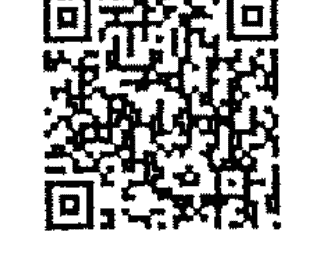

# 前言

## 善用詐騙集團的技巧，你也能成為頂尖商務人士！

轉帳詐騙或黑心商人造成的危害，至今仍然相當嚴重。儘管每天報紙、新聞或政府機關都在呼籲民眾提高警覺，還是有許多人受騙。究竟是為什麼呢？關於這點，我在自己的著作和電視上也多次提到，最大的原因是，民眾都以為「自己不會被騙」。不過，仔細想想，之所以會有這種想法，有個很大的理由。那就是，民眾普遍不了解詐騙集團使用的技術有多可怕。

到目前為止，我以報導文學工作者的身分潛入各種詐騙現場，很清楚詐騙的技巧有多縝密、多驚人。詐騙集團會根據對方的心情、情況，使用不同的話術、交涉技巧，使人落入陷阱。對方若是重承諾的老實人，除了遵守約定，還要花時間取得對方的信任。遇上急著想結婚的人，先讓對方萌生愛意，再描繪結婚的美好願景，打聽對方的存款、收入狀況。如果是疑心病重的人，保持專注傾聽的態度，耐心等待對方敞開心胸。然後，一發現突破點，立刻出招。鎖定單一人物，以集團方式進行詐騙的劇場型手法是現在的主流趨勢。成為目標的人，被詐騙集團巧妙地上虛構的舞台狼狽剝削。這也相當於集體恐嚇的行為。受害者不知道詐騙犯手法的可怕，光憑新聞報導得到的情報，自以為了解，因而掉以輕心地想「我才不會被騙」。

每每在現場聽推銷員講得口沫橫飛，或是透過電話與詐騙集團過招時，我總會這麼想，假如他們待在健全的社會，應該能為社會帶來莫大的貢獻，也能推動經濟發展吧。我不知道這些人是在怎樣的契機走上詐騙這條路。但是，要是他們走對路，一定會成為頂尖的商務人士。因此，只要從詐騙犯的技能中抽除「說謊」這個毒素，就成了對日常買賣交易非常實用的技巧。

詐騙集團能夠一再騙錢，那是因為一般民眾不懂他們的技術才受騙。我實在無法繼續坐視不管，所以決定撰文出書。更何況，詐騙犯將那些技術視為利刀，天天砥礪精進騙術。被他們拿刀抵住脖子的我們，要是不做任何何反抗，只能任其宰割。因此在這個時代，消費者為了避免受騙，也得努力求知才行。

隨著高齡化社會的來臨，詐騙集團、黑心商人造成的危害恐將日益加劇。既然如此，今後的社會需要的是一周圍的關懷」。趁早視破解騙集團的詭計，保護身邊的年長者免遭荼害。我希望透過本書，提供讀者有助於買賣交易的商談技巧，以及盡早察覺騙術的警覺心。

當然，也許有人會無視我的意圖，濫用書中的技巧。但我想強調的是，本書好比雙刃劍，切勿心存歹念。

本書摘錄了我在「PRESIDENT Online」騙徒的經濟教室！專欄自二〇一四年五月開始的連載內容。衷心期盼本書能讓各位學會如何保護自己，並且在守法的前提下，成為推動社會健全經濟發展的助力。

# 第 1 章
抓住人心，讓他在不知不覺說YES!的活法

## 詐騙集團絕對遵守的經典「對話法則」

### 為何詐騙集團要採取「傾聽 7：說話 3」的比例原則？

佯裝親友的「是我啦電話詐騙」很老套，為何仍有人一再被騙？

二○一四年在日本，包含轉帳詐騙在內的特殊詐騙，總金額多達五百五十九億四千萬日圓，是歷年來最高的金額。當中，佯裝成親屬的「是我啦電話詐騙」也達到相當可觀的金額。明明警方都很賣力宣導，為何還是有人受騙？理由在於，儘管詐騙集團的人花招百出，他們卻有一套堅守的「對話法則」。

接下來，讓我們從典型的詐騙模式來找出那個法則吧。

某天，有位老婦人接到一通男性的來電，她以為是兒子打來的。

「喂，是我啦。」
「○○啊，怎麼啦？」

「我跟你說，我把包包忘在電車裡了，裡面有支票和我的手機。我現在是跟公司的人借手機打電話給你。要是車站那邊有人打電話給你，你要聽清楚人家說什麼喔。」

當她說出兒子的名字後，對方接著說明狀況，說完隨即掛斷電話。

過沒多久，那個人又打電話來了，這次的語氣變得沉重。
「我弄丟支票出大事了，你等一下，我主管有話要跟你說。」

於是，自稱是兒子主管的人，好聲好氣地接著說：
「伯母您好，事情是這樣的。您兒子弄丟的支票是今天必須給客戶的款項。雖然

## 詐騙技巧

支票遺失就會止付，但我們今天一定得付清那筆錢……所以，可以請伯母先代墊部分的金額嗎？

然後，對方繼續問現在能夠準備多少現金，要是手邊沒有現金，請到銀行提領。

不過，現在銀行對詐騙也存著高度的警戒心，所以那位主管告訴婦人：「這件事假如被公司知道，您兒子可能會被開除，請您保持低調。」像這樣對婦人下封口令。並且指示她應該怎麼回話：「要是銀行的人問您提這筆錢要做什麼，請回答是要拿來辦喪事或家裡要整修。」

婦人從銀行提完錢回到家後，兒子與兒子的主管又打了幾通電話過來，交待她如何給錢。由於詐騙案頻傳，用 ATM 轉帳容易被抓包，對方通常是說公司會派同事直接到家中取款，或是約在某處交款。

這是透過電話，由好幾個人聯手詐騙的手法。受害者頻傳，有位七十多歲的女性因此被騙走家中的一千兩百多萬。

「佯裝成兒子或孫子拐騙錢財的『是我啦電話詐騙』已是很舊的手法，雖然警方一再宣導，還是持續出現受害著。

### 初次見面，把七成發言權交給對方，不動聲色蒐集情報

到底是為什麼會被騙？

理由之一是，詐騙集團的人很懂得「旁敲側擊打聽情報」。

裝成兒子的詐騙犯打電話給婦人，「開口就說『是我啦』，接到電話的婦人聽到「是我啦」，立刻回道「○○啊」，主動報上兒子的名字。於是，裝成兒子的詐騙犯順勢接話，「對啦，我換電話號碼了，你記一下」，像這樣開始一步步誘騙對方。

當然，有時是已經鎖定了目標才打電話，不過，通常是從電話簿隨機選號，對手邊沒有詳細資料的詐騙犯而言，可以得知兒子（家庭成員）的名字是很大的收穫。

假如婦人聽到「是我啦」，卻覺得不像兒子平常的聲音，因而起疑，為了確認身分，或許會問：「最近學校的考試準備得怎麼樣了？」這下子詐騙集團又得知「對方的兒子是學生」。

詐騙犯很懂得如何讓對方主動開口。

對話技巧也常提到，與初次見面的人對話時，七成的發言權交給對方，自己掌握三成左右即可。詐騙犯完全遵守這個原則，所以打第一通電話時，與其說話不如多傾聽，就是為了蒐集情報。

通常我們總以為詐騙犯的口氣會很差，急驚風似地說完自己想說的話，其實不然。

他們反而非常注重傾聽。

一般做生意的人也會遵守「傾聽 7：說話 3」的原則。例如，賣健康食品的某者，打電話問消費者「想不想試吃看看」，對方回道：「不用了，我已經有在吃別的產 品。」這時候，只要問出「別的產品」是什麼，業者就能知道消費者對哪些營養成分有 興趣。假設對方回答「不用了，我有在吃藥」，甚至能從藥名推測出對方的病名。

### 提高攻打率的祕訣：遇到警覺高的對手，沒希望的馬上放棄！

前文舉出的典型詐騙模式中，詐騙犯慣用的手法還有一個隱藏版的「絕招」—— 他 們不會在第一通電話就進行詐騙。

「我換電話號碼了，把之前的舊號碼刪掉」，像這樣告知自己的新號碼，「我有事 想跟你說，不過今天還是算了，我再打給你」，刻意不提詐騙的內容，就此打住。

與其說是詐騙的事前電話，其實是為了試探對方好不好騙。「你到底是谁！」若得到這樣的反應，表示對方不易受騙，那就立刻掛斷電話，尋找下一個目標。

詐騙犯使用的正是商場上的省時祕技，「應付不來（沒希望）的客人，馬上放棄」。業績差的業務員老是做些沒效率的事，花時間一家家電訪，即使是毫無希望的客人仍然卯足全力。那麼做不但浪費時間，而且頻頻被拒，接連受到打擊，之後或許沒有勇氣再繼續打電話。

然而，精明的業務員面對顧客自有一套標準，電訪時表現得很淡定，只對有希望的客人提及買賣。不要過度投入感情，多打幾通通電話，遇到願意買單的客人的機會率自然會增加。

傷腦筋的是，這個方法偏偏被詐騙集團當作騙錢的招數。一旦被認定是會上當的對象，詐騙集團就會使出人海戰術，不斷地打電話，讓目標抹入陷阱。所以，不管再怎麼宣導，上了年紀的老人家還是會被騙。設定電話答錄，或是不知道的電話號碼不要接，都是預防詐騙的好方法。

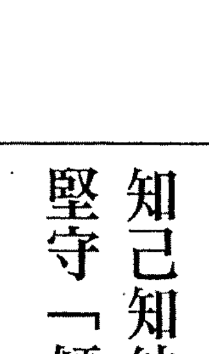

### 讓雙方徹底信服的要訣①

知己知彼，百戰百勝。

堅守「傾聽 7：說話 3」的原則，套出對方的情報。

錄音不僅可以留下對方的犯罪證據，也能預防被對方用電話套話。防範於未然，才是保護自己不被詐騙的有效方法。

### 「麥肯錫式」話術，3個重點最具說服力！

- 從賭博詐騙手法學「讓對方乖乖聽話的技巧」

利用電話等管道，以虛構的投資情報進行詐騙的案件層出不窮。例如，有些詐騙集團會用賭博投資的名義誆騙民眾，那麼他們使用的是怎樣的話術呢？

- 明明覺得「賺錢明牌」很可疑，為什麼就是會上當？

某位七十歲的婦人接到一通電話，對方說「有場賽馬比賽的排名已經內定」，以提供情報為由騙取費用，總計兩百五十萬日圓。

有位七十多歲的老蓟也數十接到自稱業者來電，“要不要參加賽馬比賽的投資”，對方以手續費的名目，前後騙走老翁兩百萬日圓，這件事在日本還上了新聞。

姑且不論賽馬之類的比賽是賭博，“有穩贏的情報”這種聽起來很可疑的事，詐騙集團是怎麼讓對方相信的呢？

我曾加入某個宣稱能提供賽馬情報的網站。隔天起，自稱是業者男性頻頻來電。

①“為了讓你贏錢，我要告訴你三件很重要的事。”

電話那頭的男性這麼說，我問他是哪三件事。

②“我明天再打電話向你說明，敬請期待。”

那人說得煞有其事，然後就掛斷了電話。

“贏錢的三件事”到底是什麼，真有這種事？很可疑，實在很可疑。不過，我心中確實也起了“說不定真的有”的念頭。

隔天，那人果然來電告知所謂的三件事是什麼。

「你聽好，第一件事就是，有個專門培訓賽馬的A組織。這個組織培訓出來的馬經常參加比賽，由這個組織主導的比賽，一年有好幾場。」

「所以說，這是事先設計好的假比賽囉？」聽到我這麼問，那人先是說「這問題問得好」，接著滔滔不絕地說了起來。

「沒錯。就像打假球那樣，賽馬也有所謂的造假。然後，第二件事是，提供賽馬情報的B公司。A組織有很多人在這家公司擔任要職，我們公司也是從B公司得到A組織的比賽情報。最後一件事是抽號。JRA（日本中央賽馬會）對外都說是用電腦選號，但由A組織主導的比賽，抽號是為了指定獲勝的馬。造假的比賽就是A組織、B公司與JRA三萬聯手促成的。」

「莫非是詐騙集團！」聽到這裡，我心中一動，但还是故作鎮定地說：

「你突然跟我說這些，我不太能相信欸。」

「您說的是。關於這週末的比賽，我會得到機密情報，明天我再打電話向您說明。」

結果，那人彷彿早料到我會會有這樣的反應，放低姿態簡短說了幾句後，掛斷電話。

隔天，那人一開口便說「在我告訴你比賽的情報之前，請你遵守三件事」，然後接著說：

- 「第一，別對他人提及這場比賽的事。第二，不要買這場比賽的馬票。我是想讓您透過這場比賽確認情報的真實性。坦白說，這種特殊情報必須是通過審查的會員才能知道的珍貴情報。第三，請不要向JRA等機構檢舉比賽造假的事。這三件事，請問您做得到嗎？」

我不假思索立即回道：「可以！」聲音大到自己也嚇了一跳。

聽了我的回答，那男人開始告訴我明天的比賽將如何進行。「叫○○○的馬會先衝第一，然後：：：」。儘管交待了比賽經過，說到重要的排名，他卻用「你還不是特別會員，所以我沒辦法告訴你」這種話含糊帶過。

(笑)「如果我想知道的話？」

(怒)「這樣啊，如果想知道排名必須付費才行。費用是三百萬日圓。」

我拒絕了那個「提議」。實際看完比賽後，我發現聽到的「比賽經過」其實是很模稜兩可的描述。

果然是詐騙。不過，對方的確用了很高明的話術。

### 「3」是人們最能專注與接受的數字

與詐騙集團打交道的過程中，我發覺了一件事。他們為了傳達自己要說的話，往往一開口就會搬出「三件事」這個關鍵字。

這使我聯想到管理顧問公司「麥肯錫」（McKinsey & Company）。許多人都知道，這家公司向客戶進行簡報或商談時，一定會用「三」這個魔法數字。

「重點有三個。第一個是……第二個是……第三個是……」

一個或兩個感覺「有點少」，缺乏說服力，四個或五個又覺得「太冗長」，對方無法仔細專注地聽下去。「三」則是人們最能接受的數字。

這個話術主要是用來將自己的意圖明確傳達給對方。說話者先想好三個架構，逐置入想說的事。這麼一來，對方會更容易理解自己所說的話。

利用這種話術的賽馬詐騙，受騙的幾乎都是第一次玩賽馬老人家。如果想讓老人家了解什麼是造假比賽，連珠炮似的說明他們是聽不懂的。於是，詐騙犯想出用簡單易懂的「三件事」，循序漸進地說明。

### 洽商、簡報……複雜的內容更要活用 3 個重點彙整

把這種說明技巧結合造假比賽等捏造出來的謊言，就是詐騙行為，但若是應用在業務洽商或向客戶進行簡報時，卻是相當實用的技巧。

要是覺得自己說的話對方總是聽不明白，請先設想好三個架構，逐一點入要點。

- 理由有三個。
- 有三個重點。
- 我想說的事有三件。

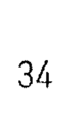

像在說「口頭禪」似的，一開始先這麼說，然後再接著說明。對方聽了或許會想「是什麼事」，進而產生興趣。就算老掉牙的內容，有時聽著聽著卻覺得有道理，反倒提高說服對方的可能性。

### 讓對方徹底信服的多妙招②

把要說的話分成「三點」，以簡單易懂的方式循序漸進地說明。

## 在路上攀談，短時間內深入人心的方法

### 「真心話」推銷話術的巧妙起承轉合

街頭推銷的肥羊，其實都是自願走進店裡被宰?!

走在路上被推銷，被迫買下高價商品的情況確實比以前少了些，不過受害者還是持續出現。

> 「我在練習指甲彩繪，請您幫幫我。」

> 「想不想體驗當模特兒的感覺，不用錢喔。」

像這樣，在街頭向年輕女性攀談，接著帶到店裡進行膚質檢測，一再過幾年，你臉上會長斑塊喔！一說些令人不安的話，煽動購買昂貴美容器材的男性業者，因為違反特定商業交易法遭到逮捕。

街頭推銷的弔詭之處在於，在街上被攀談時，儘管不想買商品，最後還是被帶到店裡簽約。

一般人總認為街頭推銷是被強迫帶到店裡消費，實則不然。推銷員帶著目標進到店內之前，都會仔細做足準備，提高買賣契約成功的機率。

首先，為了將目標順利帶到店裡，推銷員得在短時間內縮短彼此的內心距離。多數的推銷員會用「問卷調查」的名目向路人攀談。

如果是SPA中心，通常會問：「可以幫我填一下美容的問卷調查嗎？「

### 聆聽技巧

舉例來說，路上經常有人推銷「自我成長講座」，推銷員的問卷調查表包含各式各樣的問題，從「政治、經濟、歷史、運動、電影」，再擴及私人領域的「家庭、結婚、工作、戀愛、健康」等。

推銷員會趁路人正在看的時候，出聲詢問：「有沒有覺得有興趣的項目？」「在這麼多項目中，總會有一兩個有興趣的，推銷員就是鎖定這一點。然後，再根據路人的回答去探測對方目前為了什麼事而煩惱，或是遭遇到什麼問題。

### 利用問卷調查，打聽出目標的煩惱，主動分享小祕密縮短距離

到目前為止，我接觸過形形色色的黑心業者，也從中體認到，推銷員在打聽情報這方面分為高手與遜咖。兩者的差異從以下的反應就能得知。

遜咖推銷員若得知路人有興趣的是「健康」，他們會直接問：

> 「你身體有什麼地方不舒服嗎？」

然而，高手推銷員卻是會說：

「這陣子好冷喔。我也快四十歲了，身體老覺得這裡痠那裡痛，真是糟糕。」

像這樣，主動先提起自己的事。假如對方也有相同煩惱，就會回答：「我最近腰也很痛。」於是，推銷員立刻接話提問。

「腰痛很難受吧。你有去看醫生嗎？」

「有啊。」

「你，不會是椎間盤突出吧？」

對話進展得很順利。

要是對方卸下心防接著說：「其實，我的胃最近也不太舒服。」高手推銷員會這麼回答：

「我懂我懂。我也是稍微一緊張就胃痛耶。」

以健康為話題，彼此像在分享小祕密，聊著聊著逐漸縮短了內心的距離。與對方建立起某種程度的信賴關係後，推銷員就會開始宣傳要在店裡介紹的商品或服務。不過，劈頭直接宣傳商品的話，馬上就會被抓包是在推銷。

因此，推銷員會利用問卷調查等方式，打聽出目標的煩惱作為話題。若是推銷自我成長的講座，他們會說：「以前我的人際關係不太順，聽完這個講座後，問題就解決了。「若是SPA 中心的推銷，可能會說「我以前皮膚狀況不太好，用了這裡的美顏器按摩，皮膚變好很多」之類的話。聽起來像是自身的體驗，其實是為店家做宣傳。

然後，緊接著說：「要是你也有興趣，可以試試看喔。」當然，他們當下不會告知講座或 SPA 的費用。結果，沒想到自己會被強迫簽約的人隨口說了句「聽起來好像不錯」。聽在推銷員耳裡就解讀成「如果有機會，我想試一試」，心中盤算著準備帶目標前往店裡。

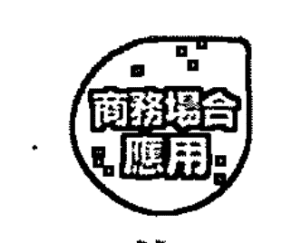

### 衡量雙方信賴度與交易話題的比重，避免給對方被強迫的感覺

編造不實的體驗，或是沒有確實告知商品內容，硬逼他人消費的強迫式推銷，一般商務人士不能做這種事。但是，這些做法背後的邏輯的確能夠應用在工作中──彼此分享「小祕密」，建立信賴關係。這裡所說的祕密並不是什麼了不起的大事。

例如，想與顧客或生意對象拉近距離時，如果是初次見面，可以聊聊天氣、新聞等無關緊要的事，緩和尷尬的氣氛，接著再慢慢聊到對方的故鄉或喜歡的運動（支持的隊伍）等個人情報，當作是輕鬆的閒聊。

不過，這時候有件事很重要，如前文所述，擅長打聽情報的推銷員會先提及「自己的事」，主動積極地說出自己的簡介或經驗（失敗體驗等）、居住地區等私人資訊。這麼一來，主動分享的一方會令對方產生親切感。如果發現彼此有相似點，就更會增加兩人的親近度。

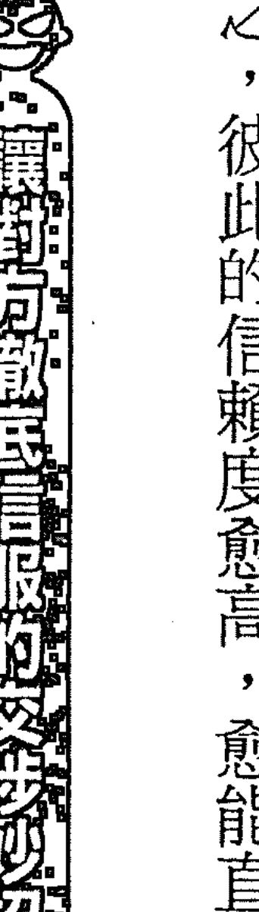

### 主動提供個人情報，使對方產生親切感，抓住對方的心。

等到對方卸下心理，就可以進行商品的說明。此時，謹慎思考雙方的依賴度與商品說明（買賣）的比重，保持平衡很重要。想像彼此坐在翹翹板的兩端，好好拿捏尺度，向對方提出交易事宜。

假如雙方的依賴度不高，話題卻過度著重於買賣，對方就會有被強迫的感覺。反之，彼此的依賴度愈高，愈能直搗核心、有話直說。

## 鎖定對方的善意，隱藏在「助人為樂」糖衣下的謊言

### 期待效應，讓人無法對你說NO！

### 巧妙利用民眾的善意或同情心，以慈善之名行詐騙之實

二〇一一年的日本三一一大地震後，陸續又發生了幾次地震或豪雨等災害。每每看到那樣的新聞，我就很想盡一己之力幫助那些受災戶。

然而，有人卻利用這樣的同情心進行詐騙或做起黑心生意。

> 「我想為日本三一一大地震的孤兒成立兒童養護機構，請您幫幫我。」

某一年的年底，有位八十多歲的老先生接到一通自稱是某學園職員的來電。老先生基於想幫助受災户的善心，聽信了對方的話，寄出現金兩百五十萬日圓。另外，謊稱是臨時住宅（組屋）的業者向民眾騙錢的案件也層出不窮。

近來，在日本引發關注的則是「老人之家或安養機構入住權」的買賣詐騙。日本的消費者服務中心等機關屢屢接到類似的詢問。

某位高齡女性收到經營老人之家的醫療法人廣告信（Drop Mail，簡稱DM）。信中夾帶「可以入住老人之家」的權利申請書。

之後，有位自稱是業者的人打了電話來，這麼說道：

「目前想住進安養機構的人大概有三十人，可是能夠購買入住權的只有收到信的人，很多人因為無法入住而感到煩惱。錢的部分，我們公司會準備好，請您幫幫那些人，去提出申請好嗎？「

該女性基於想幫助人的善意，答應了對方的請求，提出三十人、三千万日圓（二百萬日圓）的申請。但是，她的女兒察覺到這是詐騙，打電話向對方解約卻遭到恐嚇。

☞「要解約的話，你們必須付一千五百万日圓的損害賠償。」

根據日本國民生活中心的統計，像這樣以「助人」為由，要求購買老人之家入住權的詐騙案，平均的受騙金額約為五百五十一萬日圓（二〇一三年的資料）。巧妙利用民眾的善意或同情心騙取金錢，這樣的手法不得不當心。

通常這種方式的詐騙，為了煽動對方的憐憫之情，詐騙犯會說「只要你出錢，就能幫忙受災戶脫離困境」之類的話，使對方覺得被寄予期待。

### 詐騙技巧

最典型的模式就是街頭募款。在街上聽到有人喊著「你的善心能夠幫助許多人」、「只有你才做得到」，為了回應那樣的期待，不少人會掏錢投進捐款箱。

一般人被依賴並不會心生不悅。受到他人的期待，自然會想表現相應的成果。這稱為「皮格馬利翁效應」（Pygmalion Effect，亦稱「期待效應」），也叫「羅森塔爾效應」（Rosenthal Effect）。

### 先予負面打擊再給正面激勵，提高期待效果，對方就會無法拒絕

教育心理學有項法則，老師告訴學生「你是能幹的孩子」，表現出對學生的期待，學生就會提高學習意願，出現成績或智力進步的效果。詐騙集團就是利用這種效果，將目標誘導至他們設下的圈套。

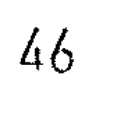

商場上為了達成目標或業績，必須時時提升員工的鬥志。這時候，為了激發部下的工作意願，上司會說：「拜託你囉！你一定辦得到！」這種寄予期待的話，讓員工的心態變得積極。

不過，很多時候光是那麼做，未必會有顯著的效果。

這是因為，讓對方感覺被期待，等於是提振對方的心情，所以必須先讓對方處於負面（沮喪低落）的狀態。因此，為了提高期待的效果，先以吿責的方式向對方說些不中聽的話，令對方心情沮喪，接著再用激勵的話語，使其覺得受到期待，這樣的順序其實非常重要。

先前提到的「助人」詐騙，詐騙犯會先說災害的慘況，讓電話那頭的人聽了情緒低落。然後又說「這件事只有你才做得到」，令對方感覺被期待，因而上當受騙。

### 棒棒與糖果輪番上陣，體驗痛過之後的甜美，有時更易說動部下或交易對象

我接觸過的黑心商人也經常使用這種手法。

我曾被某位女推銷員糾纏了將近一小時，後來我表明不會簽約，對方立刻翻臉，生氣地說：

> 「你一點魄力都沒有，往後的人生絕對不會成功。」

「說什麼不能簽約，我從沒見過像你這麼優柔寡斷的男人。你繼續這樣下去，只會過著半吊子的人生，一輩子結不了婚。」

對方惡狠狠地瞪著我。當時四十多歲還單身的我，有種被說中的感覺，露出沮喪的表情。那位推銷員見狀，馬上改用溫柔的語氣這麼說：

> 「不好意思啦，剛剛那樣兇你。不過，我是很認真在思考你的將來才那樣說的呢。」

## 第1章 抓住人心，讓他不知不覺說YES！的話術

### 讓對方徹底信服的交易妙招 ④

人只要受到他人的期待，自然會想回應對方而展現相應成果。

總之，為了說動部下或交易對象，不能只是給糖吃，想要讓他們覺得受到期待，得先撚狠話、賞幾鞭。這麼一來，對方才會深刻體會到痛過之後的甜美。

但是，有些情況則不須刻意責罵對方。例如，部下因為工作的失敗陷入絕境，或是顧客遇到無法解決的麻煩。這時候，對方的情緒已經十分低落，只要讓對方覺得被期待，幫助他提振心情即可。

最後甚至還說：「你遇過像我這樣真心為你著想、罵過你的人嗎？」像這樣打出濫情牌。總歸一句話，她的意思就是，你是有前途的人，我很好看，所以才會說出那些難聽話。

然後，她又開始滔滔不絕地推銷起來……

### 藉由非黑即白的極端思考、對立思考，操縱人心

**「二選一」的威力，讓人陷入思考的盲點**

明確實分事物的善惡、敵我、是非，這是邪教團體常見的思考方式。這種思想稱為極端思考、對立思考。

其實，優秀的商務人士也會採用這種方法，不過在說明其好處之前，我想先聊聊它的壞處。

現今這個社會，世事複雜糾結，許多人在工作或人際關係上不懂得如何應對，為此煩惱或產生壓力。

不過，要是用那樣的思考方式將所有的事一分為二，自然省事先輕鬆。若選擇自認為對的那一方，只要排除錯的那一方即可，不必為了曖昧不明的立場而煩心。因此，有些人會藉由這樣的思考方式，讓自己擺脫煩惱。

可是，這樣的思考方式其實很危險。

例如，邪教團體會以這種思想控制人心。也就是說，符合教義的行為是善行，此外都是惡行，像這樣將世事分為二進行判斷。

於是，反對教義的人都是惡魔、敵人，必須徹底排除。當中有些人甚至認為教義比法律優先，因而做出傷害他人的反社會行為。以前在日本發生過一連串的奧姆真理教事件等就是典型的例子。

> 註：1. 創立於一九八四年，教主為麻原彰晃，現已瓦解。因為涉及松本沙林事件、坂本堤律師一家殺害事件與東京地鐵沙林毒氣事件等恐怖活動，被視為邪教組織。

### 懷抱明星夢試鏡，花了十五萬買到的教訓……

另一方面，和邪教團體一樣造成社會問題的詐騙集團，又是怎麼使用這樣的思考方式呢？

三十多歲的時候，我曾經夢想成為演員，當時收到「某經紀公司要舉辦徵選」的廣告信。我去參加了試鏡，幾天後被通知「你錄取了！」

後來，我去了那家經紀公司談簽約的事。過程中，經紀公司的男職員這麼說：

> 「要加入我們公司，你得付十五萬的簽約金。」

> 「因為金額實在太高，我開始猶豫要不要簽約，那位男性又接著說：

1. 之後我們不會再收取任何費用。不過，要是你不付這筆錢，錄取的資格就會被取消。」

好不容易錄取了，豈能錯失機會，最後我抱著豁出去的決心付了十五萬。還好，對方很快就和我連絡。

> 「請你去參加V電影公司的徵選。」

如果錄取了，我就能從事演員的工作，既然如此當然要參加。不過，我果然不是那塊料，因為太緊張，居然照稿念，表現得非常糟。

幾天後，經紀公司找我過去，告訴我「沒有通過徵選」（我想，就算我演得很好一定還是落選）。然而，談話並未就此打住，經紀公司的男職員接著說：

> 「你的演技太差了。想成為演員的話，你得去我們介紹的演藝學院上課！」那筆學費超過五十萬日圓。

> 「當初簽約的時候，你不是說之後不會再收取任何費用了！」

聽到我這樣反駁，那位男職員反倒語氣強硬地說：「你有沒有心想成為演員啊！」我告訴他我沒錢，他竟然回我：「想成為演員的話，錢根本不是問題！你現在馬上去借錢來付學費！」還露出一付這是正確投資的表情。

那位男職員花了好幾個小時試圖說服我。

> 「（演藝學院）要去，還是不去？」

> 「（學費）要付，還是不付？」

對方硬逼我二選一。各位也許會覺得我很可笑，但當時的我是真心想把演員這份工作當成人生志業。到頭來，我還是拒絕了，或許是內心某處已經恢復冷靜了吧。

後來我查了一下，和我同一家經紀公司，抱著堅定決心「想成為演員」的人，都被以這樣的手法強迫簽下高額契約。

### 活用理想與現實的對比，誘導對方照自己的意圖去做

詐騙集團的手法就是利用兩種對立的概念去說服他人，那就是「理想」與「現實」。

起初讓人通過徵選，虛構「理想」，使人擁有「可以成為知名演員」的夢想、希望。而，之後參加徵選又落選，讓人面對「現實」，感受到自己的演技很差。

藉由理想與現實的對比，讓對方思考現在應該做什麼（去演藝學院上課），進一步強迫簽約。

以夢想或理想脅迫他人簽約是不可取的行为，但一般的生意人為了達成簽約目標，也經常見利用對立概念去說服交易對象。

### 將事物一分為二，深入分析對方的想法，規劃縝密的銷售戰略

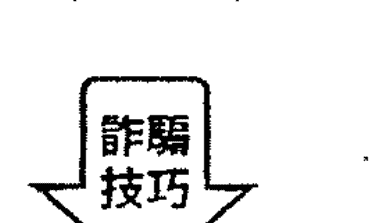
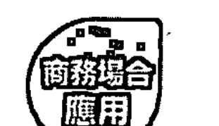

舉例來說，像是語言學習中心推銷課程契約。

通常語言學習中心的人會先問客人，將來希望擁有怎樣的技能。如果客人的回答是「想學好外語，活用在工作上」，這就是他的「理想」。然後，為了確認目前的技能狀態，透過測驗等方式掌握現狀，再向客人提議應該選擇哪些學習課程。

那麼，對於想讓孩子補習的家長，補習班會怎麼做呢？

起初，補習班的人會問：「您希望孩子的哪一科進步幾分？」「您孩子想念的學校是哪一間？」接著進行學力測驗。從分數掌握孩子目前的實力，讓家長知道目標與現實相差多少，並指出孩子的弱點（原因）。

「只要克服那個弱點就會有好結果」，以這樣的話為開場白，同時提出具體的契約。將兩件事做比較，利用明確的差異進行說明，聽起來簡單易懂，也更具說服力。

買賣交易的情況也是如此，說明自家金融商品的特徵時，先說「為什麼買了會賺錢」。當然，任何金融商品都有風險，刻意告知「怎樣的狀況會賠錢」，讓對方產生信任感，像這樣個別說明「得失」，更能成功推銷商品。

另外，販售、開發新商品時，必須了解消費者如何看待那項新產品。我曾經擔任過商品市調員，試喝新包裝的罐裝咖啡等商品時，經常遇到類似的提問方式。

例如，試喝兩種咖啡（以前的咖啡與新產品的咖啡等），「哪一個比較甜或苦」、「哪一個酸味比較重」。或是，看某項商品的包裝，「感覺明亮活潑，還是暗淡乏味」。某商品如果賣一百五十日圓，「這個價格覺得貴，還是便宜」等，為了知道消費者的想法，利用對立概念提出問題。

將事物一分為二，不斷地深入分析對方的想法、找出重點，規劃縝密的銷售戰略。

不過，如前文所述，這樣的思考方式有好有壞。

沒人會心甘情願吃虧受損，自然而然會產生排除壞事的心理。好比我遇到的經紀公司詐騙，對想成為演員的我來說，學習演技達成夢想是「好事」，什麼都不做而失去夢想是「壞事」。

既然想進演藝圈，就得想辦法排除一切壞事。也就是說，被迫用對立思考做選擇時，其實就是只能選一條路。

利用對立思考可以誘導對方照自己的意思去做，但若是強逼他人做出選擇，那就是惡意推銷，如果想使用這個方法，請務必謹慎留意。

將事物一分為二，形成對比，要求對方思考現在應該選擇哪一方。

### 為什麼「猛烈進攻」後「退守」能抓住客人的心？

建立信賴關係後，刻意變得冷淡，對方反而會回心轉意。

#### 1. 猛烈質疑攻勢，反而令人退避三步……

對於在最後關頭卻猶豫要不要簽約的客人，詐騙集團會使出各種方法。例如，暫時「不理不睬」。讓客人的心受到動搖，重新回心轉意，再進一步要求簽約。

以前某個會員制的俱樂部曾向我推銷。

推銷員說只要付高額的會費，就能便宜租借渡假飯店。起初對方的態度相當客氣，提到重要的入會契約時，因為察覺到我不是很感興趣，口氣突然轉為嚴厲。

> 「你確定要考慮到什麼時候？我們只接受今天簽字的人。」

> 「如果說你現在簽，我們就給你特別優惠價，如果過了今天，就不一定有這種待遇了。」

> 「對你的將來有什麼目標嗎？」

我心想，這種事憑什麼我得告訴你。於是我不予理會，敷衍回道：

> 「沒什麼特別的目標耶。現在過得開心不就好了？」

結果，對方一聽語氣更為激動，電話那頭的他想必是一臉不爽。

> 「你這樣毫無想法，肯定不會有幸福的人生！」

沒想到對方會說出這種狠話。內心動搖的我，趕緊補上一句「我是有想過當社長啦。」試圖緩和氣氛，對方聽了又再逼問：

> 「你想當怎樣的社長，說清楚點！」

當下我愣住了，說不出半句話，推銷員接著說：「只是隨便想想，你覺得真的能夠實現夢想嗎？」

一面對接二連三的質疑，氣氛頓時變得很僵，搞得我不好好回答都不行。

#### 2. 進攻後故作冷淡，對方反而會回心轉意

商業上的交涉也是如此，假設我方正很認真地說明，對方始終顧左右而言他，不肯進入正題。這時候，試著不理對方說不定會有效。當然，故意說惹惱對方的話未必次次見效，但情況確實會改變。

最近讓我覺得「話術高超」的人當中，有一位是搞笑團體「隧道二人組」的石橋貴明。我曾在「隧道二人組」主持的綜藝節目中擔任過解說員。節目內容是石橋先生等人向其他藝人推銷古怪的商品，說穿了就是整人節目。觀眾透過這個節目可以知道黑心買賣的手法，避免上當受騙。

節目設定的目標之一是搞笑團體「香蕉人」（BANANAMAN）的日村勇紀。負責整人的石橋先生進入日村先生的休息室，假裝成私下會面，「我有好東西要介紹給你。」向他推銷起開運佛珠。對石橋先生毫無戒心的日村先生，馬上掏出兩萬日圓購買。

之後，就連一瓶（五〇〇ml）五百日圓的水，日村先生也很捧場地買了一堆。可是，當他聽到要價數十萬的佛像時，不禁猶豫了起來。

多數推銷員見到這種反應，通常會說「別考慮了，買吧買吧！」或「這是很難得的機會！」強迫對方做決定，但石橋先生的舉動完全超乎預期。

在另一間房內看著監視攝影機拍下兩人互動經過的我，大感驚訝。石橋先生很乾脆地說：「好好好，沒關係。」隨即拿走佛像，收進盒子裡。

看到那一幕，我不由得讚嘆：「做得好！」

果不其然，眼見佛像被迅速收走的日村先生突然變得很著急，他可能是想到「錯過這個機會，說不定再也買不到那麼棒的東西」、「（石橋先生念在我們的交情）特別報給我這樣的好康」。

日村先生主動伸手從盒子裡取出佛像，開始仔細端詳。想當然，過沒多久他就決定買下佛像。

> 「可以讓我再看一次嗎？」

雖然是綜藝節目，從這樣的「橋段」應該能學到不少對生意人有幫助的事。

不過，話題一直圍繞在交易買賣，其實只是浪費時間。正確地說，那麼做會讓對方想要閃人。一旦被貼上煩人精的標籤，你和對方恐怕不是「未完待續」，而是「到此結束」。所以，不妨稍微表現得冷淡些，令對方暫時忘記被推銷的事。

有件事要提醒各位，打算那麼做之前，必須先表現出極大的誠意與對方談過。只要你說話有打動客人心，對方就會像扔出去的回力鏢，主動回到「原本的話題」。如此一來，就可以像石橋先生那樣，抓住好時機，將對方誘導至自己希望的方向。

至今我遇過很多懂得交涉的生意人，他們很了解一般人的心理。面對客戶時，先進攻卻不會窮追不捨，接著刻意保持沉默或展現淡定的態度。

假如是恩人或上司使用這種手法，威力更是強大。因為想到「如此德高望重的前輩特意告訴我，要是拒絕實在太失禮了」，內心會產生類似罪惡感的心情。如果是已經互有信賴關係的人，對方自然會想著不能辜負你的期待，此招一出，立即見效。

**讓對方徹底信服的交易妙招 ⑤**

說服對方時，「猛力進攻」後「迅速收手」，對方就會著急地想：「不能錯失這個機會。」

### 冷靜接受對方的批評，利用接話的時候，鬆懈對方的警戒心

#### 1. 「但是」、「不過」、「可是」…… 詐騙集團的禁用詞

##### 實戰案例：已經警覺對方是詐騙集團，為何還是被騙？

「是我啦，電話詐騙」已是眾所周知的老梗，受害者卻依然有增無減。這麼說或許有些荒謬，但那是因為，詐騙集團很懂得「發揮創意」。假如不好好精進騙技，如何在不法的世界混口飯吃呢。

> 「我挪用了公司的錢，不趕快填補缺額，我會被開除。」

住在鄉下的某位婦人，接到一通自稱是兒子打來的電話。

> 「我兒子不是會做這種壞事的人，而且你的聲音和我兒子不太像……」

婦人反應機靈，試圖套對方的話。

> 「你是詐騙集團吧？」

如果是詐騙集團的人，聽到這樣的話，難免會緊張而動搖。但是，電話那頭的人卻不慌不忙地回道：

> 「就是說啊，你說巧不巧，怎麼會發生這種像是詐騙集團瞎掰的事。（笑）」

對方冷靜的態度令婦人不由得相信，電話那頭確實是她兒子，「看來得趕快準備一筆錢了……」

就是這招！詐騙集團回話時會巧妙利用對方的疑惑。不急著反駁，而是先冷靜接受——「就是說啊」，利用對方的疑惑加以反擊——「怎麼會發生這種像是詐騙集團瞎掰的事」。於是，上了年紀的老人家就會被誘導去相信對方所說的話。

#### 2. 面對批評的言論，先退讓一步，取得信任

商场上也是如此，做生意一定會聽到客戶的批評挑剔。

這時候，交涉的成功與否取決於你的態度。當客戶不肯接受我方的意見時，「不對，不是那样的！」「可是，那是因為○○○○……」有些人會忍不住想反駁，但那麼做無法讓事情圓滿解決，甚至可能導致交涉破裂。

面對批評的言論，請先退一步。那麼做並非委曲求全，而是要讓對方覺得你有在讓步。這麼一來，對方會認為自己的反駁壓住了你，心生滿足。殊不知你正準備全擊。

而且，展現退讓的態度也能取得對方的信任，使談話順利進行。過去我曾在客戶時遇到所謂的高手。那時我生氣地向對方抱怨產品與服務的不周全，但對方並未立刻反駁，而是先說「感謝您寶貴的意见」、「您說的對」，將我的怨言照單全收，然後才繼續接話。這樣的應對方式，客訴的人會覺得自己吐為快，自然會心平氣和地聽對方解釋。

但是，要像客訴高手那樣包容怨言，必須保持從容的心態。隨時做好準備才能保持從容。發生預料之外的狀況，肯定會感到慌張，所以必須事先預想會遇到怎樣的批評或反駁。現在的人越來越懂得提防詐騙，詐騙集團也知道可能會被抓包。因此，他們會準備好如何應答。

做生意也一樣，若提到投資金融商品賺錢的話題，一定會被問到「投資不是都有風險」之類的。或是推薦別人加入某資訊服務的會員，對方應該會問要是中途退出，解約金該怎麼算⋯⋯等等，這都是能夠預想得到的情況。

因此，必須先想好如何回答那些質疑。如果可以，針對常遇到的批評、反駁整理出回答後，做成常見問答集，事先瀏覽讓心裡有個底，就能快速做出完美的應對。這麼一來，無論發生任何突發狀況，你都能從容解決。

#### 3. 簽約前刻意讓對方說出疑慮，釋出不安，就能減小解約的可能性

不過，有個重點要提醒各位，千萬不要死背問答集。一字一句背得滾瓜爛熟，聽起來只像是照稿念，感覺很不自然。這就好比熬夜硬記面試題庫的求職者，無法獲得面試官的信任。

訣竅在於，確實記住問答的基本，其餘的靠即興發揮。依照對方質疑的觀點或內容，調整基本的回答。仔細做足準備，加以「靈活」應變，是進行「交涉」的關鍵。

另外，還有更高明的技巧，在簽約前刻意讓對方說出反對的意見，逼出對方內心的疑慮。當場就決定簽約的人，通常等到獨處時恢復冷靜，會覺得自己似乎太衝動，內心感到不安。

當那樣的情緒持續高漲，最後交易可能會被取消。因此，為了避免那種情況，先讓對方釋出心中的不安或不滿，予以安撫，即便之後對方感到不安，你的話也會產生免疫力，消除那些不安的情緒。

面對批評、反駁時，先包容、後反擊是各種情況都實用的方法。

**讓對方徹底信服的交涉妙招 ⑦**

聽到不利自己的話，別反駁、先接受，以誠懇的態度回應，取得信任。

### 「就趁現在！」瞄准時機，試圖營造一致性的對話

#### 1. 超強詐騙犯會讓客人把「就是說啊」、「真的欸」掛在嘴邊

> 「這可能是詐騙喔。」

即使銀行的人好心勸阻，偏偏有人就是聽不進去，硬要匯錢給詐騙集團。「要趕快匯款才行」，滿腦子都是這個念頭，只想完成這件事，完全聽不進別人的建議。

這種行為稱為「一致性原理」。

這是邪教團體宣揚教義時的慣用手法。成功灌輸教義後，即使團體高層提出「就算去騙人，也要拿錢來奉獻給我們的神！」這般不合理的要求，信徒也會乖乖照做。就算有罪惡感，基於「相信教義」的心，使信徒做出一致性的舉動。

黑心買賣也常利用這種原理，誘導民眾簽約。

好比以下這個例子。

某位男性接到一名女性的來電，邀請他參加某服飾公司的展示會，他心想去看看也沒差，所以依約前往。抵達會場沒多久，那位女推銷員就向他推銷三十萬日圓的訂製西裝，男客人隨即以「我不需要」為由拒絕購買。女推銷員根據他的反應，判斷正面進攻的方式說服不了他。

> 「不好意思，冒昧請教一下，您從事哪方面的工作？」

放棄，繼續提問，試圖尋找說服對方購買的突破點。

> 「我是警衛。」

男客人這麼回道。這職業壓根兒穿不到西裝，但那位女推銷員不肯

> 「您是警衛啊，這工作很辛苦耶。您打算一直做這份工作嗎？」

男客人聽了不疑有他，接著說：

> 「如果有其他更好的工作機會，我是想換工作。」

> 「所以，你有在找工作囉？」

> 「是啊，最近面試了不少家公司。」

> 「參加面試的話，那就得穿西裝了吧。」

> 「對啊。」

這下子總算找到了說服對方購買的突破點。於是，該名女推銷員開始說明訂製西裝的必要性。

> 「大家不是常說，職場上的第一印象很重要。面試更是如此對吧。」

> 「沒錯。」

> 「要是穿了不合身、不適合的服裝，別人對自己的印象也會變差吧。」

> 「是啊是啊。」

> 「對了，您覺不覺得能幹的人都會穿很體面的西裝？」

> 「就是說啊。」

> 「要是有一套合身帥氣的西裝，走到哪兒都不會覺得不如人對吧。」

> 「啊，真的欸。」

> 「說到這兒，您認為工作能幹的人具備怎樣的條件呢？」

> 「嗯……這個嘛，做事果斷，很有主見。」

> 「工作上沒主見、說變就變，那種優柔寡斷的人無法獲得別人的信任。這在商場上是很重要的事。您覺得自己是哪種類型的人呢？」

> 「我也不是多了不起的人，不過硬要說的話，我是一旦做出決定，就會堅持到底的人。」

#### 2. 話技巧

> 「好啊！喔！我想，您之後找到想做的工作，一定會很賣力工作對吧！」

受到稱讚的男客人一臉暗爽的表情。就在這時，那個女推銷員馬上接著問：

> 「對了，您有訂做過西裝嗎？」

> 「喔，沒有耶。」

> 「這樣啊，我覺得您應該要有一套穿起來合身的訂製西裝比較好。」

最後，那位女推銷員還向男客人強調西裝的必要性，同時成功說服他以每個月刷卡繳費的方式買下三十萬日圓的昂貴西裝。

#### 3. 鋪陳對話，讓對方配合我方意思說「YES」，引導他決定購買

在這個例子中，隨處可見能夠應用在買賣交易的重點。

女推銷員在對話中得知男客人「正在找工作，有參加面試」，因而提出「面試的第

## 第1章 抓住人心，讓他不知不覺說YES！的話術

「一印象很重要」、「合身的西裝可以為面試帶來好印象」，這樣的意見取得對方的認同。獲得對方肯定的回應，循序漸進地鋪陳對話，誘導對方做出「購買」的決定。像這樣，邊提問取得對方認同的手法，稱為「Yes set」。這麼一來，簽約的事就不必重頭再提，可以順利地談下去。雖然這種手法適用於商場上的各種情況，但只是讓對方認同還有弱點。即便對方始終表示認同，在重要的簽約時刻，可能會因為「有點頭答應」、「沒有點頭答應」等認知的差異產生糾紛。因此，必須讓對方配合我方的意思，給予具體答覆。

就拿前例來說，女性問男客人：「您認為工作能幹的人具備怎樣的條件呢？」對方回答：「做事果斷，很有主見。」在一致性的對話中，男客人透露出「優柔寡斷的人不會被錄取」、「不想被當成沒用的男人」的想法，所以要誘導對方說出符合我方向圖的話更加容易。

### 顧客決定購買後，趁熱推薦周邊商品，提高客單價

一般的買賣也是如此，當顧客決定購買某項商品後，自然會被推薦購買周邊商品。假如是買房子，顧客應該會有「想擁有更好的居住品質」這種想法，趁這時候推銷他購買太陽能發電或防盜設備的話，成交的可能性會提高。

另外，利用一致性原理，推銷其他相關商品也會比較容易。如果對方已經買了西裝，可以順勢推銷添購領帶或襯衫、手提包等配件。

而且，做出重要發言後，對方必須為他自己（原文作：他自已）的話負起責任，也得做出一致性的行為。假設那位男客人回到家，冷靜思考後，後悔自己太衝動而想退貨，卻想起自己已經說出「我一旦做出決定，就會堅持到底」這種話，自然開不了口。一旦做了決定，無法輕易改變。這對自尊心高的男性特別有效。

上網買東西，有時結帳後會跑出「本店的消費者也買了這些商品」的廣告頁，列出各種推薦商品。因為商家把「購買」這個行為視為顧客表示「同意」的舉動，於是運用行動履歷當作促進新消費的戰略。藉由一致性原理循序漸進地消費，也能有效達到提高客單價（每位顧客的平均消費金額）的目標。

> **讓對方徹底信服的交涉妙招⑧**
> 引導對方做出肯定回答的同時，循序漸進鋪陳對話，最後對方一定會同意。

### 個人編號、負利息……隱藏陷阱的買賣話術

#### 製造分歧點誘導話題的「分岔路」詐騙

能言善道的人與口拙的人，最大的差異在於，能否在對話中製造多個分歧點來誘導話題。觀察詐騙犯或黑心商人使用的手法，的確都有這樣的特徵。不得不說騙徒的說話技巧真的很高明。

日本自二〇一六年開始實施個人編號（MyNumber）制度，但因為系統故障導致出包連環，像是無法收到個人編號卡，或是重複發出相同的編號。

這些失誤恐將成為詐騙集團的犯罪手法，必須謹慎留意。二〇一年（應為二〇一六年）的年底，由於民眾遲遲未收到個人編號的通知，結果發生多起詐騙案。以下就是典型的例子。

**無論回答是YES或NO，最終都會上當的詐騙陷阱**

自稱是市公所職員的人突然登門拜訪，這麼問：

“請問您收到個人編號的通知卡了嗎？”

要是回答「還沒有」，對方就會說：「只要付一萬五千日圓，兩小時內會宅配到府。」結果真的有個人付了錢。另外，還有詐騙集團的人問民眾：『你收到個人編號的通知了嗎？』接著又說：『不趕快完成登記會被罰錢喔。』像這樣擾亂人心，以登記費的名目騙錢。

雖然詐騙犯是利用通知卡還沒寄到的失誤趁機行騙，不過，他們的技術其實分為兩個階段。

先打電話或登門拜訪，「這次因為個人編號造成您的困擾與不便，真的非常抱歉。」放低姿態向民眾致歉，接著再問：「請問您收到個人編號了嗎？」

「有收到，或是沒收到」——先鋪陳岔路，打探口風。

假如對方回答「還沒收到」，他們會說「只要付錢，我馬上幫您處理，盡快送到您手上」。如果已經收到了就改說，「登記要花不少時間，我可以幫您代辦」，藉以騙取手續費。

不管有沒有收到通知卡，他們都能想出一套說詞。製造分歧點，配合對方的回答進行詐騙。

**虛設分歧點，巧妙將目標誘導至自己希望的方向**

近來利用「語音導引系統」的假帳單詐騙日益增加，這其實也是用了「分岔路」的手法。

某位七十多歲的男性，看到手機有一通未接來電。於是，他回撥了那通電話，結果卻是語音系統。「你在線上影音平台的會費尚未繳清，若不付清這筆費用，我們將對你提出民事訴訟。」

「欲知金額請按 1，對費用有疑問請按 2。」

那位男性照著指示按下「2」後，有人接聽了電話，詢問他的個人資料。

雖然語音系統給了 1 或 2 的選項，其實不管選哪個，都有人接聽電話，回電的人到頭來還是會被騙取金錢與個資。詐騙集團先虛設分歧點，最後巧妙地将目標誘導至自己希望的方向。

**利用對未來的恐懼與不安，引導對方投資**

「負利息」今後也很有可能成為詐騙集團的詐騙手法。許多人或許都不清楚，負利息對我們的生活會造成怎樣的影響。這正是日本銀行的盤算。

- 負利息會增加民間銀行對企業的借貸。
- 因為存款利息變少，民眾把錢轉做股票等其他方面的投資，進而活化股市。
- 貸款利息降低，對想買房或買車等高價商品的人來說是利多，可望促進不動產業與汽車業的經濟成長。

或許現況尚未達成這些目標，不過負利息對推動「買賣交易」確實是有幫助的「順風車」。

試著詢問中高年的顧客：「您覺得負利息對您的生活有影響嗎？」假如對方回答：「似乎是好事。」說不定他正在考慮買房或買車等高價商品。這時候，不妨直接和對方談簽約的事。

然而，多數人都是回答：「沒感覺欸。」加上存款利息少得可憐，大概都覺得負利息是件壞事。這時候，再試著問問看：「您對投資有興趣嗎？」製造新的分歧點。要是對方說「有啊」，那就可以建議對方，與其把钱存在銀行，不如拿去買利息高一點的金融商品。

就算對方回答「沒興趣」也沒關係。這時候，可以改聊虧損企業（東芝、夏普等）的話題，「假如哪天公司突然經營不善，可能會被裁員失去工作。而且，以後領到的年金可能也會減少。」像這樣強調增加個人資產的必要性，使對方產生投資的興趣。

好比現在引發騷動的「老年破產」，令民眾對將來感到不安的事情很多，到頭來，話題一定會扯上投資這方面的事。

為了將分岔的兩個選項導向「同意簽約」的最終目標，保持雙重標準的態度，無論對方的回答是「YES」或「NO」都能輕鬆應付。

利用「分岔路」戰略進行詐騙是犯罪行為，若是普通的買賣，倒不至於觸法。

> **讓對方徹底信服的方法秘笈 ⑨**
> 製造分歧點，誘導對方邁向終點，做好周全準備，無論對方說什麼都能成功說服。

## 第2章 活用深層心理，操控人心的思考方式

### 跳脫框架思考，誆騙客人買畫
### 交涉遇到僵局，換個觀點就能突破現狀！

告知商品價格、等待簽約的最終階段，往往是銷售員最忐忑不安的時刻。在那之前，興致高昂地傾聽商品或服務說明的消費者，一旦提到錢，就會冷靜思考是否有必要花錢購買。

當中不乏考慮許久，最後卻說「我想還是算了」，拒絕購買的人。如何突破這個最終階段簽下合約，不光是黑心商人，對一般的生意人來說也是考驗實力的關鍵。假如消費者在最後一刻拒絕簽約，該怎麼辦？

**原本不想買的昂貴畫作，最後還是被說服買下……**

黑心商人會使出各種伎倆，其中之一就是「改變觀點，進行說服」。

現年四、五十多歲的人，應該有過在街上被推銷畫作，帶到展覽會場的經驗。

我也曾被一位長相姣好的女性攀談，心想看看就好，於是跟著進入展覽會場。

我和那位女性一起在畫廊裡看畫，後來她問我：「你喜歡哪幅畫？」我指向一幅石版畫，那位女性隨即在畫前擺了兩張椅子，一付要和我談生意的架勢。接著她開始向我推銷那幅畫。

「你眼光真好，選中這幅畫。要不要買回家呢？」

或許因為我遲遲不肯答應，之後來了一位看似經驗老道的女性，她對我這麼說：

「這幅畫賣一百五十萬日圓確實不便宜。假如是賣三到五萬，你會想買嗎？」

我點點頭回道：「如果是那樣的價錢很划算啊。」那女性聽了立刻眼睛一亮，「用信用卡分期付款的話，差不多就是這樣的價錢喔！」說完馬上拿出信用卡公司的名冊翻了起來。

先告知每個月要付多少金額，讓人誤以為能用很划算的價格買畫。不過，我也不是小孩子了，怎麼可能輕易被騙。結果，那女性使出「改變觀點」這一招。

「你和這幅畫的相遇是命中注定。這種僅一次的緣分，你應該好好珍惜。說不定不會再有下一次囉。」

人生僅此一次、命中注定遇到的畫。她刻意強調一生一次，想藉由「拉高觀點」讓我覺得此時此刻錯過不再，言下之意就是「要買就趁現在」，催促我趕緊簽約。

她窮追不捨地繼續說：「想買畫的時候不買，你以後一定會後悔。」硬是要我答應簽約。坦白說當時我就快無力招架，想盡辦法回絕，迅速離開畫廊。

另外，有位二十多歲的男性也被女推銷員用這樣的話術強迫買下昂貴的畫。推銷員先是說：「我已經三十好幾了。回想二十多歲的時候，有件事令我很遺憾。」然後真情流露似地娓娓道來。

「二十多歲時，我每天只知道吃喝玩樂，沒有留下任何有紀念價值的東西。現在回想起過去的人生，至少要留下一樣能夠回憶當時歲月的東西，我實在很後悔。希望你不要和我有相同的遺憾。你有可以當作二十多歲紀念的東西嗎？」

彷彿早就猜中男性會回答：「沒有。」那位女推銷員接著說：「既然這樣，你應該要買這幅畫。你想想看，參加一次聚餐就得花掉好幾千。少去一次聚餐，那筆錢就能付每個月一次的買畫費用。同樣是花錢，能夠有一個紀念二十幾歲的東西不是更棒嗎？」

**利用「轉變觀點」轉移顧客疑慮，給對方「非買不可」的理由**

從十年後的將來反思現況，令對方產生想要購買的意願。這個手法是把意識轉移到十年後這個大觀點，重新聚焦在目前的狀況。

如果你是顧客，聽到推銷人員改變銷售話術的「觀點」時，就應該心存警戒。因為，落入「故事」的陷阱而買下的東西，之後大部分都會後悔。然而，回到銷售員的立場，無論黑心商人或是一般的生意人，豈能如此輕易地放走眼前的顧客。

這時候，跳脫框架思考是很有效的方法。先將眼前的問題視為一個框架，為了解決問題先暫時抽離，找出適合的切入點，然後聚焦在那個部分進一步思考。類似先前提到的「改變觀點」，試著轉換想法，突顯問題點，再導向解決方案。

**交渉或商談陷入僵局，不妨轉換問題切入點，引導對方思考**

買賣交涉時，因為很想達成簽約的目標，視野會愈來愈狹隘，容易導致情況僵持不下。此時，不妨暫時遠離目前的話題，試著以社會或國家的大觀點來重新思考。「你覺得今後日本的經濟會變成怎樣？」「貴公司往後打算採取的經營策略是？」在對方腦中導入整體局勢，從大觀點再次思考對簽約遲疑的真正理由，然後消除那個瓶頸。

我以前做過傳單的工作，有一次去了某棟新完工大廈的接待中心。大概是因為還有很多房子沒賣出去，我聽見業務主管氣急敗壞地罵部下：「給我拚命賣！繼續這樣下去你覺得沒關係嗎！」「現在是緊急狀況！今天來看房子的人，全部都要讓他們簽約，聽到沒！」

不過，為什麼會賣不好呢？

那兒離車站不遠又接近鬧區。預售價與周邊的建案相比，其實差不多。但是，某天正在打掃房子的我目睹了這樣的場面，總算知道房子賣不出去的理由之一。

有對中年夫婦來看房子，那間房的日照良好，他們似乎很滿意，然而打開壁櫥的瞬間，灰塵四起，推開窗戶，立刻看到窗框的髒汙，夫婦倆頓時臉色鐵青。想也知道，他們很快就離開了。

我想，業務員的注意力都只放在招呼客人，以及屋內看起來是否整齊，完全忽略了重要的打掃清潔，他們絲毫沒有察覺到這個盲點。

當然，房子賣不出去的原因不只這點，假如他們懂得跳脫框架思考，靈活改變觀點，處理銷售業績不佳的情況，就能更快找出「原因」，解決問題。

也就是說，交涉或商談時，雙方若陷入僵局，跳脫框架思考進行對話，應該能找到化解僵局的契機。

不過，站在顧客的角度，不光是不動產，打算購買高價商品時，請務必留意不要因為跳脫框架的巧妙銷售話術而慌了手腳，草率做出決定。

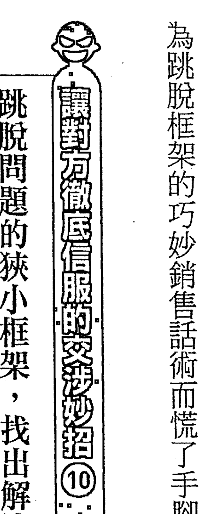

跳脫問題的狹小框架，找出解決的切入點，重新聚焦在新的解決方法。

### 「化繁為簡」正是詐騙集團的拿手絕活
### 「買了就會得救！」
### 保險業、電子商務慣用的推銷公式

一九八○年代後期，日本頻頻發生通靈詐騙案。

詐騙犯透過街頭推銷或到府訪問等方式，向民眾提出免費或以極低廉的費用幫忙算命或看家譜，然後說：

> 「你被祖先種下的惡果糾纏，所以會遭遇不幸。」

用這類靈異話題煽動民眾內心的恐懼，鼓吹購買高價的壺器或印章。

後來，民眾對這種手法產生警覺心，確實有減少的趨勢，但受害者還是很多。詐騙犯造訪年長者的家，「請讓我看一下你家的佛壇。」

- 「你會遭受祖先的惡報。」
- 「依你的面相來看，你會早死。」

像這樣假藉幫忙算命，捏造不實言論，販賣高價水晶球的男性，被警方以違反特定商業交易法逮捕。據說他騙了超過一百人，詐騙金額將近一億九千萬日圓。

通靈詐騙的手法五花八門，例如登門訪問或街頭推銷等，本書以姓名算命詐騙為例，分析詐騙犯的伎倆，結果發現當中存在著保險業、電子商務業等多個業界相通的「銷售鐵則」。

假算命師將客人的名字寫在紙上，旁邊寫出每個字的筆劃數，再用紅筆加上〇（吉數）或△（凶數）。

以我的名字「多田文明」為例，「多」的筆劃是6，因為是吉數，被畫上〇。起初，對方會這麼說：

> 「你的名字總筆劃是23，你的運氣非常好。」

先稱讚你是天生好運的人，說著說著，假算命師露出嚴肅的表情說：

> 「不過，你也會遇到許多阻礙，令你煩心苦悶。請問你有什麼煩惱嗎？」

一般人看到對方如此誠懇地幫自己算命，往往因此失去防備，說出真心話。於是，假算命師就會開始套話，或是誆騙這是祖先種下的惡果。

假如回答「工作不順」，對方就會說：

> 「你的名字筆劃的確有顯示破財。你的工作運很差。那是因為你的祖先曾經做過壞事，騙了人或是偷了別人的錢，所以報應在你身上！」

要是回答「戀愛不順」，對方就會說：

> 「你不會有美滿的婚姻。因為你的祖先曾讓某個女人變得不幸，所以報應在你身上！」

然後，假算命師會變本加厲地說，繼續這樣下去，祖先的惡報會讓你生病或發生意外，人生變得悲慘。這時候，如果問「那我該怎麼辦才好？」對方就會以化解惡緣爲由，推銷購買開運印章或水晶球、佛珠等。

通靈詐騙通常就是利用靈異煽動民眾的恐懼心理，不過，要是沒有一套周全的說法，就算講得再可怕，對方未必會聽信。

**煽動不安後，簡化複雜的內容，說服對方簽約購買**

就拿前文的例子來說，假算命師一開始先讓客人說出煩惱，編造人生會變得不幸的謊話。接著立刻以靈異當作幌子，指出所有不幸的原因都是「祖先生下的惡果」，若置之不理，將有更大的不幸降臨，使客人誤信自己被祖先的惡報牽連。

為了擺脫祖先的惡報，假算命師會說「只要買開運的東西就可以了」，提出極為簡單的建議。「這樣就能擺脫報應」，客人聽了不禁產生購買意願。

人生本來就充滿各種複雜的問題，沒那麼容易解決，詐騙集團卻把所有原因歸咎於靈異，聲稱只要消除惡果就沒事了。

將複雜的事以淺顯的方式讓對方理解，簡化內容，導向對自己有利的結果，這也是一般買賣交易常用的手法。

例如，推銷保險。保險員會先詢問既往病歷或家族病史等，許多人因此說出即將來或罹病的不安。於是，保險員趕緊介紹附帶詳細條件的壽險、癌症險、醫療險等商品。

民眾一下子聽到沒聽過的醫療用語或保業界用語（「保險金」、「保費」等），頓時感到混亂。保險員抓住這個時機點，刻意提出幾個特定商品作為選項。

當下急欲擺脫混亂的民眾立刻上鉤，放棄尋找其他選項。加上保險員說每個月分期繳費、只要買○○險，萬一發生事故也能得到豐厚保障，不必擔心之類的話，令民眾更加無法冷靜做出判斷（不過，這種推銷手法不像通靈詐騙是觸法的行為）。

對於未知的將來，不是有錢就萬事妥當，可是「只要買保險就能消除不安」，像這樣把話說得很簡單，取得對方認同的銷售手法，確實廣泛用於許多業界。

**將複雜的內容化為簡單的公式，就能輕鬆複製成功**

將複雜的事變成簡單的公式，對於提升公司業績也是必要的想法。業績保持成長的部門與業績停擺的部門，兩者的差異在於，能不能把銷售方法變成簡單的公式。若能做到這點，就可以輕鬆複製成功經驗，業績自然跟著提升。

其實，通靈詐騙也是利用簡單的公式化說詞：「因為祖先種下的惡果，害你的人生變得那麼糟。只要買些開運的東西，你就得救了！」推銷的人懂不懂話術並不重要，利用這個模式，就能迅速誘騙目標買下高價商品。

近年來，透過網路或電視等媒體銷售商品的電子商務獲得龐大的利益，那也是簡單的公式化奏效，大大地提升了業績。

商家先在網路或電視上宣傳商品，以免費或收取少額費用的方式提供商品給消費者。當消費者快用完時，再打電話詢問使用感想。針對有良好回應的人推銷套裝商品，使其成為回購客。

假如沒有成為回購客，商家會寄送其他商品的簡介，消費者一旦有興趣就會訂購。而且，接受訂購、推銷商品的電話客服員都相當熟知如何應對顧客，面對任何人都能做出正確適當的回應。

無論是組織或個人，成功的關鍵在於，掌握多少簡單的勝利公式。

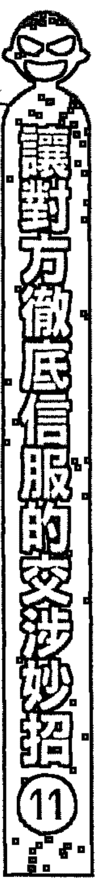

> **讓對方徹底信服的要訣妙招 ⑩**
> 將複雜的內容極簡化，提出淺顯易懂的說明，控制對方的心思。

---

**注釋**
1. 即個人身份識別號碼。日本政府依據國民的基本資訊，給予每位國民一組12位數字的個人編號，用於社會保障、稅務、防災對策，以及地方政府處理法律條例規定的各類事務等場合。
2. 在低利息的情況下，極短時間內會出現利息為負的現象，此舉為刺激資產流向市場。有些國家為了緩和通貨膨脹的壓力，緊縮本國通貨，規定對外居民在該國用該國貨幣存入銀行的款項不僅不付利息，反而倒收利息。

# 12

## 這種時候，只要這麼做，就能騙到錢了──詐騙集團的縝密沙盤推演

### 聰明詐騙犯都在使用的「邏輯樹思考」

近期的詐騙犯都懂得配合狀況，發揮「即興編劇能力」進行詐騙。也就是說，他們很會臨機應變。

各種媒體、政府機關不斷地呼籲民眾，對於轉帳詐騙在內的特殊詐騙要提高警覺。儘管現況對詐騙集團明顯不利，他們反倒趁勢設下陷阱。

接到警方的來電提醒，結果反而將儲蓄送到詐騙集團手上

舉例來說，某位六十多歲的婦人接到一通來電，自稱是警官的男性這麼說：

「你的提款卡被偽造了。」

一般人通常不會懷疑具有權威的人所說的話。即便如此，能夠讓婦人很快就相信電話那頭真的是警官的理由在後面。

詐騙犯向婦人表示「為了確認是你本人」，先問出她的銀行帳戶號碼或存款餘額等資訊，緊接著又說：

「你的提款卡已經被偽造，存款可能會被盜領。你還是把錢提出來，放在家裡比較安全。」

於是，婦人依指示前往銀行，提領出兩百五十萬日圓左右的現金。詐騙犯抓準婦人回到家時，利用事先想好的說詞進行詐騙。

「你從銀行領出來的那筆錢被人放了假鈔。為了進行調查，等一下會有刑警到你家，請把錢交給他。」

不過，那位婦人為何會輕易相信「提款卡被偽造了」這種話呢？其實是因為，幾天前一件鬧得沸沸揚揚的新聞。ATM系統的安全管理公司的員工，盜用存款戶的個資偽造提款卡，盜領了超過兩千萬日圓的存款，被神奈川縣警察逮捕。這起新聞傳出後没多久，自稱是警官的男性打電話給民眾，謊稱「那家銀行還有共犯」，意圖行騙。

事先設定終極目標，即使對方不按牌理出牌，只要不斷修正路線，仍可以達到目的

詐騙犯會先備妥各種劇本，根據套話得到的資訊，考慮行騙的手法。這種時候，只要這麼做，就能騙到錢了，像這樣思考要採取何種詭計，也就是「假設思考」。

假設思考，顧名思義就是，先假設一個目標，思考達成目標的方法。先做出結論，就能掌握之後應該怎麼做的整體概念，有效率地實行計畫。

譬如前例，詐騙犯想出來的劇情（假設）是，佯裝成警察打電話給老人家，問出對方有開戶的銀行是哪幾家。要是剛好有偽卡盜領事件的銀行，只要煽動對方對銀行的不信任感，應該就能騙到錢。

有位七十多歲的婦人收到A公司寄來的簡介，說她可以購買某醫療法人的事業債。過了一段時間，自稱某業者的人打了通電話給她：「只有獲得年金的人能夠優先購買這個債券。敝公司想高價收購，希望您購買。」

> *註4：民間股份公司發行的債券中，非金融機構發行的債券皆稱事業債。*

不過，婦人察覺到這是詐騙。立刻回道：「你是詐騙集團對吧。」毅然地拒絕對方。一般人會認為，這下子應該嚇跑對方了。沒想到，詐騙犯卻以這樣的想法進行回擊，想出下一招，再次來電。

過了一會兒，婦人又接到一通女性打來的電話，對方自稱是律師，她對婦人這麼說：「你剛剛在電話裡說A公司的員工是詐騙集團對吧。A公司是一家奉公守法的投資公司，你卻把他們的員工當成詐騙犯，已經構成妨害名譽，這顯然是犯罪行為。」

聽到「律師」振振有詞的說法，婦人以為自己真犯了罪，內心很不安。此時詐騙犯接著說，只要購買先前提到的事業債，對方就不會追究，婦人就這樣被騙了幾百萬圓。

由此例可知，詐騙集團就算「騙錢失敗」也不輕易放棄，反而會修正路線，想出新的劇情（假設）。假設即假定的想法，發生失誤（出錯）在所難免。因此，從假設找出錯誤，改善之後再建立新的假設，就會更接近理想的解決方法（正確答案）。

### 活用「邏輯樹思考」，設想各種可能性，靈活應對問題

詐騙犯利用這種手法騙錢的行為固然不可取，建立假設、付諸實行，對交易買賣倒是很有效的做法。

建立假設時，重點在於，為了從現有的資訊或資料找出解決方法，透過不斷的自問自答，建立更精準的假設。

常有人說，要用「So What」的觀點思考事情。反覆地想「所以，那是怎樣？」「為什麼會是那樣？」深入思索假設。如此一來，就能釐清問題的根本原因，創造更好的改善方法。

深入思索假設的方法很多，例如「邏輯樹」（Logic Tree）。先提出大問題，然後追究「所以，那是怎樣？」「為什麼會是那樣？」將想到的結果串連排列，再各自以「So What」的觀點分析，最後形成好幾層的樹狀圖。

利用這個方法可以讓問題變得更具體，除了幫助自己整理思緒，向他人說明時也能讓對方更容易了解。其實，前文出現的詐騙犯就是用這種邏輯樹的思考建立假設。

你的卡被偽造了，即使想用這種理由騙人，對方未必會輕易相信。那是因為，社會大眾普遍都知道詐騙的手法，人們開始懂得提高警覺。那麼，怎麼做才能讓對方相信呢？說自己不是警官就好啦。如果對方還是不信呢？那就把最近剛發生的提款卡偽造事件拿來說說看好了。

我想，詐騙集團的人一定都像這樣，以邏輯思考的方式分析事情。

一般生意人也少不了這種邏輯性的思考。

「為什麼商品賣不好」，思考營業額減少的原因時，做出「因為有競爭對手，所以營業額下降」的假設。接著思考為什麼會那樣，做出另一個假設。例如，在宣傳或銷售方式上，自己哪裡不如對手。這麼一來，就能想出如何與其他公司的商品產生差別化的具體做法。

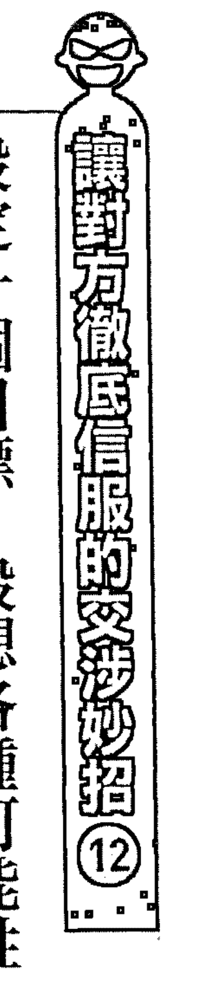

另外，假設營業額減少的原因是「商品感覺太貴」，可以想出的解決方法有「能否降低成本，調整售價」、「用套裝商品的方式賣，會不會覺得比較划算」。或是，乾脆反其道而行，提出「提高價格，增加商品附加價值，針對偏愛高檔貨的族群，推出重新包裝的品項」之類的想法。

總而言之，邏輯思考與充分的準備非常重要。

設定一個目標，設想各種可能性，事先沙盤推演所有的狀況，就能打動對方的心。

## 「每個月輕鬆賺進十萬日圓」的副業，背後隱藏著一連串的騙局

### 操弄對方「想要錢」的焦慮感，「吃虧就是佔便宜」的戰術

#### 上求職網站找工作，反而付了公司兩百三十萬日圓……

某求職網站刊出徵求製作電子報的打工職缺，有個人看了趕緊打電話去問，業者這麼回道：

> 「時薪大概是八百日圓，只要在家工作一到兩小時，每個月就能賺進十萬日圓。」

那個人依約付了三千日圓的註冊費，簽下工作合約。之後，照著業者的指示接受將近三天的研修，學習怎麼寫銷售商品的廣告文，後來戶頭裡匯入一筆數千日圓的酬勞。

這種「吃虧就是佔便宜」的戰術，正常買賣也會使用。但是，這只是詐騙集團的開場。研修結束後，業者提出另一個建議：

> 「坦白說，製作電子報賺不了什麼錢。比起這個，自己架網站賣東西還比較好賺。你要不要試試看？」

不過，架設網站需要三十萬日圓以上的費用。突然聽到業者的提議，那個人很猶豫，結果業者又說了這樣的好聽話：

> 「要是沒有賺回架網站的錢（初期費用），我們會全額退費。」

剛完成研修又收到酬勞，自然對業者產生了信任感。既然對方敢保證「全額退費」，表示對商品銷售有信心。假如之後想得到更多收入，勢必得做這點投資，所以那個人答應簽約。

後來，銷售商品的網頁做好了，業者發出寫文章的工作，接了幾次後，戶頭確實匯入數萬圓的酬勞。然而，在那之後就沒有再進帳了。

那個人向業者詢問，得到這樣的回答：

> 「你的網站經常塞車，很多人進不去。結果商品賣不掉，所以沒有酬勞。」

然後，業者又提出這樣的提議：

> 「只要擴大伺服器的容量，點進網站的人就會增加，你也能多賺一些。不過，費用是四百萬日圓，我們公司會出兩百萬，剩下的你可以付嗎？」

不得已只好再付兩百萬，業者接著匯入數萬日圓到戶頭，但後來又毫無進帳。再次詢問業者，對方竟以「你的文章寫得太差了」等理由搪塞，那個人一氣之下要求全額退費，業者卻來個相應不理。

其實，這是幾年前在日本實際發生過，以刊登假徵人啟事向求職者惡意推銷高額契約的詐騙手法（該業者已被勒令停業）。

### 吃虧就是佔便宜，不斷拋出誘餌引對方上鉤

以家庭代工、副業為名的詐騙，以前就已經存在，如今手法又更進化。過去常見的技倆是，提供賺不了錢的工作，騙取註冊費或手續費，或是假藉「工作前必須先經過研修」，要求購買高價 DVD 等教材。現在則是與網路的家庭代工和副業有關的詐騙四處橫行。

好比前文的例子，根據日本消費者廳（消費者保護會）的調查，架設網站後幾乎毫無收入，伺服器容量也沒有擴充，業者根本不會全額退費。

那麼，為什麼還是有人會被騙呢？

起初是註冊費三千元圓，接著是架設網站的三十萬，然後是擴充伺服器容量的兩百萬，受害者之所以一再被騙，那是因為業者抓準時機，丟出誘餌。於是，受害者漸漸被誘導至業者盤算好的結果。

消費者想要錢，所以才會應徵。黑心業者利用那樣的心理，先付少額酬勞，獲取對方的信任。之後提出「有更高收入的工作機會」，還說「要是沒賺回本就全額退費」之類的話，誘使對方簽下高額契約。等到網站做好後，先付些酬勞，再假藉別的理由騙取新契約。不斷重複以小虧換大贏的手法，玩弄消費者於股掌之間。

當然，意圖詐騙的推銷行為是絕對不可取的事，但一般的買賣交易也會用到「吃虧就是佔便宜」這個方法。

配合對方需求擬定戰略，才能拿出最吸引人的誘因

新開幕的餐廳為了宣傳發出免費餐券或折價券等，吸引客人上門，這不就是典型的例子。店家提供打折優惠，客人如願「用便宜的價錢享用美食」。雖然店家因為那道餐點賠錢，打折後預算變多的客人也會多點幾道菜，說不定還會成為常客。

到頭來，店家還是有賺錢。前例的受害者想要獲得更多收入時，業者便丟出少額酬勞、「全額退費」、「負擔一半費用」的誘餌，使其落入陷阱。由此可知，精準掌握與消費者需求一致時機很重要。

沒有考慮到這點，只會在免費刊物刊登兌換券，在路上發折價券攬客的店家，遲早面臨關門的苦果。

> 想靠「吃虧就是佔便宜」贏得成功，事前擬定戰略非常重要。

我以前擔任過個別指導補習班的講師，那家補習班為了招募新生相當賣力，經常電訪做推銷。因為學生畢業或退補的話，收入就會減少。但我不太做那種事。雖然我班上的畢業生剛好也比較少，不過我認為比起新生，讓現有的學生有意願來補習更重要。

補習班的客人是學生與家長，他們想要的就是提升學力。可是，要讓學生的學力立刻有顯著的進步並不容易。既然如此，應該把重點放在增加學生與家長的信任、補習班環境的整備。

因此，我會花一個半小時左右的時間，將學生上課的內容清楚地寫在連絡簿，讓家長能夠經常看到孩子的學習狀況。學生生日時，我也會花點錢買文具送他們，努力建立其他補習班老師與學生不會有的情誼。而且，學生在學校無法告訴老師的事，到了補習班我也會私下聽他們傾訴。尽可能地仔細關懷，除非是轉學之類的特殊情況，營造讓孩子不會輕易退補的和樂氛圍。

只要提供良好的環境，接著告訴學生「如果你們身邊有想補習的人，記得帶他們來」，大部分的學生都會把自己的好朋友帶來。

拚命打電話推銷、發傳單招募新生，這對補習班來說也是種投資。但我覺得，符合經濟效益的投資不是猛打電話，而是花時間仔細地「寫連絡簿」，增進與學生、家長的互動。

想要藉由投資獲得利益。這樣的營業手法和「吃虧就是佔便宜」一樣都需要戰略。

當然，就經營補習班而言，我的做法未必永遠有效。假如附近開了大型升學補習班，那就得分析競爭對手，改變戰術。

我們所處的局勢天天都有變動，不能老是套用過去成功的方式。

要取得對方（客人）的信任，能否像前例的家庭代工、副業詐騙那樣，經常在對方有需要的時間點實行「吃虧就是佔便宜」的戰術是關鍵。

配合局勢變化，思考事物的優先順序、採取行動，才能創造出最大的效果。

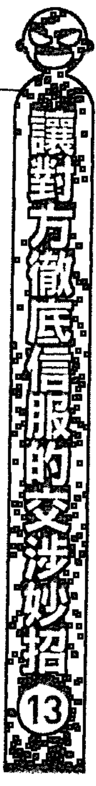

以小虧換大贏，鬆懈防備後，操弄對方的心思。

## 如果滿分是一百分，你的人生是幾分？

### 為什麼負面思考的人總是容易被騙錢？

#### 詐騙犯鎖定的是不夠的分數

「我很滿意我的人生」，有這種想法的人少之又少。

長相、收入……我們心中難免有「要是可以這樣就好了」的想法。就算平時沒有感到不滿（或是刻意忽略），有時經由第三者的提醒，內心的不滿立刻就會顯現出來。

#### 利用對方煩惱或對現狀不滿的開運詐騙

為了推銷高價商品，推銷員在街上攔客時所做的問卷調查裡，上頭有這樣的問題：

「你對自己的生活滿意度打幾分？」

對於這樣的提問，幾乎沒有人會回答「滿分一百分」。大部分都是說六十分或七十分這樣的安全分數。

假如回答七十分，推銷員會接著問：「被扣掉的三十分是什麼呢？」

> 「我辭職了，但是還沒找到新工作。」
>
> 「戀愛不順，結不了婚。」

當你說出對現狀的不滿或煩惱後，推銷員就會告訴你如何補充失分的方法。例如，推銷高價的自我成長課程的業者會說，只要報名參加講座，你的想法就會改變，如願擁有滿意的人生之類的話。得知對方內心有著不平或不滿的負面情緒後，假藉給予建議的口吻，順勢推銷「商品」或「服務」。

近年來，屢屢傳出販賣昂貴商品的開運詐騙，這種手法也是利用對方的煩惱或對現狀的不滿。

以前，我曾為了買廣告信裡宣傳的招財手鍊，打過電話給某業者。但對方並沒有馬上接受我的訂購。

「這款手鍊是量身訂做，我得先知道你的煩惱，才能確定哪個商品最適合。」當時，我很老實地告訴對方：「我沒有穩定的收入。」

說：「存不了錢，你一定很煩惱吧。」業者的語氣聽來似乎很替我擔心，接著他這麼說：「那你很需要招財手鍊。我建議你買金髮晶這種能量石的手鍊，這款是四十萬日圓。」

一聽到四十萬，我立刻回道：「太貴了！我買不起。」對方依然不死心，繼續用這個價格試圖說服我。過了一會兒，或許是放棄了，業者推薦別款手鍊給我，「那麼，換成別種能量石好了，五萬你覺得如何？」一口氣降了三百五萬。

我心想，原來價錢可以降到那麼低，那再等一等好了，結果業者又說：「四萬怎麼樣！」我說還是太貴了，於是業者不斷降價，降到三萬、一萬，最後喊出八千。光是訂條手鍊就耗了超過三十分鐘。

黑心商人的伎倆就是將民眾的煩惱換算成金額。他們用「金額」（數字）來估算客人心中的不滿或不安的程度。如果對方能夠接受的數字愈大，受騙的可能性就愈高。

起初業者告知的手鍊金額是相當高的四十萬，也許是想利用「錨定效應」（anchoring effect）先以高價加強印象，之後只要降價，對方就會有意願購買。不過，將煩惱數值化（金額化）的做法，也是為了試探我的煩惱有多嚴重。

要是一開始就推薦八千日圓的商品，無法得知嚴重程度的深淺。降價再降價，最後喊到八千，於是業者知道我的煩惱並不嚴重，之後也就沒繼續向我推銷了。

前文提到的街頭推銷則是，推銷員先問民眾滿分一百分的話，對自己的生活滿意度打幾分，得知不滿意的部分占三成後，接著詳細詢問內情。

❷「被扣掉的三十分是什麼呢？」

❶「我在公司和同事處得不好。」

❸「這樣啊，真是辛苦你了。這個部分占一半的比例嗎？」

❹「是啊。是啊。」

於是，推銷員已經知道被扣掉的三十分裡，十五分是因為工作的關係，接著再問：「你看起來是很顧慮別人感受的人，是不是還有其他煩惱呢？」繼續打聽剩下的十五分是什麼。

像這樣，不斷引導出對方內心的負面情緒，再將造成負面情緒的煩惱等原因數值化，換算成對方可以接受的商品價錢。

### 數字會說話，數字化思考讓問題清楚呈現

一般的生意買賣也是如此，用數字思考很重要。這麼做能讓問題點清楚呈現。因此不會有「業績沒有成長」這種含糊的意見，而是具體說明哪項商品的業績減少了多少。

業績持續成長的人與做不到的 人，兩者的百分比相差多少，透過數字呈現，立即產生說服力。

在公司內部或對外進行的簡報，不被採用的案子通常是數據不夠明確，多半欠缺具體的數字。例如，預估在多久的期間可獲得多大的利益、CP 值有多少等。

一般人總將不滿或不平當成發牢騷聽過就算了，其實那些都是有用的資訊。許多業續成長的商品，構想都是參考消費者的客訴。所以，利用心中的負面想法也能創造豐厚的利益。

**讓對方徹底信服的交涉妙招⑭**

引導出對方的煩惱或問題點後，透過數值化，產生說服力。

## 「不○○的話會來不及」，濫用對方想遵守期限的心理

### 為什麼人一遇到「期限」就會不由自主展開行動？

千萬別著急！

為了不被詐騙集團或黑心商人耍得團團轉，這是很重要的事。假如上了對方的當，慌慌張張、自亂陣腳，就會無法做出冷靜的判斷。

詐騙犯會使出各種技倆令人著急。最常用的一招是設下期限，告訴對方「不○○的話會來不及」。最具代表的例子是「退款詐騙」。

根本就沒寄出的退款通知單，讓老翁自動匯出大筆金錢……

某位七十多歲的老翁接到一通電話，自稱是市公所社會課職員的男人說：「您的健保費多繳了，我們要退款給您。」為了完成退費手續，老翁到自動提款機（ATM）依指示進行操作，結果被騙了兩百四十萬日圓左右。這類詐騙為何會一再發生呢？

詐騙犯經常假裝成市公所等公家機關的職員，打電話告訴民眾：「您有費用（醫療費或稅金）溢繳，所以要退款給您。」這時候，他們會問：「我們已經寄出退款通知單，請問您收到了嗎？」

這只是編造的謊言，根本沒有什麼退款通知單。但是，信以為真的老人家會說：「我沒收到。」於是詐騙犯開始誇張演出，彷彿出了大事。

「今天是退款的最後一天了！要是今天之內沒有完成退款手續，您會拿不到錢。這下糟了，請您趕快完成退款手續。」

然後，以辦理退款手續為藉口，催促老人家前往 ATM 進行操作，最近銀行都會提高警覺，因此愈來愈多詐騙犯會指定警覺性較低的超商或超市等比較少人使用的ATM。

### 活用光環效應＋期限設定，控制對方的行動

詐騙集團為了讓老人家著急，先灌輸對方「今天之內必須完成手續，否則拿不到錢」的規則。為使對方相信這個規則，所以假裝成具公信力的公家機關人員打電話過去。

這個手法稱為「光環效應」（halo effect）。

評論某件事時，先舉出一項優點（或缺點），自然會降低對其他事物的評價，覺得那件事很完美（或很糟糕）。

例如，醫師或律師等德高望重的人所說的話，一般人總會無條件相信並接受。

另外，電視廣告等由知名藝人推薦的商品，通常會獲得觀眾的認同，這也是光環效應所致。退款詐騙正是利用光環效應與期限等規則設定，控制對方行動的陰謀。

在日本曾有一陣子，地下錢莊的暴力討債成為社會問題，那些人使用的招數也是設下還款期限，令債務人感到著急，不得不籌錢還債。舉例來說，借完錢的幾天後，地下錢莊的人就打電話來討債：「快把你借的十萬還來！」「一時半刻根本準備不了那麼多錢的債務人不知如何是好，對方接著語氣強硬地說：「那先還利息好了，給你○天的時間，趕快還清利息的部分。」

迫於期限的壓力，債務人只好把生活費等手頭有的錢全交給地下錢莊。結果，本金都沒還清，卻一直在還利息。像這樣子讓對方著急，掌控對方的時間，將情況引導至自己意料的方向。退款詐騙也是如此，利用規則限制對方的行動，令對方著急，藉以騙取錢財。

5. 又稱「暈輪效應」，由美國心理學家愛德華·桑代克（Edward Lee Thorndike）於二十世紀提出。

## 設定期限，就能刺激對方行動，促進購買欲或創造力

雖說一般的買賣嚴禁說謊矇騙（限制）對方時間的行為。但是，「期間限定的銷售」、「限時促銷」等，各家公司自訂規則，試圖在某個期限內勾起消費者的購買慾，這樣的手法倒是很常見。消費者被那樣的文宣吸引後，自然會考慮要不要撥時間去購買。這完全是對消費者定下規則、控制行動的最佳範例。

這個方法不只對外，也適用於公司內部。公司自訂一套內部規則來強化組織，這是常有的事。

「這個月底前，業績目標要達到○千萬日圓。」

設下期限的業績或目標也是這麼一回事。不管怎麼說，時間管理真的不容易。要不給員工期限，採取放任態度，工作效率會變差，也無法提升組織的士氣，業績就會下滑。因此，上司必須用一定的規則管束部下。

話雖如此，有時規則不必明說。有些公司為了提升業績，會把「好好想想，自己應該怎麼做」、「不斷自問『為什麼』」之類的話當作社內「文化」（社風）。

不制定詳細的規則，而是訂立通用的「規範」。於是，每位員工會養成獨立思考的習慣，對自己定下規則，使組織變得更強大。

前例中，詐騙犯以「規則操控」的手法讓人感到著急，這是在向對方施壓，使其失去冷靜的判斷力。不過，如果企業內有效利用這個方法，可以讓員工充分激發構想，產生創造力。

我認識的文字工作者當中，有人也是愈接近截稿日愈能集中精神，加快寫稿速度。著急，有時也會成為救命仙丹。但也有些人抗壓性較低，所以要適可而止。

# 讓對方徹底信服的文化術⑮

以規則限制，讓人感到著急，目的是向對方施壓，使其失去冷靜的判斷力。

## 多層次傳銷的手法，比說服者更重要的「牽線人」

### 不容小覷！牽線人在一旁敲邊鼓的三方對話

多年來，我持續針對黑心買賣的「後續發展」進行採訪。

「我有個賺錢的機會，你想不想知道？」「我想跟妳見面談談。」這些人在進行推銷前，不會做詳細的說明。

### 新公司說明會只是一場幌子，傳銷慣用的三方溝通手法

曾經有位和我交換過名片的四十多歲女性主動連絡我，她說：「有一場新公司的說明會，你要不要來聽？」儘管我一再詢問：「那是做什麼生意的？」她只是四兩撥千斤地說：「你來聽就知道了。」

後來，我去了說明會，原來是推銷裝在手機上的小型附屬機器，價格約一萬日圓，據說賣那個可以賺錢。

銷售的手法如下：

推銷員先將附屬機器拿到目標人物的手機旁，向其介紹某個社群網站。對方透過社群網站買下附屬機器後，就會得到二〇％兩千日圓的佣金。

同樣地，已經買下機器的人，再向別人介紹那個社群網站，當對方透過網站購買那個機器後，貨款的一部分會分給一開始介紹的人。也就是說，社群網站的介紹次數愈多，就能賺到愈多錢。

說明會的尾聲，負責說明講師說「要做這個生意，必須註冊成為代理商」，直到最後才告知這是多層次傳銷。如果要做多層次傳銷，通常得花一筆特定費用（會費、研習費、購買商品的費用等），但這場說明會卻隻字未提。

說明會結束後，那位女性找我去咖啡廳。

「可以請教你幾件事嗎？」聽到我這麼問，那女性面露難色地說：「等一下有位做這種生意成功的先生會和你聊，有什麼事想知道，請你問他。」然後接著說，那位男性靠著賣淨水器賺進數千萬，極盡吹捧，把他說得像神一樣。

過沒多久，那位男性來了，一開口就說做這個傳銷有多棒。

「我以前做過很多生意，這個生意太好賺了！很多人還不知道門路，你現在開始做，一定能賺大錢。」

接著，他又說：

「趁這段期間，只要在一個月內找超過三個人，讓他們簽約成為代理商的話，還能得到好幾萬的紅利獎金。你真走運，遇上好時機。」

最後，他邊說「只要肯做就會賺錢」邊透露註冊費用大約二十萬日圓左右。總算露出馬腳了！那位男性和我談話的時候，帶我來的女性在一旁始終露出崇拜的眼神，頻頻點頭附和。而且，她也會時不時搭腔，和男性一搭一唱地說：「你就試試看嘛！」

## 主說服者和牽線人一搭一唱，就是要說服顧客說YES！

多層次傳銷的手法是，先找人去聽說明會，之後帶到咖啡廳等場所，由兩人以上說服簽約。這種推銷手法是讓負責說明的前輩或成功者（顧問：Advisor），與居中中介的人（牽線人：Referrer）帶來的目標（客戶：Customer）進行談話，各取英文字母的第一個字，稱為「ABC 技巧」。

三方形式的推銷手法是詐騙或黑心買賣慣用的技術。以通靈詐騙為例，在街頭被推銷或在訪問地點遇到的人（C），被中介（B）帶去找假扮成通靈師（A）的人。

此時，擔任仲介的B的「牽線」行爲相當重要。就像水是由上往下流那樣，B會把負責說服的A捧成「自己望塵莫及的厲害人物」，試圖讓目標C相信A所說的話。

只要牽線人安排好說話者、聽話者的順序，對方自然會認真傾聽。這就好比棒球比賽，打者犧牲觸擊，讓一壘跑者奔向二壘，就是為了讓下一位強打者擊球得分。

### 扮演橋樑的牽線人不但可以協助說服，還能緩和緊張氣氛

一般的買賣交易，擊出安打或全壘打的精彩表現固然好，但對一個組織來說，必須讓許多人共同累積穩定的契約成果。

A的立場相當於工作多年的資深前輩或上司，有時部下（B）卻自認「我更了解現場的情況」，把上司晾在一旁，無視既定的順序，直接找客人（C）談，這麼一來，客人會搞不清楚到底該聽誰說的話，聽得一頭霧水，無法專心聽完。

說到底，牽線人必須懂得區分自己該做的事是什麼，並且徹底實行。

以團隊合作的方式說服對方簽約還有一個效果，那就是，只要有牽線人在，就能以另一種角度進行說服。

想讓對方知道重點是什麼，一再重複那件事很重要。負責說服（A）的人在談定契約前是很吃重的角色，可是一直說相同的話，聽的人會覺得「又來了」而感到不耐煩。

這時候，如果有牽線人（B）在，就能重複A想強調的部分，幫忙說服簽約。即使介紹商品的人態度有些高傲，或是負責說服的人自說自話，忽視客人的存在，有相同立場的人（B）在場，也能防止那些情況發生。

此外，就算被調到其他部門，仍會主動為同事或部下牽線介紹客戶的商務人士，一般來說能夠維持長久的合作關係。雖然牽線人感覺不起眼，卻是人與人之間的溝通橋樑，能夠充分發揮組織的功能。

139 第2章 活用深層心理，操縱人心的思考方式

## 讓對方徹底信服的交涉妙招（16）

負責說服的人與牽線人分工說明重點，取得對方的認同。

## 利用被害者「想挽回過往失敗」的心情

### 吃過虧的人，其實是更容易上當的肥羊？

這世上不可能有從未失敗的人。

在工作或人際關係上，任誰都曾後悔過「當時要是那樣做就好了」。尤其是金錢方面的失敗，更會留下莫大的悔恨。

詐騙集團或黑心業者也會藉此趁火打劫。

### 「你手上的荒田有買家要開發！」瞄準發財夢的詐騙手法

最近几年在日本，「原野詐欺」的受害者再度被鎖定为目标。「原野詐欺」的手法是，謊稱毫無價值的土地「一定會升值」，誘騙民眾用比時價高的金額購買。特別是一九八〇年代地價暴漲的泡沫經濟時期，許多人因此受害，詐騙集團取得那些人的個資後，逐一打電話行騙。

有位幾十年前在北海道買下土地的老婦人，這陣子突然接到某業者的來電，對方說：「有國外的買家想買你的地。」

老婦人接著詢問詳情，於是業者告訴她：「為了賣掉你的地，必須先進行土地調查。」

最後，老婦人付了三十萬日圓的調查費用。

日本各地的消費者服務中心屢屢接到類似的申訴。

「二次原野詐騙」就是利用過去以高價買下土地的人，至今仍無法處理而感到困擾的心理矇騙對方。

### 詐騙技巧

「國外一定有買家想把你的土地開發成水源地或度假區。」接著又說，為了賣掉土地：

- 首先，必須測量土地或整地。
- 放到國外的網站宣傳。

諸如此類的話，藉以騙取費用。當中，有些詐騙犯為使對方相信真的有買家，還會出示偽造的「收購證明」增加可信度。

許多受害者住在離所有地很遠的地方，無法馬上親赴現場。因此，不得不委託業者幫忙調查，但這種聽來可疑的話，為何能夠讓那麼多人輕易受騙上當。

### 瞄準對方已有的損失，讓他做出高風險的選擇

心理學上有個「展望理論」（Prospect theory，亦稱「前景理論」），是用來說明人在衡量得失時會採取怎樣的行動。展望（prospect）也有「期待」或「預期」之意。

說明這個理論時，經常提到以下兩個問題。

第一，「什麼都不做就能得到五萬日圓。」第二，「擲骰子擲出奇數可以得到五十萬日圓，若是偶數就一毛錢都得不到。」請問你會選哪個？多數人想必都是選擇一定會得到錢的前者。

那麼，換作這樣的情況呢？

假設你欠了五十萬，正煩惱沒錢可還。在這樣的情況下被問到相同的問題，大部分人會選擇風險較高的後者。

也就是說，人在不必衡量得失的情況下，通常會選擇一定能得到錢的那方，如果有欠錢，為了填補損失，就會採取消除損失的行動。

最顯而易懂的例子就是，賽馬之類的賭博。

一開始為了贏錢，專押贏面大的熱門馬，卯起來買倍率穩定的馬券。

結果，愈輸愈多，為了贏回輸掉的钱，乾脆一把賭上幾乎沒贏面的高倍率馬。

萬馬到頭來，輸到一毛不勝，落得慘輸的下場。

不做任何事就能獲得利益的情況下，人們必定會選擇穩當的那方，倘若已有損失，就會選擇有風險的選項。

譬如前文提到的原野詐騙，過去用高價買下的土地，已經讓自己虧損。為了挽回損失，即便對方是素不相識的業者，提出無法判斷可信度、具有風險的提案，還是會忍不住聽信對方的話，乖乖掏出錢來。

過去常被詐騙集團或黑心商人騙的人，一旦聽到有什麼賺錢的好機會，很容易輕信，再次受騙。其實這也是一樣的意思，為了討回以前失去的錢，做出有風險的選擇。

### 「要是○○的話，你會有損失」更能打動對方的心

由此可知，比起「得到利益」，人們更在意的是「遭受損失」。

假設，有兩名業務員要推銷最新的機器給某工廠的經營者。

其中一位業務員說，只要導入這個機器，「生產力會提升，一定能增加利益」，光說有利的話。但那位經營者不認為需要借錢來買那麼昂貴的機器。

另一位業務員則是把重點放在機器的老舊化，提出這樣的意見：

- 「要是繼續使用這些機器，假如哪天故障，工廠的運作就會停擺，商品無法如期交貨，可能會造成龐大的損失。」

只說能夠獲得利益的好聽話，打動不了對方的心。若是告知將有多大的虧損，對方反而會產生興趣。買賣交易時，觀察對方的情況，與其告訴對方「如果○○的話，你會得到利益」，不如說「要是○○的話，你會有損失」更能打動他的心。

隨後，再補上「比起花大錢做保養，直接換成新機器提高生產力，業績肯定會增加」這麼一句，更能促使對方點頭答應。

不少業務員聽到顧客說「我們公司有欠錢，沒錢買新東西（新商品）了」，馬上就會放棄，那麼做實在言之過早。

根據先前的理論，儘管購買新機器是有風險的決定，還是會隨著處境而改變。簡而言之，正因為對方處於必須借錢、經營不善的狀況，「購買」的可能性反而相當高。

巧妙安排「得」與「失」聯手合作，自然會激發對方的購買意願。

最近瀏覽某些購物網站或旅遊網站時，不知不覺就獲得一千日圓的點數。但那些點數只限一個月內使用，過了期限就失效。

包含我在內，許多人會覺得賺到了一千日圓的點數，心想「不用白不用」，所以就算沒有要買的東西，還是忍不住花錢購物。

先讓人覺得「得到利益」後，設定一個有效期限，使人產生不想「遭受損失」的心理效果。這個手法可以活用於各種買賣交易的情況。

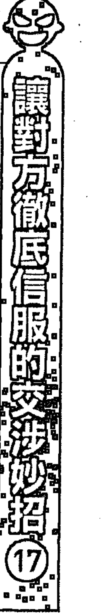

比起「利益」，人們更在意「損失」，利用這種心態，誘導對方做出回避風險的決定。

## 「假如洩露情報就要賠償」詐騙集團利用罪惡感的如意算盤

### 「請務必保密！」讓受害人啞巴吃黃蓮的樂透6詐騙

近年來在日本，選號購買的彩券「樂透6」所引發的詐騙案四處橫行。順帶一提，「樂透6」這種彩券，六個數字全中為頭獎，基本上會獲得一億日圓的彩金。

### 覺得很可疑，卻無法找人商量的樂透詐騙

我經常收到可疑的廣告信，某天信箱裡寄來一封內容附上「樂透6攻略情報」的網站廣告信。

於是，我點進那個網站，輸入名字與電話號碼，註冊成為免費會員。結果，不到三十分鐘，有位自稱是業者的男人打了電話過來。

「感謝您的註冊。我們會在樂透6開獎日當天的中午前，用短信通知會員五獎（六個號碼中三個，應得彩金為一千日圓）的號碼。如果您有用那些號碼去買彩券，隔天務必打電話告訴我們。」

「好的。」我這麼回道，那男人接著說起「公益彩券情報」的事。

「公益彩券情報就是指，已經內定會中獎的號碼。我们公司向財團法人買下這種情報。目前在日本，能夠得到這種情報的公司只有七家，我们公司就是其中一家。」

我原以為對方會叫我花錢買內定中獎號碼的情報，但他並未那麼做。最後，他只說了「關於這件事，之後有機會再聊」，隨即掛斷電話。

其實，對方那麼做是為了「測試」我會不會相信他說的話，有沒有可能受騙。因為我沒表現出懷疑的態度，對方立刻寄來五組「五獎預測號碼」的電郵。

後來，我照著對方給的號碼去買了五注。回到家後，我上網看當晚現場直播的抽獎，結果全都沒中，根本是瞎扯一通的情報。

隔天，我打電話給那男人，他語氣淡定地說：

「請您先匯一千日圓的ID費用。」

明明說是免費會員，現在卻向我討錢！我心想，要吵架我奉陪，不過這麼做就無法得知對方真正的企圖，所以我摸摸鼻子說好，匯了一千日圓。

匯完錢後，那男人再次來電。

「其實啊，上次我跟您提過的公益彩券情報（內定中獎號碼）正在招收參加者。」

然後，他開始具體說明公益彩券情報的取得方法。講完大概的說明後，接著又說：

「這次我們提供的公益情報是三獎（六個號碼中五個）的中獎號碼，彩金有五百萬日圓。」他的意思是，希望我再匯一百五十萬的情報費用。

這金額實在太高了，我說「沒辦法」予以回絕，但那男人不死心繼續說：

「可是，你不一定能得到情報。你得先報名參加，通過審核才能獲得情報。萬一情報泄露出去會出大事，所以必須確認你是不是能保密的人。等一下我會寄申請書給你，請盡快回覆。」

電郵寄來的申請書裡有這麼一行字：「不得透過任何手段告知第三者」，收到信的人不可以將情報內容散播至網路或媒體，一旦違約，「被要求損害賠償必須支付，不得提出異議」。

簡直是做强賊喊抓賊。看起來是申請書，其實是封口令。像樂透6這類的情報詐騙，就是以保密義務、不得洩露情報等字眼，讓人無從向周遭的人尋求協助。

消費者被要求遵守保密義務，陷入孤立無援的狀態，只能任詐欺犯予取予求騙取金錢。因為受害都認為不能找第三者商量自己的遭遇。

例如，有位四十多歲的男性被騙了四次，每次都是以情報費用為由，總共被騙走超過兩百萬日圓。

### 向目標灌輸對自己有利的思維

詐騙犯的伎倆是利用民眾的刻板印象。

某位七十多歲的老翁接到自稱是業者的來電，對方告訴他「我知道二獎（六個號碼中五個，剩下的一個號碼是紅利加碼，應得彩金約為一千五百萬日圓）的中獎號碼」，說完號碼後，他請老翁看隔天的報紙確認。

隔天早上，老翁看了報紙，二獎的中獎號碼果然是業者所說的號碼。於是，他信以為真，前前後後被騙了八次，付給對方兩千七百萬日圓的情報費用。

這是利用時差的手法，詐騙犯將網路上已經公開的中獎號碼告訴老人家，使他們誤以爲是事前知道的中獎號碼，藉以騙取錢財。

如今已是資訊化的社會。過去曾有好幾次，知名企業傳出洩露個資的事件後引發輿論高度關注，可見多數人都很在意個資外洩這樣的事。

假如自己也涉入洩密的情況，內心會有很大的罪惡感。詐騙集團先讓消費者產生「這是機密情報」的印象，進而嚴詞威脅「一旦違約，就會被要求損害賠償」。因此，消費者陷入無法求助的困境。

關於內心的成見，在史蒂芬·柯維（Stephen R. Covey）的《與成功有約：高效能人士的七個習慣》（The 7 Habits of Highly Effective People）有確切的論述。書中提到，人們評論事物時，彷彿戴上某種鏡片（Paradigm，思維），以此來決定自己的認知或行動、態度。

儘管自認是以個人的觀點評論事物，實際上卻是透過社會中附帶條件的思維，決定我們所有行動的方向。

譬如前例的樂透6，詐騙犯向目標灌輸對自己有利的思維（情報的保義義務），一而再、再而三地騙錢。

### 對方與趣缺失時，換個新思維是突破的好方法

以《與成功有約：高效能人士的七個習慣》的理論為基礎的惡劣詐騙手法，只要正確運用，當然也能用在一般的買賣交易。

進行買賣交易時，假如顧客對簽約表現得興趣缺失，若想消除對方內心的成見，向其灌輸新的思維，說不定是個有效的方法。

書中亦提到，為了改變現況、獲得成功，我們必須擁有的不是由外而內（outside in），應是由內而外（inside out）的想法。

當事情發展不順時，我們總會將原因或責任歸咎於處境或環境等外在（outside）因素，其實應該向內尋求原因、加以改善，這麼一來就能導向對外的成功。

想要說服不會輕易點頭答應的顧客，這種由內而外（inside out）的想法也會很有幫助。有些業務員為了談成合約，說服客人時，只說外在情況的事，比如「現在景氣好，一定會賺錢」，但光是這樣打動不了對方的心。要讓對方點頭答應，必須更進一步動搖對方的心。

舉例來說，某業者向老婦人推銷「減鹽醬油」，這時候不能只說「這個醬油有減少鹽分，就算是血壓高的人也能安心食用，對身體很好」，而是要說進對方的心坎裡，像是：

> 「都這把年紀了，沒必要為了健康花錢買東西，您是不是這麼想呢？老太太，買這個醬油不光是為了您自己的健康喔。使用這個商品，您就能常保健康。這麼一來，您的孫子、兒女，他們也會很開心對吧。所以啊，請您多多注意自己的身體，讓他們看到您健康的樣子！」

不是只以「身體會變健康」為出發點，而是讓對方聯想到家人，「如果保持健康，

家人會很開心」，以內在的感受為訴求，說服對方購買。

面對客戶時，能否說出打動對方內心的話是關鍵。要改變對方的思維，重點在於洞察對方「心底」的感受，轉換既有的價值觀。

濫用「洩露情報會出大事」的刻板印象，操控對方的行動。

# 第3章

## 干擾對方的思緒，迅速縮短內心距離的方法

# 「免費贈送」或「接受退貨」？

## 人們為何抗拒不了

### 「這個免費喔！」讓對方覺得欠人情，被牽著鼻子走

原本空著的店鋪，某天經過竟然在開店做生意，門外還有老人家大排長龍。各位應該有看過這樣的景象吧。

那其實是催眠推銷，業者廣發傳單，以免費提供日用品或食材的噱頭吸引老人家前往，然後店員會在店內與老人家談天說笑，把他們逗得很開心、降低判斷力，接著推銷高價的商品。

這招實在很高明，應用了高等心理學（後文將有詳細說明）。正因為如此，受騙者才會接連不斷地出現。

### 炒熱現場氣氛的催眠行銷，讓人忍不住猛掏錢

某業者將老人家招攬至某處，向他們推銷高價的健康商品，謊稱那些有治癌效果、可消除膝蓋疼痛等功能。這名業者說只要買超過一百萬日圓的商品券就會成為特別會員，可以用更低的價錢購買商品，對老人家販售大量的商品券，平均每個人都超過五百萬日圓。

以前，我認識的人給我一張「發送免費麵包」的傳單，所以我曾去過催眠推銷的現場。當天一到開場時間，約莫五十位的老人家立刻湧入店內，現場座無虛席。沒多久，年輕男女的工作人員進入會場，站在中央像是負責人的女性放聲大喊：

> 「感謝各位的光臨！接下來，準備開始今天的活動囉！」

然後，工作人員邊喊著「啊，跳吧跳吧！」邊伸長右手擺出鳥嘴的姿勢，扮起鷗鳥似地賣力熱舞。

老人家就像在看孫子的才藝表演笑了出來，現場的氣氛頓時變得很歡樂。

工作人員跳完舞後，那位女性接著說：「現在要來發傳單上的紀念禮物囉！」話一說完，周圍的工作人員立刻群起在會場內到處跑，發麵包給在場的所有人。工作人員個個滿身大汗。

見到他們辛苦的模样，有些老人家主動開口慰問：「辛苦了。」

> 「那麼，開始進行商品的販賣囉！」

看似負責人的女性拿出一瓶醬油，喊出「這瓶醬油！」後，周圍的工作人員也出聲附和：「這瓶醬油！」

「完全是，無添加唷！」

「無添加唷！」

「因為對身體沒有負擔，高血壓的人吃了也安啦！」

「也安啦！」

「讓你健康長壽，呷百二喔！」

「呷百二喔！」

在場的老人家聽了哄堂大笑。女性負責人與工作人員就這樣一搭一唱，炒熱現場的氣氛。

「這瓶醬油原本是賣一千日圓，我們希望各位都能長命百歲，今天特價一百就好。只有十個名額喔。想買的人請舉手！」

於是，場內陸續有人舉起手。我一聽到只賣一百，心想實在太便宜了，所以也忍不住舉了手。女性負責人算了算舉手的人數，「好的！已經十個人囉！感謝各位的購買。那麼，接下來的商品是這個！」只見她拿出一包鹽。同樣地，這也是以不到市價十分之一的價錢販售。

緊接著又是一連串價錢便宜到令人不敢相信的食材等商品，我也買了一整袋的東西，像是仙貝、蜂蜜等，而且只花了五百日圓左右，感覺真是超划算。

不過，這場活動的目的究竟是什麼呢？

# 主動提出好處與體貼服務，讓消費者無法對你說NO

光是用如此低的價錢賣東西，業者不可能有賺頭。他們的目的先是吸引人潮，再從中找出有錢的人個別下手，推銷對方購買高達數十萬的昂貴健康食品或吸塵器、棉被等商品。

這種催眠推銷的手法是，免費發送商品，提供極低價（或免費）的商品，讓對方覺得欠人情。

人就是這樣，從別人那裡得到東西，自然會想回饋對方。這稱為「互惠原理」。業者藉由過度的服務使消費者產生強烈的「回饋」意識。因此，接受了服務的消費者，陷入難以拒絕業者推銷的處境。

為了不被催眠推銷的業者拐騙，必須做好不拿取業者任何好處的心理準備。而且，不只是物品，也不要輕易接受業者的親切關懷。

在秋田縣，有幾名男子未事先告知要販賣商品，將老人家招攬至某處，推銷高價的健康器材，最後被以違反特定商業交易法逮捕。這種未告知要販賣商品，擅自聚集的行為已經觸法。

不過，如果先告知要販賣商品才提供服務，這樣就不是違法的行為。我們要向黑心業者學習的是，「盡心盡力為對方付出」。

發送免費麵包時，滿身大汗地跑來跑去，或是要寶跳跳舞逗人開心，這些拋開自我，全心全意為他人付出的行爲，會讓對方留下好印象。

# 互惠原理最忌草率，不求回饋的態度才能帶來龐大利益

即使是一般販賣商品或提供服務的店家，為了吸引更多人上門，有時也會用「免費贈品」的手法攬客。百貨公司的地下街或超市給的試吃品也是相同目的的。

- 「這是我們的免費樣品，请您先試用看看。」
- 「試用三十天後，如果覺得不滿意可以退貨。」
- 「客人限定的回饋特賣」
- 「女保險業務的禮物攻勢」

諸如此類的推銷手法都是以「互惠原理」為基礎。

但是，經常失敗的情況是，因為提供不周全的服務，被消費者或客戶看穿期待回饋的意圖。

我也曾經拿過所謂的免費贈品，結果卻是便宜貨，這麼一來，無疑是澆熄了消費者的購買欲望。

相較之下，催眠推銷則是讓到場的客人看到自己揮汗賣力的模樣，發送免費商品，不計形象耍寶搞笑，販賣低廉的商品。要是讓客人接受了服務便離開也無妨，從頭到尾都不表現出期待對方回饋的態度。

服務草率只會帶來不完美的結果。俗話說吃虧就是佔便宜，唯有周到的服務才能創造龐大的利益。

> 讓對方徹底信服的多步妙招❾ 提供免費的服務，讓對方產生「必須回饋」的念頭。

# 20

> 「我會跟你高價收購！詐騙」是世界商管名著思考方式的體現

## 巧妙運用戴爾·卡內基《人性的弱點》的詐騙方法

在日本諸多的特殊詐騙當中，以「我會跟你高價收購！詐騙」的受害情況最為嚴重。

這種詐騙的手法是兩方聯手進行，一方假裝成販賣虛構的未公開發行股票或投資權的賣家，另一方則是說「想用高價買下股權或投資權」的業者，雙方同時打電話給民眾，從愚購買、騙取金錢。

### 以為自己是被選中的特別幸運兒，誰知卻是詐騙集團的心理戰術

好比這個例子。

某老翁收到一封投資公司寄來的廣告信，內容寫著「A 公司的股票預定上市，您可購買該公司的未公開發行股票」。後來，自稱是證券公司員工的男子打電話給老翁，他說：「我們正在找可以購買 A 公司未公開發行股票的人。」

於是，老翁說出自己收到了那樣的廣告信，男子一聽，語氣驚訝地說：「這真是太好了！那個廣告信在每個地區只有限定的人才收得到，您可以買那家公司的股票啊，太好了！」

該男子接著說：「請您去買股票，賣給我們公司。我們會用高價收購。」老翁對於突如其來的賺錢機會感到半信半疑，就此結束談話。

後來，又有幾家確實存在的證券公司打了電話過來，老翁便信以為真，覺得自己遇上賺錢的好機會。

自稱是某證券公司的業者告訴老翁「我們會以您購買價的三倍收購」，老翁答應了對方的請求，向投資公司申購了未公開發行的股票。

幾天後，有位男子來到老翁家中，老翁交給對方約一百萬日圓，拿到以投資公司名義購入的存託憑證。又過了幾天，股票以郵寄的方式寄到。但是，那些都是偽造的股票，不知情老翁小心翼翼收好那些形同廢紙的假股票，癡癡等待收購業者的來電。

過了好幾天，承諾「要收購股票」的業者打了電話過來。不過，該男子卻說：「原本說好要買股票的人，突然打電話取消了。真的非常抱歉。」

老翁頓時大失所望，此時男子又提出這樣的建議：「假如您買了很多張股票，應該……找到買家。」煽動老翁再多買幾張。已經付出一大筆錢的老翁正面臨無路可退的處境，於是聽從男子的建議，又花錢買了股票。對方以這樣的手法騙了他好幾次，總共騙走數千萬日圓。

# 讓對方覺得自己很特別，他就會降低戒心

除了未公開發行的股票，另外像是黃金、鑽石、寶石、贛岩氣等天然資源開發權，或是國內不易變換現金的外幣交易等，都被當作「我會跟你高價收購！詐騙」的題材。

這種詐騙的重點是，「只有特定的人才會收到簡介」、「只有你才有購買權」，像這樣令對方感覺自己很特別。

這正是戴爾卡內基的著作《人性的弱點》當中所提到的「使人產生重要感」。

# 讓顧客覺得自己很重要而主動購買，就能降低被解約的風險

這本以掌握人心技巧為重點的勵志書，在全球早就是赫赫有名的著作，書中還提到，要讓別人對我們言聽計從，就要「給予對方想要的東西，激發主動採取行動的念頭」。人們想要的東西不外乎健康、食物或金錢，但有樣東西更超越這些，那就是「自己的重要性」。也就是「想被當作重要的人」「希望得到他人的好評」的心情。

詐騙集團派人假裝成好幾個收購業者，對老人家灌迷湯說：「這東西很特別，只有你能買！」「只要買到這個股票或權利，你就發了！」使他們覺得自己很重要。

不過，那些老人家之所以被騙，是因為已經退休的他們在日常生活中沒什麼機會對社會貢獻，很少得到他人的認同。平時不太能感受到自己的重要性，因此聽到第三者說「你很特別」之類的話就會降低戒心。

利用虛構的事騙錢是萬萬要不得的行為，但在買賣交易上，談簽約的時候，令對方覺得自己很重要是重點。

只不過，每個人不在乎的部分各不同，著眼點要放在對方目前工作上的地位或威望？長久以來累積的實力？或是家人方面的事？必須考慮對方的立場。

而且，言行舉止切勿誇張，以自然的態度讓對方產生重要感。

例如，遇到見過面的人，別忘了稱呼對方的名字。名字相當重要，那會讓對方產生重要感。此外，與對方見面、分開時也要有禮貌地致意。不打斷對方的話，認真傾聽、給予回應等，這些強調重視對方的行為在各種場合都能做到。

另外，比起被他人強迫接受的意见，自己的想法更重要。因此，談生意時，與其拚命說服對方，讓對方產生重要感，使其覺得是照著自己的想法做決定也很重要。

其實，「我會跟你高價收購！詐騙」也是用了「讓對方覺得自己很重要」的技術。

近來發生多起與老人之家入住權有關的詐騙。這類詐騙的手法是，老人家會先收到預定完工的老人之家簡介與入住權申請書，然後假裝成業者的詐騙犯來電告知：「有人想住這間老人之家，可是沒有收到業者的申請書，所以沒辦法住。只有擁有入住權的人才能申請。」

老人家聽到這番話，心想「我去申請的話，就能（透過業者）幫到那個人了」，結果好心沒好報，錢就這樣被騙走了。詐騙犯讓老人家覺得「只有我才做得到」，主動產生申請的意願。

以往的詐騙手法，通常是詐騙犯花很長的時間說服對方簽約。但是，這麼做很像在跟對方說「你就買啦」，有種強迫推銷的感覺，因而造成接連解約的後果。

因此，改用「請幫我買」的請求方式降低消費者心中「被強迫推銷」的感受，也不會讓對方覺得你是詐騙集團。

買賣交易時，為了談成生意，總會賣力向客人推銷。即使當下因為談得來而簽約，一旦客人心中有「被強迫簽約」的想法，等他恢復冷靜後就會改變主意，提出解約。

有些口才好的業務員，經常拿到合約又被解約，也許應該好好留意這一點。站在對方的立場思考，把「重要感」這個心錨穩穩地拋入對方心中。這麼一來，對方就不會覺得是被強迫簽約，而是自己想那麼做。

# 讓對方徹底信服交涉妙招 ⑳

給予對方想要的東西，激發他主動採取行動的念頭。

# 21

## 超強詐騙犯如何讓客人產生當事者意識？

### 禁止濫用！ 聰明的詐騙犯會一再激發客人的購買欲

負責帶領、整合團隊的人總是煞費苦心。為了讓一向被動等待指示的部下做出業績，該怎麼做才能使其變得主動積極。這時，讓對方從旁觀者的立場轉移成當事者的觀點是很有效的方法。

# 原本只想去一次按摩，卻演變變得經常前去「驅邪」

以前，我曾因為肩頸嚴重痠痛，上網想找按摩店，結果發現一家標榜「氣場整骨」的奇特店家。兩小時一萬五千元圓，雖然有點貴，我還是決定去試一試。

當天有兩名年約三十多歲的女性整骨師為我進行按摩。不過，才剛按沒多久就發生了怪事。

其中一位女性開始咳嗽，另一位則是狂打哈欠。隨著時間一分一秒地過去，她們的行為愈來愈誇張，整個房間裡充斥著激烈的咳嗽聲與嘈雜的哈欠聲。

我驚訝地看向她們，結果對方這麼說：

> 「你的惡靈附身了。你身上的邪氣進到我們體內，為了驅除邪氣，我們才會一直咳嗽、打哈欠。」

約莫四十分鐘後，停止咳嗽、打哈欠的整骨師在我耳邊輕聲問：「你身上的邪氣差不多都排出來了。有沒有覺得身體變輕鬆了？」我挪動了一下肩膀，的確沒那麼痠了，於是回道：「有喔。」

整骨師看到我點頭，接著說：「那麼，繼續下一個治療，請往這邊走。」引導我進入包廂。

對方要我坐在包廂內的椅子上，然後在我面前坐下。

「請把你的掌心朝上、手臂伸直，好好集中注意力！」下完指示後，她又說：「我要開始接收你的氣。」把手疊放在我的掌心上。

結果，發生了什麼事呢？

那位女性突然大喊「肩膀好重！」陷入恍惚狀態。面對這突如其來的狀況，我立刻驚呆，另一位女整骨師在旁解說了起來。

「這就是你現在內心的狀態！」

「再這樣下去，我不幹了啦！」那女性忽然粗魯地破口大罵，另一位女性隨即向我提問：

「她剛說的話是你靈魂的吶喊啊！你有沒有想起什麼事？」

然後，陷入恍惚狀態的女性喊著：「好暗！你的靈魂困在黑暗中。你要仔細聽清楚你靈魂的吶喊！」就像是事先講好似的，另一位女性馬上接話：「請說出你的煩惱！」

「工作忙得半死卻沒賺到什麼錢，只覺得身體好累。」

我給了這樣的回答。結束所謂的「治療」後，女性告訴我：「你身上的邪氣太重，必須持續進行治療。」

緊接著，對方又下了新的指示：「把你的雙手往前伸，接收（神的）能量。」

儘管嘴上說「好」，畢竟和剛才的治療不同，這次得自己參加儀式，再加上覺得不好意思，我擺出手勢做樣子。結果，那位女性察覺到我敷衍了事，生氣怒斥：

「請你認真點！你這樣接收不到能量。把注意力集中在你的手！」

就這樣，我一直重複伸直手臂的動作。一段時間下來，手臂開始變痠，覺得很難受。因為快要撐不下去了，於是我無力地低下頭，表現出陷入恍惚的狀態。

見到我這般模樣，那女性很滿意地說：「很好很好，能量正在進入你的體內。」我又做出翻白眼的舉動，女性接著說：「好，能量已經進入你的體內。」這下儀式總算結束了。

其實，她們的目的是藉驅除邪氣的名義，要我經常來這裡。

所以，我從單純接受按摩的立場，變成主動來接收能量。這種手法是改變當事者的觀點，引導出他的主體性，進而達成之後的約定。

不過，我心裡始終客觀地認為「自己是被迫強迫那麼做」，因此沒上她們的當，但許

# 反覆詢問對方容易認同的問題，促使對方作出明確的行動

轉換成當事者的觀點，引導出消費者的主動意願，這樣的手法制於各種買賣交易的場合。最簡單易懂的例子就是，電視購物。

起初，先把商品講得有多好多棒，讓觀衆聽著聽著產生興趣。然後，螢幕上秀出「接受退貨」這行字，電視購物專家接著說「請您試用看看，如果不滿意，我們會退貨」之類的話。看到這兒，觀衆心想「好像可以試一試」，於是打電話訂購商品，做出具體的行動。觀衆從原本只是在看電視的旁觀者，變成以自己的意思做判斷，決定購買商品、簽約，這正是典型的範例。

這種手法如果搭配[登門檻效應] (Foot In The Door，又稱[得寸進尺效應])，就能得到更大的效果。「登門檻效應」是一種心理技巧，先提出簡單的請求取得對方的同意，再慢慢提高難度，讓對方答應大的請求。

例如，進行金融商品的買賣時，先試探性地問對方：「您手上有資產對吧？」現在的稅金很高吧。「引導對方說出肯定的回答。然後，漸漸深入提問：「您對老年生活感到不安吧。既然這樣，您有考慮增加資產吧？」像這樣取得對方的同意。透過兩道程序激發客人的「購買欲」。

等到對方開始思考如何增加資產，趁機介紹具體的金融商品。反覆詢問對方容易認同的問題，慢慢提高難度，促使對方做出明確的行動。

# 累積認同，對方展現意願後，再誘導他主動做決定

另一方面，服飾業等服務業常出現的失敗是，客人還在看商品，店員就突然湊上前說：「可以試穿喔。」坦白說，這樣實在很掃興。

遇到這種情況，我會馬上走入。照理說應該先請教客人的喜好或是想找什麼東西，接著再問喜歡哪件衣服、有多少預算等，最後才請對方試穿。

在哪個階段，讓對方主動採取行動（如試穿），這點很重要。過於心急，反而會造成掃興的結果。

想要讓對方產生積極參與的意願，你必須先思考若自己用了這個商品會有什麼結果。這麼一來，自然會想出令對方表示認同的問題，請好好善加利用。

譬如前文的金融商品買賣，要是對方想知道賺錢的方法，就會主動詢問：「有沒有簡介？」「是怎樣的投資方法？」當對方開始說出自己的想法，透露想參與的意願，這正是轉移成當事者觀點的徵兆。

客人上門後，如果主動拿起商品，提出各種具體的問題，接著又拿起不同的商品比較，這正是出手的好時機。但是，對方只是被動觀望的話，即使你賣力推銷，對方不買就是不買。

慢慢累積認同，確認對方有意購買後，展開行動使其做出重要的決定。切記！務必留意對方對於小提問的反應變化。

# 讓對方徹底信服的要務秘訣 21

讓對方從只是傾聽的立場，變成主動做出判斷。

# 為什麼客人會對「和自己很像的人」敞開心胸？

## 說一我只是看看一的客人，卻改變主意打算掏錢

### 利用對方的好感，趁機推銷高價產品

想要縮短與對方之間內心的距離，必須先找出彼此的類似點。

某天晚上，有位女性打電話給我，她說：「你中了免費招待券。」以前我常上網參加抽獎活動，心想或許是其中一次吧，所以沒想太多。那位女性接著說：「我們已經寄出招待券了，請問你收到了嗎？招待券？我印象中沒收到那種東西，聽到我這麼說，對方回道：「為了確認，請告訴我你的地址。」

後來，有了多次採訪經驗後我才知道，這是假借寄信為由，騙取地址的手法。當時不知情的我，傻傻地報出自己的地址。然後對方話鋒一轉，向我提出「可以幫我做個簡單的問卷調查嗎？只需要幾分鐘就好」的請求，隨後問起「你現在有興趣的事是什麼？」之類的問題。

被問到出生地時，我也據實以報，對方一聽立刻說：「欸！真的假的！我以前讀的大學就在那裡耶。」

接著被問到有沒有在做什麼運動，我回答「網球」，她聽了也立刻說：「職業網球選手打的直線球（Down the line，沿著邊線筆直擊出的球）超厲害的對吧！」看起來她似乎很懂網球，因為有了共通話題，我們又聊了好一會兒。

其實冷靜想想就會察覺不對勁，但當時的我覺得和那位女性有很多共通點，不知不覺認為彼此心靈相通。

### 拆題技巧

幾天後，那女性約我吃飯。沒想到，她竟露出馬腳。她的真正目的不是要和我見面，而是為了推銷。我們才剛碰面，她馬上帶我去珠寶店，死纏著我買超過一百萬日圓的昂貴項鍊。

那女性透過電話中的談話找出和我的交集點，營造愉快的對話氣氛。人都是如此，發現與某人的共通點愈多，就會對那個人產生興趣。利用這樣的心理縮短內心的距離，最後甚至萌生好感。這種利用愛慕之情，推銷高價商品的手法，至今仍屢見不鮮。

## 活用類推能力，縮短彼此的距離

各位想和工作上認識的人拉近關係時，應該也會在對話中試著找出與對方的共通點吧。另外，當工作作出包時，為了處理那個失誤，也會試著回想過去類似的經驗，找出與眼前失誤的共通點，思考如何解決。

這種思考方式稱為「類推」（analogy）。

這麼說或許比較好理解，例如，為患者看病的醫師。醫師透過問診了解患者的症狀後，回想過去有無相同的病例，邊鎖定原因邊思考治療方法。

前些日子我看了各種健康節目，發現那些被稱為名醫的人有個共通點，他們能夠確實掌握患者的病狀，從腦中的眾多病例進行類推，給予患者最佳的治療。做生意也是如此，「類推能力」與經驗值成正比。

詐騙犯和黑心業者透過多次的電話應對，反覆經歷失敗與成功，累積了許多經驗值，擁有出色的類推能力，很清楚如何誘導對方，縮短彼此之間內心的距離。當然，我不認同這樣的違法行為，只是過去為了探訪內幕，硬著頭皮被黑心業者的各種推銷手法騙過之後，使我有了這番深刻的體悟。

藉由過去累積的採訪經驗，比起一般人，我有更多機會了解詐騙或黑心買賣的手法，這麼說各位聽了或許會覺得很怪，我在不知不覺間也領會了他們的類推能力。

### 了解對方個性或行為模式，類推出最佳的誘導方法

有段時間，我常受邀擔任以詐騙或黑心買賣手法惡整諧星、演員的綜藝節目的監修或解說員。當時過往的經驗給了我不少幫助。

節目中最常用的整人橋段是「買畫詐騙」。這種詐騙的手法是，先告訴目標人物「只是去看畫而已」，把對方帶到展示會場，等到看完所有的畫，讓他說出喜歡哪一幅畫，逐步誘導對方買下畫作。

大部分的藝人面對突如其來的推銷，都會猶豫要不要買。

然後，假扮成黑心業者的演員會使出高明的話術讓他們簽約。如果對方還是不願意買，氣氛會變得很僵。這時候，擔任節目監修的我從過去的經驗進行類推，給予化解僵局的建議。

例如，某次要整的目標人物是搞笑團體「奧黛麗」的春日俊彰。他是出了名的小氣鬼。即使成名了，依然住在房租幾萬日圓的便宜公寓。待在解說室的搭檔若林正恭也說：「那傢伙超摳的，他不會買比房租貴的東西啦。」

沒錯，起初春日絲毫沒有買畫的意願。但我注意到他不斷拿起桌上的糖果往嘴裡塞，喝光事先準備好的冰咖啡。於是我猜想，他的個性應該是「可以拿的，一個都不會漏掉」。

小氣，講好聽一點就是「節省、勤儉」。看來，他是屬於少花錢、努力存錢的那種人。因此，我想到這麼一招，告訴他「買了畫可以租給飯店，得到定期的報酬」。這是我從過去實際發生的詐騙事例類推出來的方法。

我請假扮成業者的演員對春日這麼說：

「雖然買這幅畫得花幾十萬，之後租給飯店就會有收入。說到底，你還是有賺錢喔。」

結果，原本興趣缺缺的春日露出了「聽起來不錯唷」的表情，對買畫這件事產生了興趣。

另一位目標人物是資深演員伊吹吾郎。一出場，他就用演出電視劇《水戶黃門》阿格的威嚴口吻說「我只是看看」，那股氣勢讓人覺得他根本不會上當。

工作人員之間也瀰漫著一股要他買畫恐怕很難的氛圍。

不過，我從他一系列的舉動發現了「豪氣」這個關鍵。他的言行流露出他是很照顧人的大哥性格。於是我請導播指示演員這麼說：

「你買這幅畫，等於是栽培一位畫家喔。」

伊吹先生一聽，漸漸有了買畫的意願，最後他果真買了一幅喜歡的畫。

先從對方一連串的言行舉止，盡可能客觀地分析其為人，刪除多餘的情報，建立簡單的範本。好比春日就是「樸實、節儉」，伊吹則是「豪氣、大哥性格」。然後，對照過去的事例，思考現在該怎麼做才能解決問題。

### 特徵

做生意也是這樣，不知道如何應付客人時，先了解對方的個性或行為模式，簡化其特徵。

假如對方是「疑心病很重」的人，一心想拉近關係會顯得自己太低聲下氣，要是「拍馬屁」、「送禮物」做些明顯討好的事，對方反而會覺得「事有蹊蹺」，變得更疑神疑鬼。

於是，為了讓對方知道「我絕無其他意圖」，必須先說出自己過去的失誤等糗事，或是告知對方不利於他的情報。

反之，如果是毫無戒心的人，不必先告知不利於對方的情報，多聊些愉快的話題讓對方更加敞開心胸，建立無話不說的信任關係才是首要之務。

分析現狀、簡化特徵，從過去累積的經驗進行類推。這麼一來，就能找出誘導對方的最佳應對方法。

## 讓對方徹底信服的交涉妙招⑳

展現彼此多個共通點，縮短雙方內心的距離，建立信任關係後，說服對方同意。

## 巧妙利用怕被「周遭」隔絕的恐懼感

### 買賣交易中，狡猾的「同儕壓力」占九成

日本曾有一段時期，就連「成人」也迷上了卡通《妖怪手錶》。

每當掀起一股流行，人們就會忍不住跟風。多數人總想追著流行跑。為什麼會有這樣的舉動呢？好奇心旺盛並非理由之一，而是因為，比起跟別人不一樣（不懂時下潮流）被投以異樣的眼光，隨波逐流反倒能輕鬆度日。

人們無意識地回避著「被他人（時代）隔絕」的恐懼感，或是「置身與周遭不同環境」的孤立感。這就是所謂的從眾行為。

### 陷阱

其實，這並非不好的行為。只是，從眾傾向強烈的人，容易掉入詐騙或黑心買賣的

### 謊稱「大家都這麼做囉！」的黑心買賣

黑心業者假裝成受到管理公司委託的檢修業者，前往長年住在老舊社區的年長者家中拜訪。

「府上現在用的換氣扇是舊款，廠商決定停產了。所以，要是以後壞掉了，沒辦法換喔。」

當然，停產只是編出來的謊話，業者是想煽動住戶的不安，接著又這麼說：

「其他棟的住戶都已經換成新款囉。」住戶聽到其他人也換了，因而產生安全感，於是花了一萬五千日圓買換氣扇。

### 詐騙技巧

詐騙或黑心買賣慣用的手法是，「其他人都已經做了，你也照做比較好」，像這樣說服對方簽約。這稱為從眾效應。一般人聽到多數人的選擇後，自然會有大家都這麼做的安心感，進而產生意想要跟隨大眾的念頭。

「不能給別人添麻煩」，善良人最容易上當的從眾效應

可是，做生意的時候，特別是關鍵的簽約時刻，只說「周圍的人都已經做了（買了喔）」這種話，經常會被當成「氣勢很弱」。

如同黑心買賣的手法，某換氣扇的業者也使用了這樣的伎倆。

佯裝成大廈管理公司的業者去拜訪剛搬到新家的住戶。他邊檢查換氣扇邊說：「府上的換氣扇裝一下濾網比較好喔。」

至於理由，他是這麼說的：

「如果繼續攔著不管，換氣扇上面會沾滿油污，做菜時油污也會掉進菜裡，對身體健康造成危害。而且，油污還會引來很多蟑螂，到時候整棟大廈都變得不乾淨了。」

接著，又補上這麼一句：

「只要裝了這個濾網，換氣扇就不會變髒。這棟大廈的住戶都有裝喔。」

其實冷靜想一想，不可能所有的住戶都有裝，但聽到業者那麼說，住戶心想「不能給其他人添麻煩」，於是就花錢買了。

業者提出「周圍的人都已经做了」這樣的理由強勢進攻，令住戶強烈意識到自己可能會給周遭造成困擾，促使其做出決定。

* 或稱「樂隊花車效應」，人們受到多數人一致性的思想或行動影響，跟從大眾的思想或行為，常被稱為「羊群效應」。

這也是通靈詐騙常用的手法，自稱通靈師或鑑定師的人邊看家譜邊探口風，如果對方說家中有人或親戚因病或意外過世，他們就會說：「那是因為你不夠誠心，所以不光是你自己，你身邊的人可能也會受到惡果牽累，接連生病或出意外。」

對方聽到這種話自然會想，「不能讓我愛的人遭受不幸」，為了消災解厄而買下被推銷的商品。心地善良、為他人著想的人很容易被這樣的手法欺騙。

### 顧客在關鍵時刻猶豫，不妨把焦點轉移到他周邊的人物

進行買賣交易時，對於在關鍵時刻不肯簽約的客人，不妨試著把焦點轉移至其周邊的人物，改變一下話題，往往可以找到促成簽約的線索。

最簡單易懂的例子就是，保險之類的推銷。

即使現在非常健康，一旦生病或發生意外，就會給身邊的家人添麻煩。為了以防萬一，應付不時之需，所以花錢買壽險。火險或地震險等其他保險也是如此。

至於補習班等場所也會為了讓消費者簽約入會，先提供試聽課程令學生興趣，接著說服家長：「您的孩子現在很有動力。如果沒讓他來補習，他就會失去學習的動力。」反之，要是孩子興趣缺缺，可以告訴家長，孩子的學力不足必須補習，之後再激發孩子的學習欲望。

藉由周邊的人事物改變觀點再說服，對於重視從眾行為的人，這是很有效的手法。

## 讓對方徹底信服交涉妙招（23）

利用多數人都這麼做的安心感，令對方產生「我也要跟大家一樣」的念頭。

## 鎖定「單身高薪族」為目標的黑心大樓投資

### 急尋結婚對象的人為何願意購買高額的分售住宅？

「房租收入可以拿來補貼老年年金」——由於日本景氣逐漸好轉，愈來愈多人對投資產生興趣。不過，青壯年族群務必當心，打著投資大樓名義的推銷。

在這個高房價的時代，銷售員鎖定的目標通常是戶頭有不少存款，能夠申請高額貸款的商務人士或上班族。為了和這些年收入高的人打交道，銷售員會帶著名片到他們經常現身的辦公商圈主動出擊。雖然是打游擊式的推銷，卻有不少人上鉤。

### 解題脈絡

### 鎖定單身高薪族的黑心業者大樓投資

以前，我也曾在路上被二十多歲的男性叫住，交換了名片（不過，我是為了做採訪才刻意配合）。對方不是普通的難纏，一交換完名片，他便徐徐開口問道：

- 「你對投資大樓有興趣嗎？」
- 「嗯，是還好。」（不否定也不肯定）
- 「要是你有興趣的話，可以給我一點時間詳細說明嗎？」
- 「……」
- 「請問你明天有空嗎？」

儘管他的急性子令我很困擾，但我還是答應了，結果他又接著問：

- 「請問你的年收入大概是多少？」

他會那麼問是因為買房必須貸款，得有一定的年收入才能通過審核。可是，在人來人往的大馬路上，問不認識的人的個資未免太厚臉皮，而且相當失禮。

我默不作聲，他繼續追問：「有超過五百萬日圓嗎？」「揀自提出具體的數字。」「差不多。」「我含糊回道，總算把他打發走。

沒想到，當天晚上那位男性打電話到我的手機，問了我的工作狀況等一大堆事，像在做身家調查似的。原本只是想做採訪，但他這般纏人的行為實在令我很反感，於是我取消了隔天的見面。

幸好，我給他的是只有手機號碼的私用名片，所以他之後再打來，我都轉到語音信箱，最後他就放棄了。假如當時給的是有公司電話的名片，他肯定會一直打來，到時候就麻煩大了。

我曾聽說過有個很慘的例子，即使當事人不在公司，代接電話的人卻被推銷，搞得整層樓的人都受到牽累。

投資大樓的惡質推銷出現過新的手法，曾經有一段時間，消費者服務中心接獲的投訴暴增。新的手法是利用婚友網站等管道，找目標約會，使其產生愛慕之意，進而答應簽約。

例如，某位三十多歲的男性與在婚友網站認識的女性交換了手機號碼，兩人約會後，男性在女性的介紹下，認識了不動產公司的某男子。最後，該男性為了投資超過兩千五百萬日圓的大樓去申請貸款。

另外，某位四十多歲的女性與在社群網站認識的男性約會了幾次後，對方讓她以為兩人會結婚，說服她去投資大樓，最後也是和對方介紹的不動產業者簽了兩千八百萬日圓的契約。

### 分工合作，先使對方產生愛意，再提議投資

黑心銷售員就是相中許多人都透過網路交流這一點，設下陷阱。首先，他們會註冊成為社群網站或婚活網站的會員，鎖定目標後，主動發送「我很喜歡你」之類的訊息給對方。

為了引起對方的注意，通常會派出型男美女。而且，這種手法最容易騙到想結婚的粉領族，銷售員刻意在職業欄填寫適合當作結婚對象的穩定職業，這也是為了引起粉領族的興趣。

就這樣一直騙到兩人實際碰面約會，起初銷售員不會提及投資大樓的事，只專注於讓對方萌生愛意。約會了幾次，確定對方对自己有相當的好感與信任後，這才開口提到投資大樓的事，告訴對方：「這是『我們』的養老金。」「這種錢多好賺啊！」而且，銷售員不會直接要求對方簽約，而是以「我有認識的人在不動產公司上班」

為由，介紹另一位銷售員與對方談投資事宜。

也就是說，這種手法是兩人分工合作，其中一人先使對方產生愛意，再提議投資。另一人負責說服對方投資，有效提升成約率。

銷售員隱瞞賣大樓的真正目的接近目標，真的十分惡劣，但仔細想想，這種手法也可說是穩紮穩打。先在婚友網站透過訊息建立關係，安排幾次約會，花時間一步一腳印地完成任務。

### 明確分配每個人的角色，團隊合作，促成簽約

此外，他們也活用了一般做生意時的交涉、買賣技巧。尤其是「成交」這個部分。以婚友網站為開端，建立確實的人際關係，再向對方簡介不動產的專家。

明確分配每個人的角色，除了完成自己的任務，同時透過「團隊合作」達成簽約目標，也就是角色扮演加上聯手行動。

一個人要完成所有的事總是有困難，效率也容易降低。萬一對方拒絕簽約或交涉，彼此可以商量對策、相互照應，最後應該還是能促成簽約。

事先規劃好理想的簽約流程，由各部門的專家擔任適合的角色，然後像在玩大富翁那樣，一步步朝目標邁進。這麼一來，就不會被對方弄得團團轉，能夠依自己的步調進行推銷，順利達成簽約目標。

## 讓對方徹底信服的交涉妙招(24)

提議賺錢機會的人與實際進行簽約的人攜手合作，鬆懈對方的戒心。

## 25 趕對方失去防備時，使其相信「歪理」的詐騙犯心理戰

### 即使已經斷然拒絕，為什麼還是被騙？

我明明已經拒絕啦，我都說不要了。可是，最後還是掏出錢來。這種事情不是不可能發生。

#### 「我想借用你的名義」，明明拒絕了為何還是被騙？

年底正是詐騙集團的「旺季」，各位可得提高警惕。好比近年來經常發生的詐騙手法之一，「我想借用你的名義」像這樣以委託的方式騙取錢財。

借用名義……聽起來十分可疑，偏偏就是有人會受騙，這到底是為什麼呢？某例子的手法是這樣的。

- 「可以請你把老人之家的入住權讓給我嗎？」

有位老婦人接到自稱是業者的來電。她立刻回絕：「我不要。」業者繼續苦苦哀求，「有人等著住進去，拜託你把入住權讓給我。」老婦人依然堅持地說：「不要。」然後掛斷了電話。

照理說，老婦人確實已經讓對方吃了閉門羹。

然而，幾天後，換成另一位男性打電話來。

- 「有人用你的名義去申請老人之家的入住權。借名登記是犯罪行為，你這樣會被判刑。」

對方不斷言語恐嚇，再以解決糾紛的名目，騙走老婦人好幾百萬日圓。

### 趁著對方失去戒備，用「歪理」強行說服

不過，老婦人為何會被騙呢？

理由之一是，受到詐騙犯罪方面主張的脅迫。詐騙共犯似乎曾經語氣強硬地對老婦人說：「你說過『不要』『老人之家的入住權對吧。』

因此，業者擅自解讀成「老婦人放棄她的入住權，讓給我了」，並以此強辯「我用了你的名義申請了老人之家的入住權」。老婦人在電話裡聽到「你這是犯罪行為」、「會被判刑」等高壓言詞後失去冷靜，最後只得任憑對方擺佈。

不管是誰聽了，都會覺得這件事實在很瞎。

舉個例來說，假如店員逐自挑了兩件衣服問客人：「您覺得哪一件比較好？」

「我不會買左邊的紅色衣服。」聽到客人這麼說，店員立刻接道：「所以，您的意思是不是不要左邊的紅色衣服，要買右邊這件囉。感謝您的惠顧。」像這樣自說自話，開始在櫃檯打包衣服。這下子，客人心底肯定在大喊：「欸欸欸，我沒說要買啊！」

若能親眼見到實際的行為，很容易視破可疑之處，但只是透過電話交談時，就算對方的言論很誇張，卻無法指出當中的可疑點，很可能遭到誘騙。

### 對方「拒絕」時戒備心最弱，正是進攻的好時機！

理由之二是，老婦人心想，我已經「斷然拒絕」詐騙犯的可疑推銷，應該沒事了，因而失去防備。當下以為自己「防禦成功」，其實並沒有。在戒備心頓時瓦解的當下，內心反而處於極度不安的狀態。

接到詐騙集團或黑心商人的電話，多數人認為只要明確拒絕對方「不用了」、「我不需要」就能讓對方知難而退。的確，這樣的回答可以成為趕走詐騙集團或黑心商人的「王牌」。

「已經拒絕」的安心感瓦解後，內心陷入不安，自然被牽著鼻子走。

### 讓對方徹底信服的方法25

害，通報警方是很重要的事。

回應。備妥另一張王牌，就不會因為不安而被騙。接到可疑電話時，即使沒有遭受危報警方，並且請教後續的處理方法。就算對方再次來電，只要照著警方的指示就能從容好防範。

那麼，另一張王牌是什麼呢。譬如前例的老婦人，除了「拒絕」這張王牌，還要通

不安。也就是說，詐騙犯拿走你的「王牌」，將人逼入無法冷靜判斷的狀態。

不過，「因為已經清楚拒絕，沒事了」的安心感一旦瓦解，當下內心馬上就會動搖

所以，為了以防萬一，我們必須先備妥另一張王牌。尤其是獨居的年邁父母更要做

## 26 詐騙犯也會認真做記錄，留存虛構「過往記憶」的言詞

### 利用「曖昧的記憶」，教材銷售商的詭計

記憶會隨著時間的流逝逐漸模糊。不過，各位知道這種「模糊」的記憶會被詐騙犯當作行騙的手法嗎？

### 因為記憶模糊，被騙買下數十萬圓的昂貴教材

例如，函授課程。起初為了考取證照而報名上課，中途卻覺得念不下去了。索性將教材扔在一邊，塞進壁櫥的深處，來個眼不見為淨。

## 黑心業者的詐騙手法

黑心業者就是鎖定這樣的人，設下詐騙的陷阱。

「您好，我想跟您談一下您以前報名的課程。」

業者拿到曾經報名過函授課程的人的名單，像這樣打電話給那些人。

接到電話的人因為還有記憶，所以會說「喔，怎麼了嗎？」然後，業者會從對方的回話立即判斷「是否已經考到證照」或者「是不是念到一半就沒念了」。假如推測是後者，業者會故意問「你那個課程還沒結束吧？」試圖探口風。

「是嗎？」如果對方是這種反應，業者就會抓準時機馬上接話。

「根據當初的契約規定，你必須接受課程結束後的檢定。中途自行停止課程視同違約。」

這名業者是教材銷售商卻謊稱是「進行課程最終檢定的機關」。「你得接受本公司的檢定，通過考試取得修完課程的認定書」，講得煞有其事。

於是，的確報名過課程的人，內心開始動搖。原本還很篤定「不是吧，我記得教材裡沒提到那樣的事啊，」漸漸地又想到「啊，不過，教材的申請書裡或許有提到……」「模糊」的記憶使其愈來愈沒把握。加上只念到一半就放棄的內疚感，不知不覺聽信了業者的話。

只不過接了通電話，就被要求接受檢定，未免太突然。業者也知道對方肯定感到不知所措，因此提供了這樣的「方案」。

「本來呢，只要使用你購買的教材學習，考試分數達到六十分以上就算及格。但你應該忙著工作沒什麼時間念書對吧。那麼，這次就算特例，我們會把試題连同印有標準解答的解說教材寄給你。你可以邊看解答邊寫試題再寄回來，我們就當作你完成課程了。」

## 巧妙運用模糊記憶，掌握對話主導權，進行洗腦

儘管業者嘴上說「寄給你」，賣付費教材才是真正目的，假設對方聽完後說「好」，就會被誘騙買下高達數十萬的教材。

有件事各位必須留意，即使花錢買了教材，類似的推銷電話不會就此停止。倘若還有報名過其他課程留下記錄，業者會再打電話來說「你以前報名的課程還沒結束」，像這樣推銷新的教材。沒有念完的教材愈多，愈容易成為目標。

這種手法稱為二次證照詐騙。

除了像前例那樣威脅對方「尚未完成契約」，業者還會用各種理由找碴。

- 「中途終止契約的話，必須付手續費、解約金。」
- 「您的課程教材還有餘額未付喔。要是沒付清款項，我們會請人登門拜訪。」

有人甚至接到數十通以上的電話，被騙走超過四千萬日圓。

二次證照詐騙的手法是，利用對方記不得課程的契約條件或付款內容，心想「或許是那樣」的曖昧記憶。當然，捏造根本沒發生的狀況騙取錢財是不可取的行為，但在買賣交易上，如何運用這種手法呢？

從事業務工作的人經常與人見面，想必見過不少人。然而，除非對方是重要人物，否則沒幾個人能夠清楚記住和見過面的人說過的話。對方應該也是如此。

所以，第二次見面時，如果自己記得對方不記得的事，在對話中自然占上風。

假如對方忘了之前見過面，只要提出「您當時說過○○對吧」之類的話，對方會覺得你是頭腦清晰有條理的人。

記憶會隨著時間流逝而淡忘，擁有比對方清楚的記憶，可以掌握對話的主導權，站在對自己有利的立場展開談話。前例中遭受函授課程詐騙的人，想必是被黑心業者料準「沒有明確的記憶力」。因此，接到電話後，被業者唬得一愣一愣，居於下風。

那麼，怎麼做才能延長記憶呢？

首先，最基本的事就是，將記憶「寫在紙上」。像是每天的報告或業務日誌，不少人覺得麻煩，只是做個樣子寫個大綱而已。其實，盡可能寫得具體一點，對往後會有很大的幫助。

再以詐騙集團的事為例，某邪教團體為了洗腦民眾成為信徒，會詳細地記錄對方在「怎樣的情況」說了「什麼話」、「如何應答」等。接著向組織提報那些記錄，思考今後要用什麼方法控制對方的心。而且，花費數個月甚至數年時間才成為信徒的民眾，過程中的所有記錄都會留存，累積了數量可觀的資料。

## 利用書寫方式記下資訊，就能讓自己立於有利的主導地位

進行買賣交易，也許不必詳細記錄對方的一舉一動，至少要留下事後能想起當時記憶的內容。

特別是寫報告，先寫出結論，再以補充方式註記於下方，這種金字塔型的架構相當不錯。給別人看的時候，先了解結論，讀起來會比較好懂。之後自己看的時候，也會因為已經知道結論，容易想起當時的記憶。

做成正式的書面報告之前，若得知其他在意的事，請養成立刻做記錄的習慣。記憶會從優先順序低的開始消失，所以一定要做記錄。過去採訪黑心業者時，我也是一離開現場，馬上趁著還有記憶的時候，站在路邊就寫了起來。回到家後，再根據那些記錄用電腦打成文章，詳述對方的手法。

記憶好比浮雲，刻意去回想某件事，之前的記憶就會被擠壓消失。因此，做記錄時，為了事後能夠想起當時的記憶，關鍵的詞句或文章請趁早寫下，以免被其他事影響而淡忘。

如今已是電腦、智慧型手機普及的時代，感覺文字都是用手「打」出來的，但「書寫」這樣的行為對延長記憶才有幫助。一有什麼觸感或想法，馬上做記錄，存進大腦裡。想要表現得與眾不同，就得仰賴那些累積的記憶。

其實，詐騙集團每天都會拿到大量的名冊，然後不停地打電話。當然，他們不可能一直記得自己打給哪些人。所以打完電話後，會在名單上簡短註記對方的特徵，例如「愛聊天、可以說服簽約、冤大頭」……等。

那些都是下次打電話時，幫助回想過往記憶的關鍵字。擁有豐富的情報力，若遇上記憶力模糊的人，就能以有利的立場進行談話，時而強勢發言，展開騙局。

讓名單產生附加價值，留下可聯想過往記憶的詞句。不管是詐騙集團為了撈一筆，或是一般人想提升業績，重點都在於能否想起「先前的記憶」。

擁有關於對方的豐富情報，就能站在對自己有利的立場，強勢主導談話。

## 巧妙利用年長者的警戒心，偷走三百萬日圓

### 年金個資外洩，詐騙集團「伺機而動」！

幾年前（二〇一五年），駭客攻擊造成日本年金機構的電腦系統中毒，高達一百二十五萬筆的個資外洩。

如此重大的危害與日俱增。後來得知電腦中毒後，負責人竟然拖了十七天都沒向上司報告，日本年金機構的個資管理如此散漫，實在令人傻眼，但這已經不是發揮牢騷就能輕帶過的狀況。

### 利用個資外洩的新聞，騙走受害者的金融卡和密碼

這起個資外洩事件，主要有兩個問題點。

首先是，外洩的個資筆數過多。每筆個資除了基本的「住址、出生年月日、姓名」，還有「年金編號」。對企圖進行詐騙的人來說，這可是迫切想要得到的情報。

一旦有了年金編號，加上手頭既有的名冊，詐騙犯恐將利用如此準確度高的資料進行詐騙。有些老人家受不了接連不斷的煩人推銷，選擇搬家避風頭。這下卻又因為個資外洩，導致一切努力化作泡影。

另一個問題點是，個資沒被外洩的人所受到的影響。

詐騙集團手上已經握有大量的個資，他們正盤算著要進行怎樣的詐騙。這起事件正好給了他們打詐騙電話的絕佳藉口。

### 防騙技巧

詐騙集團馬上搭起順風車，偽裝成「國民年金機構」或「消費生活諮詢中心」的職員或是「律師」，聲稱要針對個資外洩事件進行緊急問卷調查，打電話詢問民眾中有哪些成員等更詳細的個資。

有位老人家接到自稱是「國民年金機構」的人員來電，對方說：「你的個資被外洩了。為了消除金融卡的不實記錄，請將卡片交給我們保管。」結果老人家還真的相信了。想必是聯想到「這不是電視新聞報的那件事」，內心很不安才會被騙。

### 把握時勢，趁人心不安時，操縱對方的心

有個人在電話裡告知金融卡的密碼後，一位自稱是律師祕書的男子立刻來到家中，拿走了四張卡。後來，戶頭裡被提走三百萬日圓（個資外洩事件發生後，日本年金機構曾出面澄清「絕對沒有打電話詢問民眾，也沒有要求保管金融卡或問密碼」）。

這麼說來，以前日本某大型教育相關企業的名冊外流後，詐騙集團也曾利用這起事件打電話給全國各地的家庭，謊稱「你的個資被外洩了」，有些人甚至被要求支付刪除個資的費用。

不過，當時主要是鎖定家中有孩子的家長，而且是與該公司有些特定關係，如申請過資料或簽過約的人，其餘的人算是幸運躲過了無妄之災。然而，這次是所有加入年金的人都受到波及，影響之大不言而喻。

看到這種詐騙的手法，不得不說詐騙集團很懂得把握時機。

詐騙集團抓準時勢，預測今後可能會發生怎樣的事，迅速地展開行動。好比這起個資外洩事件，許多老人家透過新聞得知後，心想我的個資說不定也外洩了，擔心或許會接到來自「某人」的通知，內心惶恐不安。如同前例，詐騙集團巧妙利用老人家的警戒心進行詐騙，這樣的情況屢屢發生。

### 從重大新聞預測今後可能發生的狀況，掌握商機的先機

類似的手法還有樂透（6）詐騙。

詐騙犯佯稱「（正式開獎前）已經知道中獎號碼」，向民眾騙取情報費用。看了報紙後，發現刊登中獎號碼的部分出現這麼一行小字：「開獎結果已在前一天晚上公佈。」這段文字就是在提醒民眾，報上刊出的中獎號碼，在報紙送達的前一天晚上已經透過網路等管道公佈，請務必提高警覺，慎防受騙。

詐騙集團知道許多老人家不懂這些，得知網路上公佈的中獎號碼後，立刻打電話告知，並且指示對方看隔天的報紙確認，使得不知情的老人家相信「這個人真的知道樂透的中獎號碼」。

這種詐騙的手法是將網路上已經公開的情報，搶先用電話告訴年長者，藉此騙錢。詐騙集團對共享「情報」的民眾，巧妙運用話術，抓住其弱點、不安或是想賺點錢的欲望，乘機大撈一筆。

## 讀對方徹底的攻防妙招(27)

### 抓住時機，預測今後可能發生的狀況，
### 任意操縱對方的心。

## 後記

### 幫助你突破現狀的交涉術

多年來為了採訪，我周旋在騙人與被騙的世界。有時下定決心潛入現場調查，聽了詐騙犯的話卻被動搖，險些掏錢。「這只是在採訪！」要不是心底始終有個保持冷靜的自己在出聲制止，我肯定會簽下不少高價的契約。

見到詐騙集團的交涉手法，我會努力推敲當中有著怎樣的話術或想法。如同本書一再強調重複「So What?」的重要性，對於詐騙集團的行為，我也經常自問：「所以，那是怎樣？」

「為什麼那麼容易相信詐騙集團說的話？」「為什麼會想要主動說出自己的事？」「聽了對方的話，為什麼會覺得煩惱解決了？」「詐騙集團是怎麼營造出令人無法反駁的狀況？」

直到現在，日本各地仍然陸續出現詐騙的受害者，每次聽聞那些事，我心裡總會產生疑惑：「為什麼老人家會被騙？」「明明已經多次呼籲，為什麼受騙的人還是那麼多？」「在這個景氣差、亂象頻傳的社會，為何詐騙集團還是能夠置身事外，不斷騙取民眾的錢財呢？」本書彙整出二十七個交涉技巧，針對詐騙集團的行為深入剖析。

比如，我從過往無數的經驗中察覺到一件事。愛耍花招的推銷員，其實都會運用數學邏輯思考事情。

鎖定年長者的詐騙層出不窮，詐騙集團也訂出一套順應時勢的手法。奧運、諾貝爾獎、地震、個資外洩等，利用喧囂的新聞事件，打電話向民眾推銷。也就是說，他們會運用「加法」展開話題。至於「減法」則是用在簽約前的重要階段。起初，故意提出高額的價錢，當對方回答「太貴了」，立刻大降價，使對方覺得變便宜了，再繼續推銷契約。

那麼，「乘法」又是什麼意思？近年發生的詐騙，受害者察覺被騙前，通常已經付了好幾千錢。當中甚至有人被騙了將近十次。反覆詐騙的過程中，騙取的金額也增加至兩倍、三倍。

「除法」是指，將高額的支付金額換成每個月繳款的方式取得對方的理解，或是為了說服對方，把編造的故事分爲好幾段，說明得淺顯易懂。像是轉帳詐騙，使用好幾個角色出場的劇場型手法，詐騙集團派人扮演兒子、上司、律師與負責取錢的部下，分段演出一個故事，慢慢地說服對方，步步進逼。

一再重複問自己「為什麼」也使我了解到，詐騙集團的問題在於欺騙民眾的動機，他們所用的技巧其實沒有任何惡意。

好比前文中運用四則運算的方法，在買賣交易上也相當實用。與廠商或顧客交涉時，用乘法延續話題或是用減法讓步，產生的結果肯定不同。數學不只用來計算金錢，生意上的協商等各種情況也能派上用場。

詐騙集團與黑心商人追求的是「只有現在」、「只為自己」的利潤。這種想法缺乏未來的展望。因此，他們終將以失敗收場。但是，重視合法性、承擔社會責任的企業，以及肩負經濟發展的人們，使用這些技巧就能創造永續發展的社會，開創國家的未來。

交涉技巧就像卡片的正反兩面，像詐騙集團那樣使用卡片的反面欺騙他人，得到的結果是犯罪。若是用合乎社會規範的正面，自然會得到合法的結果。交涉技巧隨著使用者的心態，具有左右對方未來的強大力量。正因為如此，希望各位絕對不要用錯方向。

本書共分爲三章，主題為抓住人心—使人言聽計從一的說話方式、活用深層心理，「操控人心」的思維方式、縮短內心距離的方法。許多人在工作上都 有各式各樣的煩惱，像是：拚命跑業務就是拿不到訂單、用心激勵部下還是提 升不了士氣、業績沒有成長……等。我想，書中的交涉技巧應該能夠幫助這些 人突破現狀。

如今，詐騙集團與黑心商人仍持續以新的手法四處行騙，行徑猖獗。因 此，本書無法網羅所有的內容。今後我會繼續分析詐騙犯的手法，爲各位揭露 當中的技巧。

二〇一六年八月
多田文明

## 參考文獻與書籍

- 《跟著走，你就完蛋了——街頭推銷採訪實錄》（彩圖社）
- 《故意中招，視破黑心商家的技倆》（彩圖社）
- 《說自己「絕對不會被騙」的人愈容易受騙》（講談社＋α新書）
- 《小心垃圾信，回信的苦果。詐騙集團＆黑心商家的「真實體驗」報告》（EAST PRESS）
- 《挖掘「好康」的真相，「可疑買賣」的現場報告》（扶桑社）

——以上皆為作者的著作

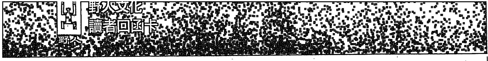

- 姓名  
  □女 □男  年齡
- 地址
- 電話              手機
- Email
- □同意  □不同意  收到野人文化新書電子報
- 學歷  □國中(含以下) □高中職  □大專  □研究所以上
- 職業  □生產/製造  □金融/商業  □傳播/廣告  □軍警/公務員
  □教育/文化  □旅遊/運輸  □醫療/保健  □仲介/服務
  □學生  □退休  □自由/家管  □其他
- ◆你從何處知道此書？
  □書店  □書訊  □書評  □報紙  □廣播  □電視  □網路
  □廣告 DM  □親友介紹  □其他
- ◆你以何種方式購買本書？
  □書店：名稱                  □網路：名稱
  □量販店：名稱                  □其他
- ◆你的閱讀習慣：
  □親子教養  □文學  □翻譯小說  □日文小說  □華文小說
  □藝術設計  □人文社科  □自然科學  □商業理財  □宗教哲學
  □心理勵志  □休閒生活（旅遊、瘦身、美容、園藝等）
  □手工藝/DIY  □飲食/食譜  □健康養生  □兩性
  □文書/漫畫  □其他
- ◆你對本書的評價：（請填代號，1. 非常滿意  2. 滿意  3. 尚可  4. 待改進）
  | 書名 | 封面設計 | 版面編排 | 印刷 | 內容 | 整體評價 |
  | :--- | :--- | :--- | :--- | :--- | :--- |
  | | | | | | |
- ◆你對本書的建議：
  - 野人文化部落格  http://yeren.pixnet.net/blog
  - 野人文化粉絲專頁  http://www.facebook.com/yerenpublish

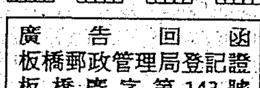

郵資已付 免貼郵票

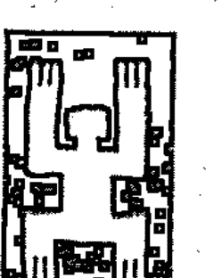

23141

新北市新店區民權路108-2號9樓
野人文化股份有限公司 收

野人

請沿綵緣下對折寄回

野人

書號：ONFL0169
