# 有关王兴、张一鸣、黄峥、张小龙、雷军最好文章整理.md

介绍语  
雷军  
 1.如何思考长期问题：  
  关于互联网的两次长考 （2008-12-22）  
 2.如何从现象中学习：  
  雷军的师承(2014-12-14)  
 3.是一个什么样的人  
  雷军的性格与命运(2014)  
 4.别人眼里的雷军:  
  对话雷军：关于小米，他们说的都是错的（2016）  
李小龙  
 1.最好的一篇采访  
  腾讯张小龙：坚守纯粹也能成功（2013）  
 2.高尔夫业余配对赛冠军  
  业余选手张小龙（2018）  
 3.在产品中流露对阅读的执著  
  张小龙的阅读情节（2017）  
 4.做 QQ 邮箱和微信的故事  
  探秘马化腾背后的男人：张小龙 (2016)  
 5.ISTP 和 INFP 双重性格  
  张小龙的星空(2016)  
 6.推荐的 8 本书  
  《微信之父张小龙的书单》  
王兴  
 1.10 年前别人眼里的王兴  
  W 和 L（2010）  
 2.思考美团的本质  
  王兴：互联网会根本改变所有行业，但不一定发生在最底层（2015）  
 3.一篇采访了解王兴的“特殊”  
  专访王兴：多数人为了逃避真正的思考愿意做任何事情(2016)  
 4.王兴的商战"兵法"  
  对话王兴：太多人关注边界，而不关注核心(2017)  
 5\. 美团追求永无止境的混乱  
  王兴的无限游戏(2018)  
张一鸣  
 1.张一鸣对于搭建团队和自我的认知  
  对话张一鸣：世界不是只有你和你的对手  
 2.多次创业失败后的总结  
  张一鸣：这几年我重新学习了青少年阶段该学习的东西 （2017）  
   算法是一个生命体  
   长线思考  
  招人看基本面  
   团队管理心得  
 3.从找女友到爆款产品  
  张一鸣的实证理性（2018）  
 4.张一鸣眼里的字节跳动  
  关于字节跳动这 7 年，张一鸣讲了 5 个故事  
 5.不会写代码的 CEO 不是好 HR  
  张一鸣的用人观（2019）  
   头条第一 HR  
   两大产品体系领导人  
   人才运转机器  
   共识是最大的激励  
黄峥  
 1.如何找到新的商业突破  
  对话拼多多黄峥：他们建帝国、争地盘，我要错位竞争（2018）  
 2.黄峥眼里的 60 分  
  黄峥思维切片：60 分万岁是个好哲学（2019）  
 3.黄峥是如何思考拼多多的  
  人物观察：黄峥的 100 种偏执（2019）  
   本分不过是最大的实用主义  
   新加坡式公司 拼多多式经济体  
   可知与不可知  
 4.十篇文章剖析黄峥的精神世界  
  拼多多黄峥：对人生、市场、需求和价值的 4 点思考（2019）  
结尾

# 介绍语

本电子书由公众号*懒人找资源* 根据网上好评选取的几个头部互联网创业者的优质文章整理合集而成。

礼包分享：到公众号*懒人找资源*后台回复*互联网*领取以下礼包

*王兴饭否电子书*（精华版和全部合集都有）

*张小龙饭否电子书*

*张一鸣微博汇总*，*刘润文章精选*

*生财日历电子版*，[《财富自由之路》超清扫描版](https://mp.weixin.qq.com/s?__biz=MzI1NjAxOTI0Ng==&mid=2647866656&idx=1&sn=99680e91b9fb7002f0f0f1b441f8f9c9&chksm=f20a8361c57d0a77aca40ee47c7ebdd1d174c07be9be239434e80c118bd355e9a364f47e92cb&token=2054107979&lang=zh_CN&scene=21#wechat_redirect)

脱不花《*沟通的方法*》超清扫描版等等

礼包将不断更新和扩充，关注公众号获取最新分享。

# 雷军

## 1.如何思考长期问题：

### 关于互联网的两次长考 （2008-12-22）

2008 年 4 月，李彦宏说，“五年后不再有互联网公司，因为所有公司都在用互联网”。这句话引起了很大轰动。我非常赞同他的观点。未来不再有所谓的互联网公司，我曾为这个问题在 1999 年就思考了半年时间，至于是不是五年时间，现在还不好说。

我也注意到一个年轻人做的公众号*懒人找资源* 介绍语写了“知识不应该是—部分人的特权，是应该自由顺畅流向每—个需要它的人”，十分具有互联网特征。

虽然我早在 1993 年就开始用互联网，1996 年是发烧级的 BBS 站友，但关于互联网是什么这么简单的一个问题，我曾思考过两次很长时间，一次是 1999 年创办卓越网之前，一次是 2004 年出售卓越网之后，每次都长达半年时间。两次长考的结论也很简单：

\\1. 互联网首先是工具，未来不存在所谓的互联网公司。

\\2. 互联网是一次观念的革命，只有改变观念，才能跟上互联网时代。

**一、1999 年最困扰的问题：互联网公司是什么？**

那是一个疯狂的年代。

美国互联网热潮从 1995 年 Netscape 上市开始拉开序幕，AOL, Yahoo, Amazon, eBay 等公司陆续登场，NASDAQ 指数 1000 点涨到创纪录的 5132 点。2000 年 4 月互联网泡沫破灭终止了这次热潮，接着大批 dotcom 公司关门，NASDAQ 指数跌回 1000 多点。这种疯狂是 1998 年传到中国的，到 1999 年达到巅峰。处在躁动中心的北京，每个人都有点慌乱。只要是互联网，无论做什么，不管是否能赚钱，都有 VC 的巨额美元投资。

我明白在这样的潮流面前，不能做时代的看客。但十年商业经验让我想不明白：这些公司靠什么挣钱？什么时候能挣回烧掉的钱？实在有太多想不通的问题，我决定先跳进去，边做边想。

1999 年初，我在金山内部种了一块试验田，建立了一个专门的事业部，招了十多个人，做软件下载站，取名叫卓越网。很快我们做到了第一名。但接着问题出来了，做下载需要很多服务器和带宽，而当时服务器和带宽都非常贵，用户又不愿意付钱。没有任何收入，同时需要消耗大量的费用，这个业务如何支撑下去呢？软件下载业务每天着消耗的大量现金，我当时非常痛苦，内心有很多问题没有答案：互联网公司是什么样的公司？互联网公司靠什么挣钱？做什么样的互联网公司有前途？

想了半年多时间，一直到 1999 年 10 月。有一天，我突然明白了：

1.不存在所谓的互联网公司。互联网只是一个工具，未来每个公司都变成互联网公司。

2.做电子商务最有前途。因为互联网是一个先进的生产工具，传统公司应用互联网最快的方式就是电子商务，这就是所谓的“水泥＋鼠标”。当然，电子商务也是过度性名词，因为未来所有公司都会是电子商务公司。

3.当时我们做的软件下载不 下功夫做，因为软件下载投入太高，而想象空间有限。

就这样，我痛下决心，放弃软件下载业务，转型做电子商务，做图书音像的网上零售。为了把这件事情做大，1999 年底，我说服了金山董事会把卓越分拆出来，单独运作。当时我非常自信，觉得已经想透了，一定能成功。我力主不融 VC 的钱，而是金山股东自己投资。后来，金山主要股东投资了 1600 万，因为联想是金山的大股东，也投资了几百万元。

那个时代，大家都是烧 VC 的钱。而卓越网，从一开始，我就坚信一定会成功，这种信心是用我们自己投入的 1600 万来表达的。

**二、2004 年卖了卓越后整整想了半年时间：互联网到底是什么？**

2004 年 9 月，我在出售卓越网的协议上正式签字了，亚马逊以 7500 万美元全资收购了卓越网。卓越网从 2000 年 5 月正式创办到出售，仅四年四个月时间。

对于创业者来说，卖掉亲手创办的企业，一定是件非常痛苦的事情。我为了尽快从痛苦的情绪中走出来，决定尽量不上卓越网，决定尽量不见卓越网老同事，把主要精力用来总结卓越网四五年的成与败，琢磨未来的发展机会。这个过程想了半年多，后来主要在想：什么是互联网？为什么互联网公司毛利率高增长快？未来的发展趋势是什么？

得出了如下的结论，今天回想起来也非常有意思：

1.开放和合作是互联网公司成功的关键。互联网首先是一张无边无际的网，每个人都是节点，互联是互联网成功最关键的要素。任何封闭式的业务模式都会遇到很大挑战，今天 Yahoo（一站式门户）困境也折射了我当年的想法。

2.互联网公司最厉害是靠机器赚钱。一旦产品研发完成，用户量到了一定的规模，只要服务器开着就可以赚钱了。到了这个阶段，产品研发推广的边际成本为零，服务器带宽成本逐年下降，毛利率自然就上来了，业务增长速度也比较快。而且，机器是 7X24 小时工作的，当然运维人员要全天候确保运营质量。

3.口碑营销和网盟是互联网公司营销核心。互联网公司直接面对所有用户，好产品仅靠口口相传就能成功。和拥有用户的其他互联网公司结盟推广，也是最有效的推广模式。

4.互联网公司管理相对容易。首先是业务、内部运作系统高度 IT 化，这点和传统公司非常不同；其次，很容易推动量化管理；还有，对人的依赖并不高，很容易做知识管理，系统自动记录了大部分人的工作，人员流动对企业影响比较小。

5.互联网公司靠提供服务来挣钱，而软件公司靠卖产品挣钱，这种模式就决定了软件公司的业务不容易持续稳定增长。一定要从卖产品模式走到卖服务的模式。

6.互联网的关键就是快。互联网产品的模式就是研发人员和用户一起开发产品，有阶段性成果就先推出去，听用户反馈，按用户意见去修改。

7.未来十年的热点是移动互联网，手机上网是一种趋势。

我把这些全部总结成一条：互联网是一次观念革命，是“深度互联，全天候快速反应”的观念。这里面有几个关键词，互联、全天候、快速。因为是互联网，所以联盟非常关键，联盟是互联网业务必须考虑的最关键的因素，就是说如何整合上下流，如何整合更多的推广资源；全天候，传统的业务是 5X8，而互联网必须是 7X24，必须确保任何时候业务都能正常运行；快速，更是互联网的精粹，必须快速开发、快速推广、业务快速成长等，反应速度一定要比传统业务反应快十倍，才有更大的发展机会。

就是想清楚了这些，我做了两件事情：

（1）从 2005 年初开始我在金山内部发布了全面转型互联网的动员令，现在金山业务几乎全部来自互联网。

（2）2006 年初我毫不犹豫投身了移动互联网行业，比如投资了乐讯（移动互联网最大的社区）和 UCWEB 等。最近出任 UCWEB 董事长，为移动互联网行业摇旗呐喊，也是我深思后的决定。

在一些重大产业变革的时候，认真思考，的确可以帮助自己把握机会。

## 2.如何从现象中学习：

### 雷军的师承(2014-12-14)

**提及小米的师承，雷军掏出小手枪在屏幕上砰砰砰打了三枪——同仁堂的品质、海底捞的服务、Costco 的低毛利运营。**

\*\*  
\*\*

**这横亘古今、学贯东西、传承历史、深入群众的三个标杆立起来，小米的逼格也就陡然踏上了云端。**

\*\*  
\*\*

**今天恶魔为大家推送这篇演讲稿，观摩雷军怎么做小米之外，还可以一起揣摩下雷布斯如何让你走心的演讲风。**

下文摘自雷军在君联资本 CEO club 的内部分享

我想跟大家分享我创办小米之前的一些思考。

柳传志当年推荐过一本书，叫《基业长青》，是关于如何创办百年企业的。于是我就问自己，怎么办一个百年企业呢?我首先想的是，在中国，谁做到了百年。

**我第一个想到的是同仁堂。**

在研究同仁堂的时候，我发现同仁堂最重要的是其司训：“品味虽贵必不敢减物力，炮制虽繁必不敢省人工”，意即做产品，材料即便贵也要用最好的，过程虽繁琐也不能偷懒。换句话说，要真材实料。设想一下，假如大家都这么做，那我们的社会还会有毒大米、三聚氰胺、雾霾吗?

但这个事说起来简单，做起来是很难的。所以同仁堂的老祖宗又讲了第二句话：“修合无人见，存心有天知。”你做的一切，只有你自己的良心和老天知道。这一句话，是关于怎么保证第一句话被执行的。

这让我很受震动。我就在想，为什么我们改革开放 30 多年来，中国在全球的观念里，就是生产劣质产品的地方呢?有时候大家开玩笑说，我们中国人太聪明。其实就是喜欢走捷径、喜欢偷工减料，才让大家有这样的印象。如果我们想基业长青，那就得真材实料，而要想坚持下去，就要把真材实料变成信仰。

我认为要基业长青，就要做到两条：第一真材实料，第二对得起良心。

当我想到这儿以后，我又问，有没有千年企业呢?其实有，宗教。宗教其实就是信仰。所以说不管是多少年，想办成一个持续永恒的事业，就得有理念，并且要把这种理念变成信仰。

思考过这个以后，我干小米时就想走一条不同的路：我们做产品的材料，要全部用全球最好的。夸张地说，我们“只买贵的，不买对的”，贵的肯定是有道理的。对于一个从零创办的公司而言，这是非常不容易的，因为这意味着我们的成本比别人高了一大截。但我们还是这样做了，处理器用高通，屏幕是夏普，最后组装也找全球最大的平台——富士康。

我发现我们中国人需要的，首先是好东西，而不仅仅是便宜的东西。做到这一点后，我们还有一个问题，就是谁愿意和一个初创企业合作呢?原来我以为做手机跟做 PC 一样买个元器件就行，后来发现不是，手机里面绝大部分都是电子件，这意味着我们的合作商需要投资研发资源，要承担巨大的风险。所以每一家供应商在选择合作伙伴的时候，都异常地小心。

组装的事，我从第一名谈到第四名，都没有人理我，最后我说服了第五名的英华达，就是英业达集团的子公司。我跟他们南京的总经理谈了三次，他觉得我的想法是靠谱的，所以选择了跟我们赌一把。今天，我们的组装主要就两家供应商，英华达和富士康。

我想说的是，一个创业公司从零开始的时候，很多人不相信你能做成。而找手机主要的供应商，我花了大概九个月的时间。想做一个好东西，是很不容易的。

三年前，我们第一款产品做出来时，成本高达 2000 元人民币。当时国产手机都是五六百元，两千元的手机怎么卖?我们内部完全没信心。原本我们的定价是 1499 元，一部手机要赔 500 元，肯定是不行的。在产品发布的前一周，我想了一个通宵没睡，第二天晚上，和几个合伙人一起商量，决定定价 1999 元。我们要相信，是好的东西就值 1999。一周后我们发布了，大获成功。

我发现我们中国人需要的，首先是好东西，而不仅仅是便宜的东西。如今的中国已经是产品过剩的时代，如果不认认真真地把产品做好，那不就是忽悠吗?

为了保证做到这一点，小米在创办初期的一年半里，没有市场部门，也没有发过一篇公关稿，并且要求全员保密，甚至不能说这个公司是雷军做的。

刚开始，我们从擅长的软件入手，做了基于安卓的 MIUI。2010 年 4 月 6 日，我们创办了公司，8 月 16 日发布了 MIUI 第一个版本。产品发布时只有一百个用户，但是第二周就变成了两百个，第三周四百个，每个星期翻一番。10 月份，我们就被全球的开发者论坛 XDA 推荐，从国际上火起来，当年就获得了安卓最佳产品的提名。

所以说，要认真做好产品，要相信口碑，而口碑就是信仰的一部分。

我们的每一款手机，哪怕是只卖 599 元的红米 4G，也都用国内顶尖的供应商。而且为了把手机做好，我们每年只出一两款手机。到今天为止，四年半只做了六款手机。并且我保证，每一款手机都是我自己用过半年一年的。我知道这个手机好在什么地方，我也知道我的产品不好在什么地方。

我做了 25 年技术，如果这个东西我自己都没用过，我自己都不觉得好，我能够站在这里给大家推销吗?

小米，是我 40 岁在财务自由以后创办的公司。这点最大的优势就是，我不会为了钱去做什么事情，这个事情是我喜欢的，我满意的。所以小米要做的第一件事就是货真价实。

可能很多人，包括这里的绝大部分人，以前都是用苹果三星，但现在我相信，在座的已经有很多人用的是国产手机了。三年前，几乎没有用国产手机的，今天，在小米的带动下，越来越多的国产手机越做越好。

这就是我跟大家分享的第一个故事，同仁堂的故事。

向海底捞学习：口碑源于超预期

**我想分享的第二个故事是海底捞**。

七八年前，我在机场的书店买了一本书，《海底捞你学不会》，可是看了三四个小时之后，我发现我学会了。我发现海底捞的秘诀其实只有两个字：口碑。

怎么能把口碑做好呢?很多人很快就想到了口碑营销，可是你一旦想到营销，这件事情就死了，你首先要想，什么样的东西才有口碑。

我看完这本书就去了海底捞。跟其他火锅店一样，海底捞的环境很嘈杂。但让我惊讶的是，海底捞的服务员有着发自内心的笑容。

其他的服务型行业，比如民航业，空姐们虽然比海底捞的服务员更漂亮，制服也更好，但是，她们常常是一种皮笑肉不笑的状态。相比之下，海底捞服务员的笑容真的能够打动人。

我就问海底捞的服务员：“你当个服务员有啥好笑的呢?”她跟我说：“我 40 多岁下岗女工，一直找不到工作，结果海底捞录用了我，七八年前就给我每月四千元的工资，我睡觉做梦都会笑醒。”

我对此很受触动，海底捞连员工都感动了。所以我决定，小米的客服，在北京首先能比同行平均工资高 30%，四千块钱起，不惜代价，最高能到一万二。如果我不能对员工好，员工会怎么对我们的客户呢?

几年前，微博上有个段子讲得特别好。有个客人在海底捞吃完饭后，想将餐后没吃完的西瓜打包带走，海底捞说不行。可是他结完帐时，服务员拎了一个没有切开的西瓜对他说：“您想打包，我们准备了一个完整的西瓜给您带走，切开的西瓜带回去不卫生。”

哇，那一瞬间就把客户打动了。所以讲到这里，大家知道什么叫口碑了吗?

其实后来我还去过帆船酒店，当时我怀着无比崇敬的心情去了迪拜。一进帆船酒店，感觉金碧辉煌，好像真的贴了金子，但现代人的审美不会觉得这是奢华，而是土。

所以我就觉得很失望，这难道是全球最好的酒店吗?我想是因为我预期太高了。现在回想起来，帆船餐厅好得惊人，但是我的预期如此之高，以至于我真的失望了。

**口碑的核心是超越用户的预期。帆船酒店的服务肯定比海底捞的要好，但是他没有超越用户的预期，海底捞破破烂烂的，进去闹哄哄的，但是包括服务员的笑容在内，很多细节征服了每一个客户，所以海底捞的口碑是无敌的。**

有了这样无敌的口碑，还需要做广告吗?所以小米公司成立初期，我没有成立市场部，也没有做公关。刚开始 MIUI 只有一百个用户的时候，我要能 hold 住。

我相信口碑，我认为最好的产品就是营销，最好的服务就是营销，好东西大家会心甘情愿地帮你推广。

初期的时候大家不信，我们做 MIUI 实践了一把，大获成功。广告这东西，一半有效一半无效，但比广告更有效果的是口碑。

我们为什么觉得保健品人见人烦，就是因为他们天天吹牛，广告多得让人心烦，消费者渐渐不愿意相信了。而没有广告以后，你会真心真意对待每一个用户，所做的每件事情都超预期。

比如说我看到一个用户在微博里投诉“电池用了两个星期以后充不进去电”，正当我打算回复时，却发现已经有同事回答了他的问题。第二天我发现这个用户贴了一条微博，说他“已经收到小米同事免费寄的一个新电池”。

大量制造的工业品不可能不出一点差错，但用户投诉时，一般人只会建议返修，而我们的员工却给他寄了一个新的电池，最后那个用户是挺感激的。

又比如双十一，凌晨一点多钟下的单，第二天早晨六点就送到了。用户说小米的物流丧心病狂，刚买完几个小时以后，货就已经送到了，这个就是一个能够打动用户的小细节。

所以我想跟大家谈的第二个就是，口碑的核心是超预期，当你去经营口碑时，我相信你的口碑就一定会有提高。

口碑不是新媒体营销，其本质是认真琢磨产品和服务怎么能够打动消费者，我觉得这是关键。

这是我参考的第二间公司。

向沃尔玛、Costco 学习：低毛利、高效率是王道。

**谈完同仁堂和海底捞，我要说的第三间公司是沃尔玛**。

52 年前，老山姆在家乡创办了一个杂货店。他发现那时美国流通行业的平均毛利率是 45%，这其实是很黑的。老山姆就想，我能不能只赚别人一半的钱，只做 22%的毛利率呢?天天平价，销量可以是别人的好几倍，肯定能挣钱。

所以他就把“天天平价”做成了沃尔玛创办的 slogan。

但是仔细想想，当别的连锁店赚 45%的时候，只做 22%，理论上肯定是不赚钱的，而且亏得很厉害，这是市场竞争的原则。

老山姆琢磨了很久，心想只要便宜一百美元，美国人就会愿意开车到十英里以外。所以他就不在市中心办，而是找了一个旧仓库，把所有的成本降到最低，就算毛利率只有 22%，他也还有几个点的净利润。

结果，沃尔玛用了三十年就成为世界第一，这就是高效率。

我们的商学院教了一堆错误的观念，包括我们这些投资者们，永远在问“可不可以有更高的毛利率”。当然可以，骗用户呗!要么偷工减料，要么就涨价，还有别的方式能提高毛利率吗?

我现在投资，特不喜欢毛利率很高的。中国市场上什么东西都贵得离谱，稍微好一点的东西就很贵。

三年前，我跟金山的一帮高管去美国。那时我们的 CEO 张宏江，是从美国回来的，原来微软的工程院院长。他一下飞机，就租了辆车直奔 Costco(好市多，美国最大的连锁会员制仓储量贩店)，后来同行的七八个人也去了，回来以后都很激动。

我感到很奇怪，猎豹移动的傅盛就给我举例，两个新秀丽牌子的大箱子，平时在国内大概卖 9000 多元人民币，Costco 只要 150 美元，合 900 元人民币。

美国的房子、土地、人工什么的，都贵，但这两个箱子，价格只有国内的 1/10。我们的人民拿着美国 1/6、1/10 的工资，“享受”着雾霾，却要付 10 倍的价钱，这是为什么?

**我后来研究 Costco 发现，这个公司确实厉害。他们的信条是：所有的东西，定价只有 1%~14%的毛利率。**

任何东西的定价要超过 14%的毛利率，就要经过 CEO 批准，还要再经过董事会批准，非常麻烦。我看了他们的财报，7%的平均毛利率，在美国做大型连锁零售，这是不挣钱的。所以他们通过会员费来盈利，要买东西的必须成为会员。2000 多万的会员，每人一年 100 美元。Costco 的店面大概只有沃尔玛的 1/4，每种东西只有两三个品牌，都超级好，也超级便宜。结果我们都成了 Costco 的会员。

**所以我想探究的一个问题是，一个公司的毛利率越高，真的越好吗?毛利率高的公司，效率一定很低的。**

在低毛利的情况下，怎么高效率的工作才是厉害的地方。

小米刚开始是零毛利的，依靠大规模的生产，大概能有百分之十几的毛利率。我们的关键在于，把小米的整体运作成本控制在 5%以内。前年是 4.1%，去年是 4.3%，不谦虚地讲，我们是全球运作效率最高的公司。

所以我们一定不能雇很多人，一定不能做很多事。我们的哲学是：少就是多，一定要专注。我们的模式太复杂了，简单就是我们的核心竞争力。我们首先是复杂，然后再把复杂的事情做简单。

沃尔玛跟 Costco 这些零售业给我的经验就是，低毛利是王道。只有低毛利，才能逼着你提高运作效率。而小米要接近成本来定价，高效率就是王道，没有高效率，这个公司会赔得一塌糊涂。

我一直在想，做电子商务为什么损失那么大，要烧那么多钱呢?小米也是电子商务，我们还赚钱。我不记得在哪里看过一句话，说企业不赚钱就是犯罪，企业的社会使命就是要赚钱提高效率。但是类似于亚马逊的神话，只有贝佐斯做到了，一般人是做不到的。而我们既然不想坑用户，又要赚钱，就只能用所有的聪明才智来提高效率。

提高效率不等于克扣员工。小米有 7500 人，5000 人是服务部门，研发运作部门只有 2500 人，以我们今年预计 750 亿到 800 亿元的营业额来说，我觉得已经是天下无敌了，这需要什么样的运作效率呢?

所以，我们雇每一个人的时候，都需要精挑细选。

比如我们的虎哥，Hugo Barra，安卓的产品副总裁，谷歌的全球副总裁。我用了三年多的时间，说服他到小米工作。其实到小米工作容易，因为小米目前形势比人强，难的是说服他离开硅谷来北京工作。

大家明白，虎哥在硅谷、在谷歌内部，都在一个很好的位置上。他也知道风险，如果小米干砸了，他可能就不能当安卓这个副总裁了，现在安卓已经占了智能手机全球百分之八九十的市场份额。他本人在硅谷也有

巨大的影响力，加入小米时，所有的商业杂志都是整版的报道。

去年 10 月份他到北京，上个月在这工作满一年时，我跟他聊天，他还是觉得，这是个激动人心的事业。

这段时间，新浪的前总编辑陈彤也加入了小米。他离职的时候，火得一塌糊涂，而他加入小米的这件事，热度也相当于他离职消息的 90%。

所以，我们在不惜代价地吸引各方顶级的人才。人，对于我们这样一个高效率的公司来说，是我们最重要的资产。我们尽量少雇人，对这些人却有一个要求：前两三百人，全部十年以上经验。因为只有这样的经验，才能使一个公司高速发展而不翻车。

最后整体总结，在创办小米之前，联想的东西就已经在我的 DNA 里了。做小米的时候，我真正学习的是这几家公司：同仁堂、海底捞、沃尔玛和 Costco。

我们像同仁堂一样做产品，货真价实，有信仰。每个东西都是我自己用过的好东西，如果做得不好，请大家原谅，因为我们也只干了三年，还需要时间。

这里爆个料，我们下一代产品还会进一大步。智能手机的竞争，是全球最激烈的竞争，这个难度是蛮高的。我们这个公司总被拿来跟苹果比，要我每一年都比苹果好。苹果 6000 亿美元的市值，假如我比苹果好，我应该值 8000 亿美元吧，所以我肯定不如苹果，就不要比了。

我们五年之内，不谈超过苹果。当你了解的越多，你敬畏的就越多，但这不意味着我们的市场份额不可能比苹果大。

第二点，向海底捞学用户服务，做超预期的口碑。今天的时间很短，就不展开讲了。

第三点，向沃尔玛、Costco 这样的公司学运作效率。我们是电商，是实业的，涉及到实业，我觉得还是效率致胜。当然，提高效率有两种方式，一种是柳传志先生讲的拧毛巾，我也很认同，不过我用的是另外一种，模式优化——把中间渠道、零售店全部干掉，少做事，用最聪明的人简化流程。

比如做手机，其实建立全国销售渠道、旗舰店这些都不需要，把产品做好，开个网站，等用户上门买，就是最好的模式。小米网，原来叫小米.com，后来国际化，又花了 2000 多万元建了 MI.com，我觉得值。

小米用了大量的模式创新来提高效率，只有这样，才能使成本大幅度降低。在消费电子行业，从制造成本到零售成本，定倍率基本上是两到三倍，再加上渠道、零售店利润，客户买到东西的价格是制造成本的两到三倍。

为什么传统手机那么贵?或者说，为什么传统的所有服务都那么贵?效率不够。中国的电商之所以有这么快的增长率，主要是我们的传统商业落后。Costco 也全是实体连锁店，但是高效率。京东的财报显示，京东自己就花了营业额的 10%，如果 Costco 只要 7%，你觉得 Costco 会受京东影响吗?我觉得有影响问题也不大。

所以关键是怎么提高效率，电商的核心是效率。这个模式有先进性、优越性，但如果不管理好成本，就很难挣到钱。

这就是我参考过的几家公司。

互联网“七字诀”外的真经：群众路线

最后，我讲讲互联网思维。

我谈过互联网七字诀：“专注、极致、口碑、快”，但今天不谈这个。互联网思维里还有很重要的一条——群众路线，就是“深入群众，相信群众，从群众中来，到群众中去”，就是互联网开源社区的模式。互联网有最低的组织成本，可以让用户参与进来。

**小米最大的卖点是什么呢?**

我一直有个梦想，做一个好手机，用户有好的意见，我马上就能改。所以我设计了这样的模式：建立小米社区，每天有 300 万人访问，提各种建议。吸纳建议后，我们一个星期出一个操作系统新版。这其实是个世界级的难题，因为操作系统比较复杂，尤其要考虑出错了怎么办，可靠性要求很高。

举例说明一下。比如，不知韩寒还是王洛丹提到，很多粉丝给他们打电话的烦恼，问能不能做个只接通讯录电话的功能?后来小米就有了这个功能。再如，有一位领导跟我说他的电话要 24 小时开机，晚上 12 点一打就睡不好觉。后来，我们就设置了 VIP 电话，只有 VIP 能 24 小时都打得通。

像这样的功能都是人民群众发明的，因为我们不在那个场景里，想不到。实际上，小米手机发起了一场群众运动。

在这点上，其实我们跟 iOS 是完全不同的设计思想。我们是“易上手”，看起来跟 iOS 一样简单，但是“难精通”，功能非常多，集大成。甚至在设计时，我们有句名言叫“让用户有发现的乐趣”。

“我对互联网思维最深的理解，除了七字诀以外，就是群众路线，即开源社区。互联网是一种思想，一种先进的生产力和先进的指导思想。如果能把这个模式想透，应用到任何业务里，那个业务都会与众不同。

今天来主要跟大家分享我做小米的四点思考。小米前面的路还很漫长，我们今年取得了一些成绩，主要感谢大家的支持，更多的是我们赶上了智能手机在中国爆发的时间点，所以才会有“飞猪理论”。

但对我们要做的事情来说，小米才刚刚开始。我想把我们按这种哲学做出来的中国产品，带到全世界，让全球的每个人，都能享受到来自中国的科技创新乐趣。

我相信未来十年，小米会像 70、80 年代的索尼带动整个日本的工业一样，像 90 年代、21 世纪三星带动了韩国的工业一样，带动中国的工业。

小米的目标，是要成为中国的国民品牌，小米的梦想，终将成为中国的未来。

谢谢大家!

## 3.是一个什么样的人

### 雷军的性格与命运(2014)

你认识雷军吗？

很多人都熟悉甚至崇拜雷军，能随口说出好几条雷教主的语录。可是，你真的认识这个人吗？——作为一个人的雷军，而不是作为一个创业或投资的符号。

文／宋玮

雷军，生于 1969。他谨慎有余，喜欢平衡，有退路就很难下定决心。创新像把火，之前的雷军多数时候离火焰还有几分距离就停下脚步，那是他留给自己的安全界限。可最后，做出中国最具颠覆性创业公司的人，是雷军。

2007 年，离开与求伯君一起创立的金山，是雷军一生中重要的结点。当他被命运扔在十字路口，才终于有了一次破釜沉舟的勇气。雷军说，他年过四十才走出低谷，抱着不是必赢就是必输的信念创办小米，绝不做一家半死不活的中庸企业。因此得以体会到创业时“跳下悬崖”的感觉。

离开金山对雷军是莫大的打击，却也是命运给他最大的帮助。如果没离开金山，雷军会怎样？结果显而易见，雷军会像在金山一样，永远是一名优秀但不够卓越的商业领袖，永远是和成功只差一步的创业者。

如今回头来看，他的人生历经三个转折点，一是离开金山，一是创建小米，最后一个是此刻。人们往往对他的第二个转折点津津乐道，前后两个少有提及。

雷军是中国创业者中所做之事最像乔布斯的一个。乔布斯也曾离开苹果后再度回归。但不经历当年，以乔布斯的天资和偏执，乔布斯仍是乔布斯，而雷军没有当年的挫折，也许不能成为今日的雷军。

小米市值已经突破 100 亿美元，对雷军来说，100 亿门槛只是一个勉强可以接受的底线。如今，雷军处在了一个新的关口。从最初到现在，雷军的梦想从来不曾改变，就是要做一家苹果一样伟大的公司。苹果市值千亿，苹果在音乐、手机、平板等多个领域持续颠覆持续创新，小米还有距离。

雷军已成为雷军，但还没有成为他梦想中最渴望成为的那个人，他还需要二次革命、二次创新。如果用一个伟大创业者的标准来评价，雷军最伟大的一刻就是他不顾一切、往悬崖下奋力一跳的那一刻。可现在小米成功已无悬念，这时候如果出现新的趋势，雷军还愿不愿意去抛弃去颠覆？所有人都在看。

永远离成功只差一步

2007 年 12 月，金山软件上市后两个月，雷军卸任 CEO。对于离开金山的原因，雷军从来没解释过，但比为何离开更有意思的问题是，雷军为什么不早点离开？或者说，如果不离开他会怎样？

互联网大佬中，雷军成名最早，经验最丰富，程序员出身，96 年做为金山软件总经理已是国内互联网十大杰出青年，非常耀眼。彼时，李彦宏还在美国读书，马化腾到处筹钱想创办自己的第一家公司。

雷军一直声称他 18 岁时读过的一本书《硅谷之火》是他梦想的源泉，那本书讲述了乔布斯和沃兹尼亚克等一群人创造了苹果电脑并改变世界的故事。

“乔布斯说活着是为了改变世界，因为美国人认为他们就是世界的中心，我说我活着是为了科技报国，你信吗？”

雷军模范学生长大，也活在六十年代人所受的一整套教育规范中，对这套体系未曾怀疑。1992 年，雷军第一次去香港，他发现凌晨的街头很安全，并非传说中黑道横行，“第一次崩溃了。”后来去美国，发现“外国的月亮真的比中国圆”，又崩溃一次。

*雷军说，整整一代人，都挺可悲的，直到他遇见金山的创始人求伯君，才意识到远离政府也可以实现科技报国。在当年商业秩序刚刚建立的中国，就像漆黑的夜里几道手电筒发出的光，道路是有限的，但总有人依靠内心的力量，为自己勾勒出了一座珠峰，求伯君和雷军都是其中之一。*

1994 年之前的中国 IT 业，最出名的不是 IBM、联想的总裁，而是程序员——求伯君、王志东、王江民等。业界著名记者刘韧曾出版《知识英雄》，将那个激情燃烧的时代比喻为英雄的时代，一个程序员凭着自己武林密笈一样的源程序，就可以创办公司，成就事业与声名。

如果说《硅谷之火》给雷军指明了榜样，美国之旅让他看到商业巨大的能量，而求伯君带给他的则是一个企业家的梦。这三件事共同构建了雷军最初的梦想——成为知识英雄，缔造一家像美国苹果公司一样伟大的科技公司。

雷军当然有权利这样梦想，他很聪明，又有着多于常人数倍的勤奋。加盟金山的原因之一就是因为他破解了求伯君一手开发的 WPS 办公软件。现金山副总裁傅盛回忆，雷军第一次见他，手里拿着一个小本，说要请教如何做产品，傅盛说什么，雷军全写下来。

创办北京金山后，雷军花三年时间开发软件《盘古》，最后受到微软冲击，惨败，短暂出走金山后又回来——这次经历和他的偶像乔布斯颇有相似之处。刘韧告诉《财经》，雷军内心极其克制，离开又回去是多难的选择，大多人开弓没有回头箭，雷军比很多人都要理智。

此后的雷军就像一名力挽狂澜的英雄，带领着金山做游戏，并开发金山词霸，走出颓势。他还在母校武汉大学和学生们喊口号：“我要用未来十年和微软来一场豪赌”。

*如今回想，雷军当年豪言与创办小米时的愿景何其相似，但他却因此错过了互联网发展最黄金的阶段。1998 年，雷军出任金山公司 CEO。同年，还在方正公司写程序的周鸿祎放弃传统软件业，带着 5 名员工创办了 3721 公司，意思是不管三七二十一，直接杀入互联网。同一时期，百度、腾讯、阿里巴巴相继成立。*

雷军并非没有看到互联网之势。刘韧说，96 年他和雷军在中关村的一个小酒吧喝啤酒，雷军就劝他，现在玩 BBS 没什么意思，建议其把时间花在互联网上。

*一位金山的老员工评价雷军是守正出奇的人，最大的优点是善于生存，善于合作，善于发现和创造，但不善于抢夺和征服，内心瞻前顾后，太过谨慎。和当年的周鸿祎相比，雷军比他成功何止数倍，但就少了那一丁点不管三七二十一的赌性。*

雷军也尝试着去改变，他做电商做网游，学习新的玩法，每个行业都做到细分领域前几名，却永远不是老大。雷军反思 15 年来做的很多产品都离成功只有一步之遥，却总是失之交臂。这是时代使然，公司基因使然，回天乏力。

2007 年 10 月，金山终于在香港上市，市值只是一家主流互联网上市公司的零头。两个月后，雷军选择离开。

回到最初的问题，雷军为什么没有早点离开？观察者不难找到理由，无非责任感，英雄情怀与既得利益。雷军告诉《财经》，他曾以为金山可以承载他的梦想，于是一件事情争取了 15 年。“当你发现大哥不对，你不敢说，不愿意承认，很纠结。你也大可逆天，破斧成舟，但是却会失去人和。”

说到底，当年的雷军少了抛弃一切，重建一切的勇气。他内心一直有《硅谷之火》的梦，但缺的只是那一点火星。

*上述员工告诉记者，那时候非常流行一本书，叫《从优秀到卓越》。过去的经历已经证明了雷军的优秀，但显有人知他的内心多么渴望卓越。早在 2000 年，雷军创办国内最早的一家电子商务公司时，就取名卓越网。*

这次离开是莫大的打击，却也是命运给他最大的帮助。如果没离开金山，雷军会怎样？结果显而易见，雷军会像在金山一样，永远是一名优秀但不够卓越的商业领袖，永远是和成功只差一步的创业者。

离开之后，雷军的人生步入低潮。他开始全职去做投资。外界有人评论他做不了 CEO，只能做董事长。那一刻，他可能也相信这样的评价。毕竟对于一个如此追求完美的人来说，金山的经历只能说是没有失败，却肯定算不上成功。

*2007 年冬天，雷军跑回金山大楼，后来想回家时，才记起已经没有了司机。他在风雪交加的中关村等了四十多分钟都打不到车，内心悲凉。*

跳下悬崖

别人评价金山时期的雷军缺乏那一丁点的赌性，而投资，恰恰就是一场接一场的赌博。

离开金山之后，雷军投资过 30 多家公司，其中不少公司都在各自领域有所建树，如拉卡拉、凡客诚品、UCweb、多玩、乐淘等。成功者如 YY 多玩，2012 在纳斯达克上市,雷军这一笔 100 万美元天使投资，获得了约 113 倍的账面回报。

雷军的投资逻辑是一看趋势，二看人。雷军眼光极好，对趋势的把握非常准确。2005 年，他投资手机社区乐讯网时，京东正式成立不到 1 年，人们才刚刚开始认识到电子商务的魅力，对移动端全无概念；2006 年雷军投资网络即时聊天工具 UCWeb，公司只有不到 10 个人。四年后它的估值达到 3 亿美元，成为腾讯进入移动互联网领域的敌人之一。

*一位与雷军熟识的投资人告诉《财经》，雷军的性格是非要到山穷水尽才肯舍弃，而一旦做出决定，比所有人都彻底。雷军投资“狠”，看中一个项目，推掉所有的事情，其它投资人两周开完的会，雷军两天开完。王航说，前一天刚和雷军见过面，第二天他还没起床，电话就响了。一接通，雷军说，钱打过去了。*

随着雷军对行业的理解不断加深，他的完美主义开始呈现，他会鼓励团队开发一个新产品，来颠覆旧产品。2007 年，多玩团队转向打造在线群聊语音产品，就与先期雷军投资的 iSpeak 同类产品冲突。媒体传言正是此事让雷军和本来关系不错、也投资了 iSpeak 的周鸿祎闹掰。

至此，成功的投资生涯中，雷军收获了两点，一是懂得如何在趋势下获取成功，二是学会了如何做一款完美的移动互联网产品。更重要的是，这两点让他找回了自信。相比于三年前，他有了更多的钱和经验，可以说，做一个怎样的产品能在移动互联网大获成功，没人比雷军更有把握。

刘韧说，他见多两类人，一类人看好一个领域，拼上全部赌一次；另一类人是研究十个领域，最后选一个最有把握的，开始做。雷军是后一种。

火苗起来没人能阻挡。一向谦和的雷军甚至不惜与心爱的创业者直接冲突，他最早以“小米工作室”名义试验了一款“迷人浏览器”，与 UCWeb 的业务产生竞争，引起不满。但雷军的选择不是停止这个产品，而是退出了 UC 董事会。

口袋通创始人白鸦说，雷军像是机器猫，口袋里有一堆的东西，个个都不小。雷军的项目覆盖移动互联网社区、内容、应用等各个层面，只等最终集所有产品于大成的手机了。

2010 年，雷军创办小米。他说伟大的公司总是诞生在伟大的趋势之中，而他看好互联网手机的爆发之势。

雷军曾说自己并非善于逆境生存的人，他总是先让自己立于不败之地，然后再出发。按照他一贯的谨慎，创业初期很低调——先是悄悄成立了公司，然后以第三方名义开发 MIUI 系统，甚至在招聘时都不说他是真正的老板。一位熟识雷军的创业者告诉《财经》，像雷军这样有英雄情节的人，辛苦和挫败都可以忍，最难受的是做不好带来的羞愧。

创业一年后的夏天，雷军在后海一处僻静会所召开了一个小型的媒体沟通会，宣布了两件事，一是 MIUI 是雷军做的，二是小米下个月推出手机。当时现场稀稀拉拉坐了十几个记者，雷军对着台下重复了两次：我有点害怕失败。

一个月后，雷军以一种类似苹果发布会的形式，一个人站在舞台中央，完成了两个小时的演讲，正式推出小米手机。演讲结束后，雷军躲到门外抽烟，被记者拦住问他：面对质疑，准备好了吗？雷军回答说，没问题。

“创业就是跳悬崖，我 40 岁，还可以再次为我 18 岁梦想再赌一回。”雷军说，既然抱着必输的信念来创业，那就做一个完完全全创新的东西。

小米被认为是中国互联网最具创新性的产品。小米手机诞生前，国内智能手机市场只有两种生态：一是高价格高性能，如苹果；二是低价格低性能，如酷派等国产安卓机。魅族手机创始人黄章曾被寄予厚望，他的产品价格和硬件虽好，但失之系统封闭、服务性差。此时小米以低价格高性能好服务的姿态进入，抓住了发烧人群，可谓精准。

小米之后，效仿者众多，但追随者只学到了皮毛，缺了精髓，这个精髓就是 MIUI 系统。雷军称它为“活系统”，它像互联网产品一样，随时接收用户反馈并快速迭代更新。美观、易用、互动性强。

多数人只看到小米带来的渠道创新和营销创新，但小米最具创新价值的一点，却是雷军想用米聊，一款维系人和人之间关系的软件成为手机的灵魂，连接软硬件和社区。这件事对小米的意义不亚于 QQ 在互联网时代对腾讯的意义。可惜后来微信进入，雷军没能做到这个目标。

小米联合创始人黎万强说，小米是雷军产品精神的完美体现,雷军在一线紧盯产品，他挑选小米手机的开机画面，就看了 100 万张照片。雷军的产品理念是回归简单，但简单不仅仅是把杂乱无章的事情抹去，而是挖掘复杂性的深度，复杂中有规律可行，控制产品，让它们听从你。

小米时代的雷军看上去容光焕发，完全沉浸在一个产品经理的快乐中。傅盛说，雷军在金山时，开会见一位事业部总经理穿着深色西服配浅色领带，不够正式，会命令他立刻打车回家去换一套。而现在，黎万强可以穿着短裤和夹脚拖鞋在办公室里接受记者采访。

*求伯君是软件时代的英雄，但是在互联网时代则消失了声音。而雷军在诸多不顺中不放弃，勇于改变，他明白要想战胜内心的恐惧，最好的办法就是正视再正视，直到成为习惯。这是他之所以能不被时代抛弃的原因所在。*

*所以，这一次，雷军终于跑到了最前面，他用自身践行了一个朴素的道理——40 岁之前，性格塑造你，40 岁之后，你塑造人生。*

一位小米员工告诉《财经》，今年年初，雷军对他说，此时的小米不可能再失败了。

悬崖和陆地

产品经理雷军，先推出了两个产品：小米手机和小米盒子，接下来又陆陆续续做了很多，包括电视、路由器以及一大堆配件。进入 2014 年，新产品的推出越来越频繁。

一位投资人说，小米手机，思维领先两年，技术领先一年，站在了绝对的领跑位置。但是，当小米盒子推出时，领先优势却只有半年不到。而当小米电视、小米路由推出时，市场上同类产品已经销售了好几个月。5 月 15 日，小米发布了小米平板。相比苹果、三星甚至微软，这样的产品依然有差异化，但不能跟“互联网手机”时的惊艳相比。

于是，有人提出了一个雷军或许很不愿意接受的问题：小米的创新为什么看上去变慢了？小米如何能像苹果公司一样，让用户尖叫一次之后，还能再次尖叫？

雷军站在百亿门槛，看向梦想中的千亿。苹果从百亿到千亿，连续推出 iPod、iMac、iPhone，iPAD,同时，苹果还拥有具有颠覆意义的 iTunes 和 apple store，苹果已经不仅仅是一家产品驱动型公司，更是一家平台、服务型公司。

*对于如今的小米而言，其如果只是做一系列高性价比的产品有多大价值？小米手机还有互联网手机的光环，但是移动电源和小米音箱，核心是什么？难道是个互联网电源吗?*

所以，关于小米产品的核心到底是什么？如果这个回答是性价比，那么小米永远不会成为苹果。如果答案是创新、平台和服务，那么，小米还需要继续努力和转变。

目前，小米对于 MIUI 系统的调整可以看出其向平台转型的雏形。MIUI 的策略是在整个互联网基于 APP 赚钱的时候，直接从系统层面和服务提供商进行整合，靠系统来赚钱。即从一个单纯的 APP 分发渠道到一个底层服务的整合者。比如，小米和触宝号码助手合作，小米在拨号界面加入触宝的黄页功能，这样用户直接可以使用服务，不需要再单独下载 APP。

对于雷军而言，现在做硬件、卖硬件，已经是一条轻松而顺畅的道路。但如果小米还想做出颠覆式创新，他需要思考的是，一个真正具有创新意义的产品是什么？一个比苹果更好的服务、更好的平台应该要怎么做？

在华为的鼎盛时期，华为董事长任正非曾撰文《华为的冬天》，当时华为的转型，正是从产品向服务的转型，从主导性价比的产品向高附加值的产品转型。

多数人不会觉得现在小米还需要做什么改变，但雷军不能这样想。他会把公司重新做为转型期的公司来看待吗？

这种在顺境时的转型和选择对于雷军来说并不太容易。雷军所做的事情是中国创业者中最像乔布斯的一个。但他们看起来又太不一样了。

乔布斯自私暴躁，经常跳上桌子骂人，雷军平和，再生气也一言不发，低头抽烟；乔布斯认为世界非黑即百，一个人不是英雄就是蠢材，一个产品不是奇迹就是垃圾，雷军平衡，不忍心伤害别人；乔布斯的同事恨他又爱他，而雷军的下属对他忠心跟随，为雷军搬家，书架上书的摆放次序，都与搬家前丝毫不差。更重要的是，乔布斯创造需求，雷军迎合用户需求。

或许，两人 99％的不同都不会防碍雷军的成功，唯独少的是那 1％的不顾一切。雷军的性格太过谨慎，太求稳赢不输。雷军已经很伟大了，没什么人可以拦住他，也许唯一能阻碍他的就是他自己。

*雷军告诉《财经》，他曾投资过一个 45 岁的创业者，当时就认为他只有 1％的成功率，但是如果成功，足以改变这个社会。于是，他决定去赌博——这个项目后来失败了。他敢赌别人的人生，敢把自己人生放进去再赌一次吗？*

## 4.别人眼里的雷军:

### 对话雷军：关于小米，他们说的都是错的（2016）

10 月 26 日，小米发布会的第二天，《财经》见到了雷军。他们刚刚发布了一款“划时代”的明星产品——小米 MIX。

雷军上一次接受《财经》采访是在 2015 年 5 月 13 日，当时小米已连续五个季度销量蝉联国内智能手机市场第一，他们刚刚发布小米 Note，正要向中高端冲击。而雷军本人，则登上了《TIME》时代周刊，他被誉为“中国手机之王”（China’s Phone King）。17 个月后的今天，根据调研公司 CounterpointResearch 发布的报告称，2016 年第三季度，OPPO、VIVO 成为国内智能手机市场前一、二名，小米第三季度市场份额为 10.6%，位列第四。

在小米外部和小米内部之间，始终存在着两个小米。当你听多了外界对小米的评价，再和雷军聊了聊，你可能觉得，你们谈论的都不是一家公司。

在这家公司最辉煌的 13、14 年，人们对小米及其所代表的互联网模式、互联网思维狂热地追捧，互联网公司开口必谈互联网思维，传统公司开始学习互联网思维，互联网思维包治百病。而在接下来的两年中，随着 OPPO、VIVO 的崛起，那些把成本花在广告、渠道上的传统模式又被认为是更合理的模式，有人开始欢呼传统逆袭，有人认为雷军所倡导的互联网模式都是错的，于是又开始了一轮对小米的集体质疑。

但雷军始终有他自己的节奏、看法和规律。整个移动互联网正在经历低潮，小米也在经历高速增长后的缓冲期，这也许本来就是小米模式的一部分，他反复说，小米回到今天的位置，是正常的。“很好，降降温，控制控制大家预期，挺好。”

在每一年对雷军的采访中，他都会说，“其实外界并不了解小米，也并不了解小米模式，人们普遍真正看明白小米模式，可能需要 15 年。”——当然，这次也不例外。

以下是对话实录，有删减。你从中可以看到雷军眼中的小米，和他眼中的世界。对于小米这家公司而言，盲目地高估和盲目地低估都是不理性的，对于雷军这个人和他所代表的一整套思维体系，也是如此。

* * *

“我们得领先时代，做领先者很痛苦的。”

问：小米 MIX 的发布是否意味着小米需要一款革命性的产品来改变消费者对它的认识？就像当年的索尼？

雷军：五年前，我们发布第一款小米手机时，当时的会场很小，只有 800 多人在现场，我作为主讲人，在门口使劲挤也挤不进去。我当时没有想到小米手机可以引起那样的轰动。昨天发布会结束后，有人告诉我他和五年前我们发布第一款小米手机时感受到的震撼是一样的。大家期望的小米回来了，那个能做出很酷产品的公司，很创新、很不一样的小米回来了。

问：小米 MIX 的良品率只有百分之五？

雷军：正常我们要做到 70%的良品率才量产，但 MIX 的良率不到百分之十。我们原来还准备了白色的版本，第一批四万台手机，良品只有几百台。小米 MIX 陶瓷边框连后盖加陶瓷按键的全部成本是 1000 多元。

问：为什么小米要发售一款良品率不足 10%的产品？

雷军：为了技术创新。技术创新最大的障碍是大家害怕失败，为了成功大家都选择了低风险的方案。为什么现在手机高度同质化？就是每个人都害怕失败。

研发小米 MIX 的想法是去年年初提出来的，当时小米五周年，我们在想，未来五年我们要怎么干呢？我们得领先时代，做领先者很痛苦的。如果我们真的想做一家很酷的公司，我们需要提前投资。我在 MIX 这个项目上最大的贡献就是帮团队松绑，一上来我就告诉他们——不考虑量产、不考虑成本。只有下这个决心，你才有机会做。

我们开始压根没准备量产，直到今年 7 月份，团队告诉我大概 4000 块钱能把这个手机做下来。我们才决定将产品上市。

问：研发小米 MIX 共花了多少钱？

雷军：几千万肯定不止。

问：小米 MIX 目前是卖一台亏一台？

雷军：没有没有。我是还是按照成本来订厚道的价格。

问：这么一款产品，定这么低的价格，是因为不自信吗？

雷军：定高了是违背小米价值观的。我们要做的是感动人心的高品质的产品，同时，价格厚道。我们不能因为这个产品超值就定价贵，下一个不超值就定便宜。我们一定要有信仰、有纪律。正是因为有纪律，才能赢得铁杆粉丝的信任，而铁杆粉的本质——就是买小米东西，根本不需要看价格。

问：MIX 是否会消耗小米本来就紧张的资源？

雷军：小米 MIX 严格意义上来讲也不是今天做的，MIX 里最重要的产品比如不要听筒的传声系统是三年前就开始做的，陶瓷也是前年开始做的。这些技术都不是在 MIX 一个产品上成熟的。我们过去几年研发了很多技术，如果没有产品作载体，我们永远不知道它能不能使用。基于这几点上，我们寻求突破。

问：小米 MIX 的发布是否会影响小米主打的 Note2 的销量？

雷军：小米 Note2 实际上今年三月就准备发布，但因为柔性屏缺货的原因，一直到现在才上。如果我们今年三月发小米 Note2，那就是世界级产品。所以当时三星 Note7 出来时我们都傻了。压力很大，很痛苦，因为产品撞车了。

问：我听说当时你亲自到韩国三星总部去要屏幕。

雷军：这个产业链不是你想解决就解决的了。手机行业经过充分竞争之后，产业链上的每一个领域都形成了近乎垄断的巨头，处理器、屏幕，很多领域都有世界级选手。你没有大家配合做不出好产品，千万别低估了平台厂商对整机厂商的影响。

问：所以供应链带来的风险对于现在的小米而言依然是不可控的？

雷军：如果是某些友商，他们不追求技术就没风险。而我们要做的就是冒风险的事。

“只有失败者才需要反思，我不需要。”

问：今年是不是小米最困难的时候？

雷军：小米真正遇到的问题是前三年长得太快了，透支了这两年的成长。我们的能力和我们在前三年取得的成绩还不完全匹配。

问：这两天你一直说要满足粉丝对小米的期望，过去一段时间你会不会也感觉到粉丝对小米的失望？

雷军：我们非常清楚，不仅是内部心态，包括粉丝心态，大家都有些脑袋发热，都希望我们“超英赶美”，但这对于一家才成立六年的公司是不可能的。

问：难道粉丝不应该这么期望吗？难道粉丝应该期望小米第三第四？

雷军：难道你不觉得苹果粉丝也很失望吗？他们失望很多年了，苹果中国市场的销量已经下滑 30%。即使对于苹果，粉丝的预期都是越来越高。

上次有个媒体采访我，把我气够呛，他说你们跌出前五了，我说我们即使跌出前五也是世界前五。当然那个统计是否准确我先不说，但世界第六也很牛啊。当然，排名第几我并不在乎，我们在乎的是能不能拿出很酷的产品。

问：小米从什么时候开始不酷了？

雷军：去年年初我们提出一个观点，小米五周年，大家对我们的期望值我们有点扛不住，有人觉得小米不够酷了，不是我们真的不酷了，是大家对我们的期望值提高了。

问：在你心里，一直觉得小米是一家很酷的公司？

雷军：当然，我们做到今天，多少酷的东西。

问：去年年初小米发生了什么？

雷军：去年年初我们还在天天担心产能不足，到去年五月份我们才解决了产能的问题。我那个时候已经感觉到了巨大的压力——大家对我们的期望值太高了。

当时我们的增长遇到了天花板，大家有各种各样的情绪，之前从一个奇迹到又一个奇迹到又一个奇迹，习惯了成功，习惯了创造奇迹。当第一次我们没有创造奇迹，大家觉得我们是不是出什么问题了？其实小米回到今天的位置，是正常的。你疯狂增长了几年之后一定要调整脚步，放慢速度。

小米只是一家五六年的小公司。大厦不是一天砌起来的，我们在每一个领域都需要夯实。该补的课一定要补的。

问：增长遇到天花板的原因是什么？

雷军：前三年的过度成长透支了这一两年的成长。电商又遇到了瓶颈，我们在太短时间完成了电商的攻城掠地。原来需要 5 年时间，两三年就搞定了。同时，做线下的难度、复杂度，非常高。

问：以战略眼光闻名的雷军，为什么没有预见到小米这么快会出现增长瓶颈？

雷军：没有，我真的没有想到。我们成长得太快了，我们在四到五年时间里创造了几个世界纪录，在人类商业史上，我们是从创办开始最短时间突破 10 亿美金的公司，最短时间突破 100 亿美金营收的公司，最短时间做到估值 100 亿美金的公司，最短时间达到 450 亿美金公司的公司。小米这么小的一家公司，去年我们怎么就上了《时代周刊》100 位影响世界的人物。我都不敢相信你知道吗？我怎么影响世界了？

问：那是什么时候真正意识到小米增长到了瓶颈？

雷军：去年五六月。

问：意识到了瓶颈之后为什么没有下调销售预期？去年小米一直说要达到 8000 万台。

雷军：8000 万也是大家诱导出来。我们成立以来就没有 KPI、没有考核。

问：看到增速下滑后，小米内部是否讨论商量过对策？

雷军：其实这个问题很简单，我们原来只做电商，只做电商就只能做这么大规模。

问：以战略著称的小米，过去两年的战略到底是什么？

雷军：是补课。

我们聚焦核心业务、加大研发投入、吸引世界级人才，把尽可能多的资源放在产品上，我们做了一系列的调整，今年五月份开始整个手机部都是我直接管。现在我花在产品上时间更长，我直接管，会使得公司上下的资源投入度、反应速度提升。在公司最关键的时候，反应速度是第一位的。

小米 MIX 诞生的背后事实上是我们这一两年战略调整的结果。

在这些调整背后是我们的几个原则：1.调整心态，2.从市场和从同行去对标 3.大胆创新。创新我还查过词典呢，创新就是做别人没有做过的事情，或者是做别人做过了没有成功的事情。这两类事都不容易。

前五年我们是在不管不顾地跑，把我们的长处发挥到极致。今天我们开始强调木桶理论，要堵住那些漏水的短板。

问：哪些短板漏水了？

雷军：不方便讲。反思对于企业家来说是很重要的优点，但是反思对于企业的品牌杀伤力很重。只有失败者才需要反思，成功者不需要。

“小米模式被用户接受，可能需要 15 年时间。”

问：2011 年 8 月 16 日，小米第一款手机的发布会现场，你在台上提了一个问题：为什么苹果一年发布一款产品，但是诺基亚和摩托罗拉一年需要发布好多款产品？你今天会如何回答？

答：我提这个问题是五年前，在那个年代，小米十来个人七八条枪，我们只能做一款。可是当几亿人都在用小米手机时，我们很难用一款手机适应这么大范围的人群。小米在手机行业已经是型号很少的。传统手机公司一年下来一百款，你都搞不清楚它有多少机型。

问：小米同时在售的机型有 11 款，但 OPPO 可能只有几款，小米是不是不够专注？

雷军：为什么在大家减少机型的时候我们却在增加机型？核心是——当我们在电商上已经占了非常高比例以后，我们遇到了成长的天花板，我们需要做线下，需要为不同的渠道准备不同的产品。

OPPO 只有线下，而且线下还只有自己的封闭渠道，所以它减少机型是对的，因为它是非常单一的渠道形式。这是 OPPO 向我们学习的结果，虽然从结果看反而我们的机型比他们多了，但核心在于，不管多和少都是你的业务需求。当我们原来单一业务的时候，一年就是两三款。现在要做多渠道测试，十一二款手机也不算多吧。

问：小米是专注的提出者，现在你能不能定义下什么是专注？

雷军：这是一个相对的问题，关键取决于你拥有多少资源。

拿小米之家举例，你去过小米之家吗？跟百货商店、超市比，小米之家是不是很专注？因为我们只有二三十种品类。

我们为什么要做除了手机之外的品类？大家两年才换一部手机、七年才换一部电视，我们的产品都是长周期的，如果客户两年和我打一次交道、进我店里一次，我们就没有办法维持客户的忠诚度。这样我们就会像华为的线下店一样——一个人都没有。在清河五彩城，华为在我们对面开了一家店，这是找虐。

很多人都不了解小米。其实小米的核心商业模式是——首先小米是一家手机公司，另外小米是一个新零售公司。在“小米之家”这 250 平米的店里，我需要 20 个品类，因为 20 个品类可以维持一位忠实的小米粉丝每月来店里一趟。如果没有这些品类，小米的线下店就必须和华为、OPPO 的线下店走一样的路——1000 元的产品成本，必须售价 2500 才能扛得住，这其实是渠道效率低的体现。

我在 2010 年创办小米，使命就是想解决这个问题。小米真正要做的是效率革命。极高效率的背后是什么？是客流量。客流量背后是什么？第一是品牌忠诚度，第二是足够的转换率。否则每个用户的获取成本会非常之高。而这些成本最终都会转嫁到消费者身上。

如果没有这些品类，你是做不到的。说实话，我很早前是苹果的粉丝，但最近三年我不去了，因为我每个东西都买过了。

问：那你去过 OPPO 或者 VIVO 的店吗？

雷军：一家没去过。我看过照片，几乎没有人。我们也去三线城市开了一家店，那个街上有 20 家店，只有一家小米，其他家绝大多数都是 OPPO 和 vivo。但我们一家店的客流量等于剩下所有店的总和。

问：OPPO、VIVO 店里如果没人，他们怎么能卖到全国第一？

雷军：我觉得他们非常非常成功，你想象一下史玉柱是怎么卖保健品的，你想一想大家是怎么卖保险的？如果它有高毛利，1000 块钱东西卖 2500 的时候，它给 1500 来卖这个东西你们试试。你去 OPPO 店问促销员你想买小米，你知道他怎么回答的？

问：他怎么回答的？

雷军：我就不告诉你了。

我们谈专注，如果从品类上，你看到的小米不专注。如果是从效率革命、开店的角度上，小米非常专注。如果你把小米理解科技成无印良品，我们比它专注太多了。

做好产品核心的问题是效率，我们本来效率就不高，OPPO、VIVO 的出现把效率拉得更低，雇佣 100 万人去忽悠，核心是利用信息不对称。如果渠道效率越来越低，现在 1000 元成本的产品卖 2500 元，未来就只能投 700、800，东西越来越差，只不过把外表做得还是很好。

小米和 OPPO 是两个流派，他们今天的成功不表示这是未来，小米的做法才是王道。但小米模式被用户接受，可能需要 15 年时间。

问：OPPO、VIVO 的渠道利润是每一台手机 100 多块。

雷军：是一千块，从省代开始。到店内的促销员可能有一两百块，促销员还有底薪，所以玩命忽悠，一个月只要卖 30 台，可以拿到三四千、四五千的提成，再加 3000 块底薪。

问：看似比记者赚得还多，

雷军：所有建议你去 OPPO 做促销员。

“小米有十个面，你们只看到了小米的一面。”

问：现在工作多长时间？

雷军：我现在直接管手机业务，工作时间很长，每天十几个小时肯定有。

问：创业二十几年，为什么还那么拼命？

雷军：我想做一个与众不同的人。

问：最艰难的时候有没有想过把公司卖掉？

雷军：这个公司才干了 5 年时间。

问：最近有文章称小米的估值从 450 亿美元跌落 40 亿美元，你看了这篇文章吗？

雷军：那篇文章是友商制作的，友商公关还真是挺强大的。我两年前拿到 450 亿估值，股东看的是哪一天你能交出 30 亿美金的利润。

问：过去一段时间外界评论说小米跌落神坛，你怎么看？

雷军：不是特别介意。我说过一句传播很广的话——风口上的猪。很多人总是相信自己的眼光而不是市场力量，其实在市场面前，机会比能力更重要。

人们说我登上神坛，你们觉得我是风口，其实我是猪。我从 1989 年干到今年，你觉得我是第一次创业吗？如果第一次创业，保证十辆超级跑车都买了。但是我没有横着走，我肯定没有自我膨胀，一个干了 27 年的人，大家觉得很成功，其实我不算很成功。

我是猪，我们躺着地板上，你爱怎么说就怎么说。

问：Counterpoint 今天发布报告说，今年第三季度，OPPO 和 VIVO 超越华为和小米成为中国智能手机前二名。你如何看待今天小米在市场中的位置？

雷军：你看的报告有可能是线下的统计报告。我从第一天就说了，我们不在乎销量。我们在乎的是小米核心粉丝对我们的忠诚度。不是量越多越好，而是合适就好。MIX 的发布说明了，大家需要一个很酷的小米，而不是一个第一名的小米。

问：你对小米当下处境如何判断？

雷军：很好，降降温，控制控制大家预期，挺好。

问：小米何时回到当时位置？

雷军：是回到当时影响力，不是当时的销量。有了影响力、有了粉丝的忠诚度。销量和利润都是随之而来的。

问：今年年初初你提出要调整心态，到今天为止，心态调整好了吗？

雷军：公司今天有 9100 人，调整心态不是很容易。我的心态，高层、全员员工的心态，都需要调整。

问：你现在所看到的缺陷是不是比过去多？

雷军： 我们今年取得的业绩在很多战场里都很不得了。比如我们在印度现在是市场前三，未来三四年目标是市场第一。我们在很多领域取得了很多进步。

小米有十个面，你只看到了小米的一面，你看到的困难只是小米的一个面，但小米在剩下九个面中都获得了令人震惊的成功。你说小米今天很艰难，但事实上，我们的状态远超你的想像。

问：你说小米 MIX 发布后大家期望的小米回来了，你期望的小米回来了吗？

雷军：发布会后我请小米所有的早期员工一起吃了个饭。我说，不管外界怎么看我们，我们今年肯定比去年强大，比前年强大，比大前年强大。

# 李小龙

## 1.最好的一篇采访

### 腾讯张小龙：坚守纯粹也能成功（2013）

在乔布斯去世两周年之际，北京正在热映他的传记电影，我们推出了一位被誉为中国最具乔布斯式创新精神的人物——张小龙。张小龙认为乔布斯的成功源于纯粹，他开发微信也一样，他就是一个纯粹的产品经理。这一点没错，但也有人指出，中国缺的不是千里马，而是伯乐，如果张小龙不是在腾讯公司，如果腾讯的老板不是马化腾，也许就不会有微信。

这实际上是在讨论中国的商业环境，这正是我们关注王冉的理由。就商业嗅觉和商业技能而言，王冉是个典型的 Banker，但他从不满足于在商言商。这源于他内心深处的理想主义基因，他坚信：企业家和创业者为了长期安全和长远利益，应该有一些基本的、坚定的诉求与信仰，譬如对法治、公平和自由市场经济的追求与坚守。

我们因此关注有作为的国企经理人，一位是中国唯一的双料世界 500 强公司董事长宋志平，一位是地方支柱型国企掌舵人曹慧泉。身为大国企老总或许会被视为一种幸运，但只有身在其中才能甘苦自知。

国企经理人必须把政治家与企业家的素质集于一身，方可腾挪出实现企业家抱负的空间。官场最重要的逻辑是妥协与不出错，商场的成功之道则是不断创造新价值，而只有有所作为方可创造价值。

很多国企经理人妥协出了一个碌碌无为的大好仕途，也有一些才华横溢但不善妥协的国企经理人出师未捷身先死，像宋志平和曹慧泉这样在妥协中创造商业价值的国企经理人，实在是少之又少。如果国企改革能沿着恰当路径深入下去，相信这样的国企经理人会越来越多。

*——编者*

“乔布斯的成功说明了什么？”在知乎社区上，张小龙回答道：“说明纯粹也能成功。”已经将微信送上轨道的张小龙，或许从内心深处，仍希望坚持这种纯粹。

张小龙认为乔布斯的成功源于纯粹，微信也一样。但外界既期待他的职业生涯能有更多可能性，也担心他在腾讯这艘大船上能否继续坚守纯粹

“比想象中黑瘦、局促，是个标志性人物。”这是一位媒体记者发表的评论。如今，在中国互联网圈里，得见张小龙似已成为一种殊荣。一是因为他已绝少露面，二是因为微信的影响力举足轻重。

过去两年，微信用户从 5000 万猛增为 4 亿多，腾讯控股(00700.HK)则因微信的想象空间，市值破千亿美元。张小龙本人亦从小圈子熟知的技术牛人变为众人知晓和媒体追逐的“微信之父”，甚至被“神化”。

但正是在微信成为腾讯核心竞争力的过程中，业内开始理性地看待张小龙，正如人们对微信商业化存有的质疑一样，毁誉参半。

他的出现和成功是极客精神和乔布斯式创新在中国的体现，但他的成功并不完全源于个人才华，对这匹千里马来说，最幸运的莫过于他遇到了马化腾这位伯乐以及腾讯这个足够驰骋的平台。

他对文艺和哲学的理解让他成功地把自己的价值观放到微信上，成就了微信的简洁之美，但他看上去不善交际的性格或许会让外界对微信产生更多误解。

从推出 Foxmail(可与微软 Outlook 相媲美)，到被腾讯收购，并为腾讯开发出“七星级产品”(QQ 超大附件邮箱)，再到推出微信，张小龙走的是一条极客或产品经理之路。很多企业家亦经常自称为产品经理，如乔布斯、马化腾、扎克伯格、李彦宏、雷军、周鸿等。这在移动互联网时代已是潮流。

但产品经理不一定是企业家。2013 年，与张小龙一样不善社交的扎克伯格已完成从极客向企业家的转化，而张小龙没有选择同样的道路。

*从程序员到产品经理*

张小龙给世界的第一张名片是 Foxmail 创立者。1997 年，张小龙自己编程的 Foxmail 面世，并迅速凭借口碑达到 400 万用户。

今年中，一篇署名张小龙大学同学的回忆文章称，别人做的软件，能根据样子反推出它是怎么出来的，而小龙做的东西，看了却不知道他是怎么做的。从该文的描述中可以看出，张小龙在华中科技大学的七年求学经历中，个性比较沉默，不修边幅，但专注于自己感兴趣的东西。

1994 年，张小龙研究生毕业后去了一家软件公司，两年后该公司解散，他便开始写 Foxmail 程序。据 360 董事长周鸿回忆，1998 年左右张小龙就已是非常厉害的程序员，有意思的是，他还跟周鸿 一起研究过盗版碟。

“如果没有微信，张小龙或许不会成为名人，但即便没有微信，他也已经是中国最优秀的程序员之一。”一位互联网行业人士如此评价道。在上世纪 90 年代末，张小龙是与求伯君、雷军、王江民等齐名的软件程序员。

但张小龙并未选择创业。2000 年初，Foxmail 软件被博大公司以 1200 万元人民币买走。当时，张小龙曾对外表示，自己并不看重所谓的话语权，并意识到“与其一个人写程序，不如组织一大堆人写程序”。

张小龙在博大度过了沉寂的五年。2005 年，博大又将 Foxmail 及其知识产权卖给了腾讯，张小龙及其团队成为腾讯员工。腾讯给予张小龙较大的自由空间，任命其为腾讯广州研发中心负责人，该研发中心被允许在腾讯总部深圳之外自成一体。

2007 年，QQ 邮箱因推出“超大附件”等功能一举成功，成为中国用户人数最多的邮箱，张小龙团队再次证明了自己的实力。但新的问题是，张小龙需要从比较“重”的软件思维转向比较“轻”的互联网思维。与他同龄的雷军(小米创始人)亦不免感慨：当年太执着于软件，太执着于要打败微软，导致思维不能转变，错过了互联网时代。

张小龙的幸运在于腾讯较为灵活的机制，以及马化腾的知人善用。今年，张小龙在与 Facebook 工程师交流时曾表示，自己决定做微信产品时，只是给马化腾写了一个邮件，做了几点说明，马化腾当晚便回复同意。

在微信起步阶段，马化腾亦给予其较大的资源倾斜。2010 年 11 月，微信立项，张小龙带领广州研发中心的几十个人开始尝试做中国的 Kik(美国一款手机即时通讯软件)。彼时，腾讯与 360 对战正酣，已是中国互联网三巨头之一的腾讯还处在可能被颠覆的焦虑之中。

2011 年 1 月 24 日，iPhone 版微信面世。一位曾在腾讯管理层任职的人士向《财经》记者表示，2011 年 10 月左右，马化腾通发邮件，号召每个腾讯员工使用微信，QQ 弹窗、QQ 通讯录等也支持微信。

在腾讯内部，马化腾是第一号产品经理，张小龙则被称为第二号产品经理。两者经常表现出志同道合的亲近。

张小龙在腾讯微博里曾转发了马化腾的一条微博，那是一个测试题。当被问到 QQ Beta1 版本中最应该实现的三个功能时，马化腾的答案是卡通头像、聊天室、看谁在线上，张小龙的答案则是，卡通头像、看谁在线上、QQ 表情。张小龙在微博里自嘲自己竟有一项与马化腾不同，“唉，这就是当年混聊天室太少的后果。”

如果没有马化腾的果断决策，张小龙或已被埋没。

加入腾讯后的第七年，2012 年初，微信用户过亿，张小龙一举成名，腾讯也因此被评为拿到了移动互联网时代的船票，马化腾则修正说：不是船票，是站台票。

在 Foxmail 被博大买走时，张小龙曾表示：相比从程序员直接过渡到职业经理人，成为一个带着许多人一起做产品的产品经理更适合自己。

*极客身份与文艺内心*

商业价值》主编、极客公园创始人张鹏与张小龙有过多次接触，他认为，张小龙的意义在于证明了极客精神在中国的可能性：能理解用户需求的人不少，但很少有人能像张小龙这样，不是简单迎合，而是引导并让用户形成新的行为习惯。

一个细节便是，对“已送达”状态的处理。在同类竞争产品例如米聊中，发送消息后显示“已送达”几乎成为一种标配。但张小龙认为，与邮件显示“已送达”不同，作为实时沟通工具，微信显示“已送达”则会给接收消息的人带来压力，伤害了用户体验。

张鹏认为，微信的意义不仅在于它是一款成功的产品，它把人机关系和交互模式彻底互联网化了，在过去两年，这已经成为一个社会现象，并且未来还会对商业有更深远的影响。在这一点上，张小龙的极客精神起了关键作用：好奇心、探索欲、改变世界的情怀。

在微信几个版本的升级过程中，不乏对微信的批评和质疑之声，例如发朋友圈文字太困难、对媒体不够友好、微信缺乏商业化能力等。对这些，张小龙不解释不回应，当然，也不为所动。

上海交大媒体与设计学院教师魏武挥总结道，从 2011 年至今，张小龙对微信公众号有两次“清理”，避免了微信沦为微信大号的营销渠道，颇有魄力。

2012 年初，美丽说、蘑菇街成为率先受邀的公众号入驻微信平台。但随后，这两家电商企业却频频在微信朋友圈刷屏，后被微信果断停掉。

今年 6 月初，微信 5.0 版本面世，对微信公众号做了折叠和调整，明确表示“微信不是营销平台”。

魏武挥认为，微信对营销账号的限制值得肯定：告别了中国互联网互相抢流量和渠道的老法子，鼓励企业用微信做服务而非营销，开辟了一个增量空间。

在众多产品经理看来，这种“改变世界，但不被世界改变”的做派颇具极客精神，张小龙亦因此被认为是中国最接近乔布斯精神的人，几乎被捧上神坛：2012 年底，一篇名为张小龙产品心经的文章被广为传播。

与张小龙有过一些接触的人士对张小龙的印象多是淡泊名利，专注于自己的世界。出售 Foxmail 让他实现了财务自由；腾讯集团的支持，又偏安广州研发中心一隅让他有了实现理想的机会。

虽然被冠之以“极客”称号，张小龙却认为，极客对互联网的推动作用或许被夸大了，商业公司对互联网技术的推动作用更大。

1987 年到 1994 年，在男女生比例悬殊的工科院校华中科技大学，张小龙度过了寂寞的青春年华。在校友们的印象里，技术出身的张小龙颇具文艺气质。

张小龙师姐、华中科技大学电信系教授刘玉在微博里写道：2003 年，张小龙回母校，从校门口到校园里，坚持不开车，拖着箱子步行以纪念大学时光。

在 2011 年秋的交流活动中，面对学弟学妹，张小龙说，“摇一摇不是简单的陌生交友，是人类两性需求的一种体现。”在讨论摇一摇的界面设计时，张小龙本来想用维纳斯或者大卫雕像，但考虑到“裸露”可能带来问题，就换成了一朵花。面对年轻的大学生，张小龙则建议他们多读读哲学类的书，即使从事技术工作，哲学也有助于“了解人性，而非所谓用户需求”。

在外界看来，张小龙的这种“文艺”特质对微信产品本身有很大影响，但张小龙本人却并不这么认为。

在一次腾讯内部访谈中，张小龙表示，对互联网产品来说，理性才是一款产品的基础。在他看来，对现在的微信来说，不做大、不做平台，微信就会死掉。这时候，平台化、大而全就是美的，如果追求文艺范儿、小而美，反而会成为病态。

*巅峰过后，身不由己*

“2012 年对他十分崇敬，现在则有点失望。”一位曾在新浪微博负责产品架构的工程师如此说道。他认为，微信最初非常惊艳，今年以来的几个版本则步子太小，过于谨慎，这说明对于如何把微信从通讯工具发展成社交和商务平台，张小龙存在局限。

在部分业界人士看来，随着微信发展，它承载了腾讯的未来。张小龙缔造了微信，但微信显然已不再属于他一人。

2012 年 10 月左右，腾讯高层对 2013 年微信可能面临的问题总结出三大方面：微信与社会的关系、与行业的关系、与国外市场的关系。

今年以来，这些问题依次出现：微信的信息安全问题引起关注；微信威胁到电信运营商，并在合纵连横中与之达成妥协；微信在硅谷开设办公室，其国际化成败将证明微信成功的可持续性。

在瞬息万变的移动互联网时代，这些问题紧迫关键，但似乎与张小龙自己的关系已没那么紧密。

一位曾接待过张小龙的 Facebook 工程师告诉《财经》记者，张小龙并非躲进小楼成一统的“技术宅”，对产品和商业的结合与冲突，他有自己的想法。

但随着微信外延的扩展，电商部门、支付部门、游戏部门难免与微信有嫁接与合作，张小龙本人和微信都在经历这样的变化。

2012 年底，微信风头正劲，基于其上的“微生活会员卡”随之火爆，负责这些的不是微信团队，而是腾讯生活电商部门。随后，“微生活会员卡”经历起伏，在今年秋天，复又重新尝试。

另一个典型的合作便是来自游戏部门。在微信 5.0 版本中，一款“打飞机”游戏颇受关注腾讯在微信游戏领域小试牛刀。不过，除“打飞机”之外，其他的微信游戏皆由腾讯互动娱乐部门负责。

附着在微信平台上的部门会越来越多，外界担心，微信和腾讯的关系是否会发展为类似 Android 和 Google，而张小龙会否像 Android 之父 Andy Rubin 一样，将被限制权限，束之于 Google X Lab 的高阁。

对此，腾讯方面则回应道，随着微信的平台化，与微信合作的部门必然会增多。微信和手机 QQ 两者同为接口，需要承载更多，而非“被边缘化”。

从目前微信的发展态势来看，腾讯还是将微信产品本身和嫁接在这个平台上的其他产品做了较好的区隔。比如游戏，最开始腾讯将其以开机界面的方式做推荐，而后续则隐藏在游戏选项里，可关掉可卸载，不打扰用户。同样，微信支付亦尽可能地平滑对接微信和财付通等第三方支付，不影响微信本身的使用体验。

目前，微信承载着腾讯在移动端很大的希望。腾讯已将微信的国际化视作整个公司国际化的尝试。

对于国际化，张小龙则认为，很多时候，人们把文化壁垒当作国际化受阻的原因，但根本上，还是要在产品本身和市场上下功夫。

对张小龙来说，随着微信的扩展，自身对微信的控制力会减少。对马化腾来说，张小龙和微信则有除了产品、平台之外的更大意义：成为腾讯自我革新的鲶鱼和杠杆。

2012 年 5 月 18 日，腾讯进行了七年以来的第一次大调整，把即时通讯平台 QQ 与两大社区平台 QQ 空间、朋友网整合成为了社交网络事业群。2013 年 1 月 28 日，腾讯又将移动互联网事业群(MIG)分拆，外界评论，马化腾意在通过此举将所有 QQ 业务集中，形成 QQ、微信两大平台，内部良性竞争，给腾讯的移动互联网提供双保险。

值得注意的是，在两次调整中，张小龙并未由副总裁升级为主管事业群的总裁，微信亦继续留在广州研发中心，隶属企业发展事业群，由总裁刘炽平分管——该部门还负责投资、国际业务等。

“这或许是妥协的结果，但也意味着微信不必追求短期回报，张小龙也可以继续专注于产品本身。”有业内人士如此分析。

“在 2013 年，我们看到了两个扎克伯格。”科技媒体 PingWest 如此评论这位年轻人从极客到企业家的成长和转变。同样，Google 的两位创始人也随着 Google 的发展不断重新定位，努力同时保持 Google 的活力和商业价值。

与他们不同的是，张小龙并非创始人，处于职业经理人角色的他，将会面临什么转变和挑战？张小龙“正失去对微信的控制权”、“有腾讯平台在，微信离开他也照样发展得很好”、“张小龙在腾讯的轨迹会不会像 Andy Rubin 在 Google 的轨迹？”外界揣测不断。

“乔布斯的成功说明了什么？”在知乎社区上，张小龙回答道：“说明纯粹也能成功。”已经将微信送上轨道的张小龙，或许从内心深处，仍希望坚持这种纯粹。

## 2.高尔夫业余配对赛冠军

### 业余选手张小龙（2018）

在昨天刚刚结束的欧巡赛-登喜路林克斯锦标赛中，微信之父张小龙和中国职业高尔夫球手李昊桐配对，以低于标准杆 35 杆的成绩，赢得了职业-业余配对赛冠军。

什么意思？就是说，如果你是一名高尔夫球业余爱好者，那么你所能取得的最高荣誉，在欧洲就是登喜路林克斯锦标赛的职业-业余配对赛冠军，在美洲就是 AT&T 圆石滩职业-业余配对赛冠军。张小龙在昨天拿到了其中之一，他和李昊桐的组合，也是中国人首次在这项比赛中夺冠。

登喜路林克斯锦标赛对于高尔夫爱好者而言，还有一重特别的意义：决赛在苏格兰圣安德鲁斯老球场举行，那里是高尔夫的起源地。在老球场夺冠，哪怕对于职业选手而言也是一生之中的巅峰时刻。一向以冷静自持而著称的张小龙也打破惯例，在朋友圈里刷图庆祝，并且在每一条祝贺他夺冠的发言下面点赞。微信上线 7 年以来，除了最早的三个月，昨夜大概是他和其他友邻在朋友圈互动最多的一晚。

张小龙有理由那么做。回想 2009 年我们在深圳飞亚达大厦第一次见面的时候，他还是个网球爱好者，每周雷打不动打一场网球。但极少提起这件事情，也从来不见他邀约朋友参与，只是把网球纯粹视为一件私事。2011 年之后，他突然对高尔夫发生兴趣，而且从一开始就陷入狂热状态，至今未曾消退。早期症状有两种：

一是每天去高尔夫练习场，非常耐心而又缓慢地打掉 400 个球。在这个过程中不断调整自己的动作和姿态，中间一度能用 7 号铁打 170 码以上，但是随后还是首了回来，追求每一杆的稳定度。

二是骗所有朋友去打高尔夫，而且每次从头到尾都赞不绝口，台词全都一样：XX，我可以确定，你就是个高尔夫天才；XX，你的动作非常标准，我看到了你的潜力。这样，他就骗了一堆人和他打球，每个人都在心里暗自高兴：小龙说了我是天才，那搞不好我还真的就是呢！

一年多不到两年之后，张小龙的成绩已经稳定在 85 杆附近。而大部分人都还在为了进 100 而苦苦挣扎，像我这种平均 136 杆成绩的选手已经接近放弃边缘。回想起他当年的话，我去问他：你还觉得大家都是天才？张小龙非常肯定：对，没错。我又问：那你这种一年打进 70 杆的又算什么呢？张小龙非常严肃：你们都是有成为天才的潜力，而我一直都是啊。

后来，群里因此发明了一套战术，叫做“憋小龙”。他在群里说今天发现了某个发力技巧，说昨天和某位高手过了一局，群里就会陷入死一般的沉寂，坚决不问是什么技巧，和谁打球，成绩多少。因为一旦问了就会中了张小龙的套路：你问什么发力技巧？他回答一通神话。你再问是谁教的？他回答说是自己领悟的。你又问怎么自己领悟？他回答说看看高尔夫的书和视频就行了。你震惊地说这样都可以？这就迎来了他最喜欢的环节，他会毫不犹豫地写上一行字：因为我是天才呀。

所以，没有人搭话，就能他彻底给憋住。最后，他只能悻悻地在群里自己接上自己的话头继续说下去。这时候我们才会逐一现身：

小张，还可以，注意保持，不要骄傲哟！

小龙，要用职业选手的要求来要求自己，这种小成绩就不要来在群里讲了，我们都替你感到丢人.....

病情发展到中期之后，张小龙的症状变得更加严重了。从体型上看，他变得越来越瘦。由于长期在球场上打球，而且经常是上午下午连续作战，一天打 36 洞，因此他的脂肪几乎消耗殆尽，皮肤下只有筋肉。从肤色上看，他变得越来越黑。张小龙是湖南人，一般而言，湖南人的皮肤颜色较浅，肤质比较细腻，在打高尔夫球之前，他看起来是个斯斯文文的读书人。现在的张小龙，尤其是在夏季结束之后，看起来就像是个资深渔民，拍照需要强行增加曝光度，否则无法用肉眼识别。此外，他手心里都是老茧，大家见面不再握手，改为拍肩。

和所有的高尔夫病友一样，到了这个阶段，张小龙开始了高尔夫哲学化。也就是说，他们倾向于从高尔夫里领悟人生的真理。在此之前，张小龙作为产品经理一直试图找寻一套属于自己的产品哲学。他曾经提出过“自然流”的产品观，认为产品设计应该追求自然而然的效果，准备写一本书来详细阐述这一理念。但这本书到现在都还没出，相反的，他在高尔夫里领悟了另外一套自然流。张小龙说：

在远古的时候，男性每天从洞穴里出来，拿着根棍子在荒野里晃荡，不肯在洞穴里做家务、采浆果，以打猎为名一出去就是一整天，可见拿着根棍子在野地里晃荡乃是一种人类天性。所以，高尔夫运动响应了人类远古的呼唤，是一种最为自然，也最为符合人性的运动。作为一名男人，不能整天坐在办公室里。必须拿着根棍子，去到野地里去晃荡，这样才能最大程度保证男性的内心自由，不止于在工业社会里被压力所碾碎。

听了这个理论之后，我对张小龙说：你有没有想过，重点也许不是拿着棍子在野地里晃荡，而是不穿衣服在野地里晃荡？但无论如何，只有在球场上才能看到张小龙舒展放松、毫不设防的笑容。在其余的时间里，他都躲在 Kent 的烟雾和沉默后面，没有任何多余的表情。人生对于他而言，由无数个会议组成，他最晚来，最早走，努力不让人发现他的存在。

现在，高尔夫病已经到了晚期。作为一名业余选手，他的球技已经让他成为不容职业选手忽视的高手，张小龙的身影开始越来越频繁地出现在全世界各地职业球手身边。这一次获得登喜路林克斯锦标赛的职业-业余配对赛冠军，说实话我并不惊奇，只是觉得连他也需要 7 年时间才能登顶，高尔夫当真是一项极困难的运动。

对于我这样的凡人而言，很难想象张小龙的内心深处有怎样的波澜。一个人一辈子做成一个 Foxmail 已经足够难能可贵，可以抱着孙子放在膝头吹嘘一整个晚年。但是，他不单做成了 Foxmail，更做成了 QQmail，拥有数以亿计的用户；做成拥有过亿用户的单一互联网产品，一个人足以笑傲江湖，成为传奇人物，但是他又做了微信，开启了中国人的移动互联网时代。作为产品经理，他已经是世间最顶级的那几个人之一。当你认为他的人生已经登上一名理工科学生的巅峰时，他却在体育界拿来了一个冠军，告诉你除了头脑之外，他也能完美控制自己的身体，就像他在小游戏跳一跳里随手跳到一万分以上一样。

夺冠之后，张小龙在群里哀叹道：我都不知道以后对高尔夫还能有什么追求了。

滚！！！

## 3.在产品中流露对阅读的执著

### 张小龙的阅读情节（2017）

张小龙说做通讯工具是他的宿命，其实阅读也是。

微信团队，或者说张小龙本人，有极其严重的阅读情节，他在 QQ 邮箱和微信两个平台里都实验过先个人主动订阅和官方聚合推荐两种方案。阅读空间是朋友圈的思考原型，QQ 邮件订阅开放平台则是微信公众号的产品雏形。

一.

Foxmail 时代我没赶上，只记得 QQ 邮箱 10 年左右上线过功能类似 GoogleReader 的阅读空间，即用户自主寻找网站 RSS 源拉取呈现给用户的，他比 GR 多出的亮点在于他把 QQ 空间的订阅也给整合进去了，而在 09、10 年，是少有人会想到把小孩子的 QQ 空间当做是一个值得订阅的 RSS 源的。

> 从今天起 关注朋友
> 
> 订阅他们的 QZone、博客…
> 
> 阅读他们的心情日记…
> 
> 和他们分享我的发现…
> 
> 阅读空间的目标是成为一个舒适、个性化的互联网阅读环境。
> 
> 您可以关注互联网中的一切：朋友，人物，事件，物品，网站，信息等。
> 
> 阅读空间会不断跟踪更新您的订阅，并致力于提高您的阅读体验和阅读效率。

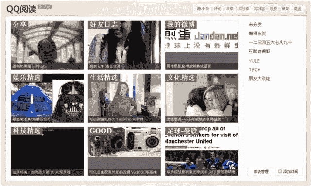

阅读空间的使命是『关注并阅读朋友』，还有过我的广播 UGC 功能，10 年底阅读空间改名叫 QQ 阅读，内容默认来自于用户的好友日志更新和他的腾讯微博。这个合起来就是后来朋友圈的产品逻辑。

> 阅读之余，您不仅可以评论、回复自己的朋友们，还能通过空间转载、邮件、微博等方式和朋友们分享阅读的收获。

二.

11 年 QQ 邮箱还推出过 QQ 邮件订阅，产品定位是免费的杂志订阅服务。随之而来的还有 QQ 邮件订阅开放平台，就是腾讯通过开放平台会精选 RSS 源推给用户，QQ 邮箱订阅开放平台的定位是免费的订阅内容接入平台。

> 我们旨在为广大网站主提供内容接入服务，通过稳定高效的邮件系统，共同为海量 QQ 邮箱用户提供高质量的订阅邮件投递服务。
> 
> 各大网站可依托 QQ 邮箱海量用户群体以及强大的技术运营支持，接入优质的订阅栏目，迅速找到目标用户群体，提升自身品牌价值。
> 
> 我们期待与您的合作，共同为海量 QQ 邮箱用户提供高效、优质的资讯服务。

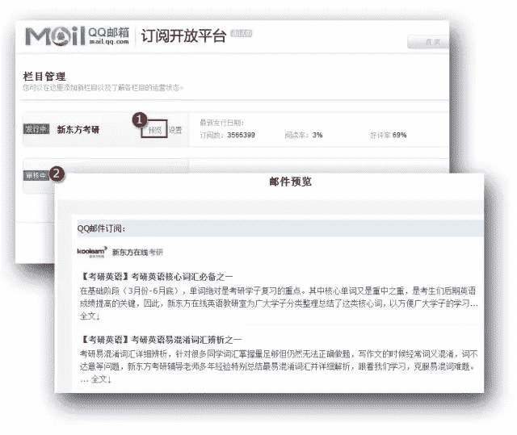

从产品出发点和订阅、预览和运营数据统计后台功能的相似度来看，QQ 邮件订阅开放平台显然是公众号的前身。开放平台推荐内容则有点朋友圈热文的影子。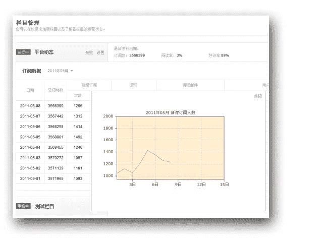

三.

刨去阅读空间-朋友圈-UGC 和开放平台-公众号-PGC 这两条订阅路线，微信还出过一款罕见的以微信打头命名的微信读书，也可作为张小龙阅读情节（跟好友有关）念念不忘的一个证明。

> 【微信读书】是基于微信关系链的官方阅读应用。
> 
> 在提供极致阅读体验的同时，为用户推荐合适的书籍，并可查看微信好友的读书动态、与好友讨论正在阅读的书籍等。

四.

到今天的朋友圈热文和微信搜索改版升级，这个『人人都要的阅读产品』的思考踪迹则需要去张小龙的饭否里面考古。

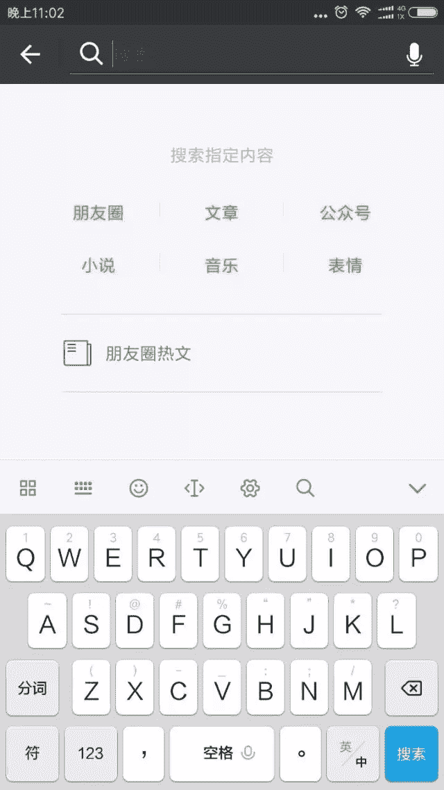

点击朋友圈，出来的是一年朋友圈回顾，一周朋友圈精选，朋友分享的音乐；点击文章，出来的是科技互联网，金融财经；点击公众号，出来的是我经常搜索的公众号；点击小说音乐表情内页暂无推荐。出现的科技互联网和金融财经两个标签说明，微信是记录我的阅读习惯并作推荐的，朋友圈热文是一个垂直的个性化推荐引擎。

搜索改版和朋友圈热文在试图解决两个问题，信息发现和内容沉淀，都是阅读的事情。

gzallen 现代通讯工具的要义是：我发出消息，你看，或者不看，都与我无关。人们在 IM 上花费的时间将越来越少。2011-01-01 14:33

gzallen

米聊竟然也做了好友动态，竟然尝试了我一直在想的东西。2011-01-16 02:46

gzallen 这么多年了，我还在做通讯工具，这让我相信一个宿命，每一个不善沟通的孩子都有强大的帮助别人沟通的内在力量。2011-01-23 01:54

gzallen

网站的发展趋势是，内容有标题的都不行了，没有标题的才兴起，如 twitter，facebook。我现在好奇的是，quora 的是有标题，还是没标题？2011-01-27 04:04

gzallen

各种微博的手机 client，不做一个 Instagram 类似的照片效果功能，真是失策啊。2011-02-09 04:19

gzallen

饭否不能发图片，扼杀了我最后一点表现欲。2011-02-09 04:23

gzallen

人已经懒到，你不把文章推送到我桌面上，并且打开好了，字体合适，长度合适，有朋友的推荐语，我就不会阅读了。2011-03-03 17:51

gzallen

人分熟人，半熟的人，陌生人。沟通方式有广播，群展示，群聊，单聊。排列组合是满足不到人们的需求的，因为基因的选择策略不是这么机械。重要的是，让人不自觉地掉进圈套，而不是让他建立圈子。2011-08-06 00:31

gzallen

群体互联时代，靠个人或者中心影响力来做宣传，显得不合失宜。2011-08-20 04:06

gzallen

社交和隐私的矛盾，让人失眠，tnnnnnnnnnnd 2011-10-11 17:40

gzallen

@yippee. 我又想社交，又想隐私，就产生了无处安放的肿。2011-10-11 17:43

gzallen 准备体验一下“指阅”2011-11-16 19:30

到今天为止, 这个世界对于"我到相册"的定义是错误的.2012-01-15 05:00 gzallen

这是一个声色世界。饭否需要更多图片。2012-02-26 18:36

gzallen@和菜头 微博满足资讯，空间满足朋友娱乐互动，但还有个中间地带，就是人都想有自言自语的个人领地，可以随意唠叨，不用看读者口味的。

gzallen 释放每个人心中被压制的摄影狂荷尔蒙 2012-04-04 02:38  
gzallen

推送改变世界。因为更懒。2012-03-05 02:21

上面这么多提到图片的饭否解释了为什么微信的朋友圈会是个视觉系产品，即鼓励发图片，发文字入口藏得很深还告诉你这个功能可能会取消。还有就是朋友圈关于社交和隐私的界限划定。

另外一个点还是关于阅读的个性化推荐。张小龙在 11 年 11 月开始研究指阅，这是一个基于文章文本分析的提供相关推荐的产品，当时类似的产品还有后来转做匿名社交的无觅。主打个性化推荐的今日头条则在 12 年 Q3 才发布第一版。张在 12 年 3 月发布的这条『推送改变世界。因为更懒。』，头条懒惰型搜索不靠用户关注冷启动不断给用户 push 内容的思路他在更早也曾思考过。

按着他在饭否里提到的最后都会在微信里实现这点来看，朋友圈热文这个产品微信是下决心要干好了。

五.

未来早已发生，只是在当下不均匀的分布着。

所有无目的的行为，都有一个结果在等着。

## 4.做 QQ 邮箱和微信的故事

### 探秘马化腾背后的男人：张小龙 (2016)

**毫不夸张地说，微信是中国互联网五年来唯一一款世界级创新产品。**

2011 年，当腾讯为突破困局而焦头烂额时，张小龙的微信横空出世。马化腾长舒一口气：我们终于拿到了移动互联网时代的站台票。

1998 年，周鸿祎“批评”张小龙：只有情怀，没有商业头脑。

2000 年，《人民日报》评价张小龙：他是这个时代的悲剧人物。

可为什么偏偏是这个对名利无感、只在乎情怀的人，做出了中国互联网最成功的产品？

**张小龙的产品之路**

1994 年的秋天，

24 岁的张小龙从华中科技大学毕业后，

被分到一家国家电信机关。

那一天，他提前去拜访了这家单位。

站在死气沉沉的大楼面前，

张小龙觉得“一种窒息从头顶笼罩下来”。

他扪心自问：“难道我的一生就这样度过？”

心回答：NO！这不是你想要的生活。

张小龙于是放弃了人人欣羡的铁饭碗，

到广州一家软件开发公司做了程序员。

工作之余，特别无聊，

张小龙便利用业余时间写代码，

准备开发一款邮箱软件。

1997 年，张小龙的 Foxmail 一推出便震惊业界，

连美国最知名的科技网站 ZDnet 都给出了“五星”。

很多人放弃了微软系统自带的 Outlook 邮箱，

改用了张小龙的 Foxmail。

Foxmail 当时火到什么程度？

中国上网计算机有 600 多万台，三分之一都用了 Foxmail。

但火爆归火爆，由于 Foxmail 是免费邮箱，

所以即便拥有 200 万用户，但张小龙一分收入都没有。

有一天，周鸿祎到广州看他，提醒说：“Foxmail 没有商业模式，要加广告，要盈利。”

张小龙很固执：“为什么非要这样？只要有用户，有情怀就好了。”

但情怀终究不能当饭吃，做着做着，张小龙自己都灰心了。

1998 年，刚出任金山软件 CEO 的雷军，

给张小龙发一封邮件：Foxmail 有漏洞。

张小龙很快回复，两人通上电话。

雷军问：“愿不愿把 Foxmail 卖给金山？”

灰了心的张小龙答：“15 万。”

这次电话交谈就这样结束了。

后来，雷军回忆说：“15 万是我可以接受的价格。”

他本打算邀请张小龙到珠海细聊，

但由于忙着联想注资金山的事儿，

就派了研发人员去和张小龙洽谈。

研发人员觉得不值：“这样的软件，金山一两个月就能做出来。”

于是，这次收购就泡了汤。

13 年后，当雷军的米聊完败于张小龙的微信时，

不知道他是否会因这次“错过”而抱憾终生。

随后两年，张小龙不停改进 Foxmail，

推出新版，但依旧赚不到钱。

《人民日报》发文说：他是这个时代的悲剧人物。

死心的张小龙决定将 Foxmail 以低价卖掉，

然后去美国当一名程序员。

两月后，他真的卖掉了 Foxmail。

不过是以 1200 万元高价被博大收购。

“这是我万万没有料到的事。”

张小龙跟着进入博大，做了副总裁。

随后，张小龙在博大沉寂了五年。

2005 年，博大将 Foxmail 卖给腾讯，

张小龙作为陪嫁被打包送给了腾讯。

当时，QQ 邮箱在中国排名非常靠后。

马化腾之所以买下 Foxmail，一是看中了 Foxmail 的知识产权，一是看中了张小龙。

收购后，马化腾立即任命张小龙为广州研发中心负责人：

“将 QQ 邮箱打造成为中国的 hotmail。”

**没有设计，只有解决问题**

接下 QQ 邮箱这个烂摊子后，

张小龙团队陷入对 hotmail 的疯狂模仿中。

半年后，一款被称为“巨无霸”的邮箱面世。

果然很巨——无比笨重，速度超慢。

“连张小龙自己都不想用这款邮箱。”

不仅没壮大用户，连老用户都流失了。

“若不重新找一条出路，就只有等死。”

2006 年，张小龙决定放手一搏。

他果断推出了“千百十”行动：

“每月在 QQ 空间等谈论相关话题互动一千次；

每月看一百篇相关行业重要分析文章；

每月与客户、消费者深度互动十次。”

几个月下来，团队人人都成了接地气的设计者。

然后，**张小龙提出了一个著名设计理念——“没有设计，只有解决问题。”**

解决的第一个问题是：笨重缓慢。

药方：让邮箱变得精简而轻便。

2007 年春天，QQ 邮箱新版本上线，

瘦身敏捷的它，开始绽放别样魅力。

解决的第二个问题是：无法传送大邮件。

药方：推出“超大附件”功能。

此功能一出，用户开始快速增长。

解决的第三个问题是：缺少人性关怀。

药方：推出漂流瓶。

漂流瓶一推出，每天用户增长达到骇人听闻的数量级。

随后，QQ 邮箱又推出了阅读空间等产品，

用户开始更加持续稳定地增长。

2010 年，QQ 邮箱终于跃居全国第一，

被腾讯内部评为“七星级产品”。

**微信是互联网时代的产品**

把 QQ 邮箱做到全国第一后，

张小龙有些意兴阑珊，基本进入半退休状态。

2010 年 10 月，免费发短信的手机应用 Kik 上线，

短短半个月就拥有了 100 万用户。

看到这款软件后，张小龙给马化腾写了封邮件：

“每个时代都有划时代的产品，我们应顺应移动互联网趋势，开发移动社交软件。”

马化腾回了四个字：马上就做。

“整个过程起点就是一两个小时，

突然搭错了一个神经，

写了这个邮件，就开始了。”张小龙说。

几年后，马化腾感叹：“若微信是别人家的产品，那腾讯真的是难以招架了。”

他得多感激这个“搭错神经”的开始啊！

2011 年 2 月，微信 1.0 上线。

但市场反应冷淡，下载者寥寥。

“和欧美不同，中国运营商提供了丰富的套餐服务，

很多用户包月短信根本消费不完。

所以将省短信费作为卖点，在中国没有出路。”

张小龙一番精细分析后，

觉得移动互联网时代必是图片为王时代。

于是，主打图片分享的微信 1.2 上线了。

但是很遗憾，市场反应依然冷淡。

“用户对点对点图片分享没什么兴趣。”

微信开发陷入僵局。

而此时，比微信早上线的米聊已进入快速增长期。

2011 年 6 月，米聊用户突破 300 万。

米聊高层放话：“坐等张小龙来抄袭米聊涂鸦功能。”

张小龙反击：“我的微信不需要那种功能。”

反击之后，张小龙进行了彻底的反思。

然后，**他又提出了一个著名设计理念：做产品要满足人的“贪嗔痴”。**

“让用户对你的产品产生贪，产生嗔，产生痴。”

接着，张小龙赋予了微信一个精准定位：

**“微信不只是一个聊天工具，更是一种生活方式。”**

当时，团队成员笑了，觉得他是马云附体了。

他们万万不曾想到，后来微信真成了一种生活方式。

精准定位后，张小龙开始引导与满足用户的“贪嗔痴”。

**第一个满足：满足便捷通话。**

为了满足用户期望便捷通话的需求，

微信 2.0 推出了语音通讯功能。

微信用户终于开始出现较快增长。

**第二个满足：满足陌生人交友。**

当雷军的米聊深耕“熟人社区”时，

张小龙说了一句：“互联网的最终目的，是让关系学见鬼去。”

微信推出了“附近的人”和“摇一摇”。

“附近的人”一上线，用户迎来爆发性增长。

“摇一摇”一上线，每天启动量超过 1 亿次。

一月之内，微信就完爆米聊。

**第三个满足：让用户可以炫耀和得到认同。**

在用户达到一亿后，微信推出了“朋友圈”。

现在，“朋友圈”已成为炫耀和寻求认同的大平台。

**第四个满足：让用户实现自我价值。**

“再小的个体，也有自己的品牌。”

微信又推出了个人和企业的“公众号”。

两千多万个个人和企业有了展示舞台。

…………

2016 年 6 月，微信用户超过 8 亿。

**微信已不再只是一个工具，而真成了一种生活方式，**

**一个可以满足社交、情感、自我实现等所有需求的地方。**

**张小龙产品三句金言**

第一句是：**减法！减法！减法！**

“你问我们和竞争对手比有什么区别，我们没有他们那些臃肿艳俗的部分。”

**极简——是张小龙的产品设计法则。**

“摇一摇”功能推出后，

马化腾给张小龙发了一个邮件：

“摇一摇真的很好，但要防止竞争对手抄袭，

但为什么不把预先该想到的都想进去，

让别人想模仿的时候都没有办法进行微创新。”

张小龙回复说：“微创新是永无止境的，

别人总可以加一点东西来跟你不一样。

但我们这个功能已经做到最简化。”

**复杂的东西都是脆弱的，极简才能不被超越——这是张小龙的理念。**

**如何才能做到极简？**

**张小龙说：把自己当作傻瓜。**

“乔布斯能瞬间把自己变成傻瓜。

我不行，我要 5 分钟酝酿才能变成傻瓜。”

只有傻瓜都会用的东西，才是极简的。

所以张小龙的微信拥有两大极简。

**第一个：不用人教你也会用。**

“如果产品需要弹出 Tip 来告诉别人该怎么做，那你就失败了。”

**第二个：把复杂功能简单化。**

“微信做了这么久，功能增加了非常多，

但界面跟第一个版本变化并不大，

比如，你如果不扫二维码去定位一个公众号，

你永远都不会知道公众号是什么。

很多功能都是隐身的，你只有去用它时它才存在。”

**大部分创新，都是把问题搞复杂化。**

**但张小龙的创新一直是化繁为简。**

**“外在形式越简单的东西，智慧含量越高，**

**因为它已经不再依赖形式，必须依靠智慧。”**

张小龙第二句狠话是：**口碑！口碑！口碑！**

“我在生活上不是一个有洁癖的人，但对待产品却分毫必究。”

张小龙对微信细节的苛求令工程师们恐惧。

大到一个按钮应该在左边还是右边，

小到一个图像差了几个像素，

都是他需要考虑很久的问题。

一次，张小龙问一个工程师：

“微信 3.1 与 3.0 的会话列表有什么需要修改？”

对方说：“没看出来啊。”

张小龙答：“会话列表每一行高度少了两个像素。”

**极致——是张小龙的产品开发法则。**

每一款产品，都经过成百上千遍修改才被允许上线。

这位乔布斯的东方信徒，不允许产品出现任何瑕疵。

每次产品更新前，办公室都会传出大声的争执和叫骂声，

张小龙可以为一个很小的细节与产品经理争执一个通宵。

“他是一个独裁者。”研发部前员工宋轩说。

但宋轩也不得不承认：“张小龙是一个牛逼的人，牛逼的人玩独裁是可以做出牛逼的产品的。”

所**有做产品的人都说追求极致，为何做到的很少？**

**“因为很多人在极致之前，就妥协了。”**

**微信支付总经理吴毅说：“那是因为他们没有张小龙。”**

张小龙第三句狠话是：**凡是以 KPI 为目标的领导都是不合格的！**

“整天将 KPI 挂在嘴上的 leader，

都是不合格的，庸俗的，没有想法的，

令人痛苦的，无法言语的。”

商人或经理人往往会选择做那些对自己最有利的事，

而艺术家只愿做他认为对的事情，并且不知道妥协。

毫无疑问，张小龙更像后者。

**坚守——是他骨子里极其闪亮的品格。**

当时，很多人都不看好微信，

“微信的很多功能 QQ 都可以实现，

QQ 的渠道好，资源又非常深厚，

为什么还要开发一款全新的社交软件？”

张小龙一直用着碎了屏的手机

在微信诞生两年后的一次公开演讲中，

马化腾揭晓了一个秘密：“微信概念出来的时候，有三个团队都在做。”

但最后，只有张小龙的团队坚持了下来。

微信上线后，运营商通过腾讯内部向张小龙施压。

腾讯副总裁致电张小龙：希望停止更新微信版本。

张小龙怀着发布最后一个版本的心情，

破釜沉舟地授意下属推出了带语音的微信，

虽然得罪了领导，但微信终于站稳了脚跟。

张小龙是一个极其“护犊”的人，

开发产品时，腾讯高层让他添加很多商业功能。

张小龙态度十分强硬：“等我离开腾讯你再加吧。”

正是因为张小龙的这一个个坚守，

微信后来才得以取得俾睨天下的辉煌。

**做产品更是在做情怀**

张小龙还有一句暖心话：**产品要有爱。**

腾讯员工对他的评价几乎千篇一律：“他是一个有人文情怀的产品经理。”

有一次在一个产品讨论里，

同事提出了一个很巧妙的方法，

能引诱用户点击而提高点击和下载数。

张小龙脱口而出：“不要这样误导用户。**对产品人来说，善良比聪明更重要。”**

情怀——是张小龙的又一个产品设计法则。

比如，春晚的红包大战。

当时，竞争对手把这当成一个大战，说一定要在数据上超过微信。

但张小龙定下的目标——不是超越对手，而是怎样帮助用户更高效的抢到红包。

“我们的产品逻辑就变成了废除所有多余过程，让用户花尽可能少的时间抢到红包。”

但最后，微信的口碑特别好。

当然数据也很好，不会不好。

**这就是张小龙的情怀——产品要有爱。**

就像“和菜头”描述的那样：

“这个沉默到像谜一样的男人，

是中国为数不多具有文艺气质的产品经理。

他是那种因为喜欢《蓝莲花》歌词，

就一定要问许巍买下版权，

挂在 QQ 邮箱入口的人。

他也是那种喜欢同事小女儿涂鸦，

就把一幅涂鸦画和《蓝莲花》一样挂在 QQ 邮箱入口的人。”

**主导者格局的胜利**

在米聊、陌陌等多款软件抢占先机之下，

微信为何能异军突起，最后雄霸天下？

行业人士公认：这是主导者格局的胜利。

这格局就是——

**极简的审计理念，**

**极致的产品追求，**

**坚守的毫不退让，**

**有情怀的人文精神。**

微信开机界面是一张“蓝色弹珠”照片，

这张照片拍摄于 1972 年 12 月 7 日。

当时三名宇航员在阿波罗 17 号飞船上，

用一台 80 毫米镜头的哈苏照相机，

拍下了这张完整的地球的发光照片。

从 45000 公里之外看过来，

地球像一只蓝色弹珠，这也是照片名字的由来。

微信开机界面就是基于这张照片合成的，

只是外加了一个面对蓝色星球的孤独背影。

所有人都知道：那个背影就是张小龙。

张小龙曾多次引用一个用户的疑问：“为什么这个人站在地球之外？”

背影，或许在他眼里已经不仅仅源自孤独，也源自深层次审视自己的渴望。

## 5.ISTP 和 INFP 双重性格

### 张小龙的星空(2016)

微信的开机界面是一张叫“蓝色弹珠”的地球摄影作品，照片拍摄于 1972 年 12 月 7 日。当时的三名宇航员在阿波罗 17 号飞船上，用一台 80 毫米镜头的哈苏照相机，拍下了这张完整的地球的发光照片。这是阿波罗 17 号飞船执行的最后一次登月计划，从此以后再也没有飞船抵达到这个距离对地球拍照，因此，这也是人类最后一次远距离拍摄地球，意义独特。

从 4 万 5000 公里之外看过来，地球很像一只蓝色弹珠，这就是这张照片名字的由来。而微信开机界面的照片是基于这张作品合成，外加一个面对蓝色星球的孤独背影。

所有人都知道：那个背影就是张小龙。

张小龙从来没有解释过为何有这样的私心，为何希望用这种方式被铭记，但他曾多次引用一个用户对此的反问：“为什么这个人站在地球之外？”背影，或许在他眼里已经不仅仅源自孤独，也源自深层次审视自己的渴望。张小龙很享受用这样“莫名其妙”的方式让他人了解自己，了解微信，这是他的特别之处。

微信，张小龙人生的巅峰之作，目前已经在全球拥有了 8 亿用户。和这些用户相比，微信之父张小龙的粉丝实际上并不多，对比这个用户基数，几乎可以忽略不计，这和创造了 Facebook 的扎克伯格完全不同，和缔造 QQ 的马化腾不同，他希望人们记住微信，忘记自己。这也是他的特别之处。

另一个侧面，现实中的张小龙并没有那么神秘和自闭。一位知名的美女记者很兴奋的在朋友圈展示了她的惊喜，“腾讯的电梯里恰好看到了男神张小龙，他说：我看过你写的文章啊，非常好，你为什么不来采访我？”于是，有了张小龙 5 个小时的倾诉式的沟通。看来，他并非不想表达，或许一直希望找自己完全认可的场景表达自己。

比如，微信开机画面的“蓝色弹珠”和孤独的背影；比如，摇一摇界面张小龙本用维纳斯或者大卫雕像，后来由于裸露问题换成了一朵花；比如，他喜欢同事女儿的涂鸦，就把一副涂鸦挂在 QQ 邮箱入口；确实有很多这样的“比如”，也有很多这样的场景理解张小龙。

由此开篇，希望能为研究张小龙的产品思想、微信的战略布局做一个铺垫，这是一个个人属性大于商业属性的领导者，我们也需要打破常规的理解他。

本文，会和您之前看到的人物访谈和分析类文章完全不同：

*   其一，对张小龙和微信的追问从性格分析入手；
    
*   其二，试图还原其辩证思维的大逻辑，探究互联网思维对战略和领导力的独特影响。
    

理解一个或许张小龙自己都并不完全了解的“张小龙”，必须从逻辑和追问开始。

平民王者

先看他的成长经历。有几个关键的截点：

*   1969 年 12 月出生，传说中最花心的射手座（这也可能是其艺术气质的某种来源）；
    
*   1987 年到 1994 年在华中科技大学电信系从本科读到硕士；
    
*   1997 年，也就是毕业 3 年后，他发布了 Foxmail 这款经典的邮箱软件，经过多次叫卖不成之后（包括 15 万被雷军忽略），2000 年以 1200 万的价格卖给了博大公司；
    
*   2005 年腾讯收购了 Foxmail，张小龙加入腾讯任广州研发部总经理；之后负责 QQ 邮箱，之后 2010 年申请立项开发微信。
    

网上有大量访谈分析张小龙的成长历程，并试图由此理解他的思维和性格。听起来比较可靠的注解有这么几个：

**爱好广泛**

据说求学期间，张小龙的兴趣爱好十分广泛，无论玩什么，只要稍加练习，总能达到业余高手水平，围棋、桌球、网球、保龄球，电脑游戏，玩起来总是周围人中最厉害的之一。

除了玩之外，他的专业课成绩也十分优异。“他是我们之中最早学习 C 语言的人，当时 C 语言才刚刚诞生。”张小龙的同学张惕远回忆，研究生导师向勋贤评价张小龙：“喜欢捣鼓电脑，喜欢睡懒觉。”

**不甘于平庸**

1994 年秋天，刚满 24 岁张小龙，从华中科技大学毕业后获得进电信机关工作的机会，让周围很多朋友都十分羡慕，但他却不以为然。每次看到政府机关大楼，他都感觉“一种窒息从头顶笼罩下来”，于是他放弃铁饭碗，投身互联网。

**耐得住寂寞**

起码有两段时间张小龙的事业发展出现了明显的天花板：

第一段是 2000 年到 2005 年在博大工作期间，这个时候他熟悉的互联网创业者正在如火如荼的创造神话，而他处于一个相对边缘化的位置；

第二段是 2005 年到 2010 年腾讯工作早期，虽然邮箱业务让他获得了内部的尊重，不过广州研究院远离腾讯总部 QQ 和游戏核心业务，也注定他在腾讯内部并没有充分话语权。

这两段寂寞周期都有 5 年的时间 ，但张小龙并没有跳出来创业或者参与互联网投资的热潮，一直在做技术，一直在研究产品。

由此我们似乎可以感受到 2010 年底张小龙给马化腾写邮件，表达自己渴望做微信时候的心态，那个时候，张小龙 42 岁，他的同龄人雷军、马化腾、周鸿祎等，都是如日中天的大佬，而**他在无数个夜晚的通宵加班后，离自己第一个软件 Foxmail 的成功远去 13 年后，依然没有找到让自己铭记和被照亮的时刻。**

我们大胆的设想张小龙那个时刻的处境和心情，或许可以感知到他和其他的互联网大佬明显的不同。那么多年的拼搏，更多的时候是作为一个坚守的执行者；那么多次的尝试，他似乎都没有契机完全主宰自己的命运；那么多灵感和想法，却很难找到一个引爆点展现自己的力量。

张小龙的成长经历，以及个人特质，注定他是一个矛盾体、多重性格特征。正如我们通过领导力人格测试对他的几点分析和理解（如图 1）：

**首先，多种性格**：他拥有 ISTP 和 INFP 双重性格，I 代表内省式发现，P 代表灵活性应变，而对于决策和推理两个维度，他既擅长“数据”也依赖“直觉”，既看中“逻辑”也认可“价值”，他拥有相对平衡但是很多面的领导力特质。既像一个“操作者/演奏者”又像一个“治疗师/导师”，或者说他有一个现实王国和理想王国天然交战的性格。

**其次，矛盾体：**“现实主义者”的工匠精神，“理想主义者”的通情达理，这两点同样是他性格内核的鲜明对立，这似乎也解释了他可以为了确定朋友圈风格做 50 多次 1 万人以上的测试，但是对于开机界面却“一意孤行”的尊重自己的直觉。

**最后，自我克制：**SP 的特质意味着他具备肩负使命和承载巨大心理压力的能力，而 NF 可见他“热心而拥有洞察力”并且愿意充当资源。从这两点推理，张小龙的平静的外表和内敛的表达后面，应该内心积累了很多的压力，也一直在化解中说服自己。

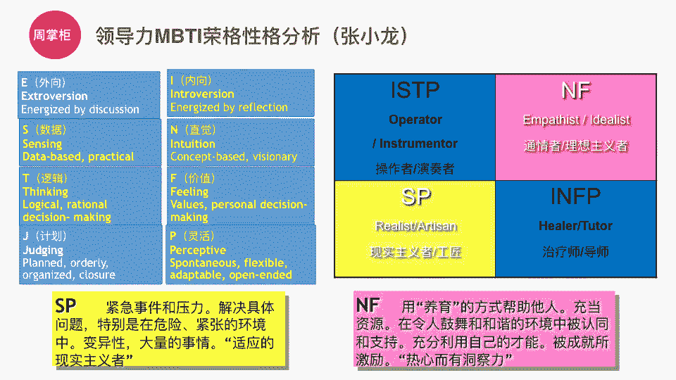

图 1：领导力 MBTI 人格性格分析（张小龙）

单纯的看 MBTI 的分析，我们可能有两点推论：

*   其一，张小龙对艺术和哲学的推崇，源自内心不被认可的孤独感；
    
*   其二，很多时候，他有一种对外赋能的无力感。
    

也许这些情绪都是塑造他独特思维和审美的磨砺，**从他多次发言以及网上公开的他在饭否只言片语的日记中，我们可以感受到他独特的领导力风格和完全不同于传统企业家的思维视角。**他的成长经历也和传统企业家在事件中磨炼完全不同，更多的是一种对人格的洗涤和进化推动。这是一种独特的互联网思维的领导力，下面我们可以拆解成逐条的分析。

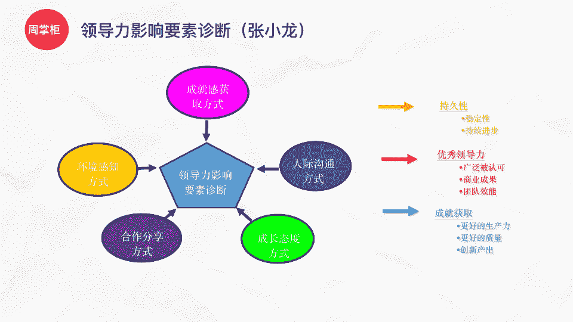

图 2：领导力影响要素诊断

**成就感获取方式**——因为帮用户创造价值，而非从用户处回报收益，他的成就感来自于用户认可；

**环境感知方式**——张小龙环境感知方式是很综合的，他对用户需求是非常感性的，但也曾经说过很少看统计数据，表达过“理性”比艺术气质更重要；

**合作分享方式**——他喜欢带领小团队突破，单兵作战能力极强，厌恶大团队的官僚化；

**成长态度方式**——张小龙更看重内心理想王国的有序性成长，在微信的开发过程中，他坚决的抵制了很多商业化思路，拥有近乎偏执的“理想国”洁癖。也就是说，他对成长的态度是趋近完美主义；

**人际沟通方式**——张小龙在演讲中曾经明确表示自己不喜欢公开演讲，因为在社交工具发达的时代很浪费时间，他更希望高效而不夹带情感的客观信息交换。

从以上几点对领导力影响要素的分析中，我们可以清晰的感受到张小龙独特的互联网思维，这种思维充满了全新的辩证，不被教条约束，也不被现实俘获，这种全新的平衡即使在互联网行业里也是值得复制和学习的稀缺品质。

从图 3 的领导者能力下沉模型（也叫冰山模型）中，也可以佐证我们对张小龙领导风格的分析，他对“态度和动机”的表达方式拥有完美主义的偏执，对“倾向和天赋”的发挥越来越超越现实的羁绊。这两点是张小龙超越“知识/技能”之上独特能力的源头之所在，更很难用“可观察的行为”理解他的内心世界。

也就是说，张小龙的成长经历和性格发展，是一个从现实王国向理想王国艰难的进化之路，这个过程由于他独特的使命感和理想主义情怀，注定比一般人要漫长和艰难，这从另一个侧面或许也是磨砺他“平民”思维的根本原因。

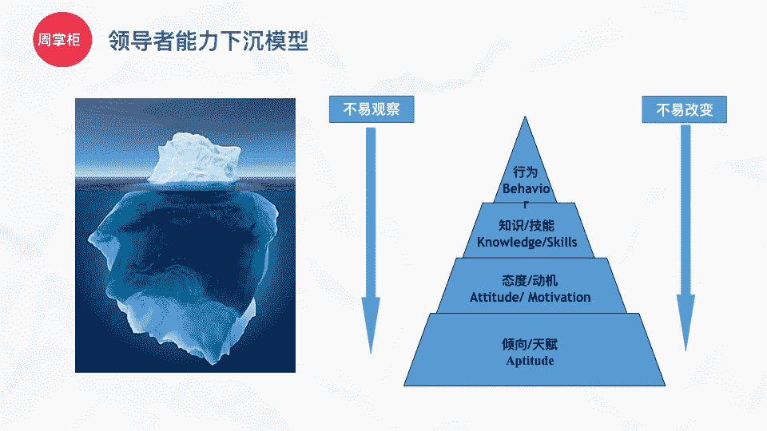

图 3：领导者能力下沉模型

但不可否认的是，张小龙一直以来从事的即时通讯的事业，必然导致成就会是两个极端，彻底的平庸或者成为用户心目中的“国王”，而从今天微信的成功和张小龙广受喜爱的结果上看，他确实成为了最有“平民”意识的“国王”。注定：微信的成功与张小龙性格和经历中的矛盾焦点深刻关联。

微信产品观

张小龙对微信产品观的表述是相当丰富的。他的产品价值观从 Foxmail 开始，经 QQ 邮箱，到微信成熟并完善，用他的话说“理解人性而非所谓用户需求”，这是前所未有的价值观系统，带有强烈的张小龙性格印记。

微信超越了传统的互联网产品以及产品类公司，其产品理念居功至伟，完全是“生态级别”的全新战略思维方式。从图 4 的张小龙的产品观中，我们可以明确的感受到他四个核心理念。

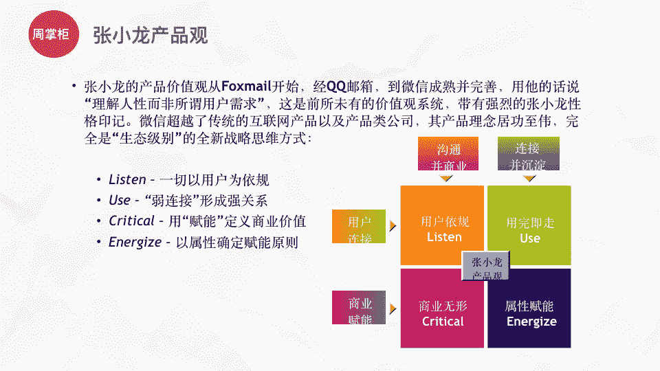

图 4：张小龙产品观

第一个是：**用户依规**。不因为资源合作牺牲用户利益，代表的例子是：不开红包权限（但 5 月 20 日张小龙开通了 520 元的超级红包，不过没有进行大规模宣传，我们也有理由怀疑其中的随机性和特殊指向性），不让系统有瑕疵。做文化捍卫者，要么没有特权，要么特定规则，这样的产品观已经接近于法律准则，保护弱者。他还解释说，受亚马逊创始人贝索斯的启发是：善良比聪明更重要。

第二个是：**用完即走**。不试图黏住用户，构建生态平衡，尊重人类生活的权力。他认为：任何产品都是工具，好的工具最高限度完成任务，有营养，必须做的事情做完不应该再浪费用户的时间。

第三个是：**商业无形**。商业化在无形之中，建立高级别商业化，比如发优惠券的过程让社交关系得到体现，发广告的过程让用户获得认同和期盼。

第四个是：**属性赋能**。通过高质量内容的筛选，推动原创内容高质量呈现，为生态赋予能量，而非消耗认知盈余的时间和精力，这是通过属性定义来构建赋能关系的思维方式。

这四个高度概括的产品观的背后，我们可以感知张小龙独特的思维角度，其中“连接”、“属性”和“赋能”的三个维度，已经完全超越了传统企业甚至竞争对手对产品的理解。

由此原则缔造的微信，已经远远超越了人们对其“即时通讯”和“连接”属性的理解，而成了一个独特的“赋能工具”，这是一个完全跨时代的战略思想。

进而分析微信生态，从图 5 用笔者“智能金字塔”框架勾画的“微信赋能生态系统”图中，我们可以归纳出微信战略在连接、应用、内容和社群四个角度的赋能关系。

由即时通讯发展而来的“连接系统”，一直在通过漂流瓶、朋友圈、社交游戏等多种方式构建全新的连接方式，当然，这里面最核心要解决的问题是通信能力的场景化提升。

由开放平台思维发展而来的“应用系统”，正在张小龙的严格管制下提供更有价值的应用形态，并且他主导下的企业级业务、物联网业务也在有序的展开。

由订阅号发布能力放大而来的“内容系统”，也在逐渐的从内容创造向智能沉淀演化和推动，这里面的深刻大数据分析能力也必然是微信下一步智能化的核心战略突破口。

由社群能力衍生出来的“社群系统”，正在从最广泛的维度为微信建立面向下一代竞争的“能量承载平台”，这个系统正在潜移默化的全面俘获高价值社群，并且通过对社群能力的差异化承载，构建微信的长期竞争力。

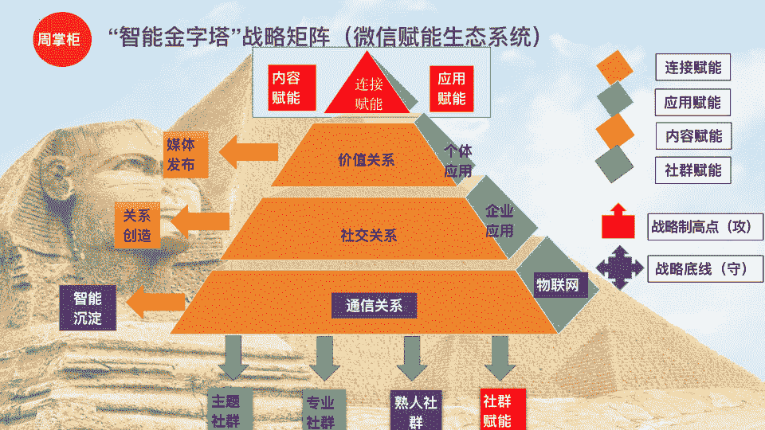

图 5：微信赋能生态系统

应该说对微信的生态级抽象让我们感受到**张小龙和马化腾思维的有所区别，前者习惯于构建一种理想王国的关系体系，后者习惯于考虑现实王国的商业价值和变现方式。**当然，马化腾和张小龙的紧密合作中，我们也看到两者相互尊重和融合的一致性。但不得不说，张小龙的性格特质和思维方式牵引着微信独辟蹊径的在空气般的战略中构建全新的赋能生态。

生态级领导力

思维独特之人，或许注定大部分时候是孤独的。我们没有足够的信息证明张小龙和其他腾讯高管在微信商业化中有过针锋相对的对立，但从这个对比中**我们可以感受到张小龙对商业化的独特理解，会让很多腾讯内部人怀疑和不满。**

据说当时做微信的时候，腾讯内部争论很大，后来也产生了两组团队平行开发的方案。**张小龙的微信之旅并非是在完全大力支持和祝福中按部就班发展壮大的。**

可以想象当时 42 岁的张小龙面对可能是人生杰出产品最后一次机会的微信开发，可能何等的豪迈和焦灼。而外界对其评价的两极分化，也很有可能带给张小龙巨大的压力和屏蔽感染的反作用力。

在微信的起步阶段，截然相反的两种评价：一种是腾讯创始人曾李青为代表的天才论，曾多次对朋友面前描述张小龙是一个“奇才”；另一种是张小龙身边人个别人的评价，“完全不倾听别人的意见，一意孤行，脾气越来越大”。更有甚者，在张小龙低潮的时期会有人拿张小龙“酷爱睡懒觉”说事儿，认为这是缺少领导力的表现。

从以上完全不同的评价中，我们也可以假象张小龙微信之路的艰辛和曲折，即使在腾讯这样高度崇尚创新的公司中，他也不可能完全毫无顾忌的挥洒和创造。

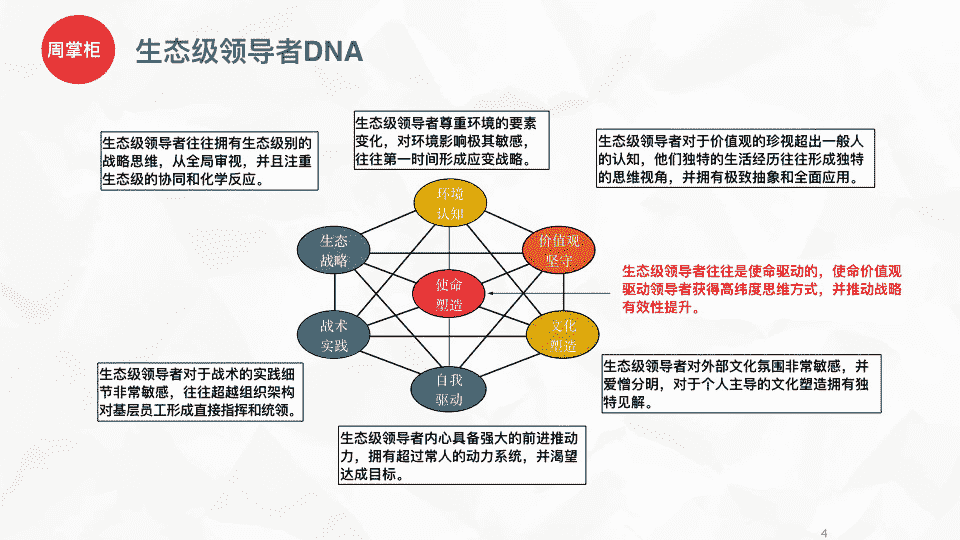

图 6：生态级领导者 DNA

曾经有很多媒体人试图分析张小龙的领导力和独特 DNA，但鲜有人成功，主要是因为他多少有些远离媒体，沉迷于自己和外界的连接方式。

不过用笔者研究发布的生态级领导者的 DNA 模型，我们可以宏观的理解张小龙的思维特质：

**使命塑造**——生态级领导者往往是使命驱动的，使命价值观驱动领导者获得高纬度思维方式，并推动战略有效性提升，张小龙在这一点是极其明显的。

**环境认知**——生态级领导者尊重环境的要素变化，对环境影响极其敏感，往往第一时间形成应变战略，张小龙应变力极强。

**生态战略**——生态级领导者往往拥有生态级别的战略思维，从全局审视，并且注重生态级的协同和化学反应，这方面在微信游戏对社交的渗透可见一斑。

**战术实践**——生态级领导者对于战术的实践细节非常敏感，往往超越组织架构对基层员工形成直接指挥和统领。这里面最典型的也是游戏里面打飞机的例子，张小龙直接指挥到战壕里的程序员。

**自我驱动**——生态级领导者内心具备强大的前进推动力，拥有超过常人的动力系统，并渴望达成目标。这一点最能体现张小龙能够忍受寂寞的根本动力。

**文化塑造**——生态级领导者对外部文化氛围非常敏感，并爱憎分明，对于个人主导的文化塑造拥有独特见解。目前我们还没有更多信息感知他塑造的组织文化多强大，不过可以肯定的是他强化了微信团队的程序员朴素作风。

**价值观坚守**——生态级领导者对于价值观的珍视超出一般人的认知，他们独特的生活经历往往形成独特的思维视角，并拥有极致抽象和全面应用。这一点从张小龙的固执中有所体现。

从以上的倒推中，我们可以感受到张小龙对微信的生态设计所必然依托的领导力思维，这些 DNA 片段放在张小龙身上大部分是适用和恰当的。

从大逻辑分析，一个善于构建微信这样大架构生态系统的领导者，一个与 8 亿用户赋能连接的“国王”，他的领导力必然拥有一种全新的维度，甚至是高纬度的文明理念，有可能超越我们的认知。夸张一点说，**这个地球上拥有指挥 8 亿人的能力和机会的人并不多。**

我们并非神化张小龙，从微信在智能化方面的进展缓慢，以及对比微信发布前两年（朋友圈发布之前）的平庸表现，我们也不能认为每个成功都是天才的必然性作品。但必须承认：**微信为代表的 AI 级智能应用入口，正在人机智能时代到来的窗口期发生着商业逻辑的重大提升**，也就是我们前面提到的从“连接”向“赋能”的转变。而张小龙之前不被人知晓的思维特质正在成为新时代技术精英的领导力模板。

他的内心或许从来都不愿意站上神坛，假设退休后的张小龙可能成为了一个流浪艺术家，这种结果一定更让他感受到刺激和快乐。从神奇到神性的跨越，其实是回归平凡。

张小龙的星空，就是平凡人共业的期盼。

## 6.推荐的 8 本书

### 《微信之父张小龙的书单》

导语：张小龙会要求他的产品经理人手一本《乔布斯传》，也曾有人说过，如果求职者对他说自己看完了凯文·凯利的《失控》，面试就可以结束了。

“微信之父”张小龙会要求他的产品经理人手一本《乔布斯传》，也曾有人说过，如果求职者说自己看完了凯文·凯利的《失控》，面试就可以结束了。不禁让人好奇，张小龙平日里会看哪些书?这些书又如何影响着他对“微信”的构想?

*1.《失控》*

凯文·凯利，一位在亚洲游荡了近 10 年的美国人，东方激发了他对于技术的思考，最终通往哲学的终极命题。在他笔下，失控，往往意味着不确定性，容易使人感到不安，但正是不确定性和不可控性，成就了创新的源泉与进化的动因。

在广研，产品经理们人手一本《失控》，因为张小龙说过：不读《失控》的产品经理，知识结构是不完整的。在腾讯内部的演讲中，张小龙反复提及这本书启发了他的产品观：不与用户产生互动的产品，是失败的产品。产品规则越简单，才越能让群体形成自发的互动。产品上线后，就有了自己的生命，会自己与海量用户互动，最后会互动出什么结果，是产品设计者不能控制的。

张小龙：凯文·凯利的《失控》我给很多人推荐。这本书很厚，所以很多人都没有耐心的看完它，我自己也是，可是如果我们面试一个大学生，他告诉我他看完了这本书，我肯定就录用他—— 不过他们不知道这个秘诀。如果做互联网产品的不看一下这本书，我认为知识是不全面的。他从生物学、社会学的角度描述了一种群体效应，总的来说，结论是群体的智商低于个体智商。这个观点不在那本书里，而是在另外一本书里，我不记得书名。一个人在组织里，组织的平均智商是低于个体智商的，个体的智商更高一些，群体会拉平这个智商。比如说在微博里，微博上多了你的智商会降低，大家认同吗?你没有发现这个变化，因为你每天降低一点。很简单的，你每天在微博上说的话，你会发现跟大众越来越一致，别人在说什么，你也在说什么。

*2.《科技想要什么》*

凯文·凯利向我们介绍了一种全新的科技观。他认为，作为整体，科技不是由线路和金属构成的一团乱麻，而是有生命力的自然形成的系统，它的起源完全可以回溯到生命的初始时期。张小龙对原始人的生活方式充满兴趣，花工夫研究了人类的起源，人类为什么会直立行走，他还曾在知乎上提问：原始人用什么来剪指甲?广研内部对摇一摇有个专门的称呼：撸一撸。这是人类最原始的姿势，最原始的，体验往往是最好的。

为什么?张小龙说自己平时会非常留心观察三四岁小孩子，他发现他们很喜欢用 iPhone 与 iPad，因为这两款电子产品很容易学，比如开机，虽然看不懂“滑动来解锁”，但因为触摸是人的天性，他们会下意识顺着箭头的方向用手指去滑动。“越简单，越原始，就越人性化”。

*3.《乔布斯传》*

在腾讯公司内部，张小龙被称为继马化腾之后的第二个超级产品经理，中国的乔布斯。微信 4 .0 推出时张小龙更新了微博签名：越简单，但越好。这是德国工业设计大师 Dieter Ram 崇尚的设计理念，也是乔布斯“至繁归于至简”的精神。4.0 初期的朋友圈甚至没有滤镜，因为他认为：照片真实、不加修饰地反映生活即可。微信发展早期，一些创意常被竞争对手模仿，并进化出新功能，马化腾曾问张小龙：是不是要做细化，免得别人做了那些我们没有想到的功能。张坚决否定，他说：只有做到极简，才无法被超越。一位微信团队前成员透露，微信每个版本的设计，张小龙都会鼓励大家先做加法，再做减法，“现在你正在用的一个功能，很可能就是我们砍了 300 多个功能后留下的。”他说。

微信的开机画面，起初做过许多方案，大家比较倾向于两个人站在地球前，张小龙坚持就一个人，否则无法传递这款应用的用意：人很孤独，所以需要沟通。朋友圈也是一款充满极简主义的产品，它的主色调是蓝灰色，这也是张小龙平时常穿的 T 恤以及广研办公室的色调。拍照片，按一下右上角相机按钮;写纯文本，长按右上角相机按钮即可，这一功能许多用户起初并不知道。“按住说话”的功能也是，说话时，其实按三秒就可以放开了。但张小龙从不说，也不担心用户不会用，“你去找，自然就能找到”。

*4.《女人的起源》*

以男性为中心的生物学家，则用人类起源于丛林并进化为以狩猎为生的肉食动物的学说，来证明女性无论在体力和智力上，都处于从属的地位。对此，《女人的起源》首次为女性在人类进化史中的平等地位据理力争。它开一代风气之先，力图解开人类，特别是女性的演化和起源之谜;而它提供的答案，则从女性的角度对人类的史前史做出了推测性的重构，极富革命性和破坏力。在张小龙的演讲里，他曾经向听众推荐这本书，他说：“如果你们对女性的心理研究不透彻的话，你就损失了一半的用户。”

*5.《黑客》*

Steven Levy 这部经典力作的 25 周年版从 20 世纪 50 年代早期跨越到 80 年代后期，追述了计算机革命中初期黑客的丰功伟绩，他们都是最聪明和最富有个性的精英。他们勇于承担风险，勇于挑战规则，并把世界推向了一个全新的发展方向。本书更新了一些著名黑客的最新资料，包括比尔·盖茨、马克·扎克伯格、理查德· 斯托曼和史蒂夫·沃兹尼亚克，并讲述了从早期计算机研究实验室到最初的家用计算机期间一些妙趣横生的故事。在 Levy 的笔下，他们都是聪明而勤奋的人，他们极富想象力，他们另辟蹊径，发现了计算机工程问题的巧妙解决方案。他们都有一个共同的价值观，那就是至今仍然长盛不衰的“黑客道德”。

*6.《异类》*

在《异类》一书中，作家格拉德威尔对社会中那些成功人士进行的分析，让读者看到了一连串颇感意外的统计结果：英超联赛大部分球员都在 9 月至 11 月出生;比尔·盖茨和史蒂夫·乔布斯都出生在 1955 年;纽约很多著名律师事务所的开创者竟然都是犹太人后裔，并且他们的祖辈大多是在纽约的服装行业谋生。那些奇才异类，他们之所以神奇，得感谢机遇的眷顾。

不过，除了机遇之外，他们的成功还需要上辈人的文化熏陶。因此，从《异类》一书中，你能体会到机遇对成功是如此的重要。格拉德威尔为读者指出了成功之路的方向，但怎样把握这份机遇，每个人都需要仔细思考，毕竟，不同人拥有不同的机遇。在这本书中，张小龙最欣赏的则是“1 万小时定律”，即一个人必须经过超过 1 万小时的训练才能达到一定的专业高度。

*7.《信息简史》*

现如今，信息如洪流般淹没了我们，使我们深陷信息焦虑、信息过载、信息疲劳的困扰。但回顾历史，这并不是件新鲜事，人们也总是能想出应对手段。维基百科 、Google 便是我们的应对之一。无论对于信息的未来持何态度，有一点是确定无疑的，即我们人类是信息的造物。作为《混沌》、《费曼传》、《越来越快》、《牛顿传》等畅销书的作者，格雷克不仅在书中细致还原了历史细节，通俗解释了各种理论，还生动刻画了几位不为大众所知的人物：可编程计算机先驱、超越时代的查尔斯·巴贝奇，第一位程序员、诗人拜伦之女爱达·拜伦，计算机科学之父、天妒英才的阿兰·图灵，以及全书的主人公、信息论之父克劳德·香农。

*8.《数字乌托邦》*

20 世纪 60 年代早期，在美国大众眼中，计算机只是冷战中冰冷的机器，然而到了 90 年代互联网到来之时，计算机却呈现出一个截然不同的世界——它们模拟出了一个数字乌托邦般的协同体，而这正是曾经最反对冷战的嬉皮士们的共同愿景。本书正是探索这次非同寻常，且颇具讽刺意味的变革的第一本书。作者挖掘出那些在旧金山湾区的先驱者——斯图尔特·布兰德和他的“全球网络”鲜为人知的故事。

1968 年到 1998 年期间，通过《全球概览》、“全球电子链接(WELL)”和最终取得巨大成功的《连线》杂志，布兰德和他的伙伴们长期扮演着旧金山嬉皮士运动和新兴科技聚集区硅谷的中间人的角色。正由于他们富有远见的努力，反主流文化分子和科技人士一同重新定义了计算机的形象：计算机是解放自我的武器，计算机建筑了令人耳目一新的虚拟社区，计算机还让人们能更大胆地拓展社会的新疆界。

# 王兴

## 1.10 年前别人眼里的王兴

### W 和 L（2010）

中国没有一个所谓“全民的互联网”，中国的互联网是人为割裂的。它既存在于精英的 Think 笔记本上，也存在于草根的 MTK 山寨机中。我们的精英也许和美国同步，草根却与越南同步。

*我有两个朋友*。

L 的公司在上海，大半时间跑广东。他是华南某所不太知名的大学毕业的，小眼睛质朴男，多年以前还是个文学青年。哥们做手机网游的，我见他使过好几款手机，但最贵的一个也不过 1 千多块钱。比起什么 Web2.0、移动互联网的概念，他更关心珠三角的几千万农民工和城市边缘的大学生“蚁族”，怎么关心?在东莞的夜宵摊上跟他们拼啤酒，在富士康厂区外网吧里刷夜，跟靠做他们生意开上宝马的便利店老板扯淡……

W 猫在北京中关村。他从小就是个脑袋很大眼睛发亮的天才少年，数理化成绩很好，逻辑思维超强，英文和中文一般流利。在首都某著名大学毕业后，W 直接去美国名校拿了硕士，接着回国创业。我一直觉得，他是硅谷 Geek 们的中国版。诸如 iPad 之类的新技术玩意，我总能第一时间从他那儿找到。他也是国内把玩 Facebook、Twitter、Groupon、Foursqure 的人。啥叫互联网的未来，W 做的网站就代表互联网的未来。

W 比 L 拥有更多的掌声和名声。但遗憾的是，他做了好几个连投资人都觉得很酷的网站，却始终没有挣到大钱。原因不外如下：要么是起个大早，却被一大堆抄近道的同行给围追堵截;要么因为资金接济不上，只能让一个更有资源实力的大公司直接吃掉，还有的不知道触了哪根高压线被主管部门直接暂停。

L 的生意是实实在在每天都能数着钱的，他都已经可以打高尔夫了，但他并不想告诉无关人他挣到钱了。说了也没人信，几十万月薪不到 2000 的打工仔拿着 300 块钱买的山寨机玩 L 公司做的游戏，每月给他贡献过百元的 ARPU 值，换句话说，他们收入的十来分之一都心甘情愿地送给 L 了。我有时也想不通，W 针对的客户明明是北京、上海这些大城市中最有消费能力的精英。为什么他们舍得花钱买最贵的手机，换最新的笔记本电脑，下最好的馆子，在网上却什么都要免费。

圈里公认，只要是 W 做的事情必定引来围观。同行也好，媒体人、营销人也罢，口口相传，网站流量和用户量几乎是一条直线往上蹿。但奇怪的是，过了没多久就停止上升势头，开始跟中老年同志的心脏一样来回震荡。我也问过 L，他的这些草根用户没几个有自己的电脑，更谈不上 3G，究竟是怎么发掘的?L 笑笑说，网吧都不是最有效的渠道。厂区周边有很多便利店，工人一下班就聚到哪儿。老板提供一台电脑，里面装了各种手机用的游戏、MP3、电影，再备一本类似早年 K 歌房里的“点歌簿”。不用上网，拿根 USB 数据线，想要什么下什么。还有更方便的，用手推车直接送到宿舍门口。

有次跟 L 吃饭，他提问我：如果一款游戏要打入 45 万富士康工人的市场，该请哪位代言人合适?我先猜周杰伦，摇头，丫目标受众是城市，又猜春哥也不对，她只杀伤学生和少妇，怒了，决定猜当红的凤娇，还是被鄙视!正确答案是凤凰传奇，有百度歌手榜单为证。备选是慕容晓晓。完全超出我知识范围，还好我没猜韩寒。

过去 W 单纯地以为凭技术就能改变社会，现在他知道你可以不过问政治，但政治会来过问你。不过，要让一个海归精英学会怎么跑门子疏通关系确实有点臊。L 曾经愤青过，但如今很务实，好的商人都是知道怎么看《新闻联播》的。他挺关心运营商的人事变动和扫黄整顿，还搞过几次工友联谊会，虽然目的是为了推广他的游戏。前一段富士康工人“12 连跳”，他很严肃地跟我说，这事他们有责任。我吓一跳。L 讲，那些一想不开就跳楼的年轻人正是他的衣食父母。一部手机通常就是这些工人唯一的娱乐设备，与厂外世界交流的唯一媒介。他们有责任让工人们更快乐。

我所认识的投资人都对 W 评价很高，但却更爽快给 L 投钱。因为他们的心里也明镜似的：在中国，做精英的只能赚吆喝，做草根的才能赚着钱。腾讯、百度不就是最好的例子嘛。

上海那位梳分头打摩丝的笑星说过一句经典：我是喝咖啡的，北方那两位是吃大蒜的。咖啡是舶来品，感觉很洋气，吃大蒜却有益身心。今年炒大蒜的都挣了很多钱，没听说谁倒腾咖啡挣了钱。中国的互联网好像也是一样?

我曾经突发奇想，如果把 W 和 L 对调位置，情况会不一样吗?他们会更理解各自商业的长短吗?后来想想觉得这事不太可能。

W 所追求的互联网，其实是一个“美式的互联网”。在美国，信息革命是从上个世纪 60 年代开始的，从 1950 后到 1990 后都是“数字化的一代”。他们之间并没有太大的“数字鸿沟”，他们的生意与生活，工作与娱乐都与互联网分不开。这也是为什么 80 后的扎克伯格能够和 50 后的乔布斯、60 后的贝索斯、70 后的佩奇同台竞技的原因。

同时，美国的社会结构是一颗“橄榄”，没有那么大的贫富差距、地区差异、城乡之别，所以，美国的互联网可以说是“全民的互联网”。

但当下中国的社会结构，原本我们以为它会是一座“金字塔”，但越来越变成一颗“图钉”。W 和 L 一个站在削尖的头上，一个站在遥远的钉帽上。中国没有一个所谓“全民的互联网”，中国的互联网是人为割裂的。它既存在于精英的 Think 笔记本上，也存在于草根的 MTK 山寨机中。我们的精英也许和美国同步，草根却与越南同步。

事实上，中国的“数字化一代”只存在于北上广等一些大城市，20-40 岁之间的几千万中产阶级。剩下的几亿中国互联网用户归根结底都只是 QQ 用户。互联网改变不了这个现状，能改变它的也许需要更宏大的社会变革和经济变革?

我相信，L 看穿了所谓“中国的互联网”的本质。哪些精英们的欲望从来不缺乏满足的渠道，太多的企业在追逐宠坏其实有限的一群客户。相反，有一大批“数字化贫民”却没有办法利用互联网改变自己的命运，没有条件通过网络让自己的生活质量飞升，只能沉醉于廉价的虚拟娱乐中。L 的商业很符合本土国情，很和谐社会，但他能够走出国门吗?

我一直相信，终有一天，W 能做点“代表先进互联网”的事情，让美国人也能跟着咱们屁股后面学。可现实的磨难会不会打消他的意志呢?

按照哲学家柏拉图的“洞穴”理论，每个人从出生开始就呆在自己挖的一个洞穴里，我们所见的世界只不过是被阳光抛到洞穴墙壁上的影像，而我们这些洞穴的居民却把它当作是真实的世界，因为我们没有见到过其他的东西。而真实的世界却是在洞穴之外，在有太阳的地方。

不管看这个 BLOG 的各位精英们是否承认，我们和某些人——一群数量比我们大得多的人(中国的农民工、刚毕业的大学生等等，大概 3 亿人)，完全生活在两个不同的世界。如果能关注那一群人，还会有很多机会。但很有可能，我们永远都走不出自己呆的洞穴。

## 2.思考美团的本质

### 王兴：互联网会根本改变所有行业，但不一定发生在最底层（2015）

> 王兴通过介绍一本叫《资源革命》的书，从另一个角度思考过去几年做美团网的经历。

刚才听了 Ray Kurzweil 非常精彩的演讲，多数人知道他是从《奇点临近》这本书，但是今天我想跟大家介绍一本让我非常有收获的书，它的名字叫《资源革命》，这本书让我从另一个角度思考我们过去几年做美团网以及看互联网的很多事情。

美团是一家非常年轻的公司，到现在不到 5 年的时间，从这个角度回头看过去的 4 年发生了很多事情，我们经历很大的指数增长，去年做到 460 亿的交易规模，积累 2 亿多的手机用户，我们在很多细分领域做得不错，但是《资源革命》提供不同的角度让我思考这件事情。

给大家举一个电影院的例子，电影在过去几年经历非常快速的发展。全国 2013 年底有 4600 家电影院，14 年底有 5600 家，增加了 22%，这是资源供给。从资源需求来看，2013 年全国票房 218 亿，2014 年底票房 296 亿，增加了 36%。

差别是怎么产生的？差别的背后是什么？资源使用效率提升了。之前的资源使用率非常低，大家可能不知道，全国的电影院虽然现在生意越来越好，但是总体的上座率只有 15% 左右，这里有巨大的资源浪费。

建一个电影院需要很大的空间，需要几层楼和设施以及幕布，资源投进去消耗很多。经济学上这些投入都是固定成本，多卖一张票、多去一个人看电影是边际成本，它增加的部分很小。我们能用各种方法，不管是美团还是别人来干，不管用互联网方法还是非互联网方法提升资源使用率，这能带来商业上的价值，同时在用户端和商户端。

*把汽油车换成电动车的改进是有限的*

电影是比较小的例子，这里面 15% 的资源使用率已经让人非常惊讶。但是我想举一个更夸张的例子，汽车。

北京的雾霾问题非常严重，PM2.5 令人讨厌，而且一部分来自汽车尾气排放，有些人认为如果能够把一部分汽车减少污染排放或者把内燃汽车变成电动车就可以解决很多问题，这当然是一部分。但很有趣的是我们看整个汽车行业时有可能最大的变革机会并不在汽车本身，不在于它是烧油还是用电池，而是在另一个更宏观的层面，也就是资源使用率的层面。

中国没有数据，但是美国有数据，

> 一辆车生产出来后 95% 的时间被放在那里，只有 5% 在行驶，这 5% 里面再细分，只有 2.5% 是正常速度驾驶的，另外 0.8% 是在找停车位，还有 0.5% 是堵在路上。

这里有巨大的提升机会。举个例子，如果人工智能有很大的进展，就不需要花费百分之零点几的时间找停车位，汽车可以少开很多路，可以少产生很多污染，不管汽油、柴油还是电池。另外，如果路上交通堵塞都没有的话我们可以再节省百分之零点几。

这里的变革技术不是汽车本身，跟轮胎 、方向盘、发动机完全没有关系，它需要的是更高层面的组织形式。如果车都联网了，如果位置信息都在中央系统有了，大家可以调度每个红绿灯、十字路口的车流和车的速度这样就不会堵塞了。堵塞是因为每个人在独立做决策，如果你把决策汇集到系统，能够很好的调度整个车群，那么交通堵塞就会少很多。

还有 95% 的停放时间，多么可怕，如果这时候这些汽车可以被使用起来，将创造多么大的价值。所以现在互联网上才有很火的共享经济，从所有权和使用权分离的层面能够改变车的使用模式，减少对资源的消耗。

*互联网会根本改变所有行业，但不一定发生在最底层*

我认为互联网能带来巨大的价值，互联网可能会很根本的很彻底的改变所有行业，但是这个根本的、彻底的改变往往不一定发生在最底层。就像大家讨论互联网汽车，可能最大的机会并不是在造车本身，并不是在造一辆更好的汽油车，也不是在把汽油车换成电动车，而是在怎么样自动驾驶，怎么样协同减少堵塞，怎么样用商业模式减少需要车的数量，让大家达到同样的目的需要更少的资源、需要更少的车。

很多人认为极客喜欢科技，但是事情最大的价值可能并不见得在最底层的技术上面，因为一个时代的进步它需要科技的变革，但也需要新的商业模式、的组织模式，而且有时候新的商业模式和新的组织模式很可能比底层的新科技本身创造更大的价值。

我举另一个例子，我们从另一个角度理解这个事情，并不是你做的事情不底层就 low 了。

科学分很多，有物理、化学、生物、社会学、经济学、心理学，如果你从最底层想的话这些事情都是回到物理上面，就那么几个基本的物理原理，如果足够大的计算机模型是不是就不需要化学了？因为你能准确计算出原子、点子的运动，而化学是基于物理的，你只要知道底层的物理原理，你有足够大的计算能力就能够把化学反应计算 出来。

我们需要生物吗？除非你承认有超自然力量存在，否则某一个生物体就是化学的生化反应最后形成生物学，你把物理搞明白了，你把生化搞明白了，你有足够大的计算机，有无穷的计算 能力，你确实能够把每一个动物体最高的行为做出来。

有了个体的行为包括人的行为之后，你知道他的心理和生理之后我们还需要社会学吗？需要经济学吗？从某种角度来说不需要。

> 但事实上人类社会并不是这么组织的，所以我们需要不同层面的东西，我们需要有人研究物理，需要有人研究化学、生物 学、心理学、社会学、经济学各方面的东西，而且这些科学遇到的挑战和创造的价值不见得比解决最底层的问题更小。

今天我们在互联网上碰到类似的问题或者类似的机会，我始终相信互联网会改变一切，凡是一切没有被互联网改变的行业都即将被互联网改变，但是这个改变是根本、是彻底，但不一定是最底层的。

例如互联网对农业的改变，互联网对食品、对餐饮的改变，互联网对汽车的改变，它并不是改变你种的稻子，或者改变餐饮不是改变菜的好坏，造车也是这样的。

*美团所从事的是移动比特辅助移动原子*

世界分成原子和信息两个部分，原子是物质单位，比特是信息单位，互联网一个是用移动比特代替移动原子，一个用移动比特辅助移动原子。

如果信息本身就是目的，你看一个视频或者读一个电子书，你需要的不是那些介质，你需要的是信息。以前印书需要伐木、造纸、印刷，把它输送到你的手里去。一开始出现的是在互联网卖书，亚马逊、当当它是用移动比特辅助移动原子，你不用跑到书店去买书了，你直接网上把书寄到后面就好了。进展到后面，你根本不需要书了，你有 kindle 以后可以把书传过来，代替了移动原子。

但互联网还有很多方面，美团所从事的不是移动比特代替移动原子，我们干的是移动比特辅助移动原子的事情。因为不管互联网如何发达 、网速如何快、手机 CPU 如何高、屏幕如何好，它都不能代替你咀嚼一块牛肉或者按摩时候舒服的感觉。但是这里有用移动比特辅助移动原子的机会，就像美团干的事情，例如电影院已经建好了，资源已经消耗了，我们怎么样让大家能省钱省心买到更便宜的票、看到更好的电影，你还需要去电影院。

在餐饮方面更是如此，如果电影的将来很有可能被网络视频部分替代的话，餐饮在很长时间是看不到的，因为你最终还是需要吃饭，这里面物质无法被取代。但是你可以用移动比特辅助移动原子，让大家找到更好的餐馆，知道点什么菜更好，得到更好的折扣或者更好的服务。或者另一方面改变移动原子的方向，像美团一开始帮你找餐馆，后面你不想出去可以外卖送过来。

一个专门送外卖的速度效率是高于你自己的，你自己开车坐地铁去一个地方很零散，不如用外卖的方式，一个更系统组织的方式把食物送到你面前。换一个组织模式效率更高，对资源消耗率更少，总体资源使用率更高。

（本文根据 美团网创始人&CEO 王兴在 2015 GIF 极客公园创新大会上的演讲整理。）

## 3.一篇采访了解王兴的“特殊”

### 专访王兴：多数人为了逃避真正的思考愿意做任何事情(2016)

王兴所创立的美团网是这一波 O2O 浪潮中的明星公司。去年 10 月，美团和大众点评宣布合并。2016 年 1 月，新公司完成融资，融资金额超 33 亿美元，超过国内打车服务初创公司滴滴－快的获得的一轮 30 亿美元融资，创下非上市初创公司最高单轮融资记录。其最新估值超过 180 亿美元。

在融资前后，《财经》曾几次采访到王兴。这些是商业采访，但每次我们也会问几个非商业的问题。我们将对话按照商业和非商业分为了两个部分，关于前者你们或多或少看过一些，但对于谈论自己的王兴，你们也许很难看到。

《财经》采访过非常多的商业人物，但即使把那些市值超过 100 亿美元的公司 CEO 划分成一个小圈子，王兴也是其中一个很特殊的存在。我们很难给这个「特殊」一个准确的定义，他有他的 A 面和 B 面，在回答关于公司的问题时，他极其在意逻辑和准确，而在谈到个人问题时，他允许自己稍微放松一点。

所以，你们是如何看待这个人？如何看待他的「特殊」？以及是否能感觉到他在谈论商业和非商业问题时微妙的差异？期待在评论里和你们进一步讨论。

－－－－－－－－－－－－－－－－－－－－

关于商业、公司

《财经》：美团在今天这个体量还有可能会死吗？如果会，是什么原因？

王兴：会。任何企业，只要内部组织能力的变化赶不上外部坏境的变化速度，死是迟早的事。

《财经》：美团和滴滴这样未上市但却体量巨大的独角兽公司的出现，是否会给原来以 BAT 为主导的互联网秩序带来变化？

王兴：我认为在互联网领域的竞争规律并没有本质改变，从来都是这样，不是在原有领域一个人把原有的人挤掉，而是新的战场扩大，新的玩家占住了新的战场。创新永远在边缘。

但是在互联网和非互联网领域，正在出现的新的结合方式。以在线旅游行业为例，携程合并去哪儿看上来大局已定，但是海航投资了途牛，万达投资同程，随着传统巨头的进入，这个行业会产生新的变化。

《财经》：如何看待 58 这样专注在上门服务上的竞争对手？你们未来是否会进入彼此领域？

王兴：Timing is everything.很多事情不是简单的对或错，而是看你在什么时机做。上门和到家，就吃这个需求，它的增长、它的 ready 程度比保洁阿姨要强很多。所以我不觉得这个时候我们要自己组建一支线下阿姨队伍。

《财经》：O2O 领域的垂直型巨头未来还有机会吗？

王兴：做小平台永远无法打赢大平台，但是做垂直还有生存机会。

《财经》：美团现在更担心平台型 O2O 公司的竞争还是垂直型的？

王兴：这是一个好问题，我觉得这个阶段首先是平台型的。当这个事情大局已定时，后面的就不太再想挤进来做平台型竞争，而是会做垂直的事。这个时候如果它能够把垂直做得很好的话，你是无法遏制它的。

《财经》：如果说五年之后你们在这场 O2O 的战争中胜出，你觉得赢的关键会是什么？

王兴：我觉得还是战略加执行，这是看起来非常虚的话，实际上战略是非常重要的事。

《财经》：在做战略调整或选择的时候，曾放弃过什么？

王兴：有。例如说原来我们想试商户 WIFI，后来发现 WIFI 虽然有需求，但并没有很成熟的解决方案。我们首先要确保用户体验，另外确保我们的效率比对手高的，然后才是跟进。

你对战略会有一个大的判断，但并不是每一个细节你都能原地想得很清楚。假设你的视力只能看一公里，两个人比拼谁能看到 1.5 公里的话并不是站在原地比。你往前走五百米，视力不变，你就能看到 1.5 公里的地方。

《财经》：现在你觉得自己能看到多远？

王兴：我们会随时根据新的输入来调整这个事情，永远不要过于自信。

《财经》：新公司下一步的产品规划是？

王兴：我们肯定要让内容更加丰富，因为我们希望总体我们能给消费者提供更多、更好、更优惠的吃喝玩乐。我相信下棋的高境界是通盘无妙手，你真的能够想得非常好才行。

《财经》：美团的业务扩张逻辑是什么？

王兴：举个例子，电影虽然我们是第一名，但我们不认为这个行业战争完全结束了。我们一方面继续扩大市场份额，另一方面在产业链、价值链上下游有更多参与。外卖也是，虽然已经到一天 230 万单（最新数字是 270 万），但是相比整个潜在市场规模来讲还是很早期。所以在外卖领域我们也不会光做交易，我们也会涉及配送甚至扶持上游供应商。

《财经》：2015 年年初你提出要做生态建设。

王兴：只是说开始。做平台、做生态，第一，你得有东西可跟人分享；第二，开放不是一个简单的心态问题，是能力问题。不管是从团队意识还是产品技术的准备都需要一个过程的。

并不是所有事情都要成为生态，生态里面需要不同的物种，有不同的角色，如果你追求单一最大化，就不会形成形态。例如 Uber 就是一个很好的平台，也提供很好的服务，但是我觉得还不能称之为生态。

我们试图往那个方向迈，但我们要让它迈得更好。举个例子，雅各布写《美国大城市的死与生》，主要以五六十年代纽约以及其他一些大城市为例讲了城市怎样有活力。其中一条很重要，就是要多功能。另外一条是，建筑物的年龄要不一样，如果建筑年龄都一样的话，成本是差不多的，租金要求也差不多，不同业态对租金的承受能力是不同的，你完全追求租金最大化的话，就导致这条街可能只能开某种店，短期最大化了，但是没有生态。

《财经》：除了物种多样性以外，在生态机制方面美团还有什么欠缺？

王兴：凡是我认为很明显的，我估计已经在弥补或者改掉了，所以有些东西是我有感觉但是我还无法把它完全量化出来的。

《财经》：业内对美团的质疑之一是，你们对商业的改造和渗透还不够深。

王兴：所有都是从低级到高级的一个经历过程。早期我们做外卖只是把原来线下卖外卖的商家搬上来，搬上来之后，因为形成了市场，所以利用新的需求才有机会去培育新的供应。接下来你就会看到大量新冒出来、原来完全不存在的、完全基于互联网外卖平台出现的那些外卖供应商。之前大家千年不变，例如最大的就是丽华快餐已经做了十几年了，现在因为有了美团外卖这种平台，我认为丽华快餐的竞争者出现就会快很多。

《财经》：另一个质疑是，看上去你们和你们的股东阿里巴巴之间关系总是不太好。

王兴：我们和阿里的关系与我们和其他投资人关系并没有什么本质不同，都是遵循商业规律。在滴滴快的的合并案中，据说他们也是最后一个同意的人，

《财经》：你认为自己是擅长引导趋势、制订规则，还是更擅长在别人的规则下突破？

王兴：还是我们原来总结的“三高三低”。我们坚定认为应该以客户为中心，客户要高品质、 低价格的东西，那我们怎么提供给他这些东西呢？因为我们本身不能单独完成服务，我们是一个中间平台，所以我们需要做到自身运营时能够低成本、高效率。

怎么样才能做到低成本、高效率？一方面靠管理，一方面靠员工敬业，一方面靠高科技，所以第三个高是高科技、低毛利。依靠高科技、IT 系统才有希望使我们一个庞大的组织遍布全国各地，因地管理，整个复杂流程能够走得顺畅。

同时我们不认为高科技一定要高毛利。平台性的商业模式，因为可以做到很大规模，所以并不需要很高的毛利本身也能存在很大的价值。如果是低毛利加小规模，没有很大价值，但低毛利加上大规模会有很高的商业价值。所有零售本质都是这样，沃尔玛是这样的，亚马逊也是这样。

《财经》：但是沃尔玛现在要被阿里超越了。

王兴：这个我觉得是阿里很成功的公关。交易额是一方面，另一方面是你在这个事情中做了多少个环节，阿里是一家非常成功的公司，但是依然不能阻止京东的崛起。

《财经》：同行认为，你们在营销上看起来非常被动、平淡。

王兴：主要是竞争对手炒作得太激烈了。

关于个人、生活和过去

《财经》：上一次发火是因为什么事情？

王兴：一个数据不够准确的问题。

《财经》：上次焦虑是因为什么事情？

王兴：我时刻都适度焦虑中。

《财经》：你发泄情绪的方式是什么？

王兴：看书也是一个很好的方式，如果你看一些历史书，例如《人类简史》，看到生命、人类的出现，你会觉得在这么长的时间维度里你碰到的所有事情都是鸡毛蒜皮的事情。比如，你假定你正在月球上看地球，你肯定关注到其他事情，而不是首先关注到北京有一个办公室里有个叫王兴的人的在担忧一些事情，这些都是相对很小的事情。

《财经》：如何看待自己的弱点？

王兴：如果我更加 aggressive 或许会更好。

《财经》：大部分时候，从美团的历次决策中，人们感觉你是保守型。

王兴：我愿意接受风险，但是我不想做无谓的冒险。

《财经》：你对什么事情是不能容忍的？

王兴：这是一个很有趣的问题，可以有很多简单的回答，但是我觉得都不是最重点，我可以很简单地回答我对腐败零容忍，但是不说明任何问题。

《财经》：你曾多次创业，为什么非要成功不可呢？

王兴：我真的没把追求所谓成功作为目的。

《财经》：你的动力来源于什么？

王兴：我非常喜欢甘地的一句话，Be the change that you want to see in the world，我认为世界应该是这个样子的，它应该发生，那么你别等待希望别人让这个改变发生，你可以积极地去促成这个改变发生。

《财经》：你每天花多长时间在想问题的，是真正在思考一个事情？

王兴：真正高质量思考问题的时间并不多。

《财经》：用 2-4 个字定位一下自己。

王兴：好奇，我对什么东西都很好奇。原来用 MMORPG 里的玩家分类，四类，一个是探索型，一个是成就型，一个是毁灭型，一个是社交型。我是探索型。

《财经》：讲一个创业过程中令你影响深刻的小故事。

王兴：2011 年 3 月 4 日美团开了第一个发布会，讲了我们在做什么事情，这个行业有多大，当时我们说至少 900 亿，媒体多数都不信。但事实证明发展速度甚至比我们想象更快。当时我跟大家讲这个事情，多数人根本不相信，哪怕你是以一个很逻辑的方式讲，多数人不太愿意深入思考事情。

《财经》：你觉得他们为什么不相信？

王兴：有句话说得非常好，“多数人为了逃避真正的思考是愿意做任何事情的”，这句话很残酷，多数人为了逃避真正的思考是愿意做任何事情的。

《财经》：是否觉得别人看不到的事情你看到了？

王兴：我很难讲别人看不到的事情我看到了，相反我担心很多事情我该看到的我还没有看到。

《财经》：你认为别人对你最大的误解是什么？

王兴：i don't know and i don't really care. 一流的事是做事 make things happen，二流的是评价别人或别人做的事，三流是评价别人的评价。

《财经》：为什么做离商业非常近的赤裸裸的事情反而做得比过去好？

王兴：你得相信我总还是在学习成长的。我首先坚定地相信互联网改变一切行业，对不同行业会有不同的展现形式。从我这个角度来讲我不认为我们干的事情有那么本质的区别，或者说它在更本质的层面上没有区别。

《财经》：很多人说你始终没有做出一些颠覆性的东西？

王兴：我同意并不是我做的事情都是百分之百原创的，那也不是我所追求的。大家可能对发明和创新、创造的理解有点偏，原创是一回事，你做选择判断是另一回事。举个最夸张的例子，你写一篇文章，里面每一个字都是汉字编码里面的，你所做的事情是通过重新排列组合展示一个不一样的想法，你不创造任何一个汉字，但是你的创造是在排列组合层面上的，这其实也体现了你的判断。用户本质上关心谁更能满足他的需求，而不是谁用了完全不一样的想法。

《财经》：有人认为美团过于平庸、缺乏创新，这似乎和你的极客身份不太相符。

王兴：“君子不器”，我不认为我一定就要做这件事或者一定要符合某些期望值。

《财经》：你现在还编程吗？

王兴：最近没有。2014 年下半年的时候我试图逼自己编一个软件，但是最后没有空把它完成。所有辞典软件都令我不太满意，我是一个辞典的重度用户，因为我阅读很多英文材料，我还遇到很多英文单词，所以我想解决这个问题，后来发现实在时间精力不够。

《财经》：如何看待过去？

王兴：我分享一个故事：一个韩国裔的美国棒球手，在他职业生涯中有非常辉煌的成绩，但体育是一个竞争非常激烈的领域，大家觉得他会走下坡路，别人问他说你过去职业生涯一直向上的，可能到了一定年龄段体力会下降，你怎么看待这个事情。他给了一个非常简洁的回答，他说对他来讲重要的事情不是一定向上或是向下，关键是他在持续向前。

《财经》：回头来看，过去几次创业为什么没能坚持？

王兴：不是所有事情坚持就 OK 了。人生最重要的事情除了能够坚持到底就是知道应该何时放弃，其实只是绕了一个弯。

多数人一个事情坚持不下去的时候并不是觉得这件事我应该坚持但我坚持不下去了，而是他突然恍然我为什么需要坚持。多数放弃的情况都是这样。

《财经》：你觉得现在的你和之前有什么改变？

王兴：比原来更有耐心一些。总体我比较喜欢新东西，如果我跟别人讨论的时候有了新的信息输入或者让我激发新的想法的话我会比较兴奋，如果只是把我想的东西告诉别人，我会希望尽可能高效、迅速地结束这个事情。

《财经》：做过过什么努力来改变自己？

王兴：加强沟通频率。我觉得人的改变一方面是外界的输入，另一方面是当你意识到这个输入并接受这个输入。

《财经》：看起来是很常规的方法。

王兴：有不是非常规的方法吗？

## 4.王兴的商战"兵法"

### 对话王兴：太多人关注边界，而不关注核心(2017)

你做得越多，你的敌人就越多。

对于这句话，美团点评可能深有体会。这家公司曾经是一家团购公司，后来它变成了一家卖电影票的公司，它还被认为是一家外卖公司、一家餐饮公司或是一家旅行公司，最近它又进入了打车市场、支付市场，它甚至开起了线下零售店。它进入的领域太多了，以至于你很难准确描述美团到底是一家什么公司。唯一可以确定的是，它不停扩张、四处出击，它的对手包括了中国最强大的互联网巨头、最明星的创业公司和一些老牌互联网上市公司，并且每隔一段时间，就有对手在集中质疑它。

这家公司看来并不怯于战争，事实上，在每个它进入的领域都做得不错。美团点评 2016 年全年交易额是 2400 亿人民币，比 2015 年同期增长了 50％，他们预计 2017 年交易额将达到 3600 亿。在刚刚过去的 5 月，公司已经从亏损到整体盈利，目前账上有 200 亿人民币现金。

在中国互联网中，美团是一家特殊的公司。大量公司是从垂直领域开始成长，然后不断延展，所以他们难免由行业思维出发，更多去思考终局和边界。而美团点评是用商业流转中的一个环节来作为自己的内核——这个内核从商业上看，是交易；从客户看，是服务。它的业务是横向的，所以王兴的思考和多数 CEO 不太一样，他更多通用的、跨界的思考。比如他对业务和竞争的看法，他认为不要期望一家独大，也不要期望结束战争，所有人都要接受竞合才是新常态，同时，他认为太多思考边界和终局是错误的，“哪有什么真正的终局？”他说。

今年 5 月，美团点评 CEO 王兴接受了《财经》杂志专访。距离上次《财经》杂志专访他已经过去了一年半。仔细对比，你会发现他和一年半之前对很多问题的思考都发生了变化。

以下是访谈的部分摘选。

｜敌人与朋友

*「中国过去几十年在美苏两个超级霸主中间的关系，有点像今天美团在腾讯、阿里之间。」*

《财经》：最近关于美团点评的一系列报道看了吗？

王兴：有一些看了，肯定看不全。

《财经》：你觉得这些报道是中立的，还是有立场的在黑你？

王兴：有一些相对中立，有一些是非常恶意，而且非常没有底线。

《财经》：如果一个竞争对手持续黑你，并且你知道是谁的话，你会怎么处理？

王兴：我会和对方沟通，但这常常不太解决问题。我想起 05 年前后看过一篇《时代周刊》或是《纽约时报》写亚马逊的文章，开篇说这个公司已经十几年了，依然像一个跌跌撞撞的飞机，最后是拉起来还是坠下去，没有人知道。但十年后，大家都知道亚马逊是多么的厉害和有远见。所以有些质疑是正常的，我反对的是那些彻头彻尾的谎言，而且近乎人身攻击的。

《财经》：有人开玩笑说，半壁互联网江山都是美团的敌人。

王兴：数量并不是问题。我们是一家以客户为中心的公司，我们从来不是为了跟别人（成为敌人）。在对手这件事上，就像开车一样，你得偶尔看一下后视镜，但你不能盯着后视镜开车。

《财经》：多数优秀公司都是以客户为中心，但他们往往在一条主跑道上，或者两条。

王兴：当然不是。亚马逊一度做手机，他们还做过搜索、Prime，他们还被认为是 Netflix 最强的竞争对手。他们也是一个很全面的竞争。

《财经》：在你眼里什么是敌人？什么是朋友？

王兴：我不太喜欢敌人这个说法，我更愿意说是——同行公司。朋友是能与我们合作的公司。

《财经》：互联网圈有谁是你的朋友吗？

王兴：腾讯。同时它也是我们一个很重要的股东。

《财经》：你碰到过最尊敬的对手是谁？

王兴：你重视他的战斗力和你尊敬他、认为他有竞技精神，是两码事。所以毛泽东说，在战略上你要藐视一切对手，在战术上要重视一切对手。从战斗力来说，阿里非常强，但如果他们各方面做得更有底线一点，我会更尊敬他们。

《财经》：阿里和腾讯都是美团的股东，和腾讯相处会比跟阿里相处容易一些吗？

王兴：不能说简单或是容易。但腾讯不管是创始人的个性、整个团队的气质，还是业务战略，它是能更好和别人结盟的。

《财经》：在美团与点评的合并中，据说你和腾讯联手把阿里请出去了。

王兴：这是误解。事实上美团点评在 2015 年 10 月合并之后，我还专门去拜访了马云和逍遥子。我认为前面有滴滴快的这个成功的例子——原来两家 A、T 打得不共戴天，后面握手言和，都成为滴滴的股东。所以我跟阿里说美团非常希望可以同时得到腾讯和阿里的支持，但他们说：“你完全搞错了，我们认为滴滴合并快的对阿里来说是一个失败的例子，我们不会让这种错误再次发生。”

《财经》：当时你怎么回答的？

王兴：我说腾讯已经答应进一步投资美团点评。阿里说，我们可以投钱给你，你要 10 亿美元可以，20 亿美元也可以，我们都可以投，但是你不能再要腾讯的钱。可是，腾讯也是我们很重要的股东，而且是一个比较友好的朋友，所以我不觉得应该如此。

《财经》：听说阿里现在依然没有全部卖掉在美团的股票。

王兴：还剩一点。它去年之所以兜售我们的老股是为了干扰我们融资。如果你不看好这家公司，那干脆卖光好了，我们已经帮他们找好了买家。但他却不肯卖光，他一定要留一点，或许是为了将来能继续给我们制造点麻烦。

《财经》：与阿里巴巴糟糕的关系，会给美团带来什么影响？

王兴：会面临更大的竞争压力。比如外卖，阿里为了给我们制造麻烦，不惜代价扶持饿了么，他们一年花了十亿美元。但归根到底最后还是看谁能给消费者提供更好的服务，否则即使你烧十亿美元，市场份额依然在下降。

《财经》：这是否也意味你在外卖领域始终无法赢得垄断性优势？

王兴：这是多数人的一个误解，不应该试图追求一家独大，和阿里的竞争会长期存在。

我和很多人沟通过「4321」，很多细分领域会经历多进 4，4 进 3，3 进 2 的过程。多进 4 就像百团大战、百车大战、百播大战，新机会出现时，一堆人冲上去，一段时间混战后可能有 4 家初步胜出，通常是 BAT 加上创业公司里的胜者，例如今日头条今天所面对的局面。但这不是个稳定结构，所以还会有 4 进 3，3 进 2，比如百度外卖先出局了。除非像微信那样全国网络效应超强的业务，否则在很多领域是不会出现一家独大的。总有消费者喜欢不一样的品牌，可口可乐或是百事可乐，耐克或是阿迪。企业更不希望供应商只有一家。我觉得有两家是很正常的。

《财经》：你的同事王慧文说美团想做俄罗斯,在别人无法生存的地方也能生存。

王兴：所有比方都是有局限的。我会把美团点评比作中国，阿里和腾讯都喜欢自比美国，我觉得腾讯更像美国一点，而过去几十年中国在美苏两个超级霸主中间的关系，有点像今天美团点评在腾讯、阿里之间。

｜竞争与合作

*「我们不能靠烧钱烧赢打车这个市场。」*

《财经》：美团点评为什么要做打车？

王兴：一方面现有网约车不能完全满足用户的需求。另一方面这是 location based service（基于位置的服务），美团的业务特征很大是和位置相关的。要么是服务提供者的位置，要么是服务需求者的位置，基于这个逻辑 Uber 也既做了打车又做了外卖，Uber 全球有超过 20%的订单是外卖。目前我们只派了一个小团队在南京这一个城市尝试。不仅打车，我们同时还在试其他很多东西。

《财经》：你曾经说美团做打车的逻辑之一是基于用户需求，用户去餐厅需要出行，需要打车。可打车路上用户可能也需要看淘宝，你为什么不做淘宝呢？

王兴：你不觉得关联会更远吗？当然新零售我们也干，我们马上要在线下开店。我们对业务的选择，和客户需求相关，也和业务能力相关。网约车和外卖的能力很像——偏线下结合、各个城市布点、用互联网提升体验、降低成本。

《财经》：是否会大规模烧钱去做打车？

王兴：你得明白一个事情做和不做的目的是什么，而不是简单的说做和不做。当年烧钱是为了教育乘客、司机以及普及手机支付，现在这个事情都完成了。而且，我们不能靠烧钱烧赢，而是应该提供更好的 B 端、C 端体验，和更好的产品结合，然后让消费者做选择。

《财经》：美团点评有多大可能在打车市场做到第一名？

王兴：这倒不是我们的目标。其实一个行业都应该有至少两家参与者既是竞争也是合作，这样对用户和商家都会更好。

《财经》：为什么不选择和滴滴合作？

王兴：我们在点评上原先是有合作的，但我们在南京试点后，滴滴主动断掉了合作。其实滴滴要开放的话，我们愿意继续合作。我觉得大家得接受一点——竞合是未来的常态，新常态。

《财经》：美团目前也在做支付，未来会和微信支付产生竞争吗？

王兴：我不认为我们会在 C 端直接和微信支付或支付宝竞争，那是一个已经结束的战斗。但美团点评天生是一个交易平台，在商户那一端，因为我们合作了三四百万的商户，所以我们更多会用支付去帮助商户。

《财经》：有用户使用大众点评时，付款方式第一栏默认是银行卡支付，第二栏才是微信支付，而支付宝被折叠了。

王兴：哪种支付工具在最前面，主要取决于用户上回使用的是哪个支付工具。我们并没有把支付宝完全下掉，但支付宝的费率高得不合理。

《财经》：有人评价你是一个不善于合作的人。

王兴：看什么层面的合作。我们自己不开餐馆，不开酒店，不开电影院，我们跟三四百万商户合作。并不是所有人都像我们这样深刻认同以客户为中心，关键是对客户而言什么是对的。

｜专注与多元化

*「在科技变革的前半段，风险非常大，所以要用小团队去探索。但到了后半段，红利变小，整合成为了释放红利的方式。这时候多业务公司会比单一业务公司更有优势。」*

《财经》：美团点评开新业务的逻辑是什么？

王兴：我们的使命是「We help people eat better，Live better」，中文是：让大家吃得更好，活得更好。在这个使命之下，我们认为凡是最终要发生的，我们就会选取合适的角度进入。现阶段美团点评是一个扩张的状态。

《财经》：美团的业务边界在哪里？还是完全没有边界？

王兴：太多人关注边界，而不关注核心。你可以把边界理解成万有引力，每一个物体因为质量的存在，它会产生引力，会影响其它所有物质。差别就在于——离核心越远，影响力越小，或者是它本身的质量越小，变得影响力越小。

万物其实是没有简单边界的，所以我不认为要给自己设限。只要核心是清晰的——我们到底服务什么人？给他们提供什么服务？我们就会不断尝试各种业务。

《财经》：你认为多元化和专注是什么关系？

王兴：我花了很多时间在思考这个问题。在科技变革的前半段，因为风险非常大，所以需要用小团队去探索。但到了后半段，红利变小，整合成为了释放红利的方式。这时候多业务的公司会比单一业务公司更有优势。

《财经》：美团点评有外卖、酒旅、打车、餐饮、电影票等各种业务，为什么同时做这么多业务，而不是把一个业务打深、打透？

王兴：举个例子，2003、2004 年淘宝最重要的决定是做了一个什么都卖的大平台，而不是专注做一个女装品类或家电品类。如果美团只专注做电影票的话，是不可能赢的。

《财经》：你们有能力同时支撑这么多业务吗？

王兴：这道边界你不试是不知道的。如何判断一家公司是否有能力支撑更多业务？唯一的检验标准是看各个业务做得好不好。目前我们每个业务的经营状况都很好，同时我们有足够的现金储备——200 亿现金。

外卖领域我们是第一，约占 56%的市场份额，同时我们的效率比对手高很多。到店餐饮和猫眼电影都是行业第一。酒旅业务，我们的间夜数已经超过携程，估计再用 1-2 年，我们会超过整个携程加艺龙再加去哪儿的间夜数。还有一块是我们目前重点发展的餐饮生态平台，但还很早期，讨论第一、第二意义不大。

《财经》：但你在试验这道边界的时候不断增加了自己的敌人。

王兴：古人说“自返而缩，虽千万人，吾往矣！”首先我们要扪心自问做的事情是不是对的，如果是对的、该做的，哪怕对手如林，还是要义无反顾。

《财经》：200 亿现金准备怎么花？我们还在继续融资吗？

王兴：餐饮是重中之重。我们并没有开启新一轮融资，但有一些股东在收我们的老股。

《财经》：外卖什么时候可以不再亏损？

王兴：亏损还会持续比较长的时间，因为还需要大量的投入，还有很多改造工作需要做。

《财经》：美团目前的几块业务，各自多长时间可以结束战役？

王兴：当我们的市场渗透率超过 50%的时候，如果不犯愚蠢的错误，就很难被翻盘。我们希望每个领域都做到第一，至少确保第二。但我们并不指望完全消灭敌人，所有人在下半场都要接受竞合才是新常态。

《财经》：业界质疑，美团各个业务既看不到胜负终局，又看不到规模盈利的可能性。

王兴：我们上个月刚刚实现整体盈亏平衡。如果不开拓新业务，我们可以在一年之后规模盈利，但我不认为短期赢利是我们追求的目标。其实无论是讨论边界还是讨论终局都是一种思考角度，但并不是唯一的思考角度，哪里有什么真正的终局呢？终局本来是下棋的术语，可是，现在的实际情况是棋盘还在不断扩大。

《财经》：多业务的扩张方式是否会带来不安全感？

王兴：不断成长才能获取安全感。

《财经》：从战略维度上，美团先做什么，后做什么，做什么，不做什么。

王兴：一是进一步扩大我们所服务人群规模，中国有 7 亿网民，我们现在有 2.4 亿活跃买家，阿里有 4.5 亿活跃买家。所以我们还有两到三倍的增长空间。另一方面我们要「上天、入地」，长远看如果美团只做很浅的连接，那是没价值的。

所以我们在各个垂直行业都在做更深层次的连接。在餐饮，我们最早提供信息，后来提供交易，再提供外卖的配送。我们现在还给餐饮老板提供 ERP 系统，我们会往 B 端走，扎得更深。我认为这不光是美团一家该做的事情，所有试图有长期价值的公司都应该做，纯粹的 C 端、纯粹的连接，腾讯一个人干就好了。

《财经》：在生活服务领域里是否可能诞生 BAT 体量的公司？

王兴：光餐饮这个事就跟淘宝一样大了。我们今天来看搜索是一个巨赚钱的事情，但在它没赚钱之前，大家认为这是一个傻逼生意，雅虎显然是这么认为的。大家太容易设限，总看到这是目前最大的、一样大或者是小一个量级。大家没想到这其实是一个向更大量级过渡的中间阶段而已。

《财经》：所以你认为美团会成为 BAT 级别的公司。

王兴： B 和 A、T 已经不是一个量级的。美团有机会成为 A、T 一个量级的公司因为我们创造的价值足够多，餐饮、旅游、到店综合品类每个领域都可以值几百亿美元。但需要的时间不短，至少五到十年吧。

《财经》：美团在商业上的核心价值是什么？

王兴：核心价值就是我们公司的使命「We help people eat better，live better」，我们让大家吃得更好，活得更好。大家总是习惯用工具、入口、平台等概念来衡量公司的价值，这其实是语言对人的禁锢。一个公司的价值归根到底取决于你服务多少人，你给这些人创造了多大的价值。其它都是虚的。

正确定义、理解一个新东西是非常困难的。你创造了它，但要让人们接受一个原来不存在的概念，是很难的。过去所有的事都是美国先做，大家只要说我是中国的 XX 就完了，BAT 是如此，滴滴也是如此。但美国没有一个单一对标美团的公司，美国也没有一个单一对标头条的公司。

《财经》：把多种商业模式拼凑在一起，这叫创造吗？

王兴：我们也改变它的使用方式，我们改变了大家吃饭的方式、途径，几百万餐馆的生意也会有很大的变化。其实世界上没有什么事情本质上是新的，只是方式上是新的。

《财经》：最终想把美团做成一家怎样的公司？

王兴：一家长期有耐心、不断成长的公司。一位德国思想家曾经说过，作家可以分三类——流星、行星、恒星。书是如此，在这个时代更加如此，自媒体、公众号、公司，多数像是流星，非常绚烂，但一颗流星烧完就烧完了；行星可以长久存在，但它不会自己发光；恒星会发光，同时它和流星的发光方式不一样，流星是燃烧掉了，恒星是靠核聚变，所以恒星必须够大。

我们在努力成为恒星。美团到现在只有 7 年，大众点评也只有 14 年，我们只是刚刚起步而已。

《财经》：你认为对用户来说，美团有不可替代性吗？

王兴：一方面我们认为在具体层面上没有，不会有其它公司完全干我们的事情可以干得这么好。另一方面，这世界上没有任何东西是不可替代的，除了这个世界本身。

《财经》：感觉美团的业务正在往上走一个台阶，但危机四伏。

王兴：我对危机四伏的理解是——我们遇到一个问题，但其实这个问题就是遇到下一个问题的过程。生于忧患，死于安乐，我们还远没有到可以安乐的时候。

｜进攻与等待

*「你做得足够好，使自己立于不败之地，但这不代表你能胜，只有当你的对手做了愚蠢的事情，你才能胜。」*

《财经》：你怎么理解「战斗」？

王兴：我看过一本美国退役的特种兵指挥官写的书，书名叫《mission，men and me》mission 是使命，men 就是团队，最后才是自己。我理解的战斗就是 mission 、men、me。

《财经》：有人评论美团在千团大战、以及最早进入酒旅时，都是别人在打仗在烧钱的时候美团在等待，美团是靠等待成功的。

王兴：一位参加过对越自卫反击战的投资人跟我说，多数人对战争的理解是错的，战争不是由拼搏和牺牲组成的，而是由忍耐和煎熬组成的。《孙子兵法》说过“不可胜在己，可胜在敌”，确实团购的事情不是我们打赢的，不是我们打倒了对手，是他们自己绊倒的。

《财经》：除了等待，在几场关键战役上，美团还做了什么？

王兴：我们有积极的耐心。比如酒旅，在我们入场之前，携程只有小几万家酒店，还有几十万家还没去签，我们去了。用户从 PC 向手机迁移时，我们提供了更好的用户使用方式。同时我们一开始就 IT 化了，每一个订单的服务成本是比携程低很多的。所以，你理解以客户为中心就是理解业务的本质和关键。

《孙子兵法》还有一句话“胜可知，而不可为”，你做得足够好，使自己立于不败之地，但这不代表你能胜，只有当你的对手做了愚蠢的事情，你才能胜。比如，你觉得去哪儿是怎么输掉的？是因为他们不够有耐心。

《财经》：在竞争中，最害怕的是什么？

王兴：害怕自己懈怠。

《财经》：美团有一支地推铁军，一支能在街头和饿了么打架的队伍，而你本来看上去攻击力很弱，你真的喜欢并认可这种铁军文化吗？

王兴：我们教育员工要非常节制。我们不是一个打架的公司，我们不是为了把某些人干掉，战斗对于我来说是一种手段和方式，是阶段性的。

很多人说我攻击性很弱，不光我的攻击性不高，我们的高管看起来攻击性也很弱，但这并不是关键。比如美国历史上著名的军事家马歇尔，他从来没有上过战场，但他做了很多正确的决定，比如在二战爆发迅速扩充美国军队，该换人的时候换人，甚至把下级提成上级。他本人的战斗力和攻击性很强吗？可能未必，但这不妨碍他成为人类历史上最大战争中最大赢家的最高指挥官。

｜民主与决策

*「如果有人不认可，他可以不加入这个公司，我们不需要讨好所有人。」*

《财经》：美团是如何做决策的？外卖、打车这种新业务，想了多久决定去做的？

王兴：打个比方，一位摄影师在比赛中得了金奖，有人问他得奖照片拍摄花了多长时间？也许按下快门只需要 0.001 秒，但是他为了找到这个机会花了 10 年。我们做决策也是一样。

《财经》：你的同事说，光「eat better，live better」这句话你就整整想了一年。

王兴：我总是花很长时间同时思考很多问题，我喜欢在问题当中跳来跳去。而且「使命」这个问题是如此之难，世界上只有少数公司正确制定了他们的使命。

《财经》：当时想了哪些维度？

王兴：我们干的事情、我相信的事情。我相信永恒的事情，我希望使命像北极星一样永远清晰，指引你不停努力，所以我们既要确立一个足够宏大的终极目标，即「Live better」。但同时你的使命又要足够明确而具体，和我们最靠近的事情就是「Eat better」。

《财经》：你的高层说你做决策极慢。

王兴：跟我的思考方式有关系，也跟我尽量调整自己的职责有关系。我应该做少数重大的决策，而不是快速做大量的决策。

《财经》：决策慢，有没有真正遗憾和错过的事情。

王兴：很多创业者认为他错过了很多创业机会，但其实那不是他的机会。

《财经》：你的员工说，当他们问你一个事情怎么解决，他们想要答案，但你总是给他们方法。

王兴：当我认为一个事情很重要，而且能帮助他们成长，我会倾向于给他们思考的方法而不是答案。因为我的速度再快、决策质量再高，能做的事情也是有限的。

《财经》：但你给员工思维三段论，他们就真的会思考了吗？

王兴：有些人会有，有些人不会。

《财经》：如果中层跨级来找你，你会怎么处理？

王兴：我会了解情况，但我不会直接去做决策。

《财经》：你的管理层抱怨说你有时候太过民主了。

王兴：公司决策不存在民主的问题，而是参与度的问题。我认为美团的管理风格不能称为「民主」，而是大家广泛参与。当然，在使命、价值观这些问题上我不认为要靠民主来决策。

《财经》：民主会让很多员工感到很茫然吗？

王兴：当然会，别说民主了，很多人甚至恐惧自由，因为自由意味着责任。Liberty means responsibility，that is why most people dread it。

《财经》：你有一个被广为人知的名言——多数人为了逃避思考，愿意做任何事情。你既然知道这一点，为什么还要民主呢？

王兴：我们愿意反复筛选，反复培养愿意思考的少数人。如果有人不认可，他可以不加入这个公司，我们不需要讨好所有人。

｜管理与信任

*「公司文化就像希腊神话的西西弗斯，你要推石头上去，它会掉下来，你再推上去，它会再掉下来。这是一个很苦难的过程。」*

《财经》：你现在直接管多少人？

王兴：11 个。

《财经》：公司员工有多少人？

王兴：3.1 万，我们刚合并的时候 3.5、3.6 万。我们花了一年的时间，缩到 3.1 万。

《财经》：员工规模这么大，如何管理？

王兴：3.1 万其实在中国不算一个大公司。其实你管 3 千人，3 万人、30 万人，对 CEO 来讲你直接管的人是不会有太大的变化的。

《财经》：美团最近的招聘风波，一个项目 leader 说不招聘东北、黄泛区人士，这是否是管理上出了问题？

王兴：那个招聘需求太夸张了，那个人不是 HR，他可以有他个人的观点，但是他个人的观点不代表公司的立场。所有公司的管理都时刻存在问题，就像人体一样，体内总是有各种细菌、病毒、癌细胞，关键在于你是不是能及时解决这些问题。

《财经》：辞退是最好的解决办法吗？如果外界不知道，是否还会辞退？

王兴：看整个事情带来什么样的影响，其实这对员工有很大的影响。他讲得很荒谬，例如说不招东北人，可是你看王慧文就是东北人。

《财经》：美团很多高管都是你的同学，有人评价这是因为你不容易相信人。

王兴：创业初期高管是同学不是再自然不过的事情吗？ 谷歌是两个同学创业，雅虎是两个同学创业，微软也是。我一离开学校就创业，不认识任何人，只认识同学。当然现在高管团队早就不只是同学了，有原来美团的高管，有原来点评的高管，也有从腾讯、百度和其他公司过来的优秀同行。

《财经》：如何帮助高管成长？

王兴： TOP 这个词，可以把它分解成三个词——talent、opportunity、patience。这个人需要有天分、有才能，有合适的机会，同时还有长期的耐心才能成长起来。当然我认为自己确实是很幸运的。

另一方面，因为美团的业务足够复杂、足够完整、新业务足够多，管理层有机会像 CEO 一样，真正接近商业的本质，思考很核心的问题。

《财经》：你的中高层都是清楚理解并认可公司战略的吗？如果有不明白的，怎么解决这个问题？

王兴：想要每个员工都理解公司的使命和战略方向，需要将战略层层分解、向下传达。我们在努力往这个方向做，这也是唯一可行的方式。

《财经》：过去一年，你认为自己作为管理者最大的进步是什么？

王兴：我更加有意识地思考长期问题。

《财经》：目前在管理上遇到最大的挑战是什么？

王兴：公司文化的问题。公司文化是创始人的投射和延伸，越初期越是如此。清华希望它的学生毕业之后有「健全人格、宽厚基础、创新思维、全球视野和社会责任感」，我非常认同，我是这个公司的创始人，或快或慢，或早或晚，这个公司会像我这样。但如果做得不好，就会有断层、有变形。

《财经》：现在哪方面出现断层和变形了？

王兴：总体和内外部的沟通做得不够。公司文化就像希腊神话的西西弗斯，你要推石头上去，它会掉下来，你再推上去，它会再掉下来。这是一个很苦难的过程，但就是如此。文化也是一个没有终局的事情，我觉得太多考虑终局是错误的。

｜思考与表达

*「最糟糕的事情是一个公司设定一个目标，但它其实是达不到的，因为那个战略定位一开始就是错的。」*

《财经》：最近在读什么书？

王兴：关于一战的书我还没有看完，从一战爆发一百周年我就开始看那本书，现在都还断断续续没有看完。

《财经》：一位认识你很久的朋友说觉得你越来越好斗。

王兴：还好吧。

《财经》：你打过架吗？

王兴：在小学一二年级打过，那时候男孩是通过打架来确定领导地位。我小时候非常瘦弱，但战斗力很强。成年之后就再没有打过架了。

《财经》：你小时候的理想实现了吗？

王兴：我小时候没有一个明确单一的理想。最近几年我有一个想法，我暂且把它称为地球代表计划。假设某一天我们要开一个银河系的会议，我要作为地球的唯一代表去参加这个会议。我要跟外星人怎么介绍地球呢？那时候我应该见过这个星球上最壮丽的自然景色、最繁华的都市，领略过最棒的美食、文学和音乐，尽可能的接触过人类文明的精华。当然，商业也是地球上一个很重要的力量。

《财经》：做过最长期的事情，除了创业还有什么？

王兴：活着是一个人所做的最长期的事情。活着，然后思考，然后创业。我很喜欢钱穆「过去未去，未来已来」这个说法。我觉得最长远的事情，一个是你做的事情，从什么时候开始做，到现在有多长的时间。另一个是你想的事情能够影响多远。所以我们努力把美团点评打造成一个基业常青的公司。

《财经》：听说你最近造了一个词？

王兴：谬望。因为我发现最糟糕的事情是一个公司设定一个目标，但它其实是达不到的，因为那个战略定位一开始就是错的。这就是谬望。大家经常讨论希望、讨论失望、讨论绝望，但如果人们真的能看清楚环境，就不太可能发生绝望的事情。

我最近觉得我不单对我的公司有责任，对我所处的中国有责任，我对中文都有责任。我经常发现一个英文词没有一个合适的中文翻译，一开始我抱怨居然没有人翻译，后来我觉得可能我应该去翻译它。

《财经》：对公司、对中国、对世界、对中文都有责任，好庞大的责任感。

王兴：责任感历来是以自我为中心的。我从来思考问题都不思考问题本身，而是思考我们所处的环境。因为你看不懂你所处的环境，就看不懂自己。

比如很多人会混淆科学、技术与科技，我曾经想过我应该写一篇文章讲「技术跟科技的区别」，帮大家理清概念。

《财经》：如何获得进步？

王兴：要么是看书，要么是跟人交流，不管是公司内部，还是公司外部的人，我和非常多的人交流。

《财经》：很多人认为你是一个不爱表达的人，但为什么你在饭否上那么有表达欲？

王兴：饭否的表达形式决定它是负担最小的，我有一句话想说就说了。

《财经》：现在花时间最多的是？

王兴：一是思考顶层业务之间的关系，二是人才组织的成长。

《财经》：现在最关心什么问题，最不关心什么问题？

王兴：最关心团队成长的问题，因为一方面我们面临大量机会，我们也有很好的战略位置，另一方面我们有足够的钱，我们的现金流已经转正。现在最大的瓶颈就是人，而人的成长是不能速成的。至于我不关心的问题，当然我也不知道它的存在。

《财经》：每天花在思考工作上的时间和花在思考其他事情上的时间比例是多少？

王兴：我不觉得这两个很可分。你的思维是停不下来的。

《财经》：你认为 TMD 中谁最有可能成为 BAT 级别的公司？

王兴：都有机会，都不容易，都不会短期发生。但首先，B 和 AT 不是一个量级。第二，AT 还会比现在大很多，他们会繁荣很长时间。

《财经》：你觉得目前中国互联网的竞争环境，尤其是舆论环境，能不能允许美团点评这样的公司存在？

王兴：我们会把它做成的，我们不需要别人允许我们怎么样。

## 5\. 美团追求永无止境的混乱

### 王兴的无限游戏(2018)

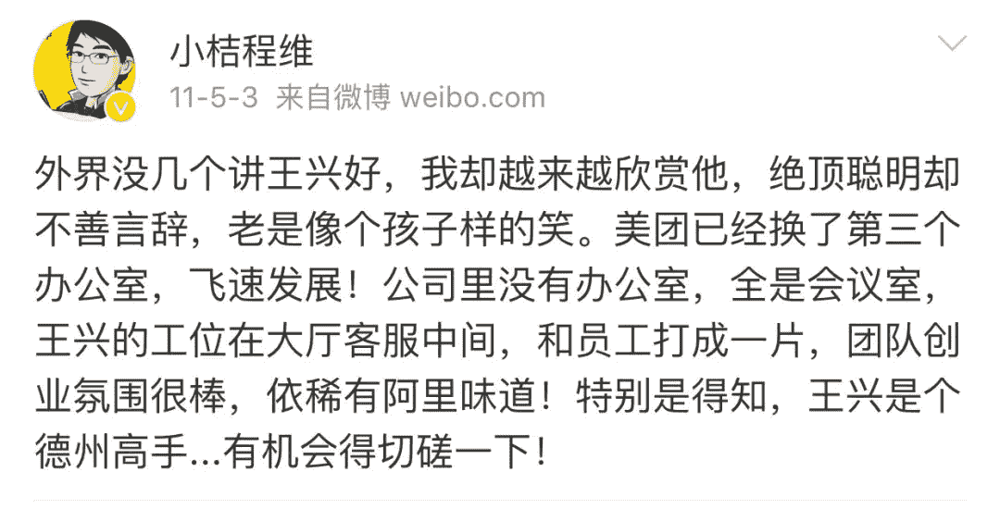

文/潘乱

在程维还叫常遇春的时候，他和王兴就已经很熟，两个人经常吃饭聊天。

在千团大战恶性竞争的 11 年，常遇春不管在微博上还是支付宝内部的培训里，都表达了对王兴和美团的看好。

11 年王兴 32 岁，已经创业了三四次，从五道口搬到知春路再搬到中关村，在团购战场跟吴波这些人厮杀，同时不断邀请干嘉伟加入美团，电影外卖酒旅打车业务都还没展开。那年 3 月王兴头一回见到马云，王兴问：你最强的是什么?马云：你觉得呢?王兴：战略和忽悠。马云：其实我最强是管理。 王兴：我相信。然后美团就拿了阿里巴巴领投的 5000 万美金 B 轮融资，当时阿里还不知道王兴也有要做巨头对抗阿里的野心。

那年常遇春 28 岁，阿里 P8，曾作为中供第一批销售为公司立下了汗马功劳，刚调入支付宝负责 B2C 业务线。不过这个老阿里人即将在年底被新阿里人从北京调往南京送死，BD 当时刚转型电商还以阿里为对手的苏宁，希望苏宁能够接入使用并默认优先支付宝。这是注定不可能完成的任务。受够了窝囊气的常遇春在杭州夜市摊上啃着鸭脖喝着啤酒，跟同样不顺心的兄弟们表示不愿再这样耗下去了，他们带着酒桌上凑起的 50 万准备上路。

后来叫回本名的程维在 15 年回忆说他是在王兴的鼓励下创业的，可能他预见不到或者至今也没想明白的事情就是，在他觉得打车市场战争已经结束的情况下，为什么还有超级独角兽来做这种低级别竞争，而且是他当年尊敬的老大哥突然跟他关系恶化刺刀见红。

其实这本来是他早该想到和在意的事情。

**程维的积累 VS 王兴的资本**

一个人的过去会不断赋予你和强化你一些东西。

程维县城普通家庭，04 年刚毕业到处求实习卖保险做足疗四处投简历为生存打拼，因为能够体面活下来就很难，只能接受命运胡乱塞给他的什么东西，这可能限制了他对长远的思考。王兴其实是富二代，他爸在 92 年就能拿出 300 万在龙岩开办水泥厂，家里情况允许他不是为谋生而读书也允许他失败，他一直像台燃烧好奇心的机器，专注自己比常人更辽阔的精神世界。

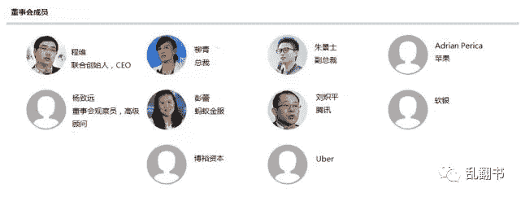

程维的天使是他的同事，所以他的积累是从阿里开始的，且他在阿里也没赚过够多钱。而他真正的搭档柳青，在高盛的业绩其实一般，做了 12 年投行能拿出来说的案子只有一个爱康国宾，程维看重的应该是她调动资金的能力和背后那几代人的资本。柳青又带来了她高盛的前同事朱景士，加上程维三个人代表滴滴出现在董事会上。16 年他们又找来曾在 PC 时代封神的俞军任职高级产品副总裁，尽管他早已移民加拿大远离国内一线工作多年。

一个出身底层，有拼劲与勇气的战士，在时代和资本的助推下拔苗助长成了将军，然后他选择了名门之后、外企精英和老牌明星合伙。很像是拿破仑的两次婚姻，都是为了政治目的而非出于爱情，娶约瑟芬是为了进入上流社会，娶奥地利公主是为了与旧王朝结盟。草根团队是变成了豪华团队，但程维的这几次选择，多少有些不够自信的意味在里面。

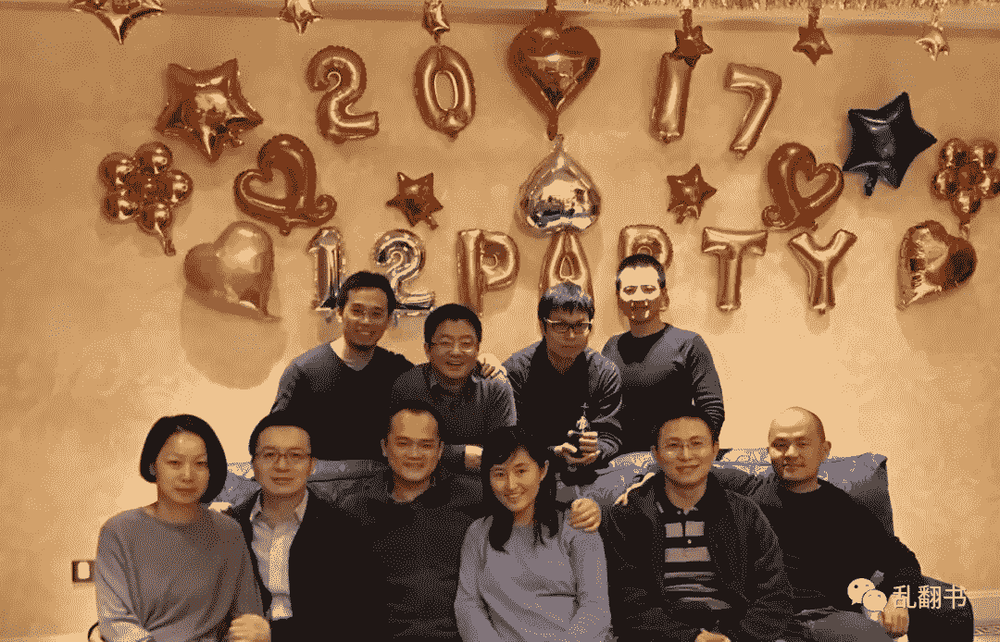

王兴过去十多年的创业班底有很强的延续性，他清华的同学北大的老婆一直在身边。他找来最著名的高管就是中供的干嘉伟，阿干在美团 COO 任上，用阿里的管理文化，让美团成为了一支铁军，修炼了强大的运力和地面执行力，直接决定了美团在后来的竞争中能够占据优势地位。王兴很少用外企背景的人，他在去年清华的演讲里直接提跨国企业耽误了中国 20 年前非常优秀的一代年轻人。「因为在那些企业你不会得到真正往上走的机会，你可能得到初级的很好的锻炼，但因为你不会到最高层级，所以不可能锻炼出全面运营的能力。」

不迷信外企的美团在完成历史使命后，选择让最擅长地面打仗的阿干边缘化后离开，让老同学王慧文领衔新业务，而 14-16 年的王慧文又是个怼天怼地整天把干死阿里挂在嘴边的主。在大众点评推出类支付工具闪惠打开市场之后，美团跟进干不过不得已接受两家合并选项。美团跟点评合并后，阿里意识到美团有侵蚀阿里的可能性坚决不让腾讯进来，然后王兴采取霹雳手段让阿里出局。15 年美团点评合并后曾有机会合并饿了么，因为点评在 14 年投了饿了么 8000 万美金且张涛在饿了么的董事会上，但最终王慧文没谈拢。如果当时并了饿了么，美团早不必如此辛苦，可能当时觉得自己能够随便打死对方吧。美团团队的种种选择，很难信任人，信任老人，偏执，果决，自傲，任性。

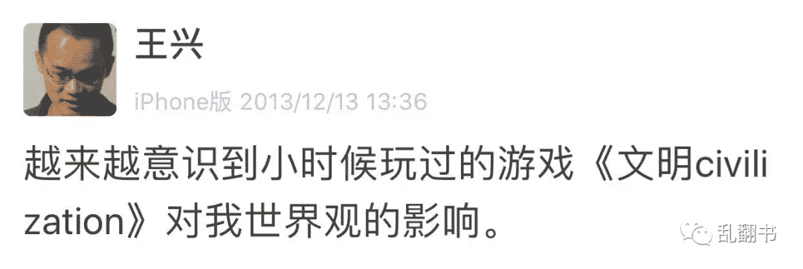

王兴的世界观受《文明》影响，一个自己造国家的回合策略游戏。回合策略制，没有终点，国土面积越大越好，信奉战争和掠夺才是王道，尤其是闪电战，发动战争不需要借口，原子弹决定了所有文明对你的真正态度。。

**游戏的边界&边界的游戏**

\*\*

去年小晚采访王兴，王兴说“太多人关注边界，而不关注核心”。比如他对业务和竞争的看法，他认为不要期望一家独大，也不要期望结束战争，所有人都要接受竞合才是新常态，同时，他认为太多思考边界和终局是错误的。

边界和终局这两个词在采访中高频出现，既然王兴认为大部分人关于此的思考都是错误的，那他认为正确的思考是什么？大家讨论了很久都没答案。

谜底应该是一本书，《有限和无限游戏》，王兴边界与终局的思维模式就是来自这本书。 有限游戏以取胜为目的，而无限游戏以延续游戏为目的。有限游戏是画地为牢的游戏，旨在以一位参与者的胜利终结比赛。我们迫切需要一个“游戏观”的转换，即从有限的游戏转向无限的游戏。

程维还曾在微博上推荐过，没想到这个道理他给忘了。

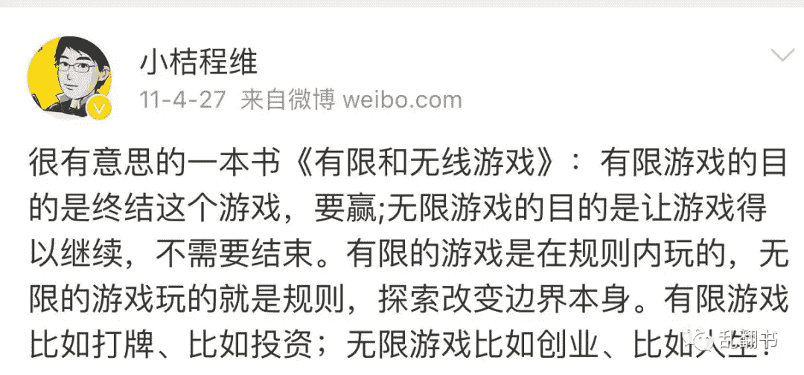

王兴还曾给这本书写过腰封：

> 有本书对我蛮有影响的——叫做《有限与无限的游戏》。有限游戏在边界内玩，无限游戏却是在和边界，也就是和“规则”玩，探索改变边界本身。实际上只有一个无限游戏，那就是你的人生，死亡是不可逾越的边界。与之相比，其他的边界并不是那么重要了。

有限的游戏是有边界，有目的，剧本化的，参与者的目标是为了获得最后的胜利，结束游戏。而无限的游戏是视域的，奇迹的，参与者的目标是为了继续玩这个游戏。无限游戏是一种开放心态，而有限游戏之所以有限，就在于其无法抱持一种开放，因为加入开放了，那么边界就会被冲破，整场游戏就变成视域性的了。

无限游戏的过程中可以出现有限游戏，但无限游戏无法在有限游戏中进行。有限游戏无论输赢，在无限游戏参与者眼中都只是游戏过程中的瞬间。

滴滴认为跟 Uber 中国合并后出行战争已经结束了，这是有限游戏思维，因为他以取胜为目标，市场主体与参与者都对这个合同条款（杀死所有对手的终结性结果）表示了认同。但问题是，这些规则只在参与者都自愿遵守时才会生效。

美团现在加入出行战争，是因为他觉得这个游戏永远没有终局，即便发现有即将到达的终点，那也是一条出人意料的开放道路。无限游戏的参与者是为了自己的赛局而活，这是一件启动后自己都无法结束的事情。美团想要的是永无止境的混乱，同时不在意竞争对手在做什么。

翻译成我们能够听懂的人话，就是无限游戏很像贝佐斯说的 Day 1。“Day 1 状态公司充满活力，持续关注用户需求，不断进化，可以获得持续的成长；Day 2 状态公司停滞不前，会逐渐变得无关紧要，经历着痛苦的衰退，最终迎接死亡”。

**客户优先？扩张优先！**

王兴说滴滴是“以资本为中心”，其实也可以从高管团队结构这个层面来理解，滴滴绝对是这一代独角兽公司里投行人士密度最高的，因为柳青和朱景士进董事会后带来了大批投行和咨询背景出身的人。比如，快捷出行事业群的陈熙，品质出行事业群总经理仇广宇，汽车金融业务的刘晓宇，资本市场高级总监 Joan Ho，国际业务团队的王海琛。他们接管了滴滴绝大部分的关键业务，过去一年多滴滴都在要利润而非做产品业务创新。

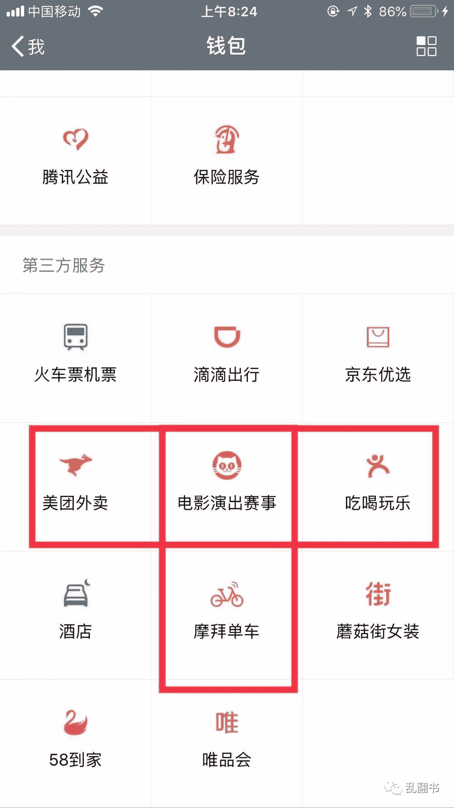

至于王兴说美团是“以客户为中心”，可能参考的就是贝佐斯所坚持的 Customer demand driven 原则。 这几年越来越多的人认识到了，贝佐斯是科技行业的巴菲特，要做深刻研究学习。于是大家都喜欢把客户优先这句话挂在嘴边，“我们是一家以顾客为中心的公司，而并非以竞争者为核心的公司”，但美团起家第一块业务就是完整的竞争导向的，实际聪明人都是在自家公司践行着贝佐斯信奉的另外一条原则，“扩张优先”（Get Big Fast），在一片混乱中开启舍命狂奔模式。

贝佐斯说，公司越壮大，就越能从批发商那里拿到低价货物，渠道能力就会越强。公司成长越快，就能进军更多的领域，那么就有资格加入电子行业前沿领域，并参与树立新品牌的角逐。要尽快把整个网络零售流程跑通，尽快强健每个环节上的肌肉。

王兴认为美团的未来是 Amazon for service，要把各种服务需求都做起来，因为用户都是一群人。其实这个逻辑挺奇怪的，因为我用了你的 A 服务，然后你要把我 B-Z 的需求都给满足了。即便你把 A-Z 的需求都给做了，这就算亚马逊了？

美团目前的业务都还在存量市场上，多是像水泥业一样的劳动密集型产业，且每块业务都不是绝对领先，更非原创，也没像亚马逊一样斩金截铁确定自己就是科技公司的定位。

所以美团理解的这个亚马逊可能是自由现金流和对未来投资这些操作理念上。以终为始 （Begin with the end in mind），先根据不变的需求设置长期愿景目标，再以此塑造未来，全心投注于自己最重视的服务版图扩张上。在此过程中，不断加大投入，牺牲利润换取增长，公司长期停在盈亏线上。

如果美团的未来也是亚马逊，那我只能把 Mobike 当做 kindle 来理解了。#一个玩笑

# 张一鸣

## 1.张一鸣对于搭建团队和自我的认知

### 对话张一鸣：世界不是只有你和你的对手

如果你印象中习惯了神采飞扬趾高气昂高瞻远瞩的霸道总裁，张一鸣恐怕会让你感到意外。对于一家 110 亿美元公司的创始人而言，他显得太年轻和安静——甚至有些乖巧。他的同事们告诉《财经》，这位 CEO 最激烈的情绪表达方式不过是“这个事情怎么会这样？”

在今天中国，创业公司 Founder 的数量可能要以百万计算，而张一鸣无疑是其中最幸运的两三人之一。他和他的两位朋友所创立的 3 家公司被认为是最有可能向中国互联网统治者——BAT 发起挑战的胜利同盟，另外两家分别是美团点评和滴滴。这三家公司创立都不超过 6 年，估值均超过百亿美元。

成功如此迅速，原因之一是这又是一家“简单，可依赖”的技术主导型公司。过去这类公司的典型代表是百度，这类公司往往极其专注于技术细节的打磨，提供极致的产品体验，而对行业习以为常的价值观则态度淡漠。因为这些特点，他们也有着共同的宿命——他们总是被社会舆论推动着甚至强制着去对某些话题表态：技术与人文、责任与价值观之间到底是什么关系？

今日头条正处在这样一个当口——这家公司已经是今天中国最大的媒体渠道，他们每个月为 1.5 亿用户提供服务，每天有近 7000 多万人花 76 分钟在今日头条上观看新闻、视频。但张一鸣坚持说今日头条不会也不需要设立传统意义上的总编辑，他说自己最忌讳价值观先行，他认为不干涉可能是今天他对内容最好的管理。

张一鸣认为“不克制”带来的危害更大——多数精英认为自己所坚持的就是对的，然而事实是，这个世界上多数人都无法认清现实。选择“不干涉”，正是在克服人性的弱点。与其在价值观上高歌猛进，不如“延迟满足感”，他认为这会让自己获得更多的自由。

考虑到他仅仅三十出头，很难说他未来会有怎样的改变：再过一些年，他会对这个世界有着更多、更强烈的看法吗？那时候他还会坚持不让价值观干涉内容吗？最近，《财经》杂志对他做了专访，话题也由此展开。

除了这些问题，我们还把他和他的好朋友王兴做了一些比较，在最后的快问快答环节中，我们把部分同样的问题问给了这两位背景相似、年龄相仿、甚至都是福建龙岩人的 CEO，他们的回答之间形成了一场有趣的思维对比。

｜成功与低俗

《财经》：比头条更早出现的聚合类应用或者网站有很多，为什么最后只有你们做大并成功了？

张一鸣：有些是因为太难用，门槛很高，导致最后只有 geek 才用。还有一些是没有「穿透」，订阅、选择类别等各种功能，他们把产品想得太复杂。为什么我们没有做这样的产品？因为我们始终认为信息的效率比信息的展示更重要。

最早期的今日头条，没有频道没有个性化甚至没有图片，打开就是纯信息流。当时我们的判断是——移动互联网，高频应用，主产品是唯一的；同时要专门为移动创造内容，而不是把杂志内容搬过来，后来我们做了头条号。

《财经》：什么时候意识到头条有这么大的势能？

张一鸣：物理上从高位到地位的能量越迁叫势能，而我们并没有往下跳。

《财经》：低俗是今日头条成功的原因之一吗？

张一鸣：我觉得这是有偏颇的。真的不是这样，虽然肯定还是有 Low 的内容，但我们肯定比同行更重视。而且我们从来不主动 push 低俗内容。我们一直在打击低俗和标题党，现在「特别低俗」的内容已经消失了。

我们确实有一段时间对新用户处理不够好，因为新用户没有个性化，所以他们打开主信息流容易出现低俗内容。而个性化推荐的模型很复杂，不全是因为你爱看，也可能是你附近刚好有人爱看。所以后来我们还专门启动了一个「冷启动防低俗问题」，

《财经》：所以你的意思是，「特别低俗」的已经消失了，留下的是「比较低俗」的？

张一鸣：第一、你确实不能完全做到，总有漏网的。第二、它有边界，有一点点擦边的，并不是要全部去掉。我觉得最核心在于头条并没有从低俗中获利，事实上，低俗内容反而会伤害我们的商业利益。

《财经》：你的竞争对手评价你们某些内容像毒品。用户点开可能是被标题诱惑，并不说明他需要并且喜欢这个内容。

张一鸣：因为没有收录足够多的用户信号，所以我们不知道你是因为被诱惑还是因为兴趣而点击。而我们现在试图通过更深入的用户行为识别来区分两者，比如用户的「点击后行动」——在内容上的停留时长，看完是否收藏，是否分享。

我本身并不认为低俗有什么问题。你在机场看到的杂志是一回事，在火车站看到的又是另一回事。很多人是因为证明自己高雅而指责它。

《财经》：未来是否会把内容调性从火车站往机场调？

张一鸣：我希望内容的分布符合需求的分布。机场的人看机场的内容，火车站的人看火车站的内容。如果说以前让机场的人看到了火车站的内容，那是技术问题。

｜责任与克制

《财经》：今日头条有没有价值观？

张一鸣：企业都要有社会责任感，我们要做对社会有益而不是有害的事。

企业和媒体的区别在于：媒体是要有价值观的，它要教育人、输出主张，这个我们不提倡。因为我们不是媒体，我们更关注信息的吞吐量和信息的多元。我们会承担企业的社会责任，但我们不想教育用户。世界是多样化的，我不能准确判断这个好还是坏，是高雅还是庸俗。我也许有我的判断，但我不想强加我的判断给头条。如果我在现实生活中也没有说服别人，为什么我要通过我的平台说服别人？

《财经》：媒体是有价值观的，而你们是最大的媒体聚合平台。

张一鸣：如果你是个邮局，你不同意《XX 时报》的价值观，但邮局能不发行《XX 时报》吗？多数人认为他的价值观就是主流价值观，他们总是习惯围绕价值观，而不是围绕事实。这是我反对的。同时，我们确实不应该介入到（价值观）纷争中去，我也没这个能力。

如果你非要问我头条的价值观是什么，我认为是——提高分发效率、满足用户的信息需求，这是最重要的。

《财经》：你对社会、商业、政治、文化是否有自己的观点？

张一鸣：我有自己的观点，但我不会强加自己的观点给头条。

《财经》：你的观点、想法跟头条的算法、规则完全没有关系吗？

张一鸣：我是我，产品是产品。

CEO 的职责为什么是把自己的喜好加到产品上？CEO 的责任是为公司创造效益，为员工提供薪水，为社会提供产品服务——这是企业的目标，而我做的事要最有利于这个目标。公司的价值观可能不是我的价值观，公司的价值观也不受我的价值观影响，公司的价值观是我理性的根据公司的愿景来定的。

《财经》：头条之前有个很赚钱的和医疗相关的业务，但你毅然叫停了。这是不是也是价值观在干涉产品？

张一鸣：不做医疗广告是因为目前民营医院很多服务差或者经营违法违规，而我们很难区分把关。这和我个人的善恶观无关，更多是企业发展长短期和「延迟满足感」有关。

我们认为流量是重要的，流量的信任度同样重要。如果你的流量信用度低，你的商业转化率就会低。这个问题是长期、缓慢的。所以推一个有问题、低质量的广告实际是杀鸡取卵。同时我们和百度不一样，我们不按关键词切分流量，而是按广告位加用户时长，我们不把这个位置卖给医疗广告主还可以卖给其他人。所以我们不做医疗广告压力不会这么大。

我们打击低俗也是这个目的，因为低俗会直接导致我们的广告没人信。只不过这恰好跟大家的善恶观是吻合的。

《财经》：头条是这个时代最强势的媒体平台之一，每天有 7000 多万人花 76 分钟在今日头条上。如果你们可以通过内容来给用户以正确的引导，为什么不呢？

张一鸣：我在克制，同时我觉得平台的责任也是克制。因为你不知道你自己什么时候是对的，多数情况下你不克制带来的伤害更大。同时，我们要努力提高自己的能力，因为基本上可以不做恶的人都是有能力的人。

我们的内容首先是满足多样性，满足对公共事件、议题的传播，满足一部分人群比如高知份子的需求，同时我们要求内容不要对低端用户有负面影响，所以我们坚决抵制虚假、诈骗、血腥、暴力、刻意标题党。

在满足了这些前提后，用户看八卦、娱乐、笑话等内容又有什么问题呢？历史上精英们一直在试图让大众拥有很高的精神追求，但社会整体从来没有达到过这个目标。以前的媒体精英意识不到这一点，他们认为自己特别希望导向的才是特别重要的。但多数人的强烈主张，从历史上看，多数都没有产生多大价值。

少数精英追求效率，实现自我认知，他们活在现实中。但大部分人是需要围绕一个东西转的。不管这些东西是宗教、小说、爱情还是今日头条，用户是需要一些沉迷的，我不认为打德州、喝红酒和看八卦、视频有多大区别。

《财经》：那为什么今日头条会做「头条寻人」这样的功能？

张一鸣：我承认，见到别人开心比见到别人难过要更好。

｜人性与机器

《财经》：做头条这几年看到了怎样的人性？

张一鸣：前阵子我看头条中的新闻说，有三分之一的人是不想接回失踪者的，这些失踪者多半是老人。这个新闻对我还是很震惊，世界没这么美好。我最讨厌的一句话叫做——闪耀的人性的光辉，而它经常被随便乱用。

《财经》：每天看头条推荐的内容，你觉得你是更爱人类了，还是更不爱人类了？

张一鸣：我爱不爱人类，电影给我的影响比今日头条大。BBC 有一个叫《宇宙奇妙之旅》的纪录片对我影响很大，它让我觉得人类很渺小。你的很多问题在天体之间都不重要。

《财经》：头条是一家技术公司还是一家媒体公司？

张一鸣：我们不是个媒体公司，是因为我们不创造内容，我们不发表观点。

我们是一家科技公司，但和大家想得不一样的是——我们是为了解决问题（信息分发问题）而创办的，充分认识问题比如何解决问题更重要。你认识到一个问题、认识到这个问题的规模和意义，这本身就是一半的答案。

《财经》：今日头条需要总编辑吗？

张一鸣：之前一位同事手动推送了一条三星新产品发布的新闻，我问他为什么要推这条新闻？他的回答是：这么重要的新闻我们怎么能没有？他认为这条新闻很重要，可是它真的对广大大众重要吗？多数人会认为他觉得对的就是对的，正是因为我知道这个倾向，所以我们要努力克制这个倾向。

如果头条有主编，他不可避免会按照自己的喜好去选择内容，而我们做的就是不选择。

《财经》：百度和头条都是纯技术思路创办的公司，有人认为纯技术公司都是唯机器论，机器的算法决定一切。

张一鸣：我不想强调纯机器，因为是不是纯机器不重要。我们的目的就是满足用户需求，机器能更有效的满足就用机器满足，机器不能就用人满足，我不固执或者不依附。

《财经》：你曾提到今日头条的内容是由算法决定的，是「人工不干预」的，但算法事实上就是以人的行为来影响机器。

张一鸣： 我们并不否认我们在干预内容。违背法律法规就必须干预，但我们不干预用户喜好，不干预在社会和法律容忍下的多样性内容。

《财经》：你认为头条的算法应该是引导人性还是迎合人性？

张一鸣：我不觉得算法要和人性挂钩。这就像以前哈雷彗星飞过，大家说这到底有什么意义？是要出现地震还是出现鼠疫？其实和这个都没关系。我们做技术的时候也一样——我们没有说要模拟人性，也没有说要引导人性。你们文化人给了我们太多深刻的命题。

｜竞争与低空飞行

《财经》：有人认为今日头条是百度未来最大的挑战者，你怎么看？

张一鸣：我又不是百度，为什么要管这个问题？我们主要是向前看、往前跑，不看左右。

《财经》：百度今年发力内容领域，是否会对头条构成威胁？

张一鸣：百度进入这个行业肯定对我们有影响。但这个「影响」是否会让头条失败？我觉得肯定不会。我们现在日活跃用户体量大概是手机百度的 2/3，我们用户的停留时常也更长。同时，我并不觉得百度有什么优势是我们所不具备的。

《财经》：比如，技术优势。

张一鸣：技术优势就是技术人才，我们为什么不能有同样或者更好的技术人才？优势主要取决于效率，取决于你对事情理解的准确度，对人才判断的准确度，以及如何把这个理解判断变成组织有效性的效率，在这几件事上我不觉得我们会输。

《财经》：听说你们给了高出百度两倍的工资从百度挖技术人才。

张一鸣：没有没有。大部分顶尖的算法工程师还在百度。

《财经》：头条 2015 年收入十几亿，今年预计有 60 多亿，百度 2015 年广告收入约 600 多亿。什么时候头条的广告收入会超过百度？

张一鸣：没有预计。但我们希望三四年内能做到中国广告市场 20%。

《财经》：什么时候开始有这样的规划？

张一鸣：去年年初。公司太小的时候不用算大盘，去年年初涨得很快，就开始算大盘了。

《财经》：百度连接的是广告与网站，头条连接的是广告与内容，不同的连接模式哪种更有商业价值？

张一鸣：网站是落后的信息组织形式，它不是健康的生态，同时网站内容组织的形态也非常不好，通过索引的方式其实是杂乱无章的。举个例子，我们打击低俗，如果一个作者老生产低俗内容，我们可以直接惩罚这个作者，网站是做不到的。

《财经》：头条是否会做一套类似百度凤巢的竞价排名系统？

张一鸣：我们现在就有类似的。我们觉得广告要更向内容的标准看齐，同时，我们希望广告对用户更有益。但我们现在效率还不如凤巢，百度有一千多人在做广告推荐系统，我们只有几十个。

《财经》：你们今年有 60 多亿的收入，百度在收入 60 亿的时候早盈利了，头条为什么还在亏损？

张一鸣：版权支出很大，人才支出也大，还有货币也贬值了。我们可以盈利，但对于大的行业来说，创业公司低空飞行应该是常态。

《财经》：除了广告，还有什么其他收入来源？

张一鸣：以广告为主。我们今年也有几千万收入是 2B 的，我们把机器学习能力对外提供了。

《财经》：今日头条有可能会发生魏则西事件吗？

张一鸣：我觉得这是当一家公司符合法律的时候，要不要比法律更高标准来要求自己的问题。魏则西事件在头条真的不会发生，首先，我们现在不做医疗广告。同时，我们每一个环节都会避免出错。

《财经》：如何看待和腾讯新闻的竞争？

张一鸣：主要怕别人和我们比烧钱。

《财经》：你刚刚说，现在举目望去没有可以威胁头条的人。

张一鸣：我并不觉得它会威胁到我们存亡，但你还是不希望人家给你绊脚。

《财经》：如果百度、腾讯在内容上开始大规模烧钱，对你们的影响有多大？

张一鸣：陪着烧呗。只要你跑到最前面的话是可以做到的，核心是你要提高你的系统效率。

《财经》：头条的商业策略对比其他几家巨头，有何不同？

张一鸣：百度的商业策略是比较看中三年内的盈利，他们是广告变现导向，而腾讯是用户时长导向，他们更在意用户是不是在腾讯盘子里玩。

今日头条的导向是偏腾讯，加一点华为。华为很重视底层和基础设施。我发现公司越强大就越往底层走，更往整个社会的基础设施走，上层可以空出来，比如操作系统、芯片、云。

｜管理与灰度

《财经》：Boss 直聘做过一个调查，调查显示计算机专业的大学生心中排名第一的雇主不是 BAT，而是今日头条。

张一鸣：我们重视技术，而重视的体现之一是工资。我一直认为，公司竞争的核心是 ROI（投入产出比)水平而不是成本水平。几乎没有行业领头的公司是控制人力成本来实现领先的，公司应该有好的 ROI，而这个好的 ROI 需要通过让员工收获好的 ROI 来实现。

《财经》：你的同事说，你在大学时举办程序员大赛，第一名是一位化学系同学，你一直对他念念不忘，创立头条还特意把这位同学挖过来了。

张一鸣：我看一个人都会想他有什么优点。哪怕是随意在路边看到的一个人，比如参加校友会，参观其他公司，甚至住酒店时看到的酒店经理。未知的事情或人我一般会往好的方面想。

《财经》：会重用什么样的人？

张一鸣：我比较喜欢真实的人，也可以说是认真的人。我以前比较保守，现在比较大胆。用人所长，只要不会对系统带来特别大的问题，我都愿意试试。

《财经》：有人评价你，慈不掌兵。

张一鸣：我不算适合掌兵，但看方向比管事情重要。我不擅长把事情推向极致，比如把公司推向运营效率最高，或者 push 到边界。但对公司来说，更重要的是对重要事情的开拓和判断。

《财经》：头条去年 1500 人，今年要达到 3000 人，明年会大量扩充销售团队，据说人数可能到 1 万人。1 万人的头条该如何管理？

张一鸣：最多一万，我估计实际 7000 多人。对销售和商业的管理，这个阶段并不是最重要的，好公司应该先持续开拓再增强变现深度。我希望通过对商业产品的改进把销售团队控制在 5000-6000 人以内，不想到百度几万人的级别。

《财经》：在今日头条的公司管理规则中，你非常强调腐败和廉洁，头条有因为腐败问题而开除过员工吗？

张一鸣：今年开除了三四个，追求刑事责任的还没有。

《财经》：在公司管理中，你对什么是不能容忍的？

张一鸣：不能容忍对系统的长期损害。我定义过三层廉洁失效给公司造成的损害：第一层是直接利益损失；第二层是这些决策带来的不良后果；第三层是廉洁风气变坏后，团队向心力的丧失。而第三层是我绝对不能容忍的。

《财经》：头条在管理架构和原则上有什么特点？

张一鸣：弱化组织结构、去形式化、灵活调整。在关键问题上是非分明，认真不含糊。多数公司在重大问题上没原则，小事情上没情理——我不希望头条是这样。

《财经》：如何理解管理上的灰度？

张一鸣：灰度不是模糊，而是有渐变和过度。灰度是有规律、有方向的。我对很多事情、很多人的处理都是在考虑清楚之后再重新度量程度。

经常有其他公司的跟我抱怨，某人不太适合，但老板因为考虑到这个人的感受，于是调到 xx 部门挂着。但让上百人汇报给一个不合适的人，是对这一百人巨大的不不公平。在这件事情上，清晰的是——岗位要按能力匹配的原则来分配，而灰度是——不能直接辞退，考虑情理，比如待遇上的优厚。

《财经》：头条进入了短视频领域，还有了「头条问答」等新产品，头条的业务扩张逻辑是什么？

张一鸣：业务边界是我现在的主要思考点，我基本以科斯定理为基础，加上一些组织和系统角度的思考。我们有一个原则——尽量不做别人已经做好的事，不能比别人做得更好就不做，除非是业务防御关键点。

世界是动态的、前进的。如果你停下来去做别人已经做好的事情，你和对方都会被时代潮流拉下，因为世界不是只有你和你的对手。

《财经》：对公司的边界如何思考？

张一鸣：公司能不能多元化，要不要进入上下游，要不要做产业基金，股权投资的意义在于什么？国际化也是我们未来的一个重点方向。最近我还在思考，国家为什么有大有小？

《财经》：听说头条内部决策很喜欢用「双重测试」。

张一鸣：以取名为例，多数团队有了好名字之后会说，“这个名字很好，干杯！”而我会说，再做个 AB 测试吧。哪怕你 99.9%正确，测一下又有什么关系呢？

《财经》：如果头条有一天被对手全面超越了，你觉得原因可能是什么？

张一鸣：先后顺序是——竞争、政策环境变化、我自己的问题。BAT 中的 T 还是很强的，我们还没有逃出重力。

｜保守与延迟满足感

《财经》：最近你有一篇传播很广的文章《10 年面试了 2000 个大学生》，你反复鼓励年轻人要敢于冒险，但你自己却是个很保守的人。

张一鸣：缺什么说什么。我是比较保守，比如很多公司花钱都是花了再融，而我总是预留足够的钱。

保守的本质是因为我很相信「延迟满足感」，如果一件事情你觉得很好，你不妨再往后 delay 一下，这会让你提高标准，同时留了 buffer。很多人人生中一半的问题都是这个原因造成的——没有延迟满足感。延迟满足感本质是克服人性弱点，而克服弱点，是为了更多的自由。

以前我的投资人建议，你应该尽快推广，但我觉得不 ready 就会一直不做。事实上直到你的竞争对手发力之前，都是你的窗口期。华为就是一家懂得延迟满足感的企业，他们花大了力气在研发上——这些都不是短期见效的事情。

《财经》：是否因为保守而错过很多机会？

张一鸣：判断不好确实会错失机会，比如如果头条在 12、13 年可以多花一点钱，或许增长会更快。我不喜欢不确定性，这与我程序员出身有关系，因为程序都是确定的，但事实上 CEO 是焦虑的最终承担者。现在我的保守性在降低。

如果是因为创始人个人需要得到成功而没有在合适的时机做出决策，这是延迟满足感的问题，而如果是因为自己判断失误，则是技能问题。

《财经》：创立头条之前，你参与过四家创业公司，但每次都没有坚持到最后。

张一鸣：我很早就意识到，创业如果不顺利，早死早升天，往前看就行了。我对很多事情的理解都是「错不在我」，以前业务没做好，我就觉得责任在我身上，但其实有时机问题也有行业问题等等很多。

如果你的决定是对可见的最大系统（比如社会）是有增益的，你就应该做出更好的选择。我经常见到一些小创业团队，每个人都不愿意走，其实早点解散了，对他们都好。也许你可以创造更大的价值，到时候还可以将利益重新分配。比如我离开九九房的时候，当时九九房的投资人也投资了头条，他们现在收益很好。

《财经》：但团队的老大先于公司解散走掉，不会有内疚感吗？

张一鸣：创业成功本身就是低概率事件，买彩票没中会有内疚感吗？而且当时我为团队找了我认为比我更合适的 CEO。不过现在回想一下，一两周低落期还是有的。

《财经》：你很现实。

张一鸣：可能跟很多人比，是的。

《财经》：如果今日头条遇到大困境，或是你看到更好的趋势，你会放弃头条转身去发展新业务吗？——就像当年一样。

张一鸣：我从来没说过我绝对不卖公司这种话，我说的是——我们有机会把头条做成一个平台型公司，所以我不会卖公司。我没有选择拥抱巨头，但我不是“为了不拥抱而不拥抱”。

如果和哪个公司合作，可以让今日头条在全球获得成功；可以促进更多地方的信息分发；可以更快进入机器学习在其他领域的应用，我并不排斥，但我不认为现在有这个机会存在。

《财经》：想过卖掉公司吗？

张一鸣：每次有选择的时候，我会想一想，然后我每次都会选择不把公司卖掉。我认为头条作为独立的平台，对我和我的团队，有着财务之外的很大意义。

《财经》：想过几次卖掉公司？

张一鸣：三次。人们总说成王败寇，但大众说法并不天然对，卖和不卖中间还有很长的过度。如果卖掉可以为更多人产生更大的好处，我并不反对。我的选择取决于个人感情和责任感，但更取决于现实。

《财经》：如果失去公司的控制权你可以接受吗？

张一鸣：如果新的这个人非常牛，我是 Open 的。

｜理性与现实

《财经》：王兴是你比较好的朋友。你和他的相似之处、不同之处是什么？

张一鸣：都比较有好奇心，也都爱信息。他的好奇心比我更大，知识面比我更广。但我比他更懂技术。我们看问题有时候角度不完全一样，我感觉他更系统，我更灵活。他对什么事都关心，而我觉得对我不重要的事情我就不那么关心了。

《财经》：在你眼里什么是「重要」的事情？

张一鸣：就是能发挥效用的事情。

《财经》：什么是能发挥效用的事情？

张一鸣：不同阶段不一样。比如你身体不好的时候，健康是重要的。对我来说，自由、健康、公司发展、家人朋友健康，包括能够更有能力去帮助人，把困扰我的问题想得更清楚等等，这些都是效用。

《财经》：在你的生命中什么是最重要的？

张一鸣：我不确切知道。其实多数人都没有答案，但他们以为自己有很好的答案。

《财经》：想把今日头条做成一家怎样的公司？

张一鸣：先不设边界吧。先把提高信息分发效率这件事情做好，成为全球最大的信息创作与分发平台。

《财经》：上一次发火是因为什么事情？

张一鸣：我几乎不发火。因为发火有什么效用呢？

《财经》：为什么一切都要用效用来衡量？

张一鸣：我又不想发火干嘛发火？我不发火，也很少生气。但有时会不高兴，不高兴多半是因为失望。

《财经》：你赞赏哪种力量？反对哪种力量？

张一鸣：四种基本作用力——万有引力、电磁引力、弱相互作用力、强相互作用力，简单来说，就是大自然的力量。反对 YY 的力量。

《财经》：最欣赏自己身上哪一种特质？

张一鸣：延迟满足感，而最大的延迟满足感，是思维上的。

《财经》：大学毕业来北京创业，对这个城市的第一印象是什么？

张一鸣：冬天，坐出租车从机场往城区开，高速两边是大片整齐的白杨树，平原一望可以看到很远，坐车飞驰而过，那一幕印象很深。

《财经》：作为一家受到价值观争议的公司 CEO，你的价值观是什么？

张一鸣：我并不完全确定。我讨厌形式化，讨厌虚伪，因为排来排去没用。但我认为体验和事实对我来说很重要，你经历各种经历、各种体验很重要。你能够有自由、有能力去帮助和影响别人。而我作为「一个人」的效用就是：一是你的体验，二是你对别人的影响。

《财经》：你在采访中说自己不喜欢无聊，人生要做来劲儿的事，但一些接触你的人评价你是个枯燥的人。

张一鸣：他们没有看到我有趣的地方，比如打游戏、飙车各种我都不玩。我喜欢对世界有清晰的定义和标准，如果还能简洁更好。

《财经》：你的爱好是什么？

张一鸣：看书、看电影？我坦白，我没有特别强烈的爱好。我觉得很多爱好都来源于控制。如果你通过玩游戏来追求控制感，那你不如控制你自己。比如看书，看有难度的书，想有难度的问题，在商业追求上努力工作。如果你花时间去打真人 3D 实景游戏，为什么不拿这种「追求控制感」来创业呢？

《财经》：对你影响较大的书有什么？

张一鸣：《活法》、《少有人做的路》、《高效人士的七个习惯》、《基础生物学》对我影响比较大。我什么都看，只要我觉得对自己有帮助。还看了一些比如《世界应你而动》、《你从来没有努力过》。

《财经》：你看了好多鸡汤。

张一鸣：洁癖不会影响我的好奇心。

《财经》：如何看待自己的弱点？

张一鸣：拖拉。好多事情很拖沓，我迟到，经常迟到。

《财经》：有特意做什么事情来改变自己吗？

张一鸣：定目标。

《财经》：用几个字定位一下自己。

张一鸣：我在上海，徐汇区中金国际广场，第 9 楼。

《财经》：有没有一直坚持的东西？

张一鸣：每周按摩一次算不算？

《财经》：多数认识你的人都评价你极其现实，像机器人。

张一鸣：我觉得人总不 facing to reality，是很大的问题。预测未来的最好方式是创造它，但前提是面对现实。

《财经》：如何来区分梦想和不现实？

张一鸣：梦想，就是做梦想的吧。多数人不愿意面对 reality。reality 是个名词，抽象名词，没有褒贬。

《财经》：那你的梦想是什么？

张一鸣：把英语学好。

## 2.多次创业失败后的总结

### 张一鸣：这几年我重新学习了青少年阶段该学习的东西 （2017）

过去 11 年，张一鸣先生先后参与创办酷讯、饭否、九九房，虽然屡战屡败，但他不以为意，始终按自己的套路出牌。直到这一次，「今日头条」让他成功了。按照他的说法，今日头条之所以能发展起来，是自己做得比别人更认真，首先认真地思考，其次认真地改进了工程技术、算法模型等环节。

但捕 Sir 更好奇的是张一鸣先生在创办今日头条的过程中他思维方式发生了哪些变化，他对于人才管理又有哪些心得，毕竟「人」是一家公司的内核。

#### 算法是一个生命体

移动互联网的创业一代和互联网创业一代相比，时间更短，竞争更激烈。因为移动互联网的兴起是在互联网之上，相关人才、产业条件都已经更成熟了，不像互联网兴起的时候没有几个好的技术人员，资本也不发达，经验也少。

这是一个极好的时代，因为每隔一段时间就会有一个产业变化的高潮，很难说高潮的结果是好是坏，但至少会产生很多机会。

我想在移动互联网兴起的过程中做一个对用户影响更普遍、更有通用价值的东西。**我毕业的时候就想以后要和优秀的人做有挑战的事。很多人说我要赚到第一个 100 万，一定要通过创业赚大钱。说实话，我对金钱的渴望没有特别强烈，我对做技术做产品更感兴趣。当时只有一个感觉，要做有意思有挑战的事，和优秀的人一起做**。

我没有太去想如何成为入口，反而觉得如何帮助用户更有效地获取信息，这件事情本身更值得关注。这源于对产品观察的不满足，我用 Twitter、饭否、人人网都用得不满意。比如说在使用社交网络的时候，你会发现这个人老发一些养猫的照片，玩开心农场，我不感兴趣，但他有时候发一些 IT 评论挺好的。

2009 年我意识到机器通过大量学习是可以逼近人在某个领域的判断力的。看到很多人工智能、数据挖掘、个性化应用的产品，虽然都不太成功，但挺有意思的。做超过人类智商的机器系统非常难，人的大脑是非常复杂的，但是在某一领域达到人的判断力是有可能的。

**算法是一个生命体，你要调教它，驯养它**。这个想法我在 2011 年的时候才开始萌发，开始只是想怎么样更好地满足用户对信息的需求。后来研究下去，用户对信息需求有越来越多的特征，比如说，不同人的信息需求不同，同一个人在不同时间对信息的需求也不同。

算法对特征规律的总结与存储是要不断训练调教的，而且是因人而异的、动态的，就像一个自我演化的系统。你在看它（算法），它也在看你，它看你看得认不认真，并且不断地在做感知、存储、判断你的一系列动作。算法是社会化的，观察你就能推导出另一个人，因为你们有共享的特质。**推荐系统很有意思，是活的，你做好了摆在那儿，它会越来越好**。

算法确实有不灵敏的时候，提供一些你不感兴趣的内容，但编辑也会编得不灵敏。所以要给读者机会实时反馈，不灵敏就划掉，告诉我。如果发现最近给这个人推荐的老是不灵敏，这个用户老是点不喜欢，我知道我这边出现问题了，那我会观察、改进。

比如系统晚上要给北京女性白领都推一个节目，但随后发现很多用户都不喜欢，那就要研究为什么系统会有错误的结果，是不是某个代码写错了。

做今日头条这类推荐搜索引擎的提升空间还很大，难度挺高，前面肯定不止一个对手，你去阻挡一个人反而会耽误你往前。**就像赛跑，你的目的不应该是挡住一个人，因为你挡住一个人，另外的人也会超过你。你应该尽可能地向前看，往前跑**。对我来说，如何把事情做好带来的挑战，比与其他人竞争更大。

#### 长线思考

国外类似的产品有 Zite，但被收购了，发展不算好。我们上线的时候发现有一款叫 Prismatic 的，和今日头条同时上线。

事实上，我在国外遇到一些朋友，当他们发现在中国有一家公司这么积极地在做这个事情、而且做得挺领先的时候，都挺意外的。国外有个风险投资人发微信和我说，「Flipboard 最近融资了，我遇到他们投资人的时候和他们说，中国有一个更好的。」

当初，我做今日头条的时候没有考虑它的商业价值，后来偶尔想一想。**其实，我商业敏锐不强，谈判一般谈不到很好的结果，觉得差不多就好了。不是很能估计对方的底线，对能够产生利润的空间的敏感度也不够**。后来公司有几个谈判很好的人了，他们没来之前，我去谈判都是不说，始终不说，让对方说，说到我觉得 OK。

谈判的本质是博弈，我不善于用很强的语气、语言技巧去影响人感染人。**我也很少发现赚钱的机会，对市场对商业我都挺保守的。**

**我不喜欢特别抽象的词，因为抽象的词会掩盖实际的含义，虽然抽象思维的效率更高**。讨论问题的时候，我也会避免不必要的抽象，除非指向很明显。

沟通中没听明白的话，是因为这些话常用「这个」、「那样」等代词，或笼统的名词，含糊的形容词、副词、量词替换掉了往往「本身就模糊或有分歧的内容」。虽然句子是完整了，但是意思不清楚。然而如果替换的部分是清楚的，并不会听不明白。 我们要做的就是抓住这个词，还给他们。

**这几年我感觉自己又重新学习或者说补习了本应在青少年阶段学习的东西：如何阅读、如何了解自己、如何与人沟通、如何安排时间、如何正确地看待别人意见、如何激励自己、如何写作、如何坚持锻炼身体、如何耐心......**

创业还是要经常自省，避免自我强化和催眠。**所以要区别信心和「YY」，真正信心源于看到自己的进步和潜力，可以分成两个方面：首先是对事情本身判断的信心；其次是对自己和团队的信心**。

我现在更关注事物的本质，关注事物的未来走向，看这件事是不是长期有益的。如果只看短利益，就很浪费时间。**我曾总结，当自己无法选择或判断的时候，就要离远一步，远到用更重要的原则和更长的时间尺度来衡量就清楚了**。

举个例子，在我们公司创立不到一年的时候，曾经有巨头想给我们一个很诱人的投资 Offer：比 VC 更高的估值、上亿的捆绑安装渠道、几千万 UV 的 Web 流量、数据等等。接受这个 Offer，可以在半年内，业务增速有望快几倍。当时我很纠结，纠结了整整一个星期。

后来我拒绝了，因为：

1）**我觉得这些帮助是兴奋剂，在自己内功未成之前会导致内生力量受到遏制；**

2）**有些资源会让战略变形，比如我们本来不打算做 Web 的，而有了这么大流量，你就会继续投入资源；**

3）**接受巨头的帮助，会被迫站队，使得自己的想法不再自由奔放；**

4）**独立公司的定位，更有利于吸引最一流人才，因为梦想和可能性无限**。

好处是明显的、坏处是隐含的，但这类情况很多人容易高估好处，低估坏处。这是一种典型的延迟满足感不够的体现，又或者，对长远信心的不足。而如果一个公司在我手上只能创造 10 亿的价值，并购后能创造 1000 亿的价值，那我觉得应该接受邀约。这对社会总体也是有利的，因为这是增量。

**但有的公司卖了未来、卖了愿景、甚至接受非常不利的条款「嫁入」豪门，或许 Founder 有机会套现赚点钱。这样的公司尽管短期流量快速上升，但用户留存低、粘性差，策略变形，被假象蒙了眼的团队核心能力成长是受到制约的，本质上是浮沙筑高台**。

这个道理也用于找工作，稍微修改下范爷的话：**不要加入豪门的公司，加入就很难成为豪门；而应该加入优秀的公司，和它一起成为豪门**。

### 招人看基本面

过去，经常会遇到有创业者问我：初创公司在招人方面很困难，你是怎么招人的？

**招人最简单莫过于招干过这个事的人，不过能找到最具合适特质的人更重要。特别是创新企业，很多岗位未必有成熟的人对应，或者业界的普通标准并不特别适合，又或者具体的岗位有一些特别的要求。这时通过对岗位的理解而去招最合适特质的人就特别重要**。

**要能大胆雇佣优秀的年轻人**。Facebook、Paypal、Dropbox 在雇佣上都非常激进，**优秀的年轻人也许犯错，但不会平庸，更划算的是会进步**。

所以，我招人更看重这个人的基本面，我相信只要一个人的基本面是好的，管理能力也不会出什么大问题。如今，总结过去我所接触优秀的年轻人共有的基本面，可以归纳成五点：

**第一，有好奇心，能够主动学习新事物、新知识和新技能**。我有个前同事，理论基础挺好，但每次都是把自己的工作做完就下班了。他在这家公司待了一年多，但对网上的新技术、新工具都不去了解。所以他非常依赖别人。

当他想要实现一个功能，就需要有人帮他做后半部分，因为他自己只能做前半部分——如果是有好奇心的人，前端、后端、算法都去掌握、至少有所了解的话，那么很多调试分析，自己一个人就可以做。

**第二，对不确定性保持乐观**。比方说今日头条最开始时，我和大家讲：我们要做 1 亿的日启动次数。很多人觉得，你这家小公司怎么可能做得到？大公司才能做得好。所以有些人就不敢努力去尝试，只有乐观的人会相信，会愿意去尝试。

其实我加入酷讯时也是这样。当时酷讯想做下一代搜索引擎（最后也没有做成，只做了旅游的垂直搜索）。我不知道其他人怎么想的，我自己觉得很兴奋。我确实没有把握，也不知道怎么做，但当时就去学，就去看所有这些相关的东西。我觉得最后也许不一定做成，或者没有完全做到，但这个过程也会很有帮助——**只要你对事情的不确定性保持乐观，你会更愿意去尝试**。

**第三，不甘于平庸**。我见到很多大学期间的同学、一起共事的同事中，也有很多非常不错的人才，技术、成绩都比我好。但 10 年过去，很多人没有达到我的预期：我觉得他应该能做得很好，但他却没有做到。

很多人毕业后，目标设定就不高了。比如，我发现有同事加入银行 IT 部门：有的是毕业后就加入，有的是工作一段时间后加入。为什么我把这个和「不甘于平庸」挂在一起？因为他们很多人加入，是为了快点解决北京户口，或者当时有些机构有分房补助，可以购买经济适用房。

**我说不平庸，并不是专门指薪酬要很高或者技术要很好，而是你对自己的标准一定要高**。也许你前两年变化得慢，但 10 年后再看，肯定会非常不一样。

**第四，不傲娇，有延迟满足感**。以前有两个我印象比较深刻的年轻人，素质、技术都蛮不错，也都挺有特点。本来都是资质非常好的人才，人非常聪明、动手能力也强，但没有控制好自己的傲娇情绪，总觉得自己是 TOP1%当中的人。比如要做一个调试工具，他们就不愿意做，或者需要和同事配合的工作，他们就配合得不好，其实「不傲娇」就是指对现状要踏实。

有同事问我：延迟满足感太过了不好，这个度不好把握。我的理解：**延迟满足感无关高兴、庆祝、分享等行为。更多是内心的，是不是满足感将内心蒙蔽、智慧迟钝、错过机会。其实，人生的差距就是在自我感觉良好中拉开的**。

**第五，对重要的事情有判断力**。选什么专业、选什么公司、选什么职业、选什么发展路径，自己要有判断力，不要被短期选择而左右。**懂得建立自己原则的人是聪明的，自信的。有原则绝不是迂腐，反而越有原则，往往越灵活**。

#### 团队管理心得

将人招过来以后，就会面临管理团队的问题。

以前我更喜欢做技术，技术是我的爱好。**但管理也变成一种广义的技术，尤其是随着公司的快速扩张，对管理的需求越来越强，我自己体验和经历的事情也越来越多，对产品和管理的兴趣上升得也更快，而且管理现在是我的职业**。

所以我再分享几条从今日头条实践当中总结出来团队管理的心得：

**第一，减少规定和审批**。不允许部门随便出规定，即便不得不有规定，我们也希望规定非常简单，不允许有长达几页纸，非常难执行的规定。要减少审批，甚至希望尽量不要审批。

**第二，组织结构灵活，拒绝领地意识，能灵活调整汇报关系**。让大家意识到，汇报关系只是汇总信息的一种方式，只要业务需要就可以随时调整。如果我们有一个项目非常重要，我们可能需要市场部的同事都支持这个项目，那在这段时间里，这个项目的主管也是市场部同事的主管。

**第三，弱化层级与 Title**。我们正面临着一个巨变时代，外部是一个不断变化的环境，公司需要及时对外部环境作出响应。平等的畅所欲言的氛围非常重要，敬语是形式化的东西，它会有心理暗示。

为了避免形式感给基层节点带来压制，我们弱化层级，首先是不允许称呼「老大」、「某某总」、「老师」等等，这种称呼一旦出来之后，很多想法就不能涌现出来了。他们可能会倾向于先听听「老师」有什么意见，自己不能先说出来。如果不从这些细节入手，可能还是会给人带来层级感，进而影响其他同事发表意见。

**第四，构建一个好的内部协作系统**。我们有将近 100 个人的内部工具开发团队，做各种工具尝试。比如我们自己开发了 OKR 系统，并且和内部使用的 IM 打通，方便大家互相查看。这些基础工具，第一可以让人更轻松；第二可以规模化。新人加入公司，很快也能适应 OKR 系统，从内部获取信息。

他也能意识到，自己不仅仅有获得信息的权利，也有支持相关工作的责任。这样的实践，在我们看来，更容易构建公司内部协作系统，从而让这个系统分布式处理的能力更强。

**第五，鼓励内部信息透明，鼓励坦诚沟通**。我们鼓励群聊，各部门之间充分沟通。不要只和 CEO 沟通，也不提倡一对一的沟通，我们认为一对一的沟通效率很低。如果有新加入的同事或者高管希望和我一对一的沟通，我经常会说你可以抄送给我，但你首先要发给其他人，发给需要和你配合的人。

我们让管理层的 OKR 对下属员工保持公开，让大家知道你在做什么，为什么在做这个事情，其他部门的人在做什么。**OKR 的制定过程也不是自上而下的分解，而是大家互相之间自己对齐，了解目前公司最重要的任务是什么**。另外，我们还会经常举办 CEO 面对面，在这个会上回答员工提问，让大家了解公司进展。

**我认为能否坦诚沟通是公司团队管理的主要问题** **，当感到沟通困难的时候，最好的沟通方法不是想太多技巧和说法，而是更坦诚的沟通**。

最后，我认为创造公平的文化和公平的信任是非常重要的，奖罚分明，这样大家才相信游戏规则存在，才会挑战自己更大回报，才不会有侥幸心理。类似这样的原则 CEO 要谨记不忘。

## 3.从找女友到爆款产品

### 张一鸣的实证理性（2018）

张一鸣似乎躺枪了。

今年张小龙在腾讯年会上自嘲自己是一个古典互联网主义者，认为“人工智能”就是一种“机器套路互联网”。并吐槽抖音：“大部分产品都在欺骗用户，做各种滤镜，喊口号说‘记录美好生活’，但生活其实并不总是美好的。”

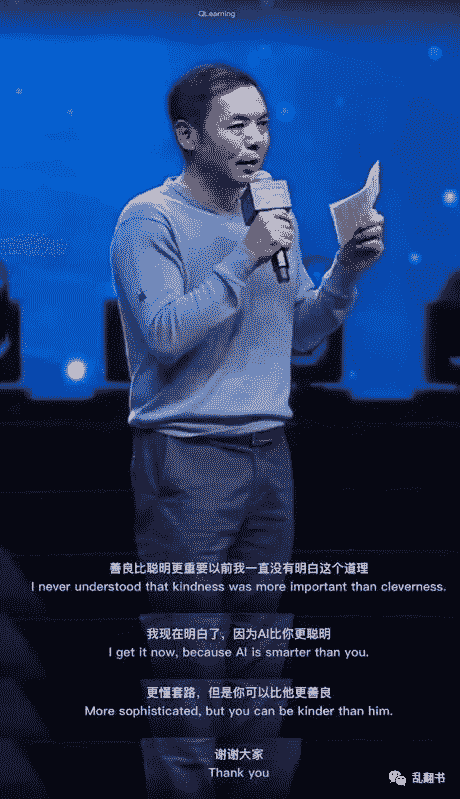

去年我写微信头条对比时，曾将 69 年的张小龙与 83 年的张一鸣比作是「英雄和机器人」：一位是直觉型天才产品经理，一位是高级 AI 机器人。

英雄习惯将自己的意志表达到透彻，喜欢视用户为朋友，不想去感动用户。而机器人想要捕捉的就是大众，其能力即在于稳准狠戳全部人的敏感带，为其服务。

不可忽视的是，张一鸣和头条的认知和迭代能力一直都很强，很少出错且能够不断更新，迈向新的成长之径。

而且他在每次产品高峰时都保持清醒和危机感。

2017 年 9、10 月份，字节跳动的增长遇到非常严重的瓶颈。

当十一假期回来后，抖音突然开始爆发，日活从 700 万涨到 1400 万，公司都欢欣鼓舞，张一鸣却没打算庆祝。

他表达了更深的焦虑：“快手日活国庆从六千万涨到了八千万，我们跟竞争对手的差距又拉大了。”

到今年抖音日活 VV 等各项产品数据包括海外拓展全面超过快手，张一鸣又开始告诫团队，抖音正在犯快手去年类似的错误，除了数据在高速增长但是产品没有突破。

所谓延迟满足感，就是永远不满足。

张一鸣在行业竞争上对胜利的这种饥渴，也在潜移默化中传递给了整个团队，结果是整个公司都对增长非常饥渴。

面对巨大的成绩或是诱惑，都能保持冷静独立的思考，不得意也不失态，希望最好状态一直在「在轻度喜悦和轻度沮丧之间」。这样迥异常人的反应系统，是从哪来的呢？

借用理性哲学家和科学主义者康德的“三大批判”哲学体系，张一鸣的读书教育背景、创业创新经历、自我学习与进化等方面，也分别构成了头条系的“纯粹理性批判”、“实践理性批判”和“判断力批判”，可以概括为头条抖音们的理性批判哲学体系。

想要探究张一鸣的三观和 OS，可能还得先从他的南开大学生涯说起。

* * *

**纯粹理性批判**

张一鸣是个有重大选择时特别知道自己想要什么的人。

他的方法是：先确立目标，然后穷举所有达成可能性，再去寻求最优解。

比如他在大学阶段最重要的三个选择，选学校、换专业、找女友，都属于谋定而后动。

**选学校**

张一鸣在回母校南开的演讲里面提到，为什么他这个福建娃会来天津上学：

*   最好在北方，冬天会下雪，因为没见过，想玩。
    
*   想独立，离家远，不能让父母突然跑学校就能来找我。（排除掉东南沿海）
    
*   综合性大学，不要像中科大那样偏专科。
    
*   男女比例不要太失调，方便找女朋友。（排除掉工科院校）
    
*   靠海，因为喜欢吃海鲜。（只剩下渤海湾）
    

几个维度综合起来就是：一个会下雪的，有很多漂亮女生的，冬天会下雪的，滨海大都市。

多数学生都是高考完了才会想着去选学校填志愿，张一鸣说他在高二就都把这些事情都给想过一遍了，很早就知道自己想要什么，然后往他想要的地方去，不浪费时间。所以填时很干脆，没问老师也没跟家长商量。

**换专业**

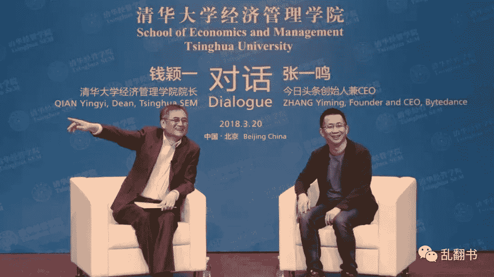

张一鸣在年初清华跟钱颖一的对谈中，提到 2001 年他考入南开大学，最初报考的是生物专业，因为分数不够高入校时被调剂到微电子专业（即电子工程），后来自己转专业到软件工程（即计算机）。

至于为什么报考生物系？张一鸣说的是

> “当时都说生物是 21 世纪的领头羊，所以非常热。我自己也感兴趣，高中的时候参加生物竞赛，看了一本北大老师写的《普通生物学》，对我影响很大。生物从细胞到生态，物种丰富多样，但背后的规律却非常简洁优雅，这对于你设计系统或者看待企业经济系统，都会有很多可类比的地方。”

至于后来为什么从微电子转到软件工程，张一鸣给出的理由是：

> 我花很长时间，才能在面包板上做一个正弦波信号发生器，还经常不能。学了一年多，却没有看得见的效果，让我很焦虑。但软件工程比较快，你写个程序马上就能跑起来，发挥作用，甚至还能在校外兼职，所以我就转到软件工程。

张一鸣选专业的出发点是希望是能够面向未来，同时能够获得快速反馈。软件工程是一个理论实际结合的非常好的一个学科，需要比较强的动手能力。张一鸣在大二做完这个选择之前，并没有跟家里人说过。

**找女友**

张一鸣是罕见的那种，只谈过一次恋爱就结婚的男人。

他在大学因为修电脑认识的初恋女友就是他后来的妻子。

《人物》杂志曾报道过张一鸣如何追女孩子，“接着他总跑去修电脑，和女孩在 BBS 上版聊，约出来玩，接下来是表白—女孩连好人卡都没发，毫无余地地拒绝了他。”

> 梁汝波本想安慰张一鸣，但当事人反而觉得没什么所谓，「就感觉这件事跟你说了一下而已，然后你有不同意见，我们接着来，用现在的话来说也挺奇葩的」。他继续修电脑，版聊，约出来玩，两个月之后有一次出游回来，梁汝波看到两人牵着手。

> 他清醒地控制自己不在恋爱这件事情上多浪费时间，就此向记者讲述了一套自己的理论，「世界上可能有两万个人适合你，然后你只要找到那两万分之一就好了。就是你在可接受的那个范围，近是最优解嘛。」

关于表白被拒不气馁的「奇葩」说法，在后来他离开九九房创办字节跳动时又复现过一次。

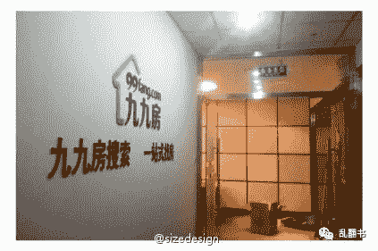

12 年初张一鸣还是九九房 CEO，结果他觉得房产这个领域太窄不适合发挥，就新找了位 CEO 然后自己带着不到十个人去创办了字节跳动。

有人问他离开创业会不会感到有愧疚感和心理负担，张一鸣给出的理由是：

“创业就像赌博，成功是极小概率事件，你会因为赌输了而愧疚嘛？”

* * *

**实践理性批判**

**选工作：最大化提升效率**

张一鸣喜欢分类，在他毕业的时候，软件工程专业的他将信息产业分成了四大块：

1.  信息的存储
    
2.  信息的传输
    
3.  信息的展现
    
4.  信息的组织和分发
    

IT 产业就是信息产业，张一鸣学计算机时有做 MIS 系统还有存储系统、3D 展现，也都是围绕信息。其中他分析存储和压缩都是空间有限，传输速度的提高也是有限的，就像当年流行的 ERP 系统一样，效率能够提升 2 倍，但很难提升 20 倍。但他觉得信息的组织和分发它潜力是很大的，“信息的流动本身对社会有非常深远的影响，我甚至觉得它可能是各种其它效率的基础。”

张一鸣是个非常敢做梦的人，他想做面向所有人的事情，能做平台就不做垂直。对张一鸣来说这个更大的事情就是信息分发，“把一个人获取信息的可能推荐原因在一个系统里终极解决”。

围绕信息分发成了张一鸣的创业主旋律。后来张一鸣加入酷讯饭否，都是在做搜索、社交这些跟信息分发相关的事情，是国内比较早的对垂直搜索和社交数据挖掘领域进行探索和实践的创业者，他在这过程中也积累了信息组织分发相关的技术或者产品体验。

张一鸣说饭否网的工作经历让他意识到社交跟获取信息是两码事，应该有更高效的内容分发方式来满足用户不同层面的内容消费需求。

> 「信息已经在那儿，如果没有有效组织和分发，其实产生的价值很有限。我毕业之后无论做搜索引擎还是社交网站，搜索引擎组织分发信息，社交网站以人为节点组织信息流动，还是做推荐引擎，以兴趣为颗粒度来组织分发信息，其实基本上都围绕信息分发。包括抖音也是更有利于信息被创造出来、被分发出去。我们公司内部有一个效率工程部门，专门优化公司内部的信息流动。」

今日头条的前身九九房是房产咨询，在这个团队做房产资讯的时候，发现聚合框架是能够更好满足移动内容消费的产品。

因为买房是一个长决策周期，所以他需要很关心各种政策面的消息，买房人和中介中间就更要天天的关心这些。当时九九房围绕这个做了一个产品叫房产资讯，就是把各大门户平台跟房产相关的信息都聚合在一起，然后在移动上去阅读。这在当时很受欢迎。

团队很快就意识到这套信息框架应该泛化，只锁在房产这个领域太亏了，太小了。加上手机这个介质对于创作和分发都带来了巨大的变化，经常读名人传记的张一鸣意识到这是一个重大深远的变革，属于时代罕见的巨大浪潮，既然你能领先别人看到，那你最终就要把它创造出来。

> “11 年，我观察到一个现象，地铁上读报的人、卖报的人越来越少，年初还有，年底几乎没有了， 同时，11 年是智能手机出货量的高峰，是 08 年、09 年、10 年三年智能手机出货量的总和。
> 
> 我想，这是信息传播介质的变革，手机很可能会取代纸媒成为信息传播的最主要载体，又因为人和手机的对应关系，手机随身携带，个性化推荐的需求一定会增加，于是我创办了今日头条。它是一个基于大数据的推荐引擎，连接信息和人的工具。就像扎克伯格创办 Facebook 连接了人和人，Travis 创办 Uber 链接了人和车，今日头条是让信息和人更广泛和高效率的匹配。”

**2012 年，地毯式孵化，尝试所有可能性**

张一鸣说今日头条做的都是一类产品，是沿着自己的产品理念和产品主线，以推荐为基础，以智能匹配为基础。在别人做的基础上做出创新，不是模仿抄袭某一家。

如果张一鸣一上来不知道什么方法能够到达终点，那他会把所有他能看到的方法都试一遍，直到成功为止。因为终点在哪一直没变过，产品的路线和 12 年最初他架构那个 PPT 比也没有很大变化，只是实现的做事方法会有很大变化。

头条最开始是先从娱乐切的，因为 12 年的 App Store 排行榜前几名的都是搞笑的，且他们大部分都还是非常初级的一种形态。头条第一个 app 是搞笑囧图，就是抓了一堆搞笑的图片。然后就是内涵段子，抓了一堆搞笑的段子。

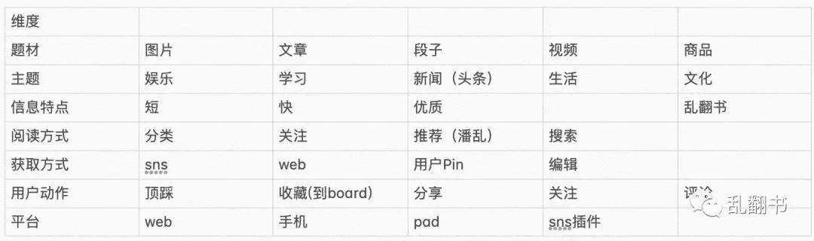

2012 年张一鸣对所有可能性的概括

因为不确定具体哪个产品形态最好，头条在 12 年上半年头条做了十多款产品投放市场做测试，在各个产品方向各种功能分布上都有尝试。

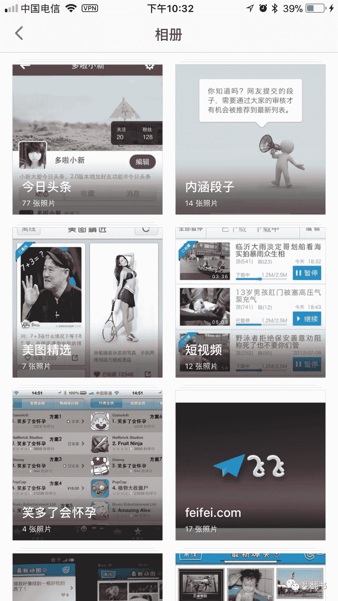

题材：图片/搞笑囧图，文章/今日头条，段子/内涵段子，视频/热门视频

主题：娱乐/笑多了会怀孕，新闻/今日头条，生活/飞飞看图

信息特点：短/精辟语录，快/今日头条，新闻总刷总有

阅读方式：分类＋推荐/今日头条，关注/飞飞

用户动作：顶踩＋评论/内涵段子，收藏＋关注/飞飞看图

平台：SNS 插件/xiangping.com

可能在今日头条之前值得一提是飞飞和 xiangping.com，飞飞是类 Pinterest，享评是类 jiathis，最早也考虑过做关注订阅和分享插件，其实还是 PC 思维，但在今日头条出来后很快团队的思路就全部转到移动上了。

> “在连接人与信息这条路上，他要做的是聚合所有信息平台。不拘泥于文字、图片、视频，甚至以后任何未知形式的表达；也不限制在交通、股票、娱乐等维度。”

**2016 年，全赛道覆盖**

张一鸣如做投资也该是个顶级 VC。

短视频是未来，在 2016 年全行业都看到了。但像张一鸣这种分析所有可能性都去尝试的打法，比 VC 投资更激进，因为是真正的全赛道覆盖。

1.  头条的应对还是分析市场，从题材来看是长视频、短视频、小视频和直播。
    
2.  长视频跟内容质量关系更大跟推荐算法关系不大，这块暂时放弃。（现在西瓜开始做自制综艺了）
    
3.  短视频、小视频很适合头条这套分发逻辑，要重点做。
    
4.  直播是新的业态，头条系产品全部加入尝试。
    

*   短视频领域做得最好的是 YouTube，西瓜视频对标 YouTube。
    
*   小视频领域中国有快手，火山小视频对标快手。
    
*   美国有 musicl.ly，A.ME/抖音对标 M。
    
*   因为快手日活远高于 musicl.ly，且 musicl.ly 在美国遭遇发展瓶颈，所以在很长时间里，头条对火山各项资源/人才/预算的投入，都是远远超过抖音。
    

**2018 年，社区化**

字节跳动想要继续发展需要扩充人群，信息流＋社区是天花板更高的解法，也能吸引今日头条吸引不到的用户。一方面要在各个主产品里加重社区属性，另外也要在不断孵化新产品。

抖音是是第一个成功尝试。悟空问答是不那么成功的尝试。

头条会分析市场上有规模用户（千万日活以上）的社区产品，他的用户群字节跳动是否已经覆盖，如果没有，就要考虑自己也做一个。

比如女性、二次元、海外。

*   现在的皮皮虾、新草、半次元，大约也是对标内涵段子、小红书、B 站。
    
*   字节跳动今年在印度发布了 Helo。
    

工作推进层面，头条最重要的一点就是敢试，业务打法非常激进，是“人家说我们做不出，那我一定要做出来给大家看。”头条从来不相信别人说不行，自己没试过就不否定任何事。大家都说付费广告买量亏的时候，别人投二百万试一试不行就放弃了，头条直接先拿一个亿出来试试会不会大力出奇迹，像短视频国际化这种核心战略都是屡败屡战还不断加码最终取得阶段胜利。

**教育、金融、企业办公、出海**

2019 年，新概念。

13-15 年的春节档都是腾讯系产品暴涨的最佳时期，不过在 18 年春节档取得现象级增长的公司是头条。

如今字节跳动旗下的社交产品飞聊正在中航广场的健身房全力冲刺等待 19 年春节档的到来，不知飞聊能否成为“社交黑客帝国”里的第 N 道试错程序，并且打怪升级。

* * *

**判断力批判**

**学习与进化**

2008 年，张一鸣在饭否工作阶段把 Alexa 排名前一千的网站，都看了一遍，统计了它们的类型，哪些呈上升趋势的网站中国没有等等，并详细列表。同时思考，那些人都很聪明，为什么没有成功？

2012 年，张一鸣在创办字节跳动时，把微博上所有高热大号和 App Store 排名靠前的应用都给研究了一遍，其中像是搞笑囧图、内涵段子这些产品的名字就来自微博同名营销号，像是飞飞看图和 xiangping.com 就来自当时正火的 Pinterest 和分享工具 jiathis。

2015 年，极客公园的张鹏提到张一鸣的学习升级能力也显得非常出众。极客公园每年有一次创新产品评选，张一鸣会组织同事把榜单上的产品全部梳理一遍，从中寻找启发。

15 年《人物》杂志的葛倩男和吴达采访完总结，张一鸣信任程序化、规律化的事物。

> 「在他看来，只有数据和自己的逻辑推演能够指引最为客观可信的答案。在公司做出任何一个决策，他都要求下属充分调研，然后提交报告。确定产品名称时，他把排名前 100 位的移动应用的名称都分析一遍，进行分类统计，最后确认，具象的名字更容易成功。」

所以张一鸣会提倡用常见物体的名字作为产品名，但一般操作的时候，都会先列一些名字，然后选几个去渠道里投放测试一下转化，ROI 效果好的那个才有可能当选。比如悟空问答当时还有个备选是，小熊问答。西瓜视频这个产品名字产生则有更多的故事。

在头条内部有个提法，叫“能用 AB 测试解决的问题都不是问题”。头条一直很相信数据驱动方法论的力量，一切必须是可数字化的，各个部门开会都是上来先看图标。不关心那些不可量化的事情，一切做到可检查可追溯。涨要知道为何涨，跌要知道为何跌。对于所有涉及概率的地方，一切都以跑个 AB 作为最后讨论的终结点。

当然，现在头条不管是张一鸣还是陈林都不会认可这种说法，会认为这种一定要以数据导向，一定要 AB 测试是业界给他们贴的极端标签。

不可忽视的是，张一鸣和头条的认知和迭代能力一直都很强，很少出错且能够不断更新，迈向新的成长之径。

比如 12 年团队对头条想象力可能不会比一家门户的移动端高多少，但到 14 年初当搜狐和网易新闻客户端日活都卡在千万日活上不去的时候，头条在 B 轮融资时就提到其实头条的本质是浏览器，因为当时同样满足信息浏览需求的 UC 日活超过 5 千万，是一座新的山。

当头条轻松超越 UC 日活过亿时，这家公司新提出的口号和愿景是今日头条将从智能推荐走向智能社交，要做“全球创作与交流平台”。因为过亿日活后，还能看得见的高天花板产品，只有 Facebook 和微信是十亿日活量级，社交是互联网的皇冠，全球化是想要获取新的增长引擎。

再比如，当去年底，抖音比火山表现出更多的可能性时，字节跳动能够果断将抖音立为核心产品来全力推广，到今天抖音对于字节跳动全球版图的重要性已经超过了今日头条。

16 年底，TMD 乌镇会谈，老乡王兴评价张一鸣：学习能力超强，而且超级理性。

**把自己当产品看**

张一鸣一直在思考如何把公司这个产品做得更好，“我创业其实同时在做两个产品，一个是为用户提供服务的产品；另外一个产品就是公司，而 CEO 就是公司这个产品的产品经理。”

乔布斯在自己传记的结语部分也说，“我的激情所在是打造一家可以传世的公司，这家公司里的人动力十足地创造伟大的产品，其他都是第二位的。”

张一鸣会特别花心思在公司这个产品的设计上，认为公司的核心竞争力是团队和文化。在公司发展的不同阶段，在不同层面/领域向美国和中国具备优秀治理体系和公司文化的公司看齐，比如 Google、Netflix、Facebook 和 Amazon，华为和阿里。

在 15 年中 SIG 的年会上，我记得张一鸣说创业是一种修行。要主动创造和丰富人生经验，和优秀的人一起做优秀而有趣的事；要不断修炼自己，减少“平庸”束缚，去探索未知；不贪图便捷的成功。

跟如何做好公司，如何拓展商业版图同等重要的事，是张一鸣如何追求个人的完善。因为一家公司最大的天花板就在 CEO，CEO 的时间精力分配会深度影响公司运作，张一鸣会很在意自己的时间分配。

比如总裁办每周五都要发报告做饼图分析，张一鸣这周在什么事上花了多少时间，学英语、找人、做运动，他会观察和修正自己的行为，看在哪个领域的事情可以有更优的效果。

想要逃逸平庸的重力，要有足够的自我锻炼。连谈恋爱都不愿浪费时间的张一鸣，在大学期间主要在做三件事情 ，“一是写代码，因为我是搞技术的，二是看书，看了很多很多书，三是修电脑。基于此收获了三件事：耐心，知识，伙伴。”

关于张一鸣延迟满足感和创业是种修行等提法的由来，为什么会想要通过工作来精进自己，我觉得从他的阅读里面可以扒一下。

16 年底《财经》小晚采访张一鸣，问对他个人影响最大的书是什么。他列了《活法》、《少有人走的路》、《高效人士的七个习惯》、《基础生物学》几本书。

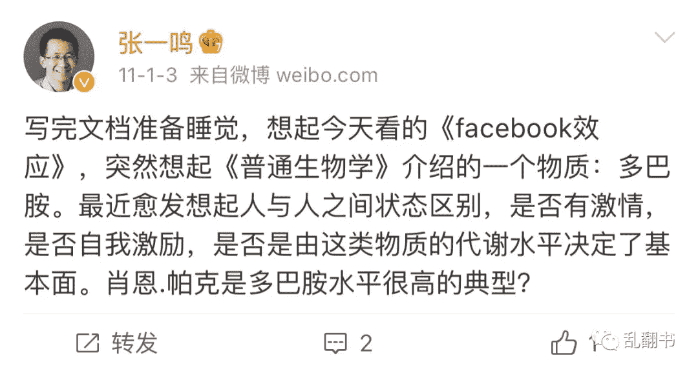

一位河南省生物竞赛一等奖的同学跟我解释《陈阅增普通生物学》，“一本类似于生物竞赛方面的科普读物的书，学习了高中生物后这本书并不难看懂。这本书内容全面有点“大纲”的意思，对于竞赛生它是帮忙纵观竞赛有关知识的入门读物。虽然深度不及各个专题的专业书籍，但还是有学术性的，不少高中生只看这本书来准备竞赛都能拿奖。但对于想认真学竞赛的同学来说，这只是开始。”

2017 年，头条在信息流领域与 BAT 开干，在短视频战场为公司谋求新的增长引擎。竞争最激烈的阶段，张一鸣在豆瓣标记了想读《生物心理学》和《生物物理学》。

生物学的研究方法，主要就是观察法和实验法，是做实验让生物学成为了一门实证科学。科学基于事实，在结局和起源上都是实证的，凡是不能通过实证的东西都不能算做科学，都将被暂时排除在科学的大门之外。科学的实证精神的真谛是：实验是检验真理的唯一标准。

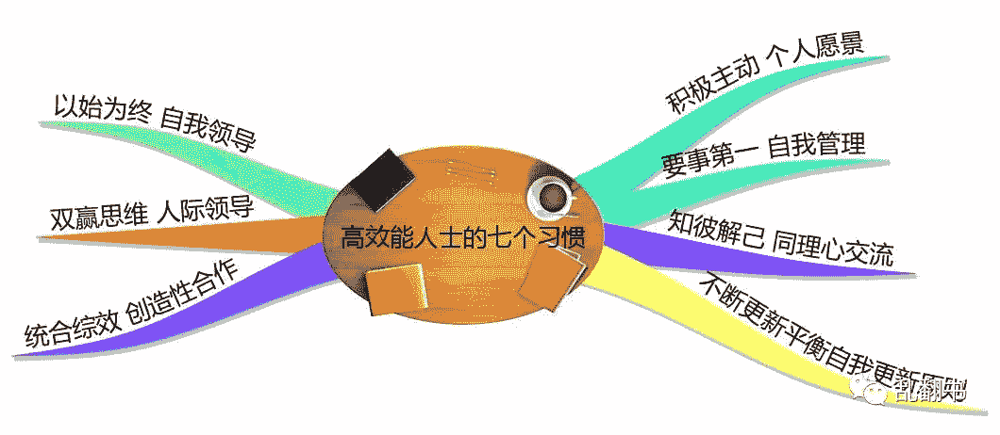

《高效能人士的七个习惯》，书名可能有些俗气，但这本书是想让你清楚的选择一个适于自己的生活方式。

尤其是以终为始 （Begin with the end in mind）这条，先有愿景目标，再以此塑造未来，全心投注于自己最重视的原则、价值观、关系及目标之上。

很可能是延迟满足感这个提法的提炼来源。

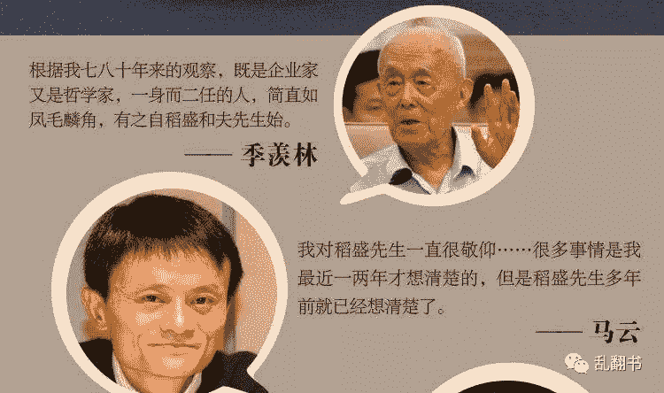

努力工作、精进是一种修炼方式这个观念肯定是来自稻盛和夫。稻盛和夫认为通过艰苦的劳动可以磨炼自己的人格，可以修身养性。

“只有极度认真工作，才能扭转人生。”

## 4.张一鸣眼里的字节跳动

### 关于字节跳动这 7 年，张一鸣讲了 5 个故事

字节跳动是一家什么样的公司？ByteDancer 是一群怎么样的人？很多人问过也尝试回答过。在字节跳动七周年庆上，一鸣以一段重访锦秋家园视频开场，首次讲述了公司国际化、业务决策、技术研发和招聘用人等方面鲜为人知的故事，分享了创业以来我们追求的目标和做事方法。

字节跳动有这样一群务实浪漫的人：充满想象力，也有把想象变成现实的务实行动。Face reality and change it，这种务实浪漫驱动我们一起全力奔跑，一起去看最好的风景。以下是一鸣的演讲全文，在这里分享给大家。

欢迎来自各个国家的同事聚在这个小小的报告厅里，进行我们的年会活动。2018 年，我们取得了很多成绩，也经历了不少挫折和困难，很多同学为此付出了艰辛的努力。谢谢大家！过去的一年，不仅对我们公司而言，是非常不平凡的一年，对整个行业，甚至对整个世界都是。2015 年，我们在冲绳办年会，主题叫“巨变的时代”。当时我们感受到不断发展的科技，会对社会和世界带来很大的改变，但我们没有预料到科技带来巨大改变的时候，也引起了巨大的反作用力，科技公司也会在这个过程中，经历很多挑战。

过去，我站在这里跟大家分享公司业务，行业格局，这些我今天都不想再说了。为了准备今天的分享，昨天晚上，我去了一个地方找灵感，也带大家去看看。

还是勾起挺多回忆的。过去有很多采访，经常问我创业是否艰辛。我觉得并没有。虽然挤在一个小小的民宅里，家具简单，但是我们印象中，当时的日子都是挺快乐的，是一个新的开始，每天都充满希望，最关键是在创造有价值的事情。即便并没有住在地下室里的艰辛，跌宕起伏的曲折故事，但还是想起不少事情值得和大家分享。所以我今天主要讲几个故事。

**空间有形 梦想无限**

大家都知道，我们拿到第一笔融资，是在这附近的一家小咖啡馆。其实还有两笔融资也是发生在这个房子里。公司创立半年左右，一个来北京旅游的美国创业者，经过朋友介绍来公司参观，聊了很多产品技术。他很惊讶，说这间公寓里团队的技术是跟硅谷接轨的，他能不能做一笔投资？后来他就成了我们的投资人。

在 12 年底，就在锦秋家园里，我们开始讨论国际化的事情。我们在取“字节跳动”这个名字的时候，也想好了 ByteDance 这个英文名。那时候，同事中也没几个人出过国。但我们觉得，移动互联网带给我们的机会在全球都存在。

过去这些年，我们一直在讨论国际化。去年，我们说要加快国际化的进程。有个同事很积极，有一天跟我说下周要去印度调研。过了几天，我问他你在哪个城市，德里还是班加罗尔，他说还在知春路……他在印度过海关的时候被拦住了。我说为什么？他说他拿的证件不行。我说你拿的什么证件？他说 APEC 证。他拿着一张环太平洋组织的证件，去了印度洋的国家。他说，上面写着印度啊。我找了好久，看到一个缩写 IDN，这是印尼好么。

当然这并不能阻碍他去印度的热情，隔了一个礼拜，他还是踏上了印度的土地。他还在抖音里发了小视频，坐在“突突车”上，长途跋涉了两次总算入关了，感觉还挺欢快的。这位同学在印度做了很多行业的分析和调研，还招了很多的候选人，我也不知道他是怎么做到的，毕竟英语也不是很好。于是我就想到了唐僧西天取经。这位同事是谁，我就不说了，大家就当他是唐僧吧，反正取到了真经。

我是想说，很多时候，尽管条件是有限的，不管是办公空间小，还是语言不通，但梦想依旧可以很广阔，可以追求创造非常大的事情。我曾经在一个工地上看过这句话，空间有形，梦想无限，我觉得特别契合。

我前两天，翻了下我的微博，发现一条私信。这让我想起了我们最早做推荐引擎的故事。2012 年底，头条 App 发布后不久，某晚在锦秋家园 6 楼办公室，我叫上所有的 PM 和 RD 开会。核心议题：要做一个信息平台，看来势必要把个性化推荐引擎做好。我们现在启动不启动这个事情？当时非常多的人担心我们没有“基因”和能力，纷纷表示担心。我说，推荐我们不会，但可以学啊。于是我找到了《推荐系统实践》这本书的作者，问他要一本电子版看看。他说书还没出版，不肯给我，严重耽误了我们公司推荐能力的进度。我只能网上找资料，自己想象着写出了第一版的推荐引擎。现在他已经加入我们公司。

在当时，做推荐引擎对创业公司来说，难度还是很高的，那时候有很多人在做类似的 App，有些人是靠不可扩展地运营，有的人尝试通过简单的定制实现个性化，真正下决心做推荐引擎的公司很少，失败的很多。

但我们觉得，如果不解决个性化的问题，我们的产品只是做些微创新，也许能拿到一些移动互联网的红利，但不可能取得根本的突破，不能真正的创造价值。在任何时候，我们都要努力从根本上解决问题。

说起移动互联网，当时整个行业是对移动互联网广告也是没有信心的。觉得屏幕很小，并不适合放广告。当时广告形态都是 banner、积分墙之类的，转化效率很低，用户体验也很不好。

但我问张利东，他却说特有信心，我问他为啥，他说因为用户反馈邮件箱里经常有人说想来打广告。虽然这些用户可能单笔广告费不会超过 5 千块。我们认真思考了下，觉得个性化推荐信息流广告才能从根本上解决问题。我们得找个广告主，验证一下。2013 年 9 月，利东终于找来了一单生意，国美的北太平庄店。那时候，我们还没有广告系统呢。那怎么办？我们在信息流直接编码（hardcode），把广告的素材数据和地理位置范围投放硬编码写到了业务代码里面。为了证明广告有效，我们还设计了闭环：刷到广告后，点击收藏文章，拿着文章，到这家国美店买满 200 元东西，就送食用油。

刚开始，我们把推荐半径设为 3 公里，结果一个上午过去了，没有用户去，我们就把半径扩大到 10 公里，有十几个用户，又继续扩大，最后辐射范围最北到了北五环，最南到了南二环，来了一百多个人，终于把礼品送出去了。尽管效果很难说算好，我们还是非常兴奋，好歹实现了移动互联网定向闭环 LBS 广告啊。

让我想起了《史蒂夫·乔布斯传》里提到，17 岁生日的时候，乔布斯爸爸送给他一辆车，接下来一段话都在描述那个车有多破，但最后乔布斯说：but still it is a car。这就是我对我们第一个信息流个性化推荐广告的感受。

**做正确的事 而不是容易的事**

我们的头条寻人，现在已经找到 8521 个人了。平均每天弹窗 80+例寻人启事，最多一天找到了 29 名走失者。

做这件事，我们也有过很多讨论。大家可能都见过 404 寻人，很多公司做过，在一个根本打不开的页面上，放上寻人启事，用户看到的时候，小孩可能都走失一个月了，而且也不在同一个城市。咱们公司也有同事很早就提议要这么做，但我坚决反对。这个方法，根本找不到人，都是噱头，不如不做。如果我们要做，就认真找到能解决问题的办法。

到了 2016 年初，我们的用户已经达到一定密度，我们又重新讨论，有没有可能，从 LBS 广告到 LBS 寻人。在燕郊有了第一例成功案例后，我们认真仔细地做了测算，找到一个人要用多少成本，1 亿 DAU 的时候，是不是就能大规模的解决需求了，我们有没有机会和能力承担全中国的寻人信息。到如今，头条寻人已经是最有效而且找到人数最多的平台了。后来，我发现美国有一个系统叫 AMBER Alert，跟我们自己摸索出来的系统很相似。希望我们所有的公益项目都认真追求可持续、大范围、高效率，不要做表面工作。

前段时间，我们启用了一个新办公地点紫金数码，装修问题在头条圈被广泛讨论，很多同事吐槽办公室气味不好。我们因为团队成长太快，老是要搬新办公室，所以一直有这个问题。我也问房产的团队，为什么不能解决。他们说，按照最高标准测试，也绝不超标。我们确实尝试了各种办法，但这是一个行业难题。有些公司的做法，是多摆点绿植，但其实只是心理安慰作用。

那我就说，我们真的尝试世界上最有效的办法了吗？有没有可能介入生产环节，有没有可能联系材料专家，从工艺和流程入手，彻底解决问题。虽然很难，也许不能在一个月，一个季度搞定，甚至一年内，都解决不了，我们还要想办法去尝试，希望明年，我们在这方面能有有突破。不仅帮几万员工解决搬家时会遇到的空气质量问题，可能还是很好的商业机会。

有一天我看到咱们 HR 写的招聘 PM 的 JD，特别生气。有一条写着：有五年以上互联网产品经验，具有日活千万量级以上的产品规划和产品迭代实施经验。我跟这个 HR 说，按照这个要求，陈林、张楠，我们公司一大批 PM，一个都进不来，连我自己都进不来。别说千万 DAU 产品了，他们加入前，连百万，甚至十万 DAU 的产品也没做过。

很多同事加入我们公司的时候并没有光鲜的背景或者很好的履历，公司的产品经理，有设计背景的、运营背景的，还有代码写不好的工程师转岗的。也许有人倾向于招背景光鲜的男神女神，但咱们更爱朴素的“小鲜肉”。我们招人一直秉承的观念，是找到最合适的人，特质是不是真正契合，关注人的基本面。学校、相关经历、title 都没那么重要。写这样的 JD 很容易，本质上是偷懒，要发现人的特质才是困难的。

也许暂时做不到最好，但要一直保持从根本上解决问题的心态。不管是做公益、搞装修还是招人。

**拥抱不确定性 大力出奇迹**

头条号现在已经有很大的影响力了，从图文视频问答，到直播支持扶贫，成为移动互联网上非常重要的内容生态。2014 年，我们决定做头条号平台的时候，进展是非常缓慢的。产品非常简陋，邀请作者非常困难。当时头条号产品和运营在本职工作以外，每周都需要邀请作者入驻，在微博私信和微信公众号后台给创作者留言，从“智能推荐是什么”、“今日头条是什么”开始解释，经常找几百个人才有几个愿意入驻。内部也产生很多质疑，疑问我们能不能做起来。但我们还是觉得这对构建平台的内容生态非常重要，我印象中陈林特别坚持。在这种情况下，公司发动全体员工邀请创作者入驻，很多同事就从邀请自己身边的自媒体朋友开始，所有同事都兼任头条号作者的客服，答疑解惑，在内部沟通解决各类问题。

回头看，开始的时候我们的很多方法并不好，但是很努力、很专注，大力出奇迹。

短视频业务也经历过一些曲折。2015 年年初冲绳年会的时候，我叫大家到一个居酒屋，第二次讨论做不做短视频。第一次是 2014 年，但当时整条知春路地铁上都是腾讯微视的广告，微博的秒拍也在全力推广，我们心里有犹豫。加上经历了很多风波，精力上顾不上来。到年底美拍、快手已经起来了，我们感觉已经错过了。

16 年底，我们又重新讨论，觉得还是不能放弃，这会是一件给世界带来很多改变的事情，我们还是要大力尝试，不仅要做，还要做两款，不仅在国内做，还要在海外做，不仅要在海外做，还要做好并购。

后来我们真的收购了 Flipagram，17 年春节，我突然告诉团队我们要去洛杉矶做整合工作，团队个个面露难色，因为以前出国都很少，一致表示心虚。现在，公司已经有多个产品在许多国家取得进展了。

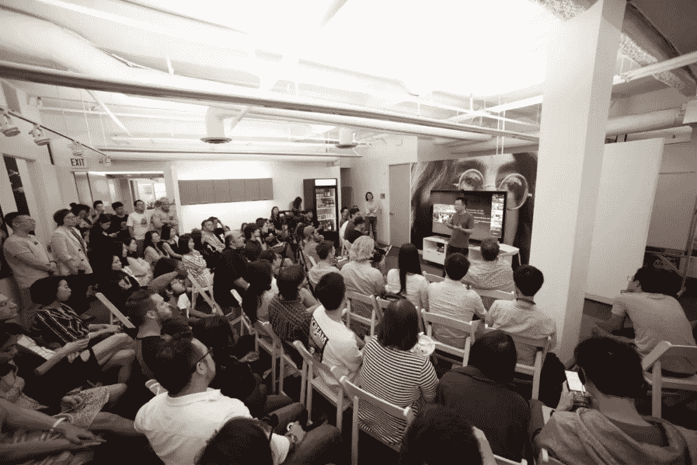

照片里这个会议室，就是我们第一次去 Flipagram 的时候的办公室。去年，我还硬着头皮在 LA 做了一次 CEO 面对面。后来，看到有当地媒体说，我用 halting English——“蹩脚”的英语——做了一次演讲。

讲这两个故事，是想跟大家说，做很多事情，初始都是很困难的，要调动资源全力以赴尝试很多次，才可能取得进展。现在，我们也有一些产品还不够好，我们欢迎积极吐槽提建议，但不要那么容易放弃希望。我觉得动不动就说“凉凉”是很势利的。什么是势利，势利就是只对表面现状的附和，不能超越现在，去想象还未发生的事情。我们要吸收真正有价值的吐槽，在重要的事情，正确的方向上要有旺盛的热情、大胆的想象力、坚韧不拔的意志，踏实去尝试，大力出奇迹。

有很多朋友问我，为什么要做社交，公司内部也有反馈，别跟某公司竞争，压力很大的。我给大家看这张图，是用户用微信发送消息时抖音链接被屏蔽的截图，去年我们仅在 App 内就收到 20 万的用户反馈，大家在问，为什么不能通过微信分享链接？是你们的软件出故障了吗？为什么不能给我妈妈发抖音视频，为什么不能给我同学发西瓜链接？我们可以放弃商业利益，避免竞争，不做某件事情，但是我们如何面对这 20 万用户的吐槽，这个问题要不要解决？

昨天有同学问我，对多闪有没有预期？我说对多闪的预期就是没有预期。如果保障这些用户分享通讯的权利，是重要的需要解决的问题，我们的预期就是不断想，不断试，想办法突破。

*\*我们是一群务实而浪漫的人*

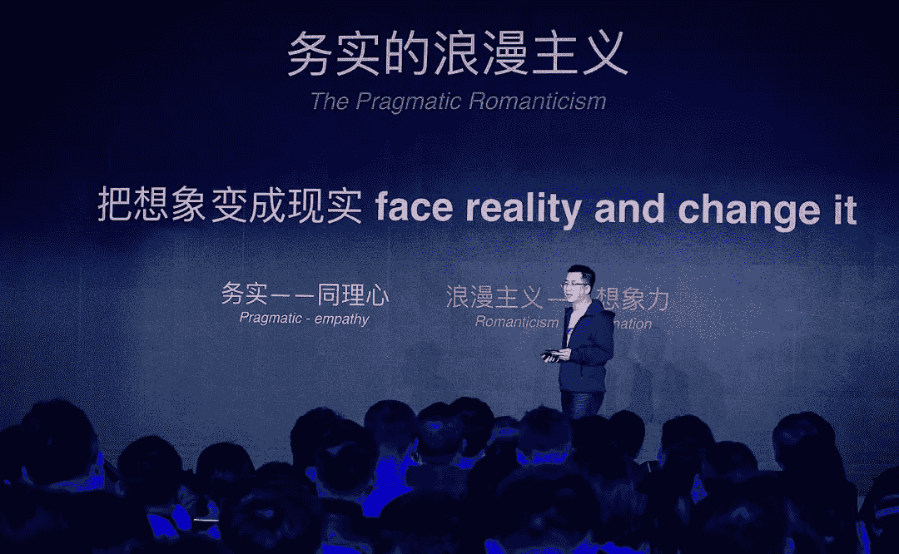

外界对我们有很多描述，说字节跳动是个过于理性的公司，张一鸣是一个过于理性的人，什么 AB 测试公司，App 工厂之类的，我非常不认同。昨天去锦秋家园的路上，想起这些故事，我觉得，我们是一个非常浪漫的公司啊。同事跟我说是不是叫理想主义，浪漫有点贬义，听起来不靠谱。我说不是，理想主义还不够，浪漫比理想主义更浪漫，只不过我们是务实的浪漫。什么是务实浪漫？就是把想象变成现实，face reality and change it。

精致的文艺不是浪漫，粗糙的宏大是浪漫，新事物都是粗糙的。晒情怀故意感动别人不是浪漫，独立思考穿越喧嚣是浪漫。有生命力是浪漫，面向未来是浪漫，拥抱不确定性是浪漫，保持可能性是浪漫。

什么是务实？大家往往会把做容易的事当做务实，其实不是，做正确的事才是务实，短期投机不是务实。大力出奇迹是务实，刨根问底是务实，抓住本质是务实，尊重用户是务实，认识世界的多样性是务实。

我们的团队，无论是在锦秋家园有形空间里想象很大的事情，还是普通话都说不好的同学拿着 APEC 卡去印度调研，都是很浪漫的事情。甚至我们的字节范就是最浪漫务实的体现。“追求极致”是浪漫，“开放谦虚”是务实，“始终创业”是浪漫，“坦诚清晰”是务实，“务实敢为”既务实又浪漫。

还有什么是务实浪漫：有同理心是务实，有想象力是浪漫。

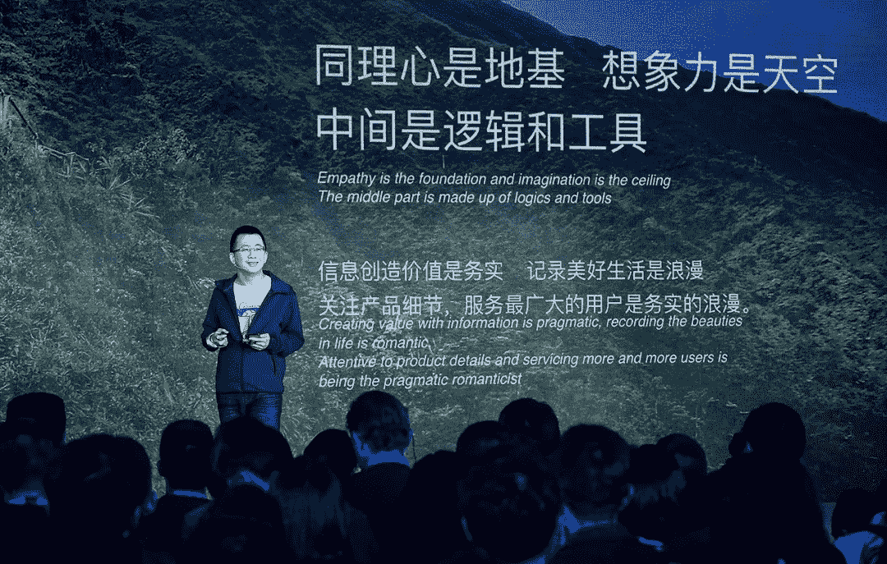

有人说你们公司是不是只会 AB 测试。我发过一个微头条：同理心是地基，想象力是天空，中间是逻辑和工具。AB 测试只是一个工具而已，是测不出用户需求的，同理心才是重要的基础。如果没有同理心，做出的产品肯定没有灵魂，不能满足用户需求。但是光有同理心还不够，这样只能做出有用的产品。想要做出彩的产品，想象力非常重要。

在头条还非常简陋，信息非常少的时候，我们就想象着头条的 feed 连着一根智能的天线，天线连着无边的信息海洋，每一刷，就会从海洋取回此时此刻此地你最感兴趣的信息。所以我们努力涵盖各种各样有用的信息，从新闻到图片，从三农到学术。

抖音也是如此，想象全屏的视频让手机变成一扇窗户，你透过这个窗户看到一个丰富的世界，抖音是这个五彩斑斓世界的投影，感觉非常奇妙。如果没有想象力，你可能只会做出一款对口型的热门应用或者搞笑视频软件，抖音也不可能从一款炫酷的音乐舞蹈小众软件，演化成包容美丽风光、戏曲艺术、感人故事、生活消费的大众平台。

我们跟踪一个个 Bug，做用户访谈，做 AB 测试是务实，但我们也有想象力，也浪漫。信息创造价值是我们的务实，记录美好生活是我们的浪漫。

电影《爱丽丝仙境漫游记》，里面有一句话，我印象很深，摘下来跟大家共享：

> *"Alice laughed: "There's no use trying," she said; "one can't believe impossible things." "I dare say you haven't had much practice,"said the Queen. "When I was younger, I always did it for half an hour a day. Why, sometimes I've believed as many as six impossible things before breakfast.”*
> 
> *——Alice's Adventures in Wonderland*

爱丽丝说，在早餐之前先想六件不可能发生的事情。我把这句话改了改：

*Romance is all about imagining interesting things that could happen in theory but not in reality yet.*

把“不可能发生的事情”改成“理论上可能发生，但事实上还未发生的事情”。浪漫就是如此。

就像爱丽丝说的，每天每年都想一想有什么事情可以发生，但不想不做就不会发生的事情。无论小事情还是大事情，无论工作中还是生活中。作为一个公司也应该保持想一想，我们能不能做出超越现在业界水平，超越目前产品，更创新更有价值的事情。希望我们永远是一个有想象力的公司。

关于务实和浪漫，还有一对相关的概念：ego 和格局。ego 的反义词是格局，务实和浪漫本质上就是要做到 ego 小，并且格局大，这样也才能有同理心，有想象力。

从公司角度：有人说业务发展快，就不容易出现办公室政治，因为发展快代表格局变大，大家就算 ego 大，也不容易碰撞，但公司一旦发展缓慢，就容易挤在一起了。大家可以想像下电子运动或者宇宙中的星球，ego 小，格局大，有更大的发挥空间。相反的是一个箱子内装了很多膨胀的气球。

“公司”这个词的英文 company，作为动词，还有“陪伴”的意思。公司早期，我做过一个比喻，创业就像一段旅程，我们一起去看最美好的风景，不要在半途逗留徘徊，不走巧径误入歧途。我今天想再加半句话，希望能跟大家这一群既务实又浪漫的人，一起去看最好的风景。

我的分享就到这里。有一天我在抖音上刷到一个视频，一个小男孩在欢快地奔跑。

我当时有种感觉，其实全力奔跑就是我们的浪漫，running together，谢谢大家！

## 5.不会写代码的 CEO 不是好 HR

### 张一鸣的用人观（2019）

有的人天生就是领导者，他们慷慨激昂，振臂一呼，便引人前赴后继。

张一鸣则相反，对于一家 750 亿美元、拥有 4 万员工公司的 CEO 来说，他的人物显得有些单薄，还有人会说他无趣。过于平静的表情、过于平和的话语，和过于平实的成长轨迹。

对于他的评价，“机器人”可能是最多的一个——他看起来是一个没有感情的理性决策机器。不过这可能是个误解。从结果上看，无论投资人、创业伙伴、还是如今的稳固的高层，他没有任何不欢而散的故事，这都不是一个机器人型、低情商的领导人能够做到的。

张一鸣受稻盛和夫的《活法》影响极深，即人的本质就是要不断精进、修炼灵魂，努力工作是达到这个目标最好的最佳途径。如今看来，他成功创造了三个产品，作为产品的今日头条、作为公司的字节跳动，和他自己。

在张一鸣的世界观来看，一切都是可以学习和训练的，包括演讲、包括情商、包括成为一位优秀的管理者。

方法论坚持久了，便成了人生观。如果说黄峥追求 0，即最本源的世界，那么张一鸣追求的就是莫比乌斯环——没有边界，即一个自我与世界的极限。

这构成了那个看起来毫无波澜的张一鸣。如果情商分为两个部分，处理与他人和自己的关系，那张一鸣拥有精准和敏锐的自我觉察能力。他希望与世界保持相对静止——分清自己的欲望和目标，情绪与现实；即所谓的延迟满足感：情绪跳动，思维就精准控制，拥抱惰性，人生也就失去了控制。

但是对于创始人来说，如何融合和隔离自我价值观与公司价值观，是一件较为矛盾的事——创始人眼里的对和错，不一定就是公司层面的是与非。而一个健康持续的制度，就像人一样，需要包容矛盾，在灰度中处理各种它们——激进和谨慎、开放和保守、包容和底线。CEO 如果不能自我平衡，就会将这些矛盾在公司管理中无限放大。

张一鸣自称是一个相对保守的人，而大家看到的字节正逐渐以“激进打法”形成自我风格————作为一家创业公司不留利润地增长和扩张，成立 7 年便横跨海内外多个业务线。张一鸣的正展现出其追求极限、扩张本能的一面。

而在这种自我觉察和公司修正的过程中，张一鸣的招人、用人是一个典型的切面——能看到他如何为自己补上短板，如何用机制和组织，为自我和公司纠偏。

#### 头条第一 HR

今日头条成立时，近 7 年、4 次创业经历并没有将张一鸣塑造成一个足够成熟、全面的 CEO，研发、产品端之外，张一鸣需要去找专业的人。

在 15 年以前，业务发展早期，张一鸣招人、用人的主要逻辑在于：补业务短板，同时，像投资一个早期创业者一样去招人。从 2010 年开始，他就在 QQ、微博、文件夹里列了个“可招对象”的分组，早期前台都他亲自面试。

在行业内对头条认知最薄弱、也是百度最兴盛的这个时期，张一鸣已经招到了未来字节跳动核心高管团队，一群能力远超公司发展阶段的人——负责广告业务的“财神爷”合伙人张利东，HR 负责人华巍，技术负责人杨震原，现今日头条 CEO 陈林，抖音 CEO 张楠，同时期还有前新浪副总裁赵添。

张一鸣将自己训练成头条第一 HR。2014 年，在同一家咖啡馆，横跨几个月的时间，张一鸣反复约见了赵添三次，终于将她从新浪挖走。

就像 2013 年张利东最初见到他的感受：没有犹豫——张一鸣给这个做了十多年广告的老媒体人，用一块黑板清晰解剖了移动广告时代的脉络。而在一个产品还只有几百万日活的时候，他就开始重金挖人，建立销售网络。

张一鸣不全按经验招人，而是按所谓“优秀”的特质——在今日头条发展早期，主要集中在“创业精神”上。但在一个互联网开口必谈创业的环境里，这个词的定义应该极为谨慎。

很难想象一个创业早期的产品公司，会投入大量资源去收购创业公司。

公司成立不到两个月，就收了一个做漂流瓶和天气应用的小团队，陈林就是成员之一。2013 年，张楠创建的图片分享交流社区图吧也被收购，此后开始负责内涵段子。后期的郭列、Musical.ly 创始人 Alex 等人也是如此进入头条。这是非常典型的 Facebook“收购代招人”的做法，在投资第一步，就会问团队，有没有兴趣加入头条。

张一鸣倾向有过创业动作的人，这是勤奋、开放、有学习能力的表现之一。但从另一个角度来看，创业者往往天生具有领导精神，和近乎叛逆的独立思考能力——让创始人为创始人工作，就像一架飞机的两翼——前者不服，后者不包容，这架飞机都飞不起来。

在差不多同一时期，另一个产品独角兽公司创始人，曾对招人充满矛盾，他说：”真正牛逼的人不会为你打工。“

张一鸣试图突破技术型 CEO 的瓶颈，曾这样训练自己的同理心：从产品视角出发，走在路上会去观察周围行人的动作和表情，推测他们的优点；从 HR 视角出发，去酒店大堂也会环顾，看哪些人适合招到头条来。在他看来，多数事情，在不断训练以前，不足以谈天赋。

张一鸣常年有意走楼梯，以此锻炼意志、不偷懒。九年前，张一鸣发布了一条微博——放假期间世界杯我一场都没看，我看了两本书。狂欢是一群人的孤独，孤独是一个人的狂欢。独立很重要，盲从浪费时间。

这像是一个三好学生的标准发言，这些细节在生活上可能难免让人乏味，但作为共事者，事事精进反而是种具有激励性的习惯，或许更能获得优秀人才的认同。

这或许是为什么 2014 年，百度搜索部副总监、后负责广告和推荐两大核心系统的杨震原、新浪门户副主编赵添加入头条后，都有一批各自的核心骨干跟随加入。认同感组成了张一鸣在此阶段最核心的竞争力。

2016 年后高管团队稳固后，张一鸣高调招人的背后，更多是基于新战略分支——2016 年加入的柳甄，是字节国际化战略的标志；2018 年加入的谷文栋，之前是宜信大数据创新中心副总经理，预示着字节在金融科技领域的尝试。

随着公司业务线进展，张一鸣的用人节奏也在调整，一个典型的例子是赵添。她是在 2014 到 2016 年，打破头条内容版权困境，一手建立内容运营体系的功臣。

在头条号生态建立后，赵添在 2017 年底开始淡出运营条线，从与陈林平级到向陈林汇报。她出身门户，擅长门户指哪儿打哪儿，拓展能力较强，因此开始负责老产品的市场和 BD，未来也将拓展到重要新业务上。

#### 两大产品体系领导人

定方向、派人、调资源，张一鸣一直在成功产品名字之外，但又在所有产品影子之内。字节实际上并不是一个委员会制集体决策的公司，张一鸣的用人意志体现在产品成长的每一个阶段。

2018 年字节跳动在内部提出类似“全面开花”产品战略，从女性社区、教育、小说、社交都重金试了一遍。但只有个别项目存活了下来——这不免让行业有些失望——新产品市场越是走入颓势，人们越是渴望在行业领导者身上看到奇迹。

唯一几款增势还不错的项目，Lark 归属 EE 谢欣，懂车帝归属张利东的商业化团队，更多产品孵化于今日头条负责人陈林团队，以短暂尝试告终。

陈林在内部评价并不统一，有人认为他是带着今日头条从 0 到 100 的功臣，是张一鸣执行方面优秀的搭档；还有一些人并不完全认可他的产品能力，以及张一鸣之外、战略方向的把控力，挑战点之一就是，今日头条之外他少有建树。

而这个时候，陈林接替张一鸣成为了今日头条 CEO。”张一鸣非常信任陈林。同时，字节跳动已经开始集团化，张一鸣和今日头条产品系列中间应该有一个更清晰的间隔。“一位熟悉字节跳动的业内人士告诉我。

陈林是张一鸣的老战友，在公司成立不到两个月的时候收购加入。工号 12，擅长产品设计，研发出身，在头条完成了从 ios 研发到产品经理的转型。

张一鸣和陈林共同定了很多产品的方向，但两个人的风格不同。

张一鸣开会时，抛出无数的“why”和“when”，比如”为什么是这个数？“而很少过问“how”，字节跳动双月会往往是最挑战产品组们的时刻之一，因为这往往变成 ceo 的提问大会。

而陈林会更加关注数据细节，他过产品方案的细节，会一遍一遍反复使用挑问题。张一鸣对他的评价是，他更细腻，直觉和同理心更强。

陈林升任今日头条 CEO，无疑从结果上肯定了其对张一鸣产品细节把控的半径，或许也是对头条系风格打法的认可。

张楠则是另一种成长路径。在抖音火山起来之前，张楠已经有过多年互联网运营经验。被头条收购加入后，负责的内涵段子一直处于元老、但边缘产品的角色。她对于 ugc 社区产品有着比较深的理解，运营在其中扮演关键的角色。”社区需要养。“一位前头条中层告诉我，这是张楠对他说过最有价值的一句话，这和跟头条系的打法不完全相同。

因此在短视频战略落地时，张一鸣选择了张楠的互娱。在抖音冷启动中，张楠带领的艺术院校的学生的运营活动功不可没。值得注意的是，陈林也是这个过程积极的参与者，张一鸣更是调配资源支持的主要角色。在产品推进困难的时候，火山从最初快手直播的打法扭转成为 ugc 补贴打法，抖音从复制 musically 到运营驱动的爆发式成长，张一鸣和陈林对方向的调整都坚持到了最后。结果证明也是对的。

抖音成长起来后，陈林淡出决策，抖音第一个产品经理陈立峰一直担任产品负责人。张楠被内部人形容为“大姐姐”，尤其是在抖音极其年轻化的团队中。她没有陈林那么严厉，但是非常擅长整合资源配置。

到 2018 年年底，抖音和头条，字节跳动集团两大产品公司势力成型，分属抖音总裁张楠和今日头条 CEO 陈林。他们是连通张一鸣和执行的关键枢纽。在张楠之下，原内涵段子团队、现皮皮虾团队向陈林汇报。除火山、faceu 相机和抖音外，字节跳动的大部分产品孵化集中在陈林体系内，陈林手下还有稳中求涨的今日头条、微头条、西瓜视频等产品，以及新业务飞聊、多闪等。

同时，张一鸣还给了张利东和谢欣充分的权限去做自己部门的产品，懂车帝和 lark——毕竟内部没有人比张更懂以商业化为目标的产品，也没有人比搭建公司信息系统的 EE 部门更懂流程管理。

至此，字节跳动集团已经形成了一盘棋局。这个象棋盘上，抖音和头条是守将的仕、象，新产品是小步快跑的马、卒，企业服务和 Tiktok 是长驱直入敌方地盘的车，还有一个叫“搜索”的炮台直指对方后方。

张楠团队的仕和兵，是更为年轻化、更强调产品、商业化、运营创新的团队。一个明显的标志是，在抖音业务增速放缓时，今年上半年 Musically 创始人 Alex 开始负责产品，试图从产品初心角度进行创新，指着全球化打。而陈林团队的象和卒，依靠更为保守和和成型的头条产品方法论，稳扎国内市场。

#### 人才运转机器

能让上述一切灵活调配和发展空间成为可能的，是 HR 负责人华巍，也是字节公司组织和机制的建立者之一。

曾在凤凰负责投资的华巍，因高层决策没能投上头条，当张一鸣发出邀请后，他立刻加入了头条。他和张一鸣一样，喜欢勤读生物、物理相关书籍，与其保持密切地沟通，是内部对张一鸣战略思考最有影响的人之一。

华巍曾分享说，有一天他做梦，梦见自己有一种超能力——可以准确回答任何问题。他梦见张一鸣就坐在他身边，梦里张一鸣问的是：宇宙的目的是什么？醒来之后华巍发了个朋友圈，张一鸣在下面留言说：你是不是嫌我平时问你太多问题了？

前期，华巍主导了大部分投资收购，如快看漫画、东方 IC，是投资产品，更是投人。后期他专注组织和文化建设。

一位张一鸣的早期投资人说，张一鸣最大的弱点，就是纠结。在决策前，他会有一个长周期、反复变更的思考过程。而作为一个需要对内对外、重新配置资源的 CEO 来说，他需要考虑的事情太多了。

华巍补上了他这块短板——他比张一鸣更加极端：更理性、更不情绪化。他会把一切企业决策以经济学模型看待，在他脑中，公司制度设置、激励机制都是一个庞杂的算法公式，甚至包括战略。

“他欣赏、信赖张一鸣。他的角色更像一位谋士，目标是辅佐——重要的不是君本身是谁，而是可以让君可以成为谁。” 一位熟悉华巍的人说。这套管理体系，不仅是张一鸣的理想国，更是在华巍帮助下，将一个放大的自己，与自我精进的方法论，融入公司价值观、文化中。

张一鸣曾说他的大部分决策基于科斯定理——在交易费用为零的情况下，不管权利如何进行初始配置，当事人之间的谈判都会导致资源配置的帕雷托最优。因此在一个组织内，指谁上战场反而不是那么重要的事。更关键的是要从组织角度，产权责任清晰、减少交易成本。这或许就是张一鸣和华巍构建这套机制的逻辑。

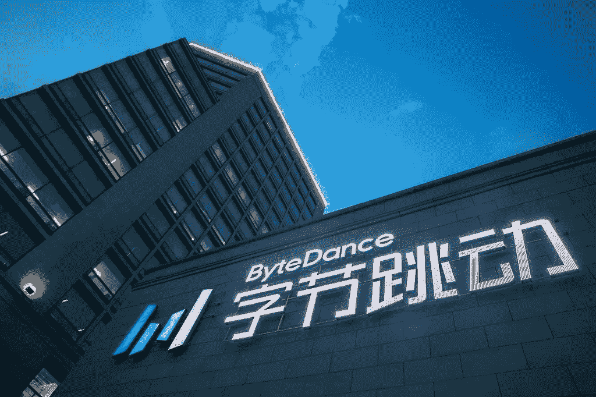

就像你无法定义硅谷文化是什么，你也无法定义头条管理属于什么类型。它阶段性的学习了硅谷的先进公司制度：Neflix 的用人观、亚马逊的 Always day one、Facebook 的增长和收购招人、谷歌开放坦诚的工作方式...但都带有中国特色：中庸一点，集体主义一点。

强制大小周休息制是这个体质的典型表现。它首先筛掉了一批个人原因难以保持创业精神的人，又以足够多的加班激励保证员工的战斗力——每一周都比别人快 0.1%，滚雪球般地在互联网快速竞争中带来巨大势能。

同时，若中层员工因此离开，基层员工也得以上升。但同时，大小周又保持宽松的请假制度，为员工留有自由的余地。

就像一个人，一生中要平衡各种矛盾，自我与集体、改变世界和实现梦想、想象力和执行力、专注与灵活。一个张弛有度的体制也应该是一个矛盾的综合体——既要放大善的部分：好胜心、创造力、行动力，又要挟制恶的部分：惰性、缺乏耐心等，就像跷跷板上的平衡轴。包容是理解矛盾，保持多样性的核心。

字节是开放的，在这个体量和规模上，CEO 每个双月会公开分享答疑。这套机制被张一鸣称为“充分 Context，少量 Control”的管理模式。

这套模式的核心是：优秀的人就是一台分布式的处理器，不只是一个执行者，每一台分布式计算机都有判断能力，都要聪明，因此需要掌握所有的上下文信息。但决策权最终还是落在负责人手中，什么时候做，什么时候砍。同时，在内部竞争、内部挖人的环节上，又比较谨慎；

张一鸣倡导“与优秀的人一起做有挑战的事”。字节没有阿里 271 强制的辞退制度，更多的时候，拿到十几个月甚至几十个月年终激励的人只占 10-20%，垫底的人不会辞退，只会薪酬不涨或者调低，更多的还是大锅饭薪酬。

和外界理解相反，张一鸣是一个时间管理较差的 CEO，他认为睡觉是件枯燥的事，所以晚上不想睡，早上起不来。经常睡过头、迟到。在内部张一鸣 Control 很少，也是因为他觉得控制是件很 boring 的事。

就像一款产品一样，在字节跳动，每半年调整一次的管理模式，有多个工具贯穿其中。

一是拉开区分度的绩效考核，从去年开始，已经从分数刻度（1、2、3、4、5），这次改成描述性刻度（FIMEO），即 Failed、Improvement Needed、Meet Expectation/MeetExpectation-、Exceed Expectationexceed Expectation、Outstanding/Outstanding+。值得注意的是，全公司任何一个人都有评价另一个人的权限，这个人的上级能看到所有评价且纠偏。这避免了内部派系斗争和向上管理。

二是内部沟通与效率工程，EE 部门建立内部系统，涵盖行政、财务、人力、OKR、任务管理、数据统计等，将工作流程的各个方面产品化、机制化。今年推出的企业服务产品 Lark，就是公司内部的 IM 软件走向市场。

在这样的语境下，以结果为导向的评判体系才能带来最高的效率——尽可能以目标为先，避免对事不对人，也避免组织内部搭便车，出现迎合老板才是上升通道的腐化雏形。

#### 共识是最大的激励

阿里基于使命感和强价值观而团结，腾讯基于开放文化和用户产品成就而团结，还有一些公司基于利益和胜利团结，一些公司基于情怀和理想团结，而字节跳动是基于“优秀”的共识。

这与包容文化并不矛盾。对共识中个人来说，优秀是一个模糊于欲望和目标之间的追求。政治的生物基础之一是：人天生追求的不只是物质，还有承认。人的政治活动的大部分都以寻求承认为中心。即经济学家罗伯特·弗兰克所称的“地位性物品”。

然而追求承认或地位的斗争是零和博弈——一旦优秀形成标准，标准就会带来评价，评价就会带来偏见。就像填错了答案，这道题就得扣分——人之所以遵守规则，主要根植于感情，并不依靠理性的过程。而共识，就是一种强烈的情感连接。”从张一鸣、张楠到陈林，整体的风格都非常守规矩，这个规矩就是字面意思。“一位前字节中层说。

张一鸣对突破极限的自我要求，在无形中影响了整个公司的价值观判断。

《活法》中说，以每天的全部精力投入工作，才是锻炼灵魂、提升心性的“无上”修行。张一鸣曾说过，让员工强制加班是中策，上策是主动、高效和投入地加班。这与他个人保持勤奋的习惯一致。

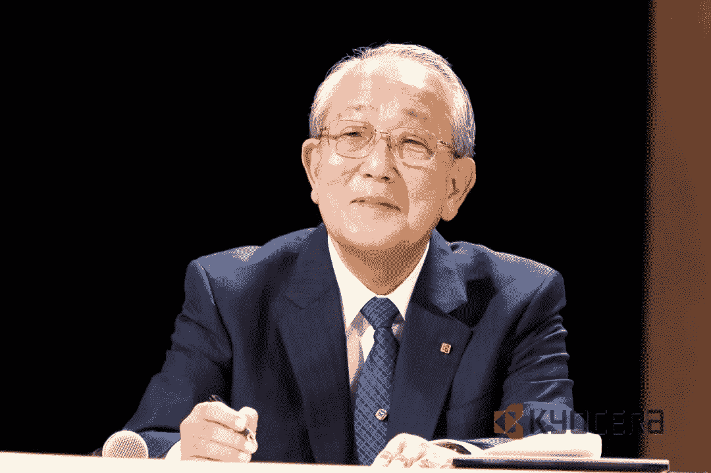

很多人信仰优秀，信仰这套方法论。但公司里不是所有人都需要像一个商人一样思考。一些人会质疑其存在的公司意义、个人意义。

一个较为集中的点是，相比腾讯靠产品和直觉和对用户的洞察，阿里则偏重宏大愿景和紧密的团队关系，字节以数据驱动决策、以结果为导向的工作方法是多数公司最大的不同点。

但很多人会质疑这背后的路径依赖，和功利主义倾向，质问头条的使命感去了哪里？

测试、BI 的工具和方法论，是字节跳动领先行业的原因之一。但工具是中性的，若产品经理失职，用工具替代创新和同理心，产品将缺乏生命力。在共识面前，挑战的声音反而更有价值，因为这代表了包容的文化和独立的思考。

在对标小红书的新项目“泡芙”第一次双月会上，张一鸣基本只重复了一个问题：“什么时候能超过小红书？”现场没有人能给出一个确切的答案，因为产品尚未正式上线，还在规划。

当张一鸣想 push 员工提高标准，带来更创新的产品，他倾向于给一个看起来不切实际的目标，认为这会引导团队提高标准，避免跟随，穿过现象去思考本质。

“尽量不做别人已经做好的事，不能比别人做得更好就不做，除非是业务防御关键点。”张一鸣在 16 年《财经》的采访中说。但 GoGoKid、游戏、在线小说、泡芙等产品出现，这句话并不一定对。

“保守”是张一鸣曾用来描述自己的话，他善于做基础、定方向，但不善于抢夺，内心瞻前顾后，因此被评价为“纠结”。如今来看，这种犹豫，逐渐被成功所带来的自信所覆盖，张一鸣侵略性的一面正逐渐被大家看到。

16 年的时候，某高管会对加入头条的同学说，头条一定会成为一家伟大的公司，颠覆百度。当 16 年头条扩张业务时，人们可以理解为防御和排头兵试错，而今年，他说，头条将成为一个伟大的商业公司。

伟大的商业公司，即如亚马逊、阿里巴巴那样，在所有赚钱的地方，以集团军的方式去攻打，去开拓。而一个健康有效的系统就是这场世界大战的航空母舰。

# 黄峥

## 1.如何找到新的商业突破

### 对话拼多多黄峥：他们建帝国、争地盘，我要错位竞争（2018）

《财经》记者 宋玮 房宫一柳／文

在万能的淘宝一件商品卖 29 元，在拼多多上可能卖 19 元，如果你能找到五个朋友和你一起买，你也许能以 9.9 的价格买下——并且还包邮。早期依靠这样大量 9.9 包邮的产品，拼多多构建起了一个 GMV 过千亿，仅次于阿里和京东的中国第三大电商平台。而完成这一切它只花了两年多时间，并且是在所谓互联网下半场，流量越来越昂贵的背景下。

这家公司起于无声之中，一线城市的人可能根本还没有听过它，等它出现的时候，体量已经极其庞大，这个成长路径不难让人想起当年的快手和今日头条。

流量玩法是今天互联网的主流逻辑，帝国竞争、地盘之争是今天的主要命题，那些爆红的创业公司多数都是阿里、腾讯直接或间接博弈的产物。对创业公司来说，在现有中国互联网的竞争环境下，每一张桌子都是满的。如果还按照传统的思维去竞争，是永远无法突破巨头包围的。

在这个背景下，《财经》专访了拼多多创始人兼 CEO 黄峥。他提出了一些新的思考。他认为后流量时代的关键是以人为核心，找到更适合这个时代、更适合消费者的，本质的玩法，这样才能在一个看似没有机会的饱和领域找到新的商业突破。

“阿里京东滴滴美团，他们是帝国式竞争，有明确地盘的界限，但我觉得我们这一代人的思路不该是这样。”

正如快手在社交领域、头条在信息分发领域的创新一样，拼多多在电商领域也带来了新的启发。这几家公司共同让我们看到了中国互联网下半场最初的成功模式。

｜谈腾讯

*「我不觉得我们是腾讯系」*

《财经》：有人认为，拼多多已经替代京东成为腾讯对抗阿里的首要战略扶持对象。

黄峥：腾讯扶持我们？体现在哪里呢？

《财经》：拼多多的很多玩法都是微信三令五申禁止的，比如诱导点击，比如直接提及用户的微信名字，但如今依然安然无恙存活在微信生态里，这是否是腾讯默许？

黄峥：我并不认为腾讯扶持了拼多多，我们也被封过很多次。

《财经》：据说拼多多被微信封过 1000 次，你们做了什么被封了 1000 次？

黄峥：1000 次是夸张的说法。滴滴、阿里、京东也被封过很多次，我不能说我们是做的最好的，但我们肯定也不是最不好的。事实上，从平台治理的角度，拼多多作为腾讯生态中交易量最大的组织，微信对我们的管控是更严厉的。

微信的政策一直在更改，首先很多时候你不试是不知道的；其次我们认为有些做法对消费者并没有带来太大伤害，比如在送货到达通知等场景下，你不提用户名字是会出错的。核心要看对用户来说是否是越界。

《财经》:在对界的把握上，拼多多是否很好利用了微信公众平台的漏洞和灰色机制？

黄峥：如果有人认为我们是利用规则起来的，他也看得懂，他为什么起不来？

《财经》:所以你否认腾讯给予了拼多多更多的支持和宽容。

黄峥：在微信上拼多多有任何特权吗？比方蘑菇街、京东在微信入口里做的微选，我们是完全没办法做的。年前腾讯让我们签署了一份互不挖猎协议，我们要挖腾讯的人，只有腾讯同意才可以。同样的事情，腾讯能要求头条吗？

最近有一件事让我感到很委屈，突然涌出大量谣言说拼多多诈骗，谣言通过微信群被广泛传播。我找微信寻求帮助，被拒绝了，微信说如果是阿里找来他能处理。我可以理解，因为如果微信站出来帮我处理谣言，群众会说这是因为腾讯是我们的股东。如果微信帮阿里辟谣这就叫格局高。

《财经》: 对于腾讯来说，可能这并不是一件大事。

黄峥：因为我死了腾讯不会死，腾讯有千千万万个儿子。

《财经》: 从 2017 年下半年开始，拼多多逐渐将用户从微信里引导至自己的 APP 上。有媒体曾撰文说拼多多在挖腾讯的墙角。

黄峥：我们并没有强推 APP，更多是用户主动的选择。拼多多可能是唯一一家电商 APP 在用户登录的时候不强迫用户输手机号，直接通过微信登录即可。我们现在来自 APP 的订单量已经远远超过了 50%。

通过在微信上创造一个分享场景是拼多多早期崛起的重要原因，早期我们没有数据，所以我们在微信通过人来了解人，你和你的朋友有什么特征。但微信并非唯一、终极的场景，当我们对用户充分了解后,我脱离微信通过平台也能创造新的场景，用机器代替“朋友”做判断，给用户推送最适合的商品。现在你看到的不过是拼多多的初级阶段。

《财经》:中国爆红的互联网创业公司如滴滴、饿了么、ofo、摩拜，多数都是阿里跟腾讯博弈的产物，拼多多的成长是否也是如此？

黄峥：头条并不是，为什么我们不能是另外一个存在？

《财经》:这个逻辑是显而易见的——拼多多的存在对腾讯有很大的战略意义，腾讯有意愿支持拼多多做大跟阿里竞争。

黄峥：我并不认为腾讯是强竞争逻辑，腾讯更多是商人逻辑，竞争只是商业 ROI 计算的副产品。腾讯入股拼多多不是因为我们可以对抗阿里，而是我们的投资有回报。腾讯投了京东，京东就真的能对抗阿里吗？阿里会打任何京东，哪怕没有腾讯投资。

《财经》:腾讯和阿里在零售领域的直接对抗会给拼多多带来什么影响？

黄峥：阿里和腾讯现在还谈不上竞争，因为双方对线下零售的占比都很低。互联网今天的竞争多数是在抢流量，其实当你抛开流量，聚焦在场景，你会发现空间是很大的。

《财经》：腾讯希望建造一个怎样的电商生态？

黄峥：我不觉得他有明确目的，正如腾讯投了滴滴也不意味这就是一个出行生态。

《财经》: 只用 ROI 来衡量腾讯的行为是否低估腾讯了？

黄峥：用商人逻辑经商有什么不对吗？任正非采访说，什么叫强大的中国？他说我们磨豆腐，他们种豆芽，叠加在一起就是强大中国。

《财经》: 假设 2016 年你们不接受腾讯的入股，拼多多依然还是今天的拼多多吗？

黄峥：逻辑应该是——因为我们是今天的拼多多，所以腾讯想来入股。腾讯更像一个普通的财务投资人，他对我们既不会特殊的好，也不会特殊不好。我也不认为我们是腾讯系。

《财经》: 但你的办公室里摆满了 QQ 公仔。

黄峥：都是别人送的，腾讯寄来的没有很多。

｜谈质疑

*「拼多多的核心不是便宜」*

《财经》：拼团和低价都是电商领域存在已久的工具和竞争手段，你们是如何把一个战术做成了战略？

黄峥: 我曾对腾讯的人说，腾讯做电商失败是因为他们理解电商是流量×转化率＝GMV。流量逻辑在今天是无法成功的，腾讯有全中国最大的流量，投了一堆垂直电商，如果按照这个逻辑腾讯早成了。

拼多多起来之后，京东、唯品会、蘑菇街都实验过相似模式，对于他们来说，拼团不过是一个创造 GMV 增量的工具；而拼多多是人的逻辑，我们通过拼团了解人，通过人推荐物，后期会过渡到机器推荐物。拼多多 APP 里几乎没有搜索，也不设购物车，你可以想像把今日头条下的信息流换成商品流就是拼多多。

所以早期看大家都是低价和拼团，但我们的出发点不同、方向不同，长大了也就不一样了。

《财经》:一位投资人曾总结，拼多多能成功在于抓住了移动互联网第三波人口红利带来的下沉人群，那些有微信但没有淘宝的人被拼多多解决了。

黄峥：只有在北京五环内的人才会说这是下沉人群。我们关注的是中国最广大的老百姓，这和快手、头条的成长原因类似。就好比 30 年前你去深圳，干什么都能赚钱，不是因为别的，只是你选对了方向。

《财经》：一位京东高层曾评价，拼多多模式简单粗暴，低价策略吸引的都是价格敏感性客户。这注定了中高端人群也许永远不会去上面买东西。

黄峥：我们吸引的是追求高性价比的人群，他会买一个爱马仕的包，也会用 9.9 元买一箱芒果，这与他的消费能力没有关系。传统公司才用一线、二线、三线来划分人，拼多多满足的是一个人的很多面。只不过我们还做得很差，还没有能力百分百满足像你这样的五环内人群。

《财经》: 你理解的拼多多是“高性价比”，但很多人看到的是“低价和质量差”，拼多多的投诉量曾位居行业第一，高达 13.12%。

黄峥：我们也卖 iphone x，低价只是我们阶段性获取用户的方式。拼多多有着比多数平台更深刻对性价比的理解——即始终在消费者的期待之外。我们的核心不是“便宜”，而是满足用户心里占便宜的感觉。

举个例子，拼多多的第一款商品是一元钱一袋的乐事薯片，一天卖了一万份。只要一半薯片还能吃，他就会觉得值。但反过来讲，虽然只有一元，如果薯片寄过去全碎了，消费者就会觉得没占到便宜，甚至会骂你。

《财经》：淘宝 1 月份发布白皮书说假货正在从淘宝向微商和拼多多转移，这是事实吗？

黄峥：从一个理工科的角度来讲，这个报告我感觉很搞笑。我不认为他能知道这一点，他凭什么能知道这一点？

《财经》:拼多多上销量最好的产品之一是一瓶售价 27.8 的壮阳药，总共卖出了 472 万单。你觉得这个药可能是真的吗？

黄峥：首先，拼多多平台上出售的药或者保健品一定会有国家认证的标示。其次，保健品毛利本来就高得一塌糊涂，就和面膜一样。200 块钱的面膜你觉得它有用吗？

《财经》:极低价格需要极低成本，极低成本如何保证品质和用户的重复购买率？

黄峥：我承认拼多多现在对整个商品的管控、对服务的品质都很初级。我们正在通过升级供应链和打击假货来提高商品质量。全中国可能没有比我们更努力在打假的平台了，过去一年我们的复购率翻了一倍，客单价也从早期的十多块上升到了四五十块。

除了满足人们的基础物质需求，我们还做了大量产品设计、运营来满足人们不同精神层面的消费需求，比如冲动消费、理性消费、发泄性消费。这也是为什么在面对同质化竞争时，拼多多依然能吸引消费者不断回来。

《财经》:对于拼多多来说，满足人们精神需求的唯一方式就是抽奖和抢红包吗？

黄峥：抽奖和抢红包是最简单的娱乐行为。这种方式是很矬，但我们确实在试图做消费和娱乐的融合。

《财经》: 有人认为，拼多多不是消费升级，而是消费降级。

黄峥:消费升级不是让上海人去过巴黎人的生活，而是让安徽安庆的人有厨房纸用、有好水果吃。

｜谈核心竞争力

*「流量逻辑是上个时代的逻辑」*

《财经》: 作为一家高速增长的创业公司，拼多多积累的管理问题会在什么时候集中爆发？

黄峥：做公司没有像小孩子那样明显的青春期，青春期是开始时明显加速，结束时明显放缓。但公司是一个逐渐长大的过程。这意味着问题不是突然爆发的，问题每天都在爆发。

现在最大的问题是系统能力跟不上规模发展。淘宝已经确立了平台治理的基本规则，比如商户的信用体系，这些我们可以借鉴。但有些领域它还没做好，比如农产品的物流等，这些需要我们自己探索。

《财经》:目前最棘手的管理问题是什么？

黄峥：如何减少人工对规则的干预。人工来选择和推荐商品就不可避免会导致腐败，我们创业第一年就有一名运营因为贪腐被送进监狱，当时我还辞退了三分之一的运营。拼多多未来会从人工选品到全部由算法和机器来选择。

《财经》: 拼多多现在很轻，不控货，也没有自己的仓储物流体系，未来会变重吗？

黄峥：我们不会做采销，也不碰物流和配送。阿里已经做得很好了，你干嘛要做。很多公司什么都做是因为它不相信别人。

《财经》: 今年的战略重点是什么？

黄峥: 供应链升级将是我们很长时间内的战略重点。拼多多的最终模式是使得上游能做批量定制化生产，但我们现在对上游的投入和整个产业链的赋能都太弱了。

《财经》：拼多多的运营员工说，他们唯一的考核指标就是 GMV，一家有如此大增长压力的公司如何能同时兼顾中长期战略？

黄峥: 我们的考核是留存、复购第一，GMV 第二。事实上，我们现在是不想增长的，我希望把 GMV 增速降下来。

《财经》: 可是你们投了很多广告。

黄峥：投广告是为了告诉消费者我不是骗子。

《财经》：你所说的战略和构想，与拼多多员工对公司的理解是不一样的，在他们眼里公司依然流量至上，为什么会有这样的脱节？

黄峥：原来这些员工在原有流量思维环境下受了很多年的教育，公司才两年多，我和员工的统一思想，还没有做得非常好，但我们试着在从上到下贯彻。现在是我在这一头，整个社会和媒体在流量的那一头，员工可能在中间。

《财经》:拼多多已经 3 亿用户，流量红利还能持续多长时间？

黄峥：全中国人民都应该是我们的用户，未来的 2、3 年我觉得都是高速增长。

《财经》:现在花钱买流量吗？

黄峥：相对于头条肯定是小太多太多了。

《财经》:9 块 9 包邮，如何来构建商业模式？

黄峥：阿里已经把这个模式走得很通，不外乎是广告、抽成，但我们现在只抽了支付的手续费。

《财经》:拼多多品类以水果快消品为主，人们买水果会想“我花 10 块钱买了半箱坏的、半箱好的，赚了”，如果未来拼多多想全品类扩张，将会面临品牌升级问题、方向问题、增速问题。这些问题怎么解决？

黄峥: 全品类扩张还是传统的流量逻辑，升级也是，升级是一个五环内人群俯视的视角。我不认为拼多多要品牌升级、要全品类，这是不对的，我们要做事情永远是匹配，让合适的人在合适的场景下买到合适的东西。

《财经》: 拼多多依靠中国最广大人群成长起来，这样的公司会有什么先天性缺点？

黄峥:一是你会经过大量的舆论风波；二是我们这样的公司必然要承担更多的社会责任，我们比头条的波及面还要更广。

最近发生的关于拼多多诈骗的谣言让我很焦虑，如果我是微信，或者我是国家部门，我该怎么做？很多企业家会自己出来 PR，这是一种自我牺牲的做法，我们这一代新的企业家能不能不用这样的方法？企业家终究是会老的，但公司要持续活下去，它应该依赖于一个有自我应对能力的机制而不是一个人。

《财经》:拼多多的使命和价值观是什么？

黄峥: 使命是多实惠多乐趣，让消费者买到更多更实惠的东西，然后在这个过程中更快乐。价值观是本分。

《财经》:一个价值观是本分的公司为什么会被微信封 1000 次？

黄峥: 本分是在你的位置上应该干什么事。我们希望消费者做更多营销活动，对一个商业组织而言，这是他的本分。剩下的更多是如何把握营销触达的界限问题。

《财经》:京东估值 200 亿美元时，已经有清晰的核心竞争力——物流壁垒（用户体验）、全品类扩张，以及聚拢了一二线城市最优质的用户。拼多多有什么核心竞争力？

黄峥: 我觉得京东的核心是快递公司干不了电商的事儿，而电商不愿意做快递。我们的核心就是五环内的人理解不了。

｜谈竞争

「他们争的是地盘，我要的是错位。」

《财经》: 你的一位同行说，他认为拼多多至少可以打掉淘宝 40%的单量。你认为这是高估还是低估了拼多多？

黄峥:我们与淘宝是错位竞争，争夺的是同一批用户的不同场景，错位才会长得更快，所以不存在打掉淘宝多少订单。正如 Facebook 长大，Google 会打 Facebook，但长期来看两者是并存的，Facebook 快速长大也并没有影响 Google 的成长，因为这是两个完全不同的场景。

《财经》:王兴说的也是同向为竞，相向为争，竞争不是为了把谁打倒。

黄峥: 王兴讲的他帝国的边界，相向而行，但没说我到哪里停。滴滴和美团在强竞争环境中长大，但拼多多的成长环境不一样，我们在一个看似没有机会的饱和领域找到了新的商业突破，因此不需要浪费大量资源过度竞争。

阿里京东、滴滴美团，他们是帝国式竞争，有明确地盘的界限。但我觉得我们这一代人的思路不该是这样。拼多多和淘宝更像是两个不同的纬度在慢慢融合，拼多多用支付宝也用菜鸟。

《财经》:淘宝已经推出了淘宝特价版来制衡拼多多。

黄峥：我们把这视为对我们的一种赞扬。

《财经》: 阿里一位高层评价，拼多多看自己是第二个阿里，但他们看拼多多不过是低配版的聚划算。

黄峥: 我没有研究过聚划算。我们并不想做第二个阿里，拼多多的存在本身就是一种模式，而我们正处在这种模式开创的早期。你可以说我 low，说我初级，但你无法忽视我。

《财经》:淘宝近两年一直在推进千人千面、分发头条化的改革，这与拼多多的战略是高度重合的，那拼多多一直强调的独特性体现在哪儿？

黄峥: 拼多多和淘宝的模式有本质不同。淘宝是流量逻辑，主体是搜索，用户要自己去找商品，所以需要海量 SKU 来满足长尾需求；拼多多代表的是匹配，推荐商品给消费者，SKU 有限，但要满足结构性丰富。

淘宝一直倡导 C2B 但做不起来，就是因为淘宝的千人千面相当于个性化搜索，但搜索本身是长尾的，你就很难做反向定制。而拼多多是把海量流量集中到有限商品里，有了规模之后再反向定制，从而极大降低成本。这也是沃尔玛和 costco 的差别，拼多多的终极定位就是针对不同的人群做不同的 costco。

《财经》:你似乎低估了你的对手。目前来自淘宝搜索的流量不到 50%，而且越来越低。推荐、直播、内容、活动等占大多数。

黄峥: 淘宝的方向是对的。但作为上一阶段最成功的公司之一，当它迈向新时代时，它是有包袱的。他们现在的主体是搜索，不管你做什么改革都意味你把搜索给弱化。但搜索在拼多多中只是一个极小场景，甚至不在主页上。这好比百度想做今日头条的事情，他们都面临既有成功所带来的阻碍。

这就像我是深圳，它是上海，上海曾经比深圳牛逼很多，它也许依然牛逼，但是我年轻，我没有包袱。

《财经》:有人评价，淘宝之前遇到的所有问题（假货、流量红利到头、政府管制等），拼多多都会遇到。

黄峥:我们有些方面挑战比他小，这要感谢阿里在前面十年给中国电商行业的极大贡献，快递、支付、电商的基础设施我们都得益于阿里。

《财经》:有什么问题是淘宝不会遇到，但你们会遇到的？，

黄峥: 一是作为后来者受到的质疑。好比一桌人吃饭，淘宝刚起来时桌子是空的，而拼多多起来时，已经有 5 个人在桌上了，你在桌下硬要上去吃饭，但桌上的人不愿意你上来，桌下的人也不愿意你上去，我必然会受到双重打击；二是因为成长速度太快了，我们会在短时间内面对淘宝十年内要面对的所有问题。

《财经》: 为什么不另起一桌？或者找一个人不那么多的桌子。

黄峥: 在中国的市场竞争环境下，任何地方桌子都是满的。

我非常喜欢新加坡，也对它有很深的研究。新加坡本身就很像一个公司，在周边很差的环境下实现了国民富裕。而且，因为它小，所以它创造了一个模式——在本国存放的资产只占它很小的一部分，大部分资产分布在中国、美国。新加坡既是一个小国，但它又是一个融合于其他所有大国里的存在。

就算你很厉害，你有办法做了一个小阿里，那又怎么样呢？从刷存在感的角度来讲，世人不会因此而记住你。

《财经》: 如果你取代阿里了，人们会记住你的。

黄峥: 即使这样，阿里还是第一个做出阿里的。

《财经》: 如果阿里来投资你们，你们能接受吗？

黄峥: 这个可能受到投资条款的限定。

《财经》:据说拼多多一直拒绝和美团交流，你们是在考虑做服务电商还是担心对方会进入实物拼团的领域？

黄峥：不是不和他们交流，我不混圈子，也不想和其他人交流。拼多多目前没想做服务电商，因为实物电商已经足够大。

《财经》：拼多多现在可以推商品，未来也可以推电影票，这类似今日头条先图文后视频的逻辑。

黄峥：服务电商是流量思维，即流量灌进来，用不同的服务去消耗这个流量。如果我们还在用流量化的观点去做后流量时代的事情，肯定会挂掉的。

拼多多的出现正是因为它不用原来的旧思维。在以人为先的思维下，应该先想这个人需要什么？我们要做的是物质消费和精神消费的融合，精神消费不只是做服务电商，而是用娱乐的方式让用户消费之余获得开心。

《财经》: 今日头条现在做内容的信息流，你认为它未来是否会做商品的信息流？

黄峥: 做就做吧，你还能挡住别人做你的事？但你这个假设就相当于是当年百度想做淘宝。

《财经》:中国新一代巨头都在探索自己的边界。正如有人认为阿里当年不应该留下一个空隙给京东，头条和拼多多未必不会从不同方向进入同一个赛道，提前考虑有什么不对呢？

黄峥:马云很多年前在一次内部演讲中讲了，他说我们为什么不留个竞争对手呢？他说最好的格局是英特尔和 AMD。这个社会就是应该有多个物种存在，然后互相融合。

｜谈个人成长

*「大部分人都 over—think，其实多数事情是显而易见，没什么可想的，你只需要用常识来判断就可以了。」*

《财经》:坊间传闻你是段永平的干儿子。

黄峥：段永平是丁磊介绍认识的。我在浙大上学时，某一天一个陌生人在 MSN 上加我说他是丁磊，正在研究一个技术问题，当时我还以为他是骗子。2002 年我去美国读研究生认识了段永平，毕业后在谷歌工作时又离他家很近，就开始帮他做一些投资。

《财经》:段永平、丁磊、王卫、孙彤宇都是你的天使投资人，他们投资你的时候拼多多还没有诞生，你觉得是什么打动了他们？

黄峥：可能因为我不拍马屁，我讲了一些有点意思的事。我当时跟王卫聊天，我说你们做电商肯定做不成，你见过哪家快递公司做电商做成的？

《财经》:王卫相信吗？

黄峥: 他不认他做不成。那怎么办？

《财经》: 段永平在商业和人生上给了你什么启发？

黄峥：他说快就是慢，慢就是快。他说用平常心来做事情会更好。他说其实平常人是很难有平常心的。从他个人来说，他是一个不断进步的人，他也在学习，也在看你的文章。

《财经》:孙彤宇是阿里巴巴创始人之一，他对你最大的帮助是什么？

黄峥：一个是价值观，他是一个很好的人；另外他对平台的理解确实不一样，中国只有很少的人做过平台，这方面是有帮助的。比如他认为平台更应该考虑不同阶段的生态演进，而品牌更多是单个细分人群标新立异的价值主张。

《财经》: 2006 年段永平以 62 万美元拍下了巴菲特的午餐，带你去见巴菲特。当时你 26 岁，那天对你来说是个重要的日子吗？

黄峥：巴菲特讲的东西其实特别简单，是我母亲都能听懂的话。这顿饭对我最大的意义可能让我意识到简单和常识的力量，

人的思想是很容易被污染的，当你对一件事做判断的时候，你需要了解背景和事实，了解之后你需要的不是睿智，而是面对事实时是否还有勇气用理性、用常识来判断。常识是显而易见、容易理解的，但我们各种因为成长、学习形成的偏见和个人利益的诉求蒙蔽了我们。

段永平还教给我一个商业的常识——价格围绕价值波动。价格一定会波动，但只要你的价值提升，最终价格会和价值接近。这个常识让你安心于增加企业的内生价值，不要过度在意资本市场的价格波动。

《财经》:遇到一个未知的领域，如何了解、思考、判断？

黄峥：通常会采取比较原始的办法——自己去体验和感受。大部分人都 over think，其实多数事情是显而易见，没什么可想的，你只需要用常识来判断就可以了。

《财经》: 举个例子，电商相关的物流、金融领域你如何学习和了解？

黄峥: 为什么要了解？大部分知识是没有用的，遇到问题再解决问题。段永平教我的，要胸无大志，你做好当前就好了。

我也不会去规划五年、十年。我会想一个很远的目标和一个很近的落实。就像谈恋爱一样，你最终找到就是你规划的那个人吗？你能够决定下一个遇到的女孩是谁吗？

《财经》: 在你眼里，难道觉得谈恋爱和给公司制定战略是一回事？

黄峥: 本质上是一样的，你做公司也是一段旅程。男生如果很有事业心的话，做公司跟谈恋爱很像，因为你会爱上你的公司。

《财经》: 你的员工说你基本不管业务，也很少开会。

黄峥: 你要想清楚一点，你真的有这么厉害吗？

《财经》:你认为作为 CEO 的本分是什么？

黄峥:我不是一个典型意义的 CEO，我一负责给公司输入价值观和文化，以及为员工树立人生理想。二是我管那些突然冒出来以前没遇到过，也不知道分配给谁的问题。

《财经》:你的员工说你说过的话、做过的决定说一不二，你是不是觉得多数人都很蠢？自己的决策和判断要明显优于其他人。

黄峥:这和我对自己的认知是很不一样的。在我的脑子里，绝大多数人在绝大多数方面都是比我强的，我只在很少的方面比很少的人强。

《财经》:哪些方面？

黄峥：隔绝外部压力，回归本源理性思考的能力。有时候有点逆向思考的能力。以前做二级市场发现自己好像天生不太容易在很多人恐惧的时候恐惧，而容易在大众热情的时候悲观。

《财经》: 最近思考最多是什么？

黄峥:我最近在想，物质消费的性价比容易衡量，但精神消费的性价比怎么来衡量？这个我还没搞懂。

《财经》: 分享一件成长过程中最遗憾的事情。

黄峥: 从小到大我都是学校的第一名，目标导向太明确，在追求第一上，在努力做一个好学生上浪费了过多的时间。我觉悟得比较晚。

《财经》:做拼多多之前你就实现了财富自由，这次创业的驱动力有什么不同吗？

黄峥：用通俗的话来说，做这个公司更多是为了刷存在感。你做了一个东西别人觉得还有点牛逼，有点不一样，还能尊敬你一下。

乔布斯在苹果复出的时候曾拍过一个广告，里面说，你可以赞扬他，你可以侮辱他，你说他什么都行，但有一点你不能做到，就是你不能忽视他。

《财经》:为什么这么在意存在感？

黄峥：因为你不追求钱，你也不缺钱，你还能追求什么呢？

有人追求做最受人尊敬的公司，但最受尊敬这件事很难衡量；有人追求做最大的公司或者最赚钱的公司，容易衡量，但追求这两个东西特别可怕。最好的企业应该是不可比——你独特，使得别人没法跟你等量齐观的比。

《财经》:除了拼多多，最想做什么、实现什么？

黄峥：希望未来能转型成为真正意义上的科研人员。这里面有一个很好的 model 是一百美元纸钞上印的本杰明富兰克林，他做到 40 岁以后就不参与商业了，参与科研发明了避雷针，我觉得非营利性的全心全意的科研工作对人类的贡献会更大。

《财经》:你一直说要成为独特的存在，为什么在最早创业时还会去做电商代运营公司和游戏公司？

黄峥：为什么还在做赚钱的事情，是因为我还没有进化到可以做完全不赚钱的事。未来我希望可以做不赚钱的科研，但做商业不去赚钱，我觉得是不道德的，应该按照商业的逻辑去做一个本分的商人。

《财经》: 一位熟悉你的投资人曾评价说，你是一个没有野心的人。

黄峥：从运营公司来说，如果生下来是老鼠，你不应该有成为大象的野心，因为那会把老鼠弄死；如果生下来是大象，你说你野心小只想做老鼠，那大象会被养死。你很难说我有野心或者没野心。野心是根据你能做什么会做什么（基因）决定的。

《财经》:据说拼多多估值已经超过 150 亿美元，但你们从来没有也不愿公布真实估值，为什么？

黄峥：如果别人都在说假话，你说了一句真话，其实真话和假话是一样的。我刚创业的时候去融资，公司状况很好，但我讲的真话投资人都觉得是假话。不管你报什么数字，他会按照行业标准给你打八折，甚至打五折。后来拼多多有了一点名气我去融资，搞笑的是，你讲假话，对方也觉得是真的。

就像小时候我爸买了一块真的表，别人都说是假表，后来我有钱了，我爸戴块假表，他们都说是真的。这个世界就是这样。

## 2.黄峥眼里的 60 分

### 黄峥思维切片：60 分万岁是个好哲学（2019）

本文主要摘录自黄峥个人公众号与接受小晚的采访。

**一、人生经历篇**

*   上学
    
*   *   小时候谈不上贫穷，但比较拮据，小时候经常要穿妈妈同事或者是亲戚家小孩的衣服。很多消费习惯和前期的家庭环境有很大关系，跟现在拥有的财富没太大关联。比如我妈到现在都舍不得打车，她会觉得时间又不值钱，太浪费了。这个对我一直有很大影响，包括影响我思考做商业，我脑子里一直都记着我爸妈这样的普通家庭，他们是怎么思考的，他们是怎么生活的。
        
    *   我的小学很一般，但考上了杭州最好的中学之一，杭州外国语学校。相比于其他中学，接受西方文化影响更早，程度也更深。杭外毕业后被保送到浙大混合班，也就是浙大竺可桢学院的前身。
        
    *   我在上学时就意识到几个事。一是寒门出贵子是小概率事件，大部分富二代，尤其是官二代非常优秀。二是田忌赛马，在整体资源劣势的情况下可以创造出局部优势，进而有机会获得整个战役的胜利。基于此，平凡人可以成就平凡事。第三是钱是工具，不是目的。
        
    *   我在上学时有一个较大的遗憾，就是自己目标导向太明确，在追求第一、努力做个好学生上浪费了过多时间，损失了逆反、捣蛋的青春时光，后来才慢慢悟到“60 分万岁是个好哲学”。
        
*   工作
    
*   *   我第一个实习的公司是微软，但毕业时没有留在微软。一是觉得自己留在微软能看到自己十年后的样子。另外，“人生导师”介绍我去当时还不成熟的 Google。所以我就在 Google 做程序员和产品经理，后来还成为 Google 第一批回国员工参与 Google 中国的初创阶段。
        
    *   我对 Google 有一些个人的观察。一是 Google 非常重意识形态，当意识形态发生冲突时，反应超出一般商业公司。二是 Google 鼓励基层创新，但核心权力高度集中，有集中办大事的制度优势。三是 Google 的“不作恶”深入到了基因，把使命、价值观放在了利润之前，而利润只是随着做正确的事带来的副产品。四是 Google 的大部分收购很成功，这些收购案例大多是收购了拥有很好团队的小公司，这些小公司融入到 Google 的文化逐渐变大。不过也有很多事是 Google 无力改变的，比如 Google 没有逃脱层层职业经理人的管理模式，Google 在社交上的尝试也不成功。
        
*   投资
    
*   *   2002 年我去美国读研究生认识了段永平，毕业后在 Google 工作时又离他家很近，所以开始帮他做一些投资。
        
*   创业
    
*   *   我最早创业做的是电商代运营和游戏公司，对于商业来说，只有赚钱才是道德的，应该按照商业的逻辑去做一个本分的商人。
        
    *   我为什么要再次创业？一是我还喜欢当前的事和团队，我很喜欢深度的和一帮自己喜欢的小伙伴披荆斩棘的创造一些东西。第二是自己还有一些野心，还有一些能力和能量没有释放，隐约觉得当前的机会能让自己做出一个影响面更大、成就感更强的事。
        

**二、创业理念篇**

*   拼多多
    
*   *   核心理念
        
    *   *   消费升级不是让上海人去过巴黎人的生活，而是让安徽安庆的人有厨纸用，有好水果吃。
            
        *   只有北京五环内的人才会说移动互联网第三波人口带来的是下沉人群，拼多多关注的是中国最广大的老百姓。移动互联网未必是用户的下沉，而是用户拉平了，它让最广大的中国老百姓拥有了和一线城市一样信息获取的能力和交易能力，这是 PC 时代做不到的。
            
        *   拼多多吸引的是追求高性价比的人群，他会买一个爱马仕的包，也会用 9.9 元买一箱芒果，这跟消费能力没关系。实惠这件事，是一个普适性的需求。比如我妈已经算是一个有钱的妈妈，但她出去买菜、买纸巾，还是会在乎一两块钱的差异，但她同时也买高配的 iPhone。传统公司采用一二三线来划分人，拼多多满足的是一个人的很多面。
            
        *   低价只是拼多多阶段性获取用户的方式，拼多多对性价比的理解是“始终在消费者的期待之外”，拼多多的核心不是便宜，而是满足用户占便宜的感觉。
            
        *   拼多多试图做消费和娱乐的融合，拼多多的使命就是多实惠多乐趣，让消费者买到更多更实惠的东西，然后在这个过程中更快乐。
            
        *   拼多多的核心竞争力就是五环内的人群理解不了。
            
    *   运营情况
        
    *   *   现阶段拼多多对整个商品和服务的品质管控都很初级，拼多多正在通过升级供应链和打击假货来提高商品质量。
            
        *   部分员工对公司的理解依然是流量至上，这些员工在流量思维环境里受了多年教育，拼多多成立不久，和员工的统一思想还没做得很好，得从上往下贯彻。现在的情况是我在这一头，整个社会和媒体在流量的那一头，员工可能在中间。
            
        *   拼多多对运营员工的考核是留存、复购第一，GMV 第二。
            
    *   未来发展
        
    *   *   拼多多不会做采销，也不会做物流和配送，对供应链升级是拼多多长期的战略重点。拼多多的最终模式是使得上游能做批量定制化生产。
            
        *   全品类扩张依然是传统的流量逻辑，品牌升级也是一个五环内人群俯视的视角。拼多多不一定要品牌升级、要全品类，拼多多要做的事情永远是匹配，让合适的人在合适的场景下买到合适的东西。
            
        *   拼多多目前没想做服务电商，因为实物电商已经足够大。服务电商是流量思维，即流量灌进来，用不同的服务去消耗这个流量。拼多多的出现就是因为不用旧思维，在以人为先的思维下，先想这个人需要什么。
            
*   与竞争对手
    
*   *   拼多多与淘宝的模式有本质的不同。淘宝是流量逻辑，主体是搜索，用户要自己去找商品，所以需要海量 SKU 来满足长尾需求。拼多多代表的是匹配，推荐商品给消费者，SKU 有限，但要满足结构性丰富。淘宝一直倡导 C2B 但做不起来，就是因为淘宝的千人千面相当于个性化搜索，但搜索本身是长尾的，很难做反向定制。而拼多多是把海量流量集中到有限商品里，有了规模之后再反向定制，极大降低成本。这也就是沃尔玛和 Costco 的差别，拼多多的终级定位就是针对不同的人群做不同的 Costco。
        
    *   拼多多和淘宝是错位竞争，争夺的是同一批用户的不同场景，错位才会成长的更快。拼多多并不想做第二个阿里，拼多多的存在本身就是一种模式，你可以说我 low，说我低级，但你无法忽视我。
        
    *   京东、唯品会和蘑菇街都试验过类似拼多多的模式，但对它们来说，拼团只是一个创造 GMV 增长工具，拼多多是人的逻辑，通过拼团了解人，通过人推荐物，后期会过渡到机器推荐物。拼多多在 APP 里几乎没有搜索，也不设购物车，可以想象把今日头条下的信息流换成商品流就是拼多多。
        
*   与腾讯的关系
    
*   *   我认为腾讯并没有扶持拼多多，因为拼多多也被封了很多次。京东和蘑菇街可以在微信的入口做微选，但是拼多多没法做。2018 年前拼多多和腾讯签署了一份互不挖猎协议，拼多多要挖腾讯的人，只有腾讯同意才可以。腾讯更像是一个普通的财务投资人，不会有特殊的好与不好，我不认为拼多多是腾讯系。
        
    *   当出现谣言说拼多多诈骗，并在微信群广泛传播时，我寻求微信的帮助被拒绝，微信说如果是阿里来找就能处理。我认为微信帮拼多多，群众会说因为腾讯是拼多多的股东，微信帮阿里辟谣就叫格局高。
        
    *   腾讯的儿子太多，即便拼多多死了腾讯依然不会死。腾讯投资拼多多的逻辑不是为了和阿里强竞争，更多的是商人逻辑，因为投资拼多多有回报，竞争只是商业 ROI 计算的副产品。
        
    *   阿里和腾讯对线下零售的占比都很低，当抛开流量思维，聚焦场景时空间依然很大。
        
    *   腾讯做电商失败的原因是它们认为电商是流量\*转换率=GMV，流量逻辑在今天无法成功。
        
*   投资和创业
    
*   *   巴菲特说买股票就是买 part of the company，要有长期持有的心态去寻找好的生意和合伙人。这和创业很像，一方面要关注生意的模式，选择正确的生意模式，要花大量时间去研究这个生意模式的细节。另一方面要挑好的“合伙人”，在投资时要把创始人和 CEO 当成自己未来的合伙人，看自己是不是愿意和他们长期做事。
        
    *   投资除了关注好生意，好团队，还需要在乎是否是好价钱，这和创业也很相似，查理芒格让巴菲特意识到该用一个合理的价钱去买好公司，而不是花时间去捡烟蒂（价格便宜，有些残余价值的、但往往不那么好的公司）。同样，一个好的公司应该花力气去解决/克服那些正确又难的问题，而不是四处捡一大堆芝麻。
        
    *   投资另一个和价钱相关的点是看这个 deal in loss 是否整体可以承受，从创业的角度看就是投入一个事业的时候要看会不会把自己搞死，活着是创业的第一要务。同时又要用另一个角度来评估，即能不能赢，有没有足够的力量去赢。
        
    *   和投资特别要关注商业模型一样，创业本身对行业及生意模式的选择也往往决定了很大一部分结果，也就是要花大量时间去研究什么是正确的事，然后再想如何把事做正确。在正确的方向上逐步前进远比在不正确的方向狂奔要好。创业很多时候和投资一样，选择比努力重要。在正确的道路上前行哪怕慢一点，但像投资中复利的连续回报也是很厉害的。
        
    *   巴菲特在谈到投资标的时候，经常会提到生意的护城河。如果把创业过程中的各种决策都当做是投资决策，那我们得分辨我们用时间和钱换来的东西哪些是资产，哪些是费用。那些随着时间流逝，对加深生意护城河有利的往往是“资产”，那些时间越久对自己越不利的可以看成是费用。在资产的购置上，错误的浪费其实是不太会的，最多只是买贵了一些。而在费用的浪费上则非常可恶，往往还有负作用。
        

**三、思维方式篇**

*   认知能力
    
*   *   对于未知领域，我通常会采取比较原始的办法，就是自己去体验和感受，用常识来判断。大部分知识是没用的，遇到问题再解决问题。我不会去规划未来五年、十年，我会想一个很远的目标和很近的目标。
        
    *   绝大多数人在绝大多数方面都比我强，我只在很少的方面比很少的人强。比如隔绝外部压力，回归本源理性思考的能力，有时候有点逆向思考的能力。以前做二级市场发现自己好像天生不太容易在很多人恐惧的时候恐惧，而容易在大众热情的时候悲观。
        
*   对电影院现象的思考
    
*   *   劣币驱逐良币侧面描述的是自私不团结的个体无法对抗管理者的强制力的现象。另一个角度来说，也描述了通过利用个体自私的力量来进行财富重新分配降低公共服务成本的一种现象。电影院现象和劣币驱逐良币类似，但其实它描述的是一个没有组织，又缺乏外部强制力的自私个体的群体，可能出现的一种集体自我伤害的现象。如果电影院前排人站起来，后排的人也会站起来，结果就破坏了大家本可以坐着看的秩序。也就是说，“劣币驱逐良币”是一股力量战胜另一股力量推动劣币的普及，而电影院现象是一个群体自我伤害的现象，谁都没有真正获益，更加值得研究和应对。
        
    *   电影院先站起来的那部分人，就像是掉进汤里的一粒屎，很快整锅汤就只能倒掉，这是指出的是一个比例问题。汤其实有自我净化能力，如果比例低没问题，但这个比例只要上升到一个临界点，原有的净化能力就崩溃了。坏一锅汤的一粒屎的大小的临界点是很低的，也许是百分之一和百分之五的区别。百分之一能净化，百分之五就只能全部扔掉了。很多时候，质变就是在这 1%到 5%之间。在商业上，Amazon 在图书份额远低过 50%就实质决定了图书的定价进而颠覆了图书零售业。
        
    *   为什么有的东西贵了反而好卖？比如空调这种产品既需要有人安装，又需要有人推荐。有可能类似小米的互联网直销，把价格打到最低点还不如格力给安装者、渠道以足够利润。虽然看起来渠道的做法抬高了商品的价钱，但在实践中，渠道和服务成本也许是维护某种公共认识最节省、良性的做法。这种渠道和服务成本是必须的，它把维护某种秩序的代价体现在明处，而忽略了这种代价的体系可能会走向“劣币驱逐良币”。
        
*   对供给侧需求侧的思考
    
*   *   要从根本上变革供给侧，得先变革需求侧。第一类供给侧的变革是满足了一直存在却未被完全满足的需求，比如有人想飞，就诞生了飞机满足飞的需求。第二类供给侧的变革源于新的应用场景的出现。比如在世界大战这种突发场景下，衣服以及很多其他生活用品被成批量、大规模、标准化的需要，推动了供给侧生产组织、管理和交付流通上的极大变革。第三种供给侧的变革源发于信息收集成本大幅变化，比如 Uber 的出现大幅降低了收集路线、位置以及打车需求的归集成本。
        
    *   第三类变革存在着大量的可能性拿时间和空间的统一来换取整体效率更高，成本更低。抽象来说，存在一个通过推动需求流通侧更多的采用计划，以此来推动供给侧打破滞后的大规模生产实现中小规模批量的“定制”的半市场经济的可能，即用需求流通侧的半“计划经济”来推动实现供给侧的半“市场经济”。
        
    *   线上电子商业解决了把义乌小商品市场搬到网上的问题，流通侧的信息高度透明化，加速了各商贩之间的竞争，但对传统制造业的工厂改变不多，工厂生产还是要一些计划，主体的工厂主要还是依赖于线下商超的批量订单，按几个月甚至半年一年的周期在排计划。线上的商贩竞争越激烈，越市场化，和线下生产计划的脱节和对比也越厉害，国际需求的批量外贸订单的计划和线上零售卖的订单之间的脱节也越厉害。这种情况下，主体的工厂主要还是依赖于沃尔玛、家乐福，线上纯流通侧的极度市场化也不改变生产侧计划的滞后性和高度计划性。
        
    *   存不存在一种模型能改变生产侧的滞后性和高度的刚性计划性？假设我们能让前端消费者多一点耐心及和其他人协调的愿望，放弃一部分所见即所得、现在马上要的冲动，那么我们就有机会利用人和人推荐、人和人之间关系、兴趣的相似点，做人以群分的归并，把每个人人性化的需求归集成有一定时间富裕度的计划性需求。这种需求的归集程度也许没有像沃尔玛这种半年期的批量订单那么大，但也够让工厂一条产线经济的运转。如果能这样做，流通侧线上高度市场化和生产侧刚性计划的矛盾也就能缓解。更多计划性的需求和更多市场的供给侧相融合，前后端信息会更全面的打通，消除需求和生产的错配，帮助我们摆脱对传统类沃尔玛商超的依赖，实现从滞后的计划走向与需求同步的半市场化。
        
*   对财富转移的思考
    
*   *   保险这种产品进一步促进了财富从没钱人向有钱人的转移，进一步放大了资本的力量。如此下去，如果市场是高度有效不受干扰的，法律是保障资本及其复利的合法性的，那么很可能会使得富的人越富，穷的人越穷。
        
    *   巴菲特之所以能让人敬佩。主要在于他除了能把资本的游戏玩到极致，更加清楚钱不是目的。他一方面享受着资本游戏的快乐，另一方面把绝大多数钱捐给了比尔盖茨基金会，完成财富应有的再分配。同时，他还倡议其他富人也把钱捐出来，倡议国家提高富人的税收，从机制上进行更大力度的财富再分配。
        
    *   存不存在一些机制让穷人也能卖“保险”给富人，从而实现更精细化的反馈，周期更短的钱从富人向穷人回流的循环呢？比如说有一千人在夏天的时候就想到在冬天的时候要买一件某种样子的羽绒衣，将联名订单给生产厂商，并愿意按去年的价格出 10%的订金。这种情况下，工厂很有可能是愿意给他们 30%的折扣的。因为工厂从联名订单里获得了一个工厂原来不具有的一种需求的确定性。这种确定性可以转变为利用生产计划低谷进行生产的便利，也可以转化为采购原材料时候的笃定。工厂甚至可以把这种确定性进一步售卖给上游和配套厂商使得成本进一步降低。
        
    *   每个人（无论是穷人还是富人）对自己的意愿，对于自己在未来某个点的需求和规划比其他人要清楚得多，这种个人规划和意愿，以及个体对自身某个行为的确定性的把握，对供给方往往是有价值的，它可以降低组织生产的不确定性，可以帮助实现资源以及资本的更有效配置。因此我猜想资本家和富人是愿意向普通人、穷人反购这种成本的。这种反向保险不再是穷人积累信用和钱向富人借钱付利息或者是花钱给富人买生活的确定性，而是反过来，富人、资本家出钱给普通人、穷人买他的生产资本配置的确定性。
        
*   从何处获取力量
    
*   *   段永平在商业和人生给我的启示是，他说快就是慢，慢就是快。用平常心来做事情会更好，平常人其实很难有平常心。段永平是一个不断学习不断进步的人。他还教给我一个商业常识，就是价格一定会波动，但只要你的价值提升，最终价格会和价值接近。这个常识让你安心于增加企业的内生价值，不要过度在意资本市场的价格波动。此外，段永平教我要胸无大志，做好当前就好。
        
    *   阿里巴巴创始人之一孙彤宇对我的帮助是，他对平台的理解不一样，比如他认为平台更应该考虑不用阶段的生态演进，而品牌是单个细分人群标新立异的价值主张。
        
    *   2006 年，段永平带上我去参加巴菲特的午餐。我发现巴菲特讲的东西其实特别简单，连我母亲都能听懂。这顿饭最大的意义可能让我意识到简单和常识的力量。对一件事做判断时，你需要了解背景和事实，了解之后需要的不是睿智，而是面对事实时是否还有勇气用理性和常识来判断。常识显而易见、容易理解，但我们因为成长、学习形成的偏见和个人利益的诉求蒙蔽了我们。
        
    *   读完罗素的《幸福之路》，我总结了几点，一是要有勇气去面对尝试，用常识做理性的判断，用理性的意念指导自己的行动。二是要对成就一个无限完美的自己的兴趣，转移为对外部可观事物的兴趣。三是对不可改变，不可能征服的事要学会放弃。
        
    *   佛学、量子力学和数理逻辑的不完备定理告诉我们两件事，一是世界是不可知的，至少是不可精确度量的，是测不准的，是不确定的。二是用有限的规则去描述规范世界是不可能的，事情是不完美的，不完备的。
        
    *   除了拼多多，我最希望在未来能转型成真正意义上的科研人员，像富兰克林在 40 岁以后就不参与商业了，参与科研发明了避雷针，我觉得非营利性的全心全意的科研工作对人类的贡献会更大。
        

## 3.黄峥是如何思考拼多多的

### 人物观察：黄峥的 100 种偏执（2019）

*一个过分远见、过分专断、过分沉静、过分现实的企业家的肖像。*

在拼多多上市第二天晚上，黄峥开了 2 小时全体员工会——这是目前为止除了年会的唯一一次。2000 多名员工，进场规定不带笔、手机不能录音，问题写到纸上带进去。开场头几个问题是：“上市了会有双休吗？”黄峥回答：“没有。”现场沉寂下来。

“那有期权吗？”第二个问题一出，现场立刻掌声雷动。上市当天灯火通明至深夜的办公室，总算有了热闹庆祝的氛围。但黄峥回答很干脆：“没有。”此时，黄峥憨笑，身体微缩，双手紧攥话筒根。他此时平易近人，又露着不近人情的一面。

与互联网时代主流文化“开放”不同，拼多多是一家文化较为封闭、甚至紧张的公司——不鼓励员工对外交流、信息权限极其有限——强调个体需求和自由意志的互联网一代，可能很难理解和接受。同时，在股价一路涨至超发行价 60%的时间里，拼多多未来战略的制定者黄峥，隐身于在公众视野中。

能做到低调，也就做好了不被理解的准备——不仅是员工，甚至业内、投资人。一篇外媒写道：“如果你能解释拼多多，股票价格按账面价值计价能到同行的 7 倍，现金流到 970 倍，我请你吃饭，再给你开一瓶香槟。”

但每个人内心深处都会渴望被理解，选择相信“言多必失”的常识，就选择避开表达的代价、放弃被理解的机会。黄峥是一个世界观极致的人。他相信未来、世界不可知，现实不可测，因此要胸无大志，但又相信永恒的变化，相信可以看到局部，局部再导向不可知的未来，因此他极其实用主义。

对于外部世界，黄峥的实用主义体现在，相信理性，相信常识——事实背后、极度简单的客观规律，即最基本的理性规律。同时，对内，黄峥是一个追求接近真理、追求内心平静的人。

这是一个内外都要求极致、甚至是偏执的世界观。这样的人行事上会体现无数冲突：看似泰然自若、但又紧逼结果；看似平常心，但又显得野心蓬勃；看似真诚开放，但又难以打开。因此也就塑造了他人眼里割裂的黄峥——一个有远见的、但又专断、极端、过分现实的企业家形象。

每个人都经历过内外斗争，但多数人很难做到两者统一。黄峥的统一体现在，目标和幸福是两码事，前者是内心所求，后者是对客观世界的映射。"所有的不快乐都是由某种分裂或不一致造成的。意识和无意识不协调就会造成自我分裂。不能靠客观兴趣和爱的力量将自己和社会连在一起，就会造成两者不一致。"黄峥写道。这同时又是黄峥理解的常识。

黄峥就处在两端的偏执之间，带拼多多向前走。在一个充满侥幸和机缘的时代，任何一个极致带来的成功都值得被探讨。

#### 本分不过是最大的实用主义

在拼多多 B 轮融资前后，DST 创始人 Yuri、晨兴资本创始人刘芹都先后跟黄峥聊过。此时拼好货刚和拼多多合并，看起来从消费升级变成了消费降级，而背后的原理黄峥没有多说，也没有提供更多的数据。对于投资人来说，错过拼多多或许是遗憾，对于黄峥而言，这或许是一场不必要的说服——只要业绩能持续涨，解释就是多余，包括对媒体，除非涉及监管的底线。

如同黄峥所说，每一个创业决策看可看作投资决策，要去分辨用时间和钱换来的东西哪些是资产（asset）哪些是费用（cost）——随着时间流逝、对加深生意的护城河有利的往往是“资产”，时间越久对自己越不利的可以看成是费用。

这主要体现在其实用主义管理方法上。

比如，拼多多期权上市将面临三到五年的期权解禁期。2019 年年初，当几乎同一时间上市的小米、美团期权解禁时，拼多多员工的套现路才刚刚开始。这难免在内外引起争议。黄峥对内将其解释为，拼多多三年超京东、十年战阿里，第一阶段征程还没走完。

但同时这也避免了期权解禁的问题——骨干流失、信息泄露，以及更少的期权池。

在互联网盛传“战略”“打法”的今天，这家公司从下往上看不到这两者——每个员工能接触到的内部信息权限有限。因为，“信任”往往是一个实用主义者的难题。当下得力和长期放权之间有着巨大的鸿沟。需要用结果，而非仅仅时间去填。一个典型例子是，执行战略，高管主动请命，他会给很大的资源空间，但代价就是 go big or go home。

因此拼多多成立至今，构建出了一个相对密封的架构。拼多多高层稳固。黄峥身边都是他最亲近的战友，从 2011 年开始一起创业。拼多多业务主要负责人 Dora 就是其中之一。她是一位强执行力的女性领导人，与黄峥的高战略性完美互补。黄峥负责 GR、PR、HR、IR 和战投，Dora 向其汇报产品，其下分管拼多多技术、B 端 C 端产品、运营、招商、行政等超过六位高管。

拼多多中层项目组多实现轮岗制度——避免抱团，也避免更多的信息沉淀。任何一个破坏其密封性的人，都可能受到惩罚——重则开除，轻则失去了信任基础。

多数顶层架构式、占大股的创始人，都会对业务事无巨细，甚至亲手上阵自己熟悉的业务。而黄峥的信任更加极致，他不碰任何执行。事实上，这是一家黄峥说了算的公司——其是拼多多最大股东，占股 46.8%。他有足够的权利来制定他想要的信任漏斗——如果保证战略意志 100%地传达到基层，唯有砍掉多余层级，强调执行，减少信息耗损——对于不可测的现实，“人”是一个极其复杂的变量。

这样的管理风格延续至今，一是因为相信黄峥都没有错过，二是基于常识的逻辑，黄峥的战略都极其平白易懂好执行。

但这在强调使命、强调开放、强调归属感的互联网行业里也是罕见的。你很难想象一个创始人，毕业就在以开放文化著称的 Google 耳濡目染，会带来相对紧张的公司氛围。

事实上，拼多多有着很明确的公司文化——诚信，本分，说到做到，拿结果说话。非常简单明了——他眼里商业和公司的运行基础。

提得最多的“本分”是一个容易被误解的词，不是朴实善良，谨慎守己。本分不过是最大的实用主义——各司其职。与其说是基因论，不如说是一种对人的要求：你是什么人，在什么位置上，就该做什么样的事——对人和公司都是如此。员工的眼里应该只有目标，也应考虑此时拼多多最应该做什么。而人的欲望和情绪纷繁复杂，可以用远高出行业平均水平的薪酬来解决—— 这也是对人性需求理解的常识。并且，就业双边市场，留下来的都是接受的人，也是最适合的人。

黄峥曾说，CEO 首先要找到一条雪程很长的坡道，然后在雪球从雪道上滚下来时，看雪道上有没有大的障碍物，如果有就把它挪开。雪球滚起来的时候，尽量少地干预雪球本身。

拼多多管理上的极端，是黄峥性格和思考方式的集中体现——他希望整个公司和他的基本价值观保持高度统一，他想好目标，其他人实现目标；他不碰执行，给与充分空间；形成一家速度、执行力和效率为上的公司。这种管理方式坚决、高效，但对他人和自己而言，难说留有余地。

#### 新加坡式公司 拼多多式经济体

公司价值观可以说是创始人价值观的一部分。马云的武侠风、马化腾的柔和开放、李彦宏的技术优先、刘强东的接地气，都是例子。一些是无心表露，一些是有意为之。无论如何，选择价值观考验了一个企业家的取舍，即什么是“同”什么是“异”。

感染力不是他的特长，用价值观去感染别人也不是一个实用主义者的作风。因此黄峥定下的价值观都非常简单朴实，并且没有形成具有群体特征的文化。与强价值观相比，没有对错之分。

他说，看到什么取决于怎么看问题。黄峥是一个对自我与外部边界认知非常清晰的人。这样的人会对“同”和“异”格外敏感，会形成强烈的认同和坚决的放弃，会迸发激烈的竞争欲和强烈的无视。

黄峥曾多次在采访中拒绝“第二个阿里”的类比，但在多个场合表达过对新加坡国父李光耀的敬仰和学习，他更是请到了前新加坡部长杨荣文作为董事会成员。李光耀作为著名实用主义政治家，在小国寡民、落后地缘环境中实现了国民富裕。理解黄峥极度认同的新加坡模式，也就理解了其带领拼多多的基底。

李光耀“柔和独裁主义”统治下的新加坡，是一个在经济和政治上都特殊的国家——既不东方、也不西方——一个人口不足 200 万、资源匮乏，连淡水都是引自邻居的岛国，也没有共同的语言文化和价值观，却能因地制宜地在国际资本、贸易和工业上破局经济发展，建立开放又专制的政权——美国畅销书作家托马斯•弗里德曼认为新加坡是一个激进的自由市场和保姆国家的复杂而精细的混合。

拼多多管理与新加坡政治有一定共性。政治上，李光耀政府的主要特点是“威权社会”，既强势人物领导强势政府的政治模式。新加坡并不是一个专制政府——威权下的人民行动党是一个“精英政党”，也是一个向全社会开放的政党。新加坡也不是一党专政，同时议政的还有反对党。

这种独特的民主制度，被学术界成为“柔性独裁主义”。而国家只需要保障普通人过好每天的生活，即“保姆国家”。诺贝尔经济学奖获得者阿马蒂亚·森(Amartya Kumar Sen) 1988 年在其著作《以自由看待发展》中将这一现象总结为 “李光耀命题”，即自由和权利反而会阻碍经济增长和发展——新加坡公民也为此付出了代价，工会特权以及工人工资的上涨被限制，以保证资本回报率；没有新闻自由。

但在李光耀时代的 2012 年，美国著名调查机构盖洛普公司在调查全球 148 个国家后发现，新加坡人的正面情绪最低。后李光耀时代，新的时代背景下，新加坡的发展呼唤更为柔性和温和的领导人出现，同时国会最大反对党——工人党的崛起势头已不容忽视。这或是李光耀实用主义治国，不近人情的弊端，也能从中看到黄峥目前管理的影子和问题。

经济上，鉴于薄弱的国内技术和产业基础，新加坡开放市场、招商引资。李光耀说，“我们没有原料可资剥削，只有劳力。”外资基本上贡献了新加坡一半的经济产出。同时，经济发展局通过中新苏州工业园、等合作项目，在国外借地赚钱。新加坡创造了一个模式——在本国存放的资产只占它很小的一部分，大部分资产分布在中国、美国。新加坡既是一个小国，但它又是一个融合于其他所有大国里的存在。这显然对黄峥构成了极大的启发，也是拼多多的市场切入点。

带入美国腾飞的语境，拼多多式经济体可能更好理解——比新加坡建国更加原始和蛮荒。美国工业化五大要素：铁路、石油、钢铁、金融和汽车，对应到本质是运力、燃力、材料、资本和动力，再对应到互联网世界，就是场景（人和网络世界的连接，比产品更底层）、流量、信息、数据和云计算。任何一个元素与现实空间的异构重组，都会有巨大的商业机会，都能带领工业化进程螺旋上升。

而在拼多多成立时，破局点在流量的异构上——在微信上和其他可以接触的渠道上挖流量，以最高效的模式重组流量，并带入新的电商场景——所谓社交购物、游戏化购物都只是高效的实现方式，踩到了一个洼地。像所有划时代的商业大亨一样，资本主义式的扩张方式是残酷甚至野蛮的，这也是拼多多诞生至今，因诱导分享屡次被微信封杀，被外界质疑的主要原因。

2018 年拼多多买家平均订单量 26.56 笔，意味着大量流量和数据沉淀在拼多多内部还未有效利用。黄峥在 2019 年年会上说，在某种程度上来说，拼多多就像是美国——遍地石油和黄金，但要先考虑，如何借用本国的技术和资本优势，先用好别国的资源——学完新加坡，拼多多或许还会学美国。

新加坡经济上的成功已经在一定程度上证明了“李光耀命题”——这同样是一场极端实用主义者的胜利。李光耀表示，太在意民众支持率的领导，是软弱无能的领导——对“同”的认可，对“异”的无视。

但话说回来，黄峥相信，人的思维观念在很大程度上取决于他的出身，年幼时受的教育以及当前自身的利益角色。即使新加坡模式是权威模式，也需要辩证思考，必然没有全然照搬。黄峥的公众号里曾预告一篇未完成的文章“从 We deliver result 到 In love we trust -- 关于事实与结果 -- 关于爱与信任。”这或许是学习新加坡模式后，拼多多迭代的答案。

#### 可知与不可知

世界观是一个人如何衡量自己与世界、时间和空间的关系。如果一个人相信当下不可知，但未来可知，就很容易受突如其来的挫败现实，与美好未来之间的落差影响，甚至动作变形、无所适从。

而黄峥相反。物理世界里，两个粒子以上的体系不能精确求解，即三体问题。黄峥受到量子力学的影响，相信世界人生整体是不可知的，至少是不可精确度量的，是测不准的，是不确定的。事情是不完美、不完备的。

唯一可以相信的就是变化本身，以及变化中不变的常识。虽然整体不可知，但可以从当下的局部，去看整体。所谓的平常心，即坦然对待变化，对待不可知的未来，就不会被人性的某些部分，如嫉妒等情绪反噬。“普通人性中最令人遗憾的一种人性就是嫉妒，因为嫉妒的人不会从自己拥有的东西中寻找快乐，而会从其他人拥有的东西中找寻痛苦。”黄峥写道。同时，人性中的贪婪、自私等特点，也能更好地在一个长时间语境下去认知。

在他看来，拼多多的价值远大于人工智能公司——一万个人工智能公司，都不如让人们买到质量好的手纸。这或许是所谓的“胸无大志”。

这是令我启发巨大的价值观。我曾试图用“信其有不信则无”来面对现实和未来，寻求平静，但现在发现“相信变化、相信不确定性”更需要勇气和定力。

事实上，量子力学所说的微观世界不确定性、不可测，是用来描述宏观世界的物理量在微观世界中不存在确定值。宏观世界里能确定的只是常识——有着反应现象基本规律的力量，以及活着本身——观察、拥抱变化，本就是生命力的象征。活着不仅是人、还是公司、社会。

黄峥的终极追求必然不是商业本身。多数商人会认可“商业是最大的慈善”，而黄峥身为商人，却在时刻对这个身份思辨。黄峥曾在上市后写信给董事会说，企业是个有机体，不是企家的装甲，他自己也不是钢铁侠。这或许意味着企业不能武装自己，穷尽真理才能。

他并不只把自己定位为一个商人。商人的本分就是为股东赚取利润，他会对其负责。公司的本分是创造社会价值，他会对社会责任负责。

但商业是一场没有太多趣味的游戏——市场竞争过于残酷、甚至恶劣，需处理复杂的公司外交和员工感受——对于一个追求内心平静和外部实用效率的人，这或许都是杂音。

因此也不难理解，他认为自己不应该拥有那么多财富，而想把钱捐给艺术行业——他认为商人不应该成为社会的主流，不相信商人能改变世界，但是媒体可以，艺术可以——这些充满丰沛情感的事业。

他写过，“激发情感不是理性该干的事，尽管理性的一部分作用就是找出可以阻止会危害福祉的情感的方法”。同时，“理性是不希望减少任何炙热的情感的。有理性的人在干到了全部或部分的这些情感是，会为自己能感受到它们而高兴，并不会加以节制”。

也不难理解为什么黄峥希望未来能转型成为真正意义上的科研人员。在读书期间，他曾在顶级期刊上联合发表了多篇关于 Data Mining 的论文——显然，科学也是另一种极致的艺术。科学家的共性是，终其一生都在思考，求真，这是一种偏执，也是一种极致。

在互联网世界中，我们见过了杀伐果决与左右逢源并存的管理者，也见过慷慨激昂、吃苦耐劳的梦想家，但不是所有企业家的形象都需要丰满和充满魅力，更重要的是企业家精神——企业家借用自己的势能，如何认识和改变这个时代，如何给众人启发，才是这个创业时代的 Legacy。

## 4.十篇文章剖析黄峥的精神世界

### 拼多多黄峥：对人生、市场、需求和价值的 4 点思考（2019）

从 2015 年成立，到 2018 年上市，拼多多只用了不到 3 年的时间，而 1980 年出生的黄峥在上市之后成为中国 80 后首富。

上市给拼多多带来的不仅是荣誉和财富，还招来了舆论的讨伐。很多人不解，为何黄峥这样一个接受精英教育的人，做了拼多多这样一个看上去并不精英的产品。黄峥的思想世界，到底是怎样的。

在拼多多上市之前，黄峥在自己的同名公众号上，发表了 10 篇文章。第一篇文章发于拼多多刚成立 5 个月，最后一篇文章发于拼多多成立 2 年后，彼时，拼多多经历了 2 年，也还未进入大众视野，远未上市，还没有收到外界的干扰。

透过这 10 篇文章，我们可以窥探到黄峥的精神世界，对人生、市场和价值的思考。

**一、关于人生，学生时代和第一份工作**

“**人的思维观念在很大程度上取决于他的出身、年幼时受的教育以及当前自身的利益角色。**”黄峥的这个观点，自己就是现身说法。

中学和大学是世界观、价值观成型的时期，第一份工作是商业观建立的时期，如今的黄峥正是受益于这两段经历。

***\\*1.\\** 眼界和思考方式\*\*

12 岁到 18 岁，黄峥度过了和一般人的学生时代不一样的 6 年。杭州外国语学校虽然看名字像是学外语的，但实际更多指的是在教学上的国际化。杭外的特点是六年一贯制，保送大学比例高。这意味着其受高考的影响很小，教学上可以自由发挥。此外，黄峥杭外 160 多位同学中，有不少是富二代。

在黄峥的记忆中，好些节课在看美国大片（1992 年-1998 年），较早地接受开放的文化，给黄峥在思想和眼界上带来了更早的启蒙。

和杭外的同学们互相影响，让黄峥形成了和其他中学的人不太一样的价值观和世界观。黄峥对当时的评价是，“**接受西方文化影响更早，程度也更深，比例更大，比其他同龄人要更为 liberal（自由主义）一些。**”

黄峥的大学是在浙江大学混合班，浙大竺可桢学院的前身，享有非常好的资源、机会和自由度。大一的时候（1999 年）黄峥入选入了 Melton Foundation（梅尔顿基金会），浙大的混合班是 Melton Foundation 在中国唯一选拔成员的一个地方，每个地区每年 5 个人，另外的四个地方是印度，东德，智利和美国的黑人地区。

入选后黄峥得到一台电脑和全年的免费上网，这给了其机会可以和其他地区的同龄人用邮件建立联系，更加方便地接触到世界各地的思想和文化。成员之间每年飞到一个成员国，呆在一起 10 天左右开年会，讨论和玩。

这样每年一次的聚会，让黄峥有机会近距离地观察其他国家的同龄人的起居习惯。也是在这时，**黄峥深刻地意识到，世界上不同的人种、不同的文化是如此的不同，出发点、思考问题的方式和做事情的方式，是其之前完全不知道、也很难想象的。**

***\\*2.\\** 错位竞争\*\*

这种认知的延伸，是让黄峥意识到，“不同地区，不同人群圈子的价值观是不一样的”，并成为黄峥延续至今的一种思考方式。

黄峥依然清晰记着罗素《幸福之路》中一个观点，“一个地方的非主流很有可能是另一个地方的主流。在当时英国的罗素看来，美国的主流价值观是比拼财富。而在英国有贵族阶层的时候，贵族阶层的比的更多的是非财富的东西，如艺术。”

**这可能是黄峥对下沉市场机会思考的源头。**

在上市后的采访中黄峥提到拼多多之所以在电商江湖中有一席之地的根本在于：**我们与淘宝是错位竞争，争夺的是同一批用户的不同场景，错位才会长得更快。**

黄峥自认为自己的学生时代是非常幸运，甚至是有点特殊的。学生时代的经历，让黄峥有了 3 个深刻的认知：

① 山沟沟里飞出金凤凰是小概率事件，大部分富二代是非常优秀的。

② 田忌赛马，能在整体资源劣势的情况下创造出局部的优势，进而有机会获得整个"战役"的胜利。由此，平凡人可以成就非凡事。

③ 钱是工具，不是目的。

**这个时候，黄峥才 22 岁。**

***\\*3.\\** 钱是工具，而不是目的\*\*

“钱是工具，不是目的”，这个认知也对黄峥的职业生涯产生了很大的作用，如果不是在学生时代就产生这样的认知，黄峥可能很快就泯然众人了，因为黄峥参加第一份工作后，很快就“暴富”了。

黄峥到谷歌工作两个月后，谷歌上市，很多老员工一夜暴富，包括黄峥。“ 银行账户里的钱也瞬间多了很多，天上掉馅饼的感觉”。

“瞬间有了太多的钱，很多人失去了工作的动力，开始去寻找新的乐趣和事业，但是往往那些新的东西他其实不擅长也未必喜欢（开飞机未必行，搞望远镜搞不来，创业不适合做老板但又在了老板的位置上）。”

在这些谷歌同事的身上，黄峥看到一夜爆富带来的副作用。“（他们）就这样林林总总耽误了好些年，耽误了最有可能做出更杰出成就的时光。”

黄峥曾在微软实习，毕业之后听从其“人生导师”的建议，放弃了彼时已经建立起在全球操作系统垄断性地位的微软，而选择相对于微软还是一个“小公司”的谷歌。

“因为当时我觉得我在微软能看到我十年后怎么样。”段永平也对其说到，“**对你想要未来创业也是有好处的。\***\*去的话至少呆三年，因为一两年是没法真正进入重要的岗位真正了解这个公司的。\*\*"

实际上，黄峥在谷歌真的只待了三年，甚至没有等到第四年股权全部兑现就离开谷歌创业，**那一年，黄峥 27 岁。**

曾经被问及财富自由后再创业的目的是什么，黄峥的回答是“**你做了一个东西别人觉得还有点牛逼，有点不一样，还能尊敬你一下。**”而黄峥眼中的尊敬是独特，使得别人没法跟你等量齐观的比。

黄峥从小到大受的教育是一直要我学先进，立志做个有用的人的。所以，现在回想起来，“**对人生楷模、人生目标，甚至是人生意义的思考都是非常早的。**”

**二、关于市场的思考**

2016 年 9 月，拼好货和拼多多合并，这或许是黄峥开始真正思考电商零售市场新机会的开始。2016 年 8 月，黄峥在其个人公众号上发表了对劣币驱逐良币的看法，一年后，发表了对零售市场新需求的认知和 C2M 反向定制可能性的看法。

黄峥对市场的思考主要在三方面：**劣币的产生、解决以及供给与需求的机会。**

***\\*1.\***\* **劣币的产生**

劣币驱逐良币现象的产生，在黄峥看来是人性使然。

公众中的个体出于自我保护，互相之间不团结，而最终赢家是单体力量更强的规则组织者。甚至，个体在劣币的泛滥中自身没有阻止的动力。“每个人希望做的只是将自己的劣币花掉，换取别人的良币。这种自私，导致个体最终整体吃亏，每个个体想自保也保不住。”

这个模型中，涉及到组织者，相比于劣币驱逐良币，黄峥认为更值得研究的是另外一个现象，电影院现象。

即，电影院里如果前排的人站起来了，那么后排的人也会站起来，结果本来大家可以坐着看的美事，变成了所有人都站着看的辛苦事。

在这个模型中，没有组织者的角色，**完全是一个缺乏外部强制力的自私个体的群体，可能出现的一种集体自我伤害的现象，谁都没有真正获益。**

黄峥认为，电影院现象更符合市场的实际现状。

***\\*2.\***\* **老鼠屎的比例**

电影院现象里，先站起来的那部分人就像是“掉进汤里的一粒屎”，但“汤其实是有自我净化能力，如江河污水流入大海，如果比例很低，其实是 ok 的。"

黄峥认为，这里面存在一个比例问题。没有 100%完美的模型，在一定比例内，系统可以自我净化，而超过这个比例，整个系统就会崩溃。但这个临界点很低，质变也许就在 1%还是 5%的区别上。

“比方说一组人如果骗子的比例只有 1%，那对群体作无罪推定这个社会是可以高效良性运转的，但有可能这个比例上升到 5%、8%，再作无罪推定就会把其他人逼向骗子一方，这种情况下这个社会就只能作有罪推定，这样一来就是性质上的差异了。两个体系的文化运转效率会发生根本性的变化。”

防止劣币驱逐良币，就是要防止这 1%或 5%的老鼠屎掉入汤里。

**解决问题有两个方式：大范围整肃、渠道价值。**

**1、大范围整肃，需要付出巨大的能量**

黄峥举的例子是，

纽约整治公共场所涂鸦，据说曾经纽约曼哈顿的中央火车站每个都被人涂鸦，为了整治这个，市长花了很大的力气，每天去刷一墙，别人涂一点，他也刷全部，连续反反复复很多很多天，涂鸦才逐渐变少，然后变没有。据说新加坡治理随地吐痰也类似，付出了很多很多倍于破坏者的代价才扭转了“风气”，形成良性运营的体系。

在零售行业，这其实对应的是大规模的打假。

**2、渠道有价值，贵的却好卖**

另一种则是利用渠道，在商业上有个值得讨论的现象是有时候东西贵了反而好卖。

查理·芒格在他的书里就多次说过，“我们在消费品，商用软件，硬件等领域也很容易找到这样的例子，这种贵的反而卖的好的现象甚至都有可能是好些领域的主流。”

渠道和服务的增值、信任，减少了系统劣币驱逐良币的可能。虽然违反了经济学教科书所讲的价格供求线原理，但这类显现非常的多。

当然，听上去有点像京东直营的模式。

**三、供给和需求，“穷人”和“富人”**

很多人不明白为何精英范儿的黄峥，会对下沉市场如此感兴趣。社会价值的追求也好，商业机会也好，黄峥看到的，是市场需求变化带来的巨大机会，以及“反向保险”这一理念的尝试。

***\\*1.\***\* **供给和需求**

一次和朋友关于服装生产历史的聊天，让黄峥对供给和需求的变化产生了兴趣。

大规模的批量服装生产是一战的功劳，战争引发的快速大规模生产衣服的需求，催生了今天的尺码标准。这背后，其实是需求端超级应用场景的出现。

**黄峥总结了需求的三类变革：**

① 第一类变革源自人类的贪婪和追求，满足的是更快、更多、更好、更美。这种需求一直存在，当一种贪婪被满足，另一个贪婪又会出现，比如飞机满足了人们想飞的需求。

② 第二类是新的应用场景出现，比如一战中对标准化服装的大规模需求。

③ 第三类是需求的收集变革，比如 LBS 的出现。

黄峥看来，新的大规模场景不常见，人类的追求一直存在，但是需求的收集变革，正当时，且存在“大量的可能性拿时间和空间的的统一来换取整体效率更高，成本更低”。

“原有的电子商务只解决了信息化，竞争的激烈让工厂的生产和市场脱节严重”，黄峥看到的是需求的新可能，对供给的改变，“需求是拉动供给的牛鼻子”。

“假设能让前端消费者多一点耐心及和其他人协调的愿望，放弃一部分所见即所得、现在马上要的冲动，那么我们就有机会利用人和人推荐、人和人之间关系、兴趣的相似点，做人以群分的归并，把每个人个性化的需求归集成有一定时间富裕度的计划性需求。”

这样来看，拼多多的社交元素，需求端是根，社交只是手段。

***\\*2.\***\* **“穷人”和“富人”**

在黄峥的眼里，**穷人最宝贵的资产是“意愿”。**

巴菲特的保险帝国也给了黄峥启发，不同的是，黄峥思考的是反向保险的可能。

保险的商业形态中，“富人”有资本、“钱多”，因此抗风险能力强；“穷人”“钱少”抗风险能力弱，“穷人”需要向“富人”购买抗风险能力。而结果是，保险进一步促进了财富从没钱人向有钱人的转移。

巴菲特是通过投资赚钱，再将钱捐给盖茨，让盖茨去进行财富的重新分配，这是黄峥认为巴菲特最潇洒的地方。而黄峥想把金钱的这个流动直接倒过来。这也是黄峥早期的认知的一个体现，钱是工具，不是目的，黄峥想的，是用这个工具，做点什么。

反向保险的理念，是“穷人”将自己最宝贵的购买意愿和规划卖给“富人”，从而降低“富人”的生产风险，而让“钱”周期更短的钱从富人向穷人回流的循环。这里的“穷人”和“富人”指的是弱势的消费者和相对强势的生产者，而“钱”指的是部分的让价、折扣，“反向保险”是生产的确定性。

这就是拼多多的 C2M 反向定制。

**四、关于价值**

可能是因为和巴菲特的理念相通，黄峥偏爱罗素的《幸福之路》，他自己总结了这本书的三个道理：

① 要有勇气去面对常识，用常识做理性的判断，用理性的意念指引自己的行动。

② 要把对成就一个无限完美的自己的兴趣，转移为对外部客观事物的兴趣。

③ 对不可改变，不可能征服的事要会放弃。

其中的两个关键词是"理性"和"常识"。

2006 年，段永平以 62 万美元的价格拍下了巴菲特的午餐，在和巴菲特共进午餐时，段永平特意带上了年仅 26 岁的黄峥。黄峥也因此受益匪浅，在商业、资本等的思考上，都有着巴菲特的影子。创业如投资，投资如创业，但都围绕着常识、长期、价值，这是黄峥为数不多的公开采访中提到最多的。

在价值的理念上，黄峥看重的是：**方向、复利、可靠，以及资产和费用的辩证转化。**这 4 个方面关乎资产，也关乎人。

**1\. 方向**

“**很多一般的人，在金融行业赚了不少钱，也见过好些很聪明优秀的人在不好的行业里苦苦挣扎。\***\*在创业的路上很多时候也如投资，选择比努力重要。\*\*”巴菲特的这段话对黄峥的触动很大。

而对黄峥来说，他的选择是，**正确而难的事。**

**正确在于，创业本身对行业及生意模式的选择也往往决定了很大一部分结果。**不是所有的模式都是通的，因此要花大量时间去研究什么是正确的事，研究这个生意模式的细节，然后再去想如何把事做正确。在正确的方向上逐步前进远比在不正确的方向上狂奔要好。

**难在于，如果一个业务特别容易做，也不需要付出大的代价，往往不是长期带来大量现金流的好业务。**好的决定往往是艰难的，需要付出痛的代价的。用一个合理的价钱（代价）去买好公司，而不是花时间去捡烟蒂（价格便宜，有些残余价值的、但往往不那么好的公司）。

一个好的公司应该去花力气去解决/克服那些正确又难的问题，而不是四处捡一大堆芝麻（四处捡芝麻的心态往往是连芝麻都捡不到的，这和积小胜为大胜是完全两码事）。

“投资另一个和价钱相关的点是看这个 dealin loss 是否是整体上可以承受的。这个用创业的角度去看会更具象，即投入一个事业的时候要看会不会把自己搞死，活着是创业的第一要务。同时往往又要以另一个角度来评估，即能不能赢，有没有足够的力量去投入去赢。”

**在巴菲特的理念里是投资，是价钱，对黄峥来说就是创业需要付出的代价。**

**2.复利**

巴菲特是长期价值主义，看重复利是其投资的诀窍。段永平是巴菲特的信徒，又是黄峥的人生导师。

从这两个人身上，黄峥都得到过同一个道理，**快就是慢，慢就是快。**用平常心来做事情会更好，其实平常人很难有平常心。

“在正确的道路上前行哪怕慢一点，犹如投资中的复利连续 20 年 20%的年回报是很厉害的，远比今年涨 100%明年跌 50%来得收益高。”

***\\*3.\***\* **可靠**

“如果你把你的每一个同学当做一个公司，然后你要把自己当前所有的钱投给一个“他”，占 5%，你会选哪一个？**往往你不会选最聪明的或是能力最强的，而往往你会选最可信赖的。**”这是巴菲特和盖茨在某次和 MBA 同学的对话中问台下的同学一个话题。

巴菲特将投资看做是买 part of the company，把 founder、CEO 当成自己未来的合伙人，自己是不是愿意和他们长期在一起做一些事。如果这个创始人、CEO 的人品或者文化让你长期合作感到难受，那最好第一天就别买。

黄峥认为创业也一样，“我们要的是可信任的长期搭档，而不是看似能力很强却永远不知道他会不会背后捅刀的人。如果你感觉一个人长期并不适合团队，但有一时之用，这样的同事招进来往往令自己后悔，如果这个不合适的人是合伙人，那就不光是后悔，而是后悔莫及了。”

***\\*4.\***\* **资产与费用**

“如果费用都变成了可增值资产，那估计我们的 CFO、投资人都要笑得睡不着了。”

黄峥认为资产只有价格，没有浪费，费用的浪费很可恶，往往还会起负面作用。**资产和费用的区别在于，随着时间流逝、对加深生意的护城河有利的往往是“资产”，那些时间越久对自己越不利的可以看成是费用。**

“如果把创业过程中的各种决策都当做是投资决策，那么我们得去分辨我们用时间和钱换来的东西哪些是资产（asset）哪些是费用（cost），但有意思的是**很多时候投资的时候，对这样重大的、差异的分辨又往往是草率且权重远远不足的。**”

2018 年的夏天，拼多多大手笔投入世界杯广告导致营销费用剧增。黄峥解释到，花很多钱做品牌广告，从管理层角度来讲觉得这是一个长期投资，这是一个长期潜移默化的过程。如果持续花这个钱两三年以后，拼多多在消费者心目当中就会变成一个信誉度比较高的一个品牌。**相当于你买一块无形资产，但是在财务报表上，它只能作为营销费用。**

人员的增配和管理，竞争的加剧，拼多多上市后，需要面对的问题越来越多。如今，拼多多的新农货和新品牌计划正在推进，阿里和京东也开始在这两方面和拼多多正面交锋。而黄峥的 list 中，写到 C2M 戛然而止，恰恰缺少了关于公司管理的《 政委、组织及组织工作》、关于阿里、京东、拼多多激烈竞争的《达尔文之同种竞争最激烈》、关于新农货的《农产品的工业化革命是否能被跳跃》、关于新品牌计划的《革命往往在交接处发生》，以及关于电商终局的《胜利的不同，歼灭战和击溃战》思考。

期待黄峥能为拼多多书写更远的未来。

# 结尾

以上是小懒根据网络上总结推荐整理的文章合集，首发于*懒人专属群*，大部分文章在互联网上都可以找到出处，仅代为整理，并且公开免费分享，不以盈利为目的，各篇文章版权归原作者所有。

