# 《有钱人家看不到卫生纸》

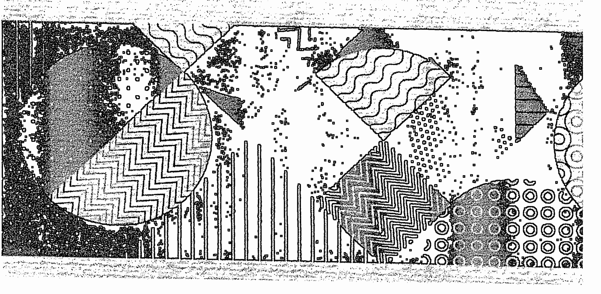

## 前言

### 有錢人房間和思維的共同點！

你覺得有錢人是怎樣的人？

你是否覺得有錢人活在不同的世界，認為他們彷彿是住在遙遠國度的人，自己跟有錢扯不上邊呢？

至今我占卜過四萬人以上，也幫不少有錢人算過命。另外，因為電視節目的關係，我也拜訪過多戶上億豪宅，察覺到有錢人有不少共同點。

雖然我遇到的有錢人常說：「我不太懂風水」「我對占卜沒興趣」，但很妙的是，每個有錢人家裡的風水都很好。

我和有錢人聊天時，經常會覺得有錢人講的話都一樣。聊到關於工作的事，也能深體會到「原來如此，就是因為有這樣的思維，才成為有錢人的啊！」

碰到同樣的事情，多數人都看某一面，但有錢人卻看另一面。有錢人的想法和思考方式與常人不太一樣。

本書將以我過去的經驗為基礎，在第一章介紹有錢人房間的共同點，第二章則介紹沒錢人房間的相似處。接著，第三章將說明我從日本和中國的風水，學到九個方位（北、東北、東、東南、南、西南、西、西北、中央）的特質，以及各個方位的特徵。此外，本書從累積的大量案例，整理了方位、顏色的涵義，以及能量的一覽表。不僅止於風水，在最後第四章，將與大家分享有錢人共同的思考方式，也就是「有錢人思維」。

能否成為有錢人的關鍵就是：行動與否。

有錢人都是不浪費時間煩惱，一旦下定決心便展開行動。想成為有錢人？不妨試著模仿他們的風水布局和思維吧。

自然而然養成有錢人習慣的祕訣，都在這本書當中！

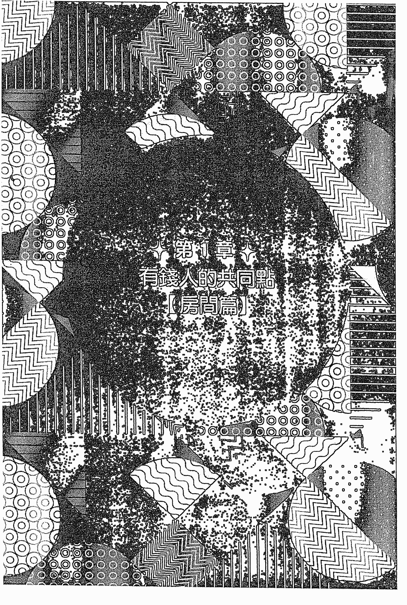

### 第1章

#### 有錢人的共同點【房間篇】

##### 模仿就是學習，只要去做就有效！

第一章和第二章將分別介紹我在參觀許多人家的時候，發現有錢人和沒錢人房間的共同點。在那之前，先來看一下，我覺得有錢人和沒錢人完全相反的地方。

- 【有錢人】東西少，整潔乾淨 / 【沒錢人】東西多，亂七八糟
- 【有錢人】理性且高效率 / 【沒錢人】無規律且低效率
- 【有錢人】重視整潔對心理的影響 / 【沒錢人】對髒亂感到麻煩

風水學常說：「打掃可以開運。」你覺得是為什麼呢？請再看一次右邊的對比。

沒錯，沒錢人的例子全都是打掃就可以解決的問題。

假如有人覺得，打掃就是把散亂的東西收到衣櫥或放回書架上的話，那可是大錯特錯。

首先，請從減少東西開始做起。

減少東西可以讓打掃變輕鬆，東西容易找，減少多餘資訊的干擾。這是有錢人的共同點，也是理性生活的關鍵。

藉由維持少量物品、整潔乾淨的房間，自然而然就能鍛鍊出掌握關鍵的洞察力、高效率的思考力、高效益的節省力，才能快速達成目標。

有錢人非常了解生命有限的道理，因此不浪費分分秒秒。房間微不足道，卻很重要。從有錢人的房間，可以感受到他們的人生哲學。

風水是關於「氣」的學問，氣是指空氣的流動。家裡空氣的流動，會影響住戶的身心健康。如果生活在空氣混濁、昏暗、潮濕有霉臭味的地方，心情自然就會不好，長期累積下來，不知不覺生活環境中不良的影響便會變成理所當然。這樣看來，只要處於沒錢人的環境，腦袋便會在不知不覺中越來越混亂。

請審視一下，你現在的房间給自己什麼樣的感覺？

讓人感到舒適的房間，應該都很明亮、整潔、芳香吧。把房間整理成自己覺得舒適的房間，是改變人生的第一步。

待在舒適的空間，會讓人充滿活力、勇氣、幹勁。那是因為空氣中，積極的「氣」增加的關係。只要模仿有錢人的房間哲學，空間中有錢人思維的「氣」也會增加。學習就從模仿開始。只要試著模仿有錢人，你就會逐渐明白什麼是有錢人思維！

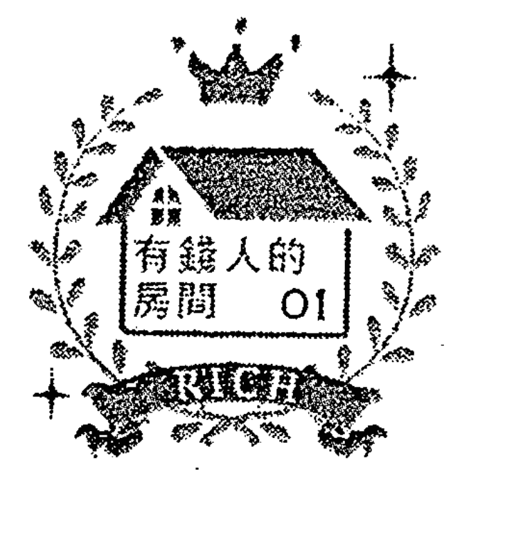

##### 有錢人會在玄關擺鏡子

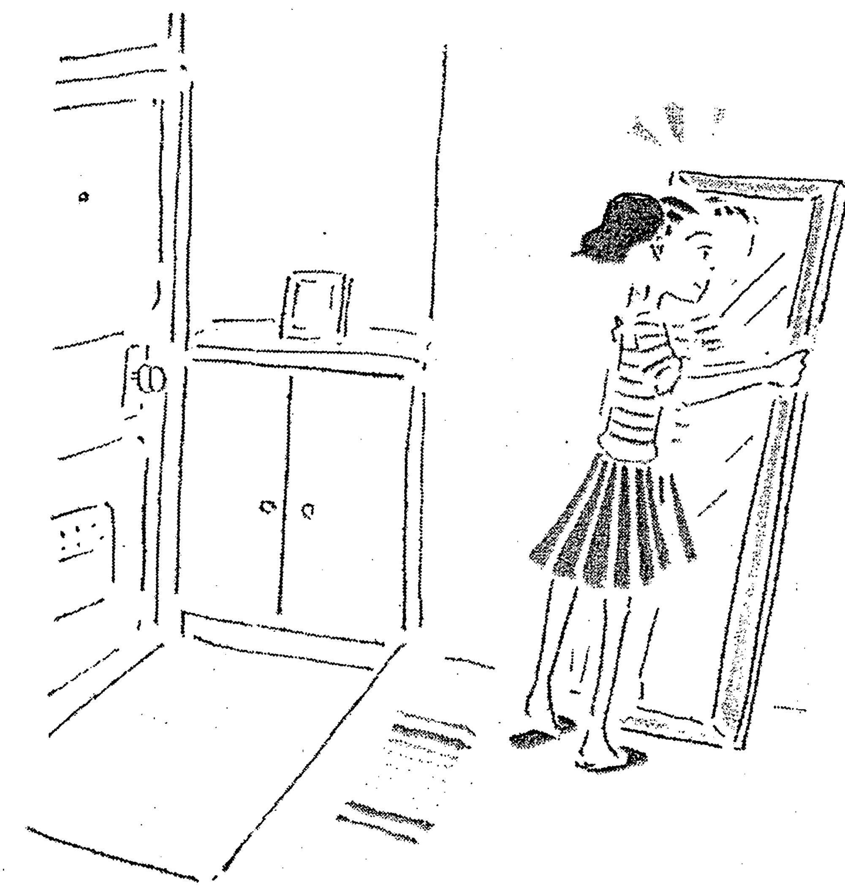

我到有錢人家拜訪，發現他們的房子都有個共通點，那就是玄關幾乎百分之百都有面大鏡子。一面能照全身的鏡子是基本，總之很多有錢人家的玄關都有大鏡子。

為什麼有錢人家的玄關都有大鏡子呢？那是因為「鏡子」、「自己」。也就是說，他們知道照鏡子確認自我形象的重要性。

如果玄關有鏡子，出門前就可以察覺「啊，領子翻起來了，這樣很失禮！」這就能成為跟無法成為有錢人之間的差別。他們避免無意識做出讓人不快、令人失望的行為，用全身上下展現自己是顧慮他人感受的人。神經大條會多麼傷害形象，有錢人知道這個嚴重性。

###### 有錢人思維
照鏡子確認自我形象。那是體貼他人、了解自己之道。

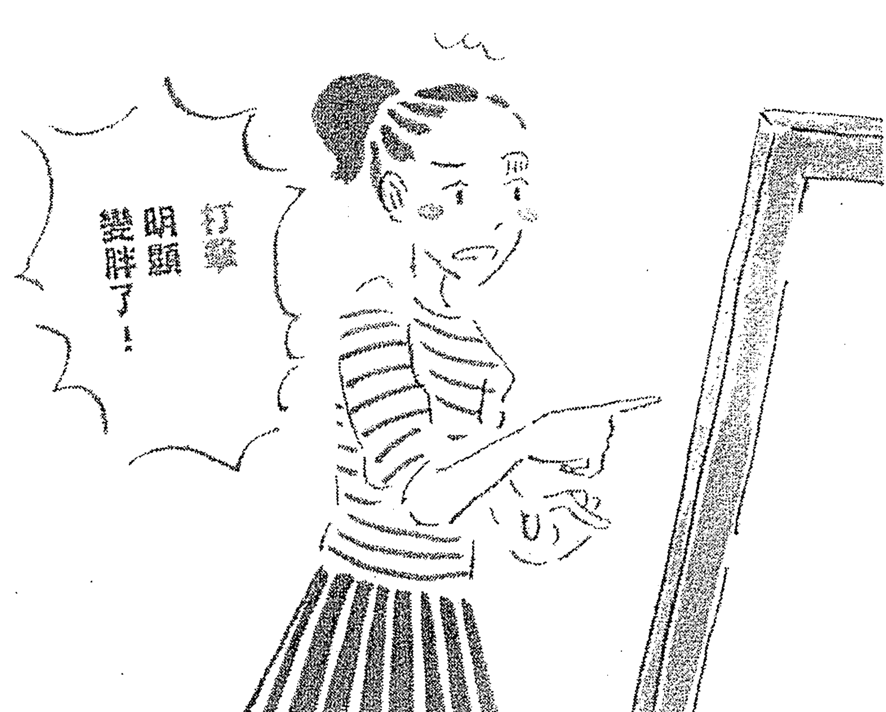

「打擊 明顯 變胖了！」

我覺得有錢人應該就是因為這樣，所以才能夠留意自己在別人眼中的形象，察覺他人的想法，進而為他人著想。

有的有錢人不只在玄關，就連每個房間也擺放好幾面鏡子。常常照鏡子，就越能了解應該如何展現自己，房間的氣自然會越來越好。

如果房子放不下大鏡子的話，請改放「講究之鏡」。像我知道有位有錢人，他非常珍惜一面很舊自己卻很中意的鏡子。講究鏡子很重要，因為那等於是講究自己。

此外，就風水上來說，玄關明亮為佳，而鏡子可以作為光亮之源。因此，應該在玄關擺面鏡子，天天擦亮，天天照亮自己。請把照鏡子當作是有錢人的鐵律，模仿看看。

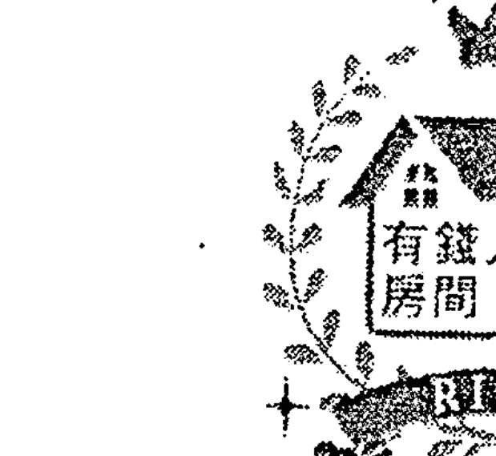

##### 有錢人家看不到面紙盒

> 避免一不小心就用到了的浪費行爲！

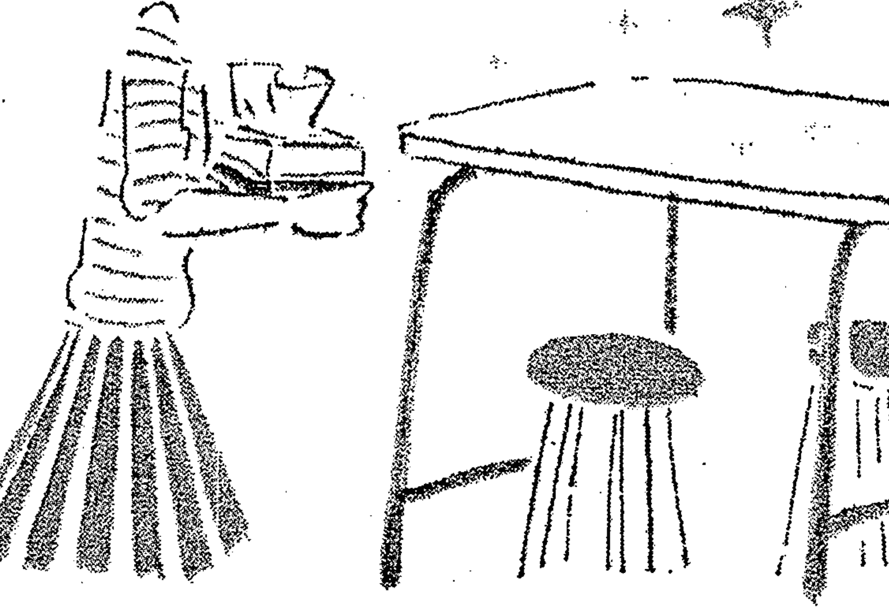

拜訪有錢人時，我發現在他們家裡都看不到面紙盒。我問為什麼，很多人都回答：「因為很礙眼，」因為看到就想抽來用。

有錢人討厭浪費。他們的想法是：有面紙盒，看到就想用，增加垃圾，空出放垃圾的地方很浪費空間。

所以大部分有錢人家裡的面紙盒都放在抽屜。我也試著模仿有錢人，把面紙盒藏起來，結果真的因為看不到，就不會想用！

而且，風水學認為紙會吸氣，所以放著舊報紙、舊雜誌不管，紙張會吸濕氣使空氣混濁。生活中紙袋和傳單等出乎意料的多，請留意避免紙張的堆積。

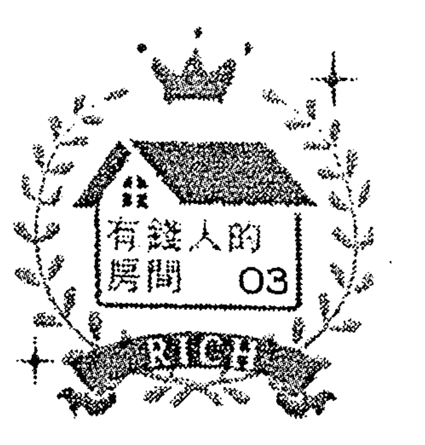

##### 地板沒垃圾，打掃起來好輕鬆！

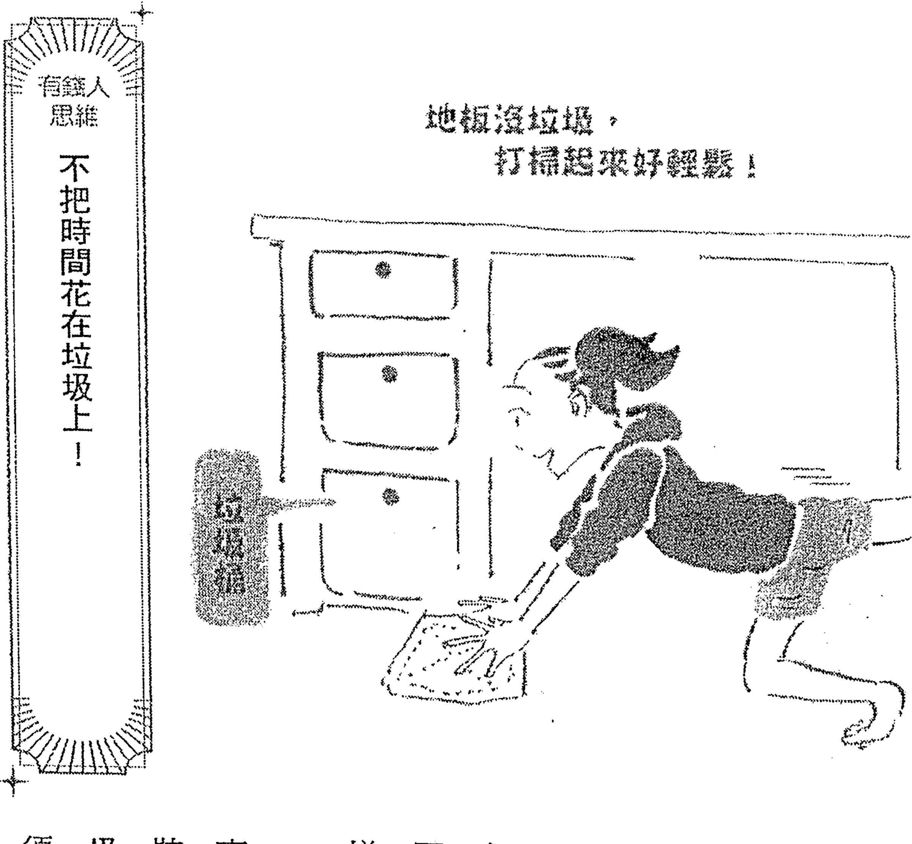

###### 有錢人家沒有垃圾桶！？

在有錢人家裡看不到垃圾桶。垃圾桶只會出現在廚房之類的地方，但不會出現在每個房間。垃圾桶大多放置於抽屜或看不見的地方，家裡可以說幾乎看不到。

為什麼家裡要看不到垃圾桶呢？這跟面紙盒是同樣道理——避免浪費。只要垃圾桶放在明顯的地方，就會出現要丟垃圾的想法，因此，有錢人習慣把垃圾桶藏起來，防止那樣的意識產生。

因為不想增加家裡的垃圾，所以到便利商店買東西時也不拿塑膠袋，拒絕過度包裝。有錢人就連一秒鐘也不想把時間花在垃圾上。為什麼呢？因為垃圾就是垃圾，是必須費力氣「丟掉」的麻煩東西。

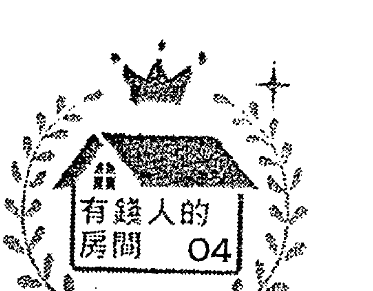

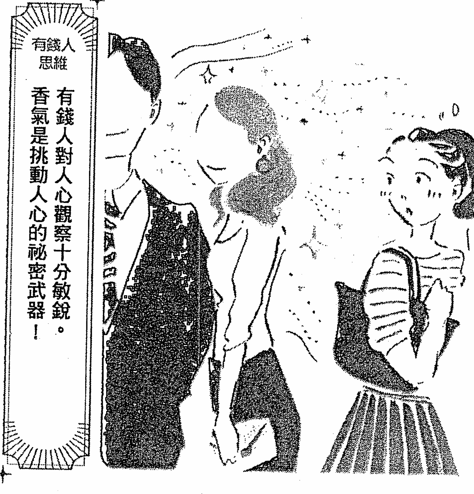

##### 有錢人香氣飄溢

有錢人對味道很敏感。他們一定會注意到好聞的氣味，然後說：「這個味道好香。」而且，每個有錢人都有各自喜歡的味道，房間都飄溢著香氣。

這個跟整潔很重要的想法有關。有錢人明白，大家會把錢花在讓自己舒適的地方，整潔就是其中之一。

例如，同樣是去吃飯，髒兮兮的餐廳和乾淨的餐廳，大家應該比較想把錢花在乾淨的餐廳吧。不管料理再怎麼好吃，髒兮兮的地方實在很難讓人甘願掏錢出來。

只要味道好聞，人一旦心情愉快就願意花錢。有錢人明白人這種微妙的心理。

###### 有錢人思維
有錢人對人心觀察十分敏銳。
香氣是挑動人心的祕密武器！

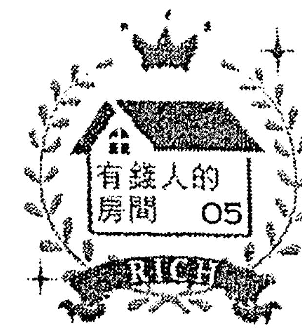

##### 有錢人家玄關只放一雙鞋

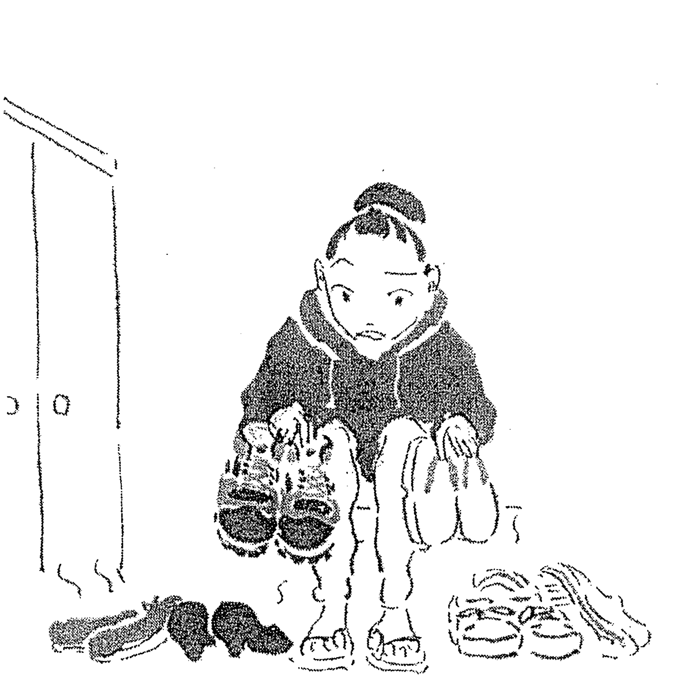

> 有錢人思維
> 猶豫不決、找不到鞋都是浪費時間！

這戶人家是不是有錢人，進門看玄關擺了多少鞋子就知道。有錢人家玄關只放一雙（或是居住人數）鞋子。除穿出門的鞋子之外，不會把其他鞋子擺出來。

另一方面，沒錢人家玄關經常擠滿了鞋子。他們的特徵就是，狹小的玄關擺滿鞋子。

有錢人認為，只要稍微猶豫要穿哪雙鞋，就是在浪費時間。把要穿的鞋子擺在玄關，出門時就不會猶豫不決。想挑其他雙鞋子的時候，從鞋櫃裡挑選也比較有效率。鞋子擺得亂七八糟，不但讓人拿不定主意，也實在沒有效率。

在風水學裡，玄關代表工作運。玄關亂糟糟的人，工作和腦袋很明顯也是亂成一團。

##### 有錢人不把書疊在一起

很多有錢人喜歡讀書，再怎麼忙碌也會抽空閱讀，但他們看完書後，不是丟掉就是送給別人。

關於這點，我曾請教：「為什麼書看完就馬上丟掉呢？」他們回答：「因為放書的空間（土地價值），其價值比書的價格還高。」

只要書放著不看，當堆放面積超過書的價值，他們馬上就會察覺到。有錢人就是這麼精打細算，對成本概念非常敏銳。我們也可以說，正因為如此他們才會成為有錢人吧。

真的有需要的时候，比起花时间把書找出來，不如買新的比較快。有錢人徹底避免花時間在找東西上。對這種想法有共鳴的人，思維比較接近有錢人。

好！這些全部丟掉！
放書的空間，其土地價值高於書本身！

###### 有錢人思維

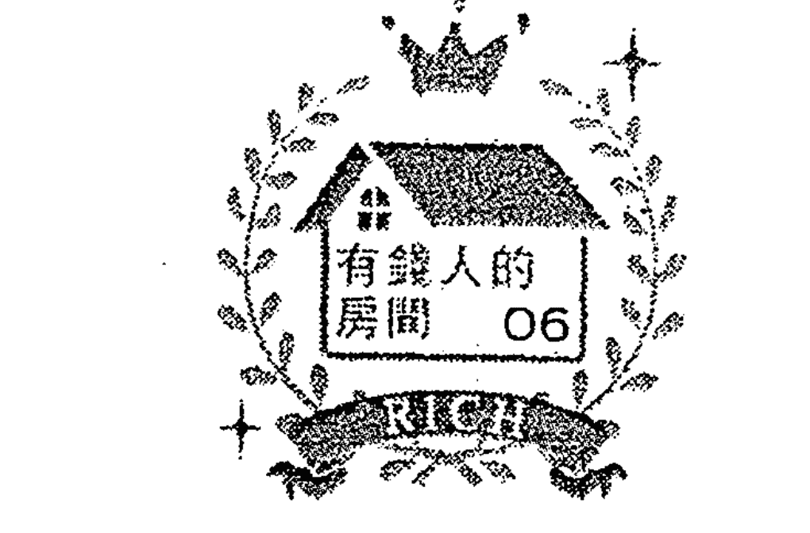

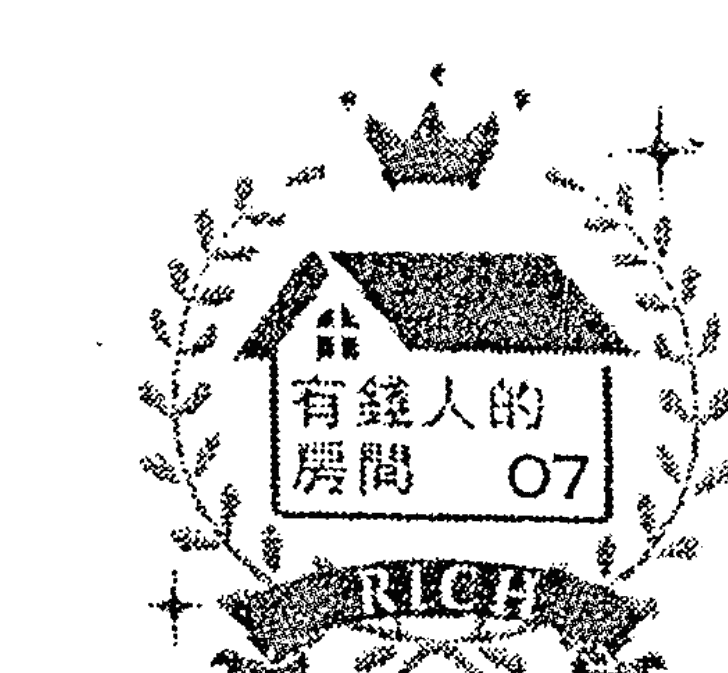

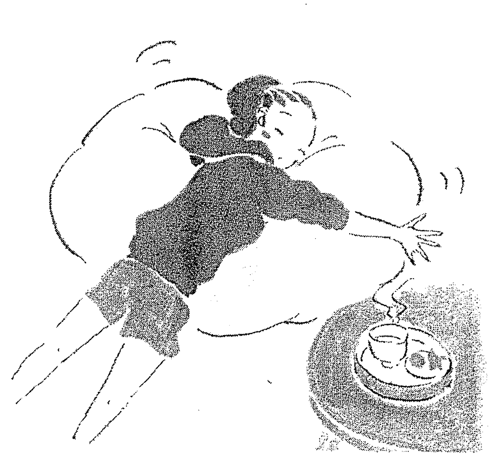

> ### 有錢人思維
> 排除所有會造成壓力、或帶來危險的非必需品！

###### 有錢人喜歡圓的東西

我觀察有錢人的家具發現，有錢人的家裡有很多圓形家具。原本覺得可能是有錢人的特殊喜好，結果一問，原來是有理由的：「因為尖銳東西會造成壓力」「因為很危險」。

想打造能放鬆的居家環境，必須盡可能減少會帶來壓力的東西。沒錯，有錢人是徹頭徹尾的理性主義者。即便再怎麼有設計感的家具，只要碰撞到尖角受傷的話，只是損害自己罷了。不必在家裡擺放可能會傷害自己的東西，他們看待事物的思考方式就是如此功利。

而且，有錢人非常喜歡開派對。排除壓力和危險的要素，也可以說是為了來訪者著想。

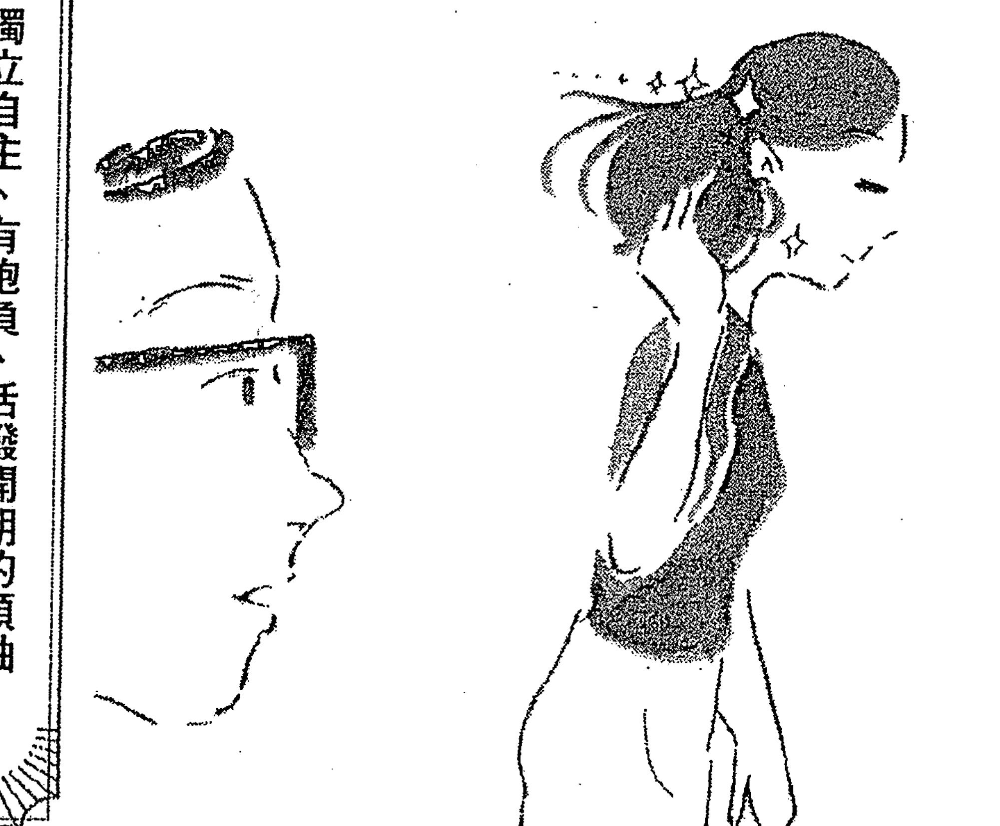

##### 有錢人喜歡穿戴金飾

有錢人有個共同點，他們都喜歡金飾。

不少有錢人，無論是衣服還是飾品都有黃金點綴，甚至可以說，幾乎每戶有錢人家都有黃金擺飾。

金色具有活潑開朗的領導、獨立自主且上進、充滿抱負的能量。的確，喜歡這個顏色的有錢人，許多都是企業老闆。黃金會讓人直接聯想到金錢，但其實黃金也能營造高質感的大圈子。這一點出乎意料的重要！

如果天天都看得到黃金物品，高質感的氛圍能使人心情愉快，自然而然就會產生「我也想要成為有錢人」的正向心理。

> 想成為有錢人的話，金色絕對是適合隨身攜帶或隨處可見的好顏色。

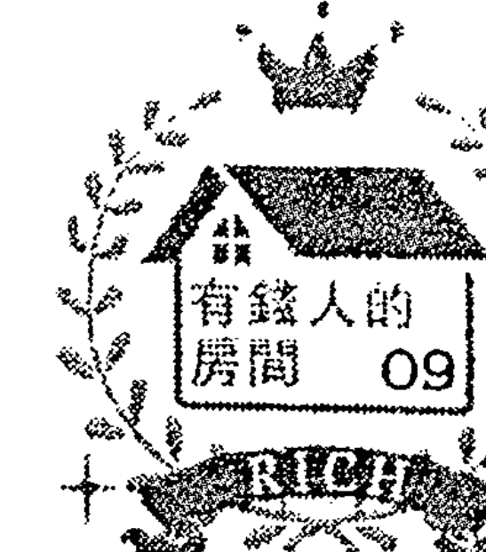

##### 有錢人的錢包多黑色和綠色

有錢人思維
藝術家氣質為黑色。
與人共存的有錢人偏好綠色。

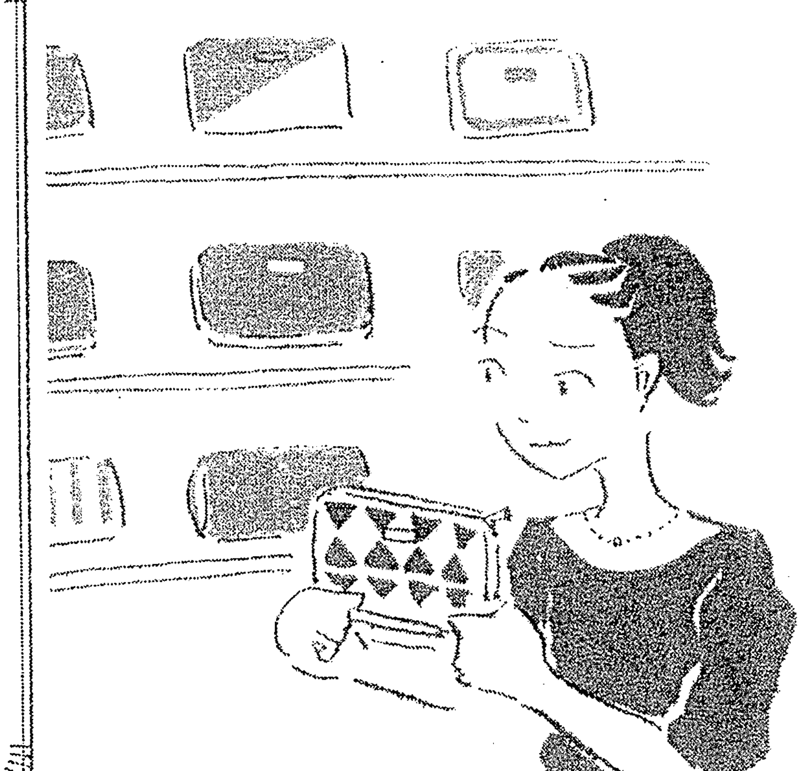

經常聽人說黃色的錢包可以生財，但我實際看了許多有錢人的錢包後，發現他們的錢包幾乎沒有黃色，都是黑色和綠色。

黃色接近金色，容易聯想到金錢，但是從色彩的能量來看，黃色也有缺乏毅力、不穩重的面向。綠色則帶來彬彬有禮且認真、很照顧人、目標清楚明確的印象，是企業老闆必要的能量。而黑色則能提高匠人氣質，如：藝術才華、專注力、提高求知欲等工作能力的顏色。

工作上必須受他人喜愛的人用綠色錢包；不擅交際，卻可以運用所長賺錢的人，黑色錢包可以帮助自己獲得成功。

#### 有錢人多用白色

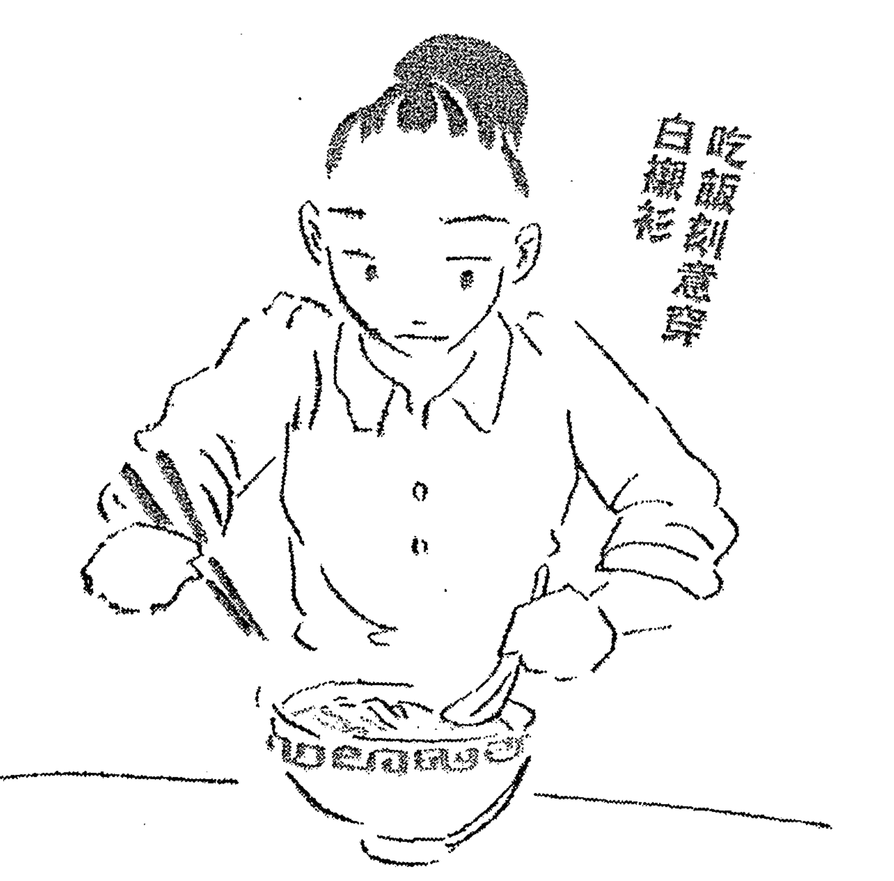

並不是說只要使用前面提到的金色、黑色、綠色就好，有錢人顏色用得高明，懂得配合目的、截長補短地搭配色彩。

其中又以白色為王道。白色可加強正義感、認真且正直的印象，更重要的是，可以帶來整潔感。整潔感是有錢人的必要條件。

我曾聽說某間公司要求業務穿著白襯衫，結果業績扶搖直上。我想這應該是白襯衫的效果，白色讓業務員看起來誠懇認真、值得信賴，進而增加客戶對商品的信任。白色也讓人產生好印象，所以我建議人：「遇到困難時，選白色就對了。」

人對乾淨整潔的人都會產生好感，而且白色可贏得別人的信賴。

- 整潔、可靠是有錢人的必要條件！
- 吃飯刻意穿白襯衫

#### 提升運勢的色彩學！

我以超過四萬人的占卜經驗為基礎，彙整了以下色彩的象徵意義。

重視人際關係的有錢人，運用起顏色來，得心應手。

請先檢視自己需要什麼東西，思考要加強什麼，應節制什麼。

**GOOD**
想獲得那樣的能量，或是該氣質不足時，適合使用的顏色。

**BAD**
使用過度，或是原本那樣的氣質就比較強的時候，可能會使能量過度強烈，而帶來負面影響。請小心搭配使用。

- **紅色**
  - GOOD：能變得正向積極。好勝心強。適合匠人和專業技術人員。
  - BAD：聽不進別人的意見。自尊心越來越強。
- **橘色**
  - GOOD：變得開朗活潑。改善人際關係。博得別人的好感。
  - BAD：太出風頭。話太多。容易自說自話。
- **粉紅色**
  - GOOD：懂得撒嬌。氣質優雅。變得善於關心周遭人。可提升戀愛運。
  - BAD：變得負面。內心容易受傷。欠缺決斷力。
- **黃色**
  - GOOD：提高判斷能力。表達變得豐富多元。直覺敏銳。
  - BAD：變得易怒。欠缺毅力。不穩重。
- **綠色**
  - GOOD：認真、彬彬有禮。很照顧人。財富累積快速。
  - BAD：容易做白工。不敵謠言。承受不了責備。
- **藍色**
  - GOOD：做事認真，資訊處理能力高。冷靜。在職場上，深受大家信賴。
  - BAD：無趣。愛講大道理。
- **深藍色**
  - GOOD：知性、有品味。對喜歡的事情專一。非常適合領袖。
  - BAD：不知變通。過度嚴苛。
- **土耳其藍**
  - GOOD：能變得開朗正向。喜愛自由。視野寬廣。
  - BAD：不合群。容易顯得孩子氣。
- **紫色**
  - GOOD：神祕感，有高度創新力。使藝術感染力更加豐富。
  - BAD：雙重性格。讓人摸不透真正的想法。自尊心強。
- **白色**
  - GOOD：正義感強。認真正直。
  - BAD：不會說謊。認真過頭，最後吃虧。
- **黑色**
  - GOOD：有藝術才華。提高專注力。提升求知欲。
  - BAD：無法接納他人。權威。把別人當傻瓜。
- **棕色**
  - GOOD：寬裕自在。和善親民。重視傳統。
  - BAD：不喜華麗。不擅新事物。受規範約束。
- **灰色**
  - GOOD：和平主義。道德心強。給人沉穩安定的感覺。
  - BAD：存在感低，容易消極。封閉自我。
- **金色**
  - GOOD：活潑開朗的領袖。獨立、上進、雄心勃勃。
  - BAD：有父母情節。容易樹立敵人。
- **銀色**
  - GOOD：冷靜沉着。瀟灑。擅於觀察。
  - BAD：給人印象壓抑。不起眼。容易想太多。

##### 專欄

##### 有錢人豪宅大鑑定！

內容取自日本朝日電視台《請給分！話題排行榜》節目

#### 高嶋美里的家

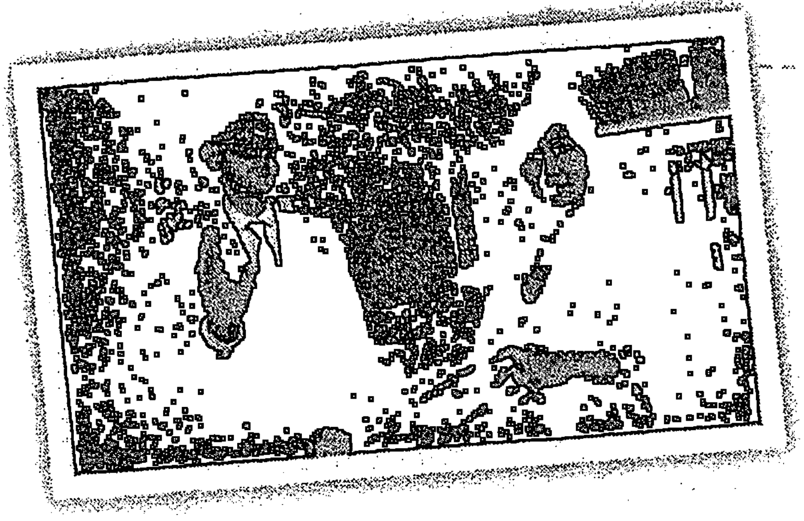

**高嶋美里小檔案**

遊雅名人公司董事長。在育兒的同時，利用網絡在家創業，並活用網絡事業的知識祕訣進行創作，一年賺進三億日圓。她經營的線上學習學校「CiBS 學院」，與函授制高中合作，成為日本第一個能線上學習網絡事業並取得高中畢業資格的學校。為拒絕上學的孩子鋪設邁向成功的道路，超過百位以上的學生，從零收入變成年收千萬日圓以上的創業家。

#### 直覺敏銳，十億日圓豪宅馬上買！

高嶋住在高級摩天大廈，她的豪宅有180多坪。我一踏進去，馬上就發現有錢人家的共同點：玄關寬敞。高嶋豪宅的玄關竟然有14坪之大。

在長走廊的前頭，是客人專用的飯廳，符合有錢人的家裡都有派對房的共同點。此外，雖然高嶋不喝酒，但家裡卻有客人專用的紅酒櫃，可以看出有錢人的共同思維：讓大家開心。

高嶋說：“我不相信風水和占卜，但是卻無意識的把房間風水布置得這麼好，真不愧是有錢人！”

近24坪大的正廳，東京的景色盡收眼底，房子南邊和西邊兩面都是窗。聽說高嶋一看到彩虹大橋的S型彎道，價格連問都沒問，就決定買下這間房子。房子金額高達10億日圓！她的書桌，是面向可以讓女性發光發熱、最適合寫作的南邊。真不愧是有錢人，無意間就把家裡的風水布置得這麼好。

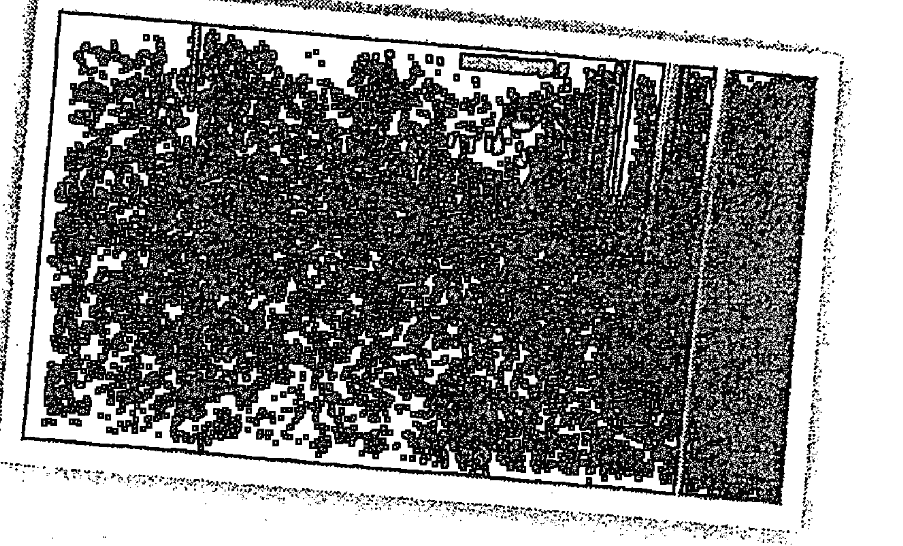

而且，我也發現這個家有好多鏡子，這也是可以帶來好風水的布置。高嶋十歲的孩子，一邊接受她的指導，一邊幫忙她的網路事業，每個月賺進80萬日圓。而協助作業的桌子，也是面向對傳遞訊息最好的東邊。高嶋對風水的直覺如此敏銳，讓我非常佩服。

> **占卜師飯田親眼所見！**
> 有錢人這樣布置風水！
> - 面向讓女性發光發熱的南邊寫作！
> - 玄關擺有可以提升運勢的鏡子！
> - 撰寫自身理念的桌子面向東邊！

### 第2章

## 沒錢人的共同點

## 【房間篇】

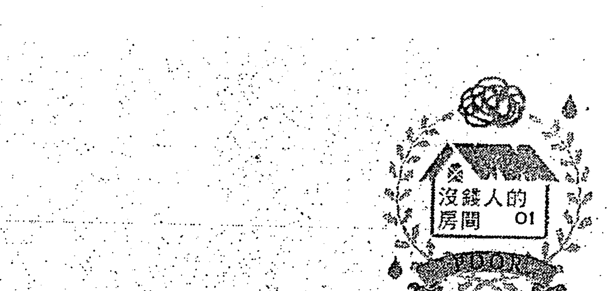

**脫貧思維**

如果有珍惜物品的心，就會把東西收納到正確的地方！

##### 沒錢人家裡東西直接放地上

沒錢人的房間最常見的，就是東西沒有放在正確的地方。例如，電視機直接放地板，吹風機躺在地上……

最讓我覺得誇張的，就是把電鍋直接放在地上。地板容易積灰塵，紙屑垃圾也會直接掉落。把每天都要吃的重要米飯放在腳邊，實在是大對不起食物了！

食物是對未來的投資。不珍惜食物，就等於不珍惜自己。

認為東西可以用就好、對物品的態度隨便的人，可能也會用相同的態度對待他人。

人都想生活在適合自己的地方，所以請把東西收納到正確的位置。

##### 沒錢人家裡窗簾橫桿用來晾衣服

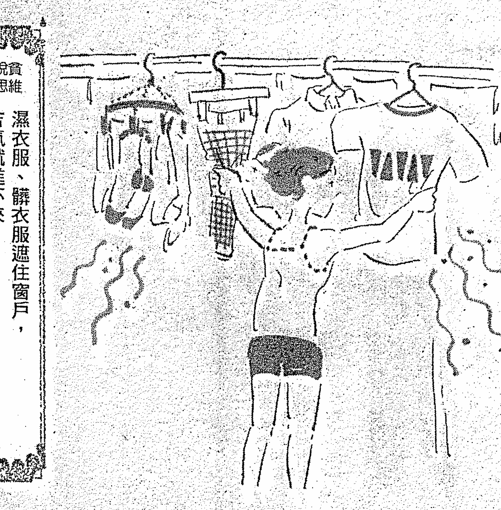

**脫貧思維**

濕衣服、髒衣服遮住窗戶，吉氣就進不來！

有些人會把衣服一整排晾在窗簾的橫桿上，這也是沒錢人常做的事。

在風水學，想讓氣的流動變好，就必須有充足的陽光和新鮮的空氣，而窗戶是一大重點。如果吊掛洗好的濕衣服，會讓房間變得潮濕，如果掛髒衣服，房間的空氣就會變髒。而且，用衣服遮住窗戶，對空氣的流通本來就不好。

再者，就使用方式異於原本的用途這點來看也不好。窗簾的橫桿是用來掛窗簾的。衣服若不穿就收納好，晾乾了，就應該收起來。有些人會從晾乾的衣服裡找要穿的衣服，但這種方法其實出乎意料的沒效率。

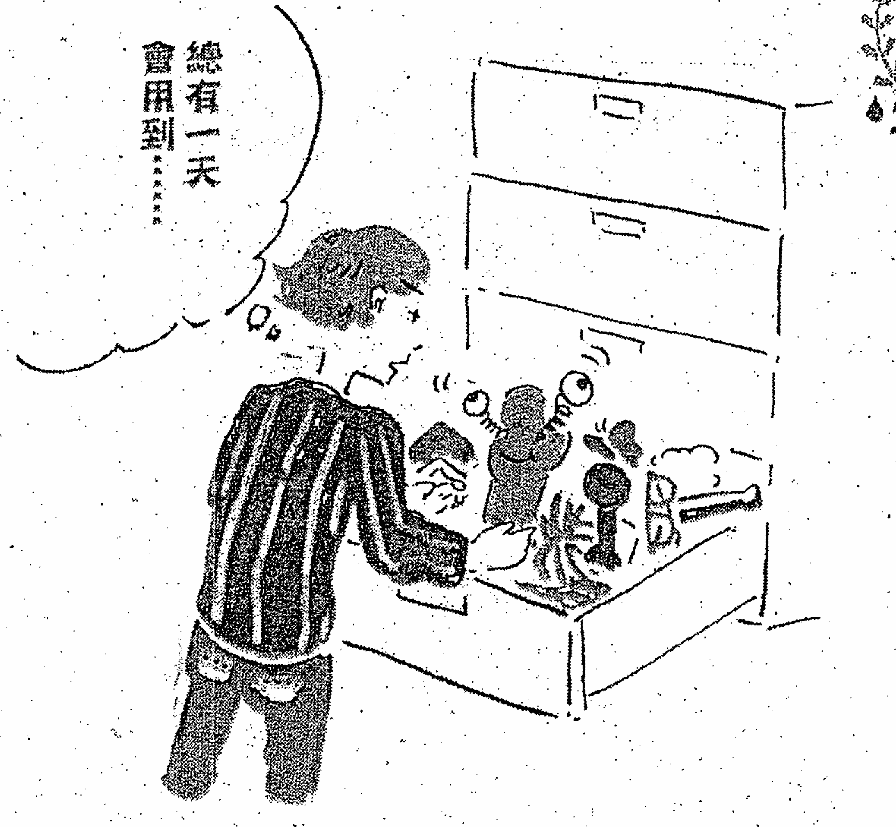

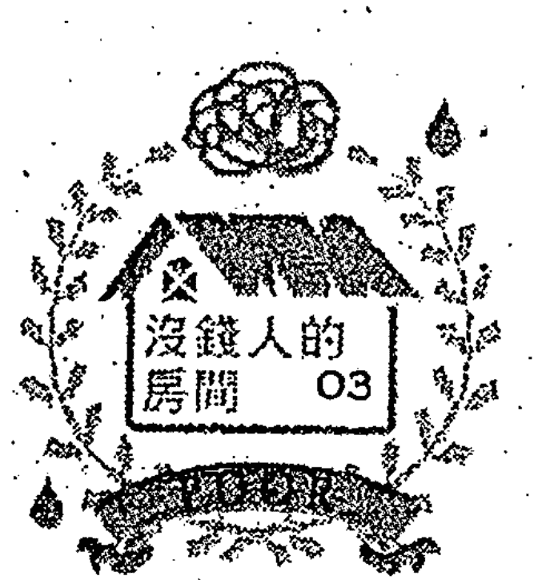

##### 沒錢人的東西很多

我拜訪過不少有錢人和沒錢人的家，發現幾個一眼就可以辨別兩者的地方，其中一個就是人越窮，東西越多。

首先，有錢人家的東西收納得很好，藏在看不到的地方。另一方面，沒錢人家經常亂七八糟。看得到的地方都是滿滿的物品，資訊氾濫。

據說，相對於有錢人平均擁有七千項物品，沒錢人平均擁有八千到一萬三千件物品。沒錢人覺得東西可能會派上用場，所以總是丟不掉；有錢人則認為有需要的時候再買就好，沒用的東西就丟掉。有錢人的想法是，東西少效率才好，物少輕便有餘裕，才能把時間用在將來的事業上。

> **貴思維**
> 脫貧思維 物少一身輕，可以做更多事！

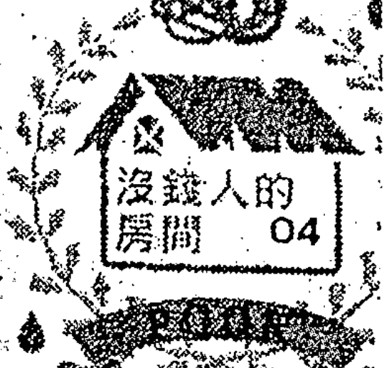

##### 沒錢人家的廁所單調無趣

**脫貧思維**

保持廁所清潔，不另做他用！

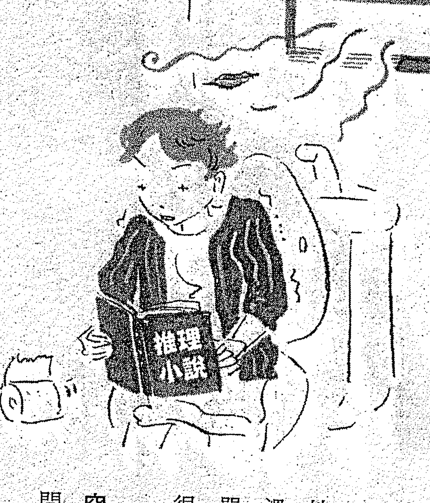

有錢人家和沒錢人家最大的差別，在於廁所的氣氛。

有錢人家的廁所都有裝飾，牆壁和馬桶地墊使用暖色系，一進去可以感受到乾淨且溫暖的氛圍。相反的，沒錢人家的廁所給人的印象是冷冰冰的，地墊看起來又髒又舊，單調且充滿無趣的地方。在單調無趣的空間待久了，整個也會變得野蠻俗氣。

廁所是守護健康的地方。在單調無趣的空間待久了，整個也會變得野蠻俗氣。房間的氣氛對心情影響很大。此外，即便把廁所掃乾淨了，也不可以在廁所看書，因為這不是在廁所應該做的事。就窮沒人會在廚房睡覺一樣，行為舉止符合場合的目的，才能創造健康的生活。

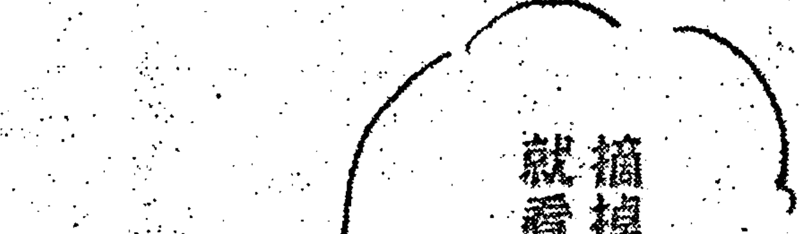

##### 沒錢人家的廚房、廁所、浴室、洗臉盆全都髒兮兮

**脫貧思維**

擺脫髒兮兮也沒關係的想法吧！

沒錢人家的廚房、廁所、浴室、洗臉盆等，「與水有關」的地方都非常髒。髒髒的程度一看就知道沒在打掃。我第一次看到沒錢人家髒髒的衛浴時極為驚訝，但住的人卻一點也不覺得髒，照常過日子，對他們而言，髒髒已經司空見慣。

廁所和浴室的打掃順序很容易被排在房間之後，但那些卻是每天都會使用的地方。不在意那些地方，就表示不在乎自己的身體健康。

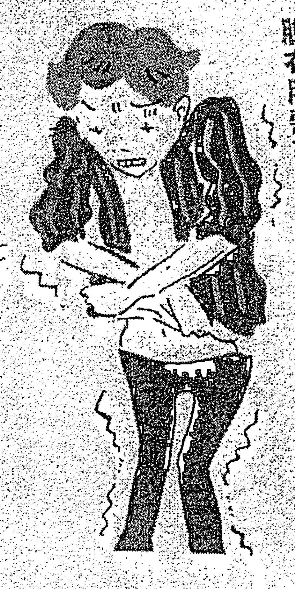

##### 沒錢人家的廁所和浴室位在鬼門

**脫貧思維**

脫衣服需要勇氣

鬼門是指東北方。日本的風水學，習慣避免將廁所和浴室設置在鬼門。因為東北方照不到陽光，而且陰涼。

如果與水有關的地方，設在照不到陽光、陰暗潮濕的場所，容易累積濕氣、發霉。如果掌管健康的廁所和浴室，讓人感到不衛生且寒冷的話，當然就會剝奪住戶的精力和體力，削弱每天的能量。

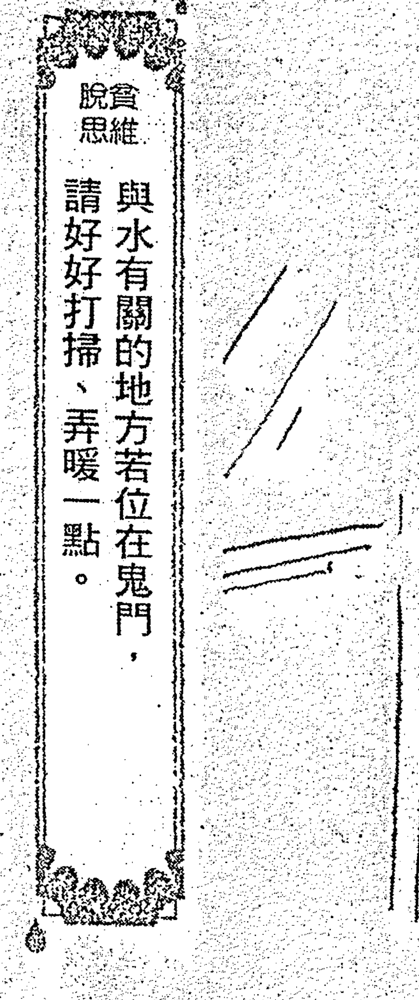

##### 脫衣櫃思維

與水有關的地方若位在鬼門，請好好打掃、弄暖一點。

※鬼門的詳細內容請參考第三章。

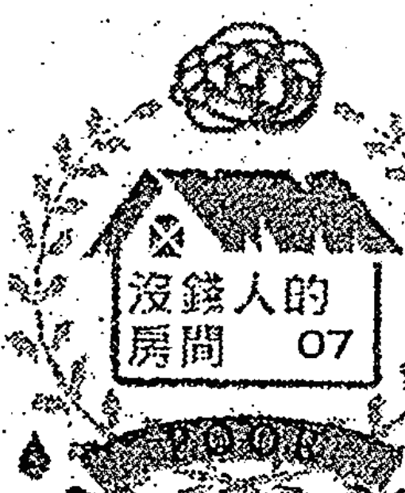

##### 沒錢人的冰箱總是貼滿、堆滿東西

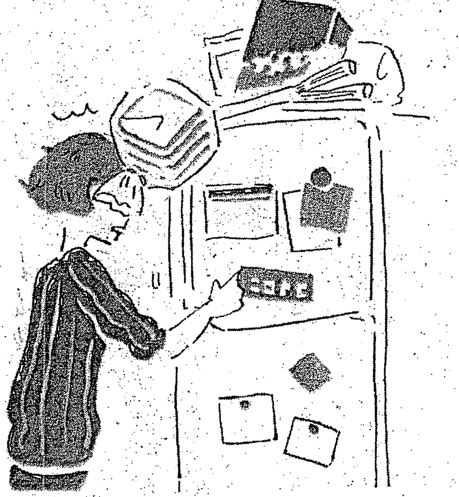

**脫貧思維**

礙事的东西消失，自然就會想動手打掃！

在沒錢人家的廚房經常可以看到冰箱上貼著便條紙，或把庫存食物堆在冰箱上方。冰箱藉由發熱來冷藏食物，風水學認為如此氣便容易亂。

然而在放食物的地方貼東西、堆放物品，會讓人不想去擦拭打掃，更是降低運勢的因素。明明是應該要注意衛生的地方，不打掃卻變成理所當然。這也是不好的習慣。

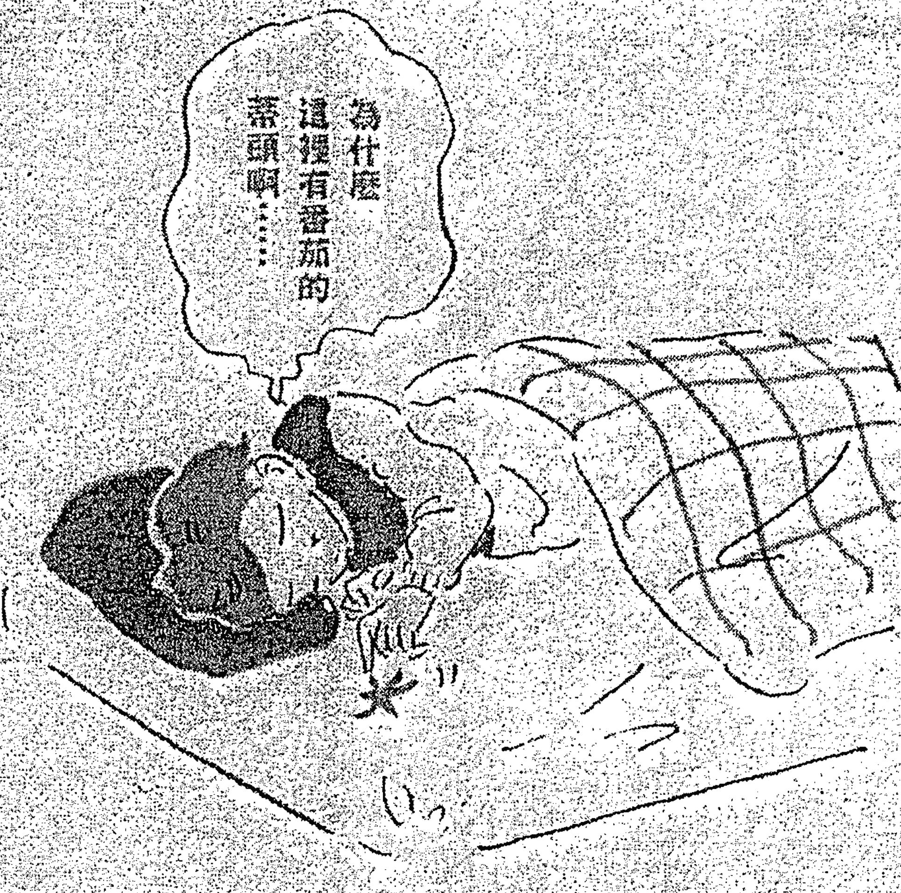

##### 沒錢人不常洗床單

為什麼這裡有香菇的蒂頭啊……

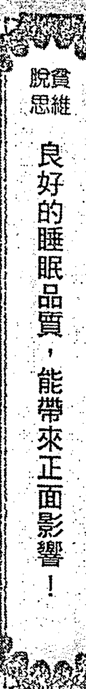

有錢人的睡衣一看就知道很乾淨，但沒錢人的看了會讓人產生「有洗過嗎？」的疑惑，許多寢具看起來都很舊。忙碌的有錢人懂得照顧自己，他們創造有效消除疲勞的環境，讓自己在短時間內恢復體力。

另一方面，很多沒錢人都不珍惜自己。剛洗好的床單，睡起來當然舒適。常常洗床單，天天睡好覺，是成為有錢人的第一步。

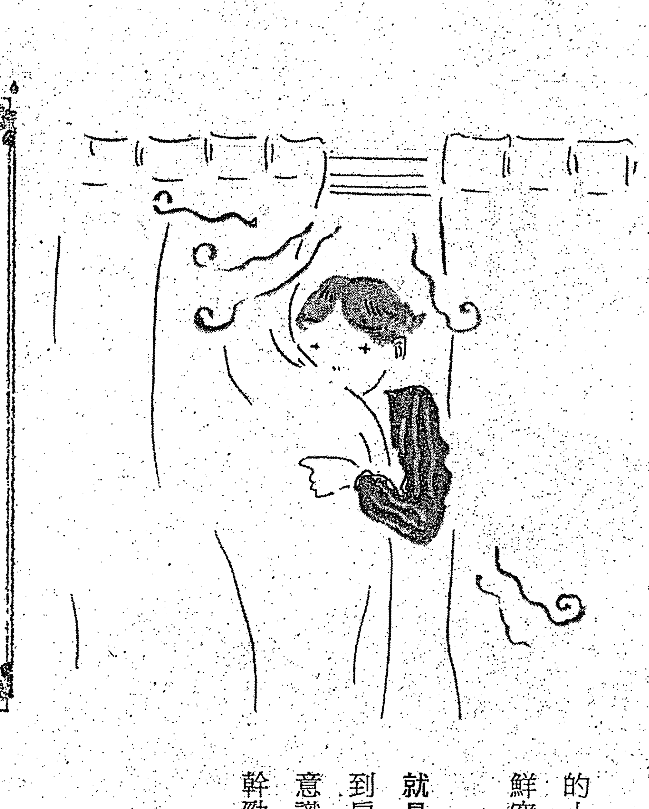

##### 沒錢人不太洗窗簾

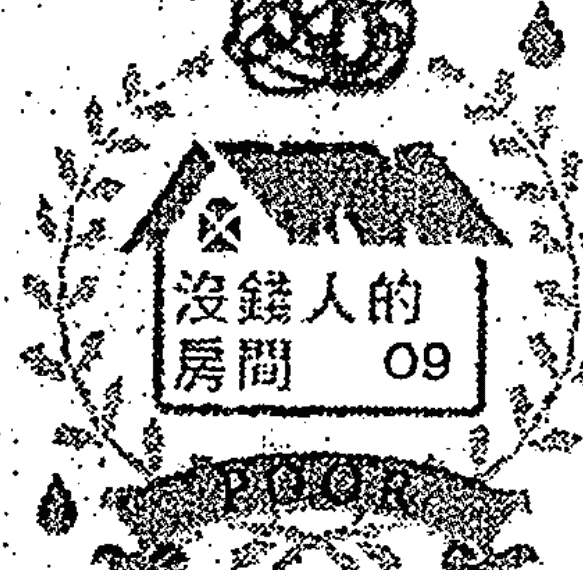

如同沒錢人家裡都用窗簾橫桿來晾衣服的小節提到的，風水學認為，吸取陽光和新鮮空氣，可以為住戶帶來能量。

而空氣進入房間時，最先碰觸到的東西就是窗簾。如果窗簾是髒的，新鮮的空氣進到房間裡也會變髒。窗簾的面積大，對人的意識影響也大。每天看著骯髒的窗簾度日，幹勁當然也會被削弱。

**脫貧思維**

不要養成吸髒空氣的習慣！

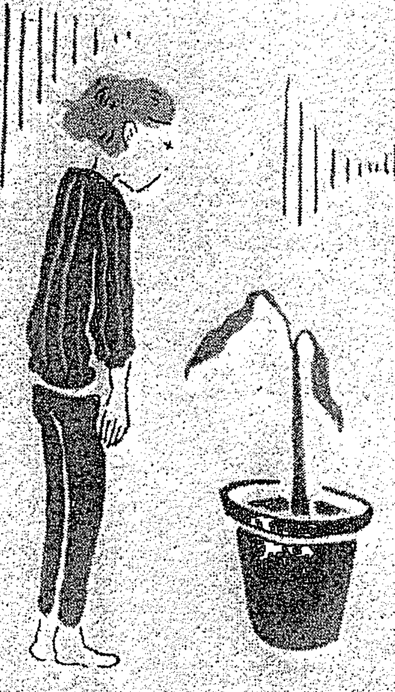

##### 沒錢人的房間有枯萎的植物

植物吸收二氧化碳、製造氧氣，可以淨化空氣，所以植物經常是風水布置的好物。而且，養植物也別有意義。只要給予水和肥料就可以長大的植物，適合綠手指的初階。連植物都養不活的人，當然無法養育他人。居眾人之上、有聲望的人，都很會養植物。請試著養植看看，看自己是否有能力照顧無法說話的植物。

> **脫貧思維**
> 喜歡園藝的人，是可以察覺對方心情的人！

### 第3章

#### 有錢人懂得布置好風水!

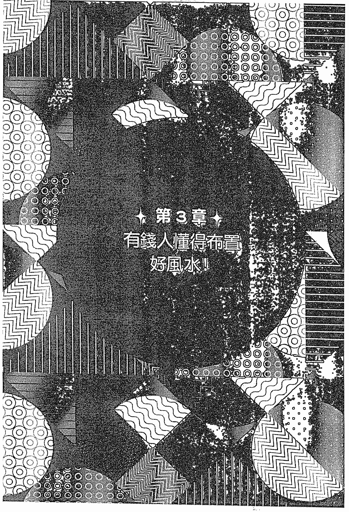

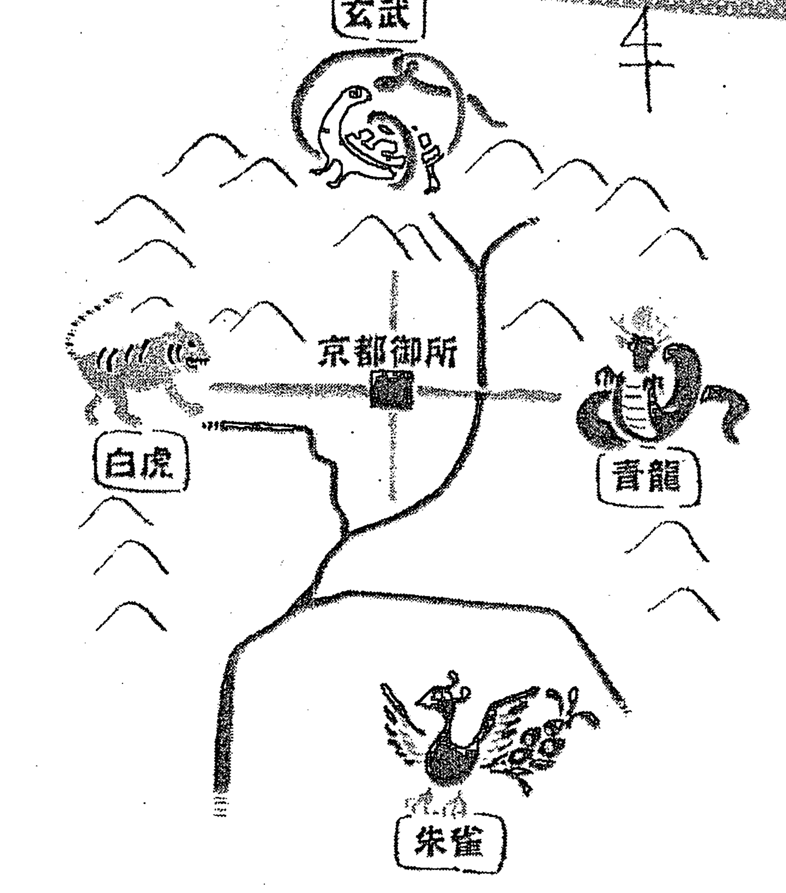

##### 與自然和諧相處，從中獲得太陽的能量！

回溯歷史，日本的風水學源自中國，但仍稍有不同。首先，中國的風水學主要是看土地。

北坐山脈置玄武神，南坐平原置朱雀神，東坐河山置青龍神，西坐衝道置白虎神，中國自古認為，由四神守護東西南北的土地會繁榮興盛。據說日本以前的首都，就是依據中國的風水學建造而成，因此京都又以風水之都聞名。

例如，打掃家裡的西邊，可累積財富。這個說法是有理由的，原因在於「西曬」。因為西曬很傷食材，如果廚房位在西方，卻沒有好好管理的話，就容易漏財。

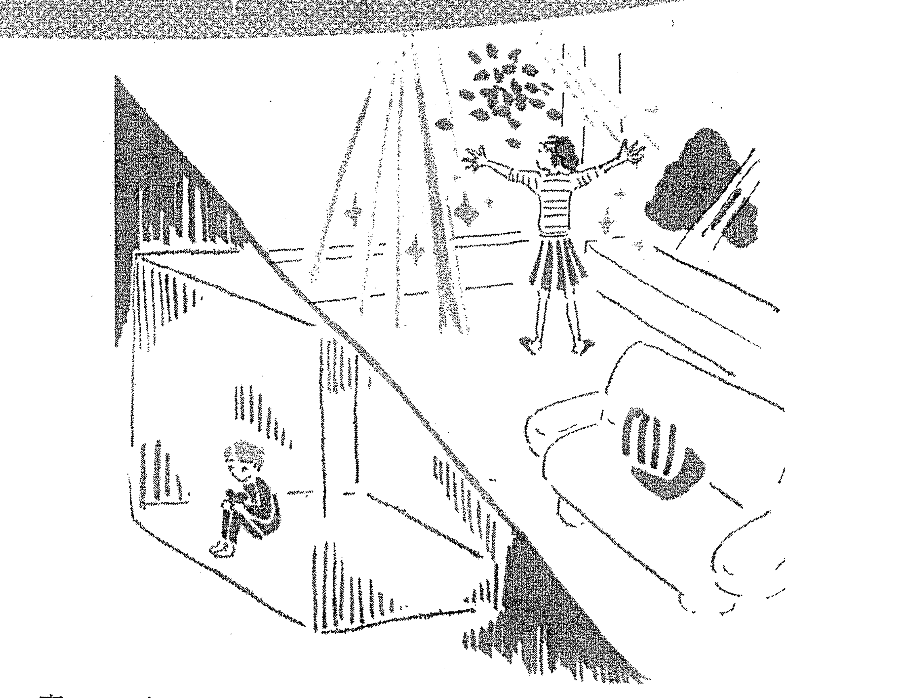

此外，如果玄關和飯廳位在太陽升起的東邊和東南邊，在舒服的朝陽下開始新的一天，可以讓運勢變好。長時間使用的客廳，以採光好的南邊、東南邊、西南邊、西邊為佳。西北邊和西邊容易有寒風，不要設大窗戶比較好。簡而言之，風水也就是順應大自然的道理。

風水學是以與大自然和諧相處的思想為基礎，而日本的風水學則將這種概念帶進家裡。

只不過，即便建造房屋時費盡巧思，有些房子的格局也無法做到完美。這個時候，只要在採光設計下點功夫，設置代替陽光的光源和熱源就好。

此外，如果把家中設計成北邊為山、東邊為川、南邊為原、西邊為街的格局，

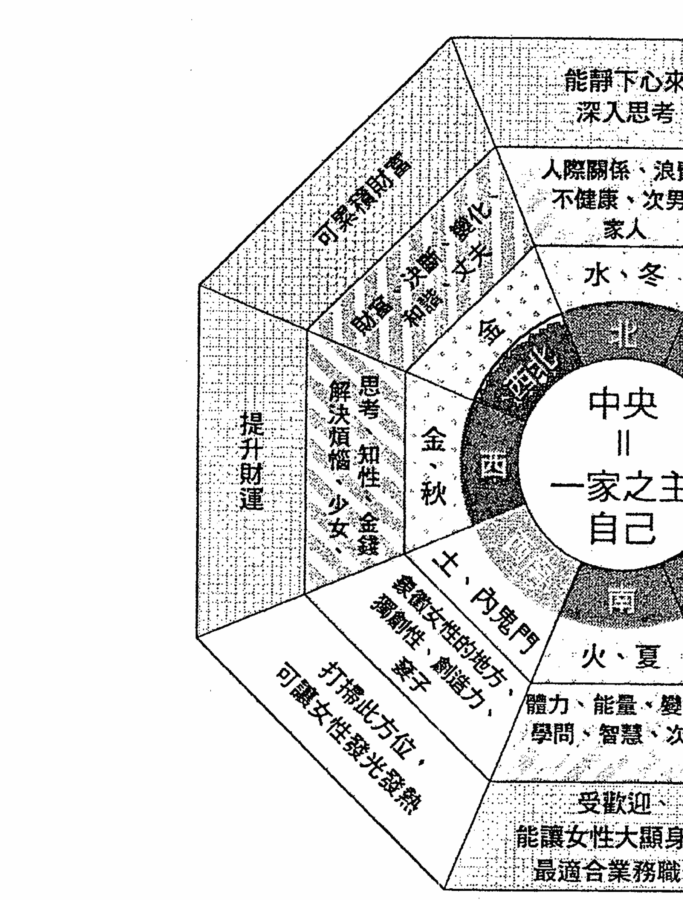

###### 占卜師飯田的運勢方位大調整！

- ■ 方位的性質
- ■ 影響的面向
- ■ 好的影響

可以改善採光和通風，讓新鮮的空氣往家裡流動。比方說，把大型家具當做山，置於北邊；「流動的河川」移動的東西——東邊放置移動頻繁的家具和發出聲音的物品；陽光撒落的南邊則放置小型家具；西邊日曬強，所以盡量不放置物品等。

第三章將為大家介紹，有錢人都這樣做的方位布置祕密。

##### 有錢人喜歡正中央

在風水學，中央象徵自己。房屋的中央是重要的場所，例如，木造房屋過去相當重視房子中央的大樑柱。即便沒有大樑柱，象微一家之主的中央也不允許有髒汙出現。所以請先確認哪裡是家裡的正中央，以掌握各個房間的方位。

此外，雖然跟風水無關，但有錢人似乎偏好正中央。車站的廁所等設施，大家都喜歡從兩旁開始使用；但是在高級飯店的廁所，中央的廁間經常是使用中，看來有錢人選擇正中央的意識強烈。

的確，在拍團體照的時候，社長都在正中央。有錢人光明磊落，周遭的人自然而然的聚集而來，所以有錢人在正中央是常態。

> 光明磊落坐正中央，這就是有錢人的思維！

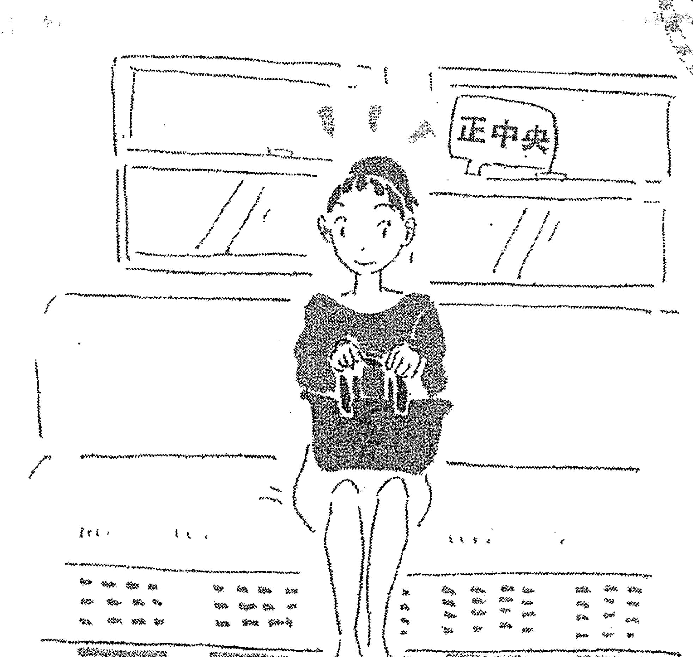

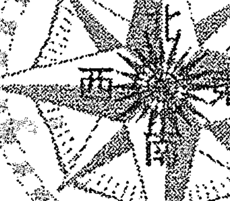

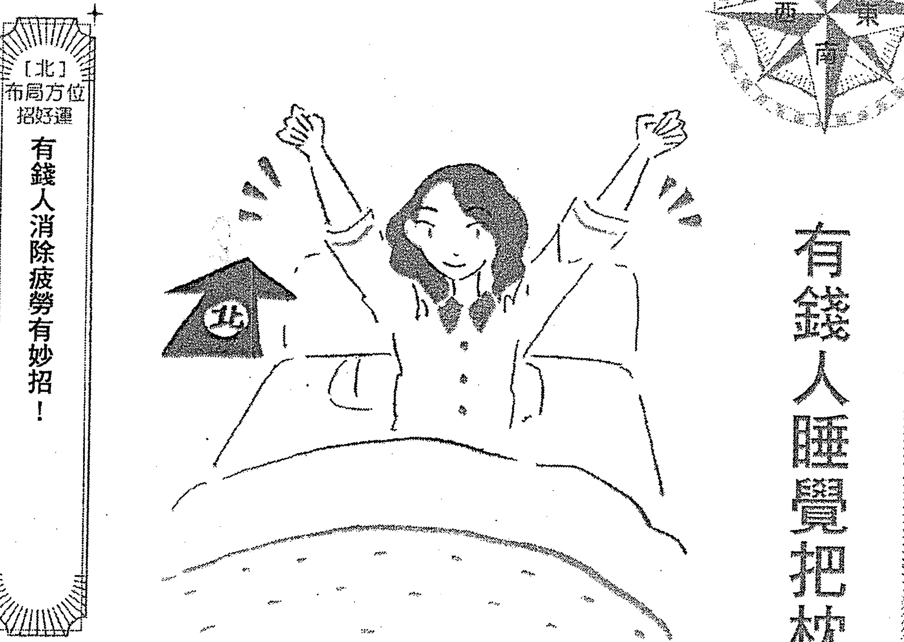

##### 有錢人睡覺把枕頭放北邊

> 【北】
> 布局方位
> 招好運

有錢人消除疲勞有妙招！

釋迦牟尼歸西時，頭是朝向北邊，因此說為枕頭放北邊不吉利。但是就風水學來看，枕頭放北邊才是好風水。而且，很多有錢人睡覺把枕頭放北邊。他們不懂風水，但是卻不自覺的這麼做，彷彿證明了有錢人的敏銳直覺。

為什麼枕頭放北邊好呢？因為地球有地磁，磁場從北極往南極，宛如包覆著地球表面般地流動著。如果睡覺時把枕頭放北邊，頭北腳南，身體的血液和氣的流動，與地球磁場流向一致，可以有效消除疲勞。人的身體也有微弱的電流在流動，因此或多或少會受到地球磁場的影響。由此來看，枕頭放北邊睡覺，可能是有有效消除疲勞、獲得高品質睡眠的祕訣。

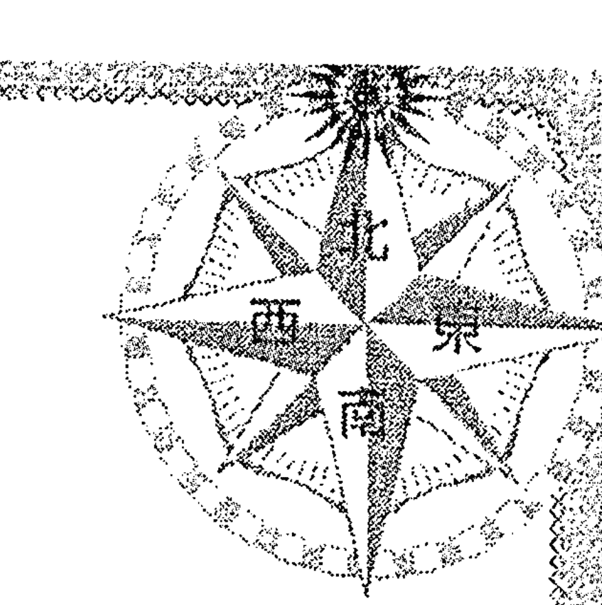

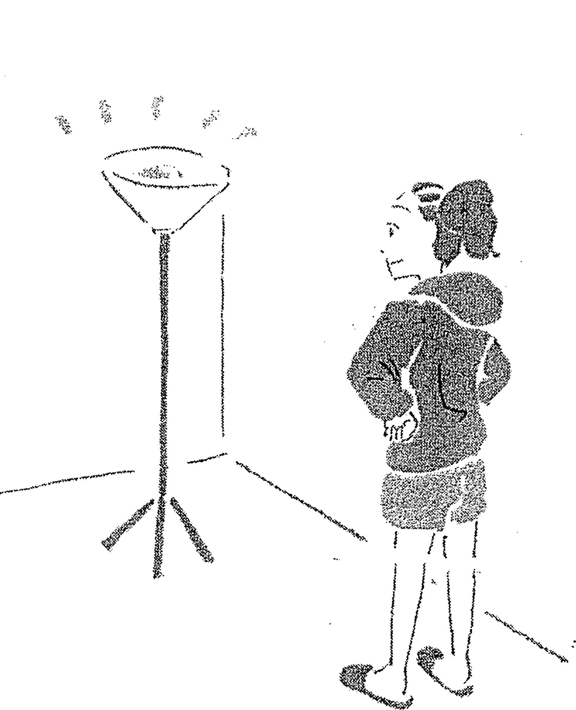

> 【北】
> 布局方位
> 趨吉避凶
> 用顏色營造溫暖的氣氛。
> 北邊的窗戶不要全開！

##### 有錢人家的北邊很溫暖

在風水學裡，北邊是象徵人際關係的方位。太陽光照不進北邊，容易變得陰暗且寒冷。雖說如此，每戶人家一定有北邊。而在如此不討喜的地方積極下功夫，留意是否隨時保持明亮、整潔的話，便能擁有成為有錢人的潛力。

首先，運用暖色系顏色代替太陽，為北邊的房間營造溫暖氣氛。窗簾、地毯、牆壁等大面積的東西，建議使用暖色系。用氣氛明亮的繪畫和照片裝飾房間，或設置間接照明也都有加分效果。

不過，北邊的窗戶盡量不要開。北邊的窗戶如果全開，人容易離散、關係不穩定，結婚、戀愛、和家人的緣分容易變淡薄。

##### 有錢人在北邊的書房擬定作戰計畫

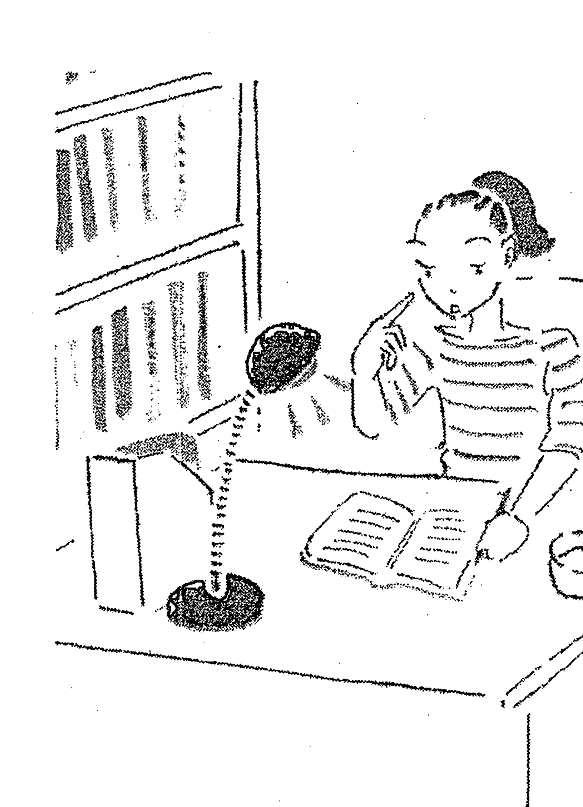

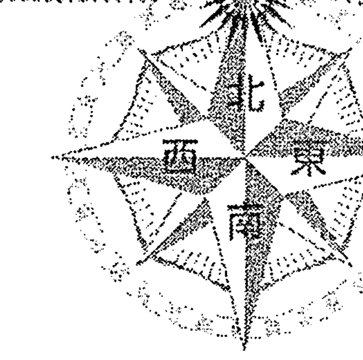

> 【北】
> 佈局方位招好運
> 想靜下心來思考事情，到北邊的房間就對了！

北邊掌管人際關係。例如，當你想冷靜下來，重新審視不盡理想的人際關係時，在北邊思考就非常有效。

北邊安靜、陰涼，是最適合靜下心來思考事物的方位，也是必須冷卻頭腦、平靜內心、仔細思考時的最佳場所。

由此來看，身為戰略家的有錢人，應該經常在北邊的書房一個人冷靜地思考。此外，北邊也是適合悠閒閱讀的好地方。假若北邊作為這種用途的話，裝潢應該要讓人感到平靜、溫暖，不要過於華麗。

如果北邊是家人團聚的客廳，則裝潢明亮、熱鬧為佳，但若為小房間的話，建議利用北邊的特質，規劃成安靜的書房。

##### 有錢人家北邊沒有大窗戶

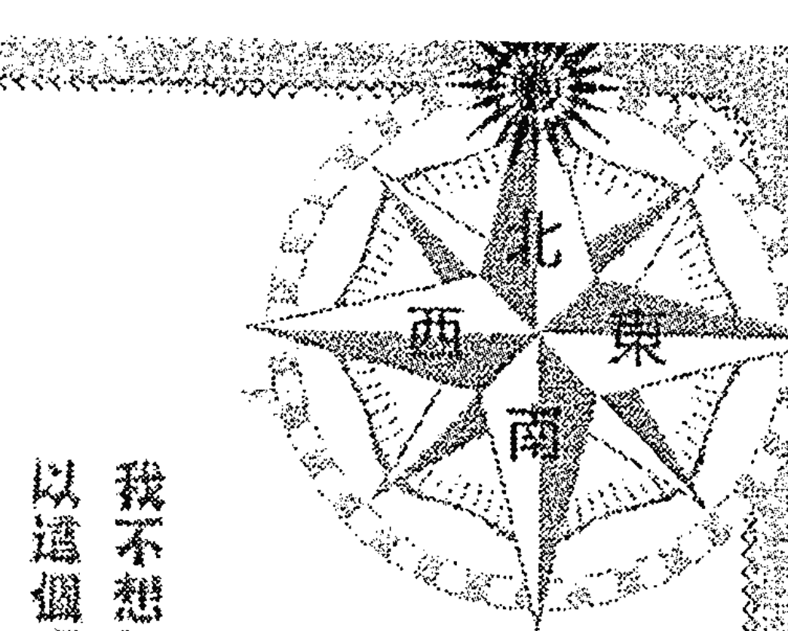

北邊（人際關係，其中也包含了戀愛關係。若家裡北邊有大窗戶，而且經常全開的話，身邊的人可能會來來去去、不穩定。這也可能發生在戀愛關係上。

例如即便有了情人，愛情可能也容易告吹。而且，冷風吹進房間，容易使房間變冷，也讓人際關係冷卻。

因應的對策就是不要太常開窗戶。用顏色明亮、溫暖的畫裝飾房間應該不錯。很多有錢人都會用畫裝點房間。

> 我不想跟你分開，所以這個窗戶不要一直開著。

> 【北】
> 佈局方位
> 招財運
> 位在北邊的窗戶不要一直開著！

##### 有錢人家北邊沒有玄關

都會大廈的格局大多是南陽台、北玄關。其實北玄關同樣也有身邊的人來來去去、不穩定的問題，因此需有相應的對策。

例如，幫北玄關掛上顏色明亮的門簾，放置鏡子，玄關門墊使用溫暖的顏色等，添加明亮且溫暖的要素。此外，玄關也跟工作運有關。不打掃的話，會對工作造成妨礙。為跟工作有關的地方增添生氣，工作運應該也會跟著扶搖直上。

###### 〔北〕市商方位招好運

把面向北邊的玄關弄得明亮、乾淨，人際關係旺、工作運也旺！

> 我家玄關雖然在北邊……
> 但是我會把它弄得Very Bright、Very Bright！要再來喔！

##### 有錢人家的東北邊總是乾淨整潔

風水學當中，有忌諱「鬼門」和「內鬼門」的風俗習慣。鬼門是指東北邊，內鬼門則為西南邊。

此風俗習慣源自風水學的發祥地中國。在中國的歷史中，經常受到東北遊牧民族的侵擾，據說秦始皇建造萬里長城，就是為了抵禦遊牧民族的入侵。

其他眾多說法當中，物理上比較有可能、也較為讓人接受的應該是東北邊陰暗且潮濕、不適合水類之物，西南邊西曬、不適合設置廚房等說法。

東北和西南是較為棘手的場所，保持整潔且通風是趨吉避凶的訣竅。所以應該盡量減少物品的堆積。

> 「東北」
> 布局方位
> 招好運
> 讓鬼門、內鬼門保持整潔且通風。

##### 有錢人家的東北邊沒有廁所

就像風水學所說的，東北邊是鬼門，陰暗且潮濕，不適合水類之物，因此把廁所和浴室設在東北邊的風水不好。

雖說如此，但公寓大廈等建築結構，廁所和浴室有可能是設在東北邊。遇到這種情況時，經常打掃，讓東北方保持乾淨整潔就好。尤其浴室容易發霉，要特別注意。

另一個東北邊不討喜的理由是寒冷。在沒陽光、寒冷的地方，露出肌膚洗澡或上廁所對身體不好。而且身體吹到寒風，也容易著涼生病。

其實只要了解並做好預防就沒問題。請多加利用地墊和暖氣。地墊以紅色、橘色、黃色等暖色系顏色為佳。馬桶蓋請蓋上。

> **(東北)**
> **布局方位**
> **招好運**
> 位在東北邊的水類之物，
> 只要做好清潔和保暖就沒問題！

##### 有身分地位的人都面向東邊發言

東邊是充滿能量的方位。不斷成長的年輕人，或是希望事業持續發展的人，請將東邊的房間設為生活空間，並保持良好的採光和通風。

東邊是適合培養有活力的年輕人的方位，所以底下有員工的社長、帶學生的老師等，有身分地位的人適合面向東邊發言。例如，讓年輕人站在東邊，有權勢的人則面向東邊說話，有提升學習能力和傳達指令的效果。

##### 想成長的人從東邊放出聲音

> 【東】
> 佈局方位
> 招財運
> 從東邊發出的聲音，為人帶來活力！

東邊的另一個特徵就是，適合放置發出聲音的東西。東邊具有成長、活躍、新穎的含義。因此，有助於成長和學習的聲音，適合從東邊放出來。例如，工作需要各種資訊的人，就開電視或聽廣播；工作需要感性的人，可以放自己喜愛的音樂。相反地，想要放鬆的時候，適合從西邊放讓人心情愉快的聲音。配合不同的方位，放適合的聲音，帶來好風水。

##### 有錢人用畫和植物裝飾東邊

東邊可以帶來成長、活躍、新穎的能量，若在東邊放置具有相同含意 的東西，例如成長中的植物、充滿活力生氣的畫等，可以放大效果。

配合各個方位的含意和能量，放置相同或相似的物品效果佳。例如，裝飾畫掛在哪都可以，但是配合方位裝飾相同特質的畫，效果更好。而在容易帶來厄運的北邊和東北邊，則適合用明亮的畫趨吉避凶。

> 1. 佈局方位 招好運
> 2. 放置符合方位特質的東西，讓運氣更旺！

##### 有錢人用紅色和橘色裝飾東邊

東邊和東南邊是太陽升起的方位，和明亮有活力的紅色性質相投合，讓方位和顏色的性質和諧一致，可以使運勢節節高升。使用象徵太陽的橘色也不錯。

雖然說東邊適合紅色，但不可以使整個房間都是紅色。能量太強，會太出風頭，失去平衡。

取得平衡對人類而言很重要。自我意識太過強烈，與他人的衝突就會跟著增加。所以，尤其是比較強勢的人，顏色的裝飾只要稍微點綴就好。

> 【東】
> 佈局方位
> 招好運
> 在東邊使用代表太陽的顏色，讓方位和顏色的性質和諧一致！

##### 有錢人吸收東南邊最強的能量

東南邊是適合發展的方位。東南邊和東邊一樣，為太陽上升的方位，因此也具有誕生、成長的含意。東南邊是能量最強的方位。

所以，東南邊有玄關或大窗戶的房子，能帶進誕生、成長、發展這類正向的氣，是風水非常好的房子。實際上，很多有錢人家的玄關都位在東南邊！

東南邊的方位能量強，除了玄關之外，作為客廳、工作室、寢室也不錯。而且東南邊有助於學習，也很適合作為兒童房。

為了讓吉氣容易進來，東南邊房間的東、西盡量不要多，並保持整潔、乾淨。此外，據說把偶像的照片貼在北邊的牆上，從東南邊或南邊觀看的話，可以逐漸實現夢想！

> 【東南】布局方位招財運
> 在運勢佳的東南邊房間築夢！

##### 有錢人在東南邊放置吉祥物

東南邊為人類帶來源生、成長、發展的力量，放置跟自己的興趣或喜好有關的東西，可以帶來活力和幹勁，讓自己快速成長。把跟自己不斷努力的事情有關的物品、喜歡的吉祥物，或是看了心情就會愉快的東西放在東南邊，能帶來正面的效果。

東南方適合擺放能量石之類的物品，可以增加活力與生氣。東南邊和南邊為陽氣和陽光進入家中的方位，因此這兩個方位最好有窗戶或玄關。每天早上打開東南邊的窗戶，讓早晨的新鮮空氣進到房間裡。

如果東南邊為牆壁，就以鏡子或間接照明代替太陽照亮房間，放置植物或空氣清淨機製造新鮮的空氣。

> [東南方] 佈局方位
> 招好運
> 在陽氣充沛的東南邊放置能量物品！

##### 有錢人家的南邊房間有窗或空氣清淨機、冷氣

南邊是讓人安心、帶來生氣方位，也可以說是獲得能量和體力的方位。南邊採光佳，所以公寓大廈的西南房很受歡迎，房子的南邊應該多有大窗戶或陽台。就風水學上來看，這樣的設計非常好，因為可以把太陽的明亮和溫暖帶進房間裡。人在明亮、溫暖的地方可以獲得能量和體力，充滿活力。順應動物本能就對了。

如果南邊沒有窗戶或陽台的話，可以放置空氣清淨機或冷氣代替。讓新鮮空氣從南邊進入房間，從溫暖方位往寒冷的方位（北方）流動，增加家裡空氣的對流。不要讓氣靜止不動，而是讓空氣流動到家中每個角落。創造良好的空氣循環很重要。

> 【南】
> 布局方位
> 招好運
> 享受陽光，吸取能量。
> 讓南邊的空氣流入房間，製造流動的氣場

##### 靠知名度吃飯的人要面向南邊工作

南邊是跟人氣有關的方位，所以做業務、用文字討生活、靠知名度吃飯的人，請保持南邊的乾淨整潔。寫文章、在工作桌上創作者的人，可以把桌子面向南方擺置。

面向南邊工作，容易創作出受歡迎的作品。

此外，風水學認為南邊和西南邊是女性的方位，因此具有能讓女性充滿魅力、光輝四射的力量。若南邊不乾淨，女性魅力就會黯然失色。因此，勤打掃、保持整潔很重要。

適合南邊的顏色有橘色和紅色等，象徵太陽的明亮顏色。另外，在南邊放置閃亮物品也有加分效果，不鏽鋼製的家具、水晶、玻璃飾品等，帶光且亮，是南邊的關鍵字。從廟宇求來的神符，也要掛在面向南邊的高處。

> 【南】
> 布局方位
> 招好運
> 想出名，就要重視南邊！

##### 有錢人把西南邊打掃得很乾淨

西南邊影響女性健康，必須保持乾淨。想提升女人緣的男性，也請打掃乾淨。

> 西南
> 布局方位
> 招好運

東北邊是鬼門，在它的對角線西南邊則為內鬼門，其由來就如同前面所說。據說東北邊和西南邊，也分別代表男性和女性的方位。

若西南邊骯髒不乾淨，或放有枯萎植物的話，住在那裡的女性經常有身體狀況不佳的情況。西南邊是女性尤其要維持乾淨的方位。

那男性是不是不用在意西南邊呢？答案是不行，如果西南邊不乾淨，女人緣非常有可能因此變差。沒有女人緣的人，請務必再次確認家中的西南邊是否骯髒凌亂。

此外，西邊和西南邊下午太陽直射，食物容易腐敗，因此普遍認為不適合作為廚房。但只要保持乾淨整潔，就不會有問題。

##### 有錢人把沙發放在西邊的房間

西邊是可以讓人放鬆的方位。請試著從太陽運行的角度來思考。太陽從東邊升起，所以東邊是充滿活力有生氣的方位。而西邊正好相反，為日落西下的方位，因此讓人心情平靜。

**西邊適合成從事思考、知性類的活動。**

在西邊設置客廳、寢室、書房等當然沒問題，將之當作悠哉放鬆的房間，養精蓄銳也非常適合。擺設可以令人平靜、放鬆的沙發為佳。

適合西邊的顏色為近似夕陽的橘色和黃色。此外，風水學也認為西邊為掌管財運的方位，放置綠色或金色的物品，可以有效提升財運。

> 就像渡過漫長秋夜的愜意時光，好好放鬆，養精蓄銳。

> 【西】
> 布局方位
> 招好運
> 面向西邊吸收知識！
> 用數字提升財運！

##### 面向西邊用功有助於記憶

西邊是適合記憶事物的方位。據說在面向西邊的桌子，對於學習、記憶知識等尤其有效率。

風水學認為西邊是提升財運的方位，因此面向西邊所學習到的知識和智慧，可以提升未來的財運。此外，因金錢與數字，在西邊放置時鐘或月曆等與數字有關的物品，也能招來財運。

##### 西邊的窗戶不要太打開

西邊和西南邊是下午太陽直射的地方。

西曬容易使東西腐敗，因此盡量不要在西邊擺放物品。

西邊也是財運的方位，就我的經驗來說，西邊雖然能帶來財運，但如果能量太強，而西邊的大窗戶一直開著，錢財就算進到口袋也留不住。

而且，西邊太髒會存不到錢，容易發生金錢糾紛，要小心！

> 『西』布局方位 招好運
> 小心！
> 西邊的窗戶一直開著會留不住財！

##### 有錢人把貴重物品放在西北邊

西北邊是可以獲得財富的方位。雖然說財運在西，但更貴重的財產、資產等財富，則是由西北邊的方位掌管。而保險箱和寶石等貴重物品，也很適合保管在西北邊。把貴重物品放在深綠色的保險箱更好！

錢財喜歡安靜的地方，所以建議西北邊的裝潢擺設，以營造平靜氣氛為佳。不要有強烈的光線或風，光線柔和微亮最好。

此外，代表女性方位的西南邊象徵妻子，西北邊則象徵丈夫。過去支撐家庭的主要經濟來源為男性，因此西北邊是有身分地位者的方位。如果西北邊骯髒不乾淨，一家之主就容易惹禍上身，要小心留意。把西北邊作為丈夫感到舒適的房間或書房使用為佳。

> 『西北』
> 布局方位
> 招好運
> 把財產儲放在安靜的房間！

##### 有錢人豪宅大鑑定！

內容取自日本朝日電視台《請給分！話題排行榜》節目

###### 國分利治的家

###### 國分利治小檔案

EARTH 控股有限公司董事長。經營知名連鎖髮廊「EARTH」，日本共有 223 間分店，員工超過 2800 人。國分從美廊學徒開始做起，拚命工作十幾年幾乎沒有休息，30 歲時自立門戶創業。37 歲參訪美國的大型美髮沙龍時大為感動，回日本後以獨特的加盟連銷制度，使業績飛快成長。視「不統一樣準，只培養風格」「打造百年老店」為座右銘，以培養經營者為目標。

###### 風水近乎完美的豪宅！

占地面積300多坪，三層樓建築，16間房間，國分住在十億日圓的豪宅。首先，玄關和停車棚面向東南邊的設計就100分！大量的吉氣從寬廣的入口進到房子裡，可以獲得最佳的能量。

二樓客人專用的浴室比自家的還大且豪華，從這裡可以看出有錢人想讓人開心的精神。此外，工作上多以女性客人為主，所以對國分而言，象徵女性的南邊是重要的方位，而南邊的每個角落都非常乾淨，這點也做得非常好。

一進到寢室，就聞到精油的芳香。講究氣味是有錢人的共同點。而且寢具都是用最讓人放鬆的白色，太讚了！在三樓的客廳發現財神的擺飾，我一說：「面向南邊擺會更好喔。」國分馬上改變擺飾的位置。不愧是名仕，就是有行動力。

在寬廣的派對房，北邊的牆上裝飾著粉紅色的畫，是在北邊裝飾明亮物品的好風水。而且，一樓竟然有金色的茶室！金色是有錢人喜愛的顏色。而一樓又為奇數，具有發展、成長含意，想在事業上有所成就的人，用金色點綴一樓是最佳選擇。完美無缺的豪宅，彷彿說明了國分的成功命中注定。

###### 占卜師飯田親眼所見！

- 讓吉氣從東南邊進到屋子裡！
- 用顏色明亮的畫裝飾北邊的牆壁！
- 一樓有金色的茶室！

### 第4章

# 有錢人的共同點

# 【思維篇】

##### 有錢人不斷丟衣服

包含企業經營者的有錢人，他們經常要與人會面，因此講究穿著打扮。女性時尚尤其豐富多元，大家一定覺得女老闆的衣服非常多吧。

但是，我曾經請教過某位女社長，她卻說：「我一直丟衣服。」

基本上，有錢人不會有一大堆東西。比如說，那位女社長是這樣買東西的。首先，決定好購物的日子和店家。

「我要這套，跟這套，還有：…」像這樣一次購買二十套衣服。然後，好一段時間輪流穿這二十套衣服。穿過多次之後，就全部丟掉。

也就是說，他們不斷重複著買新東

###### 有錢人的思維

衣服積太多，便難以下決定。

為節省猶豫的時間，買新衣服就把舊衣服丟掉！

買新和丟舊的循環，不會去思考要怎麼穿撘。

當然，有些有錢人可能非常喜歡衣物，對自己的美感有信心，擅長穿撘。但大多數的企業經營者都說：「我沒有美感，所以交給專業的來。」他們的想法是，自己做不來的、不擅長的事情就交給別人，盡可能把煩惱、猶豫的時間節省起來。

他們重視穿著打扮，是為了他人著想的貼心，而非對衣服的執著和物欲。

當衣服完成了任務，就一件一件把它們丟掉，買新衣服也能讓心情煥然一新。果斷且有行動力是有錢人的特徵。

所以，如果家裡有衣服超過兩季以上都沒有穿的話，就把它們統統丟掉吧。

###### 比起想要的東西，有錢人更喜歡買好玩的

我在有錢人家看到新奇的東西，問對方：「這是什麼？」他們大多會用開心的表情回答：「很有趣吧！」「這東西很好玩吧！」

有錢人對自己是理性主義，但是對他人卻抱持著想讓大家開心、想娛樂大家的態度。

有錢人的房間基本上都整理得很乾淨，但經常有讓人覺得「這是啥？」的東西。

好奇一問，「覺得好玩就買了」，很多人都這樣回答。

有錢人本身就是有趣的人，而且他們願意把錢花在讓大家開心的事物上。比起自己想要動的，有錢人更喜歡買好玩的、讓人露出笑容的東西。有錢人可以說天生就是娛樂眾人的藝人。

> 把錢花在讓大家開心的東西上。

##### 有錢人不賭博

把焦點放在有錢人不做的事情上，可以發現他們不把賭博當作興趣。

雖然有些有錢人會到國外的賭場玩，但那只是旅遊活動之一，會把賭博當作日常嗜好的人應該很少。

因為有錢人認為人生就是一場賭注。一般來說，大多數人都追求平穩的生活，但有錢人則認為根本沒有所謂的穩定生活。正因爲如此，他們才會在從來沒有人做過的事情上下賭注、用從來沒人用過的方法、比誰都還快展開計畫、不斷挑戰未知的世界，最後獲得成功，成為有錢人。

有錢人是開拓者，是不斷披荊斬棘開路的人。這樣看來，工作本身也像是一場賭注。

##### 有錢人會犒賞自己

犒賞自己、增加動力，學習如何成為一流人士！

有錢人不會忘記犒賞自己，且手法高明。在達到目標、事業順利的時候，就會大手筆地犒賞自己，讓喜悅放大好幾倍。如此一來，喜悅就會深深印在腦海裡，「想要再次感受那個喜悅！」便成為下一個目標的動力來源。此外，很多有錢人都是購買有品味、高級的東西，當作給自己的犒賞。了解什麼是一流，可以提高當事人的價值標準。而想成為一流人士的動機，不但能讓自己更有鬥志，也使自己對他人的款待之道更上一層樓。利用犒賞自己，把成為有錢人的必要條件和提升幹勁巧妙地連結在一起，這個方法實在非常聰明。

##### 從錢包可以看出年收有多少

錢包的等級，等於年收的級距！

你有聽過這句話嗎？「想成為有錢人，就不要用便宜的錢包。」我們也常聽到這樣的說法：「年收大約是錢包價格的一百五十倍到兩百倍。」從花了多少錢在錢包上，就可以推測出那個人賺了多少钱。

反過來想：使用目標年收約兩百分之一價格的錢包。如此一來，為了配得上錢包的等級，就會逐漸改變自己。錢包是每天都會用到、看到的東西，應該很有影響力。即便年收沒有馬上增加，意識也將有所改變。

##### 有錢人的錢包和錢乾淨又漂亮

錢包表露出對金錢的態度。

有錢人珍惜金錢，並且對金錢充滿感激，因此對待金錢總是很小心謹慎。所以，無論是錢包還是錢都乾淨又漂亮。

看到鈔票雜亂無章地塞在又髒又舊的錢包，應該會覺得這個人對金錢很不尊重吧。

金錢是生財的工具，它也會透露出人的態度。就像是運動選手珍惜自己的器具一樣，有錢人也認為金錢是重要的工具，所以會謹慎小心地對待它。

###### 珍惜工具是邁向成功的態度！

##### 有錢人沒錢也會說有錢！

> 不要用「最近手頭有點緊……」之類的理由拒絕別人！

曾經有位有錢人教我說：「即便沒有錢，也要說有錢。」「金錢會往有錢的地方聚集。」

這句話的意思是，難得有人來約吃飯，你用沒有錢的理由拒絕，對方下次就不會來約了。沒有錢的人不會突然變成有錢人，拒絕邀约的人只不過是不想花錢而已。而且，這也難逃「沒有錢』運氣差」的思維。明明沒錢的時候，人際網絡更為重要，但很多人卻不明白這個道理。

聽了那位有錢人的話之後，我也開始没钱仍說有錢了。

有錢人曰：「一直說沒錢，說到最後真的會沒錢。」因為那會變成一種自我暗示。

##### 有錢人不會只領大鈔

我曾經聽過某位有錢人這樣說：「到ＡＴＭ領錢的時候，不要剛剛好領三千元這種數字，而是領兩千八百元這種大小鈔都有的數字比較好。」

理由在於，事先把大鈔換成小鈔，比較能夠意識自己花了多少錢。例如，五張百元鈔票當中用掉了兩張，就會意識到百元鈔票只剩三張；但如果是付千元大鈔，錢包就會突然出現多張小鈔，容易搞不清楚自己到底花了多少錢。可以清楚掌握支出細節的人，能夠成為有錢人。

###### 有錢人的思維

- 要隨時掌握錢包裡有多少錢！

##### 有錢人存摺分三本以上使用

- **有錢人的思維**：明確目的、細分目標，下決定心執行到底！
  - 購屋基金
  - 旅遊基金

想存錢的話，存摺要分三本以上。這是「明確目標」的存錢法。例如，把存摺分成購屋基金、旅遊基金之類的「○○基金」，將目標確立清楚，可以阻止自己動用那些錢。

而且，細分目標方便管理，不會讓收支狀況模模糊糊不清。只是一味地祈求目標可以實現，是永遠無法達成的。人的意志力薄弱，因此細分目標是防止自己找藉口、偷懶的小技巧。

##### 有錢人喜歡乾淨整潔、討喜且憨直的人

事業成功、成為有錢人的人，他們明白人生是別人決定的道理。

例如，即使舉手說：「我想做那項工作！」對方未必願意讓你做。這是很簡單的道理，即便不斷以「我自我」來強調自己，或是不斷推銷自己「這麼努力」「多麼有才華」，只要對方不願意委託，工作就不會上門，當然也就賺不到錢。

說得極端一點，只要付錢的人不喜歡你，就沒有意義，再怎麼努力也沒用。

從這個角度來看，乾淨整潔、討喜的人絕對比較受歡迎。除非是特殊情況，即便再怎麼努力，比起不衛生、摳...

那個人根本就不行，所以我啊……

哞哇，這個人感覺很難用耶

牢騷

###### 有錢人的思維

- 了解人生是別人決定的道理！

臭臉的人，大家絕對比較想跟乾淨整潔、討喜的人來往。

工作是人與人之間的關係，工作就是為別人付出。即便能力再好，只要讓人覺得「真不想跟你來往」，工作總有一天會越來越少。

而憨直是判斷這個人是否值得信任的標準。工作立基於信賴關係上，找理由掩飾失敗、把責任推給別人、不正直的人，只會妨礙工作。即使失敗了也能老實承認錯誤、面對現實，找出改善方法，就有可能創造出避免犯下相同錯誤的方法，而招來財運。

不誠實的人只會擾亂人心，而且浪費精力和時間。有錢人最討厭浪費。所以對有錢人而言，正直好懂的人才是有價值的人才。

##### 沒錢人常常瞧不起別人

越是有意錢的人，越不會瞧不起別人、講別人的壞話。

有錢人尊重他人。工作能力越好，越能看清自己的極限，明白人跟人之間必須互相幫助、不尊重人的生意談不成的道理。

曾經有個這樣的故事。某個有錢人批評某樣商品，結果發現那是熟人公司做的東西。有錢人的人脈廣，只要壞話一說出口，大家馬上就會知道是跟誰有關。

「這麼愛抱怨就自己做啊！」—結果當然是做不到。也就是說，互相扶持才是人間的。道理。「畢竟很多事情都要靠別人，姿態不行呀！」有錢人這樣說。

###### 脫貧思維

- 丟掉「有錢」邪惡的想法！

##### 沒錢人常常酸有錢人

可能是出於嫉妒或偏見吧，總覺得喜歡講有錢人壞話的人很多。而且，大家對有錢人的印象，似乎都是時代劇中的奸商角色。

然而，只要抱著檢視有錢人的態度，是無法成為有錢人的。「金錢不是人生的目的」，說這種話的人，應該會如其所說的——輩子都沒有錢。

金錢沒有好壞之分，只是單純的工具。

金錢本身沒有價值，關鍵在於如何使用它。

思考怎麼運用金錢，經手龐大金額的人才是有錢人。他們挑戰沒有人做得到的事情，創造出有魅力的事物，讓金錢動起來。有錢人是值得尊敬、感謝的存在。察覺到這個道理的人，才能受到金錢和有錢人的喜愛。

##### 有錢人樂在工作

- **有錢人的思維**
- 樂觀的態度，能吸引機會上門！

這是某個在停車場工作的阿伯的故事。

阿伯每天上班都很開心，說話總是很有精神，經常用開朗的聲音引導駕駛，「請停這裡！」「下雨天就準備雨傘給客人使用。

某一天，阿伯說：「我再做一陣子就要滿六十歲退休了。「在他工作的最後一天，停車場竟然排起了隊伍。因為捨不得阿伯離開的人，紛紛帶著花束和禮物來向他道謝、告別。大家都異口同聲地說：「從來沒看過這麼樂在工作的人。」

結果，某間公司向阿伯招手：「要不要來我們這邊做警衛？請把快樂的工作態度傳授給我們！」阿伯樂在工作的態度，讓他獲得了比從前收入還要好的工作機會。

##### 有錢人知道自己的能耐在哪

什麼事都自己來的人，無法成為有錢人。據說某位有錢人，他家庭的裝潢擺設全部交給別人處理。從選家具到空間配置，全部交給人，出錢但不出嘴。

我也聽說某位有錢人，他的服裝全部都交由他人挑選。他說：「我沒有挑衣服的法味。」「有錢人清楚知道自己做得到了什麼，做不到什麼；做不到的事情，就交給值得信賴的人去做！」

工作也是同樣的道理。清楚自己的能力範圍，凡事都能理性且有效率進行的人，才能夠成為有錢人。不誇大自己的能力，做不到的事情就拜託別人。因此身邊有值得信賴的人很重要。

##### 有錢人樂於分享

和有钱人聊天非常愉快，因為他們告訴我很多事情。和他们聊天，不但擴展了我的視野，也讓我度過非常刺激的時光。某一次我問道：「為什麼這麼親切地告訴我這麼多呢？」有钱人這樣回答：「好事情当然要跟大家分享呀！」

他們明白人無法一個人獨自活下去的道理，所以重視與人之間的關係，以朋友多多益善為人生哲學。

而另一方面，讓人覺得惋惜的人，都是不懂得感謝的人。他們認為全部都是自己的功勞，所以不覺得別人幫了什麼忙。因為財源源自於人緣。過得自我中心，做什麼事情都容易碰壁。

##### 有錢人的人際觀

感恩的心帶來好運！

###### 有錢人的口頭禪：“我只是運氣好”

我常聽到有錢人說：“自己只是運氣好而已。”這樣說的演藝人員尤其多。因為他們知道許多人比自己有才華，也看過許多才華洋溢、比別人加倍努力，卻沒有成功的人。

有顆感恩的心，認為一切都是受到大家幫助的人，能招來好運。因為感謝之情，別人感受得到。運氣是一運來好氣，想要有好運氣，就必須毫不吝嗇地報恩。

##### 做任何事都不會一個人

我跟各種不同的有錢人聊過的感覺是，他們不會凡事都自己來或一個人獨占成功。

與人之间有緣分，與錢之間也有緣分。

就像是好人有好人緣的道理，好人也有好財運。再說得更具體一點，有付出就會有回報，人緣可帶來財運。

所以有錢人喜歡讓大家開心，為大家付出。因為他們知道這個法則。

###### 有錢人的思維

> 有付出就會有回報，人緣可帶來財運！

要不要一起？

##### 有錢人喜歡熱鬧

有錢人經常在家裡開派對。有錢人的豪宅可以說幾乎都有派對房，春天賞櫻、夏天 BBQ 等，不同的季節開不同主題的派對。

有錢人非常擅長打造派對或聚會之類，讓大家盡興的享受愉快的時間和空間。

我想那背後應該是源自有錢人想讓大家开心的思維。同時也是以創造匯集人脈、錢財、資訊的場所，互利互惠為目的。

跳脫日常的時間和空間，人的情緒會變得高昂，使得人脈、錢財、資訊容易交流。

有位有錢人曾經這樣說：「錢不用會生鏽。」「為了不生鏽長苔，就必須注入活水、製造潮流，這就是有錢人的人生觀。

##### 有錢人的訊息簡潔好懂

有錢人的訊息大多簡短，絕對不會出現冗詞贅字。

例如，不會同時出現兩個疑問句，只會有一個疑問句。也不會有「最近我這樣那樣，遇到了這種事情」，這類流水帳式的訊息。也就是說，他們不會讓對方煩惱該怎麼回覆，訊息簡單明確好懂。這是有錢人的理性思維，同時也是體貼他人。他們的想法是，不可以讓對方浪費時間煩惱。

###### 有錢人的思維

- 不做讓對方浪費時間煩惱的事情！

##### 有錢人習慣馬上回電、回覆訊息

某位知名的節目企劃曾說：「我都馬上回電、回覆訊息。」實際上，這個人訊息真的回得很快，而且在餐會時也不時中途離席。我問：「為什麼回這麼快呢？」他回答：「對方來聯絡的時候，應該希望馬上得到回應吧。既然如此我就立刻回覆。」多麼為他人著想呀。

能徹底那樣做的人，是因為明白自己被別人所需要。這讓我實際體會到，懂得體貼別人的人，能夠成為有錢人的道理。

##### 有錢人的時間觀

猶豫不決只是浪費時間！

我選擇這個！

###### 有錢人不會猶豫不決

大家常說實現夢想的條件是行動力，有錢人不只行動力，而且還很乾脆俐落。有錢人的行動就是快。只要有一點子，覺得「應該可行吧？」就馬上行動，一點也不猶豫。那麼，為什麼無法成為有錢的人動作慢呢？那是因為他們時常猶豫不決。為什麼猶豫不決？應該是擔心事情是否會順利，因為他們不想失敗。另一方面，有錢人之所以動作快，是因為他們覺得失敗也沒關係，因為過去經歷過許多失敗。正因為有許多失敗經驗，才能找出成功的方法，他們將失敗當作成功的墊腳石。

###### 有錢人不看雜誌

雜誌如字面意義所示，是記載繁多資訊的刊物。閱讀雜誌可以迅速獲得新知，但是有錢人幾乎不看雜誌。

我詢問他們理由何在，他們回答：「我為什麼要去吸收那些不知道是誰寫的資訊呢？」

原來如此，他們認為沒有必要去閱讀不知是否值得信任的文章。有什麼想了了解的，就直接請教專家。有錢人的想法是，閱讀不曉得是否值得信任的文章，只會擾亂自己的心、浪費時間而已。

相反的，有錢人閱讀大量的書，而他們依據「因為是這個人寫的」基準在挑書。他們從可靠的管道，獲得可靠的資訊。

- 有錢人的思維：有疑問就直接請教專家！

###### 有錢人不沉迷網路

- 有錢人的思維：網路迷惑人心、竊取時間，必須有目的地使用！

喜歡閱讀的有錢人幾乎都不會沉迷網路。他們雖然會用網路，但是不會東看西看。只要一打開網路，就容易看到有趣的東西，等回過神來，好幾個小時就這樣過去了。這應該是很常見的情況吧。但有錢人認為這是致命傷。

首先，這代表時間管理不確實。如果上網是為了在期限內達成目的當然無妨，然一旦開始漫無目的地使用的話，那可不行。而且，網路和雜誌一樣，即便內容再怎麼有趣，大多是不知道是否值得信任的資訊。如果是值得信賴的人提供的資訊，當然另當別論。若被可信度低的資訊耍得團團轉的話，就只是在浪費時間，因為時間就是金錢。

###### 有錢人打招呼時會報上自己的名字

我認識的一位有錢人，每次見面時都會說「你好，我是○○○」，報上自己的名字。我問他為什麼，「因為飯田先生見過太多人了，應該不記得我吧。」對方回答。

為了不讓對方因為忘記自己的名字而感到困擾，率先說出自己的名字，便能減少對方的煩惱。心情變得輕鬆，生意當然也談得順利。

記得過去有認識的人，每次接起電話都會說：「我是走運的田中！」讓我知道現在仍記憶猶新。用創意標語來介紹自己，也是個不錯的點子。

###### 有錢人一拿到名片就馬上稱讚

有錢人另一個打招呼的技巧是，一拿到別人的名片就馬上稱讚。例如：「這個名字好棒喔」－「真是有品味的名片耶」。繼之就是先稱讚，然後才問「您是住在○○嗎？」之類的問題。

稱讚可以卸下方防，使之後的溝通更加順暢，也能讓對方記住你。

無論是銷售商品，還是銷售服務，其實都是在銷售自己。而在交換名片的瞬間，就可以給予對方好印象。

- 有錢人的思維：一張名片就打開話匣子，瞬間給人好印象！

###### 有錢人刻意不察言觀色

有錢人不察言觀色是理所當然。即便是聚餐等情況，到了決定好要回家的時間，以一句「那我先走囉」回家去，漸漸的周遭其他人也會默認「那傢伙只要時間一到就會回去」。有錢人的自我管理就是做得這麼好，所以生活才不會走調，也不隨波逐流。

例如，有位知名的棒球選手，即便參加聚餐，回到家後也一定練習揮棒，每日的功課絕不懈怠。因為持續就是力量。把規律的生活視為理所當然的有錢人，其實出乎意料的多。

###### 有錢人都約奇怪的時問

意識金錢就是管理數字。對數字不敏銳的人，就下功夫想辦法讓自己記憶數字。

例如，某位有錢人在跟別人約時間的時候，都不會約剛好七點，而是七點五分或是六點五十分之類的奇怪時刻。因為奇怪的數字比較好記。

這就跟領錢的時候，不要領剛剛好的金額是一樣的道理，是幫助記憶數字的小訣竅。請當作在玩遊戲，試試看吧。

###### 有錢人習慣做筆記

我看過這麼多有錢人，發現他們都很會訂定目標。首先他們非常守時，答應的事情一定會記下來，而且幾乎沒有人不戴手錶。也就是說，他們時間管理做得很徹底。因為他們會把願望和目標細分成可執行的項目，分配好時間，例如：「在這之前，完成這件事。」就像是在何時之前，要做什么事，細分應執行項目，一步步實現目標。那個過程在做筆記時，就已經開始了。

###### 有錢人的月曆一年比一年大

讓月曆一年比一年大，是我自己實際執行，而收入也真的增加的方法。剛開始我是使用小月曆，當年收逐漸增加之後，便跟著增加月曆的尺寸。這是讓自己意識時間寶貴，數字很重要的方法，明白這樣的道理，就能夠逐漸成為有錢人。

時間等於生命。有錢人之所以不浪費時間，是因為不想浪費生命。因為生命有限，所以全心全意，預測未來，持續不斷挑戰。這就是有錢人。

- 有錢人的思維：時間＝生命。隨時提醒自已時間有限！

###### 有錢人樂處逆境

看我化危機為轉機！

我為這麼多有錢人占過卜，覺得有個地方很有趣，那就是許多有錢人都說：「運氣好的時候很無聊。」

有錢人認為身處危機才好玩。比方說，爬坡的時候最快樂，但是到達頂點，進入安定期之後，就變得不有趣了。

正因為如此，當有錢人遇到逆境時，他們會在腦中思考「好，我要改變這個狀況。」擬定作戰計畫，挑戰困難平是他們最快樂的時候。

絞盡腦汁、全神貫注，持續挑戰到成功。只不過，當他們判斷成功無望時，便會果斷放棄。老實承認失敗，馬上轉換方向。

- 有錢人的思維：化危機為轉機，艱困時刻才有趣！

###### 有錢人在垂頭喪氣時抓住機會

雖然說樂處逆境是有錢人的心態，但有錢人也會有垂頭喪氣的時候。

曾經有段這樣的故事，日本青森縣的蘋果園，因為颱風導致農作物損失慘重。當中，某個農家替收穫不到一成的蘋果拍照，取名為「強風也吹不落的幸運蘋果」，以一顆一千兩百日圓的價格賣出。結果全日本的考生搶著下訂單，幸運蘋果大熱賣。聽說農家以十倍以上價格售出，賺非常多。

垂頭喪氣只是浪費時間，有錢人厲害的地方在於轉念，化守為攻。與其垂頭喪氣什麼都不做，不如心念一轉，好運自然來。

被逼得走投無路時，該怎麼思考？要如何行動？能否成為有錢人的關鍵就在於此。

> 黑暗中必有曙光。
> 最後轉守為攻便是吉！

###### 「沒錢人開口閉口『可是』『因為』」

如果有人問我「無法成為有錢人的特徵是什麼？」我想應該就是把「可是」「因為」當作口頭禪的人。

有錢人明白為他人付出，別人對自己的感謝之情，最後會為自己帶來錢財，因此總是提供他人有用的資訊。

這時，如果對方不斷用「可是」「因為」反駁，對話就接不下去了。

忙碌的有錢人，沒有時間理會那些反駁。而且他們討厭浪費時間，所以放棄得快，心想「可惜對方聽不懂」便離去。

當你很想說「可是」「因為」的時候，總之忍住，先接受對方的說法，然後再用「像這種時候，該怎麼做才好呢？」來回應。

- 沒錢人的特徵：不要為自己找藉口！

###### 沒錢人開口閉口「做不到」「有困難」

無能成為有錢人的人，另一個特徵就是開口閉口「做不到」「好難」。

我為這樣的人占卜，建議他們：「穿乾淨整潔的衣服比較好！」他們會馬上回：「做不到！」如果我會說：「請從清水寺往下跳。」那當然做不到，但是穿乾淨整潔的衣服，根本不是做不到的事情，卻在做之前就先說做不到。

這種否定思維真的不是很好。「好難」這話只要一說出口，就會深陷其中，變得固執、不願改變。最後，讓事情變得好難的，其實是自己。

一旦陷入否定思維的時候，試著改口：「不，這不是做不到」「這一點也不難」。

###### 有錢人有許多失敗的經驗

我常常覺得有錢人的直覺好準！他們擁有可以聞出錢的味道感官能力，因為他們有許多失敗的經驗。那些經歷深深烙印在他們的身體和心中，所以在思考之前，可以憑感覺判斷。

我在占卜的時候，比起命中，我比較關注沒有命中。蒐集沒有命中的人的資料，持續提升占卜能力直到說中為止。結果某位有錢人跟我說：「某間公司有找出缺陷，進而改善的方程式，這個跟飯田先生的做法是一樣的。」而我幫某位運動選手占卜時，對方也說：「請你告訴我有什麼不好的地方。因為不改善缺點，就不可能獲得勝利。」這就是贏家的思維。

- 有錢人的思維：改善缺點，就能變強！

###### 有錢人不認為成功就是終點

有錢人的口頭禪之一就是「全部都是中繼站」。就算我說：「您已經相當成功了不是吗？」他們也回道：「我一點也不成功啊。」也就是說，即便有目標，他們也不執著於成功或終點，大家都輕鬆說：「好，下一個。」

前幾天，我一對住在紐約的夫婦朋友來到日本，碰面時他們說：「我們收購了日本的人氣餐飲店，然後在香港和馬來西亞成功展店之後，就賣掉。」

也就是說，不是賺到錢就結束。他們低價收購、提高價值，系統化之後賣掉，然後再拿那筆錢去做其他事情。成功不是結束，而是更多的開始。

- 有錢人的思維：別人在眼中的成功，對有錢人而言全部是中繼站，他們不斷思考下一步！

###### 有錢人享受頭銜

- 有錢人的思維：明確知道自己的角色和目的，然後全力以赴！

這是某間麵包店女高層的故事。那位女高層在還是店員的時候，曾經因為小失誤而被麵包師傅臭罵。據說她那時很不高興，覺得那些 personnes 根本不懂銷售端的辛苦。結果麵包師傅跟她說：「因為我們的工作是做麵包，而你們的工作就是賣麵包啊。」於是她下功夫在麵包的陳列和文宣之後，業績開始蒸蒸日上。她把那些知識和技巧傳授給其他分店，職位也逐漸越爬越高。

珍惜自己的頭銜和職位，盡自己的本分。當她察覺到這道理之後，工作越做越開心，彷彿變了一個人。

###### 有錢人對吃很極端

有錢人對食物的喜好非常極端，有人是美食家，也有些人對吃一點興趣也沒有。

我前幾天跟某個有錢人通電話，提到人在京都，他馬上說：「你在京都的哪裡？有間名叫○○的餐廳很好吃，你一定要去。我幫你打電話。」對方甚至打電話安排我到該餐廳用餐。

另一方面，也有人吃遍山珍海味，最後說自己喜歡吃牛肉麵，對食物沒有執著，但是請人吃高級料理卻一點也不心疼。也有人超級理性，覺得吃營養膠囊就好。看來有錢人都討厭半吊子，他們喜歡擇一貫徹到底，極端的有錢人很多。

- 有錢人的思維：專精於自己的選擇！

###### 有錢人從玩樂中學習

大家常說：『錢不用，財就不來。』但是花錢未經思考是不行的，必須把錢花在流動的地方。

這是什麼意思呢？因為花錢玩樂，了解現在錢往哪裡流動很重要，由此才有辦法知道如何成為有錢人。

我向開始經營酒店的有錢人請教，為什麼開酒店？他回答：「因為我自己花了很多錢在酒店，看到那裡吸收了大量的金錢，既然如此我自己來做。」而他現在酒店經營得很成功，是懂得活用錢財的人。

邊花錢，邊學習掌握金錢動向的人，便能成為有錢人的。

###### 有錢人不認為維持現狀是好事

有些人認為「維持現在這樣就好」——只要能維持現狀就很幸福，但那些都是有錢人絕對不會有的想法。

社會不斷在進化，而且進化的速度一年比一年快。也就是說，維持現在的樣子，只會越來越跟不上時代。與其說維持現狀，其實是自然而然後被周遭拋下。

人討厭改變熟悉的環境，容易對新的變化感到懷疑，然而有錢人則是樂於改變，不害怕改變。

「變」則進，「不變」則退！

###### 有錢人不會老提當年勇

- 不提當年的豐功偉業和傷心事！

「泡沫經濟正旺的時候啊……」有些人喜歡講過去的事情，像這種愛提當年勇的人，是無法成為有錢人的典型。

「我以前很受歡迎」之類的豐功偉業，和「以前被霸凌過」的傷心事一樣，全部都是藉口。沉浸在過去的時候，就已經無法成為有錢人了，但當事人卻沒有自覺。

有錢人認為過去討厭的事情，造就了現在的幸福。「多虧了過去那些討厭的事情，他們正向看待過去，用感恩的心活在當下和未來。

###### 很多有錢人都有點怪

有人曾經問我，有錢人擅長比其他人還早洞察趨勢而獲得成功嗎？還是做別人不想做的事情，不斷磨練直到成功的呢？

我感覺是很多有錢人懂得抓住趨勢，並做有點奇怪的事。

「為什麼做那些奇怪的事情呢？」我經常問，「因為好玩啊！」他們幾乎都這麼回答。什麼調查也沒做，憑敏銳的直覺行動，理由都是成功之後才找的。

嶄新過頭只是單純的怪，讓人無法理解；但是在達到某種程度之後，稍微跳脫框架，則會讓人拍案叫絕。

而且他們的動作也很快，「這個點子感覺不錯，那就試試看吧！」

###### 很多有錢男性都瘋健身

最近有錢的男性少肥胖，他們都很瘋健身。雖然不清楚他們迷健身的原因，但應該是對美和自我管理有高度意識。

時尚美可以用金錢買到，但肉體美必須努力才能獲得。為達到目標，如禁欲般的嚴酷鞭策自己，乍看之下可能會覺得很瘋狂。但其質，有錢人的健康意識很高。因此若能掌握熱門熟路才知道的健身訣竅，就能拉近跟有錢人的關係。

- 有錢人的健康意識不是普通的高！

##### 有錢女性性感的衣服居多

企業經營者的有錢女性，大多會穿著有點性感的服裝。例如，穿胸前敞開或若隱若現的禮服，展現女人味。

也就是說，她們很清楚那是女人的武器，很多人使用著它們，並且樂在其中。

有錢人喜歡讓人開心，所以會展現女性的魅力，炒熱氣氛。而且她們也有自信不輸給衣服，非常美麗動人。

> 有錢人的思維
> 把女人味當作武器，自己也玩得開心！

##### 有錢人天生好色

> 順從自己的欲望，將喜悅和快樂作為糧食！

大家是不是覺得有錢男性都夜夜笙歌、愛玩女人呢？其實在這當中也藏著有錢人的思維。首先是他們順從欲望的部分。我周遭的朋友，有很多人都是從想受歡迎開始奮發，最後帶來成功。

喜歡把錢花在酒店小姐身上的有錢人，基本上都是喜歡照顧人的人。這種很會照顧人的性格，也是有錢人常見的特徵。他們個性老實、好懂，只要女孩子撒嬌，就會想要照顧對方。

許多有錢人都很單純，所以他們只是單純想受歡迎，受歡迎就很高興，那些喜悅也是他們的動力來源。

有錢人的共同點 【思維篇】

##### 有錢人經常旅行

> 有錢人的思維
> 跳脫日常的經驗，讓想法變得柔軟有彈性！

有錢人假日都在做什麼呢？就我所知，有錢人經常旅行，喜歡海邊或山上等大自然的人特別多。曾經有人說：「旅行是為了體驗不便的感覺。在旅行地點的各種不便，能讓自己重新體會日常生活有多麼便利。」的確，體驗未知的文化和大自然，對事物理所當然的看法就會產生改變。在旅行地，能提供人許多改變觀點、轉換想法的契機。旅行不是有錢人的專利，旅行也能招來好運。跳脫日常可以讓心情煥然一新。心情一變，「一氣」的流動就會變。也就是說，旅行可以改變運氣。而且新的經驗能豐富人生閱歷，讓僵固的頭腦變得柔軟有彈性。

##### 有錢人都想知道自己的缺點

> 有錢人的思維
> 請占卜師幫自己看看有什麼不好的地方！

很多有錢人經常請人占卜。只不過，和一般人不同的是，他們都希望占卜師告訴自己有什麼地方不好。比起好的地方，他們更想知道不好的，跟一般人相反。

為什麼呢？因為有錢人和成功人士的周遭，越來越多阿諛奉承的人。他們非常清楚願意勸諫自己的人越來越少，進而察覺到危機，因此想從客觀的角度找出不好的地方。我覺得有錢人能如此積極地進行危機管理，真的很厲害。

有錢人的共同點 【思維篇】

> 有錢人的思維
> 不否定奇怪的事情，而覺得有趣。

##### 有錢人喜歡稀奇古怪的事情和占卜

不少有錢人喜歡占卜或外星人等稀奇古怪的事情。我問他們為什麼，他們回道：「因為我們一直活在現實世界裡。」在商業的世界，持續掌握現實是常態，所以他們才會受到奇幻和神祕世界的故事所吸引。可能因為這樣，我常常碰到擁有獨特吉祥物的有錢人。

有錢人對事物有敏銳的洞察力，因此便是難以置信的事情，也能興致勃勃地傾聽，冷靜地判斷。對於占卜師給的建議，一旦接受就會好好實行。

有錢人家看不到衛生紙，沒錢人在冰箱貼紙

##### 重點整理
RICH's mind

有錢人的思緒
帶來錢和工作的是一人！

##### 有錢人打從心底喜愛人群

最後讓我們整理一下有錢人的共同思維。同樣是有錢人，也有各種不同的類型，但是他們最大的共同點就是打從心底喜愛人群。他們喜歡人，想讓大家開心，所以總是想著可以為大家做些什麼。很會照顧人，喜歡看到大家笑容的有錢人很多。
另一方面，他們也很清楚，只有自己一個人是無法成功的。所以他們不會一個人獨占成功，而是分享知識給其他人，讓大家參與其中，帶來活氣。如此一來，喜歡自己的人就會增加。

別人發愁時，就出手相救；自己有難時，也有很多人會拔刀相助，所以有錢人不太會有一蹶不起的狀況。

19
有錢人的共同點 【思維篇】

##### 有錢人是徹頭徹尾的理性主義者

就像前面提到的，有錢人非常討厭浪費。也就是說，如果無法理性地思考事物，便無法成為有錢人。

這證明了他們非常明白時間有限的道理。人的生命有限，所以他們想出有效率的方式，一個個達成目的。那樣的思考方式，讓他們面對再大的目標也不畏怯，目標一個接著一個實現。

也因此，有錢人對數字敏銳，清楚掌握損益。他們擅長計算，但是絕不庸俗。經常散發著高雅的氣質，也是有錢人的特徵。

所以有錢人在看人時，也是看對方擅長什麼？是否理性？品格端正嗎？這三項是有錢人的必要條件。

##### 有錢人爲他人而活！

大家看到這裡覺得如何呢？應該了解到有錢人的房間、生活方式、人生態度，其根底有著基本的思維。重點有以下四點。

- 1. 珍惜人際關係。
- 2. 理性的生活。
- 3. 凡事都覺得有趣、想讓大家開心、正向思考。
- 4. 積極上進，懂得自我管理的。

有人可能會覺得這好像跟風水沒什麼關係。然而，成功的有錢人，他們除了風水布局做得好之外，背後都有著這幾個共同的思維。

這四個思維的共同中心思想是什麼呢？

> 答案是爲他人而活。

「元」和「緣」是同一個東西。緣分的「緣」比錢財的「元」還重要。即便身無分文，只要跟人之間的緣未斷就活得下去。就算真的變成一文不值，只要對幫助自己的人心存感激，為他人而活，日子也能過得下去。

有錢人認為金錢只是工具。他們時常思考、挑戰著，該如何活用這個工具？怎麼使用這項工具可以讓人開心？工具不是目的，而是為了讓人開心的手段。只要明白這個道理，人生就能發生改變。

##### 有錢人家看不到衛生紙，沒錢人在冰箱貼紙

日本超強占卜師的好運風水

| 項目 | 內容 |
| :--- | :--- |
| 作者 | 占卜師飯田 |
| 譯者 | 謝婉怡 |
| 插畫 | Okaya Idumi |
| 發行人 | 簡志忠 |
| 出版者 | 方智出版社股份有限公司 |
| 地址 | 台北市南京東路四段50號6樓之1 |
| 電話 | (02) 2579-6600．2579-8800．2570-3939 |
| 傳真 | (02) 2579-0338．2577-3220．2570-3636 |
| 總編輯 | 陳秋月 |
| 副總編輯 | 賴良珠 |
| 責任編輯 | 胡靜佳 |
| 校對 | 胡靜佳．賴良珠 |
| 美術編輯 | 潘大智 |
| 行銷企畫 | 詹怡慧 王莉莉 |
| 印務統籌 | 劉恩剛．高榮祥 |
| 監印 | 高榮祥 |
| 排版 | 莊寶鈴 |
| 經銷商 | 邱應股份有限公司 |
| 郵撥帳號 | 18707239 |
| 法律顧問 | 國神出版事業機構法律顧問 蕭雄淋律師 |
| 印刷 | 國碩印前科技股份有限公司 |

2018年12月 初版

> GETTERS IIDA NO KANEPOCHI FUUSUI
> BY GETTERS IIDA
> Copyright © 2014 GETTERS IIDA
> All rights reserved.
> Original Japanese edition published by Asahi Shimbun Publications Inc., Japan
> Chinese translation rights in complex characters arranged with Asahi Shimbun
> Publications Inc., Japan through BARDON-Chinese Media Agency, Taipei.

定價 270 元

ISBN 978-986-175-512-0

版權所有·翻印必究
Printed in Taiwan

若要改變占据九成的潛意識，並將情緒整理好，
最有效率的方法，就是改變你的環境
——《好心情，空間整理術》

#### ◇ 很喜歡這本書，很想要分享

圓神書活網上提供團購優惠，
或洽讀者服務部 02-2579-6600。

#### ◇ 美好生活的提案家，期待為您服務

圓神書活網 www.Booklife.com.tw
非會員歡迎體驗優惠，會員獨享累計福利！

#### 國家圖書館出版品預行編目資料

有錢人家看不到衛生紙，沒錢人在冰箱貼紙／占卜師畠田著；謝敏怡譯.
－初版．--臺北市：方智,2018.12

128面：14.8×20.8公分－(方智好讀：117)
譯自：Punk marketing : get off your ass and join the revolution
ISBN 978-986-175-512-0（平裝）
1.瑞典 2.易占
294 107017650
