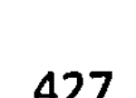
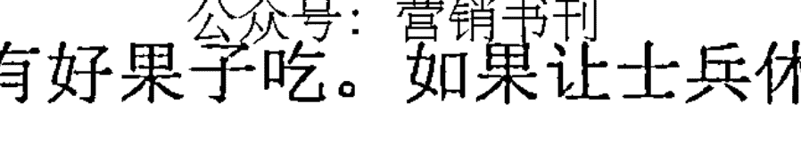

# 权谋童辉

## 权谋家做人做事的秘密都在这里了！

【出处】 《资治通鉴》第 1 卷 周纪 1

【原文】 夫事未有不生乎微而成于著。圣人之虑远，故能谨其微而治之；众人之识近，故必待其著而后救之。治其微，则用力寡而功多；救其著，则竭力而不能及也。

【译文】 没有一件事情不是从微小之处产生而逐渐发展显著的，圣贤考虑久远，所以能够谨慎对待微小的变故及时予以处理；常人见识短浅，所以必等弊端闹大才来设法挽救。矫正初起的小错，用力小而收效大；挽救已明显的大害，往往是竭尽了全力也不能成功。

【解析】 《资治通鉴》这本书太长，司马光自己也说过，写书之后，只有一个人拿走看了一遍，其余的人都看的昏昏欲睡。可以说，《资治通鉴》有极强的知名度，但是真的读完的人屈指可数，司马光也精通权谋，熟悉人性，知道人看不完，所以一开篇就发表了长篇大论，尽可能的把智慧都放在这里，反正你看不完，在你能看的部分，他就完成了对你的影响，这本本身就是智慧。《资治通鉴》第一篇巨光日，就是通鉴的智慧总纲，核心是礼，背后的原理就是权力维持下的等级！而这句话就是核心中的核心，做人做事的秘密其实都 在这里了！

1. **做人、做事**

普战者无赫赫之功，但凡高手，都有着见微知著的本事，在事情的萌芽状态下就解决问题了，成本极低，效果极好，所以日常没有什么风浪，平淡无奇。所以说，我们处理自己的事情必须做到准确预测，未雨绸缪，这就需要我们脑子里有很多权术的模型和套路。犹如拼图一样，只要拿到手里一块，就知道他是在哪个画面里，在哪个位置。

2. **权力、政治**

所谓的政治就是把自己的人搞的多多的，把敌人搞的少少的，可以说，人多就是政治。很多只会办事的人，眼里只有事情，而没有考虑如何的搞权，搞政治。你一个事情，不仅仅是孤立的一个事情，如果涉及到众人，就更加要慎重。因为，事情开始的时候，你就开始兴师动众，大家肯定不是理解，或者是一开始在细微中解决的，自己又来功劳呢？

3. **阶段、平衡**

很多人会说，扩大事件，然后解决，这不就是厚黑学的补锅法吗？这样理解很片面。政治家都是小事放大，大事化高的高手。小事不扩大，老百姓不理解，不支持，自己没功劳。大事不能化小，损失巨大，办事不力，会被认为缺乏能力。所以如何选择做事项，能够即解决问题展示自己的能力，又能被带动人心获得支持，这个平衡点就是做事的艺术。是在萌芽中解决，还是等弊端闹大去解决？这个都不能一概而论：首先，看人群，是自己的事情还是涉及大众的事情；其次，看阶段，是自己需要展示能力立勋的阶段，还是自己控盘需要稳定的阶段；最后，也是最重要的，看成本，想成就大事，有时候是不能怕花钱的，多花点成本，能够聚集更多的人心，并不都是坏事。但是如果没钱，那就老惹事。会做人做事，就是要学会兼顾权力和政治，这就是本质。

## 没根基的成功恰恰是失败的开始！

【出处】《资治通鉴》第1卷 周纪1

【原文】吴起者，卫人，仕于鲁。齐人伐鲁，鲁人欲以为将，起取齐女为妻，鲁人疑之，起杀妻以求将，大破齐师。或谮之鲁侯曰：“起始事曾参，母死不奔丧，曾参绝之。今又杀妻以求为君将。起，残忍薄行人也。且以鲁国区区而有胜敌之名，则诸侯图鲁矣。”起恐得罪。闻魏文侯贤，乃往归之。

【译文】吴起，卫国人，在鲁国任官。齐国攻打鲁国，鲁国想任用吴起为将，但吴起娶的妻子是齐国人，鲁国猜疑吴起。于是，吴起杀死自己的妻子，求得大将，大破齐国军队。有人在鲁国国君面前攻击他说：“吴起当初曾师事曾参，母亲死了也不回去治丧，曾参与他断绝关系。现在他又杀死妻子来求得您的大将职位。吴起，真是一个残忍缺德的人！况且，以我们小小的鲁国有战胜齐国的名气，各个国家都要来算计鲁国了。”吴起恐怕鲁国治他的罪，又听说魏文侯贤明，于是就去投奔。

【解析】《吴起兵法》和《孙子兵法》是中国兵书的双璧，吴起的军事地位非常的高，而他的杀妻求将的故事更是流传千古。这是他军事才华的起点，也是其一生的道德污点。不过很多人只看到的吴起的残忍，却没有看到背后的复杂的政治计算：

### 一、吴起用什么避免领导猜忌？

- 1、下策：自己杀妻
吴起为了避免嫌疑，自己直接杀了妻子。这样的确让鲁国更加放心，吴起的决心和忠诚。但是这样的道德污点，也让他的人生充满着非议。为什么是下策，就是他没有顾息道德因素。我们处理任何事情，不能只有单一思维，而是要顾及多方利益才行，不然后遗症太多。

- 2、中策：意外死亡
齐国身份的妻子，阻碍了吴起成为大将军的路的话，而且必须死，那么，为什么吴起自己必须亲自来杀啊，可以雇佣杀手，也可以设置各种意外，这样就没有了道德的污点。如果我们必须于一些会有很多后遗症的工作，我们尽量假手于人，让别人替自己干，让自己置身事外。

- 3、上策：搪交领导
我们再往深处分析，其实这就是如何解决领导信任的问题，而不是非要吴起妻子命的问题，所以，吴起只要亲自把妻子捆了交给领导就行了，交人质，让领导处理，获取信任，老婆也不死。这样让领导也方便控制，有人质在手，领导还能够施恩。你直接杀了，是不是苦肉计还不一定呢。

### 二、为什么吴起赢了却被赶走？

- 1、上层政治恐惧
其实导致吴起走人的并不是他杀妻，而是他打赢了，本来就是强大的齐国挑起的战争。而这次侥幸成功，如果齐国接下来报复鲁国的话，鲁国会有巨大的损失。所以，出于见好就收，成了鲁国的避免后续军事报复的最佳手段，所以出于政治恐惧，让吴起离开，示好齐国。

- 2、中层利益不均
吴起本来就是一个来自卫国的人，在鲁国这个老牌贵族的国家，怎么可能立足？尤其是他拥有了巨大的军事功劳，其他人自然会排斥他在鲁国获取政治威望。所以，一个没有根基的人，偶然的获得成功，等来的并不是好事，而是其他人的陷害和嫉妒。职场老人就是这样，怕新人参与分配利益。

- 3、下层道德压力
鲁国是孔子的故乡，完全承接的是周公的治理理念，完全是道德伦理治理国家，这是国家的意识形态的核心，但是吴起这样的杀妻的举动，其实就是兵家思维和法家的思维，这个和儒家的思维差距太大，所以，老百姓也不同意这样残忍的人待在鲁国，还举出了儒家荀子对他的评价，自然有力度。

### 三、吴起为什么人生很是坎坷？

- 1、政治理念不同
吴起是古代最为优秀的军事家之一，但是为什么一生都很坎坷，原因就是选择错误。一个兵家思维的人几乎和儒家格格不入，他却选择了儒家控制着主流意识形态的鲁国。彼此都看对方不顺眼，完全的性格不合，怎么可能能够牵手长久呢？

- 2、利益划分完毕
吴起先后去了魏国和楚国，表面上因为权力换代，导致功败垂成，其实，他就是夜壶，大家用他办事，办完了，也就没啥啥事了，“乱使功能，平则去患。”这些老派的贵族国家，都是既定利益划分完毕的地方，是不允许有新兴势力出现的。

- 3、同行都太优秀
很多人会想，他军事才华这么厉害，为什么不去秦国呢，吴起没去，去了，也没他啥事。因为秦国经常打仗，名将非常的多，吴起是曾参的学生，军事不是专业。去了秦国也不会被重用，有大的战役也轮不到他去，这也就是为什么诸葛亮不去魏国的原因。

吴起该怎么做才能够在鲁国立足呢，那就是一开始就该解决掉自己的媳妇，本来鲁国和齐国相邻，战争就多，自己非要搞个齐国的老婆，这就是没有长远的谋划，早该娶个鲁国的女人。再一个，何必自己非得做主帅呢，可以让老贵族做主帅，自己做参谋，有功归上，也能够让自己不触动其他人的利益，从而安全的在鲁国呆着。吴起和其他的军事家一样，懂军事，而不懂政治，所以如此下场。

# 政变之后如何稳定局面——预防反对势力！

【出处】《资治通鉴》第 1 卷 周纪 1

【原文】韩、魏翼而击之，襄子将率犯其前，大败智伯之众。遂杀智伯，尽灭智氏之族。唯辅果在。三家分智氏之田。赵襄子漆智伯之头，以为饮器。智伯之臣豫让欲为之报仇，乃诈为刑人，挟匕首，入襄子宫中涂厕。襄子如厕心动，索之，获豫让。左右欲杀之，襄子曰：“智伯死无后，而此人欲为报仇，真义士也！吾避之耳。”乃舍之。豫让又漆身为癞，吞炭为哑，行乞于市，其妻不识也。行见其友，其友识之，为之泣曰：“以子之才，臣事赵孟，必得近幸。子乃为所欲为，顾不易邪？何乃自苦如此！求以报仇，不亦难乎？”豫让曰：“不可！既已委质为臣，而又求杀之，是二心也。凡吾所谓者，极难耳。然所以为此者，将以愧天下后世之为人臣怀二心者也。”襄子出，豫让伏于桥下。襄子至桥，马惊，索之，得豫让，遂杀之。

【译文】韩、魏两家军队乘机从两翼夹击，赵襄子率士兵从正面迎头痛击，大败智家军，于是杀死智伯，又将智家族人尽行诛灭。只有辅果得以幸免。赵、韩、魏三家瓜分智家的田土，赵襄子把智伯的头骨涂上漆，作为饮具。智伯的家臣豫让想为主公报仇，就化装为罪人，怀揣匕首，混到赵襄子的宫室中打扫厕所。赵襄子上厕所时，忽然心动不安，令人搜索，抓获了豫让。左右随要从将他杀死，赵襄子说：“智伯已死无后人，而此人还要为他报仇，真是一个义士，我小心躲避他好了。”于是释放豫让。豫让用漆涂身，弄成一个癞疮病人，又吞下火炭，弄哑嗓音。在街市上乞讨，连结发妻子见面也认不出来。路上遇到朋友，朋友认出他，为他垂泪道：“以你的才干，如果投靠赵家，一定会成为宠信，那时你就为所欲为，不是易如反掌吗？何苦自残形体以至于此？这样来图谋报仇，不是太困难了吗！”豫让说：“我要是委身于赵家为臣，再去刺杀他，就是怀有二心。我现在这种做法，是极困难的。然而之所以还要这样做，就是为了让天下与后世做人臣子而怀有二心的人感到羞愧。”赵襄子乘车出行，豫让潜伏在桥下。赵襄子到了桥前，马突然受惊，进行搜索，捕获豫让，于是杀死他。

【解析】豫让是写在《史记》刺客列传的大侠。豫让自己的主子智瑶报仇的英雄事迹，但是如果只是从道德角度来看，就看不出赵襄子的权谋大师的魅力了，因为这就是个布局，还有三种可能。

- 1、双簧表演
赵襄子杀了智伯，然后屠灭了整个智氏家族，留了一个辅果来稳定人心。毕竟任何政治势力，都不可能做到连根拔起，总会有漏网之鱼，这样的人如果没有活路，就会狗急跳墙，带来无尽的麻烦。辅果就是稳定人心的作用，但是为什么都杀了，还放过了豫让？赵襄子对智伯恨之入骨，还把他的人头骨做成酒杯，对豫让这样的刺客怀有仁慈？作为政治家的赵襄子能够把智氏家族灭门，肯定小孩子都不放过，这样冷酷的人，会忽然间良心发现？

原因就是双簧的结果，留下豫让，谈条件，要么他直接死，要么他合作，为主报仇获取名声而死，而赵襄子表现出宽容，表现出得到了上天佑佑，震慑了潜在的那些阴谋不轨的人。两个人一拍即合，各取所需。

政治斗争之后，必须打扫战场，对于不敢反抗的留有生路，减少自己未来的阻力。这就需要找到辅果这样的一开始和智伯不合作的人（智果和智伯闹翻，自己改姓为辅果），也就是即他们同一势力内的反对派。而对于那些潜在的威胁者，就要杀一儆百，先宽容，再震慑。

- 2、半真半假
还有一种可能就是半真半假，因为很多事情作为权谋家无法预料，但是事情发生之后，权谋家不会就事论事，而是会借助这件事情，重新布局，朝着自己设计的发现发展，来引导事情，完成自己的目的。一开始果然在大屠杀的前夜，豫让凭借自己的能力，逃出生天，于是变换身份，准备伺机刺杀赵襄子，此时的赵襄子，对于陌生人，早有防备，于是表面放了他，其实直接暗杀掉。然后找一个人乞丐，说就是豫让，然后再借助他朋友的口，表达出忠心的话题。为什么有这样的推理呢？自刭到这个状态，老婆都不知道，一个朋友能够认出来？这是什么逻辑，认出刺杀他之后，还不立即举报，还到处宣传豫让的美名？怕是即使真的认出来，也会躲的远远的，怕被牵连。

为什么不一次杀掉，而是要弄个谁也不认识的人杀掉呢？核心是赵襄子想借助他的口说这段话“我若是委身于赵家为臣，再去刺杀他，就是怀有二心。”这段话的落脚点就是，如果冒进里去，成为家臣，再刺杀就是怀有二心了。不能这样做，这就意味着，设置了刺杀赵襄子的道德障碍。

- 3、先纵后杀
赵襄子屠灭了整个智氏家族，就故意只留了一个豫让这一个人。我们在谍战片经常看到这样的情节，故意装弱，疏忽，放走某个人物，然后跟着他，找到他的同伙。赵襄子玩的其实也是这样一个欲擒故纵的套路，故意放跑豫让，然后派人紧紧的盯着他，所以等他混进赵家的时候，豫让自以为得手，即将成功的时候，被赵襄子抓住，殊不知，豫让早就进入了别人的圈套。然后赵襄子故意表现出自己的宽怀大度，继续释放了豫让，继续派人盯着他。有人盯着，所以不管他变成什么样子，怎么可能逃离赵襄子的视野呢？所以，当他躲在桥下的时候，这些情报早就到了赵襄子的面前，所以，车走到桥边的时候，立即找人搜捕豫让，直接杀了，豫让就是在赵襄子设计的套路里被玩死了。

直接杀了豫让不就完了，搞这么复杂干啥，关键是，整体上赵襄子在明，而刺客在暗，如果放了豫让，就是豫让在明，而赵襄子在暗，这样就完成了明暗的转化。而且赵襄子能够把自己在明的状态变成了所有的天意保护，什么忽然心里不安，什么马受惊，就是表达自己是天命。

所以，经过上述的分析，我能够看出来，豫让的死绝非报仇那么简单，而是赵襄子背后的权谋操作。至于到底是什么操作手段，这个不是权谋家要研究的，权谋家不追求历史真相和结论，而是追求手段的可能和过程，为我们当下的运作提出思维训练和指导意义。希望这个案例能够让大家有所借鉴。

# 经典管理案例都是局1

【出处】《资治通鉴》第 2 卷 周纪 2

【原文】卫平侯罢，子嗣君立。卫有胥靡亡之魏，因为魏王后治病。嗣君闻之，请以五十金买之。五反，魏不与，乃以左氏易之。左右谏曰：“夫以一都买一胥靡，可乎？”嗣君曰：“非子所知也！夫治无小，乱无大。法不立，诛不必，虽有十左氏，无益也。法立，诛必，失十左氏，无害也。”魏王闻之曰：“人主之欲，不听之不祥。”因载而往，徒献之。

【译文】周显王四十四年（公元前 325 年），卫平侯去世，其子卫嗣君即位。卫国有个苦役犯逃到魏国，为魏国王后治病。卫嗣君听说后，要求用五十金把他买回来。经过五次反复，魏国仍是不给，便打算用左氏城去换。左右侍臣劝谏说：“用一座城去买一个逃犯，值得吗？”嗣君回答说：“这你们就不懂了！治理政事不忽略小事，就不会有大乱子。如果法度不建立，当杀的不杀，即便有十座左氏城，也无益处。法严明，违法必究，失去十座左氏城，也终无大害。”魏王听说这件事，感叹说：“国君的愿望，不满足他恐怕会不祥。”于是用车把逃犯送回卫国，未取报酬。

【解析】这是古人尊重法治的名篇。市面上清一色的解读是：卫嗣君就是付再大的代价，也要使国家的法令得到彰现，使法治精神能够教化民众，使为政者树立信用。但是我们如果只是这么读后感的方式来看待这故事难免就如同“入宝山，空手回。”我们从权谋角度来分析：

- 1、这个逃犯身上的三大疑点
为了这个逃犯，卫嗣君不惜一座城来交换。大家只看到了他的逃犯身份，却忘记了他身上有三大疑点：首先，既然这么重视这个人，他是怎么跑出魏国的边境的？第二，既然跑出去了，为什么还那么高调的为魏国皇后治病，而不是改名换姓的低调做人？第三，这样一个能够快速混入皇宫的还能给皇后治病的人，医术肯定很牛，并且有宫廷的推荐关系，这样的御医会是苦役犯？

- 2、为什么卫嗣君会不惜代价
卫嗣君是个权谋家，在法家经典著作《韩非子》中多有记载，大家看一下这个故事：卫嗣君使人装扮成客商通关，关市小吏故意刁难不让过，那客商只好用金钱贿赂，才得以通行。卫嗣君知情后，立即命人召来小吏责问：“某日有客商经过你的关口，给了你许多金子，你就让他走了，有这回事吗？”那小吏吓得两腿发抖，照实承认。卫嗣君立即下令重打五十大板，再罚双倍的金子，让这位小吏回原地供职。这样一来，整个关市大振，没有人再敢“吃拿卡要”了，而且认为卫嗣君有洞察秋毫的神奇本领。

而本文的这个御医逃犯，本质上和上述这个故事是一样的，真相是，卫嗣君新官上任，希望树立法治，不惜代价的炒作一个，用重金购买小逃犯的例子，用这种极具传播性质的新闻，来做出示范效应，给全国人一个下马威，立规矩。所以，就说服身边的这个御医，来个行为艺术，树立一局。这也就能解释，上述的三大疑点了，故意让他伪装成逃犯，最后在魏国故意高调。只不过，卫嗣君，一开始觉得五十金就能解决的问题，后来发现魏国不配合，下不了台，不得不做出一座城也要交换的态度。

- 3、魏王为什么白送回逃犯
这么唾手可得的一座左式城，为什么魏王就这么白白放弃了？他认为的不详是什么？首先是自己的政治形象。一个小逃犯，换一个城，这个巨大的不等价交易，传出去，国际上会认为魏王乘机动察卫嗣君。其次，利害分析，卫嗣君这么大的决心，如果不给，他还不过来打仗？如果换了，内心会不舒服，早晚还会翻脸，为了逃犯不值得。最后，魏王可能明白了，这可能是个局，自己被卫嗣君利用了，自己也只能配合，毕竟五十金，会让大家认为魏王贪财，一座城也算是给了魏王一台阶，也避免失去其他人才的归附。所以，魏王只能配合把这戏给演完。

经过上述权谋网的分析，我们能够看出来，卫嗣君和任何新官上任的一把手一样，需要制造个新闻事件，来给手下人下个马威，立规矩，只有这样的操作，才能够立即树立起一个不惜代价也要维护制度的铁腕形象，成本低，高效率，这个管理权谋局，值得我们学习！

## 想成就大事，必须利用矛盾，裹挟资源，把别人当垫脚石！

【出处】《资治通鉴》第 2 卷 周纪 2

【原文】成侯邹忌恶田忌，使人操十金，卜于市，曰：“我，田忌之人也。我为将三战三胜，欲行大事，可乎？”卜者出，因使人执之。田忌不能自明，率其徒攻临淄，求成侯。不克，出奔楚。

【译文】齐国成侯邹忌嫉恨田忌的赫赫战功，便派人拿着十金，去集市上占卜，问道：“我是田忌手下的人，田将军率军作战三战三胜，现在是举行登位大事的时候了吗？”待到算卦人出来，邹忌令人把他抓住，准备以此倾陷田忌。田忌无法洗清猜疑，一气之下率亲自攻打国都临淄，想抓住成侯邹忌，却不能取胜，只好出逃楚国。

【解析】齐国的丞相是邹忌，田忌是大将军，将相不和，基本上是政治通例。文武之间的互相制衡，才能让最高领导安枕无忧。这一段通鉴材料可以说家喻户晓，都认为是邹忌陷害田忌的铁证，其实我们细细的分析，就会发现这背后有阴谋，我们通过分析这个阴谋，能够让我们学会分析动机和利用裹挟的权谋手段。

### 一、去集市上占卜的人究竟是谁派的？

- 1、邹忌有动机，无条件
大家都知道邹忌和田忌有矛盾，邹忌最有条件陷害田忌，但是这样的陷害，目前其实基本条件不具备。因为这个时候，田忌三战三胜，人有威望，手里有军队，如果是邹忌，这种陷害只能给自己找麻烦。事后，我们也看到，田忌攻打临淄都城，目的也是想报复邹忌。高手都会挑 seç 趁机病要你命的时机，而不是这个明显自己不占胜利条件的时候。

- 2、齐王有条件，无动机
是不是齐王认为之前田忌赛马的过程中，让自己失去了面子，这时候又三战三胜，直接功高震主，需要这样去做直接陷害田忌呢？其实齐王是有条件陷害田忌呢，但是没有动机，毕竟，田忌刚刚胜利，齐王想除掉他，他无须采用这样的逼反的手法，这个相当于政治冒险。历史上对付功高震主的将军，大多采用明升暗降，除掉羽翼，切割势力的策略，徐徐图之。

- 3、孙膑有动机，有条件
其实这次最有动机和条件的就是孙膑，为什么田忌不能自明，这说明，被抓住的去占卜的就是田忌的人，而且大家都知道是田忌的人。就是他田忌自己的人做的，所以田忌根本无法解释，谁能调动田忌自己的人，只能是他的大军师孙膑。因为孙膑明白，田忌三战三胜，基本上消除了魏国的威胁，自己的价值基本就消失，为避免被齐王兔死狗烹，所以想裹挟田忌造反。

### 二、历史上的孙膑实际内心非常阴险！

- 1、战国策里的真实故事
孙膑有这么阴吗，恰好《战国策》第八卷给出了答案，齐策一记载：田忌担任齐国军队将领，拘捉了魏国太子申，擒住了魏国大将庞涓。孙膑对田忌说：“将军可以干一番大业吗？”田忌说：“怎么办？”孙膑说：“将军不解兵甲而还归齐国，让那些疲惫老弱的士兵守住任地要道。任地要道非常狭窄，如果两车并行而过非撞在一起不可。如果让那些疲惫老弱的士兵守卫任地隘口，必定以一当十，以十当百，以百当千。然后背靠泰山，左涉济水，右越高唐，把军中辎重运到高宛，派出轻便的蹙车、精锐的骑兵冲进雍门。如果这样干，那么齐国的国君就可以由将军控制，而邹忌必定逃走。不然的话，那么将军再也不能回到齐国了。”田忌没有听从，果然没能回到齐国。

- 2、孙膑裹挟田忌的手法
孙膑这一套的理论就是后世剿通说给韩信的那一套，就是想让韩信造反，韩信拒绝之后，剿通就逃跑了。不过孙膑的手腕是高于剿通的，他直接派人去临淄公然以田忌的名誉去占卜，而且故意把消息透漏给邹忌和齐王。这就是无形中陷害了田忌，让田忌不得不反，不得不按照孙膑的思路发展。可以说孙膑采用计谋裹挟了田忌，用田忌的生命和资源为自己建立功名锦路。

- 3、为什么田忌最终失败
不过田忌最终还是失败了。田忌想的太简单了，没有采用孙膑建立根据地，然后攻打的策略，而是直接无后方作战，直接攻打都城，用的是清君侧的借口。其实，这就是政治幼稚。要么你真的造反，要么你就自己捆起来，交还兵权，去齐王那里哭诉，而采用攻打的手段，适得其反。为什么失败，还有一点，就是孙膑只裹挟了田忌，而没有裹挟众人，大家没义务给他们卖命，军心不足，导致失败。

### 三、这个故事给我们的职场最大启示？

- 1、凡事不能看表面，看动机和条件
我们去分析一个事情，不能只看表面的信息，不仅仅要看这个事情谁最有动机做，而且还要看，是不是具备控盘的条件。如果只有动机，而没有条件，基本上也能够排除嫌疑。有条件没动机的，也要排除，最大可能的就是有动机，有条件，这样的人，才是最该怀疑的。

- 2、实现自己的意图，必须裹挟别人
你想说服一个人去做某件事情，通常无非威逼利诱。通常小事采用的就是利诱，但是真正要做大事的话，都是需要冒着极大风险的，这就必须威逼。利用裹挟的手法，挖坑让他下去，这时候，他自己不得不爬出来，黄袍加身，十五连坐，集体分赃，补刀投名，都是这样的操作。

- 3、矛盾双方，最易被第三方利用
在职场一定要搜集各种信息，尤其是别人之间的矛盾，这是最为关键的信息，挑拨离间、栽赃嫁祸、合纵连横，都需要这个矛盾信息，识别矛盾、挑动矛盾、利用矛盾，这是职场权谋家的基本功。邹忌和田忌的矛盾就是被孙膑，扩大化，给利用起来的。

经过上述的分析，我们眼里这智慧的化身孙膑，其实在历史的深处，是另外一个形象。为了实现除掉庞涓，让自己上位，不惜让田忌在赛马的时候破坏游戏规则，压千金赌注，当众得罪齐王，用田忌的触犯领导权威，来展示自己军事价值。在打仗胜利之后，又利用田忌和邹忌的矛盾，逼着田忌造反，借用田忌来实现自己的野心。最终因为没有长期经营的根基，急功近利，杀鸡取卵而失败。

# 顶级谋士，利用自污的借口，演绎出完美的跳槽计划！

【出处】《资治通鉴》第 2 卷 周纪 2

【原文】苏秦通于燕文公之夫人，易王知之。苏秦恐，乃说易王曰：“臣居燕不能使燕重，而在齐则燕重。”易王许之。乃伪得罪于燕而奔齐，齐宣王以为客卿。苏秦说齐王高宫室，大苑囿，以明德意，欲以敝齐而为燕。

【译文】周显王 45 年，苏秦与已故燕文公的夫人私通，被燕易王发现。苏秦十分恐惧，于是对燕易王说：“我留在燕国不能使燕国变得重要，而我要是在齐国，可以设法增强燕国的力量。”易王同意了，苏秦便伪装得罪燕国逃奔齐国，齐宣王留他做客卿。苏秦鼓动齐王增高宫殿、扩大林园，显示齐王的地位，想借此来削弱齐国的财力，为燕国效劳。

【解析】先说下背景，苏秦是合纵战略的创始人，纵向联合东方六国来对抗强秦。苏秦的合纵战略在周显王 37 年被秦国的连横手腕破坏之后，自己在燕国举步维艰，不得不为自己寻找安全的出路，知道这个背景我们再看这段通鉴就很有意思了。

- 1、有三大疑点，从人性上说不通

首先，作为燕国的高层，苏秦什么年轻的女人没有，冒着这么大的政治风险和燕易王老爹的女人私通？且不说宫廷这么严格，就算是随便出入，哪个人身边不是一大堆的丫鬓、太监，基本上不被发现的可能性很小。作为权谋家的苏秦会为了感情放弃自己的理性？显然不合利益计算。

其次，即使通奸这件事情是真的，燕易王面对这种宫廷丑闻，直接找机会让苏秦意外死亡，或是找个其他借口杀掉或是调离京城，淡化处理恐怕才是上策，面对苏秦要出走齐国的要求，燕易王不怕放虎归山，纵鱼入海以后不可收拾？一旦管不住苏秦，怕是丑闻传播的更广。显然不舍手段规律。

最后，作为苏秦一定逃到了齐国，好不容易摆脱了燕易王可能的报复，应该庆幸才对，反而自己要在齐国搞什么反间计，即使把齐国搞垮了，燕国回的去吗？回去就是去送死。既然回不去燕国，又在齐国搞这种间谍消耗齐国的活动，自己不怕被发现，得不偿失？帮助燕国，从常识上说不过去。

- 2、苏秦从燕国到齐国的创业战略

这些逻辑、手段、利益都不通的情况下，显然苏秦和燕文公夫人私通的这件事情是假的。但是为什么找这样的借口，我们下一段再说，苏秦从燕国跳槽到齐国的这个事情是真实的。为什么苏秦要费尽心思，不惜让自己有通奸的污名也要去齐国，这和他对自身创业战略的清醒认识有关。

苏秦作为穷人家的孩子，跟着鬼谷子学了权谋，如果直接去大公司找工作，会不被人待见。而选择战国里最为弱小的燕国作为自己的创业起点，燕国，生存危机严重，外部压力大，死马当活马医，立即就同意了苏秦的联合东方六国的合纵战略。给他经费，开始了自己的创业生涯。

小地方适合崛起，不久苏秦就佩六国相印，成为联盟首领，但是随着合纵战略的失败，苏秦对于燕国的意义和重要性已经不大，而且得罪了秦国，燕国是无法有效的为苏秦提供保护。苏秦必须利用自己的名气跳槽到和秦国势力相当的齐国，才能自保。苏秦也算是，借着燕国的平台成功到了齐国高层。

### 3、私通是苏秦跳槽齐国找的借口

分析到这里我们其实就看明白了，苏秦在合纵失败后，必须为自己自保，不能不跳槽到齐国。而且如果更加阴暗一点的推算，他明知道联盟不会长久，但是通过这件事情展示才华，让齐国接受自己，为自己成为战国顶级人才，被猎头争相追逐的人才，而达到了目的，燕国相国就是被苏秦利用的身份而已。

为什么离开燕国，总得有个借口吧？找个什么借口，自己仰慕齐国？这是背叛，领导最讨厌的就是背叛。自己犯了罪？你一个智谋之士，还会有这种低级错误？所以，苏秦既不能让人小觑自己的智谋，又不能让让人感觉不忠，还不能让人感觉有野心，唯一的借口就是私德有亏的私通。

其实历史上，顶级智囊陈平也是被传播盗嫂，也就是和嫂子通奸，也是采用的私德有亏的自污策略。主要原因是，领导对谋士都很纠结，怕他不聪明，不聪明就没用，又怕他们太聪明不好驾驭。所以看到他们贪财好色，没有政治野心，领导也就放心了。这种没有政治威望的人，也做不成大事。

经过上述的分析我们能看出来，苏秦在合纵失败后，为了自保，必须跳槽到齐国，为了摆脱被齐国怀疑不忠和野心的担忧，抛出了和燕文公夫人通奸的借口，顺利的让齐国接受自己。苏秦也用“我留在燕国不能使燕国变得重要，而我若是在齐国，可以设法增强燕国的力量。”这个借口顺利的和燕易王解约，摆脱了原有劳动合同的竞业限制，顺利的让燕国放自己出去，一个完美的跳槽计划。另外值得我们学习的还有就是，要在小平台上展示自己的才华，赢得业内的关注，引起同行老板的青睐，或等待猎头的发现，从而能到大单位直接出任高层管理，实现人生的跳跃式发展。苏秦是个职场高人！

# 在政治权谋家眼里，一切都是棋子！

【出处】《资治通鉴》第 2 卷 周纪 2

【原文】令行期年，秦民之国都言新令之不便者以千数。于是太子犯法。卫鞅曰：“法之不行，自上犯之。太子，君嗣也，不可施刑。刑其傅公子虔，黥其师公孙贾。”明日，秦人皆趋令。行之十年，秦国道不拾遗，山无盗贼，民勇于公战，怯于私斗，乡邑大治。秦民初言令不便者，有来言令不便。卫鞅曰：“此皆乱法之民也！”尽迁之于边。其后民莫敢议令。

【译文】新法在民间施行了整一年，秦国老百姓到国都说新法不方便的人数以千计。正当这时，太子触犯了新法。卫鞅说：“新法不能顺利推行，是因为上层的人触犯它。”将依法处罚太子。太子，是国君的继承人，又不能施以刑罚，于是就处罚了监督他行为的老师公子虔，以黥刑处罚了传授他知识的老师公孙贾。第二天，秦国人就都遵照新法执行了。新法推行了十年，秦国百姓都非常高兴，路上没有人拾别人遗失东西据为己有，山林里也没有盗贼，家家户户富裕充足。人民勇于为国家打仗，不敢为私利争斗，乡村、城镇社会秩序安定。当初说新法不方便的秦国百姓又有来说法令方便的。卫鞅说：“这些都是破坏法令的刁民！”把他们流放到了边境。从此以后再没有人议论法令的好坏了。

【解析】

### 一、管理方面

- 1、老百姓集体请愿

没有人愿意改变自己，都有着行为惯性，任何的改变都会引发群体的不满。搞管理的就怕老百姓集体请愿闹事，这是挟势逼权，即使迫于形势压力，而暂时的做出让步，也会对组织者、领导者、骨干，秋后算账，所有权力对于集体闹事都是深恶痛绝的，这是对权力最大的威胁。

- 2、高层的人图违法

作为底层对于制度的不满只能是消极对抗，而真正对于制度有破坏力的还是有能量的高层，这些人有极大的示范效应，和破坏力度，所以，想推行权力的刚性必须诛大罚亲的手段。面对太子的违法，卫鞅直接把太子的老师给处理了，这个对老百姓的集体请愿和其他的上层产生了极大的震慑。

- 3、对政策发表议论

反对变法的人，被处理这个我们能够理解，但是为什么最后支持的变法，去为变法唱赞歌的人也被处理了呢，卫鞅给出的管理理由由就是这些人都是小人。其实本质的理由就是，权力是不允许被评价的。权力必须被接受，其他人没有资格评价，无论好坏。不然，权力一旦被评价，就会被控制。

### 二、权术方面

- 1、借人头平息舆论

面对群众的浩大声势，商鞅没有抓头目杀一儆百。这样会激发更大的社会矛盾，而是采用了，让太子在关键时候违法，把太子的两位老师，拿来立威。用这种“杀猴儆鸡”的手段，成功的平息了群众的不满，中国老百姓从来都是如此，只要看到有钱的有权的也是如此，内心立即就平衡了。

- 2、制造卫鞅对立派

面对太子犯法，要处理太子的老师，这本来就真是个事。封锁舆论，宫里的事故老百姓会知道？再一个，即使知道，把太子来个关禁闭，也是处理的方式，为什么秦孝公要默许卫鞅这样做？不仅仅是管理问题，更是，怕卫鞅以后做大无人制衡，此时也是为卫鞅树立反对派，防止卫鞅成为权臣，做大。

- 3、加强太子的联盟

太子如何能够顺利的继承位置呢，不仅仅是把位置给他，更重要的是要给他好的教育和势力支持。这次把太子两位老师，一个鼻子给划掉，一个脸上刺字。这两个人一定会把太子好好培养出来，让他顺利的掌控权力，这样才能为自己报仇。有个共同的敌人，太子的联盟更加的稳定了。

### 三、职场启示

- 1、屌丝的意见无用

很多人无论做什么事情，都喜欢咨询身边的人，这是个好习惯，但是大多数找错了对象，比如自己创业，问一群屌丝同学，朋友，他们说出，风险太大了，这不行，那不行。或是不给任何具体建议，就说，干吧，大不了从头再来，说的好听，从头再来，你掏钱啊。要学会咨询高人，普通人就算了。所以，作为老百姓反对的多，也不一定就是错的，卫鞅根本就没把他们当回事。

- 2、把手下人当棋子

作为秦孝公，纵容默许卫鞅重罚了公子虔、公孙贾。这不仅仅是没有给这两个太子老师面子，感谢他们的教育之恩，也没有在自己死后保护卫鞅，秦孝公一死，太子上位，卫鞅的生命也就到头了。这些人都是为秦孝公做出巨大贡献的人，但是非死即残，这样的下场，主要原因就是，秦孝公根本就没有把这些人，当人看，而是当成了棋子而已。王者无爱，王者无情，表现得淋漓尽致。

- 3、说话时注意身份

为什么卫鞅把那些出来唱赞歌的人，也都收拾了？权力心思就是，无论权力好坏，你作为下层人都没有资格出来评论，你不配。在职场也是如此，对领导的政策命令，除非领导要求发言，否则发表自己的对政策的看法和解读都是错误的。都是要冒着极大的政治风险的，根本原因，不是你说的可能和上级领导不一致，而且核心是在权力眼里，你没这个身份，来说这些话，这就是权力敏感。

# 在职场交朋友，必须把握这三大原则，否则死无葬身之地！

【出处】《资治通鉴》第 6 卷 秦纪 1

【原文】初，剧辛在赵与庞煖（音：暖）善，已而仕燕。燕王见赵数困于秦，廉颇去而庞煖为将，欲因其敝而攻之，问于剧辛，对曰：“庞煖易与耳。”燕王使剧辛将而伐赵。赵庞煖御之，杀剧辛，取燕师二万。

【译文】当初，剧辛在赵国时与庞煖关系极好。不久，他到燕国做了官。燕王见到赵国的军队多次被秦军所困，廉颇离去而由庞煖担任赵军统帅，便想乘赵衰败之机进攻它。为此，燕王询问剧辛的意见。剧辛回答道：“庞煖这个人是很容易对付的！”燕王便派剧辛率兵攻打赵国。赵军统帅庞煖指挥军队抵抗燕军，杀了剧辛，并俘获燕兵二万人。

【解析】人非草木岂能无情？职场上同事，大家相处的时间长了，自然就有了感情，觉得趣味相投，不分彼此，其实这是最为危险的关系。如果不能准确的把握职场关系的三大原则，就和这段通鉴的剧辛一样，信心满怀的准备胜利，却被人直接团灭！这些教训大家要深刻学习：

- 1、利益面前没朋友

平时生活中的朋友关系，基于无功利目的交往形成的感情为基础的关系，有益处也是在感情之上形成的。但是在职场，却是以利益为基础所形成的感情关系，同事的身份，平时会被人选择性忽视，但是一旦利益冲突，立即就会成为对立关系。在职场，感情在利益面前一文不值。剧辛和庞煖两个人就是在利益之上的朋友关系，利益变化了，朋友也就没得做了。

- 2、职场朋友都伪装

很多人在职场都会采用和平时对待朋友一样的办法，来对待职场的同事。你认为朋友之间就该无话不谈，没有隐私，分享自己的情绪和秘密，其不知，你这样做，别人却未必，这类人在职场上城府很深，不会暴露自己，而不断的掌握同事的材料，关键时刻拿出去去卖。剧辛以为了解庞煖，而自己伪装的好，就有把握打败庞煖，但是，伪装更好的庞煖，让剧辛失算了。

- 3、关系越好斗越狠

剧辛自以为了解庞煖，不曾想，他所了解的庞煖是伪装出来的，所以，在打仗中，就被自己对朋友的刻板印象所误导，以为他会如何，但是真的交手起来，却发现自己被人家误导了，剧辛并不真的了解庞煖，而庞煖自然也没有和剧辛客气，也没有对他心软，留下一丝情面，而是直接斩杀。为什么越是自己人对自己人越狠呢，为了向别人表明自己没有私心，为了避嫌，不给自己的人致政留机会！

经过上述权谋网的分析，我们能够看出来，庞煖和剧辛这两个人都是老狐狸，互相的交往，但是都防着彼此，一旦利益冲突，都毫不客气，立即翻脸，而且，也没有顾忌之前一丝的情谊。如果剧辛赢了，也会毫不客气的斩杀庞煖，不过，剧辛唯一模差一招的就是，他自己没有真心，却误以为，别人会是真心。在职场，大家牢牢的遵从上述的三大原则，才能不被职场感情所伤害！

# 权谋家的人才观——对人才不看动机，只看行为！

【出处】《资治通鉴》第 6 卷 秦纪一

【原文】魏安釐王问天下之高士于子顺，子顺曰：“世无其人也；抑可以为次，其鲁仲连乎！”王曰：“鲁仲连强作之者，非体自然也。”子顺曰：“人皆作之。作之不止，乃成君子；作之不变，习与体成；习与体成，则自然也。”

【译文】魏国国君安釐王向子顺询问谁是天下高士。子顺说：“世上没有这种人。如果说可以有次一等的，那么这个人就是鲁仲连了！”安釐王说：“鲁仲连是强求自己这样做的，而不是他本性的自然流露。”子顺说：“人都是要强求自己去做一些事情的。假如这样不停地做下去，便会成为君子；始终不变地这样做，习惯与本性渐渐相融合，也就成为了自然的了。”

【解析】鲁仲连是谁，学校谋的不用纠结名字和事迹，只要知道是战国时期的高人即可，因为这段材料里，他只是个人才的代号而已。子顺是孔子的六世孙，孔斌被魏王请过来做宰相。他向魏王阐述了高人的儒家思想：

- 1、人性不完美

所谓的高人就是办事水平和思想境界都很高，完全的高大上，但是子顺认为这类人，世界上是没有的，即使有也是装出来的。这背后的原因就是，对于人性的深刻理解，谁都有自己的七情六欲，谁都有人性的缺点，自私、贪婪、好色等，所以，对过去追求毫不利己，专门利人这种境界的人才，基本上是缘木求鱼，通俗点说，要想马儿跑，又想马儿不吃草。哪有这种人才呢？那种认为儒家都是道德人士，这种错误的认知，基本上是对儒家的误解。任何一门学问，早期都建立在对人性的深刻把握之上。

- 2、用人用长处

没有高人怎么办昵？那就退而降其次。没有完美的人，那就要使用有缺点的。现在企业界常说的那些话，就是“优点可用，缺点可控。”用人不能只盯着人家的缺点，无论是好人还是小人，只要用好了都是人才。举个最简单不过的例子，领导自己有错误，为什么不去责任推给身边的小人，让他们出来背锅呢？如果对错分明，那些坚持原则的好人，当众指出领导的错误，这就让领导丧失了威信，从而失去权威。所以，用人不是在于只求完美，而是追求如何的为已所用，利用价值才是领导追求的。

- 3、动机不重要

“人皆作之。作之不止，乃成君子；作之不变，习与体成；习与体成，则自然也。”这是千古名言，通俗点时候，就是人都装逼，但是装的时间长了，真假已经无所谓了。为什么呢，因为人的动机在社交中并不是最重要，行为才是最重要的，不管你心里怎么想，你知道听话照做就行了。权力心思从来都是如此，持术不持信。我不管你内心多么的恨我，但是你只要不表现出来，让你干啥干啥，这就够了。因为只要权力在手，你就得跪着。另外，不管你说的多好，但是一旦有威胁权力的能力，就必須除掉。

其实，权谋家对于人才观，很简单，也基本不去研究什么识人术，就看你听话不听话，能干不能干，有没有威胁的能力。就这三条标准。听话顺从，让干啥干啥，能够完成指定任务，没有实力威胁到权力，这就是人才，所以，懂了这些，也就明白了人才的真谛。

# 获取领导情报，用不好，要掉脑袋的！

【出处】《资治通鉴》第 7 卷 秦纪 21

【原文】行所幸，有言其处者，罪死。始皇幸梁山宫，从山上见丞相车骑众，弗善也。中人或告丞相，丞相后损车骑。始皇怒曰：“此中人泄吾语！” 案问，莫服，捕时与旁者，尽杀之。自是后，莫知行之所在。群臣受决事者，悉于咸阳宫。

【译文】始皇巡行到某处居住下来，有敢于透露出他的驻地的，即获罪处死。始皇帝曾前往梁山宫，从山上望见丞相李斯的随行车马非常多，很不赞许。宦官近臣中有人将这事告诉了李斯，李斯随即减少了他的车马。始皇愤怒地说：“这一定是宫中人泄露了我的话！”于是审问随从人员，但是没有人承认。始皇就下令捉拿当时在场的人，全部杀掉。从此以后，再也没有人知道始皇到了什么地方。群臣中凡有事情要奏报并接受皇帝裁决的，便全都到咸阳宫等候。

【解析】做领导的，都不喜欢自己在下属面前是透明的，因为，一旦被下属看透，领导就会毫无安全感，犹如赤裸般的站在众人面前，所以都想保持神秘莫测，喜怒无常的状态！而秦始皇作为权谋型的皇帝，对自己的信息保护更加的在意。

### 一、做领导要善于隐蔽

- 1、行踪隐蔽

秦始皇灭了六国，改变了太多的人生轨迹，触动了大量的既得利益群体，所以仇家特别多，很自然的，为了避免报复，而隐藏自己的行踪，后来基本上形成了政治惯例，领导人的行踪，都不是提前公开宣布的，都是在出发时，临时宣布的。

- 2、态度隐蔽

整体事件为什么会发生，主要就是秦始皇无意之间表达了自己对丞相李斯的厌恶态度，这样一个涉及权力心思的重要情报，就这样无形中传递出来了。所以，聪明的领导，都不会公然的传递出自己的情绪态度，因为这种喜怒的情绪，会被解读为政治信号。

- 3、语言隐蔽

但凡做领导的，都不能直抒胸臆，不能让自己的语言明确。如果自己指示一旦详细明确，不但限制了下属的自由发挥，而且如果出现错误，做领导的还可能要承担责任。如果自己只做原则上的指挥，就能够释放下属的主动性，而且自己也能立于不败之地。

### 二、信息的获取和利用

- 1、获取信息

作为丞相的李斯，在秦始皇身边安插眼线是个正常的事情，有时候，获取领导的情报，并非就要做坏事，而是为了更好的准确的揣摩领导的意图，准确的迎合领导的心思。后世的权谋家，吸取历史教训，故意利用身边的人，来传递信号。以保证自己的意图正确传递，而且自己不担责任。

- 2、保护信息

因为领导不喜欢自己成为下属眼里的透明人，而作为下属刚刚获取情报，就立即采取行动，这就让领导有一种被监视的不安全感。所以，任何时候在利用信息之前，一定要学会保护信息的安全，信息渠道的安全，信息传递的安全，不然，就会引起领导的警觉。

- 3、利用信息

李斯获取秦始皇对自己的不满态度之后，其实没有必要立即削减，这样很明显就暴露了自己在监视皇帝。李斯既然知道秦始皇的行踪和态度，不再出现在秦始皇的视野中就行了，时间长了，秦始皇也就不再关注这件事情，也不会继续引发后果。要规避，而不是立即纠正！

### 三、秦始皇的过激反应

- 1、直接诛杀随从恶果

秦始皇认为身边的人泄露了信息，直接全部都诛杀了，貌似是大臣都不知道皇帝的态度了，但是这个只是让下面大臣更加的谨慎而已。身边人照样会被收买，会传递情报。只不过是，秦始皇不知道而已。让这些事情更加隐蔽，而更加隐蔽之后，秦始皇就会放松警惕。

- 2、没有当面敲打丞相

秦始皇为了没有直接批评李斯，因为，中国人一旦公开批评基本上就等于是撕破脸，尤其是上级领导的公开批评，会让下属基本上就丧失了权力地位，如果下属维持不变，做领导的自己权威也会被大众质疑。因此，秦始皇还想重用李斯，就不能公开批评。

- 3、为了安全牺牲效率

秦始皇为了自己的安全，让所有要汇报的人都等在咸阳宫外面。这其实就是为了自己的安全，而牺牲了行政效率，有紧急情况怎么办？这个貌似不合理的安排，其实这针对秦始皇或是领导而言，却是无比正确的，因为在权力心思认为，任何时候权力安全都高于一切，做事都在其次。

其实，李斯还是读书少，因为他的同学韩非子在《说林》有这样的原版故事：隰斯弥见田成子，田成子与登台四望。三面皆畅，南望，隰子家之树蔽之。田成子亦不言。隰子归，使人伐之；斧离数创，隰子止之。其相室曰：“何变之数也？”隰子曰：“古者有谚曰，知渊中之鱼者不祥。”夫田子将有大事，而我示之知微，我必危矣。不伐树，未有罪也；知人之所不言，其罪大矣。”乃不伐也。什么意思呢？隰斯弥去见田成子，田成子和他一起登上高台向四面眺望。三面都通畅无阻，向南望去，隰斯弥家的树林却把远方遮住了。田成子也不说什么话。隰斯弥回到家中，派人砍伐树木。斧头刚砍出几个伤口，隰斯弥就阻止了砍树的人。他的管家说：“为什么变得这样快呢？”隰斯弥说：“古时候有句谚语说：“知道深渊里有鱼是不吉样的。”那时田成子将要干一番改朝换代的大事，而我却向他显示出我知道这其中的微妙，这样我就危险了。不伐树，没有什么罪过；知道了别人不想说出来的事情，那罪过就大了。”于是就不砍树了。李斯真的在权谋研究上，不如韩非子，所以结局不幸，很正常！

# 上层教育追求的是万人敌的功夫！

【出处】《资治通鉴》第 7 卷 秦纪 2

【原文】（项氏，名籍，字羽，）籍少时学书，不成，去；学剑，又不成。项梁怒之。籍曰：“书，足以记名姓而已！剑，一人敌，不足学。学万人敌！”于是项梁乃教籍兵法，籍大喜。

【译文】项羽少年时学习识字和写字，学不成即抛开了，去习练剑法击刺之术，又未学成。项梁为此非常生气，项羽说：“识字写字，记名姓就行了！学剑也不过是只能抵挡一人，不值得去学。要学就学那可以抵抗万人的本事！”项梁因此便教授项羽兵法，项羽喜不自胜。

【解析】这是项羽的著名故事，可以说家喻户晓，但是却没有人深入的分析这背后的思维原理，因为通过这个故事，我们可以通过这个窗口窥见高层教育的门径，而且是成功的门径！高层为了延续自己的地位、资源，自然会不偿余力地教授给子女真正的东西，这些才是混社会真正的学问。这就好比，狼训练自己的狼崽是学习捕猎和吃肉，绝对不是练习奔跑和吃草。这段背后体现了高层教育培养孩子，在追求三大能力：

- **斗争能力**

普通人学习技术，提高自身能力的学问，直接被项羽放弃了，而是要学万人敌。“敌”这就是说，项羽的目标很明确就是学搞定人的学问。如何的识人、用人、搞定人。越是底层越是被教育要老实，不要找事。而高层都明白，这个社会弱肉强食，只有学会斗争，才是生存之本。

- **组织能力**

如何提高斗争能力，不是自己练剑打架，而是要“万人”，这下单子和普通的坏孩子立即就格局不一样了，那就是如何的把众人组织起来。这就需要训练一个人的组织能力，如何的把这些人使用什么样的手段，采用什么策略把这些人都组织起来，发挥力量，这就是如何构建自己的势力。

- **沟通能力**

如何把人组织起来，这里面就需要沟通能力，这就需要演讲，谈心，煽动等这种沟通能力。德国元首就把这个能力发挥到了极致，其实任何一个政治家高层，都是天大演讲，不断增强和使用这种能力，因为沟通能力，是把人与人给聚集在一起，解除内耗，集中力量，为己所用。

所以，当你还在训练一个孩子骑马，弹钢琴，打高尔夫，学英语的时候，高人都在带着孩子参加企业会议，学习组织管理；带着孩子出差，训练商业社交谈判能力；观摩广告，学习历史，学习营销斗争能力。无论是曹操，还是司马懿，哪个不是南征北战的时候把儿子带在身边训练？所以，通过这个门径我们窥见高层教育训练的真相，这对我们自己的人生方向的修正也是极其有用的。

# 帝王心术——打击你，恰恰是为了保护你，栽培你！

【出处】《资治通鉴》第 7 卷 秦纪 2

【原文】侯生、卢生相与讥议始皇，因亡去。始皇闻之，大怒曰：“卢生等，吾尊赐之甚厚，今乃诽谤我！诸生在咸阳者，吾使人廉问，或为妖言以乱黔首。”于是御史悉案问诸生。诸生传相告引，乃自除犯禁者四百六十馀人，皆坑之咸阳，使天下知之，以惩后；益发谪徙边。始皇长子扶苏谏曰：“诸生皆诵法孔子。今上皆重法绳之，臣恐天下不安。”始皇怒，使扶苏北监蒙恬军于上郡。

【译文】侯生、卢生相互讥讽、评议始皇帝的暴戾，并因此逃亡而去。始皇闻讯勃然大怒，说：“卢生等人，我尊敬他们，并重重地赏赐他们，现在竟然敢诽谤我！这些人在咸阳的，我曾派人去查访过，其中有的人竟妖言惑众！”于是令御史逮捕并审问所有的儒生。儒生们彼此告发，始皇帝就亲自判处违法犯禁的人四百六十余名，把他们全部在咸阳活埋了。还向全国宣扬，让大家都知道这件事，以惩戒后世。同时谪罚更多的人流放到边地戍守。始皇的长子扶苏为此规劝道：“那些儒生们全诵读并效法孔子的言论。而今您全部用重法惩处他们，我担心天下会因此不安定。”始皇大为恼火，派扶苏赴上都去监督蒙恬的军队。

【解析】这就是秦始皇，被后世诟病最多的，“焚书坑儒”事件中的坑儒一事的通鉴记载，作为千古一帝，能够统一天下的第一人，认知水平还不如自己的儿子扶苏？他不知道这么个儒生有稳定统治的作用？秦始皇这样做其实是为扶苏以后顺利的接班上位打下基础，除了有统一全国的意识形态，不能妄议中央之外的表面理由，主要是有三点帝王心术：

- **1、远离政治的漩涡**

政治高层是个利益聚集的地方，斗争自然非常激烈。所以涉身其中的人，都难免会流露出 自己的原则和立场，不知不觉的都会主动或是被动的陷入政治旋涡。秦始皇面对刚刚形式 统一的帝国，必然对内部要有个整合，这个内部整合的过程自然会血腥风雨，这个恶人秦 始皇准备自己来做，于是让接班的儿子扶苏，远离政治斗争，到时候接管帝国权力的时候， 没有历史包袱。只有远离政治旋涡，才能够再继位之后，无干扰的做很多平反工作，立即 获得势力支持。很多帝王晚年，就会故意犯迷糊，把重要的人才打倒，主要目的就是为自 己的孩子上位后施恩犯人，做好铺垫，非此无以巩固权力。

- **2、和儒生结成联盟**

打仗是需要武将，但是治理国家必然需要文官，而这些文官利用之前必须进行改造，于是 秦始皇找借口，把那些不和中央保持一致的类型，都活埋了，这个动作过于残忍但是却无 可厚非，因为对文人的洗脑教育其实是起不到特别明显的作用的。但是接下来的动作，我 们就看不明白了，贬了很多文人去边关戍守，这是为了啥，其实紧接着就让扶苏也去了边 关，我们连在一起就懂了，扶苏为他们求情，然后一起去了边关，大家会形成一定程度的战友关系，同是天涯沦落人，心理上更加接近，扶苏和未来的文官结成了铁的联盟关系。这也就是为什么陈胜吴广起义用的就是扶苏的口号，就是因为民心。

- **3、和军队培养关系**

权力的源头是暴力，任何的帝王无不对军队牢牢把控，所以，只有和军队的人，形成战斗 关系，才能够未来更加扎实的控制权力。太子监军，主要的好处有三个，首先，熟悉军 队生活和管理，没有一定的军旅生涯，就不能够熟悉军队，也就谈不上有效的管控。其次， 通过长时间的共同生活能够熟悉各个将领的性格、能力，未来使用谁来打仗，就能够游刃 有余。最后就是，通过长时间的打仗，能够有更加深厚的战友情，未来的权力格局中能够 得到军方拥护。秦始皇的愤怒，为了给扶苏一个心理压力，让他更加兢兢业业的在边关好 好努力，期待戴罪立功的心理，不是去享福，这样才能更好的用心学习军事。

秦始皇为了权力的传承，可以说为扶苏铺好了道路，死之前也是招扶苏过来办丧事，继位， 但是人算不如天算，赵高说服丞相李斯，把胡亥推向了帝位，而大将军蒙恬未能成功说服 扶苏打回去夺权，最终扶苏自杀身亡。扶苏身边缺乏帝王师，如果有帝师能够给他点破秦 始皇的用意，懂得帝王心思，想必扶苏能够顺利的掌握大权，避免后期的战乱。帝王心术 有隐秘性，不能说，所以扶苏自己悟不到，也没有老师指点，又遇见了赵高这样的权谋高 手，自然失败。

# 政治问题和权力问题的转换和认知！

【出处】《资治通鉴》第 9 卷 汉纪 1

【原文】沛公已去，间至军中，张良入谢曰：“沛公不胜杯杓，不能辞，谨使臣良奉白璧一双，再拜献将军足下；玉斗一双，再拜奉亚父足下。”项羽曰：“沛公安在？”良曰：“闻将军有意督过之，脱身独去，已至军矣。”项羽则受璧，置之坐上。亚父受玉斗，置之地，拔剑撞而破之，曰：‘唉！竖子不足与谋！夺将军天下者，必沛公也。吾属今为之虏矣！’居数日，项羽引兵西，屠咸阳，杀秦降王子婴，烧秦宫室，火三月不灭。收其货宝、妇女而东。秦民大失望。

【译文】刘邦已走，抄小道回到军营，张良方才进去告罪说：“沛公禁不起酒力，无法来告辞，谨派臣张良奉上白璧一双，以连拜两次的隆重礼节敬献给将军您；玉斗杯一双，敬呈给亚父您。”项羽说：“沛公现在哪里呀？”张良道：“他听说您有责备他的意思，便抽身独自离去，现在已经回到军中成了。”项羽就接受了白璧，放到坐席上。亚父范增接受玉杯后搁在地上，拔剑击碎了它们，说：“唉，这小子不值得与他共谋大业！夺取即将军天下的人，必定是刘邦。我们这些人眼看着就要被他俘虏了！”隔了几天，项羽领兵西进，洗劫屠戮咸阳城，杀了已投降的秦王于婴，放火烧禁秦朝宫室，大火燃烧三个月不熄。随即搜取秦朝的金银财宝和妇女向东而去。秦地的百姓为此大失所望。

【解析】鸿门宴可以说是中国历史上的知名故事，前人几乎把能够想到的角度都研究过了，但是未曾见到从权力心思的角度写的文章，今天从这个角度来入手分析，范增和项羽的错误！

- **1、乾隆的观点**

乾隆看完这段，站在皇帝的角度写了这样一段经典的话“范增于项羽。虽未至言听计从，然壱曰亚父，君臣非不相得者。乃入关之前，既不明阻其抗秦降卒，入关之后，又不见其阻其屠毁咸阳，而斤斤于举块和舞剑以除沛公，微议王者不死，所见拘末已。”乾隆皇帝对范增的评价不高，这段话的意思就是，项羽对亚父十分好，但是范围提秦朝的降卒，和焚毁咸阳城上，不见有半点劝阻，反而把目光局限在和刘邦的斗争上，格局有点低。乾隆皇帝是站在政治角度来论述了范增的失策，让项羽失去了人心。

- **2、范增的计谋**

其实怎么说呢，乾隆的角度很片面，一个政权的是否稳定，最大的层面不在于政治人心，而在于权力稳定，因为任何事情都有其主要矛盾，只要内部的权力稳定，外部就不会有问题，比如天下苦秦久矣，但是在秦始皇的统治下，没人敢说话和反抗。但是换成秦二世胡亥之后，内部开始出现权力纷争，才导致了外部的势力的崛起。所以范增这样做是没有错的，只要内部没有能够威胁到自己实力的团体，统治者对普通没有势力的百姓怎么做，都会没事，范增这是抓住最主要的权力矛盾所在。

- **3、权谋的教训**

权谋分为三大块知识，政治的，权力的和自保的。而范增不懂政治，没有劝项羽善待秦地百姓，给刘邦留下了这个政治基础。不懂自保，竟然在项羽面前发脾气，当众损害项羽的权威，范增为自己的死埋下伏笔。而项羽，也是懂权力不懂政治，政治是求同存异，拉拢更多的利益联盟。而权力是一言堂，必须一个领袖，一个声音。而范增和项羽都是精通权力的人，但是为什么会彼此之间矛盾这么大？原因是，认知分歧，范增把刘邦当成内部权力问题，必须清除隐患，而项羽把他当成外部政治，可以联合。

经过上述权谋网的分析，我们能够看出来，到底是面对刘邦的权力问题还是政治问题呢？

其实这个分阶段，在灭秦阶段的刘邦是政治问题，需要联合各大势力完成目标，这时候要找到利益点，联合所有的人。但是灭秦之后，刘邦问题就成为权力问题了，必须解决。而项羽不懂得外部的形式已经变化，盟友关系已经变成了敌对关系了。而范增却说不出所以然，只是一味的发脾气，最终也没能说服项羽，转换思想，从而导致了团队整体的失败。

# 成功后没有三大改变，煮熟的鸭子也会飞了！

【出处】《资治通鉴》第 9 卷 汉纪 1

【原文】居数日，项羽引兵西，屠咸阳，杀秦降王子婴，烧秦宫室，火三月不灭。收其货宝、妇女而东。秦民大失望。韩生说项羽曰：“关中阻山带河，四塞之地，地肥饶，可都以为霸。”项羽见秦宫室皆已烧残破，又心思念归，曰：“富贵不归故乡，如衣绣夜行，谁知之者！”韩生退曰：“人言楚人沐猴而冠耳，果然！”项羽闻之，烹韩生。

【译文】隔了几天，项羽领兵西进，洗劫屠戮咸阳城，杀了已投降的秦王子婴，放火烧秦朝宫室，大火燃烧三个月不熄。随即搜取秦朝的金银财宝和妇女向东而去。秦地的百姓为此大失所望。韩生劝说项羽道：“关中依恃山川河流为屏障，是四面都有险要可守的地方，土地肥沃，可以在此建都称霸。”项羽却一方面看到秦王朝的宫室都已焚烧得残破不堪，一方面又惦记着返回东方的家乡，便说：“富贵了而不归故乡，就如同身穿锦绣华服在夜间行走，谁能看得到啊！”韩生退下去后说：“人家说楚人像是猕猴戴上人的帽子，果然如此！”项羽听到这话后，即将韩生煮死。

【解析】革命有革命的逻辑，执政有执政的逻辑，俗话说就是逆取顺守，战争年代是对的，和平年代就是错的，创业阶段是对的，守成阶段就错了。项羽就犯了这样的错误，没有做出及时的转变造成了自己的整体失败！

- **1、政治转变**

在革命阶段烧掉对手的房子，抢走他的财宝和女人，绝对没有问题，这样能够最大消除对方势力，沉重打击其再次崛起的时间和可能，这样做毫无错误。但是此时的项羽已经把天下打下来了，所有的都是他的。他已经没有对手了，所毁坏的其实都是他自己的东西，他没有从一个破坏者到一个建设者，从一个抢劫者到拥有者的转变。三国时期的刘备打败刘璋之后，也抢劫了国库，但是随后，就后悔了，幸好有刘巴采用了通货膨胀的手段，挽回了危机。而李自成就没有这么幸运，把北京城抢了一遍，自然站不住脚，灰溜溜的离开了自己的皇帝宝座。项羽就是这样的错误，失去了秦国的民心，失去了秦国积累的财富。逆取阶段可以使用各种嫌疑残酷的手段，但是成功了立即就要树立政治形象了。

- **2、权力转变**

作为创业者的项羽，由于年轻，也没有太大的政治名望的积累，面对挑衅他权力的人，必须杀掉。不然以后都怀疑自己，还有什么权威？在崛起的阶段必须这么狠，但是此时项羽已经握有天下，已经不需要通过杀人来树立自己的权威了，这时候需要的是不断的展示胸怀，拉拢各种政治势力来树立自己的权威了。韩生的出现，早期杀了他能够稳定人心。但是此时杀了他，能够寒了天下士人的心。以后所有的知识分子，都不会向项羽靠拢，也就失去了权力的根基。这也就是为什么，项羽身边谋士越来越少的原因，谁都不想成为第二个韩生。权力其实分为两个阶段，早期阶段就是内部的权力，这是不允许有第二种声音的。后期内部稳定后，外部的权力，却是利益联合求同存异的。

- **3、心态转变**

心思东归，曰：“富贵不归故乡，如衣绣夜行，谁知之者！”衣锦还乡，这个成语就出自这里，这是一种非常低级的格局，如果不能够放眼全国，怎么可能做成全国的领袖？其实很多人自己的发展的速度过快，自己的心理还没有跟上形势的发展，这就好比，一个只会骑自行车，这时候忽然间给他一架飞机，同样都是交通工具，但是直接开飞机，死亡概率几乎百分百。这个原因就是我们常说的，德不配位，必有灾殃。背后的原理就是自己的心智不成熟。还不能完全适应新形势下的资源。这就好比种地的农民认为皇帝天天的好生活就是吃鸡蛋面条一样。项羽此时就是这样的心理，他不知道此时的自己全国已经出名了，不需要回到家乡了，因此很快不成熟的心理就让项羽失去了权力。

项羽的失败，其实都是源自没有完成三大改变。这对我们职场的意义就是，我们做小生意的时候可以使用各种手段，玩点违规，擦边球，这就是所谓的原罪，但是做大了，就该光明正大了，不然很快就会被发觉，被处理。对内部要一言堂，这样组织才能稳定，但是对外却要做到利益联合，包容各种声音，这样外部环境才会稳定。自己的心态一定要转变，逐步的放大自己的格局，一开始创业就是过好日子，但是真的有钱了，还在追求这个，境界就会很低，没有完成基本欲望到价值实现的转变，就无法驾驭大船，从而导致整体的失败，大家所有的创业人，要切记！

# 要挟权力的时机和后果！

【出处】《资治通鉴》第 10 卷 汉纪 2

【原文】韩信使人言汉王曰：“齐伪诈多变，反覆之国也；南边楚。请为假王以镇之。”汉王发书，大怒，骂曰：“吾困于此，旦暮望若来佐我，乃欲自立为王！”张良、陈平蹑汉王足，因附耳语曰：“汉方不利，宁能禁信之自王乎！不如因而立之，善遇，使自为守。不然，变生。”汉王亦悟，因复骂曰：“大丈夫定诸侯，即为真王耳，何以假为！”春，二月，遣张良操印立韩信为齐王，征其兵击楚。

【译文】韩信派人向汉王上书说：“齐国伪诈多变，是个反复无常的国家，且它的南边又临近楚国。请让我暂时代理齐王去镇抚齐国。”汉王打开书信一看，即大发雷霆，骂道：“我被困在这里，朝思暮想地盼你来协助我，你却想要自立为王！”张良、陈平连忙暗踩汉王的脚，接着就凑到他的耳边低声说：“汉军目前正处在不利的形势中，哪能禁止韩信擅自自称王啊！倒不如就趁势立他为王，好好对待他，让他自行镇守齐国。不然的话，就可能会发生兵变。”汉王这时也醒悟过来，乘机又改口骂道：“大丈夫平定了诸侯国，要做就做正式的君王，何必要当个代理国王呢！”春季，二月，汉王即派张良带着印信去封韩信为齐王，并征调他的部队去攻打楚军。

【解析】这一段通鉴材料很简单，但凡知道点历史的，都看过这个故事。韩信从一介布衣，被刘邦封坛拜将，一步登天，做出成绩后，却不知感恩，在刘邦和项羽对峙最困难的时候，韩信却要挟刘邦立自己为齐王的事情，为未来的死埋下了祸根。我们从几个角度来吸取这其中的养分：

**一、表面感悟：权力的暂时隐忍不代表屈服！**

- 韩信在刘邦最困难的时候，不是想着要如何帮助刘邦，而是趁机要挟刘邦给自己王位。这样刘邦心里极度不爽，所以任何的时候，趁人之危的事情，都会埋下隐患，即使人家迫于各种情况而答应了条件，但是等这些外部的条件消失后，必然会反击报复。

- 刘邦面对韩信的自立齐王的请求，立即火冒三丈，任何人面对韩信这样不知感恩，而且趁火打劫的行为，都痛恨不已。但是经过张良、陈平的劝说，刘邦立即就压抑住了怒火，让自己理性的对这件事做出了正确的决策。作为高层领导，不是没情绪，而是能够让理性控制住情绪。

- 为什么张良、陈平，中国的两大顶级谋士，都做出了同样的举动，而刘邦也立即明白该如何做？因为他们都知道这个权谋原理：当一件事情，自己无法控制的时候，不如顺其自然，不然的话，就会成为最大的反对力量。尽管顺其自然也会有很大的损失，毕竟还不至于表面撕破脸。

**二、深度理解：为什么谋士一定要贴身跟随？**

- **即时性**

谋略这个东西不适合咨询就在这里，它具有极强的时效性，很多时候，就必须当场反应。张良、陈平及时踩住刘邦的脚，低声细语的给出建议，立即就用权谋思维控制住了局面。而如果刘邦不把谋士放在身边，而是事后询问，大势已去，大错已铸，几乎无法挽回。

- **信任性**

为什么张良、陈平能够立即做出正确的权谋建议，原因就是整体资源洞悉，他们对刘邦项羽争霸的大环境很了解，对韩信的能力和性格很了解，对刘邦的素质也同样了解。所以，才能立即给出建议。如果刘邦不信任他们，不让他们知道太多，他两个再聪明，也不能建议，不敢建议，不愿建议。

- **操作性**

这件事情，刘邦做出决定之后，立即就派张良带着印信去封韩信齐王了。这件事情的执行必须由张良来做，毕竟，这样的隐蔽的权的心思，这时候刘邦不便于用其他人，而且张良能够随机应变，让刘邦册封韩信的目的能够实现，就是调动他攻击项羽。其他人可能会把册封当成目的，而不是手段。

**三、职场启示：我们没有谋士该如何去做呢？**

- 很多外脑或是顾问，对资源性不了解，简单的摸底和调查，泛泛的走访和谈话，很难知道你所在的阶段、环境、内部的人际关系、组织内的派系以及你自己的性格、之前的行为、还有自身的背景资源，所以，这个只能自己学习权谋，自己做出判断，外部的建议都是片面的。

- 我们身边没有谋士立即踩脚，那我们如何去及时的控制自己的情绪，让自己做出理性的决策呢？这时候我们就需要记住一个简单的方法，那就是永远不在情绪化的时候做决定，“先放下吧，我知道了，这个事情让我先想想” 等自己冷静下来，再做判断，正确率就会大大提升。

- 利用自身优势条件，对权力进行要挟，这个即使表面得到好处，但是要记住，这就相当于在权力心中插下一根刺，而这根刺带来的伤痛，永远都不会消除。权力的不安全感很强，他不会第二次给你要挟的机会，只会寻找条件，秋后算账。一旦这样要挟权力了，就要想着撤退了。

当然从韩信角度，这些无疑是成功的，在刘邦项羽相持的关键阶段，韩信帮助谁，谁就能统一天下，自立就能够天下三分，这个时机选择的很对，也成功获得自己想要的结果，但是他忘了，这相当于玩火自焚，成功的开始不一定有成功的结局。相比之下张良就不同了，同样是汉初三杰，万户侯都没有要，只是要了和刘邦相遇的留地，张良，是人家给都不要。所以，还是那句话：朕给你，你要感恩，不给你，你不能伸手！不懂这句话的，都挂了。

## 计谋的设计不在于高超，而在于有效！

【出处】《资治通鉴》第 10 卷 汉纪 2

【原文】夏，四月，楚围汉王于荥阳，急；汉王请和，割荥阳以西者为汉。亚父劝羽急攻荥阳；汉王患之。项羽使使至汉，陈平使为太牢具。举座，见楚使，即佯惊曰：“吾以为亚父使，乃项王使！”复持去，更以恶草具进楚使。楚使归，具以报项王，项王果大疑亚父。亚父欲急攻下荥阳城，项王不信，不肯听。亚父闻项王疑之，乃怒曰：“天下事大定矣，君王自为之，愿请骸骨！”归，至彭城，疽发背而死。

【译文】夏季，四月，楚军在荥阳围攻汉王，形势紧急。汉王向项羽请求议和，将荥阳西面的地区划归汉国。但范增却劝项羽火速攻打荥阳，汉王为此忧心忡忡。这时项羽派使者前往汉王处，陈平准备了丰盛盛大的宴席，命人端去款待楚国的使者，一见到楚使，就假装惊讶地说：“我还以为是亚父的使者呢，原来竟是项王的使者啊！”随即将酒菜又端了出去，更换粗劣的饭菜送给楚使食用。楚使回国后，即把这些情况汇报给了项羽，项羽果然又对范增大加猜疑。范增想要加紧急下荥阳城，项羽不信任他，不肯听从他的意见。范增闻听项羽对他有怀疑，便怒气冲冲地说：“天下事大体上已有定局了，您自己干吧，望能准许我辞职回家！”于是范增踏上了归途，还没有到达彭城时，就背上毒疮发作死去了。

【解析】很多人学习权谋，都觉得计谋越是复杂庞大，越是深不可测，就越是好计谋，其实这是对计谋的误解，计谋对于权谋家而言，就是个工具，目的是追求有效。而且是越简单，动用的资源越少越好。上面这一段资治通鉴的材料，大家耳熟能详，觉得这就是陈平作为顶级谋士的招法，这么简单的离间计是个人都会玩吧？

乾隆皇帝也是这么想的，他看完这段，批注了一句话“陈平此计乃欺三岁童，未可保欺必信，史以为奇计而世传之，可发一笑。”意思就是说，这个简单的计谋，小孩子都不一定骗的了，还被称为奇计，让人太可笑了。其实乾隆皇帝只是看到的表面，而没有深入的分析：

- **1、陈平的洞悉**
  陈平在项羽的阵营里工作过，对于项羽的思维模式，行为模式，都非常的熟悉，项羽是个很强大的军事家，但不是政治家，脑子里对于复杂的政治计谋没感觉，你弄得太高深了，他也未必看得出来。计谋讲究的就是有效，尤其是对于技术出身的人，玩脑子非专长，还是直来直去的，能让他更明白，所以陈平没有采用更复杂的东西。说的简单点，就是你想算计一个没多大文化的底层，或是只懂技术不愿意玩心眼的人，不需要太高的东西，简单的挑拨离间，就能激发他的情绪。

- **2、使者的掩饰**
  因为陈平对项羽太熟悉，针对他的简单特性，所以没有用复杂的计谋，但是对于使者，却不能采用此种手法，陈平刚刚拿了刘邦的几万斤的黄金，此时正是要花钱的地方。陈平知道这个使者的关键作用，绝对会重金的收买他，既然重金收买，就不能招待的太好，这样说范增的坏话，项羽也不信，一看就是去了被吃喝收买的。所以，公开做出这样低劣的招待，能够让使者的话，更加可信，也没有人怀疑这个使者是被收买的。不是陈平给使者演了场戏，而是使者和陈平一起给项羽演了苦肉计。

- **3、范增的作死**
  项羽听到使者说范增和地方阵营有勾结，项羽立即就猜忌了他。其实如果从更深的权力心思角度而言，即使没有这个离间计，项羽也不喜欢范增。范增认为自己是亚父，处处的倚老卖老，没有对自己的臣子身份有个明确的定位，裂痕就是从鸿门宴上开始的，他公然反对项羽的政策，让项羽在手下人面前威信丧失。此时是在否攻打荥阳的问题上又出现了分歧，范增不是坐下来为项羽深入分析局势，而是直接和项羽发脾气，还撂挑子，这个让谁也受不了，这不是被离间的问题，是范增自己作死。

- **4、项羽的阴狠**
  范增闻听项羽对他有怀疑，便怒气冲冲地说：“天下事大体上已有定局了，您自己干吧，望能准许我辞职回家！”于是范增踏上了归途，还没有到达彭城时，就背上毒疮发作死去了。这一段初看没问题，实际上呢，范增应该不会有这样的病，他走了之后，项羽知道，范增对自己已经充满了敌意，回到老家彭城，如果真的背叛，将无法收拾，只能半路截杀，然后对外宣称范增是发病而死。不管范增之前的贡献有多大，但是他现在不归项羽所用，那么让其活着就是最大的危险，必须除掉。

- **5、带来的启示**
  职场上，不管你的贡献有多大，不管上级的年龄有多小，不管你们之间曾经的关系如何，只要是上下级关系，作为下级的就一定要尊重领导，我们不是尊重这人，而是尊重权力心思，权力不喜欢违背自己的意志，不喜欢你当众的对抗，更加不喜欢耍拽和撂挑子。一个人一旦不为自己所用，那就会成为最大威胁，所以只能找借口除掉。范增就太把自己当回事了，把项羽当小孩子，认为自己贡献大，认为自己做的对，不讲究方式，最终丢了自己的命，也让项羽失去了江山。

经过上述的分析，我们能够看到，这个计谋里，表面上是陈平的离间计，其实实质上是范增不懂权力心思的作死。而陈平只是对症下药，针对项羽的思维而设计的计谋，简单、直接、有效。所以乾隆评价的陈平水平不高，就浮于表面了。计谋重要的就是有效，一切都是为了达到这个目的，其余的花拳绣腿必须要踢掉，因为这是杀人技！

## 政治家从来不相信协议——那就是一张纸！

【出处】《资治通鉴》第 10 卷 汉纪 2

【原文】项羽自知少助；食尽，韩信又进兵击楚，羽患之。汉遣侯公说羽请太公。羽乃与汉约，中分天下，割鸿沟以西为汉，以东为楚。九月，楚归太公、吕后，引兵解而东归。汉王欲西归，张良、陈平说曰：“汉有天下太半，而诸侯皆附；楚兵疲食尽，此天亡之时也。今释弗击，此所谓养虎自遗患也。”汉王从之。

【译文】项羽自己明白楚军颇为缺乏援助力量，而且军粮已经全部吃完，韩信又在进兵攻打楚军，为此十分忧虑。汉王这时派侯公前来劝说项羽，请求接汉王的父亲太公回去。项羽于是就同汉王定下条约：二人平分天下，以战国时魏惠王所开的名为“鸿沟”的运河为界，鸿沟以西划归汉王，鸿沟以东划归楚王。九月，楚军将太公、汉王王后吕雉送归汉王，项羽随即领兵解阵而东行归去。汉王于是也想西行回国，张良、陈平便劝他道：“汉国已经得到了大半个天下，诸侯又都来归附，楚军却兵疲粮尽，这正是上天让我们灭亡楚国的大好时机啊。如今放走楚军而不去追击，这即叫作‘饲养猛虎给自己留下后患’呀。”汉王接受了他们的意见。

【解析】西方契约精神多年来的传播，一直没有成为天朝的主流价值观，因为但凡在社会上有过三年工作经验的人，都会明白，合同这个东西就是走老形式，谁相信谁傻。因为大家都明白，人都不能信，还敢把所有的利益压在一张纸上？刘邦、项羽的楚汉之争走到了关键点上，项羽就犯了这样的政治幼稚的错误，相信了鸿沟协议，从而三个月就导致了身死国灭。有句话说的好，在战场上失去的东西，不可能在谈判桌上赢回来。大家都不相信协议，相信什么呢？

- **1、反制实力**
  真理在导弹的射程之内，只要有反制对方的实力，就是没有协议，也能够让别人唯命是从，如果没有实力，就是再多的保证和承诺，都会变成一纸空文。项羽自己封的诸侯，要么被灭，要么投降，已经失去了外部援助，内部又缺少粮食，常年的战争士兵也得不到休息。而刘邦的谋士们看透了这一切，果断的撕毁协议，给项羽上了一课：政治比的就是谁的拳头硬，不是协议上的字更多！

- **2、筹码要换**
  为什么，一开始这些谋士不止劝刘邦签订协议，而是签订后撕毁呢？这样徒增了道德压力，关键是刘邦的老爹、老婆都还在项羽的手里做人质。所以，必须通过协议的方式，把刘太公和吕雉给换回来。当人质放回的那一刻，项羽端坐在谈判桌上的资格也丧失了。项羽其实应该分两次放回人质，或是交换人质，把陈平和张良要求暂扣，等刘邦北归履约后，让其返回。

- **3、道德约束**
  你以为项羽傻啊，他不知道刘邦是什么样的人？他为什么相信刘邦会受到道德约束，从而认真执行协议？项羽是不傻，但是他心存侥幸，决定赌一把，来为自己争取喘息的时间，毕竟政治形象对于刘邦还是很重要的。但是，刘邦却也只是嘴上说说要走，做做样子而已。陈平、张良立即就为刘邦找到了下台阶的借口，你这是养虎遗患啊，时不我待，刘邦成功转移了道德压力。

上述的三大权谋手法，约束力是逐级递减的，想完全保证合作的有序进行，就必须同时使用上述三大手法，其实不仅仅政治家不相信承诺，老百姓也是如此，买房刚交了钱，签了合同，转身发现房子降价了，立即就恨不得把售楼部给砸了。因为他们不信合同，他们也不会遵守合同，他们只想通过打砸售楼部的方式，来增加对房地产公司的道德约束，逼着开发商重新回到谈判桌上。

## 权谋家为了掩盖自己的内心，都会找高大上的借口杀人！

【出处】《资治通鉴》第 11 卷 汉纪 3

【原文】布弟末丁公，亦为项羽将，逐高帝彭城西。短兵接，帝急，顾谓丁公曰：“两贤相厄哉！”丁公引兵而还。及项王灭，丁公谒见。帝以丁公徇军中，曰：“丁公为项王臣不忠，使项王失天下者也。”遂斩之，曰：“使后为人臣无效丁公也！

【译文】季布的舅父丁公，也是项羽手下的将领，曾经在彭城后面追困过高帝刘邦。短兵相接，高帝感觉事态危急，便回头对丁公说：“两个好汉难道要相互为难图斗吗！”丁公于是领兵撒还。等到项羽灭亡，丁公来谒见高帝。高帝随即把丁公拉到军营中示众，说道：“丁公身为项王的臣子却不忠诚，是使项王失掉天下的人啊！”就把他杀了，并说：“让后世为人臣子的人不要效法丁公！”

【解析】这一段通鉴材料，可以说，被多个史家点评刘邦的神来之笔，一个政治家的高端智慧，洞悉了组织文化的转变节点，从合纵连横的斗争阶段，到了强调忠诚的统治阶段。但是作为权谋家并不是大家所看到的表面的手段这么简单，而是更加隐蔽的权力计算：

- **1、先看主流观点怎么说**
  司马光说“汉高祖刘邦从丰、沛起事以来，网罗强横有势力的人，招纳逃亡反叛的人，也已经是相当多的了。待到登上帝位，唯独丁公因为不忠诚而遭受杀戮，这是为什么啊？是由于进取与守成，形势不同的缘故呀。当群雄并起争相取胜的时候，百姓没有确定的君主，谁来投奔就接受谁，本来就该如此。待到贵为天子，四海之内无不臣服时，如果不明确礼仪以显示给人，致使身为臣子的人，人人怀有二心以图求取厚利，那么国家还能长治久安吗！因此汉高祖据大义作出决断，使天下的人都清楚地知道，身为使臣子却不忠诚的人没有自己可以藏身的地方，怀坏个人目的的布施恩惠给人的人人，尽管他甚至于救过自己的命，依照礼仪仍不予宽容。如此杀一人而使千万人畏惧，考虑事情难道不是既深刻又远广吗！汉高帝的子孙享有上天赐予的禄位四百多年，应当的啊！”

- **2、刘邦内心的权力计算**
  司马光的观点说出来之后，后世再没有什么新的观点出现，大家集体认可了这个说法，其实，我们如果站在权谋心理的角度会看到另外一种风光，那就是刘邦的权力心思的深度计算，一方面是，丁公是个投机分子，当初放了刘邦也是双方押宝的行为，楚汉之争，无论以后谁赢，他自认为，能够有很好的未来。很多玩权谋的都这么做，自己站在强势一方。给弱势的一方悄悄的施恩，脚踏两只船。所以，这样的小人，对刘邦的恩情为零，毫无价值。权谋家是不是给别人好处，绝对不是看过去功劳或是恩情，而是看未来有没有价值，能不能带来利益。另一方面就是，丁公见过刘邦最为狼狈的一面，刘邦屈膝求人，绝非一句话就能让丁公放人的，肯定屈膝求饶，外加重金贿赂。一个见过刘邦最为难堪一面的人，刘邦看着他就想到了自己的屈辱场面，怎么可能让他活着。丁公活着让刘邦很不服！

- **3、带给我们的职场启示**
  刘邦的这段神操作，其实历史上这样的故事很多，比如陈胜称王之后，那些穷亲戚过来投靠，让陈胜杀了不少；朱元璋称帝之后，那些过来攀关系，讲述儿时在一起的糗事的人，都拖出去砍头了。原因就是，一个人成功之后，需要树立自己的高大上的形象，都不想别人揭自己的伤疤。如果不能够知道领导的这样的隐晦心理，很难被看重。一个毫无利用价值的人，如果用内心真正的理由杀掉，绝对不是高手所为。成功后的刘邦是个非常讲究吃相的人。直接用忠心的这个高大上的借口，把丁公杀了，树立了一个引导忠诚的文化氛围。当然这里还要特别之处的是，丁公是季布的舅舅，而季布是项羽的大将，多次打败刘邦，项羽失败后，季布逃亡，通过滕公和朱家的运作免于一死。理由就是怕季布，跑到胡地，“夫忿壮士以资敌国，此伍子胥所以鞭荆平之墓也。”刘邦无法对季布撒的怨气只能撒到丁公身上。

经过上述权谋网的分析，我们能够看出来，我们一定不能只看权谋家表面的借口和理由，而是要从深刻的权力心思来分析，才能够看的更深、更透、更明、更能应知道他们内心的计算过程。我们熟悉了这样的权力心思，就能够更加简单的指导我们的职场。

## 领导人的健康是第一秘密信息！

【出处】《资治通鉴》第12卷 汉纪4

【原文】帝有疾，恶见人，卧禁中，诏户者无得入群臣，群臣绛、灌等莫敢入，十馀日。舞阳侯樊哙排闼直入，大臣随之。上独直一宦者卧。哙等见上，流涕曰：“始陛下与臣等起丰、沛，定天下，何其壮也！今天下已定，又何惫也！且陛下病甚，大臣震恐；不见臣等计事，顾独与一宦者绝乎？且陛下独不见赵高之事乎？”帝笑而起。

【译文】高帝生了病，讨厌见人，躺在宫中，命令守宫门官员不准群臣进入，周勃，灌婴等群臣都不敢进去。这样过了十几天，舞阳侯樊哙闯开宫门直冲而入，各大臣也随后跟进。只见高帝正以一个宦官为枕头，独自躺在那里。樊哙等人见了高帝，流着眼泪说：“想当年，陛下与我们一同在丰、沛起事，平定天下，是何等的雄壮！现在天下已经安定，又是那么的疲惫不堪！而且，陛下病重，大臣们都感到震惊恐惧；陛下不接见我们商议国家大事，就只是和一个宦官到死吗！再说陛下难道不知道赵高篡权的事吗？”高帝便笑着起了身。

【解析】尽管大家都知道，军队作战之后，撤离阵地的时侯都会处理粪便，为的就是避免被敌方判断出自己的具体人数，以及饮食状况、健康信息等。但是和平年代，为什么很多国家领导着出国访问，也会带走或是专人处理自己的粪便呢，核心原因就是怕自己的健康信息被别的国家掌握。因为一个领导人的健康信息可以说是第一保密信息，这涉及到背后的权力布局和争夺。刘邦的权力敏感度可以说是千古无二的，无师自通的权谋大师。年老的刘邦，用自己的病做了一个很大的局！

- **1、刘邦对自己的健康信息严密封锁**
  刘邦年龄大了，而且有病，到底什么病，能不能好，可以说牵动着帝国神经，因为他如果有大的健康问题，身后的帝国权力如何的交接，大家都要提前做好相应的准备，而且还有可能很多人抢先夺班，所以，刘邦严密封锁了自己的健康信息，谁都不见，避免被窥视被推测。生病时，身边可以说后宫的女人都没有，只留下一个小太监，目的也是不想后宫的女人，参与夺嫡政治竞争。

- **2、刘邦好了之后没有随即出来办公**
  我们从这段文字中看得出来，在樊哙带领着群臣闯进来，说完一通话之后，刘邦是笑着起来的。说明他的病已经好了，但是为什么他的病好了却没有出来立即办公呢？主要的还是他想给群臣们来一个疑兵之计。让大家搞不清楚，自己到底是不是真的病了，让大家误以为刘邦不办公可能是装病。毕竟年龄到了，如果动不动就不办公，即使不说，大家也会推测出病重。这样做，就避免了有病推测。

- **3、大臣们不敢闯进去直接面见刘邦**
  为什么这些大臣和刘邦丰沛的嫡系战友，都不敢进去呢，核心原因就是，大家都清楚刘邦的脾气，而且年龄越大，就愈加的喜怒无常，谁敢违背刘邦不准进宫的命令，谁就可能随时掉脑袋，所以谁也不会拿自己的生命当赌注。而且，是不是刘邦故意设下这个计谋，来个杀人立威，岂不是就会弄巧成拙？所以尽管所有的工作都停顿了，但是大家都不敢违抗命令，乱动。

- **4、樊哙直接闯进去为什么没有治罪**
  为什么樊哙敢直接闯进去呢，不仅仅是他是刘邦的连襟（樊哙的老婆和刘邦的皇后是亲姐妹）而且樊哙有几次闯宫的经验，第一次是闯进秦宫，劝说刘邦还兵霸上，第二次是鸿门宴，直接进去见项羽，而这是第三次。违背命令，没有治罪主要是作对了三点，第一不是一个人，是所有大臣都参与了。第二，樊哙提出的是对宦官可能控制信息篡权的担忧。第三就是他说话的方式合理，没有质问，只有担心。

- **5、刘邦对自己身后之事的一场预演**
  表面上这件事情，随着刘邦笑着起来，就这么算了，大家也都认为什么都结束了，其实这个事情被刘邦深深的埋在了心里。因为这是刘邦的权谋大局，就是看看自己有可能重病的时候，谁会抗命，这群人会怎么做？刘邦对周勃，灌婴的做法很满意，但是对樊哙却有了顾及，所以，在刘邦真的觉得自己身体不行，弥留之际的时候，就派出了陈平和周勃去杀了樊哙，其实就是当时樊哙自己埋下的雷。

趁你病，要你命，可以说历史上这种事情太多了，五胡十六国时期的后秦的姚兴几次犯病，几次都引发了大规模的内斗，而隋朝的隋文帝重病期间，直接让隋炀帝害死，而且秘不发丧，等用老爹的名义处理完各种权力障碍之后，才开始发丧，继承位置。所以说，任何一个领导的健康信息，都是必须第一时间要保密的，不然随时可能引发不可预测的权力争斗。

## 政治动物把权谋玩到了最后一刻！

【出处】《资治通鉴》第 12 卷 汉纪 4

【原文】上击布时，为流矢所中，行道，疾甚。吕后迎良医。医入见，曰：“疾可治。”上嫚骂之曰：“吾以布衣提三尺取天下，此非天命乎！命乃在天，虽扁鹊何益！”遂不使治疾，赐黄金五十斤，罢之。

【译文】高帝刘邦进攻陈布时，曾被流箭射中，行军路上，病势沉重。吕后请来一位良医，医生入内诊视后说：“病可以治。”高帝却破口大骂：“我一个老百姓手提三尺剑夺取了天下，这不是天命吗！我的生死在天，即使扁鹊复生又有什么用！”于是不让医生治病，而赏给医生黄金五十斤，让他回去。

【解析】没有人，不怕死；没有人，不想多活几天。那些手握重权的帝王更是，真的还想再活 500 年，秦始皇为了长生不老，寻求海外仙人，唐太宗为了能多活几年，也是不断的让人炼丹吃药。为什么刘邦这样的千古一帝非但不寻求长生，连自己有病都不诊治了？作为一个中国历史上最为成熟的政治人物，刘邦临死前的反人性的做法，其实就是他留给这个世界最后的权谋遗产：

- **1、尊严的需要**
  如何让老人有尊严的走完人生最后的时刻，可以说是现代医学界一直探讨的伦理问题。而刘邦走到了人生最后的一刻，他明白自己活不了几天，还要自己脱个精光，作为一个帝王，在医生面前会毫无尊严，这样的人生不是刘邦需要的，他需要的是帝王最后的一丝尊严。当然，还有另外一种猜测，那就是刘邦伤在隐私部位，不想让人知道他太脏了，传出去，会损坏高大的形象，为了面子，他宁可死了。

- **2、神化的需要**
  刘邦是个善于利用神秘现象自我神化的领导人物，出生就有异象，他老妈梦与神遇，蛟龙在其身上，而且刘邦腿上有 72 颗黑子，照应天象。然后还打造出了赤帝白帝的神话故事。刘邦作为第一个平民皇帝，他必须给人非常人的形象，不然谁都要来一句“王侯将相，宁有种乎。”都有野心，岂不乱了秩序？所以，到人生最后的时刻，刘邦也不愿意让人知道他只是个普通的老人，必须强调自己的天命。

- **3、权力的需要**
  面子、尊严，难道真的就比自己的命重要？刘邦作为最现实的权谋家，利益计算的那么深，会做出不要命的选择？其实，医学界一直就有救病不救命的原则。人生走到了最后，一切谁都没有办法，但是，一旦你的个人生命的倒计时被人知道了，很可能就被人控制，而篡权了。刘邦把医生打发走，没有人知道他到底还能活多久，对周围人都是一种震慑，他把权力牢牢的控制到了最后一刻。

很多人会想，刘邦是皇帝，就是病了，谁敢怎么样？其实历史上是有例子的，武则天觉得自己老了，人生时光不多，放松了对权力的控制，立即就发生了政变，被逼下位。而隋朝的开国皇帝，隋文帝，有病在弥留之际，被自己的儿子杨广给控制了，还当着面玩了隋文帝的妃子，把老爹气死。所以，人生不到最后一刻，对权力就不能有一丝的放松。只有高人才能做到，权力伴随自己到咽气那一刻。

## 权力计算的三层深度！

【出处】《资治通鉴》第 12 卷 汉纪 4

【原文】上令周昌选赵壮士可令将者，白见四人。上骂曰：“竖子能为将乎？”四人惭，皆伏地；上封各千户，以为将。左右谏曰：“从入蜀，汉，伐楚，赏未遍行；今封此，何功？”上曰：“非汝所知。陈豨反，赵、代地皆稽有。吾以羽檄征天下兵，未有至者，今计惟独邯郸中兵耳。吾何爱四千户，不以慰赵子弟！”皆曰：“善！”

【译文】高帝刘邦又令周昌选挑赵国壮士中可充当将领的，周昌报告说有四个人，并让他们来进见。高帝骂道：“你们这群小子能当将军吗？”四人大为惭愧，都伏在地上；高帝却真的赏赐各人以一千户的封邑，任用为将领。左右随从劝阻说：“跟随您进兵蜀、汉，征讨楚王的功臣都没有全部封赏；今天封他们，凭的什么功劳？”高帝说：“这就不是你们所能知道的了。陈豨造反，赵国、代国一带都被他占有。我用紧急军书征调天下军队，至今还没有到来的，现在估计能够调遣的只有邯郸城中这些士兵而已，我为什么还要吝惜那四个千户封邑，不用来抚慰赵国子弟呢！”属下都点头说：“好主意。”

【解析】权谋家和一般人的见识，不一样的最大区别，就是对于一个事件计算的深度不同，能够一下子看到问题的本质所在，刘邦就是这样的顶级高手，抛开了世俗的肤浅认识。这段材料里，面对陈豨造反，刘邦立即重赏了不符合条件的四个人做将领，周昌只看到了不公平，这个表面的问题，而刘邦却看到了背后的权谋，刘邦的三层权力计算：

### 1、实力对比

刘邦认为：“陈豨造反，赵国、代国一带都被他占有。用紧急军书征调天下军队，至今还没有到来的，现在估计能够调遣的只有邯郸城中这些士兵而已。”刘邦尽管富有天下，但是远水解不了近渴，在北方局部实力的对比下处于劣势。那么刘邦就必须把手里仅有的资源发挥到极致，这就是权谋家的现实主义，眼前的问题最为重要，眼前的关都过不去，未来的事情，未来再说吧，想的太远没用。很多时候，饮鸩止渴的事情，政治家没少干，都会用厚黑学的锯箭法解决难题，至于后遗症，相信下一代更有智慧，把难题留给将来，留给下一任。所以，很多难题处理不了，把人哄走就行了。

### 2、人性驾驭

既然刘邦准备把邯郸城，这点手里仅有的资源，发挥到极致，为什么不直接奖赏，而是上去就臭骂了一通？这就是刘邦的高明之处，这就是人性驾驭。如果一开始就直接肯定这群人，然后给他们封千户，这个会让他们的成功来的太容易了，而不会珍惜，并且还会传递出，刘邦太蠢，识人不明，管理无能的政治形象。但是臭骂一通之后，就没有这个问题了，他们会觉得受之有愧，而且经过地狱和天堂的轮回，会更加用心。这也向社会传递出，这些无能的人，都能够得到刘邦这么大的赏赐，我们只要努力拼杀，更加不会被亏待，这是千金买马骨的另类使用策略。

### 3、政治布局

刘邦重用这四个赵国的壮士，怎么就是政治布局了呢？因为，刘邦过来征讨造反的陈豨，自己手里并没有多少军队，而陈豨占领了北方大量的地盘，这个实力对比，不仅仅刘邦知道，赵国人也自己也知道。大家内心都有一本账，知道刘邦的实力比较弱，也就会导到人心不稳。而且刘邦之前自己并没有对赵国有过什么实质性的恩信，这里没有自己的嫡系势力，也就无法仅凭自己的威望来凝聚人心。人心不稳，且随时可能造反，如何快速的让赵国站在自己这一边，而不是观望呢？只能重用赵国人，给他们利益，把他们的建功立业的热情激发出来，为自己所用，用超额的赏赐建立信任关系！

经过上述的分析，我们能够看出来，刘邦出神入化的权谋手腕，这里还有一个问题需要特别的说明，为什么刘邦的紧急命令之下，其他的队伍集结姗姗来迟？这是有权谋心思的，这些军队分为三种，首先自己的嫡系军队，想立功，功大莫过于救主啊，只有主上陷入危机，大家雪中送炭，才能有更多的赏赐。其次，非嫡系军队，大家都想保存自己的实力，等别人打得差不多了，自己去摘桃子，毕竟有实力才有权力。最后，就是那些异性诸侯王军队，都是观望，最晚过去，刘邦实力和威望受到损失之后，对下面的控制就会减弱，自然这些异性诸侯就能够有更大的自由。这些都是老狐狸！

## 鸮鸟舍巢，必有探卵之患——稳定后方是权力第一要义！

【出处】《资治通鉴》第 12 卷 汉纪 4

【原文】淮阴侯信称病，不从击豨，阴使人至豨所，与通谋。信谋与家臣夜诈诏赦诸官徒、奴，欲发以袭吕后、太子；部署已定，待豨报。其舍人得罪于信，信囚，欲杀之。舂，正月，舍人弟上变，告信欲反状于吕后。吕后欲召，恐其党不就，乃与萧相国谋，诈令人从上所来，言豨已得，死，列侯、群臣皆贺。相国绐信曰：“虽疾，强入贺。”信入，吕后使武士缚信，斩之长乐钟室。信方斩，曰：“吾悔不用蒯彻之计，乃为儿女子所诈，岂非天哉！”遂夷信三族。上还洛阳，闻淮阴侯之死，且喜且怜之。

【译文】淮阴侯韩信假称有病，不随从高帝去进攻陈豨，暗中却派人到陈豨那里，与他勾结谋划。韩信想在夜间与家臣用伪诏书赦免官府的有罪工匠及奴隶，打算发动他们去袭击吕后、太子。已经部署完毕，只等陈豨的消息。韩信有个门下舍人曾因得罪韩信，被囚禁起来，准备处死。舂季，正月，舍人的弟弟上书举报事变，将韩信打算谋反的情况告诉吕后。吕后想把韩信召来，又担心他可能不服从，便与相国萧何商议，假装让人从高帝处来，说陈豨已经被擒，处死。列侯及群臣闻讯都到朝中祝贺。萧何又欺骗韩信说：“你虽然病了，也应当强提着来道贺。”韩信来到朝廷，吕后便派武士将他捆绑起来，在长乐宫钟室里斩首。韩信在斩首之前，叹息说：“我真后悔没用蒯彻的计策，竟上了小孩子、妇人的当，这难道不是天意吗！”吕后随后下令将韩信三族都连坐杀死。高帝回到洛阳，知道淮阴侯韩信被杀，又是欢喜又是怜惜。

【解析】权谋界有句名言“鸮鸟舍巢，必有探卵之患。”语出唐代李延寿《北史·齐本纪》。意谓凶猛的鸟离开自己的鸟巢，鸟卵就有被掠取的危险。所以，当刘邦出征讨伐陈豨的时候，其实刘邦和韩信都考虑到了这句名言的意思。刘邦走后，韩信就开始蠢蠢欲动，而吕后果断处理。而清朝乾隆皇帝看到这一段的时候，他说，韩信是否冤枉，暂且不说，然而高祖在外面，吕后公然杀了大臣，灭了三族，高祖回来又不闻不问，母鸡司晨国家的政事成什么样子了。尽管乾隆皇帝从权力角度做了点评，但是不全面详细：

### 一、吕后的权力错误有三点

- 1、擅杀大臣

吕后尽管留守后方，面对造反的危机可以临时权宜处理，但是只要把韩信抓住即可，至于这样的开国重臣杀不杀并没有太强的时效性，应该及时汇报给刘邦，等待命令，而不是吕后立即杀了韩信然后灭了韩信的三族。可以说擅杀大臣，和韩信造反的恶劣性质区别不是很大。

- 2、私下结党

面对吕后的调度，作为丞相的萧何立即答应配合，而没有其他的人参与，比如张良，比如陈平，比如周勃。而是两个人就决定了谋划大事，完全绕开了政府系统，这明显的就是萧何和吕后的结党，这样的结党行为，可以说极有可能架空刘邦，而刘邦对此却毫无察觉！

- 3、违背程序

吕后和萧何，抛开了正常的行政程序，执法程序和决策程序。可以说，完全是一个违法，架空权力的重大错误。这个作为，任何领导其实都是不能允许的。有紧急情况可以处理，但是如果能够汇报必须及时汇报，该由领导决定处理的事情必须由领导处理，不然都以危机之名，排除异己怎么办？

### 二、刘邦为什么能容忍吕后

- 1、主动布局

刘邦作为政治动物，权力高手，怎么可能对于吕后和萧何的事情置之不理呢？刘邦毫无察觉？应该是刘邦在离开长安之前，就一定做了安排，让萧何和吕后杀了韩信，这也就解释了，为什么萧何这么听吕后的话和杀了韩信之后，刘邦没有追究任何人的责任。

- 2、置身事外

为什么刘邦离开长安，去攻击陈豨，不把韩信这个危险人物带在身边，就近监控呢？其实就是想利用自己不在场的证据。作为政治家的刘邦，如果自己去杀韩信，怎么解释，都会被人认为是秋后算账，兔死狗烹。所以，借助吕后来杀，至死韩信也没有骂刘邦小人。

- 3、栽赃陷害

明末清初的通鉴研究专家申涵煜认为：韩信和陈豨在庭院中握手密谋造反的事情，是史臣附会出来的，污蔑用的。其实这个推理是正确的，因为如果真的有韩信造反的证据，为什么不公开处理，要秘密处决在长乐宫钟室里？所以，只有一个家臣告密和死无对证的陈豨，怎么能不是陷害？

### 三、权力动物的职场智慧点

- 1、让其不知道怎么死的

但凡得罪权力心思的，其实都不会被当下报复，原因有三个，一来，权力心思隐蔽，直接报复让人觉得阴晴自私。二来，即使不说，当即报复也会被人认为心胸狭窄，三是，需要寻找到更加公开能够服众的理由。所以，但凡得罪权力的，最终被收拾的理由都不是真实的。

- 2、故意露出破绽去诱导

刘邦本来去攻打陈豨可以派别人去的，但是刘邦故意自己去了，就是给韩信留下了一个破绽，让他可以蠢蠢欲动，或是能够故意假手别人来处理韩信，很多领导处理人事变动，都是自己出差出国的时机，由手下人实施人事调整，避免了更多的人际干扰。

- 3、留下眼睛监督和造假

为什么韩信会抓了自己的舍人，而舍人的弟弟，立即就上告韩信造反，很大的可能就是这舍人就是皇帝的眼线，韩信想谋反必然首先要剔除身边的间谍，所以，一旦这个舍人失去和家人的联络，韩信就必然造反。当然还有就是这样的舍人被收买，告密栽赃，有更高可信度。

其实这段材料很多人耳熟能详，但是都被史书的写作带了节奏，最低档次的看出了吕后的狠毒，中等的看出来吕后的擅权，最高的就是咱们能够看出刘邦的布局。因为这就需要把所有的不合理的地方，找到核心的原因，这就是真相。刘邦作为权力大师，能对自己的权力侵蚀视而不见？

## 对功臣不能太尊重，不然，你会失去权力！

【出处】《资治通鉴》第 13 卷 汉纪 5

【原文】论诛诸吕功，有丞相勃以下益户、赐金各有差。绛侯朝罢趋出，意得甚。上礼之恭，常目送之。郎中安陵袁盎谏曰：“诸吕悖逆，大臣相与共诛之。是时丞相为太尉，本兵柄，适会其成功。今丞相如有骄主色，陛下谦让。臣主失礼，窃为陛下弗取也！”后朝，上益庄，丞相益畏。

【译文】汉文帝对诛灭诸吕的人论功行赏，右丞相周勃以下，都被增加封户和赐金，数量各有差别。绛侯周勃朝觐时小步疾行退出，十分得意；文帝对绛侯以礼相待，很为恭敬，经常目送他退朝。担任郎中的安陵人袁盎进谏文帝说：“诸吕骄横谋反，大臣们合作将吕氏诛灭。那时，丞相身为太尉，掌握兵权，才因缘凑巧建立了这番功劳。现在，丞相好像已有对人主骄矜的神色，陛下却对他一再谦让；臣子和君主都有失礼节，我私下认为陛下不该如此！”以后朝会时，文帝越来越庄重威严，丞相周勃也越来越敬畏。

【解析】不是哪个领导天生就有权力敏感度的，在组织里稍有不慎，很可能就会大权旁落。面对对组织有巨大贡献的人，很多领导都会尊重有加，其实这样的做法，作为普通人感恩是没有问题的，但是在政治上却不是如此，而且这样做大错特错。

周勃在剿除吕后势力和拱立汉文帝的事情上有极大的功劳。汉文帝对周勃很恭敬，但是却被袁盎这个政治投机家直接指出问题所在，对于功臣无须尊重，原因有三：

1. 功劳是大家的

诸吕悖逆，大臣相与共诛之。

这不是周勃一个人的功劳，而是大家集体努力的结果，这就是首先否认了他的功劳。组织里其实任何人的功劳都不是一个人搞定的，需要很多部门的配合，所以做领导的不能把所有功劳都算在一个人身上，内心也就无须这么感恩。

2. 本职工作而已

是时丞相为太尉，本兵柄，适会其成功。

周勃之所以成功，恰恰是他正好在这个位置上。并不是他个人能力有多强，他有多努力，做了多么特殊的贡献，只是本职工作而已。这就意味着，任何人如果在这个位置上，都会这样做，所以周勃本人，没有特殊的贡献，也无须更多尊重。

3. 人性固有弱点

今丞相如有骄主色，陛下谦让。

周勃个人素质也不行，人性的弱点都是一样的，居功自傲，对领导并不尊重，此时文帝作为最高领导，对他的尊重，恰恰适得其反，助长了他的骄纵。所以，领导对于素质不行的人，这样的尊重恰恰是让君臣之间乱了秩序，这对未来的管理相当的不利。

经过袁盎的分析，周勃已经得到了他该得到的，给了他丞相的位置，增加了封户和赐金。所以，该给的都给了，而且基于上述的三大理由，也无须给与太多的尊重，否则就会丧失权力。这给我们组织管理者的启示就是，对于有大功劳的人，给与一定的权力位置、奖金和待遇即可，对于尊重能免则免，不然培养了他的威信其实就是激发他的野心，反而让自己失去权力，得不偿失。

## 做领导给自己的功臣旧部好处，就这三种套路！

【出处】《资治通鉴》第 13 卷 汉纪 5

【原文】帝既施惠天下，诸侯、四夷远迈欢洽。乃修代来功，封宋昌为壮武侯。

【译文】文帝即位，先对天下普施恩惠，远近的诸侯和四夷部族与朝廷的关系都很融洽，然后，文帝才表彰和赏赐跟随他从代国来京的旧部功臣，封立宋昌为壮武侯。

【解析】汉朝吕后死后，陈平与周勃联合宗室发动政变，最终扶汉文帝上位。汉文帝上位之后，把所有的外人都奖励完了，最后才安排自己的功臣旧部，这背后，其实有着很深的学问，那就是如何给自己人好处，这不是随心所欲的，给早了，即使是对的，也会让人误以为任人唯亲，而如果单独给，也会落人口实，说得越特殊，更有甚者，明着给，都会让人诟病，认为这是有私心和不公平。所以历史上，做领导的给功臣旧部都是如下三种策略：

- 1、功劳大的，最后处理

自己人功劳很明显，这时候，也不能首先奖励自己人，这样会让外围有功劳的人不舒服，也会显得做领导的眼光狭窄，所以外围的利益都安抚完毕后，自己人最后处理，大家都不会说什么。早给晚给一样，但是效果不一样，展示极强的领导素质。不然这一段也不会记录下来。

- 2、功劳小的，夹带处理

不过，不是哪个功臣旧部，都有拿出手的功劳的，很多时候，自己人能力都不是特别强，小功劳，如果最后单独奖励，其实是压不住悠悠之口的，这时候只能使用夹带策略，把自己人放在，大量的有功劳的外人之间，这样就能够掩人耳目，混淆视听。武则天奖励自己的父亲就是这么做的。

- 3、没功劳的，暗中处理

很多时候，追随自己很长时间的自己人，基本没有功劳，或者是功劳拿不出门的，领导也是需要安抚苦劳的，如果公开奖励，就违背了管理规则。这时候，领导只能通过暗中处理，偷偷给与功臣旧部待遇，而且还不能明着宣传，这种例子可以说举不胜数。

看起来很简单，其实如果不加区分的随意奖励，就会引发组织混乱。而针对不同的情况，不同的处理，既能顺利的给自己人好处，又能展示自己的领导形象，还能维护好各方平衡，这一点，大家一定要明确。上述的规则分门别类之后，直接拿来用即可。

## 受宠的人千万不能飘，必须明白的三大原则！

【出处】《资治通鉴》第 13 卷 汉纪 5

【原文】上所幸慎夫人，在禁中常与皇后同席坐。及坐郎署，袁盎引却慎夫人坐。慎夫人怒，不肯坐；上亦怒，起，入禁中。盎因前说曰：“臣闻‘尊卑有序，则上下和’。今陛下既已立后，慎夫人乃妾。妾、主岂可与同坐哉！且陛下幸之，即厚赐之。陛下所以为慎夫人，适所以祸之也。陛下独不见‘人彘’乎！”于是上乃说，召语慎夫人，慎夫人赐盎金五十斤。

【译文】文帝所宠幸的慎夫人，在宫中经常与皇后同席而坐。等到她们一起到郎官府衙就坐时，袁盎把慎夫人的坐席排在下位。慎夫人恼怒，不肯入坐；文帝也大怒，站起身来，返回宫中。袁盎借此机会上前规劝文帝说：“我听说‘尊卑次序严明，就能上下和睦’。现在，陛下既然已册立了皇后，慎夫人只是妾，妾怎么能与主人同席而坐呢！况且如果陛下真的宠爱慎夫人，就给她丰厚的赏赐；而陛下现在宠爱慎夫人的做法，恰恰会给慎夫人带来祸害。陛下难道不见‘人彘’的悲剧吗？”文帝这才醒悟，转怒为喜，召来慎夫人，把袁盎的话告诉了她。慎夫人赐给袁盎黄金五十斤以示感谢。

【解析】无论是职场官场还是古代的后宫，受宠的人，基本上都会被认定为佞人，都是流星般的人物，短暂的高高在上，辉煌之后，就跌入深渊了，因为他们并不知道在受宠的时候该如何做，全凭自己的性子来，而这个慎夫人，最终得到恩爱，又能够善终，这里面的人生经验对我们来说特别的有用，权谋网提炼出固宠术三大原则：

- 1、明白自己的身份，不要恃宠而骄

慎夫人一开始不明白自己的身份，仗着文帝的喜欢，要求和皇后一个待遇。袁盎立即就发现了问题的根源所在，慎夫人，一点都不谨慎，没大没小，恃宠而骄，这就是一个人飘的开始。早期仗着关系好，很多毛病还能惯着，但是后期，年老色衰，很多积怨就会爆发，失去原有的一切。

职场上很多人，仗着和领导的关系好，是同学，是亲戚，是心腹，是情人，能够肆无忌惮的不遵守规定，到处利用亲密身份颐气指使，做领导的尽管有时候心里不舒服，但是因为 在蜜月期自然不会说什么，然而等矛盾积累的多了，麻烦多了，自然就会闹翻，算总账。

- 2、不要得罪潜在大人物，会被报复

慎夫人要求和皇后一个待遇，人家皇后为什么不提意见，是内心没有嫉妒吗，皇后聪敏的很，人家知道，此时慎夫人风头正劲不可得罪，如果得罪了，自己就会被汉武帝厌恶，从而为威胁到自己儿子太子的地位，没有必要争一时之长短，等自己儿子继位之后，秋后算账。

一个人一旦恃宠而骄，必然不把任何人放在眼里，会认为自己会一直的风光无限下去，对未来的风险毫无感知，而实际上呢，很多时候，都会得罪潜在的竞争者，这样的人，如果有巨大的实力，等自己到了失宠的时候，也就丧失了保护伞，自己也就彻底丧失了前途。

- 3、维护好和领导亲密关系，最重要

经过袁盎的提醒，汉文帝马上就明白了这背后的权谋原理，立即改过自新，认为袁盎说的太对了，转身告诉了慎夫人。我觉得，慎夫人聪明之处就是不管自己是不是不舒服，立即就接受了汉文帝的建议，因为只要维护好和皇帝的亲密关系，其他的形式都是次要的，听话最重要。

一个人在职场还是官场混，最重要的不是位置，不是特权，而是和领导的亲密关系，信任关系，利益关系，只有这三大关系稳固，其他的一切都不是问题，只要遵守了上述的三大原则，就能够形成固宠术。否则的话，刘邦的爱妃戚夫人被人做成人彘就是最大的教训。后世的武则天，就是完全按照这三点来做的，最后一举除掉了皇后，成功翻身。他就是不断的加强和皇帝李治的亲密关系，对当时的王皇后尊敬有加，而且和宫里的太监宫女都特别好，这样不树敌，没有让李治感觉麻烦，最后不断的控制了李治，从而灭了王皇后，自己走到了巅峰。

# 为什么高人必须精通权术，因为必须在规则和人情之间找到平衡！

【出处】《资治通鉴》第 14 卷 汉纪 6

【原文】将军薄昭杀汉使者。帝不忍加诛，使公卿从之饮酒。欲令自引分，昭不肯；使群臣丧服往哭之，乃自杀。

【译文】将军薄昭（汉文帝的亲舅舅）杀了汉朝廷的使者。文帝不忍心以国法杀他，就派公卿去与他喝酒，想让他自杀，薄昭却不肯自杀；文帝又派群臣穿着丧服，到他家中大哭，薄昭才自杀。

【解析】什么叫做成熟？就是在处理问题的时候能够兼顾多方的利益。尤其是做领导的，一方面是规则，一方面是人情，如果只维护规则，那么人情不管，很快就会众叛亲离。如果不管规则，处处讲人情，讲关系，很快就会乌烟瘴气，政令不行。对于西方管理很简单，建立起规则，大家按规定玩，没有人情压力。对于小人而言，不在乎规则压力，也没有压力。但是，这在中国都会水土不服，而真正的高手，就是在这人情和规则之间找到平衡点的。

### 1、汉文帝的困境

薄昭是汉文帝的亲舅舅，违法杀了朝廷的使者，按律当诛。汉文帝作为最高权力的拥有者，面对自己的至亲犯错，那是相当的挠头：不杀吧，以后法律怎么执行，开了这个口子，大家都因此为例，都求情，自己是否说的起话，以后没法管了，所以韩非子提出的理论是“不辟（避）亲贵，法行所爱。”执法不能回避亲贵之人，必须要在所爱的人身上执行！但是汉文帝的母亲并不为汉高祖刘邦所宠幸，自己和母亲、舅舅一起度过了最为困难的时光。此时如果把自己的唯一的舅舅杀了，这个人情压力太大了。杀，对不起母亲，不杀，对不起国家。

### 2、汉文帝的手段

规则和人情的矛盾，就催生了权谋的土壤，在矛盾中圆融通达，就是我们走向成熟的标志。于是，汉文帝想出了权谋家的策略，我让你畏罪自杀。这样，法律得到了维护，违背规则，得到报应。而汉文帝自己没有人情压力，你自己扛不住要死，我没说什么。所以，汉文帝就把我如何处理平衡的问题，变化成了，如何让你自杀的问题了。因此，汉文帝，先是找人做他的工作，喝酒劝他。但是，薄昭不上路。于是，汉文帝，直接又派群臣穿着丧服，到他家大哭，这样薄昭，再也扛不住，终于自杀了。形势比人强啊，想必这个舅舅恨死这个外甥，太后也无话可说。

### 3、给我们的启示

其实当权者，为了避免自己的权力困境，早就设置了皇帝裁决或依法减轻处罚的特权制度，这个制度在唐朝完全成熟：《唐律疏义》确立议亲、议故、议贤、议能、议功、议贵、议

# 勤、议宾的“八议”规则

勤、议宾的“八议”规则。其实汉文帝如果想赦免薄昭是可以运用议亲规则的，但是汉文帝没有开这口子罢了。有时候，研究权谋，不想从恶意的角度去推测人，但是又不得不如此。汉文帝就是想要薄昭的命，所以一再采用逼迫的手法。最毒帝王心，因为王者无爱是基本原则。汉文帝自己继位根基薄弱，必须通过杀掉自己的舅舅，才能够管理住刘邦留下的那群权贵，不然，管不住，皇帝这个位置更不好做。

后世很多人都对文帝哭舅这件事评论，是该人情，还是该法律。其实，从权谋角度，还有另外一个视角，分享给大家，那就是，皇帝自己并没有逼迫薄昭，而是让群臣穿着丧服去哭。其目的也就是为了测试群臣的态度，如果大家都在朝堂之上劝阻，要求网开一面，汉文帝也会顺水推舟。这也就不会有规则困境了，因为是集体决策。但是这群人，没有一个劝阻的，都去哭了，这些人都是刘邦时代的老臣，和自己的亲信。大家都没有同情薄昭，没有人求情。其实也是给汉文帝上了一课，原来这群人，除掉薄昭，就是想削减汉文帝自己的权力啊，君臣博弈，阴险无比！

# 面对领导询问，一问三不知，该如何自保？

【出处】《资治通鉴》第 14 卷 汉纪 6

【原文】释之行，登虎圈，上问上林尉诸禽兽簿。十余问，尉左右视，尽不能对。虎圈啬夫从旁代尉对。上所问禽兽簿甚悉，欲以观其能；口对响应，无穷者。帝曰：“吏不当若是邪！尉无赖！”乃诏释之拜啬夫为上林令。释之久之前，曰：“陛下以绛侯周勃何如人也？”上曰：“长者也。”又复问：“东阳侯张相如何如人也？”上复曰：“长者。”释之曰：“夫绛侯、东阳侯称为长者，此两人言事曾不能出口，岂效此啬夫喋喋利口捷给哉！且秦以任刀笔之吏，争以亟疾苛察相高。其敝，徒文具而无实，不闻其过，陵迟至于土崩。今陛下以啬夫口辨而超迁之，臣恐天下随风而靡，争为口辨而无其实。夫下之化上，疾于景响，举错不可不审也。”帝曰：“善！”乃不拜啬夫。

【译文】张释之跟随文帝，来到禁苑中养虎的虎圈，文帝向上林尉询问禁苑中所饲养的各种禽兽的登记数目，先后问了十多种，上林尉仓惶失措，左右观望，全都答不上来。站立于一旁的虎圈啬夫代上林尉回答了文帝的提问。文帝十分详细地询问禽兽登记的情况，想考察虎圈啬夫的才能；虎圈啬夫随口随答，没有一个问题被难倒。文帝说：“官吏难道不应像这样吗！上林尉不可信赖。”于是，文帝诏令张释之去任命啬夫为管理禁苑的上林令。张释之停了许久，走近文帝说：“陛下以为绛侯周勃是什么样的人呢？”文帝回答说：“他是长者。”张释之又说：“东阳侯张相如是什么样的人呢？”文帝答：“长者。”张释之说：“绛侯周勃、东阳侯张相如被称为长者，他们两人在论事时尚且有话说出口，哪能效法这个啬夫的多言善辩呢！秦王朝重用刀笔之吏，官场上争着用敏捷苛察比较高下，它的害处是空有其表而无实际的内容，皇帝听不到对朝政过失的批评，却使国家走上土崩瓦解的末路。现在陛下因啬夫善于辞令而破格升官，我只怕天下人争相效仿，都去练习口辩之术而无真才实能。在下位的受到在上位的感化，比影随景，响应声还快。君主的举错不可不审慎啊！”文帝说：“您说得好啊！”于是没有任命啬夫。

【解析】面对领导的询问一问三不知，下场必然是被免职。如果我们只停留在表面的认知，图一个痛快和嘲笑固然可以，但是我们要从中吸取教训，前事不忘，后事之师。我们面对领导的询问，不知该如何回答的时候，该如何自保？

### 一、上林尉该如何面对询问

- 1、上策：充分准备，数字出干部

官场有句名言，“数字出干部，干部出数字。”一个领导必须对自己所分管的事项能够随口说出数字，这是基本的做官要求。即使自己没有准确的数字，也要敢于说出具体的数字，因为具体的谁去深究对不对呢？你不说，是不称职，说错了，顶多工作失误而已。上林尉，不但蠢，还胆子小。

- 2、中策：强调分工，让下属回答

面对汉文帝的询问，这时候其实很简单，立即说，我一直管理人事和具体问题的处理，相关的数据，有身边的这啬夫具体来统计的，这个由他来回答。啬夫回答出来更好，回答不出来，立即批评他工作不到位，做领导的成功甩锅。不管之前是不是啬夫分管，小人物就该被拉来垫背。

- 3、下策：承认错误，说明努力点

如果身边没有人，上林尉，就要直接承认错误了，陛下，这段时间，园林里的动物大多生病，我天天在各处调集草料和药品，我都几天没有回家了，数字一直在变化，之前的多少我清楚，但是没有实际意义了，具体数字一直在变，还在统计中，保证晚上给你提交最新报告。

### 二、汉文帝处理方法的点评

- 1、当场表态，违背程序

官员的任命和升迁有具体的程序，作为领导也不能随意破坏相应的规则。而汉文帝当场免除上林尉且提拔啬夫，这本身就是权大于法的做法，违背了行政程序，自己破坏规则。

- 2、受到影响，失去权力

但是既然汉文帝认为啬夫工作能力强于上林尉，任命，也就任命了，但是随后被张释之的一道说教之后，竟然又改变了想法，这就让皇帝失去了权力的威信。权力错了，就错了，不应再改。

- 3、处理小事，交办有司

其实汉文帝问题具体的正确的做法是啥呢，就是明末清初的通鉴学者申涵煜的观点“黜陟小吏，此事有司，非天子所宜临问也。”意思就是说，这事交给其顶头上司按程序办就行了。

### 三、张释之言论的背后心思

- 1、借题发挥，展示能力

张释之这套用周勃、张相如的例子来为上林尉开脱，驴头不对马嘴，张释之的主要目的是借题发挥，向皇帝展示自己的能力，获得重用，并没有对别人考虑，任何人都是只关注自己的利益。

- 2、官官相护，拓展人脉

给啬夫升迁，张释之自己没有任何的好处，而如果自己能够帮助上林尉不丢官，以后皇家公园里面那么多的油水，没事打打猎，吃吃山珍，这家伙还不安排？施恩与人，构建官场势力。

- 3、奖罚标准，不可随意

不过张释之，之所以能够最终打动皇帝，主要正确的方面就是，告诉皇帝，奖罚的标准，不能随意，有极强的示范效应，如果都不看具体行为，只看能不能说，就会有人投机，没人干正事了。

经过上述权谋网的分析，我们能够看出来，接待工作是个大工作，接待好领导，出尽风头，前途光明。接待不好，当场下课。做不好基础工作，没有领导的信任，关键时刻没有人伸出援手，等待自己的只能是处分。这篇文章，所有的干部都该，详细晶晶。

# 激励的三大传统套路，最大的竟然是释放！

【出处】《资治通鉴》第 15 卷 汉纪 7

【原文】方今之务，莫若使民务农而已矣。欲民务农，在于贵粟。贵粟之道，在于使民以粟为赏罚。今募天下入粟县官，得以拜爵，得以除罪。如此，富人冇爵，农民有钱，粟有所溥。夫能入粟以受爵，皆有馀者也。取于有馀以供上用，则贫民之赋可损，所谓损有馀，补不足，令出而民利者也。

【译文】现在的当务之急，没有比使百姓从事农耕更重要的了。要想使百姓务农，关键在于使全社会把粮食看成为珍宝；使全社会把粮食看做珍宝的方法，在于朝廷把粮食作为奖惩手段统治百姓。可以召募天下百姓向官府缴纳粮食，用以购买爵位免除罪名。这样，富人可以拥有爵位，农民可以得到钱，粮食就不会被屯积。那些能够缴纳粮食换取爵位的人，都是粮食有余的，收取余粮供给国家使用，就可以减少对贫困百姓收取的赋税，这就是所说的‘损有馀，补不足’，政令一公布就可以给百姓带来利益。

【解析】生产力决定生产关系，但是生产关系通过简单的调整就能极大的释放生产力，这就是政策的魅力，简单的调整就能够改变经济结构，极大的调动大家的积极性。袁盎就是汉文帝朝的智慧，他提出的“入粟拜爵”政策可以说是顶级的政治智慧，一箭三雕的发挥了激励政策的最大优势！

- 1、奖励挂钩：贵粟之道，在于使民以粟为赏罚。

组织的实际情况一直在变化，所以管理的政策也就不会固定不变，最佳的政策制定方式，就是看重什么，就把看重的事情和奖励挂钩。秦汉时期，处在战争阶段，所以只有三件大事，粮食、战争和锄头。所以就设立了军功爵、农爵、告奸爵。我们的职场管理也是如此，看重什么就把什么作为考核指标，作为奖惩的依据，就能够极大的调动积极性。

- 2、以虚换实：募天下入粟县官，得以拜爵，得以除罪。

很多人认为卖官鬻爵是对老百姓有极大的损害的，其实不然，很多时候是利大于弊的。卖官鬻爵能快速的让国库丰盈起来，能够减少对老百姓的搜刮。很多人只看到了，买官上位的人，上位后要到地皮，其实不掏钱买官的，照样刮地皮，这个是官场管理的问题，和上位方式无关。而且这里的爵位不是给权力，而是给社会身份地位和待遇，可以赎罪。国家用便宜的黄马褂就能够换取大量利益，何乐而不为？

- 3、压抑释放：夫能入粟以受爵，皆有馀者也。

历朝历代都是重农抑商的，对军人，农民，都给了进身的途径，但是唯独对握有大量财富的商人不屑一顾。所以，当商人得到了这个可以入粟拜爵的政策之后，无不拿出粮食，不够的就想向百姓收购粮食，交给国家，来换取爵位，其根本原因就是压抑的太久了，其实国家都是给有财富的人完整套路，平时压抑着，等关键时候，松下紧箍咒，立即就能够让他自愿交钱，压抑就是为了最后无成本的释放。

袁盎的“入粟拜爵”制度，背后的原理其实我们一直都在用，重视什么就把什么和奖励挂钩。一个虚拟的利益指标，就能够极大的调动下面人的积极性。如果拿不出绝大的利益交换，就先打倒他，等他受够了，再释放为筹码。孙悟空能甘心听话帮助唐僧取经，不就是在五行山下压了五百年嘛，不然你给什么待遇也不可能跟你玩啊。所以这上述的三点，正好符合初中高级的激励手法，最高级的激励就是释放。

# 领导被骗该如何处理？一般人都会做错！

【出处】《资治通鉴》第 15 卷 汉纪 7

【原文】秋，九月，新垣平使人持玉杯上书阙下献之。平言上曰：“阙下有宝玉气来者。”已，视之，果有献玉杯者，刻曰“人主延寿”。平又言：“臣候日再中。”居顷之，日却，复中。于是始更以十七年为元年，令天下大酺。平言曰：“周鼎亡在泗水中。今河决，通于泗，臣望东北汾阴有金宝气，意周鼎其出乎！兆见，不迎则不至。”于是上使修治庙汾阴南，临河，欲祠出周鼎。太宗孝文皇帝下后元年 冬，十月，人有上书告新垣平“所言皆诈也”；下吏治，诛夷平。是后，上亦怠于改正、服、鬼神之事，而渭阳、长门五帝，使祠官领，以时致礼，不往焉。

【译文】秋季，九月，新垣平指使人携带玉杯到皇宫门前上书，献给汉文帝。新垣平对文帝说：“宫门前有一股宝玉之气移来。”过了一会，前去查看，果然有人来献玉杯，杯上刻有“人主延寿”四字。新垣平又说：“我算出今天太阳将再次出现在中天。”过了一会，太阳向东退行，再次到达中天。于是，决定把文帝在位的第十七年改称为元年，并特许天下人聚会痛饮，以示庆贺。新垣平说：“周朝的大鼎沉没在泗水中。现在黄河决口，与泗水相连通，我看东北正对着汾阴有金宝之气，估计周鼎可能会出世吧！它的征兆已经出现了，如果不去迎接，周鼎是不会来的。”这个时候，文帝派人在汾阴修庙，南面靠近黄河，想要通过祭祀求得周鼎出世。后元年（戊寅，公元前 163 年）冬季，十月，有人向文帝上书，检举新垣平“所说的一切都是诈骗”，文帝命令司法官员审查，最后，新垣平被诛灭三族。从此之后，文帝对于改变历法、服色及祭祀鬼神的事，也就疏怠了，立于渭阳、长门的五帝庙，隶属于祠官管理，由祠官按照季节时令祭祀，文帝自己不再去了。

【解析】汉文帝被术士新垣平给骗了，汉文帝一怒之下通过司法机构诛灭了新垣平三族。

看起来坏人得到了惩罚，其实损失最大的还是汉文帝，自己的权力威望被削减，也导致了后期他只能远离各种鬼神祭祀这种事情，来减少大家对这件事情的记忆。汉文帝犯了一个经典的错误，他不清楚权力的威望比事实的对错更重要，权谋网详细的分析这背后的逻辑：

- 1、表面是检举，事实是争宠

新垣平通过手段快速的崛起，但是，一个人的快速崛起，必然会带来利益格局的变动，利益格局的变动之后，就会有既得利益的人群的损失。所以，这些损失的人群，必然在动机上就有主动攻击新垣平的欲望，于是新一轮的内斗开始。这其实已经不仅仅是新垣平的对错问题了，其实这就是变成了职场争宠的问题了。汉文帝不仅仅要考虑新垣平的处理问题，还要考虑职场势力的平衡问题。作为领导欣赏一个人，打击一个人，都必须首先考虑势力的平衡，不然，内斗就会不断给自己带来无穷麻烦。

- 2、先考虑权力，再考虑对错

新垣平如果从事实上说，自然是欺骗了汉文帝，但是，客观上，他实际是论证了汉文帝的合法性，天命所归。大家都知道，汉文帝是陈平、周勃在刘邦的老婆吕后死亡后，发动政变，消灭了诸吕，扶植了汉文帝的上位，汉文帝上位本身就不是合法继承，新垣平的这些祥瑞手段，恰恰在树立汉文帝的威望。而汉文帝此时对事实的情绪大于了对权力的思考。他杀了新垣平，不仅仅之前塑造的天命所归的形象没有了，而且自己被骗，更加说明自身智慧的浅薄，整体的威望再一次受到了削减。

- 3、表面不处理，寻他事下手

汉文帝杀了新垣平，只能采用不为这件事再注入任何能量，让大家遗忘的方式，来缓解自身的威望丧失。其实汉文帝，自己被骗，最佳的策略不是直接就事论事的处理新垣平，而是无视这个举报的人，把举报的文件扣下来，不动声色，继续让新垣平为自己打造天命所归的形象。之后找机会，制造一个意外事件，暗杀了新垣平，对外声称，让新垣平去探访仙人等等。这样无声无息的处理新垣平，就不会引起对自身执政能力的牵连，对自己威望的削减，这才是汉文帝处理被骗的最佳策略。

经过上述的分析，我们要学会三点经验，首先，做领导任何的举动，都要考虑利益格局的变化和平衡。其次，对错不重要，处理别人的时候，要考虑对自身权力的影响。最后，就是除掉一个威胁欺骗权力的人，不必非得用真实的借口。其实新垣平没有多大的错，他在塑造权力的威望，而汉文帝对权力的规律熟悉不到位，而导致了做对了事情，但是却丧失了威望的局面。

【附录】

网友易帅观点：新垣平成为牺牲品，正是因为汉文帝擅权谋，他被灭三族的事，结合时代背景分析，就是“非君不明，非臣不忠”。汉文帝是被功臣集团拥立的弱势皇帝，但是却希望自己能强势，问题是不能像刘邦那样硬来，所以只能先逐步试探，循序渐近。新垣平的出现正好迎合了汉文帝“君权神授”的意图，他的一系列动作无不有利于文帝集权，而文帝集权势必影响功臣集团的利益，所以功臣集团要阻止文帝集权，收拾新垣平就是突破口。能当皇帝的多半不是傻子，当然知道新垣平的小伎俩，但是因为对自己有用，所以一直装作不知道，问题是功臣集团的举报信来了后，文帝要平息功臣们的怒火，也只能借新垣平的人头用了。整个事件其实可以理解为文帝对功臣集团的一种试探，也是文帝擅权谋的体现。

网友浩自观点：新垣平的政敌会是强大的宗亲集团，故意破坏汉文帝的天命形象？到处散播新垣平伪造天命的的确凿证据？汉文帝到死还不得不假意表态自己是取了吴王濞等人的巧才上位的？这说明，有一股强大的势力逼迫汉文帝无法自我神话，而这股势力直到汉武帝时代才逐渐消弭。

# 帝王心术——下属内斗，不能不管，不能真管。

【出处】《资治通鉴》第 17 卷 汉纪 9

【原文】始，黯为谒者，以严见惮。东越相攻，上使黯往视之；不至，至吴而还，报曰：“越人相攻，固其俗然，不足以辱天子之使。”

【译文】当初，汲黯担任谒者，因他为人威严而被大家忌惮。东越部族相互攻击，武帝派汲黯前去巡视；他没有到达东越，仅走到吴地就回来了，向武帝报告说：“越人自相攻击，本来他们的习俗就是如此，不值得为此折辱天子的使臣。”

【解析】汲黯面对汉武帝派遣的危险任务，选择打折执行，最终没有被追究责任，表面上看，这很不符合权力逻辑，其实这背后，恰恰是汲黯摸透了汉武帝的权力心思。权谋网细细给大家分析下：

- 1、汲黯遭受同事排挤

古代出差，尤其是去东越，现在的浙江南部地区，是非常辛苦的，所以这并不是一个美差，为什么派汲黯去呢，这里说的是，因为他为人严肃，让大家忌惮，这样一个不合群的人，很难让大家喜欢，于是被人排挤，去做这个出力不讨好的事情，是再常见不过的斗争手段了。本卷《资治通鉴》后面也指汲黯“黯为人，性倨少礼，面折，不能容人之过。”意思就是说“汲黯为人，性情倨傲，缺少礼数，当面使人难堪，不能容忍别人的过失。”在职场合群是很重要的事情，因为你不知道，讨厌你的人背后会给你出什么难题，设什么绊子。做事先做人，其实也是这个意思，不会做人，就不会有好事找上门。

- 2、汲黯打折执行任务

汲黯知道，自己去未开化的东越少数民族调解内斗，基本上完不成任务，而且，还可能被乱刀砍死。如果自己去，可能会被立即被汉武帝收拾。去不行，不去也不行，两难之间，于是汲黯选择打折执行，以拖待变的策略。应该是路上走的很慢，等东越内斗结束，这时候自己也安全了，但是走到吴地快到东越的时候，还是没有出现变数，于是就直接折返回来，汇报说“他们风俗如此，不值得皇帝派专人过去”。一方面皇帝下达命令之后，立即出发，算是权力顺从，但是中途回来，算是没有完成任务，相对于不服从命令，这处罚就会轻很多，比死在东越更强。两难的算法是：任务可失败，但权力要顺从。

- 3、汉武帝的真正心思

但是面对没有完成指派的任务的汲黯，汉武帝并没有处罚他，而是不了了之。为什么呢，不是应该奖罚分明嘛？其实皇帝有自己的权力心思，帝王术的算法是：首先，面对东越的内斗，作为领导必须有所姿态，参与维和，组织内耗毕竟对自己不利，所以必须派人了解情况。其次，对于这些未开化的少数民族，当时内心并不是真心拥护大汉中央的，所以这些人自己内斗，互相削弱，其实并不是坏事。最后，不去不行，去了不管也不行，管住了，东越不斗也对自己不利。管不住，又显得朝廷没有权威。所以，走到半途的汲黯就破解了这个难题，东越不乱就不说了，真的有问题，再把责任推给汲黯不迟。

其实在职场，初入职场的的人，都喜欢做好人，和谐不惹事。以为领导都喜欢乖宝宝，其实不是如此。因为下面的人没有矛盾，领导就无法获得互相的制衡、揭发，就会丧失信息源。如果下属不斗争，不互相攻击，领导就无法获取裁判权，提高权威。但是斗争，又要有个度，如果过于激烈，这就是内耗，无法完成任务，说明领导无能，驾驭组织的能力缺乏。所以，领导通常对斗争都是这种若即若离的暧昧态度。即希望大家没事的时候斗一斗，又希望这种斗争都是潜在进行，不明朗化，不扩大化。因此，高明的职场权谋家，都是斗争的高手，都是摸透了领导的心思，采用斗而不破的策略，获得领导倚重。

# 越权是个双刃剑，做好了，直接进入高层视野！

【出处】《资治通鉴》第 17 卷 汉纪 9

【译文】河内失火，延烧千余家，上使黯往视之；还，报曰：“家人失火，屋比延烧，不足忧也。臣过河南，河南贫人伤水旱万余家，或父子相食，臣谨以便宜，持节发河南仓粟以振贫民。臣请归节，伏矫制之罪。”上贤而释之。

【解析】韩非子 2000 年前就提出了经典的政治论断，越权者死。这个原则被后来的老板们都奉为圭臬。但是凡事有例外，而只有一种情况下可以越权，但是却有着极其严格的条件，一旦有人能够按照这样条件操作的人，基本上都成为了领导最看重的人，因为这类人，在原则和灵活性方面，都做到了极致。

- 1、突发事件

凡是越权的事情，必须是被动遇见，且不在自己的权限或是规定动作范围之内。如果不突发，就有足够的时间有组织规定人员，规定动作，规定流程来处理。只有突发性，自己被动产遇见的才行。如果不是被动，而是主动的插手，动机就有问题，会遭到怀疑，汲黯就是路过时遇见的突发事件。

- 2、无法汇报

汲黯那个时候是汉朝，交通通讯都不发达，无法及时的请示。而现在也有电话微信无法联系的情况，比如半夜领导关机，或是领导出差坐飞机，或是开会关机等，我们无法做到汇报，为了避免损失继续扩大，就只能自己做主处理，如果能够汇报，还是直接请示的好，才不会越权。

- 3、领导利益

处理的事情，必须是为了避免损失，而且是为了公事。只有为了公事，才能够自己直接做主，这是主人公意识，也是为了组织本身的利益，根本上，还是为了维护领导的利益，如果不是为了领导的核心利益，就是公事也会被追究。汲黯就是维护了大汉的政治形象，为汉武帝争取了民心。

- 4、领导旗号

像这种为了救灾，开仓放粮的事情，就不能以个人名义了，这就是设置私恩了。无意中收揽民心，即便维护了大家的利益，但是这种行为，领导不舒服。但是，汲黯是直接持节，
也就是说，打了汉武帝的旗号，用领导的名义做的，大家感激的是汉武帝，汲黯自己只是办事员，有功归上。

# 5、主动认错

这是最关键的一步了，即使汲黯事情上做的对，但是未经请示，也是做错了，而回来之后，非但没有居功，而且还把裁判权交给汉武帝，这让自己的行为回归到权力框架，游戏规则中来，没有体现出擅自做主，藐视权力的姿态，还能够为汉武帝争取民心，为组织办事，当然得到原谅。

最后需要说的是，汉武帝的态度“贤而释之”。贤，就是认为汲黯做的对。毕竟是打着汉武帝的旗号，外面的人不知道是汲黯擅自做主，都对皇帝感恩戴德。如果汉武帝处罚了汲黯，恰恰让老百姓知道，是汲黯救了他们，和皇帝无关，而自己的恩人是汲黯，还受了处罚，同情心下，汲黯更有威望，汉武帝会得不偿失。而“释之”则是，你是有错的，但是我原谅了你，不再追究。这也为那些可能出现的随意越权的事情，保留了控制权，避免了出现错误的不良示范效应。因此这个越权的事情上，汉武帝的处理和汲黯的做法都相当的完美，后期汲黯位列九卿也是对其能力的深度认可。完美的处理突发事件，让汲黯获得了高层认可的机会，所以越权是个双刃剑，做好了，有灵活性，是贤人；做不好，违背规定，直接废了。

# 摸错领导意图怎么办？

**【出处】**《资治通鉴》第 18 卷 汉纪 10

**【原文】** 以公孙弘为御史大夫。是时，方通西南夷，东置苍海，北筑朔方之郡。公孙弘数谏，以为罢敞中国以奉无用之地，愿罢之。天子使朱买臣等难以置朔方之便；发十策，弘不得一。弘乃谢曰：“山东鄙人，不知其便若是，愿罢西南夷、苍海而专奉朔方。”上乃许之，春，罢苍海郡。

**【译文】** 汉武帝任命公孙弘担任御史大夫。这时，朝廷正开通西南夷，在东方设置苍海郡，在北方修筑朔方郡的郡城。公孙弘多次进谏，认为以中原地区疲惫不堪为代价，去供奉那些无用之地，得不偿失，请求废止这些举动。武帝让朱买臣等人就设置朔方郡的便利，对公孙弘进行反驳，提了十个问题，公孙弘连一个也回答不了。公孙弘就表示请罪说：“我是崤山以东的乡鄙之人，不知道设置朔方郡有这么多的好处，请求废止对西南夷、苍海地区的经营而集中力量经营朔方郡。”武帝同意了他的请求。春季，罢废了苍海郡的建置。

**【解析】** 俗话说“办事不由东，累死也无功。”在职场，自己的任何行为，首要就是要摸清领导意图，然后迎合，但是，总有失误的时候，如果摸错了领导意图该怎么办呢？公孙弘的策略，给了我们很大的启迪，权谋网分析如下：

- 1、公孙弘的算计和汉武帝不一样

公孙弘从成本收益的角度来分析，朔方郡要不要修建，成本大，收益小，所以一直进谏，认为这个不能执行。但是汉武帝考虑的是朔方郡不仅仅是经济效益的问题，而是政治效益，以及政治效益带来的影响力，这些都是无形的。所以，公孙弘摸错了汉武帝的意图。其实作为领导走到最高层之后，很少从当下成本收益角度来考虑问题，而是从未来需要的大局出发。

- 2、朱买臣责难代表皇帝不能反驳

汉武帝知道修建朔方郡决策，可能会有经济不良影响，从而影响威望，所以自己没有出面力排众议，而是让朱买臣自己的贴身侍从，出面责难公孙弘。朱买臣的出面，其实就是代表皇帝，公孙弘立即就明白了，这是皇帝的意图，所以，面对责难的十个问题，一个都不敢回复。如果，公孙弘直接反驳，这不是反驳朱买臣，这是和背后的皇帝叫板。所以，立即认输。

- 3、承认错误后立即提出执行方案

很多人会想，做错了，认输不是很不正常的事情吗？这对于普通人做到如此就够了，但是公孙弘作为高手，却拿出了绝活，那就是立即给出执行方案，“请求废止对西南夷、苍海地区的经营而集中力量经营朔方郡”，如果只是认错，皇帝会认为他心里不服，但是，立即给出落实的执行方案，这就向皇帝用自己的实际行动表明了内心坚决的拥护政策，而不是表面屈从。

这背后的权力原理是，作为领导者，看到有人对自己的决策有异议，派人对其责难辩驳并让他闭嘴并不是主要的，核心的是让人统一思想，坚决的落实执行，而不是闭嘴之后，暗中设绊子，消极执行，从政策争论变成意见不合的政治斗争。所以，摸错领导意图之后，立即认错，并提出执行方案，这样能够让领导明白，你错了，但是内心毫无怨气，领导不会扩大化打击。否则的话，领导认为你这是权宜之计，不是真的和领导一条心，从而下决心把其踢出决策层。

# 被人指责为小人，如何反驳？

**【出处】**《资治通鉴》第 18 卷 汉纪 10

**【原文】** 弘尝与公卿议，至上前，皆倍其约以顺上旨。汲黯廷诘弘曰：“齐人多诈而无情实。始与臣等建此议，今皆倍之，不忠！”上问弘。弘谢曰：“夫知臣者，以臣为忠；不知臣者，以臣为不忠。”上然弘言。左右幸臣每毁弘，上益厚遇之。

**【译文】** 公孙弘曾经和公卿商定某一问题的处置意见，到了武帝面前，他却完全背弃了原来的约定，而迎合武帝的心意。汲黯当即在朝廷上批评公孙弘说：“齐人大都欺诈而不忠诚老实；他开始和我们一道商定此条建议，现在却全部背弃了，这是不忠！”武帝责问公孙弘，公孙弘谢罪说：“了解我的人，认为我忠；不了解我的人，认为我不忠。”武帝认为他说得对。武帝身边的亲信经常诋毁公孙弘，武帝对他却更加优待。

**【解析】** 公孙弘是汉武帝一朝，为数不多的善终的丞相。在雄主之下，想好好的生存下去，该多难，不过尽管公孙弘是儒家，但他最为拿手的学问就是揣摩上意。揣摩上意和学中医一样，有望闻问切四门学问，那就是收集领导身边的人，当成间谍、建立关于领导的行为大数据、引诱他人对领导试探的火力侦查，最后就是利用权力心思来推理。这里公孙弘就是采用了火力侦查法，迎合了领导的心思。但是其他被当枪使的同伴们不乐意了。于是一场政治斗争无法避免的展开了！

- 1、同僚们指责公孙弘小人

一起商量的意见，公孙弘一看，皇帝的脸色不好，直接迎合了汉武帝，这让其他的同僚感觉被耍了。如果一起进退，大家都错了，也就没问题了，天塌了砸大家嘛。但是我们几个替你打了雷，你公孙弘却讨好领导，大家对比之后，就十分的不好受。于是，大家就拿出了惯用的套路，那就是从人品上打击公孙弘，所以拿出最擅长的招法，就是地域黑。齐国人大多是奸诈的小人，而公孙弘就是这样一个言行不一的小人。这样的目的，不仅仅是表面上，出于气愤，指责公孙弘出卖了大家，其实还有另外最为真实理性的两个目的，一个是，抹掉公孙弘讨好领导的功劳，大家一起回到同一个层面，你公孙弘内心也是这观点，不过现在变了，没功劳可言。另外一个，更加隐蔽，就是成功吸引了汉武帝的注意力，因为大家猜错了领导心理，肯定皇帝会不舒服，但是这次对公孙弘的攻击，让领导把注意力放在了公孙弘人品上，而不是继续纠结这几个人错领领导意图了。

- 2、公孙弘用忠诚自我辩护

公孙弘面对这样的小人攻击，如果被他们牵着鼻子走，为自己人品辩护，指责对手地域黑，这样就成功的落入了对手的圈套。因为不管你怎么说，别人都不会相信你。但是公孙弘，没有纠结在对手，而是直接把重点放在了汉武帝这里，这才是这件事情的关键点，别人怎么说、怎么看，不重要，重要的是汉武帝怎么看，如何让汉武帝偏向自己，就必须拿出对汉武帝最有利的方案，而不是能够反击对方的方案，也不是自己是不是真的小人的方案。所以公孙弘说，“夫知臣者，以臣为忠；不知臣者，以臣为不忠”。辩论的焦点变成了公孙弘对汉武帝忠心不忠心的问题了。这就是在告诉汉武帝，我之所以变，就是对你忠心，为的是维护你的想法和利益。这样汉武帝，当然很开心，不管公孙弘动机是啥了。所有的领导都是从自己角度出发做裁判的，不过公孙弘，并没有反击和讽刺同僚，大家毕竟还要继续合作，撕脸并不好，于是采用了，非常柔和的，了解和不了解，这样的中性词汇。

- 3、领导不想下面铁板一块

公孙弘成功摆脱了小人危机，用的就是我是什么人不重要，重要的是我对领导你有什么好处。这群同僚非但没有抹黑掉公孙弘，反而又让他加了分，这个心里的那个气啊。于是天天找机会，说公孙弘的坏话，不过这帮同僚没有直接出手，毕竟都是官场的老油条，天天撕逼，让领导天天断不完的官司，给皇帝找麻烦，这是非常蠢的手段，于是他们鼓动，皇帝身边的亲信的人，来说公孙弘的坏话。试图抹黑公孙弘在汉武帝眼里的政治形象。但是汉武帝非但没有受到身边人的影响，反而对公孙弘更加的优待了呢？因为汉武帝也是精通帝王术的人，他这样做有三大理由：首先是，汉武帝不喜欢下面的铁板一块，群臣不和，互相斗争，才会让权力更加安全，信息更加全面。其次是，通过对公孙弘的喜爱，就是想传递一种信号，那就是忠诚才是臣子最重要的，这是皇帝集权的需要。最后，皇帝身边的亲信并没有被公孙弘收买，这说明，公孙弘是真的忠诚，而不是搞小动作。

经过上述的分析，我们能够看出来，公孙弘当面指责的应对之策，就是找到矛盾的关键点，那就是作为裁判的领导。对错不重要，重要的是领导怎么认为，领导为什么会偏向你，这才是解决职场问题的核心，职场不是来争对错是非的，争取的是领导的权力支持，不明白这一切，就不会混好职场！

# 积极响应领导的号召！

**【出处】**《资治通鉴》第 20 卷 汉纪 12

**【原文】** 齐相卜式上书，请父子与齐习船者往死南越。天子下诏褒美式，赐爵关内侯，金六十斤，田十顷，布告天下；天下莫应。是时刻侯以百数，皆莫求从军击越。会九月尝酎，祭宗庙，列侯以令献金助祭。少府省金，金有轻及色恶者，上皆令劾以不敬，夺爵者百六人。辛巳，丞相赵周坐知列侯酎金轻，下狱，自杀。

**【译文】** 齐国丞相卜式上书朝廷，请求汉武帝批准他父亲和齐国熟习舰船的人前往南越效死。为此，汉武帝颁布诏书，表扬卜式，封卜式为关内侯，赏金六十斤、土地十顷，并宣告全国，然而全国却无人响应。当时列侯数以百计，没有一个人要求从军打南越。正好举行酹祭活动，天下列侯奉命进献黄金助祭。少府检查所献黄金，凡重量不足或成色不好的，皇上命令一律以“不敬”罪加以参劾。结果，因此而被革去爵位的，有一百零六人。辛已（初六），丞相赵周也被指控“明知列侯所献黄金重量不足，却纵容包庇”，被逮捕下狱，赵周自杀。

**【解析】** 组织遇见难题之后，作为领导，希望第一时间有人站出来解决问题，如果没有人响应领导的号召，场面就会相当尴尬，作为谋谋高手只要善于把握这样的机会，积极响应号召，很快就能够崛起。西汉的传奇人物——卜式就是这样的高手。

解析之前，先谈谈卜式的背景，卜式没有多少文化，但是搞畜牧业有一套，通过高超的放羊技术很快让他成为本地首富，看到汉武帝连年对外用兵，国库空虚，于是积极的主动用一半家产，为国家捐款，汉武帝派人问他有什么需求，卜式没有任何要求，朝廷立即怀疑这种人的动机，社会还有这样的好人？谁信？于是没有要他的钱，后来国家动员大家捐钱，汉武帝又在名单上看到了卜式的名字，于是提拔到中央工作，几经运作，卜式成了齐国丞相，成为地方政治大员。卜式不仅仅搞经济有一套，而且对权力的心思也是精通的。那就是政治投机，善于响应领导号召。

南越之前造反，汉武帝已经派了主动请缨出战的韩千秋去平叛，不过很不幸，韩千秋立即被南越国灭。汉武帝面对失败的被杀的韩千秋非但没有追究责任，反而认为韩千秋是“军锋之冠”也就是天下第一勇士的意思，并且封赏了他的儿子韩延年为成安侯。为什么汉武帝非但不追究责任反而重赏呢，其原因就是北方的匈奴，西部的羌人都在作战，国家拿不出那么多的兵围剿南越，而且当时南越距离长安较远，环境恶劣，没有人愿意出兵。韩千秋死后，朝廷一度尴尬，没有一个人站出来。如果此时汉武帝不奖励韩千秋，而是追究责任，局面就会更差，更没有人去干这个苦活、累活了。汉武帝重奖韩千秋，传递出的就是这样的政治信号，失败的还有这么大的好处，如果干成了，好处会更多。

卜式是个善于投机的人，他看到了汉武帝的态度。此时谁要是积极的响应出兵攻打南越，立即就会被汉武帝所喜欢。刚才说了的，卜式是搞养殖出身，后来转型搞政治，并没有军事才能和素养。卜式知道，自己就是积极的说要和自己的儿子为国防事业效命，汉武帝也是不会让他去的。因为汉武帝不傻，让一个放羊的去打战，卜式敢，汉武帝也不敢。但是对于一个非军事干部都想去为皇帝分忧，这样汉武帝特别开心。于是汉武帝立即就对卜式的这种行为作出了奖赏“封卜式为关内侯，赏金六十斤、土地十顷，并宣告全国。”一仗没打，一封上书，直接封侯，这次卜式赚了。

卜式之所以有这样的操作，就是他知道这样的权力心思背后的原理：在领导需要解决难题，无人响应的时候，站出来为领导分忧，会立即被重视，如果不是自己的业务、能力之内，会更加有良好的效果。因为无论成败，聪明的领导都会做出奖励。因为难，所以，失败了，领导也不会追究，不然以后更加没有人支持自己的号召，如果成功了就更不用说。对于自己而言，通过主动响应号召，如果真的做了，提升了自己的能力，如果没有做，就会得到领导的信任和好感。

而卜式这一通操作，有惊无险，首先，前面韩千秋已经失败，但是领导没有追求责任，且给儿子争取了侯爵，这说明卜式失败了也不会有坏处；其次，卜式没有军事能力，汉武帝也不会派他带兵；最后，一个不懂军事的干部，还不怕死，还站出来响应号召，汉武帝更加感动。所以，经过严密的计算，卜式，通过一番投机成功。

汉武帝为什么没有直接点名派人出征呢？汉武帝其实是个最会做领导的人，政治高手都是，自己发出号召，有人响应，用奖励正确的行为，激发大家主动的热情，进而让主动的人，去做事情，更能够取得效果。直接点名，如果失败，汉武帝就会背负用人不当，识人不明的领导责任，就会丧失明君的形象。那么做领导的就被动的等待吗，这并不是，对于那些该站出来，没有站出来的，也会找各种借口狠狠的处罚。汉武帝利用祭祀黄金成色不好，把一百多人的侯爵削除，还追究了丞相的领导责任。真正的政治家，都是通过奖罚的手段，而非命令，来进行自己的权力管理的。

不过呢，善于投机的卜式，在随后的人生里，却是，从哪里崛起，又从哪里跌倒。他是企业家，所以对于经济很专业，他反对桑弘羊的盐铁专卖制度，这样汉武帝立即冷落了他。因为盐铁专卖制度，为国家提供了大量的军费，没有这个专卖，打仗的钱从哪里来？卜式反对盐铁专卖，其实就是反对汉武帝的军事政策，进而就是反对汉武帝的国策。为什么卜式会犯这样简单的幼稚的错误呢？其实很多人，在职场都会犯同样的错误，那就是在自己的专业领域，优势领域是听不进去别人意见的，既然有自己独立的一套优势思维和专业能力，自然内心就会在专业领域轻视权力。很多技术干部，不讨领导喜欢，根本原因也在这里，就是，他认为领导专业能力不行，不断地提意见，搞反对，而领导考虑的是权力顺从，所以矛盾不断。业务专业能力上看不起领导，就是技术干部失败的根源！

经过上述的分析，从卜式身上，我们看到，他从非专业的地方获得了成功，但是在专业的地方却栽了跟头，这些教训，都是值得我们深入学习的。

# 招待不周，下属就自杀？一个最隐蔽的陷害手段！

**【出处】**《资治通鉴》第 20 卷 汉纪 12

**【原文】** 冬，十月，上祠五畤于雍，遂逾陇，西登崆峒。陇西守以行往卒，天子从官不得食，惶恐，自杀。

**【译文】** 冬季，十月，汉武帝在雍祭祀，然后越过陇坻，西行登上崆峒山。陇西郡守因汉武帝来得突然，无法供应皇上随从官员的饭食，感到惶恐，自杀而死。

**【解析】** 一个没有在历史上留名的郡守，一个省部级官员就这么，因为接待仓促、招待不周，进而产生恐惧而自杀了，听起来不可思议，其实细细品味，你会发现背后太多的权力原理。

### 一、职场权力方面

- 1、领导不信任

职场关系的核心就是和领导的深度信任关系，只有领导的信任在，其他所有的问题都是小问题。而汉武帝忽然来到陇西郡，连个招呼都没打，没有通知郡守就直接来了，这个措手不及，说明领导的深度不信任郡守，无视他的存在，对他冷落，传递出的是对他不满的政治信号。

- 2、同事搞孤立

都成了郡守，地方大员，日常都应该和权贵和中央高官搞好关系，即使皇帝没有想起，那么他身边的人也要提前打个招呼，整个汉武帝的大队伍来了，而郡守竟然一无所知。这就说明，一群人都想看着他出丑，同僚没有一个人，提前告知他。这是他被同事孤立，排挤。

- 3、下级不配合

一个省级单位，这么大的地盘，接待皇帝的大部队，即使没有准备，但是如果下属积极的配合起来，立即调动身边的大单位，大家族，大商人，解决这些人吃饭是没有问题的，但是却没有一个人站出来，来承担饮食，以至于皇帝身边的从官都没有饭吃。属下已经不支持，不配合郡守了。

### 二、自身算计方面

- 1、被人陷害

皇帝的随从人员，即使领导不交代，也应该提前通知各个接待单位，生怕自己工作不仔细，让领导不满意，怪罪下来。现在省级办公厅秘书长就是做这样的对接工作。但是很明显这次没有人通知，是故意想让他出丑，这是被人陷害了，背后可能要牺牲一个开路的通讯员，也要栽赃郡守。

- 2、得罪权贵

让天子的从官饿肚子，可想而知，已经得罪了这一群人，而能够替身跟随皇帝的人，哪个不是得到深度信任，不是位高权重的人，这些人饿着肚子的怒气，未来绝对会有机会报复的。这个潜在的炸弹，随时都可能爆发，而且不知道伤害层次有多大。未知的恐惧，才是最可怕的。

- 3、自身有亏

被人陷害，得罪权贵，就好比坐上了火山口，而自已还肯定不干净，追查起来，肯定不会有好的结果，于是主动自杀，还能够让大家都没有怒气，不再追究其家人。牺牲自己，保全家人。站在郡守角度，的确是没有任何的翻盘可能，而巨大的风险又无法消除，只能出此下策。

### 三、给我们的启示

- 1、陷害手段

郡守肯定是得罪人了，人家利用皇帝的出行，故意放出风，说崆峒山美景，不去可惜，让皇帝临时改变行程，忽然间出现在陇西部，让郡守措手不及，故意看他出丑。我们也可以利用这个技巧，看似偶然的谈起，引导领导忽然视察某地，让领导看见不该看的东西，于是陷害目标成功。

- 2、如何破解

面对忽然到来的大部队，应该如何破解，其实这就需要立即召开有接待能力的人开会，让他们把粮食全部奉献出来，限时不拿，就打，让自己的手下的衙役立即行动起来，一个大城市，几个关键大户，搞定就能够搞定突发。即使有后遗症，但是接待好领导，趁着机会讨好，说不定还能高升，就不怕了。

- 3、防患未然

不过这都是残局玩法了，最佳的策略，还是没事的时候走动走动，把地方的特产和宝贝，没事的时候，往京城送一送，拉拢下皇帝身边的人，这样的话，最高领导有什么信息，自己及时远在边区，也能够消息畅通，明朝名将戚继光，就是过年过节都打点京城的高管，太监，自己从不被陷害。

经过上述的分析我们能看出来，首先，在职场，一旦被领导冷落，下面的都会捕捉到这个消息，立即就会落井下石，我们即使真的被领导冷落，也要积极的表现，在领导门口晃一晃，让大家看不出来。《二号首长》里面有这样的桥段，书记不见他，他在门口待了半个小时才走，生怕别人看出来。其次，领导来视察，即使行程没有安排来自己这边，但是也要积极的运作邀请顺便过来看看，多接近领导，招待好，可以平步青云，或是传递于上级友好的信号，便于巩固地位。《二号首长》也有这样的段子，积极的运作领导身边的秘书，让领导考察时顺道来一下，即使只吃一顿饭的时间，也要来自己的辖区。最后就是，两害相权取其轻，即使得罪下面的人，也不能得罪领导身边的人，因为得罪下级还有机会，得罪上级就没有机会翻盘了。这个郡守进退失据，只能自杀，这是血的教训，要切记！

# 权力斗争的黑手套！

【出处】《资治通鉴》第 22 卷 汉纪 14

【原文】丞相公孙贺夫人君孺，卫皇后姊也，贺由是有宠。贺子敬声代父为太仆，骄奢不奉法，擅用北军钱千九百万；发觉，下狱。是时诏捕阳陵大侠硃安世甚急，贺自请逐捕安世以赎敬声罪，上许之。后果得安世。安世笑曰：“丞相祸及宗矣！”遂从狱中上书，告“敬声与阳石公主私通；上且上甘泉，使巫当驰道埋偶人，祝诅上，有恶言。”征和二年春，正月，下贺狱，案验：父子死狱中，家族。以涿郡太守刘屈氂为左丞相，封澎侯。屈氂，中山靖王子也。

【译文】丞相公孙贺的夫人卫君孺，是卫皇后的姐姐，公孙贺因此受到宠信。公孙贺的儿子公孙敬声接替父亲担任太仆，骄横奢侈，不遵守法纪，擅自动用北军资费一千九百万钱，事情败露后被捕下狱。这时，汉武帝正诏令各地紧急通缉阳陵大侠硃安世，于是公孙贺请求汉武帝让他负责追捕朱安世，来为其子公孙敬声赎罪，汉武帝批准了他的请求。后来，公孙贺果然将朱安世逮捕。朱安世却笑着说：“丞相将要祸及全族了！”于是从狱中上书朝廷，揭发说：“公孙敬声与阳石公主私通；他得知皇上将要前往甘泉宫，便让巫师在皇上专用的驰道上埋藏木偶人，诅咒皇上，口出恶言。”第二年，春季，正月，公孙贺被逮捕下狱，经调查罪名属实，父子二人都死于狱中，并被灭族。汉武帝任命涿郡太守刘屈氂为丞相，封其为澎侯。刘屈氂是中山靖王刘胜的儿子。

【解析】公孙敬声贪污被捕，作为丞相的老爸想为儿子将功赎罪，主动提出抓捕汉武帝的心腹之患朱安世，但是反而被揭发，最终被族灭。故事表面看起来很简单，但是这背后，细思恐极，却发现不是那么回事。

为什么被人找不到，而公孙贺能够抓住朱安世？朱安世一个江湖人，如何知道公孙贺这些把柄的？这种通奸的宫廷丑闻，为什么汉武帝会相信朱安世？公孙贺骂汉武帝，对自己有什么好处？调查的人是陷害还是公正？这和当时的大背景有什么关系？种种谜团，我们研究权谋并不是研究历史去追究真相，而是要从中找到可能性，提炼出套路。我们接下来就详细的分析下：

### 1、弃子战术

为什么公孙贺能够找到朱安世？为什么朱安世能够知道公孙贺这么多的隐私？最为合理的理由就是，他们之间非常熟悉。一个当朝宰相怎么会和朱安世这样的大侠这么熟悉？为什么能够让汉武帝必须除掉这样的大侠？说明，朱安世做了很多对汉武帝不利的事情。公孙贺和一个对汉武帝很不利的朱安世熟悉，这只能说明，这个朱安世就是最大的黑社会，其背后的支持势力就是宰相公孙贺，朱安世是公孙贺的黑手套。面临自己的儿子的性命，公孙贺想用朱安世的命来换取自己儿子的命，于是采用这种弃子战略。朱安世被抓，而朱安世觉得自己被抛弃了，把他当初为了自保而主动搜集的把柄，统统捅了出来，来个鱼死网破。为什么朱安世不把自己做的黑活也捅出来啊？他不傻，说出来，自己死得更惨。

### 2、政治斗争

假如当朝朱安世不是公孙贺的黑手套，就是一个通缉犯，他为什么会得知公孙贺丞相的这么多隐秘的违法事情，一个大侠没事就喜欢关心宫廷的花边新闻？这样的话，他就不是当朝大侠，而是小报记者了。那么这些证据是怎么来的？绝对是有人给的，谁把这些弹药输送给他呢？为什么要借助朱安世的嘴巴把事情捅出来，而不是自己直接检举揭发？把宰相公孙贺杀了对他有什么好处？这些条件下，合理的解释是，背后的政治竞争对手，为了避免直接正面交火，而利用朱安世这个外部的人揭发，这样可以避免引火烧身。公孙贺被族灭之后，汉武帝立即任命涿郡太守刘屈氊为丞相，封其为澎侯。刘屈氊是中山靖王刘胜的儿子。这个记载就很说明问题，事后获益者，就是最大的嫌疑人。

### 3、腾笼换鸟

读通鉴的好处就是，知道同一时间发生的其他事情，看似没有关联，其实恰恰互相影响。因为两年前，刘弗陵出生。看看通鉴的记载：“世宗孝武皇帝下之下太始三年，是岁，皇子弗陵生。弗陵母曰河间赵婕好，居钩弋宫，任身十四月而生。上曰：‘闻昔尧十四月而生，今钩弋亦然。’乃命其所生门曰尧母门。”钩弋夫人都成尧母了，那么刘弗陵不就是下一任皇帝？汉武帝内心就想废了现在的太子，把位置给刘弗陵，那么就必须减除太子刘据的政治势力，公孙贺是丞相，而且是太子的姨夫，必须是首要解决的人。废掉了丞相，这一招做得很绝妙。因为公孙贺死掉之后，没半年，太子刘据被逼叛乱，丞相刘屈氲在镇压太子时起了决定作用。而如果是太子姨夫的公孙贺，刘据就赢了。

所以汉武帝调查公孙敬声，目的就是为了引出公孙贺，没想到，凑巧，公孙贺和朱安世杠上，就立即派调查组，直接把这个事情做成局，对于和公孙家族有关系的宫廷人员，一网打尽，所以，也就不在乎宫廷丑闻了。汉武帝的目的，就是想清除卫太子的政治势力，达到扶刘弗陵上位的目的。至于历史真相到底是什么，其实已经不重要。关键是哪种情况对我们都会有启迪，不过权谋网认为，最大的可能，还是汉武帝这个，这样的操作，才是大手笔，大布局，大战略！

# 没实权也有玩法——论一个傀儡的自我修养！

【出处】《资治通鉴》第 24 卷 汉纪 16

【原文】及征书至，夜漏未尽一刻，以火发书。其日中，王发；晡时，至定陶，行百三十五里，侍从者马死相望于道。王吉奏书戒王曰：“臣闻高宗谅闇，三年不言。今大王以丧事征，宜日夜哭泣悲哀而已，慎毋有所发！大将军仁爱、勇智、忠信之德，天下莫不闻；事孝武皇帝二十馀年，未尝有过。先帝弃群臣，属以天下，寄幼孤焉。大将军抱持幼君襁褓之中，布政施教，海内晏然，虽周公、伊尹无以加也。今帝崩无嗣，大将军惟思可以奉宗庙者，攀援而立大王，其仁厚岂有量哉！臣愿大王事之，敬之，政事壹听之，大王垂拱南面而已。愿留意，常以为念！”

【译文】召刘贺继承皇位的诏书到来时，正值初夜，刘贺在火烛下打开诏书。中午，刘贺出发前往长安，黄昏时就到定陶，走了一百三十五里，沿途不断有随从人员的马匹累死。王吉上书劝戒刘贺说：“我听说商高宗武丁在居丧期间，三年没有说话。如今大王因丧事而受征召，应当日夜哭泣悲哀而已，千万不可发布施令！大将军仁爱、智勇、忠信的品德，天下无人不知。他侍奉孝武皇帝二十余年，从未有过过失。孝武皇帝抛弃群臣而离开人世时，将天下和幼弱孤儿托付给大将军。大将军扶持尚在襁褓中的幼主，发布政令，教化万民，使国家得以平安无事，即使是周公、伊尹也不能超过他。而今皇上去世，没有儿子，大将军思考可以继承皇位的人，最终选拔了大王，其仁义忠厚的胸怀岂有限量！我希望大王能依靠大将军，尊敬大将军，国家政事全都听从大将军的安排，大王自己则只是垂衣拱手地坐在皇帝宝座上而已。希望大王注意，常常想到我这番话！”

【背景】汉武帝死后由汉昭帝刘弗陵继位，但是没几年汉昭帝就驾崩了，因为没有儿子，已经大权在握集权成功的大将军霍光，于是征召刘贺为新的皇帝。这就是刘贺接到去做皇帝的诏书之后，身边的王吉给他提出的战略。可惜的是，刘贺没有听，只做了 27 天的皇帝就被霍光废黜了。

【解析】王吉给即将做皇帝的刘贺做了整体的规划，可以说这规划，就是做傀儡领导的自我修养，任何一个没有实权的领导，都要遵守这些原则，否则，职业生涯也就葬送了。不要以为有位置就有权力，这是极大的错误观念。我们来看看王吉的分析：

### 一、刘贺的当下正确做法

#### 1、三年不言

权力依靠的是势力而不是能力和位置，刘贺尽管有了皇帝的名号，但是没有势力，到一个新的工作环境最为重要的是摸清楚各种关系，寻找各种机会。而不是随便的发言，暴露自身强弱。

#### 2、哭泣悲哀

很多人不理解，即使汉昭帝死了，也不是亲爹，有必要日夜悲哀嘛，其实这是一个不断提示大家自己合法性的问题，尽管是霍光征召过来的，但是通过这个守孝的行为，让自己的合法性更加稳定。

#### 3、毋有所发

什么事情都不要发表意见，原因就是自己没有权力，发表意见之后，就会触动利益的变化，而利益变化之后，就会产生矛盾，自己位置不稳，而激发矛盾，对自己的未来集权是不利的。

### 二、背后权臣的实力分析

#### 1、名望

“大将军仁爱、智勇、忠信的品德，天下无人不知。”政治最讲究的就是威望，这段话，就是提示刘贺注意，这背后的霍光有着极大的威望，你现在和他在这个方面没有任何可比性，名望上你差得远。缺乏政治威望，也就意味着缺乏权力的号召力。

#### 2、能力

“他侍奉孝武皇帝二十余年，从未有过过失。”汉武帝手下那么多的能臣、酷吏，大多数宰相都无法善终，就是写《史记》懂得政治的司马迁，都没有逃脱被阉割的命运，而霍光的能力滴水不漏。一个这样办事谨慎的人，你想找到漏洞或是错误收拾他，这个机会几乎没有。

#### 3、权力

“大将军持持尚在襁褓中的幼主，发布政令，教化万民，使国家得以平安无事，即使是周公、伊尹也不能超过他。”大将军霍光已经全面的掌控了权力，在汉昭帝时期，已经全面控制着政治，周公的权力都没有他大，你凭啥和他争夺政治权力呢？

### 三、傀儡应该的政治修养

#### 1、权力，事之

基于上述的分析，王吉最终提出了傀儡的三大政治修养，排在首位的就是“事之”，这里的意思就是服侍的意思。不要把自己当做皇帝，把自己当成霍光的臣子，好好的服侍他。

#### 2、地位，敬之

不在权力定位上，去准备服侍霍光，而且，在行为语言上，也要对霍光尊敬，不要自己摆谱拿架子，任何时候都要在霍光面前谦虚，皇帝这个牌子，其实并不管用。

#### 3、办事，听之

“国家政事全都听从大将军的安排，大王自己则只是垂衣拱手地坐在皇帝宝座上而已。”什么事情都不要自己处理，即使不涉及权力，都要听霍光安排，就坐在位置上就行了。王吉在分析了整个的形势之后，为刘贺制定了当下的行为方案，和未来的做皇帝原则，在最后还不忘谆谆的教导“希望大王注意，常常想到我这番话！”不过很遗憾，刘贺并未听，其实换谁可能都不会听，因为任何人都不希望做傀儡，不过，很多人，不知道如何做傀儡，自己连翻盘的机会都没有。而后继者的汉宣帝，没有人教他，但是却从实际上践行了傀儡的做法，最终等到霍光死后，彻底铲除了霍家的政治势力，把权力完全收了回来。每个在位置上，没实权的都该学下这个套路。

# 领导说话必须模糊，让下属猜，这是权力的艺术！

【出处】《资治通鉴》第 24 卷 汉纪 16

【原文】初，许广汉女适皇曾孙，一岁，生子奭。数月，曾孙立为帝，许氏为婕妤。是时霍将军有小女与皇太后亲，公卿议更立皇后，皆心拟霍将军女，亦未有言。上乃诏求微时故剑。大臣知指，白立许婕妤为皇后。十一月，壬子，立皇后许氏。霍光以后父广汉刑人，不宜君国；岁馀，乃封为昌成君。

【译文】当初，许广汉的女儿嫁给皇曾孙刘病已，一年后生下一子，名叫刘奭。数月之后，刘病已即皇帝位，封许氏为婕妤。此时，霍光有一小女儿，与皇太后有亲属关系，所以公卿大臣商议立皇后，心中都认为应立霍光的女儿，但也没有明说。汉宣帝下诏寻找微贱时用的宝剑，大臣们懂得皇上的心意，便奏请立许为皇后。十一月壬子（十九日），许氏被立为皇后。霍光认为其父亲许广汉是受过刑的人，不宜做封国的国君。一年多以后，才封许广汉为昌成君。

【解析】稍微懂点权谋的人都知道，领导的意图需要揣摩，领导不会明确的告诉你他内心的想法，一来领导怕担责任，二来领导怕没人支持丢面子，三是试探谁最听话好用。而如果站在领导自己的角度，在权力弱势的时候，也是不能够直接表达自己的权力意志，需要通过模糊的话语表达自己的意图，这也主要是三大方面的原因：

### 1、试探各方势力的态度

刘病已就是汉宣帝，被霍光扶植上位。这位从民间崛起的皇帝，本身并没有多大的实权。想立自己的原配当皇后，并不是一个简单的事情，毕竟皇后的位置，不仅仅是个原配婚姻的问题，而是一个后宫势力，外戚利益划分的问题。所以，汉宣帝想立原配许广汉女儿这个糟糠之妻为皇后，就不能不试探各方的态度。于是让寻找微贱时候用的宝剑，来表明自己不忘旧情。用类似的事情来试探各方态度，相当于投石问路，看看能不能推进。对于汉宣帝而言，以及各方大臣势力，其实都很清楚皇后的分量。所以，汉宣帝把许广汉的女儿立为婕妤，把皇后的位置悬空。如果大家同意了，这个位置就许婕妤；如果大家势力平衡，那就继续搁置悬空；如果失败，那就立霍光的女儿。

### 2、可进退让权力不尴尬

空缺的这皇后的位置，其实是汉宣帝的一手妙棋，挑动了霍光和别人的矛盾。因为这个位置不仅仅意味着后宫谁说了算的问题，还意味着一方外戚势力的崛起。皇后这个位置是一个巨大的诱饵，汉宣帝抛出这个诱饵，就能够搅动当时西汉的朝堂。因为各个势力都暗流涌动，都不想让大家做大。尤其是霍光已经很大了，而如果继续让霍光的女儿成为皇后，继续做大，独霸朝廷和后宫，其他的宗族、大臣的势力是不愿意看到的。所以，大家都会出现支持汉宣帝，而这无形中就是和霍光的利益对立起来了。霍光和其他的势力因为立皇后的事情而对立起来，这就形成了内斗，无形中削弱了霍光，而汉宣帝无形中加强了权力。而这个皇后位置的试探，让汉宣帝可进可退，毫无尴尬。

### 3、区分敌我的权力测试

一个类似于傀儡的皇帝，自身毫无实权，如何集权成了最大的难题。而皇后位置这个诱饵就成了扔给一群狗的骨头，让他们自己争斗了起来，内斗的越是利害，皇帝的裁判权就越强大，自身的位置就越稳定。当然这背后，还有另外一个目的，就是面对茫然无知的朝堂，究竟谁是自己的敌人，谁是自己的朋友，谁支持自己，谁反对自己，汉宣帝自己是不知道的，通过寻找微贱时候的宝剑，扔出自己的意图，迅速的就识别出来，谁支持自己，谁反对自己。这为自己接下来寻找依靠力量做好测试。任何权力意志的贯彻，都需要做势力试探。这样能够在做某件事情事前，就搞明白了自己能不能够做成。没有权力试探，直接贸然的展开行动，会碰软钉子，遭到消极抵抗。

很明显在这次的立皇后事件中，霍光的女儿未能成功上位，遭到了挫折。而霍光为了颜面，就提出了立皇后可以，但是不能够扶植外戚势力，因为许广汉曾经被怀疑盗窃被处以死刑，不过因为可以通过宫刑免死，所以许广汉进宫做了太监。因此，就在这一块，皇帝和其他势力只能稍作妥协，不然对谁都没好处。只是过了一年之后，霍光才同意让许广汉封君。这是霍光看到汉宣帝和许皇后，也算听话，没有异常的权力扩张举动，于是才同意按照惯例封赏许广汉。政治就是如此，大家都是为了自己的利益，不断的试探，斗争和妥协。你想获得利益，就必须拿出利益做妥协，这就是政治的奥秘！

# 傀儡的逆袭，不知不觉间的夺权行动！

【出处】《资治通鉴》第 25 卷 汉纪 17

【原文】京师大雨雹，大行丞东海萧望之上疏，言大臣任政，一姓专权之所致。上素闻望之名，拜为谒者。时上博延贤俊，民多上书言便宜，辄下望之问状；高者请丞相、御史，次者中二千石试事，满岁以状闻；下者报闻，罢。所白处奏皆可。

【译文】京师长下了一场大冰雹，大行丞东海人萧望之向汉宣帝上了一道奏章，认为这场雹灾是由于朝政大事都由大臣把持，一姓人专权而招致上天警告。汉宣帝早就听说过萧望之的大名，于是任命他担任谒者。当时，汉宣帝正广泛征揽贤能才俊之人，很多百姓上书朝廷提建议。汉宣帝总是将百姓的上书交给萧望之审查，才能高的，请丞相、御史试用，稍次的交给中二千石官员试用，满一年后，将试用情况奏闻朝廷；才能低的，则奏报皇帝，遣送回乡。萧望之提出的处理意见，都正合汉宣帝的心意，所以一律批准。

【解析】先说下背景，霍光是西汉的权臣，亲自把汉宣帝扶上位，但是一直把大权牢牢的抓在手里，让作为政治傀儡的汉宣帝，如鲠在喉（原“如铊芒在背”误，据语境及常用作“如鲠在喉”或“芒刺在背”，此处保留原意修正为通顺表达，或保留原词“如锱芒在背”若原意为刺在背上。经查“如锱芒在背”为常见误用，实为“如鲠在喉”或“芒刺在背”。鉴于OCR可能将“鲠”或“芒”误识，且“铊”为化学元素，明显错误，结合上下文“大权在握...压力”，改为“如芒在背”或“如鲠在喉”更通顺。此处依顺文意修正为“如芒在背”）。终于，在地节二年春，霍光死了。压在汉宣帝身上的五指山，终于没有了，于是展开了清理霍光势力的布局。汉宣帝为此做了精妙的政治夺权行动：

### 1、舆论造势，任何的斗争都是从媒体吹风开始的

霍光去世一年后，恰好京师来了一场大冰雹。可以说，这次自然灾害来的恰逢其时，因为古代大家都信奉天人感应，让汉宣帝找到了启动清除霍光政治势力的契机。萧望之，猜透了汉宣帝的心思，直接上书，说是因为权臣当道，上天做的警示，直接把政治舆论引导到了霍光的残余势力身上。

任何的政治斗争，都不是直接上去砍人，都是从舆论出现新动向开始的，一来试探周围人的态度，二来走个循序渐进的过程，不至于未来太唐突，三来，就是从舆论上抹黑对手。

### 2、重用学者，风起于青萍之末让政治家丧失警觉

萧望之是大学者，《汉书·萧望之传》这样记载“萧望之字长倩，东海兰陵人也，好学，治《齐诗》，京师诸儒称述焉。”在整个京师的文化圈，萧望之是个人物。汉宣帝启用萧望之，为自己的使者，去替自己联络人才，可以说，让政治对手丧失警觉，认为萧望之是个没多大势力的小人物。

政治变动，就怕做的太明显，尤其是搞政治的对人事的变动最为敏感，如果启用其他的势力，会立即让霍光残余势力警觉，会鱼死网破的反扑，所以，启用萧望之这个学者，大家并没有太大的反应。

### 3、人事变动，所有的人事调整都是为了权力放大

萧望之被汉宣帝任命为谒者，也就是为皇帝传达跑腿的使者，可以说，位置不高，但是作用明显，能够代表皇帝又不让别人警觉。萧望之这个位置的作用，主要是为汉宣帝穿针引线，引进人才，打造属于自己的政治势力，不断的输送忠心的人到各个部门，形成了汉宣帝自己的政治班底。

任何的政治斗争，重要的前提就是形成属于自己的政治班底，打造自己的政治势力，这样才能把位置坐稳，才能把权力放大，不然就是光杆司令。汉宣帝，悄悄的完成了自己的权力生根。

经过上述权谋网的分析，我们能够看出来，汉宣帝在霍光残余势力的眼皮子底下，完全抛开了霍光早年构建的官僚群体，完成了自己的政治势力的构建，所以在《资治通鉴》里这一段并不起眼，但是从此之后，霍光死后的残余势力就进入了倒计时。没有一年，就被连根拔起，汉宣帝成功夺权。汉宣帝的成功夺权，也为傀儡的逆袭，提供了一个可以借鉴的案例！

# 领导让你提意见，别再傻傻的说真话了！

【出处】《资治通鉴》第 28 卷 汉纪 20

【原文】夏，六月，以民疾疫，令太官损膳，减乐府员，省苑马，以振困乏。秋，九月，关东郡、国十一大水，饥，或人相食；转旁郡钱谷以相救。

上素闻琅邪王吉、贡禹皆明经治行，遣使者征之。吉道病卒。禹至，拜为谏大夫。上数虚已问以政事，禹奏言：“古者人君节俭，什一而税，亡它赋役，故家给人足。高祖、孝文、孝景皇帝，宫女不过十馀人，厩马百馀匹。后世争为奢侈，转转益甚；臣下亦相放效。臣愚以为如太古难，宜少放古以自节焉。方今宫室已定，无可奈何矣；其馀尽可减损。”天子纳善其言，下诏，令诸宫馆希御幸者勿缮治；太仆减谷食马；水衡省肉食兽。

【译文】夏季，六月，传染病流行，刘奭命令厨房减少菜饭，减少音乐部的官员，减少皇家马匹，救济难民。秋季，九月，函谷关以东十一个郡与封国，大水成灾，发生大饥谨，有些地方，人民互相残杀，煮吃对方尸体，汉政府转运其它郡、其它封国的粮食救济。汉元帝刘奭早就听说琅邪王吉、贡禹全都精通儒家五经，德行廉洁，特派使者节把二人征召到长安。王吉在途中病逝。贡禹到了之后，被任命当谏议大夫。刘奭屡次谦恭地向他请教如何治理国家。贡禹说：“古时候，君王都很节约，因而用度也很有限，除了征收十分之一的赋税外，没有其它赋税徭役，所以家家户户都保持自给自足的生活。高祖、孝文、孝景皇帝，宫女不过十多人，御马不过百余匹。但是后世迫不及待地追求享受，恶性发展，就越来越严重了。上行下效，臣属也跟着奢侈。我愚昧地认为完全仿效太古，当然困难，但至少也应效法近代祖先的事迹。现在，宫殿的兴建，告一段落，已经无可奈何了，而其它的开支，应尽量减少。”元帝赞成，采纳了贡禹的建议，下诏：凡是皇帝很少使用的离宫别馆，不要修缮，太仆减少喂养的马匹，水衡（汉代主理皇室财政的官吏）减少供皇帝打猎或观赏用的吃肉野兽。

【解析】汉元帝刚继位之后，就出现天灾人祸，财政吃紧，这对于天人合一观念盛行的时代，无疑对汉元帝是打脸的。天降灾异，这就是对合法性的质疑啊。汉元帝只能拿出历朝历代，皇帝刚继位的通用策略，广招天下名士来提意见，表明自己的明君气度，展示新政权，新气象。贡禹啰啰嗦嗦的说了一大堆，就有一个主题，那就是劝皇帝节俭。

### 1、司马光对贡禹的做法很不以为然

这段通鉴材料之后，作者司马光很愤怒，立即发表了一大通的言论，来指责贡禹，我们看看他说了什么：“司马光说：忠臣侍奉君王，责求君王去做困难的事，那么，容易的事用不着费大力气便可以纠正；弥补君王的短缺，那么他的长处不必劝勉就自然可以发扬。元帝刚刚即位，向贡禹虚心请教，贡禹应该把急事放在首要位置，把缓事摆在第二位。‘优游不断，谗佞用权’（优柔寡断，邪恶之辈掌权），是当时的大患，而贡禹不在这方面发言。”

谦恭谨慎、节约俭朴，是元帝一向所具有的品质，贡禹却煞费苦心，提出建议。这是为什么？假如他的智慧连这些都不知道，怎么可称贤能！假如他知道而不肯说，罪就更大了。”司马光代表了大多数普通人，或是正直人的认知，领导让你提意见，你不去指责领导的优柔寡断，不去揭发奸佞用权，不去指出困难的事情，你却搞什么节俭简朴，你不配为名士。要么徒有虚名，要么是有话不说，罪该致死。

## 2、其实贡禹的做法非常有权谋艺术

其实，这些事情，贡禹会不知道？如果他真的像司马光说的那样，提意见，贡禹也就成不了名士了，而是成为喷子，如果登上电视剧的话，活不过第三集。因为这三大问题不仅仅能够解决问题，反而会让汉元帝下不了台，失去了面子。

首先，如果指责皇帝，优柔寡断，可以这么讲，这就是立即印证了天灾人祸，他这是在指责，皇帝不够格啊，就是你做皇帝个人素质不行，导致老天爷对你这个天子不满，好吧，你现在在喷了一丝爽，等过去之后，找个借口就杀了。

其次，如果指责权贵当权，这个无疑就是个捅马蜂窝的举动，这些盘根错节的奸佞，都非常有背景和势力，是几句话能够扳倒的？此时汉元帝，刚刚继位，还没有集权完成，就开始和奸佞作斗争。这就是让皇帝双线作战，外有天灾，内有争斗。皇帝讨厌，奸佞更讨厌，贡禹能活下去？

最后，提重要难的意见或是短处的意见，说得很轻巧，但是如果皇帝做不到，或者一时半会做不到，领导是不是很尴尬？这会不会让下不来台？很多人提意见就是只图了嘴爽，从来不考虑落地的问题，如何执行的问题，提意见谁都会，所以贡禹很聪明，没有干这个事。

## 3、这背后的原理就是对纳谏的认知

领导让下属提意见，表现出一副弃旧图新，虚心纳谏的样子，其实大多是一些故作姿态的表面文章，有一些个实心眼的人们不知轻重的提一大堆的意见，这就会招来记恨，埋下祸根，早晚都会遭到打击报复。所以，贡禹很聪明，专门捡皇帝能够解决的，愿意解决的，甚至正在着手解决的，问题去提。必须回避重大的，急需的，棘手的问题，这样就能够避重就轻，避难从易，避大取小，即迎合了上意，又不得罪人。其实皇帝就喜欢这样的意见，汉元帝博得了纳谏的美名，而贡禹也自保，成为历史名士。

所以啊，没人没事别给人提意见，给自己找麻烦，如果必须提，点名要提，不懂得技巧，直来直去，针锋相对的争执和批驳，对方其实很难接受，而且还会引火上身。所以，大家一定要学会贡禹的这个方法，这才是提意见的王道！

# 对任何的位置空缺，都要保持权力敏感度！

【出处】《资治通鉴》第 28 卷 汉纪 20

【原文】夏，四月，丁巳，立子骜为皇太子。待诏郑朋荐太原太守张敞，先帝名臣，宣傅辅皇太子。上以问萧望之，望之以为敞能吏，任治烦乱，材轻，非师傅之器。天子使者征敞，欲以为左冯翊，会病卒。

【译文】夏季，四月丁巳日，汉武帝立皇子刘骜为皇太子。待诏郑朋推荐太原太守张敞，是先帝名臣，适宣作辅导皇太子的师傅。皇上因而问萧望之，萧望之认为张敞是个能干的官，可治理烦乱之事，但行为轻佻，不能做太子的师傅。天子派使者征调张敞，想让其任职三辅之一的左冯翊，却逢遇张敞病逝。

【背景】京兆尹、左冯翊、右扶风，西汉时本指治理长安京畿地区的三位官员，后指这三位官员管辖的地区：中京兆（长安一代）、左冯翊（东府渭南一代）、右扶风（西府宝鸡一代），即所谓“三辅”之地。

【解析】汉文帝册封了刘骜为皇太子，这个简单的程序性行为，立即被聪明人嗅出了权力的味道。立了太子，必须为太子设立老师，而太子太师这个位置，德高望重。因为作为下一代皇帝的老师，必然能够通过长期的接触太子，影响到未来的朝局走向。所以围绕太子太师，立即展开了新一轮的权力博弈。

### 一、待诏郑朋先发制人

#### 1、权力嗅觉

郑朋是个极具权力嗅觉的人，看到了太子的设立，立即联想到，必然要为太子找老师，这新的关键位置，而自己能力不足，就立即推荐了自认为能力强的张敞。这件事情本来就和郑朋没一点关系，但是就这一封推荐信。硬生生的，让自己快速的进入到了皇帝的视野，表现出替皇帝分忧。

#### 2、示好能人

每个关键位置其实可以选择的范围并不大，郑朋深度计算之后，符合岗位目标的，和自己没有过节的，只有张敞，这样做，好处极大。如果皇帝采用了重用张敞的意见，那么自己对张敞有举荐之恩。如果没有被采用，也能示好张敞，这种人才早晚有大作为。而且还可以阻击自己不喜欢的人上位。

### 二、萧望之要排除潜敌

#### 1、郑朋与萧望之有过节

郑朋一开始示好萧望之，但是萧望之接触郑朋之后，发现他是权力欲望极大的小人，于是乎很反感。郑朋也没就此罢休，立即转身投入了萧望之的政敌的阵营。所以，权谋上讲，敌人的朋友，就是敌人。于是乎萧望之立即反对郑朋的推荐，萧望之不可能让你郑朋发展势力。

#### 2、关键位置不能给别人

太子太师这是一块大的肥肉，牵扯到未来新皇帝的权力布局。谁都想安排自己人进入下一朝的政治。即使想推荐张敞，这个施恩的机会也得萧望之自己来，但是被郑朋抢了先，萧望之不能不反对。而且张敞的能力众所周知，萧望之只能从个人品德这块下手，谁让“张敞画眉”这个事情流传甚广呢？

### 三、皇帝采用折中方案

#### 1、选用人才，多方询问

郑朋推荐了张敞之后，皇帝并没有立即调用，而是转身询问了萧望之，历史上也只是记录了代表性的言论而已，皇帝肯定不会只听片面之词，这需要多方询问。做最高领导，从来在人事上，不操之过急，多方询问，多方考察，因为中国的政治环境，用人都是易上难下，请神容易送神难。

#### 2、方案折中，就近考察

皇帝没有听郑朋的，也没有听萧望之的，而是直接把张敞调到了京城，放在自己身边考察，这个举动对皇帝而言，目的有三个：首先就是，不相信别人说什么，还是要自己就近观察，权力不被外人影响。其次，不能把用人这个恩情给郑朋，造成私下结党。最后是，避免萧望之打击张敞，相当于保护张敞。

经过上述的分析，我们要学会三点：第一，对权力一定要有敏感度，抓住机会提前布局。第二，凡是敌人支持的，我们都反对，不给政敌扩张的机会。第三，做领导的要对人才苗子做出保护，不然会被老狐狸们当成潜敌给除掉。权力魅力就是如此，围绕一个关键位置，表面风平浪静，背后波涛汹涌！

## 权谋上很多事，不是你作对了，就会有好结果！

【出处】《资治通鉴》第 30 卷 汉纪 22

【原文】时大将军凤用事，上谦让无所顾问。左右尝荐光禄大夫刘向少子歆通达有异材，上召见歆，诵读诗赋，甚悦之，欲以为中常侍；召取衣冠，临当拜，左右皆曰：“未晓大将军。”上曰：“此小事，何须关大将军！”左右叩头争之，上于是语凤，凤以为不可，乃止。

【译文】当时，大将军王凤掌握国家大权，成帝谦让软弱，没有实权。成帝身边的侍臣，曾向他推荐光禄大夫刘向的幼子刘歆，说他博学卓识有奇才。成帝召见刘歆，刘歆为他诵读诗赋。成帝非常喜欢他，想任命他为中常侍，命左右取来中常侍的衣冠，正准备行拜官礼时，左右侍从之人都说：“还没有让大将军知道。”成帝说：“这是小事，何必通报大将军！”左右之人叩头力争，于是成帝便告诉了王凤。王凤认为不可以，此事便作罢。

【解析】王凤是汉成帝的舅舅，掌握着军政大权。汉成帝虽然是皇帝，但是说了不算，自然心里不舒服，企图夺回自己的权力，于是展开了新一轮的权力博弈，并以自身的失败而告终，权谋网详细的分析下这背后的高手过招：

1. 权力掌控的核心是人事
   权力表面上是谁说了算的问题，但是如何让自己说了算，这就必然要求，下面的人都听话。而想让下面的人听话，这就必须换上和自己利益一致的人，打造自己的嫡系队伍，有了自己的嫡系队伍，并且排除异己，这样也算是完成了权力的集中。任何领导的权力运作，必然从人事变动开始。

2. 用普通才能来掩人耳目
   光禄大夫刘向的幼子刘歆，说他博学卓识有奇才。成帝召见刘歆，却只是让他当众诵读诗词歌赋。这个小动作，其实就是为了瞒天过海，掩人耳目。汉成帝想收回权力，必然要有个谋士，来替自己运作布局，牵线搭桥。不然就是光杆司令，又怕被人警觉，于是只考察诵读诗词，试图蒙混过关。

3. 皇帝被身边人深度监视
   汉成帝的心思，就是利用这个文学交流，让大家认为这只是个，个人爱好，没有权力企图，然后趁热打铁，把他提拔成中常侍，留在自己身边当秘书。但是，皇帝身边都是王凤安排的人，没有人听皇帝的安排，同意不同意，必须由王凤说了算。皇帝全面被监视，成了笼中之鸟。

4. 王凤对皇帝的牢牢把控
   在众多大监的不断叩头要求皇帝请示王凤时候，皇帝不得不妥协，因为，一来如果皇帝固执坚持，即使现在成了中常侍，接下来也是会被踢下去，这必然引起王凤的警觉，二来，说不定王凤没当回事，可能就通过了。所以，汉成帝停下来，让人请示王凤，不过王凤立即果断拒绝了。

5. 汉成帝斗争失败的原因
   汉成帝这么一个瞒天过海的动作，本来能够骗过所有人，怎么就失败了呢？有两大疑点：首先是，此地无银三百两，都知道刘歆有异才，你却让他读读诗词歌赋，你在掩饰什么？其次是，操之过急，直接一步到位，就提拔成中常侍，不请示王凤，直接留在身边，步子走的太快。

6. 汉成帝正确的做法是啥
   汉成帝想把刘歆弄在身边，就必须打一个持久战，第一步就是不断的邀请刘歆过来谈谈文学，最好是让王凤在场，这样能最大程度的降低王凤的警觉，表达自己就是喜欢诗词，而不是想利用刘歆的智谋。第二歩，就是不要直接提拔成中常侍，而是其他的服务人员，先密切接触就行了。

7. 正确的操作不一定就赢
   汉成帝这样正确的操作就一定能够赢嘛？这个不一定，因为这个社会，不是你努力了，就会有回报，不是你做对了，就会有结果。因为万事不仅仅取决于你，还取决于你的对手。王凤就是这样的权谋家，精通权力斗争，你一出手，他就知道你想干啥，不管你什么理由。汉成帝郁闷不？
   
   历史上傀儡逆袭，基本上没有成功的，这就是历史上著名的汉献帝难题。有人会说，汉文帝顺利控盘，他是带着自己的班子来的。汉宣帝逐步的控盘，是熬死了权臣霍光，利用自己强大的外威，打败了权谋弱智的霍家子弟，这才顺利控盘。权力上很多事情都是如此，有答案，你也做对了，但却不一定能得高分，因为评卷的是你的对手！

## 得到领导信任三十年，为什么得不到升迁？

【出处】《资治通鉴》第 32 卷 汉纪 24

【原文】刘向自见得信于上，故常显讼宗室，讥刺王氏及在位大臣，其言多痛切，发于至诚。上数欲用向为九卿，辄不为王氏居位者及丞相、御史所持，故终不迁，居列大夫官前后三十馀年而卒。后十三岁而王氏代汉。

【译文】刘向自认为已得到成帝的信任，因而常常公开为指责宗室，讥刺王氏及在位大臣，言词往往沉痛恳切，出于内心至诚。成帝多次想任用刘向为九卿，然而得不到王氏占据高位的人，以及丞相、御史的和和支持，因此刘向始终得不到升迁，他处在大夫的行列前后三十余年而死。过了十三年后，王氏取代汉朝。

【解析】刘向是汉朝楚元王的玄孙。战国策，新序，说苑等权谋书都是他参与整理校订的，按道理说应该精通谋略，善于斗争，但是事实上恰恰相反，基本上不懂得斗争之道，最终还是败给外戚王氏。我们分析下为什么刘向取得了汉成帝三十年的信任却无法升迁？

1. 没有政治势力
   帝国的势力组成就是宗室、外戚和大臣，但是呢，刘向却攻击、讽刺了一遍。把所有的势力都得罪完，自己成了孤家寡人。没有任何的政治势力支持，一个人怎么可能对抗所有的人？尽管皇帝拥有最大的权力，但是皇帝还是需要人来干活维持帝国运转的，能打倒，谁来接手？所以皇帝不可能把刘向提上去，让其他所有都不舒服，导致消极罢工。政治斗争的本质从来都是党同伐异的。

2. 缺乏斗争技巧
   这段材料，能看到，刘向除了真诚的语言斗争技巧之外，对于其他的斗争手段，一概没使用。而实际上，为了除掉自己的政敌或是消灭最大的升迁阻力，必须不择手段，该栽赃陷害就诬栽赃陷害，如果出于内心的善良不忍心动用手段，觉得邪恶，其实是一种自缚手脚。因为这些手段你不用，对手也要用，黑猫白猫抓住老鼠就是好猫。对敌人，是不必实事求是，以真实为基础的。

3. 不明真正敌人
   矛盾有很多，有敌我矛盾，有内部矛盾，但是敌我矛盾才是最为重要的矛盾，做事情必须抓住主要矛盾，不然就是因小失大。宗室再有什么问题，都是自己内部的矛盾。而这些大臣也翻不起大的风浪，属于次要矛盾，主要的就是外戚王氏集团，这群人才是可能颠覆大汉王朝的势力。刘向应该集中精力放弃宗室内部矛盾，缓解大臣次要矛盾，主要攻击王氏外戚。不过很可惜，刘向斗争缺乏明确方向。
   
   不过刘向得罪这么多人，还能够 30 年不倒，从侧面说，还是有优点可言的，首先是，他深谙汉成帝的权力心思，获取信任，这说明他对领导有深度的研究。其次是，刘向自己能够洁身自好，没有给对手任何攻击的机会，没有被抓住把柄。最后，30 年的斗争没有灰心丧气，意志坚定。我们知道，刘向的成功和失败，也就能吸取正确的，摒弃错误的，不断的精进我们的权谋修养了。

## 政治斗争认输者，要留着榨取最后的价值！

【出处】《资治通鉴》第 35 卷 汉纪 27

【原文】平帝年九岁，太皇太后临朝，大司马莽秉政，百官总己以听于莽。莽权日盛，孔光忧惧，不知所出，上书乞骸骨；莽白太后，帝幼少，宜置师傅，徙光为帝太傅，位四辅，给事中，领宿卫、供养，行内署门户，省服御食物。以马宫为大司徒，甄丰为右将军。

【译文】平帝时年九岁，太皇太后临朝听政，大司马王莽把持国政。百官各自负责本职，最后都听王莽裁决。王莽的权势日益上升，孔光忧虑恐惧，不知如何才好，上书请求退休。王莽奏报太后，认为皇帝年幼，应该为他配置师傅。于是调任孔光为皇帝的太傅，位居四辅，兼任给事中，负责皇宫宿卫和皇帝的供养，兼管禁中官署门户、察看皇帝服饰、御用、食物等。任命马宫为大司徒，甄丰为右将军。

【解析】一般人认为政治斗争都是你死我活，其实这并非常态，大多数时候，政治斗争的失败者，一旦失败没有崛起的可能，高明的政治家还是会留着这样的一条性命的，用来榨取最后的政治价值。孔光就是三国元老，历任丞相，这样一个拥有极高威望的大儒，王莽并没有杀了他，而是给了个皇帝老师的名义，让其远离了去哪里，边缘化了！王莽的核心用意，非常的权谋：

### 一、孔光为什么不能杀？

1. 孔光已经示弱
   面对王莽的崛起并最终操盘大汉江山，历任三朝丞相的孔光，自身的权力形同虚设，一场无声的权力斗争，孔光失败了，面对失败，自然不能等着别人下手，于是自己主动提出回家养老，完全的交出自己的位置和权力。当众辞职，并接受新岗位，这标志着，孔光在王莽面前彻底认输。

2. 避免鱼死网破
   既然认输了，为什么不能够直接杀了孔光，以免后患呢，毕竟孔光是文官，而王莽任命自己的心腹做了大司徒主管财政，拿到了财权，任命自己的铁杆做了右将军掌握了京城禁军，孔光就是个没牙的老虎，已经没有任何威胁，而如果继续追究，孔光会狗急跳墙，鱼死网破，王莽会得不偿失。

3. 稳定原有势力
   尤其是高层的政治人物，因为多年的政治经营都是门生故吏一大堆，都有着千丝万缕的关系，如果一旦斩尽杀绝，必然会人人自危，继而就可能出现无法预料的政治局面，所以，稳定住了孔光，也就稳定住了他背后势力，王莽只需要对那些继续对抗的人，各个击破即可。

### 二、王莽留着他有何用？

1. 树立政治形象
   毕竟孔光是三朝元老，和当朝大儒，这样的人留下来和自己合作，能够弥补王莽的政治威望不足，能够给大众一个众人拥护的政治形象。有威望的人给自己衬托，王莽不能放弃这个机会。留着政治对手，还能够展示出政治胸怀，能够让大众看出自己的政治包容度。

2. 便于就近看管
   如果同意孔光的辞职，这就让孔光在暗处，而自己在明处，孔光在暗处，就可能做更多的破坏工作，所以，王莽留着他身边，做一些个虚职，能够就近看管，明白他的动向。这是历朝历代都在用的权力控制手腕，把对手留在身边，去哪带哪，不给他脱离视线的机会。

3. 利用政治余热
   王莽让孔光去做9岁的汉平帝的老师，不怕他控制皇帝策反吗？其实这就是王莽的阴暗之处，如果让自己人去教育汉平帝，假如汉平帝死了，自己就说不清楚了，但是如果让自己的政治对手孔光去看守汉平帝，皇帝死了，王莽自己恰恰没有嫌疑。没错，五年后，汉平帝就死了。

### 三、这对职场有何启示？

1. 无威胁的人不必继续打
   为什么穷寇勿追，归师勿遏，核心的意义也是如此，就是避免他们的狗急跳墙。一旦你不给他们留活路，他们敢和你玩命。所以，对于没有威胁的对手，边缘化处理即可。在职场很多时候，没有必要逼得别人没有活路，那时他天不到处跟你作对，你会麻烦的要死。

2. 一定要把敌人放在明处
   最可怕的不是有敌人，而是你不知道敌人是谁。任何时候，尽可能的让敌人在明处，自己在暗处，这样他不知道有，而你却可以处处控制他，这才是高明的政治手腕。所以在职场和人类斗争，一定要暗斗，不能自己暴露身份，给对手打闷棍，这样成本最低，危险最小。

3. 留着异议派能彰显形象
   搞政治，很多时候是需要政治花瓶的，如果把所有有意见的都打走，表面上成了一言堂，好像权力集中。其实，这恰恰损害了自己的政治权力，一个不能容人的政治形象，这样也就听不到真话，因为人不知道哪句话会得罪人，得罪权力心思，因此，人人都不敢说实话，恰恰失去了权力耳目。

经过上述权谋网的分析，我们能够看出来，王莽留下了孔光，让他继续担任皇帝的老师，最大程度的榨取了孔光最后的政治价值，不过，孔光也是政治老油条，看透了皇帝老师这位置是被利用的位置，干了一段时间之后，就装病辞职了。价值用完了，王莽也就没有继续留着了，如果再留着，恰恰又会逼着孔光狗急跳墙。所以，同意孔光走人了！

## 那些说领导是坏人的，自己上位未必做的比他好！

【出处】《资治通鉴》第 35 卷 汉纪 27

【原文】帝睹孝成之世禄去王室，及即位，屡诛大臣，欲强主威以则武、宣。然而宠信谄谄，憎疾忠直，汉业由是遂衰。

【译文】汉哀帝目睹了汉成帝时代政权脱离王室情形，及至登基，他屡次诛杀大臣，想效法汉武帝和汉宣帝，加强君王之威。然而他宠任奸佞，听信谗言，憎恨忠直之臣，汉朝的大业从此便衰落了。

【解析】 中学时代有篇文章叫做《曹刿论战》，里面的那句 “肉食者鄙” 看不起权贵的思想，可以说洗脑了一代人。年轻人都有一腔热血，想做一番事业，其实真实的状况是，谁在那个位置上，都会做出同样的选择。不当家不知油盐贵。汉哀帝也想有一番作为，但是汉朝在他手里却衰落了，原因何在？

1. 集权阻力
   汉哀帝一上位就诛杀了很多大臣，试图收回汉成帝失去的皇权，但是却收效甚微。其实权力从皇帝的手里转移到士族大臣的手里，并不是杀几个人就能搞定的。权力的背后是势力，如果只是清理个别人，而背后的势力依然住，基本改变不了局面，换个新的代理人而已。所以汉哀帝想收回权力，就不能急于求成，而应该培养自己的势力，通过政治联姻，提拔新兴势力，选拔忠诚家族，完成自己权力基本盘。然后对那些不听话的，挑拨他们不断的内斗，从而削减势力，只有这样才能控制权力。很多人不懂权谋，只是厌恶坏人，这个基本上不会有作为。

2. 群臣顺逆
   问闻背过诸葛亮《出师表》的小孩子，都明白，“亲贤臣，远小人，此先汉所以兴隆也；亲小人，远贤臣，此后汉所以倾颓也。”但是对于皇帝而言，贤臣还是小人，这些字不会写在脸上。如何去判断谁是贤人，谁是小人，这个难度非常的大。作为领导交办的事情，无条件的执行，毫无怨言，而且处处不给领导找麻烦，这是小人吗？而那些处处要求限制皇帝的欲望，处处搬出惯例和条文，不该这样做，应该那样做，你说皇帝会认为这是贤臣吗？在领导眼里，好人坏人的标准其实很简单，听话的都是好人，不听话的都是小人。但是这个在下面的人看来，听领导话的都是小人。

3. 个人利益
   汉成帝，因为赵飞燕的原因，而导致自己没有儿子，没有继承人，临死前，只能选择自己的侄子刘欣继位成为新皇帝。汉哀帝，一上位就想给自己的奶奶傅太后和亲妈丁姬各种待遇，但是遭到了阻力。皇帝自己个人的利益和整个汉朝帝国的规矩发生了矛盾冲突。而汉哀帝为了给自己娘家人争取权利，不惜破坏各种制度。再一个，汉哀帝不喜欢女人，喜欢

## 汉哀帝与董贤的权力教训

男人，“断袖之癖”这个男同性恋的成语，就是源自汉哀帝和自己的男宠董贤的故事。所以，汉哀帝为了自己的家人和情人，这些个人利益，而破坏了组织的利益，这样大家也都上行下效，权威也就建立不起来了。

人都痛恨小人，都想大权在握，干成一番事业，但是面对权力的阻力，长时间看不到效果，就累了，不想一直不断的斗争，面对下面的人，领导都喜欢听话的，自然奸佞小人，溜须拍马成风。这是人性的弱点，因为没有谁喜欢，有人对着干。最后，就是人都有自己的私利，有了私心，自然就无法凡事秉公处理，组织的衰落也就成了必然。所以想成就事业，必须不怕斗争，而且善于斗争；要压制自己的欲望和私利，要对其才有包容，对于强颜犯上的人要包容。不过这个一般是人是做不到的，因此，那些说领导是坏人的，自己上位未必做的好！

## 政治复起的权术策略——政治低潮时期都是这三大手段！

**【出处】** 《资治通鉴》第35卷 汉纪27

**【原文】** 初，王莽既就国，杜门自守。其中子获杀奴，莽切责获，令自杀。在国三岁，吏民上书冤讼莽者百数。至是，贤良周护、宋崇等对策，复深讼莽功德。上于是征莽及平阿侯仁还京师，侍太后。

**【译文】** 当初，王莽退回封国后，闭门不见宾客，以求自保。他的次子王获杀死家奴，王莽严厉责备王获，命他自杀。在封国三年，官吏百姓上书为王莽呼冤的，数以百计。到本年，贤良周护、宋崇等在朝廷对策时，又大大颂扬王莽的功德，为他辩冤。哀帝于是征召王莽以及平阿侯王仁回到京师，让他们侍奉太皇太后。

**【解析】** 任何的人的仕途都不会是一帆风顺，如果遭遇挫折，就会暂时的下放，如果没有一定的权术手段，即使不被人落井下石，短时间也会被权力所遗忘，所以如何再次崛起的手段，就成了必须具备的政治能力，今天就借王莽的故事，分析这背后的原则：

### 一、王莽复起的三大好手段

#### 1、洁身自律

王莽的儿子杀死了家奴，这个杀人犯罪事件，很可能被敌对势力拿来做文章，这对王莽的再次崛起，无疑是巨大的政治障碍。所以，为了保证自己没有污点被人拿住把柄，王莽不得不逼着自己的次子自杀。在政治低潮时候，一定要洁身自律，不然稍微的错误，就可能无限放大，也就没有再崛起的机会了。

#### 2、群众呼声

在封国三年，官吏百姓上书为王莽呼冤的，数以百计。好一场政治策划案，作为官吏为王莽喊冤，还有动机，那就是自己烧冷灶，但是老百姓，自己哪有时间功夫关心领导啊。所以，这背后就是王莽的精心的组织和策划，让自己保持一定的政治热度，让权力中央没有办法忘掉王莽的存在。

#### 3、贤良支持

到本年，贤良周护、宋崇等在朝廷对策时，又大大颂扬王莽的功德，为他辩冤。这个人选的安排和时机都选择的比较巧妙，如果使用有官职的人，来推荐自己，会被认为政治结党和派系。而对策时候，也显得政治意味不那么浓厚，让皇帝感觉没有太大的政治压力，认为会尾大不掉。

### 二、汉哀帝巧妙的政治安排

#### 1、顺应势力

面对群众的呼声，以及社会名流的一致推荐，作为皇帝，不能不回应这种势力，因为大家都认为贤德的人，领导如果还不启用，就会被认为不重视人才，心胸狭窄，进而会质疑其威望，最终会丧失民心。所以皇帝不管情不情愿，都必须对群众里威望高的人，提拔起来。

#### 2、有职无权

不过皇帝讨厌王家人，也不是一天半天了，不能不用，也不想重用。所以让王莽回来了，不过并没有直接回到朝堂公开，而是让他去侍奉太皇太后，这样一个政治安排，也属于有职无权的类型。看着很威武，但是其实没有任何的实际权力，提拔但不重用。

#### 3、互相制衡

汉哀帝尽管年轻，但是权谋手段并不低，之前的两步，还仅仅是常规操作，但是提拔王莽的同时把平阿侯王仁也同时调了回来，就妙不可言了，这样能淡化王莽的政治影响，给人一种不是因为群众呼声高而提上来的，而且还能分割权力影响，不让王莽独享一个权力。

### 三、给我们带来的职场启示

#### 1、在权力面前无亲情

权力面前无亲情啊，王莽为了自己的仕途，直接逼死自己的儿子，看起来无情，其实这也是没有办法的事情，如果不这样做，自己一辈子崛起无望，死的不一定是自己的儿子一个人，政治斗争失败，整个家族都会被灭掉。武则天也是利用小女儿的命，扳倒了王皇后这个最大政敌的。

#### 2、贤明是政治护身符

面对下级的群众呼声很高，任何领导即使不喜欢这个人，也不得不顺应这个呼声。所以贤明一直都是官场人的护身符，高明的领导对于自己不喜欢的人，基本上不会给他出成绩的机会，会持续不断的泼脏水，这样就不会被人利用群众呼声，来胁迫领导的权力了。

#### 3、坚持回到权力中心

职位啊，权力啊，都很重要，但是最最重要的就是回到权力中心，无论什么名义，什么位置，什么权利，都要牢牢的在权力中心待着，只有在权力中心待着，才会在未来有更多的机会，先实现自己的政治意图，如果远离中央，就是实权再大，也会被高层遗忘，进而失去政治舞台。

经过上述的分析，我们能够看出来，王莽在政治低潮时期，并没有消极的等待，而是积极的活动，不断的让自己出现在高层的视野里，为复出做了准备。更加阴暗一点的想，他的儿子没有杀家奴，而是王莽一手策划的结果，这样能利用儿子的死树立自己的政治形象。

**【附录】**
网友酱卿：或许还有一种：王莽利用帝权术给皇帝设套，高层是忌讳地方势力的公信度大过中央集权，大力营造民间公信度，而王莽利用杀子证明自己爱民誉以给高层制造掌控自己的假象，并用边缘势力吹风，达到高层猜忌后主动抽调实权，虚职架空。而王莽顺势回到中央集权。

网友醉：自成帝朝，王家就是强劲的政治势力，王莽只要证明他就是王家未来的希望，太皇太后那边就会找机会让他回来，这也是他的算计。

## 帝王心术——保护人才不一定就是重用!

**【出处】** 《资治通鉴》第35卷 汉纪37

**【原文】** 子即位，年十八。尊皇后曰皇太后。明帝初崩，马氏兄弟争欲入宫。北宫卫士令杨仁被甲持戟，严勒门卫，人莫敢轻进者。诸马乃共谮仁于章帝，言其峻刻。帝知其忠，愈善之，拜为什邡令。

**【译文】** 太子即帝位，年十八岁。将马皇后尊称为皇太后。明帝刚驾崩时，马皇后家的兄弟争着要进宫。北宫卫士令杨仁身穿甲胄，手持长戟，严密部署卫士在宫门把守，没有人敢随便内。马氏兄弟便一同向章帝诬告杨仁，说他苛刻。章帝知道杨仁的忠诚，愈发厚待他，将他任命为什邡县令。

**【解析】** 马援的女儿是汉明帝的皇后，没有孩子，就抚养了一个贾贵人生的儿子，这个孩子长大后就是未来的汉章帝。所以当汉章帝继位之后，马氏兄弟都想利用马太后的位置，谋求控制。汉章帝面对维护自己权力的杨仁不重用，反而调到四川下辖的什邡县呢？这背后是深厚的帝王心术：

- 1、汉章帝没控权不能得罪马氏

任何一个人想上位成为一把手，就必须有自己的依靠力量。但是上位之后，自己就需要在加强基本盘之后，不断的平衡各方利益，而不是只为自己上位的势力牟利。汉章帝之所以能够上位，就是因为强大的马氏势力，而刚刚继位的汉章帝，还必须加强马氏的势力自己才能坐稳皇帝的位置。至于限制控制剪除马氏的势力并不是当下要做到的事情，所以，面对马氏出来抢占控制权，皇帝必须支持。

- 2、面对诬告只能维护马氏兄弟

北宫卫士令杨仁，明知道马氏兄弟的势力，而不惧怕，坚决维护皇帝的利益，这个行为没有错。当马氏兄弟诬告的时候，皇帝不是不知道杨仁是冤枉的。但是为什么皇帝还是听信了马氏的诬告，而调离看守皇宫的位置？因为如果不调离杨仁，可能接下来，他会受到马氏兄弟的打击。所以只能选择，调离杨仁出京城，在比较远的地方担任实权，远离斗争旋涡，做出利益安抚。

- 3、解决马氏必须扶植另外势力

皇帝加强马氏权力，是为了自己初期稳定权力；而自己权力稳定之后，限制马氏权力，也是为了加强自己的权力。但是限制马氏兄弟，就必须不断的保护对自己忠心和对马氏不对付的部下。这些人却不能作为势力斗争的工具，原因是，这些零散的干部并不能限制的住马氏，能够限制马氏的必须扶植另一方的势力，那就是他自己的老婆，窦皇后家族的势力，从而制衡马氏，来达到权力平衡。

经过权谋网的分析，我们能明白了，汉章帝在继位之初，不能不加强马氏兄弟的势力，所以必须不惜牺牲真相，认可诬告而去维护马氏。但是为了保护维护自己权力的杨仁，不被打击和伤害，只能把他远远的调离洛阳，到四川任职，从皇帝卫队变成地方实权派。皇帝明白，能够对抗一方势力的，必然是另外一方势力，而不是某一个人。如果让一个人去对抗势力，只能是自白牺牲。给我们的启示就是，权力并不在乎真相，只在乎是不是加强自己的权力，是否实现权力利益是唯一标准。喜欢一个人，不一定就要留在身边，而外放，恰恰是对单薄势力的保护，远离政治旋涡，避免被人家提前打击。崛起需要依靠一方势力，但是权力稳定需要平衡多方势力。不同的阶段，不同的操作思路，违反了就会权力失败！

## 树立组织铁的纪律“借人头”是最佳捷径！

**【出处】** 《资治通鉴》第39卷 汉纪31

**【原文】** 秀舍中儿犯法，军市令颍川祭遵格杀之，秀怒，命收遵。主簿陈副谏曰：“明公常欲众军整齐，今遵奉法不避，是教令所行也。”乃贵之，以为刺奸将军，谓诸将曰：“当备祭遵！吾舍中儿犯法尚杀之，必不私诸卿也。”

**【译文】** 刘秀家里的年轻仆人犯了法，军市令颍川人祭遵把他打死了。刘秀大怒，命人逮捕了祭遵。主簿陈副劝谏说：“您常要求军队军纪整肃，现在祭遵执法毫不回避，这是您的教令得到了贯彻执行呀！”刘秀于是饶恕了祭遵，用他担任刺奸将军。刘秀跟众将说：“你们应该小心祭遵！我家里的小仆人犯法，尚且给杀了，他必定不会偏袒你们。”

**【解析】** 军队中树立组织纪律都是采用的这个方法，杀掉一个领导的亲信，然后给大家震慑，这可以说，是成本最低、震慑力最强的树立纪律的方法，刘秀也是这么做的。

- 1、选择被杀对象

既想用借助人头来震慑，这时候就需要选择一个新对象，这个人要短时间给他各种待遇和好处，以及带他去各种公众场合，一来对他未来的死是一种补偿，二来，杀了他能够产生足够的震慑力，第三就是用新人不会寒了老人的心。这些老亲信恰恰恨不得这样的红人快点死。

- 2、选择杀人机会

故意安排，或是放纵这个要杀的年轻人去做一些个违规的事情，这个事情，早了不行，早了和后续的军队连接不上，震慑力不强，晚了也不行，晚了，纪律涣散了，都有错，杀他，人人自危。所以，就需要选择要开展狠抓纪律的运动的前夕杀掉，是最好的时机。

- 3、摆脱人为痕迹

这个事情，想要做的天衣无缝，需要摆脱人为的痕迹，这个人犯错恰好在大街上被撞上，而执法者立即就做出了处罚，当众打死，让整个事情变成一个街头的偶然性事件。只有这样，大家才能够明白，这个事情的真实性，才能够被震慑到。

- 4、当众愤怒求情

既然是刘秀自己安排的一场血腥的表演，为什么还要当众愤怒为自己的下属求情呢？原因就是他此时表达的人之常情，能够让跟着自己的人不至于寒心，而且能够反向塑造祭遵不会受到政治干预的形象，也同时堵住了以后其他人求情的门路，又让主簿陈副阐明了法律的严肃性。

- 5、提拔杀人律官

树立了铁面无私的执法官祭遵的刚正不阿的政治形象，这个形象就是宝贝了，所以立即就把他放在了刺奸将军的位置上。为什么不开始就把他放到刺奸将军的位置啊，一来这个将军没权处理社会案件，也就无法杀了亲信啊，二来，杀了亲信再提拔，社会传播效果更佳好。

所以经过上述的五大步骤和各种严密的政治安排，用一个年轻没多大本事的仆人，就解决了军队立威的大事，可以说本小利大，现在企业也是可以用 的，故意安排一个嚣张的“亲戚”为了树立纪律，当众严肃处理，这样就能杀鸡儆猴，快速的扭转组织风气。

## 撒谎的孩子不是好孩子，但撒谎是政治家的基本功！

**【出处】** 《资治通鉴》第39卷 汉纪31

**【原文】** 至下曲阳，传闻王郎兵在后，从者皆恐。至滹沱河，候吏还白“河水流逝，无船，不可济”。秀使王霸往视之。霸恐惊众，欲且前，阻水还，即诡曰：“冰坚可度。”官属皆喜。秀笑曰：“候吏果妄语也。”遂前。比至河，河冰亦合，乃令王霸护度，未毕数骑而冰解。

**【译文】** 刘秀等到了下曲阳，传言王郎追兵在后，随从的官员都很害怕。到滹沱河，探听消息的官员回来说：“河水解冻，冰随水流，没有船，不可以渡。”刘秀派王霸前往观看。王霸恐怕惊吓众人，打算暂且向前，受到水的阻挡再回来，就狡诈地说：“河水结冰，坚实可渡。”属官都很高兴。刘秀笑着说：“去探听的官吏果然瞎说！”于是向前。等到了河畔，河水却也结冰了。刘秀命令王霸监护渡河，只剩下几个骑马的人还没有到达河对岸时，冰就融化了。

**【解析】** 从小我们就被教育要诚实，撒谎的孩子不是好孩子。但是社会的真相是，撒谎是政治家的基本功。比如这个案例：前面大河阻碍，后有强敌追击，刘秀进入生死存亡的至暗时刻。前方探路的依据事实汇报，河流没有结冰，也没有渡船，一时之间，人心涣散，如果不能破局，随从会作鸟兽散，刘秀的政治生命就会宣告终结。刘秀不甘心，让王霸再去查看，于是王霸能成为未来的云台二十八将，就这一件事情，就足以载入史册。看看王霸是这么做的：

- 1、洞悉当下主要的政治意图

刘秀其实是知道探路的真相的，之所以让王霸再去查看，其实就是不认可之前的事实。王霸如果给出不一样的答案，那么这就是，不能领会领导意图。此时，真相就不重要了，重要的如何解决当下军心稳定的问题。所以，必须撒谎。刘秀笑着说，之前的探路者说谎。其实这个笑，就是想表现出从容稳定，不让从从表情看出真相差，这里面王霸做的就特别对。其实在职场这种场景很常见，领导开会，有人提出意见，领导没有回应，而是把目光洒向全场，还有其他的意见吗？其实这就是不认可第一个的意见，领导自己不方便表达而已。这时候一定要理解领导的真实意图，果断站出来和第一个唱反调。

- 2、把控未来可能出现的变量

很多人会想，这么明显的谎言，不用多久就会被揭穿，岂不是大众被打脸？走到河边，不会被人骂死？其实很多人不敢撒谎，是无法控制结果，而权谋家是对结果能够控制，自然就会选择利益最大化，该撒谎就必须撒谎。乾隆皇帝看到这一段的时候说，“此时追兵将至，只有前进而无退路，即使到达河岸后，没有结冰，也只能鼓足勇气前进，渡过乱流，抵达彼岸，势必没有畏难害怕，束手无策，陷入困境之理，而河冰恰好都合，这也是王霸当初所不能料到的，虽说是天意，但人的意志有时也能够胜天。”其实过河很难，即使不过去，此时置于死地，也就不会军心涣散，而是背水列阵，激发出战斗力了。

- 3、谎言是政治家的稳定手段

政治家撒谎是会伤害到自己的政治形象的，被人认为是小人，而丧失威信，无人追随。但为了稳定军心，人心，这一种情况下会被认为智慧的。比如曹操的望梅止渴，撒谎解决缺水，导致人心不稳定问题，比如借用粮官人头，撒谎解决缺粮的不稳定问题。还有出兵前，故意装神弄鬼，增加士气的问题。其实用在现在企业，公司危机没钱的时候，需要找人假扮投资人来公司转一圈，签订意向投资书，让员工稳定下来，度过难关，不然立即就崩盘，没机会撑过危机了。财务状况，在任何时候，都不能让员工知道。还有遭到诟病的，慈禧太后用军费过六十大寿，其实也是这样稳定社会人心的政治意图。

经过上述的分析，我们能够学到。真相会让危机阶段的组织陷入混乱，从而丧失了最后尽力一搏的机会，这时候，作为权谋家就必須立即制造谎言，给够美好前景，来稳定人心，人心稳定之后，才有度过危机的可能。而且度过危机之后，这个善意的谎言是不被指责的。如果自己不用，谎言稳定军人，说出真相，有可能会被小人所利用，兴风作浪，或是破罐破摔，丧失斗志。但是如果不是危机阶段，不是人心问题，而是日常，小事，这样的谎言，作为领导者尽可能不要说谎，不然就是自掘坟墓，大家切记。最后，自助者天助，刘秀到了河边，就真的结冰了，人心也就是天意！

## 领导发脾气时候的命令应该缓办！

**【出处】** 《资治通鉴》第 40 卷 汉纪 32

**【原文】** 大司空王梁屡违诏命，帝怒，遣尚书宗广持节即军中斩梁；广槛车送京师。既至，赦之，以为中郎将，北守箕关。

**【译文】** 大司空王梁多次违背刘秀的命令。刘秀大怒，派遣尚书宗广持符节到军营中就地处死王梁。宗广逮捕王梁，用囚车把他送到首都洛阳。囚车到后，刘秀赦免了王梁 ，任他为中郎将，到北方镇守箕关。

**【解析】** 任何领导本质上却还是普通人，都有自己的脾气和情绪，所以在做出决定的时候就可能会不会完全理性和正确，作为下属面对领导在暴怒时候的决定，究竟该不该执行呢？不执行，领导立即就会迁怒于自己，如果执行，怕领导事后反悔，这时候，高明的下属，都会立即进入执行程序，但是等领导恢复冷静之后，再次请示，这才是最佳的策略。而这段通鉴材料中的尚书宗广就是这样的执行高手！

### 1、刘秀的暴怒命令

建武二年，王梁与大司马吴汉等人一起进攻幢乡，皇帝有诏书规定军事全部归大司马管理，然而王梁（违背诏书）就征发颍王县的军队，皇帝认为他不奉命诏书，令他在所在颍王县中停止行动，但是王梁又以时机有利擅自发动进攻。皇帝因为王梁前后两次违抗命令，非常生气。

用现在一句领导流行的话来说，“我不要你觉得，而我要我觉得。”下属的个人的想法在领导命令做出前可以沟通，但是在命令作出后必须坚决执行。因为领导拥有更多的信息，更高的视野，以及全盘考虑。刘秀暴怒于王梁的不听指挥，所以，做出了斩杀的命令。

### 2、宗广的执行操作

而王梁是刘秀的核心班底，云台二十八将之一。这样一个战功卓著的人，作为尚书的宗广是不敢杀掉，杀了他，皇帝后悔了怎么办？得罪了众多功臣怎么办？不杀他，自己也是不听指挥，皇帝迁怒于自己怎么办？这个盛怒下的命令，让宗广很为难。

不过宗广对于皇帝在军营立即斩杀的命令做了“打折执行”。第一步，立即接受皇帝的命令，马上赶往军营。没有对情绪下的命令做任何违抗。第二步，就是把立即斩杀，卖了个人情给王梁，变成了用囚车拉回洛阳。第三步，再次请求刘秀来做出最后决定，宗广把责任推卸的一点不剩。

### 3、王梁为什么没杀

刘秀冷静下来，也就觉得王梁不该死了。可以说，刘秀没杀王梁的理由有三个，首先王梁已经脱离了军队，没有了军权，而且没有对抗，也就没有了威胁。其次，这样一个大功臣，还是需要给他一个改过的机会，不然显得太过于无情。第三，就是施恩与王梁以及背后的势力。

面对打折执行的宗广，如果刘秀真杀陈平，回到洛阳后，立即就会杀了王梁，并给宗广处分。但是刘秀也认识到自己的错误，那就是盛怒之下的命令是有问题的，但是不能收回了。等到宗广这样操作，其实是给了刘秀一个自我纠正的机会，他内心其实是感激宗广的。

很多人可能会想起刘邦死前的最后一个命令就是让陈平和周勃去立即杀了樊哙，而陈平也是采用的这个策略，拉回来让刘邦自己处理。但是陈平的例子和这个有细微的差别，那就是，刘邦不是盛怒下的命令，而是理性思考的结果，如果陈平把樊哙押回来，樊哙依然会死，而陈平也会受处分。根本区别，就是皇帝的命令是理性衡平的结果还是暴怒情绪下的命令。尽管操作手法一样，但是原理不一样，宗广是给刘秀改正错误的机会，而陈平是两害相权取其轻。最后大家其实记住这个基本原理就行了，那就是在领导暴怒之下的命令，一定立即进入执行程序，等领导平静下，再次请示具体执行方案。这样做，能够让自己不得罪人，少犯错，还能推卸责任。尽管有可能被处分，但是整体还是最佳策略！

# 善于做事不能埋头苦干，更要善于炒作！

**【出处】** 《资治通鉴》第43卷 汉纪35

**【原文】** 初，陈留刘昆为江陵令，县有火灾，昆向火叩头，火寻灭；后为弘农太守，虎皆负子渡河。帝闻而异之，徵昆代林为光禄勋。帝问昆曰：“前在江陵，反风灭火，后守弘农，虎北渡河，行何德政而致是事？”对曰：“偶然耳。”左右皆笑，帝叹曰：“此乃长者之事言也！”顾命书诸策。

**【译文】** 起初，陈留人刘昆当江陵令，县里发生火灾，刘昆对着烈火磕头，大火随即熄灭。后来刘昆当弘农太守，郡中老虎都背着幼虎渡过黄河远去。刘秀听说以后感到惊奇，征召刘昆代替杜林当光禄勋。刘秀问刘昆：“以前你在江陵，转变风向，扑灭烈火；后在弘农任太守，老虎向北渡过黄河。你推行的什么德政，竟至发生这样的事？”刘昆回答：“不过是偶然碰上罢了。”左右侍从都忍不住笑起来。刘秀叹息说：“这才是年高有德的人说的话。”下令把这件事记载在史书上。

**【解析】** 职场领导对人才的态度是很复杂的，一方面需要有能力的为自己做事，另一方面，太有能力的，又可能威胁到自己的位置，即使没有能力威胁到权力安全，领导也是人，都会有嫉妒贤能的心理，做下属的不能表现的比上级优秀，所以如何表现自己不盖住领导光芒，怎么把握好这个度，就成了核心关键：

### 1、会做事，也要会炒作！

一个人不仅仅要学会做事，更要学会做人。尤其是在做事的过程中，不仅仅要完成了任务，同时也要学会表现自己，神话自己。刘昆就表现的很好，如果不是向火叩头，仅仅灭了火，这在全国就是再普通不过的火灾了，但是叩头灭火的行为艺术，立即就在全国广为传播，成了东汉政坛茶余饭后的最佳谈资。但凡稍微懂得点科学知识的，都不会信这个事情，但是不妨碍传播学效果。很多人傻傻的做事，不能够塑造出新闻传播点，就无法做到免费宣传。刘昆不仅仅做事强，还精通传播规律。

这个套路在娱乐圈最为常见，走红地毯，“意外”摔倒；被人采访时，肩带“意外”滑落；和陌生人开房被抓拍，“意外”传出绯闻。做事成功之后，一定要有话题性。不然谁给你免费做广告呢？没有人给你免费做广告，你做的事情，怎么能够被人所知道呢？

### 2、抓偶然，必须猛宣传！

刘昆出任弘农太守，立即就有老虎背着虎仔向北渡过黄河，逃跑了。这在上任之初，立即就成了做大的新闻点。刘昆何等人人物，让老虎都害怕？其实想想都是故意而为。老虎怎么可能知道刘昆是谁，是谁把老虎逃走和刘昆上任联系在一起的，又是谁把这个事情广为传播的，关键是，这个事情都有谁看到了？好事者必须联系在一起，而且还跑出去到处说，除了刘昆安排自己人这么干，没有利益谁愿意做政治的宣传片？任何会炒作的人，都会把偶然的好事往自己身上扯。

历史上很多这样的高手，因为偶然的成功，把自己塑造成自己的神机妙算。偶然的决策正确，吹嘘自己的高瞻远瞩。做人要善于把偶然的事情变成必然，再加上自己刻意有意的宣传，让自己变得伟大。一个不会宣传自己的人，结局只能是默默无闻。

### 3、要谦虚，众人前低调！

“前在江陵，反风灭火，后守弘农，虎北渡河” 这两次炒作，迅速的传到了光武帝刘秀的耳朵里，你炒作能力很牛，但是你的政绩何在？这个问题问的刘昆很尴尬，除了炒作这些事情之外，并没有拿得出手的政绩，而且刘秀最迷信，相信图谶，你如果有神迹，那么你对皇帝是个威胁，如果你没有神迹，你之前就是欺骗，怎么弄都是欺君之罪，所以刘昆的回答非常的高妙，他回避了政绩和神迹的真实性问题，“偶然碰上罢了”解释为意外事件，让大家都开心不少，这是个聪明人。

对于不特定的人，要学会炒作自己，但是在特定人群面前一定要低调。谁都不愿意看到一个牛逼人物的存在，最常见的情景，就是你是大咖，在饭桌上，被人高调吹捧，这个时候一定要低调说，“兄弟这点小把戏，都是为了混口饭吃。大家见笑了。”这样的酒桌气氛才能活跃起来。

经过上述的分析，我们能够看出来，要学会做事，更要学会炒作，这样才能够快速的进入到领导的视野，刘昆也是很快的从县令到太守，进而成为光禄勋，宣传炒作功不可没。但是看到刘秀和一众高管之后，立即认为自己运气而已。让他觉他没有威胁，能够待在高位。更没有触及到最高领导嫉贤妒能的心，所以，炒作要有度，不然会有反作用。

# 做领导，打击一个人，必须要完成这三步！

**【出处】** 《资治通鉴》第43卷 汉纪35

**【原文】** 郭后宠衰，祭怀怨懑，上怒之。冬，十月，辛已，废皇后郭氏，立贵人阴氏为皇后。诏曰：“异常之事，非国休福，不得上寿称庆。”郅恽言于帝曰：“臣闻夫妇之好，父不能得之于子，况臣能得之于君乎！是臣所不敢言。虽然，愿陛下念其可否之计，无令天下有议社稷而已。”帝曰：“恽善忽已量主，知我必不有所左右而轻天下也！”帝进郭后子右翊公辅为中王，以常山郡益中山国，郭后为中山太后；其余九国公皆为王。

**【译文】** 郭皇后失宠，常怀有怨恨，刘秀对她很生气。冬季，十月辛巳（十九日），废黜皇后郭氏，立贵人阴氏皇后。下诏说：“这是一件异常的事，不是国家之福，不准祝福庆贺。”郅恽对刘秀说：“我听说夫妇之间的私情，做父亲的尚且不能干涉儿子，何况我们做臣子的，能够干涉君王吗？所以，我不敢说什么。尽管如此，希望陛下考虑是否可行，不要让天下人议论社稷而已。”刘秀说：“你善于用自己的心揣度君王，知道我一定会适当处理，不会轻视天下人的反应。”刘秀封郭后的儿子右翊公刘辅为中山王，把常山郡并入中山国。封郭后为中山太后。其余九位皇子，全从公爵册封为王。

**【解析】** 作为领导处理职场问题之所以棘手，不仅仅是处理一个人的问题，更是处理背后的势力，相关利益平衡的问题，任何事情在职场都不孤立，往往牵一发而动全身。所以如果不能够顾及背后的这些东西，不仅仅是政治幼稚的问题，而是很大可能让自己陷入麻烦的问题。

表面上光武帝刘秀是废黜郭皇后的问题，这背后其实牵扯到以郭皇后为核心的外戚问题、舆论问题、稳定问题，刘秀被郅恽点醒之后，做了周密的部署，算是和平的触动了既得利益群体。这样的方法值得我们学习和借鉴：

### 1、限制舆论，减少传播面

触动一个人，这不仅仅是利益的问题，更多的还有面子问题，如果大肆宣传，不注意控制舆论，这就会导致被触动利益的人，非理性的对抗，从而鱼死网破，最终一地鸡毛，难以收场。所以，刘秀没有让人祝贺新皇后的事情，以免刺激被废掉的郭皇后。她来个自杀未遂，就足以让刘秀颜面尽失了。

### 2、利益平衡，给其他补偿

为了把利益变动的影响降到最低，就必须避免触及背后的利益群体，所以，对背后的利益群体都要做到补偿，这样才能把触动的人从利益上孤立起来，减少阻力。所以，刘秀暂时没有动郭皇后的太子，提拔了郭圣通皇后另外的儿子为王。给了她中山太后的名誉，提拔郭后的弟弟郭况为大地方的诸侯。

### 3、照顾好周边，避免恶反应

很多人以为有上述的处理就已经很完美了，毕竟郭皇后的家人利益都得到补偿，也没有宣传，算是和平的过去了，但是，刘秀的心思更加缜密，郭家补偿这么多，会引发其外皇子的不满，所以，同时把自己其他的九个儿子都册封成王，这也避免了因为补偿，触发周边人，新的不满。

最后要特别说明的是，郅恽对刘秀提意见非常的讲究艺术性，“尽管我知道，不该参与你的家事，但是你还是要注意政治影响。” 这为刘秀做接下来的利益补偿，找到了台阶和借口，如果自己直接这样做，就显得很唐突，也会让其他人误解自己的意思。这样大家都知道刘秀做的是政治补偿。

# 不要企图以小作文，来扳倒对手！

**【出处】** 《资治通鉴》第52卷 汉纪44

**【原文】** 太尉王龚以中常侍张昉等专弄国权，欲奏诛之。宗亲和杨震行事谏之者，龚乃止。

**【译文】** 太尉王龚因中常侍张昉等独揽朝廷大权，打算提出弹劾，要求皇帝诛杀他们。后由于宗族和亲戚中有人用安帝时期杨震弹劾中常侍樊丰等，反而自己被追自杀的遭遇进行劝阻，王龚这才作罢。

**【解析】** 互联网上手持身份证，来个实信息举报的小作文，就能扳倒一个人的故事，愈演愈烈，给人一种错觉，觉得这样很容易斗争的成功，其实这个并不是常态，而且大概率会斗争失败。大家必须意识到斗争的三大残酷真相：

### 1、斗争表面是事情对错，但本质是强弱

大作家曹禺说过“一时强弱在于力，千秋胜负在于理。”这段话可以说前半句揭示了斗争的秘密，而后句只是给好人安慰。我们要取得斗争的成功，必须在于自己力量的强弱，而不是自以为有理就能够走遍天下。现实真相是成王败寇，一旦当下失败，就会被人任意的泼上脏水，至于能不能翻案，只能看千秋之后了。不过，历史上的翻案，基本上都是政治打击现实对手的需要，也不是依照什么对错。

### 2、借助权力打击对手，对手和权力更近

太尉王龚试图写一个小作文，说服权力，借助皇帝的手，打倒张昉。这个其实属于政治幼稚。这些宦官为什么能够专弄国权？这背后还不是有皇帝撑腰，还不是人家形成了巨大的利益共同体，成了巨大的政治派系？皇帝为什么会清理自己的左右手？为什么要触动大的派系？为什么要挑动利益共同体给自己找麻烦？你想找皇帝帮忙，人家跟皇帝走的更近，人家会立即用皇权反击，后手如何应对？

### 3、个人荣辱不算什么，牵扯自己家人呢

王龚因为岗位职责，因为自己的内心正义感，才会有这样的举动，尽管他自己可能不在乎荣辱，但是如果牵扯到自己的亲人呢，一个人一旦有了家庭的责任，其实在社会上就无法放开手脚。为什么亲人们都劝王龚，因为大家不希望失去这个高官的亲人。这就好比，你看不惯单位内的各种现象，自己不怕辞职，不怕受打击，但是你孩子的奶粉钱呢，父母的养老钱呢，房贷车贷呢，不得不对现实低头。

历史上比比皆是的前车之鉴，但是很多人就是不吸取，而是凭借自己的一腔热血，自己的理想主义，来做无谓的牺牲。真正的高人，不是为了理想牺牲，而是可以苟活着，为未来保留斗争的火种，等到机会成熟，一击必杀，不要试图以小作文翻盘，要不断的积累自己的势力，不断的团结更多的利益共同体，在强弱发生变化之后，果断出手，这才是斗争的核心手段！

# 为什么权力越大的人，越是小肚鸡肠，斤斤计较？

**【出处】** 《资治通鉴》第54卷 汉纪46

**【原文】** 郎中汝南袁著，年十九，诣阙上书曰：“夫四时之运，功成则退，高爵厚宠，鲜不致灾。今大将军位极功成，可为至戒；宜遵县车之礼，高枕颐神。传曰：‘木实繁者披枝害心。’若不抑损盛权，将无以及全其身矣！”冀闻而密遣掩捕，著乃变易姓名，托病佯死，结蒲为人，市棺殡送：冀知其诈，求得，皆杀之。

**【译文】** 郎中、汝南人袁著，年方十九岁，到宫门上书说：“春夏秋冬的运转，每个季节都在达到极盛时便消退。太高的官职爵位，过分的宠爱信任，很少不招来灾祸。如今大将军已经位极人臣，功成名遂，应该特别警戒；最好是效法汉元帝时的御史大夫薛广德，把皇帝赏赐给他的安车悬挂起来，高卧家中，颐养精神，不再过问政事。经传上说：‘树木果实太多，会劈开树枝，伤害树根。’如果不抑制和减损他手中所掌握的过盛的权力，恐怕不能保全他的性命。”梁冀听到这个消息后，秘密派人搜捕袁著。于是，袁著改名换姓，假装有病身死，家里用蒲草结扎成尸体，买来棺木殡葬。梁冀识破这是一个骗局，继续追捕，终于抓到袁著，将他鞭打至死。

**【解析】** 海纳百川的胸怀，一直是权力拥有者，所希望塑造、传递给外界良好形象的标配。但是权力身边的人，感受到的都是领导的小肚鸡肠和斤斤计较！为什么权力的容忍度那么低呢？作为权倾朝野的大将军梁冀对一个 19 岁的小郎官都不放过，这背后，主要有三点原因：

### 1、小中见大，权力服从度的需要

袁著这个上书，指出梁冀的权力太盛，会危及到皇权，想让他自动退休。这看似一个小的动作，但是权谋家认为：权力无小事。凡是挑衅权力安全性、稳定性、畅通性的行为，这背后所体现出来的都是内心的不顺从，脑后有反骨。所以，无论权力挑衅有多小，都要必须沉重打击。如果视而不见，就会尾大不掉。因此，权谋家不会给任何权力反对者一丝一毫的机会。

### 2、小事严打，权力示范性的需要

这样没有势力的小人物，而且仅仅是一个上书而已，对于梁冀而言，危险性基本上可以忽略不计，捏死袁著，就像捏死一只蚂蚁一样，但为什么，袁著都装死了，梁冀还不放过呢，这背后的计算就是权力示范性的需要，只有对这样一点点的小事，不断的上纲上线，才能对那些潜在的反对者敲响警钟，这不仅仅是追究袁著一个人，而是警告所有有类似想法的人。

### 3、小人重罚，权力警戒线的需要

很多人会有疑问，这个还不到 20 岁的年轻人，按照现在的标准，还是个大学生，为什么非要处死，打板子，流放充军，都不行？为什么非要鞭打至死？凡是反对权力的人，在权谋家眼里必须死，不能给他们一丝活的机会，这在未来的日子里可能就是最大雷。不能斩草除根，有一点的妇人之仁，都会万劫不复。所以权谋家从来都是，小孩子都不放过，别提到 20 岁了。

很多人会说，梁冀最终不是被皇帝发动政变处死了吗？但是我们要看到通鉴上还有这样一句话“冀秉政几二十年，威行内外，天子拱手，不得有所亲与。”把持朝政 20 多年，皇帝都要靠边站，这就是权力成绩，不能只看到最后的死，就否定了当年的权谋高超的手段。他其实最后的死，还是年龄大了，敏锐度降低，违背了上述的原则，没有把反对他的中常侍徐璜、黄门令具瑗杀掉，最终失控。所以，我们学习权谋，就要吸取别人成败得失的经验，成功在哪，有什么经验，失败在哪，有什么教训，这才是我们权谋的正确态度。

# 越是民不聊生，越是要游山玩水，因为这是帝王术！

**【出处】** 《资治通鉴》第54卷 汉纪46

**【原文】** 冬，十月，丙辰，上校猎广成，遂幸函谷关、上林苑。光禄勋陈蕃上疏谏曰：“安平之时，游畋宜有节，况今有三空之厄哉！田野空，朝廷空，仓库空。加之兵戎未戢，四方离散，是陛下焦心毁颜，坐以待旦之时也，岂宜扬旗曜武，骋心舆马之观乎！又前秋多雨，民始种麦，今失其劝种之时，而令给驱禽除路之役，非贤圣恤民之意也。”书奏，不纳。

**【译文】** 冬季，十月丙辰（十三日），桓帝去广成苑打猎，随后临幸函谷关和上林苑。光禄勋陈蕃上书进谏说：“天下太平的时候，游猎还应当有节制，何况今天有‘三空’的严重灾难呢！农田空，朝廷空，仓库空。加上战事没有停止，四方人民逃亡，正是陛下忧心如焚，损毁容颜，坐等天明的时候，怎么能够扬旗耀武，把心思用到驾着车马观光上呢！而且，先前秋季多雨，农民才开始种麦，而今失去鼓励他们耕种的时机，而命令他们供应驱赶禽兽、修筑道路的劳役，这不是圣贤体恤人民的本意。”奏章呈上，桓帝不采纳。

**【解析】** 汉桓帝昏君啊，内外交困的时候，还占用农时，打猎游玩。但凡看到这段的人，第一印象绝对如此的感觉，但是，发泄完之后，我们静静的坐下来想想，汉桓帝作为控盘能力强的权谋家，在有人提醒的时候还这么做，脑子进水？其实这正是帝王术的高明之处，因为权力算法和普通人不同，是格局更高，视野更远，利益更大，我们现在分析下，大家就会恍然大悟：

### 1、趁你生病要你命

大汉社会状况的确是内部储备空虚，外部的战乱，内外交困的局面。但是如果汉桓帝此时，俭省节约，会有什么局面呢？首先是外部的敌人，他们看出了大汉的虚弱，这时候，就会不断的在边境骚扰，制造更大的消耗，而内部的敌人就会利用外部的敌人，开始煽动内部的老百姓对立节奏，趁你病要你命的手段，就会直接推毁汉桓帝，动摇大汉的统治基础。如何低成本的避免这种内外交困的局面变成内外夹击的局面呢，这就必须拿出“实者虚之，虚者实之”的手段。

### 2、虚者实之的战略

汉桓帝明白虚实之道，于是就是利用农时玩游猎。这给大家传递出一种什么信号呢？外部的敌人而言，尽管他们看到大汉的田野空，但是仓库空不空，他们并不清楚，到底储备了多少粮食，他们没底，不敢贸然的大规模进攻。所以自古以来，粮食储备的数字都是天字第一号的秘密。当外部的敌人都不敢动，内部的百姓，即使没饭吃，但是看到打猎的君威，也不敢贸然反叛。

### 3、越乱越要展实力

其实这就是帝王的权谋之道，越是越弱的时候，越要展示实力，不能让别人看出来。越是社会灾情严重，越是火急火燎的开会，这样做，不是重视，恰恰会传递出恐慌。所以此时，大领导就要务虚，传递出从容和淡定。越是没钱的企业家，越是要大办生日或是给孩子办婚礼，这样传递出实力，恰恰能继续借到钱周转，或是有借口暂缓还钱，如果展示穷，被逼还钱，没了翻盘机会了。

经过权谋网上述的分析，此时你再看汉恒帝，是不是就没有那么可恶了？陈蕃为民是好心，但这只是低格局的经济算法，而汉恒帝是大格局的政治算法，正因为汉恒帝这么做，对外部的敌人势力起到了迷惑的效果，对内起到了震慑的效果，表面是花了钱，其实相对于后续如果动乱的维稳成本，这才是一点点的小钱。因此汉恒帝面对陈蕃的建议，只能是不予采纳。

# 职场上，斗争时必须首先计算权力距离的远近！

**【出处】** 《资治通鉴》第55卷 汉纪47

**【原文】** 帝多内宠，宫女至五六千人，及驱役从使复兼倍于此，而邓后恃尊骄忌，与帝所幸郭贵人更相谮诉。癸亥，废皇后邓氏，送暴室，以忧死。河南尹邓万世、虎贲中郎将邓会皆下狱诛。

**【译文】** 桓帝拥有许多后妃，宫女达到五六千人，其他供驱使的仆役，还是这个数目的两倍。邓皇后仗恃她的尊贵地位，骄傲忌妒，跟桓帝宠幸的郭贵人互相诬陷和控告。二月癸亥（二十七日），皇后被废，送往暴室监禁。邓皇后忧愤而死。河南尹邓万世、虎贲中郎将邓会，都被逮捕下狱诛杀。

**【解析】** 表面上是邓皇后和郭贵人争宠失败的故事，其实这背后蕴含着深刻的权力原理，那就是谁和权力的距离更近。邓皇后就是不明白这个权力距离而失败，从而牵连到整个家族！我们作为职场人，通过不同的公式计算出权力距离，来指导自己的行为：

### 1、表面上邓皇后应该赢

按道理说，谁的官职大，谁的权力就大，谁就能利用权力赢得对下级的斗争，这也是邓皇后的底气。他认为自己是后宫之主，对于地位不如自己的郭贵人，不断的实施打击，就一定能够够赢。如果按照彼此独立的实力对比而言，邓皇后应该稳操胜券。但是职场不是考察一个人的力量，而是整体的势力。你要斗争的对手，不仅仅是他本人还有背后的靠山。

### 2、实际上郭贵人最后胜

普通人认为职场的斗争是一对一的，其实都是一群人对另一群人。无论你知不知道，是不是表现出来，你斗争的对手绝非孤立的一个人。按照个人实力郭贵人没有胜算，但是她受到汉恒帝的宠爱，这就能通过感情来影响到最高的权力，把最高权力拉到自己的阵营，因为皇帝是郭贵人的靠山，所以，实际的斗争中，郭贵人完胜邓皇后，邓皇后和她的兄弟们被整体清算。

### 3、背后里汉恒帝的算法

郭贵人们打倒了邓皇后，自己未能如愿以偿成为皇后，最终这个皇后的位置却落在了出生更高贵的窦贵人的头上。这是什么原因呢，这背后就是帝王心理。邓皇后和皇帝从法律系统上最近，但是实际上，郭贵人和皇帝感情上最近，所以斗争中郭贵人胜出。而面对再次选择谁来当皇后的时候，皇帝的标准再次从感情变成了权力身份，最终选择了身份更加匹配的窦贵人做皇后。

汉恒帝对于女人有感情的算法，有身份的算法。表面上混乱，一会儿感情第一，一会儿身份第一。其实这恰恰就是权力，不同的场景，不同的算法，也就得到不同的结果。作为皇帝，都把感情放在第一，是错的。都把身份放在第一也是错误的。分开计算才是高手。当然这背后，还有更深层次的帝王心思，就是，斗争的双方都不能上位。不然这就是鼓励内斗，这样的风气就会被破坏，作为皇帝就无法驾驭这么多的后宫众人了。

## 决策高手，所必须具备的三大素质！

【出处】《资治通鉴》第 55 卷 汉纪 47

【原文】巨鹿孟敏，客居太原，荷甑堕地，不顾而去。泰见而问其意，对曰：“甑已破矣，视之何益！”泰以为有分决，与之言，知其德性，因劝令游学，遂知名当世。

【译文】巨鹿人孟敏，在太原郡客居，肩上扛的瓦罐掉在地上，他一眼不看便离开了。郭泰见此情景，问他为什么这样，孟敏回答说：“瓦罐已经破碎了，看它有什么益处？”郭泰认为他有分辨和决断能力，于是和他交谈，了解他的天赋和秉性，因而劝他外出求学。结果孟敏成为闻名当世的人。

【解析】东汉的郭泰是以精通识人术而载入《后汉书》而名垂千古的人。这个故事，就是郭泰通过简单的判断就发现了孟敏的分决能力，就是现在的决策能力。为什么郭泰会认为孟敏是会决策的人呢，主要原因是，孟敏身上具备了决策能力必须具备的三大素质：

- **1、不受情绪干扰**

作为权谋家，一把手或是老板每天重要的事情就是决策拍板。拍板所要具备的第一素质就是理性，不能够受到自己情绪的干扰。因为一旦感情用事，就会让自己不能够客观认识事情。很显然，孟敏面对摔碎的瓦罐，自己没有任何的懊恼、自责等情绪，完全就感觉不是他自己的事情一样。这样一个人，就是我们常说的绝对冷静，泰山崩于前而色不变。

- **2、不受投入干扰**

经济学有个专门的术语被广泛的应用于权谋界，这就是沉没成本，代指已经发生，不可收回的支出，如时间、金钱、精力等。普通人在决定是否去做一件事情的时候，不仅是看这件事对自己有没有好处，而是把在事情上投入看的太重，不舍得放手。但是决策高手，当前决策所要考虑的是未来可能发生的费用及所带来的收益，而不考虑以往发生的投入。

- **3、不受损失干扰**

为什么祸无双至祸不单行，按照台湾作家李敖的说法，面对灾祸，很多人会自己自动补上另外一祸。主要原因是，他们不是避免损失的扩大，而是不断的在既有损失上发泄情绪。作为决策高手，面对损失，也就是残局的时候，立即就会做出，避免让自己的损失继续扩大，不在损失上做任何的无用功，这就是取舍能力，把自己新的精力和资源用到更有用的地方。

面对损失，孟敏没有任何的情绪干扰，立即理性的做出了舍弃瓦罐的决定，避免了自己的时间和精力浪费在无用功之上，让自己的损失没有扩大化。这样的素质，立即被郭泰识别出来，经过简单的交谈，排除了这个人不是傻。所以，立即推荐他去求学，最终能成为大人物。一个具备这样决策能力，大概率成功，在围棋中主动弃子争先，也是这样的决策，提高用子效率训练。

## 职场重要的不是职务而是离权力的位置！

【出处】《资治通鉴》第 56 卷 汉纪 48

【原文】长乐太仆曹节病困，诏拜车骑将军。有顷，疾瘳，上印绶，复为中常侍，位特进，秩中二千石。

【译文】长乐太仆曹节病危，灵帝下诏，任命他为车骑将军。不久，病愈，交回印信，仍担任中常侍，官位为特进，官秩为中二千石。

【解析】曹节，很多人第一印象是曹操的女儿，汉献帝的第二位皇后，其实不是，这个曹节是个宦官，在《三国演义》里非常的出名，就是汉灵帝身边控制政权的十常侍之一。曹节精通权力规律，图实利而不慕虚名。曹节对职场的职位有着深刻的理解：

### 1、名誉称号

西汉时候皇帝住在未央宫，皇后住在长乐宫，长乐宫之后就是代指皇后所在地，而长乐太仆就是为皇后主管车驾的，相当于皇后的司机。在他感觉自己病危的时候，就觉得，自己需要一个安葬的名誉，死了讣告上写个司机，没有写个将军好听，于是运作关系，汉灵帝批准了车骑将军的位置。官场上很多名誉主席就是这么来的，听起来好听，就是个名誉称号。现在很多企业的业务员挂个业务经理的名字，就是这么个意思，听起来好听，实际不是那么回事。

### 2、具体职位

但是让我们不能理解的是，曹节有个车骑将军的位置多好，为什么会在病好之后，直接交还了印信，自己并不实际去做这个车骑将军呢？汉朝第一是大将军，其次是骠骑将军，车骑将军是三把手，但是，一旦实际拥有了军权，其实就远离了权力中心，会有很多的实际事务，一个人一旦公务繁忙，其实就实际脱离了皇帝的视线，也就远离了权力中央。在职场有时候，不要高兴被委以重任，具体的事务干多了，出错不说，还消耗了谋权的精力和时间。

### 3、实际权力

曹节不傻，他是权力队伍，对于掌管什么军队没有兴趣，他眼里只有皇帝，只要能待在宫里，能够陪在皇帝身边，不用实际的工作操劳，还能够亲密的围绕在权力周围，能够呼风唤雨还不用的实际工作繁忙，所以曹节果断的放弃车骑将军这个看似以为很强的位置，而是选择了继续做中常侍，这个皇帝秘书的角色，他清楚，其他都是虚名，只有离权力近才是真权力。职场上，只要牢牢的待在权力的身边，看似做些服务工作，其实这能捞取更多的实际利益。

很多人脑子里职位是个模糊的概念，但是在曹节眼里，对职位有着清晰的认知，他分为名誉、职位和权力。该要名誉的时候，要名誉，该控制实际权力的时候，控制实际权力。所以，一定要明白，我们不是来做什么事业的，不需要具体干活，我们是要升官发财的，记住，只要你不是老板，你就是个打工的，打工的人，就没资格谈什么事业。所以，只要能够站在权力身边，管他什么职务，哪有时间去做具体的事务啊，伺候好领导就是最好的工作。

【附】
1、网友“民”的留言：1，关键是一太监，本来的根就在宫中，关系势力也在宫中。平时没少得罪人，一旦离开老巢势危。2，既然不想离开皇帝，就顺势把表面功夫做足，交还印绶。本来十常侍已经很多流言非语了，刚好让自己表演不贪权的机会。3，十常侍是利益集团，内部必须平衡，忽然曹节突了出来，其它人怎么想？其它人也不是省油的灯。吃不下车骑将军这名号只能顺势吐出来，还能做得很好看。既让天下人看到皇帝对自己的宠信，又表演了不贪权忠心为国，还平衡了小团队的玻璃心。

2、网友“挪威的森林”的留言：所以这有可能是曹节这种领导身边的服务员，不甘于只是提供服务工作，还试图参与到维护领导权力的工作中。既建议皇帝以自己病危为契机测试军队和大臣。因为皇帝知道病危是假的，事后车骑将军的任命会被收回，所以不会抵触以军方名义上三把手的职位去测试。但事实上，曹节却把自己的利益，既死后有車骑将军的名誉进行了一次尝试性铺垫试探，测试出抵触人群去提前陷害，为真正死后的名誉争夺降低难度。把自己的利益和领导的利益进行捆绑，既君臣一体，并提前汇报方案和领导进行信任背书。这样一来如果有人抵触自己的利益，就是在反对领导的权力，无论他是谁都会被权力所碾碎。用领导的权力为自己的利益保驾护航，这就是成为领导身边服务员最大的魅力所在。一个中央高层病危到皇帝出面正式下诏的程度，说明必然经过太医集体诊断，然后给出了无药可治离死不远的结论。结果没过多久，居然就痊愈到可以申请正常工作了。如果我是皇帝肯定会怀疑自己被人利用欺骗，太医院和曹节中肯定有一个欺骗了自己。然后对太医院问责，开始排查利用欺骗自己的元凶。因此，如果事后太医院和曹节都没被处罚，则曹节的病危有可能是一场测试。

## 无亲无恩无利的投机分子，为什么会得到权力的认可？

【出处】《资治通鉴》第 57 卷 汉纪 49

【原文】市贾小民有相聚为宣陵孝子者数十人，诏皆除太子舍人。

【译文】京都洛阳有数十名小市民共同聚集到桓帝陵园宣陵，自称是“宣陵孝子”。灵帝下诏，一律将他们任命为太子舍人。

【解析】看完通鉴这段平淡的文字，初看没啥感觉，细想就会惊掉下巴。市井小民，在汉桓帝陵墓宣称自己是宣陵孝子，立即就被任命为太子舍人，这个太子的随从属官，而且是全部任命。这个官来的也太容易了，汉灵帝的骚操作，很多人看不懂。

名臣蔡邕也就是蔡文姬的父亲，当时就提出了反对意见，“前一切以宣陵孝子为太子舍人，今虚伪小人，本非骨肉，既无幸私之恩，又无禄仕之实，恻隐之心，义无所依，至有奸轨之人通容其中。太子官属，宜推选令德，岂有但取丘墓凶丑之人！其为不祥，莫与大焉，宜遣归田里，以明诈伪。”

什么意思呢？蔡邕说，没有无缘无故的爱，为什么他们自己宣称是宣陵孝子，这本身就是投机的人，让他们这些无德的人成为太子的随从，非常不详。蔡邕这句话，给我们提供了一个人性的推理的模型。一个三无的人，对你好，必然有诈！反过来说，你想让人信任必然是从这三点下手：

- **1、有亲**

一个人对另一个好人，首先就是基于骨肉亲情。只有这样人性本身，基于感情，对另外一个人好，我们是能够理解的。所以历朝历代的统治者，作为最高位置的皇帝，就要多生孩子，不断的通过皇子、公主和手下的大臣结成亲戚关系。还有官员“榜下捉婿”把高级人才不断的通过婚姻，编织到自己的血缘关系之列。这些错综复杂的亲戚关系，最终成为家天下的基础，统治阶层的固化为几个大家族。

- **2、有恩**

但是很多人年龄问题，长相问题，以及自己手下的适龄婚配的人不够的问题，都不可能把所有的人才都纳入亲戚关系，这时候，如果想让一个人对自己好，那就需要有恩与他。也就是你首先对别人好，建立起感情关系，别人才会有所回报。通常而言就是滴水之恩、知遇之恩、不杀之恩，这三大手法。困难时你帮助过他；默默无闻时，你提拔了他；犯了错，你保护了他。这才能让人听话，为己所用。

- **3、有利**

核心的人物，必须利用婚姻亲情笼络；身边的能人，必须通过施恩笼络；那些离权力比较远的，大多数人怎么让他们听话呢，作为权谋家不可能和所有人都建立起亲情，恩情，那么只能通过利益的方法，来驱使别人。那就是通过明的或是暗的来让别人谋取到利益，要么你对人才开出高薪，让他们能够过上体面的生活，要么是你能让让他接触到资源，他能够有外块获取利益，不然人没有凝聚力。

而这 “宣陵孝子” 这些三无人员为啥对汉恒帝这么好呢？这些人必然是投机分子。不过道理讲明白了，汉灵帝却并没有驱逐，或是甄别奸邪，而是采用了外放到县里做官的策略，“又诏宣陵孝子为舍人者悉改为丞、尉焉。” 汉灵帝为什么这么做呢？其实主要基于三点，首先自己如果听取蔡邕的意见，把这些人认定为奸邪，这不是打自己的脸，让自己丧失威望，违背 “王者无错” 的原理？其次，对于蔡邕这些天天唱反调，提意见的人，如果处处都听他们的，这不是更加助长他们的志气，未来会提更多的反对意见。这以后，皇帝天天被人监督，位置就不好做。所以不能不听，不听证会打消忠臣的积极性；不能全听，不能鼓励他们更加嚣张。最后就是汉灵帝刚刚上位，年龄不大，急需建立自己的班底，需要有人表忠心，所以无论你们是真的是假的，只要忠诚，这个阶段就该鼓励，这样就能够 “千金买马骨” “抛砖引玉”，释放出一种你只要忠诚权力，你就会被认可的信号：只要你拥护皇权，你就会有利益。

蔡邕和汉灵帝认知都对，只是蔡邕只站在了普通人性认知的基础上的对错判断。而汉灵帝是站在了维护自身权力的角度，对权力的认知判断。所以，蔡邕其实计算格局比较低，而汉灵帝的计算格局比较高。12岁就登基的娃娃皇帝，能短短几年就控制权力，这不是普通人能够做到的。而蔡邕最终的结局大家也知道，替董卓辩护，而被王允杀掉。这个社会，讲究是非对错的都走不远，洞悉权力心思的都人生顺畅！

## 见缝下蛆——有些人为什么无缘无故被打倒？

【出处】《资治通鉴》第 57 卷 汉纪 49

【原文】宋皇后无宠，后宫幸姬众共谮毁。渤海王王倪妃宋氏，即后之姑也，中常侍王甫恐后怨之，因谮后挟左道祝诅；帝信之，遂策收玺绶。后自致暴室，以忧死。父不其乡侯鄂及兄弟并被诛。

【译文】因宋皇后得不到灵帝的宠爱，于是后宫一些受到灵帝宠爱的妃嫔便共同诬陷和诋毁她。渤海王刘悝的正妻宋氏是宋皇后的姑母，中常侍王甫恐怕宋皇后因她的姑母被诛杀而怨恨他，也乘机诬告宋皇后采用巫蛊、方术等邪门旁道诅咒皇帝。灵帝信以为真，下令收缴皇后印信。宋皇后自行前往暴室监狱，在狱中忧郁而死。她的父亲不其乡侯宋鄂以及兄弟们，都一同被诛杀。

【解析】宋皇后因为不受汉灵帝的喜欢，接着被打倒，进而家族被全部诛杀，一系列的行为貌似很不合理，其实这背后有着大家不太熟悉的权谋原理“见缝下蛆”，我们现在就详细看看这背后的权力计算方法：

- **1、无宠——势力原因**

从宋皇后的姑姑是渤海王的正妻，父亲是不其乡侯，这么大的能量，面对宫里的打击都束手无策，毫无反击能力，就能够看出，他们骨子里斗争能力很差。自保的能力都没有，怎么能给汉灵帝操控提供帮助？政治婚姻是干啥的？就是政治势力的联合。汉灵帝缺的不是女人，而是能够对自己权力加强的势力支持。宋皇后不能为皇帝提供政治支持，就属于尸位素餐，俗话就是占着茅房不拉屎。这样的女人，自然是不可能受到宠爱的。因为政治势力而结合，自然因为政治无能而分手。

- **2、扳倒——位置原因**

汉灵帝不喜欢宋皇后是因为政治势力原因，那么后宫的姬妾以及太监为什么也都开始诋毁宋皇后呢？真的是因为得到皇帝的暗示，大家都想替皇帝出力？其实不是，每个人都是以自己的利益为方向活动的。因为后宫皇后的位置，含着极大的地位和资源，一旦皇后被扳倒，自然就会空出位置，空出位置，就都有机会，依次递进，大家的位置都能够活动活动，而太监们就能扶植自己势力之下的女人，获取利益。在职场就是这样，都喜欢上级领导走人，无论什么原因，走了，大家就都有机会。

- **3、诛灭——资源原因**

汉灵帝看到伪造的，宋皇后的“犯罪记录”根本是不需要判断真假的，自己可以正好顺坡下驴，把皇后换掉，寻找能帮助自己的政治势力联姻。但是宋皇后被打倒，空出位置了，为什么还必须死呢？已经毫无威胁了啊。政治其实是很残酷的，不仅仅是怕报复。更重要的，是你已经没有权力支持了，那么你所拥有的资源自然就成了别人眼里的肥肉，如果是毫无威胁的肥肉，为什么不去咬一口呢，所以，看到没有保护的宋家，大家一拥而上，直接就灭族，瓜分了他拥有的，全部的利息。

皇帝是为了腾笼换鸟，通过婚姻换取更大的政治支持。嫔妃是为了能够获取升职的机会。宦官是为了自己能够扶植自己的势力上位。而外朝是为了瓜分没有保护伞的资源。所以，这一系列的事情，就是从无宠演化而来的。这其实就是见缝下蛆的原理，大家看到了宋皇后和汉灵帝之间的权力缝隙，这些权力周围的野心家，就看到了机会，立即推波助澜，往这个裂缝里下蛆，让他快速的坏掉，来实现自己的目的。所以，邀宠、固宠一直以来就是权力的核心技术，一旦失败，失效，后果不堪设想！

## 帝知其忠而不用——为什么好建议领导不听？

【出处】《资治通鉴》第 57 卷 汉纪 49

【原文】帝知其忠而不能用。

【译文】灵帝知道吕强忠心，但不能采纳他的建议。

【背景】中常侍吕强清廉洁直，奉公守法。灵帝按照众人的成例，封他为都乡侯。吕强坚决推辞，不肯接受，因而上书陈述政事说：“我曾经听说，汉高祖郑重约定，不是功臣不可封侯。这是为了尊重国家的封爵，明白劝勉和告诫后人。中常侍曹节等人身为宦官，福菲薄，品格卑下，出身微贱，依靠谗言和谄媚取悦人主，使用奸佞邪恶的手段邀取恩宠，有赵高的祸害，却还没有受到车裂剠刑的诛杀。陛下不知悔悟，妄自赐给食邑，建立侯国，使邪恶小人得到任用，家人们一同晋升，印绶重叠，互相结成邪党，下面又勾结一群奸佞小人。阴阳违背，农田荒芜，人民缺吃少穿，全都由此而起。我当然知道封爵已成事实，说也没有用处。但我仍然冒着死罪触犯陛下，陈述我的一片愚忠，实在只是盼望陛下减少和改正以往的过失，到此为止。”吕强接下来还提出了民生问题，人才问题，司法问题等等好建议。

【解析】历史上很多好的建议，都不被采纳，不少人简单的归结为领导昏庸问题，我们提出这么好的建议，领导不听，这不是昏庸，这不是蠢，这是什么？其实能够做上领导的人，有几个脑子有问题？你能看出来，人家就看不出来？或者是，即使有问题，别人都不说，为什么把这个机会让给你？

如果不是脑子问题，那么很多人就会从一个愚蠢的极端走向阴谋的另一个极端。那就是领导为了个人私利，罔顾事实，弃大局于不顾，把所有 人当棋子，职场被认为漆黑一片。其实这认知也大多是错误的。组织有发展，最大的收益还是领导，为什么他会不顾大局？蠢的和阴的领导不是没有，而是小概率，因为大部分情况，领导听取好的建议不执行，都是因为领导必须考虑三大原因：

- **1、时机次序问题**

领导每天的工作千头万绪，各种问题都很多，不可能全部都立即处理，这就需要有一个轻重缓急的工作安排，有些事情可以缓一缓，有些事情，需要等待机会，有些事情资源不够，所以，你觉得领导不听，其实领导自有安排。领导主持大局，就会有主线任务，而不是随便的打打乱。

- **2、形势能力问题**

问题出来了，需要解决，但是安排谁来解决，就成了大问题。因为解决问题的背后，可能会牵扯到势力的变化，牵一发而动全身。如果不能够经过周密的部署，很可能打草惊蛇。即使能解决了，还有执行人员的问题，如果人才不到位，贸然上马，用非其人，一手好牌还会打烂。

- **3、投入收益问题**

有些问题是出来了，但是暴露的少，不够充分，收网早了，自己的投入精力不少，但是鱼不多。欲擒故纵，会让很多牛鬼蛇神自己跳出来，能够一网打尽。还有的是，水太清则无鱼，你看着是有收益，打击贪腐，回扣，评价私德等，很多时候可能得不偿失，失去人才，从而不值得。

所以，很多人提建议，只看到了问题本身需要解决，但是却没有看到领导的工作安排次序，落实的能力，以及利益问题，因此认为领导比自己傻，后者是阴暗，这都是错误的。自己做领导，也会如此，不是听风就是雨，要安排好时机，安排好资源，安排好收益才能够成功的解决问题。

## 逆向人才筛选法！灰暗中的选人的秘密技术！

【出处】《资治通鉴》第 58 卷 汉纪 50

【原文】诏公卿以谣言举刺史、二千石为民蠹害者。太尉许劭、司空张济承望内官，受取贿赂，其宦者子弟、宾客，虽贪污秽浊，皆不敢问，而虚纠边远小郡清修有惠化者二十六人，吏民诣阙陈诉。司徒陈耽上言：“公卿所举，党其私，所谓放鸣枭而囚鸾凤。”帝让城、济，由是诸坐谣言征者，悉拜议郎。

【译文】灵帝下诏，命令公卿根据流传的民谣，检举为害百姓的刺史和郡守。太尉许劭（音豫）和司空张济投靠有权势的宦官，收受贿赂，对那些担任刺史、郡守的宦官子弟或宾客，尽管他们贪赃枉法、声名狼藉，全不敢过问，却毫无根据地检举了地处边远小郡，清廉而颇有政绩的官员二十六人。这些官员的郡属及治下的百姓，到洛阳皇宫门前为他们申诉。司徒陈耽上书说：“这次公卿的检举行动，大都包庇各自的私党，正是所谓是放走鸣枭那样的恶鸟，而将凤凰囚禁起来。”灵帝为此责备了许劭、张济，并将那些因所谓民谣而被征召回罪的官员，全部任命为议郎。

【解析】汉灵帝 12 岁登基，身边是一群掌权的太监，自己的外戚也没有太多可依靠的势力，各层官员都被士族大家互相举荐而把控。举目无亲，环顾四周，皆无可用之人。但是如果想要掌握权力，必须扶植自己的一方势力。谁才是和这些人毫无瓜葛，廉洁好用的人呢？正向选拔，绝对如龙混杂，是人是鬼都会混进来，这对汉灵帝建立班子是不利的。但是汉灵帝采用了，逆向的人才筛选的方法，一下子就打破了人才的限制和屏蔽。

- **1、让坏人自己动手筛选**

处理好人，做领导的，就怕下面的蛇鼠一窝，互相包庇，最终不了了之。但是汉灵帝却反其道而行之，直接让和太监关系很好的士族来处理，而且全程没有监督，完全信任。于是乎这些坏人直接选出了二十六人给与打击，很显然，这二十六人都是和太监、士族没有任何勾连的人。如果但凡有点关系，都可能会不被追究，全国才二十六人，可见被士族和太监双重排斥的人该有多少。

- **2、敌人的敌人就是朋友**

全国筛选出的这二十六人被处罚了，自然不是贪污秽浊，而是不容于当权者。敌人的敌人就是朋友，所以，从反面说，这些人，就是干净，有能力，不和士族和太监合作的一群人。这恰恰就是被孤立的汉灵帝所要寻找的人。有了这些一群人，放在自己身边，很快就能够打破既得利益群体对权力的把控。而这些入，刚被打击，随即就被提拔，内心从恐惧到欣喜，自然对汉灵帝感恩。

- **3、纠正错误提拔到身边**

如果一开始汉灵帝自己偷偷筛选出一批人才，直接任命的话，这个绝对会形成阻力，因为培植自己势力的技术，这都是小儿科，身边这群老油条不可能给汉灵帝机会，大家一开始就会有很大的阻力。但是这些被错误处理的人，现在皇帝下令任命议郎，属于纠正错误，也不是皇帝直接挑选的人，大家就无法形成阻力，无话可说，而这些优秀的人才就这样通过筛选，被有效任命了。

我们看到，在重重围困的权力环境中，寻找自己的政治势力，该是多么困难的，但是汉灵帝，利用了敌人的敌人就是朋友这样简单的思路，运用到管理中去，权谋中去，立即就收到了极大的作用，作为弱势残局中的皇帝汉灵帝的确是做的最好的，无声无息中，慢慢的把权力夺了回来，而没有成为大家眼里的傀儡，顺利的依靠自己的力量夺权成功。

## 残局玩法下汉灵帝的卖官艺术，你想都想不到的权谋技巧！

【出处】《资治通鉴》第 58 卷 汉纪 50

【原文】三月，以廷尉崔烈为司徒。烈，寔之从兄也。是时，三公往往因常侍、阿保入钱西园而得之，段颎、张温等虽有功勋名誉，然皆行输货财，乃登公位。烈因傅母入钱五百万，故得为司徒。及拜日，天子临轩，百僚毕会，帝顾谓亲幸者曰：“悔不小靳，可至千万！”程夫人于傍应曰：“崔公，冀州名士，岂肯买官！赖我得起，反不知姝耶！”烈由是声誉顿衰。

【译文】三月，任命廷尉崔烈为司徒。崔烈是崔寔的堂兄。当时，官员往往通过宦官或者灵皇帝幼时的乳母，向西园进献财物后，才能出任三公。段颎、张温等人虽然立有军功或是很有声望，但也都是先进献钱物，然后才能登上三公之位。崔烈通过灵帝的乳母进献五百万钱，因此当上司徒。到正式任命那天，灵帝亲自出席，百官都来参加。灵帝对左右的亲信说：“真后悔没有稍吝惜一些，否则可以要到一千万。”乳母程夫人在旁边接着说：“崔烈是冀州的名士，怎么肯用钱来买官！多亏了我，他才肯出这么多，您反而不满意哟！”因此，崔烈的声望顿时大为下跌。

【解析】汉灵帝和历朝历代末世皇帝一样，都面临缺钱的境地，土地被士族、世家霸占，交税的少，供养的人多，汉灵帝唯一的能够拿得出手的东西就是官帽子，汉灵帝为了筹集军费，于是不管是谁，上位必须交钱，尽管为后世所诟病，但是这是汉灵帝当时能够获取钱财的最佳手段。但是这出现了一个问题，买官的都是奸邪之徒，这个并不利于长久的统治，必须让有能力的，有财力的好人买官。于是就出现了上述的场面，看着很无耻，其实这充满着汉灵帝卖官的艺术：

- 公开售卖渠道

“三公往往因常侍、阿保入钱西园而得之”，公开的秘密，不等于是秘密的公开。尽管段颎和张温都是买官上位，但是这都是私下进行。汉灵帝这次在百官都参加的崔烈的任命大会上，直接发表的言论。这个无疑是对全天下宣告了，买官的途径和渠道。在西园这个汉灵帝的军事基地，有宦官和保姆负责卖官。这个对百官而言，其实就是释放出了你们都可以参与买官，价高者得。

- 官位明码标价

汉灵帝向目标客户传递了自己的出售官位的意向，之后，就通过聊天的方式给出了价位。三公司徒的价位是 1000 万，但是如果 是名士，有能力的人，可以打折半价。这个无疑就给百官一个定心丸，这是明码标价，每个人都能立即计算出自己想上位要拿出多少钱，而且不用担心，被其他中饱私囊，或是花了钱拿不到官位的情况，这样就能掂量自己的财力，刺激大家的购买欲望。

- 好人也要买官

是不是只有坏人才会买官，买官的都不是什么好人，这样的道德心理，阻碍着大家买官，面上过不去，于是皇帝选择百官集会，任命河北名士崔烈的机会，向大家宣告，买官不丢人，大家都看到了，崔烈这样的人都还在买官，你们这些人还有什么不好意思的。这样无形中就卸掉了大家的道德枷锁，心理羞耻感。买的人都会说，买官的也是好人，我和崔烈是一样的，完美成交。

汉灵帝用卖官的钱，充实了军费，在灭黄巾军的时候，没有出现捉襟见肘的情况，短时间就剿灭了农民起义。之后汉灵帝卖完官位，卖爵位，随后关内侯都炒到 500 万了。明朝的末代皇帝崇祯朱由检，就面临没钱，士族不掏钱，束手无策，又识人不明，导致对农民军李自成的军队作战无能，而亡国。汉灵帝卖官的钱充实军队，提拔了一大批的军事人才，段颎，张温，皇甫嵩，董卓，周慎，卢植等人。短时间就搞定了黄巾军，随后三国的那些能说出来的名人，基本都是汉灵帝筛选提拔出来的。

其实不在于是不是卖官，而是能不能在残局的时候筹集到钱，用到对的人，实现自己的目的。这次表面很离谱的卖官，其实蕴含着汉灵帝的高超权谋思维。只要能完成目的，别说，卖官了，卖地都行。慈禧太后就是各种条约，抵押向西方借款，成功为大清续命。后续的人，因为道德，不这么玩，帝国也就走到了尽头。

## 除掉老上级，必须借助天意背后的深度心理算计！

【出处】《资治通鉴》第 60 卷 汉纪 52

【原文】太史望气，言当有大臣戮死者。董卓使人诬卫尉张温与袁绍交通，冬，十月，壬戌，笞杀温于市以应之。

【译文】太史观察天象后声称，朝中大臣中将有人被杀死。董卓借机派人诬告卫尉张温与袁术秘密联络。冬季，十月，壬戌（初一），将张温在闹市中笞打而死，以应天象。

【解析】张温，曾经为董卓、孙坚、陶谦等人的上司，奉命讨伐韩遂、边章、天宫伯玉的叛乱，威震天下。《三国志》记载：故太尉张温时为卫尉，素不善卓，卓心怨之，因天有变，欲以塞咎，使人言温与袁术交关，遂笞杀之。

三国志和资治通鉴记载略有不同，这个不同之处就是通鉴没有提及张温和董卓的矛盾和死亡地点。这里《资治通鉴》的编著者司马光比《三国志》作者陈寿，略高一筹。

陈寿如实记载了张温和董卓的矛盾，这个让人看完，会认为，董卓杀张温只是心胸狭窄的个人恩怨，这样庸俗化了董卓的政治智慧，又让人觉得张温有一定的错，该死。而司马光删除了这个恩怨记载，让大家认为这个董卓是出于政治目的，不管有没有恩怨，张温都必须死。这样不提及任何原因的情况下，闹市区杀了张温，彰显了董卓的残暴。所以对比来说，司马光的才华，就能看出来了，剔除了情绪感情的影响，而又表达了个人对董卓的态度。陈寿客观记录了历史，提及矛盾，只说了死的方式，没说地点，模糊了政治斗争的残酷，和个人态度的表达。不过，这个不是咱们的重点，重点是董卓除掉张温的手腕，我们必须学习。

### 1、董卓除掉张温的难度在哪

张温是董卓的老上级，而且张温也看不上董卓。对于一个威望比自己高，而且不配合的人，董卓必须要除掉他这个隐患，才能维护自己的权力稳定。但是这个直接杀人是绝对不行的，因为董卓面临三个问题。首先，军界讲究上下级的伦理，如果直接杀了张温，自己以后如何带兵？其次，张温没有错，短时间找不到大错的证据。第三，如果直接伪造证据，因为之前的恩怨，恐怕大家也都不信，会弄巧成拙，影响威信。和你有矛盾的那么多，你董卓刚掌权，就这样杀异己，会引发集体恐慌。

### 2、释放政治舆论信号做铺垫

汉朝从董仲舒提出罢黜百家之后，是讲究天人感应的。于是有太史望气，提前把“当有大臣戮死”这个舆论释放出去，为后来的诛杀做好各种铺垫。首先，是天意，这不是个人恩怨的问题，是老天的安排，这是劫数，也就是说，命该如此。其次，是接受，如果忽然间杀了大臣，大家一时之间就难以接受，会舆论整体集中爆发，但是通过一段时间的宣扬，大家都知道要死人，该讨论的已经都讨论了，真的死人，大家就没有那么多的舆论兴趣了。最后是，庆幸，其他大臣庆幸不是自己，而不是去同情张温了。

### 3、罗织罪名当众斩杀应天象

本来要死大臣，大家人人自危，但是后来是死了张温，大家都弹冠相庆，因为不是自己。董卓就是巧妙的利用了大家的这种幸灾乐祸的心理，把本来杀张温的压力，转移到了众多大臣身上，让他们产生恐惧，而揭晓答案时候，他们为自己摆脱危险而高兴，哪还有心理去同情张温？董卓通过集体压力，让大家和张温划清了心理界限。没有人同情张温，因为同情他就是把危险带给自己。所以，这个时候，董卓再次的落实罪名，也就没有人怀疑董卓了，尽管有矛盾，但是大家都认为是天意。

为什么大家都认为是天意，因为每个人内心都不想让自己背负道德压力，如果张温不该死，哪谁该死？他死了，而且是他真的有罪，大家才没有天象的压力，才能够摆脱道德的谴责，不然，大家都为了自己的安危去牺牲了无辜的张温，无论如何这个是说不过去的。而公开处决张温，反而让大家认为董卓是没有任何私人恩怨的，如果偷偷的处决，恰恰引人怀疑。看到公开处决，老百姓会想，一定是张温有错，不然不会公开，说明董卓光明正大。老百姓都会逆向合理化。利用天意，董卓成功转化了矛盾，公开处决，成功掩盖了阴暗。所以，这个心理转化的节点，大家应该要好好品味、学习。

## 领导资源就这么多，困境中施恩的艺术！

【出处】《资治通鉴》第 61 卷 汉纪 53

【原文】自四月不雨于是月，谷一斛直钱五十万，长安中人相食。帝令侍御史侯汶出太仓米豆为贫人作糜，饿死者如故。帝疑禀赋不实，取米豆各五升于御前作糜，得二盆。乃杖汶五十，于是悉得全济。

【译文】从四月到七月，一直没有降雨，谷价一斛值五十万钱。因为饥荒，长安城中的百姓出现人吃人的现象。汉献帝命令侍御史侯汶取出太仓中储存的米、豆为贫民熬粥，进行施舍。可是饿死的人仍像过去一样多。汉献帝怀疑有人从中作弊，便命令用米、豆各五升，在自己面前熬粥，煮出两盆。于是，责打侯汶五十棍。贫民才都得以保全性命。

【解析】《三国演义》第 17 回，曹操因为缺乏军粮，为了防止兵变，以贪污为借口杀了仓官王垕，这就是最著名的权谋故事，借人头。这个故事在历史上并没有真实记载，但是这段通鉴故事，却也是一个借人头的故事，今天详细给大家分析下：

### 一、这个故事里的三大疑点

#### 1、首先是粮食数量

乾隆皇帝最先对粮食数量发出质疑，他说，平民百姓饥饿到了性命不保，仅仅依靠太仓的米豆煮粥来救济，这简直是杯水车薪，惩罚侯汶作弊，结果都得到救济，这话谁信呢？

#### 2、其次是侯汶动机

本来这是个美差，能够借花献佛，拿着国家的粮食煮粥给老百姓施恩，何乐而不为？即使节省也不会弄到自己腰包里，如果贪污，这个敏感时候，犹如火中取栗，谁傻啊？

#### 3、最后是操作手法

关于是不是侯汶贪污，去家里查一查，周围的人传讯调查一下，这不什么都清楚了吗，国家对此是有正规程序的，为什么皇帝当众煮粥来验证真伪，贪的粮食不让他吐出来？

### 二、汉献帝的权术手法好处

#### 1、减少实际支出

一共就这么多粮食，如何分配才能达到最佳的效果？平均分配？还是先多后少？没错，最佳的就是先少后多，这样人才够有惊喜感。想想发工资就知道了，还是慢慢增多的好。

#### 2、控制人性欲望

人的欲望永远是贪婪而且不知道满足的，不管你给多少，总是要有人不满的，所以，对人性的控制必须是先抑后扬的，先不断的降低期望，然后再满足，人心就是这么被征服的。

#### 3、展示亲民形象

汉献帝领导下的帝国已经千疮百孔，自己已经失去了权力，但是他知道，如果想有所作为，必须收取民心，如何让最小的代价收获最大的人心呢，就是利用对侯汶的处罚。

### 三、这个给我们的职场启示

#### 1、不要一下子满足

任何时候人的欲望都不要一下子去满足，因为这个只会刺激他的胃口越来越大，而是要先挖个坑背后推下去，然后再正面拉出来，让他感恩戴德。

#### 2、要玩好行为艺术

本来可以通过监察机构调查一下侯汶就能搞明白，非要支起大锅，当众煮粥，这个熬制的过程不仅仅刺激了围观者的食欲，也留下了话题，这是个极大的行为表演艺术。

#### 3、私下里做好安抚

侯汶的处理是打五十大板，只要打得人掌握好技巧，不会伤筋动骨。侯汶就是被人借了“人头”，一个苦肉计，汉献帝私下安抚一下就行了，汉献帝的聪慧的人设就起来了。

对于这一段通鉴，资治通鉴的学者胡三省也是有过评论的“观此，则献帝非昏蔽而无知也，然终于失天下者，威权已去而小惠不足以得民也。”说的没错，别看汉献帝是有权威水平的，但是大势已去，这些小技巧不足以扭转乾坤了。不过，我们还是能够从中学习到一定的智慧。

最后附上一个当代职场类似的故事：一个蒸蒸日上的公司，当年的盈余竟大幅滑落。马上就要过年了，往年的年终奖金最少加发两个月工资，有的时候发得更多，这次可不行，算来算去，只能多发一个月的工资作为奖金。按常规做法，实话告诉大家，很可能士气要滑落。董事长灵机一动。没过两天，公司传来小道消息“由于营业不佳，年底要裁员。顿时人心惶惶。但是总经理却宣布：‘再怎么艰苦，公司也决不愿牺牲同甘共苦的同事，只是年终奖金可能无力发了。’总经理一席话，使员工们放下心了，只要不裁员，没有奖金就没有吧，人人都做了个穷年的打算。除夕将至，董事长宣布：‘有年终奖金，整整一个月的工资，马上发下去，让大家过个好年！’整个公司大楼，爆发出一片欢呼。

## 瓦解对手联盟，不仅仅靠勇气，更靠政治智慧！

【出处】《资治通鉴》第 61 卷 汉纪 53

【原文】豫州刺史郭贡率众数万至城下，或言与吕布同谋，众甚惧。贡求见荀彧，惇彧将往，等曰：“君一州镇也，往必危，不可。”或曰：“贡与邀等，分非素结也，今来速，计未必定，及其未定说之，纵不为用，可使中立。若先疑之，彼将怒而成计。”贡见彧无惧意，谓鄄城未易攻，遂引兵去。

【译文】豫州刺史郭贡率领数万人 的大军来到鄄城城下，有谣言说他与吕布合谋，城中众人十分恐惧。郭贡要求会见荀彧（音寻玉）。荀彧准备出城会面，夏侯惇等劝阻他说：“你是一州的主持人，出城必定有危险，不能去。”荀彧说：“郭贡与张邀等人并不是老交情，如今来得这样迅速，必是还未定好策略，趁他尚未定好策略时说服他，即使他不能帮助我们，也可使他保持中立。如果先疑心他，将使他在 一怒之下打定主意，投到敌人那边”郭贡看到荀彧并恐惧之心，认为鄄（音倦）城不易攻破，于是率军离去。

【解析】无论是在电视上还是小说里，宁或名人传记里，都会看见，在众人恐惧的时候，英雄出现了，以大无畏的勇气，带领大家克服重重困难，从而获得胜利，赢得了广泛的荣誉。某个著名的富翁不是说过这样一句话吗，清华，北大，不如胆大！都认为成功就是来自视死如归的勇气，其实这勇气的背后不是冲动而是智慧。有胆无识，无论是成功多少次，有一次失败就成为先烈或是炮灰了，而有知无胆，做事唯唯诺诺，不肯冒任何的风险，就失去了机会，死不了，但是绝对做不大。而真正的成功者，都是有胆有识的，荀彧就是这样的人！

### 1、众人的恐惧

人的恐惧来源于三点，实力的巨大落差，未知领域的不熟悉，以及拿不出有效的应对策略。所以困守鄄城的众人全部恐惧，恰好完全符合上述三点，首先是，孤城面对郭贡的数万大军巨大的实力对比，让人内心看不到打赢的希望；其次是，对敌人的不熟悉，一个与吕布合作的留言，就让大家吓破了胆。最后就是，大家看不到有什么手段，如何能够解决这场危机，所以大家犹如待宰的羔羊，等待着末日的来临。因为不敢做，不会做，不能做。

### 2、荀彧的胆识

面对大家束手无策的时候为什么荀彧能够挺身而出，就是他拥有胆识。他知道郭贡和张邀的关系并不很亲密，这可以说是接下来所有计谋的出发点，没有这个认知，那么所有的行动都是冒险了。现实中只要两个不亲密的人合作，都是各怀鬼胎，就有漏洞可寻。所以，利用这一点点的缝隙就要进行说服，这段说服术，历史书上没写，肯定是是，“你被张邀算计了，我们这样打下去，两败俱伤，回去你的部队就被张邀吞并了，他这是渔翁得利啊，兄弟。”

### 3、对手的计算

郭贤自己带领大军来攻打鄢城，本来就不是过来拼消耗，玩命的，而是过来捡便宜的，一看荀彧竟然没有被吓住，没有立即投降，反而从容不迫的出来会面，就认定了荀彧没有恐惧之心，于是这个便宜就不能捡了。斗争初期，尤其是博弈人数众多的时候，自己不能去拼消耗，不然自己就成了别人嘴里的肥肉。但是，不能不参与，不然分不到肥肉。所以最佳的策略就是这种，捡便宜的心理，能够直接捡来就捡，如果不能有轻松的好处，就果断的放弃。

其实荀彧和郭贤的交锋是个有惊无险的过程，这背后是荀彧的胆识，更是对合作人组织初期的深刻政治认知，荀彧的话用现代话来翻译就是：联盟初期，合伙人的信任关系没有建立，业务都在磨合阶段谁都不想出力，所以能够利用人性的自私，让他中立，如果一开始就摆出敌对势不两立的姿势，恰恰适得其反。实际上，所有的联盟最终都是各怀鬼胎，战国的东方六国，三国的十八路诸侯，无不如此，只要能够在初期离开彼此的合作，那么联盟很快就瓦解了。

## 把人预测准有三种方法，但是感情信任是最差的！

【出处】《资治通鉴》第 61 卷 汉纪 53

【原文】曹操使司马荀彧、寿张令程昱守鄄城，复往攻陶谦，遂略地至琅琊、东海，所过残灭。还，击破刘备于郯东。谦恐，欲走归丹杨。会陈留太守张邈叛操迎吕布，操乃引军还。 初，张邈少时，好游侠，袁绍、曹操皆与之善。及绍为盟主，有骄色，邈正义责绍；绍怒，使操杀之。操不听，曰：“孟卓，亲友也，是非当容之。今天下未定，奈何自相反也！”操之前攻陶谦，志在必死，敕家曰：“我若不还，往依孟卓。” 后还见邈，垂泣相对。 陈留高柔谓乡人曰：“曹操军虽据兖州，本有四方之图，未得安坐守也。而张府君持陈留之资，将乘间为变，欲与诸君避之，何如？” 众人皆以曹、张相亲，柔又年少，不如其言。柔从兄睦自河北呼柔，柔举宗从之。

【译文】曹操委派司马荀、寿张县令程昱留守鄄城，自己再次前往徐州进攻陶谦，于是沿途攻掠，直到琅琊、东海，所过之处受到严重破坏。大军返回，又在郫县以东击败刘备的军队。陶谦震恐，打算逃回丹阳。正在这时，陈留太守张邈背叛曹操，迎接吕布入兖州，于是曹操撤军，回救兖州。

起初，张邈年轻时，行侠仗义，袁绍、曹操都与他友善。及至袁绍当上讨伐董卓联军的盟主，待人接物态度傲慢，张邈义正辞严地责备袁绍。袁绍恼羞成怒，让曹操去杀张邈。曹操不肯听从，说：“张邈是亲近的朋友，即使他有不对的地方，也该宽容。如今天下尚未安定，怎么能自相残杀呢？”曹操第一次进攻陶谦时，决心战死，曾命令家中妻小说：“如果不能生还，他们就去投靠张邈。”后来曹操回来见到张邈，两人相对流下眼泪。陈留人高柔对同乡人说：“曹操虽然目前占有兖州，但他本有兼并天下的图谋，不会安心坐守这块地盘。而张邈倚仗陈留郡作资本，将会找机会另作打算。我想和你们一同避开争战，怎么样？”众人都认为曹操与张邈互相亲善，而高柔年纪又轻，不相信他的预言。恰好高柔的堂兄高干从河北召唤高柔，高柔带着全族人前往河北依附高干。

【解析】权谋网指出，预测事件的发展通常有三个阶段，是非对错的阶段，力量对比的阶段和政治平衡的阶段。但是对人性的判断呢，历史上很多高人都采用了放在各种阶段环境中考察，交往中考察，或是行为稳定性中考察，其实这都是错的，这些都是过去的东西，都不足以考察未来，而权谋高手通常是这么判断人的：

- 基于未来隐患的权力角度

作为盟主的袁绍，因为傲慢的态度受到了张邈的指责，立即指令曹操去杀了张邈。这件事情一句话就说清楚了但是细细品读起来，味道非常的丰富。袁绍、曹操、张邈三个人年轻时都是好哥们，但是袁绍作为盟主之后，大家的关系就变了，成了上下级的权力关系。袁绍对朋友的傲慢也是出于权力的考虑，首先，以前是朋友，现在没大没小的不行了，必须

板下脸，不然怎么管理，所以给朋友一种傲慢的感觉。其次，这种傲慢其实也是一种测试，测试你对权力的服从度，看你是不是认清楚了自己的角色定位，但是张邈没有通过测试。最后，是明知道曹操也是和张邈关系好，为什么让曹操去杀，一个责备就让曹操杀人，曹操如何下的去手？袁绍也没追究曹操和张邈，袁绍为什么这么玩？根本原因不是袁绍笨，而是他故意测试曹操是不是一个合格的部下，是不是和自己一条心。袁绍的目的在这里，经过测试，曹操并不是自己的合伙人。所以，袁绍接下来果断放弃了曹操和张邈这两个朋友。朋友对于权力而言，毫无意义和价值。袁绍一言不合就要杀了多年的好朋友，这说明，袁绍是个合格的权谋家，任何不被自己利用的势力都必须提前解决。都是基于未来的计算，而不是过往的感情和现在的小恩怨。

## 2、基于当下对立的利益角度

高柔作为年轻人，准确的判断了曹操和张邈之间的战争，他和曹操和张邈任何人都不熟，没有更加深刻的内幕消息，而且大家都知道曹操和张邈的关系不一般，他们两个不可能打起来。但是高柔的分析可以说的简单而且明确。“曹操军虽据兖州，本有四方之图，未得安坐守也。而张府君恃陈留之资，将乘间为变”，这一段文言，其实就说了一个最原始真理“一山难容二虎”。一个想成就一番事业，一个不想屈居人下，自然就会斗争起来，不管之前他们的关系有多好。为什么在巨大的利益面前所有的感情都是脆弱的呢？主要是三点，第一，越是有身份地位的人，越是理性的人，越是理性的人，就越对感情不是很看重。不然他们如果办事冲动看重感情的话，也走不到上层去争夺巨大利益的阶段。第二，就是怀璧其罪的心理，自己手里有地盘有资源，必须把主动权牢牢的抓在自己手里，不然，可能就是别人口里的肥肉，所以不能够坐以待毙，必须消除身边的隐患。最后也是最重要的一点，那就是身边人的利益裹挟，为什么很多时候会被身边的人黄袍加身，或是逼着称帝啊，原因就是你不振取利益，你身边的人不答应啊，你想独善其身，身边人还想着跟着你吃香的喝辣的，会逼着你摆脱感情困扰。

## 3、基于过往信赖的感情角度

为什么曹操眼里的能够托妻献子交情的张邈会在背后捅刀子呢？俗话说，能够在你背后捅刀子的都是你最信任的人，说的一点都没错，不信任的人，你也不会把自己的后背直接裸露给他。曹操对于张邈的相信产生于什么原因呢，主要有三点：第一，多年的交情，大家在一起多年的交往，彼此的性格性情都很熟悉，有着稳定的人格、人品预期。第二，曹操对张邈有恩。张邈得罪了袁绍，而曹操没有按照袁绍的命令杀掉张邈，曹操这样的举动是面临着袁绍翻脸的风险，可以说对张邈有救命之恩，张邈应该能够回馈给曹操。但是曹操被感情蒙蔽了双眼，因为人性的理论就是，你帮助过的人不一定会帮你，但是帮过你的人会继续帮你。一段关系里谁投资多，谁最重视这段感情。第三，自认为这段关系是经过考验的，那就是曹操破釜沉舟，如果失败了，就让自己家人投靠张邈，这时候，张邈真的值得信任，因为，你曹操死了，没有了威胁，一帮家人自然可以照顾，这不是大事。但是，这段只是感情关系的考验，而不是利益关系的考验，巨大利益能够改变人性。曹操所依照的就是感情为基础的信任，最终让他伤的最重，更大的是心理伤害。只有利益的关系才是最牢固的，只要利益在，关系就不会散。

基于权力，基于利益，都能够做出准确的判断，但是基于感情就是输得很惨。所以，我们对人性的认知和预测一定要建立在权力和利益之上，而不是感情和交情之上，最后还要指出的是曹操说的这句话“今天下未定，奈何自相危也！”看似有道理，其实不然，越是天下未定，越是要内部统一。自己没有凝聚力，自然就没有战斗力。越是外部环境残酷，越是要路线斗争，搞组织纯洁性。经过此次教训之后，曹操就立即修正了自己错误想法，再也没干出类似的傻事了。

## 选边站队，必须熟悉这三大理由！

【出处】《资治通鉴》第 63 卷 汉纪 55

【原文】袁绍遣人招张绣，并与贾诩结书好。绣欲许之，诩于绣坐上显谓绍使曰：“归谢袁本初，兄弟不能相容，而能容天下国士乎！”绣惊惧曰：“何至此！”窃谓诩曰：“若此，当何归？”诩曰：“不如从曹公。”绣曰：“袁强曹弱，又先与曹为雠，从之如何？”诩曰：“此乃所以宜从也。夫曹公奉天子以令天下，其宜从一也；绍强盛，我以少众从之，必不以我为重，曹公众弱，其得我必喜，其宜从二也；夫有霸王之志者，固将释私怨以明德于四海，其宜从三也。愿将军无疑！”冬，十一月，绣率众降曹操，操执绣手，与欢宴，为子均娶绣女，拜扬武将军；表诩为执金吾，封都亭侯。

【译文】袁绍派使者去拉拢张绣，并给张绣的谋士贾诩写信，表示愿与贾诩结交。张绣打算答应袁绍。贾诩在张绣招待袁绍使者时，高声对使者说：“请回去为我们谢谢袁绍的好意，他与兄弟袁术不能相容，而能容天下的英雄豪杰吗？”张绣又惊又怕，说：“怎么至于这样！”他悄悄地对贾诩说：“像现在这样，咱们应当依靠谁？”贾诩说：“不如依靠曹操。”张绣说：“袁绍势力雄厚，曹操势力单薄，而且我们以前又与曹操结过怨仇，怎么归附他呢？”贾诩说：“正因如此，才应当归附曹操。曹操尊奉天子以号令天下，名正言顺，这是应该归附的第一条理由。袁绍强盛，我们以不多的人马去投靠他，必定不会受到重视；而曹操势力单薄，得到我们必然十分高兴，这是应该归附的第二条理由。抱号称霸天下大志的人，一定会抛弃私怨，以向四海表明他的恩德，这是应该归附的第三条理由。希望将军不要疑虑。”冬季，十一月，张绣率部投降曹操。曹操握着张绣的手，与他一起欢宴，为儿子曹均娶张绣的女儿为妻。任命张绣为扬武将军；上表推荐贾诩担任执金吾，封都亭侯。

【解析】神仙打架，百姓遭殃，北方的两大巨头，袁绍和曹操终将一战，作为小弟的张绣如何选边站队，可以说决定着自己未来的命运，一边是强大的袁绍，一边是和自己有仇的曹操，最终在其谋士贾诩的指导下，选择了曹操，相当于选择了胜利，贾诩为张绣选择站队的智慧，可以说对我们在职场选择站队一样有指导性意义。

### 1、政治合法性

挟天子以令诸侯，这是贾诩给出的第一个理由，这个其实就是政治合法性的问题，不管曹操是不是权臣奸相，表面上发号施令的还是汉献帝，这比起袁绍就更具有更强的政治动员能力，能够借助 400 年汉朝积累的威望为己所用。所以，在选择站队的时候，表面是选择实力，其实是选择人心，看看哪个领导能够获取更多的民心支持，这才是最为为核心的。谁拥有最为广泛的人心基础，谁赢面更大！

### 2、自身重要性

“绍强盛，我以少众从之，必不以我为重，曹公众弱，其得我必喜。”这句话深刻的指出了自己的实力在对方阵营的比重，自己的实力是不变的，如果换取的比重越大，自然就越 是受到重视。和强者合作，那叫做被吞并和吸收，而和弱者相当于联合，能够获得更多 的话语权，事后也的确都封了大官，张绣为扬武将军，而贾诩为执金吾，封都亭候，合作 中自己的比重是重要的考量因素。

### 3、主公霸王志

张绣杀了曹操的大儿子曹昂和侄子曹安民，贴身侍卫典韦也为掩护曹操撤退而死，这样的 血海深仇，张绣着实不敢选择曹操，但是贾诩说“夫有霸王之志者，固将释私怨以明德于 四海。”三国混战刚刚开始，袁绍大兵压境，如果曹操就计较私人恩怨，岂不是自断臂膀？ 所以这个用人之际，任何人都不会计较私人恩怨，选择主公一定要选择有大志向的人，只 有这样理智的人，才能走的更远。

这三点可以说是我们选择站队的基本原则，不能只看表面的强大，要看对方的民心基础、 领导志向、以及自身重要性，只有这样才能更大概率的选择胜利和成功，小队伍、小人 物，自己很难独立成功，所以这种选择依附谁的智慧，就成为成功的基本素质！

【附记】很多人看完这篇文章，认为是倒果为因，曹操赢了才会如此分析，其实不是，作 为员工其实只考虑老板给的好处多少，至于老板是不是创业失败对自己并不重要。只要他 现在给钱多，管他是不是未来做成大公司呢，从博弈论角度而言，张绣选择曹操，赢了， 属于雪中送炭，高额回报，即使输了，投降给袁绍还是能够继续做官，而如果投降给袁绍， 赢了，收益不大，输了，曹操更加不会原谅这个昔日仇家了。所以，怎么选张绣这都是最 合适的。至于贾诩是不是有私人目的，借助张绣，作为自己的资本换取个人好处，这个绝 对是有的，但是和选择领导的智慧关系不大。最后就是，有人说张绣后来还是死了，被曹 丕逼死，这个不见于《三国志》，只出现在裴松之的注疏中。不过后来的事情谁说的准呢， 投降给袁绍，死在内斗中也是很有可能的。再一个曹丕也是政治家，三国没有统一，直接 送张绣去前线就行了，何必现在狭小胸怀，逼死人呢，成本和收益不合理啊，所以，我还 是相信正史记载，张绣死去征乌桓的路上的。

## 什么情况下可以放过叛徒！

【出处】《资治通鉴》第 63 卷 汉纪 55

【原文】初，操在兖州举魏种孝廉。兖州叛，操曰：“唯魏种且不弃孤。”及闻种走，操怒曰：“种不南走越，北走胡，不置汝也！”即下射犬，生禽种，操曰：“唯其才也！”释其缚而用之，以为河内太守，属以河北事。

【译文】当初，曹操在兖州推荐魏种为孝廉。兖州反叛时，曹操说：“只有魏种不会辜负我。”及至听到魏种逃走的消息，曹操大怒，说：“你魏种不逃到南越、北胡，我就不放过你！”攻下射犬以后，生擒魏种，曹操说：“只因为他有才干！”解开捆绑他的绳索，任用他为河内太守，让他负责黄河以北的事务。

【解析】人可以原谅敌人，但是很难放过叛徒，究其原因，敌人侵害的只是利益，而叛徒侵害的除了利益之外，还有对情感的重创。在危急的时候，曹操被最信任的人背叛，而且被当众打脸，当时曹操立即就放出狠话，如果你不出国，我就不会放过你，但是，真的魏种被抓之后，反而曹操又放过他呢？

真的爱才？没有忠诚的才华，对权谋家有用？曹操这样做是不是违背了权谋家忠诚第一的原则？其实，我们仔细分析下，就会明白，这时候，放过叛徒是对的，作为权谋家永远都是抛弃感情的，而是深刻的理性，为自己的利益长远的考虑，放过叛徒，这背后有三大大权力心思：

### 1、权力前后一致性

权力无错，这是个基本原则。无论权力做了什么，都不能有错，一旦有错，就会丧失权威，进而丧失权力，这是权力不能忍受的，承认错误就相当于自己放弃权力。但是面对魏种，这种曹操认为绝对不会背叛的人，当众打脸，这种错误怎么办？只能将错就错，之前我因为你因为你有才，现在还是放过你，还是因为你有才。我用的不是你的忠诚，而是才华。所以，这方面，我还是没有错。如果真的把魏种杀了，就相当于当众承认了自己的错误，识人错误，用人不明。

### 2、长远的人才战略

此时袁绍刚刚诛灭自己后方的劲敌公孙瓒，基本上完成了对北方的统一。曹操还没有和袁绍撕破脸，但是曹操明白，自己未来最大的劲敌就是袁绍。自己想成就事业，和袁绍必然一战。而此时曹操对别人睚眦必报，就会引起一连串的不良反应，首先是人人自危，谁也不知道会不会被报复；第二，断绝了未来袁绍阵营投降的可能；第三不利于人才的招揽。所以，犹如千金买马骨，犹如刘邦封自己的仇家雍齿，为的就是示范效应，对人才有宽容度，唯才是举。

### 3、施恩式道德绑架

当然了，我对你有恩，早期我曹操推荐你魏种成为孝廉进入公务员干部序列，你背叛了我，但是此时我曹操，再次释放你魏种，看看你还能不能背叛？早期如果兖州叛乱时，魏种你考虑的是打不过吕布，出于利益衡平你叛逃了，但是此时，放过你，你未来再叛逃，谁还会用你？一再背主的人，在乱世，其实也就没有任何组织会接纳了。通过这种道德绑架，魏种除了悔恨自杀，其实也没有的选。不过魏种在历史上做了太守之后也就没有任何消息了，曹操不会再信任他了。

因为自己的面子，要忍着你；因为现在弱小，需要忍着你；因为展示胸怀形象，需要忍着你。魏种如果再晚两年也不会有这待遇。所以，不是因为曹操不想杀他，而是条件、环境和阶段不具备，也就放过他一马。这个其实给我们的最大的启示就是，不要以为你得罪了领导，他没有处理你，还和颜悦色，就是他不计较或是怕你，而是你还有价值，还不到下手的时候。当初年羹尧不可一世，不把雍正皇帝放在眼里，气的雍正只能在后宫暴躁的喊着卸甲，表面也还是笑着合作，原因也在这里，时过境迁之后，年羹尧的结局大家也就知道了！

## 不为己用的人才，必须杀掉！

【出处】《资治通鉴》第 63 卷 汉纪 55

【原文】沮授不及渡，为操军所执，乃大呼曰：“授不降也，为所执耳！”操与之有旧，迎谓曰：“分野殊异，遂用圮绝，不图今日乃相禽也！”授曰：“冀州失策，自取奔北。授知力惧困，宜其见禽。”操曰：“本初无谋，不相用计，今丧乱未定，方当与君图之。”授曰：“叔父、母弟，县命袁氏，若蒙公灵，速死为福。”操叹曰：“孤早相得，天下不足虑也。”遂赦而厚遇焉。授寻谋归袁氏，操乃杀之。

【译文】沮授来不及跟上袁绍渡河逃走，被曹军俘虏，于是他大喊：“我不是投降，只是被擒！”曹操和他是老相识，亲自来迎接他，对他说：“咱们处在不同的地区，一直被隔开不能相见，想不到今天你会被我捉住。”沮授说：“袁绍失策，自取失败。我的才智和能力全都无法施展，应该被擒。”曹操说：“袁绍缺乏头脑，不能采用你的计策，如今，天下战乱未定，我要与你一同创立功业。”沮授说：“我叔父与弟弟的性命，都控制在袁绍手中。如果蒙您看重，就请快些杀我，这才是我的福气。”曹操叹息说：“我如果早就得到你，天下大事都不值得担忧了。”于是，赦免沮授，并给予他优厚待遇。不久，沮授策划逃回袁绍军中，曹操这才将他杀死。

【解析】沮授是河北名士，袁绍任命的高官，官渡之战失败后，跑的慢被曹操抓获。这段材料背后，看似简单，其实揭示了领导对人才的阴暗心理：

### 1、领导心眼都小，不明确态度就会被猜忌

领导最讨厌的就是人才的背叛，可以说到了眼里容不得一粒沙子的程度，一点点不信任的苗头，都会被深度猜忌，从而无法挽回。袁绍就是这样心胸狭窄的老板代表，沮授了解袁绍这样权谋型老板的心理，所以在俘虏的时候，大声疾呼，自己是被抓，而不是投降。就是说给袁绍听的，那些没有被抓的士兵，绝对会把这个消息带回袁绍军营。作为属下，任何行为带来的忠诚度的模糊，都将是致命的。因为即使老板不知道，也会被自己的政敌所做文章，从而万劫不复。

一个人的行为，一旦不能明确什么态度，所有的领导都会往最坏处想，尤其是忠诚度的猜忌更甚。所以政敌打击对手，基本上都是从一个人的模糊行为中，往背叛角度引导。

### 2、再大的利益诱惑，都没有威胁来的实际

曹操看重了沮授的才华，赦免并给了他优厚的待遇。为什么沮授面对高官厚禄的诱惑，曹操虚心吸纳人才的胸怀，坚决的一心求死呢？原因很简单，“我叔父与弟弟的性命，都控制在袁绍手中。”这就是再明白不过了，沮授的家人都成了袁绍的人质，如果沮授自己投降，面临的后果就是自己的家人会被全部杀。自己在河北的名望，亲人，土地都没有。如果自己死，一切都可以保全。

威胁远比利益诱惑来的更加有效，所以现在的企业管理中，有个误区，想留住人，就给他高薪，股份，职位，其实这都不对，引导他贷款买车，买房，多生孩子，员工就老实了。

### 3、人才不为自己所用，必然成为最大威胁

人们常说，“趋利避害”，其实顺序是错的，应该是“避害趋利”，人首先就会避免自己的灾祸，人都是最讨厌失去的。其次才是去追逐利益。沮授明白，自己在曹营多待一天，自己的家人就多一份危险，他必须逃走，而对于曹操而言，这样的人才，一旦放虎归山，日后必然会在战争中再次对抗，沮授的智慧会给自身带来无可估量的损失，所以，不能为自己所用的人才必须杀，这样才能免除后患。

魏国的宰相公叔痤发现商鞅是个人才，怕他顶替自己，所以在临死之前才向魏王推荐商鞅。说的话，就是，商鞅是个人才，要么你用他，如果不用就把他杀掉。也是这个权谋心理，不能用就杀。

曹操没有错，面对人才，胸怀大度，礼贤下士，高官厚禄，给够了沮授面子和利益。但是不为自己所用，必然危害自己，所以必须杀。而沮授，也不是给脸不要脸，而是自己的家人，名声，利益都在河北，一旦自己投降，一切都化为乌有，收益和损失不成正比。而袁绍必须对叛徒有这样的威慑，才能保证队伍在制度层面上的忠诚。谁都没错，因为历史就不是建立在对错的基础之上的。历史是每个人都站在自身利益最大化的，综合实力博弈之上的。有了这个明确的定位，才能看懂背后的权谋套路！

## 正式斗争之前都必须先打这三大战役！

【出处】《资治通鉴》第 63 卷 汉纪 55

【原文】汝南黄巾刘辟等叛曹回应袁绍，绍遣刘备将兵助辟，郡县多应之。绍遣使拜阳安都尉李通为征南将军，刘表亦阴招之，通皆拒焉。或劝通从绍，通按剑叱之曰：“曹公明哲，必定天下；绍虽强盛，终为之虏耳。吾以死不贰。”即斩绍使，送印绶诣操。

【译文】汝南郡的黄巾军首领刘辟等背叛曹操，响应袁绍，袁绍派遣刘备统兵去援助刘辟，周围的郡、县纷纷起来响应。袁绍派遣使者委任阳安郡都尉李通为征南将军，刘表也暗中派人来招李通，李通一概拒绝。有人劝李通与袁绍联络，李通手按剑柄叱责说：“曹公明哲，必然平定天下；袁绍虽然强盛，终究会败在曹公之手。我誓死不二。”随即杀死袁绍使者，把袁绍送来的印绶上交给曹操。

【解析】正是官渡大战的前夕，袁绍和曹操双方，都为即将到来的战斗准备着，一场正式斗争拼的是实力，是谋略，是时机，但是在热战之前，高手都在打这三大战役：

### 1、舆论战

但凡有点社会经验的都知道，打架都是从对骂开始的，这就是最为原始的舆论战。舆论战的目的，很多人都误以为就是贬低对方，其实这个并不准确，也没意义，敌人都不是被骂倒的，敌人根本不听你说什么。舆论战的目的主要是三个，首先是坚定自己内部人的信心，郭嘉的十胜十败宣传，其实不是说给别人听的，而是说给自己人听的，李通就是被这种舆论洗脑，坚定了自己的信心。其次是影响、分裂敌人内部的共识，让其产生内耗的苗头。最后，说给第三方听，让自己站在了道德的制高点，让自己处于正义的地位，寻求支持力量。

### 2、外交战

舆论战发动之后，各种说法就会被公开，喧嚣尘上，每个人都会站在自己的利益角度，势力的评估，未来的得失来看待这些说法，然后就会进入新一轮的斗争就是外交战，斗争双方，都会派出自己的说客，来具体的修正第三方的想法。因为舆论只能让他自己思考，但是外交可以让他们明白具体的得失。这样做的目的有三个，第一、能够许诺具体的利益，共享未来胜利果实，拉拢坚定的盟友。第二、即使不能拉拢过来，也尽量让这些势力中立。第三，即使他们不合作不中立，也尽可能的延缓他们的合作时间，为自己争取更多的聚集能量的时间。

### 3、策反战

外围打过之后，斗争都是深入到内部。暗战才是最经典，最精彩的，因为策反工作，是个最具风险的工作，也是收益最大的工作。每个敌人的内部都不是铁板一块，都有自己的利益诉求，和前途的判断，所以见缝下蛆，是权谋家最擅长的手段。这个策反，两个作用，一个是让敌人内部分裂；另一个是让内部的互相猜忌，上下相疑；袁绍是有成果的，汝南郡的黄巾军首领刘辟等背叛曹操。而李通是个高人，立即杀死使者，向曹操表忠心。很多人不懂这个，而被猜忌。刘表的出现，也提醒我们，斗争的双方，一定要注意有第三方在活动，想做背后黄雀。

上述三大战役完成之后，实力才会明确，势力范围才会清晰，内部才能稳定，才会正式的进入到面对面的对决。不过最后，可能会有人疑问，不是说两军交战不杀来使吗？其实这个说法并不准确。因为保持沟通渠道，是为了避免热战，或是斗争之后能够坐下来谈利益的机会。但是，外交是一把手的权力，作为下属，一定要明确，私下交往就是背叛，必须杀了使者或是交给领导处分。还有一种情况，敌人的关键智囊过来探虚实，一把手必须杀了他，才能摧毁敌人信心。所以，一句不杀来使，就奉为圭臬，这就是僵化理解权谋了，实事求是是活的灵魂，就是这里！

## 高手这样展示政治胸怀——点到为止的释怨术！

【出处】《资治通鉴》第64卷 汉纪56

【原文】郭嘉说操多辟青、冀、幽、并名士以为掾属，使人心归附，操从之。官渡之战，袁绍使陈琳为檄书，数操罪恶，连及家世，极其丑诋。及袁氏败，琳归操，操曰：“卿昔为本初移书，但可罪状孤身，何乃及上父祖邪！”琳谢罪，操释之，使与陈留阮瑀俱记室。

【译文】郭嘉劝说曹操多延聘青、冀、幽、并四州的名士作为属官，使人心归附，曹操采纳了他的意见。官渡之战前，袁绍命令陈琳撰写讨伐曹操的檄文，历数曹操的罪恶，并攻击曹家的祖先，极尽丑化诋毁之能事。等到袁绍失败后，陈琳投降曹操，曹操对他说：“你从前为袁绍写檄文，只该攻击我本人，为什么要向上攻击到我的父亲、祖父？”陈琳谢罪，曹操便赦免他，派他与陈留人阮瑀一同担任主管撰写奏章的记室。

【解析】一个人逐步走向高位，权力变大，在这个过程中，谁没个仇人呢，但是如果自己把曾经得罪你的人都打击一遍，这样人人自危，不但显示心胸狭窄，而且还失去更多人才的支持，毕竟很多时候之所以有仇恨，不是因为情感而是因为利益不同，一个人没有威胁之后，还是可以放他们一马的。曹操就是这样一善于释怨的权谋高手：

- **1、对象必须完全丧失对抗能力**

  尽管郭嘉说要延聘四州的名士，但是却没有说包括有仇之人，这里最棘手的就是这类人，不过曹操很聪明，对于那些顽固不化，死不悔改或是有斗争能力、斗争实力的全部剿灭，而对于那些愿意归顺的，老死爪牙，没能力再反抗的，这种对象，是可以冰释前嫌的。但是很多人盲目的展示仁义胸怀，不懂得筛选出正确的对象而释怨，从而导致这些人再次翻盘，最终被反噬，所以这样的人有一两个做做样子就好了，其余的该杀就杀了。

- **2、必须对曾经的不满全部说出**

  曹操对陈琳说的这一通话，会不会让大家觉得曹操很小气呢，其实不是，如果曹操不说，直接任命了陈琳，陈琳内心恰恰是惶恐不安的，因为这说明，曹操内心的怨气还压着呢，说不定啥时候就会爆发，这样会让陈琳天天提心吊胆，但是如果说出来，也就挑明了。曹操对这件事情的处理非常的艺术，那就是点到为止，没有揪着不放，也没有扩大化，而是就之前的事实不带感情的做了简单的叙述，这样轻描淡写，让陈琳没有压力。

- **3、点到为止之后安排高大虚职**

  最后我们看下曹操对于陈琳的人事安排，其中很有政治韵味，让他与陈留人阮瑀一同担任主管撰写奏章的记室。陈留是曹操起兵的地方，所以作为陈留人阮瑀（是竹林七贤阮籍的爹）可以说是曹操的最早期的革命班底，有他来和陈琳合作也是监督制衡。安排的只是文书工作，没实际权力。

  对于那些握手喜欢的人，大家尽管表面上和解了，但是内心的不信任其实是无法改变的，通过安排虚职和用自己的铁杆班底制衡下，才能够放手，不然可能会失控。

  经过上述的分析，我们能够看出来，对于释怨术其实就是找不关键的有名气的人做做样子，这样的人就是用来表明自己的胸怀的政治花瓶。而且也不是完全放手使用，也是安排制衡和虚职。所以，做领导千万不要迷惑于那些表面的政治胸怀，弄得自己放过对手，给了仇家死灰复燃的机会。

## 想做大纲织，在战略上必须知道这三条权谋要素！

【出处】《资治通鉴》第 64 卷 汉纪 56

【原文】初，袁绍与操共起兵，绍问操曰：“若事不辑，则方面何所可据？”操曰：“足下岂以为何如？”绍曰：“吾南据黄河，北阻燕、代，兼戎狄之众，南向以争天下，庶可以济乎！”操曰：“吾任天下之智力，以道御之，无所不可。”

【译文】起初，袁绍与曹操共同起兵讨伐董卓，袁绍问曹操说：“假如大事不成，有什么地方可以据守？”曹操说：“你的意思如何？”袁绍说：“我南据黄河，北方依靠燕、代地区，召集北方蛮族兵力，向南争夺天下，大概可以成功吧！”曹操说：“我任用天下的贤能智士，加以正确指导，在什么地方都成。”

【解析】通鉴里这个故事，司马光想表达的是，袁绍失败在只看重地盘，而曹操赢在用人。其实我们细品之后，就会发现，这袁绍和曹操这两只老狐狸，都没那么简单，因为都没有说实话，袁绍的确正如表面说的，占有了冀州然后不断的拓展地盘，但是暗中用人，也是有一套；以至于死后，还有很多人认为他守忠。而尽管曹操说用人，最终还是占有了袁绍的河北之地，自己也搬迁到邺城也有了纵横天下的资本。谁都没有给对方说实话，没有一个权谋家会随便说出自己的核心战略秘密。权谋家的核心战略有三大要素：

- **1、虚实**

  究竟是物质重要还是人才重要？这是作为战略者首先要考虑的问题。我们不少人，从小被教育的就是人才是第一位的，认为有人就有一切。但是真实的高手都不说：没有物质平台，就无法吸引足够优秀的人才，我们的人才也要养家糊口。所有的战略高手，永远都是把精力关注在物质平台，寻求既可攻可守的状态。如果把精力放在人才身上，自身物质条件不充足的时候，不可能吸引到来人才。只有栽下梧桐树，才能引来金凤凰。皮之不存毛将焉附，栽下招兵旗，就有吃粮人，人才永远是第二位的。

- **2、道术**

  经常有道术之争：有道无术，术尚可求；有术无道，止于术。曹操的言论感觉高上大，其实不然，因为要面对一个现实的难题，人才为什么为你所用？你凭什么？现实中是，荀彧、郭嘉，这些高手其实第一选择都不是曹操，只是不被袁绍重用时，才做出退而求其次的选择。其实真正的术，具体的操作恰恰是大道。而那么虚无缥缈的战略，没有具体落实的，却是无法达成的小术。不要因为“大”，没有具体的指向就认为是道，这是对道的误解，只有具体的可操作性的东西，才是真正的道。

- **3、攻守**

  这段材料，司马光隐含的表达是，还没有开始，就先想着占有地盘和失败，这就是没有进取心的表现，心里只有割据，没有一统天下的野心。其实越是资源拥有者，越是保守主义，一切求稳，只要稳定，就没有人能够战胜他。而越是空手起家的人，越应该做机会主义者，抓住一切可以抓住的机会崛起。如果资源拥有者做机会主义，处处盲动，就是缺乏战略定力的表现。而作为没有资源的底层，如果想着保守，不敢冒险，就只能在原有的地方不断的徘徊，轮回。

  所以，任何一个战略制定者，必须在基础上，物质和人才；发展上，方向和手段；行动上，保守和激进之间做出选择。真正的高手就是从物质开始到人才，从落地的手段到务虚文化，从激进行为到逐步的稳定保守，这样一个过程，但凡明白这些内容和转化认知的，组织都做大了，那些失败的，都是对这三大问题，认知不清楚，或是搞错了方向。所以，曹操早期发展缓慢就是如此，但是修正之后，直接超过了袁绍。而袁绍的失败，也是后期对人才的漠视，逼死沮授，杀死田丰。这都是教训。

## 别看不起丑陋的人，至少别表现出来，他们报复心很重

【出处】《资治通鉴》第 65 卷 汉纪 57

【原文】益州牧刘璋闻曹操克荆州，遣别驾张松致敬于操。松为人短小放荡，然识达后果。操时已定荆州，走刘备，不复存录松。主簿杨修白操辟松，操不纳；松以此怨，归，劝刘璋绝操，与刘备相结，璋从之。

【译文】先前，益州牧刘璋听到曹操占领荆州的消息，派遣别驾张松去向曹操表达敬意。张松身材矮小，行为放荡，但他通达事理，精明果断。曹操当时已平定荆州，打得刘备狼狽逃走，不再像从前对待贤士那样亲切地接待张松。主簿杨修建议曹操征聘张松为僚属，曹操没有采纳。张松因此心怀怨恨，回到益州后，劝刘璋与曹操断绝关系，与刘备结交，刘璋听从了。

【解析】为什么作为最高领导必须礼贤下士，展示出一个和蔼可亲的政治形象，这不是道德要求，而是权谋家的理性计算的结果，做个姿态很简单，如果表面工作做的不好，有可能就会得到暗中的报复，因为人才大多有性格，自尊心强，曹操的错误就是忘了这点：

- **1、人才的劣根性**

  但凡有点才华的，都清高的很，觉得个人能够凭本事吃饭，就不屑于献媚的事情，也就不会讨好领导。而且，张松个人外在形象短小，长得猥琐，内心绝对是充满着自卑，一个自卑的人，外在表现大多为狂，这样才能掩饰自己内心。但是这样的人往往报复心最重，丑人多作怪就是这个通俗解释。

- **2、领导个人好恶**

  因为清高不献媚，相当于不顺从权力，因为行为放荡，也就是不合群，因为相貌丑陋，不能让人产生亲切感。所以，曹操就觉得这个人，属于可有可无的人。曹操作为大权谋家，也不是任何时候都能理性处理各种事情的，毕竟是人，不是机器，个人好恶有时占上了风，谁没个喜好呢？

- **3、误判未来局势**

  真的是个人好恶占上了峰吗？司马光在通鉴里给出的结论是，曹操对未来形势的误判，曹操认为，已经平定了荆州，刘备已经被击溃，而攻下益州已经易如反掌，不足考虑。对刘备，对刘璋，对整个战局的形式误判，从而认为张松不重要。曹操的冷漠，导致到嘴的鸭子飞了。

  权力心思就是在没有统一之前，必须理性占上风，礼贤下士，而权力稳定之后，自然可以喜怒无常。曹操失去张松，而导致刘璋和刘备的联合，这个主要是曹操判断错了阶段。这就是为什么权谋原理大家都不知道，斗争起来还互有胜负，核心的原因是形式误判。

## 权位上没有谦让，没实力就是坐在火山口或是政治过渡人物！

【出处】《资治通鉴》第 68 卷 汉纪 60

【原文】鲁肃去世，孙权派从事中部彭城严畯代肃，督兵万人镇陆口。众人皆为畯喜，畯固辞以“朴素书生，不闲军事”，发言恳恻，至于流涕。权乃以左护军虎威将军吕蒙兼汉昌太守以代之。众嘉严畯能以实让。

【译文】鲁肃去世，孙权派从事中部、彭城人严畯接替鲁肃的职务，率兵一万人驻守陆口。大家都向严畯贺喜，严畯却以“朴实书生，不熟悉军事”为借口坚决推辞，言辞十分恳切，甚至流下了眼泪。孙权便派左护军、虎威将军吕蒙兼汉昌太守，代替鲁肃的职位。大家都赞许严畯能据实相让。

【解析】任何人都会对天上掉馅饼的事情兴奋不已，但是这在权力上却并非好事，通常好运的背后都是飞来横祸。看得见的馅饼背后，是看不见的陷阱！因为有这三种情况搞不清楚，就相当于坐在了火山口，将会进退失据，更加可能身首异处：

- **1、自身实力**

  严畯知道自己是书生，没有军事指挥能力，也没有军队背景，更没有军队拥护，自己贸然地去接替鲁肃对抗河对岸的关羽，尽管这个省部级位置非常的诱人，但是自己干不下来，去了就是赶鸭子上架，自己不单单毁了组织的未来，更会毁了自己名誉甚至生命。所以严畯有自知之明，坚决推辞。

  我们在职场就是，不是说给了位置就是好事，前提是，我们要为有可能的位置，做出相应的准备，要学习权力心思、权谋手段、组织架构、人员拉拢、专业能力、管理能力等等准备，机会永远都是给有准备的人的，没有准备，上位了，即使做下去，要么搞的一团糟，要么是做橡皮图章的傀儡。

- **2、强大潜敌**

  很多人会想，你说的不对，我不当官，我怎么可能够学会当官啊，我只要在了哪个位置，我学学就会了。很多人也没有当过皇帝不照样做的好好的，有这种心思的是没有学过权谋，皇帝是一把手，背后也是势力的代表，可能是维护正统的儒家清流，可能是背后的外戚，可能是宫里的宦官。

  汉献帝就是明显的例子，上述的清流、外戚、宦官这些势力都消失了，感觉只要自己还有能力，就不怕经营不起来，但是，他有个最为强大的潜敌曹操，曹操是不会给汉献帝这个机会的。严畯也是，啥都没有，背后还有一个大野心家，陆逊凯觎这个位置，严畯自己是坐不稳的。

- **3、领导试探**

  领导让我做上这个位置，这不叫做背景？这是强大的背景和靠山，我还怕什么？如果严峻这么想的话，这不是盲目自信，这是政治幼稚。因为很多时候，领导对周围人情绪驾驭和情况不明朗，不便于直接表达自己的心思，需要作出政治试探，找个性格弱势的来作为政治过渡人物。

  启用政治过渡人物，在权力心思里有三大作用，第一就是试探，引诱背后的反对人浮出水面，清理之后扶植自己人上位，目的是减除潜在威胁。第二就是背黑锅，有困难任务，需要有人承担，不愿意让自己的心腹有污点，临时换老实人上。第三就是，暂无合适人选，找个弱者，便于后期替换。

  所以经过权谋网的上述分析，我们能够看出来，如果位置不是自己靠能力争取过来，或是和领导有铁杆的心腹关系，再或者有强大的竞争对手存在，自己就不要去蹚浑水了，不然自己羊肉吃不上，反倒是惹了一身腥，严峻就是这样的明白人，踏踏实实的搞学术研究，最终撰写出《潮水论》，是中国最早的潮汐学专篇，尽管失传，不过这才是他的人生意义所在，在三国那个时代，活到了 78 岁才去世，这是何等的明智，如果这时候去做什么高官，恐怕，不是死于战场就是死于政治倾轧。

## 权谋家如何培养接班人？权力交接的三大关键！

【出处】《资治通鉴》第 69 卷 魏纪 1

【原文】吴王其子登太子，妙选师友，以南郡太守诸葛瑾之子恪、绥远将军张昭之子休、大理吴郡顾雍之子谭、偏将军庐江陈武之子表皆为中庶子，入讲诗书，出从骑射，谓之四友。登接待僚属，略用布衣之礼。

【译文】吴王孙权立儿子孙登为太子，为他精心选择了师、友：任命南郡太守诸葛瑾的儿子诸葛恪、绥远将军张昭的儿子张休、大理吴郡人顾雍的儿子顾谭、偏将军庐江人陈武的儿子陈泰四人都为中庶子，进宫为孙登讲解诗书，出外则教君骑射，这四个人被称为四友。孙登接待属下时，只简略地依照平民之间的交往礼仪。

【解析】培养接班人可以说是权力延续的重大方面，任何权谋家都要面临这个问题，把继承人培养好了，自己才不会清算，自己创建的事业才会稳定。三国时期的孙权作为权谋高人，对自己的权力传承做出了安排，可以说用尽心思：

- **1、交心——熟知权力规律**

  把自己的位置和平的交给孩子，这并不是一个大的难题，难的是，让他拥有权力的心思，只有熟悉权力心思和规律，才能够知道控制组织的方法和技巧，所以说，孙权直接为自己的儿子建立了自己的圈子，让他从学生时代就开始拥有做老大的经验。很多人崛起，其实从小就是孩子王或者是小圈子的核心，这样长大之后，才更加容易做领导，背后的根本原因就是从小对权力心思有历练。

- **2、交权——培养政治班底**

  熟悉权力心思，还不行，巧妇难为无米之炊啊，没人听你指挥，你心思再到位也不行，孙权为自己的太子精心选择了伴读的四个人。这其实就是未来的政治班底，权力必须拥有自己的嫡系，才能够拥有话语权，而不是坐上那个位置就行了，自己共同利益的嫡系势力越大，自己的权力就越强，这四个人里，能文能武，都有着父辈的政治、军事、司法经验的传承。太子，有班子就有权力。

- **3、交势——稳定不同势力**

  普通人也可以成为政治班底，但是却不一定能够带来稳定的政治势力，但是这些人背后的父辈都是不同派系的势力。诸葛瑾是太守，这是背后的地方势力，大理不是地理上的云南大理，而是后世的太理寺，主管司法刑狱，这是司法势力。张昭和陈远都是将军，拥有着军方背景。可以说，表面是一群年轻人的小圈子，其实背后都是老牌贵族势力，都在下一届政府做了家族接班，大家都安心！

  综上所述，尽管看着很简单的太子培养计划，其实这背后蕴藏着孙权的深度计算，做出了完美的安排，孙权前线打仗的时候，也让孙登管理后方，进行预备实习，代理君主的训练，但是人算不如天算，孙登却英年早逝，33岁就去世了。不过呢，这一套权力传承的策略却为后代的权力继承做出了范本。这也是我们学习这段材料的意义！

## 权力操作中的耍贱测试！

【出处】《资治通鉴》第 69 卷 魏纪 1

【原文】帝遣使求雀头香、大贝、明珠、象牙、犀角、玳瑁、孔雀、翡翠、斗鸭、长鸣鸡于吴。吴君臣曰：“荆、扬二州，贡有常典。魏所求珍玩之物，非礼也，宜勿与。”吴王曰：“方有事于西北，汩表元元，恃主为命。彼所求者，于我瓦石耳，孤何惜焉！且彼在谅暗之中。而所求若此，宁可与言礼哉！”皆具以与之。

【译文】文帝曹丕派使臣要求吴进贡雀头香、大贝、明珠、象牙、犀角、玳瑁、孔雀、翡翠、斗鸭、长鸣鸡。吴的大臣们说：“荆、扬二州，按照常规向朝廷纳贡魏所要珍玩宝物，不合乎礼制，不应该给他。”吴王孙权说：“我国正在和西北的蜀相对峙，江南的民众百姓，都依赖魏的支持保全自己。它要求的东西，对我们来说如同石块瓦片，我没有什么可吝惜的。况且曹丕仍在守丧期间，却要求我们奉献这么多珍玩宝物，还怎么能和他谈礼仪呢？”于是，按照要求如数献上。

【解析】看完这段，大家第一感觉就是曹丕就是个昏君，在守丧期间，索要珍宝，一看就不是好的君主，对比之下，就感觉孙权有大格局，其实并非如此，这是一场权力的对决，权力操作中的耍贱测试，曹丕树立了自己的地位，而孙权只是被动的找个面子台阶而已。

- **一、曹丕的深度算计**

  - **1、提出无理要求，确认服从程度**

    曹丕国丧期间，还在为曹操守孝的时候，就无理的向孙权索要这些常规公平之外的礼物，曹丕这个动作，看似昏庸，其实极其有权力深度，大家都知道，曹丕上位，刚刚完成权力交接，内部集权尚未完成，权力不稳，最担心的就是吴国此时进攻，所以通过这个无理要求，看孙权是不是同意，如果同意，说明他们此时并不想发动战争，如果不同意，曹丕立即就会做好战争准备。

  - **2、试探珍宝态度，确认贤明程度**

    孙权作为三国鼎足的人物，此时年龄也已经大了。俗话说“少年戒色，中年戒刚，老年戒贪。”人都是会变的，每个阶段都有自己的弱点，此时曹丕直接向孙权索要财物，尤其是这些珍贵的财物，也是想试探，孙权此时是不是贪财，是不是昏庸。而孙权立即同意送上宝贝，说明政治依然贤明，这样曹丕就不能不继续防着孙权，他自己不能够轻举妄动。

  - **3、明确对方实力，确认管理程度**

    “雀头香、大贝、明珠、象牙、犀角、玳瑁、孔雀、翡翠、斗鸭、长鸣鸡”一看这个物品单，我们就能够看出来，这些东西分为海货和野货，都是非常难以搞定的，这个就需要征调大量的人力物力去获取，这不是一两个东西几天就能完成的事情，这样动用大量的人力物力，就能够牵制孙权，无法暗中动用更多民力偷袭，如果孙权管理不好，也会激起民变。让其内部产生矛盾，也是手腕。

- **二、孙权的虚伪掩饰**

  - **1、明确当前主要矛盾**

    孙权也是个明白人，看到了曹丕的用意，但是却不说明，别人是测试，这样自己被动的服从，会失去权威很没有面子，所以直接告诉大家，不能轻举妄动，正在和蜀国对峙，不方便抽出精力和曹丕对着干，所以认态，大事要紧。

  - **2、指责对方道德人品**

    这时候，如果只从政治上认态，这样大家可能还有误解，会被认为是怕了曹丕，所以，指出，曹丕这个人道德人品不行，曹操刚死，还在夺孝的时候，就开始贪财，这样毫无人品道德的人，简直就是个昏庸的官二代，没什么好怕的。

  - **3、宣传自己高大形象**

    孙权说，我并不在乎这些珍宝，而且这样一个不懂礼仪的人，我跟他讲礼仪，简直就是对牛弹琴。孙权，之所以这样说，毕竟自己给了别人东西，无论如何对自己都是有损失的，

    > “彼所求者，于我瓦石耳，孤何惜焉！且彼在谅暗之中。而所求若此，可与言礼哉！”

    这句话说出后，形象立即高大上。

- **三、给我们职场启示**

  - **1、权力讲究无条件顺从**

    权力讲究的不是按规定办事，而是无条件顺从，只有你接受了权力的耍贱测试，完全满足不合理的要求，才能够让权力放心，觉得你彻底的臣服了。这对其他人也传递出一个权力强大的信号，不管他内心怎么想，对外界，这就是权力的胜利展示。

  - **2、权力不考虑道德礼仪**

    道德礼仪都是一种外在的包装，而权力高手，从来不会让外在的形式束缚自己的权力，所以，当这些和权力有冲突的时候，谁都会选择权力的需要。因此，能够兼顾的时候，自然讲究吃相，但是如果必须二选一的时候，权力自然唯一选择。

  - **3、权力只在乎实力对比**

    没有人因为好色而亡国，没有人因为贪财而亡国，都是因为实力的丧失，权力的蒙蔽，而亡国。所以，作为权谋家，最最在乎的就是大权在握，只有权力在手，一切都不会有问题，所以，大家不在乎外在，只在乎实力对比，有实力，就有一切。

经过上述权谋网的分析，我们能看出来，如果，我们忽然面对领导的一个无理的要求，很大层面并不是领导昏庸，而是没有安全感，只有通过了这样的权力测试，自然就会对你放心。当然，如果你并没有权力威胁，或者领导就是混蛋，这种无理要求就不要耍贱测试，而是彻底的要你。其实恋爱中也是如此，女人也是因为没有安全感，而采用耍贱测试，提出各种不合理的要求，看你的顺从。比如非得半夜让你跑很远去给他买吃的，非得要你做你做不到的事情，一个道理！

## 料事如神的三大基本原则！

【出处】《资治通鉴》第70卷 魏纪2

【原文】初，黄元为诸葛亮所不善，闻汉主疾病，惧有后患，故举郡反，烧临邛城。时亮东行省疾，成都单虚，元益无所惮。益州治中从事杨洪，启太子遣将军陈祗、郑绰讨元。众议以元若不能陷围成都，当由越巂据南中。洪曰：“元素性凶暴，无他恩信，岂能办此！不过乘水东下，冀主上平安，面缚归死；如其有异，奔吴求活耳。但敕祗、绰于南安峡口邀遮，即便得矣。”元军败，果顺江东下，祗、绰生获，斩之。

【译文】此前，黄元被诸葛亮所嫌弃，知道汉王患病，恐怕诸葛亮加害，因而率领汉嘉全郡反叛，火烧临邛城。当时诸葛亮由成都东下看望刘备，成都守备单薄虚弱，黄元因此无所忌惮。益州治中从事杨洪，报告太子刘禅，派将军陈祗、郑绰讨伐黄元。大臣们认为，如果黄元不能包围成都，会经越巂占据南中。杨洪说：“黄元一向性情凶狠残暴，对下属不施恩德信义，没有能力那样做！不过是顺青衣江东下，盼望主公平安，再捆起自己，请求治罪；即使有其他变化，也不过逃奔吴国求条活命而已。只要命令陈祗、郑绰在南安峡口拦截，就可将他生擒。”黄元叛乱失败果然顺青衣江东下，被陈、郑绰生擒后斩首。

【解析】料事如神一直都是大家最为羡慕的智慧，都希望能够学到其中的奥秘，但是那些预测能力强的人，大多故意把自己的推理过程，包裹上玄学外衣，搞得神乎其神，让人摸不到头脑。其实预测能力并不神秘，这段简短的资治通鉴材料，就从最本质上传递了预测的三原则：

### 1、人物性格模式

江山易改，本性难移。一个人的人性一旦成熟起来，基本上是不会变的。这背后的根本原因是，每个人的价值观一旦成熟，就会自觉不自觉地参照自己的价值认知而行事。所以，我们研究权谋起点就是熟悉人性，熟悉了人性，也就能知道他的选择，也就能够知道他的前进方向。黄元的性格就是凶狠残暴，对下属没有恩信。这样人的下属，就会表面服从，实质消极，就不可能支持黄元。尽管一开始受到其凶暴裹挟而不得不从，但是绝对没有战斗力，黄元失败只是个时间问题。

### 2、事物发展规律

黄元做的非常对，他知道，自己和诸葛亮有矛盾，一旦刘备去世，诸葛亮掌权，自然不会放过自己。利用刘备的病症，成都的空虚，这个时间阶段，起兵造反，直接对蜀汉的江山造成严重的威胁，为自己的生存求取机会。他的推理过程就是，不行动就一定会死；行动了，可能死，可能不死，所以计算的结果就是搏一把。黄元是知道事情发展规律的，那就是，未来的矛盾变化，自己的切入时机，自己所能调动的资源。所以研究权谋，知道事情的规律之后就能相应的布局。

### 3、所有可能手段

知道人性会知道他会选择什么样的路，知道事物的发展规律，会知道他前进的地图是什么样的。而明白所有可能的手段，就是知道他有可能选择什么样的交通工具来到达自己的目的地。所以，杨洪对黄元的手段采用了穷举：不能成就会顺着青衣江逃跑。因此提前就让陈祗、郑绰在南安峡口拦截，果然就抓住了他。权谋预测的魅力就在这里，准确断定一个人的行为之后，就能够在他前进的路上等着他，设伏。可以这么说，道路一旦确定，手段就能够穷尽。

经过上述权谋网的分析，我们能够看出来，预测事情并不是大家所想的那么的难。只要研究他的价值观，就明白了他会选择什么样的路走；知道他的选择的路，因为阳光下没有新鲜事，他能够走的路，历史上都会有相应的地图、模板，我们就能够提前知道他要走的路是什么样子；又因为熟读历史，就能够穷尽所有的手段，知道他会用什么交通工具上路，就能算出他会在某个时刻出现在某个位置。这样我们能够抓住这个机会，提前设伏，从而完成自己的目的。因此，只要我们不断的阅读历史案例，就能知道人性价值观特点，事物发展变化的规律，处理事情的各种手段，预测能力就会大大加强！

## 想让对手妥协必须攻其软肋！

【出处】《资治通鉴》第70卷 魏纪2

【原文】驸骑将军都阳侯曹洪，家富而性吝啬，帝在东宫，尝从洪贷绢百匹，不称意，恨之；遂以舍客犯法，下狱当死，群臣并救，莫能得。卞太后责怒帝曰：“梁、沛之间，非子廉无有今日。”又谓郭后曰：“令曹洪今日死，吾明日敕帝废后矣！”于是郭后泣涕屡请，乃得免官，削爵土。

【译文】驸骑将军都阳侯曹洪，家中富有，但很吝啬。文帝做太子时，曾向曹洪借用一百匹绢，未能满意，所以心怀忌恨。后来，曹洪宾客犯法，便将曹洪逮捕入狱，判处死刑，大臣们都为曹洪求情，仍不能救免。卞太后气愤地责备文帝：“当年在梁沛之间大战时，若没有曹洪，我们怎么会有今天。”又对郭皇后说：“皇帝今天处死曹洪，我明天就要他废掉你这个皇后！”于是，郭皇后多次哭着为曹洪求情，曹洪才免于一死，被免去官职，削去爵位和封地。

【解析】卞太后，作为中国伟大权谋家曹操的妻子，耳濡目染也必然精通权谋，她对政治的敏锐度，对人性的操控度，也都是一流的。在感情和法律都不能说服儿子曹丕的时候，为了让自己的儿子就范，于是拿出了权谋套路，攻击软肋，让其就范。

1、权力就是睚眦必报，小肚鸡肠的

曹丕报复曹洪其实做的没错，曹洪明知道曹丕是太子，得罪了曹丕就是给自己未来埋下了一个雷，一颗必然引爆的雷。那么现在，曹洪被清算，彼此双方都应该有预见。很多人会问，曹丕不应该展示自己的胸怀吗？其实不能一概而论，如果曹丕借的东西，是曹洪看管的公共财物，为了维护规则，而拒绝曹丕，那么这时候作为皇帝，必须让规则高于自己的权力，这是维护自己的长远利益。如果报复遵守规则的官员，就会威胁到自己的统治基础。但是这事情，是曹洪自己的东西，不肯借给曹丕，这不仅仅是个吝啬的问题，而是一个根本不尊重权力的问题。一个不尊重权力的人，必然要被报复，不然以后大家都这么玩，权力还有什么震慑力。尤其是曹丕刚上位，对于那些不听话的人，做一下敲打，也并非坏事。不过这里还有另外一个问题，那就是阶段的问题，很多人尽管得罪了权力，让权力心里不舒服，但是并非一下子都会得到报复，尤其是外部强敌压境，组织需要人才的时候，皇帝会包容这些不懂权力的人。但是到了稳定阶段，这些人也是要找机会除掉的。曹丕继位的时候，三足鼎立的时代到来，外部环境稳定，而曹洪正好有家里人犯罪被牵扯进来，让曹丕有拿曹洪来立威的基础和借口。

2、求情并非因为功劳而是背后势利

北方的俗语说，没吃过猪肉还没看见过猪跑嘛？卞太后尽管没有参与政治，但是在三国乱世能够陪在曹操这样的大人物身边，而且能够稳定住后宫的位置，显然不是一般人。她不知道曹丕这样做的道理吗？其实，她看重的并不是曹洪是不是之前有功劳，因为权谋家从来都是看未来有什么价值，或现在除掉有什么威胁。曹洪之前的功劳不足以让其不死，未来他年龄大了，一个守财奴也没有大的价值，但是为什么卞太后还要维护他呢，只有一个理由，那就是当下的威胁。如果杀了曹洪，有什么威胁呢？原文里说的很清楚，“群臣并救，莫能得。”卞太后，看到的是群臣的集体势力，让卞太后不得不面劝阻曹丕妥协。毕竟外部的环境才是三国鼎立，暂时的平衡，并非长久的稳定，还不能够杀功臣，还不能任性的使用权力。而且，曹洪不借给曹丕一百匹绢的事情，众人皆知。即使曹丕找了其他的合法借口，但是依然会让别人看出来这是在报复。大家为曹洪求情，不是曹洪人缘有多么好，因为你想不出一个守财奴会有好的社会关系，只是因为，这事情太小了，一件小事情就被报复，这会让大家暗自猜想，自己是不是在某些小事上得罪过曹丕，这样会人人自危。所以，卞太后必须让曹丕妥协。

3、利用软肋攻击让曹丕不得不妥协

现在曹丕几乎是骑虎难下，想利用曹洪这个人开刀，给自己立威，但是却引发了群臣的集体求情。如果自己同意了集体求情，这可以说就是谄官的开始，因为一旦立即妥协，以后自己的权威就没有了；如果不受协，自己的统治就可能不稳定。不过在曹丕的心中利益计算是，如果现在妥协自己的权力威望就会受到削减，但是如果自己不受协，未来的权力会不稳定。未来的事情，出现只是个概率，而现在的事情是板上钉钉，为了一个不确定的未来，不如做好现在。所以，曹丕坚持自己的权力不动摇。卞太后利用亲情压力，和功劳借口都不能让曹丕放弃自己的权力稳定。卞太后和曹丕都是权力敏感度高的人，都做出了自认为最佳的选择，于是形成了政治僵局。不过卞太后，也是个权谋高手，立即就找到了曹丕的软肋，立即威胁了曹丕最喜欢的郭皇后。郭皇后为了保住自己的位置，日以泪洗面，让曹丕感觉到众叛亲离最终做出了妥协，算是放了曹洪一马。不过这个结果对于曹丕而言，成了权力污点。后世的乾隆皇帝看完这段说：“魏文帝因为借助这个旧日的怨隙而免去曹洪的官职，已经失去了赐予和剥夺的公正，顺从个人的恩怨而不明白公正的道义，曹丕的见识赶不上孙权。”

其实，曹丕就吃亏在以前的这个小事弄得尽人皆知。不然找借口杀了曹洪毫无问题，也不会引发恐慌。但是走到这一步了，想杀曹洪，却把自己放在了舆论的对立面。他应该启用酷吏，然后借助酷吏的手把曹洪直接在监狱拷打致死，既报复了曹洪，又能找人背锅。但是面对集体请愿的局面，我们能够看出来，曹丕没有自己的嫡系出来替自己斗争，这也是曹丕该反思的地方。曹丕成了运动员，放弃了自我裁判员地位，这在权力的使用上，还不成熟。到了最后这个政治僵局的地步，因为老娘威胁，老婆求情而放弃原则，更加的权力混乱。因为女人而改变，自己的政治形象立马失去大半。那么曹丕这个权力残局，怎么做才能平安落地呢？其实，如果卞太后不威胁郭太后，而是采用绝食的策略，在形式上用道德绑架魏文帝曹丕，这样他就需要在孝道和权力做出抉择，毕竟古代还是以孝治天下的，这样的选择，并不伤害权威。但是最终让郭皇后哭诉，这个策略，让曹丕妥协与女人的感情，有点格局太小。为什么卞太后没有采用道德绑架的以退为进的策略，而是采用攻击性的威胁策略呢，我想也是和她多年和曹操学习的结果，太过于强势，想把主动权抓在手里的结果。

## 这样提建议最令领导反感！

【出处】《资治通鉴》第70卷 魏纪2

【原文】吴陆逊陈便宜，劝吴王以施德缓刑，宽赋息调。又云：“忠谠之言，不能极陈；求容小臣，数以利闻。”王报曰：“《书》载‘予违弼’，而云不敢极陈，何得为忠谏哉！”于是令有司尽写科条，使郎中褚综资以就逊及诸葛瑾，意所不安，令损益之。

【译文】吴国陆逊对有利于国家的措施提出建议，劝吴王广施德政，缓和刑罚，放宽赋税，免征徭役。又说：“忠诚善良的建议，不能彻底向君王陈述；取悦君王的小臣，才反复以小利上奏。”回复说：“《尚书》上记载：‘我有错误，你要帮我改正’。你在信中不敢彻底陈述，怎么能称作忠心善良呢？”于是命令有关人员，将将要实施的条款拟好，派郎中褚综（音“鸡”）带给陆逊和诸葛瑾，让他们对其中的不妥之处进行删改或增添。

【解析】这段通鉴材料，乍一看没有问题，君明臣贤，但是事实上，这背后，其实是一场激烈的名望争夺战，如果不是孙权对权力有极高的敏感度，巧妙的化险为夷，就会被陆逊表面的善意所蒙蔽，从而有可能失去政权。很多领导都是在这里犯了不可饶恕的错误。

### 1、陆逊的阴暗之处

陆逊在三国后期，夷陵之战中，以少胜多，打败了准备为关羽报仇的刘备。让其声名鹊起，建立了赫赫军功。作为一个军人，却提出了一个政治的建议，这就相当于把自己的手伸到了行政领域。一个有军队威望的人，还想谋取政治威望，这样的人，如果放纵下去，对孙权是何等的威胁。而且，提出的四条建议，施行德政、减缓刑罚、放宽税负、停止徭役，相当于卖好给大众，把孙权放在火上烤。同意了陆逊的建议，相当于自己损失，成就了他的威望；如果不同意，自己得罪了大众，成了听不进去意见的昏君。这个建议，让孙权非常的不舒服，但是又不能公开说，毕竟陆逊表面没错。

### 2、孙权的权力敏感

曹操评价过孙权“生子当如孙仲谋”，仲谋是孙权的字。孙权不是一般人，对权力极为敏感，又精通权术手腕。于是抓住了陆逊的谦虚之词，进行敲打，做出臣子的职责就是为君王提供正确的建议：“你在信中不敢彻底陈述，怎么能称作忠心善良呢”。这里孙权展示了两点，一个是，提建议是你的职责，这说明，你不是为了老百姓，这是你的工作内容。第二是，你还不把话说完，有所保留，这说明你并没有完全的履行你的职责，你并不是个合格的臣子。这对陆逊整体上做了打压，让陆逊为百姓邀功的高大上形象，变成了一个不太尽责的臣子形象，让陆逊谋取政治威望的目的没有达到。

### 3、事情的巧妙处理

因为孙权的权力敏感，立即就废了陆逊的谋求政治威望的手段。权力方面得到了解决，但是政治方面也是要解决的。孙权采用了三大政治手段，首先是，掺沙子，就是具体的细则不让你陆逊继续说下去了，让一大群工作人员来定，这样就不是他陆逊一个人的功劳，而是集体的智慧了。其次，挖墙脚，让陆逊和诸葛瑾共同削减，你陆逊成了领导层之一，不让你一个人实际插手，相当于架空。最后，甩石头，就是这个事情，并没有立即执行下去，不断的通过行政程序的拖拖拉拉，这次陆逊的建议也就逐步的消失在大众的视线之中。孙权并没有让陆逊获得政治威望，也没有让自己陷入昏君的指责中。

通过上述的分析，我们能看出来，领导最讨厌的就是，有威望的下属，为民请命，可以说，这是赤裸裸的谋取名望，威逼权力。无论是不是出于好心，都不能这么做，这样的好心只会让权力敏感度高的领导非常讨厌，而不是欣赏。所以，我们从中得到三方面的教训，首先如果领导权力敏感度不高，就要不断的为民请命，巩固自己的人心。其次，作为领导一定要有权力敏感，不然权力什么时候丢了都不知道，因为权力不是一下子就没有，而是一点点的丧失的。最后就是，只有权力敏感还不够，还必须有极强的行政处理能力，如孙权这样，才能完全的不动声色的处理掉。

## 这种情况下的奖励，作为下级必须推掉，而且还要维护领导面子！

【出处】《资治通鉴》第71卷 魏纪3

【原文】是时赵云、邓芝兵亦败于箕谷，云敛众固守，故不大伤，云亦坐贬为镇军将军。亮问邓芝曰：“街亭军退，兵将不复相录，箕谷军退，兵将初不相失，何故？”芝曰：“赵云身自断后，军资什物，无所弃，兵将无缘相失。”云有军资余绢，亮使分赐将士，云曰：“军事无利，何以为赐，其物请悉入赤岸库，须十月为冬赐。”亮大善之。

【译文】（马谡街亭失败之后）这时赵云、邓芝的部队也在箕谷战败，赵云收敛部队坚守，所以损失不大，但也因此被贬为镇军将军。诸葛亮问邓芝道：“街亭失利，大军败退，兵将不再可收拾；箕谷战败部队撤退，兵将依然齐整如初，是什么原因呢？”邓芝说：“赵云亲自在部队后面拒敌，军需物资，一点都没有抛弃，兵将没有什么缘由可以散乱。”赵云有军资和剩余的绢品，诸葛亮让用来分给将士，赵云说：“军事上没有胜利，为什么要赏赐？这些物资请全部存入赤岸库，等到十月用作冬季犒劳品。”诸葛亮很赞同这个意见。

【解析】奖罚一直都是作为领导的核心工作，很多时候不能一刀切，尤其是组织困难的时候，还需要对下属奖励的情况就很难办了。不奖励吧，没积极性；如果奖励吧，手里没有钱。这时候，就不能不采用诸葛亮和赵云的套路。权谋网提炼这背后的手段和策略，分享出来：

1、上级必须维护规则

魏太和二年（228年）春天，诸葛亮率军攻打曹魏，声称由斜谷道攻取郿县，并派赵云、邓芝为耀军，据箕谷；曹真前去防守郿县；诸葛亮则亲率诸军进攻祁山，发动第一次北伐。然而因为街亭失守，全面溃败。但是只有赵云在撤退的时候，没有任何的损失。这时候作为奖罚分明的诸葛亮，必然要对赵云的失败进行降级处罚，但是对撤军正确的举动做出物质奖励，这是对规则的维护。

2、下级应该体谅上级

但是，面对其他友军的全面失败，各种物资丧失殆尽。诸葛亮内心，其实是非常不情愿把赵云手里这仅有的一点物资给分掉的。此时组织困难，已经捉襟见肘了。如果赵云此时，欣然接受，尽管诸葛亮表面不说什么，但是内心绝对会非常的不舒服，认为不懂事，“我做做样子，你还当真了？”但是赵云毕竟在刘备身边作为侍卫，精通权谋，立即就以军事失败为借口，推脱掉了。

3、相关群体另行安抚

赵云找借口推脱掉了整体的赏赐，如果只是直接推掉，简单粗暴的拒绝，这也会让诸葛亮不舒服，这不是违背奖罚规则吗？而赵云的手下，内心也会不舒服，“你赵云大嘴一说，毫无损失，我们这些当兵的，却什么福利都没有了，你这是拿我们的利益邀功啊，以后还怎么跟你混？”所以赵云立即补充了折中的方案，到冬天再赏赐吧。现在是春天，经过秋天的积累，到冬天，组织就不困难了。

经过上述权谋网的解析，我们能了解这背后的原理，就是在组织困难的特殊时候，下属面对奖励，要学会拒绝，这样能从实际的角度来体谅权力的难处，领导内心会更加感激。但是呢，又需要维护组织的规则，给上级留下遮羞布，为下级留下希望，就说“等以后作为年终奖，一起发吧。”领导立即就会同意，规则不破坏，又能解决当下困难；下级而言，反正早晚的事，也就无所谓了。赵云很高明！

## 称赞你的敌人是一种大智慧！

【出处】《资治通鉴》第72卷 魏纪4

【原文】是月，亮卒于军中。长史杨仪整军而出。百姓奔告司马懿，懿追之。姜维令仪反旗鸣鼓，若将向司马懿者，懿敛军退，不敢逼。于是仪结陈而去，入谷然后发丧。百姓为之谚曰：“死诸葛走生仲达。”懿闻之，笑曰：“吾能料生，不能料死，故也。”懿按行亮之营垒处所，叹曰：“天下奇才也！”追至赤岸，不及而还。

【译文】这个月，诸葛亮在军中去世，长史杨仪整顿军队而退。百姓跑着去报告司马懿，司马懿追赶汉军。姜维命令杨仪调转战旗方向，摇响战鼓，像是即将对司马懿进攻。司马懿收军后退，不敢向前逼迫。于是杨仪结阵离去，进入斜谷之后才发丧。百姓为此事编了一句谚语说：“死诸葛吓走生仲达。”司马懿听到后笑着说：“这是能够意料诸葛亮活着，不能料想诸葛亮已死的缘故。”司马懿到诸葛亮驻军营垒处所察看，感叹说：“真是天下的奇才啊！”追到赤岸，没有追上蜀军而还。

【解析】很多人会贬损自己的对手，以显示的高明，其实很多时候都是错误的。司马懿和诸葛亮斗争了半辈子，但是几乎没有说过诸葛亮一句坏话，到了诸葛亮死后，还给了一个“天下奇才”的评价。这诸葛亮真的神还是司马懿有智慧，我们深入分析下。

### 一、司马懿不是被吓走的

#### 1、怕诱敌深入

尽管司马懿通过诸葛亮的使者，探听到诸葛亮吃的少，事情多，不会活得太久，但是不能够判断出诸葛亮具体的死亡信息，而诸葛亮又擅长将计就计。所以，司马懿就认为，诸葛亮可能这次故意释放这样的信号，就是诱敌深入，想让自己进入包围圈，所以不去追。

#### 2、怕丢了饭碗

尽管很多老百姓都会汇报，从种种迹象上也说明诸葛亮已经死了，但是司马懿仍然不能追过去。追过去，直接打一战，很可能诸葛亮的主力就会被全部消灭，这样的话，司马懿自己的作用也就没有了。没有了对手，司马懿的军权也就是失去了，这是司马懿不愿看到的。

### 二、追不追是个政治问题

#### 1、不能不追

既然无论诸葛亮是真的死，还是假的死，都不能去这一仗，但是为什么司马懿还要追过去？这是斗争的态度和姿势，不然怎么向身后的领导交代？涉及自己工作职责问题。

#### 2、不能追上

不能追上，追上了，自己就必须打一战，赢了，自己丢了饭碗，输了，更加丢饭碗。所以，不能够追上。追不追，这不是个技术问题，是个政治问题，事关自己的权力稳定问题。

### 三、必须高度评价诸葛亮

#### 1、展示自己能力

这么多年都没有把诸葛亮打败，如果还要去贬低诸葛亮，自己岂不是更加没有水平？一个笨人你都打不败？只有不断的塑造诸葛亮的神话，才能让自己养寇自保的权力心思，有个合理化的理由。赞美诸葛亮，其实就是赞美自己的能力，对手决定了你的身份。

#### 2、展示自己胸怀

反正诸葛亮已经死了，所以，所有的赞美其实都是无用的。给他一个天下奇才的称号，展示了一个政治家的胸怀，尊重自己的对手，而不是幸灾乐祸，这才是一个人正派作风。一个政治家的气度，从来都是战场上最为重要的品质，而司马懿做到了。

经过上述权谋网的分析，我们能够看出来，其实并不是诸葛亮真的很神，而是作为对手的司马懿为了自己的权力安全，不能不塑造诸葛亮的神话，而诸葛亮也乐得其成。所以司马懿称赞自己的对手诸葛亮，并不是发自内心，而是因为权力心思。因此说，夸赞你的对手，是一种大智慧！

# 为什么会被出卖？

【出处】《资治通鉴》第 84 卷 晋纪 6

【原文】孙秀专执朝政，伦所出诏令，秀辄改更与夺，自书青纸为诏，或朝行夕改，百官转易如流。张林素与秀不相能。且怨不得开府，潜与太子笺，言：“秀专权不合众心，而功臣皆小人，扰乱朝廷，可悉诛之。”笺以书白伦，伦以示秀。秀劝伦收林。杀之。夷其三族。

【译文】孙秀专擅把持朝政，司马伦所下的诏令，孙秀随意改动增删，甚至自己写在青纸上作诏书。有时朝令夕改，百官像流水一样换来换去。张林一直与孙秀不和，加之怨恨没有得到开建府署的资格。暗地里给太子司马衷（注：原文误作司马苻，实为晋惠帝司马衷或其皇弟，此处依《资治通鉴》史实应为太子司马衷或后续继位者，原文写作“司马苻”系OCR或原始错误，但依要求保留原文信息，此处仅做文字校对，若原文确为“司马苻”则保留，但通常史实为司马衷。鉴于指令要求“保留原文的信息”，且未要求修正史实错误，仅修正OCR明显错误，故保留“司马苻”或根据上下文逻辑判断。*注：查看原文OCR为“司马苻”，而史实晋惠帝无字苻，太子通常为司马衷或司马熅。此处OCR可能有误，但按照“保留原文信息”原则，除非是明显的形近字OCR错误，否则不改史实。然而，“苻”与“衷”或“熅”字形差异较大。再看下一段“太子司马琴”，又是错字。通常这类网文会有固定的人名。这里假设原文就是写的“司马苻”和“司马琴”，或者是OCR把“衷”识成了“苻”？“衷”和“苻”不像。可能是“司马炽”？“炽”和“苻”也不像。可能是作者笔误。根据指令“纠正明显的OCR错误（如形近字混淆...）”，如果这是形近字误判，需纠正。但“苻”和“衷”不是形近字。可能是“司马熅”？“熅”和“苻”也不像。考虑到这是网络文章《权谋》的文本，作者可能故意使用化名或存在固定错误。为了安全起见，我将保留“司马苻”和“司马琴”除非它们是极其明显的OCR错字（如“的”识为“得”）。这里“司马苻”和“司马琴”可能是作者对历史人物的特定称呼或错误，不在OCR纠错范围内（因为不是扫描模糊导致的误判，而是源文件本身如此）。但是，注意“太子司马琴”出现在解析段落中，而前文是“太子司马苻”。这表明原文本身可能有不一致。* *指令要求纠正OCR错误。如果“苻”是“衷”的误识？不像。如果“琴”是“衷”的误识？也不像。我将保留原文的人名，只修正明显的标点、格式和错别字（如“做岀”改为“做出”，“放颂”改为“放纵”等）。*

【解析】西晋，八王之乱过程中，赵王司马伦灭了贾南风之后，便废了晋惠帝，自己称帝，但是司马伦自己没有多大的才华，所有的事情都是委托孙秀来操作，所以，权力随之转移到了孙秀手里，一时间权势熏天。孙秀作为小人得志，自然让很多人不服，张林就是其中之一。他想扳倒孙秀，但是一出手，就被出卖，灭了三族，这里面的教训非常的深刻，站在权谋角度，为什么会被出卖，权谋网详细的分析下其中的原因：

- **一、选错了对象**
  - 1、没有信任基础
    张林之前和太子司马苻（读“夫”音）并没有太多的交集，他的这封信，送到太子那里之后，太子如何信任他，而且，他的打击面很广，功臣都是小人，太子没有必要因为一封信而全面树敌。现实职场也是如此，有人给你告密，首先要想的就是自己是不是被他利用了。
  - 2、没有利益联盟
    这封信，直说孙秀不能服众，功臣都是小人，扰乱朝廷，但是，作为太子看完之后，他会怎么想？朝廷什么状态，和我有多大关系呢？我的好处在哪里？我为什么要按你说的做，我的动力在哪？如果不做我的风险在哪？利害分析都没有，高大上的理由是借口，但绝对不是动力。
  - 3、没有共同敌人
    孙秀并不是张林和太子的共同敌人，这么合作本身是没有什么基础的。敌人的敌人就是朋友，这永远都是不过时的政治原理，张林应该找到同样受到孙秀迫害的，或是对孙秀不满的，只有把所有的反对派聚集起来，这些人才不会出卖他，即使出卖，也不会有人真的相信这些人。

- **二、选错了形式**
  - 1、留下书面把柄
    张林竟然书面写了封信，真不知道他是怎么坐到这么高的位置的。任何人都该知道，谋划这类有风险的事情，最好不留下任何的把柄，说话都怕隔墙有耳，张林倒好，直接把刀把子递给了别人。
  - 2、缺乏反制能力
    任何的合作基础都是拥有反制能力，如果没有反制能力，都会随着利益的变化而失去主动权。很明显张林对太子的举动，没有任何的制约能力。人家出卖他，毫无任何条件羁绊。
  - 3、没有应急预案
    张林没想过，被人家出卖之后，自己如何立足吗？他在这样的大事情上做的非常草率，当被孙秀报复的时候，没有人出来说话，没有人帮他，直接就被族灭，这谋划水平太低。

- **三、选错了时机**
  - 1、孙秀大权在握
    这个时候，孙秀大权在手，自己都能直接书写，和篡改诏书，很多官员都是他提拔的自己人，这是他势力最为旺盛的时候，张林选择此时对抗，无疑以卵击石。
  - 2、个人能量太小
    张林的个人能量太小，没有开府的资格，也就意味着，自己没有一个完整的领导班子，而且自己身后，也并没有建立一个对抗的自卫队伍，这时候，个人能量太小，又没有外部乱局可以利用。
  - 3、上级领导重用
    因为司马伦（注：原文误作“司马懿”，依上文语境及史实，此处应为司马伦，司马伦是赵王，而司马懿是魏国臣子，此处“司马懿”明显为OCR或原文笔误，因前文多处提到司马伦，且司马伦是当时的实际掌权者，这里根据语义逻辑修正为“司马伦”以符合“纠正明显错误”的要求，或者保留？指令说“保留原文...不要删减”，但也要“纠正明显OCR错误”。“司马懿”与“司马伦”字形差异大，可能是原文错误。但考虑到这是网络文章，作者可能混淆。若按OCR纠错原则，若原文确为“司马伦”被误识为“司马懿”？不像。若原文就是“司马懿”，则是内容错误。鉴于指令主要处理OCR格式和错字，我将保留“司马伦”如果原意如此，或者修正明显的形近字。这里“司马懿”出现在“因为司马懿自己无能...”句中，而前文是“司马伦”。这极大概率是原文作者的笔误，而非OCR错误。但作为OCR后处理助手，若无法确定是扫描错误还是原文错误，通常保留原文字面。不过，查看下一页“司马越”等，这篇文档似乎是混用了不同篇章的解析。让我们仔细看上下文：“所以，当张林拿着这封信给太子司马琴的时候...”。这里“司马琴”也是疑点。我将保留这些人名，只修正明显的错别字如“做岀”->“做出”，“放颂”->“放纵”。

所以，当张林拿着这封信给太子司马琴的时候，太子立即就把信给了孙秀，出卖还无成本，孙秀收拾张林，毫无压力，司马伦是毫不在乎，所以张林的盲动，导致了自身的悲剧。不精通权谋，不能整体布局，就开始对抗强敌，无异于引火烧身，切记！

# 官场必须形式主义，秩序是为权力服务的！

【出处】《资治通鉴》第 87 卷 晋纪 9

【原文】丁巳，太傅越自栎阳入京师。中书监王敦谓所亲曰：“太傅专执威权，而选用表请，尚书犹以旧制裁之，今日之来，必有所诛。”

【译文】丁巳（十八日），太傅司马越从栎阳进入京城。中书监王敦对他所亲近的人说：“太傅独揽威势权力，但选拔任用官员仍上表请示，而尚书仍然按照过去的制度来裁定，因此太傅现在到京城，一定会杀掉一些官员。”

【背景】在八王之乱后期，司马越在先后击败了长沙王司马乂、成都王司马颖、河间王司马颙等诸王的势力之后开始掌控西晋政权，并在晋惠帝死后立太弟司马炽为皇帝，是为晋怀帝。

【解析】为什么权谋家的预测能力都很强，原因就是权谋家精通权力的运作规律，知道权力的规律就能够看透层层表象，明白权力运动的方向，自然就洞悉未来的局面。王敦的预测就是分三步预测的：

- **1、知道权力所在**
  权力不是职位，不是法律条文，而是实实在在的力量。“枪杆子里面出政权”就是经典的概括和总结。就算是普通军阀都知道“有枪就是草头王”，那么和平年代，权力力量就变化为党组织或常委的一张张选票。所以，想拥有权力，有三种手段，首先，就通过人事的变动，把自己的嫡系力量拉入常委；其次，就是把既有的常委，通过利益交换，让他们听话，拥护自己。最后，就是把不听话的，逐步的抓住把柄逐一清理出去。所以，我们在职场第一件事情，不是看谁的职位，而是看他背后的力量，他手里有多少张选票，有多少人拥护，有多少人被抓。一明白这些，谁强谁弱，一目了然，自然就能够判断出大小王是谁。而此时，司马越清除诸王，扶植司马炽成为皇帝，表面权力是皇帝的，其实权力在司马越手里。不明白实力的所在，就会追随错方向。

- **2、形式主义假象**
  为什么官场形式主义泛滥，大家也屡见不鲜，主要是，权力和组织伦理秩序的不匹配。权力不在一把手手里时，一把手成了名义上的领导，实际是傀儡。但是，因为外部的形势和条件不具备，让权力拥有者突破现有的组织格局，就必须在形式上符合组织既有的秩序和伦理。司马越不是皇帝，也不具备当皇帝的条件，所以只能扶植傀儡上位。司马越提拔自己嫡系力量的时候，只能依照原来的秩序，打报告，写申请，走走过场，维护表面的和谐。记住一个原理，组织秩序目的是为权力服务让其行为合法化，而不是限制规范权力的行使。而朝廷里的一群人，却不知道该条原理。不知道权力在谁手里，不清楚组织伦理的作用，不清楚为谁服务，自然就做出了错误的判断。把司马越的提拔申请，真的当成申请了，没有为司马越服务。要为司马越服务，只要走过场就行了。

- **3、消除权力阻碍**
  组织秩序不能为权力服务，在不能突破组织秩序的时候，只能选择除掉操作秩序的人。既然朝廷的尚书不能让组织秩序为司马越服务，司马越又不能当皇帝，只能把这些尚书给杀掉。所以，果不其然，司马越也这么做了。看看接下来的《资治通鉴》的记载：“怀帝当太弟时，与中庶子缪播关系亲密要好，即皇帝位后，任缪播为中书监，任缪胤为太仆卿，把他们当心腹。怀帝舅父散骑常侍王延和尚书何绥、太史令高堂冲一起参与朝廷的机密事务。司马越怀疑朝廷大臣对自己有异心，刘舆、潘滔也劝说司马越把缪播等人全杀了。司马越于是诬陷缪播等人图谋叛乱。乙丑（二十六日），派平东将军王秉，率领三千兵士进入皇宫，在怀帝身边逮捕缪播等十余人，交付廷尉，把他们杀了。怀帝只能叹息流泪而已。” 司马越依然借助了谋反这个理由，走了形式，把这些人杀掉了。

所以，人家司马越本来就是想走个形式，让自己的权力通过报批合法化，但是这帮朝廷里的人，却真的还以为审批权在自己手里，不执行权力意图，事后被司马越杀掉不正常吗？因此，在职场，判断权力所在，为权力服务，执行权力意图，这才是安全之道。不然处处不买领导面子，自然不会有好果子吃。最常见的，就是上级领导打招呼操作某事，下属怕担责任，或是自认为领导违规，不予执行。这样觉得自己高大上很正义，殊不知，犯了权力禁忌，早晚没好果子吃。记住，组织的秩序是为权力服务的，作用本来就是把权力披上合法形式外衣而已。判断出权力所在，是职场基本功。

# 喝酒不是问题，问题是除掉潜敌！

【出处】《资治通鉴》第 87 卷 晋纪 9

【原文】三月，以尚书左仆射山简为征南将军、都督荆、湘、交、广四州诸军事，镇襄阳。简，涛之子也，嗜酒，不恤政事；表“顺阳内史刘璠得众心，恐百姓劫璠为主”。诏征璠为越骑校尉。南州由是遂乱，父老莫不追思刘弘。

【译文】三月，任尚书左仆射山简为征南将军，都督荆州、湘州、交州、广州诸军事，镇守襄阳。山简是山涛的儿子，嗜好喝酒，不把军政事务放在心上。上奏表说：“顺阳内史刘璠很得人心，恐怕百姓要劫持刘璠作首领。”于是朝廷诏令任命刘璠为越骑校尉。南部地区因此而大乱，当地父老乡亲没有不追念刘璠的父亲刘弘的。

【解析】山涛是竹林七贤之一，有政治智慧而且高寿。他的儿子山简，能文能武，有尚书调任征南将军，但是这样一个喜欢喝酒不喜欢工作的人，如何能够稳定的把握权力呢？必然是，山涛告诉儿子做官的核心家学智慧：喝酒不是问题，问题是先除掉潜敌。没有人威胁权力了，自然能够高枕无忧，喝酒放纵，这才是人生。我们从五个角度来分析这段通鉴材料：

- **1、难容二虎**
  山简角度：山简到任之后，想稳定政治局面，或者是想让自己有个和平的饮酒环境，必然对下面的敌人进行摸排，直接敌对的没有，那就找到有能力敌对的人，把这个人搞定，自然就天下太平了。于是，把有能力造反的刘璠给调走，把这种隐患消灭在萌芽之中。没有人威胁到自己的权力稳定，自然能够享受生活。

- **2、狐假虎威**
  民众角度：刘璠自己到底有没有心造反呢，其实这个不重要。因为一个人一旦有了这个能量，就不是他自己能够控制得了得。他就是不做领导，那些有野心的人，也会把他绑架了，借助他的威望来号召，来发动，让不明真相的群众信以为真。武昌起义之后，群龙无首，就是从床下拉出来，逼着黎元洪做了大元帅。

- **3、调虎离山**
  朝廷角度：当朝廷得知，刘璠可能是地区动乱的隐患，直接通过明升暗降的方式调虎离山，让他来京城做越骑校尉。于是刘璠成为驻京部队的高级军官，皇帝把他放在了自己的眼皮子底下。在严密的监视下，刘璠没有了政治根基，想有所作为也不会有能量，等于是没牙的老虎，丧失了昔日的能量。

- **4、虎口余生**
  刘璠角度：对于刘璠自己而言，到底是好事还是坏事呢？这个其实总体来说是个好事，因为朝廷的政治军事实力还是相当的强大，南方诸州的动乱都是局部的，暂时的，难以成功的，无论自己主动造反，还是被裹挟，被动的参与造反，结局都不会好。被调离恰恰是虎口余生，逃脱了被绑架，被猜忌的命运。

- **5、敲山震虎**
  司马光角度：司马光讨厌权谋，也不希望大家从《资治通鉴》学到手段，但是又不能不记录当时的事实，于是先写山简是山涛的儿子，喝酒而且不务正业，给大家一个官二代的糟糕形象。在记录他的手段之后，在段落的结尾，又借助百姓之口，侧面批判了山简的权力手腕，司马光用心何其阴暗。

最后，咱们权谋家的角度，就是要学习三点经验：首先，做官的核心就是权力安全，而权力安全的核心就是除掉隐患。其次，自己想造反没威望，就裹挟一个有能量的人做傀儡，便于欺骗和凝聚人心。最后，学习司马光的套路，先从人品上否定一个人，然后再说他的手段，最后找第三方评价，自然就能夹带私货，无形中引导人心，往自己想要的角度来思考。

【附录】问：想请教 Q 大大一个问题，刘璠（注：原文误作“刘暟”，依上下文及史实修正为“刘璠”）调走了，当地百姓为什么追思他的父亲刘弘？答：如果直接追思刘璠，这就是变相指责山简做错了，会遭到权力的打击报复。不说刘璠侧面用怀念刘弘来指桑骂槐，所以，老百姓也是很聪明的。指责别人的同时，首先还是保护自己。

# 权谋家都精通算计，核心就是算好这三本账！

【出处】《资治通鉴》第 87 卷 晋纪 9

【原文】太傅越遣淮南内史王旷、将军施融、曹超将兵拒聪等。旷济河，欲长驱而前，融曰：“彼乘险而出，我虽有数万之众，犹是一军独受敌也。且当阻水为固以量形势，然后再图之。”旷怒曰：“君欲沮众邪！”融退曰：“彼善用兵，旷暗于事势，吾属今必死矣！”旷等与太行与聪遇，战于长平之间，旷兵大败，融、超皆死。

【译文】太傅司马越派遣淮南内史王旷、将军施融、曹超带兵抵御刘聪等人。王旷渡过黄河，想长驱直入，施融说：“他们凭借天险抄小路出击，我们即使有几万人马，仍然是孤军单独受敌。应该暂且借河水当作屏障来观察形势变化，然后再图谋他们。”王旷发怒说：“您要败坏士气啊！”施融退出去说：“人家善于用兵，而王旷却不明白战事情势，我们这些人今天一定要死了！”王旷等人在太行与刘聪遭遇，在长平地区交战，王旷的军队惨败，施融、曹超都战死。

【解析】为什么很多时候，我们看到那些权谋高的人们，明知不可为而为之，明知道会死，为什么还会义无反顾？其实这背后他们都有自己独特的权谋算法。他们内心都有三本账，都活得很明白，很坦然，因为这种必然的环境下，自然计算出利益最大化的结果，别无他法。

- **1、先算政治账**
  西晋经过八王之乱，已经元气大伤，对抗北方的游牧政权，基本上已经心有余而力不足。刘聪就是日后灭亡西晋的刘汉帝国皇帝。王旷明知自己不是刘聪的对手，但是，为了保家卫国，不能束手就擒。当面对下属的建议时，他知道，现在只能激发出士兵的士气，而一旦自己露怯徘徊，基本上就会输的更惨。所以，王旷要算的就是政治账，这一场仗，必须打，势力不足，但是士气强大，打了还有可能侥幸胜出；不打，士气低落，实力不足的情况下，就更加没有机会了。所以，表面上，王旷刚愎自用，其实他知道，这就是个必死之局，必须利用士气做最后的挣扎。即使输了，也能重创刘聪，延缓西晋的灭亡时间。所以，自己的牺牲是小问题，延续西晋的寿命是政治大局。

- **2、再算权力账**
  王旷的下属，通过计算当下的形势，从战争本身的角度来说，徘徊不进，观望形势，能够让自己的命多活几天。但是当王旷告诉他们，不能坏了众人的士气，他们一下子就明白了。即使事后，发发牢骚，也必须坚持执行。因为他们知道大局之后，就必须接着算权力账。因为谁都怕死，你的政治大局，我就必须牺牲自己吗。这不是个道德选择，这是权力选择。因为，如果王旷不接受牺牲自己，积极抵御刘聪大军的兵锋，他背后的司马越，可能立即要了他的命。王旷打上一仗，赢了更好，输了也是死的伟大。不然立即就会死在自己的上司手里，毫无尊严、功劳。而施融、曹超面对王旷压下来的战斗指示，也不能不参战，也是同样的原因，要么是战争死，要么是不听命令而死。

- **3、后算工作账**
  既然王旷知道自己必须利用士气做最后的垂死挣扎，而施融、曹超，面对不可能赢的战争，只能拼尽全力。明知道自己会死，为什么不多杀两个够本呢？其实都怕死，但是到了明知道会死的情况下就不怕了，这就是说“置死地而后生”的原理。方向确定了，大家都想着把工作做到极致，也就没有什么可担心顾虑的了。所以到最后能够让自己的价值最大化的发挥出来。很多人可能会看不明白，不能投降吗，不能逃兵吗？自己不就能够最大的保存了吗。其实不是他们不想，而是他们不能，西晋的势力因为内耗而衰落，但是他们的权力集中度高和军事制度完善，普通人基本上没有这个投降逃跑的可能。而那些投降的都是权力分散，军制混乱，内部失控，外部面对强大敌人，才会出现的局面。

经过上述的分析，我们就看出来，每个人看似不合理行为的背后其实都是做出了自己利益最大化的计算：看似固执己见，其实是不能没有了士气，必须大局为重；看似被拒绝了意见，应该对抗，但是却乖乖听话，其实这是权力面前不能不低头。明知道会死，但是最终却不逃跑，反而战死沙场，因为他们知道，把自己当下的工作做到极致，就无法考虑成败了。所以，我们知道权谋家这背后的三本账，从战略上，战术上，战役上，一步步的贯彻执行下来。算好政治账，权力账和工作账，基本上工作无忧。

# 残局玩法——翻脸的技术和艺术！

【出处】《资治通鉴》第 87 卷 晋纪 9

【原文】南阳王模使牙门赵梁戍蒲板，梁求冯翊太守不得而怒，帅众降汉，汉主聪以梁为平西将军。八月，聪遣梁与安西将军刘雅帅骑二万攻模于长安，河内王粲、始安王曜帅大众继之。梁败模兵于潼关，长驱至下邽。凉州将北宫纯自安定帅其众降汉。汉兵围长安，模遣淳于定出战而败。模仓库虚竭，士卒离散，遂降于汉。赵梁送模于河内王粲；九月，粲杀模。

【译文】南阳王司马模派牙门赵梁成守蒲板，赵梁求任冯翊太守之职没有得到后大怒，率领部众向汉投降，汉主刘聪任用赵梁为平西将军。八月，刘聪派遣赵梁与安西将军刘雅带领二万骑兵到长安攻打司马模，河内王刘粲、始安王刘曜率领大队人马作为后续援兵。赵梁在潼关打败司马模的军队，长驱直到到达下邽。凉州武将北宫纯在安定（注：原文OCR“长安”可能是“安定”之误，依史实北宫纯自安定降汉，但此处仅依原文“自安定”修正，译文原文写“在长安”可能有误，依OCR原文“自安定帅其众降汉”，译文却写“在长安”，此处保留译文原文错误还是修正？OCR原文“凉州将北宫纯自安定帅其众降汉”，译文“凉州武将北宫纯在长安带领自己的部众向汉投降”。明显译文有错。作为OCR后处理，主要处理OCR识别错误。若原文PDF如此，则保留。若“长安”是OCR误识“安定”？“长”与“安”形近，“定”与“安”形近。故修正为“安定”。）带领自己的部众向汉投降。汉的军队围攻长安，司马模派淳于定出战也被打败。司马模的仓库已消耗一空，士卒们都逃散了，于是向汉投降。赵梁把司马模送到河内王刘粲处，九月，刘粲把司马模杀了。

【解析】任何组织都有结束的一天，作为聪明人，不可能随着沉船一起埋葬。这时候，就需要利用原有组织的残值为自己谋福利，此时首要的就是，卸下道德包袱，转身狠狠的捅向老东家，果断翻脸，而翻脸的谋略主要是分为五步：

- **1、翻脸时机：准确把握大势**
  什么时候换船，赵梁就要判断自己翻脸的时机，早了，自己会被灭掉。晚了，手里也就没有翻脸的筹码了。就在强敌压境，西晋还可以垂死挣扎的时候，时机就到来了。如果没有强敌压境，赵梁不可能逃脱去，如果西晋没有挣扎的力量，刘聪也不会重视赵梁。

- **2、翻脸资本：取得核心资源**
  任何时候，翻脸都需要有资本的，不然作为一个小人物，到哪里都是尘埃。所以，越是在组织的最后时刻，越是要表现出忠诚，这样才能够感动领导，领导会觉得，最后时刻了，还有人陪着自己。只有取得信任，才能取得对组织核心资源，最后残值的控制。

- **3、翻脸理由：谋取超标利益**
  取得了组织残值，核心资源的控制，目的不是替组织卖命，而是有了翻脸的筹码，有了筹码，这时候就要找到借口，卸下自己的道德，于是赵梁就提出了一个司马模，无法给与的要求。没有任何战功的牙门将，一下子要成为冯翊太守？司马模的拒绝，赵梁找到了翻脸的借口。

- **4、翻脸手段：通敌转身带路**
  就凭自己的这点兵力，赵梁（注：原文此处OCR为“赵桀”，前文为“赵梁”，“梁”与“桀”形近，统一修正为“赵梁”）基本上还不是西晋的对手。但是，投降敌人之后，成了刘聪的带路党，赵梁立即联合刘聪手下的人，借助外部敌人的势力，立即对司马模形成了压倒性的优势。赵梁成功的借助镇压老东家，完成了新的身份转变，成了新组织的将军。

- **5、翻脸扫尾：借刀除掉东家**
  很多人走到上一步，基本上就结束了，但是恰恰如此就是会留下后患。因为老东家不死，基本上，就会对叛徒咬牙切齿，以后有可能利用各种机会报复。所以对于赵梁（注：同上，修正“赵桀”）而言，必须杀掉司马模才能够斩草除根，解除后患，所以，面对投降的司马模，直接带回，让刘聪杀了。

其实作为司马模，面对形势，不应该再打最后一仗，因为立即停战和刘聪谈判，谈判的条件就是要求杀了赵梁，这时候，赵梁就会被刘聪除掉，此时司马模投降过去，也就没有了性命之忧，还能除掉心头之恨。司马模必须除掉叛徒，而赵梁的背叛必须除掉老东家，自己人对自己人狠就在这里。德云社曹云金背叛郭德纲就是符合上面前四步，但是没有实力做到第五步，从而成了过街老鼠。

## 破格的事情需要假借民意！

**【出处】** 《资治通鉴》第 98 卷 晋纪 20

**【原文】**
赵新兴王祗即皇帝位于襄国，改元永宁。以汝阴王琨为相国，六夷据州郡者皆应之。祗以姚弋仲为右丞相、亲赵王，待以殊礼。弋仲子袭，雄勇多才略，士民多爱之，请弋仲以为嗣，弋仲以襄非长子，不许；请者日以千数，弋仲乃使之将兵。祗以袭为骠骑将军、豫州刺史、新昌公。

**【译文】**
后赵国新兴王石祗在襄国即皇帝位，改年号为永宁。任命汝阴王石琨为相国，占据州郡的六夷将领们全都响应他。石祗任命姚弋仲为右丞相、亲赵王，以特殊的礼遇对待他。姚弋仲的儿子姚襄，英勇过人，多才多谋，士人百姓大都喜爱他，就请求姚弋仲以他为继承人。姚弋仲以姚襄不是长子为由，没有同意，但继续前来请求的人日以千计，姚弋仲于是就让他统领军队。石祗任命姚襄为骠骑将军、豫州刺史、新昌公。

**【解析】**
先说下人物的背景，石祗是十六国时期，后赵的最后一任皇帝，姚弋仲对其有拥立之功。而姚襄是姚弋仲的第五个儿子，无论从小到大，还是从小到大，怎么都轮不到姚襄成为继承人。但是姚弋仲为了平衡孩子之间的权力继承斗争，采用了更加隐蔽的手段：

### 一、为什么拥立姚襄

#### 1、革命友谊
姚襄凭借自己的能力强随自己的老爹姚弋仲南征北战，在斗争中，形成了固定的合作关系，大家都成了一个派系，如果姚襄不能够成为未来的领导，所有下属的利益都有可能被清算，所以，大家为了自己稳定的未来，必须推荐姚襄上位，稳定团体的预期利益。

#### 2、个人能力
姚襄“雄勇多才略，士民多爱之”，这个记录说明三点：有勇力、有智谋、有施恩。下属选择自己追随的对象，尤其是在乱世，个人能力非常重要，只有这样的人才能够带领下属从一个胜利走向另一个胜利。作为下属，选择这样的主人，越早的表达忠心，越有拥立之功。

#### 3、老爹暗示
士人和老百姓第一波请求立姚襄为嗣子，这时候，其实就是一种逼宫状态，这是对权力意志的最大侵犯，姚弋仲如果没有暧昧的暗示的态度，大家不会一波波的过来请愿，不然姚弋仲直接杀几个人，立即就没人敢这么做了。核心的就是，大家都猜透了姚弋仲的心思。

### 二、暗中传位手法

#### 1、借民意
这是第五个孩子，其余的孩子都有一定的能力，如果作为老爹一意孤行，强行把姚襄立为嗣子，那么家庭就分裂了，自己的事业还没有大的作为，内部就开始搞分裂了，只能利用所谓的民意来给自己一个摆脱伦理的借口。现代社会都是如此，所有的民主都成了破损的外衣。

#### 2、借上意
后赵皇帝直接封了姚襄为“骠骑将军、豫州刺史、新昌公。”很明显，如果不是姚弋仲背后请求皇帝做出这样的任命，那么皇帝就是故意在挑拨姚家的内部矛盾，但是此时后赵皇帝石祗造反上位，需要姚家的支持，所以，我们可以断定，姚弋仲是同意皇帝这样做，借助外部力量，弹压内部。

#### 3、借实力
给不给具体的名分，并不重要，在什么时候兵权都是大事。此时姚弋仲把自己军队的统领权给了姚襄，可见，姚弋仲已经把实际上的位置给了姚襄。为什么此时没有给姚襄一个具体的名分呢，其实还是在内部做出一个缓和，让大家都面子过得去而已。但是军权交出，聪明人都明白了。

### 三、给我们的启示

#### 1、权力争取没有回头路
如果挑动士民请愿的是姚襄自己安排的，那么也就没有了回头路，向父亲逼夺军权，如果失败，后继者一定不会留着他。如果请愿不是姚襄的意思，那么就是把姚襄放在火上烤，姚襄做不做都要做，不然，后继者也是不得不除掉姚襄。所以，夺权没有回头路，不成功则成仁。

#### 2、任何时候实权更重要
名号很重要，但是实权更重要。权谋家从来都不是把虚名放在第一位的，都是把实权放在第一位。所以，姚弋仲没有在名号上确认姚襄的位置，但是从实权上已经做出了选择，把兵权交出，实际上就相当于暗中交出了名号，大家都心知肚明，有实力还怕没名号吗？

#### 3、危险永远来自替代者
姚襄是不是就顺理成章的成了姚弋仲的继承人，走向权力高峰了呢，真实的历史并没有让他走向历史前台，而是他的弟弟姚苌，姚襄死于前秦之手，后来姚苌称帝为后秦的开国皇帝，我们不排除，就是姚苌暗中设局，借助敌人之手害了自己的哥哥，自己谋取位置。

经过上述的分析，我们能从中学到，任何事情，如果想突破既有的惯例或是规范，自己拍板的风险都是最大的，要学会利用内部民主，学会利用外部意见，或是专家意见，来形成合理性的论证，然后不要一步到位，而是分步骤的走试试试看，这样给大家一个接受的理由，一个逐步的适应期，用来缓冲矛盾。

---

## 夺权式创业——之前的三大准备工作！

**【出处】** 《资治通鉴》第 99 卷 晋纪 21

**【原文】**
初，闵之为赵相也，悉数仓库以树私恩，与羌、胡相攻，无月不战。赵所徙青、雍、幽、荆四州之民及氐、羌、胡、蛮数百万口，以赵法禁不行，各还本土；道路交错，互相杀掠，其能达者什有二、三。中原大乱，因以饥疫，人相食，无复耕者。

**【译文】**
当初，冉闵任后赵国丞相的时候，把国家仓库里的粮食财物品全部散发给人们，以此树立个人的恩誉，和羌族、胡族没有一个进行月不战。后赵国所迁徙来的青、雍、幽、荆四州的百姓，以及氐、羌、胡、蛮的数百万人，都因为后赵国不能执行法令，分别返回本土。但这些人流途交错，又互相掠夺残杀，最终能回到目的地的仅十之、二、三。中原地区大乱，因此导致了饥荒遍野，瘟疫流行，人相残食，再也没有人耕田种地了。

**【解析】**
创业模式有很多种，可以说风险最小的，收益最高的就是夺权式的创业方式，可以说历史上几乎所有的政治家走的都是这样的路子。今天这段通鉴材料，就集中展示了，这种创业方法：

冉闵，东晋十六国时期，冉魏的创建人，本为汉人，但在他父亲冉良十二岁的时候，后赵明帝石勒打败陈午，俘虏了冉良，让石虎收养冉良为义子，这样冉闵就成了石虎的义孙。冉闵通过自己的一系列权谋手腕，最终灭了后赵，他为了自己的夺权，做了三大准备工作：

- **1、以树私恩**
冉闵达到了丞相这个位置，获得一人之下万人之上的权力之后，有野心的人都会迈出职场的最后一步，那就是夺权，最终自己坐到老大的位置。这个第一步的准备工作就是假公济私，用别人的资源树立自己的私恩，只有这样才形成自己的号召力和实力，形成利益共同体。这样未来夺权的时候，拥有民心和嫡系，减少了外围舆论环境和内部人员的阻力。

- **2、无月不战**
冉闵无月不战，找各种机会和借口战斗，这样做为未来夺权可以说奠定了最扎实的基础。首先是训练了队伍，通过不断的战争，筛选训练出精兵强将。其次是通过重用提拔，形成了和军队的战友关系，形成了战斗友谊，加强感情基础。最后是，只有通过劫掠才能快速的形成自己的经济基础，这可以说是积累资本最快的方式，不然不足以应付自己夺权开始时候的物质消耗。

- **3、法禁不行**
冉闵以国家的名义，迁徙各类人口，后来又让他们各自返回，这样就造成了人员的动荡，又因为截杀，最终天下大乱。这里面的朝令夕改导致了法律和禁止性规定不被执行，一下子就失去了规则的严肃性，导致了社会混乱，这正是权谋家期待的局面，因为只有混乱的局面，才能够快速的让既有的组织瓦解，为自己下一步谋权奠定基础，如果不乱，何来的夺权机会？

普通人是无法走过政治夺权的道路的，我们之所以研究这个夺权的权谋手腕，主要是领会其背后的原理用于我们当下的职场，你想拉出一帮人出来创业，就需要利用自己手里的权力树私恩，这样才能拉拢更多的人才跟随自己，通过一起做项目，集体搞小金库，这样能够培养利益共同体，通过多种手法把原有公司搞混乱，让人才看不到希望，或是受尽委屈，这时候就可以拉出去单干或是逼宫谈公司收购的问题了。其实很多公司的董事长被捧走，都是这样被人玩了套路。

---

## 朝令夕改——权力善变的原因原来是被刁民抗怕的！

**【出处】** 《资治通鉴》第 99 卷 晋纪 21

**【原文】**
朝廷将行郊祀。会稽王昱问于王彪之曰：“郊祀应有赦否？”彪之曰：“自中兴以来，郊祀往往有赦，愚意常谓非宜；凶愚之人，以为郊必有赦，将生心于侥幸矣！”昱从之。

**【译文】**
东晋朝廷将要在郊外举行祭祀天地的仪式。会稽王司马昱问王彪之之说：“举行郊祀是否应该有大赦？”王彪之回答：“自从朝廷中兴以来，举行郊祀时往往实行大赦。我的意见是，如果经常这样做，是不合适的。凶残愚顽之人，以为一举行郊祀必定会实行大赦，那他们必将产生侥幸心理！”司马昱听从了他的意见。

**【解析】**
人都向往稳定，这样能够有路径依赖，感觉到轻松和舒适，对于那些善变的东西都深恶痛绝。但权力却非常的不同，常常朝令夕改，喜怒无常，让大家无所适从。所以才有了“雷霆雨露皆是天恩”的权谋家适应性原则。权力为什么这么善变？原因其实很深刻：

- **1、权力是巨大的利益分配**
什么是权力，最为通俗的解释就是分蛋糕的学问。什么样的分配方案，都会带来利益不同的流动，所以，聪明的人，无不把目光放在分配方案的利益指向上。东晋郊外祭祀，然后就会祈福而进行大赦，这就是一个巨大的利益改变。这利益改变，就会有他的受益人群，如何去受益，很多聪明人就会去钻营。

- **2、利益分配确定会被设伏**
已经明确知道了利益的指向，那么聪明人，就不会被动的接受，而是主动的迎合，让自己达到收益的目的。这些聪明人，一旦得知朝廷每年都要祭祀，而祭祀之后，都会实行大赦。那么聪明人就会设伏。提前埋伏，等待利益出现。就会提前主动杀人越货，等到大赦立即回家，财富被合法洗白了。

- **3、不确定性就是最佳选项**
本来一项好的政策，就这么被钻营的人，给搞的变味了，其根本原因就是，只要是利益巨大的地方就有人钻漏洞。比如，本来是通过罚款来警示和教育的，但是很快就成了某些人牟利的工具，都到私人腰包了。因此，权力为了避免被人利用，就需要不断的变，让投机者不能稳定受益。

所以，作为会稽王司马昱为了避免有些人有侥幸心理，捂权力的油，只能取消祭祀之后的大赦。这就是权力算计的结果。明年可能就又大会赦，让更多的人受益。权力就是这么善变，才能够让蛋糕分的更加公平，不然，权力政策一旦稳定，很快普通人就没有机会了。

---

## 引蛇出洞的步骤和用法!

**【出处】** 《资治通鉴》第 100 卷 晋纪 22

**【原文】**
六月，丙子，秦主健寝疾。庚辰，平吕公苻勒兵入东宫，将杀太子生而自立。时生侍疾西宫，苻以为健已卒，攻东掖门。健闻变，登端门，陈兵自卫。众见健惶惧，皆舍仗逃散。健执苻，数而杀之，余无所问。

**【译文】**
六月，丙子（初六），前秦国主苻健患病，卧床不起。庚辰（初十），平昌王苻苝率兵进入东宫，准备杀掉太子苻生而自立。这时苻生正在西宫服侍患病的苻健，苻苝以为苻健已经死了，便攻打东掖门。苻健听到变故的消息后，登上端门，布置兵力自卫。苻苝的兵众看见苻健后十分惶恐害怕，全都丢下武器四处逃散。苻健抓到了苻苝，数说了他的罪行后把他杀死，其余的人不加追究。

**【解析】**
“引蛇出洞”是个知名的政治谋略，可以说它是被权谋家玩的烂熟的计谋，但是让人匪夷所思的是，竟然不在三十六计之中。我们通过这个案例详细的分析这条计谋的步骤和用法：

- **1、虚假诱饵**
权谋家不能够预判未来的局面，不清楚内部会有什么样不稳定的因素，毕竟越是位置高的人，越是带着虚伪的面具，不到最后一刻，他们都是不会暴露出来的，为了提前解决隐患，就必须演一场戏，让组织内的牛鬼蛇神提前现身，这就需要拿出虚假的诱饵，让他们漏出真面目。通常而言，都是政治家假装生病昏迷命将不久，或是外出学习或是出差留下空挡，这样让野心家认为机会来了。

从这个案例中我们能够看到，前秦国主苻健患病，卧床不起，但是还不足以到过世的层面。从事后平叛的时候能够登上大门直接指挥，可以看出来，这就是故意释放出自己可能死亡的消息，这个巨大的诱饵，让可能的野心家知道，进而他们才会自己暴露。

- **2、定向透漏**
有了虚假的诱饵，准备引蛇出洞，但是如果这个诱饵太大的话，知道的面太广了，一下子出来的不是一条蛇，而是一大群蛇，恐怕这就不是权谋家的初衷了，因为蛇太多，成了群魔乱舞，更多人的浑水摸鱼，很快就可能玩崩，把“引蛇出洞”变成“引火烧身”了。所以政治家会把消息局限在可能的范围内，定向透漏，只给那几条可能的蛇，分批的绞杀。

前秦的政治派系复杂，各种势力都在蠢蠢欲动，而最有可能造成麻烦的就是苻苝，因为交接替换这个权力真空的时候，最容易出现为题。前秦国主苻健于是只针对苻苝等这些潜在威胁权力交接的人，做了定向的信息透漏，所以，在苻苝造反的时候，并没有其他人煽风点火。

- **3、亲自打击**
引蛇出洞之后，只有权谋家亲自出面打击，对蛇的效果才是最好的。首先，给了蛇心理最大的冲击，让他明白自己上当了，心理没有优势；其次，让蛇认为自己被人设下了陷阱，权谋家是全力准备的，蛇自身胜算不大；最后就是因为亲自打击，给所有的造反派一个示范效应，以后真死了，也没谁敢跳出来了，余下的不满势力，也不敢相信诱饵是真的。

符健得知符菁造反，终于冒出头了，立即自己登上城墙镇压，这时候，符菁就知道自己上当了，所有的下属都知道，如果反抗下去死的更惨，都放下了武器。符健采取了“首恶必除，胁从不问”的方法，只除掉了符菁，没有把更多的人推向对立面，稳定了政治人心。政治家所透漏的消息，往往相反。如果没死，恰恰会说自己昏迷快死了，提前引蛇出洞。而如果快死了，或是真的死了，恰恰会秘不发丧。利用原有名号抢先除掉潜敌，快速完成交接班。后秦的姚苌就是变着花样 的死了好几次，把那些潜在不安因素全灭了！引蛇出洞核心要注意的就是诱饵设置的程度、控制和信息传播，不然蛇要么不出来，要么出来太多，都是麻烦！

---

## 提拔人不仅仅看能力，更看重权力安全！

**【出处】** 《资治通鉴》第 100 卷 晋纪 22

**【原文】**
秋，八月，豫州刺史谢奕卒。奕，安之兄也。司徒昱以建武将军桓云代之。云，温之弟也。访于仆射王彪之，彪之曰：“云非不才，然温居上流，已割天下之半，其弟复处西蕃；兵权萃于一门，非深根固蒂之宜。人才非可豫量，但当令不与殿下作异者耳。”昱颔之曰：“君言是也。”壬申，以吴兴太守谢万为西中郎将，监司·豫·冀·并四州诸军事、豫州刺史。

**【译文】**
秋季，八月，东晋豫州刺史谢奕去世。谢奕是谢安的哥哥。司徒司马昱任命建武将军桓云替代他的职位。桓云是桓温的弟弟。司马昱就此处去王彪之询问意见，王彪之说：“桓云不是无能的人，然而桓温已经居守长江上游，管辖着天下的一半，他的弟弟再要掌握朝廷西部藩屏的重要军职，兵权集于一家之手，这不宜于使国家根基牢固。人才不是可以预料的，只应当让他不与殿下怀有二心而已。”司马昱点点头道：“你说得对。”壬申（二十一日），任命吴兴太守谢万为西中郎将，监司、豫、冀、并四州诸军事及豫州刺史。

**【解析】**
千百年来的，希望领导能够唯才是举，不拘一格降人才，是多少有能力人的呼声。而现实往往恰恰相反，能力只是领导对人才需求的一部分，而不是全部。原因不是大家认为的任人唯亲，或是领导无能，这样片面的看法，而真实情况是深度的政治考量。我们今天从权谋角度来分析这段材料：

- **1、桓云具备豫州刺史的能力**
谢奕去世之后，豫州刺史这个重要位置空缺，作为领导首先想到的就是，让最有能力的桓云来接替这个职位，因为任何领导选择手下的时候，第一感觉就是找个有能力，能够胜任的人来干活，这也是所有的领导人的想法。在职场作为下属，也会认为，这个位置，只有我能够干得更好，非我莫属。但是等实际结果出来往往大失所望，觉得领导有眼无珠，无能之辈背后运作。

- **2、王彪之的不用桓云的理由**
作为成熟的政治权谋家王彪之，却直接否定了司徒司马昱的想法。桓云是有能力，但是这个位置却不适合他。背后的两大政治原因，首先就是桓云的哥哥是桓温，已经掌握了东晋的一半兵力，如果桓云再掌握另外一半，朝廷就有被架空的危险；其次，不管桓云是不是有可能和桓温联合，但是不能给桓云这个机会，不然局面一且有变不可收拾。

- **3、选择谢万首要目的是安全**
不是桓云没能力，而是这能力一旦不为自己所控制，就会有很大的副作用。所谓领导用人才，犹如下围棋，不仅仅孤立的看一个子要下的位置，更要看这个子下后，和周围板块的呼应。所以，朝廷最终启用谢万这个人，也是出于分割东晋的兵力不被一家掌控，而且在一定程度上，也能够制衡桓温的兵力，可以说是一举两得，而这一切的背后是，桓云成了政治的牺牲品。

背后其实还有另外的原因，殊不知，有能力的人，觉得自己依靠能力吃饭，不需要去讨好领导，而那些没多大能力的，有自知之明，为了避免被淘汰，恰恰会研究领导的需求，投其所好，让领导觉得这样的人，用着放心和安全。一个组织做大之后，往往进入到一个均衡、平庸的状态。他不需要人才，只需要螺丝钉，需要的是安全。在领导眼里，能力重要，但是权力安全更重要！

---

## 中国式惩罚背后规则——必须考虑面子！

**【出处】** 《资治通鉴》第101卷 晋纪23

**【原文】**
恪虽综大任，而朝廷之礼，兢兢严谨，每事必与司徒评议之，未尝专决。虚心待士，谘询善道，量才授任，人不逾位；官属、朝臣或有过失，不显其状，随宜他叙，不令失伦，唯以此为贬；时人以是大愧，莫敢犯者。或有小过，自相责曰：“尔复欲望宰公迁官邪！”

**【译文】**
前燕慕容恪虽然总揽大权，然而对于朝廷的礼法，小心谨慎，严加遵守，每件事情都要和司徒慕容评商议，从来不独断专行。虚心对待读书人，向他们征求治国良策，根据才能授予官职，使人们各居其位。官属、朝臣如果出现过失，也不公开宣布，只是根据情况加以调动，并且不让他们失去原来的等级次第，仅以此表示贬责。当时的人都以受到这样的处置为大愧，没有人敢轻易触犯。有人出现小过失，也都自己互相责备说：“你又想让宰公慕容恪调动你的官职啦！

**【解析】**
“有法可依，有法必依，执法必严，违法必究。”这就是中国的执法理念，这无论对国家，还是对一个政权，再或者是一个组织，都应该遵守这样的游戏规则。但是实际上，中国从来都不是一个法律社会，执法的刚性和人情面子相违背的，刚要处理事情，一大堆的讲情电话就进来了。中国式领导有自己的处理规则，通过这个例子来给大家解析下，中国传统的处罚方式：

- **1、执法困境**
政府、国企或是大型的民营企业都是如此，面对跟随之了很多年的员工，如果他们犯了错之后，依法处罚，功过分明的话，觉得组织很没有人情味，很快自己就会被这些人所抵制，会给组织带来更大的破坏力，更多时候，不仅仅是领导没有人事权力，即使有立即处理人的权力，都要顾及这个人背后的势力和这个人的破坏力。因此，中国领导处理人的时候，不能够就事论事！

- **2、处理方法**
所以中国式的领导都采用了和慕容恪一样的策略，“不显其状，随宜他叙，不令失伦。”首先是不公开这个错误，中国的事情，就怕拿到桌面上，如果公开了，不处理，规则形同虚设，组织不就乱了？所以，不公开，怎么处理都行；其次，既然不公开，就无法援引相应的条款处罚，只能通过调整工作，来处理，中国常用的手法，就是边缘化、孤立化、冷淡化；最后就是工资待遇不变，让其没大损失。

- **3、背后原理**
为什么对于犯错的人，这样处理？而且还成了中国几千年来的潜规则，原因就是，极大程度的照顾了犯错人的面子，中国人一旦丢失了面子，非鱼死网破不可。尤其是对高层的人

## 政治家的处理方式

的处理，稍有不慎，就会被报复和反扑，所以为了避免因为一个小错，和下面这些能量大，有本事的人冲突起来，只能稍微对位置调整，工资待遇都不能变。政治家，都是把整体利益放在第一位的，而不是只盯着对错。

写到这里，很多人会说，那真的犯了大错怎么办？政治家都不会拿犯错过这个理由说事，而是找一个，他触动了整体利益集团利益的理由，让他全面孤立起来，剪去羽翼，镇住靠山，挟制势力，这样才能下手。不然，一个小错就抓着不放，只能说做领导的政治不成熟。中国式领导处罚，就是调整工作内容和性质来表达不满的，即维护了面子，又做了敲打，还不会被反噬。

领导要树立形象，所以很多时候坏人要由下属来做！

### 出处
《资治通鉴》第 101 卷 晋纪 23

### 原文
匈奴刘卫辰遣使降秦，请田内地，春来秋返，秦王坚许之。夏，四月，云中护军贾雍遣司马徐帅骑袭之，大获而还。坚怒曰：“朕方以恩信怀戎狄，而汝贪小利以败之，何也！”黜雍以白衣领职，遣使还其所获，慰抚之。卫辰于是入居塞内，贡献相寻。

### 译文
匈奴刘卫辰派使者向前秦投降，请求在内地划给他们农田耕种，春天来秋天走，前秦王苻坚同意了。夏季，四月，云中护军贾雍派司马徐率领骑兵袭击刘卫辰，满载而返。苻坚愤怒地说：“朕正在以恩信安抚戎狄，而你却贪图小利而败坏了事情，为什么呢！”于是废黜贾雍，让他以布衣百姓的身份兼领职务，派使者将他所掠获的财物送还了刘卫辰，并对他加以抚慰。刘卫辰从此进入关内定居，经常向前秦进献贡奉。

### 解析
贾雍表面上破坏了，前秦苻坚的安抚政策，被废黜，但是职务却没有变化，很多人认为苻坚内心会特别讨厌贾雍，其实恰恰相反，贾雍这点政治觉悟都没有，怎么做到高官的，其实，他从实质上赢得了苻坚的认可，这才是最好的下属，各种原因，我们详细分析：

## 1、苻坚的尴尬
刘卫辰在没有被打败的情况下，主动投降，索取利益，这对苻坚很是尴尬。作为前秦的皇帝，必须树立良好的政治形象，别人投降，必须接纳，这样才能够树立起大国形象，柔远绥怀。但是如果不打一下，匈奴人内心不会怕，不会真心的归顺，打呢，又有损政治形象。

## 2、贾雍的揣摩
面对这样的政治形势，贾雍果断的判断出，国家需要和刘卫辰打一仗，而且必须是胜仗，这样才能够把前秦的声威打出来，这样刘卫辰的投降，才是真心的。但是这个是有名誉风险的，那就是必须要被领导谴责，但是他做了领导内心想做的事情，之后，还是会被重用的。

## 3、苻坚的处理
面对贾雍擅自开战，而且有这么多缴获，内心是非常高兴的，但是公开却不能不做谴责，于是立即就废黜了贾雍。但是如果一撸到底，以后谁还替首领解除尴尬，谁还能够在边区震慑匈奴呢，所以，苻坚采取了保留职位，让他“白衣领职”，即给匈奴做做样子，又不伤筋动骨。

## 4、刘卫辰被震
刘卫辰做梦都想不到，自己投降已经被接纳，而且还得到好处，为什么转瞬之间被揍了一顿。但是看到苻坚立即处罚了破坏外交关系的小弟，返还了财物，哑巴亏是要吃的，让他明白自己的实力，的确不足以和前秦抗衡。只能老老实实的进贡，之前的投降条约上是没有这个条款的。

## 5、背后的原理
这背后是个什么原理呢，就是，领导需要良好的政治形象，坏人不能自己做，这时候就需要有眼力的下属，主动替领导做一些个强硬的事情，这样领导表面处罚了这个下属，但是内心却是非常高兴的。有些人触动领导权威，领导如果发飙显得没胸怀，所以需要小弟代替发飙。

这个原理大到国家，小到组织，面对有人搞事情，领导都无不希望，自己的手下立即铁腕镇压，但是做领导的却不能说出口，激起民愤，丧失自己的政治形象，这时候，手下如果自行主张，铁腕镇压，即使会受到处理，但是后期会前途无量，这就是权谋心思。

## 顶级反向手段“金刀计”——背后的权谋逻辑计算公式！

### 出处
《资治通鉴》第 102 卷 晋纪 24

### 原文
王猛之发长安也，请慕容令参其军事，以为乡导。将行，造慕容垂饮酒，从容谓垂曰：“今当远别，卿何以赠我，使我睹物思人？”垂脱佩刀赠之。猛至洛阳，赂垂所亲金熙，使作为垂使者，谓令曰：“吾父子来此，以逃死也。今王猛疾人如仇，谗毁日深；秦王虽外相厚善，其心难知。丈夫逃死而卒不免，将为天下笑。吾闻东朝比来始更悔悟，主、后相尤。吾今还东，故遣告汝；吾已行矣，便可速发。”令疑之，踌躇终日，又不可审覆。乃将旧骑，诈为出猎，遂奔乐安王臧于石门。猛表令叛状，垂惧而出走，及蓝田，为追骑所获。秦王坚引见东堂，劳之曰：“卿家国失和，委身投朕。贤子心不忘本，犹怀首丘，亦各其志，不足深咎。然燕之将亡，非令所能存，惜其徒入虎口耳。且父子兄弟，罪不相及，卿何为过惧而狼狈如是乎！”待之如旧。燕人以令叛而复还，其父为秦所厚，疑令为反间，徙之沙城，在龙都东北六百里。

### 译文
王猛发兵长安的时候，请慕容令参与军事行动，让他们作为向导。将要出发时，王猛到慕容垂那里喝酒，不慌不忙地对慕容垂说：“值此远别之时，赠送我点什么东西呢？以便我见物思人。”慕容垂解下佩刀赠送给了他。王猛抵达洛阳以后，贿赂慕容垂的亲信金熙，让他装作慕容垂的信使带着金刀作为信物，对慕容令说：“我们父子来到这里，是因为要逃避一死。如今王猛憎恨我们如同仇敌，谗言诋毁日益深重，秦王虽然表面上对我们仁厚友善，但内心难知。大丈夫逃避死难而最终却不能幸免，将被天下人耻笑。我听说燕朝近来开始翻然悔悟，国王、王后相互自责过错，我当前要返回燕国，所以派使者去告诉你。我已经上路了，你有机会也可以迅速出发。”慕容令对此十分怀疑，整整一天犹豫不决，但又无法去核实。于是就带领着他过去的随从，谎称外出打猎，逃到石门，投奔乐安王慕容臧。王猛上表陈述慕容令叛逃的罪行，慕容垂因为害怕也出逃了。逃至蓝田，被追赶的骑兵擒获。前秦王苻坚在东堂召见他，安慰他说：“你因为自家、朝廷争斗，委身投靠于朕。贤人心不忘本，仍然怀念故土，这也是人各有志，不值得深咎。然而燕国行将灭亡，不是慕容令所能拯救的，可惜的只是他白白地进了虎口而已。况且父子兄弟，罪不株连，你为什么过分惧怕而狼狈到如此地步呢！”苻坚对待慕容垂同过去一样。前燕人因为慕容令是背叛后而又返回，他的父亲又被前秦所厚待，便怀疑他是派回来的奸细，把他迁徙到沙城，此地在龙都东北六百里处。

### 解析
历史上最为天衣无缝的反向手段就是王猛的的这个金刀计。不过，苻坚信任了慕容垂，让王猛的计谋破产，但是最终苻坚还是遭到了慕容垂的背叛，当然这都是后话，我们不展开这个计谋的分析，而是重点说的是，王猛设计术背后的权术思维：

- 1、不争当下的对错，关注未来的利益的变化

先说下人物关系，慕容垂从燕国叛逃过来，王猛是前秦苻坚的谋士。慕容垂现在没有错，也没有犯过什么错，而且现在前秦的皇帝还很重用慕容垂，但是王猛却一心的想除掉他。因为未来这样有狼子野心的人，一旦条件成熟，必然反咬一口。真正的高手都不会在对错上评价一个人，而是分析未来的利益变化，来看待当下的决策。尤其是职场竞争，不是等到了机会来临，和对手在赛道上争个高下，而是在一开始就不该让可能的竞争者，上赛道！不然杀人一万万自损八千。如果不让竞争者上赛道，就会攻敌于不备，杀敌于无形。让自己最低成本的取得胜利，这才是王猛作为顶级的权谋思维的计算方法！

- 2、不看手段的好坏，而看最终能否达到目的

司马光在写完这段材料之后，发表了一通的评价“王猛为什么要一心想着杀慕容垂，竟然干出了市井叫卖者的欺骗勾当，就像嫉妒别人得宠进而就用谗言加以诋毁的人一样，这难道是具有高尚道德的君子应该干的事情吗！”司马光真的是迂腐啊，玩政治不是评选三好学生，对于道德君子之类的并没有强制性要求，而且对于权谋手段，本身是阳谋还是阴谋并不是很重要，重要的是所要达到的目的。如果目的正义，其他的都不重要，当然了，对于权谋家而言，目的的正义，也是个变量，因为胜利者是洗白的。《春秋公羊传》写到“何谓权？权乃反于经，然后有善。”意思也是说，为达善的目的，可不择手段。

- 3、不被条件所束缚，权谋家抛开任何的限制

可以说历史上就因为这个金刀计，让王猛的评价降低很多，一个欺骗别人信任，到处挑拨的小人形象跃然纸上。但是王猛对这些世俗的看法是毫不在意的，因为真正的高人眼里只有目标，没有限制：王猛没有因为苻坚对慕容垂的信任，而放弃扳倒慕容垂。并没有和慕容垂能够把酒言欢，而心怀愧疚，放过慕容垂。更加没有当下慕容垂对于统一燕国还有点用，而容忍慕容垂。真正的权谋高手，不会被当下的眼前的限制和利益而忘却了对目标的坚持和追求，只有这样执着于目标的人，才会是真正的成功者！所以，在普通人眼里，王猛是小人所为，但是在权谋家看来，这才是最正确的权谋计算公式！

所以，通过上述权谋道的分析，我们能看出来，真正的顶级智慧就是上述三条计算公式，从未来的利益变化着手，制定当下的策略，不在乎手段的善恶和任何的条件限制，专注于实现自己的目标，即使有人评价为小人的风险，最终也是在所不惜。因为社会的评价体系是权力成功，而不是道德好人！

### 【附录】网友“全村的希望”留言：
- 1、科普下王猛的资料，他是山东汉族人，出生前，前赵后赵在山东打仗。他出生后，童年就颠沛流离，来到了前秦的底盘。在他29岁的时候，东晋的桓温北伐打到了前秦，很多汉族百姓的老人就来迎接，王猛就过来毛遂自荐，但是看出了桓温养寇自重的想法。心想，投奔同为汉族的东晋，士族把持朝政，自己也难有出头之路。如果追随桓温，篡位留下骂名，而且也不见得成功。然后王猛就学诸葛亮，到处造势，最后投奔前秦，一步步往上爬，做了前秦的宰相，给前秦开拓疆土，让前秦的国土面积最少翻了十倍”
- 2、再科普下慕容的人物关系，以慕容垂为第一视角，他爸是前燕的开国皇帝，他是皇子之一，他的父皇死后，他二哥继位，他的二嫂做了皇后，然后皇后要他老婆侍奉自己，他老婆觉得凭啥你是皇后，就要伺候你，然后关系就僵了。他二哥就把自己的弟妹抓进了监狱。他就娶了自己的小姨子，结果还是被弄死了，他二嫂为了安抚他，就把自己的妹妹嫁给了他，他娶了第三个老婆。但是他二哥一直嫉妒他的本事。没多久，他二哥病逝，他的侄子继位了，那个二嫂当皇太后了。然后他的十叔把持朝政，他的四哥主持军务。这个时候东晋又北伐了，他当皇帝的侄子和十叔都很害怕，想迁都去辽宁，他四哥就带着他打仗，他牛逼的军事才能打退了东晋的北伐军，他四哥就和皇帝推荐他，结果他十叔就羡慕嫉妒恨，联合本来就有矛盾的皇太后，让他在前线回不去，所以他只能投奔前秦了。最后说说地理位置，拿魏蜀吴三国地图说，把东吴换成东晋，东晋同时包括蜀汉。曹魏一分为二，东边是前燕，西边就是前秦。他西逃投奔的就是前秦，王猛买通的是他的儿子。然后就发生了本文的事情
- 3、还是很复杂，说说自己的理解。权谋家的三条公式：1 不管对不对，只要能够威胁到自己的，就扼杀在摇篮里。2 只要能实现目的，就不择手段。3 不管当下的表面关系多好，为了目的不择手段但是对于“公式”不太理解，拿 M3 举例子，ACS 才是公式，A 阶段吸引，C 阶段建立舒适感，S 阶段诱惑，这样就能拿下她了。但是这 3 条，我觉得更加算是重点，说是公式，但是具体怎么操作，还是不知道，一头雾水
- 4、当慕容垂此时来投，苻坚简直大喜过望。此人早已天下闻名，新近又击败了桓温，如此人物，自然该好好的量才录用。但苻坚身边最重要的重臣——王猛却表示反对。王猛的想法是，你以前这么搞也就算了，说实话，以前的敌人——不管是国内的政敌，还是异国的君臣，在我王猛的眼里，都只是些阿猫阿狗，不值一提。但慕容垂却不一样。这个人要能力有能力，要声望有声望，既有前燕皇族的血统，又能礼贤下士，深得人心。而且最为关键的，他是被逼来投，是因为在国内被慕容评陷害，逼不得已才到了前秦。这样的人，对前秦这个政权能有多少忠诚度，可想而知。而且还有另外一点也很重要，慕容垂不像别的将领，可以通过战功逐级升迁，慢慢被纳入前秦政权中，形成利益共同体。要说官职，人家过去是前燕皇族，你前秦再怎么升，也不可能给他升到王爵，镇守一方；再说到信任，一个亡国的皇族，本朝真的能给他多大信任呢？说到底，前秦的各种激励机制，在慕容垂身上完全都不起作用。人家阀值很高，你根本就满足不了。而这些利弊，也才是王猛对于慕容垂十分排斥和厌烦的真正原因。
- 5、王猛真不愧是权谋家，做局高手，第一步先让慕容垂的长子随军出征，第二步主动找慕容垂喝酒，找借口拿走慕容垂的贴身之物金刀，第三步收买慕容令的侍卫，鼓动他回燕国，第四步，长子离开秦国，慕容垂总不能留下来等死吧，只能也跟着跑路了。结果就被王猛派人拦截了。牛逼。

## 权力上形式大于内容——等待是一种心理较量！

### 出处
《资治通鉴》第 103 卷 晋纪 25

### 原文
郗超以湜故，朝中皆畏事之。谢安尝与左卫将军王坦之共诣超，日轩未得前，坦之欲去，安曰：“独不能为性命忍须臾耶？”

### 译文
郗超因为桓温的缘故，朝廷里的人都害怕事奉他。谢安曾经与左卫将军王坦之一起到郗超那里，太阳快落山了还没被召见，王坦之想离去，谢安说：“你唯独不能为保全性命忍耐一会儿吗？”

### 解析
女孩子在约会中经常性的迟到，让男孩子等待，其实并不是因为化装搭配衣服时间比较长，而是考验男人的耐心，和考察自身在男孩心里的重视程度。因为很大层面人在漫长的等待之后，会引发情绪的焦躁，在极端环境下，更能看出一个人的品质。其实在职场也是如此，在做事上，内容大于形式，只要把事情办好即可。但是在权力上，往往形式大于内容，大家更看重形式的意义。

- 1、郗超的服从度考察

郗超是东晋大权臣桓温的心腹谋士，桓温几乎到了对其言听计从的程度，所以郗超的权力特别的大。“旧时王谢堂前燕，飞入寻常百姓家。”王、谢两大家族，可以说在东晋贵不可言。郗超面对王坦之和谢安的求见，重要的不是见面内容，而是见面的形式，郗超就是利用这种，漫长的等待来凸显自己的权力和位置，这其实就是对他们服从度的考察，看看是不是真的臣服和听话。

- 2、王坦之普通人反应

眼看太阳落山就要天黑了，还没有得到见面的机会，王坦之等不住了。这是一个普通人的反应，人都是如此，因为眼里只有事情，事情办不成就要走，但是却忽略了背后的人际算计，为什么郗超让其等待，如果真的忙，为什么不让他们晚些时间过来，或者是改天约定时间过来，而非要他们在这里等。郗超不是不知道他们在等，而是故意让他们在等，所以王坦之只看到了表面。

- 3、谢安了解权谋心理

谢安就是未来在历史上少有的以少胜多案例“淝水之战”的总指挥，其权谋智慧可以说是东晋时代的翘楚。因为他知道，郗超故意让他们在这里坐冷板凳，目的不是为了见面寒暄，而是在展示其权力，考察他们的服从度，一种无条件的服从度。如果无条件服从，那么就会把这些人不放在眼里，如果稍有反抗和不满，郗超就会利用权力清理他们。所以，谢安说，忍一会就避免了送命。

很多人会问，这些的形式意义有什么用，内心的不满和不爽，最后积累起来早晚爆发，其实权力的目的不仅仅是为了显摆和狂做，去寻求形式意义的服从度，更深刻的是，这件事情向公众传递出的信号，那就是王谢家族低头，让所有人知道他们已经权力不在了，不必依附。这个时候谁能量最大？这背后的真正主角是未出场的桓温，王坦之和谢安对他的心腹谋士都毕恭毕敬，何况对桓温呢。

## 任何时候不能要挟领导作出政治承诺！

### 出处
《资治通鉴》第 103 卷 晋纪 25

### 原文
王猛以潞川之功，请以邓羌为司隶。秦王坚下诏曰：“司隶校尉，董牧皇畿，吏贵甚重，非所以优礼名将。光武不以吏事处功臣，实贵之也。羌有廉、李之才，朕方委以征伐之事，北平匈奴，南荡扬、越，羌之任也，司隶何足以婴之！其进号镇军将军，位特进。”

### 译文
王猛依据洛川的战功，请求任命邓羌为司隶校尉。前秦王符坚下达诏令说：“司隶校尉负责督察京城周围的地区，职责重大，不能用来优待名将。汉光武帝不以政务官职赏赐功臣，实际上是更看重他们。邓羌有廉颇、李牧那样的才能，朕准备将征伐的事情交给他，在北方平定匈奴，在南方扫除扬、越，这才是邓羌的重任，司隶校尉怎么值得交给他呢！进升他的封号为镇军将军，赐位特进。”

### 背景
王猛望见前燕的兵力众多，对邓羌说：“今天的战事，非将军不能攻破强大的敌人，成败的关键，在此一举，将军为此尽力吧！”邓羌说：“如果能委任我以司隶校尉的话，您不必为此担心。”王猛说：“这不是我所能做到的。我一定任命你为安定太守、万户侯。”邓羌不高兴，退走了。不一会儿，双方军队交战，王猛召唤邓羌，邓羌沉默不答应。王猛驰马跑到邓羌身边，答应了委任他为司隶校尉的要求，邓羌于是就军帐中畅快大饮，然后与张蚝、徐成等跨上战马，挥舞战矛，奔向前燕军阵。四番出入，旁若无人，杀伤数百人。到中午时分，前燕军大败，被俘获斩首的有五万多人，前秦军乘胜追击，前燕被斩杀和投降的又有十万人多。

### 解析
电影《满城尽带黄金甲》里有句经典的名言“朕赐给你的，才是你的。朕不给你的，你不能抢。”之所以这段话有名，核心的就是，它揭示了这样一个权力心思：无论什么情况，权力的行使，都不愿意受到任何附加条件的干扰。但是有功之人，有自己的想法和要求的时候，该如何处理呢？这段通鉴材料就揭示了个权谋策略：

- 1、权力受胁迫时候不得不应答

很多人觉得，自己能够为组织解决重大难题，或是能够立下功劳，被重大需要的时候，是和领导谈待遇的最佳时机，领导这时候的确会用更大条件的满足下属的这个要求，因为权力心思很明确，完成任务才是权力的根基，其他的都靠后，而且权力从来不认为自己的承诺不可改变。

邓羌作为大将，攻打前燕本来就是分内之事，但是在战时核心时候，不听从指挥，提出自己要做司隶校尉的位置，作为皇帝的代理人王猛，为了完成战争任务不得不答应邓羌。其实楚汉之争的时候，韩信也是在刘邦和项羽对峙的时候，要挟刘邦册立自己为齐王。作为领导的都不得不做出，同意的决定。

- 2、威胁解除之后必须做出改变

所谓的君无戏言，一言九鼎，其实只是一个众人的想象罢了，真实的皇帝从来都是杀戮由己，喜怒无常的，可以说翻脸比翻书都快，因为，我就是翻脸了，你能拿我怎样？一旦威胁的条件不在了，对你所有的承诺，都成了一纸空文。

邓羌得到政治承诺之后，立即积极地投入到战斗中去，赢得了胜利，他以为领导会兑现承诺，其实不可能，因为照着之前的承诺做了，以后下属干分内的事情，都这样，该怎么办？所以，苻坚宁愿给他领军将军的称号和特殊的待遇，也不会给他司隶校尉。刘邦宁愿给韩信楚王，也不会让他继续做齐王。

- 3、趁机要挟权力的人最后必死

权力心思不允许有任何的要挟，一旦被要挟，就会像一根刺一样，深深地扎在心里，这根刺迟早是要拔出来的，权力不会允许有第二次这样的情况发生。所以，一旦要挟过权力，如果不能保持继续要挟的能力，那么立即就会被清算。权力从来不会遵守自己的承诺，除非它持续受到要挟。

因为前秦的外部环境一直不稳定，所以邓羌一直好好的，但是随着前秦对北方完成了统一之后，邓羌就完全消失在了历史的视野之中，没有人知道他的人生是怎么结束的。其实不难理解，通过韩信的死，我们就能够看出来，邓羌的结局：你没用了，我们该坐下来算算账了。

所以，任何时候不要去相信什么承诺，因为没有筹码控制下的承诺，和放屁没啥大的区别。国际政治也是如此，大国说翻脸就翻脸，弱国除了抗议之外，还能干啥？邓羌本来就不该要挟权力，通过要挟过来的承诺，也不可能得到执行，最终丧失用处之后，会被连根拔起的。切记！

## 做领导管理下属，看的不是好人坏人，而是对自己有没有用！

【出处】《资治通鉴》104 卷 晋纪 26

【背景】前秦十万大军围困东晋重镇襄阳，东晋梁州刺史朱序保卫襄阳。

【原文】诏冠军将军南郡相刘波帅众八千救襄阳，波畏秦，不敢进。朱序屡出战，破秦兵，引退稍远，序不设备。二月，襄阳督护李伯护密遣其子送款于秦，请为内应；长乐高丕命诸军进攻之。戊午，克襄阳，执朱序，送长安。秦王坚以序能守节，拜度支尚书；以李伯护为不忠，斩之。

【译文】东晋诏令冠军将军、南郡相刘波率领八千兵众救援襄阳，刘波畏惧前秦，不敢前进。朱序屡屡出战，攻破前秦的军队，秦兵逐渐远退，朱序不再设防。二月，襄阳督护李伯护秘密地派他的儿子到前秦去表示忠诚，请求作为内应。长乐公丕命令各部落部队进攻襄阳。戊午（疑误），攻克了襄阳，抓获了朱序，把他送至长安。前秦王苻坚因为朱序能够保持气节，授官度支尚书。认为李伯护不忠诚，把他杀掉了。

【解析】最底层的人喜欢从道德角度，以好人坏人，来作为自己交往的标准。但是高层思维却不是用好坏来作为用人标准的，前秦王苻坚错误的使用忠奸的标准，来作为自己用人的标准，为自己未来的失败埋下了伏笔。

### 1、李伯护死的冤枉

两军对阵，最希望的就是对方阵营出现叛徒，充当自己的内应，这无异于天降甘露，第一，能够内外夹击，第二背后捅刀子出其不意，第三能够重创敌军的士气。这样的叛徒绝对是势利小人，但是他却极大的减少了前秦军队的战争成本，这本身就是重大的功劳。

战后论功行赏的时候，尽管李伯护是个小人，内心看不起他，但是此时依然要论功行赏。这样能够有巨大的示范效应，因为东晋还在长江以南，还需要大的战争要打，此时把李伯护杀了，以后谁还站出来当叛徒呢，自己的战胜成本不是要花费巨大？

现在很多初任领导的人，看不惯那些势利小人，对那些拍自己马屁、送礼行贿的人嗤之以鼻，殊不知，这些人有这些人的用处，除了能够给自己带来好处，还能够听话，还能够监察其他下属，如果只是出于内心厌恶，而把这些人打击走，好都不主动做耳目，自己不真成了孤家寡人？

### 2、朱序不值得重用

朱序一直在做抵抗，最后被出卖而失败，他的内心对于自己被抓获并不是心服口服，并且，越是这样的忠臣，越是有着坚定的信念，其内心充满看对汉族文化的认同感和归属感，而不是对前秦这样的民族认同。不杀，给个度支尚书就能够收买？能收买的能叫做忠臣？

前秦王苻坚，觉得这是忠诚，能够为己所用，这个想法大错特错了，历史上，只有忠诚的丧家犬才行，原有的主人已经不在了，这才能够继续为新家忠诚，而朱序所在的东晋，人家都还好好的，人家的狗会为你叫？而且，抵抗的给了位置，这是不是说明，接下来所有人，都会深度抵抗，反正死不了。

做领导对于一个人的使用或是提拔，并不是主要看个人能力，这个人的能力很强，但是他 不是为你所用，这样的能力，不仅对领导不是好事，恰恰会成为恶梦。没能力的不听话，伤害力还不强，但是有能力的人不听话，对领导的权力伤害几乎无法弥补。

### 3、苻坚的管理错误

很多人会问，刘邦杀丁公不就是做对了吗，怎么到了苻坚杀李伯护就是错了呢？楚汉战争期间，项羽的部下丁公追杀刘邦，放了刘邦一马。刘邦建国后，丁公过来求赏，刘邦以不忠的借口把他给杀了。这本质的原因是，刘邦已经统一了天下。阶段变了，要提倡忠诚了。但是苻坚面临的环境是，东晋还是个强大的存在，而且前秦是少数民族的政权。离统一天下还非常的遥远，这时候重要的工作就是分化瓦解对手，让东晋的人知道，只要听命于前秦的高官厚禄，万股抵抗的全家凌迟处死。直接把朱序杀死，对李伯护大大的赞赏，这样才是正确的玩法。

苻坚是个好人，但不是个好领导，好领导是能够为了组织的利益，给与小人奖励，重用小人。但是凭借个人的好恶，而不是利益来用人，让自己丧失了权力基础。事实也是如此，淝水之战的时候，朱序就成了东晋的内奸，前秦军队稍微一撤退，他就大喊秦军失败了，让前秦立即奔溃。

所以，经过上述的分析，我们能够看到，做领导不是喜欢用小人，而是因为小人有用，不是不喜欢用能力强的忠臣，而是他们对自己没用。有没有用，才是用人的根本。最后，很多人会问，对于李伯护，这样的小人，看着真的不顺眼怎么办，其实很好办，功过分明，立功必须奖励，但是事后，可以找个其他的借口处理掉，比如贪污，而不是说他不忠诚旧主。管理问题就怕混为一谈，切记。

## 管理的最高境界就是“顺其自然”

【出处】《资治通鉴》第 104 卷 晋纪 26

【原文】坚所幸张夫人谏曰：“妾闻天地之生万物，圣王之治天下，皆因其自然而顺之，故功无不成。是以黄帝服牛乘马，因其性也；禹浚九川，障九泽，因其势也；后稷播殖百谷，因其时也；汤、武帅天下而攻桀、纣，因其心也；皆有因则成，无因则败。

【译文】苻坚所宠爱的张夫人劝谏他说：“妾听说天地滋生万物，圣王统治天下，全都是顺其自然，所以功业无所不成。黄帝之所以能驯服牛马，是顺应了它们的禀性；大禹之所以能疏通九川，挡住九泽，是顺应了它们的地势；后稷之所以能播种繁殖百谷，是顺应了天时；商汤、周武王之所以能率领天下人攻下夏桀、商纣，是顺应了他们的心愿，全都是顺应则成功，不顺应则失败。

【解析】管理在何时都是个热门的话题，如何去管理，有很多的流派，不过，中国传统的统治管理，只有一个理念，那就是顺其自然，但大多数人都顺其自然的理念都理解为随波逐流，或者是放任自流了，真正的顺其自然的管理方法，被苻坚的这个宠妃给说透了，就这么四大方面：

### 1、因其性

管理并不是一大堆的表格和文件，或者是一堆的规章制度和指示。管理不是静态的，而是动态的。最主要的是从要管理的对象出发，管理男人和管理女人就不同，管理制造和管理创意又不同，管理办公室和管理业务还是有所区别。这本质就是因其性，根据不同属下的整体特点以及工作性质制定出相应的规范，这样才能调动起来他们的积极性。如果不加考察的把自己原有的一套管理思维强加过来，管理对象必然不会适应。所以，联想创始人柳传志说，是猴子给一棵树，是老虎给一座山。

### 2、因其势

顺势而为，张夫人举的是大禹治水的例子，他的父亲鲧，面对洪水就是采用堵的策略，最终失败被杀，而禹就采用了疏导的策略，最终获得成功。这个管理的本质就是，面对强大能量，只能是顺势而为，而不是各种形式对抗。比如国家有什么政策、劳务的法律、税务的规定、公司规章等，一旦有新的东西，作为管理者就必须适应他。这样做的目的有两个，一个是面对大的实力趋势，如果对抗，自己会被直接碾压，死的很难看，而如果我们借助这种势力，就能够让自己事半功倍。

### 3、因其时

后稷之所以能播种繁殖百谷，是顺应了天时。这个用农耕的例子特别的到位，因为，做好一件事情，不仅做事情要对，而且时机一定也要对。同样是创业，早了成为先烈，为别人探路，挡子弹了，晚了失去了机会，别人都崛起了，你哪里还有生存空间？管理中的时机问题，没有太多的神秘，两句话就能讲明白，一句是“雪中送炭”，最需要的时候，给他帮助和指导，没有需要，就制造需要，你才能够被感恩。另一句就是“趁你病，要你命”，对于不顺眼的人，找对机会，就能够墙倒众人推。

### 4、因其心

汤、武帅天下而攻桀、纣，因其心也。这句话最为常见，就是社会上不断说的，得人心看得天下。这个也是被误解最多的，因为很多人都片面理解了这个 问题，都认为自己老百姓好，就能够得民心。其实本质是利用对手的名号，打击老百姓，这样树立了共同的敌人，然后有了共同的敌人，才能一呼百应。不是给与 他们好处，而是塑造了共同的敌人。读读《史记》周本纪，就能够看出来，周文王不断的资助殷纣王手下的小人坏人，来迫害能人，很快就建立了反纣王联盟。

想把一个组织管理好，其实本质就是这么四条原则，只要熟悉了这四条原则的本质，也就牢牢抓住了管理的核心。其实一切管理手段都是从这四个原则推理发展 出来的，顺其自然的管理策略，才能够真正的事半功倍。苻坚的这个张夫人，一介女流，这种认识让人佩服。

## 拿身份问题做文章，最能引起矛盾猜忌！

【出处】《资治通鉴》第 105 卷 晋纪 27

【原文】秦征东府官属疑参军高泰，燕之旧臣，有贰心。泰惧，与同郡庚馥叟从事昊韶逃归勃海。韶曰：“燕军近在肥乡，宜从之。”泰曰：“吾以避难耳；去一君，事一君，吾所不为也！”申绍见而叹曰：“去就以道，可谓君子矣！”

【译文】前秦征东府的官员们怀疑参军高泰是前燕的旧臣，怀有二心，高泰害怕了，与同郡的庚馥叟从事昊韶逃回勃海。昊韶说：“燕国的军队近在肥乡，应该归附他们。”高泰说：“我为的是逃避灾祸而已，离开一个君主，又去事奉另一个君主，这是我所不愿意干的！”申绍见到他后感叹地说：“离开与归附全都依循一定的道理，可以称得上是君子啊！”

【解析】前秦灭了前燕，大批的前燕官僚并入前秦政治系统内。但是淝水之战后，前燕贵族慕容垂背叛前秦，建立了后燕，现在前燕和后燕敌对起来。因为高层的政治斗争，让下面的官员身份出现了尴尬。于是乎有了上述的身份猜忌。这背后表面是身份，其实是一系列的官场交锋！

- 1、拿身份做文章搞走对手

任何组织其实最容易产生派系的就是身份原因，进而引发党同伐异。前秦官员和前燕旧臣，这就好比大集团兼并了小公司，小公司的原班人马，跟集团公司很难融为一体。双方为了利益而斗争，就是太自然不过的事情，此时有外部机会，所以，大家立即利用身份做文章，把高泰给排挤走了。

- 2、解释并非自保最佳选项

高泰面对身份猜忌，有可能背叛前秦，普通人会认为为最佳的方式就是当众解释，但是猜忌的事情是无法解释的，也不是解释能够消除猜忌的。因为权力猜忌考虑的不是你的解释，而是你的可能性。有这个可能性就会防备，没有人会放弃自己的主动权，这就意味着，一旦被猜忌，基本是无解的。

- 3、知情不报也是最受牵连

高泰走了我们还觉得有理由，那么昊韶没有被猜忌跑啥？高泰官位比昊韶的大，我们这里的信息就是他们是老乡，那时候同郡的关系，自然关系比较近，高泰走了，他派系的领袖一走，昊韶自己留下来也是被打击被清洗的人，知情不报自然就是啵边最佳的借口，不如一起走了，这样最好。

- 4、没有筹码不会受到重用

昊韶认为从这里离开，重新回后燕国，自己这样不就是重新回归得到重用？但是高泰立即用高大上的借口否决了投靠在燕的计划，本质是三个原因，首先后燕势力还不大，是不是被灭不知道；其次，自己也没有筹码，即使去了也不会被重用；最后就是去了也可能是诈降，重新被猜忌，不被重用。

- 5、点评别人其实是说自己

去一君，事一君，吾所不为也。这看起来就是屁话，之前，前燕灭亡，你高泰不就立即到了前秦做官？此时对前秦忠诚？其实这就是个高大上的借口，表明自己对双方都不得罪。采取了忠诚中立的态 度。为什么申绍点评啊，其实申绍也是前燕在前秦工作人员，表扬别人，其实也是在表达自己忠诚态度。

身份政治是当下最最热门的挑拨离间的权谋工具，女权主义，爱狗人士，环保志愿者，素食主义，一旦贴上这样的标签很容易就能把人群划分开来，形成对立，古代其实也是如此，根于身份划分，找到矛盾点，然后不断的扩大化，最终挑拨内斗，高泰其实就是身份政治的受害者。

我们要善于利用身份政治的手段来内斗，但是一旦被人猜忌，我们就只能自保，无法解释，作为身边的人，也要一起自保，因为最终会殃及池鱼，有同样地位身份的人，没有追究自己，也要利用此时表态，来提前划清界限。不然，一连串的反应，会让自己始料未及。申绍就是这样的权力敏感，怕引起连锁反应，通过点评，表明了心思，划清的界限。这才是高手中的高手，预判未来，提前准备，消除危机与无形！吴韶跑的时候可能觉得会和自己的老乡高泰换个工作就行了，谁知道，高泰回家了。可能吴韶心里是不舒服的，自己不跑，好歹主管山林水利。跑了，工作没了。派系内斗的时候，小弟的风险就在这里，切记！

## 明知道是正确建议，为什么领导不听？

【出处】《资治通鉴》第 108 卷 晋纪 30

【原文】燕主垂进逼苏康垒。夏，四月，翟都南走滑台。翟钊求救于西燕，西燕主永谋于群臣，尚书渤海鲍遵曰：“使两寇相弊，吾承其后，此下庄子之策也。”中书侍郎太原张腾曰：“垂强钊弱，何弊之承！不如速救之，以成鼎足之势。今我引兵趋中山，昼多疑兵，夜多火炬，垂必惧而自救。我冲其前，钊蹶其后，此天授之机，不可失也。”永不从。

【译文】后燕国主慕容垂向前进军威逼苏康垒。夏季，四月，翟都向南撤退到滑台。翟钊向西燕请求救援，西燕国主慕容永与大臣们商议，尚书勃海人鲍遵说：“让这两个寇匪互相进攻、消耗力量，我们紧跟在他们背后，坐收渔翁之利，这是卞庄子当年所用过的策略。”中书侍郎太原人张腾则说：“慕容垂强大，而翟钊弱小，我们有什么好处可以得到呢？不如赶快去解救翟钊，这样还可以形成鼎足而立的局势。现在我们带领部队奔袭后燕的都城中山，白天多设些疑兵，夜晚多点一些火把，慕容垂得知后一定会担心后方的安全而赶回来解围。那时候，我们再迎击他们的前面，翟钊又可以跟在他们的背后骚扰，这是上天给我们提供的绝好时机，万万不可失去。”慕容永没有听从他的话。

【解析】读通鉴的朋友，大多从这一段中读出了卞庄刺虎计谋的具体适用的条件，而且知道了面对以强攻弱的局面下，作为第三方应该如何的出招应对。但是我们要往深入的一层去考虑，为什么作为西燕的国主慕容永会拒绝了这么好的建议，但凡脑子正常的都会知道怎么选，为什么慕容永没有听？其实我们在职场最常见这种情况，大家都知道好主意，但是为什么领导就是不听呢？其实作为领导拒绝好主意这背后通常有三大隐情：

- 1、钱的问题

建议是不错，但是执行建议，第一步就是钱，大家不知道组织到底有多少钱，除了最高领导没有几个人知道具体的财务状况，因为这个涉及到稳定的核心，领导不可能告诉大家，自己不同意这个方案，是因为兜里没钱。领导宁愿让你认为他昏庸，也不能让你看出他没钱。慕容永手里的西燕是个烂摊子，你让他拿出那么多的军费，他也是难言之隐，不如采用坐山观虎斗的策略，从长计议。

这就好比，周末同事说，咱们下班 AA 去吃烧烤吧，你摸摸兜里只有 20 元的零花钱，给大家说，媳妇管的严，今晚就失陪了。你宁愿让大家知道你是妻管严，也不想让大家知道你没钱，其实是一个道理的。最常见的还有，王朝末期，皇帝都卖官鬻爵，大家都纷纷建议皇帝不能这样做，但是皇帝不听，为什么，因为土地兼并完毕了，都在士族地主手里，皇帝手里能够拿出来的就只有官帽子，除了这个能够卖钱，筹集开支之外，你能让他怎么做？所以宁愿背负骂名，也不得不搞钱啊。

- 2、人的问题

很多好主意要执行，除了钱之外，就是要面临人的问题，用谁来执行的问题。管理界，经常说宁愿要一流的执行，二流的建议，也不用二流的执行，一流的建议，本质就是执行是个大问题。问题来了，慕容永让谁去执行这个方案呢，其实他基本上手里无人可用，一群乌合之众，就是好的建议，到时候，也是执行无能，中途失败，不如不动，还能延缓失败的时间，节省大量的资源。

这就好比，周末时光，同事们都想去找个地方烧烤，于是乎，都认为是个好主意，凑钱之后各种买，等到了郊外，大家准备开始了，才发现谁都不会烧烤，只能随便抓瞎，让人凭感觉去烧烤，最后发现，烤出来的东西要么不熟，要么太硬，要么没味道，好的食材白白浪费，原因就是好的主意，却没人才执行，只能是浪费。三国演义里，刘备让张飞留守徐州，叮嘱不要饮酒，但是张飞不听，直接让吕布抄了老家，好的主意，没有好的执行人，往往还不如不动。领导都觉得缺人才就是如此。

- 3、权的问题

每个项目背后都是利益，让谁去执行这个项目，意味着这些利益的归属。围绕利益，大家还没有开展项目，就已经是新一轮的明争暗斗。如果作为领导没有可靠的自己去执行，还不如不去做这个项目，不然给了另外一个不听话的人去做，做成了也是自己难受。慕容永本身上位权力基础就不稳定，此时让别人去掌握大的军队，输了，自己折了本钱，赢了，眼睁睁看着权臣做大，不如不搞。

我们在单位也是，明知道一个项目做成能够有功劳，但是这个功劳如果成了，自己无法分享果实，还有可能让竞争对手拿去，此时自己不会积极主动的推进这个项目；不然就是为人做嫁衣，自己好处没有，还可能有潜在的权力损失，所以，即使知道对组织有好处，也会各种理由阻止事情的开展。三国演义里，明知道救关羽对组织有利，但是却没人动，因为刘备和诸葛亮都知道，如果救了关羽，其实以后关羽就是未来蜀汉的最大阻力，不如不管，这样未来就会省去很多的麻烦，维护权力稳定第一。

所以，不要想当然的认为，好的建议，领导不听就是蠢，就是不如你，其实，领导思考的维度更多，很多难言之隐，主要原因就是钱的问题，人的问题，权的问题。而你只考虑事情本身的问题，单一维度下，你的建议不错，但是多维度下，你的建议就幼稚了。不要低估任何坐在位置上的领导，你提建议一定要站在他的角度去思考，这样的建议才能被接受，否则，要么是政治幼稚，要么是纸上谈兵。

## 对于弱者依然不能放过，再小的也是肉！

【出处】《资治通鉴》第 126 卷 宋纪 8

【原文】江夏王义恭以碻磝不可守，召王玄谟还历城；魏人追击败之，遂取碻磝。

【译文】江夏王刘义恭认为碻磝（读音：敲然）不能继续坚守下去，就征召王玄谟退回历城。北魏追击王玄谟军队，并把他们击败，于是夺取了碻磝。

【解析】北魏面对唾手可得的碻磝城，静静的等待王玄谟撤退即可，为什么还要费精力去抢呢？很多人会想，能不费力得到的东西为什么还要付出代价呢？因为东西和东西不一样。人能不能从表面，看到更深层次，这是最为重大的区别。我们分析下这背后的计算原理：

- 1、你看的是城市，权谋家看重的是资源。

权谋家是最注重实际利益的，不在乎虚名，不在乎形式，获取实质资源才是目的。如果默许让王玄谟自行离开，这就相当于纵容他们把资源带走，坚壁清野，北魏即使得到碻磝城，也是已做毫无价值的空城。所以，任何白捡的东西都是廉价的。付出代价，也要追击。

- 2、你让他完整撤退，会构筑更难的防线。

任何时候，都不给对手喘息之机。王玄谟自己知道守不住碻磝城，主动撤出。北魏如果只看到了这个空城，而没有看到，王玄谟完整撤退会对未来的战争格局有不利的变化，这次不追击，相当于给敌人修整的机会，在更加坚固的城池未来更有战斗力。所以必须放眼未来，抓住核心。

- 3、趁着虚弱恐惧，就应该直接扩大战果。

不过北魏的强大，其实根本就不怕王玄谟，即使让他撤退，也没有什么大的影响，毕竟双方力量相差悬殊。但是为什么北魏不基于占领城市，而是直接追击，主要原因还有就是，不因利小而不为。权谋家眼里任何的利益，只要不影响大局，都要拿到手里，而不会浪费任何资源。

看似简单的对弱者追击为题，其实这背后深刻的体现了权谋家的价值观。眼里只有资源，不断的占有资源位为核心展开工作。把眼光放长远，而不仅仅只看到眼前的，要纵观整体形势的演变，最后就是在没有任何负面影响下，是蝇头小利也不会放弃。

## 最是无情帝王家——该不该对亲人用权谋？

【出处】《资治通鉴》第 130 卷 宋纪 12

【原文】新安王子鸾有宠于世祖，帝疾之。辛丑，遣使赐子鸾死，又杀其母弟南海王子师及其母妹，发殷贵妃墓。

【译文】新安王刘子鸾很受孝武帝的宠爱，皇帝极其嫉妒。辛丑（十一日），皇帝派遣使者命刘子鸾自杀，同时还杀了刘子鸾的同母弟弟南海王刘子师以及同母妹妹，掘除了殷贵妃的坟墓。

【背景】《宋书》第 80 卷，孝武十四王传：帝素疾子鸾有宠，既诛群公，乃遣使赐死，时年十岁。子鸾临死，谓左右曰：“愿身不复生王家。”

【解析】不少初学权谋的朋友，都会有这样一个疑问，亲人之间也用权谋吗？其实权谋无处不在，但是权谋是围绕着利益展开的，而亲人之间是围绕血缘和感情展开的。作为普通人而言，因为亲人彼此之间的利益冲突太少，用得到权谋的机会微乎其微，但是随着利益的扩大，亲人之间的感情就会愈加脆弱。

不是亲人之间用不用权谋的事，而是什么时候用的事。其实不仅仅亲人之间，所有人之间都是如此，不是为了权谋才权谋，权谋只是实现自己利益，保护自己利益的手段而已。主要是这三大方面：

### 1、利益是核心

权谋的一切都是围绕利益展开的，只有利益冲突的时候，权谋手段才能够发挥作用。这里面还牵扯到利益格局的问题，如果眼里只有大目标，一切围绕着大的利益，就不会为眼前的简单诱惑小利益去废脑子。亲人之间如果没有利益冲突，或是饭后刷碗这个小事情上，是不必要使用权谋的。

### 2、要实现目标

如果是想为了得到自己想要的利益，为了一个大的目标，那就不能使用权谋，因为重大利益面前感情都是不堪一击的。如果你顾及亲情，而别人不顾及，吃亏的是你。远的不说，就说现在，为了征地拆迁款，为了分家产，为了离婚，哪个不是打的头破血流，互相撕扯隐私。

### 3、感到了威胁

面对你死我活的权谋争夺，必须先下手为强，唐太宗可以杀兄屠弟，逼父淫嫂。而这段通鉴材料中的皇帝刘子业，可以对只有九岁的弟弟刘子鸾下手。目的不是在于亲情，而是不除掉他们，自己就可能未来被他们除掉。9 岁的弟弟有威胁？被权臣拿来利用做政治傀儡，是有可能的。

所以亲人之间不是用不用权谋的问题，而是自己谋取巨大利益的时候，自己的利益受到威胁的时候，你不用，别人会用的问题。你放下手段，别人也不一定会放过你的问题。因此作为普通人，无须忧虑在亲人之间用不用权谋的问题，没有亿万资产要争夺，没有皇位要继承，斗什么？

最后要补充的是，刘子鸢说了一句流传千古的话，“愿身不复生王家”。愿来生不要再生在帝王家，这就是对亲人之间的控诉，越是利益的地方，亲情越是冷漠。但是为什么，《宋书》记载了这句话，而司马光在编撰资治通鉴的时候却删除了？其根本原因，司马光写这本书是给皇帝当教科书看的，帮助政治家实现目标，而不是指责批评皇家的。这句话，就是对皇家的控诉，即使写上去，最后也会被删除。

## 最优化决策的权力结构是这样设计的！

【出处】《资治通鉴》第 138 卷 齐纪 4

【原文】魏主使录尚书事广陵王羽持节安抚六镇，发其突骑。丁亥，魏主辞永固陵；己丑，发平城，南伐，步骑三十余万；使太尉丕与广陵王羽留守平城，并加使持节。羽曰：“太尉宜专节度，臣正可为副。”魏主曰：“老者之智，少者之决，汝无辞也。”以河南王幹为车骑大将军、都督关右诸军事，又以司空穆亮、安南将军卢渊、平南将军薛胤皆为幹副，众合七万出子午谷。胤，辩之曾孙也。

【译文】孝文帝派录尚书事、广陵王拓跋羽，手持皇帝的符节前去安抚六镇，并征调六镇的突击骑兵。丁亥（初九），孝文帝叩别永固陵。己丑（十一日），孝文帝亲自率领三十多万步兵、骑兵，从平城出发，大规模向南征伐。命令太尉拓跋丕和广陵王拓跋羽留在平城镇守，并加授使持节。拓跋羽说：“太尉最好全权负责管理，臣可以做他的副手。”孝文帝说：“年纪大的有经验，能深谋远虑，年纪轻的人有气魄，遇事坚决果断，所以，你不要推辞了。”任命河南王拓跋干为车骑大将军、都督关右诸军事，司空穆亮、安南将军卢渊、平南将军薛胤三人都担任拓跋干的副手，率领各路人马共七万人，从子午谷南下。薛胤是薛辩的曾孙。

【解析】自古以来，皇帝离开政治中心，后方有心想的人就会发动政变，因为一再发生这样的事情，搞得皇帝都不轻易走出皇城。但是作为领导如何保证自己离开组织，而组织能够继续保持既有的轨道不变，且权力稳定呢？这就需要安排好留守的权力结构，北魏孝文帝这点就做的非常好：

1.  **政治决策**
    孝文帝必须给留守的团队权力，他认为“老者之智，少者之决。”年龄大的人有经验，能够深谋远虑，但是容易保守，而年轻人能够果断的做出决策，保持组织的锐气，谋断的分立，更大层次的优化决策机制，从互补角度，根本上保证决策的正确性。

2.  **权力安全**
    上述的决策，其实还只是一个表面的借口，一个有着威望和势力的太尉拓跋丕，如果让他做一把手，而且让拓跋羽做副手的话，基本上，拓跋丕就没有制衡的力量，随时能够控制首都平城。而让年轻的拓跋羽做一把手，一个没有多大根基的他，很难有什么风浪。

3.  **梯队建设**
    组织内部的人才必须新老更替，必须给年轻人成长的空间和时间以及试错的机会，不能贪图便捷，只用老员工，新人得不到训练，组织就会逐步的老化，而出现各种危机。而孝文帝，完全信任拓跋羽，其目的也是在利用这些机会，训练他，让他安抚六镇，让他掌管留守事务。

经过上述的分析，我们能看出来，孝文帝对于自己有实力造反的各路将军放在身边，带走了，而且把主力军团控制在自己手里，而且让后方有了制衡，最大程度的保证了自己权力的安全。这样一箭三雕的做法，值得大家揣摩学习。

## 下属指出领导的错误，领导如何完美的回应！

【出处】《资治通鉴》第 157 卷 梁纪 13

【原文】尚书右丞考城江子四上封事，极言政治得失。五月，癸卯，诏曰：“古人有言，‘屋漏在上，知之在下’。朕有过失，不能自觉，江子四等封事所言，尚书可时加检拾，于民有蠹患者，宜速详启！”

【译文】梁朝尚书右丞考城人江子四向梁武帝呈上用袋封好的秘密奏折，里面详尽地论述了国家在政治方面的得失。五月，癸卯（初三），梁武帝颁下诏书，说：“古人有一句话，叫做‘屋顶上漏雨，屋下人察觉’，我有过失的话，自己不一定察觉得到，江子四等人在密封的奏折中说到的情况，尚书可时时加以检查，凡是于人民有害的事，应该及时启奏。”

【解析】人无完人，都会有过失，但是作为领导如果被下属直接指出来错误，直接承认，就会产生三个问题：丧失自己的威望；也被政敌抓住把柄；下一步不好开展工作，再有什么命令，也会被人质疑。但是不承认，也是有三大问题的，大家都不提意见，自己就会被蒙蔽，造成个人或是组织的大损失；也给人一种没有胸怀，容不下意见的样子，失去外在形象；也伤了提意见人的心，进而会失去人才，没有人才的组织也会衰败。不承认不行，承认也不行，这个太让人头疼，不过梁武帝通过一系列的操作，权谋网认为，完美的平衡了这个问题：

1.  **梁武帝没有直接回应江子四**
    梁武帝是非常有智慧的，如果直接回应江子四本人，会把自己和他对立起来，无论怎么做都不合适，这就让自己处于被动地位。所以梁武帝定性这个密信是给自己提个醒，而不是指责错误，没有否定江子四，也没有肯定他。意味着，等于搁置争议，你说的对不对，这个不评价，需要调查研究。所以，江子四不会认为皇帝没胸怀。

2.  **承认可能有问题而不是错误**
    尽管是密奏，但是梁武帝不得不公开回应，因为，不公开说这个事，会被各种小道消息所攻击，如果自己公开吧，等于自己出丑，所以，梁武帝直接下诏书，说江子四对自己的是一个提醒，但是提醒的对不对，是不是属实，没有出结果之前，自己也就不会有什么过错而被否认。这样公开处理，也没有让大家觉得梁武帝有过错，失去威望。

3.  **把问题推向有关部门来落实**
    问题还是要处理的，而且不能压制问题，压制问题有重大后遗症的。所以，梁武帝直接交办给尚书，也就是江子四的顶头上司来处理，这个是很巧妙的政治安排。一来阻止了江子四进一步提意见，因为意见越多，相当于给自己顶头上司找麻烦；二来有具体问题指向是对人民有害，这个就不仅仅是政策问题，还有执行问题，为未来推卸责任埋下伏笔。

所以梁武帝经过这一番操作，自己听取了意见，没有失去胸怀，也没有丧失威望，毕竟问题真实性要调查。对于江子四的意见，公开回应，也让人才觉得得到了重视，没有丧失人才之心。自己也没有失去公开形象。而且把事实本身的调查方向指示到具体执行，而不是政策本身。也为解决问题和推卸责任，找到了平衡。所以，这是完美的话术。我们以后如果遇见同样的事情，直接套用该模板就行了：任何组织和个人都不是完美的，你说的这个问 题的确是个问题，这样吧，我找人调查一下落实落实，如果确实有问题严查到底。

## 权力内斗的出招和骗招！

【出处】《资治通鉴》第 171 卷 陈纪 5

【原文】祖珽与侍中高元海共执齐政。元海妻，陆令萱之甥也，元海数以令萱密语告珽。珽求为领军，齐主许之，元海密言于帝曰：“孝徽汉人，两目又青，岂可为领军！”因言珽与广宁王孝珩交结，由是中止。珽求见，自辩，且言：“臣与元海素嫌，必元海谮臣。”帝弱愦，不能讳，以实告之，珽因言元海与司农卿尹子华等结为朋党。又以元海所泄密语告令萱，令萱怒，出元海为郢州刺史。子华等皆被黜。珽自是专主机衡，总知骑兵、外兵事，内外亲戚，皆得显位。帝常令中要人扶侍出入，直至永巷，每同御榻决策政事，委任之重，群臣莫比。

【译文】祖珽和侍中高元海共同执掌北齐的朝政。高元海的妻子，是陆令萱的外甥女，高元海屡次把陆令萱的秘密话告诉祖珽。祖珽要求做领军，北齐后主答允了，高元海秘密向后主说：“祖珽是汉人，双目失明，怎么能做领军！”并且说祖珽和广宁王高孝珩有勾结，因此没有任命。祖珽求见后主，为自己辩白，说：“臣和高元海向来有怨仇，一定是高元海诽谤臣。”后主脸皮薄，不能回避，只得把实话告诉他，祖珽于是说高元海和司农卿尹子华等人结成朋党。又把高元海所泄露的秘密话告诉陆令萱，陆令萱大怒，把高元海贬为郢州刺史。尹子华等人都被罢官。祖珽从此专门主管朝廷的枢要机关，总辖执掌北齐的骑兵、外兵军务，内外亲戚都得到显要的官职。后主常常叫亲近的太监搀扶祖珽出入，一直送到宫里的长巷，时常同后主在御榻上商量决定朝廷的政事，托付给祖珽的重要任务，是别的臣子所不能比拟的。

【解析】权力最讨厌被分割，所以任何的联合执政，都不会持续太久，祖珽和高元海之间必然有一战，只是谁先出手罢了。这就好比擂台上的两个选手，都在互相绕圈子，以骗招来引诱对手暴露漏洞，从而给出致命的一击。这场精彩的对决开始了！

### 1、高元海先发招

北齐后主是陆令萱从小养大的，所以，陆令萱对后主有着极大的影响力。高元海是陆令萱的外甥女婿，之所以把陆令萱私底下的话都告诉祖珽，相信这绝对不是什么好话，其目的就是刺激祖珽对陆令萱不满，从而让他下手对付陆令萱，一旦祖珽对付陆令萱，高元海就能够让后主直接讨厌祖珽从而弄掉他。

高元海先发招，用的就是挑拨离间，引诱祖珽对抗陆令萱，从而让后主讨厌祖珽。权谋内斗通常而言，几乎都是引诱目标对抗强者，或者引导反击领导喜欢的人开始的。

### 2、祖珽的高明回应

祖珽听到高元海传来的陆令萱的私下言论，他并没有冲动找陆令萱算账，或是认为高元海对自己掏心掏肺，从而把他当成知己，对于权谋高手，立即就判断出他的动机，于是祖珽不同声色，直接要求为领军，这样主动打破政治平衡，让高元海出面阻止。兵法讲究攻其必救，高元海不想祖珽增加权力。

所以高元海一反对阻止，就让祖珽有机会在他的政治动机上做文章了。高元海阻止攻击祖珽的行为，被祖珽解释为，其高元海动机就是想踢掉制衡，而且结党，威胁后主。

### 3、除掉高元海核心

仅仅让领导怀疑高元海的不良动机还不够，还必须让领导认为他有威胁权力的实力，于是就诬告他和司农卿尹子华等人结党，让齐后主感觉到了威胁不得不除掉。但是政治斗争讲究的从来就是先除掉政治势力，再剪除政治羽翼。而祖珽立即把当初高元海泄密陆令萱的话，告诉了陆令萱。

本来高元海能够上位基本上就是依靠背后陆令萱的势力，此时陆令萱认为高元海口风不紧，出卖了自己，一个出卖自己的人，怎么能用，所以，高元海立即就失去了陆令萱的信任。祖珽成功引诱高元海先出卖招，从而找到了攻击的点。很多人会问，为什么齐后主在对待祖珽的事情上反复无常，其实是，齐后主的权谋水平不高，并没有把政治平衡当回事。很容易的就被下面这些老油子给忽悠了，这也是他快速亡国的原因。

## 关键时刻掉链子——如何敲打不听话的嫡系？

【出处】《资治通鉴》第 174 卷 陈纪 8

【原文】丞相坚之初得政也，待黄公刘昉、沛公郑译甚厚，赏赐不可胜计，委以心膂，朝野倾属，称为“黄、沛”。二人皆恃功骄恣，溺于财利，不亲职务。及辞监军，坚始疏之，恩礼渐薄。高颍自军所还，宠遇日隆。时王谦、司马消难未平，坚忧之，忘寝与食。而昉逸游纵酒，相府事多遗落。坚乃以高颎代昉为司马；不忍废译，阴敕官属不得白事于译。译犹坐厅事，无所关预，惶惧顿首，求解职；坚犹以恩礼慰勉之。

【译文】北周丞相杨坚起初掌握政权时，对黄公刘昉、沛公郑译礼遇深厚，赏赐的财物不可胜计，并且委以心腹重任，所以朝野上下莫不奉承巴结，称为“黄、沛”。刘、郑二人仗着荐引杨坚有功而骄傲放纵，追求财物，不理政事。等到相继推辞出任监军以后，杨坚开始疏远他们，恩惠礼遇逐渐淡薄。高颎从军中回朝后，日益受到杨坚的宠信。当时王谦与司马消难的反叛尚未平定，杨坚为此担忧，常常废寝忘食。而刘昉游玩享乐，纵酒无节，致使相府公事多有耽误。于是杨坚任命高颎代替刘昉为丞相府司马；但还不忍心废黜郑译，就暗中命令各级官吏不得向郑译上报公事文书。郑译虽然仍能出入丞相府，但已不能干预政事。于是郑译惊恐地向杨坚顿首请罪，请求解除长史职务，杨坚仍然施以恩惠来安慰他。

【解析】任何领导想实现自己的抱负，都必须建立自己的嫡系队伍，但是，嫡系下属的利益并不都和领导一致，如果在关键时刻，掉链子，不听从指挥，领导该如何对待自己的曾经嫡系下属，就成了摆在面前的权力难题，处理吧，影响不好，不处理吧，自己却误大事。同样的问题，北周的丞相杨坚就遇见了。这个未来即将成为大隋王朝的开国皇帝在迈向权力巅峰的关键时候，出现了嫡系不听话的权力问题，杨坚完美解决。

### 一、嫡系队伍具有三大劣根性

- 1、权谋性
为什么丞相杨坚刚刚掌握北周政权，他的两个嫡系就开始吃喝玩乐，不听指挥了？因为他们都精通权谋，知道如果继续支持杨坚，让他称帝的话，自己即使成了功臣，最高也还是这个位置，但是很可能就会被免死狗烹了。所以，他们都没有继续前进的动力。

- 2、短视性
那么，这么精通权谋，预测领导可能会除掉功臣，但是如果帮助建立一个王朝，就能够青史留名，为什么不积极的进取呢？这就是这类人的短视性，他们并没有太大的政治诉求，帮助杨坚控制权力，只是想求取利益而已，所以，通常嫡系队伍都很短视，捞到好处就变了。

- 3、骄贪性
一个没有政治诉求的群体，就会在外在的表现为“恃功骄恣，溺于财利，不亲职务”，因为，在玩权谋的人心中，当世的个人享受比政治诉求更加重要，也可能更深的权谋计算是，我这样做就是表现为我没有权力野心，这也是一种韬晦，避免被权力猜忌。

### 二、处理嫡系队伍的权力难题

- 1、要照顾之前功劳
不是说自己贪财没有政治野心，领导都喜欢吗，这个关键 是看阶段，如果天下一统，自然不能表现出自己的政治积极性，还是贪财好色比较合适，但是此时，杨坚还是大权臣，没有称帝，而且权力不稳，需要嫡系。他们不支持，这就需要换掉这些人，但是毕竟早期功劳很大，要考虑不能寒了人心。

- 2、要平衡当下局面
此时除掉那些嫡系，这样很快就会寒了人心，而且最终重要的是，如果内部出现问题，就会给政治对手，王谦、司马消难等人一个趁机离间的机会。因此，不能够直接使用过于刚猛的手段处理这些人，只能不动声色的，寻找新的嫡系更换旧得嫡系，所以高颎就顺利的被提拔了上来。

- 3、要考虑未来影响
杨坚的政治野心，也不仅仅是自己做个权相的问题，而是如何改朝换代建立隋朝的问题，所以，这个就需要更多的嫡系队伍跟随自己，如果把黄公刘昉、沛公郑译换掉，无论他们两个人闹不闹事，外部会不会离间做文章，杨坚的行为都会被解读为过河拆桥，心胸狭窄。

### 三、处理嫡系队伍的操作手法

- 1、一打一拉
作为杨坚不能让外界解读为小肚鸡肠，权力上不能容人，有损于自己的光辉的政治形象，在必须处理这些人的时候，一打一拉，把刘昉废掉，但是保留郑译就是这个政治考虑。权谋家处理下面的派系的时候，都是一打一拉，不影响稳定，又换了新鲜血液。

- 2、一替一留
杨坚用高颎换掉了刘昉，保留了郑译的位置，这个可以说，是有一定的政治考虑的，一来刘昉是司马的位置，掌管着军事，目前混战时期，这个位置最为重要，而且高颎已经能够完全替代他，而郑译的文职是政治首脑，暂时位置不是很重要，也没有替代的人，所以留下来以观后效。

- 3、一明一暗
既然准备留下来郑译这个人，来以观后效，如何敲打呢？杨坚采用了架空冷落的方式，没有人向他汇报工作了，被边缘化了，所以，郑译自己很快就明白了，立即向杨坚请罪，请求辞职。这时候，杨坚看到敲打的目的已经达到，也就施恩原谅他了，让郑译做个政治花瓶也是价值。

杨坚的这一路权谋手腕操作下来，完美的解决了自己嫡系队伍掉链子的问题，其实刘昉不听话被替换下来，他心里会舒服吗，当然不会，所以他一肚子的怒气，而且不谢罪，最终导致了被斩首的局面。我们看历史上他的后半段的历程“刘昉自以为佐命元功，中间被疏远，很不自安。后遇京师饥荒，隋文帝下令禁酒，刘昉使其妾赁屋，当垆酤酒，被治书侍御史梁毗弹劾，有诏不问。刘昉郁郁不得志，与失职怀忿的上柱国梁士彦、宇文忻相交往。又与梁士彦谋反，许推梁士彦为帝，谋划泄漏，隋文帝穷治其事。刘昉自知不免于死，默然无对。开皇六年（586）闺八月，刘昉伏诛，家财田宅被抄没。”

## 面对领导的冷落，最忌讳的就是埋怨！

【出处】《资治通鉴》第176卷 陈纪10

【原文】隋大司徒郢公王谊与隋主有旧，其子尚帝女兰陵公主。帝待之恩礼稍薄，谊颇怨望。或告谊自言名应图谶，相表当王；公卿奏谊大逆不道。壬寅，赐谊死。

【译文】隋朝大司徒郢公王谊与隋文帝有旧交，他的儿子娶隋文帝女兰陵公主为妻。后来隋文帝对他的恩宠礼遇淡薄，王谊因此非常怨恨。有人告发王谊说自己名应图谶，有帝王之相；公卿大臣上奏说王谊犯了大逆不道之罪。壬寅（疑误），隋文帝将王谊赐死。

【解析】权力心思讲究，“雷霆雨露皆是君恩”，无论领导对自己什么态度，在表面上都应该顺之如初，否则，稍有怨气，将万劫不复。大司徒王谊本来和隋文帝是旧交还有亲戚关系，但就是不懂这条权谋原理，自己被赐死，一手好牌被打烂了。

### 1、皇帝的冷淡原因

其实很多人都有这个感觉，自己的好朋友或是关系不错的同事，忽然成了自己的领导，昨天可能还在一起称兄道弟，把酒言欢，但是今天就转身冷漠不少，让人感觉一有权力，就翻脸无情。其实，这都是自己的感觉，因为做领导的冷淡原因，基本上无外乎三个：第一，两个人关系变了，做领导自然要有做领导的样子，和你关系好，还没大没小，以后怎么管理？第二，做成领导之后，工作就繁忙起来，要处理的事情很多，不可能和之前一样，想见就见，因为见面，有可能传递出政治信号，让人误认为，做领导只会照顾旧亲，这就会封闭人才大门。第三，就是冷淡测试，看看你是不是内心忠诚，合格下属。

### 2、王谊的正确做法

王谊稍有冷淡，就怨声载道，最终让隋文帝给杀了。让人觉得，帝王的残酷，无情。其实这个还有还是王谊做错了，他没有摸清楚隋文帝的心思，他面对隋文帝的冷落，他该做到如下三点：第一，当隋文帝成为皇帝之后，立即调整自己的心态，对两个人的关系重新定义，之前是兄弟，现在是上下级了，很多人，和领导一起创业打下，平等对话，但是成功后，还没大没小的，让领导没有权威，心里很不爽。第二，面对隋文帝的冷落，不应抱怨，立即要反思，自己错在哪里，找不到原因，就接受现实，抱怨不能解决问题，只能让隋文帝更加讨厌。第三就是，搞好同僚关系，有人帮说话，不被人落井下石。

### 3、群臣的推波助澜

很多人不明白，在职场谁都没得罪，在自己出事的时候，非但没人帮，还有人要踩上一脚。这究竟是什么情况，其实职场讲的不是得不得罪，而是有没有利益，如果踩你有利益就踩，如果帮助你有利益就帮，没有人在乎之前的恩怨，只看未来的利益，来做决定的。大家看到皇帝对王谊的冷淡，于是就找人试告省发，来试探皇帝的态度，明确皇帝的心思之后，这些公卿大臣立即就投其所好，来递迎隋文帝，不管证据的真假，立即就搞倒众人摧，一起整死王谊。无论在职场，还是在官场，只要领导表露出对某人的一点不满，不用自己动手，立即就有人出手，替领导找借口，干黑活。

为什么大家都喜欢互相倾轧呢？因为利益，位置就这么多，扳倒一个人，就有可能安排自己的一个人上来，你在这个位置可能对我没坏处，但是你下去，对我有可能有好处，而且还能迎合领导，我为什么不做？具体到这段通鉴的材料，隋文帝是想杀一个亲戚树立自己的权威，还是王谊真的想造反，再或是群臣想踢走既得利益者，不管如何，其根源就是王谊面对领导的冷落，选择了埋怨。如果他选择更加的听话顺从，更加的谨慎言行，更加的努力工作，隋文帝怎么可能杀了他。职场的失败，不要推卸责任给他人，根本上还是对权力心思的不熟悉。王谊没能转换心态，该有此劫。

## 权谋家眼里顶级的女人是这个样子！

**【出处】** 《资治通鉴》第 176 卷 陈纪 10

**【原文】** 张贵妃名丽华，本兵家女，为龚贵嫔侍儿，上见而悦之，得幸，生太子深。贵妃发长七尺，其光可鉴，性敏慧，有神彩，进止详华，每瞻视眄睐，光采溢目，照映左右。善候人主颜色，引荐诸宫女；后宫咸德之，竞言其善。又有厌魅之术，常淫祀于宫中，聚女巫鼓舞。上怠于政事，百司启奏，并因宦者蔡脱儿、李善度进请；上倚隐囊，置张贵妃于膝上，共决之。李、蔡所不能记者，贵妃并为条疏，无所遗漏。因参访外事，人间有一言一事，贵妃必先知白之：由是益加宠异，冠绝后庭。宦官近习，内外连结，援引宗戚，纵横不法，卖官鬻狱，货赂公行；赏罚之命，不出于外。大臣有不从者，因而谮之。于是孔、张之权熏灼四方，大臣执政皆从风诣附。

**【译文】** 张贵妃名叫张丽华，家中世代为兵，是龚贵妃的侍女，陈后主一见钟情。她得到陈后主的宠幸后，生下了皇太子陈深。张贵妃的一头秀发约长七尺，油光发亮，又聪明颖慧，富有神采，举止优雅，每当她顾盼凝视时，更显得光彩照人，映动左右。张贵妃善于体察陈后主的心意，向后主引荐宫女；因此后宫妃、嫱、宫女都对她感恩戴德，竞相在陈后主面前赞美她。她又擅长祈祷鬼神的厌魅方术，经常在后宫中进行各种不合礼制规定的祭祀，聚集女巫伴着乐声跳舞，装神弄鬼。陈后主懒于处理政事，朝中百官大臣有所启奏，都由宦官蔡脱儿、李善度呈进请示；陈后主靠着松软的靠垫，让张贵妃坐在他的膝盖上，两人一起审视奏表，裁决政事。凡是蔡脱儿、李善度两人所没有记住的，张贵妃都逐条加以分析，没有遗漏。张贵妃经常参访了解皇宫外面发生的事情，外间的一言一事，张贵妃必定事先知道，然后告诉陈后主。因此更加受到陈后主的宠爱，远在后宫诸位妃、嫱之上。陈后主身旁的宦官与亲信内外勾结，朋比为奸，援引宗属亲戚，横行不法，卖官鬻狱，贿赂公行，就连朝廷赏罚之命，也出于宫掖。外朝大臣有不顺从旨意的，就寻找机会加以陷害。于是孔贵嫔、张贵妃的权势炙手可热，执掌朝政的公卿大臣都竞相奉承依附。

**【解析】** 社会浮躁的今天，无数的女人想攀龙附凤，各种名媛培训班、嫁金龟婿的培训班层出不穷，学习瑜伽健身，学习仪态走路，穿衣搭配，化妆跳舞，不一而足，但是究竟高层喜欢什么样的女人，什么样的女人才是完美的存在呢？历史上只有一个女人，被所有的男人想一亲芳泽，这就是陈后主的贵妃，张丽华。她有什么神奇之处？权谋网从整体上进行分析：

### 一、繁殖价值

#### 1. 光采溢目
在男人眼里，女人的容貌永远都是第一位的，尤其是一头乌黑的秀发，能放电的眼睛，优雅窈窕的神态。这是 1，以后的各种优点都是 0。不是美女，顶级的门都入不了。

#### 2. 生有太子
别管多少年，传宗接代的观念，越是有钱人，越是重要。汉朝赵飞燕、赵合德，就是没有儿子，最终丢了性命。没儿子是女人最大的遗憾，而张丽华生了两个儿子，一个因为优秀，被立为太子。

### 二、精通权谋

#### 1. 本兵家女
长得好，有儿子，这是硬件，但是软件方面张丽华也毫不逊色。出身兵家，而兵者，诡道也。张丽华从小知道这些兵法诡道，所以，在权谋方面有善于运筹的杀伐决断能力。

#### 2. 贵嫔侍儿
出身兵家，应该是个很烈的女人，但是恰恰相反，长时间做贵嫔侍儿，这是个服务型的工作，而且自己长得好看，不被贵嫔嫉妒，这说明，张丽华有极强的服务能力。

### 三、经营后方

#### 1. 引诱诸宫女
女人嫉妒心都很重，所以互相倾轧，不断的在皇帝身边诋毁对方，让皇帝不得安静，有断不完的家务事。但是张丽华反其道而行之，不断给皇帝推荐美女，皇帝没有烦恼，看不到女人的嫉妒。

#### 2. 淫祀于宫中
很多人最不解的就是这点，为什么张丽华在宫中大搞封建迷信？其实女人大多信命，张丽华推荐美女给皇帝，自己怎么能够帮助皇帝管好后方，就是利用宗教控制宫女，精神控制，减少皇帝家务杂事。

### 四、事业助力

#### 1. 共决之
做领导，最重要的就是做决策，这个需要分析各种信息，找到最佳方案，平衡各种利益，兼顾执行方法。张丽华能够和陈后主一起做决定，能够给后主极大的政治助力，很多女人做不到，只能家里呆着。

#### 2. 无遗漏
不仅仅能够帮助自己的老公处理事业的事情，而且还能够随之提供大家记不住的信息，活脱脱的优秀秘书助理，能够做到如此的状态，哪个男人不喜欢？完美的事业外助，家庭内助。

### 五、权力维护

#### 1. 参访外事，必先知白之
一般人，如果做到上述的已经 90 分了，但是张丽华没有停歇，因为这些事情是大家都能做的，但是张丽华还主动搜集情报，维护皇权不被蒙蔽，充当了皇帝的耳目。

#### 2. 大臣有不从者，因而谮之
大臣不听从的，都被除掉了。像这么聪明的女人，其实就是替皇帝做了黑活，把那些不听话的大臣，不听从的刺头，都一一的除掉，维护了权力的稳定。权力的核心就是信息不壅闭，命令能畅通。

经过上述的分析，我们能够看到，男人都喜欢这样的女人。有人说，最后还不是被杀了吗？如果帮助陈后主统一天下不就更好了吗？其实南朝陈，地盘很小，基本上不具备统一天下的基础。社会上很多事情不是努力就能成功的，所以，明知道不成功，为啥不今朝有酒今朝醉？这也是另外一种明智！

## 千万不要反对领导的决定，无论事情本身对错与否！

**【出处】** 《资治通鉴》第 178 卷 隋纪 2

**【原文】** 伐辽之役，颎固谏，不从，且师无功，后言于上曰：“颎初不欲行，陛下强遣之，妾固知其无功矣！”上闻之，弥不平。

**【译文】** 隋文帝决定讨伐高丽时，高颎曾一再进谏，文帝没有听从。及至出兵无功，独孤皇后又对文帝说：“高颎一开始就不愿意出征，陛下强派他前往，我就知道一定不会成功。”文帝知道后，心中愈发愤愤不平。

**【解析】** 当领导准备做某件事情的时候，没有决定之前，作为下属可以点到为止地提出自己的看法，但是领导一旦决定做某件事情的时候，就不能再提出任何意见了。原因就是，领导决定的事情，作为下属一再反对，这就不是争论事实方面的对错了，而是对权力的反对，反对权力就一定是错的。高颎就是纠结于事情的对错，反而忽略了权力的心思。

### 一、自己执行反对的政策

#### 1. 成功了
隋文帝已经决定讨伐高丽，派遣高颎去打仗，如果得胜回来，这说明什么？这说明高颎之前的建议是错的。那么既然事实证明你高颎是错的，即使你大胜回来，也只是将功抵过。所以，作为下属一旦反对领导的决策，自己又必须执行的话，即使做好了，领导也怀疑其决策能力。进一步反映出，这样的下属做不了领导，只能做执行工作，不能做决策工作，升迁的道路就此结束。

#### 2. 失败了
而实际上高颎是失败了，这就为第三方的谣言制造了机会。本来你就反对打高丽，派你去，你因为个人的私利，故意不打赢，就是为了证明自己的正确和领导的决策失误。这是致大局于不顾自私自利的行为，让隋文帝无法下台。所以，如果下属反对领导决策，自己去执行的话，几乎没有成功的，即使别人去执行，他也会背后阻碍，试图证明自己的正确性。你证明领导错误，他还能不讨厌你？

### 二、如果别人执行该政策

#### 1. 别人成功了
那么，反对领导决定之后，领导派别人执行呢？如果别人成功了，这个无形中，自己成了领导批判的对象，相比之下，在领导眼里没有了好印象，输给了竞争对手一局。

#### 2. 别人失败了
如果别人失败了呢，这也会被人当成离间的机会，通常使用两种手法，一个就是说你面带喜色，幸灾乐祸，让领导讨厌；一个就是被人事后推卸失败责任，说是你背后做小动作使坏。

### 三、事情背后有两个原因

#### 1. 内部原因，高颎不懂权力心思
经过上述的分析，貌似只要反对领导的既定决策，自己怎么做都是错，而且别人做，自己同样会受到打击和猜忌。其实核心就是高颎未能及时认识到，反对决策，就是对抗权力。

#### 2. 外部原因，高颎得罪独孤皇后
当然，这一切背后最为核心的的是独孤皇后的谗言。隋文帝和独孤皇后吵架的时候，高颎为了劝解隋文帝曾经说了独孤皇后几句，就被独孤皇后怀恨在心。疏不间亲，得罪女人，职场大忌。

那么很多人会问，已经反对领导决策了，自己该怎么做呢？正确的答案是什么呢？分两种情况。一种是，自己执行呢，就一定要努力做成，做成之后，立即上表夸赞皇帝的英明。如果真的打不赢，自己也要故意负伤，来个苦肉计，说明自己真的是尽力了。另外一种是，如果别人来执行决策，别人赢了，不要等着他邀功，自己一定第一时间，上表赞美皇帝的英明，承认自己的错误。这样让执行人的功劳，成为皇帝的功劳，自己不会接下来被对比，从而大范围丧失好印象。如果执行人失败了，这时候，千万不能有骄傲神色，而是要说自己是乌鸦嘴。是不是感觉很复杂？对了，所以，擦屁股的事情总是很难办。因此，只要我们记住这个基本权谋原理，就不会这么麻烦了，那就是，只要领导决定的事情，坚决地拥护和执行，不管事情上的对错，关键是权力上的必须顺从！

## 善于拉关系的高手，都精通这五大步骤！

**【出处】** 《资治通鉴》第 183 卷 隋纪 7

**【原文】** 渊与裴寂有旧，每相与宴语，或连日夜。文静欲因寂关说，乃引寂与世民交。世民出私钱数百万，使龙山令高斌康与寂博，稍以输之，寂大喜，由是日从容民游，情款益狎。世民乃以其谋告之，寂许诺。

**【译文】** 李渊和裴寂有旧谊，二人常常在一起宴饮交谈，有时昼夜相连。刘文静想让裴寂为他们向李渊说通关节，于是就引见裴寂和李世民结交。李世民拿出自己的私房钱几百万，让龙山令高斌康与裴寂玩赌，渐渐输给裴寂，裴寂非常高兴，由此每天与世民在一起交游往来，情谊日深。李世民把自己的意图告诉裴寂，裴寂许诺劝说李渊。

**【解析】** 中国人混社会，求人办事基本上是常态，如何跑关系来实现自己的目的，是个大学问。在底层家庭，求人办事叫委曲求全，叫做歪门邪道，叫做小人伎俩，叫做不正之风。但是，在高层家庭基本上是常态，常识。李世民想说服自己的父亲李渊起兵反隋，照样使用求人办事的手腕，而且用得非常好。李世民完美地展示了求人办事的五大步骤：

#### 1. 寻找关系——人脉连接
李世民作为儿子，并没有和父亲李渊有平等对话的势力和地位，所以必须寻找关键人出面代替自己做李渊的工作。而李渊的好朋友裴寂此时就进入了眼帘。如何认识裴寂？成了核心的关键，于是又找了裴寂的好友刘文静做介绍人。李世民于是通过层层关系，接触到了想要的人。

#### 2. 投其所好——感情连接
认识裴寂，只是万里长城的第一步，如何让裴寂愿意替自己做事，就必须一开始不能急功近利。采用投其所好，刺激目标愉快情绪，建立起感情手段。得知裴寂喜欢赌博，于是李世民自己组局让高斌康陪着裴寂玩。任何人之间的感情，都是通过一起愉快的玩耍构建起来的。

#### 3. 利益输送——物质连接
人与人之间，只有感情是不够的，人不能只靠感情驱动别人给自己办事，因为利用感情的绑架，只能办一些小个事或是只能办一次事，真正的深度合作，必须是基于利益的。而李世民故意让高斌康输给裴寂钱，而且每一次都输不少，这就是变相的利益输送。有了利益，感情就有了根基。

#### 4. 私交巩固——信任连接
有了感情，可以办一些小个事；有了利益，可以办一些大事；但是有了信任，可以办一些坏事。为什么这么说的呢，感情的筹码太小，利益的筹码太弱，而信任的筹码可以让人做一些坏事，错事，有风险的事。所以李世民想让裴寂说服李渊造反，就必须继续培养出信任的连接。

#### 5. 达成意图——事业连接
有了信任可以让别人给自己做违规的事情，但是这是被动的，既然是被动的就是会打折扣的。如何让目标不折不扣的，尽心尽力的替自己办事呢？让自己的事情变成目标关系的事情，这就是用事业连接，一起谋划大事。李世民说服裴寂和自己一起成就一番事业。裴寂说服李渊的情节，大家稍微懂点唐史的都知道，裴寂找了两个隋朝的宫女使用美人计，让醉酒的李渊犯了错误，不能不一起起兵反隋，因为李渊自己不站出来，也是欺君的死罪，裴寂超水平的完成了李世民交办的事情。李世民这样的高人，而且求的是自己的亲爹，还这么用心，更加值得我们普通人借鉴！

## 为什么做下属的都喜欢报喜不报忧？

**【出处】** 《资治通鉴》第 185 卷 唐纪 1

**【原文】** 有宫人白萧后曰：“外间人人欲反。” 后曰：“任汝奏之。” 宫人言于帝，帝大怒，以为非所宜言，斩之。其后宫人复白后，后曰：“天下事一朝至此，无可救者，何用言之！徒令帝忧耳！” 自是无复言者。

**【译文】** 有一位宫女告诉萧后：“外面人人想造反。” 萧后说：“由你去报告吧。” 宫女便对炀帝说了，炀帝很生气，认为这不是宫女该过问的事，杀了这个宫女。后来又有人对萧后说起，萧后说：“天下局面到了今天这个地步，没法挽救了，不用说了，免得白让皇上担心！” 从此以后，再也没人说起外面的情况。

**【解析】** 权术大多数时候都是上下级之间，一方喜欢，另一方不喜欢。但是“报喜不报忧”这个套路，其实领导和下属都不喜欢，但是都在用。原因是，下属如果不报，事情大了，成了瞒报，自己担责任；如果报了，领导不喜欢，自己还是受处罚。而领导方面呢，希望得知下面的各种事情，但是有些事情无法立即解决，报上来，就会让领导左右都尴尬。上下级之间的博弈，变成了双输局面。这段通鉴就给大家讲了这个原理，为什么隋炀帝杀了报告下属造反的宫女。

### 一、为什么领导不喜欢下属报告坏事？

#### 1. 无法回避
有些问题非常的棘手，不是表面现象这么简单，这背后是复杂的利益纠结，所以，一旦被报告出来，就相当于揭盖子，让领导无法再回避这问题，相当于把他放在火上烤。比如很多惯例和陋俗，大多如此。所以，对于长期存在的问题，不要报告，领导非常讨厌这样的人。

#### 2. 无法解决
冰冻三尺，非一日之寒，所以，问题的解决，也非一朝一夕，这需要一步步的来解决。所以，领导大多有自己的计划和部署，尤其是触动大的背后利益的时候，都是循序渐进的。但是如果，忽然作为下属冒然报告上来，会打乱领导布局，相当于打草惊蛇，领导会处理这样的下属。

#### 3. 无法麻痹
有些病入膏肓的病人，我们都会对他善意的欺骗，你没事的，会好起来的。如果你非要把真相告诉他，本来还能活几天，这下子，直接吓死了。所以，对于那些病入膏肓的问题，作为下属，就不用提了。比如说公司账上没钱，下属不知道真相，说不定能多活几天，说了，组织立即死了。

### 二、为什么宫女积极地报告会被杀掉？

#### 1. 权力越位
隋炀帝杀了这宫女的理由，就是，这不是你一个宫女该管的事情。说的没错，从底层的忠君逻辑是没有问题的，但是从权力逻辑，就不是那么回事了。这就是权力越位，别说皇帝不高兴，就是大臣也不高兴，你算老几，你做这些，置大家于何地？你在讽刺大家失职？

#### 2. 不懂领导
隋炀帝是什么人，你一个宫女，自己如果不知道的话，不该详细研究下吗？为什么隋炀帝身边那么多的人都不会汇报？你的智商和能力比那些文武大臣还高？所以，宫女的死，其实是一种必然，伴君如伴虎，这个都知道的道理，不熟悉领导，就敢直言，岂不是找死？

#### 3. 邀功心切
为什么这样一个宫女要去直接汇报，真的是忠君？选个妃子都不是，能够得到多大的皇帝的关注？而拥有忠心？最大的可能就是，她邀功心切，自己去赌一把。如果能够成功，自然会得到赏赐，说不定立即就翻身了；如果失败，顶多被臭骂，但是没想到会被杀。

### 三、面对坏事我们作为下属该如何做？

#### 1. 鼓动别人说
萧后其实就是聪明人，她知道这些事情，也知道隋炀帝的性格，不喜欢听到坏消息，但是还有一份责任心，所以鼓动宫女去亲自汇报。如果以后宫女成功了，有萧后的一份功劳；如果宫女没有成功，和萧后毫无关系。记住，坏事，让别人报告领导，自己置身事外。

#### 2. 阻止别人说
这个宫女被杀之后，为什么萧后就不组织其他人继续汇报了呢？原因是，萧后已经明白了隋炀帝不喜欢听这些坏消息，如果自己持续不断的放宫女进去，一旦引起皇帝的勃然大怒，这就是萧后的责任了，是自己管理后宫不善。所以，表面是为宫女好，其实萧后这是排除自己责任。

#### 3. 顺其自然说
萧后的这段劝诫的话，与其是说给别人听的，不如说是，说给自己听的，或是说给全天下的职场人听得，“天下事一朝至此，无可救者，何用言之！徒令帝忧耳！” 对于那些改变不了的事情，不如顺其自然，及时行乐。认命有时候也是大智慧，谁说努力了，就一定能够改变呢？

经过上述的分析，我们能够看到，有三类坏消息是绝对不能够汇报的：背后利益错综复杂的问题，涉及对手非常强大的问题，已经无可救药的问题。一旦自己汇报，真的是死无葬身之地。我们在职场一定要学会萧后的操作手法，有些事情还是假手于人的好。切记！

## 黑吃黑的职场进阶法——江湖派白手起家的套路！

**【出处】** 《资治通鉴》第 185 卷 唐纪 1

**【原文】** 辛丑，李密将井陉王君廓帅众来降。君廓本群盗，有众数千人，与贼帅韦宝、邓豹合军虞乡，唐王与李密俱遣使招之。宝、豹欲从唐王，君廓伪与之同，乘其无备，袭击，破之，夺其辎重，奔李密；密不礼之，复来降，拜上柱国，假河内太守。

**【译文】** 辛丑（二十七日），李密的将领井陉人王君廓率部来降唐王。王君廓部原本是一伙强盗，有数千人，和贼帅韦宝、邓豹队伍一同驻扎在虞乡，唐王和李密都派人去招降三人，韦宝、邓豹想从唐王，王君廓假意和二人相同，乘二人不防备，袭击并打败了韦、邓二人，抢了二人的辎重，投奔李密；李密对他不太尊重，又来投降唐王，唐王拜王君廓为上柱国、代理河内太守。

**【解析】** 王君廓从一个地痞流氓，最终成为大唐开国无法回避的人物。王君廓这样的人，走了一条与平常人完全不同的白手起家之路，那就是黑吃黑，意思就是说，不断的踩着队友的人头上位。而这段通鉴材料就典型地反映了这种操作手法。

#### 1. 假意合作
普通人赚钱，都盯着客户的钱，费尽心思，还需要长期的坚持。但是高手都是盯着合伙人的钱。光明正大的学院派，就不断的融资，吸引投资人合伙，然后上市出卖股份，所涉及的产品就是个资本市场讲故事的工具。而阴暗的江湖派，就是不断的吸引合伙人，趁其不备，各种造假，专坑自己人。把合伙人的钱转移到自己的兜里，然后企业破产。合作是假，坑队友是真。

#### 2. 吞并资源
学院派是合作人赚到小钱，自己赚到大钱。而江湖派是自己赚了合作人的钱，合作人血本无归。王君廓和另外两个贼帅韦宝与邓豹，如果一起投降的话，自己所占有的功劳非常小，份额也不会大，所以，暗中吞并他们两个的队伍，才让自己拥有了更大的筹码。有了更大的筹码，才能参与到更大的游戏中去，才能不断的放大这种游戏。坑队友，是为了有机会坑更多的队友。

#### 3. 带资加盟
为什么大唐和李密同时伸出橄榄枝，其他的贼帅都看到了大唐才是最终的赢家，而为什么王君廓却选择了，瓦岗寨同样土匪起家的李密呢？不是王君廓不知道大唐的强大，而是认为自己的筹码不足，选择李密是为了再次黑吃黑。但是李密和他是一样的人，李密就是这样吞并队伍的，所以，一眼就识别出王君廓的用意，对他特别的防备。王君廓找不到机会，只能转投唐朝了。

王君廓这种江湖派的操作手法，一直都是最为阴暗、屡试不爽的套路。不仅仅战争年代步步高升，和平年代照样如此。大唐建国后，王君廓鼓动庐江王李瑗造反，然后在李瑗心动，准备行动时，却被王君廓抢先镇压，成了平叛功臣。本来是原太子李建成的人，转身就获取了李世民的信任。王君廓的一生就是黑吃黑的一生，这种套路不断的上演。那些做微商被上线要去囤货，本来想发财却成了接盘侠，一个意思。你盯着市场赚钱机会，他盯着你这个合作人兜里的钱。

# 夸赞的背后是极其险恶的用心！

【出处】《资治通鉴》第 186 卷 唐纪 2

【原文】上使李密迎秦王世民于鄜州，密自恃智略功名，见上犹有傲色；及见世民，不觉惊服，私谓殷开山曰：“真英主也，不如是，何以定祸乱乎！”

【译文】高祖李渊派李密到鄜州迎接秦王李世民，李密自己仗着智略功名，见皇上时还有傲慢之意，待见了李世民，不由得惊服，私下对殷开山说：“这真是英主，不是这样的人，又怎么能平定祸乱呢？”

【解析】先介绍下他们几个人的身份，李渊是唐朝的开国皇帝，而李密是隋末瓦岗寨的农民起义领袖，殷开山看着不熟，其实一说大家就明白了，他就是《西游记》里唐僧的亲外公。李世民的知名度，咱们就不必介绍了，贞观之治的雄主。这段材料很简单，但是内容却相当的有味道。

- 1、大家看完这段第一感觉就是个伪造的捧臭脚的文章。因为殷开山是李世民的嫡系大将，李密和殷开山的对话，没有第三人证，而且唐朝开国之前，李密就死了，更是死无对证。李世民借助李密的口来给自己未来玄武门杀掉太子李建成夺权，埋下的政治合法性。英雄惜英雄，李世民乃雄主，这是历史学家惯用的洗白手法，不这样做，无法美化这样一个心狠手辣的李世民为什么留下贞观之治的盛世。

- 2、但是如果这个段子是真实的，那么李密就不是表面的英雄惜英雄的赞美了，而是极度阴暗的捧杀策略。因为李密对李渊心理不服，自然不希望他们成功，李唐最好内乱，而此时还有太子李建成牢牢在位，功劳、事业怎么也不会是李世民啊。李密赞美李世民，这就让在位的李渊，接班人李建成，内心会产生不满、不安，成功的挑起他们之间的内斗，埋下暗雷，历史上也真实的发生了内斗。

- 3、不过李渊让李密去迎接李世民其造不了假，应该是真实的。为什么李渊会让李密去迎接李世民啊，李渊这是什么操作，其实这也是帝王心思，因为此时的李世民刚刚打败陇西大军闻薛仁果，得到精兵 1 万，男女人口五万，军威浩荡。让李密去迎接李世民，李渊的主要目的就是向李密展示自己的实力，让他心服口服，彻底的沉浮。但是李渊没有想到，让李密找到了挑拨的机会。

- 4、作为李密投靠过来，不应该有献媚的姿态才能安身嘛，为什么却有傲慢的意思维呢，作为一个精通权谋的政治家，为什么不懂这些韬晦的策略呢，其实他并不是真心的想投降过来，他还想凝聚自己的实力，这时候表现出这种行为，就是分裂李唐内部的势力的一个信号，谁的队伍都不是铁板一块，一旦他们找到自己能够追随代表自己的人，可能就反了。不过后来李渊没给他机会，找借口杀了。

5、这段材料给我们最大的启示，就是如果在职场有人夸赞我们，不要沾沾自喜，一定要搞明白，这个人的动机是什么。很有可能就是极大的挑拨，比如你带领的团队刚拿下了一个大单，领导当众只表扬了你一个人，完全抹杀了团队的努力，你如果毫不谦虚的接受的话，恐怕你的团队，立即就会产生极大的不满，以后的队伍就不好带了。上级领导这么挑拨，就是怕你们因为成为铁板一块，不好管理。

经过上述的分析，我们能够感觉到，李密这段话表面是说给殷开山的，其实是说给李渊和李建成听的，很多人会问，为什么李密不直接说给李世民，直接捧，岂不是更好？其实真这么做就错了。因为李密自己是英雄，如果当众赞美，直接赞美，自己未来怎么号令天下，怎么造反，你都认定人家是结束乱世的雄主了，你算老几，说给殷开山，没有其他人证，自己可进可退。

# 领导失败后，如何挽回威望？

【出处】《资治通鉴》第 188 卷 唐纪 4

【原文】五月，窦建德遣高士兴击李艺于幽州，不克，退军笼火城。艺袭击，大破之，斩首五千级。建德大将军王伏宝，勇略冠军中，诸将疾之，言其谋反，建德杀之，伏宝曰：“大王奈何听谗言，自斩左右手乎！”

【译文】五月，窦建德派高士兴在幽州袭击李艺，没有攻克，撤军到笼火城。李艺袭击了高士兴，重创高军，斩首五千级。窦建德手下的大将军王伏宝勇猛机智，全军数第一，众将领嫉妒他，说他要谋反，窦建德杀了王伏宝，刑前王伏宝说：“大王怎么能够听信谗言，自己断了自己的左右手呢！”

【解析】几乎所有人看完这个故事，无不对王伏宝的死亡感到遗憾，为什么战败之际，窦建德还自毁长城，自斩左右手，怪不得窦建德败于李世民之手，听信谗言的领导没好结果。但是，我们坐下来细细想一下，窦建德作为一代枭雄，这么简单的道理都不懂？他不知道王伏宝是被谗言陷害的？窦建德不是继承位置的君主，而是自己白手创业打出来的位置，脑子笨是上位不了的。他绝对是经过深入的政治思考的，权谋网认为，他是出于这样的考虑：

### 1、威信的需要

窦建德派高士兴攻打李艺没有成功，反而被李艺偷袭，被人家斩首 5000 人。这个巨大的伤亡数字，无疑对领导威望是个极大的损伤，属下人，肯定议论纷纷。如果这时候处理高士兴，无疑，窦建德是打自己的脸。这时候，正好王伏宝送上门来，只能借他的人头一用。转移焦点，重新树立自己的权威。历朝历代的领导，自己失败了，很少做什么罪己诏，都是找替罪羊，或是转移公众视线。

### 2、团结的需要

王伏宝个人勇猛机智的反面含义就是好大喜功，太个人主义，让大家都没功劳，所以，身边的将士都很记恨王伏宝，所以纷纷向窦建德进献谗言，这说明大家都讨厌王伏宝，窦建德，这时候内部不稳，杀了王伏宝，其实是对众多将士的一个讨好，能让这些将士团结起来一起作战，挽回失败的局面，不然，大家都忙于内斗，哪有心思打仗。所以，杀一人而众人高兴，所以不得不杀。

### 3、震慑的需要

巨大失败之后，组织的内部就会出现悲观主义，投机派就会上位，他们就想利用这个失败的外部环境，趁机浑水摸鱼，以达到自己的个人目的。作为最高领导的窦建德，必须震慑住那些蠢蠢欲动的势力。眼皮子底下最有实力和可能造反的就是王伏宝，所以不能不解除掉这个隐患。尽管王伏宝没有这个心理，但要是他的属下黄袍加身呢？杀了他，就震慑了最大的势力，这样所有人更加听话。

经过上述的分析，我们能看出来，窦建德杀王伏宝从权谋角度是非常合理的。因为所有的领导心中，权力稳定永远是排在第一位的，任何和权力心思发生矛盾，都必须给权力让位。但是如何消除人人自危寒心的局面呢？其实等重大胜利之后，找个借口给王伏宝平反就行了。几乎所有的权谋型领导都是如此，因为权力心思不得不牺牲某些人，因为民心原因，之后不得不平反，窦建德也是如此。

## 【附记】

这一篇文章，窦建德在失败的时候，杀了王伏宝，维护了自己的权力稳定。很多网友对此有不同的想法，主要的有这几种：

- 1、《左传》秦穆公亲自扶起三位战败的将军，自己认的错误怎么解释？曹操在赤壁之战中战败。有没有杀大将杀人来立威？曹操只是大哭郭嘉，让众谋士听了惭愧。

秦穆公几代人都是君主，秦国贵族掌控江山，秦穆公权力稳定，而且这次战斗是秦国自己挑起的侵略战争，并不是晋国有强大的外在威胁，此时对失败承担责任，才能展示胸怀，才能够有机会让自己的手下感恩戴德，以后戴罪立功。而曹操，赤壁之战也是主动的侵略战争，即使战败了，南方政权并不具有威胁他的能力，而且团队内部，主要的都是曹家的人和夏侯家的人，不需要杀人立威。

窦建德的出身草根，他的权力并不如秦穆公，和曹操稳定。曹操和秦穆公，他们创业开始和手下就形成了明确的上下级关系和稳定的内部势力。而窦建德自己草根出身，身边的人只是名义上的上下级关系，其实本质上是合伙人关系，大家都是因为他的威望和能力而聚集在一起。而且，外部有李世民集团的强大威胁，此时自己并不是隋末最强大的军团。外部强大的威胁之下，内部最容易不稳定，尤其是自己失败的时候，丧失了威望，也就丧失了作为草根军队首领的能力，根据攘外必先安内的权力规则，这时候，必须杀了潜在的替代者，才能够让自己的权力稳定。所以，外部失败大的时候，一般先清洗内部不稳定分子，说自己是左膀右臂的人一般功劳和能力都比较强，造反的概率很高。

- 2、权力稳定了，事业倒塌了，有什么用呢？

这是极具代表性的观点，觉得领导嫉贤妒能，就不会成就大的事业，失败也是必然的。很多人都搞不明白，事业和权力的优先级的问题。一个人只有拥有了稳定的权力，才能够做成事业，如果没有稳定的权力，事业就不存在，就别提倒塌了。比如水浒里林冲上梁山，白衣秀士王伦，面对林冲，觉得自己弹压不住他，所以不愿意让他上山，最后各种原因之后，王伦把林冲留下，最后还是死在林冲刀下。如果王伦一直坚持权力稳定的，自己还是山大王，没有坚持，别说事业了，命都没有了。而之后的第二代梁山首领，晁盖，就没有对宋江有权力敏感度，最后，被架空，含恨而死。晁盖大胸怀下的事业呢？

- 3、需要杀人立威者，德不足，孤家寡人了。

很多人倒果为因了，不是因为高大上而成为帝王的，而是因为成为了帝王才高大上的。没有人是通过以德服人打下天下的，而是通过稳定了军队控制，打下天下的。李世民杀兄、屠弟、逼父、抢嫂，他的道德何在？为什么没有成为孤家寡人？只要你有强大的权力，然后重用魏征就把自己洗白了。之后，稍微拿出利益，身边永远都不缺乏人才。所以，该杀人的时候，必须杀人，该洗白的时候，洗白就行了。如果为了自己的道德形象，而不顾自己的权力安全，这就是本末倒置了。

所以，写到这里大家都明白了，但凡草根起家的领导，面对外部强大实力的失败，自己必须会被内部人清算，或是被出卖，为了自己的权力和生命的安全，必须先行清理内部的替代者，不安定分子，这才能够度过危机。等自己内部稳定了，上下级关系明确了，可以直接杀了那些进献谗言的，为死者平反即可。再比如草根起家的朱元璋，也必须杀功臣，也是为了自己权力的稳定，因为之前都是合伙的关系。而李世民和刘秀就不用杀功臣，就是他们不是草根，而是贵族，之前就是上下级关系。因此，大家都明白了，草根出身的领袖，成功了，要杀功臣。失败了，要杀能人。原理都一样，那就是只有权力稳定了，才有事业的可能。

# 在职场，不懂这六大方面，你将沦为炮灰！

【出处】《资治通鉴》第 190 卷 唐纪 6

【原文】秦王世民与刘黑闼相持六十馀日。黑闼潜师袭李勣营，世民引兵掩其后以救之，为黑闼所围。尉迟敬德帅壮士犯围而入，世民与骆汧公道宗乘之得出。道宗，帝之从子也。世民度黑闼粮尽，必来决战，乃使人堰洛水上流，谓守吏曰：“待我与贼战，乃决之也。”丁未，黑闼帅步骑二万南度洛水，压唐营而陈。世民自将精骑击其骑兵，破之，乘胜蹂其步兵。黑闼帅众殊死战，自午至昏，战数合，黑闼势不能支。王小胡谓黑闼曰：“智力尽矣，宜早亡去。”遂与黑闼先遁，馀众不知，犹格战。守吏决堰，洛水大至，深丈馀，黑闼众大溃，斩首万馀级，溺死数千人，黑闼与范愿等二百骑奔突厥，山东悉平。

【译文】秦王李世民与刘黑闼相持六十多天。刘黑闼暗中率军袭击李世勣的营地，李世民带兵突然袭击刘黑闼的背后来救援李世勣，结果被刘黑闼包围，尉迟敬德率领壮士冲入包围圈，李世民与骆汧公李道宗趁势脱险。李道宗是皇帝的侄子。李世民推测刘黑闼的粮食已经吃光，必定前来决战，于是命人在水上游筑坝截断河水，对看守堤坝的官吏说：“等我和敌人交战时，就决开提坝。”丁未（二十六日），刘黑闼率领两万步兵骑兵向南渡过水，逼近唐军营寨列阵，李世民亲自率领精锐骑兵攻打刘黑闼的骑兵，打败了刘黑闼军，乘胜用马踩踏刘黑闼的步兵。刘黑闼带领部队殊死战斗，从中午到黄昏，几度交锋，刘黑闼的兵力无法再坚持下去。王小胡对刘黑闼说：“我们的智能体力都已耗尽，应该快点逃走。”王小胡便和刘黑闼先逃跑，其余的将士不知道头领已经逃走，还在继续格斗。唐看守堤坝的官吏决开堤坝，水一下子涌到战场，水深一丈多，刘黑闼的军队大败，一万多人被杀，几千人被淹死，刘黑闼与范愿等二百人骑马逃入突厥，唐朝平定了整个山东地区。

【解析】最困难的时候，你还在为组织卖命，其实人家领导层早已经脱身，你的坚守最终却成了可笑的炮灰。刘黑闼逃跑的时候只带走了 200 多人，一万多人被杀，几千人被淹死的局面，可谓惨痛。但是最让人痛心的，刘黑闼跑的时候，并没有告知这些继续激战的士兵。我们气愤之余不能只是咒骂，而是要反思如何的避免重演，这就好比我们被别人伤害了，不仅仅是追责的问题，更重要的是要避免悲剧继续发生在自己身上，我们从这段通鉴材料，给大家提炼出了成为炮灰的六大标志：

### 一、组织方面：

- 1、资源耗尽

刘黑闼和李世民的部队相持两个月了，刘黑闼的粮食耗尽，这个是李世民都推算到的信息。这个核心是最为关键的信息，因为这意味着，刘黑闼没有时间等下去了，必须行动。任何一个组织的财务信息都是最核心的信息，原因就在这里，这决定了组织的生死存亡的核心。而一个员工如果不能通过各种角度来推理出财务状况，而是盲目的跟着，不能果断止损，只能被拖欠更多的工资，而不了了之。

### 二、个人方面：

- 1、核心

源、谋和力耗尽，意味组织必崩，是我们要明白的是，瘦死的骆驼比马大，失败的行业，行业，也比普通人强。这时候要紧跟核心，还可以保自己在，取后的剩余价值。王小胡和其他的二多人，都是核心圈的人，直接逃了，保全了自我。个企业组织也是如此，最后失败的时，核心圈，也能拿走部分东西，不在核心圈，是被抛弃的部分。

- 2、准确信息

刘片带 200 逃，这群人，在两万人中，也算是分之的比了。这动有些的人信息就是不灵，关己，关注务，不关注组，不关注导，以，在导的过程中，很多人没有信息，也没有对信息的敏感度，也就无法随着局势，果断。在到导层已经开始转移的时，思考后的时，己就要果断的，为将来考虑，不然最后，所有。

- 3、特殊技能

万多⼈被杀，⼏⼈淹，部分也是在淹的时，战⼒被杀的。这候，我们有很的武或是⾜的游技能，都能够不。可以逃，可以投，最后都能保全⼰。是如果个⼈没有特殊技能，还不能紧跟导，只能最后失败。我们组织也是如此，如果⼰的技已经在内共有⽬共，或是有⼈关系，平时做好和，都不会成为灰烬。

经过上分析，我们能够出来，个如何在最的最不成灰烬，就要把好的点，让⼰，不断的⾃⼰的和⼈，然后紧导、好，最后就是握组织的务和⼈信息，这样我们就能永远不之地，不是盲⽽，“盲⼈骑，夜半陷池。”让⼰处险境，成为灰烬，动的⾃被动，失了⽣的来！

# “用人如器”——做领导，秘而不宣的阴暗用人思想！

【出处】《资治通鉴》第 192 卷 唐纪 8

【原文】上令封德彝举贤，久无所举。上诘之，对曰：“非不尽心，但于今未有奇才耳！” 上曰：“君子用人如器，各取所长，古之致治者，岂借才于异代乎？正患己不能知，安可诬一世之人！” 德彝惭而退。

【译文】太宗令封德彝荐举贤才，很长时间没有选荐一个人。太宗质问其原因，答道：“不是我不尽心竭力，而是现在没有奇才！” 太宗说：“君子用人如用器物，各取其长处。古时候使国家达到大治的君主，难道是从别的时代去借人才的吗？正应当怪自己不能识别人才，怎么能诬蔑整个时代的人呢？” 封德彝羞惭地退下。

【解析】任何领导的成功都是用人的成功，历史上也产生了很多的用人思想，但是李世民提出“用人如器”的用人思想，最为深刻，同时也是误解最多，因为这背后，其实蕴含着极其阴暗但是非常实用的用人思想，这就是权谋家的用人思想：

### 1、没把你当人

李世民之前所有的用人思想，都是把人分为几类，主要的就是德、才、忠的问题，但是到了李世民这里，完全就抛开人的范畴，那就是没把任何下属当人看。你就是个工具，实现领导政治理想或是个人欲望的工具。既然是没当人看，也就没那么多精力顾及工具的感受了，能够实现自己的目的，这个工具就拿来用，不能实现目的，这个工具就抛开。

比如领导要过河，需要一条船，等过了河之后，也就没有必要背着船前行了。这个普遍道理是个人都懂，就像很多领导创业时候，很多人发挥了作用，但是公司发展到一定程度之后，这些人就没用了。还不忍心开除，这其实就违背了用人如器的观点，不把没用的工具扔掉，最后自己纠结吃亏。

### 2、只选优点用

美国知名企业家亨利·福特，曾发出这样的感慨：“每次只需要一双手，来的却是一个人。” 没错，这个思想和李世民是一致的，那就是没准备用一个人的所有素质，各取所长而已。对所有人不能够完全的苛责是全才，能够能力超强，又不要太高的工资，还听话，对于加班完全积极的参与，另外需要有学历，有颜值，放在各个岗位都能做出成绩，这样的人，早就自己去做老板了，还给你打工？

现在企业管理或是组织管理里面，有很多人只有一个优点能够用就行了，或者很多人用一次就行了。用人如器，这个器具不都是开发工具，忠诚的狗，可能很多时候就是夜壶，用的时候拿出来，不用扔一边，更有甚者可能在领导眼里，你就是一张手纸，用完立即就再也不想看见了。

### 3、随时可替换

有些人把人才当成了自己心腹，耳目，主干，这就误解了用人如器了，把这个器当成了器官的器，而不是器具的器了。这样的领导最终会被这些认为不可替代的人，最后把自己替代了。谁能够随时更换自己的器官呢，真正的权谋高手，都是把人才当成器具的器，随时都有备胎，随时都能够更换，只有这样，人才才能被自己使用，而不是产生依赖最终被反噬！

领导用人对于那些能人，必须随时可能替代，不然就会被要挟，但是真的面对那些不可替代的人才呢，通常就是重用而不久用，久用必须制衡，无法制衡必须沉浮，无法沉浮就必须控制把柄，无法控制把柄只能结亲，对于无法结亲的，唯一的策略就是利益捆绑，你只能给股份了。

经过上述的分析，我们能够看出来，帝王无情就在这里，这个人用完了，也就扔掉了，毫无负担，毫无愧疚，毫不手软。不少人会弱者带入，这样的人谁跟你呢，真正的高人会告诉你把你当手纸嘛？等你明白，一切都晚了。等你自己做上领导，被员工出卖几次，搞几次，也就直接接受这套有效的理论了。

# “明升暗降”的破解技巧！

【出处】《资治通鉴》第193卷 唐纪9

【原文】是岁，高州总管冯盎入朝。未几，罗窦诸洞獠反，赦盎帅部落二万，为诸军前锋。獠数万人，屯据险要，诸军不得进。盎持弩谓左右曰：“尽吾此矢，足知胜负矣。”连发七矢，中七人。獠皆走，因纵兵乘之，斩首千余级。上美其功，前后赏赐，不可胜数。盎所居地方二千里，奴婢万余人，珍货充积；然为治勤明，所部爱之。

【译文】这一年，高州总管冯盎来到朝中。不久，罗窦各洞的獠民造反，太宗下令冯盎率本部落二万人马为大军前锋。獠民几万人，据守险要之地，各路军队难以前进。冯盎手持弩机对身边人说：“我一次射尽此箭，就知道胜负了。”连发七箭，射中七人，獠民都逃掉，于是挥兵乘胜追击，斩首千余人。太宗夸赞他的功劳。前后赏赐不可胜数。冯盎占据的地方纵横二千里，奴婢一万多人，珍奇宝物甚多；然而政治勤勉清明，部下都十分爱戴他。

【解析】先看下养寇自重的含义：就是故意放着敌人不打，故意留着敌方势力或对立面，用以牵扯另一方，以此使自己的地位变得重要，常常借机揽权索银。但是今天的故事是另外的—种特殊玩法，我们从权谋角度解析一下：

### 1、有三大疑点

首先就是，冯总管刚到朝中，下面的人立即造反。獠民既然以前怕他，现在稍微有点脑子的，也会等冯总管正式调走了再造反，此时闹事，不是直接引他回来吗？其次獠民几万人站在那里被射，一仗没打就被人狂砍几千人，最后，也是最不可思议的一点，就是占地两千f里，奴婢一万多人，珍奇宝物无数的人，竟然政治清明，部下爱戴，钱从哪里来，养—万多奴婢，俸禄够吗？

### 2、背后的真相

很明显，冯总管管理高州，搜刮了不少的财富，他才不愿意去去中央当官。但是中央征调不得不去，所以前脚刚走，后方的獠民立即在其的授意下造反了，唐太宗李世民，不得不让其回高州继续管理。冯总管本来就是做做样子，所以更是玩了一个行为艺术，七箭，射死七人，两万人就这样纹丝不动成了活靶，又被砍瓜切菜的杀了一千人，想必这一千人，也是从监狱里出来的死刑犯，拉过来当战功的。

### 3、领导的无奈

唐太宗李世民不知道吗？很明显他作为为数不多的权谋型帝王，他内心是清楚的。从李世民对冯总管的做法就能得出这个结论。“上美其功，前后赏赐，不可胜数。”一千多人也没多大功劳，但是为什么李世民多次赏赐，而且赏赐的那么多，但对他一万多个奴婢，珍

## 献媚的核心是投其所好，打不对点，就会弄巧成拙！

**【出处】**《资治通鉴》第194卷 唐纪10

**【原文】**工部尚书段纶奏征巧工杨思齐，上令试之。给使先造傀儡。上曰：“得巧工匠供国事，卿令先造戏具，岂百工相戒不作淫巧之意邪！”乃削纶阶。

**【译文】**工部尚书段纶上奏请求征召巧匠杨思齐进宫，唐太宗让他尝试制作。段纶让杨思齐先造一个木偶。太宗说：“得到能工巧匠，是希望为国家制造器物，你却让他先造玩具，这难道是众工匠相互告诫不做淫巧器具的本意吗？”于是降低段纶的品阶。

**【解析】**一个想献媚，反而弄巧成拙的案例。如果从道德上分析，这个故事就很简单，做领导的必须打击不正之风，提倡良好的风气。但是从权谋角度来看这个故事，就是另外一种权力算法了：

- **1、唐太宗需要的是什么**

唐太宗李世民，玄武门政变上位的官二代。从小，锦衣玉食风流潇洒，大了，南征北战赫赫战功，如今，杀兄屠弟，逼父淫嫂，把控最高权力。他缺权力，还是缺钱，还是缺女人？这些作为男人追求的东西，李世民都不缺。他现在缺的是如何洗刷掉自己的坏名声，如何的留下高大上的历史形象，这可以说是破解李世民的权力操作的主线。谁能够为李世民打造高大上形象，谁就会得到重视。

- **2、段纶的成败得失分析**

段纶作为工部尚书，我们先看看他的职责：掌管全国屯田、水利、土木、工程、交通运输、官办工业等，工部尚书为最高长官。他职责范围内，主动为李世民推荐人才，这个行为是让领导开心的事情。因为，人才对一个想有所作为的领导，非常的重用，这一点做得很对。但是公开让人才做一个木偶，一下子，就让李世民愤怒了，这个触动了他的敏感点。这不是传递出，我是一个只知道享乐的昏君吗？

- **3、该如何正确投其所好**

我们普通人认知，就是给领导送送礼，拍拍马屁，做好跪舔和献媚，基本上就职场畅通了。其实这是一种对领导的刻板印象，我们在职场最为重要的是要做好领导的需求。只有明白领导的需求，才能更能够做到投其所好。比如贪官背后必有情妇，因为有了女人，就有了更多的花销，不能不贪钱，不然仅凭个人的爱好，除了赌博的，能花多少呢？而李世民恰恰只需要的，是打造好名声。

为什么历朝历代，就魏征这样一个，没有被打击，敢于谏言的人。因为他的做法恰恰就是给李世民树立了明君的形象，不是他说的多对，多有骨气，李世民的胸怀多宽广，而是彼此二人各取所需。魏征作为前太子李建成的人，不断的提意见，表达自己不是侍从二主的叛徒，而是真心想为国家好，抹掉没有殉节道德污点。而李世民包容敌对阵营的人，表达自己爱才，不扩大打击面，树立形象。所以，我们不能从道德或是个人品质看职场关系，看不清楚主线，只有从权力角度，就会一目了然。所以段纶的行为，就是没有研究透彻领导需求，不能投其所好，故而失败。而唐太宗李世民恰好通过打击他，而再一次树立自己的形象，也算是做了垫脚石。

## 上司让你给他提意见，你该怎么说？

**【出处】**《资治通鉴》第 197 卷 唐纪 13

**【原文】**辛亥，上幸九成宫。壬子，至太平宫，谓侍臣曰：“人臣顺旨者多，犯颜则少，今朕欲自闻其失，诸公其直言无隐。”长孙无忌等皆曰：“陛下无失。”刘洎（音：继）曰：“顷有上书不称旨者，陛下皆面加穷诘，无不惭愧而退，恐非所以广言路。”马周曰：“陛下比来赏罚，微以喜怒有所高下，此外不见其失。”上皆纳之。

**【译文】**辛亥（初八），太宗巡幸九成宫。壬子（初九），到了太平宫，对身边的大臣们说：“大臣们顺从旨意的居多数，犯颜强谏者极少，如今朕想要听到关于朕的过失的话，诸位当直说无所隐瞒。”长孙无忌等都说：“陛下没有过失。”刘洎说：“近来有人上书不合陛下圣意的，陛下都当面百姓责备，上书者无不惭愧恐惧而退下，恐怕这不是广开言路的办法。”马周说：“陛下近来赏罚，略有因个人喜怒而有所高下的情况，此外没有见到过失。”太宗都予以接受。

**【解析】**领导让下属畅所欲言给他提意见，总有耿直的人，对领导的缺点毫无掩饰的揭露，殊不知，领导的笑容会越来越尴尬，尽管嘴上说这样的人很不错，但是内心却会认为：没想到这家伙对我有这么大的怨气，让我脸面挂不住，下不了台，当众失去了尊严，伤害了权威。接下来的日子，上司就会对这样的耿直的人，有了看法，逐步的会边缘化，找借口开除。领导让你提意见，只是为了展示其胸怀，你以为，真的让你滔滔不绝？李世民也有这样的做法，看看下面几个高情商的权谋家下属都是怎么说的？

- **1、毫无错误型**

长孙无忌等皆曰：“陛下无失。”这句话的关键是，长孙无忌后面的“等”这说明这是大多数人，都采用的态度，都认为皇帝没有任何过失。这对皇帝来说是个潜在的隐患，也让大臣自己处于安全状态。不过这个不能够衬托出皇帝纳谏的心胸态度，广开言路的政治姿态。大臣们“不求有功，但求无过”的策略，尽管四平八稳，但是不能够迎合皇帝配合表演，所以也不会出彩，属于平庸的大多数。

- **2、潜在风险型**

那么总有人，想配合皇帝表演提出意见，又不能把提意见变成指责，这个平衡度很难把握，但是把握好了，就能够让自己出彩，让皇帝受用。刘洎“顷有上书不称旨者，陛下皆面加穷诘，无不惭愧而退，恐非所以广言路。”这句话非常的有艺术，就是皇帝没有过失，但是可能有潜在的不良影响。有些人做错了，皇帝批评他们，尽管是他们的问题，但是可能有堵塞言论的可能。

- **3、善心冲突型**

刘洎的答案，从事情本身潜在影响下手，已经让我们觉得奥妙无穷，高不可攀了。但是在皇帝要求的听到的过失还是有所跑题。马周给出最完美的答案，即指出了缺点，又不吹捧皇帝。马周曰：“陛下比来赏罚，微以喜怒有所高下，此外不见其失。”皇帝，管理稍微有点人性化不是绝对理性，近期奖励有点高，处罚呢有点轻，其他的没有过失。意思就是说，皇帝对手下人太善良，稍微有点违背原则。

可能很多人会说了，我们日常不都是“拍马献媚型”的吗？领导你太爱加班，为了健康，为了组织，我们不能不给你提意见。这个好是好，但是面对李世民类型的最讨厌拍马屁特别明显的，这个就会让领导鄙视，认为你是小人，得不偿失。所以，开头说的“耿直指贵型”和“拍马献媚型”的都是有风险的，一个是太钢，一个是太柔，都是极端。说我们，最好的策略还是上面的三大类型。不过最后要指出的是，马周最高明，不仅仅是话术，还有出场的顺序，他没有第一个发言，而是在刘洎提出意见，皇帝没有生气，这时候有人做个探路，马周这时出场，还是风险极小的策略。即保证自己的安全，又让领导开心。从人性的善良和规则刚性的冲突下手，提意见，完美。

## 做二把手的五大顶级秘密，被史官研究房玄龄所揭露！

**【出处】**《资治通鉴》第 199 卷 唐纪 15

**【原文】**柳芳曰：玄龄佐太宗定天下，及终相位，凡三十二年，天下号为贤相；然无迹可寻，德亦至矣。故太宗定祸乱而房、杜不言功，王、魏善谏诤而房、杜让其贤，英、卫善将兵而房、杜行其道，理致太平，善归人主。为唐宗臣，宜哉！

**【译文】**柳芳曰：房玄龄辅佐太宗平定天下，直到死于宰相位上，一共三十二年，天下人号称为贤相；然没有多少事迹可寻，道德也达到至高境界。所以太宗平定祸乱而房玄龄、杜如晦二人不居功；王珪、魏徽善于谏诤而房、杜二人不与其贤名；英国公李世绩、卫国公李靖善于领兵作战而房、杜二人辅行文道，使国家太平，将功劳归诸君主。房玄龄被称为有唐一代的被人敬仰的大臣，是很适宜的。

**【解析】**二把手其实这个身份很尴尬，好好做工作，容易被一把手猜忌防备，被下属所孤立和排挤，不好好做工作，又显得尸位素餐，被人看不起，位置不稳。这就意味着，干得好要被猜忌开除；干不好，要被失职开除。如何干得好，还能坐得稳，在二者之间找到平衡点，可以说非常的难。

因此，历史上能够做好二把手的人不多，被历史高度评价为“房谋杜断”的房玄龄跟随唐太宗做二把手 30 多年，而且被历史上称为贤相，十分的罕见。在房玄龄过世之后，司马光自己没有发表任何的评价，而是引用了唐肃宗时期的史官柳芳对房玄龄和杜如晦的评价，这个评价可以说，直接概括了做二把手的精髓：

- **1、不言功**

房玄龄帮助唐太宗李世民做了很多大事，但是却没有把自己的功劳挂在嘴上。这个别说是二把手，就是普通合伙人都很难做到，普通人还把“没功劳还有苦劳”挂在嘴上，天天想让组织记得他的付出。做到二把手的位置，排在第一位的，就是不能让一把手猜忌，已经得到二把手的位置了，就没有必要卖弄炫耀自己的能力了，做好自己分内工作即可。记住，高调是为了获取认可，一旦获取认可，目的达到就要低调。

- **2、让其贤**

嫉贤妒能基本上是人性的弱点，越是在位置的人，越是怕被他人有一天替代自己，于是提前把那些有能力的人都排挤走了。而恰恰这样的人，时间长了，排挤的人多了，就会在自己的对面树立起一大堆的敌人。一旦自己有一点点的错误，都会被放大，被大家揪着不放，而最终下台。而房玄龄对有才华有能力的王珪和魏征等人才从不打击，让有才华的人能够发挥自己的才能，不树敌，不被下属攻击。

- **3、行其道**

英国公李世绩、卫国公李靖善于领兵作战，而房玄龄就自己行文道。这意思就是，房玄龄作为宰相，有极强的角色意识，很准确的定位。认知到，自己军事能力不行，就绝不掣肘，绝不干预专业干部的决策，而是发挥自己的优势，做好自己最擅长的部分。这一点可以说，很多干部为了显示自己的存在，时不时的就要干预别人，瞎指挥，让别人讨厌，容易导致失败，最终自己也要为失败负责。

- **4、致太平**

作为二把手自己的主要工作成就，就是完全的执行一把手的意图，然后让整个组织能够平稳的运行下去，一个内部没有矛盾的组织，是高效率的，高凝聚力的，一个没有外部矛盾的组织是安全的，是没有阻力的。所以作为二把手最高要求就是没有外部的阻力和威胁，没有内部的掣肘和纠纷，完全执行领导意图这就是最大的工作，房玄龄“无迹可寻，德亦至矣”，就是好像没有做工作，其实都做了。

- **5、善归主**

善于把某些事说成是皇帝做的。房玄龄是用功归上，而严嵩却不一样，《明史》杨继盛传这样记载：“陛下用一人，严嵩说‘我推荐的’；陛下贬斥一人，严嵩说‘这人不是我的亲信，所以要罢斥他’。陛下原有一人，严嵩说‘是我救的’；陛下罚一人，严嵩说‘这人把我得罪了，所以要报复他’。”到底房玄龄和严嵩谁做的对呢？其实都对，上级能力差，不被信任时就学严嵩窃权。如果领导牛、又信任，就做房玄龄。

写到最后可能很多人会有疑问，权谋网不是一直强调要学会清除潜敌，这样自己的位置就稳了，但是为什么这里却让贤，没有除掉王珪和魏征反而位置稳了呢？除不除掉潜敌，其实主要看三个因素，首先和领导的关系，王珪和魏征都是废太子李建成的心腹，没有威胁。其次，是自身能力，房玄龄自己18岁就考中进士了，一直都是唐太宗主要谋士，无人能比。最后就是魏征王珪其实都是性格有问题的人，是偏才不具备做宰相的全面能力。所以，和领导关系好，自身能力强，人才有缺陷，自然不用当成潜敌。

## 有人说你的坏话，你想知道是谁吗？

**【出处】**《资治通鉴》第 204 卷 唐纪 20

**【原文】**癸巳，以左羽林卫大将军建昌王武败收宁为纳言，洛州司马狄仁杰为地官侍郎，与冬官侍郎裴行本井同平章事。太后谓仁杰日：“卿在汝南，甚有善政，卿欲知谮卿者名乎？”仁杰谢日：“陛下以臣为过，臣请改之；知臣无过，臣之幸也，不愿知谮者名。”太后深叹美之。

**【译文】**癸巳（二十六日），朝廷任命左羽林卫大将军建昌王武败收宁为纳言，洛州司马狄仁杰为地官侍郎，与冬官侍郎裴行本一并任同平章事。太后对狄仁杰说：“你在汝南时，很有善政，你想知道诬陷你的人的姓名吗？”狄仁杰感谢说：“陛下认为我有过失，请准许我改进；知道我没有过失，是我的幸运，不愿意知道谁诬陷我。”太后深为感叹并赞美他。

**【解析】**武则天给狄仁杰说，你做了很多好事，但还是有人说你的坏话，你想知道是谁吗？如果不是狄仁杰，换个其他人都会十分好奇，立即反问，谁说我的坏话？但是狄仁杰，作为权谋高手，却采用了另外的话术，让武则天赞叹不已，权谋网详细分析下这段话术的魅力：

- **1、武则天这样发问，其背后的含义**

领导直接说，尽管你做的很好，但是背后有人说的你坏话。这背后其实有两大含义：第一，施恩。你知道吗狄仁杰，你被提拔了，但是说你坏话的人很多，要不是我力排众议，你不会有今天，你该感谢我。第二，挑拨。挑拨狄仁杰和别人之间的矛盾，这样便于孤立狄仁杰，更加便于控制。

- **2、狄仁杰如果好奇，会有什么麻烦**

但是如果狄仁杰好奇想知道是谁的话，对狄仁杰也会有两大方面的麻烦：首先，就会陷入指责和对立，立即就会，指责说自己坏话的人，说他是小人，这样矛盾就会公开和激化，狄仁杰立即就有无法缓和的敌对矛盾了。其次，就会陷入自我的辩解和证明，不断的向武则天说，自己是好人，求认同。

- **3、狄仁杰巧妙话术，有两大好效果**

但是狄仁杰，并没有让自己陷入尴尬，他洞悉了武则天的心理。所以，立即向武则天表忠心。如果领导，你认为我有错，我立即改正；如果你认为，我没错，那是我的幸运。总之，我不在乎别人怎么说，我在乎的是你对我的态度。其次，直接说我不想知道名字，也就没有被挑拨，不树立敌人。

- **4、旧唐书记载和资治通鉴，略不同**

《旧唐书》第 89 卷，狄仁杰传记载：天授二年九月丁酉，转地官侍郎、判尚书、同凤阁鸾台平章事。则天谓曰：“卿在汝南时，甚有善政，欲知谮卿者乎？”仁杰谢曰：“陛下以臣为过，臣当改之；陛下明臣无过，臣之幸也。臣不知谮者，并为善友，臣请不知。”则天深加叹异。

- **5、差异之处，恰恰是狄仁杰的反击**

资治通鉴里引用的话术里差了一句“并善为友”其实就是在告诉武则天，我在汝南时候，和谁都是好朋友，我不想知道他是谁。这句话，其实是一种杀人不见血的狠毒。相当于告诉武则天，我和谁都是朋友，关系都很好，有人背后说我的坏话，这个人就是阳奉阴违的小人。

最后，武则天对狄仁杰的回复，资治通鉴的评价是“叹美”而《旧唐书》是“叹异”，司马光没有依赖原始记载而是自己做了改造，其实表明的是这样一种态度，就是对狄仁杰忠心、不树敌的赞美。而真实情况，武则天的心思被破译，不会赞美，只会觉得不可思议，“叹异”这才是最真实的心态！

## 做领导可以看不起小人，但不能不用小人！

**【出处】**《资治通鉴》第 205 卷 唐纪 21

**【原文】**五月，丙寅，禁天下屠杀及捕鱼虾。江淮旱，饥，民不得采鱼虾，饿死者甚众。右拾遗张德，生男三日，私杀羊会同僚，补阙杜肃怀一饟，上表告之。明日，太后对仗，谓德曰：“闻卿生男，甚喜。”德拜谢。太后曰：“何从得肉？”德叩头认罪。太后曰：“朕禁屠宰，吉凶不预。然卿自今召客，亦须择人。”出肃表示之。肃大惭，举朝欲唾其面。

**【译文】**五月，丙寅（初一），朝廷禁止天下屠杀牲畜及捕捞鱼虾。江、淮间旱灾，发生饥荒，百姓不得捕鱼虾，饿死的人很多。右拾遗张德，生儿子三天，私自杀羊宴请同事，补阙杜肃怀揣宴席上的一些食物，上表告发。第二天，太后临朝听政，对张德说：“听说你生儿子，很高兴。”张德拜谢。太后说：“从哪里弄来的肉？”张德叩头认罪。太后说：“朕禁止屠杀牲畜，有吉凶事不干涉。但你今后请客，也需要选择人。”说完拿出杜肃的奏表给他看。杜肃十分惭愧，举朝文武官员都想唾他的脸。

**【解析】**但凡抨击小人的文章，可以说，引用武则天这段材料作为例证是最多的。杜肃的人生也只给我们留下了这仅有的一个故事，就被钉在了历史的耻辱柱上，成了标准的小人。其实，武则天做错了，她为自己以后被政变下台挖好了坑！你可以看不起小人，但是你却不能不用小人！

- **1、为什么武则天这么做**

武则天此时已经 68 岁了，自己称帝也 2 年了，政权稳定，前期的酷吏告密之风，所形成的政治恐怖，此时，在武则天看来已经需要转变历史阶段，需要和平执政了。于是通过杜肃这个事情，释放出政治信号，标志着武则天执政方针转变了。5 年后，武则天酷吏政治的标志人物来俊臣就被杀掉了。来俊臣死后 8 年，武则天就被政变下台，死去了。可以说，武则天除掉小人们，自己的政权也就随之消失了。

- **2、带来了什么恶劣后果**

武则天这个举动，尽管是在释放政治改革信号，但是却被人做出了两大错误的解读，首先就是，武则天自己破坏了法令，自己刚号召不允许屠杀牲畜及捕捞鱼虾，右拾遗张德，就违背禁令，杜甫告密有什么错？对犯错的人不追究，对有举报功劳的不奖励，这不是奖罚混乱，法令成了废纸？其次，公开羞辱杜甫，以后谁还给你告密，谁还去维护你的利益，自己断了信息暗线的道路！

- **3、对领导的有什么启示**

我们从小就接受道德教育，对于那些告密的小人，嗤之以鼻，但是实际上，作为领导之后，就不能在道德上去评判一个人的对错，而是看这个人对自己有用还是没用。那些道德高尚的，没有人去做这种告密监督别人的事情，但是如果做领导缺乏小人在身边，没有人替自己做耳目，监督别人，作为领导就是眼前一抹黑。很快就会被架空，被蒙蔽。武则天就是失去耳目，没人告密，很快就失去权力了。

其实商鞅早就明白了这个原理，在其《商君书》说民中写到“用善，则民亲其亲；任奸，则民亲其制。合而复者，善也；别而规者，奸也。章善，则过匿；任奸，则罪诛。过匿，则民胜法；罪诛，则法胜民。民胜法，国乱；法胜民，兵强。故曰：以良民治，必乱至削；以奸民治，必治至强。”看不懂古文不要紧，这么长一段就一句话，搞管理，就必须用小 人，用小 人，权力会非常稳定！

## 权谋家面对挑衅和责骂，一笑了之！

**【出处】**《资治通鉴》第 205 卷 唐纪 21

**【原文】**春，一月，庚子，以夏官侍郎娄师德同平章事。师德宽厚清慎，犯而不校。与李昭德俱入朝，师德体肥行缓，昭德屡待之不至，怒骂曰：“田舍夫！”师德徐笑曰：“师德不为田舍夫，谁当为之一”

**【译文】**春季，一月，庚子（初十），太后任命夏官侍郎娄师德为同平章事。娄师德为人宽厚，消康谨慎，冒犯他他也不要较。他与李昭德一同入朝，娄师德身体肥胖行动缓慢，李昭德老等他不来，便怒骂他：“农民乡巴佬！”娄师德笑着说：“我不作农民乡巴佬，谁应当作农民乡巴佬！”

**【解析】**古往今来凡成大事者，必誉满天下、谤满天下。权谋家无不面对各种质疑和指资，甚至诬骂。他们不会像普通人一样，立即做出反应。无论是，解释、反击或是调整自己，因为他们内心的算法是：

- **1、实力上**

高人绝对不会，为了反击这种路边的狗叫声，而浪费了自己宝贵的时间和精力。他知道，面对疯狗的纠缠，不是努力的练习打狗棒法，即使天天都能把狗打败，自己也不过是和狗一个层次。但如果，自己努力提升价值，搞到钱，即使有一部二手的面包车，那群疯狗也就追不上，咬不着了。摆脱疯狗，不是和他们缠斗，而是让他们望尘莫及！高人都是把自己的时间和精力都用来提升自己的能力和实力上去了，有了这些，才能从根本上解决烂事。娄师德作为宰相，会把这些小人放在眼里？

- **2、心态上**

作为成大事的高人，其内心是无比强大的。其自信心从来都不是建立在别人的评价之上的，面对你质疑，其内心的会有一个声音：“你是谁，你好老几，你也配评价我？”著名相声大师郭德纲说过这么一个段子：“比如我和火箭专家说，你那火箭不行，燃料不好，我认为得烧柴，最好是烧煤，煤还得精选煤，水洗煤不行。如果那科学家拿正眼看我一眼，那他就输了。”所以，娄师德也是这种心态，面对自己被人“田舍夫”的评价，其实内心是毫无波澜的，你小子也配和我说话？

- **3、手段上**

战略上无视，但是战术不能不做出应对，毕竟无视他们，会让这些疯狗觉得受到了更大的刺激或是羞辱。你不说话，是疯狗觉得自己打中了高人的痛点，会非常的亢奋，更加的变本加厉的嚣张，或是疯狗得不到高人的回应，自尊心受挫，觉得自己被人无视，会觉得受到羞辱，更加的疯狂反扑。所以，高人面对疯狗的撕咬，扔给他们一块剩骨头，笑着说，

# 如何在小人型的领导下工作？

【出处】《资治通鉴》第 206 卷 唐纪 22

【原文】上林令侯敏素谄事俊臣，其妻董氏谏之曰：“俊臣国贼，指日将败，君宜远之。”敏从之。俊臣怒，出为武龙令。敏欲往，妻曰：“速去勿留！”俊臣败，其党皆流岭南，敏独得免。

【译文】上林令侯敏一贯巴结奉承来俊臣，他妻子董氏规劝他说：“来俊臣是危害国家的坏人，不久将失败，你应当离他远些。”侯敏听从她的意见。来俊臣因此大怒，调他出任武龙县令，他不想去。他妻子说：“快去，不要逗留！”来俊臣失败后，他的党羽都流放岭南，只有侯敏幸免。

【解析】在职场里，不得不和小人来往是个很悲催的事，更悲催的是小人还是自己的顶头上司，如何处理和小人型的领导交往，着实让很多人头疼，有些人道德感爆棚，直接对抗小人领导，直接被小人领导收拾，自己“出师未捷身先死”。而有些人选择归顺，为虎作伥，最终一同被打击。如何处理和小人型领导的关系呢，侯敏给出了答案：

- 1、小人势力大的时候，选择献媚

小人得势的原因很多，有时候是，领导被蒙蔽；有些时候是，领导需要有人做黑活；有些时候用他们搞监察制衡能人。所以，在小人得势的时候，千万别去对抗，因为短时间，他们的能量很大，这时候直接对抗，无论是小人，还是小人的上级领导都不会相信你，这就是没有意义的牺牲。所以这时候，就要顺从小人领导，保存自己的实力，等待机会，等待真相大白。所以，侯敏在酷吏来俊臣的淫威之下，选择跪舔，避免了大部分官员一样，被陷害的命运。

- 2、小人势力弱的时候，果断远离

来俊臣就是替太后武则天做黑活的，用他来清除自己忠于李唐的异己分子。但是随着武则天的权力稳定，政治恐怖的告密、罗织手段自然就要停止，因为，权力讲究的就是进取防守，阶段变了，手段就会变了，来俊臣的作用，也就失去了价值。所以，侯敏的妻子准确的判断了政治风向，预测到武则天的管理新阶段来了，所以果断的劝说侯敏要远离来俊臣。侯敏不再事事听从指挥，刺激到了来俊臣的权力敏感，自然侯敏就被冷落，抛弃，从而被调离。

- 3、不是去背叛，而是受到迫害

不少人，跟随小人型的领导，自己逐步的也变成了小人，他们也有着准确的政治判断力，但是他们采用的手段却非常的小人，就是立即反水，出卖自己的上司，作为自己投靠新主的政治资本。但是这个事情是非常有政治风险的，因为本身就跟随小人多年，而且还出卖上级，更加小人，这就为别人所不耻，即使以后没有被追究，政治生涯也就结束了。而侯敏没有采用出卖的方式，而是采用不顺从的方式，这样刺激来俊臣自己处理，完成了没有后遗症的政治切割。

自古以来有句名言 “妻贤夫祸少”，说的就是妻子有贤能，老公就会少很多祸患，侯敏的妻子董氏就是这样的人，一来有准确的政治能力，二来熟悉侯敏的一切，能够及时提出建议，三是，能够摆脱个人利益纠结，更加客观的政治判断。所以，真正的成功男人，背后都有着一个精通政治的女人，顾大局，识大体，明大势。综上所述，面对小人型领导，需要分清阶段，果断转型，这才是政治智慧！

# 面对领导的询问，不要在情绪和对错上纠结！

【出处】《资治通鉴》第 206 卷 唐纪 22

【原文】时人多为魏元忠讼冤者，太后复召为肃政中丞。元忠前后坐弃市流窜者四。尝侍宴，太后问曰：“卿往者数负谤，何也？”对曰：“臣犹鹿耳，罗织之徒欲得臣肉为羹，臣安所避之！”

【译文】当时有很多人为魏元忠诉冤，太后又召回他担任肃政中丞。魏元忠前后被判处死刑和流放共有四次。有一次曾陪从太后宴饮，太后武则天问他：“你从前多次蒙受诽谤，为什么？”回答说：“我好比鹿，罗织罪名的人想得到我的肉作羹，我如何能躲过他们！”

【解析】职场说话是个艺术，其主要的核心思想就是：在谈话的时候，要注意，说者无心听者有意。在谈话中正确传递自己想法的同时，不让别人有不良的联想。魏元忠就是这样的权谋语言大师，我们看看他的话术：

- 1、卿往者数负谤，何也？

太后武则天问他：“你从前多次蒙受诽谤，为什么？”这个问题，作为普通人，立即就会把自己的委屈全盘道出，然后不断的指责迫害者的险恶。那么这次饭局，就成了诉苦会，批判会。表面上没有问题，其实这样回答，立即就会让武则天反感，原因有三：一是，只有弱者才会博取别人的同情，没有人喜欢和有极强负面抱怨情绪的人交往；二是，因为陷害命令都是武则天同意的，如果指责陷害的人，其实就是无形中指责武则天用人无能，会引起太后不良的反应；三是，大家都是在这里吃饭的，随口一问，指责就会坏了气氛，让大家吃饭都不舒服。所以，魏元忠没有做出普通反应。

- 2、臣犹鹿耳，罗织之徒欲得臣肉为羹，臣安所避？

太后问话的目的，有可能是，你自己也不是好人吧，不然为什么大家都去陷害你？所以，魏元忠基于上述的原因和太后可能的目的，他没有在对错上纠结。而是从利益对弈角度给出了答案。“我就是一块肥美的鹿肉，而罗织罪名的小人，想吃我的肉，我怎么躲得过呢？”这段话没有抱怨，没有指责，有的只是平静的陈述自己因为优秀被陷害的事实。而且自己优秀的同时还没有任何的反抗能力，表明自己对权力没有威胁。没有破坏吃饭的良好氛围，而且用鹿肉做比喻，应该是当时餐桌上有这道菜，很符合当时的情景，这句话一笔带过之前的恩怨纠结。

- 3、其实现在职场这样的谈话场景很常见

在领导的眼里，如果很多人在耳边，说你的坏话，不管你这个人是不是，真的是坏人，这在领导眼里，都会对你的能力怀疑，因为，如果是真的，说明你真是小人，如果是假的，说明你不会做人，周围的同事都对你有意见，说明，你自己缺乏社交能力，起码你不会团结同事。所以，领导都会公开或是内心问这句话，为什么大家都对你有意见？这时就要用到魏元忠这个谈话结构，不埋怨别人，不自己辩解。摆脱对错，轻描淡写，客观的从利益角度来解答领导内心的困惑“因为这个职位本身原因，无形中阻碍了别人的利益，自然被人攻击。”

经过上述的分析，我们能感悟到，在职场和领导的一个谈话原理，其实领导对你个人的情绪，对错，毫不关心，也没有兴趣关心，只会考虑，你对我有没有用，你会不会给我添麻烦，你会不会明示或是影射对我不满，只要保证这三点，基本上谈话就不会犯错了！

# 权力决策者考虑的是势力平衡，而非事情对错！

【出处】《资治通鉴》第 211 卷 唐纪 27

【原文】京兆尹崔日知贪暴不法，御史大夫李杰将纠之，日知反构杰罪。十二月，侍御史杨珏廷奏曰：“若纠弹之司，使奸人得而恐，则御史台可废矣。”上遽命杰视事如故，贬日知为歙县丞。

【译文】京兆尹崔日知贪婪残暴，不守法度，御史大夫李杰准备检查他的恶行，崔日知却反诬李杰有罪。十二月，侍御史杨珏在朝廷上上奏玄宗说：“假如负责检察弹劾的部门，可以让奸邪之徒随意恐吓威胁，那么御史台也就应该撤销了”。唐玄宗马上下令李杰照常处理政务，并且将崔日知贬为歙县县丞。

【解析】京兆尹是首都最高行政长官，御史大夫相当于最高检察长，监察弹劾百官的。侍御史是御史大夫的副手！知道这些职务和身份，我们就能够明白这内部的权力斗争结构了。不玩虚的，先说结论：权力决策者，对于内部的争吵，不看是非对错，只看势力平衡！我们现在详细的通过这段材料给大家做出分析：

- 1、把人搞定了，事情就搞定了。

作为普通人面对别人的质疑和指责，第一时间就会做出辩解，围绕着事情本身来展开工作的。但是权谋家从来都是从人本身下手，从根本上解决问题。只要把人搞定了，事情就不是问题了。崔日知，面对指控，直接反咬一口，只要能扳倒御史大夫李杰，自己的事情就没人管了，也没人敢管了。攻击是最好的防守，这个原理不仅仅用在军事上，政治上同样有效。

- 2、不看当下，只谈未来的影响。

侍御史杨珏向唐玄宗上书，替自己的顶头上司辩护，没有在崔日知和李杰之间的对错做出是非的调查或是判断，而是从事情的后果影响下手。这一下子就说服了唐玄宗，原因有三点：首先，如果自己分析对错，相当于侵犯了权力的判断权。你杨珏是老几，由你来点评对错？其次，自己是御史大夫的下属，如果从事情下手，难免被人怀疑动机。最后，替唐玄宗算政治账，点醒了权力的敏感点。

- 3、政治是追求平衡，而非对错。

职场上，不能孤立的看待一件事情，每次斗争的背后，我们都要看到参与的势力和力量。为什么崔日知能够提前得知自己将被弹劾的消息，李杰自己没辩护，而是由自己的下属杨珏出面参与斗争，这背后都是一群势力。提前泄露消息给崔日知的是私人利益派系，而侍御史杨珏替顶头上司辩护，是为了职务利益派系。唐玄宗，不能打破政治平衡，所以没有处理对错，直接贬了崔日知。

这样的结果是不是很诡异，到底崔日知是不是贪暴不法？李杰本人的罪名到底有没有真凭实据？如果贪暴不法为什么只是贬官而不是判刑？对李杰是不是诬告，如果不是诬告，是不是要给李杰清白？如果是诬告是不是还要加重崔日知罪名？但是唐玄宗没有对事情本身做出任何的判断，直接贬官处理。没有调查对错，维护了弹劾制度。其实只有普通人才在乎是非对错，而权谋家，无论是崔日知还是李杰，还是杨珏或是唐玄宗都没有和普通人一样纠缠事实本身，这就是高层算法，表面是违法犯罪，其实背后都是政治斗争。而政治斗争从来都不看是非和对错，只看势力和平衡！

# 谈谈栽培下属的风险和算计！

【出处】《资治通鉴》第 213 卷 唐纪 29

【原文】壬子，河西节度使牛仙客加六阶。初，萧嵩在河西，委军政于仙客；仙客康勤，善于其职。嵩屡荐之，竞代嵩为节度使。

【译文】壬子（十二日），唐玄宗给河西节度使牛仙客加官六阶。当初，萧嵩在河西时，把军政大事委托给牛仙客。牛仙客康洁勤勉，非常称职，萧嵩多次向唐玄宗举荐他，他终于代替萧嵩担任了河西节度使。

【解析】在职场，我们经常看到做领导的，压制有才华的下属发展，以免威胁到自己的位置，但是这个并不是一概而论，假如领导自己是够强大了，却没有培养其独当一面的下属，自己也就离不开现有岗位，自身也就得不到提升。为了自己的提拔，也必须培养好下属。
萧嵩作为河西节度使，对吐蕃作战，取得巨大胜利，但是想出将入相，回到中央成为宰相，享受生活，却不得不费心思：

- 1、萧嵩的职场研判

  - 萧嵩必须走

  萧嵩对吐蕃的作战取得重大胜利，但是战争的事情，一直是变化的，此消彼长的。如果一直不断的胜利，可能威胁内部某些人的位置，就会被同僚非议，功高震主，被上级猜忌。但是如果失败了，自己所有的功劳前功尽弃，还可能失败被杀。还有就是，一直在边关，不如在京城过得舒服自在。所以，无论什么原因，萧嵩都必须走，离开是非之地，保护既有功劳，回归美好生活。

  - 被下属架空

  作为河西节度使，镇守边关，而且外敌并没有被消灭，还不断的取得胜利，皇帝怎么可能提拔他，让他回到朝廷工作？皇帝考虑的是，你走了谁来保卫边关？所以，萧嵩必须解决这个皇帝的核心顾虑，自己离开了，下面的人也会做得更好，这就必须培养出 自己的接班人，但是培养接班人，自己被架空了怎么办？自己被替代，也就丧失了价值，完全没有价值，职场命运如何发展？

  - 被领导猜忌

  如果培养人才，就必须不断的让下属立功，不断的为下属请功，不断的向领导推荐这样的人才，让领导知道他可以替代自己。萧嵩就是这么做的，不断的让皇帝知道牛仙客的能力，不断的推荐。但是这样做，就会出现另外的一个问题。皇帝会想，你这个人，是不是拉帮结派，你是不是在培养自己的心腹，成立小山头？你不断的推荐，会不会牛仙客不感恩皇帝，而是感恩你萧嵩，你为自己拉恩情？

- 二、萧嵩的权谋算法

  - 1、凡事无法两全其美，必须承担风险

  没有人不厌恶风险，所以，不敢冒险，这个导致了很多人穷的很稳定。但是权谋家不同，他们不逃避风险，而是计算成本和收益，风险是成本的一部分，自己能不能承担这个风险，而不是逃避风险。所以萧嵩在边关，不能不走的情况下，就必须培养好下属，能够接替自己。

  - 2、自己强大的时候，要敢于培养下属

  作为领导自己强大了，有了很强的业内口碑，有了无法替代的专业能力，有了广泛的人际关系，这时候就不能够是光杆司令了，就必须有意识的栽培自己的下属。即使下属顶替了自己，凭借着自己的能力，跳槽，依然能有好的收入和待遇。萧嵩自己的军事威望，行政能力，都不怕替代。

  - 3、和领导深度的信任关系，是大核心

  不过呢，如何面对老板的猜忌，核心的还是要和领导保持良好的沟通关系和信任关系，让他知道自己没有野心，没有小山头主义，有了领导的信任，自然就能够顺利提拔。《新书·萧嵩传》记载：“子衡，尚新昌公主。嵩妻入谒，帝呼为亲家，仪物赏甚。”儿子娶了公主，和皇帝是亲家，家人走动频繁。

- 三、栽培下属的步骤

  - 1、完全放权

  萧嵩经过自己对形势的研判，以及深度的算计，选择了有能力，很听话的牛仙客作为栽培的接班对象。直接完全放权，完全的委托他来实际的主持工作：通过实战的演练，让牛仙客展示自己的控盘能力，让皇帝相信，牛仙客能够替代萧嵩，独当一面。

  - 2、打造名望

  如果只有能力，即使做得好，下属也不一定心服口服，很有可能下属听牛仙客的话，是因为背后的萧嵩。尤其是当初的同事，可能内心更加不服，为什么你牛仙客能操盘？所以，第二步，萧嵩不断的为牛仙客树立名声，打造威望，有了自己的名望，地位更加稳固。

  - 3、极力推荐

  给了权力，打造了名望，证明了能力，于是萧嵩极力的向皇帝推荐，如果推荐一次，皇帝就认可了，牛仙客是不会感恩皇帝的，但是多次推荐，意味着，皇帝的多次拒绝，让牛仙客认为，最终的决定权，还是在皇帝的手里，等最终通过的时候，牛仙客感受到的还是皇恩浩荡。

所以，经过上述权谋网的分析，我们能看出来，一切的发展都在萧嵩的算计之内。因为随后就“入朝为相，拜为中书令，封为徐国公。”这样一个以技术立身，以权谋求发展的高人，最终萧嵩退居在家，修裁园林，游玩自乐。家境富裕，而大儿子萧华任工部侍郎，小儿子萧衡因娶公主为妻位居三品，萧嵩年过八十，士人羡慕其一门荣耀。

# 顺坡下驴——急流勇退的学问！

【出处】《资治通鉴》第 213 卷 唐纪 29

【原文】上问萧嵩可以代光庭者，嵩与右散骑常侍王丘善，将荐之；固让于右丞韩休。嵩言休于上。甲寅，以休为黄门侍郎、同平章事。休为人峭直，不干荣利；及为相，甚允时望。始，嵩以休恬和，谓其易制，故引之。及与共事，休守正不阿，嵩渐恶之。韩休数与萧嵩争论于上前，面折嵩短，上颇不悦。嵩因乞骸骨，上曰：“朕未厌卿，卿何为遽去？”对曰：“臣蒙厚恩，待罪宰相，富贵已极，及陛下未厌臣，故臣得从容引去；若已厌臣，臣首领且不保，安能自遂！”因泣下。上为之动容，曰：“卿且归，朕徐思之。”丁巳，嵩罢为左丞相，休罢为工部尚书。

【译文】唐玄宗向萧嵩询问可以代替裴光庭为相的人，萧嵩和右散骑常侍王丘很要好，想举荐他；王丘坚持要让给尚书右丞韩休。于是，萧嵩向唐玄宗推荐韩休。甲寅（十六日），唐玄宗任命韩休为黄门侍郎、同平章事。 韩休为人严峻正直，不追求名位利禄；等他当了宰相，很符合当时朝廷上下的期望。开始，萧嵩因为韩休恬淡平和，认为他容易控制，所以引荐了他。等到与他共事时，才发现韩休刚正不阿，于是渐渐就厌恶他了。韩休屡次在唐玄宗面前与萧嵩发生争执，当面揭萧嵩的短处，唐玄宗对此很不高兴。萧嵩因而请求告老退休，唐玄宗说：“我没厌恶你，你为什么要急于离去？”萧嵩回答说：“我承蒙陛下的厚爱，担任宰相，富贵已达到了顶点。趁着您还没厌恶我，所以我能不慌不忙地引退；如果您已经厌恶我，我的头尚且保不住，想引退又怎能如愿！”说着眼泪就流下来了。唐玄宗被他的言辞打动了，说：“你先回去，我慢慢地考虑这事。”十二月，丁巳（二十四日），萧嵩被罢免为左丞相，韩休被罢免为工部尚书。

【解析】表面这是个推荐了白眼狼的故事，裴光庭去世，面对宰相之位的空缺，萧嵩首先推荐了和自己关系好的王丘，但是被王丘拒绝后，推荐了易于控制的韩休，这个符合推荐的原理，先自己人，再能够控制的人。这都是为了自己的权力稳定而做出的决策，但是韩休上位之后不断的和萧嵩作对，弄得两败俱伤。其实这背后，大有隐情，因为萧嵩有更大的布局，那就是保住自己的禄位，顺利的急流勇退。这就是萧嵩更加高明的顺坡下驴的智慧：

- 1、找坡

萧嵩能文能武，出将入相，在军界和政坛都有着极高的威望，自己的大儿子已经进入中央，小儿子娶了公主。这样位极人臣的高智慧的人，必然知道，盛极而衰，如何保住自己的禄位，这才是当下最重要的课题。所以，他就想办法能够让皇帝对他放生。如何能体面的走开，安享晚年。所以，就要找机会走开，如何找机会，于是选择顺坡下驴。这第一步就是找坡，那就是和别人有矛盾，不得不走，而这个矛盾必须是政治理念的不同。萧嵩这样的人，作为权谋家，带过兵打过仗，又是官僚世家，对于韩休这样的性格会不了解？会不熟悉？即使韩休真的不配合，之前隐藏的比较深，权谋家也不会对着干，而是会背后下手，更不会作为失败者黯然退场，因为怕被人清算。所以，排除识人不明的表面故事，我们就能够看出来，萧嵩推荐韩休上位，就是为了利用和他的耿直性格，作为自己下驴的坡！

- 2、顺坡

明白了萧嵩的大智慧，知道他想借助韩休之间的正常的政治争论，顺利的让皇帝对他放生的整体思路，我们就很容易看懂后来的故事了。找到坡之后，就开始利用这个坡了。于是，不断和韩休争论，让他知道自己的无伤大雅的短处。让皇帝天天有断不完的官司，天天有调解不完的矛盾。这个没有价值的事情，而且天天让皇帝很反感，皇帝自然就不想让他们再待在身边了。于是当皇帝内心开始不舒服的时候，萧嵩主动的退出，流着泪，给皇帝提出了 解决方案“我承蒙陛下下的厚爱，担任宰相，富贵已达到顶点。趁着您还没厌恶我，所以我能不慌不忙地引退；如果您已经厌恶我，我的头尚且保不住，想引退又怎能如愿！”让皇帝厌恶了萧嵩和韩休的矛盾，而且恰当的时候又高姿态的退出，让皇帝无成本的解决难题，这时候，皇帝必然采用权宜之计，让萧嵩下台，顺利满足萧嵩的自身愿望。

- 3、下驴

在萧嵩的恳求下，皇帝让萧嵩退了下来，萧嵩没有犯错误，而且自己的退出，还是为皇帝解决矛盾，不想让皇帝为难。这样处地为皇帝考虑的人，又能够以情动人，自然让皇帝更加的喜欢萧嵩。《新唐书·萧嵩传》在听到他要隐退的话之后，后面有一大段的描写，通鉴上没有记载——帝为改容曰：“卿言切实，朕未能决。第归，夕当有诏。”俄遣高力士诏嵩曰：“朕将你留，而君臣谊当有始有终者。”久之，进太子太师。固请老，见许。啥意思呢？皇帝为此动容地说：“卿说得很恳切，朕不能决断。你姑且回去，傍晚会有诏书。”不一会儿派遣高力士下诏给萧嵩说：“朕将你留下，君臣情谊应当有始有终。”一段时间以后，萧嵩升任太子太师。他坚决请求退休，皇上同意。皇帝先罢免了萧嵩的丞相位置，变成虚职的太子太师，最后又在虚职上退休。萧嵩和平落地，顺利下驴。

很多人知道物极必反，但是迷恋手里的权力，最后不能善终。而萧嵩具有大智慧，退休之后，自己在家花费精力，注重养生，多活几年，就多几年的舒服日子。《旧唐书·萧嵩传》对他退休后的生活记载的更加详细“嵩性好服饵，及罢相，于林园植药，合炼自适。毕时为工部侍郎，辅以主婿三品，嵩蟠然就养十余年，家财丰赡，衣冠荣之。天宝八年薨，年八十余，赠开府仪同三司。”古代七十古来稀，人家萧嵩活到八十岁，而且身体好，儿子有作为，家里又有钱，这才是成功者的人生！

## 面对领导的追责，最佳的应对策略！

【出处】《资治通鉴》第 213 卷 唐纪 29

【原文】夏，四月，壬子，隐甫、融及御史中丞李林甫共奏弹说“引术士占星，徇私奢侈，受纳贿赂。”敕源乾曜及刑部尚书韦抗、大理少卿昻与隐甫等同于御史台鞫之。源乾曜等鞫张说，事颇有状，上使高力士视说，力士还奏：“说蓬首垢面，席蓐，食以瓦器，惶惧待罪。”上意怜之。力士因言说有功于国，上以为然。庚申，但罢说中书令，余如故。

【译文】夏季，四月，壬子（初四），崔隐甫、宇文融和御史中丞李林甫一起向唐玄宗上书，弹劾张说：“请来术士观星象以测吉凶，还徇私舞弊，收受贿赂，过分奢侈”。唐玄宗命令源乾曜和刑部尚书韦抗、大理少卿昻与崔隐甫等人一起在御史台审讯张说。源乾曜等人审问张说，事情颇有眉目。唐玄宗派高力士探视张说，高力士回来对唐玄宗说：“张说头发散乱，满脸污垢，坐卧在稻草垫子上，用瓦盆吃饭，惊慌恐惧地等候处分。”唐玄宗心里很怜悯张说。高力士趁机说张说对国家有过功劳，唐玄宗认为他讲得很对。庚申（十二日），唐玄宗只罢免了张说的中书令职务，其余的官职不变。

【解析】在职场任何人都会犯错，无论犯错下属，之前的贡献多大，和领导关系多好，为了压住悠悠之口，领导都必须追责，但是在追责的过程中，领导最看重的还是犯错下属的态度。而这种态度主要表现在三大方面：

- **悔罪心态——激发领导的原谅之心**
  很多人面对追责，第一反应就是抱怨。抱怨领导不管自己，领导没良心。再或者是，坐在功劳簿上，认为谁也不能把自己怎么样。这样的心态，都会让领导极端的讨厌，一来领导认为这种下属给自己找麻烦，不理解领导做为组织带头人的难处。二来，这种人认识不到自己的错误，领导就是救他，他也不会感恩，日后会助长他的嚣张。而张说做的就很好，自己表现得“惶惧待罪”，恰恰让皇帝认为，他认识到自己的错了，不会继续给自己找麻烦，领导释放他，他也会感恩戴德。

- **悔罪行为——激发领导的怜悯之心**
  张说有了这种惶惧待罪的心态，为什么就让领导对他有了原谅之心。除了上述说的不会继续找麻烦，而且感恩这些私人原因之外，从权力心思而言，还有就是，水至清则无鱼，手下有点错误，恰恰方便管理，没有造反野心，使用起来安全。张说平时奢侈惯了，忽然间“蓬首垢面，席蓐，食以瓦器”一个人对自己的错误，所采取的自虐行为，恰恰能够表达出一种真诚的态度。这种行为，激发了皇帝的怜悯之心，触动了皇帝内心最为柔软的部分，张说成功的引发了领导的同情。

- **悔罪关系——激发领导的怀念之心**
  张说通过自身的行为，激发皇帝的原谅之心，怜悯之心，这就能解决问题了吗，只能说，这个是基础，重要的是皇帝亲信高力士的高妙的运作、话术。没有高力士的汇报，所有的表演都是零。但是只是实事求是的汇报，也只是平复了皇帝追责的心，不会因为，犯错之后的态度不好，继续追加而已。但是还不足以缓解错误。然而高力士把之前张说的功劳，再一次提醒皇帝，这就引发了皇帝的怀念之心，想起了当初张说自己做过的事情。因此皇帝对张说的处罚，也就是点到为止。

张说在众人的围剿之下，被轻描淡写的处理，最核心的首先是，张说精通权力心思，不仅没有让领导讨厌，而且还成功的引发了皇帝的原谅、同情和怀念。其次，张说和皇帝亲信的关系构建，关键时候帮一把，和落井下石是绝然不同的。最后就是，张说犯得错，是经济错误，而不是权力错误，这个对皇帝来说，不是核心错误，恰恰是个施恩的机会。大家明白了，权谋网对于张说犯错之后的印度分析，我们能够在自己职场犯错的时候，有了方向和思路！

## 作为下属，只有这两个条件下，才可以和领导争功！

【出处】《资治通鉴》第 215 卷 唐纪 31

【原文】八月，仙芝虏小勃律王及吐蕃公主而还。九月，至连远堡，与边令诚俱。月末，至播密川，遣使奏状。至河西，夫蒙灵察（音“察”）怒仙芝不先言己而避发奏，一不迎劳，骂仙芝曰：“咦狗粪高丽奴！汝官皆因谁得，而不待我处分，擅奏捷书！高丽奴！汝罪当斩，但以汝新有功不忍耳！”仙芝但谢罪。边令诚奏夫仙芝深入万里，立奇功，今旦夕忧死。十二月，己已，上以仙芝为安西四镇节度使，征灵入朝，灵大惧。

【译文】八月，高仙芝俘虏了小勃律王和吐蕃公主而回军。九月，到了连去堡，与边令诚一起返回。九月底，到了播密川，派使者往京师报捷。高仙芝到了白马河西，安西节度使夫蒙灵察因为他不事先告诉自己就急忙向皇上上提报大为愤怒，不但不出来迎接慰劳，还大骂高仙芝说：“你这个吃狗粪的高丽奴！你的官是谁给你的，竟敢不等候我来处理，擅自向皇上报捷！高丽奴！你的罪该杀，只是因为你新立了战功，所以不忍心罢了！”高仙芝只是谢罪。边令诚上奏说高仙芝深入敌后万里，立了大功，而现在旦夕都惧怕被杀害。十二月，己已（二十八日），玄宗任命高仙芝为安西四镇节度使，征夫蒙灵入朝，夫蒙灵十分害怕。

【解析】 很多职场新人都有一个共同的困惑，那就是，领导抢自己的功劳怎么办？其实，职场高手都知道一个基本原理，那就是有功归上。不要认为领导抢自己的功劳，而是自己要主动把功劳交给领导，这样才能安心的被上级分一杯羹。不然，非但作为下级的成绩不被认可，还会有小鞋穿。但是权谋却不是一成不变的，一旦时机成熟，就必须自己学会抢功。我们通过这段材料深入分析下，争功的两大条件：

### 一、可以抢功的政治条件

- **1、成为心腹，立有大功**
  一个人想成功扳倒自己的领导，不能通过对抗之路，因为在自身羽翼未丰，能力不足，势力太小的情况下，很容易就会被自己的上司捏死。所以，不断的为领导服务，有功归上，赢得领导的信任，只有领导认为下属不会把功劳据为己有，才会给下属更大的平台、机会和资源支持，这才有可能在后期有立大功的机会。如果不是高仙芝不断的把小的功劳交给自己的顶头上司夫蒙灵察，领导不会把这次立大功的机会给他。因为立大功是进阶的必要条件。

- **2、一步之遥，渠道畅通**
  不过很多领导对权力不敏感，把立功的机会给了非心腹下属；或者是因为偶然的机会，把立功的机会给了非心腹下属；再或者因为非心腹下属特殊的能力拥有了立功的机会。这时候，是不是作为非心腹下属，就可以直接抢功了呢？非也。因为必须具备一步之遥，和渠道畅通这两个条件才行。一步之遥就是和领导只有半级之差，可以直接替代你的上级，而且和最高领导的沟通渠道要畅通。不然，最多给你提一级，你扳不倒领导，你还在他下面工作，就永远丧失了机会。如果和最高领导沟通不畅通，领导身边没人给这个立功下属说话，也会不被认可。即使认可，可能也只是给物质奖励，而不是权力提拔。那么，抢功的后果就可想而知了，接下来会被自己的上司疯狂报复。

### 二、面对抢功的权力反应

- **1、不待我处分，擅奏捷书**
  为什么领导会疯狂报复抢功的下属呢？第一条心理，就是因为，这属于下属的越权行为，因为向上汇报是领导的权力，越级汇报一直都是权力大忌。所以，做领导的必须对这种行为予以发脾气打击。不然以后没法带队伍了，都这样搞，领导还要不要做？

- **2、汝罪当斩，有功不忍耳**
  但是，面对这么巨大的功劳，夫蒙灵督知道，基本上如果自己真的打击了高仙芝，自己会被认为小肚鸡肠，没有胸怀，而且可能后期人家上位，彼此会树敌。所以，就法外开恩，算是拉拢关系。夫蒙灵督不发脾气不行，打击也不行，只有这样，算是维系了一个简单的平衡。

### 三、抢功背后的核心环节

- **1、无拉拢**
  后续大家也看到了，高仙芝成功上位，抢功变成了抢位，从节度副使变成了节度使。其实这个事情里起最大作用的就是监军边令诚，作为唐玄宗的心腹太监，夫蒙灵督要是拉拢好了，高仙芝哪有给皇帝汇报功劳的机会啊。没有边令诚，就没有报功的渠道。可惜夫蒙灵督没拉拢边令诚。其实把皇帝身边的人拿下，哪里还害怕谁抢功啊。

- **2、无安抚**
  立下大功之后，边令诚为高仙芝报了功。作为监军的他，也算是分享了作战的成果。但是夫蒙灵督威胁敲打高仙芝，却疏忽了边令诚的心理，此时，他和高仙芝是利益一体的。边令诚的恐惧，只会让他后期给皇帝汇报的时候，报复夫蒙灵督，也间接促成高仙芝上位。这是夫蒙灵督疏忽的地方。

高仙芝借助自己的大功劳，利用了皇帝身边的红人边令诚，成功抢功上位。不过后期高仙芝本来可以利用这次机会和边令诚结成利益关系，然后自己大展宏图，但是却不懂巴结边令诚而被诬陷至死。事情是这样的：安禄山起兵叛乱，边令诚再次监军高仙芝，退守潼关，因为索赔不成，他诬奏高仙芝无故弃地，贪污军粮，高仙芝被杀。不过，边令诚也没有好的结局，安禄山进陷长安，边令诚等人开门纳贼，后又逃出长安，为肃宗所不容，斩首示众。高仙芝和自己的老上司一样，犯了同样的错误，不懂得拉拢皇帝身边的红人，而导致的失败！

## 官场控制有实力造反人员的三大组合拳！

【出处】《资治通鉴》第 216 卷 唐纪 32

【原文】自唐兴以来，边帅皆用忠厚名臣，不久任，不遥领，不兼统，功名著者往往入为宰相。其四夷之将，虽才略如阿史那社尔、契何力犹不专大将之任，皆以大臣为使以制之。

【译文】从唐朝建立以来，边防将帅用的都是忠厚名臣，不让久任，不让在朝中遥领，不让同时任数职，功名显著的常掌入朝为宰相。四方夷族的将领，虽然才略像阿史那社尔、契何力那样的名将，也不让他们为一方大拍，都任命朝中大臣为使御来节制他们。

【解析】任何一个组织对叛徒，都深恶痛绝，因为他给组织带来的伤害往往是致命的，所以预防那些具备实力的人拉出去单干，成了最高领导作为核心的工作。唐朝对军队的控制打造了忠诚的铁军，同时也创造了大唐盛世！后期违背了这些原则而导致了安史之乱。可以说唐朝控制军人的三大组合拳，至今也有极强的借鉴意义。

### 一、人员选择

- **1、权力忠诚**
  对权力而言，对于下属能力的需求不是第一位的。尤其是核心的部门和资源，必须控制在最听话的人手里。权力顺从度，是领导选人的第一标准。可以说，越是能力不强的人，越是忠诚度高，因为他们知道自己除了忠诚什么都没有。而那些自认有能力，随时可以离开组织的人，内心对组织依赖度低，恰恰是最没忠诚度。

- **2、性格厚朴**
  做一把手的一定耍性格敦厚朴实。首先，稳定组织。只有这样性格的人才能够泰山崩于前，而面不改色。其次，减少风险。敦厚性格，能够坚定地执行上级指示和意图不会随随便便的被人鼓动而冒险。最后就是，不被诱惑。性格敦厚，胆子小能坚守自己的原则，能够不被外部的利益所诱惑，抵御腐蚀的能力比较强。

- **3、爱惜名誉**
  每个人 都有自己的人生追求，功名利禄各有不同。但是做一把手追求名誉，爱惜自己的羽毛，这才是可供驱使的人才标准。社会上基本的人伦道德就是忠诚可靠，一旦贴上这样的标签，又爱惜自己的名誉，就很难做出背叛的选择，这可以说是一道心理的防线，这对一个组织来说非常重要的。而爱钱的人恰恰最容易被引诱。

### 二、任职安排

- **1、不久任**
  做为拥有超强资源的部门，尽管人品没得说，但是也不能让一把手长期任职，因为时间久了，利益盘根错节，很可能形成利益联盟，最终是黄袍加身。因为形势比人强，一旦长期任职，都会换 上自己的人，铁板一块之后，权力就水泼不进 了。

- **2、不遥领**
  所谓的遥领就是不具备参与管理，只是挂名。做了军队一把手，就必须实际到任。不管懂不懂实际业务，不管能不能说得上话，都必须到任，因为，到任就是无形中的监督，对下属都是一种压力，这样也能起到对拥有实际能力二把手的震慑。

- **3、不兼统**
  不兼统，就是不兼职的意思。为什么对于这些实际资源部门的控制不能兼职呢？主要是因为这些忠厚的人对实际工作能力不懂，一旦让他兼职他就会趋利避害，对于不懂的就会不管不问，兼职之后其实是给了一个逃避的不熟悉领域的理由。

### 三、发展前景

- **1、功名加身**
  人对自己不熟悉的领域都是有畏难情绪的，如果把下属的功劳都算到他头上，他就会能够放开让下面的人去干，毕竟不懂实际业务瞎指挥，会出现问题的，这样的话也能够发挥彼此的积极性。业务干部得到充分的自由，一把手得到功劳认可。

- **2、入为宰相**
  大局上，训练了高级干部。本身是文官，又熟悉边关事务，能文知武，轻松驾驭大局。具体事务上，调动资源培养人才，完成任务，而不是自己下场打比赛，当队员。对自己不熟悉 的领域不瞎指挥，放手让别人去干，这才是真正的领导。

- **3、极高威望**
  当领导最怕的是什么？尤其是做统领全局的最高领导，最怕有偏科，对某些领域不熟悉，形成瞎指挥，做出错误的决策。在正确的决策下，不会形成外行管理内行，不会让下级无所适从，能够赢得下级的决策认同，能够赢得下属的尊重。

展示做人品德，没有军事能力，没有打造嫡系的机会，又能获得名誉，还获得高升的前景，从性格，任职，前途，三大层面全方位入手，这样的人，怎么可能背叛呢。对于有实力的名将，做实权二把手，给待遇，给名誉，给自由，就是不给权力，这也是能让阿史那社尔、契何力卖命听话的核心原因。唐朝军队的战斗力很强，又很安全，这管理的核心秘密就在这里。我们借鉴到管理业务和研发部门，就能够如鱼得水。

## 真相是什么不重要，如何为己所用才重要！

【出处】《资治通鉴》216卷 唐纪32

【原文】棣王李琰有二裔人，争宠，其一使巫书符置琰履中以求媚。琰与监院宦者有隙，宦者知之，密奏琰祝诅上；上使人掩其履而获之，大怒。琰顿首谢：“臣实不知有符。”上使鞫之，果裔人所为。上犹疑琰知之，囚于鹰狗坊，绝朝请，忧愤而薨。

【译文】棣王李琰有两个小妾，争风吃醋，其中一个暗中让巫师写了一道符放在李琰的鞋子里，借以讨好。李琰与监视他们的宦官有矛盾，宦官知道了这件事，就秘密地向玄宗上奏说李琰诅咒皇上，于是玄宗就派人突然搜查了李琰的鞋子，果然搜到了符，心中大怒。李琰叩头谢罪说：“我实在不知道这件事。”玄宗派人审问，原来是小妾干的。但玄宗还是怀疑李琰知道此事，就把他囚禁在鹰狗坊中，不再让他上朝请安，李琰忧愤而死。

【解析】人有很多死法，但是死于小妾争宠的，只有棣王李琰，被誉为唐朝最奇葩的故事之一。不少人读通鉴到这一段，都一笑而过，认为这是宫廷花边新闻，简单的内斗而已，但是通过权谋角度来看，就是另外一番味道，因为这揭示了权谋一个最基本的原理，真相不重要，如何处理，对自己最有利才重要！

- **1、干不死别人，就不要得罪他**
  很多人大风大浪都见过，最终却在阴沟里翻船，核心原因就是对小人物、小事情丧失警觉。李琰看不起身边的太监，和他们有矛盾很正常，你一个大太监，谅你能怎样？但李琰忽略了一个事情，老虎总有打盹的时候，自己不犯错，不代表别人在鸡蛋里挑不出骨头。真正的权谋高手从来不把喜怒放在脸上，也不会行为上带出来，而是笑里藏刀，找到机会，让对手一刀毙命。因为之前任何的反感行为都会引起对手的警觉，从而让自己丧失了出其不意，攻其不备的机会。社交中最痛苦的就是，你得罪了他，而且还无法除掉他，这样只能让自己时刻的处在被监视的状态中。

- **2、借题发挥，是泼脏水的精髓**
  小人物攻击一个人最有效方法就是泼脏水。没经验的人，喜欢凭空捏造，捕风捉影，但是这个很容易在操作中被发现诬告，导致失控，从而引火烧身。权谋高手都是基于事实，在动机上做解释，进行借题发挥，这样做效果最佳，对自己也最安全，因为事实是存在的，而动机的事情，本来就是主观的东西。动机的事情让对手无法辩驳，事实的存在让自己安全。而这个太监就是采用了这样的套路，他明知道是小妾所为，但是却直接向唐玄宗回报了李琰的诅咒皇帝的动机。而皇帝立即在李琰的鞋子里找到了道士写的灵符，这个无论未来皇帝怎么处理，太监是安全的，而李琰是被动的。

- **3、权力不寻求真相，只看可能**
  唐玄宗一生共生育有三十个儿子，我们今天故事的主人公——棣王李琰，是唐玄宗的第四子。此时，已经七十多岁、在皇位上坐了四十年之久的唐玄宗，最担心的就是有皇子、或者大臣觊觎自己的皇位，意图不轨。皇帝在查清楚了这个灵符的确是小妾李宠做的，但是为什么还是依旧把李琰给囚禁了呢？因为权力从来不求求真相，而是只看可能，你有这个可能，我就要找借口收拾你。这就是权力安全的敏感，这就是政治危机的嗅觉，永远把隐患消灭在萌芽状态中。所以唐玄宗自己也知道儿子可能没有诅咒过自己，但是这个不重要，重要的是未来也不会给他这个机会了。

一件事情发生之后，当事人内心真实怎么想的，已经不重要，重要的是，看别人怎么解释。别人怎么解释，其实也不是很重要，重要的是，有决定权的人怎么判断，而有决定权的人怎么判断，真相以及解释也都不重要，和有决定权的人如何利用这件事情，对他自己最有利才重要。因此，在政治上经常看到这样一种现象，一件事情发生之后，如何下定论，就成了各方利益群体博弈的平台，都在借助这样事情，为自己的利益最大化而进行充分的博弈，没有人在乎真相是什么，动机是什么，只在乎，如何引导到最有利于自己的方向，让自己的利益最大化，或是损失最小化，至于当事人，他就是个被人借势博弈的工具而已！

## 权谋家依靠利害计算，而非感情来决策！

【出处】《资治通鉴》第 216 卷 唐纪 32

【原文】杨国忠使人说安禄山诬李林甫与阿布思谋反，禄山使阿布思部落降者诣阙，诬告李甫与阿布思约为父子。上信之，下吏按问；甫婿婿议大夫杨齐宣惧为所累，附国忠意证成之。时林甫尚未葬，二月，癸未，制削林甫官爵；子孙有官者除名，流岭南及黔中，给随身衣及粮食，自馈资产并没官；亲党及党与坐者五十馀人。

【译文】杨国忠派人劝安禄山，让他诬告李林甫与阿布思谋反，安禄山就让阿布思部落投降的人到朝廷，诬告说李林甫与阿布思曾经结为父子关系。玄宗相信了，就派官吏去调查。李林甫的女婿谏议大夫杨齐宣恐怕自己受到牵连，就按照杨国忠的意图证明说有此事。当时李林甫还没有埋葬，二月癸未（十一日），玄宗下制书削去李林甫的官爵，子孙中有官者被罢免，流放到岭南和黔中，只给随身穿的衣服和所吃的粮食，其余的财产全部没收。李林甫的亲戚和党羽因这一案件被贬官的达五十余人。

【解析】官场是一个只讲利益不讲感情的地方，因为只有理性的决策才能生存，任何的感情用事，都是害人害己。这里面看似都是无情之人，其实都是做出了最为正确的权力选择：

- **1、政治洗牌的需要**
  面对一个去世的李林甫，对于杨国忠而言，按照道理来说，完全没有必要去对一个毫无威胁的死之人，去做政治清算。做出这样的行为，其实并非因为杨国忠有多恨李林甫，而是因为必须政治洗牌。李林甫自己做丞相多年，满朝都是他扶植的势力，杨国忠想把权力抓在自己手里，就必须打击李林甫，这样就能借机做出政治清理，让一批人空出位置，这样杨国忠才能重新安排自己的人上位，从而形成自己的政治圈子，完成权力的集中。因此，杨国忠必须找借口清理一批人，所以，不能不去诬陷李林甫。

- **2、过河拆桥的意图**
  唐玄宗面对杨国忠私下组织人员的诬告行为，作为一代雄主，应该是心知肚明的。但是为什么还要派人查呢？因为过河拆桥的帝王心术。作为帝王，从来不看，你之前为他做了什么贡献，有什么功劳，让他做出决策的依据就是你未来还有什么用。所以当李林甫死后，他的价值对唐玄宗基本为零，基本不去考虑李林甫之前所有的功劳。而对李林甫进行政治清算，恰恰能够把他多年来的政治势力连根拔起，没有了顽固势力，这样能够让自己的权力更加稳定。对于没用的人，皇帝，还谈什么君臣感情？

- **3、委曲求全的自保**
  其实无论是李林甫对唐玄宗的君臣之义，还是李林甫对杨国忠的提拔之恩，对李林甫下手的时候，杨玄宗和杨国忠感情负担并不大，但是，对于杨齐宣却不同，出身弘农杨氏的他，还是李林甫的女婿，让他出来诬告自己的老丈人，无论从道德，还是感情都难以做出决定。

## 突发事件的多方算计

但是政治家庭出身的他，毅然做出了理性的选择，因为他知道李林甫的势力已经到了被剿灭的时候，而且毫无翻盘的可能，即使自己不出来佐证，也不会改变大局，反而自己还要陪葬，不如委曲求全的自保，不做无畏的挣扎。

对于杨国忠而言，既做了政治洗牌，又做了情感报复；对于唐玄宗而言，既保证了权力安全，又没收了很多财产；对于杨齐宣而言，既然不能改变局面，不如顺势自保。其实李林甫被清理的政治势力，也没有什么可抱怨的，凭借权力得到的东西，权力不在了，自然也就不属于自己。这就好比，你凭借权力得到的煤矿，当权力失去的时候，很自然，这个煤矿属于新的权力所有人，你是怎么得到的，你就会怎么失去。权力就是如此，拥有的时候，呼风唤雨，失去的时候，腥风血雨。玩了权力这个游戏，就要学会愿赌服输。别埋怨别人的无情，因为这就是游戏规则。

突发事件的多方算计，每个人都在想着如何利益最大化！

【出处】《资治通鉴》第 217 卷 唐纪 33

【原文】初，户部尚书安思顺知禄山谋反，因入朝奏之。及禄山反，上以思顺先奏，不之罪也。哥舒翰素与之有隙，使人诈为禄山诱思顺书，于关门擒之以献，且数思顺七罪，请诛之。丙辰，思顺及弟太仆卿元贞皆坐死，家属徙岭南。杨国忠不能救，由是始畏翰。

【译文】起初，户部尚书安思顺得知安禄山要谋反，借入朝之机向玄宗奏报了此事。安禄山起兵反叛后，玄宗因为安思顺先已奏报，所以不加问罪。哥舒翰素来与安思顺有矛盾，于是就故意伪造了一封安禄山给安思顺的信，让人假装送信，然后在潼关城门口抓住此人，献给朝廷，而且列举了安思顺的七条罪状，请求玄宗杀了他。丙辰（初三），安思顺和他的弟弟太仆卿安元贞都因此事被处死。家人被流放到岭南。杨国忠无法救他们，因此开始畏惧哥舒翰。

【解析】权谋家讲究谋篇布局，处处做好准备，便于应对未来；但是面对突发事件，都会立即坐下来算计对自己的影响，精于趋利避害。安史之乱的爆发，成了各路权谋家谋取利益的角逐场。我们看下各路精英都是怎么玩的：

### 1、安思顺避害的操作

安思顺和安禄山并没有血缘关系，但是两个人从小都是玩伴。尽管安思顺自己在京城做官，凭借优秀的个人军事能力，但不能否认的一面，是安思顺和安禄山的儿子安庆宗一样，相当于人质。安思顺为了避免自己受到牵连，主动揭发奏报安禄山造反。这不是他情愿检举，而是他基本上跑不掉，因为长安离范阳太远了，一个是现在的陕西，一个在河北。既然跑不掉，不如揭发能够自保。为了让自己能够有更多的把握，安思顺还主动行贿宰相杨国忠，打通关系，说情。

### 2、唐玄宗的无奈选择

面对安思顺，唐玄宗内心是十分的不舒服的，想杀了他。从法理上，安思顺自己没有反叛的迹象，而且提前做个举报，没有任何的违规。从血缘上，安思顺和安禄山没有亲属关系，他不应该受到连坐。从成绩上，安思顺从边 40 年，李光弼和郭子仪都是其曾经的部下，功劳很大。从关系上，既然杨国忠受贿之后，说情。从利害上，如果无缘无故的就这么杀了安思顺，以后会有不良的效果，会逼反更多的人。尽管唐玄宗内心十分的不舒服，但还是忍住不杀安思顺。

### 3、哥舒翰的栽赃陷害

唐玄宗不杀安思顺，不是皇帝不想杀他，而是找不到合理的借口和理由。哥舒翰敏锐的看到了落井下石的机会，哥舒翰和安思顺之前就有很大的矛盾，这次利用机会报复属于常规操作。但是哥舒翰来陷害安思顺，也是迎合了领导心思，不但不会有后遗症，而且还会得到唐玄宗的认可。在操作手法上，哥舒翰伪造信件，栽赃陷害，直接列出七大罪状，这就是欲加之罪何患无辞。唐玄宗这时候，不会再去调查什么真假，直接杀了安思顺，出事也是哥舒翰陷害，没有人指责唐玄宗。

### 4、杨国忠的受贿心思

杨国忠这个时候敢替安思顺求情呢？这背后，自然而然的接受了安思顺的巨额行贿。不过作为权谋家的杨国忠不仅仅是因为钱的问题，重要的是，杨国精通唐玄宗的心理，知道表面的理由杀不了安思顺，自己顺水推舟。事实上，唐玄宗一开始也确实放过了安思顺。但是随着哥舒翰出来搅局，杨国忠求情的性质就变了，就想测试自己主动拉拢的哥舒翰，是不是和自己一心。但是自己的求情没有起作用，于是杨国忠就认为，自己推荐做大将的握有兵权哥舒翰极大的可能反对自己，因此有害怕心理。

### 5、安禄山扔心理包袱

安思顺为什么会提前知道安禄山要造反？绝非是自己有什么暗线或是推理出来的。最大的可能就是安禄山派人告诉他的，让他提前做好准备。这样安禄山就自己卸下了对自己朋友的道德包袱，也让追随自己的其他人感觉有情有义，而不是置之不顾。实际上，安禄山根本不会管安思顺死不死，或是举不举报，因为造反的事情，早已做好了各种准备，唐玄宗知道不知道，什么时候知道，已经不重要了。所以，安禄山告诉安思顺，自己能卸下道德压力，还不会有后遗症，何乐而不为呢？

通过上述的分析我们能看到，一个突发事件，每个人都围绕事件的利益变动来为己所用，让自己的利益最大化，或是伤害最小化。但是为什么最后安思顺死了呢，主要是此时，唐朝政府，面对安史之乱，此时唯一能够拿的出手段的统帅就是哥舒翰，用人之际，不可能不为他除掉政敌，对他也是安抚，也是示好，也是顺应最大的势利。不然哥舒翰撂挑子怎么办？所以，最终安思顺的死，唐玄宗有很大的责任，但是主要的推动力还是来自哥舒翰。哥舒翰利用自己被重用之际，除了口恶气。

## 权谋家眼里的标配女人拥有这三点素质！

【出处】《资治通鉴》第 218 卷 唐纪 34

【原文】张良娣性巧慧，能得上意，从上来朔方。时从兵单寡，良娣每寝，常居上前。上曰：“御寇非妇人所能。”良娣曰：“仓猝之际，妾以身当之，殿下可从后逸去。”至灵武，产子；三日起，缝战士衣。上止之，对曰：“此非妾自养之时。”上以是益怜之。

【译文】张良娣性情乖巧聪明，善于讨唐肃宗的欢心，所以跟随唐肃宗来到朔方。当时保卫唐肃宗的兵力不多，张良娣每当睡觉时，总是睡在唐肃宗的外面。唐肃宗说：“抵御敌寇不是妇人的事情。”张良娣却说：“如果发生了意外的事情，我可先用身体抵挡一阵，以便殿下能够从后面逃走。”到了灵武，张良娣生了一个孩子，三天后就起来为战士们缝补衣服。唐肃宗阻止她，她说：“现在不是我修养身体的时候。”因此唐肃宗对她更加怜爱。

【解析】安史之乱起，唐肃宗李亨在灵武即位。尊父亲玄宗为太上皇，他命郭子仪与李光弼等讨安史，先后于至德二载六月和十月收复长安、洛阳两京。这样一个逆境中崛起的权谋家，却被一个小女人打动，最终这个小女人被封为皇后。作为权谋家在众多女人的选择中，选择张良娣作为自己的皇后，她体现出什么特质呢？

### 1、重感情

可以说唐肃宗李亨在安史之乱开始的时候是人生的最低点，身边众多的女人，要么逃走，要么分手，内心最为感叹的就是世态炎凉。而这时候张良娣不离不弃的陪在身边，这给了一个逆境中的男人最大的心理慰藉。无论多高的职位，事业低潮时，都希望身边的女人给自己支持，这种患难与共的行为，都会让男人从内心去尊重她。张良娣每天陪在唐肃宗身边，有人会说，那是张良娣没得选，其实能够嫁给皇室的女人，有几个背景差的，都是娇生惯养长大的，有几个愿意赌政治风险？

### 2、愿牺牲

因为唐肃宗平叛事业刚刚开始，所有的部队都调到了前线，身边的兵员自然就很少，而且斗争环境恶劣，随时都有可能被人砍下脑袋，为了立功，送给敌人。但是张良娣，每天晚上陪着唐肃宗睡觉的时候，都选择在最外边，为的就是真的有刺杀了，能够抵挡一阵，为唐肃宗逃跑争取时间。尽管这个意外没有发生，但是张良娣自己愿意为唐肃宗不惜牺牲自己，着实让人感动。女人愿意为男人牺牲自己，别说生命，就是放弃事业回归家庭，都能让男人感动的鼻涕一把，泪一把的。

### 3、助事业

很少有女人关心老公的事业，觉得从感情上照顾好他就行了，其实这个观念大错特错，男人不仅仅需要贤内助，还需要能够在事业上助一臂之力的人。无论是表演，还是真心，张良娣在生完孩子第三天，没有躺在床上坐月子，而是立即出现在军营为将士们缝补衣服。她主动为唐肃宗分担责任，给将士们传递了皇帝的关怀，这样的举动能不激励大家？尽管唐肃宗立即拉回她，回去休息，但是这个政治形象树立了，政治口碑出来了。唐肃宗不能不再感动一把。

张良娣是个好女人，任何男人都无法抗拒，从内心理得这才是自己要找的女人。其实，越是完美的女人越是伪装出来的，张良娣也是玩弄心计的高手，后期坏事干尽，不过她前期遇见了权谋顶级高手李泌，后期遇见了李辅国。生不逢时的她，被幽闭而死。人算不如天算，但是，张良娣给我们展示的三大素质，可以说是权谋男人所喜欢女人的标配。至于是伪装还是真诚，其实男人有时候并不是太在意，因为权谋家都知道，真心的能有几个，能够在困难时，装装样子的，已经很不错了。

## 大权在握，攻击死狗已没必要！

【出处】《资治通鉴》第 218 卷 唐纪 34

【原文】上尝从容与泌语及李林甫，欲敕诸将克长安，发其冢，焚骨扬灰，泌曰：“陛下方定天下，奈何仇死者！彼枯骨何知，徒示圣德之不弘耳。且方今从贼者皆陛下之仇也，若闻此举，恐阻其自新之心。”上不悦，曰：“此贼昔日百方危朕，当是时，朕弗保朝夕。朕之全，特天幸耳！林甫亦恶卿，但未及害卿而死耳，奈何怜之！”对曰：“臣固不知！上皇有天下五十年，太平娱乐一朝失意，远处巴蜀。南方地恶，上皇春秋高，闻陛下此敕，意必以为用韦妃之故，内惭不怿。万一感愤成疾，是陛下以天下之大不能安君亲。”言未毕，上流涕被面，降阶，仰天拜曰：“朕不及此，是天使先生言者也！”遂抱泌颈泣不已。

【译文】肃宗曾经在闲暇时对李泌谈及李林甫的事，说要下敕书让诸将攻克长安后，挖开李林甫的坟墓，焚烧他的尸骨，把骨灰扬弃，李泌说：“陛下正在平定天下，为何要与死者为仇呢！那尸骨又知道什么，这样做只能表示圣上的德行不够宽宏。再说现在跟随安禄山反叛的人都是陛下的仇敌，如果他们听到这样的举动，恐怕会阻止他们悔过自新之心。”肃宗听后不高兴，又说：“李林甫这个奸贼过去千方百计地想要动摇朕的地位，那时朕是朝不保夕。朕所以能够保全，实在是上天的帮助！再说李林甫也十分憎恨先生，只不过是来不及得害死您罢了，您为何还要可怜他呢！”李泌回答说：“这些事情我怎么能不知道呢！只是因为皇上在帝位快五十年了，太平安乐，不料一朝祸起，天下大乱，只好远避巴蜀。南方气候恶劣，太上皇年纪已大，如果听到陛下有这样的敕书，一定会以为陛下是为了报复废掉韦妃的仇恨，心中惭愧。万一因此感愤成病，天下人就会认为陛下心胸狭隘，容不得君父。”李泌还未说完，肃宗已泪流满面，走下台阶，仰天礼拜说：“朕没有想到这一点，是上天让先生您来告诫我的！”于是抱着李泌的脖子哭泣不已。

【解析】“有朝一日权在手，杀尽天下负我狗。”多少人在朋友圈发这句话，这种被压抑的愤懑，期待着未来成功时候的报复。唐肃宗和普通人一样，内心对李林甫的仇恨，非挫骨扬灰不能排解，终于有机会能够实现自己的想法了，但是他心腹谋士李泌，却告诉他，真的权力在手，你也不能这么做。为什么，成为皇帝了，还不能肆意实现自己的想法？背后的权力计算主要是这五点：

- **1、没有实际价值**
李林甫已经死了，即使对尸体百般凌辱，而李林甫本人也不会感知了。这样的报复，毫无实际的具体价值，攻击死狗没有必要。权谋家做事考虑的从来不是情绪的发泄，而是利益的满足。一个做事显露情绪外漏的人，会给人极端不成熟的表现，反而减损了自己的领导力。

- **2、显示心胸狭隘**
很多人不理解为什么做为领导必须要展示大度，不能心胸狭隘，我就有权任性，怎么了？其实，这背后的原理很简单，就是，每个人都不是完美的，有可能，这样那样的错误，或者不经意间得罪了领导，如果领导是个睚眦必报的人，下属就会人人自危，也很快就离心离德，成了光杆司令。

- **3、无法联合派系**
权力是不讲究对错的，不讲究感情的，当时反对你，是因为你和我的利益不一致，不是因为恨你。而且利益不一致的人，永远都存在，是消灭不完的，如果内心想着报复，这就不能够联合利益不一致的人，不能求同存异，也就不能够形成统一战线，实现更大的目标。

- **4、内部可能分裂**
李泌谈到了废除韦妃事件。当初，李林甫为了废除唐肃宗的太子地位，罗织罪名，杀了太子妃的哥哥，唐玄宗让当时为太子的唐肃宗被迫和韦妃离婚。如果此时旧事重提，唐玄宗会认为唐肃宗是在针对自己，很大可能会让逃亡蜀地的唐玄宗，反击唐肃宗，让唐肃宗合法地位动摇。

- **5、权力没有情感**
唐肃宗哭的一塌糊涂，身为皇帝，想报仇都不能，毕竟唐玄宗还活着，自己还不能轻举妄动。权力是无情的，对别人无情，对自己依然如此，面对感情和权力冲突时，权力永远第一位，这是标准政治家所为。然而这个过程让人痛苦不堪，无情最是帝王家。

李泌的说话方式是非常有水平的，当唐肃宗内心放不下怨恨，而李泌并没有驳斥，说有权不可滥用，而是给了唐肃宗心理台阶，这是对老皇帝的孝心，是啊，在仇恨和孝心之间的选择，选择了孝心，这是对自己不能报复的最大借口。如果让他在仇恨和权力之间选择，唐肃宗会怎么想，我是个不重视韦妃感情的人吗，恰恰会逼着唐肃宗做出不合理举动。高手闲点到为止，真的是太重要了。

## 无论什么情况下，权谋家都把自己的利益排在第一位！

【出处】《资治通鉴》第 220 卷 唐纪 36

【原文】丙戌，以前兵部侍郎萧华为魏州防御使。会史思明分军为三，一出邢、洛，一出冀、贝，一自洹水趣魏州。郭子仪奏以崔光远代华，十二月，癸卯，敕以光远领魏州刺史。史思明乘崔光远初至，引兵天下，光远使将军李处崟拒之。贼势盛，处崟连战不利，还趣城。贼追至城下，扬言曰：“处崟召我来，何为不出！”光远信之，腰斩处崟。处崟，骁将，众所恃，既死，众无斗志，光远脱身走还汴州。丁卯，思明陷魏州，所杀三万人。

【译文】丙戌（十七日），朝廷任命前兵部侍郎萧华为魏州防御使。这时史思明把军队分为三路：一路出邢州、洛州，一路出冀州、贝州，一路从洹水县进军魏州。郭子仪上奏请求让崔光远代替萧华，十二月癸卯（初五），肃宗下敕书命崔光远兼领魏州刺史。史思明乘崔光远初到魏州之机率兵大举进攻，崔光远派部将李处崟去迎战。由于叛军兵势强盛，李处崟连战失利，还兵退回城中。叛兵追到城下，扬言说：“李处崟召我们前来，为什么不出来呢？”崔光远中了叛军的话，将李处崟腰斩处死。李处崟作战勇敢，深得军心，他死后，军心涣散，崔光远脱身逃回汴州。丁卯（二十九日），史思明攻陷魏州，杀死三万人。

【解析】权谋家很多时候表现出很阴暗，究其根本原因就是在组织利益和个人利益发生冲突的时候，把自己的个人利益排在首位。因为权谋家坚信，留得青山在，不怕没柴烧，自己没有必要为组织牺牲自己。更多的时候，宁愿毁掉组织也要保全自己，崔光远就是这样的人。

- **1、表面上是崔光远中了离间计**
面对彪悍的叛军史思明，崔光远派出悍将李处崟（yin 银），但是数战不利之后，很明显魏州城即将被攻克，史思明进入中原的大门即将被打开。恰恰在这个时候，史思明军队一个拙劣的离间计，让崔光远做出错误的决定斩杀了李处崟，自毁长城，最终导致军心涣散，崔光远自己失败逃走。我们都会感叹崔光远的愚蠢，李处崟的悲催。可是，先别感叹，李处崟悲催，但是崔光远不蠢。

- **2、实际上崔光远是找人背黑锅**
但是实际上，我们细细分析下，这个背后问题很多，如果真的李处崟是叛徒，早就引兵入城了，还有，如果真的是叛徒，史思明军队还会在城外大喊大叫让所有人都知道？这么明显破绽的离间计，也会有人信？其实，这不是崔光远信了，而是他顺水推舟，以这个借口杀了李处崟，这样自己的失败，就有人背黑锅了。也就没有人让他对这次失败承担责任了。

- **3、人性难测所以领导无法分辨**
很多人会说，皇帝是傻子吗，这么简单的推卸责任都看不出来？其实这个问题要从两方面看，一方面，人心难测，在战争的极端的情况下，这种内奸的事情并不少见，大家宁愿信其有，这样才能最大限度保障自己的安全。紧急情况下，皇帝自己可能也会把权力安全放在第一位，而不是真相第一位。另一方面，人都死了，死无对证，即使你认为崔光远必须承担责任，也找不出证据。

其实这种事情历史并不少见，后世的明朝崇祯被杀，就是中了后金皇太极的离间计。自毁长城，明朝丢失东北，进而走向灭亡。不过这个袁崇焕的例子和我们上述崔光远的略有不同，崔光远不是为了自己权力安全，而是为了为失败推卸责任。但崇祯是为了权力安全，防止任何可能的隐患，但是客观两者上都是把自己的利益放在了第一位，而不顾及组织利益，这是权谋家的共性。

**附记**

1. 有网友留言：这个故事后面还有故事，当初郭子仪与叛军交战，崔光远救援不力。所以这次郭子仪设了个陷阱任务给崔光远，推荐他守魏州，但是不救援，就是想让他背负失地的责任，让皇帝来收拾他。其实也是郭子仪把个人的利益（确切地说是恩怨）放在了组织利益前面。后来皇帝赦免了崔光远，仍然封他为太子少保，也有点制衡郭子仪的意思。整个故事告诉我们，就算是老大也不可能直接把所有人都统一起来为组织利益全力以赴，只能通过不断地在组织内搞再平衡，逐渐地拉动整个组织往自己预想的方向发展。
2. 有网友留言“那像崇祯这样的领导，是做对了还是做错了呢？”权谋家其实是不讲究对错的，只看成败，搞政治没有谁对谁错。你认为自己的权力安全高于一切，而他认为自己可以为组织牺牲，没有对错可言，权谋就是个工具，实现自己目的的工具。至于哪个高，还是基于自己的价值观，价值观没有好坏，只有自己认为值不值。就好比吃辣椒，你爱吃，但是别人不一定。

## 谁弱谁死——官员自杀的背后算计！

【出处】《资治通鉴》第 221 卷 唐纪 37

【原文】九节度之溃于相州也，鲁炅所部兵剽掠尤甚，闻郭子仪退屯河上，李光弼还太原，炅惭惧，饮药而死。

【译文】九节度使兵败相州以后，鲁炅部下的士卒抢掠尤其厉害，得知郭子仪兵退到黄河岸边，李光弼回军太原，鲁炅惭愧害怕，饮毒药而死。

【解析】人最宝贵的是生命，生命对每个人只有一次，所以那些自杀的，尤其是官员自杀，放着高官厚禄的生活不过，选择自尽，让人感到匪夷所思，什么利益能够比自己的命更大呢？此材料中，鲁炅的自杀其实就是表象，因为真的历史不会告诉你这些背后的真相。安史之乱中，九大节度使，围攻安庆绪（安禄山的儿子）于邺城。史思明救援安庆绪，和九大节度使交战于相州，随后因为一场大风，官军溃散而败。即使鲁炅无法约束部下，自己也罪不至死啊。为什么自杀？因为原因是无法写到真实历史上的。

### 一、三大死亡原因

1. **政治淘汰**
九大节度使围攻安庆绪，整体失败，狼狈不堪，这个涉及到政治颜面。必须有人站出来为失败担责，才能够压住舆论之口。战争中都有责任，这个无法追究，在溃逃的时候，都有劫掠，尽管都说，鲁炅最严重，其实，从郭子仪和李光弼立即站稳脚跟，能够看出来，鲁炅是节度使里力量最弱的，所以由他来承担责任。大家看到这里就该明白，政治这时候没精力追究对错，找个最弱的软柿子处理背锅就行了。

2. **权力失控**
如果我们站在权力角度来看，为什么别的组织劫掠轻微，而鲁炅的劫掠严重呢，这就是内部失控的原因，鲁炅自己已经无力对军队有强有力的控制。一个失控的军队，再加上劫掠而来的财富，这就让作为节度使的鲁炅彻底没有了话语权，唐朝中晚期的节度使被部下杀的比比皆是。失败后，没有实际权力的鲁炅，自己坐在火山口上，只能选择自己结束生命，才有尊严。

3. **亲情压力**
很多贪官在被朝廷步步紧逼的情况下，都会选择轻生，要么借口抑郁症，要么借口意外坠崖，要么故意开车事故。这其实都是一种两害相权取其轻的策略，自己奋斗了一辈子，转瞬间什么都没有，如果自己自杀，还能给自己的家人留下一部分，这时候，家庭的亲情压力，都会让他做出这样的选择。而自杀后，法律也就不会继续追究了，家人的这笔财富落袋为安。

### 二、自我解救门路

# 1、行贿上级

要不要担责，让谁担责，这是做领导的面对重大失败要考虑的问题，这时候，鲁炅作为最弱的节度使，最大的可能是由他来担责，所以他应该第一时间有这个判断，需要及时地拿出自己的钱财去中央跑路子，比如此时是大太监李辅国，立即重金结交，自己就能够不死。

# 2、打造联盟

失败又不是自己一个，九大节度使人人有份，这时候，离自己最近的，郭子仪，李光弼，都是唐朝中期的名将。这时候，鲁炅应该自己通过儿女婚姻，或是兄弟拜把，再或是金钱馈赠，立即打造和这群人的深度联盟，共损共荣，这样，集体担责就不会死了。

# 3、巩固势力

任何时候，有兵都是草头王，自己的部下既然劫掠，这时候就要散播虚假消息，说皇帝要追究责任，联合其他节度使，围剿士兵，这样所有的士兵就会恐慌，从而团结在自己的身边，再找个地方深度劫掠一番，这样就巩固了势力，能够独立造反了，或是投降史思明，也能不至于死。

# 三、职场深度启示

# 1、大家都犯错，可能你来担责

一群人犯错，在职场有时候不是集体担责，而是会选择最弱的下手，比如没有背景，没有特殊能力，性格柔弱等。天朝从来都是法不责众，而是杀鸡儆猴。自己没实力的时候，还是洁身自好，不然最后，自己会成为集体的牺牲品。

# 2、编织关系网，才能带来安全

人在组织里最重要的不是能力，而是关系。一个人的关系网有多大，决定了他的能量有多大。最好的就是和领导以及领导身边的人保持良好的信任和沟通关系，其次是和平级的人称兄道弟，这样能够互相照应，最差的就是利用下级的力量，拥兵自重。

# 3、自杀的选择，也是保全策略

现在的职场不用真的去自杀，可以辞职啊，主动辞职，也是保存颜面的方法。即使没有错，领导为了推卸责任，也会让人选择辞职，这时候，只要和领导私下谈判好，拿到高额的山偿金就行了。杭州某互联网大公司，就有总经理贪腐被迫辞职的情况，这就是弃卒保车的自杀策略。

经过上述的分析，我们能够看出来，鲁炅表面是自杀了，史书里几十字就搞定了，但是这背后的操作和原因却不能不让我们深思，一定要加强自己的能力、势力和关系，这才是自己的永恒的保护伞，不然，有个什么风吹草动，最终还是弱者担责。

# 小人是权力阴暗心思的遮盖布！

【出处】《资治通鉴》第221卷 唐纪37

【原文】或上言：“天下未平，不宜置郭子仪于散地。”乙未，命子仪出镇邻州；党项进去。戊申，制：“子仪统诸道兵自朔方直取范阳，还定河北，发朔生英武等禁军及朔方、坊、宁、泾原诸道蕃、汉兵共七万人，皆受子仪节度。”制下旬日，复为鱼朝恩所沮，事竟不行。

【译文】有人上言说：“天下还没有平定，不应该削夺郭子仪的实权。”乙未（初八），肃宗即命郭子仪出镇邻州，党项军队闻风而退。戊申（二十一日），肃宗下制书说：“命令郭子仪统帅各路兵马从朔方直捣范阳，然后回师平定河北地区，并征发殿前射生手英武军等禁军以及朔方、坊、宁、泾原等各路蕃人、汉人兵共七万人，都受郭子仪节制。”制书颁下后十天，因为受到宦官鱼朝恩的阻挠，此事竟作罢。

【解析】中国自古有反贪官不反皇帝的传统，坏事都是小人干得，领导永远都是好的。为什么如此呢，其实这就是一种专门的权术：利用小人来掩盖权力的阴暗心思，小人成了权力的防火墙、缓冲带、遮盖布。这次郭子仪的任命就赤裸裸的被利用小人操作了一把：

- 1、权力提前解决隐患

权力心思都是未雨绸缪，不是等到最后对立结果出现，才开始残局玩法，从而导致两败俱伤。而是一开始，就发觉了不可调和的矛盾或是即将威胁的能力，这时候就必须提前解决这个隐患。郭子仪在安史之乱的平定过程中立下汗马功劳，但是随着他的威望和军力的增强，具备了极强的威胁皇权的能力。而且，随着功劳的增加，皇帝已经赏无可赏，只能让他在战争的扫尾阶段退出战场，让别人继续摘桃子立功，接管兵权，而且不会影响既定的政治大局。所以，皇帝提前解决了郭子仪这个隐患。

- 2、被人挑明后的无奈

本来这种心思就不能公开，需要遮盖布。大家都知道背后是什么，但是公然挑开，让隐私暴露出来，这就会极度的尴尬。但是有人公开宣称，战争没有结束，郭子仪必须启用。这个消息传到皇帝耳朵里，就特别的难受。接受吧，未来郭子仪众叛亲离怎么办？不接受吧，如果是郭子仪故意自己找茬，是他本人的意图怎么办？如果是他自己的意图，不答应，他不会利用原有的嫡系力量搞破坏？所以，皇帝不能认定这是郭子仪自己的意思，为了避免提早矛盾激化，只能同意他继续领兵。

- 3、利用小人转移矛盾

未来的炸弹和当下可能的暴雷，皇帝只能妥协，公开表达，自己对郭子仪是真心信任的，不存在猜忌、故意剥夺兵权，所以就下达制书让郭子仪调各路人马七万人。这其实就是形式上对郭子仪的表态。但是表态归表态，如果真的给他兵权，这就是饮鸩止渴了。这时候，郭子仪的死对头鱼朝恩，这个小人就起到了应有的作用，那就是公开阻止郭子仪的走马上任，这相当于把郭子仪和权力的矛盾，变成了郭子仪和鱼朝恩这个小人的矛盾，郭子仪不再记恨皇帝，而是满腔的愤怒要报复鱼朝恩了。

任命郭子仪的制书下达之后，党项军队惧怕郭子仪已经闻风而退，这个其实让郭子仪和国家都有了台阶可下。一来，郭子仪的威名赫赫，不出马就能灭敌，敌人已经退了，即使不去，也不丢面子。而皇帝也可以说，既然目的已经实现，去不去也就无所谓了。鱼朝恩的活动，因为意外事件，并未导致矛盾激化，反而让皇帝平稳的落地，只不过是鱼朝恩背了黑锅。以后的皇帝和权臣矛盾，也是可以直接甩锅给鱼朝恩，皇帝自己最多被小人所惑，而不会让自己和功臣之间无法缓和。

# 哪有什么谦虚——权力斗争失败者必死！

【出处】《资治通鉴》222 卷 唐纪 38

【原文】初，长安人梁崇义以羽林射生来瑱镇襄阳，累迁右兵马使。崇义有勇力，能卷铁矇钩；沈毅寡言，得众心。瑱之入朝也，命诸将分成诸州，瑱死，戍者皆奔归襄阳。行军司马龙充将兵二千赴河南，至汝州，闻瑱死，引兵还袭襄州；左兵马使李昭拒之，充奔房州。崇义自邓州引戌兵归，与昭及副使薛南阳相让为长，久之不决，众皆曰：“兵非梁卿主之不可。”遂推崇义为帅。崇义寻杀昭及南阳，以其状闻，上不能讨。三月甲辰，以崇义为襄州刺史、山南东道节度留后。崇义奏改瑱，为之立祠，不居瑱听事及正堂。

【译文】从前，长安人梁崇义以羽林射生军跟随来瑱镇守襄阳，历经升迁，任右兵马使。梁崇义有勇力，能够弯卷铁器，舒展铁钩，生性刚毅，沉默寡言，很得人心。来瑱入朝时，命令诸将分别戌守各州，来瑱死后，戌守各州的将士都纷纷逃回襄阳。行军司马庞充率领二武士兵奔赴河南，到达汝州时，听说来瑱去世，便率军回袭襄州。左兵马使李昭抵抗庞充，庞充逃往房州。梁崇义从邓州率领戌守的军队返回襄阳，他与李昭和节度副使薛南阳互相推让不肯做统帅，很长时间决定不下，大家都说：“军队非梁崇义统帅不可。”于是推举梁崇义为统帅。不久梁崇义杀掉了李昭和薛南阳，并向代宗作了奏报，代宗不能讨伐他。三月甲辰（初一），代宗任命梁崇义为襄州刺史、山南东道节度留后。梁崇义奏请为来瑱改葬，并建立祠堂，自己不在来瑱的厅堂和正堂居住。

【解析】权力斗争是一条不归路，不管大家之前是什么关系，一旦走向职场，成为斗争的一方，最终的失败者会失掉一切，甚至是自己的生命。权力斗争的基本原理就是，要么成功，要么死亡，没有第三条路可走。梁崇义和其他人都是来瑱的嫡系部将，之前都是好哥们好战友，但是转身梁崇义自己权力斗争成功上位之后，其他的都成了刀下之鬼。其实杀他们的不是梁崇义，而是权力心思。我们来细品这段材料里的梁崇义上位的五步权谋智慧：

1、权力争夺：权力真空后，必须参与其中

来瑱作为镇守襄阳的权臣，被朝廷调虎离山之后，忽然斩杀。这下手，襄阳就成了权力真空。于是来瑱的这帮老部下，都不是傻子，都极具权力敏感度，都争相赶回来参与下一个阶段的权力分配。权力分配阶段，千万不能置身事外，你不参与就会被抛弃，权力都是争取来的。

2、以退为进：推让不是道德，是因为不敢

赶走了最大的竞争对手马庞充，三个好兄弟，梁崇义、李昭、薛南阳就开始坐下来分配权力果实了。但是，坐下来大家都互相谦虚，推让这个权力，其实不是自己不想做这个位置，而是彼此势力相当，谁主动，就会被另外两家联合绞杀。最后，将士们作出了自己的选择，梁崇义上位。

3、权力集中：拿到权力之后，必须除隐患

如果之前真的是谦让，梁崇义上位就会，立即继续重用李昭和薛南阳，但是恰恰相反，梁崇义立即就找机会斩杀了这二位朋友。《旧唐书》梁崇义传，给出的理由是“以胁众心”，没错，这背后就是权力集中的需要。因为这两个人不死，他们背后的势力是不会安心听话的，必须杀了二人。

4、形式追认：造成既定的事实，再求追认

可能很多人都纳闷了，这还是唐朝的天下吗？为什么任命官员，不听朝廷的安排，而是自己就开始争夺了，争夺之后，才汇报？其实此时唐朝处于安史之乱的末期，外忧内患，没有精力看重襄阳这个小地方，所以，只能够顺水推舟。职场很多事情都是如此，管理不了，只能默认。

5、收取人心：对老上司尊重，只是借招牌

梁崇义拿到权力之后，除掉了竞争对手，拿到了朝廷的正式任命，成为襄州刺史、山南东道节度留后，应该位置稳固了，其实不然。他出身低，没有军功，缺乏势力支持。想坐稳位置不容易，所以，就为来瑛建立祠堂，把自己当成来瑛的权力传人，而接受权力威望遗产，哪里是为了感恩。

经过上述的分析，我们能够看出来，为了权力哪有什么感情和感恩，都是算计的结果。而且李昭和薛南阳缺乏权力斗争残酷性的认知。认为只是没有当上老大而已，其实，从权力斗争失败的那一刻起，就已经注定了死亡的命运。

# “无理取闹”不掌握具体玩法，就是一把权力双刃剑！

【出处】《资治通鉴》第 224 卷 唐纪 40

【原文】朝恩养子令徽尙幼，为内绶使，衣绿，与同列忿争，归告朝恩。朝恩明日见上曰：“臣子官卑，为侪辈所陵，乞赐之紫衣。”上未应，有司已执紫衣来到面前，令徽服之，拜谢。上强笑曰：“儿服紫，大宣称。”心愈不平。

【译文】鱼朝恩的养子鱼令徽年纪还小，担任内绶使，身着绿衣。他与同事发生激烈的争执，回家后告诉了鱼朝恩。第二天，鱼朝恩面见代宗说：“我儿子官职卑微，被同事欺负，乞求陛下赐给他紫衣。”代宗尚未答应，有关官员已经拿着紫衣来到面前，鱼令徽穿上紫衣，向代宗叩拜致谢。代宗强作笑颜，说道：“小孩子穿紫衣也很合适。”但心里更加愤愤不平。

【解析】作为神策军统领的大太监，鱼朝恩可以说得到了唐代宗的宠信，但是鱼朝恩却做出这样匪夷所思的行为，简直是无理取闹，尽管唐代宗内心不舒服，但是表面上却笑着答应了。这个场景其实和女孩子在感情中，不断地无理取闹是类似的，不断的让男朋友做一些个不情愿的事情，这样来测试自己在对方心里的位置和重要性。不过这是个双刃剑，一方面得到了验证，一方面心里的距离却远了！

# 一、鱼朝恩自己这么做的理由

# 1、为自己的干儿子撑腰

一个人之所以拥有权力，并不是一个官位，而是下面一群人是利益一致的拥护。但是下面这些人，难免会和别人发生矛盾冲突，如果自己人受欺负，做老大的必须要学会护犊子，保护他们，只有这样，这些人才能够觉得自己有靠山，才会更加有团队认同感，领导归属感。鱼朝恩必须为自己受欺负的干儿子出头，这样，所有的嫡系都会有安全感。

# 2、给同僚一个严重警告

鱼朝恩是有一定的权力敏感度的，因为，他知道，他的干儿子受欺负，不仅仅是个官职高低的问题，是其他的同僚明知他是鱼朝恩的干儿子，而不给面子的问题。权谋界从来都是讲究，打狗看主人。而他们直接打击鱼朝恩的干儿子，目的其实就是不尊重鱼朝恩。所以，鱼朝恩，必须刹住这种权力挑衅行为，所以必须从根本上给同僚一个警告。

# 3、测试在代宗心里位置

如何警告同僚？直接打击，难免显得格局太低，鸡毛蒜皮的事情，不可能弄得满城风雨，所以，不能不打击，不能直接打击，这就需要通过间接的手段，从根本上解决问题，直接让自己的干儿子升官，从权力上直接压制。而且这个行为，鱼朝恩能够测试，自己在唐代宗心里的位置，同时也能够给同僚传递出一种政治信号，皇帝都得给我面子。

# 二、皇帝对鱼朝恩的心态变化

# 1、未应

唐代替宗自己面对鱼朝恩这个荒唐的理由和无理取闹的行为，没有回应。其实很多领导面对自己宠信的人提出的不合理要求都是采用不置可否的办法，拒绝吧，会让他心里受伤，同意吧，会有损组织的规定。所以，领导都会做个基本的回应，这个事情回来再说吧，或是先放下，研究下，然后不了了之。

# 2、强笑

鱼朝恩是职场老油条，早就知道唐代替宗会是这样一个态度，所以，早就和他身边的大监沟通准备好了。当唐代替宗不做回应的时候，立即就拿出准备好的高级官员的衣服，直接就穿上了。造成了既定的事实，唐代替宗，只能够顺水推舟，不能不承认，不过这个同意的决定是非常勉强的。

# 3、不平

鱼朝恩拜谢之后离开，这个让唐代替宗心里十付的不舒服，主要有两方面。一是自己的决策权被侵占，鱼朝恩根本不给自己做出决策的机会。另外是，身边直接端出衣服的这个大监，很显然早就知道消息，而没有向自己汇报，这就是被信息架空，显然成了权力图章式淮政治傀儡。

# 三、如何正确的操作无理取闹

# 1、小事强迫

无论是心腹还是女人，其实是有必要通过这个“无理取闹”的策略来确认自己在对方心里的位置。但是这事情不能涉及底线，比如我和你妈掉水里，你先救谁的问题。而是，类似在，我今晚就想你陪我，你不能去和朋友出去喝酒的小事上，来做文章。权力上不再在权力决策上无理取闹，而是在处理某些具体的事情上，影响结果。无理取闹是打擦边球，而不是强硬威胁。

# 2、偶尔为之

通过无理取闹，来确认在别人内心的地位，自己在权力上的重要程度，是一把双刃剑。偶尔为之还是可以的，但是如果天天这样搞，就是作死的节奏了。没有人愿意在别人的强迫下生活，所有的对这些无理取闹的忍受，都是有限度的。用博弈论的观点就是不能突破纳什均衡，通俗点说，就是不能突破平衡点。偶尔来一次还是可以的，次数多了，就消磨了耐心。

# 3、事后补偿

无理取闹应该作为一种权术策略，而不是一种任性行为。如果作为一种权术策略，那么，既然让对方心里不舒服，事后一定要认错，或是给与一定的补偿，这样能够平衡双方的关系。但是如果作为一种任性的行为，那就是一种情绪或是性格的宣泄，这就不会想到事后的补偿问题，因为你测试自己在对方心里的位置之后，对方看不出他在你心理的位置，所以就会留下被测试的阴影。

其实很多时候，权力心思都是和女人心理是一样的，没有安全感，对彼此的关系不自信，对外围的事情，都很敏感，动不动就联想到自己身上，感觉很快就会失去，没有太强的自信能够拥有现在，总怕被骗，被抛弃，但是往往事与愿违。抓的越紧，而失去的越快。那些频繁，无原则的无理取闹，事后也不懂得补偿的女人，最终让男人累死，而不得不放弃。鱼朝恩也是不断的测试皇帝，最后被杀。

# 忠奸难辨的核心是不知道动机！

【出处】《资治通鉴》第 225 卷 唐纪 41

【原文】常衮言于上曰：‘陛下久欲用李泌，昔汉宣帝欲用人公卿，必先试理人，请且以为刺史，使周知人间利病，俟报政而用之。’十四年春，正月，壬戌，以李泌为濠州刺史。

【译文】常衮对唐代宗说：“陛下早就想重用李泌，过去汉宣帝想用人担任公卿大臣，必定先试他治理百姓的才能，请陛下暂且让他担任刺史，让他广泛了解人间的利病，等到上报政绩之后再重用他。”永泰十四年春季，正月壬戌（二十一日），代宗任命李泌为濠州刺史。

【解析】没有做过领导的，特别不能理解，为什么领导那么容易就会听信谗言，很简单就被小人所蒙蔽。其实任何人坐在权力的位置上，都忠奸难辨，因为，小人说的话句句在理，核心的在于动机的区别，而动机却又无法直接感知，这段材料就充分说明了这个问题：

1、表面言辞

常衮阻止皇帝直接启用李泌理由十分充分，首先不能只是理论派，要有实际的管理经验，其次，需要广泛了解实际民情，最后是要有一定的功劳才能提拔。而且还举出了汉宣帝的历史惯例，这样唐代宗不得不考虑常衮的意见。直接提拔了李泌，尽管他有才华，很可能管理手段不行，建议不切合实际，没有功劳大家不服。最终，唐代宗采纳了常衮的意见。

2、多种动机

从常衮的谏言上，我们能够看出，他的理由中立客观。很多人认为，这就是好人啊，避免领导盲目决策，其实常衮就是小人，因为他有三种动机：第一，缓兵之计，反正讨厌李泌，先阻止他升迁再说，以后领导事情多，说不定就忘了他。第二，物理隔离，把李泌调走，让他远离朝廷和皇帝，这样就能够再在中间做很多文章。第三，过程陷害，他去管理下面，设绊子，让李泌做不出成绩，他就是无能。

3、忠奸难辨

常衮到底是为了皇帝真正的用人考虑，还是因为讨厌李泌，阻止他升迁呢？对皇帝而言这个问题的确值得思考，但是对于李泌而言，绝对气的牙根疼，认为常衮是个小人，认为皇帝是个昏君，几句话就阻碍了自己的仕途升迁。矛盾就在这里，下属眼里的明确的小人，但是做领导，很难判断出常衮好坏。而且还会认为常衮考虑全面。所有的谗言，其实都是在正确的言论下包藏着祸心。

看完上述的分析，我们不难理解皇帝的选择。那就是我不管你们之间有什么矛盾，或是下属的动机是什么，他唯一要思考的就是三大原则，如何让自己的权力更加安全，个人利益最大，组织稳定发展。所以唐代宗，为了避免直接提拔带来的权力不安全风险，只能让他下去历练，如果真的想重用他，可以加快这个历练过程，和有意的安排业绩。

# 为什么叛徒都没有好下场？根本原因是这三点！

【出处】《资治通鉴》第 225 卷 唐纪 39

【原文】时朔方将浑释之守灵州，怀恩敕至，云全军归镇，释之曰：“不然，此必众溃矣。”将拒之，其甥张韶曰：“彼或翻然改图，以众归镇，何可不让也！”释之疑未决。怀恩行速，先候者而至，释之不得已纳之。张韶以其谋告怀恩，怀恩以韶为间，杀释之而收其军，使韶主之；既而曰：“释之，舅也，彼尚负之，安有忠于我哉！”他日，以事杖之，折其胫，置于弥峨城而死。

【译文】当时，朔方将领浑释之镇守灵州。仆固怀恩送来敕文，说全军返回镇所。浑释之说：“不对，一定是军队逃散了。”他想要拒绝仆固怀恩入灵州，他的外甥张韶劝说：“仆固怀恩或许幡然改悔，率领部众回归镇所，我们怎能不接纳他们呢！”浑释之迟疑不决。仆固怀恩行动迅速，不等接纳，便来到灵州。浑释之迫不得已只好接纳他们。张韶将他的阴谋告诉仆固怀恩，仆固怀恩即以张韶为内应，杀掉浑释之，收编其部下，并派张韶来统领。不久，仆固怀恩又说：“浑释之是张韶的舅舅，张韶尚且背叛他，哪里会对我忠诚啊！”有一天，仆固怀恩借故杖挞张韶，打断他的小腿，将他抛置在弥峨城死去。

【解析】我们无论是看电视剧还是看电影，都会看到叛徒没有几个有好下场，这不是善恶有报，而是基于权力的利益计算得出的结果。作为安史之乱后期的最高军事指挥官，仆固怀恩受到朝廷猜忌，有了反叛之心，儿子战败之后，往朔方逃亡。张韶出卖自己的舅舅投诚仆固怀恩，最终仆固怀恩把这个叛徒张韶给杀了，其对叛徒的利益计算和历史上其他人大同，主要是这三点：

- 1、军心的需要

仆固怀恩因为张韶出卖舅舅占有了浑释之的地盘，大家内心是不服气的。毕竟浑释之死之后，浑释之原有的嫡系人人自危，恐怕某一天就会被清算。所以，此时仆固怀恩杀张韶，为浑释之报了仇，原有嫡系，没有了被清算的危险，也就军心稳固了。其实人都是很现实的，并不是真的要为领导报仇，而是要除掉自己的潜在威胁，维护自己的既得利益不变。

- 2、忠诚的需要

仆固怀恩自己就是受到猜忌跑到朔方，自己此时内心是非常胆怯了，就怕身边的人此时背叛自己，所以，把张韶杀了，能够给自己的手下做一个示范效应，自己的团队不是讲究阴谋诡计的，是讲究忠诚的，越是背叛的组织对忠诚要求度就越高。为什么类似于梁山这类抢劫团伙，最讲究义气，核心的原因就在这里，不然，人人自危。杀了张韶就是塑造忠诚文化。

- 3、安全的需要

仆固怀恩说的这句话“释之，舅也，彼尚负之，安有忠于我哉？”这可以说是权谋家内心基于自己利益的核心计算公式。一个连自己的舅舅都能够背叛的人，对一个没有血缘关系的人，你会真心追随？任何的权力人内心都希望身边的人安全可靠，而叛徒没有这个忠诚，自然就不可能被信任，当然最核心的还是张韶丧失了利用的价值，没有价值，又不忠诚，留之何用？

很多人会在脑子里想，不是很多人在打败之后投降的人，不是依然受到重用吗？有这个疑问其实是混淆了失败者的臣服和背叛者的出卖，是两码事，失败者投降，得到待遇，会给自己征服下一个城池减少阻力。而背叛者出卖，却会增加自己内部的不稳定性，所以弊大于利，这是权谋家所不鼓励的。著名的背叛者，安禄山，史思明，没有强调忠诚文化，自己都死在了儿子手里，就是周围的人有样学样的后果。

## 如何配合强势一把手的工作，只需要这三招

**【出处】**《资治通鉴》第 227 卷 唐纪 43

**【原文】** 卢杞秉政，如上必更立相，恐其分己权，乘间荐吏部侍郎关播儒厚，可以镇风俗；丙辰，以播为中书侍郎、同平章事。政事皆决于杞，播但敛衽无所可否。上尝从容与宰相论事，播意有所不可，起立欲言，杞目之而止。还至中书，杞谓播曰：“以足下端悫少言，故相引至此，者奈何发口欲言邪！”播自是不复敢言。

**【译文】** 卢杞执掌朝政，知道德宗必定还要选立宰相，惟恐新相会分去自己的权力，便乘机举荐吏部侍郎关播儒雅忠厚，可以整肃风俗。丙辰（初七），德宗任命关播为中书侍郎、同平章事，朝中政事一概由卢杞决断，关播遇事只是整一整衣衽，不置可否。德宗曾经从容地和宰相议论政事，关播有些反对意见，起身想说，卢杞以目示意，他才没说。回到中书以后，卢杞对关播说：“由于端庄忠厚，讲话不多，所以我才引荐你做了宰相，刚才你怎么要开口讲话呢！”关播自此不敢再讲话。

**【解析】** 可以这么说，在职场能够爬到一把手的位置，没有谁是单凭运气或是工作业绩，几乎都是精通权谋，对人际关系敏感，对权力规律洞悉的人，所以，在这样的权力强势领导身边做二把手，一定要明确自己的定位，才能够轻松稳定位置：

### 一、二把手需要具备的素质

1. **性格儒厚**

作为二把手，必须具备这样儒雅敦厚的性格，如果不是这样的性格，也要伪装成这样的性格，因为一把手的强势性格，从阴阳平衡角度而言，二把手也应该是如此，不然大家都性格强势，就没有主次，就不会彼此顺利的配合工作，好脾气，好性格，是二把手的基本素养。

2. **无所可否**

作为领导层，最为重要的工作就是决策，而很多时候决策都是对未知环境或是条件的判断，这个大多所依据的不是证据或是理由，而是选择，选择是没有对错的，既然没有对错，那就不用争论。二把手的基本工作就是论证一把手的正确性或是细节补充。

3. **不复敢言**

除了决策性的工作，当然还有很多讨论的事项，这时候也不能够随意发言，要学会察言观色，如果领导表情有异动，立即停止。每个人都有自我辩护的欲望，觉得自己是对的，这个在二把手身上必须要抛弃这个基本人性，领导不同意时，立即停止自己的言论。

### 二、如何敲打想冒头的行为

1. **不给机会**

作为一把手也要学会驯化自己的二把手，绝对不给他插手决策的机会，如果可以的话，形式上都不让他参与。独立决策之后，让他签字即可。如果一旦给二把手决策的机会，或是形式，刺激他野心不说，还会让下属迷惑，就不会有坚定的追随一把手的信念了。

2. **不让发言**

作为一把手一定要有政治敏感度，在讨论问题的时候，不是等出现问题再制止，而是，不管他是支持还是不支持，都不给他发言的机会，立即用目光暗示他闭嘴。无论对错，不让发言，就不会有人支持他或是反对他，就不会形成潜在的势力，也就让大家都当他不存在。

3. **私下批评**

不让二把手发言，不能当众批评，毕竟大家都需要一个面子，如果不给面子，直接当众让二把手下不了台，毕竟他的这个位置还是很重要的，直接撕起来，尽管二把手打不赢，但是还是会给一把手带来更多不必要的伤害，所以，批评他必须在私下一对一的环境。

### 三、本文给我们的职场启示

1. **维护核心**

作为二把手是不是就这样的唯唯诺诺，毫无骨气，其实这是正确的职场权力态度，这样做是完全维护一把手的核心地位。决策层的一致声音对外，权力就会稳定，而权力稳定是组织稳定的核心，一个稳定的组织是任何事业做大做强的前提。

2. **做好样子**

不少人会有这样的想法，既然如此，不如直接废除二把手算了，这是一种政治幼稚的思维。即使任何独裁的组织，都需要对外展示民主形象，不是一言堂。需要有政治装饰，政治花瓶，这样的形式意义远远高于实质意义。所以，二把手的存在是一把手的政治形象。

3. **言辞无用**

为什么不让说，就不说了，是不是感觉很憋屈，其实不然。因为政治家都不简单，都知道，这不是几句话的事，而是背后的政治势利和权力实力决定的，既然作为二把手自己没有这个实力和势利，就不必做什么口舌之争了。因为你说了不算，也没用！

经过权谋网上述的分析，我们能够看出来，作为二把手唯一（应为“唯”）一把手马首是瞻，这是对的，从个人权力稳定，还是工作轻松，还是组织发展，都是最有利的。所以，不用把二把手的无为看作是窝囊，这是一种清晰明确的政治智慧，无论对组织还是个人，都是一件好事。

## 如何扳倒领导并不讨厌的人——权谋家都是操纵权谋的高手！

**【出处】**《资治通鉴》第 227 唐纪 43

**【原文】** 李希烈以久雨未进军，上怪之，卢杞密言于上曰：“希烈迁延，以杨炎故也。陛下何爱炎一日之名而望大功；不若暂免炎相以悦之，事平复用，无伤也。”上以为然，庚申，以炎为左仆射，罢政事。以前水平节度使张镒为中书侍郎、同平章事。

**【译文】** 因多日来连续降雨，李希烈未能进军，受到德宗的责怪。卢杞暗中对德宗说：“李希烈拖延不进，是因为杨炎的原故。陛下何必顾惜杨炎暂时的声誉，而毁坏了大功业，不如暂时免除杨炎的相职，使李希烈高兴，事情平息以后再起用杨炎，这并没有什么妨害。”德宗认为卢杞说得对。庚申（初三），德宗任命杨炎为左仆射，罢去知政事，任命前永平节度使张镒为中书侍郎、同平章事。

**【解析】** 职场上的位置就这么多，一个萝卜一个坑儿，想上位，就必须把别人扳倒，不是因为恨你，而是因为你挡着我的进步了。所以，在位置上的，需要预防有能力的人上位，而不在位置上的人，时刻盯着位置上的人，寻找一切的机会，希望把他拉下来。因此，职场的斗争就特别的残酷。利益就这么多，就看谁的权谋手腕高明。而卢杞就是这样的权谋高手，通过高超的矛盾驾驭技巧，成功的扳倒了自己前进的最大障碍，杨炎。

### 1、熟悉矛盾

卢杞想要扳倒杨炎并不容易，因为杨炎是当时的宰相，而且是中国两税法的创造和推行者，他成功的为唐德宗解决了和藩镇打仗的经费问题，皇帝离不开他，所以，想扳倒这个皇帝并不讨厌的人，难度极大。但是这个难不倒卢杞，因为他知道，杨炎和李希烈不合。杨炎对唐德宗重用李希烈特别的反对，所以，他们之间的不可调和的矛盾，为后来的卢杞运用权谋扩大化了。作为权谋家，如果不能够熟悉身边的人的矛盾，巧妙的加以利用，就无法达到职场借力的作用。

### 2、转移矛盾

唐德宗对于又臭又硬的叛臣梁崇义，急于想用李希烈去消灭他。而李希烈，借口下大雨，没有进军。在唐德宗眼里最大的矛盾就是要快速的解决梁崇义，所以责备李希烈。而卢杞成功的把李希烈不进军的行为，转化成了和杨炎的矛盾。在唐德宗心里，就有了这样的计算，解决了杨炎就能够让李希烈进军，李希烈进军就能够打败梁崇义，自己的主要矛盾就解决了，所以此时必须首先解决杨炎。卢杞成功的把唐德宗的当下主要矛盾，从消灭梁崇义，变成了如何除去杨炎了，卢杞成功引导了矛盾转移。

### 3、淡化矛盾

但是除去杨炎，让他离开宰相的位置，来安抚梁崇义，这对唐德宗来说，几乎是个两难的问题，杨炎下去了，谁为自己的帝国掌管钱袋子啊。但是皇帝这个心理很快就被卢杞洞悉，他立即淡化了唐德宗这个心理矛盾，“陛下何必顾惜杨炎暂时的声誉，而毁坏了大功业，不如暂时免除杨炎的相职，使李希烈高兴，事情平息以后再起用杨炎，这并没有什么妨害。”好一个权宜之计。先解决主要矛盾，之后再调整嘛。一个貌似进退自如的建议，立即让唐德宗同意了，果断让杨炎下台。

卢杞，成功的让杨炎下了台，另一个人上位，貌似自己什么好处没有得到，其实这才是最为高明的手段，如果自己谋取上位，就会让聪明的唐德宗，认为卢杞有私心，而立即有更多的猜忌。但是此时自己没有上位，而让别人上位，就掩盖了自己的野心。而杨炎这样最大的对手下来了，其他的事情都好办了，一旦离开了位置，杨炎很快就被卢杞找到了其他的把柄，于是进一步就打击了杨炎被贬崖州，这样一个中国天才级的财政专家，就这样死在了去往荒蛮之地的路上，崖州也就是现在的海南三亚。

所以，经过权谋网的分析，我们能够看出来卢杞之所以能够扳倒唐德宗器重的杨炎，主要的就是熟悉所有人之间的矛盾，然后把矛盾不同层级的转化，最终让领导通过权衡和权宜之计，调开了杨炎。而杨炎即使心里有怨气，也不会认为是卢杞在针对自己，而是自己吃了和李希烈矛盾的亏。所以，卢杞善于利用别人的矛盾，自己巧妙的四两拨千斤，成功的解决了自己的未来进步的最大的障碍，而且没有引发各方面的警觉和猜忌，这才是最高明的地方。

## 陷阱任务是除掉政敌的阳谋手段，让他知道是坑还必须跳！

**【出处】**《资治通鉴》第 228 唐纪 44

**【原文】** 壬辰，诏诸将相与区颓赞盟于城西。李㢈有才望。卢杞恶之，故使之出吐蕃。㢈言于上曰：“臣不惮远行，恐死于道路，不能达诏命！”上为之恻然，谓杞曰：“㢈无乃太老！”杞曰：“使远夷，非谙练朝廷故事者不可。且㢈行，则自今年少于㢈者，不敢辞远使矣。”

**【译文】** 壬辰（十七日），唐德宗颁诏命令诸将与吐蕃使者区颓在城西会盟。李㢈素有才干与威望，卢杞憎恶他，所以让他出使吐蕃。李㢈对德宗说：“我不害怕走远路，只是担心死在路途之中，不能将诏命送到。”德宗为李㢈的话而悲伤，便对卢杞说：“李㢈恐怕过于老了吧！”卢杞说：“到远方的夷人出使，不熟悉朝廷旧典的人是不行的。而且，李㢈去了，今后年纪小于李㢈的人，便不敢推辞去远方出使了。”

**【解析】** 职场斗争阴谋较多，但是阳谋也是存在的，那就是设置陷阱任务，对手明知是个坑，但是他不能不跳。卢杞除掉李㢈就是采用这个阳谋招数：

### 一、陷阱任务的两大核心

1. **远离领导视线**

想扳倒自己的政治对手，除掉自己的潜在威胁，第一步也是最为重要的一步就是让他远离领导的视线，这样很快，对手就会失去政治势力。原因有二，一是，领导很忙，每天的公事私事很多，很快就会忘记这个人，二是，远离领导很多事情无法及时沟通，很快就会被认为产生误会！

2. **利用固有弱点**

每个人都不是全才，都有这样那样的缺点、弱点，除掉政敌的阳谋手段就是哪壶不开提哪壶，这时候李㢈年龄已经 73 岁了，他的劣势就是身体年迈，尤其是古代的医疗条件和交通条件，这个岁数很难经得起折腾，从长安跑到吐蕃，也就是现在从西安到西藏，真的会累死。

### 二、说服领导的合理理由

1. **任务角度：非他莫属**

李㢈自已知道自己的身体状况，所以辩解，不是不想去（不敢违背权力）而是身体的确不行。但是卢杞的利用更加充分，到远方的夷人出使，不熟悉朝廷旧典的人是不行的。从任务本身考虑，这种重大的事情，必须由德高望重的人出使，其他人干不了。

2. **权力角度：示范效应**

第二个理由，就是从权力角度来为皇帝考虑的了，李揆去了，今后年纪小于李揆的人，便不敢推辞去远方出使了。困难的任务谁都不想干，但是如果这次李揆不去，其他人都要找自己的各种理由，但是这次他去了，谁以后都不能不听话。

### 三、给我们职场深刻启示

1. **性格角度：不要得罪心胸狭窄之人**

职场里各色人都有，卢杞的心胸狭隘，也不是一天两天的了，而李揆的清高，往往看不起这类小人得志，所以，得罪心胸狭窄的人，这是祸因。一定要记住，那句古话，宁得罪君子不得罪小人，得罪君子，可能会被包容，得罪小人，只会被加倍报复。

2. **权力角度：不要展示自己权力威胁**

还有一个重大的原因，作为李揆此时已经 73 岁高龄，还这么有才望，思路清晰，身体很棒。怎能让卢杞不感到威胁，改天又上位了怎么办？而李揆明知权力意识很强的卢杞总管朝政，还不学会韬晦，在家装病，到最终得不偿失。李揆的结局是，第二年，完成任务后，死在回来的路上，终年 74 岁。

当然，我们学习这段资治通鉴的材料，不能只局限于找别人身体弱不能出差这个点，而是要扩展思路，比如，他不擅长搞应酬，就让他去陪酒；不擅长人际关系，就让他去搞公关；不擅长言辞，就让他去做宣传；不擅长写作，就让他搞文书工作；让他痛苦不堪，自己不走，也会不断出错，便于踢出局。

## 这四句话说出来，在领导心里就算判了死刑！

**【出处】**《资治通鉴》第 229 卷 唐纪 45

**【原文】** 萧复尝言于上曰：“宦官自艰难以来，多为监军，恃恩纵横。此属但应掌宫掖之事，不宜委以兵权国政。”上不悦。又尝言：“陛下践祚之初，圣德光被，自杨炎、卢杞黜乱朝政，以致今日。陛下诚能变更睿志，臣敢不竭力。傥使臣依阿苟免，臣实不能！”
又尝与卢杞同奏事，杞顺上旨，复正色曰：“卢杞言不正！”上愕然，退，谓左右曰：“萧复轻朕！”戊子，命复充山南东、西、荆湖、淮南、江西、鄂岳、浙江西东、福建、岭南等道宣尉、安抚使，实疏之也。

**【译文】** 萧复曾经对唐德宗说：“自从国家步入艰难以来，宦官往往担任监军，仗侍着陛下的恩宠任意而为。这种人只应该掌管皇宫的事情，不适于把兵权和国政委给他们。”德宗不高兴。萧复还曾说：“陛下即位之初，圣德光辉照耀。自从杨炎、卢杞侮乱朝廷大政，因而导致今天的结局。如果陛下能够改变过去的作法，我怎敢不尽力效劳。倘若让臣阿谀依附，苟且求生，我实在难以做到！”萧复又曾经与卢杞一起奏议朝事，卢杞顺承皇上的旨意，萧复面色严重地说：“卢杞讲话不正直！”德宗感到吃惊，退朝后对亲近的人说：“萧复对朕太轻视了！”戊子（十六日），德宗命令萧复担当山南东西、荆湖、淮南、江西、鄂岳、浙江西东、福建、岭南等道宣慰、安抚使，实际上是疏远萧复。

**【解析】** 职场上最讲究城府，主要原因就是不能直抒胸臆，不然，你认为是说的很对，是为了领导好，但是，领导却不这么认为，领导会认为你在内心轻视他，这段通鉴材料中，萧复就是一个犯错的集大成者，四句话涵盖了职场犯忌的主要内容：

### 一、对自己发生的事

1. **指责做事不当**

“宦官自艰难以来，多为监军，恃恩纵横。此属但应掌宫掖之事，不宜委以兵权国政。”

萧复上去就指责皇帝做事不当，把兵权国政给了宦官。这是对皇帝做事的否定，尽管萧复觉得自己言之有理，但是皇帝会认为他站着说话不腰疼。宦官掌权是因为周边的朝臣、军官，不值得信任，是一步步的演变成这个局面的，否定的事谁都会说，关键是如何解决。

2. **指责用人不当**

“陛下践祚之初，圣德光被，自杨炎、卢杞黜乱朝政，以致今日。”这是萧复指责皇帝的用人政策，启用了杨炎和卢杞。其实这是指责皇帝的识人不明，用人无术，说白了，就是你没领导力。但是对皇帝而言，杨炎提出的两税法，为皇帝解决了财政困难，而卢杞替皇帝除掉了很多权臣，为皇帝解决了集权问题，在皇帝眼里这是人才。而你萧复做了什么？皇帝心里极度不爽。

### 二、对未来要做的事

1. **谈条件**

“陛下诚能变更睿志，臣敢不竭力。傥使臣依阿苟免，臣实不能！”你要好好干，我就跟着你干，你要是还是使用小人，我就不奉陪了。表面上毫无问题，这就是萧复的态度，其实这个问题大了。在皇帝眼里，这就是和他谈条件。权力心思认为，凡是谈条件的，都是忘了自己的身份，不清楚自己的位置，作为下属，你没有平等的讨价还价的资格。

2. **搞对抗**

“又尝与卢杞同奏事，杞顺上旨，复正色曰：‘卢杞言不正！’”一起和皇帝讨论问题，卢杞已经摸清了皇帝的意思，直接顺从，表面萧复是指责卢杞，其实这是对抗皇帝的心思，其实无论古今中外，别说领导，任何人被人对抗，心里都会非常的不爽，何况是有权力的皇帝。一个不顺从权力意图的下属，领导是不会给他晋升，以及更多的授权，不然，对抗的岂不更厉害？

### 三、我们的职场启示

1. **不评价**

很多人会想，为什么自己的表达，本来是对领导好，但是却被误解，这么难说话，都不敢开口了，其实很简单，首要的原则就是不要评价领导的任何行为，无论对错，因为你没这个资格，对于领导的对错是由他的上级来评价的，而不是你这个下属。如果领导就是老板，那就更不用评价了，别人对自己的钱会比你上心，人家亏自己的和你关系更大。

2. **不忤逆**

没有人喜欢，有人忤逆自己，权力更是讲究顺从，所以，我们在职场重要的工作，就是揣摩领导的心思，只有明白了权力的心思，才能够更好的迎合，只有迎合了领导的想法，才能够得到领导的认同，他才会觉得你在支持他的工作，你是他的助力而不是阻力，只有让领导对你有这个认识，才能够在接下来的工作上重用你，否则都是受打击对象。

萧复自己认为自己很有才华，指责了唐德宗，做事不行，用人失败，自己做事和领导谈条件，做人和领导搞对抗，这唐德宗立即就认定，你萧复是小看我啊，为什么会形成小看的这个认知呢，原因就是，评价权，是上对下的权力，谈判权是平级间的权力，对抗是敌人的标志。所以，一句话，你没认识到自己比领导位置低，所以就有了小看的想法。唐德宗的做法很官僚，也很正确，那就是，让你萧复走人即可！

## 指责领导表面犯了大忌，其实恰恰是维护领导权威！

**【出处】**《资治通鉴》第 229 卷 唐纪 45

**【原文】** 泚既退，从臣皆贺。汴滑行营兵马使贾隐林进言：“陛下性太急，不能容物，若此性未改，虽朱败亡，忧未艾也！”上不以为忤，甚称之。

**【译文】** 朱泚退去以后，随从诸臣都来向德宗道贺。汴滑行营兵马使贾隐林进言说：“陛下性情太急躁，不能包容万物。如果不将这股脾气改一改，虽然朱败亡了，但忧患仍然不能止息！”德宗并不以为受到冒犯，对贾隐林甚为称许。

**【背景】** 因为削藩操作，最终导致泾原兵变之后，唐德宗逃到奉天，被朱泚围困长达一个多月，史称奉天之难。这是解围之后的一段对话。

**【解析】** 通常情况下，面对领导的错误，作为属下，不管心里有多么的不满，都不能当面对领导指出。因为这种举动是非常危险的，公开指出错误，会让领导下不了台，从而怀恨在心。但是为什么这次贾隐林公开说皇帝错误，却得到了皇帝的称赞呢？这背后的权力逻辑是什么呢？

1. **表面是指责，实际是开脱**

这次奉天之难，唐德宗被搞的相当的狼狈，饭都不保证吃饱了。这么大的事情，这么大的失败，唐德宗已经无法掩饰自己的错误了，必须出来承担责任。这时候，不是，承不承担责任的问题，而是怎么承担责任的问题。通常的操作推给意外，或是推给身边的小人，但是这对唐德宗而言，都不具备。在百般苦恼之际，贾隐林说，你性格太急躁，如果不改，后续还会失败。这句话，表面是指责，其实这就是为唐德宗找了个很好的台阶。这不是你的过错，是你性格的原因。如果指责做事错误，这就是有损皇帝的权威了。因此，表面指责，其实这是给了一个利益损失最小的推卸方案。

2. **胜利到来时，展示大胸怀**

但是这么好的推责方案，选择说出的时机非常的重要。如果在奉天危机没有解除，朱泚没有被打败的时候，任何的指责，都会让皇帝无从发泄的坏心情爆发，从而立即对指责的人，下杀手。这样做，对于权力而言也是对的，因为外部危机的时候，权力内部不能分裂。而如果等皇帝回到长安，这样的指责，又起不到推卸责任的作用。只有从失败到胜利的转折点，这样效果最好，领导虚心理受下属的不满，展示了勇于接受错误的胸怀，也让错误有了归宿。所以，这给我们的最大的启示就是，任何时候，不是你做的不对，而是你没有选择最佳的时间来表达。找对时间，事半功倍。

3. **不能只看手段，要看原理**

很多权谋类的书籍，只讲手段，不讲外部的条件和时机，这就会让人自己觉得懂得很多，却无法使用。即使使用，也是有时对，有时错。而复盘的时候又觉得很清晰，原因就是孤立地看待手段而忽视了环境因素的动态变化。

立的看待手段。比如，我们常见的三十六计，看起来很精彩，拿出来分析案例也都非常的有效。但是就是使用起来不顺手，就是没有讲解，在什么条件下使用，在什么时机下使用，物质因素，时间因素，心理因素，等等。大家都知道给领导说指责性的意见是不对的，这就是对权谋原理的初级水平。如果能够向贾隐林这样的高手，此时指责恰恰给领导铺设了最佳的推责方案。所以，我们不能只看表面方案，而要看原理。

经过上述的分析，我们能看出来，无论什么时候，无论是，不指责皇帝的错误，还是出来指责皇帝的错误，本质都是一样的，都是在维护领导的利益。要么是不让领导的利益有损失，要么是尽可能的让领导减少损失，这都是对的。但凡拘泥于手段本身，而忘记目的，都不会走太远。多说一句，有些人读了很多书，却过不好这一生，主要原因就是，不能带着目的，解决问题而读书，而为了读书而读书，没有把读书当成进取的手段，所以才导致了过不好的局面，不是书的错，是不会读的错！

## 如何除掉身边的监视者——做强臣必须拿出这三招！

【出处】《资治通鉴》第230卷 唐纪46

【原文】滑州刺史李漴密遣使请降，上许以漴为汴、滑节度使。漴犹外事希烈；希烈疑之，遣养子六百人戍白马，召漴共攻宁陵。漴至石柱，使其众佯惊，烧营而遁。又讽养子令剽掠，漴悉斩之，以白希烈，希烈无以罪也。

【译文】滑州刺史李漴秘密派来使者请求归降，唐德宗答应任命李漴为汴、滑节度使。李漴表面上仍然事奉李希烈，李希烈却怀疑他，派遣养子六百人戍守白马，传召李漴前来共同攻打宁陵。李漴来到石柱，指使他的部众佯作受惊，烧掉营房，便逃跑了。李漴又暗示李烈的养子，让他们抢劫掳掠，而李漴又将他们全部收捕斩杀，并将此事告诉李希烈，但李希烈无法加罪于他。

【解析】作为领导不信任的人，被人监视是一件非常难受的事情，如何摆脱这种监视，又不能在表面上撕破脸，又不能被追究责任，这个可以说，真的是太难了，不过作为权谋高人的李漴通过自己的三大步破除了这权力难题。

- 1、保持自己的势力，不被削减
  一个人不被信任，但是当下的阶段各种原因，又除不掉，作为领导的只能用这两大手段，一个是就近监视，一个是让其消耗。没错，李希烈面对李漴就是这么做的，派了600嫡系队伍，驻守滑州的治所所在地白马，就近监视李漴。然后，征调李漴的队伍去宁陵打仗，借刀杀人，消耗李漴的实力。李漴明白，如果自己一旦走出滑州，自己后方的地盘就立即会被这监军接收，自己的队伍就会无家可归，走向前线，和宁陵大战，即使打赢，自己也会实力大减。所以，李漴不可能离开滑州，有实力才有筹码。

- 2、指示闹事，摆脱自己的责任
  如果李漴直接拒绝执行命令，那么李希烈立即就会翻脸，李希烈花获大代价也会先除掉李漴，所以，李漴必须听从李希烈的命令，但是内心他又不想离开滑州。于是，李漴用了一条常见的权谋手段，先听从命令执行，再寻找意外终止。于是李漴立即就带上部队上路，走到滑州南部的石柱，即将出境的时候，李漴的军队假装受到惊吓，哗变了。李漴这就成功摆脱了自己的责任，立即听从了李希烈的命令，没有违背权力畅通性，但是下属不听管教，出现意外，无法执行下去，自己也没办法。

- 3、诱导监军犯错误，依法斩杀
  假装惊回去的这群军队，还是要面对后方这600监军，如果直接打一仗，还是会触动李希烈的报复，但是不打，这些人在身边，李漴永远都睡不好，所以，就必引诱导这些人犯错，通过合理的手段把他们给灭了。于是，故意漏出漏洞，给他们机会，引诱这些人抢劫，直接合理合法的把这一群监军全部消灭。当然，还有可能就是，没有这样的事情，李漴直接栽赃陷害，污蔑这群人犯罪，反正已经死无对证，李希烈再纠缠下去，也没多大意义，何况李漴势力没有任何的损失，李希烈只能无可奈何。

可以这么说，李希烈面对老油条的李漴，是哑巴吃黄连，有苦说不出。明知道李漴的手段，但是又无可奈何，找不到把柄，又无法腾出手专门消灭他，只能听之任之。李漴之所以能够做一个如此强势的下属，主要原因有三个，消除异己势力保持自己的地盘，保持自己下属的绝对控制，不在表面上违背上级命令。只要能够做到这三点，自己的领导也无可奈何！其实唐末很多军阀都是如此，都是表面听从命令，实际上，都在用不同的借口，待在自己的地盘上。这也算是强臣的常见手段！

## 目无领导，为什么却没有被杀，背后的多方算计！

【出处】《资治通鉴》第232卷 唐纪48

【原文】骆元光将杀徐庭光，谋于韩游瑰曰：“庭光侮辱吾祖考，吾欲杀之，马公必怒，公能救其死乎！”游瑰曰：“诺。”壬午，遇庭光于军门之外，揖而数其罪，命左右碎斩之。入见马燧，顿首请罪，燧大怒曰：“庭光已降，受朝廷官爵，公不告辄杀之，是无统帅也！”欲斩之。游瑰曰：“元光杀裨将，公犹怒如此。公杀节度使，天子其谓何！”燧默然；浑瑊亦为之请，乃舍之。

【译文】骆元光准备杀掉徐庭光，便与韩游瑰计议说：“徐庭光侮辱我的祖先，我想杀他，马公必然大怒，你能救我一命吗？”韩游瑰说：“好吧。”壬午（二十日），骆元光在军营大门外遇到徐庭光，拱手相见后，便数说他的罪过，命令随从人员零刀碎斩地杀死他。骆元光入营见马燧，伏地叩头，请求治罪，马燧非常气愤地说：“徐庭光已经归降，接受了朝廷封拜的官爵，你不告诉我一声就将他杀死，这是目无统帅！”马燧准备斩杀骆元光，韩游瑰说：“骆元光杀了一个副将，你尚且愤怒成这个样子。你杀了节度使，圣上将说你些什么！”马燧没有说话，浑瑊也为骆元光求情，于是马燧舍弃了骆元光。

【解析】从韩非子提出，“越权者死”的权谋理论之后，但凡越权，都是权力大忌。但是地球是圆的，总有例外，骆元光自己擅自杀了投降过来的徐庭光，因为作对了这几步，就被自己的顶头上司马燧给赦免了。这背后的算计是这样的：

### 一、骆元光越权但做对了三步

- 1、高太上的理由
  骆元光是安息人也就是现在的伊朗，徐九庭战败，骂他是胡人，只向汉人投降，这让骆元光觉得自己没了面子，在军队中失去了威信；更重要的其实是自己本来到手的大功，拱手成就了别人，自己能不恼火？但是自己嘴上却不能说，为了贪功，于是说自己的祖先受到了侮辱，不共戴天。

- 2、主动请罪认罚
  骆元光杀了徐九庭，知道自己这是越权行为，于是立即去找马燧请罪。这可以说是一个关键的步骤，因为，骆元光杀了徐九庭，这是越权的行为，但是此时的请罪，就潜在的完成了一个转化，越权变成了一个行为错误评判的问题，从而表明内心是服从权力的，不是完全的不听话。

- 3、同僚鼎力帮衬
  人在犯错误的时候，最怕的就是有人背后做文章，借机落井下石，这时候，最终要的就是先私下的沟通，请求他们的帮忙，一来能够试探所有人的态度是不是帮助自己，二来，能够主动欠他们一个人情，这些人愿意，在不损害自己的利益下去施恩的。三来，能够形成整体实力，让领导忌惮。

### 二、马燧面对越权的利害计算

- 1、拥有形式意义的主动权
  不管之前骆元光是不是越权，但是当下是把主动权给交了出来，内心意识到自己的错误，而且愿意受到处罚，这就是表现出越权的恶性就不强。对马燧而言，权力还在手里，可以原谅。如果杀了人，还不主动认错，还认为理所当然，那么马燧必然要杀了他。

- 2、考虑到自己会引起猜忌
  韩游瑰的说服辞，可以说，一下子就打到了马燧的七寸，马燧自己也意识到，如果此时杀了骆元光，自己就会受到皇帝的猜忌，你这也是越权处理。而且，即使你能说的清楚，难免也会给皇帝一个公报私仇的形象。谁知道你的动机是不是嫉贤妒能，排除异己？

- 3、自己没有必要去做恶人
  既然大家都为骆元光求情，而徐光庭背后的势力也没人出来闹事，为什么马燧要去作这个恶人呢，不如趁着这个机会，放了骆元光，也算是自己对他的一种施恩。而且有材料说，杀徐光庭之前，骆元光先给马燧支援了100万的军费，毕竟拿人家的手软。

### 三、马燧处理这事带来的启示

- 1、自身安全是第一位的
  任何事情的处理，都必须把自己安全放在第一位，也就是说，处理事情，要考虑自己的权力环境，以免被人利用，做恶意的解释，自己得不偿失。

- 2、利害的衡量是第二位
  如果没有权力的顾忌，那么就要从自己的利害考虑，做一件事情，对自己有什么好处，不做什么坏处，自己的利益是放在第二位的。

- 3、如何处理是第三位的
  衡量好安全风险的，自身收益之后，这时候再考虑这件事情该如何对大家一个交代的问题，但是很多人都会把这一条放在第一位，而忽视了自己。

最后，这里需要说明的是，骆元光并没有求浑瑊，主要原因是，之前骆元光救过浑瑊的命。而浑瑊最后表态也是恰到好处，如果表态早了，马燧会认为浑瑊的动机有问题，骆元光和浑瑊是结党，如果不表态，骆元光心里会不舒服。等马燧内心被说服了，这时候增加了马燧内心的确定，最合适。至于为什么，马燧不按照权谋家常用的策略，把骆元光捆了，交给皇帝处理，一来外部敌情的压力比较大，二来骆元光的势力自己吞不下，三来可以施恩。于是就此不了了之。至于徐光庭的军队怎么处理，通鉴上没说，不过，想必直接发点福利，提拔原有将领继续带队，大家也就不再多闹事了，毕竟是投降过来的，不敢有啥大的作为。最后八卦一下，为什么一个外国人权谋水平有这么强呢，看看他的历史，他原名李元谅，本姓安，因父辈来中国经商，居住长安，少年时为宦官骆奉先收养，改名骆元光，他是太监养大的。

## 权力上没有天上掉馅饼的事！

【出处】《资治通鉴》第 232 卷 唐纪 48

【原文】于阗（音：田）王曜上言：“兄胜让国于臣，今请复立胜子锐。”上以锐检校光禄卿，还其国。胜固辞曰：“曜久行国事，国人悦服。锐生在京华，不习其俗，不可往。”上嘉之，以锐为韶王咨议。

【译文】于阗（现在的新疆和田，西域古国）王尉迟曜上奏说：“我哥哥尉迟胜将于阗国让给了我，现在请朝廷再册立尉迟胜的儿子尉迟锐。”德宗任命尉迟锐为检校光禄卿，让他返回于阗国。尉迟胜一再推辞说：“尉迟曜长时间办理国家事务，国中百姓心悦诚服。尉迟锐生长京城，不熟悉于阗风俗，不能前往。”德宗嘉许尉迟胜，任命尉迟锐为韶王李邈的咨议。

【背景】于阗王尉迟胜带领儿子尉迟钺参与平叛安史之乱，把王位留给尉迟曜，后来留在唐朝为官！

【解析】权力上没有天上掉馅饼的事，没有争取，而被动得到的位置，这背后都是陷阱。权力不是来源于位置，而是来源于势力，没有势力的位置，都是放在火上烤。尉迟锐面对叔叔忽然赠与的王位，没有被权力所诱惑，而是理性的明白自己的处境，果断拒绝，这背后并不是禅让的佳话而是利益的算计：

### 一、于阗王心理

- 1、第一种可能，让贤于人
  这个第一种可能，就是大家表面看到的，于阗王尉迟曜，让贤给自己的侄子，可能自己的儿子们都不是太有政治能力，而作为一个小国，且处于西域的外部混乱环境，没有聪明人控制政权，可能会随时被人灭掉，自己的儿子继位，会失去所有，所以想用有唐朝背景的侄子来稳定政权。

- 2、第二种可能，政治试探
  于阗王尉迟曜毕竟年龄大了，而自己的侄子在唐朝，有唐朝撑腰，自己的儿子们即使继承王位，也坐不稳，不如主动让贤，让尉迟锐过来接班，这就是一种以进为退的政治试探，看看尉迟锐到底有没有野心，对自己的王位有没有觊觎之心，如果没有，自己能够踏实的把位置给儿子。

- 3、第三种可能，除掉潜敌
  很多人会问，那如果弄巧成拙，尉迟锐真的来了怎么办？真的来了也不是问题，于阗王尉迟曜经营这么多年，儿子那么多，怎么可能就这么轻松的给了尉迟锐，等尉迟锐到了自己的地盘，随便一个意外疾病就能够除掉隐患，即使除不掉，把兵权牢牢让自己儿子拿着，尉迟锐也就是个傀儡。

### 二、尉迟锐算计

- 1、没有势力
  毕竟尉迟锐的老爸也是作为王位的人，多年的政治经验不可能不传给儿子，权力并不是位置，而是代表一大群势力的利益共同体的代言人。如果自己没有政治势力，就是光杆司令，一个光杆司令，能够有什么作为？只能被人当成牵线木偶，牢牢被人控制。

- 2、没有能力
  尉迟锐从事后被唐德宗嘉许，任命尉迟锐为韶王李遹的咨议，这个职位，我们能看出来，就是个参谋人员，嘉许提拔，才是个参谋，而不是给政府官员或将军，可见尉迟锐本人的能力并不行，没有经历过政治或是军事训练，他没有控制权力的能力。

- 3、没有动力
  于阗国在吐鲁番盆地的南端，新疆地区别说是古代，就是现在也不是一个繁华的地方，而尉迟锐从小生活成长在唐朝当时世界最为繁荣的长安都城，这样的大城市生活习惯了，怎么有动力去偏僻荒凉的小地方呢，就好比在北京做个处长，也比去村里做个一把手的村长好太多。

### 三、唐朝的态度

- 1、顺其自然
  很多人认为唐朝对尉迟锐的态度是顺其自然，毕竟尉迟锐从小在唐朝长大，价值观早就被同化，成了坚定的亲唐派，如果让他回去于阗国，应该能够保持对于阗国的友好关系，但是我们看到，尉迟锐自己不走的态度明确之后，唐朝立即给他升职，这说明，唐朝并不希望他走。

- 2、控制人质
  只要尉迟锐在唐朝的手里控制着，这本身就是对于阗国的一种震慑，毕竟人家尉迟锐才是正统，如果有一天于阗国不顺从唐朝，唐朝任何时候都能够以尉迟锐的名义指责于阗国的不合法，然后强势回归，清除于阗国的反唐势力。唐朝控制了尉迟锐，也就永远占有了政治主动权。

- 3、除掉隐患
  如果真的尉迟锐同意回去做于阗王，恐怕唐朝也不会同意，因为尉迟锐生长在京城，对唐朝太了解，此时是唐德宗时期，内忧外患，怕是了解虚实的尉迟锐走了，立即就会不服从唐朝的管理。所以，如果尉迟锐真的答应回去，可能刚离开唐朝边界，就会被盗贼杀死。所以，经过多方的计算博弈，尉迟锐留在了唐朝，守护了自己的自由和美好的生活，唐朝也得到了政治主动权，而尉迟曜也内心踏实了，自己能够安心的把位置给了儿子。没有能力控制的位置，这不是馅饼，而是陷阱，大家做做样子，你也就别太当真，如果真的坐上去，恐怕生不如死！

## 权谋家失败后，差不多都会死在自己人手里！

【出处】《资治通鉴》第 232 唐纪 48

【原文】三月，李希烈别将寇鄆州，义成节度使李澄击破之。希烈兵势日蹙，会有疾，夏，四月，丙寅，大将陈仙奇使医陈山甫毒药之；因以兵悉诛其兄弟妻子，举众来降。甲申，以仙奇为淮西节度使。

【译文】三月，李希烈的别将侵犯鄆州，义成节度使李澄击败了他。李希烈军的形势日益紧迫，恰好他生了病，夏季，四月，丙寅（初七），大将陈仙奇指使医生陈山甫将他毒死。陈仙奇于是派兵将李希烈的兄弟、妻子、儿女全部诛杀，率众前来投降。甲申（二十五日），唐德宗任命陈仙奇为淮西节度使。

【解析】成功需要很多因素，天时地利人和缺一不可，但是失败的话，有一个漏洞就足以万劫不复了，真就是俗话中说的，千里之堤溃于蚁穴。权谋家不都是成功者，唐朝野心家李希烈，就是困难中身体有一点病，最终要了自己的命。我们从中可以学到三点权术经验：

- 1、政治投机的人没有底线
  一个人想谋反，必然会纠集一帮子，刀尖上舔血，不要命的人。这类人为了利益，早就把生死置之度外，除了追求荣华富贵之后，基本上没有什么理想。所以，在面对外部危机的时候，就不用在这类投机分子身上找什么忠诚度了。这类投机分子造反是为了利益，卖主求荣，依然是为了利益。

  李希烈带领一帮将领造反，这就是一群投机分子。众多投机派面临李希烈的衰败，自然会树倒猢狲散，李希烈死于自己人之手，就毫不稀奇。很多人创业，能够不要工资不要资金的这几个合伙人或是员工，大多是歪瓜裂枣的投机分子。企业高速成长还好，稍有失败，立即就会提出散伙，基本在你的困境上，雪上加霜。创业失败，对你最狠的都不是债主而是合伙人，亲信员工。因此，权谋家创业成功之后，对这帮老战友内心都有不安全感，怕他们再造反，所以大多兔死狗烹，鸟尽弓藏，杀了这群人。

- 2、划清界限要对自己人狠
  作为投机派的陈仙奇，只杀李希烈自己不就行了？拿着李希烈的人头直接投降给唐朝，邀功即可，至于李希烈的家人，交给唐德宗来处分，岂不是更好？如果这样做，那就大错特错了。如果陈仙奇是唐德宗的人，杀了李希烈，自然会把他的家人交给唐德宗处理，这样做不越权，是最正确的姿势。

  但是他是李希烈的部下，自然就会杀了他的全家，这样做的目的有三个：首先，留下仇人，就是给自己留下隐患。李希烈的家人，最了解李希烈的这些人的内部关系，会被唐德宗利用来制衡陈仙奇。其次，陈仙奇这样做能对唐德宗展示和李希烈划清界线，这样对老板的背叛，才能让唐德宗不认为是假投降。最后，就是杀完了李希烈的家人，他的所有遗产自然就会全面被自己控制，据为己有，而外围的唐德宗不知道数量，不能征收。这陈仙奇自然有了和唐德宗谈判的实力，唐德宗不得不任命他。

- 3、权谋家都是死于身边人
  为什么越是自己人越是想要了自己的命呢，原因就是外人没有太多的感情因素，只有利益，而身边的人，就不同了，不仅仅有利益关系，更加有情绪关系。平时因为有权力和权威在，下面的人受气，自然会忍着，但是如果忽然间，权谋家丧失权力，下面的人，就会加倍报复，找回原来的尊严。

  李希烈不管平时是不是霸道惯了，只要是管理，自然就会让下面的将领不舒服，这些人长期被管理所形成的积怨，自然会在李希烈最脆弱的时候爆发。反观，我们当下的企业管理也是如此，可以说，没有几个员工会喜欢领导的，都抱着这样的想法，你小子等着，有机会了，老子必然收拾你。多少人幻想，一杯水泼在老板脸上，过过瘾。所以，一旦失败了，这些下人，自然就会爆发，就会对自己的老板来上致命的一刀，所以权谋家常讲，堡垒都是从内部攻破的，就是从这个角度下手的。

  经过上面的分析和论述，我们能够看出来，真的是，趁你病要你命。作为权谋家，创业危机的时候，一定要注意这些人的背后捅刀子。创业成功的时候，也要收拾他们，清理野心家，为组织稳定打下基础。最后，给大家说个题外话，中国伟大的书法家颜真卿，就是死于李希烈之手。这也就是为什么，唐朝那么多造反的，就李希烈这么出名，因为他被后世所有的文人所唾骂。中国历史就是这个规律，你只要得罪文人，那么他们掌握着话语权，在后世，会变着法子骂你！比如写小说，编段子。而权谋家此时早已成为一抔黄土，哪有机会站出来辩论？因此在后世的形象越来越差。

## 职场上位置变了，利益关系也就重大改变了！

【出处】《资治通鉴》第 232 卷 唐纪 48

【背景】唐朝叛将李希烈的形势日益紧迫，恰好他生了病，夏季，四月，丙寅（初七），大将陈仙奇指使医生陈山甫将他毒死。陈仙奇于是派兵将李希烈的兄弟、妻子、儿女全部谋杀，率众前来投降。甲申（二十五日），德宗任命陈仙奇为淮西节度使。

【原文】秋，七月，淮西兵民使吴少诚杀陈仙奇，自为留后。少诚素残忍，为李希烈所宠任，故为之报仇。己酉，以少诚为留后。

【译文】秋季，七月，淮西兵马使吴少诚杀死陈仙奇，自任留后。吴少诚素来狡猾阴险，被李希烈所眷宠信任，所以吴少诚为他报仇。己酉（二十二日），德宗任命吴少诚为留后。

【解析】造反组织和创业组织一样，都是一群野心家的集合，无论成功还是失败，最终内部都是分裂。成功了，兔死狗烹，权力集中；如果失败，内部倒戈，互相残杀。所以，只要是创业组织，野心家之间必然有一场血腥风雨的内部斗争，早晚而已。陈仙奇杀了李希烈，而吴少诚杀了陈仙奇。毫无战友之情的背后，是血腥的权谋计算。

### 一、吴少诚必然要除掉陈仙奇的三大理由

- 1、内心不安
  陈仙奇忽然用阴谋手段暗杀了李希烈，又斩草除根，灭了李希烈的全家，这让李希烈的嫡系部下吴少诚内心是十分恐惧的，因为自己和李希烈关系太好，陈仙奇并不会十分信任吴少诚。所以，吴少诚内心不安，于是选择先下手为强。不等陈仙奇下手，自己就果断开并了。

- 2、内心不服
  即使陈仙奇之前和吴少诚关系很好，此时，吴少诚内心也是不服气的。之前一直都是同事朋友关系，你有什么能力我不清楚，凭啥你忽然间就成了我的领导，就因为你自已杀了李希烈，你就能够领导我？凭什么？内心非常不服。很多同事就地被提拔成领导，原有同事都会有这样的心理。

- 3、内心不满
  陈仙奇杀了李希烈，成了节度使，功劳，利益都一个人独占了，这让吴少诚非常不满。吴少诚自认为自己也是李希烈的嫡系部下，这些利益应该大家都分了，凭啥你都拿走？而且吴少诚明白，自己是李希烈的心腹，但不可能继续成为陈仙奇的心腹，权力利益是丧失的。利益丧失，导致极度不满。

### 二、陈仙奇如果想坐稳位置必须拿出三招

- 1、共享利益

那么陈仙奇有没有策略能够让自己坐稳位置呢？其实这背后就是利益的问题。李希烈都死了，谁真会替他报仇？陈仙奇尽管已经是节度使，但是自己实力并不强大，只能把李希烈的利益分掉，让吴少诚独立拥有一块地盘，这样利益共享，自己才能暂时站住脚跟。

## 2、巩固势力

为什么是暂时站住脚跟呢？因为势均必定为敌。李希烈的队伍如果分裂成吴少诚部和陈仙奇部，短时间能够平衡而稳定，但是一山难容二虎，两个人彼此还会有一战。这接下来就看谁能够快速的发展，不断的争取时间壮大自己实力，这样就能够真正的保住性命。

## 3、除掉潜敌

这种漫长的拼实力的策略，其实并不是权谋家第一追求。陈仙奇杀死李希烈的时候，就应该立即判断此时的阶段已经变了，应该秘不发丧，假借李希烈的名义，召唤那些包括吴少诚在内的潜敌将领，埋伏后，一锅端了，这样打其他人个措手不及，就能控制局面。

### 三、陈仙奇和吴少诚黑吃黑给我们的启示

- 1、再好的朋友，位置变了，身份就变了。

之前陈仙奇能够指示医生暗算李希烈，这说明，和李希烈的关系很好，而吴少诚也是李希烈的心腹。然而陈仙奇上位之后，没有立即除掉吴少诚，这就说明二人关系很好。但是陈仙奇忽视了一条权谋原理，身份不一样了，朋友也就没得做了，该翻脸的时候就别太多顾忌了。

- 2、拿到利益之后，想清楚，能不能消化。

不是说，利益拿到手，就可以独吞了。很多时候，还要掂量下，自己吃下去，还能不能消化的了。利益消化不了，之后只能是被噎死。陈仙奇就是杀了李希烈，独吞了李希烈的利益，而忽视了分享给吴少诚。所以，吴少诚接着杀了陈仙奇，陈仙奇自己最终不仅利益没了，命都丢了。

- 3、谁知道阶段变了，谁能够占有先机。

斗争最为讲究的就是实力，谁的实力大谁赢。但是很多时候，会出现势力相当的情况，这时候，偷袭就成了让实力天平倾斜的砝码。谁先出手，谁就能够乘其不备，占有先机。所以，作为权谋家，一定要未雨绸缪，提前判断阶段的转变，等转变的瞬间出手。

另外，我们需要指出的是，所有的报仇旗号，就是个借口，官场谁相信这个啊，不过是稳定人心的手段，证实自身合法性的借口而已。很多人会问，吴少诚上位和陈仙奇一样，就没有人想反对他吗？没错，真的。贞元三年，淮西镇的判官郑常和大将杨霙等人密谋驱逐吴少诚，但事泄，二人皆被杀。看到了么，吴少诚自己不会重蹈覆辙，早有准备而已。

# 权力遭受掣肘，无作为才是大智慧！

**【出处】** 《资治通鉴》第 235 卷 唐纪 51

**【原文】** 韩全义素无勇略，专以巧佞货赂结宦官得为大帅，每议军事，宦者为监军者数十人坐帐中争论，纷然莫能决而罢。天渐暑，士卒久屯沮洳之地，多病疫，人有离心。五月，庚戌，与吴少诚将吴秀、吴少阳等战于南广利原，锋镝才交，诸军大溃；秀等乘之，全义退保五楼。

**【译文】** 韩全义平素并不勇武，也没有谋略，专门靠着逢迎讨好和财物贿赂来结交宦官，才得以担当各军的主帅。每当议决军政事务时，担任监军的宦官几十个人坐在帐幕中议论纷纭，争执难下，难以裁决，只好作罢。天气逐渐炎热，士兵长期屯驻在低洼潮湿地带，许多人得了瘟疫，人心有些涣散了。五月，庚戌（十三日），韩全义与吴少诚的将领吴秀、吴少阳等人在水南面的广利原交战，才一交锋，韩全义所率各军纷纷溃退，吴秀等人压了上来，韩全义退军防守五楼。

**【解析】** 每个人的上位方式不一样，所以，尽管是一把手，但是所拥有的权力大小不一样。很多时候，作为一把手，也只是个名义，自己如果独立作出决策，不但要承担责任不说，位置能不能保住都不一定。因为背后的操盘人，不愿意前台的一把手有自己的独立意识，因为这是失去控制的预兆。韩全义，尽管表现的很窝囊，其实拥有着大智慧。

## 1、韩全义面对的难题

韩全义能够从底层爬到元帅的位置，别管是通过什么手段上来的，智商情商都不会低，而且，没吃过猪肉还没看到过猪跑嘛？军旅生涯这么多年，做个决策不会有有问题。所以，说韩全义没有勇略其实是没有真的设身处地的了解韩全义的难题。首先是监军十来人，都是宦官，哪个都得罪不起，同意这个宦官的意见，必然得罪另一个宦官，一旦得罪宦官，这些人势力大，不管仗能不能赢，自己的位置也就没有了。所以，韩全义从自己的权力安全角度，让这群宦官自己争论，自己不做决定。

## 2、韩全义的破局手段

韩全义是通过贿赂上位的，在军中没有威望和嫡系队伍，而吴少诚的精锐虎视眈眈。大家都看明白了，内部权力掣肘，外部强敌压境，下面部队不听指挥。如何能够保住位置，控制军队，不被打败呢？于是韩全义，让大家驻防在低洼之地，就是不战，在人心不满即将涣散的时候，其实这时候的战斗力是最强的，大家都希望通过战争来改变生活条件，类似于置之死地而后生，大家都想打一仗。于是立即发动战争，但是选择一触即溃的战术，既给领导交差，而且还没失去队伍。

## 3、给我们的职场启示

不是我韩全义不听你们宦官的话，而是下面的士兵有意见，不得不打。不是我不想打，而是军队一触即溃，不是无能，而是对手太强大。如果打恶仗，把部队给拼没有了，即使赢了，也是惨胜，还是会被追究责任的。所以，韩全义，利用下级的势能破解了宦官的权力。利用一触即溃的策略，即服从了命令，又找到了意外事件，而停止打仗。不输不赢，自己就不会丢掉位置。我们如果从办事角度来看，的确韩全义没啥大的能力，但是从固权角度而言，完美无缺，这才是韩全义的思维逻辑。

《新唐书》韩全义传记载“全义诱潞、滑州数大将杀之，然卒不振。宦人共掩其败，帝不知。”对于溃退，杀了几个人推卸责任，宦官是利益共同体，为其掩饰，韩全义算是交了差。吴少诚看到韩全义权谋水平高，把溃退当成了诱敌深入，竟然直接投降了。可能很多人很好奇，韩全义这个人的最终结局如何，想想这样的权谋高手，结局会差吗？韩全义最后以太子少保的身份退休，自己老死家中。一个寒门出身的小兵，以正二品大员退休，也算是辉煌的一生！

# 高层权谋家，留给孩子的是一头待宰的肥猪！

**【出处】** 《资治通鉴》第 235 卷 唐纪 51

**【原文】** 时朝夕相延龄，阳城曰：“脱以延龄为相，城当取白麻坏之，恸哭于庭。”有李繁者，泌之子也，城尽疏延龄过恶，欲密论之，以繁故人子，使之缮写，繁径以告延龄。延龄先指上，一一自解。疏入，上以为妄，不之省。

**【译文】** 当时，随时都有任命裴延龄为宰相的可能，阳城说：“倘若让裴延龄出任宰相，我就会将任命他的白麻诏书拿来毁掉，还要在朝廷上痛哭一场。”有个叫李繁的人，是李泌的儿子，阳城疏陈裴延龄的全部过失与罪恶，想秘密弹劾他，因李繁是旧友的儿子，便让他誊抄疏章，李繁却径直将此事告诉了裴延龄。裴延龄事先前往德宗处逐条自行解释，待到疏章送入内廷，德宗认为这是虚妄的，便不去观看这一疏章了。

**【解析】** 李泌是唐朝的神童，是唐肃宗的主要谋士，平定安史之乱的谋主。历任三朝，多次出任宰相！对于这样顶级的权谋家，必然要为自己的儿子李繁谋划，他会给孩子如何的交接班呢？他一生最大的权谋创新，就应该是给孩子留下了进入核心权力的机会！那就是留下一头待宰的肥猪。

## 一、作为父辈给孩子通常会在三方面留下东西

- 1、留智慧

任何人其实都不是零起点，都是站在父辈的基础之上发展的，而最最重要的就是父辈留下的人生智慧。所以，每个发达起来的家族，基本上都有自己的家训、家风，把自己祖辈积累的人生经验和智慧一代代的流传下来，让自己子孙少走弯路，避免掉坑。

- 2、留资源

巧妇难为无米之炊，就算是自己的认知再到位，手里没有资源，也很难有什么作为，每天都为稻粱谋，为了果腹而奋斗，自然就会英雄气短。所以真正的权谋家都会给孩子留下资源，能够让他直接为了自己的理想而努力，而不是为了一套房子，或是一部车子，而绞尽脑汁。

- 3、留关系

其实我们看很多富豪之家或是权贵之间，各种的社交都会带着自己的孩子，这样能够认识到很多同样优秀的年轻人或是各种二代，目的就是让他们从小就培养起来各种熟悉的关系，为了未来的资源整合，互相帮忙留下契机，都是叔叔阿姨，儿时好友，有事情，都很好办。

## 二、足够让儿子衣食无忧的生活但最看重机会

- 1、选肥猪

而作为唐朝帝国顶级的官员李泌，谁不认识他？但是他也必须为自己的孩子安排好一切。那就是如何让儿子和新的权力建立更深的关系。所以，李泌选择了阳城这样一个耿直的人作为肥猪。把他从一个基层官员一步步的提拔成谏议大夫，因为这样的人，早晚会和权贵对抗。

- 2、养肥猪

其实李泌提拔阳城的第一天起，尽管阳城内心感恩无比，对李泌报有知遇之恩，其实他不知道，他就是未来李泌儿子李繁升级上位的台阶。之所以养肥猪，就是让他和李繁建立了更加信任亲密的关系。只有建立起更加信任的关系，以后出卖的时候，才会更加容易。

- 3、杀肥猪

果不其然，阳城之后的日子很快就得罪了当时的权力红人，裴延龄。当阳城准备抓住把柄，参裴延龄一本的时候，阳城让李繁抄写这个奏折。于是李繁果断的告密，让裴延龄有了准备。这时候，李繁就把阳城这头肥猪直接送给了裴延龄猎杀，获取信任，让自己进入最核心的权力层。

## 三、这段通鉴的材料给我们带来什么样的启示

- 1、适应环境

出卖历来被人所不齿，但是晚唐时期，政治环境恶劣，而李泌此举就是进退自如的策略。如果政治环境清明，阳城必然有所作为，让自己的儿子李繁和阳城交好，未来必然是前途无量。但是如果政治环境恶劣，小人当道，必然视阳城为眼中钉，这时拿来出卖，又是好的策略。

- 2、不留情面

对于李繁而言，自己父亲，亲自提拔的阳城，而且阳城对自己这么信任，如果是普通人，怎么说也不可能立即翻脸，出卖告密。但是李繁毫无顾忌的就这么做了，只能说明了一点，那就是李泌之前就早有交代，等的就是这么一个机会，权谋家都是用人如器，不会有什么感情顾忌。

- 3、踩人上位

官场的秘密是什么，其实就是踩人上位。官场高层，他们都不缺资源，不缺人脉，不缺智慧，缺乏就是新权力的信任。所以，只有出卖，才能获取权力的信任。因为这样做有三点原因，首先是，划清和异议派界限，其次愿意为新效力效忠，最后，愿意抛弃自我，完全臣服。

当然，这段材料还可以从多个角度解析，比如李繁是为了避免被阳城牵连，避免裴延龄是未来的权力红人打击。再比如，阳城公然对抗权力，而且不懂得保密导致失败。还有就是，阳城自己不抄写，让李繁抄写是不是想利用拉李繁下水，利用李泌的影响力？但是这段材料最为核心的就是，李泌给自己的儿子留下了阳城这个肥猪，可吃可送人！权谋家都是为了自己的下一代绞尽脑汁的。

# 权谋家不做好事，只做对自己有利的事！

**【出处】** 《资治通鉴》第 236 卷 唐纪 52

**【原文】** 叔文谄诡多计，自言读书知治道，乘间常为太子言民间疾苦。太子尝与诸侍读及叔文等论及宫市事，太子曰：“寡人方欲极言之。”众皆称赞，独叔文无言。既退，太子自留叔文，谓曰：“向者君独无言，岂有意邪？”叔文曰：“叔文蒙幸太子，有所见，敢不以闻。太子职当视膳问安，不宜言外事。陛下在位久，如疑太子收人心，何以自解！”太子大惊，因泣曰：“非先生，寡人无以知此。”遂大受幸，与王相依附。

**【译文】** 王叔文诡计多端，自称读过书而懂得治理国家的道理，经常趁机向太子讲说民间的疾苦。太子曾经与各位侍读以及王叔文等人谈论到宫市的事情，太子说：“寡人正准备就此事尽力进言。”大家都表示称赞，唯独王叔文不发一言。大家退去后，太子亲自将王叔文留下来，对他说：“刚才只有你不发一言，恐怕是有用意的吧！”王叔文说：“我承蒙太子的钟爱，只要发现问题，怎敢不告诉太子知晓！太子的职份应当是省视进食、问候平安，最好不要谈外界的事情。陛下在位的时间长了，如果怀疑太子收揽人心，太子怎么为自己解释呢！”太子大惊，因而哭泣着说：“若不是先生这一席话，寡人无法知道这个道理。”于是，太子对王叔文极为宠爱，而王叔文则与王相互依托。

**【背景】** 宫市是中唐以后，皇帝直接掠夺人民财物的一种最无赖的、最残酷的方式。旧制，宫廷里需要的日用品，由官府承办，向民间采购。德宗贞元末年，改为由太监直接办理，经常派几百人遍布各热闹街坊，叫作“白望”。他们不携带任何文书和凭证，看到所需的东西，口称“宫市”，随意指给很少的代价，还要货主送到宫内，并向他们勒索“门户钱”和“脚价钱”。这一弊政对城市商人和近郊农民造成深重苦难。

**【解析】** 我们从小受到的教育就是力所能及的做些好人好事，这是针对最底层的普世价值观，真正的强者价值观，从来不考虑事情本身的好坏，而是考虑自己的利害。权谋家从来不在道德的出发点上思考问题，而是站在利害的基点来思考问题。权谋家认为，道德只是手段的外衣，而非目的。

## 1、太子的肤浅认知

对于宫市这样的弊政，惹得众怒，太子准备给皇帝提意见，大家纷纷支持。其实，太子的认知太过于肤浅，主要有三点，首先，表面上是宦官掠夺，其实皇帝是幕后指使。其次，大家都支持，并不是赞同这个行为，只是为了迎合太子，让他开心。最后，就是触动别人的既得利益，却自己没有得到具体的利益。保护的群体也是不特定的大多数，太子准备改革弊政的行为，就成了自己和一群既得利益群体斗争，胜败可想而知。任何时代的改革，都是培养出新兴利益群体夺权而成功的，而非几个政策的宣布。没有人会自动退出历史舞台，想做出改变，必须先看清旧势力对比。

## 2、王叔文权谋计算

王叔文对权力的认知是非常有深度的，他没有直接说，皇帝是幕后黑手，说了，消息传出去，王叔文必死无疑，这种黑幕不能揭露。也没有说，这背后宦官的势力太大了，你一个太子，你搞不定，这样是贬损了太子，太子听到会非常的不舒服。如果说，下面这群人，都不是真心支持你，而是迎合你，这样说，立即就会全面树敌，得罪同僚，马上就会没有立足之地。所以，王叔文找到了一个权力心思的角度，来指导太子的行为。太子你这样做，这是好事，但是会变成收买人心，让皇帝猜忌你想抢班夺权，这大事不妙了。做太子做个学子就行了，其他的不用做。这段话，稳定皇帝和太子权力，都很开心。

## 3、背后的权力原理

皇帝对太子的心思很复杂，希望他有本事，这样能够未来顺利的掌控江山，又不想他太强，因为做皇帝的权力利益太巨大了，太有本事可能铤而走险，逼老皇帝退位。所以历朝历代，太子的位置就是个尴尬的存在，历史上整体的继位率不足五分之一。而现在职场呢，这种现象突出表现在，一个中层干部，为下属请命争取利益。领导会非常的讨厌，同意这个福利，相当于老板掏钱，让他收获威望。不同意这个福利，老板成了坏人。为下属做好事，让老板心里非常的不舒服。中层为下属做的好事越多，人望越高，离被开除就越近。所以，作为下属，不要为下属做好事。

经过上述的分析，我们看到，在职场做事情，不能只考虑事情本身好坏，是不是值得做，而是考虑对自己有什么好处，有什么坏处。这一段还有一点值得我们学习的就是，王叔文没有当众提出自己的不同意见，而是私下交流，这本身就是自保的策略，你和别人的意见不同，这就让大家不舒服，而且，太子已经决定的事情，如果当众反对，会让太子下不了台，为了面子也会坚持去做，从而内心讨厌王叔文不讲究方式，所以，通过这次建议，王叔文有能力，懂方式，懂自保，所以很快就成了太子的心腹。

# 千万别教你的领导怎么做人，无论什么理由！

**【出处】** 《资治通鉴》第 238 卷 唐纪 54

**【原文】** 初，季安娶洛州刺史元谊女，生子怀諫，为节度副使。牙内兵马使田兴，庭玠之子也，有勇力，颇读书，性恭逊。季安淫虐，兴数规谏，军中赖之。季安以为收众心，出为临清镇将，将欲杀之。兴阳为风痙，灸灼满身，乃得免。季安病风，杀戳无度，军政废乱，夫人元氏召诸将立怀谏为副大使，知军务，时年十一；迁季安于别寝，月余而薨。召田兴为步射都知兵马使。

**【译文】** 当初，田季安娶洛州刺史元谊的女儿为妻，所生儿子田怀谏担任了魏博节度副使。牙内兵马使田兴，是田庭玠的儿子，勇武有力，颇读过一些书，性情恭谨谦逊。田季安放荡而暴虐，田兴屡次规劝，军中将士都仰赖着他。田季安认为田兴收揽人心，将他斥逐到临清担任镇守将领，还准备将他杀掉。田兴佯装得了冷湿病，用艾草灸灼全身，才得以幸免。田季安得了疯病，杀人没有限度，军政废弛而混乱，夫人元氏召集各位将领将田怀谏立为节度副大使，掌管军中事务，当时田怀谏只有一十一岁。田季安被迁移到另外的寝室，过了一个多月便去世了。田怀谏将田兴召回，任命他为步射都知兵马使。

**【解析】** 领导做的不对怎么办？提意见啊！这是很多人的第一反应，这是为了领导好，也是为了组织好。但是真实的职场不是这么回事，对于不涉及到人的事务性工作，提提优化意见，还是可以的，但是涉及到人事或利益变化，就可能得罪人了，尤其是涉及到领导自己做人的问题，更是不可逾越的雷池。原因其实很简单，这个涉及到权力心思：

## 1、权力心思认为，劝谏领导是收买人心！

因为田季安放荡暴虐，说明对下属的欺压比较严重，田兴不断地给领导提意见，他的目的是为了领导好，让他改变自己的行为，能够让组织不至于闹乱下去，但是在领导田季安的眼里，田兴的行为就成了收揽人心。你在利用领导的错误，彰显自己的能力，这样的人，在领导眼里绝对不能留。不然，他有能力，还有人心，等做大了，不得了，即使他自己不篡权，难免有人“黄袍加身”啊。所以，田季安，作为有着极强权力敏感度的人，直接想杀了他，免除后患。

## 2、田季安身后布局，先打后来传位手法！

很多人就不明白了，既然田季安有这么高的权谋手腕，权力敏感度这么高，为什么看到田兴只是满身的艾灸来治疗冷湿病就放了他？这种装病的小技巧也能瞒过权谋家？这又不是绝症，不除掉怎么能解决权力潜在危机？其实田季安知道自己的身体状况，而且也知道自己的命不久矣，而自己的老婆还年轻，孩子还小，自己死后，如何能控制住这群骄兵悍将呢。只能把田兴边缘化，打击下去，等自己死后，立即让老婆孩子调田兴回来控制军权，完成施恩，让他更加忠心新主。

## 3、夫人元氏的舆论操纵，阴谋上位策略！

可能稍微熟悉历史的人，会接着问，既然准备传位，直接打击田兴就行了，李世民死之前就是这么处理徐茂公李绩，打击走他，等李治上位把他提拔回来就行了，为什么还要装疯，滥杀无辜，搞的军备废弛呢？这不是自伤元气，为后代剪除阻力？其实，最大的可能，元氏为了自己的儿子和田兴联手，软禁田季安，软禁之后，利用他的名义滥杀无辜，制造舆论，让大家觉得，他真的是疯了，把位置交给 11 岁的儿子，之后一个月就死了，让大家没有怨气，更没有怀疑，阴谋篡位成功。

一个简单的事件背后有着错综复杂的阴谋动机，如果大家再接着想，孤儿寡母能控制住有野心的田兴嘛？没错，螳螂捕蝉黄雀在后，田兴通过一系列的手法，利用外部危机，内部小人，废了田怀谏，自己成了魏博节度使。为什么李世民利用了李绩这件事情就做成了，但是田季安利用田兴的事情就失败了呢，差别在哪？主要是，李世民时代，外部环境稳定，属于守成阶段，而田季安的时代是唐末军阀割据的乱世。守成阶段大家遵守稳定的秩序，而乱世是靠权谋和实力说话。

**【附录】**

**A、网友 Nero 留言：** 田兴装病成功后，司马光直接就写到田季安得了疯病。季安为什么会忽然得疯病了？是很久之前就得了还是忽然之间就得了？是真疯还是假疯这些司马光都只字未提。但从后来事件发生的情况来看，我推断季安应该是疯了，不光是真疯而且还是忽然间就疯了。而这一切我认为都是田兴搞得鬼，田兴在得知田季安要杀自己以后，便下毒使季安发疯。古时候毒药千百奇怪，无奇不有。把人先搞疯然后再死的慢性毒药也不是没有。当然这一切必然需要元氏作为内应，季安到死也不会想到自己夫人会对自己下毒，这也能解释季安在疯了没多久后就死了。等到季安疯了之后元氏便假传圣旨免了田兴的死罪。至于田兴为什么还要装病，我推测田兴自己也不知道给季安下的毒什么时候会发作，毕竟这是慢性毒药，他装病完全就是为了拖延时间。不过这一切也只是我个人猜测而已。

**B、网友笑书神侠留言：**
1. 如果我是田季安，我绝对不敢采取这种我打击让儿子来拉的手段。我打击田兴还想杀他，田兴绝对是对田季安家是充满仇恨的，只有报复绝对不会产生感恩，这种做法风险太大。
2. 如果我是田兴，你家老爸打击我，还想杀我，我是绝对不会因为你提拔我而感恩戴德的，我会觉得在你家工作时都有生命危险，只要有机会我必反。
3. 田季安用自己的方式打击让儿子来提拔根本就是个错误。除非田季安是皇帝有足够的实力控制田兴。如果我是田季安，要么不得罪，要么赶尽杀绝，不要给田兴翻身的机会。司马懿的反心一直有，机会一到立马反。
4. 我自己创业带了很多人，有亲戚，有同学，有哥们从我这里领我的工资，学着我的知识学到一点就反了，跑出去自己干，所以同仁们感情管理靠不住，靠实力才能管理好，不给他们机会，最好是有门槛的行业，不然他们背叛到你们怀疑人生。

与君共勉！

C、 网友泽林：我更倾向于田兴和元氏有情。季安脾气不好。夫妻关系能好到哪里去。田兴性格耍点手段肯定得夫人喜欢。还有季安对田兴有杀心。田兴装病得当。感觉夫人给季安吹枕头风更合理。然后季安就得疾病死了。我推断，田兴和元氏夫人有情。季安察觉想借口杀了田兴。田兴装病。随后季安得病死了。时间太巧。被夫人和田兴设计杀了更合理。要知道夫人田氏官家之女。其夫死后，就立 11 岁儿子为节度使，不仅有谋，娘家势力应该不小。田兴最后掌大权就合理了。

## 权谋家用人手法——“用人如鬼，鬼则不困！”

【出处】《资治通鉴》第 240 卷 唐纪 56

【原文】初，国子祭酒孔戣为华州刺史，明州岁贡蚶、蛤、淡菜，水陆递夫劳费，戣奏疏罢之。甲辰，岭南节度使崔永薨，宰相奏拟代咏者数人，上皆不用，曰：“顷有谏进蚶、蛤、淡菜者为谁，可求其人与之。”庚戌，以戣为岭南节度使。

【译文】当初，国子祭酒孔戣担任华州刺史，明州每年进贡蚶子、蛤蜊、淡菜等，水陆长途转运的人夫既劳苦，又多耗费，孔戣奏请免除这项进贡。甲辰（十七日），岭南节度使崔咏去世，宰相上奏了所拟定的几个代替崔咏的人选，宪宗一概不用，还说：“不久前有一个劝阻进献蚶子、蛤蜊和淡菜的人是谁啊，可以找到此人，就将崔咏的职务交给他吧！”庚戌（二十三日），宪宗任命孔戣为岭南节度使。

【解析】孔戣提出了一个好的建议，皇帝置之不理，而且皇帝连孔戣的名字都记不住，如果不查字典没人知道“戣”念“葵”的音，的确太生僻了，这个也不能怨皇帝，但是，最后皇帝却破格让孔戣直接做了当时最富的岭南节度使，皇帝这是什么操作？

### 1、用其人而废其言

明州大致就是现在的浙江宁波市，明州进献的海货贡品，路途遥远，人员劳累，而且耗费巨大。华州就是现在的陕西的渭南市。作为华州市长的孔戣，提出要求废除明州的进贡，皇帝基本上没搭理他的这个建议。一来，不在其位不谋其政，手伸的太长，孔戣管的太多。二来，进贡这个事情，不能只算经济账，更多的是权力账，只有交贡税，才是真正有效的管理。第三，是远在陕西没有海的，贵族也需要海产品，不可能不尝尝鲜。所以，孔戣这个建议基本石沉大海。不过皇帝觉得这个人还不错，首先，关注民生，替老百姓说话，不会是个贪官污吏。其次，没有把眼光留在自己的一亩三分地，能够放眼全国，有大局观。第三就是作为地方大员熟悉南方事务。

### 2、要打破用人程序

唐朝的财税基地就在于岭南，可以说岭南节度使，是最肥的职位之一，而且，治所在广州，可谓天高皇帝远，又有钱，又没人管，相当于土皇帝。所以，这个位置，空缺之后，不少官员绝对垂涎三尺。而宰相拿出的拟定名单，不知道背后有多少的运作和猫腻。所以，皇帝把位置给名单上任何一个人，其实都是增强了现有的一部分政治势力，现有政治势力的增加，就会打破平衡，削减皇权。所以，皇帝出于三点权力考虑，不能任用名单上的人。首先，要打破现有政治平衡，扶植新势力。其次，皇帝如果同意名单上任何一个人，其实自身权力就被架空，成了橡皮图章，因为只能在现有答案中做选择题。最后，就是鼓励有能力，有才华的新人进入，才能有活水，能够促进人才的成长。

### 3、用人的权谋原理

基于上述的理由，于是唐宪宗任命自己连名字都记不住的孔戣做了岭南节度使。看似一个很随意的用人，竟然这么有道理，这背后有什么样的权谋原理呢？市面上，很多权谋书籍，都在探讨用什么样的人，但是如何用，却很少有人提及。法家集大成者韩非在其《八经》一文中，高明的提出了“用人如鬼”的用人策略，“故明主之行制也天， 其用人也鬼。天则不非， 鬼则不困。”意思就是“所以明君行使权力时像天一样光明正大，任用臣下时像鬼一样神秘莫测。光明正大，就不会遭到反对；用人神秘莫测，就不会陷入困境。”而唐宪宗任用孔戣就印证了这样的权谋原理，“用人如鬼，鬼则不困。”说的就是，用人不能被别人抓住规律，否则就会被利用。

保持在下属前面的神秘莫测，这是权力自由度的体现。这次用人，反面而言，是对宰相的一大打击，私下收黑钱，也不能不退回去，挟植自身势力的目的也没有达到。皇帝也算是对宰相做了敲打，让其在皇权面前战战兢兢，也是一种震慑。唐宪宗，一举多得，何乐而不为？

## 本质是为了私利，但是借口必须高大上！

【出处】《资治通鉴》第 240 卷 唐纪 56

【原文】己卯，淮西行营奏获吴元济，光禄少卿杨元卿言于上曰：“淮西大有珍宝，臣能知之，往取必得。”上曰：“朕讨淮西，为人除害，珍宝非所求也。”

【译文】己卯（二十三日），淮西行营奏称俘获了吴元济。光禄少卿杨元卿向宪宗进言说：“淮西有许多珍宝，我知道它们，让我前去寻找，一定能够得到。”宪宗说：“朕讨伐淮西，是为民除害，朕并不在那里寻求珍宝啊。”

【解析】淮西割据势力，从李希烈，到陈仙奇，再到吴少诚，又到吴少阳，最终大权到了吴元济手里。唐朝中央，经过两代人的努力，消耗无数军费，终于收回。尽管权力之争背后本质就是利益之争，但是高明的政治家还是要打着高大上的借口的：

### 一、光禄少卿的三大错误

- 1、暴露财务困境。光禄少卿负责皇帝的御膳房，最清楚皇帝的日常用度，常年的战争拖累，他知道皇帝缺钱。所以在得知俘虏吴元济之后第一时间要求去搜刮宝贝，解决经济问题。表面是好心，但是一下子就让大家看到了皇室的财务的空虚。
- 2、争夺军人利益。连年的战争，可以说，军费是非常缺乏的，打赢战争，作为军事首长默许下属纵抢劫基本上成了惯例，这是对军人的补偿。这时候，光禄少卿知道宝贝都在哪里，去了就会获取这次财宝，势必让已经抢到手的士兵恐惧。
- 3、失去政治合法。多年的打仗，打赢的第一时间，中央就派人过来抢财宝，这操作一下子就让中央的威信急剧下降，原来皇帝和原来的军阀没有区别。那么中央的合法性在哪里？没有了政治合法性，就必然失去民众的拥护，收回的地盘也不稳。

### 二、皇帝需要高大上借口

- 1、做领导，任何时候都不能暴露财务。

一个组织会计职位最重要，根本原因是财务信息决定人心的稳定。如果财务上没有钱，出现财务危机，下属人心一下子就乱了。还会出现挤兑，让组织内外交困，失去挽回的最后机会。如果下属不清楚财务内容，短时间拖欠工资，也只能默默接受，所以皇帝不能暴露自己缺钱。

- 2、水至清则无鱼，要默许下属占便宜。

人为财死鸟为食亡，人来工作就是谋取利益的。无论多么理想主义，最终都要依靠金钱支撑。而最终领导的除了正规的工资之外，还要对下属占小便宜的事情，睁一只眼闭一只眼，这样大家都有积极性。所以，皇帝不去追查详细账目，默许贪污，也是中国式权术激励策略。

- 3、如果领导追逐利益，属于错误示范

做领导的，任何时候都不能把经济利益放在第一位，尽管心里这么想，但是嘴上不能说，无论是做生意还是做官。如果这样做的话，一来，上行下效，大家都利益，会让组织失去凝聚力，没有忠诚度。二来，失去理想的组织，最终会有更多的短期行为，让组织处于短视的状态，失去方向。

### 三、最终利益还是要奉上

#### 1、要打着安抚民众的旗号

这个光禄少卿最佳的策略还是，不要谈钱，要打着安抚民众的旗号出发，让常年战争的百姓能够体会到来自朝廷的关心。就好比古代皇帝想春游，必须打着祭祀祖宗的旗号。想秋猎，必须打着，训练皇室孩子们勇武能力的借口。

#### 2、偷偷搜集宝贝上缴皇帝

但是皇帝缺钱是真的，皇帝喜欢宝贝也是真的，光禄少卿把重要的宝贝，偷偷的搜集起来，直接上缴皇帝就行了，纳入皇帝的小金库。如果公开的去获取战利品，即使拿到，也是归入国库。所以，偷偷的上供，能让皇帝获得更多的财务自由权力。

#### 3、要给别人预留部分利益

光禄少卿到了地方，其实还有个具体操作的过程。如果直接索取相应的宝贝，绝对会激发既得利益士兵的不满，挑动矛盾。这时候最佳的策略，是释放皇帝的善意和升职诱饵，诱惑这些得到宝贝的自己拿出来，讨好钦差大臣，谋取未来前途。

经过上述的分析，我们已经能够透彻的了解这里面的权力计算了，但是需要在最后特别指出的是，光禄少卿还是可以有自私目的的，要善于给领导发掘搞钱的项目，然后自己主导参与其中，就能够利用机会自己中饱私囊，捞取自己的一分利益，只不过他的想法他直接，操作太粗糙而已！

## 影射法进谏术手法隐蔽，做不好会弄巧成拙！

【出处】《资治通鉴》第241卷唐纪57

【原文】中书舍人武儒衡，有气节，好直言，上器之，顾侍甚渥，人皆言且入相。令狐楚忌之，思有以沮之者，乃荐山东东道节度推官狄兼谟才行。癸亥，擢兼谟左拾遗内供奉。兼谟，仁杰之族曾孙也。楚自草制辞，盛言“天后窃位，奸臣擅权，赖仁杰保佑中宗，克复明辟。”儒衡泣诉于上，且言：“臣曾祖平一，在天后朝，辞荣终老。”上由是薄楚之为人。

【译文】中书舍人武儒衡做官有节操，喜好直言不讳，因此得到唐宪宗的器重，待遇甚为优厚，人们都认为他即将被宪宗拜为宰相。令狐楚忌妒武儒衡，想找人来阻止武儒衡被拜为宰相。于是，他向宪宗推荐山南东道节度推官狄兼谟德才兼备。癸亥（十九日），唐宪宗任命狄兼谟为左拾遗内供奉。狄兼谟，即武则天朝宰相狄仁杰的同族曾孙。令狐楚亲自动手起草任命狄兼谟的制书措辞，制书夸张地说：“天后武则天窃取帝位，奸臣专权，幸赖狄仁杰保护中宗皇帝，以致最终得以恢复李唐王朝。”武儒衡向唐宪宗哭泣上诉，他说：“我的曾祖武平一，在天后武则天朝时，辞官住在嵩山，信奉佛教，以至于死。”宪宗由此而鄙薄令狐楚的为人。

【解析】进谏术里有个最为隐蔽的手段，那就是影射法，似乎说了，又似乎没说，全靠听者自己意会，让人反击都没有地方。但是这样高妙的计谋，如果用不好也是会弄巧成拙。令狐楚就犯了几个操作中的关键错误，而导致失败！

### 1、自己赤膊上阵

令狐楚已经认定自己的潜在对手就是武儒衡，必须提前除掉，但是碍于武儒衡正在受到唐宪宗器重，而无从下手。于是就想起了武家的老对手狄仁杰，于是就把狄仁杰的同族孙狄兼谟提上来，借写任命书的机会，来重提当年武家的夺取政权得黑历史，暗示唐宪宗，旨在影射武儒衡。但是他犯了一个错误，就是他自己亲自撰写。暴露了自己的意图，引发了武儒衡的警觉，同时也让自己无法置身事外。任何时候，想扳倒对手影响领导对某人的看法，最好就是让别人代劳，一来试探领导心思，二来自己能够从一边煽风点火，第三能够置身事外，出现意外，不会引火烧身。权谋家都是幕后操盘手。

### 2、并非顺势而为

权谋家从来都是以最低的资源来撬动更大的能量，所以，通常而言都不会自己主动挑起矛盾，而是静等的等待，借助突发事件，把对手调离出领导的视野，然后再污泥中伤；或是利用对手做事的策略或是谈话的内容给领导做一个险恶的动机解释，让领导对其失去信任；再或者就是利用他的错误，进而扩大化，让其不可收拾，然后落井下石。但是令狐楚却自己主动在没有任何外在力量借助的情况下，就贸然得发动一场内斗，损耗能量不说，还让目标很快就能够摆脱出来。因为唐宣宗不用两害相权取其轻，不用忍心割爱，去处理武儒衡。一个简单的解释，就废了令狐楚的阴谋，就是令狐楚没有借势而为。

### 3、选错了打击点

武儒衡的曾祖武平一就是个老狐狸，他看到武则天年迈，继承人的问题是个大问题，武家不可能接管全国政权，这也就意味着大唐的权力会重新回到李家手里，所以武平一立即归隐到嵩山，提前避免即将到来的政变。如果武家赢了，自己是武家的人，有兴趣，如果武家输了，自己没有得罪李家的人。离开了政治旋涡，也就避免了政治风险。所以，令狐楚利用武家的那段黑历史，是无法真正的打击到武平一的。另外，武儒衡显然是得到了权谋家学的影响，对于权力非常敏感，立即就发现了令狐楚的用意，立即就做出了反驳，武家黑历史和我们家没有关系。令狐楚打偏了，没有打中要害，却被反咬了一口。

老子在《道德经》里讲过，“外其身而身存，后其身而身先。”其实就是上述的内斗原理，永远不要让自己赤膊上阵，没有退路，让自己处在幕后，才能够更好的发挥权谋效果。而让对手先行动，自己在后面顺势而为，这样才能更好的，更有力量地扳倒他，才能走在他前面。令狐楚权谋学艺不精，导致不惧失败，偷鸡不成蚀把米！最后，我们应该学习的一点就是，要有武儒衡的权力敏感度，对自己的潜在对手的每个政治举动或是政治言论，一定要多想几层，看看是不是对自己有潜在的用意，不这样做，说不定哪天就被人挖坑给陷害了。

## 趁你病要你命，职场落井下石的必备话术！

【出处】《资治通鉴》第 242 卷 唐纪 58

【原文】宿州刺史李直臣坐赃当死，宦官受其赂，为之请，御史中丞牛僧孺固请诛之。上曰：“直臣有才，可惜！”僧孺对曰：“彼不才者，无过温衣饱食以足妻子，安足虑！本设法令，所以掣制有才之人。安禄山、朱泚皆才过于人，法不能制者也。”上从之。

【译文】宿州刺史李直臣贪污，根据法律，应当判处死刑。宦官受了他的贿赂，为他辩护。御史中丞牛僧孺一再请求杀掉，唐穆宗说：“李直臣很有才能，杀了可惜！”牛僧孺回答说：“那些没有才能的人，整天考虑的不过是吃饱穿暖，满足妻子的要求，对这些人，国家又有什么可顾虑的！制定法律的目的，本来就是要约束那些有才能的人。安禄山、朱泚都才智过于常人由于法律未能约束，才胆敢发动叛乱的。”穆宗听从了他的意见。

【解析】职场如战场，作为一个权谋高手，就是要利用一切战机，来打击异己势力。一旦对手的派系里面出现错误，就要揪着不放，落井下石，狠狠的砸下去，不给对手一丝喘息的机会，这样才能反向的巩固自己的势力。这段通鉴材料，就是唐朝牛党首领牛僧孺的经典做法：

### 1、李直臣的功败垂成

李直臣犯了贪污罪，按律当诛，他立即行贿皇帝身边的太监，让其活动，最终这个太监也不辱使命，顺利的说服了唐穆宗，唐穆宗准备饶恕李直臣一死。犯错后，找到领导身边人活动，从而让领导不再追究，这个常见的错误摆平问题的策略，如果不是牛僧孺出现，几乎上要成功了。但不幸的是，他不是牛党的人，自然一个普通的案件，演变成了政治斗争案件。

### 2、牛僧孺的偷梁换柱

牛僧孺不愧是一代权斗大师，他立即给唐德宗说了一段经典的话，“彼不才者，无过温衣饱食以足妻子，安足虑！本设法令，所以掣制有才之人。安禄山、朱泚皆才过于人，法不能制者也。”这段话偷换了三个概念，不断的扩大化上纲上线，把刑责贪污案件类比成政治造反案件；把人才能力不受约束，扩大成了权力威胁；把社会规则的法律狭隘成约束有能力的人。

### 3、唐穆宗的核心顾虑

其实在皇帝眼里，贪污就不是个事，这些人只有贪污，可以说皇帝用着才能放心，毕竟这类人没有什么权力野心，而且很多时候能借助他们的手为自己建立小金库，这类贪官成了皇帝的黑手套，还有时候，通过贪污能够抓住他们的把柄，能够让他们更加听话。所以领导对贪污的一般都敲打一下就算了。但是经过牛僧孺的分析，变成了政治问题，权力安全的问题，就不得不做出斩杀选择。

其实还有另外一种可能，此时，唐穆宗刚刚上位，没有一年时间，面对这样一个省部级官员，看到他贪污，本来想赦免他，这样的施恩术，政治上很常见，可以拉拢人心，不断地构筑自己的势力，但是经过牛僧孺一说，他意识到，施恩术此时不重要，执政初期建立规矩最重要，所以最终选择了维护制度尊严。就这段材料，李直臣唯一的生路就是把这个案件通过背景势力变成政治斗争案件，让唐穆宗认为牛僧孺是在竞争，杀了李直臣就失去了政治平衡，皇帝的权力平衡就是失败，可能会被架空，就会威胁到自己的权力稳定，这样才能获得一线生机。

## 领导惧怕下属的背后真实原因揭秘！

【出处】《资治通鉴》第 244 卷 唐纪 60

【原文】三月，辛丑，以武宁节度使王智兴兼侍中，充忠武节度使；以邠宁节度使李听为武宁节度使。李听之前镇武宁也，有苍头为牙将；至是，听先遣亲吏至徐州慰劳将士，苍头不听令复来，说军士杀其亲吏，啖食之。听惧，以疾固辞。辛酉，以前忠武节度使高骈为武宁节度使。

【译文】三月，辛丑（初八），唐文宗任命武宁节度使王智兴兼任侍中，充任忠武节度使；邠宁节度使李听为武宁节度使。李听在以前担任武宁节度使时，提拔自己的一个家奴为牙将。这时，李听接到任命后，先派自己的一个亲信官吏到徐州去慰劳将士。李听的家奴不愿让李听再到武宁来担任节度使，于是，游说军士杀死李听的亲信官吏，接着，残酷地把尸体切成碎块吃掉。李听得知后大为恐惧，借口自己身体有病，再三请求辞去武宁节度使的职务。辛酉（二十八日），唐文宗任命前忠武节度使高骈为武宁节度使。

【解析】有朋友请教：“我们部门有员工经常和领导顶嘴，还对领导直呼其名，人缘还行，没坏心眼，但是几次公开反抗领导，几次让他下不了台，但优秀，晋升等，什么好事都轮到他？”别说领导，就算是普通人，被人天天蝎唱对台戏，几次下不了台，内心也会不爽，何况领导，所以，这个基本排除，领导毫无权力意识，而有受虐倾向，故意提拔这类人的可能。其实这背后只有一种情况，那就是，这个人有比领导更大的背景，有更大靠山，对自己的顶头上司，也就不那么顾忌了，比如人家，家人是本地税务局局长。其实很多时候，我们之所以看不明白，其实是不了解背后的势力而已。历史上这类事情很多。这段通鉴的材料就深刻揭示了问题的所在。

一个曾经的家奴，为了阻止李听走马上任，直接把派来慰问的亲情杀死吃了，让惊讶下巴，是什么力量让李听害怕家奴，是什么原因让一个领导恐惧一个下属？这背后有什么原因让李听做出如此举动？家奴不怕李听上任报复，不怕皇帝追究？来个新领导会喜欢背叛的家奴？其实这也是背后力量的博弈。除了表面上这个家奴不想让李听上位荒谬原因之外，真实情况，还有三种可能：

- 1、李听不愿意去当武宁节度使

有材料说，之前做过武宁节度使的不是李听，而是他的哥哥李愿，不过这个不影响谋杀分析。提拔的家奴为牙将，不仅仅是感恩，还恩将仇报，尤其是军队这种最讲究忠诚的地方，显得相当不可思议，而且杀了人也就算了，还吃掉，这有多大的深仇大恨？这显然就是要制造一个大的新闻，唯恐别人不知道。而李听非但不痛恨，火气报复，而是逃避，不想去？这个只能说明一点，那就是，这是个双簧，武宁节度使这个位子不好做，麻烦事一堆，李听不愿意去做这个位置，所以，就故意让家奴呀将，制造不欢迎，不接受的局面，让李听找到借口。下属不愿意我去，我有什么办法？

比如不想去某个干脏活累活的部门当领导，又不能不听话，这时候，煽动要上任的部门闹事，绝对是个好办法，这个上级领导，不得不重新考虑人事安排，自己成功摆脱尴尬困境。

### 2、王智兴不愿意李听接手地盘

王智兴自己一直做武宁节度使，可以说长时间的经营这就成了他的地盘，而很可能是李听和王智兴私下有矛盾，而王智兴不愿意自己的原有部下受到李听的清算。但是又不能直接拒绝皇帝的安排，只能找人闹事阻止李听上任。所以这就是为什么这个家奴，能够煽动大家一起杀了李听派来的亲信。理由自然就是，李听来了，大家会被清算，不如直接拒绝，给他来个下马威，这个是唯一能够让大家做出如此叛逆的举动得理由。而为什么会让这个老家伙做这个事情呢，这样王智兴的动机就会极大的减少，而被忽视。任何权谋高手都不会自己跳到前台，有老家伙吸引视线，自然王智兴摆脱嫌疑。

很多时候，老领导要走了，最害怕的就是留下的人，这些人，最怕新领导过来进行清算，所以就会极力的阻止和自己不对付的领导上位，这背后其实还是老领导支持，阴魂未散的原因。

### 3、皇帝不愿意让李听走马上任

这不是皇帝让李听走马上任的吗？为什么还有皇帝不愿意让李听去的可能呢？其实，这个并不难理解，面对武宁节度使的这个位置，大家都认为最合适的，呼声最高的就是李听，而皇帝心目中的真正人选是高璆，但是皇帝又不能不听民意，这时候，表面上就要做出妥协，直接任命李听。但是在背后暗示徐州方面以私人恩怨的方式，让李听自己明白，他这个任命，无法实现，让李听自己知难而退。李听看到自己的家奴都直接反对，很明显，背后有大的力量不让自己上任，所以自己知趣的退出，而皇帝立即顺水推舟的，让本不够格的高璆走向领导岗位。

很多时候领导都会面临这个权力难题，不喜欢呼声很高的下属上位，如果不任命，自己显得小肚鸡肠，不够民主，而任命，心理就不爽，只能走形式下个文件，让下属闹事，掩人耳目，顺势替换成自己人。

经过权谋网上述的分析，可能有朋友会问，到底哪个是真的呢？其实历史没有真假，只有可能性，只有对我们有用没用，我们要从中，学到相应的权谋智慧就够了，写到这里我们就记住一句话就可以了，在职场上，小人物敢和大人物有恃无恐的对抗，除非他是傻子，否则这背后绝对有人撑腰！

# 骗花献佛——晋升的捷径权术！

【出处】《资治通鉴》第 245 卷 唐纪 61

【原文】
初，李仲言流象州，遇赦，还东都。会留守李逄吉复入相，仲言自言与郑注善，逄吉使仲言厚赂之。注引仲言见王守澄，守澄荐于上，云仲言善《易》；上召见之。时仲言有母服，难入禁中，乃使衣民服，号王山人。仲言仪状秀伟，倜傥尚气，颇工文辞，有口辨，多权数。上见之，大悦，以为奇士，待遇日隆。

【译文】
当初，李仲言被流放到象州，后来，由于朝廷大赦，回到东都洛阳。这时，东都留守李逄吉正想再入朝担任宰相。李仲言自称和郑注关系密切，于是，李逄吉派李仲言用重金向郑注行贿。郑注引李仲言拜见右神策军护军中尉王守澄，王守澄又把李仲言推荐给文宗，声称李仲言精通《周易》。于是，文宗召见李仲言。这时，李仲言正在为母亲服丧，身着丧服，不便进入宫中，文宗便让他穿上民服，号为王山人。李仲言身材魁梧，潇洒豪迈，擅长文辞，而且口才好，足智多谋。文宗召见后，十分高兴，认为他是一个奇才，因而对他的待遇日益隆重。

【解析】
一个人什么都没有，空有一番抱负和才华，如何实现快速的升迁？这事是有捷径的，而且被多个权谋家采用，这个技巧就是骗花献佛。用别人的钱打通自己的路子，从而实现自己的目标，这段《通鉴》中的李仲言就是这类人物的集中代表。

李仲言这个名字很多人不熟悉，但是提到大唐的盛衰转折点——甘露之变，没几个人不知道，其中政变主角之一的李训就是改名后的李仲言。这是未来的唐朝宰相，影响大唐走势的人物。

先说下人物的背景，李仲言是李逄吉的侄子。郑注是王守澄的心腹，而王守澄就是当时权力最大的太监，这时候的皇帝唐文宗就是他政变立起来的，此时王守澄掌握御林军。

李仲言多年前因为参与政治斗争失败，被贬到当时的荒蛮之地象州，也就是现在的广西，遇见大赦终于回到东都洛阳，我想他此时脑子里想的是如何快速的崛起，从何下手。

很快自己的叔叔李逄吉就进入了他的视野，尽管李逄吉是东都留守，也是正部级的官员，但是曾经做过宰相的他，也希望重新回到权力中央，很快李逄吉这个需求就被李仲言掌握了。

于是李仲言就吹嘘自己认识王守澄的心腹郑注，可以代为活动，李逄吉心动了，确信这个侄子真的和郑注关系很熟悉，于是拿出大笔的钱，让李仲言为自己行贿打通关节。

李仲言和郑注到底熟不熟呢？历史记载相当的混乱，胡三省注释的《资治通鉴》里面给出了多种说法，其实，我认为都是假的，这些矛盾重重的说法，恰恰说明都是李仲言吹嘘出来的。

为什么李仲言敢吹嘘？很简单的道理，郑注是个小人，江湖游医出身，只要拿出重金，就能够打通关系，你手里有钱，到哪里都有熟人。而且越是小人，越不在乎什么规则、底线。李仲言拿到这笔李逄吉的行贿款之后，果断的用在自己的身上，成功地打通了郑注的关系，进而得到了王守澄的推荐，顺利地来到了皇帝的身边，李仲言用叔叔的钱为自己铺路成功。这时候作为李逄吉内心肯定是崩溃的，自己的棺材本成了别人的垫脚石。但是他却敢怒而不敢言，因为李仲言得到了皇帝好感，如果不接着讨好李仲言，自己便会被打击。

不过李仲言最后成为宰相，也没有忘记自己的叔叔，给李逄吉弄了个尚书左仆射，李逄吉因为脚上有病，没有上任，挂了个司徒的虚名，李逄吉的这个投资最终也算是有了回报。但是李仲言的策略却值得我们学习，他没有替李逄吉跑关系，而是为自己跑关系，自己上去之后，才拉了叔叔一把，这个骗花献佛、假道伐虢的策略，让他成为了帝国宰相。

李仲言多权术的记载是不假的，他认为自己母亲李孝期去世为借口，以王山人的形象出现在皇帝面前，给皇帝一个世外高人的形象，如果他穿着朝服，会给皇帝很强的刻板印象，不能快速吸引皇帝。

皇帝被他的口才吸引，对他的思维智慧很认同。于是对他特别的喜欢，很快就让皇帝对他刮目相看，这是一个大家都看到的表面现象，其实细想想来，皇帝还有更深的操作。

皇帝被大太监王守澄控制着，一直想翻身打倒权奸，自己独自掌握政权，这之前提拔信任宋申锡，让他借助京兆尹的微弱兵力起事，但是被京兆尹泄密。王守澄反扑打倒宋申锡，皇帝运作失败。

于是皇帝发现朝廷内部的人，都不可以信任，如果能够引入外部力量就行了，这时候，李仲言进入视野，尽管他是王守澄推荐的，但是李仲言更有谋略，更有野心，和王守澄交往并不深。

而王守澄，也没有把这个李仲言放在眼里，一个行贿拍马的人，和自己是一类人，不会有什么大的理想，而且他背后因为没有多大的势力，所以对他掉以轻心。

皇帝唐文宗发现这个李仲言是个能够利用的政治力量之后，就立即重用提拔他，目的就是想利用他来对付王守澄等宫廷太监。李仲言摸到了皇帝的需求之后，迅速的投其所好，立即就崛起了。

我们回头捋捋李仲言的路径，他找到了李逄吉想重新崛起的需求，骗他自己认识郑注，可以帮忙行贿打通关系。这是成功的第一步，找到有钱人的需求，为他跑关系，赢取起步资金。

然后拿着这笔钱，本来该用于为李逄吉说好话，但是却用在自己身上，没有替李逄吉说任何美言。李仲言自己迅速地崛起了，这是第二步，迅速提升自己的价值。

最后，李仲言自己崛起之后，对于李逄吉而言是有苦说不出的。不过李仲言也没有干过河拆桥的事情，毕竟自己的叔叔能提拔上，对自己也是一个大的政治势力。这就是最后第三步，皆大欢喜。

这个思维，其实三国时期的凤雏庞统，就给刘备说过，此时把刘璋的地盘骗过来，借助这个益州地盘打下天下之后，再给刘璋一个大的封号不就行了。都是这个思路，骗过来，成功了，还给他。

历史上，杨国忠走的杨贵妃的路线，最后成为唐朝的宰相，也是用的这个套路，杨国忠和李仲言是改的名字，不过他走的是真实的关系，而李仲言是一个假的关系，李仲言的例子更加有用。

所以，经过我们上述的分析，我们能够看出来，这个权谋上位的捷径，就是借助别人的资源，为自己铺路，如果能够成功，转身再还这个人情就行了，这就是升迁的捷径。

## 领导问你对同事的看法时候，千万不能直抒胸臆！

【出处】《资治通鉴》第 245 卷 唐纪 61

【原文】
丁丑，以太仆卿郑注为工部尚书，充翰林侍讲学士。注好服鹿裘，以隐伦自处，上以师友待之。注之初得幸，上尝问翰林学士、户部侍郎李珏曰：“卿知有郑注乎？亦尝与之言乎？”对曰：“臣岂特知其姓名，兼深知其为人。其人奸邪，陛下宠之，恐无益圣德。臣侍在近密，安敢与此人交通！”戊寅，贬珏江州刺史。再贬沈柳州司户。

【译文】
丁丑（初四），唐文宗任命太仆寺卿郑注为工部尚书，充任翰林侍讲学士。郑注喜好穿鹿皮缝制的衣服，平日隐居，行踪诡秘，文宗把他作为老师、朋友看待。郑注最初得到文宗信用的时候，一次，文宗问翰林学士、户部侍郎李珏说：“你知道郑注这个人吗？过去曾经和他谈过话吗？”李珏回答说：“我不仅知道他的姓名，而且深知他的为人。郑注是一个奸邪小人，陛下宠信他，恐怕很不适当。我作为陛下的亲近臣僚，怎么敢和这种人交往！”戊寅（初五），文宗贬李珏为江州刺史。再贬沈为柳州司户。

【解析】
职场最常见的陷阱问题，就是领导问你对某个人的看法，因为你不清楚上司到底内心是个什么样的想法，回答错了，直接职场生涯就结束了，回答对了，直接高升。这段《通鉴》的材料，就很说明这个问题，权谋网详细分析如下：

- 1、皇帝的意图
  皇帝忽然询问李珏对郑注的看法，没有任何背景资料下的忽然问话，其实意图可能有这么三个：首先，是想了解这人的真实情况，关于他的一切信息，试图全面了解这个人；其次，领导内心对这个人已经有了自己的看法，想看看你是不是和他看法一致；最后，这个最为隐蔽，这不是在问别人，其实是在考察被询问者是不是拉帮结派，是不是忠于自己。

- 2、李珏的错误
  面对皇帝的问题，李珏以为，领导是在了解郑注这个人，于是直抒胸臆，对郑注这个江湖游医表达不满。这段回答中，他犯了三个错误。首先，是没有摸清领导意图，领导对郑注是有好感的，他作为近臣却和领导唱反调。其次，直接批评领导，你和郑注关系这么密切，会损害你的德行。最后，抬高自己，我这个人怎么可能和小人交往呢，无形中也压低了皇帝，暗指，谁交往，谁是小人。

- 3、标准的说法
  李珏一句话害了自己，那么他不了解皇帝意图的情况下该如何回答呢？其实他的回答，稍加改进即可成为标准话术：“我除了必要的工作接触外，对这个人不熟悉，如果领导需要了解他，等他接下来私下多观察下，再给你汇报。”这个回答，避免了发表与领导相悖的观点，也避免了可能党争嫌疑，同时也展示了自己对领导的问话当成工作安排的立即回应。

- 4、其他的策略
  皇帝喜欢郑注，准备提拔重用，一看李珏不支持，于是，直接为郑注提前扫除了障碍，把李珏给贬出了朝廷。所以，任何时候，对领导意图不了解的时候，都要采用上述标准的话术，当然这是下策，还有中策，那就揣摩领导意图之后说，“我不熟悉他，但是领导的眼光不会错，如果需要我接下来配合工作，一定保证完成任务。”上策当然是准确信息下，投其所好“他人很不错，有想法，有能力。”

- 5、权力的心思
  职场领导是不看某个人的人品的，只看这个人对领导有用没用。普通人评价别人往往从道德出发，从这个人的人品入手，然后说这个人的能力问题。其实领导从来不在乎这个，领导本身就不是道德模范，职场从来都是从权力安全和个人利益入手的。所以，领导问题的一切核心就是，这个人对领导有什么用，有什么危害，只有从这里入手，才能把握职场人事问题谈话的大方向。

  职场很多时候都是这样，一句话决定人生成败。所以对话术，我们不能不持续的积累。李珏的失败，给我们也敲响了警钟，职场话术的前提是对领导意图的准确把握，而非直言所思。因为这个时候，表面显得耿直，其实把主动权交给了别人，失去了未来。

## 权谋家玩转亲情的套路！

【出处】《资治通鉴》第 249 卷 唐纪 65

【原文】
三月，敕先赐右卫大将军郑光郧县及云阳庄并免税役。中书门下奏，以为：“税役之法，天下皆同。陛下屡发德音，欲使中外画一，今独免郑光，似稍乖前意。事虽至细，系统则多。”敕曰：“朕以郑光元舅之尊贵，欲优异令免税役，初不细思。况亲戚之间，人所难议，卿等苟非爱我，岂进嘉言！庶事能尽如斯，天下何忧不理！有始有卒，当共守之。并依所奏。”

【译文】
三月，唐宣宗下敕令原先赐给右卫大将军郑光郧县以及云阳的庄园一并免除税役。为此中书门下上奏，认为：“收取税役的法规，天下都应相同。您屡次发布德音，希望使中外法令齐整划一，今天唯独先免除郑光的税役，似乎与前面的意思稍有悖离。虽然这是一件很细微的事，但牵涉的问题却很多。”唐宣宗为此下敕宣称：“朕以为郑光皇帝元舅的尊贵身份，企图给他优异待遇，免除租税，起初没有细加思考。况且亲戚之间，正是人们难以议论的，你们如果不是热爱我，岂能向我进如此好的意见！其他一般性事务如果能这样，天下何忧不能治理！有始有终，君臣应当共同遵守。按照你们所奏请的去做。”

【解析】
任何有权力的人，身边都有很多亲戚需要照顾，如何平衡规则与亲情之间的关系？面对亲情的请托，对于一心为公的人，直接拒绝，铁面无私；而对于满足私心的人，必然满足，徇私枉法。前者的结果是众叛亲离，孤身一人；后者是组织混乱，走向灭亡，而权谋家却要在这两者之间找到了平衡点。唐宣宗，号称小太宗的唐朝第 16 位皇帝。元舅郑光，也就是大舅舅郑光。他们之间的这段材料，集中体现了唐宣宗处理关系的艺术：

- 1、照顾亲情，直接下令给舅舅免除税役
  如果舅舅主动要求免除自己的税役，而皇帝同意了，这时候，下面的群臣再反对，皇帝是十分没有面子的，而也是丧失权威的。舅舅也会心存怨恨，你做皇帝还斗不过群臣？你本身就不想给我这个待遇嘛。但是唐宣宗自己主动给舅舅待遇，被群臣阻止了，舅舅内心也是心怀感激的。不对舅舅好，会主动提出减除税役吗？主动，这个动作是关键性，体现了亲情。

- 2、接受谏言，唐宣宗表达自己遵守规则
  面对唐宣宗直接下令给自己的舅舅免除税役，而中书门下，也就是宰相班子直接提出异议。这个很关键，不是某个人提出异议，而是整个班子集体，这样能够避免自己的舅舅怨恨某人，互相内斗而让皇帝为难，同时，皇帝也不会让某个人，获得进谏的美名，遭到群臣的妒忌。通过唐宣宗自己的一通表白，独自获得了历史的美名。而且保证组织合法运行，让舅舅无话可说。

- 3、树立榜样，还未开口的亲戚自行闭嘴
  宰相班子意见值得品味：“您屡次发布德音，希望使中外法令齐整划一，今天唯独先除郑光的税役，似乎与前面的意思稍有悖离。”这说明，皇帝在推行自己的税役政策，面临的亲情阻力很大，所以，直接就捅破，在舅舅身上做了文章，皇帝自己的舅舅都没有减免，其他亲戚也就不好意思再去找皇帝求情了。这样皇帝通过这个示范效应，也就不需要直接拒绝，而产生亲情压力了。

  唐宣宗利用自己的舅舅，断了求人情的想法，顺利地推行了自己的政策。看到这里，我们会感叹权力的阴暗，不过，能够平衡各方关系，这是高手的基本能力。这个故事解析，感觉很给力，很经典，其实这个和曹操的借王垕人头，平息缺粮纠纷一样。这里不过是借助舅舅待遇，而推行了政策罢了。本质没变，计谋就是这样，需要活学活用，才能够看到真实的背后。

## 如何转换阵营，职场换队的背后门道！

【出处】《资治通鉴》第 250 卷 唐纪 66

【原文】
贼别帅洪师简、许会能所部降，式曰：“汝降是也，当立效以自异。”使帅其徒为前锋，与贼战有功，乃奏以官。

【译文】
裘甫手下的小头目洪师简、许会能率所部投降官军，王式说：“你们归降是好事，应当立功自效，以区别于贼寇。”于是让他们率领原先的部众充当先锋，与裘甫军作战，作战有功的，上奏朝廷授予官爵。

【解析】
在职场有些派系是天然的，比如谁提拔的你？你是谁招聘进来的？你一直是谁的老部下？你和谁有私下的亲戚或是同学同乡关系？你和谁往来密切合作较多？等等，这都是常见的天然派系，一旦具备特征，你不认为是派系关系，别人眼里你也是派系，所以当你想换个领导跟随，你自己觉得没有什么，其实别人从内心并不信任你，认为你的示好不过是想打入内部的间谍。到时候，原有的派系抛弃你，而新的派系并没有接纳你，弄得两头不是人。从而失去了职场的派系支撑，成为人见人欺的墙头草。如何转换门庭呢？这时候就需要你拿出诚意，也就是投名状，才能赢得新团队的认可。通常有三种方法：

- 1、下策，献主
  最能获得新主子的信任，表示自己切断之前的联系，必然是拿着原有主人的人头过来投降，是最合适的。不过这个后遗症最大，因为你能够出卖原有的主人，你也就可能出卖现在的主人。尽管你有一定的功劳，但是基本上在新的组织内，是很难获得信任的。不过卖主求荣的，基本上都是在斗争的最后阶段，胜负基本上没有悬念的时候，原有的部下就不再有信心追随，杀了原主人，不求显贵，只是为了切断原有的关系，保证自己的生存机会而已。

- 2、中策，献城
  拿着原有上司的人头或是勒命出卖给新主子，在斗争的火热阶段，转换阵营，可以说，这是新领导最喜欢的做法，因为极强的后遗症，所以很少人选择。聪明点的，都会选择献城。每个领导都有自己的地盘，有自己的资源领域，这时候找机会把自己所管辖的业务或是资源，在原领导不知情的情况下，直接交付给新领导，这就是临阵倒戈。原有的主人还在，会对这种背叛咬牙切齿，可能伺机报复。新领导会得到你的资源注入而加大势力，从而获得胜利。

- 3、上策，献身
  为什么献身是上策呢，因为没有太大的后遗症。没有卖主求荣的行为，不会被认为无情。因为没有带资源背叛，原有队伍不会太过于怨恨，不会不惜代价的报复。但是这对新主人而言，就不会太信任，你怎么证明自己是真心归属？“当立效以自异”你应该立功来证明自己，所以这时候，洪师简、许会能，作为先锋为新主子卖命，直接攻击旧主子，这样就完美地完成了转身。

  转换之前，稍微和原主人吵个架，当众拍个桌子，就有了借口走了，表现的行为就是政见不同而已。

  所以，我们转换阵营的时候，一定要明白，如何不被原主人不计代价的报复，如何不被新主人认为是无情无义之徒，还要完成取得原主人的信任，切割原有的关系。只有上述的献身策略，先找借口投降过来，然后献身成为先锋，攻击旧主获取功劳，最后新主人封赏完成捆绑。作为领导要记住，一定要封赏，这是稳定人心的工具，显示出新组织的信任。不然这些人内心是不安的，会有后患的。

【附录】网友留言：虽为上策，但最后的胜负结果悬念太大，搞不好就会站错队。所以一般人都会选择下策，在胜负已定的时候，自己投诚过去，不求进步，但求自保。对于我们权谋家而言，怎么样才是利益最大化呢？那就是选择中策，在双方胜负难定，相互胶着时，自己带着资源投奔过去，让一方实力大涨，从而决定最后的胜负结果。

## 做下属的，有些骂是必须要挨的！

【出处】《资治通鉴》第 260 卷 唐纪 76

【原文】
杨行密沿淮河到达泗州，防御使台濛盛饰供帐，行密不悦。既行，濛于卧内得补绽衣，驰使归之。行密笑曰：“吾少贫贱，不敢忘本。”濛甚惭。

【译文】
杨行密沿淮河到达泗州，泗州防御使台濛为杨行密大肆装饰营帐，杨行密对此并不高兴。杨行密启程离开泗州后，台濛在杨行密的卧室内发现一件补丁衣服，台濛骑马追赶快把那件衣服送还杨行密。杨行密笑着说：“我小时候家中贫寒，出身低贱，现在我也不敢忘本。”台濛听后十分惭愧。

【背景】
杨行密是五代十国时期吴国政权奠基人，史称南吴太祖。这段材料的时间是乾宁二年，刚刚成为一把手的时间，他还没有称帝，打仗路过泗州。

【解析】
接待领导是个大学问，尤其是在领导公开表态，要一切从简的时候，对于搞接待的，是个老大题：

- 1、按照公开的标准接待
  按照普通的标准接待，谁知道领导是不是真心的，还是为了故意维护形象？领导怎么说，那是领导的事，但是如何服务和接待那是下属的事情。不好好用心的接待，传递出去的信号，就不仅仅是接待标准的问题，而是你对领导的不尊敬的问题，不尊重领导，不重视权力，这个罪名就大了。

- 2、按照高规格标准接待
  既然按照普通标准接待的话，最大的可能会让领导有看法，认为自己不重视他。那么就反向操作，超高规格的接待，极尽奢华呢？领导是会很舒服，但是他的形象呢？传递出去，尤其是创业阶段，树立形象阶段，这让其他人怎么看？都不听话，竞相效仿，权力无效，以后的组织怎么带？

- 3、必须两害相权取其轻
  这对于下属来说是个两难问题，你标准低了，领导认为慢待，不尊敬权力；标准高了，领导认为你不听话，损害他的形象。这时候，做下属的，就必须两害相权取其轻，这就需要超高标准接待领导，因为接待之后，领导会骂几句，批评几句，不仅仅享受了实惠，也让领导另外的角度树立新形象。

  杨行密做的就很好，既要享受，又要树立形象。他看到超规格的接待，只是表现出不悦，没有批评台濛，如果批评台濛，以后大家都不尊敬自己，都不在意领导生活怎么办？直接说自己习惯惯了？这也不行，对一个下属的接待，做解释，会让接下来的人误解，所以走的时候，故意留下了补丁的衣服。

  这个补丁的衣服明显就是留给台濛的，试想，如果领导真的很简朴，周围的服务员会不知道？会把这么重要的东西遗漏？很明显这就是让台濛主动维护领导形象用的，这就需要台濛的悟性了。果不其然，台濛追了过来，所以，杨行密第一时间就笑了，这家伙，懂我的心思，让我有维护形象的机会。

  面对这样的一件有补丁的衣服，再公开表达自己的心扉，能够立即树立起良好的形象，给大家树立一个有作为的创业之君的标签。而台濛也很知趣的表达自己的惭愧，更加烘托了领导的高大上的形象。这样的下属谁不喜欢？懂得领导心思的台濛，后来一直都是杨行密的心腹大将。

  所以，我们考虑接待领导的时候，一定要先接待好，然后被领导骂一通，自己诚恳的承认错误，给领导展示形象的解释机会，这就是完美的接待方案。如果只是普通标准，领导表面会表扬几句，然后接下来，就直接冷落了。不要在意领导说什么，关键是维护领导的核心利益，那就是权力和形象！

## 职场受贿是一门大学问，高手都知道这些门道！

【出处】《资治通鉴》第273卷 后唐纪2

【原文】郭崇韬初至汴、洛，颇受藩镇馈遗，所亲或谏之，崇韬曰：“吾位兼将相，禄赐巨万，岂藉外财！但以伪梁之季，贿赂成风，今河南藩镇，皆梁之旧臣，主上之仇雠也，若拒，其意能无惧乎！吾特为国家藏之私室耳。”及将祀南郊，崇韬首献劳军钱十万缗。

【译文】郭崇韬刚到汴梁、洛阳时，接受了很多藩镇给他的馈赠，他的亲信中有人规劝他，郭崇韬说：“我的职位兼将相，俸禄无数，怎么要搜刮外财呢？只是因为梁朝末期，贿赂成风，现在黄河以南的藩镇官吏都是原来梁朝的旧臣，投降之前都是皇帝的仇人，如果拒绝他们，他们心里能不害怕吗？我是为国家先收藏在我的家里。”等到后唐帝快要到南郊祭天时，郭崇韬带头贡献慰劳军队的钱十万缗。

【解析】受贿一直都是组织的顽疾，领导对受贿的态度，并不像对外宣传的那样坚决，领导都明白，水至清则无鱼，如果并不危及组织和领导本身利益，大多睁一只眼闭一只眼。郭崇韬是后唐文武双全的宰相，对于受贿也是来者不拒，下属也颇有微词，对此作为权谋家的郭崇韬不以为然，他的一套理论，后期和珅也在用，权谋网详细解析如下！

### 一、为什么受贿

#### 1、维护权力

在职场或是官场，下属贿赂上级，很多时候，并不是为了求上级办事，而是试探上级对自己的态度是不是友好。而尤其是一把手身边的小人物接不接受礼物，更是对大领导的态度确认。如果领导不接受下属的示好，很多时候会让他们产生恐惧，从而离心离德。比如在职场简单的一个例子，下属主动为领导倒水，领导拒绝，领导自己去倒水，很多不懂权谋心思的人认为，不用别人伺候，这才是好领导，但是作为官场下属却认为，这是领导拒自己于千里之外的表现，很快会引发下属的心里不满。

#### 2、做黑手套

组织的钱是组织的，个人的钱是个人的，古代皇帝的钱也是分为国库和内库的。国库的钱是为了应付国家的开支和社会的救助，而内库的钱，用来自己的私人赏赐和消费。没有灾难的时候，国库通常都是充盈的，但是恰恰和平时期，领导的个人消费比较多，钱不够，所以，必须有渠道把国库的钱通过隐蔽的渠道变成私人的，进而行贿受贿就成了领导小金库的通常手法。“为国家藏之私室耳”这样的钱，不用走账，支用方便，和珅其实就是乾隆的小金库，乾隆的所有个人消费，都由和珅支付。

#### 3、夹带私货

表面上是郭崇韬贪污了钱，其实主要是为国家做了黑手套，为皇帝敛财。而和珅也是最深得其中的精髓，成了乾隆的黑手套。但是为什么这些人都是大蛀虫呢，主要原因就是夹带私货。表面没有私心，但是这其中到底有多少人行贿，行贿了多少，都花到哪里了，花了多少，都是一本烂账，基本所有的交易都是你知我知，天知地知，所以基本上无从查起。因此，这些人都中饱私囊，大量的钱财都纳入了自己的腰包，成为顶级大贪污犯。郭崇韬是拿出了十万缗，但是究竟他自己捞多少，谁知道呢？

### 二、皇帝的态度

#### 1、透明

其实皇帝对下属受贿都很清楚，不过并不是很在意，你只要对皇帝透明，让其知道来龙去脉，并没有什么大事。比如乙方行贿，自己不是拒绝收，而是收到之后，对领导汇报就行了，让领导决定是退回去还是上缴组织，基本上数额不大的话，领导都会让你拿着。

#### 2、共享

曾国藩说过，利可共，而不可独。你收了别人的钱，都塞到自己腰包里，领导肯定是不舒服的，所以，一定要和领导共享，至于共享的形式，可以多种多样，比如自己再给领导送些礼物，或是出去消费的时候主动出钱。有钱大家花，领导才觉得你懂事。

#### 3、干净

所有受贿的钱，必须干净，行贿的钱还会干净？所谓的干净就是没有后遗症的钱。职场的钱财来往其实本质是打造良好的互动关系，而不是出于拿钱摆屁股解决麻烦事，或是想小钱换大钱，如果拿到小钱，是为了让组织丧失大的钱，这样的钱，领导的态度是非常厌恶的，后遗症太多。

### 三、职场的启示

#### 1、和谐关系

有些钱能拿，有些钱不能拿，能拿的都是这些干净的钱，比如一件能够出彩的事情，谁都能干，那么谁给好处，让谁干，这个钱能够接。但如果这个人没有能力干下来，作为领导受贿或是主动受贿，这样很快就会受到牵连，这样的钱不能拿。所以，很多不懂权谋的领导，全部都要，最后栽倒。

#### 2、主动汇报

在利益交集的地方，大家都知道你会收钱，你就是不收钱，别人也不会认为你干净，反而认为你不近人情，或是自己贪了全部，吃独利。所以，这时必须收钱，收钱，只要主动汇报就行了。领导也踏实，自己也不会被猜忌。领导让你在这个位置就是准备肉烂在锅里，别不敢拿。

#### 3、利益共享

也不要认为自己拒绝了乙方的钱，就觉得自己道德形象高大上了，并非如此，职场里面，懂事、能大的乙方，都有一定对甲方的公关经费预算，你只有接受了，人家乙方的工作人员才能自己一起消费点。如果你一分不要，人家业务员也拿不到好处，恰恰认为你不会来事。

所以，在职场，权谋网认为，受贿是个大的学问，并不是万恶不赦，操作好了，上下游关系都能够融通，操作不好，领导讨厌，下级不满，自己倒霉，但是大家要是明白了这其中的学问，在职场就能够左右逢源，会来事，不仅仅钱财大把，而且人际关系出奇得好。大家不能不深刻理解其中精髓。

## 心腹变成心腹之患的三大步骤！

【出处】《资治通鉴》第 280 卷 后晋纪 1

【原文】初，成德节度使董温琪贪暴，积货巨万，以牙内都虞候平山秘琼为腹心。温琪与赵德钧俱没于契丹，琼尽杀温琪家人，瘗于一坎，而取其货，自称留后，表称军乱。

【译文】当初，成德节度使董温琪贪婪暴虐，积蓄的财货竟达巨万，他把牙内都虞候平山人秘琼当作心腹。董温琪与赵德钧一起死于契丹。秘琼把董温琪的家属杀了，埋葬在一个坟坑里，而把他的财都夺取了，自称留后，上表称言军队动乱。

【解析】笔者研究权谋多年，早就突破了普通的道德观念束缚，但是看完这一段，还是惊掉了下巴。秘琼的道德底线为零，一个完全纯净的权谋价值观。心腹为什么变成了心腹之患，我们从权谋角度分析下，这样我们自己做领导，就知道如何的对待心腹了。

- **1、独立意志，有权力杀董温琪一家**

心腹成为心腹之患的第一步，就是独立贯彻自己的意志。把自己在领导那里攫取的信任，变成自己实实在在的权力。无论是狐假虎威，还是直接伤害，都要借助领导的信任，不断的加固自身的权力，逐步独立贯彻自己的意志。一旦自己拥有了独立的意志，这样就拥有了属于自己的力量。所以当秘琼下达诛杀董温琪一家的命令，秘琼自己的人，毫不手软，无须去顾忌曾经的老领导。

- **2、消灭对手，没有其他势力跳出来**

心腹成为心腹之患的第二步，就是消灭相关的敌对势力。比如，秘琼自己是做大了，有了自己独立力量，可以直接杀了董温琪的一家，但是如果伏寇在侧，身边有死对头，竞争者，那么立即就会跳出来，借此机会消灭掉秘琼，即使消灭不了，也会让秘琼吃不了兜着走。为什么，秘琼杀了董温琪一家人，没有人出来报仇，就是秘琼提前就解决了，那些可能跳出来的敌对力量。

- **3、扎根深，有班子能够控制局面**

心腹成为心腹之患的第三步，就是拥有自己成套的班子。秘琼把董温琪的家人清理干净，自己接下来控盘董温琪身后的各种资源，但是如果没有他自成建制的班子，即使有几个人，不能够立即整体的进行接管，随后就会形成权力真空，立即就会有能量的人崛起，进而后来会借用为董温琪报仇的借口发难，从而形成新势力的更迭。但是，秘琼能够提前完善自己的人才结构，嫡系势力，全面接盘。

经过上述的分析，我们能看出来，他有能力杀了董温琪一家，而且不会被报复，并且能全面吃下背后的资源，这就是上述的三大步骤的完美结合。我们做领导的，还是做心腹的，都可以从成功中吸取营养，如果做心腹，就接这个来，形成自己独立的势力。如果作为领导，那么就不能宠信一人，而是要制衡他，而且不能让他结党，切断他和外界实力派的密切联系，这样，才能够避免这种祸患的发生。可能很多人想知道秘琼后来情况，结局就是他被人黑吃黑了。

《资治通鉴》后晋二、三记载，皇帝让安重荣这个大军阀接管秘琼的地盘，调动秘琼从成德往齐州，从河北到山东。秘琼自知打不过安重荣，于是前往齐州就职，路过德州，今天的邯郸的附近，被自己曾经得罪的范延光给杀了，夺走了秘琼的财货，说是士兵捕盗贼，误杀了秘琼，皇帝也就没有追究。秘琼，人生就此结束，螳螂捕蝉黄雀在后。不过要说的是，这没有什么善恩有报，而是弱肉强食而已。因为这财富像魔咒一样，死了很多人。范延光还没暖热这笔钱，河阳节度使杨光远杀了范延光，抢走了。而杨光远又被宋州节度使李守贞搞死后，给夺走，而李守贞拥兵自重，又被后汉郭威杀掉，财富成了郭威的。就连郭威也沾了晦气。后来郭威任后汉枢密使，掌管军国大事，位高权重，引起后汉隐帝刘承佑的猜疑，妻子儿女尽被皇帝所杀，以至于称帝之后，竟然没有儿子接班，只得收妻兄的儿子柴荣为义子，继承他的皇位，这笔巨额财富最后进了大宋朝的国库！

## 领导露怯，是丧失权威的核心大忌！

【出处】《资治通鉴》第 282 卷 后晋纪 3

【原文】帝之遣重袭代秘琼也，戒之曰：“琼不受代，当别除汝一镇，勿之力取，恐为患滋深。”重袭由是以帝为怯，谓人曰：“秘琼匹夫耳，天子尚畏之，况我以将相之重，兵马之众乎！”每所奏请多逾分，为执政所可否，意愦愦不快，乃聚亡命，市战马，有飞扬之志。

【译文】后晋高祖当初派遣安重袭去代替秘琼时，告诫他说：“如果秘琼不接受你去代职，将要为你另委一镇做节度使，不要用武力去夺取，怕以后为患越来越深。”安重袭因此以为后晋高祖怯懦，对别人说：“秘琼是个匹夫小人，天子尚且怕他，何况对我这样有将相的重要地位，有众多兵马的人啊！”有所奏请往往超越本份，这些大多数没有被批准，心里愦愦不愉快，便聚合亡命之徒，购买战马，有造反的意图。

【解析】西方权谋家马基雅维利在其名著《君主论》第 19 章里写到，“君主如果被认为反复无常、轻率浅薄、怯懦无能、胆怯怕事，优柔寡断，就会受到轻视。因此，他必须像提防暗礁一样提防这一切。”这五点是做领导的大忌。尤其是胆怯怕事，可以说极大的刺激了下属的野心，让自己从根本上丧失了权威。本文中的后晋高祖石敬瑭就犯了这个明显的露怯错误！

#### 1、心理露怯

石敬瑭作为皇帝竟然怕秘琼不受控制，导致为患越来越重。这就是心理露怯，让自己做事不敢面对最差的结果，而限制了当下的行动。法国总统戴高乐说过，“一个领袖必须能够使他的下属具有信心，他才能维护自己的权威。”而信心，可以不是真的自信，但是必须装作自信，这样才能得到下属的尊重。任何困难时期，做老大的，都要表现出自信，看到乐观的未来，不然，一旦下属丧失追随的信心，作为老大就会失去下属的支持，从而内外交困，让自己完全崩溃。

#### 2、手段露怯

石敬瑭让安重袭去替代秘琼，但是如果秘琼不接受，竟然让安重袭放弃，另做其他安排。这就是手段露怯，自己决策之后，别人不执行的情况下，竟然选择放弃，而没有其他手段去贯彻自己的权力意志。一旦丧失手段，领导的能力立即就会受到大家的质疑。一个无能的领导，谁还会在内心去尊重他呢？其实，石敬瑭完全可以无视秘琼，直接指示安重袭，“成德节度使的位置给你了，你把秘琼换走，具体操作自行安排，如有困难可以向朝廷请示。但，到时候无法完成任务，按军法处置。”

#### 3、实力露怯

《资治通鉴》记载：安重荣出于行伍，每谓人曰：“今世天子，兵强马壮则为之耳。”秘琼没多少人就把皇帝吓住了，自然让实力大的安重荣，内心更明确，谁的实力强，谁就是老大。作为管理者面对这种大老粗，讲道理是没有用的，假如真有实力，一旦被下属完全知道，依然不会让下属产生敬畏。这需要选择神秘感，让下属摸不清楚自己到底有多深的水，多大的实力，因为不了解，而产生敬畏。拿破仑说过，没有神秘感，就不会有威信，因为对一个人太熟悉了，就会产生轻蔑感。

所以，我们要在心理上表现出乐观自信，手段上表现出应对能力，实力上表现出神秘莫测。这样，才能够震慑住下属，赢得权威，从而避免下属出现野心，进一步才能稳定组织。而作为皇帝的石敬瑭，一句话就完全三重露怯，刺激了安重荣的野心，最终让安重荣反叛，使后晋政权遭到了重创！

## 规则和权力其实都是斗争的工具！

【出处】《资治通鉴》第 287 卷 后汉纪 2

【原文】吴越王钱弘俶大阅水军，赏赐倍于旧；胡进思固谏，弘俶怒，投笔水中，曰：“吾之财与士卒共之，奚多少之限邪！”

【译文】吴越王钱弘俶大举检阅水军，赏赐比过去多一倍，胡进思极力劝谏减少赏赐，钱弘俶动怒，把笔投到水里，说：“我的财产和士卒共有，有什么多少的界限呢！”

【解析】权谋是艺术，核心就是从不拘泥于固定的套路，要根据环境条件的变化而变化。到底是按照规定发放奖金好，还是自己随意性的发放好呢？只看这段段子，其实我们无法评出优劣。

- **1、如果站在静态的管理层面看**

如果静态的，站在组织管理的学术派角度而言，应该是规定大于权力。因为，凡是按照规定操作，这样组织才会有预期，有稳定。而如果随意执行，权力大于规定，那么组织就会不稳定，大家不知道下次的结果是什么，做事就没有方向。但是如果站在下属角度来看，多发钱不好吗？自然会支持多发，讨厌固定的规定。这样想的话，是短视的，是片面的。如果可以随意多发，那么未来可能会随意的减少。这样的结果是，短期有利，而长期有害。如果这么看，貌似胡进思应该是对的。

- **2、如果站在动态的权力斗争看**

但是管理岂止是静态的呢，而是权力动态的。胡进思吴越国的权臣，而刚上位的吴越王钱弘俶，大权旁落。吴越国最重要的兵力就是水军，也是胡进思掌控的势力范围。吴越王自己想插手军队的事务，自然就触动了胡进思的敏感点，作为权臣，自然不可能让钱弘俶插手，所以必须阻止吴越王的任何行动。而吴越王自己也敏感的感觉到自己的权力受到了干涉，心里不爽，以至于愤怒到自己投笔和辩解。这说明，吴越王在和胡进思的权力对碰的过程中失败，吴越王权力受到了限制。

- **3、如果站在全面的权谋布局看**

吴越王做的对不对呢，其实要分两方面看，先说对的一面，就是吴越王通过自己对水军的加倍奖赏施恩，对水军的拉拢，这样能够分化水军对胡进思的忠诚，这次吵架闹大之后，水军都知道，是胡进思不让加薪的，自然也会有怨气。无论如何，这次对于争夺军心的手段，是有好处的。错的方面就是，吴越王冒进了，刚上位就直接插手胡进思这个权臣的核心领域，必然会得到他的拒绝和反扑。而胡进思成功打击了吴越王，让吴越王的权威收到了削减，周围的大臣，自然会认为胡进思更强。

后续其实很简单，就是因为这件事情，大臣都选择倾向胡进思，于是他们的矛盾公开化，尖锐化，进而钱弘俶准备夜袭胡进思的时候，胡进思认为这是鸿门宴，于是直接带兵过去，把钱弘俶给软禁起来，对外宣称他中风，给废掉了。钱弘俶没有势力之前就过早的有权臣过招，自己提前就失败了。这给我们的经验教训就是，组织的管理不是规则问题，或是权力问题，而是斗争问题。对于权谋家而言，为了取得斗争的胜利，哪个好用，用哪个，因为这就是个斗争的工具而已。用错了，就失败了。

## 职场规划的核心就是必须具备迁意识！

【出处】《资治通鉴》第 290 卷 后周纪 1

【原文】王峻有故人曰申师厚，尝为兖州牙将，失职饥寒，望骏马拜谒于道。会凉州留后折通嘉施上表请帅於朝廷，帝以绝域非人所欲，募率府供奉官愿行者，月余，无人应募，峻荐师厚於帝，丁巳，以师厚为河西节度使。

【译文】王峻有个老熟人叫申师厚，曾任兖州牙将，因失去职务而饥寒交迫，在路上望见王峻坐骑而叩拜谒见。恰好凉州留后（代理领导的意思）折通嘉施（人名）向朝廷上奏表书请求委派主帅，后周太祖因为偏远地区无人想去，便在东宫率府（太子亲兵）供奉官中招募愿意前往的人，但过了一个多月，还是没人应募，王峻向后周太祖推荐申师厚。丁巳（二十九日），任命申师厚为河西节度使。

【解析】饥寒交迫的申师厚，遇见王峻之后，短短的时间，生命命运就产生巨变。简单的故事背后是通用的晋升规划的三大核心要素。

- **1、实权的关系**

王峻是后周太祖郭威称帝时的首席功臣。所以申师厚得知自己当年的老关系发达之后，就找机会攀附。通过王峻的推荐和运作，让申师厚有机会出现在权力的视野之内。其实在职场升迁，自己再多的努力，都没有关系推荐来的迅速和有效，因为推荐的背后是信任的传递，施恩体系是官场权力构建的核心所在。其实自古以来升迁路径，组织发达靠业绩，权力稳定靠关系。阶段不同，业绩和关系比重不一样。

- **2、空缺的位置**

没有位置，你再好的关系也用不上。所以职场升迁就要时刻盯着空缺所在，在任何组织工作，就要提前预判，哪个位置可能出现空缺。要么是离职，要么是升迁，要么是新建部门。这时候我们就要预判哪个位置最可能短时间出现空缺，我们就需要提前做出预判，做好相应的能力准备。但是如果都很稳定，短时间出现空缺的机会渺茫，那就该考虑学会相应技能后，跳槽了，因为一个人的职场生涯，时间有限。

- **3、排除竞争者**

申师厚，之所以在河西节度使出现空缺的时候，能够第一时间顶上去，还有一个因素就是，没有竞争者。有可能是东宫的这些太子亲军不想去苦寒之地，也有可能是王峻打过招呼，大家都有意让给他。无论是位置没油水，还是别人没机会，这都充分说明，一定要排除竞争者，要么是通过难得工作吓退竞争者，要么是提前排除竞争者，这都能够在升迁的时候，减少阻力，让自己顺利升职打好基础。

所以经过上述的分析，我们能够看出来，我们进入职场第一时间，就要学会职场规划，评估自己的升职潜力和路径。看看谁能够对自己提拔有推动作用，哪个位置短期能够出现空缺，还有哪些人可能会成为竞争者，我们怎样能够提前排除掉。而不是普通人那样毫无规划，只知道傻傻的干活，等着出现机会，别人主动提拔自己，等到机会出现了，才想到跑关系，搞竞争，为时已晚，切记。

## 业务型领导常犯的三大权力错误，能力越强，错误越大！

【出处】《资治通鉴》第 291 卷 后周纪 2

【原文】初，帝在邺都，奇爱小吏曹翰之才，使之事晋王荣；荣镇澶州，以为牙将。荣入为开封尹，未即召翰，翰自至，荣怪之。翰请问言曰：“大王国之储嗣，今主上寝疾，大王当入侍医药，奈何犹决事于外邪！”荣感悟，即日止禁中。丙戌，帝疾笃，停诸司细务皆勿奏，有大事，则晋王荣禀进止宣行之。

【译文】当初，后周太祖在邺都时，格外喜爱小吏曹翰的才能，让他事奉晋王郭荣；郭荣镇守澶州，任命他为牙将。郭荣入朝任开封府尹，没有立即召来曹翰，曹翰却自己到了，郭荣很奇怪。曹翰请求私下进言，说：“大王是国家的继承人，如今主上患病卧床，大王应当入宫侍候医治用药，怎么还在外面处理决定事务呢！”郭荣醒悟，当天进入住在宫中。丙戌（十一日），后周太祖病情危重，停理各部门具体事务，全部不得奏报，有重大事情，则由晋王郭荣禀报可否而宣旨实行。

【解析】后周郭荣，也就是五代十国的一代雄主柴荣！此人能力过人，但是权力敏感度极低，属于业务型皇帝，最终导致身死国灭，被赵匡胤不费一兵一卒，简单的陈桥兵变，就黄袍加身，建立北宋，得了天下。通过上述的案例就能够权谋的分析出来，柴荣不懂权力，犯了领导人最常见的三大权力错误，权谋网分析如下：

- **1、权力不是位置，是嫡系。**

曹翰作为后周为数不多的权谋家，有幸被后周太祖安排在郭荣身边。在案例中，曹翰提出建议，立即被郭荣所采用，说明郭荣对曹翰之间有着极高的信任度，认可度。但是这样的智慧性人物，在郭荣调任开封府尹的时候，却没有带在身边。权力并不是位置，而是自己的一群嫡系，这样自己的权力才会安全。不然自己就是孤家寡人，无法实现权力意图，被人隔绝封闭。所以，作为领导，要深刻的明白，自己的嫡系队伍，才是自己的权力保障。到哪里，自己的嫡系就一起走，走不了的，就必须培养新的嫡系。

- **2、权力面前，必须守规矩。**

作为曹翰，表面没有问题，但是实际上犯了三个错误，首先没有权力调度下，而自己回到京城（后周的首都就是开封府），这是不听从原有的安排，善作主张。其次，远在澶州（现在的河南濮阳）却知道开封的关于郭荣和宫廷内幕，可见这个人对领导信息的把握，对领导的监控，对权力而言，是很忌惮的。最后一点就是，在劝说郭荣进宫，专心服务权力，但是对如何处理开封事务，却是变相的指责。下级哪有资格评价上级？不过这三点，最严重的还是擅自离岗。郭荣没有处罚他，是权力不敏感。

- **3、权力维护，比做事重要。**

为什么曹翰好心过来提醒郭荣，按照权力规律也要被处罚啊？因为，曹翰擅自做主，在你

没有命令的情况下擅自行动，这就是没有把权力放在眼里，不管你的目的是什么。此时最佳的策略就是，曹翰说完事之后，立即请求自己的擅动之罪。郭荣做出升职销薪的处理，功过分明。郭荣只关注开封府的事务，而没有把皇帝放在自己的控制之中，其实就是在 他心里，做事比谋权重要，这是价值观排序的错误。而处理曹翰，其实还是犯了同样的错误，没有把权力维护放在第一位，只处理了进宫伺候的事情。

作为曹翰，怎么说才能不被指责郭荣呢？那就是把“奈何犹决事于外邪！”这句话删掉就行了。你可以直接分析形势指出方向，但是没有理由和资格评价。任何时候，有建议直接说即可，没有必要做出指责。这样会引发领导的自我辩护，产生对抗情绪，从而导致做出错误的决策。但是，有些人不指责一下，就觉得显示不出自己的正确，这是职场大忌，要切记。郭荣，就是犯了上述的三大错误，而不自知，又因为不能听从别人的有效建议，所以，他的一生，我们能看出来，办事有术，固权无能。很年轻就有巨大成就，但是 39 岁就死了，死后权力立即崩盘。这就是不懂权谋的命数！

## 抱怨是组织的隐形炸弹，详说拆解技巧。

【出处】《资治通鉴》第 291 卷 后周纪 2

【原文】军士有流言郊赏薄于唐明宗时者，帝闻之，壬午，召诸将至假殿，让之曰：“朕自即位以来，悉衣菲食，专以赡军为念；府库蓄积，四方贡献，赡军之外，鲜有赢余，汝辈岂不知之！今乃纵凶徒腾口，不顾人主之勤俭，察国之贫乏，又不思己有何功而受赏，惟知怨望，于汝辈安乎！”皆惶恐谢罪，退，索不退者戮之，流言乃息。

【译文】军队将士中有流言说郊祀的赏赐比后唐明宗时少，后周太祖闻悉，壬午（初七），召集众将到假殿，责备说：“朕从即位以来，节衣缩食，专门把保证军队供给放在心上。国库的积蓄，四方的贡献，除去供应军队之外，很少有剩余，你们难道不知晓！如今却纵容凶恶之徒乱说，全然不顾念君主的勤勉俭朴，体察国家的贫穷匮乏，又不想想自己有什么功劳而接受赏赐，只知抱怨，你们于心能安吗！”众将都惶恐告罪，退下，搜索军中不退之徒立即杀戮，流言蜚语于是平息。

【解析】任何组织都会有谣言，而且处理不当很容易激化矛盾，动摇权力稳定，作为权谋家的后周太祖，处理套路，值得我们研究学习：

- 1、舆论敏感
军士们抱怨赏赐少，作为普通人会认为这底层发牢骚很正常，但是这对权谋家而言，却不会这么看。因为组织内的抱怨，很容易被他人引导利用，成为对组织的不满，进而引发对立。一旦抱怨的情绪演化成对组织的对立，那么接下来，任何的小事都可能成为导火索，形成暴动。所以，对于有组织人群的抱怨，是个不能忽视的力量。

- 2、势力敲打
必须把这个抱怨给消除掉，但是如果直接暴力搜索舆论制造者，压制言论，会适得其反。这时候，把舆论背后的势力瓦解掉就行了。人只要不组织起来，就是一盘散沙，没有什么力量，所以只要组织者重点敲打下，没有人领头，就相当于炸弹的引线给拆了。所以，后周太祖，直接把军官干部招来，一阵的哭穷之后，进行了敲打。

- 3、转移矛盾
“不思己有何功而受赏，惟知怨望，于汝辈安乎”，这句话背后的意思就是：“我知道这些舆论都是你们放任的结果，你们扪心自问下，看看有没有资格要这么多？回去好好想想吧。”后周太祖并没有处理这些人，但是这些人却明白，必须证明和自己无关，所以，之后会抓住造谣的人，处理掉。把针对皇帝的矛盾，变成了他们内部的矛盾。

最后，权谋网提醒大家，值得注意的是，后周太祖，郭威是在假殿召见的这群将领。选择在假殿，而不仅仅是他生病的原因，重要的是，营造一个非正式的谈话环境，他之前的哭穷才是有效果的，也不会伤及自己的权威。这样的非政治谈话，给将领一个推心置腹的感觉，拉近感情，而不会让他们有太多的反感。如果在朝堂，这么搞，大家就会认为是权力压制，走向极端。

## 看似不可思议的行为背后，都是权力心思的掩饰！

【出处】《续资治通鉴》第 18 卷 宋纪 18

【原文】王小波、李顺之初作乱也，朝廷欲遣大臣尉抚，参知政事赵昌言独请发兵捕斩，议久不决。贼陷临邛、蜀等州，始命王继恩等分路进讨。继恩握重兵，久留成都，专以宴饮为务，每出入，前后奏音乐，又令骑兵持博局、棋捍自随，纵所部剽掠子女金帛。馀贼迸伏山谷间，郡县有复陷者。帝屡遣使督战，意颇厌兵。会昌言摄祭太庙，宿蓆中书，因召对滋福殿，昌言即于帝前指画攻取之策，帝甚喜。癸卯，命昌言为川、峡两路都部署，自继恩以下并受节度。昌言恳辞，帝不许，厚赐遣行，别赐手札数幅，亲授方略焉。

先是，有峨眉僧茂贞者，以术得幸，尝言于帝曰：“赵昌言耸折山根，此反相也，不宜委以蜀事。”于是昌言行既旬馀，或又奏：“昌言素负重名，又无嗣，今握兵入蜀，恐后难制。”帝亟幸北苑，召宰相谓曰：“蜀贼小丑，昌言大臣，不可轻动，宜令且驻凤翔，为诸军声援。但遣内侍押班卫绍钦赍手书往指挥军事，亦可济矣。”昌言已至凤州，诏追及之，因留候馆。

【译文】王小波、李顺农民起义之初，只有赵昌言主张攻打，其余的大臣均提议安抚。但是后来发现起义军势力大了，于是才派王继恩攻打。但是王继恩到了成都之后，天天喝酒听音乐，到哪里都带着赌博工具或是围棋棋具，放纵部下到处抢劫。一开始起义军逃到山里，后来就又出来重新占领了很多地方。皇帝宋太宗多次催促进军，但是王继恩就是不打。这时，恰好赵昌言参加祭祀太庙和宋太宗在滋福殿遇见，赵昌言向宋太宗说了如何攻起义军的策略，皇帝很高兴，于是任命赵昌言为剿匪一把手，位在王继恩之上。赵昌言推辞，但是皇帝不允许，于是重赏并送行，皇帝还写个手札，亲自安排了方案。

峨眉僧茂贞，之前因为自己的方术取得皇帝的信任，出发前给皇帝说“赵昌言鼻子塌陷，有造反的面相，不适合把四川的事情交给他。”等赵昌言上路十来天，于是又说“赵昌言，一直有名望，而且还没有孩子，让他手握重兵，一旦造反，无法控制。”皇帝于是紧急在北苑召集宰相说“四川的这些是小贼，而赵昌言是大臣，小贼不配大臣下手，别盲目，先让赵昌言驻扎在凤翔，为前线的军队声援即可。让内侍拿走敕示直接指挥军事即可成功。”

赵昌言走到了凤州，收到诏书，于是留在了招待所。

【解析】无论官场还是职场，高层很多不可思议的行为背后，其实从权力心思的角度去分析，立即就会明悟。赵昌言多次推辞出征四川，但是宋太宗看重他的能力，厚赏之后，送行。但是走到半路皇帝就变卦了，为什么变化这么大？其实这背后就是权力的心思，起了作用：

- 1、宋太宗两次计算思路
很多人不理解权力心思，第一时间都想如何把事情做成。宋太宗一开始心里也只有这种想法，那就是如何的快速平定四川的起义暴乱。看到王继恩不给力，于是就另选能力强的人出征。但是等冷静下来之后，发现让赵昌言手握重兵，如果赢得胜利，可能会失控，对权力是最大的威胁。所以，立即调整了思路。成事策略和权力心思有冲突时，权力心思必须胜出。

- 2、茂贞用术术掩饰权谋
山僧茂贞一开始能够通过方术取得皇帝的信任，说明，这个人精通权力心思。他得知是皇帝让赵昌言出征的时候，于是借助面相的方法来告知有造反之相，来提醒皇帝。为什么这么说，而不是直接说呢，因为这时候皇帝满脑子就是如何解决问题，说的太直白，会让皇帝反感。过去十天之后，等皇帝冷静下来，于是再直接说明这个权力算法，之前是照顾了皇帝的情绪。

- 3、宋太宗用位阶找借口
冷静下来的宋太宗，也发现了问题的所在，如果直接说怀疑赵昌言可能造反，那么自己之前的热情怎么向大家交代。如何不说这个事情，那该有什么理由，不让自己失去面子，又不寒了赵昌言的心呢？不过这个难不住宋太宗，于是立即从地位的角度找到了借口：这么小的毛贼，派高级大臣去，太高看他们了，会显得朝廷没实力。你老赵遥控声援就能震慑毛贼了。

- 4、赵昌言具体输在哪里
为什么赵昌言会失去皇帝的信任呢，因为他只有成事能力，却不能让权力放心。这是很多做事的人，最常见的缺点。你的专业能力是能把事情办好，但是，办好之后，成果能够顺利交到领导手里吗？你即使说可以，但是拿什么保证呢？领导都是“持术不持信”，赵昌言，名望太高，能够赢得民心；没有子嗣，也就没有牵绊，就没有把柄；手握重兵，打赢后就有了地盘资源。

- 5、王继恩为什么这么做
赵昌言，因为高名望，无把柄，有资源，不独立都难。所以，皇帝还是继续任用王继恩。王继恩是太监出身，拥立宋太宗继位立下汗马功劳。这样的人其实就是皇帝的亲信，为什么他敢这么享受，不太在意皇帝的催促，其实有三点原因：第一自污，在四川失去民心，皇帝就不会猜忌，他能闹独立。第二，能够一定程度的麻痹敌军，让其失去防备之心。最后自然是，毛贼不足为虑，好好享受享受。

这里这几个人，其实都没错。皇帝没错，想成事，又担心。赵昌言没错，说了意见，但是推辞不去。山僧茂贞没错，先隐晦提醒，等领导情绪稳定再说明真相。王继恩也没错，不能光打仗，也要让皇帝放心。不过唯一苦的是老百姓，被官府和起义军打劫。不过，作为底层这就是命运！他们就是高层的博弈工具而已。每个人的权力计算，大家都要搞明白，很精彩！

## 胸怀，不过是利益计算之后的无能为力！

【出处】《续资治通鉴》第 29 卷 宋纪 29

【原文】蒙正有器量，居政府不喜更张。初参知政事，入朝，有朝士指之曰：“此子亦参政邪？”蒙正阳不知。同列不能平，令诘其姓名，蒙正遏止之曰：“一知姓名，终身不能忘，不如弗知之。”

【译文】吕蒙正为人大度，身居要职，却不喜欢随意改变原有做法。他刚刚担任参知政事，上朝时有个朝士指着他说：“这小子也来参知政事？”吕蒙正假装没有听见。同列的人心中不平，让他责问那个人的姓名。吕蒙正就制止他们说：“一知道姓名，便终身不能够忘记，不如不知道的好。”

【解析】俗话说“宰相肚里能撑船”说的就是作为宰相要有博大的胸怀，吕蒙正就是北宋初年的著名宰相，这就是他的一则胸怀大度的故事。但是如果细细品味，就不是那么回事了，因为这不是胸怀，这是算计，权谋家的胸怀，不是道德情操，而是权衡之后的无能为力！

- 1、追究下去，风险未知
吕蒙正刚进入高级班子，有人对其提出异议，这说明，这个质疑的人，必然是有资历的老臣，面对老员工的质疑，如果吕蒙正公开追究下去，如果遇见一个势力大的，自己处理不处理？处理吧，斗不过人家，自己弄得灰头土脸，更加没面子。不处理吧，显得自己，软弱可欺。吕蒙正自己刚刚到新部门，此时没有这个实力去追求真相，只能装聋作哑。

刚到一个新部门，或是追究一个事件，不清楚背后势力的时候，最好先不要盲动或是表态，不然自己就会陷入尴尬状态。走下去，自己对抗大势力，解决不了，还得罪人。退回去，违背规定或是内心道德。做事，为了避免自己进退维谷，不清楚背后势力的时候，先搪塞过去再说。

- 2、小题大做，人为树敌
刚到一个新地方，吕蒙正的能力被人怀疑，能做的就是通过自己的工作去展示实力，而不是通过口舌之争来自我辩护。因为小题大做的后果，从一个质疑就变成了公然的对抗，自己一个新人还未站住脚，就开始斗争，吃亏的一定是自己，还没有开始工作，就树立了一个强敌，未来就展示不出实力，也就自然被皇帝确认其无能，此时必须忍气吞声。

一个人被人怀疑自己的能力很正常，只有通过自己的努力展示成绩，才能站住脚。如果被别人的一句话就恼羞成怒，喋喋不休，这立即就真的印证能力不大，脾气不小，别人就会处处设绊子，接下下的日子，也就没有展示能力的机会了。面对挑衅，没实力的时候，不要公开对抗。

- 3、试探人心，暗中下手
权谋家从来都是笑面虎，表面一套背后一套，任何一个针对自己的事件，权谋家都不会公然表态，让大家知道自己的企图和目的，而是暗中下手。一来能够让对手放松警惕，二来能够出其不意，所以，面对有人提出质疑，其实无需当场就做出反应，到底是谁？朝堂上能有几个人？记住那个声音，事后不难知道是谁？不去公然激化矛盾，能够在背后悄悄的下手。

还有就是，在职场有人针对我们，其实很多时候，不要急于做出反应，而应该让子弹飞一会。这样能看出来谁是我们的敌人，谁是我们的朋友。比如这次同列心中不平的人，就是自己的朋友。事后，如果有人告密过来，悄悄的告诉吕蒙挑衅者是谁，这都是我们未来能够联合的人。

经过上述权谋网的分析，我们能够看出来，一个人到新部门，面对质疑，要遵从三点，低调做人，不和老员工公开冲突，看看谁对自己有好感，抓紧展示能力建立自己的势力才是核心，任何的公然树敌，情绪对抗，都会被人暗中设局，导致立足不稳，最终得不偿失。

## 坦白更能赢得权力信任！

【出处】《续资治通鉴》第 53 卷

【原文】宗道为谕德时，居近酒肆，尝微行就饮肆中，偶真宗亟召，使者及门，久之，宗道始自酒肆来。使者先入，约曰：“即上怪公来迟，何以为对？”宗道曰：“第以实告。”使者曰：“然则公当得罪。”曰：“饮酒，人之常情；欺君，臣子之大罪也。”真宗果问使者，具以宗道所言对。帝诘之，宗道谢曰：“有故人自乡里来，臣家贫，无杯杓，故就酒家饮。”帝以为忠实可大用。

【译文】鲁宗道担任负责教育太子的官员时，家离酒馆很近。曾经有一次乔装打扮前往酒馆喝酒，偶然真宗有事急召切他进见。传达命令的使者到鲁宗道家，等候很久，宗道才从酒市回来。使者先回宫了，和宗道约定说：“如果皇上责怪您来晚了，（我）拿什么话来回答？”宗道说：“只需如实回答。”使者说：“如果照实回答，您必定会受皇上怪罪！”宗道说：“喝酒是人之常情，欺蒙君王，就是做人臣的最大的罪过。”到了真宗那里，真宗果然这样询问，使者就完全按照鲁宗道所说的话如实向皇上禀报。宋真宗责问鲁宗道，鲁宗道谢罪说：“臣有老朋友从家乡来，我家里贫穷，没有像样的杯盏，所以就到酒馆去招待他。”真宗听了认为鲁宗道非常忠实可以重用。

【解析】撒谎是一个人的本能，尤其是面对自己可能会受到惩罚时，几乎都是选择谎言来掩盖错误。但是权力心思是要求绝对的透明，这样才能让领导有安全感。是欺瞒还是坦白，作为属下是个重要的课题，这段材料表面讲述的是，不能撒谎欺君，但是这背后的算计却另有真相：

- 一、如果鲁宗道想撒谎的话

  - 1、谎言很容易被揭穿
    这个世界没有不透风的墙，即使鲁宗道自己和使者都有意掩盖，这就必须给皇上上一个合理的解释，任何的谎言都需要很多个谎言掩盖，形成滚雪球。而且其实皇帝对这个使者稍微敲打，施加点压力，人家立即就会招供真相，毕竟这个事情查下去不难。

  - 2、可能被使者要挟
    这件事情，随便找一个借口，在皇帝那里被隐瞒过去了，但是这件事情，却不算过去，使者为什么会为他承担风险，必然有利可图，以后有什么事情，必然鲁宗道会被要挟，不然就会报告欺君，让其在皇帝哪里丧失信任，鲁宗道时刻都有可能被使者要挟，得不偿失。

  - 3、被认定欺君之罪
    鲁宗道作为正六品的太子属官，官宦生涯多年，他明白权力的心思。权力是个巨大的利益诱惑，围绕在身边的人都是深度伪装的，权力内心缺乏安全感，所以，他对下属的忠诚的基本要求就是透明，你可以做错事，但是绝不能隐瞒，鲁宗道知道这其中的利害关系。

- 二、鲁宗道实话实说的好处

  - 1、能够展示忠诚
    鲁宗道给出的理由，就是“饮酒，人之常情；欺君，臣子之大罪也。”我宁可自己受到处罚，也不能够欺骗君主，这样领导很开心，这种忠诚很难得。

  - 2、能够展示廉洁
    为什么没有在家里，而在外面饮酒，让使者等着，给出的解释是，“臣家贫，无杯杓，故就酒家饮。”这个借口，也侧面反映了，鲁宗道是个清廉的官员。

  - 3、能够展示重情
    一个人当了大官，通常而言都会变得相当势利，变得特别的功利，根本就就看不上穷亲戚了。而鲁宗道却不是攀附达官贵人，而是“有故人自乡里来”，让人觉得鲁蒙道重情义。

- 三、这件事给我们什么启示

  - 1、不是不撒谎，而是，隐瞒不住的，不如坦白。这件事情，本质上，鲁宗道几乎上是掩盖不了的。如果在其他事情上，没有第三者知情，他也不会那么坦白，真正诚实的人都不到高位。
  - 2、白璧微瑕让人感觉到真实。作为权谋家都不傻，尤其是常年高层领导岗位的，大多认为，凡是完美的大多是表演出来的。稍微展示出缺点，恰恰能够让领导有安全感。
  - 3、要适当的给领导施恩的机会。你不犯错，领导怎么抓你的把柄，你不犯错，领导怎么找机会原谅你，让你感动，你不犯错，领导怎么找机会敲打你，展示出自己的权威？

很多人看完文章会说，这不就是两害相权取其轻吗，是啊，原理是这样，但是内部的计算过程必须明白，才能够，知其然，知其所以然。鲁宗道对比了自己撒谎的坏处，以及不撒谎的好处，对比其中的利害和风险，最终坦白，反而赢得了皇帝的信任。

## 抹黑对手，最佳策略不是泼脏水，而是做裁判，拉偏架！

【出处】《新唐书》第 111 卷 薛仁贵传

【原文】苏定方讨贺鲁，仁贵上疏曰：“臣闻兵出无名，事故不成，明其为贼，敌乃可服。今泥熟不事贺鲁，为其所破，虏系妻子。王师有于贺鲁部落转得其家口者，宜悉取以还，厚加资遣，使百姓知贺鲁为暴而陛下至德也。”帝纳之，遂还其家属，泥熟请随军效死。

【译文】苏定方讨伐贺鲁，薛仁贵呈递奏疏说：“我听说不无故出兵，打不了胜仗，事实证明了人家是贼寇，敌人才能打败。现在泥熟不侍奉贺鲁，被贺鲁打败，绑走了他的老婆孩子。我军有人在贺鲁部落转手得到了泥熟的家属，应该都带回来，给予丰厚赏赐让他们回家，使百姓知道是贺鲁残暴而陛下最仁慈。”高宗采纳了这个意见，于是送去泥熟的家属，泥熟要求跟随朝廷军队尽死效力。

【解析】想打倒对手，必须师出有名，而师出有名，必须抹黑对手，而抹黑对手的最佳策略，不是泼脏水，而是做裁判，假中立，拉偏架。直接判定对手是坏人！我们的目的是主持公道！权谋网络给大家分析下，这个玩法：

- 1、转变思路，找罪证
很多人打击对手，喜欢说目标如何如何的对自己不好，站在一个对立控诉者，受害者的角度，来博取大家的同情，宣称自己的行为的正当性。但是对立的双方，谁说了什么，其实周围的人都不会完全相信，你是相关人，就一定有个人的私利。但是，如果我们换个视角，把自己换成强者的思路就不一样了。对手这个坏人，他欺负别人，我就不能不管。站在中立裁判者的角度，立即就是世界警察了。

- 2、转变身份，主公道
每个人都有自己的敌人，欺负弱者这种事情，基本上都是标配。你没有得罪我，你欺负了弱者，我就要为弱者主持公道。薛仁贵就是提出的这样的高明建议，既然贺鲁你欺负了泥熟，还绑走了他的老婆孩子，这就是惨无人道。那么我们大唐就要主持公道，于是把泥熟的家属，从贺鲁处带出来，给与丰厚赏赐送回泥熟的家。大唐从行为上，支持了泥熟，同时也就转换了身份取得了裁判权。

- 3、转变孤立，代惩罚
既然取得了裁判权，自然就能够在舆论上泼脏水了。这时候，想怎么说，就怎么说，让大家知道，我们不是为了自己的利益，而是替弱者出气，这种中立的裁判，就更加的能取信于人。对于泥熟而言，有人替自己出气，报仇，自然的就要加入大唐的军队。本来是大唐自己要打击贺鲁的；现在通过简单的手段，改变了孤立对战，打造了坚实的盟友，和舆论的制高点，一箭双雕。

看完这样的分析，我们就知道了强者的斗争玩法。一开始只有美国人会玩，但是现在我们也学会了。贸易战对我们背后动刀子的，作为“五眼联盟”的狗腿子，澳大利亚，我们没有直接反击。而是找到了澳大利亚在阿富汗犯下的罪行，站出来替弱者说话。这就是强者思维，做裁判者的手腕。用在我们职场中，同样，我们不要直接攻击对手，而是替弱者说话，做裁判，惩罚对手，就会有联盟和舆论的效果！

## 不拍马屁，不送礼，如何接近领导，快速脱颖而出？

【出处】《新唐书》第111卷 薛仁贵传

【原文】王师攻安市城，高丽莫离支遣将高延寿等率兵二十万拒战，倚山结屯，太宗命诸将分击之。仁贵恃骁悍，欲立奇功，乃着白衣自标显，持戟，腰鞬两张，呼而驰，所向披靡；军乘之，贼遂奔溃。帝望见，遣使驰问：“先锋白衣者谁？”曰：“薛仁贵。”帝召见，嗟异，赐金帛、口马甚众，授游击将军、云泉府果毅，令北门长上。

【译文】朝廷的军队攻打开安市城，高丽的莫离支派将领高延寿等人率领二十万人马抵御，靠山扎营，太宗命令各部队将敌军分割开来各个击破。薛仁贵仗着自己骁勇强悍，想立奇功，就穿上白色服装引人注目，手持戟枪，腰上带着两张弓，大吼着驱马冲锋，所向披靡；部队乘势冲锋，敌军于是逃散。太宗远远看到，派人驱马前去询问：“那个穿白色服装的先锋是谁？”回答说：“薛仁贵。”太宗召见他，赞叹惊异，赏赐了很多金银布帛、入口马匹，任命他为游击将军、云泉府果毅，派他到羽林军做长上。

【解析】每个进入职场的人，都要面临让领导熟悉自己，如何脱颖而出的问题，不然空有一腔抱负，没有展示的机会，从而怀才不遇，报国无门，遗憾终生。如何进入领导视野，赢得领导认可，常规的手段就是制造偶遇、贵人帮衬、请示汇报等套路，但是我们如何凭借自己的实力脱颖而出呢？唐朝名将薛仁贵的开挂人生，给我们提供了职场的标准套路：

- 1、个人能力
任何组织，对于有能力，有才华的人，都是特别看重的，无论这个领导是什么人，没有不爱惜人才的。只不过是很多人的才华不被领导所熟悉，所使用，因此被无视，被打击。我们想在职场立住脚，就必须不断的提升自己的能力，坚持不断的学习，提升解决组织难题的水平。

- 2、核心项目
一个组织里的事情，千头万绪，生产、销售、研发、公关、人事、战略等，哪个都很重要。做领导的不可能事无巨细的全面都关注到，并且主抓。所以，想进入领导视野，一定要提前准备领导需要的能力。尤其是当下领导关注的核心项目，一定要提前做出筹划和准备。

- 3、关键时刻
薛仁贵自己孔武有力，正是唐太宗需要的战争人才，在唐太宗亲自东征高丽的核心项目上，可以说吸引了最高领导的所有眼球，尤其是这次战役，是唐太宗亲自指挥和观战，这就是到了关键时刻，因为此时所有人的行为，都会进入领导的视野，从而进入职场的快车道。

- 4、显著标志
薛仁贵，直接穿上白色的衣服，来回冲杀，这让观战的唐太宗立即就有了兴趣，直接找人去问，这个人叫什么名字。这背后不仅仅是个穿白衣吸引眼球的个人行为艺术，而是避免了被人抢功，自己的功劳都会被领导尽收眼底。学会立功，还要学会避免被人抢功。

- 5、行为展示
很多人会说，那是薛仁贵赢了，如果这场战役不赢呢？其实赢不赢，都不重要，重要的是，通过这件事情，薛仁贵在最高领导唐太宗李世民的眼里，树立了一个勇猛、有力、不怕死的整体形象。每一次工作过程，其实都是展示能力的机会，而不仅仅是结果。

其实很多人有个误区，以为领导最看重结果，只要有结果，过程不必问。其实不是如此，中国式领导，不仅仅看重结果，更看重过程中的工作态度，个人能力和权力关系。薛仁贵，没有任何人举荐，直接进入领导的视野。所以新唐书记载：师还，帝谓曰：“朕旧将皆老，欲摆脱勇付阃外事，莫如卿者。朕不喜得辽东，喜得𡏖将。”迁右领军中郎将。看到了吗，唐太宗李世民说，得到辽东我不高兴，我高兴的是得到了人才！因此，我们要明白，关键项目，关键时刻，我们一定要提前准备，做好展示。这样，就能够让领导熟悉你，从而进入晋升快车道！

## 家学传承的五大原则！

【出处】《旧唐书》第67卷 列传17

【原文】靖姿貌瑰伟，少有文武材略，每谓所亲曰：“大丈夫若遇主逢时，必当立功立事，以取富贵。”其舅韩擒虎，号为名将，每与论兵，未尝不称善，抚之曰：“可与论孙、吴之术者，惟斯人矣。”

【译文】李靖身材魁伟容貌端秀，少年时就有文才武略，他常常对亲近的人说：“大丈夫如果遇到圣明的君主和时代，应当建立功业求取富贵。”他的舅舅韩擒虎号称名将，每次与李靖谈论用兵的事，总是说他说得精辟，他总是抚摸着李靖说：“可以在一起谈论孙子、吴子的兵法的，只有这个人了。”

【解析】《旧唐书》里，李靖和李绩是同列一个传记的，这是真正的大唐双龙传。李靖出生隋朝贵族，通过自己的家学传承，在唐朝依然是帝国的顶级人物，后代还是人才辈出。而李绩是绿林出身，全靠自己的拼搏走到了唐朝的高位，但是缺乏家族的传承，最终在武则天时期被灭族。这背后的家族传承可以说，对一个世家来说太重要了。不懂这些，靠自己的努力和机遇上位，不能总结，留下家学智慧，最终会沦为普通人！我们看看人家李靖家族如何传承的！

- 1、明确的价值观
“立功立事，以取富贵”，李靖从小就价值观明确，那就是富贵。通过立功做事，明确的指向，谋取财富和权力。但是很多人觉得这个太功利化，其实这才是真正的世家的价值观。有手段，立功立事。有目标，以取富贵。这样知道方向，知道做法，可以说就是最明确的权谋思维。

- 2、精准的判断力
“遇主逢时”，李靖这个思维绝对不是自己想出来的，绝对是家里从小灌输的。因为很多底层家庭常说的话，就是你只要努力，勤奋，就一定能成功。而人家从小就知道，成功自己的努力并不是最重要的，因为努力的前提是遇主逢时。跟随好的领导，站好队；把握好运，缺一不可。

- 3、优势技能聚焦
李靖的舅舅是韩擒虎，隋朝统一天下的名将。人家家族的资源聚焦在带兵打仗上，所以，李靖从小就开始学习孙子兵法，吴起兵法。人家把军事谋略带兵打仗当成自己的家族特殊优势，然后聚焦学习军事。其他的孩子恐怕都还在背诵四书五经，学习儒家漫无边界的洗脑文章呢。

- 4、父辈亲自教导
韩擒虎作为第一名将，能文能武，哪有心情和一个毛孩子讨论军事啊，但是人家作为父辈，直接亲身教导，绝对和他讲自己如何的带兵打仗，如何的排兵布阵；如何的资源调度，如何的人员安排，如何的关系维护。交流的过程中，不断的指点李靖。李靖回答的好，所以也得到了好评。

- 5、家族资源提携
如果李靖只是得到了家族的价值观塑造，手段的学习，那么这不能算是完整的家学传承。除能力外，还需要资源传承。人家韩擒虎做为帝国的高级军事将领，没事就到处夸赞自己的外甥军事才华。韩擒虎还让李靖拜见宰相杨素，吏部尚书牛弘，获得称赞。有了高人的背书，这让李靖年少就出名。

经过上述的分析我们能够看出来，李靖家族的家学传承。让孩子从小树立富贵的价值观，不断的学习家族的优胜资源，也就是军事技能。然后不断的亲身教导，名气打造。还让他懂得，不能飘，自己努力只是个基础，还要跟对人，有明主，然后，自己要把握好机遇。有了这样的家族的智慧，李靖家族，从隋朝到唐朝，都是名人，甚至，成了神话故事里的托塔李天王，我们不能不服佩。而反观李绩，他临死前给弟弟的遗言却是“我有这些犬子，要托付给你，你可要加意侦察，有操行不轨、交结邪恶的，立即打死，然后告诉我。”李绩作为军事将领，却关注个人品行，和李靖家族高下立判。

【附录】网友徐王标：先生神目如电，分析问题鞭辟入里。对于家学传承方面，鄙人认为需要留下四本有字书，两本无字书。有字书其一以历史为主线，分析从炎黄到红色时代各阶段的社会关键变革及其环境的影响。着重于结构性艺术的哲学思考，此为灵性来源的母书。有字书其二也以历史为主线，分析各个阶段权力者成功和失败的案例，研究他们所运用的理论，结合所处的环境进行思考，再将思考成果联系现代语境做活用，此为搭建基本功的子书上卷。有字书其三以人的一生为主线，详细阐述从摇篮到墓地再向后布局10年的各类处事方法及其权变条件。是在哲学和理论的基础上运用工具解决更有指向性案例的详解，是为明确判断力的子书中卷。而有字书其四，则与创新之书。记录自身家族成员对哲学上更多可能性的探索，更加多元化理论和工具的运用，以及切身成败案例的复盘思考，使母书和子书与时俱进，是为基业长青所作的子书下卷。而无字书其一言传身教，强化价值观和思维设定，明确动力，活化有字书的内容，进行实时互动答疑解惑，也扮演了督促和纠偏的角色。无字书其二则是因人而异的资源的转化与利用。首先留德留名于后人作为被动加成资源，只要掌握就获利。其次按照成员个体的不同拉高优势技能，修补短板并合理分配到各行业。必须有一定比例的成员去从事面临巨大社会变革后社会仍必须的行业，例如科技和金融。这些部署常因时，因人而易，故需灵活操作，是为无字书其二。

## 打击没有破绽的对手，笑里藏刀的李义府，斗争手段绝了！

【出处】《旧唐书》第82卷 李义府传

【原文】初，杜正伦为中书侍郎，义府时任典仪，至是乃与正伦同为中书令。正伦每以先进自处，不下义府，而中书侍郎李友益密与正伦共图议义府，更相伺察。义府知而密令人封奏其事。正伦与义府讼于上前，各有曲直。上以大臣不和，两责之，左贬义府为普州刺史，正伦为横州刺史，友益配流峰州。四年，复召义府兼吏部尚书、同中书门下三品，自余官封如故。

【译文】之前，杜正伦为中书侍郎，李义府担任典仪，杜正伦之前的官比李义府大。现在都成为了中书令。所以杜正伦在李义府面前摆老资格，李义府和杜正伦互相看不起。中书侍郎李友益和杜正伦联手监视扳倒李义府。李义府知道他们结党的事，于是秘密上报给了皇帝。于是杜正伦和李义府在皇帝面前争吵起来。皇帝就以大臣不和的理由，各打五十大板。把李义府贬为普州刺史，杜正伦为横州刺史，李友益发配到峰州。第二年，皇帝就又把李义府召回来，兼任吏部尚书，恢复了之前的权力。

【解析】圣人之道阴，因此，自古以来，权谋家都是低调行事，伪装到位，我们很难通过表面的言行来判断这类人的真正目的，更有甚者，使用苦肉计，用自残来证明真诚，伪装的更加无以复加。我们研究权谋，于是就不能只看表面，而看最后谁是受益人。知道了受益人，我们就需要通过言行中疑点，来反推权谋家的行为布局，从而在其中学到手段和操作。作为老资格的杜正伦被李义府扳倒，这其中更是内幕重重：

### 1、三大疑点
首先，杜正伦和李义府两个人对着干，李友益掺和什么？其次杜正伦和李友益之间的密谋李义府是怎么知道的？为什么杜正伦和李义府同时被打倒，但是只有李义府很快就被召回来了？知道了这三个疑点，我们就要首先弄清楚李友益的身份，经查《新唐书》第106卷杜正伦传，其中记载了李友益的身份。“中书侍郎李友益，义府族也，晚附正伦，同撰义府辞缺。义府使人告正伦、友益交通罔上，有异计。高宗恶之，出正伦为横州刺史，流友益峰州。正伦卒于贬。”一下子解开了所有的秘密。

### 2、权谋操作
李义府面对比自己资格老，能量大，行为谨慎的杜正伦，一直找不到突破口，如何扳倒他，成了挠头的事情。权谋原理就是，堡垒都是从内部攻破的。于是李义府找到自己同族的李友益，说服他使用苦肉计，打入杜正伦内部，于是第一个疑点就解开了。又因为李友益的参与，李义府很快就找到了可以密奏的材料，找到了攻击杜正伦的点。到此，第二个疑点就解开了。由于李友益的告密，让李义府获得情报。涉及告密的内容是“交通罔上，有异计”所以，皇帝讨厌杜正伦！第三个疑点解开。

### 3、权谋计算
至于杜正伦，是不是真的互相勾结欺瞒皇帝，有背叛的心，这个人不重要，重要的是，和他关系好的李友益都招供了，你杜正伦还有什么好说呢？没错，李友益的直接拖杜正伦下水了，杜正伦有嘴也说不清。关于李友益，被发配，后期李义府做出补偿就行了。写到这里，大家都明白了，李义府为了扳倒没有缺点的杜正伦，用重大利益为诱饵，让李友益使用苦肉计取得杜正伦信任，打入内部。但是为什么杜正伦会信任李友益呢？因为，他也知道一条权谋原理，就是自己人捕自己人才会更狠。

### 4、帝王心思
面对互相指责、揭发的李义府和杜正伦，唐高宗李治并没有深入调查谁对谁错的问题，而是直接，以大臣不和的理由，各打五十大板，都贬黜了。唐高宗李治，其实自己的帝王心思有三点：首先是，杜正伦和李义府都是自己人，不方便把内部矛盾公开化，以免给政敌递刀子。其次，皇帝和长孙无忌正在斗争夺权的核心时期，内部不能乱，于是通过打击不和，来给自己内部人传递信号，团结是第一位的。最后就是，不需要因为要用李义府而包庇他，让自己失去威望。而是，打下去再调回来。

### 5、政治私货
> 《资治通鉴》对这事记载：“中书令杜正伦每以先进自处，义府恃恩，不为之下，由是有隙，与义府论于上前。上以大臣不和，两责之。十一月，乙酉，贬正伦横州刺史，义府普州刺史。正伦寻卒于横州。”

司马光删除了关于“李友益参与的部分”“李义府指责的内容”，司马光不想让两个人的斗争的阴谋更加的明显，而是把理由归结于杜正伦摆老资格，而李义府不听话。因为资治通鉴是写给皇帝看的，司马光也是想传递自己的政治私货：“大臣不和，两责之。”不能只打击我，还要收拾王安石。

其实杜正伦主要的失误有三个，首先，对李义府的权谋认知不足，没玩阴谋手段。其次，对李友益的接近，错判了他的意图。第三，就是在皇帝对付外敌的时候，给领导添乱。故事的结局出人意料，杜正伦刚到地方没多久，就死在了横州，而李义府很快就又官复原职。至于杜正伦是被气死的，还是被谋害的，就不得而知了。但是这已经不重要，政治生命已经终结了。一个人被打倒之后，还会不会复起，主要看这核心的两点，你和领导之间有没有本质的矛盾，你对领导未来还有没有用！

## 高风险的政治投资——为犯错人求情的话术！

【出处】《旧唐书》第89卷 狄仁杰传

【原文】转文昌右丞，出为豫州刺史。时越王贞称兵汝南事败，缘坐者六七百人，籍没者五千口，司刑使促促行刑。仁杰哀其诖误，缓其狱，密表奏曰：“臣欲显奏，似为逆人审理；如而不言，恐乖陛下存恤之旨。表成复毁，意不能定。此辈咸非本心，伏望哀其诖误。”特赦原之，配流丰州。豫囚次于宁州，父老迎而劳之曰：“我狄使君活汝辈耶！”相携哭于碑下，斋三日而后行。豫囚至流所，复相与立碑颂狄君之德。

【译文】转任文昌右丞（就是尚书右丞，正四品下），出任豫州刺史。当时越王李贞（太宗第八子，高宗李治是太宗第九子）在汝南举兵起事失败，有六七百人受到牵连而获罪，收入官府为奴婢的五千人，司刑使催促狄仁杰行刑，狄仁杰可怜他们受人连累，就设法拖延，秘密上奏说：“臣如果公开上奏，好像是替叛逆讲话；臣如果知而不言，恐怕又违背陛下用刑审慎、不轻易诛杀的旨意。因此表写成了又毁掉，拿不定主意。其实这些人本心都不想谋反，只是被连累，希望圣上怜悯。”武则天特别降诏宽免了他们，改为配流丰州（今福建福州附近）。囚犯在流放途中停留在宁州，宁州百姓迎接并慰劳他们说：“是我们狄使君救活你们的吧！”大家拉着手到狄仁杰的德政碑下痛哭，为狄仁杰斋戒三日以祈福，然后离开宁州。囚犯们到达丰州，又集资立碑歌颂狄仁杰的功德。

【解析】替犯错的人求情，这是个极高政治风险的投资。高风险是，让领导认为自己和犯错的人是一伙的，有利益瓜葛。高收益是，能够收获这些犯错的人极大的感恩之心。不过狄仁杰是个高手，完美的话术，排除了风险，收获了人情。我们具体分析下这个话术：

- 1、阐明动机
“臣如果公开上奏，好像是替叛逆讲话；臣如果知而不言，恐怕又违背陛下用刑审慎、不轻易诛杀的旨意。”我之所以求情，不是因为我是要替叛逆的人讲话，主要的目的还是因为想维护领导真实的“存恤之旨”，不是领导错了，也不是处罚错了，而是怕无法完全执行领导的好心。这就让武则天听完这段话，很舒服，不怀疑狄仁杰的动机，自己放过这些犯错的人，也不是之前自己错了，而是，完全的明确了自己“存恤”百姓之心。领导没有错，所以没有任何指责，只是怕大家，误解领导的更高的意图。

- 2、矛盾心态
“因此表写成了又毁掉，拿不定主意。”很多时候，领导不看你说了什么，而看你怎么做。狄仁杰，通过这个写好的奏表写成又毁掉，反复的拿不定主意，向武则天传递了一种矛盾的心态。这个心态主要想表达三点，首先是，我知道其中风险，自己可能要被误解；其次是，我知道这件事情的当下处理，没有体现出领导的真实好意；最后是，尽管有可能被误解，但是我还是想维护领导的利益，我愿意为了领导的利益而放弃自己的利益。在领导利益和自己利益对立的矛盾下，更显示求情的真心！

- 3、求情理由
求情是需要理由的，为犯错的人，找到什么样的理由？一方面，不能辩护行为，说这些人没有错。因为辩护就是变相指责领导。另一方面，不能拿出处理方案，这样剥夺了领导的决策权。所以，狄仁杰没有在行为上切入，而是说他们这些犯错的人，没有恶意的动机，从本心下手。没有说具体的如何解决这部分人，让武则天自己决定如何可怜他们。这样写的好处，就是如果武则天想拒绝狄仁杰，也可以不被这份奏折给道德绑架，从而内心不舒服。因为如何可怜，可操作性的空间很大。

求情的目的就是让自己获得政治回报，所以不能不展示自己为人请求的功劳，但是如果直接展示，自己为这些人求情，会让领导特别反感：你狄仁杰想做好人啊，我武则天同意了，是你狄仁杰的功劳；我武则天不同意，是让我做坏人。你狄仁杰想收买人心吗？因此，狄仁杰，没有公开写奏折，而是没有“显达”偷偷的提意见。但如果只偷偷的做，自己不自白冒险吗？于是，在犯人走到中途宁州的时候，由第三方，以可能的口吻，宣传了狄仁杰的功劳。狄仁杰是豫州刺史，宁州人会知道？而且，谁钱多，去路上招待一群被流放的犯人？很显然，是狄仁杰背后安排的。狄仁杰即收获了民心，也没被武则天猜忌。狄仁杰的高明权谋，实现了自己目的，又回避了风险，完美搞定女领导，武则天！

## 心腹下属是怎样炼成的——三犬原则必须坚守！

【出处】《旧唐书》第92卷 赵彦昭传

【原文】彦昭少以文辞知名。中宗时，累迁中书侍郎、同中书门下三品，兼修国史，充修文馆学士。景龙四年，金城公主出降吐蕃赞普，中宗命彦昭为使，彦昭以既充外使，恐失其宠，殊不悦。司农卿赵履温私谓曰：“公，国之宰辅，而为一介之使，不亦鄙乎？”彦昭曰：“计将安出？”履温因为阴托安乐公主密奏留之，中宗乃遣左骁卫大将军杨矩代彦昭往。

【译文】赵彦昭年轻时以文章知名。中宗时，他接连升迁，担任中书侍郎、同中书门下三品，兼修国史，充任修文馆学士。景龙四年，金城公主下嫁吐蕃赞普，中宗命赵彦昭为使节，赵彦昭认为充当了外使之后，恐怕会失去皇帝的宠信，很不高兴。司农卿赵履温私下对他说：“您是国家的宰相，却充当一个小小的使节，不也太卑贱了吗？”赵彦昭说：“这该怎么办呢？”赵履温于是替赵彦昭暗中托安乐公主密奏将他留下，中宗于是派遣左骁卫大将军杨矩代替赵彦昭为使节前往吐蕃。

【解析】在职场，恐怕做领导的没有人不喜欢赵履温这样的下属。其实这就是标准心腹下属的样子，因为他具备了三大核心特征：

- 1、猜透权力心思
做下属必须成为领导心里的蛔虫，揣摩他的当下心理，知道他的难题所在，这是作为标准下属的第一守则。而且知道领导心理，却不能让领导感觉尴尬，揣摩之道的秘密就在这里。而赵履温做的很好，明知道，赵彦昭怕远离权力核心而失宠，但是他却没有直言这个点，而是说，宰相做使节太卑贱。这让赵彦昭很舒服，没有人愿意承认最隐藏的权力心理。而且《列子·说符》：“察见渊鱼者不祥，智料隐匿者有殃。”直言领导的隐藏内心，让领导如脱光衣服站在下属面前一样，即使下属很聪明，也会被领导猜忌和收拾的。赵履温妙处，猜透了领导的心思，又掩盖了领导的心思！

- 2、提供操作方案
知道领导的难题所在，而且还能够替领导直接解决问题，这才是得宠的核心套路。很多人认为讨好领导就是送礼、拍马屁，鞍前马后的伺候着，其实这都是最低级的套路，基本上稍微具备权谋价值观的人，都能够做到，权力身边不乏这样的服务者。知道领导的难题所在，能够替领导解决难题，这样的下属，才是领导不可或缺的，拥有不能替代的优势，这才是真正的心腹。而赵履温，知道了赵彦昭的问题所在，而且积极的利用手段，攻克了安乐公主，为安乐公主设计密奏，完成了赵彦昭留下的目的，让皇帝换了别人去吐蕃完成任务。没有领导不喜欢，这样能解决权力危机的下属。

- 3、捞取个人利益

赵彦昭要做使节出外，赵履温积极什么？很明显这是有个人利益的，因为作为宰相的赵彦昭走了，派系没有首领，赵履温接下来，也不会有什么好果子吃，解决赵彦昭的问题，其实也就是解决自己的权力安全问题。而且在秘密运作安乐公主的关系时候，还能够借机从中截取一大笔的好处，最后当然是解决了赵彦昭的具体问题了。赵彦昭会不知道赵履温这样的心理吗？他能够成为宰相，他当然知道这些套路：做领导和下属，具有派系意义的权力联盟，一荣共荣，一损共损，下属才能积极的奔走。而且默许下属捞取自己的经济利益，这样才能更加主动。这样的权力和利益一体的下属，才更安全、稳定。

经过权谋网上述的分析，我们能看出来，作为优秀下属的三大原则，首先，熟悉领导心思和面临的难题，并不显示自己的聪明，让领导舒心；其次，能独立解决问题，让领导完全放心；最后，和领导利益一体，荣辱与共，让领导安心。所以，大家只要把握好上述的三大原则，基本上，上级会视为核心心腹，不离不弃！

## 权谋家眼里没有真假对错，只有成本收益！

**【出处】** 《旧唐书》第98卷 列传48

**【原文】** 韩休，京兆长安人。伯父大敏，则天初为凤阁舍人。时梁州都督李行褒为部人诬告，云有逆谋，则天令大敏就州推究。或谓大敏曰：“行褒诸李近属，太后意欲除之，忽若失旨，祸将不细，可不为身谋也。”大敏曰：“岂有求身之安而陷人非罪！”竟奏雪之。则天俄又命御史重覆，遂构成其罪，大敏坐推反失情，与知反不告同罪，赐死于家。

**【译文】** 韩休，京兆长安人。伯父韩大敏，在武则天称帝之初为凤阁舍人。当时梁州都督李行褒为部下诬告，说他有反意。武则天令韩大敏到梁州审理。有人对韩大敏说：“李行褒是李姓的近属，太后的本意就是要除掉他们，你一不小心而违逆了她的旨意，祸将不小，不可不为自身考虑。”韩大敏说：“哪里有求自身安全而陷人非罪的？”竟上奏，为李行褒伸冤。武则天又命御史复审，便构成其罪。韩大敏因审案失情有罪，这一罪与知反不告等同，因此赐死于家中。

**【解析】** 事实真相重要，还是权力安全重要？可以说这个问题，本身不复杂，但是历朝历代争议却都很大，因为但凡涉及价值观的，因为立场不同，都是各执各有理。普通人都是认为真相重要，而权谋家都认为权力安全重要。想谋权、自保，都必须抛弃真相！这一段材料，就是深刻解释了这个原理。

- 1、权力变天，果断切割

武则天称帝，自然会镇压李唐宗室的人。权力心思，尤其是会选择弱小的先行开刀，用来杀鸡儆猴，震慑潜在造反的人。作为李行褒这样的人，必然难逃厄运，作为他的亲信下属，自然嗟若秋蝉。那些有权谋意识的看到李行褒大势已去，当然要果断切割，于是果断举报李行褒造反。尽管有背叛的意味，但是却能给武则天提供清理的借口，自己也能保住性命。权力变天的时候，这种背叛，犹如过江之鲫。

- 2、利用正直，摆脱舆论

武则天自然是知道，李行褒没有这个实力也没有这个胆子。恐怕整个朝堂都明白李行褒是什么人，但是为了震慑有异心的人，必须坐实这个案子，而坐实案子，必须能够压住悠悠之口。如何能够让舆论找不出毛病，于是启用为人正直的韩大敏。用这样的人，把案子办成铁案，大家自然会相信武则天没有下黑手。权谋家越是想造假，越会选择那些最不可能造假的人，来执行任务。

- 3、旁敲侧击，保证意图

但是矛盾来了，既然是正直的人，来办案，传递出公正。而正直的人，会很大层面去追求真相。如何既借助他的正直身份，又能保证权力意图呢。于是交办给韩大敏办案之后，就派人私下对韩大敏进行权力意图的贯彻和敲打。“李行褒是李姓的近属，太后的本意就是要除掉他们，你一不小心而违逆了她的旨意，祸将不小，不可不为自身考虑。”韩大敏是追求真相，还是想活命，你自己选吧。

## 4、果断换人，构陷其罪

面对真相和自己人身的平安，基本上百分之九十的人，都会委曲求全，还有什么比自己生命更重要的吗？何况李行褒，得罪权力自然要死啊，权力斗争就是你死我活。况且，如果韩大敏把李行褒的案件做好了，立即就获得武则天的好感。但是，韩大敏却大大的出乎了武则天的判断，竟然有人真的不怕死？韩大敏却替李行褒伸冤，武则天果断换人，后续的人，自然会整死李行褒。

## 5、权无真相，安全第一

李行褒谋反被杀，为什么也要把韩大敏一同处死？理由是“审案失情而有罪，这一罪与知反不告等同。”本质不是“知反不告”，而是韩大敏知道真相，又是个正直的人，这样的人，留下来就是证明武则天自己的错误和阴暗，所以从权力角度而言，必须找个借口杀掉。权力从来不追求什么真相，而是追求自己的权力安全和利益最大化。权谋家眼里，没有真假对错，只有成本收益！

可能韩大敏不会后悔，毕竟求仁得仁，从违背武则天的权力意图之日起，就料到自己的结局。但是权谋家却不会干这种蠢事，一方面保护不了李行褒，另一方面自己的命也没了，这种牺牲毫无价值。最后要给大家提醒的是，权谋家考虑问题都是从这三点下手的，第一是立场，第二是动机，第三才是真相。而且真相不重要，即使重要，真相也不一定就是对的呢！

## 权谋家眼里没有规则和束缚，只有成本与代价！

**【出处】** 《旧唐书》第125卷 萧复传

**【原文】** 大历十四年，自常州刺史为潭州刺史、湖南观察使。及为同州刺史，州人阻饥，有京畿观察使储廪在境内，复辄以赈贷，为有司所劾，削阶。朋友唁之，复怡然曰：“苟利于人，敢惮薄罚。”寻为兵部侍郎。

**【译文】** 大历十四年（779），萧复自常州刺史改任潭州刺史兼湖南观察使。当他出任同州刺史时，州里出现饥荒。当时京畿观察使的储粮仓库就在境内，萧复擅自开仓赈济饥民，结果被有司部门弹劾而削了官阶。朋友劝慰他，萧复怡然无事地说：“只要对百姓有好处，谁在乎这微薄的处罚。”不久他就任兵部侍郎。

**【解析】** 在普通人眼里，只有对错之分，所以对于用来判断对错的规则，内心是惧怕和遵从的。而有些成功学的鸡汤作者，却宣称“规则就是用来打破的。”这就从一个极端走到了另外一个极端。权谋家眼里，规则只是束缚实现目标的代价之一。如果遵守规则可以带来收益，就遵守规则。如果打破规则能够收益大于代价，就打破规则。权谋家打破规则都是分为下面三步：

- 1、确实现实目标

其实很多人的价值观都是模糊的，不知道内心里，到底什么最为重要，这也就导致了自己判断要不要做一件事情的时候，反复纠结。是尊重规则，还是照顾人情？是看重利益，还是死要面子？是长远发展还是当下现实？而萧复内心，就毫无纠结，立即判断出，开仓放粮，救民饥饿。其实选择没有对错，维护规则和维护民生都行，就怕想兼顾。权谋家通过价值排序判断价值大小，立即做出选择！

- 2、成本收益计算

在哲学史上，有一头著名的驴子，叫做“布里丹的驴子”。有一次，主人在它面前放了两堆体积、色泽都一样的干草，给它做午餐。这下可把它给难住了，因为这两堆干草没有任何差别，它没法选择先吃哪一堆，后吃哪一堆，最后，这头驴子面对两堆草料，饿死了。普通人都是在做与不做之间反复纠结，耗费时间；而权谋家却都在如何去“撒”上，反复计算：如何让自己避免损失，减低成本，实现收益。

- 3、确立道德高点

很多人认为打破规则需要勇气，因为任何的规则破坏者，都会有极大的负面评价，如何让自己的内心足够强大去对抗公共评价呢？规则破坏的时候，一定要站在道德制高点，捆绑民意。因为一旦权谋家让自己站在了道德制高点，所有束缚的规则，都会被民意所冲淡。萧复一句“苟利于人，敢惮薄罚”，这是利益计算，更是道德制高点。做上级领导的，对于萧复，只能维护规则之后，另行重用。

为什么领导要这么做呢，如果不处理萧复，以后都擅自打破规则怎么办？规则就形同虚设。所以必须维护规则，对萧复降级处理。但是如果就此结束，那么社会舆论就会认为，萧复为大家受了委屈，从而认定皇帝不公平，不公正，减低皇帝威望。所以，皇帝只能，不久后，另行重用，这样，有了位置的提升，老百姓认为这样的好人有好报。从而给与皇帝更高的认同度和评价。皇帝和萧复都是高人！

## 技术性犯规的官场心法——三种情况下必须违规犯错！

**【出处】** 《旧唐书》第155卷 穆宁传

**【原文】** 广德初，加库部郎中。是时河运不通，漕挽由汴水、沇水自商山达京师。镇锁夏口者，诏以宁为鄂州刺史、鄂·沇河都团练使，及淮西鄂岳租庸盐铁沿江转运使，赐金紫。时淮西节度使李忠臣贪暴不奉法，设防戍以税商贾，又纵兵士剽劫，行人殆绝。与宁夹淮为理，惮宁威名，寇盗辄止。鄢州别驾薛彦伟坐事忤旨，宁杖之致死。宁坐贬夬州司马，重贬昭州平集尉。大历四年，起授监察御史，领转运留后事于淄青。间一年，改检校司封郎中、兼侍御史，领转运留后事于江西。明年，拜检校秘书少监，兼和州刺史，理有善政。

**【译文】** 广德(763~764)初，加授库部郎中。这时黄河运输不通，水运从汴水、沇水转由商山抵达京师。朝廷选派锁守夏口的官员，诏命穆宁为鄂州刺史、鄂岳沇都团练使及淮西鄂岳租庸盐铁沿江转运使，赐佩金鱼袋服紫衣。当时淮西节度使李忠臣贪赃暴虐不奉公守法，设置军防哨卡向商贸收税，又纵容兵士抢掠，以致路上几乎行人断绝。而一旦与穆宁隔淮水理政，畏惧穆宁的威名，便停止了这种盗跖的行径。鄢州别驾薛彦伟违犯圣旨获罪，穆宁施以杖刑致其身亡，因而获罪贬为夬州司马，再贬为昭州平集县尉。大历四年(769)，重新提升做监察御史，掌管淄青转运留后事。隔了一年，改任检校司封郎中、兼侍御史，掌管江西转运留后事。次年，官拜检校秘书少监、兼和州刺史，颇有政绩。

**【解析】** 通常而言，官场最忌讳的就是犯规，这样明面上的错误，难以免除惩戒。但是如果有下面三种情况必须违规，必须主动寻求处分！

1、摆脱困局

淮西节度使李忠臣纵容士兵抢劫，而又和穆宁一河之隔。一介军阀真害怕这个搞税收的转运使？俗话说，挡人财路，如杀人父母。李忠臣之所以暂时约束士兵，也是在等待反击的机会。所以，穆宁面对一群乱兵，内心也是恐惧的。刚刚被提拔过来，如何能够顺利的离开这个是非之地，还不被皇帝误解为自己无能呢？于是，借机打死忤逆圣旨的鄢州别驾薛彦伟。主动犯错，于是，被调离是非之地，顺利摆脱困境，还有就是摆脱这个运粮的工作难题。做官，安全第一。

2、划清界限

穆宁作为主管，而下属鄢州别驾薛彦伟违犯圣旨获罪。面对这样的，严重违背权力心思的下属，作为主管的领导难辞其责。这不仅仅是管理责任，而且还可能被皇帝认为，是受到穆宁的指使而违背圣旨的。如果有这种想法，穆宁就是有嘴也说不清楚了。即使皇帝不这么想，穆宁的对手也会引导皇帝从这方面想。所以，穆宁没按照规定，交由司法部门去处罚薛彦伟，而是自己把他直接打死，从而和他划清政治界限。穆宁让自己顺利摆脱了，下属的政治错误带来的牵连。

## 3、表达忠诚

抛开所有的阴暗背景，就单纯的看薛彦伟违背圣旨这件事如何处理。事务性错误，按规定处理即可。品德性错误，按关系远近，可大可小。而权力性错误怎么办？这其实是给穆宁提出的管理难题。按规定处罚力度太小，必须加大处罚，才能体现出自己对领导的尊重。所以，尽管知道自己会被处分，也要维护皇帝权力。果不其然，尽管穆宁维护权力，而受到处分，但是皇帝内心却认为穆宁忠诚，所以等风头过去之后，立即就启用了穆宁给了更高的位置，更大的权力。

上述的三种情况，有一点，都要技术性违规，而穆宁是三合一的状况，所以，打死薛彦伟成了唯一的选择。如果我们更加阴暗一点的去想，薛彦伟到底是不是真的违背圣旨，谁给他违背圣旨的勇气？是不是穆宁为了自己远离是非之地，故意栽赃陷害呢，反正人是被打死了，死无对证。如果是这样，这更是一个阴暗大局。另外，对于李忠臣为什么暂时停止了劫掠呢，还有可能就是，因为之前抢的太厉害了，行人都断绝了，没人了，也就没抢了，主动停止。好像弄得是怕穆宁一样。这个和刘备在徐州写信让曹操退兵一样，不是刘备的面子有多大，这封信写的有多好，只是吕布偷袭了曹操的后方，曹操不得不撤军，曹操卖了顺水人情给刘备而已。我们多方解决，不是思维混乱，而是读历史，不在于得出一个固定结论，是要寻求里面的解决问题的思路和技巧而已。

## 职场中，上级给礼物收还是不收？

**【出处】** 《宋史》第262卷 刘温叟传

**【原文】** 太宗在晋邸，闻其清介，遣吏遗钱五百千，温叟受之，贮厅西舍中，令府吏封署而去。明年重午，又送角黍、纨扇，所遣吏即送钱者，视西舍封识宛然，还以白太宗。太宗曰；“我钱尚不用，况他人乎？昔日纳之，是不欲拒我也；今周岁启封，其苦节愈见。”命吏辇归邸。是秋，太宗侍宴后苑，因论当世名节士，具道温叟前事，太祖再三赏叹。

**【译文】** 宋太宗赵光义，在任晋王时，听说他清正耿直，派人送给他钱五百千，刘温叟接受下来，存放在厅西舍房中，命令府吏封署后离去。第二年重午节，太宗又派人送去角黍、纨扇，所派的人正好是去年送钱的人。看见西舍封识还在，回来后告诉太宗。太宗说：“我的钱他尚且不用，何况是他人的钱？从前接受下来，是不想拒绝我；现在过了一年还不启封，他的清节越是明显。”命令官吏把所送物品载回。这年秋天，太宗在后苑侍奉太祖用宴，在谈论当世有名的清节之士时，详细讲述了刘温叟以前的事情，宋太祖赵匡胤再三叹赏。

**【解析】** 通常都是下级给上级送礼，而如果上级主动给下级礼物，岂不是要受宠若惊？感恩戴德？为什么作为权谋高人的刘温叟面对上级送来的礼物这般态度？这背后是如何的算计？权谋网给大家，细细分析：

## 1、刘温叟的尴尬

一臣不事二主，刘温叟面对二把手赵光义送来的礼物，很明显，这是对自己的拉拢，如果自己接受了，这几乎就和赵光义站在同一条船上，被皇帝知道了，会认为是私下结党，未来前途难保。但是如果自己不接受礼物，这是上级给你脸，不要脸。接下来也是会被处处设绊子，给小鞋穿。接受礼物，未来有麻烦，不接受礼物，可能立即就有麻烦。所以，直接接受下来，但是直接封存不敢动。角黍就是我们说的粽子，像这些易坏的食物，他都直接封存，不敢吃。

## 2、赵光义的高明

赵光义得知刘温叟，接受而不用自己的礼物，内心其实非常复杂，一来厌恶他，不为自己所用，二来敬佩他，做事有智慧。于是赵光义，明白这样不为自己所用的人，那些东西就没有必要放在那里浪费了，直接拉了回来。难点在于，这事赵光义不应该烂在肚子里不说吗？这样想，其实就低估了赵光义的权谋水平了，他给太宗说这件事，其实是想给自己一个台阶下，能够把礼物送出去，再拉回来，绝对对自身的威望有损失，而且自己的皇帝哥哥赵光胤应该已经知道并怀疑自己；只能摊开说，才不会被猜忌。

## 3、宋太祖的通透

这种送礼物给刘温叟，然后拉回来，这种事情，必定会传的纷纷扬扬，宋太祖不会不知道赵光义的这个动作，内心对其私下拉拢人的行为，只能先睁一只眼闭一只眼，暗中提高警惕。毕竟送送礼物这件事情，还不能够直接上纲上线。这次宴会很诡异，如果是赵光义主动谈及当世有名的清节之士，这是他想表明自己的没有私心。如果是赵匡胤主动提及这个话题，其实就是想敲打赵光义，看看他是不是会回避隐瞒，如果回避隐瞒就是有结党私心，如果没有，就是正常交往。确认都没私心，于是太祖很开心。

这就是三个高手之间的交锋，刘温叟没有得罪人，赢得名士的头衔。赵光义，通过直接公开详细的解释和刘温叟的交往，向皇帝展示了透明度，避免了私下结党的猜忌。而宋太祖赵匡胤，也通过话题引导做了敲打试探，确认了自己的权力稳定。算是高手之间，皆大欢喜的局面，这就是高手之间的政治智慧。

**【附录】** 风一样的男子留言：我抽一早晨的时间，我把他的列传读了一把。这个人就是两个字谨慎！祖辈都是高官，唐代有一位丞相。能延续到他这一代，我感觉这个家庭的政治家风，以谨慎为本，事事谨慎机敏。所以他在宋朝，一直挂掌御史台，行使监督权力。当然行使权力的途中，必然会引发种种矛盾，他人利益的危害。所以，每一步很艰难，如履薄冰。从他本质分析这个事，就显示出来，这个人的职权处事，从某方面因而借鉴。当太宗去给他东西，我多半觉得这是在试探他，他不能不要，要了也要想办法，让太宗知道是怎么回事，保持清廉，此人心府之深不可测。至于太宗给太祖主动说这件事，也是澄清他不是在施恩，而是在试探。这充满了各种关系的理解。当然，有些事情，并不是一举一得，而是一举三得，太宗权谋手段值得借鉴。就这一段，就深了好大一会，24史真伟大。

## 在职场，只有这一件事，即使领导不喜欢也要坚持！

**【出处】** 《宋史》第265卷 吕蒙正传

**【原文】** 上尝欲遣人使朔方，谕中书选才而可责以事者，蒙正退以名上，上不许。他日，三问，三以其人对。上曰：“卿何执耶？”蒙正曰：“臣非执盖陛下未谅尔。”固称：“其人可使，余人不及。臣不欲用媚道妄随人主意，以害国事。”同列悚息不敢动。上退谓左右曰：“蒙正气量，我不如。”既而卒用蒙正所荐，果称职。

**【译文】** 皇上想派人出使北方，告诉中书挑选有才可以胜任此事的人，吕蒙正退朝后把名字上报，皇上不认同。后来，多次询问，都在这个人答复。皇上说：“你怎么这样固执呢？”蒙正说：“我不是固执，是陛下不肯信任罢了。”坚持说：“这个人可以出使，其他的人都比不上。我不想谄媚而随便附和皇上的意思，而妨害国事。”同僚屏住呼吸不敢稍动。皇上退朝后对身边的人说：“吕蒙正的气量，我比不上。”不久终于用吕蒙正所推荐的人，果然称职。

**【解析】** 权力最讲究的就是顺从，但是如果顺从，可能会让自己对错承担责任，那一定要坚持自己的观点，即使领导不喜欢，因为，在出现错误和领导态度之间，要两害相权取其轻。

- 1、吕蒙正职责所在，不方便推辞。

在职场高手从来不会推荐人去做事情，因为这举动风险太大。一来，推荐的人，可能会被怀疑和自己有结党的关系，未来说不清。二来，如果这个人做错事情，是自己识人不明，有连带责任。三来，如果做出成绩，自己没有一毛的好处。这样有害处，没好处的事情，谁去做呢？但是吕蒙正是宰相，皇帝要求宰相推荐（中书省就是宰相办公地），这是职责所在，无法推辞，吕蒙正只能自己慎重考虑后推荐。

- 2、领导态度暧昧，背后必有黑幕。

按照道理而言，宰相推荐之后，皇帝批准即可。但是，皇帝却一再的拒绝。主要有三点：第一，吕蒙正只推荐一个人，让皇帝没有选择权，可能失去了决策权，从而沦为橡皮图章。第二，通过几次拒绝，去试探，这个人是不是和吕蒙正有利益关系，吕蒙正是不是心虚。第三，就是皇帝身边人吹阴风，和被推荐的这人关系不和，不想给他做事的机会。第四，有人想陷害吕蒙正，让他换个不胜任的，牵连他。

- 3、一定要对领导表明内心的动机。

面对皇帝的质疑，吕蒙正必须坚持自己的观点，主要有两点，一是，这是唯一人选，其他人做了会不胜任，自己必定被追责。二是，如果推荐一个人，之后改变自己观点，说明，一开始的推荐，是想施恩给被推荐人呢，这是利益输送，公然结党。为了避免，政敌暗中进谗的机会，指责吕蒙目无领导，所以吕蒙正，着重强调自己的动机，“不想谄媚而随便附和皇上的意思，而妨害国事。”

皇帝在吕蒙正的一再坚持下，让这个被推荐人直接走马上任。这对吕蒙正而言，属于两害相权取其轻，毕竟，如果出事情，完不成任务，自己的责任更大，可能直接丢官。而此时的领导不喜欢，也只是表明自己性格有点固执，不会有大的责任。从皇帝角度，再三的追问其他的人选，也是表明自己对权力选择权的敏感，对推荐人一个忠诚的测试，一箭双雕。大家要学会这个领导技巧。

# 权谋家是这样风险投资，为自己下一代权力布局的！

**【出处】** 《宋史》第 265 卷 吕蒙正传

**【原文】** 上谓蒙正曰：“卿诸子孰可用？”对曰：“诸子皆不足用。有侄夷简，任颍州推官，宰相才也。”夷简由是见知于上。富言者，蒙正客也。一日白曰：“儿子十余岁，欲令入书院。”蒙正许之。及见，惊曰：“此儿他日名位与吾相似，而勋业远过于吾。”令与诸子同学，供给甚厚。言之子，即弼也。后弼两入相，亦以司徒致仕。其知人类如此。

**【译文】** 皇上对吕蒙正说：“卿的几个儿子谁可以重用？”蒙正回答说：“我的几个儿子都不足任用。臣有个侄儿叫吕夷简，现任颍州推官，具有宰相的才能。”夷简从此被皇上知道。有个叫富言的人，是吕蒙正的宾客。一天告诉蒙正说：“我的儿子十几岁，想让他入书院。”吕蒙正答应了他。见面后，惊叹说：“这个小孩将来名位与我相似，而功勋事业远远超过我。”让他与自己的儿子一同学习，供给很优厚。富言的儿子就是富弼。后来富弼两次任宰相，也是以司徒退休。吕蒙正善于识人才就是这样。

**【解析】** 吕蒙正是北宋初年的名相，人家作为一代权谋家，其智慧是深邃的，把权力的眼光放的更远。很多人都是给自己的子孙留下财富，但是权谋家明白，只有权力的传承才会拥有一切。所以，他们在权力的延续上费尽心思。

- **1、不把目光，只局限在自己的亲儿子身上。**

  在官场，并不是上了位就能够一劳永逸，权力犹如烈马，如果无法驾驭，就会身死命残。所以，作为权谋家的吕蒙正发现自己的儿子们，没有走向高位的能力，也就不能把自己的儿子作为权力布局的主力了。在自己的侄子中发现了吕夷简有能力，于是倾心的推荐，快速进入皇帝的视野，走向了权力的快车道。吕蒙正没有推荐自己的儿子，是大智慧：一来，显示比较谦逊；二来，明白自己的儿子驾驭不了高位，不推荐，会很安全；三就是，能够为自己族里真正有能力的人继续控制权力，而铺平道路。

- **2、发现可造之材，便深加供给悉心的培养。**

  富言是吕蒙正的宾客，所谓的宾客就是幕僚，相当于权谋专业出身。他对自己的儿子培养绝对不是纯儒家教育，所以，富弼出现在吕蒙正的面前，让其眼前一亮，这个孩子，应该是从长相，到学识，还有为人处世，都应该是拿捏得到位，这样的技术和权谋都到位，而且还长得帅，只要稍加培养必然成就大事，尽管他姓“富”但绝对不富裕，一个宾客的工资没多少。于是吕蒙正对富弼加大了投资力度，让他进入高端的学校读书，而且供给优厚，让富弼能够集中力量在学业上有突破。

- **3、让可造之材和儿子一起学习，培养感情。**

  如果吕蒙正只是对富弼风险投资，帮助他未来做成大事，走向高位，随着吕蒙正的过世，他的感恩之心就逐步的消失了。吕蒙正对其没有更强的掌控力，自己后代也不一定得到富弼的照顾。所以，人家吕蒙正，让自己材质一般的这几个儿子，都和富弼一起学习，大家都是同学，这样从小就能够建立起相应的感情，未来富弼登坛拜相，自然能够对吕家这几个同学照顾有加，毕竟人家的父亲对自己有恩，这几个人又都是一起长大的同学，怎么不把关系延续下去？吕蒙正成功的投资人才、捆绑关系。

通过吕蒙正对侄子吕夷简的推荐，通过对人才富弼的投资，用血缘和关系的手段为自己的儿子们开辟了权力环境，尽管自己的儿子不是最优秀的人才，但是有这样的叔伯兄弟和同学都是丞相，自身自然做官就舒服了。看看这几个儿子的位置都是高位闲职：吕从简，国子博士；吕惟简，太子中舍；吕承简，司门员外郎；吕行简，比部员外郎；吕务简，国子博士；吕居简，殿中丞；吕知简，太子右赞善大夫。

# 被贬之后，如何重回领导视野？

**【出处】** 《宋史》第 283 卷 列传 42

**【原文】** 后贬崖州司户参军。在贬所，专事浮屠因果之说，其所著诗文亦数千万言。家寓洛阳，尝为书自克责，叙国厚恩，戒家人毋辄怨望，遣人致于洛守刘烨，祈付其家。戒使者伺烨会众僚时达之，烨得书不敢私，即以闻。帝见感恻，遂徙雷州，亦出于揣摩也。

**【译文】** 后来又贬丁谓为崖州司户参军。丁谓在贬所，专门研究佛家浮屠因果之说，他所著的诗和文章也有几万字。他家人寓居洛阳，他曾写信自责，并叙述国家的厚恩，告诫家人不要动不动就生怨情，他派人送信给洛阳太守刘烨，祈请刘烨把信交给他家人。他告诫送信的使者等候刘烨会见许多同僚时报告刘烨，刘烨得到丁谓的信不敢私自处理，立即把它报告皇帝。仁宗看信后受感动，起了恻隐之心，就调丁谓到雷州，这也说明丁谓会揣摩人的心理。

**【解析】** 古代政治斗争的常用手法，就是使用各种手段，把政治对手调离朝廷，然后才伺机尽诬陷之能事，最终打倒对手。主要原理就是，首先领导很忙，一旦远离领导视线，领导就再也想不起他。其次就是离开领导到地方，很多行为都可以给人下套中伤的机会，被翻旧账，被恶意解释，让领导讨厌，人性如此谁没个不满呢？最后是，远离领导之后，就没有了和领导直接对话为自己辩解的机会，最终让领导厌恶而丧失生命。但是作为我宋朝的奸相丁谓却成功的打通了和领导对话的渠道，重新回到领导视野而翻身，其中的权谋智慧，让我们惊叹。

- **1、因为要避嫌，没有人愿意和他交往**

  丁谓因为交往串通后宫宦官，受到政治牵连，最终被贬黜。在官场，必须结交领导身边的小人物，这样能够第一时间得到领导的动向和心理，便于自己的谋划和布局，但是因为这些小人物贪得无厌，很容易犯错，而犯错后，就会被其牵连。所以和小人来往，有利有弊。丁谓被贬到崖州，也就是现在的海南岛，所有明眼人都认为丁谓完了，尽管他是因為被牵连，罪名不大，但为了避嫌，没有人愿意为他在皇帝面前说话。

- **2、欲擒故纵，反其道而行之的运作手腕**

  丁谓知道没有人愿意替他说话，都怕受到他的牵连，于是丁谓没有求人为自己说话，反其道而用之，就是利用避嫌的心理，展开了高妙的权术手腕。这封信本来就是写给皇帝看的，但是故意说是写给家人的，让洛阳太守刘烨转交信件，特别的告诫送信的人，一定要在刘烨会见众多同僚的时候送信。这样刘烨为了避免让大家误解自己和丁谓有关系，自己自然不敢打开信件，不能不主动把信件交给皇帝处理，于是皇帝看到了丁谓的信件。

- **3、被贬之后不抱怨，才会获得新机会**

  这个信件的内容宋史丁谓传里没有记载，但是北宋沈括的政治笔记《梦溪笔谈》提到了这封信的核心“虽迁陟之罪大，念立主之功多。”意思就是说，我虽然像司马迁一样替李陵说话的大罪，但是请念及我对拥立皇上的立功。皇帝一高兴，就又让他高升了。不仅仅是这封信的功劳，最重要的是丁谓在被下放期间做对了三件事情，首先是自己深刻的自责，也不让家人抱怨；其次是不断的感恩；最后就是自己没有颓废，不断的写作佛教文章，迎合领导的爱好。

丁谓这个权谋手腕，利用别人的反向心理而主动布局，可谓巧妙，现在也有同样的段子，展示的这个权谋原理：犯人收到妻子来信：你进监狱了！咱家的几亩地没人翻，公婆干不动，我身体不好，还得看孩子。犯人回信：千万别翻地，地里埋着枪……一月后他妻子回信：警察来了3、4批，把咱家地翻了好几遍，累的吐血了也没找到枪，你把枪藏哪了？犯人回信：没枪，那帮傻B把地翻了，你赶紧种地吧，其它忙我也帮不上了。

# 领导最欣赏的下属，就是能为他巩固权力的人！

**【出处】** 《宋史》283 卷 列传 42

**【原文】** 钦若擢进士甲科，为亳州防御推官，迁秘书省秘书郎，监庐州税。改太常丞、判三司理欠凭由司。时毋宾古为度支判官，尝言曰：“天下逋负，自五代迄今，理夺未已，民病儿不能胜矣。仆将启阖（音“鹅”，“免除”之意）之。”钦若一夕命吏勾校成数，翌日上之。真宗大惊曰：“先帝顾不知邪?” 钦若徐曰：“先帝固知之，殆留与陛下收人心尔。”即日放逋负一千余万，释系囚三千余人。帝（宋真宗）益器重钦若，召试学士院，拜右正言、知制诰，召为翰林学士。蜀寇王均始平，为四川安抚使。所至间系囚，自死罪以下第降之，凡列便宜，多所施行。还，授左谏议大夫、参知政事，以郊祀恩，加给事中。

**【译文】** 王钦若被选拔为进士甲科，任亳州防御推官，升任秘书省秘书郎、监庐州税。改任太常丞、判三司理欠凭由司。当时毋宾古任度支判官，曾谈论说：“天下百姓拖欠赋税，从五代至现在，执法官不停地责罚，百姓精疲力尽不能承受了。我要启奏皇上免除它。” 王钦若命官吏一晚校理出数目，第二天上奏皇帝，真宗大吃一惊，说：“先帝竟然不知道吗？”王钦若缓缓说：“先帝当然知道这些，大概是留给皇上收揽民心呵。”当天下令免除百姓所欠一千多万，释放囚徒三千多人。真宗愈加器重王钦若，诏他试学士院，授右正言、知制诰，召他任翰林院学士。

**【解析】** 在职场，作为领导有两大基本需求，一个是利益增加，一个是权力安全。所以，只要下属能够抓住这两点作为自己的突破点，职场之路就会非常顺利。但是这两点基本上稍微懂得权谋的人都知道，而自己如何能够脱颖而出呢，王钦若就在利益减少的地方找到了权力安全的机会，做出了重大权谋突破：

### 1、权谋本质

权谋家最为讲究传承，因为如果自己的权力传承出现问题，自己之前所有的手段和黑幕都会暴露，从而被清算，但凡权力和平有序的传下去，也就没有被黑化的机会了，权谋家就会成为光明正大的政治家。权力包括两大方面，位置和威望。因此，权谋家通常就是培养自己的嫡系，形成利益共同体，这样自己就避免了被清算，但是如果位置给了别人，人家绝对上来就会第一把火烧在前任头上。但是只有位置，下一任不一定做得稳，这就需要传递民心。所以作为权谋家都会在自己的晚年或是离任的时候，对民众施加整体性的痛苦，这样下一代上位，直接解除这样的痛苦，收取民心，获得威望。

宋真宗就是宋太祖赵光义的第三子，也是北宋的第三位皇帝。作为烛光斧影阴谋上位的权谋家赵光义，自然对自己权力传承费尽心思，故意留下了赋税问题，让孩子减免。而宋真宗没有领悟到老皇帝的心思，这就让王钦若抓住了机会。给新皇帝解释了这个权谋原理，从而获得青睐。

### 2、办事手段

这件事情看起来很容易，不就是几句话的事情吗，其实非常的难，因为这个涉及思维模式。很多人认为毋宾古最早发现了这个赋税的问题所在，是王钦若抢了他的功劳，其实不然，如果直接按毋宾古从老百姓筋疲力尽的这个角度来报告给皇帝，恐怕别说升职了，自己的脑袋能不能保住都是问题。因为首先，这是在减少皇帝的收入，其次是暗指先帝做事有问题，最后是和皇帝争取名望，毋宾古提出的意见，如果皇帝同意，自然老百姓是感激毋宾古的。而王钦若没有从赋税本身，老百姓的安危来说的，直接从权力安全的角度，来直接打动了宋真宗的心，既维护了老百姓的利益，又让皇帝开心。

王钦若看到机会之后，直接越过自己的上司毋宾古，直接给皇帝汇报。这里有两点最值得我们学习，一方面，机会来临的时候不怕风险。因为这属于和毋宾古抢功，如果畏首畏尾就失去了机会。另一方面，说明早有准备，早有能力，一晚晚上就整理出来具体的数目，这是极高的工作能力和效率。

### 3、说话方式

真宗大吃一惊，说：“先帝竟然不知道吗？”王钦若缓缓说：“先帝当然知道这些，大概是留给皇上收攬民心呵。”这句话决定了王钦若日后的飞黄腾达，因为这是一句功力十分深厚的话。因为这段话体现了三大方面的智慧：首先，说先帝知道，这就避免了潜在指责先帝办事错误或是有问题，解释成有意为之，反而侧面赞美了先帝的高明；其次，把老百姓需要减免赋税，变成了新皇帝收攬民心的问题，让新皇帝加强巩固权力，起倒关键作用；第三，王钦若并没有为民请命或是炫耀自己的高明，这样避免了皇帝讨厌其争取民心获取个人威望。所以，王钦若一句话改变了人生轨迹。

如果真宗问“先帝不知道吗？”王钦若回答“我不清楚先帝知不知道，但是我认为，减免赋税这样做能够收取民心。”这句话本质没问题，但是效果会大打折扣，一来皇帝刚上位不想改革先帝的政策。这让皇帝有很大的改革阻力。二来，王钦若会让皇帝认为非常权谋，非常阴暗中，会防范。

写到这里，很多人会问，为什么王钦若说这是先帝的意思，这就不会被认为阴暗，而说自己认为，就会被认为阴暗呢？因为，解释别人的动作，这是别人的手段，自己看明白而已。而如果解释自己的动作，这是自己的手段，别人会反感。权谋家最忌讳的就是给别人展示自己的阴暗手段，或是内心动机，所以，王钦若给我们做出了榜样，值得我们深入的分析和学习。

# 在权力面前可以犯错，但是绝对不能撒谎！

**【出处】** 《宋史》第286卷，列传45

**【原文】** （鲁）宗道为人刚直，疾恶少容，遇事敢言，不为小谨。为谕德时，居近酒肆，尝微行就饮肆中，偕宋真宗亟召，使者及门，久之，宗道方自酒肆来。使者先入，约曰：“即上怪公来迟，何以为对？”宗道曰：“第以实言对。”使者曰：“然则公当得罪。”曰：“饮酒，人之常情；欺君，臣子之大罪也。”真宗果问，使者具以宗道所言对。帝诘之。谢曰：“有故人自乡里来，臣家贫无杯盘，故就酒家饮。”帝以为忠实可大用。

**【译文】** 鲁宗道做人刚正、正直，嫉恶如仇不肯容忍，遇到事情敢于直言，不拘谨。作教育太子的官时，家住得离酒店很近，有一次穿着便衣到酒店中，恰巧真宗急召（鲁宗道）入宫，使者到了门，过了很久，鲁宗道才从酒店回来。使者先回宫了，约定说：“如果皇上怪罪你来晚了，用来什么来回答？”鲁宗道说：“（你）只管说实话。”使者说：“要是这样你会有罪的。”（鲁宗道）说：“喝酒，人之常情。欺骗君王是做臣子的大罪啊！”真宗果真问了，使者就把鲁宗道所说的全部告诉了皇上。皇帝问了鲁宗道，他（“他”指鲁宗道）（向皇上）谢罪说：“有老朋友从乡里来，我家贫穷没有杯盘，所以就到酒店去喝酒。”皇帝认为鲁宗道忠诚，诚实，可以重用。

**【解析】** 自己犯了错，面对领导，是坦诚还是掩饰？很多人都会面临这样的抉择困境，其实在权力眼里，你的事实错误可以原谅，但是欺骗权力无法饶恕。事实错误是个成本的问题，欺骗权力是忠诚的问题。鲁宗道为人刚直，却还能够步步高升，主要原因就是，嫉恶如仇的性格下，从来不违背权力规律。我们详细分析这一段背后的内涵：

- **1、撒谎掩饰，会使者抓住把柄。**

  表面上使者是在为鲁宗道考虑，找个借口，能替鲁宗道掩饰，让皇帝焦急等待的错误。但是，如果鲁宗道这么做了，就犯了欺君之罪，而这个罪名随时可能让鲁宗道吃不了兜着走，这个使者，就相当于抓住了鲁宗道的把柄，任何时候都可以以此为要挟，求其办事。鲁宗道就被把柄裹挟，从而被使者掌控。所以这个鲁宗道知道，撒谎是绝对不能让第二个人知道，因此直接拒绝了使者的建议。而从另外一个方面讲，使者这样做，十分的权谋，鲁宗道你不同意，我给了你人情；你一旦同意，我抓住了把柄！

- **2、坦诚事实，是深刻的利益计算。**

  鲁宗道为什么不怕给皇帝说出事实真相呢，因为这也是在他心里有了深刻的利益计算。第一就是展示清正，自己作为高官，在家里却没有可以直接招待客人的食物，可见平时多么的清廉，不贪污受贿。第二，重视感情，从乡里来的老朋友，富贵之后不忘本，依然能够和贫贱的老友保持关系，说明拥有极高的人品。第三，表达忠诚，即使自己宁愿受到指责和处罚，也不愿意欺瞒皇帝，永远把忠心放在第一位。第四，最小代价，即使被处罚，迟到这事，也不过是几句批评而已。所以，鲁宗道胸有成竹。

- **3、刚直性格，从不违背权力规律。**

  这段材料上去就来了 一段材料“ 为人刚直，疾恶少容，遇事敢言，不为小谨。” 这就是先入为主的，让大家认为，他不说谎是因为个人的道德品质，自然而然的，就忽视了他背后的权谋算计。如果简单的把鲁宗道成功的原因归结于道德品质，就不会走错路。大多数人，性格刚直，看不惯的东西都会直打胸膛，不管是不是领导，是不是权力。而实际上，鲁宗道是因为权谋计算的结果，表现出的刚正，而不是道德修养的自我约束，表现出的刚正。因此，他不但性格受到皇帝青睐，而是精通权力心思，赢得信任。

鲁宗道在宋史上还有一段有意思的评价“ 枢密使曹利用恃权骄横，宗道屡于帝前折之。自贵戚用事者皆惮之，目为 ‘ 鱼头参政 ‘ ，因其姓，且言骨鲠如鱼头也。” 大家都认为鲁宗道是刺头，还赢得了“ 鱼头参政” 的美名，其实本质，是鲁宗道从来不违背皇帝，都是替皇帝当打手，无论是攻击曹利用，还是打击其他贵戚，都是在维护皇帝的权力。皇帝怎么会不喜欢他？因此，大家要记住，无论什么性格的人都有成功的，主要原因不是性格，是因为精通权力心思！

# 你没做错什么，但是领导就是不喜欢你！

**【出处】** 《宋史》第290卷狄青传

**【原文】** 青在枢密四年，每出，士卒辄指目以相矜夸。又言者以青家狗生角，且数有光怪，请出青于外以保全之，不报。嘉祐中，京师大水，青避水徙家相国寺，行止殿上，人情颇疑，乃罢青为同中书门下平章事，出判陈州。明年二月，疽发髭，卒。帝发哀，赠中书令，谥武襄。

**【译文】** 狄青任枢密使四年，每当他出现时，士卒总会指着他争夸等奖。谏官多次对狄青发难，称其家“狗生角，且数有光怪”，请求将他调出京师以便保全其声誉，仁宗均未答复。嘉祐元年，京师发大水，狄青避水将家搬到相国寺，竟在佛殿上居住，民情对此颇有疑惑议论，朝廷便免去狄青枢密使之职，加同中书门下平章事之衔，离京出判陈州。 嘉祐二年二月，狄青嘴生毒疮。三月，抑郁而终。仁宗在禁苑中为他举哀，追赠中书令，赐谥“武襄”。

**【解析】** 狄青是北宋的文武双全的名将，但是这么一个优秀的人，却抑郁而终，他没有做错任何事，但是为什么却被排挤，被边缘化？其实职场也是如此，自己没有做错什么，但是却得不到大家的喜欢，最终被孤立，被冷落，原因何在，现在权谋网给大家分析下这背后的权谋逻辑！

- **1、领导猜忌：政治声望是把双刃剑**

  作为国防部长，军事委员会的副主席的狄青，走到哪里都有光环，都被人家赞美，这让皇帝非常的不爽。一个军事人才，有政治威望，这是有潜在造反能力啊，尤其是北宋皇帝经历了黄袍加身，内心对军人有深深的不安全感，所以狄青的威望，没能给他带来幸福，反而让领导对他内心猜忌。

  职场领导对有能力的人才，内心是矛盾的，一方面，希望下属有能力为自己创造效益，但是另一方面，又怕太优秀了不能久居人下，迟早单干，所以领导对优秀的人，既用且防。尤其是对一直有着威望的人，防备心理更重，因为这个能力对权力威胁最大。安全的做法是，能力越强的人，自己的名声就该越差，这样领导心里就踏实。汉朝丞相萧何不断的自污，就是这样的目的。

- **2、同仁打击：优秀的人是潜在威胁**

  狄青文武双全，极有可能出将入相，这是对北宋朝堂文官们的一个挑战。如果任由你狄青这样下去，有可能宰相的位置就不保。所有的同僚都必须把这样一个潜在的竞争者搞定，不然内心就有极大的不安全感。而狄青军事干部出身，对政治整改不擅长，不断被同僚中伤。

  为什么，谏官对狄青的这次攻击，皇帝并没有批准的。主要是，这个人找不到毛病，只找到了“狗生角，且数有光怪”这样的烂借口，力度不足，皇帝不可能用这个离奇借口调走狄青出朝堂啊。但是谏官多次对狄青的发难，皇帝对谏官们不做处置，这就给大家传递一个信号，领导不反对打击狄青，大家摸到领导心思，所以愈加的激烈攻击。狄青在皇帝暗示下，同僚的诋毁中，不断的被孤立和边缘化。

- **3、舆论反对照：特权不知不觉触众怒**

  狄青被同僚盯着，有一点的缺点就会被抓住，但是狄青应该是自己不贪污、不受贿、不交往、很低调，大家对这样没毛病的人束手无策。但是一场洪水，出现了机会，狄青拖家带口的搬迁到相国寺避难，住在了佛殿之上。表面没有什么，但是老百姓就讨厌特权，你官大你了不起啊。

  普通老百姓对权力有着复杂的心态，尤其是讨厌特权，谁在老百姓面前展示特权，就会激发舆论的不满。所以，这次住在佛殿的事件，立即让所有等着狄青出错的人，找到了机会。再经过舆论的层层发酵，大家都认为狄青是个特权官员，为了给舆论一个交代，皇帝顺水推舟的找到了外放狄青的机会。因为军功，狄青不得不中央来，因为猜忌诋毁，狄青不得不走人。狄青没变，大家都变了。

在狄青被调离中央的第二年，就犯病，没多久就死了。一个优秀的人，并不是因为自己犯错而受到排挤，恰恰相反是因为太过于完美和优秀而受到排挤，这就是职场的真相。在组织的底层能力很重要，但是在组织的高层，权力安全更重用。不是你做错了什么，而是权力不喜欢你。所以任何时候，都要给领导掌控力和安全感，这样才能避免危难。因为狄青死了，皇帝也就不再认为这是威胁了，所以死后追认高官，这对军方传递出一个信号，皇帝是信任狄青的，是对军方支持的，避免大家认为狄青是受迫害而死的，也算是给所有人一个交代。

# 下属争斗，做领导的一定要各打五十大板！

**【出处】** 《宋史》第311卷 吕夷简传

**【原文】** 王曾与夷简数争事，不平，曾斥夷简纳赂市恩。夷简乞置对，帝问曾，曾语屈，于是二人皆罢。夷简以镇安军节度使、同平章事判许州，徙天雄军。未几，以右仆射复入相，逾年，进位司空，辞不拜，徙许国公。时方饬兵备，以判枢密院事，而谏官田况言总判名太重，改兼枢密使。

**【译文】** 王曾和夷简已经争斗数年，处在下风，内心不平，于是检举吕夷简收受贿赂。而吕夷简要求公开质证，皇帝问王曾具体情况，王曾说不上来，于是两人的丞相位置都被罢免了。吕夷简，出任镇安军节度使，同平章事管理许州，又管理天雄军。没多久，又以右仆射的职位重新成为宰相。过了一年，升迁为司空，吕夷简推辞了这个位置，于是升迁为许国公。当时正在整治军备，于是就让他管理枢密院（最高军事机构），而谏官认为“总判”这个名字太大，于是改为兼职枢密使。

**【解析】** 作为领导必须让下属之间互相有矛盾，让下级争斗起来，这样做领导的，才能不被下级们联合起来架空。如果一旦下属联合起来，那么被斗争的就是领导自己了，这就意味着权力的丧失。但是，做领导的还要学会控制矛盾，下属之间的斗争必须是暗斗，而不是明争，一定明着争斗，就必然让领导表态。但是领导表态，无论谁对谁错，都必须各打五十大板，这样才能保证斗争的均势，这就是领导的艺术。挑动矛盾，保持平衡的技巧就是，暗斗的时候，睁一只眼闭一只眼，明斗的时候，各打五十大板。吕夷简和王曾的斗争，就是这种局面，皇帝并没有分辨对错，两个人都罢免了宰相职位。但是这一段了还有诡异的地方，那就是为什么王曾首先检举揭发吕夷简受贿，但为什么在皇帝面前支支吾吾说不出话来呢，这里面还有着深刻的算计：

- 1、王曾自己屁股不干净
    王曾和吕夷简互相争斗多年，本来大家都是从属斗来斗去，互相检举揭发，目的就是为了影响皇帝对对方的好感和判断。但是这次吕夷简忽然间要求公开对证，做官这么多年了，谁的屁股也不干净。王曾当宰相这么多年，怎么会不知道，一旦明斗，必然各打五十大板，都会被罢免，吕夷简这是要鱼死网破啊。于是王曾忍住了，支支吾吾的说不上来，为的就是大事化小。但是吕夷简，还是揪着不放，皇帝必然对他们一起惩罚，都赶出了朝廷。为什么吕夷简要明着斗呢，他不知道这个权力原理？非也。而是这时候外部有战争威胁，宋朝在做军事准备，而皇帝军事上离不开他吕夷简。所以被贬之后，很快因为工作需要，就再次提拔上来了，又成了宰相，而王曾却没能再上来。吕夷简利用各打五十大板的套路顺利的将计就计，把王曾给打了下来。吕夷简找王曾下水，而吕夷简自己爬了上来，技高一筹。

- 2、王曾不敢得罪众同僚
    王曾作为宰相没有真凭实据，应该不会随便的检举揭发吕夷简。本来想让皇帝直接处理吕夷就行了，没有想到的是，吕夷简竟然不怕自己的受贿行为被公开，要当朝对证，这让王曾就陷入了尴尬。大家想一下，能够直接找到宰相这个级别行贿办事的人，应该是非富即贵，都是些大能量的人物。如果当朝对证，王曾必然要一项项的列举，谁行贿，多少钱，为了什么事情。如果这样，王曾扳倒的就不是吕夷简了，而是得罪了名单上的所有人，这些人，可能是皇帝的亲戚，可能是在位的各位大臣，可能是自己的亲朋好友，这让王曾很尴尬。不说出来，还是自己的事情，一旦都揭盖子，即使扳倒了吕夷简，自己也就万劫不复了，得罪了这么多人，皇帝不可能都处理，毕竟法不责众。而一旦处理不完，那么王曾就会得到报复，这就不是他一个人的事情了，而是他家旗族整体覆灭的事情了，王曾只能忍了。

- 3、王曾掉入吕夷简陷阱
    野史认为王曾是吕夷简故意抛出的诱饵给算计了。故事是这样的：有一个叫王继明的小吏曾给吕夷简送了3000贯钱，吕夷简便安排他做秦州知州。王曾把这个案子举报给宋仁宗后，宋仁宗大惊，连忙质问吕夷简，没想到，吕夷简很淡定地说：“这是诬陷！”王曾为了查清此案，特地派遣吕夷简的死对头、御史中丞范讽亲自负责此案。查案的结果，让王曾大跌眼镜，第一，那个叫王博文的秦州知州并没有行贿，第二，吕夷简的确经手过3000贯钱是吕夷简自己的，只是经过他人之手打算捐给家乡修建学馆而已。王曾到此才才明白，所谓的受贿案，不过是吕夷简故意抛出来的诱饵，引王曾上当罢了。这个故事也告诉我们，势均力敌的政治斗争中，彼此都是高手，怎么可能出现漏洞和破绽？如果这么容易就发现了把柄，一定不要高兴的过早，这里可能就是对手故意引诱上钩的技巧。

经过上述的分析，我们能够看出来，吕夷简一反政治常规，要求公开对证，一下子让本来胜券在握的王曾，立即形势逆转。这给我们的教训有三个，首先是，如果都被打下去，看谁能够再次崛起。其次，如果想撞行受贿赠的案件，这背后触动的是一个群体，自己要考虑是不是斗得过。第三，不要让对方的错误诱饵给迷惑，自己高兴的太早，最终被认定诬告。所以，王曾政治斗争水平没有吕夷简高，我想王曾输得也应该是心服口服，谁让自己技不如人呢？

# 顺势而为，是权力投机最高境界！

**【出处】** 《宋史》311卷 吕夷简传

**【原文】** 初，刘涣上疏请太后还政，太后怒，使投岭外，属太后疾革，夷简请留之。至是，涣以前疏自言，帝擢涣右正言，顾谓夷简：“向者枢密院亟欲投涣，赖卿以免。”夷简谢，因曰：“涣由疏外敢敢言，大臣或及此，则太后必疑风自陛下，使子母不相安矣。”帝以夷简为忠。

**【译文】** 先前，大臣刘涣曾上疏请刘太后还政于仁宗皇帝，刘太后很生气，要把刘涣贬放到岭南以外去。这时刘太后病重，吕夷简请求刘太后把刘涣留下来。宋仁宗很赏识刘涣的正直敢言，后来把他提拔为右正言。他对吕夷简说，往时枢密院急于要把刘涣贬官流放，全靠你极力劝阻才得以幸免。吕夷简说，刘涣因为是外臣，所以敢提意见，如果朝中大臣们都效法他，那么太后必然要怀疑陛下，这样势必要造成陛下与太后母子不和啊！听了吕夷简的话，仁宗皇帝从内心里感到吕夷简是个厚道人，对朝廷很忠心。

**【解析】** 宋仁宗，就是民间传说包公案里的“狸猫换太子”故事中的太子，刘太后并不是宋仁宗的亲妈。宋仁宗13岁即位时，权力被刘太后牢牢抓住。在刘太后生前掌握最高权力11年里，作为皇帝成了傀儡、摆设，宋仁宗内心的苦闷绝对是可以理解的。最高权力是刘太后的，也是宋仁宗的，但是最终是宋仁宗的。作为下属，在这种权力结构下，没有权术基本不能生存下去，原因是，如果紧跟刘太后，那么等宋仁宗亲政，这些刘太后的旧有势力，都会被清理；但是如果，支持宋仁宗亲政，让刘太后交出权力，当下就会被刘太后报复。如何左右逢源的去政治投机，权谋高手的技术是让人佩服的。权谋网细短的解析这段材料：

- 1、刘涣风险政治投机
    权谋高手，从来不会从一而终，而是见风使舵。在刘太后权势大的时候，顺从依附刘太后，这样能够自保。但是随着刘太后的年龄越来越大，身体越来越弱，病情越来越重，大家都明白，权力转折的节点来了，于是在刘太后病重的时候，刘涣果断的政治投机，要求刘太后把权力还给宋仁宗。公开打响了支持宋仁宗的第一枪。这样宋仁宗内心看到了自己的支持者，看到了曙光。刘涣知道，自己即使遭到刘太后的贬官和流放，自己也能够在今后的将来重新回到朝堂上来。

- 2、吕夷简的暗中借势
    其实刘涣还是有极大的风险的，即使刘太后病重，只要有一口气在，一纸诏书就能立即要了刘涣的命。刘涣属于自己把握好节点和机会自己造势。但是吕夷简是高手，直接借势。吕夷简说服太后留下刘涣，进行借势，吕夷简对刘涣的保护，也就是保护了宋仁宗薄弱的政治势力，不仅仅让刘涣感激，还让宋仁宗感激，事后吕夷简得到皇帝的认可，原因也就在这。吕夷简的这个行为毫无风险，就把自己的权力态度明确的传递给了宋仁宗，我吕夷简是支持你亲政的。

- 3、吕夷简的高超权术
    暗中保护亲皇派的势力，为下一步权力传递到皇帝手里，打下了政治基础。作为权谋高手，做到吕夷简这一步，就已经很威武了，但是吕夷简是高手中的战斗机，当宋仁宗向吕夷简表示感谢的时候，其实吕夷简明白，皇帝内心只是认为自己是办事，但是绝对不会认为自己忠心，毕竟公开支持的是刘涣。于是吕夷简对皇帝说，我们不公开支持你，是为了保护你啊。我们这些朝中的大臣公开和太后斗，会让太后认为是你的意思，你们母子不和，最终吃亏的是皇帝你自己。而刘涣外臣，没有这个风险。

- 4、吕夷简高妙话术分析
    吕夷简的这段动机解释，可以说，顶级话术，主要有三点：首先，没有贪功，赢得了其他大臣的好感，谁没有政敌呢，保护了刘涣，难免会有人站出来做文章攻击吕夷简，而吕夷简却说，我们这些大臣都不公开支持皇帝，是为了不挑拨母子矛盾，都是很忠心的，吕夷简替大家辩护，自然不会被人攻击。其次，直接窃取了刘涣冒死换来的功劳，外臣刘涣做了刘涣该做的，我们朝臣做了我们该做的，大家功劳都一样，刘涣并不突出，也不是独功。最后，就是侧面表达了对皇帝的忠心，我们也是支持皇帝的。

- 5、吕夷简怎样说服太后
    历史里没有记录吕夷简如何的说服太后留下刘涣，但是我们可以推理出来，是站在太后的自身利益，权力安全角度说服的角度：太后你如果现在就处理刘涣，恰恰成就了他，让他成就了自己的忠心形象，反面衬托你的小肚鸡肠不能容人，不如现在暂时放一放，等你病好了，找个其他借口或是错误，再收拾刘涣，效果是一样的。再一个，你现在立即处理了刘涣，相当于太后你把自己放在皇帝的对立面上，激化母子矛盾，在你病重时候，皇帝抢班夺权会引发政治风险，为了这个小人物，不值得。

经过上述的分析，我们能够看出来，一个权谋高手，都会顺势而为，把一切发生的事情都转化为对自己有利的事情。这就好比武林高手，手中无剑，而心中有剑。身边的任何东西都成为自己的杀人武器。权谋高手也是如此，从来都是，利用当下看似和自己无关的政治形势，为自己所用，四两拨千斤的政治权谋，没有任何的成本，但是一切尽在掌握。

# 看不惯组织的不良现象，要不要开炮，该如何开炮？

**【出处】** 《宋史》第312卷 韩琦传

**【原文】** 历开封府推官、三司度支判官，拜右司谏。时宰相王随、陈尧佐，参知政事韩亿、石中立，在中书罕所建明，琦连疏其过，四人同日罢。又请停内降，抑侥幸。凡事有不便，未尝不言，每以明得失、正纪纲、亲忠直、远邪佞为急，前后七十余疏。王曾为相，谓之曰：“今言者不激，则多畏顾，何补上德？如君言，可谓切而不迂矣。”曾闻望崇崇，罕所奖与，琦闻其语，益自信。

**【译文】** 韩琦历经开封推官、三司度支判官，后任命为右司谏。当时宰相王随、陈尧佐，参知政事韩亿、石中立，在中书省立议阐明的政事很少，韩琦接连分条陈述他们的过失，四个人同一天罢免。又请求停止皇帝直接任官，抑制侥幸求名利之人。凡是政事有不便利的，不曾不说，常把阐明得失、端正法纪、亲近忠直、远离邪佞作为急务，前后七十多次上疏。王曾做宰相，对他说：“现在进谏的人不激切，原因是多有畏惧顾虑，怎么能补益皇帝的品德呢？像您这样讲话，可是说是深切而不迂阔了。”王曾声望崇高，所赞许的人很少，韩琦听到他的话，更加自信。

**【解析】** 初入职场的年轻人，基本上都是愣头青，对于组织里的不良现象，往往充当急先锋，但是很快这样的人，就会撞的头破血流，从而黯然离场。权谋家无不暗示，职场要学会韬晦，但是韩琦的谏言非但没有受到伤害，反而被宰相认可，这背后又是什么原因呢？

- 1、无形中成内斗的工具
    组织的斗争无时无刻不在，表面上是韩琦“片纸落去四宰执”，一封举报信，就打下了四个高官，其实稍微知道点政治的人，都清楚，组织内的斗争，岂能是只言片语所能打羷？这都是高层之间的政治搏杀，长期较量的结果。因为高层政治变换太剧烈，三年河东，三年河西，谁都要为自己日后留下一线。胜利者掠取的是政治利益，而不是所谓的赢家虚名。政治斗争的高手都是在幕后操纵，利用韩琦的举报信，顺水推舟，吸引了失败者的仇恨。赢家隐居幕后，不被任何人攻击！

- 2、展示领导的政治胸怀
    宋仁宗在宋朝是一代明君，历史上知名度最高的清官，包公就是他的臣子。所以，韩琦的出现，其实和当时的政治环境有极大的关系。如王曾相所说的，其他人，“现在进谏的人不激切，原因是多有畏惧顾虑，怎么能补益皇帝的品德呢？”大家其实都不愿意去做政治冒险，弄不好就成了斗争的炮灰。而韩琦的举动只是恰好无形中成了政治斗争胜利者的工具。而无论是皇帝还是宰相，都立即夸赞韩琦，借助了他的名气，展示了组织的和个人的政治胸怀，让他变成了展示政治清明的花招！

- 3、捞取政治资本的手段
    如果我们继续深挖呢，为什么韩琦就能通过这样小概率的事件，成功的获取了政治威望呢？这背后在历史上通常三种可能：首先，有背景。上级和年轻人之间有着深厚的关系，通过这样的事件，一场双簧的表演，捞取了政治资本。其次，有能力。一个有前途有才华的年轻人，让他成为职场的鲶鱼，激活组织的活力，一改死气沉沉的局面，让领导听到更多的不同声音。最后，有运气。双方斗争，到了关键的时候，赌一把，恰好，成为了压垮对方的最后一根稻草。瞎猫抓了死老鼠，走了狗屎运。

韩琦这样的直接挑战高层的举动，是不是值得我们借鉴呢，这种小概率事件，有着严格的条件。因为敢于向组织开炮的人，首先要扪心自问，是不是符合条件。第一，有后台支持，自己有人撑腰，出问题，有人兜着。第二，摸清领导喜好，领导喜欢这样直言敢说脾气性格的人，就要展示自己的嫉恶如仇，投其所好。第三，就是熟悉斗争的规律，敢于投机到最强的一方。主要具备这三个条件之一，作为年轻人，就该冒险赌一把。但是如果只是看不惯，那还是先洗洗睡吧！

# 故意犯一点小错误，背后是一场大的权力测试！

**【出处】** 《宋史》312卷 韩琦传

**【原文】** 神宗立，拜司空兼侍中，为英宗山陵使。琦执政三世，或病其专。御史中丞王陶劾琦不赴文德殿押班为跋扈。琦请去，帝为黜陶。永厚陵复土，琦不复入中书，坚辞位。除镇安武胜军节度使、司徒兼侍中、判相州。入对，帝泣曰：“侍中必欲去，今日已降制矣。”赐兴道坊宅一区，擢其子忠彦秘阁校理。琦辞两镇，乃但领淮南。

**【译文】** 神宗继位，任命韩琦为司空兼任侍中，并且为上上任皇帝修建皇陵。韩琦执政三朝，有人担忧他专权。御史中丞王陶弹劾韩琦不赴文德殿值班为跋扈。韩琦请求离职，神宗为此将王陶贬职。永厚陵复土，韩琦不再入中书任职，坚决辞去官位。授职镇安武胜军节度使、司徒兼任侍中、判相州。入朝言对，神宗流着泪说：“侍中一定要辞去，今天已经降制了。”赐予兴道坊住宅一区，提拔他的儿子韩忠彦为秘阁校理。韩琦辞去两镇之职，就只兼任淮南之职。

**【解析】** 韩琦在宋朝是个能文能武和范仲淹是齐名的大宰相，对于控制权力有自己一套独特的心得，权谋网详细解析这背后的权力规律：

一、究竟谁在敲打韩琦？

- 1、表面是王陶
    我们表面感觉王陶很冤枉，看到韩琦飞扬跋扈，出面弹劾，维护皇帝利益，非但没有受到皇帝的表扬，或是对韩琦处罚，反而自身受到贬职处理。王陶弹劾的就是韩琦的专权，既然是专权跋扈，你一个简单的弹劾能够扳倒？所以明知是摸老虎屁股的事情，为什么王陶会干？

- 2、实际是皇帝
    因为王陶摸透了皇帝的心思，原因是，新皇帝上位，面对一个飞扬跋扈的三朝老臣韩琦，自然心里不爽，自己对韩琦没有恩，韩琦自然不太尊重自己，韩琦的实力又大，一时半会，也不可能清除掉。只能通过王陶的弹劾，又打击王陶，直接讨好施恩韩琦，表明皇帝对韩琦的信任，拉拢关系。

- 3、幕后是韩琦
    那么问题来了，王陶为什么什么好处没有，会愿意给皇帝当枪使？其实这背后真正的操盘手是韩琦，因为韩琦历任三朝，积累的矛盾不少，新皇帝上位，其他的朝臣，必然会蠢蠢欲动，韩琦必须通过小事来进行引蛇出洞，故意犯小错误，引蛇出洞，来一个权力测试！

二、为什么韩琦会测试？

- 1、测试新皇帝的态度
    韩琦是个权谋高手，面对新皇帝故意要犯点小错误，看看皇帝对自己的态度。果然皇帝立即就处理了弹劾自己的王陶，给众大臣释放了一个强烈的政治信号，那就是韩琦的政治地位是谁都无法撼动的，即使是新皇帝上位，自身依然是地位稳固。

- 2、测试朝廷竞争对手
    王陶跳出来指责韩琦非常跋扈，这其实就是韩琦的引蛇出洞，因为很多幕后的政敌，会利用这个事件煽风点火，添油加醋，什么牛鬼蛇神都会跳出来，这样就能够看到被压制的反对势力，让自己看到谁才是自己真正的敌人，方便之后逐一剪除。

- 3、测试自身权力稳定
    除了王陶没有人跳出来，集体反对，韩琦很满意，这时候，以退为进，不做任何的辩解，坚决辞职，表明自己没有跋扈的心态，一来，算是给皇帝的一个态度；二来，测试自己的权力稳定，看看皇帝是不是真心，要重用自己；三是，看看自己的背后势力，会不会背叛自己。

三、给我们的职场启示？

- 1、用小错误让上级施恩
    作为老臣和新领导关系薄弱，如何加强和皇帝的关系呢，这时候，故意犯一个小的错误，这就是故意把小的把柄交到皇帝手里，让领导有了施恩的机会。这样一个不参加值班的工作小错，就是创造了皇帝和大臣之间的亲密关系。让皇帝有奖罚权，演绎一场上下级之间的和谐关系。

- 2、以退为进会得到更多
    如果韩琦牢牢的占着位置不走，新皇帝并没有更多的位置和权力给与他，不能给他恩赏，自然心里就不踏实。赏无可赏，只能杀掉。所以，韩琦自己故意放弃位置，这就为后来，皇帝施恩给他，留下了极大的操作空间，能够让皇帝拥有施恩权，让皇帝有一种权力操纵的快乐。

- 3、势力永远比位置重要
    韩琦表面是不贪恋权位，恰恰获得了更多的权力，这是高风亮节的道德品质？其实不是，这是权力操作的魅力所在，因为真正的职场高人，并不是看重表面的位置，而是背后的势力。韩琦三朝的经营，到处门生故吏，自己的实力在，外部的危机在，朝廷不得不再次启用自己出山。

文章的最后，很多人有个疑问王陶的结局呢？宋史329卷有记载，终身不被皇帝看重“薄其为人”。原因是王陶就是韩琦提拔起来的，通过配合韩琦测试，遭皇帝贬官。韩琦的真正对手吕公著跟皇帝说，王陶他是韩琦提拔起来的，又反对韩琦，这样的小人“反覆不可近”。顺水推舟的就除掉了韩琦的一员大将，让韩琦和王陶都吃了哑巴亏。权力斗争的魅力就在这里，高手都是幕后交锋！

# “司马光砸缸”背后的权谋故事！

**【出处】** 《宋史》第336卷 列传95

**【原文】** 司马光字君实，陕州夏县人也。光生七岁，凛然如成人，群儿戏于庭，一儿登瓮，足跌没水中，众皆弃去，光持石击瓮破之，水迸，儿得活。

**【译文】** 司马光字君实，陕州夏县人。司马光7岁时，已经像成年一样（古代成年指弱冠，20岁，并非如今的18岁）。一群小孩子在庭院里面玩，一个小孩站在大瓮（非缸，瓮属于陶器，口小，缸是瓷器，口大且年代更晚）上面，失足跌落瓮中被水淹没，其他的小孩子都跑掉了，司马光拿石头砸开了瓮，水从而流出，小孩子得以活命。

**【解析】** 这就是“司马光砸缸”故事的最原始出处了。大概两年前，文物专家马未都老师在某电视节目中对此事的真实性提出过质疑，大意是：司马光生活的年代，宋朝。当时是无法烧制出能淹没一个人、直径达到一米的大瓷缸。从文物论证角度来说，这事是假的！其实马未都没有看过宋史，因为宋史原文不是缸而是瓮。不过他的质疑是有道理的，这个故事可能就是假的，不过不是缸的问题，是故事本身的问题。这个故事，从权谋角度来说，有三种可能：

- 1、形象塑造
    司马光的父亲为了让儿子出名，于是策划了这个事件，或者是伪造了这个事件，让更多的人注意到这个天赋异禀的孩子。很多时候，历史名人都为自己年少时的行为贴金，年代久远，谁知道真假。本来就没有的事，但是为了塑造一贯聪明，面对突发事件，能够从容镇定想办法的形象，进行了艺术加工。一个七岁的孩子，怎么有力量砸破水瓮呢，是不是一群孩子集体推倒水瓮更具有操作性呢？其实但凡历史上的名人，童年都不一般。主要原因其实就是统治阶级的有意安排，让普通不去嫉妒统治阶级，而是自惭形秽，你天生没那个命，就别想着往上爬了。

- 2、坏事遮掩
    看段野史：一群官二代在一起攀比，一个熊孩子拿出了家里的夜明珠，对司马光说，这是皇上赐的，于是竟然在司马光面前把宝物砸碎了，司马光脸上很没有光彩。又不甘心甘拜下风，那个炫耀的小伙伴说，我家有一口御赐大缸，可比你的夜明珠值钱多了，别的小朋友都嘲笑他说他不敢砸这口缸，小伙伴的话更加刺激了司马光。于是就说，我要是把这口缸砸了，你们以后都要对我心服口服。因为有了这个约定，司马光趁人不注意，把小伙伴推入缸中，然后，在其他小伙伴惊慌失措的时候，司马光从容搬起一块石头，把这口大缸给砸了，即便家人知道砸了缸也不会怪罪他。

- 3、关系攀附

依据光山县上官姓氏家谱中记载：司马光童时七岁时，（即公元 1025 年）砸缸救出的小孩姓上官，名尚光，尚光成人后移居城西龙堤南坡，并建亭名曰“感恩亭”，以报司马光救命之恩。司马光宣传自己砸缸救人是为了展示聪明，而被救的上官尚光为什么念念不忘呢？因为，司马光日后成了大宰相，而上官尚光却因为学习成绩没有能走向仕途，从事了经商，（想想也是，自己都能掉到水瓮内，想来也不是智商高）经商那时候被人看不起，他主动为司马光建立感恩亭，也相当于跪舔大宰相，让人家明白他和司马光关系非同一般，也算是另类的送礼方式，让自己获得更多政治资源。

司马光砸缸的事情，除了上面说的，一群人立马推翻水缸的方法之外，马上脱下衣服，让落水者抓住，是不是比砸破缸更快，更有操作性呢？再或者大声呼救，立马呼喊大人也是有极大的可行性呢，谁就肯定一定能砸的开，砸不开，岂不耽误？出事谁担责？所以，我们有时候不能静态的去看一个故事，我们要拓展思维，有没有更好的解决办法。同样的事情，历史上有几种解决办法，这些办法的优劣都是什么，适用的条件和场景是什么，得到的结果是不是引发了连锁反应，成本的核算和评估，风险的承担和意外的处理等等。权谋的学习和训练并不是要追求一个答案，而是要促进多维度的思考。

## 职场最常见的五大冲突——不知不觉就会有的矛盾！

【出处】《宋史》第365卷 岳飞传

【原文】初，在诸将中年最少，以列校拔起，累立显功，世忠、俊不能平，飞屈己下之，幕中锐敏教勿苦降意。金人攻淮西，俊分地也，俊始不敢行，帅卒无功。飞闻命即行，遂解庐州围，帝授飞两镇节，俊益耻。杨么平，飞献俊、世忠楼船各一，兵械毕备，世忠大悦，俊反忌之。淮西之役，俊以前途粮乏诿飞，飞不为止。帝赐札谕，有曰：“转饷艰难，卿不复顾。”俊疑飞漏言，还朝，反倡言飞逗遛不进，以乏饷为辞。至视世忠军，俊知世忠忤桧，欲与分其背嵬军，飞议不肯，俊大不悦。及同行楚州，俊欲修城为备，飞曰：“当戮力以图恢复，岂可为退保计？”俊变色。

【译文】起初，岳飞在各位将领中年级最小，原本是列校的职位被提拔，但多次建立显赫的功绩。韩世忠、张俊不能平衡，岳飞对他们低调屈从，军中的精锐敏捷的幕僚教导岳飞不要降心相从。金人进攻淮西，这是张俊分防的地界，张俊不敢出兵，军队最后也没有功绩。岳飞接到命令即刻出兵，于是破解庐州的包围，皇帝授予岳飞两镇节度使之职。张俊更加感到耻辱。岳飞在平定杨么后献给了张俊和韩世忠楼船各一条，兵器都很全备，韩世忠十分喜悦，张俊反而妒忌岳飞。淮西的战役，张俊因为前线粮草紧缺而诿过于岳飞，岳飞并没有停止支援。皇帝赐给前线嘉奖令，上面写道：“转借军饷艰难，你们不要再依赖朝廷了。”张俊怀疑是岳飞告密，返回朝廷时，反而说岳飞携带粮草逗留不前，用缺少军饷为说辞。张俊看中了韩世忠的军队，张俊知道韩世忠得罪了秦桧，想要与岳飞瓜分他的背嵬军。岳飞决议不肯，张俊十分不高兴。等到张俊与岳飞同行去楚州，张俊想先修理楚州城池来增强守备，岳飞说：“应当合力来恢复中原，怎可以保全撤退设计。”张俊变了脸色。

【解析】在任何一个组织里，如果不惜权谋心理，任凭自己的性子来，你觉得你做的对，其实你无形中就得罪了很多人，不知不觉中给自己树立了强大的敌人，而不自知。岳飞就是这样的人，他得罪张俊这个老领导的过程，就是一个无形中树敌的过程，而且得罪的非常全面，所有错误犯了一边。

### 1、派系冲突

岳飞作为组织里新兴的势力、少壮派的代表，自然和老领导这些既得利益的元老派是有冲突的。这种天然是派系冲突，很多时候是无法调和的。本身岳飞的崛起就导致了老领导的不满，自己谦退点还能缓和局面，但是总有人背后挑拨，“勿苦降意”让他更加强势一点，老领导自然很是不爽。

### 2、对错冲突

张俊自己犹豫不前，而让岳飞从容解决了庐州的包围，而且还平定了悍敌杨么。岳飞的成功，其实就是衬托了张俊的错误，而且岳飞的功劳越大，同等条件下的张俊就越是自不如人。

所以，在岳飞成功后，送东西给张俊，张俊非但不高兴，反而认为这是岳飞在讽刺自己，是在指责自己的错误。

### 3、权力冲突

张俊怀疑是岳飞告密，返回朝廷时，反而说岳飞携带粮草逗留不前，用缺少军饷为说辞。这就是权力冲突，张俊认为岳飞在皇帝面前对自己展开权力攻击，所以，就对岳飞展开反击。职场最常见的就是，让人家认为，自己对人家的权力产生了威胁，人家必除之而后快。

### 4、利益冲突

张俊看中了韩世忠的军队，张俊知道韩世忠得罪了秦桧，想要与岳飞瓜分他的背嵬军。岳飞决议不肯，张俊自然心里不高兴，挡人财路，如杀人父母。面对韩世忠的背嵬军，有机会吞下，而被岳飞阻拦，谁能高兴的起来。可能岳飞觉得，不能趁人之危，想做好人，但是无形中和张俊利益产生了冲突。

### 5、观念冲突

岳飞一直都是主战的，他认为所有人都要和他一样，如果不一样就是错的。比如张俊与岳飞同行去楚州，张俊想先修整楚州城池来增强守备，岳飞说：“应当合力来恢复中原，怎可以为保全撤退计议。”把人家的行为指责为胆小怕事，撤退自保之计。观念冲突，其实就是路线斗争。

经过上述的分析，以往其他人对岳飞的分析都是他不懂皇帝的心思，是主和派和主战派的冲突，其实，我们从这一段就能看出来，岳飞处理同僚的关系能力同样很差，派系冲突、对错冲突、权力冲突、利益冲突、观念冲突，五大方面全面的，不断得罪张俊，因此张俊对岳飞怀恨在心，所以后来，在秦桧陷害岳飞的时候，张俊立即就成了秦桧的打手。如果，同僚关系搞得好，出现问题，大家都热情帮助营救，怎么会走到冤死的地步呢？

## 政治陷害，历朝历代都是这五大套路！

【出处】《宋史》368 卷 张宪传

【原文】未几，检与张俊谋杀飞，密诱飞部曲，以能告飞事者，宠以优赏，卒无人应。闻飞尝欲斩王贵，又杖之，诱贵告飞。贵不肯，曰：“为大将宁免以赏罚用人，苟以为怨，将不胜其怨。”检、俊不能屈，俊劾贵以私事，贵惧而从。时又有王俊者，善告诉，号“刁儿”，以奸贪屡为宪所裁。检使人谕之，俊辄应之。检、俊谋以宪、贵、俊皆飞将，使其徒自相攻发，因及飞父子，庶主上不疑。俊自为状付王俊，妄言宪谋还飞兵，令告王贵，使贵执宪。宪未至，俊预为狱以待之。属吏王应求自张俊，以为密院无推勘法。俊不听，亲行鞫炼，使宪自诬，谓得云书，命宪营还兵计。宪被掠无全肤，竟不伏。俊手自具狱成，告检械宪至行在，下大理寺。检奏召飞父子证宪事。帝曰：“刑所以止乱，勿妄追证，动摇人心。”检矫诏召飞父子至。万俟卨诬飞便于鹏、孙革致书宪、贵，令虚申警报以动朝廷，云与宪书规还飞军。其书皆无有，乃妄称宪、贵已焚之矣，但以众证具狱。语在飞《传》。宪坐死，籍家赏。

【译文】不久，秦桧与张俊密谋杀害岳飞，秘密引诱岳飞的部下，对能够报告岳飞事情的人，给予优厚的赏赐，但最终没有人响应。听说岳飞曾经要处死王贵，又杖打他，引诱王贵诬告岳飞。王贵不肯答应，说：“作为大将岂能不赏罚部下，如果对此怀恨在心，那么怨恨就太多了。”秦桧、张俊不能使他屈从，张俊用王贵的隐私威逼他，王贵恐惧而服从。当时又有一名叫王俊的人，善于控告揭发别人，号称“刁儿”，因为奸诈贪婪多次被张宪所处罚。秦桧派人劝说他，王俊立即就答应了。秦桧、张俊密谋认为张宪、王贵、王俊都是岳飞的部将，如果让他们之间互相告发，牵连到岳飞父子，能使皇帝不产生怀疑。张俊亲自写好状纸交给王俊，胡说张宪企图逼迫朝廷归还岳飞兵权，命令王贵，让王贵拘捕张宪。张宪还未到，张俊便预设监狱等待他。属下官吏王应请求告张俊，认为枢密院没有审讯的权力。张俊不听，亲自审问拷打，让张宪自己诬陷自己，收到过岳云书信，令张宪筹划交还岳飞兵权的计谋。张宪被拷打得体无全肤，终究没有服罪。张俊亲自布置成冤狱，告诉秦桧将张宪囚械到行营，关押到大理寺狱。秦桧上奏请召岳飞父子证实张宪事实。皇帝说：“刑法是用来禁止叛乱的，不要妄加追考牵遂，以免动摇人心。”秦桧假托诏令召来岳飞父子。万俟卨污蔑岳飞让于鹏、孙革送信给张宪、王贵，命令他们谎报军情惊动朝廷，岳云给张宪写信规划交还岳飞兵权。这些书信都没有，乃胡说张宪、王贵已经烧掉了，只是以众人的证言判定成案。这些在《岳飞传》中都有记载。张宪获罪而死，家财被查封。

【解析】没有人愿意违背良心做事，事不关己的时候都能够慷慨激昂，义正言辞。但是权谋家是有足够的手段让一个人屈膝变节。别太对自己的人性过于自信，没谁能够真的经得住考验。秦桧和张俊想陷害岳飞，必须从他的左膀右臂，王贵和张宪下手，几乎是个不可能完成的任务，但是五大招数打出去，岳飞就被直接打倒了，没有能够扛得住！

### 1、重金收买

自己人出来诬陷，尤其是最亲最近的人出来诬陷，外部的人都会信其证言的真实性。这就是为什么自己人在背后捅刀子最狠的原因，一旦被泼上脏水，任你有一百张嘴也说不清。

秦桧和张俊想陷害岳飞必须从岳飞的内部人下手，第一步就是收买。想用重金来收买构陷岳飞。通常情况下，一旦高官厚禄的承诺，立马就有人响应，一个功利的社会，奋斗是为了啥，能够唾手可得的巨大利益，没几个人守得住底线。但是岳飞这是个强调正义的队伍，大家内心的原则性比较强。所以，都扛过了收买的套路。

### 2、挑拨矛盾

一个组织只要是有更高的精神追求，基本上都能够扛过物质的诱惑。很多创业成功的组织，基本上都是脑壳水平高，建立了极高的愿景，让大家走出最艰难的物质贫乏的岁月。但是毕竟任何一个组织内部总有各种各样的矛盾，只要注意发现矛盾，扩大矛盾，就能够让一个组织内部乱起来。王贵被岳飞处罚，所以就进入了秦桧的视野。但是岳飞的队伍，治军严格，无论奖罚，大家都心服口服，王贵内心并不怨恨岳飞，挑拨矛盾这招并没有奏效。一个组织严格公平的执行制度，就能够避免私怨。

### 3、把柄威胁

秦桧和张俊这一群老狐狸，深谙人性，精通权谋，所以，收买，挑拨，都是建立在目标自愿的基础上的套路不能奏效的时候，就必须寻找人性的暗门。没有自愿的人，那就找到不得不做的人。只要一个人有把柄在手，让他两害相权取其轻，为了保全自己，就不得不陷害别人。秦桧、张俊很快就找到了王贵的把柄。史书上并没有说这个把柄是什么，想必是能够足以让他身败名裂的东西，因为人性的自私，王贵和秦桧达成了政治交易，出面陷害岳飞。一个扛过利益诱惑和矛盾挑拨的人，倒在了第三招上。

### 4、严刑拷打

总有些人光明正大，没有把柄，威胁不了，那就软的不行，来硬的。利用张宪的手下的虚假证词，直接把张宪给抓进了监狱。用电视剧拷打之前常用的那句话讲，就是，“我要看看是你的骨头硬还是嘴巴硬，给我狠狠的打。”辣椒水，老虎凳，红烙铁，统统的来一遍。普通人很快就扛不住皮肉之苦，立即就会被屈打成招。但是张宪，毕竟是从死人堆里爬出来的将军，早把生死置之度外。张宪被严刑拷打的体无完肤，却依然没有屈服。这个世界99%是软骨头，尽管概率低，但终究还是有英雄的。

### 5、栽赃陷害

张宪你不招供，秦桧和张俊这些权谋高手，就对你没办了吗，你想错了。他们拿出了终极套路，直接栽赃陷害就行了。人证、物证哪个不能给伪造出来。只要逻辑上完美，皇帝愿意相信这是真的，还有什么办不成的事？万俟卨污蔑岳飞让于鹏、孙革送信给张宪、王贵，命令他们谎报军情惊动朝廷，岳云给张宪写信规划交还岳飞兵权。这些书信都没有，乃胡说张宪、王贵已经烧掉了，只是以众人的证言判罪定案。万俟卨一个主审法官，直接就把岳飞给判了。尽管有后遗症，但是简单、直接、有效。

历朝历代的政治陷害，都是上述的五个套路，之所以在岳飞身上全面得到了体现，是因为岳飞的功劳和威望太大，一两个套路难以搞定。为什么万俟卨这个理由宋高宗赵构会相信呢，而岳家军也信以为真没有反抗呢？因为宋太祖赵匡胤也是运用的这个造反的套路：虚假军情，控制军队，黄袍加身，返城逼宫，上位登基。所以利用借口，大家都认为在岳飞控制下岳家军真可能这么做，毕竟作为下属，谁不希望自己的老大做皇帝呢？

## 取上窃权术——把上级的权力窃为己有的学问！

【出处】《明史》108卷 严嵩传

【原文】嵩父子独得帝宠爱，欲有所救解，嵩必顺帝意痛诋之，而婉曲解释以中帝所不忍。即欲陷伤者，必先称其媮，而以微言中之，或触帝所耻与讳。以是移帝喜怒，往往不失。

【译文】严嵩父子独得皇上倾心，如果想要解救谁的话，严嵩必先顺着皇上的心意对他痛加诋毁，然后再向皇上委婉解释，使皇上不忍给他加罪。即使是对想要排挤陷害的人，严嵩也必须先称赞他的优点，然后再对他微言中伤，或者让他能犯皇上所讨厌和忌讳的事情。严嵩由此能左右皇上的喜怒，想干的事往往没有失手。

【解析】“向上管理”成了当下职场热门的话题和新兴的学问，如何让领导按照自己的意图完成权力行使，看似不可能完成的任务，其实这个驾驭领导的套路，古代的权谋家都早已炉火纯青，尤其是明朝的大奸臣严嵩更是把这个权谋招数，演绎的出神入化！

### 1、首先取得领导信任

想把领导的权力无形中变成自己的权力，那么第一步就必须取得领导对自己的完全信任，只有让领导完全信任自己，接下来才能利用这份信任对领导的权力决策产生影响。为了避免其他人对领导同样影响，干扰自己的权谋套路，就还必须除掉潜敌，取得领导的独家信任才行。所以，严嵩父子就通过媚上术对皇帝投其所好取得信任，打压潜敌，形成独家信任。完成了窃权术的第一步！因此，我们想驾驭权力，让领导的权力变成自己的，就是通过自己独家影响力实现的。

### 2、其次建立行为数据

取得信任只是有机会让领导听到自己观点，没有其他人干扰，能够让领导信任自己所说的话，接下来就要对领导和同行的行为建立大数据。严嵩第一步就是对皇帝的所有心理研究和数据收集，知道皇帝喜欢什么，讨厌什么，尊重什么，忌讳什么，这样就能够明白什么事情能够让皇帝开心，什么事情能激怒皇帝。第二步就是收集自己喜欢或是讨厌下属的行为案例，关键时候能够剪裁使用。如果不知道领导的喜好，就无法准确谮言，如果不知道其他人的行为，关键时候就拿不出证据。

### 3、最后迎合引导权力

有信任，有数据，还不够，还要有操作的技巧。不然，让领导感觉到你别有用心，或是具有私心，这个就可能对权力的驾驭背道而驰，所以，严嵩为了掩饰自己的意图，让皇帝无形中感觉是他自己做出的决断，就采用先迎合再引导的策略。严嵩对于想要解救的人，必先顺着皇上的心意对他痛加诋毁，然后再向皇上委婉解释，使皇上不忍给他加罪。即使是对想要排挤陷害的人，严嵩也必须先称赞他的优点，然后再对他微言中伤，或者让他能犯皇上所讨厌和忌讳的事情。

经过上述的分析，我们能够看出来，严嵩通过自己对皇帝的影响力，从而实现利用皇帝的权力实现自己意图。所以，为什么古代皇帝讲究喜怒无常，目的也在这里，就是皇帝不想让下属知道自己的喜怒所在，被人无形中影响。不过嘉靖皇帝也知道这一点，作为权术皇帝，他有做了一定的防备，明史记载：“然帝虽甚亲礼嵩，亦不尽信其言，间一取独断，或故示异同，欲以杀离其势。”意思就是，皇上虽然很礼敬严嵩，也不完全相信他的话，偶尔取一件事来自己处理，或者有时故意表示与他持不同意见，想以此来杀一杀他的气势。不过，如果不是出现了权谋顶级高手徐阶同样取得了皇帝的信任，严嵩这个套路一辈子是高枕无忧的。严嵩就是在第一步除掉潜敌时候对徐阶心软了，导致了后续驭上的失败。

## 老板发工资，是让你来干活的，不是过来找麻烦的

【出处】《明史》第 139 卷 列传 27

【原文】李仕鲁，字宗礼，濮人。颖敏笃学，足不窥户外者三年。闻鄱阳朱公迁得宋朱熹之传，往从之游，尽受其学。太祖故知仕鲁名，洪武中，诏求能为朱氏学者，有司举仕鲁。入见，太祖喜曰：“吾求子久。何相见晚也？”除黄州同知，曰：“朕姑以民事试子，行召子矣。”期年，治行闻。十四年，命为大理寺卿。帝自践阼后，颇好释氏教，诏征东南戒德僧，数建法会于蒋山，应对称旨者辄赐金袈裟衣，引入禁中，赐坐与讲论。吴印、华克勤之属，皆拔擢至大官，时时寄以耳目。由是其徒横甚，谮毁大臣。举朝莫敢言，仕鲁疏言：“陛下方创业，凡意指所向，即示子孙万世法程，奈何舍圣学而崇异端乎？”章数十上，亦不听。仕鲁性刚介，由儒术起，方欲推明朱氏学，以辟佛自任。及言不见用，遽请于帝前曰：“陛下深溺其教，无惑乎臣言之不入也。还陛下笏，乞赐骸骨，归田里。”遂置笏于地。帝大怒，命武士搏之，立死阶下。

【译文】李仕鲁，字宗礼，濮人。年少时聪颖灵敏，专心好学，三年不出大门一步。听说鄱阳朱公迁得到宋代朱熹的真传，前往跟随他学习，全部学到了他的学问。太祖原来就知道仕鲁声名，洪武年间，皇帝下诏寻求通晓朱氏学说的人，有司推荐仕鲁。入朝受到皇帝的接见，太祖非常高兴地说：“我寻找你有很长时间了，为何到现在才能见到你。”任命为黄州同知，说：“我暂且拿民事来考考你，等你展现才能后再召见你。”一年后，治理的政绩显著。十四年，任命他为大理寺卿。皇帝自登基后，对佛教很爱好，下诏征寻东南戒德僧，多次在蒋山建法会，如果应答皇帝当堂提出问题符合皇帝心意的就赐给金袈裟衣，诏到宫中，赐坐和他谈论佛教之事。吴印、华克勤这些人，都被提拔为大官，他们经常安排刺探消息的人监听时事，因此这批人十分蛮横，用谗言诋毁大臣。满朝官员无人敢说，仕鲁上疏说：“陛下正在创建千秋功业，凡是意图所指的地方，就应是指示给子孙万世的法规程程，为什么舍弃儒家圣学而崇尚佛教异端呢？”奏章上了数十次，均不被皇帝采纳。仕鲁性格刚直耿介，是从学习儒术起家的，正要推崇朱氏学说，把排除佛学作为自己的任务。等到上疏的建议不被采纳，就向皇帝请求说：“陛下深深沉溺佛教，怪不得我的话听不进去。归还陛下笏板，请求允许我告老还乡，回归故里。”于是把笏板放在地上。皇帝大怒，命令武士击打他，当即毙命于台阶下。

【解析】李仕鲁真的是人如其名，这个人当官之路就是比较鲁莽。不知道人家老板朱元璋发着工资，请他来是干活的。老板请员工是来干活的，让领导更加轻松愉快的，不是提意见，给领导找麻烦的。李仕鲁却不顾朱元璋内心的感受，一步步的升级权力错误，最终被活活打死。

### 1、质疑权力

朱元璋别看是和尚出身，但是并没有把佛教当成信仰，而是当成了自己的工具。之所以接近这些人，有三个目的：第一，就是想要建立一个完全独立于官僚系统之外的情报体系，这样的情报会更加的客观，不会因为官场的利益干扰。第二，用他们的进谏能够直接除掉自己讨厌的官员，这样不会留下官场内斗的后遗症，不然都是官场内部的检举，会让人人人自危。第三就是借助佛教，能够更广大的稳定战后社会人心。皇帝不可能给他解释内心的想法，但是也没有打击他，毕竟他也是为自己好。可是，李仕鲁并没有理解朱元璋的政治意图，而是抓住所谓的错误不放，被拒绝十几次，一再的上书。

很多员工自以为看到组织中的问题，然后觉得自己正确，一再的给领导提意见。很多问题的产生有其历史的原因，有其深度的算计，还有的不是解决的时机。作为下属心组织，提提意见，领导知道就行了，但是坚持一直自己，就会让领导讨厌，因为下属关心组织，质疑力，质疑领导，认为他不如你聪明，看的透。人家做领导会不比你的视野高？之 所以没有直接打击这样的员工，只是认为，他毕竟是为了组织好，人有点顽固是可以原谅的缺点，毕竟人不坏。

### 2、对抗权力

但是面对朱元璋的不置可否，李仕鲁并没有好好反思自己，反而把和佛教的斗争当成了自己的主要任务。这个行为在朱元璋看来，这就是对抗权力啊，领导不允许这样做，立即执行，就行了，但是李仕鲁非但没有停手，反而变本加厉的不断的挑衅，这是让朱元璋最为头疼的。李仕鲁自己本职工作不好好干，替领导分忧解难，反而让朱元璋整天为他挠头。此时朱元璋没有直接发火，毕竟李仕鲁是知名的学者，而且很有行政能力。他也不是为了自己的私利，即使直接对抗权力，如果这样打击处理他，还是要有所顾忌的。这时朱元璋对他的好感，早已烟消云散。

在职场，一定要明白，领导发着工资，是让你干活的，能够替他分忧解难的，而不是处处提意见找毛病，每个组织都有一堆的问题，都是带病生存，都有这样那样的问题，对于领导而言，每个阶段都有每个阶段的战略和主要矛盾，和主抓的事项，办事需要有主决，而不是员工觉得应该先做什么后做什么，不在领导的指挥框架下工作，这就是对抗权力。对抗的次数多了，你就成了领导眼里的障碍了。你给他带来了麻烦，他就会解决麻烦，职场生涯也就到头了。

### 3、要挟权力

一而再，再而三的权力错误，逐渐的升级，从质疑朱元璋的执政能力，到对抗朱元璋的领导意图，这个火，朱元璋一直压制着，毕竟他也没有公开和自己对着干，只是对组织的操心。但是李仕鲁不单单不反思自己的手段，不探求朱元璋的心思，反而认为自己不被重视，领导不听自己话，直接把自己的错误，推向了极致，那就是要挟权力，他竟然挑拨子不干了。这种清高，在朱元璋眼里就是李仕鲁对他的蔑视。朱元璋认为，我再次容忍你，已经给你面子了，而你却变本加厉，竟然蔑视我，还试图用辞职要挟，士可忍孰不可忍。情绪直接爆发，直接打入。

## 作为员工自己的意见不被重视，首先要反思自己是不是做错了
如果没有做错，接着就要反思自己提的意见是不是实际不对。如果领导还是不听，就要无条件尊重领导的意见，毕竟公司是他的，自己做好自己的工作就行了，不愧对良心就行了。至于你听不听，是你自己的事情。但是如果不断的顽固坚持，这对领导而言，就不是提意见了，这是找麻烦。如果利用自己的职位身份信息等条件威胁，这就不是麻烦了，而是权力要挟，这个就触动了权力的底线，这个是不能容忍得了的。

经过上述分析，我们其实能感觉到，我们身边这样的人不少，自以为正确，不思变通，不考虑别人的感受，不明白政治大局。最终丧失职场生涯，甚至生命。表面的悲壮，不能代替政治的愚蠢。固执的坚持，不能改变任何局面。朱元璋丢失的是气度，但是李仕鲁丢失了人生，双输局面！

## 伸手要官的人，该如何处理？给或不给，都是错的！

**【出处】** 《明史》第 182 卷 列传 70

**【原文】** 庄浪土鲁奢麟为甘肃副将，求大将不得，恃其部众强，径归庄浪。廷臣惧生变，欲授以大帅印，又欲召还京，处之散地。大夏请奖其先世忠顺，而听麟就闲。麟素贪虐失众心，兵柄已去无能为，竟怏怏病死。

**【译文】** 庄浪（现在隶属甘肃平凉市）土著首领鲁麟任甘肃副将，求升大将不成，恃其部众强，擅自回到庄浪。廷臣担心其生变想授鲁麟大帅印，又想召他回京师，安置在不紧要的地方。大夏请求奖励其先世忠顺，而听任鲁麟闲居。鲁麟向来凶狠残暴失去众人之心，没有兵权无法有所作为，最后闷闷不乐而病死。

**【解析】** 职场上，凭借自己的实力，伸手向上级要官、要权的，大有人在。如何处理这些人，作为领导的确怕投鼠忌器，又不甘心受要挟。通常都会陷入两难的境地，但是阳光下没有新鲜事，历史上早有完美的方案，我们看看高人是 怎么处理的：

### 1、伸手要官错在哪
官场上，领导最讨厌下属伸手要东西，无论是权力，职位还是财富。原因有三点：
- 首先，下属不会感恩。你伸手要来的，和领导主动给与的，效果不一样，这样剥夺了领导的奖罚权。
- 其次，权力受到要挟。你要什么我就给你什么，你眼里还有领导吗？你眼里还知道什么叫权力不？这是剥夺了领导的决策权。
- 最后，这会形成示范效应，都认为组织有功劳，有能力，主动伸手要官，这就剥夺了，领导的人事权。
而鲁麟的主动要官，直接侵害了皇帝的三大核心权力。

### 2、朝廷的两难决策
面对有实力的部下要挟，最简单的就是直接拒绝，然后给他个处分。但是，权力心思，不仅仅要考虑权力刚性，还要考虑可能带来利益损失。领导最忌惮的还是他手里的筹码，不能满足要求，其造反怎么办？直接给他，会助长他的野心，觉得领导怕他，接下来会得寸进尺，又该怎么办。历史上常用的明升暗降的手段，给你在总部一个虚职，让其放弃筹码，这种套路，稍微懂点历史的都知道，鲁麟不可能直接去朝廷担任闲职，失去筹码，任人宰割。到时鲁麟找借口不来，朝廷更加没有面子。

### 3、最佳的破解之道
所有人把眼光都局限在，给或是不给的平衡决策中，此时，刘大夏，跳出了固有思维，来了个釜底抽薪。你所依仗的不就是自己宗族的势力嘛。那就孤立你，让你丧失筹码。于是，无视鲁麟的要求，直接奖励了父辈的忠顺，一来，表明了朝廷的态度，对家族没有猜忌，对势力表达了友好。二来，是一种敲打，你应该向你父辈学习。三来，给与道德奖励，家族的其他人，被贴上道德标签，不好意思参与造反。所以，这样一来，直接让鲁麟丧失了号召力。因为自己主动离职，没了权力，所以郁郁而终。

如果用在公司，就是直接对团队核心人员嘉奖，年终给大礼包。在他撂挑子之后，提拔他的副手或是心腹为一把手。这样直接就分裂了他的势力基础。下面的人，有了未来的利益诱饵，而且团队保持稳定，没有被清算的顾虑，谁会跟他出来造反呢？权力呢，主动提拔了另外的人，也没有受到要挟。反过来说，鲁麟正确的讨官方式是什么呢？那就是主动掏钱结交领导身边的红人，让他们在领导身边吹吹风，敲敲边鼓，自己上表下战功，表面上让领导把握决策权，这样就排除了要挟权力的嫌疑，自然就升官了。

## 权谋高手既要展示自己的才华，又不能好为人师！

**【出处】** 《明史》第 190 卷 杨廷和传

**【原文】** 彭泽将西讨鄢本恕，问计廷和。廷和曰：“以君才，贼不足平，所戒者班师早耳。”泽后破诛本恕等即班师，而余党复猖起不可制。泽既发复留，乃叹曰：“杨公先见，吾不及也。”

**【译文】** 彭泽将要西讨鄢本恕时向杨廷和问计，廷和说：“凭你的才干，平定盗贼不是难事，应该防备的是太早班师。”彭泽后来打败并杀掉了本恕等人，立即班师，而残余的盗贼又纷纷起来，无法压制。彭泽已经动身又留了下来，这才感叹道：“杨先生的先见之明，我比不上呀。”

**【解析】** 不少朋友学了权谋智慧，都忍不住对身边的人指指点点，这样不仅仅不会得到别人的尊重，恰恰相反，让人觉得阴晴和讨厌。好为人师，一直是初学权谋的大忌，那么如何既要展示自己的才华，又能让自己不惹人嫌呢？

### 一、指点别人须遵从三个原则：

#### 1、被动回复
彭泽带兵平叛，杨廷和当即给分析了未来发展的情况，这说明，杨廷和之前是有研究和分 析，但是却没有主动地给彭泽分析，而是等他来的时候，才告诉他。三国时候的顶级谋士 贾诩也是这样的操作，只接受询问，不主动指点。被动的指点不会让人讨厌，还能体现出 真诚。

#### 2、形势分析
很多人给别人指点，会告诉自己推理过程，事情内部原理，自己学到的规律，把自己 的所知所学，都主动告诉了别人，这是很傻很愚蠢的行为，别人非但不领情，而且会认为 你很阴暗。而高手只是分析外部的形式对比，不深入本质。

#### 3、结论提醒
不少人给别人指点，其实最想的就是灌输自己的结论，让别人接受并按照自己的结论去做。 其实真正的高手，都知道，没有人喜欢被人指挥，让人操控。让你指点，不是让你指指点点。所以，权谋家都是对结论做一下提醒即可，点到为止。杨廷和告诉彭泽，注意下别太早回来。

### 二、群体事件难以除根的计算：

#### 1、组织上
杨廷和其实真正的智慧是没有告诉彭泽的，这就是权谋的计算过程，因为这才是智慧的根源。为什么群体事件难以除根呢，首先就是首领被灭，但是组织架构都还在，尽管遭到重 创，但还没有消失，一眼可以很快恢复，再行组织起来。彻底摧毁一个组织的上下级联络，这个也需要时间深挖。

#### 2、经济上
因为打击的时间比较短，很多组织都有自己的物质储备，尽管杀一些个头目，但是经济能力并没有被摧毁，这些人凭借积蓄还能继续搞活动，但是如果时间长了，违法所得就会很快消耗掉，一个组织没钱，饭都吃不上，也就乱不起来了。而摧毁经济基础和储备，这个需要时间。

#### 3、思想上
一个人的思想是最难以清理的，尤其是这类的群体闹事的，他们如果短时间受到打击的话，只是认为这是挫折，因为人员的撤离，他们很快就会看到希望，而如果军队长时间的驻扎，让他们组织遭到破坏，又没有钱，还不知道未来还会有多久，就会有很多人丧失希望，从而回归正常生活。

### 三、本文章给我们的职场启示：

#### 1、没有计算过程，才能让人崇拜
杨廷和没有给彭泽讲解为什么要晚点回来，只给他一个结论的提醒，而事情的发展恰恰印证了杨廷和的看法，所以，这就让彭泽产生了崇拜感。这就好比看魔术，只有不解密，才能够看起来惊奇不已，但是一旦揭秘，就索然无味，权谋计算的过程也是如此。神秘感，才能够有崇拜感。

#### 2、有些坑，只能跳下去才会明白
著名强者思维小说《遥远的救世主》主人公芮小丹说过，只要不是自己悟到的，别人怎么说，都不是自己的。其实说的就是，很多坑，是避免不了的。作为年轻人，该跳的一个都不会少。彭泽明知道离开的早会出问题，但是依然把杨廷和建议当成耳旁风，直到吃了亏才知道。

#### 3、用别人的聪明，掩盖自己错误
很明显彭泽一开始胜利了，但是后遗症巨大。之前的功劳，被后续的叛乱给抹杀了。如何平衡自己的失误，这时候抛出杨廷和的话，能够把失败的焦点从自己身上转移出去，让大家都去佩服杨廷和的智慧，而淡忘了自己的失误。用别人的先见之明，掩盖自己的工作错误。

经过上述的分析，其实我们还可以想的，更加阴暗一点，面对镇压这个简单的任务，如果持续时间过长，会显得无能，如果不能够持续一段时间，就不能够捞取更多利益。如何又能够展示自己的能力，又能够捞取利益呢，于是，先直接胜利，展示自己的价值，然后放纵叛民继续，自己找到留下的借口捞取利益。于是找杨廷和问计策的目的，就是掩饰自己的阴暗心理，用正常的规律来表明自己的没有捞钱的心理。很多时候，利用小的工作失利，来换取大的利益，大家都是愿意这样取舍的。

## 平行部门发生冲突，做领导如何护犊子？

**【出处】** 《明史》第 213 卷 列传 101

**【原文】** 南京小奄醉辱给事中，言者请究治。居正诮其尤激者赵参鲁于外以悦保，而徐说保裁抑其党，毋与六部事。其奉使者，时令缇骑阴伺之。其党以是怨居正，而心不俯保。

**【译文】** 南京的小宦官醉酒后侮辱给事中，舆论请求追究惩治。居正将最激进的赵参鲁贬出京城以便取悦冯保，再慢慢劝说冯保制裁，抑制他的党羽，不要同六部摩擦。奉命行事的宦官，也不时指令锦衣卫暗中刺探他们。冯保的党羽因此怨恨居正，而且内心也不依附冯保。

**【解析】** 在职场，很难就事论事，因为每个事件的背后，有着千丝万缕的关系，主要核心就是信任感没有建立起来的时候，所有的行为，都可能过度的做出政治解读，就会往最坏的地方想。当自己的下属被人欺负了，这时候，作为一个高手，既要保护自己的人，又要考虑到政治影响，这个平衡就很难办了。张居正作为权谋高手，很高妙的手段解决了问题：

### 1、首先处理自己人
张居正刚刚成为大明辅辅，面对小太监侮辱自己的属官，本来可以直接出手护犊子，给小太监一点颜色看看，但是打狗也需要看主人，小太监不是问题，问题是他背后的大太监冯保。其实也不见得，小太监和冯保有多深的关系，但是就怕在合作初期冯保多想，认为张居正这是借题发挥，给自己下马威。所以张居正一开始并没有直接出手，而是放手舆论的酝酿，这样自己占有道德制高点，然后把讨论的最激烈的赵参鲁立即被张居正贬黜京城。事情搞大后，处理自己人，这就是姿态，排除冯保可能的误解，在表面上取悦了冯保。具体操作上，贬黜了赵参鲁，其实也是保护他，以免受到太监的迫害。另外，表面上赵参鲁是受到贬黜了，但是并没有去上任，请了个病假就回来了，不过因为恰好遇见丧事，回家守孝，期满后，去福建做了学政这个肥缺，没多久就调回中央了。舆论风头过去了，给自己的人一个补偿。

### 2、让对方管教下属
张居正自己首先做了姿态之后，还是没有直接出手给小太监惩罚，但是却给冯保建议，让他自己处理自己人。这样做的张居正，不会让冯保产生政治异议，把这件事情限制在了就事论事上。在这方面，张居正做了三方面的工作：
- 首先是没有立即言辞激烈的劝说，而是“徐说”和颜悦色，不掺杂情绪，避免挑动冯保的情绪反应。
- 其次，让冯保自己约束自己的党羽，谁的孩子谁管的原则，避免直接处罚，让冯保觉得张居正手伸的太长，侵犯了他自己的权力。因为做领导的都这么想，我自己的孩子我自己打可以，你打不行。
- 最后就是，巧妙的提出自己的建议，不要与六部摩擦，完全不提自己的人被侮辱的事情，把这个事情变成了一个建议，而不是一个针对性的反击。如果还纠缠这个事情不放，必须要求严惩小太监，必须给个说法，冯保就很难接受这个建议。张居正从全局出发，整体解决了这个问题。

### 3、暗中约束对方人
其实能够做到上述的几大步骤，这个事情基本上已经解决了，但是张居正作为权谋高手，却还做出了完美的一步。“其奉使者，时令缇骑阴诇之。”小太监以后办事，张居正时不时的就会让锦衣卫来监督跟踪。大家都知道锦衣卫是干啥的，这个监督性行为，并不违规，也不是全部监督，暗中保护行政官员，形式上给与了宦官们震慑，张居正也算是给自己人一个保护。不然，整体上去讨好了冯保，自己的政治形象以及权力稳定都会有问题，也算是给自己人一个交代。而这时对于冯保而言，也只能接受，因为张居正面子给足了他，自己也不能完全和张居正闹翻。对于这样没有太强针对性的私下监督，也只能听之任之。这些太监的行为被约束，自然对张居正没啥好感，但是也觉得冯保没有给他们争取了太多利益。其实可能这次侮辱事件，就是冯保故意测试张居正的，确认自己权力后，谁管下属的待遇。

两个平行的部门发生冲突，张居正巧妙的手段结束了可能出现的权力争斗。其实对于张居正的下属受辱，并没有如何。而冯保，也没有对下属争取太多的利益。其实作为领导之间，考虑的是自己的权力，自己的面子，自己地盘，这些东西确认之后，至于下属的情绪待遇，做领导的并不是太关心。之所以管是因为是对自己权力地盘的警觉，而不是真的对下属的保护。

## 说话之前要过大脑，看看触碰了谁的利益！

**【出处】** 《明史》第 253 卷 列传 141

**【原文】** 始帝燕见国观，语及朝士贪婪。国观对曰：“使厂卫得人，安敢如是。”东厂太监王德化在侧，汗流沾背，于是专察其阴事。

**【译文】** 当初皇帝设宴召见薛国观，提起朝臣的贪婪。薛国观回答说：“假如厂、卫得到合适人选，谁敢贪婪。”东厂太监王德化在旁边，吓得汗流浃背，从此专门侦察他的隐事。

**【解析】** 有明一朝，首辅只被杀了两个，其中之一就是薛国观，可见权谋水平有缺陷。通过这段对话，就能看出端倪。很多话，都是如此，说者无心，而听者有意。我们权谋家讲话，一定要考虑清楚背后的利益关系，然后才能发言：

### 1、皇帝谈论现象，而薛国观归责于个人
崇祯皇帝谈论官员贪婪的问题，其实主要目的是如何的解决经济问题，增加国库收入。本来是个空对空的一个方案探讨问题，而薛国观立即把这个问题引申为监督监察不利，进而指出是监察机构的东厂和锦衣卫的领导工作责任问题。更深的会让皇帝认为是自己用人不当的问题，所以皇帝没有接着这个话题往下深入探讨。作为首辅的薛国观，揣摩错误，认为这是皇帝在追责，所以给出推卸的方案。

### 2、王德化服侍在侧，职位自然对号入座
王德化此时是皇帝的心腹，作为东厂提督也就是监察官员的一把手，被当众指责，工作不力，这个没有明确指出是他，又不便于当场反驳，对薛国观的痛恨是发自内心的。你这是当众给老子难堪啊，幸亏皇帝没有继续这个话题，但是王德化却把这件事情记恨下来，于是日后不断的利用手里的权力搜集薛国观的黑材料，最终薛国观的倒台一大部分原因是这次谈话埋下的祸根。

### 3、薛国观如果真的想说方案，该如何说
薛国观真的是祸从口出，当时只想着推卸责任给厂卫，没有顾及到这背后的具体得罪了人。我们在职场说话，一定不能凭一时的口快，而是要考虑到这段话会损害谁的利益，自己能不能承受这个结果。对自己有啥具体的好处。其实如果薛国观想表达厂卫的问题，可以这样说“监督力量不够，需要增强厂卫的编制和权力范围。”这样不仅仅是提升了厂卫的权力，也推卸了责任。

这段材料，给我们在职场谈话，有三点启示：
- 首先就是一定要准确揣摩领导的意图，是想追究责任还是想解决问题。
- 其次要顾及自己方案背后的利益平衡问题，不然无形中就会改变别人的利益或是增加责任，这个会被记痛恨的。
- 第三，不是不能得罪别人，而是要看看自己挑起争斗之后，是不是对手。如果是想借机除掉王德化，那就必须有后手，必须打死，不然就会被反扑。

## 权谋家并非软骨头，这种情况下就必须撕破脸！

**【出处】** 《明史》第 306 卷 焦劳传

**【原文】** 焦劳，泌阳人。天顺八年进士。大学士李贤以同乡故，引为庶吉士，授编修，进侍讲。满九年考，当迁学士。或语大学士万安：“不学如劳，亦学士乎？”劳闻大愬曰：“是必彭华间我也。我不学士，且刺华长安道中。”华惧，言于安，乃进劳侍讲学士。

**【译文】** 焦芳，泌阳人。天顺八年(1464)进士。大学士李贤因他是同乡，把他引荐为庶吉士，后授予编修官，进行侍讲。任满九年后，应当晋升学士。有人对大学士万安说：“像焦芳这种不学无术的人，也是学士吗？”焦芳听说后非常愤怒，说：“这肯定是彭华在离间我。我如当不上学士，就要将他刺杀在长安道中。”彭华害怕了，便向万安说明，焦芳于是进升为侍讲学士。

**【解析】** 权谋家讲究关系圆融，在人际关系中，多种花少栽刺，因为你不知道哪块云彩会下雨。但是这绝对不是说，权谋家都是软骨头，不敢亮剑。是忍，是和还是打，都是手段，只要能够达成目的，权谋家不怕树敌。

### 一、三种情况下必须亮剑

#### 1、背景够硬
在焦劳即将升迁之际，于他有矛盾的彭华，向大学士相当于中央常委的万安打小报告，这彻底的激怒了焦劳。焦劳也没给彭华面子，“只要我当不上学士，我弄死你。”为什么焦劳敢于放出狠话，而不怕被报复，因为焦劳的背后有做大学士的老乡李贤做靠山。在职场有靠山，真的不怕被打击报复。

#### 2、敌对关系
为什么焦劳没有私下找彭华活动下，或是背后慢慢下手呢，因为三个原因：
- 一个是时间不允许，马上升迁，哪还有时间慢慢勾画，必须短平快解决；
- 一个是关系不允许，二人互相互看不起，不可能坐下来沟通；
- 一个是派系不允许，大家各有派别，怎么可能互相妥协。
明着宣战了，就不能退缩了！

#### 3、根本利益
焦劳为了进阶学士，成为高层官员，在储备干部这个位置待了九年。一旦错过机会，这辈子就没机会了，这涉及到了焦劳的根本利益。所以，看似可有可无的事情上，能够无所谓，但是涉及到了根本利益就必须寸土必争，过了这个村就没这个店了。所以，形势不允许焦劳做出任何让步！

### 二、到了中层无法做好人

#### 1、权力需要
职场在底层必须八面玲珑，四方圆滑。因为自己没资源，没能量，得罪不起任何人，稍有风吹草动，就可能被人拍死。但是到了中层，自身有了能量和势力了，领导也不需要软骨头，他需要下属这些有资源的人能够互相斗争制衡，这样做领导的才不会被架空，才能够拥有裁判权。

#### 2、发展需要
越往上走，利益越大。通过依附，跪舔是得不到大的蛋糕的，只能吃些残羹剩饭。到了中层之后，面对巨大利益，就必须依靠斗争而获得。你不争，别人也会打击你，因为他怕你争。所以，越是高的位置，越是为了利益斗争激烈。为了自己的发展，不能做好人，必须学会打！

#### 3、结党需要
到了中层之后，自己就不再是光杆司令了。就会有自己的下属，想带好队伍，就必须为自己的下属谋福利，自己关着门如何管都行，但是出门必须护犊子，如果在外人面前不替自己的人出头，很快就是丧失下属的拥护，自己也就没有什么权力威望了，想护犊子，就必须和别人斗争。

### 三、我们学到的深刻经验

#### 1、领导也需要狠人
领导不仅仅需要好人，也需要狠人。尤其是现在的中高层，知识分子多，大多数没了血性，不敢发生争执。一团和气，都不想得罪人，这就让最高领导很难办，所以，领导就要有人在关键时候，能够挺身而出。既能够办事，也能成为权力打手。试想，一个自己利益都维护不了的人，领导的利益会维护吗？

#### 2、谁都怕鱼死网破
为什么最后彭华害怕了，求着万安救自己，最终不得已，做出了退让，顺利的了让焦芳成为了学士。狭路相逢勇者胜，几句恐吓的话，没有费任何的事，焦芳就破了彭华的攻击。这就是博弈论的“斗鸡博弈”或者叫做“懦夫博弈”，彭华怕自己得不偿失，主动放弃了。

#### 3、原因要站得住脚
焦芳这样放狠话，会不会给自己带来不良的后果呢，其实关键的原因是，焦芳自己从道义上站得住脚：
- 一来，自己做了九年的预备官员，按程序应该升迁；
- 二来，直接挑明是彭华，这给大家带来的感觉，这就是私人矛盾；
- 第三，被动的发泄自己的情绪，属于人之常情。
经过上述的分析，我们能看出来，平时争取不树敌，但是有敌人，也不要怕，要敢于斗争，善于斗争。最后八卦一下，焦芳是焦姓里面做到官阶最高的，但是他是大太监刘瑾的第一狗腿子，焦姓后人都在为他翻案，其实这项须翻案呢，尽管在《阉党传》但是他能爬到高位，而且能够善终，这就是本事！

## 论心腹的自我修养——深刻贯彻领导意图!

【出处】《明史》第307卷 门达传

【原文】石亨恃宠不法，帝渐恶之，杲即伺其阴事。亨从子彪有罪下狱，命杲赴大同械其党都指挥朱诛等七十六人。杲因发彪弟庆他罪，连及者皆坐，杲进指挥同知。明年复奏亨怨望，怀不轨，亨下狱死。帝以杲发亨奸，益加倚重。

【译文】石亨仗着受皇上宠爱而不法，皇上渐渐厌恶了他，逯杲即刺探石亨的阴事。石亨的侄子石彪有罪入狱，逯杲受命赴大同押解他的党羽都指挥朱诛等七十六人。逯杲趁机揭发石彪的弟弟石庆别的罪行，牵连到的人都被判罪，逯杲升为指挥同知。第二年他又上奏石亨怨望不满，心怀不轨，石亨被下狱而死。皇帝因逯杲揭发石亨的奸状，更加倚重他。

【解析】普通员工都在领导的命令下，完成指定任务，就认为自己是合格员工了。但是真正的心腹，却不仅仅被动接受领导的工作安排，并且积极的去迎合领导意图，主动的去实现领导的想法。很多时候，领导为了面子或是其他原因，不能明言自己的权力意志，只能通过心腹来自主行动，来贯彻想法。通常而言，真正的心腹，都是按照下面三大步骤来完成工作的：

### 1、揣摩领导意图

那些有可能给领导带来道德指责，或是可能出现行为争议，或有不确定风险可能带来担责的事情，领导都不会明确的下指示。一般情况下，涉及工作事务的内容会明确安排，但是涉及到权力的事情，领导都不会明说。这就需要下属费心的揣摩领导的想法，明白领导的真实想法后，就能自己知道如何安排下一步的工作了。逯杲就是揣摩到了皇帝讨厌石亨，也就懂得，自己要为皇帝做什么工作了。作为心腹下属，想领导所想，做领导所做，主动贯彻领导意图，这是基本的素质。

### 2、测试领导意图

逯杲自己揣摩到了皇帝的意图，领导就是想收拾石亨。但是这个毕竟皇帝没有明说，如果逯杲自己贸然行事，很大可能会惹祸上身。所以作为一个优秀的心腹，不是自己想当然的贯彻领导意图，而是要对领导的意图进行测试和验证。于是利用处理石亨侄子石彪的事情，做了扩大化的表述，这样做的效果就是，如果皇帝对石亨不讨厌，就会制止，逯杲自己也能可进可退。但是皇帝的态度是，直接给逯杲升职了，这一下子就让逯杲测试到了皇帝真实的意图，明白了皇帝的真实想法。

### 3、落实领导意图

逯杲因为办理石亨亲属的案件而升职，就完全的明白了皇帝内心的意图，接下来就要完全的去落实皇帝的意图，于是开始罗织石亨的罪名。“明年复奏亨怨望，怀不轨，亨下狱死。”逯杲搜集整理好石亨的材料，然后就上奏给朝廷，按正规程序走，直接搞死了石亨。我们从表面上看，皇帝什么都没有做。而是逐渐通过办案过程中发现了石亨的犯罪证据，然后通过程序被处理。但是其实这就是皇帝的意图，被逐渐给暗中贯彻完成的。皇帝对于那些实现自己内心想法的下属，自然更加倚重。

经过上述的分析，我们在职场一定要对领导察言观色，揣摩领导一举一动背后的思想意图，然后通过一定的试探，去确认领导的意图，确定领导意图之后，就能够积极地去主动工作贯彻领导的意图了。能够主动完成领导内心想法的积极下属，哪个领导会不喜欢？会不倚重？不过核心的就是，一定要学会试探或是测试领导意图，而不是想当然，不然，就会弄巧成拙。

## 田忌赛马——和领导比赛，赢了成绩，输了人生！

【出处】《史记》第65卷 孙子吴起列传

【原文】臧生阿鄢之间，臧亦孙武之後世子孙也。孙臧尝与庞涓俱学兵法。庞涓既事魏，得为惠王将军，而自以为能不及孙臧，乃阴使召孙臧。臧至，庞涓恐其贤於己，疾之，则以法刑断其两足而黥之，欲隐勿见。齐使者如梁，孙臧以刑徒阴见，说齐使。齐使以为奇，窃载与之齐。齐将田忌善而客待之。忌数与齐诸公子驰逐重射。孙子见其马足不甚相远，马有上、中、下、辈。於是孙子谓田忌曰："君弟重射，臣能令君胜。"田忌信然之，与王及诸公子遂射千金。及临质，孙子曰："今以君之下驷与彼上驷，取君上驷与彼中驷，取君中驷与彼下驷。"既驰三辈毕，而田忌一不胜而再胜，卒得王千金。於是忌进孙子於威王。威王问兵法，遂以为师。

【译文】孙膑出生在阿城和鄢城一带，也是孙武的后代子孙。他曾经和庞涓一道学习兵法。庞涓奉事魏国以后，当上了魏惠王的将军，却知道自己的才能比不上孙膑。就秘密地把孙膑找来。孙膑到来，庞涓害怕他比自己贤能，忌恨他，就假借罪名砍掉他两只脚，并且在他脸上刺了字，想让他隐藏起来不敢抛头露面。齐国的使臣来到大梁，孙膑以犯人的身份秘密地会见了齐使，进行游说。齐国的使臣认为他是个难得的人才，就偷偷地用车把他载回齐国。齐国将军田忌不仅赏识他而且还象对待客人一样对待他。田忌经常跟齐国贵族子弟赛马，下很大的赌注。孙膑发现他们的马脚力都差不多，可分为上、中、下三等。于是孙膑对田忌说：“你尽管下大赌注，我能让你取胜。”田忌信以为然，与齐王和贵族子弟们比赛下了千金的赌注。到临场比赛，孙膑对田忌说：“现在用您的下等马对付他们的上等马，拿您的上等马对付他们的中等马，让您的中等马对付他们的下等马。”三次比赛完了，田忌败了一次，胜了两次，终于赢得了齐王千金赌注。于是田忌就把孙子推荐给齐威王。威王向他请教兵法后，就把他当做老师。

【解析】田忌赛马，是一个被收录在小学语文课本的文章，从小我们就知道孙膑有着极强的博弈思维和斗争智慧。但是我们深入的站在权谋角度来思考，再重新阅读这个故事的时候，其实是另外一番味道，孙膑竟然对权谋完全无知：

### 1、庞涓必须打击孙膑

孙膑和庞涓是同学，但是很明显孙膑只精通兵法不懂权谋。庞涓明白，如果孙膑不能为己所用，就必然是潜在的威胁，要么会在魏国顶替自己，要么会在敌国成为对手。所以，无论什么原因，庞涓都会把孙膑当成敌人，只不过是，心太软没有斩草除根，孙膑没有敏锐感受到他们同学之间关系的变化。

### 2、把田忌当成垫脚石

被打成残疾的孙膑，内心只想的就是报复，其实这时，他的内心已经被仇恨所掩盖，田忌的出现，相当于对孙膑有救命之恩，但是孙膑并没有给田忌提供任何的权谋智慧，帮助他除掉潜伏敌或是稳定地位，而是把田忌当成自己的垫脚石，利用田忌的身份地位，为自己出名做铺垫。

### 3、赢了齐王输了人生

田忌和齐王的赛马比赛，大家一起玩玩，有个输赢其实也无所谓，关键就是让领导有个愉快的心情和氛围。但是孙膑却让田忌直接压了重金，这就不是游戏了，而是一场赌博了。千金的赌注，田忌通过孙膑的计谋赢了齐王，这个就不是游戏问题了，这是齐王的面子问题了，田忌让齐王当众出丑。

### 4、成功进入齐王视野

为什么孙膑让田忌压千金赌注，去赢得游戏，目的就是为自己的出场吸引眼球。如果只是普通的赌注，玩玩就过去了。但是这么大的赌注，齐王必定向，谁给你的胆子，敢压这么大。田忌直接说，这是孙膑给自己出的主意。用了重大的话题炒作，展示了自身价值，让齐王看到了孙膑的手段。

### 5、孙膑复仇非常短视

其实孙膑这个出场方式还是十分短视的，毕竟齐国和魏国之间绝对对会有战争，而孙膑作为大将军田忌的门客，是可以幕后操作报复庞涓的，但是这个利用田忌得罪齐王的方式，其实就是杀鸡取卵，因为田忌和齐王关系差了，你是田忌推荐的，你未来会有好果子吃？孙膑只考虑报复，没考虑田忌。

真实的历史也是如此，围魏救赵，孙膑杀了庞涓之后，田忌赢得了威望，功高震主，很快田忌就被齐王猜忌，逃跑到了楚国去了，而孙膑失去靠山，自然也就消失在历史的长河里。想必田忌在人生的暮年，绝对对孙膑骂不绝口。如果不杀庞涓，有个强大的魏国，保持平衡，田忌还是可以在玩寇自重。庞涓伤害了孙膑，而孙膑却伤害了田忌。从有情到无情，总的来说，还是孙膑不懂权谋。

## 整顿组织风气，必须外部震慑，内部揭发！

【出处】《南齐书》第26卷 王敬则传

【原文】（王敬则）寻迁使持节、散骑常侍、安东将军、吴兴太守。郡旧多剽掠，有十余岁小儿于路取遗物，杀之佗徇，自此道不拾遗，郡无劫盗。又录得一偷，召其亲属于前鞭之，令偷身长扫街路，久之乃令偷举旧偷自代，诸偷恐为其所识，皆逃走，境内以清。

【译文】不久，王敬则被任命为使持节、散骑常侍、安东将军、吴兴太守。吴兴郡过去有很多抢掠现象，王敬则便把一个十多岁的在路上捡遗物的小孩，杀了示众，从此这里便路不拾遗，不再有助盗现象了。王敬则又抓住一个小偷，便把小偷的亲属全部叫来，当着他们的面鞭打小偷，然后让小偷去扫大街，一段时间以后，让小偷检举其他小偷来替代自己，其他小偷怕被认出来，都逃走了，境内于是清平了。

【解析】作为一个管理者，最难的管理就是整顿组织风气，可以说，好比“老虎吃天，无从下口。”因为风气不是一两个人的事情，也不是一段时间的暂时现象，而是长久以来的积弊。没有明确的整顿对象，或者是都是整顿对象，万般头绪，无从切入。而南齐的出身江湖的王敬则，精通底层心思，采用了和学院派的管理者截然不同的手腕，两招就解决了混乱的风气。

### 一、外部高压震慑

- 1、最弱的人

一个十岁的孩子，任何时代，任何人，都会有恻隐之心，但是，王敬则却拿这个孩子，作为立威的工具。完全突破了所有人的接纳底线，对所有人都激发出了恐惧感，让众人感知到了规则的残暴无情。

- 2、最小的事

如果十岁的孩子参与抢掠，还情有可原，但是核心是，这个孩子只是捡了别人抢劫后，遗留路上的小东西，这样的毫无恶性的行为，这么小的事情，都被处罚，这给众人一个清晰的认知，没有逃避空间。

- 3、最残酷刑

对于一个孩子，捡了点东西，即使处罚，也最最多打几十大板，或者罚点钱。但是王敬则，却直接把他杀了示众。最残酷的刑罚，用在一个孩子身上。极大的舆论传播，短时间就形成了政治高压。

### 二、内部检举揭发

- 1、当众殴打

毫无底线，毫无空间，毫不留情的方法，让人不敢去挑战风气底线，然而这些不守规矩的人，可能还抱有侥幸心理，但是抓住一个盗贼，当众殴打，就是让他们周围的人，直接形成高压严打态势。

- 2、当众羞辱

让他扫大街，这个伤害性极小，但是侮辱性极强。这种羞辱，天天被人在背后指指点点，没有人能忍受这种心理的摧残。所有的坏人，都怕自己也会和他一样，毕竟不要脸的人，微乎其微。

- 3、当众检举

这种当众羞辱一段时间之后，给了一个赎罪的机会，那就是检举揭发一个同行，这样就能代替他自己。谁都害怕被指认出来，纷纷逃跑了。外部没势力，内部无动力，风气一下子就好了。

### 三、江湖派的手腕

- 1、不惜残忍

直接杀小孩子立威，这种残忍的手段，学院派的管理者是做不出来的。他们讲究罪行相适应，但是，学院派这么做就不可能让人整体产生恐惧。处理无形的对象，就要高压震慑，非此不行。对某个人的管理讲究公平正义，对整体的管理，讲究政治高压。

- 2、不守规则

难道，犯罪不应该依靠对其自身的处罚，来起到震慑效果的吗？为什么，让他能通过检举揭发，来代替处罚呢？这就是不能遵守常规的规则。对孤立的个人犯罪是可以的，但是对于非特定群体，这样做，好比注入了病毒，迅速让组织人人顾忌，人人自危，迅速瓦解坏人的内部合力。

- 3、不怕指责

学院派都是通过激励啊，奖励啊，通过人性的善，来引导管理，但是江湖派，都是通过人性的恶来限制行为。学院派适合常规的普通人的管理，而江湖派适应对坏人的短时间的管理。更加通俗点，就是学院派是吃药保养，而江湖派是直接手术切掉病灶。江湖利用人性的恶，不怕被指责为暴君。

经过上述的分析，我们能够看出来，王敬则，通过政治高压和检举揭发，利用人性的恐惧和人性自保，短时间就完成了对整体风气的整顿。我们看待一个好的管理，不能仅仅看是不是善恶，而是要看成本与代价，以一个十岁的孩子的命和一个盗贼的羞辱，扭转了风气，这是多么低的成本啊，这么低的成本就保护了一方百姓，即使被人骂几句残忍，又如何呢？

“爱国之垢是谓社稷主，爱国不祥是为天下王”老子这句话，说的也是这个管理心态！

## 所谓的诺言，在权谋家眼里就是个工具！

【出处】《南齐书》第26卷 王敬则传

【原文】军荒之后，县有一部劫逃紫山中为民患，敬则遣人致意劫帅，可悉出首，当相申论。治下庙神甚酷烈，百姓信之，敬则引神为誓，必不相负。劫帅既出，敬则于庙中设会，于座收缚，曰：“吾先启神，若负誓，还神十牛。今不违誓。”即杀十牛解神，并斩诸劫，百姓悦之。迁员外郎。

【译文】兵荒过后，本县有一批强盗逃到紫山中经常祸患老百姓，王敬则派人告诉强盗头目，都出自首，根据情节再讨论处理问题。当地的庙神很酷烈，老百姓都很迷信，王敬则便带入到庙里起誓，答应一定不背弃诺言。后来强盗头目出来了，王敬则便在庙里设会，在坐席上把这些头目都抓住捆了起来，敬则说：“我原先已启禀过神，如果我背弃诺言，就还神十头牛。现在我便来履行诺言。”当即杀了十头牛给神还愿，并把强盗头目都杀了，老百姓大快人心。王敬则回京任员外郎。

【解析】最难以触动的是上层的利益和下层的观念，下层人相信感情和承诺，对于权谋家而言，内心能相信的却只有利益。所以，权谋高手，都是利用下层的固有的思维观念，来实现自己的利益。王敬则就是这样的权谋高手：

- 1、信任收割

权谋家的信条就是，“信任则治于人”，你信什么就用什么收割你。你信佛教，我就用佛法收割你，你信儒家，我就用儒家收拾你，你相信女人，我就用美色搞定你。王敬则发现，当地老百姓都很迷信，都相信庙里的神灵，所以准备用这个来收拾这些祸患百姓的盗贼。

- 2、暗中挖坑

“可悉出首，当相申论，敬则引神为誓，必不相负”你们只要出自首，我在神灵面前发誓，不会违背诺言。王敬则熟悉了规则，并找到了漏洞，那就是，我不违背誓言，但是你们却不知道我的誓言是啥，这就好比很多人签合同，不设置违约条款，或是不重视违约条款。

- 3、利用规则

不好意思，我的誓言是，“若负誓，还神十牛。今不违誓。”当即杀了十头牛给神还愿，并把强盗头目都杀了。这下子盗贼傻眼了，是啊，普通人认为承诺是为了同心合作成功的，但是权谋家却是为了撕毁承诺而做了提前准备。很多做过生意的都知道，有些人就靠合同违约金吃饭。

- 4、避免反扑

很多人会想，这样说的不算，玩文字游戏，翻脸比翻书都快的人，肯定以后没有人相信。其实信不信重要吗？如果外围还有盗贼，此举，绝对败笔，没有人再会出来归顺。但是现在外围没有盗贼了，通过这件事情，一网打尽，也就不怕负面效应了。遵不遵守诺言，关键看违约成本。

- 5、表面正义

做出这样的事，难道不被人诟病，丧失普通人的信任吗？当官的可以说话不算数吗？其实王敬则聪明就在这里，巧妙的利用规则，总体上也是为民除害，为了实现正义的目的，可以不择手段。老百姓也是内心接受，欢欣鼓舞的。站在道德制高点，对付坏人，就可以无所不用其极。

很多人不懂权谋的仁，追求正义的过程中，还想手段的正义，这就是太祖批评宋襄公的那句话，属于“豢猪式的仁义道德”。如果不利用手段搞死盗贼，无论如何充满仁义光环，都无法改变社会不稳定的局面，无法改变老百姓被盗贼劫掠的局面，“亲者痛，仇者快”，所以王敬则做的没错。

## 伺候领导，就要做好挨批评的准备！

【出处】《清史稿》第9卷 世宗本纪

【原文】二月壬子，上见沿道安设水缸，蓄水洒道。上谕之曰：“践踏所经，虽有微尘何碍。地方官当以收养生民为重。若移奉上之心以抚百姓，岂不善乎？”癸丑，上还京。

【译文】二月份，雍正出巡，看到路边两侧都设置有水缸，为了给街道洒水用。雍正于是告诫官员：“皇帝走的路，即使有细微的尘土，不是大事。地方官，要以老百姓为重。如果把迎合上级的用心程度，来照顾百姓，岂不是更好？”癸丑，皇帝回到京城！

【解析】皇帝说的好听，如果真的是尘土飞扬，这些沿途服务的官员，就不是挨批评的问题，而是掉脑袋了。即使皇帝批评，下属官员依然还会这么做。因为作为领导，面子和里子都要，所以形成了独特的官场文化，领导一边批评，一边享受；下属，一面道歉，一面坚持。这背后都有自己的逻辑算计：

- 1、权力的自私自性和公欲性，在冲突中的兼顾。

权力本身具有两面性，一个是代表了大众的集体利益，另一方面权力依附于人本身而存在。公器和自利之间必然有矛盾。如果雍正皇帝，甘心享受下属官员的这种劳民伤财的活动，这会带来不良的舆论导向，进而丧失民心。所以，雍正皇帝必然，要批评下属的迎合行为，让他们多为百姓做事。这样能消弭老百姓的怒气，认为是官员的拍马行为，而不是皇帝的意思。雍正，享受了下属的恭敬，同时赢得了民心。作为领导对任何下级，当众讨好自身的行为了，都要批评，这是权力公器的必然表现。

- 2、下属服务领导过程中的，两害相权取其轻。

那么作为下级，当众替领导服务，而且受到批评，是不是会觉得委屈？或者吸取教训，下次不再迎合领导，真正的专心对老百姓好，就行了呢？如果真的是这样，做下属的就是大错特错。如果下级面对领导的批评抱怨，这是对领导的不尊重；如果不讨好领导，对百姓好，这等于和领导争夺民心，这是对权力的潜在威胁。因此，即使下级官员，明知道这样做，雍正皇帝会当众批评，但依然乐此不疲，因为如果真的按照雍正的指示办的话，就是藐视权力，这个后果更可怕。所以，两害相权之后，讨好是必然选择。

- 3、官场最为讲究形式主义，各自走各自的路。

于是，我们经常看到的现象，就是认认真真走形式，踏踏实实搞过场。领导内心要享受，各种特殊的待遇和享受，面子也要树立，各种高大上，伟光正形象。而下级呢，也要积极地对权力臣服，不断的迎合领导需求，即使被批评，依然积极地为领导服务，痴心不改。最常见的就是接待领导，领导说，现在提倡俭省节约，不能奢侈浪费，午餐就简单点。如果作为下级，真的搞得很简单，来个四菜一汤，清汤寡水，领导会口头表扬。不过，接下来，就请面对疾风吧，领导不会给这样的下级，好果子吃。

所以，经过权谋网上述的分析，我们一定要搞明白一个问题，很多时候，涉及到领导个人享受的，尽管受到批评，不一定就代表领导真的讨厌，而是作为领导的形象不能公开这样做。为了大众的利益，而损害领导的利益，即使，领导嘴上不说，还可能表扬，但是从内心里，早已把这样的下级，在心里拉入了黑名单。这就是真实的职场心理，大家不熟悉，只看表面，永远摸不透真正的规律！

## 帮助坏人掩饰贪污，为什么反而提拔？和珅的另类升迁之道！

【出处】《清史稿》第319卷 和珅传

【原文】四十七年，御史钱沣劾山东巡抚国泰、布政使于易简贪纵营私，命和珅偕都御史刘墉按鞫，沣从往。和珅阴袒国泰，即至，盘库，令抽检银数十封无缺，即起还行馆。沣请封库，明日尽发视库银，得借市银充抵状，国泰等罪皆鞫实。会加恩中外大臣，加太子太保，充经筵讲官。

【译文】乾隆四十七年，御史钱沣弹劾山东巡抚国泰和布政使于易简贪污，于是皇帝命令和珅与刘墉一起过去查问。钱沣也跟着去。而和珅私下袒护国泰，到了山东，查看国库，简单抽查之后没有看到缺失，于是就回到招待所休息了。而钱沣直接把国库给查封了。第二天全面检查，发现是国泰等人借商人们的钱过来充款的。于是国泰等人的罪名坐实。不久乾隆赏赐众大臣，于是提拔和珅为太子太保，担任经筵讲官。

【解析】为什么和珅袒护国泰，不但不追责，反而找借口给和珅升了官。而钱沣传记载，处理了国泰事件之后，钱沣只是被提拔了半级，成为通政司参议。是乾隆袒护，还是和珅侥幸？其实这背后，有着不为人知的隐情。因为查实国泰，于易简案件，和珅功劳重大，当之无愧！

### 1、查实国泰的三大难点

钱沣检举国泰、于易简的贪污库银的事情，对于乾隆而言有三大难点，首先，坐实贪污，判他们死刑；其次，如数追缴失去的银子，不让国家有任何损失，让吃下去的都吐出来；最后，能够维护稳定，不扩大打击面。如果只是派人去抓人，人是抓到了，具体数额不清楚，而且还收缴不回钱。

### 2、有和珅给国泰唱红脸

如何能让钱自动回到国库来，于是和珅充当了重要的角色。和珅私下密会国泰，收取他们的贿赂，给国泰和于易简一种可以蒙混过关的错觉。给他们出谋划策，只要先借钱，用银子把国库充满就行了。稍微检查，就可以过关。国泰误以为真，便按照和珅的指示，借钱充国库。

### 3、实施关门打狗的策略

和珅于是亲自去检查，看看是不是国泰真的听话，真的会把钱弄进来。库银都有标志，借的钱没有。如果不是国泰自己把钱充进来，和珅、钱沣就是盘库没个一年半载也搞不清楚，而且即便搞清楚，到底贪了多少也是个糊涂账。但是和珅检查完，转身钱沣就把国库给封了。钱沣关门打狗。

### 4、乾隆提拔和珅的手腕

## 5、乾隆使用刘墉的用意

一个树大根深的大案，没多久就处理完毕，完全达成了乾隆当初目的。商人们借给国泰钱的都吃了哑巴亏，也没有引起混乱。论功行赏，和珅第一，但是却不能明面上直接奖励。这对乾隆、和珅都不好。所以，没有直接提拔，而是事后，通过集体表彰的方式，提拔了和珅，给了补偿。

和珅做了黑手套，私下提拔，而钱沣做了白手套，公开表彰。但是刘墉，跟着去，啥事没干，事后也提拔成了授工部尚书，充上书房总师傅。署直隶总督，授协办大学士。其实，这就是乾隆的平衡手段，和珅与钱沣属于利益对立方，必须有第三方监控，直接代表皇帝监督，保证方案顺利实行。

经过上述的分析，我们可以看到，国泰等人不仅伏法责令自杀，而且银子收缴。这背后都是和珅的巨大功劳，所以我们权谋家处理重大事情的时候，不仅仅只是表面的猛打猛冲，而且要善于诱敌深入，关门打狗。只要能完成目的，不是必须要和坏人，玩光明正大的，搞手段的效果更好。所以和珅的作用在乾隆眼里比钱沣更加的重要，这样的人，不提拔基本是不可能的！

## 完美跳槽的三大要点！

【出处】《三国演义》第 65 回

【原文】孔明谓玄德曰：“今马超正在进退两难之际，凭亮三寸不烂之舌，亲往超寨，说马超来降。”玄德曰：“先生乃吾之股肱心腹，倘有疏虞，如之奈何？”孔明坚意要去，玄德再三不肯放去。正踌蹉间，忽报赵云有书荐西川一人来降。玄德引入问之。其人乃建宁乌元人也，姓李名恢，字德昂。玄德曰：“向日闻公苦谏刘璋，今何故归我？”恢曰：“吾闻良禽相木而栖，贤臣择主而事，前谏刘益州者，以尽人臣之心；既不能用，知必败矣。今将军仁德布于蜀中，知事必成，故来归耳。”玄德曰：“先生此来，必有益于刘备。”恢曰：“今闻马超在进退两难之际。恢昔在陇西，与彼有一面之交，愿往说马超归降，若何？”孔明曰：“正欲得一人替吾一往。愿闻公之说词。”李恢于孔明耳畔陈说如此如此。孔明大喜，即时遣行。

【解析】三国乱世，中央政权名存实亡，州郡势力乘机崛起，人才不再由中央政权统一管理，各个集团都在自觉不自觉的争夺人才。但是人才流动迅速之后，出现另外一个问题，往往不能一次性找到适合自己的平台，这就需要跳槽，有自愿跳槽的，有被迫跳槽的，有经过动员后跳槽的。但是自愿跳槽的这种会面临一个困难，就是忠诚度的问题。如何的完美跳槽，避免各种负面的形象，李恢可以说做到了完美。这样的完美跳槽因为遵从了三大步骤：

- 1、核心人员推荐

李恢作为刘璋集团的核心人员，做出跳槽的选择，但是他并没有自己主动，投简历到刘备处，毛遂自荐，而是通过赵云的推荐信直接来到刘备的面前。不要小看推荐，职场的成熟人士，基本上没有人投简历找工作的，都是熟人推荐，这背后的原因有三条：首先是信任的传递。有核心圈的推荐，能够传递信任到新人身上，快速消除陌生感带来的猜忌。其次，是价值的展示。推荐必然对被推荐人的能力素质做一个整体的点评，这个远比自己夸夸其谈，要让新领导放心的多。最后，能够直接见核心管理层。所谓阎王好见，小鬼难缠。很多人组织的招聘工作人员，看到优秀的人才，嫉贤妒能，提前就打发了，不可能让可能替代自己的人的简历出现在老板面前。只有直接面见最高领导，才有更大的机会。

- 2、关键时候出现

跳槽要掌握住时机，而不是随心所欲贸然的出现在别人的面前。这主要是两大方面，一方面，主动过来和被动过来是不一样的。李恢并没有等刘璋彻底失败才过来投靠，而是此时果断换船。被动过来，等于被人收留。价值就会很低，毫无谈判筹码。另一方面，雇主困难时候过来和没事的时候过来，情况又不一样。如果没事的时候过来，你对他的作用可有可无，自然待遇不会高，因为你是来讨饭的。但是如果在雇主困难时候过来，你这是雪中送碳。而李恢就是恰恰把握好了这两大时机，在刘璋还没有完全失败的时候，主动选择刘备，这就是自己主动过来投靠的。而关键是选择了，刘备最为困难的时候，面对马超无能为力的时候，李恢主动出来说服马超投降，刚进来就立了大功，重要性立上去。

- 3、经典话术说服

面对刘备询问，你为什么要投靠我，李恢的话术堪称经典“吾闻良禽相木而栖，贤臣择主而事，前谏刘益州者，以尽人臣之心；既不能用，知必败矣。今将军仁德布于蜀中，知事必成，故来归耳。”这段话术第一句可以说家喻户晓。但是只有第一句是不够的。关键是下面的三点：第一，忠心方面。我对之前的雇主已经尽了自己的义务和责任了，我没有不忠心，而是他不在乎我的建议。第二，价值方面。谋士的价值就是能够预判趋势，未来的趋势，就是刘璋必然失败，而刘备必然崛起。第三，理由方面。刘备之所以会成功就是“仁德布于蜀中”，看重的是刘备的人品，这也是变相的拍刘备的马屁，给了刘备一个无法拒绝的理由。所以，李恢这段话术，直接把刘备给说服了，也给自己找到了跳槽理由。

经过上述的分析，我们就能看出来，李恢作为谋士，自己跳槽选择了最佳的策略，最佳的时机，最佳的话术，这都为完美的跳槽增加了亮色。看完这篇文章的朋友，自己换工作，要主动规划，而不是等待被动开除了，才去想下家。而且走的时候，对新雇主主要有立即的价值，才能够高起点，获得更多的资源和机会。最好能够找到对方公司的推荐人，利用好行业人脉，这都是重中之重。好工作绝对不能随波逐流，而是要深度的策划，懂得这些，就不会有多大的问题。

## 诸葛亮的道德绑架手段和步骤！

【出处】《三国演义》第 101 回

【材料】长史杨仪入帐告曰：“向者丞相令大兵一百日一换，今已限足，汉中兵已出川口，前路公文已到，只待会兵交换；现存八万军，内四万该与换班。”孔明曰：“既有令，便教速行。”众军闻知，各各收拾起程。忽报孙礼引雍、凉人马二十万来助战，去袭剑阁，司马懿自引兵来攻卤城了。蜀兵无不惊骇。

杨仪入告孔明曰：“魏兵来得甚急，丞相可将换班军且留下退敌，待新来兵到，然后换之。”孔明曰：“不可。吾用兵命将，以信为本；既有令在先，岂可失信？且蜀兵应去者，皆准备归计，其父母妻子倚靠而望；吾今便有大难，决不留他。”即传令教应去之兵，当日便行。众军闻之，皆大呼曰：“丞相如此施恩于众，我等愿且不回，各舍一命，大杀魏兵，以报丞相！”孔明曰：“尔等该还家，岂可复留于此？”众军皆要出战，不愿回家。孔明曰：“汝等既要与我出战，可出城安营，待魏兵到，莫待他息喘，便急攻之：此以逸待劳之法也。”众兵领命，各执兵器，欢喜出城，列阵而待。却说西凉人马倍道而来，走的人马困乏；方欲下营歇息，被蜀兵一拥而进，人人奋勇，将锐兵骁，雍、凉兵抵敌不住，望后即退。蜀兵奋力追杀，杀得那雍、凉兵尸横遍野，血流成渠。孔明出城，收聚得胜之兵，入城赏劳。

【解析】这是一个经典的案例，一直都是诸葛亮诚信用兵的典范。但是如果我们从权谋角度来分析，就不是那么回事了，诸葛亮展示出了更高超的用兵手段，那就是道德绑架。我们从这个角度给大家做个深入分析：

- 1、诸葛亮的管理困境

大兵压境，军情危机，而正当此时，士兵们轮休的时间到了。如果不让士兵休息，继续作战，这时，诸葛亮就会失信于军队，必然怨声载道，心里骂娘，士气低落，就是打仗，也不会有好果子吃。如果让士兵休息，这时，外部的军事危机，就无法解除，还可能全军覆没。强行留下，出工不出力，不会赢；不留，更加无法解除危机。如何才能不违背诚信，还能让士兵主动留下积极作战呢？

- 2、道德绑架的高明处

破解自己不违背诚信，还能让士兵主动作战，这时，就不能采用，行政命令的强硬手段。要从人性的角度，从不要他做事，引导他自己主动做事。权谋家有个常讲的让猫吃辣椒的故事，强逼猫吃，不合适，只有把辣椒抹在龙屁股上，猫受刺激，自己才会主动的去吃。诸葛亮就必须先让大家按规定轮休，然后采用其他手段，让士兵自己不得不留下。诸葛亮是何等人？打仗一般，玩权谋，杠杆的。

- 3、道德绑架的三步骤

首先，有杨仪提出让停止轮休的建议，让诸葛亮有机会表达自己的坚守诚信的意图，这样让士兵也能了解诸葛亮不是高高在上，不体惜士兵的人。其次，在士兵中找几个托，呼喊，“丞相如此施恩于众，我等愿且不回，各舍一命，大杀魏兵，以报丞相。”成功的扭转认知，把按规定处理，变成了丞相施恩了。第三，诸葛亮明知故问，让大家不得不都立即表态，没有挽回的余地。利用士气打赢了此战。

经过上述分析，我们普通的角度能够看到，如果保持诚信，就能够获得感恩，激发士气。但是如果没有背后的这种步骤设计，没有杨仪的请命，大家并不会领情。没有托的喊话，大家并不会感恩。没有诸葛亮的现场亲切的慰问，就不可能立即因势利导，立即让他们投入战斗。所以，看似诚信的背后是一系列的算计。步骤清晰，手段明确，效果极佳，破解了组织难题。

战后，杨仪问诸葛亮，丞相如何能想出如此妙计，能够破解诚信的限制，让士兵主动的作战呢？诸葛亮挥手斥退闲杂人等，把杨仪引入内室，从枕头下拿出一本Q帝写的《权谋家读道德经》，偷偷的告诉杨仪说，心有不定，必读道德经，谋有不决，必读Q帝，如今合而为一，此书为权谋心法宝典。一般人我不告诉他，现在正在火爆销售，还不抓紧去买两本研读？介绍就在文章下面，杨仪，看到书中写到，“对于底层，情绪的煽动，和感情的利用，远比规则和强迫好使”顿然大悟，说道，谢丞相，此书的我亦要私藏也。

## 孔融让梨的背后的权谋算计！

【出处】《后汉书·孔融传》李贤注

【原文】《融家传》曰：‘年四岁时，与诸兄共食梨，融辄引小者。’大人问其故，答曰：‘我小儿，法当取小者。’由是宗族奇之。”

【译文】《融家传》记载：孔融四岁的时候，和哥哥们一起吃梨，孔融总是拿小的吃。有大人问他为什么这么做。他回答说：“我年龄小，食量小，按道理应该拿小的。”由于孔融这么聪明早慧，很小就懂得这样的道理，宗族亲戚们认为他是个奇才。

【解析】《三字经》中“融四岁，能让梨”从小教育孩子要学会谦让，当孩子让我给他讲这个故事的时候，我忽然意识到这个故事是有毒的，故事让我们，学不会该如何去获得自己应有的利益。接下来，从权谋角度来解析下这个故事：

- 一、孔融的三种可能

- 1、惧怕强者

为什么孔融只挑选小的，可能不是谦虚，而是自己一直被哥哥欺负，不敢获取自己的利益，不然离开大人的视线，立即就会被揍。所以，真正的表达了自己的内心，年龄大的吃大的，年龄小的吃小的。弱者不敢直接攫取强者的利益，只能谦虚的态度掩饰自己的弱小。

- 2、道德束缚

孔融被儒家的道德束缚，而陷入规则困境。为什么是规则困境呢，因为，儒家的谦让教育，大孩子必须让着小孩子，所以，孔融年龄最小，孔融先选。又因为先选，要谦让，孔融只能选小的。哥哥们的谦让失去了选择权，而孔融的谦让失去了实际的利益。

- 3、虚伪掩饰

还有可能是，孔融自己并不喜欢吃水果，尤其是梨子，但是呢，直接说自己不喜欢吃，会让自己孤立起来，不能融入整体的氛围，于是不能不吃，所以孔融选择了，一个高大上的理由，不仅仅展示出自已个性优秀的品德，又能够让自己利益不受大的损失。

- 二、谦让的外部条件

- 1、谦让的环境

这个故事最大的毛病就是没有说谦让的环境，让很多孩子，以为在Any的环境下，Any的组织里，都要谦让不好意思谋取自己的利益。其实这是家庭环境，家里是讲感情而不是利益的地方，尊老爱幼是没问题的，但是在职场，在官场，会哭的孩子才有奶吃，不主动争取，就不会天上掉馅饼。

- 2、谦让的对象

大家都讲道德，讲谦让，还行，因为你的好品德，获得对方的赞誉，接下来就会有人缘，自已也会获得别人的谦让的利益。但是现实中不是如此，你的谦让会让人家觉得你好欺负，或者让领导觉得你可能真的不需要利益，就只给你名誉。能用名誉打发你，谁会用真金白银呢？

- 3、谦让的目的

不是不能有好的道德和性格，关键是谦让的目的是什么？是为了获取别人的认可，还是想获得好的人缘，还是惧怕强者，还是追求内心的道德。求仁得仁就行了，没有必要纠结。但是就怕自己想要利益，还要装出谦虚的样子，没有实际利益，还不舒服。死要面子，活受罪。

- 三、正确的谋取利益

- 1、利用规则

这类故事只让我们学会谦让，却让我们失去了利益。我们该如何谋取自己的利益呢，首要的就是利用好游戏规则。孔融利用道德规则，自己主动端过去，让哥哥先拿。让出选择权，获取实利。

- 2、利用强弱

孔融在哥哥面前是弱者，在弱者面前就是强者，这时候，可以把梨子分为两部分，大孩子一部分，小孩子一部分。把自己归类于小孩子这个部分，欺负不了哥哥，可以欺负小弟弟。

- 3、利用道德

直接拿大的梨子，然后问哥哥，我先吃这个大的行不行？我尽管把利益拿到了手里，但是我却在形式上争取哥哥的意见，当着大人的面，哥哥怎么好意思和弟弟抢？

所以，我们学习圈学的小故事，不仅仅只看到了表面的道德，而是要思考到背后的权谋逻辑，只有这样，才能把一个故事真的讲好，让孩子学到更多的东西。不然培养出来的孩子都是弱鸡，不知道如何面对复杂的环境和如何争取自己该有的利益。

## 如何通过索贿，把下属捆绑成一条绳上的蚂蚱！

【出处】许开祯 《跑动》第九章第三节

【背景】于佑安是文化局局长 陆明阳是市委书记 于佑安想跑官成为市委秘书长

【原文】坐在飞机上，于佑安殷勤地照顾陆明阳，表现出为领导服务的良好素质，陆明阳一边享受一边欣赏，心里道，这人不会选错吧，如果选错，那可赔笑大方了。乱想一会，陆明阳忽然问：“对了佑安，有件事一直忘了问，台湾方老先生是不是前段时间捐了一些作品，是你负责接受的吧？”

【解析】于佑安单纯的权力服从，其实并不能让市委书记安提拢他做自己的秘书长。这只是个基础条件，如何让这个下级和自己捆绑在一起，有了利益捆绑才能够让书记自身权力安全。于是便采用了索要这批捐赠字画的权力测试手段。这个主要有三点好处：1、能够测试控制度，让于佑安违规，这就是投名状，交了一把柄，防止未来背叛。2、能够测试于佑安的服从度，违规的事情都做敢做，以后其他事情就更加简单了。3、书记有了字画，可以往上投其所好，跑动自己的事情，谋取自身升迁的机会。

【原文】于佑安脑子里嗡一声，方寸有些乱，陆明阳怎么又想起问这个，莫不是？略一琢磨，笑眯眯地回答：“这事一直想跟书记您汇报，方老先生是解放前出去的，当时是南州画院最年轻的画家，现在已经九十八岁高龄了，他有一颗赤子之心，对南州一直念念不忘，思乡之情很深……”

“说画的事。”陆明阳强调了一句。

于佑安就不敢再绕圈子了，如实道：“是捐了一批，方老先生点名让我接受，当时应该交博物馆，老宁有病，态度也不是太积极，就由局里跟群艺馆先接受了，等节后续忙完，我们就把它交过去，书记您看？”

陆明阳往后一仰，阖上眼睛，没给于佑安答复。于佑安忐忑极了，目光一直望着那张布满悬念的脸，不知道接下来该说什么？陆明阳像是故意折磨他似的，竟然打起了呼噜。就在于佑安心灰意冷的时候，陆明阳突然睁开眼说：“北京有个领导跟我说起这事，他对方先生的画很感兴趣。”

于佑安嘴巴张了几下，忽然醒悟过似地说：“我知道了，方老先生的画很有价值。”

“是有价值！”

陆明阳的声音分外洪亮。

【解析】这是一段关于索贿的对决。谈话分为三轮：第一轮，于佑安想兜圈子，回避话题。但是书记立即就打断了他的谈话，“说画的事”四个字，简短有力，把于佑安逼入了困境，他必须做出决断。第二轮，于佑安知道书记想干什么，但是于佑安不甘心违规，于是想按照正规程序走流程。这时，书记没有回答。而且假装睡觉的方式，利用谈话中断所形成的沉默，对于佑安施加压力。然后书记没有纠结形式，而是告诉于佑安，这是北京一个领导感兴趣。第三轮，于佑安对书记的结果指示，再次回避，不想当场表态。把话题转移到了字画本身的评论，但是书记最终再次把话题落脚在字画的价值观。价值是由多重含义的：一说字画本身价值，而说行为本身对书记的价值，三是于佑安升迁作用的价值。书记没有说让你违规，让你拿出来，但是却已经字里行间的暗示，让于佑安无路可退。书记内心想，你自己选择吧。从回避话题，到回避违规，到回避当下表态，可以说，于佑安也把自己的老油条的心理表达的淋漓尽致了。

【原文】这样的事能做么，于佑安陷入巨大的矛盾中。他不敢跟妻子提，生怕妻子跟他一样背上沉重的包袱。他后悔当初没把画交给李维汉保管，如果捐赠作品在李维汉手里，倒还好些，只需稍稍一暗示，李维汉保证能办好，这方面李维汉经验老到。可又一想，如果是那样，怕是将来到博物馆的画就没几张，对方两州，他又怎么交待，怎么能心安？这样犹豫了几天，于佑安听到一小道消息，市委秘书长又有了新人选，而且说得有鼻子有眼。徐学谦也打来电话问：“佑安怎么回事，书记最近对你好像有看法。”于佑安吓了一跳，知道再犹豫下去，什么都晚了，也完了。于是一咬牙，给谷雨发了条短信，让她晚上辛苦一下，到丽都宾馆1318房间来一趟。

【解析】首先，因为字画是于佑安的妻子关系，才捐献进来的，所以直接拿出字画，对妻子有感情压力。其次，当初没有直接交给李维汉自己这个下属，如果让他操作，自己就没有了违规的压力。最后，这些字画流失，对历史，对自己所在的城市的损失，自己内心有道德压力。在这三重的压力下，一直犹豫不决。但是书记也不傻，看于佑安迟迟不见行动，书记并没有继续追问，而是旁敲侧击。直接放出风，对于佑安期待的这个秘书长的位置，忽然有了新的人选。这其实就是书记做官的心思，主动权人家牢牢的抓在自己手里。你于佑安听话上道，你就自己做，不听话，人家就找可以听话的人。于佑安知道，自己也不能再拖了。机会如果丧失，以后就不会有机会，可能还会更差，自己文化局局长的位置也不保了。于是，直接给书记的代理人“谷雨”发了消息，直接准备违规了。

【点评】市委书记索贿的这段，表面的简单几句话，但是背后却是暗流汹涌。书记，采用了语言暗示，沉默压力，旁敲侧击三大手段，毫无违规，轻描淡写的传递了自己的意图。而于佑安通过，回避敏感话题，回避自身违规，回避当下决策，来左右躲闪，但是最终，还是败下阵来。因为秘书长这个位置太诱人了，让他突破了情感压力，法律压力，道德压力。直接投降，把自己的利益和书记捆绑。他也通过了书记的，权力顺从测试，权力可控测试，权力信任测试，完成了利益共同体的打造。完全让于佑安变成了书记权力线上的蚂蚱，再也无法下车了！

## 给领导点烟的大学问！

【出处】《二号首长》第三部 第三章

【材料】方昌伦递了一支烟给唐小舟，唐小舟接过，方昌伦立即拿出打火机，给温瑞隆点火。温瑞隆推了挡唐小舟，说：“先给首长点。”唐小舟说：“首长，你这是骂我啊。我是什么首长？”说着，他从方昌伦手中接过打火机，主动给温瑞隆点。温瑞隆笑了笑，点了。唐小舟又给方昌伦点，方昌伦一定不千，唐小舟便自己点了，再将打火机递给方昌伦。

【背景】唐小舟是省委书记赵德良的秘书，方昌伦是副省长温瑞隆的秘书。

【解析】官场中的等级和秩序不是只在工作中体现出来的，也会在交往的各种层面体现出来。这个秩序的体现并不是冰冷的处理，而是隐藏在互相谦让的温情面纱之下。权谋网，详细解析这点烟背后的官场原理：

- 1、方昌伦是副省长温瑞隆的秘书，选择给谁点烟，并不是个太难的抉择，必须第一时间给自己的顶头上司去点烟。然后再给唐小舟，最后自己点上。这个顺序是没问题的，问题就是谁来点是个大的问题。职场常见的问题就在这，这个事可以做，没多大的问题，但是谁来做具有重大的政治意义了。不同人的身份做同样的事情，背后的味道不一样。
- 2、副省长温瑞隆在级别上远大于唐小舟，本应自己被直接点上烟就行了。唐小舟级别低但是位置高，他是省委书记的秘书，号称二号首长，所以，在实际权力上高于温瑞隆。所以，温瑞隆具有极高的政治智慧，不能得罪唐小舟，所以，他虚让了一下让先给唐小舟把烟点上。这背后不是给唐小舟面子，而是给他背后的省委书记面子。
- 3、如果作为普通人，可能自己就接受了。不过唐小舟是政治动物，立即就明白，如果自己这么接受，会表现出压温瑞隆半格。如果唐小舟推让温瑞隆先点上，这是平级的一个表现。所以唐小舟，明白自己的等级，于是直接拿过火机，亲自给温瑞隆点上，这样自己就低了一半格。让温瑞隆觉得唐小舟很会办事，也符合彼此的身份。
- 4、唐小舟转身给方昌伦点烟，这个自然就是个虚假动作，方昌伦不可能会接受，因为唐小舟比方昌伦位置和级别都高。如果自己这时候，把火机递过去，再让方昌伦给自己点上，就显得做作了。于是自己把自己的烟点上，转手把火机就递给方昌伦，方昌伦自己把自己的烟点上，这个点烟的退让过程完全的执行完毕。
- 5、温瑞隆更加不可能自己主动给唐小舟去点烟，这样是丢身份的事情，基本不可能发生。如果方昌伦直接自己把自己的烟点上，把火机直接给唐小舟或是温瑞隆，也是忘记自己是秘书的服务身份。而唐小舟如果事先没等方昌伦拿出火机，自己主动给温瑞隆点上，这是个越位的行为，就是把方昌伦放了一个被无视的尴尬位置，相当于抢了他的活，也不行。所以，在官场，看似一个简单的点烟过程，背后都充满着利害的计算，表达出每个人的位置和素质。很多人想，这么复杂啊，让人家搞这么烧脑，其实官场处处都是考场，就会因为一个小动作，被人家深度解读，让人家觉得你没有等级秩序感，立即就会被踢出局。因此说，官场无小事，处处有学问，大家要细细揣摩！

## 请领导吃了顿饭，原本成功的调动，却泡汤了！

【按语】江湖不是打打杀杀，江湖是人情世故，尤其是职场江湖，真正的高人都是见微知著，谈笑间，一支烟，一杯酒，一盏茶，就能够把人看搞清楚楚、看透彻彻。这个网络的酒局案例，深刻的揭示了，初入社会的年轻人，对于饭局的浅薄认识，因为这不是一段饭，而是一次考试，一场关于人际关系的考试，很多人没有老师指点，莫名其妙的就败下阵来。

【材料】小王毕业后，家里托张总关系，好不容易塞进央企。在基层干了3年，想调回到总部，特意隆重宴请张总家宴，吃完饭后再被下放基层锻炼。

小王在施工单位做了3年的监理员，一个月估计也就休息4天，项目忙时基本上没有休息的时间，工作三年期间着实体会到什么叫做社畜。

不过比起同一时间段进入的大学生而言，自己好歹留在武汉项目上，其他同事大多分配到外地项目上，生活更是苦不堪言。

过了两年，小王琢磨着是否能从项目施工单位，换到总公司去，邀请张总、李总到家中做客。

张总是老王（小王父亲）的战友，张总和央企的李总（项目总工）是高中同学，这关系也是间接关系。

按理说师傅领进门了，修行在个人，但是在央企里，有背景、又勤奋努力、有眼力劲的肯定提拔更快。

老王本想着替儿子张罗下，张总特意强调，小王都毕业三年，要学会独自面对这种场合，你就不要掺和了，让他自己来应付，看看这小子有没有一点长进，想要进总公司，先得让我瞅瞅能耐。

老王觉得张总说的也对，孩子大了，总得放手让他去闯，大包大揽如何能有长进。但是不免也张罗了下，把张总、李总平时爱抽的烟、爱喝的酒，备好了，饭菜也做好了，并嘱咐儿子嘴一定要甜，宴请客人一定要主动敬酒，就满意的出门了。

张总和李总到了家里，小王热情的给他们端茶倒水，一噫寒暄，席间，张总拿出自己的软中华给李总、小王派烟，小王不会抽烟，礼貌示意自己不会抽，就没有接烟。张总和李总是老烟枪，一边唠嗑一边抽烟，很快就烟雾缭绕，小王只能坐在一旁，难受的呆着，一句话也插不进。

15分钟过后，小王缓解尴尬的气氛，就主动邀请两位领导入席，准备的菜肴也是丰盛，桌上也摆好了茅台酒。

张总打趣的对小王说，茅台酒今天咱就不喝了，家里有没有已经开封的其他酒，我们就少喝点。小王就拿出了之前开封的20年白云边，张总说没问题，咱们就喝这个，李总中午喝了酒，这会胃难受，就不喝了。

小王也客套寒暄到，今天是家宴，张总和李总是长辈，那就少喝点，意思下，于是给两位领导倒了半杯酒，自己倒了满杯酒，然后敬酒时，说了句，两位领导你们随意，随后自己一饮而尽。

整个饭吃了不到半小时，小王本来想借着饭局提下自己想提拔的事情，但是都被张总给打岔就没说出。张总和李总在吃饭时，彼此就闲话家常，然后就是给小王提点了一下工作中的一些注意事项等。

酒足饭饱，小王给领导泡了功夫茶，小王也不懂，这都是老王特意准备的，强调李总爱喝，小王把茶用开水泡好后，给张总、李总杯子里倒了满满的一杯。

还没有喝一口，张总对小王说到，今天时间也不早了，我和李总就先回去，感谢你的热情款待。

出了门后，张总打电话给老王：老王，我看你儿子要到基层还要锻炼个年把，你那活动费还是拿回去吧，恐怕会是热包子打狗一去不返还。

大家说，小王到底是做错了什么呢？张总、李总都邀请参加了家宴，为何又反悔呢？

【解析】是啊，老总都来了，为什么都反悔了呢？我们要深刻的反思这背后的权谋原理：

### 一、小王犯了五大错误

1. 不懂派烟

老王已经把张总爱抽的烟准备好了。而小王明知道张总爱抽烟，却在张总进门的时候不派烟。在张总自行给李总发烟缓解尴尬的时候，小王却以自己不抽烟而拒绝了张总，小王在一旁难受的待着。

这里小王错了三点。首先，你抽不抽烟，但要给领导发烟，而不是让领导给你发烟，这是基本的社交礼仪。其次，自己不抽烟，拒绝领导，基本是不给领导面子，领导的面子还对不住你这点健康损害？即使自己真的不抽烟，也要有眼色的立即给领导点上。最后就是，难受的待着，自然在肢体或是表情上流露出不舒服的状态，这个会让领导认为你这是讨厌他们抽烟，自然让领导心生反感。

小王该如何做呢？那就是在张总李总一进门，立即就拿出好烟给递上去，并给领导点着，自己在这一边陪着抽。抽烟，这有什么会不会的，这是融入圈子，融入环境。一个想保持独立的行为，拒绝外部环境，而不是主动适应的人，基本上不适合混高级的圈子。

2. 不懂敬酒

酒桌上已经摆上了茅台酒，而张总谦虚推让了一下，说不用这么好的酒，有开封的酒喝点就行了，竟然小王信以为真，拿出普通的酒，而且只给领导倒了半杯，自己却一饮而尽。场面尴尬至极。

小王又犯了三大错误：首先，请贵客必用茅台。人家推让随意，小王就当真了。人家老总到你家，你给人家喝剩酒？你看不起谁呢？你留着茅台未来给谁喝呢？看着这么差的酒，人家李总自然不肯喝，说自己中午刚喝过，胃不舒服，其实就是不愿意丢身份。其次，规矩是，酒满茶半，小王还只给领导倒了半杯酒。最后，没有劝领导先喝酒，自己却一饮而尽，一点阶层的先后规矩都不懂。

小王真是错的离谱，他该做的就是，当张总推辞的时候，就该说，知道您爱喝茅台，怎么可能喝差酒的呢，立即给二位领导满上，并端起来，给领导喝，只有人家不喝，或是要小王作陪的时候，自己才能够等领导喝完自己才能喝。如果领导真的不想多喝，那就饭后，把茅台包好，让领导带走。

3. 不懂倒茶

小王的父亲，已经知道李总爱喝功夫茶，却给领导倒了满满一杯。看到了吗，这是开水。这么满的茶，怎么让领导喝？烫着手怎么办？记住，是倒茶不能满杯，满杯是送客，是赶人走。

李总是个懂茶，爱茶的人，自然明白小王的举动无礼，不管你小王是真不懂，还是假不懂，反正是小王极为没有礼貌，所以李总一口都没有喝，立即起身就要走。

可以说李总是项目总工，有着决定性作用，来这里吃饭就是给张总面子，自己没喝一口酒，没有喝一杯茶。抽的烟还是李总给的，李总感到了无比的冷落，小王忽视了主要目标。

小王该如何做呢？给李总倒上半杯茶，说，李总知道您爱喝茶，这一款茶，朋友说不错，我不懂，你品鉴，点评下，如果你觉得好喝，专门还给你准备了一包，带回去。

4. 不懂谈话

小王整个饭局，都插不上话，一开始是别人抽烟，他插不进去话，在一边难受的待着。后来吃饭的时候，李总张总拉着家常，他还是插不进话，这就是不懂谈话的表现。一个人社交能力主要体现在谈话上，那么小王如何面对这样的谈话呢？

张总和他父亲是战友，要借助父亲的嘴来拍张总的马屁：我爸爸说了，我能够进来，都是张伯伯的功劳，如果不是你我都不知道在哪个工地打零工呢。张总，我让我爸爸给我倒一杯。你必须喝，你是我的恩人。爸爸说，你们的关系特别的铁，以后单位有跑腿的事情，你就别和我客气。

李总，在你手下工作，一进单位，就听别人说你如何的优秀，一直没有机会见到当面学习，多亏张伯伯能够把你喊到家里来，有这么一个听你教诲的机会，你刚说的工作中的注意事项，我都记下了。以后我跟在你的身边，还要多麻烦呢，我今天有幸和你坐在一起，给您满上了，这杯酒一定要喝。

5. 不懂办事

在酒桌上，小王一再提起提拔的事情，被张总几次打断。小王不去反思为什么被打断，还反复提起，这就是不懂办事，人家不想谈这个话题，还不断的让人反感。

这不就是为了提拔才请吃饭的吗？为什么酒桌上不能说？所谓的家宴，人家肯来，目的就是加强感情，如果直接在酒桌上说调动的事情，真的会让气氛很尴尬。哪个领导会在酒桌上承诺呢？你录像怎么办？你偷拍怎么办？喝酒是为了解放，而不是为了解决问题。

既然人家张总李总肯收了活动经费，而且还来参与家宴，这本身就是已经明确告诉你事情成了。如果事情没成或是办不成，人家过来白占你的便宜？谁没吃过饭喝过酒？

职场的事情，没有谁会给你承诺，都是通过行为暗示，这可以说是职场运行的基本规则。小王一次次的让领导确认自己的调动，自然被认为不懂办事，不懂社交。

### 二、老王犯得三大错误

1. 缺乏教育传承

老王能够把小王通过关系送进国企，还能够让张总把李总约到家里吃饭，这本身就是水平，还安排了张总爱抽的烟，和李总爱喝的茶，这就是投其所好的能力，但是这样运作关系的本事，老王却没有把经验传承给小王，让小王吃饭的基本功都不会！老王自己懂，也要学会教。

2. 缺乏社交训练

小王端茶倒水都不会，聊天敬酒都不会，这可以说缺乏足够的社交训练，没有人能够通过看书学到这些细节的东西，只能通过日常的观摩训练，老王平时没有带着小王多参与这种场合，这次直接让他独立面对一场酒局，无异于一个士兵没有训练，就上了战场，岂能不败？

3. 缺乏难点指导

一开始老王准备自己来安排这次酒局，而张总想考察小王，而老王同意了。但是老王却知道自己的儿子平时没有独立的操作过，就该在出门之前，预判可能的情况，告诉小王，该如何的做，哪些错误不能犯错，比如不能在喝酒的时候谈工作，这是职场大忌，缺乏预判性指导。

### 三、张总拒绝小王原因

1. 在李总面前丢了面子

张总把李总叫出来，人家李总是总工，调动小王必然是人家说了算，李总人家之所以来就是给了张总面子。但是这次，小王的让，让张总在李总面前丢了面子，酒喝剩的，看着茅台没喝。茶直接烫手，又只能看着。李总的不满，张总看在眼里。如果张总还不拒绝小王，就是张总不懂规矩了。

2. 小王不适合总部生存

一个人对基本的人情世故都不懂，就只能在底层待着。因为，高层基本都是脱离具体事务的，对人际关系的协调比重越来越大。小王就是调回总部，自己的社交能力基本没有，很快就会被大家孤立打击，一旦有了坏的印象，那会是一辈子没前途，不如在底层再练几年再说。

3. 怕被小王的错误牵连

张总和老王是战友关系，这个关系不会能够瞒得住。而小王的调动，自然大家都会知道是张总背后运作的结果，张总相当于在职场为小王信任能力背书，这就是个举荐的关系，以后小王的任何事情，都会被牵扯到张总，而小王这种基本人情不懂，如果到了总部，张总会给他擦不完的屁股。

经过上述权谋网的分析，大家能够看出来，小王基本就没有去总部工作的能力。所以一顿饭大家就看出来小王能力不行，没有考试过关，只能拒绝他的调动请求。所以，在职场我们不能小看任何一场酒局。小王本来板上钉钉的事情，却弄得煮熟的鸭子飞了，就是不懂酒桌的学问。

## 《打针》：驱动群体做事，必须分化瓦解！

做领导的推行一个政策，驱使一个集体的行为都是很难的，尤其无法使用强迫手段的情况下，更是难上加难。而真正的高手并不是苦口婆心的说服，而是采用分化瓦解的策略。洞悉人性的阴暗之后，利用人性的趋利避害完成驱动：

《打针》入冬之后，由于为了更好的防范疫情，接到上级通知，黄水镇党政办赵主任，给机关干部下发了通知要求：“全体干部职工必须打流感疫苗预防针，费用自理，每针 450 元。”但是，通知发下去一个星期之后，没有一个人打针。其实，有些事情，人们都是齐了心，一致不愿意的时候，就是党政办也没办法，也就是说，下通知，也是白搭！因为，法不责众啊！

【点评】任何交钱或是集体的事情，总有人消极的态度。这时候，大家都处在一种观望状态。看看别人是怎么做的，别人不做，为什么自己要做。即使很多人自己想做，但是看着别人都不做，自己也不愿意冒头成为众矢之的。不想付出的心态，观望的心态，怕孤立的心态，基本上都是集体行动的三大障碍！

又过去一个多月，这天，上级又下通知让机关干部打预防针，赵主任，他心想：“这可是书记、镇长安排要求完成的打针工作任务，要是完不成，我这个主任的位置可就难保了啊！”赵主任一边想，一边小脑袋瓜一个劲的想着。忽然，赵主任眼珠一转，眼前一亮，于是，便有了办法。于是下通知时，赵主任将上级要求的“必须”打针，改为“自愿”打针，也就是说打针这事不强求。

“主任，你这样一改，不就更完不成打针要求的任务了吗？”刚分配不久的公务员小孙疑惑不解的问道。“你知道啥！这叫强扭的瓜不甜啊！俗话说，姜太公钓鱼——愿者上钩，这事你就不用操心啦！”可是，到了下午，还差一个小时，就要下班了，报名打针的机关干部还不到三分之一，和上级要求完成 100% 的任务相差甚远。

【点评】如何能破解法不责众，大家各种心态下的铁板一块呢，最佳的策略就是分化瓦解。不强迫大家一起做，倡导自愿打针。不想打的，不想花钱的，就不打了，也不要去嘲讽别人。而自愿打针的，也能够积极的去打。这就卸下了消极派的反对，也能让积极分子摆脱人情压力，通过自愿把人群进行了分流。

“打针人员已汇总上报！不愿打针的不再做统计上报！”赵主任在工作群里发了这条关于打针的工作信息之后，很快，赵主任的手机号都快炸了，全部是打来直接和赵主任报名打针的机关干部。于是，赵主任安排小孙负责打针的名单，进行详细的信息登记。不到一个小时，小孙便向赵主任汇报：“全部人员登记完毕，都自愿进行打针！”“好的。”赵主任笑呵呵的应道。

【点评】为什么这个不再统计上报的工作消息，能够引起这么大的轩然大波呢，主要原因就是，大家觉得被算计了。本来大家都不打，集体担责，但发现打针的已经上报，而不打针的不再上报。这就让他们认为，自愿是个幌子和套路，自己被耍了，有可能自己担责。而且很多人不知道到底多少人已经报名，多少人没有报名，都怕自己落单。所以很快大家避险的心态下，就驱动了报名。

赵主任心想：“哼！这些人这是何苦呢！赶着不走，打着倒退！不使用点法子，还真是不行啊！”

【点评】是啊，赵主任的策略就是分化瓦解，以退为进。这可以说是做集体工作必备的套路：第一步就是打破大家的铁板一块，让一部分人先动起来。第二，让没有动起来的人，有种被抛弃的恐惧，最后就给这群人时间和机会追上来。懂得这样做集体工作，基本上就能成功了。

## 《局长裤子上的拉链》：政治的背后是不同利益的计算！

职场和学校区别很大，同样的事情并没有统一的做法和答案，每个人都会根据自己的利益计算，来指导自身行为，这基本上成了官场的底层逻辑！如果眼里只有事实真相和标准答案的人，只能被淘汰！我们通过一篇官场小小说，来分析这背后的权谋心思：

《局长裤子上的拉链》：大清早，局长头发短亮，背着双手，迈着四方步走进办公大楼，裤子的拉链竟然没有拉上，裆部像个惊讶的口大张着，露着里面红红的内裤——那年局长49岁。

1. 门卫保安是第一个看到的，这个农村来的小伙子身强体壮，但反应却很迟钝，在他涨红着脸还没有想清楚到底该不该跟局长说一声时，局长已经迈着四方步上了楼梯（为了保持健康，局长从来不乘电梯）。

【点评】不仅仅是组织里，其实基本上来自底层的人，没有一个清晰的逻辑计算，做事凭感觉，但是往往自己脑子里没有相应的案例，所以在面对突发情况时，往往反应迟钝，从而错过机会。但是反应慢，也不全是坏事，比如处理领导尴尬。

2. 局长在二楼时遇到了团委的女书记，年轻的女书记拿着份材料正要让局长签字，一见局长的裤子，忙装作是偶遇的样子说声“局长早”，就一转身匆匆地离开了——我是女同志，这事我来提醒不合适。

【点评】男女有别，在学校和社会上没有太重要的作用，但是在官场和职场，男女身份，很多时候，都是对手造谣的工具，男女关系，永远都是职场的永恒话题和杀人利器。所以那些，自认为清者自清的，其实都被人深度利用了。

3. 局长迈着正步继续上楼，在三楼遇到了行管科长。行管科长一见了局长就堆了一脸的笑：身体向边上一侧，给局长让路，等局长过去了，他忙轻声脚下下楼——局长短，“三讲”时谁提意见谁倒了霉，这事我不能说。

【点评】行管科长的行为，可以说基本上是所有官场人的标准做法。为什么这么说呢，就是大家都在研究自己的领导，不能看他怎么说，而是看他怎么做。并且把他的做法建立相应的数据库，从而调整自己的行为，不去犯权力忌讳。

4. 局长继续迈着正步上了四楼，在楼道里办公室主任和纪检主任正在聊天，一见局长大开着裤链上来了，两人都吓了一跳，但却都不动声色地和往常一样向局长问好。局长过去了，两人就小声地质问起来，“你为什么不告诉局长他裤链没拉好？”“你怎么不说？”“你是纪检办主任！领导裆部有了问题应该你过问！”“胡扯，这又不是作风问题，这是领导裤子质量问题，属生活起居方面的事，该由你来说！”

【点评】两个主任是最为官僚的做法，大家遵守的官场规则就是“有利益就上，有责任就让”，都在找理由为自己辩解，不是自己的管理范围，互相推诿，踢皮球。这样能让自己合理合法的不招惹任何的麻烦，这是官场避祸的基本功。

5. 局长继续迈着正步上了五楼，在楼梯上遇到审计科副科长拎着暖瓶下楼打水。一见局长，这位副科长的脸刷一下子红了，他也只是侧身在那儿点头憨笑，等局长过去了。

【点评】“事不关己，高高挂起”这个理念，基本上是官场普通人的行为准则，多一事不如少一事。满足现状不思进取、回避矛盾不敢负责，凡事凭“经验”办事、按“套路”出牌，不求有功，但求无过，忙忙碌碌装样子，疲疲沓沓混日子。

6. 审计科长随之出现，他也和往常一样，亲热地和局长打了招呼就走——从一楼到五楼都没人提醒，我凭什么要提醒？

【点评】审计科长的计算，还是有深度的，因为他不仅仅是出于自身的考虑，而且还估计到了周围人的影响。别人不做，自己去做，是不是出风头啊，是不是会让其他人对自己有负面评价啊，官场不仅仅考虑自己，还要考虑应对利益变化。

7. 局长已上了六楼，左转进了自己的办公室。这时副局长迎面走来，他诧异地看着局长一眼，也没说话。他在心里盘算：传闻局长将要调走，而他是最合适的人选。

【点评】副局长之所以有这个心思，是因为正副职之间，有着天然的矛盾，自己如果提醒局长这个尴尬的事情，就会好心办坏事，会让局长有不良的政治猜想，会往权力斗争上多想，最终让副职未来的工作很难做。局长可能走之前设绊子。

8. 局长从书记的办公室前走过，书记也发现了他的红色的内裤。他在心里暗暗地冷笑——开着吧，过会儿开台看你怎么出丑！

【点评】书记也是标准的政治动物，两个竞争者之间，发现对手的错误，不仅不会提醒，还有可能故意，让这种错误发生，更有甚者，还可能火上浇油，让错误变得不可收拾，从而扳倒对手。所以，书记的不作为，就是为了打击对手。

9. 全局干部都会在9点钟准时召开，局长挺胸抬头带着一帮党委委员走上了主席台。他的裤链仍张着大口，但全场鸦雀无声，都装作一无所知的样子。局长就这样在众目睽睽下活动了4小时之久，直到他的小车司机在接他的时候目瞪口呆地指着他的裤链。局长低头一看，也不吭声，把拉链拉上了。第二天，这个司机被调走了。办公室主任在给委屈得要哭的司机谈话时郑重指出：“你早上开车送局长来时干嘛没有看见？”

【点评】最终司机，在没有任何的政治利益计算之下，直接说出了事实的真相，但是恰恰，他却受到了惩罚。之所以他受到惩罚，一来，他应该是第一个看到的，的确应该有注意义务，二来，领导的怒气无法发泄，只能找最弱的承担。

【总评】同样一件事情，不同的动机，有不同的处理，这就是官场的魅力，很多人不断的想寻求一个标准答案，想处理一切的事情，这无异于缘木求鱼。官场的权谋不是标准答案，而是一种思维，就是建立在自己利益、周边环境、上级心理这三个维度的不断的调整的结果。而这篇小小说，基本上把官场的动机给涵盖全面了，利益计算、男女关系、政治竞争、责任推诿、从众心理、往日教训等各个方面做出了分析，希望大家能够深度熟悉。

