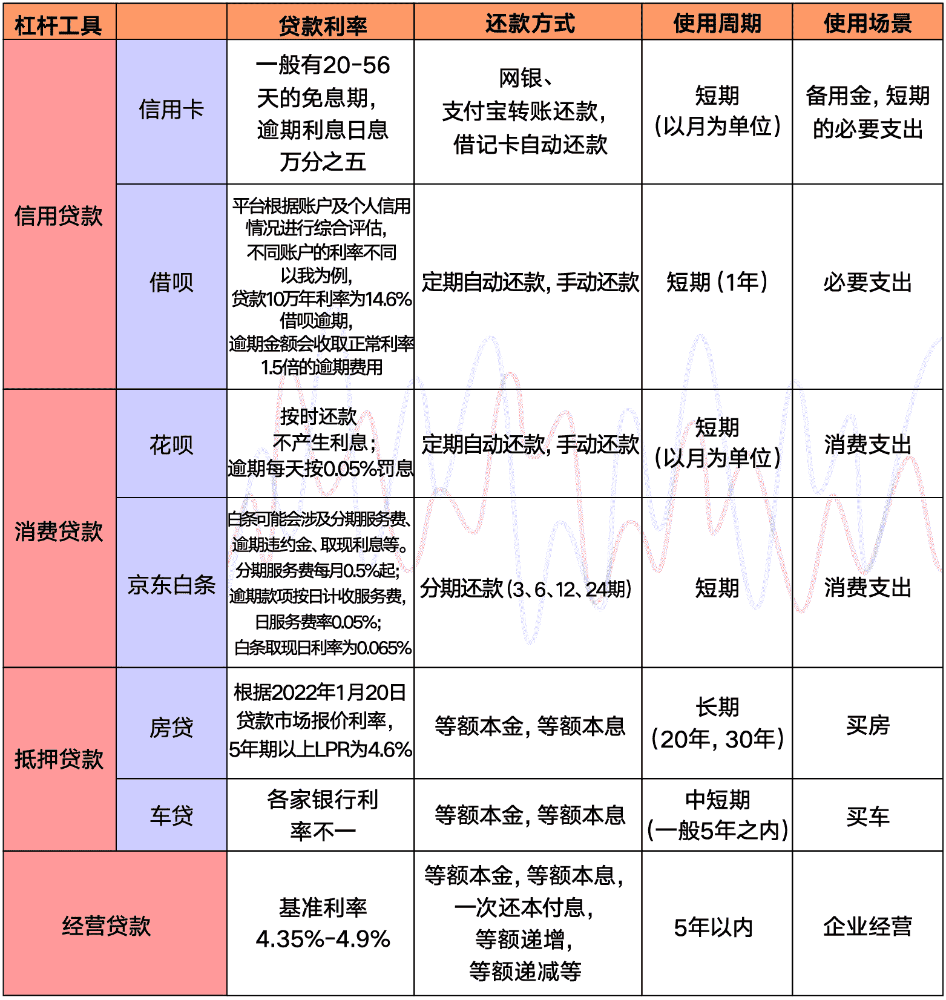
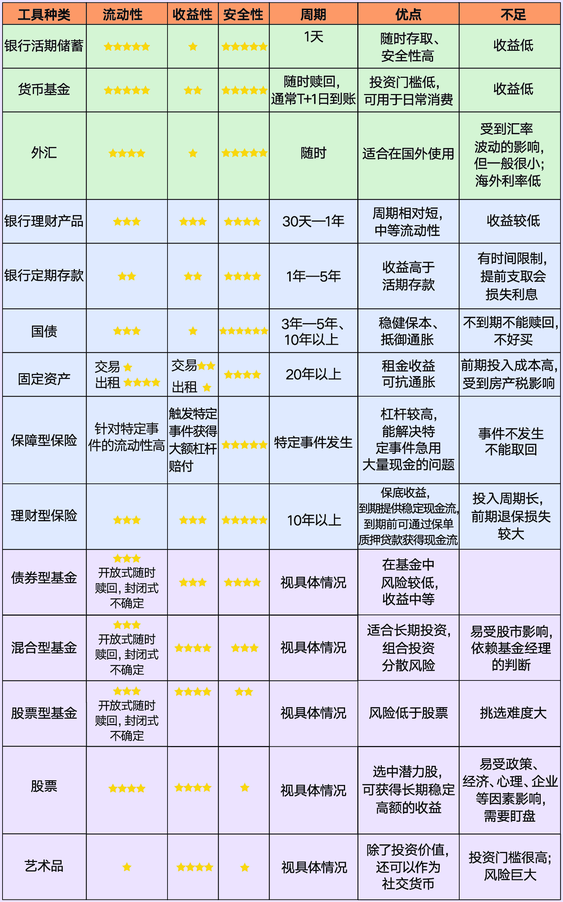
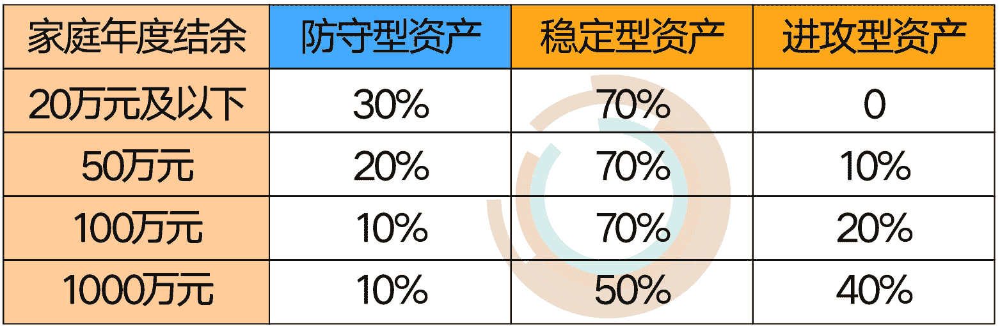

# 介绍

本电子书由公众号*懒人找资源*根据网上公开信息爬取，仅在*懒人专属群*内分享学习。

所有内容版权归得到 app 所有，未经允许，不得转载。

# 发刊词｜每个对家庭负责任的人，都得学

懒人专属群的群友，你好，我是李璞，欢迎来到我的《家庭财富管理》课程。

家庭财富管理，我们强调的是家庭这个单位。以家庭为单位的财富管理，和以个人为单位的理财，完全是两回事。

为什么说是两回事呢？我来帮你算笔账。

你看，我们大多数人能挣钱的时间，从 20 多岁大学毕业进入社会，到 60 多岁退休，工作时间可能有 40 年。但是请注意，这当中积累财富的高峰期，可能就只是 30 到 45 岁这 15 年。

从家庭角度来看，这短短 15 年创造的财富，你得应付多少事情？

首先，这个时候你的父母可能已经退休了，离开了工作岗位，要面对养老这个大问题。要是把两边老人都算上，你可能得支撑四个老人的养老。现在“百岁人生”了，他们的养老可能会一直延续二三十年。

第二，你的孩子正好在这个时期成长，孩子的生活经费、教育经费都得管好。虽然法律规定你只要负责到孩子 18 岁，但按咱们中国人的观念，我们对孩子的付出远远比这更多。

更不用说你自己了，房贷、车贷、意料之外的支出，还有多少财富高消耗事件我就不说了。

所以你看，用 15 年这个财富创造高峰期所创造的财富，要去支撑横跨三代人、那么漫长的时间。做好家庭财富管理，这件事情刻不容缓。

* * *

那该怎么管理呢？有人会觉得压力山大、好焦虑，容易走向另一种想法，去尝试各种投资，想要发笔横财。

我要提醒一句，这样做非但不能解决问题，反而会让你更加焦虑。

记住我刚才说的，家庭财富管理和个人理财，完全是两回事。

核心区别就在，个人理财是为了赚钱，这一波赚着钱了就算成功，而家庭财富管理，是要保障好一家人的人生事件。如果做到了这一点，你就能从容地支撑你和你全家的人生，完全不需要焦虑。

我给你举几个例子：

小王毕业后留在了上海，这个时候，父母该不该把老家四线县城的房卖了，给儿子凑上海的首付呢？

从投资收益上看，当然是上海的房更有持有价值。但是从家庭的角度来看，要是老家的房子卖了，父母住哪儿呢？如果搬到上海和孩子一起住，很可能两代人的生活质量都垮掉了。

再举个例子。你觉得父母是应该先给孩子准备大学教育金，还是应该先准备自己的养老钱？

正常情况下，大家都会选教育金，一个是因为父母都爱孩子，另一个原因是孩子上大学的时间在父母退休之前，按时间顺序，当然是优先安排教育。

但是从家庭的角度来看，这很可能埋了个大雷。一个十八岁的大学生，想要获得低利息的教育贷款，非常容易，可是换成一对六十岁的老夫妻想从银行贷到养老金，这可是难上加难。到时候，万一父母养老出了问题，重担一下子压到了这个孩子身上。

再看第三个例子。小陈去年在金融市场上挣了好多钱，想着赶紧把家里的房贷提前还了，无债一身轻。他做得对吗？从短期上来说，反正手上有钱，还就还了呗，但如果他真是一个精于财富管理的人，这钱其实不该还。为什么？因为银行的贷款利率很低，一口气还了，反而损失了这笔现金的机会成本。

你看，这些例子是不是都很反常识？像这样的例子，我可以一直举下去。想用一份工资，把家里大大小小的事都管好，可不是那么简单。

* * *

咱们过日子，都有很多美好的愿望，一家人身体健健康康，孩子学业有成，老人安享晚年，有个大事小情的，都能从容应付。

但这些美好的愿望，背后都有一个特别现实的因素，就是钱。

虽然钱不能决定一个人幸福不幸福，但是万一遇到重大疾病得不到及时救治，或者孩子有一个特别有天赋的爱好，但家里没有足够的钱去支持。像这样的事情发生了，我们很难感到幸福。

所以我的这门课，就是想帮你来解决钱的问题，做好家庭财富管理，推开这扇幸福之门。

* * *

首先，在课程的前三讲，我会带你建立正确的家庭理财观念，深度理解这门课的中心：家庭财富管理，本质上是事件管理。

怎么避开最容易掉进去的坑？抓住哪三个关键，才算把家庭财富管理好？那么多人生事件，应该按怎样的顺序来规划？

然后，我会给你介绍两种最常见的家庭财富管理工具：理财工具和负债工具。

用好这两类工具，你既能聪明地安排好自己的钱，让家里的事有保障，又可以用好杠杆，四两拨千斤，用未来的钱为自己办事。

最重要的是，在课程里，我会手把手教你，怎么安排好一个个具体的家庭事件。

每个家庭都是独特的，但我会聚焦在几乎每个家庭都逃不开的大事件：怎么做好家庭资产配置？怎么应对疾病风险？怎么买房？怎么养孩子？怎么规划养老？怎么做好财富传承？

我不但会告诉你，针对每个事件，你要怎么准备，怎么选工具，还会告诉你，配置过程中有哪些注意事项，哪些坑一定要避开。

* * *

最后自我介绍一下，我是李璞，得到的老用户可能对我并不陌生，我是《像高净值人群一样管钱》和《给忙碌者的个人保险课》这两门课程的主理人，也是一名独立财务顾问。

这门课给你提供的这套方法，在过去十几年，我已经作为私人的财富顾问，用它为几百个非常重视这件事的高净值家庭提供过服务。

这门课教给你的财富管理方案，不仅来自我自己作为一个专业人士的多年知识积累，也是几百个真实家庭、各种各样真实情况的汇总。

我非常了解一个家庭可能遇到哪些事件，能够帮你避开所有的坑，不走弯路。

欢迎你现在就加入这门课，直奔一个安全又有效的家庭财富管理方案，为你的家庭负起责任。我是李璞，我们课程里见。

  

公众号懒人找资源，懒人专属群独享

# 01｜避坑指南：家庭财富管理，别急着赚钱

懒人专属群的群友，你好，我是李璞，欢迎来到我的《家庭财富管理》课程。

我想，你一定是带着“做好家庭理财”这样的想法来到这门课的。你也一定很想问我，怎么理财才能赚钱？而且，最好是赚到大钱、让钱多到花不完。

作为一个财富管理咨询行业的从业者，我非常理解大家想赚钱的迫切心情。但是，我告诉你一个非常重要、但很多人不愿意承认的道理：通过投资赚大钱，对于咱们普通人来说很难实现。大多数人最应该了解的，是怎么规避风险、不吃大亏，保护好自己的辛苦钱。

听到这，你可能心有不甘，我投资不就是冲着收益来的吗？但是看看现实，有太多人押上自己全部的积蓄，一心想着怎么让财富增长，最后却踩了雷，亏得血本无归。别说大钱没赚到，基本生活都受到了影响。

所以这第一讲，我先告诉你怎么要先保证远离风险、别踩雷，保证了不吃亏，再去谈怎样让财富增加。

想让自己的财富远离风险，请你一定注意这三件事：第一，别小看工资。第二，别混淆资质。第三，别指望暴富。

## 别小看工资

我们先来说说“别小看工资”。很多人可能要问了，咱们这不是理财课吗？怎么一上来就给我强调工资呢？我想告诉你，对于理财来说，最重要的就是稳定的劳动收入。

一些理财课的广告总喜欢说，不管你是学生党还是全职妈妈，只要学习理财，哪怕你现在只能拿出几十块、几百块，也能实现经济独立，甚至财富自由。但如果你冷静思考一下，就会发现，这并不现实。

首先，如果没有收入，理财的本金从哪里来呢？  
其次，如果劳动收入还没有一定的积累就投入到理财里，那你就是在用“要紧的钱”冒险，这可是给自己埋了个大雷。

投资只能帮你锦上添花。如果你现在收入不稳定，或者可投资的钱很少，那么就更应该把主要精力放在工作上。

在这门课程里，没有所谓的“通过投资一夜暴富”的捷径。你能学到的，就是如何保护好自己的劳动所得，并为家人提供好的生活保障。这也是我们这门课程的主要目的。

## 别混淆资质

有了本金，是不是各种理财工具都可以试试，什么理财产品都能买了呢？我要提醒你，这样很危险。能不能买，这是个资质的问题。

国家对不同的投资者可以买的产品是有限制的。如果你买的产品不在你的安全投资范围内，很有可能吃大亏。而且，因为你买了原本就不能买的产品，这属于违规操作，万一出了问题，法律也很难为你提供保护。

国家把投资者划分为三类：

第一类叫专业投资者，主要是指有一定金融资质的金融机构，比如银行、证券公司、期货公司等，它们可以投资外汇产品、大宗商品等等。这是专业选手，不在咱们普通家庭理财范围内。

第二类叫合格投资者。这里的“合格”，不是说懂一些常识就算合格了。国家对合格投资者有明确规定。

简单来说就是，资产要达到一定规模，比如，家庭金融净资产不低于 300 万元，或者近 3 年本人平均收入不低于 40 万元。

而且，还要有一定的投资经验，比如投资于单只固定收益类产品的金额不低于 30 万元等等。

合格投资者玩的是"有钱人的游戏"。有些产品是只对合格投资者开放的，比如投资私募基金。

第三类投资者就是普通投资者了，也就是我们说的散户。绝大多数人都属于这一类。普通投资者可以选择的投资工具，就是我们熟悉的那些，银行储蓄、银行理财、股票、保险、基金、房产等。记住，只有这几类，除了这几类，其他的很有可能是骗局。

我举个例子，私募基金。如果你是一个普通投资者，有人告诉你有一支私募基金收益很好，但是要 100 万起投，你一个人拿不出来，就找了一圈朋友凑足十个人，每人出十万，最后收益分摊。是不是很心动？

我告诉你，这么做非常危险，一旦出现亏损，你多年的积蓄可能在一夜之间血本无归。而且，即使你想起诉骗你上当的人，你可能连当原告的资格都没有，因为你已经违规了，按规定你是买不了这个私募基金的。

所以，一定要明确自己是哪一类投资者，再在国家规定允许的安全范围内去选择产品。这是咱们不爆雷的基础。

## 别指望暴富

现在第三个问题就来了，在国家允许的范围之内可以买的产品也有很多，我们怎么买呢？

这时，很多同学就会拿着具体的产品来问我：老师，这只基金行不行？这款产品好不好？

理财产品千千万万，很难一一回答。我给你三个标准，你照着这几个标准去买，不一定暴富，但一定不会爆雷。这三个标准就是“三合”——合规的渠道、合法的产品、合理的收益。我们一起来看看。

先说合规的渠道、合法的产品。之所以把这两点放在一起说，是因为判断渠道和产品是否合规、合法的方式是一样的，很简单，就是去相关网站查询。

不管是机构想从事任何一种金融业务也好，还是某一款产品要公开售卖也好，都要先取得监管部门的允许。这样，相关网站上就有它对应的信息。如果你发现这些网站上没有自己遇到的机构和产品的信息，赶紧跑就对了。

我给你三个网站，分别是证监会官网、银保监会官网和中国理财网。

 

中国证券监督管理委员会：http://www.csrc.gov.cn/pub/newsite/

中国银行保险监督管理委员会：http://www.cbirc.gov.cn/cn/view/pages/index/index.html

中国理财网：https://www.chinawealth.com.cn/zzlc/index.shtml

那么，如果有一款产品，渠道是合规的，产品是合法的，就可以购买了吗？也不是，还要确认收益是否合理。为什么会出问题呢？我给你讲个真实的案例，你就明白了。

2013 年，香港安盛保险推出了一款保险产品叫 Evolution，这款保险产品有点特殊，它和基金投资挂钩，当时宣传的收益率在 10%以上。安盛集团可是目前全球最大的保险集团，产品也是经过备案的，机构、产品都合规合法，收益率又这么高，因此，这款产品在 2014—2016 年吸引了一大批客户。

可是 2019 年 6 月，这款产品却爆雷了。购买了 Evolution 的客户，账户价值一夜暴跌 95%，200 多名投资者总计亏损 4 亿元资金。怎么会这样呢？这就要说到那句古老的话了，不合理的高收益意味着不合理的高风险。

很多人都听过这句话，但不理解它背后的逻辑是什么。

我们之所以能买到各种投资品，是因为有一些企业或者项目需要融资、借钱。对于要融资的人来说，首选肯定是找银行，因为贷款利息最低。

如果本身条件不够好，才会向机构和社会融资，这样一来，融资成本一定会上升，所以才会宣称有更高的收益来吸引投资者。

如果你是投资者，看到对方承诺的高收益，是不是就会心动了？但是别忘了，之所以承诺高收益，是因为项目条件不够好，风险太大，向银行借不到钱，这才需要向外融资。这就是为什么“收益越高风险越大”。这个保险产品宣传的收益率在 10%以上，这明显是不合理的，可见它的风险有多大了。

## 如何判断合理的收益

怎样的收益才是合理的呢？我给你五个指标来帮你判断。

第一个是一年期国债的收益率。国债就是你把钱借给国家，到期后还本付息。我们一般会认为国家的信⽤等级是最⾼的，所以可以说国债利率就是无风险利率。如果一个项目收益率跟一年期国债差不多，那就可以认为这个项目风险很小。

国债的收益率是不断变化的，比如 2021 年 7⽉1 号的⼀年期国债收益率是 2.42%，这个数据供你参考。你可以在我们国家财政部的网站查询国债收益率。

中国国债收益率曲线：

https://yield.chinabond.com.cn/cbweb-czb-web/czb/moreInfo?locale=cn\_ZH

第二个指标是银保监会允许保险公司发行普通型养老年金和长期年金产品的最高预定利率，2019 年是 3.5%，我们可以把它理解为“准无风险收益率”。

为什么是“准无风险”呢？因为在所有机构投资者中，保险公司的投资渠道最广、投资限制最严，它们托管的多是医药费和养老金，需要保证长期安全。所以，如果一个投资项目的收益率在 3.5%以下，基本是安全区间。

第三个指标是贷款市场一年期报价利率（LPR），2021 年 12 月发布的是 3.8%。银行贷款利率是所有机构贷款中利率最低的。如果一个项目的收益率在 3.8%以内，说明它能以较低的利率借到钱，那它的资质应该不会差。

第四个指标是 GDP 增速。如果一个产品的收益率超过了国家平均增⻓⽔平，你就要提高警惕了。每年 2-4 月，统计局会发布过去一年的全国年度统计公报，2019 年 GDP 较上一年增长了 6.1%，这个指标每年都会波动，你可以在国家统计局网站查询 GDP 增速。

 

第五个指标是 15.4%，这是国家对⾼利贷的标准红线，一听就很危险吧，这个利率以上，连法律都不保护你的权益了，我的建议是别碰它，因为风险太大了。

刚才说的这五个指标——一年期国债收益率、银保监会允许的最高预定利率、一年期贷款基础利率、GDP 增速和高利贷标准红线，一般来说，收益越来越高，风险也越来越大。当你再看到一款产品的收益，就可以拿这五个指标来判断风险。

 

好，总结一下。这一讲我们讨论了财富管理中最重要、也是最容易忽略的问题：如何规避风险。首先，请不要小看工资，其次，你需要清楚自己的资质跟产品选择的范围，最后，别指望暴富，要追求安全、合理的收益。

留一道思考题吧。学习了这一讲，你想追求多高的收益呢？为什么？欢迎在评论区交流你的看法。

安全问题说完了，下一讲咱们就正式开始，看怎么把家庭财富给管理好。咱们下一讲见。

公众号懒人找资源，懒人专属群独享

# 02｜本质：什么才是好的家庭财富管理？

懒人专属群的群友，你好，我是李璞，欢迎回到我的《家庭财务管理》课程。

上一讲，我们讨论了在家庭理财中，比赚钱更重要的是规避风险、避免爆雷。但是，光知道怎么避坑是远远不够的。从这一讲开始，我们就来切入正题。

首先，请你思考一个问题：什么是好的家庭财务管理？

有人会说，不就是让家里更有钱吗？如果我通过投资，每年都能获得 30%的收益，谁能说我把家庭财务管理得不好呢？

多赚钱当然好，但赚钱真的不是家庭财务管理的目的。在我看来，好的家庭财务管理，不是赚到更多的钱、拿在手里，而是提前做出规划，把家里大大小小的目标事件解决好。

换句话说，不管是看病、买房这样的大事，还是买菜、吃饭这样的小事，当事情发生时，如果我们能拿出需要的资金，把事情安排好、解决掉，不让它成为家庭的阻碍，那就算是把家庭财务管理好了。

听到这里，可能又会有人说了：看病、买房、吃穿用度哪一样不花钱？把这些事情安排好，归根结底不还是钱的事儿吗？

但真的是这样吗？

举个例子：我们都知道，三年期定期存款的利率比一年期好。老王四十岁的时候，把自己的积蓄全部存了三年定期，想三年后拿出来用。可刚过一年，他的家人突然生病，需要一大笔钱，这钱一时半会儿取不出来，取出来又要损失利息，怎么办呢？他一定面临焦虑，可能还要到处借钱。你看，这就是以赚钱为目的，却没有把事情安排好的典型。

所以我才说，我们需要转变一下思路——从关注财务转换到关注事务。

顺着这个思路，我总结了这样一个三步走的方法：首先，弄清楚自己家庭的目标事件有哪些；然后，根据具体情况确定恰当的策略；最后，选择合适的工具。

搞定了这三步，我们就能在事情发生的时候有钱可用，不至于手忙脚乱、无所适从。

## 目标事件

先说目标事件。

什么是“目标事件”呢？其实，所有需要我们花钱的事情，都可以当作目标事件。

一家人过日子，目标事件真的太多了：

首先，一日三餐、住房、医疗，这是最基本的。  
除此之外，我们还要追求点生活的品质吧，比如经常看看电影、看看演出，日常喝个奶茶、吃点零食。  
赶上节假日，给自己和家人买点儿礼物，偶尔亲友小聚也必不可少。  
此外，有人想送孩子出国读书，家里有老人要赡养，也都要花钱。

这么看的话，目标事件太多了，好像根本安排不过来。别急，我们给它们分个类，就清楚了。需要花钱的事情，大概可以分成两类：

一类是刚性事件，也就是那些你一定要面对的事情，这笔钱你无论如何必须得花，比如一日三餐、租房的房租、每月的房贷。

另一类是柔性事件，就是那些你不完成也没什么大问题的事情，比如买个大牌包，出门旅游一趟，这种钱你咬咬牙，也可以不花。

当然，同样一件事，不同的人可能会把它归在不同的类别里。就拿模型收藏这件事来说，对有的人来讲，这笔钱根本不用花；但对于一些资深玩家来说这就是刚性事件了，宁可自己日子过得简朴一点，也要集齐整套。

但不管怎样，所有的目标事件肯定都能归到这两类里。你可以做一个自己的划分，看看对你来说，哪些事情是刚性的、哪些钱一定要花。一定要花的，就需要提前规划。

不过，分类只是第一步。刚才说了，刚性事件太多了，不可能同时解决，得分清轻重缓急。什么事件先规划？什么事件可以缓一缓？这个问题很复杂，我们留到下一讲来详细讨论。

现在目标事件有了，但这些目标要怎么实现呢？

## 财富管理工具

很多人的第一反应，就是买产品来获得收益，比如买基金、买股票等等。确实，这些理财工具都可以用到家庭财务管理中。但是我想说，你能使用的工具可远不止这些。除了理财工具，还有负债工具，这也是你可以利用的一类工具，信用卡、贷款都属于这一类。

你可能要问了，负债工具是让我欠债啊，借银行的钱，不仅要还，还得付利息，得不偿失，怎么就是工具了呢？

你可以换个角度想：在需要用钱的时候，银行把钱借给我们，不就是在帮我们吗？既然是帮我们，那当然是工具啊。

在这里，我要强调一个观点：工具本身没有好坏。总有人说信用卡、花呗让人超前消费、“毁掉了年轻人”，但这不是工具的问题，而是没有合理使用工具的问题。所以，在后面的内容里，除了说理财工具，我也会告诉你如何正确使用负债工具。

请注意，这里我强调的是“工具”，而不是商业机构讲的“产品”。商业机构说“产品”，特别是"理财产品"的时候，总喜欢强调收益率，说到底还是希望你购买。但在我们的课程里，我想抛开具体的数字、抛开一款一款理财产品，从工具的属性上带你理解这些产品更本质的特点。

你心里理想的理财产品是什么样的？是不是既有高收益、又安全，还能随取随用的？但是很遗憾，这不可能。如果有人告诉你有这样的产品，那你就是遇上骗子了。

所有的工具，不管被包装成什么样子，都符合“不可能三角理论”，安全性、收益性和流动性，三者最多只能得其二。比如，银行存款很安全，流动性也很高，但收益比较低。股票收益可能很高，流动性也不错，但是不安全、风险比较大。

既然三个属性只能选两个，那选哪两个呢？这就是个人的选择了。如果你追求安全，也想获得一定的收益，那保险就能满足你；如果你追求收益，也愿意承受风险，那股票就是你的选择范围。

## 如何制定策略

这里我要提醒你一下，具体选择什么工具、比例怎么安排，不同人、不同家庭差别也很大。所以后面这几个问题，你需要事先考虑一下，就可以大概了解自己的情况。

第一，我有多少资源？你需要看看自己能拿出多少本金，来为目标事件进行财务规划。

第二，我的投资周期有多久？也就是说，我有多长时间去做规划？周期不同，可以选择的工具和能够获得的收益也不相同。

比如，一个人有 10 万块，想用来规划 2 年以后的出国旅行，那他就要知道，2 年的周期，又要安全，比较合适的就是银行存款，收益不会太高。

但如果这笔钱是准备 20 年后的养老，那就可以以 20 年为周期来选产品，比如养老保险、20 年期的国债，就会获得比较高的收益。

第三，我和我的目标能承受多大的风险？要在自己可以承受的风险范围内选择工具。如果盲目追求高收益而忽视风险，很有可能血本无归。

我给你举个例子，你就会明白这三个问题的答案会怎么影响我们的策略、影响我们选择工具，从而影响目标事件的完成了。

假设有三个人，他们都想给家里买辆车，希望 3 年内攒够 5 万块来交首付，但是这三个人的选择不一样。

第一个人很保守、不能承受风险，也没有存款，于是选择每月往银行里存 1500 元，不到 3 年就能攒够 5 万。

第二个人本身有 5 万本金，而且很大胆，于是选择拿这 5 万块去炒股。如果 3 年后 5 万变成 10 万，他就买一辆更豪华的车，如果 5 万都赔了，就干脆放弃买车计划，继续坐公交。

第三个人风格居中，于是他选择用这 5 万本金买了 3 年期的银行理财，5 年后拿回本金和收益。

你看，这三个人的目标和投资周期都一样，但因为本金和风险偏好不同，选择的策略就不一样，选择的工具自然也不一样；。

* * *

好，总结一下。这一讲我先为你介绍了家庭财富管理的目的不是赚更多的钱，而是“为事情做准备”。怎么准备呢？首先，请你找到自己的目标事件，接着，你应该基于自己的策略选择合适的工具，去完成你的目标事件。

听了这一讲，你可以思考一下，在过去的理财经历当中，你有哪些经验？踩过哪些坑？欢迎你在评论区分享，和大家一起交流。

下一讲，我就把“目标事件”给你拆开来仔细说。咱们下一讲再见。

公众号懒人找资源，懒人专属群独享

# 03｜事务管理：怎么给人生大事排序？

懒人专属群的群友，你好，我是李璞，欢迎回到我的《家庭财富管理》课程。

上一讲，我和你分享了一个特别重要的观点，就是管理家庭财务不光是要赚钱，更重要的是"为事情做准备"。准备的第一步，就是找到自己的目标事件。

到现在，我们已经把目标事件分成了刚性的和柔性的。可是一家人的刚性事件还是太多了，还房贷、买车、给爸妈养老……我们得分出先后，一件一件解决。这一讲我们就来讨论目标事件的优先级问题。

我知道，不同的家庭背景不一样，不同的人也有不同的追求，属于你家庭的那组刚性事件一定和其他家庭不一样，所以，我不可能一一告诉你每件事该怎么安排。

但有一些事情几乎所有人都要面对。如果把这些大事安排好，我们面对其他相对柔性的事情时也会更加从容。咱们这门课程就是希望教你如何把这些事情解决好。至于其他事情，你用类似的思路来规划就可以。

## 王光明的人生时间轴

那么，我们一生中有哪些需要花钱的事，几乎所有人都要面对呢？

法律对我们要承担的财务责任有基本的限定：

一个人作为子女，对父母有赡养的义务；  
作为丈夫或者妻子，对另一半有相互照顾的义务；  
作为父母，对未成年子女有抚养、教育的义务。

如果这些财务责任具体到一个人身上，会是怎样的呢？现在，我们就请出我的朋友，王光明，来看看他的时间轴。

 

王光明是一个热爱生活的普通人，他遇到的事，很多人大概率也会遇到。

23 岁，王光明大学毕业，参加工作实现了经济独立，要承担起自己的财务责任了。

两年后，他有了女朋友，27 岁时，他和女友考虑结婚，就迎来了人生中第一件财务上的大事：结婚买房。这对小情侣前些年攒了一些钱，可以在老家买套小房子。

夫妇俩过了几年二人世界。在王光明 30 岁这年，夫妻俩迎来了他们的第一个孩子。两年后，第二个孩子也出生了。要照顾好两个孩子的衣食住行，还要为孩子将来的教育做好打算。

这几年，王光明的收入不断上涨，解决家庭的正常开支似乎不成问题，但是父母一天天老了，王光明也意识到，父母的看病、养老问题，也需要自己和妻子在经济上伸把手了。

时间继续往前走。王光明 50 岁左右的时候，两个孩子要上大学了。这是孩子人生中的关键一步，如果孩子有意愿出国留学，孩子的教育金，也是王光明夫妇需要解决的一大问题。

等两个孩子大学毕业、经济独立，他们夫妻俩对孩子的财务责任就基本完成了。接下来，就是考虑为父母养老，以及规划自己和伴侣的退休生活。

总结一下，王光明一生里必须面对的大事包括：结婚、买房、子女教育、父母的养老和医疗，还有自己的养老。这些事情我们大多数人也要面对。

之所以说“大多数人”，是因为很多人面对人生都有自己的选择，比如要不要结婚、要不要二胎等等，你可以画出自己的时间轴，把特殊情况和法律规定的财务责任都考虑进去，看看你讲一定要面对的大事都有哪些。

## 先保证日常开支

这么多大事，先解决哪个呢？我给你一个解决方案：先保证自己的日常开支不受影响，再根据自己的人生阶段去安排即将发生的大事。

首先是日常开支。日常开支看似都是小钱，但每天都在发生，而且会伴随我们一生。所以，一定要有一个账户，永远在里面准备好三到六个月的日常开支，保证可以随时取。这笔钱能让我们在遇到意外的时候基本生活不受影响。

关于这笔钱，还有两点你一定要记住：

第一，这笔钱轻易不能动。不管你要投资，还是要来一次奢侈的消费，都不可以轻易花这个账户里的钱。如果这笔钱都没攒够，你就先别想投资的事情了。

第二，这笔钱的多少不是固定的。在不同阶段，我们的日常开支是不一样的，这个账户里的钱也要跟着变化。我们需要先了解自己的支出情况，再去规划这个备用金的账户。具体怎么规划呢？在后面第六讲，我会告诉你怎么记账，也会告诉你这个备用金账户怎么建立。

## 人生大事排序

日常开支有了保证，我们就能放心安排后面的大事了。

不同阶段的人即将面对的大事肯定不一样。我非常希望你在 25 岁的时候就已经听到我这门课，这是最理想的。当然，正在听课的你可能处于任何一个人生阶段，别担心，就算你在三四十岁甚至年龄更大的时候来到这门课也没关系，解决问题的方法是一样的，只不过你要遇到的大事不太一样而已。

如果你 25 岁左右，未来三五年里，你要面临的大事可能是结婚、买房，甚至生儿育女。一些二十几岁、刚进社会的年轻人会觉得这些事情离自己远着呢，不用着急考虑。但是我告诉你，25—30 岁这个阶段，一般人的事业刚刚起步，积蓄不多，但因为有结婚、生孩子这些大事，要花的钱也不少，最好要提前规划。

如果你年纪更大一点，上有老下有小，你要面对的人生大事就更多了：父母年纪大了，需要看病、养老；孩子要上学了，可能是一笔不小的支出；自己和伴侣也快退休了，也得为自己的晚年做准备。

事这么多，但钱是有限的，怎么分先后呢？这件事没有标准答案，你心里可能也有想法，我把我的做法和理由告诉你，供你参考。

我的排序是：医疗费用>买房>父母和自己养老金＞孩子的大学教育金。

我是这样考虑的：

首先，医疗费用在首位，有两个原因。

第一，健康是第一位的，身体是革命的本钱。有了健康，才有其他的一切。

第二个原因是，疾病在任何时候都有可能发生，所以我们不能拿家庭成员的健康冒险。况且现在的医疗费用也不低，更应该提前准备。

医疗费用安排好了，接下来可以考虑买房这件事了。买房是个大事，关系着成家和养老，不仅要考虑钱，还要考虑在哪买、怎么买等等，涉及细节问题很多，我们在第八讲细说。

房子的问题解决了，接下来，我们会选择为父母和自己准备养老金。可能有人会问：为什么不优先准备孩子的大学教育金呢？

我也是个父亲，我完全理解这种对孩子的爱。但我建议咱们换个角度，理性地思考一下。我之所以把养老排在教育的前面，有两个原因。

一是因为养老是生存问题，教育是发展问题。

可能有人会问：我有社保，还需要储备养老金来解决生存问题吗？

社保当然很重要，是我们的退休生活最基础的保障，但如果你希望自己的退休生活更有品质，那只依靠社保大概率是不能满足的，需要我们额外做些准备。

而教育呢，我们现在说要让孩子接受教育，不是说攒钱上个大学就行了，而是希望孩子去更好的环境，既收获知识，也收获经历和视野，这就是发展问题了。

生存问题，天然就比发展问题要紧迫。

再说第二个原因，教育比养老更容易调动外部资金。

这是什么意思？假设孩子考上大学但家里钱不够，年轻人可以申请助学贷款，这种贷款是福利性质的，一般利率非常低。年轻人的事业前景更好，所以更容易找到杠杆、调动外部资源。而养老想要调动外部资金，不尽早准备是很难的。

因此，比起孩子的教育金，我会优先规划养老金。

## 规划的边界在哪里

说到这，你可能觉得奇怪，为什么我列的事件中没有“给孩子买房”或者“为孩子准备结婚的钱”这类事件呢？我解释一下。

要不要给孩子买房或者准备婚嫁的钱，这个问题没有对错，只是观念不同。在传统观念里，孩子在买房的时候问父母要钱很正常，父母也觉得自己有义务帮孩子减轻负担。但是在今天的我看来，这件事并不存在于“人生必须”的时间线上。

我这么说，当然是出于现代的观念了。孩子在成年且有独立生活能力之后，父母对孩子就没有必须要完成的财务责任了。孩子会有自己的人生事件线，应该自己负担日常生活支出、配置房产等等。

父母和孩子两条线虽然是并行的，但也应该分清楚。很多父母把自己和孩子的两条线合在一起，把孩子成年后要花钱的事情也归在自己的账户里，孩子要结婚、要买房、要旅游，父母都出钱，这样的“账户混同”会带来问题。

对父母来说，总想把孩子的事情赶紧安排完，再去安排自己的事情。这个心情可以理解。很多父母催着孩子相亲、结婚，为什么呢？其中一个原因就是，父母的账户里既有自己的养老金，又有给孩子的婚嫁和买房子的钱，只有孩子赶紧成了家，父母才知道账户里有多少钱属于他自己，才能安排规划自己的养老。这也给孩子造成了压力。

因此，在我看来，每个人都应该先对自己的那条事件线负责任。如果父母已经完成了自己那条线上的事情，还有额外的精力和资金，再来考虑帮助孩子完成他的责任。

* * *

好，总结一下。这一讲我们介绍了家庭财务管理模型中的“目标事件”。

在安排这些大事的时候，你需要先预留 3 到 6 个月的日常开支作为备用金，再按照医疗、买房、准备养老金、准备教育金的先后次序，去规划目标事件的优先级。这是我作为一个现代人的建议，供你参考。

听完这一讲，我希望你拿出纸和笔，认真列一列自己人生中眼下和未来必须面对的那些大事。

清楚了自己要面对的大事，后面两讲我就来带你看看，我们有哪些工具来应对这些大事。咱们下一讲见。

公众号懒人找资源，懒人专属群独享

# 04｜负债工具：普通人怎么用好杠杆？

懒人专属群的群友，你好，我是李璞，欢迎回到我的《家庭财富管理》课程。

听完前面的课你已经知道，管理家庭财富的最终目的，是要把家里的事安排好。要完成这个目标，当然就要借助各种趁手的工具。这一讲，我来给你介绍一种特别好用的工具：负债。

我们买房、买车会用到房贷、车贷，日常消费，信用卡、花呗、借呗、白条什么的，你大概率已经用上了。借钱谁都会，我为什么还要跟你强调这件事呢？

这是因为，虽然借钱一点都不难，但真正知道怎么聪明借钱的人，只有少数。

靠着花呗借呗拆东墙补西墙，那不叫聪明。只知道在买房、买车这样的大事上去贷款，也不叫聪明。真正的聪明，是在正确的事情上负债，在合理的范围里负债，增加自己调动资金的能力。这一讲，我就来给你把聪明负债这件事讲明白。

要想用好负债这个工具，咱们认知得先摆正。传统的想法会认为，负债说明钱不够用了，是一种负面的、消极的状态，就算真在需要的时候去借来了，也是一种负担。

但本质上，负债只是一种“财务杠杆”，帮你把一笔未来才会出现的钱撬到现在，马上就能用，提供的是流动性。只要你用好这个工具，它不但不会是你的负担，还能帮你解决很多问题。

## 负债工具有多少

首先我们来盘一盘，负债这一大类工具，到底有哪些是我们可以用的。

咱们平时经常接触的房贷、车贷、花呗、借呗、信用卡，还有企业主用到的经营贷款，别看都属于负债工具，但它们的利率、使用周期和还款方式差异很大。

像信用卡、借呗这样的信用贷款，还有花呗、京东白条这样的消费贷款，都属于短期工具，利率相对比较高。而房贷、车贷，还有经营贷款，周期长，利率就比较低，但有些需要有抵押物，所以它们各自的应用场景很不一样。

既然工具有那么多，是不是就能赶紧用上呢？别急，负债工具要用得好，有两个核心问题一定要考虑：为了什么事负债，以及负多少债。

## 什么事情值得负债

先来看第一个问题，什么事情值得我们负债？是不是只要负担得起，任何花钱的地方都应该负债？

当然不是，聪明负债的关键是，借来的钱要花在刀刃上。

我的看法是，在刚性支出上适当负债是没问题的。第二讲已经说过，刚性支出就是一定要花的钱，比如日常开支、看病、买房、子女教育以及各种突发事件。

很多人觉得，只有拿不出钱的时候才会用到负债工具，其实在日常开支上也可以用。注意，这个日常开支说的是最基本的衣食住行，不包括奢侈享受。日常开支是相对稳定的，你可以用信用卡或者花呗来付，再把原来那笔现金买一笔短期的理财，到时候再取出来还。这样，你每个月都可以多一笔收益。

当然，负债工具还有更大的用处，救急。家里突然有人生病，医保报完、保险赔付完了还需要一笔，或者是别的突发急用，现金不够怎么办呢？

你可以申请几张信用卡备着，平常就别用来消费了，一旦有事发生，不用急着把理财里的钱拿出来，也能度过难关。

至于买房、孩子上大学这些大事，负债工具有多重要就不用我多说了。买房我们会用上房贷，孩子如果出国读书，需要一大笔学费，助学贷款都可以发挥作用。在这种大事面前，负债工具能用就一定要用。

那么，哪些事情我不建议负债呢？就是那些可花可不花的钱，尤其是享受型的消费。

比如，新款 iPhone 定价 8000 多，很多年轻人一时拿不出现金，就想借个消费贷，现在很多平台都推出了“分期免息”，平摊下来每个月只要几百块，又没有利息，这么便宜，赶紧买啊。买的没有卖的精，我来算两笔账你就知道了。

第一，很多平台说的“免息”并不是真的没有利息，而是换了种方式，叫“分期服务费”。以京东白条为例，分期服务费率在 0.5%-1.2%之间，每期的服务费=消费本金\*分期服务费率。假如我借了 8000 块买手机，分了 12 期，服务费率 1%，每个月就要交 80 块服务费，一年下来，960 元就不知不觉花出去了。

第二笔账是，即使免了服务费，我也损失这笔钱的机会成本。很多人买新款手机，并不是旧手机不能用了，而是为了追赶潮流，买到以后新鲜感也持续不了多久。但假如你省下这笔钱去理财，这一年可能还能赚几百块钱。

有时候，商家会用各种手段来吸引你去借钱消费。但是你得清楚，哪些消费是真的必要，哪些只是自己的欲望，千万不要冲动消费。

说到这儿，不知道你会不会冒出这样一个想法：既然我可以省钱来理财，那能不能借钱套现来理财呢？

这种做法非常不可取，理由很简单，你很难靠这个赚钱。

如果一个人拿信用卡套现去炒股，信用卡的套现利率是日息万分之五，假设一年期的套现利率是 18%，他炒股的收益一定要达到 18%以上才能赚钱。如果达不到，哪怕只差 1%，那也是亏了，相当于炒了半天，连还信用卡都不够，而年收益要达到 18%以上，对很多人炒股达到这个收益非常难。

到这里，我来总结一下适合负债的场景：刚性支出比较适合，享受消费不太适合，负债投资很不可取。

## 在偿还能力范围内负债

那么，是不是只要找对了事情就算聪明负债了呢？你别忘了，借钱是要还的。用好负债杠杆的第二个关键是，只在自己的偿还能力范围内负债。

你可能听过一些新闻，有年轻人借网贷还不上，最后从好几个平台借钱，拆东墙补西墙，甚至陷入“裸贷”。这就是负债不合理导致的。

那么，怎样判断自己的负债水平是否合理呢？

坦白说，负债的钱占到每月百分之多少才算合理，并没有一个让所有人都可以参考的比例，因为人和人情况不一样。

一个刚毕业的年轻人，假设每个月收入 4000 块，负债 1000 块，负债占收入的 25%，这个比例好像也不是很高，但他扣掉房租和生活费，剩下的现金就很少了，很可能就还不上。但同样用收入的 25%来负债，对于一个企业主来说，可能就没什么问题。

那怎么判断呢？我教给你一个方法。先用每个月的稳定正向现金流，基本就是你的收入，减去本月的必要支出和储蓄，看看剩下的钱有多少。剩下这笔钱，才是你可以用来还债的。

为什么要减掉日常支出和储蓄呢？如果没有算上储蓄，全拿去还债了，家里就会存不下钱。如果没有算上日常开支就更严重了，正常生活都会受影响。很多人都只看到自己的工资够不够，就贷了一大笔款，等到真的要还的时候，每个月都是捉襟见肘，非常狼狈。

如果每个月要还的本息加起来，可以被剩下的钱覆盖，那就没问题。如果覆盖不了，就需要调整。

举个例子，假设一个家庭每个月收入是 1 万块，扣掉固定支出和储蓄，还剩 5000 块，这个家庭每个月要还房贷 3000 块，信用卡 1000 块，加起来 4000 块，剩下的 5000 块完全能覆盖，这就非常好。如果每个月要还的钱超过了 5000，收入又没有增加，那就得减少支出了，万一哪个月还不上，信用就会受到影响。

## 健康的负债状态

我再强调一下，健康的负债状态，就是稳定正向现金流，减掉刚性支出，再减掉必要的储蓄，剩下的钱还可以覆盖每个月要还的本息，就对了。

如果你的收入只能覆盖利息，覆盖不了本，就很容易进入亚健康状态。

现在有很多商家为了劝你消费，喜欢打“0 首付”的广告，比如买车，消费者每个月先还利息就行了，等到三五年以后再还本金。一辆 9 万的车，每个月只要交 1000 块钱利息就能开走，2 年以后再把剩余 9 万本金还上。有些人觉得很好啊，我每个月还一点点钱，就能开上车了。

但是，如果你把本金算上，再平摊到每个月，这辆 9 万的车，每个月实际要还的是 4500 多元。如果每个月可以用 5000 块来负债，差不多可以满足，如果还债的预算只有 4000，其实是不够的。

所以，再看到这样的广告，你可不能只看到每个月的利息，一定要算一下，本金加上利息平摊到每个月要还多少，每个月还利息的时候，要把还本金的钱存下来，这样到时候才有钱可还。

而且，人总是会对自己未来的收入过分乐观，要是没有算清楚本息，进一步去消费、去负债，这就更危险了，等到要还本金的那一天，钱不够，怎么办？为了不让车被银行收走，可能要去借新的钱，或者把钱从没有到期的理财中取出来。

所以，亚健康状态不是不能有，但是有风险，要提前规划、提高警惕。

还有比亚健康更危险的，就是庞氏状态，不停地借新的钱还旧的钱，就像滚雪球一样，越欠越多。而且这个状况是不可逆的，因为你已经没有了还款能力。

如果你身边已经有人财务亚健康了，一定要给他预警，在能够逆转的时候，尽可能向健康状态努力。

* * *

总结一下。聪明用好负债工具的两个关键是：在对的事情上负债，在自己能力范围内负债。做到这两点，你完全可以放心地负债，享受负债工具带来的及时的现金流。

现在你可以算一算，你每个月能负债的上限是多少？而如果你已经用上了负债工具，现在的负债状态健不健康呢？

负债工具讲完了，下一讲我给你介绍另一种常用的工具，理财工具，让钱生钱，这也是很多人对“理财”最直接的认识。怎么用好理财工具呢？咱们下一讲见。

公众号懒人找资源，懒人专属群独享

# 05｜理财工具：买对理财的关键是什么？

懒人专属群的群友，你好，我是李璞，欢迎回到我的《家庭财富管理》课程。

上一讲我给你分享了一种管理财富的工具，负债，本质上是借用金融机构的钱，让自己当下就有购买力。这一讲，我给你介绍另一种管理家庭财富的工具，理财。它是反过来，通过牺牲当下的购买力，把自己的钱放到理财工具里，让钱到未来才出现。

一说理财，肯定要有人问了：李老师，你直接告诉我，买哪款理财收益最好？

追求收益是人之常情，但在家庭财富管理上，用这个心态去买理财，多半要出问题。举个例子：

王光明 25 岁的时候，每月拿 50%工资买了几款偏股型基金，朋友推荐说收益很高，王光明也希望能赚笔大的，剩下的钱就用来消费和存银行了。可是两三年过去了，股市行情起起伏伏，这几只基金也跟着亏了不少。这个时候，女朋友提出结婚，只靠平时的银行存款远远不够办个像样的婚礼，但如果把基金卖了，钱还亏着又不甘心。

王光明的问题出在哪儿呢？不是因为他亏钱了，股市涨跌很正常，他的问题在于，选择了不合适的工具，导致结婚这件大事没有保障好。

这就是这一讲要给你强调的重点：用好理财的关键，不在于买哪款产品、有多高收益，而在于合理分配自己的收入，为未来可能发生的不同事件，准备好一个又一个的专款专用账户。如果你家遇到各种事的时候，都能有一笔及时的钱去覆盖，你买理财的水平就超过了大多数人。

## 为什么事买理财

如何达到这个目的呢？首先明确：买什么产品不重要，为什么事买才重要。

请你思考一下：每月工资到账以后，你是如何安排这笔钱的？

很多人的答案，自然是先扣掉一笔钱用于日常消费，剩余的钱用来投资理财。比如存在银行，或者跟着身边懂理财的朋友买一两款理财产品，赚点收益。

可你仔细想想，有没有感觉这笔钱花得糊里糊涂的？表面看上去，你是在财务管理了，但现实可能是，等真的遇到事了，才会去查各个账户里都有多少钱，再决定要不要忍痛割肉，把钱取出来。

问题出在哪呢？顺序错了。正确的理财思路，不是先拿花钱买一堆产品，而是一开始就根据未来要发生的事件，选择对应的工具。

各种人生大事轻重缓急怎么安排，我在第三讲已经梳理过了。那么，各种事件都该配置什么理财工具呢？

前面已经说过，所有的理财工具，归根结底都由三个特点来界定：安全性、收益性、流动性。这三个特点组成了一个“不可能三角”，三者最多只能得其二。

比如基金、股票，收益很高，流动性也不错，但是风险较大。银行活期存款，流动性好，很安全，但收益低。理财型保险，长期收益不错，也安全，但流动性就差了。不管是什么理财产品，都可以在这个坐标里找到自己的位置。

了解完背景知识，就可以来根据事件选择了。我根据自己的投资经验，总结了一个三步法，供你参考：首先，确定事情发生的时间点。第二步，确定事件能承受的风险。最后，确定自己能够投入这件事的本金。走完这三步，该选什么理财工具，就比较清楚了。

## 确定事件时间点

先来看第一步，确定事件的时间点，也就是看这个事大概会在未来什么时候发生，投在这件事上的钱有多长时间不用。这个时间点，对应的就是工具的流动性。我给你举几个例子：

明年年假，你想去海南旅游一趟，时间只有一年，那么挑选的工具流动性就要好，比如活期存款、货币型基金、1 年以内的理财，以及灵活的股票、基金等。  
5 年后，你想买房，那就可以选择中短期的理财产品，比如 5 年期的存款、国债。  
20 年后，孩子到了上大学的年龄，你想送孩子出国留学。30 年后，你到了退休的年龄，养老要排上日程。二三十年后才发生的事情，就对流动性要求没那么高，你的选择有房产、长期国债、保险等等。

这一步走完，你可以选择的工具范围就变小了。

## 确定事件的风险系数

再进入第二步，确定事件的风险系数，这对应着工具的安全性。

不同人对风险的容忍程度不一样，你可能见过一些判断风险偏好的测试题。不过，家庭财富管理就不能完全按个人偏好是激进还是保守来了，而是要按照事件本身来规划。

怎么看这个事件能不能承受风险呢？有三条标准。

第一，  
刚性事件比柔性事件对风险的容忍度更低。这个很好理解，比如王光明的儿子王小明三年后要上学了，孩子的教育经费不能接受风险。同样是三年后，一家人打算出门旅游，这笔钱能承受的风险就比教育经费要高得多。

第二， 近期的事件，比还有很长时间发生的事件对风险的容忍度要低。比如老王五年后就要养老，王光明是三十年后才要养老，王光明的养老理财能承受的风险就比老王高。

第三，  
每个人对事件重要性的衡量标准也不同。就拿五年后换辆好车来说，有人觉得不重要，亏了就推迟换车计划，但对于爱车一族来说，换辆好车就是最必要的事情，绝对要买，能承受的风险就更小。

对照这三个标准，你可以选择的工具范围就进一步缩小了。

## 确定可以投入的本金

接下来就是第三步，看你为了这件事，可以投入多少本金。

这对应的是理财工具的门槛，比如多少钱起投，你能选择的工具，要和你的可投资余额相匹配。

那怎么确定自己的可投资余额呢？很简单，你的收入扣除各项消费和负债，这部分就属于你的灵活资金，可以放进理财工具里。如果这样算下来没有资金了，那咱还是先好好上班赚钱，等可投资余额多了再投资吧。

## 案例练习

如果你走完了这三步，基本就能确定自己为这个事件要选择什么样的工具了。我们来通过一个具体的例子练习一下。

王光明计划 3 年后和女朋友结婚，结婚钱已经有了，小两口自己准备度蜜月的钱。他们商量，每月拿 5000 元来为这件事投资，如果投资成功，蜜月就出国旅游，投资失败，就不去旅游了。

咱们按照三步法来走。

第一步，事件发生在什么时候？3 年后，说明可以选择的工具是中短期的产品，流动性不必那么高。  
第二步，蜜月旅行能承受多大风险？小两口觉得可以承受风险，那安全性就没那么重要，收益性更重要。  
第三，可投资余额是每月 5000 块。

综合下来，适合蜜月旅游的理财工具，应该是 3 年之后可赎回，收益要高。那么，安全性低、收益低的银行存款、国债、货币基金就不合适了，流动性差的保险、3 年期以上的理财产品也不适合。需要大笔资金投入的工具也不行，比如房产。

盘算之后，小两口能选的工具就只有：股票、基金、3 年期以下的高收益理财产品。它们收益高，到了时间也能保证赎回，虽然风险大，但事件本身是能承担风险的。

## 避坑指南

你搞懂了这个三步规划法就会发现，我们身边常见的财务管理困境，几乎都是这三步有一步、甚至有几步没走对。常见的坑有这几种，请你一定注意避免：

第一种，周期错配，就是这笔钱用不到的周期，和你选择的工具不一致。

比如我需要一笔钱来应对日常紧急事件，但一发工资就买了一年期理财，遇到事取不出来。

反过来也成立，如果你的养老明明 30 年后才会发生，你却把钱放在了银行活期存款，这就浪费了这笔钱的增值空间。

第二种，风险错配，就是这件事情能承受的风险和你选择的工具风险不匹配。

像王光明度蜜月这个案例，原本可以承受股票的风险，要是把钱存了银行，就不合理了。

这只是损失了收益，要是拿不能承担风险的事件去匹配高风险工具，后果会更严重。比如小张胆子特别大，愿意追求高收益。他想为自己和妻子的健康事件做好规划，于是拿所有的本金去投资了一款理财产品，据说几个月收益就有 30%多，结果产品暴雷，本金亏进去了。这时候，如果他或者妻子健康出了状况，根本拿不出钱来治疗。

第三个坑，是本金错配。比如明明没有足够的资金，也要借钱或者拿信用卡套现去投资，或者去买自己没有资格买的产品。这样做风险很大，我在前面已经强调过了。

不过不用担心，如果按照前面说的“三步法”去规划理财，这三个问题基本不会发生。当然，你可以用这个方法回过头检查一下，你自己现在的配置是否合理。

* * *

总结一下，配置理财工具，第一位考虑的不是选择什么产品，而是为了什么事情才买。然后考虑三件事情：事件发生的时间点、风险系数、可投资余额。规划完成后，再反过来对照检查一下，有没有出现错配问题。

你即将遇到的下一件大事是什么，打算怎么规划呢？请你试着用这一讲学的“三步法”来规划一下，在留言区和我交流。

理论讲完了，下一讲，我们来具体展开各种家庭大事都该怎么安排。成立家庭以后，第一件大事应该是什么？我们下一讲见。

公众号懒人找资源，懒人专属群独享

# 06｜资产配置：如何把鸡蛋放到对的篮子里？

懒人专属群的群友，你好，我是李璞，欢迎回到我的《家庭财富管理》课程。

前面两讲，我给你介绍了财富管理的两大工具：负债和理财。了解了工具，咱们来进入实操阶段，先从两个人结婚成立小家庭讲起。

小家庭建立了，马上就会面临一个问题：两个人的钱变成了一家人的钱，后面还有买房买车、养孩子、养老那么多事情，该从哪里开始准备呢？

其实，不是说你家得有多少套房、多少个商铺，股票一年赚多少，才能把这些事摆平，普通家庭照样有很好的办法。其中最重要的准备工作，是要有科学的资产配置。

怎么才算科学呢？我给很多家庭做过咨询，根据我的经验，结婚和单身最大的差别，在于承担风险的能力降低了。单身的时候冒险亏损了，大不了重新来过，成了家就不一样了，上有老下有小，对风险就必须更加谨慎。

要防范风险，我们都知道那句话，不要把鸡蛋放在同一个篮子里，但只有这句话是不够的，你还要把鸡蛋放进对的篮子里。

要达到这个目标，你得分三步走。首先，知道自己有多少个鸡蛋，然后，知道篮子和篮子不一样，第三步，把鸡蛋放进去。就这么简单，我一步一步跟你说。

## 确定年度结余

在放鸡蛋之前，你首先要搞清楚你有多少个鸡蛋，也就是确定你们家的年度结余。

经常有人问我，我家一年赚多少钱，该拿多少钱去投资？这时我都会反问：你家的年度结余是多少呢？

很多人觉得，每年赚的钱就是可以拿来投资的本金了，其实不是，你们家的年度结余，是一年总收入减掉总开销，剩下来的钱才是可以去投资的。

要知道你家今年具体多出来多少钱，就要用到一个古老而智慧的方法，记账。

可能会有人觉得记账过时了，有人说，钱该花还是花，记下来有什么用？还有人说，要想增加家庭财富，你得去开源，抠抠搜搜能省出多少钱？

你要是也这么想，就是低估记账的作用了。记账，重点不在“记”这个动作，也不是让你抠抠搜搜过日子，它是一种手段，让你对家里的财务状况更了解。不管你现在成家了没有，我都建议你培养一下记账的习惯。

记账要怎么记呢？

现在各种专门帮你记账的 APP 很多，具体拿什么记我就不推荐了，不过我提醒你重视这两件事：

一是看家里一共花了多少钱。只要多看几个月的花销，一年的总花销很容易就算出来了。因为咱们的总收入主要就是工资，比较固定，收入减掉花销，结余也就算出来了。

算花销还有一个好处。我之前说过，你随时要有一个备用金的账户，里面放 3 到 6 个月的支出。就算在不同的人生阶段，你每个月的支出也会变化，但只要你一直知道自己花多少钱，就可以随时调整这个备用金账户了。

除了要知道花多少，你还要知道钱都花去哪了。否则就算花多了，也不知道从哪里省。

你可以把每月的支出分成三类：固定消费、日常消费和个性化消费。

固定消费，说的是每个月必须花出去、数额基本固定的钱，比如房贷、房租、水电煤气、物业费、车位费等等。像我每天都必须喝咖啡，每天早上来一杯，那这笔买咖啡的钱就是我的固定消费。

第二个账户叫日常消费，比如一家人吃饭的钱、加油费、交通费等等。它的特点是一定要花，但花多少不太固定。

第三个账户是个性化消费，也就是拿来娱乐、享受的支出，比如看个电影、朋友聚会买单、旅游度假等等。这笔消费的数额也是不固定，但并非一定要花。

怎么知道每一类都花了多少钱呢？你当然可以一笔一笔地记，分别用记账 APP 打标签归类。不过还有更方便的方法。你可以用三张银行卡分别对应三类消费，也可以用支付宝、微信、信用卡来分别支付三类消费。这样，你只要在不同账户里调取账单，就知道哪一类消费花得多花得少了。

记账，是理财的第一步。它能告诉你，你家年度结余有多少，以及从哪里省钱才最有效。

## 三大类资产配置

鸡蛋数完了，这就是你家一年投资本金的上限了。接下来，我们正式进入资产配置，来看看你能选的篮子都有哪些。

说到篮子，你可能马上会想到存款、保险、房产、车位、基金、股票……其实这些都属于工具，是下一步才要考虑的，你首先要考虑的篮子，是三大类资产的划分。它们分别是：防守型资产、稳定型资产、进攻型资产。

听名字你就知道，这三类资产的风险是不一样的，它们对应的用途也不一样。

防守型资产，主要用来应对日常开支和风险事件，这部分钱就像盖房子的地基一样，一定不能出问题，而且要随取随用。

满足安全性、流动性的有哪些工具呢？包括现金、活期存款，还有一类，货币基金，它风险要远远小于其他基金，灵活性也很好，所以也属于保守型。

另外，保险和信用卡也可以归属到防守型资产。因为它们安全性都很高，而且在保障突发事件的时候效果会很好。

比如健康保险，如果你家里有老人孩子经常跑医院的，它能给你减少医疗费用的负担。

寿险呢，保障的是人的生命，特别适合给家里的“经济顶梁柱”买上。

信用卡，前面已经说过了，你平时多备几张不消费的信用卡，哪一天急用现金了，它能帮你周转。

第二类是稳定型资产，可以拿去追求一定的收益，但安全还是很重要的，属于“先保值、再增值”的类型。

非自住房产、车位、国债、定期存款、理财型保险都属于这一类。

稳定型资产一般有固定期限，不像防守型资产那么灵活，但它也有一个好处，就是可以根据未来的事儿提前规划。

比如，王光明一家人打算三年后买辆车，他就可以拿原准备买车的钱，买一个三年期的国债，或者存三年的定期存款，到时候拿出来，车也买了，还有收益。

等你把防守型、稳定型资产都配置好了，就可以考虑去搭配进攻型资产。这一类资产的特点，就是放弃一部分安全性，来追求更高的收益。

普通人最熟悉的就是股票、基金了，收益高，风险也大，你在上车之前，一定要谨慎评估家里的风险承受能力。还有外汇期货、艺术品、大宗商品期货什么的，也属于进攻型资产，但普通家庭我就不建议了。

具体每一类资产都对应哪些工具，我给你列了张表，你可以保存下来，随时查阅。

总之，手里又有钱可以用，又有一些钱在稳定增值，还有余钱去追求更多的财富，这才是科学的“不把鸡蛋放到同一个篮子里”。

如果有人把投资的钱分成十几份，但都买了高风险的股票，那归根到底还是在同一个篮子里。

## 具体资产配置

下一个问题就是，三个篮子摆在面前，具体往里面放多少鸡蛋呢？

我建议的思路是，家庭的年度结余越少，就越应该注重稳定，而结余多一些的时候，就可以适当增加进攻型资产的比例。

比如，对于年度结余 20 万人民币以下的家庭，我的建议是三成的防守型资产和七成的稳定型资产，完全没有必要去配置进攻型资产。

为什么？因为在专业从业者看来，年度结余 20 万以下的家庭，抗风险的能力是比较弱的。万一进攻型资产亏损了，家人又突发疾病，就会难以应对。

如果家庭年度结余多一些，在 20 万到 50 万之间，抗风险能力明显变强了，就可以适度增加一些进攻型资产。我的建议是，这一类家庭防守型、稳定型、进攻型的比例可以设定为 2:7:1。

当然，要是你年度结余比这更多，进攻型资产的比例可以继续增加。具体比例，我也给你画了张表，你可以对照你们家的结余来参考。

但是，即使是年度结余达到了 1000 万的家庭，三类资产里最高的还是稳定型资产，要占到一半。所以，科学的资产配置里，进攻型资产的比例并没有很多人想的那么高。

根据你家对风险的承受程度，每一类资产的比例可以适当上浮、下调，但浮动范围不建议超过 5%。

如果你还是单身，适不适合这个策略呢？关键在于，你能接受多大程度的风险。

这一讲的策略，是按家庭的风险承受能力设计的，追求的是稳健，如果你也认同，当然可以用。

要是你说，我目前单身，风险承受能力强，想搏一搏单车变摩托，就会觉得这张表太保守了。

还是那句话，对家庭来说，安全比赚钱重要。防守型资产是基础，稳定型资产是大头，这两部分保证好，再去考虑进攻型资产。

* * *

好，总结一下。新家庭财富管理的当务之急，是做好资产配置，把鸡蛋放到对的篮子里。首先，通过记账了解家庭的年度结余。第二步，盘点你可以选择的防守型资产、稳定型资产和进攻型资产类型。第三步，根据你家的情况，设置好不同的资产的比例。

如果你已经成家，现在就可以和伴侣一起算算你们家的年度结余，看看资产配置是否科学。如果你是单身，也欢迎你算一算，财富管理不嫌早。欢迎在评论区和我交流。

有了科学的资产配置，我们就可以去应对家庭的各种大事了。头等大事是什么呢？咱们下一讲见。

公众号懒人找资源，懒人专属群独享

# 07｜健康：如何应对疾病风险？

懒人专属群的群友，你好，我是李璞，欢迎回到我的《家庭财富管理》课程。

上一讲，我跟你聊了怎么做好家庭的资产配置，下一个需要规划的财务事件是什么呢？是买房，还是生育？其实都不是，家庭建立后首先要提上日程的，是健康保障。

身体是革命的本钱，这个道理你肯定懂，但很多年轻人觉得自己身体挺好的，健康是年龄大了以后才要担心的事。这是一个特别大的误区。

因为疾病这件事，你知道它大概率会来，但不知道它什么时候来，也不确定一场病会花你多少钱。一旦生了病，它就是一个财务“黑洞”，几乎所有事情都得给它让路。为了看病卖房卖车的例子，你肯定没少见。所以健康保障的优先级，应该放在最前面。

那么，我们应该怎么应对疾病风险呢？跟其他人生事件很不一样的是，疾病本身很不确定，但用到的工具却很确定，就是保险。

保险本质上是一种杠杆，来帮你未雨绸缪，用小钱撬动大钱，万一疾病出现了，你就能有一个专款专用的账户来应对这件事，而不用急着去四处筹钱。

现在买保险一点也不新鲜，但一到实操阶段，还是有很多人犯迷糊。那么多保险产品，家里还有那么多口人，应该怎么选呢？这一讲，我们就来把健康保障这件事讲明白。

首先要说明的是，我们在配置健康保险的时候，并不是为了买而买，而是要用来应对不同程度的疾病。

生活中的疾病大概可以分成三类。

第一是日常小病，跑趟医院开点药就能好；  
第二是中症，可能做了个手术，几个月才能痊愈；  
还有重疾，也就是癌症、心肌梗塞这些“大病”，影响就更大了。

虽然这三类情况用到的工具都是保险，但具体怎么选，思路并不一样，我带你一个一个来看。

## 国家基础性保障

生活中，当然是各种头疼脑热的小病最常见。对于日常小病，就算不用到商业保险，国家基础性的保障已经能够做到基本覆盖，建议你好好利用起来。

医保不用我多说，这是国家的福利政策，一定要上。去过医院的人都知道，有没有医保报销，差别相当大。即便你是自由职业，没有挂靠公司，也要想办法自行缴纳。

除了医保之外，还有一种各地政府联合保险公司的普惠型医疗险，这类保险的性价比很高，也建议你关注。比如北京的京惠保、天津的津惠保、上海的沪惠保等等。

这一类保险的保障额度比医保更高，还覆盖了很多不在医保范围内的药物。就拿北京来说，治疗癌症的最新的 CAR-  
T 疗法也在京惠保的范围内。这类保险因为有福利性质，价格很便宜，一年保费一两百块钱，可以用来作为医保的有效补充。

有了医保和普惠型保险这样的基础保障，日常小病的开销就不会造成什么压力了。

## 医疗险和重疾险

但是，随着年龄增长，要是出现了中症甚至重疾，医保报完还得自费几万几十万，普通家庭的压力是不小的。另外，患病不可避免会影响工作，到时候收入影响了，也没法安心养病啊。想要防范这部分风险，就要引入商业保险了。

那么，该怎么买呢？市面上的健康险产品实在太多了。其实，不管保险公司把名字取得多花哨，商业健康险归纳起来就是两类：医疗险和重疾险。我的建议是，这两类里优先配置医疗险，然后配置重疾险，我们来分析一下。

医疗险和重疾险，虽然听起来都跟医疗、疾病什么的有关系，但它们发挥作用的方式很不一样。

医疗险，保的是医疗费。你可以把它理解成医保以外的报销。你去医院看病，需要提前垫付自费的部分，再拿着发票去找保险公司报销。你花多少，保险公司就赔付多少。只要你的保额能覆盖医疗费，压力就不会太大。

那么，一直只买医疗险可不可以呢？不行。医疗险有个特点，一般是一年一买，如果你前一年赔付得多，保险公司就会判断你下一年患病几率可能很大，会选择增加保费或者拒保。所以医疗险你买着买着，到了五六十岁，可能就买不上了。

进入老年之后，万一罹患重疾，能起作用的就是年轻时候买的重疾险。

跟医疗险相比，重疾险不用一年一年地续保，根据不同的产品，可能给你保一辈子，也可能保到六七十岁。万一真的发生重大疾病，保险公司就按照合同规定的保额，一次性把钱赔付给你。

比如你买的保险保额 50 万，但治病只要 30 万，那保险公司也会一次性赔 50 万，剩下的钱你怎么花都可以。所以，重疾险除了能用来治病，还能减小疾病对家庭收入的影响。

了解了这两个险种的特点，你就知道我为什么说，医疗险在前，重疾险在后了。

医疗险是弥补医保不能覆盖的医疗费用，保障的是当下。而重疾险是保障不会因为重疾而拖垮整个家庭财务，保障的是将来。从紧迫性上看，当然是先管好当下，再去考虑将来。

到这里总结一下，我们在配置健康保险时，可以按照小病-中症-  
重疾的顺序。医保和普惠型保险应对小病没问题，商业医疗险主要应对中症和重症的医疗费用，重疾险是规避因为重大疾病而造成的收入损失风险。

这样盘一盘，我们配置健康保险的顺序就很明白了：医保>普惠型保险>医疗险>重疾险。另外，如果你的企业给上了团体医疗险，那也是应对疾病风险很重要的工具。

## 普通家庭怎么安排

听到这里可能有人会问，社保和普惠性保险，都配上没问题。可是医疗险和重疾险，保费少的每年几百块，多的成千上万。要是资金充足，当然是给家里每个人都买上，服务水平越高、保额越高越好，可是普通家庭预算有限，该怎么安排呢？这里我给你几个建议，希望对你有用。

首先，总预算要控制好，不要为了买保险影响正常生活。

我的建议是，用在保障型保险（包括意外险、医疗险、重疾险、寿险）的总保费不要超过家庭年收入的 15%。比如家庭每年收入大概是 30 万，那全家人加到一起，买保障型保险的钱不要超过 4.5 万。在这里，医疗险和重疾险的比例可以看你自己安排。

总预算定好之后，第二个问题就是，谁先买，谁后买？

我的建议是，医保、普惠型保险这些基础保障，要保证家里所有人都有。剩下的资金，我们可以做一个成员配置优先级：先大人后小孩，先主力后其他。

先说先大人后小孩。我见过很多父母，因为非常爱自己的孩子，从孩子出生开始就给他买各种保险产品，自己却在“裸奔”，这种行为非常不可取。你自己病了，钱花没了，谁来照顾孩子呢？所以大人一定是优先保障。记住，大人是孩子最大的保险。

大人之间的策略是，先主力后其他，也就是先给家庭中经济贡献最大的那个主力成员投保。因为一旦 TA 出现意外，对整个家庭的经济影响是非常大的。按照我刚才说的产品优先级，把 TA 的保险补充完整之后，如果还有资金，再给其他成员依次配置。

第三个问题是，市面上有那么多医疗险和重疾险产品，该怎么选择呢？

先看医疗险，普通人可以选择百万医疗，保费大概是几百块一年，保额每年都有上百万，对大部分人来说就已经足够了。

买重疾险的时候，因为投入比较多，所以很多产品会附带其他的服务。我的建议是，优先考虑保额充足，再去考虑别的服务。

比如你有 5000 元的预算买重疾险，这笔钱可以买一款消费型+终身 50 万保额的产品，或者一款储蓄型+终身 30 万保额的产品。什么意思呢？消费型是说，如果风险没有发生，你交的保费不退。储蓄型则是，如果风险没有发生，你交的保费最终会按一定利率连本带利返还。

这时候你该怎么选？是不是对能退保费的有点心动？想一想，咱们购买重疾险的目的是什么？就是万一疾病发生的时候，能有一大笔钱来救急，所以保额才是最重要的。所以我会优先建议，选那个保额 50 万的。

至于重疾险具体选择多少保额合适，我给你两条思路。

一是把保额设置为 5 年家庭生活必须支出的总和。这是因为在中国治愈重大疾病的周期一般是 5 年，这笔保额可以保证，在患病者不工作的情况下生活质量不下降。

二是根据你的责任设置保额。也就是把五年内，家里的负债、生活成本、子女教育、赡养父母等等你需要投入的钱加到一起，让重疾险保额帮你一次性解决问题。

当然了，保额越高，服务水平越高，保障的人越多，保费也就越高。你可以根据自己的需求量力而行。如果资金有限，实现不了你想要的目标，那我建议是退而求其次，先设置一个次级的保障，等以后收入增加了再加保。

* * *

这一讲，我们介绍了如何利用保险工具，来应对疾病风险。防范疾病风险的思路，是日常小病-中症-  
重症，依次匹配社保、普惠型保险、医疗险、重疾险。确定预算之后，可以根据产品的优先级和成员配置的优先级来进行配置。

听完这一讲，请你对照一下家人的健康状况，看看你们家的健康保障做得怎么样。有更多问题，可以留言区跟我交流。

健康保障好了，买房这件大事就可以提上日程了。怎么在预算范围内买到最合适的房子呢？我们下一讲见。

公众号懒人找资源，懒人专属群独享

# 08｜买房：如何买到最合适的房子？

懒人专属群的群友，你好，我是李璞，欢迎回到我的《家庭财富管理》课程。

上一讲，我跟你聊了怎么保障家人的健康，这一讲，我们要来聊一个大家都很关心的问题，买房。

要不要买房，什么时候买房，当然是你来决定。不过对很多人来说，房子不只是住的地方，还意味着一种“安家”的仪式感、安全感。所以我的建议是，如果你有买房的想法，不要拖，只要把日常生活保障好了，家人健康保障好了，应该尽快把买房提上日程。

当然，买房是一件大事，不但要一口气投入很多的资金，后面还有贷款，房子的价值还可能会变动，它会直接影响你家未来几十年的财务安排。

那么，怎么才能避免踩坑、聪明买房？怎么才能在预算范围之内，挑到最适合自己的房子？这一讲，我们就来讨论一下这个问题。

## 明确买房标准

如果你想买房，第一步是去找中介看房吗？不是，你的第一步是要想明白：我买这个房是为了什么？是要自己住，还是拿来投资？

最理想的房子，当然是价格不高、住得舒服，买完还一直涨价，过几年转手一卖还能赚一大笔钱。

但这么想就犯了一个错误，就是混淆了房子的两种功能，“自己住”和“投资”。因为找不到十全十美的房子一直拖着，拖到房价涨了一轮又一轮还是没下手，这是家庭财富管理的大忌。

所以，我对买房的首要建议是，两个功能里只选一个，至少是着重关注其中一个，这直接决定了你选房的标准。

如果是买来自己住，那你只需要考虑住得是不是舒服，能不能满足你的使用需求，房价涨不涨并不重要。

要是你买这个房子为了投资，挑选的逻辑就完全不一样了，最重要的标准就是：它在未来能不能更值钱。把房产这个工具用好了，你家庭的财务压力也能减轻。

比如，你和你伴侣想买一套房，打算 5-10 年后，孩子大了再换一个大一点的。那么，这套房的投资目的就要放在前面，选一个尽量好出手的房源。

等到孩子上学了，要买第二套房，那这一次换房可能就要住上好多年，住得舒服、生活方便就是首要考虑的事情了。

问题又来了，怎么能知道什么房子会涨价呢？

很多人以为，买房一定是个稳赚不赔的生意，所以在投资房产的时候，勒紧裤腰带也要买，甚至闭眼买。这就太不理智了。在我看来，一套房长期涨不涨，最重要的是看它所在的城市，甚至所在的地段有没有人口净流入。

你想啊，一个城市如果能吸引很多人口，特别是年轻人流入，人多了，资源就会相对稀缺，房产作为资源的一种，当然是物以稀为贵。像前几年的深圳，这几年的成都，都属于这种情况。

很多人会觉得，高铁站、飞机场周边的房价一定会涨，其实不一定。

前两年，有位衡水开发商老板对我说：我在高铁站旁拿了块地，计划建住宅，等之后高铁站建起来了，房价肯定会涨。我就问他：这个高铁站是为了方便当地人外出打工呢，还是方便外地人来衡水打工呢？如果是方便当地人出去打工，这里的房价怎么会涨呢？

再举个例子，有些人生活在小城市，手上有一些闲钱，想买套房投资，第一反应可能是就在本地买，因为熟悉本地环境，而且价格相对便宜。要我说，当然不该这么干，你都不是买来住的，熟悉本地环境有什么用呢？

总之，我建议的选房标准是，自己住，舒服最重要，要投资，增值最重要。夸张一点说，全国甚至全世界的房子都是你的投资选择。

## 向外看政策，向内盘现金

前面说了这么多，就是让你买房之前，考虑好这个房子是买来干什么，下一步才是挑选合适的房子。

很多人一挑房子，就会陷入各种细节的讨论：地段怎么样，环境好不好，两室一厅还是三室一厅。其实这些都是小问题，你首先要了解的是政策，不然看好了房才发现买不了，费时又费力。

看政策，先要看你在想买房的城市有没有购房资格。如果是北京、上海这样的大城市，对户籍、社保都有哪些要求？结婚和单身的人，购房资格上有什么不一样？如果现在没资格，是不是过几年可以有资格？购房资格这事，直接决定了你有没有资格动手。

绝大多数人都是贷款买房的，如果购房资格有了，再去看一看这个城市首付大概占多大比例。拿北京来说，第二套房的首付比例要比第一套高，公寓的首付比例要比普通住宅高，等等。

政策搞清楚了，我们再来想钱的事情。请你盘一盘手里的现金，这直接决定了你能买到房子价格的上限。

比如，小李在一个二线城市工作，想要买一套房子自己住。他研究了行情和政策，明确了这么几件事：首先，购房资格已经有了。其次，他看中的区域附近，首付三成就可以上车。

接下来，小李盘点了一下能调动的现金，发现差不多有 70 万。这个时候，他是不是就能用 70 万当首付，除以 30%，去买 230 多万的房子呢？还得再谨慎一点，因为他买的时候不仅要付首付，还要交税、物业费等各种费用，算下来他能掏的首付就只有 60 万了。所以小李能买的房子上限，其实是 200 万。超过这个上限，我就不建议小李去看了。

可能有人要问，我在大城市工作想买房，但我既没有购房资格，也凑不齐首付，是不是努力攒几年钱再买呢？我也不建议这么去做，因为在一线城市，房屋供需旺盛，你的收入不一定能赶上房价的增长速度。

有这样一个思路，供你参考：如果暂时负担不起你目标城市的房子，可以考虑选择一个房价可以接受，同时房价增长速度又超过你所在城市的地方。等到条件成熟，再在你的城市购入，完成置换。

我有一个朋友，在北京工作三年，但是没有北京的购房资格，而且北京房价确实高。他就把爸妈给他结婚买房的预算，加上自己的储蓄，在杭州西溪买了一套公寓，直接租出去，用租金覆盖贷款本息。两年多以后卖掉西溪的房子，在北京买入，终于有了自己温馨的家。

总之，想明白为什么要买，了解了政策，盘好了预算，你再去选具体的房子。这样选出来的房子，不一定十全十美，但至少不会踩坑。

## 做好还贷计划

房子选好了，你准备正式上车，马上要面对的就是贷款的问题。用多少公积金、多少商业贷款，每个人情况都不一样，但我特别要提醒你，一定要认真做好还贷计划。

在这里，我有几个建议供你参考。

还贷计划要解决的第一个问题就是还多久，换句话说就是每个月还多少。

有人一想到每个月要还大几千，其中还有一大笔钱是利息，心里就非常抵触，于是一开始就想办法缩短还款的时间，本来要还 30 年，现在 20 年就想还完。

我非常理解这种心情，毕竟谁都不愿意欠债嘛。但是实话实说，这不是很有必要。

前面说过，所有提供贷款的机构中，银行利息是最低的，房贷是一种普通人可以利用的良性杠杆。我个人的建议是可以在一开始，适当让交费期长一些。为什么呢？

第一，你还款的周期越长，每个月交费压力就越小。考虑到通胀因素，越往后你的还贷压力就越小。  
第二，假如你以后收入增加了，还可以把还款周期缩短，比如把 30 年改成 20 年，但你要是一开始定短了，要把 20 年变成 30 年，银行就不同意。

每个月还多少比较好呢？我在“负债工具”那一讲说了，健康的负债状态，就是稳定正向现金流，减掉刚性支出和必要的储蓄，剩下的钱还可以覆盖每个月要还的本息。

具体到房贷上，一般占每月收入的 40%到 60%是比较合理的。你看，每个月发了工资，大约一半还房贷，还有一半除了刚性支出和储蓄，没准还能看看电影、偶尔约个饭、逛逛街，生活质量还是不错的。

说完了还多久，再来看贷款方式的选择。最常见的选择，就是“等额本金”和“等额本息”。银行会给你列一大堆的公式，很多人看不明白，其实这两种方式最直接的差别就是，等额本金前面还得多、后面还得少，是先难后易，而等额本息每个月还的数额都一样。

选哪种呢？一个依据是，你觉得你未来的收入是会乐观地增加，还是可能减少。

如果是处在事业上升期的家庭，我会建议等额本息，平滑地去还贷。如果一开始挣得少、还得多，可能直接影响生活质量。如果选择每月还一样的数额，随着你收入不断增加，压力其实是递减的。

当然，如果预计未来收入可能减少，比如贷款还没还完就面临退休的家庭，那么等额本金先多后少的方式就是更合适的。

做贷款计划的第三个重点，就是要不要提前还贷。

比如到了第 5 年，你的收入提高了，打算把 30 年的周期缩短到 20 年，可不可以呢？当然可以，但不一定划算。

现在大部分贷款，不管等额本金还是等额本息，都是前期主要还利息，后期主要还本金。你着急去还本金，并不能减少多少利息，还损失了这笔钱的流动性和投资收益。

网上很容易查到一种工具“提前还贷计算器”，你可以用它来计算一下，看看这笔钱到底是提前还了划算，还是留在手里做理财划算，然后再做决定。

* * *

这一讲快结束了，我们总结一下。在买房之前，先考虑好是自住还是投资，自住要舒服，投资要看投资价值。如果决定上车，看完政策、盘完现金，一定要保证房贷处在一个健康的水平。也欢迎你在评论区分享你对买房这件事的心得和经验。

下一讲，又是一个重量级话题：大家都说孩子是“四脚吞金兽”，怎么能在养孩子这件事上把钱安排好呢？咱们下一讲见。

公众号懒人找资源，懒人专属群独享

# 09｜生育：如何理性地给孩子花钱？

懒人专属群的群友，你好，我是李璞，欢迎回到我的《家庭财富管理》课程。

前面几讲，我们讨论了如何解决家庭资产配置、健康、买房等事件，随着一个家庭步入稳定期，夫妻俩也有了一定积蓄，就要开始考虑迎接新生命的到来。

一说到孩子，马上就要面对钱的问题。网上有不少文章计算，从怀孕到上学到婚嫁各种花销都算上，最后得出养一个孩子需要大几十万甚至几百万的支出。还有人说，孩子就是个“四脚吞金兽”。

这些数据让不少年轻夫妻发愁，既担心自己无法给孩子提供一个相对富裕的成长环境，又怕因为孩子的到来降低自己的生活水平，所以，不敢轻易做出生育的决定。

其实，很多人都会有这种生育焦虑。就是因为一旦跟孩子有关，就丧失了理性判断，恨不得倾其所有，把钱都花在孩子身上。

我也是两个女儿的父亲，你的心情我都理解。但从家庭财富管理的角度，这时候更聪明的方法是把你的理性调动起来。

怎么才能理性呢？就是转变心态，给孩子花钱，得有一个“有限投入”的态度：法律规定一定要花的，坚决花；可花可不花的，斟酌着花；完全没必要花的，建议你用理性，来压制自己的感性和冲动。

## 法律规定的投入

首先来看，孩子身上哪笔钱一定要花，就是法律规定的，给孩子最基本的保障。

什么叫最基本的保障？《民法典》规定：“父母对未成年子女负有抚养、教育和保护的义务。”

根据这条规定，只要在孩子 18 岁成年之前，你给 TA 提供基础的衣食住行、教育支持，那在法律上你就完成了抚养义务，这个过程中花费的钱，就是养孩子需要的最低资金支出。

你可以了解一下身边有娃家庭的情况，孩子基础的日常吃饭穿衣，只要家庭每个月的现金流可以正常覆盖，就完全可控。

教育方面的基础投入呢，从小学到初中，国家有九年义务教育，不需要交学杂费，你主要承担的是孩子高中、大学甚至继续深造的费用。拿北京来说，公办高中每学期的学费是几百块。国内的公办大学，本科的学费大概在每年 5000-8000 元不等。

法律规定，18 岁之前孩子的教育费用是你必须承担的，18 岁之后的教育费用你就没有法律义务了，作为父母，是出于亲情和道德去支持。

这样算起来，18 岁之前孩子基础的衣食住行和教育，这笔钱一般家庭都可以承受。除此以外，可以看作是对孩子的“额外”支出。

当然了，就像《战国策》中的名篇《触龙说赵太后》里说的：“父母之爱子，则为之计深远。”作为父母，我们都希望给孩子提供尽可能好的成长环境，给 TA 规划好未来的生活，这就需要投入更多的资金了。

有人会从孩子出生的奶粉钱一直数到上大学，甚至成年后的婚嫁、买房，又算出几百万来。我的看法是，对普通家庭来说，这部分额外支出尤其要抓住重点，不能糊里糊涂地花出去。

我想，天下父母对孩子的期许是相通的：希望孩子健康快乐长大、接受良好的教育，拥有在社会立足的能力和视野。所以，这两件事尤其需要给孩子提前规划，一是健康，二是教育。

## 健康投入

孩子的健康，肯定是排在第一位去规划。这个规划，在孩子出生不久就可以开始了。

孩子出生以后，你采取的第一个行动，就是给孩子参保“一老一小”医疗保险。这主要针对的是城镇无保障老人、在校学生和学龄前婴幼儿的国家福利型保险，只要出生满 28 天就可以上，去孩子所在的街道社保所，或者学校统一参保就好。保费也很便宜，小孩的收费标准大概是每年 160 元，就可以享受大病医疗保险待遇，一般家庭都能承受。

基础的保障上好以后，如果你希望孩子有更好的医疗服务保障，现在针对孩子的补充医疗型保险产品很完善，你可以给孩子投保商业医疗。

如果再上一个台阶，可以选择高端医疗险，孩子可以获得私立医院、特许门诊或者国际部的医疗资源。

另外，现在还有一些类似“生命银行”的新技术，比如干细胞、免疫细胞存储等技术也逐渐普及。

从基础医疗保险到补充医疗、高端医疗险、新技术，它们的投入是依次增加，你可以根据家里的情况来选择。

## 教育投入

我们再来看教育。在国家规定的范围之外，你需要为孩子配置的最重要的一笔钱，就是孩子高中和大学的教育金。

前面说了，义务教育阶段是免学杂费的，也就是说，真正的硬性教育支出会从孩子上高中开始，大概是孩子出生 15 年后。

从孩子出生开始，你有 15 年的周期去为孩子规划这笔教育金。不管孩子是打算在国内还是去国外，读哪一类学校，这个规划的周期是不变的。

这笔教育金是必须要花的钱，不能承担一点风险。所以你在选择具体工具的时候，可以综合考虑安全性和收益性，流动性就暂时割舍掉，毕竟周期有十多年，短期内这笔钱用不到。

回忆一下“理财工具”这一讲，符合高安全性、一定收益、流动性低的工具基本就是三类：年金保险、国债、银行定期储蓄。

比如，你可以选择购买一款保障期间为 15 年的教育年金保险，保险是复利计息，15 年的时间完全可以跑赢通胀。15 年到期后，孩子上高中、大学需要学费后，这笔钱可以一次性或分期取出。

第二种选择是国债，国债有国家信用做背书，利率也比银行储蓄要高。你可以购买长期国债，到了 15 年的期限赎回就好。

如果你想选择银行定期存款，可以选择三年期的存款，每三年滚存一次，或者五年期的存款，每五年滚存一次，凑够 15 年，这样既安全，还能获得相对比较高的收益。

把这笔钱准备好，你在孩子教育上的投入就完成了一大半。你可能觉得我站着说话不腰疼，孩子上兴趣班的花费，还有学区房，这些就不需要考虑吗？

这就又上了一个台阶了，这部分支出需不需要，不同人的想法很不一样。我的建议是，不是不能花，但花之前要问自己这样一个问题：这笔钱，有没有给孩子增加更多的选择？

举个我自己的例子，我读书的时候，因为在数学和足球两个领域有浓厚的兴趣爱好，我父母很开明，支持我从小学到高中的奥数特长班和足球校队的训练，最终取得了奥数比赛的全国奖项和足球二级运动员称号，这两个特长为我带来的好处是高考加了 20 分，这个分数让我在选择学校和专业上就有了更好的选择。

我观察身边的家长，发现很多人给孩子报班特别大方，但很多人并不明白自己这样投入，目标是什么。

有人认为，别家孩子有的我也要有，比如孩子同学都在学钢琴、学芭蕾，生怕自己的孩子输在起跑线上，也不管孩子喜不喜欢、擅不擅长就一味给 TA 报班，可能最后孩子很多都坚持不下去，这样投入就是无效的。

还有一种情况是，父母投入了很多，只是让孩子去走自己规划的道路。比如有家长自己喜欢艺术，于是从小到大投了很多资源让孩子上艺术课，把全部希望都投在这条路上。孩子压力很大，如果最后孩子不参加艺考，前面所有投资都白费了。这并不是在给孩子增加选择，反而是减少了。

对孩子教育的规划，不管你有多少想法，在孩子义务教育结束的时候都要告一段落，和孩子做一次正式的沟通。

你可以告诉孩子，父母为你的高考做了哪些准备，你有哪些选择。如果没有特别的准备，更应该告诉孩子，比如努力学习争取考个高分，以及获得奖学金等等。

如果你把孩子的健康和教育问题规划好了还有经济能力的话，再去看孩子的买房、结婚、养老等等事件。不过我认为，孩子成年之后会有自己的选择，这些事情其实并不可控，你不必过于焦虑。

## 给孩子花钱的上限

不管你打算给孩子投入多少，我都要提醒你，虽然父母对孩子的爱是无限的，但理性的金钱投入一定是有上限的。上限设置多少，你可以从三个层面考虑：

第一，在完成了基础抚养义务后，如果想做一些额外的投入，建议把自己和伴侣放在第一位，其次才是孩子。

很多家长把家里大多数钱都投入到孩子成长上，忽略了自己，比如自己养老问题还没解决呢，就去早早规划孩子出国深造，或者孩子买房买车的事情，最后反而可能给孩子们增加了压力，孩子需要承担父母养老的所有重担。

第二，给孩子的投入，尽量不要超过自己的能力。

比如，学区房确实可以增加孩子择校的选择，但是对资金要求很高，如果会影响家里正常的生活质量，我就不建议投入了。

第三，就是教育孩子的问题了。我的建议是，在孩子身上的投入，不要超过孩子同龄人的平均水平。不要让孩子觉得父母很有钱，或者觉得即使自己不好好工作，靠父母也可以。

具体来说，就是在孩子向你提要求的时候，要明确告诉 TA，爸爸妈妈的投入是有限的。比如孩子想买某个玩具，你觉得这个玩具差不多是 100 块钱，那可以把这笔钱交给孩子，让 TA 自己去买。如果有少量剩余，那就让孩子自己拿着自由支配，如果不够，这就是你教育孩子的好机会了，可以先不买，或者拿自己日常攒下的钱来补足。

* * *

好，总结一下。抚养孩子的成本虽然不低，但是在合理规划之后并没那么可怕，关键就在于理性地投入。法律上一定要花的，坚决花。额外投入，重点放在孩子的健康和教育，谨慎投入。对孩子的投入再多，也要保持“有限投资”的态度，设置合理的上限。

如果你已经有了孩子，请对照这一讲，看看你在孩子身上的投入是否合理。如果现在还没有，你怎么规划这件事？欢迎在留言区和我交流。

下一讲，我们来聊一聊养老这件事，一定要“财富自由”才能安心退休吗？咱们下一讲见。

公众号懒人找资源，懒人专属群独享

# 10｜养老：如何让退休生活更从容？

懒人专属群的群友，你好，我是李璞，欢迎回到我的《家庭财富管理》课程。

这一讲，我们来聊聊养老。现在平均寿命越来越长了，养老成了大家都关心的问题。大家都在讨论，得存多少钱才能退休？年纪大了生个病可怎么办呢？想要为养老做点准备，又不知道从哪里入手。

一说多少钱才能安心退休，你肯定马上蹦出来一个词，“财富自由”。

有多少钱才能算财富自由呢？2021 年 3 月份，胡润研究院还真给了个数，中国的一线城市需要 1900 万，二线城市需要 1200 万，三线城市需要 600 万，除此之外，你还需要拥有一套 120 平米的的常住房和两辆车。这个财富自由，还只是入门级的。

一听这个数你肯定抓狂了，没有这么多钱就不能养老吗？其实，养老的帐不能这么算，  
2021 年咱们国家的平均可支配收入是 35128 元。这个一千多万的数字算出来，对大多数人都没意义。

我来给你提供一个思路：咱们养老不要按这么多钱去规划，攒一笔巨款，而是按照你的需求去规划，只要把各种需求都保障好，目的就达到了。

养老有哪些需求？无非是三种。第一种，日常生活，吃穿住行的花费。第二种，紧急情况，如果生病了要有保障。第三种，就是休闲享受类的，出门旅个游，培养点兴趣爱好什么的。

这样思路就很清晰了。只要把退休以后的支出分成三个账户：日常消费、意外支出，以及娱乐休闲的消费。这三个账户，分别用不同的财富管理工具去覆盖就好了。

每个账户你有多少预算，这个我管不了，穷有穷的养法，富有富的养法，但只要每个账户都解决了，养老自然不会出什么大问题。每个账户分别选择什么工具呢？我们一个一个来看。

## 日常支出

先看退休以后的日常支出，就是日常吃穿住行一定要花的钱。

这部分钱，是每个月都要花出去的，所以我不建议用储蓄来解决，一大笔钱越花越少，你心里会感到焦虑。

给日常支出配置的工具，应该满足三个特征：

第一，每个月或者每年要给你带来稳定的现金流，  
第二，这个现金流最好跟生命周期等长，不要发生“人活着，钱却没了”的事情。  
第三，每月或每年现金流增长的速度，最好能跑赢通胀的速度。

满足这三个条件的工具有哪些呢？主要是社保养老、房租养老，还有商业养老金保险。

国家发放的养老金，这是我们养老保障的基础。我提醒一下，千万别小看这笔钱。我们先看数据，2019 年北京平均基本养老金是 4100 多元，上海是 4500 多元。你可以对照一下自己的基本日常生活，算算这笔钱够不够用，需不需要补充。

跟其他工具比起来，国家的养老金有两个无可替代的优势：

一是养老金发放和生命周期等长，只要你活着，每月就可以领一笔钱。  
二是，具体你能领到的养老金，和当地社会平均工资挂钩，如果平均工资涨了，你的养老金也就跟着涨。

所以，一定要重视国家养老金，好好交社保。

交好了社保，如果在自住房产以外，你还有资金投资了房产、商铺、车位什么的，它们的租金收益也可以拿来补贴这个账户。

租金收益有个好处，能抗通胀。只要租售比超过了平均通胀率，以房养老也是一个很稳定的选择。

如果还想再加点，应该怎么做呢？如果你的企业给你发养老金，当然很好，如果没有，可以考虑商业养老保险。

比如小王 37 岁那年开始筹划养老，购买了一份商业养老保险，每年交的保费是 31000 元，相当于每月不到 3000 元的定存，连续缴纳十年。等到他 65 岁那年提取，养老金总额接近 77 万，如果 75 岁提取，总额是 116 万。

他一共交了 31 万，为什么能拿那么多钱呢？因为保险是复利计算收益，而且有专业的保险公司帮你去做投资，在较长周期，收益是比较高的。

那么，我要是刚买完不久后悔了，想退保变现会怎么样呢？也可以，但是保险公司会扣掉一些费用，我就亏钱了。

流动性差，这本来是个缺点，但在养老金这件事上反而可能是优点，相当于强制储蓄。

比如一共是 10 万的年金险，你一年交 1 万保费，分 10 年缴清，相当于一步一步把这个钱固定到养老金账户里，到期再提取。

而且，保险是复利计息，前几年的投资收益甚至跑不赢银行存款，它的高收益，要放到二三十年的长周期才能看出来。

所以如果你买了商业养老保险，这笔钱大概率是专款专用，只能用来养老。

## 应急支出

日常开支就差不多安排好了。再来看看应急的钱。人老了，得有一笔钱来应急，可能是应对疾病，也可能是你根本预测不了的花费。

这部分钱因为是应急用，所以尤其要强调安全，哪怕收益低点也没事。所以就别拿这笔钱去搞股票、基金这些高风险的操作了，存在银行里是比较合适的。

银行存款的优点是安全，流动性好，缺点是利息比较低，极本跑不赢通胀。从 1987 年到现在，咱们国家的年通胀复合增长率大概是 3.75%，而现在一年期存款央行基准利率是 1.5%。不过，只要存钱的时候用上一点技巧，就能帮你有效提高收益。

有一个方法叫“结构型存款”。比如你今年打算把 10 万投入养老储蓄里，那么，你可以把 10 万拆分成 2 万、3 万、5 万，分别存一年期、两年期、三年期的定期存款。一年到期以后，2 万可以取出来使用，如果用不到就再存三年期，同理，3 万和 5 万这两笔也可以同样复制操作，滚动续存三年。这样一来，你每年都可以有一笔钱拿出来，同时享受三年期的高存款利率。

其实，应急不只能靠储蓄。我在“健康”这一讲就说了，如果你年轻时重疾险已经买好了，退休后就从容很多。如果年轻时没买，年纪大了已经买不上了，那可以给自己投保一份防癌险，进行弥补。

## 休闲支出

日常支出没问题，应急的钱也安排好了，剩下的钱就是你的闲钱了，可以拿去娱乐休闲。辛苦了一辈子，你是不是要见见朋友，发展点兴趣爱好，出门旅个游什么的？

这部分消费的弹性特别大，所以可以承担一定风险。比如做点基金定投，把闲钱放在里面，每天看看收益，就当打麻将了。收益好的时候可以奖励自己一下。不过，千万别拿日常用度和应急的钱去炒股。

对普通人来说，如果把日常支出、应急支出、休闲支出三个账户安排好了，解决养老问题是足够的。

## 养老规划是一个长期过程

你可能觉得，又要有储蓄，又要买商业保险，还要安排固定资产，这样对普通家庭来说压力太大了。

其实，具体操作起来是很灵活的，没必要照搬。如果你家对流动性要求高的，重视储蓄。对流动性要求没那么高的，重视年金保险。具体多少储蓄、多少保险，分配比例就根据你的需求来。

至于房产，你可以看看家庭能否承受房贷，行有余力当然可以买，如果有压力，也没必要为了养老勉强去买一套。

养老规划是一个长期的过程，你并不需要追求把这些工作一步到位，而是可以根据家庭经济情况，一点一点灵活地来。

## 养老的钱是怎么花出去的

好，给养老准备的钱规划得差不多了，我在这里还得给你一个提醒，就是养老的钱是怎么花出去的。

很多人以为，养老的钱是从头到尾都一样，每个月花固定的钱，其实不是。我们的养老大概率会分成三个阶段，越往后花得越多。

过去的人寿命没这么长，花 20 多年时间接受教育，30 多年的时间努力工作，留给自己养老的只有十多年时间，一转眼就过去了。

但现在我们都说“百岁人生”，人的寿命明显变长了，养老的时间也延长到了 30-40 年。在这么长的时间里，养老就分成了三个阶段：自由养老、居家养老、介入式养老，每个阶段需要花的钱是不平均的。

我不知道你打算多少岁退休，就拿大多数人的情况，60 岁退休来看一下。

第一个阶段，自由养老。夫妻俩六十到七十岁，手里有钱，身体健康，不需要别人照顾，在疾病上也没有很多支出。

这个阶段，必须花的钱没那么多，不过辛苦了一辈子，很多老人就在这个阶段享受生活，会有大量的现金支出。

随着时间的推移，就到了第二个阶段，居家养老。这个阶段，虽然生活还能自理，但没那么方便，可能需要经常体检或者长期用药，经常跑医院，每月医药的支出就会变多。比如治疗糖尿病的胰岛素，一个月花费也会有一两千左右。

或早或迟，我们每个人都将走到第三个阶段，就是介入式养老。疾病缠身，长期需要护工照顾。这个阶段我们都知道，会有大量的医疗费用支出。

你看，一定要花的钱是越到后面越多，但很多人反而在前两个阶段就把钱花出去了。如果你正在规划养老，一定要充分考虑到这一点。如果你的父母正在养老阶段，也记得提醒一下他们，做好合理的规划。

* * *

好了，总结一下。“三段式养老”决定了，聪明养老的关键不在于你攒了多少钱，而在于你的每一个养老需求都能得到合适的保障。对于大多数家庭来说，利用不同的工具，安排好日常支出、紧急支出和休闲支出三个账户，养老的压力就没那么大了。

听了这一讲，你打算怎么筹备未来的养老呢？欢迎和我交流。

下一讲我们来讲一个很特别的话题，财富传承，怎么把一辈子积攒的财富传给下一代？我们下一讲见。

公众号懒人找资源，懒人专属群独享

# 11｜财富传承：如何把财富稳妥地传给下一代？

懒人专属群的群友，你好，我是李璞，欢迎回到我的《家庭财富管理》课程。这门课的最后一讲，我们来讨论一下人生最后一件财富管理大事，财富传承。

有人会觉得，财富传承是富豪的专利，这是个很大的误区。传承是一个标准动作，是每个家庭都要面对的课题。忙碌了大半辈子，规划好大部分人生大事后，家庭往往会剩下一些财富，可能是一些存款，一两套房产。如果是中高净值人群，还会有公司股份、艺术品什么的。

很多人会觉得，留下多少钱，让孩子按法定继承就可以了，没必要专门规划。其实不是这样的。

财富传承是个很有学问的事，它包含着两层意思。

第一层是“传”，一代要有本事给得了，在世的时候就要考虑好，这些钱给谁？给多少？怎么给？什么时间给？  
第二层是“承”，二代要有本事接得住，用好这笔钱。

我作为一个财富管理的从业者，亲身经历过很多传承的案例。其实，财富传承过程中，最担心的就是三个问题，我总结为“三怕”：一怕传非所愿，二怕家庭矛盾，三怕子孙挥霍。

要解决这三个问题，光靠情感和道德很可能不够，而是要做好制度上的规划和安排。我们一个一个问题来看。

## 如何防止传非所愿

财富传承第一件要注意的事，是保证财富给到你想传承的人手里，防止“传非所愿”。

给你讲个几年前的真实故事。2019 年，韩国女星具荷拉自杀身亡，年仅 28 岁，留下了 50 亿韩元（约 3000 万元）的遗产。具荷拉是在哥哥和父亲的照顾下长大的，母亲在她 9 岁时就离开了家，近 20 年跟她没什么联系，没有尽到抚养义务。

没想到，就在具荷拉的葬礼上，亲生母亲突然出现，要求分财产。按照韩国法律的规定，母亲就算没有尽到抚养义务，也仍然是合法继承人。最终法院判决结果是，父亲和哥哥继承六成，母亲继承四成。

具荷拉生前没有立下遗嘱，虽然我们无从得知她的意愿，但她的母亲大概率拿不到这么大一笔钱。

传非所愿的问题怎么解决呢？方法很简单，立好遗嘱。

在咱们国家，父母更多的是选择赠与的方法。比如孩子要结婚了，父母拿钱买套房给 TA 作为婚前房产，或者在生命即将走到尽头时把一辈子存下来的钱放在银行卡里给孩子。我们身边很多人是这么做的，有点约定俗成的意思了。

但我提醒一句，赠与当然没问题，但更要重视的是正式的遗嘱，也就是在生前或临终时，用文字、录像、口头等形式，明确遗产归属。

现实的情况是，很多老人都明确表示过想把财产传给谁，但都是在私下场合，事后就说不清了。其他家庭成员会质疑，老人在赠与或者立遗嘱的时候，神志是否清楚？是不是被受益人给诱导了？

咱们中国人往往对遗嘱这件事很忌讳，不愿意正式地讨论，更别说请律师了。但请你考虑一下，在一开始就把这事儿说明白，可比后面留一个烂摊子强得多了。

所以我非常建议，要立正式的遗嘱，而且一定要请专业的律师设立好相关的协议，现场录像。这笔律师费是值得花的。

## 如何防止家庭纠纷

传非所愿解决了，财富传承的第二个问题是，要让大家都认可这个方案，不要造成家庭矛盾。

富豪分家产的官司总是闹得沸沸扬扬，2008 年，台塑集团的创始人王永庆去世，留下了巨额遗产，且没有留下遗嘱，他的子女们为了遗产争了多久呢？13 年，到 2021 年 7 月才算告一段落。这一次遗产争夺，还产生了中国台湾遗产税的最高纪录——120 亿元新台币。

为什么这个官司可以打这么久？之所以会有那么多家庭矛盾，本质上就是因为，法律上几个继承人权利可能是平等的，而现实生活中的财产，却未必能够完全等分。

分不匀这个事，可不是富豪的专利。比如老人离世，留下的不只有一笔积蓄，还会有房产，或者条件好一点的家庭，还有企业、艺术品什么的。

最容易分的当然是现金，但如果先平分了现金，几个孩子就傻眼了：还有一套房，要怎么分？如果卖掉，不一定能马上变现，而且里面说不定还住着人呢。要是几套房产价值不一样，怎么分？更麻烦的是，家里要是有个厂、有个公司，总不能把企业拆了吧？

我的建议是，面对这样的难题，反而不能觉得现金好分，先把现金平分了，而是先盘点一下那些不易分割的资产，然后把现金作为工具，撬动杠杆，来调节财产分配。

最常用的杠杆，就是保险。比如用 100 万购买 500 万保额的寿险，设定孩子为受益人，那在被保险人身故后，保险公司会按约定，赔付 500 万给到指定的孩子。

我带你看一个具体的案例，看看保险这个杠杆怎么发挥作用。

李先生和他的太太接近 60 岁了，有一子一女，打算规划未来的财富传承。别的都好分，最大的问题是，有一家价值 800 万的企业，还有 300 万现金。要怎么分，才能让两个孩子不伤感情呢？

在两个孩子当中，儿子比较擅长企业经营，女儿出于个人意愿，不喜欢继承业务，于是夫妻俩决定，让儿子继承 800 万的企业。这时女儿肯定不愿意啊，自己没获得啥资产，于是夫妻俩想把现金给到女儿作为弥补。但只有 300 万现金，和 800 万相比少得多。

所以，夫妻俩给女儿买了份年金保险，300 万保费可以购买 800 万保额的年金保单，这样女儿可以获得和儿子同等价值的现金，也能保障女儿以后有稳定、持续的现金流。

虽然李先生夫妻两人的资产情况属于中高净值客户，但是他们用的方法普通家庭也可以用。比如不是 800 万的企业，而是价值 80 万的餐馆，存款不是 300 万，而是 30 万，方法和逻辑是一样的，只不过是资金数额上的不同。

杠杆用得好，就可以尽量实现财产均匀分配，最大限度地减少家庭矛盾。

## 如何防止挥霍

财富传承的第三个问题是，这笔钱怎么才能给下一代更好的保障，而不是被拿去挥霍了。

人一下子收到一大笔钱，是很难保持理性的，尤其是没有经历过赚钱辛苦的年轻人。这样的例子太多了，比如非常优秀的企业家，海翔药业的创始人，罗邦鹏。

他从 20 世纪 70 年代末开始，用 40 年的时间，把一家乡镇企业日化小厂经营成了一家上市公司。年纪大了，罗邦鹏就把自己持有的那部分股份（占总股本 21.68%）转让给了儿子罗煜竑。

可是从 2013 年开始，不到 4 年的时间，儿子一步一步地减持股份，把企业的控制权拱手让给了他人。坊间传闻，儿子是因为赌博欠债，才不得已贱卖了全部股权。虽然当事人不承认，但从结果来看，他没能驾驭得了来自父亲的这笔巨额财富。

罗邦鹏的问题在于，财富已经给出去了，孩子想怎么花，完全没法控制。怎么避免这样的事情发生呢？方法就是，不要把钱一下子给出去，而是要想办法，让钱在该出现的时候才给到孩子手里。

对普通家庭来说，解决这个问题的工具还是保险。保险除了可以作为杠杆，还有个功能，就是可以专款专用。

你希望孩子们接受大学教育时有一笔教育基金，结婚时有一笔婚嫁金，想创业时能有创业金，日常能有生活费……针对这些人生事件，你都可以针对性地利用保险，给孩子设立一个一个的专款专用账户。

比如你想保障孩子的养老，就可以给孩子购买一份年金险，约定孩子退休后，每年返还 5 万块钱。这样就解决了孩子的养老问题，比直接给钱要可控很多。

另外，如果想传承的资金额度比较大，或者想要个性化的传承设置，就需要引入更专业的工具了，比如信托、慈善基金会等等。

举个例子，老王是位成功人士，他担心儿子会因为家里的巨额财富而失去上进心，就选择订立保险金信托来激励儿子。信托协议中约定，每月给儿子基本的生活费，读书时有额外的学费，考上高中、大学、研究生，都可以获得数额不等的奖学金。如果儿子未来创业，还能领一笔创业金。通过这种方式来激励小王不断努力。

而且按老王的设置，在小王成年之前，保险金信托只支付小王的生活费和学费，等到他成年后，才会陆续把财富给到他。

保险也好，信托也好，虽然门槛不一样，但背后传承逻辑是不变的：不是一下子把所有财产给到孩子，而是尽可能做到专款专用，给孩子的各种人生事件做好保障。

需要注意一点，不管选择哪种传承工具，都需要请相关专业人员辅助。选择遗嘱和赠与，就要请律师制定相关协议，选择保险可以请保险顾问设计方案，选择信托和基金会，可以找信托机构等。

* * *

总结一下。财富传承是一个标准动作，是每个家庭都会面临的问题。关键在于设置一套制度，利用合适的工具，把财富在合适的时间点给到受益人，尽可能防止各种风险发生。

好，这门《家庭财富管理》的课程内容到这里就告一段落。不过，咱们的课程远没有结束。如果你有任何问题，请在留言区和我交流，2022 年，我会不定期地回到得到直播间，为你进行现场答疑。我是李璞，咱们下次再见！

公众号懒人找资源，懒人专属群独享

# 12 | 总结

该电子书一共 3.7W 字，11 章。

我是小懒人，祝贺你看完了这份文档，来到结尾。

希望你能筛选出自己需要的知识，运用到实际~