   

# Table of Contents

发刊词 | 如何用一套大逻辑理解西方？

01 | 导论：到底什么是西方？

第一单元 古希腊：城邦的时代

02 | 原点：为什么从古希腊讲起？

03 | 理性：人凭什么成了万物的尺度？

04 | 民主：好东西还是坏东西？

05 | 格局：为什么是城邦林立而不是大一统？

06 | 生计：逼出来的商业文明？

07 | 自由：我是谁，我们是谁？

08 | 內裂：古希腊如何自己作死？

09 | 抗议：柏拉图为什么批评民主？

10 | 断层：亚里士多德为何没有预见新时代？

加餐 | 纵横：理解西方文明的框架是什么？

第二单元 古罗马：帝国的时代

11 | 接力：希腊和罗马到底啥关系？

12 | 共和：小国寡民凭什么崛起？

13 | 军国：罗马走的就是不归路？

14 | 反叛：斯巴达克斯毁掉罗马了吗？

15 | 转折：共和为什么被帝国取代？

16 | 贤帝：罗马到底有多繁荣？

17 | 黩武：外战内行，内战也内行？

18 | 权宜：帝国为什么分成东和西？

19 | 崩溃：罗马亡于蛮族之手？

20 | 徒劳：查士丁尼为什么收复不了故土？

21 | 转折：中世纪真的有那么黑暗吗？

第三单元 中世纪：教会的时代

22 | 立教：耶稣和保罗教了西方什么？

23 | 转圜：君士坦丁大帝救了基督教？

24 | 教父：有信仰为什么还需要神学？

25 | 守望：教会为什么成了擎天柱？

26 | 重建：查理曼翻开了新的一页？

27 | 对峙：皇帝为什么给教皇下跪？

28 | 回归：亚里士多德又回来了？

29 | 巅峰：什么是阿奎那的意料之外？

30 | 坍塌：教会为什么陷入了大分裂？

31 | 深渊：西方，毁灭还是新生？

第四单元 现代：个人的时代

32 | 更新：现代西方是怎么来的？

33 | 翻转：文艺复兴只是文艺？

34 | 叛教：宗教改革有没有摧毁基督教？

35 | 扩张：大航海只有血与火？

36 | 宪章：自由和强国何以兼容？

37 | 蜕变：英国凭什么成了世界第一？

直播回顾（上） | 用三次接力，看懂西方故事

直播回顾（下） | 如何修炼一套大历史观？

38 | 生意：荷兰为什么输给了英国？

39 | 假象：太阳王路易十四真的风光无限？

40 | 启蒙：什么是经典的现代性？

41 | 革命：天地从此焕然一新了吗？

42 | 独立：美国是从哪里冒出来的？

43 | 扩展：美国凭什么成为世界霸主？

44 | 左右：美国政治的秘密何在？

45 | 赶超：德国为什么走上了邪路？

46 | 巨变：工业革命带来了什么？

47 | 代表：现代民主究竟怎么搞？

48 | 个人：现代西方文明到底是怎么构成的？

49 | 网络：独立平等的个人组建起什么样的秩序？

50 | 未来：西方正在衰败？

## 老师简介

李筠，中国政法大学副教授，美国哥伦比亚大学访问学者。他对西方文明有深刻的洞察，著有《论西方中世纪王权观》。  
  
他是施展向「得到」力荐的第一位学者，他也是《刘苏里·名家大课》的重要讲者。

## 课程亮点

《西方史纲 50 讲》，是一门人文社科的必修课。  
  
这门课，也是《中国史纲 50 讲》的兄弟篇。如果说中国史纲是带你重新理解中国，那么，《西方史纲 50 讲》就是带你重新理解西方。  
  
一中一西，给你提供一个完整看世界的眼光，提供一个对于人类秩序的理解框架。  
  
西方，是这个世界当中最重要的角色之一。如果你不理解西方，就无法理解中国今天面对的世界究竟是什么样子。  
  
因此，这门课不是带你把西方历史浏览一遍。你会看到一套大逻辑和五十个节点，让你彻底理解西方文明的演化逻辑：  
  
■ 一套大逻辑  
  
这门课要带你站在文明的高度上，去看西方独特的成长路径。这套大逻辑，就是文明的“两纵三横”：  
  
·“两纵”是文明与野蛮、古代与现代，这两个大尺度；  
·“三横”是生存的意志和智慧、权力的生成和流转、文明的融合和冲突，这三条大线索。  
  
■ 五十个节点  
  
·这门课用 50 个关键里程碑，带你看清从古希腊、古罗马、中世纪到现代，西方是沿袭什么样的基因，按照什么样的路径一路走来；  
·这门课会带你贯穿 3000 年西方历史，体验史诗级的西方历史“大航拍”，给你一张清晰完整的西方世界版图。  
  
■ 学完这门课程，你将收获：  
  
1\. 一套理解西方的大框架：理解西方文明的主干逻辑，让你脑中对于西方的各种散点式印象，各就其位；  
2\. 完整看世界的眼光：让你深刻理解西方，从而理解今天的世界，乃至真正地理解中国；  
3\. 更为深厚的历史观：扫除历史认知的盲维，获得洞察大势的视野。

## 特别说明

此文档仅限已购买课程的用户在无官方 APP 支持的设备上复习

特别说明

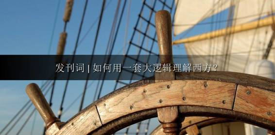

 

你好，我是李筠，真诚地欢迎你加入《西方史纲 50 讲》。

一听这名字，你可能想问，这门课到底讲什么的？是不是西方历史课？

## 什么是“西方”

对于西方历史，你应该也不陌生，特别是那几个大国，英国、美国、法国、德国，不管是中学历史课还是平常看新闻，你对它们应该都很熟悉。你可能也去过欧洲，去过美国，对它们的文化和生活方式，也都不陌生。

但是我要说，关于西方，可能事情你都知道，但是道理你并不懂。

——比如，你肯定知道古罗马有多辉煌，你应该也知道帝国取代共和国的这段故事。但是你知道吗？第一个埋葬共和的人，并不是你知道的那位大人物——凯撒，而是苏拉。那么，**为什么苏拉后来就被人当成了国贼，而凯撒就成了国父呢？**

——再比如，一说到中世纪，你第一反应可能就是“黑暗的中世纪”。但是，你这个认知大有问题。如果你穿越回一千年前，你会发现中世纪绝不是一团漆黑，它的成就直接引出了现代的西方，而且，**从精神世界的纯粹和纯净来看，中世纪很可能是西方最“光明”的时代。**

——再说到现代，你肯定听过《大宪章》，大概知道它是宪政的原点，但你知道吗？**《大宪章》一开始只不过是贵族和国王争夺权力的一份协议。**那它后来怎么就变成了让每个英国人都享有自由的根本大法，怎么有了今天的地位？

你看，这门课里，我不只是带你破解一下西方历史上的谜团，我要告诉你的是背后的道理，我要带你看到西方是沿着什么样的路径，一步步成长起来的。

你可能注意到了，这门课的名字和体例，都和施展老师的《中国史纲》有点像。没错，这门课就是《中国史纲》的兄弟篇。我和施展老师在十几年前读博士的时候，就已经成了好朋友，后来我们一起加入了“大观”这个学术共同体，这十几年来，可以说我们是一起学习，一起切磋，一起成长，我们共享了很多重要的看法和方法。

如果说，《中国史纲 50 讲》是带你重新理解中国，那么，《西方史纲 50 讲》就是带你重新理解西方。

如果你不了解西方，你就难以理解今天的世界，甚至也无法真正理解今天的中国。

过去的 100 多年，中国和西方，一直不断在相互影响、相互融合、相互构造。在中国已经成为世界大国的今天，只有重新理解西方，你才能获得完整看世界的眼光，建立起真正的全球视野，也只有这样，你才能真正理解中国。

## 什么是“史纲”

说到这，我有必要跟你再聊聊“史纲”。

我为什么要用“史纲体”带你看西方？说起来，这也是我和施展老师，和“大观”小组的共同研究方法。

史纲可不是纯粹的简明史，带你浮皮潦草地看个热闹。它是用简明的框架和逻辑，抓住历史演进当中重要的节点，讲一套完整的“大逻辑”，历史是药引子，大逻辑才是真见识。

可以说，“史”是素材，“纲”是逻辑。以史为素材，最终，我要带你看到的是一套西方的大逻辑。

所以，我不是泛泛地跟你聊柏拉图的哲学、凯撒的帝国、耶稣的宗教、达·芬奇的《蒙娜丽莎》、伽利略的物理学、莫扎特的交响曲，或者法式大餐、帝国大厦、汽车飞机原子弹……

我不是把西方的文明成就当作文化口红，让你出门前擦上一点，不是要满足你的虚荣心，把它仅仅当作饭后的谈资。

你脑中这些散点式的印象，根本无助于你真正理解西方。只有抓住最关键的大逻辑，你才能把握历史的演化路径。

**在这门课里，我已经帮你找到了一套完整的“大逻辑”：我把它叫做“文明的两纵三横”。**所谓“两纵”，是文明与野蛮、古代与现代，两个大尺度；而“三横”，是生存的意志和智慧、权力的生成和流转、文明的融合和冲突，三条大线索。

在这套大逻辑里，我找到了 50 个最关键的历史节点，把古希腊、古罗马、中世纪和现代的西方一路怎么走来，跟你说清楚。所以，我这门课给你呈现的是一部充满历史临场感的电影。

这门课里，我会试着用音频和文字，带你进入西方的成长隧道。我会带你站在上帝视角俯瞰西方，给你一张清晰完整的西方世界的版图，让你感受到跌宕起伏的文明演进、领会到入木三分的文明逻辑。

只有用文明的逻辑去看历史，你才能真正把握住规律，看到未来。

## 欢迎你的加入

最后，再介绍一下我自己，我叫李筠，是中国政法大学副教授，我在中国政法大学学习了十年，然后留校任教，又当了十年的老师，给研究生讲《西方政治传统和政治现代化》，给本科生讲《政治学原理》和《西方政治思想史》。

两年前，我的学生就开始问我，老师，你什么时候能去得到开课，现在，我们这个共同的心愿终于实现了。

我很珍视自己这个新身份——得到《西方史纲 50 讲》的主理人，我希望能成为你在知识世界里的另一位领路人，希望我的所学和我看问题的方法，能够让你感受到学习的乐趣，让你在不同学科之间、在更大的知识版图上自由航行。

欢迎你加入《西方史纲》！

让我们一起穿越 3000 年、探访 50 个里程碑，用 500 分钟来领略文明的壮丽，你一定会感叹不虚此行。

课程将于 2018 年 8 月 13 日开始，每天 0 点更新！

以下为《西方史纲 50 讲》课程大纲：

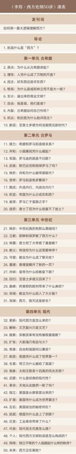

精选留言

点击直接进入下一章节

**林飞扬**:  
强烈推荐小伙伴们打磨 9 个月之久的《西方史纲 50 讲》，感觉李筠老师不是政治学者，而是一位超牛的导演。  
从你听到开场音开始，你就能感受到这是一部史诗级的西方历史大电影，而且临场感、画面感十足——  
既有 3000 年的历史俯瞰，文明的演进，历史的大势，呼啸而过；  
老师又擅长把文字和讲述当作镜头，有镜头的推进，还原足够多的历史袭击；  
亦有镜头的平移，串联看似孤立的节点，勾勒出历史背后的“大逻辑”；  
还有全程的“跟拍”，仿佛你就身处历史现场，在雅典城邦参加公民大会，站在大航海商船的甲板感受那个时代的跌宕……

**苏格拉磊**:  
人的一生，本质上是一段时间，而一群人的一生，本质上是一段历史。  
  
西方文明的历史则是群星璀璨的历史。就像两个罗马帝国，是西方文明不可磨灭的一笔，既有把地中海作为内海的罗马帝国，也有被伏尔泰说既不神圣，也不罗马，更非帝国的神圣罗马帝国。而且他们和远在东方的中国，有着千丝万缕的联系。  
  
但太多的历史，太多的人物有着千丝万缕的联系，同时让我有些不知所措，只能站在西方文明的大门前惊叹，而李筠老师现在出现了。带着我以及所有知识的探索者们，轻轻的推开这座神秘的大门，开始了重新理解西方的旅程。

**Allelujah**:  
作为一个理科生，在得到上学习得越久，就越发现自己对于人文科学的认识有着极大的空缺——特别是中学里一带而过的西方历史。  
  
终于有机会在这里补上自己的认知盲区、对西方文明有一个相对完整、系统的了解了😁感谢老师与得到团队、欢迎老师入驻得到！

**佛祖门徒**:  
有幸在隔壁的名家大课聆听过李筠老师讲马基雅维利的《君主论》，从此就一直期待老师在得到的新课，今天终于如愿以偿，期待在老师的带领下了解真正的西方！

**成洁 getit**:  
欢迎李老师，我们已经在刘苏里老师的名家大课听过您讲《君主论》了，很开心能进一步学习！  
在小时候从童话故事里听到的西方好像跟我所处的世界很不一样，从课本上学习到的西方又好像有些高高在上，上了大学以后在图书馆看到一排排冠以“西方”开头的大部头论著又多少有些畏惧，鼓足勇气看了之后总有种隔岸之感。等我真正的开始运用自己的知识思考中国和西方之间关系时，我有很多的疑问。比如，西方到底是什么样的？在几千年里，中国和西方是相对隔绝的还是交互影响的？现代化就是西方主导的，中国的现代化就是西化吗？  
我在施展老师的《中国史纲 50 讲》中，学习到了用四个时间坐标点，商周、周秦、唐宋、古今；和五个时间坐标点：中原、草原、海洋、西域和高原来观察中国的历史和未来，期待在接下来的 50 讲，用两纵三横的框架来学习与中国不可分割的西方。

**作者回复**:“两纵三横”的框架周末和你分享！

**巴吉纳**:  
第一时间订阅，不仅仅是信任「得到」、施展老师和“大观”学会，更是听到了发刊词老师的一个强调——逻辑。  
的确，不懂底层逻辑，看问题就雾里看花，解决问题就扬汤止沸。比如，我们经常看到各种评论文章，大到阐述“中美贸易战”、国家去杠杆，小到英国哈里王子大婚、心理感情问题。对比「得到」系的文章，公众号文章有一种说不出的浅薄，不是作者不善于组织结构、不善于表达，也不是他们没有认真思考，究其原因是不懂现象背后深刻的逻辑。  
特别是，我对西方文明更不了解，不要说发表观点，连做出理性判断都很难。所以，我立刻订阅了，谢谢老师的辛勤付出！

**一杯白开水**:  
从最早在刘苏里老师的专栏读到老师讲的《君主论》，短短一周就学到了思想的脉络。后来又在施展老师那儿获得了前所未有的看待中国式的方法，如获至宝。今天老师在这里开讲西方史纲，和之前两位老师的学问相辅相成，希望能在这里学到更先进的看待世界文明的视角。

**Wyman 刘伟文**:  
期待本课程和施展老师的中国史纲 50 讲互通互联，在我的脑海里构建一个更大更完整的世界版图。  
从上午等到现在，是前一百名订购，真的是第一时间订购了，迫不及待的上车，等着老师拨开迷雾，一起穿越西方的 3000 年了。

**nature 追风者**:  
在刚刚结束的《刘苏里.名家大课》的“阿奎那著作选”的十佳笔记里，李老师针对每一个板块的精彩解读都让学生茅塞顿开，正好也是因为学“大课”让我对西方世界的发展产生了浓厚的兴趣，所以果断地“路转粉”订阅了李老师的《西方史纲》，感谢老师的分享，学生一定会好好珍惜这个机会，认真学习老师的思想精髓的。

**作者回复**:欢迎欢迎，一起学习！

**Davy🌞**:  
可能并不是每一个人都可以做成这样的大人物，但是我希望大家从设计师和领航者这样的角色当中，也就是从我们历史训练出来这些教义当中去试着改变自己的生活，改变更多人的生活，让这个世界变得更美好。我们实际上是可以的，历史、思想、教义，这些脑子里面的东西，通过格局、判断、审慎，就可以变成现实中的力量。👍👍

**作者回复**:谢谢哈，对你们有启发是我这门课最重要的目的。直播的内容很多同学都有感触，要求变成文字稿加餐，得到的同仁正在赶制，跟更多的同学分享。

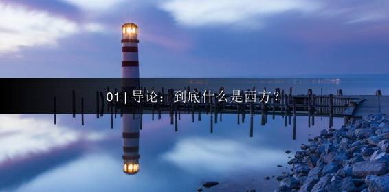

 

你好，欢迎来到《西方史纲 50 讲》，我是李筠。

今天我想跟你聊聊到底什么是西方。

## 西方在哪里？

说到西方，你可能觉得很熟悉。你日常生活中处处都有西方的影子，比如你可能经常看美剧英剧，好莱坞大片，用的是苹果、安卓手机，穿的是 T-shirt、牛仔，吃的喝的是汉堡、可乐。西方在你的日常生活中，已经无处不在了，甚至都已经日用而不自知了。

但另外一方面，你对西方感到很陌生。比如，我先来问你几个问题。

首先，西方到底在哪里？你可能会说，很简单啊，西方就是欧洲啊美国啊这些国家和地区。你说的有道理，从自然地理上看，美国是西方国家。但问题接着就来了，**从地理位置上看，日本明明在东方，那为什么日本通常被当作西方国家？**

你可能还会说，我们应该从文化传统上来区分，美国、英国、法国、德国是西方国家。那问题又来了，**俄罗斯的文化传统也和这几个国家有很多相似之处，那为什么俄罗斯不是西方国家？**

还有，**位于俄国和英法德之间的那些东欧、南欧国家，它们是西方国家吗？到底哪些是、哪些不是？**

我再接着追问，这些国家是与不是西方的标准又是什么？如果从历史上算，哪里是西方的源头？是古希腊吗？为什么是古希腊呢？西方到底凭什么是西方？

你看，很多问题都经不起深究，连着问三个问题，你可能就觉得自己吃不准了。这门课，就是要带你看看西方的门道，让你再说起西方的时候不只是跟大家一起凑个热闹，增加个谈资而已。

## 西方独特的成长路径

什么是西方？

**西方是一个文明，我们必须站在文明的高度来看西方。**这是我带你理解西方的这套大逻辑的起点，用文明的高度来定位。

那我首先就得带你去抓住西方文明的核心特征。著名学者亨廷顿总结前人研究，列出了西方文明的八大特征，我念给你听听：**1\. 古典遗产，也就是古希腊罗马文化，2. 天主教和新教，3. 欧洲语言，4. 精神权威与世俗权威的分离，5. 法治，6. 社会多元主义，7. 代议制，8. 个人主义。**

有了这八条特征，你大概就可以从文明的高度辨别出西方的面貌了。不过，你可能不知道，这八条里面，只有第八条个人主义严格来说是属于现代的，其他好几条在古代西方就已经成熟了。也就是说，西方在现代以前就已经是西方，就已经有了自己独特的基因和成长逻辑。

而且，我负责任地告诉你，西方从古代走向现代，也痛苦得很，在很多地方也不比中国轻松。比如后面的课程里，我会专门花时间跟你讲宗教改革，它是现代化的关键步骤，宗教改革引起了残酷的宗教战争，打掉了西欧三分之一的人口，这么高昂的代价，用“惨痛”二字都不足以形容。

这时候你就知道了，记住了西方文明的八大核心特征，也不见得就能说清楚什么是西方，因为它们只是静态的标准，用它们来理解西方，当然比美剧英剧、汉堡可乐的角度深入了不少，不过还远远不够。

**看西方必须动态地看，从动态中找到结构的生成和演化，才算真正看出文明的门道。**这门课要带你去看西方到底是怎么成长起来的，当然包括了八大特征的出现，但更重要的是，它们为什么会出现，怎么出现的，出现了之后有什么后果，它们怎么样结合到了一起。

一句话，这门课要带你用文明的高度去看西方独特的成长路径，里面会有成长的欣喜，也会有成长的烦恼。沿着这条独一无二的成长路径成长起来的，就是西方；偏离了这条成长路径的，就不是西方。

按照这种文明的成长和演化的思路去理解，西方就不是自然地理概念，也不是任何你印象里的标签，而是从特定的基因中，沿着自己的成长逻辑长出来的文明，只有理解她的成长逻辑才能抓住她的实质。

在这门课里，我就会按照这种思路，带你理解究竟“什么是西方”。

## 为什么要看西方？

刚才简单说了说到底什么是西方，你可能还会想问，我为什么要理解西方，有这么重要吗？

我必须要说，理解西方对于现在的中国非常重要。但这绝不是因为你每天都要用到西方的产品，而是因为你不了解西方，你就很难理解中国，很难理解自己。

比起“西方在哪里”，我们更应该问的其实是：西方是谁！而这个问题的答案就是，西方，是中国理解自己最重要的他者。

他者，你我他的他，学者的者，意思就是“别人”。你小时候，你妈会对你说，别人家小强这次又拿了一百分。你看，人总是被拿来比较，比较就必须有一个他者。

人最容易在比较当中知道自己的长短，文明也是一样。所以，无论你喜欢还是讨厌西方，在当今世界上，它就是那个最重要的他者，那个最经常拿来和中国比的别人。**和西方的比较当中，中国得到了最多的、最重要的关于自己的判断。**

讲到这里还不够，因为“他者”并不是个死人，并不仅仅是一个判断的标准。他者就是我们自身的一部分：它不只是让你在比较中认识自己，它还会让你不知不觉地按照它的样子塑造自己。

塑造自己，你听到这里可能又要问了，我们看西方的目的就是为了学习西方吗？我要说，你说对了一部分，但不全对。

清末睁眼看世界的第一人魏源讲得很明白：师夷长技以制夷。“夷”这个字带有明显的贬义，却还要去学，学了不是更像夷了吗？所以后来张之洞讲“中学为体、西学为用”，就是怕中国学着学着就学坏了。

可是，越往深处学，原来的是非对错就越不那么理所当然，什么是学坏，就越难判断了。学久了，就变得像他了，连自己都不知道。

这个时候，你就知道自己为什么分不清生活当中到底哪些东西是西方的了。中国已经向西方学习了至少一百七十年，尤其近四十年来，学得更快，西方已经从纯粹的外部、外国、外在，甚至在某种程度上，变成了中国内部、内心、内在的组成部分。

反过来说也成立，经过四十年密切的交往，中国也已经变成了西方的一部分。中国和西方已经是你中有我、我中有你。

往前看，西方在塑造着未来的中国，中国同样也在塑造着未来的西方。

## 怎么看西方？

现在，你知道我们为什么必须要看西方了，那就得接着问，我们应该怎么看？

我这门课想跟你分享的是，站在中国重新理解西方。这意味着，我要带你怀揣着中国理解西方，要带你思考中西两大文明的冲突和融合。

但是必须先得说明，我说站在中国，并不是说物理意义上我这个人必须身处中国。照这个标准，一个美国人跑到中国来写一本关于西方的书，也可以叫做站在中国看西方。

还有一种常见的看西方的视角是，用中国的标准来看。比如有人说，西方的分权制衡没什么稀奇，我们的《尚书》说的就是这个事情，比英国的《大宪章》早了两千年，甚至把西方的东西看成中国古代原理的实现。

这里有一个关键的区分：中西之别和古今之变是两回事，不要把它们混为一谈。

“中”，并不一定就是古，“西”，也并不一定就是今。我们今天的很多错误、混乱、纠结，都是因为把古今中西搅成一锅粥，用中国古代的事情跟西方现代的事情比，这么比就好像说人家有足球，我们有蹴鞠，这么比就没有意义。

这种视角的错误在于，它把文化看成静态的、僵死的、纯粹的东西。如果你听过施展老师的《中国史纲 50 讲》，相信你会对中国的这种“多元互构性”有一定的理解。现在的中国，比古时候的文化成分要复杂得多。

复杂的中国和复杂的西方，都必须以“文明”为单位，只有站在“文明”的高度，才能看清楚，用“文化”看是远远不够的。

现在的中国，正在经历着剧烈的古今之变，也在经历着深刻的中西融汇。现在的中国，已经是 GDP 全世界第二的大国，已经是贸易量占全球比重超过八分之一的大国，已经是半年出入境超过 3 亿人次的大国，已经是开始思考“人类命运共同体”的大国，已经是世界的中国。

这样的中国应该怎么看西方呢？怎么看近 200 年来中国最重要的他者呢？

我的回答是，向前看。什么是向前看？那就是，顺着文明大势的发展方向去看。当然，文明的大势并不那么容易把握。

看清大势必须依靠历史，施展老师讲得很对，历史学才是真正的未来学。看历史上大势的起落，会让你变得明智，拥有一种清明的理智，把握大势的变化，去面对中国、面对西方、面对未来。

这种清明的理智来自哪里呢？答案是，来自对人性的深刻洞察，来自对人应对变化的深刻领悟，来自对各种应对方案优劣利弊的深刻思索。抓住了人性，抓住了人想出来的办法，就抓住了一切变化的根本。

**所谓“站在中国重新理解西方”，就是站在已经融合了西方的中国，承认文明的大势是中西的交流与融合**。面相未来，去理解西方，不仅从里面理解西方，也从里面理解中国自己。

在这门课里面，我会带你分四个阶段去看西方，古希腊、古罗马、中世纪和现代，每个阶段有自己独特的逻辑，一路走来，真是跌宕起伏、波澜壮阔。我用两纵三横的框架带你穿透西方的三千年历史，**所谓两纵是文明与野蛮、古代与现代，三横是生存的意志和智慧、权力的生成和流转、文明的融合和冲突。**

你熟悉的和不熟悉的那些西方故事，都被我编织到这个框架当中，加起来，你会得到一幅完整的画卷，真正理解我们前面说的西方的成长逻辑。

而在后面的课程过程里，你会慢慢领悟到我的这个两纵三横的框架。我也会专门挑个周末的时间，给你谈谈两纵三横的框架，具体是什么，我是如何设计的。

下一讲，我们就进入到具体的讲述过程了，我要先带你看看西方的源头——古希腊。

期待你的到来，咱们下一讲再见！

后续内容

精选留言

点击直接进入下一章节

**牛子牛**

李筠老师的《西方史纲 50 讲》终于上线了。  
   
学习历史对我来说，最大的用处在于培养一种心态，我称之为“健康的相对主义”。尤其是西方史纲这门课程这样，在文明史的尺度上写的历史，就更是如此。  
   
英国史学家科林伍德造过一个概念，叫作史学上的“实质主义（substantialism）”，我个人喜欢把它俗称作“评书史观”。我们听评书，经常听到有人管商周的天子叫皇上，武王伐纣要鸣炮三声，就是这种史观的毛病。  
   
它以为，历史就是人物和故事在变化，但是经常遗忘更长线的物质基础、制度结构、观念背景的变化，是这些“城头变幻大王旗”背后的主动轮。打个比方，它以为历史好比一台戏，演员在变，但是舞台不动。直到今天，我们理解历史的时候，还是会自觉不自觉的犯这种毛病。  
   
实际上，舞台、布景、剧本、乃至写剧本的语言本身的变化，才是历史最神奇、最波澜壮阔、也最不可思议的部分。看多了这些变化，你也就知道，你今天的荣耀也好、焦虑也好，在不远的过去和不远的未来，不仅算不得什么，而且很可能根本就没有意义，因为文明的游戏规则，早就换了一套语法了。  
   
有了这种心态，那么你的肉身或许不能挣脱时代的束缚，但是你的精神会觉得，当代的境况绝非天经地义，也不是不可改变，而且改变的深度和广度，总是会在当代最大胆的预测之外，这一点屡试不爽。  
   
你会发现，历史不是个时间概念，而是个空间概念。它不是一个一成不变的线性叙事，而是充满着地层的堆积和崩塌。大地上的生物匆匆来去，但是大地本身在沉默地沧海桑田。  
   
喜欢独善其身的，学习历史获得解放；喜欢兼济天下的，学习历史驾驭大势。  
   
李筠老师的这门课，你不学一下吗？  

**Adam**:  
作为一个英国人我一直期待这个课程上线，听'他者'讲自己的历史很有价值。

**豆尖儿**:  
8 年前在研究生院聆听您讲中外政治学名著选读（线下课程），现在第一时间来收听您的线上课！

**作者回复**:欢迎老朋友，也欢迎新朋友！

**Allelujah**:  
看到过一位得到学友分享自己的思考，说他发现好像每个学科内、对自己学科有深入研究和理解的老师，都会逐渐产生研究学科发展历史的兴趣。他推断这可能是因为只有对学科由始至终的发展有了更成体系的理解，才能够完整理解学科自身的逻辑，以及它会去往的方向。  
  
施展老师开始研究历史的发心，也是为了回答内心产生的“中国的未来将去向何方”的疑问。  
  
相信通过学习西方史纲的课程，我也能对西方文明的发展和逻辑、世界格局的演变和现状、以及中国的未来有更成体系的理解，激发自己产生更多的疑问和思考。  
  
再一次感谢老师和得到团队的付出！

**忍龙**:  
历史学才是真正的未来学，内心对历史的热爱让我第一时间订阅。一听下来，果然不负所望。老师讲的深入浅出，把我以前关于西方的碎片串成了一个体系。

**建筑师**:  
首先要感谢“得到”，罗老师推荐施老师，然后又通过施老师认识李老师，成为三位老师的粉丝。我是一名建筑师，通过学习“中国史纲”和“西方史纲”，中西方脉络的形成演变和研讨等，让我对中西方建筑史有了更深刻的梳理，逻辑关系更加清晰。  
一方水土养一方人，不同的语言表达不同的想法，不同的建筑承载不同的文化。有在许多方面和较为明显的施工审美差异，东方和西方之间的差异。不同的文化，宗教，不同的建筑风格，不同的建筑发展，社会形态和所带来的审美差异建材文化氛围的不同想法。

**杨浩**:  
李老师：听完施展老师的课，又听你的课突然有个感觉，目前世界上好像只有中、西两个文明。只有中、西才是世界的文化主流，对世界输出秩序、文化、产品，主导世界的发展。

**作者回复**:文明当然除了中西还有很多，比如俄罗斯、伊斯兰等等，有同仁已经在准备相应的课程，相信我们合力能够打造出完整的知识世界地图。

**Li Xia**:  
以前只是模糊的感到，某些新闻中说西方现代很多的发现，中国古代经书其实早就知道了，这种牵强附会的对比没有意义。今天李老师讲中西之别和古今之变是两回事，一下子厘清了这种说法的根本错误，在于混淆了中西之别和古今之变。

**Tingo**:  
听到老师不断深入地向我提问关于西方的几个问题时，自己的答案真是越来越模糊，也意识到自己在这方面的认知思维的缺乏。  
  
现在第一时间订阅李筠老师《西方史纲》，坐前排摆好姿势认认真真听课，跟着老师学习，非常满足，很有获得感。  
  
在得到跟着大师学习，不但没有满足我的求知欲，反而求知欲更强了。专栏课程阅读下来，真是如沐春风，真是爽快哈哈哈

**悟慧**:  
什么是西方？  
它不是泛指一些地域，也不是一种文化，而是符合西方特质的一种文明衍化过程中塑造的一批国家。  
为什么要看西方？  
西方是中国用以比对的最重要的他者，以人为镜，以史为镜，知得失，明长短，取长补短，学以致用。  
两种文明在漫长的岁月中互相影响互相塑造，才造就了今天的世界。  
如何去看西方？  
动态的去看，而不是静态的比对，参照。 中西之别，古今之变不可迷乱混淆。  
现在文明的高度重新理解西方，理解中国，把握人性的本质，相信文明的未来是中西的结合。  
历史学才是真正意义上的未来学！

**蔡文莲**:  
在名家大课的‘君主论’第一次听李筠老师讲课。名师指路是学习的正确打开方式。喜欢历史的同学看过来。

**Albert**:  
一直对西方历史感觉模糊，都是从不同时代的一些事件得出一个模糊印象，李老师这篇导论一下子把我从模糊中拉出来，拉到一个高纬度，两纵三横的高屋建瓴视觉去看西方历史文明，厘清了一些我认知上的谬误：“中西之别”与“古今之别”是不同的，要分开讨论。期待之后的课程

**田然**:  
施展老师开篇问“什么是中国”；李筠老师开篇问“什么是西方”。  
两个问题似乎很简单，但一深究，都会发现一点也不简单。  
读清楚开篇的问题，明白整门课谈论的“西方”到底是什么，这门课的学习才“事半功倍”

**作者回复**:对，带着“什么是西方”这个大问题，我们一起去探寻。

**王晓兵**:  
在决定是不是要学这门课的时候，最大的纠结就是害怕课程五十讲却不讲什么是西方，它对中国意味着什么。其实市面上常见的西方哲学通俗读物，中西对比的通俗读物，最缺少的就是这个，通俗，不应该是肤浅的意思。幸运的是买了这门课程，第一讲的问题就见功力有深度。充满了期待。

# 第一单元  
古希腊：城邦的时代

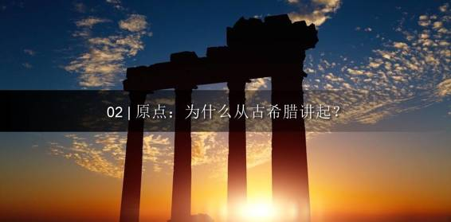

 

你好，欢迎来到《西方史纲 50 讲》，我是李筠。

提起西方，你一定会追溯到古希腊。说“古希腊是西方文明的源头”，可能你会说，这谁不知道啊。

但是，你知道吗？在地中海世界，古希腊文明并不算很古老，还有好几个比古希腊更早的文明，比如古埃及、美索不达米亚、巴比伦。而且，古希腊文明内部，也分为米诺斯文明、迈锡尼文明和古典文明三个阶段。

我们今天的人谈起古希腊的文明成果，比如哲学、雕塑、科学、艺术，让你觉得古希腊的时间跨度应该很长。

但实际上，古希腊文明真正辉煌的时期，也就是古典希腊时期，其实就是公元前 600 年到公元前 300 年这么一小段时间，只有短短的 300 年。

那我们就必须要问了，为什么并不古老，时间也很短暂的古希腊文明，成为了西方文明的源头呢？

## “异类”古希腊

我可以先用一句话简单回答一下这个问题，因为古希腊文明在古代文明中完全是一个异类，它开创了一个完全不同于其他文明的世界观。也就是说，古希腊人对世界的理解，和其他文明的人从根本上就不一样。

你肯定知道，现代西方是一个以人为中心的世界，而这个特征正是从古希腊沿袭过来的。换句话说，从古希腊古罗马，经过中世纪，再到现代，西方兜了一个大圈子，又回到了以人为中心的世界。

从现代西方的形成来看，以人为中心的古希腊，等于为后世的西方提供了一个模板。文艺复兴时候的但丁、彼得拉克、达·芬奇、米开朗基罗都是这样，他们的理想就是要带西方，离开中世纪那种以神为中心的世界，走进以人为中心的新世界。

说到这，你就能理解，为什么西方人把自己的源头追溯到古希腊。因为在最深层次的结构上，古希腊和现代西方的底层结构具有高度的相似性。

刚才我们说了，古希腊文明只有短短的 300 年。300 年就成了西方文明的源头，那它必定是灿烂无比。但是，这么辉煌的文明，为什么没有长存下去呢？这是我们理解古希腊的要害。

在这个单元，我会和你分享我对这个问题的思考，剖析古希腊文明辉煌却短命的原因。你可以先对古希腊有一个大概的印象，就是：灿烂的古希腊，其实不是一颗永远高悬在夜空中的恒星，而是一颗把夜空全部照亮的流星。

在这个单元，我先带你来看看古希腊灿烂的原因，也就是古希腊文明的精神内核到底是什么。然后我再带你看，为什么这么灿烂的文明只是一颗划过夜空的流星，很快就覆灭了。

## 古希腊的人文特质

古典希腊之所以灿烂夺目，是因为它赋予了西方文明的文化基因，也就是人文、理性和民主，这三大基因也是西方和其它文明区别开来的重要标志。

今天我们谈起人文、理性和民主，似乎是世界各大文明的共识。但是，如果你把视线穿越到 2500 年前的世界，你就会发现，孕育出人文、理性和民主的古希腊，完全就是一朵奇葩。

为什么这么说呢？来看看它的人文特质就知道了。在这三大基因中，人文是最重要、最根本的基因。古希腊的人文特质展示了人的能力、价值和精神，所以罗马人才会惊叹地说“是希腊人创造了人！”

古希腊的人文特质，是针对其它古老文明而言的，也就是说，希腊人对世界的理解，和别的文明都不一样。**在其他文明都在追求宗教带来的那种神秘性的时候，古希腊文明却追求人的价值。**古希腊文明里面的人地位很高，人没有匍匐在神的脚下，人是自信的、乐观的，是自己的主人。

## 高度的世俗精神

我一说人文精神，你可能觉得这是非常风雅的事情，就像古希腊给你的感觉一样。**但问题的关键不在于是不是风雅，而是宗教有没有统摄社会。**

古希腊的人文特质，最大的特点就是高度的世俗主义。古希腊的世俗精神，表示它不是由宗教主导的，宗教没有支配和渗透到社会生活的方方面面。**古希腊人理解世界、解释事物的规律和行为，用的不是宗教的那套神秘主义的东西，而是习惯用宗教之外的道理来理解世界。**

我们可以把古希腊和古埃及、中国古代作一个对比。古埃及雄伟的金字塔是法老的陵墓，在古埃及人的观念里，法老是神不是人，金字塔是神庙，是神殿，法老对古埃及人的统治，是神对人的统治。

我们中国古代也是这样，中国最古老的文字是甲骨文，甲骨文记录的几乎都是占卜的内容，是商朝的君王向上天祈求或者询问，比如祈求下雨来解除干旱，询问打仗是不是吉利、会不会赢，其实所有商朝的人都像商王一样很迷信，都自然而然地认为整个世界、所有事情都是神灵支配的。

而在古希腊人的日常生活中，宗教只是生活中的一部分，甚至是不那么起眼。神庙只是神来暂时住几天的地方，不是人的宗教集会的固定场所。古希腊也没有其他古老文明里面那种专职的祭司群体，古希腊的政治权力，也不是神权统治。

## 高度的理性主义

正因为生活不受神灵支配，这就带来了古希腊人文特质的另外一个特点，高度的理性主义。

理性主义是一种思维方式，它和神秘主义相对。古希腊不用神灵解释世界，他们认为万事万物背后是有原因和规律的，而且这些原因和规律是可以被人的理性所把握。**古希腊之所以能发展出高度发达的哲学和科学，就是因为古希腊有理性主义精神。**

相反，其他古老文明都以神秘主义为基调。神主宰的世界是神秘莫测的，人没有能力，甚至没有资格去理解万事万物背后的原因，也没有什么规律可言，因为一切都取决于神的意志。比如，苏美尔人、埃及人、巴比伦人、希伯来人都是通过专职的祭司来和神沟通，神是神秘莫测的，祭司也是如此。人们对神和祭司只能服从，不能自己思考。

而古希腊人努力地通过自己的理性去认识世界，认识自己，他们挣脱了神秘主义的思维方式，去发现规律和法则。

## 人的崇高地位

当人有了理性的精神，能够自主地去认识这个世界，人的地位肯定也跟别的文明不一样。**古希腊的人拥有崇高的尊严和价值，这也是古希腊人文特质的第三个特点。**

我们来看看古希腊的神是什么样，你就知道了人和神的地位了。古希腊的神不像其他文明的神那样高高在上，而且也不那么神秘，甚至性格和凡人差不多，连凡人的缺点都一应俱全。

比如你耳熟能详的特洛伊战争的故事。特洛伊战争是为了抢海伦这位绝世美女，一大堆英雄抢美女，你知道背后是谁在捣鬼吗？是四位女神！

有一位女神叫不和女神厄里斯，她扔出一枚金苹果，上面写了“给最美的女神”，结果天后赫拉、智慧女神雅典娜、爱与美女神阿芙罗狄忒（也就是维纳斯）都想要这个苹果，主神宙斯就让她们去找特洛伊王子评判，结果王子判给了维纳斯，作为回报，维纳斯就帮王子把希腊一个国王的妻子，也就是天下第一美人海伦绑架去了特洛伊。

于是希腊联盟就向特洛伊开战。你看，这里面的这些个神，小气、嫉妒、臭美、推卸责任、坑蒙拐骗，哪里有什么神圣和庄严，和凡人几乎一模一样。后来，这些女神还参与到特洛伊战争当中，她们与人结盟，与人沟通，与人之间的界限一点都不分明。

而特洛伊战争中的人，阿伽门农、阿喀琉斯这些大英雄，追求自由和尊严、英勇善战、武功超群、智慧非凡，简直就跟神差不多，他们的行动不仅不受神的支配，而且还会直接影响神的行动、神的决定。

人的地位跟神差不多，人和神一样是这个世界的玩家。在其他古代文明的神话当中，人根本没有资格和神这么玩。

古希腊的神和宗教不那么高高在上，没有和人之间划出森严的壁垒，给人留下了广阔的空间，人就去大胆地追求自由、尊严、崇高、美。人从神的世界中挣脱出来，不再是神的附属品，人才成其为人。

## 观察文明的基本框架

人文是古希腊文明的首要特性。我们在理解古希腊的时候，无论是把它和同时代的其它古老文明对比，还是把它和后来的西方文明纵向地连接在一起，都要记住它的人文特性。

那这里我们就要问了，**为什么古希腊能区别其他文明，孕育出这么浓厚的人文气质呢？**我在这里跟你分享三个可能的原因：

**第一是外部环境。**希腊人面对的外部环境不那么严酷，不太需要强大的精神权威来塑造社会凝聚力。

**第二是现实政治。一个文明的精神世界，往往和它现实的政治世界存在着某种对应性。**古希腊的精神世界和现实政治世界一样，都是相对扁平的、多元的、包容的，精神的和现实的这两个世界之间，具有高度的同构性。

**第三个原因是理性飞跃**。比古希腊更早的上古世界，它们的理性力量汇集到了希腊人那里，产生了质变的飞跃。

古希腊的人文气质为西方定下了一个重要的基调，也就是人占据了异常突出的地位。在这里，我教你一个观察文明的框架结构，就是：人和神还有物之间的关系。

古希腊的人很独立，神没有对人形成绝对的统摄，也就是说，神不是人的绝对标准，人不是只能按照神的规矩来生活。而物呢，也有自己的规律，神也不能为所欲为，人要认识物、利用物，把它变成人的世界的一部分。

对比一下其他古老文明和后来的基督教，都是神占据了世界的中心，人是神的附属品，只能按照神的命令生活，物也是神的创造。

这时候你就知道了，古希腊的人文气质意味着它和其它古老文明相比，确实是一个异类。而这个异类接下去要走的路，必然很曲折。

本讲小结

好，我来总结一下这一讲的内容。

古希腊，确切地说是古典希腊，是西方文明真正的源头。古希腊的人文特质，体现在它的世俗主义、理性主义和人的崇高地位。人文特质使古希腊对比其他古老文明显得非常另类，这也决定了后来西方的发展道路会走得反复曲折。

人文是古希腊的根本特质，而理性和民主都是人文的展现和发扬。下一讲，我跟你详细说说理性这个话题，期待你的到来，咱们下一讲再见！

精选留言

点击直接进入下一章节

**强 Sean**:  
为什么古希腊能区别其他文明，孕育出什么浓厚的人文气质？  
  
我认为老师提到的「外部环境」非常重要。以前去敦煌旅行的时候，我就在想，为什么会在敦煌这样的地方产生佛教圣地，后来才知道：当商人们踏上这条希望和风险同样巨大的道路时，包含许愿、还愿的信仰变成一种“刚需”，德国哲学家卡西尔说：“风平浪静时人是想不起上帝的，只有在充满风险和不确定的地方，信仰和祈祷才会盛行。”而希腊人面对的外部环境没有那么严酷，因此不太需要强大的精神权威来塑造社会凝聚力。

**作者回复**:很多同学都和你一样在问古希腊人文特质产生的原因，这是历史研究里面的一个大难题，我在这里跟大家分享三个可能的原因。第一，外部环境。希腊人面对的外部环境不那么严酷，不太需要强大的精神权威来主动塑造社会凝聚力。无论是两河流域的苏美尔文明还是尼罗河流域的埃及文明，防止河流泛滥，把河流变成农业灌溉的有利条件，就必须集合大量的人力物力修建水利工程，这时候通过强大的神权把人组织起来。犹太人家破国亡、流离失所，更需要一个精神上的绝对支柱维系民族的统一。这些事情对于希腊人来说都不存在，自然也就不需要那么强大的神权。第二，现实政治。精神世界往往和现实的政治世界存在着某种对应性，如果这个国家很大，等级森严，那么，他们的神灵也是等级制的，主神是高高在上、不可一世、神威莫测的，比如古埃及就是这样。但希腊的政治格局是城邦林立，各个城邦谁也不比谁强多少，和这些神谁也不必谁强多少是吻合的。古希腊为什么会产生如此独特的政治格局，我会专门花时间跟大家分享，这里我们先肯定一点：古希腊的神的世界和现实政治世界一样是相对扁平的、多元的、包容的，两个世界之间具有高度的同构性。相同的同，结构的构，就是说，它们在结构上是相同的。记住“同构性”这个词，以后我们还会频繁地提到它。第三，理性飞跃。上古世界的理性力量汇集到希腊人那里产生了质变的飞跃。古希腊人从比它更古老的古埃及人那里学会了量地学、医学、数学，从古巴比伦人那里学会了天文学，等等。就像《师说》里那句话所说的“圣人无常师”，贤能的人没有固定的老师。所有上古的理性思考汇集到了古希腊人那里，他们有了丰厚的资本去想象一个没有神的世界到底是什么样子的，完成了质的飞跃，用哲学和科学去理性地理解世界。我会在下一讲专门谈这个话题。这些自然的、政治的、思想的条件一起塑造了古希腊独特的人文性格。其实文明的性格和人的性格一样，确实没有办法像数学推理那样说得分毫不差，但仍然是有迹可循的，带着对这些历史痕迹的基本判断去观察一个文明或一个人，不断地印证或者反驳，就能够对他们有更深刻的了解。但就像人的性格一样，文明的性格也有好有坏，这里不是简单地说任何事物都有两面性，而是说人们通常以为是好的文明特质，往往暗含着它毁灭的种子，反过来，坏的文明特质，很可能暗含着新文明的胚胎。我会在这门课里和大家一起寻找这种文明兴衰的奥妙。

**佛祖门徒**:  
这一课让我不禁大呼过瘾，因为老师开释了我长久以来的三个疑问，古希腊文明对于塑造西方文明的意义、古希腊文明的最大价值的内涵、理解西方文明的思考框架。最近学习隔壁傅佩容老师的“西方哲学课”一直在思考如何理解人与神的关系对于西方哲学发展的影响，，看来从古希腊文明切入是一个非常重要的视角。

**夜巡的伦勃朗**:  
想请问老师，既然西方人把古希腊看做自己文明的源头，那怎么对待，或者解释基督教的一神论与古希腊多神论之间的冲突的呢？

**作者回复**:确实有冲突，古希腊和基督教都是西方文明不可移除的文化基因，它们在西方内部也一直在互相渗透、互相交战，有学问家把它们之间这种复杂的关系起了个名字，叫做“雅典 vs.耶路撒冷”。多元相互融合（哪怕是在冲突中融合），也比清一色强，融合与冲突会让文明开出意想不到的富有生命力的道路！

**心飞未来**:  
晚 6:00 准时订阅，晚饭后迫不及待地下楼散步听课，一连听了三讲，果然不负期待，讲得精彩，听得过瘾！难怪施展老师敢讲拿出全部“信用”推荐李荺老师西方史纲 50 讲课程。站立点高，以纲率目，是我听课最突出的感受。用“文明”统串西方史而不是“文化”，这个立意太棒了！李老师将在带我们跃上认知西方世界一个新高度。太值得享有了！

**刚刚好**:  
想起两句话：“一方水土养一方人”，和“人是环境的产物”  
气候、地理环境、周边的邻居等都会影响一个种族的特质，这些特质既不是瞬间形成的，也不是一成不变的，会随着环境的变化以及自身的发展不断变化，渐渐就形成了独特的文化和文明。

**宁**:  
很早就学习完中国史纲，已第一时间订阅西方史纲。中西和壁，了解历史，展望未来。

**Focus**:  
实在难以想象 2000 多年前的古希腊人就能如此理性独立的去看待生活中的各种问题，这是一个新的视角，独立于神和宗教之外，从人本主义开端又回归到人本主义，是不是有那种由“看山是山”向“看山不是山”到“看山还是山”这个过程的演变。非常期待！

**Albert**:  
老师从三个方面解析希腊文明产生的原因的确令人耳目一新，一方水土养一方人，地理气候和位置决定一个地方的人文环境进而影响这个地方的经济和政治以及后来成立的国家的走向。  
  
另外老师说“好文明的特质可能暗含毁灭的种子，坏文明的特质可能暗含新文明的胚胎”。接着这几天罗胖说的来看西方文明的成长脉络真的十分深刻

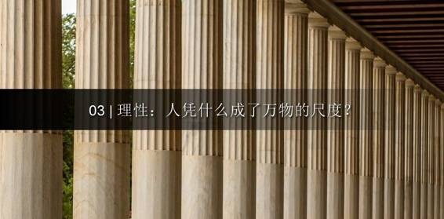

 

你好，欢迎来到《西方史纲 50 讲》，我是李筠。

上一讲我跟你讲，古典希腊才是西方文明真正的源头，**“希腊人创造了人”，宏观上看，是古希腊创造了一个人站在中心的世界。**

这一讲，我跟你分享古希腊留给西方文明的第二个独特的基因：理性。**理性是古希腊的人文特质最重要的体现，也是人文最重要的结果。**人是万物之灵，就是因为人有理性嘛！

理性为什么特别重要？一句话，人之所以站在世界的中心，把整个世界撑起来，就是凭理性的力量。用古希腊哲学家普罗塔哥拉的一句名言来说最合适不过了：人是万物的尺度。

上一讲我也提到过一点，正是因为从人文精神里面带出了理性主义，古希腊才能发展出高度发达的哲学和科学。你要知道，**理性主义不仅在当时世界是一种难得可贵的精神，而且，它构成了后世西方人的基本思考方式。**甚至，在中世纪那个被基督教主导的世界里，你都能看到理性主义，逻辑推理对宗教和神学的深刻影响。

## 什么是“理性”

我们先来看看理性是什么。你可以把理性看成人最重要的内在能力，但我们观察西方，观察文明，必须从思维特质角度把理性看成一种文明的基因，它是一个文明当中的人看问题、想事情的基本套路。

我们在这里采用一个最简单的定义：**理性是人有意识地认识事物、查明事实、展开推理的能力。**

这句话你需要把握三个要点：首先是你得“有意识”，就是积极主动地去认识和理解世界。哲学在希腊文里不是智慧，而是爱智慧，所以，亚里士多德特别看重人的好奇心。

再来是“认识事物、查明事实”，就是去发现表象背后的真实，透过表面看实质。

最后你要“展开推理”，就是要抽象地建立事物之间的联系，不是等着事物变化或者别人告诉，你才知道。而是在事情还没有出现、还没有发生、还没有别人告诉你，就可以知道。当然，这不是巫师卜卦、也不是胡乱瞎猜，而是借助思维规律去证明，这就是逻辑。

## 古希腊思想的三大特点

如果理性成为一个文明的普遍特征，这种文明一定会产生你意料不到的特色。法国历史学家韦尔南，就总结出了古希腊的思想的三个特点：

第一，古希腊形成了一个外在于宗教、与宗教无关的思想领域；

第二，宇宙的秩序不是建立在神的难以捉摸的意志之上，而是建立在规律和法则之上；

第三，这种思想具有明显的几何学性质。

## 外在于宗教

韦尔南说的第一点，外在于宗教这个特点，上一讲我们也讲过一些。而古希腊人运用理性的第一个特点，就是思考世界由什么构成、它从何处来这些根本问题。

**世界万物的起因和结构，如果不归结于神，那应该归结于什么？这就是韦尔南所说的“宗教之外”。**对这些根本问题的讨论，成了古希腊哲学和科学的起源。

古希腊第一个哲学家叫泰勒斯，他说万物的始基是水，就是说万物都是水做的，水是万物的本源。后来有很多哲学家都从始基入手谈这个世界，赫拉克利特认为始基是火，德谟克利特认为是原子，还有人认为是四种，水、火、气、土，等等，说法很多。但所有这些说法都有一种共同特质，那就是一定要在神之外找到解释世界的根本说法。

几乎所有古代文明都把世界的原因归结给神，而古希腊人就偏不，他们把神撇在一边，自己去找一套说法，要用自己的理性去理解世界。

大哲学家康德曾经把 17 世纪的启蒙运动概括成一句话：人，要有勇气运用你自己的理性！用康德的这个思路来看古希腊人，他们就是西方历史上最早地运用自己理性、走出蒙昧、自我启蒙的人！

## 探求规律和法则

古希腊人运用理性的第二个特点，是思考世界按照什么样的规律运转。古希腊人相信在神的意志之外，世界依照着客观的，即使是神也不可改变的规律和法则运行。这就是韦尔南所说的，古希腊人理性的第二个特质，宇宙的秩序建立在规律和法则之上。

理性是人的认识能力，知其一，就可以推其二，但前提必须是世界是有规律和法则的，而不是神秘的、不可捉摸的，否则人就无法把握。所以，探求世界的规则就是透过表象寻找实质，理性这个词就叫做 reason，就是要去一探究竟。

人只要有了意识，就可以把表象和实质分开，但如果人把表象背后的实质只是认定为神的意志，那么表象和实质就很难完全分开。而古希腊人认定表象的背后是规律和法则。不依靠宗教而是依靠理性来认识和理解世界，那么表象背后必然有一套人人都可以理解的规律和法则，而且神也不能改变它们。

**和世界有规律和法则一样，人的认识过程本身也有规律和法则，这就是逻辑。**理性是 reason， reason 做动词的时候，就是推理的意思。想问题要合乎逻辑，才能把问题想对。

逻辑的目标就是找到合理的论证和好的推理的形式结构。最典型的就是三段论。简单来说，逻辑出现了，而且成了一门大学问，这说明古希腊人已经有意识地去锻炼自己理性思考的能力了，这样一来，理性这种能力就处于自我升级的状态当中了。

古希腊的理性成就很高，不仅是哲学的源头，也是科学的源头。如果没有哲学和科学，那么占星术、巫术、算命、测字各种神秘的把戏，就会充斥着人的心灵和整个社会。古代其他文明当然也发现了很多规律和法则，但是把世界就完全想象成是客观规律和法则支配的，就只有古希腊了。

## 几何学性质

韦尔南说的第三点，古希腊思想的“几何学性质”，这个特点很有意思，但不是特别好理解。

你多少也学过一点几何学，但你可能不知道，几何学在古希腊人那里，不仅仅是几个几何定理，几何学几乎代表了古希腊的世界观。也就是说，万事万物都应该是符合几何学的，都具有一种和谐的美感。

比如，黄金分割，当线段的长短符合特定比例的时候，那就是合理的、美的、和谐的，而整个世界也充满了各种比例，所以世界是合理的、美的、和谐的。

古希腊人追求这种几何式的美感，几乎达到了强迫症的程度。比如，柏拉图开学园教徒弟，学园的大门上就写着“不懂几何者请勿入内”，意思是，如果一个人对几何式的美感没有感觉，没有追求，那就搞不了哲学。

再比如，数学家毕达哥拉斯，我们中国人的勾股定理，勾三股四弦五，在西方就叫毕达哥拉斯定理。后来有一个学生问毕达哥拉斯，如果勾不是 3，股不是 4，它们都是 2，那么斜边是多少呢？这个问题引出了数学上的无理数、无限不循环小数，但在当时，引得毕达哥拉斯勃然大怒，因为这个问题挑衅了几何的美感，他立即处死了这个脑洞大开的学生。

我这里讲古希腊思维的几何学性质，不是讲你熟悉的欧几里得《几何原本》，重点是在古希腊人用几何的眼光去理性地看世界。

我们前面讲了，古希腊人不用宗教而是用规律和法则来理解世界，那对人来说世界是什么呢？是要素之间的相互性、对称性、可逆性，把万事万物理解成符合某种比例的状态，所以理性这个词又叫做 ration，它和 ratio，比例这个词非常接近。

古希腊人把这种几何特性，拓展到了社会生活的方方面面，比如亚里士多德讲政治上的平等，就分成了数量的平等和比值的平等。

**万事万物都直接蕴含着相互关联、比例、对称的几何学性质，只有这样，规律和法则才不会是神秘的，才不会被神的意志支配。**这样的世界当然就是合理的、有美感的、整体上的结果是和谐的，而不是混乱的、丑陋的、相互打架的。

古希腊一开始只是在宗教之外设想这个世界是什么样子的，结果越走越远，得到了一个离开了神也很合理、很美、很和谐的世界。

其他古老文明里也有简单的几何学，古希腊和它们的本质差别，不在于几何学这一门学问的发达程度，而在于，只有在古希腊，几何学是世界观，几何学性质渗透了整个世界，其他古老文明里，它只是世界的一个小部分。

## 理性如何贯穿西方三千年

**古希腊的理性给西方带来了一种贯穿几千年的思维特质。**人要通过理性去发现整个世界背后的道理，因此，政治就要讲正义，法律就要讲自然法，经济学就要讲看不见的手，和物理、化学、生物一样，都是人可以理解的、可以讲道理的、可以运用的。

**理性这种强大的思维特质，在后来的西方文明里面甚至悄悄地改造了宗教，这是其他文明里面很少见的。**虽然伊斯兰教和佛教也融入了大量的理性探索，但可能都不及西方的基督教和理性精神结合得紧密。

基督教发展出了自己庞大的神学体系，神学就是用理性的方法来证明信仰，基督教第一个大神学家是奥古斯丁，他的神学就是基督教信仰和古希腊哲学高度融合的产物。中世纪的阿奎那是神学的巅峰，他的神学就是基督教信仰和亚里士多德哲学融会贯通的成果。

**可以说，理性、逻辑、三段论就是构建神学的基础。**这个问题我在第三个单元讲基督教和中世纪的时候和你细聊。

总之，基督教不仅没有让理性消失，相反，它融汇了理性，而且让理性更加成熟。你看，连神占据中心的世界，都被人的理性精神完全渗透了，可想而知，理性这种思维特质在西方有多强大，它穿透了整个西方的三千年。

本讲小结

好，总结一下这一讲的内容，古希腊的理性是很独特的，它独立于宗教之外；它还要讲出一整套合逻辑的道理，也就是规律和法则；最后，它的道理还要合理、有美感、讲和谐，也就是几何学性质。

古希腊的理性精神，成为了西方独特的思维特质，即便在神占据中心地位的中世纪，也能看到理性精神的身影。可以想象，等到人再次成为世界中心的时候，理性精神喷发出来，会产生多少数不清的知识成果。

下一讲，我们来谈谈古希腊为西方文明留下的第三个重要的基因：民主，它贯穿了西方文明三千年，但是它的地位却起伏不定。

期待你的到来，咱们下一讲再见！ 

精选留言

点击直接进入下一章节

**佛祖门徒**:  
古希腊文明发展出了一个外在于宗教、与宗教无关的思想体系，其成果却成为了为基督教奠基的不朽的基石。尤其是老师提出的“理性、逻辑、三段论就是构建神学的基础”这一观点，完全颠覆了以往我对基督教的认识。理性精神对于整个人类文明的重要性不言而喻，我的疑惑是在以神为中心的宗教思想统治西方世界的漫长岁月里，理性精神究竟是如何延续下来，直至迸发出更加耀眼的光芒？

**作者回复**:聊中世纪的时候我会通过好几个故事跟你解释这个问题。

**罗光伦\*遵义大视界网**:  
西方文明确实是人类文明的王冠中的钻石，李老师的课含金量高，浓缩了许多知识，强烈建议李老师开出延展阅读书单，便于我们有一个透彻的理解，构筑知识网络体系。

**作者回复**:已经给大家在《每天听本书》里面做了十本重要著作的解读，百本书单也已经向得到提交，会找适当的时候向大家公布。

**Allelujah**:  
与其将古希腊文明看作是「流星」，不如将其比作「文明的火种」——虽然一开始只是闪烁的火苗，似乎随时就会熄灭，一旦乘风而起，就会呈现出燎原之势。  
  
虽然希腊文明的制度与理性看起来和当时的社会水土不服、格格不入，但千年以后，遇到合适的土壤，不仅能起死回生，还能作为整个现代文明的根基，以「科学精神」与「民主政治」两项伟大的创造，带领我们继续前行。

**作者回复**:火种也对，但我还是觉得流星好。因为古希腊文明毕竟是毁掉了。而且，理性的成长，在古罗马、中世纪、现代都和古希腊有不同的结构，不是直接承接，而是曲折复活。后面你知道了亚里士多德被西方遗忘，又重回西方，就更清楚了。

**有点甜**:  
理性诞生于蒙昧混沌中，却又穿透它，给人以剑舞以尺量。  
选择理性，即选择跳出宗教之外，探寻规律，追随几何美感。这是根植于古希腊的文化基因，编码在西方的 DNA 里，或许有变异，但却穿越几千年的时光，在时间的每个节点上熠熠发光。

**Tingo**:  
之前我一直以为神学就是忽悠人，哪有什么理性可言？都是瞎扯搞神秘而已。可通过今天的学习，认识到神学也是有理性一面的，也是有一套合乎它自己体系内的神学逻辑的，否则它就没法通过神学理论体系影响人们生活方式和世界观嘛。  
  
大多数事物你不仔细琢磨、分析研究，是没法真正了解它的。因为事物本身的复杂程度，你往往会低估。同时由于人性的弱点，当你面对一个完全没涉及过的领悟时，极其喜欢用极为简单的语言并根据自身对其的感觉而一带而过，敷衍了事。  
  
这一次老师给我上了深刻的一课。只有当你真正进入到那领悟，你才能有一二分独特的见解。好好学习，做一个理性的复杂人。共勉

**作者回复**:神学的道理和趣味我会专门花时间和你分享！

**南昌卫监赵文杰**:  
理性是怎么从一个以人为主的国家社区不断发展生成的，这个视角非常独特，李老师的讲解不禁让我脑洞大开，原来西方是这样子的西方，有着自己的标志性痕迹。但是，反观中国，我们用了宗教和政治的结合体，思想上就离自我的意识越来越远了，而集体和家族的意识就越来越强了。

**莫婉香**:  
人凭什么成了万物的尺度？凭理性。  
  
如果理性主义是一株富有生机的小苗，那么人文精神就是它扎根的沃土；“爱智慧”的『好奇心』、康得所言的“运用理性”的『勇气』和“几何学世界观”追求比例和谐的『高端审美』这些品质就是滋养它成长的阳光雨露；哲学和科学就是它结出的硕果。  
  
古希腊的思想即理性是外在于宗教的，而它在神之外构造了一个美而和谐的世界之后又回过头来改造了宗教。这就像一个智者或正派不仅成就了自己，还拯救感化了愚者或反派，理性真的很强大！

**蓝叶**:  
在得到订的课太多了，学不过来了，于是得到一上新，我就会有些焦虑，不订不甘心，订了怕学不过来，但西方史纲这门课，不能拒绝，不了解西方历史，连好来坞大片都看不懂。听了二节课，大呼过瘾，有一种知识点连成线，知识线连成网的顿悟感。

**minmin**:  
听这门课，有一种去现场听音乐会的感觉。非常全神贯注并且静静地感受着参与其中的快乐。

**作者回复**:集中精力的能力需要锻炼。当然，我并不要求你一定要通过我的课来锻炼，毕竟听课的环境很复杂、场景很多。找一个适合自己的节奏，适合自己的倍速，调快调慢都可以。不过，最好有时间选一本好书静心读，锻炼自己集中注意力的能力。

**何石**:  
中国史纲，西方史纲、熊逸老师的佛像，生命 50 讲一起在学习，能感觉到知识的独立之美，也有融合之美

**Focus**:  
最近在看欧几里得的《几何原本》，由点到线的定义，到几何的定理推论的推演，不由感叹思维的缜密性。  
我相信这可能是古希腊人骨子里追求美的极致和探索底层逻辑的好奇心，去引导他们相信世间万物的普遍联系与规律。对未知的勇敢探索和对美的追求相辅相成，逐渐让他们形成这种理性思维模式的基因。勇于探索未知，尝试解释各种不确定性和普遍规律。

**夏宝辉**:  
李老师好！  
今日得到：理性既是人文的表现，又是人文的结果。由于世界不是神造的，而是由物质组成的，因此世界运行的规律也不是神主导，而是由某种规律主导，其次非常注重几何学世界观等因素，体现了人的理性！但是这与圣经第一章创世纪就有很大不同，而且说基督教也与理性有关，但是圣经开篇就是创世纪，是不是有点矛盾呢？

**作者回复**:《圣经·创世纪》是古犹太人所作，和古希腊人没有关系。“两希”的大规模交汇是在罗马帝国时期，和现在讲古希腊还差了五六百年。

**花经理**:  
将人作为万物的尺度，而不是认为神是万物的主导者，就把人的主观能动性调动起来。人的理性的种子就在埋下来了，总有一天会枝繁叶茂。

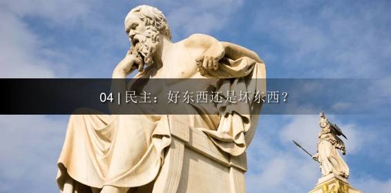

 

你好，欢迎来到《西方史纲 50 讲》，我是李筠。

上一讲我们明确了，理性让古希腊人撑起了属于自己的世界。人成了这个世界的尺度。

这一讲，我和你分享古希腊留给西方文明的第三个独特的基因：民主。谈到民主，你可能马上会想到古希腊，想到雅典，不错，雅典是民主的典范。

但是，你可能不知道的是，古希腊给西方留下的民主基因，并不是作为正面的政治资产流传下来的，柏拉图、亚里士多德都不喜欢民主制度，都深刻地批评民主。

西方在后面的 2000 年里也都不喜欢民主，一直把民主看成是坏政治。即便这样，民主却还是留下来了，并且成为了今天西方，乃至世界的政治共识。

我们就来看看，**为什么民主这么不招古代西方人的喜欢，但最后却又成了西方文明的基因。**

## 民主在古希腊的运行规则

我先带你看看民主在古希腊是什么样子。民主就是人民当家作主嘛，西文里面也是这个意思，democracy，demos 是人民的意思，cracy 是统治，合起来就是人民的统治。

我在前面讲过，古希腊的人文特质是针对神和宗教来说的。人民的统治和神的统治是相对的，人做了主，神就不能做主了。所以，民主带有浓重的人文味道，它意味着君权神授不灵了。

最能代表民主的城邦雅典，认定政治是公民们的事情。而斯巴达这个和雅典对着干的贵族制城邦也是这样，几千个贵族之间是平等的，没有什么君权神授。**古代各大文明当中充斥着各种专制王权、君权神授，古希腊的民主完全就是异类。**

两千多年来，西方其实对民主制度做了不少改造工作，今天的民主和古希腊已经不一样了。**但是古希腊民主，已经蕴含着民主的基本运行逻辑。**

民主是古希腊人的日常游戏，它有三条基本运行规则：**第一，平等的公民资格；第二，抽签或多数决定的决策规则；第三，政治是公民自己的事业。**

## 古希腊的公民是谁？

平等的公民资格，也就是每个人享有平等的政治权利或者政治资格，参与政治的门槛对于所有公民来说一样高，或者说一样低。这在讲身份、讲血统、讲神的眷顾的古代社会是很少见的。

古希腊人，尤其是雅典人，在人类历史上第一次用自己的实践证明：谁说政治只是帝王将相的事情，它完全可以是数以万计的人一起干的事情。

那到底什么是公民，有什么样的资格才能参与游戏呢？请注意：**古希腊的公民资格和今天的其实大不一样。**

现在的公民，是用权利来定义的，有自由权、选举权、财产权等等，宪法和法律规定了一个国家的基本成员享有什么样的权利。当然，也会规定相应的义务，但总体来说，权利为主、义务为辅，所以公民是个法律概念。

**古希腊的公民不一样，我们所熟悉的权利和义务的区分在古希腊基本没有。公民资格，既是权利又是义务。**比如，参军入伍、征战沙场，这是古希腊公民的权利，只有他们能够去做这个事情，妇女、儿童、奴隶、外邦人没有这个资格，想去都不行；但另外一面是，这也是公民的义务，不能放弃、不能推脱、不能逃避。

希腊公民的实质就是，对于城邦享有政治和法律资格的人，资格最主要就是当兵打仗和参与城邦政治事务这两件事情。所以，亚里士多德把公民界定成了参加公民大会或者陪审法庭的人。

## 古希腊的民主怎么玩

有了资格，那民主怎么玩？基本是抽签或者多数决定。民主是要作决定的，许许多多公民一起作决定，那听谁的？有两种方式。

**第一种方式，每个人都有同等的机会，特定的公共职位由抽签决定谁来担任，任期届满，再来抽签。**在雅典，像五百人议事会成员、陪审法庭成员等重要的公共职位，都是抽签产生的，只有极少数像将军这种专业程度要求高的职位才不是抽签决定，但将军这样的职位也是由公民大会或者五百人议事会来任命的。

这就好比今天北京一个社区这么大地方，大家通过抽签轮流来做管理委员会委员，抽到你你就得干。少数专业职位由区里的委员们一起定谁来当。       

民主除了通过抽签和任命来分配政治权利，还有自己的决策规则，就是由多数人决定事情怎么办，公民大会或者五百人议事会就是服从多数的决定。

**正是在这里，民主和理性成了亲密战友。**公民们一起来作政治决定，那就只能商量着来嘛，商量就是讲道理，就必须靠理性嘛。古希腊人也就在玩政治的过程中变得越来越理性了。

**但请你注意，理性可以让民主兴盛起来，但也会让民主走向衰败。**你可能知道，古希腊哲学有一个重大转折叫做“从天上到人间”，第一代哲学家们，比如我们在上次提到的泰勒斯、赫拉克利特，叫做自然哲学家，他们最关心的是通过始基的问题，把世界的构成和运行规则说清楚。第二代哲学家叫智者，他们关心人的事情。

后来的柏拉图曾经写了很多关于智者的对话录，很重要的一个目的就是批评这些智者把民主政治搞坏了。

因为民主政治里面有一个很重要的机制是辩论，谁在公民大会上雄辩滔滔，就容易赢得自己想要的政治决定。而智者们就是教人们练口才，而且收费。民主当然不能只是逞口舌之利，利用雄辩操纵民意实现私利，从此往后就一直是民主的致命伤。**智者们的成功恰恰是民主走向劣质化的重要原因。**

但是你可以看到，古希腊民主政治居然是靠一大批哲学家来提供智力支持的，它最早地体现了培根那句名言：知识就是力量！

## 民主带来的爱国奉献

平等的公民们通过抽签或者多数决定来玩政治，他们就会把政治当成自己的事业。城邦属于公民，大家一起经营它，一起热爱它，参与到城邦的公共事务中去，必要的时候为城邦奉献。

这就和帝国、王朝的统治形式差别很大。如果统治是来自神对某一个人或者某一家人的眷顾，那我姓李的为什么要服从你姓刘的的统治，就始终是个问题。所以，刘邦面对秦始皇巡游的时候还含蓄一点，心里嘀咕“大丈夫当如是”，项羽就直接露出了不臣之心，他要取而代之。而民主就天然有个好处，服从权力就是服从自己，因为它让你觉得政治就是你的事情。

古希腊人热爱自己的城邦，把政治当作自己和公民同胞们共同的事业，最好的证据就是一篇著名演讲，《伯利克里在阵亡将士国葬典礼上的演说》。伯利克里是雅典最伟大的政治领袖，在与斯巴达开战后不久，他发表了这个演说，他激情澎湃地讲：

“我们的制度之所以被称为民主政治，因为政权是在全体公民手中，而不是在少数人手中。……（雅典）是（我们）为它慷慨而战、慷慨而死的城邦。……每个人都应当承受一切痛苦，为它服务……。”

这篇著名的演说是歌颂民主的经典，它传达出一种伟大的信念：自由、民主和爱国、奉献是高度一体的。两千多年后林肯的《葛底斯堡演说》，几乎就是它的现代翻版。你可以把这两篇演讲找来对照着看。

简单总结一下民主是什么，就是公民平等、抽签或者多数决定，还有爱国奉献。

## 激情与理性的对立

这么一种政治，柏拉图、亚里士多德为什么说它是个坏东西呢？

古希腊的民主尽管运行得还算不错，但古希腊人也觉得它有毛病。柏拉图、亚里士多德都批评民主，针对上面讲的民主的三条运行规则，他们都有深刻的反驳，比如：人和人为什么是平等的？在什么意义上是平等的？人和人之间的平等如果不是绝对的，那抽签和多数决定的规则就站不住脚。

辩论看起来很理性，实际上是别有用心的人在利用大多数人的激情和愚昧，来实现自己的私利。刚才提到的那些智者就是这样。

爱国这种激情和理性存在着深刻的对立，很可能是盲目的、自私的、愚昧的。民主是多数人的统治，这个多数人肯定是穷人，穷人激情有余、理性不足，他们不会想着长治久安的大计，而永远盯着眼前的蝇头小利。他们掌权了，很容易被巧舌如簧的人操纵，最容易做出来的事情就是集体自私自利！

**民主在古希腊的恶行，最典型的例子就是“苏格拉底之死”。**通过辩论和投票居然是可以判人死刑的，而且被判死刑的居然是全希腊公认的最有智慧的人，苏格拉底没有杀人放火、通敌叛国，他就是爱在街头和人聊天，结果雅典人给他安上了“亵渎神灵和毒害青年”的罪名。

如果民主可以随意杀人，人民和暴君又有什么区别，什么坏事干不出来？正是因为民主内含着这种巨大的危险，西方在之后的两千多年，基本上就遵循了柏拉图、亚里士多德的教导，把民主当做暴民统治，当做是最糟糕的政治。

既然民主长时间充当了反面教材，那它为什么还留下来了呢？正是柏拉图、亚里士多德的批评，恰恰从反面有力地提醒了西方人，民主这个东西是有过的。

经过两千年的各种努力，民主也就被不断地改造，开始符合了政治的良好规矩，再配合很多使它可以良性运转的条件，它慢慢才变成了好政治。等到社会大潮流一变，它在 19 世纪咸鱼翻身，成为了主流的政治制度安排。

这个大转变我在第四个单元会跟你仔细分解。在这里只给你一个关键的提示：民主是好东西还是坏东西，并不是统治者人数多少这一个因素就能决定的。它还需要许多规矩，需要和许多现实条件相配合。

本讲小结

古希腊的民主很耀眼，现代西方也清一色是民主制度，但古希腊和现代西方之间隔着 2000 年的君主制，西方似乎又兜了一个大圈子。

但是，现代民主和古希腊民主大不相同，它不是古希腊民主的复刻版。**中间的这 2000 年，到底民主为什么没落，君主制为什么强大，后来君主制为什么又衰落了，民主又怎么样翻身，翻身之后是什么新面貌，这一系列问题构成了西方文明三千年发展的重要线索。**

带着这些问题看西方文明的兴衰沉浮，才能够总结出一个文明的政治要怎么安排才妥当，制度的选择和时势的变化应该怎么样配合。

下一讲，我就带你去看看古希腊的宏观政治格局，它是城邦林立而不是古代中国那样的大一统，古希腊文明的底层逻辑就隐藏在这里。

期待你的到来，咱们下一讲再见！

精选留言

点击直接进入下一章节

**潘小倔**:  
从西方政治格局的演变去看西方世界的发展，理解最底层的逻辑，这真是个好的视角，让人大受启迪。  
  
从雅典的民主到今天西方的民主，我们看到再好的东西再好的逻辑都可能是有漏洞的，都是需要结合具体条件和场景的，因此给我们的启发是不论是国家之间的相互学习，还是个人学习前辈的经验，都不能简单的照抄照搬，而要结合自身情况，具体分析，去改良去优化，这也才是传承的精髓。

**weekdays**:  
“民主是多数人的统治，这个多数人肯定是穷人，穷人激情有余、理性不足，他们不会想着长治久安的大计，而永远盯着眼前的蝇头小利。他们掌权了，很容易被巧舌如簧的人操纵，最容易做出来的事情就是集体自私自利！”最近在得到听了《伯罗奔尼撒战争》这本书，对这句话很有感触，对于激情有余，理性不足的全民共同参与民主制度来说，比的不是谁的讲话更理性，而是谁的讲话更具有煽动性，非常容易导致多数人的暴政。无论是雅典人公投处死苏格拉底，还是现代民主的全民公投，比如英国脱欧，都可以证明这一点。  
万维钢老师解读了《预测师的博弈论》这本书，作者把参与政治的群体分为名义选民，实际选民和胜利联盟。一个社会的民主程度无非是看胜利联盟的人数，比例越大越民主，比例越小越独裁。所有人的民主会导致多数人的暴政，毫无民主就是独裁。让我想起了以前听过的一句话“民主是非常差的制度，但是目前我们能选择的最好的制度”。这句话的意思是，任何制度都是有利有弊的，我们最好的选择可能只有两害相权取其轻。

**飘啊飘啊飘过**:  
虽然我很喜欢这门课，但是我还是不认同古希腊的民主和现代民主的血缘关系。我认为现代民主是启蒙运动时期被创造出来的，启蒙运动的导师们本身也反对古希腊民主，并且他们自己也不认为自己这套东西叫民主，甚至美国开国都不认为自己在搞民主，只是后来被后人把这套制度称为民主而已。不过是名字一样而已，司马相如蔺相如，名相如实不相如。如果硬要说希腊有民主现代也有民主，所以是有血缘关系的，那跟本课开头时候所说的 我们看见西方有什么，然后说我们老祖宗也有过是什么 一样毫无意义么？

**作者回复**:你的看法有道理。现代民主不是古希腊民主的复刻版，也不是古希腊民主的直接延伸，它生成的逻辑和条件和古希腊的大不一样。不过要比你认为的启蒙运动要早，要复杂。我会专门花一讲跟你解释其中的道理。

**storman**:  
仔细追问什么是平等，就发现它真是个问题。尤其是它与自由还是矛盾对立的。  
少数服从多数恰恰就是多数人对少数人的专政。而乌合之众为这种民主带来极大的风险。  
倒底怎样的基础和状态能够使得民主摆脱上面的陷阱呢？理性的基因，富足物质基础?我们拭目以待！

**佛祖门徒**:  
老师的这一讲带我深入学习了西方民主源起的清晰脉络，从中获得两点收获。  
第一、民主的基本特性。古希腊民主形成了西方民主的典型特性，平等的权利、议会的雏形、辩论和投票等，虽然一再演化，但这些基本特质却一直被保留下来。  
第二、民主的传承过程。从最初民主雏形的形成，到柏拉图、亚里士多德引领的对古希腊民主的反思，西方民主并没有因此而停滞甚至消失，反而在这样的思辨过程中焕发出愈加强大的生命力。

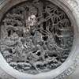**新**:  
通过人文，理性，民主这三讲，确实让我对西方有了新的认识。把握住三大基因，随着后面内容的展开，我想学完这个课程，回头再认识西方，定然有不一样的理解，应该会有恍然大悟的感觉。

**强 Sean**:  
罗胖老师今天的节目提到，罗马共和制的真正终结者是苏拉，他的所作所，同样可以体现民主恶的一面。  
  
苏拉做了「终身独裁官」后，开始搞恐怖统治，把政敌全部干掉。他先是规定：杀死人民公敌不仅无罪，而且有赏；包庇人民公敌则与他同罪，然后在广场贴上人民公敌的名单，那些被煽动的暴民们就上门去迫害这些公敌。  
  
而且，这些暴民们为了领赏，为了抄家得到好处，也为了政治投机，就甚至还开始疯狂迫害他人。以至于，有的人根本不在名单上，暴民在某些人的挑唆之下先把他们抄家灭门，然后再把名字补上名单。  
  
苏拉假借人民的名义，把人民变成暴民，充分地把民主之恶暴露出来。

**作者回复**:哈哈，你把罗胖剧透我的内容搬这儿了！

**翦秋水**:  
无论哪种制度，都有优劣势。  
一种好的制度，只有在合适的土壤才能长成参天大树，过程蜿蜒曲折，必定要付出巨大的代价。

**作者回复**:重要的是一起去理解到底怎么个曲折！

**吴腾辉**:  
1\. 为什么民主这么不招古代西方人的喜欢，但最后却又成了西方文明的基因？  
  
2\. 古代各大文明当中充斥着各种专制王权、君权神授，古希腊的民主完全就是异类。  
  
3\. 智者们的成功恰恰是民主走向劣质化的重要原因。  
  
4\. 古希腊民主政治居然是靠一大批哲学家来提供智力支持的，它最早地体现了培根那句名言：知识就是力量！  
  
5\. 《伯利克里在阵亡将士国葬典礼上的演说》, 林肯的《葛底斯堡演说》。  
  
6\. 民主在古希腊的恶行，最典型的例子就是“苏格拉底之死”。  
  
7\. 民主是好东西还是坏东西，并不是统治者人数多少这一个因素就能决定的。它还需要许多规矩，需要和许多现实条件相配合。  
  
8\. 中间的这 2000 年，到底民主为什么没落，君主制为什么强大，后来君主制为什么又衰落了，民主又怎么样翻身，翻身之后是什么新面貌，这一系列问题构成了西方文明三千年发展的重要线索。

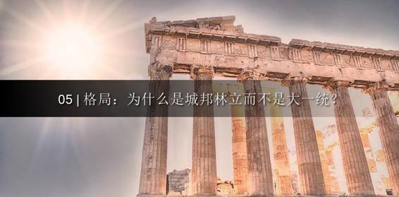

 

你好，欢迎来到《西方史纲 50 讲》，我是李筠。

上一讲我们谈了古希腊的民主，民主一直作为反面教材提醒西方，好政治应该遵循什么样的原则。

这一讲，我和你分享古希腊的政治格局和它背后蕴含的底层逻辑。我们通过这样一个非常明显却又非常奇特的表象来切入，就是，古希腊为什么是城邦林立，而不是大一统？

## 分散的格局

说起古希腊，你脑海里最先浮现出来的画面是什么？我猜是雅典卫城。没错，就是那个以帕台农神庙为核心的卫城。

你去雅典的时候，想看帕台农神庙，得爬山，弯弯曲曲，虽然到处是古迹，风景也优美，但你到了神庙门口差不多也是一头汗了。神庙，特别选址建在了雅典的制高点。

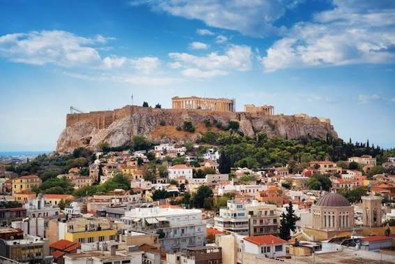

其实，**雅典卫城是跟古希腊政治格局高度相关的，也就是我们开头说的城邦林立。**

对于中国人来说，总是觉得大一统是常态，但这只是中国政治的特色。中国的思想家们也尝试去解释中国长期大一统的机理，远的有金观涛先生提出的“超稳定结构”，近的有施展老师在《枢纽》和《中国史纲 50 讲》里面的解释。

**环顾人类文明，你会发现，大一统很稀有，分散分裂倒是常态。**在西方文明当中，只有罗马帝国算得上是大一统，但从奥古斯都建立帝制到西罗马灭亡，也就五百年时间。其余所有时间里面，西方的大格局都是分散甚至分裂的。

大一统在中国文明是主旋律，在西方大多数时间里只是梦想。记住这个很重要的差别，**它不仅深刻反映了中西文明底层逻辑的差别，也成为我们和西方人相互误会的重要根源。**

西方从古希腊开始就是分散的，在古希腊就体现为城邦林立。这一讲，我分三步告诉你为什么古希腊人搞成了这么个政治格局：**第一，军事逻辑，第二，国内政治逻辑，第三，国际政治逻辑。**

## 军事逻辑

就从神庙的选址来说，主要就是出于军事考虑，敌人来犯时保住精神的香火很重要。

古希腊的地形很独特，四个字，半岛丘陵。半岛是说它位于地中海北岸，三面环海，丘陵是说这个半岛上的主要地貌是丘陵。三面环海带来的后果我在下一讲跟你细聊，这里我们先看丘陵，它意味着有险可守。

你去希腊的时候，别只去雅典和圣托里尼，多找几个半岛上的城市看看，你就会发现，原来卫城不只是雅典有，而是每个城邦都有。雅典只是找了一座石头山来修卫城，其他城邦找了更大的山来修。比如科林斯。

现在你知道古希腊人怎么打仗了吧！很简单，如果不能正面应敌，就据险而守。敌人如果快要杀到，卫城山脚下的民房、农田、集市全不要了，大家都躲到卫城里，跟敌人耗，趁敌人大意或者疲累攻其不备。在古代，内线作战比外线作战的优势大，躲在卫城里熬比围在外面耗的成功率要大得多，所以，**基于这种军事逻辑，城邦被破的可能性就比较小了。**

那即便外线作战的城邦胜利了，拿下被围的卫城，基于丘陵带来的交通不便，直接统治的成本会高到让你付不起。所以，**战争的胜利者一般都是在占领地建立间接统治，就是扶植傀儡，而不会并入版图，版图大了真管不了。**

最大的城邦雅典在鼎盛的时候也就 15 万公民，实在派不出多少军队去占领别的城邦，而且，你可别忘了，雅典的军队是由他的公民组成的，他们不是职业军人，打完仗他们就回家种田做生意了，让他们去做占领军，他们家里的生活就没着落了。

**古希腊历史上最典型的战后控制案例是斯巴达控制雅典**：在伯罗奔尼撒战争中，斯巴达率领同盟者最终击败了雅典率领的同盟，斯巴达没有铲平雅典也没有驻军控制，而是扶植了雅典本地人当傀儡，史称“三十僭主”。

## 国内政治格局

我们再来看看国内政治的逻辑。

**几百个城邦虽然政治上各自独立，但他们共享了同一个希腊文化，有很强的认同感**，他们是一家人，尤其在共同抵抗过波斯之后更是如此。希腊波斯战争这个大事，我们放到后面专门讲。

你想，西方文明的源头为什么不叫雅典、斯巴达、科林斯、米利都这些单个城邦的名字，而是统称为希腊，这说明它们是一个文明，就像中国文明不会只上溯到齐、鲁、宋、晋这些诸侯国。

**文化上的共同性会在很大程度上遏制他们互相毁灭、互相奴役、互相吞并。**城邦之间的战争就像他们各自的神之间的斗争一样，永远不会停歇，但谁也不能彻底消灭谁。这是第一层。

还有第二层，其实刚才我们已经透露了一点，问题的核心是规模。

表面上，15 万雅典公民规模太小，又没有职业军队，实在无法派出大批的占领军，但还有一个藏得更深的政治天花板：政治的规模会抑制政治的复杂性。城邦太小，导致统治和管理大规模共同体的制度和策略根本就出不来。 

15 万公民的规模可以通过抽签和多数决定运转，但如果是 150 万人呢？如果是整个古希腊文明的 1100 万人呢？

回想一下民主运行的三个基本原则，公民平等、抽签或者多数决定、爱国奉献，1100 万人如何实现？哪些人拥有公民资格，如何决策？散落在整个希腊半岛的 1100 万人，还会像雅典人一样热爱这个庞大的国家吗？

作个最简单的对比，美国立宪的时候，有 280 万人。在此之前所有人都认为共和国好是好，但只能小国寡民。**美国国父们想出了联邦制、三权分立这些现代制度，才算基本解决了大共和国得以成立这个千古难题。**

再看看中国，就像施展老师所说的，秦国通过商鞅变法实现了对自身大规模领土和人口的有效管理，有天时地利人和。而且，它征服的六国多多少少都有过类似的变法，秦国战胜后也容易接管。

再这个问题上，中国文明是非常早熟的，但即便如此，秦朝的大一统不也很脆弱吗？所以，**大一统对政治制度和策略的要求其实非常高。**

## 国际政治逻辑

再进一步，我们从“国际均衡”，也就是希腊城邦面临的外部形势来解释下这个问题。

如果城邦的规模决定了它们的政治制度和策略上的天花板，那它们在这个天花板下面你争我夺的时候也会有意无意地一起维护这个天花板，保证大家都有政治生存空间，因为大家都明白一个简单的道理——“覆巢之下，安有完卵”。一旦大一统了，大家就谁都没得玩了，这就是古希腊国际政治的基本逻辑，它同样不利于大一统。

想想我们的春秋战国。一旦出现一个强国，尤其是从春秋的争霸逻辑进入了战国的灭国逻辑之后，各国都高度警惕它，合纵连横就出现了。古希腊城邦之间当然也有合纵连横。一个大城邦击败一个小城邦可能问题不大，但它旁边的城邦就会集结起来对付它，谁都知道唇亡齿寒的道理。

所以，合理的结果就只能像真实的历史那样，古希腊没有大一统，只是最终合并为两个军事同盟。雅典和斯巴达各自带领一堆小弟展开两大同盟的对峙，从冷战到热战，确实打了个天翻地覆。有人专门发明了一个词来说明雅典同盟的性质，叫雅典帝国主义。

但需要澄清的是，雅典的帝国不是罗马那种帝国，它虽然对小弟们有军事统帅权，也管它们收保护费，但那些小城邦们都是独立的，政治和军事并没有被雅典人派的总督接管，雅典的权力只是盟主的权力，还远远达不到罗马皇帝的权力。小弟们受不了大哥的管束，很容易就翻脸了，这是雅典败给斯巴达的重要原因，我会在后面跟你解释。

总的来看，国际斗争使得大一统的难度极高，当然，也不是不可能，亚历山大大帝不就做到了嘛，他砸碎了古希腊政治格局的天花板！这里我们先按下不表，以后再跟你细说。

总之，几百个城邦的国际均衡，使得最强大的雅典和斯巴达最多就是当上了盟主，在国际政治的层面上，古希腊城邦之间基本上只在玩争霸逻辑的游戏，没有进入灭国逻辑的游戏。

本讲小结

好，简单总结一下这一讲的内容：古希腊的政治格局是小国寡民，几百个城邦并立而存，人少国小加上丘陵地形限制了战争规模和战争形态，他们大多建造卫城据险而守，即便破城，直接统治成本也承受不起；

**小国寡民还限制了古希腊发展出管理大规模领土和人口的政治制度和策略，国际均衡又对每一个野心勃勃的城邦构成了巨大的外部限制，他们只玩到争霸游戏还没有进入灭国游戏。** 所以，他们没有大一统。城邦林立的政治格局归根结底在于小国寡民。

那问题来了，每个城邦人又少、地又贫，怎么养活自己啊？下一讲我们就来谈谈古希腊的生计问题，可以提前透露一点点给你，他们不仅养活了自己，而且活得很滋润，因为他们主要不靠农业，而是靠商业。

期待你的到来，下一讲再见！

精选留言

点击直接进入下一章节

**oldxiong**:  
由于中国多年是大一统的政治格局。所以对西方这种四分五裂的模式，总是不能很理解。学习西方历史要带一种抽离的态度去学习。  
  
关于古希腊城邦对于西方整个文明的影响，顾准早年也有同样的论述。他认为：  
  
要理解希腊城邦制度，首先不要和我国春秋时代及其以前的小国林立相混淆。春秋以前诸小国，虽然政制各异，各专征伐，然而从有史时代开始，就有一个凌驾他们之上的神授的最高政治权威，在周代，是周"天王"；在殷代，是有时称为"帝"的殷王朝：在夏代，是称为"元后"（相对于称为"群后"的"诸侯"国家）的夏王朝。希腊远古时代有过这样的最高政治权威（亚该亚人的"万民之王"--迈锡尼诸王），然而从多里安人征服以后，这样的最高政治权威就已经不存在了。其次，春秋及春秋以前，诸小国一直处在相互兼并过程中，这种兼并过程，直到秦始皇的大一统的郡县制的大帝国才告结束。在此以前，虽有孔子的"兴灭国，继绝世"的绝望号叫，兼并一直被认为是伟大的王业。  
希腊有史时代，也有过这样的兼并，斯巴达征服美塞尼亚即其一例，然而兼并受到极其强烈的抵抗，以至例如斯巴达就不得不很早就从兼并转为"同盟"政策。自此以后，希腊世界内部政治上的集团化，一般都采取"同盟"形态，甚至事实上结束了希腊城邦制度的亚历山大，他之对待希腊本土诸国，表面上也只能采用同盟的方式。  
  
可以把顾准文集与老师的文章对照着读，收获会更大。

**强 Sean**:  
以前学习的历史大多是政治和军事史，如今老师的课带我们跳出历史人物本身，更像是从“演化”的角度，回到历史发展逻辑上学习历史，而且还能看到像地形、人口这样的“隐性玩家”在其中发挥的作用。

**陨落星辰**:  
这节说的是希腊城邦林立，我更想知道的是为什么欧洲是小国林立，自从罗马帝国毁灭后没有再统一过；拿破仑和希特勒也只是昙花一现。  
  
当时是有分封制，皇帝只是最大的贵族没有形成碾压优势，没能整合国内资源一致对外（这也是欧洲比较民主的原因）。但是中国发展了科举制度，形成的官僚系统压制并逐渐灭掉了贵族成了专制，所以后面即使分裂也只是短暂。  
  
欧洲分裂出了上诉原因外，地理和文化谁占的比重更大，还有没有其他原因?期待老师的答案

**佛祖门徒**:  
原来对雅典人把卫城建在那么一个高地很是有些疑惑，寻思着难道就是为了表达对神的尊重？可是古希腊人似乎对神并没有那样顶礼膜拜的传统。今天老师的课让我豁然开释，原来雅典人还是基于现实的考虑来做这件事的。隔壁香帅在解释欧洲为什么没有大一统这个问题时谈过一个观点，即欧洲地理特征导致实现大一统的统治成本太高，所以无法实现。比如降低向各地征税的成本就是一个很难实现的问题。

**边红帅**:  
大一统在地理环境上要求确实高，但是我觉得也需要统治者创造一种信仰，符合当时老百姓的需求，施展老师讲过儒家法家道家甚至佛教在中国的传播，统治阶级起到了不可磨灭的作用，或者说这些思想更好的服务了当时的统治阶级。我们脑洞大开一下，如果当时的古希腊把神学进一步深化并且能服务于统治阶层，会不会有大一统的局面呢？

**作者回复**:哲学家们在各城邦之间流窜，政治家们没有实力让所有人都闭嘴信自己的，所以软硬件合体的集中控制出不来。

**Wisder**:  
李筠老师的讲读总能予我们以思考，经由李老师对于古希腊作为“西方”这一文化之起源的在理性思维方式、民主政治方法以及地理格局方面对西方所起到的塑造作用的层层推演，很多在此前被忽略的线索和角度都得到了展露。  
很期待李老师已预留的对于雅典何以败给斯巴达的原因以及亚历山大大帝如何突破古希腊政治格局之天花板的讲解，同样亦十足期待着李老师整一套课程的下一步的展开。

**我心飞翔**:  
李老师可以从经济税收逻辑解读下吗？

**作者回复**:并不是什么地方都必须要用经济-财政税收的逻辑直接套一遍来讲。小国寡民抑止了大规模的政治制度和策略出不来，就已经包括了财政税收系统出不来。不只是在好地方收税的成本低，烂地方成本高的问题。首先要问的问题是税收系统有没有可能建立起来。公民-士兵-陪审法庭成员的简单结构支撑不起税收官僚队伍。古希腊的政治复杂性没有达到建立大规模税收系统的及格线。这个问题我在后面讲经济和军事的时候还会继续阐发。

**Tingo**:  
施展老师说，一个国家扩张规模取决于它从社会汲取资源的能力要大于统治成本。  
  
正如文稿中李筠老师解析总结出 由于古希腊地理条件非常复杂以及城邦有些国际均衡的外部竞争逻辑，使得外统治另外一个邦的管理成本比较大，因此即使是军事能力最强的斯巴达也没能完成古希腊大一统。

**Gnoloayoul@坐忘**:  
关于希腊的战争与治理，我想起了罗胖的一句话“依赖哪一项资源，必会受到这一资源的诅咒”  
希腊各个城邦依托地形建城，依靠地形防守，在防守上很有优势，这是“地形”资源的祝福；然而就算打下另外的城邦卫城但是无法承担统治该城邦的后期成本，这也是“地形”这一资源带来的诅咒。

 

你好，欢迎来到《西方史纲 50 讲》，我是李筠。

上一讲我们谈了古希腊政治格局，也就是古希腊为什么是城邦林立而不是大一统，那么，这就又引出一个问题来了，既然都是小国寡民，那他们怎么养活自己呢？

这一讲，我就来给你分享一下这个问题，也就是古希腊文明的生计。

## 西方独特的商业文明

我先告诉你这个问题的结果，就是，古希腊人不仅养活了自己，而且活得很滋润，因为他们主要不是靠农业，而是靠商业。古希腊是典型的商业文明。

说到这儿，你应该也知道了，**西方文明在起点上就和中国文明存在重大差别。**古希腊是典型的商业文明，而后世的西方也基本上都是靠商业，古罗马是，中世纪前期商业不行，但到了后期商业迅速恢复。到了现代，西方成了人类有史以来规模最大、最有影响力的商业文明。

再看看中国，一直以来都是农业文明，全面地、深入地拥抱商业，那是改革开放之后的事情了，到现在也就不到四十年。**商业在中西两大文明里面的比重，有根本的不同。**

你再把视野放大一点，看看全世界的古老文明，你会发现，其实绝大多数文明都和中国一样，是农业文明，埃及、苏美尔、巴比伦都是。

那问题来了，为什么古希腊人要靠商业？答案其实很简单，没办法，都是逼的。正是因为被逼无奈，古希腊人开创了一条富裕之路，但因为先天不足，古希腊毁灭的种子也埋在这里面。经济上的繁荣，最终带来了政治和军事上的安全困境。

## 古希腊商业的成长逻辑

我们先来看看古希腊是如何发展商业的。希腊半岛三面环海，而且处于丘陵地带，没有丰富的自然资源，没有广阔的平原，也没有肥沃的大河流域。

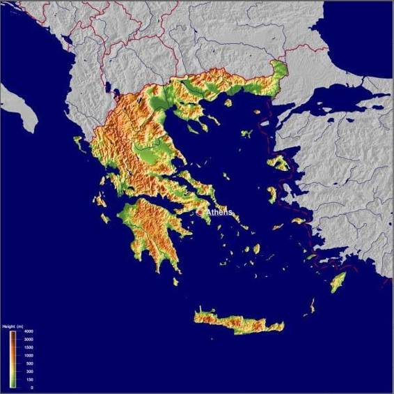

**这样的地形就决定了希腊不可能产生像埃及的尼罗河流域、苏美尔的两河流域、中国的黄河流域那样的大规模农业，相应地，也就没有资源支撑起庞大的帝国。**可以说，古希腊城邦林立的格局和地理条件也大有关系。

加上希腊的气候是典型的地中海气候，夏天炎热干燥，冬天潮湿寒冷。但是上天是公平的，希腊人在这种自然条件下选择了三种农作物，葡萄、橄榄和谷物，也就是“地中海三宝”。

三宝之间的关系很特别。照我们农业文明的思路来看，那当然是谷物优先，经济作物靠后，先吃饱饭再说挣钱的事儿。但刚才我说了，希腊这个地方没有大河灌溉，而且丘陵跌宕起伏，气候又会引起周期性歉收，所以古希腊的谷物实在没法保证自给自足。既然这样，与其再怎么努力都达不到及格线，那不如另辟蹊径：**粮食不能自给，又必须得有，那就只有通过交换来获取。**

这时候你就明白我为什么说古希腊成为商业文明是被逼出来的了，因为他们连吃饭这个最基本的问题都只能靠商业来解决。这时候你就会想起另外二宝了，葡萄和橄榄。

葡萄不仅可以卖好价钱，而且可以酿出价钱更高的葡萄酒；橄榄不仅可以卖好价钱，而且可以榨出橄榄油。橄榄油贵到什么程度？古代的奥运冠军，是没有金牌的，他们用橄榄枝花冠象征荣誉，而实际的好处就是一瓦罐橄榄油。

政治家们很早就认识到了葡萄和橄榄油的价值，比如雅典最伟大的改革家梭伦，他就出台政策鼓励雅典人种橄榄。就这样，农业在古希腊迅速地商业化了。

## 古希腊的商业体系

但是，光有葡萄和橄榄还不行，这还不是一个成熟的商业体系。还**得要三股力量一起往前推，古希腊才能从换粮食的小贩，变成繁荣的文明。是哪三股力量呢？首先是手工业，其次要有货币，然后还得有船队和舰队。**

先来看看手工业。既然已经有了地中海三宝，为什么还要有手工业呢？因为，手工业产品虽然不一定比农产品贵，但稳定性显然比农产品高，因为躲在家里就可以做，跟气候变化的关系不大。

古代世界的手工业主要是陶器、织布、造船、炼铜炼铁这些项目。在公元前 800 年之前的地中海世界，各大文明在这些项目上各有千秋，希腊人不管在哪个项目上都还只是业余选手。但是，也就过了两三百年的时间，希腊人后来居上，成了全能冠军，他们生产的所有手工业产品，几乎都成了地中海世界最好的。**这样一来，古希腊人就有了能和其他人进行交换的好东西。**

有了手工业，还得有货币。有好东西可以换，得有媒介，以物易物的商业效率实在太低，会限制商业的规模和频率。希腊人从地中海东岸的小亚细亚学会了铸币，把它流传到整个地中海世界，这样一来，货物就能够顺畅地进行交换了。希腊人甚至还弄出了西方最早的货币兑换业务和银行业务。**一旦有了金融业，商业又上了一个大台阶。**

最后，发展商业还得有船队和舰队。古希腊的买卖主要通过海上交通完成。靠商业解决生计问题，就意味着面向的是海洋而不是大陆，所以你会发现，商业文明也可以叫做海洋文明，农业文明也都是大陆文明。**海上交换，当然靠船只运输，船只运输，就必须有安全保障，于是必须有舰队。**

雅典是古希腊海军最强大的城邦，它鼎盛时期曾经拥有 300 艘战舰。历史学家们一直很乐意强调雅典海军和雅典民主的亲密关系。因为雅典海军的主力军和公民大会的主体高度重合，这些人在军舰上的表现决定着城邦的生死存亡，而他们在公民大会上的决议，决定了他们自己是否出海作战。甚至有学者把这个现象拔高成一种政治理论，就是：海军和民主是一伙的，相应地，陆军和专制是一伙的。

好，有了商业性农业、手工业、货币、船队和舰队，以雅典人为首的古希腊人生意越做越大，甚至超出了地中海世界。

后来，他们通过黑海和现今俄罗斯南部的土著人都做起了生意，还在那里建立了自己的城邦。古希腊成就了古代世界第一个高度繁荣的商业文明。

## 商业繁荣带来的军备竞赛

但是，花无百日红。我在前面就告诉过你，古希腊文明虽然灿烂，但它不是恒星，而只是一颗耀眼的流星。**因为它的生计，也就是商业逻辑里面就蕴含着它毁灭的种子。**

为什么这么说呢？商业繁荣一定会带来人口增长，在经济上，经济繁荣总是和人口增长呈正相关的关系。一旦人口超过了经济承载的极限，就会发生消灭人口的惨剧，要么是天灾要么是人祸，要么是天灾带来人祸。 

古希腊人用一个巧妙的办法延缓了惨剧，就是移民新建城邦。我说过，粮食不能自给自足是古希腊致命的先天不足。经济繁荣了，人多了，本就不够吃的粮食就更不够吃了。于是，古希腊人通常的办法是经济殖民，选一批人坐船去地中海沿岸甚至更远的地方建立新城邦。

古希腊人新建移民城邦的路线，和我们上一讲说过的道理是吻合的，也就是小国寡民无法产生出治理大规模领土和人口的政治制度。

古希腊的城邦再繁荣，它也不在制度上扩容，而是拆分。不断拆分，每个城邦都保持小规模，复杂制度就肯定出不来，**各新老城邦当然也都遵循通行的生计活法，也就是发展商业，商业关系的亲疏远近成了国际关系的第一层格局。**

如果这个世界只有商业和商业联盟，那也就简单了，可惜城邦之间的关系不会停留在只是做做生意。我在上面提过，进行贸易的船队需要舰队的军事保护。那么，经济越繁荣，人口越多，商业安全的重要性就越高，相应地，军舰也就得越多。哪怕不针对任何特定的敌人，地中海上也会出现一支“无敌舰队”。

在军事膨胀的路上，一旦出于商业竞争或者其它原因导致两个城邦互不信任，“安全困境”就出现了。

**所谓安全困境，是现实主义国际关系的最佳写照**：我不信任你，你的军队很强大，我怕你来打我，那我也只能增强自己的武备，你一看，肯定就会认为我增强武备是针对你的，于是你也“被迫”增强武备，于是我们俩就陷入了军备竞赛，越来越把对方的扩军备战想象成是针对自己的行动。在这样一个相互助推的态势下，任何一点擦枪走火都会引发战争。

**这就给后面的伯罗奔尼撒战争埋下了伏笔。**雅典的舰队本来是用来维护贸易安全，尤其是粮食安全的，但陆上强国斯巴达心里肯定不舒服。斯巴达会想，你雅典凭借盟主的地位，天天欺负自己的小弟，说不定你哪天船头一调就针对我了，我不得不防，绝对不能坐以待毙。于是毁灭古希腊文明的伯罗奔尼撒战争终于开打。

你看，雅典和斯巴达之间发生了军备竞赛，最后各带领一堆小弟打了个天昏地暗，像不像英国和德国唱主角的第一次世界大战。如果你把第一次世界大战看成是，西方列强因为内部矛盾而把全世界都卷入的战争，那么，伯罗奔尼撒战争是不是就是真正的第一次世界大战。

不信任导致的安全困境困扰了人类几千年，今天我们通过古希腊的历史看到，商业文明并不能自然而然地就克服这个政治和军事的困局，也很有可能深陷其中，走向毁灭。

那人与人、国与国、联盟与联盟之间的安全困境，是不是会把一切文明都葬送掉呢？会不会有下一次的两大集团对峙呢？人类是否能够真正摆脱恐怖的安全困境、不再有“下一次”呢？

我们会在以后的课程中不断地反思这个问题，西方文明史上层出不穷的精彩故事会给我们有益的启发。

本讲小结

好，总结一下这一讲的内容，气候和地理的自然条件导致古希腊粮食不能自给自足，这确实逼着希腊人闯出了一条成功的商业之路，面向海洋的商业文明最终成型。

但商业繁荣并没有根除致命威胁，相反，商业所需要的政治和军事保障，却将古希腊带入了安全困境的深渊，最终导致它的全面衰败和最终毁灭。

下面两讲，我带你去看看古希腊最著名的两场战争，希腊波斯战争和伯罗奔尼撒战争，**讲希波战争不是为了再重复这一讲文明毁灭的故事，而是通过它来谈谈古希腊留给西方最重要的标签：自由。**

期待你的到来，咱们下一讲见！

精选留言

点击直接进入下一章节

**帮主 jym88978634**:  
施展老师也谈到了类似的观点。  
规模的极限在于边际收益的界限。不论是领土疆界，还是人口，一旦超过那个边际收益的临界值，那系统会自然做出反应。永远保持在收益与成本的平衡态，不论个体还是群体。  
古希腊文明为地理环境所迫，发展出了商业这个生存手段。而且商业给古希腊也带来了莫大的好处。一旦古希腊开始为保有这种好处而投入其它成本，手段变成了目的，这个体系就开始趋向崩溃。  
  
我就想起了前些年关于外汇储备的讨论，那么大规模的外汇储备，美国人会不会赖账啊？房地产泡沫就是美国人的阴谋，等等。  
我想这也是把手段当成了目的。我们还是应该不忘发展的初心。发展始终是我们解决问题的途径。

**厉伟群**:  
老师提到一个很有意思的观点：民主和海洋是一伙的，专制和大陆是一伙的。施展老师也讲到过海洋世界和大陆世界的对抗。貌似海洋与商业、民主，大陆与农业、专制确实存在着密切的关联。这是难道是必然？

**作者回复**:去剖析联系，发现关联，很重要。下“是不是必然”的结论没那么重要。

**翦秋水**:  
文明的演变是一个不断遇到问题，不断解决问题的过程。  
没有最优解，一切都是各方力量平衡的结果。

**作者回复**:求不到底线之上的平衡解，文明即走向崩溃。

**强 Sean**:  
大河流域在古代催生了几个辉煌灿烂的文明，古希腊只能可怜兮兮地做点小买卖，但随之促成手工业、货币、船队和舰队的诞生和发展，商业繁荣、人口增长、船舰数量的增加和技术的改进，又使得古希腊陷入“安全困境”，引发的伯罗奔尼萨战争最终导致古希腊文明的毁灭。但是，其奠定的商业文明基础却绵延不绝，如今却影响了全世界。  
  
时移世易，原来的优势很可能反过来成为束缚和桎梏，原来的束缚和桎梏也可能反过来成就巨大的优势。

**二哥**:  
以前很羡慕西方文明古代就有的商业、海洋和民主的属性，听了老师的讲解，明白这些跟地理，人口，气候等外在约束密切相关，每种文明看似可以很多选择，其实更多是没得选。感觉地中海像极了西方海洋文明的"育婴室"，西方人在这里学会了跟海洋如何打交道，练硬了翅膀才有了后来走出地中海，在四大洋的翻江倒海。而中华文明一开始就面对太平洋，上来就要挑战海洋的究极难度，真要发展海洋文明谈何容易。

**大飞雪**:  
好课啊！和施展老师的《中国史纲五十讲》一样精彩，果然是好兄弟，哈哈！  
  
希腊-生计，逼出来的商业文明，让我想起，大航海发现新大陆，还有我们从 1949 年以后内忧外患到改革开放 40 年的新中国，都是被逼出来的诶

**作者回复**:你寻找到的味道是对的：被逼并不可怕，关键是有没有闯出自己路子的勇气和智慧。

**拜鲁**:  
“那人与人、国与国、联盟与联盟之间的安全困境，是不是会把一切文明都葬送掉呢？会不会有下一次的两大集团对峙呢？人类是否能够真正摆脱恐怖的安全困境、不再有“下一次”呢？”  
会不会有下一次不敢说，但人类最终肯定能够真正摆脱恐怖的安全困境。  
由此想到了《三体》描述的“黑暗森林法则”。无论这个法则在星际文明间是不是无法打破的铁律，在地球上的人类文明之间，它绝对不是无法打破的铁律。  
人与人、国与国、联盟与联盟之间，在能够彻底毁灭对方之前，交流已经无法阻挡地开始了。因此“黑暗森林法则”的前提已经消解。历史的发展趋势，也已经无可辩驳地向我们展示了文明演化的方向：理解，宽容，融合。  
人类文明能够演化到今天的态势，因为人类已经找到“黑暗森林法则”的解药：贸易。贸易全球化进程，极大地推动了人类文明演化的速度。要实现贸易往来，你就必须了解不同文明的语言，文化，习俗，宗教，法律，经济和政治制度。贸易成为文明演化进程的催化剂。  
通过贸易，人类终于发现，人类不同文明之间基因的差异，远比最初想象的少得多；同时也意识到，相比消灭对方、占有对方的资源和财富，不如在发挥各自的比较优势的基础进行交换，来的更划算。

**作者回复**:贸易是摆脱黑暗森林法则的好办法，但并不是无条件的：1. 价值观（宗教或意识形态）层面的基本相互承认，2. 政治层面的基本相互信任，3. 经济层面的基本资源互补。

**蛋挞挞挞**:  
李老师，您讲课真的太精彩太精彩了，本来还担心是很多有点枯燥的名词，您的文章里有“勾子”啊，意犹未尽~  
我对西方文明一直好奇，但没有什么框架式、整体性又可靠的知识来源，看完了约翰·赫斯特的《极简欧洲史》，对着下载的高清世界地图边看边想象的，地理不好真的是心中一痛噢😭。各国的世界地图都蛮有趣的，自己国家都是 C 位主角，其他国和洲就在边边角角了，人类的自我中心主义真是处处都是啊，现在还好对欧洲的地图比较熟悉了，听音频已经自动有画面了，感觉好极啦~

**殳伯**:  
商业文明不能自然而然地就克服政治和军事的困局，也很有可能深陷其中，走向毁灭。  
  
那种认为中美经贸规模巨大，即使竞争也不会走向战争的观点，是否完全错误了呢？  
  
当前中美还没真打起来的原因不是经贸关系，而是大家都有核武器。

**作者回复**:有道理。下面听听我对伯罗奔尼撒战争的看法咱们再交换意见。

**一万小时**:  
谢谢李老师的讲解，让我对西方发展史，又多了些认识上的提高。在这想展开这方面的思考，经济发展的必然结果就是战争和自然灾害吗？我个人认为有这几个平衡一旦被打破，可能就会有祸害。一、人口与资源的分配，二、国与国之间，种族与种族之间，商业流通在某处受阻，利益得不到输送。三、信仰之间的差异被放大，并造成相互间的不信任和敌意。四、人类盲目的活动造成了生存环境的恶化，使得生存资源流失。这几点随着时代的变迁，人们认识世界的局限被突破，格局在扩大生活趋于同化，现代文明将来更多的应该是文化沟通。

**作者回复**:你理解的大方向是对的。但人与人、国与国、文明与文明之间的沟通、融合其实很困难，所以汲取深刻的教训非常重要。

**夏宝辉**:  
李老师好！  
李老师之问很好！什么时候可以终结两大集团的战争！从目前的国际形势来看：和平和发展仍然是世界发展的主题，但是因为利益，总是摆脱不了修昔底德陷阱，目前的中美较劲就是这个道理，但是我相信，全宇宙间会有其他文明存在，地球以后肯定是“人类命运共同体”，那个时候的对抗不是现有国与国之间，而是地球人类文明与其他宇宙文明之间的较量！

**作者回复**:“修昔底德陷阱”在“內裂”一讲为你解读，听完“內裂”，你就会知道外星人来了地球人会怎么样，哈哈！

**上海申凡不锈钢～董山琴**:  
终于知道古希腊的商业文明是逼出来的了，因为他们资源的缺乏，所以会想到向外索取资源，那就是由最初的物物交换演变的商业启蒙，这就是被逼的商业文明了，因而就不难理解日本和韩国的崛起了。  
试想，如果没有这四十年的改革开放政策，我们泱泱大国仍然是以农业文明为主要经济来源的落后国家，真的很可怕！那这四十年就无法想象了，我们今天也不可能坐在这里，以这么便宜的价格听到李筠老师这么精美绝伦的课了。

**刘爱东 447877**:  
由于没有去实地旅游的体验，对于西方的理解只是在文字和图片之上，没有切实的感觉，都很抽象！通过李老师的独到视角，地理位置、粮食、军队，商业活动角度理解城邦林立、小国寡民甚至民主的内在原因，加深对西方的认识和理解，一路认真学下去！

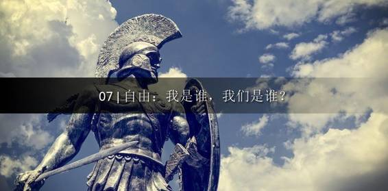

 

你好，欢迎来到《西方史纲 50 讲》。

上一讲我们谈了古希腊人的生计，希腊人因为“被逼无奈”发展了面向海洋的商业文明。但经济的发展却带来了贸易的安全问题，导致了城邦间的军备竞赛。

你听完可能会觉得，希腊各个城邦之间似乎是独立发展的，而且相互之间还有军备竞赛。那么，各自发展、相互竞争的各个城邦，为什么还能成为一个政治共同体呢？

## 文明的自我认知

这就要回头看一个重要的问题：那就是，**古希腊虽然是城邦林立，没有大一统，但是它们却享有一个共同的自我认知，就是在“我是谁”这个问题上，各个城邦的认知是统一的。**

一个文明的自我认知会成就它，也会限制它，成就它的地方很可能也是它毁灭的种子。就像施展老师讲的，民族主义在中国近代使中国人团结凝聚起来，取得了很多成就，但是也逐渐成了自我封闭、自我禁锢的心理枷锁，中国要担当起世界枢纽的重任，就必须更新自我认知。

这一讲我带你去看看古希腊人的自我认知，我们从希腊波斯战争说起。自我认知跟战争有什么关系？这里面关系可大了！

“我是谁”这个问题通常很难回答。你会怎么回答这个问题？我是父母的孩子，是孩子的父母，还是我是上帝的子民、佛祖的信徒，还是中国人、美国人？**你总会去寻找特定的关系来给自己定位，什么样的关系你越是看重，排名越靠前，你就越会用它来定义自己。**

这里就有一个中国人和西方人的重大差别：**中国人把生命的传承看得很重，直系血缘关系是定位自己的首要关系。**子承父业，血缘和事业融为一体，正所谓百善以孝为先，孝道就是讲传承，所以中国人把自己定位成父母的孩子、孩子的父母，不只是生物学上的基因传承，还有文化和事业的传承。

西方人就不是这样，这里主要是说信了基督教之后的西方人，他们定位自己是谁的首要关系是他们与上帝之间的关系，父母这层关系得靠后。生命和生命的意义都是上帝而不是父母赐予的，父母和你一样只是上帝的子民，从与上帝的关系来看，你和父母是平等的。**所以西方人的首要德性是爱，而且首先是爱上帝。**

## 希腊人共享的核心价值

一个文明的自我认知呢？作为一个内在共享文化特质的集体，一个文明会怎么回答“我是谁”这个问题呢？

你当然会想到，神的后裔，西方人说他们是上帝的子民，中国人说我们是炎黄子孙，古希腊人当然也讲他们是奥林匹斯山上诸神的后裔。如果我们接着问，你是这个神的后裔，那你们独特的品质是什么呢？

西方人讲爱，中国人讲孝，也就是最根本的伦理价值，成为我们各自证明自己是神的后裔的标准。换句话说，核心价值是文明的主心骨。每个文明的核心经典，就是树立它价值主心骨的标志。那古希腊人的核心价值是什么？是自由！

那这就要说到我们今天要讲的这一场战争了，希波战争。你可能觉得很奇怪，古希腊人的自由精神，跟希腊波斯战争有什么关系？

实际上，正是经过希腊波斯战争，古希腊人把自己的核心价值界定成自由，认清楚了自己是谁。希腊波斯战争的起因是波斯人的侵略，波斯帝国不断扩张，在地中海东岸的小亚细亚攻城略地，以米利都为首的希腊城邦起义反抗。在地中海东海岸，也有一些属于希腊的城邦，代表就是米利都。

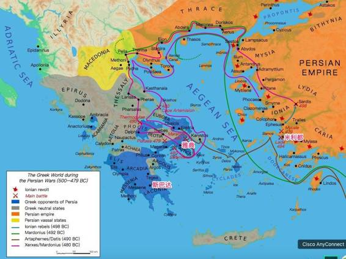

第一次希波战争时期的古希腊。蓝色区域为希腊抵抗区，灰色区域为希腊中立区，橙色区域为波斯帝国。此时，米利都等城邦已经被波斯帝国攻占。

波斯决意征服整个希腊世界，海陆两头都大兵压境，而且还是好几拨，持续了数十年。希腊人奋起抵抗，于是有了你知道的斯巴达三百勇士浴血温泉关的故事、马拉松的故事、萨拉米海战的故事。战争的进程我就不细说了，希罗多德的《历史》，西方的第一部史书，主要就是记录这场战争的，你有兴趣可以当故事来看。

我们说说《斯巴达三百勇士》这部电影。你看电影上，斯巴达将军列奥达尼和他的兄弟们，武功高强、纪律严明、组织精良就不必说了，在外形上，脸庞俊美、身体健美，个个堪称模特，再看薛西斯率领的波斯大军，各种拥有特异功能的怪物，又脏又丑，又臭又硬。

双方在审美上的差距真是天壤之别啊！我当然知道打仗不是选美，但这里要说的是，好莱坞的这种艺术夸张，和两千年来西方对战争双方的印象是高度吻合的，希腊一方代表了自由、正义、勇敢和美，波斯一方代表了专制、邪恶、蛮力和丑。以至于电影一上映就惹恼了波斯后裔伊朗，对这部电影诬蔑他们的祖先的做法非常生气。

这就有个奇怪的事情冲击到我们的一般印象了：**古希腊人里面不是雅典才是自由的、民主的吗？它的死对头斯巴达是奴役的、专制的啊，斯巴达怎么能够代表古希腊呢？**

这时候，刚才我们说过的关系如何排序的重要性就体现出来了，当雅典和斯巴达相比的时候，你会分出它们的特点，时间久了也就脸谱化了，雅典成了红脸的关公，斯巴达成了白脸的曹操，忠奸立判。但真实的历史往往不是京剧脸谱，没有那么泾渭分明。更重要的是，雅典和斯巴达共享同一个希腊文化，希腊和波斯才存在着本质的差别。

希罗多德记载了这样一个有趣的故事：希波战争时期，波斯国王问一个斯巴达人，你们条件那么差，凭什么跟我打啊？斯巴达人理直气壮地说，希腊的国土一直很贫穷，但是由于智慧和强大的法律，希腊人得到了勇气，驱逐了贫困和暴政。我们斯巴达绝对不会接受你那些停战条件，因为那等于把所有希腊人变成了奴隶。无论你方如何强大，我方如何弱小，至少我们斯巴达会和你血战到底！

看看这个斯巴达人的核心主张：我们希腊是自由的，你们波斯是专制和奴役，自由决不向专制和奴役投降。那希腊人的自由是什么呢？这个斯巴达人接着对波斯国王讲：斯巴达人是自由的，但也不是在什么事情上都是自由的，我们受法律的统治，我们对法律的敬畏比你的臣民对你的畏惧更厉害。你看，**他说自由的实质是法治，服从法律而非服从统治者的，才是自由人。**

这样一来，希罗多德就把正义属于希腊一方给坐实了，而在为自己战争正义性辩护的时候，自由就作为古希腊的核心价值被广为流传，被普遍接受了。于是，希腊波斯战争不是普通的战争，用今天的话讲，它是文明的冲突，是两大文明的直接对抗。

用希腊人的立场来看，他们之所以和波斯血战到底是为了自由，他们输了就意味着自由输给了专制和奴役，文明输给了野蛮。从历史发展的角度看，如果战败的一方不是波斯而是希腊，那西方文明就被扼杀在童年了。

而在这记忆深刻的童年创伤和童年成就里面，西方人牢牢抓住了自由这个核心价值，时时刻刻念叨它，待西方文明日后长大成人，自由对他来说就变得像胎记一样，成为最光荣的勋章和最珍视的价值。

所以，**我们通过希腊波斯战争可以看到，古希腊是用自由回答了“我是谁”这个问题，此后的西方完全把这个答案继承了下来。**

## “自由”本身的不稳定性

不过，说到这里，故事还没完。古希腊是因为和波斯的战争，才祭出了自由的大旗，找到了自己的定位。也就是说，**“我是谁”这个问题，是在高度的敌我关系中完成的，正是因为搞清楚了“敌人是谁”，才搞清楚了“我是谁”。**

这种认识和心理过程，其实和我们普通人处于高度紧张状况时是非常一致的。“我是谁”这个问题在日常状况下虽然重要，但不急迫，你不会时时刻刻都去想它，但处于高度紧张的状况下，它就会变得很急迫，你就必须认真去想，正所谓“知己知彼百战不殆”。如果你不清楚自己是谁，你根本不可能战胜强大的对手。

但问题是，在敌我关系中界定出来的自己就是最真实的自己吗？到底是日常生活中患有严重拖延症的你是你，还是紧张对峙状态下奋发有为的你才是你？这个问题我在未来课程里，带你剖析西方文明的时候还会不断地去看。这里我们先看看古希腊用自由完成自我定位之后，可能会带来哪些问题。

用自由来定义我是谁，是高度世俗的，这和我之前说的古希腊的人文特质是高度吻合的。它同时是高度政治性的。**用世俗政治定位自我，就和用血缘、用文化、用宗教差别很大。血缘、文化、宗教都是不容易变动的，世俗政治却是非常容易变动的。**

于是，一对比，你就会发现，通过自由来定义自我存在着高度的不稳定性，因为不同的政治环境下，斗争关系是在变动的，敌我关系是在变化的，因此对自由的定义也是在变化的。

尽管如此，合理的结果并不是自由就被放弃了，再找新价值来完成自我定位，恰恰相反，古希腊和后世的西方都没有放弃自由，而是不断地去定义自由。

自由本身是高度政治性的、充满敌对关系的、不稳定的，而古希腊人却带着西方要用它来定义自己，于是各种势力就会抢夺自由的大旗，自由就会变成最令人向往却最难说清楚的东西。所以你会听到罗兰夫人有一句名言：自由啊，多少人假汝之名行恶！

**从这个角度看，西方文明史就是一部自由史，这不是在说它如何伟大光荣正确，而是说它一直在寻找自我。**就像你，渴望自由，却永远不能把它完全说清楚，却仍然在不停地追求它一样！

本讲小结

好，总结一下这一讲的内容，古希腊在与波斯的战争中找到了自由这个核心价值来定义自己，他们带着文明的骄傲捍卫了自己的生存，但也留下了核心价值上的隐患。自由的世俗性、政治性、不稳定性，使得他们很可能变成找不到家的俄狄浦斯，甚至上演杀父娶母的悲剧。

下一讲我将和你分享伯罗奔尼撒战争，看看悲剧是什么样令人痛心疾首的情节，古希腊是如何毁掉了自己。

期待你的到来，下一讲再见！

精选留言

点击直接进入下一章节

**Allelujah**:  
自由之所以复杂、难以定义，是因为它不止需要通过自我来定义，也同样受到外部因素的影响。不仅如此，自我本身也同样不是一成不变的存在，它也会受到外部条件的制约。  
  
所以，或许从来也不存在什么绝对的自由——自由与其说是一种概念，不如说是一种追求。

**作者回复**:有内有外、内外皆变、内外相通，自由确实无法一劳永逸地说清楚，但追求自由的路上遇到的教训可以被概念化，凝结成原理，提醒后人犯过的错误不要再犯。

**佛祖门徒**:  
学完这一课有两点收获：  
第一、文明的冲突源自自我认知的差异。古希腊城邦之所以能够团结起来对抗波斯，是基于各个城邦对共同的自我认知。而波斯与古希腊文明在自我认知上的巨大差异，注定这场战争不可避免，意外的“产物”也是古希腊人从冲突中找到了清晰的自我认知。  
第二、对自由的理解是认识西方文明演变的主线。自由作为世俗政治的追求，不同的时代和不同的民族会对其有着完全不同的理解，基于时代变迁和文化差异，自由有着完全不同的内涵，由此带来的就是冲突不断的西方历史。

**作者回复**:不只是“对自由的理解”很重要，“对自由的落实”也很重要，理想与现实之间如何互动，形成动力和建制的双螺旋很重要。单线，通常都很难演化下去。

**上善若水**:  
古希腊在强大的波斯面前，用对自由的信仰来团结自己。但自由从一开始就不是一个确定的概念，不同人对自由可以有不同的理解。随着自由的信仰根植于欧洲文化，对自由不同的理解也引发了无穷无尽的冲突。西方的现代化就是不断追求对自由的共识的过程。

**作者回复**:明天我就会告诉你，不同人对自由的追求可能凝结成共识，也可能酿成冲突和对立。自由并不绝对保证共识，反之亦然。那么，如何使这两种好东西能够进入相互激励的良性循环呢？

**厉伟群**:  
自由确实是个很飘忽的概念，怎么定义自由的边界，可能每个西方人都会有不同的理解。薛兆丰老师举过一个例子，关于商场里是否可以言论自由，美国的联邦法院和各个州、商场和顾客就炒成了一锅粥。  
但是，这样的差别并不影响西方人互相之间的文化认同感。他们真正在乎的不是这种理解上的差异，而是恐惧来自东方的专制彻底掐灭自由的火种。东方和西方在“我是谁”这个概念上根本性的差异，是绝大部分冲突的根源。

**作者回复**:科斯定理讲人的行为博弈如何界定权利是很有道理的，不过可以展开这种博弈的基本前提是有自由和权利的观念，觉得它重要，要维护它，不止于誓死怎么着，但起码要认真当回事儿。

**翦秋水**:  
这一讲很哲学啊，通过对“我是谁”的追问，找到了“自由”。  
弗洛伊德说：“大多数人并不真的想要自由,因为自由包含责任,而大多数人害怕责任”。  
所以说，自由是有代价的。  
正因自由的高度不稳定性，才会引领我们不断去寻找，它是一个动态演化的过程。

**作者回复**:自由有代价，而且很沉重，接下来的问题是自由可能因为代价沉重就被放弃吗？放弃得了吗？想放弃却无法放弃是一种什么样别扭的状态？

**大地**:  
任何认知主体(个人、团体、国家、民族丶宗教……)不得不通过划出界线确认自我，却也因此限制自我，边界越清晰，主体越明确，可变性越小。

**作者回复**:确实，主体的明确性和弹性之间怎么平衡才好呢？“我们是谁？”到底包括哪些人、不包括哪些人？——我们现在这个世界普遍要面对的“移民问题”，根子就在这儿。

**陈春**:  
有个小疑问：老师文中说，是在希罗多德写的《历史》一书中，提到了，波斯国王问一个斯巴达人，为什么打仗，斯巴达人的回答中提到了“法律”，引申出服从法律而非服从统治者的“自由”，这样来定义西方文明的基石的。我觉得这未免太误打误撞的感觉了吧？

**作者回复**:下一讲会接着跟你聊斯巴达人的自由和雅典的自由是怎么冲突起来的。自由，没有人能独占，确实有很多说法，不过把自由和法治高度关联在一起是西方的绝对主流。

**强 Sean**:  
一个人最看重的东西，也是在一次次与环境的博弈中才慢慢清晰起来，尤其是那些生命中遇到过的那些“极端体验”，往往是一个人人生的重要节点，甚至可以说是人生缩影。这些经历所得到的启迪和智慧，不仅会在经历中不断强化，更会在未来人生中一次次发挥作用。  
  
一个企业的核心价值观，也是在与市场、客户的互动与博弈中生长起来的，尤其剧烈的市场动荡和激烈的市场竞争，真正有实力的公司，力量会迸发出来，过程中诞生并得以强化的这个公司内核，就成为企业文化最重要的组成部分之一。

**陈 C**:  
文明的自我认知，实质上就是对共享文化特质的认知，它最突出的表现就在于，文明如何理解“我是谁”。而想要理解文明自身，一个重要的切入点，就是找出这个文明中，个人的核心关系，比如基督宗教世界的“人与上帝”、儒教国家的“人与父母”。核心关系会深刻塑造一个文明的伦理价值，而伦理价值又是一个文明核心价值中极为重要的一块。文明的自我认知，便因此可以落实在，对文明核心价值的认知上，即理解了核心价值，便可抓住文明自我认知的关键线索。  
  
古希腊找出这个“关键线索”，其历史契机便是希波战争：  
  
1\. 通过希波战争，古希腊各城邦得以团结在一起，其对“我们”的认知，由零散的城邦上升为共享“希腊文化”的精神共同体；  
  
2\. “自由”的概念，或者说是基于法治（即世俗政治秩序落实在具体规则上的体现）的“自由”，最初是古希腊用来在与波斯人的战争中，明确自身一方正当性的理论依据。战争是一种文明间激烈的交流方式，一个文明也会在这样的交流过程中，深刻地通过“他者”去认识自身的本性。“自由”的核心理念，与希波战争的胜利一同被历史铭记并传承，逐渐成为了整个西方世界的文化基因。  
  
然而以世俗政治的“自由”为核心价值，会遇到一个问题，就是世俗政治是在不断发展变化的，其更迭频度是远远高于社会道德观的更替的。因而西方在之后几千年的时间里，其“自由观”也多次进行调整，政治斗争也围绕着自由的界定展开，各方都会争取以对自己有利的方式去解读“自由”。这就有点类似于施展老师在《枢纽》里写到的，中国历史中道统与法统的争夺问题。

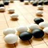**gulu28**:  
李老师，您好。  
有一种说法是，希罗多德的《历史》不是 2000 多年前的人写的，而是成书于 1626 年左右。就是说，所谓希腊的历史，并不是真正的历史，而是 17 世纪的人根据当时的价值观反推出来的历史。  
据说罗素和伏尔泰的文章都印证了这一点。  
西方历史最早有文字记载，开始于 1250 年左右，此前毫无文字记载。此节点之前的，只能称为神话。  
李老师，不知史学界对此种观点是怎样的看法？您是怎样的看法？

**作者回复**:这种“疑古派”的说法其实很多，但不难分辨。修昔底德写《伯罗奔尼撒战争史》就带着和《历史》较劲的味道，柏拉图、亚里士多德也熟悉《历史》，希罗多德在众多古希腊大牛心目中有很高的地位，他们对他的价值观赞赏有嘉，不能把这些全都抹了吧。

**Li Xia**:  
怪不得自由难寻难得，原来是个那么不稳定的东西!因对立面的不同，自由的含义不同。

**帮主 jym88978634**:  
自由之所以难以定义，在于自由是双向度的。我定义的自由边界宽泛了一点，势必意味着对方的自由就窄小了一点。人类社会从单个原始人，发展到部落，再发展到盛邦和国家。规模都在不断的扩大，协作已然成为一个不可能倒退回去的历史潮流。  
对于国家也是这样。全球化是必然的趋势。我们只能用发展的手段来解决全球化中出现的问题。而不是倒退回去。历史早已证明，倒退就意味着战争，意味着毁灭。  
人是愚蠢的，而人群可以变得睿智。自由是宝贵的，但只有自律才能获得最大的自由。

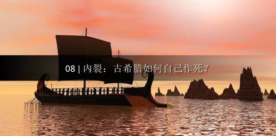

 

你好，欢迎来到《西方史纲 50 讲》，我是李筠。

上一讲我跟你分享了古希腊人的自我认知，他们在与波斯的战争中找到了自己的核心价值，也就是自由。

如果你对历史有所了解，那么你应该知道，在希波战争结束后，没到二十年，希腊内部发生了一场战争，就是伯罗奔尼撒战争，它发生在雅典和斯巴达这两大同盟之间。

那这就有问题了，既然古希腊人有一个统一的自我认知，雅典人和斯巴达人都认同自由这个核心价值，在希波战争时期，希腊人还能同仇敌忾、紧密合作抗击波斯。**那怎么没过多少年，就走到相互猜疑、相互敌对这一步了呢？**

## “修昔底德陷阱”是误读

其实，希腊的内裂，主要就是希腊两大代表城邦雅典和斯巴达的分裂，我们在前面谈古希腊生计的时候也提过一些，古希腊在发展商业的同时，不可避免地带来了贸易的安全问题，最终导致各个城邦之间的军备竞赛不断升级，大战一触即发。

最终，伯罗奔尼撒战争爆发了。关于这场战争，古希腊的历史学家修昔底德专门写了一本著作，名字就叫《伯罗奔尼撒战争史》。

听到这你可能要说，这个答案我知道，就是“修昔底德陷阱”嘛，说的就是一个新崛起的大国，必然要挑战现存大国，而现存大国也必然会回应这种威胁，所以战争就变得不可避免。在伯罗奔尼撒战争里，现存大国就是斯巴达嘛，新崛起的大国就是雅典嘛。这个答案很清楚啊。

但是我要告诉你，**“修昔底德陷阱”其实是个误读，这种说法根本就误解了修昔底德的原意。**

当然，修昔底德确实说过前半句，就是“雅典的权势不断增长，导致了斯巴达人的恐惧，这使战争无法避免”。但是，修昔底德本人并没有去做“修昔底德陷阱”这个总结，这是美国人在 21 世纪总结的。

但是，今天却有很多人在用“修昔底德陷阱”这个概念，去作类推，号称“中美未来必有一战”，因为中国就是今天新崛起的大国，美国就是现存的老牌大国。所以，有的人说中国要积极备战，也有的人不想打仗，就开始从这个“修昔底德陷阱”里找各种解决办法。一时间，修昔底德似乎让所有人都成了国际关系的专家，对未来的中美关系作各种沙盘推演。

但是，修昔底德陷阱其实是一个误读，虽然国际关系中确实存在着安全困境，但修昔底德的智慧，不是教你怎么备战和避战，里面的道理其实很深。这一讲就要来告诉你，修昔底德真正的道理到底是什么。

如果要概括一下修昔底德的智慧，其实就是：国与国之间的矛盾和斗争，并不仅仅是一个国家和另一个国家的斗争，实际上，国家内部不同集团之间的斗争，往往是和国家之间的斗争，也就是国际斗争夹杂在一起的。

这个道理也可以反过来再说一遍，就是，国际斗争往往是和国家内部的斗争混在一起的，并不仅仅是国与国的斗争这么简单。

## 雅典对斯巴达的挑战

修昔底德为什么会这么理解伯罗奔尼撒战争呢？我先带你去看看雅典究竟是怎么挑衅老牌强国斯巴达的。

话说波斯大军压境不只是从陆地上来，还从海上来，斯巴达只擅长应付陆战，不擅长海战，是雅典人组织起了希腊的联合舰队打败了波斯，不过它得负担海军的高额成本。无论古代还是现代，养海军都是非常烧钱的事情。雅典自己独立养不了，于是就从其他城邦收贡金。

可问题来了，你雅典从贸易和舰队的模式当中既能够赚钱又能够当老大，有联合舰队的指挥权，我们这些小弟不都是这种活法，我不想交钱了，退伙！雅典当然不许小弟退伙，于是就和老牌城邦斯巴达怼上了，因为斯巴达在庇护这些退伙的小弟。

故事讲到这里，听起来好像还是在说，新崛起大国和现存大国的博弈，还是“修昔底德陷阱”的味道。但我们再来看看雅典的对手斯巴达，刚才说的那个深层次的道理就浮现出来了。

## 城邦内部的分裂

在柏拉图以前，几乎所有的希腊知识精英都喜欢雅典、讨厌斯巴达，理由很简单，雅典开放，斯巴达封闭。智者们可以在雅典公开地传授哲学，帮人们在公民大会上强词夺理，剧作家们的戏剧可以在雅典的剧场上演，商人们可以在雅典自由地做生意，能工巧匠就愿意去雅典做买卖。

反观斯巴达，封闭，甚至说它专制的人都不在少数。斯巴达公民们就是战士，从小就不管经济营生，只按好士兵来训练，生活朴素，很平等，不能有奢侈的生活，不能有花花世界。有人说，斯巴达简直就是一座兵营。哲学家、剧作家、商人、手工业者，都去不了。

问题来了，斯巴达人只会作战，不种田，那他们凭什么养活自己？

答案是希洛人，也就是奴隶。斯巴达吞并了周边的两个城邦之后，就把这两个城邦的公民全部变成奴隶，让奴隶来进行生产。那么，斯巴达就形成了一个阶级森严的政治和阶级模式。

斯巴达之所以是座兵营，并不是要对外作战，而是首先用来对付自己的希洛人的，奴隶反抗在斯巴达层出不穷，士兵平等的寡头政体简直就是坐在火山口上。斯巴达尽管是兵营，公民们都是战士，但是由于内忧不断，对外也没太大扩张性，否则早就和雅典打起来了。

讲到这里，你应该可以明白当时城邦内部的结构了。我们再回头看雅典崛起对斯巴达的挑战，大致就可以破除“修昔底德陷阱”了，修昔底德陷阱最大的错误就在于把所有国家或者城邦看作一个整体，一个不能再分的原子，以为一个城邦就像一个人在行动。

但实际上，国家和城邦存在着非常复杂的内部结构，和它的对外军事和外交行动是一体的。你怎么能只看外而完全忽略内呢？

我们再回到古希腊的内裂，用安全困境我们大致可以推断，以雅典和斯巴达为首的城邦对峙和战争导致了希腊世界的内裂，但这只是浅层次的。我刚才已经说过，**必须把所谓的外交和内政打通了看。这时候你会发现，内裂比你想象的程度更深，后果更恐怖。**

一个城邦不是铁板一块，是人组成的，更确切地说，是不同的集团组成的。城邦间的斗争往往和城邦内的斗争是高度一体的！那么，城邦内的斗争是什么呢？你想想，雅典模式有利于工商业，那么农民会支持吗，地主寡头们会支持吗？反过来，斯巴达模式有利于农业，爱好开放和民主的人们不讨厌它吗，奴隶不讨厌它吗？

历史其实很精彩，果不其然，寡头党在雅典一方面通过巧言善辩，赢取了公民大会的支持，另一方面他们又和斯巴达暗通款曲，搞颠覆活动。结局是，雅典人躲到卫城里，和斯巴达硬耗，他们染上瘟疫，失去了抵抗力。而且，伟大的领袖伯利克里也在其中。他一死，雅典就失去了主心骨，雅典的内裂已不可避免。

斯巴达也好不到哪里去，尽管它是在同盟城邦科林斯的百般引诱之下，才和雅典开战的，但希洛人始终是斯巴达的隐患。雅典人也曾经成功地策反希洛人，搞得斯巴达人主动求和。处于上风的雅典当然没有答应。但无论如何，寡头党在雅典做的事情，民主党在斯巴达同样做，城邦内不同集团的内裂是普遍的，斯巴达也不能幸免。

如果雅典和斯巴达都不能幸免，其他城邦可想而知。每个城邦内的寡头党都想和斯巴达联盟，民主党都想和雅典联盟，那么城邦就不可能再安宁了。

## “自由”引起的人心分裂

内裂到此还没有停止，从外交到内政，最后内裂直指人心，这才是最可怕的。让我们回想一下古希腊定位自我的核心价值——自由。那么，到底是谁的自由，什么样的自由。

对于希腊人来说，rule and be ruled，轮番为治，公民参与政治是自由。而在斯巴达，士兵寡头们有自由，他们按照传统和习俗，去压制希洛人，这种政治结构对于斯巴达士兵寡头来说，就是服从法律的统治啊。但斯巴达的民主党人却认为他们在斯巴达没有自由，因此斯巴达就不是他们的城邦。

反过来，在雅典也有这样的思想分歧，在雅典民主就是自由，公民参与公民大会和陪审法庭是自由，辩论、强词夺理、操纵群众是自由。但雅典的寡头党人却认为这种民主是暴民统治，他们当然要推翻民主的统治。许多城邦甚至发生了寡头党和民主党来来回回的屠杀。

在这种对自由的分歧当中，不要说斯巴达人和雅典人的分裂，就是在一个雅典人自己心里，不也很分裂吗？在一个人内心分裂和外部纷扰一起袭来的状况下，他行为失当、目光短浅、顾此失彼，不是很正常吗？

古希腊就是在这样一种一层层内裂的逻辑中最终瓦解了自己，所以伯罗奔尼撒战争的胜负已经变得没有意义了，它表面上是耗尽了金钱和人命，但最可怕的是它耗尽了人心。

当马其顿的军团打来的时候，希腊已经没有了抵抗波斯时的那种自信、决心和团结，被征服自然也就是情理之中的事情。

再回头看看“修昔底德陷阱”，当你想到大国崛起会引发大国冲突的时候，你有没有想到，冲突在一个国家内部也在发生，在人心里面也在发生。大国能扛得住内裂吗？

**所以，不要再去简单地推演，到底是不是终有一战，而是要把外交、内政、人心连在一起通盘地考虑问题。**这会使你更容易汲取修昔底德的智慧，也更切合政治的实际。

本讲小结

好，简单总结一下这一讲的内容，古希腊的内裂不只是以城邦为单位的国际对峙，它更是城邦内部派系造成的内政分裂，还有更深层次的人心的分裂和混乱。内裂是从最宏观的文明到最微观的人心，这是一个全面衰败的过程。

古希腊就这样走到末日了吗？不，故事还没完。一个文明行将落幕的时候，也是另一个文明行将诞生的时候，两相交织，会出现非常精彩的场面：人之将死其言也善，和新生儿的呱呱啼哭，汇合到了一起，古希腊智慧的顶峰也就显现出来了。

下面两讲，我就带你去看看古希腊文明的遗言，听听柏拉图和亚里士多德都说了些什么。

精选留言

点击直接进入下一章节

**炭笔**:  
这一讲十分精彩。之前听伯罗奔尼撒战争，觉得开战缘由十分可笑。可是好的历史叙述，会让你看清每个历史细节，让你明白哪怕再愚蠢的历史决定，背后要么是顺水推舟，要么是无可奈何。  
  
国家之间的冲突，还伴随着国内派系的冲突，甚至每个人内心里的矛盾。在分解和矛盾之下，人会急于解决，一旦某一面看到了更多利益，就急于选择这一面，从而失去远见，变得短视愚蠢。国家也一样。  
  
看清历史细节，而不是用简单化的模型去推导演绎，这是我们分析问题应该有的态度。

**作者回复**:政治上的愚蠢多半来自统治者的自私，自私会限制他们的视野和格局，小家子气地认为只有自己是对的、善的、甚至神圣的，结果就是把国家大事办成小孩子赌气的状态。

**蝉**:  
维特根施坦也有类似的说法:如果我们还在抽象地说某某民族怎样，某某国家怎样，只能说明我们思维是懒惰的，民族和国家都是由个体组成的，哪存在什么国家的意志?民族的意志?

**冥之海**:  
老师所讲的“耗尽人心”，确实发人深省！  
从古至今，大到王朝瓦解，小至现代的公司破产，甚至家庭解体，试问哪一个不是耗尽人心啊。  
所谓的战争、争夺只不过是导火索，表象而已，“分”的趋势无法阻挡。  
是什么耗尽人心，是值得我们发现并解决的问题。

**作者回复**:“分”是普遍的，无法阻挡，“裂”可以察其痕而弥其伤，但不是所有病灶都能有人察觉，察觉之后并不是就有办法，有了办法也不是大多数人会支持，即便支持，也并不是就会成功。所以文明会有衰和亡。

**Allelujah**:  
在课程刚开始的时候，我对研究历史的理解是 只有通过对过去历史的梳理，才能对现状的产生与未来的发展有更清晰的了解。  
  
通过老师今天对“修昔底德陷阱”的完整刨析，我发现这样的理解还是不够深入：只有对历史事件、以及记录者的背景不断追根溯源，才知道大众熟知的主流观点是否只是被后人、甚至今人出于各种目的创造出来的，而这些观点无助于我们理解真实的、复杂的世界。

**我心飞翔**:  
《战争论》克劳塞维茨提到“战争无非是政治通过另一种手段的继续”“战争总是在某种政治形势下产生的，而且只能是某种政治动机引起的”。这个观点可以用来解读伯罗奔尼撒战争。  
希腊和斯巴达的内部政治结构是一个小小的蛋壳，无法支撑其规模发展，随着希波战争的胜利，雅典和斯巴达的城邦规模获得明显增长，内部对此蛋壳的压力也随着增加，而外部波斯压力的消失，失去了抵消内部压力的外部力量，其内部政治结构的蛋壳达到临点，破壳在即，新的适应更大规模的政治结构还没有准备好，希腊的内裂逻辑已经在路上。  
  
希腊的海洋商业文明中的对外商业依存度太高，并没有演化出与之匹配的城邦间的内部商业，城邦间，城邦内的商业互相依赖和协作程度较低，城邦间的协作需求低妥协性差，加上自由为核心的价值观，以人为中心的世界观，都造成内部无法发展出规模化的强粘合力的内生秩序，无法构建大规模的想象的共同体，内部抵抗分裂的弹性比例低，缺乏反脆弱性。一旦规模增加，其内外汲取的物质能量无法满足其需求，就离崩溃不远了。  
  
其实，古希腊城邦复制的起家之路从一开始就内生了这样分裂的逻辑，在此基础上发展起来的文明也没有带入更强的秩序内生力，有没有伯罗奔尼撒战争都不能改变这个内裂的命运。反而是没有希波战争却有可能多延续下几年生命。

**北堂双**:  
老师好！上一讲说到，通过自由来定义自我存在着高度的不稳定性，因为不同的政治环境下，斗争关系是在变动的，敌我关系是在变化的，因此对自由的定义也是在变化的。用世俗政治定位自我，就和用血缘、用文化、用宗教差别很大。血缘、文化、宗教都是不容易变动的，世俗政治却是非常容易变动的。  
这一讲说到对自由的不同理解导致了分歧，不仅斯巴达人与雅典人分裂，雅典人自己内心也分裂，原因就在于用自由定义自我的高度不稳定性吧。  
那么，用血缘、文化、宗教定义自我，也会出现这种内外分裂的局面吗？在理解以这些定义自我的文明发生的动乱时，根本原因是否在此？

**作者回复**:血缘、文化、宗教在演化中同样会分化。比如儒家自汉代就有今文经和古文经之争。分化并不必然会走到分裂的地步。文明的衰败从哪里开始裂并不绝对，最后裂到人心则是肯定的。

**三国一梦**:  
现在我对历史的概念就两个字:复杂  
从结构上分，古希腊分为希腊城邦与雅典城邦，而希腊城邦从政治派别分为民主党与寡头党，而民主党又是有许多个体组成的，个体对于“自由”的定义是不一样的，而每个个体对于“自由”的概念又是流动的，所以不能用静态的视角来分析动态的历史。  
  
学习施展老师的中国史纲确实让我用二元法这种思维模型有了一个对历史的基本认识，从顶层结构的视角有了一个看待世界的基本眼光，继续细分下去才能让历史“活起来”，任重道远，还需不断的学习。

**囚徒 韫韬**:  
历史让我们看到最多的是人性，在每个时代格局中的人总会由人性超级复杂的交织演化过程达到新的格局平衡状态。

**作者回复**:顺着说一句：平衡并非演化必然的结果，否则就不会有那么多文明、那么多国家灭亡。

**佛祖门徒**:  
“伯罗奔尼撒战争”的背后有如此复杂的内部原因，而很多人通常会把它视作外部冲突的一种表现形式而已。  
收获一：澄清了“修昔底德陷阱”这个常用而不自知错误的概念，之前有些人云亦云。  
收获二：自由的不同理解和追求实现的路径分岐导致社会从意识形态之争演化为你死我活的斗争。  
收获三：内部分裂是导致古希腊文明的堡垒被攻破的主因，如果能够团结一致，波斯文明不曾征服的，马其顿军团也很难获得胜利。

**夜尽天明**:  
听完这一讲，震撼得无以复加。希腊世界的衰败，从文明，到同盟，到国家，到城邦，到人心，一层一层枯萎下去，最终导致了崩盘。  
我想，根源还是人心，人心难测，只求保全，投射到城邦，再投射到国家，再投射到同盟，再投射到整个文明。这层层关系还不仅仅是上下关系，还有同级的交织碰撞关系。  
瞎写而已，震撼之余，聊以自慰。

**作者回复**:多谢笔记，不要怕自己是“瞎写”，写下了，就是一个谁也抹不去的足迹！

**小猪壹壹**:  
本课程还有读者留言，越听感觉越好，越看感觉越清。收获:一是明白内裂，尤其是人心内裂的价值意义，“内裂”是一个让我刻骨铭心的词语。二是明白修昔底德的智慧，学会从外交、内政、人心等综合因素来把握事物发展的趋势。三是明白生存的意志和智慧、权利的生成与流转、文明的冲突与融合怎样在历史不同阶段交织演变的。四是明白历史发展诸多事情不随人愿，很多时候是由于人们狭隘心胸、短暂的目光、既得利益保护导致的，或者说由人的本性限制的。五是和老师一起学会通过素材、逻辑、推理理解人心、人性和世界。谢谢老师教导，谢谢留言者的启示。

**nevermore**:  
透过散落、琐碎的历史线索和各种表象，找寻背后的底层的决定性的逻辑，而这种逻辑对当下，对未来都具有启迪，“历史学即未来学”，这就是历史的魅力！

**nature 追风者**:  
李老师真是有料，干货十足啊！能把一个现象从国家的宏观分析到人心的微观的学者，李老师真是我遇到的头一个，给您点个赞👍。  
国际斗争往往是和国家内部的斗争混在一起的，并不仅仅是国与国的斗争这么简单。  
内裂是从最宏观的文明到最微观的人心，这是一个全面衰败的过程。  
上节课讲波希战争中，希腊人因为对自由的信仰而团结一致，打败了强大的外敌；这节课又谈到因为内部对自由的不同认识和理解，造成了分歧，从而导致内裂，最终爆发了伯罗奔尼撒战争，使得希腊共同体内耗，在马其顿军团的入侵下，再也无力共同抵御外敌了。  
我最近有个很强烈的认知，是从《刘苏里.名家大课》里讲的奥古斯丁的《忏悔录》中感悟的，就是人们总是热衷于二元对立，但其实一元统一才是正途。小到家庭这样的小团体，大到国家这样的大集团，都是这样，现在的世代应该追求的是共赢而不是仍目光短浅地只关注自己，中国和美国的贸易战是国家政治，但是双方领导人如果能以未来的前途为目标，就应该握手言和，寻找共识来协力为未来而努力，为了逞一时之快而形成的对抗，实在是对两国及世界的未来都没有好处。

**作者回复**:统一或者和谐，所要求的条件比对抗或者分裂，要多、要高、要难。

**Yujingyouyou99157067**:  
不止一次的在课程中听到了“伯罗奔尼撒战争”和“休斯底德”陷阱，从不同的角度去分析，会得到不同层次的理解。在回顾历史、总结经验的惯性做法中，容易忽视的就是不偏执偏信，所以就一个现象或事实，尽量收集更多的信息，不仅能避免盲目跟风，也是提升真相分辨能力的锻炼。得到，让无从下嘴的自己更轻松的收获这一目的。

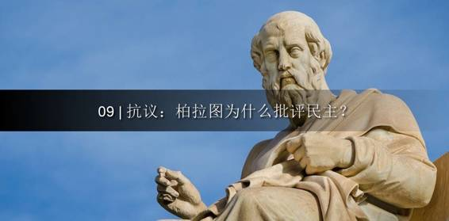

 

你好，欢迎来到《西方史纲 50 讲》。

上一讲我跟你分享了古希腊的内裂，内裂是古希腊从最宏观的文明到最微观的人心，全面衰败的过程。

## 哲学的反思

文明即将落幕，这个时候，它通过哲学这种形式表现出来的智慧，往往才会达到顶峰。你一定知道，孔子说他自己生活的时代叫礼崩乐坏，比他晚一点的庄子说不仅政治烂透了，连学术也四分五裂，叫“道术将为天下裂”。

哲学的巅峰似乎总是比政治、经济的巅峰要来得晚一些。甚至多数时候，在一个文明的政治、经济走下坡路，甚至快要跌落谷底的时候，哲学的巅峰才到来。

因为哲学是反思，是对文明、对生活、对人心的反思。**当文明在上行通道的时候，大家都去追逐这个美好的时代，没有出现什么大问题，人也不会多想，哲学就比较沉默；相反，当文明进入下行的通道，深层次的问题会被聪明人识别出来，反复拷问。**

孔子如此、庄子如此，柏拉图、亚里士多德也如此，哲学家们出场的时间很有意思。显然，哲学家们无法拯救即将毁灭的文明，但他们的思考却会提出永恒的问题，让新生的文明汲取其中的道理。

## 柏拉图为何批评民主

这一讲，我们就看看古希腊处在下行通道时，当时的哲学家都在思考什么。我带你从一个具体问题来入手，就是，柏拉图为什么批评民主。

民主在今天这个时代已经成了“政治正确”，民主成了标准格式，但到底什么是民主，都快把我们弄糊涂了。这个问题我留待以后仔细跟你讲。这一讲，我主要跟你分享柏拉图为什么对民主提出了强烈的抗议。

**首先我带你去看看柏拉图这个人。他是西方历史上最伟大的哲学家，大概他认第二的话，没有人敢认第一。**他的作品涉及了神学、形而上学、认识论、价值论等几乎所有哲学的分支，而且都有系统而深刻的观点。

柏拉图的哲学你可以去听刘玮老师对他许多著作的解读。我在这一讲，主要带你去看柏拉图是怎么剖析自己文明的弊病的。

柏拉图是雅典人，出生贵族世家，他童年时候伯罗奔尼撒战争一直在打，雅典战败后，斯巴达在雅典扶植了傀儡政权，历史上称为“三十僭主”。他们是靠境外敌对势力上台的，上台之后又实施残暴统治，三十僭主很快被推翻了。

但是，这时候的民主已经不是昔日的民主了，雅典的民主已经劣质化了。正是这个劣质的民主，柏拉图最敬爱的老师苏格拉底被处死了。

苏格拉底被处死，柏拉图遭受重大打击。柏拉图认为自己生活在一个坏政治横行的时代，没有一个城邦是好东西！

## 柏拉图为何投身政治

和你印象里的哲学家不同，柏拉图积极投身政治，他甚至三次在叙拉古这个地方，意图实现哲学王的蓝图，也就是把政治权力交给全知全能的哲学家。但是柏拉图这些政治上的努力最终都失败了。

哲学家不是追求沉思的生活吗？为什么西方头号哲学家要投身政治呢？

首先，投身政治并不表明政治的生活就比哲学的生活要高贵，柏拉图当然认为哲学的生活更高贵。更重要的是，柏拉图有宏大的抱负，他想去改变世界。

他在《理想国》里面借苏格拉底之口说，统治是很难做好的事情，聪明人都不愿意做统治者，因为统治本身费力不讨好，统治者要么出于金钱、要么出于荣誉、要么出于避免惩罚才去统治。而柏拉图自己想当统治者，或者想让自己的学生当统治者，金钱和荣誉都不是主要原因。照我看，逃避惩罚是柏拉图的动机。

柏拉图需要逃避什么惩罚？对于一个胸怀世界的人来说，这个世界的混乱、肮脏、虚伪、不义就是对你的惩罚，你会为它们着急，你天天看见它们，又无能为力，这对有良知有抱负的你来说不是一种惩罚吗？这种惩罚体现在柏拉图身上，就是雅典的劣质民主处死了老师苏格拉底。

**所以，权力对于自己的生活状态很重要。**现在有一句话对柏拉图的意思作了很好的解释：你不掌握权力，离它远远的，那你就会把位子让给你最讨厌的人。你想，如果你最讨厌的人上位了，即便不给你小鞋穿，你天天看着他胡作非为，把公司或者更大的团体搞坏了，你不难受吗？

## 雅典劣质化的民主

没错，柏拉图批评的民主，就是雅典在内裂过程中衰败演变后的劣质化的民主。

我给你举两个例子看看它坏得有多么匪夷所思。我要讲的第一个坏民主的例子是，雅典的公民大会后来居然频繁地作出决议，要出钱招雇佣军替他们去打仗。

回想一下我在前面跟你讲的，公民平等是民主的基本准则，什么是公民、什么是平等？最重要的权利和义务就是当兵打仗啊！雅典人这种堕落的决议是放弃权利、推脱义务，简直就是出卖自己、出卖城邦。如果公民已经不再是公民，抽签和多数决定还有什么意义，爱国奉献还有什么意义？

你可以去听一听《刘苏里名家大课·君主论》第 3 讲，我在里面跟你分享了，马基雅维利是如何痛斥雇佣军有百害无一利的。

我要说的第二个坏民主的例子，是陶片放逐法。公民们在大会上用陶片写下希望被放逐的公民的名字，一旦达到法定数额，此人就被放逐。这个人是罪大恶极吗？不是。只要大家认为他危害了城邦就行。雅典人往往认为优秀的人有威胁，就先把他放逐。决议一旦通过，被放逐者不得申辩，10 天之内必须走人。

要知道，这是一种严厉的惩罚，亚里士多德曾经说过，城邦之外，非神即兽。放逐一个人是剥夺他的公民资格，相当于判他政治上和精神上的死刑，没有别的原因，就因为你太优秀了！

人多势众就一定是对的吗？这样的民主你会支持吗？

在这里，有一个重大的启示：**任何政体都有自己的原则，比如民主政体的原则是平等，遵循自己原则的政体会兴盛，背叛自己原则的政体会衰败。**从亚里士多德到孟德斯鸠，一直在讲这个道理。

坚持原则是非常困难的，因为有很多外力会干扰，比如雅典商业发达之后必然会产生贫富分化，人心也各打各的算盘，平等很容易被金钱侵蚀，但偏离原则就意味着蜕化堕落，很容易变成打着民主的旗号，干集体自私自利的事情。

像雅典人这样公开毁弃自己的原则，那就等于自我瓦解、自掘坟墓，正所谓自作孽不可活！

## 城邦的正义

不过，你要是觉得柏拉图只是批评一下劣质化的雅典民主，那你就小看他了。他要找到城邦世界最好的秩序，这就是他写《理想国》的目的。在他如大海一般广阔和深邃的智慧当中，**我们挑一点来看柏拉图对文明的思考：就是他对灵魂与城邦的类比。人的灵魂和城邦一样都得遵循正义的德性。**

人的灵魂里面有四种德性，分别是智慧，这是理性的力量；勇敢，这是意气的力量；节制，这是和谐和秩序的力量；还有正义，当智慧统领了勇敢和节制，就是正义，人的灵魂就是健康的。

同理，柏拉图认为，在城邦之中，智慧是统治者应有的德性，勇敢是护卫者应有的品质，节制是生产者应有的品质，智慧的统治者统领着勇敢的护卫者和节制的生产者，那么城邦就是正义的。

我们用柏拉图的标准来看，雅典的劣质民主居然花钱请雇佣军，商业的繁荣膨胀了他们的欲望，使得他们失去了节制的德性， 利令智昏以至于理性的智慧也不复存在，在这种情况下也没有什么勇敢可言了，正义自然也就荡然无存。

不过，雅典的对手，斯巴达也好不到哪里去。他们在伯罗奔尼撒战争中，为了打败雅典，不惜和波斯人结盟，虽然没有直接动用波斯的军队，但拿了不少波斯的钱。

回想一下，在希波战争时，那位誓与波斯血战到底的斯巴达人，当时的斯巴达人崇尚自由，绝不向专制和奴役屈服。但是，到了伯罗奔尼撒战争时，斯巴达也堕落了。**正义就是城邦健康的根本，失去正义，就是病入膏肓。人同样也是如此。**

所以我才会在上一讲告诉你，古希腊的内裂是从国际秩序到城邦内政，再到人心的层层腐化。从古希腊的状态来看，最后征服希腊的亚历山大大帝，不过是击败了一个行将就木的垂死病人，也没什么值得骄傲的。

柏拉图建立理想国，实现正义的具体制度我们以后再找机会谈，这些制度确实有斯巴达味道，甚至有专制的味道。但我们先得把大哲学家的文明立场找到，他虽然对雅典民主有切肤之痛，但他批评的不只是雅典民主，《理想国》不是政治时评，而是哲学对一切坏政治的批评，只不过雅典劣质化的民主首当其冲罢了。

民主并非不可批评，坏政治必须予以批评。

如果你理解了柏拉图强调的正义对于城邦和对人的根本重要性，那么你是不是也可以想想：**智慧、勇气、节制在你心里和你的国家里，如何才都能实现，如何能相互配合，达成一种内在健康的状态？如果你判断它不健康的，你会怎么办？**

本讲小结

好，简单总结一下今天的内容，**柏拉图这位西方最伟大的哲学家对自己所处的文明为何衰败，给出了一整套判断标准，就是智慧、勇气、节制和正义。**

我们的老子曾经说过一句意味深长的话，失道而后德。当古希腊走到了衰败的下行通道，这时候去找到“什么是正义”才变得迫切。尽管柏拉图见地非凡，但他也阻止不了古希腊的衰亡。

下一讲我带你去看看，古希腊临终时候的样子，大哲学家亚里士多德的学生亚历山大终结了古希腊，**西方文明由此进入新的时代：帝国时代。**

期待你的到来，下一讲再见！

精选留言

点击直接进入下一章节

**强 Sean**:  
柏拉图面对着混乱、肮脏、虚伪的世界，面对着自己老师的死，没有选择干等和枯坐，也没有一昧地去抱怨，而是在愤怒的无能为力中绝地反击，自己的勇气和抱负被充分激发出来，不遗余力地去行动和改变。  
  
我在年少时也做过那种愤青，和柏拉图比起来，真的是自惭形秽。有时候，愤怒正是因为心怀希望，但如果仅仅停留在愤怒，很可能沦为“言论上的巨人，行动上的矮子”。当我们抱怨这个世界并希望能改变的时候，一定要意识到首先要改变的是自己。

**作者回复**:改变自己，从目标的规划开始，不能拆分并逐步实现的目标都只是自己骗一下自己。

**蝉**:  
BC399 年，面对老师苏格拉底被公民们投票处死的现状，柏拉图对雅典民主彻底失望。他认为国家应由统治者、保卫者、生产者三种人构成，这三种人各具其德、各守其位，哲学家基于智慧和理性，应该成为统治者，并写就了《理想国》。

**蘭**:  
关于老师的第二个坏例子我有一些补充：陶片放逐法由克里斯提尼创立，最初是为了对付政治上掌握大权而意图恢复建立僭主政治的雅典政客，将极具社会威望的，广受欢迎的，可能威胁民主制度的政治人物予以驱逐，投票人数必须达到 6 千才能生效，而且 10 年后被驱逐的人也可以回到城邦。当然再好的制度，如果没有约束，也会变成坏的制度。当雅典从民主制度变成暴民统治的时候，一些政客以民主为号召，鼓动民众把“陶片放逐法”作为打击政敌的武器。陶片放逐法越来越失去了维护民主秩序的作用，相反，加剧了无政府主义的泛滥。

**作者回复**:谢谢补充！

**在天边撒点野**:  
年轻的时候我们总想着改变世界，但慢慢长大后发现，先通过改变自己，然后通过行为的力量把自己管理得很好，并通过所谓的一种修行，把自己的光芒和魅力呈现出来，你就已经影响到了别人。  
当我们对事物不满，不应简单停留在说的层面，言行一致，会让一切变得更有说服力。

**作者回复**:用行动去一步步改变世界！

**陈 C**:  
老师在这堂课里，提出了一个很有趣的规律，每次哲学家和思想家辈出的时候，也往往是动荡混乱的时期。我是这样理解的：哲学就是爱智慧，在于不断追问根本，每逢“乱世”，自然也是人们危机感最强的时候，也就会有更多的人去反思，去不停地问“为什么会这样”、“我们应该怎么办”；而当这一系列的追问触及到根本的逻辑时，讨论也就进入到了“哲学”的层次上。、  
  
这事情还可以从另一个角度去理解：吴伯凡老师在他这周的专栏里讲到，人的“决策”与“认知”，总有一个此消彼长的关系：决策越早越好，但早了就会缺乏认知；认知越晚越好，但晚了就来不及决策了。政治关系和人与人之间、人内心想法之间的关系有着深刻的联系，因而个人层次的认知矛盾，也是可以部分推演到国家政治的层次上的，只不过“决策”在这里换成“改革”可能更合适——当政治病入膏肓时，改革已晚，却是认知最为成熟的时候，体现在外便是哲学的繁荣。

**三国一梦**:  
当一个国家处于上行阶段时，很少有人会注意到危机的存在，或者就算知道了也会自动忽略。这个时候哲学家虽然发现了，也没有人会相信。  
而当一个国家开始走向下行阶段时，社会矛盾就凸现出来，这个时候形势会恶化，旧社会被推翻，新社会开始建立，哲学的意义才体现出来，由后人学习前人的教训。  
  
任何政体都有自己的原则，比如民主政体的原则是平等，遵循自己原则的政体会兴盛，背叛自己原则的政体会衰败。柏拉图批评一切坏的政体，而我现在理解了柏拉图写理想国的意义了，建立一个好的政体。

**作者回复**:柏拉图的“理想国”是好政体的好方案吗？如果不是，问题在哪里？如果是，为什么落实不了？好政治难道永远是画饼充饥的事情？

**悟慧**:  
我们的老子还说过一句话“绝智弃辩”  
民主和自由可以共存吗？似乎可以  
民主就意味着公平吗？我倒是觉得它俩本身就是矛盾的。  
苏格拉底之死确实是公民投票的结果，但它绝对不是所有人都希望他去死，他之所以死，是因为他的智慧和行为使大多数既得利益者感到恐惧。  
用经济学的原理来解释今天的话题是很贴切的，经济学不关心人是不是理智的，也不关心人是不是自私的，它只关心如何存活的问题。  
  
柏拉图对于民主的追问非常值得推敲，他问人为什么是平等的？在什么意义上是平等的？  
智慧的大成者苏格拉底很明显是站在了愚夫愚妇的对立面，公平有从何谈起呢？既然找不到更好的解决方案，那就干脆把你处死，消弭智力差距带来的不公平吧，因为我们都渴望最纯粹的“民主”啊！  
  
究其根本，民主在一定程度上与人性是矛盾的。

**作者回复**:民主与人性在什么“程度”上是冲突的？什么“程度”上是吻合的？

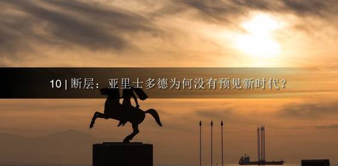

 

你好，欢迎来到《西方史纲 50 讲》。

上一讲我跟你分享了柏拉图对古希腊衰亡的诊断，柏拉图为衰亡的希腊设计了许多制度，但他的学生亚里士多德似乎都不太赞同。

这一讲我带你看看亚里士多德的学问和他的学生亚历山大的业绩，亚历山大出身小国马其顿，后来征服了希腊、埃及、波斯帝国，是西方最伟大的军事领袖。

但是，一个很有趣的问题是，亚里士多德有着百科全书式的学问，但是他却完全没有预见他的学生会取得如此辉煌的业绩，开创一个新的时代，他也没有对学生的功绩留下任何一个字的评论。

从西方文明史上这对最伟大的师生之间，**你可以发现西方文明存在着一个重大的断层，就是城邦时代和帝制时代的断层，古希腊提供的政治智慧已经跟不上大规模政治共同体的统治需要了。**

## 亚里士多德百科全书式的学问

为什么这么说呢？我们先来看亚里士多德的学问。

论深度，亚里士多德可能不及他的老师柏拉图，但论广度，亚里士多德则远远超过了他的老师。在深邃的哲学问题上，亚里士多德也很有主见，你肯定知道他那句名言“吾爱吾师，吾更爱真理”。他在很多著作中都含蓄地批评了自己的老师。

亚里士多德的学问几乎无所不包，神学、形而上学、逻辑学、天文学、物理学、政治学、伦理学、植物学、动物学，是古代世界的百科全书。

论深度，其他古老文明里面不难找到和柏拉图匹敌的大人物，中国的老子、孔子，印度的佛陀，基督教的耶稣；但论广度，其他古老文明里面真的很难找到亚里士多德这样百科全书式的人物。

不仅如此，亚里士多德一直保持着科学家的好奇心，所有东西他都想自己看，自己分析，他主要不是待在书斋里苦思冥想，而是在整个希腊世界旅行。

他的学生亚历山大也很贴心，知道老师想要穷尽这个世界的所有知识，在东征打到亚洲的时候还万里迢迢把植物、动物的标本送回雅典给老师研究。学生的控制范围超出了希腊世界，帮助老师成就了百科全书。

**除了亚里士多德本人被好奇心驱动之外，他必须心存一个世界性的知识框架，才可能把海量的知识分门别类。**这个道理很简单，如果你家里有十本书，那你把它们随便扔哪儿，想用的时候迅速找到它们也不是什么难事儿；但如果你有一万本书呢？如果不按照某种分类的方法把它们归置好，你想用的时候根本不可能找着。

从这个角度看，亚里士多德不是一个古希腊知识宝库的图书管理员，他是这个图书馆的设计者，有了他，你才有手中的图书检索号，在迷宫一般的书库里才能准确地找到你想要的那本书。

很多古希腊哲学家、科学家没有写下著作，即便写下也在漫长的历史中丢失了，他们之所以还被我们知道，很大程度上就是因为亚里士多德记录了他们。

亚里士多德对知识的极度渴望也许和他的出身有关。对比一下柏拉图就更清楚了，柏拉图出生在雅典的名门望族，是以希腊文明最核心的代言人自居的。

而亚里士多德出生在边陲小城斯塔吉拉。虽然他的父亲是马其顿宫廷御医，他本人也受到宫廷优待，后来还成了帝师，但他的身份仍然比较边缘，因此他想进入希腊文明的核心，去汲取她的所有智慧，这种渴望是很强烈的。

亚里士多德创立自己的学派之前，在马其顿当了八年的帝师，他的学生亚历山大后来不仅征服了希腊全境，还征服了波斯、巴比伦、埃及、印度，堪称西方历史上最伟大的军事统帅。

## 横扫世界的小国马其顿

这里我们必须先回答一个问题，为什么是北部边陲小国马其顿横扫整个世界？

道理其实并不复杂，马其顿很像我们春秋战国时候的秦国。**一统天下的不可能是传统大国，齐国、晋国，而是来自边缘，既对天下心向往之，却又没有太多规矩束缚，想加入大国俱乐部，就只有力行改革、富国强兵，用实力说话。**

马其顿的“商鞅变法”，大概在亚历山大的父亲手里完成了，留给亚历山大的是非常高效的国家和军队。亚历山大在 18 岁的时候就显示出极为卓越的军事才能，一生从未吃过败仗。军事史家评论亚历山大的军事天才曾经这么说：项羽善于战斗，韩信善于战术，刘邦善于大战略，亚历山大则是三者兼备。

亚历山大征战的过程我们就不细说了，在这里我想跟你分享的是他对西方文明的贡献。**一方面，他热爱希腊，把希腊文明撒向了全世界；另一方面，他又开始琢磨希腊文明与东方文明的融合。**

我们先来看第一个方面。有很多证据表明亚历山大是希腊文明的深度热爱者。他喜欢《荷马史诗》，以至于征战途中要去落实故事中的地点，凭吊一下阿喀琉斯。他在埃及兴建了亚历山大里亚这个城市，并修建了博物院和图书馆，自那以后一直是西方学术的重镇。

他所到之处，都在传播希腊的文化，他简直是希腊文明的播种机。他万里迢迢给老师送科研材料，也证明了他对希腊学问的高度认同。

**不过，随着与亚洲各国交往的深入，亚历山大发现自己的传统观念是有问题的。**希腊人骄傲地认为只有自己是文明人，其他人都是野蛮人，尤其是亚洲人。

亚里士多德甚至把这种观念上升为一种政体理论：他认为，文明意味着自由，而野蛮就是只有一个人是主人，其余所有人都是奴隶，这叫专制。自由属于希腊，专制只属于东方，专制就是野蛮。所以亚里士多德曾经嘱咐亚历山大，做希腊人的领袖，做野蛮人的主人。

但亚历山大却发现，波斯人、印度人、埃及人，都不是那么野蛮，他们的文明程度也很高，而且必须将他们收为己用。所以他实施了一系列融合东西方的措施，比如自己娶了亚洲公主，还鼓励部下异族通婚，再比如开始接受东方君主的服饰礼仪，再比如将马其顿士兵和波斯士兵混编。亚历山大的措施已经超出了老师的眼界。

## 城邦时代与帝国时代之间的断层

这时候，我们就可以回答本讲的核心问题了：**为什么亚里士多德有百科全书式的学问，却没有预见学生实现的未来，为什么他没有预见亚历山大开创的帝国时代。**

亚历山大 33 岁英年早逝，亚里士多德比他还晚去世一年，他经历了学生横扫天下的全过程，却没有留下任何评论，政治上的考虑恐怕是有的，为了不触怒和亚历山大交战的雅典人，亚里士多德不谈国是。但亚历山大死后，亚里士多德就被雅典人指控亵渎神灵，不过他没有像苏格拉底那样慷慨赴死，而是选择了逃亡。之后一年便去世了。

我认为，亚里士多德没有预见学生的丰功伟绩，最重要的是内因：亚里士多德仍然停留在希腊那种以城邦为基本单位的世界当中，他无法想象五百万平方公里的庞大帝国是什么样的。按照他的套路，亚历山大就只能做野蛮人的主人嘛！**文明是最大的自我界限，聪明博学如亚里士多德都跳不出来。**

越是热爱自己的文明，越会把它当成天经地义，越缺乏对自己文明的反思，遇到异质文明冲击的时候，就越容易傻眼。中国最初遇到西方文明，也遭遇过这种窘境，推荐你去看茅海建先生的《天朝的崩溃》。

对异质文化的开放、包容、尊重和理解，实际上决定了一个文明本身的高度，有时候甚至决定了它的存亡。

那么，问题又来了，亚历山大见过比老师更大的世面，而且有所行动，**如果亚历山大不是英年早逝，而是长命百岁，他会成为西方的秦始皇吗，西方会像中国一样变成大一统吗？**

答案是否定的！亚历山大也没有这个能力。**这不是因为他英年早逝，而是因为西方文明在当时的政治想象力和政治工具，还完全不足以支撑起大一统。**

回想一下我们在前面讲古希腊的格局，为什么是城邦林立而不是大一统，最重要的原因是小国寡民提供不了治理大规模共同体的政治制度和策略。如果古希腊拿不出这些东西，亚里士多德也没法凭空想出该怎么办，那他的学生亚历山大在胜利之后，怎么可能就立马拿出这些东西来统治呢？

我带你看看亚历山大死后的西方你就明白了。经过残酷的拼杀，亚历山大帝国最终一分为三，而这些个国王们采用的都是军管的方式来统治。这个时代叫希腊化时代。

在希腊化时代，希腊文化在政治控制有限的情况下尽情传播，而政治控制有限就是因为国王们的统治无法从战争形态进入到行政、法律、文化的日常管理。秦始皇做到的官吏队伍、严刑峻法、书同文车同轨、焚书坑儒，希腊化时代的国王们完全做不到，甚至连想都想不到。

亚历山大即便不早死，即便再英明神武，这些事情他仍然做不到。这样的王国看起来很庞大，其实没有落地生根，所以后来罗马人一来，他们就乖乖投降了。

回头来看，亚里士多德与亚历山大之间的断层是西方文明第一阶段和第二阶段之间的断层，是城邦时代与帝国时代之间的断层。

老师还停留在城邦阶段，学生开创了帝国阶段，但是还远远不足以将它完成。

本讲小结

好，简单总结一下这一讲的内容。亚里士多德是古希腊学问的集大成者，成就了人类历史上最伟大的百科全书式的学问，但他完全没有预见到他的学生亚历山大开创的新时代，因为他跳不出文明设定的自我界限。但英明神武的亚历山大即便长命百岁，很可能也无法治理一个庞大的帝国，因为当时的西方还没有发展出治理庞大帝国的政治智慧。

从这个角度看，罗马人非常伟大，是他们为西方提供了古代条件下治理大规模共同体的成功经验。

下一个单元我带你去看看罗马，看看它的兴衰存亡，看看它为西方文明留下了什么基因，又留下了什么惨痛的教训。

期待你的到来，下一讲再见！

精选留言

点击直接进入下一章节

**佛祖门徒**:  
说心里话，老师这一讲气势磅礴，我的脑子里不时响起恢弘的音乐，仿佛辉映着亚历山大时代。我有两点思考：  
第一、亚里士多德受到局限的原因。一是实地见证的欠缺，亚历山大之所以超越了老师的眼界，主要原因恐怕是行万里路，真实感受到了不同的古老文明，而亚里士多德一生没有超出希腊世界的旅行限制了他的眼界。二是对古希腊文明的盲目自信。也许古希腊文明太过辉煌，也未能见证其他文明的伟大，亚里士多德的思维边界也就止步于此。  
第二、古希腊文明的局限性。城邦的组织形式限制了古希腊在政治、经济等国家治理方面的制度建设，使得更大规模的统治需要到来时不能很好的适应，跨越这个鸿沟需要几代人孜孜不倦的探索和努力。

**作者回复**:每个创造出重大成就的文明都觉得自己很牛，很自信，觉得自己是世界的中心。这没有太多需要指责的。因为后见之明的指责不仅没有太多教益，反而会让自己盲目自我感觉良好，陷在自己不咋地还觉得自己很牛逼的愚蠢状态。看清前人最后应该落实在反思自己。

**Li Xia**:  
对异质文化的开放、包容、尊重和理解，实际上决定了一个文明本身的高度，有时候甚至决定了它的存亡。  
  
我的感触，文明如此，人亦如此。一个人对异见的开放，包容，尊重和理解，决定了一个人的高度。盲目自大，是自我进步的绊脚石。如何避免故步自封呢？从亚历山大身上我看到，第一，找个好老师，向优秀的人学习。比如得到的老师和优秀同学。第二，行万里路。在行路中，会真切的感受到自己和自然，自己和他者。

**作者回复**:理解他者，需要先放下身段。

**孙鉴**:  
50 讲太少了，虽然还没发完，但是真希望老师能开个专栏。  
津津有味，回味无穷，这些词已经不足以形容这门课了。  
拜托罗胖和老师商量下开个专栏。

**作者回复**:谢谢你的建议，我去问问罗胖！

**三国一梦**:  
亚里士多德的偏见：自己所在的城邦才能叫做文明，而其它的国家都是野蛮人，以此来区分自己与他人的不同。  
  
西方文明的第一个断层：城邦时代到帝国时代。  
如果说亚历山大征服国家很容易，那么要治理帝国就太难了，组织结构随着人数的增多是完全不同的，一个村庄跟一个城邦的治理办法是完全不同的，如果非要用城邦的治理方式来治理帝国的话，那么结局就是帝国崩溃。

**翦秋水**:  
学完这一讲，最大的感触是：眼界决定世界。  
读万卷书不如行万里路。

**作者回复**:下半句有点过了。读书和行路一样重要，没有读书的行路不过是去著名景点拍个照，用到此一游证明自己的虚荣心。

**刘某人**:  
老师 请问罗马人的治理大规模和中国当时的官僚主义有哪些异曲同工之处吗？

**作者回复**:很多表面相似，实际上有太多不同。过几天讲罗马会告诉你！

**苏格拉磊**:  
这让我想起《庄子·秋水》里的故事。有一位河伯，当百川灌河时，他欣然自喜，而当它顺流东下，见到没有边际的北海时，才自叹见笑于大方之家。  
亚里士多德犹如河伯，他的认知边界，是继承了柏拉图、苏格拉底以及当时人，因为当他没有去看过北海时，他也无法理解这个世界的认知边界有多么大。  
我们也是如此，面对如此庞大的世界，唯有谦卑地学习，因为总有一些我们所不知道的事情，正在这个世界上不知不觉的发生。

**作者回复**:史之所以需要纲，就是要呈现文明之间的冲突与融合，在对比之中先放下自我，再超越自我。

**185\*\*\*\*2927**:  
讲得很好，逻辑严密、叙述精要、启发思考。提一个吹毛求疵的小看法😝，估计李老师是南方人，口音里“eng”的音通常发成“en”，如层（ceng）变成了岑……当然，总的来说李老师的普通话已经非常标准了，再辅以抑扬顿挫的语调，感觉得出是一位用心授课的好老师。谢谢“得到”和李老师，还有施展老师。

**作者回复**:乡音难改，多多包涵！

**苏格拉磊**:  
#每天跟李筠学西方史纲#  
文明是最大的自我界限，聪明博学如亚里士多德都跳不出来。而思维是最大的自我设限，聪明如自我也未必能跳的出来。  
当认知遮蔽出现，唯有谦卑地持续学习，链接更多有智慧的人，不断拓展见识，才更有可能，接近成为一个知道自己不知道的人。

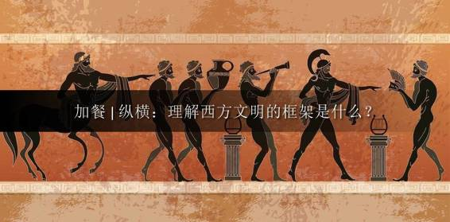

 

你好，欢迎来到《西方史纲 50 讲》。

在前面我提到过，我把文明看成一个“两纵三横”的结构。通过前面几讲，相信你已经对这门课的讲法和逻辑有所了解了。

这一讲，我就来和你专门聊聊，到底什么是“两纵三横”，应该怎么理解这个大结构。

## 文明的两大尺度

你可能也听过一些关于文明的课、看过一些关于文明的书。你一定知道，文明是一个很大的词，包括了政治、经济、社会、宗教、哲学、艺术等等。我先通过两个“尺度”带你理解这门课所说的“文明”。**第一个是，文明和野蛮的关系；第二个是，现代和古代的关系。**

**先看第一个尺度，文明的产生就是为了克服野蛮，文明的成果如此发达，说明野蛮其实很难克服。**中文的文明也好，西文的 civilization 也罢，都是和野蛮这个词相对的。所以，你可以把文明理解成：人为了克服野蛮所取得的进步。

那问题又来了，什么是野蛮？野蛮就是暴力，就是一言不合就动粗，文明就是不动粗、讲道理。暴力可以是物理性的，也可以是精神性的，动粗可以是挥拳头、抄家伙，也可以是人肉搜索、网络谩骂。驯化暴力、克服野蛮，表面上是禁枪之类的问题，但根本上是纯化人性、软化人心。文明归根结底是人的文明。

人会发明器物、创立制度去驯化暴力、克服野蛮，它们是文明的成就，但是，新发明也会让暴力和野蛮找到新的出路，新制度甚至会带来意想不到的野蛮。文明的成果并不会完全按照发明人的原始意图一直走下去，意料之外和歪打正着都是常有的事。

比如枪，让有枪的人更暴力，但比起刀的时代，你动粗前就要想一想了，就不是每个人都可以随便动粗了；互联网，让人的沟通交流更便利，让人更容易相互理解和宽容，但也让人互相伤害变得更容易。技术的发明如此，制度的创立同样如此。

**所以，文明的进展之所以曲折，很重要的原因是新发明到底有利于文明还是有利于野蛮很难控制，越是文明成就，越隐藏着它的反面。**文明的成就，必须从动机、过程和效果全面地去解剖，从中不断地提炼什么是真正的文明的标准。

只有把文明看作博大、深刻、复杂的状态，你才不会把任何人取得的文明成就当作天经地义。成功案例并不是规律，规律必须自己去提取，提取之后必须自己去实践，最终有可能是殊途同归。但文明的追求就像每个人做人一样，都得自己来，别人代替不了。

**再来看第二个尺度，现代文明和古代文明到底是什么关系。**所有文明的古代和现代形态都不同，现代化对所有古老文明都是重大考验。我明确告诉过你，西方的古代和现代也大不一样，虽然现代从古代沿袭了很多基因，但不要以为你现在熟悉的西方，在几千年前也是这个样子。

我在导论里特别强调了一个关键的区分：**中西之别和古今之变是两回事，不要把它们混为一谈**。“中”，并不一定就是古，“西”，也并不一定就是今。我们今天的很多错误、混乱、纠结，都是因为把古今中西搅成一锅粥，用中国古代的事情跟西方现代的事情比。

每个文明在汲取别人的经验之后都必须自己提取规律，更重要的是自己实践，所以，我们这里也可以得出一个结论，现代化不是西化。

但是，这并不是说现代化就是自己想怎么搞就怎么搞，而是用博大的胸怀去看自己、看世界，把别人的经验和教训里面的道理提取出来，把握住大方向，掌握好硬通货，避免犯无谓的错误。

就像张无忌跟张三丰学太极剑那样，得其神而忘其形，具体的招数不是最重要的，招数背后的道理掌握没有、会不会自己拿来用，才是最重要的。

## 文明的三条线索

那么，怎么样才能得其神呢？“神”是必须要去变化中才能把握的。这门课的目的是带你站在文明的高度，去思考文明兴衰的规律，去把握文明真正的力量。

所以，我会用三条线索带你走进西方的深处，甚至会带你去看西方人自己都没意识到的秘密。

**第一条线索是生存的意志和智慧。**有人才有文明，文明是人的作品，所以它一定渗透了人努力求生存的意志和智慧。拿经济来说，当人有了经济，会经营牧业、农业、工业、服务业，就不必再像动物那样为了谋食而厮杀，人就会相互尊重、协调、合作去制订规则，用制度来让谋食这件大事变得稳定、公平、有效。看文明，最根本的是看人性，是看人对自己本性的驯服和塑造。

不过，文明从来都是复合体，不能光从宗教、经济或者艺术一个角度来看。比如经济，文明不是只搞好经济就行，否则人也不用拿出那么多智慧，只要迁徙到自然条件好的地方就可以了。

文明的产生和发展不会绝对地被自然条件约束，而且，上帝很公平，没有一种自然条件是完美无缺的。关键是看人在自然条件的约束下有没有强大的生存意志，有没有创造出漂亮的文明成就。

你可能觉得作为西方源头的古希腊，非常灿烂辉煌。但实际上，古希腊的自然条件就非常差，连像样的平原都没有，粮食自给都成问题，但它取得的文明成就却灿烂无比，它的政治、经济、文化、哲学相互塑造，形成了一套非常奇特也非常有效的解决方案。

光说自然条件还不够，还有人口状况、产业和资源选择、相应的制度安排和路径依赖，**总之，是一整套活的办法，必须依靠大智慧，才能解决集体生存的大问题。**而且，古希腊、古罗马、中世纪、现代西方的逻辑还不完全一样，甚至可以说相差很远。

文明有兴衰，成功的办法不可能永远有效，当外部条件发生变化，内部缺陷逐渐暴露，文明就会走向衰亡。

所以在这门课里，我也会带你看到，成功的做法里往往暗含着毁灭的种子。只有对文明的大起大落做到心中有数，你才能理解，文明就是人在解决集体生存问题的过程中，被逼迫出来的强大的意志和高超的智慧。

**再来看这门课的第二条线索，权力的生成和流转。**人的文明不是一个个人的成就，而是无数人凝结起来的成就，只要人跟人在一起，合作、冲突、统治、管理就会产生，里面就有权力，权力就是关键。如果说权力是人可以把自己组织起来的最基本的武器，那么，政治就是文明的硬壳。

我负责任地告诉你，政治强有力，文明才活得下来，凡是政治不行的文明，都灭亡了。农业再发达、哲学再高妙、艺术再高超都抵挡不住政治衰败带来的严重后果。政治搞不好的文明，最好的结果，也就是在博物馆里给后人留下一点文明的标本。

看文明，最重要的是看政治，是看政治对集体生存的维护是否得当，去发现和掌握实现美好共同体生活的通则。

人聚在一起，权力生产和流转机制的不同，决定了这个人群怎么组织、怎么管理、怎么统治，人在集体的、宏观的层次上如何有章法地克服野蛮。

从政治里面，最容易被找到这种宏观机制，人创造的文明怎么克服野蛮、怎么克服了动物的野蛮又带来了人的野蛮、怎么克服了旧的野蛮又带来了新的野蛮，是一个层层升级的大系统。**所以，为了解析这个大系统，这门课选择了抓宏观，抓政治，因为政治天生带有宏观属性。**

从权力的生成和流转来看文明，背后也有一套完整的逻辑：**人为了生存展开集团性斗争，就必定会创造出权力，为了巩固斗争的胜利果实创造出制度，必定会重新分配权力，权力可以沿制度继续成长，也可能从外部将制度摧毁。**

总之，权力的生成和流转，在很大程度上决定了一个文明的集体生存状态。

政治天生最容易克服野蛮、带来文明，但同样，政治也天生最容易带来野蛮、埋没文明。权力会不断生成和流转，政治也就永远不会停歇。

抓住权力的生成和流转，理解政治的兴亡，你对文明的理解就不会停留在一厢情愿的赞美或者咒骂，看世界的目光就会变得深邃，富有洞察力和穿透力。

**最后，这门课还会带你看到文明的融合和冲突。**所有文明都和其他文明有融合和冲突的关系，现代就不必说了，古代这种事情也不少。而进行比较，是理解它们之间现代融合和冲突的重要根据。比较古代文明，实际上是在比对不同文明的基因。

看文明，最实质的是看未来，是看不同的文明成功经验和失败教训背后的文明之道。掌握大道，才真正有前途，自信才真正有根据。

通过西方和其他文明的比较，你对西方的理解会更深入，对文明之间融合和冲突的理解也会更深入。这门课会涉及大量的文明比较，让西方和中国比、和伊斯兰比、和拜占庭、俄罗斯比，一比，特征就鲜明了，你就容易掌握。**更重要的是，在比较之后，文明的规律才更容易浮现出来。**

我在导论里告诉你，西方是当今中国最重要的他者，通过和西方比，中国最容易辨认出自己的长短。当西方变成了这门课的主角，她同样也需要他者的存在。

在文明的比较当中，兴衰和得失就容易联系起来，在更长的历史当中，在通向未来的历史当中得到检验；在更广的空间当中，在通向全球化的空间当中得到检验。

本讲小结

好，总结一下这一讲的内容。

文明与野蛮、古代与现代，是我带你纵向贯通三千年西方的经线，是这门课取舍西方无数文明成就的标准。

而生存的意志和智慧、权力的生成和流转、文明的融合和冲突，是我带你横向俯瞰全球性西方的纬线，是这门课鉴别西方文明成就得失的标准。

精选留言

点击直接进入下一章节

**刘军**:  
西方是当今中国最重要的他者，通过认识他者，我们才能更准确地认识自己。  
对照施展教授的《枢纽》来学习李筠教授的《西方史纲》，视野更大，收获更多！  
希望李筠后续也能出本西方史的书，好后续深入研读。  
谢谢李筠教授让我重燃学习西方文明的热情！

**翦秋水**:  
看文明，最根本的是看人性。  
想起一句话，有人的地方就有江湖。  
人为了生存，会聚集，形成团体，产生权力与制度，内外部产生变化，权力流转，文明兴衰演变。

**作者回复**:有人的地方就有政治！

**Tyger 老师 84626651**:  
得其神忘其形

**作者回复**:这是我希望你学习这门课最终达到的，甚至是所有学习的最终状态。

**佛祖门徒**:  
感谢老师周末带来的加餐！课里阐述的方法论不仅是理解西方文明的有力武器，也是我们研究历史的思考框架，站在一个更为宏观的视野中去审视文明演变的进程才能发现贯穿始终的底层逻辑。两点重要收获：一是如何看待文明与野蛮的关系。文明的发展就是为了减少野蛮，但随之可能带来新的野蛮，呈现出新的表现形式，其根本还在于人们对人性的有效约束，先进的技术并不必然减少野蛮的发生。二是政治与文明的关系。文明的发展会带来政治的进步，而政治作为文明的硬壳，并不必然促进文明的发展，不到可能破坏自身文明的建设还可能对其他文明造成阻碍和伤害。

**黑波**:  
老师今天说：看文明，最重要的就是看政治。  
  
西方政治给我的第一印象就是政体多种多样。有类似周代的封建国家，其中有一些慢慢地变成集权国家；有教宗国和其他的一些神权国；有威尼斯热那亚这样的以贸易为主的共和国；连骑士团也能建立国家。还有就是神罗的皇帝，波兰的国王这些居然是靠选举选出来的。国家之间可以联合统治。我看到这些的时候就感觉很“奇幻”，中国古代除了分封制和郡县制就没有其他的了。这是由于中国的大一统属性造成的吗？  
  
另外，我观察到一个有意思的现象，中国和欧洲在现代化的过程上是反的。欧洲是先文艺复兴，宗教改革，然后制度进步，科学进步，再是工业革命。从文明的底层到上层。而中国，先是洋务运动，再是维新，再是革命，与西方相反。思想的变革我个人觉得到现在还没完成。  
  
个人浅见，望老师多指教

**作者回复**:你想得很多，但理得不顺，一边听、一边看书、一边理。

**有点甜**:  
『两纵三横』简洁而富有美感(几何美感)，有学内功心法的感觉，手中无剑，胸中亦无剑，有的只是一套升华的眼光、格局和历史感。  
同时，生命有限、人性复杂、规模限制...文明的诞生兴许就是人的自我认知的过程，其间涌现几何，应到看到\*人\*始终是核心。

**厚昌**:  
文明与野蛮是一体两面，个体的人也是包含着人性与兽性的统一体！有人的地方就有江湖，有人的地方就有政治！  
俗话说得好，不怕不识货 就怕货比货。最好的学习方法也许就是在对比中学习，有比较才有差异，也才能分出优劣高下，所谓的见识、阅历，不就是见多识广，又拥有科学的方法论嘛……  
跟着老师步伐，见识中西文化文明发展在比较中越来越清晰起来......  
文明的进展曲曲折折，呈现出博大、深刻、复杂的状态，是各种各样因素作用影响的结果。

**Yuyang**:  
请教下老师，您说人会发明器物、创立制度去驯化暴力、克服野蛮，它们是文明的成就。 那么克服了野蛮就实现了文明吗？  
从生物学上来说，物种内部对于资源的竞争往往超过了种群和种群之间的竞争。可以说，暴力只是人类为了抢夺更好资源所用的一个手段； 更隐蔽更有效的手段是通过制度进行的 压迫和 剥削， 就象很多反乌托邦作品当中描述的， 那样的所谓美丽新世界又哪里是文明呢？

**作者回复**:我在讲课里面明确提到，克服野蛮的文明会带来新的野蛮，技术上举了枪和互联网的例子，制度上也是一样。“美丽新世界”之类的乌托邦带来新野蛮的问题早有人批判，波普写过《开放社会及其敌人》上卷就是批评柏拉图的《理想国》带来了野蛮。文明与野蛮之间的界限并非绝对明确，更不是一成不变。这是我提醒你用这种关系看文明演进的用意。

**张翔南**:  
读懂西方历史，把握西方文明从古至今的演化逻辑，对比中西方文明的发展历程，会发现西方文明不是一开始就是现代的样子，中国的文明并不是落后的陈旧的。中国的现代化目标不可能简单的模仿照办西方现代文明，因为中西方文明的历史有很大差异。应该用博大的胸怀去看自己、看世界，把别人的经验和教训里面的道理提取出来，取其精华去其糟粕，结合中国自己的文明优势，走一条属于自己的现代化道路。

**Tingo**:  
“两纵三横”的大逻辑框架来解读西方，重新理解西方。视野之大，除了以终身学习者的姿态来学习，我想不到还有什么办法能对其吸收消化了。

**作者回复**:我们一起终身学习！

# 第二单元  
古罗马：帝国的时代

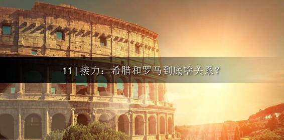

 

你好，欢迎来到《西方史纲 50 讲》。

上一个单元我跟你讲了古希腊，西方文明的第一阶段，下面的 10 讲，我专门跟你讲西方文明的第二阶段：古罗马。

转入古罗马，你可能马上就有一个问题：古希腊跟古罗马到底是什么关系？**你先记住这个关键词：接力，如果说古希腊是第一棒，那么古罗马就是第二棒。**

## 古罗马文明并不明显晚于古希腊

我说古希腊和古罗马是接力的关系，可能会加深你一个印象，就是古希腊和古罗马在时间上有明显的先后次序。

但实际上，并不是这样。我带你看几个时间点，你就会发现，**古罗马文明起步的时间并没有比古希腊晚多少，只是它们的成长路径和成长速度有很大的不同。**

**第一个时间点，是两个文明的起点。**古希腊出现城邦大约是在公元前 800 年，而古罗马诗人维吉尔说，罗马城建立大约是在公元前 753 年，你看，其实它们的原始起点差得并不远，也就不到 50 年。

**第二个时间点，是两个文明开始成熟的时间。**古希腊走向辉煌的标志性事件是雅典的梭伦改革，这是古希腊最重要的社会政治改革，奠定了希腊的民主基础，梭伦改革发生在公元前 594 年，而罗马在政治制度上最重要的事件是政体从王制变成共和国，这个事件差不多发生在公元前 500 年，差得也不是特别远，不到 100 年。

**第三个时间点，看看古希腊是什么时候开始走向失败的，罗马又是从什么时候接棒的。**亚历山大大帝征服希腊，发生在公元前 338 年。而罗马称霸西方的决定性战争，叫做布匿战争，是在公元前 264 年开打的。此后又过了 100 多年，罗马才征服了亚历山大大帝建立的帝国。

你看，从亚历山大征服希腊开始，古希腊文明已经在政治和军事上完全失败了，但当时古罗马的政治和军事成就的范围，还没有超出意大利半岛、西西里岛。

总结一下，古罗马的起点其实没比古希腊晚太多，双方并存了很长一段时间。但是显然，古罗马发展得要比古希腊慢，一直到古希腊都被人征服了，古罗马的势力范围还没有超过意大利半岛和西西里岛。

那既然这样，我为什么要说古罗马和古希腊是接力的关系呢。显然这个接力棒交接得并不是严丝合缝。

## 古罗马和古希腊的独立关系

我之所以这么说，是因为古罗马和古希腊确实是两个独立的文化，它们各有不同的起点和成长逻辑。但是，它们之间也确实存在传承关系，尤其是在语言、文化和哲学这些方面。

我先带你看看罗马在西方文明里面，是个什么样的角色，它和古希腊到底不同在哪？**古希腊和古罗马基本的文明特征很不一样，就像两个人的性格、禀赋不一样。**

先看它们面对的自然条件：虽然都是地中海里的半岛，但是，回想一下，我们讲过希腊半岛的土地以丘陵为主，很难保证粮食自给，所以天然就是外向型经济，必须用自己的特色农产品和手工制品去换粮食，所以形成了典型的商业文明。

但是罗马不一样，意大利半岛的平原很多，适宜耕种，更巧的是，意大利半岛的天然良港很少，出海不便。**于是罗马人在经济上主要是靠农业来解决生计问题。**

**接下来你就很容易察觉到，古希腊和古罗马的生存逻辑有很大差别。**古希腊需要海军来保护粮食贸易，古罗马则需要陆军来扩大地盘，农业最基本的两种生产资料：土地和人口，都可以通过陆军来获得，既然不怎么做海上贸易，海军也就不需要了。

而且，意大利平原无险可守，不像希腊到处是小石头山可以修卫城，光靠守是守不住的，而且，要解决资源紧张的问题，就必须向外扩张。有句话你应该很熟悉，叫做“最好的防守就是进攻”，用在罗马身上就很合适。

说完外面我们再说说里面，民族性格。希腊人因为有贸易，有哲学，有诗歌，有戏剧，有政治参与，所以性格很阳光，很活泼，很细腻，这种性格也反过来促进了他们的贸易、哲学、戏剧和政治参与。

而罗马人不像希腊人，倒是很像我们中国古代的秦国人，照哲学、戏剧、诗歌的标准，罗马人没什么文化，他们质朴、勇敢、忠诚，在家是农民，出门是士兵。

## 古罗马和古希腊的传承关系

好，现在你知道，古罗马和古希腊在文明的起点、成长逻辑、民族性格上都有很大的不同了。但是，我开头就跟你说了，古罗马在西方文明的路程上，是接了古希腊的棒。它们之间有交集，有契合点，也有某种共同的特质和使命。

两个文明虽然表面不一样，但是有些底层是相通的，最明显的例子就是宗教。你可能比较熟悉古希腊宗教里面的神，比如宙斯、赫拉。实际上，古罗马的神和古希腊的神基本是一样的，只是名字不同。

比如，古希腊的主神叫宙斯，在古罗马叫朱比特；古希腊的天后叫赫拉，在古罗马叫朱诺；古希腊的战神叫阿瑞斯，在古罗马就叫马尔斯；古希腊的爱与美女神叫阿芙罗蒂特，在古罗马叫维纳斯，等等等等，它们只是名字不同，地位、功能、甚至故事都是一样的。古罗马和古希腊之间存在着很多类似的文化特性，各自的叫法不同，但其实是一回事。

这说明两个文明在起点上也有共同的记忆，但这不属于传承。古罗马传承古希腊的地方，我认为主要在语言和哲学。

## 第一根接力棒：语言

先看看语言。一直到罗马共和国晚期，罗马使用的都是来自希腊的语言。

你可能会有疑问说，不对啊，罗马人不说希腊语，他们说拉丁语。没错，是这样，但那是后面的事了。在罗马文明的童年、幼年，希腊已经是文化巨人了，罗马在文化上对希腊完全是高山仰止，只有学习的份。

在亚历山大大帝建立起第一个世界帝国之后，希腊语成了各王国的官方语言和整个社会的通用语言，以希腊语为基础，出现了一种更为简捷的“柯因内语”（Koine），**这种语言从公元前 300 年后开始流传，一直到罗马共和国晚期甚至到了罗马帝国时期，地中海世界绝大多数民族的共同语言，都是这种以希腊语为基础的柯因内语。**

所谓柯因内，其实就是普遍的意思，我们完全可以就把这个词译成“普通话”。很多当时的文化名人，比如大历史学家波利比阿、大传记作家普鲁塔克、罗马哲学家皇帝马可·奥勒留、新柏拉图主义的宗师普罗提诺、文学家琉善等等，都使用柯因内语来写作。而且，它也是《圣经·新约》成书所使用的语言。

那么，罗马什么时候才开始使用拉丁语的呢？是亚历山大大帝建立帝国，又过了 200 多年之后了，这时候罗马共和国都被帝国取代了，罗马才有了属于自己的像样的文化人，比如独裁者凯撒，他也是伟大的历史学家；比如西塞罗，他是用拉丁文演讲和写作的完美典范；再比如大诗人维吉尔，人们把他的史诗当作了罗马历史的源头。

到他们这一代人手中，拉丁语、拉丁文才从一种地方土话，变成了有内涵、有文化、有气魄的状态。在此之前，而且在此之后，罗马人在文化上都是希腊人的学生。

老师说的是希腊语、写的是希腊文，学生在学习过程中当然会去模仿、去领会、去琢磨，希腊精神也就这样自然而然地传给了罗马人。

## 第二根接力棒：哲学

说完了语言，再看看古希腊人交给古罗马人的第二根接力棒，就是哲学。

我认为，**哲学最能体现古希腊和古罗马之间内在的、紧密的精神联系，这个哲学主要是指斯多葛哲学这个学派。**斯多葛学派的开创者是哲学家芝诺，这个学派是在希腊化时期创立的，也就是亚历山大征服希腊后的那个时期。

斯多葛学派对后世的罗马影响很大，从罗马共和国晚期到罗马帝国全盛时期的 300 年里，斯多葛哲学是罗马人普遍的信条，还出了许多名人为它代言。

比如，作为罗马共和国文化象征的西塞罗，就曾经去斯多葛学派开创者芝诺的学校学习；斯多葛哲学家塞涅卡，他当过罗马皇帝尼禄的老师和高参；罗马著名的好皇帝哈德良和马克·奥勒留，都曾经在斯多葛哲学家爱比克泰德创办的学校学习，奥勒留的《沉思录》是公认的斯多葛哲学的代表作，奥勒留也成了西方历史乃至整个人类历史上罕见的哲学家皇帝。

斯多葛哲学比较复杂，古希腊哲学里面的很多精华被它继承，发扬光大，我这里跟你讲这个学派的三个要点，斯多葛把它们教给了罗马人，罗马人又把这三个理念带到了全世界。

**第一是理性。**人是理性的动物，理性是人独特的能力和品质，凭借它，人就可以知道善恶，选择过善良的生活。

**第二是自然法。**世界是自然法规定好的，它体现了和谐与正义，好生活和好政治必须要符合自然法。

**第三是平等。**每个人在拥有理性的意义上是平等的，奴隶也不例外，正是在这样一种平等观念的基础上，斯多葛第一次在西方历史上把所有人看成同类，于是“人类”这个伟大的观念诞生了。

理性、自然法、平等被罗马人普遍接受之后，他们全面地运用到生活的方方面面，比如把它们完全渗透进了罗马法当中。随着罗马人打造出自己的世界帝国，罗马法对帝国臣民普遍有效，斯多葛观念也就撒向了整个世界。

本讲小结

好，总结一下今天的内容。西方文明的前两个阶段，古希腊和古罗马之间的关系是接力的关系，这两大文明的起点其实相差并不远，但成长速度相差很大，罗马所走的武力扩张的道路，一直到希腊文明衰亡之后才开始加速前进。

古罗马和古希腊在自然禀赋、生存逻辑和民族性格上有着明显差别，尽管如此，古罗马和古希腊通过语言、文化、哲学，完成了文明的接力，它们之间拥有共通的精神品质。

下一讲我带你去看一个关键问题：罗马给西方文明留下了一个重要遗产，共和。那么，共和这种政体在罗马是怎么出现的，它为什么令人神往，它实际上到底是什么样子。

期待你的到来，下一讲再见！

精选留言

点击直接进入下一章节

**佛祖门徒**:  
老师的每一讲信息量都很大，只有认真梳理一遍脉络和理解底层逻辑才能对内容进行较好的消化，这也是我学习的一点粗浅体会。  
第一、接力的逻辑。老师所说的“接力”并非指时间先后，而是文明发展阶段的次序。然后通过对三个时间节点的比较，可以清晰找到两个文明既独立发展又相互交织的发展历程。  
第二、接力的特征。一是两个文明的异同。由于地理环境的差异性，决定了两种文明走出了两条截然不同的发展路径，但这只是表面现象，仅从神的传说来看，两者的底层就有很多相通之处。尤其是语言和哲学的传承，更是将两种文明紧密联系在一起，古罗马文明在此基础上进一步将古希腊文明中的优秀传统发扬光大。

**作者回复**:传承是很奇妙的事情，很容易“有心栽花花不开、无心插柳柳成荫”，结局很难逆料，才更显示出文明的演化需要有勇气和智慧的人去担当。

**oldxiong**:  
我们都熟悉以下一段话  
  
有勇气去改变那些可以改变的事；有度量去容忍那些不能改变的事；有智慧区别以上两类事。  
  
其实它是来源于基督教的教义。  
神啊，  
  
请赐与我宁静，好让我能接受，我无法改变的事情；  
  
请赐与我勇气，好让我能改变，我能去改变的事情；  
  
请赐与我睿智，好让我能区别，以上这两者的不同；  
  
这段话的意思，最早恰恰是起源于斯多葛派哲学。2000 年以前，古罗马的斯多葛派哲学家爱比克泰德（Epictetus），说过一段这样的话。所以这个宁静祷文的本意，并不是出自基督教，而是出自哲学家。所谓“可以改变”，就是“斯多葛控制二分法” 中的“你能控制”。  
  
“斯多葛控制二分法” —— 意思是说，在生活中，有些事情是你能够控制的，有些事情你是控制不了的，而你应该只关注你能控制的东西。  
  
（以上是万维钢老师对斯多葛学派的一个解读，可以交叉来阅读）

**作者回复**:理解斯多葛对理解西方很重要：斯多葛哲学确实有高妙的观点，但更深远的是它渗透了罗马法，成为西方日用伦常的重要组成部分。

**戚志光**:  
在我原本的概念中，古希腊和古罗马一直模糊不清，好像他们是西方的共同源头。经过了老师今天的讲解，我对古希腊和古罗马的理解一下子清晰了很多。苏格拉底、柏拉图、亚里士多德自己凯撒、西塞罗、奥勒留这些人在历史中的坐标，也清晰了很多。非常感谢老师。

**泼猴要撒野**:  
补充一下：  
”进攻是最好的防御”可在克劳赛维次的《战争论》中找到。  
古罗马神灵的名字被用于命名行星，例如金星维纳斯(Venus),木星朱庇特(Jupiter),火星玛尔斯(Mars)。  
意大利半岛 75％被山地覆盖，并没有特别多的平原，但是和希腊比已经多出很多了。  
斯多葛学派的理论至今还有很大的影响力。比较经典的著作有马可.奥勒留的《沉思录》，以及《尼布尔的祈祷文》还记得其中的三句话：  
上帝,请赐予我平静,  
去接受我无法改变的.  
给予我勇气,  
去改变我能改变的,  
赐我智慧,  
分辨这两者的区别。

**作者回复**:斯多葛哲学的学习固然要看马可·奥勒留和爱比克泰德，但也要品味一下西塞罗的演讲和罗马法的条文。

**花草书生**:  
听完这节课:终于明白了那句"罗马用武力征服了希腊，希腊用文化改造了罗马"。

**作者回复**:武文兼备的西方在罗马吸收希腊的过程中逐步成型。

**陈 C**:  
从希腊与罗马发展历程的时间对比，以及二者文化的内容上来看，罗马的发展是要滞后于希腊的，因而罗马也一直在学习并继承希腊的文化，比如相同的神学体系（当然这只是附属，因为宗教在希腊本就没有很强的掌控力）、相同的语言（例如老师重点讲的，双方都在使用希腊语和 Koine）。  
  
但罗马对希腊文化继承最深的，还是哲学。比如普洛替诺继承了柏拉图的思想，发展出了新柏拉图主义；伊壁鸠鲁继承了德谟克利特的思想并创建了自己的学派；而与之对立的斯多亚学派则继承了赫拉克利特的“罗格斯”理论，并由此发展出了理性的观念，继而提出了体现平等的世界主义的思想。不过也要看到的是，哲学在亚里士多德之后，在罗马人手中，更多的是走向实用化，而并没有体系上的新建构，学生终归还是没有超过老师。

**作者回复**:哲学不是罗马的强项，拿希腊来比有点欺负人，但罗马也有强项，拿法律这个项目来说，罗马胜希腊何止千万。互有长短很正常，比出长短也不难，难的是清楚为何你长我短，更难的是比不上你长如何还可以把你长借来用一用。

**有点甜**:  
古希腊凭借『理性、民主、自由』将\*人\*从野蛮混沌中解放出来，人是万物的尺度；而古罗马与之和而不同，既继承古希腊的文明成果，又完成了共和建制和一定的法制——对人约束，进一步定义\*自由\*。  
关键在于，达成一个动态平衡，建立不断进步的系统，永久的统一平衡倒还在其次。

**作者回复**:在自我成长和环境变化的平衡中实现系统的不断升级，可扩展性可以看出文明自我升级的能力。

**蝉**:  
从李老师提的三个角度来看。  
  
1 从经济的角度看，希腊人和罗马人生活的环境不同，克服的挑战也不同，自然会有不同的获取资源的路径，商品交换与耕战。  
2 从权力的角度看，希腊的小国寡民可以搞直接民主，罗马的扩展注定要求政治扩容，变成共和继而变为帝国。  
3 从文明的角度看，两者是“接力”的关系，可表现出来的气质又迥异。  
  
这也是历史动人的地方。

**刘志杰（刘鸿杰）**:  
好大的宏篇巨论，看的头昏眼乱，各类古希腊、古罗马的历史名家和皇帝都会一一出现了，TA 们的经典语录，历史贡献，在那时代留下的印迹都犹如迎面铺来的知识洪流，让人瞬间震撼！  
古罗马接过了古希腊的文明，接过了人类的传承之光！

**Littlebear**:  
古罗马接力古希腊，不仅是时间上的接力，更重要的是文明的接力.从语言到哲学，既有共同的记忆又有各自的逻辑.两种文明紧密联系，在相互交织中完成接力.

**夏宝辉**:  
李筠老师早！  
本讲比较清晰的介绍了古希腊与古罗马的异同及关系：虽然在地脉地形、经济依赖关系上古希腊与古罗马有着明显的差异，但是从语言、文话和哲学上却有着传承和一致。我认为历史其实很难归类，要把一些散碎的史实通过一种学术归类，其实蛮难的，但是老师的这种从文化上寻找相同点，寻找底层原则，其实很受鼓舞。  
斯多葛学派给全世界带来的主要理念是：人的理性、世界的自然性及平等。西塞罗等为代表性人物。

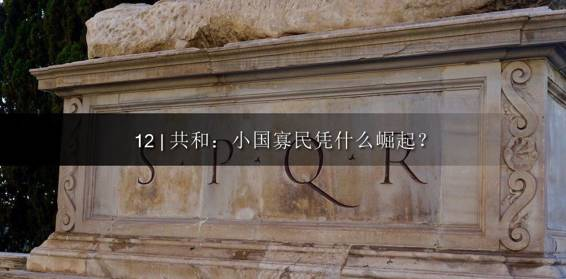

 

你好，欢迎来到《西方史纲 50 讲》。

今天我要跟你聊一聊共和。共和你肯定很熟悉，共和是罗马留给西方文明，甚至世界文明最重要的遗产。那么，罗马为什么能发展出共和这种政体呢？

这一讲，我就会带你从软逻辑和硬逻辑，分别来看看共和的底层是什么，以及，为什么罗马能长出这种政体。

## 罗马共和的独特性

如果你对历史比较熟悉你可能会说，我们中国古代就有共和啊。

西周末年厉王想把山川河流、草木森林国有化，大家都不同意，于是诸侯起来把厉王赶跑了。厉王被赶跑之后，有两位大臣，他们主持贵族会议来控制朝政，代行天子职权。**这个就叫周召共和，它发生在公元前 841 年，中国传统文化当中的共和就是这么来的。**

但你看这个共和意味着什么，它的结局又如何呢？过了十几年，等周宣王即位，共和就结束了。**周召共和有三个要点：**

第一，共和没有取代王制；第二，共和是王制出问题的时候打的补丁，它们其实是同一个制度系统；第三，共和的掌权者是大贵族，发起暴动的国人并没有得到权力，连名义上的权力都一点也没得到。

**一对比，罗马共和的特点就充分展示出来了，首先，它取代了王制，罗马甚至形成了提防王制的传统。**在罗马人心目中，王制是坏东西。那你可能又会说，老师，不对啊，罗马共和国后来又变成了帝制，罗马皇帝还得到了人民的拥戴啊！确实如此，但罗马的皇帝跟中国的皇帝还真不是一回事，他们虽然掌握大权，但是也会顾忌共和仇视王制的这种传统。

回到罗马共和的特点，**它的第二个特点就是，既然共和取代了王制，它自身就是一个制度系统，不再是王制的补丁，甚至对王制有排斥性。**罗马人甚至把怀念王制当做犯罪，写进了刑法。

**第三个特点，罗马共和的权力至少有一大部分在名义上是属于人民的。**罗马国家名字的简写是 SPQR，共和的时候这么叫，改成帝制之后仍然用这个名字。这几个字母是什么意思？意思是罗马元老院和人民，罗马人认为国家的权力来自人民。

你觉得这种立场很熟悉，对吧！但我要提醒你，这是 2600 多年前的事情，在那个时候，世界上各大文明都把王制当做理所当然，干掉王制、人民当家作主，简直就是奇葩。

那我就带你回到 2600 多年前看看，**罗马共和制这朵人类文明史上的政治奇葩，是怎么长出来的。**

为了帮你更好地把握罗马这段历史，我们这一讲从两个方面来看罗马共和，

第一面是，罗马人的生存逻辑和人格品质，这是软逻辑，可以说，正是这种软逻辑培育了罗马的共和制。

第二面是，共和制底层的经济基础和与之配套的政治安排，代表案例就是格拉古兄弟改革，从这个案例你能看到共和的硬逻辑。

软逻辑和硬逻辑，其实归根到底都是讲人性和政治的复杂关联。

## 罗马共和的软逻辑

我先带你看软逻辑，罗马人到底是什么样子的，他们为什么会制造出共和？我们从他们的生存逻辑和人格品质当中看看能不能发现一些蛛丝马迹。

**先来看看宗教。宗**教对共和有什么影响，这一点可能不太好理解。因为一般来说，宗教总是包含着某种神秘力量，这种神秘力量往往又是和王制联系起来的，比如“君权神授”。如果这么看的话，宗教和共和应该是对立的啊。那为什么要说，罗马的宗教也是滋养共和的土壤呢？

这是因为，罗马的宗教比较特殊，和其他地方的都不太一样。我在上一讲跟你提过，罗马人的诸神就是希腊人的诸神换了名字，其实是一套系统。

但是，**罗马的宗教也有不一样的地方，主要是罗马人的宗教有很强的独特性，对共和的产生很有帮助。所谓的独特性，其实就是政治性。**罗马人的宗教政治性很强，是拿来巩固政治秩序的，一般宗教里那种对心灵的安顿和对生活的安排，都不是罗马宗教的任务，甚至故意被忽略了。

对比一下你就知道了，比如希腊诸神，绝大多数希腊神话都和一个主题有关，就是：宙斯闲不住，到处找小三，天后赫拉很彪悍，到处迫害小三，被赫拉迫害之后，宙斯还拐着弯地去安顿小三和孩子。

罗马人的宗教就把这些不端的内容都禁绝了，所以罗马神话很干瘪，没太多好玩的故事。罗马人故意要把宗教做成实现政治团结的工具。

这跟共和有什么关系？罗马宗教的这种政治性和世俗化让它自己变得很薄，里面没有那么多神秘的内容。这样一来，需要神秘内容来牵动人心的君权神授就很难建立，即便建立起来，也很容易被推倒。

因为世俗化很高，人和人之间俗常的生活，比强大宗教带来的神秘内心生活，更能占据罗马人的人心，所以人民当家作主就顺理成章。

**说完了宗教，我们再来看看罗马人滋养共和的第二个土壤，就是品行。**上一讲我说过，罗马人是典型的农民-士兵，在家种田，出门打仗，这种类型的人在性格上是勇敢的、忠诚的，朴实的，甚至是木讷的。

这和我们中国传统文化倒是有很好玩的相似之处。孔子说，“刚毅木讷近仁矣”，小说家金庸就是以这句话为原型塑造了郭靖这个大侠的形象。罗马和中国在古时候都是农业社会，对老实人的好感是相同的。

这样一种品行对共和有什么好处？这样的人心思单纯，你看，郭靖就没什么心眼儿，他就会对最直观的人民生活疾苦很在乎，相应地，对国王讲君权神授那些神秘的东西不太听得进去。质朴忠厚的人们把政治共同体当作共同的事业，而不是靠鬼神把他们团结在一起，也是顺理成章的事情。

**接下来就是第三个层次，政治行为逻辑。**什么是政治行为逻辑？政**治行为逻辑就是一种制度安排，它可以实现个人成长和国家繁荣的相互促进。**

那么，罗马的政治行为逻辑是什么呢？质朴忠厚的罗马人在家种田，出门打仗，他们改变自己生活的追求，和共和国的军事扩张紧密联系在一起，就像商鞅为秦国设定的基本激励制度：军功授爵。你能有什么样的政治地位，能分到多少田地和奴隶，取决于你在战场上的表现，凭实力说话。所以，罗马人忠诚和勇敢的好品质有制度和文化的土壤，好制度就是让拥有好品质的人顺畅地升官发财。

你看，在罗马人的生活里，共和是最容易实现个人成长和国家繁荣的相互促进的，因为共和认定国家属于人民而不是君主。

但是听到这，你可能会有问题，**既然罗马跟我们中国一样，是农业社会，喜欢老实人，也讲究军功授爵。那为什么古代中国，没有培育出来罗马那种共和制？**

你看，在王制当中，也就是在古代中国的那种社会里，军功授爵尽管要凭实力，但归根结底是君主的赏赐。所以韩非子教秦始皇，赏罚是君主必须牢牢掌握的工具，名叫“二柄”，用现在的话说就是，赏罚是君主治国最重要的两个抓手。罗马人的不同就在于，他们认为这个抓手就应该由人民自己掌握。

好，现在你应该能理解罗马人的政治品质是共和制度的基础了。

## 共和的三大基本特征

你知道了共和是怎么来的，就容易理解共和是什么了。我带你看看共和的基本特征，主要有三条：

**第一个特征，共和是人民共同的事业，权力属于人民。**人民是谁？西塞罗给出了标准答案，人民就是拥有共同法律的人，也就是说，人民的本质是一个法律共同体。

**共和的第二个特征，共和需要同时也要求人民拥有美德，其中最重要的美德是爱国奉献。**国家属于人民，人民当然就要爱自己的国家。

**第三个特征，共和通过复合型的权力结构来管理国家。**比如，在罗马，执政官、元老院、平民大会是共和国的三大权力机构，各有职权。大历史学家波利比阿认为，它们分别代表着君主制、贵族制、民主制，三种政体混合到一起，发挥了各自的优点、克服了各自的缺点，

罗马强大，归根结底是因为它的制度很强大。

## 罗马共和的硬逻辑

但是，罗马共和并不是完美无缺的，更不是凝固不变的。这背后就是我们开头说的共和的硬逻辑了。

共和制刚诞生时，罗马还是一个小国。随着罗马扩张的速度越来越快，罗马开始变成一个大国、一个强国，但是这个时候共和国出问题了，制度和人民都出问题了！

事情大概是这样的：罗马人经过一系列南征北战，最后又战胜了最重要的对手迦太基，获得了大量的土地、金钱和奴隶。简单来说，原来那个小而穷的共和国，现在变得大而富，但在这个高速发展期间，经济上的贫富差距也开始拉大。**那么问题来了，小而穷时候的制度还适用于大而富时期吗？**

于是，公元前 133 年，提比略·格拉古就任保民官，提出土地改革法案，限制个人和家庭拥有土地的上限，把超额土地收归国库，分给穷人。你一听，这不是均贫富吗？对，为什么要均贫富？因为贫富差距过大就会威胁社会稳定，更重要的是，它会侵蚀人心。

贫富差距过大，这时候，本来就不怎么神秘的宗教难以解释混乱的社会现象，质朴忠厚的品行会被动摇，军功授爵的激励机制会失效。如果继续发展下去，一定会伤害罗马的根本。

但是，提比略这种均贫富的改革肯定伤害了贵族的利益，所以他很快就被贵族刺杀了，后来他的弟弟盖约又当上了保民官，推出了更全面、更大胆的改革，最后也被杀。

改革失败，均贫富的目的没有实现。也就意味着，把大而富的罗马往回拉，装进小而穷的框架，这种努力失败了。

这个时候，我就要带你回到文明的核心问题了：

第一，文明的硬壳是政治，没有好政治，再美好的文明也活不下来；

第二，政治的核心是把资源分配理顺，使得人心安定，大家团结一致；

**第三，人心的状态和资源分布的状态高度相关。**资源变，人心就会变，相应地，制度就得改，否则就会失控，政治毁了，文明离覆灭也就不远了。

好，罗马格拉古兄弟改革失败了。之后的事情可能你也知道，罗马共和国虽然没落了，但它没有直接死掉，而是变成了帝国。

那么这是不是说，罗马人找到了一种适合大而富的社会的政治安排呢？我在下面几讲会和你仔细分析这个问题。

本讲小结

好，简单总结今天的内容：共和是罗马的创造，其他古老文明里面没有实质与它相同或类似的政治制度。但它适用于小而穷，一旦国家变得大而富，它就很危险。

下一讲我会带你具体去看看，罗马是怎么变得大而富的，其中最关键的事情就是罗马打败了地中海霸主迦太基。

期待你的到来，下一讲再见！

精选留言

点击直接进入下一章节

**佛祖门徒**:  
虽然老师的课程仅仅过去不到四分之一，但我感受到自己在学习这个课程时有一个明显的变化，就是当我看到标题时，我会先思考自己该怎样回答标题中提出的问题。然后，我会把自己思考的结果和老师分析的框架进行对比，看看所欠缺甚至存在误区的主要是哪些。以今天的课为例，我的思路基本是沿着老师的分析脉络展开的，但在整体框架上有三个缺失，一是中西对比。记得老师此前反复强调要分清中西和古今的关系，老师对比中西“共和”的主要区别让我对共和的理解更加透彻。二是软硬逻辑。尤其是老师讲述的软逻辑的三个层面让我大开眼界，加深了对罗马之所以能够构建共和制度绝非偶然的理解。三是兴衰之因。对于罗马因共和而兴比较容易理解，但好制度为何会败却有些令人费解。通过学习，我明白应该是“制度赶不上变化”，随着快速扩张的到来，制度没有做好应对的准备，过于激进的改革必然导致利益纷争，所以会最终失败。

**作者回复**:制度本身的可扩展性非常重要。

**强 Sean**:  
罗马人的南征北战，除了国内的问题，还要考虑扩张本身的问题。  
  
有一个词叫“扩张悖论”，历史上的那些大帝国基本都是领土扩张模式。新占领的地方，统治、保卫和镇压叛乱都需要花钱，这会出现一个可怕的自我激发效应，就是领土扩大之后，会造成军事防卫的新难题，这些难题只能靠进一步的扩张来消除。一旦走上这条路，帝国就成了癌细胞，永远要扩张，要繁殖。最后，维持这些领土的成本，远远超过这些新领土带来的收益，而且骑虎难下，最后导致帝国衰落。

**作者回复**:帝国扩张为什么是有极限的，尤其以军事的方式。

**Alopex 柳羏**:  
我一直在想政治是什么，就像克劳塞维茨说战争是政治的延续。今天我找到了一部分，是资源的分配。  
  
就像老师说的这样，政治制度继承于前，传承于后。既不是照搬照抄也不是全盘否定。文明的对立面是野蛮，而文明的底色是一个共同体面对的现实条件和资源困境，是一套解决问题的办法和智慧。  
  
如果说我们现在巨人的肩膀上，那么过往所有的一切才共同构成了这位巨人。没有哪一个文明是完美无缺的，更没有哪一个是一无是处的。历史需要借鉴更需要反思，现实是条件更需要突破。

**作者回复**:分配资源的凭据是权力。

**战斗**:  
国家属于人名如何理解？我觉得这和对军功爵制的理解有关，也就是凭能力来上位和治理国家。  
  
尽管商鞅也打破了贵族当官世袭的束缚，实行军功爵制，但问题是罗马人和商鞅对它的理解不一样，理解的唯度不一样，商鞅是用它来激励士兵和治理国家的手段，即赏和法，而罗马人是从国家属于人民的角度去理解的，也就是说，让普通人都可以当官，但罗马人是治国的需要，而秦国是战争效率的需要。  
  
因此，对于军功爵制的理解，就决定了秦国和罗马不是在一个唯度上来使用这样的制度的，由于这个使用这个制度的逻辑不同，意义不同，处在的框架秩序不同，因此，尽管同一制度，但是最后的效果却完全不一样。  
  
请老师指点哦——

**作者回复**:同为军功授爵，制度设置的根本权力归属不同，激励产生的凝聚效果便不同，进而使共同体团结的基本逻辑变得不同。

**戚志光**:  
古代罗马人的共和只能适应小而穷，一旦国家大而富，共和就维持不下去。但是共和的种子却能够跨越千年，一直保存在西方文化的基因中，最终在美国结出了最大的果实。真有些着急，想一口气听老师把后边的课都讲完呢。

**Li Xia**:  
今天老师的讲解让我对何为共和有了初感受。  
  
共和制的创新在于抵制王制，认为国家属于人民，权力属于人民，不属于君主。共和通过复合型的权力机构实现国家的管理。  
  
但不知共和和民主的重要区别是什么呢？

**作者回复**:民主和共和都要求权力属于人民，但共和要求复合型的权力结构和人民的美德，民主在原始意义上是不要求这两点的，后来逐渐加入了这两点（和其它因素）民主才才柏拉图、亚里士多德批评的坏政治逐渐变成了好政治。第四单元我会专门跟你谈这个问题。

**战斗**:  
套用老师对于文明的理解，罗马共和国之所以最终衰弱，就是因为没有审时度势，根据自然环境，社会资源，人口数量增多等，提出一套或者一篮子社会问题的解决方案，因此，导致旧制度无法适应新的环境。  
  
所以，我们为什么需要不断的反思和多维度的学习，就是因为让自己的工具更好的适应社会的历史变迁，让自己的认知阑尾消除，更好的于是俱进，因为用老工具解决新问题是人类的毛病，不然，我们就会像锤子一样思考，满世界概莫能外都是钉子。

**作者回复**:下面的课我会和你分享，共和亡了，罗马并没有亡，罗马实现了自我升级，到时候再下结论不迟。另外，文明的兴衰不能重点落在“审时度势”的明智之人，演化自有逻辑，人并不能完全操纵，甚至并不能完全认识——当局之时尤其如此。

**江勇轩**:  
一直找不到听历史的感觉，听历史课原来历史的发展是有一定的逻辑关系，如古罗马是古希腊的传承，而为什么是传承，有它的地理环境，生产要素，经济发展形式等发展的必然。感觉找到学历史的门路了。

**作者回复**:谢谢哈，我们一起学！

**陈 C**:  
罗马共和的本质是排斥王政，其制度保证了一部分权力掌握在人民手中。之所以能出现这种制度，一方面是罗马的宗教高度政治化、精简化，不具备形成君权神授思想的精神基础；另一方面则是罗马人忠厚勇敢的品行，以及军民一体、人民可以通过作战获取奖励的制度，使得人民的利益与国家命运深刻相连（这里有些类似于雅典城邦的公民身份）。  
  
作为制度的罗马共和有三个重要的特点：第一是其权力属于人民，又因为这个体制承认人民的法律主体性，罗马共和因此也具有法治的属性；第二是罗马的共和要求人民拥有美德，体现出了精神诉求；第三是罗马共和是一种执政官、元老院与平民大会共存的复杂权力结构。  
  
然而类似于雅典城邦，罗马这种权力在于人民，人民平时务农、战时为兵的制度，只能在小国寡民的状态下发挥作用。而罗马能够壮大强盛，我认为一个制度上的原因，就在于它权力机构的复杂化。正是由于罗马同时具有权力集中程度完全不同的三种权力机构，使得它能够在国家规模不断扩大的过程中，保有了自如切换权力结构，从而顺利度过规模增长带来的转换期的可能性。

**作者回复**:复合型的权力结构很重要，后面我会经常谈到。

**唐元明清 51598501**:  
罗马帝国最吊诡的事就是戴克里先拆分东西罗马，他前期表现的最集权专制，后面又主动将帝权分解，拆分罗马，设置四个皇帝，甚至自己隐退，这可能更像中国周朝时候的共和，能产生这种做法的原因一，罗马的大而富已经到了一定程度，传统帝国 hou 不住了，二是罗马早期的共和基因隐隐的起者作用，左右着这位皇帝的观念。希望老师能对这个问题做一些解答。

**作者回复**:着急了点儿哈，后面专门会有一讲和你分享戴克里先如何把帝国分东西，以及产生了什么样的严重后果。

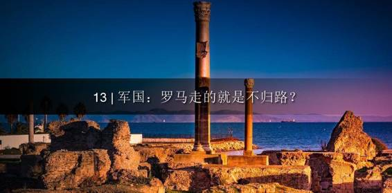

 

你好，欢迎来到《西方史纲 50 讲》。

上一讲我跟你聊了共和，一个国家从小而穷变成大而富，会导致原来的制度遭到严重挑战。那么，这一讲和下一讲，我要和大家聊聊罗马是怎么变成大而富的。促使罗马共和国走向繁荣昌盛的一共有两大原因，但在这繁荣的源头当中，又潜伏着致命的危机。

**罗马人给文明史带来了一个很好的启示，就是：国家走向强大会带来危机，国家面临危机很可能又会走出一条新路子。**文明教给我们的是长线的战略眼光，有了这种智慧，你面对大格局的时候既不会盲目乐观，也不会盲目悲观。

这一讲我要跟你分享罗马走向繁荣的第一大原因，我要在开头明确地告诉你这样一个事实：罗马是一个军国主义国家，罗马共和国是，罗马帝国也是！罗马文明得以成长的根本逻辑也正是军国主义。

这可能跟你今天接受到的观念不大一样，你会觉得战争很残酷啊，它和文明有什么关系？这就是这一讲我要回答的问题。

## 三次布匿战争

罗马的扩张是人类历史上最成功的征服，从一个弹丸大的小小城邦最终变成了横跨欧亚非三洲的庞大帝国，地中海成了它的内湖。这样的丰功伟业，应该有说不尽的故事吧，其实并没有。

因为在绝大多数时候都太顺利了，绝大多数敌人都不是罗马人的对手，罗马人在军事上取得胜利就像家常便饭一样。你会每天记录自己在家吃了什么吗？当然不会，因为它没什么特别，没什么值得说的。**只有一个很明显的例外，被所有罗马史大书特书，就是布匿战争。**

话说罗马到了青壮年的时候，已经占据了整个意大利半岛，一出家门口，在西西里岛，碰上了一个很厉害的敌人，叫迦太基。迦太基在北非，是海上霸主，依靠贸易和舰队经营自己的帝国。因为罗马人把占据北非的腓尼基人叫做布匿人，所以罗马和迦太基的战争叫布匿战争。

布匿战争一共打了三次，前后一共打了四十多年。最终，消灭迦太基之后，罗马就再也没有遇到高质量的对手，所到之处完全都取得了碾压性的胜利。

我带你先看看让罗马人没齿难忘的布匿战争，到底是怎么打的，然后分析一下罗马在里面获得了什么样的成长。

第一次布匿战争的理由很简单，因为罗马急速扩张，统一了意大利，再往外走就踩到了迦太基的地盘，没错，迦太基的据点就在西西里岛上。既然要称霸世界，就不要怕前面有对手，遇到了就打。但这次，罗马人还真不是砍瓜切菜一般就拿下对手了，迦太基很厉害。

罗马人的困难在于他们的陆军很厉害，海军却不行。可对手迦太基是海上霸主，海军恰好是人家的强项。具体这场战争的过程我就不展开给你讲了，你只需要记住罗马人想了一个办法，克服了他们不擅长打海战的弱点。

这个办法叫乌鸦吊桥。你看下文稿里的图片就懂了，其实就是罗马人利用乌鸦吊桥把海战变成了陆战。实质的打法变成了他们擅长的近身肉搏。有了这一招，罗马人就一步步打败了迦太基，最终迫使迦太基签订了条件苛刻的合约，罗马人成为了地中海的霸主。

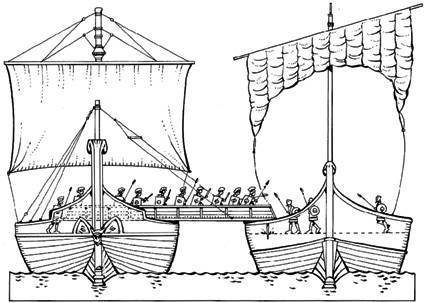

乌鸦吊桥示意图

百足之虫死而不僵，迦太基曾经也是霸主，他们不甘心失败，他们选择向西北方向推进，渡过隔开非洲和欧洲的直布罗陀海峡，进入西班牙。**罗马和迦太基的冲突在北部展开，这次的主角是迦太基名将汉尼拔，他是西方历史上最伟大的军事统帅和战略家之一。**

他见识过人、胆略超凡，率领迦太基军队越过阿尔卑斯山进入意大利，罗马的很多将军都败在他手上，在主要战役坎尼会战的时候，汉尼拔就合围全歼罗马七万人。在自己的地盘被敌人蹂躏，对于战无不胜的罗马人来说真是奇耻大辱，但一个个激动万分的将军出去之后全都吃了败仗。

最后，罗马这边由费边担任独裁官，全权负责，他的办法就是拖。就是不和汉尼拔展开正面决战，而是拖延、回避、周旋。**这种避敌锋芒、迂回周旋的战术，从此之后就被冠以费边的名号，叫做费边战术。**

终于，汉尼拔被拖垮了，在扎马战役中被击败。迦太基不得不再次接受苛刻的合约，势力范围被限制在自己城邦周围。这次，罗马人是真的打败了迦太基。

那为什么还会有第三次布匿战争呢？第一次第二次都是旷日持久，打了十几二十年，第三次很短，就只打了三年。很简单，第三次布匿战争就纯粹是罗马人欺负迦太基人。

第二次布匿战争结束之后，罗马人到处开疆拓土，而迦太基战后是闷声发大财。罗马人被迦太基人伤得实在太深了，简直是刻骨铭心，所以迦太基一旦有向好的迹象，罗马人就很不舒服。**罗马著名政治领袖加图每一次在元老院演讲，都是以这样一句狠话结尾：迦太基必须被毁灭。**

第三次布匿战争，就是有刀的罗马对付有钱的迦太基，因为迦太基在第二次布匿战争之后已经被全面解除武装了。结果你可想而知，必然是迦太基战败。

但失败的残酷程度，却很可能超出了你的想象：一个辉煌的城邦被罗马大军围困两年，终于城被破了，士兵、市民和罗马军团展开肉搏，死伤无数。最后，剩下的 25 万人全部被卖成奴隶，大火烧了三天三夜、城市被夷为平地，这还不算完，所有地方撒上盐，防止任何生命迹象的出现。

至此，罗马算是拔掉了眼中钉肉中刺。

## 罗马兴盛的底层逻辑

从布匿战争当中，你就可以发现罗马兴盛的底层逻辑。

**首先，意志品质是文明的内在动力。**罗马人的勇敢、坚毅，一个国家的强盛，最底层的根基是人的品质。人如果积极进取、锲而不舍，国家就有希望，人如果都蝇营狗苟、短视投机，国家迟早会完蛋。

迦太基输给罗马，很重要的一个原因就是它没有罗马能扛，在重大压力下内部走向分裂。而罗马，一直憋着一股劲儿，顽固地坚持自己的目标，不达目的誓不罢休。

**第二个底层逻辑，政治是文明的硬壳。**没有好政治的文明很容易就消亡了，不是因为自己内斗而消亡，就是因为外敌入侵而消亡，迦太基就是这样。

我们谈到文明的时候，往往会谈挣钱做生意、研究哲学和科学、写诗写戏剧写小说，等等，但你要知道，这些社会经济文化生活都是文明的成就，但在一个文明当中，政治才最重要，因为有了政治，其它好东西才保存得下来。

就像第三次布匿战争那样，再有钱的文明如果解除了武装，根本就没有保卫自己的能力，也就谈不上什么文明了。中国古代也有很多很多这样的例子，掌权者很轻松就收拾了首富，比如晋朝的石崇、明朝的沈万三。一个人是这样，一个文明又何尝不是这样。

**第三个底层逻辑就是，资源是文明的营养。**罗马文明的资源从哪儿来呢？**罗马不像希腊那样通过贸易来解决生计问题，而是用军事扩张的办法来解决。**

一个文明要迅速成长，就必须不断地有资源汇入，有了钱不仅可以养军队，还可以制造各种物品、提供各种服务来改善生活，有了这些资源，作为文明标志的诗歌、戏剧、艺术才可能繁荣起来，才能有人利用闲暇思考，变成哲学家和科学家。而罗马的资源汇入，主要就是通过军事征服实现的。

## 罗马的军国主义基因

你是不是觉得罗马其实很像强盗？确实像，但强盗不足以说明罗马文明的复杂性。我给你提供一个概念，其实你应该听说过了，就是军国主义。

军队是国家的支柱，战争是国家最重要的行为方式，这种文明成长的逻辑就是靠人的品质、制度的激励实现资源的汲取。

作为爱好和平的人，你很可能对军国主义很反感。我理解你的正义感。但我想要告诉你，**军国主义本身并不存在好坏，这只是一种文明的成长路径。**和其他的成长路径一样，军国主义能带来好处，也能带来坏处，关键在于背后的人。**而罗马选择了军国主义这么一种成长路径，也就注定了罗马文明的发展轨迹。**

军国主义也不是只有罗马才有，宽泛来说，所有国家都有，无论在什么时代，什么地方。因为只要是国家，也就是一个文明建立起自己的政治硬壳，就必然有它的军队，而国家有了军队，不会只是保家卫国，也会对外扩张和掠夺。**没有扩张性的国家和军队，就像没有扩张性的权力一样，根本不存在。**

我们到底应该如何看待战争呢？实际上，人类一直在竞争，战争是最残酷的竞争方式，爱好和平的正确姿势不是回避战争，而是勇敢地理解战争，理解人与人、国与国、文明与文明在残酷的战争中如何存活、如何进步、如何自我改善。

在古代，土地和人口是最重要的经济资源，大规模获取它们的办法不是开荒和殖民，而是战争。如果最重要的资源不再是土地和人口了呢？战争还有必要吗？当然有，但恐怕形态就大不一样了。

回到罗马的成长逻辑上来，军国主义和所有的文明成长逻辑一样，有利，就一定有弊。刚才都说罗马是强盗了，强盗还会受伤吗？那是当然。有一句俏皮话叫做，只看见贼吃肉，没看见贼挨打。罗马确实获取了无数的土地和战利品，但他的军国主义基因也让他自己饱受困扰。

我甚至可以大胆地现在就告诉你，**罗马成于兵，也毁于兵。**在后面的内容里，你就能更清晰地发现这层逻辑了。

本讲小结

好，总结一下这一讲的内容：罗马征服过程中遇到的最重要的对手是迦太基，他们之间一共打了三次布匿战争。从罗马征服的过程中我们得到：**文明的内在动力是人的意志品质，文明的硬壳其实是政治制度，文明的营养是经济资源。**

归结起来，罗马成长的逻辑就是军国主义，它成就了罗马，也将毁掉罗马。

下一讲我就来跟你聊一聊，罗马遇到的成长的烦恼，也是罗马的典型现象：奴隶制。

期待你的到来，下一讲再见！

精选留言

点击直接进入下一章节

**强 Sean**:  
罗马人采用的“乌鸦吊桥”战术，让我想起吴伯凡老师对创新的定义：创新，就是“不可能”河上的一座桥 。有一条河叫不可能河，在这条河上有一座桥，这个桥就叫创新。没有河就不可能有桥，创新的发生一定是因为有一个巨大的障碍，这个障碍大到让人觉得不可能。  
  
著名的英国历史学家汤因比，提出过一种著名的“文明发生理论”：所有的文明都是由于挑战而导致人类被迫应战，应战的结果就是文明。汤因比认为，没有挑战的地方是没有文明的，如果人跟他的环境和谐相处，这是福音也是诅咒 。这个诅咒就是，你很难再有什么创新了。所以在一些气候条件很好的地方，饿了树上就会掉香蕉、掉椰子下来的那种地方,是不大可能有文明的。只有在季节交替非常的明显，尤其是冬天相对比较漫长的地方，人必须要解决人一出生就面对的两大难题。  
  
在有冬季的地方，人类就会面临着饥寒交迫，因为冬天很难找到食物，那就必须要在冬天来临之前生产和存储食物，同时必须建房子、做衣服来避寒。当人类被迫这样做的时候文明就产生了、创新就产生了。这就是在“不可能河上”搭建起来一座桥。

**衡山老鹿**:  
最佩服施展老师和李筠老师不断挖掘历史底层逻辑的努力。中、西史纲参照听，通透畅快。今天终于搞清，文明的内在动力是人的意志品质，文明的硬壳其实是政治制度，文明的营养是经济资源。印象最深的话是：人如果积极进取、锲而不舍，国家就有希望，人如果都蝇营狗苟、短视投机，国家迟早会完蛋。凝视良久，此言极是！

**成洁 getit**:  
文明跟军事是你方唱罢我登场的交替循环吗？

**作者回复**:不是循环，从某种角度可以说是相互长进，黑格尔就是持这种观点。文明必须驯化武力，武力又会挑战驯化。太文明会变得软弱，失去野性和生命力，太武力会变得野蛮，失去善意、教养和化育之力。文物兼备的平衡在不断升级，又不断被打破。但我强调，平衡并不是必然，找不到，文明就亡了。

**佛祖门徒**:  
老师好！本节课让我建立了对战争的全新认识。一是战争的极端残酷性。第三次布匿战争的描述让战争的残酷性跃然纸上，远隔千年仍然可以感受到那种地狱般的感觉。二是战争的必要性。在生产力水平低下的那个年代，无论对于文明的生存和发展，战争成为了最好的手段，可以迅速获得社会发展所需的土地、资源和人力。三是战争的决定性因素。罗马之所以能够在前两次布匿战争处于劣势的情况下取得胜利，其政治和民族特性是决定性因素，也是文明得以生存和发展的根本。  
衷心感谢老师对我留言的回复，引发了我更多的思考，也让我发现了自己思考的不足之处。

**作者回复**:不客气，一起学习！后面会有“大观”的兄弟开“战争”为主题的课，有兴趣可以关注，我也会提前预告。

**泼猴要撒野**:  
试着解释下军国主义与国家失败的关系。  
1.军队的管理强调命令与服从，这种等级制度扩展到国家政治上，使得共和制转换为帝制成为必然。  
2.国家倚仗军队，时间久了会形成一个以军官和士兵组成的利益集团(这让我想起了日本的武士阶级)。国家的版图随着战争扩张，每个地方都要派兵驻守，利益集团会军队的规模开始指数级增加。当王权势微的时候，各地的军事长官就会自立为王(行政、军事、财政大权集于一身)。  
3.倚仗武力而忽视文官，这导致帝国的行政体系一直不完整。偏远的土地往往要依靠外包的方式管理，土地一旦被外包，统治阶级对当地失去了控制。然而驻军又不能少，于是这些扩张的领土进一步成为帝国的负资产。

**作者回复**:推理得不错，下面我会一步步展开罗马的病理学，咱们一起切磋。

**Alopex 柳羏**:  
对于军国主义，也许是从过秦论开始，大家就对这个东西提防有加。都说秦国是通过对外掠夺发家的，而统一之后没有外部掠夺对象只好对内剥削，搞得“二世而亡”。  
  
可是今天老师说从文明的发展来看道路不存在好坏，深受启发：大家的注意点都是军国主义搞得国家怎么怎么不得长久，非是治世之道，可是没有人强调这个成长的道路可能是“六世之余烈”。  
  
文明的内在动力是人的品质，文明的硬壳是政治，文明的营养是资源，在当前情况下能有效分配资源驱动人的意志的政治也许就是好政治吧。  
  
另外，老师说罗马选择了军国主义，也许罗马半是选择，半是被迫，也许根本就没有选择的余地。毕竟，政治是人的政治，人的品质受制于他身处的外在环境和他的基因，基因是为了适应环境，所以一个民族身处的大环境或许极大程度上直接决定了一个民族的品质，进而决定了其文明发展的道路。

**厉伟群**:  
迦太基确实是个很奇葩的存在，作为古代地中海世界的一部分，它发展出了灿烂辉煌的商业文明，也拥有一支无坚不摧的军队和伟大的统帅，却像一颗流星一样突然灭亡了。  
分析迦太基的兴亡，对理解罗马也许会有很多启发。

**巴吉纳**:  
按照老师今天给我的启发，我们可以用同样的方式思考秦国。某种意义上讲，秦国也带有很重的军国主义色彩，首先，秦国人意志品质特别，他们习惯按照严刑峻法有条不紊的生活。其次，商鞅变法后为秦国设计了十分适合争霸的政治制度，秦国的国策就是「耕」「战」，秦国人上升渠道是“军功受爵制”等。  
同样，秦始皇统一六国后，国家底层逻辑没有改变，严刑峻法导致六国人及其反抗，国策和军功受爵制不再适合新的统一国家，国家就产生了巨大的问题。

**作者回复**:接着想，承了秦制的汉朝怎么样系统性地克服了秦制的毛病，实现长治久安？

**大地**:  
罗马人创造的异类还真不少：宗教可以促进世俗政治发展，军国主义可以促成国家兴盛强大……真是太颠覆我固有的认知了。果然，如果你认为天鹅都是白的，那是因为还没发现黑的。知识量决定了一个人的想象边界。

**作者回复**:我们一起去发现！

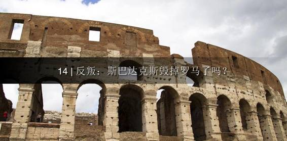

 

你好，欢迎来到《西方史纲 50 讲》。

上一讲我跟你分享了罗马文明繁荣的一大原因，也就是军国主义。军国主义是主导罗马成长的主要基因。这一讲我和你聊聊罗马成长的另一大原因，也就是奴隶制。**和军国主义一样，奴隶制给罗马带来了成长，同时也给罗马带来了烦恼。最直接的烦恼就是，奴隶起义。**

如果只能说一个罗马奴隶的名字，你会想起谁，没错，斯巴达克斯，角斗之王。罗马共和国遇到的最直接的成长烦恼，就是斯巴达克斯率领的奴隶大起义。

虽然大起义最后被镇压了，但奴隶制给罗马带来的利弊并没有自动终止。奴隶制成就了罗马，也毁了罗马。不过说到奴隶大起义，你要是想成奴隶主阶级压迫奴隶阶级，国家最终被奴隶阶级推翻，那就大错特错了！

## 罗马的奴隶制

**罗马是整个人类文明史上最发达的奴隶制国家。**说起罗马，你直接就会想起大竞技场、万神庙这些庞大的建筑，不错，它们都是奴隶建造的，罗马文明就是建立在奴隶的血汗之上的。

罗马有一句谚语，“凡事皆可让奴隶去做”。罗马奴隶分工之细密，远远超出我们的想象。在一个大奴隶主家里，负责开门和负责帮主人换鞋的奴隶都各司其职，绝不插手对方的职责。

那我们就得追问一句，奴隶都是怎么来的。延着上一讲的逻辑，你可以很容易就猜到，战俘。罗马战无不胜，就意味着源源不断的奴隶，作为廉价劳动力资源不断地汇入罗马。斯巴达克斯就是战俘。

这里先插一句希腊，我们再聊斯巴达克斯。希腊当然也使用奴隶，但希腊的成长路径不是陆军开疆拓土，是地中海贸易。所以，**希腊使用奴隶的深度和广度都远远不及罗马，因为它的成长路径不会给它带来源源不断的奴隶，客观上供应不足。**

罗马可不一样，几乎每仗必胜，奴隶似乎永远用不完。斯巴达克斯的老家是色雷斯，罗马在席卷希腊世界的时候，他的祖国战败，他被买为奴，进了卡普阿的角斗士学校，后来成为角斗士之王。

《斯巴达克斯》这部美剧拍了三季，加上外传差不多有四十集，场面非常精彩，情节张弛有度，不过虚构的成分很多。因为罗马史本身对斯巴达克斯大起义的记载不多，而且站在罗马官方立场的居多，后来人添油加醋地演绎了不少，他逐渐变成了传说中英明神武、反抗暴政的神。

你到底喜不喜欢、信不信斯巴达克斯的传说是一回事，但它透露出来的罗马文明的特性却值得我们深究。

**一方面，罗马人使用奴隶的残酷程度确实令人发指，角斗士就是最好的证据。**罗马人天性喜欢残酷，见到流血会兴奋、会激动、会有快感，这在古代文明里面其实并不罕见，比如在他们之后的日耳曼人也一样。

但是，把厮杀变成娱乐，尤其变成公共娱乐的，罗马可谓登峰造极。作为罗马文明标志的大竞技场，下面埋着无数角斗士的尸骨。罗马政要们把角斗竞技发展成了一种政治工具，人民喜欢这种娱乐，他们就提供这种娱乐来与民同乐，提升威望。**大竞技场这种公共设施正是因为这种政治需要才建立起来的。**

**另一方面，罗马人使用奴隶的数量极为庞大，斯巴达克斯起义军最鼎盛时可能超过了 10 万人。**斯巴达克斯带头起义，从 70 个兄弟最后变成 10 万人被镇压，前后就 3 年的时间。各地奴隶纷纷逃跑，还有破产的农民，也都投入起义军，这是起义军人数暴涨的原因。

奴隶起义军确实打了很多漂亮的胜仗，不要说将军，就是执政官被打败也出现过。最终起义军被镇压，是因为没有稳定的军需供给，更重要的是组织和专业化程度远不如罗马军团。

但是，你要看到，反叛只是奴隶制的浅层次问题，斯巴达克斯大起义虽然是罗马史上最著名的，但它不是第一个，也不是最后一个。

## 奴隶制带来的软肋

**最关键的是，罗马帝国最终并不是被奴隶起义推翻的。但是奴隶制确实是罗马没落的一大根源。**奴隶制成就了罗马的辉煌，但它也给罗马捆上了无形的锁链，让它的步伐越来越沉重，走向没落。

我先来问你两个问题，弄清这两个问题，你就知道奴隶制为什么会埋葬罗马了。第一个问题是奴隶真的是源源不绝吗？第二个问题是奴隶经济真的合算吗？

**先看第一个问题，奴隶是不是永远不会枯竭，答案是其实很快就枯竭了。**按照罗马成长的逻辑，没有奴隶那就打呗，奴隶就从战俘里来，只要罗马军团在胜利，奴隶就不会枯竭。

**但内外困难很快就阻止了罗马抓住更多的战俘**：对外的一面，越往外打，可以打的地方就越少，所谓少，不是说土地没有了，而是说那些土地上没有人了。

比如，罗马帝国时代最鼎盛的时候，帝国的南疆以撒哈拉沙漠为界，撒哈拉沙漠里有没有人？多少也有吧，但罗马军团再进去就不划算了，恐怕自己损失掉的士兵比抓住的战俘还多。北面日耳曼人不少，按理说罗马人可以打败他们，但黑森林又帮了日耳曼人的忙，给他们提供了天然屏障，罗马人不太好打。

更重要的，还有对内的一面：**兼并是可以消灭外部敌人，把他们变成自己的奴隶，但它同时意味着内部统治和管理的成本急剧提高，高到你无法承受。**

帝国的规模不是军团战斗力单向决定的，是军团战斗力和管理能力之间的平衡点决定的。打下来，管不了，那过不了几天，你流血流汗拿下的地盘又会拱手送还。帝国是这样，公司其实也一样。所以，帝国管理的压力会越来越沉重，会拖住帝国去开疆拓土的步伐。

如果没有大规模的奴隶输入，罗马会怎样？奴隶少了，自然就贵了，奴隶价格的上升，自然会引起价格普遍地上升，所有东西都会变得更贵。

原来建立在超级廉价劳动力基础上的罗马经济，就会遭遇到最重要的廉价资源的紧张，**那罗马能够及时调整各种生产要素的结构，重新达成均衡吗？**如果给定足够长的时间，一定会。

**但价格普遍上涨造成的严重后果远远超出了经济领域，政治和军事的混乱没有给罗马人太多时间。走下坡路的文明通常都是加速度走向衰亡的**。

**第二个问题，奴隶经济真的合算吗？不见得。**我在前面告诉过你，罗马人是凡事皆可让奴隶去做，也就是说，因为奴隶太便宜，罗马人就用劳动力尽量替代其它生产要素。

你要知道，这是要付出惨重代价的，因为这会让经济生活最需要的技术改进，被严重抑制。如果人工不足惜，人工很便宜，为什么要去改进生产工具？一切为了提高效率的技术改进，都因为极端便宜的劳动力变得多余了。

结果，意大利是帝国的重心，当然也是奴隶输入最多的地方，也就是劳动力最便宜的地方，它自始至终，从罗马建成到西罗马帝国灭亡，从来就没有成为过罗马的手工业中心。整个罗马帝国的生产技术取得的进步都非常有限。

从生产技术的角度看，繁荣的帝国居然一直停留在低水平上，没有太大进步。你完全可以把这种怪现象看成奴隶制对罗马经济的诅咒。

把技术改进被抑制和奴隶供给下降结合起来再看，罗马的经济就更危险了。生产技术停留在低水平，使得奴隶供给下降带来的后果更加严重，因为技术这种生产要素的家底太薄，很难缓解劳动力供给下降带来的冲击。

如果再加上政治和军事动荡，就意味着资本的供给下降，时局混乱，谁敢拿钱投资，这样一来，罗马经济全面凋敝就是情理之中的事情了。

回头再看斯巴达克斯大起义，它没有让罗马走向崩溃，因为当时奴隶枯竭、技术薄弱、投资停滞，这些问题都还没有走到极端，罗马还有很多富饶的地方可以攻占，技术改进被抑制还没有到尽头，还有资源不断输入，就还有好处可以分享，政治和军事就不会彻底崩盘。

但我们已经从斯巴达克斯大起义，看到了奴隶制背后隐藏的罗马文明的软肋。它在自己军事征服的道路上走得越成功，离经济全面凋敝就越近，离经济、政治、军事危机的总爆发就越近。

所以，到了罗马沿着自己的生存逻辑走到下坡路的时候，不再需要斯巴达克斯那样的大英雄来推翻他，他自己就会病入膏肓，一个三岁小孩都可以把他轻松推倒，这个三岁小孩就是日耳曼人。关于罗马人和日耳曼人之间的接力关系，我会在后面跟你细聊。

本讲小结

好，总结一下这一讲的内容：罗马拥有人类历史上最发达的奴隶制，斯巴达克斯起义是对这种丑陋制度最旗帜鲜明的反叛。但奴隶制造就了罗马经济繁荣的同时，也为它埋下了抑制技术改进的重大缺陷，一旦征服的脚步放慢，奴隶供给就随之下降，罗马经济就会走向全面的凋敝。

但是，进行起义的斯巴达克斯没有毁掉罗马，在他之后，罗马完成了一次华丽的转身：从共和变成了帝制，去适应大而富的社会经济新形势，真正成为世界帝国的罗马正是从这里开始的。

下一讲，我会带你去看看帝国取代共和的关头，苏拉、凯撒、屋大维这些大人物都干了些什么。

期待你的到来，下一讲再见！

精选留言

点击直接进入下一章节

**A learner**:  
奴隶制下的罗马困境让我想到了施展老师谈到的一个概念"内卷化"。清朝出现的人口红利，使得人力变得极为便宜，便宜的人力造成了创新动力的不足，而低水平的农业经济又无法消化这么大的人口，中国把自己锁死在了一个循环里。  
  
罗马的奴隶经济诅咒，我觉得也是相似的逻辑。奴隶劳动力的不断增加，压低了劳动力价格，从而限制了创新的动力。旧的制度更无法支持越来越庞大的帝国身躯。罗马也被自身的"内卷化"给锁死了。

**Allelujah**:  
通过不断掠夺而建立的奴隶制，可以说是一种「存量思维」；而发展技术带来经济增长，则更偏向于「增量思维」。  
  
存量思维的优势在于，在存量本身还没有被充分挖掘时，新挖掘出的存量带来的边际效益都会极快地推动增长和生产。但一旦可供挖掘的存量枯竭，所有现存的资源都会立刻转化为稀缺资源，不仅增长会陷入停滞，甚至会导致现有秩序的直接崩盘。  
  
而增量思维虽然在起初进展较慢，但当技术出现突破时，会带来整个领域内效率的提升，使得用更少的资源就能获得更大的产出，让所有人都能因此受益。  
  
由于罗马的战绩过于突出、奴隶来得过于轻易，使其文明发展被锁死在了存量逻辑中，未来的覆灭在此时已经埋下了伏笔。

**作者回复**:存量和增量的说法有意思，但是一种后见之明，身在其中，怎么判断源源不绝的奴隶是存量不是增量呢？

**王·刚 数据化转型**:  
老师好  
  
今天的课程，我印象最深刻的是罗马兴衰体现出的  
逻辑困境。  
  
罗马军事越接近胜利的顶点，就越接近经济政治全面崩溃的边缘。一种单一逻辑，形成的逻辑困境，非常形象的在罗马成长历史中体现出来：罗马军事的强大，带来奴隶制的强盛。而罗马对奴隶的残酷压迫和近乎无偿的使用，让自己的陷入了技术和经济锁死，最终被日耳曼人这个三岁小孩推倒！  
  
同样，近代中国，当农业经济和帝制发展到登峰造极时候，同样因为对农民的极致压迫剥削，导致劳动力的极度便宜，锁死了自己的技术经济发展。以至于在近代饱受宵小之徒欺压。这是不是又一次佐证文明的逻辑困境呢？即没有鲜明个性的文明发展难以持续，如迦太基。而个性鲜明的文明，又会最终自我锁死，只能被外来击破。  
  
同时，我又想到，曾经称霸地球的生物如恐龙，在自己的时代越是称王称霸，环境一变死的反而最快。最终沦为了地底下可怜的哺乳动物祖先度过难关的口中食。这又是进化逻辑中的困境。  
  
那么我的问题是，有没有办法让文明不被自我逻辑锁死呢？  
  
也许我这个拷问单一逻辑，单一文明，单一物种的问题本身就是伪问题，演化从来是一视同仁。

**作者回复**:不被锁死的办法是充分对异质文明开放和包容，包括过去的，和现在的。

**强 Sean**:  
那些曾经把你带到高处的东西，很可能反过来成为你的限制。即使我们意识到了这种限制，也知道要跨越非连续性，但要刹住车、扭转局面往往还是一件非常困难的事情，一方面是因为船大本身难掉头，会被惯性的力量推动着继续往前，另一方面是掉头本身风险非常大，很可能反过来加速灭亡。

**佛祖门徒**:  
老师好！“其兴也勃焉，其亡也忽焉”，而奴隶制恰好在罗马帝国的兴衰之中扮演了重要的角色。奴隶制成就了罗马帝国的辉煌，战无不胜的军功支撑了这种辉煌的延续。但随着对外拓展的极限逼近，内部管理的成本不断攀升，罗马帝国犹如一个封闭的系统不断“熵增”，无序的状态在激化，最终变成一个虚弱的外强中干的国家，倒下不过是时间问题，日耳曼人就成为了压倒骆驼的最后一根稻草。  
我有一个问题想请教老师，当时的罗马没有人意识到问题所在吗？还是意识到了也无力挽回这种加速下滑的颓势？

**作者回复**:明天的课开始讲罗马人如何挽回，但升级不能克服基因里带来的缺陷。

**山峰**:  
可以用路径依赖解释奴隶制对古罗马的作用。一开始古罗马享受到了奴隶制的好处，如娱乐、劳动、便宜等，就好比走上了一条不归路，惯性的力量会使这一选择不断自我强化，身处这一制度的既得利益者会深陷当局者迷的境地，并让古罗马轻易走不出奴隶制的制度范围。

**吕可达 02015223344**:  
1.因为奴隶输入少，导致奴隶价格上升，因为奴隶是最基础的生产资料，所以导致所有东西都变贵。  
老师，我设想是这样，能不能保持一个状态，比如某个行业要发展，然后发现奴隶价格高了，那就减缓自己的发展，减少对奴隶的需求，这样虽然发展止步了，但不是解决了整体的社会问题了吗？可现实为什么一落千丈，无法制止呢？  
  
2.您说奴隶太多，导致了技术发展受限。  
可难道不是人多，然后分工，可以促进经济发展，技术创新吗？  
那么到底人多好还是人少好？他们的平衡点在哪里？  
或者是因为奴隶生产积极性不高，导致无法创新？那换成普通人我相信也不是人越多越好。  
是不是人数应该和经济发展状态相匹配呢？

**作者回复**:答 1：罗马是市场经济，政府对经济的控制力有限，所谓控制行业的政策，其实是没有的。这个建议是把 20 世纪强大的国家用来想象罗马的结果。古人其实做不到。答 2：同样是劳动力资源，奴隶和自由人是不一样的。规模促进分工的前提是自由市场经济，劳动力资源投入再生产，而不是屯在家里开门还是换鞋。贴一个招工广告，新工人只负责生产铅笔的某个部件或者某个环节，劳动力充裕就有人来干活，只要铅笔供不应求。这种契约自由的关系对于奴隶主和奴隶并不存在，因此奴隶的分工并不必然指向效率的提高。斯密讲市场的道理，核心是自由。

**诚志超**:  
军国主义扩张的缺陷在于只抢不创造。奴隶和奴隶主都没有创造的积极性，奴隶经济规模越大，体制成本和管理成本就越高，而军团带来的外部输入有极限。  
  
一旦增速到达极限，开始收缩，体制就会崩塌，人心变得不够快。由俭入奢易，由奢入俭难。

**小樣樓**:  
我觉得罗马适应于索罗斯的泡沫理论：泡沫本质上是一个自我加强的正反馈。当然，这种趋势的自我加强是有极限的，泡沫最终会有破灭的一天。罗马奴隶制限制了生产力的提升，外部资源的枯竭限制了罗马的不断扩张的收益，而战争的成本却不断的提高，俩俩相加这就产生了负反馈。  
  
开始（罗马共和制）→加速（军国主义扩张）→强化（布匿战争）→黄昏期（奴隶制）→逆转点（斯巴达大起义）→下跌（共和开始走向没落）→加速下跌（华丽转身）→罗马帝国

**作者回复**:等帝国讲完你再用这个思路走一遍，试试能不能说圆。

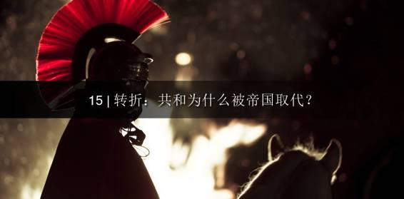

 

你好，欢迎来到《西方史纲 50 讲》。

上一讲我跟你聊了斯巴达克斯的故事，斯巴达克斯起义没有直接毁掉罗马，因为当时罗马在政治和军事上还有充足的实力去镇压它。但你只要略微熟悉一点罗马史，就知道，起义失败之后很快共和就覆灭了。很明显，奴隶起义加速了共和的覆灭。

这一讲就是要给你讲讲覆灭共和的这些大人物，但是我要讲的核心不是大人物的纵横捭阖，而是形势、制度和行动之间的关系。

通过共和覆灭这个典型场景，我带你去看看文明的自我政治升级机制，换句话说，一个文明到底有没有可能进行政治自救。

## 颠覆共和的苏拉

这一讲我要通过苏拉，而不是你熟悉的凯撒来讲这个故事。

**苏拉是第一个颠覆共和的终身独裁官**。除了苏拉，你还需要记住一个人物，就是马略。马略是苏拉之前的罗马执政官，他是一位改革家，也是苏拉的政敌。至于马略改革的核心是什么，我会放在后面再跟你讲。这里你只需要记住苏拉有这么一位对手就好了。

我们来看看苏拉干了什么坏事儿！这种口气其实是不对的，它暗藏着对苏拉的传统偏见，就像中国人心目中的关公一定是忠义的红脸，曹操一定是奸邪的白脸。

我完全不打算跟《三国演义》唱反调，非要摧毁你心目中关公和曹操的形象，它们是中华文明的一部分，有力地宣扬了传统价值观。**但你要知道，红脸和白脸宣扬价值观的时候，简化、加工、添补了很多内容，它很可能会让你看不见很多更重要的东西。**

如果一定要对苏拉的所作所为给出一个评价，那么我要说：苏拉时代的罗马，共和制度已经无法应对当时的新形势了**。苏拉当然是颠覆了共和，但是他真正的问题还不在于此，而是他颠覆共和之后，没有建立一个能够适应新形势的新秩序。**

如果跟凯撒对比的话，你可以把苏拉看成是罗马从共和走向帝制的过程中，一个政治自救的失败案例。

## 苏拉的三大罪状

那么我们具体来看看苏拉到底做了什么，传统价值观认为他是颠覆共和的独裁者，是罔顾法纪、野心膨胀、邪恶残暴的典型，共和就因为遇上了这么个邪魔被摧毁了。

他和马略争斗，挥军杀回罗马城，胁迫元老院授予他终身独裁官的大权，然后用恐怖统治清洗政敌，共和国变得鸦雀无声。

我们来看看苏拉的三大罪状：**第一，挥军杀回罗马城夺权；第二，就任终身独裁官；第三，实行恐怖统治。**我带你一个一个细看。

## 对外征服带来的问题

**第一，挥军杀回罗马城，是对共和传统极大的破坏。**罗马法有规定，军队班师回朝，跨过卢比肯河之前必须解除武装，否则视为叛国。按照法律，苏拉是叛国贼。

通常说到这种地方，你就会把事情的原因归结为个人品质，苏拉野心太大。于是，脸谱化的思维方式帮你用最简单的办法得到答案，你的思考也就此打住。

你需要做的是进一步追问，到底什么样的时局会让人产生野心。那当然是乱世，时局越乱，野心家越多。**线索就出来了，实际上在苏拉夺权之前，罗马共和国本身已经出问题了。**

**对外征服的成长逻辑，在顺利推进的时候会带来两个问题**：一方面，内部管理压力迅速上升，怎么管，会出现分歧，改革派发明新办法来管，保守派坚持老办法来管，可不就打起来了嘛；另一方面，顺应军事征服逻辑的人能成大业，于是大家都想做将军去开疆拓土，他们之间会因为战争的指挥权打起来。

回想一下我跟你讲过的格拉古兄弟改革，就是一个例子。罗马通过征战变得大而富，于是带来了贫富不均，严重挑战了原有的制度框架，这时候就需要改革。但是改革又引起了新的混乱。

苏拉和马略的斗争其实也是围绕对外征战带来的问题展开的，可以从内外两个角度看：

**对外，仗怎么打，谁去打？希腊地区的征服等着有作为的将军去建功立业；对内也有问题，国怎么治，谁来治？公民权要不要从罗马城扩大到整个意大利半岛？**法律身份覆盖面的扩大，意味着罗马法对更大的地区有效，把管理压力降下来。

那么，苏拉率军跨过卢比肯河，就等于给出了答案，我来打仗我来治国，其他人都给我让开。

## 共和制度接近失效

**于是就有了苏拉的第二条罪行，就任终身独裁官，这是对共和传统的极大破坏。**罗马法当中的独裁官制度，相当于现在各国通行的宪法上的紧急状态，国有危难，授权专人解除危机，部分法律停止实施，公民权利相应克减，但授权是有限的，任期是有限的。

总的来说，独裁官制度本来也是存在的，但这只是共和国救自己于危难的政治保卫机制，它本身完全符合共和精神。苏拉就任终身独裁官之前，罗马共和国最后一次启用独裁官制度是布匿战争时期，当时是为了对付汉尼拔，那已经是 100 多年前的事情了。

但是苏拉一来，不仅取消了独裁官的任期，而且授权几近无限，以前独裁官没有的越法之权他都有，比如他审判的案件不得再上诉，他可以设立、废除、改变各级地方政府，选什么人担任高级官员他说了算，选什么人做他的接班人他说了算，都不再需要经过元老院批准，等等。正是因为终身独揽大权破坏了共和制度、违背了共和精神，独裁才变成了坏词儿。

和回城夺权的问题一样，苏拉揽权确实是出于个人野心，但你必须要看到，这背后是共和制度已经不灵了，原有制度处理不了社会、政治、军事问题。

这里我们已经可以得出一个有关文明的一般性结论：凡是大野心家出现，一定是时局纷乱，原有制度已经接近失效，无力管理和控制各种事务。**把大人物放进这样一个硬逻辑，思考的重点就不再是个人的品质，而是如何顺势而为。**

于是，更重要的评价标准是，大人物到底有没有建立起新制度，结束混乱，让国家重回正轨，而这条新的轨道必然已经和旧的不一样了。

这也意味着，即便罗马的社会、政治、经济危机解除，它也回不到以小而穷为背景的共和制度里面去了。

## 苏拉与暴民合作的恐怖统治

**所以，我们接着看第三条罪行，苏拉实行了恐怖统治。**苏拉的恐怖统治是坏君主和坏人民通力合作的典型。

苏拉要揽权，要清除政敌，所以实行恐怖统治，那人民又是为什么呢？回想一下我跟你讲过的共和的定义，共和是人民共同的事业，而人民是靠法律这根纽带团结起来的。当人民背德乱法，为了自己的私欲而践踏法律时，他们就不再是人民而是暴民，共和自然也就瓦解了。

在共和末期的乱局当中，人民并不会当然地遵纪守法，当军事扩张带来的巨额财富分配不均、不公，当大人物们都在徇私枉法地争权夺利，当遵守传统美德和法律已经成为迂腐，人们就都加入了践踏法律的行列，他们就成了暴民。

而且，共和传统告诉掌权者，权力来自人民，所以掌权者要讨好人民，在乱局之中他们就会去败坏人民，教给人民很多能够牟利的坏行为。

苏拉和暴民合作的恐怖统治是这样的：苏拉在广场上贴上名单，宣布谁是“人民公敌”，不用执法队去抄家灭门，暴民们就先去了。因为苏拉规定，杀死人民公敌不仅无罪，而且有赏；包庇人民公敌则与他同罪。人们为了领赏，为了抄家得到好处，也为了政治投机，就疯狂地迫害他人。

以至于，有的人根本不在名单上，暴民在某些人的挑唆之下先把他们家抄家灭门，然后 再把名字补在名单上。人民竟然利用苏拉的恐怖统治谋自己的私利，主动地加剧了恐怖。

长长的文明史告诉我们：当一个国家出现了坏统治者，他仍然还是人民的代表，有什么样的人民就会有什么样的统治者。反过来说也成立，有什么样的统治者就意味着有什么样的人民。

不要理所当然地假设人民就是正义的化身，罗马传统把人民说得好的不能再好，可在共和覆灭的紧要关头，你看看人民都干了些什么。

所以，苏拉的出现不仅是因为他的个人野心恰好遇上了乱局，更因为人心已恶，民风不古。在这样的情况下，共和已经名存实亡，苏拉只是临门一脚。

不过你要盯住的是，**苏拉是否为拨乱反正创造了可能性。从长线来看，其实是有的，后来形成的帝制，权力的内容就和终身独裁官差不多，或者再往前推进了一两步。**

## 如何理解苏拉的统治

好，到这里，你已经可以放下大奸雄苏拉的脸谱了，让我带你用形势、制度、行动的逻辑复盘一下苏拉的统治：**共和国因为迅速扩张，引发了对外征战统帅权的争夺，和对内管理方案的重大分歧。**

党争愈演愈烈，苏拉坏了规矩带兵回京夺权，和暴民合作用恐怖统治独揽大权，稳坐终身独裁官。他充分利用了坏政治当中所有对他有利的因素，使濒临崩溃的罗马统一到他一个人的麾下。

无论有多恐怖，罗马分崩离析的态势被终止了。“定于一”，也就是权力归于一人是对共和的颠覆，但却是对罗马的拯救。

在这个意义上，共和覆灭了，其实并不可惜，因为它固然好，但它已经对新形势失去了控制，它已经是一种无能的制度。苏拉的行动埋葬了共和，也就没有那么可恶，但他没有把野心和大权转换成新的蓝图，这才真正被有识之士不耻。

对比一下凯撒你就清楚了，苏拉没有得到后来凯撒那样的殊荣，除了他过于残酷之外，最重要的原因是他没有完成救国的大业。他没有系统性地把终身独裁官职权，变成稳定合理的帝制，没有凭借自己无上的权力完成罗马制度的系统更新，也就是说，他没有主动地为罗马铺设未来的正轨。

他选择了退休，到乡间别墅安享晚年。于是，他没有完成的事情就必须有人来完成，庞贝、凯撒、屋大维都是沿着独裁者的道路前进的。

在屋大维的手中，帝制终于基本建成，罗马正式获得了一种和大而富的社会状况相吻合的制度，它又可以意气风发地向前飞奔了。

下一讲，我带你去看看屋大维到底怎么完成了再次建国的大业。

期待你的到来，下一讲再见！

精选留言

点击直接进入下一章节

**小樣樓**:  
老师的讲诉让我认识到以下几点：1 对苏拉的最有力罪状其实就是最后一条，施行暴民统治，么有实现帝制的稳定与长治久安，这也是有识之士对苏拉的不耻之处。2 在共和走向下坡路时候，苏拉顺应时势结束共和其实就是挽救了罗马，这也给后来人做了表率，起到带头人的作用，凯撒和屋大维才可能在此基础上实现帝制。3 评价一个人作为时候，要放到时代背景的大框架之下，才能认识明辨人物是非，始终记得一点，一个人在历史上留名，不论对与错，都是顺应时势，我们要看的就是它如何抉择的，他的结果是什么！

**佛祖门徒**:  
李老师，周末愉快！脸谱化的描述一是可以降低大众的认知难度；二是便于弘扬价值观。我们审视历史并希望获得启发，绝不能简单的对待历史事件与历史人物，一定要深入分析背景、制度和行动之间的关联性才能建立客观的认知。这是老师这一课给我最大的启发。  
苏拉为什么会“胆大妄为”向共和开刀？又为什么会采取那些手段？其本质可以视作形势助长了个人野心的膨胀、制度问题让其看到了野心实现的可能，但其有限的个人能力却让其无法完成国家转型的使命，自古“成者王侯，败者贼”，所以之前的种种行为都成为了被人批判的“罪行”。

**作者回复**:既然认知已被触动，“成者王侯败者贼”的老套就不适合拿来评论大人物了。

**storman**:  
大而富的社会是不是一定要帝制来维持呢？用现代人的眼光来看，是否定的，因为现代社会的中美都不是这种社会制度。  
但当时社会的富只是相对，它底层的基础都不足以支撑共和，人民的意识，科技状况，官僚机构等等，都没办法完成从下向上的资源整合，而从上到下的帝制反而可以更好的利用资源。  
没有最好的制度，只有合适的制度，社会就在发展选择中完成螺旋式上升。  
暴民，又见暴民。在《叫魂》中有提到，苏拉这种人民公敌政策就像扔在大街上的枪，而暴民因此获得权力的虚幻感，奸诈之人混水摸鱼，搞的一地鸡毛。为他人做嫁衣。

**作者回复**:一个人不只是自己的行为顺势而为，而是把制度做成顺势而为，才称得上大人物。前者已经很难，后者恐怕万中无一。

**炭笔**:  
很喜欢李老师的这个课程，讲历史事实的时候也讲历史逻辑，同时还说明历史中的普遍规律。  
  
很多民间的叙事，都喜欢把社会历史问题简化为道德问题。诸如曹家是篡位奸臣，秦桧是奸相，赵构是昏君等等。  
  
但历史事件总是有背后条件的，旧的系统出了问题，才会有旧制度的破坏者出现，才会有人尝试新的制度。把历史事件归结于个人品质，完全是一种无用的简化。  
  
这讲中，罗马的共和制度不能应对"大而富"的现实，因而问题百出，这才有了"破坏者"苏拉。可惜他没有建立新的平衡，打造新的制度。因此他无法和凯撒，屋大维相提并论。

**戴嘉蒙**:  
苏拉给帝制开了个头，为什么努力没有形成合理稳定的制度安排呢？我猜想这与他的观念里把人划分为朋友、敌人两类有关。  
  
据说苏拉临终前，给自己留下了这样的墓志铭：“没有一个朋友曾给我多大好处，也没有一个敌人曾给我多大危害，但我都加倍地回敬了他们。”  
  
这句话虽然能显示他的权利和霸气，但少了政治抱负。他没有形成统治者与臣下的观念，当然无法形成后续一些列制度安排。

**作者回复**:一辈子都杀红了眼的人对规矩是不会有太多信任的，他认为政治就是斗，没有什么规矩可言，自然也就不会去往建立规矩的方向努力。

**蝉**:  
一代有一代之体用。一代人有一代人的使命。  
  
历史在等待能够缔造他的人。有时国贼和明君只有一线之隔。

**作者回复**:回顾经典，最主要的目的不是感慨一下，而是观察时势，叩问自己处于紧要关头的时候是否有勇气和远见去决断。

**Robert Zhang**:  
这段罗马史对我最大的启发是“完成”这两个字。苏拉如果能完成重建统治秩序这件事的话，他就是恺撒那样光芒万丈的大英雄了。至于其他的三条罪状，跟他的功绩比起来最多算是污点，而且历史上很可能不会浓墨重笔去渲染。另外一个感悟，历史人物和历史事件要在其所处历史环境中去分析，才会处于今天的我们有借鉴意义。还想请教老师一下，为什么苏拉选择最后归隐，是有什么不得已的苦衷吗？

**作者回复**:苏拉没有苦衷，而是没有远见，在他心目中已经没有事情可以做了。人最大的界限在自己心里。

**王·刚 数据化转型**:  
老师好  
  
这节课，是以前耳熟能详的一段精彩西方宫斗剧。里面充满了各种演员脸谱。而今天，经过老师的逻辑梳理和调拨，我似乎看到了一个组织和一个领导人的深刻互相塑造。我试着用几个算法逻辑来解读一下这节课：  
  
1- 递归：罗马共和国被苏拉终结，苏拉怎么做到的呢？用三大手段：军事逼宫，终身独裁和恐怖统治。为什么苏拉会做出这样的行为呢？苏拉的野心。至此是一个领导塑造组织的故事，苏拉也就被贴上了大白脸。但是，就想您说呢的，在追问一句，苏拉为什么会在这个时候实施自己的野心家计划？因为罗马共和的失效。为什么罗马共和会失效？好追问到这里就到了上节课的内容了，军国主义发展逻辑遇到了难以突破的发展瓶颈。后半部分是组织如何塑造领导人的故事。我们得到的启示是，不能至于表面而要探寻背后的驱动因素以及驱动因素的驱动因素。  
  
2- 演绎：演绎的逻辑是从苏拉开始独裁统治开始的。起点是军事逼宫，接下来恐怖独裁，清洗政敌，放纵暴民。这其实是苏拉的内心恐惧塑造了他的行为。君主的行为给全社会设定了一个最大化收益方向。人民就开始遵循简单的趋利避害选择，超整体的暴民方向演化，罗马人文明逻辑太单纯，所以从上到下没有生发出可以调整那个收益目标的力量。  
  
如果把组织的顶层，想象成计算机的显示器，苏拉就是那块屏幕。屏幕的背后才是值得研究的，但多数人只盯着屏幕。  
  
老师，上节课您留言说，文明防止被自我逻辑锁死的办法就是保持对内生和外来不同文明的开放和包容，我十分赞同。我还想追问的是：如果让我指出几个案例说明文明能靠自身力量突破原来逻辑，能控制住损失，发展出新文明形态，可以说就是英国。至今英国还保留着当初的影子。  
  
请问老师，英国诺曼王朝为什么能有这种内生力量和控制力呢？这背后本质原因有哪些值得我们铭记的？  
  
期待后面的课程。

**作者回复**:英国后面会重点跟你讲。但需要提醒的是，你对历史或者文明的“控制欲”太强，很多重大的成败其实并不是精确计算的结果，人控制不了，大人物也只是大势的棋子。学史纲，目的当然是让我们变得明智，但明智之中也包括了“乐天知命”。

**有点甜**:  
历史感比较本质的是：对时代背景、历史细节、人性的把握。从这个层面来讲，我们每天都在读历史，包括当下与未来。  
为此，历史给了我们看透一些东西的第三只眼。

**作者回复**:开天眼得练，练的核心是勤学深思，历史确实是最好的对象。

**强 Sean**:  
苏拉被有识之士不耻，而凯撒获得了无上的殊荣，也可以说苏拉完全被个人的权力和欲望充斥头脑，无法腾挪出心智来考虑他人、考虑国家的发展，而凯撒则更多地考虑国家系统的建设，将国家引向发展的正规。  
  
我想起皮克斯动画《寻梦环游记》的主题：真正的死亡，是被遗忘。大部分人都不知道苏拉，他被大多数人遗忘了，这是真正的死亡，而凯撒则在漫长的历史中被无数人不断提及和颂扬，甚至成为英雄的代名词，他永远活在后人心里。

**作者回复**:所谓国父，就是身后仍然光辉不灭，这对于所有手握重权之人都是非常困难的，因为权力最容易夺去一个人智识上的清明。

**樊文武**:  
经老师从形势、制度、行为三个角度一分析，《罗马人的故事》关于苏拉的章节的内容又在浮现，不过更加清晰明了。  
时势造英雄，关键是否能让国家走入新的正轨。

**浪里小白龙**:  
统治者和人民是一一对应的。  
有什么样的统治者就有什么样的人民。有什么样的人民就有什么样的统治者。因为统治者只有顺势而为才可以做统治者。  
所以，可以通过看一个国家的统治者来看一个国家的整体国格(相当于人的人格)。

**吕可达 02015223344**:  
老师，我觉得您的课不输于施展老师的课，但施展老师借助罗胖的跨年演讲被很多人知道，我觉得您应该也在今年跨年演讲发布的。

**作者回复**:谢谢哈，营销的事情我是外行，课程的质量大家认可我就很高兴了。

**海泥**:  
1、把人物的行为放到历史演化的过程中去分析解读，可以避免“道德”标签带来的局限性。  
2、在历史演进的过程中，原有技术和制度的“边际”限制了统治范围；唯有通过技术创新或制度创新才能带来新的统治“边际”。  
3、从中国史纲和西方史纲的课程中再次深入的一个认知是，人类文明史就是多民族、多地域交织和融合的历史。

**13xxxxx5261**:  
李老师好：  
苏拉的行为让我想到唐太宗李世民，正是因为唐太宗开创了后来的贞观之治，我们对他先前弑兄杀弟逼父退位的事情不去深究了。中国人罗马人其实都一样。

**作者回复**:中国历史上有为的皇帝大多都有过背德之行，不只是唐太宗啊。结果，确实没几个人记住他们做过的那些个坏事了。不过重点不是记住还是遗忘，而是道德体系的抉择。有兴趣的话可以听听我在《刘苏里名家大课》里对马基雅维利《君主论》的解读。

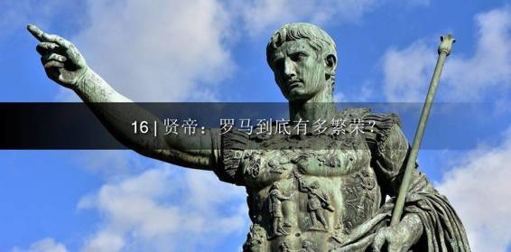

 

你好，欢迎来到《西方史纲 50 讲》。

上一讲我跟你讲了苏拉的故事，是他第一个动手埋葬了共和。苏拉的问题在于，他没有创造出一套新制度，让罗马稳固地存续下去，所以苏拉就被后人看作了独裁者。

这一讲，我就要跟你讲讲罗马的好皇帝们，看看帝国是怎么建立起来的，好皇帝如何解决了大规模共同体治理的问题。

我会从凯撒讲起，然后重点是屋大维，接下来是五贤帝。

## 凯撒的独裁时代

我先带你看看凯撒。

**苏拉死后，共和国由三巨头统治，也就是凯撒、庞贝和克拉苏，历史上叫做前三头政治。**因为后面还有一个后三头政治。

庞贝和凯撒是好朋友，凯撒把女儿嫁给庞贝，庞贝借兵给凯撒出征高卢。前三头政治的这三个人，其实都染上了独裁者的病毒，因为他们都是苏拉恐怖统治的亲历者。庞贝曾经公开表露了他的野心，他的名言是：苏拉可以，我为什么不可以？

你看，榜样的力量是无穷的，坏榜样也是如此。后来，凯撒嫁给庞贝的那个女儿去世了，他们之间的亲情纽带也就断了，这时候，凯撒已经征服高卢，功勋卓著，声望大涨，庞贝守在罗马城里，身边的小人不断挑唆，说凯撒会像苏拉一样谋反，庞贝就起了疑心。

这是一个典型的自我实现的预言。你说凯撒要谋反，发十二道金牌召他回京述职，结果他就真的反了。庞贝、西塞罗、加图这帮人仓皇撤离罗马。**凯撒独裁的时代由此到来。**

这里插一小段，庞贝逃到埃及，凯撒发兵埃及，埃及的大祭司审时度势，杀了庞贝献给凯撒，结果凯撒却说，我是来接老朋友庞贝回家的，顺路就灭了埃及，把它并入了罗马的版图。后来凯撒选择了一个埃及的管理人，就是埃及艳后克里奥帕特拉。存续了五千年的古埃及文明就此灭亡，亡在了凯撒手里。

凯撒做的事情，前几步和苏拉一样，都是第一步带兵回京、第二步独揽大权，但凯撒在独揽大权之后没有实行恐怖统治。**相反，他极力弥合上层贵族之间的矛盾，也用经济手段安抚下层民众，他的行动表明，他想把罗马团结起来，重新成为钢铁战车。**

可惜的是，他很快就被刺杀了。如果凯撒像苏拉一样心狠手辣，早早杀死政敌，他也许不会死这么早。

## 从苏拉到屋大维的大转变

凯撒死之后，他的政治继承人屋大维、他的部将安东尼和雷必达，就形成了后三巨头政治。

他们用恐怖统治清除了反对凯撒的势力，不过这次不是依靠暴民，而是依靠杀手。之后屋大维灭了安东尼和雷必达，罗马归于一统，帝国最终在屋大维手里建立起来。

三巨头从来都没有好结局，都是面和心不和，迟早要翻脸的。三角形最稳定这个道理，在政治里面根本不适用。

先简单总结一下，从苏拉到屋大维的大转变，背后是共和制度失灵了，要求新的政治秩序。

苏拉用暴力获得独裁，实际上是杀出了一条血路，但他的见识和健康状况，都没有让他走完重建国家的路；凯撒已经有了明确的意识去重建国家，但很可惜他被刺杀；屋大维必须坐上独裁者的位子，才能做成苏拉和凯撒都没有做成的大事。

要办大事，就必须有大权；要有大权，在罗马基本上只有一种选择，就是打。屋大维作为凯撒的继承人确实完成了凯撒未尽的事业。

## 屋大维的帝国时代

下面我就带你看看，**屋大维是怎么样把罗马升级换代的，一共三个方面，名号和体制，军事和管理，文化和社会。**

**先看看名号和体制。**严格来说，把屋大维叫做皇帝是不对的。元老院和军队授予他两个头衔，一个叫奥古斯都，一个叫皇帝。奥古斯都的意思是带有宗教意味的看守者，大约可以理解成国家的守护者；皇帝在当时是拉丁文 imperator，这个词是英文 emperor 的前身。它的意思很简单，就是军队统帅、司令官，commander。

屋大维本人爱把自己叫做 princept，第一公民，一般把这个词翻译成“元首”，这个词后来在西文里变成了君主，英文就是 prince。**总的来说，罗马皇帝通用的头衔就是凯撒和奥古斯都这两个。**

屋大维在名号问题上很谦虚，非常小心地顾及了共和传统，但他确实改变了体制，罗马的政治中枢由共和国的元老院变成了现在的元首，所有重大政治决策都以元首为核心展开，所有政治机构都由元首设置、对元首负责。

但就这样，罗马的帝制离中国的还差一大截，在中国，皇帝当然是世袭的，在罗马，原则是不能世袭。在罗马，谁要是把至尊之位传给儿子，那是冒天下之大不韪。罗马皇帝的继承都是通过指定政治继承人完成的。但这实际上是一个重大的隐患，我在下一讲再和你细聊。

**再来看看军队和管理。屋大维大力改革了军队体制，把军队分成边防军和禁卫军，各司其职。**屋大维在夺权的过程中和掌权后的征战中，都体现出了作为大将军的战略才华，加上对军队体制改革有方，军队完全服从他，军队本来是造成罗马混乱的最重要的势力，现在也都安静下来了。

在管理上，他改革行省制度，改革税务制度，建立警察制度，建立消防队伍，庞大的帝国因为有了制度，逐渐变得井井有条。

**最后，再看看社会和文化。**屋大维大兴土木，不仅修建各种神庙来重塑政治宗教，而且修建罗马大道，所谓条条大路通罗马，主要是屋大维修成的。有了罗马大道，长途贸易就非常便利，帝国境内各通有无，再加上改革币制，保证金融秩序，经济很快走向繁荣。

屋大维还庇护了一批顶级罗马文化人，比如大历史学家李维，大诗人维吉尔、贺拉斯、奥维德。**罗马文化进入了属于自己的“黄金时代”。屋大维几乎带来了万象更新的局面，历史上把它叫做“罗马治下的和平”。**

到这里，**我就可以跟你分析一下，罗马在用帝国取代共和之后迅速走向兴盛的逻辑了。**

*   从大形势来看，可以征服的地方还很多，这意味着土地和人口输入的过程没有终止，罗马文明的经济营养还没有断；
*   从政治权力格局来看，马略苏拉之争导致的上层分裂引发了大洗牌，新的能人强人涌现出来；
*   从政治统治的对象来看，大而富造成的贫富分化使得各种矛盾非常尖锐，必须通过制度创新才能解决。

这套逻辑要求罗马出现一个手握大权统揽全局而且有管理意识和管理才能的人。

苏拉没有管理意识也没有管理才能，凯撒看起来有但没有得到施展的机会，屋大维既有意识又有才能还有机会，他活了 77 岁，运用他的无上权威把国家带入新的轨道，一个适用于大而富社会状况的轨道。这才叫真正的雄才大略。

沿着屋大维的足迹，罗马帝国走了大约 200 年的辉煌之路。虽然屋大维的继任者和他们的继任者不全是好皇帝，还出过卡里古拉和尼禄那样的暴君，但屋大维搭的大框架足够好，没出太大的乱子。

罗马在公元 1 世纪进入了最辉煌的顶峰，也就是五贤帝时代，他们是密尔瓦、图拉真、哈德良、安东尼·庇护和马可·奥勒留。

在他们手上，罗马政治安定、版图扩张到极限、经济繁荣、人民安居乐业。五个好皇帝接连坐庄，而且他们之间没有血缘关系，这在人类历史上是非常罕见的。

## 罗马帝国的经验

到这里，我必须帮你总结一下罗马帝国最正面的经验，到底凭借什么能够有效地管理庞大的帝国。

**第一，稳定的政治统治。**皇帝要雄才大略，但制度同样重要，屋大维对罗马最大的贡献，就是他主动地运用自己的无上权威建造起一整套适应大规模共同体统治的制度。

**第二，有效的行政管理和司法裁判**。帝国政府能够及时、有效地管理社会事务、回应社会需求、解决社会问题。

**第三，发达的产权制度。**罗马法全面而合理地保护私有财产的占有和交换，为市场经济提供了充分的法治环境。

**第四，卓越的公共交通、健全的货币体系、流畅的长途贸易**，使得罗马经济和社会自然而然地融为一体。

有了这些，罗马帝国走上顶峰，成就了人类古代社会当中最庞大的以市场经济为底色的共同体。这时候你就已经能够感觉到古罗马对中国最大的启示了：大规模共同体只有依靠大规模的制度创新，才能维系和发展。

很多制度是一个文明处于小规模的时候完全不需要的，甚至想都想不起来的。比如，当你所处的文明就是一个村庄的规模，你可能会和村民们商量一起修筑马路，但你一定不会去修建自来水供应系统、地下污水排放系统。

**规模这个事情很神奇，它不只是庞大的领土、众多的人口，你不要只把它想成“大”，还要把它想成“密”，密度大了，规模也会上去。**人口密集，比如北上广深，就会产生很多村里根本想不到的问题必须处理，比如拥堵、比如医院排队、比如城市卫生、比如食品安全，等等。

中国原来就很大，改革开放四十年，让人口、资本、技术都变得更密集了，可以说，中国的规模之大已经非常可观了。规模越大，对优良制度系统的要求就越高，从屋大维的故事里，我带你找到了罗马升级换代、重铸辉煌的诀窍，只有一条路，那就是大规模共同体必须建立优良的制度系统来治理。

本讲小结

好，这一讲我们讲了屋大维的故事，我跟你分享了他把罗马带到辉煌顶峰的秘密。

但马上就会产生一个问题：这么一个好的制度系统为什么还是走下坡路，最终还是毁了？罗马作为古代文明的巅峰，为什么做不到万世长存？它一定有自身重大的缺陷。

下一讲我就来告诉你这些问题的答案。期待你的到来，下一讲再见！

精选留言

点击直接进入下一章节

**佛祖门徒**:  
凯撒在应该残忍干掉政敌来巩固其统治地位的时候，却试图以温和的方式来建立统一战线，结果“出师未捷身先死”。屋大维吸取教训，英明果敢除掉政敌，获得了再造罗马的机会。  
从老师的条分缕析中，我体会到屋大维的“硬权力式”的领导方式对于延续和发展罗马文明的重要性，强权政治加上雄才大略从政治、经济、军事及文化各方面对罗马帝国进行了比较完备的顶层设计。罗马文明是幸运的，不仅大环境给予了发展很好的外部条件，内部还产生了多位贤明的统治者，让罗马帝国成就了一段辉煌的历史。  
由此，我联想到秦孝公之后的秦国，自商鞅变法始，秦国连续由秦惠文王等多位贤王和名相当政，加之商鞅为秦国奠定的法治基础，让秦获得了多年的高速发展，从而为一统天下奠定了坚实基础。

**作者回复**:我们一起把时间再拉长来比对，秦国数代励精图治终于成就了秦始皇的霸业，但秦朝二世而亡；罗马自强八百年终于成就了屋大维，帝国辉煌地持续了两百年。其中的异同不止于秦和罗马，必须加上汉朝，才能把系统性的比较挖出来。

**蝉**:  
想起王熙凤的话:大有大的难处。  
  
国家规模大、人员、技术、资本密集必然呼唤更加细密、完备、兼容性的制度。否则这样的文明必然因为复杂而更脆弱。  
  
以前罗胖讲罗马帝国的覆灭有一个重要的原因是卡拉卡拉普法公民权，使上层失去荣誉、下层没有盼头。  
  
但现在看来，恐怕还有疆域扩大的统治成本问题、扩张极限问题、发展路径依赖问题等。  
  
正如红桃皇后所言:你只有不停奔跑，才能留在原地。  
  
制度创新没有终止符。

**作者回复**:路径依赖的存在说明制度创新并非必然，恰恰是逼出来的，那我们就得接着问：什么样的主客观条件可以被逼出新制度，缺了什么条件则不行，文明就此灭亡。

**小樣樓**:  
罗马经过屋大维改革有稳定的大一统制度和繁荣的社会，这对以后的继承者来说，已经么有了大规模的改动，只需要“萧规曹随”就可以了。在对比中国制度，罗马帝国唯一缺陷应该就是继承人体制，中国是长子继承体制，从名义上就限制了皇帝的继承人选择权，这样有利于国家的稳定。在不出现巨大危机的前提下，国家可以依靠优良的体制处理日常事务，皇帝也就不需要多么贤明都可以有效的运行。而罗马从名号上就存在巨大的漏洞，第一公民，权力和宗教上都归属于一个之上，为何还要保存共和传统？这不给了死灰复燃的机会嘛！罗马继承人如同禅让制，只需要有一个“大禹”就会出现大的危机。人性是最经不起考验的！特别在血缘亲疏上，而且伴生着这么大的权力～

**作者回复**:你的推理是有道理的。继承人制度是所有帝制的核心，正所谓“国本”。不过，无论是选贤与能还是长子继承，都存在着天花板：只要是对一个人（一个位子）过于依赖的系统，他（它）就会成为阿喀琉斯之踵。系统本身的均衡和强韧才是保证长治久安的大方向。

**陈 C**:  
罗马帝国的衰落，我认为一个重要的原因在于它的两个核心的制度逻辑，即“军国主义”与“奴隶制”上。一方面基于奴隶制，以“抢夺”为核心的经济逻辑不可永续；二来军国主义的政治逻辑必须以持续的征战为其正当性提供保障，一旦军事扩张遭遇地理自然的边界，其正当性就会遭遇危机；第三在实践中，军国主义与奴隶制是高度相关的，这使得其中任何一方，都难以人为地被提前终止。此外，在领土扩张后罗马公民权的滥发与基督宗教的崛起，我认为与罗马的衰落有着深层的联系。（这一段先扔在留言区，等老师讲的时候再回来看看）

**水画大师**:  
没有完美的制度，只有不断被完善的制度。而人没有意愿，甚至“没有理由”去改变一套运行良好的体系。西班牙前主教练博斯克就曾说：“为什么要改变一套成功的战术体系？”  
  
罗马帝国的继承制度是一颗定时炸弹，一个正全速奔向悬崖的帝国却不自知。当然，这是我们后来者并且站在全人类的历史发展视角才能看清的事情。

**作者回复**:“只有不断被完善的制度”恐怕值得商榷，制度是有极限的，并不是所有的制度框架都存在无限完善的可能性。就像建筑蓝图如果有极限，添砖加瓦并不解决根本问题，危楼终究还是要塌的。

**A learner**:  
这讲过后，对于大规模的治理难度又有了不一样的认识。  
  
一般的认知误区是，规模扩大一倍，治理难度也就上升一倍。然而实际情况是，治理难度是随规模的上升而呈现指数级上升的。因为除了原有问题的放大外，还会出现新的问题。苏拉、凯撒、屋大维都意识到了这个问题，都采取了根本性的变革，然而结果迥异，这其中不得不赞叹屋大维的雄才大略。  
昨天的留言中，我以为最后摘果子的是因为站在了前人的肩膀上。然而屋大维所面临的困境一点不比前两位少。  
  
过去看待古代战争，总是认为以少胜多的人都是真正的将才。现在突然有种感觉——那些率领几十万人出征而不乱的将军实在是管理能力了得。难怪韩信点兵，多多益善。

**作者回复**:上了规模，用直观的（一般人熟悉的）办法就解决不了问题了，必须抽象地、有远见地计算和控制无数匿名者的行为，会运筹“看不见”的东西，难度也就不是一般人可以理解的了。

**戴嘉蒙**:  
规模这事不仅有体积还要有密度。一个体积足够大密度也大的球体有能力抵抗外界力量对它的挤压。我们面对的是体积大，质量不均衡的国家。怎样的制度创新才能让内部铁板一块呢？

**作者回复**:不可能也不必铁板一块。制度性、常规化的沟通、理解、互助、互补，在保存正常差异的情况下实现团结，才是真正有韧劲儿的强盛。

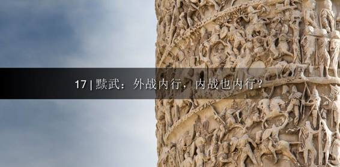

 

你好，欢迎来到《西方史纲 50 讲》。

上一讲我给你讲了屋大维的故事，重点是告诉你大规模的共同体治理，只能依靠大规模的制度创新。屋大维解决了这个大问题，也就是创建了古代大规模复杂社会治理的基本框架。

但罗马帝国的大框架存在着致命的缺陷，这个致命缺陷其实在帝制时代到来前，就已经埋下了。又经过 200 年的盛世，五贤帝时代结束之后，罗马堕入了深渊：内战。内战一打就是 100 多年，帝国境内生灵涂炭。

那我们就得追问，为什么繁荣的罗马会陷入内战。我先告诉你基本的逻辑，就是：一个文明当中的政治，如果不能降服自己的武力，它就会被自己的武力摧毁。

## 君主的武力优势

每个文明的武力到底是不是充足，还真不一样。通常来说，大文明的武力都比较充足，埃及、亚述、波斯、中国、罗马因为共同体规模很大，政府必须集结大规模的武力。**如果是君主制，武力的结构一般就是两种情况，君主的相对优势和君主的绝对优势。**

相对优势就是跟所有人比，君主是第一名：君主想坐稳江山，他必须至少拥有这个国家之内的相对武力优势，也就是无论他在一国之内武力占比有多低，他总是第一名。这样他至少能够保证单挑的时候他一定会胜利，否则，比他强的人一定会把他挑落马下。**相对武力优势是君主的及格线。**

**绝对优势当然也是第一名，但它意味着君主在一国之内的武力占比超过了 51%，**也就是所有人加起来都打不过他，他就可以高枕无忧了。

中国历史上最接近绝对武力优势的当然是秦国，以一国敌六国，仍然把它们全部打败。通常来说，做到绝对武力优势是君主的梦想，但成本太高，很难办到。**所以，君主制当中的君主武力，通常处于相对优势和绝对优势之间。**

相对优势和绝对优势都建立在一个基本政治前提之上，就是国家的武力属于君主。军权一旦旁落，君主一定不会有好下场。所以君主对自己身边享有崇高威望的大元帅，总是放心不下，两部《琅琊榜》，最底层都是这么个道理。

相应地，一国的武力越充足，控制和管理的难度就越大。罗马天生就是军国主义。也就是说，罗马不仅靠武力起家，而且靠武力成长。对罗马来说，打仗不能停，就像药不能停，饭不能停一样。**和罗马遵循同样逻辑的大国，在人类文明史上还有两个半，一个是成吉思汗的蒙古，一个是俄罗斯，还有半个是德国。**

沿着军国主义的逻辑向下想，你就知道了，控制武力对罗马来说就是天生的难题，罗马没有成功地解决这个难题。所以我才会说，罗马成于兵，也毁于兵。

这个时候我就可以跟你讲马略的故事了，他是苏拉的老对手。**马略的重大贡献是他改革了罗马的军制，改革最明显的效果是，罗马军队的战斗力大大提高，改革最明显的恶果是，军队私有化。**

## 马略改革的背景

我带你来看看马略为什么要改革。

**原来的罗马军队和希腊城邦的军队一样，基本兵制叫做公民兵。**公民是城邦的一分子，有权利也有义务，权利和义务合为一体，参与政治和当兵打仗既是权利也是义务。

这种兵制的好处是士兵的责任感和荣誉感特别强，我是国家的一分子，我当然要为国征战。但它的弱点是规模有限，一个城邦就几万公民，最多十几万，即便全都当兵打仗，也很难打大仗、打持久战，毕竟种田做生意的也是他们。

**当罗马越打越大的时候，问题来了，军队的稳定性和战斗力都不可靠。**先说稳定性。罗马公民出征在外，一去就是几年、十几年，家里什么情况都不知道。等他们凯旋回到罗马，地被人占了，老婆跟人跑了，孩子找不着了，如果分到的战利品和土地还不够还债，他们还会觉得当兵有意义吗？即便报酬丰厚，前半生的家庭损失也弥补不了。

而且，还有一个问题，那些罗马征服的地区，要不要给当地人公民权？如果不给，他们就不能为罗马征战，如果给了，他们会死心塌地地为罗马征战吗？最后，是在苏拉手上，授予了意大利全境人民公民权。

再说战斗力。罗马人是天生彪悍，但仗越打越大，越打越残酷，光凭天资是不够的。这个道理很简单，天生力气再大的人遇到训练有素的高手，肯定还是不行。罗马士兵平时在家都是农民，没有接受过专业的训练。

公民兵制度实际上是业余兵制度。在马略改革之前，罗马军队九战七败，损失二十万，已经到了不改就亡国的地步了。

## 马略改革的成效

说完了马略改革的背景，你就会发现，马略的改革就是要提高罗马军队的稳定性和战斗力。

**一方面，马略改公民兵制为募兵制，兵源不再依靠公民义务，而是依靠军饷，兵源大大扩充。**而且，士兵的服役年限也延长了，相应的保障就是军饷明确。

另一方面，重新整编，建立新军制。

首先，严肃军纪，荣誉第一，每个军团都有了自己的鹰徽和战旗，它们在，队伍在，它们亡，队伍亡。鹰成为西方军队的标志就是从这个时候开始的。

然后，强化低级军官的职责，保证军团在战斗中被打乱，低级作战单位仍然保持战斗力。

最后，他改变了兵种的配比，弓箭兵、短剑兵、长矛兵相互协作，长矛兵成为重心。为了从分工里面找到战斗力，统一训练、统一武器配备就是必须的。

事后来看，马略改革确实达到了目的，提高了罗马军队的稳定性和战斗力，罗马战无不胜的神话可以继续下去了。

## 改革带来的恶果

但是，**马略改革却给罗马带来了军队难以控制的致命伤，当然，这不是他故意的，不过后果极其严重，我把它叫做兵随将转。**

原来的公民兵都是自备武器，打完仗解甲归田，现在不仅是国家提供武器，也职业化了，军饷由国家发放，晋升由国家决定。可问题是国家总是要由人来代表的。

于是，士兵的军饷、级别、战利品乃至身家性命都掌握在将军手里。军队就很容易被私有化。国家危难之时，有人就可以拿出钱来招募军队，为国征战，他的政治地位就建立起来了。

兵随将转的恶果，比任何人想象的都来得更快。马略的老对手苏拉，很快就带兵杀回罗马夺权，后来凯撒也效仿苏拉，这些军队的荣辱、利害、生死已经不是和罗马直接关联在一起，而是和苏拉、凯撒这些人关联在一起。

所有手里有兵的将军都在心里默念庞贝那句名言：苏拉可以，我为什么不可以？！如此一来，国家对军队的控制就失去了基本的制度保障和心理屏障。

这个时候，再说个中国的例子你就更清楚了。你想想精忠报国的岳飞，他指挥的军队叫岳家军，跟他姓，敌国心里面只忌惮他，根本不把宋高宗放在眼里，这让皇帝作何感想？！

马略留下的病根之所以过了 200 年才爆发出来，是因为马略改革后不久，帝国到了屋大维手里，以及后来的五贤帝足够雄才大略，他们以个人的威望和手腕控制住军队。可一旦皇帝没有这个本事了呢？遍地都是暗藏不臣之心的将军，罗马必然朝不保夕。

终于，哲学家皇帝马可·奥勒留驾崩之后，平静的局面被打破了，那是公元 180 年。因为在奥勒留驾崩前，他坏了规矩，把皇位传给了他的亲儿子康茂德，这在罗马是不合法、不得人心的。偏偏康茂德又是个不学无术的纨绔子弟。

## 兵营出皇帝

从此，武力就失控了，乱局一发不可收拾。

康茂德在公元 192 年死后，不到 100 年的时间里，罗马出了 26 位皇帝，这只是被罗马官方承认的，不被承认的自立为帝者还有二三十个，这五十几位，几乎无一善终，绝大多数的结局都是被士兵所杀。

这个局面一直到公元 284 年戴克里先登基，才得以解决。你可以想象一下，皇帝不到两年就换一个，什么概念，罗马完全乱成一团。

将军们为了争夺帝位，跨过卢比肯河成了家常便饭。**在每个将军都想凭借军队私有化，做上皇帝的情况下，其实他们每一个人都丧失了得到相对武力优势的可能性。**

历史学家把这段时期的政治作了很经典的概括，叫做“兵营出皇帝”。

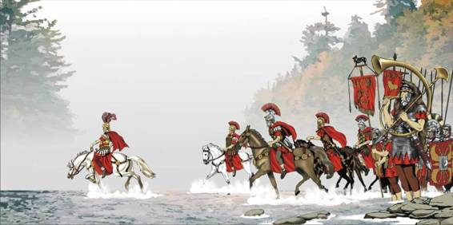

按照当时罗马法律规定，将军不得带兵跨过卢比肯河（Rubicon），否则视为叛变

后来恶劣的状况进一步升级，都不用将军们跨过卢比肯河了，谋逆篡位的主力成了禁卫军统领，发动兵变、血洗罗马城就行。在这段时间里产生了一句谚语，叫做：谁都可以得罪，但一定要讨好士兵。

最后，当罗马皇帝变得很简单，禁卫军统领一声令下，士兵们把老皇帝一家赶尽杀绝，把老皇帝和他朋友们的财产一分，统领坐上皇帝宝座，士兵们拥立有功。罗马陷入的不只是内战，而是万劫不复。

中国历史上大将军篡位，最成功的是宋太祖赵匡胤的黄袍加身，但你看，他坐上皇帝宝座做的第一件事就是“杯酒释兵权”，他最清楚自己的皇帝宝座是怎么得来的。

但这还不是中国历史上最像罗马内战 100 年的场景，最像的是南朝，宋齐梁陈，和五代十国，绝大多数开国皇帝都是兵变夺权上位，绝大多数都把前朝皇室赶尽杀绝，当然这也就意味着，绝大多数夺权者的后代都被后来人赶尽杀绝。

本讲小结

好，总结一下这一讲的内容：马略的军事改革有力地扩充了罗马的武力，把罗马从城邦式的公民兵制度，升级为适应大规模征服的募兵制，为罗马以武得天下打开了大门。

但这同样也是通往不归路的大门，兵随将转导致军队私有化，军队成为将军们争夺帝位的武器，罗马陷入了停不下来的自杀行动。**如何对武力进行有效的政治控制，这是罗马没有解决的问题，是罗马留给所有大规模共同体的超级难题。**

最后，是戴克里先终止了罗马内战，对帝国进行了大规模改组，他升级之后的罗马还能重现辉煌吗？

期待你的到来，下一讲再见！

精选留言

点击直接进入下一章节

**王·刚 数据化转型**:  
老师好  
  
学史纲的意义我开始理解了，这种理解是来源于和施展老师中国史纲的中西对比上。这种俯视的高视野，带来的是气势磅礴的冲击感。  
  
今天的课，讲的是穷兵黩武的最终下场，讲的是中央和分支的力量博弈。讲的是破局之后如何组局的智慧。杯酒释兵权的智慧可惜这 50 多个罗马皇帝均未掌握，以致身死家破。可见好处对能力不匹配的人来说，会转化成灭顶之灾。对我们个人，国家来说，踏踏实实地增强自己的实力，让光辉配得上名副其实，才是正道。  
  
这几天，我脑子里总在思考一个很有意思的问题。施展老师的书名叫《枢纽》，很好的体现出了中华文明从黄河流域小国，到中原大国，到亚洲大国，到世界大国过程中起到的流转互动的核心的作用。气势磅礴，灵动娟丽，犹如一幅水墨国画。  
  
那您的课程，书名会叫什么呢？我思考了两天，斗胆推荐一个😊觉得《底色》非常合适，在您的叙述中，从希腊，到罗马，将来再到英国，直到美国，西方文明层层叠叠的继承关系，给人类文明染上了艳丽严谨的色彩和架构，犹如一幅西方油画。  
  
祝秋安。

**作者回复**:谢谢你的建议哈，我会认真考虑！

**强 Sean**:  
在《罗马帝国衰亡史》中了解到：五贤帝时代的最后一位皇帝马可·奥勒留，一生戎马生涯，文武兼备，但没有坚持之前四位皇帝任人唯贤的养子继承制度，而是把皇位传给了自己的亲生儿子康茂德。  
  
康茂德从一开始就被内定为皇帝，但他缺乏政治经验，再加上少年成名，遭到了家族中其他人的嫉妒。一次刺杀风波彻底激怒了他，他对治理国家彻底失去了信心和兴趣，开始任用近卫军，对不了解的国家将领滥杀无辜，敌视元老院，不经过审判就抓人杀人，整个帝国上上下下，都被搞得乌烟瘴气。康茂德沉迷于狩猎和角斗，把国家大事都交给近卫军长官去处理，造成宫廷内臣大权独揽，权钱交易横行，百姓怨声载道。当矛盾激化的时候，他的处理方式也不是首先反省自己，而是把近卫军长官交出去顶罪，最后终于被近卫军合谋杀死。  
  
在康茂德死后，罗马帝国开始陷入了无休无止的内乱，并且再也没有恢复过来，曾经的黄金时代一去不复返。

**作者回复**:再强大的国家，制度系统如果太依赖顶端，顶端就是阿喀琉斯之踵，系统性的混乱是迟早的事。

**佛祖门徒**:  
老师的课画面感很强，不知不觉中产生了情境带入感，仿佛耳畔战马嘶鸣，喊杀声一片，忽见“城头变幻大王旗”，转眼之间，皇帝宝座又换人了。设想一下，在一个“皇帝轮流做，明年到我家”的乱世，但凡有些野心和实力的人恐怕都会“蠢蠢欲动”吧。缺乏制度约束，强人政治就变成了仅凭武力说话的简单游戏。试想一下，生活在那段岁月的罗马人民从安定的生活变成对明天“惶惶不可终日”的日子是怎样痛苦的体验？  
最后表达一下，在学习《西方史纲》的同时，还在“名家大课”跟着老师学习《阿奎那政治著名选》是一种愉悦的学习体验。

**作者回复**:《名家大课·阿奎那政治著作选》有点剧透本课的嫌疑。

**ZHENIA**:  
罗胖讲过一期《藩镇割据，毒药还是良药？》，还有《南明死局》，都是讲军队自下而上的权力绑架，当政治控制不了军队时，就是士兵军阀说了算，这比独裁统治还要黑暗，国家人民永无安宁。  
  
玩过《罗马全面战争》或者《罗马 2》类似游戏的玩家都知道里面有个马略改革，改革前后罗马的兵型都不一样了。改革前，主要构成的青年兵、成年兵、三线老兵，加上一些弓箭手、轻骑兵等。改革后变为各种军团兵，辅助兵，各种轻重骑兵，尤其后期比较厉害的城市禁卫军团，他们成为罗马政治动乱的工具和推手。改革后军力大增，极大提高军队战斗力，尤其是出兵速度显著增长，罗马可以迅速扩张，但元老院已经不能控制大军阀四处征讨，后期必定有残酷内战。

**王黎璐**:  
马略改革起到了广开兵源和提高战斗力的作用。使他很快征集到补充北非军团所需的新兵，大约有 5000—6000 人。正是通过这次改革，罗马才于公元前 105 年胜利结束了朱古达战争，摆脱了由北方侵袭意大利的森布里亚人和条顿人的威胁。但这也为日后的军阀制度和军事独裁制奠定了基础。他们一味追求有利可图的出征机会，追随那些保证给自己带来财富和土地的统帅，而军事统帅也就很容易以慷慨来收买自己的队伍，使之成为实现个人目的的工具。  
恺撒说：“你们曾宣誓在这次战争中为我服务”，很明显地反映了这支军队变成了个人手中的工具，由为国家服务变成了为个人服务；以前也没有士兵对指挥官宣誓的事，而只能对国家宣誓。现在军队是为了发财、掠夺而战，谁能领导他们打胜仗，可以掠夺到东西，他们就跟谁打仗，否则就不干，甚至兵变，杀死指挥官。马略同苏拉的争权斗争、苏拉独裁、三头政治、恺撒与庞培的内战、恺撒独裁都与出现这样一支军队有关。

**巴吉纳**:  
老师我补充一个「类罗马」的政权——蜀汉。  
罗马靠武力获取资源、传播文明，因此老师说罗马靠武力起家、成长。对比罗马，蜀汉政权并不是靠武力获取主要资源，但需要依靠源源不断的军事行动，维持蜀汉政权正统性。  
刘备在汉献帝禅位后自立为帝，而不“迎取献帝、恢复汉室”，实际上干的事和曹丕一个性质，这样摧毁了益州军事集团一直以来“匡扶汉室”正统性和凝聚力。因此，诸葛亮明白维持政权稳定性，必须保持绝对武力优势。同时，长期与曹魏交战在政治上能联合同样弱小的东吴。  
所以，哪怕这剂不能停的药是慢性毒药，蜀汉政权都不敢停。

**作者回复**:你说的有道理，我给你补充一个强证据：别看《三国演义》把诸葛亮推高成了民间心目中的智慧之神，其实儒家正统并不喜欢他，因为他太过“法家”。富国强兵之策是法家的强项，是诸葛亮的卧龙之本。

**泼猴要撒野**:  
查阅了一些史料，戴克里先是罗马最后一位强人君主，他用自己的军工和声望暂时使古罗马的政治保持了稳定。但是他本身对管理诺大的罗马还是感到力不从心，所以主张把行政版图分小(实际上是往以前小城帮的方向发展)。在实际操作中，他把罗马版图一分为二，两边分设正负两个皇帝，史称“四帝共治”。这样的设计在戴克里先掌权的时候还可以保持平衡，双方有冲突戴克里先作为最高权威还能从中斡旋。但当戴克里先退位后，由于没有最终裁判去调解东西二部，双方的矛盾必然会越来越深。古罗马一分为二也就成了必然。

**作者回复**:明天跟你分享戴克里先。

**夏宝辉**:  
李老师好！  
一个成功的改革后面肯定有一些当初料想不到的问题。比如马略的公民兵变为募兵制，提升了战斗力及兵源数量，可是也带来了兵只认将不认国的情况，跨越卢比肯河的次数乱象越来越多，这个时候只能靠雄才大略的君主才有可能稳住局面，制度的缺陷要靠人来支撑毕竟风险很大，其实这不仅让我想到的是中国的南朝和五代十国，而且想到的是清朝末年，君主伟大的时候还能掌握着中国的破巨轮慢慢前进，但是一旦皇帝软弱无能，那么就会导致巨轮的下沉。

**作者回复**:清末的局有个故事：杨度去辅佐袁世凯当皇帝，他的老师王闿运告诉他这事儿绝对不会成。因为自曾李以湘军淮军击败洪杨之后，天下已经武力四散，袁再强也统不住。老头儿对大势的判断很凌厉，时势比人强啊。

**A learner**:  
一个文明当中的政治，如果不能降服自己的武力，它就会被自己的武力摧毁。所以，拥有强大的武力不是问题，问题是有没有其它的力量能约束住它，让它在规定的框架里发挥它的作用。  
  
我把自己假想为一个拥有军队的将军，那约束我不造反的力量有哪些？我能想到的有：  
1.精神层面的，不能做出不忠的事，否则会被天下人骂做反贼。(不知道罗马人的精神世界对于这个有多重视)  
2.实力方面的，就是文中相对实力和绝对实力的逻辑。即便取不了天下，也得能割据一方。  
3.君王个人威信方面，就是一旦起兵，其它将军是勤王还是一起割据。  
  
显然，罗马在五贤帝之后，不论是在军力方面还是在君王的威信方面都处于了完全失序的状态。这时经不起考验的人心在力量的庇护下如同一条脱缰的野马，随意践踏和摧毁着文明。  
  
那精神层面的约束，西方人和中国人有什么不同吗？例如谋反是受到社会文化严厉谴责的吗？即便是依靠武力获得政权的人也要通过精神力量来获得合法地位吗？望老师解惑！

**作者回复**:所有文化都支持忠诚、反对谋逆，没有那种文化是反过来的。但精神层面的制约通常只对精神上认账的人才有用，兵变在不断刷新整个社会道德底线的新低之时，忠诚就越来越提不起了。当然，这不是说支持忠诚的文化就没有用，而是说，任何优良的道德品质都必须 1 辅以制度，形成规则，造就良性的行动逻辑，2 辅以力量，形成制约，造就正派的大势。有好品质的人必须有力量，勇敢地站出来捍卫价值，订立规矩。没有力量、形不成规矩的好品质，只能让人唏嘘，而已。

**苏格拉磊**:  
#每天学习西方史纲#  
任何体系要运转，必然要有核心的支撑点，皇权时代需要皇帝的权力，于是与宰相、文官集团形成制衡。唐朝的郭子仪，之所以能够造就君臣不猜忌，和当时的皇权因为安史之乱后的衰弱，皇帝不得不信任有很大的关系，换成历史上的明君，估计都很难保全。更有者如东晋权倾朝野的桓温，喊着大丈夫不能流芳百世，那就遗臭万年。  
君臣之间的武力失衡，造就了猜忌，而一切的疑虑仿佛自证预言，但到底是君要臣死，臣不得不死，还是臣不得不反？例如五代周的太祖郭威，在历史上是记载被猜忌所以不得不反，那么作为臣子，杯酒释兵权后，是否能保全性命？还是握住权力与皇权博弈？这要如何判断？

**作者回复**:保命，无论是君猜忌屠臣，还是臣临危篡位，都可以理解，但你忘记了我对苏拉的批评，得大权要办大事，建制度、立规矩、开新局，否则残害忠良还是大逆不道的骂名都逃不掉！

**邱峰**:  
李老师您好！  
  
您说的“兵营出皇帝”这段历史时期（公元 192 年-公元 284 年），对应的是中国东汉末年和三国时期吧。  
  
比较一下当时的罗马和东汉，都是帝国将倾，君主孱弱，军阀夺权。为什么在中国最后演变成了三国割据的局面，而在罗马，却是将军们排着队地去称帝然后送人头呢？  
  
是不是有什么罗马和东汉在文明底层逻辑上的差异造成这样不同的后果？请您给我们再详细解释一下？  
  
谢谢！

**作者回复**:我在文中提到了，罗马内战时期最像的是中国的宋齐梁陈或者五代十国，后一个时段大多数人恐怕连有多少个政权都数不全吧。几乎接近失序。三国局势由董卓之乱开始，曹操灭袁绍之后几乎统一北方，刘备入巴蜀、孙权据江东，总的来说三者在特定范围内形成了相对武力优势。刘秀建立的东汉本是依靠豪强的弱政权，皇帝利用豪强、外戚、宦官斗法，自己被装进去了，成了小玩家。这和罗马以军阀为主角的玩法有基本格局的不同。

**张翔南**:  
马略的军事改革有力地扩充了罗马的武力，把罗马从城邦式的公民兵制度，升级为适应大规模征服的募兵制，为罗马以武得天下打开了大门。但这同样也是通往不归路的大门，兵随将转导致军队私有化，军队成为将军们争夺帝位的武器，罗马陷入了停不下来的自杀行动。

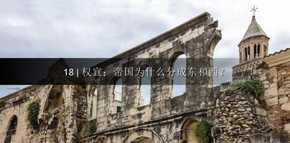

 

你好，欢迎来到《西方史纲 50 讲》。

上一讲我跟你分享了马略的军事改革，马略改革虽然解决了军队的稳定性和战斗力问题，但是它也带来了严重后果，兵随将转、军队私有化，导致军队全面失控，各路将军争夺帝位，内战不断，皇帝像走马灯一样地换，帝国核心完全瘫痪。相应地，帝国繁荣的社会经济生活也完全被摧毁。

这一讲我跟你聊聊戴克里先，是他结束了危机。到底他和他的继任者们，作出了什么样的努力，能够挽回帝国的辉煌吗？

## 帝国分东西

我先告诉你一个令人沮丧的事实：**无论后来的罗马皇帝，比如戴克里先、君士坦丁、狄奥多西有多努力，西方在罗马帝国时代再也没有回到昔日的辉煌。**

不过他们的努力确实带来了很多重大的变化，对西方文明乃至全世界，产生了改变方向的决定性影响，最明显的就是帝国分东西，帝国西部成为西方的势力范围，帝国东部走上东方的发展路径。

那么，我们就不得不回答一个问题，既然是同一个帝国，为什么西部和东部会发展成为两种完全不同的文明。

在这里我要郑重地提醒你，提起西方，你会想起希腊罗马基督教这三大传统，你说得不错，但远远不够。因为，罗马帝国的东部，以及后来的君士坦丁堡，也同样享有这三大传统，但是今天我们不会把它看作是西方，而是把它视为东方文明的一部分。

要解释清楚西方文明和东方文明的差异在哪，我要先带你看看罗马帝国晚期的这位皇帝，戴克里先，看看他做了什么。

等你理解了这段历史，理解了帝国为什么会分东西，你就知道除了希腊罗马基督教，西方文明必须还有别的特征才能够独立，和别的文明区分开。

## 戴克里先的努力

先说说戴克里先本人，他当上皇帝本身就刷新了皇帝出身的底线：他的父亲是被释放的奴隶，他绝对是出身下层。入伍之后他一直干到了皇帝的卫队队长。皇帝派他跟随太子出征，结果班师回朝的路上传来皇帝被杀的消息，太子即位，结果新皇帝还没回到罗马又被暗杀。戴克里先挺身而出，揭发了谋害两位皇帝的阴谋，获得士兵拥戴登基做了皇帝。

戴克里先当上皇帝之后大展宏图，他的作为大概可以归结为三个方面：第一，强化皇权；第二，分割帝国；第三，整顿经济。

我先带你看他是怎么强化皇权的。回想一下上一讲的内容，坐稳皇帝宝座的及格线是拥有相对武力优势，兵制就是头等大事。

**于是戴克里先首先改革军制，他有两个大动作：**第一，削弱禁卫军的力量，把它变成少而精的编制；第二，把帝国军队划分为边防军和野战军，皇帝重点控制野战军，同时，强化骑兵的地位，弱化步兵的地位。经过重新整编，导致罗马陷入内战的军队暂时安静下来了。

**戴克里先强化皇权的另一个大动作，是彻底抛弃共和传统，拥抱专制。**戴克里先改了皇帝地位的基本设定，原来屋大维给出的定位是第一公民，现在戴克里先直接把皇帝定位成“主人和神”，皇帝不再是罗马人民中的第一人，而是罗马人民之上的主人和神。

他用东方君主的复杂和神秘的礼仪包装自己，高高在上、神秘莫测。元老院连最后一点点职权都被剥夺了，成了罗马城的地方政府。

这在西方传统中，简直就是背叛。因为亚里士多德早就教导过，一个人是主人，其他所有人都是奴隶的统治，叫专制，它只属于波斯、属于东方，西方没有这种东西，也绝不能这么干。

所以，西方历史学家通常把戴克里先之后的罗马统治者称为皇帝，在他之前的都叫做元首，因为虽然他们都是罗马的最高统治者，但在道理上和制度上存在重大差别。

后来的皇帝的定位更加集权，这说明后面的罗马帝国，权力分布更为散乱，所以皇帝想要集权。但我要提醒你，集权并不一定就能改变权力分布散乱的格局。理顺权力，把它们整合成一个劲往一处使的体系，要做的工作很复杂，比强化统治者权力要复杂得多。所以，你也能看到，戴克里先强化皇权的努力，没有收到太大的效果。

**戴克里先的第二个大动作，就是分割帝国。**因为当时的帝国实在太大太难管了，一个人根本管不过来。于是戴克里先把帝国分成东西两部分，建立起四帝共治的体制。

四个皇帝，这怎么可能？中国传统认为天无二日、民无二主，两个皇帝都不可能并存，何况是四个！戴克里先的办法是这样，帝国分东西，一边一个奥古斯都，然后各自的奥古斯都再选一个凯撒，作为副手和接班人。

事实证明，四帝共治并不稳定，戴克里先在公元 305 年退休，他信不过他的老搭档马克西米安，让他也同时退休。结果几个继承人为了谁当老大又打起来了，最后是继承人之一君士坦丁一统天下。

四帝共治没有成为稳定的制度，没有解决政治中枢和平交接的问题，但帝国分东西这个局面却留下来了。

在君士坦丁手里，一个新都城君士坦丁堡建成，也就是今天你熟知的伊斯坦布尔，新都建成后，君士坦丁堡迅速成为罗马帝国的中心，西边的罗马城则逐渐被放弃、遗弃、抛弃。

**戴克里先的第三个大动作，是整顿经济。**当皇帝得有钱，最直接的问题就是要养军队和政府，戴克里先必须找到财路。可帝国打了 100 年内战，经济凋敝，实在没钱可收。

戴克里先想了两个办法，第一，强行管制价格，显然，财富不会因为价格管制就增加。他失败了。第二，价格管制不起作用，他就实行配给制，征收财富保障军队和政府的物资供给。为了稳定地得到征收，他严格限制人口流动，把人民捆在土地上。这样一来，原先罗马帝国那种用贸易，尤其是长途贸易实现的经济繁荣也就不见了。经济振兴的目标根本就不可能实现。

三大措施出台，罗马会变成什么样子？这个时候的罗马就开始急速接近我们中国人熟悉的古代皇权专制了。

这些措施使得帝国西部和东部逐渐分开，离得越来越远，终于走上了不同的道路。

## 西方和东方的分离

说到这，你应该明白了，西方和东方的分离在戴克里先时代就开始了。**这种东方和西方的差异，在罗马晚期主要体现在三个方面：**

**第一大差异是在政治上**，君士坦丁堡成为罗马帝国的中心，地位越来越高于罗马城，西罗马皇帝实质上地位不如东罗马皇帝，而且，他们在西部也难有作为。**西部政治逐渐进入真空状态，东部则保持着戴克里先和君士坦丁的专制政治。**

**第二个差异在经济上**，帝国东部被内战摧残得不严重，因为将军们的目标是罗马城，那时候还没有君士坦丁堡。再加上戴克里先禁止人口流动的政策，凋敝的西部从大规模的市场经济逐渐退化成自给自足的自然经济，庄园不断出现。**也就是说，经济上的封建主义，其实在罗马帝国晚期就已经在西部出现了。东部仍然保持着市场经济的繁荣。**

**第三个差异，在文化上，帝国西部讲拉丁语，东部讲希腊语，文化的差异越来越大，最终变成了隔阂。**后来，基督教的分裂进一步加剧了东西方的分离，我会在后面中世纪的部分，专门跟你讲基督教的故事。

就这样，戴克里先把帝国分为东西，最终使得帝国西部和东部走上了不同的道路。

西罗马帝国在公元 476 年灭亡，进入中世纪，东罗马帝国仍然存在，它后来被叫做拜占庭。拜占庭帝国又支撑了 1000 年，直到公元 1453 年才被突厥所灭，君士坦丁堡也就变成了伊斯坦布尔。拜占庭一直认为自己才是罗马帝国的正统继承人，西边不是，因为西帝国被灭了，主体民族变成了日耳曼人，而东边沿着戴克里先和君士坦丁的道路走了下来，1000 年从未中断。

到这个时候，你就理解了，一提起西方，直接想起希腊罗马基督教这三大传统，这没错，但这是远远不够的。**拜占庭和西方共享了希腊罗马基督教三大传统，但很显然，拜占庭不是西方。**

西方之所以是西方的很多特征，尤其是区别于拜占庭的特征，是在戴克里先时期开始出现的，后来又在中世纪逐渐演化和成型的。

所以，下一个单元我会专门跟你聊中世纪，你就会知道这些不那么起眼，却非常关键的特征是怎么来的。

本讲小结

好，总结一下这一讲的内容：戴克里先通过强化皇权、分割帝国、整顿经济三大招，来挽救被内战摧残的帝国，但总体上看，他失败了。

帝国彻底背叛了共和传统，经济整顿反而导致经济衰退。更重要的是，帝国分了东西，实际上是把东边和西边在社会、政治、经济、文化上的差距，用正式制度固定下来了，从此东边和西边走上了不同的道路。

最后，对武力的政治控制，并没有得到有效的解决，西罗马帝国在凋敝之中，被蛮族灭亡了。下一讲我就带你看看蛮族到底是怎样干掉了曾经不可一世的罗马帝国。

期待你的到来，下一讲再见！

精选留言

点击直接进入下一章节

**厉伟群**:  
这段时间，东西方压着同样的韵脚。  
他们同时在公元前后达到强盛的顶点，又一起经历了三世纪的混乱，然后不约而同地走向了贵族统治下自给自足的庄园经济。  
不一样的是，中国最终实现了隋唐的大一统，而西欧却在分裂的道路上越走越远。也许，各个文明的遗传基因，决定了历史的走向。施展老师和李筠老师正带着我们一步步揭秘这些遗传编码。

**作者回复**:施展讲北齐-北周-隋-唐如何熔铸南北再造统一的逻辑很精彩。二元帝国需要天可汗的实力和视野。西方在中世纪的各种条件都与之相差甚远，逻辑也就不同。

**炭笔**:  
我开始以为，帝国分东西和我国辽朝的南北两院制度有点像，是为了更好统治经济文化不同的地域。听了这讲，我才知道，其实是反过来。政治上人为的割裂才导致了经济文化的不同。  
  
这也应了李老师前几讲说过的，政治是重要的因素，它会左右文化经济的走向。稳定的政局是发展的基础。  
  
让我想起了法兰克王国的分裂，使得本来一个国家逐步发展出了多个不同的民族国家。这是否也是政治上的分割导致社会认同分道扬镳的例子呢？

**作者回复**:会的，政治统治必须塑造政治认同，否则遍地都是不臣之心，都暗地咬牙默念“楚虽三户、亡秦必楚”，很容易像秦朝那样二世而亡。政治体分开了，又少不了政治认同，认同必然也会被分开。于是，你是法兰西我是英吉利他是德意志就开始撕了，从战场一直撕到哲学。

**乘风破浪**:  
戴克里先对罗马帝国的政治、经济、军事上的改革，没有达到他的预期。值得思考的是，有没有比他的改革措施更加可取、富有实效的办法呢？我认为，困于当时的历史局限性，是没有更好的方法了。历史自有它前进的方向和趋势。

**作者回复**:我今天晚上对 AMYAMY 同学的回答，和你一起探讨：（皇帝把帝国分东西的决定）并不任性，而是深思熟虑的结果。我们不能以后见之明看到他失败了，就说他当初不负责任。帝国东西之分已有基础，把乱糟糟的罗马城空心化，制造新的中心来重新整合帝国，是大手笔啊！但很显然，整合的难度太大，分离之势（经济、政治、军事、文化）已强于皇帝的权力。想想他的军事改革和财政改革，和帝国分东西是连在一起的，一套的。这套分管统合的统合没有实现，管也持续不下去了，最后就只剩下分了。

**Henry 舒楷**:  
#我想问李筠老师#  
老师一开始就说了，区别东西方的主要方式是区分文明，但是文明是个很难量化的概念。  
戴克里先三个重大措施，使古罗马走向了东西分裂的状态。东西分裂将统一的版图变成了差异很大的两个区域，西罗马帝国演变成了现在的欧洲主体，延续了戴克里先的主要政策。但是东罗马帝国被奥斯曼灭国后，逐渐演变成了现在的土耳其。  
我们大家都知道土耳其一直希望能够加入欧盟，他们大概认为自己是西方国家，那是什么原因使得土耳其地理上紧邻欧洲，但却很难成为一个西方国家？

**作者回复**:今晚的晚自习回答过了哈，不知道为什么在这里没有，贴出来大家一起看：先纠错，戴克里先留下的专制传统留在了东罗马帝国，西罗马没接住。东罗马成了拜占庭，后来俄罗斯接过了拜占庭的衣钵。土耳其在建立帝国、灭亡拜占庭直到现在一直是伊斯兰国家，在凯末尔之后它想拥抱西方，但宗教、文化、政治、财政、货币诸多方面和欧洲差别很大，入盟是有门槛的。宗教、文化先不说，财政和货币土耳其就很难过关。

**ZHENIA**:  
《罗马全面战争》的资料片《蛮族入侵》为我们展示的就是破败的东西罗马，北部哥特人和日耳曼人虎视眈眈，西罗马经济崩溃，东罗马情况稍微好一点。这个基础上的游戏难度很大。西罗马动不动就叛乱，还得应付强大的蛮族军队，不得不采取本课戴克里先的三大招策略: 强化皇权、分割帝国、整顿经济。不过玩家是能够改变历史的，可以恢复西罗马帝国的荣光，因为我们是上帝视角玩儿游戏。当然也可以以哥特视角或东罗马视角玩儿，创造属于自己的历史。  
  
这个资料片出完以后，就进入了中世纪时代。感觉西方的游戏制作都这么符合历史，每次学习本大课，都会配合游戏里的场景，有很形象直观的感受。

**作者回复**:要不咱们把本课改编成一个大游戏？按照我前面多次提过的，一个文明的优势后来会成为他的包袱，军国主义是这样，奴隶制是这样，当哪个角色都会遇到自己的天花板。真实的历史比游戏更精彩，游戏再精致也是给定条件的，历史中的人却可以创造历史，突破条件。

**王黎璐**:  
戴克里先实行罗马分治实际是对奥古斯都体制局限性的一种尝试性修补。他察觉到了奥古斯都体制的低效性（帝国对于奥古斯都体制而言过于庞大，不便于一位元首独自管治；而且一个元首亦难于抵抗蛮族由莱茵河至埃及边境一带的不断侵扰），不过由于时代的局限性，他只能想到一个看起来很简单明了的做法：既然一个中央政府效率不够高，那么，干脆组建四个！于是就有了四帝共治。在戴克里先手里，改善了叛乱上位的罗马皇帝传承方式,但是他这套政治制度最明显的缺陷在于皇位继承制度——在他辞位不过两年，就发生了动乱。  
戴克里先渴望通过他的努力让帝国得以继续保持强盛，但他所有的政策在短时间内可以有效，但从长远来看损害了罗马的肌体。从此，罗马开始向绝对君主制迈进，当皇帝成为决定所有人命运的主人时，罗马帝国实质已经灭亡了。

**作者回复**:黎璐同学，在薛老师的课堂里就经常听到你的名字。这里纠正一个概念，戴克里先的帝制不是绝对君主制，而是专制。二者的区别我会在讲第四单元的时候告诉你。

**邱峰**:  
李老师您好！  
  
关于戴克里先的经济整顿措施，我有些不同的看法。  
  
正如您之前几讲谈到的，古罗马在鼎盛时期的经济繁荣其实是有一定先决条件的。首先是帝国政治稳定，长途贸易的安全有保障，市场经济才有可能发展起来。其次，罗马军团战无不胜，从周边地区获得大量财富和奴隶。第三，奴隶作为一种重要的生产要素，价格极其低廉，为经济繁荣打下重要基础。  
  
但是经过 3 世纪危机后，古罗马的经济基础被战乱严重削弱，上述几个条件都不成立了。古罗马可能不得不从原来的以间接税为主的财税制度转为以直接税为主的财税制度。于是，限制人口流动以保障税基就成了古罗马唯一的选择。  
  
文明的发展有严重的路径依赖，不是少数人主观意志能改变的。  
  
请您指正。谢谢！

**作者回复**:你讲的税制问题是有道理的。社会条件变化了，税制也需要跟随变化。我们再进一步推，直接税需要固定人口，人的流动性就下降了，人力成为资源的可能性就下降了，商业社会就会变成农业社会。这种变化给定足够长的时间也许能完成，但没有完成之前，帝国经济已经凋敝。时间，是所有想成事的人最大的敌人？

**A learner**:  
今天课听完有点懵，最大的疑问是东罗马和西罗马究竟谁才是西方？  
  
经济上东罗马保持了市场经济，文化上说的又是希腊语。似乎东罗马更好地继承了传统。又读了两遍，似乎找到了一点苗头。东罗马属于东方的一大原因应该是它丢弃了西方文明的内核，也就是希腊的民主和罗马的共和。  
  
这又让我想起了老师在开篇聊的话题"何谓西方？"答案是你必须站在文明的高度来看这个问题。又回顾了下审视西方文明的八个要素，即：  
1\. 古典遗产，也就是古希腊罗马文化，2. 天主教和新教，3. 欧洲语言，4. 精神权威与世俗权威的分离，5. 法治，6. 社会多元主义，7. 代议制，8. 个人主义。  
一对比，发现东罗马确实有点不伦不类。至于西罗马方面，期待下一讲更加具体的阐述。

**作者回复**:东西罗马帝国用 8 大标准来衡量：1.同；2.西：天主教新教，东：东正教；3.西：拉丁语系（欧洲语言），东：斯拉夫语系；4.西：分离，东：合一；5.法治：西有，东几无；6.社会多元主义，西：充分；东：不充分；7.代议制，西有，东无；8.个人主义：西发达，东坚决反对。怎么同属一脉最后差出这么多？看来中世纪就已经发生大事了。

**小樣樓**:  
从戴克里先改革开始，东西方逐渐走向了差异化，主要从 5 个方面：1 东罗马从文化上逐渐抛弃自由主义走向了神秘主义。2 语言也从希腊语改为拉丁语，首都也从罗马城迁到君士坦丁堡。3 制度上完全专制化，皇帝拥有至高无上的权力。4 经济中心也被转移到君士坦丁堡，再加上东罗马地处亚欧交界处，地理优势明显。5 宗教上被东正教统一。等于完全放弃了自由民主，走向了东方专制主义。施展老师讲北魏孝文帝改革，也是放弃了草原身份，完全接受农耕文明，结果走向没落。东罗马为何能够持续千年之久？1 君士坦丁堡地理位置好，城池坚固。2 宗教上与西方藕断丝连，只需要面对亚洲的文明冲击就好，而小亚细亚半岛属于多山地区，不利于被占据。3 经济地位好，只要欧亚大陆要交易，必走君士坦丁堡，除非经济中心转移。这只是个人看法，希望老师指正！

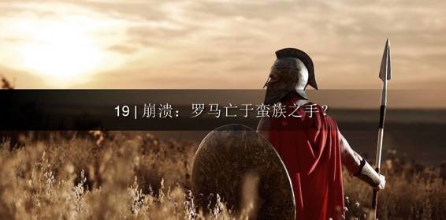

 

你好，欢迎来到《西方史纲 50 讲》。

上一讲我跟你分享了戴克里先的改革，他没能让帝国重现辉煌，倒是把帝国分成了东西两部分，西方文明正是沿着西罗马帝国的版图走下去的。

你只要看看西罗马皇帝们的下场，你就知道戴克里先实际上没有扭转西部的颓势，**帝国分东西，实际上是帝国放弃了西部。**

那么东边怎么样呢？戴克里先死后，公元 307 年，君士坦丁登基，他干掉了四五个和他争夺帝位的对手，他们都有奥古斯都或者凯撒的头衔，君士坦丁死后，在位时间超过 10 年的皇帝只有三五位，绝大多数都是两三年，当然，他们的结局也都不太好，大多都是被兵变废黜或者杀死。**也就是说，戴克里先改革没有改变“兵营出皇帝”的糟糕局面。**

这一讲我们主要说的是西边的事。公元 476 年，最后一位西罗马皇帝被蛮族首领奥多亚克废黜，西罗马帝国就此灭亡，西方进入中世纪。在奥多亚克废黜西罗马最后一位皇帝之前，蛮族已经多次攻占罗马城，西罗马帝国被蛮族搅得天翻地覆，西罗马帝国灭亡其实是迟早的事情了。

而东罗马帝国一直存续到公元 1453 年，又叫拜占庭。所以，这一讲所说的帝国覆灭只是针对西部而言。下面我就来告诉你，帝国是怎么被灭于蛮族之手的。

## “异鬼战胜文明”的认识误区

我想先打破你一个可能的误区：常有人说，希腊是毁于内战，而罗马是被外来侵略摧毁的。**表面看，罗马帝国确实是被灭于蛮族之手，但实际是罗马人自己作出来的。可以说，罗马也是毁于内战。**

这话怎么说？说起文明人和野蛮人的较量，你脑子里就会浮现出长城，长城以北是蛮族，甚至是异鬼，长城南面是文明，是好人。文明人守长城，保卫文明，异鬼不断侵袭，终于有一天，长城被攻破，异鬼们冲进来，文明就毁了。

罗马和中国都修了长城，大概都是文明人没有抵抗住异鬼们潮水般的进攻，他们的生命力实在是太旺盛了。

施展老师在《中国史纲》和《枢纽》里面已经告诉过你，用中原是文明、草原是异鬼的思路，来看中国史是不对的。

我现在告诉你，用这种思路来看罗马人和日耳曼人的斗争也是不对的。没错，对于罗马人来说，蛮族就是北边的日耳曼人。

## 罗马毁于内战

我先把日耳曼人和罗马人相处的基本逻辑告诉你，然后再仔细分解：如果用一个中国历史上的典故，日耳曼人首领奥多亚克，就是罗马的安禄山。

安史之乱你肯定很熟悉，安史之乱差一点灭了大唐，大唐即便渡过大劫，也辉煌不再。安禄山是唐玄宗的宠臣，玄宗用胡人守边疆，这些封疆大吏叫节度使，他们控制的地盘叫藩镇。结果节度使起兵反唐，直取长安。

大唐又借助回鹘平定安史之乱，但也无力改变节度使拥兵自重的局面，最后亡了大唐的节度使叫朱温。**所以后人写的唐史里，有一句非常精彩的断言，叫：唐亡于藩镇。**

这个中国历史上的典故也适用于罗马和日耳曼人。日耳曼人就是罗马人利用的胡人，早年日耳曼人被罗马侵袭、打击，但在共和时代，征讨日耳曼人的将军们就已经开始收编日耳曼人。

回想一下马略改革，募兵制，给军饷，罗马军团征服到哪里就从哪里买兵，不需要他们是罗马公民。意大利人可以买来当兵，北非人可以，西班牙人可以，日耳曼人当然也可以。

罗马本身强大的时候，军队里有一些日耳曼人不要紧。但罗马打了 100 年内战，自己的军队打自己，把自己消耗光了。

回想一下，在这个时候，戴克里先已经把军队分为边防军和野战军，野战军由皇帝们重点控制，但他们只占全部军力的三分之一。**剩下那三分之二就是边防军，反正他们驻守边疆，离罗马很远，不是心腹之患。于是，一个个安禄山史思明就在边疆的军团里成长起来了。**

具体有多少，我不用跟你一个个仔细数，你只要清楚一个心理逻辑就足够了，就是庞贝那句名言：苏拉可以，我为什么不可以？这对日耳曼人也适用啊！凭什么你们罗马将军手里有兵，就能跨过卢比肯河，直捣罗马城，抢夺皇帝宝座，我们日耳曼人也是军团啊。

被罗马人这种坏逻辑教育了几百年，再野蛮、再没文化也学会了吧。你看，坏逻辑不会因为人的身份不同就自动失效，罗马城的人开了一个坏头，意大利人、西班牙人、不列颠人、高卢人、日耳曼人一个个都学会了。

这个时候你就知道了，不是日耳曼人在长城北边不断攻城，而是，他们本来就是守长城的军团，他们就是节度使，他们也想痛快一把。

不过，日耳曼人是慢慢才学会罗马人的坏逻辑的，他们的政治意识是不断成长的。在日耳曼首领奥多亚克废黜罗马末帝之前，日耳曼人已经攻破和洗劫罗马城很多次了，拿下罗马城变得越来越容易，但几乎没有日耳曼人自己称帝，都是抢完了扬长而去，他们还不觉得做皇帝是个很重要的事情。

即便西罗马帝国灭亡之后，大大小小的日耳曼统领在不同的地方称王，但他们都知道法统在东罗马皇帝手里，还请求东罗马皇帝给他们封号。失去实际控制权的东罗马皇帝也只能顺水推舟，给蛮族国王颁发执政官的委任状。

所以，**西罗马帝国尽管被蛮族灭亡了，但是蛮族和东罗马帝国的政治关系，至少在名义上还维持着，罗马，在他们心里其实并没有死。**

**直到公元 800 年，查理曼称帝，日耳曼人才真正有了自己的皇帝。而且你要注意了，到这个时候，查理曼还是叫自己罗马皇帝。**这是后话了，我在中世纪的单元会跟你细聊这个话题。

## 罗马的军国主义生存逻辑

我帮你梳理一下军国主义罗马自己作死的过程，回想一下我的断言，罗马成于兵，也毁于兵。

**生存逻辑迫使罗马几乎天然地选择了“最好的防守就是进攻”这种扩张型的道路**，打仗对于罗马人来说不是健健身、出出汗，而是活法，是宿命，罗马确实把自己从小小城邦打成了世界帝国。

马略的军事改革让罗马军力上了一个新台阶，但从此，兵随将转的致命伤就开始诅咒罗马，马略的老对手苏拉带兵夺权，实行独裁，后世的将军们也效仿他。

后来的凯撒和屋大维，虽然建立了元首政治体制，但仍然不能从根本上克服罗马军力充足又特别容易私有化的毛病，内战一打就是 100 年。最后是戴克里先和君士坦丁建立了专制政治体制，但还是不足以解决老问题，终于，日耳曼人成规模地加入了帝国内战，衰老的帝国再也没有力气制服各路节度使，于是就此灭亡了。

文明的逻辑其实并不美妙，反而是非常残酷的。希腊毁于内战，罗马也是毁于内战，没有敌人打败他们，是他们自己打败了自己。

观察文明的时候，一定要仔细分析它的成长逻辑可能的走向。**一个好逻辑一定是一个伟大的民族从自身的特点里面淬炼出来的，会使这个民族走上辉煌的顶峰，但它同时也是毁灭的种子。**

种子在文明诞生之初就种下了，等到文明长大了，发育健全了，毁灭性的一面就会越来越明显地暴露出来，像凯撒、屋大维、戴克里先、君士坦丁这样最英明神武的大人物，都挡不住。

文明的逻辑反而会去利用这些大人物，你想阻止我，我就会把你的改革方案，变成我的舞台。想想戴克里先的改革，他划分边防军和野战军，意图就是重点对付容易作乱的武力，结果，重点部门是控制住了，但非重点部分趁机飞速扩张，帝国迅速失去了对军力的政治控制。

## 基督教如何看待罗马灭亡

这里插一个有趣的小故事，在政治走向残酷的时候，看看文明的思路是怎么看待罗马帝国灭亡的。

基督教最伟大的神学家之一奥古斯丁，在公元 410 年罗马城被蛮族洗劫之后，他写下了基督教神学最重要的著作《上帝之城》。

不信基督教的人当时会说，看吧，帝国把基督教定为国教，这是背叛了罗马诸神，现在遭报应了吧；信基督教的人也是满心疑惑，帝国不是都信上帝了吗，不是成了上帝之国了吗，怎么还会遭此大劫？

奥古斯丁为了驳斥异教徒，也为了安抚基督教徒，写了《上帝之城》，他的回答是：罗马帝国不是上帝之城，只是俗人之城，兴，不足喜，亡，不足悲，所有俗人之城因为它的罪孽和邪恶，都是要毁灭的。

**基督教神学有一整套看法，和我们用理性和逻辑来分析文明的人有所不同，但随着基督教成为西方中世纪的主导思想，基督教的看法就很重要。**我们必须了解基督教，才能深入地了解西方，下一个单元我会专门跟你聊基督教和中世纪。

本讲小结

好，总结一下这一讲的内容：罗马帝国确实亡于蛮族之手，但绝不是异鬼战胜了文明的黑白大搏斗，而是安禄山这样的节度使干掉大唐，日耳曼人本来就是罗马军队的一部分，他们被罗马人教会了以兵夺权的做法。

罗马亡于蛮族之手，不是罗马人打外战，打不赢日耳曼人，而是日耳曼人早就加入到罗马内战当中了。

顺着这种打法，就会自然产生一个问题，东罗马帝国不是还在吗，东罗马皇帝会坐视西帝国灭亡吗？当然不会，东罗马当然也努力收复失土，但为什么没收回去呢？西部还是进入了中世纪，走上了一条不归路。

下一讲我就来和你聊一聊东罗马帝国为什么没能拉住西方。

期待你的到来，咱们下一讲见！

精选留言

点击直接进入下一章节

**有点甜**:  
历史的一个"潜逻辑"是：一切外在并不可怕，真正的敌人从来都只有自己。少数的、部分的参悟，并不能解决问题，『史纲』的魅力也在这里，它其实并不是要从结果出发去解释——虽然看起来是这样的，而是从底层大逻辑出发着眼于未来，此之谓修炼之道。

**作者回复**:着眼于未来！

**Angela**:  
听说李筠老师近期要开一个直播，我有个问题，想请老师指点。历史事件本身是客观的，但记录事件的人，受限于时代背景和他自己的观察角度，会做出不同的解读，因而呈现的很可能是被扭曲的历史，老师在做研究的时候是如何应对这个问题的，我们普通人该相信谁？怎样拨开迷雾，去伪存真，发现底层逻辑？

**作者回复**:当我们自己还不是专家，没有自己鉴别力的时候，最重要的办法就是兼听则明，去看不同版本的说法，最好去看针锋相对的吵架。做好选手，从做好裁判开始。

**孙凌**:  
将西罗马的灭亡与安史之乱进行类比实在精妙，看来中西文明，在冥冥之中犯着同样的错误，走着同样的道路，这个世界真是奇妙。

**作者回复**:权力是所有人类共同体都必须具备的东西，它的生成和流转就一定会有共性。

**佛祖门徒**:  
听完老师把对西方文明影响深远的古希腊文明和古罗马文明的兴衰娓娓道来是非常过瘾的开脑洞过程。从古罗马文明兴衰的历史来理解文明发展的底层逻辑让我的认知受到洗礼。当文明的种子种下时，它的基因已经决定了其发展历程。古罗马文明的基因中“以武立国”是成就其辉煌的重要特征，塑造了其帝国版图的广阔，为经济发展带来丰富的人力资源，从而奠定了其一千多年的辉煌。但是，当帝国版图的扩展已经超出原有政治制度能够掌控的范围，当军事制度导致野心家的不断出现且无法有效约束时，曾经造就辉煌的军事力量便成为内乱不断的根源，最终使帝国在内耗中变得虚弱不堪，只等最后一根稻草的终结。

**作者回复**:知兴亡，最重要的实践智慧从里面淬炼。每个人自以为走在正确道路上的人或者国家，可曾想过成功的逻辑很可能暗含着毁灭的种子，如果想到了，有解吗？

**吉卜力**:  
别看《权力的游戏》是一部中世纪的奇幻小说，但剧中有着历史中罗马帝国和中世纪的影子，听老师课会情不自禁的联想中剧中的画面，我猜想作者乔治马丁老爷子和我们一样，也是喜欢历史的人。看这部美剧作为课程的延展阅读也是极好的。

**作者回复**:《权力的游戏》底色是英国中世纪史。有历史感，有政治洞见，剧才吸引人。我也爱看这部。

**A learner**:  
这讲的收获是，在文明大势面前人力是何其的渺小。  
从事后逻辑来推理，罗马的军事扩张逻辑为自己的毁灭埋下了种子。然而，一切的发展和改革在当时又似乎势在必行。这使我想起了围棋中的"势"。在某一个具体的情境下，你的最优选择有可能也是一步坏棋，但是你除了错的少一点也别无选择。不是当事棋手的水平不行，而是当下的"势"是前几手，甚至前十几手棋的时候就决定好了的。  
  
记得老师前天给我的留言中提到，再优良的品质必须辅以好的制度，以及力量来维持。由共和转向帝制为野心家提供了优良的土壤，苏拉事件将这套制度逻辑彻底恶化掉了。军事上的扩张带来的是力量上的分散，国家越来越没有能力来实现自身的理想。二者皆失，古罗马自然就走到了尽头。

**作者回复**:这门课很重要的一个目的就是带大家去理解去品味“势”！

**佛祖门徒**:  
仅从历史的表象来看，罗马亡于日耳曼人入侵。但通过对底层逻辑的分析，得出的结论却是“自作孽，不可活”。一是长期武力扩张耗尽了罗马本国的军力，为了继续获得军事红利，依靠外族便成为了迫不得已的选择，基因如是，无可奈何。二是长期军事叛乱导致的政权更迭，让野心家越来越多，“苏拉可以，我为什么不可以”逐渐演变为“罗马将军可以，我日耳曼人为什么”。三是长期政治混乱和经济衰退，使得罗马帝国不过是在奄奄一息中苟延残喘，虚弱不堪的帝国只需要一根稻草的终结。

**炭笔**:  
罗马成于兵，而又毁于兵。成就你的东西，会自己成长，最后反过来只约你，我觉得这个道理是有普遍意义的。  
  
想想柯达，很多人误以为是别的公司用数码技术打垮了他。但实际上，正如李老师所说，一个实体的内部因素也在博弈。  
  
柯达成于胶卷又毁于胶卷，当胶卷业务足够成功时，既得利益者会死守这座金山，而排斥可能威胁到自己的一切，也不愿意做长线投资研发新技术。因此柯达裹足不前，不愿意发展由自己发明的数码相机技术，最后导致了毁灭。  
  
想想这和罗马多么相似！罗马靠军队成长，军队又成为了巨大的不稳定因素，最终内战摧毁了罗马。  
  
当人们过于依赖某项因素时，就会被它挟持，埋下危险的种子，这是我们应警醒的。

**作者回复**:柯达是第一个做出数码相机的，但它没有自我革命，用数码取代胶卷，结果它和胶卷一起没落了。略微有差别。日耳曼人加入游戏是放大了罗马军国主义的坏逻辑，这种放大，在微观上每个将军都不太当回事，在宏观上，新的势一旦形成就无法挽回了。

**夏宝辉**:  
李老师好！  
本章恰好的解释了“城堡总是从内部攻破的”！施展老师的中华文明包含中原、草原、西域、海洋等，李老师的西方文明也应该是全域所有文明的交织体，日耳曼人的野蛮也是其中一部分。我是这么理解的，不知是否对？

**作者回复**:对头！中世纪一开头我就会跟你讲日耳曼人汇入了西方。

**悟慧**:  
是否可以把罗马东西分解理解为壮士断腕的求存方式？  
西部本身病入膏肓就当时的历史情况来看即便花费大代价治好了病也看不到再次辉煌的希望。  
与其投入大量的人力物力去拼一个没有价值的躯壳，莫不如华丽转身投向另一片希望的田野上。

**作者回复**:这个想法有意思。我认为雄才大略的戴克里先、君士坦丁可能会有这种无奈的心情，目光短浅、只争朝夕的士兵皇帝们恐怕想不了这么多。

**Allelujah**:  
原来文明的内在逻辑是这样的：它会是在诞生之初，融合了地理的因素、民族的传统、人民的性格以及领袖的带领，凝聚成的一套应对外部环境和内部决策的原则。  
  
在起初，这套原则会帮助文明建立优势，不断发展和扩张；但在这期间，文明本身面临的内外部因素会发生相当的变化，使最初的原则不再适用，而这套原则和逻辑本身又积重难返，无法轻易变化和修改。许多文明正是因此而覆灭。  
  
就像老师说的，我们在研究历史的时候，容易带着后见之名去评判，而身在其中的人或许都是身不由己。只有通过明晰这一点，了解所有的文明都会经历优劣势的转换，才能够更客观地研究历史，也更客观地理解现状。

**Mike yuan**:  
关于蛮族，仔细看一下罗马军团的构成就能看出一个问题，蛮族入伍争取通过服役获取公民权，初期只有辅助军团充斥着蛮族，在帝国后期军团成员的蛮族越来越多，蛮族成为军队重要组成部分，之后罗马人雇佣蛮族打仗成为常态，而蛮族把先进文明包括军事制度带回部落，可以说是罗马人扶植起来了他们的对手，归根结底是罗马人自己灭亡自己，也难怪马基雅维利就坚决反对只用雇佣兵打仗。

**作者回复**:我把你的问题再盘活一下，军队向蛮族开放，罗马自己收拾不掉，什么样的开放是可取的，开放到什么程度是可取的，开放的界限在哪里？军事有这个问题，经济、文化有吗？

**严毅**:  
这几天刚好李老师在大课讲解阿奎那，昨天谈到奥古斯丁和亚里士多德的分歧，由此联想到，如果亚里士多德的思想在这时候成为主流的话而不是只在拜占庭帝国流行，西罗马帝国会是怎样的结局呢，中世纪会不会推迟或者提早到来，为什么说中世纪是基督教生存和发扬光大的温室呢，期待后面“史纲”和“大课”的精彩分享。

**作者回复**:听听中世纪单元我们再进一步讨论哈！

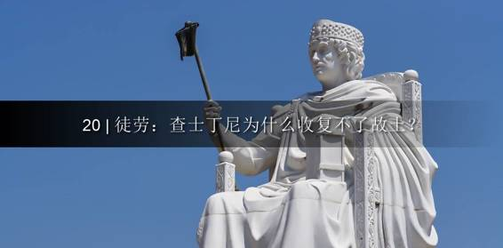

 

你好，欢迎来到《西方史纲 50 讲》。

上一讲我跟你分享了罗马帝国到底是怎么亡于蛮族之手的，罗马帝国灭亡不是因为输给了日耳曼人，而是因为日耳曼人早就加入了罗马内战，是罗马人自己带日耳曼人，加入了这个恐怖的游戏。

归根结底，这是罗马无力对自己的武力，实现有效的政治控制的结果。

这里面我要跟你明确两个问题，**第一个，说罗马帝国灭亡了，是说西罗马帝国灭亡了，东罗马帝国仍然活着，叫拜占庭，一直活到公元 1453 年。**

**第二个问题，日耳曼人到底是什么人？**所谓日耳曼人是一个总称，其实有很多很多日耳曼部落，比较出名的，攻占过罗马城的有东哥特人、西哥特人、汪达尔人、伦巴第人。他们各自为战，他们还经常相互打起来。

**也就是说，日耳曼人没有一个成吉思汗那样的大酋长，统一所有部落，统一行动和罗马帝国对抗。**由于这些个部落互不统属，他们又没有文字，加上兵荒马乱，对他们的记载也就乱糟糟的，这些记载主要都不是他们自己写的，而是西部的基督教教士们和东部的帝国史家们，接触到他们的时候记录下来的。

面对这么多日耳曼部落，东罗马帝国想收复西部吗？当然想。有能力吗？真没有。

所以，我在这一讲给你的论断是：正是因为东罗马帝国无能，西方才被放跑了，走上了自己独特的道路。

下面我就带你看看究竟怎么回事，这个故事里的核心人物是东罗马皇帝查士丁尼。

## 查士丁尼西征

说起查士丁尼，学法学的人一定是顶礼膜拜，因为西方文明如果只能列举一部最重要的法律书的话，那就是查士丁尼下令编纂的《国法大全》。它是罗马法的精华。

查士丁尼指派一堆法学家把积累了数百年的罗马法，重新整理成一个庞大的体系，有价值观、有逻辑、有条理。除了英国，后来的西方主要国家都拼命学习《国法大全》，从中世纪一直学到十八九世纪。**罗马法享有崇高的权威，是西方各国法律的母体，它正是以《国法大全》作为载体的。**

查士丁尼干出这种千秋伟业，你就知道这个皇帝一定不简单，他是有雄心有抱负的。**确实，编纂《国法大全》是查士丁尼宣示他雄心壮志的大工程，他还有另外一个大工程，那就是收复西部。**

查士丁尼在公元 527 年登上帝位，立即着手《国法大全》的编纂，当然，他还要巩固权力。五年之后，他就派大将军贝利萨西征。

这里插一句，查士丁尼之前的东罗马皇帝都干嘛去了，他们怎么不收复西部？从西罗马帝国灭亡到查士丁尼西征的 50 年间，**东罗马皇帝们主要忙着对付两件事：一件当然是外患**，灭了西罗马帝国的日耳曼人，不会说东边有皇帝他们就不打了，东罗马帝国也花了不少精力才稳住自己的地盘。

**另一件当然是内忧**，别的不说，皇帝是否坐得稳的问题得先解决，要不然哪腾得出手去收复西部。终于到了查士丁尼，东罗马帝国的内外元气都恢复了不少，他就开始发动西征。

一开始，大将军贝利萨不负查士丁尼所托，打败了北非的汪达尔人，打败了意大利的东哥特人，到了公元 563 年，地中海又成为罗马帝国的内湖了。就在贝利萨对付日耳曼人总算有所斩获的时候，波斯人又来了。

这时候，帝国东线告急，查士丁尼只能从西线撤军，全力对付波斯人。要知道，波斯人的战舰已经开到君士坦丁堡门口了。就这样，查士丁尼花了三十年收复的故土，一夜间又还给了日耳曼人。

从此之后，查士丁尼西征被拜占庭帝国当作重大的教训，而不是光荣的使命。

## 收复西部再无可能

东罗马帝国本身处于西边的日耳曼人和东边的亚洲强国之间，地理位置决定了他是两线作战，而东线更加危险，因为比起乱糟糟的日耳曼人，波斯可是大帝国。拜占庭帝国把军事部署的重点放在东线更为明智，西部已经失去，就让它去吧，不能再因为不切实际的光荣与梦想，把自己现有的地盘也搭进去。

从军事战略的意义上看，是波斯拖住了拜占庭，西方的日耳曼人才有足够的空间走自己的路。可以稍微推演一下，**如果没有波斯，拜占庭不一定就能够完全控制西部，但至少不会让日耳曼人这么潇洒，可能也就没有以日耳曼民族为主体的西方文明第三期，这个第三期也是现代西方文明的直接母体。**

但这只是假设，真实的历史就是我刚才讲的，波斯就是在查士丁尼背后捅了一刀，收复西部的机会一旦失去了，就再也找不回来了。

为什么说再也找不回来了？因为拜占庭后来要应付的敌人比波斯人还厉害，匈奴王阿提拉，穆罕默德的子孙们建立的阿拉伯帝国，一个个接着来。

尤其是阿拉伯帝国，从西亚一直往西推进到北非，甚至再往北进入西班牙，中世纪的西方差一点就被它所灭。这么强悍的武力就和拜占庭相邻，拜占庭居然在这么多强敌包围的情况下支撑了 1000 年，也已经算是奇迹了。

## 皇权控制宗教的传统

这里再多说几句拜占庭，从共享希腊罗马基督教三大传统的角度来看，他是西方文明的亲兄弟，甚至是亲大哥。拜占庭一直延续了罗马帝国皇帝戴克里先和君士坦丁建立起来的专制制度，皇权如何威武我就不细说了，其中有一点是我们中国没有的，但十分重要，就是皇帝的宗教地位。

这里要稍微讲一下基督教在罗马的命运，基督教诞生后，先遭受了几百年的打压，然后是罗马皇帝君士坦丁宣布基督教合法，之后没多久，他下一任皇帝狄奥多西宣布基督教是罗马帝国的国教，那是公元 392 年的事情。

君士坦丁对基督教根本不是虔诚地信仰，就是政治的利用，后来的皇帝们都懂这个道理。**投其所好的神学家们帮皇帝完成了基督教框架内的君权神授，也就是：皇帝是上帝的帮手和朋友。**那这样的话，教会当然就要听皇帝的。

但是，教会哪能俯首听命呢，教会和国家的斗争由此展开。这个过程很复杂，也非常精彩，这里我就先简单跟你介绍一下背景，我会在下一个单元中世纪这部分，重点跟你讲教权和政权的斗争。

虽然教会不愿意听皇帝的，但胳膊哪拧得过大腿啊，只要帝国在，教会真不是他对手，在东边的拜占庭就是这样。基督教在拜占庭叫做东正教，皇帝在其中的地位高于大牧首。

**这套皇权控制宗教的体系，是从罗马帝国继承下来的，因为西罗马帝国灭亡了，所以没有在西方持续下去，这套体系却在拜占庭得以完整地保存，差不多持续了一千年，一直到 1453 年拜占庭被突厥人灭亡了，这时候，俄罗斯又接过了拜占庭的大旗，保存了这套皇权控制教权的体系**。

据俄罗斯说，在拜占庭灭亡后，他们的大公伊凡三世娶了拜占庭末代皇帝的外甥女，因此，拜占庭的法统也就转移到了俄罗斯，拜占庭的双头鹰国徽，还有东正教的重心，都被俄罗斯接收，政治控制宗教的格局被进一步强化。

俄罗斯把自己叫做第三罗马，因为他们才是凯撒-君士坦丁-拜占庭这一路下来的正统继承人，他们的君主叫沙皇，所谓沙皇，字义就是凯撒。要是追踪历史渊源，俄罗斯和西方也算沾亲带故。不过你肯定不会认为俄罗斯是西方的一分子，俄罗斯自己也不这么想。

为什么俄罗斯和西方不是一回事，要讲清楚这个问题就还是要回到西方了，看看西罗马帝国在灭亡之后，到底又是怎么发展延续的。

## 西方的发展逻辑

查士丁尼大帝收复不了西部，不是他不想，而是他做不到，后来的拜占庭皇帝就更做不到了。那西部会按照什么样的逻辑走下去呢？在查士丁尼西征失败后，西方的发展路径，我们大概可以看到有这么几个确定的方向。

第一个，西方主体民族变成日耳曼人，接力棒再次易手。

**第二个，**日耳曼人认同罗马的法统，但他们的政治意识和政治统治能力都比较弱，接不住原来的盘子，看来短期之内再建一个日耳曼帝国是没希望了。也就是说，**政治秩序的重建，因为日耳曼人的政治成熟程度低，会变得非常漫长。**

**第三个，**西部处于严重的战乱和动荡之中，查士丁尼撤了，**日耳曼各部落相互征战，武力四散，看不出统一的迹象。**社会、经济、文化被摧残是毫无疑问的了，而且在那个时候根本看不到未来。

**最后是，基督教还活着，而且因为帝国的覆灭，它反而获得了梦寐以求的独立和自由。**它的成长进入了快车道。不过，基督教之所以能够主导中世纪的要素，在那个时候还没有完全明朗。但毫无疑问，基督教是那个时代几乎仅存的积极力量。

总结一下就是，罗马帝国覆灭之后的西方，可以说是一个不折不扣的烂摊子。

本讲小结

好，到这里，罗马这个单元就结束了。

查士丁尼因为波斯的牵制，丧失了控制西方最后的机会，一旦失去了，就永远失去了。西方独自走进了黑暗时代。**如果说还有一根蜡烛告诉当时的西方人什么是光明的话，那就是基督教和它的教会。**

下一个单元我跟你分享中世纪的西方，不过你也很清楚，中世纪是基督教主导的，那我就从耶稣跟你说起。

期待你的到来，咱们下一讲见！

精选留言

点击直接进入下一章节

**王黎璐**:  
查士丁尼与戴克里先和君士坦丁一样是罗马帝国晚期最重要的皇帝之一。从许多方面来说查士丁尼在欧洲历史上都是一个从古代转向中世纪的过渡性的、代表性的和重要的人物。查士丁尼开始当政的时候帝国的主要特征还是罗马式的，但当查士丁尼逝世时它已经非常拜占庭化了。  
他将古罗马的国民主权彻底消除了，皇帝成为了君权神授的国家主权。但同时皇帝依然需要国民和军队的支持和同意。在法学和神学上查士丁尼的贡献是对后来的发展有深刻影响的。在对外政策上他的重建帝国的政策建筑在非常不稳固的基础上，查士丁尼死后不久许多地区就又已经失落了。在文化上古代希腊、罗马的文化在查士丁尼统治期再次繁华。拜占庭的城市至少到鼠疫爆发也非常兴旺。在行政上查士丁尼基本上保持了罗马式的行政结构。  
查士丁尼重建帝国的计划是最后一次复活罗马帝国的梦想，但他不是一个和平君主。他统治期间人们的负担非常沉重，在宗教政治上他也非常不宽容，虽然如此他的不宽容政策并未达到统一帝国的目的。  
我注意到查士丁尼之后的东罗马帝国老师用“拜占庭帝国”或者“拜占庭”来称呼，我理解毕竟国度中心已不是罗马，罗马也不在其实际权力管辖之下。

**作者回复**:拜占庭很有意思，不过已经不再是西方的范围，提到他在本课当中是为了把西方的基因、边界、演化逻辑比对出来。如果有机会，咱们找别的时间单聊这个有意思的文明。

**佛祖门徒**:  
老师这一课让我对三件事有了清晰的认识：  
第一、故土难收之因。波斯人以及东部接踵而来强劲的对手使得拜占庭无暇西顾，所以纵有雄心壮志，终心有余而力不足。  
第二、俄罗斯的传承。对俄罗斯与西方的关系一直都很模糊，把其与西方联系起来看既有共同之处又有很多区别，老师梳理了这段历史之后才明白这段“剪不断理还乱”的渊源。  
第三、皇权与宗教的关系。既斗争又团结，斗争是因为不甘心受制于皇权，希望保持独立和至高无上。团结是基于现实生存的需要，毕竟根基尚浅。  
请教老师，日耳曼人在政治上的不成熟，从而长期没有能够形成一个统一的政体是否也是拜占庭帝国能够坚持 1000 多年的原因之一？

**作者回复**:算是吧。孱弱的西方很长一段时间即便和拜占庭不对付，也没有能力把他怎么样，所以拜占庭的西部边界相对安定。但西方缓过劲儿来，有实力出击了，拜占庭就很危险了。衰老的拜占庭被十字架东征打击，有一次连君士坦丁堡都失守了，元气大伤，结果不久之后就被突厥所灭。夹在中间，确实不是好地方。

**吕正辉**:  
古罗马这个单元听完了，我想问问老师，为什么古罗马马略军事改革以后没有进行配套的文官制度改革，而是一直以尚武为荣。是不是古罗马没有真正意义上的文官系统?那元老院有没有文官系统的职能呢？而古罗马皇帝为什么不联合元老院来控制军队系统呢？古罗马皇帝在位为什么不像中国皇帝一样在上台以后建立自己的官僚系统，来达到有效的控制国家?

**作者回复**:罗马没有成功地建立文官系统。1.文官系统的建立是需要多种必要条件的，罗马并不完全具备。比如，国家支持的信念和知识系统。古罗马长于武而短于文，长于实践和制度短于理论和思辨，文的厚度和系统性不足，这样一来，拿什么来考试呢，拿什么让文人成为一个共同体呢（中国有儒学）。2.长期以武的方式成功地成长，发展文官体系的必要性就大大下降了。而且，3.以武的方式成长，在很大程度上文会成为阻碍，繁文缛节。再说机构和掌权者。元老院并不是文人，是大族豪门，凭什么是大族豪门，在罗马就只能是军功。执政官当政之时是大将军，退休之后进入元老院，元老院能干的时候就是一帮退休的大将军。他们起心动念用文控武的可能性很小。皇帝出现，元老院被边缘化，皇帝本身是大将军，同理，他建立文官系统的动力也不足。从这些问题来看，以武为基本成长逻辑的罗马和中国古代确实有很大的不同。

**文明**:  
太精彩了，等不及要听下一讲。  
历史是很有意思的一门科学，各方力量，互相博弈相互制衡，不是某个帝国强大就能够做他想做的事情，历史的发展也不是某个必然，而是地理，文化，经济等因素的综合体，而从这背后梳理出历史的脉络，看得太过瘾了。

**作者回复**:中世纪也很有意思，而且大家相对陌生。不要掉线哦！

**六道行者 87675301**:  
老師好。另外，氣候變化和鼠疫也傷害了查士丁尼收復西方的能力。再說，一直以來，羅馬是東方比西方富，只是在帝國成立至三世紀危機時，西方軍團因作戰更頻繁，也因羅馬城在西方，在法統和兵力上更優（尤其跟東方也有關係的多瑙河戰線），於是可以形成一種交易，一種互相依賴：東方吸取財富去維持西方的兵力和法統。但前提是西方能保護東方。  
  
但是，當西方陷入內亂，已經無力自顧，更顧不了東方的話，那麼這邏輯就走不通了。那麼，富有，又可以直接從當地招募軍隊的東方，加上自行神化的皇帝，拿回西方就沒多少成本效益和動機了。

**作者回复**:拜占庭想不想收复西方，心理其实很复杂，你用南宋抗金的场景打一打各方的算盘，或许会有启发。

**Landy**:  
老师，结束后能不能把伊斯兰国家也来一遍

**作者回复**:这个超出了我的能力范围，我只能找合适的机会给你们开个小头，大课自有别的兄弟来承担。

**A learner**:  
古罗马的章节终于学习结束了，自己也适当性的做个小结：  
  
首先，古罗马继承了古希腊文明的衣钵，发展出了属于自己的一套制度——共和制。这是各方面因素共同决定的，例如地理的多平原特性，以及小国寡民的属性。与此同时，经济上无法自给自足这个特点又决定了罗马军国主义的扩张逻辑。  
  
接下来，军事扩张有效地解决了资源不足的困境，但同时又使得罗马陷入制度的漩涡而不能自拔。当外部资源抢无可抢，规模大到原有制度无法承受的时点，只需要一个标志性事件就可以使制度的所有缺陷暴露无遗，苏拉捅破了这层窗户纸。  
  
大逻辑的缺陷已现，之后的人即便再有能力，所做的工作也只是对当下的错误进行修补而已。给人的感觉就像互相咬合的齿轮，你修补了一处，当它持续旋转一段时间后，你又发现它和下一个地方咬合不上。而罗马已然是一个庞然大物，更不存在推倒重来的可能。内部矛盾不断，也造成对外部的制约力的下降。外部文明不仅可以限制你的战略，同时也能给予你最后的致命一击。  
  
总体来说，文明的兴衰充满了各种不确定性，以及无可奈何。事后的分析可能对于所处当下环境的人毫无意义，也就是说让同样的人再选择一次，结果依然可能如此。毕竟当时的人做出的可能就是那时的最优解。在文明发展的大趋势下，个人力量何其渺小，常怀敬畏之心。

**夏宝辉**:  
李老师好！  
本节课感觉到人再强也不能与大势作对。查时丁尼能编写《国法大典》，也能西征，但是国际形势发生了大的变化，只能付诸东流，这是天注定还是历史必然，都难说了。从此西方成了日耳曼人的西方，东正教再号称自己是东边的正统，也奈何不了已经不算西方。就像今天的俄罗斯......

**作者回复**:其实东正教的“东”是西方或者我们加上的，人家就认为自己是正教，其他的最多是歪教，甚至是邪教。每个文明都坚持自己是正统，无可厚非。

**戴嘉蒙**:  
学完本课，查了一下查士丁尼的相关事迹。他把重建罗马奴隶制帝国的统治作为终身奋斗目标，并从政治、军事及经济上做了改革。结合本课内容，我有点感悟:此消彼长，不会放任对手不断强大。查士丁尼利用他叔父的政治遗产（与波斯签订的“永久和平”停火协议），获得暂时的东线和平。他也就是趁此机会实施他收复西方土地的计划。但波斯也不会放任邻居成长为一个强大扩张性帝国，主动打破了停战协议。对于这点，告诫我们外界事物一直在起变化，要把握变化，不断调整计划来保证战略实施。

**作者回复**:再强大的人物也不能把好牌全捏在手上啊，所以做事情不能满打满算。

**翦秋水**:  
老师说过，基督教是理解西方的钥匙，而且是最最重要的一把。  
特别想知道基督教产生的历史背景和其发展演变的过程。  
期待老师的梳理。

**作者回复**:明天开始！

**我心飞翔**:  
请问李老师，从历史学的角度看，英国为什么能够抛弃罗马法，走上了自然法的道路，背后有什么历史逻辑？

**作者回复**:着急了，着急了哈，你先听完后面专门谈英国的课我们再聊这个问题。

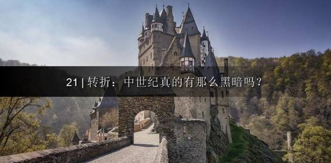

 

你好，欢迎来到《西方史纲 50 讲》。

这个单元我带你看看西方文明的第三阶段，中世纪。中世纪最明显的特征就是基督教占据主导地位，所以要理解中世纪，得先懂一点基督教。

你应该知道，基督教是在罗马帝国初期诞生的，我调整了时间线，把基督教主要放在中世纪讲，是因为基督教跟中世纪的关系，要比跟罗马帝国的关系更紧密。

回想一下上一讲的内容，罗马帝国主导的基督教传统，也就是世俗的皇权控制教权的这套体系，是被东边的拜占庭继承了，后来又传给了俄罗斯。

而在西方，整个中世纪是基督教主导的，但是西方的基督教，却跟原来罗马帝国那套传统断了线，也就是，西方的基督教并没有被皇权控制住，教权和皇权，是相互独立的、相互斗争的。

## 中世纪并不等于一片黑暗

我说基督教主导了中世纪，可能这个论断会加深你对中世纪的一个印象，就是：中世纪是一片黑暗。

我现在明确地告诉你：这种看法是完全错误的。这一讲，我先大致告诉你为什么是错的，然后，这个单元的新奇故事就会一个个跳出来，你听完之后就会更清楚，**中世纪其实不是一片黑暗，而是五光十色、精彩纷呈。**

**我要帮你破除三个常见的误区**：第一个，总有人说中世纪的 1000 年是一片黑暗。第二个误区，常有人说黑暗的中世纪是日耳曼人造成的，野蛮人哪能创造什么文明。第三个误区，是认为黑暗的中世纪是基督教造成的，而且中世纪的欧洲是政教合一，这种论断就纯属造谣啦，是不了解中世纪和基督教的表现。

下面我分别来跟你说说这三个误区，应该会让你对中世纪有个全新的印象。

## 中世纪 1000 年的时间脉络

第一个误区，关于中世纪的黑暗，其实中世纪的前半段和后半段差别还是很大的。中世纪大致以公元 1000 年为界，分为两个 500 年。

这种划分的基本依据是，两个 500 年的基本社会政治状况有较大差距，前 500 年比较混乱，产出的文明成果确实比较少，后 500 年比较安定，产出的文明成果几乎是井喷一样，一发不可收拾。

先看看前 500 年，回想一下我在上一讲末尾，跟你提到的查士丁尼西征失败的时候，西方从辉煌的帝国时代急速衰落，到了几乎没有文明的野蛮状态，但这不是最糟的，还有更糟的。

文明的演化有时候很像我们的人生，当你觉得情况已经坏得不能再坏的时候，并不是黎明前的黑暗，还有更坏的情况在前面等着你。所以不要相信命运女神会给你转运，而是要靠自己坚定的信念扛过去。

新主人日耳曼人遇到了新的大麻烦，他们几个大部落之间还没打完，建立新王国的速度还赶不上王国被灭的速度，这时候，更凶狠的敌人又来了，这种残酷的状况完全不是“雪上加霜”可以形容的。敌人从东南西北四面像潮水一般袭来。

我一个一个给你数一数：东面是马扎尔人，他们有匈奴成分，你没听错，就是卫青霍去病赶跑的匈奴，他们一路向西，冲入了欧洲。北面是维京人，俗称北欧海盗，他们南下侵袭欧洲腹地，罗马人很早就腾不出手来对付他们了，最显眼的失败是放弃不列颠岛，岛上的国王后来长期由丹麦国王兼任。南面是穆斯林的阿拉伯帝国，从西亚进入北非，再渡过直布罗陀海峡进入西班牙，再一步进入高卢，也就是今天的法国。

东面、北面、南面这三股敌人都有机会把西方文明彻底消灭，尤其是穆斯林。你可以看下地图，会对当时西方的局势有更清楚的认识。

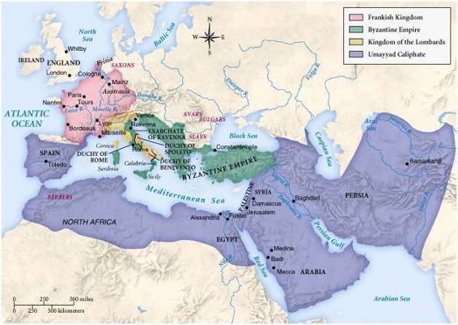

粉色区域为法兰克王国，黄色区域为伦巴底王国（后被法兰克王国统治），上述两个王国都是日耳曼人建立的政权；绿色区域为拜占庭帝国；紫色区域为阿拉伯帝国的倭马亚王朝。

西方在那个时候真是屋漏偏逢连夜雨，政治秩序荡然无存，军事都谈不上军事，就是遍地强盗，经济、社会、文化都遭到毁灭性的打击。

你会看到，欧洲城堡很多，现在都成了浪漫的标志，但很多城堡其实都是这 500 年里西方人苦不堪言的标记。**这 500 年里，西方的经济就是为了吃饱饭而斗争，所谓的社会也就是地方互助，所谓的文化就是教士在修道院或者大教堂里抄经书。**你要说中世纪这前 500 年是黑暗的，我基本认账。

不过，就在这黑暗的前 500 年，西方还是迸发出了耀眼的光芒，因为它要生存。三件大事值得注意：

第一，日耳曼人的一个分支法兰克人建立的墨洛温王朝，公元 732 年，在距离巴黎 150 英里的地方打败了穆斯林，从此之后穆斯林对欧洲的进攻就逐渐消退了。领导这场战役的是当时墨洛温王朝的宫相查理·马特。

第二件大事，也和这个查理·马特有关。公元 800 年，查理·马特的孙子查理曼加冕称帝，建立了加洛林帝国，从此，日耳曼人的政治秩序就摸到了及格线。

第三件大事，公元 955 年，神圣罗马帝国的奥托击败马扎尔人，西方的东线从此之后获得了安定。

查理·马特，查理曼，加洛林帝国，神圣罗马帝国，这些名字和国家，你可能听着都挺陌生的。没关系，后面我们会展开讲他们的故事。这里，你只需要记住，在中世纪前 500 年，因为有这几个大人物，西方终于获得了安定。

到了公元 1000 年，安定下来的西方迅速触底反弹，政治、经济、文化在后 500 年当中取得了非常可观的成就，正是这些成就，为你熟悉的现代西方文明打下了基础。**中世纪的后 500 年和现代最近这 500 年，其实并没有明确的分界线，在许多根本问题上都是紧密联系在一起的。**

这个时候，你就可以对西方文明的全貌作出真正可靠的划分了：希腊和罗马之间有断层，罗马和中世纪之间有断层，甚至你可以把中世纪的前 500 年整个都看做一个大断层，但在公元 1500 年，从中世纪尾声进入现代，西方并没有出现明显的断层。

## 日耳曼人的真实面貌

下面来看看对中世纪的第二个误区，就是说西方中世纪很黑暗是因为新主人日耳曼人很野蛮。

我带你看看日耳曼人是什么样子。**日耳曼人的形象大概可以分成两个版本，一个是罗马人口中的日耳曼人，一个是日耳曼后人心里的日耳曼人。**

据凯撒和另一位史学家塔西佗的记载，罗马帝国时期的日耳曼人，他们的政治还处于部落阶段，有原始民主的风气，军事首领也就是个酋长而已；经济就是打猎，基本没有农业；文化根本谈不上，信的都是精灵神怪。

后来的日耳曼历史学家当然会为自己的老祖宗辩白，说他们很勇敢、很进取、很有活力，很纯洁，是腐败的罗马人污染了他们。两种说法都有道理，但也都有虚假的成分。

我带你找找日耳曼人的真面目。**一方面，罗马人观察日耳曼人，主观上一定是傲慢的，客观上他们只能拿自己知道的知识去衡量日耳曼人，肯定会出现偏差。**

所以，真正的日耳曼人应该比罗马人写的要好，他们的确离部落不远，但和罗马人接触的时候，日耳曼人已经不再是原始的部落政治，组织更有章法，这意味着上下等级已经开始出现。相应地，经济也基本完成从渔猎到农耕的转变，进入定居状态，让文明出现曙光的经济条件，已经具备了；政治上，他们已经有了习惯法，而且吸收了罗马法。**所以，公元 1 世纪的日耳曼人不是原始人，是一只脚已经踏进文明的人。**

**另一方面，日耳曼后人对自己祖宗的美化肯定是要打折的。**他们比起罗马人，当然是质朴、淳朴、纯洁的，但无论如何，他们迅速跟罗马人学坏了啊，想想我前面跟你说的，当时的日耳曼人相当于驻守边疆的安禄山。

日耳曼人早就进化到安禄山这个级别，有了雄心，有了机智，有了谋略。所以就别老拿质朴纯洁说事儿了，成就大业的民族说自己纯洁得像小白兔，那不是让人笑掉大牙吗？

但是，日耳曼人确实有一个方面还真是长期保持单纯质朴，那就是对暴力的崇尚，对嗜血的狂热。这是西方一直安定不下来的重要因素。西方实际上花了很大力气，才逐渐克服了日耳曼人的这种野蛮习气。

这样的日耳曼人接过了罗马人留下的烂摊子，接力棒是什么呢？

我在前面跟你交代过，希腊和罗马之间最重要的接力棒是语言和哲学。但是，日耳曼人这两项都不行。不过也有别的接力棒。

首先，日耳曼人已经跟罗马人打了 500 年的交道，无论和罗马曾经是敌人后来成一伙，战争和谋略总是学会一些了。**也就是说，如果希腊人是以文的方式带罗马人成长，罗马人就是以武的方式带日耳曼人成长。**

**另一个接力棒是基督教会。**基督教会还真是罗马帝国的好学生，政治制度、法律、行政管理、司法审判、哲学、文字，好东西照单全收。

## 中世纪的政教关系

最后我们来说说第三个误区，你可能听过这种说法，中世纪的黑暗是由基督教造成的，中世纪是政教合一。**这种说法的荒谬之处在于，第一，认为宗教就一定是黑暗和愚昧的；第二，把中世纪政教关系完全搞错了。**

关于基督教这两个问题，其实就是我这个单元要重点跟你讲的基本线索。现在我先告诉你基本的定位：

第一，宗教不是黑暗和愚昧，而是光明和智慧。这和是否信宗教无关。也就是说，即便我们站在宗教外面，像哲学家一样用理性和逻辑去观察宗教，仍然可以发现宗教的主调是光明和智慧。

第二，**中世纪并不是政教合一，而是最典型的政教二元结构，教权和政权相互独立、相互斗争，成为中世纪演化最重要的动力，这恰恰是西方文明和别的文明之间，甚至是中世纪和希腊罗马之间最重要的差别。**

后面的内容里，我会不断给你展现教权和政权相互独立又不断斗争的过程。刚才说的这两条线索，对于理解西方至关重要。

本讲小结

好，总结一下这一讲的内容：中世纪不是一片黑暗，它可以分成前 500 年和后 500 年，前 500 年确实衰落到了文明的边缘，中世纪的后 500 年和现代完全连在一起，并没有明显的差别。

中世纪占据主导地位的基督教，不是黑暗和愚昧的，而是和其他所有宗教一样意味着光明和智慧，西方基督教主导形成了最典型的政教二元结构，这种二元结构不断推动着西方向前发展。

既然基督教对中世纪的发展至关重要，下一讲，我就要把时间稍微倒回去一点，带你去看看在基督教创立之初，耶稣和保罗开创的基督教到底是什么样子的。

期待你的到来，下一讲再见！

# 第三单元  
中世纪：教会的时代

精选留言

点击直接进入下一章节

**佛祖门徒**:  
学习这一课有一种观看辩论赛的感觉，老师通过深入的分析，列举大量详实的史料，以清晰的逻辑对三个认识误区一一进行反驳，透彻！  
我最大的收获就是对日耳曼人最初的历史建立了比较客观的认知。  
第一、危机四伏。当老师描述日耳曼人所面临的威胁时，我的脑子里就浮现出一副四面皆敌的画面，对于当时在文明上还比较落后的他们来说可谓处境艰难。  
第二、蒙昧初开。用比罗马人描述的先进和比其后人歌颂的落后来形容当时日耳曼人的文明程度非常形象，我认为也是相当客观的反映出了其真实面貌。  
此外，我非常认同宗教并非意味着愚昧和黑暗，如果没有教会，希腊和罗马文明能否得到传承还真是很难说，至少他们是先进文明的重要传承者。

**炭笔**:  
李老师每节课都能破除成见，带来新知。  
  
这节课破除了三个误区:第一个，中世纪的 1000 年不全是一片黑暗。第二个，日耳曼人不是纯粹野蛮人，也学习了许多文明成果。第三个，基督教是中世纪重要的文明力量，且王权和教权长期斗争。  
  
我觉得行程误区的重要原因是二元对立的思维习惯。我们脑中只有文明和野蛮对立，既然罗马是文明，那么罗马之后的时代必然是黑暗的，日耳曼人必定是野蛮的。既然启蒙是文明，那么相对的基督教必然是黑暗的，一手遮天的。  
  
这种思维习惯导致了很多错误，如三国就是汉贼不两立，南宋就是华夷冲突，戊戌变法就是忠奸新旧的对抗。这种简单化思维模式，是理解不了真正的历史的。  
  
辩证和了解细节说起来简单，但是人们总是不由自主的选择简单的思维模型，无数的误区就此形成，等着有识之士加以破除。

**王黎璐**:  
由于日耳曼蛮族的文明教化过程是与他们皈依基督教的过程相同步的，所以他们最初接受的文明化的世界观、人生观和价值观都是基督教式的。而罗马帝国的遗民们早在蛮族入侵之前就已经基本上接受了基督教信仰，在古典文化的记忆早已变得模糊不清，并且以一种扭曲的形式被融合进基督教的思想体系之中时。贫穷落后的经济状况、分散混乱的政治格局以及愚昧低下的文化素质，使得西欧人民对于基督教所宣扬的唯灵主义天国理想深信不疑。在这种情况下，基督教就成为西欧文化舞台上的唯一提琴手，它那低沉阴郁的音调昭示着一种光辉澄明的天国理想，抚慰着在悲惨的现实生活中痛苦挣扎的广大民众的心灵。  
查理曼帝国的建立标志着“黑暗时代”的结束，西方文化开始逐渐恢复元气，在这场“加洛林王朝的文艺复兴”中，基督教会也扮演了一个极其重要的主角，它与查理曼帝国的统治者们一起推广、弘扬基督教文化和最基本的日常知识，从而推动西欧社会走出了蒙昧野蛮的“黑暗时代”而进入中世纪。

**作者回复**:查理曼帝国还差一点儿劲，只能说及格，真正点燃文明大爆发的是教皇革命。后面的课和你细聊。

**Allelujah**:  
在希腊、罗马和日耳曼文明的更迭中，能够看到文明传承与接力的逻辑：即使是由蛮族拓展出的文明，也不会从蛮荒之中重新开始。在与其他文明的碰撞与冲突中，即使经历了战乱和毁灭，文明的火种也仍然能通过不同的方式，借由新一代统治者的手向前传递。

**作者回复**:人总是向往文明的，不知道的时候自己瞎弄，知道了，认识到它好，即便不是自己的，也会赶紧去学，就文明了，文明也就变成自己的了。

**赵笑宇®最土**:  
今天听了李老师的课，突然体会到了这门课和《中国史纲 50 讲》的交相辉映。从古罗马到今天的中世纪听下来，感觉西欧的中世纪更应该被看做是一场脱离了大系统后的“去中心化”的自我创新过程，而在“去中心化”的底层是靠“基督教”这种“算法”来进行统合，“基督教”这个算法也许不是最优秀的，但对于当时的普遍都是文盲的西欧社会来说，它应该是最有效的：基督教没有东方佛教或者道教那样高级复杂的理论体系和逻辑系统，只是告诉当时的平民：你只要信，只要奉献，跟着教会，死后就能进天堂，如果不这样，就下地狱。这其实在最大程度上简化了宗教的神秘性，并且将人群能够最大程度的组织统合到一起。而从这我们就能看到，在这之后，欧洲的十字军东征，无不是以宗教的名义来发动，并且能够迅速组织起力量。可见简化的宗教是能够用最节约成本的方式在出现“民族国家”之前，把人民团结起来的“想象的共同体”。这也就解释了为什么中世纪欧洲的教皇具有如此之大的权威：在去中心化后的世界中，教会是那张能把各个分布式的节点联合起来的“互联”信息网。  
  
而回望东看，我们的这边的雪域高原——西藏，其实也和中世纪有异曲同工之妙，他们所信奉的藏传佛教，其实已经和西欧的基督教一样，是结合了当地的很多信仰，杂糅出来的一种新型宗教，而这种新型宗教是最有效将雪域高原的各个分散部落统合起来的那张底层的“互联网”。以至于到了最后，直接是让藏传佛教的最高宗教领袖同时兼任了世俗领袖的功能，这就好比是将西欧中世纪的“教皇”和“神圣罗马帝国皇帝”合二为一，在农业和游牧时代最大程度上以最经济的方式完成了对青藏高原这种资源匮乏的确的整合。  
  
可见东西方其实是在用类似的方式完成对文明的演进。同时也说明，操作系统没有好坏，只有适合不适合，适合了，就一定会让文明前进，不适合了，文明一定会像施展老师在《中国史纲》中讲到的，出现内卷化现象。从而阻止文明的前进。就像连岳先生说的：如果你不赶紧按照你想的方式去活,那迟早会按照你活的方式去想。这应该就是系统不合适后，内卷化的结果，这个无论个人，国家还是文明感觉都是适用的。

**作者回复**:你的脑洞开得很有意思。不过我下面会告诉你，基督教还真不只是一套软的算法，它也是一个硬系统：教会。

**蝉**:  
我有个疑问:关于教会黑暗愚昧的认识是怎么植入我们的大脑的?  
  
是各国普遍这么看还是中国特色?

**作者回复**:西方人自己最早这么说的，就是来自但丁、彼得拉克这些想从中世纪挣脱出来的巨匠。这种说法很长一段时间是主流。但 20 世纪的史学研究基本上都放下了这种历史成见，强调中世纪和现代的连续性。

**涅槃**:  
在西方一直都是政教分离的，世俗王权常常是反对宗教权力的，只不过由于世俗王权过于分散，而宗教一直都是一个统一的、以罗马教廷为核心的，力量集中，所以世俗王权一直被压制着。但是一旦有条件了，世俗王权就会想要将宗教压制，比如，当十四、十五世纪技术大爆发的时候，世俗王权便有了条件来压制宗教了。

**作者回复**:这个大翻转是历史上最有戏剧性的历史场景，后面和你分享。

**人若水镜**:  
李筠老师的这节课很颠覆，因为像我一样的多数人接受的知识中，中世纪就是一团笼罩在西方民众头顶的乌云，未开化的野蛮人、粗鄙的贵族和领主、任意指认女巫随意灭杀异端的宗教裁判所、各种肆无忌惮的敛财手段，轮番折腾西方文明的小火苗，奄奄一息的支撑到了文艺复兴，才总算活了过来。  
  
但是，在我心里一直有几个疑问：  
  
第一，中世纪的野蛮人智商低得不合情理，而从生物学上来说，智人的智力应该与现代人差别不大才对；  
  
第二，在中国“五胡乱华”、“五代十国”那样的乱世，都有明白人在不停的做社会实践，西方人就那么笨得不可理喻，只想混口饭吃、争权夺利吗？  
  
第三，一个以精神鸦片欺骗民众为主要生存手段的宗教，为什么能传承至今？  
  
第四，中国的士绅阶层还知道守护一方，聚集民心呢，西方的统治阶级就只懂残暴吗？  
  
第五，一个能与汉朝对抗的民族，只因为被打跑，就抛弃了所有精神世界，沦为野兽了吗？……  
  
第一次看到李筠老师这样的严肃学者，把“光明与智慧”给了宗教，这是在承认宗教的基本面是积极的；而不是传统的观点念——“宗教的外衣下面有点真东西”，除此之外，大部分是各种的不堪。  
  
我为自己的浅薄，和无能为力的分辨力感到惭愧，这让我想起了吕世浩老师的《秦始皇：穿越现实与历史的思辨之旅》，第一次看书时也是极其强烈的震撼。  
  
真的感谢李筠老师的课程，让我有了更新认知的机缘，谢谢！

**作者回复**:下面的课程我会继续消除你的错误印象，填补你的知识空白。思考了，当然会有收获的激动，不过不轻言颠覆哈，因为更重要的事情是继续了解，继续思考。

**A learner**:  
针对中世纪的三大误区，这讲老师给出了清晰的解释，使得我对整个中世纪有了个大致整体的印象。  
  
一个文明在衰落后，总会经历混乱，挣扎，复苏，发展的阶段。中世纪的前 500 年对应了混乱和挣扎，后 500 年对应了复苏和发展。然而，我们的历史教育总是对标志性事件做分析，而忽略过程。所以文艺复兴前的欧洲，总被当做黑暗，负面的教材来渲染。完全忽略了历史的连续性以及相互作用性。  
  
二元对立的简单归因习惯又使得日耳曼为文明的衰落而背锅。通过上几节课的学习，简单想一下就能明白，日耳曼毁掉的那个罗马已经不是文明的罗马了，而是一个破落不堪，腐朽凋零的罗马。日耳曼人只是在一个烂摊子上收拾着残渣而已。  
  
对于基督教的理解，很多人是片面而且狭隘的。在接下来的课程中期待老师精彩的讲解。

**作者回复**:这一讲是大图，先建立起基本的认知框架，后面我会一步步展开，经典的故事会一个个来。

**吕可达 02015223344**:  
老师，中世纪 500 年安定下来后，为什么国家没有收服基督教，基督教有什么力量能跟国家机器对抗？

**作者回复**:这是中世纪的关键，这个单元会从不同侧面跟你探讨这个问题。

**陈 C**:  
听前几节课就隐隐地感觉到，老师要在中世纪这里颠覆我的认知了。  
  
我以前就有老师所说的第一、第三个误区，具体地讲，我的误解体现为“在这 1000 年里，基督教始终干涉甚至试图控制政治，并且禁锢人们的思想”这样一种形式。  
  
结合最近这几讲，以及之前学习时的体会，我对自己之前的错误认知，有如下破除：  
1\. 中世纪的前五百年确实“黑暗”，但并非全无作为，日耳曼人前后分别打败了东西两侧的敌人并建立了政治秩序。等于是说，这一千年，前五百年用来构建新秩序，后五百年则用来发展文化。  
2\. 即便是在这前五百年里，基督教仍然起到了重要的正面作用，西罗马灭亡，政治一团糟，文化丧失，社会毫无秩序，只有基督教保留着罗马精神文明的火种。说前五百年“黑暗”，其实错不在基督教，而是这个时代的西方“没文化”，基督教恰恰是带来文化的一股力量，甚至填补了一部分的社会秩序。  
3\. 至于后五百年，西方也在持续发展着哲学与艺术，虽然没有希腊与罗马那般璀璨辉煌，但至少阿奎那复兴了亚里士多德的哲学，并已有了脱离宗教的“哲学家的上帝”的理论的雏形；艺术领域绘画和音乐也有了发展，为后世的大发展打下了基础。  
4\. 通常都认为中世纪与近现代社会的分界 1 在文艺复兴，但细看文艺复兴的成就可知，虽然具体手法随经济与技术的发展有所改善，但此时的文艺题材仍以宗教内容为主流；这一传统甚至延续到了 18、19 世纪的音乐领域，可见艺术领域宗教成分的淡化，是一个渐变而非突然排除的过程。  
5\. 至于科学，它从来不与宗教有直接冲突，基督宗教甚至是现代科学的摇篮。  
  
综上，基督教在西罗马灭亡，西方最缺乏秩序与文化的时候，填补上了虽不完善，却至关重要的一部分，并在中世纪的后五百年酝酿出了更高水准文化的种子。基督教确实对思想有所桎梏，但从某种角度上讲，那个时期人们的思想慰藉只此一家，思想不开放，恐怕也是没有办法的事情。

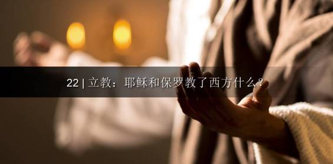

 

你好，欢迎来到《西方史纲 50 讲》。

上一讲我跟你聊了西方中世纪的基本要点，它不是一片黑暗，其中需要最先解决的问题是，基督教为什么是光明和智慧，而不是黑暗和愚昧，这一讲，我就带你看看创立基督教的耶稣和保罗，到底教了西方人什么。

先澄清这一讲的口径，我尊重基督教，就像尊重所有宗教一样，但我不是任何宗教的教徒，所以我不是拿牧师传教的思路来跟你讲基督教，而是以哲学家、历史学家的思路。

核心问题是，基督教教给了西方人什么样的世界观，他们如果接受了这种世界观，会对他们的思维方式、行为方式产生什么样的影响。

## 耶稣和保罗创立基督教

先看看耶稣。他是基督教的创始人，他宣称自己是上帝的儿子。**我们不信教的人没有必要去驳斥教徒信以为真的东西，而是要去寻找信仰背后的力量。**

耶稣说自己是上帝之子，他这么说到底是为了什么呢？这是因为他要实行宗教改革。他要改犹太教！

耶稣是犹太人，他对犹太教上层利用宗教去压制人民非常不满。于是他改动犹太教的教义，收徒传教。结果就是，犹太教上层到罗马帝国当局那里，检举耶稣意图谋反称王，罗马总督彼拉多判处耶稣死刑，把他钉死在十字架上。因此，十字架也就成了基督教最重要的标志。

这时候你就明白了，基督教一开始是犹太教的草根分支，它迅速发展壮大，自立门户，成了宗教。

耶稣死后，他的徒弟们继续传播他的教义，他们叫使徒，使者的使，徒弟的徒，其中，贡献最大的使徒当然就是保罗了。《圣经·新约》的作者就是这些使徒，他们把耶稣的言行记录下来，教导信徒，规劝不信的人皈依。

在使徒传教的过程当中，保罗进一步发展了耶稣的教义，把它们从巴勒斯坦带到了整个罗马帝国，把基督教从乡村小宗教变成世界宗教。有历史学家甚至夸张地说，基督教可以没有耶稣，但不能没有保罗。

## 基督教对犹太教的改革

那我就带你看看耶稣和保罗到底改了犹太教的什么内容，最重要的大概有六个方面：权威经典、上帝形象、选民范围、世界结局、教会结构、核心追求。

**第一个，权威经典。**这个你应该比较熟悉，犹太教的权威经典就是《圣经·旧约》；基督教的当然就是《圣经·新约》。

**第二个，上帝形象。**犹太教的上帝是严厉的甚至是严酷的，人类的表现要是不好，他就让人类全部灭绝，诺亚方舟的故事就是其中的一次；基督教的上帝呢，是慈爱的父亲，他爱所有人。

**第三个，选民范围。**这里的选民不是我们今天说的有权投票的公民，而是被上帝选中，将会最终得救的人。犹太教的选民就是犹太民族；基督教的选民是所有信徒，不管你是不是犹太人、不管你是什么血统，只要信上帝、信耶稣，就是选民。

**第四个，世界结局。**犹太教规定的世界结局是，上帝指引犹太人最终去到迦南这个“流着奶与蜜”的目的地，就在耶路撒冷附近；基督教把这个改了，改成此岸的世界将会消亡，此岸任何地方都不是人的目的地，最终结局是末日审判，好人上天堂、坏人下地狱。

**第五个，教会结构。**犹太教的教会是被祭司阶级垄断的，耶稣正是因为痛恨这种垄断而腐化的权力，发动了草根宗教运动，所以，基督教的教会是信徒团结起来的团契，团契也就是伙伴关系，充满了平等精神。

**第六个，核心追求。**犹太教教导信徒爱上帝、爱自己的民族，是一种群爱，识别民族边界的标记是律法；基督教扩大了爱的范围，不仅爱上帝、爱自己的民族，还要爱所有人，甚至包括了敌人，是博爱，律法不再是最重要的了。

这六条对犹太教的改革汇集到一起，基督教给当时的人们，是一种什么样的世界观？就是耶稣那句名言：天国近了，你们要悔改！

大宗师的话总是看起来很简单，里面都蕴含着无穷的意味。

## 基督教对西方人精神气质的影响

我来跟你说说在基督教诞生时，也就是罗马帝国初期，还有罗马帝国灭亡之后的中世纪，耶稣的这句话、这种世界观到底意味着什么，它对西方人的精神世界影响有多大。

**第一，说的是这世道太坏。**天国近了，其实暗含着此岸要毁灭了。耶稣生活的时代恰好是屋大维在位的时代，你可能要问了，屋大维时期，罗马帝国不是找到了适合大规模共同体的制度框架了吗？屋大维不是让罗马万象更新了吗？怎么耶稣还在说世道太坏？

据《圣经·旧约》记载，两三千年间犹太人一直处于底层，摩西带他们出埃及之间他们是法老的奴隶，出了埃及之后几经辗转，终于有了大卫和所罗门这样英明的国王，可惜很短暂，他们很快又成了巴比伦的奴隶，后来罗马人又来了。反正犹太人从有记忆开始就没过过几天好日子。耶稣呢？他代表的是犹太人的下层，是底层的底层。他们对现实政治充满了绝望，所以对政治有一种来自灵魂深处的疏远。

这是犹太人上层举报耶稣谋反的重要线索，你看，这人天天到处散布谣言，说辉煌的罗马帝国世道不好，很快就要灭亡，你如果是罗马总督彼拉多，听见这种检举会怎么处理？反正是个乡村牧师，他们犹太人自己都不待见他，他是底层的底层，杀了他没有任何损失，反而对控制犹太人有好处，既可施恩，又能立威，何乐而不为。

**但是，给底层以希望也正是基督教的魅力所在**。在暗无天日的底层的底层，有人告诉他们眼前的苦难不重要，至高无上的上帝是爱他们的，他们才是被上帝选中的人。无论在你看来这种想法有多阿 Q，但对于底层的底层来说，这是他们生命中唯一的光亮。人活着，总要有一丝希望，罗马人给不了，犹太人给不了，耶稣给了他们。

而这一丝光亮，越是在世道黑暗的时候就越发珍贵。屋大维时期的罗马还算是如日中天，对于基督徒来说都是暗无天日，回想一下我在上一讲跟你说过的，中世纪的前 500 年，真是伸手不见五指，那么基督教在这个时候，可不就成了人人心里最需要的救命稻草了嘛！

**第二条，说的是人罪孽深重。**耶稣在世的时候主要是劝大家悔改，每个人都有错，因为爱自己就一定会伤害到别人。你可能知道，基督教讲原罪，因为亚当夏娃偷吃了禁果，就染上了原罪，所有人都无法幸免。这个论证是后来神学家们完成的，后面讲奥古斯丁的时候再跟你细说。在这里我只简单地跟你做个小实验，你就知道，**耶稣虽然在讲罪孽，其实他在激发人心最深处的善良。**

经济学里面的“囚徒困境”听说过吗？两个一起偷东西的贼被警察抓住了，隔离审讯，如果他们拒不招供，两个人都会被释放；如果其中一个招供，他会被轻判，另一个就会被重判；最坏的结果是，两个人都为了自己供出了对方，两个人都被重判。经济学通常用这个博弈的模型，来说明信息不对称会导致公共利益损失。

如果我们把这个模型搬过来讨论人心呢？每个人都爱自己，都把自己的利益最大化，经济学可能会告诉你这就是市场经济啊，就会得到市场的红利啊，耶稣却会讲，只爱自己的人就是囚徒，所有爱自己的人在一起就是互相出卖、互相伤害，这个世界可不就完蛋了吗？所以，回想一下刚才提到的耶稣对犹太教教义的核心价值的改动，爱上帝、爱邻居，甚至爱敌人。只有爱，才能让你摆脱囚徒的状态。

那你马上就会说，我爱别人、爱这个世界，他们不爱我怎么办？当你问这个问题的时候，你心里的标准还是犹太教的老规矩，就是：以牙还牙，以眼还眼。遵循这种逻辑，你最爱的就还是自己。

所以耶稣为了击破这个逻辑，故意很极端地讲：别人打了你的左脸，要把右脸也伸过去让他打。这个独特的思路，重点落在你最重要的任务是去无条件地服从上帝的命令，他打了你，在你生命中是第二位的，你是不是遵守上帝让你爱别人的命令，对于你来说才是第一位的。

他要作恶，上帝会惩罚他，你要行善，上帝会奖励你。只有上帝居于所有人之上成为爱的绝对标准，人才能摆脱囚徒的状态。**所以，对基督教来说，罪恶其实很简单。爱自己多过爱上帝，这就是罪。**

这样的思路教人极端严肃地审视自己，不要说别家的又怎么了，就说你自己。它实际上具有极端做减法的功效，人本来是社会动物，处于形形色色的关系当中，基督教的这种思路就是叫你不要顾及那么多形形色色，只问面对上帝，你心里到底有没有爱。

这种思路一旦成为人格，成为文化，它会有鲜明的特点，利弊都很明显。好处在于，心灵的深度和责任感会被大大强化；坏处在于，钻牛角尖儿，较真儿，死心眼儿。

这种宗教气质，在西方人的人格上，和希腊人留下来的深刻，和罗马人留下来的坚毅，汇流到了一起。回想一下我跟你讲的中世纪前 500 年，没有最糟，只有更糟。面对这种绝望，没有信念是扛不过去的。基督教在那 500 年的严冬里，是西方人最好的心灵鸡汤。

本讲小结

好，总结一下这一讲的内容：耶稣创立了基督教，其实他是一个宗教改革家，他代表了犹太人的草根阶层，是底层的底层。保罗传教完成了基督教的创立。

基督教有自己很独特的对世道和人心的看法，它是底层民众最可依赖的心灵力量，在中世纪前 500 年严酷的条件下更是显得珍贵。就像你知道的那样，基督教发展壮大了，在帝国时代还成了国教。

但是，变成国教真的好吗？下一讲我跟你聊一聊罗马皇帝君士坦丁的故事，看看基督教成为国教是多么尴尬的事情。

期待你的到来，下一讲再见！

精选留言

点击直接进入下一章节

**Allelujah**:  
跟旧约强调戒律的遵守、上帝的怒火不同，新约强调无条件的爱。这一点在《马太福音》中的一段对话有清晰的体现：  
  
有一个人是律法师，要试探耶稣，就问他说：“夫子，律法上的诫命，哪一条是最大的呢？”耶稣对他说：“你要尽心、尽性、尽意爱主—你的　神。这是诫命中的第一，且是最大的。其次也相仿，就是要爱人如己。这两条诫命是律法和先知一切道理的总纲。”  
  
和旧约借由惩罚和苦难来警示、教导人遵从不同，耶稣的新约给了每一个人忏悔和爱人的机会，也给了他们或许从未感受过的平等与爱护，这无疑是黑暗的时代中一丝希望的曙光。也因此，耶稣的新约才以燎原之势传播开来。

**作者回复**:（我耶稣讲的）爱没有毁弃，而是成全了（犹太教放在第一位的）律法。

**蝉**:  
请问李老师，有学者说:儒家是中国的宗教。也有学者说:古代中国没有西方意义上的全民共同信仰的宗教。  
  
您怎么看待这个问题呢?

**作者回复**:儒家不是严格意义上的宗教，用基督教、伊斯兰教的严格标准，儒家不是。教义（学）、教会、教会法，儒家严格来说都没有。但儒家在中国古代履行了很多宗教的职能：精神世界的勾画、人格的塑造和培养、社会政治合法性标准的梳理。所以中国古代的基本结构和西方有重大差别。

**storman**:  
宗教的分裂很有意思，新的解读大多都会针对原宗教长期形成固化结构造成冲击。耶稣给犹太教加入更多爱，扩展教徒范围，基督教诞生。马丁路德同样打破基督教的界限，发展出新教的分支。佛教也是对婆罗门教的批判，扩展，成就自己。但宗教在最核心的宗旨上都是一样的，给人以光明和希望。

**作者回复**:宗教会衰老，也会开新，新开大了就另立一教。宗教有自身的生命力。

**A learner**:  
这一讲让我明白了，宗教对于人心的塑造，以及是如何与文明相融合的。  
我们中国人嘴里的"信仰"其实根本不是信仰，不过是花点钱想从神明那儿获得好处，说白了这叫"行贿"。而基督教宣扬的"爱"是无条件的，你痛苦的时候你要爱，你快乐的时候也要爱，这份爱不因客观条件改变而改变。  
看似有点天真，有点傻，有点和现实社会脱节的逻辑背后，潜藏着对人心正向塑造的力量。这个作用无论是不是教徒都应该赞赏，支持。  
作为人，经常是需要想象力的，我们不能只看表象的有没有用来判断一个事物的价值。它或许和现实格格不入，但它的出现能让我变成一个更好的自己，即便它是虚无缥缈的，去信一下又何妨。

**作者回复**:信仰确实就是“无条件”。

**静雨荷香**:  
老师的每一讲都在刷新认知，耶稣是宗教改革家，在犹太教的基础上创立基督教，为了避免穷图困境，要人爱他人，爱上帝，别问社会对你怎样，先拷问内心，你是否真的爱上帝，这是第一位的。这样看来它在中世纪前 500 年还真是人底层的希望。

**佛祖门徒**:  
之前对基督教的认识非常模糊，而且与犹太教之间的恩怨也一直都不明就里，今天的课算是彻底解开了心中的疑团。对比佛教的发展历史，似乎这两大宗教都是在跌跌撞撞中逐步奠定了自己的地位，长期在夹缝中求生存，但生命力一直都很顽强。我一直在想究竟是什么给三大宗教赋予了强大的生命力？也许给最广大的底层人民以希望，始终前赴后继涌现出愿意为传播宗教不惜战斗和牺牲的使徒是其中最重要的原因吧。

**作者回复**:信仰本身会成为最强大的内在动力，让人坚定、勇敢也充满激情。

**戚志光**:  
听老师讲基督教，避开神学的角度，单纯的从哲学和历史的角度去审视，让人大呼过瘾。从老师的视角中，我看到了一个真实的历史事件，而不是神话传说。

**郝景宇**:  
李筠老师您好，想请教一下，既然基督教有自己很独特的对世道和人心的看法，而且来自于底层人民，原本是底层民众最可依赖的心灵力量，那么在后来成为能够凌驾于政权的教会所代表的教权崛起以及后来经过阿奎纳改革后的教义又被当做政权打压教权的工具，这整个过程中感觉基督教是不是已经和底层大众渐行渐远了呢？是不是也正因为此有了马丁路德的宗教改革，让新教再次与民众的关系密切起来。  
我记得高中读过一本书介绍过傅斯年先生一个观点，大意是当一个文化脱离普罗大众成为士人以及更高阶层趣味的时候，正是其走向衰败的转折点，不知道您怎么看待这种情况的？

**作者回复**:下节课开始就跟你讲基督教的建制化，成为权力体系之后，会异化。没有权力体系，就不够硬，扛不住；有了，会受权力的牵制，甚至绑架。权力的有无之间，基督教在进化，教会在变化。下面的课会跟你解析这个曲折的过程。

**战斗**:  
精彩，读到的最清楚，最清晰，最有理的——犹太教，基督教和基督教发展历程的表述。  
  
高手就是这样，在混乱的知识里，给你一条最清楚的线索，把它们都整合起来。  
  
这就是宗教的自我扩张和不断更替，它来自对自身底层身份的处境问题的解决，进而反思犹太教的不合理之处。  
  
而当后来的宗教改革，也是基于宗教内部的腐败，是的新教的诞生，而后由于各地的不同风俗融合，使得好多国家的基督教都各具特色但又有着内在的一致性和同源性。

**作者回复**:宗教改革，基督教的现代分化，是下一个单元的重点。

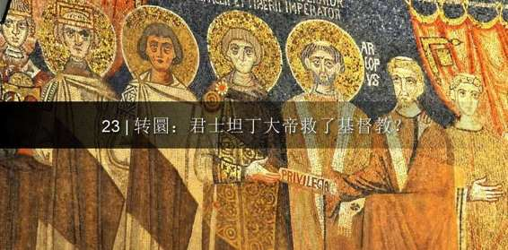

 

你好，欢迎来到《西方史纲 50 讲》。

上一讲我跟你谈了耶稣和保罗创立的基督教。基督教劝信徒爱上帝、爱人如己，这一点是和人的天性，天生自爱的本能相违背的，要相信很难，要做到更难。正是因为很困难，信基督教的人就会觉得自己和上帝特别亲近，心里有了最值得信赖的力量可以依靠。

所以，**很明显，基督教无论从立教的过程，还是基本的心理机制来看，就是一种非常典型的弱者的宗教。**

但是，你也知道，罗马是很强大的，武功盖世，是典型的强者。**在经历了初期的打压之后，罗马皇帝君士坦丁开始对基督教示好，在他之后，另一位罗马皇帝狄奥多西把基督教变成了罗马帝国的国教。**

那问题来了，**强者罗马为什么要把弱者的宗教变成自己的国教？君士坦丁到底是怎么想的？**

这一讲，我带你去看看强势政治处理宗教问题的基本打法，不只是西方文明，只要强势政治出现，宗教就是个问题，这种打法就会出现。

## 罗马帝国对基督教的迫害

首先要来看一下基督教变成罗马国教的时间点，君士坦丁在公元 307 年登基，在公元 313 年颁布《米兰敕令》宣布基督教不再是邪教，并宣布皈依基督教，这离耶稣和保罗创立基督教已经过去了将近 300 年，罗马帝国早干嘛去了？

答案很简单，据基督教徒自己的说法，这 300 年他们都在受罗马帝国的迫害。这 300 年，帝国都不待见基督教，是把它当作邪教严厉打击的。

有那么严重吗？我先带你看看基督教的被迫害有没有变成妄想症。**有几个铁证说明基督教确实遭到了罗马帝国的严厉打击：**

第一，耶稣和保罗都死在了帝国的手上。第二，彼得是耶稣的重要使徒，耶稣让他当了第一任教皇，他也死在了帝国手上，不仅如此，开始的十几二十任教皇要么被处死，要么被流放，没一个好下场。第三，帝国把虔诚教徒扔进竞技场和狮子老虎搏斗，给罗马人取乐，这种事情在圣史里面记载很多，被帝国拘捕的时候只要放弃基督教信仰就能饶命，宁死不屈的圣徒在圣史里也有很多。

那我们先来看一个问题，**帝国为什么迫害基督教？**

**首先，基督徒因为信仰上帝是独一真神而拒绝罗马官方宗教**。罗马官方宗教不仅要罗马人信朱比特、朱诺、马尔斯这许许多多神，而且皇帝们死了之后也成了神。这种神多得数不清的宗教，和基督教基本的一神教信仰是完全冲突的。回想一下，罗马是把宗教当作政治工具来使用的，基督徒不信罗马的官方宗教，就是不接受罗马的政治正确，是典型的拒不服从。

**帝国迫害基督教的第二个原因，是基督徒拒绝为罗马帝国当兵纳税。**我不信你这个国，当然就不会为你效忠，自然也就拒绝给你当兵、给你纳税。对于罗马帝国来说，这种不服从是绝对不能接受的。

**无论是出于意识形态还是财税兵制，强势政权打击出世宗教都是必须的。**罗马如此，中国古代的大唐也是如此。武宗时期的灭佛行动，规模浩大，简直是十庙九废。罗马对基督教的迫害其实远远赶不上武宗灭佛。

不错，好多基督教的大人物都死在了罗马帝国手上，很多普通教徒也英勇牺牲了，但总体上而言，基督教故意渲染了迫害，离真实状况有很大差距。

必须把基督教圣史渲染迫害、强化信仰的这套说法，和历史的真实状况分开讲。从基督教的角度讲，他们有充足的理由去表彰烈士们的坚贞不屈。从帝国的角度讲，他们也有充足的理由去管制破坏帝国统治的邪教。

各有各的立场，都听听看看，和迫害行动的频率、强度、对象的历史数据结合起来，你才能看清楚到底是怎么回事。作为文明的观察者，我不赞成把基督教圣史看成被迫害妄想症，当然也就不赞成把帝国看成暴虐无度，但同时，**我想去理解基督教从被迫害的虔诚中，获取了什么力量，想去理解帝国为什么主动转身，去利用曾经严厉打击的对象。**

这时候你就有必要回想一下我跟你讲过的百年罗马内战。帝国辉煌不再，人民生活困苦。越是世道不好，基督教这种弱者的宗教就越有市场。**客观上，是帝国内战为基督教的传播创造了最好的社会条件。**

戴克里先迫害基督教，是因为他以强者的姿态全面改造帝国，并结束了帝国危机。改革压力大，自然就对不服从者，也就是基督徒痛下杀手。

那么到了戴克里先的下一任，君士坦丁这里，为什么转过弯来了呢？

## 君士坦丁收编基督教

其实君士坦丁跟戴克里先骨子里是一样的，他们的重点是帝国的兴盛。如果利用基督教对帝国有帮助，为什么不用？

据说是君士坦丁的老妈信了基督教，整天跟他讲道理，终于他痛改前非，皈依上帝。这个基督教圣史里讲出来的故事显然是不可信的。从君士坦丁一辈子的作为来看，他对基督教就是利用，没什么虔诚，拿教徒的标准来衡量，他绝对不合格，不过拿皇帝的标准来衡量，他确实雄才大略。

君士坦丁改变帝国对基督教的基本政策，我分三点跟你剖析一下。

**第一，应该怎么看君士坦丁他老妈信教，又劝儿子信教的故事。**不必对基督教圣史里讲的故事嗤之以鼻，故事背后其实透露出非常重要的信息。我是这样看的：即便不是太后，皇帝身边也有重要的人在跟他讲基督教的事情，说明帝国上层有人重视这个问题。因此，**这个故事反映了帝国上层对基督教政策转变的幕后，逐渐酝酿的过程。**

**第二，君士坦丁利用弱者的宗教，表明他在很大程度上承认百年内战让帝国变得很虚弱，新状况下必须采取新政策，这是识时务的表现。**相比而言，戴克里先迫害基督教，说明他还不愿意承认帝国已经虚弱的事实。

我带你看看君士坦丁是怎么识时务的。

在意识形态上，他放弃了把皇帝的神性和传统宗教紧密相连的做法，他选择了和基督教的上帝紧密相连，说自己是上帝的朋友和伙伴。**上帝是弱者的朋友和伙伴，君士坦丁向上帝靠拢，意味着放弃了罗马传统强者宗教的底色，他的目的是大面积收割弱者的信任和服从。**

**在财政和军制上，意识形态的冲突如果得到缓解，服从的心理基础一旦改变，收税和征兵的难度会大大下降，有利于提高帝国的硬实力。**软硬实力都因为接纳基督教而增长，何乐而不为呢？

所以他积极地推进帝国的基督教化，召集尼西亚公会，也就是主教会议，这次会上决定了很多基督教的基本信条。君士坦丁的权威也大涨，基督教投桃报李，给了他“大帝”的称号，the Great。要知道，在西方，大帝可不是随便叫的，只有极少数皇帝才有这个称号，而大多数都是基督教封的，他们都对基督教有重大贡献。

**第三，君士坦丁是在利用基督教，而不是真诚地皈依。**他毕生都没有按照基督教的要求去生活，而是依旧按照自己喜欢的方式生活。比如，他一点也不谦卑，更谈不上什么忍让，杀伐决断，该出手的时候绝不手软。有主教胆敢冒犯他，照样流放。他的生活既奢侈又故意制造神秘感，营造一种高高在上的地位。要知道，奢侈和神秘最能让臣民觉得皇权辉煌灿烂，简直跟天神一样。

总之，君士坦丁一生的活法清楚地表明，是他控制了基督教，而不是基督教控制了他。

说到这里，你就能理解基督教此时的尴尬了。原来被帝国当做邪教严厉打击，现在合法了，被皇帝看上了，但皇帝是要利用你，利用的前提是控制！顺着君士坦丁的宗教政策，基督教会就会变成帝国统治工具的一部分，就是帝国宗教局。

有主教被流放，说明基督教不仅不愿意，而且敢反抗。要知道，基督教就是从反抗中诞生的，耶稣就是头号反抗者，基督教从来不缺乏对世俗政权的反抗精神和勇气。

## 西罗马帝国覆灭带来的机会

不过，我在讲罗马的时候已经告诉过你，如果帝国稳定地存续下去，胳膊肯定拧不过大腿，基督教会一定会被收编，它的独立性只能停留在皇帝容许的范围之内。在东边，后来的拜占庭和俄罗斯的东正教教会，大概就是这样。

而帝国在西部毁了，收编和控制基督教的庞然大物没了，基督教会不是胳膊了，它直接变成了大腿。西方的独特性就从这里生根发芽，和拜占庭、俄罗斯区别开来。

这个时候，不用我来讲后面中世纪的教权和王权斗得多精彩，你就已经可以作出判断了，基督教会在西方获得了人类文明史上独一无二的机会，毕竟头上没有强大的政权，它可以独立而茁壮地成长了。

于是，中世纪是政教合一的这种谬论，我们先解决了一半，也就是说，至少政权完全控制教权的政教合一，看来可能性不大，那剩下一半的疑问就是，教权是否控制了政权，就像伊斯兰文明那样。我在后面会专门帮你解决这个问题。

本讲小结

好，总结一下今天的内容：君士坦丁把基督教合法化，对基督教加以利用和控制。他对基督教的控制和收编是成功的，不过，西罗马帝国覆灭使基督教会在西方获得了绝世良机来独立发展，西方的基本社会政治结构也由此变得不同。

那有一个关键的问题是，当西罗马帝国大厦将倾的时候，也就是世俗政权即将毁灭的时候，基督教会怎么看，怎么做？这对基督教主导中世纪，有什么样的帮助？

下一讲我要跟你讲讲基督教最伟大的神学家奥古斯丁的故事，通过这个故事来和你仔细分析这些问题。

期待你的到来，下一讲再见！

精选留言

点击直接进入下一章节

**陈 C**:  
关于西罗马覆灭时，基督教会怎么看，老师其实在之前提到过，也恰好就是讲到了教父哲学的奥古斯丁。基督教当时面临的问题在于，（西）罗马已经皈依了宗教，为什么还是灭亡了？既然皇帝是上帝的朋友，为什么他没有得到上帝的帮助而保住国家？这就容易演变成对基督教上帝权威性的质疑，就会成为基督教存续的大问题。所以这也就不是教会幸灾乐祸的时候，教会恰恰是很有危机感的。  
  
另一方面，帝国灭亡，日耳曼人之间打打杀杀没完没了，后果肯定是秩序崩坏，民不聊生。在这里我认为：基督教的教义十分看重“博爱”，又受到帝国的压迫与控制，因而此时无论是出于道德责任感，还是纯粹的功利心，教会都会想办法给人们带去精神的慰藉，提升自身权威性，乃至取代国家来进行地方秩序的重构（毕竟有了翻身做主人的机会）。如果从这两个角度来看，基督教此时正好是“机遇与挑战并存”。

**作者回复**:教会的“天赐良机”。

**郝景宇**:  
据说君士坦丁相信一切始于一场战争。  
战役开始之前，君士坦丁大帝对即将来临的战争没有多少胜算，在充满不安时，无意中仰望天空，强烈的太阳光线让他产生了一种幻觉——觉得自己受到了上帝的启示，只有信仰基督，才有可能赢得这场战役。最终，他赢得了这场战役，他也对自己战前做出的判断深信不疑，之后才《米兰诏书》承认基督教的合法地位。😄  
  
今天听了李筠老师的解读，更是透过现象直接看到了本质，基督教能给罗马帝国带去的好处远远比一场战争要大的多，这也让人不禁想起中国大一统王朝扯出儒家当大旗来招徕人心，巩固统治。也正如老师所说，基督教建制化以后进入权力体系就会被异化。只不过后面剧情又出现了反转变数，基督教的权力有一度变得不可想象，以至于能大到迫使国王向教皇下跪认错...  
  
感觉西方这个“他者”经历的确够复杂，有故事，太值得我们这个以稳定而闻名的国度好好研究了。

**作者回复**:一起研究！

**有点甜**:  
#撒哈拉没有雪，政治逻辑没有情感。  
  
基督教生于民，长于民，依托于民，像一股拔地而起的力量，与现世力量的冲突在所难免。  
每每有感于宗教力量的强大，能遮天蔽日。一切力量的源头还是『人』本身，"既能载舟，亦能覆舟"。  
  
这似乎是最朴素的原则，存在于广泛的真实世界。

**佛祖门徒**:  
第一、破除“基督教迫害妄想症”。如何看待作为弱者的基督教在罗马被迫害的那段经历需要客观事实、数据以及双方当事人各自的角度来审视。这让我想起之前老师讲过如何看待日耳曼人老祖宗的文明程度的问题，对罗马人的污蔑和日耳曼后人的夸张都不能完全相信。  
第二、君士坦丁的“务实”。他的在治国方面的才能仅从处理基督教的问题就可见一斑。在认识到帝国的虚弱的基础上，迫切需要建立更广泛的“统一战线”，而收编基督教则能够把底层民众聚拢到帝国的统一指挥之下。想到之前老师在“名家大课”中解读过的《君主论》，君士坦丁算是马基雅维利思想的一个正面典型案例了。

**作者回复**:马基雅维利最重要的智慧来源之一就是罗马史。《君主论》里讲了很多罗马的故事，《论李维》也是，不过，都是按他自己的意思讲。

**nevermore**:  
这堂课给我的启发：1.从基督教的被害妄想和罗马帝国的残忍迫害得出，真实的历史不能只看一家之言，最好是正反两方的言论都看，并且把自身代入到他们的立场中，分析当事人的心理，结合当时的历史背景。有一个基本共识：利益当事人的言论必然是主观偏颇的，但其中也必然包含了一些真实的信息。2.作为普通大众，要从历史中获得最大的裨益，不能过于纠结故事性的细节，而应该敏锐地捕捉到故事背后深层的历史逻辑，过滤出本质的智慧。比如罗马帝国为何迫害基督教？又为何突然改性，尊其为国教？

**作者回复**:大逻辑是历史能给我们带来的最大的帮助、启示和智慧，不过我们研究者是要好好斟酌细节的，大逻辑能够穿过、穿透细节，才是真的好逻辑。但课的篇幅有限，只能割舍很多细节。

**戚志光**:  
听了老师的解读，我发现自己对于西方历史，特别是和宗教有关的历史的知识，了解的太少了。基督教徒宁死不屈的故事，和我头脑中对于基督教的印象差距太大了。我对基督教的印象，只停留在恢弘的教堂，庄严肃穆的气氛，以及虔诚的教徒，对于基督宗教本质是什么完全没有认识。听了老师今天的讲述，脱离开宗教的神性，以历史的眼光去观察，基督教也是经历了重重苦难才得以发展，就好像一家创业公司，通过 300 年的不断追求，才获得成功。人的信仰真是有着难以想象的强大力量啊。

**作者回复**:成大业一定要有大志向，成大业的人一定要找到有同样志向的伙伴，梁宁老师在她的《产品思维 30 讲》里用自己的重要创业经历说了上面的道理。

**悟慧**:  
基督教就是从反抗中诞生的，耶稣就是头号反抗者，基督教从来不缺乏对世俗政权的反抗精神和勇气。  
基督教会在西方获得了人类文明史上独一无二的机会，毕竟头上没有强大的政权，它可以独立而茁壮地成长了。  
  
基督教诞生于对世俗政权的反抗，当西罗马帝国的毁灭为它的成长铺就了从未有过的有利条件。  
  
但我们不应该以一个线性的维度去判断历史的演进，因为它是一种混沌的形态，无法有效预测。  
特别是一个宗教在不同的规模，不同的社会条件，不同的外部环境下 一定会表现出不同的特质与立场。

**作者回复**:帝国灭亡，基督教崛起，是谁都写不出的剧本。

**王岱 Simon One+Two**:  
最早听说君士坦丁信了基督教，改为国教，还以为是传教士的厉害和大帝本人的慧根。可能一些简化的教材也会美化这些前因后果。  
历史真的是在利益面前磨合出来的，有格局的领导可以参透这些，并利用这些，整体推进了社会发展，就是开明的人物！抛去历史局限性，才是客观看待历史人物！

**作者回复**:当多大的统治者就先得看到多大的利益。作为观察者，我们就是要去看大人物看到的东西，才能体会到他们的境界，从而提升自己的境界。

**苏格拉磊**:  
#每天学西方史纲#  
存在意味着被需要。而基督教从被迫害，到被定成国教，就是为了满足统治者的需要。  
就像汉武帝，他为了实现自己的统治理念，从原先的黄老之学，变成了独尊儒术，这是为了满足皇权统治，安定国家的路径。  
但是当基督教拥有着反抗强权的基因，那么注定它就不甘平庸，最终导致了教权与政权的对立博弈，任何的力量一旦被接受，会慢慢长成之前所想象不到的样子。  
我比较疑问的是，那么东正教和基督教的区分，是否也就是皇权为了满足权威性而做出的方式吗？东西罗马教会分裂，是不是在某种程度上意味着罗马帝国不可能再复合？

**作者回复**:分裂是多重的，政治上的散乱与集中，经济上的封建化和大市场，语言上的拉丁语和希腊语，加上政教关系的分离与合一，东正教和大公教的分离要和上述因素合起来看。

**黄频**:  
李老师，基督教由于它是基于对政权的反抗而诞生的，并一直保持了它的政治独立性，那么西方国家一直有对皇权的制约因素，是否也跟这个有关呢？

**作者回复**:太有关系了。你对这个问题有兴趣，推荐你仔细读丛日云先生的《在上帝与凯撒之间——基督教二元政治观与近代自由主义》。

**王黎璐**:  
基督教会虽然不免于当时历史发展阶段中包含的现今看来是认识和道德意义上的“愚昧”或“黑暗”，但是，基督教本身是一种宗教，既不是历史发展阶段中的“文明”，也不是这种意义上的“野蛮”。姑且不论基督教会在事实上保存了古典文明的结晶残余，如古典文献的抄本等等，从而为日后教士、文人、学者们发掘研究古典文明提供了条件，最主要的是，基督教作为一种独特的宗教和精神力量，为新的文明即中世纪的西方文明提供了任何文明所必须的内在动力，并塑造了它的精神气质。

**王黎璐**:  
君士坦丁给教会留下了非常复杂的遗产。一方面，他减轻了对教会的迫害，使基督徒们能够自由地敬拜，他同时也给教会带来了从未有过的自由，使基督教信仰得到了公开的尊重。他也用自己的权柄和地位帮助教会解决了很多内部纷争，例如他下令召集了 325 年的尼西亚会议。但是，在他试图驾驭基督的权柄、使之为罗马服务的过程中，他也建立了“皇帝教皇合一”的观点，这是后世政教合一的前身。在他的观点里，世俗的统治者是神所设立的，神同时也授予他教会元首的地位。君士坦丁甚至看自己为“第十三个使徒”。由于国家对基督教信仰的推崇，相信基督成为政治晋升的工具，而不再是信心和悔改的基础。基督教成为了一个社会现象，教会和世界变得越来越像。很多异教的做法开始进入到基督教会的敬拜当中，例如敬拜玛利亚和敬拜死去的圣徒。最后，基督徒甚至从被逼迫者变成逼迫其他信仰的人。在罗马废除异教崇拜之后，罗马官员禁止偶像崇拜者加入军队，判处亚流主义者（反对三位一体的人）和重复受洗的人（多纳徒派）死刑。政府而不是基督，成为了教会的头。

**作者回复**:这段政教合一讲得不错，注意对比我后来讲的西方政权和教权的斗争。

**心无猛虎，牛嚼牡丹**:  
我想在西罗马帝国内基督教的最重要的对象是日耳曼人的暴力习性，因此基督教想要让他们接受，要么与之为敌，要么化敌为友，要么与狼共舞。与之为敌则是站在罗马的位置建立军团，训练制度，这同样会让政治从宗教中诞生，由此也会分裂。化敌为友是将教义传播到日耳曼人里，如让受难的人身心得到安稳，相信此岸的毁灭是必然，彼岸的花正开，减少了反抗，起到安抚俘虏的作用与军医的角色。与狼共舞是让他们彼此斗争，凡是不信教的都是邪恶，当然在那个环境下也不能直说邪恶，是如何生存，而信仰相同的是兄弟，彼此的经济也互通有无。

**作者回复**:这个步子迈得快了一点，总体来说，基督教让日耳曼人皈依，是西罗马灭亡之后的事情。

**粥 Sir**:  
李老师您好，罗马帝国的武力既然这么强大，为什么打杂了 300 年，还没有把基督教灭掉呢？基督教对犹太教的其中一点改造，就是更博爱了，这让教徒们觉得跟上帝更亲近了，但这点明显违反人性，就像墨子的兼爱，为什么这种反人性的思想有那么大的市场呢？在后来出现科学后，科学即可证伪的学问，从这个角度看，基督教显然不是科学，两者是如何并存的呢？在施老师中提到一点，说的是美国精神源自于清教徒的无条件信仰，那么，基督教和犹太教是属于什么样的情况呢？

**作者回复**:清教是宗教改革之后出现的，后面会专门跟你讲。帝国打压基督教，我课里提到，并不持续，因为 1.帝国忙得很，外战内战不停，还有其它事务要处理，打击基督教并不是一直紧绷的主题。2.基督教也没那么壮大，回头我补一张地图在文稿里，你就知道，君士坦丁时代基督教只是在某些地方很兴盛，远远没有覆盖帝国全境。先澄清兼爱和博爱不是一回事。然后再说，兼爱确实离自爱要更远，中间是儒家的差等之爱。爱并不完全反人性，我倾向于认为，爱（博爱、大爱）和自利（自爱）一样，都是人的本性的一部分。有这部分，宗教就可以把种子培养成参天大树。

**diceking**:  
“活着”是观察和理解历史的关键词，可能也是历史逻辑的第一性原理。  
由于弱者群体的存在和扩张，使弱者宗教在政权清洗下得以存活；  
被强者政权利用改造的弱者宗教，又因为比政权活得更久，有了独立发展的机会。  
弱者宗教在得到强势地位后，会有什么变化呢？  
期待下一讲。

**作者回复**:走强要好几步，走强之后又会产生新问题，蜿蜒曲折。

**A learner**:  
通过基督教和罗马帝国的对抗，博弈再到融合的过程，我有如下两个收获：  
  
1.同一个国家、同一种文明，其内部结构都是相当复杂的，需要统治者运用高超的智慧进行整合。  
一个人可能既是基督徒，又是罗马公民，但是他们的信仰却是冲突的，如果不加以调和就会造成内部的撕裂。  
《中国史纲 50 讲》中有一讲介绍了大清的统治智慧，其原理和罗马整合基督教是类似的。大清所面临的情况更为复杂，它需要整合的是汉满蒙回藏五族。于是乎，大清的统治者既是皇帝，也是大可汗，同时又是文殊菩萨转世。  
  
2.如何用正确的视角去审视历史上的两股对立势力。  
站在基督教的视角，获得的只不过是受压迫的悲惨历史，以及统治者的残忍无道。站在帝国的视角，只能看到运用暴力手段的必然性，以及对方在蓄意夸大受害程度。  
而我更喜欢李老师提供的作为文明观察者的视角——理解基督教从被迫害的虔诚中，获取了什么力量，想去理解帝国为什么主动转身，去利用曾经严厉打击的对象。

**作者回复**:兼听则明，多摸几处才能把大象凑全。

**涅槃**:  
以为合格的皇帝，在做任何选择的时候都会以国家利益为首，其它都得靠边站，因此常人总会觉得皇帝无情 ，其实，说皇帝无情，不如说是无可奈何，毕竟无数荣耀、人命都系一他一身

**作者回复**:你说得有道理，前提是他真的够雄才大略，像君士坦丁那样，如果只是胡闹瞎搞的皇帝，比如康茂德，就不用高看他了。

**静雨荷香**:  
百年内战消耗了罗马的强势地位，基督教是弱者的宗教，罗马上层人士对基督教的态度在转变，识时务者的君士坦丁大帝位了巩固地位，维护统治，给予基督教以合法化，赢得了众多教徒的信任，收税和征兵就变得容易。  
君士坦丁是在利用基督教为其统治服务，从来没有皈依，从它流放教皇和自身生活方式及征伐决断就可以看出来。  
历史在向前推进过程中，西罗马帝国灭亡了，基督教有了翻身解放的可能，东罗马帝国又存续了千年，东正教在拜占庭帝国沦为了政治统治的工具。东西方文明的分野从这里越拉越大，走向了不同的发展轨迹。

**作者回复**:再加上前面提过的经济的、语言的、政治格局的因素。

**山峰**:  
政治解决着人们的世俗生活的问题，宗教解决的是人的根本性存在问题，或者解决人的来世的问题。一方面，政治的合法性，需要宗教为其提供永恒的存在属性。另一方面，两者在如何实现永恒有分歧，宗教认为是信仰，政治认为是世俗。这就造成了历史中，政治与宗教的若即若离 、矛盾与冲突。一个好的社会形态应该是两者共同存在，让两者并行不悖。依照“凯撒的归于凯撒，神的归于神”的纲领，双方互相尊重彼此的领域，不应多插手对方的事物。

**作者回复**:政教关系是千古难题，所以我选了它做解剖中世纪的线索，后面还有很多好玩的故事。

**蝉**:  
诚如李老师所言:神秘的宗教在现实生活中难免要思考如何生存的问题。  
  
可是请问您:基督教到底给西方文明打上了怎样的烙印，或者说西方人做为一个群体被打上怎样的共同特征?

**作者回复**:明天讲道理上怎么讲通，后天讲行动上怎么做。

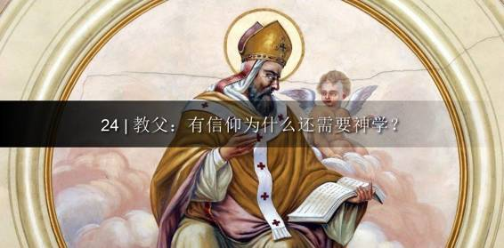

 

你好，欢迎来到《西方史纲 50 讲》。

上一讲我跟你分享了君士坦丁的故事，告诉你帝国就是存心利用和收编教会。那么，当西罗马帝国大厦将倾的时候，**也就是世俗政权即将毁灭的时候，基督教是怎么看帝国覆灭的？更重要的是，这种看法，如何引领中世纪走上了一条独特的道路。**

这一讲，我通过基督教最重要的神学家奥古斯丁，来跟你讲这段故事。

我在罗马如何亡于蛮族之手那一讲，已经跟你简单提过奥古斯丁的看法，不过还是有很多重要的事情要再仔细说一说。

有三个问题很重要：**第一，有信仰为什么还需要神学；第二，奥古斯丁作出了什么样的贡献让他拥有了基督教首席神学家的地位；第三，他对罗马帝国灭亡的看法怎么样重塑了西方，引领着中世纪走上了什么样的路。**

## 为什么要发展神学

我先跟你简单说说到底什么是神学，关键问题是有了信仰为什么还需要神学。神学这个东西严格来说我们中国没有。上一讲我已经跟你分析过，宗教不是黑暗和愚昧，恰恰相反，它是光明和智慧。神学就是对宗教智慧的论证，就是对光明的理性阐发。

西方的博士学位从中世纪开始设立，当时只有四种：神学博士、哲学博士、法学博士、医学博士，神学博士是最难念的，即便现在，拿下神学博士也至少要学八年，不包括之前的本科和硕士哈！

你要先记住这一点：**神学是捍卫信仰之必须。**

耶稣和保罗不是讲了很多道理了吗？还不够吗？不够。耶稣在世，听耶稣的；耶稣离世，听使徒的，听保罗的；那要是保罗和所有使徒都离世了呢？你会说，听《圣经》的。这还不够吗？不够。

因为耶稣、使徒和保罗有很多话说得不明确，或者说太深奥，一般人想不透。当信徒们对教义产生分歧，又没有权威作出裁决，那宗教就散掉了。**所以，神学就是要保证宗教的道理是成体系的，凭借知识体系的力量来保证，即便没有人的权威在，道理仍然是明确的。这是宗教必须发展出神学的内在原因。**

**还有外在原因。基督教要和帝国境内的其他宗教和哲学展开竞争，你说不过人家，你的粉丝就被人家带跑了**。在竞争过程中，基督教最重要的对手其实是希腊哲学，因为它有很多流派，柏拉图、亚里士多德、斯多葛、伊壁鸠鲁等等，他们对世界的大问题都有很深的看法。如果基督教说不过希腊哲学，别的不说，有知识有文化的精英阶层就不会信你。

你可能会说，那有什么关系，反正基督教是平民宗教，没有富人皈依也没关系。我要跟你说这不是贫富的问题，而是高级人力资源的流向问题。

一个事业，无论什么性质，高级人力资源构成了它的核心，如果这种资源的厚度不够，是做不大、做不长的。

中国历史上，你想想，刘邦身边有张良、李世民身边有房玄龄杜如晦、朱元璋身边有刘基，他们成了大事；陈胜吴广身边有谁，李自成身边有谁，洪秀全身边有谁，你看，他们很容易就败了。征服高级人力资源，让他们源源不断地流入，事业就兴旺发达，反过来，事业就日薄西山、穷途末路。

**在罗马帝国时代，希腊哲学不仅是基督教最重要的对手，也是它最好的朋友。**这话怎么说？它们之间相互争夺人才，争夺的方式主要是辩驳，辩驳的过程里就相互学习，当然，基督教学习的更多。

神学家们从希腊哲学里面学会了很多思路和方法，用来建筑神学的大厦。**你大致可以把神学看成用哲学的概念、逻辑、方法来论证信仰。**

经过了三四百年的努力，**在奥古斯丁手里，基督教神学达到了一个前所未有的高峰，历史上把他们的神学叫做“教父学”。**

## 奥古斯丁的神学体系

下面我就带你看看奥古斯丁的神学到底讲了些什么。

奥古斯丁本人就是被基督教收编的顶级人才，他精力充沛、智力非凡，年轻的时候追求各种刺激，还追随过摩尼教，学习修辞术、占星术，没有什么人能让他在智力上服气，直到他遇到了米兰大主教安布罗斯。聪明孩子奥古斯丁就是被堪称完人的安布罗斯收服的。

奥古斯丁在皈依基督教之后，写出了许多解决关键神学疑难的著作，正是在他手中，基督教神学达到了稳定形态。

下面我带你看看他究竟解决了什么重大疑难。神学比海深，我只能简单带你推演几步。**推演的规则有两条：第一，起点是上帝全知全能全善；第二，新得出的道理不能违反已有的道理。**好，现在我们开始。

人在面对这个世界的时候，最直观的感受就是有善有恶，那恶是从哪里来的？比如，这个问题对摩尼教来说，就不是问题，摩尼教本身就主张世界是由并列的善神和恶神交战推动的，恶就是来自恶神。

那么，**摩尼教就对基督教提出质疑，你们说上帝全知全能全善，那么恶也是他制造的吗？如果是，那他就不是全善的，如果不是，那恶从哪里来？**

**奥古斯丁有力地回击了摩尼教，用“光照论”解释了恶是怎么回事。**他论证说，恶不是实体，不是有，而是虚空，是无。什么意思？恶是因为缺乏上帝之光，光没有照到的地方就是黑暗嘛，黑暗不是有什么，恰好是什么也没有嘛。你看，这样思路一转，上帝的完美形象就保住了。

**第二个问题马上就来了，那既然虚空了、黑暗了、恶了，上帝他老人家知道吗？**如果不知道，他就不是全能，如果他知道，那他老人家为什么不清除黑暗，让上帝之光普照世界，这个世界不就美好了吗？

奥古斯丁有力地阐述了一个理论，叫预定论，就是什么事情上帝都预先决定好了，奥古斯丁用它解决了上帝全能和人的命运之间的问题。

我说预定论，你可能会想起宿命论，但它们完全不是一回事。宿命论是说你的命已经定了。奥古斯丁提出的预定论是说，所有事情上帝都安排好了，不过，只有他老人家知道，凡人谁也不知道，不要说世界的走向，就连你自己被他安排的命，你也不知道。

所以，你不要去猜上帝的心思，一切都是他安排好的，坏事、恶事的出现是为了刺激，成全好事、善事，上帝在下一盘很大的棋，他有谱，而你完全不知道他的谱。所以你只能按照他给你的诫命，爱，去生活。

有了预定论，复杂世界里相反相成的奥妙，就都收到了上帝的口袋里。**但又会引出一个大麻烦：如果上帝都安排好了，我们人还能干什么呢？我们岂不都是上帝的木偶？**

到这里你已经感觉到神学的压力了是吧？想出一个办法解决了旧问题，马上就会跑出来一个新问题。是的，继续解决问题，而且不能违反上帝完美的原则、不能违反刚才说的光照论、预定论。

**这就有了奥古斯丁的第三大贡献，自由意志论，就是说人有自由意志，而且是上帝给的。**上帝安排好了一切，不过他还是让你作出选择，从善还是为恶，是你自己的选择，所以结果是你自己负责。

上帝知道你会选择什么，但他不阻止你，就像他没有阻止亚当偷吃禁果一样，但最后，他会给你结果，和你的选择相匹配。**自由意志论解决了道德是否能够成立的问题，因为人拥有自由意志，才可能对自己的行为负责，没有了自由意志，无从选择，自然也就没有了责任，道德也就消失了。**

好了，神学比海深，我只能就此打住。刚才我们讲了奥古斯丁的上帝论、光照论、预定论、自由意志论，此外还有解决耶稣地位的三位一体论、解决人的根本定位的原罪论、解决教会地位的方舟论，方舟论我会在下一讲具体给你讲。

有了奥古斯丁的这些论述，《圣经》里的种种说法就被理顺了，成了一个内在一致的体系，神学营造出来的力量就出现了，信仰就会得到知识的捍卫。

## “双城论”如何看待世俗政治

下面我要跟你重点讲的是和我们这门课最关心的政治有关的东西：奥古斯丁提出的双城论。也就是我在开头提出的问题，罗马城毁灭了，基督教怎么看。**正是双城论，解决了基督教如何看待世俗政治这个大问题。**

什么是双城论呢？回想一下我在前面跟你提到的故事，罗马城被蛮族攻破洗劫，不信基督教的人说，看吧，罗马背弃了传统诸神，遭天谴了；信基督教的人问，基督教已经是罗马国教，罗马就是上帝之城，怎么会遭此大劫？

奥古斯丁回答说，罗马不是上帝之城，真正的上帝之城是基督徒的团契，也就是基督徒组成的集体，而不是任何世俗政权。罗马就像所有世俗政权一样，是俗人之城，是“地上之城”，是爱自己的人们组成的，它就是黑暗和邪恶，所以毁了也没什么可惜。**上帝之城和地上之城，这就是奥古斯丁的“双城”。**

显然，奥古斯丁对世俗政治的态度是疏远的，他教大家不要在意世俗政权这个东西，它兴，不足喜，亡，不足悲。

奥古斯丁在罗马即将毁灭的路口告诉西方人，世俗政治和精神生活是两回事，前者不重要，后者才重要。从奥古斯丁开始，西方和所有文明都不一样，被一劈两半，一边是世俗的，一边是精神的

**尽管现代社会里面，宗教和教会的地位大大衰落了，但它们的影响渗透在西方的文明基因当中，而且，双城记还会以新的形式复活。**这种复杂的变化，我在下一个单元讲现代西方文明的时候再跟你细说。

本讲小结

好，总结一下这一讲的内容：神学是捍卫信仰之必须。奥古斯丁把基督教一路走来的知识成果，定型成体系化的神学。在这幅基督教的图景当中，世界的发展就是一部双城记，就是二元的。

下一讲我就带你去看看中世纪前期的教会是怎么成长起来的，它如何在这黑暗的 500 年充当了西方文明的擎天柱。

期待你的到来，下一讲再见！

精选留言

点击直接进入下一章节

**陈 C**:  
所谓神学，实际上是用理性思辨，去构筑宗教信仰下的世界观。或者换个说法，我认为神学就是宗教的哲学。具体来看，神学最喜欢讨论的问题包含（但不限于）这些：如何证明上帝的存在、上帝的全知全能又如何体现，这是形而上学；人的原罪是什么，恶又是什么，人又该如何行善，这是伦理学。  
  
神学为宗教信仰带来了理性，并建构起了信仰为中心的理论架构；而正是理性思辨与完整的理论架构，说服了有知识的人，吸引了更多的高端人才来发展宗教事业。  
  
作为最伟大的神学家之一，依老师所讲，奥古斯丁的神学解答了三个重要的问题，即用“光照论”与“恶是善的缺乏”解决了恶的问题、用“预定论”解决了上帝全知全能的问题，以及用自由意志奠定了道德的基础。我认为特别是关于“自由意志”的这一点更加重要，因为这个理论不仅打下了道德的基石，更将自由带进了宗教，使其火种得以继续在西方文明中传递。

**作者回复**:神学的展开是有逻辑的，有次序的，有轻重的。上帝论当然是最重要的。自由意志论对人很重要，是人之所以为人最重要的学说，是西方文明的精髓之一。

**diceking**:  
人类历史上最早摒弃个人权威、文本权威，而建立理性共同体的，可能不是科学，而是基督教神学。  
对于学完了《欧几里的原本》又没脑洞出非欧几何的人，不入此门，又能去往何处呢？  
面对这个新认知，我现在唯一的感慨是，心向往之。  
  
基督教成为了罗马国教，但独尊并不等于罢黜百家，在罗马和米兰这样的基督教大本营，也能自由的教授和传播希腊哲学和摩尼教，正是在这样的交流竞争中诞生了基督教神学。  
儒学在独存中停滞，又在佛教的冲击中出现了理学心学。影响一个事业前途和高度的，常常是它的敌人、对手和朋友。  
  
神学以上帝为基础公设，依靠逻辑发展出的体系，如果用其他概念替换上帝，也有一定的稳定性。  
比如:用理性代替上帝，感性直觉和欲望本能就是原罪，哲学家科学家的共同体是理性之城（上帝之城），工厂、互联网、核武器只是技术之城（地上之城）。

**作者回复**:你的脑洞开得有点多，也有点快哈！

**我心飞翔**:  
基督教神学的诞生和发展是为了基督教的永世传承。  
  
佛学也有无数高僧写下一部部佛经，来完善佛教理论体系。  
  
北宋大儒张横渠有言：为天地立心，为生民立命，  
为往圣继绝学，为万世开太平。点出一代代大儒的历史使命。  
  
感叹时代真正的顶级精英考虑的时代母题只有一个，那就是传承。以千百年时间周期看，文明的传承是人类文明最大的母题。刘慈欣在《三体》中就借人类之口提出，要给文明以岁月，而不是给岁月以文明。

**作者回复**:有承担使命的人，文明才留得下来。

**炭笔**:  
李老师真是每节课都能破除一些成见啊！  
  
之前对神学毫无了解，以为都是些"针尖上能站几个天使？"这种问题，今天才知道，神学是让宗教理论逻辑自洽，能解释现实问题的一门高深学问，绝不是无聊的讨论。  
  
这节课有两个感想，其一，老师这节课提到，基督教在创始人和使徒(权威们)去世后，需要一个知识系统才能解释世界，不然众人理解不同，宗教就散了。这让我想到了政治，面对乱局，强人也可以镇住局面，但是强人之后呢？必须依靠稳定的政治体系。就像罗马不能靠苏拉的铁腕得以稳定，还是要靠屋大维的帝国体制才行。任何团体，只有系统和体系，才能带来长期的稳定。  
  
其二，奥古斯汀真是个天才！他的光照论不仅解决了世界存在恶和上帝全知全能全善的矛盾，而且和物理学暗合了，真是出色的逆向思维和有趣的巧合！其他理论，也体现出他缜密的思维。神学的高深得以管窥。  
  
李老师的课程很有趣，真的做到了开卷有益~

**作者回复**:一天一点新看法，关键还是要把它们连成线。

**王黎璐**:  
奥古斯丁的双城论显然是要把人们的注意力引向天国。不过，他没有也不可能断言否定尘世生活的意义。这表现在他不敢把“上帝之城”和“世人之城”与任何现实社会组织相提并论，他甚至不敢把基督教会等同于上帝之城。因为他必须承认，世俗政权是代表上帝管理人间事务的。特别在奥古斯丁的时代，作为国教，基督教会事实上已经成为罗马社会上层建筑的一部分，它是靠国家的法令才取得合法地位，它的神职人员是靠国家俸禄而生活的。因此，奥古斯丁不敢断言否定世俗政权的合法性。正因为如此，他反复强调，在现实生活中，上帝之城和世人之城是混合在一起的，世俗国家的存在是必不可少的。他认为，世俗国家的职能在于负责人们的物质需要，提供安全，保证有秩序的社会交往。在这个意义上说，教会的使命高于世俗国家的使命，教会的权力高于世俗国家的权力。虽然在当时的条件下，奥古斯丁未敢作出这一断言，但这个结论事实上包含在他的论证之中。

**佛祖门徒**:  
老师的课虽然不是神学主题，但能量密度恰好适合我这样一个没什么神学基础又对此感兴趣的学生，因为不理解基督神学就无法真正对西方文明建立比较清晰而准确的认识。  
奥古斯丁在死后马上就被天主教封圣，被称为“圣·奥古斯丁”。从今天老师的讲述来看，的确是实至名归，其回答的一系列问题仅其中一个就足以让人思考一辈子，他却一一作出了解答，且形成了一套完整严谨的神学思想体系。无论是学识、修养还是思考都是卓越的，为基督神学奠定了坚实的基础。

**作者回复**:神学是很有魅力的。它对思维的有特殊要求：一致性。如何能把纷繁复杂的万事万物说成一个体系，必须一致化。这种思维是收敛性的，让你从“多”当中求到“一”。现在大家都太在乎发散性思维了，发散当然能开脑洞，长见识，但要管用就必须重新把新认识和你自己既有的世界一致化，思维上就得把它们收敛在一起。不然不就成了练易筋经之前的令狐冲，七八股真气冲撞把把小命都快搞没了。

**有点甜**:  
上帝是一个全能的存在，神学旨在为信仰建立一个框架，从而规劝人的行为，指导生活。广泛来讲，生命有限，这样的"臣服"多少都为"苦难"的社会底层送去了光亮。  
而科学的魅力其『可证伪性』，能够对现实做出稳定性的预测，以此傍身，人们获得了对未来、未知的探索权力，有着不断推翻不断重组的过程。  
人并没有简单生活的福分，有的只是一场又一场的矛盾与和解。

**作者回复**:你说的很好，补充一点，按照波普的证伪论，可以被证伪的，才是科学。但波普没有反过来说，不可证伪的就一定是谬误。科学与非科学，和真理与谬误，不能划等号。

**去朝圣-小方济各**:  
老师说的真好，听君一席话，胜读十年书。  
  
首先表明我的身份。我是一个天主教徒，从小接受洗礼。信仰就像一个种子，在我没有出生的时候已经长在了我的身体内。基督教中有信望爱三德，以信德为基础。只有相信才有后面的一切。说实话，国内天主教会神父可能都没有老师这样的学问。对普通信徒说教一番还勉强应付，但若要在逻辑、理性上给出一套让人信服的理论，还欠缺些。至少我没遇到这样的神职人员。  
  
当然，老师讲这门课的重点不在于探讨基督宗教，而是说明基督教和政治体制的关系，基督教如何影响西方文明。我非常喜欢听到局外人（我是信徒 所以我算是局内人）的看法。向老师致敬！继续学习中。期盼有一日老师能和一位神父对话一下，不知会碰撞出怎样的精彩火花？

**作者回复**:我在美国的时候曾经和各种派别的传教士聊天，很有意思。

**Mike yuan**:  
从草根出身，受皇恩赏识，皇权旁落后一飞冲天，基督教的发展也颇为励志。他最初是草根的文化，受统治阶层打压，从一无所有中崛起，最终成文影响世界的文化。每个时代都有这样的文化出现，你或许看不上他，但是不能忽视他，或者不能忽视他背后的"芸芸众生"，我们要向上看，但是也要回望身后的人，他们往往是"主流"之外，但是却不可忽视。

**作者回复**:主流不可能一成不变，回顾主流的崛起，它们都是从“执着着不可能的事”的小边缘开始的，基督教是这样，罗马其实也是。体会到这种流变，就要学着像韦伯一样勇敢和坚毅：“除非我们执着着那些不可能的事情，否则，可能之事也皆不可得。”

**蝉**:  
施展老师的加餐中提到:欧洲的宗教改革者们就是针对教会过于理性化的神学体系，动摇了上帝全知全能全善的地位，才愤而改革教会。  
  
您怎样看待这样解释 宗教改革 的发生机理呢？

**作者回复**:宗教改革的直接动因是教会的腐化。下个单元会和你仔细谈。

**常海无边**:  
“上帝的归上帝，凯撒的归凯撒”这句话和今天讲的双城感觉是一个意思，这句话更形象。

**作者回复**:这句话和双城论在政教关系的问题上刚好构成了信仰和神学的关系，大宗师的话言简意赅，后世的理论家要把它论证成大部头的著作。如果你对这个问题有兴趣，推荐你去看丛日云先生的《在上帝与凯撒之间》。

**sophiashy**:  
奥古斯丁真的好强大。就今天这短短的几个理论，能够如此完美自洽。奥古斯汀的逻辑真是厉害，是他让基督教拥有了哲学理论体系，可以与强大的古希腊哲学，后世的佛教，伊斯兰教逐鹿世界，一较高下。他赋予了基督教以灵魂核心。

**作者回复**:我说得很短，奥古斯丁说得可不短，这些理论都是几百上千页的大著作论证的。

**Tio Plato**:  
奥古斯丁的神学中的自由意志论和琐罗亚斯德教的自由意志论的相似程度好高。阿胡拉马自达创造人，人依然可以自由选择自己的道路。这两种思想重合了。光照论似乎吸收了普罗提诺斯的形而上学，关于一的光充溢宇宙，光照不充分的就是不美和不善的。只有属于灵的成分才能够回归一。埃及考古得到的拿哈玛蒂手抄经卷也有类似的论断，属于灵的部分得到全知之后，才能回归到真造物主创造的属于灵的世界。拿哈玛蒂经卷的观点认为物质世界是不够好，不够善的。奥古斯丁认为上帝之城好，人之城不够好。由此看来，早期基督不仅教吸收了希腊哲学的形而上学，甚至吸收了东方的宗教哲学。摩尼教，琐罗亚斯德教，蜜斯拉教似乎也影响了早期基督教。早期基督教似乎都有一点‘厌世’的成分。难道是因为希腊化时代和罗马帝国快要灭亡的时候人的生活质量都比较糟糕，于是都寄希望于非物质的世界？

**作者回复**:奥古斯丁把罗马帝国境内很多文化都集成到基督教神学里面去了，从古希腊哲学这一块来看，主要是普罗提诺的新柏拉图主义。

**Nemo**:  
李老师 神学以上帝全知全能全善为前提假设，论证到最后只是证明了逻辑起点，这种论证是否有意义呢

**作者回复**:知（智）、能、善，是人追求的，它们都需要一个绝对完美的支点，否则很容易被现实中的各种情况风吹雨打去。绝对支点，对于有强烈追求的人来说是必要的。如果连纯粹的善都不敢想象，求善的内在动力是非常不充分的，很容易就浑浑噩噩了。

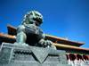**舟游世界**:  
经李老师提醒，才发觉原来神学和法学乃至几何学何其类似。可叹我懵懂地学了这么多年法学。都是从一些公理（自然法，上帝全知全能，平行线同位角相等）出发做逻辑推演，建立起精巧繁复的理论大厦。每次公理的动摇都会产生巨大的变革。  
  
曾经我也设想，法学难道不应该用统计学，心理学，经济学来研究和实验吗？什么是良法，什么是恶法难道就没有科学标准吗？  
  
未来或许会有吧，但理解法学和神学肩并肩走来，也才能理解为什么现在并不流行用科学方法来证明，或者证伪一些法学理论。

**作者回复**:法学的基本思维和神学有高度的一致性，是一种收敛性思维，纷繁复杂如何归一，千变万化如何纳入我的框架。

**成洁 getit**:  
记得在看美剧《国务卿女士》时，她的丈夫是神学教授，颇受尊重。今天听李老师讲，才体会到了一二。神学对于受中国教育的我来说十分陌生，但它在西方传统文化框架下的重要性是无可替代的。人类的智慧决定，总会在饱暖以后思考关于自身和世界的来处、去处的终极问题。而这种思辨要达成一定范围内的一致和认可是相当不容易的。奥古斯丁成圣，对后世的神学、俗世的贡献都是巨大的。一分为二既保留了神圣也为今后的发展留有了足够的空间。

**作者回复**:所以了解别的文明当中的伟大人物，尤其是和我们的我们离得很远的那种，就相对容易打开视野。最怕就是，还没仔细了解，就凭印象下结论这个人和我认识的那谁差不多嘛。

**青云龙上**:  
神学这种不可证实不可证伪的特性感觉和西方倡导的科学精神格格不入呢？

**作者回复**:并不完全，神学和科学有很多内在的相通之处，牛顿阐明力学原理的目的就是要证明上帝创造了一个完满的世界。

**悟慧**:  
奥古斯丁的上帝论，预定论，光照论，自由意志论等诸多论述，将《圣经》里的种种说法被理顺了，成了一个内在一致的体系，也可以理解为“闭环”，使基督教在一定程度上完成了涅槃重生，获得了一种蓬勃延续的基因。  
另外奥古斯丁的双城论重构了西方对于世俗政治与精神世界的格局框架，让宗教能够在一定程度上超越世俗政治的统治。  
  
正因为以上两点，奥古斯丁的神学领袖地位才旷古绝今，无可替代。

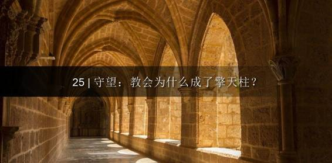

 

你好，欢迎来到《西方史纲 50 讲》！

上一讲我跟你聊了奥古斯丁和基督教神学，正是神学的这套观点和思路支配了中世纪。但是，如果只是有一套好说法，想支配整个社会 1000 年是远远不够的，必须还要有一个信这套说法的好组织。

你知道，孔子的说法很好，支配了中国两千年，不过他老人家在世的时候把自己比作丧家之犬，没有一个诸侯国采用他那一套。奥古斯丁神学的待遇，比孔子学说要好得多，奥古斯丁在世的时候，教会就对他的学说赞赏有嘉，奉为权威。

**从组织的角度看，教会和奥古斯丁相互成全，才形成了基督教对中世纪的全覆盖。**但是你别忘了，到了中世纪，西方的主体已经变成了日耳曼人，他们在当时还被罗马人视为蛮族。**在这种情况下，基督教会成功地没有费一兵一卒，就延续了西方文明。他们是如何做到的呢？**

今天我就带你看看中世纪早期教会是如何维系西方文明的。我们可以分为两步来看这个问题，先是基督教如何在理论上维护了权威，然后才是在实践中，基督教如何收服了日耳曼人，把西方文明延续了下去。

## 基督教会如何捍卫权威

**我们先来看第一个问题，基督教会是如何捍卫自己的权威的**，我们还是从奥古斯丁的一个重要说法开始。

刚才我说了，教会和奥古斯丁相互成全。别的不说，中世纪前期的 500 年里，文化湮灭、典籍流失，西方人连柏拉图、亚里士多德都不认识了。奥古斯丁呢，他的著作几乎一字不落地被保存了下来，因为它们的定本被完整地保存在梵蒂冈的教皇图书馆里。

教会看来是真心实意地尊奉奥古斯丁，奥古斯丁的神学有没有投桃报李呢？当然是有的。就是我上次跟你提过的教会方舟论，教会就是诺亚方舟。

**在奥古斯丁之前，出现了一批基督教教徒叫多纳图派，这个教派主要在北非活动，他们认为教会是纯洁的，世界是邪恶的。**在君士坦丁宽容基督教、狄奥多西认定基督教是罗马国教之后，问题严重了，多纳图派拒不承认罗马大公教会的权威，因为大公教会已经和肮脏的世界，也就是世俗政权合作了。

多纳图派居然认为罗马教皇管理的大公教会是海外敌对势力，他们中间隔着地中海嘛。海外敌对势力，这是他们的原话，看来这个词的发明比你想象的早多了。

多纳图派挑起了一个重要的争论：什么是真正的教会。

我们可以把多纳图派看作纯洁派。这时候你自然会想，纯洁不好吗？从政治上来讲，一味追求纯洁真不好！为什么？中国人有一句老话叫做：水至清则无鱼，人至察则无徒。

我来跟你讲讲其中的道理。**一个组织，即便是宗教组织，如果要追求自己的事业，就不能搞纯而又纯这种事情，这种套路只会毁掉组织、毁掉事业。**

逻辑很简单，纯洁的标准越高，合格的人就越少，如果把提高纯洁标准当作组织原则来执行，组织只会粉丝越来越少，最后的结果是谁也不合格，包括从前判定别人不合格的人，迟早自己也会被无限上调的标准所淘汰。于是你发现，追求纯洁如果成为一个组织的行动逻辑，它就相当于是在自杀。

对于奥古斯丁来说，多纳图派是不是在自杀不要紧，但他们的神学和礼仪引起的将会是教会的无限分裂，最后全部瓦解。

因为任何一个派别都可以声称自己是纯洁的，把其他所有教派都看成是海外敌对势力，教会内部将完全失去统一性。所以奥古斯丁必须对纯洁派的说法在神学上给出充分的驳斥，而且对什么是真正的教会给出充分的回答。

神学的驳斥很复杂，我这里只简单讲讲奥古斯丁是如何高明地破解了纯洁派设置的难题：纯洁派说他们的神父才能为皈依的人洗礼，也就是批准别人进入教会，其他教派的神父因为被玷污了，所以没有这个资格。

而奥古斯丁的核心主张是：洗礼的力量来自圣灵，而不是神父，所以区分什么样的神父是没有意义的，何况你们纯洁派的神父其实也不干净。

对中世纪更有意义的理论，是奥古斯丁对教会的定位，我简单概括为四点：

**第一，教会是人得救之必须。**也就是说，基督徒必须进入教会才能得到上帝的恩典，独自修炼不行。

**第二，教会确实要与世俗国家分开，保持自己的纯洁，它的目标是精神生活，比世俗国家更崇高。**这个问题我在上一讲重点跟你谈过奥古斯丁的双城论。

**第三，**世俗国家是神学里的俗人之城，理想的教会是上帝之城，前者包括了所有世俗国家，无一例外，后者呢，是教会，是理想的教会，而不是现存的教会。现存的教会里面当然也有坏人，不过任何人都没有资格去筛选坏人，只有上帝才有。所以，**实现教会的纯洁，达到理想状态，是上帝在末日审判时做的事情，人在此之前没有资格也没有能力去做。**

**最后，现存教会的正统在罗马大公教会手中，所有教会都要服从它的权威。**尽管它不是绝对纯洁的，但它是耶稣亲自授权彼得建立的，是最靠谱的，基督教的事业只能统一在它的旗下。

你看，奥古斯丁实际上吸收了纯洁派的很多主张，他当然也追求教会的纯洁。但他不是蛮干、硬干，而是充分顾及到现实的困难和需要，用稳妥的办法来追求理想，理想才不会落空。这下最高兴的肯定是罗马大公教会啊，它的地位得到了神学的证明，而且证明过程有力地克服了一切分裂势力的神学理由。所以你知道教会为什么尊奉奥古斯丁了吧。

## 基督教会如何改造日耳曼人

我在前面曾经跟你提过，西方挺过了中世纪艰难的前 500 年主要是靠教会。一个组织要把社会团结起来，手里却没有兵，这怎么可能呢？

回顾一下我们中国的历史，每一次天下大乱最后都是由一股强大的武力来实现统一，统一之后无论讲黄老、讲孔孟、讲佛系，都有人听，但没有武力统一，讲什么都没有人听。

下面我就跟你说说我开头提出的那个问题，**教会是如何在手里没有兵的情况下维系了西方文明，有史学家称之为“对西方灵魂的艰苦改造”。**教会采用的办法主要有三个。

**第一个办法，是传教**。让日耳曼人信基督教可不是件容易的事情 传教士们的工作可谓艰苦卓绝，几个甚至是一个传教士深入到充满敌意的蛮族部落当中，那真是羊入虎口啊。很明显，被老虎吃了的羊不计其数，但终于还是出现了令人惊叹的结果：羊驯化了老虎。日耳曼人一个一个部落地皈依了基督教。

**基督教会改造日耳曼人的第二个办法，是法律。**日耳曼人相信法律是神圣的，和罗马人、希腊人一样，法律对他们来说不是外部世界强加的规矩，法律就像水和空气一样自然，就像水和空气一样是生活之必须。

法律和教会有什么关系？太有关系了，因为教士们，尤其是主教们就是司法裁判者。为什么会这样？我跟你讲过，日耳曼人不识字啊。当他们在拼杀、在征战的时候，即便没有文字也能沿用自己古老的规矩。

可当他们定居下来，建立自己的王国，部落民众和被征服地区的民众在一起生活的时候，没有成文的老习惯就不好使了，这个时候在这个社会当中几乎唯一识文断字的人群——教士，就成了法官。教会就这样守株待兔一样，轻松进入了日耳曼普通老百姓的政治生活。

民众需要教士来当法官，更高一级的，国王们也需要秘书和谋士啊，也需要管理人才啊，尤其皈依了基督教之后，还需要主教为他的政权提供合法性支持啊。你看，**在高阶政治当中，只要文化是必须的，强悍的日耳曼人迟早也会服软。这是日耳曼政治迅速进入文明社会的重要入口。**

**基督教会改造日耳曼人的第三个办法，是生活。**原来日耳曼人过的都是游牧征战的生活，现在他们成新主人了，逐渐定居下来了，新生活该怎么过？不知道。那教士们来教你，一整套基督教的礼，重塑了日耳曼人的生活，从出生的洗礼到死亡的葬礼，应有尽有。

而且，基督教的礼背后有一整套道德标准，告诉你做人应该是这样的，不是原来那样的。人就在柴米油盐的日常生活中被改变了。而且，教会遵循一贯的传统，扶助弱势群体，穷人、奴隶、妇女、儿童、残疾人等等。**从政治上讲，教会成功地把社会底层都变成了自己最忠实的粉丝。这也是日耳曼人大规模大踏步进入文明社会的主要入口。**

回头再看看奥古斯丁，如果不是他打造出体系化的神学，在知识和逻辑上足够强大，传教士们拿什么去劝服日耳曼人皈依，拿什么去当法官当秘书当谋士当省长，拿什么去引导普通日耳曼人的日常生活。

要知道，书到用时方恨少，只有书写得够好够深够大，在深入虎穴的危急时刻、在暗无天日的艰难时期，才能成为鼓舞信念和启发思路的无穷宝藏。

何况，奥古斯丁还为基督教打造了一个拥有正统地位和权威的统一教会组织。**就这样，日耳曼人在信仰、法律、生活各个层面都成了教会的学生，基督教能够主导中世纪也就不足为奇了。**

下讲预告

在基督教会成功改造日耳曼人之后没过太久，日耳曼人就建立起属于自己的帝国，摸到了政治的及格线，也就是查理曼大帝建立的加洛林帝国。

**自他之后，西方文明就可以不再叫做后罗马时代，变成我们比较熟悉的新名字：欧洲文明。**下一讲，我就通过查理曼大帝的传奇故事来跟你分析欧洲文明的诞生。

期待你的到来，下一讲再见！

精选留言

点击直接进入下一章节

**Allelujah**:  
在对基督教会、西方历史没有了解的时候，我以为所谓信仰的感召力，主要来自于人内心中自发地对善的追求。  
  
但事实是，信仰本身只是一种形式，它一定是满足了受众的某种需求，才能被接纳，进而成为文明的一部分。无论是通过逻辑和思辨满足教宗统一的需求，通过扶助弱者来满足底层生存的需求，还是通过文字与律法满足社会治理、文化的需求，通过构建传统礼法来满足新的生活形态的需求，都帮助基督教融入了日耳曼民族与文化中，扎稳了脚跟。

**一杯白开水**:  
当时的基督教，还有一种“诺斯底派”，他们认为耶稣并非耶和华，并非是一体的两种位格。他们认为，真神共有 12 位。有些认为神有三十、甚至三百六十五位，但这些团体都自称基督徒。当时的基督教乱成一锅粥，对耶稣身份的争论其实一直延续到今天，这个问题不仅是犹太教和基督教的矛盾，而是基督教内部各个教派之间的矛盾。因此，基督教需要奥古斯丁，基督教需要神学。  
  
基督教的下属教派，纷繁复杂，更不提传统社会的各个宗教，一定是杂乱无章，不成系统。人类需要宗教，因为人类需要向上天祈福，祈求温饱安定。但杂乱无章的宗教很难满足一个国家祭祀的需要。来自上等文明，拥有高级人力资源的基督教就获得了前所未有的契机，经整理统筹后的基督教，自成一体，自圆其说，也许这也是日耳曼人用它的另一个理由吧。

**作者回复**:基督教内部的辨别一直很多，奥古斯丁的每一种学说都针对了特定的教派。所以，教义的统一和教会的统一互为表里。但统一了就一定好吗？统一性确实带来稳定性，但会削弱活力。这对所有的宗教都是大难题。

**炭笔**:  
今天的课程讲了奥古斯汀如何驳斥纯洁派的观点，并用神学理论定义教会，也讲了基督教是如何成为蛮族信仰的。  
  
使蛮族皈依基督教有三个方法:传教，提供法律服务，塑造生活习惯。  
  
说起传教，李老师说"这是羊入虎穴"到最后"羊驯化了老虎"。不由得令人钦佩这些传教士的勇气和智慧。但反过来说，基督教不只靠传教士的勇敢才传教成功，也靠了在法律上的规范，和生活习惯上的先进。我想这是为什么西学东渐时期，基督教在中国很难传播。  
  
晚明时期，基督教来到中国，这时中国已经有了较为发达的原生文明(不需要对方指导生活习惯)，也有自己完整的伦理纲常(不需要基督教士提供法律)，精神世界也有一套理学和心学提供的完整解释(因此甚至不需要宗教)，所以传教士们的工作举步维艰，只能用科技作为突破口慢慢传教。  
  
我觉得文化的征服就是这样，强势先进的文化能较快取代落后的，但是发展程度相似的文化往往都是平起平坐的。

**作者回复**:传教士来中国的时候把《圣经》里的很多概念都用儒家的概念翻译了，很会接地气。不过又带来了新的麻烦，既然你们的上帝说的意思和我们孔子说的一样，那我为什么还要跟你走呢？高级文化之间的相互取代是非常困难的，相互理解、相互融合倒是相对容易一些，毕竟双方的精神世界都有规模了。

**Tim**:  
"羊驯化了老虎"感动了我，可能基督教的博爱精神是他们不怕死的原因之一吧，心中有善，外界就有善。他们在向日耳曼人传教时前仆后继地牺牲，同时也在日耳曼人心中偷偷种下了 一棵博爱的、善意的种子。  
野蛮的日耳曼人通过与传教士的接触当中会发现在暴力野蛮之外，居然还有如此博爱和善意之人，通过时间的积累，日耳曼人渐渐地被驯化，他们终于相信基督徒是没有敌意的，是友善的，是可以相信的，然后接基督徒的才华有了施展之地，有了辅助日耳曼统治者治理国家的机会，这样也就是有了广阔的发展空间。

**作者回复**:每个文明都要有这样为了信念而不计利害甚至勇敢牺牲的人，在信念问题上，和经济问题上一样，都是搭便车的，就没人开车了，车也就停了。

**佛祖门徒**:  
基督教会对日耳曼人的“渗透”和“征服”可谓是“春风化雨，润物无声”。  
从战略上来看，覆盖面是全方位的，信仰、文化、生活、政治和法律实现了完整的体系，从而建立了坚实的精神指引基础。  
从方法上来看，几乎以最小的代价来实现了战略全覆盖，以法律为切入点非常高明，作为国家统治、社会治理和人民生活“必需品”，最容易被统治阶级所接纳、人民所认可，实现了各取所需。  
宗教和世俗政治时而争斗、时而合作，不过从中世纪以来，基督教始终拥有比较稳固的地位。相比之下，佛教在中国的发展历史似乎要更加坎坷一些，有被捧到至高地位的辉煌，也有遭受世俗政治“迫害”的低谷，我想这是否因为欧洲和中国的政治结构差别所造成的？

**作者回复**:佛教本身的出世性格很强，无论在印度还是中国都很难和政治建立起长期稳固的合作关系。佛教来华之前，汉武帝和董仲舒大概已经完成了庞大帝国和儒家合作的战略性框架，框架一旦搭好，再大动是很困难的。

**A learner**:  
通过这一讲的学习我有两个收获：  
  
1.奥古斯丁的智慧与基督教的务实  
精神可以影响人，但不能脱离于社会，否则它就没有支持的基础。纯洁派的做法是单纯强调精神面，将自身和世俗完全对立起来。  
奥古斯丁巧妙的将精神世界置于世俗世界之上，同时承认世俗世界存在的合理性。这样上帝依然拥有崇高无上的地位，拥有最美好的一面。同时，世俗的人无论善恶都是合理的存在，都接受上帝精神的洗礼。  
  
2.即便是强大的武力也无法阻碍文明的发展大趋势。  
从古至今，无论是东方和西方，通过武力征服领土都是非常常见的事。但一个文明，即便在它原有的政权不存在的情况下也能生生不息的发展。因为高级的文明总是令人向往和追求，也能反向塑造那些征服者。  
但是，正如老师文中所说"没有武力征服，你说什么都没有人听"。我想这句话意思应该是，再好的东西也需要力量的维持。所以与其说基督教改造了日耳曼人，不如说两者各取所需、相互合作。

**作者回复**:文武合一，文明才能持续。文和武在不同的人（组织系统）手里，合作又斗争的精彩故事就展开了。

**北柠**:  
老师，为什么日耳曼侵略罗马之后没有像中国古代草原征服中原一样，被人口庞大的罗马人同化呢？日耳曼征服罗马之后，罗马人去了哪？是否也被基督教传教了呢？

**作者回复**:谁是罗马人？罗马城的人是，意大利人是不是，西班牙人、高卢人、希腊人……呢？卡拉卡拉皇帝给了所有人公民权，照法律身份，五百万平方公里的人都是。但从部落、民族、种族来看差异还是不小的。罗马人本就是五光十色的汪洋大海。日耳曼人冲进去了，当了主人，原来的罗马子民就成了日耳曼的子民。就像中国的改朝换代，清朝建立了，明朝的人上哪里去了，大多数人当了清朝的子民。罗马人一部分已经信了基督教，但不是全部。基督教对西方的全覆盖在罗马帝国时代没有完成，是在中世纪完成的。

**山峰**:  
罗马帝国的灭亡到中世纪，体现了一个历史规律:野蛮战胜文明，文明消灭野蛮。野蛮为何能战胜文明？野蛮人更强大的原因:恶劣的环境炼就了他们强壮的体魄和顽强的毅力；为了谋求生存培养出了一不怕苦二不怕死的勇气和精神；野蛮民族分散的力量被一个强大的核心力量组织起来；毁灭文明毫不留情。文明的弱点:远离野蛮的黑暗与恐怖，远离自然地威胁与战争，文明变成了温床。文明国家往往不能集中力量用于军事发展，国家当中权力受到制约，人的意识形态也比较松散 。综上所述，野蛮人表现得比文明人更强大。  
文明如何消灭野蛮？比较野蛮的征服者，在绝大多数情况下，都不得不适应征服后存在的比较高的经济情况，他们最终为被征服者所同化。

**作者回复**:有道理。文明并不总是战胜野蛮，孔子说人的时候讲过“文胜质则史，质胜文则野，文质彬彬，然后君子”，很有意味。“文”（文明逻辑让自身陷入孱弱）过了，“明”可能就没了。会被质朴而更有生命力的人群击败。日耳曼人战胜罗马人如此，今天的欧洲恐怕也有这样的危险。

**子曰诗云**:  
请教老师，教会作用如此之大，那么是什么样的精英组成了教会，他们为什么不利用自己的教育知识去谋取世俗权力，却走上精神世界？基督教源于社会下层阶级的心声，救赎的绝大部分是老百姓，怎么最后却会是精英们组队，发扬光大成为神学？

**作者回复**:我这一讲已经透露了，主教们不是当上法官、秘书、省长了嘛。下节课我会告诉你，很长一段时间高级教师们都是两条腿走路的。这埋下了教会和帝国斗争的种子。还记得奥古斯丁的提示吗，现实的教会不是上帝之城，它并不纯粹。当然，虔诚、热诚的教会干部肯定是有的，而且不少，有这样的人大批存在，事业才会蒸蒸日上。他们有的是学问家，有的是实干家，像奥古斯丁（他是希波主教）那样两者兼备的也不少。

**有点甜**:  
#连点成面，思想先行。  
  
范围的不断扩大和更新必然会矛盾四起，裂土封疆，流派冲突，又会造成时局紊乱。  
思想上的统一是构成其他一切统一的先决条件，博弈，而后平衡。  
借此而言，基督教是"藕断丝连"中的『丝』，将早期欧洲串联如甲胄，给其以韧性，助其于风雨飘摇中再走一段路程。

**作者回复**:古典文明（希腊罗马）的香火就是通过基督教这根丝传给了后世的西方。

**翦秋水**:  
前 500 年的中世纪，基督教是另一种形式的政治体系。

**作者回复**:非常好！不只是前 500 年，基督教会本身一直就是一种独特的政治体系，它的演化对后来的西方非常重要。

**ZYL**:  
是否可以理解为基督教于西罗马帝国时代已经在法律、知识、生活、信仰方面占据了社会主导地位，等日耳曼人进入该地区后，正好弥补了他们在这方面的缺失，皈依了基督教？如果当时基督教还没有这么占主导，日耳曼人在法律知识生活等方面还有其他选择了吧，未必会选择基督教？  
  
而这一切的基础就是神学理论体系的完善，吸收了足够多优秀人才，也为日耳曼人的统治提供了基础和支撑。

**作者回复**:日耳曼人本身有原始信仰，摩尼教、拜火教这些大宗教也很厉害，基督教并不是日耳曼人的唯一选择，所以基督教是通过竞争取得主导地位的。没有伟大的成就不是通过艰苦的努力得来的。

**Chivalry**:  
他山之石 可以攻玉，从文章中我看到了组织的运作和管理，人生的关键处就那几步 这才是见证功力的时刻，对一个有想法的人来说 这就是读书学习的功用。请老师原谅我的世俗眼光和功利心，😄

**作者回复**:创造性的重要源泉之一就是跨界，把学到的知识拿到别的领域去用，会用了，相差十万八千里居然有用了，才是真正的“通”了。所以我不仅不会怪你，反而鼓励大家都勇敢地去做跨界的思考。

**浪里小白龙**:  
这两天学习西方史基督教部分，我看的是大呼过瘾。也想了很多，夜深人静了，我理一理。  
基督教前身是犹太教，犹太教本身其实和其他文明的神话，基于统治阶级利益的神秘主义，没什么两样。  
犹太人在古代就是一个颠沛流离的民族，而耶稣是犹太人中的底层人民。他反对犹太教对犹太底层人民的压迫，进而改造了犹太教，成为基督教。在基督教的体系里，人人平等，每个人都对上帝负责。耶稣的弟子保罗继承了耶稣的事业继续讲基督教发扬光大。耶稣被弟子犹大出卖给罗马总督，对于罗马政府来讲，基督教当时是邪教(区别于罗马官方宗教)。后来由于基督教的普世价值观被越来越多的人接受，罗马帝国皇帝君士坦丁承认基督教，并立为国教，君士坦丁就是在利用基督教巩固自己的统治。再后来，西罗马灭亡，日耳曼人蛮族统治欧洲，希腊罗马一脉相承的哲学，政治，经济，文化，艺术随着人性的贪婪一起沉入深渊。欧洲人需要基督教来弥合伤口，反思人性，找到出路，一代神学家奥古斯丁将圣经里各个章节的逻辑理顺，将希腊哲学的理性思辨融入宗教的理论体系中，提出来，方舟论，光照论，预定论，双城论。从此欧洲进入二元世界——世俗世界和精神世界，这是欧洲文明的底层。  
东罗马的基督教因为一直为世俗政治服务，所以他们区别于基督教，被称为东正教，被俄罗斯继承，西方世界一直不承认俄罗斯其实在宗教上也是有原因的。  
到了近现代，基督教又被改造为新教伦理精神，作为用来服务于欧洲资本主义发展的宗教理论。  
看基督教一路走来，我得出以下几个结论:  
1 事物是发展变化的，无一例外。  
2 宗教是人类构建自己心灵阶梯(这个阶梯通往上帝)的认知体系。  
3 价值观没有对错，只有符不符合当下的环境。  
4 创造即是背叛。

**唐元明清 51598501**:  
感觉朱熹就相当于儒家的奥古斯丁，他上用理性充分论证儒家核心观念，下发明一整套可操作的礼仪规程，把修行扩充推广到日用常行中去，让宗教成为一种生活方式，自此以后，儒家才几乎占领世俗世界。如老师所讲，各个教派都应该有这样一个承前启后的宗师，才能有爆裂般的发展。请教老师，伊斯兰教和佛教也有此类历史人物吗？

**作者回复**:伊斯兰教有，佛教也有。不过我有点看法和你略为不同：奥古斯丁更像董仲舒，阿奎那才更像朱熹。前两者是大格局的搭建者，后两者都是尽全力将成熟饱满的文化再次融为一体。后面讲了阿奎那，你会更清楚我对你的修正，也可以去听听我在《刘苏里·名家大课》里面对阿奎那的解读。

**陈 C**:  
教会之所以能够在不掌握兵权的前提下维系了西方文明，在于坚持不懈的传教、行使统一的司法裁判、提供行政支持与正统性认证，以及深入日常生活指导日耳曼人转向定居。但能够做到这几点，一方面需要文化知识的夹持，这一点由罗马遗留下来的文化遗产保障；另一方面则需要教会本身维持统一，保持正统性，以保持“劝说”的力度。  
  
奥古斯丁在这方面做出了很大的贡献。他指出了教会在基督徒个人修炼中的决定性作用；承认了教会纯洁的必要性，因此需要与世俗国家分离；但是纯洁本身只有上帝能判断，并非凡人可为；那么在凡人不可知是否纯洁时，就不如“搁置争议”，以基督与保罗的唯一正统传承教会为核心。  
  
联系上一讲，奥古斯丁有这样几条重要的贡献：  
1\. 引入理性思辨、发展神学，使信仰具有更强的生长潜力；  
2\. 完善理论框架，使教义经得住推敲，能够超出底层人民，扩散到更广的范围内；  
3\. 在道德上留下了“自由”的空间，使这一文明火种得以继续传递；  
4\. 化解矛盾、统一思想、维护教会权威，为扩展力量、建立新秩序扫清障碍。

**蝉**:  
李老师:教会凭借文化介入司法审判，可这时的法律还是罗马法吗?或者说罗马法已经渗透进了基督教的律法?  
  
总之，罗马法在中世纪早期扮演了什么角色?

**作者回复**:罗马法一直在延续，当然，各地还有习惯法。中世纪早期的法律状况当然不可能像帝国时代一样稳固，也倒退了很多。主导人们生活的有整理和编纂简单的法典（这必须有文化才干得了），用简单的罗马法原理把习惯法汇集到一起。另外，罗马法肯定是渗透了教会法的，但前 500 年的教会法也还不够成熟，不过还是比日耳曼习惯法成熟。后面会跟你提到后 500 年西方走向上行的快车道，一个很重要的标志就是教会法体系的率先形成。

**王·刚 数据化转型**:  
老师好，  
  
最近在参加中非峰会，落下了几节课。检讨检讨。  
  
我从奥古斯丁开始讲起，探探我的深切感受。从来没有任何存在，能像宗教那样凝聚如此之多的共识。而宗教里面，基督教又是独树一帜的严谨和逻辑。  
  
有人说宗教就是迷信，但是在神学的基础上看这是不对的。科学的对立面也不是宗教，科学对立面的就是盲从的精神。在这个意义上，基督教神学和科学都发端于同样的起点——公理。如果说基督教神学的起点是全知全能的上帝，那科学的起点是数学，欧式几何我们都知道那五条最简单的“不需证明”的公理，重点就是在这个“不需证明”。  
  
其实，学习了今天的课程，我感慨最多的是基督教的神学之博大，来自于同样的思辨精神，驱动力恰恰是古希腊哲学。那么，哲学，神学，科学这三种对世界究竟的探索，背后最最最重要的就是理性批判精神：逻辑和思辨。  
  
谢谢老师，史纲真的很强大，您用俯瞰的视野，把似海深的各大领悟包容进来，实在是震撼无比。  
  
我想请教老师，我们如何用史纲的基本方法是什么呢？我们如何能用史纲的方法看待周围的世界呢？  
  
祝老师身体健康。

**作者回复**:我会找机会把史纲的方法跟大家聊聊，要不跟施展一起，来个直播？

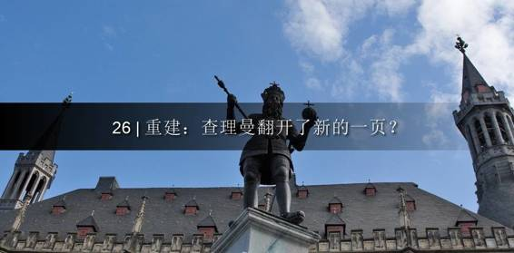

 

你好，欢迎来到《西方史纲 50 讲》。

上一讲我跟你分享了教会怎么样主导了中世纪，教会通过积极地传教，把日耳曼人变成了他的学生。但这只是文明的一个方面，**一个文明要发展壮大，用基督教的术语来说，要有两件东西，Word 和 Sword，也就是道与剑。**

这两个词怎么解释，Word 的表意是词，人有了词语，能说会道，就是掌握了道的万物之灵。如果把 Word 看成一种文明的根本能力，中文里面恐怕只有“道”这个字可以表达了吧。Sword 是剑的意思，刀剑的剑，再抽象一步，是武力。所以你看，**Word 与 Sword，就是道与剑，你可以把它抽象理解为文化和武力。**

其实每种文明都可以看作道与剑的结合。西方文明最独特的地方是在中世纪发展出一个道与剑，分别由不同的体系化组织来承担的系统，道由教会掌管，剑由国王掌管，相互独立，相互合作，当然，也相互打架。

上一讲我跟你分享了教会怎么样承担起了道，也就是文化这一头。这一讲我重点跟你分享剑这一头，也就是武力的逻辑，我从这 500 年里，可能唯一叫得响的大人物查理曼说起。

查理曼建立的加洛林帝国，可以看作是欧洲文明的开端。同时，在他当政的加洛林帝国时期，西方中世纪那种政权和教权相互缠绕的二元结构，也基本确立下来了。

## 查理曼的武功

这一讲我主要跟你讲讲查理曼大帝的三件事：他的武功、文治和帝国的走向。等你弄懂这三件事，也就能理解为什么加洛林帝国是西方文明的一个重要转折点。

**查理曼是西方中世纪政治和军事上的头号大人物，可能也是我们中国人最经常接触的中世纪人物，因为他就是扑克牌里面的红桃 K。**黑桃 K 是大卫，梅花 K 是亚历山大，方块 K 是凯撒。显然，西方人认为他们都是战神级别的国王。

查理曼确实算得上武功盖世，如果只算打下多少地盘的话，亚历山大最厉害，凯撒不如查理曼，大卫的地盘更少。查理曼的势力范围呢，他当政期间，基本上征服了整个欧洲，众多日耳曼部落不是被他消灭就是表示臣服，于是，**在查理曼手上，加洛林帝国建立起来了，法兰克王国达到顶峰状态。**

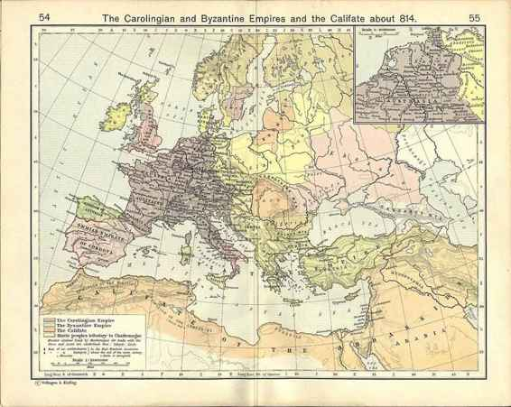

公元 814 年的加洛林帝国，图中灰色区域为加洛林

说到法兰克王国，它是在公元 5 世纪，西罗马帝国灭亡不久后，法兰克人在领袖克洛维的率领下建立起来的，法兰克人是日耳曼人的一支，在克洛维的领导下，墨洛温王朝几乎实现了对大半个欧洲的控制，而且他带领法兰克人集体皈依了基督教。

可惜克洛维死后，墨洛温王朝分裂，虽然名义上的国王还在，但没有什么控制力。而且，不久之后，维京人、匈奴人、穆斯林都来了，墨洛温王朝名存实亡。

墨洛温王朝晚期，出现了一堆不理朝政的国王，实权落到了宫相手中。我们刚才说的那位红桃 K 查理曼，他的爷爷查理·马特就是当时墨洛温王朝的宫相，正是他在距离巴黎 150 英里的地方，抵挡住了穆斯林的进攻。

在这之后，查理·马特自立为王，推翻了前朝，也就是墨洛温王朝，建立了加洛林王朝。**爷爷厉害、爸爸厉害，第三代查理曼更厉害，经过祖孙三代的经营，一个帝国终于建成了，也就是加洛林帝国。**

**现代的历史学家们通常把加洛林帝国的建立看成欧洲的诞生。**现代欧洲文明基本上是由加洛林帝国没有断线地发展而来的，政治、经济、宗教、文化一脉相承。此外，现代欧洲文明的版图是以加洛林帝国为原型的，构成了法国、德国、意大利三大国家的基干。

## 查理曼的文治

查理曼这个人武功厉害，接下来我再跟你说说查理曼大帝的文治。光有武功不足以名垂青史，更不足以担起“欧洲之父”的大名。

**西方文明的政治、经济、宗教、文化走向，之所以直接向前连接到加洛林帝国，和查理曼大帝的文治是分不开的。**查理曼大帝的文治，有三个方面至关重要：

**第一个，查理曼与教皇结盟，巩固剑与道的关系。**查理曼沿袭了爷爷和爸爸跟教廷之间的友好关系，还出兵保护多次被欺负的教皇。甚至为了教皇不惜离婚，因为他当时要征讨的对象是欺负教皇的伦巴第人，他的妻子就是伦巴第人。

当然，**你完全可以把这个事情理解成查理曼为了巩固和教皇的同盟，不惜放弃和伦巴第人的同盟。**更厉害的是，查理曼征服的地方，都强迫当地人皈依基督教，这实际上大大提高了征服的难度，要知道，如果是为了信仰而战，谁都会拼死抵抗。比如，对撒克逊人的征服，就让查理曼大费周折，最终让撒克逊人也接受了基督教。

**查理曼的第二大举措，是大力推行封建制。**封建制不是由查理曼发明的，但是他完成了封建制对欧洲的全覆盖。

欧洲的封建制和中国秦以前的封建制很相似，秦以后的中国不能叫封建制。所谓封建制，就是封邦建国。听起来皇帝很雍容大度，其实是没有办法的事情。

入主西方的日耳曼人就像当年入主中原的周朝一样，人少地广，管理水平极低，地盘越来越大，怎么管？很简单，让亲信去管。特别需要注意的是，封建制的底层逻辑是军事互助，然后才是政治上的司法管辖，和经济上的收租收税。

领主和附庸之间签订封建契约，领主是大哥，附庸是小弟，契约的内容就是谁欺负了小弟，大哥就带一帮人替他出头。对等地，大哥要是招呼小弟一起去揍谁，小弟得派兵派马。在军事这个底层之上，再加上领主和附庸之间的司法上诉关系，经济上的地主-小地主关系，封建制才得以建立。

封建制成了帝国实现管理的基本架构，但你要知道那是没有办法的办法。你想想我们的春秋战国就知道，以封建制作为基本架构的帝国实际上是很软弱的，一旦诸侯崛起，帝国肯定完蛋。

在这个过程中，查理曼显示出了高超的管理才能，就是我在上一讲提到的，他大量启用主教和修道院院长作为诸侯、法官、谋士和秘书，有力地提升了帝国的治理能力。当然，也就把教会深深地卷入了世俗政治当中。

**查理曼的第三大举措，是大力复兴文化。**在西方中世纪的历史上，一共有过三次文艺复兴，第一次就是查理曼主导的加洛林文艺复兴，第二次是 12 世纪文艺复兴，第三次才是你知道的意大利文艺复兴。

所谓加洛林文艺复兴，是查理曼主动推进，因为他本人在成长的过程中体会到了有文化才能当好统治者，他积极学习数学、逻辑学、修辞学、天文学，在很晚才学会说拉丁语，甚至成年之后才勉强识字。依靠主教和院长们治理帝国，让他对文化人又多添了几分好感。

所以他采取了几个重要的措施：第一，保护和奖励文化人；第二，复兴和改革教育，并把这个重任委托给教会；第三，敦请教会把基督教礼仪标准化；第四，敦请教皇制定议事规则、整理教会法；第五，保护和抢救文献。

就保护文献这个事情来说，真是没有什么别的好办法，只能让大量的修士们去誊抄更多的复本。誊抄的字体形成了固定的加洛林体，后来有了印刷术之后，这种字体被叫做罗马字体。

## 查理曼帝国的走向

说完了查理曼的武功和文治，最后我跟你谈一谈查理曼帝国的走向，**如此欣欣向荣的帝国，是不是会把西方带入一个快速的上升期**？

很遗憾，没有。我分成短线和长线来说。

**从短线来看，查理曼驾崩之后不久，他的三个孙子经过内战之后签订了《凡尔登条约》，把帝国一分为三，大致就是以后的法兰西、德意志和意大利。**查理曼帝国的分裂使得西方的政治前景又暗淡下来，仍然要花时间去进行艰苦的政治整合，才能获得相对稳定的局面，这个事情大概是在公元 1000 年左右完成的。

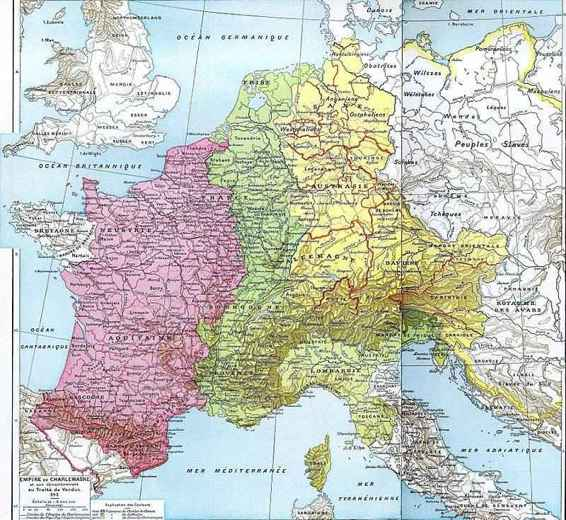

公元 843 年，被《凡尔登条约》一分为三的加洛林帝国，分别为西法兰克王国、中法兰克王国和东法兰克王国

从长线来看，查理曼帝国的出现标志着西方文明的一个独特逻辑定型了，也就是政教二元关系上了一个新台阶，教权和政权相互缠绕推动西方文明发展的逻辑正式定型。

前面我提到，查理曼为巩固和教皇的关系费了不少力气。教皇当然要投桃报李，于是给了查理曼一个大大的惊喜：**公元 800 年圣诞节，教皇里奥三世给查理曼加冕，称他为“罗马人的皇帝”。**

这不是好事儿吗？实至名归啊。但据查理曼的贴身秘书艾因哈德，以及后来历代日耳曼史学家讲，这完全是教皇策划好的一场阴谋，如果查理曼事先知道是这么个安排，他绝对不会走近那个教堂。这是为什么呢？

因为当时，查理曼已经是西方的最高统治者，所有人在武力上都臣服，在名义上也已经都承认他了。这个罗马皇帝的头衔实际上是给教皇带来了好处，他为皇帝加冕，意味着他比皇帝离上帝更近，教皇是皇帝得到上帝授权的中介。**这一下，原本是被查理曼解救出来的教皇，反而爬到了查理曼的头上去了。教皇的政治地位大大提升，甚至明确地升到了皇帝之上。**

再看查理曼这头，除了教皇骑到自己头上 ，更现实的问题是他和东边的拜占庭的关系。我们在前面讲过，拜占庭一直认为自己才是罗马帝国的正统继承人，西方不是，因为西罗马帝国被灭了。查理曼一直很小心处理这个问题，拜占庭也默认了他对西方的统治权，东方保持名义上的尊荣，西方有实权上的控制，双方心照不宣。

结果，教皇跳出来给查理曼搞加冕，把拜占庭皇帝的至尊之位搁哪儿，这不是公开宣布查理曼和拜占庭决裂吗？**对于查理曼来说，他的加洛林帝国实力远比不上拜占庭，为了一个教皇给的虚名作出了一个天大的敌人，完全没有必要。**

另外，教会这边，教皇给查理曼加冕，这么一弄，西方教廷和拜占庭教廷也心生嫌隙，最终，**在公元 1054 年，罗马教皇和君士坦丁堡大牧首公开决裂，互相开除对方的教籍，大公教和东正教从此各走各路，西方与拜占庭就此完全分离。**

本讲小结

好，总结一下这一讲的内容：查理曼帝国的武功和文治，让西方在中世纪第一次跃上了文明的及格线，直接孵化出现代西方的母体，基本定型了，其中最重要的事情是教权与王权二元并立、相互合作又斗争的格局稳定下来了。

这场 Word 对 Sword 的好戏，从查理曼加冕礼这个节点开始进入高潮。下一讲我就和你分享教皇是如何首先对皇帝发起进攻的，谁赢谁输，一定出乎你的意料。

期待你的到来，下一讲再见！

精选留言

点击直接进入下一章节

**Allelujah**:  
我对教皇给世俗皇帝加冕这一仪式最深刻的印象，来自法国画家达雅克·路易·大卫的《拿破仑一世加冕大典》。  
  
为了巩固帝位，拿破仑这位皇帝极其傲慢地让罗马教皇庇护七世亲自来巴黎为他加冕，目的是借教皇在宗教上的巨大号召力，让法国人民以至欧洲人民承认他的"合法地位"。在加冕时，拿破仑拒绝跪在教皇前，而是把皇冠夺过来自己戴上。  
  
可见拿破仑对当年教皇利用查理曼，策划加冕阴谋的历史谙熟于心。在此之后，教权与王权的漫长斗争拉开了帷幕。而在拿破仑的这一场加冕仪式上，显然是更具实权、能力与野心的拿破仑更胜一筹。

**作者回复**:我记得没错的话，这幅画现在纽约大都会博物馆，我在它面前停留了很久，品味其中的味道。

**王黎璐**:  
一枚硬币总有其两面，我认为查理曼不是毫无准备的踏入那间教堂。查理曼加冕事件的影响是深远的。首先，它奠定了教权和王权对西欧教俗双重统治的政治基础和思想基础。其次，它是“神圣罗马帝国”的开端，也是近代西欧国家遥远的起源，标志着西方文明的诞生，因为查理曼由教皇加冕为“罗马人的皇帝”这件事本身就说明了罗马帝国的传统、罗马天主教会的 “教权”与法兰克王国的“王权”这三者的有机结合。最后，它标志着自西罗马帝国灭亡以来世俗政权的重新抬头，揭开了此后七百年之久的罗马教廷与世俗政权既勾结利用 ，又冲突斗争的历史序幕。

**作者回复**:查理曼是故意踩进那个他已经算计出来的坑，还是没算计到。史料的记载没有那么详细。我倾向于同意他的传记作者艾因哈德的判断，他没料到。因为 1. 艾因哈德是他的长期贴身秘书，可信度相对比较高。2.有一个基本情况可能让他放松了警惕，他刚把教皇从伦巴第人的洗劫中拯救出来，教皇极端被动，对他感恩戴德。3.他知道加冕礼，爸爸就接受过嘛，没什么大不了，但他没有想到教皇最后的用词是“罗马人的皇帝”，而不是“日耳曼国王”。咱们可以接着探讨各种情况。

**佛祖门徒**:  
在老师的讲述下，学习西方历史成为了一件让人深思的同时，又十分愉悦的事。妙语、比喻等在老师课里统统都是信手拈来，读来甘之若饴。查理曼治理加洛林帝国的措施与屋大维有不少相似之处，如团结尽可能多的政治力量来巩固统治、重视文化产业等。不过，查理曼对基督教会的“呵护”和拉拢是具有其个人特色的治国韬略，从而直接促成了政教二元相互推动西方文明发展的序幕。  
令我感到唏嘘不已的是，教皇的貌似“投桃报李”的所作所为实有“坑爹”之嫌，查理曼被坑之后恐怕也只能“哑巴吃黄连”，毕竟教会的地位是他亲自捧出来的。

**作者回复**:任何人的行动都会产生意图之外的后果，大人物也不例外，所以文明的演化不会随任何人的意，有名的、无名的行动者会共同创造有意图和非意图的后果，理解和品味有名者与无名者、有意图后果和非意图后果之间的微妙关系很重要。

**炭笔**:  
这一讲说了查理大帝的文治武功，和他对欧洲文明的意义，还提到了他和教会的关系。  
  
过去一直以为他爹"丕平献土"和他本人"教皇加冕"都是王权和教权良好合作的标志。但是李老师一讲，我才明白加冕背后，查理曼的尴尬。  
  
普通人总喜欢提光荣与梦想，但英明的君主都不在乎虚名，因为盛名之下，麻烦无数。凯撒和屋大维不会公然称帝，曹操不会篡位，查理曼也不想公然称罗马皇帝。  
  
巨大的声名之后，必然带来名分的争夺，也讲带来众人不怀好意的目光，这会极大提高统治成本。"广积粮，缓称王"的智慧也在于此吧！

**作者回复**:把你的评论再延伸一下：你是大人物，你不想要的东西（包括名、利、权，甚至色），很可能你的兄弟们很想你要，你做大了，他们才有指望，你看透了，清心寡欲了，他们的激情往哪里放？所以，想坑你的人会为你挖坑，爱你的，也会为你挖坑。

**苏格拉磊**:  
#每天学习西方史纲#  
玩过《十字军之王》，所以对第一个剧情里的查理曼帝国印象特别深，一个庞大帝国的分裂，才有了后期欧洲主体国家的形成。  
查理曼不仅定天下，还能安天下，就像是秦对于中国帝国时代的开启。和查理曼的对比，也很相似。例如秦朝后，历代统治者自我称为皇帝，查理曼阴差阳错的被教会授予了皇帝；又如秦始皇确定了度量衡，查理曼确定了宗教。  
可否这么理解，分久必合合久必分，分是因为彼此的想象不同，合作则是因为彼此的想象能形成协作呢？

**作者回复**:合作是因为利益，但各方对利益的理解并不相同。利益本身具有巨大的主观性。

**蝉**:  
李老师:如果按照基督教的 word 和 sword 逻辑，西方中世纪是教会和世俗政权互相竞争，互相成就，那么中国古代，(尤其是统一的王朝时代)是否可以理解为道与剑的合一，都掌握在政权手中呢。中国哪段时期又是道与剑的分离时期呢？

**作者回复**:中国绝大多数时候都是合一，分离的时候相对少，而且相对乱。成功的大王朝都实现了某种程度的合一。看出特点最重要，不急着评价是有点还是缺点。有利，必有弊。

**化**:  
请问老师，这节提到查理曼委托教会承担复兴和改革教育的重任，这时的教育形式是什么样的？针对平民的吗？都在教会学校里，用于培养教士？有什么学科设置？

**作者回复**:贵族都不识字，平民就更没戏了。教育那时候就是修道院，只培养教士，基本上只有神学。只有后面跟你讲的亚里士多德革命来了，大学兴起了，学科才逐渐增多，教育才逐渐下沉。但针对平民的义务教育，是 19 世纪才有的。总的来说，现代化到来之前，绝大多数人都是文盲。

**千面之人**:  
听老师讲到这里，我有一个疑问请教老师，人类有文字记载的文明历史大都发生在北半球的亚欧大陆上，有西方，东方，印度，伊斯兰文明等。我们都知道，南半球，非洲也是有人类生存的。但是他们的文明要么自己毁灭，要么就是大航海新大陆发现后被征服或者毁灭了。我的疑问是，他们为什么没有产生像是西方文明这样，对人类现代社会影响巨大的文明呢？要知道从地理上来讲，澳洲，美洲，非洲的面积，生存资源，气候条件也都有催生伟大文明的可能吧，为什么现代文明的构建基础看不到这些地域的一点身影呢？

**作者回复**:非洲有埃及，美洲有印加和阿兹克特，都取得了很高的文明成就。古埃及和古希腊、古罗马交往很深，前面讲过，被凯撒所灭，后来被穆斯林占领。无论如何，古埃及跟欧亚大陆是连在一起的。但撒哈拉以南、澳洲、美洲，即便有文明，程度也不能和欧亚大陆的相比，我提一个猜想：欧亚大陆的文明是有互动有竞争的，演化就快。撒南非洲、澳洲、美洲相对隔绝，演化就慢。一旦相遇，就很容易被毁了，文明程度又不如战胜他们的西方高，也就只能放在博物馆里供后世凭吊了。

**唐盛**:  
李老师，献丑提醒下，sword 中的 w 是不发音的哈😄

**作者回复**:你提得很对，已改正，谢谢哈！也向所有提醒我的同学一并致谢！

**Adamdalio**:  
查理曼雄才大略，目光深远，应该看到了教皇给他加冕背后的不良企图，很期待下节讲述他是如何反击的

**作者回复**:反击可能要比你的估计来得晚很多很多！

**周欣**:  
正是因为长期分裂，才为欧洲培养出了教会独大，政教分离的二元社会结构这个传统。如果不分裂，加洛林王朝虽然因为开始没文化，缺乏统治的智慧而必须借助教会，但随着贵族阶层掌握了罗马人的文化与智慧，一定会压制教会，强化王权，就像法兰西王国后期做的那样，甚至像秦始皇那样去集中王权。  
  
所以，历史的幸运使欧洲普通人有了相对更弱的王权、更自由、宽松的生存、发展空间，但是欧洲势力均衡的传统和频繁、惨烈的战争，是否也是政教分离二元体制既得利益者们的理想和必然结果呢？！

**作者回复**:最后的脑洞开得有点大，欧洲自中世纪以来战争频繁主要不是归罪与二元结构。后面我会跟你讲作为战争机器的国家如何兴起。

**陈 C**:  
作为中世纪西方文明的“剑与道”中“剑”的一侧，查理曼祖孙三代建立了加洛林帝国，统治了大片领土。但秩序的建立和领土大小是两回事。在这方面，查理曼与教皇结盟，巩固双方的关系，为自己寻找到了文化上的后盾；凭借军事互助为底层逻辑的封建制度，扩大统治面积并弥补了统治水平低的短板；重视文化，不仅利用文化人的力量巩固了封建制下的统治秩序，更为文化的传承提供了有力的支持。  
  
不得不说，查理曼在这方面真的具有不一样的视角和魄力。在自己并没有什么文化的情况下，查理曼却清楚地认识到文化对人、对社会的重要性，自己努力学习，也大胆地让掌握文化的教会人士进入政治系统。不过这也造成了剑与道相互独立却又深度纠缠的结果，为日后教权、皇权之间的斗争埋下了种子。  
  
文治武功强如查理曼，也难免被教皇“套路”。教皇借加冕查理曼，虽然做高了自己的身份，加固了与世俗政权的联系，却也作死了一把，同时破坏了自己与东正教会，查理曼与拜占庭之间的关系。

**涅槃**:  
查理曼大帝的封建制应该会比周朝的封建制稳固，毕竟查理曼大帝封了很多主教于修道院院长，而且所管辖的民众大都是基督徒，有着信仰的联系，再加上基督教的礼仪规范 ，稳定性应该会大增。  
不过，又由于世俗王权是受教皇所加冕的，教皇在宗教上的地位就会远高于国王，而教皇也是人，必定会想要更多的其他利益，从而压制国王，而且他还有很大的优势；另外，国王也是人，也想要凌驾于教皇之上，最起码不被教皇所控制，所以比会有所行动；  
这样一来，国王与教皇、世俗政权与宗教神权之间的矛盾就会衍变得更加激烈，西方的封建制从一开始就同中国的封建制不同，因为在一开始就没谁能彻底压制谁，稳定性就会大打折扣了。  
不过若是国王与教皇由同一人担任，不知结局会怎样？纯属瞎猜😏😏😏

**作者回复**:倒是有接近两皇合一的，但都没成，因为他们不是一个人，背后都是一个庞大的系统。

**粥 Sir**:  
老师好，  
现实生活中，  
总会听到一些高人，  
很神秘的在修道，  
但提起什么是道，  
都是只可意会，不可言传的感觉。  
道是不是指宇宙真理吗？  
比如王阳明和朱熹共同求的那个"知"  
只不过王是心学向内求，  
朱熹是格物致知向内求，  
他两求的这个知就是道吧？  
每个宗教都有自己的道？  
儒家的道是成为圣人？  
道家的道是天人合一，  
佛家的道是认识本心？  
隔壁的王东岳老师说，  
道是笔直大道，  
德是顺道而行。  
所以道就是顺其自然。  
而我认为的道，  
就是用于指导我工作和生活的心法。  
所以很想听听老师如何理解道？

**作者回复**:我理解的道既不绝对明确，也不完全神秘。它可以被认识、被把握、被运用，但又不能完全被认识、被把握，也就不能完全被运用。所以，对它有敬畏之心，保持追求，在工作生活中都去认识和体会，道不远人。

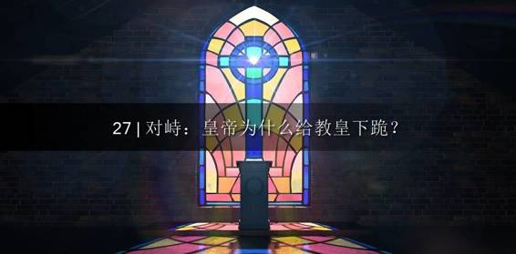

 

你好，欢迎来到《西方史纲 50 讲》。

上一讲我通过查理曼的故事，带你看了西方中世纪的基本结构是怎么稳定下来的，**这个基本结构就是，政权和教权二元并立，相互合作又相互斗争。这也是西方中世纪文明发展的一个主要脉络。**

在这个基本结构里，政权和教权相互扶持、相互帮助，教权为政权提供合法性的论述、提供高级人力资源、提供法律和基层管理，政权为教权提供政治保护、提供政治和经济资源，而且还在征服过程中承担了传教的任务。

然而，**政权和教权它们究竟是宗旨不同、功能不同、利益不同的组织，发展到一定阶段，各自成熟了，亲密无间的关系就走向了紧张和对峙。**

上一讲我们主要讲的是二者的合作，这一讲，我主要来讲二者的斗争。我会通过教皇革命的故事，来跟你解析西方中世纪政教斗争的基本逻辑。

## 教皇革命的原因

要说教皇革命，你先记住一个人，格里高利七世，教皇革命就是他发起的。格里高利七世这个人其实是教会下层出身，最后成功登顶，在成为教皇后就开始向世俗政权开战。

上一讲我们说过，通过给查理曼加冕，教权的地位已经大大提升了，教皇的地位已经超越了皇帝了。那么，你可能要问了，既然这样，那教皇为什么还要革命呢？

主要有两个原因：**一是教会觉得跟政权合作，自己吃亏了；二是教皇觉得，也就是刚才说的这个格里高利七世，他觉得对抗政权，自己能赢。**

## 教权和政权的叙任权之争

先来看看教会为什么觉得自己吃亏了。简单说，**正是教会内部主要是教会下层，认为教会和皇权的合作，教会的纯洁性受到了污染。**

通过给查理曼加冕，教会地位确实是提升了，但是查理曼其实是担了个虚名，惹了麻烦，他算是被利奥三世算计了，不过他和他的子子孙孙们都不傻，知道必须抓紧控制住主教和修道院院长，不能放松。

**于是，后来的教皇长期被意大利的王公贵族们控制，最后是神圣罗马帝国皇帝把教皇攥在了手里，罗马教廷几乎成了皇帝的私家教会。**这个神圣罗马帝国的前身是东法兰克王国。上一讲我们讲了，查理曼的加洛林帝国后来被孙子们一分为三，东边这个叫东法兰克王国，后来变成了神圣罗马帝国。

说回来，这个时候，虽然神圣罗马帝国皇帝把控了教会，但绝大多数人都没觉得有什么不妥，因为远的有君士坦丁，近的有查理曼，旁边还有拜占庭皇帝，都说自己从上帝那里直接得到了授权，教会就是自己手下的一个分支机构，教皇就是自己手下的一个部长嘛

但这个时候，教会的下层开始出现反对声音了。回想一下上一讲提过的查理曼的文治，很重要的一个方面就是抓住主教和修道院院长，来充实帝国的高级管理队伍，高级教士们都成了帝国的官员或者皇帝的诸侯。这对教会扩张权威和政治势力当然大有好处。

但教会里面，从下层出现了一股反对力量，这就是克吕尼运动。

克吕尼运动先是修道士们在修道院里追求纯洁的精神生活，后来扩散到整个社会。再后来，主教和修道院院长跟世俗政权合作，过上了王侯将相的生活，自然就会奢侈腐败，这些教会的上层就成了克吕尼运动批判的对象。

总之，克吕尼运动是来自教会下层要求纯洁教会的力量，他们觉得主教和修道院院长的世俗政治角色，让教会的纯洁性吃了大亏。

所以，主教和修道院院长的任命权成了教权和政权冲突的最前线，历史上把教权和政权之间这场大冲突叫做“叙任权之争”，叙任权就是任命权。也就是，任命权到底由谁来控制。

## 教皇的纵横捭阖

说明白了教会为什么觉得自己吃亏了，再来看看教会为什么觉得自己能赢。

教会下层的克吕尼运动出了不少能臣干将，其中最重要的是希尔德布兰德，他就是后来的格里高利七世。希尔德布兰德在教会当中的职位迅速跃升。

1059 年，也就是在和君士坦丁堡决裂 5 年之后，教皇选举法出台，规定教皇只能由红衣主教团选举产生。到这会儿，希尔德布兰德已经非常娴熟地主导教廷数十年，在和神圣罗马皇帝、诸侯、意大利各大家族的勾心斗角之中，成为俾斯麦一样的老狐狸，终于到了 1073 年，他登上教皇圣座，被称为格里高利七世。

**格里高利七世一上台，就对神圣罗马皇帝发难，拉开了教权和政权斗争的大幕。**他颁布的诰令《教皇如是说》有 27 条，条条都在强化自己的至尊地位，硬是要把皇帝压在他的宝座下面。

比如，只有他有权任命和废黜主教，只有他有权颁布法律来调整主教区的范围，只有他有权召集大公会议，他有权废黜皇帝，任何人不能撤销他的判决，他不受任何人审判，等等。

你看看，这简直就是给皇帝的战书啊！如果你是皇帝，接到这种战书，你会怎么办？当然是开战，神圣罗马皇帝亨利四世也是像你这么想的，他当即宣布废黜格里高利七世。格里高利七世立刻还以颜色，宣布废黜亨利四世。

**真精彩，教皇和皇帝相互废黜对方。要是你是皇帝，你会怎么办？**发兵罗马，生擒教皇，甚至杀了他，以儆效尤。对，亨利四世也是像你这么想的，而且他真的行动了。

而且最神奇的是，教皇最后赢了。那就要问问，教皇凭什么赢了。他手里没有兵，他不怕皇帝杀进罗马城吗？不怕，一点也不怕。

皇帝率领军队还没有翻过阿尔卑斯山进入意大利，就接到奏报，后院起火了。诸侯们说教皇已经宣布废黜皇帝了，所以他们就不再负有忠诚的义务，要起兵造反。皇帝就赶紧回去灭火了。

这其实是格里高利七世和诸侯们事先打好招呼的。神圣罗马帝国有几大公爵领地，这些诸侯中都没有加洛林王室后裔，他们谁做皇帝的资格都不比其他人差。格里高利七世充分利用了神圣罗马帝国的政治格局，所以皇帝的兵根本就到不了罗马。

结果，**皇帝本人服软了，故意破衣烂衫、光脚露臂地跑到教皇度假的卡诺莎城堡下跪求饶。历史上把这一幕叫做“卡诺莎之辱”。**奇耻大辱啊，不要说西方，在人类文明史上，被杀被灭的皇帝真不少，但下跪求饶的恐怕仅此一例。

**现在可以回答教皇凭什么了，凭的是他的两种权力，一种是正宗的教权，废黜皇帝、革除教籍、解除忠诚；另外一种是隐匿的政治权力，合纵连横，勾心斗角，纵横捭阖。**因为封建政治是高度分散的，因为教权对西方全覆盖，所以，即便手里没有兵，把两种权力结合起来，威力就能远远超过皇帝所拥有的硬实力。

高潮结束，但大戏并没有结束。教皇原谅了皇帝，皇帝回去收拾残局之后，贼心不死，又想发兵灭了教皇，教皇故技重施，又成功了。就这样，格里高利七世和亨利四世后来都驾崩了，他们的继任者们还在不停斗法。

**终于，双方在 1122 年签订了《沃尔姆斯协定》，说清楚各自拥有什么权力。**既然是协定，当然是各退一步，教皇的权力没有像《教皇如是说》里面规定的那么大，但比起被皇帝操控的局面强不少，基本上是一个天上、一个地下，各管各的。

协定不可能彻底化解教权和政权的斗争，它将旷日持久地发展下去，直到马丁·路德和约翰·加尔文发动宗教改革，彻底摧毁了罗马教皇的权威。

## 政教关系的三大走向

在协定这个关口，教权显然占了上风。**格里高利七世发动的教皇革命扫除了政权悄悄蚕食和收编教权的格局，教权自此巍然屹立。**

有三个重要的后市走向逐渐明朗起来了。

**第一个，政权再也吃不掉教权了，西方文明的二元结构从此之后，成为有政治保护的基本社会结构。**中世纪前 500 年教会变得很危险，就在于尽管他主导了信念、主导了社会、主导了文化，但在政治上始终没有自己成熟的建制。被世俗政权一保护、拉拢、收买，就很容易被吸收掉。

所以，我再次强调，没有政治的文明是保不住的。强大到主导了西方绝大多数方面的基督教，也必须有自己的政治建制来捍卫自己的独立。

经历了教皇革命，教会就迅速地变成一个权力金字塔，巍然屹立。西方的二元社会结构也就再也无法回到原来那种一元状态里面去了。

**第二个，教皇国成为现代国家的雏形和榜样。**为什么叫教皇国呢？因为围绕着教皇权力，教会迅速进化成一个权力金字塔。极高的文化水平、丰富的管理经验这些都不说了，**关键是教皇们着力把教会打造成一个教皇拥有最高立法权和最高司法权的权力体系。**

教皇颁布的法律，对整个西方世界有效，他是西方世界的最高立法者；同时，教会成为一个司法上诉体系，教皇是西方世界的首席大法官。

这样一来，西方人已经几百年没有见过的中央集权在教会率先实现。只不过它和我们熟悉的以行政为基干的中央集权不同，教会的中央集权是以立法和司法为基干展开的。

各国国王一看，这招厉害，我要是成为王国的最高立法者和首席大法官，比我是封建大领主的权力要大得多啊。**于是，国家间的制度建设竞赛由此展开。教会引领了西方中世纪的秩序建设，最终结果就是你熟悉的现代国家。**

**第三个，在西方基本状况没有大变化的情况下，世俗政权战胜教会的机会可以说是微乎其微。**还是前面那个权力的计算，教皇拥有正宗的教权来利用封建格局，诸侯们天然和皇帝、国王们不同心不同德，教皇基本上就是稳操胜券。连操纵过教皇废立的皇帝都下跪求饶了，他的子孙还有什么希望呢？

于是，情况反过来了，从前教会里面的有识之士担心教会被世俗政权收编，教皇革命之后，教会越来越强势，在英诺森三世的时候达到了顶峰。

这个时候，神圣罗马帝国和各王国都开始担心教会会不会把它们都收编了。这样的话，西方就真的成了政教合一，教皇兼任皇帝，千秋万载，一统江湖。那世俗政权还有扭转颓势的机会吗？

你在这一讲的条件下，想不出办法是正常的，但是你知道西方后来成了最先世俗化的，也是世俗化最彻底的文明，结果就是基督教和他的教会让出了对西方文明的主导权。

这是怎么发生的呢？关键人物是你熟悉的老朋友，亚里士多德。下一讲我跟你分享，亚里士多德又回来了。

期待你的到来，下一讲再见！

精选留言

点击直接进入下一章节

**王黎璐**:  
克吕尼革命产生背景为教权与皇权斗争，伯尔曼《法律与革命》一书称此次运动为教皇革命，原本弊端不断的教会在克吕尼修道院的修道士领导下发动宗教大改革，从封建主手中获得实权，并一跃成为整个西欧世界的最高宗主。  
格利哥里七世生前曾显赫一时，但最后却逃难死于异乡。他的遭遇既标志着罗马教皇权势虽开始走向顶峰，还没有足以强大到能战胜世俗君权的程度。但在开创克吕尼改革运动中，他是一个有作为的教皇。

**作者回复**:我已经在《每天听本书》里为大家准备了伯尔曼《法律与革命》的解读，很快上线。我特别喜欢这本书，看了很多遍，都翻烂了。

**强 Sean**:  
曹操是挟天子以令诸侯，格里高利七世则是借“诸侯”之力以令“天子”，真是精彩！这二者看起来都是老谋深算，但背后其实是对时局的深刻认识和洞察，以及无畏的勇气。

**作者回复**:大格局的人才能演出精彩的大戏。

**炭笔**:  
老师一直强调，没有政治的文明是保不住的。但格里高利七世之所以能完成教皇革命，不是他的政治力量有多强，而是对手的政治力量不够强。  
  
封建制度下的王权有天然的弱点，就是封臣做大，牵制君主。教皇利用封臣和皇帝离心离德的特点，对帝国加以离间，于是便打成了新的力量对比。  
  
那么可以想见，如果君主权力强化，那么王权应该会有胜算。后来的法国国王腓力四世击败教皇"亚维农之囚"的事件，应该就是王权强化的结果。

**作者回复**:阿维尼翁之囚是大拐点，会重点跟你分享。

**佛祖门徒**:  
今天的课里，老师虽然只是揭开了中世纪政教斗争的序幕，但即使事隔多年也能感受到那份惊心动魄。其中的权谋斗争、纵横捭阖等情节不亚于任何一部大片。透过这段历史可以看到格里高利七世的老谋深算、威廉四世从自以为是到委屈求全和最终以协议形式达成妥协，展开博弈的双方都是基于对至高权力的向往，结果却取决于哪方能够更好的发挥自己的优势，并联合更多的势力来达成目标。  
我认为后续双方斗与和的三大走向主要基于，一是知己知彼的客观认知，既然谁都无法彻底搞定对手，那就“井水不犯河水”吧。二是对立法与司法权重要性的认识，这应该是世俗政权从与教会斗争中学到的最重要的一点吧。

**作者回复**:司法、立法主导的政治建构，和中国传统的行政兼领司法、道德予以扶助的政治建构，确实逻辑相差很大。后面讲英国、法国的时候会进一步展开。

**郝景宇**:  
回顾上节课“两把剑”理论，教会掌握精神权力，但通过为皇帝加冕的方式，也狡猾的将世俗权力的最高统治权也抢了过来，皇帝成了受教皇委托的世俗权力占有者，成为了好比是大股东与 ceo 的关系。  
  
透过这些表象的背后，其实反映了其时封建制度的高度分散性，率土之滨，可不愿意老当王臣，但是又与我国春秋战国不同，如果按西方那样发展，大概率是教吞并政形成的政教合一的中央集权。  
  
但既然教会的中央集权是以立法和司法为基干展开的，那么我想如果政权要想夺回高地，就可以在法律上做文章。对异质文化的开放、包容、尊重和理解，实际上决定了一个文明本身的高度，有时候甚至决定了它的存亡，我想，对于当时的皇帝们来说，只有引进像亚里士多德这样的“他者”，才能与教权抗衡了吧。

**作者回复**:推理得很对，已经会用我课里教你的东西思考了！很高兴！教会强势，自然有并吞天下的野心，它被阻止了，明天我就跟你讲亚里士多德的第二春威力有多大。

**Tingo**:  
为什么教皇格里高利七世发动教皇革命？一方面，教会认为自己吃亏了，想挽回自己纯洁的一面。这具体怎么操作李老师已经简要说明了。其中我想最关键的因素是文中提到的教会认为他会赢！  
  
通过这次教皇革命，我有一点比较感慨。在剖析各方博弈过程时，我们不但应该分析各方硬实力，而且还应深入研究各方深层的软实力。

**作者回复**:你说得很对，我再挑明一点：权力的构成性因素很多，除了大家经常注意的武力和金钱之外，非常重要的是组织、策略和信念。

**火星叔叔**:  
这门课的留言我觉得很有启发，老师的精选与回复不是简单地回应，还有引导与悬疑，甚至剧透，好看

**作者回复**:谢谢哈，我继续努力！

**陈 C**:  
教皇通过加冕查理曼大帝，做高了自己的身份，但由于教会人员也大量参与行政，任免权在于国家，教会实际上是处于弱势的。而教会最早的反击，源于一种“自下而上”的需求，其背后是对宗教“纯洁性”的要求，是一种纯粹信仰层面的要求；基于此，格里高利七世在强化自身权威性、废黜对方、暗地里合纵连横的一顿“猛于虎”的操作后，终于让世俗政权服了软。西方世界的二元形态自此便定了型，同时形成了立法、司法为核心逻辑的，中央集权的教皇国体系。直到阿奎那引入了亚里士多德的哲学思想，世俗政权才看到了翻身的希望。  
  
这一讲的内容中，有两点给了我一些启发：  
1\. 政治秩序的构建，主要有行政逻辑与立法--司法逻辑两种，前者对具体的统治技术和人员素质有很高的要求，而且框架式的逻辑也不适合面对增长中的社会；而后者只是规定了什么能做、什么不能做，但在这种准则之下，具体的秩序实际上是更容易建成的。当然不是说行政的逻辑不重要，自上而下地设计行政体系，在确定了法律系统后，仍然是构建具体秩序的必要手段。  
2\. 教皇革命的源头是教会基层，基于纯洁性的基本诉求则是纯粹信仰的，他们试图解决的问题，是由政治的世俗利益造成的。然而看结果，教会仍然产生了围绕权力展开的政治结构，只是地位发生了改变而已。由此可以看到，一个国家或者一个组织的内部，经常会有若干种不同的思维逻辑，但最后胜出的，往往是那个基于世俗利益的“硬逻辑”。

**作者回复**:前面的总结有道理，最后的结论值得商榷。

**Mike yuan**:  
李老师您好，说到西方的中世纪，我的第一反应是封建骑士，尤其是著名的三大骑士团，过去我一直以为骑士团是教会的武装，请问李老师三大骑士团在西方历史上扮演什么角色，或者在世俗政权和教会之间扮演着什么角色，他们的兴起与灭亡都对西方历史发展产生什么影响？

**作者回复**:骑士团得到教会的支持，但并不都是，或者主要不是隶属于教会。以圣殿骑士团为例，他们是好几次十字军东征的主力，甚至收复了耶路撒冷。教皇的宗教目的和政治目的都通过他们实现，自然器重他们。他们也曾辉煌一时，骑士精神在他们身上体现得淋漓尽致，成为楷模。但总体而言，骑士团是一种过渡性的武装组织，集中体现了封建社会的武力高度分散。一旦集权的行动展开，他们肯定是国王最先干掉的对象。

**青云龙上**:  
基督教形成权力金字塔以后，掌权者是不是就被腐化堕落了呢？换句话说，是不是基督教的成功，导致了基督教失去了人心？

**作者回复**:你的推断很有道理，再伟大的信念和组织，面对权力，都是生死大考！后面我会跟你讲，教会具体是怎么样大考挂了。

**王·刚 数据化转型**:  
老师好：  
  
今天的课，“卡诺莎”之辱的故事我们大家都略知一二。今天是见到了全貌，这也是史纲的威力。我感慨的是，站在山巅看在历史的长河，没有一艘船是永远领先的赢家，有的只是滚滚向前的波涛。世界和宇宙在冥冥中是有一个意志的，比如现代物理学证明这个宇宙终要归于热寂。而人类的世界呢？这条长河要奔向何方？  
  
感慨完了，我总结下今天的心得如下：  
  
1，二元结构的不稳定性。  
  
教权和皇权的二元治理结构是不稳定的，动态的博弈始终处于一个囚徒困境。如果教权和皇权皆不妄动，则教权和皇权双赢。如果教权和皇权一方图谋不轨，而另一方老老实实，则必蒙受灭顶之灾。如果两方不断争斗，则世界平添多少苦难。而囚徒困境的博弈再一次上演了，几百年的争斗给百姓带来的苦难让人唏嘘不已。  
  
历史上典型的二元结构还有很多，比如皇权和相权：看看元朝被不断废掉的小皇帝，再看看明初被满门抄斩的宰相家。二元结构真的很可怕，要避之唯恐不及。这种游戏我是不会参与的。  
  
国共合作也是一次典型的二元结构矛盾，结局不用说了。过程更令人潸然泪下。  
  
不懂博弈的人，不可拜上将军。  
  
2- 二元结构的活力  
不过，凡事必有反面，进步必有代价。二元结构今天在课程里我也看到了它的好处。在二元结构的竞争里，如果处在一个相对稳定的环境中，会带来彼此的增长压力。  
  
比如教权的稳定金字塔政治结构虽然皇权是不会的，但是时间长了模仿也能模仿个八九不离十。进步就是这样一点点产生的。相反教权却无法模仿皇权的一些特点。落后者也有更大的追赶动力，这就是后发优势。  
  
历史上，二元博弈带来的好处的事例也有很多：美苏争霸在某种层面上，给世界带来了冷战也带来了科技的大发展。现在市场上，比比皆是的老大老二的二元斗争：可口可乐和百事可乐；摩拜单车和小黄车；肯德基和麦当劳等等。价格战是他们的囚徒困境，获得实惠的是老百姓。从这个意义上讲，囚徒困境的反面是法律的胜利✌。  
  
3- 教皇为什么能赢  
  
我一度很困惑，为什么没有兵的教皇能赢。今天我是想明白这个推演了。我想有内外两个要素：  
  
3.1 ~ 内部制度先进性，让其后院不会起火。所谓攘外必先安内，是说先胜后战的道理。这句话不是轻易做到的，而是中央集权制度和封建分权制度的对比跨时代的优势。教皇是凝聚成一团的，而皇权也就是个摆设实质上还是个领主头。  
  
3.2~ 外部博弈的智慧，让其不至于被武器批判：俗话说批判的武器代替不了武器的批判。教皇即是制度再先进，脖子也不是钢铁做的，也架不住大刀。教权胜利的第二个重大原因是，他利用皇权的封建制特点，创造了一个“三元结构”。在皇权之外扶植了一个制衡力量，天下就归于教权。这一招真是很精彩啊，明朝是这招的集大成者。皇帝，大臣，太监三者的博弈，就是这样合纵连横的周而复始，身在局中人有多少看不懂的。尤其是东林党的书呆子们。明末三大势力：李自成，满清和大明互相博弈。大明活生生的被这帮人搞成了破鼓万人捶。  
  
4— 二元结构为什么能形成双赢呢？  
  
我认为契约是实现博弈全局最优的最好策略。课程里讲了，经过数代博弈之后，教权和皇权签订了契约。这其实说明了，博弈需要实力，也需要妥协。契约是一种环境治理手段，人类社会的“自然法则”演化。  
  
老师，我想请教一个问题：契约需要契约精神，为什么西方有契约精神呢？而为什么他们愿意遵守一张纸呢？中国虽有盟约，但自签订就是为了销毁的，比如：宋辽盟约。  
  
老师，每天早晨喝一大杯温水哦，身体健康！

**作者回复**:你已经能“写长”了，能铺开，有话说，是好事。试试“写短”，用更精炼、更准确、更有力的语言表达自己的想法。

**周小了个楠**:  
没有政治的文明是不牢固的，格里高利七世通过各方势力的矛盾实现教权革命，将教会从皇权的附庸一举逆袭，成为一股独立强大的势力。并在西方领先于皇权首先实现中央集权，不过与中国通过行政中央集权不同，教会通过控制立法司法权实现中央集权。  
从这里也能看出现代中西方思维对法制态度不同的一部分根源，即中国的中央集权是人治，而西方中央集权是法治。

**作者回复**:讲英国《大宪章》的时候我会跟你进一步分享法治的内在逻辑。

**静雨荷香**:  
老师讲的惊心动魄，皇权与教权你死我活的斗争，最终教皇以自身的合法性与王权的削弱在纵横捭阖，合纵连横中取得了胜利。  
自此教权不用担心王权的收编，甚至王权开始担心教权的收编。  
基督教权利中心的金字塔，在现了中央集权制，以立法和司法的形式重塑了教皇的权威，为西方国家王权对国家秩序的建立树立了榜样。  
西方文明的二元结构基本确立，迥异于东方文明的一元结构。

**作者回复**:我最希望带给你的就是这种结构性的认识。

**奔跑的菠萝**:  
堡垒往往最容易从内部被攻破，格里高利七世首先通过已经渗透入政权体系的教徒建立起了一张力量布控网，不仅让基督教在政治上的庇护得以加深巩固，还在一定程度上占据了行政决策的主动权；其后，他充分利用了神圣罗马帝国封建体系的政治格局，现实了各方力量的权力制衡，就这样他不费一兵一卒确可让圣罗马皇帝跪地求饶，让教皇的权力一度超越了皇帝的权利。  
   
这段格里高利七世与圣罗马皇帝相互博弈的故事，充分的诠释了何为借力打力、以柔克刚。

**夏宝辉**:  
李老师好！  
在读中世纪教权与王权的交织纷斗中，我也在思考中西方政治制度、文明制度不同的原因：中国历来以中央集权为主，是先有统一，才有统治者为了统治而来寻找有用的思想或者信仰来推广，因此掌握思想者的还是统治者，思想者只是个工具而已，因此显得很弱，中央集权、思想被控，也是中国方面的主流；西方却是先有思想，因为思想者又是知识分子，进而慢慢渗透统治者，这使得思想者慢慢成了中流砥柱，再加之由于西方封建制等内部统治的勾斗，使得统治者的内忧外患很大，思想者这边稍微有点智谋，统治者就难受，因此也形成了政教二元体系，随着人的能力强弱各有不同！

**作者回复**:西方的多元性强于中国。

**吕可达 02015223344**:  
那些诸侯是一直存在吗？  
为什么诸侯会“帮助”教皇？那么多次都没有成功，难道他们甘愿当教皇的棋子吗？

**作者回复**:没有永远的朋友，也没有永远的敌人，只有……

**变迁**:  
今天的文章真是精彩，把政教之间的跌宕起伏的斗争逻辑讲得很清楚。  
那个时期的宗教取得胜利其实也是通过了长时间的积累，并不是某个人一蹴而就的，就像我们常常引以为豪的汉武大帝如果没有“文景之治”创造的的坚实基础是根本无力雄才大略的，并且得益于西方世俗政权没有真正统一的基础上的，这样一来宗教以大一统的意识形态进行其意志的传播，同时利用分裂的政权进行相互制衡，如此以来所谓的皇帝当然不是对手。  
同样的情况在当时的中国就不可能发生，归根到底就是因为经济、行政、军事和人事任免均由皇帝掌握，并且宗教没有西方那样长期持续的积累，最关键的是宗教没有对高级人才的制造和掌控的机会，所以无法对世俗政权进行渗透，从而无法形成实际的影响力并且很容易被打击甚至摧毁。但是有得必有失，西方的这种特色却使得各自的制度建设你追我赶越来越好，同时分裂的状态又促成了商业文明的发展，又进一步加强了交流从而进入了发展的快车道。  
我觉得不管中外，人才才是社会和国家的重要力量，比如中国的人才来自去世家大族那么就是门阀政治，皇帝就只能分权妥协，如果人才来自民间那么皇帝就能乾纲独断，天下大权唯一人操之。西方的教会是不是也是这样呢？世俗中的人才也同样有可能瓦解甚至颠覆教会。

**作者回复**:施展老师在《中国史纲》里把“皇帝依靠谁”这个问题讲了很多次，有很曲折的变迁。200 多个皇帝，不是每个都能做到秦始皇那样乾纲独断，其实大多数都不是，非不为也，是不能也。不过你思考的重点是对的，就是我想强调的：中国和西方存在着重大的结构性差异。

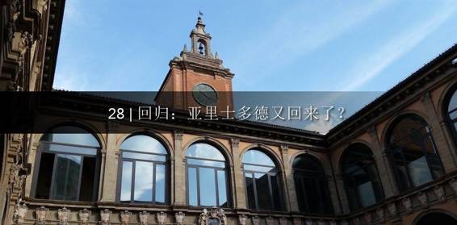

 

你好，欢迎来到《西方史纲 50 讲》。

上一讲我跟你分享了教皇革命，它的直接后果就是教皇击败了皇帝，取得了比皇帝更崇高的地位，而且，**教会作为一个金字塔式的政治建制，迅速建立起来，成为各国争相模仿的对象。**

这样一来，政权肯定吃不掉教权了，西方文明的二元结构稳定下来了。但天平向教权一边太过倾斜的话，二元结构也会崩溃，危险已经出现，在教皇英诺森三世的手里，教会权势达到了顶峰。世俗政权一个个俯首帖耳，教会会不会从此一统江湖？如果不会，希望在哪里？

中世纪会沿着教权越来越强大，最终吞并一切权力的路子走下去吗？

真没有。反抗性的因素比人们想象的来得还快。这个关键的因素就是亚里士多德重回西方。

这一讲，我跟你分享一下亚里士多德革命，正是这次革命扭转了教权和政权的力量对比。

亚里士多德革命，实际就是古希腊亚里士多德的学说经过 1000 多年，又重新回到了西方人的视野里。**亚里士多德之所以会重新回归，就是因为政权在跟教权的斗争中，落败了。而政权会输给教权，很大程度上是因为没文化。**

所以，这个时候，请出古希腊先哲就很有必要了。

## 政权和教权的力量对比

我们先对比下政权和教权的力量，你大概就知道为什么会有这场革命了。

回想一下上一讲的内容，教权有 Word，文化，政权有 Sword，武力，于是奇异的场景出现了，Sword 居然被 Word 打败了！

这里面有两个点需要你注意：**第一，从硬实力的范围来看，谋略本身就是一种超强的硬实力**。

格里高利七世和后任教皇在这个方面，绝对不输给皇帝们。利用封建格局牵制皇帝，那可不是会背经书就能做到的。所以，说教皇手中纯粹只有 Word 不妥，他们手里也有 Sword，就是强大的谋略带来的硬实力。

**第二，Word 确实是一种实力，它能够塑造世界，它就是权力。**想想教权当中的利器，废黜皇帝、革除教籍、解除忠诚，如果你不是基督徒，这些权力对你都不起作用，可如果你是，它们就是让你比死还难受的权力。皇帝心里大可以大逆不道地默念我就不信，可问题是诸侯和臣民都信啊。

基督教花了几百年改造了西方的灵魂，当教皇能够把这种力量运用到政治斗争的时候，它当然是威力无穷的。所以，在这个盘面之下，政权是斗不过教权的。

那从这个盘面当中，政权能够反思一下自己的优势和弱点在哪里吗？有办法弥补弱点吗？优势很直接，就是有兵，但没大用。而且我在上一讲已经跟你提过了，在立法和司法体系的建设问题上，世俗政权也落后于教会。

政权一方的弱点很明显，就是没文化嘛。没文化这个事情怎么说？从硬实力上来看，政治制度要建立、政治管理要有效，必须有文化，最基本的一个要求是官员总得识字吧？

更重要的是灵魂深处的问题。如果教皇说我比你皇帝离上帝更近，他老人家授权给你当皇帝或者取消授权都是经过我，你有办法反驳吗？那你当不当得上，当上了什么时候下来，不都是他说了算吗？合法性来源很重要。这时候你就能深切地体会到一个硬邦邦的真理：没文化真可怕。

这样问题就清楚了，政权输给教权是因为没文化，没文化就赶紧补呗。可问题又来了，文化都掌握在教会手里呢，教士们才识文断字，教士们才会讲那些让你生气的道理，可你呢？不识字，没道理可讲，除了生气，就只能生气。

**这时候你就能明白亚里士多德重回西方的重大意义了，它首先打破了基督教对文化的垄断。**之后的事情你就明白了，世俗政权一定会拼命利用新知识、新思路、新文化，而教权对政权的优势也就逐渐丧失了，一旦软件跟上，软硬件匹配，政权就真的有实力和教权全面对抗了。

所以，从文明的兴衰沉浮来看，“知识就是力量”绝对不是一句戏言，绝对不是有知识的人拿来骗人的鬼话。知识能不能改变你的命运我不知道，但知识经常改变一个文明的命运。

## 亚里士多德如何重回西方

好，说清楚了为什么非要把亚里士多德请回来。我再带你看看亚里士多德是怎么回来的。

先回想一下前面讲过的内容，中世纪前 500 年政治混乱、经济萧条、文化湮灭，西方人都不认识亚里士多德了。不过我也跟你讲过，公元 1000 年左右，西方在政治、经济、文化上触底反弹了，外来的侵袭逐渐停止，秩序逐步建立，经济逐渐恢复，文化自然也就逐渐复兴，在查理曼的加洛林帝国很明显有了这些企稳向好的迹象。

如果说西方中世纪在政治上摆脱前 500 年的颓势，触底反弹的标志是教皇革命，那么，中世纪在文化上触底反弹的标志，就是亚里士多德革命。

所谓亚里士多德革命并不是政治革命，而是知识和文化的革命，西方又重新认识亚里士多德了。亚里士多德革命的过程很曲折、很复杂，我给你讲三个要点：**第一，它的主要工作是翻译;第二，它的结果是全面而深刻的;第三，它有自己的组织。**

**先看翻译。**西方自己不知道亚里士多德了，著作找不到了，突破口是从西班牙打开的，因为那里长期被穆斯林占据，而穆斯林是研究亚里士多德的，他们不仅有著作，而且有很伟大的研究者。于是，西方人先是把亚里士多德著作从阿拉伯文译成拉丁文，到一定程度才觉得阿拉伯本子不完全可靠，才去找希腊文原著来翻译。

这个翻译运动持续了近 200 年。到了 13 世纪，亚里士多德几乎所有著作的拉丁文译本都有了。**从翻译这个事情来看，西方文明的演变，很大程度上受惠于伊斯兰文明，在公元 800 年之后的几百年当中，西方人还在为触底反弹苦苦挣扎，伊斯兰却拥有全世界几乎最灿烂的文明。**

所以，一个文明有多辉煌都别太自鸣得意，因为文明之间的竞赛不是百米冲刺，而是漫长的马拉松，谁领先一段都是有可能的。

**再来看看结果。**西方人重新读亚里士多德的书，几乎是见到了一个新世界，哲学、逻辑学、天文学、物理学、动物学、植物学等等，亚里士多德著作可是百科全书啊。而且这么全面、这么深刻的学问居然和奥古斯丁的训导讲的不一样。

于是，你会发现，亚里士多德革命之所以叫革命，是因为它意味着一个完整的世界对基督教世界全面的冲击，而且来势汹汹，排山倒海。不一定是毁三观吧，但受刺激是肯定的。

而且，受刺激的不是普通人，全部是文化精英，高级人力资源首先被深深地卷入了两个世界的对决当中。**这就是西方中世纪的第二次文艺复兴，历史上叫做 12 世纪文艺复兴。**

它是由亚里士多德回归引导的文化复兴，在亚里士多德和其他古希腊大师的引领下，几乎所有学问都迅速饱满起来。**正是第二次文艺复兴，为光辉灿烂的意大利文艺复兴打好了基础。**

其实这两个文艺复兴离得很近很近，几乎没有间断，12 世纪文艺复兴大神，神学家阿奎那是在 1265 年去世的，就在同一年，意大利文艺复兴大神但丁出生了。他们的故事我以后会跟你仔细聊。

## 亚里士多德革命的政治后果

**亚里士多德革命的政治后果很严重：基督教信仰和神学受到了全面的冲击和挑战。**所以教会的反应是禁绝亚里士多德，不许再念了。没想到吧，作为西方文明标志性人物的亚里士多德，居然被自己的后人禁了！

还有组织，关键是组织。我跟你谈教会崛起的时候再三强调，没有好组织，再好的说法也留不下来，就更别提成就什么大业了。那亚里士多德的组织是什么？总不能是他老人家复活创立了一个学派吧。其实这种组织你再熟悉不过了，就是大学。

**大学这种组织西方人发明的，就是在中世纪发明的，就是皇帝为了改变文化劣势故意扶助的。**作为文明之光的大学，其实也离不开政治。我来跟你说说怎么回事。

**第一所大学是博洛尼亚大学，它的强项是法学。**它的起源是，罗马法学家伊尔内留斯在博洛尼亚这个交通要道上卖学为生，就是收费讲学，聚集了大批的顾客。交易就越来越活跃。

皇帝一看，好啊，你们讲的这一套对我摆脱教皇控制非常有帮助，于是在 1154 年给博洛尼亚大学颁发了特许状，承认大学是一个法人，拥有各种权利，而且是特权。比如它有自己的章程、有自己的地盘、有买卖地产和其它物资的权利、其中的教授和学生受到特殊的人身保护，等等。

皇帝开始行动了，教会有什么反应。**教会当然不会坐等大学变成反抗自己的堡垒，所以很快就插手控制了大学。大概西方最早的大学都被教会一网打尽，比如巴黎大学、剑桥大学、牛津大学。**

**那大学后来怎么还会成为捍卫和发展亚里士多德学问的组织呢？**理由很简单，真理的魅力是挡不住的。

**这里面可以把当时的文化精英分成两派，一派是支持亚里士多德的教授和学生们**，他们确实觉得亚里士多德讲的真对，教会禁了我们就悄悄躲着看。但作为基督徒，他们仍然很焦虑，于是他们给自己制定的任务就是跟教会讲清楚，其实亚里士多德学说跟基督教信仰不矛盾。你看，神学是追求一致性的科学，这次更艰巨的任务来了，这些文化人想用神学兼容亚里士多德的学说。

**那另外一派当然是支持教会禁绝亚里士多德的**，就认为亚里士多德的学问都是异端邪说，不过，你要禁绝亚里士多德，也得跟人讲道理啊，因为你是秀才不是兵啊。怎么办，当然要了解自己的敌人，于是他们也深入研究亚里士多德。就这样，无论赞成还是反对，大学里全都在研究亚里士多德，力量越来越大。

堵，看来是堵不住了。怎么办？赶紧把亚里士多德收编啊！这个工作相当于把希腊文明和基督教文明融为一体，这怎么可能？

事实证明是可能的，当时著名的神学家阿奎那就完成了这个工作。他怎么弄的，产生了什么后果，我下一讲跟你谈，通过他的故事，我来跟你讲中世纪神学和文化的顶峰，以及教权和政权力量对比的彻底扭转。

本讲小结

好，总结一下这一讲的内容：政权长期斗不过教权是因为没文化，亚里士多德重回西方打破了教会对文化的垄断，这也意味着教权和政权力量对比发生根本变化的可能性出现了。

基督教怎么在无法压制的情况下，主动选择收编亚里士多德，神学家阿奎那又是怎么完成这个不可能的任务的，完成之后带来了什么样的重大后果？这些问题我会在下一讲跟你分享。

期待你的到来，下一讲再见！

精选留言

点击直接进入下一章节

**陈 C**:  
李老师在《名家大课》曾经解读过《阿奎那政治著作选》，其中就涉及了阿奎那代表的神学一派，对亚里士多德理论的收编。但天然不相容的教父神学体系与亚氏哲学，凭什么就突然融合了？之前到底发生了什么？这一讲就是关于这个的。  
  
亚氏哲学得以回归西方，在外由于伊斯兰文明对其著作的翻译，在内则是人性中好奇与爱智慧的一面。这样有了物质条件，也有了精神的吸引力，亚里士多德的理论便回到了西方。这一回来不要紧，亚里士多德广泛涉猎各个学科的知识体系，等于是一下子打开了长期处于教父神学体系下的西方人的视野。  
  
这一趋势被长期处于文化弱势的皇帝所利用，便产生了大学，以便有组织地产生文化上的抗衡力。《科学思维课》的卓克老师，在前段时间的得到直播中曾经介绍过，以大学为中心，围绕着教权、皇权的矛盾，西方展开了一系列的矛盾与冲突，简直就是“打成了一锅粥”。看起来大学的成立是为了钻研学问，但背后却是文化的，乃至政治上的针锋相对。大学在这之中，成了名副其实的“战场”。  
  
这之后就有了阿奎那对亚氏理论的收编。一方面了解了对手，才能更好地击败他。另一方面，阿奎那对亚氏哲学的收编，是基于“恩典成全自然”这一思想，亚氏哲学被完整的收纳进了神学二元论世界中，“此岸”的一侧；因而在神学家的眼中，亚里士多德充实了“此岸”的世界，但最重要的仍然是“彼岸”的上帝，等于是借助对亚氏哲学的承认，反而做高了自己的身份。这与之前教皇加冕查理曼来抬高自己，竟有异曲同工之妙。

**作者回复**:高级了，已经用我在那门课讲的来评这门课了，谢谢哈！

**佛祖门徒**:  
面对亚里士多德的回归，尤其是由此带来的政权对抗教权实力的提升，恐怕会让教廷感慨“世俗政权不可怕，就怕他们变得有文化”。  
亚里士多德革命的意义在于，一方面，亚里士多德无所不包的文化内容为王权带来了最稀缺也是最有价值的文化，从而大大提升了其对抗教权的实力；另一方面，更重要的意义在于让世俗政权看到自身与教权实力差距的根本原因，并给予其实现与教权势均力敌的希望。所以，大力扶持能够源源不断为王权提供思想武器保障的大学便成为了国王们积极作为的事业。

**作者回复**:学会看政治，学会用政治的眼光看表面上不那么政治的事情，是我希望教给你们的。

**爱道**:  
听完施展老师的中国史纲，来的这里，讲的太精彩了，感谢李老师的西方史纲，散落珍珠的穿线人，而且串起来的是最熠熠生辉的珍珠。

**作者回复**:谢谢你的肯定，你们的肯定是我讲好课最大的动力！

**郝景宇**:  
哈耶克曾说：长远而言，是观念，因而也是传播观念的人主宰着历史发展进程。这句话用在今天的内容上非常契合。中世纪生活在欧陆这片土地上的人已经和古希腊血统没有丝毫关系了，但是无论是柏拉图还是亚里士多德都回归了，可见其思想的力量。  
今天讲到大学的形成，开始是一个自下而上的过程，然后又被政权和教权纷纷收编，但仍然赋予了很大的特权，这和我国汉代以后绵延两千年的官学体系有很大的不同，而且这个差异至今还能感受到...  
  
我发现老师您在讲的时候关于亚里士多德与之前基督教神学的具体分歧并没有讲，而且我们知道以往的神学是吸收了柏拉图的思想而形成的，但是柏拉图又和亚里士多德在政治等方面的观点有不少分歧，最后阿奎那还是做成了，而且其思想至今还影响着基督教世界，但我真的有点担心即使听了也理解不大了了😂😂😂 从这个角度看神学真的是一个“比海深”啊，就差收编古罗马文明了。

**作者回复**:明天跟你讲亚里士多德和奥古斯丁的分歧，以及阿奎那的调和。《刘苏里·名家大课》里面我把阿奎那讲得比较仔细。

**A learner**:  
小时候上历史课，一个感觉就是亚里士多德说的话没几句是对的。到了大一点，知道了一切学说都是先哲们认识世界的一个模型而已。而这些模型都是不断地通过对抗融合的方式实现升级。  
  
这两讲的文化交锋真可谓精彩绝伦。奥古斯丁用神学赋予了基督教解释世界的体系，此时的世俗政权无体系可言，所以教皇革命就是高维打低维，呈现出碾压式效果。然而亚里士多德的学说体系为世俗政权带来了力量，它能在教会主导的社会中茁壮成长正好说明了其认知模型的可靠性。  
  
武力上的博弈非死即伤，你存我亡。而知识的较量则是相互学习，相互发展。即使存在对抗，那也成为了发现自身漏洞进而不断完善的契机。

**作者回复**:文武各有自己的逻辑，不过文明是一个综合体，各有逻辑的要素相互牵扯，演化就异常精彩。我总是觉得，编得再好的戏也不如历史本身精彩。

**子曰诗云**:  
大家都在分析教会崛起原因，比如制度体系。我试想从人才的角度分析。为什么教会比世俗有文化？关键是人的因素，教会的人受教育程度高。那为什么教士有经济条件？我猜测了一个原因:欧洲贵族为保持爵位，领土和财产传承稳定性，实行了长子继承制。次子们在老爹去世后往往分不到财产，所以聪明有抱负的这部分人会走教会的渠道去找安身立命所在。也有贵族为教会大量捐款资助教会培养人才，通过开办大学以免费学习包吃住的形努吸收更多贫困有志孩子脱离贫民阶层。这样上下都吸收了精英，教会得以充实了人才库。

**作者回复**:你说的有道理。很多大贵族都安排弟弟去当修士。最后很容易变成公爵和主教是亲兄弟，一起把家业做大。

**蝉**:  
听完您的分析，增添了看待文明的新视角——文化与武力。  
  
可是，我想请问您:您可以单独讲讲经济要素对于西方从中世纪转型的作用吗?  
  
另外您看待历史的三个维度是属于哪一种史观呢？还是糅合了不同的史观?

**作者回复**:我对经济的看法前面说过：资源是文明的营养。

**王黎璐**:  
面对教权的扩张，王权也就必须找到自己的护身法宝，老师在专著中讲授其法宝主要有两个。其一是基督教传统内部提供的 “格拉修斯原则”，即教权和王权是二元的，精神权力和世俗权力是平行存在的，虽然教皇地位更为优越，但并不能因此取消这二元划分。其二则是由基督教传统之外的“十二世纪文艺复兴”提供的。十二世纪文艺复兴直接促成了大学的兴起、罗马法复兴和亚里士多德革命。特别是亚里士多德革命提供了一套全新的、不同于基督教神学政治的自然主义政治观，在这一新政治观影响下，出现了一大批用“人民论”来为王权辩护的思想家，如巴黎的约翰、但丁、帕多瓦的马西利乌斯等，他们认为人民是王权合法性的重要来源，从而与教皇和教权派的上源理论构成分庭抗礼之势。

**作者回复**:我的专著都挖出来看了，谢谢哈！

**冯雪磊**:  
刚好这几天在听隔壁刘苏里老师讲《阿奎那政治著作选》和傅佩荣的西方哲学课中讲到阿奎纳，对照着听，发现对于两边的课程都更容易理解了，而且在刘苏里老师的课程里还发现了李筠老师的好多留言。

**作者回复**:谢谢关注！

**nevermore**:  
这一讲让我印象最深的是教会对待亚里士多德学说的两种态度：一是用神学的一致性兼容之，二是基于神学的逻辑反对之，而欲反对必先研究之。结果是，亚里士多德学说所拥有的科学立场，让它天然具有吸引力，魅力，生命力，经得住质疑和考验，越是攻击它，它反而在辩论中反对中野蛮生长。可以说正是教会和神学，催生了科学在欧洲的蓬勃发展，也许这就是当时中国的帝国虽然萌发了科技的萌芽，科技之果却结在了欧洲的原因之一吧。

**作者回复**:相反相成，历史总是会上演这样的大戏。这也很好地提醒了我们文明内部的多样性和对外的开放性非常重要。

**有点甜**:  
在教会力量如日中天的时候，『亚里士多德革命』是一把星星之火，基本上改变了政治的"游戏规则"。  
如此一来，就相当于中世纪的文化基座被撬动、松动了，客观上，这为『新』、为『变』提供了迸发的可能。

**作者回复**:文化基座这个词用得很好！观念是很强大的力量，但它的变迁非常难捕捉，当然，捕捉这种变迁也格外有意思。你如果有兴趣，推荐你去读以赛亚·伯林的作品。

**强 Sean**:  
看纪录片《大国崛起》就有很强烈的感觉：看着公元 1500 年前后开始，几个世界性大国在世界舞台上轮番上演精彩大戏，无论曾经拥有多么灿烂的文明，都不应该自鸣得意。  
  
时间一直在流动，王侯将相、英雄人物都会“俱往矣”，外部条件也会变化，辉煌和绚烂也就随之散去。  
  
但散去并不等于消失，很多经过岁月洗礼而沉淀下来的「共识和故事」，很可能会成为后人的精神资源和思想武器。从大的方面来看，亚里士多德的思想成为教权的强大思想武器，摩西的出埃及记成为犹太复国主义的强大精神资源；从小的方面来看，个人曾经的成功经验和体验，也会成为日后逆境中的宝贵精神资源。

**作者回复**:大国崛起第四单元跟你聊。

**化**:  
一直想了解中世纪的历史，老师讲得太精彩，引人入胜，停不下来！

**作者回复**:谢谢你的肯定，不停不停，每天都更新！

**变迁**:  
看来任何世纪最重要的都是人才，如果说“给我一个支点，我就可以翘起整个地球”，那么撬动教会权威的“杠杆”是人才，而“支点”就是一个理论学说。  
事实证明真正的精英就算处心积虑也是不能完全笼络住的，因为求知和探索是他们的天性，一个有吸引力的观点和思潮就能对他们产生深刻的影响，也能让他们发生变化。当一种思潮汹涌而来时靠堵是没有作用的，而此刻的利益集团就应当理智的放弃或让渡利益或者打造、扶持新的制衡局面，使自己尽量立于不败之地。  
实际上那些有所成就的政治家很多都是这样操作的，但是一个政治格局开始总是比较能符合各方势力的利益，可是时间一久就总有一些集团做强从而打破均衡的局面，所以作为统治者要随时保持警醒和冷静，不断地改革和调整政治制度，努力地实现平衡。  
事后看教会一言九鼎、繁华似锦了那么久，在这个过程中对世俗政权其实是采取强力压制的手段，关键是双方差距的原因大家都知道，一方完全是在忍辱负重的卧薪尝胆，所以爆发革命是迟早的事情。  
不过话又说回来，道理谁都懂，可是，在巨大的权力诱惑下谁又放得下呢？

**作者回复**:所以我们才要练，通过观察历史来练，还是通过别的方式来练，练就更大的眼界和格局，才会有从身边谜团突围的可能。

**思而行**:  
亚里士多德的思想有没有影响到伊斯兰世界?

**作者回复**:有，很大，课里讲了，一开始翻译亚里士多德著作用的就是阿拉伯文底本，那就是伊斯兰文明对亚里士多德著作的保存和研究。伊斯兰世界出了很多研究亚里士多德的大哲学家，他们在亚里士多德回西方的过程中也影响了西方。比如阿威罗伊。

**一生何求**:  
学了李老师的课，感觉看待历史看待现实的方法都不一样了，感觉眼前亮了很多。我是不是变得比我身边的人都聪明了。

**作者回复**:对你有启发就是对我最大的褒奖！

**炭笔**:  
这一讲似乎也间接解答了我的一个疑问:亚里士多德的学说，为何到了 2000 年后的伽利略时期，还有这么多错误被人默认？  
  
我猜可能有这些:  
1 长期以来，他的学说被人遗忘了。  
2 他的学说之所以复兴，就是被王权当做武器加以利用的结果。既然和权力绑定，那么必然成为经典，不能改动和随意解释。  
  
不知这种猜想对不对。

**作者回复**:道理差得不远，具体的联系不确切。亚里士多德取得学术权威的地位，在中世纪主要是归功于阿奎那。下一讲会告诉你，阿奎那立了大功之后成为教会的官方学说。亚里士多德也因此成为官方首席哲学家。中世纪后期的文章里只要是首字母大写的哲学家（Philosopher），就是指亚里士多德，权威地位可想而知。

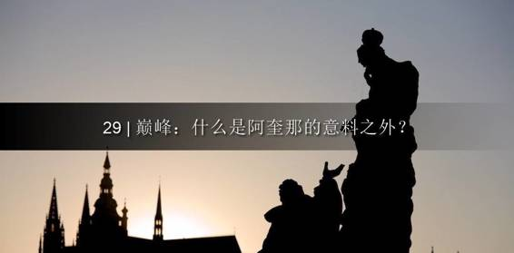

 

你好，欢迎来到《西方史纲 50 讲》。

上一讲我跟你分享了亚里士多德革命，亚里士多德的学问是打破教权垄断知识文化的核心力量。

亚里士多德的回归冲击到了教权的最强项，对知识和文化的主导和垄断，它意味着教权与政权的斗争升级了，从看得见的战场和宫廷，进入到人的心灵和头脑。你猜，亚里士多德和神学谁会赢？

这一讲，我就带你看看当时著名的神学家阿奎那是怎么样处理这个难题的。可以说，阿奎那完成了一个不可能的任务，用神学“收编”了亚里士多德的学说。这对教权来说是一次伟大的胜利，这次胜利也让教权的实力达到巅峰。

但是，你可能也会想问了，既然教会取得了胜利，那么按说教权应该绝对压制住政权了啊。**那后来的欧洲国家怎么又变成世俗现代国家了？这其实就是阿奎那的胜利带来的一个意想不到的结果。**

这一讲我就会来给你讲清楚这些问题。

## 神学和亚里士多德的巨大差异

**摆在阿奎那面前的难题是人类历史上顶级的智力难题，他的任务是把两个异质的文化体系整合成一个兼容的体系。**在中国传统中，恐怕只有宋明理学用儒学的基干应对、吸收、消化、融合佛教的冲击，能和阿奎纳的研究相提并论。

这项工作不是劝架就行，关键是怎么打通，对，**阿奎那办成了兼容古希腊和基督教这个事儿，就是给西方文明打通了任督二脉，中世纪也就走到了巅峰。**

我先带你看看亚里士多德和代表神学的奥古斯丁怎么个聊不到一块儿去，至少体现在四大方面：

**第一，宗教观。**古希腊的宗教是多神教，同时宗教在社会中不是最重要的；奥古斯丁相反，基督教是一神教，而且在社会中最重要。

**第二，世界观。**亚里士多德的世界是周而复始的；奥古斯丁把世界切成两半，光辉的彼岸和堕落的此岸，而且从上帝创世到末日审判的过程是不可逆的，没有什么循环。

**第三，人性观。**奥古斯丁认定人性就是原罪，自私、渺小、脆弱、背叛；亚里士多德对人性比较乐观，认为人不仅有善根，而且追求善业是人的本性。

**第四，政治观。**亚里士多德认为政治是最高且永恒的善业，城邦是植根于人性的最高共同体，城邦里面没有政权和教权之分；奥古斯丁认为政治只是这个堕落的此岸里面的事情，很短暂，会消亡，国家只不过是上帝管理堕落此岸的临时办法，教会永存，末日审判之后就没有政权了，教会则会变成最纯洁的教会在天堂继续存在。

他们两个在最根本的问题上完全针锋相对，代表着两个不同的世界，你说，如果你是阿奎那，你怎么把他们聊成一回事儿？

## 阿奎那破解难题的办法

阿奎那成功破解了这个顶级难题，他的格言是：恩典并不毁弃自然，而是成全它。

这里说的“自然”，其实就是基于自然成长出来的国家。这话好像在哪里听过。其实，这和耶稣处理基督教和犹太教律法的办法是一个套路，耶稣的格言是：爱并不毁弃律法，而是成全它。

神学比海深啊，我就不和你细说阿奎那的论证了，他写的书要是摆在你面前，能铺满一面墙，你只有一种感觉：这辈子都读不完。我直接告诉你结论，还是“四观”，宗教观、世界观、人性观和政治观。

先来看看宗教观，阿奎那是怎么理顺的。首先，基督教对一神教和上帝统摄一切这一点，当然是绝不动摇的，不过，亚里士多德可以低于上帝、合理合法地存在。

亚里士多德通过理性揭示的真理是上帝真理的一部分，发现自然，发现万事万物的本性，虽然亚里士多德没有《圣经》的启示揭示的真理高级，但也是真理。人通过《圣经》的启示认识到上帝的恩典是最重要的，但上帝的恩典和上帝自己制造的万事万物的本性，并不是敌对关系，而是使它们变得完善，完美，这就成全了。

一句话，恩典和自然，阿奎那把它们从同一层次的敌对关系，变成了上下层次的和谐共处关系，使得基督教传统和希腊传统融为一体。

**第二个“观”是世界观。有**了宗教观的和解，世界观的和解也就好办了。**此岸和彼岸的二元划分不能动摇，世界从创世走向末日的进程不可逆转。但在阿奎那的框架下，此岸的地位被抬高了。**亚里士多德发现的万物循环往复地实现自己的本性，就是此岸的真理，此岸尽管不如彼岸，但它也是上帝的安排，被亚里士多德讲的那么多知识填充得满满的，此岸看起来还是有价值的。

阿奎那这种世界观充分说明，西方终于在经历了数百年低潮之后重新有了文化自信。奥古斯丁所描绘的世界是暗黑色调的，他对此岸世界的疏远、鄙视、轻视、蔑视被一扫而光。

阿奎那引入亚里士多德，告诉基督徒，此岸其实也是广阔天地大有作为，色调一下子变得鲜亮了，因为有了自信，朝气就蓬勃了。基督徒是这样，西方文明也是这样。所以我为什么老是跟你强调，说中世纪是一片黑暗纯属胡说八道，人家自己已经从内心最深处改变了世界的基本色调。

**第三个“观”是人性观。**通过上一点你就可以合理地推断，**基督教说的原罪不能改，但人在此岸的生活，世俗的生活，必须变得更积极有为，因为亚里士多德讲的人性有善根、要追求善良事业，也是人的一部分了。**

第四个“观”，政治观。政治也变得不再那么灰暗和被动，不只是维持，变成了一种善的事业，像亚里士多德所说，人必须在政治共同体当中实现自我。

关于阿奎那学说更细致的解读，你可以去《刘苏里·名家大课》里，找我专门讲《阿奎那政治著作选》的那个单元来听听。这里我要把阿奎那的学问，放在对西方文明的意义和走向的影响中来讲。

阿奎那神学对西方文明的再造就是以基督教为主干，去嫁接古希腊罗马文化，从文明的核心解决三大传统的兼容性。

但这个里面要注意：基督教尽管不再那么高冷，但依旧处于强势地位；古希腊罗马虽然复活，但不再完全是原来的面貌。这实际上就是西方文明的文化底色，尽管后来世俗化的潮流大大冲淡了基督教的味道，但底色是抹不去的。

## 阿奎那学说的影响

下面我带你看看阿奎那学说出现之后在西方中世纪产生的影响，分成两边：一边是教权，一边是政权。

教会显然高兴坏了，阿奎那收编了亚里士多德啊！教会给阿奎那的赏赐就很说明问题：教会在阿奎那去世后不久就追封他为圣徒，赐名号“天使博士”。

沿着教权和政权斗争的思路想一想，连亚里士多德都被教会收编了，教权压制住政权的知识和文化优势不是更强大了吗？不仅如此，亚里士多德学说甚至被很多神学家进一步改造成压制政权的理论武器。

比如有神学家利用亚里士多德的目的论，说小目的服从大目的，教会的目的显然比世俗政权更高大上，那政权当然就要服从教会。在支持教权的人心里，阿奎那学说是消化了亚里士多德学说的基督教神学。**正因为教权一方既占据了政治优势，又通过阿奎那进一步强化了文化优势，教权在 13 世纪下半叶确实登上了巅峰。**

**但就像历史学家普遍认识到的那样，教会过高地估计了阿奎那带来的胜利。**一种学说，一本著作，越是深刻，越是博大，就越容易解读出不同的东西，哪怕有些东西跟原作者的意图相差十万八千里，甚至针锋相对，都是有可能的。尤其在有人故意这么干的时候，意想不到的结果就会出现。

不错，故意这么干的就是王权派理论家们。**这帮别有用心的家伙充分利用了阿奎那学说，一方面强化世俗政权的地位，一方面虚弱和抽空教会的权力。**其中最著名的有这么几位：巴黎的约翰、但丁和马西利乌斯。没错，就是写《神曲》的但丁，就是作为意大利文艺复兴旗手的但丁。

## 王权派理论家的乾坤大挪移

他们到底怎么干的呢？**他们把阿奎那学说倒过来讲。教会不是因为阿奎那就承认亚里士多德合法了吗，我们就用阿奎那的旗帜来讲亚里士多德的故事。**

**故事的基本要点有三条：第一条，国家和教会是两回事，各不相干。**亚里士多德说国家是基于人的本性，人是天生的政治动物，通过国家实现自我。教会呢，是上帝设立的帮助人们灵魂得救的团体。国家基于自然，教会基于神意，起源不同、功能不同、逻辑不同。

**第二条，国家是政治共同体，有强制力，教会是精神共同体，没有强制力。**只有基于自然建立起来的政治共同体手里才有 Sword，有武力，教会是精神共同体，只有 Word，有文化。他们要在理论上根除教会的强制力，把教皇用来对付皇帝和国王们的废黜职权、革除教籍、解除忠诚这些利器全部打掉。

**第三条，教会在世俗政治中必须服从国家。**因为国家在世俗事务中有强制力，这种强制力对教会也有效。

你看看，整个一个乾坤大挪移啊，硬是要把教权摁到政权下面。自但丁以后，西方的政治理论家们越说越起劲，马基雅维利、博丹、霍布斯这些顶级政治理论家都在抬高国家、打击教会。

这不是阿奎那想要的，但这却是他学说的合理延伸，他绝不会想去摧毁教会的权威，但确实是他把洪水猛兽一样的亚里士多德变得合理合法了。

这股潮流越来越汹涌，最终摧毁了中世纪教权和政权的二元结构，国家崛起，国家独大，二元有变成一元的危险了。

本讲小结

好，总结一下这一讲的内容：亚里士多德重回西方，阿奎那圆满完成了用基督教神学吸收亚里士多德学说的任务。

教会自认为大获全胜，似乎登上了巅峰，却不曾想到王权派理论家们打着红旗反红旗，利用阿奎那学说讲亚里士多德的故事，在理论上对教权展开凶狠和致命的打击。

教会的核心竞争力大打折扣，不过别忘了，教会懂政治、会玩政治、会勾心斗角、会纵横捭阖，下一讲我来告诉你，教会是怎么把这些实力都完全输掉的。

期待你的到来，下一讲再见！

精选留言

点击直接进入下一章节

**Allelujah**:  
与其说阿奎那是把两个异质的文化体系整合成了一个兼容的体系，不如说他是想要把亚里士多德的理论用神学思想包裹住——这一点在他坚持神学中的关键认识（例如上帝统摄一切、此岸和彼岸的二元划分），并由此修建亚里士多德的观点就可以看出。  
  
教权看似由此彻底压制了世俗政权，但这样一来，有一条猛兽也因此出笼了——教会等同于自己承认了亚里士多德学说的合法性。代表世俗政权的理论家们反而由此找到了突破口，在自己最擅长的战场上展开了凶猛的反扑，终于先下一城。  
  
相信阿奎那和教廷当年都没有预料到，自己巩固优势的一手，反而成为了对方的棋子。聪明反被聪明误，此之谓也。

**作者回复**:你的推测有你的道理，但我觉得有 1 后见之明，2 过于现实。我虽然把阿奎那放在政教之争的脉络中讲，是为了让大家知道起承转合。但这并不是说阿奎那是教会的谋士，总的来说，他虽然和当时的政治人物（尤其是教皇）关系密切，但他是一个虔诚的学问人，用理论勾画出一个完美世界是他的目的。所以你的最后一句有点过了。

**郝景宇**:  
老师好，昨天看了篇文章大意说，历史上能生存下来的制度都不是来自于社会科学和人类的理性，而是来自宗教和意识形态...在一个多元的社会中，各种宗教和意识形态之间的竞争会使最有利于自发秩序扩张的宗教和意识形态在社会流传和发展。  
  
结合今天的课程，我明显发觉亚氏的神与奥氏的神有着非常大的不同，总结起来就是亚氏的神更像现实中的人。这是非常难得的意识觉醒，人已经不光指望着在谦卑忍让中等待上帝的救赎，而是积极有为，做自己的主人。联系到这期间市民阶层的兴起，经济上富裕了，他们是渴望打破教会的束缚，发出自己的声音的，而且这个时候不事生产的教会就成了“寄生虫”，盘剥挥霍人们的血汗钱必然会引起民众的不满。我想阿奎那肯定也意识到了这个现实问题，只是没有料到其力量会如此之大，足以退掉这副用了几百年的旧壳，换副新的。  
  
我们总是拿今天的眼光去看待古人，去看待西方，就非常容易被已有的知识“诅咒”，看见了却体察不到那时的人们为了生存和发展激发出的的意志和智慧，最后结晶成文明的硬壳——政治只是一个阶段性的终点而不是起点。  
李筠老师的加餐课常看常新，要结合知识，经历“看山是山”的反复体悟！

**作者回复**:你的评论很有意思。体会和理解复杂性是我想带给你们的。

**强 Sean**:  
我平时看到的很多意识形态之争，更多是真刀真枪的火拼，而教权和皇权下意识形态之争，反过来逼出了这么多的文化巨匠。  
  
同时我眼前也浮现了一幅波澜壮阔的画卷：意义就这样一下一下打在这两派人的身上，就是这样影响和牵引人的心理和行为，就是这样发生畸变和流转。

**作者回复**:重大的文化斗争其实都是政治事件。

**一念花开**:  
一种学说越是深刻，就越是容易被解读出不同的东西，哪怕跟原作者意图想去甚远。

**作者回复**:你说得很对。我在《刘苏里·名家大课》的答疑中有这样一段，与你分享：越是大系统、大学说、大发明，被曲解和滥用的可能性越大。因为它本身是一个结构健全，上下左右阴阳里外都兼备的大家伙，就像大象。后来人没有这个高度，变成了盲人摸象，自得一端还洋洋得意，实在是情理之中的事情。被曲解、被滥用，当你发现的时候，就更需要兼听则明，去把耳朵、尾巴、身体都找出来。当你差不多找全了，大象重新拼出来了，前人无意的还是故意的曲解或者滥用，你大概就可以把握了，因为你已经居高临下了。

**佛祖门徒**:  
如果说，奥古斯丁是古代时期向中世纪的转变过程中一个关键的思想家，那么阿奎那就是一个从中世纪文艺复兴向近代转变过程中的一个继往开来的思想家。阿奎那以卓越的睿思，担当综合基督教义与哲学的历史重任，其法律思想的建树在他的著作中获得整体的表现。它既是对以前的各种思想进行汇总、修正和发展，又是当时欧洲中世纪发展时期具有深刻远见的反应。其合理成份在于以亚里士多德为媒介，受文艺复兴的启发，增加浓厚的世俗主义的色彩，成为神学法转向世俗法的一座架桥。相比于霍夫曼发明的海洛因所遭遇的命运，阿奎那学说初衷的“事与愿违”显得幸运许多，我想之所以阿奎那能够在后世拥有崇高的地位也与这一点密不可分。其主要贡献在于：  
第一、调和了宗教与世俗事务的矛盾。以亚里士多德为代表的世俗学说和以神学为代表的基督宗教本有着不可调和的矛盾，阿奎那以他的天才和包容把两者巧妙的融合在一起，让人类政治文明的火种得以成为“星星之火”。  
第二、为国家治理奠定了理论基础。虽然不是出于本意，但阿奎那的学说却为国家占据世俗事务主导权争取了难得生存和发展空间，更为霍布斯、洛克等人的国家和人权理论奠定了基础。

**作者回复**:《名家大课》学得不错哦。

**悟慧**:  
非常好奇一个情况，假设阿奎那跟但丁活在一个年代，他们的巅峰对决会产生什么样的后果呢？  
  
老师今天提到的宋明理学对儒学的改造，就像一个文眼，平淡的注视着教会与王权的斗争。  
  
归根结底，依然是智力的对决，是高人神人之间的对决。这种对决和斗争在短期看只有一方是赢家，长期看对于双方或者更准确的说对西方文明是福音。

**作者回复**:短期我同意，长期，我没你那么乐观。多长是长呢？我倾向于，越是“长期来看的”越要保持谨慎。

**陈 C**:  
阿奎那一个极大的贡献，在于他理清了基督教神学与亚里士多德哲学之间隐含的各种矛盾，并一一化解：  
1\. 宗教观：一神教与多神教的地位是几乎不可调和的，但希腊的多神教并没有很强的精神属性，而是非常世俗化的，亚氏哲学也并不依靠这些神，因此直接扔掉便可。  
2\. 世界观：我认为这个才是神学与亚氏哲学最根本的矛盾，即世界“二元性”与“一元性”的区别。奥古斯丁为代表的神学体系，根子上是类似于柏拉图式的二元世界观；亚里士多德的世界则是“一元”的，也因此强调世俗的价值。既然神学的二元世界观不可动摇，那就将亚氏哲学收编到世俗的“此岸”吧，“彼岸”仍然是上帝的，动不得。  
3\. 人性观&政治观：亚氏哲学强调人性还是追求善的，人是有抱负的；相应的世俗政治也是有价值的，人的价值要在世俗社会中得到展现。这些都是亚氏哲学一元世界观与形而上学的衍生物，因而收编亚氏哲学就绕不开这些东西。既然上帝的彼岸动不得，那么在此让步一下，承认此岸的重要性，但仍然比不过彼岸；进一步的，此岸的一切繁荣，人性的光辉，都是上帝的恩典，这样就调和了。  
  
如此再去看阿奎那的神学贡献所带来的影响，就能看到这样几点：  
\* 对内，收编亚氏哲学使神学体系在以往比较薄弱甚至贬斥的世俗部分，有了一个补充，神学有了更高一级的普遍适应性。  
\* 对外，收编亚氏哲学，最大的“副作用”就是在神学的框架内部，抬高了世俗的价值。这一点在“对面”的王权派看来，就是教会价值观的松动，就是一个从内部突破神学理论堡垒，让王权得以逃脱禁锢的理论依据。  
\* 具体的，就是将世俗政治与教会的精神引导彻底拆解开，你管你的，我管我的，你也管不到我的；并在此之上提出，既然大家都身在“此岸”，那么就都应该接受此岸“权威”的世俗政权的领导。

**作者回复**:结构性的翻转出现，是因为结构内已经出现反对力量。

**戴嘉蒙**:  
李老师之前讲基督教手里 word 这个利器还有一个最重要的表现形式就是立法和司法权。那么现在这种反转情况下，人们的行为准则由谁来规定？国家通过怎样的方式夺回立法和司法权利？

**作者回复**:伯尔曼《法律与革命》的一个核心观点是：现代国家权力体系的形成是由教权和王权之间的司法权竞争推动的。你可以好好读一下这本书。我后面的课会解释这个观点。

**春菜**:  
谢谢李老师一如既往精彩的讲解，只能说每天早晨最期待的时刻就是在早餐之时一边聆听！: )  
  
对于今天的课程，在听完以后有一个小问题希望老师能够解答：在当时教会还在中世纪社会中占有主导地位的人这样一个背景之下（而且在阿奎那将亚里士多德和基督教两派理论融合时还登上了巅峰状态），为何王权派理论家们扭曲理解的阿奎那理论能够站得住脚根？他们没有遭到教会的严苛打击吗？如果有，那他们又是如何能够在大众多为基督教徒的情况下胜出的呢？仅仅靠“真理的魅力是无穷的”真的就能扭转大众的信念吗？  
  
对于这个问题非常困惑，望李老师解答！:)

**作者回复**:支持王权的理论家当然都遭到了教皇的严厉打击，几乎个个都被宣布为异端。他们的思想之所以越来越占上风，是因为：1.有内在的道理，是经得起推敲的；2.有皇帝、国王、诸侯的庇护，教皇逮不到，教皇没有军队，没有警察，没有 FBI，抓人只能靠持有 Sword 的世俗诸侯，一旦他们装傻，人就抓不到；3.教皇们自己作死，让人们觉得他们讲得真是太好了。关于第 3 点，是下一讲的核心。

**泼猴要撒野**:  
亚里士多德与基督教的观点在根本上是相对的，以往的世俗社会，基督教掌握着知识，握有观点的解释权。当亚里士多德再次从外部被引进时，文化上就形成了二元对立的局面。努力的将二元统一是当时人防止社会被分裂的努力，可科学的基因已经在基督教的世界里生根发芽了。融合了亚里士多德哲学的基督教，他还是原来的那个他么？既然不是，那他的结构就要重组以适应新的精神内核。  
命运总是那样的不可预料，当他攀上顶峰之时，也就里衰亡不远了。

**王黎璐**:  
阿奎那百科全书式的经院哲学体系将亚里士多德理论收编教会，奉为权威经典。但是没想到为处于理论劣势的王权派提供了如此巨大的支持，阿奎那调和基督教信仰和亚里士多德理论并不是出于政治理论的考虑，更不会有帮助王权对抗教权的政治目的。作为教权的政治对手，得到了亚里士多德体系的理论支持，为现代民族国家的出现奠定坚实的政治理论基础确实是阿奎那捍卫信仰和神学时始料未及的结果。  
每枚硬币都有它的两面，如果没有阿奎那，当时的亚里士多德也许会以更凶猛的姿态站在教权面前。“一种学说，一本著作，越是深刻，越是博大，就越容易解读出不同的东西”，这实在值得为政者戒。

**作者回复**:最后一句是什么意思呢？如果你是教皇，就一直严厉打击下去，阿奎那的工作也不允许？

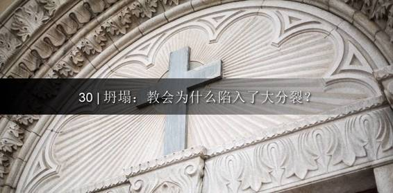

 

你好，欢迎来到《西方史纲 50 讲》。

上一讲我通过阿奎那的故事告诉你，一帮别有用心的理论家们利用神学家阿奎那的学说，来讲亚里士多德的故事，抬高世俗政权，凶狠打击教会，简直有倾覆教权的危险。

但是教会毕竟是诺亚方舟，要让它沉没哪有那么容易，除非它自作孽！这一讲，我就带你看看教会是怎么样自毁长城的，而且，**正是因为教会出了大问题，才演化出了后来的现代西方列国争霸。**

教会到底出了什么大问题？它分裂了！我带你看看这是怎么回事，重点在于教会大分裂对西方文明基本走向的影响。

## 教会的异化

在教会分裂前，教会达到了它政治上的巅峰。在前面我跟你提到过教皇英诺森三世，在他的手上，建成了教皇君主制，他本人成为西方世界的领袖，他甚至可以随意废立世俗政权的皇帝。很厉害吧，但是教会衰落的种子也在他这里完全埋好了。

我先带你看看他有多成功，然后再跟你讲为什么他的成功是为教会的堕落挖了一个大坑。

英诺森三世年轻有为，37 岁登上教皇圣座，和之前的大多数教皇一样，他是格里高利七世强化教权的忠实支持者，也是杰出的法学家。回想一下我跟你提过的，教会就是靠立法权和司法权的强化，才实现中央集权的。因此，作为领导者的教皇，大多数都是教会法学家。

英诺森三世的权力有多大呢？他在位期间，公然干涉神圣罗马皇帝的选举，把自己中意的候选人推上了皇帝宝座；又强迫英国的约翰王接受他指派的人，也就是兰顿就任坎特伯雷大主教。

这里多说一句，兰顿到任之后，直接导演了男爵逼宫的好戏，著名的《大宪章》就是这次逼宫的结果，关于这段历史，我会在下一个单元具体给你讲。

英诺森三世在位期间的西方，阿拉贡、西西里、匈牙利都成了教皇的封建领地。教会简直是风光无限啊！

继任的教皇们继续推进英诺森三世的路线，甚至不惜动用十字军去对付世俗政权。这样一来，**教会在教皇君主制的框架下，越来越成为一个强有力的政权，它的软硬实力结合让它成为西方第一强国**，尚未成长起来的法国、英国、西班牙，还有它的老对手神圣罗马帝国，都不是它的对手。

但可悲的是，它在权力争夺的道路上走得越成功，就离自己的崩溃越近。我为什么这么说呢，有这么三个原因：

第一个，最根本的，一个组织必须遵循自己的原则和目的，背离了自己的原则和目的所取得的成功，实际上就是异化。

教会的原则和目的是什么？是团结基督徒，遵守上帝的诫命，主持礼仪，提升道德，看护好基督徒的灵魂。教会军事力量不在自己手中，是上帝安排好了给国王掌管的。手伸得太长，捞过界了，开始掌握军事力量，很爽很痛快，权力就成了毒品，越吸越上瘾，无法自拔。

**任何一项伟大的事业都需要权力，但权力本身不是目的，如果为权力而权力，就很容易忘记自己的初衷，变成被权力控制的怪物。**想想教会，曾经拥有崇高的理想，还有神学这种高级的学问加持，结果还是在权力的角逐当中迷失了。这个时候，你再看英诺森三世的风光无限，是不是觉得脊背发凉？

第二个原因，最切实的，展开权力的争夺就必然走上世俗化的道路，因为权力始终无法脱离最俗的兵和钱这两个事情。

教皇有宗教权力，有组织有策略，在竞争强度不高的时候，可以压制住有兵的皇帝。但竞争在突飞猛进地升级，没有兵，心里不慌吗？要有兵，就得有钱去养兵。所以，**尽管权力是多种元素构成的，但不可能摆脱物质性的兵和钱。**

世俗政权里的皇帝和国王，他们想尽办法去筹兵筹钱，任何人都觉得天经地义，即便你不喜欢，也知道那是他们天生就要干的事情。可教皇、教会呢？天生就不该干这个事情，硬要去干，就意味着教会自己在推动世俗化，是在自杀。当信徒们看见教皇在争权夺利，不惜为此征兵征税，他们还会把他当作圣洁的使徒吗？这样的教皇跟自己原来鄙视的那些为了世俗利益蝇营狗苟的皇帝国王们有什么区别？

这里的逻辑是：**教皇参与权力争夺，因为避不开权力最基本的物质属性，就会主动地推动世俗化，结果导致信仰的破产。而教会最大的权力，凭借人们的信仰得到的权威，自然也就瓦解了。**这就是我刚才所说的，教会异化的硬逻辑，越成功就越是在摧毁自己的立身之本。

第三个原因，最危险的，权力斗争越激烈，对斗争者的要求就越高，一旦教皇稍有不慎，根基已经动摇的教会很容易毁于一旦。

想想看，高强度的权力斗争，不仅要心狠手辣、当机立断，也要心怀理想、胸怀宽广。为什么？只有手腕没有理想，那就是刚才讲的把权力当作毒品来吸的怪物；只有理想没有手腕，就是东郭先生，只会被狼吃掉。这时你会发现，**权力斗争对人的考验极高，就是因为手腕和理想这两种素质，很难在一个人身上兼容。**

英诺森三世的继任者们把他开创的教皇君主制越推越高，他们的手越伸越长，和世俗政权的冲突越来越多、越来越激烈，教皇们就越需要有大智慧、大气魄。但人总是有极限的，人的素质不可能跟着飞涨的形势一路飙升，一旦形势的严峻，超出了人的能力范围，崩溃就在眼前。

## 教会是如何分裂的

到这里我就可以跟你讲教会大分裂的具体指什么了，也就是谁捅破了窗户纸，把教会从巅峰推下了万丈深渊。

这个人是法国国王美男子菲利普。1303 年，他的党徒在法国南部的一个城市阿维尼翁，囚禁了独断专行、刚愎自用的教皇博尼法斯八世，教皇在这里受尽折磨，尽管后来被解救，但很快就死去了。

自此之后，教廷就留在阿维尼翁，完全被法国国王控制，一直到 1378 年才结束。法国国王对教廷的控制到了什么程度呢？这 70 多年里，大部分的红衣主教和所有的教皇都是法国人。**历史上把教会这段惨痛的历史称为“阿维尼翁之囚”。**

在这 70 多年里，虽然教廷完成了国家财政制度的建设，但在西方人心目中，教廷和教皇的威信已经荡然无存。但这只是教会跌落万丈深渊的第一步。

**第二步就是教会大分裂。**1377 年，教皇格里高利十一世把教廷从阿维尼翁迁回罗马，但他第二年就去世了，于 是，一堆法国裔的红衣主教被围困在罗马城，选出了新教皇，但他们很快就和新教皇翻脸了，跑回阿维尼翁说，之前选的不算，又选了一个新的教皇。

结果，罗马一个教皇，阿维尼翁一个教皇，各自带着一堆红衣主教，都说自己是真正的教皇、真正的教廷、真正的红衣主教团，都说对方是冒牌货。法国和它的同盟国显然支持阿维尼翁的教皇，其他国家支持罗马的教皇。

就这样，两个派系并立了 30 多年，基督教世界终于忍无可忍，在法国国王、神圣罗马皇帝的支持下，主教和红衣主教们 1409 年在比萨开会，想要结束这个滑稽的局面。结果搞出了一个更滑稽的局面：大会的方案是两个旧教皇同时退位，在会上选一个新教皇，新教皇倒是选出来了，两个旧教皇又不退位了，结果这下有了三个教皇，相持不下。

**这种局面延续到了 1417 年，终于三皇归一。**曾经神圣威严的教廷，居然沦落成闹剧不断上演的大舞台，真是可悲啊。

**这还没完，还有第三步。教会大分裂是结束了，但教会作死的路还没走完。**作为结束教会分裂后选出的第一位教皇，马丁五世，他还是走英诺森三世开出的老路，继续纵横捭阖，而且更加心狠手辣，军队、税收、宫殿这些政治硬壳，都成了教廷赤裸裸追求的目标，强取豪夺、横征暴敛、卑鄙下流的事情都来了。教皇圣座自然也成了各路枭雄争夺的大肥肉。

这个时候，你就能理解路德和马基雅维利为什么在这个时间出现了，他们把教皇看成了骑在整个西方头上的吸血鬼，一个用宗教改革的办法，一个用力挺国家的办法，目的都是彻底摧毁教会。

后果很明显，教会自寻死路。回想一下上一讲，我跟你提过但丁他们对付教会的办法，他们在理论上把教会和国家分开，强调国家才拥有强制力、教会须服从国家。

面对这样一套政治理论的攻击，教会没有束手待毙，而是反过来要追求强制力，居然强势地把自己变成了世俗国家。结果是西方多了一个争权夺利的世俗强国，却失去了劝人向善、引领道德、看管灵魂的诺亚方舟。

## 教会坍塌的后果

教会的坍塌意味着中世纪教权与政权并存的二元结构也随之坍塌。这会带来非常严重的后果。

**第一个后果是，精神生活因为教会的失职导致严重亏空。**可以预见，一旦有新的宗教运动引导人们追求纯洁的精神生活，人们将会几近狂热地拥抱它。宗教改革看来不可避免。沿着这个逻辑，你可以把宗教改革看成从外部对宗教权威的重塑，从内部对精神生活亏空的弥补。这个大问题，我以后跟你细谈。

**教会坍塌的第二个后果是，世俗政权因为失去了教会的外部制约，变得一家独大。**可以预见，没有外部制约，内部制约还不成熟，世俗政权的权力将会飞速膨胀，直到人民忍无可忍，奋起革命。

**第三个严重后果，教会重整，政权坐大，西方的权力格局进入一个动荡期。**究竟是教会能够回归，从而二元结构重新回归，还是教会从此一蹶不振、政权形成一元格局，还需要通过观察更多的因素才能判断。

本讲小结

好，总结一下这一讲的内容：教会因为追求权力而走上了邪路，违背自己的目的、瓦解自己的根本、把自己放在最危险的地方，结果导致加速堕落，经过阿维尼翁之囚和大分裂，教会最终变成了吸血鬼，彻底失去精神团体的本质，堕落成一个争权夺利的国家。

**教会的坍塌意味着中世纪二元结构的坍塌。教权、政权、大格局都会迎来翻天覆地的变化。**下一讲我带你看看什么样的新形势在中世纪末期出现，把西方从中世纪推进到现代。

期待你的到来，下一讲再见！

精选留言

点击直接进入下一章节

**李筠**:  
同学们的留言越来越踊跃，质量也越来越高，以至于我每天花在回留言的时间越来越长，很享受，很振奋，谢谢你们！

**深黯昊曌**:  
李筠老师本节的这段话：“一个组织必须遵循自己的原则和目的，背离了自己的原则和目的所取得的成功，实际上就是异化。”对改革中的组织太有“提醒力”了！

**作者回复**:谢谢哈，你得到启发是我这门课最重要的目的！

**佛祖门徒**:  
“自作孽，不可活”，教会的崩溃再次印证了这一论断。  
第一、权力的毒品效应。野心和权力同时达到顶峰的教廷仿佛一只基因变异的怪兽，企图吞噬世间的一切，或许在世俗政权的心中如同《霍比特人》中那只守护财宝、喷着火的那头令人恐怖的巨龙。当心中不再有敬畏和信仰，就会自我迷失。教廷和世俗政权若能秉持本心、安守边界，或许今天的欧洲又是另外一番光景。  
第二、重塑格局的代价。代表精神世界的教会本应该给最广大民众以光明和希望，但其对权力的贪婪、对欲望的不加节制、与世俗政权的生死斗争，哪里还有半分出尘脱俗、导人向善的样子？一元的坍塌带来长时间的动荡，平衡的和谐形成之前，许多人都在忍受漫长的煎熬。

**Allelujah**:  
将权力比喻成毒品，实在是十分贴切——越是染指，就越是想拥有更多，直到获得和拥有的开始反噬自己。  
  
教廷在攫取权力的游戏中，被短期的利益遮蔽了双眼，再也看不清自己想要拥有的权力与自身原则和逻辑上的矛盾，也忽视了手握权力的同时会背负上的成本与责任。带来的直接后果是，信仰的基础和信众的虔诚反而从内部开始崩塌，教廷自己将自己的基础连根拔起。  
  
无论是多么有天赋的个人、还是设计得多么精妙的组织，都会有精力和能力的上限，这也是为什么在英雄逐鹿的战国时代，即使在纵横捭阖之时，也需要合纵连横的原因。一旦越过自身的边界，想要获得不属于自己的东西，脚下的薄冰就随时都有可能崩塌。

**作者回复**:那么，应该对权力恐惧吗？谨慎是必须的，恐惧则不必。除了谨记“权力导致腐败”的训导，还有两点恐怕要继续推进：1.权力只有和内在强大的精神世界相匹配，才不容易败坏，才能做成大事，迷失了目标和价值的权力必然只是暴虐。2. 能不让权力长大吗，挡得住吗？恐怕不能，如此说来，分权制衡就是对权力的复合型架构，让长大的权力相互制约就是让它们相互成全。

**王黎璐**:  
基督教最主要的世俗价值，是在于其建立了一套遍及欧洲文明圈的同一性规范。这套规范对内可以弥合各国分歧，对外则可集中力量以应外侮，除此之外，还能够让并不富裕的中世纪欧洲人安贫乐道，以维持弱势欧洲文明的延续和生存。  
但随着时代的发展，随着欧洲文明范围的拓展和质量的提升，这种同一性的好处逐渐不再，弊端却越来越明显，这种情况就有必要打破旧有框架束缚，给人和世俗国家更多的自主权。  
就算不是英诺森三世，也会有其他雄才大略的教皇来做这件事。王权与教权关系一直是处于联合和斗争的“二元对立、统一”特定状态当中。基督教保证了王权的合法性，王权对教会给予庇护，二者紧密地联系在一起。当时移势易，教会的坍塌或许难以避免。

**作者回复**:是的，我把你的评论拉回我教过你的内容：当中世纪变得大而富，结构性调整必然出现，权力的妥当安排是核心，教会作为领头羊闯出了一条路，但它的解决方案并不适合它，其实更适合后来的世俗政权：国家。

**不谋而合**:  
中学时期对西方中世纪的刻板印象，来源于历史书上一些对宗教改革的记载。马丁路德和加尔文对教会的种种行为口诛笔伐，也让人以为教会就是西方人的精神牢笼和物质负担。  
后来看陈乐民先生的《欧洲文明十五讲》，记得陈先生还说中世纪是“dark ages”，不是一点点黑暗，已经黑暗到了“ages”的地步，我对这个尤其印象深刻，也一直以为中世纪就是黑暗的代名词。直到学了老师的课，才发现自己的无知。  
从整个基督教的发展史来看，基督教脱胎于犹太教，自成一派，在创始时吸引了大批中下层教徒，并成为中世纪前期西方人的精神支柱和主要文化载体。但是到了中世纪后期，因为权利的膨胀使教会的性质发生变质，才出现了后来加尔文和路德批评的那个残暴的教会。  
以前学“印象化”的教会，都没有深入思考教会的发展过程。其实，西方人又不是傻子，如果教会一开始就这么坏，那他为什么能成为世界第一大宗教？教会的性质是一个动态变化的事物，只有确定某一时段我们才能具体描述。

**作者回复**:用知识改变成见，刷新认知。其实我讲“中世纪不是一片黑”并不是什么新观点了，2000 年以后的西方教科书都承认了学术界的这种观点，把它下沉给普通学生了。刷新认知之后，就像你讲的，对历史能够形成更加一致化的认识。

**以武治心**:  
李老师下午好！  
“一个组织必须遵循自己的原则和目的，背离了自己的原则和目的所取得的成功，实际上就是异化。”这句话对我很有启发：背离自己的目标的企业会不自觉地“作恶”，想起了最近的乘滴滴顺风车遇害案，一个组织或企业必须要遵循自己的原则和目的，有“不作恶”的自律，只有这样才能才能凝聚员工，获得客户等利益相关者、社会各界的信任与支持。

**作者回复**:滴滴越做越大，会碰到更复杂的状况，但用带有色情暗示的做法去推顺风车，显然是在利用人性当中的恶。我认为，一个有善意为社会做贡献的企业，要主动地消除而不是利用恶，才能真正做大。

**强 Sean**:  
以前对宗教改革的认识是断层的，只知道教会施加的压力和束缚让越来越多人不满，尤其以赎罪券为由进行的盘剥实在是让人忍无可忍，没想到沿着宗教改革往前追根溯源，能追查出如此盘根错节的事件和关系，同时也能从更大的历史背景下看待文艺复兴和启蒙运动。

**作者回复**:是的，如果没有了解教会的坍塌，对文艺复兴和宗教改革的理解就会被严重削弱。

**A learner**:  
一个人满怀理想，从极端贫苦的夹缝中穿梭过来。他的良善、他的伟大抱负获得了很多人的认同。正因如此，他获得了前所未有的成功。然而，成功后的他却陷入了权力的漩涡中，忘记了初心，自己陷入堕落的深渊……影视作品也好，现实也罢，这样的故事不断上演着。原来，历史的长河里，基督教的兴衰早已演绎过这样的过程。  
人终究不过是个俗物，我们不能否认自己的世俗性，否则很容易走上精神极端。当自己手握权力时，就会运用精神力量的美丽外壳来伪装自己的恶行。  
同时作为俗物的人，也得拥有能够限制自身欲望的精神力量，否则就会无法无天。各位得到老师都反复强调"人要有敬畏之心"，原因也是如此吧。不一定要敬畏上帝，敬畏大海，敬畏自然，敬畏宇宙都是可以的。  
这两类人也对应了武侠世界里大家最反感的两类人，一者穷凶极恶的恶徒，二者自诩名门正派的小人。

**作者回复**:权力是对一个人最大的考验，其实，对一个文明也是。

**有点甜**:  
"过度膨胀"兴许是事物发展的必然逻辑，这也是一个转型的契机，加法与减法同时做，从而获得新阶段的增长。  
只是这个过程是残酷的，真相是，膨胀过后是覆灭，很少有"太阳再次升起"的情况。  
如此，摆在面前的选择有：要么守住边界，不逾矩；要么，能容忍爆炸的冲击，涅槃重生。当然还有另一种选择，持续扩充边界，消除边界，也就从心所欲。这需要智慧，更需要胆魄。

**作者回复**:内在的世界足够强大，才足以驾驭如权力、金钱、名声这些利器。

**吕可达 02015223344**:  
1.老师，很多事件，不同人从不同角度可以得出符合逻辑的结论，那我们应该如何面对？  
比如，同一个现象，从经济学角度能说通，从社会学角度也能说通，那到底它的逻辑是怎么样的？是不是对于每一个角度得出的结论都不完全正确？那我们是不是得不到真正的答案？  
  
2.老师，您觉得基督教变成这样，到底是它自找的还是形势所迫？  
如果它安心本分地守着自己的精神世界，那可能很快就被世俗政权控制，变成傀儡了。所以它需要自保的能力，这样就必然合纵连横或者自己招兵买马。可这样又踏上了停不下来的政权扩张路线。最终结果可能也就是成为一个世俗政权。  
所以，结论是，世界上不存在影响巨大的独立精神组织，它必然在政权划定的范围内活动，否则，它活不下来？

**作者回复**:一个庞大的宗教组织必然涉及权力，和世俗政权的关系就很难处理。不过，你的结论好像值得商榷。教随国定是宗教改革之后宗教战争打出来的结果。但这个原则究竟是不是终极原则，是值得商榷的。下面我会重点跟你讲宗教改革和宗教战争。

**静雨荷香**:  
教会是人们精神世界的归一，让人们求真相善，教权和王权的斗争中，需要世俗的权利，物质的装备，在王权派理论家派排山倒海的攻击下，教皇意识到世俗政权的重要性，为此积极争权夺利，这也就背离了教会的初衷，从内部开始自我瓦解。  
古希腊，古罗马，基督教最终的瓦解都是自己内部产生了分裂，外部才有了可乘之机。  
教会想要统治西方世界就要拥有世俗的权利，追求世俗的权利就会背离自己精神统治的初衷，没有政治的保护，很难让基督信仰内化于心，这真是个悖论。

**作者回复**:回想和品味一下我在发刊词和加餐里说的一条线索：权力的生成和流转。

**陈 C**:  
有意思的是，一方面如同希腊末期哲学繁盛、罗马末期神学兴起一样，教会权威崩塌之时，也促了一大批思想家的诞生，其中很多又是以对抗或者蔑视教会的形象出现，比如马基雅维利就直接蔑视教权，教导君主要进行权力的计算，大力发展自身的权力。  
  
另一方面，可能是教会极速腐化堕落直至坍塌，手段过于黑暗，精神上过于刺激，故事性上又过于离奇，导致了后世对教会腐败的极大渲染甚至添油加醋。这也成了基督教会在当代备受文艺、娱乐作品贬损的原因之一，也在一定程度上造成了人们“基督教黑暗”的偏见。

**作者回复**:批判是必须的，坏机构、坏时代必须批判，但这并不意味着批判就是绝对正确的、全面的、公正的。孰是孰非，对错得失，放在长线当中来看更妥当。这就是把史学进化成史纲的重要目的之一。

**陈 C**:  
教会不断争权夺利，最终玩过了，变质了，玩脱了。过于注重权力，并且为了保住并扩张权力而强化军权、财权，走向世俗化。这对于原本致力于管理人们精神世界的教会而言，就是堕落。而权力的斗争又是极其残酷的，如夜半临深池一样，稍有不慎便会万劫不复。至于从“阿维尼翁之囚”，到法国、罗马双教皇，再到新教皇盖不住旧教皇的“三皇并存”，直到三皇归一，就只是教会变质，拼命作死的大格局下上演的闹剧罢了。  
  
教会对权力的过分追逐，以及之后教会权威的剧烈坍塌，带来了若干结果：  
1\. 教会权威不再，信仰缺失，人民亟待新的精神救赎出现。  
2\. 文化上出现了一批反抗的思想家，他们的成就也多表现为对抗教会权力，并试图构建新秩序、新权力。  
3\. 最大的影响，我认为应该还是在政治与政治理论上。教会权力的崩塌导致世俗政权一家独大，权力得不到有效的制衡与约束，一方面这导致了人民奋起反抗甚至发起革命；另一方面既作为权力约束的思想探索，又要为革命提供理论支持，西方政治学被导向了一个致力于防止专制出现的新方向。从霍布斯、洛克的社会契约论，到卢梭的“普遍意志”，甚至是二十世纪哈耶克的法治观，都是在这条探索之路上的智慧结晶。

**作者回复**:防范权力是西方政治学的重要主题。

**云中白鹤**:  
权力是一把双刃剑，而人性又具有多重性，即便是以拯救人类灵魂为使命的教会和教皇也最终难以抵抗权力的诱惑，迷失自我，偏离正道。权力是春药，更是毒药。由此观之，绝对的权力必然会导致绝对的腐败，这句西方人对权力的警惕之言确实是真理！

**作者回复**:你只讲了权力的一面，毒药，我还讲了另一面，也需要注意，权力是成就大事之必须。正是因为有后面这一面，才能解释为什么那么多有理想的人会去拼命争夺它。合起来看，体会会更深。

**一念花开**:  
1.物极必反  
2.走上权利的争夺就必然走上世俗化的道路，最终动摇信仰的根基。  
3.在权利的斗争中能看出“教皇和红衣主教们”对信仰本身并没有多少追求，反而对权利过于执着，于是“教皇”这个位置成了枭雄们所争夺的，信仰则成了遮羞布。这是西方的“礼崩乐坏”吧。  
4.借用罗胖经常引用的一句话：看他起高楼，看他楼塌了。  
5.宗教改革是人们对教会当权者及教会制度的失望，但对基督教义本身还有信仰。

**作者回复**:很喜欢你这种精要的方式呈现自己得到的启示。

**叮当娃娃 001**:  
准备买老师的《论中世纪的王权观》一书好好拜读，也听了老师在刘苏里老师那边的课，但是不过瘾，希望在书里能有更酣畅淋漓的体验

**作者回复**:谢谢哈，希望我的专著不负你所望。

**程佳鹏**:  
这一讲和西方国家后来的革命连上了。教会的坍塌导致长期维持西方世界政治平衡的二元结构解体了。宗教那一元对世俗政权都制约作用消失了，世俗政权无限膨胀——无节制的剥削、压迫百姓，最终导致人民的奋起反抗，革命爆发了。

**作者回复**:史纲的目的就是为你建立起长线的联络。

**diceking**:  
这几讲中，李筠老师向我们展示了罗马教会与“蛮族”政权间一系列博弈的大逻辑:  
首先，罗马教会吸收希腊的理性哲学，发展出神学，既保持教会的统一，也大量吸收和培养了知识分子；  
其次，罗马教会基于掌握的文字、法律等知识技能，可以同掌握军事力量的“蛮族”在政治上进行合作，不仅在军事威胁下保持了存活，还实现了对“蛮族”传教和政教并立；  
接着，拥有源自希腊罗马政治智慧的罗马教会，在同王权的博弈中，不断获得优势，最终取得教权高于王权的地位；  
最后，罗马教会因为之前的“胜利”，在追求教权一统政权的路上越走越远，出现世俗化的异化，损害的信仰权威的根基，在辉煌中走向了崩溃。  
  
这似乎说明，由罗马教会主导的“教政合一”，是注定走不通的。对比一下，东方的政教合一，主要是政权吸收控制宗教的形式，所以政权宗教化过程，有可能并不会严重破坏经济、军事等政权基础。  
但伊斯兰教似乎是个例外，出现这个成功的“教政合一”，是因为伊斯兰教中教权和政权的结构，与罗马教皇的追求有重大的不同，还是因为其他历史条件的影响？

**作者回复**:内部结构不同，社会条件不同，演化逻辑不同。

**陶思源**:  
今天的了让我想起了第一性原则。其实任何机构和商业乃至个人的成功，背后都是别人的需求。比如教会满足了精神需求。公司满足了信息不对称和交易成本的需求。  
而教会的进入“sword”的世界，实际上是对人们精神需求的无视。违反了教会自己的第一性原则。于是成功的基础便坍塌了。人们不需要国家形式的教会，因为国家已经有很多。  
众利勿为，众争勿往。与其跟随别人的道路，不如利用自己的特点，找到和自己特点相匹配的别人的需求。从而找到自己的立身之本。从而走向成功

**斜风细雨不须归**:  
读这个专栏，就像听评书，特过瘾。  
一段段波澜壮阔的历史，在李老师的娓娓叙述中，徐徐展开。一幕幕权力的游戏轮流上演。耳边不由想起了那阙临江仙:  
滚滚长江东逝水  
浪花淘尽英雄  
是非成败转头空  
青山依旧在  
几度夕阳红……

**作者回复**:谢谢哈，我的目的是让你听得有启发，也听得愉快。

**郝景宇**:  
还有一个问题想请教一下老师，在这个时期，教会、王国与那些原来的封建领主之间的关系怎么样的？我觉得这是很关键的 X 因素。

**作者回复**:大哥们要打架的时候自然是在搜罗尽量多的小弟，但各家的办法不同，光威逼利诱成暂时的同盟是远远不够的。我在下一单元里重点讲国家的崛起，如何对付封建主义是国王们的大课题。

**小樣樓**:  
权力是令人上瘾的毒药！教会从英诺森三世开始，背弃了自己的原则与目的，从上到下拜倒在了权力之下，么有那个世俗政权能够制衡教权。在我看来这就是教会丧失了目标，在权力之路上迷失了自己。想象一下那时候的教会的力量多么大：1 干涉皇帝的任命。2 不顾国王的感受直接任命大主教。3 成为西方第一强国。4 后继者只会前仆后继的继续推高教皇的权力。么有目标的人，犹如无际大海中失去方向的航船，而宗教这艘诺亚方舟迟早也会撞上冰山！  
  
这让我想起了秦始皇，他一生的目标就是统一六国，最后他实现了他的目标后呢？1 追求长生不老。2 继续运用军国主义，北击长城，南平百越。3 封禅泰山，使用皇帝称号。（封禅泰山好像是儒家杜撰出来的～）这也是秦始皇拜倒在了权力之下，么有节制的使用！  
  
人拥有欲望但要克制就是理性。权力不过是放大了人的欲望，但是么有目标的克制那也是不理性的！

 

你好，欢迎来到《西方史纲 50 讲》。

上一讲我跟你分享了教会堕落的脉络，**1303 年可以说是中世纪一个重要的分界线，这一年教皇被抓捕，经过阿维尼翁之囚、教会大分裂，教会变成了吸血鬼，一步步掏空西方的精神生活。**

相应地，世俗政权放开手脚，开始建立现代国家，你追我赶，你争我夺。这个事情我在后面重点跟你讲。**总之，11 世纪到 13 世纪，由教会主导的教权与政权并立的格局逐渐瓦解，政治和军事重新进入混乱。**这一讲，我带你看看 1303 年到 1450 年的西方经济和社会，当教权和政权搞得乱哄哄的时候，经济和社会变成什么样了。

最重要的问题是，**你所熟悉的现代西方的开端，比如大航海、文艺复兴、宗教改革，都是在这个阶段的社会经济环境中产生的**，那么，我们就得来看看，中世纪到底留给西方一个什么样的盘面。很不幸，中世纪末期的经济和社会基本上也是一团糟。

这一讲，我跟你讲中世纪末期的三件事情，也就是中世纪末期西方的三个极其严峻的状况。然后再跟你分析西方到底有没有机会，从这一团糟里面爬出来。

## 经济再次陷入谷底

第一个惨况是，经济走了一大段弯路。

11 世纪开始，西方的政治秩序稳定下来，上帝也真是给面子，长时间风调雨顺，靠天吃饭的农业有了基本的保障。还有两个因素也很重要，技术和劳动力。

我曾经跟你讲过，罗马因为滥用奴隶导致技术改进被严重抑制，中世纪刚好反过来了，**战乱经历了数百年，大规模的贸易和货币经济都不复存在，只有改进技术才能从土地当中找到更多吃的。所以，12 世纪西方的农业技术就超过了古罗马。**

**除了农业技术，劳动力状况也稳定地得到了改善。**为什么呢？**首先是，战乱之中死了太多的人**，劳动力就变得金贵了，不仅不能随便打随便杀，就是奴隶制也变得很不划算。

**所以有了劳动力状况改善的第二个原因，比起奴隶制，封建制给了种田的人更多的自由**，因为把人的积极性主动性解放出来变成生产力，最好的办法就是给他自由。

**还有第三个原因，基督教给予体力劳动史无前例的尊重**，这在古希腊罗马是从来没有过的。我们的孟子说劳心者治人，劳力者治于人，也就是说，搞脑力劳动的管理别人，搞体力劳动的被别人管理，古希腊罗马其实也是这么想的。

但是基督教出身草根，是来自底层的底层，当然对底层予以道德支持。所以，基督教给予体力劳动的尊重就相对比较高。

劳动力改善的第四点原因，是经济改善使得人的健康和寿命都得到了改善。

就这样，诸多因素共同促成了农业革命，西方人不用再和饥饿作斗争，可以自己养活自己了。伴随农业革命的还有商业革命和城市革命。有农业剩余，交换就成为可能，甚至成为必须；有交换，就必须有交易场所，城市也就随之复兴。在一片欣欣向荣之中，西方的经济重心从地中海转移到了北大西洋。

**但是，进入 14 世纪，好像上帝一把收回了所有的有利条件。**先是政治稳定程度下降，大的战争随之而起。然后是天灾连连。同时，技术改进释放的生产力也走到了尽头。而且，因为刚才说的战争和天灾带来的饥荒，导致劳动力总量明显下降。

最后还有一个不利条件，因为它实在太恐怖，不仅对西方经济造成了毁灭性的打击，对整个社会都造成了毁灭性打击，所以我把它单独拿出来讲，就是黑死病。

## 黑死病的深刻影响

黑死病就是中世纪末期遭遇的第二个严峻的状况。

黑死病就是鼠疫，从发病到死亡，最多也就三五天。人死之后迅速变黑，所以俗称黑死病。从 1300 年到 1450 年，鼠疫来了好几拨，一共死了多少人呢？

历史学家们的估算不太一致，但在我看来没有本质差别，到底有多少呢？估计死的多的，说这 150 年欧洲的人口减少了三分之二，估计少的，也说死了一半。鼠疫深刻地改变了西方，至少在以下几个方面非常明显：

第一，劳动力锐减。经济凋敝。

第二，城市的重要性大大提高，抵御瘟疫的人们必须抱团取暖，自然就向城市集中。

**第三，心理无尽的恐慌。**事后来看，欧洲人口少了一半已经很恐怖了，要是当时呢？只有一种想法，那就是谁在明天都有可能死，无论多少人都可能在明天全部死光。完全是世界末日啊！

为什么要跟你讲这种心理？目的在于找出历史的真相。黑暗的中世纪，这种论调是文艺复兴发明的，你原来可能觉得这是文艺复兴的这些大文豪、大画家为了发扬人的光辉，所以要去诋毁斗争的对象，就像每一代革命者都会把旧社会说的特别黑一样。

但当你知道了黑死病带来的极度恐慌，就更能够理解，文艺复兴的大牛们心底有这种挥之不去的恐惧，这就是他们这一代人对中世纪的直接印象。

他们没有直接感受过教皇英诺森三世的风光无限，也没有直接感受过神学家阿奎那的气度雍容，或者说，以前的一切全部都被黑死病的恐怖，涂上了浓重的暗黑色。在这种色调里面，怎么会有公平的评价？

## 拜占庭帝国灭亡

接下来还有第三个严峻的状况，还是那句话，没有最遭，只有更遭。

政治动荡、经济凋敝、社会被黑死病摧毁，刚见一点点好转，结果拜占庭灭亡了。**就在 1453 年，突厥人攻占了君士坦丁堡，作为西方文明长兄的拜占庭千年帝国就此落幕。**

当没有外人的时候，西方和拜占庭两兄弟打得不亦乐乎，还记得吗？1054 年，罗马教皇和君士坦丁堡大牧首相互开除教籍，指责对方是异端。后来这 400 年里，双方嘴仗一直没停，西方在恢复过来之后，甚至发动了对拜占庭的战争，英诺森三世发动了第四次十字军东征，最终占领了君士坦丁堡，屠城三日，死伤无数，大大地削弱了拜占庭的元气。**在东正教的眼里，西方的拉丁基督教罪大恶极，代表了堕落和背叛。**

虽然之前西方和拜占庭打得不可开交，但问题是，当拜占庭真的灭亡了，真正要命的是，谁来挡住突厥人？

当时的教皇如坐针毡。要知道，西方在中世纪，无论是在文化方面还是军事方面，都领教过穆斯林的强大。虽然西方的经济水平和文明程度在 13 世纪就超过了伊斯兰文明，但 14、15 世纪不是西方自己在走下坡路吗？

何况这是我们后世的看法。当时西方印象里的穆斯林，是远比自己强大的对手，而且，奥斯曼帝国正处于上升期，真的全力西征，西方未必抵挡得住。

事实上，奥斯曼帝国确实这么干了，北非全部拿下，希腊半岛、东欧的保加利亚、塞尔维亚、克罗地亚甚至中欧的匈牙利都落入了奥斯曼的手中，直到 1529 年和 1532 年，两次进攻维也纳被击退，西方的东部边界才算基本稳定。

所以，**1453 年拜占庭灭亡之时，西方陷入高度的恐慌是有道理的，他们花了近 100 年的时间才再次解决了东线安定的问题。**

本讲小结

好，总结一下这一讲的内容，西方没有从英诺森三世的英明神武和阿奎那的包罗万象，这样一个辉煌的局面直接走进现代，**西方在中世纪末期又经历了一段刻骨铭心的低潮，经济萧条、黑死病、拜占庭灭亡。**

照这个形势看，西方就此灭亡也是有可能的。但它并没有，那一定是有很强大的力量，能够对冲掉三大不利状况造成的颓势。

西方就是在这样一种茫然和懵懂的状态中从中世纪走进了现代，所有我们事后找出来证明克服了颓势的有利因素，在当时并不明显，当时的人也没有觉得凭手里这几张牌就能赢得后来的好局。

所以，你必须对历史分期保持高度的警惕，用某个年份、某个事件把时代划分开，只是一种方便的标签，只是按照一种逻辑得出的结论。

大事件、大运动的效果和意义都是事后才呈现出来的，对于局中人来说，历史是连续的，因为摆在他们面前的问题是连续的。分期只是后人看历史偷懒的办法，并不是绝对不可改动的标准。究竟中世纪和现代的区别在哪里，不是一个年份、一个事件就能一锤定音的。

下一个单元，我会通过一连串精彩的故事告诉你，**中世纪的西方和现代的西方是紧密连接在一起的，之所以把它们划出界限，最重要的是西方文明的逻辑发生了内在的变化。**西方终于要来到你最熟悉的这个样子了。

期待你的到来，下一讲再见！

精选留言

点击直接进入下一章节

**Allelujah**:  
相信老师在讲述西方历史的时候，没有将笔墨集中在某几个重大事件上，而是着眼于政治、信仰和思想的变迁，也是因为认定只有对连续性的问题进行全局的、抽丝剥茧的分析，才能掌握西方文明推进的内在逻辑。  
  
这大概就是《西方史纲》的「纲」之所在了。

**作者回复**:我们一起探索！

**佛祖门徒**:  
李老师，节日快乐！  
第一、经济发展的动力。由中世纪欧洲经济短暂复苏到迅速衰落的这段历史不难得出经济发展需要的“天时”—风调雨顺，没有包括像黑死病这样的天灾；“地利”—肥沃的土壤和丰富的资源；“人和”—安全的政治环境、稳定的社会秩序、进步的生产制度。  
第二、史纲的分析框架。老师在小结再次强调了审视和分析历史需要科学方法论，我理解有两个要素，一是警惕孤立的事件或人物决定论，历史的发展是多个事件和人物共同作用的结果；二是更长时间维度视角，在“名家大课”学习了布罗代尔的《论历史》，我比较认同其对历史的理解要通过短期、中期和长期三个不同的视角来进行的观点。

**作者回复**:是的，短期、中期、长期要比对着看，切换焦距会带来不同的画面，才能把全局看完整。

**奔跑的菠萝**:  
李筠老师，节日快乐！  
   
正如老师所说的那样，历史是连续的，历史中的问题也是连续出现互为因果的，今天谈到的黑死病让我想到了在《枪炮、病菌与钢铁》一书中曾提出过如下观点：  
   
随着农业的发达进步，越来越多的族群选择将狩猎采集的生活方式转变成定居生活的生活方式，这样必定导致如下结果：  
1.我们的生活垃圾和排泄物会充斥在生活环境周围，这为病菌和寄生虫的大量滋生繁殖提供了有利的条件。  
2.和大量被驯化的家畜长期相处，给家畜身上的病菌演化成能感染人类变异体提供了时间和空间。  
3.随着贸易体现的建立，全世界不同地域的病毒有了更为高效的传播途径。  
   
所以，人类文明的发展史，也是病毒的发展、变异传播史，在历史中病毒对人的杀伤力很多时候要远远大于战争冲突。这再一次为我们阐明了利弊相承、福祸相依的道理，也再一次告知了我们，只有站在更高的位置、拥有更全面的视角才能看清历史推进中复杂的因果逻辑。

**作者回复**:戴蒙德的视角很独特，很开脑洞。如果能把他这个级别的大脑洞找几个放在一起仍然能够说成一个圆融的故事，高度就出来了。

**陈 C**:  
中世纪后期，教会作死、原有的社会秩序濒临倒塌，经济跟着一起走下坡路。黑死病导致人口锐减进一步加剧了经济的衰退，并带来了极大的社会恐慌。好不容易熬过了黑死病，拜占庭灭亡，突厥人西进，给西方带去了持续的恐惧。  
  
关于黑死病，除了导致人口锐减，在秩序上它还导致了教会结构几近崩溃，并导致了信仰的危机，使人们更加质疑教会的权威性。这一事件与拜占庭覆灭接连带来的恐慌，不仅导致了日后宗教改革的兴起，也促使社会进行了反思，文化的发展由此产生出了新的可能性。  
  
这一段历史再次出现了，社会危机与文化进步同步发生的现象。思想上从彼得拉克到马基雅维利、托马斯·莫尔和伊拉斯谟，艺术上从乔托到文艺复兴三杰，他们生活并创造成就的年代，刚好就是从黑死病到维也纳击退突厥人的这两百多年间。  
  
老师在这一讲末尾，提到了历史时期的分界并非清晰的一个节点，而是一个连续的过渡。这在中世纪到文艺复兴的转变中就十分明显：黑死病与拜占庭的灭亡被认为是中世纪时期的末段，然而文艺复兴的繁荣就始于此；虽然但丁被认为是文艺复兴的先行者，但作为文艺复兴核心理念的人文主义，却在他之前就已经复苏了，那时候还是“真正”的中世纪。这两个不同的时期，一头一尾是相互重叠，而非紧密衔接的关系。

**作者回复**:哈哈，文艺复兴马上就会杀到！

**强 Sean**:  
我们要对历史分期保持高度警惕，这种标签化的认识很容易蒙蔽我们，从更大尺度来看，时间和空间本身很可能只是人类为了描述这个世界的主观产物，只有人类能从主观上去感知和描述时空，大多数动物应该是没有这种感知的。  
  
我们的主观上感知到的时空，可以说是连续的，也可以说是不连续的。说它连续，是我们的当下和未来都受到过往经验、习惯的影响，现在的大数据就是根据我们过往留下的数据来判断我们是怎样的人；说它不连续，是因为我们其实生活在一个接一个不同的情绪、感受、回忆、思考、故事、场景和情境中。

**作者回复**:离得最近，并不一定就看得最清。

**王黎璐**:  
君士坦丁堡被奥斯曼人占领，拜占庭灭亡，延续千年的罗马帝国法统彻底终结，同时也迎来了文艺复兴。一方面，拜占庭是整个欧洲古典文化的“蓄水池”，当君士坦丁堡被攻破以后，曾经大量居住在拜占庭帝国境内的知识分子，纷纷涌入西欧，带去了文献、典籍，以及古希腊、古罗马时代的思想，直接刺激了文艺复兴；另一方面，之前通往东方的陆上商路被阻断，欧洲人开始向西寻找新的通路，引发大航海时代的来临。一个时代彻底结束了，真正意义上的世界历史拉开了帷幕。  
黑死病的恐怖于我现在很难想象，毕竟非典期间自己也不在疫区，并且当年的恐怖确实只有亲历者才能体会，纸上得来终觉浅。前面学查士丁尼的时候，对那场大瘟疫的认识不够。  
“大事件、大运动的效果和意义都是事后才呈现出来的，对于局中人来说，历史是连续的，因为摆在他们面前的问题是连续的”，这个教诲于我启发重大，刷新自己的历史观。相信再去学习中国历史也会有新的收获和同情。  
祝老师节日快乐，身体健康🎉

**作者回复**:比对，然后发现差异、发现疑点，是获得新知的导火索。

**echo**:  
老师，奥斯曼帝国主要是伊斯兰教么？另外突厥和穆斯林对西方的进攻是两回事吧？奥斯曼帝国和突厥也不是一个地方吧😂最后这几段出现了一些名词，关系有点乱。

**作者回复**:提这个问题的同学有几个，我就一起回答。奥斯曼帝国=人种上的突厥人+信仰上的伊斯兰教，就是它在 1453 年灭了拜占庭。伊斯兰教在历史上和很多民族结合过，比如波斯人、阿拉伯人。进攻古希腊的波斯后来被伊斯兰教收服了，伊斯兰教收服的民族非常多。

**炭笔**:  
老师教师节好！得到这里有很多优秀的课程，有的能把专业内的问题说透彻，有的则还能在专业外有所启示，李老师的课属于后者！  
  
历史是连续的，局内人不可能看到清晰的分界，都只能凭借目前的状况揣测未来的趋势。中世纪末的人难以看到未来的光明，因为他们所处的时代，都在给他们灌输进人绝望的信息，政治混乱，经济凋敝，黑死病流行，"异教徒"威胁，这就是他们的全部生活。  
  
我们也是今日历史的"局内人"，我们看不到未来的趋势，只能保持谦虚和敏锐，按客观规律好好做事。这是今天的课给我最大的启示。

**作者回复**:这门课的重要目的就是让你的眼光不再那么普通，可以比一般的“局内人”看得更远。

**蝉**:  
抽象化、标签化是思维懒惰的表现。李老师的课让我感到历史如此复杂，但是精彩。

**作者回复**:你说的是一头，不过话在这儿还是要分两头说，另一头是：1.不是每个人都有求知欲，即便有，求知是有成本的，而且很多时候很高昂。2.更重要的是，方便的标签让很多人不知不觉以为占了知识的便宜，就有力量去利用这种便宜占据人的心灵，让它变得简单而封闭，就很容易为自己所用。3.合逻辑的是，利用制造的知识简明地占据人的心灵一旦产生力量，得到力量的人就倾向于维护这种状态。

**李文彪**:  
在我看来，历史从来都是自以为是的。  
她的倾向有可能是政治，有可能是革命，甚至有可能，只是一场为期三年的考试准备。  
然而，通过李老师对西方历史讲述的丝丝入扣，让我对历史终于有了一些脉络清晰的感觉。  
谢谢李老师！谢谢得到的品控！

**其乐融融**:  
李老师节日快乐🌺  
课程过半，老师讲得起劲儿，我们听得过瘾，久而久之，发现历史本身可以做沉睡状，也可以是年轻态，全看跟着谁出来了。李老师牵来的西方史健壮结实，神采奕奕，这比别人领出来的童年灵秀、少年野蛮、青年苦黑，壮年涅槃重生的家伙耐看多了。还能赶上教师节给李老师祝贺节日，真是开心😄

**作者回复**:只要我们对自己的时代有疑问，就会向历史求教；只要我们向历史求教，历史就会重新焕发生机。

**A learner**:  
这讲的收获是——用立体的视角看待历史的变迁  
  
在纵向时间轴上，认清历史的渐变性和连续性。分段的历史观有助于快速搭建历史框架，不利于分析历史演变的趋势。  
在横向社会因素上，经济、政治、战争、天灾都会成为历史演变的推手。这些因素相互作用，使得历史进程充满了复杂的趣味性。  
最后，是后事者视角和当下者视角的区别。后事的鲜明却是当下的未知。所以，运气、偶然以及诸多不得以都是历史真正有魅力的地方。

# 第四单元  
现代：个人的时代

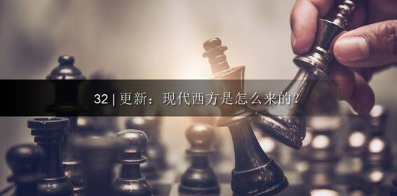

 

你好，欢迎来到《西方史纲 50 讲》。

上一个单元我跟你聊了西方的中世纪，中世纪快要结束的时候，它真是问题丛生，到处都是麻烦。经济凋敝、黑死病、拜占庭灭亡都是大问题。

再看看原先的两股主导力量，教会堕落了，它扰乱了政治、败坏了精神；而世俗政权还没有真正强大起来，但是已经开始肆意膨胀，掠夺社会。

西方还有希望从这种岌岌可危的局面中走出来吗？结果你是知道的，它走出来了，而且活得还不错。那就要问了，西方在当时究竟是怎么走出来的呢？

## 现代化不是西化

今天这一讲，我先给你画一个大大的草图，让你对西方最近这 500 年的走向有一个大致的印象。你可以先抓住现代西方成长的三个基本线索：

第一条线索是，国家崛起，也就是基本政治框架的重塑；

第二条线索是，社会崛起，新的二元结构又形成了；

第三条线索是，市场崛起，资本主义飞速成长。

这三条线索并不是齐头并进的，而且，它们之间有时候合作、有时候打架，相互缠绕、相互塑造。每一条线索里面都存在着几种模式，成长的道路细分起来真是十个手指头都不够数。

说到这里，你应该已经发现了：现代化的实现方式其实有很多种路径，并不是只有唯一一条路可以走。如果西方自己的发展道路就已经足够的多样化，那就证明现代化不是只有一条路可以走，那就可以大胆地得出一个基本结论：现代化肯定不是西化。

那么，问题接着就来了，如果现代化不是西化，我还带你看西方文明做什么呢？ 这就回到这一讲的主题了：更新。

**西方从自身的传统中更新出了现代，换句话说，西方的传统中现代基因最多，它是顺势长成的。**所以它实现现代化最早，受益最大。尽管现代化不是西化，但西方的基因值得深入研究，也只有从西方的基因中把握了现代化的道理，再说我们不走西化的道路，才真的有底气。

开头我跟你说了现代西方成长的三条线索，分别是国家崛起、社会崛起和市场崛起。那这一讲，我就从国家、社会、市场三个方面跟你聊什么是现代，西方如何通过更新自己的传统，率先实现了现代化。

## 国家的崛起

我们先来看看第一条线索，国家的崛起。你可能会说，不对啊，国家不是在奴隶社会就有了吗，怎么说它是现代西方成长的重要线索呢？不错，大多数学科几乎都把国家的诞生看成文明诞生的标志，换句话说，他们认为国家和文明一样古老。

**但我现在要告诉你的是：国家就是现代的，它和古时候的城邦、共和、帝国、王国、教皇国、王朝都不一样。**你现在觉得再熟悉不过的国家，最早也就只能上溯到中世纪中期，它是从那个时候成长起来的，而且很快就成为了推进西方成长的动力，把西方推进了现代。

现代国家是一个权力的集装箱，国家集成了很多权力，因此你可以把国家的崛起理解成一个权力集中的过程。

古时候那些政治共同体和权力没有关系吗？当然有关系，但它们所拥有的权力，在能力和价值观上面都和现代国家有很大的不同。

**从条件上来看，古代的经济、社会、文化状况和政治状况一样都不够发达，很难支撑起权力高度集中的政治。**比如中国古时候，费孝通先生有个著名的判断叫“皇权不下县”，皇帝的权力到县令为止，基层是靠家族、靠乡绅来治理。皇帝们不想把权力往下延伸吗？不是，是因为客观上做不到。

朝廷只发县令的俸禄，像什么师爷、衙役，这都不叫官，叫吏，用现在的话说，就是这些吏没有朝廷的正式编制，只是通过人事代理为朝廷服务。朝廷资源有限，只能把县以下的管理职能交给家族和乡绅。

罗马也是一样，罗马管辖之下的犹太人，靠犹太人的拉比去管，希腊人靠他们各自的城邦去管，只要政治和军事上服从罗马，管理上是高度自治的。否则几十万罗马军人怎么可能压制住 500 多万平方公里，4600 多万人呢。

所以，古代政治共同体再强大，强大到罗马那样征服世界，客观上也不可能将自己的权力完全渗透和支配整个社会。

**在价值观层面，古代政治共同体也不能够赤裸裸地谈权力，权力来自上帝也好，来自天命也罢，头上一定有更高级的东西存在。**即便皇帝口是心非，传统价值观也会对他构成巨大的约束，为什么呢？

如果皇帝胆敢公然违反价值观，对统治基础、制度运转、民心民意都会构成巨大的阻力，虽然对他的限制不够直接，但也绝不是可以随便漠视的。

**这样一个价值观优先于权力的逻辑，使得权力难以高度集中，甚至集权是被主动抑制的。**就像中国传统中，法家这样一套集权的制度、策略和技术，在道义上就被儒家压制。

明白了古代政治共同体在能力和价值观上的基本特点，你就知道现代国家要跨越这些障碍，实现集权真不是一件容易的事情。不过，这个进程在西方中世纪中期就已经启动了。

国家崛起这个过程，可以理解这么几个问题，政治上的集权集了什么权、怎么集的、集起来之后的权力形成了什么样的结构、产生了什么样的后果。

在这条思路下，你也就能理解后来的革命和民主了，你可以把革命看作对集权的反抗和矫正，把民主看作对集权的驯化和利用。

在国家集权的过程中，很自然的事情就是，各国实现集权的路径并不相同，结果它们的政治结构存在重大差异，这种差异又进一步推动了它们在社会和市场两个方面的差异。这就造成了大国崛起的路径各不相同。

**权力结构的更新，是西方从中世纪走向现代的基本动力和线索。**这是我在这个单元要花大力气跟你分析的问题。

## 社会的崛起

刚才大致说完了国家这条线索，我们再来看看社会。社会有广义和狭义之分，广义的社会就是除了政治之外的所有领域；狭义的就是从里面还要除去市场经济，把市场独立出来，社会就专门指自治组织、社会团体、公共事业。

从广义的社会来看，如果说国家崛起是现代西方文明发展的主旋律，那么，社会崛起就是必不可少的复调，没有这根线索，不可能完整解释现代西方文明。

**国家崛起和社会崛起之间有相互配合的一面，也有相互冲突的一面。**你知道，权力会自动膨胀，膨胀是权力的本性，所以，只能靠权力来挡住权力，它才不会肆意妄为。

但这里就有两个问题，**第一个是，如果挡不住，会是什么样的局面？第二个问题是，如果要挡，去哪里找能挡住权力的权力？**

第一个问题的答案比较简单，如果挡不住权力，结果就是征税像抢钱、征兵像抢人，所有人都不安全，不仅没有权力的人会随时被权力肆意侵犯，有权力的人其实也不安全，他们活在为了保住权力，于是拼命扩张权力的怪圈里，争权夺利根本停不下来。

**第二个问题比较复杂，去哪里找能挡住权力的权力？**这个问题，听起来像“把老虎关进笼子里”一样，感觉不错。不过这种想法实际上很难经得起推敲！

我跟你推敲一下：谁来造笼子，谁来抓老虎，如果这个人能够抓住老虎，怎么保证他不会比老虎危害更大？抓老虎进笼子很可能掉进一个无限后退的逻辑：为了干掉魔鬼引来了更大的魔鬼。

**所以，为了解开这个死结，必须双管齐下：在政治权力内部，要塑造复合型的权力结构。**也就是不能只有一方完全说了算，要使得政治权力相互形成制衡；在政治权力外部，也要塑造复合型的社会结构，使得政治权力的生存环境和资源来源，都对政治形成制衡。这两个复合型结构比较复杂，政治权力内部的复合型结构，我会放到后面国家崛起那一讲具体跟你讲，社会的复合型结构，我会放在社会的名义下讲。

可能你要问了，**西方为什么能形成复合型呢，道理很简单，它的基本前提是多元化。只有“多”，才谈得上复合。**多种元素、多种力量、多种人群之间相互磨合、协调、配合，逐渐形成相对稳定的结构，复合型就出现了。而这种情况恰恰是西方最为丰厚的资产。

想想古希腊成百上千的城邦，流派众多的哲学；再想想古罗马这么强大，它也无法靠军人实现直接统治，只能尊重被征服地区的传统和治理方式；再看看中世纪国王们都无权无势，只能靠封建契约来具体管理每个地方；再想想阿奎那，只有他那样的顶级学问家，才把古希腊、古罗马、基督教这些不同的传统都打通了。你看，西方从古希腊到现在，从来不缺少多元性。

我在开头说了，西方从中世纪进入现代，其实是从自己的传统中完成了更新。现在你了解了国家和社会这两条基本成长线索，那你应该也能猜到，西方现代化的更新过程，最重要的结构性更新就是社会取代了教会，社会与国家形成了一种新的二元结构。

当然，社会像国家一样也有一个成长的过程，相应地，新二元结构的成长也有一个过程。我会在这个单元把国家崛起作为主调，把社会崛起作为复调，不断地给你提示这种二元结构。

## 市场的崛起

说完了国家和社会，还有市场这个成长线索。现代西方经济的成长，最明显的事实就是资本主义的崛起。

在这门课里，针对市场，只打算解决一个问题**，资本作为西方文明的物质营养，在最宏观的层次上，它是怎么样和政治、社会相配合、相协调的。**

**在国家与社会的新二元结构当中，资本会帮谁？**你会说，亚当·斯密讲市场是看不见的手，这句话的政治含义就是拒绝国家干预，资本当然是帮社会啊！

不过你还要看到另外一面，怎么分蛋糕决定了蛋糕能做多大，分蛋糕主要是政治权力的事情，那么分蛋糕的人怎么会容忍做蛋糕的人总是和他作对呢？

而且从基本事实来看，**资本主义就是在现代西方国家里面飞速膨胀的，你应该也能隐隐感觉到，国家和资本之间有某种默契和互助。**所谓资产阶级国家到底是怎么回事？所有这些问题，我会在这个单元跟你一一分享。

本讲小结

好，总结下这一讲的内容，西方从中世纪向现代迈进，各国走了不同的道路，西方现代化道路的多样性，本身就证明了现代化并不是西化。

西方的现代与中世纪之间最显著的更新是，国家作为一个权力的集装箱，不断加强集权，淘汰掉了古代所有的政治共同体；第二个显著的更新是社会取代了教会，与国家形成了新的二元结构；第三个显著的更新是市场经济和资本主义全面替代了自然经济和封建经济。

下一讲我要带你去看看西方走进现代的第一件大事，文艺复兴，不用文艺的眼光看，而是用权力的眼光看，它到底是什么样子，产生了什么重大的影响。

期待你的到来，下一讲再见！

精选留言

点击直接进入下一章节

**王黎璐**:  
欧洲国家的近现代政治制度与模式并未彻底颠覆之前体系、框架，而只是改变了原先政治体制中的阶级构成。换句话说，整个政治体系的框架是在中世纪便已初步形成，或至少奠定了基础，后来的变革实质上只是资产阶级登上政治舞台后使原先的体制朝着有利于他们方向上的进一步完善。  
并且，对历史与传统的继承无疑是近现代西方权力制衡体系形成的关键因素。然而，单纯靠继承尚不足以使其完善，在历史的基础上不断变革才是应有之道。以英国为例，集体协商与法律至上的机制作为一种传统在被保留的同时也在不断变革着，即便大多数时候都在为王权服务。而在 18 世纪以后资本主义国家的议会日益转型成为多种政治力量博弈的场所，也逐步变为多种利益集团斗争与妥协的平台。  
今天的课再一次提醒我：尽管西方的自由、平等、博爱的民主思潮令人向往，立法、行政、司法的分权制衡的体系也看似完美，但应理性地认识到的是，这一切都需要文明的长期积淀。任何脱离本国历史与现实，盲目照搬他国的道路与经验是行不通的。并且从西方现代化道路的多样性中，我们要找出自己的更新路径。

**作者回复**:我个人偏好，老树开新芽、旧瓶装新酒是文明演化最好的路子。可惜大多数国家都没做成。

**Allelujah**:  
从权力的变迁来观察文明和历史的进程，实在是有一种高屋建瓴的通透感——权力本身是塑造和限制社会形态最重要的力量，把握好权力演化的脉络，就能顺藤摸瓜，找到西方现代化的关键，由此推演出文明如何向着现代化发展的根本逻辑。  
  
已经迫不及待要领教老师接下来的课程了😁

**陈 C**:  
在我看来，这一讲算是西方社会现代化进程的“导论”。老师之前所讲的“两纵三横”中“权力的生成与流转”的一横，便在此凸显出来。  
  
就如前面的课程中提到的，经过了罗马的集权尝试之后，漫长的中世纪里西方的权力始终是政教分离、相互制衡的关系；这个体系又因为教会的精神属性与强势力量，而保持了一段时间的稳定。但是后期“限制权力的权力”自身却野蛮生长成为了魔鬼，导致了中世纪二元体系的崩塌。西方自此不得不走上了探索新权力结构的道路。  
  
因此西方社会现代化，某种意义上就是对权力的集中与制衡的新一轮探索。正如老师所讲，权力具有自行生长的天性，因而就需要一系列的方法来制约权力的扩张，并“修剪”掉过度生长出来的“枝杈”。这里两纵三横的一条纵线，“文明与野蛮”便浮现了出来。  
  
最早的探索，虽然也伴随着理论的推进，但修剪权力枝杈多以革命甚至是战争的形式呈现——就连教会自家的事情也是如此，更何况政权呢。而随着现代化进程的深入，西方在利用人文、民主，权力拆分、相互制约等工具限制权力的同时，“修剪枝杈”的手段也逐渐从“野蛮”转向了“文明”，武装革命推翻暴政的故事，逐渐被法律限制、弹劾等新“套路”所取代。

**作者回复**:文明没有止境，越强大，越需要文明。

**子曰诗云**:  
复合型政治权利结构与复合型的社会结构对政治形成制衡的观点发人深醒。政治内部权力塑造我们够不着左右不了，但是从自身做起提高公民素质，积极参加社会组织可行。如果一个社会的公民只依赖政府，对公共事务参与程度不高，对 NGO 无感，没有公益心只埋头挣钱，那么这个国家现代化只是外强中干、跛足而行。

**作者回复**:绝大部分很正确！和我讲苏拉的那一段对比一下，有什么样的人民就会有什么样的政治，如今可以继续往前推进，有什么样的人民就会有什么样的国家、有什么样的社会、有什么样的国家-社会结构性关系。

**佛祖门徒**:  
老师的每一课能量密度很高，仅仅梳理一遍都是挂一漏万，不过仍然对加深理解非常有益。  
第一、现代化的本质。越是耳熟能详且张嘴就来的概念，越需要回到概念诞生的本源去探究本质，否则所有围绕概念的争论不过是自说自话，流于表面。“现代化”正是这样一个概念，老师已经把其本质表述得非常清晰明了。  
第二、现代化的框架。我把现代化的框架理解为：国家是“政治外壳”、社会是“均衡器”、市场是“发动机”，三者形成了现代化的完整结构。国家提供了制度保障，社会对国家权力形成有效外部制衡，市场则为国家强大、社会发展提供源源不竭的动力，互相协同推进文明的进步。

**作者回复**:国家是政治的外壳，力度不够。在很长一段时间，尤其是下面要讲的现代早期，国家几乎是政治的全部。

**蝉**:  
李老师教导我们:熟知非真知。  
  
约定俗成的观念很可能未达究竟，比如国家与文明的关系不是笼统地相伴相生。而是对以往统治方式的更新。社会与国家的相互制衡也是中世纪时期教会——政权二元结构的继承。  
  
西方意义上的社会(自组织、团体等)又是怎样出现的呢？中国明清时期的商帮、江湖等可否算做社会的一部分呢？

**作者回复**:西方的社会在很大程度上是中世纪遗迹的更新。中世纪前 500 年，政权没有能力照顾大家，大家就自组织起来照顾自己。多元化的组织非常普遍。后来商业复兴、城市兴起、大学兴起，中世纪后期又成长出一大批。但它们在某些国家崛起的过程中遭到了严厉打击。活下来并不容易。不过好在底子相对比较厚，腾挪的空间相对比较大。帮派当然是其中的一种，行会是很重要的角色。

**刘一玮**:  
李筠老师所讲的现代国家核心在于集权，我觉得振聋发聩。我们往往把启蒙运动的民主认为是现代国家的标志，其实那只是一种现代国家。今天的不少集权国家，政府的权力直达底层的个体，才是现代国家的基本特征。至于对政府力量的制衡，是使得国家稳定的必要保证。没有权力制衡的国家，充满了崩塌的风险，也就是亨廷顿在《第三波》里讲到的埃及、泰国等不成功的走向民主的国家。当然，还有些极权国家虽然已经是现代国家，但政府的统治依靠强力，社会和经济毫无生气。

**作者回复**:你的结论是对的，我强化一下：一个有韧劲儿的国家才是真正强大的国家。后面我会专门用英国跟你解释这个道理。

**颜筋柳骨**:  
老师好，学习这节课有个小疑问，课里讲到“西方为什么能形成复合型呢，道理很简单，它的基本前提是多元化。只有“多”，才谈得上复合。”  
这种多元化在中国是没有的吗？或者中国为什么没有形成这种复合型呢？

**作者回复**:这个问题好！复合型结构形成的逻辑是这样：1.多，已经讲了。2.多元之间要有足够的差异，始终难以完全同化，文化、信念、组织、成长逻辑各有各的一套，对方再强大也收编不掉，你看教会以为阿奎那收编了亚里士多德，结果是把鬼都放出来了；3.独立的多元之间还要相通，有榫卯让它们形成深度的合作。你顺着这个逻辑想想中国。

**苏格拉磊**:  
#每天学习西方史纲#  
均衡的环境，避免出现权力的过度集中，同时也给予商业的发展空间，经济基础决定上层建筑，经济发展会反向制衡上层的权力，因为人民要过好日子。  
只不过当权力和经济都集中在个人手里的时候，国家要该怎么发展呢？自由还是专制比较适合？还是得看情况呢？像同属于专制体质的伊朗和沙特，后者反而更加稳定些，不知道该怎么理解呢？

**作者回复**:伊朗可不是一片专制，就从公民真实且有效地选举总统这个事情来说，她是伊斯兰国家中最民主的，在全世界来看也算好的。但她的稳定性并不低。伊朗的宪政结构很独特。伊朗的政治制度既有特色又有效能，不是一片黑。

**其乐融融**:  
李老师好！  
“西方从中世纪向现代迈进，各国走了不同的道路，西方现代化道路的多样性，本身就证明了现代化并不是西化。”老师今天总结的这段话，耐人寻味。  
1.虽然从多样性道路最后都走到了一处～西方现代化，但这个现代化是基于西方土壤的产物，这个现代化看似多元，实则同源。  
2.但现代化不等同于西化。因为今天现代化的世界呈现着不同文化形态下的多个样貌，西方现代化只是其中最具影响力的一支。  
3.在国家社会的自我塑造完善之路上，只能学习不能抄袭，西化一定会水土不服，丧失自我。  
期待老师下回分解🕸

**作者回复**:你的思路是对的，不过还需要再往前推一大步，回想一下我在加餐《纵横》里的提示：学习的正确姿势是“得其神而忘其形”。不抄袭不照搬不等于完全拒绝。事情不能照人家办成了的那一套复刻，但人家怎么办成的道理要提炼出来，懂了道理，我们才知道事情该怎么办，怎么和自己的情况和特定的条件相结合。没有学会道理，照搬照抄和一味拒绝实际上共享了同样的愚昧。

**ZHENIA**:  
老师的课太丰富了，这一课顶好几课，喜欢这样高浓度的杰作，虽然需要看好几遍听好几遍。  
西方现代化的基因最多，因此走在了世界的前列。现代化不是西化，这个观点很新颖，原以为我们一直走在后面，对这个问题的理解会极大提高我们的文化自信。

**A learner**:  
今天的内容宽度很大，听了两遍+读了三遍才在脑中把框架搭建完毕。  
一个感受，我对西方的认识真得是太浅薄太浅薄了。自由、民主、三权分立……都是表象的体现。  
所以前面的三十讲是基底，是铺垫，是西方多元化要素的历史进程。在此基础上，这些要素通过三条线的交错发展，并融合成了今天的西方世界。戏的高潮终于要开始了……

**作者回复**:你比我更适合写预告片的台词！

**成洁 getit**:  
今天我注意到了现代文明和古代文明关系的尺度和权力的生成和流转的线索。  
东西方都有古代，彼此亦有很多相似之处，古不是东，今不是西。  
国家和社会、政治制度安排从来都是在现有资源安排下、各方妥协的“最佳方案”。  
现代化是当下的最好选择，可以考察源流和形成发展过程，却不必跨越时空做出肤浅的评价。

**作者回复**:展开大尺度的比较，才能看清自己的路。埋头拉车不看路，反而容易人云亦云地认为只有一条路。

**奔跑的菠萝**:  
通过本课的学习，让我认识到西方之所以能够孕育出现代文明，能够形成复合型社会结构，是因为其拥有丰富多样的基因。通过探知西方历史的发展脉络，观察各方力量交互博弈中各个基因的发展趋势，进而理解现代化这个“物种”的进化历程，可能我们学些本课程需要始终秉持的一个核心视角。李筠老师高屋建瓴的指导，深入浅出的讲解让我所学甚丰、受益匪浅，真的非常感谢！

**作者回复**:学习西方史的一个难处就是“多”很难处理，我尽量帮你理出个头绪来！

**一念花开**:  
几点收获  
1.国家的崛起，应该是权力的清晰和集中。  
2.社会的崛起，应是社会力量有了其他的组织动员形式，如党派、社团、代表等，从而可以在一定程度上对国家政策方向产生影响  
3.市场的崛起，经济的发展让更多的人脱离了基础的劳动，从而有更多的有精力去关心政治，这应该也是一方面。  
4.“把老虎关进笼子”导致的权力悖论，现在西方国家的做法是通过分权，形成三权分立，相互监督制约。中国在这一块主要靠领导人的智慧。  
5.“现代化并不是西化“，为什么总是强调这句话？因为我们总想走捷径，以为照着西方走过的路再走一遍就能到达现代化，这是一种比较机械论的思维方式。殊不知发展的道路受很多因素影响，一个因素变化了，结果可能就变化了，这是不可简单复制的。路还是要自己来走，多方借鉴，因地制宜。

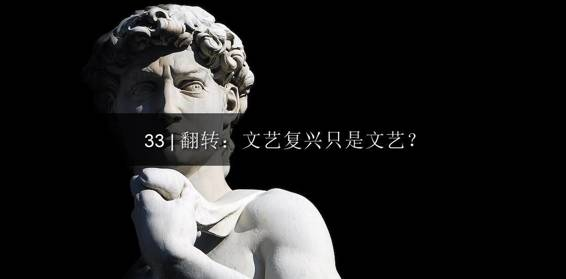

 

你好，欢迎来到《西方史纲 50 讲》。

上一讲我跟你画了一张西方现代化的草图，也就是明确了西方文明从中世纪更新到现代，最主要的动力和线索，是国家崛起、社会崛起和市场崛起。

## 人本主义的回归

这一讲，我来帮你把这幅草图先涂上底色：这个底色就是人，或者说人本主义。你看，国家、社会、市场其实都是人的事情。**现代西方文明的底色就是人本主义。人本主义的核心是人本位，意思就是人成了世界的基础，人成了世界的中心，国家、社会、市场都是人的舞台。**

相应地，人本主义的兴起，也就意味着基督教衰落，失去了主导地位，上帝退居二线，人逐渐占据舞台的中心，从前神高高在上、人匍匐在下的关系被翻转了。

从神本位到人本位的翻转是一个很漫长的过程，宗教改革、国家崛起、社会崛起、市场崛起、科学兴起、启蒙运动、民主化这些大事情、大潮流都推动了人本位的形成，大致经历了五六百年，到 19 世纪，才彻底完成。

你可以把现代西方的成长看成是人的崛起、人彻底占据整个世界的过程，所以，现代西方文明的底色是人。从神本位的世界变成人本位的世界，这个翻转的起点是文艺复兴，今天我就带你去看看文艺复兴。

## 文艺复兴对神和人关系的翻转

提到文艺复兴，你会想起达·芬奇的《蒙娜丽莎》、米开朗基罗的《大卫》雕塑、拉斐尔的《雅典学院》。

的确，中文把 Renaissance 翻译成文艺复兴的时候就是觉得这场运动太文艺了，绘画、雕塑、建筑、诗歌、戏剧、小说、散文这些主要的艺术形式，在那一两百年里简直是大爆发，而且，很多文艺成就到今天也没有人超过。我这门课里不跟你讲文艺，如果你对文艺复兴的文艺感兴趣，可以去听严伯钧老师的《西方艺术课》。

我这里要跟你讲的是，**文艺复兴如何开启了一个新的历史进程，也就是它翻转了神和人的关系，以及，文艺复兴如何为当时的社会提供了人本位和世俗化的底色。**这个底色又如何促进了国家崛起、社会崛起和市场崛起，改变了西方文明的根本面貌。

看看 Renaissance 这个词，它的本意很简单，就是“再生”或者“重生”。文艺不过是西方文明再生过程中最吸引眼球的面相，但并不是它唯一的面相，更不是它的底层逻辑。

那到底什么东西再生了？表面上是古希腊罗马艺术的再生，实质上，**文艺复兴干将们想要的是，古希腊罗马文明的再生，确切地说，是想让古希腊、古罗马时期那种围绕人所形成的世界得到再生。**

为什么要顶着让上帝不高兴的风头，让古希腊罗马再生？很简单，文艺复兴干将们一方面觉得古希腊罗马实在是太好了，太美了；另一方面他们觉得古希腊罗马已经被基督教弄死了。

## 两次文艺复兴的关系

在讲中世纪的时候我跟你重点讲过亚里士多德革命，亚里士多德重回西方，打破了基督教对文化的垄断，引发了 12 世纪文艺复兴。

作为现代西方起点的意大利文艺复兴，和 12 世纪文艺复兴几乎连在一起，都是对古希腊罗马文化的重新引入和弘扬，只不过主题发生了实质性的变化。

12 世纪文艺复兴还是在原有的旧的精神框架里去复兴，还是在基督教文化里为亚里士多德代表的古希腊世界找到一个妥当的位置；而意大利文艺复兴是要重新建立一个新的精神框架，是要恢复古希腊罗马那种以人为中心的世界。

**把两个文艺复兴区别开，涉及到了文艺复兴和中世纪的基本关系。**两个文艺复兴的差别，也就是中世纪和现代的差别，是人本主义。在文艺复兴的干将们看来，刚刚过去的时代，也就是中世纪，是插在他们和古希腊罗马之间的黑暗时代，人的光辉和文明都被基督教抹掉了，他们抨击中世纪是黑暗的，要再造一个光明的世界。

他们的心情可以理解，但他们的结论并不完全可靠。人就是这样，想创造新世界的时候，都会把之前的旧社会说得特别黑暗，实际上任何一个所谓的旧社会的真面貌都不是革命者控诉的那个样子。

如果你是要去探索文明的兴衰，尤其是通过长历史、大脉络去发现文明的内在逻辑，那么我劝你赶快放下非黑即白的思维方式。这种大而化之扣帽子的办法，会让思想变得简单粗暴，很难深入文明的底层。

明白了文艺复兴对中世纪的态度，你就能理解我在上一个单元为什么总是跟你讲“中世纪没有那么黑暗”，记住这一点，也会对你理解文艺复兴有帮助。

很明显，文艺复兴的干将们是在用贬损中世纪的办法标榜自我，那他们的自我标榜到底是不是名副其实，他们有没有做到他们宣称的让古希腊罗马再生，创造一个新的以人为基础和中心的文明？

从长远来看，实现了，从文艺复兴本身来说，没有完全实现。他们只是起了个头，后面还有大量的工作要通过别的运动去完成。

## 文艺复兴的贡献

我带你看看文艺复兴干将们都干了哪些事情，你就能明白我为什么说他们开启了新时代，但离完成还差很远。

**他们的第一大贡献是，艺术表现。**文艺复兴绘画、雕塑、建筑、小说、戏剧、诗歌到底表达了什么？人。如果让你选一幅画来代表文艺复兴，我相信你会和我一样选达芬奇的《蒙娜丽莎》。达芬奇画得真是太漂亮了，画中的人简直是完美，以至于让你产生错觉，她更接近神而不是人。

这种技艺高超的作品充分证明了“艺术来源于生活，又高于生活”，所谓高于生活，就是把人的光辉充分展现出来，当你觉得这份光辉实在太耀眼的时候，人实际上是分享了神性，或者说神的光辉被转移到了人的身上。**这个时候的人看起来非常饱满，人的自信、乐观、坚定通过一个一个接近神的艺术杰作被树立起来，正所谓“大写的人站起来了”。**

**除了艺术上的贡献，文艺复兴干将们的第二大贡献是，道德改造。**人生在世，什么才是值得追求的？基督教告诉你是上帝的恩典，文艺复兴讲的是世俗的幸福。

但丁的名著《神曲》讲了一个大故事，告诉你上帝的恩典和世俗的幸福不是一回事，你要是追求世俗的幸福，也挺好，不是什么罪恶的事情。

文艺复兴的其他干将们沿着但丁的线索把故事越讲越大，通常分成正反两个方面：正面讲人的故事、人的生活，世俗世界的这些喜乐悲欢是人最真实的样子；反面讲教会的故事，教会里面这些高级教士也贪恋权力、金钱、美色，他们也是俗人。

讲故事的调子慢慢就变了，不再像中世纪那样用故事让你去体会虔诚、纯洁、爱上帝，而是用故事让你去体会真实、世俗、爱人类。

终于，**在文艺复兴快要结束的时候，政治哲学家马基雅维利告诉君主，如果你想建功立业，那么，对不起，旧的虔诚、纯洁、爱上帝那一套不灵了，必须拿出人的真实、世俗、奋进的这一套。**两套道德观对于君主来说不兼容，做人还是做基督徒，你自己选。如果我们每个人都成了自己的主人，你会怎么选？

**文艺复兴的第三大贡献是，科学萌芽。**人有光辉的形象，有自己的道德追求，那么，人有自己的能力吗？当然有，科学就是证明人自己有能力的最重要的证据，它不仅能够帮助人认识世界，而且还能帮助人改造世界。

刚才说了，文艺复兴的重点在人的形象塑造和道德改造，那么它自然而然地就带出了科学的萌芽，因为科学是人证明自己的必须选项。你一定知道达芬奇不仅是画家，他还做了人体解剖，还设计了飞机、坦克、潜艇，可以说，达芬奇就是文艺复兴时代的科学怪人。

但你可能不知道，伽利略这位人类历史上最伟大的科学家，和文艺复兴时期顶级的建筑家布鲁内斯基、顶级的艺术家米开朗基罗一样，都受到了文艺复兴核心豪门美第奇家族的资助和庇护，如果不是美第奇家族跟罗马教廷关系深厚，伽利略恐怕很难写个悔过书就能逃过火刑。

艺术、道德和科学，表面上看起来没什么联系，但它们都是围绕人展开的，当人的形象和道德被重塑，人逐渐站立起来成为世界的中心，人和世界的关系就必须提上日程，人怎么认识世界、怎么改造世界就必须通过科学去解决。

## 世俗化进程的开启

很明显，人的形象塑造、道德改造和科学革命并没有在文艺复兴时代就全部完成，它们开始的时候并不是故意和上帝作对，文艺复兴艺术大多数其实是宗教题材，人的光辉是从上帝那里借来的。

文艺复兴刚开始的时候，人们相信，科学的根源在于上帝创造了一个有规律的完美世界，人要去发现上帝为世界制定的规律。**也就是说，现代艺术、道德、科学脱离基督教，成为现在纯粹世俗的样子，并不是文艺复兴从开始就策划好的，而是人逐渐变得自信，后来甚至变得自负、自大后带来的结果。**

大写的人站起来了，最核心的是大写的君主站起来了，因为一切艺术、道德、科学的文明成就，必须用政治加以保护，而文艺复兴时代掌握政治权力的是君主，他们是文艺复兴的支持者和保护者，也是最直接的受益者。但是，现代政治却存在着一个极其诡异的逻辑：由“大写的人站起来”开启的世俗化进程，最终会实质性地摧毁君主制。

不要看到美第奇家族和那么多大画家、大建筑家、大科学家关系好得不得了，就觉得人本主义一定对君主有利。**根子上，神本主义的世界观，才天然有利于君主制，相应地，人本主义的世界观天然不利于君主制。**

神始终需要君主在人间代行统治，所以君权神授是古代政治的基本逻辑；翻转了之后呢？神如果离开了，君权神授自然也就不成立了，人还需要君主代为统治吗？为什么不自己统治自己？人拥有统治自己的最高权力，就是人民主权。

所以，世俗化的进程一旦开启，君主制就难逃被摧毁的厄运，最多像英国那样留下一个不再掌握实际权力的王室作为象征罢了。

本讲小结

好，总结一下这一讲的内容，文艺复兴是西方从中世纪走向现代的起点，大写的人站起来了，从此开启了一个新的进程，不可逆转，也就是人成为现代西方文明的底色。

在这个过程中，君主制庇护了世俗化的潮流，也从中受益，但它最终会被摧毁，因为神和人的关系翻转，在政治上意味着政治逻辑将从君权神授翻转为人民主权。

但是，君主制被摧毁还需时日，它还有重要的任务要完成，就是现代西方成长最核心的任务：国家崛起，在国家崛起的路上，最重要的障碍是教会，我带你先看看教会是怎么被摧毁的。

下一讲我带你去看西方走进现代的第二件大事，宗教改革。

期待你的到来，下一讲再见！

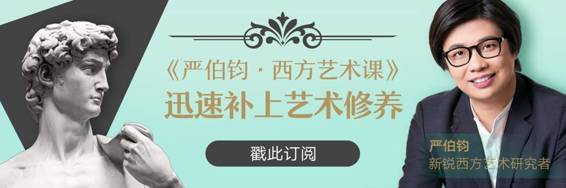

精选留言

点击直接进入下一章节

**Allelujah**:  
听完今天的课程，我有一个猜想：  
  
在文艺复兴之前，基督教通过将古希腊哲学、亚里士多德的理论同化的方式，维护了自己在思想上的权威；而在文艺复兴之后，人本主义反过来影响了基督教的思想——在清教徒的眼中，他们不再认为上帝的恩典只和追求属灵、属天的生活有关，世俗的成功也是一件值得追求的事（虽然追求世俗的成功也是为了荣耀神）。  
  
马克斯韦伯在《新教伦理与资本主义精神》中详细论述了清教徒的观念与资本主义发展的关系，而新教伦理的确立，或许就在文艺复兴之后、马丁路德的宗教改革中有所展现。

**作者回复**:明天就是宗教改革和新教伦理，一个大升级接踵而至。

**一念花开**:  
1.现代西方文明的底色是人本主义，经历过从神到人的转变。  
2.看问题不能简单陷于黑白二元对立。  
3.神和人关系的翻转，在政治上意味着政治逻辑将从君权神授转变为人民民主。  
4.另外感谢老师连续几次的留言加精，很有正反馈的激励作用。让我感觉到通过这么一个手段能与远在天边原本不可能有所交集的老师有思想上的交流实在是一件幸运的事。

**作者回复**:不客气。让学生得到启发，热爱知识和生活，是老师的天职。

**华联天下**:  
弄懂西方这条历史主线太重要了，那么多哲学家、思想家的经典作品都要在了解西方历史背景的基础上来理解，同时也是弄懂当下的中国从西方借鉴过来的各种制度的来龙去脉。  
这节课讲到基督教给人负面的影响，并转向人本主义，而人本主义的兴起导致与君主制的冲突，而与君主制配合的教会就要改革，新的政治秩序的也要改革，从老师说的权力的流转来看更清晰。

**作者回复**:这里确实可以多说几句哲学，人本主义的来临意味着哲学基本主题的巨变。从前的哲学都是本体论为主，古希腊哲学家讨论始基，本，弄清楚了，世界是什么样就弄清楚了。广义而言，中世纪的神学也是本体论，上帝是一切之本，所有探讨围绕这个主题展开。但人本主义兴起之后，人逐渐占据了世界的中心，认识论就成为现代哲学的基本主题。上帝隐去之后，真理还如何可能，就是人的认识问题。

**炭笔**:  
李老师早！今天的课程很有意思:文艺复兴不只是"文艺"复兴，其本质是人本主义的崛起。旗手们收到了世俗君主的帮助，与中世纪和教会划清界限。  
  
课程中老师有句告诫"这种大而化之扣帽子的办法，会让思想变得简单粗暴，很难深入文明的底层。"可谓发人深省。  
  
非黑即白和扣帽子，不仅是历史局中人攻击敌人，抬高自己的工具，也是人们简化历史便于记忆的手段。虽然我们很早就清楚，这样会掩盖历史细节，产生错误理解。但是我们看到的历史叙述，已经是经过非黑即白化处理过的了。因此，即使有意识避免，也很容易落入这种思维陷阱。  
  
很感谢老师一直致力于还原细节和真像，让我们能有幸看到真实的过去。

**作者回复**:确实，不是每个人都有那么多时间去当“侦探”，所以怀疑精神和开放心态很重要，有它们，我们才可能拥有清明的理智去看到更多的真相。

**佛祖门徒**:  
直播非常精彩，感谢老师系统梳理西方文明发展过程中的三次接力。  
听到这节课，我对老师在第二课中提到讲西方历史为什么以古希腊文明为原点这个问题，有了更加深刻的感受。  
第一、文艺复兴的初心。在一些精英心中永远怀念过去甚至远古的美好时光，因此，重现古希腊和古罗马文明的辉煌就成为了他们发动文艺复兴的初心。在但丁等文艺复兴先锋的眼中，即便只是为了“唤醒”民众来响应他们的主张，恐怕也需要将中世纪描绘成“黑色”。  
第二、文艺复兴的意义。最为根本的影响就是从艺术、道德和科学等方面开启了以“人本主义”为核心的世俗化进程。有意识的是，君主们为了自己权位的巩固以对抗教廷而极力庇护了世俗化的潮流，但是兴起的人本主义最终成为了或制约或摧毁君主制的根本力量，这种“事与愿违”扶植起自己掘墓人的结果，恐怕是国王们始料不及的。

**作者回复**:确实，限于时长，有很多东西没有办法展开。前后对照是个打通理顺的好办法。很多同学都提议把这门课从 50 讲变成 1 年讲，提高精细度，收到大家的这种反馈之后，我和罗胖花很长时间讨论了这个事情。现在，没有办法立马解决。但我希望的是你们学完这门课就有了框架、有了见识、有了尺度，去处理更多的知识和事情。讲是永远讲不完的，授人以鱼不如授人以渔。对了，说起直播，有个小遗憾，其实我是很想和你们对上眼神的，但站了好多地方眼镜始终反光，下次一定让你们从我的眼神里看到我如这些文字一样的真诚。

**奔跑的菠萝**:  
在文艺复兴时期，人与神的关系得以反转，西方文明的底层逻辑由神本主义转成了人本主义，这带来的冲击力必然是大地震级的。  
   
如此巨大的根本性变动比如需要在文化历史中寻得理论支持，所以古希腊罗马文明得以回归。  
   
再者，以人为核心的理念强化了大家活在当下的思想观念，进而增强了大家对现世生活的热爱、对世俗享受的追求、对建功立业的渴望以及对科学技术的探知，在这样的大势下国家、社会、市场都得到了历史性的发展机遇。这也定下了西方加速迈进现代化的发展主调。  
   
短短一讲，李筠老师就为我们深度解析了这一历史性的变革并捋清了西方现代化的发展思路，为之叹服！

**王·刚 数据化转型**:  
老师好：  
  
非常期待老师今晚的课程，特来打 CALL。  
  
上次老师给我提的批评建议：用精炼的需要表达自己的观点。最近我学习了思维导图，梳理之后整理笔记如下：  
  
1，西方中世纪演变，国家，社会和市场等以人为中心的组织崛起，直接导致了“人本主义”上升。  
2，当大写的人树立起来，原来的主导——神，地位就会下降。这种结构的变化，体现在历史记载上，就是“文艺复兴”。  
3，文艺复兴干将，为了推动以人为本的罗马和希腊复生，必须贬低以神为中心的中世纪。体现在历史记载上，就是“黑暗”。  
4，我们要学习史纲，理解历史大脉络，就要透过非黑即白的历史记载，看到决定这种记载方式的事实情况。  
5，文艺复兴三大贡献：艺术，人被赋予神的光辉。道德，神被蒙上世俗的欲望。科学，证明人可以像神一样掌控世界。文艺复兴在围绕着人展开。  
  
当文艺复兴让大写的人树立起来，人和世界的关系随之发生变化。期待下一讲。  
  
祝老师，秋安。

**作者回复**:西方从中世纪到现代，由文艺复兴启动的大翻转，是一个很长的过程，下面还有好戏。

**王黎璐**:  
世俗化是现代社会的一个重要特征，它所反映的是社会成员总体上的一种新的内在价值取向，是指从文艺复兴以来人类的各种活动逐渐脱离宗教形态的过程，其涉及的内容包括社会的政治、经济、教育、行为规范、生活方式以及整个文化形态。  
人的情感欲求，自我实现的愿望以及宏扬生命的意志，是人的与生俱来的人性的真实反映，也是人的正当权利，因而在现实社会中过符合人性需要的生活，也即世俗化的生活，是人类幸福的要求，幸福在现世而不是彼岸。因此，在商品贸易日益繁荣兴盛，工业经济长足发展的条件下，文艺复兴可以看成以宣扬和追求社会生活世俗化为核心宗旨的人文主义运动。政治上，神权让位于王权、人权;经济上，资本主义商品经济取代封建田园经济，人与人之间的自由竞争代替了身份地位;文化上，对人性美、人性需要的歌颂和肯定取代了对上帝的赞美，人们把追求幸福的月光从天堂转移到了现实，开始造就出五彩斑斓的社会世俗生活。  
阿奎那收编亚里士多德时，教会没有想到会对王权派提供新的武器箱。同样美第奇家族也不会想到人本主义会变的不可收拾直至摧毁君主制。这一抹亮丽的底色让我对君权神授的翻转有了新的认识。

**作者回复**:西方将变得完全不同。但我想提醒你的是，完全不同并不意味着过去的东西完全不存在了，比如基督教、教会，哪怕是被激烈冲击的天主教和天主教会。过去的东西不再占据主流地位、主导地位，但它们仍然会以侧翼的、低调的方式存在，它们仍然构成了现代西方必不可少的多元之一。再推进一步，任何现代化都是结构性调整，元素的位置发生结构性变化，元素并不会消失。

**颜筋柳骨**:  
老师好，该怎么去理解文艺复兴发生在西方，而我们中国没有发生呢？

**作者回复**:这个时候多元传统的重要性就体现出来了，古希腊罗马很辉煌，而且和基督教存在重大差异，复古希腊罗马来抑制基督教就有大把的好牌可以打。中国在文化上不存在如此高度异质的传统，也可以借汉唐抑制明清，但显然力道就不是一回事了。

**A learner**:  
文明总是无声无息地影响着历史的发展，有时不得不赞叹其鬼斧神工。  
早已灭亡的古希腊和古罗马给文艺复兴留下了宝贵的精神财富。同时，这种精神层面的影响不是像历史书所说的都因一个标志性的历史事件而突然爆发。而是，呈现出一种缓慢、细致的渗透形式。例如，没有亚里士多德的文艺复兴就不会有意大利的文艺复兴。前者在教权鼎盛的时期以一种谦卑，共存的姿态，在教权内部萌芽、生长，为后者的出现提供了坚实的基础。  
  
人在弱小的时候需要精神的安慰，而一旦强大起来就会充满自主的欲望。文艺复兴是人独立自主的一个标志性事件。  
艺术上，人类说："你神是美的，我人也是美的，所以我不比你差到哪儿。"  
道德上，人类说："你神的世界虔诚、纯洁。我人的世界真实、奋进。都挺好，所以你过你的，我过我的。"  
科学上，人类说："现在我有了科学的武器，那些原本只有你能解决的问题现在我也能解决了，所以我不需要你了。"

**作者回复**:人走向自负是会出大问题的，后面我会谈这种自负引发的危机和对这种自负的批评。

**helen 袁**:  
16 世纪文艺复兴，在过去的很长时间里，我都认为是文化界的事情，今天这一课，让我了解文艺复兴是现代西方崛起的一个方面，人本主义是现代西方崛起的主线；国家崛起，社会崛起，市场经济崛起，这些都是伴随文艺复兴同时生长的；对于重新认识现代西方社会，真是豁然开朗！

**作者回复**:去繁就简是我想带你们看到的，更是想教你们学会的。

**其乐融融**:  
李老师好！  
谢谢老师耐心指导和真诚鼓励！  
因为只了解过世界通史，还有就是其他学科涉及到西方历史人文的碎片化补充，没有系统学习过，所以对老师这门课很感兴趣，加上老师激情睿智的倾囊相授，真是很过瘾。订阅的二十几门课里，老师这里是互动最强最好的，没有之一！所以 30 节过去了，我这个门外汉也被深深感染，加入留言队伍，不在于入选和指点，而是对老师倾情倾力的精神应有的回应和感谢。在这里最不希望的是下课😄

**作者回复**:谢谢哈！老师总会下课的，天下没有不散的筵席。但学习不会停止，而且，我向你保证，我们一起的学习，不会停止。

**夏宝辉**:  
李老师好！  
一个万恶的旧社会，都是新社会的人给定义的，说不定也没有那么黑暗，就好像中世纪的欧洲一样，不见得黑的一无是处，前后两个五百年还是有着不同的。  
文艺复兴使人走向了舞台中央，神人地位的反转，使得社会更加世俗化，但是也同时给君主有了威胁的地位。所以感慨：历史发展过程中，看似很好的一样东西，在前进的历程中就有可能变成意想不到的枷锁，历史一样，现在一样，未来也一样。这两天炒作量子计算机+人工智能，将会大大的将人类灭亡的时间提前，但谁又能说得清楚，在未来会不会有更新奇的技术来抑制这事呢？！未来已来，未来永远不会来！

**作者回复**:看到的未来有点远了，说明我教你看的过去有效果了。碳基生命被硅基生命取代，是毁灭，还是新生，改天我先去问问卓老板的看法。

**鱼**:  
想问问李老师，还有哪些平台能听你的课。  
对于从小一看到政治课就头疼的人，听你的课太受益了。  
一直对现世的制度、文化从微观角度去理解，结果造成内心的浮躁、困惑、失望。听了您的课，也学着从宏观角度去看现象，分析问题。现在对于很多身边的事，工作上的困惑，能慢慢的释怀了。而且在处理事情时，试着用宏观的角度去解决问题，达到了意想不到的结果。  
“古希腊”这章，我反复听了 4 遍，才大概吸收了文明的“两纵三横”。  
期待能在得到上听到李老师更多的作品！

**作者回复**:谢谢你的厚爱，我还有一个平台就是中国政法大学，在互联网上，得到是唯一。

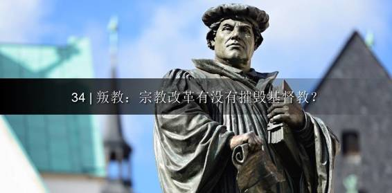

 

你好，欢迎来到《西方史纲 50 讲》。

上一讲我跟你讲了文艺复兴，大写的人站起来了，开始翻转神和人的关系，现代西方朝着世俗化的、以人为中心的方向挺进。

但是，随着世俗政权之间战争的肆虐，文艺复兴走到了尽头。1529 年，神圣罗马皇帝查理五世攻占罗马，这标志着意大利文艺复兴的结束。文艺复兴快要结束的时候，北边的德意志又出大事了，1517 年，据说马丁·路德在符腾堡教堂的大门上，张贴了《九十五条论纲》，宗教改革由此拉开大幕。

文艺复兴和宗教改革有 20 多年重合的时间，但并没有直接相互支援的关系，它们是沿着不同逻辑走出来的。如果说文艺复兴是在中世纪亚里士多德革命的影响下，不断扩大和发酵的结果，那么，宗教改革则是教会走上邪路之后基督教的自救行动。

回想一下我在中世纪跟你讲过的教会大分裂，教会变成了一个争权夺利的吸血鬼，丧失了精神团体的本质，胡作非为，把西方搞得一团糟。从路德的《九十五条论纲》，你就可以明显看到教会实在是坏得不成样子了！

路德的《九十五条论纲》，副标题叫做“驳赎罪券”。赎罪券是教皇用来筹集资金的一种办法，教会说任何人买了赎罪券都可以更容易地上天堂。交钱就可以离上帝更近的话，还要虔诚的信仰干什么？

当时痛斥教皇胡作非为的有识之士很多，那么，为什么是路德引发了宗教改革呢？这一讲我就跟你仔细聊聊路德引发的宗教改革。

## 天主教和新教的区别

我先带你看看教义，这个问题很重要，因为正是从路德开始，**西方的基督教分成了天主教和新教，天主教延续中世纪传统、奉罗马教皇为尊，新教则另起炉灶，完全不承认教皇的权威。**

你去西欧北美旅行的时候，一定会碰到很多漂亮的教堂，总的来说，天主教的教堂富丽堂皇、金玉满堂，窗户上都是用彩色玻璃拼贴成的画作，墙上有气势恢宏的巨幅壁画，穹顶上有宝石水晶的华丽装饰，小祠堂里供奉着各种圣人。

新教的教堂简洁朴素，天主教教堂里面那些富丽堂皇都没有，甚至十字架上都光秃秃的，连耶稣都不在上面。**天主教教堂和新教教堂之间这种奢华和简约的风格对立，根源在于它们之间教义的差别。**

那路德到底改动了什么呢？一句话，因信称义，什么意思？就是说只要你虔诚地信仰，不需要任何别的条件，就能证明你是一个好基督徒。后来经过新教神学家们不断的努力，到了法国神学家加尔文手里，新教的教义完全成型，它和天主教有四个重要的区别：

**第一，人凭什么得救，天主教认为靠上帝的恩典和人的善功，你可以把善功理解成做好事、积功德。而新教认为人能得救只靠上帝的恩典，否定了善功的作用。**你可能要问，人做好事不是应该得到嘉奖吗？为什么新教不同意？

因为新教认为，得救完全取决于上帝的恩典，上帝把一切都安排好了，人做什么都没有用，人不能跟上帝挣表现，更不能跟上帝讨价还价。人做好事是应该的，如果善功被拿出来计算，谁多谁少，就会被别有用心的人利用，你看，教皇们不就把善功变成赎罪券，拿来卖了吗？为了杜绝任何类似的坏事，新教从根源上直接否定了善功，这样一来，教皇们的胡作非为就被釜底抽薪了。

**新教跟天主教的第二大区别是宗教权威的标准，天主教认为权威是教皇诰令，新教认为只有《圣经》。**在路德之前，一般的基督徒没有文化，读不了拉丁文的《圣经》，他们学习基督教的教义只能靠神父布道，而神父布道必须遵照教皇对教义的各种裁决，就必须以教皇诰令为准，所以宗教权威是教皇诰令。

但新教认为基督教的唯一权威就是《圣经》，就是上帝的说法，任何人的说法都不足为据。这样一来，教皇的宗教和法律权威就被彻底否定了。

**第三个区别在于，教会是什么，天主教认为教会是具有强制力的信仰和道德管理机构，是人得救的诺亚方舟；新教则认为人人都是祭司，每个人直接和上帝联系**，不再需要经过神父、主教、红衣主教、教皇，彻底做到上帝面前人人平等，教会只是基督徒的团契，也就是基督徒的聚会、组织。这样一来，教皇领导的天主教会对于新教徒来说就是多余的，新教徒可以自己组成教会，平等地团结在一起。

**第四个区别在于，生活的意义是什么，天主教认为是在服从教会的前提下获得拯救，而新教则认为基督徒必须在一切事业中侍奉上帝，增添上帝的荣耀。**在天主教的生活观里面，只有神职才有意义，出家成为修士，专职侍奉上帝才是高尚职业，其他的职业只不过是俗世的蝇营狗苟。新教，主要是神学家加尔文，打破了这种狭隘的生活观，认为每一个职业都是为了荣耀上帝。这样一来，所有职业都和神职一样神圣了。

## 宗教改革和资本主义精神的关系

你看，**新教与天主教在看待生活意义上的区别，涉及到了现代西方文明的根本品质，也是我想着重跟你讲的第二个方面：资本主义在精神和道德上的大解放。**

马克斯·韦伯的名著《新教伦理与资本主义精神》揭示了这个道理，简单地讲就是，赚钱这个事情不仅不丢人，而且很光荣。**资本主义的精神和道德实质在西方历史上是通过宗教改革，尤其是加尔文，树立起来的。**

在此前基督教一千五百多年的历史当中，赚钱这个事情不太光彩，商人的地位不高，耶稣曾经说过，富人进天堂比骆驼穿过针眼还难。总的来说，如果一个社会是农业占据主导地位，商业在伦理道德和政治法律上就会受到抑制，在这样的社会中总是对商业和商人存在大量的偏见，比如无奸不商、唯利是图、巧言令色、道德败坏，等等。

那么，改变这一切的加尔文是怎么说的呢？他认为，一切职业，而不只是神职，都能荣耀上帝。赚钱也是为了荣耀上帝啊！所以，早期的资本家们是带着荣耀上帝的使命去挣钱的，对于他们来说，玩了命地挣钱不是为了享受，而是为了扫除千年来宗教和社会看不起他们的晦气，是为了证明自己对上帝是有用的。

**正因为这样，把荣耀上帝作为使命的新教伦理，就和现代西方的资本主义精神追求扣合到了一起，资本主义的精神就被解放了，道德枷锁就被解开了。**本来赚钱就是一件人心里面自然充满动力的事情，现在可好，不仅以前的约束都没了，而且还加上了超级强劲的宗教使命感，相当于又安上了氢燃料的火箭，西方的资本主义如此汹涌澎湃也就不足为奇了。

所以你会看到早期的资本家的生活非常奇怪，他们玩了命地挣钱，却不舍得花，甚至有的人还出奇的吝啬。有个很经典的形象叫葛朗台，但如果你知道了新教伦理是资本主义精神的底座，这种挣钱不花钱的生活就很好解释了，因为挣钱不是为了个人享受，也不是为了子孙舒服，而是为了上帝。

挣来的巨额财富怎么处置呢？做慈善。珠宝黄金太沉重，带着它们上不了天堂，得在死前拿来做善事。富人只有做慈善，才能理直气壮地跟上帝说，挣钱是为了上帝不是为了自己，否则一辈子辛辛苦苦就是证明自己唯利是图、道德败坏。

这样一来，原来主要由教会承担的济贫解困的慈善事业就逐渐转由社会来处理，各种基金会、信托、慈善组织都出现了，这些都是把巨额财富回馈社会的制度安排。

这样的资本家看起来很不错，努力挣钱只为回馈社会，你会说，我印象里的资本家不是这样的啊！不错，很多很多资本家确实又回到了传统基督教咒骂的那种无良状态，甚至比从前还坏。我刚提到的韦伯也看到了这一点，要命的问题发生在资本主义精神逐渐长大之后，它和新教伦理脱钩了。

但需要注意的是，现代社会本身就朝着人是中心和世俗化的方向迈进，西方如此，所有现代化的社会也必然如此，资本主义的人心去哪里找，并不只是西方的问题，而是现代人共同的问题。

## 宗教改革的直接后果

**我们把视野再拉回宗教改革的年代，看看宗教改革的直接后果：宗教战争。**路德、加尔文说只靠信仰、不靠善功，只靠圣经、不靠教皇，只靠团结、不靠罗马，基督徒没有等级一律平等，完完全全把教皇权威的根都刨了。

而且，路德说人人自己念《圣经》可不是一句空话，他把《圣经》从标准拉丁文版译成了德文，再加上古登堡印刷机，新教一下子就传播开了。顺便说一句，**现在的西方各国文字主要是从宗教改革时代开始形成的，以前只有口语，文字只有拉丁文。正是因为新教要让每个人都读上《圣经》，才推动西方各国形成了和口语一致的文字。**

好，新教已经要把天主教会刨根了，这时候，如果你是教皇，你会怎么办？对，把路德为首的新教分子抓来上火刑架。教皇也是这么想的，也是这么发布命令的，不过没抓到，因为想跟教皇对着干的诸侯们庇护了路德。

但是，信路德、加尔文的人越来越多之后，诸侯们自己也惹上麻烦了，因为在这些诸侯的领地之内，天主教徒、天主教会和新教徒、新教教会也相互对立。

最终，德国、法国都经历了大规模的宗教战争，信天主教的诸侯结盟，信新教的诸侯也结盟，双方都坚持自己是对的，对方是异端邪说，最后德国和法国都被打得稀巴烂，西班牙和其他国家都深陷其中。

**有历史学家做过粗略的统计，在宗教战争中死亡的人口，甚至不比在黑死病大瘟疫里面死亡的人口少。**所以我们完全有理由说，半条腿刚刚迈进现代的西方，差点毁于宗教战争。

最终，德国诸侯们签订了《奥格斯堡条约》，诸侯们一起承认了一个现代国家得以成立的基本原则，叫做“教随国定”，简单地说就是“谁的地盘，谁的宗教”，诸侯有权决定他的地盘信天主教还是新教，如果你不同意，那就搬走，去信你那个教的诸侯国生活。

总之，宗教的选择听政治权威的，不要再为了宗教打打杀杀。一直到 1598 年，法国国王颁布了一条敕令，叫《南特敕令》，承认了新教徒在法国是合法的，宗教战争才算基本结束。

宗教战争为西方人的心灵增添了一种优良品质，叫做宽容。每个人的信仰都有他自己的道理，尽管你不认同，但要保持宽容，只有这样，大家才有一起生活下去、各自寻找上帝的机会。

本讲小结

好，总结一下这一讲的内容，路德、加尔文领导了宗教改革，基督教没有被宗教改革摧毁，而是分成了天主教和新教，罗马教皇的权威倒是真的被摧毁了，他失去了作为基督教统一组织领袖的地位。

最重要的是，新教伦理解放了资本主义精神，为现代西方资本主义的迅猛发展，提供了最深层次的精神动力。但宗教改革直接引起宗教战争，差一点摧毁了西方，西方从中找到了一种新的制度安排，也就是教随国定，同时也带来了一种新的精神品质，也就是宗教宽容。

资本主义有了灵魂，那肉身呢？下一讲我跟你聊这个问题，从一个让你心潮澎湃的事情讲起，大航海。

期待你的到来，下一讲再见！ 

精选留言

点击直接进入下一章节

**王黎璐**:  
路德战胜了人们对基督教的虔诚所造成的奴役，破除了对教会权威的信仰。把僧侣变成了世人，消除了教士的特权，既把人从外在的宗教束缚中解放了出来，也把肉体从信仰锁链中解放了出来，使祈祷等精神信仰生活仅仅成为现实生活的一个组成部分，回复了职业劳动在现实社会生活中的正当地位。顺应时代发展的宗教改革势必要冲击基督教，同时又要利用基督教对社会心理所造成的定势，注入一种新的价值观。这次变革开创了西方近现代社会的发展之路，它反映了新兴资产阶级的一直和愿望，反映了新兴资产阶级“人”的解放的要求。宗教改革为资本主义民主精神奠定了基础，对资本主义民主进程做出了巨大贡献。  
旧有的因素不断在演化，它们不会被简单的摧毁和湮灭，它们的位置和面目不断在变化，但仍然在起着作用。老师不断的提醒，我们要有连续的历史观。

**佛祖门徒**:  
新教伦理是随着欧洲宗教改革的兴起，尤其是马丁·路德“因信称义”和“委托管理”概念的提出，加之加尔文更为激进的“得救预定论”的提出，逐渐形成和丰富成为较为完整的理论体系。  
其核心内容就是因信称义和委托管理。其作用就在于，引导新教徒把整个尘世当成无形的修道院、成为入世的僧侣，每天都在每个方面、每一时刻虔诚的生活，随时遏制一切轻浮享乐的冲动，毕生都在日常生活中苦修，不懈践行一切合乎上帝意愿的尘世活动，尤其是把条理化的劳动及财富创造过程当作一种增加上帝荣耀的“天职”，直至最终体会到一种安全感。于是，条理化劳动和创造财富成了一种神圣的道德义务、一种改造尘世的必要手段、一种附属于宗教美德的经济美德，新教伦理的经济后果也就呼之欲出了。  
  
新教伦理和资本主义的出现并非具有必然相关性，现代资本主义的诞生具有一定偶然性，主要体现在：  
一是现代资本主义最早出现在西欧和部分中欧地区，并获得了繁荣发展。但后来延伸到了北美，具有偶然性。  
二是新教徒信奉的伦理观和现代资本主义所要求的那种精神建立了一种非常特殊的关系，这种关系也是一种偶然现象。  
三是这种“选择性亲和”的关系持续地发展，意外地、而不是刻意地产生了巨大的经济成就，打造出一个现代资本主义的经济体系，这是一个偶然。这种情况出乎新教徒意料之外，甚至不是他们愿意看到的。  
四是由于新教伦理产生于特殊的地域，除了这些地区以外，现代资本主义在其他地发生的概率非常的小，这又是一个偶然。

**作者回复**:不过文化会相互融合，当天主教国家老打不过新教国家的时候，战争的压力会渗透到人心里，还记得“內裂”吗？学习“先进”文化的国内反对者就会出现，文化的融合会在文化的冲突中加速。

**一念花开**:  
1.宗教改革是教徒的自救行动，并不是从根本上反对基督教义。  
2.新教“因信称义”，只要有虔诚的信仰，而不需要任何别的条件。且人得救只能靠上帝的恩典，否定了赎罪券的作用。  
3.新教重回根本，只认《圣经》，不认教会组织。  
4.新教认为上帝面前人人平等，这是一个延续到现代的人人平等观。  
5.新教认为每一种职业都是为了荣耀上帝，而不是只有神职，从而在精神和道德上解放了商人。  
6.路德把《圣经》从拉丁文翻译成德文，再通过古藤堡印刷机流传开，极大增加了受众数量。  
7.宗教改革引起了宗教战争，从而产生了“教随国定”的制度安排。这是双方谁也奈何不了谁的妥协，逼着人们去接受、去宽容。

**作者回复**:该再进步一点了，除了把总结做得精干，还得思考和推理一些问题，把自己的思路打开，试着走起来。我这根拐棍你迟早是要放下的。

**王岱 Simon One+Two**:  
资本主义最早还是靠新教提供的初始催化剂！  
新教是去教皇化  
教随国定是打出来的共同妥协，打出来了最后宽容

**强 Sean**:  
新教伦理对资本主义精神的解放，为现代西方资本主义的迅猛发展，提供了最深层次的精神动力，所以有了后来轰轰烈烈的工业革命。而且，很多当时受压迫的新教徒，漂洋过海来到大西洋对岸的美国，在这份精神动力的驱动下，慢慢铸造今天这个超级大国。

**作者回复**:对，新教底色对美国很重要，下面会专门跟你聊这个事儿。

**gulu28**:  
李筠老师的这一讲让我很受启发。  
新教与天主教由斗争走向包容，由信仰的斗争走向以经济互补为特征的现代国家，这不正是映射了当前的中美冲突吗？  
东西方的根本冲突是文化的冲突，也就是信仰之争，然而信仰之争会随着沟通的进展而趋向互相理解、包容。这个融合、包容的过程可能是几百年，也可能是几年，越是现代社会，发展的速度越快，文化融合的可能性与推进速度也可能越快，因为毕竟有很多前车之鉴，没有必要重蹈覆辙。  
历史之鉴在前，保持多样性无论从生物态还是文化态，都具有必要性。应该允许通过不同的途径去探索人类共同和谐发展的最佳途径（或者殊途同归）。中国是与西方如此不同的文化、政治体制和历史传统，他在这种体制下能快速崛起，已经证明了这种体制在某个历史时期具有体制上的优势，他完全可能依据自身的特色，走出一条包容西方文化的发展之路，从观念上打破东西方之墙。  
我们所谈的西方史，更像是美国的文化源流。也就是民主，自由、平等的观念是怎么来的，抛开这一价值体系的耀眼光环，其实质是什么。在中国作为弱国向强国学习的过程中，西方的民主自由平等的观念是我们学习的标塔，而当中国真正崛起时，就需要客观的看待这一套价值体系，了解他的宗教根源，他的先进性以及局限性，了解什么样的国民情结塑造什么样的国家政治策略，怎样依据本国的国民基调来设计符合自身发展规律的制度结构。  
中国几千年来的大一统，来源于士阶层统一的信仰、统一的文化，而普通的民众，被家族制捆绑在士绅的文化体系上。这促成了持续大一统的文化基础。而当中国融入世界经济、文化格局后，多种信仰被注入到国民思想模式中，是像古老中华文明融合佛、蒙、清文化一样，形成文化的包容力，还是形成信仰的分裂，或者是长期的此消彼长，这都是当前来自于多元文化的挑战。  
从整体上看，欧亚大陆是世界文明的摇篮，从具体文明上看，中国、俄国、印度、日本、伊朗、土耳其、法国，这些历史上曾经强盛一时的土地，都处于民族意识觉醒的时期，是战国纷争还是携手共同发展，全在一念之间。中国将在这样的世界环境中扮演什么样的角色？中美的正面冲突只是这个时代中重要但却短暂的一环，谁能与更多的国家在不同文明间互相协作、互利互惠，结成价值同盟，谁才具备真正的全球领导力。  
向外争取世界多种文化，尤其是代表强国的基督教文化的理解与包容，向内形成适应高速发展的多元共存的文化需要，通过理解包容多元文化，形成新的带有国际视野的共同想象，我想，这是天主教与新教之争带给当代的启发。

**作者回复**:说得很好！多元的融合，我在加餐里强调的第三“横”就是“文明的冲突与融合”。不过，第一横“生存的意志和智慧” 和第二横“权力的生成和流转”不会让融合一帆风顺，很多时候还会加剧冲突。正是因为这种高度的复杂性，我们才需要去向历史求教。

**minmin**:  
这两天“西方哲学课”正在讲黑格尔。  
看到过黑格尔对天主教和新教有这样的评论：“The Catholics had been in the position of oppressors, and the Protestants of the oppressed.”

**作者回复**:可以换个角度呼应黑格尔啊：新教（Protestants）的本意就是抗议者，抗议教皇的胡作非为。The Protestants had been in the position of protestors, and the Catholics of the protested.

**juana li**:  
感慨一下宗教作为最强大的思想武器左右和改变人类社会的巨大力量：成体系的宗教信仰、大批的受众能，深刻而彻底的改变了人的行为，决定了社会深层的精神内核并左右社会的前进方向。  
  
从这个意义上说，是精神形态决定了社会基础。  
  
如果普遍的信仰、大批的受众可以叫做宗教，那么自由主义、人文主义或者其他穿着各种外衣的新宗教，同样在左右着我们这个社会走向。可以想见，未来各种形式的新宗教还会层出不穷，改变着社会的走向，社会也会促使新的宗教形式产生。

**作者回复**:很好的推理。意识形态是宗教没落之后它的替代品。

**静雨荷香**:  
新教伦理解决了资本主义精神，所有职业都是可以荣耀上帝的，挣钱的终极目的是为了慈善，初期资本家的对金钱的极度渴望与对自身的吝啬找到了精神的慰藉。以前感觉小说虚构的吝啬鬼形象缺乏真实性，现在看来只能说明自己的无知，没能放在当时的社会大环境中审视。

**作者回复**:不知者不怪，回头再看巴尔扎克的《欧也妮·葛朗台》肯定会更有意思。

**A learner**:  
历史上，每当看到好的事物由盛转衰，最终凋零，人都不免会有一种悲凉感。胸怀大志的英雄、盛极一时的王朝、为天下苍生带来光明的宗教……  
这些事物在发挥着自身价值的同时还要不断抵御着来自内外的侵蚀。东西虽好，但毕竟 bug 也不少。随着内外的不断冲击，这些 bug 会被不断放大，最终美的事物也显露出其丑陋的一面。  
然而，精华总是被新的事物所继承，bug 也在历史的演进中被修复，这个过程仍然在持续着。正如老师在此讲中提到的，在以人和世俗化为中心的现代，人心哪里找的这个 bug 如何修复是我们所有人的问题。  
最后，当和后辈传递价值观的同时，我突然有了种自省的觉悟。因为我知道当他长大的时候，我教给他的东西里或许会有一个对他影响极大的 bug。

**作者回复**:人不可能完美，尽我所能、尽我所善就好，求全反而会变得畏首畏尾。

**蝉**:  
杰里·本特利在《新全球史·文明的传承》中说:新教改革引发的论战有助于君主增强自己的实力。英国、德国、丹麦和瑞典都通过推行新教信仰剥夺了修道院的财产，并利用教会的财富巩固君权。虽然那些仍坚持信仰罗马天主教的国家难以如法炮制，但新教改革运动却让他们在面对宗教对手时，获得了调动资源的合法理由。  
  
按这个解释，宗教改革强化了君主的权力，可是请宗教改革有没有牵制君主的一面呢？

**作者回复**:宗教改革总体上对君主是重大利好，教随国定的原则就是宗教问题君主说了算啊。国家无论在软件上获得了不受教会管束的君权神授，还是在硬件上没收教会财产，都大大受益。不过，像所有大事件一样，反对主流的种子已经埋好了，会成为新的主流。但新教成长出自然权利还需要时间。

**陈 C**:  
经过了中世纪后期的一番权力争夺，教会自身的腐化堕落已成定局，黑死病与东部边境的危机进一步从外部动摇了教会的权威。换句话说，此时的教会已经不再具有往日强势的精神属性了，宗教改革因而也同时具有了基督教内部拨乱反正，以及填补信仰缺失、重塑人民精神世界的作用。  
  
而为了实现这种拨乱反正和精神再造，首先就要去除繁冗，回归最初的教义本身，即回归《圣经》。因为教会已经堕落了，所以教会的权威，连同教会定义的善功、教皇的诰令都要被抛弃掉；人们已经不能再借助教会来与上帝连接了，而是要依靠自己，通过信仰直接与上帝连接。另一方面，印刷术的发明与普及，也为圣经的普及提供了条件，每个人都能直接读到经典，自然也就有了更多信仰上帝的资本。  
  
宗教改革最大的贡献倒并不在宗教本身，而是通过否定教会的权威、重塑个人的权利与义务，解放了西方人的精神世界。人们不再需要被动地等待救赎，而是可以依靠自身努力，主动地实践信仰。一方面人有了自由去自发地发展事业，另一方面人们为了荣耀上帝也必须负起一定的社会责任。这种新教伦理下的资本主义精神，根植于人的个人价值与行为自由，它与阿奎那引入亚氏哲学提升世俗价值，以及文艺复兴期间的人本主义是一脉相承的。从这个角度上讲，亚里士多德思想的回归，可能是西方现代化起源的“第一块多米诺骨牌”，西方从中世纪朝向现代的精神转变，都是在这个基础上生根发芽。

**作者回复**:这个骨牌的脑洞开得很有意思！不过很容易简单化，把不同脉络的演化归并成一条直线，西方的多元性很容易被淡化甚至忽略。

**郝景宇**:  
李筠老师好，关于宗教权威由教皇诰令变成《圣经》的背景我记得罗老师好像在课上也介绍过。  
  
起源是 1456 年德国人古腾堡在美茵兹的印刷厂印刷了一本拉丁文圣经。印刷术在欧陆的出现总体上是新教革命重要的先决条件，它打破了教会对于《圣经》和教义解释权的垄断；与此同时，这种新媒介又起到推进剂的作用，形成了燎原之势。而且为了提高底层人民的接受度，在传播过程中商人们又出了德文版等民族文字，从这个文化方面又推进了民族国家的形成，俨然掀起了一场声势浩大的欧洲信息革命，同时也极大的壮大了市民社会的力量。  
  
然而，这一切的一切开始只是商人们的逐利行为，什么挣钱印什么，却让我们领教了资本主义兴起和市场经济的力量。弹簧被压的越紧，反弹跳起得就越高，从这如火如荼的宗教改革和文艺复兴中我们可以看到，大写的人真的被唤醒了。

**作者回复**:这一讲里我没有特意强调技术。我在圣经传播和古登堡印刷机的关系这个问题上，看法和吴军老师、严伯钧老师相近：技术需要市场，也就是需求，才会被激活，否则即便发明出来，也很容易沉睡。宗教改革释放出来的人人读圣经的需求几乎是无限大的。从这个意义上看，我更想说是宗教改革唤醒了古登堡印刷机。

**炭笔**:  
李老师好，感谢今天的精彩内容。  
  
宗教改革用釜底抽薪式的方法，瓦解了教会权威。但也带来了恐怖宗教战争。遭受惨重代价后，人们才接受了"教随国定"的共识，并有了"宗教宽容"的品质。  
  
这让我意识到，人们的所有制度，所有改变，一定是成本计算的结果。当宗教战争的成本无法承受时，人们才会放弃非此即彼的斗争逻辑，走向宽容。很多民间历史叙事，总是把变革依托于统治者个人的道德，但道德在真实的历史博弈中，其实是不怎么有力的。  
  
看待历史，必须坚决避免道德叙事，从博弈和成本的角度出发，历史会明朗很多。

**作者回复**:看利益、看权力的逻辑是对的，但“坚决避免道德叙事”就有点极端了，因为道德叙事通常也是利益和权力的组成部分，路德不就是用一套新叙事瓦解了教皇权威吗？Word 离 Sword 只有一步之遥。不要非黑即白，学会在多元中寻找轻重缓急才好。

**奔跑的菠萝**:  
人没有牺牲就什么都得不到，为了得到什么东西，就需要付出同等的代价，德国、法国、西班牙等国家在经历了大规模的宗教战争之后让西方人懂得了宽容，懂得了尊重不同的信仰，同样，美国在经历了惨痛的南北战争之后才真正促进了双方的文化认同，从而走上了强国之路。人类的文明发展总是在这样的磕磕碰碰中艰难前行，同时又总是在这样的风雨历练中茁壮成长。  
   
对人类来说，犯过的错误、走过的弯路都不可怕，真正可怕的是不懂得吸取教训而使灾难重复上演。陀思妥耶夫斯基曾说过这么一句值得我们所有人都铭记于心，我惟一担心的事情是我们未来的生活能不能对得起我们曾经承受的那些苦难。

**作者回复**:“汲取教训”的严肃性比你说得还要严肃，毕竟活下来才可能汲取教训，而很多文明犯了错误就灭亡了，教训只能留给别人去汲取了。

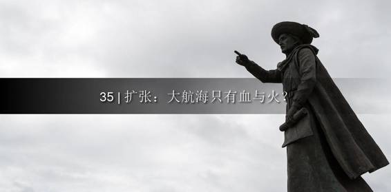

 

你好，欢迎来到《西方史纲 50 讲》。

上一讲我跟你聊了宗教改革。教权衰落，王权膨胀，这是西方踏入现代的基调。到底王权怎么样膨胀，怎么样推动了现代国家的形成，我后面会花很多篇幅跟你细讲。

这一讲我带你从侧面先开个头，看看资本主义是怎么启动的，和国家有什么关系。**启动资本主义最直接的大事，就是大航海。**

关于大航海，你可能知道，西班牙是最早开始航海事业的。但是你也清楚，西班牙后来的发展远远不如后来者，比如英国、法国。那就要问了，为什么各国大航海的结果大不相同。

## 大航海的背景

好，我们先来看看，为什么会有大航海这个事情。**最直接的原因有两个，一是马可·波罗带来的东方想象，二是拜占庭的灭亡。**

马可·波罗十三世纪从中国回到意大利之后，叙述了中国代表的东方非常非常富足，据他说，元大都墙面和房顶都漆上了金银。西方对东方富庶的想象甚至到了荒唐的地步，好像东方遍地黄金，去了就随便捡一样。

不过公元 1453 年拜占庭灭亡了，突厥人掌握了欧亚交界地带，丝绸之路也好、香料之路也好，都变得此路不通。陆地交通不行，只有从海上想办法了。

**但这里有一个观念上的大问题：你是否相信“地”是圆的。**如果相信，航船出海，无论多久，无论往东还是往西，都能回得来；如果不相信，出去了就回不来了。我们现在熟悉的所谓地球，在当时并不是理所当然的。所以，向往金银的人、热爱航海的人自己会去试，出海跑一跑，发明更多的观测工具，观测之后进行精密的数学计算，情况就越来越明朗了。

1488 年，迪亚士抵达好望角；1492 年，哥伦布发现美洲；1498 年，达伽马抵达印度；1522 年，麦哲伦船队完成环球航行。

## 大航海和资本主义的关系

大航海是一件了不起的大事，那它和资本主义有什么关系呢？或者说，它为资本主义带来了什么。

你可能听过这样的说法，大航海带来了殖民主义，为资本主义提供了原始积累，殖民地变成了宗主国的原料供给地和商品倾销地，总之，西方就像吸血鬼、殖民地就像小绵羊。这种印象有它的道理，但并不能帮助你理解大航海和资本主义的深层次问题。

我问一个简单的问题，如果上面的印象没毛病，那么，**西班牙是抢占地盘最多的国家，可它的资本主义为什么不发达？那里面到底有什么奥秘？**

**实际上，殖民主义并非铁板一块，里面有很多种玩法，玩法不同，带来的后果也不同。**不错，西班牙殖民主义的玩法基本上就是国家当强盗，去抢金银珠宝，美洲的阿兹特克文明、印加文明都被西班牙强盗们残酷地消灭了。

**西班牙从美洲确实获取金银无数。但西班牙没有把抢来的巨额财富投入资本主义的再生产**，而是用来装饰奢华的宫殿和教堂了。到后来，西班牙不得不拿出金银去跟荷兰、英国、法国买轻工业制造品。

钱并非天生就是资本，投入再生产，用来生钱的钱才叫资本，花了、吃了、用了、爽了，就不是资本了。这时候你就理解了，不可一世的西班牙殖民帝国为什么没过多久就被英国打败了。

西班牙的殖民主义道路发展有问题，那我再带你看看英国人是怎么当殖民者的，他们怎么把殖民地资源变成了活钱。英国人参加大航海比较晚，葡萄牙、西班牙已经瓜分了大部分新世界之后，英国人才加入游戏。

1602 年，英国人在北美建立了第一个殖民据点，叫做詹姆斯敦，Jamestown。英国人殖民的早期经历可不像西班牙人那么霸气，因为英国在综合国力和航海事业上都在追赶西班牙。

你看，代表西班牙的哥伦布船队，第二次去美洲的时候，有 17 条船，1500 多人，水手、士兵、传教士、想发财的贵族一应俱全，上岸就跟土著说这里是西班牙的地盘，让他们称臣纳贡，不服就打，打下来就把地盘按照西班牙的封建规则给大家分了，完全是陆军在大陆上征服的那一套。哥伦布带去的是火，土著们流出的是血。

相比而言，英国人的两艘小船就太寒酸了，几十个人到了北美，不仅要提防印第安人和西班牙人，甚至连食物和淡水都成问题，他们得到补给的方法居然是等着英国派船拉货来救他们。等到第二批船队抵达詹姆斯敦的时候，被打死和饿死的第一批殖民者高达七成。

不过，聪明的办法总是手里的牌不多的人想出来的。像西班牙这样手里一把好牌，那就按原来的规矩来呗，于是他们自觉地，同时又是不知不觉地用中世纪的规矩处理殖民地资源，就是抢劫，然后分赃。那手里没牌的英国人怎么办？殖民地詹姆斯敦有什么利益可图？

终于，在几十年之后，英国人在那里培植烟草成功，于是，种植烟草成为北美大陆最重要的产业，英国人扩张到哪里，就把种植园开到哪里。下面的问题马上来了：

第一个问题是，烟草卖给谁，自产自销挣不到钱，那么当然是拉回英国卖，让吸烟成为时尚，行销有钱的欧洲；

第二个问题是，烟草谁来种，英国人太少，即便去了英国人工成本也太高，于是黑奴贸易有了充足的动力；

第三个问题是，英国如果买烟草买奴隶，用什么东西来交换，答案是朗姆酒、食盐、布匹。

**好，到这里，著名的黑三角就形成了：从利物浦出海的船，拉满朗姆酒和生活用品，到西非换奴隶，再从西非出发去北美，用奴隶换烟草，再拉着烟草回利物浦。**这条路线刚好和大西洋里几股重要的洋流相吻合，可以说是顺风顺水。英国本土的制造业逐渐进入了为全世界生产的轨道，工业革命在英国率先展开，而且是在英国的纺织业展开。

总的来说，三角贸易使得英国和殖民地整合进同一个资本主义生产体系，资本主义的循环是在英国和新大陆之间展开的。一旦可以循环，钱就变成了资本，就成了活钱，就会越来越多。

## 大航海和国家的关系

说完了大航海和资本主义的关系，我再带你看看大航海和国家的关系，关键的问题是制度。

其实你已经看到了，西班牙和英国扮演的角色大不一样，所以它们的殖民事业和国家前途也大不一样。

西班牙国王和贵族们就是带着掠夺财富的心思支持航海事业的，他们出钱、出兵。**哥伦布跟西班牙国王签订的《圣达菲协议》就是一个分赃协议**：他发现的地盘归西班牙，他享有海军司令、钦差大臣、殖民地总督的权力，可以获得殖民地总产出十分之一的收入。西班牙的玩法就是国家支持和鼓励海外抢劫。相应地，抢到的东西也就按习惯的生活方式挥霍掉了。

英国呢？国王们也想啊，可是没实力。怎么办？公司！**英国人是通过公司来经营管理殖民地，不像西班牙那样用陆军占领的方式直接统治殖民地。**所以，更宽松、更灵活、更有效的治理模式在北美遍地开花，自治在北美就非常兴盛，这就为未来美国的社会基础涂上了民主的底色。

我去詹姆斯敦的时候，专门看了公司股东的名单，有贵族、有财主，还有小企业主，股份有限公司这个伟大的制度发明，简直就是英国人玩转地球的航空母舰。它可以使冒险事业获得最广泛的资金来源，还可以使冒险事业不因为任何人的意志和生老病死被打断。

1600 年，英属东印度公司成立；英属东印度公司通过从国王那里获得的贸易特许权，形成市场垄断，不仅为大英帝国输入了源源不绝的财富，在很长一段时间也充当了殖民地管理机构。

从詹姆斯敦博物馆的股东名单上，我发现了非常好玩的事情：英国贵族和商人混在一起做生意。后来有一半故事你可能知道，资本家、商人做大了，也有了政治要求，向国王和贵族靠拢，产生了一批新贵族，他们实际上是顶着贵族头衔的资产阶级。**我们可以把新贵族的产生看成资产阶级的贵族化。**

但故事还有另一半，老贵族们都成了公司的大股东，这意味着贵族的资产阶级化。**于是，在英国出现了一个非常奇特的现象：资产阶级和贵族相互同化，最终变得你中有我我中有你，分不清谁是谁了。**这样的阶级构成导致资产阶级掌权的时候完全没有必要血洗贵族，后来的革命也就没有那么惨烈。这是后话，我以后再跟你详细分解。

回到大航海时代，英国贵族和商人一起开公司，国王颁发特许状给公司特权，国家通过特许公司的玩法把航海事业、殖民主义和资本主义融为一体，正是关键的制度发明——公司，让这三者相互支持，这是西班牙人派强盗去抢劫殖民地根本办不到的。

## 英国从重商主义到自由贸易的转变

实际上，**西班牙和英国曾经都实行重商主义的国策，但最终只有英国摆脱了这种中世纪的思路，走向了真正与现代资本主义相匹配的自由贸易。**

所谓重商主义，就是追求贸易顺差最大化，把金银都留在本国，把货物都卖给别国，因为金银意味着战争实力，有了战争实力也就有了国家实力。

那英国人怎么摆脱这种思路了呢，他们不需要战争实力吗？当然需要。但现代的资本主义教会了英国人一件事：作为死钱的金银不是真正的财富，投入资本主义再生产的活钱才是真正不会枯竭的财富。

重商主义爱金银的财富观实际上是非常土老帽的，因为它认定世界的财富总量是大致恒定的，金银是有限的嘛，自然只能你多我少。但财富真的只是金银吗？

最终，亚当·斯密挑破了其中的秘密：世界的财富总量不是恒定的，而是没有上限的，因为财富的根源不是金银，而是劳动。劳动创造财富，最关键的事情是从分工找效率，而分工的根本在于市场的规模**。一句话，市场规模越大，分工就越细，劳动生产率就越高，创造的财富就越多。所以，紧守国门会限制自身的市场规模，最终只会和劳动创造财富的道理越走越远。**

英国人之所以突破重商主义，打开国门做生意，甚至最终实现了对全世界实行单边自由贸易，根子上就在于它的航海事业、殖民主义和资本主义连在一起，资本主义一旦长大，亚当·斯密讲的硬道理就会起作用，最终，贸易越来越自由，生产效率越来越高，创造的财富规模越来越大，正是这种逻辑成就了大英帝国。

对比一下西班牙人，抢劫完了守着死钱，资本主义没有得到充分的滋养，钱不投入再生产变成资本，制度没有创新，西班牙最终也就停留在土财主的阶段，很快就在大国竞争中掉队了。

**英国公司取代西班牙强盗，证明了全球化本身必须变得更文明，才能走得更远。**毫无疑问，谁有能力，尤其是制度创新的能力，把更广阔的世界整合成，而不是用武力逼迫成一个经济顺畅循环的体系，谁就可能成为真正的强国，甚至成为世界霸主。

本讲小结

好，总结一下这一讲的内容：经营管理模式不同，决定了西方各国对殖民地利用率存在着巨大差别。英国完成了大航海、殖民主义和资本主义的相互融合和相互强化。

英国手里的牌没有西班牙的好，反而让它想出了更好的办法，下一讲我就带你去看看英国，这个没有几张好牌的国家为什么成了现代西方最强大的国家。

期待你的到来，下一讲再见！

精选留言

点击直接进入下一章节

**佛祖门徒**:  
在《新教伦理与资本主义精神》一书里，韦伯区分了传统资本主义与现代资本主义。我认为就是西班牙与英国不同资本主义发展道路的真实写照。  
西班牙式传统型资本主义，主要表现形式是：1、在专制权力的指缝中飘忽求存的“政治取向的冒险家资本主义”；2、兼有军事和政治远征性质或者强盗行径的“掠夺式资本主义”。传统的资本主义是一种非理性的资本主义。这种经济活动中的企业家往往具有冒险家心态，他们虽然也致力于赢利，但只要能维持他们认为舒适的生活就可以了，而另一方面，他们又极度贪婪和奢侈，且没有道德顾虑，往往诉诸于暴力和投机。  
英国式现代资本主义，主要表现形式是：有计划的投资、和平和契约基础之上的交易、资本计算、自由劳动等，资本家追求资本利用和回报的价值最大化，而不仅仅是把掠夺当作获取财富的唯一手段，也不会肆意挥霍获得的财富。

**作者回复**:韦伯的类型都有历史原型，他才是真的史纲体的祖师爷。

**Allelujah**:  
英国在大航海时代逐渐超越西班牙的关键，在于公司和股份制的发明，可谓是神来之笔。思想这把武器的锋利可见一斑。  
  
但这背后隐藏了一个问题：当时的英国是如何想出这么精妙的设计的？国王又是如何接纳和首肯了这套制度？  
  
假设公司、股份制的发明是在缺乏资源和实力的背景下、在压力中孕育而出，那么是否意味着关键的创新必须要在一定的缺乏中才能完成？西班牙在具有先发优势的状况下，却陷入了赢家陷阱，有可能在领先时避开这种错误吗？

**作者回复**:好办法通常是手里牌不多的人想出来的。用智力、制度去弥补硬资源的不足。硬资源充足了，创新，尤其是制度创新的动力就会不足。

**夏宝辉**:  
李老师好！  
关于本讲，我很认同英国人殖民与早期西班牙人的殖民方式的不同，可能更文明一些，没有野蛮的抢夺，用贸易的手段来获取更多的资源。但是我有个疑问，股份制公司不是荷兰人的发明吗？在两牙之后称霸西方文明的不是荷兰吗？荷兰之后，英国才慢慢发达起来的吗？

**作者回复**:摸到脉络了，很好，不过别着急哈，明天后天聊英国，大后天荷兰就来了。

**亮剑**:  
这一讲涉及到好多经济学知识，顿时感觉对薛兆丰的北大经济学课理解更深了一层！  
财富不是积累出来的，而是创造出来的；像西班牙的强盗逻辑是不会长久的；感觉西班牙他们更像强盗，代表着野蛮，而英国就很现代了！

**作者回复**:我也从薛老师那里学到很多东西！

**强 Sean**:  
关于西班牙和英国两个大国的命运，不得不提的是 1588 年的英西海战。  
  
1588 年，西班牙因为信仰之争与利益摩擦对英格兰剑拔弩张，西班牙集结了一支庞大的无敌舰队发起进攻。英格兰凭借自身的实力和谋略挫败了那个时代的欧洲霸主、势不可挡的西班牙帝国，保卫了国家与信仰的自由。  
  
这场胜利，不仅使得英国飞速崛起，取代西班牙成为新的海上霸主，同时彻底激发了英国人的集体意识，直至二战期间仍鼓舞着他们举国一心，在法西斯德国的炮火下顽强抵抗并最终走向胜利。

**王黎璐**:  
今天的课让我理解了为什么大航海时代最后的赢家是英国。“史”是素材、“纲”是逻辑，让我清晰的看到文明的力量、制度的力量，以及这种力量的包容和扩展：“谁有能力，尤其是制度创新的能力，把更广阔的世界整合成，而不是用物力逼迫成一个经济顺畅循环的体系，谁就可能成为真正的强国，甚至成为世界霸主”。  
当年的东印度公司有着浓厚的官方色彩，与我们今天所说的跨国公司有很大的不同，但毫无疑问，它们开启了现代企业发展的航程。股份制是一种了不起的发明。利用股票的市场流通来筹款，是一种比较安全的融资方式。游资得以涉足信贷业务，信用成为商业最重要的内核。英国东印度公司更代表了一种企业精神的创建。他们确信，企业的长远发展更有利于股东的利益，因此需要避免短视行为，营造更加有效的社会环境包括能产生适当激励的制度，英国在近代工业革命中的蓬勃兴起具有绵长的后劲。反观葡、西的衰落，竭泽而渔，只知挥霍，盲目消费，不事生产，当然就错过了历史赠予的最佳时机。  
国家扶持重点企业，企业回报经济效益，这两者如何形成良性循环？经济活动并非零和博弈，建设一个由自由准入、竞争和不受约束的创新构成的自由市场环境，这种长远的商业策略在今天仍然给我们以启发。

**作者回复**:道理会了得用起来才能产生好效果。

**浪里小白龙**:  
这节课，我理解了重商主义和自由贸易的区别。追求贸易顺差，把钱留在国内，花在消费上是重商主义。自由贸易是把钱当做资本投入再生产，扩大市场，增加参与者，细化分工，把蛋糕做大。  
我反思了自己以及周围的人，其实有点重商主义思维(已经比闭关锁国进步了许多)。

**作者回复**:从重商主义更新到真正的自由贸易并不容易。

**变迁**:  
今天的文章非常精彩，把英国通过大航海的殖民做大做强的深层逻辑解析得清清楚楚，完全让我茅塞顿开。想在文章中画重点却发现全是干货。  
西班牙一手好牌却被翻盘这样的现象在中外历史中屡见不鲜，就像是每次的革命，成功的往往不是最开始的发起者，这在某种程度上说明现在风口上第一个飞起来也很有可能第一个落下去。西班牙输在了意识上，因为西班牙把获得的东西当做了财富，而英国却把获得的东西当做了资本。财富如果没有交换、投入以及连续性和持久性的经营就会坐吃山空，这就是败家子的做法。  
英国现在时代的巅峰上当然有运气因素，大航海开始时的窘迫倒逼其充分的利用和创造出条件来获取财富，在这个过程中再不断地完善和修正具体的做法从而使得其触角可以延伸，同时也能为殖民地带来财富并形成稳定的环境。英国成功地创造了一个全球的产业链并且进入了良性循环。由此带来的利益还在不知不觉中深入的嵌入了政治制度和结构中，这又为英国最终的政体打下了坚实的基础，使得以后的革命水到渠成几乎是和平演变。  
时也？命也？运也？时代的机遇稍纵即逝，我们可以说英国是命运女神的眷顾，但西班牙难道不是？英国的成功我们可以归纳，但西班牙的失败才是我们应该着重研究和时时警惕的深刻教训。

**作者回复**:这种级别失败的代价很轻的可能是几百年，重的可能是永远。

**炭笔**:  
李老师好！很有趣，老师讲大航海，却没怎么说航海家的英勇故事，而是重点说了英国的新思路和制度创新，解释了英国如何把航海，殖民和资本主义有机结合的。  
  
英国起步晚，资源少，于是只能用股份公司的办法，广泛筹集资源以供航海。正是这种制度创新，动员了社会上广泛的力量，使得资源利用最大化，同时带来了自治传统。  
  
而通过再生产和贸易的"钱生钱"逻辑，也让资本主义，贸易和航海有机结合，相互促进。相比西班牙的强盗逻辑，这确实是充满智慧的新思维。  
  
新的发展思维和制度创新能带来发展机遇，这对于今天的中国似乎也很有启发性！

**作者回复**:其实我的每一讲都想给你带来对中国现实的启发。

**山峰**:  
西班牙的衰落  
1、意外的横财消弭了西班牙人的勤勉精神，致使西班牙人轻视事业，疯狂追逐奢侈品。  
2、土地高度集中于权贵，大量金银流入国内，造成物价暴涨，民不聊生。  
3、物价暴涨，形成了上百年时间的通货膨胀，致使国货失去竞争力，走私品甚嚣尘上。  
4、美洲源源不断运来的白银和黄金，让拥有者巨大财富的西班牙权贵，认为自己有花不完的钱，认为可以用钱解决一切问题，西班牙人开始四处打仗，随着海外战争开支巨大，穷兵黩武，西班牙政府多次宣布破产。  
5、源源不绝的黄金和白银，巩固并加强了西班牙旧有的封建王权制，统治阶级掌握了绝对的权力，贵族撤销城市自制，随意卖官鬻爵，拍卖审判权，对下层百姓横征暴敛，过着骄奢淫逸的生活。  
英国的崛起  
1、光荣革命后，确立了君主立宪制。君主的权力被约束，收税要与议会协商。  
2、光荣革命之后，英国政府开始采纳一套为投资、贸易和创新提供有效激励的经济制度，坚决保护全社会的财产权，包括为创新授予专利权而体现的财产权，这种以专利保证的财产权，刺激英国出现了一波波重大的技术创新。  
3、地理因素，英国四面环海，远离欧洲大陆，免受战争的侵袭。  
4、新教国家，新教让西方人学会了工作、节俭和识字，带来的是财富资本与人力资本的积累，促成了工业革命的发展，更带来了西方资本主义的繁荣。  
5、消费，英国全民参与的海洋贸易，提高了广大人民的收入。有钱的民众具有广泛的物质需求，源源不断的需求汇聚形成庞大的本土市场。随着科技革新推动了供给方面的发展，那么正是人类对消费永不满足的追求，推动了英国工业革命需求方面的发展。

**作者回复**:英国击败无敌舰队是 1588 年，光荣革命是 1688 年，在英国建立最典型的现代制度之前，已经走上了强国之路。明天继续跟你分解。

**静雨荷香**:  
中世纪以后，世界的发展逻辑不再是重商主义，英国代表的新贵族用公司的组织形式开始了钱生钱的资本主义，有亚当斯密的理论奠基，有国家实力落后的现实约束，贵族，商人，小企业主等共同筹集资金用于海外殖民主义的新型公司组织形式应运而生，奴隶种植园消费国国又把世界联系在了一起，分工导致的规模扩大，财富增值，最终成就了英国的崛起。

**作者回复**:英国的崛起还有好条件和烂牌，明天后天跟你细说。

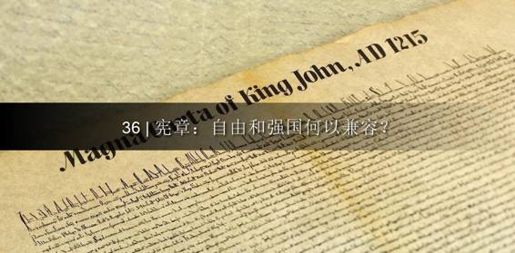

 

你好，欢迎来到《西方史纲 50 讲》。

上一讲我跟你讲了大航海，大航海直接启动了资本主义的发展。英国在大航海中发展出了自己的模式，有效地整合了大航海、殖民主义和资本主义，让它们相互融合、相互强化，资本主义迅速成长，最终成就了世界上第一个真正的全球性帝国。

不过，英国能够成为第一个现代国家，肯定不只是大航海的作用。我在这个单元开篇的时候就跟你说过，现代国家崛起，其实是一个集权的过程。

从这一讲开始，我带你看看几个最重要的现代国家的形成过程，我们从英国开始，比对法国和美国，捎上德国和波兰。你会发现，**现代国家的形成，就是集中和理顺权力。**

国王要从哪里集中权力呢？答案是贵族和教会的权力。这时候你就明白了，现代国家形成的过程，基本就是国王从贵族和教会手里抢夺权力的过程。

我们先来讲英国的故事，今天这一讲，我们先看看中世纪给英国留下的政治资产，英国国王们是通过什么办法来实现中央集权的？下一讲，我们再来看，英国究竟是如何解决贵族问题和宗教问题的。

## 英国国王是如何实现中央集权的

先看第一个问题，英国的中央集权是怎么实现的，跟其他国家有什么不同。所有国王要从中世纪分散离心的格局当中建立起统一的国家，就必须实现中央集权。

提起中央集权，你的第一反应可能就是想到秦始皇，秦王朝有统一的军队、统一的官僚和税收系统，有了统一的度量衡和文字，甚至有了统一的交通和邮政系统。这些硬件是中世纪国王们做梦都不敢想的。

回想一下中世纪早期的状况，政治权力的分散和经济、社会、文化的羸弱、分散是高度一致的。秦始皇的伟业，中世纪的国王们没有资格去干。那他们怎么办呢？我跟你说说英国国王们的解决方案。在这里，英国代表的西方和中国之间一个重大的政治差别就出现了。

**英国国王们是通过司法系统的集权，来实现中央集权的。**回想一下我跟你讲过的中世纪，教皇正是通过司法权、立法权的统一，把教会变成了最接近国家的组织，成为各国模仿的对象。这种司法集权的模式，和秦始皇通过军队和行政实现的中央集权大不一样。所以，英国政治的底色是司法，中国政治的底色是行政，至今仍然如此。

那么，问题接着来了，为什么英国国王们不像秦始皇那么干？他们不想吗？当然不是，而是因为他们没有这个实力。

这里补充一点英国的历史背景。公元 1066 年，来自法国的诺曼底公爵威廉，跨过英吉利海峡，征服英格兰，使得英国成为西欧文化圈的成员。在这次征服之前，英国和丹麦、瑞典、挪威一样，属于北欧文化圈，英国国王有很长一段时间是丹麦国王兼任的。

威廉在黑斯廷斯战役中击败了英国本岛主力，你猜，威廉手里有多少人？两千。你没听错，就两千。这仗打的，也就是规模稍微大一点的群架。

仗打赢了，但就这两千人，怎么统治 13 万平方公里的英格兰？没办法，只有封建制，只能依靠封建领主。不过威廉比其他国王更牛气，毕竟他是征服者嘛，在欧洲大陆，基本的封建规则是“我的附庸的附庸不是我的附庸”，封建契约的效力仅限于签约双方，大领主不能越级指挥。

征服者威廉打破了这个规则，所有的附庸，哪怕是附庸的附庸，都是他的附庸，就这样，他拥有了比别的国王更大的权力。**但即便如此，英国当时的基本格局仍然是领主附庸的封建制，国王管理王国的基本方式是司法。再强调一遍，他手里没有统一的军队，也没有统一的官僚系统。**

到了亨利二世的手里，集权的程度进一步加深。亨利二世是征服者威廉的后代，他的老妈是征服者威廉的孙女。**亨利二世 1154 年即位之后，发动司法改革，把英国的司法权归置成一个上下有序的系统。**

没有兵也没有官，就只能从司法上做文章。那亨利二世具体是怎么通过司法来加强中央集权的呢？

**第一，他建立王室法院系统**，伦敦有王室法院，很快就变成了最高法院，各地派出巡回法院，钦差以国王的名义审案，从制度上强化国王的司法权力。

**第二，他建立陪审团制度**，让熟悉当地情况的普通百姓加入审判，直接和钦差法官接触，避开当地的领主发挥民主政治作用。这在政治上可以说是民主时代到来之前的民主。

**第三，他建立令状制度**，积累司法经验，把同类案件类型化，规定管辖权，从国王的法院那里拿到令状，当事人就可以不去领主法院，而去国王的法院起诉。

国王不可能用硬办法摧毁领主法院，但令状制度可以很巧妙地破解领主法院的权威，你可以把令状看成国王吸引臣民的优惠券，这个优惠没有别的，就是公正。国王就用更公正的司法审判吸引臣民们“用脚投票”。

而国王得到的，是自己司法权力的强化，还有领主司法权力的削弱，以及臣民对他的忠诚。**英国中央集权成功的标志，是国王成了王国的首席大法官。**

亨利二世改革司法的过程，就是英国国家权力集中和理顺的过程，**权力一旦以司法而不是行政为基干整合成一个系统，它就有了体系性的威力，对后来产生的立法权和行政权都构成了强大的威慑。**

刚才我提到，亨利二世的司法改革，推动英国形成了一套独特的法律传统，叫普通法，简单地说就是判例法。法律规则不是法条，而是判例，现在案子怎么判要根据从前案子的判决。控辩双方的律师就是要向法官证明自己找到的那个先例和本案是最像的。

好，通过司法改革，英国国王加强了集权。集中起来的权力需要理顺，绝不是国王的权力越大越好。简单来说，诸多权力要搭建成一个合理的结构，在英国，这个事情的关键是《大宪章》。你大概知道，**《大宪章》是英国宪政的基石，它的核心是捍卫自由，其实它最初捍卫的是贵族的自由。**

## 国王和贵族如何共享权力

问题来了，**拥有司法中央集权的英国国王们，为什么不干掉《大宪章》，继续强化自己的权力呢？**

答案还是，没办法，办不到。

我在美国国家档案馆仔细端详过《大宪章》的原件，英国、美国，乃至整个西方，都把它奉为珍宝，档案馆用来保护它的安保措施，不比保护《蒙娜丽莎》的差。但我要告诉你的是，它其实没那么神。绝对不要把它想象成无敌天书，所有胡作非为的国王见了它就腿软。政治是靠实力斗争出来的，不是靠法力念咒吓出来的，好政治更是如此。

《大宪章》的主要内容是，约翰王必须尊重造反贵族的各种权利，这些权利是贵族们的特权。也就是说，它的原始状态是国王和贵族双方重申封建特权。

实际上，想赖账的国王不在少数，之所以赖不掉是因为他们没有绝对的武力去制服诸侯。也有不少国王一上台就重申尊重《大宪章》，他们当然也不是天真，他们的目的是通过重申《大宪章》来稳住贵族，稳住自己的统治。**归根结底，《大宪章》没有被摧毁，反而越来越强大，是国王干不掉贵族的结果。**

好，这里会产生一个意义重大的政治认识：**国王干不掉贵族，使得《大宪章》这块自由的基石逐渐长成了自由的大厦，但这绝不意味着贵族越强大，就越会形成一个自由的国家。国王在那个时代代表了中央集权，但他对面的贵族，不一定就代表了自由。**

**有一个国家把贵族自由推到了极端，结果，这个国家亡了，被列强瓜分了，那就是波兰。**波兰的贵族们太强大，国王什么也做不了，中央集权就实现不了，贵族组成的议会掌握了核心权力，干不成任何事情，也不让国王干任何事情，国家就建不成，就始终停留在几个贵族合伙过日子的阶段。

等周围的德国、俄国都成了武力超强的现代国家，波兰就只能承受待宰羔羊的命运，也就没有资格谈自由了。所以，自由必须是保障权力得到凝聚的自由，贵族太自由会毁了国家建设，在政治里面，均衡是非常重要的，任何好东西过头了，也会带来大危害。

这个时候我们再回过头来看英国的《大宪章》，就能清醒很多了，它不是贵族一方对付国王的利器，而是贵族和国王团结在一起的平台。

有了它，国王尊重贵族的特权，很大程度上是和贵族们制度性地共享权力，这就带来了最好的结果：**王在议会，king in the parliament，这是英国政治的第一公式。国王不能单独为王，必须在议会之中，必须通过议会来统治；议会也不是贵族的俱乐部，而是以国王为中心的国家最高政治机构。**

**国王和贵族的斗争是一面，但合作是必不可少的另一面，既斗争又合作，谁也离不开谁，才会形成复合型的权力结构，而《大宪章》正是在这个意义上成就了英国宪政。**宪政就是一种多种势力参与，各方在其中斗争又合作、各方也都努力维护的政治平台。也正因为这样，《大宪章》才成为了英国自由之源，同时也是英国的强国之本。

## 从特权到人权的过程

你可能会问，**《大宪章》不是只维护贵族特权吗？如果只是少数人的权利得到保护，那算什么自由啊？**

签订《大宪章》的二十几个男爵，先得到了国王对特权的保证，没签的贵族不想要吗？当然想。于是他们去争取。大贵族先争取到了，小贵族不想要吗？小贵族争取到了，新贵族不想要吗？新贵族争取到了，没得到贵族头衔的资产阶级不想要吗？等等等等。

这时候你就明白了，现代化的过程从权利的角度看，就是一个从特权到普遍人权的过程。这个过程不是自动的，而是一个个阶级阶层，陆续争取而来的，一层一层向外扩展，是一个同心圆结构。

这里必须解释一下权利的普及为什么是同心圆结构，而不是，甚至不应该是一步到位完成的。权利意味着相互承认。国王承认男爵有特权，男爵承认国王的权威。**权利是双方的，不是单方的，它必须由双方达成默契，才能对未来看不见的事情作出保证，自动维护。**贵族是这样，资产阶级是这样，各种弱势群体也是这样，权利都是争取来的，争取来的才会用，也才会珍惜。

讲到这里，你就知道《大宪章》为什么是自由的基石了。**如果说现代英国的成长是一个从特权到人权的同心圆结构，那么，《大宪章》就是这个同心圆的圆心。**处在同心圆结构里的每一个群体构成了一个整体，尽管加入有早有晚，但拥有相同的向心力，国家就这样通过权利让所有人团结起来。

到了这里，《大宪章》的秘密就完全揭开了：**权力（power）的凝聚和权利（right）的扩展，缠绕在一起，相互强化，复合型的权力结构有能力容纳更多阶层的权利，更多阶层加入，又使得复合型权力结构更稳固。**

这样一来，英国就形成了自由和强国之间相互强化的关系，而没有落入波兰那种相互拆台的情形。

本讲小结

好，总结一下这一讲的内容：英国通过司法集权集中和理顺权力，也创造出了英国独特的普通法传统。凭借中世纪留下的政治资产——《大宪章》，英国在后来的政治斗争中，实现了自由和强国的兼容，自由和强国之间形成了良性的共生关系。

下一讲，我要加入两个新的重要元素，来观察英国的国家崛起，一个是宗教问题，一个是贵族问题。只有成功地解决了这两个问题，英国才真正成为一个现代国家。

期待你的到来，下一讲再见！

精选留言

点击直接进入下一章节

**Allelujah**:  
《大宪章》的历史沿革按照时间排序，发生在意大利文艺复兴之前。那么老师为什么没有按照时间顺序来讲述，而是似乎在这里往前回溯了一下？  
  
在这门课的发刊词中，老师介绍了自己理解西方历史的一套逻辑，即“文明的两纵三横”。而这一板块内容的核心，显然就是“三横”中的“权力的生成和流转”这条线索。  
  
这再一次提醒了我：理解历史的流变，重要的不是分析或独立、或连贯的事件，重要的是分析隐藏在事件背后，思想、政治、文明的脉络。

**作者回复**:谢谢你的理解。我补一刀：意大利著名历史学家克罗齐说，编年史只是历史的材料。我很同意他的看法。按照年代顺下来给你讲是最偷懒最没有见识的讲法。如果有理解，有重点，有脉络，实在很难避免时间上的参差错落。

**王黎璐**:  
英国宪政追根溯源，即来自骑士制度下的大宪章，其基本精神即王权有限和个人自由。这个文件是一个划时代的人权宣言：它在人类历史上首次确立了人权的基本原则，提出了保护个人的尊严、反对国王滥权的基本精神；它要求恢复人的权利，并制定一个宪法来保证这些权利。  
天下没有免费的午餐，民主绝不会从天而降。可以说，人们争得的每一份公民权利都浸透着鲜血。暴烈的权力争夺使理性的英国人逐渐领悟，暴力不能解决权力问题，只有适当的妥协与和解才有可能结束暴力，而权力是无法消灭的，但必须用法律将权力这个魔鬼关入魔瓶。终于，英国创造了一个标志着现代政治文明的民主制度——君主立宪制。  
“权力（power）的凝聚和权利（right）的扩展，缠绕在一起，相互强化，复合型的权力结构有能力容纳更多阶层的权利，更多阶层加入，又使得复合型权力结构更稳固”。这是对大宪章对根本的阐释。

**作者回复**:“魔瓶”来了！回想一下我在“更新”里面推敲的“把老虎关进笼子”的故事。权力的生长和权力的规制必须并行，否则就会陷入老虎养大了谁来抓的困境。这一讲我就是通过大宪章来解释英国式的“并行”如何实现。

**佛祖门徒**:  
读过马修·黑尔的《英格兰普通法史》一书，结合老师本节课的内容谈谈自己的认识。  
第一、为什么历史上英国普通法能够一直独立于政治动荡，保持了连续性和稳定性？  
英国大法官霍姆斯说过:“法律的声明不是逻辑, 而是经验。”英国普通法能够保持“两性”的有两个重要原因：一是案件审理中的遵循先例原则。遵循先例原则在很大程度上可以限制法官的任意性, 保持判例法律的稳定性和连续性, 但是也容易造成法官和法律的保守。  
二是英国人的法治理性。一方面，英国人重行动,所以在行动时不愿受到阻碍,他们向往自由,同时一切政治生活及社会生活都以理性为出发点,这样就造就了英国的法治。另一方面，英国人重法治而不重私情, 法律地位一律平等。  
第二、《大宪章》对于完善英格兰普通法的重要作用。  
《大宪章》是一个世界法治的标志,它代表着人权和民主,代表着公正审判,代表着法治和个人自由，它确立从三个方面进一步完善了英格兰普通法，即第 12 条、第 39 条、第 45 条所确立的税收法定、法律正当程序、法律职业专门化三原则。  
　　第 12 条 除非通过王国的共同协商,否则不得征收任何免服兵役税或供金。下列三项税金除外:赎回国王身体之所需者、国王长子受封武士之所需者以及国王长女婚嫁之所需者；且上述三项供金之征收必须合理。  
　　第 39 条 除非由地位相等的人通过合法裁判或依据国家的法律,否则,任何自由人皆不得以任何其他方式遭受逮捕、监禁或剥夺其权利或财产,或宣布为非法、或放逐或剥夺其地位；否则,我们将以武力反对他,或组织其他人这样做。  
　　第 45 条 只有知悉王国的法律并愿意完全遵守法律者,才能被任命为法官、执法官、治安官或法警。

**作者回复**:略微快了点哈！如果权利（自由）是逐步（一个个人群）实现的，那么，平等也是。自由和平等在同心圆扩展的结构里面可以看成不同的角度、不同的侧面、不同的要素，在很长很长的时间里，它们是好朋友。而一个真正的好政治里面，它们也应该是好朋友，虽然偶然（经常性地偶尔）吵吵架。

**一念花开**:  
1.英国政治和底色是司法，中国政治的底色是行政。  
2.《大宪章》是英国宪政的基石，其核心是捍卫自由。很大程度上是国王对贵族的妥协。  
3.“王在议会”是英国政治的第一公式。国王必须通过议会来统治，议会则多由贵族组成。国王只要参与进来了，并且认同这套制度，而不是高高在上或刻意远离，就有可能达成妥协。  
4.宪政是一种多种势力参与，各方在其中斗争又合作，并努力维护的政治平台。  
5.权利意味着相互承认。现在化的过程，就是一个从特权到普遍人权的过程，是一个个阶级陆续争取来的。

**作者回复**:不要恐惧“多”，在“多”中求得“一”才是好政治。

**陈 C**:  
中世纪欧洲大陆的权力格局，是以封建制为基础的，特点就在于“我的附庸的附庸，不是我的附庸”。而英国实行集权进而成就国家的崛起，关键就在于，稳住了贵族，又团结起了底层，获得了整个国家对自身权力的认同。具体到手段上，对底层民众是基于普通法的法治建设，对贵族则是围绕着《大宪章》维持的均衡关系。  
  
实现集权有行政与法治两种形式。在中国则是以行政手段为主展开的，其特点是效率高，控制力强；但缺陷在于，行政系统自上而下的扩展，依赖于君主武力的绝对优势、知识阶层的扩大、社会工具的统一等多个条件的协调生长，任何一个条件的不足都会制约系统的发展。对比可发现，英国法治系统的建立，则是一种自下而上的生长过程，一方面判例来自基层，天然是与底层民众息息相关的；另一方面判例会经过归纳与提纯形成具有普遍性的法律，君主则会通过与普遍法律的协调而达到与整个法治系统的统一。这样一个系统虽然生长缓慢，但具有自我革新迭代的潜力，以及对行政司法的威慑力；英国也依靠着这一系统，“绕过”了贵族实现了权力向民众的展开（作为对比，我对法国、德国为代表的大陆法系的确立非常感兴趣。不知道他们的集权，到底是行政与法治之间的中间态，还是另一种逻辑的法治建设，期待老师的讲解）。  
  
而与贵族之间的制衡，如老师所讲，是围绕着《大宪章》展开的。虽然这种制衡最初也只是一种谁也吃不掉谁，“无可奈何”的结果；但之后这种制衡发展成为议会形式的，制度性的权力共享，权力的中心便也通过合作而稳定了下来。  
  
在国王与民众、国王与贵族之间关系的协调之后，接下来，权力如何由中心向外辐射？贵族与民众之间的权与利的关系又如何协调呢？老师提到了“同心圆”的结构，即君主与贵族之后，各阶层通过斗争，逐批加入体系，使其得以生长。而另一方面，我认为老师上一堂课提到的，贵族与资产阶级的相互同化也起到了作用：这种同化既缓和了斗争，避免了英国如同法国那样的社会震荡，也让资产阶级因为具有了贵族性质而更容易加入到这个“同心圆”当中。

**作者回复**:连起来了，很好很好！下节课还有，继续连起来！

**炭笔**:  
李老师好！今天讲了英国权力集中和权利扩散的渐变性历史过程，这是英国兼容强国和自由的关键，但也是我们不熟悉的。  
  
李老师强调过，历史是连续的，不是由几个事件天然地割裂的。但我们平时看到的历史叙述，都倾向于用一个个大事件串联。加上我国，法国和美国，在走向现代自由社会时，都发生了大革命。因此很多人的视野中，天然地觉得，自由是靠推到重来的大事件得到的。  
  
这节课，老师讲述了"由特权但普遍人权"的渐变过程，一个个阶层通过争取，陆续加入这个权利结构，形成稳固的同心圆，使得自由与强国相互强化。这实在是打开了理解历史的新思路。

**作者回复**:天上真不会掉什么馅饼，如果有人这么跟你说，一定是想骗你，小骗子骗你的钱，大骗子骗你的心。

**郝景宇**:  
老师好，刚刚看学友的留言才意识到时间线这个很重要的细节，记得之前讲中世纪的时候老师也留下一个线索就是《大宪章》签署时的时代大背景还是教权鼎盛的时期。如此对照，英国可以说非常了不起，在制度上已经领先于时代了，虽然王权的集权程度比起欧陆国家较高，但是没有足够强大的军队和一整套官僚系统，还是没有办法与贵族抗衡，这也是英国区别于欧陆后来的专制国权的一个很大区别。  
权力（power）的凝聚和权利（right）的扩展，缠绕在一起，相互强化，复合型的权力结构有能力容纳更多阶层的权利，更多阶层加入，又使得复合型权力结构更稳固。这样一来，英国就形成了自由和强国之间相互强化的关系，而没有落入波兰那种相互拆台的情形。  
但是我们也要看到，随着大航海时代的来临，资产阶级的势力的壮大，新的生产要素出现人们会产生更多的政治需求以维护其既得利益，势必也会激起矛盾和冲突。  
历史的发展是螺旋式的上升，纷繁复杂。只有以史为鉴，才能屏蔽掉杂音干扰，探骊得珠，把握住真正的大势。

**作者回复**:是的，不断的有新阶层要求权利，进而分享权力，并不是一个顺利的过程，英国毕竟也发生了资产阶级革命嘛。不过回想一下上一讲提到的英国独特的“贵族资产阶级化”和“资产阶级贵族化”同时展开，结合这节课的权力和权利缠绕前进的逻辑，你就能理解英国的革命为什么“光荣”了。

**浪里小白龙**:  
微信发展和欧洲现代文明发展脉络对个人发展的启示(有鸡汤嫌疑)。  
这个世界没有可以复制的成功模式。因为你和他们不同，掌握的资源不同，所处的环境不同，时机和运气更不同。但是有没有一种形而上的哲学，给我们指明方向呢？各花入各眼，我便採两朵朵花，从两个不同的角度去看一看，这个世界是如何变得如此精彩，以及成功是怎样实现的。  
（需要注明，这篇文章的第一章节选梁宁女士关于产品思维文章，第二章选李筠西方历史的文章，记录下来用作交流使用）  
(一)回顾微信的历史  
今天，咱们都已经非常依赖微信了，使用微信聊天、支付、玩游戏、订电影票，觉得一切都是如此天经地义。但实际上，它也是从非常简陋的版本，一个非常小的内核开始，一点一点迭代，成为了今天的样子。  
1  
孕育微信的土壤是 2011 年的腾讯。那时的腾讯有强大的网络硬件和技术维护团队(基于 qq)  
2  
微信 1.0 版本。微信是腾讯在 2011 年 1 月发布的一款产品，比小米公司的米聊晚两个月。微信的 1.0 版本基本和米聊一样，应用场景定义为熟人间的通讯工具。简单说，就是可以免费发短信和照片，代替收费短信和彩信。  
2  
微信的 1.2 版本，加入备注和黑名单功能。微信的 1.0 和 1.1 版本时，加好友是不需要备注的，因为我不会加陌生人，这里只有我特别熟的朋友。  
3  
微信的 2.0 版本，增加了微信的语音功能和“查找附近陌生人”的功能。到这里，微信成为了陌生人语音社交的工具，但还是个工具。微信 2.0 版本时，微信用户有 400 万，而米聊有 1000 万。所以在微信 1.0 的时代，不管是功能上还是用户数量上，微信一直在追赶米聊。  
4  
微信 2.1 版本里添加了一个新的功能，叫做“好友验证”。2.1 版本之前，都没有好友验证。随后 2.2 版本推出一个核心功能，叫做“查看附近的人”。同时期产生了陌陌。  
5  
微信 3.0 推出“摇一摇”功能。3.0 之后，微信用户上亿，米聊的峰值永远停留在了 3000 万。  
6  
微信 3.0 版本的时候推出了“扫一扫”、“服务号”，从这个点开始，微信开始连接世界。  
7  
微信 4.0 版本的时候，微信推出了“朋友圈”，也就是说微信从通讯工具开始进化，变成了社交平台。微信在推出“朋友圈”功能之前，做了两个前置工作：3.5 版本加了扫描二维码；3.6 版本加入了微信的公众号。这两个动作的价值在于，一个普通人的生活没有那么多可供朋友消费的内容， 如果没有这两个前置功能，我们就直接打开朋友圈，会非常难看。4.0 版本时，你在朋友圈发照片，如果朋友评论，你是没有办法回复评论的。回复评论的功能，直到 4.2 版本才做出来。  
8  
接着就是微信的 4.5 版本，推出的就是今天的内容公众号，推动了一批媒体人创业，孕育了一大波网红。  
9  
微信 5.0，这个时候微信做了一个非常漂亮的运营，而这个运营是通过产品来完成的。它推出了一个小产品，我想你还有印象，就是“打飞机”。那个时候如果你刚升级了 5.0 的版本，一打开微信就直接出现一个“打飞机”游戏的界面，然后大家就都开始玩。身边的人听说了也会去升级版本，加入打飞机大战的战团，彼此 PK。 微信就在不知不觉间，完成了 5 亿用户的升级。  
10  
微信 6.0 版本这时候有一个重要事件就是微信红包—绑定银行卡。这是最关键以及最精彩的一次跃迁。微信的支付团队是从财付通团队脱胎而来的。互联网圈都知道，大概有十年的时间，支付宝一直都是财付通头顶的一座大山。2013 年的第三方统计，移动支付市场，支付宝的市场占有率是 76%，财付通只有 3.3%，20 多倍的差距，这是三层楼和 76 层楼的体量差别。就是在 2013 年这一年，诞生了微信红包，改变了支付战局。微信红包通过两个战役赢得了战局。  
战役一：  
微信红包是财付通下面的微信支付团队里一个小团队内部做的一个小项目，一群小孩利用自己的业余时间没有做任何的申报，用公司资源就做了。当时微信支付的总经理吴毅在回忆微信红包发布的场景时说，他当时在自己的办公室里坐着，觉得外面的办公区特别吵，一帮人在那儿又喊又叫地折腾。他就推门出去说：“你们在干什么？怎么这么吵啊？上班呢！”这些小孩就说，“我们以前说要做一个发红包的小应用，现在做出来了，特别好玩，要不你试一试？”一个是点对点红包，一个是拼手气红包，当时还是作为一个插件安装在微信里的，大家开始测试，这时候就有人顺手把一个红包丢到了腾讯的一个大群里。于是从根本上改变了支付宝和财付通战局的产品就这样发布了。在此之前，其实腾讯内部都不知道有这样一个产品。接着，我们就看到微信红包从一个小插件，换到了输入框下面的重要位置。现在红包已经成为了微信使用率最高的功能，远远大于“查找附近的陌生人”、“摇一摇”，这些微信的早期里程碑产品。  
战役二：  
微信红包是在 2013 年的某一天偶然间发布的，然后就很自然、很流畅地被大家发来发去，进入了各个互联网公司，大家都开始使用。2014 年春节，微信红包就达到了它的第一个用户峰值，多少人呢？458 万人。这之后的几个月时间里，微信红包的用户数就再也没有突破过这个数字。除夕肯定是红包的高发期，那一天使用微信红包的达到了 458 万人，之后的几个月，又从这个高峰值上掉下来了，而且再也没有达到过这个数字。这叫什么？这就叫遇到了圈层壁垒。所以每次有人问我说互联网圈的核心活跃人数有多少？我就跟他说，有 458 万。因为这是微信红包按照它的自然能量达到的极限值。像红包这么天然的东西，微信红包操作又是这么简单，但是在没有借助任何外部势能的情况下，将近 7 个月的时间，它就困在 400 万用户里无法突破。实际上，互联网的尝鲜爱好者就这么多，它的自然传播极限大概也就是这样了。这个圈层壁（社会是被分解成一个一个小圈层，各个圈层有自己的文化、价值观、消费习惯，并且互相不怎么交流）是怎么被打破的呢？春晚。我想很多人还记得，2015 年微信和春晚合作。我们不得不承认，春节就是我们中国最高的文化势能之一。微信是怎么做的呢？就是摇一摇抢红包，操作足够简单，当天微信红包新增一亿用户。从 400 万用户到一亿用户，靠春节这样一个核心场景的触发完成。支付宝积累一亿用户用了多久呢？大概是 8 年，而微信支付是一天。当然，能够一天从 400 万用户平滑升级到一亿用户，这也是依靠腾讯强大的系统能力。不是随便一个小公司，给你一亿用户你就能接得住。  
11.  
6.0 版本之后的微信就是咱们今天熟悉的样子，它就成了我们今天移动生活的场景。我们简单地讲了微信的六次大版本的迭代，它过去一共迭代了几百次。从最早是一个通讯工具，到社交平台，到现在的移动生活场景，甚至是移动商业帝国。它自己从一个“点”变成了一个“面”，最后形成了一个巨大的经济体，无数企业和个人，从生活到财富，光荣与梦想，都能够在微信里得到支撑，甚至在微信上完成闭环。腾讯的强大是这家公司的系统能力，它能够孕育出一批小马化腾，不断在腾讯的土壤中产生像 QQ、QQ 空间、微信、王者荣耀这一类奇迹级的产品。  
罗马不是一天建成的。  
不管我们今天看到的是微信这个我们每天都要依赖的产品，还是腾讯这家公司，抑或是深圳这座城市，都是迭代的产物。我们自己的人生也是迭代的产物。从一个最好的内核开始，一个一个动作地持续迭代和一次一次微小的选择，就会成就你的产品以及你的人生。微信不过就是 7 年，深圳市也不过就是 37 年。今天你在一个什么样的点位上没有那么重要，重要的是在未来的几年里，你会用什么样的方式持续迭代。  
（二）欧洲现代文明发展的脉络  
最近一直在同时学习《西方历史》。从希腊到罗马，从罗马到基督教引领的中世纪，从中世纪到西方现代文明的崛起发生了很多故事。  
1 奥古斯丁整合了希腊哲学和基督教，奠定了神学的基础。夯实了中世纪基督教整合整个欧洲文明灵魂的地位。我为什么要用整合这个词，是因为当时经历希腊灭亡和西罗马灭亡，哲学、民主、勇武都拯救不了贪婪的人性。欧洲陷入没有秩序、没有标准、没有追求的黑暗混沌状态。  
2  
日耳曼查理曼大帝，将基督教纳入世俗统治的体系。实现的宗教和政权的结合。  
亚里士多德文化复兴是世俗政权对基督教文化优势的反击。  
神学家阿圭那对亚里士多德理论体系整合到基督教中，重新实现了基督教文化的优势地位。  
教皇英诺森三世登上了权力的巅峰，对欧洲诸位王国拥有废立的绝对权力，但也让教会走上了世俗权力的不归路。  
之后发生了“阿维尼翁”时间，同时存在三位教皇，每个教皇为了权位吸食民脂民膏。教皇参与权力争夺，因为避不开权力最基本的物质属性，就会主动地推动世俗化，结果导致信仰的破产。而教会最大的权力，凭借人们的信仰得到的权威，自然也就瓦解了。这就是教会异化的硬逻辑，越成功就越是在摧毁自己的立身之本。  
3  
马丁路德打响了宗教改革的枪声。上帝是每一个人的上帝，不是教会的上帝。从此基督教分裂为天主教和新教。马克思韦伯《新教伦理与资本主义精神》阐释了新教对欧洲资本主义的促进作用。欧洲从而进入到现代化：  
王权崛起、文艺复兴、人文主义、大航海、资本主义、英国大宪章代表的世俗权力整合、慢慢演变到我们熟知的现代文明。  
（三）自己的感受  
1 敬畏  
我觉得首先要学会敬畏。敬畏这个时代，敬畏命运给自己提供的成长环境，敬畏各行各业的人的辛勤劳动和努力思考，敬畏先辈们用尽全力给我们撕开的文明帷幕，敬畏对手给自己的激励和触动，敬畏用户对自己提供价值的认可和帮助，敬畏和自己一同协作的同事，敬畏落在自己身上的幸运以及不幸。敬畏以及接受一切！  
2 连接  
微信迭代的过程是不断连接的过程，和自己的传统连接，和各个行业的精英连接（包括公众号网红，财付通，各行各业的尖端人才等），和竞争对手连接，和上下游连接，和各行各业连接。欧洲文明，脱胎于希腊、罗马、基督教、人文主义、资本主义、法制妥协形式的权利共享—民主，这一条发展脉络也是连接。  
3 背叛和创新  
背叛和创新是一件事物的两个方面。  
连接之后是背叛。因为创新的事物会改变人们的旧有观念和旧有的利益分配格局。循规蹈矩是不会有创新的。创新一定会背叛一些东西。欧洲文明的发展是不断的背叛和创新。微信同样也是，例如微信背叛了 QQ，背叛了银行，背叛了投资银行，背叛了传统媒体，背叛了移动联通。同样这样一些行业通过和微信的连接和变化，获得了一种新的生存方式。  
4 成功与概率  
综上所述，成功需要天时地利人和，我们需要合适的条件，需要自己的努力和勇敢，需要一定程度的运气。如果你无法连接到正确的资源，如果你的背叛被拍死在萌芽，如果你正确的成果早于这个时代，你都会死的。所以成功有概率。  
5 提高概率的理念  
所以说，我们做一件事情，应该是“努力提高这件事成功的概率”。用中国古人的话叫做“尽人事听天命”。  
6 如何提高成功的概率  
在敬畏-连接-背叛这样的底层逻辑上，在操作层如何操作。  
1/学习和思考  
2/和优秀（见贤思齐）学习  
3/到优秀人的环境里熏陶  
4/跨界和融合  
5/做一个好人  
6/通过学习和体会形成一套复杂的开源的认知体系  
7/把一件事情放入这样一个认知体系里获得方法  
8/努力把方法做好  
9/通过做事情的反馈，重新开源认知体系，获得新的方法  
10/不断把新的方法做好  
11/最后请思考:我是谁？我想要什么？我要到哪里去？

**作者回复**:今天写得也太长了，比我讲的还长。你把梁宁老师对微信的观察分析记录下来贴在我这儿，梁宁老师知道吗？

**苏格拉磊**:  
#每天学习西方史纲#  
可以理解为因为权力有制衡，反而使得国家能够更好的发展吗？  
  
朱元璋杀了胡惟庸，废除了宰相制度，皇权达到顶峰，但是明朝确实一个不怎么样的朝代，昏君比例极其高。而清朝也没有宰相制度，但是却比较国泰民安，是因为这里面涉及的原因太多，太复杂？  
  
还是因为当时中国和英国的权力基干不同，所以权力的区别也不同吗？

**作者回复**:行政权和司法权的基本逻辑大不一样。总的来说，行政权是非常积极主动高效的权力，司法权是非常消极被动低效的权力。但前面很多同学举了例子，我总结成，行政权更有狠劲儿，司法权更有韧劲儿。

**小樣樓**:  
在《金雀花王朝》这本书中，从亨利二世建立王朝开始，英国就处于贵族与国王的斗争当中，强势的国王能够压制贵族就能实现扩张。比如“狮心王”理查一世，“亚瑟王”爱德华一世，都能跨过《大宪章》的约束。相反如果国王弱势，贵族强势，那么贵族反过来压制国王扩张的欲望，通过《大宪章》限制国王的权力。比如“无地王”约翰一世，亨利三世，正是这种相互一次次斗争塑造了《大宪章》的建立！  
  
记得施展老师讲英国与欧洲大陆区别时候说到：王在法下和王在法上，正是英国消灭不了贵族，只能共享国家权力，法律权力高于国王。而欧洲大陆国王通过培养军事力量消灭了贵族，造成了王在法上，国王的权力高于法律。

**作者回复**:我在《刘苏里·名家大课》里面解释阿奎那法律理论的时候特别讲了“王既在法上又在法下”的“悖论”，阿奎那的理论为王权主导的国家崛起提供了最好的模型，理解这种悖论，对于理解现代国家形成的基本逻辑至关重要。

**黄频**:  
一个行政为底色的国家要建立真正的法制国家还是有很长的路要走的，能看到那天吗？

**作者回复**:不要悲观，其实会很快，当我们从他者的经验中抽取出道理，就会帮助我们主动地去面对和解决自己的问题。

**奔跑的菠萝**:  
通过本课的学习，给我带来一个启示：  
   
一个国家从建立到发展其本质也是一个从集权到分权的过程。（虽然分权很多时候并不是统治者的初衷）  
   
国家建成之前，整个格局由于各方力量的割据而呈现出散沙之状。所以想要对实现资源力量的统一聚集、调度基本无法实现，这使得各个群体应对外界压力的能力都非常的有限，所以这个时候就需要一个强权政治通过司法或者行政的形式（具体哪一种由自身实力而定）来打通隔阂实现一统，当然，由于诸多的限制，集权程度可能存在不同，但是这是国家想要建立的必然条件，也是给当地人民提供庇护的最好方式，如果在集权建立之前就过于追求解放自由，只会如波兰那样付出惨重的代价。  
   
强权政治的出现为当地人民构筑起了一层抵御外界冲击的坚硬外壳，同时也为人们提供了稳定的发展环境，在这个大环境中每一个层级的群众通过博弈的形式陆续争取来属于自己的利益，这样不仅使人民通过获得收益来增进了对国家的认同感，同时更是通过不同阶层的固化为国家铸造了稳定的金字塔结构。  
   
纵观历史，很多国家的建立都符合这一思路。

**作者回复**:领悟到国家崛起的道理了！没有集权，分权就无从谈起，不过，没有分权，集权就只会以专制而终。

**性情中人**:  
我们的秦始皇时代就统一了国家，有统一的军队和税收系统，用官僚体制来统治，和早期西方国家比较是很文明发达的了；而现代早期的英国，因为没有统一的军队和税收，就没有资源整合权力和权利，只有通过司法来一步步整合贵族来获得人民支持来获得权力，因手上没有好牌，也是无赖之举，但正因为这样，创新出了新的资产主义路径！

**作者回复**:是“无奈之举”吧？韧劲儿并不是手里有好牌的人行事的风格，通常是牌不好的人的。走出韧劲儿对国家至关重要，因为牌再好的人也有时势、倒霉、悖时的时候。而一个国家最重要的韧劲儿在于制度。

**蘭**:  
《大宪章》禁止国王随便对贵族征税，但也赋予了国王在议会同意的前提下征税的合法性，虽然有对国王的制约，但也不断重申国王的神圣不可侵犯，同样形成对贵族的制约，这种相互的制约才使《大宪章》成为自由的基石。差不多同时期的匈牙利，贵族同样逼迫国王签订了类似的文件，但与英国不同的是，匈牙利只规定了国王不能随便对贵族征税，对贵族却没有制约，导致贵族不断做大，王权衰弱，到了十五世纪，议会甚至可以操纵国王的废立，贵族承担的税负几乎被全部削减，国家没有钱，自然就没有了发展。到了 1526 年和奥斯曼土耳其的战争，最终落得国家被一分为三的悲剧。最后想引用德国哲学家费希特的观点，费希特说：“当你想你是自由的，你就不得不想你这自由是服从于某一种法则；当你想某一种法则的时候，你就不得不想你自己是自由的。”换句话说，自由不但不是为所欲为，而是有一定的法则作为你自由的依据。有这个法则就让你知道，你可以自由选择或不选择，依循或不依循，这就是自由跟法则不可分的道理。

**作者回复**:自由是法治的核心精神，法治是自由最好的实现方式，甚至没有之一。

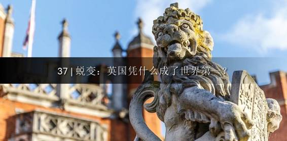

 

你好，欢迎来到《西方史纲 50 讲》。

上一讲我跟你讲了《大宪章》的秘密，它里面蕴含着英国同时拥有自由和强国的底层逻辑。但英国成为现代国家，尤其成为世界第一强国，还需要解决两个大问题，一个是贵族问题，一个是宗教问题。这一讲我就跟你谈谈这两个大问题。

## 现代国家成长的两个步骤

上一讲我跟你提过，现代国家的形成就是集中和理顺权力，现代国家的形成，基本上就是一个国王从贵族手里抢权力的过程。

你一定听过一个词“封建专制”，也听过这样的说法，英国革命、法国大革命，都推翻了封建专制制度。

你只要想一想国王和贵族这种抢夺权力的关系，就知道，封建专制这个词根本不成立。封建是多元的、分散的，如果一个国家是封建的，肯定没法专制；专制是说一不二的、高度集权的，绝对容忍不了封建。所以，封建和专制根本就不可能放在一起。

想一想，国家的形成意味着王权的膨胀，王权成为国家的主心骨，同时，贵族的权力被削弱，最终彻底出局。中央集权取得突破性进展，比如最高法院建立、议会建立、常备军建立、官僚和税收系统建立，意味着封建制被瓦解。也就是说，**摧毁封建制的首要力量就是国王。**

**国王削弱贵族的基本动力就是实现集权，但国王面临着两难**：贵族既是国王依靠的基本力量，也是他削弱和打击的对象。打击得太厉害，会危及自己的统治；太软弱，会妨碍集权的建国大业。这时候，国王从小贵族里，甚至没有贵族身份的人里寻找能人，资产阶级就有机会进入贵族味很重的上层政治。最终，贵族被国王任命的能臣替换，国家完全集中到国王的麾下。

到了这个时候，西方的国王就有点像秦始皇了。如果说封建用来说秦始皇和秦始皇以后的中国皇帝，是不恰当的，那么，对于成功塑造了西方各国的国王来说，封建这个词同样也不恰当。封建制恰恰是被他们干掉的。

**应该用一个新名词来概括现代早期的西方政治，就是绝对主义，absolutism。**这对你连贯地理解现代西方文明至关重要。英国革命、法国革命所打击的是已经削弱了贵族、建立起中央集权的绝对主义国家，而不是多元、分散的封建制。

现代国家的建成实际上是两步走，不是一步到位的：**第一步，从中世纪开始到现代早期，国王们完成中央集权，建成绝对主义国家；第二步，完成中央集权的绝对主义国家对社会、对人民压制得太厉害，它成了革命的对象。**

但革命之后，中央集权的国家形态留下来了，成为人民自己的国家。不能把两步混为一谈，革命针对的已经不是典型的中世纪政治权力，而是已经初步现代化的政治权力。

## 英国如何处理贵族问题

好，明白了国家成长的基本步骤，我就带你看看英国具体是怎么处理贵族问题的。从力量对比来看，贵族越强大，国王就越不好办。跟别的国家比起来，英国在这个地方特别幸运，很顺利地就把这事儿给办了。

事情还是要从诺曼征服说起。上一讲我提到了征服者威廉是诺曼底公爵。诺曼底公爵是法国国王的附庸。威廉当上英国国王之后，英法两国就开始撕。法国国王一直说，你诺曼底公爵是我的附庸，所以你当了英格兰的领主，英格兰也是我法国的一部分。英国国王们当然不认账，说英国跟法国是平起平坐的。英国国王们也开始在欧洲大陆上抢地盘，搞得法国不得安宁。

到了 1328 年，法国的卡佩王朝绝嗣，也就是生不出合法继承人，王位只能由别的家族来继承，这个时候英王爱德华三世说，按血统计算，我最有资格继承法国王位。法国人当然不认账。于是百年战争开打，一打就是 116 年。

本来英军节节胜利，法国国王驾崩了，王太子又不知所踪，眼看英法就要合并了，没想到半路杀出一个村姑，把英军打得落花流水，法国的独立也就保住了。这个村姑名叫贞德。虽然贞德最后被出卖，被当作巫女烧死了，但是，英国吞并法国的图谋也泡汤了。

更重要的是，**英国大败，基本上完全输掉了在欧洲大陆上的地盘，退回到英格兰岛上去了。英国在政治上和军事上正式成为一个岛国。这是英国后来采取离岸平衡的策略，对付欧洲各国的起点。**

输掉了大陆上的地盘，还不算最坏，对于英国来说，更坏的事情还在后头，地盘损失，人心浮动，王室分裂，很快就酿成了红白玫瑰战争，英国人自己打起来了，两个贵族大家族，约克家族和兰开斯特家族都声称自己是最正宗的王室血脉，这一打又是 30 年。

要知道，封建时代，打仗都是贵族的事情，贵族天生就是军人。**百年战争和玫瑰战争打完，英国的贵族死得差不多了，已经没有实力和国王对抗了。最终亨利·都铎终结了红白玫瑰战争，他建立起都铎王朝，史称亨利七世。**

亨利七世登基之后，他汲取了贵族争夺王位的教训，就继续清除有可能染指王位的贵族。他这么补上一枪，英国贵族基本上就没剩下多少了。就这样，等到他儿子亨利八世登基的时候，已经不需要费力地去对付贵族了，他在位期间，**英国出现了第一个没有任何贵族血统的首席大臣，这个人正是写《乌托邦》的托马斯·莫尔。**

亨利八世手下的能臣大多都是没什么深厚贵族家世的人，布衣将相比比皆是。这样一来，亨利八世强化中央集权的阻力特别小、帮手特别好，英国自然也就比别的国家更快地建成了现代国家。

## 英国的宗教改革

说完了贵族问题，我再带你看英国的宗教问题。关于宗教问题，英国也进行了一次宗教改革。但不同的是，它是由国王发起的，主角还是这个亨利八世。

美剧《都铎王朝》拍了四十集，主角就是亨利八世，故事情节还不错，服装道具也很讲究，就是风花雪月太多，关键的事件说得太潦草。**简单说，亨利八世为了和王后凯瑟琳离婚，不惜和罗马教廷翻脸，自己主动展开宗教改革。**

当然，故事可以说得很美很浪漫，但完全没有说到要害。凯瑟琳无法生下王子，对于亨利来说是天大的事情，这意味着都铎王朝绝嗣，王位眼睁睁就要拱手送人。你还记得吗？英法百年战争的祸根就是当时法国王室绝嗣啊！

王室绝嗣，对于我们中国人来说，可能不太好理解。皇帝有三宫六院七十二妃，再不行，宫女所生的皇子也能即位，明朝就出现过这种事情。

但是，西方的国王们完全没这个待遇，按照基督教的规定，国王也必须遵循严格的一夫一妻制。母系血统的纯正也一样重要。国王是可以到处找情人，也可以生很多私生子，但私生子没有王位继承权。只有王后所生，才有王位继承权。

这时候你就理解为什么亨利坚决要和凯瑟琳离婚了吧。可是，凯瑟琳是西班牙国王的小姑，西班牙国王控制着当时的罗马教皇，就是不让他离。亨利着急了，想了很多办法都没成功，最后和教皇翻脸了。

**还有一个原因让亨利下狠心发动宗教改革，就是钱。**我跟你说过，贵族天生就是军人，国王也不例外，可打仗是要钱的。亨利特别好大喜功，爱打仗，那钱从哪里来呢？宗教改革给了他一个好机会：没收教会的财产。所以说，宗教改革对于亨利来说，是一举两得的好买卖，加上情人安妮·博林天天吹枕边风，也就痛快干了。

你已经听出来了，**亨利八世在英国搞的宗教改革，完全不像路德在德国搞的宗教改革，它不是为了要拯救基督教来发动改革，完全是国王出于政治考虑。**所以，亨利改革之后的英国基督教，既不是罗马天主教，也不是路德新教，简单说，它就叫国教，英国国教。

**英国国教的教义最重要的特点就是，规定英国国王是最高宗教领袖，不认罗马教皇，当然也不会认新教的教会。**至于国教里面的规矩，一开始更像天主教。后来，变得更偏向新教，但毫无疑问，英国国王是国教领袖这一条绝对不能动。

这么说起来似乎很轻松，但英国的宗教改革其实很复杂。因为英国国教既不是天主教也不是新教，所以，不管是天主教，还是新教，英国国教都要对付，英国在宗教问题上真的是腹背受敌。

在国际上，英国一边要对付天主教的教皇和西班牙国王，另一边呢，也不能和信新教的德国诸侯走得太近。**国内形势也很麻烦，因为国教的出现，英国被一分为三，天主教、新教和英国国教。**

先是天主教的反扑。亨利八世驾崩以后，他的幼子爱德华六世即位，又把国教往新教的方向推。可是爱德华六世命不长，他驾崩之后，长姐玛丽即位。

玛丽的母亲可是被废的凯瑟琳王后，本人一直是虔诚的天主教徒，而且她选择了和新任西班牙国王结婚，结果可想而知，她全力恢复天主教，把改革人士狠狠地清算了一把，该抓的抓，该杀的杀，结果落得个“血腥玛丽”的骂名。好在玛丽没有孩子，她死了之后，二姐伊丽莎白即位，又恢复了老爸和小弟的改革路线，把国教往新教的方向推。

虽然说，英国国教离新教更近一些，但终究还不是一回事。英国也有新教徒，他们主要来自苏格兰，英国版的新教叫做清教。清教徒也要求自己的合法权利，就和强调定于一尊的国王怼上了。

国王自然会对付这帮不听话的家伙。结果受迫害的清教徒分成了两拨。一拨逃亡，坐船去北美，其中最著名的一条船是“五月花号”，船上的人签订了《五月花号公约》，正是这些人成了未来美国的基础。

另一拨清教徒积极反抗，于是当时的国王查理一世出兵平叛，英国会议觉得查理简直是错上加错，成立议会军和查理开战。这就是你熟悉的英国革命的起源。

后来的事情你知道了，克伦威尔打败了查理一世，建立了共和国，但克伦威尔死后，斯图亚特王朝复辟，斯图亚特王朝本来就带着天主教的味道，复辟的国王詹姆斯二世就是天主教徒，这让英国人很不放心，**最终还是发生了光荣革命，结果是，詹姆斯二世逃亡，英国人迎接信仰新教、尊奉国教的威廉和玛丽夫妇当国王。**

## 英国崛起的经验

现在，我可以正面回答这一讲的大问题了：**英国成为世界第一有偶然性，但绝不是出于侥幸。英国崛起的路上，贵族问题幸运地得以解决了，宗教问题也走出一条独特的道路。**虽然国教、天主教、清教搅成一堆，但比起德国和法国惨烈的宗教战争来说，英国通过维护国王的权威保证了和平和统一。

**英国崛起的经验表明，真正走得远的大国，不仅有硬实力，更得有软实力。**软实力最重要的表现就是发明制度和创立规则的能力：我想出一个解决问题的规则来，参与各方都可以在里面循环起来，找到自己的经济利益和政治地位，通过权利固定下来，相互承认，皆大欢喜。你自动自觉地就会加入这个合作共赢的游戏。硬实力的表现是，你要是不遵守规则，我有办法惩治你。软硬都有，才是真正的帝国气象。

本讲小结

好，总结一下这一讲的内容：英国在解决贵族问题和宗教问题上，都有自己独特的背景和路线，最终光荣革命让英国顺利地成为第一个现代国家。

光讲英国还不足以把国家崛起说明白，因为国家崛起的路上还有曲折、有挫败、有教训，下面我会跟你聊聊法国的崛起过程，在正式聊法国之前，我先带你看看荷兰。

期待你的到来，下一讲再见！

精选留言

点击直接进入下一章节

**佛祖门徒**:  
冯克利老师在“名家大课”在谈到国家集权化的过程时说：  
关于现代民族国家形成的原因，有各种不同的解释，不过有一种普遍的共识，就是它通常伴随着一个集权化的过程，权力不断集中到抽象概念的“国家”。在欧洲，这个过程表现为君主权力的不断加强和扩张，挤压教会权力和封建贵族的势力，逐渐形成绝对专制国家，例如法国、西班牙、俄国和德国都是如此。英国的君主制在这一点上也不例外，而且在时间上要大大早于欧洲的大陆国家。但是英国的集权化过程采取了一种十分特殊的形式。从威廉国王开始，王权通过垄断司法权开始加强自身权力，巡回法庭制度是国王集权化的重要手段，促进了司法的中立和独立。  
  
十三世纪法学家布拉克顿把治理国家的权力区分为治理权和审判权，这一思想在英国集权化过程中也得到了充分体现。  
“治理权”是指国王手中掌握的王国管理权。其存在的依据与理由是为了更好地维护王国内的和平与安全。因此，国王“在严格限定的狭义的治理权领域，国王不仅是惟一的掌门，而且理应掌握、也必须掌握为有效管理所必须的全部权力；他有权处理伴随或附带于‘治理权’的一切事务。”  
“审判权”（jurisdictio）则是指国王在王国司法方面拥有的权力。区别于治理权，国王的这种权力是有限的，它的界限是由“实在的”和“强有力”的法律确定，如果国王行为超出此界限便是越权。  
《大宪章》中著名的第 39 条，即“国王无权自由决定臣民的权利。对于侵权诉讼，国王必须依照正当法律过程而非强力作出裁决”，正是审判权中对绝对主义权力反抗的经典表述。

**作者回复**:英国权力结构很有自己的特色，推荐你有空看看白芝浩的《英国宪法》，我已经把这本书的听书稿准备得差不多了。

**Allelujah**:  
人类社会中一直有三股强大的力量驱动：武力可以使人屈服，利益吸引他人合作，信仰让人蒙受感召。  
  
英国崛起之路的平顺，在于起初内部的武力交锋化解了持久的冲突，而后通过利益的分配团结了不同的阶层，最后和平地将信仰的矛盾消解。  
  
这其中不能说没有运气的成分，但每一步又都切实地符合历史演化的逻辑，终于成就了一个现代强国。

**作者回复**:有大格局往长远看，烂牌就可以组合出好打法。

**陈 C**:  
国家的崛起以为这权力的集中。在西方，社会长期处于政治、宗教的二元状态下，而政治的力量又长期分散于 贵族。因而西方集权的发展，实际上就是君主从贵族和教会的手中拿回权力。  
  
上一讲说到英国产生了法治与大宪章，进而形成了“同心圆”的结构。但这并不等于权力就此直接到了国王的手中。削弱贵族，既是国家得以形成的前提，也是在国家形成后，进一步增强集权而需要继续推进的事情。大宪章在对待君主对待贵族这个角度上，也是一种权宜之计（虽然它后来生长成为了同心圆的中心）。但是国家形成之初，行政系统相对薄弱，贵族在分散权力的同时，也承担着向下层进行统治的中介角色。因而削弱贵族，在英国就必须是一个渐进的过程，否则太快了反而会造成系统的崩塌。具体来看，英国国王得以削弱贵族，手段上是提拔小贵族甚至资产阶级的能人，从而削弱贵族的行政“权重”，大环境则赶上了百年战争与玫瑰战争之后贵族力量的空虚期。  
  
这里可以看到两点：  
1\. 贵族的削弱就等同于集权的加强，因而贵族代表的“封建”与君主代表的“专制”是不同的概念。英国正是先行消灭了封建，之后才产生了革命，进而解决掉了专制。  
2\. 所谓“历史的偶然”，有时候会体现为一个或者一系列“时间窗口”的出现，赶上了，条件就集齐了；赶不上，就往往意味着变革的失败。  
  
至于宗教，英国与欧洲大陆走上了几乎完全不同的道路。欧洲大陆的宗教改革，在教会衰落的背景下是信仰需要返璞归真的必然，同时也偶然赶上了印刷术普及这样的时间窗口，思想与政治上的影响则更像是一种“副产品”。但英国的宗教改革，却是完全由政治诉求驱动的，这就导致这一改革所产生的新型宗教体制，必然与当时存在的所有宗教派别都是不同的，否则宗教依附于某一教派，就只是改变了依附对象，并没有解决“依附”这一问题本身，教会所带来的权力纠缠，就不能得到完全的解决。英国在这一点上，可以说是赶上了一个不太好的时间窗口，因为此时新教已经兴起了，国王不得不在两大教派中来回周旋。而在改革的最后，英国形成了国教，宗教上的权威也成了国王，这就避免了因为宗教而导致的权力分流。

**作者回复**:即便是成功的观察，提取到了重要的道理，仍然难免后见之明的缺点，把道理场景化，试着推理将来要怎么解决问题，会把道理吃得更透，也才能把道理真正激活，把道理的威力真正发挥出来。

**蝉**:  
您称西方近代的革命是针对绝对君主制的，这也就意味着国王们实现了比以往更有力的中央集权。  
  
1.在中央集权方面，中国古代无疑是早熟的，但为何中国古代没有长出权力内部的制衡，依然停留在不同的主体间的较量呢？是因为我们缺乏宗教力量介入?还是因为别的什么原因？  
  
2.按照苏力老师的说法，中国古代的政治建构也成就斐然，但按照您的标准，中国古代根本不能算是国家，所以我想问:一个现代国家的标准有哪些呢？

**作者回复**:英国绝对主义国家的崛起虽然是集权，但回想一下我上次跟你说的权利扩展的同心圆结构，还有权力和权利相互缠绕增长的路径，你就会发现，英国的国家崛起自带平等的逻辑。现代国家迟早要处理平等化的洪流，虽然英国不是主动去推动，但离大潮不远。不足以处理平等化大潮的集权，金字塔建得越雄伟，被冲毁的场面就越惨烈。

**A learner**:  
通过这讲的学习，分清了封建和专制的区别，以及理解了现代国家建立的过程。  
过去的误解，我觉得是因为我们的历史教育淡化了集权的作用，而把集权作为了一种负面手段来解释。所以我们的认知里，各种革命就成了现代国家形成的主旋律。  
然而回顾之前的内容，就不难发现集权的重要性。亨利四世反抗教会，结果落到了一个雪地下跪的下场。亨利八世为了离婚说翻脸就翻脸。二者的区别恰恰是后者收缴了贵族的权力。而作为软实力的制度创建也是在硬实力稳固的基础上才能得以实现的。否则，权力分散，大家各玩各的，国家的凝聚力就难以形成。

**作者回复**:集权，然后规范化、合理化、法治化。当然，最佳办法不是截然分开的两步走，而是走一的时候要想着二，否则就是我在《更新》里面推敲的那个悖论：老虎长大了谁来抓，凭什么抓，有什么样的机会抓？明白了这个道理，从现在开始也不算晚。

**奔跑的菠萝**:  
通过本课的学习让我意识到，没有永远的朋友，只有共同的利益，一旦地位角色发生转变，曾经的战友可能立马就要枪口相对。  
   
从英国发展的视角来看，国王想要排除阻碍顺利登基就必须依靠贵族的力量，而贵族也正想利用此机会攫取利益、巩固地位，大家目标相同一拍即合。但是，一旦国家建立以后，王权自然而然的想占据主心骨地位，那些得力的助手这是就变成了王权的威胁，鸟尽弓藏就成了必然的选择，这种看似无情无义的行为很多时候倒不一定是统治者的初衷，只是权利驱使下的无可奈何。（有文明的杯酒释兵权，也有蛮横的血性屠戮）。当然这一过程也极其的危险，处置不当往往容易招致反噬。（比如想要打压豪族的王莽，最后就被刘秀给推翻了，最终形成了豪族和皇帝共治的局面），英国这一点上很幸运，英法战争和红白玫瑰战争清洗掉了大量个贵族，这让国王的集权变得容易了许多。  
   
但是正如老师所说的那样，完成中央集权，建成绝对主义国家只是第一步，其后还要能发明制度和创立规则，让国内的各个基层都可以在里面循环起来，找到自己的经济利益和政治地位，并通过权利固定下来，只有这样才能安定民心、稳定结构。  
   
如果把国家创立到发展的过程看成是做蛋糕，那么不能够聚集权利、调集资源就无法把蛋糕做大，但做大之后如果不懂得合理分配只顾吃独食，那么往往最后反而会被蛋糕给噎死。

**作者回复**:我印象里吴军老师专门仔细谈过一次丘吉尔说（其实是帕麦斯顿说）的“没有永远的朋友，也没有永远的敌人，只有永远的国家利益”。他的批驳很详细。老实说，菠萝，我并不想你得出的最有收获的点是这句所谓的“名言”。它的本意如何是个很好玩的历史学问题，你可以去做侦探查明。但在中国现在的语境之中，它意味着唯利是图和机会主义。这并不是我最想通过英国崛起告诉你的事情。即便国家利益很重要，其中也有一个大麻烦，国家利益是最难识别和断定的，因为要格局够大、眼光够远，才能看到真正的国家利益，否则就是曹刿（论战）那句“肉食者鄙”。局外人以后见之明的便宜视角如果看到的还是机会主义，而不是如何识势、起势、推势、成势，就小了。

**泼猴要撒野**:  
在山竹中瑟瑟发抖地听完这一讲，这是中学中学历史课本不曾达到的全新版本。  
虽然有句笑话说法国只有在女人和矮子的带领下才能雄起，但荣耀早已属于那位奥尔良少女（《帝国时代》的战役中还有专门圣女贞德的章节）。  
初中课本，解决贵族与宗教问题是其不曾谈到的。  
以暴力为硬实力和以制度为软实力，在推动社会发展的过程中，是相辅相成的。

**作者回复**:愿所有南方的小伙伴和你一样平安躲过山竹哈！出门危险，就窝在家听我多唠叨几句吧。

**蘭**:  
中西方的贵族问题解决方式都十分雷同，战争导致贵族被杀的差不多了，贵族都已经快消失了，贵族造成的问题自然也就不存在了。记得罗胖有一期节目提到过，纵使贵族有千般不好，但有一个很重要的作用就是充当整个社会的刹车阀。贵族消失后，国王失去制约，真的是可以为所欲为，想想西方贵族消散的末期，爆发的一战，虽然惨烈，但还算维持了最后的体面，而到了二战，没有刹车阀后彻底失控，打的血流成河。贵族的消失是社会的进步，但真的算是好事么？

**作者回复**:贵族有贵族的好，骑士精神、讲荣誉、讲责任都是好东西。肉体被损毁了，权力被剥夺了，精神气质可以留下。另外，即便是好东西留不下，也不要在它坟前驻足，长哭悼念之后，还是要勇敢前行。

 

李筠

可能你也知道，9 月 12 日，我在「得到」直播间做了一场直播，分享了西方历史上的三次接力。我想在课程里，也把直播内容分享给你，你可以把它作为学习一段时间以来的复盘和回顾。  
这一讲，我先分享直播上半段的内容，也就是三次接力的故事。下一讲，我来分享直播后半段，如何培养一套大历史观。

这场直播，我选的主题词叫「接力」。为什么从这儿讲起呢？就是想告诉你，理解西方的困难在于它实际上是多个文化传统、多个历史阶段形成的，它并不像我们中国历史是非常顺承的。

古希腊和古罗马是什么关系、古罗马和中世纪是什么关系、中世纪和现代又是什么关系？这其中的承接、变化、更新、变换，是我想带你理清的。

也就是说，西方史纲这门课是带你去整理出一套大框架，看清楚西方骨架是什么样的。有了这样一些基本的骨架，再遇到具体的历史故事，具体的历史知识的时候，你就很容易轻松地把它放到相应的位置。

## 古希腊到古罗马的接力

我们遇到的第一个源头，就是古希腊。为什么西方会把古希腊作为源头呢？

而且我在课程里强调过，古希腊实际上并不是一个最原生性的文明。我们所熟悉的希腊，也就是苏格拉底、柏拉图、亚里士多德，这些人实际上都是古典希腊时代的人物。在此之前，实际上古希腊已经经过了很多文明。

我把古典希腊的成就概括为人文、理性、民主，我也分别跟你解释了这些因素，人文、理性、民主替古希腊塑造起一个很高的起点，也就是说整个西方文明实际上有一个非常高的起点，留下了让后人高山仰止的柏拉图、亚里士多德的哲学、雕塑、几何学，还有其他很多成就。

实际上我们从很多后世的现象对比的话，你会发现甚至到了文艺复兴时代，在艺术已经非常发达的状况下，仍然有古希腊的作品是这些 1500 年、2000 年以后的人没有办法超越的。

而我们面对柏拉图、亚里士多德提出的这些哲学的、政治学的问题，实际上我们现在也没有很好地解决，他们的答案仍然是我们参考的重要标准。

在这样一个情况下，古希腊取得的文明成就成了西方透视仰望的灯塔，所以后人都愿意把光荣的希腊看成西方的起点。

有了这样一个高起点，西方时时在回望它、时时在参考它，时时要从里面找到灵感、思想的源泉，以及行动的指南，所以它构成了映照整个西方三千年一个很重要的参照系。

但是古希腊这样一个很好的体系，实际上并没有长存下去，因为它的政治实际上是非常脆弱的。我特别在第一单元里面跟你讲伯罗奔尼撒战争，从内到外彻底毁掉了古希腊。在这样一个脆弱的政治没办法延续的情况下，它的文明成就自然也就衰落了。

而这个衰落并没有消失，而是被后人接上了，这个重要的接力，甚至是更加扩大的，虽然顶级学问家少了，但是播撒的程度、传播的广度更加广了，亚历山大死后他的帝国很快衰落了，旁边地中海另外一个小岛上，罗马崛起，接收了整个亚历山大的地盘。

在罗马崛起的过程中，我们会发现，以武力作为主要成长方式的罗马，希腊人成了他们的老师，在文化上使他们更加成熟。

其中最重要的古希腊和古罗马之间的接力棒，古罗马人到底接到了古希腊人的什么呢？两个最重要的接力棒，一个是语言、一个是哲学。

哲学这个东西特别值得一提，古希腊人交给古罗马人的哲学主要是斯多葛哲学，罗马人特别信奉这套，它也成了西方后世的文化基因。比如说理性、自然法、平等，这些基本价值就种到了西方的基因里面。

其中一个特别有意思的事情是，在斯多葛哲学下面出来了一个《沉思录》，这是古罗马皇帝马可·奥勒留写的。马可·奥勒留在政治上的功绩也非常厉害，这样的现象就是在斯多葛哲学和罗马的武力交织下形成的。

这个接力棒重新证明胜利者罗马成了战败者希腊的学生，虽然罗马的武力很强盛，但是在文化上他们是希腊人的学生。到什么程度呢？哲学也好、诗歌也好，甚至史学的写作也好，罗马人都是在模仿希腊人。

一个很好玩的事情就是，罗马人为什么这么强大，他们为什么成为世界第一，成为最强大的帝国。这个道理居然不是罗马人自己来解释的，而是一个希腊战败的奴隶写出了其中的道理：**罗马人的架构是执政官、元老院、公民大会一起形成的复合结构，这个是罗马成功的根本原因。**

也就是说，希腊的文化和精神全面渗透了孔武有力的罗马，通过一文一武的方式结合起来，变成了西方最重要的文化源头，通称为古典文化，里面既有灿烂的哲学、发达的科学，也有罗马人那样的政治实践和制度建设。**这样的话，希腊、罗马拧在一起，通过斯多葛哲学和这些信奉斯多葛哲学的皇帝们、执政官们、将军们逐渐融合成一个整体。**

## 古罗马到中世纪的接力

刚才聊了希腊和罗马之间的关系，下面讲一下古罗马和中世纪之间的关系。

古罗马是一个很独特的文明，它自己有自己的一套逻辑，我把它概括成从罗马王政演变成共和，最后成为帝国，理解它成长最重要的线索是军国主义。

刚才讲到罗马是以武起家并壮大的，在这样一条线索中，你会看到通过很多你可能知道的故事，比如说凯撒和庞贝之间的争斗，斯巴达克斯起义，之前还有马略的改革，后面还有屋大维的帝国，等等，这一切的罗马史，我把它归结为“罗马成于兵也毁于兵”，如果不理解军事在整个罗马史当中的重要性，其他都很难谈得上。

罗马这样一个因为武力而强盛，又因为武力饱受困扰的国家，终于在戴克里先时期结束了兵营出皇帝的局面，但是出现了一个谁也没料到但是对后世影响非常大的举措，就是，戴克里先把帝国分成了东西两部分，各派皇帝和副皇帝去管理。

我们中国人觉得一个皇帝是正常的，他居然弄出四个，四帝共治。虽然这个四帝共治的体制没有留下很长时间，但是罗马分东西这个事就改变不了了。尤其在他的继承人君士坦丁兴建了君士坦丁堡以后，把帝国中心进一步东移，西边几乎等于是被放弃了。也就是说，整个帝国并不是匀速衰落的，而是分东西以后，西部衰落得更快，西部相当于被皇帝们放弃了。在这样一个情况下，西部走上独特的道路，是从帝国分东西就已经开始了。

后来承接中世纪的西罗马，在蛮族的入侵之下越来越走向凋敝、沉寂、混乱的局面。这也是大家认为中世纪特别黑暗的一个很重要的原因，因为它就是乱。如果政治上没有一个好的秩序，甚至连基本的政治秩序都没有，军事上甚至连大规模的作战都不可能，那文化上、哲学上的成就根本就谈不上了。

在那样一个状况下，为什么我要说中世纪并不是一团黑？因为哪怕是西罗马帝国灭亡之后的 500 年，它也不是一团黑，这在于有文明的接续者，有体现文明的力量，有把希腊罗马的这些文明因素往下传的核心力量，那就是基督教。

你可能又会在这儿生出一个疑问，基督教不是代表了愚昧和黑暗吗？不，我们讲基督教至少在那个时代、至少在信徒的眼中，它代表了光明和智慧。

我们作为不信教的人，应该用历史客观的眼光去观察这些事情，而不应该轻易地一概认为宗教就是黑暗和愚昧的。

在耶稣开创基督教的时代，那时候是屋大维掌握帝国权力的时代，应该是罗马帝国欣欣向荣的时代。那么耶稣他到底做了什么事情，让信众越来越多？就像病毒式增长一样，搜罗了帝国之内众多粉丝。

很重要的一个事情就是，我们不要把耶稣想成凭空而出的一套道理的讲述者，而是他本人就是一个犹太教的改革家，他就是一个犹太人，因为对犹太教上层欺压犹太民众不满，他要改造犹太教。至于他怎么具体地改造了，尤其是基督教教义和犹太教教义有什么重大的差别，我在课程第 22 讲，《立教》那一讲也详细讲解过。

在这里我强调，因为耶稣是帮扶底层民众，犹太人的命运是非常惨的，你一看《圣经旧约》就知道，他们从有纪录开始，就没过过几天好日子，他们就是底层。而耶稣代表的是底层的底层。在屋大维那样一个光鲜亮丽的帝国时代，他们都没有好日子过，帝国亡了之后，政治是乱糟糟的时候，基督教就成为了指点人们内心，让人撑着活下去最重要的力量。哪怕这个世界全黑了，我心中还有一盏灯。

基督教为帝国覆灭之后乱糟糟的那几百年，充当了绝大多数人心里唯一的明灯。在基督教的指引之下，中世纪实际上是开出了和我们所熟悉的希腊罗马不同的这样一个文化风格，甚至是一个类型。

在这个里面，我特别强调基督教引领的或者主导的中世纪不是一片黑暗，核心事件就是教皇革命。教皇这个大人物积攒实力到了公元 11 世纪左右，他对皇权主动发动了进攻，声称自己有多少多少无上的权力。

我们中国人觉得不可思议的地方就在于，一个没有兵的教皇凭自己发布一纸告令，能把手握强权的皇帝怎么样呢？结果很有戏剧性，皇帝破衣烂衫地跑到教皇那里认错。

从这里就形成了西方区别于其他文明的基本结构，就是精神和世俗二元权力的并立。西方这种基本结构甚至区别于古希腊罗马的另一支传人，也就是东罗马传下来的拜占庭。

后世的所谓政教分离的这样一个基本结构，就是在中世纪教皇和皇帝之间斗争这样一个过程当中酝酿出来的。

无论中间教皇和皇帝怎么斗争，但是这个结构是留下来了，作为整体的教会不可能被皇权摧毁，教皇和皇帝就互相缠绕着斗。**在这样一个二元缠斗的过程中西方走向现代，引领着公元 1000 年—1500 年的政治、法律、学术、艺术全面爆发。**

因为双方都要斗，都要想办法，就会找各种各样的办法彰显自己、支持自己，大量的政治学的、哲学的、神学的、法学的著述就产生了。艺术的成分在里面获得了生存的夹缝，就是这样一个所谓二元结构的并立，世俗政权和教权之间的争斗，使得一个生生不息的动力机制滚起来了，使得西方充满了活力。

我们所熟悉的现代恰恰是在这样一个二元斗争的格局当中成长出来的。

我们原来学西方历史的时候，通常都是要么讲讲古希腊、古罗马的故事，要么就是从英国资产阶级革命开始讲。那么罗马帝国覆灭之后到英国资产阶级革命这一段，中间这一千年发生了什么？不太清楚。

我可以负责任地告诉大家，这一千年具有非常明显的连续性，我们所熟悉的那些公元 1500 年、1600 年发生的事情，比如说，**文艺复兴、宗教改革等这些事情，都是对中世纪留下的议题和问题的继续解决。**

西方在中世纪产生了一套自己的逻辑，其中的核心就是政权和教权的二元并立。这样一个结构使得它和其他的文明，包括中国在内，都非常容易区分开。

所以我在讲中世纪这个单元的时候，通过不同的事件来剖析这个二元结构到底是怎么形成的，怎么斗争的，怎么合作的，最后是谁先衰落了，这个二元结构如果坍塌了，出现危险了，西方会不会面临所谓亡国灭种的压力？

现代正是在中世纪演化的逻辑当中产生的，相应的，中世纪出现的很多萌芽长成了现代的苍天大树。所以，如果你觉得现代西方有很多辉煌的东西，实际上它的芽在中世纪都已经种下了。

所以，中世纪并不是一片黑，它是有自己独特的逻辑、尤其是独特的政教二元结构推动着这个社会的发展，酝酿出很多后世的好东西。

## 中世纪到现代的接力

我刚才已经提到的，西方的现代和中世纪之间具有非常强的连续性，你会发现古希腊和古罗马之间是有断层的。同样，罗马人和中世纪之间也存在这个断层，我们甚至可以把中世纪这 500 年看成一个乱糟糟的大断层。

可是中世纪到现代之间没有断层，我们熟悉的事情，文艺复兴、宗教改革、大航海，启蒙运动、大革命这些事情没有陷入一个议题中断，而是都在不断地解决中世纪遗留下来的问题。

**通过文艺复兴、宗教改革这些事情，把现代和中世纪划开，只是我们后世人理解历史的一种方便。**你可以怎么样定义中世纪和现代呢？那就用一个界标把它们分开，但是这个分开是为了我们后世人理解方便而已，并不是真正历史连续的那个原状。

我们现在已经讲到文艺复兴了，文艺复兴核心的一个精神就是大写的人站起来了。**世俗化成为一个几乎不可阻挡的潮流，以神为本位的世界逐渐地退去了，也就是“上帝死了”，实际上这是有一个过程的，这个“谋杀”并不是一步到位的。**

你看一下西方文艺复兴时代的画作，大部分甚至可以讲绝大部分都是宗教题材，只不过把人的光辉凸显出来了，人变得很饱满、很丰盛，一看就会觉得做人的感觉真好，比起以前那样低着头，做上帝的子民，谦卑、忍让、灰暗的色调不一样了。但是我们讲，这个变色是逐步完成的，它是一个光谱，并不是非黑即白的场景。

在这样一个过程当中，你会发现每一个重大的运动，都在以人为中心的这样一个世界图景当中添砖加瓦，往前推进。这个推进的过程，比如说我们最熟悉的文艺复兴艺术的表现是最显眼的，但是你注意到了没有，它实际上已经在对道德进行改造了。

到底是基督教那种谦卑忍让，人家打了你的左脸还要把右脸也给他打，那样一种好人、爱人、爱上帝、爱敌人的道德体系值得你去遵从，还是做一个强者，做一个实现自己目标的、奋进的、积极的、作为世界主人的这样一个人？哪种道德是你想选择的？

在这样一个过程当中，文艺复兴的这些干将们一步一步地把这样一个道德的选择，到底是谦卑忍让的基督徒好，还是一个傲然挺立的人，像希腊罗马人展现出来的那样。

这个选择，在马基雅弗利手上被挑破了，虽然他只是向君主挑破了这个事情，**但是我们每个人都成为自己主人的时候，你难道不要面对这样一个道德体系的选择吗？**

顺着这个事，文艺复兴还带出了科学革命。我说一个可能你不太知道的事情，你可能知道文艺复兴最伟大的雕塑家米开朗基罗是美第奇家族养大的，他就在他们家成长的，一路把他培养成了世界上最牛的雕塑家，成为“文艺复兴三杰”。

但是你可知道，很多很多牛人，美第奇家族也都养？其中就包括了大科学家伽利略，他也是美第奇这些王公子孙的家庭老师。正是因为他们的关系深厚，伽利略才可以写个悔过书，逃过了教皇的绞刑架，不然就和布鲁诺一样了。

**所以从文艺复兴到道德改造、再到科学革命，是层层递进的过程，会生发出新的萌芽，为下一个运动提供星星之火。**在走向现代的过程中，问题是连续的，其中三个线索特别重要。

**一个就是国家的崛起**，古时候中世纪的封建制，到中世纪后期实际上就已经不使用了。国王们要打仗就得集权，收税征兵这个办法从哪里来？强化国家权力就成为他们梦寐以求的事情。

路易十四的偶像是康熙皇帝，他认为康熙能够捏住这么大一个“盘子”是很厉害的，实际上他就是想做富国强兵这件事情，这个事情成为西方进入现代以后，很长很长一个时期的主调。

我们所熟悉的政治革命也好，还是后来的民主化也好，都是对现代早期兴起的这样一个集权过程的反抗和矫正，也就是集权过了对社会是有极大的伤害的，征兵像抢人，收税像抢钱，这个日子谁也没法过，于是就有很多人出来想办法，把政治搁到什么样的地方才合适。

**另外一个和国家崛起相并列、相缠绕的线索是社会的崛起，**人和人怎么样自己组织起来做自己的事情，不需要国家来管就可以和国家分工。我管我的，你管你的，你不要来干涉我。

在这样一个过程中，古时候的那些组织仍然是要经过现代化的，因为他们被国家集权打压得也很厉害，社会的成长是逐步的。在这样一个过程中，**中世纪所铸就的教权和政权二元并立的结构在现代演化成了国家和社会二元并立的结构，它的原型、结构是非常相似的，而且它们是有转换的亲缘性关系的。**

换句话说，如果你对中世纪那样一个基本结构不太了解，对于它出了问题如何有待解决，现代人拿出什么样的解决方案，如果不逐步理顺这个问题，就很难继续讲下去。现代很多的事情对你来说，从哪说起就是个问题，因此我特别强调，**中世纪到现代早期的很多问题是连续的，所以解决方案是一步一步呈现的。**

社会的崛起就是在教会坍塌以后，教坍塌以后，如何遏制住飞速集权的、像强盗一样的国家？总体上来看，哪怕是集权的国家仍然没办法扫荡掉西方长期以来多元性的传统。在社会崛起过程中，商家有行会，大家自己组织起来管理自己的事情，这个组织性是很好的，社会就沿着这样一个路线慢慢长起来，自己管理自己。

在这样一个状况下，新的二元结构是我们理解现代西方很重要的线索，**还有一个很重要的事情也必须顾及，就是市场的崛起，或者说资本主义的兴起。**

资本主义使得西方的财富状况发生了翻天覆地的变化，这个财富的增长实际上是人类历史上从来没有过的，一个庞大的市场生成了，经济学已经把这个讲得非常透了，它有自身的规律。如果你要保持这个财富不被浪费、消耗到，权力如何安顿，社会组织如何安顿，对经济是有好处的，让大家可以共享繁荣，就成为了一个大问题。

**我们讲这样一个三元的三条线索的并进，是我们理解现代西方最重要的线索**。在这样一个过程当中，你会发现无论是文艺复兴让你作出道德选择，还是宗教改革让你的信仰也发生了变化，还是大航海让列国争雄进入了一个新的状态。你会发现我们熟悉的列强在这些大事件、大关口面前都有不同的选择。

如果你把每个国家的成长划成一条线的话，你会发现大国崛起的路，每个国家走的都不完全一样。有些差别还非常大，也就是讲西方内部成为现代化的路径是多样的。**如果西方自己已经证明了现代化的路不止一条，那么就可以说，现代化不等于西化。**

所以在这个意义上，每一个国家的现代化都是必须自己勇敢作出抉择并下力气去推行，勇敢地走下去，走出自己的现代化道路。

所以在这样一个比较的过程当中，尤其是在现代的单元，我们会通过和这样一个最强势的他者之间相互的比较，能够更加明确中国的现代化道路应该怎么走。

精选留言

点击直接进入下一章节

**漫舟**:  
当时看了李筠老师的直播，今天又做了次复习，对学习内容的脉络更加清晰起来。总结：三次接力，第一次：古希腊→古罗马（接力有断层）；第二次：古罗马→中世纪（接力有断层）；第三次：中世纪→现代（接力无明显断层）。第一次接力总结：①古希腊的成就：人文、理性、民主（波罗奔尼撒战争彻底毁灭了古希腊）②古罗马继承古希腊：语言、哲学（斯多葛哲学，哲学皇帝马可·奥勒留，著作《沉思录》）③执政官、元老院、公民大会的复合结构是罗马成为最强大帝国的根本原因。第二次接力总结：①军国主义是罗马由罗马王政到共和再到帝国的线索（罗马成于兵也毁于兵）②戴克里先结束兵营出皇帝，但造就了罗马分东西，君士坦丁东迁后，西罗马被放弃，逐步走入中世纪③基督教在西罗马灭亡后 500 年内接续了文明④基督教是耶稣为改造犹太教、帮扶犹太底层民众创立的，起于屋大维时期⑤11 世纪教皇革命（皇帝下跪认错）造就精神、世俗二权并立（教权、政权二元结构是认识中世纪的关键）⑥二元并立、二元缠斗中，公元 1000-1500 年间政治、法律、学术、艺术全面爆发交织出灿烂文化（所以中世纪不可以简单用“黑暗”来概括）⑦二元争斗的动力机制使西方充满活力，我们所熟悉的“现代”也恰是在二元争斗格局中成长起来的。第三次接力总结：①文艺复兴、宗教改革、大航海、启蒙运动、政治革命（大革命）这些大事件都是在不断解决中世纪的遗留问题②文艺复兴的核心是大写的“人”站起来了，（世俗化成为不可阻挡的潮流，神本位的世界逐渐消退）③文艺复兴引起道德改造，带出科学革命、宗教改革带来信仰改变、大航海使列国争雄进入新状态④演化中应看到国家崛起（中世纪的教权、政权二元结构）、社会崛起（现代的社会、国家二元结构）、市场崛起/资本主义兴起（社会、国家、经济三元并进），是一个系统演进过程。p.s.首先感谢李筠老师，其次感觉自己总结的不够顺畅，不够全面，继续努力吧～

**作者回复**:谢谢你认真努力的学习，看到你们这种学习的热情，我的努力就会得到很高的成就感。

**王黎璐**:  
教会法学家、思想家、神学家的思想理论体现了基督教文化的普世价值，正是由于这些思想理论的指导和制约，西方既没有形成万能的政府和专制的王权，也没有形成一统天下、唯我独尊的教权，反而通过双方的妥协形成了分权制衡的政教二元宪政体制，这对英国光荣革命、启蒙运动、法国大革命和美国独立战争等都产生了深刻影响。对这些思想和理论进行细致研究，有助于我们认识基督教思想理论及其体制在欧洲中世纪宪政体制形成中的重大作用。同时老师也让我们看到：教权对王权的限制也是有限度的，一旦突破这个限度，不仅王权得不到保障，教权本身也会受到影响，因为两者在一定条件下是一种联盟关系。  
并且，基督教具有强烈的契约精神和法制精神，这种精神构成了西方宪政主义的重要来源。在圣经原典的契约精神和法制精神的基础上，中世纪进行了大量的研究和实践，对西方近现代政治体制产生了深远的影响。如果没有基督教思想理论的支撑，西方宪政体制的建立是难以想象的。

**作者回复**:捏住了很重要的关键点。关于这个大问题，推荐你去看我导师丛日云教授的著作《在上帝与凯撒之间》。

**大都督**:  
厘清了很多之前模糊的概念，重要的是有一个历史的脉络贯穿西方各类看似偶然的事件，其实都是内生因素和外部环境交织的交织的结果。感谢李老师，这课一定要多读几遍。

 

你好，欢迎来到《西方史纲 50 讲》。

关于历史，我们实际上是向它求教的，历史是无尽的宝藏。

我是政治学出身，我深刻地体会到历史里面能够得到的智慧是最丰厚的。这一讲，我继续来分享直播内容的后半部分，也就是我们为什么应该关注历史，从它里面到底应该寻找什么，怎么寻找。

## 第一步：做侦探

第一个问题，我们要解决的就是，我把它概括成两个字，叫粗细。真相是可以被查明的吗？我们不是古人，我们也没有时光穿梭机回到过去，而且我可以负责任地告诉你，即便出现这样的机器，你真的回到过去，你真的成了那些大人物身边的丫鬟、书童，也不见得就能够搞清楚当时的事情。真相到底还能够说清楚吗？在这个意义上，学历史为我们提供了一个很好的锻炼，去做侦探。**学历史的第一步是做侦探，怎么样寻找和逼近事实。**

在这样一个过程当中，有兴趣的同学如果愿意去报考考古专业，就是用实务来证明历史到底是怎么样的，我不反对。但是我们这些没有办法学考古学的人，从书本里面能不能求到真相？我认为是有可能的，而且即便没有完成这个任务，对你自身能力的锻炼也是非常有益处的。

这个事怎么讲呢？当你对一个历史事情的真相特别关心的时候，你要找不同材料来看，**在这些材料当中，首先要找经典的材料来看。先支起一个基本的框架，以它为主轴，然后展开查案的过程。**

举一个例子，如果你特别想知道罗马的共和究竟是如何被帝国取代的，那你就先去看凯撒的《内战记》，看看这个最重要的亲历者，这个大人物自己怎么记载这个最重要的事情。

不要着急，一个人说的不足以还原整个事情，你要找和他相反的，或者侧面去印证他到底讲得对不对，你自己要脑补很多，把这个拼贴画做全了。换句话说，查案的过程是一个盲人摸象的过程，我教你的不是一通乱摸，而是先把大象的身体找着，以它为基点。

拿下凯撒的《内战记》以后，然后再去找腿是什么、尾巴是什么、鼻子是什么，逐渐把这个东西拼贴完全了，大概而言你对于这个事情的了解，当你有了查案的体会之后就会大大地升级，不再是一个局外人了。

## 第二步：做裁判

在这个过程中，我们会升级到第二步，要解决第二个问题，就是左右。偏见是可以被消除的吗？

当我们查了那么多证据去拼贴一个大象的时候，你要学会做裁判者，有真有假、有虚有实，甚至有对有错，他故意要那样写，为什么？每个人的立场价值观都不同，做一个好的裁判去分辨该听谁的，不听谁的，什么地方听谁的，他表面上这么讲的，实际上是这么个事情，然后把不同的证据拼在一起。

凯撒和庞贝这场大战，他怎么讲这个故事，你能看出来吗？所以在这样一个过程当中，我们本身要保持公正开放的心态。**经过很多案子、很多材料的磨炼，你能够从中找出答案来，或者接近答案，你就会成为一个公正的裁判。**

有了这些还不够，光能在诸多的证据之间、诸多的证人证言之间作出裁判还不够，这个大象可能快要接近完全了，但是你在没有得到整个大象之前，你是不知道它是大象的。这个时候就需要一种想象力。

## 第三步：做设计师

所以开始是侦探，再往前是裁判，裁判再往前一步是设计师，也就是说历史对我们这样一个宏观框架的把握、线索的搭建。你在查历史案子的时候，你并不是去找一些花边新闻八卦一下，如果我们抱着求真的态度，你最后要做成的事情是去复建一座大厦。

共和究竟是怎么变成帝国的，这样一个过程到底在宏观上是什么力量推动的，微观上是几股力量之间在博弈，走向、势头是怎么样铺展开的。这些东西我们讲不是通过几个八卦就可以完成的，而是要让你自己去体会，去想象，去复建。

所以，我们讲，历史学不会死，哪怕这些事情已经发生过了，但是它对我们的教义仍然是存在的。**因为你去学历史，你去复建这座大楼的时候，就是你去训练自己当设计师的时候。**

在这样一个状况下，历史对于我们把握宏观的这样一个能力是特别有意义的。我们通常爱讲一句话，你能够看见的过去有多远，你能够看见的未来才有多远。

这是从时间轴上去锻炼格局的一个办法，历史学是决定你有多大格局最重要的训练，甚至我们可以讲是最便宜的办法。别的训练你可能要找很多很多师傅，交很多费用去专门让人教你。但是历史学的这个东西，我们一起切磋，从一些既存的书里面，就可以让你锻炼出洞察事物、搭建大框架、做设计师的这样一个能力。 所以，我们讲历史是最好的老师。

## 最后一步：成为领航者

下一步，光有设计师还不够，我们还要往前推一步，也就是说历史还可以带给我们更多的益处。我为什么把这门课讲成所谓叫史纲？它并不是一个一个的故事去复述，所谓纲，就是要从里面提炼出东西，提炼出我们从历史里面看到的很重要的道理，尤其现代化的路怎么走这样一个道理。

最后，要做成的、要追求的，成了设计师以后，你还要干什么呢？要成为领航者。当我们把过去看清楚，把这个架构搭出来的时候，我们要面向未来一起去创造一个美好的新世界。而这个设计师是最有能力、有资格去干这件事情，要把我们所学、所会、所悟应用到对未来世界的建设当中。

我们每个人都是一个点，在某个事业当中，或者某个单位当中只是一条线。你这个点安在这条线上，万一这个线不在一个好的面上呢？当这个大面、这个行业不好的时候，你这个个人的点是无能为力的。

比如说这 20 年，炒股人的收益显然不如买房的，就是因为把钱放错了地方。所以，领航者就是要选择好的面，筑成新的体，一个新世界在我们可以想象、可以规划、可以设计的过程当中浮现出来。而你的这样一个认识大格局的能力就会变成更多人受益的事情，而你本人也是从中最受益的人。

所以我们说，**从做侦探变成做裁判，从做裁判变成做设计师，而设计师最后要变成领航者，用我们的见识去推动一个新的美好世界的形成。**

所以历史学并不是在书斋里，我们考据几个到底是 7 点钟还是 8 点钟发生这样的事情。而最重要的是让我们去发现、去洞察别人不以为然的趋势，把这种好事情找出来，为它去努力，做成无论对自己还是对整个社会更有益的事情，做成一个庞大的新世界，改变我们现在的这个世界。

这样的话，历史实际上和未来是相通的。

**我用一个故事跟你解释这个所谓做领航者，就是历史上可能是最重要的教皇格里高利七世，他发动教皇革命**，他跟皇帝叫板，使得皇帝下跪，而中世纪典型的这样一个政教二元结构稳固下来了，可以说是他的一己之力。

教会腐败的原因是搀和到政权中去了，本来纯洁的组织就是因为处理世俗事物都腐败了，大家就要革新这样一个腐败的教会，他是这个运动的积极分子，后来变成了这个运动的骨干，而这个运动越做越大，离教庭越来越近，腐败的教皇是没有办法统治世界的。克吕尼运动就越来越占上风，重要的改革派人士就越来越往高位走。

在格里高利就任教皇之前，他已经做了十年的教庭权力的实际掌管者，他已经把最高层的教权政治运用得很娴熟了。当他成为教皇之后，他立刻发难做了自己最想做的事情。积攒了一百多年的力量就从他一个人的身上爆发出来，改变了教权和政权的基本结构。

所以我们讲从一个普通修士做成改变整个西方文明基本结构的教皇，其实并不遥远，他看到了什么，然后执着地追求这个事情，在关键的时候作出这个重要的决断。这一切的一切都因为他本身具备了做设计师的能力，然后在现实政治当中做成了领航者，而这个世界真的就因为他的行动而改变了。

可能并不是每一个人都可以做成这样的大人物，但是我希望你从设计师和领航者这样的角色当中，去试着改变自己的生活，改变更多人的生活，让这个世界变得更美好。

实际上我们是可以做到的，历史、思想、教义，这些脑子里面的东西，通过格局、判断、审慎，就可以变成现实中的力量。

精选留言

点击直接进入下一章节

**王黎璐**:  
1.薛兆丰老师留下思考题：既然人类历史是不可以预测的，那你觉得我们学习历史，它的意义在哪里呢？“从做侦探变成做裁判，从做裁判变成做设计师，而设计师最后要变成领航者，用我们的见识去推动一个新的美好世界的形成”。这个角度就是我们学习历史的意义。  
2\. 对历史人物的评价，应该放在其所处时代和社会的历史条件下去分析，不能离开对历史条件、历史过程的全面认识和对历史规律的科学把握，不能忽略历史必然性和历史偶然性的关系。不能把历史顺境中的成功简单归功于个人，也不能把历史逆境中的挫折简单归咎于个人。  
3\. 世界的今天是从世界的昨天发展而来的。今天世界遇到的很多事情可以在历史上找到影子，历史上发生的很多事情也可以作为今天的镜鉴。历史是最好的老师，它忠实记录下每一个国家走过的足迹，也给每一个国家未来的发展提供启示。

**赵**:  
通透！听施展老师讲《中国史纲》的时候，他就说历史是未来学，一直不理解。我学到的所有都告诉我，世界不是线性的，不可预测。今天李筠老师给了答案，历史是演化的，也是创造的。我们预测不了未来，但可以顺着历史的脚步向前创造可能的未来。观察理解历史的过程，不仅能了解更多的知识，更能锻炼一个人把握时局的能力，在未来更具有优势，未来学也不是对未来的精确预测，而是未来到时我们知道想要什么，该怎么做。这方面还需要跟着老师去摸索。😃

**作者回复**:历史不可预测，很重要一个因素恰恰是我们自己就是创造它的行动者，所以，预测不如去创造，有多大能力就去创造多大的美好世界，当然，我希望这样的你能力越来越大。

**戴嘉蒙**:  
感谢李老师给了侦探、裁判、设计师和领航者四个学历史的清晰定位。对这四者看似层层递进，后者需要前者做基础，后者是前者的前进目标。在实际情况中，并不是通关升级的过程。仅历史学也是体系内容庞杂，一个人的时间精力有限，不可能充分探查每个疑点。选取一个阶段或者一个方向深入下去都可以成为专家，各种专家分工合作下，可以达到最后领航人的程度。重要的是找到自己的特长和喜好，在分工层级中找到自己的定位、完成好自己的职责。

**作者回复**:带上路线图，在每一个时点都做最好的自己。

**静雨荷香**:  
侦探，裁判，设计师，领航者，是一个不断精进的过程，原来以为能做到设计师就是高境界了，学习了今天的加餐才知道，做到领航者才能把历史知识为我所用，学懂学透，真的需要下一番功夫。老师的史纲体讲述，真的是太带劲了。如果能开成一年的课那就太幸福了。

**作者回复**:学以致用是终身学习最大的动力，当我们学会了识别和领会“大用”之后更是如此，一起努力。

**吕可达 02015223344**:  
老师，特别希望您分享您看到的趋势，给我们这些即将毕业的同学一点建议，感激不尽。😄😄

**作者回复**:下面是我上学期末在学院毕业典礼上的演讲，希望对你有帮助：http://zgxy.cupl.edu.cn/info/1055/3634.htm。

 

你好，欢迎来到《西方史纲 50 讲》。

前面两讲我跟你重点讲了英国，你现在应该知道自由贸易的威力到底有多大。但是你可能会有个问题，在英国之前，荷兰早就已经开始搞自由贸易了，而且荷兰也一度是海上霸主。那么，荷兰后面为什么没落了呢？

这里的关键问题是：**一个拥有自发市场经济和多元文化的美好国家，它的发展究竟有没有上限？答案令人沮丧，有上限，而且很快就被打败了。**

## 荷兰的成功之道

先看看荷兰辉煌的顶峰是什么样子。17 世纪 80 年代之前，荷兰被称为海上马车夫，它拥有 1 万 5 千艘商船，占当时欧洲商船总吨位的四分之三，它的舰队很强大，英国和法国的舰队加起来才够得上它的一半。

现在世界上的很多著名城市，比如美国的纽约、印尼的雅加达，原来是什么都没有，就是因为被荷兰人变成了殖民据点，才成了著名城市。荷兰的势力遍布全球，还占据了全世界的海上交通要道。

荷兰殖民地示意图

荷兰只有 4 万平方公里，不到英格兰的三分之一，就比台湾略大一点点，却成了西班牙之后、英国之前的海上霸主。那么，**小国荷兰到底是怎么走向成功的呢？**

**首先是独特的政治体系。**海上马车夫时代的荷兰政治很另类，英国、法国、西班牙都在忙着建设现代民族国家的时候，荷兰不走寻常路，完全没有围绕强大的君主去建立常备军、官僚队伍，去建设这些现代国家的硬件，而是相当于一个松散的联盟。

1581 年荷兰七省联合起义摆脱西班牙的统治，一起成立了联省共和国，你可以把这次革命看成西方历史上第一次资产阶级革命，比英国光荣革命早了 100 多年。革命建立起来的这个共和国不是现在美国那种总统很强势、国会也很厉害的样子，它大概就相当于美国独立战争时期的邦联。七个省联合，一起商量，只有七省一致同意才能做出决定。

这么低效的政治体制，它怎么还成就了海上霸主呢？

有两个原因，**先看外部原因。英国、西班牙、法国都很忙。**英国忙着对付教皇和西班牙、法国和苏格兰，还要忙着宗教改革、建立自己的国教；法国先是忙着收拾自己的宗教内战，后来又忙着打三十年战争，搀和德国的事情；西班牙呢，忙着对付英国和法国，还要拉拢教皇，还要为了神圣罗马帝国皇帝的头衔四处灭火。所以，几乎处于四战之地的荷兰没有受到威胁，外部政治压力不大，松散的体制还够用，就赶紧闷声发大财。

**再看内部原因。荷兰几百年来就商业气氛比较浓厚，宗教气氛相对淡漠，贵族豪门也不显赫。**这个联省共和国确实是个寡头政府，由上层精英组成，但他们都是生意人，不是靠打仗获得贵族身份的豪门，他们一起就像管理公司一样管理国家。这样的国家就和商业很合拍。

**这时候我就可以带你看荷兰成功的第二个原因了：经济上是商业主导。**荷兰的位置，西面是隔着英吉利海峡是英格兰，南边是法国，北边是丹麦、瑞典，北边往东一点儿是德国北部的不莱梅和汉堡，大西洋、北海、波罗的海，远一点南边还有地中海，荷兰简直就是面向海洋而生，大航海时代一来，荷兰所处位置的优势就发挥出来了。

荷兰地理位置

如果说地理位置让荷兰很方便去海上做生意，那么，它地上的条件就是逼着他去做生意。荷兰地区水系很发达，河流、湖泊、沼泽太多，农牧业很难展开，中世纪很早的时候商业就成了荷兰人的主要产业，他们开挖了大量的运河，通过水路航道互相连在一起。**大航海时代还没到来，荷兰人已经是内河航运贸易的高手了。**

大航海时代一来，荷兰人从葡萄牙人手里搞到了很多航海资料，把自己的商船改造成肚子大外壳薄的形态，拉得又多，跑得又快。很快就成了全球贸易的中介，海上马车夫。

**荷兰的经济不仅在贸易上全球称霸，它还有一个格外领先的行业，就是金融。**荷兰人的银行业很发达，贸易繁荣的地方很需要资金周转，这并不稀奇。厉害的是，**荷兰的阿姆斯特丹在 1602 年建立起了全世界第一个证券交易所。**各种公司的股票在那里交易，后来越来越多的外国公司在那里上市，阿姆斯特丹成了第一个世界意义上的金融中心。有了大规模的金融业，荷兰的海上生意简直是如虎添翼。

**荷兰能够成功第三个原因，要说一说宗教和文化。**前面讲了宗教改革，德国打了宗教战争，英国国王自己改革、和教皇翻脸，后面会跟你讲，法国也打了宗教内战，打得一塌糊涂，国家都快打散了。荷兰呢？几乎没受什么影响。

**在天翻地覆的宗教冲突面前，荷兰人完全没有因为新旧教派的分歧划线站队，更没有大打出手。**这大概可以归结为两个原因。**一是商业传统的影响。**生意做久了，对宗教的事情就没那么在乎，不同教派之间也要做生意嘛，没必要打架。

**二是伊拉斯谟的巨大影响。**伊拉斯谟我要好好跟你说说。他不仅是荷兰的圣人，也是北方文艺复兴的代表。之前聊过意大利文艺复兴，它的影响传到了北方，也就是意大利以北的英国、法国、荷兰，甚至包括瑞典、丹麦、挪威，也掀起了文艺复兴。

不过，**北方文艺复兴和意大利文艺复兴有点差别，意大利文艺复兴的精神是“人文主义”，北方文艺复兴的代名词是“基督教人文主义”，就是和基督教紧密联系在一起。**他们认为，人的光辉、美德、品质，和基督教的教诲是一致的。这种看法的代表就是荷兰人伊拉斯谟，还有他的好朋友英国人莫尔，就是写了《乌托邦》，成为英国第一个布衣将相的莫尔。

有了伊拉斯谟的基督教人文主义，人的光辉和上帝的教诲和谐共处，传统文化和新兴潮流和谐共处，荷兰人就不走极端，朴素温和。这样的性情让他们避开了宗教改革引起的混乱，大国都在打宗教战争的时候，荷兰人潇洒地去海上赶起了马车。而且，荷兰人格劳秀斯开创了国际法，他用自己丰厚的学识和卓越的远见把全世界用法律联系在一起。

## 荷兰为何丢掉世界霸主地位

多美好的国家啊，喜欢生意、不喜欢战争，喜欢和谐、不喜欢争斗，喜欢管理、不喜欢统治，但它很快就衰落了。从 1581 年独立，到 1678 年与法国签订《奈梅亨条约》，荷兰顶多也就辉煌了一百年。**那荷兰到底为什么，又是怎么样，让出了世界霸主的地位呢？**

**简单来说就是，一旦大国针对荷兰，以荷兰的规模是根本扛不住的。**先不说荷兰艰苦卓绝地抵抗了西班牙的镇压，到了 17 世纪中叶，英法两大强国同时针对荷兰。英国护国主克伦威尔和法国路易十四的财政大臣科贝尔都信奉重商主义，追求贸易顺差的最大化，他们都恨死荷兰了。

于是，英国四次发动对荷战争，法国路易十四基本上是要消灭荷兰，大兵压境的时候，小而美的荷兰，种种劣势就暴露出来了。现在我跟你说说荷兰的结局和里面得到的启示。

**第一，政治上把国家当公司来管理，是一种弱政治，对抗不了强大的英国和法国。**荷兰政府的决策效率很低，集权程度也非常低，也没有强烈的民族主义动员全民，又非常厌恶陆军，他们甚至在抵抗法国军队的时候靠的还是雇佣军。这个生意国家在战争中没有被效率高、集权程度高、动员充分、组织精良的法国彻底灭国，已经是万幸了。

英国对荷兰的打击更全面、更深刻。英荷战争一共打了四次。其中，第三次英荷战争是决定性的，和上面说到的法荷战争同时发生，英国人从海上来，法国人从陆上来。结果荷兰彻底被法国人打输了，要不是路易十四顾忌德国战场的事情，荷兰真的可能被并入法国的版图。

**荷兰给我们的第二个启示是，商战也是战，国家的规模决定了是不是耗得起。**规模不仅体现为领土和人口，也体现在产业结构。

从长远来看，英国成功地拖垮了荷兰。荷兰不仅国力耗尽，而且每次战争都有断臂一样的重大损失。比如，第二次英荷战争英国人虽然输了，但他们还是从荷兰人手里抢到了北美的新阿姆斯特丹，英国人把它改名叫纽约，这么严重的此消彼长，地位调换怕是迟早的事情。

如果说法国用陆战直接威胁了荷兰的存在，那么，**英国的前三次战争就是把荷兰的全球贸易领袖的地位彻底掏空。**

和英国人耗，荷兰经济模式的缺点就暴露出来了：

第一，荷兰本身没有自己的农产品或手工业品，英国有，战争一起，做中间商的荷兰比自己有东西卖的英国更吃亏。

第二，荷兰的税制与商业主导的经济结构吻合，消费税为主。战争一打，赋税加重，再加上双方额外加征关税，直接传导到经济领域，人民要面对通货膨胀，商人要面对价格上涨、商业竞争力下降。

第三，金融业很容易遭遇赖账，战争一来，赖账的人就更多。

从这三层对比来看，英国真不只是个买卖国家，荷兰才是买卖国家。买卖国家即便在纯经济领域，也不是拥有制造业、农业等硬产业的国家的对手，政治上的弱点就更明显了。

荷兰给出的第三个启示是，霸主没落，怎么个死法算是体面？**海上马车夫的结局很有意思，它等于是把自己的霸主地位禅让给了英国。**这是怎么回事呢？

先看下荷兰的结局，1780 年代，第四次英荷战争爆发了，这一次的英荷战争，可以说完全是英国人欺负人，已经崛起的大英帝国把残存的荷兰势力全部消灭干净。英国获得巨额赔款，阿姆斯特丹的金融中心地位被伦敦取代，荷兰最重要的海外殖民机构荷属东印度公司不久之后破产。荷兰彻底变成了一个不起眼的小国。

不过，在此之前，荷兰就已经把霸权禅让给了英国。17 世纪末，荷兰被英法两国夹击，荷兰执政奥伦治的威廉实在无力抵挡，就选择和英国交好，娶了英国的玛丽公主，这为离间英法、保全荷兰做好了功课。

不过没想到后来 1688 年光荣革命，英国人把威廉和玛丽请回英国做了国王。威廉当然极力巩固英国和荷兰的联盟。**就这样，荷兰的霸权通过威廉象征性地转移给了英国**。

全球性霸权的禅让制由此开始，英国的霸权后来禅让给了美国。想抢夺霸主位子的德国、日本、苏联，一个都没成功。

本讲小结

好，总结一下这一讲的内容，一个弱政治强经济的国家在大国竞争中是无法成功的，全球化固然是以贸易为底色的过程，但它里面充满了政治体制的竞争，甚至经常性地引发战争。

**生意并不必然承诺和平，没有强大的政治保护，再好的文明也存续不下去。**政治体制更有韧劲儿的国家才能在全球性竞争中把生意做下去。

下一讲，我带你进入法国的崛起，看看她的魅力和她的无奈。

期待你的到来，下一讲再见！

精选留言

点击直接进入下一章节

**涅槃**:  
从老师的讲解中可以看出，荷兰的软实力很发达，所提倡的各种商业规则即使到了现在也不落伍，可是软实力再怎么发达也得有硬实力的支撑，需要硬实力做靠山，然而很可惜，荷兰的客观条件（领土、人口，军事等）都决定了荷兰的强大是有上限的，在没有大国的干预中，荷兰还能靠着自己特有的软实力称霸世界，可一旦像英国、法国这样的大国参与到世界争霸中，荷兰的劣势就会完全暴露出来，并从霸主之位上下来。  
另外，从荷兰的历史进程来看，也就不难理解为什么施展老师在他的专栏里说现在才是中国真正崛起的时候，因为中国的超大规模性能为中国的发展提供强大的动力，而这不是英法能比的。

**作者回复**:一个大洲规模的国家（超大规模共同体）和一个省规模大的国家，从底子上看是大不一样的，关键在于有没有 hold 住超大规模的好制度，形成政治、经济、文化全方位的正循环。

**强 Sean**:  
荷兰不仅有规模庞大的先进船队，有发达的金融体系，更有发达的技术。以前看《大国崛起》纪录片，就留意到俄国彼得大帝向西方学习，就要向荷兰学习造船术。日本人升级海上力量，也是跟荷兰学航海术，而且他们当时还给西方的科技文化起了一个名字，叫“兰学”，也就荷兰人的学问。  
  
以前罗老师解释荷兰的衰落，有提到另一个原因：荷兰选错了支柱产业。荷兰的支柱产业是渔业，海洋捕捞，而英国发起工业革命的，是纺织业。第一次工业革命的标志之一，就是英国人发明了珍妮纺纱机。而放眼这 200 年的现代化过程， 19 世纪的法国、德国和美国，19 世纪末到 20 世纪初的日本，20 世纪中期的中国台湾、中国香港和韩国、包括 20 世纪末的中国大陆，无一例外，全是在棉纺织业引爆的工业化的过程。  
  
选对支柱产业的重要性，重点不是支柱产业本身，而是这个产业和周边社会元素的关系：  
1.规模。棉纺织业的市场几乎无限大，不管是做衣服、床品、日用还是别的什么，几乎每个人都需要它，而且每一个人可以有很多件衣服。而且棉纺业的原料，也就是棉花，生命力很强，耐碱耐旱，即使是其它作物都长不成的盐碱地，棉花仍然有收成。一方面是无穷多的原料，一边是无限大的市场，这就意味着，只要工人够多，设备够用，这门生意就可以一直做。这就等于，在原料、生产、市场之间形成了一个彼此促进的正循环，导致棉纺织业像滚雪球一样越做越大，没有上限。而荷兰的渔业，依托的是海里的资源，但近海的资源毕竟有限。假如去远海，成本又大幅提升，不划算。况且捕鱼又是靠天吃饭，万一遇上风浪就完蛋了。而且当时没有冰箱，鱼打上来，只能在就近的市场消化，不可能像棉纺织品那样，远销到海外。所以从规模上看，棉纺织业的赛道无限长，可以一直加速，但是渔业不行，它早晚会到达一个极限。  
  
2.两个行业的协作界面和分工的细密程度。  
英国的棉纺织业产业协作链条非常长，原料在印度，加工在本土，市场又遍布世界，中间的环节非常多，这就意味着，它迫切需要商业、技术、手工等等各种各样的人。环节多、分工细，创新的机会也就多。比如加工需要设备吧，所以发明了珍妮纺纱机，工业化需要的动力又刺激了蒸汽机的改良，然后蒸汽机又应用到冶金、采矿、运输等等各个领域，促成了其它行业的工业化。纺织业的革新，波及到各行各业，把越来越多的人，不管在全世界哪个角落，卷入到这场大规模的分工当中。但渔业就不行，因为海里的资源有限，参与的人越多，人均收入反而越小，它也就没法发起全世界范围内的大规模协作。

**作者回复**:你讲的棉纺业很重要，我要特别引申一下。当侦探有一个基本的敏感度训练叫“不疑处有疑”，福尔摩斯探案集里面有一集就从“忠诚的狗昨夜为什么没有叫”开始。怀疑精神很重要。而通常人们都会陷于“习以为常”。尤其难的是，像福尔摩斯一样去发现“为什么没有……”。说有易，说无难。找出“荷兰为什么没有棉纺业”把我这一讲没篇幅展开的重要道理坐实了，谢谢哈！

**路易胡安**:  
一直以来都觉得荷兰与威尼斯有很多相似之处，比如：小国寡民、擅长贸易、殖民特点相同、宗教意识淡漠、没有陆军、商人贵族，经济上也是商业主导，也曾是欧洲贸易中心。不同之处在于在政治上较为集权，政府效率高，强调集体主义，经常卷入欧洲大陆争端，与神圣罗马帝国、法国、教皇争夺意大利本土。  
  
最终作为地中海霸主的威尼斯在海上与奥斯曼长期对抗中终彻底衰败。威尼斯的衰败，我想主要原因就是李筠老师所讲的中央集权在欧洲变得越来越强大。中央集权后的大国能调动资源远比小国来的多，在战争中就能比小国耗的起，这使得小国生存空间变窄。

**作者回复**:那个时代灿烂的城市共和国都不幸被灭了，但丁、达芬奇、马基雅维利的佛罗伦萨也如此。

**陈 C**:  
这一讲又强化了我的一个印象，就是一种崛起的逻辑，是一个文明对其基础条件（主要是自然方面）的适应；但这种逻辑如果不能被内部觉知并进行变革，最终反而会反噬文明本身。在荷兰，这样的逻辑就是高度商业化的邦联制。  
  
关于荷兰的邦联制，有两点比较重要：  
1\. 为什么是邦联制？一个重要原因是荷兰自身的地理条件并不适合农牧，也无法天然地发展出集权政治；而海运枢纽的位置与坐拥阿姆斯特丹这样的优良港湾，使荷兰“无奈”地必须发展出依托贸易的文明，而商贸起步的文明，也就更容易因为商会等组织的活跃，而逐步发展成寡头相互制衡的政治形态。对比一下可以看到，这和雅典的繁荣有相似之处，都是不得不发展起海洋贸易，也都没有出现集权政治——当然，也都有政治效率低下的毛病  
2\. 为什么邦联制的荷兰能够崛起？我认为可以看做是外在的偶然与内在必然的结果，即荷兰赶上了当时西欧大国都忙于战争，无暇顾及这么一个小国的时间窗口；同时荷兰自身以贸易为本的经济逻辑，也更有利于国力（这里主要是经济力量）的加速增长。  
  
但正是这样的内外环境与政治逻辑，反而最后坑了荷兰。荷兰的失败，一定程度上可以说，是全方位的必然：  
1\. 尽管战争与争端是那个时代的“主旋律”，但这显然并不等于每次战争都针对同一个目标、同一个事由。英法的宗教战争终究会结束，之后崛起的荷兰在他们眼里，就显然不是当初那个不起眼的港口小国了。  
2\. 自然环境的角度上，荷兰这样的地方注定发展不起大规模的政权，可以说一旦针锋相对，小国肯定是处处受压制。  
3\. 政治上，正是小地方的商贸文明产生出的低效率的邦联政治，使荷兰这样的国家，无论是战场上的交锋还是外交上的较量，肯定都抵不过高效率的集权国家。  
4\. 经济上，荷兰就如老师所讲，是“中间商”，因为自然条件的缘故，自身的经济底子很薄，或者说是“基本面很差”，一旦爆发战争，金融体系面临崩溃的危险，国家命运也就基本到头了。  
  
当然，苛求那个时代的荷兰去发掘自身的短板并进行弥补，显然是极为不现实的。但荷兰崛起与衰落的内在逻辑，却值得我们借鉴。这里零星的罗列几点：  
1\. 作为一个追求开放与自由贸易的强国，自身经济底子一定要过硬，在过去是农业，而在当今则更要依靠工业。  
2\. 发展期可以放权，但国家遇到危机的时候，集中权力提高效率仍然是必要的。  
3\. 市场自发的调控是盲目而滞后的，因而在必要的时候（比如上面提到的危机时期），政府对经济的主动调控与支援，就显得很重要。  
4\. 就是老师一直在讲的，政治一定要强。一个文明的强盛，核心一定是政治的强势。

**作者回复**:已经可以看出来你学史纲体有自己的心得了，开始会用了，我要恭喜你，更要感谢你！

**佛祖门徒**:  
在读到郑成功收复台湾那段惊心动魄的历史时，荷兰人的战舰实力之强大给我留下了深刻的印象，舰队并不属于国家而是属于荷属东印度公司，其组建舰队的目的也是为了维持海上贸易和殖民地统治。据说，荷兰海军无论是技术还是作战水平，都代表当时西方海军的最高水平。尽管如此，即使荷兰人把生意做到了全世界，最终还是不可避免的衰败下去。  
从老师的讲述不难体会到两点，一是没有过硬的政治体制作为国家的内核，国家没有凝聚力，始终无法团结起统一且强大的民族意志，无法建立起有效的防御体系。二是没有制造业作为经济的内核，贸易不足以支撑市场竞争和国力提升。

**作者回复**:所谓凝聚起一个民族的意志，主要靠民族主义，它是绝对主义君主们的利器。

**王黎璐**:  
李筠老师让我看到荷兰是怎样从先发优势变为先发劣势的。  
荷兰以贸易立国，而在当时的国际环境下，荷兰经常受到周边国家的威胁，贸易需要强大的国家实力和军事力量予以保证。在 17 世纪时，荷兰曾是欧洲最重要的军事强国，然而荷兰的政治制度对其进一步发展形成了制约，荷兰的制度优势在减弱。荷兰虽然较早地成为了共和国、拥有了议会制度，但是却未能着手进行现代建国。作为现代化的先发国家，荷兰过于依赖自生自发的因素，而不是积极地去建国立宪。  
还有一点叹息在老师提及的威廉，当时荷兰的奥兰治亲王正是后来在英国实行君主立宪的英国国王威廉三世，同一个人在不同国家发挥的作用竟完全不同。

**作者回复**:嘿嘿，一个请去的国王，无根无基，除了签字同意，他还能做什么。成就好事的，未必都有高尚的动机；铸成大错的，未必都是邪魔降临，比如中国的王莽。

**奔跑的菠萝**:  
吴军老师在《文明之光》系列丛书中曾说过，荷兰的崛起值得任何国家、公司好好研究，因为无论从哪个角度来说，它都不具备成为大国的条件：  
   
1. 荷兰地理条件和气候差，不宜居住，它有三分之一的陆地在海拔一米左右，四分之一的领土在海平以下，而且它经纬度非常高，气候寒冷潮湿，冬季时间长。  
   
2. 除了鲱鱼没有任何资源（20 世纪 60 年代后发现了北海石油）。并且日照时间短，所以也不适合谷物生长。  
   
3. 它在历史上远离主要的文明，直到 12 世纪才开始有人居住，2012 年时人口还不足 1700 万，而且国土面积只比台湾稍大一点。  
   
但正如人民常说的那样，“上帝为你关上一扇门的同时为你打开一扇窗。”  
   
荷兰远离了文明中心、远离了教会势力范围使其基本不受宗教改革的影响。  
   
由于环境恶劣、资源匮乏使得荷兰人民为了保证生存就必须加入全球协作体系之中。他们充分利用现有的航海资源，积极投身于全球物流业之中，“海上马车夫”的名字听上去很高级，翻译过来其实就是全球快递员，西班牙人和葡萄牙人将货物运到伊比利亚半岛后，由荷兰人再将它们运到欧洲各地，这种吃苦耐劳的精神为荷兰的发展壮大铸造了坚固的基础。  
   
再者，由于深受重商主义的影响，使荷兰人开创了现代商业体系，他们不仅发明了现代银行、证券交易所、信用和有限责任公司，而且还开创了信托责任制度。并且由于当时的荷兰在信托责任方面具有极佳的口碑，引流入了大量国外的资金，甚至一度连英国的国债都要依靠荷兰银行来发行。  
   
就这样，身居弹丸之地的荷兰成为了主宰世界长达一个世纪的霸主。但就这么一个看上去无比美好的国家，在辉煌过后就快速衰落了，之前我一直不得其解，今日听了老师精辟的分析之后，终如拨云见日，以下是我的两点感悟：  
   
1. 从古至今，小到族群大到国家，都逃不过于残酷的外界竞争，如果没有统一高效的集权体系，不能建立起抵御外界侵虐的政治外壳，往往无力守护自身的文明成果。（每当看到圆明园中的断壁残垣之时，此感触尤为深刻）  
   
2. 有时候，规模本身就能说明问题，战争其实也是对国力、财力、人力的考验，规模大的一方天然就占据优势，所以战败于英国也有诸多无奈的元素。但是，我们同时也要认识到“大与强”也并不是对等的关系，大一般代表资源多，而强则代表资源整合的能力强、资源转化的效率高，如果只注重占有的数量，而忽视提升从资源中攫取能量的能力，那么就只能成为表面强大的“虚胖者”。

**作者回复**:前面的补充很好，最后的结论更好，大，很可能是虚胖。大，我在讲罗马的时候就重点提示，面对的制度压力是陡然上升的。大，并不见得就强，若大的印度也辉煌灿烂，但搞得自己的历史都记不全，是很大的历史教训。

**变迁**:  
今天的文章再次说明了我们对待和研究问题不能只看表面，而要挖掘出深层的逻辑关系和存在问题。就像荷兰的崛起虽然和许多强国一样是运气来临时的因势利导然后水到渠成，但是其单一和严重依赖外贸的发展路径就是自身会陷入不确定性的巨大风险。  
联合政治当然是有很大好处的，但是如果没有在此基础上进一步的集权就无法摆脱短视获利的局限而集中力量进行结构性的建设和改革，如果自身的支柱经济严重依赖外部市场和金融那么一旦市场恐慌国家经济就很可能崩盘，而外部的封锁也会让自己资源枯竭无法持续对抗。英国就是这样，虽然局部或单次的战斗不一定取胜，但只要进行长期的战略压制、封锁和蚕食就能将荷兰置于死地。  
所以国家的发展不能图一时之长短，要长远谋划。既能自给自足也能往来贸易；既能开放包容也能自力更生，尤其是产业结构一定要多元，战略物资的生产和获取能力和途径一定要保证良好。  
从这一个意义上来说，一个国家必须要有政治精英具有无畏和担当的精神。

**作者回复**:最后一句很有意思。问题在于，当一个国家活得很滋润的时候，哪怕明天就会遭受灭顶之灾，也并不必然会产生逆风而行的大人物（集团），混吃等死是常态，奋进图存是突变。突变，不一定能成功。不过确实如你所说，没有突变，就只有等死了。

**萧湘创业人**:  
李筠老师，你好！  
  
没有强大的政治影响力和政治保护，就不能很好的维护一个国家或文明的存续，政治体制更有韧劲儿的国家更有利维系国家在全球的竞争力，这一点容易被人认同。  
  
当时荷兰政治的特殊性和地理条件，使荷兰在经济上迅速崛起，成为了海上马车夫。您提出，荷兰经济模式的缺陷也是荷兰霸主地位陷落的重要原因。荷兰在经济上的崛起主要通过贸易，因为荷兰没有自己的硬产业和政治上的弱势，因此，荷兰崛起的霸主地位最终是会易手它国的。  
  
政治集权的效率和影响力对任何时期的国家的重要性是不言而喻的。但是，根据国家自身的比较优势培育、发展产业好似也无可厚非。今天的新加坡、瑞典、丹麦、以色列、中国香港等国家和地区，本身就没有条件去发展太多的硬产业，他们都是根据区位、比较优势的特点在发展适合自身特点的产业，而且发展的都不差。  
  
请问老师，今天的很多小国、中等国是不是只需根据比较优势原则，去发展适合自身的产业，也能维护财富的增长，不必去刻意避免所谓的经济缺陷，而追求大而全的、不适合比较优势原则的产业结构。这样的情况，在今天反而有利于发挥一国产业的比较优势，是不是不会影响一国的全球竞争力？

**作者回复**:很有意思的推理！小国搞大而全是死路一条，不搞又容易被捏住软肋，所以傍一个靠谱的大国很重要。有他的政治和军事保护，在他主导的大循环中找到自己的特色，就能活得很好。正是在这种意义上，我们可以更大胆地说，现代化不是西化，因为就连工业化都不再是每个国家必走的道路，大国看来是必修课，小国则完全不是。

**Mike yuan**:  
李老师您好， 说到荷兰，我第一反应是迦太基，同样是商业立国，做到过强国之位，同时又被后来者蚕食瓦解，翻看他们的历史有时候会感到可惜，汉尼拔几乎是以一己之力抗衡罗马，本有机会翻盘结果加速了迦太基灭亡。  
包括意大利早年的这些商业国家，他们之间是不是存在着某些共性，经济上的发达不见得政治上的发达，他们的消亡是不是带有相同的特征？

**作者回复**:你的联想很有道理。这是我强调“政治是文明的外壳”的重要原因。在绝对主义国家还不够成熟之前，出现过很多小而美的共同体，佛罗伦萨、威尼斯、汉堡等等，但政治是残酷的，光美活不下来。不过补一句，迦太基不是小而美了，是死磕没磕赢罗马。

**吕可达 02015223344**:  
老师，荷兰有钱了之后为什么不建立军队，扩张地盘？是因为他们本性不想吗？  
  
还有这讲是不是也说明了这样一个道理:没有中央集权，只有内部人的时候说不上好坏，但如果面对外部，这就是缺陷？

**作者回复**:文艺复兴、大航海时代的自由，主调是“共和的自由”，一个共和国免于被侵犯的自由。没有这种自由，个人的自由无法保障。当然，没有个人的自由，根本就成不了共和国。马基雅维利是对这个道理领悟得最深的智者。

**蘭**:  
老师好，全球性霸权的禅让的说法是否有待商榷，荷兰将所谓的全球性霸权禅让给英国，虽然有“荷兰的威廉娶了英国的玛丽公主，然后威廉和玛丽又被请回英国做了国王”这个原因，但更多的还是英国自己打出来的，前三次的英荷战争，两国互有胜负，但整体来说还是荷兰略胜一筹，对英国来说，战争的后果就更加严重，政府处于破产边缘，金融体系也不堪重负，算是埋下了光荣革命的导火线。但是第四次英荷战争，英国彻底翻身，一举将荷兰击败，成为新的海上霸主，有意思的是，荷兰人借给英国政府很多钱，战争失败后，这些巨额国债也以战争为借口免付利息，然后在战后又低价收购国债，类似于英国用荷兰人的钱打败了荷兰人，荷兰人算是自食恶果，而且荷兰人很大程度上是因为太富有了，作为人均所得最高的国家，荷兰人已经丢失了之前的进取精神，军备废弛，衰败在所难免。这种英国真刀真枪艰难打下来的地位说是荷兰禅让的，感觉有点不当，倒是英国禅让美国，还算是合理的说法，但美国也是通过二战表现出来的实力，再加上英国的衰弱和两国同根同源的关系，才称得上禅让。

**作者回复**:谢谢你的讨论哈，不是要争我们谁对谁错，把有益的讨论延伸下去更重要。我对你的回应是：英荷之间刀兵相向，确实不那么禅让。还有你说的各种没有刀兵的暗战。不过有两个重大因素还是要注意：1.英国并没有在战场上干掉荷兰，尤其是第二次和第三次英荷战争都是英国人输了。2.法国很厉害，法国是带着灭国的霸气来的。第四次英荷战争时候的荷兰已经不是霸主了，最多只算个破落的大户。最重要的是，英国不像法国走陆地兼并国土的路线，而是走海上编织全球网络的路线，这显然是对荷兰路线的发扬光大。

 

你好，欢迎来到《西方史纲 50 讲》。

这一讲开始，我跟你聊一聊法国，通过法国和英国的对比，可以总结出国家崛起的经验和教训。

今天这一讲主要跟你讲讲太阳王路易十四的故事，看看法国的中世纪政治资产都有哪些，她在现代早期国家建设当中取得了什么成就。我还是从中央集权、贵族问题和宗教问题这三个最重要的方面来分析。

路易十四是中世纪以来法国崛起这个漫长过程的顶峰，但我最后会告诉你，**表面辉煌无比的太阳王背后留下的是一个烂摊子，很像中国大清王朝的乾隆。**

## 法国如何解决贵族问题

先来看看在路易十四之前开始现代化的法国，是什么局面。**法国的中央集权开始的比英国晚，手法比英国硬，效果没有英国好。它更像中国古代的中央集权，基干是行政，不是司法。**西文里面，行政这个词，administration，来自法国，说明法国在这方面有自己很独特的成就。

那为什么法国的中央集权靠行政，不像英国那样靠司法呢？

**因为法国国王们面对的困难要大得多，靠司法集权走不通。**对比一下英国就知道了，诺曼底公爵威廉征服英格兰之后，无论贵族多不老实，总体上地盘是相对稳定的。而法国国王却连最基本的地盘都保不住，可能今天还是听命于你的领主，明天就变成西班牙国王，或者英国国王的附庸了。

法国当时的地盘也比英国小得多。法国的休·卡佩从加洛林王室后裔手中，接过了王室正统地位，建立卡佩王朝，他的地盘也就止于巴黎周围。卡佩王朝花了三百年时间，才勉强固定住今天你知道的法国版图。

拿英国国王亨利二世来说，英国是他的，法国南部的诺曼底和阿基坦都是他的，地盘要比同时期的法国大得多，而且，法国境内的诸侯也不见得就听国王菲利普的指挥。

但是实力堪忧的卡佩王朝，也在想办法强化王权。面对实力强劲的贵族，卡佩王朝的国王们主要做了这么几件事：

神化国王的地位，支持学术和艺术，控制诸侯的继承权，都取得了不错的效果。法国王室说自己是神圣家族，是中世纪早期墨洛温王朝开创者克洛维的直系后裔。12 世纪文艺复兴在法国也取得了很大的成就，其中最重要的就是巴黎大学，它是西方中世纪的学术中心。除此之外，诸侯们从国王那里得到封地，封建关系通过契约建立起来，但国王们规定诸侯一旦绝嗣，封地就收归王室。

还有三件大事促成了卡佩王朝有力地把法国凝聚起来。**第一，经济的大发展**，中世纪的农业革命、商业革命、城市革命有很大一部分就是在法国发生的。经济向好，文化和政治向好就有了基础。

**第二，教皇支持。**教皇主要的对手是神圣罗马皇帝，于是法国就成了他拉拢的对象，在教皇的支持下，法国国王取得了“在他自己的领地内就是皇帝”这种独特的地位，至少在名分上就不惧神圣罗马皇帝了。

**第三，行政官僚系统迅速膨胀，国王主要依靠官僚来管理国家。**这和英国国王选择建立法院系统，通过巡回法院来管理国家，是不同的路子。

这么几件大事办下来，卡佩王朝发展得还不错，但是，卡佩王朝的好日子在 1328 年走到了尽头，国王绝嗣了，这就引来了英国国王对王位的争夺，最后，法国也由瓦卢瓦王室接手。这就是我前面跟你讲过的百年战争。**百年战争的结果是，圣女贞德挽救了法国。最后，逃亡的太子查理七世挽回了战局，最终把英国人赶出了法国。**

但是，好不容易赶走了英国人的法国瓦卢瓦王朝，又得从头对付强大的贵族们。因为战争本来就是在法国境内打的，打了一百多年，法国饱受摧残，更要命的是，摧残最严重的恰恰是王室原来控制的地区，大贵族们反而没有遭到英国人的烧杀抢掠。

**为了对付强大的贵族，瓦卢瓦王朝继续神化王权，强化国家机构，渐渐地控制住了局面，国王们最常用的办法就是发动战争。这**次他们把战争引向了意大利，和教皇、西班牙国王、意大利城邦厮打在一起，法国倒是围绕着战争凝聚起来了，意大利文艺复兴却因此被毁了。但无论如何，法国国内欣欣向荣，大国气派也露出来了。

## 法国如何解决宗教问题

但是好景不长，宗教改革又来了，很快席卷了法国，宗教战争开打，法国变成了两个对立的集团，天主教集团和新教集团，一打就是三十年，瓦卢瓦王朝终于被拖垮了，波旁王朝接手。

这时候就要谈谈法国的宗教问题了。路德发动宗教改革之后，新教在法国传播得非常快，法国南部很快就建立起 2000 多所新教教堂，教徒很快就超过了 100 万。宗教战争停停打打，持续了三十年。总的来说，天主教占据上风，法国上层大部分都信天主教。

波旁王朝接手，亨利四世坐上王位，他原本是信仰新教的，为了稳住贵族，他改信了天主教，不久，他发布了《南特敕令》，规定新教徒在特定地区得到宗教自主权。**从长远的走向来看，《南特敕令》是个不错的办法，宗教自主和政治统一得到兼顾。**

这是现代国家必须处理的难题，即便不是基督教传统之下的西方国家，同样也要面对这个难题。因为现代化迟早会让思想、观念、生活、社会变得多元化。

讲宗教改革的时候我告诉过你，德国人打过宗教战争，打完之后的办法是《奥格斯堡条约》，教随国定，“谁的地盘、谁的宗教”。这个办法对法国适用吗？方向是对的，但还没有完全说清楚。

**最终，法国理论家布丹拿出了主权理论：主权高于一切，就是针对宗教纷争而言的，谁也不能因为宗教分歧无视国王的存在。**为此，布丹论证说，主权是上帝直接赐予国王的，是一个国家最高的、永久的、不可分割的权力。

前面几讲，我给你分享过一个新的概念来概括现代早期的国家，叫做绝对主义。**绝对主义的核心就是主权，主权至上和教随国定是现代国家得以成立的内核，它们是国家权力这枚硬币的两面。**

**最终，布丹的主权理论，通过 1648 年签订的《威斯特伐利亚和约》得到了确认，主权国家正式成为国际社会的基本单位，各国相互承认主权、领土完整和宗教选择。**现代国际秩序的雏形也就此初步成型。

## 路易十四的“三张好牌”

《威斯特伐利亚和约》是三十年战争的结果，这是一场旷日持久的国际宗教战争。和约只是在国家之间解决了宗教纷争，国内的宗教纷争还在发酵。法国赢得了三十年战争，让王室和贵族的自我感觉非常好。

所以你会看到，亨利四世的子孙们越来越向天主教倾斜，**最终，路易十四在 1685 年废除了《南特敕令》，也就是废除了新教的宗教自主权。因为他确信自己手里有一把好牌。但他自鸣得意的好牌，都是让法国走向深渊的炸弹。**

**路易十四的第一张“好牌”，是战争国家。**路易十四之前，红衣主教黎世留和马扎然，基本上完成了现代法国国家建设的第一步，建成了绝对主义国家，战争机器通过了三十年战争的检验。法国的套路很明确：一手建立强大的常备军，一手建立强大的税收和官僚系统。

但是，**法国因此逐渐掉进了一个停不下来的恶性循环：收钱是为了养军队，养军队是为了打仗，打仗才能有理由收更多的钱。在这个循环里，最吃亏的是农民，税赋越来越重，一直到 1789 年大革命爆发。**

西方在进入现代，尤其在宗教改革之后，教会权威扫地，世俗政权也就失去了最有力的约束，世俗政权的权力飞速膨胀，人民深受其害。而革命就是对过度膨胀的世俗权力的矫正，革命最基本的目的就是让国家在战争的路上停下来，在收钱的路上停下来。路易十四到死也没有认识到，战争和收钱的恶性循环其实是个无底洞，甚至路易十五、路易十六都没能从这个恶性循环里面逃出来。

**路易十四的第二张“好牌”，是光辉形象。**路易十四恐怕是人类历史上最臭美的国王之一。修广场、修大道、修天文台、修荣誉军人院，最重要的是修宫殿，宫殿里面最重要的是凡尔赛。路易十四把所有事情都搞成了仪式，连起居饮食都是繁文缛节，这才叫讲究！

他欢迎各地贵族来凡尔赛和他一起生活，用这种高端大气上档次的时尚生活彻底征服了他们。要是没有从凡尔赛学会这些讲究，你出门都不好意思跟人说你是贵族。巴黎是世界时尚之都，就是从这开始的。

路易十四也通过支持科学和艺术来增添他的光辉，《法兰西报》对他歌功颂德，相应地，法国的书报审查制度非常严格，笛卡尔、伏尔泰、孟德斯鸠的著作都上了禁书目录。一个充满了浮夸、虚伪的社会就这么形成了，一个上层和下层严重脱离的社会就这么形成了。 

凡尔赛宫

**路易十四的第三张“好牌”，是官僚队伍。**太阳王用吸引加胁迫的办法，让好勇斗狠的贵族们离开自己的地盘，到凡尔赛享受风花雪月，等于把贵族都软禁起来了，不费一兵一卒，还得到狂热的崇拜，法国的贵族问题最终就这么消化了，贵族们都变成了只享受不干事的纨绔子弟。

虽然待在凡尔赛宫，但是老贵族们的封地收入一毛钱也不减少，只不过地方的管理权交给了国王派去的亲信，结果，农民们又要交租又要交税，再加上教会的什一税，真是背上背着三座大山。

**代替老贵族，帮国王管理国家的是新官吏。新官吏当然比老贵族听话，但是，任用亲信的结果是整个国家陷入了结构性的腐败。**路易十四的名言是“朕即国家”，他把国家当作自己的家产来对待，那他的官吏呢，表面上忠君爱国，实际上和他一样，“我的地盘我做主”，把手里的权力当作家产来用。

国王让他收五千，他敢大着胆子收一万，老百姓抗议，他就报告说老百姓抗税，派兵镇压。国王派钦差大臣抓腐败分子，钦差就不会腐败吗？就不会收贪官污吏的钱吗？就不会和贪官污吏达成攻守同盟吗？

事实证明，都会。路易十六明确说过，自己面对的已经是一个腐败透顶的官僚队伍，可他也明白地知道，自己是一点办法也没有。国王已经被腐败的官僚队伍绑架了。

**从长远来看，路易十四和他的前辈们建立官僚队伍，是现代化的必然选择。**但是，官僚队伍保持廉洁高效是有条件的，不只是效忠国王、形成等级、上令下行就够了，也就是说，光讲忠诚是远远不够的。**更重要的是行政法、专业化、政治中立、职务稳定等一系列制度建设，后面这些条件显然是当时的法国无法具备的。**

所以，建立官僚队伍取代贵族管理国家所导致的结构性腐败，恐怕不是国王杀一批腐败分子就能克服的，必须依靠系统化的制度建设。

本讲小结

好，总结一下这一讲的内容：法国的贵族问题比英国的更难处理，卡佩王朝、瓦卢瓦王朝、波旁王朝几经努力，仍然收效一般；法国的宗教问题比英国的更麻烦，最终引发了惨烈的内战，宗教宽容也没有被稳定地保持下来。

路易十四以为自己拥有战争国家、光辉形象和官僚队伍就成了如日中天的太阳王，实际上，他留下的法国只是一个烂摊子。

不过正是在这个烂摊子里面，产生了现代西方文明最典型的文化形象，这是启蒙运动的成就。下一讲我就带你看看启蒙运动。

期待你的到来，下一讲再见！

精选留言

点击直接进入下一章节

**王黎璐**:  
法国大革命不是一天突然发生的，路易十四已深种祸根。“路易十四的中央集权制度已经使得法国革命不可避免”。逐步构建以从上到下的中央集权和官僚体制，剥夺了国民的政治自由。长期的专制，必然腐败低效，贵族官员滥用权力，不作为、乱作为；国王更是不受任何约束，带头滥用权力，干预司法，社会缺乏公平公正，社会的不满情绪不断积累。  
到了路易十六，深知道不改革没有出路，为释放长期积聚的不公平所导致不满情绪，他不断努力改善来满足大众的期望。当时的法国农民的自由、平等和财产，比路易十四、路易十五都受到更好的保护。但长期忍受不公平待遇的法国人民，随着社会政治经济发展，人民对社会政治的需求和期望不断增长，思想观念深刻变化，需求也越来越高。人民从满足温饱的需要，提高到人权、受尊重、平等、自由等等的需求等。一旦压迫减轻，就会尽其力将其挣脱，对特权、腐败、不平等、公正的容忍度越来越低，对特权越来越敏感。路易十六稍有差错，似乎都比路易十四整个专制制度更难以忍受。最终，路易十六也蒙难于革命的断头台。  
将太阳王类比乾隆，相互印证，清晰明了。

**AMYAMY**:  
请教老师：“最终，路易十四在 1685 年废除了《南特敕令》，也就是废除了新教的宗教自主权。因为他确信自己手里有一把好牌。”，新教的存在对国王权力的威胁如此大吗？至于路易十四有了资本便除之后快吗？另，西方世界对于宗教归属都十分敏感，似乎凡国民必有信仰，那么，纯粹的无信仰群体是否存在？如何存在？

**作者回复**:他废除《南特敕令》不是要大家不信教，是强硬地让大家都信天主教。

**萧湘创业人**:  
李筠老师，你好！  
  
在现代国家集权形成的过程中，不管采用什么手段，都必须同步在制度上，加强权力形成后其良性运行的制度完善和建设。从这一讲的内容中，感觉任何政治权力，要长久运行都必须做到敬畏权力合法性来源背后的民意。现代国家通过军事、行政、司法系统的权力运行治理国家，但是，只要失去了民意支持的合法性来源，任何政治权力的溃败都只是时间长短的问题。  
  
请教老师，民意对政治权力的认同与否，是否始终是历史走向一股不可忽视的力量？虽然，有时它会显得很脆弱，并不时遭到权力的残酷碾压。

**张翔南**:  
与海洋文明英国相比法国更像大陆文明。国王依靠战争逻辑保持统治的正当性。一手建立强大的常备军，一手建立强大的税收和官僚系统。沉重的税收和腐败的官僚体系最终导致了法国大革命爆发。  
路易十四为了树立自己的光辉形象把所有事情都搞成了仪式，连起居饮食都是繁文缛节，这才叫讲究！一个充满了浮夸、虚伪的社会就这么形成了，一个上层和下层严重脱离的社会就这么形成了。

**六百万**:  
这一讲内容很厚。  
法国的国王和贵族，宗教。宗教战争，法国为了凝聚燃烧战火，结束了文艺复兴，奢华浮躁的脱节的法国上层，路易十四自认为一手好牌，腐败的官僚体系，  
到路易十六爆发革命，启蒙运动，拿破仑要来了

 

你好，欢迎来到《西方史纲 50 讲》。

上一讲我跟你分享了法国是怎么从中世纪一路走来变成现代国家的，看起来很强大、很风光的法国，实际上埋藏着重大隐患。结果你是知道的，法国发生了大革命，法国大革命你也很熟悉。从前总是说，法国大革命推翻了封建专制制度，但我告诉过你，**根本不存在所谓的封建专制，法国人推翻的，是一个君主集权的绝对主义国家。**

在聊法国大革命之前，这一讲我先带你看看启蒙运动，它是在路易十四晚年开始的，可以说，正是启蒙运动，让法国人为整个现代西方描绘出了底色。**启蒙运动是现代西方成长史上的核心文化事件。**

## 经典现代性的塑造

我为什么说启蒙运动是现代西方成长史上的核心文化事件，为什么要给启蒙运动这么重要的地位？一句话，启蒙运动完成了经典现代性的塑造。也就是说，**启蒙运动塑造出了所谓现代的基本标准、基本格式和基本信条，第一，理性主义；第二，进步主义；第三，自由民主。**

这三点加起来大概是这样一幅画面：人拥有理性，理性是人区别于其他动物的标志，也是人最重要的力量；每个人都拥有理性，也应该把理性运用到生活的方方面面，宗教、道德、政治、经济都得讲道理，不玩神秘。

**启蒙就是让人要有勇气去运用自己的理性，走出蒙昧。**英文启蒙，enlightenment，light 是光，从构词法上被强化了好几层，最直接的意思就是“照亮”。它的意思就是，人要勇敢地让理性之光照亮自己。人一旦用理性之光照亮了自己，前途当然是一片光明，进步主义就产生了，它意味着，人对自己的前途非常乐观，人可以运用理性实现自己和世界无止境的改善。

在社会政治生活当中，人拥有自然权利，也就是天赋人权，这种自由的权利是普遍的，每个人都一样拥有的，**所以人在政治上是自由的、平等的，必须依据人的自由和平等来建立政治秩序。**

这些理念，你听起来可能非常熟悉。实际上，经典现代性的塑造早就开始了，经过一系列重大的努力，在启蒙运动这里画上了圆满的句号。

回想一下我在前面跟你讲过的，文艺复兴让大写的人站起来了，人是美的、是善的、是有力量的，充满了乐观，画面也变得鲜亮起来；

接下来是宗教改革，宗教改革打破了教会的权威，让每一个人在灵魂安顿这个层次上，直接对上帝负责，也就让人变得很勇敢，人在最深处变得更自由，人与人之间变得更平等；

然后是科学革命，人用理性发现了世界的规律，牛顿的三大定律可以解释世间所有一切物体的运动，这就让人变得自信、自豪。

最后在启蒙运动这里，前面的成就汇集到一起。这些重大文化事件的重点可能并不相同，但它们有内在相通之处，从不同的方面把人解放出来，最后就汇集成相互联通的信念，也就是人有理性、因此前途光明、要自由平等地管理自己，一个世俗的世界也可以很美好，这就是启蒙运动的主张。

但是，作为一个今天的人，你可能会问，人一定是理性的吗？前途一定是乐观的吗？政治一定是自由民主的吗？在现实当中，恐怕不一定。哲学、伦理学、政治学、法学、经济学也都对启蒙运动给出的答案，提出了很多质疑。

但是，无论有多少深刻的质疑，甚至反驳，理性主义、进步主义、自由民主都成了现代文明的基本标准、基本格式和基本信条。理性有很多种表现、进步有很多种步调、自由民主有很多种类型，但公开讲反对理性、反对进步、反对自由、反对民主的人其实是极少数。

所谓经典现代性，不是不能质疑，也不是绝对清楚，更不是没有缺点，而是主流标准，你的路无论有多独特，都不可能回避理性主义、进步主义、自由民主，一个人是这样，一个国家也是这样。

## 法国和启蒙运动的关系

好，既然启蒙运动是整个现代西方历史上的核心文化事件，那为什么要把这笔账记在法国人头上呢？大约有两个方面的原因。**一方面，启蒙运动当中，很多大师都是法国人；另一方面，启蒙运动和法国大革命关系最直接。**

先来看第一个方面。称得上启蒙运动大师的，至少有英国人霍布斯、洛克，法国人孟德斯鸠、伏尔泰、狄德罗、卢梭，德国人康德。他们从哲学、政治学、伦理学、法学、文学上都推进了启蒙运动。他们一起树立起理性主义、进步主义和自由民主的信念。

法国的大师们受到了英国大师们的启发，把启蒙的道理讲得更通俗，在他们手里，启蒙真正变成了声势浩大的运动，德国人康德呢，替他们作了最好的总结。**所以，我们可以说，在启蒙运动当中，英国人是序曲，法国人是高潮，德国人是收尾。**人们对一首乐曲，总是最容易记住高潮的部分，所以，启蒙运动这笔账就大致记在了法国人头上。

第二个方面，我带你看看启蒙运动和法国大革命之间的关联。简单说，这个关联就是启蒙运动提供的理念，对当时的法国展开了全面的批判，和绝对主义国家产生了致命的冲突。具体有哪些冲突呢？

首先，启蒙运动带有非常明显的无神论色彩，而绝对主义君主制却必须依靠有神论，依靠君权神授，因此它们之间存在着根本冲突。也就是说，**启蒙运动的展开，一定会摧毁波旁王朝的合法性，它在宗教观的层次上具有强烈的革命性。**

回想一下我在上一讲跟你说过的法国的宗教形势，波旁王朝一步步收紧宗教管制，最终废除了《南特敕令》，也就是废除了宗教宽容，最后天主教在王朝的支持下取得了优势，自然也就成了王朝的帮手，这是一种政治和宗教联手的压制性态势。

而启蒙本身继承了文艺复兴以来对人的解放和推崇，人越来越高大，上帝越来越退居幕后，在波旁王朝的压制之下，思想家们的反抗越来越剧烈，开始宣扬无神论，要摧毁君主制的根基，摧毁君权神授。所以我在文艺复兴那一讲就跟你说过，世俗化迟早是要干掉君主制的，法国政局让这种冲突变得非常尖锐。

**第二个冲突是，启蒙运动宣扬的是理性主义，而路易十四却在宣扬太阳王的光辉形象，它们之间存在着重大冲突。**理性主义就是讲道理，光辉形象其实经不起讲道理。理性主义讲什么道理？讲科学的道理，当你通过牛顿力学认识到，太阳只是茫茫宇宙里一颗非常普通的恒星，太阳王的形象必定会大打折扣。

君权神授的逻辑是必须玩神秘的，上帝怎么给了君主至高无上的权力，只有君主知道，一般人只要顶礼膜拜就可以了，不需要思考。理性却鼓励人独立思考，运用科学规律去思考，破除神秘，赶走愚昧。人越来越理性，就意味着君主神秘的光辉形象越来越不可信。

孟德斯鸠已经开始思考君主制和专制是不是一回事；伏尔泰虽然赞美了“路易十四时代”，但他对路易十四已经冷嘲热讽、暗地批评；狄德罗通过编纂《百科全书》，想让人民知道所有的科学道理，而且对宗教和君权神授非常不客气；卢梭已经完全没有了对路易十四的好感。

法国人对太阳王的态度，大致和这四位思想家立场的变化基本一致。一旦人觉得理性能够为自己带来自信和独立，君主的光辉形象其实很容易破产。

太阳王的光辉形象一旦受到质疑和挑战，他留下的种种问题，比如贵族纨绔、军队烧钱、腐败丛生就很容易被人民意识到。

**第三个冲突是，启蒙运动想要的自由和民主，和波旁王朝的统治越来越针锋相对。**其实刚才已经提到了，在孟德斯鸠、伏尔泰那里，君主制还是可以实现自由和民主的，英国的君主立宪制就做到了！

但狄德罗、卢梭已经明确地认为，实现自由民主的共和制一定和君主制势不两立。越是迫害新教徒、越是对知识分子进行严格的书报审查、越是强化政治控制、越是收税像抢钱——你不经过我的同意、或者至少是我的代表的同意就收税，那不就是抢钱么，君主制就越变得令人厌恶，自由民主的口号就喊得越高。

但你越喊得高，我就越压制。于是双方就越来越势不两立，也就是说，政治形势越来越激进化。**最终不仅酿成了法国大革命，甚至给世人留下一个偏颇的印象，好像君主制就必然是邪恶的。**

你看，宗教、社会、政治三个最重要的方面都显示出启蒙运动和波旁王朝越来越没有办法共存下去，可以说，启蒙运动为大革命准备了越来越充足的燃料，整个国家变得很危险。不知道哪里擦枪走火就会引爆。事实也确实是这样，你一定知道法国大革命爆发的标志，是巴黎人民攻占巴士底狱。

## 启蒙运动的后果

这时候，有必要来说说启蒙运动的后果了。再强调一次，启蒙运动完成了经典现代性的塑造，从这个基本判断，你就听出来了，启蒙运动的后果是非常深刻、非常复杂的。一句话，启蒙运动把西方塑造成了一个世俗化的世界，也就是人站在世界的中心。

世俗化就是用日常、俗常的眼光来看世界，和它相对的，是用上帝的、宗教的眼光来看世界。**理性是赶走神秘的法器。这个理性驱散神秘的过程，用韦伯的话说，这叫“祛魅”。**结果呢，这个世界不再是神秘的，从前那些说不清道不明的崇高和伟大都被赶走了，现在的崇高和伟大，必须说得清道得明，否则就是胡说，就是骗人，就是别有用心。

怎么样才算说得清道得明呢？科学！用铁一般的规律解释因果关系。牛顿发现了三大定律，整个世界的物体运动就被说得清清楚楚。从知识发展的角度来看，启蒙运动崇尚科学。我已经讲过很多次了，科学是对人的理性最好的证明。

有了理性的人，自信乐观的人，还会接受别人的统治吗？当然不会。这样的人要自己统治自己。**理性，是每个人都有的能力，所以人是自由的，人与人之间是平等的。政治在这样的基调和底色之下就往自由民主的方向发展。**

所以你看，理性主义、进步主义、自由民主就连在了一起，塑造了现代西方的世界观、价值观和人生观，从现代西方文明的成长历程来看，你可以把启蒙运动看成现代西方文明的成年礼。

但是，就像一个人成年之后还会对自己的三观产生怀疑一样，现代西方文明同样会对启蒙信条产生怀疑。人是完全理性的吗？理性是万能的吗？科学能够解释和解决所有问题吗？世界和人生都会越来越好，而且永无止境吗？政治一定要我自己来当家作主吗，每个人都愿意当吗，有能力当吗？

西方自己对这些问题不断地重新思考，产生了五花八门的答案，有的答案甚至彻底地否定了理性主义、进步主义和自由民主。你也可以想想，你的答案是什么。这些大问题到底怎么样回答才算妥当，我会放到这门课的末尾，再来和你讨论。

本讲小结

好，总结一下这一讲的内容：启蒙运动完成了经典现代性的塑造，它宣扬理性主义、进步主义和自由民主，而且把它们变成了西方的基本信条。

启蒙运动从宗教、社会、政治三个方面瓦解了波旁王朝，为大革命积攒了充足的火力。下一讲，我带你看看法国大革命，看看它怎么样广泛地传播了启蒙信条，怎么样深刻地改变了西方政治。

期待你的到来，下一讲再见！

 

精选留言

点击直接进入下一章节

**涅槃**:  
启蒙运动是对文艺复兴，宗教改革的总结和完善。文艺复兴宣扬人文主义，让人认识到了自己的强大；而宗教改革让人摆脱了教会是人与上帝连接的的桥梁，破除了教会的权威，然人能够更加关注现世的生活，为人的自我进步提供了动力；牛顿三大定理的出现和发展，彻底的将上帝从世俗中赶走了，从而让人可以全心全意、放心大胆的关注现世了，为现世而奋斗；最后在经过启蒙运动的全方位总结，为西方世界建立起了一套完备的理论基础，让后世的经济、政治、法律发展有据可行，有理可依，不再是瞎子摸象般的各走各的了。

**佛祖门徒**:  
我对启蒙运动的三点思考：  
第一、启蒙运动决定性地开启了欧洲思想世俗化的进程，它宣扬理性与批判性思维，思想、宗教和言论自由，科学的价值，以及对进步的追求，至今影响深远。然而，这并非一场简单的、思想统一的运动。历经整个 18 世纪，运动的侧重点不断发生变化；伏尔泰、狄德罗、休谟和卢梭等启蒙哲人的思想，共识与分歧并存；各国启蒙运动的政治和宗教宣言也不尽相同。  
第二、启蒙运动的支持者们既非认为理性等于一切的理性主义者，也非让感觉、信仰、直觉和权威来控制其判断力的非理性主义者。他们批评所有这些过于简单化的极端思想，因为他们最重要的身份是批评家，目的是要将人类的理智用作理解人性、分析人的社会存在以及人所处自然环境的工具。这样的认识将会为一个更美好世界的建立奠定基础。  
第三、是把启蒙运动视为一场主要由一小部分杰出人士充当先锋的精英运动，还是视之为在一条宽广的阵线上汹涌向前的思想潮流，这一选择显然会影响到我们如何评判这一运动的意义。近来的学术研究不再只将目光投向这些“顶尖的精英”，而启蒙运动的“温床”则获得了更多的关注。是什么样的文化生活、什么样的作者和读者群让这些巨人得以蓬勃发展？他们的学说是在怎样的条件下传播到广大的读者那里？谁在他们死后继续完成他们的使命？除了“上层启蒙运动”之外，难道没有一个“下层启蒙运动”吗？难道不存在一个“大众的启蒙运动”来作为对精英启蒙运动的补充吗？

**作者回复**:启蒙运动声势浩大，影响广泛，不只是停留在精英阶层，它会逐渐下沉，哲学家们的高谈阔论（除了影响沙龙贵妇人之外还会）通过很多渠道影响下层民众：1. 小册子、报纸，2.戏剧，3.政治运动，比如罗伯斯庇尔原来是小律师的时候就已经是卢梭的脑残粉；4. 军事，拿破仑战争不仅让法国人对自由、民主、博爱很自豪，被占地（尤其是德国）人也会接触到这些新思想，也会反思，蒙就这样被动地启了。但需要注意的是，这个下沉的过程不是匀质的，每个人接受的启蒙观念不一样。会有罗伯斯庇尔那样的脑残粉，也会有大量一知半解的老百姓。

**蝉**:  
徐新在《西方文化史》中说:启蒙运动所具有的理性主义与文艺复兴时期提出的理性主义有一脉相承之处，但又有实质上的差异。文艺复兴的理性主义始终不离希腊罗马传统的脉络，并依赖经典思想家的引导。  
  
您怎样理解这两个时期对理性的界定的差异呢？

**作者回复**:文艺复兴时代的理性并不饱满，因为科学成就还非常有限，伽利略是科学革命的大师，但最多是赶上了文艺复兴的末班车。所以文艺复兴的理性主要是光复古希腊罗马的科学和其它理性成就。启蒙运动时代，牛顿这种级别的大神已经出现了，数学已经进化到微积分了，理性的成就不是光回味一下古人，是已经可以自己撑起整个世界了。两个时代的理性成熟程度大不一样。

**王黎璐**:  
启蒙运动非常深刻地改变了西方的文化，特别是使一千多年来这种基督教文明的基础发生了一个重要的改变。理性主义的高扬，带来的一个最直接的后果，就是现代科学和现代哲学的兴起。罗素就认为 17 世纪是现代科学和现代哲学携手兴起的世纪。通过今天的课，还体会到启蒙运动对人类最重要的贡献就是思想成为力量。人类社会的变迁已经不再是简单依靠军队和战争，而是依靠思想的力量，依靠观念的力量，依靠思潮的力量来改变社会，而这种观念、这种思潮给人类最大贡献的就是人权的理论、自由的理论、政权合法性的理论。启蒙运动的核心是在弘扬理性，所以又导致了现代科学和现代哲学的发展。“启蒙运动”有极为珍贵的历史遗产，给人类文明带来了巨大的贡献；但是它也产生了问题，核心就在于科学和宗教的博弈，特别是在法国启蒙运动后期，“无神论”的高扬，“大百科全书派”的兴起，使知识和理性替代了上帝的权威，替代了信仰的权威，使人们又走向了一种科学主义，也就是中国的五四运动引进的“赛先生”。

**作者回复**:说得很对，大运动，哪怕再光辉，仍然会有坏的一面存在，而且很容易壮大，成为新的势。回想一下我前面讲的阿奎那。看到光辉的阳面不算本事，在炫目的阳光下发现阴影很重要。

**陈 C**:  
就如同康德总结、调和了前人理性主义的独断论与休谟经验主义的怀疑论，并为后世提出新问题，开启哲学的新时代一样，启蒙运动也是对之前各种思想解放与转向的总结和发扬，并为后世开启了新的时代。具体地讲，启蒙运动总结的，是之前所有对中世纪思想所进行的修正；而它所开启的，则是一个建立在理性、进步与自由平等之上的新时代。  
  
作为启蒙运动之后的“现代化”的“背面”，中世纪的西方崇拜的是超越的上帝，要求的是“向善”即“向上帝”，有价值的则是上帝所在的“彼岸”，人类社会终将走向灭亡，人类最终会进入“上帝之城”。亚里士多德哲学重回西方，使西方重新认识到世俗的“此岸”的价值；文艺复兴的人文主义，重新肯定了“人”本身的价值；科学发展体现了理性的力量，使人们意识到“信仰”并非人的全部；宗教改革则打破了教会的权威，也让人们进一步认识到，人有能力主动创造价值，推动社会进步，人是自由的。而启蒙运动最大的意义，就在于总结了之前的这一系列成果，将它们统一了起来。  
  
细看启蒙运动的这些代表人物，可以发现一些有趣的事情：卢梭的思想中有着比较明显的反理性、反科学、反文明进步的成分，他基于“普遍意志”的契约国家论，与霍布斯和洛克的理论有着明显的不同；伏尔泰虽然被称作启蒙运动的舵手，但他本人的思想成就却并不是非常耀眼，至于他个人的私生活，似乎更看不出一个“舵手”的样子来……除了这个时代的所有思想家都支持自由与平等以外，把“科学”、“理性”与“进步”套用在启蒙运动上似乎并不是很合适。  
  
想调和这种矛盾，我认为需要看到，人类精神上的一些发展规律：  
1\. 人类思想的演化是一个漫长的过程，而并非某一位伟人提出了一个思想，就能立刻转向的；  
2\. 即便是一位思想家提出的革命性的理论，也是站在“巨人的肩膀”上的，也就是说，他提出一种思想，需要借鉴前人的理论，也需要根植于他所处的大环境。  
3\. 变革的产生，总是会以一系列发散式的思想探索为基础，之后会在某一个时代、某一个地区，站出来一个或一群人做出一个总结，再去为后人提供“巨人的肩膀”。这样的例子比比皆是，比如康德统一了理性主义与经验主义哲学，拉斐尔统一了达芬奇的理性构图与米开朗基罗感性的表现力，等等。  
4\. 像是启蒙运动这样的“总结”，是经过若干次探索后的历史的必然，但是进行总结的人是谁？什么时候出现？又出现在哪里？这就具有偶然性了。法国大革命本质上是人民对绝对主义国家的反抗，但这场革命却与驱动启蒙运动的时代必然性相吻合，卢梭等人为革命提供了“自由平等”作为革命的终极信条，革命的高潮也伴随着启蒙运动的高潮，法国也就因此与启蒙运动关联在了一起。历史的必然与偶然，往往是在不同的层次上得以体现，并相互交织的。

**作者回复**:大势通常不止一股，多股汇流的时候很是精彩，既要往上查清源流，又要在场感受交响，还要往下观察分化和变奏。

**萧湘创业人**:  
李筠老师，你好！  
  
启蒙运动是现代西方成长史上的核心文化事件。启蒙运动塑造了现代性基本标准、格式和信条，那就是理性主义、进步主义和自由民主。  
  
我感觉启蒙运动塑造的现代性标准，像一个主结构式的东西，塑造了启蒙运动后的西方社会。在人的自由、政治形式的选项和标准、经济、社会和价值观等方面，它好像成了某种内在结构式的东西，规定了西方社会后来的很多走向。  
  
启蒙运动的成果，比如，科学理性的精神，进步主义和自由民主，会在可见的未来，为支撑人类基础大厦的发展一直发挥作用。尽管以后的人类或西方世界也会不断出现新的情况和不断有新的发展。

**作者回复**:你说的有道理。不过我得提醒你：1.主结构具有很强的开放性，就会有很多阁楼、支架搭起来，楼盖歪了就很难避免。2.基础已经受到挑战，其实法国大革命开始之后启蒙运动的基本主张就已经遭到严厉的抨击，挖地基的人真不少，当然，启蒙运动的观念也不是就无懈可击，但危险的是重造地基的人太少。

**强 Sean**:  
谢谢李筠老师，让我第一次那么清楚地弄弄明白文艺复兴、宗教改革、科学革命与启蒙运动之间的关系，这四者的相同点是：都倡导个性解放、以人为本、倡导人性，否定罗马教皇的绝对权威，不同点是：文艺复兴，以复兴古希腊古罗马文化为名，以人文主义为旗帜，提倡人性，反对神性，倡导个性解放；宗教改革，是以宗教形式进行反封建斗争，挑战教皇权威；科学革命是以科学精神充分彰显理性的光辉；启蒙运动是将前面的成就汇集在一起，提倡理性主义、进步主义和自由民主。

**奔跑的菠萝**:  
“启蒙运动是现代西方文明的成年礼。”李筠老师这句话概况的太精辟了！  
   
我认为，思想观念的成熟才是步入成年的第一标识。而在促进西方人思想观念的发展成熟上牛顿毫无疑问居功至伟，他的贡献不仅仅在是提出了万有引力、三大运动定律以及微积分，更重要的是他普及了科学素养和理论精神，让越来越多的人从思想中解放出来，让人类能够从科学理性的角度来看待世界和思考问题。这一点非常重要，人类是天然就要寻求合理解释的物种，不能被解释的事情是我们完全不能接受的，在科学不发达的年度，人类就会把无法理解的事情诠释为神的造化和上帝的旨意，但是，在牛顿的理论推广普及之后，人们发现很多事情好像并不是由上帝来操控，我们人类通过自己的努力完全可以挖掘世界的真相甚至不需要借助上帝的力量也能改良这个世界，从此人类逐渐开始用科学理论来解释万物而不是唯上帝论之，这种颠覆性的思想观念在给宗教神权带来毁灭性打击的同时，也为西方文明的现代化道路指明了方向。（更有意思的是，根据《牛顿新传》的记载，牛顿毕生都有坚定的基督教信仰，他相信自己是被上帝选中的少数人，他努力进行科学研究很大程度上是为了发现上帝预设的宇宙规律，恢复被篡改的古代经典，我觉得这算是“事与愿违”的经典案例。）  
   
再来看看，为何启蒙运动的高潮会发生在法国？其实这里还有经济和政治两个原因：  
   
在经济上，从路易十四到路易十六时代大革命爆发之前，法国的上层经济状况还是很不错的，那些有钱又有闲的贵族们一部分人开始自己做研究和思考社会问题，一部分选择去资助社会里的精英人士完成科学研究，而正是这么一群人在启蒙运动中发挥了关键的头部效应。  
   
在政治上，从路易十四到路易十六三代君主虽然专制，但是对于文化发展始终保持着极为开放的态度，尤其在路易十四时期，法国成了欧洲的科学和文化中心，这使得整个社会都充斥着浓郁的文化氛围，大量的法国人开始学习和思考，他们成为了文化启蒙运动的主体。  
   
吴军老师曾经在书中写过这么一句话我觉得很经典：“17 世纪 18 世纪的法国，可以用政治腐败但思想活跃来形容。正是因为思想活跃，他才能产生新思想，而也正是因为政治腐败，才有必要思考如何从根本上解决问题。这些机缘凑在一起，便导致了启蒙运动出现在法国。”

**作者回复**:牛顿是启蒙运动的大神，他人全欧洲人见识了理性的威力，启蒙运动的腰板有一大半是他撑的。法国的复杂性明天通过大革命我们继续深入。

**邱峰**:  
有意思！说说我的几个感想：  
  
1、社会的三个组成部分：政治、经济、意识形态。启蒙运动是在意识形态领域的一次升级。这次升级完成后，整个社会就不得不进行重构了。  
  
2、整个启蒙运动经历了一个多世纪。可以想象，在这一个多世纪里，传统的意识形态一定会跟新生的意识形态之间产生激烈的冲突。但我们现在应该很难了解到这个时期传统意识形态代表人物及其著作了。有没有可能是后世政权为了标榜自己的合法性，有意识地抬高了启蒙运动的地位？类似于汉武帝时期的独尊儒术？  
  
3、意识形态升级真的是世纪级的大工程。明年是五四运动 100 周年。中国这轮意识形态升级也一个世纪了。  
  
4、现代技术发展是不是会导致意识形态多样性的增加？而这种多样性的增加会不会导致意识形态发生了根本变化，从而推动整个社会发生新的重构？这个问题太大了，似乎更适合 500 年后的人类来回答。  
  
请李老师指正，谢谢！

**作者回复**:意识形态的一波接一波是现代社会的常态，因为谁都不再拥有宗教一般的神圣性和确定性，很容易新来的不服旧有的。但太多太杂太乱，人心也就很容易散了。

**nevermore**:  
老师的问题，我有两个想法：1.理性，进步，民主自由，是现代西方文化的底色，但从历史发展进程看，任何主义都是具有时代特色和局限性，也许在现在看来，这些是人类文明引以为傲的终极产物，但再过一百年，一千年，后人审视我们，就如同我们审视希腊时代的民主一样，拙朴、不成熟。鉴于这样的考量，我们可不敢说现在的主义和理论就是万能的，完备的。2.但是我们也不可妄自菲薄，理性，科学，现代民主，都是人类文明发展至今，为解决各类问题形成的最成熟的体系和工具，而其本身也是不断自我质疑，自我迭代和更新的，具有极强的生命力。

**作者回复**:确实，没有什么理论是完美的，但现在的人只能做现在的事，把已知的好东西先实现。还没吃饱就想吃撑了怎么办，也倒是未雨绸缪，但因此不吃了，就因噎废食了。

**漫舟**:  
老师，您说启蒙运动完成了经典现代性的塑造，理性主义；进步主义；自由民主。能否理解为个人→社会→国家三个层面的嵌进关系？就是如果个体的人是理性的，他要求自己有所进步，又因为个体分布于各行各业，整体社会上就力求进步，正因为社会的力量又促使在国家层面要求自由民主，不知这个想法是否正确，请解惑，感谢～

**作者回复**:它们三者之间是相互呼应、相互支援的，但不是各管一块领地。人、社会、国家都需要三者，三者在人、社会、国家都有相应独特的要求，但总的来说他们是彼此连通的，人、社会、国家都被三者重新一起格式化了。

 

你好，欢迎来到《西方史纲 50 讲》。

上一讲我跟你讲了启蒙运动，启蒙运动瓦解了波旁王朝，为大革命积攒了充足的火力。这一讲我就带你看看法国大革命。

**法国大革命的理想很崇高，作为革命第一文件的《人权宣言》，把人权当成核心概念，勾画出了一幅美好的图画**：公民有权利，human rights，国家有权力，state power，国家的权力为公民的幸福服务，宪法既是国家和公民之间的契约，也是国家行使权力的规章制度。

但是，你可能也知道，法国大革命过程中出现了很多血腥暴力的行为，特别是在雅各宾派执政期间，他们以镇压反革命为理由，到处抓捕、审讯、屠杀。

## 法国大革命的理想和手段

**这里就会出现一个关键问题，**如果为了实现崇高的理想，是不是就可以不择手段？过程要不要是正当的？

法国大革命中出现了很多恶劣的事件，它的过程一点都谈不上清清白白。这也是很多有识之士批评法国大革命的一个要点。面对这种批评，**我们先从科学的角度来理解，为什么法国大革命过程中，出现了这么多的暴力。**

大革命里面有暴徒，但他们并不是野蛮人，并不是对错误行为一点道德良知都没有，而是有一种心理机制在起作用，就是：只要有崇高的理想，就不惜一切代价去实现它，一切阻力都应该被消灭。他们很多人是带着几乎宗教狂热一样的心理状态去做坏事的，他们不认为自己错了，因为崇高的理想超越了俗常的规矩。崇高的理想让他们舍生忘死，也让他们肆无忌惮。

**在这里，最重要的一点是：革命理想成了宗教的替代品。**之前我也告诉过你，世俗化的不断前进，意味着宗教的不断衰落，但人的精神必须有所寄托，宗教里面寄托不了，就寄托在革命里面，所以法国大革命才会超乎寻常的激烈。你必须洞察到，这背后是革命理想对传统宗教的替换，不能单纯地归结成革命队伍里有一小撮人实在太坏。

不能杀人放火、不能偷盗抢劫、不能撒谎告密，这些是人类文明的基本准则，在所有古老文明的起点，四五千年前，就能找到明确的证据，这些就是人类的共识。有了新的崇高理想，该如何处置这些古老准则呢？

 

当你有了远大的抱负，并不意味着你就可以对文明的规则无所顾忌，恰恰相反，如果你是一个成大事的人，就应该学会更巧妙、更周全、更妥当地选择自己的手段。即便不得已采取了不良手段，也要心存愧疚，也要勇于承认。

正因为西方人、法国人，比如托克维尔，认真反省了法国大革命过程中的污点，他们后来才能够更加冷静地去落实革命的理想，更加珍视对正义的维护、对传统的维护，敢于承认错误，并不会抹杀理想的崇高，而是可以让一个国家、一个文明走得更稳、走得更远。

所以说，目的是正确的，就证明手段也是正确的，这是不对的，正确的做法应该是：手段必须配得上目的的崇高。

## 法国大革命当中不同的人

说完了法国大革命的过程，我们再看看身处革命当中的人，他们是因为什么动机参加了革命。

法国大革命简直是热情如火，它几乎要烧掉法国的一切。但是，这么说，你可能会误认为法国大革命很纯粹，会误认为所有参加革命的人，都是被崇高理想驱动的人。**其实真相并不是这样，法国大革命，从人的动机来说一点都不纯粹。**

**革命队伍和反革命队伍都是鱼龙混杂，而且有些人立场并不坚定，遇到事情就换队伍。**革命队伍里，有热情的理想主义者，想去改天换地，建立新社会，比如罗伯斯庇尔和他的雅各宾派大致都是这种人；

有天真的跟随者，被革命口号鼓舞，也就跟着去了，至于革命到底为了什么、革命怎么干，不知道，反正跟着干就行，农民大多数是这种人；

有自杀式表忠心的跟随者，比如教士阶级，他们是革命的对象，却热情地支持革命，教士在当时的法国原本是第一等级，结果他们居然开会宣布消灭教士阶级，教士全部加入第三等级；

还有投机分子，能在政治上夺权或者经济上赚钱，他们就支持革命；还有天生不安分的人，不知道革命理想，反正打倒贵族，宣泄暴力，快意恩仇，他们就爽了。

**反革命的队伍也一样。**国王、贵族是革命的对象，他们当然反对革命；地主也是；还有很多借钱给国王贵族的银行家，革命了贷款就收不回来了，他们也反对革命；还有其他国家，奥地利、普鲁士、沙皇俄国都指责革命是造反，无法无天，所以出兵干涉；英国很有意思，她已经是资产阶级国家了，但它也反对法国的资产阶级大革命，因为它认为法国革命会造成欧洲大陆均衡的局面被打破。

再进一步，随着形势的变化，人们也会调整自己的立场，原来赞成革命的，很可能因为革命变得恐怖而反对革命；原来反对革命的，很可能因为形势大好或者形势逼迫转而支持革命。

这里说一个典型，就是路易十六。他不像路易十四那么雄才大略，有点懦弱、有点犹豫，所以他立场一直都不坚决。革命前，他没有采取高压政策对付革命气氛，相反，他听取了很多改革建议，也付诸实施了，结果却让大多数人都变得更加不满。

比如，书报审查放宽了，结果文人骚客们更肆无忌惮地攻击政府的腐败和过失，政府威信遭到严重打击。他推动改革、放松管制的措施没有让人民觉得王朝变好了，而是让人民觉得王朝原来是可以改变的，但它变得太慢了，为什么不再快一点呢，我们都等不及了。

**法国政府的改革速度跟不上民众预期上涨的速度，民众得到了实惠，反而觉得蒙受了损失，这种心理现象叫做“相对剥夺”。**政府的改革反而惹来了民众一肚子怨气，支持率迅速下降。

革命来了，路易十六怎么办？像革命前一样懦弱、一样犹豫，他没有拼死抵抗，和革命者血战到底，而是说，好吧，你们想怎么办，改宪法，改君主立宪制，可以啊！结果从 1789 年到 1792 年，他还真做了三年立宪君主。

可革命的形势在升级，国内的革命派认为君主立宪制没有实现革命的理想，也解决不了国内乱糟糟的各种问题，更对付不了不友好的邻居们。路易十六听到风声，王后又吹枕边风。这位王后出嫁前是奥地利公主，怎么接受得了君主制被颠覆。

就这样，国王和王后选择出逃避难，结果被抓住了。这下子麻烦了，国王和王后叛国，群情激奋，砍了他们的头，废除君主制，建立共和国。糊涂国王路易十六和他的断头艳后成了革命的祭品。

 

这只是不断升级的革命当中被当作祭品的一个案例，之后还出现过很多次。革命的升级让有些人爱、有些人怕，在爱和怕的驱动下改变立场，其实很正常。

所以，不要把大革命看成一群动机一样纯粹的人，团结一心地做一件大事，革命过程很复杂，很重要的一个方面就是革命里面的人心很复杂。

**观察文明，从中探查人性，总结兴衰，很重要的一个思维方式就是要敢于面对复杂性。**所有大事情都是复杂的，不是简单纯洁的。看过之后，心里五味杂陈，对错很难简单作出判断，这就对了，必须认真地揣摩和思考，才能获得有意义的启发。

## 法国大革命的影响

最后，我要跟你聊聊法国大革命的影响和后果。法国大革命的影响确实是爆炸性的，法国大革命的精神也确实是启蒙运动，但就此得出结论说法国大革命就是启蒙信条的广泛传播，未免就太简单了。一件复杂的大事，怎么可能一个方向就把它的后果说完了呢？

说法国大革命把理性主义、进步主义、自由民主的口号喊得震天响，各国王室听了都瑟瑟发抖，这就有点夸张了，但各国王室坐立不安是肯定的。那各国人民呢？法国人民自己当家作主，我们为什么不可以？他们当然受到了法国大革命的鼓舞。从信念传播的角度，说法国大革命把经典现代性的核心标准普及到整个世界，是可以成立的。但我得提醒你，这不是全部。

我通过一个大人物来跟你解释革命后果的复杂性：拿破仑。**一方面，信念的传播除了法国大革命一浪高过一浪的行动之外，还有看起来和热乎乎的革命不那么吻合的东西，那就是制度！制度是最好的示范。**

法国人民和各国人民在看法国怎么落实启蒙思想的时候，除了看他们砍国王的头、砍各种反动派的头，还会看他们建立了什么新制度来兑现理想。法国大革命里面最值得称道的制度成就是拿破仑法典，也就是法国民法典。

拿破仑一辈子都在打仗，在高度紧张的战争时期，尤其是革命内战和外战焦头烂额的时候，居然花大力气推动民法典的编制，而且，他把民法典看成自己一生最重要的成就，比当法兰西皇帝还过瘾。**民法是和所有人日常生活关系最密切的法律，契约、婚姻、继承这些事情的规矩，都用启蒙思想重新刷新过后，这些精神就注入了人们的日常生活。**拿破仑对法典的看重绝对是有道理的。

**另一方面，拿破仑发动的战争也传播了启蒙思想。**当拿破仑的军队横扫欧洲，他就把革命的自信、乐观和豪迈带到了全欧洲，这个时候，各国王室就不是瑟瑟发抖了，简直是屁滚尿流。维系了快一千年的神圣罗马帝国就此寿终正寝，西班牙国王、德国数百诸侯，包括普鲁士，全部俯首称臣。**摧毁其他国家的旧制度，拿破仑干得很漂亮，但建立新制度，他没有在其他国家实现。**

这时候就可以说说法国大革命引起的两个应激性重要后果了。一个是英国人柏克宣扬的保守主义，一个是德国人费希特宣扬的民族主义。

英国人柏克认为法国大革命太激进，理性主义、进步主义、自由民主都必须加以限定和调整，实践理性比理论理性更重要，进步必须以维护正义、保护传统为基础，自由民主必须强调法治和秩序。**因此，保守主义成了矫正经典现代性的第一股力量。**

而德国人费希特讲，每个民族都有权利追求自己的政治自主，拿破仑再代表崇高的理想，但侵略还是侵略，每个民族应该自己团结起来，实现独立自主。**民族主义提醒了所有人，人除了是公民，需要国家保护他的人权，人还是有文化、历史、语言甚至血缘联系的共同体成员，捍卫民族的生存和荣誉也是人的重要责任。**这为后来世界各国的独立自主提供了基本的思路和根据。

 

所以你看，法国大革命的影响确实深远，在观察重大事件后果的时候，不能只是顺着讲，还有很多意外的后果也很重要，把它们都算上，才能看得更全面。

本讲小结

好，总结一下这一讲的内容：法国大革命的理想很崇高，手段却不清白，关键在于你要理解，革命理想对传统宗教的心理替代作用，而比起法国大革命过程中的暴乱，正确的做法，其实是让手段配得上目的的崇高。

法国大革命里面人的动机多种多样，绝不是每个人都是绝对纯粹的。法国大革命影响深远，除了传播启蒙思想，它的深远影响还包括拿破仑法典、拿破仑战争，以及保守主义和民族主义的兴起。

几乎在法国大革命同时，美国革命也来了，下一讲我就跟你聊美国的诞生。

期待你的到来，下一讲再见！

 

精选留言

点击直接进入下一章节

**佛祖门徒**:  
读过柏克的《法国革命论》，在柏克看来，法国革命不过是用一种专制主义暴力推翻了另一种专制主义。英国政治体制是自然形成的，也是在自然发展的，英国革命是对自然的调整，并没有背离自然秩序。其革命不但没有破坏自由，反而更好地维护了自由。而法国革命是非自然的，是对自然政治秩序的反叛。反叛的就是坏的，坏的东西生命力都不会长久。柏克的惊人预测在于，法国大革命不会把人类带向一个好的社会，而会带向一个更坏的社会。民主的暴政必然让位于专制独裁，让位于拿破仑。  
柏克思想中透射出的一种革命的“工匠精神”。首先，伯克主张的真谛是在承认旧制度存在诸多不足的基础上实施批判式继承的温和变革。第二，变革的基础是社会达成了广泛的共识，即人们普遍认识到一些合理的传统应予以保留，而不合理的旧制度应该进行变革。第三，即使改变一些旧制度也应该采取谨慎的态度和稳妥的方式来进行，每一步的推进都必须建立在前一步成功完成的基础之上。第四，法国式革命的危险在于只是通过暴力打破了一套旧制度，但并没有能力马上建立起一套合理的新制度，因此，人们并不能获得理想中的自由和平等。

**作者回复**:柏克的提醒很伟大，保守主义的思路也有很明智的地方，不过也有他的缺点。不是每一个国家都拥有丰厚的优良传统可以逐步改良成现代制度，即便有，时机也是大问题。

**王黎璐**:  
在革命过程中，追求自由要比追求平等更加重要。  
追求自由与平等是法国大革命的两大终极目标。革命者“不仅想建立民主的制度，而且要建立自由的制度;不仅要摧毁各种特权，而且要确认各种权利，使之神圣化”。  
在革命的大潮中，“自由”之所以敌不过“平等”，法国在中央专制集权统治下长期缺乏公共自由，是一个重要的背景因素，但并不是主要因素。“自由”没有办法像“平等”那般，在革命的进程中随时给跟随的革命者以物质的鼓励（譬如均分财产、土地革命），所以，不光是法国大革命，放眼世界史，近代以来绝大多数的革命，都逃不脱“平等”凌驾于“自由”之上，甚至为了“平等”，不惜牺牲“自由”的命运——当革命为了实现“平等”而不得不借助“专制”的力量时，革命往往毫不考虑“自由”的感受，义无反顾地选择与“专制”结盟。

**强 Sean**:  
《法国民法典》可以说是法国大革命最重要的成果之一，这部法典是由拿破仑下令起草的，在围绕法典草案召开的 102 次讨论会中，正在领导战争的拿破仑亲自参加了 97 次，可见他的重视程度，人们把这部沉淀了启蒙思想和大革命精神的民法典，称为《拿破仑法典》。  
  
从 1804 年颁布，在 2 个世纪后的今天，法国的现行法律仍基本遵循它。这部法典对德国，意大利，西班牙等国家也产生了重要影响，因为拿破仑将它带到了自己征服的每一片国土上。

**作者回复**:补充得很好，它是人类历史上最重要的法典之一！

**唐顿**:  
人总是想在地上建立一个天国。这种幻想酿成人类历史上多少悲剧啊！

**作者回复**:你的感慨和先贤的很相似，哈耶克在《通往奴役之路》里面引过一句荷尔德林的金句：把一个国家变成人间地狱的，恰恰是人们试图将其变成天堂。

**王岱 Simon One+Two**:  
革命不是所有参与者都是为了纯粹的理想，只是有个别有理想的人的带动下，有的没态度的随波而动，有的有利益的逐利而动，有的投机者据势而变。这个和香帅的课里讲投资的羊群效应和瀑布效应有共同点，散户很多时候就是跟风，动机各有不同，但是俯瞰时大部分人都是跟风。所以历史是人民创造的，但历史的桥头堡一定是少数人攻克的。  
不能为了伟大的理想而做出龌龊卑鄙的行为，这个看似鸡汤，其实是硬道理。你用奇技淫巧掠夺的天下，当你作为统治者时，下三滥的手段一定要会深入在整个社会的骨子里，最后必然不会有长久的统治！

**作者回复**:革命的故事很精彩是因为其中人性暴露得最多样、最深刻、最鲜明，当然，还有类似香帅讲的很多机制也都会跑出来，让人大开眼界。

**蝉**:  
1870 年，法国人痛定思痛，还是觉得共和好，于是又搞了第三共和国。当然大家意见不是很统一，支持搞共和制的比支持搞君主制只多了一个人，真是够刺激的，所以第三共和国号称是“从窗户外爬进来的共和国”，寓意其艰难。  
  
李老师:为何法国确立共和制如此困难，确立后为何感觉政局也不是很稳定，经常内阁倒台，是因为资本主义发展不够充分吗？还是法国的专制主义传统太深重。

**作者回复**:制度的稳固是以结构的均衡为前提的，法国各方势力之间长期难以达成均衡，偶尔有，也很脆弱，制度就很容易被翻盘。

**Li Xia**:  
想起罗兰夫人的一句名言: 自由啊，多少人假汝之名行恶!  
  
李老师第七篇讲希波战争的时候，讲述了何谓自由。自由本身是高度政治性的、充满敌对关系的、相对的、不稳定的，自由是最令人向往却最难说清楚的东西。古希腊人用它来定义自己，法国大革命也用它树立自己的信条。

**作者回复**:很好的念念不忘必有回响！只要自由的大旗仍然高举，模糊带来的争夺和走偏就不可避免，但因此就拒绝自由就是因噎废食。

**奔跑的菠萝**:  
在《乌合之众》一书中，勒庞提出当一群有着相同心理诉求的人聚集在一起后会呈现以下三种显著的心理特征：  
   
1.低智力化：思维出现非理性、简单化、缺乏常识和逻辑等一系列变化，智力水平明显下降。  
   
2.自信心爆棚、敢想敢干、肆意妄为：人多力量大、法不责众的认识观让个体不敢想、不敢干的事情，在集体中却变得肆无忌惮。  
   
3. 情绪化、敏感化、急于行动：群体总是被情绪驱使，越激烈的情绪越可能受到群体的欢迎，但对于背后的证据、事实或逻辑并没有那么多人去关心。  
   
这一现象在法国大革命中体现的淋漓尽致，秉持着以追求自由、平等、民主的初衷，却伴随的是无止境的施暴与厮杀，旧制度的“毒瘤”被连根拔起后却长不出希望的嫩芽，从国王、王后、教士、贵族，到雅各宾党人，断头台上流不尽的鲜血无声的侵染着这片曾经的孕育出启蒙运动的沃土。  
   
民意并不天然就代表正义，民意也是需要被正确引导、被知识驯化的。蛮横的暴力非但不能带来平等与自由，还会粉碎来那来之不易的文明共识。  
  
屈服于自己的情感，为了目的不择手段，并不能让你成为如蝙蝠侠般的救世英雄，只会让你堕落成披着正义外衣的邪恶小丑。

**作者回复**:勒庞的《乌合之众》是对革命心理很好的描述和分析，不完全对，但确实够犀利，值得好好读！

**悟慧**:  
观察文明，从中探查人性，总结兴衰，很重要的一个思维方式就是要敢于面对复杂性。  
  
制度存在的意义是否就是限制或者克服人性的复杂？

**作者回复**:制度的存在是为了让人性中善良的一面堂堂正正地展现出来，每个人对其他所有人的行为都可以报以善意的预期而不会吃亏。

**围裙妈妈**:  
李筠老师什么时候出书啊？

**作者回复**:谢谢哈，书稿已经在改，会增添很多知识性的内容，给大家减轻知识压力，论证也会更充分一些，弥补很多因为被强制限定时长减去很多故事的遗憾。

**Mike yuan**:  
上学时学习法国大革命，可能是因为对革命的先天的代入感，觉得那段历史激情澎湃，尤其是伴随着启蒙思想的理性平等的宣扬，简单的认为那是绝对无暇的美。而现在再看那一段历史，却是五味杂陈。人民高喊着自由民主，推翻了腐化的官僚制度，结果呢，却没人马上实现，之后阅读托克维尔在旧制度与大革命中，对少数人的独裁和多数人的暴政的解读，让人耳目一新。  
书生们谈口号，暴民们动刀子，期望太高太急，所以皇帝被推翻，是用来泄愤的，但旧时的官僚制度和中央集权还是被继承下来。新的启蒙思想的理念虽然广为流传，但是代价未免太大。还记得革命在西语是指脱离亘古不变时突然冲破常规的一种状态，当你确定革命需要发生时，务必清醒的认识到需要付出的代价，因为在某些人手中，革命只是手段。

**作者回复**:革命是最典型的复杂场景，读懂革命就会对复杂性的理解深一层。除了托克维尔的《旧制度与大革命》，有兴趣的话可以把三部《法国革命史》对照着看，勒菲弗尔、米涅、马迪厄。

**狂奔一族**:  
法国大革命让我想起了清末的立宪改革，各式各样的人混杂其中，年轻稚嫩的内阁、非要打倒满清的革命党、恨铁不成钢的立宪派、刷存在感的地方议员、手脚不干净的四川铁路公司，说不上谁对谁错，每个人都在打自己的小算盘，每个人都在自作聪明，看得我眼花缭乱。今天的课告诉我，感到复杂就对了，历史从来不会简单明了。

**Keytec tom**:  
雨果的《九三年》说的就是法国大革命的事情，那真是一个乱世，贵族有目标，可旧制度日薄西山，扶不起来了，革命者破坏旧制度的一切，可缺乏建立新制度的凝聚力和步骤…因此，大革命的烂摊子是拿破仑二世收拾的，手段相对干净崇高。

**作者回复**:是拿破仑一世，二世是他的儿子，实际上没坐上皇帝。很多小说对理解历史是很有益处的，文学家其实很关心政治，只不过表现手法很独特。

**萧湘创业人**:  
李筠老师，你好！  
  
观察文明，从中探查人性，总结兴衰，很重要的一个思维方式就是要敢于面对复杂性。所有大事情都是复杂的，不是简单纯洁的。看过之后，心里五味杂陈，对错很难简单作出判断，这就对了，必须认真地揣摩和思考，才能获得有意义的启发。  
  
听这一节课的一刻之前，我观察历史的维度是持简单纯洁态度的。原来，观察政治或历史的过往，学会从一直都变化不大的人性视角看问题，也许，会对历史、政治的五味杂陈和复杂性有更加清晰判断。  
  
在我一刻之前的观念中，我相信“权力关进制度的笼子”是可以绝对做到的；民主、进步、文明，廉洁的政府行政等普世价值是唾手可得的。其实，参与政治的是无数具体、鲜活的、有人性弱点的人，历史的走向和博弈也是由具体的人推动的。具体历史的走向很少会呈现美好愿望式的步调一致前行，因为，参与历史走向的永远是具体、鲜活的人，而人人性从来都复杂无比。因此，人类社会的过往和未来的一切文明进步，注定也不会呈现美好的直线式走向，持此想法注定只是一种美好的期望。

**作者回复**:勇敢，是知道害怕仍然还要去做；成熟，是知道曲折仍然还要坚定地走下去。

**苏格拉磊**:  
#每天学习西方史纲#  
权力与责任相对等。此时的路易十六与古罗马时期的苏拉何其相似，一位被称为叛国，一位被称为国贼。共同点，就在于当你被赋予了权力，被赋予了改变国家的使命，而你却不作为。  
而没有责任感的权力，只会引起更多的人对权力的争夺。普通人顺应规则，高手改变规则。拿破仑对于制度的奠基，反而让整个法兰西进入前所未有的辉煌，既有历史的偶然，同时拿破仑实际上是民族主义觉醒后，为法兰西承担了历史使命的那个人。

 

你好，我是李筠，欢迎来到《西方史纲 50 讲》。

上一讲我跟你聊了法国大革命，波旁王朝铸造的战争国家，终于使整个社会不堪重负，启蒙运动树立了新观念，加剧了政治对立，绝对主义君主制最终被大革命埋葬。这其实不是一幅令人振奋的画面，相反，八百年的法国走得这么曲折，说起来真是让人觉得有点辛酸。

这一讲我要跟你聊聊另一场顺利得多的革命，美国革命。实际上，美国革命也有法国人的帮忙，法国大革命前，路易十六支持了美国革命，给钱、给兵，法军统帅罗仙宝还给了华盛顿很重要的战略意见。可以说，没有法国人帮忙，美国的独立就算能实现，起码也得晚个十几二十年。

 

不过，美国革命在很多重要的方面都不像法国革命。今天我就跟你聊聊美国为什么很特别，从美国的独立到底能看出什么样的门道。

## 美国社会的自治传统

我先带你看看美国的社会。我在前面跟你讲过，西方现代文明的重要特征之一是社会的崛起。美国的社会特征，对于美国政治的基本结构乃至现代西方文明的平衡，都至关重要。**可以说，美国是天生的联邦制。**

我说天生的联邦制，你可能会觉得不对啊，联邦制是美国国父们制定宪法的时候才发明的啊。你的印象完全正确，联邦制是国父们在制宪的时候的制度创造，用来平衡大州和小州权利和利益。不过，**联邦制并不是在制宪会议上国父们的神来之笔，在制宪会议之前，它的基础就已经很深厚了，这个基础就来自美国的社会。**

其实在前面，我也跟你提到过美国的渊源，对于美国建国的历史，你应该也知道，是一批英国的清教徒，受不了国教的迫害，逃往北美，其中最著名的是“五月花号”，清教徒们要在新大陆建立一个没有宗教和政治压迫的自由平等的社会。

**美国很长一段时间的主体人口就是这些从英国逃亡而来的 WASP**，W 代表 White，白人；AS 代表 Anglo-Saxons，盎格鲁撒克逊人，也就是英国人；P 代表 Protestant，新教徒，英国版的加尔文新教就是清教。

从这个基本的人口构成你能看到什么？第一，他们曾经是英国人，和英国人几乎共享全部的文化，最重要的就是普通法，所谓普通法系就是英美法系，英国和美国最典型。第二，他们不愿意继续做英国人，因为宗教冲突。回想一下我跟你讲过的德国、英国、法国的宗教冲突，最后的解决办法基本上是教随国定，天主教和新教各过各的，你要是这个国家里的少数派，那最好移民。美国在原生的意义上就是个移民国家。

这帮受迫害的宗教逃亡者到了新大陆，会选择什么样的公共生活？原来讨厌的天主教会、国教教会都没有了，作为国教教主的国王也没有了，贵族也都没有了，客观上，老欧洲的等级森严、 贵族领主、王权至上几乎全没了。

回想一下我跟你说过的新教的主张：圣经是信仰唯一的依据，天主教的教会法全部作废；教会是信徒的团契，不是压制性的权力机构；人人都是祭司，自己直接联系上帝；每种职业都能荣耀上帝，上帝会在任何地方召唤你。

**这个时候你就预感到了，北美的社会组织结构肯定跟欧洲不一样了，这个就是自治。**既然这些人都是从英国逃出来的清教徒，都相信上帝面前人人平等，也没有什么贵族老爷了，那这些平等的人遇到公共事务就一起商量着办。自由平等的人一起管理公共事务的合理办法就是自治。

自治在美国遍地开花，多大的事情就由多大的自治团体来解决，搞得有声有色。法国人托克维尔在美国内战前夕访问美国，写下了传世名著《论美国的民主》，描写和分析的就是美国人已经习以为常的自治。

自治是一种横向的社会组织方式，就是把平等的人组织起来一起商量怎么办事。那这跟纵向的联邦制，这种政治组织方式有什么关系？其实它们就是一回事！

你把一个小地方通过小团体自治的逻辑往大了想，如果几个地方的小团体遇到了共同的事务，他们怎么办？你这个村的路，你们村民商量出办法一起修，他们村也是，两个村的路连起来，是不是两个村委会商量着办。

如果要商量的事情越来越多呢，如果要商量的事情越来越大呢？就必须把小团体之间商量的机制固定下来，常规化。怎么固定？权利义务。小团体一起成立一个大团体，就像人成立小团体一样，明确成员的权利和义务，明确团体的权力和责任。这样一种自下而上的组织结构，用成员的权利和义务来确定组织的权力和责任，不断扩大，到了十三个州连在一起的规模，就是联邦制。

顺着这个思路，你可以用联邦制的视角来看美国，它的国家结构形式是联邦制，其实它里面的所有社会组织，基本上也都是联邦制，大大小小，一层套一层。**新教徒们在新大陆把自治的游戏玩到底，玩到国家也是按照社会组织习以为常的办法来建构的。**

欧洲大陆国家和美国在这个地方很不一样，美国的国家崛起以社会为依靠力量，欧洲大陆国家的崛起以社会为打击对象，美国人用各式各样的自治和联邦制撑起新国家的时候，欧洲大陆国家的君主们正在忙着控制和消灭社会组织。在欧洲大陆，正是国家和社会之间产生了剧烈冲突，直接引发了革命。

社会和国家都是组织，它们之间存在合作关系，也存在着针锋相对的关系，归根到底是事情到底由社会组织来办还是由政府来办。

民众自己组织，通过自治的社会组织来办事，就在一定范围内拥有公共权力，这种权力是自下而上生成的。现代政府无论是君主制还是民主制，必然都有行政系统，它的权力天然是自上而下的。这两种权力一定会交战，每个国家都必须在它们之间取得均衡。

 

通常而言，国家比社会更强势，但是，如果国家故意压制社会，社会组织成长不起来，民众就没有自我管理的机会，锻炼不出自我管理的能力，时间长了，连自我管理的意愿也没有了。这样一来，大事小事民众都指望国家，国家会不堪重负。

法国有这样一个笑话，巴黎著名的香榭丽舍大道上到处都是狗便便，问狗主人为什么不捡，她很自然地回答，那是国家的事情啊。民众没有能力把社会组织起来管好自己的事情，就只能等着国家来管；反过来，民众有组织、有能力，就不需要国家来管。

## 美国革命的实质

说到这里，我就可以带你看第二个问题了，美国革命的实质。美国革命是不是像法国大革命那样，人民被绝对主义君主逼得活不下去了？没有，完全没有！

**美国革命虽然是反抗英国的统治，但它的实质不是对绝对主义国家的反抗和矫正，而是寻求资本主义经济地位和政治地位的匹配。**美国人没有让英国人弄得活不下去，只是英国人拒绝给他们和英国人一样的待遇。

看看美国革命第一文献《独立宣言》。你大概知道里面的名言：“我们认为下面的真理是不言自明的：人人生而平等，造物主赋予他们若干不可剥夺的权利，其中包括生命权、自由权和追求幸福的权利。”

但你知道吗？《独立宣言》的大部分内容都是在控诉英国国王，数落了二三十条罪状。那结论呢，自然是你待我们不好，我们就不跟你过了，我们自己过自己的，独立了，成立美利坚合众国。看看这二三十条英王的罪状，他简直是又坏又蠢，比路易十四还坏，比路易十六还蠢。

但是你不要忘了，英国不是法国，英国国家崛起的道路跟法国的不一样，英国管理内政和殖民地的方式跟法国也不一样。杰斐逊在《独立宣言》里把英国国王写得那么坏、那么蠢，目的是为独立运动作出辩护，要出师有名，革命是为了维护权利和正义，而不是暴徒造反。所以，理解《独立宣言》的内容，一定要打个折扣。

我再用另一个文件，带你从相反的方向来看看革命的情况，这个文件是美国第一届大陆会议召开的时候，写给英国国王的《橄榄枝请愿书》。

第一届大陆会议虽然已经把十三州联合起来，表达了对英国统治的不满，但没有说要独立。看看《橄榄枝请愿书》的内容，它用非常恭敬的口吻请求国王给北美殖民地公正的贸易和税收待遇，所谓公正，就是和英国本土一样。但国王拒绝了请愿书，以强硬的手段对付北美，于是就有了第二届大陆会议和后来的《独立宣言》。

按照美国人《橄榄枝请愿书》的想法，北美选出代表去伦敦开会，有权商讨税收和贸易问题，英国就能够把北美在政治上、经济上完全一体化。可是，当北美人动用了英国的政治逻辑，这样去要求的时候，英国人却拒绝了，说，你们不适用我们的规矩。

既然是这样，北美就选择独立，你们过你们的，我们过自己的。**所以，你可以把美国独立，看成英国良好政治逻辑的失灵。**

 

观察美国革命的时候，讲美国人对自己权利和正义的维护，没有错，但看清楚它是用英国的好逻辑去对付英国，这才是最重要的，因为这能够帮助你认识革命成功后的美国，会怎么做。

## 美国制宪

这个时候我们就可以谈第三个问题了，革命之后怎么办。这个问题对所有革命者都很棘手，美国的国父们也不例外。独立战争打完的时候，美国简直一团糟，完全没有革命胜利的喜气洋洋，相反，到处都是混乱和不满。

**有两个大问题：第一，英国人苛刻的税收没有了，但贸易问题更严重了。**原来只是要承受英国制造的贸易不公，仗一打，贸易跟谁做都成问题了。回想一下，北美只有在英国搭建的三角贸易框架里面，才是资本主义大循环的一个环节。现在循环不起来了，混乱和不满自然就来了，独立战争没有解决经济问题啊！

**第二，大陆军的军饷发不出来，发生了谢司起义，老兵成了动乱的主力。**大陆会议成立的邦联就是个松散的联盟，对十三州没有多少约束力，连军饷都凑不齐。大陆军的装备和英军的比起来，简直就是天上和地下。如果不是他们斗志高昂，战略得当，还有法国人帮忙，真是很难打败英军。

闹革命的国父们一看，这情况不对头，有人就倡议一起修改邦联条例，看看怎么把邦联修补一下，克服革命后的乱局。结果，他们坐在一起开会决定不再修补邦联，而是成立联邦，抛开邦联条例，起草美国宪法。

关于美国制宪，研究很多，好故事也多。要是你想体验国父参加制宪会议的真实过程，可以去仔细地读读麦迪逊的《制宪会议记录》，要是你想听一个传奇故事，可以去看鲍恩写的《民主的奇迹——美国宪法制定的 127 天》。

我要带你看的，不是“民主的细节”，也不是“民主的奇迹”，而是从西方文明的现代化来看，“革命后怎么办”。

革命必然是火热的，没有排山倒海之势，就摧毁不了旧世界。问题是，革命的对象被打倒了，比如法国人把国王的头砍了，美国人把英国人赶走了，排山倒海之势就会自动停下来吗？不会。从法国的雅各宾派恐怖统治，和美国的谢司起义来看，激情澎湃的人们不会把仗打完就自动解甲归田。

**革命扫荡了旧世界，并不必然带来新世界，新世界必须主动地去建造。**宪法的诞生，意味着英国人不带美国人好好过，美国人自己也可以好好过，自己把殖民地时代的政治传统、社会传统整理一下，变成十三州的顶层制度设计。

美国宪法带来的重大启示是对革命成果的安顿：没有革命，不会有宪法，也就没有新国家、新社会，但问题的后半截是，**没有宪法，革命就停不下来，就没有办法落实自己的理想，就永远在摧毁一切的道路上狂奔，没有办法把革命的人民带进建设新国家、新社会的节奏。**所以西方有一句名言叫做“宪法是国家的准生证”。

本讲小结

好，简单总结这一讲的内容：因为宗教迫害逃亡的新教徒建立起了一个没有国王、没有贵族、没有天主教会的新社会，他们用自治的办法实现自我管理，自治往大了发展就是联邦制。自治优良的美国人跟英国人要公平的贸易和税收待遇，被拒绝了，于是决定赶走英国人自己过，这就是美国革命。

 

但革命后的混乱和不满，迫使国父们制定宪法，把革命的理想和殖民地的优良传统落实成国家的顶层制度。光从革命和制宪方面，还看不出美国会成为后来的世界第一，下一讲我就带你破解一下美国成为世界第一的秘密。

期待你的到来，下一讲再见！

 

精选留言

点击直接进入下一章节

**王黎璐**:  
今天的课，让我想起了李达曾说: “‘一大’的时候，我们就知道无产阶级革命和无产阶级专政，路是肯定的，但是革命以后怎么办，就不知道了”。革命之后怎么办（娜拉走后怎样），用齐泽克的独特表述来说就是“9. 12 比 9. 11 更重要”。在今天，想象一个彻底打破之前现实秩序的事件，已然不再困难，然而，打破之后怎样？这才是真正关键性的问题。  
美国对行政权的认识有着极为深刻的转变。在北美殖民地时期，处于权力对自由威胁的恐惧，北美殖民地人士普遍对行政权采取不信任的态度，《邦联条例》的制定反映了各州政府对中央政府和行政权力的畏惧。革命胜利后，一个弱势的、纯立法的国家政府所产生的问题日益暴露出来。在制宪会议上，美国政治精英们赋予对行政权力以“有限信任”。人性复杂说、“分权与制衡”原则、“共和主义”和“好政府”理论共同构成了制宪时期美国政治精英们对重新理解行政权的理念基础，而这也构成了美国总统权力中心地位形成的理念渊源。

**作者回复**:上马能打仗、下马能治国的居然是同一帮（而不只是一个）人，确实少见。

**佛祖门徒**:  
托克维尔在《论美国的民主》一书中，谈到了美国的乡镇精神是美国民主制度的基石，其原因在于美国式民主是一种自下而上的民主，可以说没有美国乡镇的独立和自由，就不会有美国的民主政治，美国乡镇的自治精神是民主的保证。人们在乡镇中能真正地体会什么是自由。人们在那里有机会参与各种公共事务，从中体会到自由的滋味，感受自由和秩序的平衡，自由和权威的平衡。正是乡镇，孕育了美国民主的真精神，因为乡镇自治，使实行民主的美国，与法国和欧洲大陆很多国家，在民主化过程中有非常不同的命运。  
我以为美国的两院制选举制度的设计很好的防止了由于民主导致“多数人的暴政”这一弊端，真正的民主应该是代表全体的民主，而不仅仅是代表多数人的民主制，少数和多数一样都享有充分的代表权。美国各州不论人口多少都有两名参议员的名额。同时，众议员选举虽然基于各州人口划分元素，但即使有些州未达到推举 1 名众议员的人口基数，法律依然保障至少每州有 1 名代表。众议员天生就是人民的喉舌，所以任期很短，以便最大程度与选区民意一致。参议员任期长，很多想提出自己立法见解或政治理念的人更愿意在参议院提供服务，其工作代表了独立性。如爱德华·肯尼迪供职长达 47 年，推动了《民权法案》、《选举权法》、《美国残疾人保护法》以及《家庭与医疗假法》等影响颇为深远的法案。

**作者回复**:参众两院制是制宪会议的重要主题，差点以为这个问题国父们吵散了，确实是美国宪法的精华之一，是解决急迫问题和兼顾长治久安的典范设计。

**郝景宇**:  
老实讲感觉真实世界中的历史比书本上的要复杂的多。由衷佩服李筠老师高屋建瓴、提纲挈领的独到“鹰眼”。  
  
首先，在美国的阶层构成上看，从罗老师介绍的《阿尔比恩的种子》一书我们就可以看到美国先后有四批殖民在不同地点的移民们的各方面差异巨大，特别是第二、第三批最早移民在大西洋沿岸中部地区的殖民者中，有着许多盎格鲁-撒克逊精英，这注定会延续他们在英国传统中经济实力、社会地位和政治影响等方面的优势和荣誉。他们以大族和年长者为尊，从社会关系到家庭关系都讲求等级和次序，宗教信仰也与新英格兰地区的清教徒有很大的不同。在独立战争后关于国家制度建设问题中，以汉密尔顿的保守派一度主张以英国榜样，以富人和特权者为基础建立类似君主立宪制度就很能说明问题。  
  
第二，从当时精英国父们的政治立场上看，其实也已经出现了崇尚国家实力的保守思想同崇尚共和主义、民主自治的自由主义思想的碰撞。例如当今的行政首脑权力在三权中占优、强调司法机关能宣布法律违宪制衡议会 vs 强调人民参政原则、议会的弹劾权以及限制中央政府中行政和司法的权力，推行中央和地方层层分权的制度原则还能透过此看到当年制宪会议中代表不同阶级利益的观点分歧的影子。  
  
好制度都是生长出来的，但是培育它的土壤成分却是不一样的。相比于同时期的欧洲，美国的开国领袖们身兼政治活动家和理论家双重身份更加务实有理性，人民拥有长期自治传统和经验，虽然也面临着革命后国内矛盾再一次激化的危险，但是能够得到折中方案妥善解决，真的值得我们好好学习。

**作者回复**:越是往里面深入，就越会发现每个国家的发展道路很独特，就越会提醒我们复制是不可能的。但深挖到特殊性还不够，停在这里就只是个高级看客，进一步提炼出人类社会的“通则”（我通常不用“规律”这个字），才能让我们成为设计师，也才有可能成为领航者。

**Allelujah**:  
无论是法国、英国的革命，还是美国的独立，都是为了打破旧秩序，使建立在其上的不平等、向一方倾斜的利益能够重新洗牌。  
  
但在旧秩序被打破之后，必须在过去的废墟上建立起新的秩序，才能够将各方的主动性、散落的资源整合起来，达成新的均势，带领国家前行。  
  
人类的农业起源于刀耕火种。在用火烧过的地里，还需要用刀耕过、撒上种子，才有可能在来年获得收成。

**蝉**:  
1787 年，各州代表云集费城，口沫横飞了整整 127 天，那真是生生谈出了一个崭新的美国。这里面工商业州与农耕州在关税上有矛盾，大州与小州在代表席位上有矛盾，东部州与西部州在奴隶制上有矛盾，那真是错综复杂。  
  
最终，大家达成了妥协。变邦联制为联邦制，联邦政府掌握政治、军事、外交等主权性权力，州政府可掌管地方的教育、卫生、婚姻等权力。新生的美国既像小国那样自由和幸福，又像一个大国那样光荣和强大。  
  
请问李老师:这种联邦制怎么看怎么好，但联邦制也会有自己的问题吗？譬如新政时期，联邦政府扩大权限，是否意味着地方分权是现实，但集权才是潜流，不断强化?

**作者回复**:明天后天会继续跟你讲美国强大的原因。联邦制我在课里说了是自治超级发达的结果，也就是说，没有自治能力的地方是很难搞起来的。联邦权力的扩张始于林肯，比新政早得多。集权和分权并不存在绝对的对与错，关键是把事情办好。权力总是倾向于扩张的，你可以把地方分权看成地方权力的扩张（可能引起联邦权力的萎缩），也不一定就好。权力之间的角逐有章法有尺度有规则，才是美国宪法在这方面的精髓。

**陈 C**:  
由北美殖民地的兴起可以看到，美国因为殖民地起源性的原因，并没有形成欧洲大陆上那种绝对主义国家，甚至因为清教徒信仰的缘故，也没有一个明确对教会组织对社会进行限制。北美殖民地在建立国家以前，都是以“自下而上”的秩序来运行的，唯一“自上而下”的权力来源便是远在海外的英国本土。因而美国独立革命虽然与法国大革命在精神上有一些相似之处，但革命本质却是不同的，美国革命不是源于绝对意义上的反抗君主集权，而是资本家取得经济地位后自然出现的对政治地位与贸易平等的诉求。而正是因为美国与英国之间只存在部分问题的矛盾，而非全面的冲突，美国革命也就并没有法国来得那么刺激。  
  
任何历史的“大趋势”都具有一定的“惯性”，革命这种激烈的格局演变更是如此。法国人越闹越乱，砍了国王的头以后，为了稳固革命成果，还要继续砍别人的头，甚至罗伯斯庇尔本人也被送上了断头台。而在于美国，我认为这种“惯性”则体现为，表层上军队打败了英国人，进而转向自家人谋求更多的权益；内核则是英国政治逻辑失效以后，靠其支撑的社会秩序的进一步败坏与下滑。这时候，在整个殖民地范围内通过立宪（某种意义上是各州之间重新订立写作的契约）来重新建立秩序，就成了形势驱动下的必然需求。

**作者回复**:法国是政治革命带起了社会革命，美国只有政治革命。

**强 Sean**:  
美国的独立战争，法国为什么要帮助美国呢？  
  
我们以前知道，富兰克林在其中发挥了很大的周旋作用，我查阅了一下资料，美国独立战争发生在 1775 年–1783 年，在此之前的 1756 年－1763 年，欧洲两大军事集团即英国－普鲁士同盟与法国－奥地利－俄国同盟之间，为争夺殖民地和霸权而进行的一场大规模战争。其中首要矛盾是英法矛盾。所以又称英法七年战争，七年战争的地点包括北美地区。七年战争结果是英国－普鲁士同盟胜利。英国是在七年战争中最大的赢家，法国在《巴黎和约》中被迫将整个加拿大割让给英国，并从整个印度撤出，只保留 5 个市镇，英国成为了海外殖民地霸主，迈向日不落帝国的传奇。但英国将这次的大帝国战争（北美地区）的战费转嫁在北美殖民州身上，引起了当地居民的不满，七年战争完后 13 年，美国独立战争爆发。《巴黎和约》成为了法国君主制时期的最屈辱的事件之一，它的外交策略黯然失败，声望也显著下落，同时，这次战争也使得路易十五失去了人民的支持。并且在他死后成为了法国的最不得人心的国王之一，这就能帮助我们理解为什么路易十六这么支持美国革命。  
  
除了因为对英国人的恨，法国支持美国，还可以谋求美国独立以后，从美国获得利益。在后来的南北战争中，英国暗中支持南方，而法国也支持北方并帮助其取得最终的胜利。

**作者回复**:你的补充很好，有了这一段你就好理解，英国人在大获全胜的情况下趾高气昂地拒绝了北美十三州拥有同等权利和权力的要求。

**陈 C**:  
美国构建国家的方式，是居民自治的不断扩大升级，从小团体内部形成自治并取得意见一致，升级到小团体之间的协作与达成一致，构成自治的大团体，之后不断嵌套直到覆盖整个殖民地。这种自下而上的构建方式，我认为追根溯源还是要看到当时的开垦条件。老师之前讲过，相比富裕的西班牙殖民者，英国去往北美的殖民者要穷得多；同时因为都是受迫害的清教徒，移民者也缺乏具有中心权威的组织架构。这就使得他们在到达殖民地以后，不得不在艰苦的条件下采取平等互助的方式开垦土地以求生存。这样，居民之间地位平等的自治模式，就得以在殖民地生根发芽了。类似的，北美殖民地之间也并不存在明确的从属关系，大家也就能自然地把居民之间“商量着来”的协作模式进行扩大，逐级向上构建社会。  
  
值得注意的是，美国在精神上赖以起源的清教徒精神，其根源在于欧洲大陆；而欧洲因为君主制的绝对主义国家的压制，新教精神并没有得到生根发芽，进而尝试将新教精神落实于政治构建的机会。而这种尝试，也注定只能在一片缺少绝对主义国家压制的土地上进行。

**作者回复**:绝对主义君主制对社会是非常不友好的，刻意铲除，甚至处心积虑。没有了社会的自治，人的自我管理，人们就赖上政府了，政府会不堪重负，常常费力不讨好。

**萧湘创业人**:  
李筠老师，你好！  
  
美国的政治、国家、社会组织形式的形成，有其特殊的历史渊源。民众通过社会组织形成自下而上的自治、同至上而下的政治、行政系统这两种权力之间怎样找到均衡——显然没有固定可操作的标准答案。虽然，很多社会领域可以实行自治的观念已深入人心。然而，怎样实现社会的自我管理并一套普遍适应、决定性的固定套路和模式。  
  
和自由经济观念中那只“看不见的手”有所不同——实现经济效率的社会自我管理相对简单直接。而达成社会诉求和自治的目标过程，无法通过单一、简单、固定的模式得以实现。怎样在社会自治、国家、政治权力之间找到均衡，需在各自的特殊实践中找到具体的方法。  
  
当然，社会很多方面可以通过自治以实现良好秩序的观念，已在人们心中普遍留下了或深或浅的印象。我们的南方报纸上，不是很多年前也在大谈、特谈市民社会的话题吗？

**作者回复**:社会自治的能力天然强，是人家的天资。对于一个现代国家来说，如果没有这种天资，就要国家主动地去扶助，让社会长大，不要想成养狼跟自己作对，而要想成培养必要的帮手，分担管理压力。

**邱峰**:  
三点感想：  
  
1、美国是构建在自治组织基础上的联邦国家。古希腊是构建在自治城邦基础上的邦联国家。古代中国是构建在宗族基础上的大一统国家。可见，底层社会组织的构建逻辑会很大程度上影响国家的构建逻辑。同时，国家又会进一步通过意识形态等手段强化底层社会组织的构建逻辑，从而形成一个正向循环。那么，问题来了，有没有违背这个循环，却能够长期存在的大国呢？  
  
2、由于存在资金、技术、人才和规模上的优势，国家在提供公共服务的性价比较高。于是，国家一定会扩张其职能边界，逼迫底层社会组织逐步后退或者采取差异化定位。只有当国家无力维持其职能边界时，底层社会组织才有可能重新占据主导地位。不过在逆向替代的这个过程中，人民一定会付出沉重的代价。  
  
3、宪法的价值不仅仅在其规定的内容，也在于它是开启或者结束一个时代的标志。从后视镜的角度来看，它是对当时社会所有政治、经济、意识形态等领域变革成果的一个总的确认。  
  
请李老师指正。谢谢！

**作者回复**:1.微观结构与宏观结构保持一致，长期来看必定是这样的。2.社会提供公共服务没有那么被动，当然，这和社会的活力（人民的自组织能力）相关。3.宪法是对历史过往的确认，更是根据这个确认对未来展开的规划。

**Jeanne**:  
李筠老师，您怎么看美国为什么没有成为英联邦的一员呢？

**作者回复**:美国是不是英联邦成员国，对英国、对美国、对英美关系都不太要紧。自从 1812-1814 年战争（英军曾焚毁白宫和国会山）打完签订《根特条约》之后，英美关系逐步从革命对峙中走出来，越走越近，迄今仍然是世界上最亲密的盟国关系，这比美国是不是那个象征性联邦的成员国要重要得多。

**nature 追风者**:  
学完本课，我有以下几点感受:  
1.美国的民主根源是自下而上的自治。政治避难的英国清教徒，本身就带有英国人骨子里的自由基因，从《普通法》和《大宪章》就能看出来，再加上新教奉行的是上帝面前人人平等，他们到了美国以后又完全没有了国王、贵族等阶层等级的划分，在人权上更平等，因此选择了自治这样的平等协商制定规则解决问题的方式，并且由一个个小组织逐渐合并成大团体，最后形成了地域划分的十三州，核心骨架就是民主自治。  
2.有了自己规则后，用实力捍卫规则。美国通过自治建立起来的十三州邦联，要求和英国本土人民享有同等的权利，但是英国拒绝了美国邦联的要求，因此邦联组成大陆军打败了英军，取得了政治独立，获得了自治的权力。  
3.精英集团的重要性。美国革命成功后，一样面临了很多混乱的境况，大陆军的老兵因为军饷发不下来还发动起义，面对这些混乱的现状，美国国父通过高度一致的目标驱动下的责任心、使命感，发挥了自己的政治智慧，通过建立联邦、立法、组成议会的方式使得美国走上了强国之路。美国革命后的混乱情况是革命的必然产物，革命的暴力必然会使社会秩序面临重建的境况，那么怎么处理纷乱如麻的现状，是需要领导革命的精英团体去解决的，精英团体是否目标一致，是否把国家前途作为使命和解决纷争的依据，以及精英集团的政治智慧是否有能力找出解决之道都是决定革命后怎么转化动能来解决问题的根本，从法国大革命来看就是因为当时革命之后精英集团不具备以上要素所以导致了当时混乱局面的愈演愈烈，使得法国没有借助革命的力量转化成国家发展的动力，反而使得混乱局面成为了拿破仑独裁的有利工具。

**作者回复**:精英集团在立宪前后的状况很有意思，为了这个问题我去了三次费城和一次里士满。他们也斗，但总的来说团结程度和理念共享的程度真是令人称奇。看看《民主的奇迹》，会对同事之间怎么样“又团结又斗争”地把大事做成有很好的体会。

**涅槃**:  
在想英国不答应美国刚开始的条件的原因。  
首先在宗教上，一个是新教，一个是国教，虽然都信仰上帝、《圣经》，可是答应美洲的条件，这对于英国来说，就是承认了新教，这与国内所推行的宗教政策不符，还有就是英国当时的宗教政策还没有深入人心，所以没有答应  
其次就是历史原因，虽然美国的要求符合英国的逻辑，可是那时英国上层还是贵族（至少有贵族的骄傲），从而看不起那群流浪者（美洲清教徒），还有那时并没有有关此类问题的国际经验（或者历史经验）  
最后是经济原因了，那时候重商主义思想还在影响着人们对贸易的看法，答应了就表示英国收到的钱少了，当时的政府舍不得那点钱  
这是我能想到的原因了，因为他们之间并不存在文化的差异（至少是不大，那时），所以若从文化角度来看，效果不大。至于其他原因，望老师指出😔  
  
还有就是英国对美国问题的处理，很大程度上影响了后来英国对于殖民地的解决办法，也是因为这件事，后来的殖民地处理的倒也算顺利吧

**作者回复**:你在宗教方面的推理是很有道理的，赞一个！另外还有，1.英国不久前应得七年战争，成为世界霸主，狂傲势难避免。2.英国认为大陆军绝对不是他们的对手。3.英国认为美国在经济上离了他们很难独活。最后，你也说得不错，英国人长记性，不过英国人的殖民地管理从一开始就是间接统治主导，不是被美国教会的，否则北美根本就长不大。

**A learner**:  
英国的一手好牌：战争自然解决了贵族的权力问题；完成集权的国王对抗宗教时具有优势；良好的制度设计实现了自由和强国的融合。  
记得老师的《大宪章》同心圆结构的表述十分精彩。相互制约的集团，通过某种力量做到劲往一处使。  
  
法国的"一手好牌"：通过战争迅速敛财；通过奢华提高影响力；通过官僚来取代贵族治理(但加重了人民的负担)  
所以法国的好牌都类似于毒品，短期内很爽，却危害甚大。最终变成了通过大革命推倒重来，来解决国家的顽疾。  
  
美国的一手好牌：天然没有来自上层的束缚，自治的传统得以实现；国家处于初建阶段，相互间的合作优势大于对抗，使得自下而上的自治模式能够顺利发展；恰巧的革命战争，为美国的建立打开了新局面。  
我在想，如果一直平稳发展下去，美国的邦联制能够延续多久？习惯了自治的美国人怎么接受顶层的设计？也许，革命的到来恰到好处。

**作者回复**:明天后天跟你讲美国的好牌还不少！

**一念花开**:  
1.自治优良的美国人跟英国人要公平的贸易和税收待遇，被拒绝了，于是赶走英国人自己过，这就是美国革命。  
2.美国革命实质上不是对绝对主义国家和反抗和矫正，而是寻求资本主义经济地位和政治地位的匹配。  
3.革命对象被打到了，激情澎湃的人们不会主动解甲归田。新世界必须主动去建造。“宪法是国家的准生证”。  
4.清教，英国版的加尔文新教，美国的文化底色之一。

**夏宝辉**:  
李老师好！  
由于工作原因，现在也必须对美国相关历史地理政治经济文化信息故事等感兴趣。  
1620 年五月花号来到美国，五月花号宣言主要体现了平等自由。1776 年 7 月 4 日，独立宣言发表开始意味着美国独立，独立战争打响，打响是为了争取平等的政治、经济权利，1787 年制宪会议，经过大讨论，大争取，大妥协，为美国建立了立国基础，，一步步，这些伟大的文献，在历史上留下不朽的文明，也为美国后期的世界第一奠定了雄厚的基础。

**作者回复**:推荐你看看艾伦·布兰克利教授的大部头《美国史》。此翁曾长期担任哥伦比亚大学的历史系主任和教务长，美国史权威。我在哥大的时候曾经有幸向他请教疑难，终身受益。

 

你好，欢迎来到《西方史纲 50 讲》。

上一讲我跟你聊了美国革命，美国天生是个移民国家，没有老欧洲的诸多负担，人民习惯自己管理自己，社会组织很发达，自治很兴旺，自治组织纵向地联合起来，就是联邦制。

 

当时的英国已经是世界霸主，虽然美国也拥有英国的好基因，但光有这些是不够的，成功，尤其是顶级的成功，不可能被模仿。所以，美国必定有自己独到的一套，才成为后来的世界霸主。

## 岛国的地理优势

第一先来看岛国。**美国是个岛国，这是成为霸主的自然条件。**你可能会觉得，美国怎么会是个岛国呢？美国是北美洲的一半，只有夏威夷是几个小岛。

但你再想想，北美洲的一半，是不是个巨型岛屿，北边的加拿大和南边的墨西哥都没有实力和美国在任何领域展开竞争，只能合作，美国在北美洲就是一家独大。

 

 

国父们对这个事情很认真，第三任总统杰斐逊指派后来成为第五任总统的门罗签订了路易斯安那购地案，从拿破仑手里买来的领土几乎让美国扩张了一倍。后世的总统们也很明白这个道理，很积极地把美国变成了岛国。

那岛国跟霸主有什么关系呢？太有关系了。**第一，岛国天然在军事上就比较安全。征服岛国很难，征服之后统治也很难。**如果要征服岛国，必须有强大的海军，征服之后想要统治这么大规模的领土，需要强大的陆军，但在那个时代，没有一个国家强大到同时拥有无敌的海军和无敌的陆军。所以，美国天然很安全。

**第二，岛国安全带来了闷声发大财。**新生的美国不介入欧洲国家的那摊烂事儿，一会儿又拿破仑战争了，一会儿又 1848 年革命了，一会儿又普法战争了，都不管，埋头搞好自己的经济。欧洲老大哥们乱作一团的时候，美国悄无声息地就把自己的经济规模做成了世界第一。

**第三，岛国让美国不必养陆军，既省钱，又不能对国内实行强硬统治。**你看现在的美军世界第一，那是很晚的事情。从前美国陆军弱成什么样子，我举个例子你就明白了。林肯总统为了对付脱离联邦的南方几个州，选择了战争，林肯是宣战之后才发布征兵的命令，不是手里屯着几十万精锐等着对付分离各州。没有准备，没有家底。

**第四，岛国让美国对欧洲和世界事务天然具有离岸平衡的优势。**你们打，我不着急，反正不在我家里面打，什么事情介入、什么时候介入、介入多深、什么时候撤退，完全主动。这么宽广的政治上的战略纵深，是陆地邻国之间根本不可想象的。

比如你看，德国要统一，打了丹麦、打了奥地利还打了法国，你可能觉得，你德国统一你的，跟其他国家有什么关系啊！其实不然，国内政治的权力和国际政治的权力，在俾斯麦这种大政治家手里是无缝切换的。邻国在无缘由的情况下被拖入精心策划的政治进程，当成棋子，在欧洲大陆国家之间实在是太正常了。所以他们都养好陆军，枕戈待旦。

 

回想一下我在古希腊单元就跟你讲过的一个理论：陆军天然和专制是一伙的，海军天然和民主是一伙的。从地缘政治的角度看是有道理的。**陆地接壤的国家之间必然以陆军相互防备，而陆军天然倾向于金字塔式的集权结构，国内政治结构必须与之相匹配。**

否则，就必须建立更大规模、更复杂的制度系统把军队结构和政治结构统一起来。这种复杂的大制度，超出了古代和现代早期各国的制度创新能力，即便是美国，也是在 20 世纪初才逐步磨合出来的。而且，陆军很容易被用来压制国内的不满。

相应地，海军天然是外向型的，如果要平定国内动乱，海军就很难起作用。所以，要发展海军，合理的前提就必须是外向型的、海洋型的国家必须内政修明，不太需要平定国内动乱，因为同时负担海军和陆军对于一个国家来说实在太过沉重。

回想一下上一讲提到的，美国高度发达的自治，人民自己解决了很多公共问题，也限制政府的权力，所以美国政府的国内管理压力不大，这和岛国优势配合上了，相辅相成，有利于发展成一个外向型的国家。

## 可扩展性

说完了地理上的优势，我再跟你聊聊美国成功的第二个原因，美国的的扩展性。**所谓扩展性就是美国有一种能力，可以不断地往外扩展，用经济学的术语说，美国把外部力量内部化的能力很强。**

内部化意味着一致化，光吃下来不行，还得消化，融为一体。扩展性强就可以把规模做得很大，不只是经济规模，人口规模，军事规模，更重要的是那些看不见的力量都能够为它所用，规模效应在美国身上得到了最明显的发挥，世界上目前和美国有点像的恐怕只有中国。

我捡四个最重要的方面跟你讲美国的扩展性带来的全面规模效应：政治、经济、人力、法律。

**从政治上看，美国其实不是一个国家，而是一个超级同盟。**United States of America，里面的 states 是国，但指的是组成美国的各州，所以 states 并不是美国的实质，united 才是！

我在上一讲跟你说过，国父们看到邦联解决不了独立战争之后的问题，放下了松散的邦联，成立了联邦。林肯总统打内战，就是告诉各州，他们没有退出联邦的权利。这么说的话，美国似乎是往联邦捆得越来越紧的方向走。

但是，不要了美国宪法的基本结构，宪法规定联邦和州各有各的权力，他们之间不是上下级关系，美国的州不是中国的省，州长不是总统任命，只在法律规定的范围内执行总统的命令。州可以增加，成为这个超级同盟的一员。组成超级联盟的成员国一开始是十三个，现在变成了五十个。**从联邦制来定性美国，它就是一个具有无限扩展可能性的超级联盟，而不只是一个单纯的民族国家。**

下面来看经济上的扩展性，从硬条件来看，美国的经济规模是一个大洲的规模，和整个欧洲一样大，世界上这样大洲规模的国家也就四五个，除了美国还有中国、俄国、印度、巴西、澳大利亚、加拿大。

但美国天生就是市场经济，最早形成了千万平方公里的国内市场，要知道，罗马帝国鼎盛的时候也就五百多万平方公里。这么大规模的领土，靠市场经济连接起来，分工和效率非常可观。

回想一下亚当斯密对市场经济的基本看法，效率来自分工，分工来自规模。再进一步，市场会被国界切断吗？当然不会，美国从殖民地时代开始就是和欧洲连在一起的，等美国实力雄厚了，它的主导性就是百十来万平方公里的民族国家没有办法抗衡的。

**所以美国从无限拓展的市场经济当中获取各种支配性的利益**，比如美元成了世界货币，美国自然就在对全世界征收铸币税，比如美国的资本市场最发达，阿里、新浪就去那里上市，这样的好处数不胜数，都来自市场经济的可扩展性给美国带来的超大规模，以及超大规模自然得来的主导权。

**再来看人力上的扩展性。**美国是移民国家，美国梦就是谁都可以去那里凭借自己的奋斗成就一番事业，老规矩少，市场化程度高，个人实现自己的可能性就大，所以美国最爱讲个人英雄主义的故事。好莱坞的电影变着花样地宣扬个人英雄主义。**个人成就的动机得到了文化上的推崇，得到了制度上的支持，人就想去那里发财、创业，积极竞争的劲头就很足。**

所以美国文化里有一股社会达尔文主义的味道，你成了，你厉害，你不成，那是因为你不行，用中国的俗话讲，叫做“命苦不能怨政府”。相应地，美国文化不太支持福利制度，每个人都要靠自己奋斗，纳税人的钱不能拿来养懒汉。奥巴马费了九牛二虎之力搞成的医保，特朗普上台就把它废了。

这样一种积极拼杀的氛围让美国成了一个巨大的磁铁，全世界的人力资源都能很容易地为它所用，清华最聪明的学生去美国念了博士，就留在美国的实验室工作了，墨西哥的农民，季节到了就跑到加州打短工采摘水果，宝贵的人力加入了美国方方面面的事业，美国在人力上制造了全世界最大的扩展秩序，全世界培养的人都很容易被美国摘了果子拿去用，而且是这些人主动的，自愿的。

最后来看法律。**政治的扩展性靠宪法，经济和人力的扩展性靠法律，法律的扩展性是所有方面扩展性的支撑**。你也知道，美国采用的是普通法，它的扩展性非常强大。从静态的角度看，普通法和大陆法差别不大，但从动态的演化来看，普通法的扩展性就显示出了巨大的优势。

大陆法的思维模式是三段论，法条是大前提，事实是小前提，判决就是结论。可万一法条没有规定呢？世界经济的变化越来越快，法条没有规定的事情越来越多，三段论的大前提老是跟不上，新事物就没有办法纳入法律体系，也就没有办法和已有的规范一致化，融合不了。

 

普通法呢，是判例法，有先例就遵循先例，没有先例就根据法律的精神和事物的规律创造先例，吃螃蟹的做法就得到鼓励和保护，就容易和已有的规范一致化，融合在一起。这样一来，事情和规矩的同步性就高，事情做到哪里，规矩就迅速跟进到哪里，事情的扩张始终伴随规矩的扩张，再新、再大的事情都有章可循。

阿里巴巴上市就体现了美国法律的灵活性，阿里原来的想法是去香港上市，但港交所不接受阿里以小控大的股权结构，结果美国接受了这种互联网时代更有效率的股权结构。要知道，香港也是普通法体系中的一员，充当国际金融中心也几十年了，扩展性尚且不如美国，其他国家就可想而知了。

本讲小结

好，总结一下这一讲的内容。岛国地理位置的战略优势和可扩展性的战略架构，让美国后院很安全，攻出去很厉害，政治、经济、人力、法律的全面可扩展性造就了超大规模的美国。超大规模的共同体登上世界霸主的地位，确实是情理之中的事情。

不过，故事讲到这里还没完，如果只有岛国优势和可扩展性，美国也就只是个大块头的荷兰，面对高强度的国内纷争和国际竞争，它很难胜出。

下一讲，我专门跟你剖析美国成功的第三个秘密：政治的左右平衡。

 

期待你的到来，下一讲再见！

 

精选留言

点击直接进入下一章节

**佛祖门徒**:  
美国繁荣凭什么？老师带我们从宏观视角来回答这一历史问题。  
第一、地利之优。美国总统在宣誓就任时总会说一句“上帝保佑美国”，美国的繁荣富强还真有上帝的功劳。因为美国成长在一块“风水宝地”，地大物博、易守难攻、纵深广大，内无极权统治、外无强敌环伺，发展的基础似乎不能再好了。  
第二、强扩展性。政治制度、市场规模、文化魅力、法律属性，犹如一个个互相咬合的齿轮，相互推动产生“飞轮效应”，不断驱动自身飞速发展，加之远离各种战争纷扰，本土获得强盛国力的“战略机遇期”。

**作者回复**:明天跟你讲美国怎么样有张力地把所有有利因素统合到一起。

**Allelujah**:  
在施展老师的课程中，我了解了地理和资源禀赋对一个国家的历史、文明发展起到的决定性作用。  
  
而在老师这一讲的课程中，我了解了政治体系、整合策略的运用可以对国家起到多大的帮助：通过主动聚拢资源、购置领土、扩展法律，美国获得了极大的国内市场、几乎独立的发展空间，以及主动拼搏的人才。当集齐这几大要素之后，国家的发展简直就成了顺理成章的事。  
  
在分析美国崛起的路径中，我再一次看到了事在人为的逻辑。

**作者回复**:明天的“左右”更是事在人为。

**王黎璐**:  
美国地处北美洲，北接加拿大，南接墨西哥。东西隔着两个大洋。美国仅仅建国两百多年，就从一个新兴大国发展成为世界唯一的超级大国，与美国所处的优越地理位置分不开的。  
由于美国远离地球传统的中心——欧亚大陆板块，并且由于其国家规模的巨大，所以在美洲大陆处于绝对统治地位。在美国周围，没有任何国家能威胁美国的国家安全，自从美国建国起就是如此。所以美国的国家安全情况要比传统的欧亚强国要稳定的多。从军事上说，由于美国几乎没有陆地上的敌人。所以美国历史上可以毫无顾忌的首先发展海军，而不必在陆军建设上大规模投入。只要控制了海洋，就没有国家能威胁美国的安全。这是欧亚大陆的强国所没有的条件。在取得了海军霸权的前提下，再发展陆军。美军历来对外作战的时候不用考虑自己的国家安全问题，因为他地处美洲，又拥有强大的海军。所以他能全力的对付自己的敌人。这种战略上的优势，是欧亚大陆板块的强国所没有的。美国在一战、二战中，领土没有被任何国家攻击，就是明显的战例。而这种优势，是非常巨大的。特别是现代战争中，对工业的需求巨大，不受攻击的工业体系所带啦的战略优势，将是具有决定性的。而一旦战争结束，美国没有受到任何伤害的工业体系，就能够轻易的经济殖民饱受战争摧残的国家。

**作者回复**:岛国优势从战争的角度看基本上是稳赢不输。

**夏宝辉**:  
李老师好！  
昨天您推荐的艾伦·布林克利的《美国史》找到了，的确是大部头，亚马逊的英文版更贵 200 多美金，中文版在淘宝上也是 200 多人民币，回国的时候买。  
今天提到了美国的兴起，首先是地理位置优越，上下左右无强敌，规模大，资源丰富；其次说到美国的可拓展性，你总结为政治、经济、人力、法律，我通俗的总结为：联邦制还可以再扩大地盘，继续增加州；经济规则可以继续拓展，圈更多的量；人可以更多的吸引；法律可以更多的延续和判例解释。但是当下的现实情况是：美国想再扩大地盘的政治和现实情况都没有条件；经济上开始退群，单边保守主义抬头，封闭自己，收紧移民，法律成本高企，这些跟其前期发展时候的可拓展性是背道而驰，是美国要走向衰退了吗？

**作者回复**:1.如果人才、法律、文化上美国都当了群主，土地这种在现代经济中重要性不断下降的资源就没有必要那么执着了，夺土地的大国游戏早就结束了。2.退群不一定是自己一个人玩，而是这个群不好玩，我去拉一个新的群，和玩得来的人一起玩。所以并不是封闭，而只是不想带某些人玩。3.收紧移民管制是拒绝低端劳动力和安全考虑，高端人才仍然是很欢迎的，如果是你，会不会来者不拒呢？

**nature 追风者**:  
今天的课从两个大方面——岛国地理和可扩展性讲了美国强大的因素。  
我在看岛国地理时，同时想到了另外两个岛国强国——英国和日本。  
1.岛国的资源和空间有限，当国家的人口和经济发展到一定规模时，岛内无法满足发展的需要时，就会驱使国家向外拓展。  
2.岛国国内政治军事是否能保持一致性。英国通过君主立宪制，日本通过明治天皇推翻幕府统治实行强权改革，使得本国的政治和军事都得到了统一，从而促进了发展，拥有了向外扩展的实力，在此驱动下，都建立了强大的海军远征海外。  
3.美国的岛国优势比英、日都更胜一筹的是，它远离其他军事强国。日本靠近中俄两大国，英国更是离欧洲大陆仅一海之隔，所以爆发战争时，本土安全遇到的危险很大，而美国几乎都是远离本国作战，所以国内的基础建设不容易被战争摧毁，战后恢复速度快。  
4.英国有传统的民主基因，但是受周边国家及不同一的辖内民族的影响，政治的稳定性没有美国高；日本传统文化对民族潜意识的影响大，所以会有很冲突对立的表现，民主的政体是在美国的帮助下建立起来的，另外，本土空间小、资源有限也是制约日本的因素，只能靠科技的软实力并不能让日本成为真正意义上的强国。  
有个提议，李老师是否可以把具有地理同一性的国家做个比较呢？学生知识浅薄，很多更深的内因可能还没有挖出来，期待老师的点拨。  
最后希望李筠老师能否指正一下昨天的课后留言里我的几点感受啊？谢谢老师，期待您的指教。

**作者回复**:横向比较是好思路！美国除了自己打南北战争造成了重大损失之外，所有战争都发了大财：对墨西哥战争收获巨额领土，一战二战是兵工厂。所以我甚至对罗斯福新政解救了大萧条不太以为然，面对二战创造的几乎无尽的需求，任何经济大坑都足以被填平。

**易简**:  
相比大陆法，判例法有如此大的优势，那为何实施大陆法的国家不纷纷仿效判例法呢？  
  
我觉得，这源于唯理论与经验论的底层逻辑。  
  
欧洲内陆，自笛卡尔、斯宾诺莎以来，一直信封理性主义，认为人的理性是可以捕捉到事物发展规律，可以预测未来。既然理性如此强大，事物有规律、可以预测，当然可以用条文法，即大陆法来治理国家。  
  
反观英国，自洛克，贝克莱，休谟以来，确立了经验论的传统。认为经验是知识的唯一基础，理智是欲望的奴隶，事物不可预测。正式源于这个传统，所以英美等英语国家实施判例法。  
  
不知道老师如何看待这个问题？

**作者回复**:关于这个问题剖析得最好的是哈耶克，他晚年的巨著《法律、立法与自由》就是在讲普通法的优势和合理性，其中很重要一个根源就是英美和大陆在哲学上的进化论理性主义 vs.建构轮理性主义。

**罗锋**:  
《扩展性对个人发展的启发》  
  
扩展性对于成就美国霸业有推动，对于成就个人梦想同样有启发。本节所讲的美国在政治、经济、人力、法律方面的扩展性，可分别映射到个人发展的不同维度。  
  
政治扩展性-合作伙伴  
个人在社会的浪潮中拼搏如同小船在汪洋的大海中航行，力量微薄，风险巨大。通过建立合作伙伴关系，能够降低不确定性。同时，通过博弈论中“一报还一报”理论，不断增加透明度，提高信誉，扩大同盟，增强竞争力。  
  
经济扩展性-分工协作  
经济的发展依赖大规模的分工、协作，个人需要参与到这场大规模的分工与协作之中，不能成为孤立小岛。通过创造良好的沟通协作界面，在更大的舞台上实现自我。例如“得到”公司对靠谱的评判标准就是：事事有着落，件件有回应。  
  
人力扩展性-长板效应  
美国鼓励个人英雄主义，是为创造更多机会与优秀人才合作。对于个人，则要发挥长板效应。在打造自己长板的同时，与其他具有长板的优秀人才合作，实现 1+1>2，创造更大剩余价值。  
  
法律扩展性-融合新事物  
一个人的思维边界决定了能走多远。要勇于不断突破自己的思维边界，提高融合新事物的能力，才能在瞬息万变的社会中终身学习，不断自我迭代。

**二哥**:  
一个超级大国的崛起必然是多种因素的综合，就像人的成长，既要有先天优势，又要后天努力。美国的先天优势：一片空白基础上的随意挥洒，没有历史包袱，来自当时最先进的英国的文化和制度输入，幅员辽阔，资源丰富，独霸北美，远离欧陆纷争。美国的后天努力包括：国父们的制度创新以及后辈的不断优化迭代，稳定的国内环境（二百多年只有打了一场像样的南北战争），拼搏进取(对比伊比利亚文化)和兼容并蓄的文化（东方文化就稍差点），国家战略选择得当，前期没有盲目对外扩张（猥琐发育没有浪，对比德国），以及厚积薄发后的主动主导全球秩序（孤立主义适时退出）等等。以上因素加上两百多年时间的累计（经历了两次工业革命和两次世界大战的重新洗牌），最终打造出美国这一超级大国。

**胖胖的土豆丝**:  
老师您好。看完今天的课，我认为“岛国”，这个词，非常传神。我记得以前我看过一篇文章，文章上说，美国的战略安全，有个要点，那就是在东亚和欧洲，不再诞生出能威胁到美国国家安全的强权，谁违反这一点，谁就是美国的敌人。手是非常的长，这一下子就把太平洋和大西洋，定位为内湖了。可是细想，按照海洋文明的特点，大海是路啊，路谁都能走，路的尽头才是别家，才是边界。可是美国为什么要这样思考，它分明有广袤的陆地领土，北部还有一个，为了防止它当初继续北上，被逼出来的国家，加拿大。难道不应该，先平衡内陆边界吗？那就只有一个可能，内陆平衡，根本不是问题，所以这个国家的战略思考逻辑，是“海岛”型逻辑。一个被海包裹的整体，海是路，路的尽头，才是别人家，才会诞生出敌人。也许这也是美国海洋文明的，一种体现。

**作者回复**:美国的“第二次独立战争”是在 1812-1814 年和英国打的，英军占领华盛顿并焚毁白宫和国会山，打停了，握手了，美加边界就稳定了，随着英美关系的紧密（世界上恐怕从来没有两个国家之间维持如此长时间的高度亲密关系），加拿大自然也就不是威胁了。南边的墨西哥是被美国彻底打趴下的，墨西哥几乎被拿走一半的领土，自此之后美国再无后院之忧。

**戴嘉蒙**:  
一直在想为什么美国能从英国手里接过世界统治接力棒。这节课给出了答案:美国从继承了普通法，激励了创新；和英国一样可以进行离岸平衡政策，让本土远离国际纷争；与英国一样的经济外贸观念，及向外发展的动力；自身庞大地理资源带来的规模经济性；脱离天主教和集权统治的自由基因，社会通过自治方式得到协调；个人价值的推崇对全球人力资源的吸引。理解这些的钥匙是自由基因、规模性和可扩展性。感谢李老师的解读。

**作者回复**:一个同样的海洋大国在规模上更大，能够同质 cover 英国体系的时候，交接班就开始了。

**戚志光**:  
听了老师今天的介绍，我燃起了一种渴望，想去美国学习或者生活一段时间，近距离的观察这个国家，理解它成为世界霸主的内在原因。

**作者回复**:好想法，读万卷书，行万里路。我的一贯做法是先读好书，带着知识和问题再上路，不然去了很容易变成睁眼瞎。

**邱峰**:  
1、本讲又提到了军队与国家制度的关系。要建立一支养得起、靠得住、打得赢的军队绝对是个挑战。“兵者，国之大事，死生之地，存亡之道，不可不察也。”国家的军事制度设计应该是人类智慧精华所在吧。我想系统地了解一下人类军事制度的变革过程，不知道老师有没有什么书可以推荐呢？谢谢！  
  
2、美国政治的可扩展性，有点类似于古代中国的天下观吧。只要新来的成员接受既有的政治秩序，就可以成为整个体系中的一个组成部分。但这只是理论上的可扩展性，实际上一定会有成本限制导致整体规模无法突破某个瓶颈。美国接纳最后一个州夏威夷还是在上世纪 50 年代，而现在波多黎各一心想加入，美国好像也没怎么当回事。  
  
3、关于美国在市场、人力和法律的可扩展性，可能也只是在理论上的。现在的美国，在市场上发动面向全球的贸易战，在人力上全面加强移民资格审查，在法律上选个大法官还要拿未成年时期的强奸案说事，这些事件说明理论上的可扩展性都遇到了不小的现实挑战。不可否认，美国在政治、经济、法律制度上的很多设计都非常精妙，堪称人类智慧精华。但制度终究是要人来执行的，当人民开始变得腐朽的时候，国家还有继续上进的可能吗？  
  
请李老师指正，谢谢！

**作者回复**:1.军制确实很重要而且重视严重不足，有兴趣的话可以从亨廷顿的《军人与国家》开始。2.入盟一定要保证“可控”，来者不拒就会搞成鱼龙混杂最后离心离德难以收拾，看看欧盟吸收成员国的进程就知道这个事情必须慎之又慎。3.与 2 其实一样，人的加入也不是无条件的，是资源，人家才要，是难民，为什么要？人道主义的好心如果没有稳健的制度节制，很容易变成被蛇咬死的东郭先生。

**郝景宇**:  
前段时间看新闻说特朗普要搞阅兵，结果被华盛顿市长以太费钱为由给顶回去了，两人还在推特上吵了一架，初看新闻简直有点不可想象...结合今天的内容明白了，州长这些地方官员不是总统任命，只在法律规定的范围内执行总统的命令，他们是要对自己地区的选民负责，而不是向上级领导负责。也正因为他们不是民族国家，人民不会那么的依赖政府，所以公民意识非常强，“天助自救者”，而且从小就培养为社区服务的精神，并成为申请名校的硬指标。强调个人英雄主义实现自己的价值，改变世界也是美国梦的一大特征，正如开国元勋之一的富兰克林所说“新大陆不看你是谁，只看真本事。”  
  
还有关于美国法律即普通法精神的极大可扩展性，比如说最近的网红法官老爷爷“Your honer”，让人感受到法庭是一个友善实行法律的所在，而不是一个伤害他人的地方，法庭也可以是一个能够帮助他人、拥有热情和同情心的地方。具有了很大的灵活性包容性，大而化之，对于外来的企业人民也具有很大的吸引力。  
  
最后我想到托克维尔关于美国维护民主制度的三大支柱是地理环境、法制、生活习惯和民情，其贡献可以说是递增的。关于第三点这可能也与其影响深远的清教传统也是分不开的——建造人间天国，同时创造更多财富。  
这种自力更生、尊重创造的底层精神，超大规模的集群优势再加上后来来自法国的技术理论支持，也为美国获得自第二次工业革命开始的蓬勃发展，获得世界霸主地位奠定了坚实的基础。

**小汕哥**:  
感觉一个国家的强大就是政治，经济，文化的相互作用结果，就像老师说的，政治是内核，美国的联邦政体使得其具有超强的可扩展性和灵活性，给自由发展腾出了空间;经济上自由贸易，又进一步激发了活力，使得美国的规模像滚雪球一样增长;文化上宣扬平等，具备了极大的包容性，有种中国成语所说的海纳百川的感觉，使得人才聚集，思想碰撞，为发展提供了源源不断的动力！

**作者回复**:明天告诉你为什么美国的内核非常强劲。

**陈 C**:  
美国成长为世界霸主的核心要素在于作为岛国的孤立性，以及通过法律、经济、政治、人力展开的扩展性。在美国成长的过程中，孤立性与扩展性是相互缠绕、共同作用的。  
  
美国并不是天然就是一个岛国，而是在东海岸建立联邦国家以后，吸取大陆国家的经验教训继续向西扩张，从而主动形成了北美大陆一家独大的岛国态势。领土扩张与政权的稳定统一，一定程度上是存在矛盾的，地盘扩大本身并不是问题，但随之带来的地区间差异增大，却会增加产生内部矛盾的可能。美国采用的方法就是联邦制，新纳入的土地上可以直接建立一个州，拥有自治权以及与其他州平等的政治权利。这样新州既有发展的积极性，又因为平等的权利而不至于和联邦之间产生根本的政治对立。这里，政治上基于联邦制的可扩展性，保证了岛国孤立性得以确立。  
  
而在形成了岛国态势以后，孤立性带来的安全红利就十分明显了。岛国的孤立性保证了军事上的安全（不受征服）与政治上的独立（国内政治不受他国干涉）。这两者保证了国内的政治稳定，联邦因此便不需要中央集权政府与强大的陆军，来应对大陆国家需要面对的安全危机，自治传统也就不会被强势的政治逻辑压制住，经济也能够稳定发展。我认为可以说，没有了主动构建的岛国孤立性，美国别说可扩展性了，就连基于自治传统与团体间契约发展起来的联邦制都无法稳定存在。岛国的性质从政治上，为联邦持续吸纳外部资源并使其内部化，提供了安全保障。  
  
而美国之所以能够后来居上，从英国手里接过世界霸主的地位，最主要靠的就是可扩展性。我认为可扩展性主要表现在两个方向上。一是对外的，贸易开放、资本与人力的自由流动保障了国内的持续强大的生产力。第二个是对内部变革的包容性则格外重要，联邦在政治上长期居于弱势，保证了自治传统与市场经济得以稳定维持；这两者又促使人们自发地谋求发展，国家就必然要包容甚至鼓励个人成就与新生事物。这进一步吸引了外部人力的流入并与本地融合，而人才正是二十世纪美国得以全面崛起的最重要的保障。同时，新生事物又能够通过判例的形式融入到普通法中，使法律体系具有自我更新迭代的能力，维护秩序的同时又能够保护创新。  
  
美国的崛起带来的一大启示，就是如何保证国内的创新能力。总结下来，法律能快速迭代跟进以适应新事物、鼓励个体（个人或企业）通过奋斗自发崛起、政府尽可能少干预市场秩序以外的经济要素、对外开放以吸引外部因素进入“搅局”，都是非常重要的因素。

**奔跑的菠萝**:  
通过今天的学习，让我对美国的良性发展逻辑有了更加深入的认识:  
   
1. 天然的地理屏障带来了巨大的发展优势。相对独立的地理优势，给美国留下了屏蔽干扰的发展空间和相对稳定的发展时间，也正是这样的环境促成了和平、安全和统一的国内市场得以建立，劳动分工、工业组织、规模生产和远距离贸易得以实现，这为最终经济的腾飞打下了坚实的基础。  
   
2. 高素质人才的聚集，为美国不断提供新鲜血液。相对安稳的地域环境只是外因，发展的关键还是要依靠内部的驱动力，也就是高素质的人才队伍：  
   
一方面，当初的首批移民不是来自英国、就是来西欧的荷兰和德国北部等资本主义已经发展起来的地区，他们都具有较高的知识水平，对于资本运作、企业管理、政府建制等诸多方面都有非常现代化的见解，由此，美国具备了较高的发展起点。  
   
另一方面，通过不断的优势积累和文化扩散，美国构筑起一个全球人民均向往之的“美国梦”，让全球的精英都趋之若鹜奔赴美国，以此保证了美国始终具备高速的发展态势。  
   
3. 始终与时俱进的扩展性让美国的霸主地位得以不断巩固。美国以居高临下、海纳百川之势占据全球发展的核心地位，让绝大部分国家都如齿轮般嵌入到其构建的全球体系之中，并以精英人才为驱动内核，使自身的优势在高速发展中得以不断的巩固。

**Eugene 知识银行**:  
谢谢李老师带来美国崛起的解读，我在美国崛起的路径里，找到我最近三个月发展策略的最佳注脚：  
  
1\. 保持离岸：坚决回归远程工作状态，换取专注闭关修炼的高信噪比时空。心流信手拈来，灵感与洞察如潮涌，进境足抵过去三年修行。  
  
2.刻意练习可扩展性：建立既集权又灵活的知识政体，把一切可以团结、利用、盘活的存量、增量知识集结起来，按照简单清晰的协议相互合作，形成大规模的协同效应。

**萧湘创业人**:  
李筠老师，你好！  
  
美国的人口来源结构、特殊的地理条件，有利于和周边国家形成平衡、安全的地缘政治态势。这些特点使其容易在内部形成特殊、好的制度条件，在这些内外条件下形成可扩展性，促使美国崛起为世界第一霸主。  
  
我们不可能学富翁以前的成功方法也成为富翁；照搬照抄美国崛起的历史不能成为第二个崛起的美国。但是，从自我反省的角度似乎也能从其中找到一些共性的东西。  
  
1、美国高度发达的自治，人民自己解决了很多公共问题，同时也限制政府的权力。社会、公共生活中的公民自治不是洪水猛兽，公民自治、自我管理反而有利于社会和谐和稳定有序。  
  
2、超大规模国家应尊重、发挥、鼓励经济自由带来的一切财富创造自由，使一切财富创造的源泉充分涌流。  
  
3、政治强硬有其有利的一面。强硬的政治只要不与民争利，而是通过制度去强力维护真正的个体利益和公共利益；维护国家的统一稳定；维护法治、文明、民主制度的有序——对这样的政治强硬应该持欢迎态度。  
  
3、人力的可扩展性是国家持续发展和崛起的重要条件。国家或地区能源源不断吸引优秀人才的汇聚，也能证明其的制度、环境，文明、尊重创造方面有其独特性。优秀的人力资源是国家发展、崛起不可或缺的重要资源条件

**作者回复**:有点“得其神而忘其形”的味道了，甚好！

**苏格拉磊**:  
#每天学习西方史纲#  
同样是作为大国，南美洲的巴西，也有其庞大的疆域，但是巴西从来不是什么综合性大国，甚至在里约奥运会时，还会闹出国内的矛盾。这可能产生的大区别，就在于这个国家的共识。  
  
自由民主，是英国传递给美国的共识，而葡萄牙传递给巴西的共识，又是什么呢？似乎还是依赖资源，依赖对资源的掌控，就能够过上高枕无忧的生活。西班牙、葡萄牙前仆后继的探索这个世界的边界，但是国内的核心群体，却缺少了能够达成政治的远见。  
  
与其说停留在过去，不如说从一个人哪怕是一个国家都会被诞生他的环境驯化，或许这也是历史的承接吧。

**作者回复**:回想一下我在大航海那一讲跟你画的西班牙这个土财主的像，你就知道他教殖民地的都是什么了。连起来看，连起来想哈！

 

你好，欢迎来到《西方史纲 50 讲》。

上一讲我跟你分享了美国成为世界霸主的前两个秘密，岛国优势和可扩展性，这一讲我专门跟你分享第三个秘密，政治上的左右平衡。

美国是一个超大规模共同体。规模是优势，但前提是秩序优良，尤其是政治秩序要安排妥当。否则，就是分裂，就是乱糟糟，就像老欧洲那样形成不了一个大洲规模的共同体。

 

那美国政治如何塑造了一个超大规模的共同体？具体的办法当然很多，直接的间接的包括了我在上一讲提过的市场经济和法律，但最重要的是第三点，左右平衡。

## 什么是“左右”

左右是什么意思？你可能会往意识形态方面想，民主党是左派，共和党是右派，驴和象坐跷跷板，今天你当权，明天我执政，保持了政治的稳定。

但这只看到了问题的表面，完全没有切中要害。**左和右在美国，不只是政党，也不只是意识形态，而是两套相生相克的武器库，它们甚至不能用自由主义和保守主义来概括。**

其实，美国左和右这两个武器库，各有一个代表人物，他们俩都是美国的国父，**一位是杰斐逊，他代表了“左”这个武器库，一位是汉密尔顿，他代表了“右”这个武器库。**一左一右，相互博弈，而杰斐逊和汉密尔顿这两个人，刚好也是死对头。正是这两位国父所代表的思想和武器库，相克相生，平衡了美国的政治秩序。

 

这种左右互博的案例也不难找到，美国的很多做法，尤其是国际行动，总是很难定性，大家七嘴八舌很容易吵起来。比如伊拉克战争，到底是为正义呢，还是为石油？到底是国际主义的道义帮忙，还是帝国主义的蛮横干涉？无论站在哪边，对美国都是脸谱化的理解，下面我跟你讲讲左和右相生相克，你就知道该怎么样理解美国了。

## “左”的武器库

左代表道义，在美国，道义通常是以自由为名义的，美国常说自己是自由国家。

但是，回想一下，我在讲古希腊的时候就告诉过你，**自由的内涵实在是太宽广、太复杂了，对自由的理解不同是会让人打起来的，**雅典和斯巴达是这样，美国联邦和南部邦联之间发生的美国内战也是这样。

工业的、金融的、平等的、维护联邦统一的自由重要，还是农业的、贵族式的、奴隶主的、随意撤伙的自由更重要？在理论上即便能分辨出对错，在政治里还是得靠实力来证明。也就是说，自由必须用力量来证明自己是对的，不是光说说就算了。

回想上一讲的内容，美国具有强大的扩展性，美国不是一个民族国家，而是一个超级同盟。从道义的行动逻辑来看，美国对国界天生就不太当回事，自由的道义，驱动着美国去推广自己的价值，遇到危险或者阻力的时候可以动武。

这种道义的高调让美国在重大事务上超级自信，当仁不让，自我感觉非常良好。正因为自由是不可能完全说清楚的事情，美国也就有了道义上把自己无限扩展的可能。可扩展性意味着一致化，一致化的内核就是要把道义贯彻到底。对美国来说就是要把自由贯彻到底，失去了这条，美国的精气神就没了，也就别谈什么扩展了。

所以，哪怕是强说、硬说，美国也要把自由的故事讲到底，它是美国的立国之本，再难，也要接着讲下去。**美国这个道义的武器库是国父们共同铸造的，代表人就是杰斐逊，代表作就是他执笔写成的《独立宣言》。**

这里多说几句杰斐逊和他的遗产。杰斐逊热爱平等，他理解的自由是平等意味非常重的自由，**所以他支持民主，相信人民有能力把国家治理好，相应地，他反对寡头政治，反对寡头控制国家、欺压人民。**他甚至认为每一代人之间都要实现公平，所以他甚至主张宪法二十年就要改一次，让活着的人决定他们自己的政治框架。

杰斐逊很喜欢法国，他在独立战争中做了驻法大使，想想我跟你提过法国人帮了美国独立很大的忙，你就知道，杰斐逊跟法国的交情不浅。他当然也就认同法国的价值观，就是我在前面启蒙运动那讲跟你提到的理性主义、进步主义、自由平等。在美国对外政策的选择中，他极力主张亲善法国，对付英国。

 

杰斐逊这一套，是美国政治的阳面，和启蒙运动带来的积极、乐观、进步、眼光的形象是高度吻合的。美国也特别爱宣扬自己的这种形象。

## “右”的武器库

你会说，不对啊，美国也有很市侩、很实用的特征。你说的没错，我马上就跟你讲美国的右。**右代表实力，在美国，实力通常是为联邦为名义的，也就是强化联邦的权利，强政治是美国的基本价值。**

这个强政治，并不是政治可以为所欲为，恰恰相反，为所欲为的政治是纸老虎，因为任性，它会伤害人民、它会伤害自己、它会让所有人失去可预期性和稳定性，秩序自然就被它瓦解了。

真正的强政治是要搞清楚什么必须抓住，什么不能伸手，有所为有所不为，把当为的做强，把不当为的管住。从这个道理来看，强政治的前提恰恰是管住自己什么不能干。但是，国家什么能干、什么不能干，并不是天然明确的，也得不断地探索。**美国这个实力的武器库也是国父们共同铸造的，代表人物是汉密尔顿，代表作是宪法和《联邦党人文集》。**

汉密尔顿是美国的第一任财政部长，他帮助华盛顿理顺了革命后的各种麻烦，建立常备军、大银行、海关、美元这些美国制度的基础设施。没有这些，你熟悉的美国是撑不起来的，就只能像原来一样种烟叶卖给英国人。实力说话，就要仔细算计各种利弊得失，可行性、效果、手段、策略、法律和制度安排都必须落实。实力当然是讲实用的，很多时候会显得很俗、很市侩。

汉密尔顿，他是杰斐逊的死对头。你可以把他看作美国建国初期掌握实权的马基雅维利。他认为，美国要强大，必须有实力，国家建设就是必须的。精英之间确实会形成肮脏的政治，但比暴民统治好得多。精英掌握住集中的权力，国家才有主心骨，才有资格谈稳定、谈繁荣昌盛。

塑造强大的美国，对内就是要强化联邦的权力，汉密尔顿甚至提议让华盛顿做国王，不过共和的大势在北美已经不可阻挡，于是，他识相地转变策略，极力推动强总统制成为美国制度的核心。

在经济上，美国必须是工商业立国，朝着现代经济的方向迈进。对外，他极力主张亲善英国，疏远法国。在他看来，杰斐逊那套法国想法，就是天真无知，光有美好的愿望，却不知道实际的政治要怎么搞。

汉密尔顿这一套，是美国政治的阴面，和切实的、稳健的、审慎的、精明的、狠辣的马基雅维利是一致的。但美国的这一套从来都是只做不说。

## 两套武器库的平衡

凡是武器，必有缺点，越厉害的武器缺点越明显，左右两个武器库都有自己明显的缺点。**道义这个武器库太充足，人就会变得傲慢，眼高手低，好心办坏事，被别人指责虚伪。实力这个武器库太充足，人就会变得蛮横，心狠手辣，霸王硬上弓，被别人指责霸道。**

美国的左和右会互搏，最表面的表现就是民主党和共和党之间的选战。在实践当中，所有美国政治事件都是左右成分都有，阴阳两面俱全，如果你只抓住美国的一面，得出简单的结论，就很难把它看清楚。

这两套武器库，看起来完全对立，它们是如何统一在一起的呢？中国的《易经》讲，一阴一阳谓之道。阴阳相生相克，一个体系才有了最内在的成长机理。

**在美国的政治中，道义为实力提供目标，实力才不会堕落；实力为道义保驾护航，道义才不会沦为空话。**现实中的美国既不是纯粹的道义，也不是纯粹的实力，而是一直处于道义和实力不断拉锯的状态，所以你从哪个方面去理解都有点道理，但都没有完全看明白。试着用左右平衡、阴阳协调的思路去打开看美国的思路，听取不同的声音拼接出完整的真相。

之前我去华盛顿的时候，特意去逛过华盛顿中心的国家建筑群，我在这里深刻地感受到了美国这种左右平衡的特点。

 

你可以先看看文稿里国家建筑群的地图：独立纪念碑在最中心，它的北边是白宫，南边是杰斐逊纪念堂，西边是林肯纪念堂，东边是国会山。

我去之前，光从位置上看，感觉独立纪念碑是这个国家建筑群的中心。但我实际逛下来发现，最佳观景点其实是林肯纪念堂的大台阶上。林肯纪念堂修得像帕台农神庙一样，宏伟庄严，林肯端坐中央，用深邃的目光守护着他再造的共和国。这个地方才是凝聚爱国情感的焦点。

站在林肯纪念堂的大台阶上，我的左手边是白宫，这是汉密尔顿极力塑造的权力中枢，我的右手边是杰斐逊纪念堂，这是民主的灯塔。而林肯处于中心，因为他通过战争的形式，把自由和联邦这两套价值重新合二为一，所以他独享国家祭祀当中的最高供奉。

 

最后，我用一句政治学的名言来概括美国的左和右带来的重大启示：“政治应该是现实主义的；政治也应该是理想主义的。这两条原则相互补充时为真，相互分离时为假。”

兼得理想主义和现实主义，才是好政治，单顾一头、单讲一头，都是坏政治。

本讲小结

好，简单总结下这一讲的内容：美国拥有左右两个巨大的武器库，道义和实力相互支撑，理想主义和现实主义兼备。

不过，美国彻底发挥可扩展性和左右平衡的优势是一个过程，其中需要完成一个重大的变化，那就是工业革命，是工业革命把美国变成了你熟悉的现在这个样子，是工业革命把西方彻底地变成了现代的西方。下一讲我就专门跟你聊工业革命。

 

期待你的到来，咱们下一讲再见！

 

精选留言

点击直接进入下一章节

**王黎璐**:  
理想主义者都有一种非常强烈的“使命感”，认为美国的政治制度和民主价值观是世界上最好的，其他国家应当效法美国，美国也有义务把美国式的民主推广到全世界，维护世界的和平与正义。现实主义则主张道德说教是无法抵挡权力和利益的诱惑的，人类应该面对严酷的现实而不能陷入和谐的空想。  
美国政治思想中存在着理想主义与现实主义的矛盾，这并不意味着就可以把不同时期或者对不同事务的美国政治思想明确地分为两种类型，或把两者截然分开，而只能说是前一个时期理想主义占上风，后一个时期现实主义占上风。从某种意义上说，两者的差别只是实现国家利益所采用的手段和方法不同，实际上，这两种思想之间常常相互渗透、相互影响、共同服务于美国的国家利益。在理想主义占支配地位的时候，也有现实主义的因素，最终催生了现实主义；而现实主义占支配地位的时候，并不意味着理想主义彻底消失和完结，理想主义的很多思想仍然顽强存在着，并且不时地体现在美国的各个方略中。  
要连续而不能割裂的对待政治，理解历史。

**作者回复**:可惜篇幅不够，不然把美国从殖民地-独立建国-扩张和困扰-内战和重建-镀金时代-进步时代-二战……一路剖析到川普，讲现实主义和理想主义的拉锯，会很好玩。

**陈 C**:  
这一讲开了眼界，以前关于美国“左右”的认知，还处在两党各自的“脸谱”，以及它们背后进行支持的财阀上，是一对刻意塑造出来的理念。但听完这一讲，感觉一下子就换了个角度去看待美国的政治。  
  
美国政治的基因中，同时包含着法国式的崇尚自由平等，以及英国式的重经济利益、重政治权力。但这二者却绝非左右分明的结构，更不是“打着自由的旗号攫取利益”的表里关系，而是犬牙交错式的相互交融。同一个政治事件中，可以同时看到追求自由平等的部分与追求商业利益、权力强化的部分。可以说，虽然今天民主、共和两党各自代表了一种理念，但这两种脸谱化的理念背后，却是沉淀已久的两种价值观的深刻相融。  
  
比如说美国的现任总统特朗普，他的上台体现出了，美国社会中下层民众反对当前精英政治的一种倾向，背后是国内社会谋求平等、削弱差异性的诉求，特朗普也因此乐于将自己打造成一个“推特治国”、“大老粗”的亲民形象。但看他的具体政策就知道，大打贸易战实质上是为了让美国企业回国设厂，是一种权力和利益为底色的非常现实的行动逻辑。至于美国的历次对外作战就更有代表性了：一方面美国致力于将其基于“美式民主”的价值观播撒到全世界；另一方面美国却又攫取着更为现实的经济与政治利益。  
  
在政治中，现实主义的道路是颇为实用的，因为国家必须要有统一的政治和繁荣的经济。但没有理想主义也是不行的，这不仅仅是一个外交辞令或者行动借口的事情，事实上正是理想主义，才能够将国家内所有的人民统一在一起，给国民以归属感。这就像是做人一样，当然要赚钱、要获取地位，但也一定要有一些理想、抱负与社会责任感，否则太重利益就成了缺乏道德责任感的小人，太重理想就可能连日子都过不下去了。

**作者回复**:左不难，右也不难，平衡最难。不过耶稣说过一句狠话：通向天国的都是窄门，不是罗马大道。吴军老师讲“众利勿为、众争勿往”很有意思，很有味道。

**nature 追风者**:  
首先谢谢老师对学生之前留言的指教和点拨。得到的留言区没法对老师的回复进行回复，只能滞后在下次才能道谢😓，哈哈。  
今天老师讲了美国强大的第三个因素——政治上的左右平衡，美国通过道义和实力两个方面的相互制衡与发展，不断地壮大又避免了触犯界限，才一步一步成了世界头号强国。从中我对二元对立有了更深的体会。  
不知道老师还记不记得我在很早的留言（古希腊）里说过我对中美贸易战的看法，我说中美两国应该以一元统一为目标，而不是二元对立做对抗。老师当时回复说一元统一并不是很简单的事。现在一路学过来，我对二元对立的负面认知已经完全改变，二元对立实际上就是今天老师提到的阴阳学里说的——相生相克，在这种关系上，可以促进彼此的进步提高实力，不至于某一面独大而失去制约最后走向逆势，这也是老师为什么说二元对立的政治才是好政治，只有一面的政治就是坏政治的原因。其实二元对立对一元的促进是正向的，虽然表面上看好像有互损之嫌，但其实通过二元对立可以纠偏，同时竞争是一种锻炼，只有通过锻炼获得强健的筋骨才经得起风雨的考验。  
就像基督教在中世纪的过程一样，当教权与政权二元对立的态势时，它的教会是普众的，它在教众心中的地位是崇高的；而当教权压过政权时，它的教会就开始世俗化，同样呈现出世俗化中的丑恶行为，它在教众心中的地位也大打折扣，反而走向颓势，最后被世俗政权打败压制。

**作者回复**:二元互动才是活解，一元完美通常只是死解。

**佛祖门徒**:  
再次想到了老师强调“政治是一个国家的内核”这个观点，只有政治制度足够强大，才能维护和保障国家的繁荣发展。第一次真正明晰了美国政治平衡的内涵，以前只是粗浅的理解为两派互相博弈而已，都是为了谋夺最高权力。通过老师的分析，才明白双方到底斗争的核心究竟是什么。没有道义作为航标，实力就会失去方向；没有实力背书，道义就会脆弱不堪。  
我有一个问题请教老师，是什么力量让道义和实力能够携手繁荣美国？

**作者回复**:道义是实力的基础，实力是道义的兑现，双方相互离不开，要做成有章法的制度：凡事必有规则，凡规则必有例外，凡例外必有弹性，凡弹性必有限度。

**戴嘉蒙**:  
李老师，中秋快乐！在中国这个传统团圆意义的节日里听到您讲的美国政治“左、右”的平衡，很有些中国道家阴阳和合的味道。以这个整体角度来看民主和共和、道义和实力两个部分，就可以理解为什么看似矛盾，可又能共存于一个体制下。相互依靠、相互促进，推动美国这个整体不断向前。试想下，如果整体的这个圆高速运动，产生巨大的离心力，是否可以把缠绕在一起的两部分强行分开呢？对照现实的情况就是美国如果在很多方面面临重新判断和选择，两种武器库不停地输出武器，是否会出现因战况严峻，而出现弹尽粮绝？武器不够用呢？或者出现自相残杀的状况？

**作者回复**:理论上来说完全是有可能的。但目前为止没有。因为政治不是恒星独自运转的局面，而是和对手博弈的场景，对手不够强大，即便有毛病也不足以解体。人生也是这样，大多数人的成功其实并不是像拉斐尔或者牛顿那样千古第一，而是打败所有旁边的人就够了。

**斜风细雨不须归**:  
体会:  
留言相当重要。如果说正文是一座山，那么，无数的读者就是登山者，面对高山，我们横看成岭侧成峰，远近高低各不同。但是当把山和所有登山者放到一幅图中，再来回头看，才发现，这才是真正的名画，没有人，就没有了画作存在的价值，而没有山，则一切都没有了。  
  
\*互为补充，相得益彰。\*  
  
这是我目前从这个专栏，从得到学到的最重要的东西。以前的我，看世界都是非黑即白的。可是现在，我越来越认识到，哪里有纯粹的黑和白，现实往样是白里带点黑，黑里透着白。很多事都是相互影响的单独看哪一面，都是片面的，不完整的。  
  
为此我为得到设计一句广告词:得到，给你更多角度！

**作者回复**:和你一起终身学习，“你”很重要！

**萧湘创业人**:  
李筠老师，你好！  
  
“政治应该是现实主义的；政治也应该是理想主义的。这两条原则相互补充时为真，相互分离时为假。”兼得理想主义和现实主义，才是好政治，单顾一头、单讲一头，都是坏政治。  
  
美国政治制度能做到道义和实力相互支撑、理想主义和现实主义兼备的恰到平衡。然而，在现实中，我们所能见到、达到、且能成形的美国式“优秀制度”成果并不多，很多国家都是在左右两个武器库之间向一头倾斜。现实是，很多国家要么是自由因政治强权的干涉而形成顽固利益集团；要么是自由带来无序而上层政治无所适从。  
  
上世纪有学者提出“历史的终结”，认为人类社会的民主和市场经济趋势无法扭转。而事实确是在无法扭转的民主和市场经济趋势面前，要结出真正的优良果实好似也并不容易。

**作者回复**:说历史终结真的还早了点儿，世界的变化很曲折，很重要的原因是中国的变化很曲折。

**蝉**:  
理想与现实不光是国家需要兼顾的，更是个人需要平衡的，毕竟没有没有人活在真空里。  
  
可是李老师的:中国古代社会似乎也有理想与现实的平衡的啊，比如儒家与法家，中体与西用等，又该如何解释呢？

**作者回复**:平衡的道理大文明都能琢磨出来，但做成制度的不多。

**奔跑的菠萝**:  
得益于李筠老师精辟的解析，让我对杰弗逊和汉密尔顿两位美国国父有了更加深入的认识，对他们两者在美国的社会发展及意识形态的构建上起到的关键作用，有了更加透彻的理解。  
   
杰弗逊更倾向于分权给各州政府，他深感民众的权利和幸福远比建立一个强大的中央政府更重要，认为如此，一个国家才能长期繁荣，其代表了美国积极、乐观、民主的阳面性格。而汉密尔顿则倾向于中央集权，他认为如英国一样建立其一个强权统治，才能让国家强大稳定，其代表了美国稳健、审慎、精明、狠辣的阴面性格。这两种思想理念就像两条永不相交的平行线，此后美国的发展就是在两者之间来回翻滚又奔涌向前。（美国联邦和州两级立法、司法和行政制度，背后是杰弗逊的身影，而美国统一的金融和货币体制则是由汉密尔顿奠定的基石。）  
   
其实，不仅是国家，这种对立统一的思想理念也应该根植于我们自己的三观之中，我们人性中包含着无数诸如感性与理性、保守与激进、空想与务实这样的平衡需要实时调配，有着繁多爱、恨、烦、愁的尺度需要动态把握，只有学会用左右平衡、阴阳协调、互补择优的思路来看待，我们才能在人生路上把准方向、不断精进。

**作者回复**:越是大，平衡，机制性的平衡就越重要。人如此，国家更是如此。

**邱峰**:  
老师关于华盛顿建筑布局的见解真是独特啊！赞一个。  
  
美国建国 200 多年了，但两党制的政治传统似乎一直没有变过。期间，联邦党、辉格党虽然没落了，但不断有新的党派出来填补空缺。200 多年下来，虽然左右互搏双方各有胜负，但始终没有一方能够完全干掉另一方。我的问题是，究竟是什么力量能够地维持美国的政治格局经久不变呢？是制度（宪法）？意识形态（坏政府）？国运？或是兼而有之？  
  
请李老师点拨一二，谢谢！

**作者回复**:平衡的前提是我在《独立》里面强调的多元性和自治，社会、组织形式、思维方式、行为方式、政治习惯、政治制度都奠基于多元性，各方就会积极维护它，甚至成了下意识的反对一家独大（可能造成的失衡）。美国很多次选举都出现选民故意搞平衡的现象，总统是民主党，国会就故意选共和党，不是总统干得不好，是因为干得太好了人民会下意识地担忧。这只是美国各方维护平衡的一个例子而已。

**夏宝辉**:  
李老师好！  
杰斐逊和汉密尔顿政治观点的冲突，之前我只 get 到一个要强化联邦权力，一个要突出各州权力。在建国初期还是以杰斐逊、麦迪逊一派占有优势地位的，强调强化联邦权力是后期才慢慢强化的，应该是在大萧条后的 FDR（罗斯福）期间总统权力达到最高。而且现在的民主共和党与建国初期的联邦党人或者共和党人都不是一个概念，我只记得个大概，不知道是否我记得正确？请老师指导。

**作者回复**:1. 强化总统权力的大跃迁发生在林肯头上。后任者不断强化，小罗斯福之前已经爬坡很长一段时间，没有突如其来的巅峰。2.杰斐逊的民主共和党粗略来说是现在民主党的前身，但也几经周折，汉密尔顿的联邦党不是现在共和党的前身，在内战之前已经衰落甚至解体，精神上的接班人在内战前是辉格党，内战关口变成了共和党，延续至今。

**吕可达 02015223344**:  
道义为实力提供目标，实力才不会堕落；实力为道义保驾护航，道义才不会沦为空话。  
  
就像一个充满能量，充满知识的人，只有拥有明确的目标，也就是理想，他才能找到自己发力的方向，最终达成一定的成就。如果没有理想，空有实力，只会让实力内耗，发散，最后消失。  
如果一个人充满理想，目标，但没有知识，能力，那也只是纸上谈兵。

**作者回复**:是的，这也是我想给你带来的人生的启发。

**打开的世界**:  
请教李筠老师:  
平衡和调和，中庸和协调。这些思想在我们中国的思想内核和文化基因里，本身就非常在行。可是在长期的实践当中，为何反倒是美国这样的新生国家，在争论和拉锯中最先走出来一个顺风顺水的结果？  
是因为他们独特的自制和邦联特征，赶上西方现代化的特殊时间窗口，偶然诱发和实验出来的，还是有什么深层的必然因素？  
对于大多数强邻环伺的国家，类似于德国这样，容易牵制太多精力和资源。有没有特例成功处理过这样的困境的国家？咱们中国就是典型的深陷包围啊……  
看看地图，澳大利亚的独特地理位置，是不是更加得天独厚？澳大利亚如果善用，应该容易脱颖而出？为何现在反而不算突出？

**作者回复**:1.懂道理和把道理做成人人都行动在其中的制度是两回事。2.澳大利亚差美国不是一星半点，a.没有什么称职的国父，搭建出牛逼的顶层制度，b.文化上的新教伦理和资本主义精神也不如美国充足，相应地，自治不够发达，不是没有，而是能量不够；3.澳大利亚没有赶上工业革命，经济大发展的窗口期一旦错过了，就找不回来了。

**胖胖的土豆丝**:  
老师您好。美国的“左”与“右”的力量构成，帮助美国成功。真的应了那句“最顶尖的智慧，就是截然相反的两个观点，同时存在一个人身上，却安然无事”。美国的这两种力量，现在通过，政党来实现。不过很有趣，美国政党也是经过很多年发展的。起初刚刚革命，美国的执政党是联邦党，后来因为执政措施饱受批评，党内的两大巨头亚当斯和汉密尔顿爆发内讧，输掉了 1800 年大选。亚当斯隐退，汉密尔顿又因为与情妇的不正当关系，放弃竞选总统，并死在决斗当中，从此联邦党一觉不正。随后，主舞台，就交给了，在 1791 年成立的民主共和党，其创始人杰斐逊，也在 1800 年当选了总统，并开启了党派 24 年的执政。由于处于巅峰期，并快速扩张，党内矛盾与立场越来越严重。1824，小亚当斯和杰斐逊为首的两大派系在大选中公开对立。1825 年之后，两大派系分裂成独立的党派，民主共和党彻底分裂。随后就迎来了美国历史上，非常著名的一个场面，三党共存，由小亚当斯为首的成立了国家共和党，以杰斐逊为首，并继承了民主共和党衣钵的民主党，以及在政坛昙花一现的反民主党联盟，辉格党。紧接着不久，国家共和党和辉格党，就因为内乱，发生解体。三大政党只有民主党流传至今。接下来就是 1854 年共和党诞生，两年以后，就迎来了废奴运动，紧跟这就是南北战争，共和党凭借其中的功勋，一跃成为主流政党。最终民主党和共和党两党治国局面定型，并一直保留到今天。  
可以说，美国社会对于“左”“右”力量的发挥，也是经过长期磨合的。也同时体现出来，党派只是个载体，这两股力量其实有他的，社会内生性，这个才是值得研究和敬重的。

**作者回复**:政党政治非常值得研究，马克思说政党是政治的火车头，再好的理念都必须经受权力博弈的检验，政党则是权力博弈最重要的载体。美国的政党格局也如你所说几经变换，说明以追求掌握权力为目的的政治集团如何在理念和权力之间形成平衡本身就是很值得深究的事情。

**蓝天白云下散步**:  
根据美国宪法，各州有权利选择退出联邦。那么南北战争时南方各州为什么不能自由退出?林肯总统一定要用战争来捍卫联邦?

**作者回复**:宪法没有明言州到底有没有退出联邦的权利，战前吵了一大通，最终是林肯获胜给出了否定的答案。回想一下上一讲，美国是个岛国，如果允许各州自由退群，北美大陆就会形成和老欧洲一样的多个陆地强国互咬的烂局，岛国的优势就彻底泡汤了。

**山峰**:  
政治是社会利益的总分配，是经济的集中表现，而人是天生的政治动物，所以政治与人的生活密切相关。要了解美国的政治版图，也需要了解美国人的来源、性格和精神。在《阿尔比恩的种子》中，介绍了最早的四波聚居移民，第一波即最早的一波，也就是清教徒，他们生活严谨，自视甚高，虔诚的信仰上帝，过着宗教生活。如果你想要迁移到他们的聚居区，你必须证明自己的品行良好，还需要当地法院的批准。他们是独立战争的发起者。第二波是保王党，他们注重等级制度，是美国最早的奴隶主。华盛顿、杰斐逊是其中之一，美国的宪制建国主要靠他们。第三波是贵格会，属于新教的一个派别，有些信奉“四海之类皆兄弟”。他们的理念为废奴运动提供了理论依据。第四波是边区人，来源于英国的边区附近，推崇暴力，表现为排外和反精英化，是美国西进运动的主力。

**作者回复**:新的人群带来对自由的新理解（利益自不必说），就往大熔炉里添自己的料，相互渗透，也就相互饱满，相互成全。

**悟慧**:  
“政治应该是现实主义的；政治也应该是理想主义的。这两条原则相互补充时为真，相互分离时为假。”  
  
一阴一阳謂之道，万物负阴而抱阳。  
  
我们的记忆里有最纯粹的道义，也有最崇高的理想。  
我们的历史中有最辉煌的成就，也有最深邃的文明。  
  
一步错，步步错。  
与其临渊羡鱼，不如退而结网。  
  
让所有人看清中国的现状，了解西方的历史是坚定信念，统一思想的必要条件。  
我相信  
总有一天《中国史纲五十讲》《西方史纲五十讲》一定会超过百万用户千万用户！  
吾等毕生愿尽绵薄之力！

**作者回复**:谢谢你的厚爱哈，我们一起学习！

**小汕哥**:  
老师这节课的内容让我想到了有关易经的另一句话“孤阴不生，独阳不长”，美国的理想和实力就像阴阳两级，不是孤立和静止不变的，而是相对，依存、消长、转化的关系，相互斗争，彼此排斥又相濡以沫，彼此成就。

 

你好，欢迎来到《西方史纲 50 讲》。

前面我跟你剖析了美国，这一讲我跟你聊聊德国。在现代国家崛起的过程里，德国可以说是一个异类。**因为德国的历史包袱最重，所以现代化的进程很缓慢，旁边的英国、法国已经变成现代国家的时代，德国仍然停留在中世纪的格局里面。**

德国这种特殊性，既有历史的原因，也有政治的原因，这种特殊性影响了德国后来的发展方向，把德国推上了军国主义的道路。

 

这一讲我跟你讲的主要是第二次世界大战战败之前的德国。德国当然也有辉煌的成就，比如路德的宗教改革，康德、黑格尔的哲学，莫扎特、贝多芬的音乐，萨维尼的法学，在文化上，德国从来都是一块巨人辈出的土地。但是，在政治上，德国的巨人太少了，以至于这样一个庞大的国家总是国运不顺。

## 德国的历史包袱

这就要从德国的历史渊源说起了，也可以说是德国的历史包袱。德国的历史包袱异常沉重，这是德国自己背上身的，怪不得别人，突出体现在德国对老大的位子特别在乎。

这个事情，从中世纪早期就埋下了，我在讲查理曼帝国的时候告诉过你，查理曼帝国被他的三个孙子用《凡尔登条约》一分为三，东法兰克王国说自己地位比较高，继承了帝国的正统，顶下了皇帝的头衔，然后一步步把它做成了神圣罗马帝国。**这个神圣罗马帝国就包括了今天德国的大部分，它被德国人追认为德意志第一帝国。**

要知道，帝国只有一个，皇帝只有一个，顶着这个头衔，就自我感觉是天下共主。但是，顶着皇帝头衔的德国，几乎从来没有拥有过和名号相匹配的实力。**名号不仅没有给德国带来什么好处，反而给德国惹了无数的麻烦，最大的麻烦就是和教皇的斗争。**

回想一下我在中世纪单元重点跟你讲的，教权和政权的斗争，首先就是教会和帝国的斗争，是教皇和皇帝的斗争。教权派，也就是教皇们，向世俗政权发动攻击，代表人物就是教皇格里高利七世、英诺森三世。只要把名号最大的皇帝拿下，其他国王们肯定俯首称臣。

**在教皇和皇帝的斗争中，最后是皇帝亨利四世在卡诺莎城堡向教皇下跪求饶，这就是之后五六百年德国国运的缩影。**德国夺下了皇帝的名号，想当天下共主，就必然要和同样想当天下共主的教皇厮打在一起。

神圣罗马皇帝们当然也欺负过教皇们，帝国军队攻占罗马，让教皇仓皇跑路的，也不少。但是，总的来说，德国由于被教皇牵制得很厉害，政治发展用一塌糊涂来形容也不过分。当英国、法国已经开始建立现代国家，通过最高司法权、最高立法权、常备军、官僚队伍实现中央集权的时候，德国却失去了国家建设的发动机：皇帝被架空了。这是怎么回事儿呢？

 

**七八百年的历史很长，我用一个关键制度跟你讲为什么皇帝被架空了：选帝侯，就是负责选皇帝的诸侯。**这个坏制度，来自教皇的险恶用心。从硬实力对比上来说，教皇必须维持德国诸侯们对皇帝的有效牵制。

神圣罗马帝国早期经历过一次接近一百年没有皇帝的乱局之后，教皇出来做好人说，我给你们出个主意吧：皇帝大家选。所谓“大家”就是七个大诸侯，我就不给你细数这些个诸侯是谁了。这里最关键的问题是，诸侯最明白，一旦皇帝强大了，他们就完蛋了。

于是，这帮负责选皇帝的诸侯们，就把选皇帝变成了一个选笨蛋、选怂人的游戏，这样选出来的皇帝自然也就吃不掉他们。就这样，公元 1000 年到 1800 年，英国、法国有作为的国王隔三差五就会出一个，有作为的神圣罗马皇帝简直是屈指可数。

没有强大的皇权，现代国家的建设就没有发动机、没有设计师、没有主心骨，德国成为现代国家的政治进程就异常缓慢。

## 德国的政治战略

**除了历史包袱特别重，德国选择的政治战略也大有问题，可以说是四面出击。**有一定政治谋略的人都知道四面出击是非常不明智的，但对于德国来说，却是家常便饭，理由很简单：

第一，顶着皇帝的名号就要把很多别人的事当成自己的事去管；

第二，德国处于欧洲大陆中部，天然就是东南西北都有邻居，这些邻居还都很强悍；

第三，德国各诸侯和周边大国都有千丝万缕的联系，不存在国内政治和国际政治的明确边界。

所以你看一千年的德国史会发现，德国总是到处有事儿要管，哪里的事情都管，哪个国家、诸侯有什么事情，都少不了德国：无数次进军罗马对付教皇，有时候进军罗马是为了对付意大利贵族、保护自己控制的教皇，十字军东征德国要从法国手里抢过来做，拜占庭被突厥灭亡之后要保卫西方的东部边界，路德的宗教改革引发了闵采尔起义，后来又是三十年宗教战争，西班牙王位继承战，七年战争，组织反法同盟对付法国革命，等等等等。

别看德国国家建设的步调太慢，国家实力不济，每一次打大仗还都少不了德国。这么多战争，似乎德国从来就没捞到什么好处，白白把自己的国力和人命搭进去不少。**当英国、法国已经成为主体明确、目标明确、战略明确的现代国家，德国似乎还是沉醉在诸侯相互征讨的中世纪格局当中。在四面出击的活法当中，德国的政治世界观比英国、法国落后了一个时代。**

这个时候再回想一下我前面跟你强调的“美国是个岛国”的深意，它不只是意味着一个国家把主要精力放在陆地上还是海洋里，它甚至意味着一个国家怎么样看待政治。

**岛国天生就容易把世界看成立体的，知道除了本岛之外，还有更广阔的天地；陆地国家天生就容易把世界看成平面的，坚持认为除了我们这个平面之外，其他的都不重要。**德国诸侯和其他各国搅和在一起，没有国际政治和国内政治的界限，在欧洲这个平面大舞台上，德国忙得不亦乐乎，对于海上的新世界完全视而不见。

俾斯麦算是最精明的德国领袖了，他深知德国即便统一了，但世界秩序是大英帝国规定的，所以从不四面出击，在每一个回合当中都严格地掌握外交和军事力量的平衡。但即便是如此视野开阔的铁血宰相，却理直气壮地说：“只要我当一天宰相，德国就不会有海外殖民政策。”**俾斯麦这句名言最典型地反映了德国哪怕统一了，哪怕快要进入 20 世纪了，政治格局仍然带有严重的中世纪味道。**

 

**把皇帝名号带来的历史包袱和四面出击的政治战略加在一起，可以得出一个非常重要的结论：传统帝国转变成现代民族国家的步调特别慢。**传统帝国就是天下，皇帝是天下共主，天然具有多元性，帝国统治的成功状态就是协和万邦，当然，前提是皇帝至少掌握相对武力优势，能制服各地诸侯。

但你看看德国，帝国的多元性反而成了麻烦，诸侯各个都是给他找事儿的。英国、法国已经打造出英吉利民族、法兰西民族，把国家变成统一民族支撑的民族国家，可以用爱国精神动员战争了，德国却还是一个大拼盘。你知道，**后来德国统一的方案有两种，分成普鲁士主导的小德国方案，和奥地利主导的大德国方案。**

德国的统一过程

奥地利麾下统治着 600 多万日耳曼人，还有 1500 万斯拉夫人、400 多万匈牙利人、400 多万意大利人、150 万罗马尼亚人。如果按照“一个民族、一个国家”的套路来建立高效动员的民族国家，奥地利就意味着分崩离析。

 

另一个方面，因为周边大国和德国诸侯们关系密切，皇帝很难保证对诸侯有相对武力优势。传统帝国的动员能力没有办法和民族国家相比，皇帝的武力又不足以荡平诸侯，帝国就成了有名无实的空壳。所以法国哲学家伏尔泰嘲笑神圣罗马帝国既不神圣，也不在罗马，更不是个帝国。

## 普鲁士的军国崛起

这么一个虚胖的帝国，出路在哪里？只能是一个结局：偏执狭隘。没错，最终德国走上了普鲁士主导的崛起之路，你可以从它的基因里认定，这就是一条邪路。

普鲁士和其他各邦都是知耻而后勇，立志要赶超英国、法国。**现代德国的轴心是普鲁士，普鲁士的立国之本是军队，成长逻辑是军国主义，整个德国被他统一起来之后就一起走上了不归路。**

在拿破仑战争之前，普鲁士以武立国，国王自称士兵国王，一步一步坐大，周边小国都不是对手，甚至还欺负了奥地利，自我感觉非常良好。但是，等拿破仑一来，普鲁士输了个稀里哗啦，一半以上的领土和人口都割让了。

痛定思痛的普鲁士奋起改革，政治、军事、教育都迅速迈向现代国家。他改革行政，利用新式大学培养的人才建立起廉洁高效的官僚队伍，基本上从一开始就避免了法国式的结构性腐败。但是，**普鲁士拒不接受现代政治的顶层设计，完全拒绝了复合型的权力结构，基本上就像路易十四一样，国王一个人说了算。**

而且，国王依靠的是贵族阶级，而不是资产阶级。国王不仅规定贵族必须当兵打仗，而且规定资产阶级不能当贵族。再对比一下英国，英国主动地把贵族和资产阶级变成一个阶级，缓解了从中世纪过渡到现代的阶级矛盾，普鲁士却故意强化了阶级的界限。更过分的是，普鲁士国王和贵族们成功地压制了资产阶级，让资产阶级一直长不大，没有办法在顶层制度层面推进政治现代化。

一元的、独裁的、军国主义的顶层制度，效率很高；加上新式官僚队伍，效率更高；还有被拿破仑战争激发出来的民族主义，简直是如虎添翼；最后，再加上 19 世纪下半叶德国的经济一体化和工业革命，日耳曼战车飞速前进，也就半个世纪的时间，在普法战争中就碾压了老牌强国法国，实现了统一。

德国成了一架只有油门、没有方向盘的保时捷跑车，完全是闭着眼睛一条道走到黑。

胜利是独裁权力的迷幻药，大获全胜的德国不仅完全没有意识到自己的致命伤，反而觉得自己又可以做皇帝梦了，赶超英国似乎已经近在眼前。俾斯麦没有对顶层制度进行改革，反而变本加厉，对付各种试图进入政治中枢的政治集团，天主教也罢，社会民主党也罢，全部打压。

对外俾斯麦尽力维持大国之间的平衡，但很快他就被新皇帝掀翻了。新皇帝威廉二世上台，迫使俾斯麦辞职，他要争夺日光下的地盘。虽然威廉二世狂傲、偏执、浅薄的个人风格把德国推向了一战，但我要提醒你的是，威廉二世的愚蠢做派，只不过是普鲁士带领德国崛起的一个缩影。

几乎所有德国人在德国统一之后都开始膨胀，相信和大英帝国的决战不可避免，偏执和狭隘是整个 19 世纪德国的共同心理，一个国家政治上的缺点会变成国民性格的缺点。

 

希特勒之所以从街头流氓迅速成为帝国元首，利用的也是这种大国梦的偏执和狭隘心理，而且，经过一战的惨败和《凡尔赛条约》的不公平对待，再加上后面的大萧条，被严重压抑的偏执和狭隘以疯狂的方式爆发出来，也就是情理之中的事情。这一切，都可以追溯到德国的中世纪帝国梦碎和普鲁士的军国崛起。

本讲小结

好，总结一下这一讲的内容：历史包袱让德国的政治现代化进程异常缓慢，非常不明智的四面出击是德国的生存处境所导致的，德国的政治观念落后于现代化的英国和法国，军国主义的普鲁士带领德国赶超英国和法国，统一大业的实现让德国的偏执和狭隘从政治顶层制度的缺陷变成了国民性格的缺陷，终于落入了深渊。

下一讲我带你看看彻底把西方现代化的工业革命，工业革命完成了，现代化才算得上真正实现。

期待你的到来，下一讲再见！

 

精选留言

点击直接进入下一章节

**佛祖门徒**:  
李老师，中秋节快乐！  
第一、关于俾斯麦。阎克文老师在“名家大课”中说，马克思·韦伯读大学时，正是德国人崇拜“铁血宰相”俾斯麦最盛行的时期。他对俾斯麦的政治成就也是推崇备至，但他自觉地跟那些崇拜者保持距离，因为他对俾斯麦的个人政治品质产生了警惕。在他看来，一方面，俾斯麦在政治上的抱负、智慧和眼光确实非同寻常，让整个民族都心甘情愿地接受摆布，每个人都不用再操心自己的政治命运；另一方面，俾斯麦处心积虑，把一切可能独立于他的政治力量边缘化，包括跟他真诚合作的最大政党——老牌的民族自由党。这样做的结果是，在他黯然退出政治舞台后，德意志民族突然发现，他们需要立刻承担起照料自己的政治责任，但各个阶层的政治成熟度，看上去都担不起大任，政治混乱和衰败因而难以避免。  
第二、关于德国的“政治幼稚”。在《韦伯政治著作选》中，韦伯提出了“政治成熟”的概念。他说，德国人政治上的幼稚，以及没有什么道理的狂妄自大，将毁掉德国的前途。就在《凡尔赛和约》签署当年的 11 月，他甚至预言了德国更加黑暗的未来。与其说是预言，不如说，他看到了不公平的和约，跟德国人的政治素质相互激荡，一定会将德国带向黑暗。10 年后，纳粹崛起，他的预言不幸言中。

**作者回复**:韦伯对一战前后的德国政治是很深刻的，几乎像一个巫师。他的社会学涉及政治、经济、法律、宗教、文化多方面的大历史，提出了很多典范性的思想模型，他才是我们史纲体最正宗的祖师爷。

**王黎璐**:  
在地缘政治上，同英、俄两大洲际强国的战略矛盾难以调和。在经济与社会环境上，工业化时代欧洲社会的转型，使极端民族主义情绪甚嚣尘上，矛盾与斗争成为主旋律，加剧了协调的困难。在决策层面上，德国政治精英刻板蛮横，一味强硬的思维模式构成了决策层面的战略困境。这种困境的形成，既有国际环境和德国社会发展的原因，也受到德国决策者个人因素的影响。德国战略困境的复杂性和敏感性要求新帝国的领导者必须冷静而理智，具备长远的战略眼光，并善于玩弄妥协的外交手腕。但俾斯麦的离职，标志着德国外交航船失去了一个审慎而精明的舵手，取而代之的威廉二世皇帝成为莽撞冒失的代表，他和后俾斯麦时代的德意志政治精英们一步步将德国引向彻底孤立的绝境和战略包围的深渊。

**作者回复**:将熊熊一窝！

**安兴体育**:  
德国因为顶着神圣罗马帝国皇帝的虚荣，有几个弊端。1.总想维持秩序，导致很多其他国家的战争都有他的份。2.教皇都看着他，跟他纠缠，3，德国还一直在诸侯时代，诸侯为了自身利益，跟教皇搞出一个选帝委员会，找出的都是无能之辈。综上所述，德国在集权方面落后英法两国一个时代。所以后来德国的崛起是依靠军国主义，军国主义的普鲁士带领德国赶超英国和法国，统一大业的实现让德国的偏执和狭隘从政治顶层制度的缺陷变成了国民性格的缺陷，终于落入了深渊。

**小樣樓**:  
如果说西方我最喜欢哪个国家，那就是德国，他的工匠精神、时间观念和刻板严肃都让我影响深刻，我想正是这种德国内在价值创造了工业奇迹吧！回到老师今天所讲，让我看到了德国在巨大的荣光中如何迷失了自我，一千年来被神圣罗马帝国皇帝的位置所迷失，欧洲大陆所有的事情都要参合，这也就容不下后来崛起的英法是必然的，因为历史在哪里，英法是国王，我德国是皇帝！这就是巨大的心理落差感，有这种心理的有很多国家，比如土耳其、伊朗、俄罗斯等等，都摆脱不了这个心理。  
  
俾斯麦成就了现在的德国，让德国走上了工业化，但是同时也让德国走向了深渊，随着德国国力的增强，这就加剧了让德国分享世界话语权的能力，皇帝梦又崛起了！只有俾斯麦这种强权可以压制的住德国，其他任何人都只会顺着容克贵族的意志所主导。  
  
我认为德国的崛起是不断被打落云端的过程：1 继承东法兰克皇帝称号，到教皇的多次巨大的打击。2 好不容易统一了又被拿破仑打击，3 快速完成工业革命到第二次工业革命，又被第一次世界大战所败。4 第二次世界大战就又不想说了，这是这种反复崛起又失败才成就了他们的工匠精神吧？这种韧性值得学习！

**作者回复**:其实二战之后的德国汲取了很多重要的教训，又走出一条有气度、有格局、有章法的新路，简直是大赞。可惜限于篇幅没有办法跟你展开。另外纠错一下，德国不是统一之后挨了拿破仑的揍，是挨揍之后“奋发图强”才统一的。

**樊文武**:  
德国在二战后，在极其不利的情况下，因战后的赔款等因素，对自身整个欧洲当中的角色进行新一轮的顶层设计，最终成为欧洲真正的强国，却是另一番景象。

**作者回复**:二战后的德国是非常好的政治典范，值得所有遭遇过挫折的国家认真分析和学习。

**炭笔**:  
老师好，中秋快乐！  
  
"德国成了一架只有油门、没有方向盘的保时捷跑车"这是一个很有趣的比方。  
感觉同时代的日本也是这样，在一元的权力结构下快速发展，走军国主义道路，同时在对外战争中屡尝甜头，因此越走越远，堕入深渊。  
  
现代化道路的基因缺陷应该是一方面，对外战争屡屡胜利应该是另一方面，两个因素一起，使得这两个国家在邪路上越走越远。

**作者回复**:日本和德国有相似之处，但也有一段时间可以走上正道，就是大正年间。大家都太关注明治和昭和，其实大正期间的转折才是令人唏嘘。

**奔跑的菠萝**:  
李筠老师，中秋节快乐！  
  
关于德国为什么走上了邪路，我在塞巴斯蒂安·哈夫纳所著的《不含传说的普鲁士》一书中看到了这么一个有趣的观点：  
   
普鲁士升级成为德意志帝国后，受到狭隘民族主义情绪冲击，背弃了普鲁士的国家精神，并最终挑起第一次世界大战，是狭隘激进的民族主义情绪造成了历史悲剧。  
   
谈及德意志帝国就必须先了解普鲁士，塞巴斯蒂安·哈夫纳是这么解读普鲁士的：  
   
1. 外强中干的伪强者  
普鲁士立国的初期，就面对了三方面的威胁：第一，国家组织结构松散，领土破碎，管理效率低下；第二，地处欧洲中部，面临几大强国对自己空间的挤压，处境危及；第三，刚刚经历过三十年战争，国土遭受雇佣军蹂躏，人口空前流失。为了生存，其不得不打造一支强大的常备军，能把自己伪装成一只看似强大的猛兽，但实际上隐藏在好战背后的，是一个缺乏安全感的弱国。  
   
2.19 世纪自由主义的理性国度  
这个也不一定是其的主观发展意愿，而是现实中唯一的选择。供养强大的军力需要巨额的开支，为此普鲁士统治者从腓特烈大帝不得不把国家引向自由主义的道路上：第一个是对宗教无所谓，只要纳税政府就给予认可；第二个是对族群无所谓，为了保证内部统一，就必须避免无谓的种族矛盾；第三是对社会无所谓，当时普鲁士人对于在欧洲其他地区盛行的社会运动和革命不感兴趣，只专注于过好自己的小日子。不同宗教、不同种族或民族都可以在普鲁士这个体系内共存，而这些不同群体又都认可普鲁士的国家精神，并愿意为这种理念服务。  
   
19 世纪的普鲁士非常像同时代的美国，是披着军事威慑外衣的自由主义理性国度，并最终完成了德意志的统一。  
   
但是，统一后的德国并没有继承普鲁士的国家精神，一方面在帝国境内，德意志民族成为了主体民族，其民族被排挤到了社会边缘，普鲁士精心构筑的多民族政策被破坏。另一方面，19 世纪末的德国受到了一轮民族主义思潮的冲击，这使普鲁士的自由主义理念被狭隘激进的民族主义情绪替代了，从德皇威廉二世到普通德国民众都认为德意志民族生存空间太狭小，必须要从英国手中夺取欧洲霸主的地位，攫取更大利益。最终在巴尔干半岛擦枪走火使得人类陷入了万劫不复的深渊。

**作者回复**:施展在《中国史纲》里特别强调的，也是我通过德国这一讲想强调的，就是：一个大国，狭隘民族主义只会走上邪路，大气度、大尺度、大格局的民族精神才和大国相匹配。

**大自然**:  
李老师:  
一、愿望：  
我是一个历史学的热爱者，平时在阅读和自学的过程中，经常会有疑问而苦于无人请教，导致学习的效果很不好，进度很缓慢。  
得到 APP 上线您的课以后，我立即购买，觉得收获极大。而您对我的提问总是出乎意料地很快答复，不仅使我很受教益，还让我有种被尊重的美好感觉！  
可惜您的课程很快就要结束了，我热切、诚恳地希望今后仍能继续向您求教。可不知课程结束后，现在这种提问、答复的方式是否延续，如不延续，非常想得到您的邮箱地址！  
二、提问：  
1.作为专门史的“文明史和文化史”的区别是什么？  
2.“狩猎采集经济不仅涉及社会和性别的关系，还关乎族群的规模和组织。狩猎采集者寻觅食物的生活方式限制了群体成员的数量，今天的这种族群大约包括 30-50 名成员。人口较多的话，群体移动的速度就会受到影响，很可能无法找到足够的食物生存下去。遇上干旱或是饥荒的时候，即使最小的群体也会有给养不足的情况。每个独立的群体都会与相邻的其他族群建立关系——例如，协议活动区域的边界，或者结成婚姻伙伴关系——但是社会生活的焦点是最邻近的那个群体。”（《新全球史（第五版）文明的传承与交流（公元 1000 年之前）》（美）杰里，本特利赫伯特·齐格勒著  魏凤莲译 北京大学出版社  2014 年 7 月第 1 版 第 1 次印刷  13—14 页）  
上文中的“这种族群大约包括 30-50 名成员”应是所谓的“氏族”了。而下面的“协议活动区域的边界，或者结成婚姻伙伴关系”，我理解这两者本是一种关系：即不同的“氏族”因临近就结成婚姻伙伴的关系而组成“部落”，他们之间自然会划分出各自的“协议活动区域的边界”，而文中用“或者”显然还有和“结成婚姻伙伴关系”不同的关系，那到底是什么关系？  
为什么“社会生活的焦点是最邻近的那个群体”？  
您如果时间紧张，第 2 个问题您可以不答复。

**作者回复**:我会一直答疑，不过更新结束之后不会像现在这么频繁，但至少保证一周一次。第 2 个问题是一个选择关系，A or B，临近部落之间最容易发生资源争夺，所以会成为彼此的焦点。要么 A 协议边界，划定地盘，要么 B 婚姻伙伴，部落通婚成为一家人。高度对峙的状态大家都很累。

**悟慧**:  
历史包袱让德国的政治现代化进程异常缓慢，非常不明智的四面出击是德国的生存处境所导致的，德国的政治观念落后于现代化的英国和法国，军国主义的普鲁士带领德国赶超英国和法国，统一大业的实现让德国的偏执和狭隘从政治顶层制度的缺陷变成了国民性格的缺陷，终于落入了深渊。  
  
通过借鉴德国的历史，我觉得如果不能完成思想解放，不能改良顶层设计，不能疏导民族主义的偏执和狭隘。那么所谓的统一即是覆灭的前奏，所谓的繁荣即是衰败的挽歌，所谓的民族大义即是痛苦的深渊。  
  
人无完人，金无足赤。  
我们应该容忍亦应该珍惜生命中那些缺憾和留白。

**蝉**:  
您说俾斯麦时代不追求海外殖民，可是他一卸任德国就在一战前为了争抢更多殖民地（“阳光下的地盘”），不断的扩军备战，发展海军，马汉的《海权论》更是德国舰长们的必备之物。  
  
从加罗林群岛到马里亚纳群岛，从多哥到喀麦隆，从新几内亚到纳米比亚、萨摩亚，都是靠大炮和战舰获得的。如此说来，俾斯麦时代和俾斯麦倒台后政策为何会如此逆转呢？俾斯麦为何与大部分德国人的想法如此不同呢？

**作者回复**:俾斯麦下台的主要原因就是不受新皇帝威廉二世的待见，他们对格局的认识和对目标的设定相差太远。新皇帝要“争夺日光下的地盘”，老成持重的首相被赶走了，他就放开手脚大干了！

 

你好，欢迎来到《西方史纲 50 讲》。

 

上一讲我跟你聊了德国怎么样走上了邪路，已经提到了工业革命。

我不打算从经济史的角度跟你讲工业革命，这一讲我想告诉你的是，工业革命怎么样深刻地改变了西方文明。

## 工业革命的进程

先来看看工业革命的进程，现代化的关键步骤是工业化，这似乎成了常识。发达国家当然是工业国家，然后服务业发展，变成后工业国家。

这种印象会带来两个认知错误：第一，似乎工业化用二三十年就完成了；第二，似乎全世界就只有英法美德加上俄国、中国这么几个国家。

两个错误印象会让你觉得工业化很快就能完成，而且很简单，就是一条路，只要把前人的课补上就行，全世界各国殊途同归。那这样的话，现代化不就成了西化了吗？那中国跟在西方屁股后面学人家，不就可以了吗？

如果你听过这门课前面的内容，肯定知道，没有这么简单。**西方自身的现代文明进程，就证明了经济现代化非常复杂，绝不是各国在不同时间走了同一条路。**

英国率先启动工业化，是在 1760 年左右；欧洲大陆国家，比如法国、德国，要到 1830 年以后才启动；美国还要再晚 10 年。时间上，西方列强差距不小，空间上，你可以说，未来已来，只不过分布得不均匀。但我要提醒你注意这么三个重要的事实：

**第一，西方各国工业化所依靠的主要产业并不完全相同**，英国主要靠棉纺业，德国主要靠化学和军工，美国主要靠铁路，也就是说，很多东西可能各国都有，但它们在各国工业化进程中的作用和地位并不相同。比如铁路，你以为它是运输工具，但在英国和美国，它不仅是运输工具，它还拉动了钢铁、煤炭等许多产业，最终，它还变成了金融工具，成为资本家甚至平民的投资理财手段。

**第二，西方各国工业化所依靠的科学进展并不完全相同**，英国主要靠手工业的技术经验积累，没太多科学成分，等到内燃机革命、电动机革命的时候，光有技术没有科学是绝对不可能发生的。科学引领技术、技术创造市场，后来的国家越来越重视科学研究对工业革命的引领作用。

**第三，西方各国工业化所依靠的国家力量并不完全相同**，英国和美国工业化的自发性比较强，但国家也绝不是一点忙也没有帮，世界上最早的专利法规体系就出现在英美法当中，为技术创新转化、为市场利润提供了强大的法律保护。

**德国是国家推进工业化的典型，国家成了工业化的发动机和指挥部。**后来，越是后发现代化国家，就越想要急迫地完成工业化进程，就会学德国这一套，甚至干得比德国还狠。

 

这里有一个重要的提醒：当你回看一件大事的时候，总是容易把它当成一个点来看，不知不觉就把它压缩了，里面丰富的内容也就流失了。**从工业革命在西方各国发展的进程来看，它不是一个匀质的过程，这意味着，走赶超路线其实很难成功。**

这就涉及到第二点，社会和经济的独立性和自主性。

## 国家和社会的新二元结构

你一定知道亚当·斯密说市场是一只看不见的手，站在文明的高度，亚当·斯密所说的看不见的手，实际上是在提醒一个文明需要达成一个均衡的结构。

回想一下中世纪单元的后半段，教会堕落了，国家变成了君主集权的绝对主义国家，中世纪传统的那种教会与世俗政权的二元结构就逐渐坍塌了。国家崛起，宗教变成了各国的内政，国家独霸天下，它就开始为所欲为，征税像抢钱，征兵像抢人。

西方在中世纪晚期和现代早期陷入了结构性的失衡，各种战火连连、结构性腐败、苛捐杂税、民不聊生都是这种失衡的恶果。

想要恢复整个文明的均衡，把飞速膨胀的绝对主义国家挡住，有短线和长线两种办法，短线的办法就是革命，直接从政治上加以矫正，长线的办法是让具有独立性和自主性的社会和经济成长起来。**强社会、强经济，是一个现代文明实现结构性均衡的基本条件。**

这个时候再来看亚当·斯密说的看不见的手，你就明白了，他不是在说经济跟政治没关系，经济的事情绝对不许政治插手。他是在说，必须维持文明的结构性均衡，维持均衡的首要办法是必须先树立起国家和市场的概念，在理念上就认识到它们是不同的、各有各的规律、各有各的功能、各有各的任务，不能混为一谈，更不能当成一件事来办。

要实现社会和经济的独立性和自主性，亚当·斯密提供了关于这个问题的文明想象，要从想象变成现实，还得靠工业革命。

工业革命带来的财富增长，是指数级的，是挑战人的想象力的。用英国的例子看看，1760 年，英国出口的棉花制品不到 25 万镑，到了 1800 年，超过了 500 万镑，增长了 20 倍；1814 年，英国出口了 57 万吨铁，1852 年，超过 103 万吨，超过全世界其他所有国家的铁产量总和。

铁路，在 1830 年的时候，全世界只有几十里，到了 1840 年，已经超过了 7200 公里。再看美国，当时的美国人修铁路，半个世纪修了 40 万公里，可以绕地球 10 圈，可想而知美国在工业革命的时代有多疯狂。

棉布、钢铁、铁路只是工业革命时代三种典型的产品，整个经济的规模大大增长了，就像我们熟悉的中国这四十年的改革开放。这样的宏观经济增长一旦出现，就意味着经济的规模空前膨胀，复杂性大大上升，还想像路易十四的 1700 年那样用政治去控制住经济，任自己摆布，是不可能的了。

**这个时候的西方，新的均衡结构就迅速建立起来了。现代西方文明沿着亚当·斯密的指引，走向了国家和社会的二元均衡结构，这里说的社会，广义上包括了经济。**想用政治控制经济的做法，就是计划经济，都失败了。德国失败了，前苏联失败了，中国自己也是因为走出了计划经济，才有了今天的经济成就。

 

工业革命的文明后果是，国家和社会的二元结构，正式取代了中世纪的政权和教会的二元结构，差别在于，新结构是高度世俗化的、理性化的。

## 工业革命带来的新问题

接下来我就带你看看新社会的新面貌。工业革命当然带来了新气象、新面貌，从长期来看是不错的，但从短期来看却未必。工业革命在当时也带来了很多社会问题。

工业革命之前的社会是以农业、农村、农民为主体的社会。**如果现代化意味着工业化，或者至少某些国家的现代化就意味着工业化，那么，现代化就意味着淘汰农业、淘汰农村、淘汰农民，这是一个非常残酷的过程。**

你一定听说过马克思讲的羊吃人的故事，英国在资本主义发展初期，为了实现农业资本主义化，土地拿来养羊然后制造羊毛制品，比农民种田更划算，农业就朝着资本主义工商业的方向发展，农村就逐渐凋零，农民的生活就成了问题。在工业革命的过程中，资本主义进一步发展，比羊吃人有过之而无不及。

**最明显的现象是城市化。**原来的城市要么是权力中心，要么是商贸中心，工业化到来之后，城市化加速，因为工业生产必须将各种生产要素集中到同一空间加工制造。

城市的地点选择大致有两种，要么是原材料出厂地，比如有煤矿的地方、有铁矿的地方，就容易形成以钢铁为支柱产业的城市，英国的伯明翰、德国的鲁尔区就是这样；要么是产品销售地或者交通枢纽，英国的利物浦、曼彻斯特，德国的汉堡就是这样。

生产要素在空间上的集中，除了煤炭、钢铁这些原材料之外，作为人力资本的人也一样必须集中。西方的现代化进程大致是工业化带动城市化。**集中到大城市里的人从哪里来？当然绝大部分都是从农村来，从农民变成市民。**

一方面，农业的资本主义化让很多人没活可干；另一方面，城市打工可以带来更多的收入，农民就进城了。可是，围绕工业建造的城市，并没有提前给变成工人的农民准备好各种条件，他们每天工作十五六个小时，就连最基本的吃和住都只是勉强维持生存。

现代城市一开始，并不是北京的西单和上海的外滩那个样子。不要说新兴工业城市，就连巴黎、伦敦这种几百年的大城市，也是脏乱差。1850 年的时候，巴黎是全欧洲供水最好的城市，也只能保证每人每年洗两次澡，伦敦呢，没有公共污水处理系统，全市有 25 万个粪坑，当时的伦敦简直就是个粪坑。

人口高度集中，城市公共设施跟不上，中下阶层几乎就是生活在垃圾堆里。加上他们工作强度很高，工资又很低，于是，**工人运动就自然而然形成了，对付城市工人运动成了各国维护政治稳定的重要任务。**

 

农民进城变成了工人，工人在不成熟的城市里过着非常糟糕的生活，集结到一起形成了政治运动，还有了马克思主义的指导，西方各国的情况都不太妙。

总体来看，这是西方现代文明发展不平衡带来的麻烦，工业革命带来了巨额财富，也带来了巨额的麻烦，谁也没有料到工人会如此大规模地集中，城市难以负荷，社会矛盾变得尖锐。怎么办？

长期来看，改善工人待遇，包括经济待遇和政治待遇，是必须的，其实就是给进城的农民市民的权利。城市公共设施的系统建设也是必须的，大规模人口集中必须有复杂的系统性方案来安排他们的工作和生活。

但最重要的是，从西方最近这 150 年的经验来看，是把工人阶级逐步变成中产阶级。

## 中产阶级成为社会支柱

中产阶级在 19 世纪下半叶的英国和美国发展壮大，他们要变成贵族非常困难，但他们的生活也不错。他们虽然替人打工，收入也还不错，有尊严，有体面，有自己的房屋和资产，有余钱投资，有奋斗就能成功的资本主义精神，有家庭观念和责任感，重视子女的教育，他们想出人头地。

英国在维多利亚女王时代，中产阶级逐渐成为社会的中坚力量，也就逐渐化解了工业革命带来的各种副作用。

中产阶级成为社会支柱，意味着整个社会都发生了天翻地覆的变化，阶级阶层的构成、社会风尚、价值观、政治制度、经济结构都先顺着工业革命的步调往前冲，然后朝着化解工业革命副作用的方向调，只有这样，工业革命带来的巨大不平衡才可能被整个社会平稳地吸收掉。

 

西方现代文明里的工业革命带来的最大启示是，高速的经济发展必然带来人口的迅速聚集，说白了就是农民进城，这会带来一系列前所未有的新问题，必须打起精神用系统化的方案加以解决，城市建设、产业调整、权利平等、开放包容，最终形成中产阶级占据支柱地位的社会，经济高速增长的好结果才算是落袋为安。

本讲小结

 

好，简单总结一下这一讲的内容：工业革命深刻地改变了西方，工业革命落实了亚当·斯密所说的看不见的手，财富高速增长让社会和经济有了独立性和自主性，西方国家与社会并存的现代二元结构彻底稳固下来。

但工业革命也带来了巨大的副作用，必须通过系统性的办法化解，最终结果就是中产阶级成为社会的支柱。下一讲，我带你去看看，中产阶级逐渐成熟，如何推动了民主政治的发展，民主终于在 19 世纪下半叶时来运转，成了好政治的代名词。

期待你的到来，下一讲再见！

 

精选留言

点击直接进入下一章节

**王黎璐**:  
西方国家所经历的工业革命大致经历了这样的阶段：首先是工业革命之前的原始工业化阶段，这个阶段大批量欧洲乡镇企业也是在当时欧洲各国的重商主义政府的支持下走向繁荣，以农村剩余劳动力为主力，以远距离的全球贸易为目标。  
第一次工业革命的特点就是用劳动密集型的规模化大生产方式（工厂体制），来生产终端的轻工消费品或小商品，主要是纺织品，把它们倾销到全球，因而使得老式的能源-动力-运输体系成为经济继续发展的瓶颈。  
而第二次工业革命的特征就是对所有生产资料、中间产品和生产工具的规模化大生产，包括钢铁、煤炭、铁路、机器、通讯设施、轮船、汽车等等运输工具。这也使得采用新技术和量化生产方式来生产这些重工业产品有利可图。每一个国家一旦引爆第二次工业革命，都立刻进入一个新技术大爆发时代，不管他们以前是如何模仿和引进英国先进纺织和铁路技术的，。  
第二次工业革命完成以后，一个经济体就完成了一个回路，不仅是终端产品能量化生产，连中间产品和生产工具都能量化生产。在这样的基础之上，生产力大大跃进，人类社会就有条件进入农业现代化的阶段。  
在这一个个回路的推进中，西方国家和社会彼此适应，推进二元的结构性均衡。

**MeeGo**:  
这节课老师讲到农民涌进城市大规模集中成为了工人，而城市必须提供系统化的解决方案，才能把工业革命带来的巨大不平衡，由社会平稳的吸收掉。  
我由此突然感悟到，学习了西方史纲，最主要的收获就是建立了系统化思维（或者结构性思维方式），现在回过头去再重听别的课程，学习到和领悟到的知识果然跟之前不一样了，也开始试着摸一摸这门课是不是也有“两纵三横”，是不是也有一套底层逻辑，这节课看问题的方法是什么。  
这门西方史纲，头一遍听了个热闹，第二遍开始感兴趣，第三遍试着自己提炼总结，感觉是将要被李筠老师打通任督二脉一样的赶脚，谢谢老师！

**作者回复**:谢谢你的认真学习，每天回留言都能感受到你的努力用功，逼我和你们一起认真学习！

**夏宝辉**:  
李老师好！  
工业革命，在我们之前的学习中也觉得很重要，因为西方正是因为工业革命才变得更强大，也只是一笔带过，今天看到本讲中的工业革命从产业类型、技术力量依靠、国家力量参与等在各个国家中都有不同的表现，而且持续了很长时间才完成，因此多样化，时间性都是工业革命或者其他重大变化的基本特征。只不过我们在回顾历史时，归纳在一起，其实过程应该也是耗时和艰苦的。  
工业革命使得中世纪的政权，教权二位体系，变为国家，社会二位体系，越来越世俗化，政治经济两只手，各干各的活儿，也应了马克思资本论关于经济危机的说法，资本家也开始改善工作环境，提升福利，提高工资，工人也变成了中产阶级，好了，资本主义发展的挺好。但是危机仍有，下节继续听讲。

**Allelujah**:  
工业革命带来了实体产业效能的极大提升，创造了巨大的财富。但它同时也带来了人口和资源的自发集中，对政治、管理策略提出了前所未有的挑战。  
  
无论是哪一个国家，都是短线和长线齐头并进的。由短线矫正政治，而后由政治保证具有独立性和自主性的社会和经济成长起来。在此之上，才有了城市的建设与中产阶级的崛起。

**戴嘉蒙**:  
中国的现代化过程也学习了西方国家的经验:选择主导产业作为拉动龙头；通过重视教育（重理轻文），提升科技人才和产品科技含量；政府逐步理清与市场的关系。改革开放 40 年来，这些经验也产生了副产品。投资拉动型主导产业让位给消费拉动型产业的转型成本巨大；学科细分带来科技发展缺乏改善人们生活的人文关怀；政府与市场的关系完全由政府界定，市场活力与管控力度相关。

**作者回复**:你说的利弊二分是有道理的，但不完全对的地方是，新中国现代化的首要模板不是西方，是苏联。

**萧湘创业人**:  
感谢李筠老师纠正了存在我心中的认知错误。原来，后发国家的工业、城市化进程不是简单、完全步调一致的把西方的现代化路径重走一遍。  
  
结合今天的课程内容观察我国的城市化、工业化进程。也会发现，我们要走向未来，绝不可能全部照搬照抄他人现代化进程的全部具体做法。首先，仅从现实资源环境的不可持续性和承载力这一点，就能发现中国的现代化进程所面临内、外部条件，和前现代化国家的明显不同。以我生活的杭州为例，这几年采取铁腕强力手段治理水污染，淘汰了很多虽然可短期增加 GDP，但不具备可持续发展的产业。通过发展旅游、互联网经济等第三产业，城市经济也能得到较好发展。  
  
我国是一个超大规模、具备众多比较优势的大国，在现代进程的路径和制度模式探索中应该有底气，有信心、有定力。在充分发挥市场这只“看不见的手”带来的活力的同时，也可以利用经济全球化的有利条件，从广阔的视野中通过大手笔的谋篇布局，利用我国所面临的特殊有利的内、外部条件、趋利避害。我们应该也可以走出一条不同于以往他国的大国崛起新路，也能为人类制度文明的新探索增添一抹全新的中国亮色。

**作者回复**:时机不同，条件不同，要达成一样的结果，甚至更好的结果，就不可能是复制前人走过的路，但这并不是说前人的经验教训就完全可以不予理会，抽出通则，达到新的高度，才能走出自己的成功之路。

**陈 C**:  
看工业革命的发展历程，实际上并不是大家“前赴后继”干同样的事情，而更像是“各谋出路”，也就是为了各自的生存和发展，各自寻找到了适合自己的崛起道路，比如英国靠棉纺织崛起，德国靠竣工，美国靠修铁路。概括地讲，就是科学发展了，技术进步了，大家各自看到了不同的机会，替自己已经积攒起来的财富，找到了继续“钱生钱”的方法。  
  
正如老师在课程中一直体现的那样，看文明还是要看政治，特别是要看权力。而在这一层面上，作为工业化先行者的西方列强们，受到的最大的影响，就是社会真正崛起了。具体地说，技术进步提高了效率，经济高速增长，这就需要更多的资源与人力加入进来；而人聚集起来了，就如同自然界中的“涌现”现象一样，内部复杂度和分工程度也以超出人们想象的速度增长着。原本只是招进来干苦工的农民们，渐渐地有了组织，进而为了自己正当却受到压榨的权益开始反抗。正是这反抗，促使从国家到资产阶级，开始与底层的工人们试着达成利益与权力上的妥协，社会逐渐向着一个新的均衡态势过渡。  
  
这里可以看到，经济和政治虽然是分开的两件事，却又不可避免地深刻地相互影响着。原本纯粹为了更高的经济利益而聚集起来的人们，从自身的生活权利出发，最终倒逼着政治一起做出了权衡；反过来真正想维持一个稳定的均势，底层人民的地位就必须得到全面的提高，生活要有保障，因而他们成为中产阶级，就成了维持社会稳定的必要结果。原本在绝对主义国家与资产阶级之间展开的政治角力，却因为经济的发展、城市化的推进，间接地扩展到了整个社会中。  
  
这一切的源动力，正是市场经济的蓬勃发展。因此可以看到，市场经济蓬勃发展，充分调动起整个社会的活力，是有利于保持整个社会秩序的动态稳定的。至于方法，各家环境不同，自然也需要去摸索适合各自的方法，才能找到属于自己的均衡与和谐。这也正是在咱们国家当前的国情之下，市场经济发展、探索的意义所在。

**作者回复**:动态的稳定，有内在结构的稳定，和制度变迁协同的稳定，才是真稳定。

**佛祖门徒**:  
“先顺着工业革命的步调往前冲，然后朝着化解工业革命副作用的方向调，只有这样，工业革命带来的巨大不平衡才可能被整个社会平稳地吸收掉。”这句话既是对过往工业革命历史概括性的总结，又是为其他国家进行现代化建设指明的方向。这节课有三个关键词给我很大的启发。  
殊途。西方各国在工业化进程中依靠的主要产业、科学进展和国家力量呈现出带有本国特色的发展路径，借鉴经验的时候，要结合自身实际进行系统规划，切不可全盘照抄。  
均衡。政治、社会、经济需要为发展构建一个稳定的发展环境，民生问题、城市建设、身份转化等逐一出现，更需要发展的智慧来妥善解决，“前车之鉴”不可不察。  
系统。工业化不可能一蹴而就，赶超也需要走过一些必由之路，似乎没有捷径可走。所以现代化国家的建设是一个规模和复杂度远超以往的系统性工程，必然要经历一个较为漫长的过程。

**作者回复**:复杂性！这说到工业革命和现代文明的要害，它们不是靠古代社会简单朴素的老三篇就能搞定的了。洞察通则、掌握规律的重要性就急剧上升。

**吕可达 02015223344**:  
老师，您说要通过“城市建设、产业调整、权利平等、开放包容，最终形成中产阶级占据支柱地位的社会。”来解决城市化带来的问题。  
  
可是，就算把先进来的农民变成了中产阶级，可是中产阶级也需要人服务，那就只能是农民继续进城，城市压力继续增大。  
  
那这不是解决不了了吗？还是说不需要很多农民就可以服务很多中产阶级，总不可能大家都变成中产阶级，中产阶级服务中产阶级吧，扫马路谁来扫？早餐店谁开？垃圾车谁开？  
  
我听到的一个观点是把中高端产业移走，低端产业自然就走了。您怎么看？

**作者回复**:巨型城市是很明显的现代现象。但要提醒你的是：1.开放，低端劳动力就会流入城市，那么问题来了，会不会源源不绝？于是 2. 并不会，当大城市的生活成本过高、工资收益过低，就会出现逆流。3.核心问题是工业化是否完成，还在进行，产业的膨胀就需要也能承担人口流入，完成了，需求不足也承担不了，人口就不流入反而流出了。4.低端劳动短期靠增加工资、福利、尊重、人权来解决，长期靠机器来替代。

**蘭**:  
老师好，因为工业革命能够带来巨大的经济利益，所以成为现代国家的必经之路，还是只有经历过工业革命，才能够成为现代国家？中产阶级占据支柱地位的社会的形成才能够吸收工业革命带来的巨大不平衡，稳固国家与社会并存的现代二元结构，这个过程中必然有因为各种因素导致失败的国家，这是否就是欠发达国家存在的原因，而政治失败是不是导致这个过程失败很重要的一个原因？

**作者回复**:工业革命成就大国，看来是必经之路，小国则未必。很多欠发达国家的曲折是社会断裂严重：一大部分人还离现代很远，过着部落生活，另一小部分人已经是畸形的半现代人，学会了买卖矿产来豢养军队。独裁政权就起起伏伏，民主始终难以建立。这种文明程度上都不均衡的地方要实现政治整合（建立现代国家）非常困难。

**蝉**:  
18 世纪，英国🇬🇧的议员往往是拥有大量地产的贵族。可工业革命的号角吹响，工厂主们作为社会新贵渴望获得政治权利，要求降低选举的财产限制，增加工业城市的议员名额，由此拉开了（1832）议会改革的序幕。这些工厂主从此成为了“有权的”阶级。  
  
经过英国宪章运动的洗礼，广大底层无产阶级也纷纷通过后续的议会改革拿到了梦寐以求的选举权。一战之后，英国的妇女们也终于拿到了选举权。民主的范围不断扩大。  
  
而有些国家如法国🇫🇷则走向了不断的起义，以夺取政权，改善待遇。  
  
那么，改革开放后的中国🇨🇳显然走得跟西方不太一样，我们该如何定义这条道路呢？

**作者回复**:你说了 1832 年启动的英国议会改革，一直到 1920 年妇女获得选举权，就是前面讲英国的时候说过的“权利的同心圆扩展”，工业革命在 19 世纪下半叶急速地推动了这个扩展的进程。一个国家怎么样把不同阶层的人民从“你有我无”变成“你有我也有”，是个很讲究的事。

**蝉**:  
工业革命的发生得益于市场、原料、资本、技术、劳动力、思想、制度保障等多方面原因。它提高了生产力，改变了生产关系（工厂），推动了城市化和民主进程，催生了两大对立阶级，主导了新的国际分工，形成了世界市场，改变了东西方的政治格局。可以说彻底改造了我们的生活，甚至是我们自己。  
  
请问李老师:伴随着财富的汹涌而来，财富分配的政策需要调整和校正，这是否也意味着现代民主作为一种制衡政府的力量会越来越完善?您是否也见过不同于西方式自由民主的财富分配方式呢？

**作者回复**:财富的分配是否公正合理，越来越成为现代政治的重要主题，甚至某种程度上成了中心主题，美国政治学权威大卫·伊斯顿直接就把政治定义成“稀缺资源的权威性分配”。社会正义、社会民主主义、保守主义都是与自由民主不同的分配原则框架。

**Tim**:  
精彩丰富的课程快要结束了，李筠老师还有其他开课的计划吗？

**作者回复**:谢谢哈，正在准备，敬请期待！

**奔跑的菠萝**:  
今天的学习，纠正了我对于工业革命的认识误区，之后通过查阅罗伯特·艾伦所著的《近代英国工业革命揭秘》，就工业革命的认识误区，我再继续补充两个知识增量：  
   
误区一：先发生了农业革命，然后推动了工业革命。  
有种传统的观点认为：工业革命前的英国出现了农业革命，食物产量大幅度增长，推动了城市化，为工业提供了更多劳动力，所以工业革命才能迅猛推进。  
   
作者认为，英国在工业革命时代，农村人口大量向城市迁徙，城市规模不断扩大，人口爆炸式增长，人们对食物的需求量更大，更加多元化。因而很多地主和自耕农看到了城市扩张的商机，纷纷前往伦敦周边收购土地从事农业经营，满足伦敦的食物需求，由于离大都市近，运输成本低，利润更高，并且由于人工的减少和人工成本的提升使得农场主不得不尽量减少雇工数量，拼命改进农业技术，以提高收益。所以作者说，是城市扩张和制造业繁荣带来了农业革命，而不是相反。  
   
误区二：英国的瓦特发明了蒸汽机，所以导致工业革命迅猛推进。  
   
一种传统的观念认：为在启蒙运动的推动下，出现一场科学革命，蒸汽机就是这次革命的代表性产物，蒸汽机的出现，把英国推向了工业革命，从而把人类带向近现代世界。  
   
作者并不这么看，他认为早期的蒸汽机技术其实并不复杂，仿制与采购都很容易，但唯独只有在英国，蒸汽机的使用数量不断增加，而同时期其他国家几乎没有反应。这就说明，有了蒸汽机，也不见得就催生工业革命，还需要其他要素。（进一步探究，发现唯有英国才能无限量地为蒸汽机提供廉价的煤炭作为燃料，科学发现转化为实用技术的昂贵代价就只有英国可以承受。）  
   
出现科学革命，不一定能发明出有实用价值的蒸汽机，有了蒸汽机，也不一定就会推动出现工业革命。因为有需求才会有供给。如果没有急迫的需求，没有企业和个人会付出高昂的代价把科学发现转化为实用技术，如果没有需求，发明没有用武之地，也就没有回报，也就不会有人消耗大量精力和金钱投入非实用技术的研发。

**作者回复**:你的补充很有意思，我接着补：工商业一定是连着讲的，市场经济条件下没有商业（贸易）的工业实际上不可能飞速膨胀。

**胖胖的土豆丝**:  
老师您好。我觉得，工业革命是件非常神奇的事，它的神奇之处，是它其实是一套解决方案，资源还是那些资源，只不过利用的方式与组合不同，导致了完全不同的结果。从各国完成工业革命的方式来看，表明了，工业革命是一个过程，是一个软件与硬件，互相匹配的过程，软件时人们的思考方式，是否已经工业化，硬件就是那些机械怪兽。只有当两者完成，并相互匹配，社会系统才成型，工业化才可以说成功了，所以工业化注定不能求快，它有它硬性发展过程，也由于它最后，是会长成社会系统，所以必须根植于社会，社会情况不同，这就导致工业化在不同地方，开启的方式一定是不同的。所以老师，我有一个问题，我经常看到有文章说中国和日本，完成工业化有一个共同特点，那就是在短时间内，同时进行两场工业革命，中国在改革开放时，日本在明治维新（日本完成工业革命过程，在初中教科书里一笔带过，但也是这样说的）。暂且不说他时间对不对，我个人对此表示质疑，倘若工业革命，需要完成社会生产方式的转变，转变需要时间，时间真的够吗，且工业革命需要基础，西方社会在工业革命前，进行了为时不短的，社会文化与制度改革或发展，才孕育出了工业革命，那中日两国，在一段时间里，完成两次工业革命，那两次工业，所需的完全不同的社会基础，他们是怎么同时预备的？所以我变质疑，老师您怎么看？

**作者回复**:软硬件匹配很重要，工业革命内部形成了科学技术和产业的匹配，外部要与政治框架形成匹配，大发展一定会带来失衡，平衡了，发展的好果子才留得下来。参考一下《代表》。

**变迁**:  
国家和社会的发展有规律性也有特殊性，从大的脉络看上去都有相似之处但如果生搬硬套一定会带来不适甚至动荡。  
工业革命当然是现代国家发展道路上的重要环节，但是具体的实施办法和围绕这些办法所配套的制度以及制定制度所达成的意识形态都有其生成的空间和路径。就像文章中讲到的，西方各国在工业革命后发展的重点其实并不相同，而且工业革命绝不是国家繁荣且稳定的灵丹妙药，与之配套的思想、制度和法律等等才能使得工业革命所引发的技术创新在应用上如虎添翼、事半功倍并带动后来的一系列技术革命，否则就有可能缺乏持久力甚至带来动荡的后果。比如德国看上去也是通过工业革命的潮流得到了发展，但是其经济结构带来了社会问题，最后被政客利用差点走向毁灭。同样的还有日本，表面上看义无反顾的全盘西化使其短时间就脱亚入欧成为列强，一时风光无两，但军国主义的意识形态也让其饱尝苦果。  
但是我觉得城市化进程却有着普遍规律和相通之处，城市规模的不断扩大，人口的不断涌入就会带来拆迁、基础设施配套、就业以及随之而来的群体的形成和分化，人们在解决基本生活后所需要的精神需求、政治权利等等问题和矛盾。这在各国的发展过程中可能都有相似之处，作为后发国家我们就可以研究和借鉴别人的经验教训进行制度化的设计，特别是要打造和扶持中产阶级群体，因为他们是社会的创造力和稳定剂。

 

你好，欢迎来到《西方史纲 50 讲》。

上一讲我跟你聊了工业革命，它当然意味着财富的爆炸性增长，但更有意思的是它带来的两个结果：一个是国家与社会并立的结构，稳定下来了。

第二个结果是，工业化、城市化改变了社会结构，大量农民，还有市民，变成了产业工人，他们活得很差，这成了重大的社会隐患，怎么办？答案是民主。这一讲我就跟你聊聊西方的现代民主，非常明确，**现代民主的实现，和工业革命引发的社会结构大变化直接相关。**

这门课一开始我就跟你聊过古希腊的民主，公民平等、抽签或者多数决定、爱国奉献，柏拉图和亚里士多德都批评它是坏东西，民主作为暴民政治、作为反面教材被西方提防了两千年。

但是到了 19 世纪，民主又变成了好东西，而且变成了现代西方政治的标准格式，这堪称西方文明当中最华丽的转身。

## 平等的新思潮

民主得以翻盘的第一个基本条件是，新潮流的出现。这个潮流就是平等。**平等是民主的核心价值，只要平等的潮流足够强大，民主就会成为合理合法的政治统治。**

这里面的逻辑其实很简单，如果人和人在政治上是平等的，政治就是大家一起来统治；相反，如果人和人在政治上不是平等的，政治就应该交给处于高位的人来统治。

人和人不平等，在古代社会是常态，不平等的制度让人们处于不同的等级，在上的等级拥有统治的权力，这种基本的制度安排和人们相信人与人之间不平等的信念是吻合的。

比如柏拉图就认为人天生就分成铜质、银质和金质，金质的人就应该做哲学王，银质的人就应该做护卫者，铜质的人就应该做生产者。各大古老文明里面，都为不平等找了很多很多理由。当然，各大古老文明里面，也都为平等找了一些理由。

但是，只有西方文明里面，为平等找的理由最多，而且持续不断地找，人们逐渐扭转了信念，平等不只是对老传统提一提抗议，而是真的变成了新潮流。

下面我就简单跟你数数，西方自古至今，是由哪几股力量把平等的思潮推起来的。这几股力量你应该很熟悉，我在前面的内容里都跟你展开讲过。我们从平等的角度，再梳理一遍:

**第一股力量当然来自古希腊的公民平等**，它告诉所有人，平等的人一起玩政治不仅是可能的，而且玩得还不错。

**第二股力量是古罗马的斯多葛哲学**，斯多葛哲学认为人都拥有理性，所以是平等的，所有人构成了同一个类，叫做人类，罗马人信奉这套哲学，还把这种平等精神写进了罗马法。

**第三股力量来自基督教。**基督教是草根宗教，它认定的一条基本规则就是：上帝面前人人平等。你要知道，基督教是主导西方人基本价值信念和思维方式的，它告诉所有人，人和人在最根本的层次上是平等的。

**这种由“上帝面前人人平等”支撑起来的人格平等，叫做弱势平等原则。**为什么是弱势平等原则呢？因为它只提供了思想和信念，还没有解决实际问题。这个时候，把它变得强势就很关键。

后面现代西方出现的很多重大事件，虽然各自的出发点和目的不完全一样，但都推动了把弱势平等变成强势平等的过程。

**比如文艺复兴。**文艺复兴虽然没有故意强调平等，但它的主要后果是世俗化，世俗化了的人、把眼光投向此岸世界的人，就不容易相信君权神授了，就不容易服从那些用神秘理由支持的等级制了。都是俗人，也就意味着人和人差不太多。

**文艺复兴之后又有了宗教改革。**因信称义，每个人自己和上帝单独联系，不需要等级制的教会了，上帝面前人人平等就被发挥到了极致。

**最后一股重要力量是启蒙运动。**人要有勇气运用自己的理智，每个人天生就有理智，天生就有自然权利，从内到外都是平等的。人和人在拥有自然权利的层次上是平等的，再往前走一步，就是人和人在拥有政治权利（Political rights）的层次上是平等的。

**走到政治权利平等，这种强势平等原则，西方现代民主的地基就打好了。**政治权利平等的原则，它有多强势就不用我多解释了吧，法国大革命就是要去兑现这个原则啊，它把强势平等原则推向整个西方，甚至推向了全世界！

也就是说，强势平等原则不再像原来“上帝面前人人平等”那种弱势平等原则一样，只是嘴上说说。强势之所以强势，是因为它变成了行动，变成了声势浩大的行动，甚至变成了把西方搞得天翻地覆的社会运动。

民主的浪潮就这样被不断推得越来越高，成为不可阻挡的潮流。最终，民主被落实成一个不容反驳的定位：一切权力，power，属于人民。人民，登上了政治的王座。

## 西方如何改造民主制

这个时候就必须进入第二个大问题了，民主原来的旧毛病怎么被克服了？如果民主是柏拉图、亚里士多德臭骂的暴民政治，它变成了不可阻挡的社会大潮流不是很可怕吗？

两千年来，西方做了很多工作去改造民主，把它变成了好民主。我大概把这些改造的工作分成四个方面：顶层框架、核心机制、团体竞争、多元主义。

**先看顶层框架。**人民拥有所有权力，这些属于人民的权力要怎么安排才是妥当的？**权力导致腐败，绝对权力导致绝对腐败，不管权力属于谁，都必须面对这个问题，这是克服暴民政治的根本，也就是把所有权力都设定成有边界的状态，人民的权力也不例外。**要有边界，光有规定是远远不够的，必须让权力和权力相互牵制又相互配合。

**这个时候，西方积累了两千年的复合型权力框架就变得非常重要。**总统、国会、最高法院，或者首相、议会、枢密院，无论什么样的机构设置，每一个机构都在某个方面代表了人民，但没有一个机构能够完全代表人民，它们之间是一种竞争又合作的关系。这样的框架内，所有机构的权力都是有限的，必须容忍不同意见，必须以保护公民权利和人民福利为目的。

**再看核心机制。人民拥有所有权力，但人民不能直接行使权力，代表制就是必须的。**这是现代民主和古希腊民主最根本的差别。民主从公民直接参与，变成了代表们替公民们决定国家大事。小国寡民可以让每个公民直接参与国家决策，但是地大人多的时候，就没法让每个人直接参与，只能用代表制。

不光议员们是人民的代表，总统也是，广义上来说，所有拥有权力的公职人员都是。**如何让代表们忠实、有效地代表人民，就成了现代民主必须解决的大问题。西方用来解决这个问题的基本手段就是竞争性的选举，当然，还需要其他办法加以补充。**

**改造民主的第三个办法是团体竞争。**人民拥有权力，又必须让人代表，有志于政治的人就会对代表人民行使权力的职位展开竞争，最明显的事情就是美国人在几个候选人里面挑一个做总统。但政治竞争往往不可能是一个人单枪匹马，一个人背后一定有一个团队，刘邦后面有，特朗普后面也有。

不过，不同的地方在于，支撑起民主竞争的团队目标是有限的，就算赢得选举，赢了也就是让老大坐四年。目标被缩小了，竞争也就没有必要像古时候那么惨烈了，自然也就更守规矩了。当然，只要有政治竞争，各位选手也不会清清白白。**这种承担现代政治竞争的团体就叫作政党。西方现代民主的政治竞争主要是通过政党政治来完成的。**

 

**把坏民主变成好民主，还有一个改造办法叫多元主义。**人民拥有权力，但谁是人民呢？政治职位是有限的、政治资源是有限的，不可能在一个政策里面满足所有人，当所有人或者所有政党或者所有团体都说自己是人民的时候，怎么办？

那就让各种各样的声音、各种各样的利益、各种各样的目的都展示出来，相互吵，相互驳斥，相互监督，一步一步地、一件事一件事地、一部分人一部分人地逐步实现人民的福利。所以，多元就变得很重要。

如果说任何一个机构都不能垄断对人民的代表，那么，任何一个社会团体也不能。有各式各样的人民的团体在吵架，就不容易出现那种表面上政治正确，实际上被煽动家操纵的暴民。

## 民主解决的大问题

好，现在民主已经是社会大潮流，而且是好民主了，那就要看看当时的西方到底是怎么运用民主的，光嗓门大还不行，得解决实际问题啊！概括说，**民主制度被用来解决了西方现代文明里面的三个大问题：**

**第一，世俗化的世界里谁来掌握政治权力。**现代化的潮流是世俗化，宗教不再支配人的生活，鬼神不再是人解释事件和行为的理由，大家讲理性的道理、讲利益的算计，这种世界里面谁来掌握政治权力，保证秩序的稳定呢？只有人民自己。

治好了旧毛病，权力的安排更妥当了，人民当家作主就可行了，一句话，民主解决了世俗世界当中秩序和权力的根本安排问题，答案是人民自己管理自己，或者还可以更明确一点，人民通过可靠的制度安排来管理自己。

**第二，地大人多的国家怎么管理。**现代世界是以国家为基本单元组成的，城邦、帝国、王朝都已经是过去时。我在前面花了好大功夫跟你讲英国、法国、美国怎么样建造起自己的现代国家，就是在帮你把现代的世界地图拼起来。国家这种基本的单元，治理和管理的逻辑和城邦、和帝国、和王朝是不同的。

不能直接民主，又不能君权神授，人民怎么管理自己呢？选代表。民主的价值要求是人民当家作主，现代国家规模很庞大，代表制有效化解了它们之间的冲突。虽然不完美，但最可行。所以我才会说，**代表制是西方现代民主的实质，它是现代民主和古代民主的根本差别。**

 

**第三个问题，工业革命引起的社会巨变怎么消化。**上一讲我已经跟你说过，工业革命带来了大规模的农民进城，农村小了、城市大了，农村小了意味着传统等级制秩序急剧萎缩，城市大了意味着新阶级、新结构、新矛盾。

民主让更多的人拥有政治权利，在解决自身问题和社会问题的过程中有政治发言权，他们就不再是被人蹂躏的弱势群体，而变成有政治机会改变自己悲惨状况的国家主人。

回想一下我在讲英国的时候告诉你的，权利（right）的同心圆扩展，是把更多的人拉进圈子里，一起想办法解决社会问题的绝招。工业革命造就了一大批带来社会隐患的人，来势汹汹，但是用权利（right）把他们变成自己人，就可以一起面对问题，解决问题。

顺着这个逻辑，你就知道了，**是工业革命带来的巨大压力，直接导致民主成为现代国家的基本政治框架。**

本讲小结

好，总结一下这一讲的内容：民主在 19 世纪咸鱼翻身，成了好东西，社会大潮起来了。而且，西方做了几个工作改造了民主，把它变成了好民主，也就是顶层框架、核心机制、团体竞争和多元主义。改造好了的民主，顺利解决了西方现代文明里的大问题，于是，它就成了现代西方政治的通行基本框架。

 

最后的三讲，我会带你全面地总结和梳理一下现代西方文明，从微观基础、宏观机制和未来前途三个方面来对它做一个深入的体检。

期待你的到来，下一讲再见！

 

精选留言

点击直接进入下一章节

**佛祖门徒**:  
约翰·密尔在《代议制政府》中提出两个原则，一是参政权利平等，二是代表独立性。  
在美国的现实政治中，密尔设计的这两条原则，得到了充分运用，如美国的两院制选举制度的设计。密尔认为，代议制民主要成为真正的民主，就应该是代表全体的民主，而不仅仅是代表多数人的民主制，少数和多数一样都享有充分的代表权。美国各州不论人口多少都有两名参议员的名额。同时，众议员选举虽然基于各州人口划分元素，但即使有些州未达到推举 1 名众议员的人口基数，法律依然保障至少每州有 1 名代表。众议员天生就是人民的喉舌，所以任期很短，以便最大程度与选区民意一致。参议员任期长，很多想提出自己立法见解或政治理念的人更愿意在参议院提供服务，其工作代表了独立性。如爱德华·肯尼迪供职长达 47 年，推动了《民权法案》、《选举权法》、《美国残疾人保护法》以及《家庭与医疗假法》等影响颇为深远的法案。  
我有两点思考：  
第一、理想上的最好政府形式，并不是一切文明状态都实际可行的或适当的政府形式，而是指在它实际可行和适当的情况下，带来最多的、直接的和将来的有益后果的政府形式。所以，政府制度应该经过不断的权宜手段变化发展，以期找到最适合现实实际需要的政府形式。  
第二、在密尔看来，判断政府形式好坏的标准：一是政府是否有利于增加社会成员的好品质。对于任何形式的政府制度来说，首先要看这些制度在多大程度上有助于培养社会成员的各种品质。由于密尔受边沁功利主义思想的影响，因此这些品质应该包括美德、才智以及积极的实际活动的效率。二是政府机器本身的性质是否有助于通过调动社会成员全部的优良品质，从而有利于对公共事务发挥最大效果。

**作者回复**:澄清一下，不是美国按密尔的原则建立了自己的制度，是密尔从美国制度（当然还有英国的制度）中总结出代议制政府的原则。密尔对托克维尔的著作非常熟悉。

**王黎璐**:  
今天老师的解读让我又重新学习了《名家大课》中对代议制民主的讲解。直接民主制蕴含着民主的基本原则和精神，并且存在着一定历史件下的合理性和适应性。正是这一点，现代民主在对它进行扬弃时，并不是否认而是继承和发扬了如主权在民、法治、权力制约、公民意识等精神，这些都是民主的重要支柱。但民主从来都不可能完美无缺，需要现代精神不断注入，不断改造。理想主义的设想和期待不能代替现实主义的实践和思索。当直接民主制难以在近代以来的民族国家实行时，直接民主制不再作为国家体制安排来实现其民主诉求，而是收缩为局部范围内的民主运作环节（如全民公决）而继续发挥其积极作用，这是对直接民主的正确定位。另一方面，直接民主制与现代西方代议民主制作为民主发展的两种形态，就其基本原则和目标而言，是有着相通之处的。虽然说代议民主制完成了对直接民主制的超越，但两者既然同属民主制范畴，因而都有着民主制本身可能存在的缺陷。这就是说直接民主制可能出现的各种局限性，代议民主制仍然可能出现，代议民主制只是在操作的层面上使民主变得更可行、更有生命力。  
尽管在从直接民主制到代议民主制的转变中可能进一步地暴露出民主的不完美，但正是这种不完美的制度才是人类的明智选择，正如邱吉尔所说的不要以为民主制就好，它一点也不好，但没有它将更糟。如果总结直接民主制从实践到理论对现代民主的启示，可以说，民主本身存在着不完美和不完善，它需要我们现实地、谨慎地、渐进地改善，即将其缺陷限制在一定范围内，而将其优势尽最大可能地发挥出来；民主的理想状态不可能完全达到，但可以逐步接近，这就需要我们永不停息地完善现代民主。

**作者回复**:现代民主最有活力的地方就在于它是一个开放结构，在这个意义上，我反而认为直接民主的生命力其实很弱。

**蘭**:  
英美的政治文化中有一个 fair play 精神，它源于英国，为体育运动竞技所用的术语，意思是光明正大的比赛。其中包括了两个层次的含义，一是不使用不正当的手段，进行公平竞争；二是胜利一方对失败者的宽容，两者互相尊重。体现在政治中的延续就是，点到为止，胜利一方不对失败者穷追猛打，失败者也大方承认失败，下次再继续努力，形成政治上的良性竞争。规则是用来遵守的，底线是不能触碰的，这些对于民主的政治秩序尤为重要。

**作者回复**:费厄泼赖，是有前提的。斗争的结局只能是你死我活，费厄泼赖就天真了。有输有赢，不输身家性命，下次还一起接着玩，费厄泼赖才会行得通，成为高贵的品质。

**陈 C**:  
民主的萌芽产生自古希腊，但那个时候的民主脆弱而且容易陷入混乱，主要原因可以归结为两点，一个思想内核还不够坚实，平等的思想缺少积淀；另一个就是政治工具不发达，全民搞直接民主，权力又缺少制约，古希腊的民主最终就由此变成了暴民政治。  
  
民主真正得以在西方开花结果，也正是得益于平等思潮的积淀与政治工具的发展。思想上的积淀体现在平等意识的传承与世俗权利重新受到重视。希腊与罗马之后，草根起步的基督教通过“上帝面前人人平等”的信仰，在西方维持住了平等的火种；亚里士多德哲学的回归让人们重新重视起世俗的价值，文艺复兴则将这股世俗化的思潮进一步加强；宗教改革则打破了教会带来的等级观念；而经由启蒙运动与法国大革命，个人的自然权利真正被摆到了台前，人民甚至进一步拥有了政治的权利。纵观这条发展脉络，平等的思想先后得到了宗教信仰、理性思辨甚至科学发展的支持与保护，才得以成为今日西方民主的思想基石。  
  
而在政治工具上，西方的在两千多年间更是有了很大的发展。这就如同烹饪技术的发展一样：人们用火做熟食物，但并不是直接烧，因为这样食物会烤焦无法食用；现代的烹饪，是使用各种工具与煎炸炒煮的各类方法将食物做熟，这不仅让食物更易消化，还使人类发展出了丰富多元的饮食文化。而西方民主的政治工具就相当于烹饪的工具与技术，将人民与权力的实际运转隔开。具体来讲，工具有三件：首先用复合式的机构框架将具体的权力拆分开，每个机构只掌管一部分，机构之间划清边界并相互制衡；之后用代表制为权力指明方向，用代表而非直接让人民决定，一来提高了效率，二来权力的间接传递也扩大了民主的规模，第三则是依靠专业的从政人员，大幅度降低了人民不理智决策造成混乱的风险；而进一步的，为了限制代表本身的权力，竞争就十分必要了，专业化的政党也因为志同道合的参政者的聚集而形成。在完善了工具的基础之上，西方的民主还尊重社会的多元化即多样性，使民主国家的内部更容易从底层起就形成动态的均衡。  
  
这样的更加复杂而健全的民主，实际上将国家权力与人民的意志统一起来，又使二者之间保持距离，这同时解决了权力归谁，和由谁来运用的问题。有架构、成建制的民主也更利于规模的扩大。工业革命所引起的社会剧变，比如萎缩的农业社会结构与新出现的工业底层人口，也都在这个体系内找到了自己的位置，并且找到了伸张权利、参与政治的机会。

**作者回复**:经济的状况和走势也很重要哦！

**强 Sean**:  
以前以为民主只是一种精神或思潮，今天才知道原来民主是一种工具，是在吸收解决实际问题过程中慢慢生长起来的。

**作者回复**:不解决问题的制度很快就被淘汰了，“有用”是对政治制度的刚性要求。

**行舟**:  
民主思想要以平等为根基，从古希腊的公民到古罗马的斯多葛，从基督教的弱势平等到启蒙运动的政治平等，权力在不断的博弈中被重新定义，权力的分配、权力的边界、权力的归属，我们一步步建立了异于霍布斯《利维坦》的现代民主体系。

**作者回复**:读懂《利维坦》才能真正理解现代政治，明天我就会提到它。

**山峰**:  
西方代议制民主的优劣  
优点  
1、解决了公民参与和体制效率的两难。  
2、扩展了公民参与政治活动的空间。  
3、减轻了公民决策的负担，政治分权成为可能，防止了多数人的暴政。  
4、允许受过良好教育、有专业技能、有丰富经验的人参与政治。  
5、十分民主宽容，通过妥协降低风险和成本。  
6、注重民主内容，不强调直接民主形式，不追求纯粹性，保护了公民的自由和权利。  
7、建立了负责任的政治。直接民主的劣势就是无法建立责任政治。  
劣势  
1、初衷是代表全体公民的利益，但实践过程中，代表利益集团、阶层、阶级的意志居多。  
2、代议制的本质是不信赖民众而实行的精英政治，容易被政客、党派、金钱操控。  
3、为了追求妥协，反抗暴政，导致行政效率低下。

**作者回复**:归纳得还不错。更重要的问题是，一个制度框架有没有开放性，继续添加零部件来克服自身的毛病，要从静态往前推到动态继续深究。

**夏宝辉**:  
李老师好！  
民主在古希腊是个坏东西，被柏拉图和亚里士多德批判。经过数千年的古希腊公民平等、古罗马斯多葛学派主张、基督教（弱势平等）、启蒙运动（强势平等）等达到人人平等，民主才被逐渐复兴。  
复兴民主主要经过：顶层设计、核心机制、团体竞争、多元主义等建立了起来。解决了现代西方社会的：世俗国家谁掌握权力，答案人民；国家大了怎么管理问题，答案：人民代表制；工业革命后的引起的问题如何解决，答案，民主，用公民的政治权来扩大同心圆，从而使整个社会趋于稳定！

**李虹钊**:  
终于了解了现代民主和古希腊暴民政治的区别，现代民主是被代表制和多元化升级过的

**ZHENIA**:  
《帝国全面战争》里一个参数设定就是工业化导致社会的反抗和要求改善经济政治地位的民主化，另一个因素是大学的存在，再有就是宗教成分影响地区稳定。民主是好东西，也是个难东西，因此照搬照抄是建立不了民主制度的。人类为民主也付出了巨大的代价。期待老师对西方未来的解读。

**小樣樓**:  
这一讲我觉得真的讲透了西方制度—先平等 在民主。首先强调人生而平等，就是讲一个人权力都是相同的，么有高低贵贱，上下之分，吴军老师介绍美国大学，我深刻的感受到了学生争取权利做各种斗争，就是基于你侵犯了我的平等权利。当一个国家人的观念都有平等的价值观时候，第二扇大门由此产生 民主 西方的民主就是制度化，在顶层给你规划出了边界，每个人都有争取政治权利的机会，在边界内做到最大化那就是个人本事了。  
  
平等民主形象化就是人人平等、人民当家作主，只要有新的需求产生，平等民主不变，都可以在这个框架下找到自己的应有的待遇，参与的人越多，这个框架只会越完善，因为这就是一个同心圆结构，是不断变大的～

 

你好，欢迎来到《西方史纲 50 讲》。

这一讲我带你从最微观的层面来看现代西方文明的整体是什么样子的，看清楚了最微观，就会对最宏观有深刻的把握。

这个道理其实你在学中学物理的时候就接触到了，世界是由原子构成的，万事万物都是原子的组合。和原子构成了世界的结构一样，现代西方文明是由个人构成的。

## 个人和群体

听到这儿，你会说，这有什么稀奇，文明是人的事儿，它当然是人构成的。我要跟你说，现代西方文明是由个人构成的，恰恰就是要告诉你，**传统文明的基本单位并不是个人，只有现代西方形成了以个人为基本单位的文明。**

我可以大胆地告诉你，所有古代文明都不是以个人为基本单位的，具体是什么，每个古老文明不完全一样。拿古罗马和古代中国来说，是家庭，家庭还不够准确，应该是家族。古罗马和古代中国的家长制都特别兴盛，家长基本上就是家里的君王，对子女有生杀予夺的大权。

你只是家族的一分子，必须服从家族的规矩和命令。一切你个人的事情，首先是家族事务的细小环节，念书还是种地、娶邻家女孩还是远房表妹、什么时候分家单过、分家之后对大家族承担什么义务，都不是你说了算。

你一听这些，肯定觉得封建礼教来了，你的革命热情也上来了，想去打破家长制。但我劝你把事情看全面，再下判断。

**人是一种社会动物，必须群居，有组织，才能活下去。**古人总是说，人跑路不如马，拉车不如牛，凭什么生存，而且生存得还比这些动物好？就是凭群居啊。所以，**群先于人，群优于人，是人的基本生存逻辑逼出来的，家族是群最基本的形式，所以它总是充当了社会的基本单位。**

但光有家族还不够，人制造了很多很多群，村社、城邦、帝国、王朝、国家都是群。所有群都和家族一样，对个人有压制性，如果要把个人融入其中，心甘情愿，循规蹈矩，就必须有一套大道理，让人心悦诚服，安之若素。

这些道理可以是上帝造人或者女娲造人的神话，从神话和宗教里面演化出了一大套尊奉上帝或者天道的伦理道德，它们显得那么地天经地义。

那么，现代社会的人就不需要群了吗？当然需要，但是，逻辑关系被颠倒了。在现代社会，个人先于集体，甚至优于集体，任何集体只是实现个人幸福的手段，而失去了对个人提要求的资格。

所谓个人主义，最关键的地方不在于一个人是不是潇洒，不管不顾，无法无天，而在于个人对群体的优先，个人是目的、群体是手段。

我带你看看个人主义这种大逆不道的观念和做法是怎么来的，为什么西方率先进入了这么一个新世界，然后，我再带你想一想，它到底好不好，好在哪儿，不好在哪儿。

## 支撑个人主义的四根支柱

粗略地说，只要人有了思考，就会有最低程度的自我认识，人有自我认识的标志就是会问“我是谁”“我从哪里来”“我要到哪里去”。古时候的宗教和哲学都会提供答案，把人放进一个大框架当中，人的意义就安稳了，生活就有规矩了，人和人就可以变成一个个群体一起好好生活了。

但是，古老的哲学和文学总是要接着追问，那我这个人在宇宙洪荒当中到底是什么？中国古代的庄子用《逍遥游》告诉你，一个人也可以自由自在；古希腊著名悲剧作家索福克勒斯用《安提戈涅》这部旷世杰作不断地拷问，一个人背后的命运是什么。

不过，现代西方成为彻底的个人主义文明，却不是在哲学或者文学上拷问一下命运就能产生的，中世纪和现代早期酝酿出四大支柱支撑起西方走向个人主义，这四根支柱在其他古老文明当中几乎完全找不到。

**第一根支柱，新教，尤其是加尔文派，带来了宗教上的个人主义。**回想一下我在宗教改革那一讲跟你说过的，因信称义，每个人自己只信圣经，单独和上帝沟通，用自己的事业荣耀上帝。宗教上的个人主义意味着单个的人是孤独的、孤立的，甚至是孤苦地面对上帝，灵魂得救这个最重要的事情，没有人可以帮忙，只有自己硬扛。

**第二根支柱，唯名论哲学，尤其是霍布斯的世俗版，带来了哲学和政治哲学上的个人主义。**唯名论是中世纪最重要的哲学成就之一，它的现代继承人很多，其中最有名的是霍布斯，他的名著叫《利维坦》。

**唯名论简单来说就是认为世间万事万物只有个体是真实的，集体都是虚假的，集体不过就是个名词而已，没有真实的东西与它对应。**霍布斯的《利维坦》把这个道理挪到了社会和政治领域，坚决主张，只有一个个人是真实的，国家之所以成立，是因为每个人交出自然权利建成了它。

**第三根支柱，法权。right，各种各样的 right 得以成立的前提是法律主体存在，也就是说，有血有肉的生物人被法律认定为法律人格。**比如我们现在熟知的，人要到了 18 岁，才有民事行为能力，说的就是人到了 18 岁，就在法律上成年了，独立了，自己有法律人格了。

法律越是围绕着各种各样的 right 建立起来，人在法律主体这个层次上就越长越健壮。各大古老文明里面的法律基本上都是以义务为本位的，只有西方从古罗马、中世纪一路走来发展出了以权利为本位的法律体系，权利一旦成为法律的主旋律，人的独立自主就会得到现实规则体系最好的保护。

**第四根支柱，市场经济。市场是天生的平等派，自然就倾向于每个人的市场主体资格是一样的。** 一个杂货店老板，明知买糖的孩子未满 18 岁，会说孩子没有民事行为能力，拒绝卖糖给他吗？不会的。只要交易不存在可预期的重大风险，生意人不会在乎那么多条条框框。市场交易天然是匿名的，买方和卖方都不需要和对方有身份上的关联。

**于是，市场经济越发达，人在其中就越是匿名的，身份就越没用，人的独立性就会越高。**人在市场经济当中，讲你爹是谁根本没用，关键是利益算计清楚没有，不错，只有你自己才是你自身利益的最佳和最终判断者。

 

好，我带你把四根支柱连起来：宗教上的个人主义塑造了每个人人格上的独立和平等；哲学和政治哲学上的个人主义塑造了每个人的自然权利是独立和平等的，是优先于国家的；法律上的个人主义塑造了陌生人根据规则就可以有序且公平地交往；经济上的个人主义塑造了陌生人之间互通有无，主观上独立自主，客观上互相帮助。

从最内在的灵魂到最外在的交易行为，以个人为基本单位的世界就这样建成了。

## 个人主义：强者成为标准格式

这样一个以个人为基本单位的文明好吗？当然是有好也有不好，但评判好不好，必须从它自身的演化逻辑来看。**宗教、哲学、政治、法律、经济各方面的个人主义，归根结底可以概括成一句话：自己选择，自己负责。**

个人主义一旦成为一个世界的微观基础，很多好不好就不是爱恨好恶那么简单了。我举一个简单的例子：现代人的婚姻。

自由恋爱就一定比包办婚姻幸福吗？不一定吧。可能因为我们太年轻，或者因为太有激情，或者因为世界变化太快、人也跟着很快就变了，无论什么样的原因，自由恋爱并不保证幸福美满。

相反，古时候的包办婚姻，因为人口流动性低和家族有意安排，你娶了邻家女孩或者远房表妹，一辈子就生活在熟人成堆的村子里，方方面面的力量都是你们婚姻的约束，除了找到相濡以沫的感情，你很难有别的选择。

可现在呢？你在北京上海，三十不结婚，老妈一个劲儿地催，甚至安排你回家相亲。即便你没有任何逆反心理回家相了亲，相没相上还不是你说了算嘛！婚姻已经包办不了了，自己选择已经成了默认选项，甚至是规定动作，要打破它，代价会高到让人付不起。

现代人的尴尬就是已经回不去熟人社会的包办婚姻，也很难找到茫茫人海中的真爱。所有事情，只要是自己选择、自己负责，都会出现这样的尴尬。

自己独立地寻找上帝，就能得到灵魂的安顿吗？很可能是旷野呼告，无人理睬。自己独立地参与政治，就能实现抱负、登上庙堂吗？很可能是出师未捷身先死，长使英雄泪满襟。自己独立地赚钱养家，就能富足安乐、稳赚不赔吗？很可能是市场有风险，投资须谨慎。

个人成为自己的主人，并不保证结果都是好的，只能保证人可以主动地去实现自己的意愿，结果是好是坏，都得自己担着。于是，真正成熟的个人主义，不会是潇洒不羁、不管不顾、无法无天，而是意识到生命的沉重，原来啊，在这个世界上，谁也帮不了你，你只有靠自己。

所以，个人主义一旦成为一个社会的微观基础，它自然会对人格提出强势的要求：你必须是一个强者，追求你的事业，你必须用事业不断地激励自己，你得背负起整个世界。个人主义要求所有人都做强者。

一个把强者作为标准格式的社会当然有它的好处，最明显的就是我在宗教改革那一讲跟你提过的资本主义精神。现代西方在资本主义精神的强势人格推动下，把人心里面的力量源源不绝地释放出来，这是现代西方迅速崛起，打败所有古老文明的重要内因。

 

**但是，把强者作为标准格式的社会也有不好的地方**：

第一，每个人都很累，打心底里觉得累，越是强者就累得越深刻，心累的程度就越高。

第二，不想做强者就很容易被淘汰，逆水行舟、不进则退，这滚滚的洪流不是别的，就是所有人都争做强者的心。

第三，标新立异，甚至歪门邪道，会层出不穷。既然每个人都是自己选择做强者的道路，走上不同的路就很正常，世界会变得无限多样化，尽管其中很多很多并没有什么意义和作用。于是，每个人都要容忍自己看不惯的很多很多东西。

本讲小结

好，总结一下这一讲的内容：现代西方文明率先成为以个人主义为基础的文明，个人成了社会的基本单位，西方的宗教、哲学、政治、法律、经济当中都有重要的潮流支持个人主义的崛起。

“自己选择、自己负责”成了每个人躲不开的活法，强者成了每个人必须追求的目标，个人主义带来的利和弊都非常明显。

下一讲我带你从宏观上看看现代西方文明的整体图景。期待你的到来，下一讲再见！

 

精选留言

点击直接进入下一章节

**Andy**:  
开脑洞了！“个人主义”这个词已经很熟悉了，但是个人主义的由来和利弊，李老师地这篇文章最全面。  
  
1、从宗教、哲学、政治、法律和经济全面讲解个人主义的由来。  
  
2、市面上的无数文章，无论是专业的心理学，还是各种鸡汤，都只讲了“个人主义”光鲜的一面，却没有提它灰暗的一面———每一种选择都是有代价的。  
  
个人思考🤔：人的生存状态，反映的是社会发展的面貌。我们以为是自己主动选择了个人主义，实际上是我们处在一个允许个人主义生长的时代，是自由主义选择了我们。生命科学给出了一个悲观的底层逻辑，所谓的“自由意志”，根本不存在。  
  
不过，我倒觉得个人主义的出现是社会进步的表现，虽然它不完美，但是它是一种螺旋式上升。请问老师怎么看？

**作者回复**:我还是在高度警惕生命科学对自由意志的攻击，改天好好请教一下王立铭老师。不过，如果人真的不是自己选择、自己负责，那活着的意义是什么呢？

**易简**:  
个人主义的一个死结是:世上不可能有公平。  
  
公平分两类:分配与奖惩。  
前者比较复杂，因为要衡量每个人的贡献和需要，既有客观因素，也有主观因素。  
后者比较简单，公平就是赏善罚恶。  
  
从个人主义观点出发，善恶肯定是主观的，也是绝对的。我做的事是好是坏当然只可以由我定义（我可以参考别人或社会的善恶标准，但是我选择我的标准）。  
  
赏罚也是主观的、绝对的:我认为是赏才算赏，我认为是罚才算罚。  
  
那么，公平是什么意思？  
  
我做了坏事受罚，做了好事得赏，是公平。  
  
我做了坏事反而得赏，是不公平，但这种不公平我也许能够接收。  
  
我做了好事却受罚，那就真的是不公平了。  
  
在个人主义的社会里，这是个不可能解决的死结。  
  
善恶是我定的，赏罚是人授的，因此每个人的善恶标准、赏罚定义与别人的标准及定义有逻辑性的分歧。这是出自个人主义的定义。  
  
教育不可能解决这个结，因为个人主义下的教育原则是发挥个人智力去实现个人自由，强调的是各自去定义善恶、赏罚，没有统一和共同的定义。  
  
政治也无法解决这个死结，因为个人主义下的政治原则是保护个人自由，妥协可以，但死结依然。

**作者回复**:你想得很深了，先赞一个。不过还是有解的，明天跟你聊康德。如果明天的课关于康德讲得还不够深，你可以继续去康德那里接着挖。相信会有启发。

**佛祖门徒**:  
听完这一课，不由自主想起沃格林的《秩序与历史》，在人类“主体”意识觉醒之后的很长一段时间里，也许我们的自我膨胀已经到了并不自知的程度，沃格林试图给脱缰而去的主体系上缰绳，让身体等一等已经后面追赶的气喘吁吁、似乎不见了踪影的灵魂。这种膨胀源自于两个方面，一是宗教对人精神统治的逐渐式微；二是自然科学的大发展，让人类能够更好地认识和改造世界，所以很多人失去了对自然的敬畏之心。  
我始终认为“举头三尺有神明”，我们每个人都应该始终保持对自我意识的警惕，对未知世界的敬畏。

**作者回复**:每个人自己拥有最终决定权的时候也就背上了相应的沉重义务，苏格拉底那句“没有反思过的生活是不值得过的”就更加响亮，反思，最重要的就是找到敬畏。

**Allelujah**:  
现代文明的核心价值观是「个人主义」，也即「自由」。  
  
绝对的自由，意味着身心的彻底释放，但这并不意味着毫无顾虑的人生——它意味着绝对的责任，意味着能够对自己负责的只有自己。

**强 Sean**:  
个人主义一词源于拉丁文 individuum，意为不可分的东西、个体。傅佩荣老师课程中提到过古希腊哲学家普罗塔戈拉的“人是万物的尺度”的命题，这就是个人主义的一种重要表述方式。  
  
个人主义是主张一切从个人需要、个人幸福、个人价值出发，独立的个人是社会的本源或基础，而反对统一的社会价值标准。  
  
平等、自由、民主、人权等西方文明核心价值主张都衍生自个人主义，同时，市场经济是对个人经济追求的承认与规范，基督教是个人的灵魂拯救，文学艺术是个性、个人体验、情感、意志、理想的表现，科学是个人的求知活动，生活方式是个人对幸福的追求。

**作者回复**:这个补充简直是我上课的讲义啊，看来英雄所见总是略同！

**王黎璐**:  
在政治领域，个人主义与西方的民主制度有密不可分的关系。在国家事务管理中开始发挥一定的积极作用，个人的价值和目的以及利益都得到了一定的实现。整个社会团体的存在只是更好的达到个人目的的手段。社会和国家是没有生命的，是物质的，国家的存在只是应该更好的保护个人的利益得到保障和权利不受侵犯。  
在经济领域，个人主义表现为自由经济，即利用市场的自然调节来维持经济的稳定和发展。一切个人在道义上都是平等的，所以，每个人在社会中都应该有平等的发展机会，但是这种平等是建立在个人自由竞争的基础之上的。认为最符合一个人利益的就是让他有最大限度的自由和责任去选择他的目标和达到这个目标的手段,并付诸于行动，个人利益的实现是国家利益实现的基础。  
在文化方面，个人主义造成了西方文化的多元性以及西方人对自我意识的强调。这并不意味着以自我为中心、自我封闭，反而代表着很强的开放性与包容性。  
在日常生活中，个人主义就是要求尊重人的个性及私人空间,承认个人有权不同于他人,有权选择自己的生活方式。比如西方人不喜欢接受没有请求的帮助，不喜欢别人不经允许占用他们的时间或空间，他们往往敢于自由选择自己的生活方式。所有这些都表现了对自我的重视与强调。  
在现代西方，个人主义价值观已深入人心。个人是社会存在的本体，强调个人独立自主、重视个人权利，亦强调对他人的尊重。反对任何形式“不合法的”对个人的强制，尤其反对国家对个人不必要的控制。

**作者回复**:我一开始看到中文译本用孔子的名言“己所不欲勿施于人”翻译霍布斯在《利维坦》当中提出的黄金法则的时候很惊异，确实就是这么个道理。

**涅槃**:  
个人主义的崛起是“自己选择，自己负责”，不是因为个人主义的崛起一定会给人带来什么好处，而是因为这样每个人都得（都能）为自己的人生负责，为自己的人生做主，这也许就是自由的含义吧，我们所拥有的自由，仅仅是我们能够“自己选择，自己负责”，这也是《今日简史》中的观点之一，讨论的也是我们可能会失去“自己选择”。

**作者回复**:是的，我一开始带 Apple Watch 的时候就有了这种不好的感觉，它每个小时提醒我站起来走动一下，我要听它的吗？

**郝景宇**:  
关于古代文明不以个人为基本单位，老师主要是拿中国的家长制说事儿，我补充一下古代西方文明对社会基本单位的看法。  
在古希腊的时候柏拉图和亚里士多德就都明确表示个人的价值要依赖于城邦生活，离开城邦，人就无法完善自身。比如亚里士多德的“人类自然是趋向于城邦生活的动物”、个人只是城邦这个有机整体的组成部分的观点；而柏拉图在《理想国》的观点更激进，认为等级较高的哲学家和军人内部就不应该有家庭和私产，没有“私人”利益，一切连妻儿在内都公有，个人就完全从属于城邦。感觉可以看作直接把城邦就当是社会的基本单位了。  
第二点，关于老师的四大支柱之前课上也提到过，①信奉新教的那一批清教徒后来在新大陆上倡导人人平等，开展社区乡镇自治搞得有声有色，渐渐成长为联邦制代议制民主，而且因其强大的可扩展性至今吸引着全球的人才企业，②霍布斯的唯名论从个人的自然权利出发，虽然在论证至高无上的王权对于保卫国内和平的必要性，但是不是也国家的形成从君权神授说到契约论的标志呢？③法权中的 right 之所以发展出了以权利为本位的法律体系，是因为罗马法的主体成就就是私法，强调“国家是人民的事业，是许多人基于法的一致和利益的共同而结合起来的集合体”，从中还能看到斯多葛派人人都平等的自然法的影子，而不同于个人为城邦奉献几乎一切的古希腊④市场经济是西方文明从古希腊搞贸易时就留下的基本观念。  
第三点关于个人主义演化出的强者观念让我不禁想起了尼采，他提醒我们在这样的世界中就更应该真诚的对待自己，也别指望什么上帝了。在经验层面上应该认识发展自己真心喜爱的禀赋，在哲学超验层面上，人应该“渴望超越自己，全力寻求一个尚在某处隐藏着的更高的自我”，不断去探寻超越肉身的精神本质。这或许也是尼采生前无名，身后却文章风靡西方的社会大背景吧。

**作者回复**:对尼采的理解很有味道。

**翦秋水**:  
从农村到城市，由熟人社会变成陌生人社会，家族变成个人主义。  
一路演化过来，个人的压力越来越大，越来越孤独，而人生来就是群居动物，释放压力，排解孤独，各种互助式的社群也会慢慢崛起。

**作者回复**:对，陌生人重建社群很重要，这就是五月花号那帮人干的事情。你不觉得我们来到北上广深，和那帮人的生存境遇其实差不太远么？但解法是有的。陌生人之间同样可以找到抱团取暖、共同生活的好办法，而且是必须找到。

**毛凯**:  
所以“精致的利己主义”才被批判和嘲讽；所以多元思想与社会秩序间才会反复博弈；所以市场经济才会有中国特色？个人主义在我们所处的社会环境里，是拔河绳上的红色标签，反复在个体解放与群体秩序中找寻安放自己的位置。要说与现代西方之间有什么异同，或许只有人性中那份对自由的本能渴望是唯一的相似吧。  
在阅读《近距离看美国》系列时，林达反复强调着美国人民为了自由所付出的代价和社会各界的思考、坚守和妥协。我想，所谓的自由，可能因为表面的光鲜吸引人靠近，但只有接受内里的沉重才可肩负随行。

**作者回复**:自由其实不轻飘，而是很沉重，不过值得，因为这样才踏实。

**奔跑的菠萝**:  
李筠老师提出的“支撑个人主义的四根支柱”讲的非常通透！  
  
我认为对于个人主义的形成与发展，文艺复兴的正向推动亦是功不可没。布克哈特在《意大利文艺复兴时期的文化》一书中曾提到过:  
   
文艺复兴最伟大的历史功绩之一,就是解放了人性，突出个人的发展。将发展的目光聚焦于人类本身，以此更为深刻的揭示各种各样的人性。  
   
在诗歌方面，14 世纪的伟大诗歌已经在无拘束地描写人类精神，特别是对内心生活有细心的观察和独到的描写，比如但丁的《神曲》。  
   
在历史写作方面，中世纪的传记完全忽略了人物的个性，而文艺复兴时期的历史作品则通过敏锐的观察力，去描写人物内部和外部特征的个性，典型代表有薄伽丘的《但丁传》。  
   
在文艺复兴时期，每个人都是独立的个体，而一个完美的人则会受到社会的追捧，所以意大利出现了一类特殊的人群，他们被称之为“多才多艺之人”，也就是全才。比如但丁就是著名的诗人，哲学家，同时还是有名的神学家。文艺复兴推动了社会对个人才能的认可，而个人顺应潮流，不断完善自己，努力成为全才。  
   
正是在文艺复兴时期，全才的出现和时代的需要之间构建起了良性的正向循环，再加上社会上极致的个人主义推崇（在文艺复兴时期，社会上对于名人的出生地、墓地甚至是死去的地点，都有崇拜），把个人的名望和地位推上了前所未有的高度。我认为这为个人主义的长远发展埋下了重重的伏笔。  
   
当然，就像李筠老师说的那样，任何事情都有利弊。成为了自己的主人让我们拥有了更多的自主权，但这并不意味着我们就一定会更加洒脱与快乐，因为在享受自由自主权利的同时，也意味着我们要担负更多的责任、承受更多的压力、面对更为激烈的竞争。  
   
所以，从这个角度来看，我们其实是选择了一条更为艰辛的前行之路，但也正是在这个过程中，让我们对生命的意义、对自我的认知不断攀升到新的高度。不论愿意与否，今日的我们都已身陷这不可逆的大潮之中，认清生活的真相,并依然热爱它，成为人生的强者，可能才是最好的选择。

**作者回复**:文艺复兴为人定了很高的调，这种高调最后必须用每一个人的光辉才能真正落实，真是任重而道远啊！

**Melissa 爱智慧**:  
我没觉得个人主义相对于集体主义有什么弊端。与集体主义相比，个人主义更强调人与人之间的公平竞争，而集体主义的竞争手段更为隐蔽，甚至摆不到台面上，那是关系亲疏与权力高低之间的竞争。集体主义并不意味着只有合作没有竞争；个人主义也不意味着只有竞争没有合作。为了实现共同的目标，为了生存和发展，个人主义者之间，强者与弱者之间也可以达成合作。这种合作也包括对道德、伦理和行为规范达成共识。个人主义拒绝独裁，拒绝乌托邦，强调保持个体的独立性，有利于社会多元化的健康发展。自己选择、自己负责这应该是每个人主动的选择，是每个人无比珍贵的权利，是实现个人价值、活出生命意义的基础。交出自己的选择权，无异于交出自己独立的的思想和感情，像《美丽新世界》里面描述的乌托邦社会，把人变成社会机器的一个零件，那才是对自己人生最大的不负责任。

**作者回复**:已经看出来你内心是个强者了！

**邱峰**:  
1、趁机学习了一下唯名论（Nominalism）与唯实论（Realism），原来以为只是一对普通哲学概念，没想到对后世的政治哲学带来如此重要的影响，受教了。  
  
2、如果整个社会看作一个生物物种，那么个人主义和集体主义就可以看作是这个物种的两种不同的生存策略。个人主义强调个体的自由选择，其实就是鼓励物种进行基因突变，这个策略在环境急剧变化时是有优势的，但在失败的个体上也会消耗大量的资源。集体主义强调整体合作，在环境稳定时，可以使得整个物种的资源利用效率达到较高的水平。当然这是纯理论思考，很多时候由于社会发展的路径依赖，其实是没得选的。  
  
3、现代社会的法律制度和市场经济制度使得个人主义已经成为现代社会的重要组成部分。这与古代社会强调的家（宗）族文化存在本质的矛盾。有没有可能构建出一种微观个人主义，宏观集体主义的社会结构？如果不能，应该政治、经济、意识形态哪个环节入手，才能较快完成传统社会向现代社会的转换呢？  
  
请李老师指正，谢谢！

**作者回复**:宏观并不必是集体主义，明天告诉你，个人主义为微观基础，宏观仍然是可以有好秩序的！

**苏格拉磊**:  
#每天学习西方史纲#  
在跟随自由的内心下，很多人开始渴望逃离工作的束缚，去成为自由职业者。可是这就意味着，要从原先习惯被设定目标的生活中，突变成需要自我设定目标的新生活。  
真正能够安排自由生活的人极其少，而陷入迷茫焦虑的人更多，不知道，这是不是也是个人主义的代价呢？

**作者回复**:有坚定的选择而不是糊里糊涂图一时痛快，才是真的自由，这需要人不断地充实自己，把控制力和安全感建立在自己的内心，包括心态，也包括能力和见识。

**静雨荷香**:  
开脑洞了。个人主义在西方崛起，有着宗教，哲学，法律，经济等方面的全部个人主义色彩，这使西方文明，一骑绝尘，走在其他文明之前。在个人主义主导的西方世界，经济也迅速崛起，也产生了很多社会问题，还伴随了两次世界大战。  
自己选择，自己负责，优点很多，但是弊端在不断显现。人活的很累，人真的有能力为自己负责吗？

**作者回复**:别人不知道，但你必须锻炼出为自己负责的能力。

**nature 追风者**:  
开始倒计时了，3。  
今天的课像一堂心理学课。成熟的个人就是知道谁也帮不了你，只能靠自己。老师的这句话，我在 26 岁时因为工作经历也得出了这句深有体会的结论。  
老师的总结课很完善，我能想到的感悟老师都说出来了，能看得出老师对学生门的赤诚的教导之心。  
谢谢您，李老师。您是一名好老师！快要别离了，刚好今天我这边还下雨了，有点小伤感。

**作者回复**:不伤感哈，罗胖和花姐不会让我走的，下面还有好戏，后会有期不会很久！

**牛 1 不是牛 2**:  
请问老师，各个方面的个人主义之间的关系是什么呢？是以宗教个人主义为先，然后扩展到各个方面么？法律义务本位，与法律主体之间的关系可以再展开说明么？我们国家既然没有西方个人主义的理论基础，但却自近代以来直接移植来了这样的理论，并落实但政治经济法律各个方面，存在哪些最明显的适应性问题，并随之产生怎样的影响呢？

**作者回复**:个人主义并不需要用理论告诉人，人再去应用，随着社会、经济、文化、政治的现代化，它会被人自然而然地践行，然后自己意识到，它主要是一个事实而不是理论。不懂加尔文、霍布斯、亚当斯密，毫不影响一个人去过“自己选择、自己负责”的生活。

**萧湘创业人**:  
李筠老师，你好！  
  
宗教、政治哲学、法律、经济四根支柱，支撑、建成了以个人为基本单位的世界。如果把宗教的发展比作个人主义的思想启蒙；把政治哲学、法律、经济自由比做支撑个人主义的外在制度和环境因素。在四根支柱的彼此影响下，推动了近代个人主义的洪流滚滚向前。其实，正如老师所描述的那样，真正成熟的个人主义，不会是潇洒不羁、不管不顾、无法无天。因此，不管怎样，未来的人在法律、习俗、良性群体规则面前，总还是会有所约束。不过，现代社会的这种习俗或制度性的约束，前提和出发点都是为了更好维护个体的自由，且二者不存在矛盾性的冲突。  
  
老家的祖先几百年前从江西迁移到湖南一个深山老林的地方。老师认为的传统中国社会强大的家族、家庭力量对个人主义的影响，哪怕回到十几年前，我都能强烈感受到这种影响。在我小时候的贫穷和生产力水平低下时期，每每遇到大事有时全靠大家族、宗亲之间的团结互助，且这样的宗亲之间的互助有时甚至比政治、行政系统的帮助更有力量。哪怕是现在，同姓宗族之间遇到重大的矛盾纠纷，通过宗亲中的长辈调解，其解决宗亲之间纠纷过程的效率有时不亚于司法的介入。  
  
不过，近年来，宗亲、家族对个体的影响力，在市场经济的巨大冲击下，也有逐渐淡化的趋势。家族、宗亲那一套，在年轻人的心中已开始慢慢不再神圣。

**作者回复**:只要你从大家族逃到大城市，扎进陌生人的汪洋大海，自己选择、自己负责就自动对你生效，活法就变了，观念肯定也就会跟着变。

 

你好，欢迎来到《西方史纲 50 讲》。

 

上一讲我带你分析了现代西方文明的微观基础，也就是个人主义。个人主义有利也有弊。这一讲，我就从个人主义引起的大问题跟你说起，看看在个人主义的时代，西方社会要如何组建秩序。

## 文明的秩序

如果一个社会当中每个人都认为自己是自己的主人，自己决定、自己负责，群体还怎么可能出现呢？这是个人主义带来的大问题，它把所有的群都放到个人后面了，所有的群在价值上都变得可疑了。

但人不能独活，人离不开群，说到底，秩序对人来说是必须的。怎么办？很明显，现代西方文明并没有因为个人主义的基础就散架了，它看起来活得还不错，那我们就要一起去找一找，是什么机制让个人主义文明得以成立。

古代文明，无论中西，都是用整体主义的框架把人装进去，上帝也好，老天也罢，罩住所有人，从外在的行为到内在的心灵，把无数的人安顿在一个上下相安的金字塔里面，上帝或者老天，就是这座秩序金字塔的拱顶石。

 

但是，**进入现代之后，尼采说，上帝死了，意味着古代的秩序金字塔坍塌了。**大写的人站起来了，人要建立属于自己的世界，世俗化摧毁了上帝的金字塔，独立而平等的人你看看我，我看看你，我们还能一起好好生活下去吗？用于独立而平等的无数人一起生活的秩序是什么样子的？

哲学的、政治的、法律的、经济的四根支柱，让现代西方的秩序得以建立起来。

## 康德提供的哲学支柱

第一，哲学的支柱。上帝死了，大写的人站起来了，哲学就必须解决两个大问题，才能让人和人好好生活在一起，一个是我们还能认识真理吗？另一个是我们还能分清善恶吗？

以前这两个问题都由上帝包办了，现在得靠人自己了。康德哲学是现代西方哲学的枢纽，尽管哲学家们不断地在改动答案，但总的来说，康德建立的基本框架没有动摇，也不能动摇。

**关于第一个问题，人离开了上帝还能认识真理吗？答案必须是肯定的。**如果答案是否定的，不仅意味着人走不出中世纪，更意味着上帝已经死了，人间将是一片混乱，人将会万劫不复，文明在最根本的层次上就成立不了了。

**康德的办法是：我们之所以能够认识世界，而且认识得对，而且对成一样的，是因为我们所有人共享了先天综合判断。**先天综合判断，这个哲学术语实在太恐怖了，恐怕是现代哲学里面最难理解又最重要的概念之一，你如果有兴趣，可以去听听《刘苏里名家大课》里面邓晓芒老师的课。

在这里我给你打一个通俗的比方，先天综合判断相当于我们每个人心里装了一把或者一套尺子，所有的尺子规格完全一样，所以，我们每个人量出来的结果都一样，这就保证了人不仅有能力认识真理，而且保证不同的人认识到的真理是可以沟通、可以共享的。

康德讲了好多这种尺子，有时间、空间、因果等一系列尺子，保证了人在离开上帝之后仍然可以找到真理，为秩序提供了世俗的哲学基础。

**第二个问题也很重要，人离开了上帝还能分清善恶吗？答案当然也必须是肯定的**，我带你看看康德的解法。分三层，标准、设准和做法。**标准就一句话，凭什么判断你做的对不对呢，道德不道德呢，是善还是恶呢，很简单，你的做法能不能为所有人立法。**

你自己设想，如果你这么做了，所有人也都这么做，都很好，那你的做法就是善的。反之，你的做法只能你做，别人都不能这么做，大家一起这么做这个社会就乱了，那么你的做法就是恶的。你做自己的事情的时候，在道德上要想想，你的做法能不能经得起普遍性的考验。

设准有点复杂，不过也不难理解，**设准就是道德之所以成立必须承认的标准，简单说，是道德能够存在的底线。**有了底线，上面所说的标准才成立。这些底线，你从科学上没有办法证实，也没有办法证伪，但是，如果你不承认它，道德对你来说就烟消云散了。

**康德公布了三条设准：上帝存在、灵魂不灭、自由意志。**你一听，我的天啊，这不是基督教吗？如果我不信基督教，是不是就没有道德底线了。别紧张，这三个设准其实可以世俗化，可以跨文化，康德是明白的，只不过他当时只能用基督教的话来说。

我把它们翻译成这样三个问题：**你相信冥冥之中有强大的力量必须要尊重和敬畏吗？你相信自己生命的意义不止于肉身的生老病死吗？你相信你的心灵属于自己而不是被神秘力量操纵吗？**

如果你的答案都是肯定的，你就是一个有道德底线，有自己道德世界的人。康德的意思实际上是说，离开了上帝的人，必须有敬畏、有持守、有担当。而这一切最后归结成一种做法，叫做自律。**现代人，大写的人，头上没有了管束你的各种传统力量，大家还能一起好好生活，形成秩序，道德上最基本的要求就是自律。**

 

这个时候你就已经能够感受到了，个人主义不是无法无天，它没有摧毁西方，反而让它很兴旺，因为它的最底层是有规矩有秩序的。尽管每个人的认识不能凭康德的尺子就绝对正确，每个人的做法也不能凭康德的教导就绝对善良，不管不顾的人也有，但是，康德的尺子和自律是主流，只要一个社会走向世俗化，走向每个人自己选择、自己负责，沿着康德的教导，都可以建立起美好而强大的秩序，因为这是现代人可以走得通、而且必须走通的路。

## 霍布斯提供的政治支柱

有了康德的哲学支柱，霍布斯的政治支柱就好理解了。你肯定听说过，现代政治基本的解法就是社会契约论。确实，霍布斯讲的自然状态是一切人反对一切人的战争状态，不是历史的必经阶段；摆脱这种野蛮状态，也不是真的有一群人坐下来商量出一个社会契约。

霍布斯根本不是在跟你讲历史，而是在跟你讲逻辑。道理很简单，每个人都是自己的主人，没有规矩的话，就只会是一种局面：大家来一起互相伤害呗。不想互相伤害，想一起好好过日子，怎么办，立规矩呗，可是，规矩必须有权力，power，来保证它得到执行，于是，大家就同意制造出权力这种东西，秩序也就诞生了。**每一种组织，在个人优先的逻辑里面，都是个人同意的产物，国家也不例外。**

有了霍布斯的这种逻辑，国家的目的就只能是人民的幸福，其他任何团体的目的就只能是团体成员的幸福，当然，团体之间也不要互相伤害。这样一来，政治的格局就变了，国家这个最高团体就成了其他团体的中间人。**国家就不再像从前那样要实现上帝的使命。国家和大多数团体一样也是世俗化的管理机构，那就别把自己装得那么高大上，本质上就是干分蛋糕这个活儿而已。**当然，这个活儿也很重要，对于世俗化的世界来说尤其重要。

 

一句话，所谓现代西方文明的政治支柱就是用霍布斯的契约论这个套路，最终把政治变成俗人之间分蛋糕的俗事。**比起传统社会，政治的神圣性大打折扣，利益的分配成为政治的常规事务，分配的公平成为政治合法性最直接的标准。**

## 法律提供的支柱

下面讲第三根支柱，就是法律。和政治的走势不同，比起传统社会，法律在现代社会的重要性大大提高，因为法律成为调节人的行为的主导规范，宗教和道德都退居二线。中世纪每个人都离不开牧师，现代社会每个人都离不开律师。

为什么现代社会必然会走向法律成为主导规则的社会呢？既然宗教的事情属于每个人自己，统一的教会已经不再享有权威，规则就只能管人的行为，不能管人的内心。**管行为，恰好是法律最擅长的事情。也就是说，其他规则让出的地盘法律规则全部接管。**

不仅如此，现代社会，新事务大量出现，又要求法律提供规则来协调。就这样，法律规则没有上限地疯长，其他规则却无可奈何地萎缩，法律也就占据了主导地位。

那我们要接着问，凭什么法律在现代社会会有这种涨势呢？我刚才提到了，管行为是法律最擅长的事情。现代社会，是一个流动性很大、结构很复杂的陌生人社会。回想一下我在工业革命那一讲跟你说过的农民进城的故事，海量的陌生人集中到一起，你说，按哪个人村里的习俗为准呢？根本不可能。只有按照对所有人都适用的办法来。

 

**法律处理问题的手法天生带有匿名化的倾向，它只管做了什么样的事一定会有特定的法律后果，而不管做这个事情的是谁。**这种匿名化的手法和现代人拥有的独立和平等的人格高度吻合，它们之间就相互推动，相互成全。一个社会越是复杂，越是规模巨大，人与人之间就越是陌生，人就越是必须独立，越是要求与别人平等，也就越需要法律成为共同的规则。

## 市场经济提供的支柱

第四根支柱是亚当·斯密的市场经济。我在讲工业革命的时候已经告诉过你，指数级的经济增长使得经济的规模迅速膨胀，自主性飞速加强，经济已经自成系统，能够支撑起社会和国家形成二元并立。市场经济背后有一只看不见的手，它是无数匿名的人通过交易形成的庞大网络。

这时候，你应该已经注意到了，市场经济的匿名特性和法治的匿名特性汇合了。而且，很多市场规律必须通过法律才能良好地运转，否则就会出现劣币驱逐良币的“自然现象”，导致市场参与者普遍的损失和市场本身的枯萎。

**一方面，市场经济和法治都喜欢又擅长处理无数匿名陌生人的关系；另一方面，市场经济内在地需要法治，它就是法治经济。**所以，市场经济和法治必然会形成一种共生共荣的关系，这样一来，无数独立而平等的人就在有规则的市场经济当中，不知不觉地一起用行为构造出一个自生自发的秩序。

 

四根支柱立起来，无数独立和平等的个人，不需要被装进神秘莫测、等级森严的金字塔，也能够形成自己的网络型秩序。是的，你没有听错，网络。**现代秩序和古代秩序的根本差别就在于，古代秩序的基本结构原则上是金字塔式的上下等级。**即便在分散羸弱的中世纪早期，只要有了最低程度的秩序，封建制，上下等级就出来了，越是强大的秩序，等级越森严。

**现代秩序的基本结构原则上是平铺开的网络，没有绝对的中心，而网络结构最大的优势在于，它是可扩展的，是无限延伸的。**所有现代秩序的阶段性进展都在朝着这个方向演化，大英帝国主导的海洋秩序也好，全球化的市场经济也好，席卷所有人的互联网时代也好，逐渐汇集成一张巨大的网络。

本讲小结

好，总结一下这一讲的内容：独立而平等的无数个人因为有了哲学上的新认定，有了政治上的社会契约论，有了法治和市场经济，网络型结构成为现代秩序的基本框架，它自生自发，自己演化，所有人在其中都能各得其所。

 

问题来了，它有没有毛病呢，有没有危险呢，有没有走下坡路呢？下一讲我就来和你聊聊这些问题，从文明的高度看看现代西方的走势。

期待你的到来，下一讲再见！

 

精选留言

点击直接进入下一章节

**佛祖门徒**:  
至今，西方每年有关哲学家研究的文献理面，研究康德的文献数量总是第一位。有幸聆听过邓晓芒老师解读康德和《纯粹理性批判》，谈谈自己的心得。  
第一、日本哲学家安倍能成曾经讲过：“康德哲学就像一个蓄水池，所有前面的哲学都流向康德，所有后面的哲学都从康德流出来”。我理解称康德哲学是蓄水池的内涵在于。  
1、对于当代西方哲学，康德的影响是巨大的，一方面，自康德始，哲学成为一种严格的形式的精神科学的观念。另一方面，西方哲学接受了康德对思想领域划界的概念。给理性划定一个界限，为理性制定一个标准，即什么可以在理性中来讨论，什么是不能来讨论而只能在其他领域来讨论的。  
2、康德是西方理性精神在近代发展的新阶段，也就是“批判哲学”阶段。批判使理性成为了能动的自我超越的主体，自从康德以后，人类思想就进入了“批判的时代”，成为了人类精神生活中的必要的基本素质。  
3、黑格尔说“康德哲学是对启蒙运动的理论总结”。康德的时代，理性和自由这两个启蒙运动的两大原则都出现了困境，康德把启蒙运动从这两种困境中解救了出来，他一方面通过对理论理性的批判保证了科学的合法性；另一方面通过对实践理性的批判保证了自由的合法性。  
4、康德之后，90%的德国哲学家都称自己是康德的后继者，新康德主义盛行之前的贝内克等思想家为了宣传康德的思想都付出了巨大的代价。  
  
第二、康德在《纯粹理性批判》的序言里把自己的理论自比哥白尼，因而后世称其批判哲学为“哥白尼式的革命”。  
1、哥白尼革命原意是指，以前，宗教理论告诉大众地球是宇宙的中心，哥白尼的日心说推翻了传统的看法，不再以地球而是以太阳为中心，地球围绕太阳旋转为角度，来计算星球运行。  
2、在康德之前，哲学家都是从外在世界为切入点来认识世界，而康德则认为在认识世界之前，首先要对自己认识世界的工具—理性本身进行研究。  
3、康德的哲学思想认为，不是事物在影响人，而是人在影响事物，是我们人在构造现实世界，因此，在认识事物的过程中，人比事物本身更重要。康德的以人为主体的哲学思想带来了哲学上的“哥白尼式的转变”。  
4、康德仿照哥白尼提出日心假说的方法，将知识和对象的关系颠倒过来，认为不是知识符合对象，而是对象必须符合知识，即符合主体的先天认识形式。  
5、康德的哲学精神是通过对认识能力的限制为自由开辟了道路。此外，其革命性还表现在他通过主体先天的认识形式来确立科学知识的普遍必然性。

**作者回复**:对康德下了不少功夫哈，同好同好，同学习，同成长！

**戚志光**:  
法律面前人人平等，这句话我们喊了那么多年，但是真的要深入每个人的内心却依然很难。人们内心深处还是认为，法律最好是对别人严格，对自己网开一面。老师今天讲了法律和市场经济的共生，让我对于自己观察到的现象有了更深入的认识。  
  
我们的上一代人成长在计划经济的环境中，这造就了他们的世界观。在很多人心里，这个社会依然是金字塔的结构，法律和市场依然是小于权力，法治还是代替不了人制。人们普遍的这么想，就会形成一种自证寓言，社会就会呈现出这样的现象。  
  
我认为从我这一代人开始，由于成长在市场经济的环境中，人们的认识相比上一代有了巨大的改变。这种巨大的不同，会慢慢影响社会的共识，让法律和市场成为这个社会共同的信念，从而把金字塔变成一张网，让我们的社会真正的步入现代化。

**平凡**:  
        中世纪每个人都离不开牧师，现代社会每个人都离不开律师，未来人机互联的社会每个人都离不开信用！  
       李筠老师讲的非常好，独立而平等的无数个人因为有了哲学上的新认定，有了政治上的社会契约论，有了法治和市场经济，网络型结构成为现代秩序的基本框架，它自生自发，自己演化，所有人在其中都能各得其所。  
        那么，未来社会的个体发展是不是可以这么理解，或者有这种演化趋势:民主共识、价值互联、去中心化、社区自治，信用燃料。  
         共识创造价值，信用成就未来！

**作者回复**:总结得有意思，听完明天的最后一讲我们继续切磋。

**大地**:  
终于在李筠老师的历史课里听到了平易近人、最好的康德!

**作者回复**:谢谢哈，读懂康德是我的心愿，你说我讲的有理，说明我还是读懂了一些哈！

**王黎璐**:  
社会现象所具有的一切属性以及关于社会现象的所有陈述也都能够原原本本地翻译为个人的属性和陈述。“社会”这类集合体不仅不是给定的客观事实，而且还是人的心智建构。社会集合体只能在一种特殊的意义上进行讨论，因为社会集合体在事实的意义上并不存在，而只是经由个人的行动、意见和态度而得到建构的，只是一些意义客体；这意味着，如果没有个人之理解和能动作用这类范畴的支持，亦即离开了“个人”，那么这些意义客体便是无法得到人们理解的。  
个人主义涉及一种价值体系，一种有关人性的理论，对某种政治、经济、社会和宗教体制的一种态度或信念。在西方社会的文明进程中，个人主义作为一种生活方式、人生观和世界观，具有整体性和普遍性意义，它构成了西方人赖以把握人和世界关系的基本方式和存在状态。  
在现代西方民主国家，很难设想一个没有个人主义的社会，因为个人主义的基本精神不仅被大众普遍所接受，而且已经被机构化和法律化了，它表现在社会生活的各个层面：浪漫主义是感情上的个人主义，自由主义是思想上的个人主义，多元主义是文化上的个人主义，放任主义是经济上的个人主义，民主主义则是政治上的个人主义。

**作者回复**:你这是个人主义的铁杆论述啊！

**nature 追风者**:  
倒计时，2。  
不伤感了，但是今天心理上有种本能上的抗拒不想读今天的课，哈哈。就像一块美味的蛋糕到最后就舍不得吃了，虽然老师说有机会后会有期的。  
人的心理是奇妙的，可以说人的行为都是心理机制的表现。这也是我为什么非常非常喜欢老师的课的原因。我发现老师是用心理学和科学的思维去把历史中的现象通过人性和制度的辩证逻辑关系，把最深层的原因分析得通透无比，让学生理解起来更明白，并且学会了分析的方法，对真相又更近了一步。认识李老师真的是缘分，虽然在名家大课先听过了老师解读的《君主论》，后来西方史纲以施展老师的中国史纲为噱头推出，但我是在老师后来在名家大课的《阿奎那》的最后的提问中，对老师迷恋（很敬佩的喜欢）的，然后果断的订阅老师的西方史纲，并且记录了八百多条笔记（我在得到订阅的课程里记录最多的），因为老师课里的知识点太多，并且很多留言也都做了截图。和老师的缘分我打个比方啊，就像一个美女看起来很美，别人也都说美，我都不心动，但是和美女说过话以后才发现这个美女不光是人美而是还心里美，然后心就一下子被她俘虏了。另外，我发现老师讲课的一个优点就是很口语化，很生动形象，让人特别好理解，建议老师可以搞个政治学脱口秀，一定很棒！  
课后总结不做了，因为有其他很优秀的同学做的总结很不错，我就不画蛇添足了，抒发一下我的个人情感，哈哈。我们学习就是要把感性和理性结合起来，让学问更生活化，让知识成为朋友，让老师和学生成为朋友，这不仅是西方文明建立的过程，也可以成为现代教育的发展之路嘛！哈哈😄

**作者回复**:来得到一起学习的都是朋友！

**成洁 getit**:  
从金字塔的上下结构到平铺的网络性结构，我觉得在基数上讲是动员了更大的社会力量的，由哲学、政治、法治和经济全面支撑的这个网络单个节点上的权力分布也许弱于金字塔的高级节点，但从各节点综合产生效应的维度来比，一定是网络性整体优于金字塔的。而且，这个过程是不可逆的。

**作者回复**:不可逆是长期的，不均匀是现实的。

**徐菲菲**:  
第一次有人如此清晰地陈述了现代西方文明的底层逻辑。

**奔跑的菠萝**:  
康德曾的早期作品《论优美感和崇高感》中，曾提出过从“优美”和“崇高”上升到对道德问题的探讨有趣论述：  
   
首先，他认为有一些善良的品质（比如同情）是优美的。因为同情会让人对他人的苦难感同身受，想要施以援手，这样的感情能够产生出美好的行动，但是这些情感又存在这狭隘的一面，因为它的能力只能波及到身边之人，并不能产生巨大的扩散影响，更重要的是，我们在这些情感还很容易被别有用心的人所操控，导致道德上错误的行动。所以同情虽然看上去很美好，但还并不是真正的德性和道德。  
   
再者，他提出要拥有真正的德性，光靠“优美”的感情是不够的，一定要有“崇高感”的加入。而“崇高感”的内在含义便在于要有普遍的原则行动，这些原则不是针对某个人，而是对所有人都适用。从这些普遍原则出发决定如何行动的人是崇高而可敬的，用康德自己的话说，这种感觉就“活在每个人的胸中……它就是对人性之美和价值的感觉。”我觉得这就是李筠老师所说的“先天综合判断”的早期雏形。更进一步说，普遍的道德原则，来自我们对人之为人的绝对价值深信不疑和绝对尊重。  
   
从“优美”到“崇高”最后再到“道德”，康德为我们展示了他早期从审美向道德的过渡的过程中的思想发展历程。  
   
对于审美和道德这两件我们通常认为的截然不同的事情，康德却用一种特别的方式把两者结合到了一起，让我们在惊叹之中同时又领悟到了别样的风情。我想这就是哲学家的魅力，他们教授给我们的不仅仅是一条条真理理论，更是一种别样观察世界的视角。

**作者回复**:康德难读，不过真的值得一试。

**明**:  
好过瘾好过瘾！  
哲学 政治 法律 经济 相辅相成，形成平铺的网络！

**Andy**:  
学完这一课，有一种通透感：从康德的哲学，到霍布斯政治学，到现代的法律和经济，再到经济全球化和互联网，全被串起来了。原来它们都是有着共同的 DNA。  
  
几点思考：  
  
1、社会进步，需要解放生产力，只有每个人的积极性被释放出来，整个社会的生产力才能最大化。然而个人利益的最大化，又会带来“公地悲剧”，如何解决“公地悲剧”，就成了现代文明制度时刻需要面对的问题。  
  
2、按照老师说的康德的教导，可以得出：不同国家有不同的社会制度，虽有不同，但有些道路又是共同的。如果说西方的上帝死了，哲学接管了上帝的任务；那中国要死的应该是“儒家伦理”，不过谁来接管呢？  
  
3、市场经济要处理的是陌生人之间的关系，需要陌生人之间的规则和秩序；而“儒家伦理”是熟人社会的规则，我们大力弘扬传统文化，似乎不能解决我们当下面对的困境。  
  
4、市场和法制是一对孪生兄弟：一个国家的法制建设能力，会直接制约市场经济的发展。法治最大的敌人就是人治，如何不让人凌驾于法上，这是中国能否实现强国的关键。

**作者回复**:对儒家的看法有些过火哈！任何传统在现代都有遗存，都有可能对人心的安顿提供帮助。而且，现代伦理不是新的大一统道德体系来“接管”，道德上也是每个人自己选择、自己负责，人与人之间通过沟通、合作、互助、包容形成共鸣和共识。

**夏宝辉**:  
李老师好！  
本节课又从个人主义，自由主义继续谈西方文明！只有个体的自由，才能保证国家社会的繁荣，这完全是颠覆了“个人自由后国家是否更乱？”的理论。为什么个人更自由，国家更富强，因为从康德的哲学论：上帝已死，人站起来，人的道德底线就是自律，人人之间平等自由，组织的起来，分得清是非；利维坦的社会契约论，从政治上给人以束缚；法律方面约定了人的行为，人人平等；自由市场经济方面都给了论证。

**作者回复**:不轻言颠覆哈，触动你的思考我已经很高兴了！

 

你好，欢迎来到《西方史纲 50 讲》。

很多人都在说西方已经走向衰败，或者正在走向衰败，说这种话的首先是西方的文化名流，把不明就里的粉丝们说得热血沸腾，越说越像真的。

这一讲，我就根据前面讲的道理，来跟你聊聊现代西方文明是不是在衰败，它的毛病究竟出在哪里。毛病出在个人主义，这是西方的文化人和他们的粉丝们攻击现代西方文明的主战场。我就从这里和你聊起。

## 个人主义和传统

从文艺复兴和宗教改革开始，世俗化的个人主义突飞猛进，批评者就像潮水一般，一拨接一拨地扑来，在法国大革命之后达到了第一个高潮，因为法国大革命把世俗的、理性的、拥有自然权利的个人推到了极端，扫荡了整个西方。

**西方很重要的一种思想潮流就是在这一拨反扑现代化的高潮里面诞生的，叫做保守主义。**形形色色的保守主义严厉批评个人主义就是无法无天，人变成了寡廉鲜耻的野兽，文明就完蛋了。比如尼采说，上帝死了！尼采的这个宣判实际上是下了一个很有代表性的判断：西方以基督教为底色的传统文化已经土崩瓦解。

文化人越说越危言耸听，各种清算现代性、清算个人主义的文化人越来越活跃，历史学家斯宾格勒写了大部头的名著，叫做《西方的没落》，把文化人内部的讨论引向了全社会，乃至全世界。总之，在西方，批判是文化人的天职，西方衰败的话题，是西方文化人的家常便饭。

他们说的有道理吗？**从现代西方文明 500 年的发展来看，个人主义确实有点问题，但问题不致命，最关键的是它有解决问题的结构性力量。**

从保卫传统的保守主义立场对个人主义展开道德指控，并没有太大的意义。我不是说传统完全不值得珍视，而是说，**并不是所有传统都值得珍视，个人主义也并不是绝对地摧毁传统。**

很多传统在古代作用很大、地位很高，但并不值得我们珍视，比如君权神授，比如贵族特权，比如神秘主义，比如三纲，君为臣纲、父为子纲、夫为妻纲。这些东西，没了就没了呗。

个人主义也不是天生就和传统绝对势不两立，它会去保持好传统，因为独立而平等的个人必须妥当地选择自己生活的规则。比如比如教会作为一种团契，比如五常，仁义礼智信，它们仍然可以和现代社会相容，也对个人生活有益，就会被无数匿名的个人自动自觉地保存下来。

好，谈到这里，我可以带你作出一个初步的结论：传统并不必然好，得有所区分，个人并不必然无法无天，自主而自律地选择美好的传统价值必须和现代条件相吻合。

所以，**要命的问题不在于传统是不是被摧毁了，而是在于自主的人会自律吗，自律的人就会选择好价值吗？**

## 个人主义带来的大麻烦

答案是不一定。既然是选择，就有可能选好，也可能选坏。回想一下我跟你讲的个人主义，它只保证选择是你作出的，结果你来承担，但绝对不保证你选择的结果一定就是好的。

文化上也是这样。你敢面对这种不一定吗？很多人实际上是没有这个勇气的，看见现代社会的纷繁复杂，看见里面的人形形色色，到哪里都感觉自己像一个异乡人，**没有心底的安全感和稳定感，就觉得文化上整齐划一了最好，甚至愿意放弃自己的选择权**。**心理学家弗洛姆把这叫做“逃避自由”。**

的确，“自己选择、自己负责”这种独立、平等、自由是非常沉重的。但我要告诉你，即便你不喜欢，你也逃不掉，这是现代人的宿命。即便你想让老妈替你包办婚姻，她也做不到了。

**从文明的高度看个人主义自身的逻辑，它最大的麻烦在于，它仍然会保证逃避自由的人、放弃选择权的人、甚至选择反对它的人的选择权，它容忍异己、甚至容忍敌人的存在。**这也是西方反对它的文化人层出不穷的原因。

于是，西方最底层的文化危机出现了，不是西方传统文化被摧毁和传统道德的沦丧，而是异质文化、反西方文化堂而皇之地利用西方文化的多样性渗透到它里面，就像特洛伊木马，从内部把它攻占。

最典型的例子就是伊斯兰文化对西方的渗透。你西方不是说个人选择吗，不是说多元文化吗，不是说开放包容吗，那我就来你这里和你唱对台戏。要是只是文化上吵吵架，也无妨，但异质文化的碰撞从来都不只是文化事件，当法国的穆斯林坚持尊奉自己的伊斯兰教法，拒绝遵守法国的宪法和法律时，文明的冲突就在西方国家内部展开，首先把西方国家撕裂。

现代西方文明在微观上的个人主义和宏观上的多元文化主义，有没有底线，如何划定妥当的底线保卫自己的文明，至少目前并没有特别好的法子。

不过，现代西方文明还有政治、法律、经济三大支柱，它们的存在保证了西方还不至于因为文明冲突内部化就迅速被木马摧毁，也保证了西方的没落其实远没有到来。

## 西方的三大支柱

对于一个文明来说，政治、法律、经济所拥有的结构性力量，无数匿名的个人用行动织成的网络，比夺人眼球的文化论战，更重要，更具有底层的意义。那我就带你看看现代西方的代表制民主、法治、市场经济有没有崩溃的迹象。

它们确实存在一大堆问题。比如说，代表制民主始终面临着代表性不足的质疑，尤其到了后工业社会、互联网时代，社会的分化越来越厉害，谁代表得了谁呀？

法治呢，法律成为一个封闭的系统，离日常生活越来越远，越来越多的人搞不清楚法律的规定，社会要花很过分的成本养活律师和司法系统。

经济呢，一头是市场经济突飞猛进必然带来的贫富分化，它不仅在一国之内展开，还在国与国之间展开，另一头是福利国家调节贫富差距带来了更多的麻烦，养懒汉、人变得不思进取、福利开支让政府入不敷出，分配的公平始终是个问题，经济的效率和政治的合法性都受影响。总之，要找问题的话，西方的毛病真不少。

但就此判断西方在没落，恐怕着急了点儿！多样性本来就是西方的底色，找一两个问题就笼而统之地说西方没落了，就太草率了。

我的看法是，西方尽管问题多多，有些还很严重，但至今仍然没有走上没落的下坡路，在看得见的未来，它仍然是中国最需要认真对待的对手和伙伴。下面我来跟你说说为什么。

**从政治上看，以个人主义为微观基础的现代文明当中，代表制民主仍然是最可行的基本政治框架**，在这一点上，西方并未动摇，英国脱欧也好，特朗普当选也罢，都没有挑战到代表制民主。

围绕代表制民主及其支柱制度展开的修补和完善也没有停止，一直在如火如荼地展开，比如选举制度、政党制度、利益集团制度、财政制度、福利制度、社区自治，等等。

拿特朗普来说，他上台就搞奥巴马的破坏，奥巴马执政八年最大的成就，医保法案、巴黎气候协议、伊朗核协议全部被废除，这就是摧毁美国政治吗？为什么不能反过来看成是矫正美国政治的错误呢，为什么不能看成是猛烈地做减法呢？

特朗普给全世界造成的种种不适应，要放长线来看，历史会作出评价。但现在我们可以得出非常明确的结论，**特朗普之所以让全世界不适应，说明全世界，包括西方自己，包括美国的很多人，对于西方政治进行自我调试的幅度都严重低估了。**

判断政治是否在走下坡路，不是看有没有人闹腾，而是要看政治本身是否有足够的自我调试能力和空间，只要有，扩展性就存在，改正错误，抵御危机，就是可能的，甚至是大有希望的，就算看上去走得有点跌跌撞撞，其实是有方向的。

说完了政治，你大概就能推断出法律和经济了。它们都是具有强大自我调试的可扩展秩序，秩序内部的自主性决定了它们有足够强大的力量对付外部的冲击，应对内部的变化。

西方的法律和经济这两个秩序，至今仍然是最完整、最强悍的。想一想，西方的法律可以管住绝大多数政治事务，把政治都法治化了，这在整个人类历史上，在绝大多数地方，都是不可思议的事情。**法治为西方提供了最强大的制度化能力，可以把无数未来的看不见的东西都纳入权利的体系，变得可定义、可理解、可操作、可和平裁决争端，它才是对新事物最具有控制力的网络。**

如果说西方的法治带来了把新事物制度化、规范化的力量，那么，西方的市场经济则动力十足地制造着新事物。市场经济确实没有国籍，但一定有优势的占有者，市场竞争从来都会分出强者和弱者，在个人之间、公司之间是这样，在国家之间、文明之间也一样。**西方的市场经济仍然是新事物的主要产出地，这比西方的经济规模仍然比中国大，更重要。**

从新事物的诞生这个角度，来看国家之间、文明之间经济发展的不平衡，可以借用一句互联网行业的时髦话：**未来已来，只是分布得不均匀。未来属于谁，得靠创新型经济去争夺，它不会自动就掉进中国的口袋。**

 

所以，不要光盯着西方有毛病，作为对手和竞争者，中国必须深刻地理解西方的长处。不理解人家的长处，不理解人家强劲的竞争力，就谈不上战略上重视你的对手。

西方还没有没落，中国和她竞争和合作是长期的，理解她，放平心态，当成一件持久的事情来看、来做，在面对西方的时候拿出清明的理智，才是正确的姿势。

本讲小结

好，我们的课程到此就结束了，一路走来，你看到的是一个有很多精彩故事的西方文明，更是一个有自身独特逻辑的西方文明，它还没有走下坡路，因为它的可扩展性仍然非常强大，它仍然有面对冲击、解决问题的结构性力量。

 

正因为如此，它在看得见的未来，仍然是中国最重要的对手和伙伴，也正因为如此，我给你开了这门课。希望你以后一直和我一样：站在中国看西方，看清西方是为了让中国走得更好、更稳、更健康！

后续内容

 

精选留言

**悟慧**:  
未来已来，只是分布得不均匀。未来属于谁，得靠创新型经济去争夺，它不会自动就掉进中国的口袋。  
  
首先非常感谢李筠老师精彩的课程设计和文本呈现，我是在听了罗振宇老师 2017 时间的朋友跨年演讲视频后下载了得到 APP，最先买的课程是施展老师的《中国史纲五十讲》当时听的如痴如醉非常过瘾。我也分别买了三本《枢纽》送给我的父亲，我的领导还有我的老板。  
在得知李筠老师和施展老师同属于《大观》学术研究组，并且推出《西方史纲五十讲》后，我第一时间购买了课程，并且坚持学习，归纳，总结。  
通过课程的深入，我开始慢慢体会到李筠老师的良苦用心，并且在其他的渠道不断的拼凑梳理现代西方的真实情景。  
西方的文明让人心驰神往，但我们也不应该存有不切实际的拿来主义心态。历史向我们展示了时间的力量，哲学为我们敲开了智慧的殿堂。面对人性的复杂，我们不可以用一套僵化的框架去压抑它约束它，而是应该用更加灵活更加立体的规则去引导他规范它。  
再次感谢李筠老师，也感谢所有终身学习者的陪伴，你们是我旅途中的路标航程中的灯塔，指引我追赶自由的光芒！

**强 Sean**:  
不知不觉到了可课程尾声，感谢李筠老师为我们拨云见日，如此复杂的西方发展脉络，被梳理得如此清晰明了。学习过程中，不仅原来认识一次次被颠覆，同时也回忆起了以前接触过的很多知史实和知识，可以将它们慢慢安放到这个框架和脉络中。所以，这堂课我过段时间一定会回来继续学，不断温故知新，不断扩展对整个西方发展脉络的认识，也不断从中获取指导现实生活的智慧。

**苏格拉磊**:  
#每天学习西方史纲#  
历史的发展，就是一个文明不断外扩去推动恐惧边界的过程。如同难民问题突然出现，如何面对这个问题就成为了国与国之间的成长边界线，而上台的这些政治人物，只不过是群体意识想要变革的意识代表者。  
  
但是这前提，是需要在尊重个人权力的开放环境里，同时也需要这个国家的人民基础共识达到一定高度，委内瑞拉就是一个反面例子。  
  
西方与中国，在这个过程里，注定不是此消彼长，而是在进行着没有边界的无限游戏，彼此持续地推动着这个游戏向前运行着。  
  
就像《西方史纲》的结束，不是起点的终点，恰恰是终点的起点，一个树立更大格局的起点，因为成长是一个无限游戏，永不止步，感谢李筠老师的倾囊相授。

**马川**:  
在高度全球化的今天，西方史应该是每个人的必修课。从第一节课到今天最后一节课，几乎每天都是早上第一时间收听，再回过头翻看文稿，逐步理解，李老师帮助我们透过表象学习了西方发展背后的主要逻辑，收获颇丰。在课程结束之际，李老师能否再推荐几套书籍，以便我们更好的去理解这套课程。谢谢！

**蝉**:  
课程落幕，但学习仍在继续。  
  
李老师帮我们打开了一个盲维，让我们从权力的生成与流转、生存的意志与智慧、文明的冲突与融合三个角度再看那些习以为常的事物，方知熟知非真知。  
  
借李老师的说法:知识可被获知，并不天然落尽我们的脑袋。一切还需自己争取。  
  
谢谢李老师的陪伴，让我们见证自己的成长。

**Allelujah**:  
感谢老师带来对于西方历史提纲挈领、深入浅出的讲解！  
  
在这 50 讲中，老师带领我们随着权力的流转梳理了文明发展的脉络，帮助我们搭建了西方历史的框架，使我们对于世界文明有了更加整体、全面的理解。  
  
有人说，教育就像是一副眼镜，戴上之后看到的仍是同一个世界，但视野会变得清晰得多。  
  
老师的课程就是这样一副眼镜，再一次感谢老师与课程组的辛苦🙏

**cici**:  
太精彩了，不舍得结束。期待老师的新课。