# 林楚方文明地标30讲

### 发刊词：跟我来一场人类文明硬核旅行

2019-4-1

你好，我是林楚方，欢迎来到我的《文明地标 30 讲》，我将带你开启一段环球旅行。

我这一代人，从小就看法尔纳的《八十天环游地球》，然后就有了环游地球的梦想。小说里的英国绅士跟人打赌，要在 80 天里环游地球并且回到伦敦。他后来一路上经过了地中海、红海、印度洋、太平洋、大西洋，游历了印度、新加坡、日本、美国……看得我羡慕不已。

如果说，凡尔纳的环球旅行，深深打上了大航海时代的猎奇烙印，那么对我们今天来说，有了这么发达的资讯、便捷的交通，旅行已经变成一种日常休闲活动，朋友圈里随时都有人去南极，去北极了。那，远方还有什么可激动人心的？

我想带你来一场关于人类文明的硬核旅行，从奥地利首都维也纳艺术史博物馆出发，在日本濑户内海的丰岛美术馆结束行程。这次旅行，你可以不再“上车睡觉、下车拍照”，彻底告别常规旅行模式。这是为你专门定制的主题旅行线路，咱们基于人类文明的发生学逻辑，放肆游走。

## 1.文明发生学的旅行逻辑

为什么说放肆？因为这个行程完全突破了通常旅行的空间局限，可能上一站还在非洲，下一站我就带你去了南美，刚刚游完扬州古运河，马上就直接凡尔赛宫。逛完时髦的老爷百货，我会带你跳到几千年前的古埃及遗址。我给你选的旅行地标，横跨几大洲，跨越几千年。

我们的旅行包括“符号”“想象”“组织”“大工程”“城市”，最后是“现代化”这六大板块。为什么是这个思路呢？我是按照人类文明发生学的逻辑编排的——

“符号”，包括语言、文字、阿拉伯数字，它是人类文明发生、壮大所依赖的基础设施。有了语言，人类才跟其他灵长类动物区分开来；有了文字，人类智慧就可以跨时空累积；

而阿拉伯数字的传播，不但方便了贸易，更是让数学这块科学大厦的基石，有了全球通用的语言。

“想象”是我们智人祖先最幸运的超凡能力。凭着它，我们不仅战胜了尼安德特人，而且创造出神话、宗教、英雄。虚拟的想象，促使人类建起了雄伟的金字塔、辉煌的大教堂，上演了几千年英雄史诗。

有了“想象”，人类就可以结成“组织”，得以突破血缘、家庭和部落的限制，走出乡村、集结军队、运转国家、建立公司，完成更大规模的协作。

结成“组织”的人类，在我们这个星球上，还建成了一系列单凭个人力量绝不可能完成的“大工程”。我们兴建水利、连通航路、彰显权利、调动能源。

有了大规模人群聚集、大工程的保障，人类又利用“城市”这个伟大的发明，更迅速、更密集地汇聚文明成果。

最后一个单元，从马丁·路德贴上《九十五条论纲》的那间教堂开始，我们告别传统社会，迈入“现代化”的大门——现代科学、现代金融体系建立起来，现代时间观念形成，就连传统上国与国之间的战争，也被现代法律理性所约束。在现代社会，工业化正改变着我们的传统味蕾，垃圾也成为人类文明的新挑战。

这样的旅行有什么不一样？我举个具体的例子。比如一般人去雅典，帕特农神庙肯定是打卡景点，但可能不会有人告诉你，想了解古希腊文明，神庙山下的古代集市广场遗址，更值得专门前往。2000 多年前，苏格拉底每天出门，就是在集市广场的柱廊底下跟人辩论。雅典公民在那里交换思想、讨论政治、上戏剧，形成了灿烂的古希腊哲学和文学。

正是城市广场上持续几百年的高频率、高质量、高密度的信息交换，孕育了雅典文明，并成为西方文明的重要源头，而同时代世界其它地方，都没有同等量级的信息交换。这就是这门课里我要带你去旅游的基本立场。

## 2.全人类立场的旅行观察

你的一生中会有很多次旅行，但可能很少会站在全人类的立场上看世界。

一般的旅行，我们难免带着本民族文化的有色眼镜，去打量所谓的异域风情，有时候惊叹，有时候惊讶。我们会悄悄对比，有时候心生羡慕，有时候暗自得意。

但是，跟着《文明地标 30 讲》旅行，我要请你放下自己的地域和国旗身份，始终站在全人类的立场，打量游客熙熙攘攘的大英博物馆、科隆大教堂、纽约帝国大厦、埃及金字塔、迪拜棕榈岛。原来这么热门的旅行地标，放在人类文明发生史上，还有一些新意思。

我也会带你去一些平常人很少关注的冷门目的地，比如捷克的奥斯特里茨古战场、巴格达古城遗址、巴黎的下水道、伦敦的皇家学会驻地、巴西的贫民窟、美国的麦当劳博物馆……为你揭开塑造人类文明的一处不为人知的秘境。

你可以把它当成一个思想实验，假如有一天，你有机会给外星人当导游，做环球旅行，作为一个地球人你会选择去哪些景点？希望我这个精简的行程设计，能给你一个整体性的参考。把人类视为休戚与共的共同体，洞悉文明生成的深层逻辑，能帮你更好地理解自己、理解世界。

林楚方

我叫林楚方，是个资深媒体人，也是个环球旅行者。既参与过《壹读》杂志的创办，也加入过热门的互联网公司。

不过，两年前我重新出发，开始了自己的环球游走。一路走，一路读，这个课程，就是我带着个人生命体验的人类文明路书。

你可以怎么使用这门课呢？

如果你正在计划旅行，我提供一个结构性参考，帮助你安排优先级、挑选目的地。所有名声在外的旅行目的地，一定有它在文明发生史上的特别意义。我未必每一站都能陪你上路，但有了这套观察分类和方法，哪怕去我没有讲过的地标，你也能迅速越过表象，直达意义。

如果你有一个好奇的孩子，我期待这是一个秘密武器，每打开一处地标，你都能收获他的敬佩，激发他的雄心。

如果你朋友即将出发，我期望这是一个贴心的礼物，在路上帮他从走马观花的普通游客中脱颖而出，回来后还能持续获得启发和力量。

最后，哪怕你真的很忙碌，心里惦记着远方，却总是没有机会出发。我希望这是一个省时间的高浓度预览，带你坐地日行八万里，花 300 分钟一次性扫描地球人一生中最重 要的 30 个世界级地标。

人为什么要出发旅行呢？想想我们人类的老祖母露西，如果不是她迈出了旅行的第一步，哪儿有我们智人在这个星球上创造的灿烂文明？

这是关于本次旅行，我给你的行前说明。我是林楚方，已经准备好带着你一起环游地球。

欢迎关注林楚方公众号（微信搜索公众号「行路星球」添加关注，ID：xingluxingqiu），获取更多延伸阅读。

## 01 奥地利维也纳艺术史博物馆｜连上帝都害怕的交际符号

2019-4-1

你好，我是林楚方，欢迎来到我的《文明地标 30 讲》。

课程的第一个板块，我要带你去四个地方：维也纳艺术史博物馆、大英博物馆、巴格达市古城遗址，还有巴黎著名的购物中心 Lafayette 百货。

你可能有点诧异，为什么我们的人类文明地标之旅，会从这四个听上去毫不相干的地方开始？因为我想带你去透视一组搭建人类文明的基础设施：符号系统，包括语言、文字、阿拉伯数字和品牌 logo。

为什么人类文明的基础设施，不是古代伟大的工程，甚至不是科学和政治制度，而是听上去很虚的符号呢？

因为在我看来，直到符号出现，人类才真正进入文明时代，从此人不只生活在物理世界当中，也生活在符号世界当中。符号既是人类文明发展的产物，人类也借助符号，使思想得以方便地交流和传播，文明得以传承和发展。

现在，跟着我出发吧。

### 1.《巴别塔》的隐喻

第一站，我们去奥地利维也纳艺术史博物馆。我要带你从一幅画开始，看看语言这种符号系统，如何开启了生命进程的 2.0 阶段。要知道，人类的第一个符号系统就是语言。

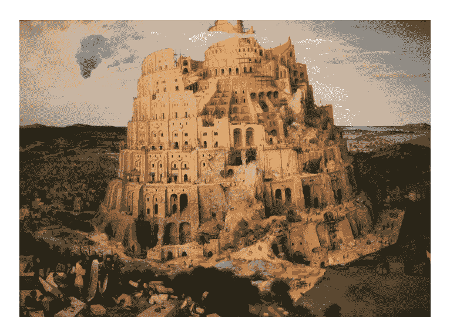

这幅画的名字叫《巴别塔》，创作于 16 世纪，作者叫勃鲁盖尔，距今 500 多年，就藏在维也纳艺术史博物馆的二楼。

这幅画宽 1.55 米，高 1.14 米。成年人站在它面前，伸开双手就可以覆盖这幅画。它在油画中算是中等大小，但是画面依然会让你感到雄伟。

画中有一座高塔，就像是七层蛋糕那样，下面最大，一圈一圈高上去。为什么会让你感到雄伟呢？首先是因为构图，高塔的面积几乎占了四分之三的画。其次，画家用云彩拦腰截去的塔顶只能隐约可见，显示塔已经建到了可怕的高度。

被高塔的气势冲击之后，再仔细看，你会震惊。因为正中有一处巨大的塌方，外墙垮掉，露出了里面的结构。原来宏伟高塔内部的每一层，都有着精细的空间布局。画家就这样用宏大的塔身、严重的塌方、严谨的内部结构，营造出了巨大与繁乱的整体效果，显示出这一工程的伟大和艰巨。

当你把目光从高塔转移到画面左下方时，会立刻感受到莫名的紧张。在左下角，几个人正跪着向长官汇报，可从长官和随从的反应来看，他们显然听不懂对方在说什么。

现场到底发生了什么？为什么空气中流动的是巨大的不安和焦虑？

是的，画家就是把人类传说里的一个悲剧性时刻用这种方式定格了。这个悲剧性时刻就是巴别塔的崩塌。

如果对基督教文化稍有了解，你大概知道这画的是一个《圣经》中的故事。那《圣经》中是怎么描述这个故事的呢？

大洪水过去之后，天上出现了一道彩虹。上帝对人类说，彩虹是我的誓言，表示我不再用大洪水毁灭大地。此后，天下人都是说一样的语言、说一样的口音。但是有人觉得，把自己的将来寄托在彩虹上，太不靠谱了。于是他们商量之后，决定建一座城和一座塔，塔顶通天，既要传扬名声，也避免再次分散各处。

于是人类就开始建城、建塔。

一段时间之后，上帝降临说：“看哪！他们成为一样的人民，都说一样的言语。如今既做起这事来，以后他们所要做的事，就没有不成功的了。我们下去，在那里变乱他们的口音，使他们的言语彼此不通。”

《巴别塔》这幅画表现的就是这个仓皇时刻。语言不通了，塔也建不成了。

我们梳理一下：第一，上帝阻止人类建巴别塔，不是一个霹雳把巴别塔毁掉，而是轻轻巧巧地干了一件莫名其妙的事，把人的语言搞乱了。第二，在此之前，这群能建通天塔的人，是说同一种语言的。

《巴别塔》的故事，是我见过的，关于语言和人类文明的关系最绝妙的隐喻：语言是人类具有的整体能力，这是一种连上帝都害怕的力量。

### 2.语言启动了人类生命的 2.0 工程

你从蹒跚学步就开始学习说话，你接触到的每个国家、每个民族甚至偏远山区的人都会说话，这事好像天经地义。但是最新的生物学研究告诉我们，10 多万年前，一个叫做 FOXP2 的基因的变异，使得人类跟黑猩猩分道扬镳，从此发展出高超的语言能力。就这么一点点改变，令地球的其他生命望尘莫及。

结构主义语言学把人类语言定义为一个符号系统，既然是符号，就有所谓的能指和所指。语言这种符号，语音是能指，意义是所指。举个例子，猫这个声音是能指，它所代表的动物就是所指。在这个课上，你只需要记住，语言这套系统是个**离散组合系统**。“离散组合”的意思是说，这个系统只需要有限的素材，就能通过素材的组合表达无限多的意思。

拥有这样一个系统，人类就变得非常强大了，为什么呢？

- 第一，我们能边干活边说话，这就把人的双手解放出来了，而且说话和听话耗能极小。
- 第二，说话，也就是发出信息，用声带和口腔；听话，也就是接收信息，用耳朵。这就把人的眼睛解放出来了，信息交流完全不受白天黑夜的限制。
- 第三，一个人脑子里的想法，可以轻松讲述给另一个人，沟通效率大大提高。个体经验可以实现共享，这就大大提升了人群的整体能力。

光这三点就已经很厉害了，但人类利用语言还能做更厉害的事，是什么呢？

那就是“八卦”，没错，就是指“闲聊”“嚼舌头”。你可千万别小看这个能力，在人类的科技水平还处在只有火和简单工具的远古时代，“八卦”极大地增强了人类的社交能力、协作能力。

因为八着八着，人类就有了一个创造奇迹的能力，就是编故事，比如神仙、妖怪，再比如天堂、地狱。虚构的故事能够让人相信，这就形成了共同想象，最终导致人类生活在自己的共同想象中，甚至我们现代人的国家、公司、法律，也都是共同想象的结果。没有语言，就不会有共同想象。

所以，对人类来说，语言的诞生相当于启动了生命 2.0 工程。那生命 1.0 是什么呢？是指那些硬件、软件只能靠演化，也就是自然选择才能迭代的生物。生命 2.0，就是硬件靠自然选择，但是软件可以自我设计的生物。当前只有人类是这样的。

这个时候再回到巴别塔的故事，你既能看到上帝的残忍，也能看到上帝的仁慈。所谓残忍，他选择变乱语言，这比直接毁掉巴别塔的威力更大。塔毁了可以重建，口音乱了人心散了，造塔工程就很难东山再起。而所谓仁慈，是如果你真的相信上帝无所不能的话，幸好，他并没有完全剥夺人的语言能力。要是被剥夺了语言能力，人类恐怕就万劫不复了。

当然，你也可以理性地把巴别塔的故事，看作一个原始文化的隐喻。语言的起源到现在一直都是学术上的难题，不知道世界上是否真的存在过一种统一的语言。但巴别塔的故事至少试图解释世界上为什么有这么多语言。

今天，地球上现存多少种语言呢？超过 6000 种。

### 3.故事构建民族历史

不过，巴别塔还有另一层深意，我看到过一种解释，拿来跟你分享。这个解释说，巴别塔让《圣经》的叙事主线，从神话转到历史。

《圣经》是谁写的？希伯来人。为什么写《圣经》？要建立希伯来人生存的合法性。但编写过程中遇到很现实的困难，比如，既然上帝和亚当都说希伯来语，那又怎么解释后来的人不说希伯来语？又怎么解释希伯来人占的土地这么少？强大的国家却又是外族的？

所以，怎么让上古神话和近古历史融合到一起？这是个问题。

中国神话的处理方法是，让上古君主的母亲和神生孩子。日本神话的处理方法是，让天照大神来生，生着生着就生到了第一代天皇。

而《旧约》的编写者，就借用了巴别塔的故事来衔接神话历史和真实历史。在《圣经》里，巴别塔前面的故事是诺亚方舟，巴别塔后面的故事是亚伯拉罕生孩子，亚伯拉罕是犹太人的祖先。而巴别塔在中间，解释了语言和人群的分离。这个转变非常关键，情节的重心就从天上转到地下，从神转到人。

你看，有了语言，人类就开始编故事。通过编故事，从而塑造自己是谁，回答自己从哪里来，指引自己到哪里去，这是多么伟大的能力。

### 本讲小结

《巴别塔》这幅画，是勃鲁盖尔以《圣经》为题材创作的伟大作品，它寓意了人类的语言能力，是连上帝都害怕的符号系统。

语言的诞生，是人类开启生命 2.0 的里程碑事件，从此人类可以更有效地交流、协作和八卦了。

希伯来人创作巴别塔的故事，是他们建构本民族历史合法性的努力。

思考题：如果人类回到上帝变乱语言之前的状态，也就是全世界的人说同一种语言，你觉得这是好事还是坏事？为什么？欢迎在留言区分享。

语言很厉害吧？但它有三个致命缺陷，第一，留不住，一出口就消失在风中；第二，传不远，人扯开嗓子喊也就能传几十米；第三，记不住，人对语音的记忆很短暂。所以 10 多万年前方口头语言诞生，人类的文明演进一直很缓慢，直到五六千年前，神奇的事情发生了。

下一讲，我带你去伦敦大英博物馆，了解跟人类文明紧密相关的第二个符号系统，文字。

头图备注：图像©2019 DigitalGlobe, European Space Imaging, 地图数据©2019 Google

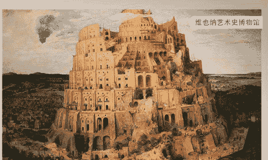

> 维也纳艺术史博物馆

48° 12’ 13.32'' N, 16° 21' 42.48" E

# 巴别塔毁掉不要紧，幸亏我们还有语言。

楚方Tips：

勃鲁盖尔还画过一幅小的《巴别塔》，在鹿特丹，去年一起展览过，在博物馆书店，可以找找展览画册，回家翻着看。

《林楚方·文明地标30讲》

来自得到App

## 02 大英博物馆罗塞塔石碑｜穿越时空的语言符号

2019-4-1

你好，我是林楚方，欢迎来到我的《文明地标 30 讲》。

一般人通常不太区分语言和文字，觉得说话是语言，写下来就变成文字了。但我要提醒你，语言和文字其实是两个不同的符号系统。文字是语言的次生符号，有文字的民族，一定有语言，但有的土著民族甚至至今都没有文字，只靠口头语言交流。

虽然文字只是语言的次生系统，但你要记住，在文明的演进过程中，文字对于人类同样非常重要。这一讲，请跟我去大英博物馆走一遭，那里有一件藏品，罗塞塔石碑。透过这块石碑，你可以了解文字符号的巨大魔力。罗塞塔石碑制作于公元前 196 年，同一时期秦始皇正在努力统一中国的文字，这两件事都和文字有关，距离今天有 2200 多年。

### 1. 罗塞塔石碑的破解

我们直奔大英博物馆的埃及馆。一个巨大的玻璃罩子里，有一块黑色花岗岩，它就是罗塞塔石碑。石碑高 1.12 米，宽 76 厘米，厚 28 厘米，加上底座，比一个成年男人高一些，刚好，你的目光可以落在石碑文字最密集的地方。石碑刚造好的时候大概是长方体，但明显被破坏过，现在已经不完整了，顶部接近三角形。

这座石碑黑黢黢一块，看上去甚至枯燥乏味，但它硬是跟顾恺之的《女史箴图》、古希腊帕特农神庙雕塑一起成了大英博物馆的三大镇馆之宝，甚至成了大英博物馆的象征。这是为什么呢？

因为通过这块石碑，欧洲人在 1924 年，不仅破译了已经失传的古埃及文字，得以跟古埃及法老隔空对话。更关键的是，通过罗塞塔石碑的破译，有文字记录的人类文明史，往前推进到了公元前 3000 年。

要知道，另一种跟古埃及文字同样的象形文字——中国的甲骨文，要到1898 年才首次被发现，不但比发现罗塞塔石碑晚了将近一个世纪，而且能回溯的历史最远也就是公元前1600多年。

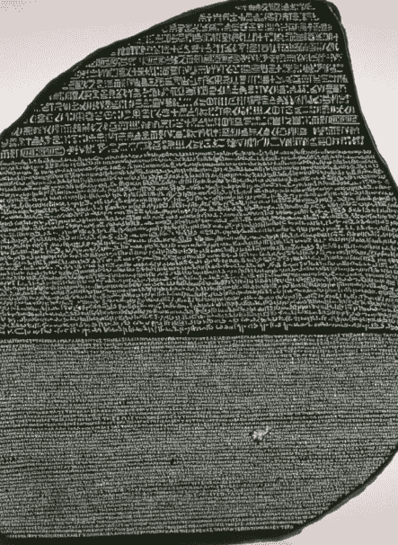

回到这块石碑，隔着玻璃罩，你会发现上面密密麻麻刻着三种文字。最上面的文字总共14 行，有的像蛇、有的像鸟、有的像眼睛，这是古埃及的象形文字（也叫圣书体），当年只有古埃及的祭司、贵族们才能看懂。中间的 32 行，歪歪扭扭像小孩画的涂鸦，这叫草书文字，是象形文字的变体，给老百姓看的；最下面的字数最多，54 行，是古希腊文字。

罗塞塔石碑被发现之前，已经有大量的古埃及文物出土，上面有各种图形符号。但是，没有人读得懂，因为古埃及的象形文字早就失传了。你可能会说，应该不难吧，可以根据图形猜嘛。你是个中国人，很容易这么想，但汉字的情况不大一样，根据偏旁部首，你还能猜测不认识的字究竟是什么意思。

但看上去是象形的古埃及文字符号，其实已经用来表示读音了，而并不是直接对应意义。比如一个猫头鹰符号，它其实代表的是 M 这个读音，而不是一只鸟。如何找出这些象形符号和语音之间的对应关系，就难住了欧洲的历史和语言学家们。

这一回，罗塞塔石碑上同时出现了三种文字，学者们当然有理由推测，它们记录的是同一个意思。好在，古希腊文字，欧洲学者有人懂，这无异于得到了一条破译古埃及文字的辅助线。

最终，一个名叫商博良的法国历史学家，从一个叫托勒密的法老的名字入手，成功破解了罗塞塔石碑的文字。于是，埃及出土的木乃伊、壁画、塑像，还有矗立在埃及本土的大型神庙、金字塔、方尖碑，以及古埃及 30 个王朝留下的凡是带文字的记录，在瞬间开始讲话了。下边就是一张古埃及文字和拉丁字母的对照表：

### Egyptian hieroglyphic alphabet

| hieroglyph | letter | hieroglyph | letter | hieroglyph | letter |
| :---: | :---: | :---: | :---: | :---: | :---: |
| (bird) | a | (bird) | m | (line) | sh |
| (rectangle) | i | (zigzag) | n | (hook) | q |
| (two rectangles) | y | (leaf) | r | (tray) | k |
| (reclining man) | a | (door) | h | (basket) | g |
| (bird) | w | (necklace) | h | (half-moon) | t |
| (leg) | b | (ball) | h | (bow) | tj |
| (rectangle) | p | (flax plant) | ch | (jar) | d |
| (snake) | f | (bow and quiver) | s | (sedge) | dj |

了解了这个背景，你说罗塞塔石碑该不该是大英博物馆的镇馆之宝？人类对于整个古埃及文明的理解，都是靠着它才拿到开门钥匙的。今天如果你去巴黎的协和广场，会看到一个埃及方尖碑，这是埃及人给法国人的谢礼，感谢法国人破译了古埃及文字。

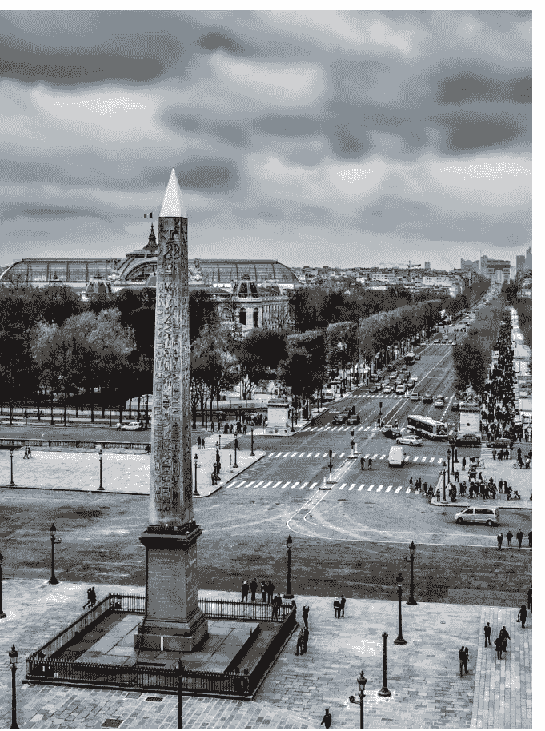

既然破译了文字，让我们一起看看罗塞塔石碑上到底写了什么。

### 2. 文字与人类管理大规模组织

石碑的文字，是为了讴歌埃及法老托勒密五世的。据历史记载，公元前 2 世纪初，古埃及人开了一次会，可以类比为“全国宗教大会”，罗塞塔石碑就是会议的成果，你可以把它看作是一封祭司阶层写给法老的感谢信。

当时的法老是托勒密五世，他上台以后颁布法令，赐给神庙免税权。祭司们投桃报李，就把这件事刻在石碑上，记录了法老的很多善行，比如修建水坝抵御洪水，给神庙赏赐银器和粮食等等。祭司们还把法老的生日和加冕日，定为国家法定节假日，每年都要庆祝，这相当于给法老的合法性背书。

为什么还有希腊文字呢？因为这时候埃及已经被希腊人征服了，法老托勒密五世就是希腊人的后代。你看，无论异族统治者向精英阶层示好，还是精英阶层对统治者表示感谢，都要写成文字，再用石碑这种模式昭告天下，目的是让政府的统治得以稳固。

我们今天讨论一个文明，有一句你很熟悉的话，叫“有文字记载的历史”。有文字记载这件事，为什么这么重要？因为和语言相比，文字有下面这些优势：

- 有了文字，转瞬即逝的语音，就可以被记录、被保存了。
- 在空间上，附着在文字上的信息能够影响到远方的人。在广播诞生之前，口头说出来的话可不行，最多只能传到几十米的地方。
- 在时间上，前人的经验可以记录下来，让后代看到和学习，智慧得以累积，文明得以传承。

也正是因为如此，今天虽然还存在没有文字的部落，但无一例外，他们的文明程度都不高，规模也不大。语言的出现，让人跟动物彻底分道扬镳，而文字的发明，使得人类文明又向前迈进了一大步。

人类随着文明的发展，支配的财富、管理的土地、控制的人口越来越多，就迫切需要一种工具，能够记载信息、远程传播。而文字，就是一种比语言更有效的大组织管理工具，它跟国家、政府权力是紧密相连的。

说到这，你就能理解，在各大文明的传说中，文字的发明者不是神就是王。在埃及的文明中，造字的是一个神；中国的传说中，发明了文字的仓颉，是一个部落首领；而韩国文字的发明者，更是他们的世宗大王。

古埃及人相信，看到文字，必须大声朗诵出来，大声朗诵才能表达对神的膜拜。中国也有一种传统，凡是写着字的纸，即便是废纸也不能随便扔。今天四川有些地方还有惜字塔，是专门拿来烧带字的纸的。这些带有神秘色彩的传说，都是某种隐喻，它们的背后是文字在文明塑造上的强大力量。

### 3. 超越时空限制的符号魅力

文字有这么大优势，但它有一个天生的弱点，就是不容易学习和掌握。正常环境下，一个人只要不聋不哑，三岁就能学会某种语言，而掌握一种文字就必须通过专业学习和长期训练。怎么解决这个问题呢？

于是，人类的教育诞生了，为了学会文字，就得有专门的人负责教授文字知识。早期的教育，培养了一批识字的知识人群，这是一个新的群体，就是知识阶层。他们成为官僚精英，或者成为祭司，从此，劳心者和劳力者就成为两个阶层。

最初的文字刻在石碑、乌龟壳、莎草纸、泥板、竹简上，效率很低，而频繁的文字记录需求，推动着人类追求更轻便的文字载体，更方便的文字复制方式。

纸张发明出来后，印刷业随之蓬勃兴起了。人类文明开始以图书的形式加速积累，图书馆成为了文明的象征之一。在相当长的时间里，人类的文明很大一部分都是靠文字来保存、记录和传承的。

### 本讲小结

借助罗塞塔石碑上的古希腊文字，法国人商博良破译了古埃及文字，把人类有文字记载的历史，往前推进了两三千年。

文字是语言的次生符号。它的出现，打破了时空界限和人脑的记忆局限，让人类得以处理更大量、更精细的信息，从而能够管理超大规模组织。

文字催生了知识群体的产生，推动了纸和印刷术的发明，让知识的生产和传播范围更广、速度更快。

**思考题：**汉字并没有发展成字母文字，你觉得这对中华文明的发展是好事还是坏事？为什么？欢迎在留言区分享。

下一讲，我们去巴格达，没错，就是那个动荡不安的巴格达。这里跟人类文明的另外一套符号系统紧密相关，这是一套全球通用符号。

头图备注：图像©2019 Google, 地图数据©2019 Google

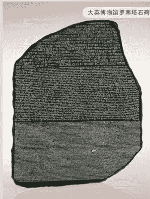

51° 31' 10.2" N, 0° 7' 36.84" W

# 一块石碑，三种文字，破解它，沉睡的金字塔和木乃伊也能讲话。

> 楚方Tips：

大英博物馆的纪念品商店里，罗塞塔石碑的衍生品做得特别好，可以带个杯子回家。

## 03 伊拉克巴格达古城 | 全球通用的数字符号

2019-4-1

你好，我是林楚方，欢迎来到我的《文明地标 30 讲》。

这一讲，我要带你去伊拉克首都巴格达市中心的古城遗址，了解一套重要的全球通用符号系统：阿拉伯数字。

我们前两讲介绍的语言和文字，都有区域和民族特性，即使英语号称是全世界使用人数最多的语言，也远远没有达到全球通用的地步。曾经有人发明了世界语，希望能够成为全世界的通用语言，但是并没有成功。但有一套符号系统，突破了语言文字差异，几乎全球通行。这就是阿拉伯数字。

世界上所有的语言里都有数，世界各地不同的古老文明，也各自发展出了数学。但为什么在数字符号上，阿拉伯数字这套符号系统能够统治全球？如果你有点数学知识，也一定知道，这套数字符号的发明权得归印度人所有。但今天听名字你就知道，我们把荣耀给了阿拉伯人，这又是怎么回事？

带着这些疑问，跟我一起去巴格达吧。

### 1. 为什么是阿拉伯？

今天的巴格达，绝不是理想的旅行目的地，新闻中出现的巴格达，往往和恐怖袭击有关。但是，如果你能抵达巴格达，在保证安全的前提下，一定要到市中心的古城遗址走一走。

在公元 762 年，巴格达被定为阿拉伯帝国阿巴斯王朝的新首都，是当时阿拉伯世界的中心。但现在的古城只剩下一座圆形城楼，大约四层楼高，顶部有个八角圆顶。沿着残破的城墙往上走，站在城楼上，请你跟我一起忘记萨达姆，忘记海湾战争，忘记恐怖主义，闭上眼睛想象这座城市最美好的年代。

1000 多年前，就在这座塔楼的西侧，坐落着一座人口至少有 50 万的超大城市。如果能从空中俯瞰，你一定会奇怪，这哪里是一座城市？分明是一个外星基地呀！整座城市由4个圆组成，一个圆环套一个圆环。注意，不是北京的那种环线，而是标准的正圆形，跟圆规画出来的一样。

圆环和圆环之间，是密密麻麻的建筑，有贵族的宅邸、清真寺、学术机构、军营等等。最中间的圆心位置，是个水滴般的蓝色建筑，那就是哈里发的宫殿。看到这样的景象你就会明白，阿拉伯数字从这里崛起，简直是顺理成章的事。为什么呢？因为这简直就是一座数学之城啊！

这么前卫的城市规划，是由帝国最高统治者曼苏尔亲自设计的，他的灵感来自欧几里得，古希腊的几何学家，第一个给圆做出精确定义的人。而曼苏尔是欧几里得的超级粉丝，他把首都建成圆形，这等于拿一座城向欧几里得做了一次超时空的致敬，这恐怕是有史以来出手最阔绰的数学迷了。

要建成这样的城市，一定离不开大量的精密计算，也就意味着需要可靠的数学体系才能完成。单凭一位统治者的个人热情恐怕不够，我们接着来看整个阿拉伯帝国数学的兴盛是怎么实现的。

当时的阿拉伯统治者哈里发有三个身份：宗教领袖、世俗皇帝，以及帝国学术活动的保护人和赞助人。

曼苏尔之后的第七任哈里发马蒙，做了一件更牛的事，把阿拉伯帝国的学术活动推向了顶峰。如果没有他，估计阿拉伯数字可能就不叫这个名字了。那他到底做了什么？答案是，收集智慧。

这位哈里发扩建了当时全世界最大的图书馆，名叫智慧宫，这个名字就是哈里发马蒙亲自起的。他把当时能搜集到的所有人类已知知识，像欧几里得几何学、毕达哥拉斯定理，苏格拉底、亚里士多德、柏拉图、希波克拉底、托勒密的著述，只要是知识，不管是古希腊的，还是波斯人、犹太人、埃及人、印度人、中国人的，通通收入智慧宫。

然后他重金聘请世界上最顶尖的学者，把这些智慧通通翻译成阿拉伯文，这项翻译活动整整持续了 150 年。可以说，当时的巴格达就是全球的学术中心。

终于说到阿拉伯数字了，它也是帝国搜集来的，只是搜集的过程有点暴力。公元 700 年前后，阿拉伯帝国持续扩张，一路打到印度北部。在这里，他们吃惊地发现，打仗不怎么样的印度人，竟然拥有一套特别好用的数字符号。阿拉伯人也很聪明，就把这套数学符号和计算方法学了来。学者和商人最先感受到这套数字的好处，于是他们迅速放弃了自己原本的数字，改用印度人的数学语言。

听到这，你可能会觉得，这不就是阿拉伯人换了从 0 到 9，十个数字符号嘛。其实没那么简单，阿拉伯人从印度学来的不光是这十个符号，还包括我们现在通用的定位计数的十进位法。

“定位计数”这个名字你可能陌生，但这套系统你用得很熟练。比如 388 这三个数字写出来，你就明白，排在最前面的 3 表示 300，中间的 8 表示 80，末尾的 8 是个位的 8。也就是说，同一个数字符号，因为位置不同，它表示不同的数值。而且，印度人还发明了 0，如果一个位置没有数字，就记作 0。

没有对比，你可能还意识不到这套数字的好处。比如拿汉字来做比较，同样的数字，你得写成三百八十八，五个字，比阿拉伯数字多两个字。要是换成罗马数字就更可怕，得写成 CCCLXXXVIII，三个 C，一个 L，三个 X 一个 V 再加三个 I，一共 11 个字母，这才表示了三位数啊。

所以你看，印度数字不仅自然数的表达一目了然，而且列计算式计算也特别简洁，只要书写时对好位，该借位借位，该进位进位，加减乘除毫无压力。这种压倒性优势，让阿拉伯人改换门庭，也就是理所当然了。

### 2. 从智慧宫走向全世界

明明是印度人的发明，阿拉伯人怎么把这个冠名权据为己有了呢？因为他们起到的作用，是把这套符号系统推广到了全世界。

谁会最喜欢用这套系统？当然不光是数学家，还有阿拉伯的商人群体，因为他们成天算钱记账，跟数字打交道更多。于是阿拉伯商人走到哪里，这套系统就传播到了哪里。很快，印度数字就跟随贸易的脚步到了欧洲，不明觉厉的欧洲人当然不知道印度人的剧情，于是就把他称为阿拉伯数字。

到了 13 世纪，尽管当时的佛罗伦萨官方明令禁止，但使用阿拉伯数字已经在欧洲学术界流行。到 15 世纪，阿拉伯数字彻底征服了欧洲，又随着大航海的帆船，推广到了世界各地。到 100 年前，阿拉伯数字开始在中国普及，现在已经成为全球通用的数字符号。

如果我们把各国发明的数字符号系统，比喻成竞争关系的创业公司，那么最终阿拉伯数字以压倒性的优势，获得了全球性的垄断地位。

这个单元，我之所以把语言、文字看作人类文明的基础设施，都是因为它们对推动人类文明发展的作用是根本性的，阿拉伯数字也是如此。这话怎么讲？

你可别光盯着它在阿拉伯商人做买卖的时候，方便了记账，促进了全球贸易。它更伟大的意义，是对现代科学的发展起到了关键作用。

单就“0”这一个数字对现代数学的影响就难以估量，没有它，就不会有后来的负数概念。它还是解析几何坐标轴的原点，没有 0 也就没有原点，也就无法建立坐标轴，解析几何的大厦就无从谈起。

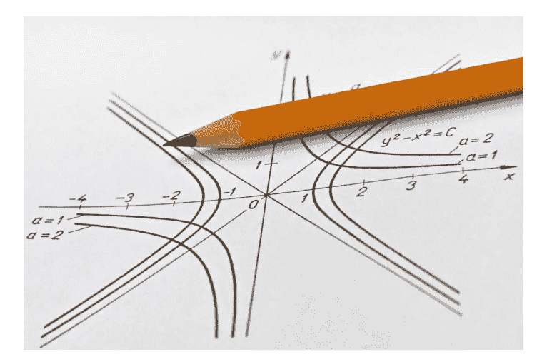

更重要的是，阿拉伯数字为全世界的科学家，提供了一套通用语言。全世界的理性大脑，基于同一套符号系统思考和交流，就把现代数学体系建了起来，而现代科学的大厦又是以数学为地基的。

你看，人类至今仍然拥有 6000 多种语言，但《圣经》里操同一种语言建造巴别塔这件事，在数字符号这个领域确实实现了。

## 3.人类正在建造新巴别塔

古希腊数学家毕达哥拉斯说过这么一句话：数，是万物的本质。今天，不仅使用十进制的阿拉伯数字，而且人类在这套数字基础上，又发展出了由 0 和 1 组成的二进制计算机编码语言。

随着计算机科学的发展，人类已经完全进入了一个新的时代，这个时代被命名为数字时代。计算机里的文字、图像、视频，通通可以还原成一段二进制编码。

未来，我们还将进入人工智能的“大数据时代”，你的爱好、兴趣、口味、习惯、出行方式、个人经历，都将以数字的形态上传到云端。通过海量的计算，人工智能比你更了解你的需求，还能替你完成工作。

全人类用同一套二进制语言工作，仿佛正在建造一座新的巴别塔。

### 本讲小结

- 巴格达古城曾经是一个世界性的学术活动中心，古代阿拉伯人借助了印度人发明的数字系统，并把它推广到全世界，而且占据了这套系统的命名权。
- 阿拉伯数字是一套极其简洁的符号系统。10个数字和一套定位计数的十进位法，大大简化了数字表示和计算，它的全球通行极大推动了现代科学的进步。
- 今天，我们已经进入了基于二进制计算机编码的“数字时代”，人类仿佛在重新建造巴别塔。

思考题：你还能想到哪些阿拉伯数字对人类文明的贡献？欢迎在留言区分享。

下一讲，我要带你去巴黎 Lafayette 百货公司，研究另一套符号系统。这套符号在现代社会，可是有很大的商业价值。

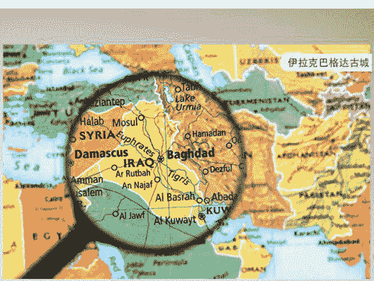

33° 20' 55.68" N, 44° 20' 7.03" E

# 古巴格达的阿拉伯人把印度数字推向全球，还意外拿下了冠名权。

- 楚方Tips: 智慧宫不在了，但城外有座建于11世纪的尼采米亚大学，它是智慧馆之后帝国最重要学术中心，保证安全的情况下要看。

《林楚方·文明地标30讲》
来自得到App

## 04 巴黎老佛爷百货丨消费时代的超级符号

2019-4-1

你好，我是林楚方，欢迎来到我的《文明地标 30 讲》。

我带你去巴黎的 Lafayette 百货，不是买香水买名牌包，而是带你观察这里聚集的名牌符号，是如何操控了现代人的消费行为的。

### 1. 人们在老佛爷究竟买了什么？

因为读音相近，中国人一般把 Lafayette 叫作老佛爷，其实它的准确翻译应该叫“拉法耶特”。在巴黎，它是一条街的名字，也是一个法国姓氏，但是今天最为人熟知的拉法耶特就是我们要去的老佛爷百货。

老佛爷是巴黎奥斯曼大道上，一个地跨三座大商场的建筑群，紧邻著名的巴黎歌剧院。通常，其中一座建筑上，会有那种三层楼高的巨型海报。这是欧洲最著名的百货商场之一，汇聚了全球最著名的奢侈品和高档消费品品牌。

也许你已经在这里血拼过，但这一次，请你暂时按下购物冲动，换个视角跟我重新来一次旅行。我先抛下一个结论，站在符号研究的角度来看，老佛爷就是超级符号的万神殿。

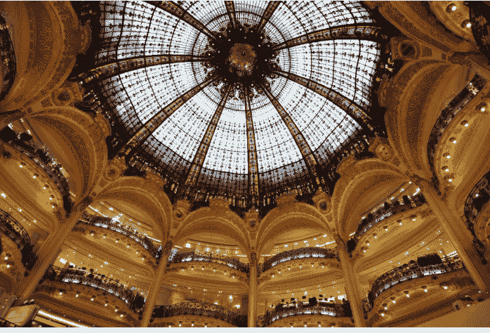

走进老佛爷的主楼大厅，阳光从金碧辉煌的拜占庭风格玻璃穹顶倾泻而下，打在 5 个楼层琳琅满目的商品上，制造了一种豪华宫殿的感觉。和现代 shopping mall 的简洁风不同，这座超过 100 年历史的商场，内部装饰繁复、华丽。光滑的大理石地面，精心设计的橱窗、舞台感的装饰，不断强化着脱离日常生活的奢侈感。

我记得 2017 年，时尚大牌迪奥为了庆祝自己的 70 岁生日，就在老佛爷搞了一个大型展览。在主楼穹顶的正下方，飘起了一个几层楼高的蓝色热气球，气球下面的巨大吊篮也是蓝色的。只要你进入大厅，就完全无法忽视吊篮上 D、I、O、R 四个字母组成的硕大的金色 logo。

反对奢侈品的人一直攻击，为什么一个包、一双鞋就因为上面多了几个代表名牌的字母，就会卖那么贵？养一头鳄鱼也不用那么多钱吧？这些商品标价远远超出了它的手工和物料成本，迷恋这些东西的人是脑子有问题？是钱多得花不出去？是为了炫耀？问题还真没那么简单。

确实，人们在这类商品上花大量的钱，不是为了它的实际功用。买包不是为了能装东西，买时装不是为了遮羞或者保暖，甚至不是为了让自己显得更好看。人们在老佛爷一掷千金，买的是对著名品牌的强烈认同。中国的营销专家华杉，干脆就把这些超级品牌的 logo 叫做"超级符号"。

### 2.有魔力的超级符号

超级符号到底超级在哪？凭什么就能让人心甘情愿多掏钱？接下来，我就用老佛爷里的超级大牌做例子，给你做个具体分析。

首先，它们具有很高的形象识别度。乍一看，集中在老佛爷的名牌 logo，有些是完整的单词，比如 BVGARI（宝格丽）；有些是字母的缩写，比如路易·威登的"LV"、香奈儿的双"C"、古驰的双"G"；有些则借用了动植物的形象，比如阿玛尼的雄鹰、兰蔻的玫瑰。

这些 logo 虽然看似很简单，但是识别度极高，因此记忆成本也就越低，能够让人一眼认出来。这很重要，不但使要买的人容易辨认，更要紧的是让旁观者也能够迅速辨认出来。

但仅仅识别度高，是不能叫超级符号的，想成为超级符号，这个 logo 还要有强大的信息压缩功能。我们通常会说，你买的不是某个品牌，而是它背后一整套的故事。品牌的历史、产品的理念、创始人和历代设计师的传奇故事，全都压缩在这个图形里。

看到香奈儿的双 C 图标，对于品牌爱好者来说，涌上心头的有一系列跟创始人香奈儿女士相关的传奇故事，有法国南部修女院学校的孤星血泪，有巴黎帽子店的名流客人，有二十世纪初女性的解放和独立，有五号香水跟梦露的香艳故事……

正因为有前两个特性，于是这类符号就如同魔咒，让人面对心仪的品牌，立马就想掏腰包。这就是营销专家所说的，超级符号的指令性。2017 年 LV 和滑板运动品牌 Supreme 在全球八个城市联合开出的首批快闪店，号召力有多大呢？在日本东京那家店，开店当天排起了 1.5 公里、7500 人的长队，政府专门出动 100 多个警察维持秩序。

在老佛爷百货，我们很容易体会到超级符号的三大基本特征：高辨识度、信息压缩和强指令性。

当然了，不光是消费，我们就今天生活在一个充满文化符号的世界里。洗手间要看男女标记，过马路上要看红绿灯，看到一个三角符号，你就知道是播放键，一按就能启动一段视频。符号无所不在，已经成为文明的一部分。

### 3. 从远古图腾到现代符号

很多批评奢侈品营销的人，会抨击现代社会的消费主义浪潮。不过，促使人追捧超级符号的心理动机，可不是最近几十年培养出来的。对于符号的崇拜，能追溯到人类的远古时代。

在原始社会，很多氏族和部落，都会选用一种真实或者想象的动物、植物，作为自己群体的特殊标记，这个标记就是图腾。比如，有历史学家通过史书和文物考证，认为女娲部落的图腾是蛇，黄帝部落的图腾是熊。

图腾是一种能激起群体身份认同，跟他人形成区隔，从而获得安全感和鼓舞的符号系统。如果部落间发生战争，战旗上会画上部落图腾来鼓舞士气。有的部落还会戴着图腾面具，或者围着图腾跳舞，人们相信图腾符号会保护自己和部落，会带来丰收，会带来猎物。

从原始的图腾崇拜，到现代人追捧超级符号，追求的都是某种群体认同和心理满足。法国一位当代营销专家卢卡·斯坎尼（Luca Scaini）就提出一个观点：图腾就是一个部落的品牌，而奢侈品大牌的 logo 就是“现代图腾”。

人是社会动物，摆脱了原始部落的束缚之后，又用现代的超级符号，用消费给自己划了群组，区别于一些人，认同另一些人。所以在营销学上，他提出了部落营销的概念。

从现代营销的角度来讲，超级符号成功地降低了认知成本、决策成本和传播成本，因而有巨大的商业价值。几乎每一个有企图心的商家，都渴望炼成超级符号。但也有知识分子站在一旁，试图穿透符号光环，用审慎的眼光审视被符号所操控的消费文化。

比如后现代理论大师鲍德里亚，在他最有名的一本著作《消费社会》里，讲到一个特别有意思的例子。

太平洋西南部群岛美拉尼西亚的土著人，觉得天上的飞机很神奇，而且他们发现白人在地面上布置了一些东西，飞机就会成功地降落到那里。于是，土著人就用藤条和树枝建造了一架模拟的飞机，还划出一块地面，并且在夜间照亮，耐心地等待着飞机前来着陆。

鲍德里亚把这个故事解释为消费社会的寓言，这是什么意思呢？他觉得在现代社会，人们消费物品只是为了“幸福的符号的积累”，就像美拉尼西亚人做个飞机的模拟物，期待奇迹的发生。

### 本讲小结

- Lafayette 百货集中了全世界的超级大牌，是超级符号的万神殿。
- 符号识别度高、信息压缩量大、行动指令性强，这三大特征使得超级大牌能够极大地刺激普通人的消费动机。
- 现代人消费超级符号和原始人崇拜图腾，是相同的心理机制，本质上都是追求身份识别和群体认同。

单元小结：第一个板块的漫游到这里就结束了，通过四个地标，我带你了解了人类语言、文字、阿拉伯数字和 logo 这四个符号系统。

人类靠语言符号高效交际，靠文字符号更便捷地记录和传播语言，靠阿拉伯数字符号建造了庞大的现代科学体系，靠超级符号实现商品溢价和现代社会的群体认同。人类文明，在符号的基础设施上飞速发展。

思考题：生活中有没有你毫不犹豫会选择的超级符号？听完这一讲，你能分析一下自己的消费心理吗？你觉得为超级符号支付溢价值不值？欢迎在留言区分享。

接下来我会带你进入一个新的板块，我们会去埃及看金字塔，去科隆看大教堂，去特洛伊看古城遗址。

> 头图备注：图像©2019 Aerodata International Surveys, The GeoInformation Group | InterAtlas, 地图数据©2019 Google

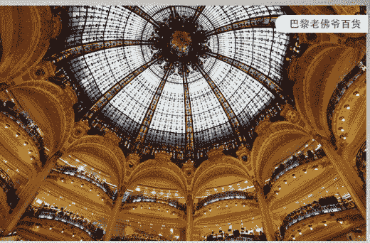

48° 52' 28" N, 2° 19' 22" E

# 在老佛爷百货，人类买的不是奢侈品，而是超级符号。

- 楚方Tips: 来老佛爷购物别忘抬头，欣赏拜占庭式的经典穹顶，有机会也要去天台，这里是欣赏巴黎全景的最佳地标之一。

《林楚方·文明地标30讲》
来自得到App

## 05 埃及吉萨金字塔群 | 重生是埃及人的生活原动力

2019-4-1

你好，我是林楚方，欢迎来到我的《文明地标 30 讲》。

课程的第二个板块，我会带你去埃及的金字塔、德国的科隆大教堂和土耳其的特洛伊遗址。把这三个地标联系在一起的，是智人大脑进化出来的一种独特能力，那就是想象。按照《人类简史》这本书的说法，智人更为强大的语言能力和社群的共同想象，是更大规模协作的前提，这使得智人最终成为地球上的文明霸主。

在古代人类历史中，埃及的吉萨金字塔群，曾经在长达三千年的时间里，把持了全世界最高的人造建筑的地位。我要提醒你，这样伟大的建筑，并不是为现世的活人建造的。这是不是有点奇怪呢？

想要理解这个问题，我们一起去出发去开罗吧。

### 1.重生想象在大地上的投射

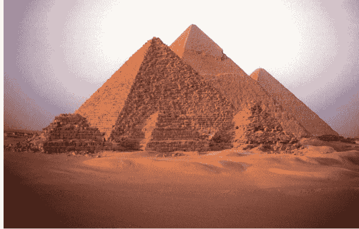

去金字塔，最好早晨出发，在开罗坐地铁 2 号线，就可以到达吉萨景区。古埃及法老胡夫祖孙三代的金字塔都坐落在这里。沿途可以看到沙漠和戈壁，天气晴好的话，你会看到巨大的金字塔静静地矗立在地平线上，空气里弥漫着，除了清晨的阳光，还有淡淡的骆驼粪的味道。

埃及现存一百多座金字塔，全建在尼罗河西岸，为什么都集中在西边呢？因为埃及人认为，西方是太阳落下的方向，代表着死亡。

大约一万年前，埃及社会还处在原始部落的形态，尼罗河的定期泛滥带来肥沃的淤泥，搞农业的埃及人很幸福，顺应自然就能得到足够的粮食。我们看一下地理位置，埃及的北边是地中海，河谷的两侧和南边都是撒哈拉大沙漠。这种得天独厚的地理屏障，使得古埃及人在很长的时间里，几乎完全不需要发愁外敌入侵。他们生命中最主要的敌人，就是死亡。

如何看待死亡，是人类文明的重大课题。如果是一个受科学思维影响的现代无神论者，很可能会认为，死亡就是一个生命体的彻底终结。

但古埃及人可不这么看。他们很早就注意到，每年的固定月份，尼罗河的洪水都会让干涸的土地恢复生机。每天，太阳东升西落，第二天再次升起，周而复始。于是他们认为，人的生命也会经历同样的模式：出生、成长、死亡，然后还有一步，那就是重生。

显然这最后一步：重生，我们今天都知道，完全是一种想象。但是，*用想象突破死亡的限制，这是人类文明发展的重要节点*。而且，由想象出发，还促进现实世界产生了各种文明成果，比如如此恢弘的金字塔群。

在古埃及文明的早期，灵魂重生从而不朽，是属于国王的特权。埃及人相信，丧葬地是灵魂之家，于是陵墓的修建，就成为墓地主人死后重生的基础。这里不仅用于保存遗体，而且还给墓主人自由游历的灵魂提供食物。说到这儿你就能理解，作为陵墓的金字塔对于埃及法老为什么这么重要了。

### 2.埃及人，眼光最长远的投资人

真正站在胡夫金字塔的脚下，人会显得很渺小，几乎看不到塔尖，能感受的，是方形底座的庞大。要知道，底座的每个边大约 230 米。整个金字塔的高度，大概有 40 层楼那么高。

胡夫金字塔建造在埃及古王国时期的第四王朝，大约公元前 *2600* 多年，也就是离现在 *4600* 多年。考古学家说，胡夫金字塔由大约 230 万块巨石修筑而成，至少调动了十几万名工匠，花了 20 年的时间才能完成。

到了胡夫法老之后的古埃及中古王国，虽然重生还是法老的特权，但法老的亲属和贵族，能通过法老的宠爱获得陵墓和丧葬物品；准备陵墓的工匠通过参加葬礼，希望获得不朽；就连为金字塔工作的农民，也希望分享法老的永恒。

这么一来，参与修建金字塔就成了各色人等都觉得能获得好处的事情。而且，因为大家都渴望获得重生，除了作为皇家陵墓的金字塔，给富人和贵族用的石墓和泥砖墓也逐渐发展起来。

在历史演进中，埃及人关于重生的想象，细节更多了，适用范围也在扩大。不光是法老，普通人也有机会重生了。

#### 普通人怎么才能重生呢？

首先，他得是个好人。但好人怎么确定呢？古埃及人想了一套办法，在他们的想象中，人死了会接受冥界之神奥西里斯的审判，要经受“称心仪式”的考验。

考古学家在埃及发现了大量表现用天平称量心脏的绘画，天平的一边是死者的心脏，而另一边是代表真理的羽毛。如果这个人生前清白，没有任何罪孽，心脏就会跟羽毛平衡，死者就能获得重生和不朽。反之，如果天平倾斜，这个人的心脏就会被丢给怪兽吃掉。

古埃及的绘画里，天平旁边往往还有一个狼头人身的形象。这是埃及人想象出来的阿努比斯神，他是天平的守护神，负责读取天平称量的结果，报告死者的命运。下图就是关于这个场景的古埃及绘画：

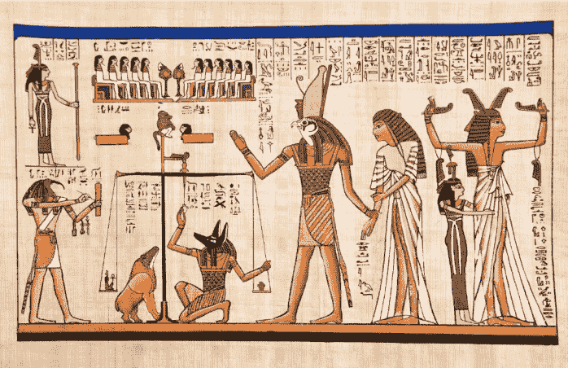

重生的第二个条件，是死后的肉体得到妥善的保存，因为它可是重生灵魂的居所。你在古埃及绘画中还会发现，阿努比斯（就是那个狼头人身的神）有时会出现在木乃伊旁边，他同时是防腐者的守护神。

原本埃及的地理和气候，炽热的阳光和干燥的沙漠，有自然形成干尸的条件。但因为陵墓观念发展起来之后，陵墓的环境反而不适合尸体防腐，于是硬逼着古埃及人世代攻关、技术研发，人工制作木乃伊。

你今天去大英博物馆还能看到几十具人类木乃伊。而且你能看到，木乃伊旁边还有一个木制的人形棺，人形棺上还画着五官和身体，人形棺也有作为死者替身的作用，相当于一个双保险。

在古埃及人的想象中，重生的人回来还要继续以前的生活，于是陪葬品也必不可少。比如说著名的法老图坦卡蒙，今天他的陪葬物品，就放在开罗的埃及国家博物馆，食物、器皿、家具、战车一应俱全。金银珠宝我就不说了，光是亚麻做的内裤就有 145 条，鞋子有差不多 100 双。

### 3. 重生想象带来的文明成果

通过我前面的讲解，你会发现古埃及人有一种“重死轻生”的倾向，在他们的观念中，死亡之后的重生才是值得追求的不朽。这一想象，造就了金字塔这样的文明地标，这是当时世界上最高的人造建筑。相反，法老在尘世生活的居所，因为不被重视，早已经湮没在历史烟尘中，完全不见踪影。

建造这样的大工程，消耗了大量的国家资源，在美国历史学家汤普森的《埃及史》里，作者说，一位埃及学家把丧葬纪念物的建筑和装备，描述为“古王国唯一最大的工业”。这并非是夸张。为了保障修建金字塔的物资供应，古埃及人因此有效地组织了政府官僚机构，发展出了史上最早的税收计算方法，还出现了处理复利和记账的方式。

在文明萌生的开始，死亡是必须面对和回答的问题。苏美尔人、玛雅人、古代中国人、印度人、欧洲人都相信，死亡不是彻底的结束，而是另一次出发，只是大家各有各的剧本。

比如中国人相信死是换个地方继续活，所以秦始皇造了兵马俑，生前征战四方，死后也得统领百万大军。信仰印度教的人，相信死后会转世，根据一个人生前的德行，有可能升天，有可能再次做人，也有可能变成畜生。

哪怕到了现代社会，受到科学主义的影响，很多人已经相信死亡就是生命的终点，但还是有人试图突破死亡的束缚。

比如现在脑机接口很热，俄罗斯有个超级富豪伊茨柯夫，笃信未来 30 年科技一定能够解决人类意识上传的问题。为此他专门投资了这方面的研究项目，还请了脑神经科学家帮助自己，希望能够在肉体衰老之后，自己的意识换一种方式继续存在。你看，这多像一个高科技版本的重生想象？

### 本讲小结

- 金字塔、木乃伊都是为古埃及人的灵魂重生提供服务的。整个社会的政治、经济，包括人民生活，都紧紧围绕着这套重生想象在运作。
- 古埃及人的重生想象，从初期国王的特权，逐步发展成了民众的普遍愿望，从而形成了一种重死轻生的文化倾向。
- 用想象突破死亡的限制，是人类文明的重大进展，它不仅仅表现为传说，还促进现实世界产生了各种文明成果。

思考题：你还了解世界上其它文化关于死亡的想象吗？欢迎在留言区分享。

下一讲，我带你去德国的科隆大教堂，到那里体验另一种人类的基本想象，那就是天堂想象。

> 头图备注：图像©2019 CNES/Airbus, DigitalGlobe, 地图数据©2019 Google,ORION-ME

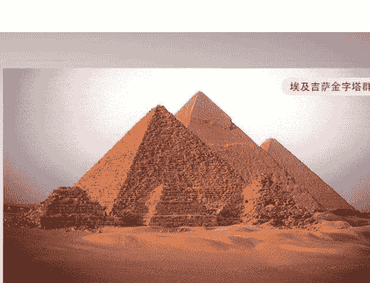

29° 58' 43.41" N, 31° 8' 5.06" E

# 尼罗河是舞台，金字塔是道具，古埃及人无畏惧死亡，期待重生。

> 楚方Tips:
>
> 狮身人面像的鼻子可不是拿破仑轰掉的，早在法军到来之前，鼻子就已经毁坏，而最主要的破坏者其实是大自然，是风沙侵蚀掉了它的鼻子。
>
> 《林楚方·文明地标30讲》
>
> 来自得到App

## 06 德国科隆大教堂｜欢迎来到基督教天堂体验店

2019-4-1

你好，我是林楚方，欢迎来到我的《文明地标 30 讲》。

德国的科隆大教堂是人类的另一种想象，那就是天堂想象的产物。我把它看作是中世纪基督教天堂的人间体验店。

人类对于天堂想象的核心，其实是对极致美好的想象。

### 1. 走进教堂就是体验天堂

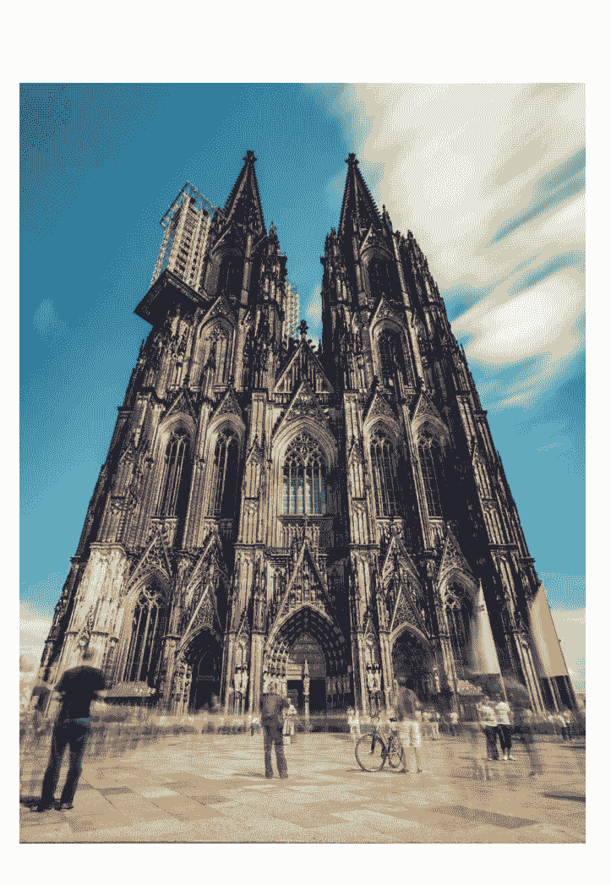

在科隆市的任何一个角度，都能看到科隆大教堂。但我推荐你坐火车抵达，体验一下，一出车站迎面撞到一个大块头的感觉。高耸的尖塔，庞大的身躯，黑色的立面，你会体会到一种震撼感。因为工业污染，曾经神圣的银白色建筑，变成了今天沉重的黑褐色。

科隆大教堂 1248 年开建，1880 年才完工，中间用了 632 年。这个时间，相当于从中国的南宋一直建到清朝末期。欧洲很多教堂动辄就修几百年，有钱的原因，也有技术的原因，总之都是靠教徒们恒久的耐心堆出来的。对比一下，埃及法老修金字塔是给自己用的，所以必须在自己的有生之年修好，所以时间短得多。

再看教堂的高度，有 157 米高，大约 40 层楼，现在仍然是科隆市的最高建筑，因为当地政府规定，城里其它建筑都不能高过它。

在基督教信仰里，“天堂”是有特殊含义的，按照《圣经》的描述，天堂里有珍珠门、碧玉墙、黄金街，还有生命果和生命水。人进入天堂，就永远与上帝同在了。

但问题是，没人真的见过天堂，可以回来告诉世间的人，天堂长什么样。那怎么能让人相信真的有天堂呢？中世纪欧洲教会的办法，就是建教堂。

这么说你可能没有概念，咱们去科隆大教堂看看，你就会有直观的感受了。这座始建于十三世纪的教堂，堪称哥特教堂最完美的典范。

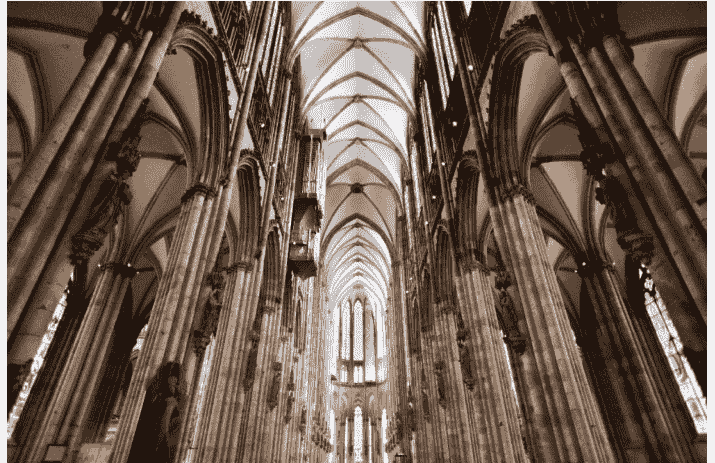

如果你有机会从空中俯瞰，整个科隆大教堂的轮廓就是一个巨大的十字架。大教堂入口在两座尖塔之间，注意，这扇门是尘世和天堂的分界线，迈过这道线就算进天堂了。在这里，你能看到中世纪天堂的一个基本模板。

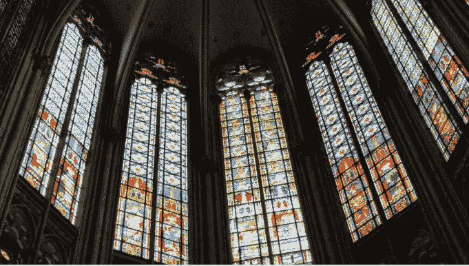

首先，是长而且高的中殿：

想象自己站在百米跑道的起点，一道 100 多米长的通道在你脚下延伸，一排排高大的立柱立在两边引领你向前，有个神圣的终点在等你，那就是圣坛。抬头则是一个个连续的尖拱，空旷、高耸。这种空间，能让人感觉自已渺小得就像尘埃，又时时产生一种飞升感。

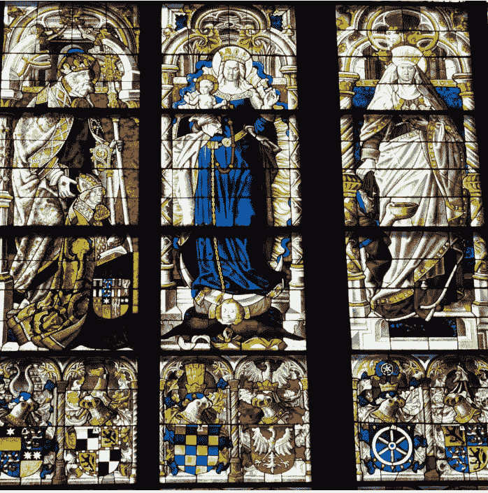

其次，要有光，神圣的光：

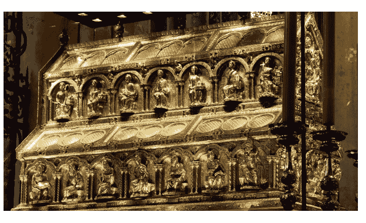

环顾四周，最醒目的是几十米高的玻璃花窗，上面画着《圣经》故事，上帝、天使、圣母、圣徒都悬在半空中。即便你不熟悉那些故事，被红、黄、蓝和金色渲染的光彩，也能带给你不寻常的感受。

第三，科隆大教堂之所以出名，还在于它存有圣物：

在《圣经》故事里，耶稣出生时，东方有三个圣人，冥冥之中居然感应到了，带着礼物跑过来祝贺。三圣是耶稣诞生的见证人，地位很高。科隆大教堂保存着的圣物，据说就是他们的遗骨。

直到今天，很多人走进科隆大教堂时，还会激动得说不出话，觉得自己的灵魂得到净化，坚硬变成柔软，骄傲转为谦卑，躁动变为宁静。甚至真的有人，就因为到了这儿，做出了皈依基督的决定。

### 2. 如何把天堂想象落实到建筑空间

其实所有宗教场所，都担负着唤起人宗教情绪的功能，在这一点上，科隆大教堂算是做到了极致。它是怎么做到的呢？

关于欧洲的教堂，你大概听说过罗马式、哥特式、文艺复兴式等等名词，它们对应不同的建筑风格，也在不同历史时期各领风骚。

10 至 12 世纪，欧洲的教堂一度流行罗马式建筑，这种建筑造型厚重、敦实、威严，但教堂里面光线非常昏暗。那是因为罗马式建筑一般都有一个巨大的穹顶，为了支撑这个圆顶，墙要厚，窗户不能开太大，而且不能盖太高，否则墙体的承重力就不够。

这样的空间里，可以强化上帝的威严和神秘，但让人感受上帝的荣光和天堂的美好可就困难了。更何况，随着西罗马帝国的覆灭，古罗马建筑的很多技巧和艺术还失传了。

随后，十二世纪发源于法国北部的哥特式建筑，成为欧洲教堂的主流。不仅是我们这一讲重点说的德国科隆大教堂，还包括法国的巴黎圣母院、意大利的米兰大教堂等很多欧洲著名教堂，都是这种哥特式建筑风格。

这种建筑样式，罗马人原本不怎么看得起，觉得是野蛮人的玩意。但哥特式教堂可以把尖塔建得极高，还能开出巨大的玻璃窗来，使得建筑内部非常明亮。这和昏暗的罗马式教堂的宗教体验感完全不同，于是一下子流行起来。

#### 哥特式建筑跟罗马式教堂最大的不同：

- 首先，从外观上最明显的，是从圆顶改成了尖肋拱顶。这种拱顶，是由拱底石承重的，不再把承重全部放在墙体上。
- 其次，哥特式建筑是框架结构，先用柱子和肋拱搭框架，再用轻的材料填充墙体，墙上可以开很大的窗户，进一步减轻了墙的重量。
- 而且，哥特式建筑更广泛地应用了飞扶壁，这种支撑墙更进一步确保了建筑的稳定。

有了上面三种技术保障，教堂的拱顶高度和跨度就不再受限制了。一方面，教堂可以盖得又高又大，尖尖的拱顶还能给人“向上”的感觉。另一方面，墙体开出了巨大的窗户，就能在玻璃窗上大做文章了。

你在科隆大教堂看到的玻璃花窗，在阳光的照射下，色彩绚丽，富丽堂皇。这种特色，在其它哥特式教堂中也非常明显。彩色玻璃的绘画题材，也都是基督教的人物和故事。作为现代人，你当然也会被它的美打动，但我敢肯定，你的心理震撼程度跟中世纪的人是根本没法比的。

#### 为什么这么说？

因为在中世纪，教堂外的世俗社会，欧洲人的生活条件真的不怎么样。大部分农民住的是小茅屋，用稻草做褥子，到处是跳蚤。城市里的市民也好不到哪里去，很多家庭几个人挤在一个小黑屋里，时不时瘟疫还会突然降临。

你想想看，生活在这种恶劣环境里的人，一旦走进教堂，那种扑面而来的感觉是庄严、神圣、柔和、明亮、纯净、希望，闭上眼睛，耳畔回荡着悠扬的管风琴声、祷告声、圣歌声，似乎时间都停止了。灵魂仿佛真的能够穿过高高的尖顶，无限接近上帝。而且这种感觉，是要走进教堂才能全方位体验的，站在教堂外边，感觉是没有那么强烈的。

中世纪很多教堂的门上，往往会刻着这样一句话：通过此门，天堂向每个信徒敞开。比起之前的教堂，以科隆大教堂为代表的哥特式教堂，通过全方位的沉浸式天堂体验，不断坚定着人们的信仰。人们不光是礼拜天去教堂，平时去得也很频繁，甚至有时候一天去好几趟。现实的苦难、内心的挣扎都可以向神诉说，还可以在这里和朋友聊天。

### 3. 天堂与人间、想象与现实的交织

正因为哥特式建筑技术上的突破，教堂成为中世纪欧洲的大型城市工程，于是它甚至超越宗教，给欧洲社会带来了多重改变。

首先，修建大教堂需要大量人才和技术，石匠、瓦匠、木匠、雕刻师傅、玻璃工、铁匠这些人被吸引到城市里，竞争与合作推动了技术的进步，不同职业逐渐形成了行会，成为现代城市精细分工的先导。

其次，教堂前面往往会有一个比较大的广场，不光是宗教，它也成为城市居民聚会、节庆、狂欢的场所，为城市生活、市民精神的发育提供了可贵的公共空间。

通过建设教堂，一般人嘴里说的“黑暗”的中世纪，其实正在为文艺复兴质变的来临，慢慢积蓄着量变。

其实，天堂想象并不仅仅是基督教文化中的独有现象，人类学家列维·施特劳斯通过考察原始部落发现，天堂和地狱这种二元对立的模式是人类很普遍的心理结构。地狱代表的是恐惧和焦虑，而天堂代表的是美好和满足。

比如古希腊人柏拉图的理想国、16世纪英国人提出的乌托邦，都是某种形式的天堂想象。而就在欧洲人修建科隆大教堂的时候，中国宋朝也有一句民间谚语，“天上天堂，地下苏杭”。

### 本讲小结

作为欧洲最著名的哥特式教堂之一，科隆大教堂有直插云霄的尖塔、宽阔明亮的内部空间、绚烂多彩的彩色玻璃窗，这是构成哥特式教堂之美的三大要件。

哥特式教堂以它的高、大、美，给中世纪迈入教堂的人提供了非常直观的天堂体验。天堂的本质是一种对极致美好的想象。

建设大型哥特式教堂，在技术、经济、城市、文化各个层面拉动了欧洲中世纪社会的发展。

思考题：这一讲我们说天堂想象的本质，是一种对绝对美好的想象。你还见过哪些其它类型的美好想象空间？它们跟教堂有什么相似之处？欢迎在留言区分享。

下一讲，我带你去土耳其的特洛伊遗址，在那里，你能够体验人类追求自我超越的英雄想象。

头图备注：图像©2019 A eroWest, Aerodata International Surveys, DigitalGlobe, GeoBasis-DE/BKG, GeoContent, 地图数据©2019 GeoBasis-DE/BKG(©2009), Google

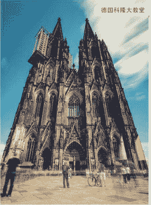

50° 56′ 29.57" N, 6° 57′ 30.58" E

# 科隆大教堂，是中世纪的天堂“体验店”。

楚方Tips:

我推荐坐火车去科隆，体会一下一出站就撞到大块头的感觉。但要小心，据说这里扒手比较多。

《林楚方·文明地标30讲》

来自得到App

## 07 特洛伊古城遗址 | 英雄史诗和自我超越

2019-4-1

你好，我是林楚方，欢迎来我的《文明地标30讲》。

提起古希腊，很多人都会立即想起希腊众神。但我更感兴趣的，是希腊人创造出了一种特殊的凡人，叫做英雄。英雄可能是半人半神，他们拥有神力，为人的荣誉和尊严而战，但也有凡人的弱点，他们会死。

在西方文化里“Hero”（英雄）这个词，最早出自《荷马史诗》，特指参加特洛伊战争的男人。所以，走进特洛伊，就是一场关于“英雄”的溯源之旅。

### 1. 盲诗人荷马编制了一个英雄世界

特洛伊古城遗址位于土耳其，与希腊半岛隔爱琴海相望，古城遗址的面积大约有三个天安门广场大。考古学家发现，这里堆叠了 9 层文明，主流观点认为，《荷马史诗》里的特洛伊古城是其中的第 7 层。

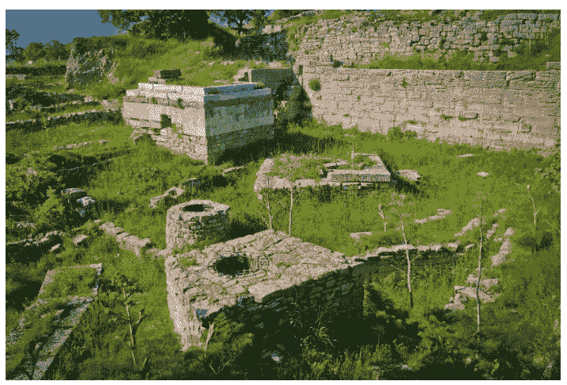

如今这里只剩下灰色的砖墙，一截截的大理石柱，昔日的繁华、英雄的身姿早已不见踪影。但古迹入口处那个按照传说原型复制的巨大木马，能一下子把你拉入盲诗人荷马编织的英雄世界中。

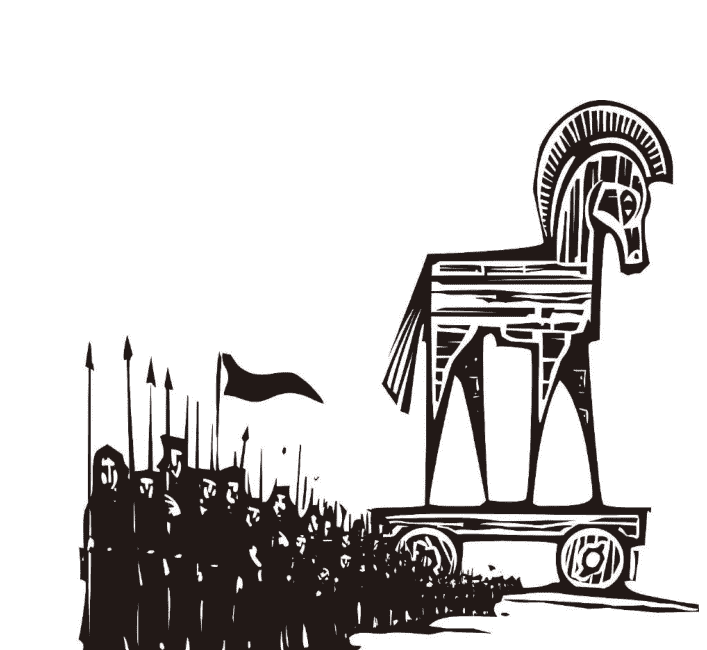

《荷马史诗》为欧洲人的精神世界打了一层底色，但是史诗里记录的特洛伊战争故事，在我们今天看来其实有点狗血，完全可以概括为“一位美女引发的英雄混战”。这个美女叫海伦，号称当时希腊第一美女，她本来是斯巴达王墨涅拉奥斯的老婆，却被特洛伊的王子拐跑了，希腊人愤怒至极，组成联军进攻特洛伊。

战争中，一边是希腊联军，一边是特洛伊人，诸神也分成两派，分别支持不同阵营。整个特洛伊战争打了十年，希腊人最终凭借木马计，战胜了特洛伊人。

一旦进入故事，我们就可以展开想象，废墟上这些残垣断壁重新站起来，变成高大的门拱和坚固的城墙。走在废墟中的小路上，好像你身边就是身披盔甲的英雄，他们围坐在一起，摩拳擦掌，充满斗志。你也可以近距离感受阿喀琉斯、赫克托尔这些盖世英雄，还有海伦，他们之间的爱恨情仇。为了了解古希腊文明中英雄的意义，我们不妨把目光集中在阿喀琉斯这个样本上。

### 2. 英雄能超越自我但不是完美人格化身

阿喀琉斯是谁？他是希腊联军中的大英雄，好莱坞有部电影叫《特洛伊》，当时还年轻的布拉德·皮特，把阿喀琉斯的勇敢、英俊和力量表现得淋漓尽致，简直就是移动的荷尔蒙。但史诗中最让人感叹的，是他和命运抗争的短暂人生。

按史诗中的说法，阿喀琉斯的母亲是女神，父亲是凡人。阿喀琉斯刚出生时就有神预言，他会成为名垂千古的英雄，代价是战死疆场。他的女神妈妈就捏着他的小脚丫，把他放进冥河里洗澡，这么做可以让他刀枪不入，但百密一疏，用手捏着的脚后跟没有沾到水。这成了阿喀琉斯的死穴，就是所谓的“阿喀琉斯之踵”。这个词用来指代强者最弱的地方，也指命运的不可抗拒。

战争中，他的好友被特洛伊人最伟大的英雄赫克托尔杀死，阿喀琉斯决定为好友报仇。出发前，他的母亲含泪阻止说，如果你杀死赫克托尔，你的末日也到了。求他不要参战。当然，阿喀琉斯最终没有被母亲的眼泪软化。

电影《特洛伊》开头有段独白特别感人：“人类一直在追求永恒的生命，于是我们问自己，我们的所作所为会流芳百世吗？在我们死去很久之后，陌生人听到我们的名字，会知道我们是谁吗？孩子知道我们的勇敢，或者知道我们的爱情有多伟大吗？”

你看，希腊人也在追求永恒的生命，但是他们没有去问神，而是问自己。

故事的高潮是，阿喀琉斯在特洛伊城下杀死了赫克托尔，神的预言也随之应验，阿喀琉斯的脚后跟被特洛伊人的弓箭射穿，英雄陨落。

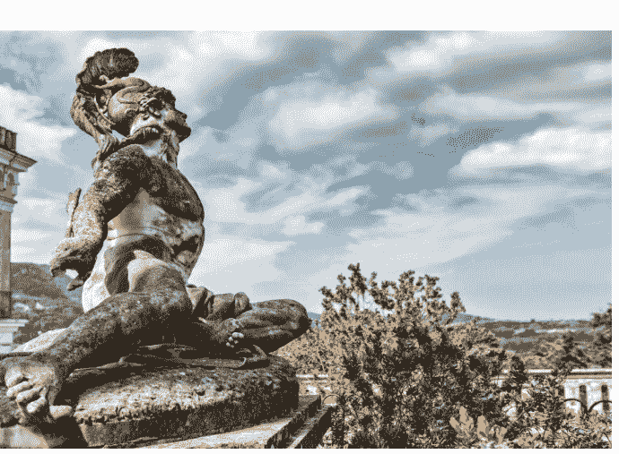

通过《荷马史诗》的记录你会发现，作为英雄典范，阿喀琉斯有这么几个特点：

- 第一，他是人跟神的混合体，有超越凡人的神奇力量；
- 第二，他不向命运低头，不怕死亡，用超乎常人的勇气和行动，实现了自我超越；
- 第三，他有凡人的弱点，脚后跟就是他的致命弱点，而且他会死。

古希腊神话中的其他英雄，比如永无休止推着大石头上山的西西弗斯，杀父娶母弄瞎自己双眼的俄狄浦斯王，杀死美杜莎的珀耳修斯，大多如此。

从特洛伊战争到荷马时代，有好几百年，不经文字记录，只通过口口相传，阿喀琉斯的故事就可以沿着时间轴自动传送，而且每个传颂者都会基于自己的想象增加点调料，最终汇集成 28000 行的《荷马史诗》。这部伟大的文学作品，是古希腊人英雄想象的结晶。

不仅古希腊，其他古代文明早期的文学想象力，都塑造了自己的英雄。像两河流域的吉尔伽美什，印度史诗《罗摩衍那》中的罗摩，中国藏族的格萨尔王，都有这三种特质。

不同族群留下的英雄史诗可以形成一个很长的列表。

### 3. 英雄想象的共鸣和代入感

人类的早期故事中，既有神的故事，也有英雄传说。神和英雄，有什么相同之处，又有什么不同呢？

不光是神话，人类通过英雄传说，同样能够建构自己族群的叙事，并产生巨大的凝聚力。古罗马人就认为自己是特洛伊破城后，逃出来的英雄埃涅阿斯的后代。同样，在我们中国的春秋时期，很多边缘地带的国家（比如吴国、越国），也会把血缘追溯到黄帝、炎帝那里。

但不同的是，**英雄故事极大激发了人类对自我的肯定**。有了英雄，人类不再完全指望神来拯救自己，而是通过自我超越，克服艰险，实现目标。很少人想成为神，但想做英雄的人，代代相传。英雄想象通过塑造人的心灵，甚至能够改变历史。

比如人类历史上有三个关键时刻，都和英雄想象有关。

- 第一个时刻，是亚历山大征服波斯的时候。亚历山大从小就是阿喀琉斯的粉丝，他就是从特洛伊古城登陆，上岸后第一件事就是凭吊阿喀琉斯。
- 第二个时刻是凯撒出差偶遇亚历山大神庙，感叹对方 33 岁就征服世界，自己却默默无闻，之后才有了凯撒大帝。
- 第三个时刻是 1798 年，拿破仑征服埃及，站在狮身人面像前说：“亚历山大曾站在你面前，凯撒也曾与你对话。当时，你已经在这里存在了 2000 年，他们之后 2000 年，我也来到你面前。”

从亚历山大到拿破仑，榜样的力量是无穷的，在心理学上这叫“成就动机”，可以激发人的斗志，让人自动产生代入感。这种心理需求，不仅存在于《荷马史诗》的时代，也一

延续到了今天。漫威之父斯坦·李认为，人们喜欢超级英雄，就是因为每个人都想超越自己，希望有更大的能力、更多的天赋去做更大的事情。

从参加特洛伊战争的男人们起头，人类历史上，英雄形象层出不穷。神话学家坎贝尔有本书叫《千面英雄》，从几千年来世界各地的英雄故事当中，提炼出了一个英雄的成长模型：

- 英雄早期都是淹没在人群中的普通人，一个不期而遇的召唤打破了平静，然后开始了英雄之旅。
- 他遇到很多困难，并且练就了一身本领，但他最后和大 boss 交手时，一般先是被对方打得满地找牙。
- 不过别担心，故事的高潮一定是，英雄会得到超级能力，完成绝地反击。到这时候，普通人不见了，一个有勇气、有智慧、有担当，随时准备迎接更大挑战的英雄诞生了。

这个英雄成长模型，跟《荷马史诗》记载的英雄故事，虽然已经有了很大差别，但“超越自我的人”这个核心没有改变。

在当代文化娱乐产业中，不管是小说、电影还是游戏动漫，英雄传说可以说是热门题材。不管是罗琳小说里的哈利·波特，漫威电影里的钢铁侠、绿巨人、奇异博士、美国队长，还是游戏《塞尔达传说》里的林克，人们不光是为英雄想象买单，而且不断产生代入感，一次次燃起信心和勇气。

### 本讲小结

在土耳其的特洛伊，诞生了西方文明中的“英雄”原型。英雄代表着人对自身能力超越性的想象。

通过想象英雄，人类不仅增强了民族凝聚力，更重要的是，它激发了个人的潜能，推动人类不断超越自我。

《千面英雄》这本书，提炼出了一个贯穿古今的英雄成长模型。当代的文化娱乐产业，正在用这套模型制造着各种各样的英雄形象。

思考题：你心目中的大英雄是谁？你觉得他最打动你的特质是什么？欢迎在留言区分享。

这一讲结束，想象这个板块就讲完了，我带你了解了人类对死亡、天堂和英雄的想象。

比起单个人天马行空的想象，你会发现，通过共同想象聚集在一起的人，不再是乌合之

众，而是强大的“共同体”，那“组织”就诞生了，“组织”也是我们下一个板块的关键词。

头图备注：图像©2019 CNES/Airbus, DigitalGlobe, 地图数据©2019 Google

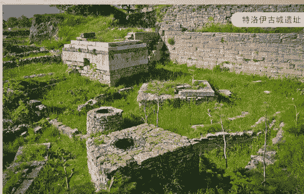

39° 57′ 26″ N, 26° 14′ 19″ E

特洛伊城变成废墟，英雄传说却流传千年。

楚方Tips：

特洛伊遗址堆叠了多层文明，如果外语比较好，建议跟着欧美旅行团，听导游讲解，能听到很不一样的故事。

《林楚方 · 文明地标30讲》

来自得到App

## 08 安徽西递胡氏宗祠 | 血缘组织如何扩大规模

2019-4-3

你好，我是林楚方，欢迎来到我的《文明地标 30 讲》。

课程的第三个板块，我会带你去四个重要地标：中国西递胡氏宗祠、捷克奥斯特里茨古战场、英国伦敦白厅、印度加尔各答威廉堡。在这四个地方，我会带你观察宗族、军队、政府、公司。

它们之间有什么关联吗？对，你猜到了，它们是人类文明很重要的四种组织形式。孤独的人是可耻的，人类在历史中演化成了一种组织动物。

## 1. 宗祠：应该看什么

这一讲我带你去安徽西递的胡氏宗祠，看看中国人在几千年的历史中，是怎么把血缘这种人类最天然的联系高度组织化了，这种组织就是宗族。

你最熟悉的家庭，是一种小型的血缘组织，但血缘关系也有强弱，父母子女之间，兄弟姐妹之间，都是强血缘。而这一讲，我要说的中国的宗族，其实是一种以弱血缘为纽带建立的大型组织。所谓弱血缘，就是说，组织内的人们有血缘关系，但他们之间的血缘关系，并不是那么强。

这种组织形式是中国人的发明，这个发明有什么新鲜的？

你想想看，基因检测技术出现之前，即便是亲生父子之间，都没什么可靠的办法确认血缘关系，你大概从戏文里看过很不科学的“滴血认亲”。

那么，没有先进的检测手段，时间上隔了好几辈、十几辈，空间上隔了若干州县的人怎么认亲呢？中国的宗族组织做到了。它竟然打破了时空的限制，把相隔千里万里，彼此之间只有几十分之一，甚至几百分之一血缘关系的人组织在一起。

那么问题来了，这是怎么做到的？

秘密就在我要带你去的乡村祠堂，在中国安徽的黄山一带。这里是古徽州的核心区域，祠堂文化保存得非常完整，我们选择的目标是西递村的敬爱堂。

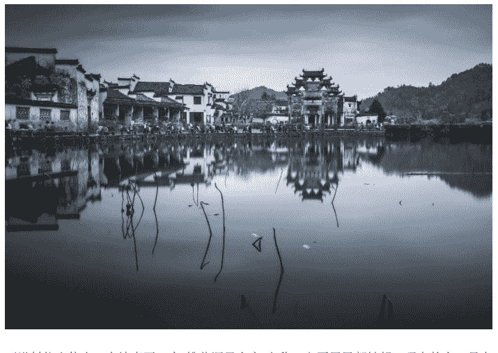

西递村依山傍水，白墙青瓦，有“桃花源里人家”之称，主要居民都姓胡，现在的人口只有 1000 人左右。这一带连同周边，古称徽州，中国三大商帮中的徽商就出自这里，清代著名的红顶商人胡雪岩就是徽商代表之一。

过去几百年，这么一个小小的乡村，前后建了总共 26 座祠堂。这些祠堂是用来祭祀祖先，举办婚丧嫁娶等仪式的地方。

西递胡氏的总祠堂已经毁了，我们要去的是一座支脉祠堂，也是村里现存规模最大、最精美的一座，也就是敬爱堂。

敬爱堂始建于明代，现在我们看到的是清朝乾隆年间重修的。这是一个典型的三进式徽派建筑，门匾上写着四个大字“胡氏宗祠”。我们今天不去关注精美的石雕、木雕、砖雕，也不看建筑细节，我要带你直奔最里面的大厅，因为那里藏着宗族组织的密码。

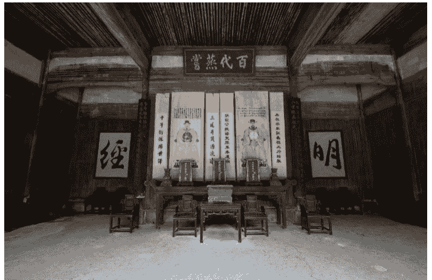

进入大厅，抬头就能看到上方挂着一个大匾，写着“百代蒸尝”四个大字。在古代，冬天的祭祀叫“蒸”，秋天的祭祀叫“尝”。百代蒸尝，意思是说，世世代代都要祭祖。

“百代蒸尝”的牌匾下面，挂着两幅胡氏先祖的画像。画像对面，是一个大大的“孝”字，据说是宋代大儒朱熹亲笔写的。孝，再加一个忠，是中国古代儒家社会的核心价值观。

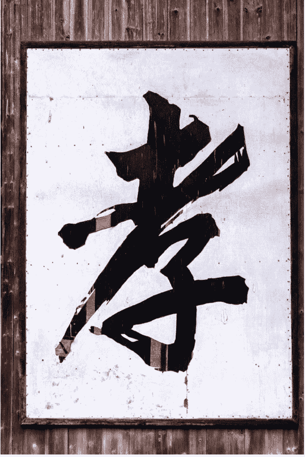

顺着画像往下看，供桌面上摆放着三个牌位。从牌位我们可以追溯胡氏家族的血缘故事：

西递胡氏可以追到公元 904 年，唐朝倒数第二个皇帝唐昭宗，预感自己即将被废，于是把刚出生的儿子托付给一个叫胡三的部下。胡三带着小孩逃难来到江西婺源，为躲避追杀，这个小孩从此姓了胡，取名昌翼，胡氏宗祠中间的牌位供的就是胡昌翼。

胡昌翼临死前留下遗训：“义祖大于始祖”，而且要求“儿孙后代不得复宗”，就是不能改回李姓。所以三个牌位中，右边的牌位就是胡三，作为胡昌翼的养父，地位也极高。左边的牌位是一个叫胡士良的，他是家族第五代，有一次外出路过西递，看上了这个地方，于是和家人搬到这里。他是西递胡氏宗族的先祖。

通过这两张画像，三个牌位，你可以看到西递胡氏的血缘脉络。听到前面我梳理历史，这条血缘脉络从唐朝开始，绵延了上千年。这么长的时间，怎么保证这个脉络不断呢？

而且，一个小小的西递村，可不是只有这一个祠堂，这里前前后后总共建了 26 座祠堂。祠堂建筑高大精美，这可都是宗族成员拿真金白银堆出来的。大家为什么有动力出钱出力呢？

## 2. 围绕血缘的三个制度安排

要知道，祠堂可不仅仅是一栋普通建筑，而是宗族组织的公共活动空间和精神象征物。宗族组织在很长的时间内，为个体的人提供各种帮助和庇护，以此来维护组织的向心力。

祭祀，是宗祠作为公共建筑的第一个功用。祭祀是用仪式活动来凝聚人心的。

西递胡氏在这里聚居上千年，每到固定节日，宗族成员就会在这里祭祀祖先。祭祀，有一套严格的仪式，这套仪式可以一直追溯到三千年前的西周。你大概知道一个字样“礼”，孔子一辈子最大的理想，就是恢复周礼。周礼是一个庞大的体系，祭祀是其中非常重要的部分。

也是在那个时候，中国发展出了宗族这种大规模组织的雏形。按照苏力老师在《大国宪制》这本书里的说法，周天子做了两大制度安排，一是确立了嫡长子继承制，正妻的大儿子才有资格继位，君主不能把皇位随便传给自己宠爱的儿子，规则很清晰。其他儿子怎么办？这就有了第二个制度安排，把他们分封到各地建立诸侯国，诸侯国也遵循嫡长子继承制。

这两个制度相当于给权力交接立了法，避免权力交接过程中产生动荡。

但随着时间拉长，天子和诸侯之间的血缘关系就会越来越远。于是有了第三个制度安排：每逢重大节日，诸侯王和子孙们都要回到都城，大家按辈分等级，尊卑有序，举行祭祀仪式。这个制度安排的核心只有一条：唤醒大家对共同血缘的记忆。

这就是宗族组织的雏形。经过时间的洗礼，这套组织方式走出了庙堂，最终成为古代中国最重要的组织模式之一。

## 3. 宗族组织的现实作用

除了仪式性的祭祖，祠堂，或者说以祠堂为象征物的宗族组织，还担负着更重要的现实功能。

中国一向有皇权不下县的说法，但基层乡村千年以来运转得相当不错，这很大程度上跟宗族自治有关。

在古代社会，到了县以下的基层，比如乡镇、村庄，公共产品基本是由宗族提供的，有困难的家庭会得到宗族的救济。如果有族人没钱参加科举，宗族会资助他路费，当然，违反乡规民约会被宗族惩罚。此外，道路、水利、桥梁的修缮等很多事，也都由宗族负责。

具体说到西递村，这里八山一水一分田，靠种地连肚子都填不饱，那就得想办法。两条路，一是走出去，到外面经商；二是考出去，到外面做官。

如果你了解一点中国历史就会知道，宋元以后，无论经商还是做官，徽州人都很成功。而且我发现，中国三大商帮，徽商、晋商、潮商，都来自宗族组织高度发达的地区，这之间有什么关联吗？还真有。

首先，宗族可以为成员提供信用背书。有了信用，外出经商成本会极大地降低。

其次，宗族成员能给同族提供政治保护伞。明清江南的盐业、茶业、酒业、典当，但凡需要政府特批的，几乎都被有宗族背景的徽商垄断。

这样一来，宗族的势力越来越强大，影响范围越来越广。很多人走得远了，祭祀就回不来了，那怎么能够维持宗族的凝聚力呢？还有办法，起名字和修族谱。

今天父母给孩子起名字，想怎么起就怎么起，但往前推 100 年，能自由选择的空间是很小的。姓跟着祖先，中间那个字预先也被宗族规定好了，这叫字辈，也就是说，只剩第三个字可以自由发挥。这有什么好处呢？想想看，茫茫人海中，两个互不相识的宗族成员，靠名字就能知道彼此的辈分。

光是在名字里打记号就够了吗？当然不够，古代徽州，除了“族必有祠”，还有一条“家必有谱”。家谱体积小，便于分发携带，就成了流动的祠堂。所以，修家谱也是宗族进行组织管理的大事。

听到这儿你会发现，建祠堂、排字辈、修家谱，有了这一整套管理手段，宗族组织才有了强大的凝聚力和执行力。这确实是中国特有的一套组织发明。中国也因此成为了“家国同构”的超稳定社会。

### 本讲小结

西递胡氏宗祠的核心看点，不是建筑本身，而是它承载的宗族文化。

宗祠是宗族组织的权力象征物，通过祭祀祖先、承办公共事务、编修族谱等手段，维护和加强了宗族的认同。

以血缘为纽带建构组织，是人类文明早期的共同选择，但中国文化突破了直系血亲协作的局限，以弱血缘关系为纽带，发展出了强大的宗族组织，并且被这种组织塑造了几千年。

思考题：在你的生活中，还有宗族组织的影响吗？你是如何看待这种血缘组织的？欢迎在留言区分享。

下一讲，我会带你去捷克的奥斯特里茨，通过一处战场探索最高效的组织，军队。

头图备注：图像@2019 CNES/Airbus, DigitalGlobe

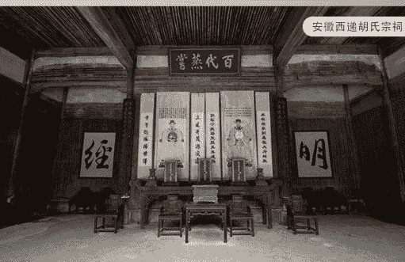

29° 54' 20" N, 117° 59' 28" E

# 宗祠不仅是物理空间，也是维系宗族组织的仪式空间。

楚方Tips：

西递胡氏是“明经胡”的一支，“明经胡”出过两个大人物，就是胡雪岩和胡适，他们的祖上都可以追到李唐王朝。换句话说，他们和西递胡氏，都是李世民的后代。

《林楚方·文明地标30讲》

来自得到App

## 09 捷克奥斯特里茨战场｜军事组织如何提高战斗值

2019-4-4

你好，我是林楚方，欢迎来到我的《文明地标 30 讲》。

这一讲，我要带你去捷克的奥斯特里茨，通过考察一个古战场，你会看到，人类的暴力组织——军队是如何高效运转的。发生在这里的战役，史称“三皇会战”。

近现代大多数军队组织，和上一讲的宗族组织不一样，它没有血缘关系带来的那种天然信任感和亲密感。它是短时间内，靠强制力聚集起来的一群人，面对的是生死挑战。你可能会以为，一个军队的战斗力强不强，要看他们的武器装备、纪律性等等。

但我要说，这些都重要，但不是核心。军队是否打得了胜仗，不是看单兵战斗力，而是靠协作。所以，**如何让所有人听从指挥，提高效率，才是关键**。

出发之前，我先大致跟你交代一下当时的战局。

你不妨把自己想象成法国皇帝拿破仑，你的敌人是俄罗斯皇帝亚历山大一世、奥地利皇帝弗朗斯二世。当时你手里只有 **53000** 人，而对手俄罗斯和奥地利联军，大概有 **86000** 人，还有 **10** 万普鲁士军队在路上。这种境况下拿破仑还有胜算吗？

历史结果你大概已经知道了，在奥斯特里茨，拿破仑一战封神，他是怎么做到的呢？让我们一起回到战斗发生的地方。

## 1. 拿破仑的封神之战

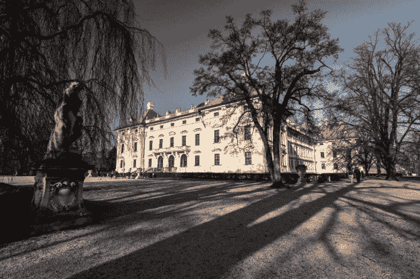

奥斯特里茨是捷克东南部的一个乡村小镇，开阔的平原点缀着农舍，是典型的欧洲农村，风景不错。如果你在欧洲自驾游，这样的景色到处都是。但是因为一场战役，这个小镇却成了全世界军迷钟爱的旅行目的地，当地人会定期举行纪念仪式，穿上 19 世纪的军服，再现当年的战争场景。

如果你也是军迷，我推荐你登上小镇东边一座不到 300 米高的小山，上面立了一块纪念碑，碑上刻着战场地图。在这个小山上，你可以看到战场中间有个高地，高地南面有个湖，这个湖非常关键。

前面我说过，面对俄罗斯和奥地利联军，拿破仑手里的兵力本来就不占优势，而且还有 10 万普鲁士士兵正在路上。如果三国军队合到一起，等待拿破仑的就是全军覆没。

拿破仑还有机会吗？有，但希望不大。当时维也纳附近有 2 万多名法军军队，可从维也纳到奥斯特里茨超过 120 公里，这个数字是什么概念？当时，超过 1 万人的军队，每天行军 25 公里，如果带着辎重，走一个星期也很正常。如果真走这么久，拿破仑除了逃跑没有任何别的选择。

但在这场战役中，这支法军，居然只用了 50 个小时就到达了奥斯特里茨，相当于一天跑一个半马拉松，而且是 2 万多人连跑两天。

于是，神不知鬼不觉，法军就从 53000 人变成了 75000 人，双方军力几乎拉平。最特别的是，连跑两天之后，法军到达战场后还能马上投入战斗。

战争结果是联军溃败，逃跑时经过了前面我提到的那个湖。当时正是冬天，湖面结了冰，法军就向湖面开炮，冰被炸开，几千联军被活活淹死、冻死。这场战役，法军伤亡不到 9000 人，而俄奥联军伤亡和被俘加起来近 3 万人。

奥斯特里茨战役之后，拿破仑不光被封为战神，还成了欧洲霸主。

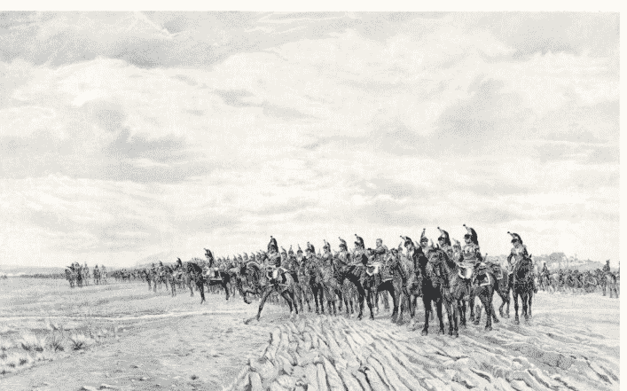

后世人总结这场战役时，总是对拿破仑的计谋津津乐道，比如假装逃跑，引诱敌人没等到普鲁士的10万援军到达，就发起进攻；再比如他提前测量了湖面结冰的厚度，以确定大炮能否炸开冰面，相当于给敌人提前设计了坟墓。

但我要提醒你，真正决定战争胜负的，不是这些，而是2万法军高强度奔袭120公里之后，还能立马投入战斗。在当时，很少有军队有这样的行军速度，可以说这场奔袭集结，完全超乎对手预料。法军是怎么做到的？

## 2. 参谋部打造出完美的战争机器

没有人拿枪逼在法国士兵后头，真正成功的秘诀是拿破仑对传统军队进行了组织改造。改造了什么呢？简单说，就是给法军组建了参谋部。

很多人提到参谋部，会觉得就是一帮出主意的谋士，但拿破仑的参谋部可不只是出主意，它本质上是信息处理中枢，有三个功能：

- 一、收集数据。法军拥有当时欧洲最专业的侦察人员，他们能搜集到详实准确的情报信息，汇总到参谋部；
- 二、根据数据形成咨询意见，提供给战略决策者，也就是拿破仑本人；
- 三、把大战略变成具体的小计划。不管拿破仑的决策多么粗糙，参谋部都能把它转化成一条条清晰准确的指令。

在拿破仑之前，欧洲军队里，并没有一个专门的机构，站在统御全军的高度做这些事。上了战场，大家只能各想各的办法，所以统帅再有能力，面对不准确、不充分、不系统的信息，也只能凭直觉、靠运气打仗。

而拿破仑把上述功能专门化、专业化了，这就带来了组织升维。

回到奥斯特里茨战役中，我们看看参谋部是怎么让这 2 万法军第一时间抵达战场的。

在战前，参谋部预先做了路线勘测，非常清楚哪条路好走，哪条路不好走，对行军速度也有非常精确的要求，像一小时跑多少公里，什么时候到什么位置，连行军多长时间休息 5 分钟也做了规定，这 5 分钟是将军抽一支烟的时间。

此外，每个士兵需要配备多少牛肉，多少葡萄酒，多少蔬菜，不能少，更不能多，多了也会拖累行军速度，这些都是经过参谋部严密计算的。

所以，站在奥斯特里茨古战场，你要重点关注的，不是拿破仑军事天才的胜利，而是军队这种暴力组织现代化的开端。说到军队现代化，我没有讲武器，也没有讲战术和战略，而是选择了参谋部，因为它让军队组织的效率全面升级了。

后来参谋部模式被普鲁士吸收，更进一步，演化为独立的总参谋部，比拿破仑的参谋系统更专业、更独立，连制定战略都由参谋部，而不是由统帅个人负责。正是靠着总参谋部，普鲁士军队变成了一部强大的战争机器，打赢了普法战争，建立了德意志帝国。

## 3. 从军队到现代企业管理

从拿破仑开始，通过参谋部的运作，军事组织更强化了它的特点：高效率。而且这种变化还从军队延伸到了其他组织。你大概听说过阿里巴巴、小米公司，也设置过参谋部。很多现代企业就算不设置参谋部，但一定有相应的部门行使参谋部承担的决策功能。

这就是军队组织向外的智力输出。有一本书叫《蓝血十杰》，因为任正非的推荐，在企业界很有名。所谓“十杰”是二战期间美军陆军航空队“统计管理处”的十个年轻军官。他们把数字上升为信仰，用来改革军队管理，提高后勤效率，少死了多少士兵，还节省了十几亿美元军费，战功卓著。

战后他们加盟福特汽车公司，把军队中的经验移植到企业管理中。他们打造了专门的数据分析部门，这个部门在组织中享有极大的权力，所有决策都以数据为依据，坚决抵制经验和直觉。这个转型，还真的把福特汽车带出了低谷，重现辉煌。

这十个人里出了两名福特公司总裁，四名副总裁，成就最高的还当上了美国国防部长。他们对效率和控制的崇拜，使得他们不仅获得了“蓝血十杰”的称号，也成为了美国现代企业管理的奠基者。从这点上你可以看出来，军队组织的进化成果，嫁接到其他组织也是有效的。

### 本讲小结

奥斯特里茨战场，是拿破仑一战封神的福地。在兵力落后的情况下，2 万法军神奇地两天之内奔袭 120 公里，集结到奥斯特里茨战场。这个集结是这场战役形势扭转的关键。

之所以能够实现短时间的大规模集结，是因为拿破仑开先河地组建了参谋部，改造了军队组织，使法军能更高效地调动战争资源，达成战略目标。普鲁士军队在拿破仑参谋部的基础上，组建了独立的总参谋部，将普鲁士军队打造成强大的战争机器。

拿破仑军队组织的高效，得益于参谋部数据处理的模式，这套模式后来被企业组织大量借鉴。

思考题：你还知道哪些军队组织的成功经验被现代企业借鉴？欢迎在留言区分享。

下一讲，我带你去伦敦白厅，看看官僚组织是如何运转现代国家的。

头图备注：图像©2019 CNES/Airbus, DigitalGlobe, Eurosense/Geodis Slovakia, GEODIS Brno, Landsat/Copernicus, 地图数据©2019 Google

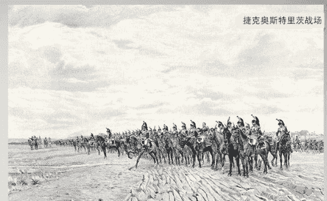

捷克奥斯特里茨战场

49° 9' 11.72" N, 16° 52' 35.37" E

# 拿破仑打仗不只靠权谋，他给军队装信息系统，奥斯特里茨战役是典型。

楚方Tips：

为了纪念三皇会战，小镇每年都会重演战争场面，让游客能身临其境去感受当年。想来奥斯特里茨旅行，一定要查查，什么时候他们搞表演。

《林楚方·文明地标30讲》

来自得到App

## 10 伦敦白厅 | 官僚组织如何运转国家

2019-4-5

你好，我是林楚方，欢迎来到我的《文明地标 30 讲》。

一提官僚，你脑子里可能会出现一张张高高在上、操弄权力的嘴脸，但“官僚”这个词是不带褒贬的，有国家就有官僚。无论古埃及的法老，还是中国的秦始皇，都要组建官僚组织。说白了，就是找合适的人到政府里当官、干事。

不过，怎么寻找合适的人？这可是个难题。

- 官僚手里掌握着国家的各种权力，所以他们的能力至关重要，这是其一。
- 第二，现代社会普遍认为，国家的权力不属于某个人、某个家族，那么这些人从哪选才合情合理？
- 第三，就算有了一帮能力强、有才华的人，怎么保证他们能好好合作，共同经营好政府呢？

现代英国文官制度，是个很好的案例。这个制度的确立，花了将近 200 年时间。

现在跟我一起，直奔伦敦市中心，去白厅看看吧。

## 1. 白厅不是房子，是英国的行政中心

说到白厅，它原本是伦敦一条不到 1 公里、南北向的街道，但如果你和英国人说“白厅”这个词，他们的第一反应，可能不是地名，而是指英国政府，为什么会这样呢？

因为白厅是英国政府中枢的所在地，包括英国国防部、皇家骑兵卫队阅兵场和英国内阁办公室在内的诸多部门均坐落于此，因此“白厅”这个词也就成了英国中央政府的代名词。这有点类似于咱们中国人说的“中南海”。

这条街的两边，是一栋挨着一栋的灰白色古典建筑，除了墙上偶尔出现的巴洛克式装饰浮雕，整体看来甚至有些沉闷。

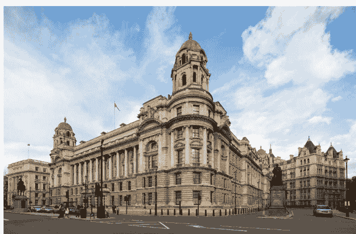

沿这条街一路步行，你要注意，一个有黑色铁栅栏的小胡同口（行人不得进入），就是唐宁街 10 号，英国首相官邸。

想象一下，70 多年前，一个矮、胖、有些蹒跚的老头儿，从这里出来走到英国议会大厦发表演讲：“我没有别的可以奉献，只有热血、辛劳、眼泪和汗水……”那个老头儿，就是丘吉尔。如今白厅街也有他的雕像，老头儿紧裹风衣，歪着身子拄着拐杖，表情格外严肃。

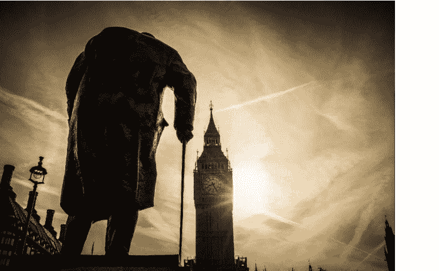

我们知道，丘吉尔当过英国的首相，同时他也是英国文官的首领。那文官是什么呢？

如果你在上班日，早上八点左右站在白厅，大概率能看到一群西装革履的人。一手提着公文包，一手拿着咖啡，还有人一路小跑赶着打卡，这些人就是英国的文官，也就是我们常说的公务员。

以白厅为中心，英国的国防部、海军部、外交部等政府机关都集中在这里。确切地说，白厅就是个部委办公楼群，也是英国政府的行政中心。

几百年来，这里上演过一幕幕历史大剧。其中最著名的，就是 1688 年，英国人不通过流血，就把权力从国王转到了议会，建立了君主立宪制政体，这就是光荣革命。这段历史，几乎被写进了所有历史课本里，但光荣革命并没有彻底完成英国政治的现代化。要等到将近 200 年后，另一次革命爆发，才有了真正的现代英国政府。

## 2. 一场战争催生的一场改革

我们先回到白厅，光荣革命之后，权力核心变了，英国的政治制度也变了，但选官的方法没有变。

过去国王选拔官员靠恩赐，被恩赐的官员，再把下一级职位恩赐给他的亲信，一层一层产生官员。光荣革命之后，议员靠选举，兼任政府高官，那他下面的官员到哪找？

还是老办法，亲信找亲信。这个问题可以归结为，找不到好官。

更严重的问题是，政党会不断轮替，换个执政党，白厅里的官僚也得大换血。这个问题又可以归结为，就算有了好官，也呆不长。

那为什么不随着光荣革命一起改了呢？因为组织都有惰性，不是说变就能变的。英国政府竟然也继续维持了将近 200 年，那到什么时候，英国人觉得玩不转了呢？1853 年的克里米亚战争是一次强刺激。

这场战争，英国人本来信心满满，但没想到死亡人数远远超过预期，是敌人太强大？不是，是英国人的管理太无能。

举个例子，在一次重要战役中，英军统帅下达的命令居然是模糊的，既没说清楚打谁，也没说清楚什么时候打。传令官更业余，随便指着山头上的俄国军队，跟英国士兵说，就打他们。这群士兵在没有任何火力支援的情况下，一字排开向山上冲锋，哪知道人家有步枪，还有野战炮支援。短短 20 分钟，一支轻骑兵旅，近 300 个士兵，连人带马全部变成炮灰。

要知道英国人在武器装备上，可是完全碾压俄国人的，竟然还吃这么大的亏。消息传到国内就炸锅了，大批市民跑到白厅示威，要求全面改革官僚体制，包括军队。

英国政府这才启动改革，第一步就是想办法吸引优秀人才进政府。但问题是，满大街都是人，你怎么知道谁优秀谁不优秀？

英国人的办法是公开考试。

## 3. 现代官僚组织的诞生

第一次考试，就招来一大批牛津和剑桥的高材生。

你可能觉得，考试这个办法没什么稀奇啊？中国科举制度考了 1000 多年，怎么到英国就成重大创新了？不可否认，科举制度确实是重大发明，而且英国也确实借鉴了中国人的智慧。

但是，只有考试显然不够。考试只是手段，关键在于顶层设计。英国人是怎么设计的呢？ 这就要看**最重要一个的创新，把文官分成两类：政务官和事务官**。

政务官，包括首相和内阁大臣，相当于各个部长，一般属于同一个党派，经过选举产生， 负责决策；而事务官，通过考试产生，负责执行。你看，这就在决策和执行之间，画了条分界线。政务官随内阁进退，而事务官独立于政党，只对工作本身负责。这就叫，铁打的文官，流水的内阁。

有了现代文官制度的保障，白厅才脱胎换骨，成为了一个廉洁、高效的现代政府。继光荣革命之后，完成了政府现代化的闭环。

而且这套制度设计，解决了一个自古以来一直就有的大难题：就是权力转移往往会带来政府，乃至整个社会的动荡。所以，这套文官制度一出炉，就被很多国家复制，成为现代政府的标配。这才有了人类历史上从来没有出现过的奇观：一个国家总统、总理可以走马灯似的换，但政府的运行却能有条不紊，中国古代那种“一朝天子一朝臣”的情况并不 会发生。

有意思的是，这套文官制度培养的人，还曾经帮助过清政府。这个人就是赫德。他接受过英国文官制度的训练，后来被清政府聘为海关总税务司。他从 1861 年开始任职，一干就是半个世纪，和大清王朝几乎同时退休。在他主控之前，大清的海关腐败低效：他来之 后，海关居然变成清政府最清廉、最高效的部门，海关税收也成为大清最重要、最稳定的税收来源。

赫德和大清官员的不同，不是人的差异，而是制度的差异。马克斯·韦伯，就是《新教伦理与资本主义精神》的作者，他一直研究官僚组织。他说，相比君主立宪这样的制度革命，现代文官制度也是一场“革命”，它是一次组织技术革命，革命之后的官僚组织有四个特点——

- 专业化：以专业能力匹配相应职位，只认能力，不认人，不搞任人唯亲。

- 等级化：行政系统中的职位，按权力大小和“命令-服从”关系，形成金字塔式的等级序列。

- 规范化：每个成员的权力和责任，都由法律明确规定；连一份简单的文书，也要遵循统一格式。像克里米亚战争期间，那种口头传令的方式就一去不复返了。

- 非人格化：在现代官僚组织中，只有职务和岗位，没有个人和个人的关系。

专业化、等级化、规范化，中国传统科举制度好像都有，但最关键的是非人格化。现代文官制度里的官员，不隶属任何政治势力，在岗位上，不管面对谁，哪怕是亲戚、上司、国王，都不能左右他的专业判断和职业操守。所以，专业化、等级化、规范化，再加上非人格化，合在一起才是组织技术革命。

这场革命从白厅出发，它的影响早就超越了政府，不知不觉已经渗透进现代社会的各种组织里。从企业、学校到社团、政党，它们本质上都是官僚化的组织，甚至里面的人也被官僚化了，也就是专业化、规范化甚至非人格化了。比如我们从事某个职业，在职场上最应该展现的是职业人格，而不是你自己。

### 本讲小结

伦敦的白厅曾经发生过一场组织层面的技术革命，革命的成果就是现代文官制度。

现代文官制度，帮英国打造出了一个廉洁、高效的官僚组织，保证了现代政府的稳定运行。

现代文官制度通过考试选拔人才，具有专业化、等级化、规范化、非人格化的特点。

思考题：你觉得中国的科举制，跟英国的文官选拔制度有什么不同？欢迎在留言区分享你的看法。

下一讲，我带你去印度加尔各答的威廉堡，了解一个和每个人生活都息息相关的组织——公司。这家公司居然把当时最强大的帝国击败，而且是在战场上，它凭的是什么呢？

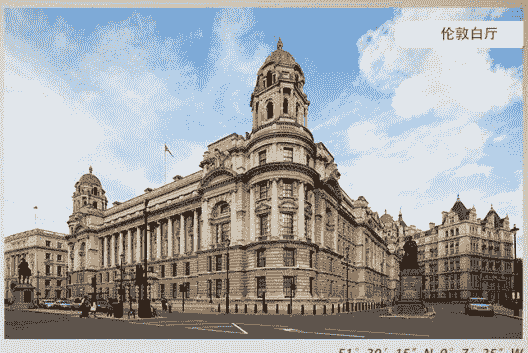

白厅是英国官僚组织的中枢，也是现代文官制度的发源地。

**楚方Tips：**

去白厅前，建议你看一部英国纪录片，叫《真实的白厅》，写的是英国几个部委之间的斗法。不了解故事，光看建筑，可能觉得无聊。

《林楚方 · 文明地标30讲》
来自得到App

## 11 加尔各答威廉堡｜商业组织如何创造财富

2019-4-6

你好，我是林楚方，欢迎来到我的《文明地标 30 讲》。

这一讲，请你跟我一起去印度，一个叫威廉堡的地方，了解人类历史上第一个有限责任公司，就是英国东印度公司。这是世界上第一家有限责任公司，这个公司的成立，甚至被历史学家称为现代历史的开端。

可以说现代社会的主要财富，都是在这种组织模式下创造出来的。而这个“有限责任”制度，可是人类公司历史上最伟大的制度创新。你今天常常听说的“有限公司”，就是从这里起的头。

看一个英国公司，为什么要去印度呢？带着这个疑问，跟我出发吧。

### 1. 统治古老帝国的公司

想去威廉堡，咱们得先去加尔各答。加尔各答位于印度东部恒河三角洲，沿河又沿海，有点像上海或纽约。加尔各答是印度近代教育、科学、文化和政治的中心，但是你也想不到，这个城市的辉煌，就得益于东印度公司，这个外国公司。

我们要去的威廉堡，原本是东印度公司的印度总部。现在它成了印度东部驻军司令部。“威廉”是英国国王的名字。300 年前，东印度公司是全世界最强大的公司。

威廉堡是沿河建立的，这是为了方便大型商船的停靠；堡垒被大片绿地包围，绿地之外是高墙，还有锈迹斑斑的大炮点缀其中，可见它还有防御功能。

从空中俯瞰，威廉堡像个八角形的勋章，不过现在勋章的边界已经不明显了。但你可以看出它的位置和格局。整个威廉堡，是白色的维多利亚式建筑，建筑内部有华丽的欧式家具，散发着浓浓的英伦味道。

如果你能回到 300 年前，同样站在这里，还可以看到，堡垒外面又长又深的护城河。一排排大炮环绕在河边，商船停靠在码头上，一群群印度劳工在英国人的监督下，把一箱箱货物运到威廉堡的仓库。

当时的东印度公司强大到什么程度呢？公司最辉煌的时候，有 20 多万军队，远远超过英国政府的军队，拥有的财产一度是英国财政收入的几乎两倍。每当英国政府遭遇财务危机，东印度公司总能及时地向英国财政部提供资助。

当时印度最重要的几个地区，像孟加拉、金奈和孟买，都掌握在这家公司手中。可以说，统治印度的，不是英国国王，也不是印度皇帝，而是一家公司。其实公司这种组织，古罗马时代就出现了，但从来没有哪家公司做到这么大的规模，为什么东印度公司这么厉害？

现在跟我一起穿越到 1599 年，这家公司诞生的前夜。

### 2. “有限责任”概念的诞生

这年秋天，伦敦市场上的胡椒价格，突然从每磅 3 先令涨到 8 先令，幕后推手是葡萄牙人，他们垄断了香料贸易，想涨价就涨价。伦敦商人也想赚这笔钱，方法只有一个：自建公司，自建船队，自建贸易航路。

这时候，一个当时的公司制度把伦敦的商人挡住了。要知道，香料贸易虽然有高额回报，但也面临着高风险。当时组织一支远洋船队，到印度、东南亚，包括美洲，约等于今天去一次月球的难度。首先资金投入大，路上还可能遭遇风暴、海盗、竞争对手的袭击，这还不包括随时夺取船员生命的败血症。

问题是，这么高的风险，当时的法律还规定，开公司的人必须承担一切损失，亏多少钱，赔多少钱，如果还不起了，就得进监狱。这有个专业的说法，叫无限责任。说白了，你得拿个人的钱，还公司欠的债，那时候所有公司都是无限责任。

这么大的风险，还肯有人铤而走险吗？英国人最擅长的，就是从制度上解决问题。为了胡椒，一群商人创造了“有限责任”的概念，它是针对无限责任提出来的。有限责任的意思是，你投了 10 英镑，不管公司亏多少钱，最多损失的就是这 10 英镑。

这个制度，今天听上去，好像也没什么。但我告诉你，就是因为有了有限责任这样的设计，不到一年时间，就有 218 个英国上流人物，包括伯爵、骑士、议员、商人，拿出了 72000 英镑的巨款。有人推算，这笔钱相当于今天的 3500 万美元。

如果还是无限责任，那一定没有这么多人敢把钱拿出来。因为如果亏了，可不只是 72000 英镑没了，还可能倾家荡产，甚至坐牢。但有限责任，大家就没有后顾之忧了，最倒霉也就是把这 72000 英镑赔光而已。

1600 年的最后一天，12 月 31 日，英国女王同意他们成立东印度公司，还给了另外两个特权，一是允许他们养军队，二是给了他们航道和贸易的独家经营权。这样，人类历史上第一个有限责任公司就诞生了。

当时正好赶上全球殖民扩张，东印度公司成了殖民风口上飞得最高的那头猪，而且一飞就是将近 300 年。为什么它的成立，会被认为是现代历史的开端？这绝不仅仅因为它赚了很多钱，富可敌国。

### 3. 公司缔造现代社会

东印度公司的这种组织制度创新，带来了公司组织的基因突变。突变的是什么呢？简单说就是三句话：

- 第一，企业家从此敢于进入有风险的产业了；
- 第二，公司能够快速聚集大量资本；
- 第三，缺乏资金的发明家因此可能获得投资，技术产业化的步伐加快了。

听上去，是不是有点平淡？但这三点合在一起，就是一根点石成金的魔法棒。

没有这个魔法棒，东印度公司就凑不出让他们奔向大海的原始资本；没有这个魔法棒，也许瓦特有本事改良新式蒸汽机，却筹不出足够开工厂的钱；而且没有东印度公司赚取的财富，英国工业革命可能都会推迟。

所以，尝够了甜头的英国政府，再次领制度变革之先，在 1862 年颁布了世界上第一部《公司法》，确立了有限责任、公司法人等制度。从法律上规定，成立公司是任何人都有权利，而且成立股份有限公司也很容易，只要有 7 个人签一份公司章程，登记营业地点，就可以发行股票、合法融资了。

英国的《公司法》，后来成为各国《公司法》的蓝本。世界变成了一个人人都可以成为投资者，人人都可以开公司的世界。这是一个怎样的世界呢？

我再给你两组数据，美国经济学家德隆的研究表明，人类 97% 的财富，是在过去 250 年里创造的；这期间，改变人类生活的 160 种主要创新，80% 以上是由公司完成的。公司成为了现代社会的创富主体和创新主体。

如果说这些离你很远，那我告诉你，连你可能都是公司创造出来的，如果你是一个公司人的话。

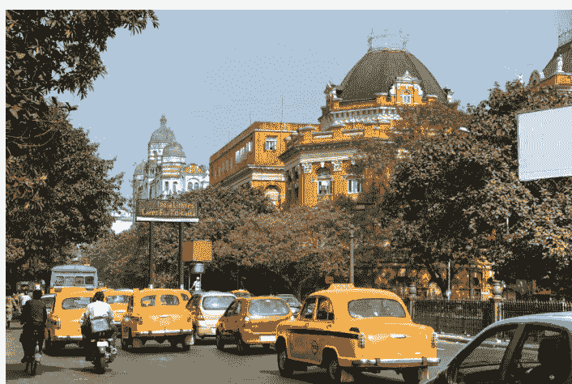

今天，如果有机会去加尔各答，我建议逛完威廉堡，沿河边向东北走大约 3 公里，会看到一座红色的三层建筑，叫作家大厦。这是当年东印度公司的办公楼，员工就是在这里看文件、批文件、记录交易信息、草拟各种商业条款。因为每天跟文字打交道，英国人就用了“writer”（作家）来命名这座大楼。

这是世界上第一个有限责任公司的办公楼，这里的 writer 就是世界上第一批现代公司人。

公司发展到今天，已经成为很多人的身份坐标。大部分人和别人做自我介绍的时候，首先会告诉对方，我是哪家公司的。而今天公司职员的工作，和几百年前作家大厦里的 writer 也没有什么本质区别。

有一本书叫《公司的历史》，里面有这么一句话：许多人说过，政党、国家、宗教这三种组织，是现代社会的缔造者，但其实真正的缔造者，应该是公司。

### 本讲小结

加尔各答的威廉堡是英国东印度公司的印度总部，在这里你可以看到公司组织取得的强大前所未有。

东印度公司发明了有限责任制，升级了公司这种古老的组织，它通过降低投资风险，推动了资本的自由流动。

从有限责任公司，到股份有限责任公司，再到《公司法》，公司这种组织成为人类创富和创新的主体。世界进入到一个人人都可以成为投资者，人人都可以开公司的时代。

思考题：东印度公司的有限责任制，是一种对公司的重新定义，你大概也听过一本讲谷歌的书，叫《重新定义公司》。根据你的理解，你觉得谷歌在哪些方面又重新定义了公司？欢迎在留言区分享。

到这里，组织这个板块就结束了，我带你了解了人类的各种组织类型和组织制度创新，组织使人类得以大规模协作，协作起来干什么呢？办大事。下一个板块，我就带你去看人类组织起来，搞出了哪些大工程。

头图备注：图像©2019 CNES/Airbus, DigitalGlobe, 地图数据©2019 Google

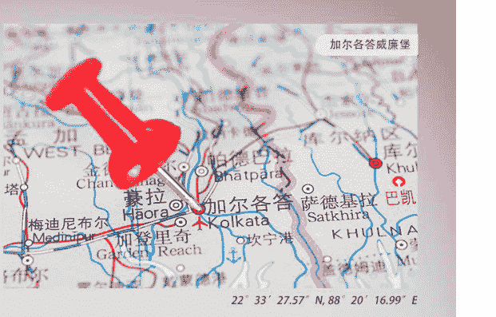

英国东印度公司开创“有限责任”制，让投资人没有了后顾之忧。

**楚方Tips:**

威廉堡现在是印度的军事要地，不对外开放，但你可以到威廉堡前面的大花园转转，这里是加尔各答最大的绿地。

《林楚方·文明地标30讲》
来自得到App

## 12 罗马西班牙广场｜成就永恒之城的管道工程

2019-04-07

你好，我是林楚方，欢迎来到我的《文明地标 30 讲》。

课程的第四个板块，我们会从罗马的西班牙广场、扬州的古运河，漫游到巴黎的凡尔赛宫，再去美国的胡佛大坝和迪拜的棕榈岛逛一圈。

这五个地标听上去有点跳跃，但你只要记住一点，它们都是人类建造的工程奇观。

在这个板块开篇之际，我想多讲几句。前一段有一本书很火，叫《第五次开始》，作者是个考古学家，书中有一章叫“面包与锁链”，面包指的是农业，锁链指的是国家。从农业到国家，中间发生了什么？就是一个大工程的故事：

因为古代社会，人类为了提高农业产量，特别需要一种工程，就是灌溉工程。但这事一个人可干不了，怎么办呢？只能把部分权力和财产交给某些人，让他们来组织大家干工程，权力集中、阶层分化，税收、国家就都跟着来了。在作者看来，面包和锁链之间的枢纽，就是当时的大工程。

在人类文明历史上，大工程就像一个能量转化器，把组织力量转化为一次又一次突破自然限制的力量。

这一讲，我要带你去罗马，观察人类早期的饮水管道工程。

### 1. 破船喷泉下的秘密

罗马有一个热门的旅行地标，西班牙广场。两边都是奢侈品名店的格兰维亚大道走到尽头，你能看到一排台阶，通往一个教堂，台阶所在的位置就是著名的西班牙广场。

如果你看过老电影《罗马假日》，大概记得里面有个情节，赫本演的公主剪掉了一头长发，来到此处，坐在台阶上吃冰激凌。电影特别经典，坐在西班牙广场的台阶上吃冰激凌，就成了罗马旅行的打卡活动。

不过，我可不是带你去回味浪漫爱情的，我要带你看的是一般人可能会忽略的一个小喷泉，就在台阶起步的地方。

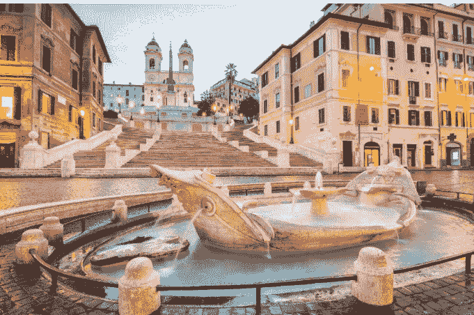

等等，说好的大工程呢？难道就是眼前这个巴掌大的小喷泉吗？当然不止，虽然它是艺术大师贝尼尼父子的作品，名叫破船喷泉。但在我看来，此处不过是我们要讲的一个伟大工程的一个小小水龙头，顺着这个线头，我要带你去探索古罗马饮水管道工程。

这个工程有地面上看得见的部分，比如遍布罗马城的类似的喷泉和饮水口，也有深埋在地下看不见的部分，它们才是真正的大工程。这样的管道，早在 2000 年前，古罗马人就修了 11 条，总长将近 400 公里。

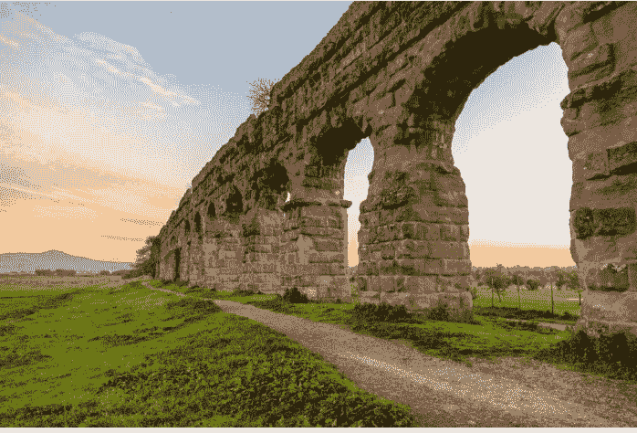

罗马城里的水从哪来？我们可以顺着管道，追到罗马城外的大型引水渠。在城市的东南郊，这里有一座叫做阿庇亚的古代遗址公园，今天那里还有一些古罗马高架引水渠的遗迹。

所谓高架引水渠，就是用连续不断的拱洞和柱子把引水道架在空中。这样的高架桥，在今天西班牙的塞戈维亚和法国南部还有相当宏伟的遗迹。

反倒是它的源头罗马城，当年的引水渠已经成了断壁残垣，但还能依稀看出来墙面上连续不断的拱洞，当年水就是从拱顶的渡槽流过。它们在这里已经矗立了 2000 多年。

当年有好几条水道在这里聚集，这些引水渠曾经一直延伸到几十公里外的水源地，它们穿山、越岭、入地、走高架，为罗马城源源不断地输送着清洁的水资源。

### 2. 封闭管道的伟大意义

在古代条件下，靠近水源，不但是人类生存的必要条件，更是人群聚集的必要条件。全世界的古老大城市都坐落在大河大湖边上，古罗马也不例外。但有所不同的是，古罗马人的饮用水，并不是来自城边的台伯河，而是来自我们刚才说的那个庞大的地上地下的引水工程。

这可就奇怪了，为什么罗马人不用台伯河的水，而是费这么大劲，舍近求远去调水呢？

一般的解释是两个原因：

- 第一，取水难。罗马城建在山上，台伯河在山下，运水确实困难。
- 第二，河水脏。因为台伯河承担了排污功能，水质太差。

但似乎并不能完全解释。取水难，那别住山上，搬下来不就得了，因为水源迁都的事，中外历史并不罕见。至于河水脏，也不是不能忍，反正巴黎人和伦敦人，到19世纪都是喝水排污不分的。

偏偏罗马人不肯将就。他们不光追求洁净的水源，而且早在2000年前就大肆洗澡。从公元前312年，罗马人修建第一条引水渠开始，500多年里，总共修了11条水道。不仅在罗马，在罗马帝国境内的几十座城市，也这么修。这些引水渠但凡留下来的，都成了旅游地标，比如西班牙的塞戈维亚引水渠。

在2000年前，要这么讲究可太不容易了。我带你从工程角度看看，罗马人克服了哪些难题：

- 第一，要找到干净的水源。虽然罗马人不懂化验技术，但他们的方法也很科学：在他们看来，干净的水肯定在高处，最好是山泉。找到水源后，他们会采集水样，放在不同的容器里观测和对比，此外还要对水源地的生态综合考察。如果周围寸草不生，当地人脸色不够红润，眼睛不够亮，寿命不够长，这的水就不合格，不能用。

- 第二，水找到了，但水源地离罗马几十公里，怎么运过来？罗马人的办法既不是用人挑，也不是用车运，而是建造引水渠，把水引进城。

说起引水，把水从高处往下引很容易，但谁也没办法保证几十公里的路上，能一路保持下坡，不遇上山峦峡谷。所以你在物理课本里学到的动能和势能的转化、虹吸原理，罗马人都用上了。遇到峡谷，就建高架引水渠；遇到山，要么挖隧道，从中间穿过去，要么沿着山脊修水渠。

要知道，那时候没有水平仪，也没有测量海拔高度的工具。要在几十公里的范围内，综合考虑坡道设置，既不能太缓，否则流动力不够，也不能太陡，冲毁坑道。这些都得考虑到。

我要重点说第三点，既然是长距离运输，那怎么解决不泄漏、不污染、不被人破坏的问题？管道的好处就出来了，罗马饮水管道，90%以上是埋在地下的。当时虽然没有PVC管，但罗马人用陶管、铅管，甚至是他们发明的混凝土，都能防蒸发防泄漏。

所以综合下来，罗马饮水渠，是人类早期的大型封闭管道工程。

### 3. 水给罗马带来了什么

引水渠解决的仅仅是罗马城的饮水问题吗？这当然是它的首要功用。它使得罗马城的人均水资源，远远超过今天的美国。我给你一组数据，公元前1世纪，每天有100万吨水流进罗马城，普通市民出门几十米就可以打到干净的水，还不收费。

但饮水渠的功用远不止如此，我们还能看到另外三个重要影响。

- 第一，它使得罗马成为超级大都市。

  日本学者盐野七生在观察古罗马城引水渠之后得出结论：考虑到罗马帝国的人口和疆域，包括罗马城在内，历史上暴发传染病的次数非常少，原因就是饮水工程。充足的供水和高水平的公共健康状况，使得罗马成为人类历史上第一人口过百万的超级都市。

  比较而言，同样作为欧洲的大城市，巴黎和伦敦动不动就暴发大瘟疫。直到19世纪，他们还不知道是饮水排污不分导致的。

- 第二，刺激了罗马城服务业的大繁荣。罗马最繁荣的时候，有上千个公共浴室，水还刺激了餐饮业的繁荣，罗马是比较早出现大批餐馆的城市。

- 第三，它使得罗马成为“永恒之城”。2000年来，罗马城中心基本没有移动过。今天我们漫步在罗马高低起伏的街道上，会有一种今夕何夕、此身何处的感觉，历史和现实在同一个空间里共生，甚至重叠在一起。

  而同时代与罗马齐名的中国古都长安，从汉代到隋代，就发生过中心点的位移。隋代长安其实是在汉代长安的东南重新修建的新城，原因就是老长安城水污染特别严重，不得不换地方。

- 第四，封闭管道思路，为人类远距离调配资源，提供了一个安全、快速、高效的解决方案，这是罗马人对全人类进步的贡献。我们今天的城市人，生活中到处都有管道工程：自来水、天然气、排污、地铁都是某种形式的管道工程。

我还看到过一个更极端的例子，著名的快时尚品牌 Zara，是个西班牙牌子。早期他们为了争分夺秒快速反应，在总部周围方圆200多英里范围内挖通了地下管道，用于运输服装原料和半成品。管道把400多家外包工厂连接起来，这种物流速度比汽车可快多了。

### 本讲小结

罗马西班牙广场上的破船喷泉，是由2000多年前修建的古罗马引水渠供水的。

古罗马人用引水渠的方式，远距离、大规模地调集水资源，成就了人类第一座人口破百万的城市。

古罗马人封闭管道式的引水渠，开了古代管道工程的先河。管道式运输以其单向、封闭、快速的优点，成为后世大规模异地资源调集的主要方式。

**思考题：** 除了课程里我提到的管道工程，你所知道的今天的哪些资源，也是通过管道传输的？欢迎在留言区分享。

下一讲，我带你看另外一个大型工程，它提供的解决方案，是怎么把一个东方大国，紧密维系在一起的。

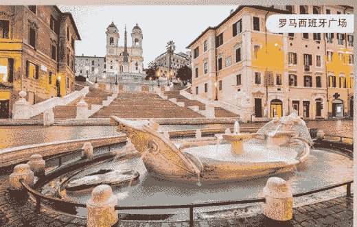

41° 54′ 21.42″ N， 12° 28′ 55.41″ E

成就罗马永恒之城美誉的，是广场下面埋了2000多年的饮水管道系统。

**楚方Tips：**

在罗马，这样的公共喷泉到处有，因为形象原因，被亲切称作“大鼻子喷泉”。如果你口渴了，可以直接喝“大鼻子”里的水。古罗马人口渴了，也是这样直饮的。

《林楚方 · 文明地标30讲》

来自得到App

## 13 扬州古运河 | 整合中华帝国的物流工程

2019-4-8

你好，我是林楚方，欢迎来到我的《文明地标30讲》。

今天，人类的物流可以走水路，也可以走陆路，还能走航空，但在古代，交通物流远没有这么发达。这一讲我就带你去中国扬州，看看古代世界人类最发达的物流工程，隋朝大运河。这条运河是隋炀帝杨广主持贯通的。

提起隋炀帝，你的印象可能不怎么好，中国历史上，他是有名的昏君。但也有人说，他谥号里“炀”字这个差评很不公平。

隋炀帝这个人，废除连坐、推行科举，而这条贯通南北的2700公里长的运河，对于提升古代中国的物流能力完全是划时代的。因为它一下子就把钱塘江、长江、淮河、海河、黄河五大彼此独立的天然水系，打通成了统一的网络。它的意义，不光是极大提高了物流效率，更是客观上促进了中国南北的统一。

一条人工运河，怎么会有如此大的威力？想要解开这些疑惑，跟我一起下扬州吧。

### 1. 瓜洲古渡今何在

中国历史上有两条知名的大运河，隋唐大运河和元代的京杭大运河，但是在扬州，它们有125公里长的重合。在扬州买一张游船票，就可以学着隋炀帝下江南了。

沿河南下，快到长江的时候，你会看到河中间一个不起眼的沙洲，很破败，上面有一座白墙黄瓦的牌楼，看上去也很普通。但是，牌楼后面立着一块石碑，写着四个红色大字“瓜洲古渡”，如果对中国文学稍微有点了解，你大概一下子就有感觉了。

这就白居易的“汴水流，泗水流，流到瓜洲古渡头”的瓜洲，也是王安石的“京口瓜洲一水间，钟山只隔数重山”的瓜洲，还是陆游的“楼船夜雪瓜洲渡，铁马秋风大散关”的瓜洲。

这么一块小沙洲，怎么会吸引这么多诗人？

如果我们回到1000多年前的隋朝，扬州就是当年的大上海，瓜洲古渡就相当于上海港。南北往来的货物，经由大运河运输，瓜洲就是当时中国最繁忙的物流中转站之一。

古人评价瓜洲古渡，说这里“每岁漕船数百万，浮江而至，百州贸易迁涉之人，往还络绎”。我给你翻译一下：每年有数百万的漕船都在这里经过，全国各地的商人都往这里来，络绎不绝。

隋朝大运河最主要的功能，是一个物流工程。在蒸汽机出现之前，世界上最高效的运输系统就是水运。现代人可能很难理解，水运怎么会最高效的呢？这得回到那个年代，陆路运输主要靠马车，成本很高，运输距离1000公里，粮食损耗要超过60%。哪去了？四个字，人吃马喂。但水运就不一样了。

李白有两句诗写的都是四川，一句是“蜀道难，难于上青天”，另一句是“朝辞白帝彩云间，千里江陵一日还”，这就是水陆和陆路的区别。

我再给你一组唐朝的数据，看看他们是怎么利用隋朝遗产大运河的。唐代政府运粮，一般是一支船队30艘大船，只要一千多人押送，就能运360万斤大米。如果变成陆路运输呢？按一辆马车运500斤粮食计算，需要7200辆马车，就算一辆马车两个车夫换班，光人就是一万多。这下你能知道它们的差别了吧？

所以，修完大运河，杨广才有了三次出兵辽东，攻打高句丽的底气。动用人力几百万，大部分兵源和物资都来自江南。想象一下，站在瓜洲古渡，大船浩浩荡荡向北开拔绵延几百里的壮观景象。如此高强度的动员能力，靠的就是大运河的高效率。

### 2. 杨广的统一大业

成就瓜洲地位的，就是隋炀帝杨广。关于杨广，我们听到的负面评价太多了，说他荒淫无道、横征暴敛。杨广被称为隋炀帝，“炀”是残暴的意思，这是唐朝皇帝给他的谥号，这种盖棺定论的杀伤力极大。

古代文人说，杨广修大运河，是为了去江南看琼花找美女。但这个说法明显有个bug，隋唐大运河是以洛阳为中心，向东南到杭州，向东北到北京，北京那时候可是边塞，杨广把运河延伸到那里干什么？

现代历史学家，会把大运河工程，看成杨广政治抱负的具象化。要知道，杨广的年号叫“大业”，什么是大业？就是一统江山。

你可能会打断我，杨广继位的时候，就是一统的江山呀。但是，我告诉你，这个统一其实是个表象。为什么呢？因为隋朝统一之前，中国分裂了300多年。从东汉结束，三国两晋南北朝，北方是五胡乱华，打成一锅粥，南方是宋齐梁陈，也是乱得很，统一的滋味大家早就忘了。所以，隋朝的统一，只是版图的统一，不是精神的统一。

杨广继位后就要解决这个精神统一的问题，他是怎么做的呢？

我打个比方，他就像蜘蛛侠那样，先是一个弹跳，把首都从长安迁到洛阳。然后从洛阳向东南和东北，射出两条蛛丝，一条抓住杭州，一条抓住北京，两条蛛丝合起来就是2700公里长的大运河。

那一个大运河就能解决国家的分裂问题吗？就能完成精神上的统一吗？

这就要回到大工程的特点：

- 第一，大投入。杨广的爸爸隋文帝很会攒钱，他死的时候，国库堆满了钱和粮食。这些钱粮足够杨广启动大运河工程。
- 第二，强动员。说干就干，从中央到地方，各级国家机器和士绅百姓，几百万人都被动员起来。

这两条既展示了大隋王朝的国家实力，又彰显了杨广个人的领袖魅力。大运河完工之后，杨广三下扬州。

那些批评他穷奢极欲的人往往忽略了一点，下江南其实是一场国家级的公关大秀，浩浩荡荡的船队本身就是威慑力，被公关的是江南的世家大族。杨广恩威并施，到了江南专门宴请他们，联络感情，打成一片，这都是有历史记载的。这么做很能征服人心。

隋朝之前，中国也有水路运输，但那些水路都是割裂的，资源和人口只能在独立的小网络里交换。

杨广第一次把钱塘江、长江、淮河、黄河、海河五大水系，从南到北串联成一个整体，由此启动的贸易和文化交流，必然成为促进帝国统一的强大力量。

那有人可能质疑，杨广连隋朝的统一都没法继续，你的说法怎么立得住？

没错，杨广穷兵黩武把自己搞死了，但是大运河带来的整合力量，被之后的唐宋反复强化了。

我先举一个例子，和人心有关。南宋诗人陆游写了很多诗，只提两句，一句是“僵卧孤村不自哀，尚思为国戍轮台”，另一句“心在天山，身老沧州”。轮台、天山都在新疆，沧州在北方，而陆游两岁的时候北宋就灭亡了，这些地方他根本都没去过。那我举这个例子想说明什么呢？

从这里我们可以看出，从隋唐到两宋，大一统的帝国已经成为文人群体的共识了。这个共识，跟隋朝修建大运河贯通南北不无关系。

### 3. 运河与二元帝国

你看，大工程的力量不能只看一时一地，而是要放到更大的时空中去观察，接下来我想聊聊另一个跟修运河相关的人——忽必烈。他刚一入主中原，就在隋朝大运河的基础上截弯取直，修建了京杭大运河。

施展老师在《中国史纲》课程里有个观点：从元朝开始，中国就从中原王朝，演化为中原草原合一致元的帝国。清朝最为典型，它的疆域上有六大板块：传统的中原、富庶的江南、雪域高原、蒙古草原、东三省以及新疆。怎么把这些经济、文化差异巨大的区域综合起来？清朝皇帝的方案是：用藏传佛教从精神上控制蒙古，利用满蒙联盟获得草原军事力量，从而控制整个帝国。

想要运行这个方案，首都就只能选在几种力量交界的地方，就是北京。但问题来了，北京周边非常穷，要想支撑一个首都，需要源源不断从更富庶的地方给北京输血。

这时候你就能看出从隋炀帝到忽必烈修大运河的作用了：它就像一根吸管，把南方的财富源源不断地吸到北方。这个高效运输系统，是帝国版图整合的重要手段。

大规模运输工程在大帝国整合上的作用，不光发生在中国。在罗马帝国巅峰期，通过几十条总长度超过40万公里的大道，将首都和各个行省连接起来，你熟悉的“条条大路通罗马”说的就是这个工程。人和物的快速流通，在人类文明发展史上，是一个贯穿始终的大主题。

### 本讲小结

隋炀帝杨广动用百余万人，疏浚贯通的大运河，打通了中国五大自然水系，它还让扬州成为古代中国的物流枢纽。

作为古代世界最高效的物流运输工程，大运河为中国的大一统不仅提供了物质条件，更准备了精神基础。

为人和物的快速流通提供通道，是人类文明进程中从未间断的大工程。

**思考题：** 你还知道人类文明史上哪些重要的物流运输工程？它们起到的作用是什么？欢迎在留言区分享。

大运河是隋炀帝主导下的大工程，下一讲，我要带你去法国，看另一个国王主导的工程。

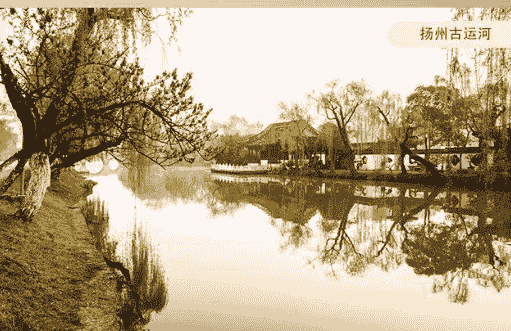

32° 14' 57.86" N, 119° 23' 11.20" E

大运河是高效物流系统，更是国家统一的整合力量。

**楚方Tips：**

在瓜州古渡公园，有座“沉香亭”，相传杜十娘怒沉百宝箱就发生在这附近。一个地方是否有魅力，除了看真实故事多少，还要看被加载多少传说。

《林楚方·文明地标30讲》

来自得到App

## 14 巴黎凡尔赛宫丨太阳王路易十四的权力工程

2019-4-9

你好，我是林楚方，欢迎来到我的《文明地标30讲》。

看完隋炀帝统一帝国的运河工程，这一讲我要带你去法国，看另一个由强权者主导的大工程，它就是巴黎的凡尔赛宫，世界上最大的王宫。它不仅仅是国王的居所，更是一个权力工程的样板。

法国的太阳王路易十四，就是通过这座王宫，展现和巩固自己权力的。我先大概给你一个时间参照系，路易十四跟康熙皇帝是同时代人。

### 1. 镜子里的权力投射

凡尔赛宫，在巴黎西南郊外20公里的凡尔赛镇，宫殿加花园占地面积有111万平方米，是北京故宫占地面积的1.5倍。

进入凡尔赛宫之前，你要先穿过一个大广场，走到一道镀金的护栏前，透过护栏，里面的建筑一览无余。

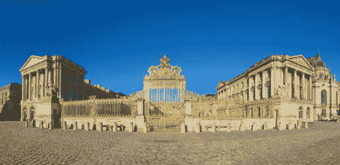

你可能知道故宫是标准的中轴线对称布局，凡尔赛宫也一样，甚至对称更严格。从建筑到花园，甚至树的排列，都是沿着中轴线对称分布，而宫殿的正中间就是路易十四的卧室。

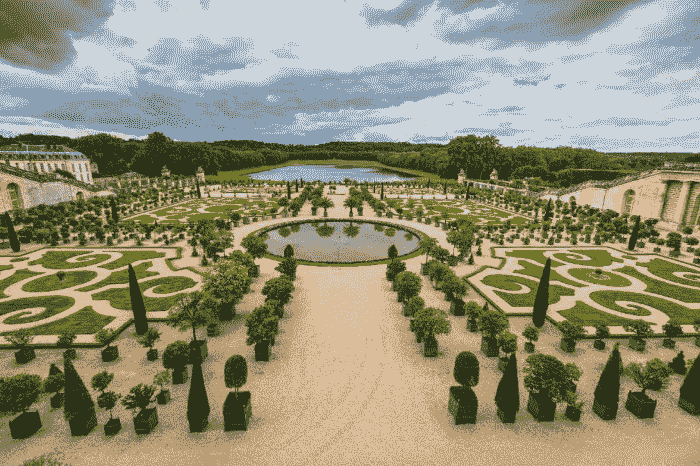

它还有超大规模的皇家园林。宫殿后面是100多公顷的绿地，1400个喷泉分布其中。喷泉、雕塑、绿地、宫殿组合在一起，凡尔赛宫被认为是园林典范。欧洲各国皇家园林，甚至包括中国圆明园的欧式花园，都是以这里为蓝本的。

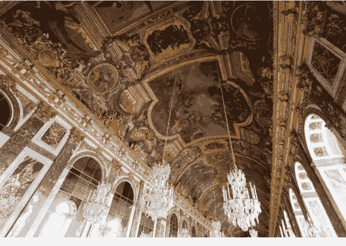

路易十四还有一个特别的杀手锏，那就是镜厅。今天这里经常挤满了参观的游客。镜厅有73米长，大厅一侧有17面巨大的镜子，另一侧有17面透明玻璃窗，窗外的景色投射在镜子上，就形成独特的室内景观。

这个厅之所以命名为镜厅，关键确实在镜子。我们今天看惯了镜子，不觉得有什么特别，但在当时，这17面大镜子就是高科技、奢侈品。那时候制造镜子的核心技术，掌握在威尼斯人手里。威尼斯有非常严格的法律，禁止技术外流，为了获得这门技术，路易十四不惜动用国家力量发动了一场间谍战。

我看过一段材料，法国人先是派间谍把威尼斯工匠偷运到巴黎，厚礼相赠，甚至帮他们娶老婆。这日子可比他们在威尼斯的时候好多了，消息就传回威尼斯，竟然又引来一批工匠。

这让威尼斯政府坐不住了，他们用工匠妻子的名义给工匠们写信，让他们回家。不过，这些信居然落到了法国人手里，法国人干脆将计就计，以工匠名义写信给留在威尼斯的妻子们，要她们偷渡到法国一起过好日子，这招成功了。

当然，故事的细节也许有戏剧化的成分，但法国偷镜子技术这件事成为工业间谍史上的一个成功案例，镜子也成为镜厅的永久标识。

为了镜子发动国家间的间谍战，这个小小的细节，就能折射出凡尔赛宫的权力本质。

如果你也熟悉中国的故宫，你会发现这两座王宫有个巨大的不同。故宫宫城周围环绕着高12米，长达3400米的宫墙，墙外还有52米宽的护城河环绕。中国古代封建帝王的权力，是靠深宫高墙、壁垒森严的神秘感维持的。但凡尔赛宫却不同，它既没有城墙，也没有护城河，外面只有一道金属护栏和一扇铜门，还都是镂空的。

如果说凡尔赛宫的建筑只是路易十四权力工程的硬件，那么搬进凡尔赛宫之后，路易十四则亲自导演了一场场权力大戏。

### 2. 凡尔赛宫的宫廷生活

最直观的，你在凡尔赛宫，到处可以看到金光灿烂的太阳标记，墙上、栏杆上、表盘上，而且都刷成灿烂的金色。凡尔赛宫的主要大厅，都以环绕太阳的行星命名，路易十四的宝座就安排在阿波罗厅。如果知道路易十四自称“太阳王”，你马上就能理解，随处可见的太阳形象就是路易十四的权力符号。

路易十四在千里，是把自己跟历史上那些伟大的君主并驾齐驱的。他经常玩 cosplay（角色扮演），把自己打扮成亚历山大大帝、古罗马帝国的皇帝，甚至众神之王宙斯。

把这座伟大的宫殿打上个人标记之后，路易十四确立了凡尔赛宫对外开放的传统，还亲自撰写了参观路线。无论贵族还是平民，都能在指定时间进去参观，运气好可以现场观看王室家人吃饭。路易十四想要他的荣耀被更多人看见。

贵族还能围观国王起床。它是我知道的，最复杂、最浮夸的起床表演。今天，你还能进入这间卧室，就是二层正中央的那个房间，面积不大，但路易十四愣是把这里变成了一个直播间。每天早晨 8 点，床上的帘子准时拉开，雷打不动。就算前天晚上，国王还在外面沾花惹草，但这个时候也得出现在床上，等着被参观。

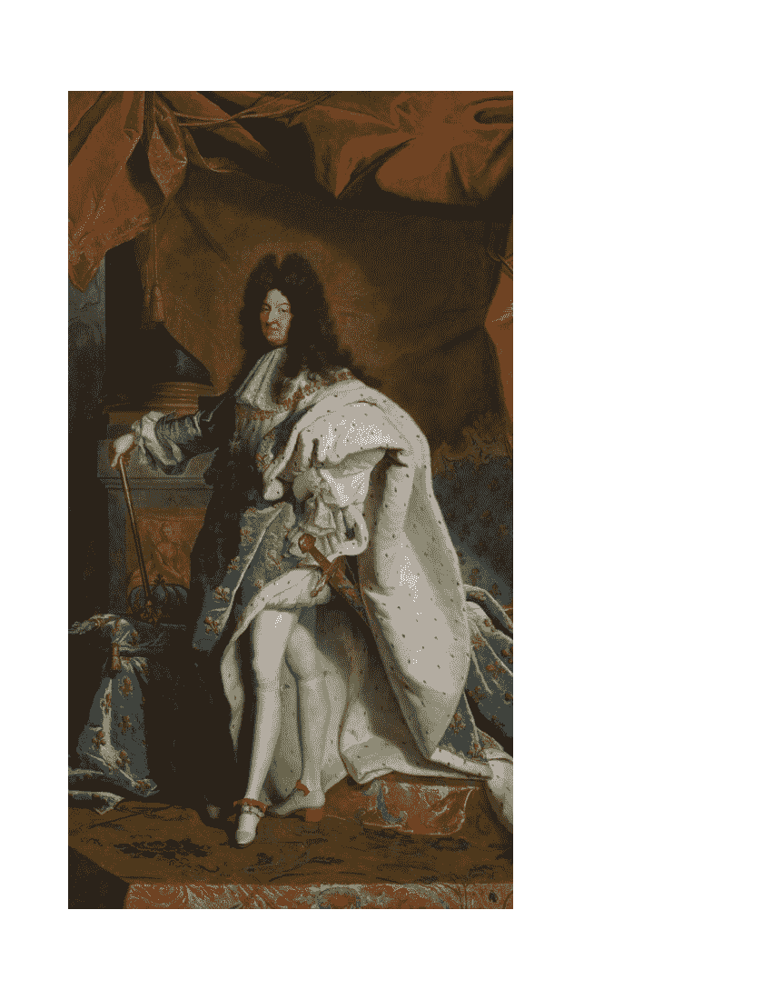

宫廷里经常举办豪华舞会。路易十四自己衣着华丽，你在卢浮宫收藏的一幅路易十四画像上，可以看到他的样子。他穿着天鹅绒袍子，不仅用金线刺绣，而且缀满各种珍珠宝石。他还戴假发，穿高跟鞋，佩剑上也镶嵌了各种价值连城的珠宝。上有所好，下必甚焉，贵族们自然不惜重金跟着模仿靠拢。

路易十四还干了一件事，就是搞了一个监控系统。这样，住在凡尔赛宫的贵族，所有对外联络的进出信件都会被拆开。大臣背地里说什么，他一清二楚。后来一些人改用密码写信，国王又专门组建破译团队。

### 3. 凡尔赛宫的权力之战

听到这里，你可能会觉得，路易十四太像一个穷奢极欲的昏庸帝王了，也许你还听说过不少关于他沉迷珠宝、香水、美酒的奇闻逸事。但你要照着中国历史那种昏君误国的路子去想，那可就想岔了。事实上，路易十四之所以要这么玩，完全是为了巩固自己的权力，实现更大的抱负。

回答这个问题，我得带你稍微回顾一下法国历史。法国不是传统的中央集权国家，国王的权力本来就没那么大，地方上的贵族随时可以跟国王分庭抗礼。更何况，路易十四五岁就即位，开始由他母亲摄政，直到 24 岁才真正掌权。掌权之前，他和母后、兄弟颠沛流离，曾经在暴乱中逃出巴黎。巴黎有他的童年阴影，所以他坚决不肯住卢浮宫。

凡尔赛宫的大规模修建，发生在路易十四亲自掌权之后，不是偶然的。他的决心很大，近 7 万平方米的凡尔赛宫主体建筑，十四年就建成了。这个规模放在当时的欧洲，没有三五年是建不成的。

通过建造远离巴黎的新宫殿，路易十四迫使贵族们离开了他们的大本营，来到一个完全由自己控制的地方。权力之战开始了。

就拿前面说过的参观国王起床来说，是分成三批的，第一批人有围观床上的国王，第二批人可以围观看睡衣的国王，第三批人只能围观看正装的国王。这些人还要再分等级，谁在谁之前，谁可以为国王奉上学服，都有明确规则。这么做，是为了打破原本的贵族权力等级，由路易十四重新洗牌。

就连服装也变成了权力工具。表面上路易十四喜欢奢华服装，于是在宫廷舞会上，为了讨好他，把别人比下去，贵族们不惜倾家荡产。有位侯爵就说，“凡尔赛宫没有真正的富人，所有人的钱都在衣服上。”这是在削弱贵族们的经济能力。而且，长期沉迷于凡尔赛宫的纸醉金迷，贵族们就没有时间、精力管理他们的地方事务，那作为地方长官的权力也就消解了。

路易十四甚至发明了一套专门的服装，用蓝色布料做成、内衬是红的，用金色、银色装点。这种服装，只有 50 套，获准穿上这种衣服，一眼就能看出来谁得到了国王的额外恩宠。

而且，路易十四看上去喜怒无常。他对贵族的奖惩极其任性，看人顺眼，奖品随时砸过去，不顺眼，就不搭理你。你想想看，在凡尔赛宫那样一个封闭的环境里，国王不理你，你就是边缘人。于是，贵族们天天挖空心思讨好国王。

你看，不需要靠武力，渐渐地权力就集中到了国王一个人手里。有这么多的权力干嘛呢？统一法国，对外用兵，扩大疆域，称霸欧洲。我们今天看到的法国版图，就是路易十四打下的基础。在欧洲，他也是第一个喊出“朕即国家”的君主。所以把权力中心转移到凡尔赛宫，成为他走向权力巅峰的关键一步。把王宫作为巩固权力的工具，没有人比路易十四的手腕更厉害。

说句题外话，有意思的是，今天世界上大部分的王宫，都已经人去楼空。皇宫从之前象征君主的“硬权力”工程，成了很多国家的标志性景点，进而变成了凝聚民族文化认同的“软实力”建筑。北京的故宫、圣彼得堡的冬宫、维也纳的美泉宫，都有这样的转变过程。

### 本讲小结

凡尔赛宫是欧洲规模最大的王宫，由路易十四主持建造。

镜厅是凡尔赛宫最受欢迎的看点之一，当年为了获得制造镜子的技术，路易十四不惜动用国家力量发动间谍战。

路易十四修建凡尔赛宫，不是出于穷奢极欲，他是借着这座宫殿和宫殿里的奢靡生活，消解了法国贵族的权力，从而大权在握，做出了一番大事业。

> **思考题：** 不知道你曾经参观过哪些王宫，能不能举个例子来分析，哪些细节是权力的体现？欢迎在留言区分享。

下一讲，我带你去美国，见识一个现代社会的大工程胡佛大坝，看看技术的进步如何越来越深刻地影响了人类的大工程进展。

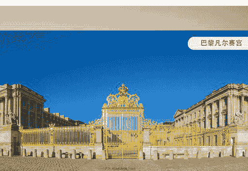

48° 48' 17" N, 2° 07' 13" E

凡尔赛宫的建筑、园林很迷人，更精彩的是路易十四的权力游戏。

**楚方Tips：**

凡尔赛宫最初没有一间公厕，达官显贵们内急了，就找没人的地方方便。如果你内急去厕所，不妨对比、想象，忆苦思甜。

《林楚方·文明地标30讲》
来自得到App

## 15 胡佛大坝 | 技术驱动的能源工程

2019-4-10

你好，我是林楚方，欢迎来到我的《文明地标 30 讲》。

这一讲，我要带你到美国内华达州和亚利桑那州的交界处走一趟，带你看一个能源水利工程，就是胡佛大坝。这座拱门式重力人造混凝土大坝，被称为美国二十世纪最伟大的工程。这座超级大坝的建成，跟工程技术的突破密不可分。

其实人类很早就开始利用水的能量了，你大概见过那种古老的水车，但它利用能量的效率非常低。直到 19 世纪上半叶，人类发明了水轮机，把水的势能转化成水轮机的动能，再借水轮机的动力，推动发电机工作，人类对水力资源的利用才有了质的飞跃。

## 1. 高峡出平湖的技术典范

早在胡佛大坝修建前半个世纪，人类就开始利用水力发电了。你知道人类最早的水电站都建在哪吗？瀑布附近。因为要想大规模利用水发电，水一要有落差，二要有流量。瀑布天然就有落差，所以刚开始，美国跟加拿大这两个水力发电大国，水电站都是建在瀑布底下的。

在胡佛大坝修建之前，全世界最大的水力发电工程，在尼亚加拉瀑布。但如果只靠瀑布，人类能建的水电站规模和数量就太有限了。胡佛水电站是个典型，摆脱了天然瀑布的限制，用一个水泥大坝截流，人工提高水位，形成巨大的势能。

这句话说起来容易，但在二十世纪初的技术条件下，胡佛大坝的混凝土浇筑量为 300 多万立方米，工程量极大。胡佛大坝创造性地发展了大体积混凝土筑坝技术，有些技术一直沿用到今天。

从拉斯维加斯出发，向东南走大约四十公里，就是胡佛大坝。胡佛大坝拦住的，是以狂野著称的科罗拉多河。它从落基山脉奔腾而下，开山劈道，仿佛把地表撕开了一道口子。

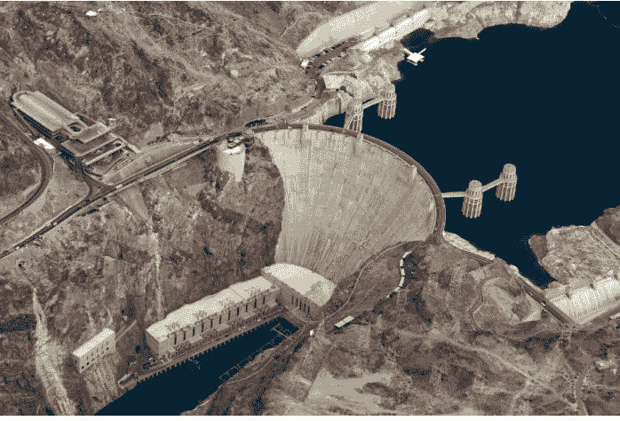

但是今天你站在胡佛大坝上，科罗拉多河的狂野不见了。以大坝为界，一边是平静的米德大湖，这是西半球最大的人工湖。另一半，如果你从空中俯瞰，是一只巨型混凝土扇贝，只不过，这只贝壳高达 220 米，生生嵌入深谷里。这个高度比今天中国的三峡大坝还高 20%。

水坝两边，水位落差达到 150 米左右，这不是天然的瀑布，而是人类的杰作。

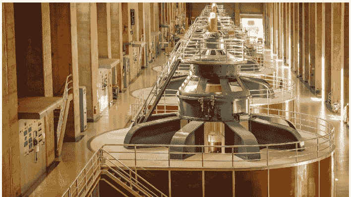

现在，和我一起坐电梯来到 153 米的地下，胡佛大坝最核心的地方，发电厂房。

在这里，你可以看到 17 台直径有 10 多米的巨型涡轮机，它们排成一排，昼夜不停地发出嗡嗡巨响。驱动这些大家伙旋转的动力，就是被胡佛大坝拦住的科罗拉多河水。一条条粗大的管道，把河水源源不断地导向这里，在河水的猛烈冲击下，涡轮不停旋转，一刻不停地向外输送电流。

这 17 台发电机组每年输送大约 40 亿千瓦时的电能。这么大的数字你可能没概念，在当时，这一座大坝的供电量，可以满足美国太平洋沿岸的西南部大部分地区。

而且如果你今天去过拉斯维加斯，我可以告诉你，这座城市的流光溢彩也是胡佛大坝点亮的。直到 2015 年，胡佛大坝发的电，还供得上美国西南部三个人口稠密的州的生产和生活。

## 2. 克服两个工程难点

在 1930 年代，胡佛大坝是当时世界第一高坝，比当时第二大坝（西雅图的魔鬼大坝）高出近一倍。理解我开头所说的水力发电的原理，你就明白，之所以要把大坝修这么高，当然是为了尽可能地提高上游水位，增加蓄水量。

虽然大坝以当时的美国总统胡佛的名字命名，但我要请你记住首席工程师弗兰克的名字。

要知道，科罗拉多河曾经是美国最深、水流最湍急的河流，工程难度非常大。

这个大坝的工程难度主要是两个，一个是驯服狂野的科罗拉多河水，另一个是短时间内浇筑好大坝的混凝土。

主持修过 6 座大坝的弗兰克，这一次想尽了办法。首先，他设计了要在山崖里开出四条直径十几米，全长 6 公里的隧道，把科罗拉多河的河水引开，绕过灌注混凝土大坝的位置。这你好理解，因为人没法在有水的河床里浇混凝土。

隧道开凿非常艰难，工人的高强度作业，加上当时最先进的巨型钻孔机，最后仍然有一百多名工人因为各种事故失去了生命。今天大坝上还能看到为他们造的纪念碑。

终于到 1932 年 11 月 13 日，被分流的河水第一次冲入隧道。不到 24 个小时，狂野的科罗拉多河，乖乖地驯服了，分流隧道工程成功了，还比预期提前了一年。原先的主河床抽干就可以浇筑水泥了。

弗兰克创造的第二个奇迹是在不到两年的时间内，完成混凝土浇筑工程。注意两年这个时间，你大概不知道，混凝土的浇筑过程是会产生热量的，胡佛大坝至少耗费了 300 多万立方米的混凝土，如果按当时传统的方法整体浇筑，125 年才能完成散热。

没有足够的冷却时间，混凝土温度过高，就会出现裂缝，要么导致整个结构坍塌，要么留下极大的安全隐患。

那弗兰克是怎么把混凝土浇筑工程缩短到 2 年时间的呢？首先为了加快冷却进程，大型制冷厂利用管道把冰水抽到了新鲜水泥中，这也是后来很多大体积混凝土工程沿用的预埋冷却水管的技术。

但是对弗兰克来说，这个速度还是不够快。他最经典的创意，是发明了“柱状分块浇筑法”。简单说，就是坝体分解成 230 个垂直的水泥柱分开浇筑，大家各自散热，这大大缩短了冷却时间。

胡佛大坝开创的这种大体积混凝土筑坝技术，相当于打开了大规模开发水电的闸门。如果没有胡佛大坝做先行者，后来埃及的阿斯旺大坝、巴西的伊泰普大坝，还有中国的三峡大坝不知道还要摸索多久。甚至，中国二滩水电站的大坝，从外形看简直就是胡佛大坝的翻版。

所以，1935 年，在竣工仪式上，罗斯福总统一边指着大坝一边说了：“我来，我见，我服了”。这是我所看到的，对凯撒的那句“我来，我见，我征服”最好的改编。

所以，在某种意义上，胡佛大坝就是“大坝之母”。但故事讲到这里还没完，胡佛大坝带来的最大惊喜，是给人类带来了巨大信心：

- 胡佛大坝的装机容量，是当时最大规模的水火电厂的 5 倍，有力支持了美国西部大开发。甚至有人说，胡佛大坝还帮美国打赢了二战，因为制造战斗机的铝，制作原子弹的钚，生产过程都需要大量电力。而这些工厂很多集中在美国西部，主要由胡佛大坝供电。
- 有了大坝这个调节阀，丰水期蓄水，避免下游发生洪涝灾害；枯水期放水，还能缓解下游的干旱。从文明发展的角度来看，人类继驯服植物、动物之后，对自然的控制能力进一步增强了。

## 3. 从水电站到核电站

胡佛大坝之后，数以万计的巨型混凝土楔子，被嵌入地表。上世纪 40 年代，美国电力供应，水电一度占到 40%，西北部地区 75% 的电力都要靠水电。

但有个奇怪的现象，美国水电开发到 20 世纪 70 年代达到高峰，80 年代突然下滑，占比不断下降。有人说是因为各地在环保压力下兴起“拆坝运动”，真相是这样吗？

我看过一组权威资料，里面仔细考证了美国拆掉的各种水坝，结果发现，其中绝大多数都是年久失修的废坝、弃坝，它们压根就不能发电，至于那些重要的水坝，一座都没拆。

水电比重持续下滑的原因是什么呢？其实是竞品的出现，其中最大的竞品就是核电。

说起来有点戏剧性，公众认识到核能的力量，最初是通过原子弹，但几乎与此同时，这种破坏性力量也被人类驯服了。上世纪四五十年代就出现了核电厂，之后核电比重不断增加，到七八十年代，全球核电大发展，水坝比例就下降了。

现在，核电在美国电力占比高达 20%，在法国这个数字甚至超过 70%。所以，美国水电占比，从高峰期的 40%下降到最近的个位数。

从电气革命之后，人类不断尝试把各种自然资源，转化为可以利用的能源。风能、太阳能、潮汐能、地热能，通通进入人类的能源结构，占比也在不断增加。能源大概率不会枯竭，因为人类总能找到新的能源，推动文明列车向前跑。

### 本讲小结

胡佛大坝截断了科罗拉多河，创造了“高峡出平湖”的工程奇迹。

胡佛大坝开创了巨型拦水坝的工程典范，从河水分流到混凝土浇筑，尤其是大体积混凝土筑坝技术，突破了水坝的工程极限，此后水电成为全球再生能源的绝对主力军。

美国 20 世纪 80 年代兴起的“拆坝运动”，背后是能源结构调整的结果，人类一直在寻找和开发不同来源的能源解决方案。

思考题：你还知道哪些大工程在技术上的突破？欢迎在留言区分享。

下一讲，是我们大工程板块的最后一讲，我带你去看一个二十一世纪的大工程。

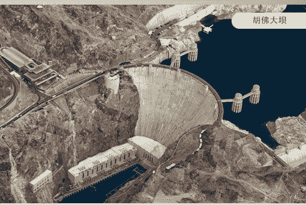

36° 0' 56" N, 114° 44' 16" W

胡佛大坝把摧毁的力量，转为造福的力量，水电开发有了高起点。

**楚方Tips：**

电影《末日崩塌》里，胡佛大坝真的崩塌了，非常震撼。看完电影再去胡佛大坝，会有不一样的体会。夏天去记得带帽子、围巾、长裤、长袖衫、防晒霜，太阳很毒。

《林楚方·文明地标30讲》
来自得到App

## 16 迪拜棕榈岛｜扭转国运的房地产工程

2019-4-11

你好，我是林楚方，欢迎来到我的《文明地标30讲》。

大工程板块的最后一讲，我带你走一趟阿联酋的迪拜，参观朱美拉棕榈岛的别墅区。也许你在这里还会偶遇前来度假的好莱坞明星，比如布拉德·皮特。

你可能会奇怪了，别墅是个工程不假，但咱们刚刚看完胡佛大坝，再大的别墅，就算是别墅群，也算不上什么大工程吧？

且慢，棕榈岛最正确的进入方式，是你得想象，我们是坐着阿拉丁的飞毯，至少乘坐现代的直升机，从空中俯瞰，然后再缓缓降落。

## 1. 大海上的世界奇迹

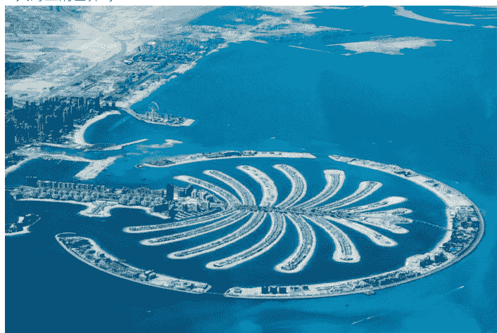

在空中你会看到，蔚蓝的阿拉伯湾上，有一个图样完美的巨型棕榈树。一根笔直的树干，环绕它垂下了 17 片羽毛形状的树叶，顶端还有一道月牙形防波堤。这棵巨型的棕榈树，伸进了阿拉伯湾五公里之多。

毫无疑问，这不可能是自然造物的杰作，而是一个巨型的人工岛屿。在 2000 年之前，这个地方除了一片海水之外，空无一物。

棕榈岛被称为世界第八大奇迹。当然奇迹不是岛上的豪华别墅，这个全世界到处都是，奇迹是这个岛本身。光这一个岛，填海工程要耗用 3000 万吨岩石和 3 亿立方米海砂。这个工程量，比胡佛大坝大多了。

迪拜并不是第一个填海建人工岛的国家，填海造陆技术上本身并不难。围出一个堰，把里面的水抽干，再把中间填上土，荷兰人十三世纪就开始这么干了。

迪拜人在二十一世纪再造人工岛，土方施工完全不是问题，但迪拜人动用了当时全球仅有的一台私人卫星“伊科诺斯”，它的功能特别强大，足以跟俄罗斯和美国的军事卫星媲美。地面还有个小团队，每天背着 GPS，建立网格化的精确地理坐标，确认海砂应该填在哪里。这么做就能保证这棵巨型棕榈完全按照设计标准完美呈现。

迪拜人还解决了一个重要问题，把岛建成棕榈树形状，美是美，但另一个问题又来了。棕榈岛最外围包着一道防波堤，里面又是一条一条的棕榈叶，这么复杂，海水很难流动，时间一长就成死水了。怎么办？

工程师就通过建模分析海水的流动规律，在防波堤上开了两个 100 米宽的口子，于是堤里堤外的海水就能对流了，按照设计，每两周就能完成一次海水更新。

## 2. 地产项目背后的国家战略

讲到这你可能要问了，迪拜人费这么大劲，建一个这么复杂的人工岛，是有钱任性吗？是为了盖房子卖别墅吗？这么大的填海工程，房子得卖天价了吧？我特意上海外置业网站查了一下，目前（2019年）的价格，棕榈岛上的别墅从几百万到一两千万不等。注意，人民币哦，北京、上海人民可能会笑了。

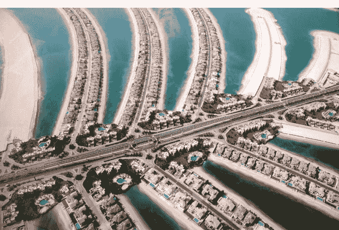

站在棕榈岛的中央大道，两边都是成排的沙滩别墅，每栋房子都拥有一片海滩，带草坪、带泳池、带独立车库。但我要告诉你，这并不是一个简单的房地产工程，迪拜在下一盘大棋，从本质上来说，是这个国家扭转国运的重要一环。

你大概也知道，迪拜是个富得流油的地区。这个小小的酋长国，面积不过是伦敦的两倍，几十年前真的就是个破渔村。自从1966年发现石油以后，迪拜经济就开挂了，迅速成为阿拉伯世界最富有的地区。但经过几十年高速开采，迪拜很快面临了石油的枯竭，一个靠卖能源发财的国家，必须找到华丽转身的办法。

解决的办法可以是走，反正国家也不大，大伙拿着钱去别的地方开启新生活，也不是没有可能。但迪拜人选择了无中生有，绝处逢生。

迪拜多的是有钱人，所以他们的转型路径，也很容易往有钱人的方向上去尝试。其实，棕榈岛项目之前，迪拜已经小试牛刀了。这第一弹就是“阿拉伯塔酒店”，它更出名的名字叫“帆船酒店”，这个项目就是当时的迪拜王子阿勒马克图姆力推的。

帆船酒店之所以出名，是因为在它之前，全世界的豪华酒店最高也就是五星级。迪拜人硬是花大钱提高标准，不但墙上挂着著名艺术家的油画，而且连门把手、厕所水管都弄成了金的。“纸醉金迷”这个成语，放在帆船酒店，根本就不是写实。

你大概也知道帆船酒店前面还有个形容词叫“七星级”，其实这并不是一个酒店业公认的评级标准，你也没听过六星级吧？

真实的故事是，酒店开业的时候，一个英国女记者被阿拉伯式的豪奢震翻了，回去在报纸上写评论说，“我已经找不到什么语言来形容它，只能用七星级给它定级。”从此，全球酒店才有了七星概念。就这一个词，反而比任何细节的描绘都更好，全世界住过奢华酒店的有钱人当然会好奇。

而对于迪拜来说，富人只是来住几天酒店可不够，得想办法让他们来得更多、更频繁。那什么办法好呢？得让他们在迪拜有产业。但迪拜自然条件实在有限，怎么才能盖出吸引有钱人的房子呢？迪拜稍微有的地理优势是，它一年四季都暖和。

于是，一个连淡水都极其稀有的沙漠国家，靠砸钱把自己砸成了全世界顶级观光旅游目的地，棕榈岛就是其中非常关键的一环。这个工程最早的主导者，还是那个迪拜王子。顺便说一句，可惜这位王子 34 岁就英年早逝了。

刚才我提到，建设棕榈岛动用了世界上最先进的私人人造卫星，把岛弄成完美的棕榈树的样子。为什么要这么讲究呢？

可不光是为了空中拍照好看，它其实是一个延长海岸线的天才想法，迪拜原先只有 70 多公里海岸线，这个想法生生把迪拜的海岸线增加到 1500 公里。有充足的海岸线，就能保证海边的房子占尽一线海景，甚至拥有私家海滩，这是顶级别墅标配。

迪拜这么做，是摸准了顶级富豪的脉。果然，贝克汉姆、布拉德·皮特都来了。

### 3. 旅游成支柱产业

光沙滩别墅还不够，还得有得玩。有了岛，迪拜人就继续建顶级娱乐设施——世界上最大的购物中心、世界上最大的室内滑雪场、世界上最高的塔、世界上最大的音乐喷泉——一一建起来。然后还举办顶级世界赛事，比如赛马世界杯，谁都知道赛马是有钱人的游戏。甚至，出入迪拜的阿联酋航空，走的都是高端奢华路线。

所有的这一切，都是为了在全世界人心目中建立一个新的认知：迪拜是一个奢华度假目的地。这，才是石油王国挥金如土填海造岛的真正目的。

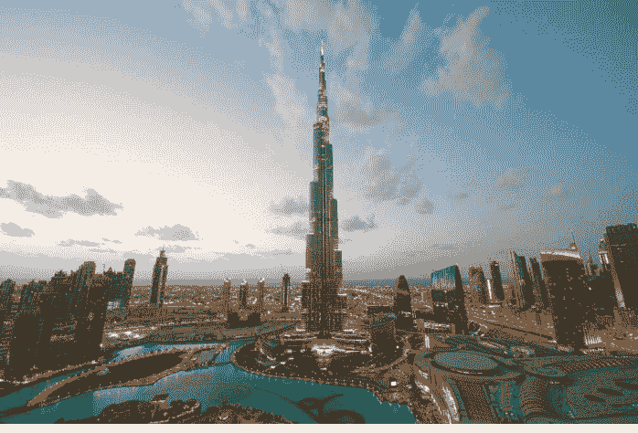

这个目的达到了吗？当然，在棕榈岛开工后，**2003** 年迪拜旅游业的收入就首次超过了石油收入。到现在，石油产业的 GDP 占比，已经从原本的 50% 降到目前的 1% 左右，而旅游业已经超过了三分之一。

迪拜的转型还不只旅游业，有钱人来多了，迪拜的金融业也发展起来。

石油耗尽之后，一个没有传统旅游资源，没有名山大川，没有金字塔、没有吴哥窟、没有兵马俑也没有顶级博物馆的沙漠国家，靠着有钱，更靠着非凡的想象力，用超乎寻常的大工程为自己续了命。尽管 **2008** 年全球金融危机的时候踉跄了一下，但现在又缓过神来了。

如果有机会去迪拜旅行，在别人赞叹这个国家土豪金的时候，你不妨抽出身来，站在高空回望。

### 本讲小结

迪拜的棕榈岛是一个人工岛，它的特殊形状，极大地延长了迪拜的海岸线。

棕榈岛表面上看是个豪宅工程，背后却隐藏着一个能源国家的战略转型。通过一系列大工程，迪拜终于成功地摆脱了对石油的依赖，成为了全球著名的奢华旅行目的地，不但带动了旅游业发展，进而推动了金融和服务业的发展。

大工程的价值在于，能以它极致的体量改变人的认知，比起有形的、有限的能源，一个国家靠重塑认知也能够带来巨大的价值。

在“大工程”板块里，我带你认识了人类不同时期的几个大工程，了解了大工程是如何高效集约地解决资源、能源、物流、交通等问题的，甚至它能够带动一个国家的战略转型。

**思考题：** 对于迪拜这个国家的转型方式，你觉得还有什么地方值得借鉴？欢迎在留言区分享。

接下来，我会带你进入一个新的板块——“城市”，它与很多大工程紧密相连，大工程要么为它服务，要么成为城市中的地标。城市被称为“人类最伟大的发明”。从下一讲开始，我们一起从人类文明的角度探究城市。

头图备注：图像©2019 CNES/Airbus, DigitalGlobe, Landsat/Copernicus, U.S. Geological Survey, 地图数据©2019 Google

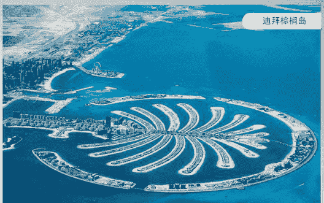

25° 6' 52.8'' N, 55° 8' 16.07'' E

# 迪拜人打造的奢华旅游地产，出发点是给自己续命。

楚天Tips:

看棕榈岛有三个好角度：从高空看地面，坐轻轨看两边，坐小黄船看陆地，最震撼的是第一种。所以快到迪拜的时候千万别睡觉，世界第八大奇迹，特别适合高空往下看。

《林楚天·文明地标30讲》来自得到App

## 17 雅典古城广场｜城市居民的公共交流空间

2019-4-12

你好，我是林楚天，欢迎来到我的《文明地标 30 讲》。

从这一讲开始，我要带你去雅典的广场、罗马的大浴场、佛罗伦萨的美术馆、巴黎的下水道、伦敦的地铁站、纽约的摩天大楼。你大概能听出来，我们进城了，这个单元的主题词就是“城市”。

经常有人说，城市是人类最伟大的发明，城市规模和聚集的人口数量，也被当做衡量文明的重要标准。对你来说，城市生活肯定很熟悉，但我希望这个单元能给你熟视无睹的地方，带来一些新的观察角度。

这一讲，我们先去雅典古城遗址的广场。雅典是世界上最古老的城市之一。

## 1. 广场才是雅典的中心

说到雅典，你一定知道它是西方文明的源头之一，一般人去旅行，一定不会错过的景点是雅典卫城。但我要说，从人类城市文明的角度来看，雅典真正的中心，不是卫城，而是卫城下面一块和它差不多大的广场，广场对缔造雅典文明起到了巨大作用。

从卫城沿着古希腊人朝圣的古道下来，就是古代广场的遗址了。现在这里已经是一片废墟，到处散落着巨大的石块、断裂的墙体和残损的建筑构件。但你还是可以分辨出，哪些地方原来是地基，哪些地方曾经是立柱。

虽然柱头的浮雕已经被时间抹去了细节，但是透过粗糙的外表，你还是能感受到希腊艺术的美感。站在地中海的烈日下，望着被阳光照得发白的废墟，你需要调动想象力脑补 2000 多年前（公元前 5 世纪）雅典城邦的繁荣。

希腊的地理条件，不适合发展农业，商业才是古希腊经济的核心，希腊文明是一种城市工商业文明。

在希腊城邦里，当年的广场首先是个大集市，它的作用首先是做买卖。

如果我们穿越回古希腊，每天早晨 9 点，你会看到广场就开市了。你可以买到无花果、橄榄油、粮食、乳酪、肉类，还可以购买法律服务，比如诉讼状。如果家里奴隶不够用，每个月新月那天，这里会有奴隶拍卖会。

广场提供了一个绝好的商业平台，这里的人们虽然不能靠种地吃饭，但是靠贸易也解决了生计问题。

说到这儿，你大概猜想，我讲城市板块从广场开始，是要讲商业了。但作为西方文明的源头，我把你带到雅典，可不是为了让你看人们怎么做买卖的。穿越回古希腊，在雅典的城市广场上，还会碰到另一个人——苏格拉底。他来这儿，可不是为了购物，老头常去的是广场北侧的一个柱廊。他到那儿干嘛？跟人聊天、交流、辩论。

这个广场，不光担负了城市的物质交换，更是思想和言论交换的公共空间。

今天，苏格拉底常去的那个柱廊已经没有了。现代人在旁边修建了一座崭新的柱廊，乍一看显得有点突兀，甚至有点假古董的感觉，但里面其实是一座博物馆，收藏了很多古希腊的文物。走进去，可以看到古代广场的复原模型，还有各种大理石雕塑，苏格拉底时代的瓶瓶罐罐。

透过这些文物，我们可以近距离地想象古希腊人的城市生活。想象在这个空间里，活跃着苏格拉底、柏拉图、斯多葛学派的创始人芝诺......

## 2. 雅典的城里人每天忙什么

缔造雅典辉煌的，包括这些智者，其实都是“雅典公民”。

那什么是“雅典公民”呢？

首先，雅典公民是一个政治身份。按雅典法律，达到一定年龄，父母是雅典人，才有资格成为公民。这可是一个很髙的门槛，奴隶不是，外地人不是，尽管雅典的女性是公民，但没有投票权。所以真正拥有完整公民权的男性，只有四万人左右。

这些人是城邦的主人，当年就住在广场西侧，一片密集的房屋里。从历史记载看，富有的雅典公民生活很舒服，做菜、做饭、酿酒由奴隶干，家庭教师奴隶当，生意和工厂也是奴隶帮着打理。

听上去很奢侈，但雅典人的生活美学却是朴素的。他们不喜欢豪华的房子，华丽的装饰，不追求世俗的享乐，但他们的生活非常忙碌，他们在广场上忙碌。忙什么呢？

第一，忙开会。开会，是雅典公民的权利，也是义务。雅典经常就重大公共问题，召开各种会议。其中最著名的公民大会，是雅典最高权力机构，但公民大会不常开，平时管理城邦工作的是五百人议事会。除重大节日外，这些人每天都来广场旁边的会议室，讨论城邦的大小事务。正是雅典人的开会，奠定了西方政治文明的基本样式。

除了开会，他们还忙着聊天。广场更是聊天和辩论的好地方，聊天就会出现不同观点。想说服对方，讲话就得有理有据、逻辑清晰，这就催生出最早的思辨哲学。

最会聊天的雅典公民，当然是苏格拉底。这个老头经常到广场上找人辩论，自诩为“思想助产士”。因为他妈妈是个接生婆，他从小就看人生孩子。他觉得，思想的胎儿和人类的胎儿很像，也得有接生婆。怎么接生呢？就是通过不断的辩论和质疑，让思想的胎儿呱呱坠地。

苏格拉底通过广场，收获了一群死忠粉，其中最著名的就是柏拉图，成了他的徒弟。柏拉图后来也收徒，最著名的是亚里士多德，还有斯多葛学派的芝诺。他们的思想，都是在广场上聊天辩论过程中孕育出来的。甚至雅典广场上的柱廊，后世就被叫做斯多葛柱廊。

所以，你可以认为，古希腊哲学就诞生在广场上。而古希腊哲学，被看作是西方哲学的源头。英国思想家罗素，甚至说过这么一句话，“西方的全部哲学，就是希腊哲学”。

古希腊人还在广场上演戏。在古希腊，戏剧是重要的公共生活。据统计，从公元前 480 年到公元前 380 年的 100 年里，雅典总共上演了 2000 部戏剧，而广场西侧原来就有一个剧场，经常上演戏剧。

但雅典的剧场可不是你今天想象的那种封闭小剧院，它们都是露天的。所以，你也可以把城里其它的剧场，看作广义的广场。古希腊辉煌的文学成就，很大一部分就是在这些露天剧场里产生的，并成为整个西方文学最重要的源头之一。

雅典广场作为城市公共言论思想空间的传统，在公元前 5 世纪，古希腊建筑师希波丹姆那里，就直接总结为一套城市规划理论。在他的规划里，城市被划分成圣区、公共建筑区和住宅区三部分。这种以方格网的道路系统为骨架，以城市广场为中心的城市布局，后来被叫做“希波丹姆模式”。

后来，罗马人以希腊为师，也建立了一个个大广场，还发展出各种恢弘的公共建筑。中世纪的欧洲人又在广场上建起了市政厅和塔楼，塑造了那个时代最典型的城市景观。这些都是今天去欧洲旅行时你能看到的，它们其实和雅典都是一脉相承的。

今天，城市代表着信息交换的高密度和高频次。从这个角度来看，古希腊的广场就是城市信息集散地的雏形。后来随着城市规模的扩大，这种信息集散的功能，也渐渐转移到报纸、广播、电视上。再后来的互联网论坛，你也许可以看作古希腊城市广场的一次虚拟重生。

### 本讲小结

从对西方文明发源的推动作用上来看，雅典古城真正的中心，不是山顶上的卫城，而是卫城下面的广场。

雅典公民在广场上开会、演出戏剧、辩论演讲，发展了古希腊的政治、文学艺术和哲学。

广场作为古代城市的公共空间，不仅承担了物质交换功能，也成为信息和思想的集散地。高密度高质量的信息交换，正是城市活力的源泉。

**思考题：** 你生活的地方，有没有广场生活？人们在广场上做什么？欢迎在留言区分享。

下一讲，我会带你去罗马卡拉卡拉浴场，看看 2000 多年前的城市大型综合体是什么样子的。

37° 58' 30" N, 23° 43' 21" E

帕特农神庙里未必藏着雅典文明的答案，找文明密码要移步到山下广场。

楚天Tips:

广场旁边的古代集市博物馆非常值得一去，最好避开中午高峰期，晚点去逛，出来还可以坐在柱廊台阶上，享受下地中海的暖暖阳光。

《林楚天·文明地标30讲》

来自得到App

## 18 罗马卡拉卡拉浴场｜城市享乐和消费的萌芽

2019-4-13

你好，我是林楚天，欢迎来到我的《文明地标 30 讲》。

这一讲，我带你去罗马的卡拉卡拉浴场。你可能要问了，一个澡堂有什么好看的？我会说，今天我们这么多人漂在北上广，挤破头也要留在大城市，可能就跟这个澡堂有关。

城里空气差，交通拥挤，生活紧张压力大，城市里都是心怀叵测的陌生人......关于城市你可能生出一万种抱怨。但要是说，咱们走，明天就回乡下，乡间有茅屋菜园，还有清新空气、有机蔬菜。我猜，你也未必愿意立刻回归田园。

城市，尤其是大城市，有最集中的娱乐和消费场所。今天我们非常熟悉的 shopping mall，或者说大型城市综合体，早在古罗马时期就已经初具规模。那个时期的浴场，不光是用来洗澡，里面还有健身房、美容院、图书馆、剧院、餐厅等等。

鼎盛期，古罗马城有上千个浴场，我带你去的是现存最完整的一个遗址，就是卡拉卡拉浴场。站在卡拉卡拉浴场，我会特别感慨，古罗马人实在是“城会玩”。

## 1. 1800 年前的大型公共建筑

从罗马市中心最著名的圆形斗兽场往南，走十几分钟，就是卡拉卡拉浴场。它在公元 217 年建成，建造它的皇帝叫卡拉卡拉。他是罗马历史上有名的昏君，残暴奢靡。但是为了笼络民心，他不经政府预算，私自募集资金建造了卡拉卡拉浴场，供全体罗马市民享用。

罗马城公共建筑的特点就是大，虽然过去了 1800 年，远远地还能看到浴场巨大的废墟。长 337 米，宽 328 米，相当于 15 个标准足球场的面积，可以同时供 1500 人洗澡，高峰期能接待 6000 到 8000 人，光更衣室就有一千多平方米。

浴场空间由宽敞的连续大厅组成，这成了后来很多城市公共建筑的空间原型。这种连续大厅，让公共空间即使人再多，也不会感到拥挤压抑。最典型的是今天欧美城市的许多火车站，比如纽约原来的宾夕法尼亚火车站、芝加哥的联合火车站，就是以罗马浴场为原型建造的。

## 2. 城市娱乐消费综合体的雏形

作为一个浴场，当然卡拉卡拉会提供冷水浴、热水浴、温水浴，甚至还有桑拿，但这个巨大的空间提供的服务远不止于此。

- 它有健身房，古罗马人在这里打拳、摔跤、跑步、跳高。
- 它有美容室，有专门的房间做护理，古罗马人喜欢涂橄榄油、香膏之类的护肤品，甚至还会在这里脱毛。
- 它有棋牌室，可以玩骰子、下棋，也可以看表演，听音乐。
- 它有图书馆，还有个半圆形演讲厅，古罗马人在这里听演讲，高兴了还可以上去讲一段。
- 当然，美食和购物肯定是必不可少的。
- 甚至还有色情服务，这个咱们就不细说了。

浴场是皇帝给市民建的公共设施，收费低廉，从皇帝到贵族，再到普通公民，都能在这坦诚相见。同样的设施还有引水渠、圆形斗兽场，这还不是全部，政府甚至给罗马公民定期发放粮食。

在鼎盛时期，罗马城的公民，不用劳动，也能无忧无虑地消费和享乐。通过卡拉卡拉浴场，我们大概可以总结出古罗马城市生活的三个特征：

一、公共娱乐高度发达：在古代社会，尤其是东方社会里，娱乐是少数人的特权。但在古罗马，除了我们这一讲说的吃喝玩乐一体化的大浴场，你大概也听说过古罗马的体育竞技、角斗，这些都是向大众开放的。

二、追求舒适的生活：卡拉卡拉浴场有暖气设施，他们研制了混凝土空心砖。空心砖垒在一起，形成管道，锅炉房把水烧热了，就流进这些管道里，于是地板、墙壁都是暖的，踩在哪、靠在哪都很舒服。

浴场里还有光滑闪亮的大理石装饰，穹顶下面是高大笔直的罗马立柱，地板上的马赛克拼成了精美的图案。大厅两边还竖立着各种大理石雕塑，每个雕塑都是精品，有些就被现在的博物馆收藏。

三、人的欲望不断膨胀。对于罗马人来说，更确切的词叫做纵欲。说起纵欲，通常我们是把它跟贵族、统治阶层联系在一起的，但在古罗马的城市里，纵欲成了一种上行下效的普遍风潮。

19 世纪末有一位叫劳伦斯·阿尔玛-塔德玛的荷兰画家，画过一幅画就叫《卡拉卡拉浴场》。画面上的男男女女在游泳、沐浴、嬉戏。是的，当时卡拉卡拉浴场是男女混浴的。古罗马人还喜欢暴饮暴食，古罗马的宫廷里甚至有专门的呕吐室，供给吃撑了的贵族吐光了再吃。这种吃喝无度从宫廷一直蔓延到普通的罗马市民。

今天，虽然很少再有城市建设这么辉煌的大澡堂，但是，卡拉卡拉为人类的城市生活，提供了一个消费娱乐综合的功能原型。城市提供更为舒适的生活，更多的公共娱乐，甚至刺激和满足人各种各样的欲望。

## 3. 被大型公共建筑撑破了的容器

发达的奴隶制经济，军事上的所向披靡，使得财富往罗马这样的城市集中。城市公民衣食无忧的同时，获得了宝贵的休闲时间，造就了发达的文化和艺术。可惜，熟悉历史的你肯定知道，这样的生活并没有持续很久。

罗马帝国的崩溃有诸多原因，其中之一就是罗马公民沉迷于享乐和消费，不愿意当兵，导致兵源不足，尚武的传统就丧失了。帝国后期，只能靠蛮族雇佣军来维持，雇佣军反客为主，帝国土崩瓦解。

古希腊文化有浓厚的自然主义倾向，延续了希腊文化的古罗马人也有重视现实世界、重视享乐的特征。如果跟我们前面讲过以死后的重生作为最大生活目标的古埃及人相比，你更能体会这一点。

除了修建像大浴场这样的公共设施，卡拉卡拉皇帝还两次慷慨地给每位罗马公民直接发钱。由于强调享乐，很多罗马皇帝都采取了跟暴君卡拉卡拉相似的统治，这种方式被历史学家概括为“面包加娱乐”。

推到极致的享乐主义，不免成为道德堕落腐化的原因。很多时候，人们批评城市的罪恶，也是由于这样的原因。所以，在著名城市理论家芒福德看来，罗马城实际上是一个被大型公共建筑撑破了的容器。

罗马的堕落在今天还会发生吗？美国前国务卿布热津斯基提出了一个“奶头乐”理论，也许可以解答这个问题。概括一下就是说，随着生产力不断上升，城市里的大部分人不用，也没有能力参与财富的创造。

为了安慰这些“被遗弃”的人，大量的娱乐活动，比如网络、电视和游戏被制造出来，填满他们的生活。这就相当于给这些人一个奶嘴。奶嘴的形式有两种，一种是发泄型，比如暴力、色情；另一种是满足型，比如肥皂剧、偶像剧、明星丑闻、真人秀。

有了这两样，就能转移他们的注意力和不满，让他们更能接受现实。这些娱乐方式，你是不是也能从卡拉卡拉浴场和罗马圆形斗兽场中看到模糊的影子。

### 本讲小结

卡拉卡拉浴场可不只是用来洗澡的，它以洗浴为入口，融合了体育、娱乐、社交、餐饮等多项服务，体现了城市的享乐和消费功能。

古罗马的大型浴场为后来的城市综合体（比如火车站、购物中心），在建筑空间和功能上提供了原型。

对于人类文明而言，城市就是这样一个矛盾混合体，它提供极大的便利和享乐，刺激和满足人的欲望，但也消磨人的意志。

**思考题**：你怎么看待城市的消费娱乐功能？欢迎在留言区分享。

过度的消费和娱乐，导致了古罗马的覆灭。下一讲，我带你去意大利佛罗伦萨的乌菲齐宫，看看博物馆是如何塑造城市精神的。

头图备注：图像©2019 DigitalGlobe, 地图数据©2019 Google

41° 52′ 45.998" N, 12° 29′ 35.002" E

# 古罗马浴场能洗澡、健身、吃饭……shopping mall 的雏形已经出现。

楚天Tips:

如果你无法想象当年的样子，有两个方法：一是通过虚拟4D体验，效果震撼；二是看拉斐尔的《雅典学院》，画中的空间布局，跟卡拉卡拉浴场是一个原型。

《林楚天·文明地标30讲》来自得到App

## 19 佛罗伦萨乌菲齐美术馆｜从私人收藏到城市的灵魂

2019-4-14

你好，我是林楚方，欢迎来到我的《文明地标 30 讲》。

这一讲，我带你去意大利佛罗伦萨的乌菲齐美术馆。这是一间全世界著名的艺术博物馆。

今天你去世界各地旅行，尤其是第一次去，比如去伦敦、巴黎、纽约，大英博物馆、卢浮宫、大都会博物馆多半都会在行程规划当中。而且有的城市，值得看的博物馆还不止一个。

博物馆在今天已经成为城市文明的重要象征之一，它收集、典藏、陈列人类文明成果，向公众开放，并且通过分类和研究，承担公共教育和审美功能。所以有人说，博物馆是城市的灵魂。

要是这么说，人类有城市的历史很长，但城市里有灵魂（也就是公共博物馆）的历史，其实并没有那么长，也就三百多年吧。比如咱们今天要去 的乌菲齐，是 1769 年才向公众开放的。在此之前，它倒是已经收藏了很多艺术品，但那是意大利美第奇家族的私人藏品。你大概也听说过，卢浮宫博物馆最早的家底，也是法国国王的私货。

从私人收藏到向公共开放的博物馆，这种变化集中出现在十七、十八世纪的欧洲，并且在此之后成为一种世界潮流。那你可能就奇怪了，原本属于国王、贵族、有钱人私藏的东西，是怎么发展到开放给大家看的呢？我们就从乌菲齐美术馆讲起。

### 1. 汇集顶级大师的作品

对美术馆感兴趣的人，肯定很清楚乌菲齐美术馆的江湖地位，像波提切利的《维纳斯的诞生》《春》都在这里。提香、拉斐尔、卡拉瓦乔、伦勃朗、鲁本斯、丢勒、达·芬奇这些顶级大师的顶级作品，很多都收藏在这里。

但这一次，我不是带着你去看这些画的，我想用理解文明史的视角，带着你来一个佛罗伦萨漫步，所以我们观看的起点会是佛罗伦萨的老桥。

佛罗伦萨老城有一条河，叫作阿诺河，穿城而过，老桥就是连接阿诺河两岸的其中一座桥。桥的一边是碧提宫，这是美第奇家族的住所，而老桥的另一边，就是乌菲齐宫，这是当年美第奇家族的办公室。

老桥除了是座桥，还是个小市场，早期是肉铺，后来美第奇家族的科西莫当上佛罗伦萨大公的时候，就叫人在桥上加盖了一个封闭的长廊，专供自己上下班用。另外，他嫌肉铺气味不好闻，后来桥上就改成了金铺。

提到碧提宫、乌菲齐宫，你的第一反应可能很容易把它跟皇权、国王这些词联系起来，但这个曾经在欧洲拥有强大势力的美第奇家族，其实是靠放高利贷起家的，当然后来他们确实富可敌国。

这里要交代一下，意大利的统一是 19 世纪的事，在这之前，亚平宁半岛上是一堆以城市为中心的小国，佛罗伦萨是其中的一个。从 13 世纪到 17 世纪，佛罗伦萨基本上是控制在美第奇家族手中的。

这个家族不光能赚钱，有势力，而且很爱艺术。这种爱，首先体现在赞助艺术家上。比如，文艺复兴三杰里的米开朗基罗，从小住他们家、吃他们家，还能拿工资、拿补贴，有新作品，美第奇家也会买，从美第奇家拿到的项目还能单独收钱。

美第奇家族的艺术爱好，还体现在收藏艺术品上。他们收来的艺术品，就放在家族办公室，也就是乌菲齐宫里。那这些艺术品，是怎么从美第奇家族的私藏，变成公共财富的呢？

### 2. 从私人到开放

有两个关键人物。

一个是美第奇家族的科西莫三世，这时候已经是 17 世纪晚期了。我要提醒你留意乌菲齐美术馆二层的 18 号房间，这是美第奇家族第一个专门放艺术品的房间。

它的空间呈八角形，墙面是红色的，穹顶上装饰着上千枚贝壳，地面镶嵌着大理石，现在众多名家作品就挂在红墙上。但当年，这个房间里塞满了各种奇奇怪怪的东西，有绘画，也有其它宝贝，比如宝石、鹿角。从这些层面看，你只能说这个仓库的主人有收集的癖好。

而科西莫三世一改收藏风格，把家族在佛罗伦萨、罗马的艺术品全部都集中到这里，而且主要收藏文艺复兴时代的艺术品。然后，他把那些不是艺术品的宝贝，都请出了乌菲齐宫。

不光如此，科西莫三世还雇了一群专家，按年代、风格、作者系统整理了自家的藏品。注意，这非常重要。我们说今天的博物馆承担着公众教育的功能，既然要教育，就得在收藏的学术性上有追求，科西莫三世就是乌菲齐美术馆学术性研究的开创者。

但那时候，能够看到这些藏品的，还都只是美第奇家族邀请的上流社会的客人，这离公共博物馆还差一步。

完成最后这一步使命的是一个女人，请记住她的名字：安娜。今天我们花上十几、二十欧元，就可以亲眼目睹这些价值连城 的艺术珍品，她是最后打开大门的那个人。

这是怎么回事呢？得从十八世纪中期说起。当时美第奇家族延续了 300 年，居然绝嗣了。在这个大背景下，家族最后这位直系女性后裔安娜留下遗嘱说，乌菲齐的全部收藏属于佛罗伦萨市民，不得拆分，也不允许带出佛罗伦萨。

1769 年，这是个关键年份，乌菲齐正式对全体市民开放。等于说，不光是藏品，美第奇家族连展馆一并捐了出来。在它之后，巴瑟卢浮宫、圣彼得堡冬宫，包括我第一集讲的，收藏《巴别塔》那幅画的维也纳艺术史博物馆，也纷纷向公众开放。城市开启了博物馆时代。

### 3. 博物馆的精神塑造作用

从此，乌菲齐美术馆就成了佛罗伦萨这个城市的文化地标，甚至拥有了某种特殊的精神力量，而且这股力量还溢出了佛罗伦萨。这又怎么说呢？

你要知道，意大利亚平宁半岛从公元 476 年开始，也就是中国南北朝时代就分裂了，威尼斯、热那亚、米兰、比萨都是独立的国家，各有各自的文化和历史。

但乌菲齐这种用艺术品建构的文艺复兴历史，却逐渐成为整个半岛的文化认同，各个城市国家都开始觉得自己是这历史的一部分，这为后来意大利的统一提供了重要的精神认同。同时佛罗伦萨这个城市，也因为一座美术馆而获得了极大荣光。

到这儿你也就理解了，为什么后来很多城市、国家要花大钱建博物馆。

比如 2017 年，阿布扎比卢浮宫开幕，这是阿联酋和卢浮宫合作，请普利策奖建筑师操刀，盖了一个卢浮宫分馆，这个项目投资十几亿欧元。这笔钱，除了建展馆，还包括租借巴瑟卢浮宫和法国其他博物馆的藏品，租期长达三十年。

而西班牙小城毕尔巴鄂，因为建造了古根海姆博物馆而闻名全球，甚至创造了一个名词叫做“古根海姆效应”，来形容一个博物馆对城市声望和经济的带动。

最后说个题外话，今天你进博物馆，有的收费，也有个别免费的，比如大英博物馆和大都会。不过，即便几个欧元一张的门票，相比博物馆里那些价值连城的收藏品，以及维 护这些东西的昂贵的安保费用，你那点门票钱实在是微不足道。博物馆基本会被定义为非盈利机构，也就是说，开博物馆不为挣钱。

这个传统，大概可以追溯到英国牛津市中心的阿什莫林博物馆，它的开放甚至比乌菲齐美术馆还要早将近80年。这个博物馆的最初的藏品，来自植物学家兼国王查理一世的御用园艺师约翰·特雷德斯坎特和他儿子。

这老头儿有多牛？这么说吧，今天英国很多的花卉和粮食作物是他亲手引进的，他的藏品丰富得被英国人称作“方舟”。后来，特雷德斯坎特父子的藏品，经由律师阿什莫林之手捐给了当时的牛津大学。这个博物馆就成了世界上最大的大学博物馆，而且从1683年开馆至今，一直免费开放。

可以说，今天全世界博物馆的非盈利基调，是由阿什莫林博物馆、乌菲齐美术馆这样的私人捐赠奠定的。

### 本讲小结

佛罗伦萨的乌菲齐美术馆，汇集了文艺复兴时代的顶级艺术品，它原本是美第奇家族的私人领地和私人收藏。

乌菲齐美术馆公共化进程中，美第奇家族的科西莫三世开启了藏品的学术性整理和研究，而家族最后一个女继承人安娜的捐赠，彻底让私人藏品成为公众教育和审美的重要资源。

一个伟大的博物馆，能够起到塑造城市精神的作用。

思考题：你有没有去过自己所在城市的博物馆？在那里你对你自己所在的城市，有没有什么新的认识？欢迎在留言区分享。

下一讲，我会带你去巴黎的下水道博物馆，了解一座城市被隐藏的空间。

43° 46' 06.38" N, 11° 15' 21.24" E

# 博物馆是城市的灵魂，乌菲齐美术馆藏着灵魂的进化图。

楚方Tips：

乌菲齐美术馆商店里，有很多书籍、画册，琳琅满目。我买过几本，远不如瓦萨里的《艺苑名人传》好看。

《林楚方·文明地标30讲》
来自得到App

## 20 巴黎下水道博物馆｜城市如何净化自己

2019-4-15

你好，我是林楚方，欢迎来到我的《文明地标 30 讲》。

一连三讲说的都是古代城市，时间到了 19 世纪，工业革命让资源和人口更快更快地向城市集中。中世纪留下来的一些基础设施完全无法应对，打个比方，就像螃蟹要脱壳才能长大一样，城市需要一次痛苦的蜕变。

这一讲我带你去巴黎，看看现代都市经历了怎样的痛苦。在旅行者眼里，今天的巴黎当然是浪漫和梦幻之都，卢浮宫、凯旋门、塞纳河、巴黎圣母院、埃菲尔铁塔、香榭丽舍大街，世界级地标一个挨着一个。

但 200 年前可不是这样的，肮脏、恶臭、拥堵、瘟疫横行，去巴黎旅行跟冒险差不多。这个转变是怎么发生的？这一讲我带你去巴黎，探访一座地下工程，就是巴黎的下水道。它为巴黎的现代化华丽转身，打下了最坚实的基础。

现在，请跟我一起出发吧。

### 1. 巴黎人引以为豪的地沟

从埃菲尔铁塔出发，沿塞纳河走不到一公里，有一个很不起眼的亭子，里面有个通往地下的入口，走进去就是巴黎的下水道博物馆。

法国作家雨果写过两本书，一是《巴黎圣母院》，用文学加持了一座教堂，这个地标你应该很熟悉了。二是《悲惨世界》，用文学加持了一段地沟。冉阿让就是通过巴黎的下水道，救了养女心爱的小伙子，为后面的情节发展埋下了重要伏笔。

虽然雨果写的并不是我们今天要去参观的下水道，但关于巴黎的下水道，全世界文学爱好者因此知道了一个金句：“下水道是一个城市的良心。”

但坦率地说，我以前对下水道的印象就是电影《疯狂的石头》里，黄渤钻过的那种阴沟，人在里面只能爬行，出来之后满身黑泥。

可巴黎下水道不是这样，它大到可以撑一艘船，下水道两边还有一米左右宽的人行道，而且干净程度超乎想象。虽然还能闻到类似地下车库的霉味，但干净程度和香榭丽舍大街没有太大区别。仔细看你会发现，下水道里管线密集，除了饮水水管和污水管，还有各种电缆、煤气管线等。

博物馆里有英文说明，这在巴黎可不太常见，要知道连卢浮宫的英文说明都很少。在这里看到英文，可能是巴黎人对这条地沟太自豪，想让全世界都知道。世界上大概很少有像巴黎这样为自己的下水道自豪的城市。当然，它也有理由骄傲，正是它的诞生，才让巴黎摆脱了肮脏和恶臭，成为一个美丽的现代城市。

日常看不见的下水道有这么大作用吗？我打算先带你看看建成这个下水道之前的巴黎是什么样的。

### 2. 巴黎曾经有多肮脏

我先给你一组数据，1600 年的巴黎不到 30 万人，200 年后也就是 1800 年就超过 50 万，到 1851 年，又突破 100 万，增长这么快，是因为工业革命。人口聚集起来了，但城市的基础设施还是中世纪的，那就出问题了。

第一，排泄物问题。当时巴黎是没有厕所的，可以随地大小便。我看过一段记载说，巴黎的家庭主妇起床第一件事，就是打开窗户就往楼下倒粪，政府曾经颁布法律说，倒之前要连喊三声。想象一下，这样的巴黎是什么样子。而且人都这么不讲究，更别提牲畜了，当时巴黎的主要交通工具是马车，这些人畜排泄物，一下雨就都进冲了塞纳河。

第二，环境污染问题。工业革命让巴黎多了成千上万的工厂，每天要制造大量废水、废气。比如巴黎东区，是当地的皮革制造中心。我看到一个纪录片里说，当时清理过动物皮毛、内脏的石灰水，也都会流进塞纳河。

粪便、垃圾、工业废水都往塞纳河排，想想看，河水得有多脏。更要命的是，市民喝水也靠塞纳河。这就是个死亡循环：喝塞纳河的水——往塞纳河排污——再喝——再排。

公共空间这么恐怖，市民个人卫生同样糟糕。因为迷信洗澡会让黑死病从皮肤钻进身体，很多人一生不洗澡。身上臭、环境脏、空气难闻，有钱人就用香水来掩盖臭味，导致巴黎意外成了香水的故乡。

这种卫生条件，直接结果就是瘟疫流行。在这样的城市环境中，不管是底层劳工、中产阶级，甚至是上流社会的生活，都是极其痛苦的，已经威胁到了全体市民的生存。1789 年法国大革命的爆发有很多原因，但是公共卫生和环境污染也是一条很重要的线索。

### 3. 下水道开启现代巴黎的文明进程

巴黎人就不想改变吗？当然想。拿破仑曾经下决心把巴黎从中世纪中解救出来，他修了 56 个喷泉，改造了香榭丽舍大街，还出台法律禁止在大街上方便。但是决定性的改造，要等到半个世纪之后。

1852 年，拿破仑的侄子拿破仑三世，开启了第一次大规模城市改造工程，主持改造的是当时塞纳省省长奥斯曼。这个人敢想敢干，而且理念非常超前，他把城市比作人体。既然是人体，最重要的是要有健康的循环系统。干净的泉水、光和热，应该像血液一样能够流遍全身，分泌和排泄则需要隐秘地进行。

他还有一个口号：巴黎人不能像牲口一样活着，要有尊严。

我们来看巴黎的变化有多大——经过这次改造，除了凯旋门、圣母院等单个地标，80%的中世纪建筑都被拆毁了，又重新建了四万栋房子，种了 10 万棵树，街道被重新设计，堆积了几百年的垃圾统统被运走。你今天看到的巴黎，以凯旋门为中心，向外放射出 12条主干道，还有被严格控制的城市高度，都是这次改造的结果。

但这能让巴黎人不再像牲口吗？还是不能。比起看得见的道路和建筑的变化，奥斯曼最伟大的创举，其实是改造巴黎的地下，这就是下水道工程。

从 1853 年开始的 25 年里，巴黎人修了大约 600 公里的下水道。我在这—讲开始说过，下水道让巴黎完成了一次真正成为现代城市的华丽跃迁。为什么这么说？

第一，巴黎从此实现了洁净水和污水的分离。洁净的饮用水用一条管道送进来，污水用另一条管道送到郊区集中处理。

第二，下水道与地上街道，使用同样的街名和门牌号码，管理和维护都非常方便。这次改造极具前瞻性，下水道的空间留得足够大，未来城市基础设施升级需要的光缆、煤气、电话线等设施都能装到里面，就不需要额外挖管道了。

这次改造之后，巴黎彻底摆脱了中世纪的脏脏。于是，瘟疫的巴黎成为历史，文艺的巴黎闪亮登场。1889 年、1900 年，巴黎举办了两次世界博览会，当时人们看到的巴黎，就已经是一座名副其实的浪漫之都了。

有趣的是，各国领导人访问巴黎，还把参观下水道，一个处理污秽物的地方，当作保留节目。在博物馆里，还有当年的老照片，那些穿着长裙的贵妇人，拄着手杖的绅士，显然是把逛下水道当作时尚。

此后，欧美各大城市都学着巴黎修起下水道。今天，你去全球任何大城市旅行，脚下都有一个庞大的下水道工程。

现代城市文明，可不仅仅是修了多少光鲜靓丽的标志性建筑。一个城市，拥有了清洁自己的 能力，保证市民的健康生活，才具备发展壮大、延续文明的重要条件。

### 本讲小结

工业革命带来的城市人口快速增长，超出了原有基础设施的承受能力，首当其冲的就是排污系统跟饮用水没法分开。严重的污染，一度导致巴黎瘟疫横行。

在奥斯曼主持改造期间，巴黎通过修建庞大的下水道系统，将饮水用和污水进行分离，城市获得了清洁自己的能力，才实现了华丽的跃迁。

早在一百多年前巴黎建下水道的时候，正是因为留出了足够的空间，才使得巴黎下水道不只是个单一功能的地下通道，为后来城市其他管线的埋布也提供了方便，这种前瞻性值得借鉴。

思考题：你了解过自己城市的地下系统吗？下雨天排水够不够通畅？会不会经常发生道路“开膛破肚”的现象？背后的原因是什么？欢迎在留言区分享。

下一讲，我带你去英吉利海峡对岸的伦敦，看看另一个城市的地下空间，又解决了哪些城市难题。

头图备注：图像©2019 Google，地图数据©2019 Google

48° 51' 46" N, 2° 18' 08" E

# 一条“地沟”解决了排泄大难题，为巴黎华丽转身，打下坚实基础。

楚方Tips：

下水道博物馆里，空气还是不好，有发霉的味道，但你可以体验下里面的厕所，味道反而要好一点，我试过。不过博物馆在整修，去之前别忘了留意啥时候开馆。

《林楚方 · 文明地标30讲》
来自得到App

## 加餐｜巴黎圣母院：大火之后会怎样？

2019-4-15

你好，我是林楚方，欢迎来到我的《文明地标30讲》。

这是课程的紧急加餐，我要说的人类文明地标是巴黎圣母院。

相信你在新闻里已经看到了，2019年4月15日，当地时间下午18点50分，一场大火降临巴黎圣母院。听惯了教堂钟声的巴黎市民，看到了巨大的火焰。

象征圣母院的尖塔，在熊熊大火中倒塌的画面，让很多人隔着屏幕都发出了惊叫。不仅尖塔，教堂的屋顶，还有著名的大玫瑰花窗，都遭受了惨烈破坏。

这样一个悲剧性的突发事件面前，当然每一个人都会沉浸在复杂的情绪中。但我想带你稍微平复一下心情，我们从人类文明的角度，再一次认识巴黎圣母院的价值。

这场大火，让我更清晰地意识到：文明地标的意义不在有形的物质，而在意义本身。

我关心的问题是，大火之后，巴黎圣母院将会怎么样？

我知道很多没有去过巴黎的旅行者，这一刻非常悲伤，觉得自己彻底错失了这座伟大建筑。

我想告诉你的是，确实，2019 年 4 月 15 号下午 19 点之前的巴黎圣母院，你是见不到了。但巴黎圣母院 800 年的历史里，它早就不是最初的样貌了。

我们对比一下中世纪插图中的巴黎圣母院，和 19 世纪被修复后的圣母院照片，它们虽然在整体上保持了一致，但细节上出入很大。最典型的就是盘踞在圣母院檐壁上的那些怪兽，很多都不是中世纪的原件，而是出自后来的修复工程师之手。

在 800 多年历史里，自然的侵蚀、环境的污染、设计师的重塑，始终伴随着巴黎圣母院。包括更严重的人为破坏，比如 1789 年的法国大革命。这场浩劫带来的损失，超过之前几百年的总和，也超过了今天这把大火。

当时的破坏体现在两个方面：

一是精神上，巴黎圣母院因为有着强大的象征地位，被当作革命对象。为了从精神上和旧时代决裂，和“自由、平等、博爱”的新时代接轨，圣母院一度被强制性改名为“理性庙”。1794 年，干脆变成革命者用来装葡萄酒的仓库。

二是物理上，巴黎圣母院还遭受了严重的打砸抢。给你一个细节，你会发现圣母院西墙上有三道拱门，拱门之上是著名的“国王廊”，陈列着《圣经》里的 28 位犹太诸王。但它们其实是复制品，真正的雕塑当年都被凿毁了，人们以为那些雕像是法国国王，既然是国王雕像，当然要毁掉。

但巴黎圣母院何其幸运，它不但没有被摧毁，反而更出名了。

因为，这是一座被伟大的文学作品加持过的教堂，你当然知道我说的是雨果的《巴黎圣母院》。这部小说的主角，与其说是钟楼怪人卡西莫多和吉普赛女郎爱丝美拉达，不如说就是巴黎圣母院这座建筑本身。

巴黎圣母院，作为一个超越了时间和王权统治的存在，在雨果笔下成了自由和人性的象征。100 多年里，教堂的细节通过小说、电影、话剧，成为了一个强大的意义符号。

一场大火，烧毁的是教堂的木质结构和砖瓦，却没办法焚毁在全世界人心中的巴黎圣母院的形象。

我相信，巴黎圣母院一定会被修复。

在技术上，巴黎圣母院有完整的3D数字档案，教堂里各种细节，完全可以由电脑模拟重现。这次被烧毁的主要是屋顶，主立面保存完整，建筑的主体结构也没有受到摧毁性破坏。失火又处在维修期间，许多重要历史文物，在火灾之前就被移出了圣母院。所以，在技术层面，复原不是难题。

但也有人提出，玫瑰花窗和古老雕塑，也能重现吗？当年的技术，难道没有失传？关于这一点，也不用太担心。你别忘了，法国人和哥特式教堂相处了将近一千年，“修教堂”是他们的专长。

就拿玫瑰花窗来说，现代技术完全能复制，如果追求透光率，新技术制造的玫瑰花窗，会比老式窗户有更好的采光效果。

我们甚至不用担心修复经费，法国总统马克龙已经宣布发起国家筹款活动。

而且，大火发生后的当天，Gucci 的母公司开云集团 CEO 表示，将出资 1 亿欧元支持巴黎圣母院的修复，几个小时之后，LVMH 集团也宣布愿意赞助 2 亿欧元。

修复了的巴黎圣母院，还会有往日的荣光吗？

我大胆推测，经历这次事件，巴黎圣母院在人类文明地标中的地位，很可能被进一步强化。

法国不是第一次面对这样的文化损失。

1911 年，卢浮宫里丢失的《蒙娜丽莎》，最终借助当时新兴的大众媒体——报纸，成就了世界第一名画的地位。在失窃期间，蒙娜丽莎成为巴黎、法国乃至全球媒体的报道对象。而在它之前，没有任何单一作品，拥有这么高强度的曝光。

而这一次，无数人通过手机，通过互联网，几乎实时看到了巴黎圣母院尖塔倒下的场面。悲剧事件影响的人群范围、全世界同频共振的强度要大得多。这再一次为巴黎圣母院增加了意义的分量。

我在《文明地标 30 讲》这个课程里想要传达给你的，是看待文明地标的方法，恰恰是要透过表象、抵达意义。

大火之后，法国总统马克龙发表讲话，大意是，巴黎圣母院是“我们的历史、我们的文学，我们生活的中心。是所有法国人的大教堂，是我们的命运。”

马克龙为什么这么说？简单说，巴黎圣母院以及它所在的西岱岛，孕育了巴黎乃至整个法国，是巴黎真正的中心。教堂正门前 20 米，有一块铜牌，是巴黎“零公里”标志，就是说，你在世界任何地方，当你说离巴黎有多少公里时，指的就是离巴黎圣母院的距离。

这和人们通常的认知可能不同。从高空俯瞰，有 12 条大街从凯旋门向外延伸，呈放射型，在视觉上，凯旋门就是巴黎的中心，而法国人却认为，圣母院才是中心，背后就是精神力量，也折射出巴黎圣母院的地标意义。

**2000** 年前，罗马人统治的时候，就在西岱岛建设神庙，后来法国成为天主教国家，也在这里建设教堂。西岱岛就成了法国人心中的精神原点。

而中世纪多数欧洲人是文盲，只有神职人员识字，西岱岛一带就成了文化人扎堆的地方。到 **12** 世纪，巴黎发展成当时的国际都市，决定建更大规模的教堂。

哥特式建筑就是那段时间诞生的，巴黎圣母院则是哥特建筑的样板间，尖塔、飞扶臂、宽阔的教堂空间、巨大的玫瑰花窗、柔和的光线，也从巴黎圣母院走向世界。当时，神学、艺术、法律等各个领域的精英，快速向西岱岛聚集，又催生出顶级的神学院。今天巴黎著名的索邦大学，前身就是神学院。

有了神学院，有了大学，有了文化人，才有发达的人文，孕育出举世闻名的巴黎左岸，左岸又吸引了全世界最优秀的文学家和艺术家，带着周身才华在这里扎根、成长、出名、死去。

精神意义上的巴黎乃至法国的形成，离不开巴黎圣母院。

同时，政治意义的法国，也跟它息息相关。大革命之后，拿破仑就把加冕礼设在这里，他从教皇手中抢过皇冠戴在头上，那一幕，就发生在今天熊熊大火的屋顶下面。

所有这些历史记忆、精神财富，不会因为大火而消散。其实，《文明地标 **30** 讲》里的很多地标，都经历过类似磨难。

巴黎圣母院历史上曾经重修过，我想这一次还会重修。

你不妨把它看作“忒修斯之船”，我们一起复习一下这个古老的命题：如果忒修斯船上的木头被逐渐替换，直到所有木头都不是原来的木头，船还是原来的船吗？

换在圣母院身上，今天的圣母院，也早就不是 **800** 年前的那个，那它还是巴黎圣母院吗？我的回答是，它就是巴黎圣母院。地标背后的意义和价值，比原子态的物质，更长久、更坚韧。

最后，请允许我引述生命科学学家王立铭老师的一段话：

有形有质的实体终将分崩离析，只有无形无质的思想才有可能永世流传。巴黎圣母院没了，雨果的小说还在；就算是整个巴黎都没了，人类思想史上的巴黎还在；在那里诞生的思想，拉瓦锡的质量守恒还在，卢梭的社会契约还在，柯西不等式还在，贝克勒尔和居里的放射性还在……这就像是地球生命本身，任何一种生命体的肉身都将化作尘埃，但隐藏在肉身深处的，生命的秩序和信息，四十亿年里代代相传从未停止。而在我们短暂的一生里，又能给这个世界上留下什么新思想，新信息，新秩序，千年万年地代替我们活下去呢？

祝福巴黎。

## 21 伦敦帕丁顿地铁 | 超大规模城市的助推器

2019-4-16

你好，我是林楚方，欢迎来到我的《文明地标 30 讲》。

这一讲，我要带去你伦敦的帕丁顿地铁站，看看人类最早的地铁。

今天你生活在中国的大城市，免不了遭受堵车之苦，而伦敦，这种痛苦早在 19 世纪就开始了，比我们早了差不多 150 年。当时的伦敦堵车之痛，主要是靠修地铁解决的，而且伦敦地铁的修建，给超大城市的交通提供了一个全新的解决方案。

### 1.世界上最古老的地铁站

这一讲，我带你去的伦敦地铁帕丁顿站，人类的第一列地铁列车，就是从这里出发的。

这个名字是不是有点熟悉？你听过的可能是“帕丁顿熊”，这个英国家喻户晓的儿童故事的主角，名字确实跟帕丁顿站有关。故事里这个来自秘鲁的小熊，就是在这个车站被一对老夫妇收养的。2018 年，还有最新版的《帕丁顿熊》电影上演。

为什么老夫妇会在帕丁顿站遇到小熊？因为这里人流量大。人多了，什么奇迹都可能发生。

帕丁顿站位于伦敦市区西部，是非常重要的交通枢纽，有 5 条线路在这里换乘，通往希斯罗机场的铁路也是在这里交会。顺便说一句，没准你在某个站台上，还能发现一个帕丁顿熊的雕塑：小熊穿着蓝色大衣，一手拎着行李，一手正脱下红色帽子跟你致意。

今天站在帕丁顿站，还是有一种时空穿越的感觉。虽然这里已经是现代化的交通枢纽，但部分建筑保留了当年的样貌，黄色的砖墙，金属框架结构支撑起的拱形天棚，依稀还有100多年前手绘图片的影子。

从这里开通的第一条地铁线路，叫大都会线路。这个名字其实大有深意。

### 2. 150 年前伦敦的通勤之苦

今天，城市的交通拥堵，主要是汽车引起的。但在伦敦修第一条地铁的时候，世界上第一辆汽车还没发明出来，那伦敦怎么会拥堵？

这就要回到当时的情景。**19**世纪的英国，因为工业化，经济蓬勃发展，城市的繁荣吸引了大量农村人口涌入。官方数据显示，在**1801**年第一次人口统计的时候，伦敦的人口是**100**万。50年后是多少？是**260**多万，而且这个数字当时每天都在增长。

跟巴黎一样，伦敦也没有准备。过度的人口密集，加上城市下水系统的缺陷，**1832**年伦敦暴发霍乱。为了躲避瘟疫，城市里富有的中产阶级开始向伦敦西部郊区搬迁。但大家搬去乡村，并没有过上田园牧歌式的生活，还得每天回到城市上班。

另一个情况是，那时候英国大城市之间的铁路已经铺好了，这意味着人们来伦敦更方便了。但有个问题，你也知道，那时候的火车还是蒸汽机车，又吵，又冒黑烟，所以政府严禁在市中心修建火车站，从外地来的火车就只能停在伦敦市郊。

你看，一方面大都市潮汐式的通勤开始了。人们每天下午下班离开市中心，回家吃饭睡觉，第二天早上再回来上班。另一方面，外地客流在郊外等着进城。伦敦交通特别委员会记录过一组数据，**1854—1855**年，每天大约有**20**万人进入伦敦。

这么多要进伦敦怎么办？有钱人坐私家马车，当时也有公共马车，但远远不够用。更多没钱的人只能靠双腿，加上道路又窄，经常会引发拥堵。还有一个麻烦，几千辆马车还造成马粪堆积如山，伦敦更让人待不下去了。

交通问题，已经成为城市发展的巨大阻碍。

### 2. 地铁让伦敦成为大都会

怎么办？这个问题解决不了，伦敦就不可能成为真正的大都会。当时市政府向全社会征求解决方案。有个叫皮尔森的律师，同时是个社会改革家，他一直关注着伦敦的交通问题。据说，他有一次半夜起床上厕所，发现墙角边有个老鼠洞，有只老鼠出来进去。受老鼠的启发，皮尔森突然想到，既然火车不能在地面跑，那能不能像老鼠一样在地下开呢？

故事的真假无从考证，但他提交的方案，概括起来就是“修地铁”。今天你已经非常习惯坐地铁了，但这个创见，当时的人们很难接受。皮尔森就到处游说，13 年后他的想法才被实施。到 1860 年 2 月，世界上第一条地铁正式动工了。

修建过程中有过事故，遇到过大大小小的麻烦，还要遭受舆论的嘲讽。

当时的英国媒体就说：人，真的可以像精灵一样，在地底下跑吗？人钻进隧道里会不会憋死？火车一跑会不会把隧道震塌了？隧道一塌，上面的房子会不会掉坑里？直到工程都快结束了，媒体还预言，首相是不会来剪彩的，市民也不会来乘坐的。

那真相呢？1863 年 1 月，人类第一班地铁列车如约从帕丁顿站开出，终点站是几公里外的法灵顿站。首相确实没有来，但将近 4 万市民在沿途车站都排起长队。当时的地铁列车用蒸汽机牵引，冒着烟，而且隧道离地面很近，所以列车开动时，山呼海啸、喷云吐雾。但人们非常兴奋，每到一站，很多人脱帽欢呼。

地铁开通后，平时每 15 分钟一班，高峰期每 10 分钟一班，第一年就运送了将近 1000 万人。这意味着，伦敦市民用脚投票，拥抱了人类第一条地铁。这条地铁线路就叫做大都会线。

从此，伦敦形成了地上地下相结合的立体交通网络，交通效率的提高，大大提升了城市的接纳力，以及城市市民的生活质量。所以，伦敦的人口率先突破了 500 万大关，而同期的巴黎和纽约，还不到伦敦的一半。

可惜，伦敦地铁之父皮尔森，没等到地铁开通就去世了。

地铁还给伦敦带来一个意想不到的好处：今天你漫步伦敦的时候，还能感受到 400 多年前莎士比亚时代的街区，当年的轮廓还在。因为修了地铁，把城市公共交通的重要任务交给了地下，在一定程度上可以减少地面的大拆大建，客观上保护了老的街区和城市布局。

在欧洲，比较早修建地铁的布达佩斯、马德里、布拉格、鹿特丹，老城区也都得到了更好的保存。

### 3. 地铁成为城市扩张的利器

伦敦当地人管地铁叫“The tube”，意思是管子，这个管子也在地下，运送的是城市中最 重要的资源——人。

这就有意思了，在大工程板块罗马引水渠那讲我讲过，用管道解决资源调度问题是人类的一个重要发明，应用也非常广泛。只不过，在伦敦地铁之前，还很少人想过运送人也靠管子解决。

一旦开了这个脑洞，对于城市来说，就可以迅速生长了。刚才我已经讲过，地铁帮助伦敦成为国际大都会，同样的故事在各地反复上演。

今天，无论东京还是纽约，上海还是香港，都有庞大的地下交通系统。如果你去当地旅行，征求交通建议，多数当地人会首推地铁。因为地铁快速、准时，是性价比最高的出行方案。从这个意义上讲，伦敦第一条地铁线叫“大都会”，是巧合，也是必然。

比如纽约，1910 年到 1930 年进入大规模地铁建设阶段，这个时期也是纽约城市规模扩张最快的一段时期。20 年间，城市面积增长了 2 倍多，人口增长了 200 多万。

再比如东京，上世纪 60 年代迎来地铁建设高峰。顺带说一句，新干线也是这一时期开通的，现在所谓的东京都市圈，“一都七县”的规划，也在这一时期形成。整个都市圈的交通，主要靠包括地铁在内的轨道交通支持。

这些城市扩张的原因当然很多，但包括地铁网络在内的轨道交通的发达，通常是他们成功的必要条件。地铁就像八爪鱼，让城市的触角伸向了四面八方。

### 本讲小结

- 伦敦地铁帕丁顿站，开出了人类第一班地铁，地铁为城市进入现代世界，提供了缓解公共交通难题的一种解决方案。
- 有了地铁这一运力大、效率高、速度快的交通工具，伦敦最先跨入 500 万人口的城市规模；地铁，减少了地上交通压力，降低了地面上的大拆大建，客观上还成了老城的救星。
- 地铁像八爪鱼一样伸向城市四周，带动郊区的开发，推动城市规模的迅速扩张。修建地铁也成为今天全世界大都市的标配。

思考题：你觉得修地铁是每个城市扩张的必然选择吗？为什么？欢迎在留言区分享。

这两讲，我们都在探索城市的地下空间。通过下水道和地铁的修建，城市有了“美好生活”的基础，这导致人口进一步密集。下一讲，我带你去纽约，看看城市又是怎么向天空要空间的。

头图备注：图像©2019 Bluesky, DigitalGlobe, Getmapping pic, Infoterra Ltd & Bluesky, The GeoInformation Group, 地图数据©2019 Google

用地下管道运人的脑洞一开，城市开始了更高速的扩张。

楚方Tips:

建议你进入老的候车区时，观察下这里的站台，看看跟国内地铁站台有啥区别。注意车厢和站台之间的缝隙，这里藏着历史细节。

《林楚方 · 文明地标30讲》 来自得到App

## 22 帝国大厦｜把城市空间竖起来

2019-4-17

你好，我是林楚方，欢迎来到我的《文明地标 30 讲》。

这一讲，我要带你去纽约的帝国大厦，看看曾经的世界第一高楼。

人类城市的发展，除了面积越摊越大这个趋势，还有向空中发展的趋势。这个趋势可以概括为，越是城市中心地带，建筑物就会越高。道理很简单，寸土寸金嘛，其中的极致就是摩天大楼。

今天，国际公认的摩天大楼标准是超过 150 米，这是什么概念？就是比胡夫金字塔要高出 10 多米。要知道胡夫金字塔建成之后，3000 多年来一直是世界上最高的建筑，但是现在，随便一栋摩天大楼都要比它高。最高的迪拜哈利法塔已经超过了 800 米，在不久的未来，沙特的王国塔还将超越 1000 米。

为什么人类要不断地突破高度的极限？这个极限会有尽头吗？

带着这些疑问，跟我一起去纽约曼哈顿吧。那里是城市摩天大楼最早的聚集区。

### 1. 突破人类的天际线

如果你坐飞机来纽约，从窗户往下看，曼哈顿就像一块集成电路板，密密麻麻插着一根根摩天大楼。

如果你从海上来纽约，坐船进入哈德逊河口，先是被自由女神像震撼，接着进入视野的是，女神后面绵延不绝的高楼。

在这片摩天大楼的森林里，帝国大厦无疑是其中的佼佼者。它是世界上第一座超过 100 层的大厦，高 381 米，算上后来安装的天线，高 443 米。它是世界上保持第一高楼时间最长的大厦，从 1931 年建成，纪录一直保持到 1972 年。

想要体会帝国大厦的雄伟，除了仰望，还有一种方式，就是登上它的顶层观景台。电影《西雅图不眠夜》的结尾，男女主人公就是在这里相遇的。

站在这里，你还可以把自己想象成另一部电影里的金刚，中央公园、华尔街、时代广场、自由女神像、哈德逊河全都在你的脚下，让人有一种“会当凌绝顶，一览众山小”的感觉。

那为什么帝国大厦能够超越同时代的建筑，成为第一高楼呢？

第一，靠技术。摩天大楼的技术，简单说就是“钢架结构+电梯”。有了钢架结构，不需要厚重的墙体，大楼照样坚固、稳定。帝国大厦施工期间，总共订购了 5 万多吨钢铁，是当时有史以来最大的钢铁订单。但建这么高，人怎么送上去呢？这就需要电梯了，电梯公司专门为帝国大厦定制了 66 部超大号电梯，可以每分钟运行 366 米，这也是前所未有的。

第二，靠资金。帝国大厦的预算是6000万美元，要知道1930年正值美国大萧条，之前讲过的胡佛大坝的总预算才4900万美元。一个私人公司的大楼，竟然比国家工程花的钱还多。

但是，大厦建成之后，并没有立刻给投资方带来多少实际收益。一年下来，只租出去了23%的空间，被人们戏称为“空的国家大厦”。那你可能要问了，明明知道经济大萧条，为什么还要砸这么多钱，把楼修这么高？

### 2. 永无止境地上

这就要聊聊摩天大楼背后的逻辑了。

20世纪初，纽约进入高速发展阶段，10年里人口增加了100多万。但作为城市中心地带的曼哈顿只是一个小岛，想要进一步扩展，没空间，怎么办？

答案是，向天空要。

随着第一栋超过100米的大楼建成，曼哈顿很快掀起了一场摩天大楼热，150米，200米，250米，纪录不断被刷新。人们关注的焦点，也从大楼能节省多少土地，创造多少空间，转变成谁才是世界第一高楼。

这场竞赛的高潮就是帝国大厦。在帝国大厦修建之前，华尔街40号的曼哈顿银行大厦，也就是1995年被现任美国总统买了之后改名为特朗普大厦的那栋楼，还有克莱斯勒大厦都已经动工，帝国大厦直接对标这两栋大楼。

我看到过一个细节说，当时帝国大厦的投资商，百万富翁约翰·雅各布·拉斯科布，在讨论设计方案时，把一支超大号的铅笔立在桌子上，对建筑师说，只要保证大楼不倒，你能修多高？

三座大楼中，曼哈顿银行大厦最先完工，但它世界第一的宝座上只坐了三天，就被紧随其后的克莱斯勒大厦取代。帝国大厦为了超越前两者，不断修改设计方案，从最初的 50 层，后来增加到 60 层，然后是 80 层，最后超过 100 层，高度是 381 米，成为当之无愧的世界第一高楼。

在曼哈顿摩天大楼的背后，你可以看到一种根植于人类内心的冲动，简单说，就是用最高大的建筑来彰显财富、权力和荣耀。比如古代社会埃及的金字塔、方尖碑，欧洲的哥特大教堂，它们都有共通的地方。而曼哈顿诞生的摩天大楼则成了现代社会资本的纪念碑。

帝国大厦在世界第一的位置上呆了 41 年，1972 年被纽约世贸中心取代，之后，这个纪录被刷新的速度越来越快。2004 年，台北 101 第一次突破 500 米，6 年后落成的迪拜哈

### 3. 摩天大楼带来的规模效应

利法塔已经达到了 828 米，而目前在建的沙特王国塔，号称要跨越 1000 米的坎儿。但这也未必是终极高度。

回到纽约，你会发现另一个有趣的现象，那就是摩天大楼不但竞争高度，还喜欢扎堆。曼哈顿的摩天大楼大多挤在下城区，为什么会这样？

前面我提到，在 20 世纪初，纽约进入高速发展阶段，曼哈顿作为城市的中心地带，可谓寸土寸金，土地快速升值。

这就带来一个变化：原本利润不高的制造业，比如制糖、制革等纷纷大规模退出曼哈顿，而金融机构、投资机构、媒体机构、大公司总部，这些高资本、高附加值的产业开始向这里聚集，最终占领了曼哈顿的核心地段。

正是它们，出资修建了一座座摩天大楼，成就了世界上第一个中央商务区，也是我们常说的 CBD。

今天，不到 60 平方公里的曼哈顿，聚集了 160 多万人。仅华尔街一个区域，就集中了几十家大银行、保险公司、交易所，以及上百家大公司总部和几十万就业人口。曼哈顿是无可争议的全球金融中心、时尚中心、创意中心和传媒产业中心。

为什么这么多人、这么多建筑要挤在一起呢？

我想借用最近很火的一本书——《规模》——里的观点解释这个问题。作者通过大量的数据分析发现，在城市发展中存在着一个重要的规模法则，就是：城市的人口总数与其它变量（比如生产总值、市民收入、专利数量、研发投入、加油站的数量等等）之间存在着 1.15 次幂的关系。

1.15 次幂是什么概念呢？我给你举个例子，比如一个城市的 GDP 原来有 1 个亿，它的人口增加一倍之后，GDP 是多少呢？按作者的规模法则计算，1 亿的 1.15 次方，将近 16 亿。人口规模增加，给城市各方面带来的效益呈指数级增长。

你看，《规模》这本书以及书中的理论是最近才提出来的，但城市却似乎早就知道规模法则的秘密。

摩天大楼最大的贡献，就是能在有限的土地上，不断叠加空间，为城市人口大规模、高速度聚集，提供了最集约的方案。今天，上海的陆家嘴、香港的中环这些全球重要的 CBD，都是摩天大楼扎堆的地方。

不过，摩天大楼扎堆，也带来了城市管理方面的挑战。

### 4. 高楼扎堆了需要合理规划

在曼哈顿百老汇大街上，有个大楼叫“恒生大厦”，164 米高，1915 年建成，它被称为曼哈顿最丑陋的摩天大楼。因为一到冬天，它的阴影面积就有几公顷，相当于建筑面积的 6 倍，行人要在阴影里哆哆嗦嗦走老半天才能进到阳光里。周围办公楼就惨了，采光差，租不出去。

为了避免曼哈顿被高楼的阴影吞噬。市政当局第二年，也就是 1916 年出台了一个法案，明确规定大楼超过一定高度，就必须让出临街一侧的空间；如果想建得更高，还得继续退让，最多可以退让到占地面积的 75%。

这意味着，大楼盖得越高，上面的楼体面积就越小。所以，才有了帝国大厦、克莱斯勒大厦，那种被称为婚礼蛋糕式的摩天大楼。

### 本讲小结

- 曼哈顿的帝国大厦是世界上第一个超过 100 层的大厦，也是世界上保持第一高楼时间最长的大厦，它是技术和资本的产物。
- 人们修建摩天大楼，不只是为了在有限的土地上开拓更多的空间，更是为了彰显权力和财富，摩天大楼可以说是金融资本的纪念碑。
- 摩天大楼扎堆在一起，形成 **CBD**，这里容纳了更多的人口，形成强大的规模效应，进一步带动城市的发展。

> 思考题： 纽约摩天大楼扎堆的曼哈顿和欧洲那些没有高楼的老城市，你更愿意住在哪里？为什么？欢迎在留言区分享。

这个单元讲到这儿，我们从古代城市、工业时代的城市，来到了现代城市，体会到人类为了城市生活付出的种种努力，也看到城市带来的诸多好处。

但有城市人口的聚集，就有逃离城市的冲动。下一讲，我带你去美国瓦尔登湖，聊一聊与城市相伴而生的一种病。

40°44′54.36″ N, 73°59′08.36″W

# 摩天大楼从天空抢到了地盘，帝国大厦就像新大陆上发现的新大陆。

楚方Tips:

除了观景台，一定要去80层的展览厅去看看，里面呈现了帝国大厦设计和建造的历程，展览的名字很美国，叫《敢于梦想》。

《林楚方·文明地标30讲》

来自得到 App

## 23 瓦尔登湖｜乡愁是一种城市病

2019-4-18

你好，我是林楚方，欢迎来到我的《文明地标 30 讲》。

这一讲，我想带你去美国马萨诸塞州的瓦尔登湖。你可能会说等等，你带我去瓦尔登湖看城市吗？谁不知道那是梭罗逃离城市隐居乡村的地方！

你想的完全正确，但我想说的是，如果没有城市，瓦尔登湖就毫无价值。

## 1. 被名著加持的平凡小湖

从哈佛大学出发，沿波士顿市区往西北方向，开车 20 分钟左右就能到瓦尔登湖，打个盹的时间都不够。

瓦尔登湖其实是个很小的湖，湖面大约 0.25 平方公里，相当于三十多个足球场。湖畔风景如何呢？我只能说很平常。因为来的人多，湖水已经不是很清澈了。有人来这里野餐，有人支个沙滩椅看书晒太阳，也有划船的，还有在湖里游泳的，当然更多是因为梭罗慕名而来。

说实在的，在马萨诸塞州，长成这样的湖泊比比皆是。唯一不同的是湖边有个书店，湖畔的森林里还有个跟梭罗有关的小木屋，当然只是复制品，之前的小木屋早就毁了。

原址上立了块牌子，写着《瓦尔登湖》里的一段话：“我到林中去，因为我想谨慎地生活，只面对生活的基本要素，看我是否学到了生活所要传授的东西，以免死到临头才发觉虚度一生。”小屋旁边还有梭罗的铜像。

谁都知道，这样一个平凡的小湖之所以成名，是因为梭罗那部同名散文小册子《瓦尔登湖》。这本书出版于 1854 年，按照梭罗书中的说法，他远离城市，回归自然，在瓦尔登湖畔的小木屋，孤家寡人地待了两年两个月又两天，周围一英里没有任何邻居。

> 书里的梭罗，是一个反城市主义者。

回到梭罗生活的时代，1845 年左右，工业化高歌猛进，人们涌进城市。但城市还没准备好，下水道、地下铁都还没影儿，到处都是脏乱差，空气污染、水污染，还有视觉污染。反而在农村生活，放眼望去是空旷的原野，在城市你都没法放眼，都被人挡住了。

当时伦敦、巴黎遇到的问题，美国也没落下。十九世纪中期，城市里的消费主义也开始冒头。梭罗作为哈佛大学培养的知识分子，有很强的批判精神，《瓦尔登湖》就是他批判精神的集中体现。

## 2. 对城市生活的批评和反思

《瓦尔登湖》是个散文集，大概有这么几方面内容。

第一，批判城市的物欲横流和工业文明。梭罗非常毒舌：

- 他形容自己所处的 19 世纪，“浮华、焦躁、紧张、喧哗、无聊”；
- 他评论时尚圈，巴黎要是有只猴子戴一顶旅行帽，全美国的猴子都跟着戴；
- 他评论伦敦的火车，像一条狗“狂吠而过”；
- 他批判城市人的堕落，当时从爱尔兰到英国在闹土豆瘟疫，饿死好多人，梭罗就说，英国人天天想着怎么避免土豆腐烂，怎么不想想你们大脑都烂了呢？

第二，提倡简朴生活。梭罗郑重列出了生活必需品的清单：吃的、穿的、住的、取暖的，够了；作为知识分子嘛，还需要一盏灯和几本书。

第三，赞美大自然。梭罗花了很大篇幅，描绘瓦尔登湖的一草一木：瓦尔登湖是一面明亮的镜子，充满永恒的安静，清晨太阳用嘢晓的羽刷为它擦拭灰尘，夜晚是琥珀色黄昏的天下，小鸟澄清的眼睛里蕴含着天空的倒影，哪怕蚊子飞进房间里微弱的嗡嗡声，听起来也是音乐。在这里，梭罗和大自然融为一体，每个毛孔都散发着喜悦。

> 梭罗的本意其实是一场生活实验，目的是唤起人们，不要只关心物质，要直面内心，直面灵魂，做自己命运的主宰。

但是《瓦尔登湖》刚出版的时候，并没有引起什么太大轰动。梭罗大概想不到，后来他的书，不光在美国，继而在上个世纪八十年代以后的中国，引起了城市居民的追捧。越是城市化，城市越发达，城市里的人们越是爱梭罗。但真正能像他那样逃离城市的，却少之又少。

其实别说是今天的城市居民，真正的隐居，别说是你我，连梭罗自己也做不到。有一本叫《西方文明的另类历史》的书里，描述过梭罗的隐居真相：他几乎每天都要到旁边的村子里去；每周六，他妈妈和姐姐还会给他送食物；朋友们还会经常来小屋聚会。

这恰恰是城市文明的悖论，事实上，大部分城市居民享受着城市带来的交流便利、消费和娱乐，但在意念上向往着乡村的自然和孤寂。

乡村生活真的那么如诗如画吗？在城市理论家看来，根本不是这么回事。

## 3. 公园是城市里的瓦尔登湖

另一位出身哈佛的经济学教授爱德华·格莱泽，2011 年写了一本书，叫《城市的胜利》。格莱泽就毫不客气地批评他的校友梭罗，还有那些拥抱乡村生活的城里人，说他们才是大自然的敌人，是环境破坏者。格莱泽在书里还提到一个细节说，有一次梭罗野炊，就不小心烧了 300 英亩的森林，这是热爱大自然吗？

跟《瓦尔登湖》的诗意相反，《城市的胜利》可是一本算账的书，作者用数据证明，农村的生活方式给环境带来的破坏更大。

比如每平方英里少于 1 万人的地区，每个家庭一年使用的汽油，是人口密度大于 1 万人的家庭的将近两倍。

再比如，住郊外大别墅的家庭，比在市区住公寓的用电量增加 88%，还有取暖的成本也大大高于城市。

我们上一讲说的纽约，人均碳排放量是全美最低的，因为人口集中居住在城市，更多地利用步行和公共交通，减少了资源消耗，用于取暖、供电的能耗也会降低。所以，作者格莱泽呼吁，如果你真的热爱自然，请远离自然，远离瓦尔登湖，回到城市里，住在纽约、东京、伦敦、上海。住在城市大楼里的人，才是大自然的真杆朋友。

在《城市的胜利》的作者看来，城市是人类的归宿，以目前的人口和地球资源承载力来看，城市才是人类不得不接受的绿色生活方案。

但城市居民对自然的向往又是如此真实，这大概跟我们几十万年的进化有关，我们的基因在山川森林野惯了。离不开城市，又向往瓦尔登湖，怎么办呢？

这种需求反过来又成为城市进化和迭代的强刺激。

最明显的体现，就是城市里出现大量的公园。我在 19 世纪英国的一份研究报告中看到这么一句话，“工业革命把人们连根拔起，远离古老的土壤，原初的环境荡然无存，乡村变得遥不可及，人们与土地的关系从亲密变得生疏。”就是说，工业化时期，城市居民的痛苦是非常真实的痛苦。

这份报告之后，从英国开始，城市建设当中就有了造园运动。先是之前的私家园林向市民开放，然后政府有意识地规划出成片成片的绿地。

1857 年，在梭罗去世前不久，曼哈顿在中心地带也开辟了一个体量巨大的公园，就是中央公园，它就像城市里的肺。建中央公园的目的，就是为了满足市民对阳光、空气和公共活动空间的需求。这个公园也成为曼哈顿的标志之一。

我们说曼哈顿是全世界最有活力的地方，寸土寸金，单位土地面积创造的产值也是最高的，它的城市活力和中央公园直接相关。而且今天的伦敦、巴黎、东京、上海，但凡大城市，也都会建设城市公园。公园改变了城市的景观，提升了城市的生活质量，也滋养着城市居民的精神。

### 本讲小结

- 瓦尔登湖是一个因为梭罗的名著而出名的小湖，是一个反城市化的文学符号。
- 以目前的人口和地球资源承载力来看，城市是人类不得不接受的绿色生活方案。
- 对瓦尔登湖的向往，催生了城市中的公园、绿地，改变了城市的景观。

思考题：你更愿意生活在城市还是乡村？为什么？欢迎在留言区分享。

下一讲，我带你去巴西的里约热内卢，看看现代都市里的脓疮。听完之后，你对城市的信心反而会加强。

头图备注：图像©2019 CNES/Airbus, DigitalGlobe, MassGIS, Commonwealth of Massachusetts EOEA, USDA Farm Service Agency, 地图数据©2019 Google

# 瓦登湖

42° 26′21.12″ N, 71° 20′22.92″ W

瓦尔登湖象征着诗和远方，但城市生活才是真正的绿色环保方案。

- 楚方Tips：没有梭罗的瓦尔登湖，就是一面普通的不能再普通的湖，所以，你要是去的话，一定要带着想象。

《林楚方 · 文明地标30讲》

来自得到App

## 24 巴西里约罗西尼亚贫民窟｜城市的耻辱还是活力之源

2019-4-19

你好，我是林楚方，欢迎来到我的《文明地标 30 讲》。

城市板块的最后一讲，我要带你去巴西里约热内卢的罗西尼亚贫民窟。贫民窟给人的印象肮脏、混乱、贫穷、落后，简直是城市的耻辱，甚至被称为城市的脓疮。在很多人眼里，贫民窟是要消灭的，那这种地方有什么好看的？

别说，这里还真是一个小众旅行目的地。但我不是带你去猎奇，也不是收割优越感，而是带你了解：作为城市有机体的一个特殊器官，贫民窟有脏乱差，但也潜藏着城市的活力和希望。

这也是为什么我要把城市板块的最后一讲放在贫民窟的理由，跟我出发吧。

## 1. 贫民窟最难看的那一面

里约是巴西第二大城市，几年前奥运会在这里举办过。

说起里约，有个画面你可能很熟悉，就是巨大的耶稣雕像。雕像伸展着 28 米长的双臂，站在一个山顶上，视觉效果一点不逊于自由女神像，号称世界新七大奇迹之一。

现在，我给你提供一个上帝视角，我们一起想象：耶稣伸直双臂，看到了什么。正面是密密麻麻的高楼大厦和美丽的港湾。当年的葡萄牙人就是从这里上岸，建立了里约。

上帝向右扭头，会看到大西洋，辽阔、蔚蓝的海面上白帆点点，海边是富丽堂皇的酒店、购物中心、高档住宅，它们都代表着美好的城市景观。

但如果耶稣回头看，心情可能就不好了。身后几公里的地方有座山，山上全是火柴盒式的小房子，密密麻麻，从山脚摞到山顶。如果耶稣有密集恐惧症，估计会吓得够呛。

现在我们离开上帝视角回到地面，走进火柴盒里，看看是什么样子。上山小道并排走不了两个人，赶上下雨，污水横流，垃圾会散发出刺鼻的恶臭，让你喘不过气来。两边的房子，依山而建。走在这样的环境里，你就忍不住担心，万一下大雨会不会山体滑坡，那些火柴盒般的房子很可能就垮了。

这些火柴盒里，往往挤着男女老少好几口人，有的全家只有一张床。有些房子表面还有弹孔，透着危险。

这就是南美最大的贫民窟，罗西尼亚。电影《上帝之城》讲的就是里约贫民窟的故事，充满血腥和暴力。我告诉你，这都是真的。

听起来，这里简直不适合人类居住。但这样的贫民窟，在里约拥有1000多个，住了100多万人，这是里约1/5的人口，这些贫民窟就像野草一样漫山遍野。住在这里的，是城市化进程中大量涌入的巴西农民。

我想，这样的地方，你可能一天也不想住。那问题来了，这么糟糕的条件，为什么他们不回农村老家呢？这就说到贫民窟的另一面。

## 2. 贫民窟的另一面

尽管罗西尼亚充满危险、犯罪和肮脏，但对于城市外来者来说，却有不可抗拒的吸引力。

当然，更准确地说，这种吸引力是城市给的。

首先，是工作机会。一个没有受过多少教育，也没有多少积蓄的人，可以从一家公司跳到另一家公司，还可以从一个行业转到另一个行业。在巴西，餐厅服务生、清洁工、保姆、佣人、司机都不需要高学历，只要努力就能活下去。

城市提供了工作机会，这样的机会在农村没有。罗西尼亚再差，也是在里约这座城市里。

其次，是享受福利的机会。贫民窟虽然穷，但里面是一张张选票。贫民窟人口密度大，修一条路能让很多人受益，而且政府还有“面子”问题。

贫民窟就在眼皮子底下，政客们为了拉选票，多少会许诺各种各样的福利。比如这里的居民不交水电费，也不会被强行断水断电，贫民窟孩子上公立学校可以不交钱。这些福利在巴西农村就很难享受到。

第三，贫民窟还提供了上升通道。巴西是足球王国，孩子们只要找个空场就可以踢球，像球王贝利、罗马里奥、罗纳尔多、罗纳尔迪尼奥、阿德里亚诺……你能数出来的巴西球星，多一半出身贫民窟。

在这里，有天赋的孩子，就有被俱乐部发现的机会。就连巴西前总统卢拉也出身贫民窟，在城市接受了小学教育，成为工人，加入工会，后来居然当了总统。尽管上升通道很狭窄，但还有一线希望，而呆在农村，几乎所有通道都是封死的。

工作机会、有限的福利、上升通道组合在一起，构成了贫民窟的另一面。很多人到罗西尼尼亚，发现这里的人积极、乐观、向上，幸福感居然挺高。对他们来说，自己原先呆的农村才像地狱。

## 3. 贫民窟是低成本融入城市的中转站

贫民窟到底是地狱，还是通往天堂的通道？要回答这个问题，我们就不得不回溯一下巴西贫民窟产生的历史。

里约贫民窟的形成，最早可以追溯到 19 世纪中后期，当时有两拨人构成了贫民窟的原住民。

一拨是废奴运动后的大量奴隶，他们跑到里约讨生活，在无主的山上搭窝棚住下来。还有另一拨人———19 世纪末，有两万名老兵到里约找政府讨要拖欠的军饷，也在山上搭了窝棚当临时落脚点，最后钱没要到，窝棚成了他们的家。

但贫民窟大发展，更重要的动力是城市化进程中进入城市的农民。20 世纪初开始的巴西工业化，大批农村人口涌向城市，贫民窟就是他们的落脚点。

到上世纪六七十年代，巴西爆发经济奇迹，大城市不仅吸引了本国人，还有其他国家的移民。这段时间，里约的人口年均增加 3.3%，贫民窟的增长率高达 7.09%。今天，贫民窟和里约已经牢固绑在一起，甚至是里约的标签。

但贫民窟既不完全属于巴西，也不专属于发展中国家，更不专属于这个时代，它其实是个全球现象。在工业革命开启的城市化浪潮中，它一直存在。

我推荐你一本书叫《落脚城市》，作者道格·桑德斯是加拿大《环球邮报》记者。从 2007 年开始，桑德斯开始了一次环球旅行，从欧洲出发，到印度、中国、肯尼亚和里约热内卢，走过五大洲数十个国家，《落脚城市》写的就是延续几百年的农民进城的故事。

书里有个故事，我印象很深。有个 14 岁的法国女孩，和家人离开乡村，来到城市，在几个家庭当过佣人。之后她进了一家缝纫厂打工，先是通 过分期付款买了一张床，之后又买了个属于自己的房子。这个过程她用了半辈子的时间，最后在城市扎下根，不回农村了。这个故事发生在 1879 年。

同样的故事在全球各地的贫民窟反复上演，在巴黎，是《悲惨世界》里的圣米歇尔；在伦敦，是《双城记》里圣安东尼拥挤不堪的工棚；在香港，是九龙城寨；在孟买，是达哈维，也就是电影《贫民窟的百万富翁》取景的地方；在巴西，是罗西尼亚。

回顾历史我们就会知道，那种想要消灭贫民窟的想法，既不现实，也不善良。只要城市化的趋势仍在继续，贫民窟就会继续存在。因此，越来越多的人倾向于把贫民窟看作城市化过程中，一种为进城的穷人提供廉价居住方式、融入城市生活的解决方案。它可能不够美，却很管用。

当然，如果任凭贫民窟野蛮生长，城市也可能失去秩序，但管理可不是简单粗暴地拆除和驱赶。

还是说回巴西，拆除和驱赶的措施不奏效之后，政府改变了做法，把贫民窟纳入到城市社区规划中。政府做了这么几件事：提供法律支持，打击贫民窟里的黑社会，提供公共服务，保障水、电供应，把贫民窟的污水处理和垃圾回收纳入到城市体系中；还给贫民窟的孩子提供免费教育。

结果如何呢？从统计数字来看，住在巴西贫民窟的人反而越来越多。我以为这不是城市管理者的失败，而是成功，说明城市的吸引力进一步增加了。

### 本讲小结

- 在里约热内卢耶稣雕像的脚下，罗西尼亚贫民窟治安混乱、肮脏拥挤，能让人看到当代城市最糟糕的一面。
- 贫民窟给身无长技的进城农民提供了落脚点和中转站，成为阶层跃升的通道。
- 贫民窟短时间内不会消失，但它需要被管理。管理的结果，很可能不是贫民窟人口的减少，而是增加，因为它更宜居了。

## **思考题：**

你曾经到过其他国家的贫民窟吗？你是怎么理解贫民窟的？欢迎在留言区分享。

到这里，城市这个板块就告一段落了。下一讲我们将进入一个新的板块，这个板块的主题词叫“现代化”，我会通过六个地标，带你理解人类不同文明产生的冲突和交融。

头图备注：图像©2019 CNES/Airbus, DigitalGlobe, Landsat/Copernicus, 地图数据©2019 Google

22°59′19″S，43°14′54″W

# 贫民窟被称为城市脓疮，但脓疮里藏着城市活力的因子。

楚方Tips：

- 别自己去，最好找当地旅行社陪同；
- 别到处拍照，尤其碰到带枪的人，或者正在交易毒品的。安全第一！

《林楚方·文明地标30讲》
来自得到App

# **25 德国维滕堡大教堂 | 宗教改革拉开现代世界帷幕**

2019-04-20

你好，我是林楚方，欢迎来到我的《文明地标 30 讲》。

前五个板块，你已经通过二十几个地标，了解了人类文明的若干侧面。从这个板块开始，我们进入课程的最后一个板块——现代化。之前的课程里，我们多数时候都在回望传统社会，从这一讲开始，我带你进入一个新的板块，走进现代世界。

启蒙运动之后，一个新的世界体系逐渐生成了，这就是我们今天生活在其中的现代社会。不再循环、持续向前发展的线性时间观念成为共识，现代民族国家的政治观念逐渐形成，现代商业、金融体系成型，全球化进程加速，人类文明也面临新的挑战。

这个板块，我会通过德国维滕堡的城堡教堂、伦敦英国皇家学会、阿姆斯特丹水坝广场、格林尼治天文台、纽伦堡审判纪念法庭、麦当劳博物馆和日本丰岛美术馆，带你了解现代世界这个系统从何而来，是基于怎样的观念底座生成的，又是如何演变成今天这个样子的。

这一讲我带你去德国维滕堡的城堡教堂，在我看来，那里是现代世界诞生的“原点”。为什么这么说？我们去教堂的大门上寻找答案。

### 1. 史上最牛的公开信

维滕堡是一座德国中东部的小城，离柏林不远。从维滕堡火车站出来，一眼就能看一个写满观光路标的指示牌，上面一半地标都和马丁·路德有关。维滕堡你可能不熟，但马丁·路德这个人肯定不陌生。说到这儿你大概猜到了，我们这一讲的内容跟宗教改革有关。

我要带你去的地方，是小城中心的城堡教堂，有的地方也叫它诸圣堂。经历过重建，和500年前相比，教堂最大的变化就是一扇侧门从木头的变成了青铜的，被一道黑色铁栅栏围起来，门上密密麻麻刻着文字。这段文字，就出自马丁·路德之手。

时光倒回到 1517 年 10 月 31 日，据说这些字最初写在羊皮纸上，被路德神父用锤子钉在门上，后世人们把它叫作《九十五条论纲》。你可以把它看成一封公开信，就是这封信，拉开了现代世界的帷幕。

我猜，路德当时恐怕也没有想到，自己贴在教堂门上的一张纸，竟然引发了基督教的大分裂。问题真有这么严重吗？先说说这封公开信。

它原来的名字叫《关于赎罪券效能的辩论》，赎罪券你大概听说过，它起源于十一世纪，最初跟苦行赎罪的基督教思想有关。

到了十三世纪，教廷有了理论创新，声称耶稣为世人赎罪做了无限功德，圣母和圣徒的功德也超出了拯救他们自己灵魂的所需，这些多余的功德都放在天国的巨大宝库中，教皇可以把它转让给信徒。

到了教皇本笃十二世，居然开始给人间的罪行明码标价，后来甚至还出现教皇为了敛财大量印制赎罪券，雇人推销叫卖的事。

前后几百年，赎罪券发展到这个样子，连教会内部的人都看不下去了，比如马丁·路德。路德是什么人？他不光是神父，还是神学博士兼大学教授。于是他在城堡教堂的门上，贴出了这封公开信，反对赎罪券的功效被过分夸大。路德自己也没想到，这竟然会导致一场巨大变革的到来。

我要提醒你，虽然马丁·路德后来创立了基督教的路德教派，但你千万别把《九十五条论纲》当作搞分裂的战斗檄文。

其实你今天去读《九十五条论纲》原文，会发现路德的措辞相当温和，几乎类似于咱中国的“只反贪官，不反皇帝”。他只是希望教会能取消赎罪券，并没有反对教皇的言论。而且他遵守当时的学术规范，信是拿拉丁文写的，一般老百姓根本看不懂。

再说，维滕堡也只是个小城市，路德当时不过是个基层神父，这封信最多也就相当于给总部谏言、提意见。它怎么引发了后来那么大的震荡呢？

### 2. 基督教世界的大分裂

说到底，路德只是压断骆驼脊梁骨的最后根稻草，欧洲社会苦教会久矣。怎么个苦法？

第一，老百姓为经济负担苦。本来中世纪初期生产力落后，教会需要生存，人们也离不开教会的关照和引导，赡养教会也就逐渐变成了义务。

但发展了将近 1000 年，教会已经积累了大量世俗财富，变得越来越腐败。作为教会主要收入来源的什一税，更成了人们不满和抵制的主要目标，再加上赎罪券的负担，情绪可谓“一点就着”。

第二，“异端思想”苦。教会拥有《圣经》独家解释权，谁敢跟它不一致就是异端。十三世纪的反对异端运动带来了极大的社会恐怖，宗教裁判所烧死布鲁诺这种事前，曾经大规模发生过。被迫害的，不但有女巫和魔法师，也有独立思考的知识分子。

第三，国王也苦。中世纪欧洲的国王也很悲催，王位合法不合法，教会说了算，教会不给他加冕，他就得位不正。胆敢反抗会更惨，教会会把他开除教籍，身边的人立马会跟他划清界限，老百姓也不交税，国王就没法当了。

最著名的是德皇亨利四世，为求得教皇的原谅，在冰天雪地里光着身子跪了几天几夜。想想看，憋屈吧？

各个阶层都苦，各种不满情绪不断积累，大家只是敢怒不敢言。突然，马丁·路德贴出这么一篇充满学术味道的辩论帖，当然很容易受到各个阶层的赞同。

我还要提醒你一个技术背景，马丁·路德贴出《九十五条论纲》是在 1517 年，这时候离古腾堡发明现代印刷技术已经过去了半个多世纪，德意志地区的印刷业尤其发达。于是不到两个星期，这篇文章就传遍了德意志地区；又不到两个星期，散布到整个西欧，翻译成了多国语言。

接下来发生的事情就开始失控了。由于《论纲》在西欧的疯狂传播，赎罪券销量骤减，破了主教的财路，这下路德被告到了罗马教廷。在公开审判的辩论中，路德雄辩地阐述自己的观点，进一步触发了人们对教会的不满，加速了自己思想的传播，由此他跟罗马教廷渐行渐远。

路德后来开宗立派，发展出路德教派，核心思想四个字，“因信称义”。什么意思呢？简单说主要是两条：

- 第一，强调《圣经》的最高权威，它是信仰的唯一源泉和准绳。
- 第二，上帝面前人人平等，每个基督徒在教会中都有平等的地位和权利。

后来路德又补了一刀，《圣经》之前在欧洲都是拉丁语版本，一般老百姓根本看不懂。他干脆把《圣经》翻译成德文，又借助当时新发明的印刷机的力量，很快，《圣经》就大大普及了。

这对教会来说太致命了，教会能合法存在、合法敛财，就是因为它充当了上帝和信徒的中介，垄断了对《圣经》的解释权。如果每个人可以通过《圣经》直接跟上帝联系，教会还有什么用？走向分裂是必然的。

在当时的环境下，对教会不满的不止路德一个人。于是受到他的激发，各种新教教派纷纷成立。你可能对什么路德教派、加尔文教派、清教这些名词不是太分得清，我简单梳理一下：

- 路德在维滕堡创立了路德宗，活跃在德意志地区；
- 受路德影响，加尔文在瑞士开创了加尔文宗，在瑞士、荷兰、英国影响最大；
- 英国又比较特殊，国王和教皇闹掰也搞新教改革，成立了“国教会”，属于新教；
- 那清教徒是什么呢？是英国新教中最虔诚的一拨人，被其他教徒排斥，他们中的一批人就跑到美洲，建立了美国。

措辞温和、充满书生气的《九十五条论纲》引发的仅仅是教会的分裂吗？远不止于此。

### 3. 为什么这里是现代世界的起点

麻省理工媒体实验室主任伊藤穰一有新书叫《爆裂》，他提出一个观点：涌现大于权威。

用这个观点看宗教改革：改革之前，欧洲社会是以教会为中心，构造的自上而下的权威体系；改革之后，教会的权威被推毁了，每个人都有权自下而上地和上帝交流。

这个涌现的过程，最终带来了整个社会结构的突变。

一方面，因为反对赎罪券和什一税，大量被教会垄断的财富回到了世俗社会，为资本主义经济的发展奠定了基础。

而且我们知道，原始基督教教义歧视富人，所谓富人进天堂比骆驼穿针眼还难。而新教认为，人间财富都是上帝的，你赚钱不是为自己，是为了帮上帝保管财富，赚钱越多就越能荣耀上帝。

这一解释可不得了，本来赚钱就是人的天性，新教还赋予它信仰的力量，那还不拼命赚钱。但你要注意，真正的资本主义精神是只赚钱不享受。

你中学学过葛朗台的故事吧？这样你就能够理解，为什么葛朗台有那么多钱但一个子都舍不得花，他就是新兴资产阶级。你可以讨厌他，但资本主义大发展，需要的恰恰就是这种努力赚钱但很少消费的人。马克斯·韦伯的《新教伦理与资本主义精神》说的就是这个道理。

另一方面，宗教改革打破了教会的精神垄断，人们的思想得到了解放，人文主义、科学精神也随之得以成长。

说到这，你就能理解，我为什么要在维滕堡给你讲现代世界的起点。

### 今日得到

- 马丁·路德在教堂门口贴出的《九十五条论纲》一呼百应，在印刷技术的助力下迅速传遍西欧。
- 《论纲》把当时社会各个阶层对于教会的不满摆到了明面上，由此拉开了欧洲宗教改革的帷幕。
- 宗教改革打破了教会对整个欧洲经济和精神的束缚，现代世界由此开启。

**思考题：** 你还知道历史上有哪些文件，可以和《九十五条论纲》相媲美？欢迎在留言区分享。

下一讲，我要带你去英国伦敦的皇家学会，看看现代科学的魔法是怎么诞生的。

51° 51' 57.6" N,12° 38' 16.8" E

### 一封内部公开信撕裂欧洲，现代社会的原点定格在一扇门板上。

楚方Tips：

为了纪念马丁·路德，这座城市也被叫做“路德城”。路德之家，路德雕像，连他执教过的大学都叫马丁·路德·哈勒维腾贝格大学。

《林楚方·文明地标30讲》

来自得到App

# 26 英国皇家学会驻地｜人类掌握科学新魔法

2019-4-21

你好，我是林楚方，欢迎来到我的《文明地标 30 讲》。

如果说上一讲我们说到的维滕堡是现代世界的思想原点，那么英国伦敦的皇家学会驻地就是人类进入现代社会的方法原点。这就是科学。

说起科学，我们很多人最朴素的反应，后面还跟着“实验”两个字。科学就是拿望远镜、显微镜观察，用瓶瓶罐罐，甚至更先进的设备做实验吗？

不，所谓科学，是一套不同于前现代社会的获取新知的技术，它要求知识的获得要建立在收集可观察、可度量、可验证的证据之上，尤其是还得可以证伪。英国皇家学会，就是最早使用这套方法的学术共同体。

### 1. 世界第一牛的学术共同体

从英国首相官邸唐宁街 10 号出发，向西北大约步行 10 分钟，你会看到一栋乳白色的新古典主义建筑。它只有简洁的罗马柱和窗户上的三角浮雕装饰，整个建筑透露出一种平衡、理性的气质。这栋大楼的 6 到 9 号门，就是现在英国皇家学会的驻地。

跟“皇家”名号相比，实话说，这栋大楼实在太普通。整栋大楼始建于 1827 年，不但比英国皇家学会的成立晚 100 多年，而且英国皇家学会直到 1967 年才搬到这栋楼里。在此之前，学会没有固定的办公场所，一直换地方。

但真正对现代世界起到了决定性影响的，不是大楼，而是大师。

牛顿当然是皇家学会的明星会员，这里还收藏着牛顿的人脸面具。据说是在牛顿刚刚去世的几个小时内，趁着遗体还没有僵硬的时候，从他的脸上直接翻制的石膏面具。

在英国皇家学会长长的会员名单上，除了牛顿，还有利用显微镜发现了细胞的罗伯特·胡克、用自己的名字命名了彗星的哈雷、提出进化论的达尔文、发现了相对论的爱因斯坦、华裔数学家陈省身、当代物理学家霍金、万维网的发明人伯纳斯-李等等。历史上，英国皇家学会的会员有 80 多位是诺贝尔奖得主。

比起会员名单，这栋大楼里更珍贵的收藏，是包括了牛顿《自然哲学的数学原理》手稿在内的珍贵科学文献。从 17 世纪至今，**300 多年**的科学文献，包括科学家们的手稿、藏书，还有皇家学会历年的学术期刊，通通收在这里，很多资料已经电子化，你可以直接在图书馆的电脑上检索、查阅。

### 2. 现代科学研究范式的确立

为什么我会说，这些科学文献更重要呢？因为它背后有一整套全新的认识世界的方法论。而且这套方法论的出现，起初竟然是为了荣耀上帝。这又怎么说呢？

**17 世纪**，欧洲兴起了一股思潮，叫自然哲学。什么是自然哲学呢？简单说，人们相信，既然上帝创造了自然万物，那么自然万物乃至宇宙的运行规律，一定是上帝意志的体现。也就是说，大自然和《圣经》一样，也是一本书，读懂这本书，就能领会上帝的真谛。

那怎么阅读自然这本书呢？

自然哲学所倡导的方法中，最重要的就是做实验。

皇家学会建立之初，就像一个大沙龙，一群对自然现象有着强烈好奇心的人，里面有贵族、律师、博物学家、医生、艺术家甚至技师，他们每周都会聚在一起做各种今天看来奇奇怪怪的实验。

当时最知名的大咖是化学学科的鼻祖波义尔，他为了研究结冰的膨胀过程，就把水倒进玻璃试管里，大冬天几十个人围成里三圈外三圈，目不转睛地盯着试管怎么破裂。

还有更夸张的，比如古书里记载说，独角兽的角磨成粉能困住蜘蛛。这群科学家，就认认真真测试蜘蛛会不会真的跑出去，至于独角兽的粉从哪来，蜘蛛是什么品种，记录语焉不详，但实验正经八百地做了三次，蜘蛛也跑了三次。

还有人说羊性情温和，如果把羊血输到精神病患者身体里，就能治他的疯病。大家就真找来一只羊，给一个疯子输血，最后结果精神病当然没好，幸亏人没死。

听上去，这些实验简直有点胡闹，但如果你知道，皇家学会的会徽上那句拉丁文（Nullius in verba）的意思——不盲信他人的说法，就都可以理解了。

皇家学会不是哈利·波特的魔法学校，他们相信实验和数据，用实证的方法去认知世界。**“不盲信他人的说法”这句话，是理解皇家学会和现代科学的重要线索。**

秉承这套理念的人聚集在一起，就有了世界上最早的科学共同体。他们遵守共同的准则、理念，比如实验要公开进行，实验成果要供别人检验。为此，他们还专门创办了一份杂志叫《哲学会刊》，牛顿的光学理论首次公之于众，就是以论文的形式发表在这本杂志上的。也是从皇家学会开始，写论文、发期刊、供同行检验，就成为学术研究的规范。

在英国皇家学会成立后不久，法兰西学院、柏林科学院、俄国科学院也相继建立，人类之前获得的经验和知识被一点点重新检验，正确的留下来，错误的被扔掉。同时，新的知识被不断发现，日积月累，一套全新的知识体系被构建起来。这个过程，就是历史学家常说的科学革命。

### 3. 透明玻璃与科学

英国皇家学会这种科学共同体，之所以能够在十七世纪出现，也跟欧洲一项技术的突破紧密相关。这就是十三世纪，意大利威尼斯的工匠发明的透明玻璃，它给后来的科学实验提供了强有力的工具。

我们前面说过，科学研究强调实证，但人肉眼观察的是有局限的。这个局限，就是因为玻璃透镜的技术应用而不断被突破。

1609 年，伽利略制造了世界上第一个天文望远镜，不但看到了月亮上的环形山，也看到了许多前所未知的天文现象。这个望远镜就是用凹透镜和凸透镜组合而成的。后来，牛顿还发明了更有效率的反射望远镜。人们因为看到了更远的新世界，物理和天文学被向前推进了。这是往远处看。

另一个方向的工具，显微镜也制造了出来。荷兰人列文·虎克第一次用自己做的显微镜观察到了活的细胞。这个没受过什么正规训练的布料商，最早观察记录了细菌、精虫等等微小物体。之后，一个全新的微观世界，也铺展在人类眼前。

生物学的研究领域扩大了，除了做成透镜、透明的玻璃，还制成了那个时代科学家常用的试验器皿，比如试管、蒸馏瓶。化学家可离不开这些。

透明玻璃这种材料技术的突破，对现代科学的发生功不可没。

### 4. 上帝的权威被动摇了

不过，牛顿万万没有想到的是，他们从事科学研究，本来是为了荣耀上帝，但这套工作方法，却最终动摇了人们对上帝的信仰。

就拿《自然哲学的数学原理》这本书来说，在牛顿看来，这是献给上帝的礼物。从天上的星星，到地上的石头，这么庞大复杂的世界，背后的运行规律，居然可以用几条简洁的数学公式来表达，简直是奇迹。所以牛顿坚信，他的发现证明了上帝的伟大。

但是，牛顿的理论反倒让更多人质疑上帝本身，既然世间万物都有自己的运行规律，那上帝在干嘛呢？针对质疑，牛顿给出的解释是，上帝不仅创造了自然这台精密仪器，还给这台机器上了发条，让它开始运行，这叫自然第一推动力。

只是，不管牛顿怎么辩解，用这套方法，人们揭示的自然规律越多，就越挑战《圣经》的权威。其中最致命的挑战来自达尔文，他也是皇家学会的会员。1859 年，他出版了《物种起源》，按他的理论推测，人是从一种与类人猿近似的物种进化来的。这就从根本上，颠覆了上帝造人的说法。要这么说的话，伊甸园、亚当和夏娃，不就都成了神话吗？

此后的人类世界，上帝的权威不断下降，科学的权威不断上升。工业革命、电气革命、信息革命，每一次技术突破都在反复上演着科学神话。

### 今日得到

- 英国皇家学会现在的驻地，在伦敦一栋不起眼的白色大楼里，建筑本身不重要，重要的是这里驻扎了世界上最悠久的科学共同体。
- 以牛顿为代表的科学共同体，奠定了现代科学的研究范式。这套范式要求知识的获得要建立在收集可观察、可度量、可验证的证据之上，这就是历史学家所说的科学革命。
- 玻璃透镜技术的突破，是现代科学诞生的必要条件，人类观察实验的视野大大拓展了。

**思考题：** 你觉得为什么科学革命没有在中国发生？欢迎在留言区分享。

下一讲，我要带你去荷兰的阿姆斯特丹水坝广场，看看现代金融体系是怎么像滚雪球一样滚大的。

51° 30′ 22″ N, 0° 7′ 54″ W

牛顿和皇家学会的元老，本意为荣耀上帝，却给上帝挖了最大的坑。

楚方Tips：

皇家学会每年都会举办夏季科学展，向公众展示最前沿的科技研究。今年开幕的日子是7月1日，只有一周，不要错过。

《林楚方 · 文明地标30讲》

来自得到App

## 27 阿姆斯特丹水坝广场 | 现代金融体系从股票交易开始

2019-4-22

你好，我是林楚方，欢迎来到我的《文明地标 30 讲》。

作为一个现代人，就算你不炒股，也不可能不知道股票。甚至，熟悉公司和金融史的人，还知道是英国的东印度公司发明了“有限责任公司”，不但责任有限，而且股份可以转让，这就是股票买卖的雏形。

但我要告诉你，荷兰人对现代世界的更大贡献，是发明了股票的定期交易体制。世界上第一个股票交易所，就诞生在我们这一讲要去的水坝广场。

我们出发吧，一起去阿姆斯特丹探寻，现代世界的金融体系是怎么在荷兰起步的？

## 1. 水坝广场

从中央火车站出来，沿达姆拉克大街步行五分钟就到了著名的水坝广场。听名字你就知道，这里曾经有个水坝。

1270 年荷兰人在流经这里的阿姆斯特尔河上修了一座大坝。时间长了，水坝周围人们聚集起来，发展出一个广场，围绕着水坝广场，发展出了阿姆斯特丹这座城市。“阿姆斯特丹”的意思，就是“阿姆斯特尔河上的大坝”。又以城市为中心，发展出了后来的荷兰国家。

广场不大，放眼望去，西侧是荷兰的王宫，紧邻王宫，北侧是新教堂，南侧是杜莎夫人蜡像馆。今天的广场上，你很容易看到吹泡泡的小女孩、搞怪的街头艺人、被游客喂得发胖的鸽子......漫步广场，你会觉得轻松愉快。

当年，水坝广场的南面有一座建筑，那里是人类的第一个股票交易所，它建立于 1609 年。过了 200 多年，由于太过破旧，在广场延伸出去的达姆拉克街上，重新盖了一个作为替代。今天，你还可以在广场不远处看到这座红砖建筑。不过现在，它也不承担交易功能了，改做展览和会议。

历史上先后出现过两个著名的东印度公司，一个在英国，另一个在荷兰，后者比前者晚成立两年。

课程前面的板块里，我跟你聊过英国东印度公司，而且告诉你，他们发明了“有限责任”制度，不但一下子吸引了大量投资，而且大大降低了投资的风险。这解除了投资人的后顾之忧，公司赔了，股东起码不用坐牢。

荷兰人在英国人“有限责任”的基础上，又进行了三个制度创新——公开募资、股票交易和现代银行。可以说，这三个制度创新，是荷兰这个小小的国家，对现代社会的最大贡献。它创立的，其实就是一整套现代金融体系。

## 2. 荷兰人的三个金融创新

第一个创新，是公开发行股票。可以说，是荷兰人开启了世界历史上第一次IPO（公开募资）。

英国东印度公司的股东主要由上流阶层构成，你也许还记得，早期只有两百多个股东，这些人是伯爵、骑士、议员。但荷兰东印度公司的股票是公开发行的，谁都可以买，不分阶级、贵贱，只要手里有点钱，就可以购买公司的原始股票。根据记载，甚至一个市长的女仆，也成了小股东。

这有什么差别吗？差别很大。我们前面说过，英国人总共筹集了 72000 英镑，而荷兰人这一次筹集的资金，差不多是英国人的十倍。公开发行股票的募资效率要高得多。

筹了这么多钱，看上去荷兰东印度公司财大气粗，是不是就可以大展宏图了呢？的确，在荷兰东印度公司成立后的短短五年时间里，它每年都向海外派出 50 支商船队，一下子就超过了老霸主西班牙和葡萄牙。

但你可能想不到，在公司刚开始的十年，完全没给股东们任何利息，因为确实要扩大再生产，造船、造房子都要花钱。要知道荷兰东印度公司这些小股东，可都不是不等钱使的贵族。这么多年不分红不付利息，股东们能干吗？

解决之道就藏在我们这一讲的地标里，也就是我们所说的第二个创新——荷兰人不仅公开募集了资，而且创造了一种新的资本流转体制。1609 年，世界上第一个股票交易所，就在水坝广场建立，东印度公司的股东可以买卖自己的股票，随时换取现金。

千万不要小瞧这一点，这意味着资本可以自由流动了，任何人、任何时候都可以成为公司股东。就在今天已经荡然无存的股票交易所里，不但有固定交易席位，而且有超过 1000 个股票经纪人。荷兰成了欧洲最活跃的交易市场，参与交易的人，不光是荷兰人，还有许多外国人。

当时的交易所，每天只开放几个小时，但跟你今天熟悉的股票买卖不一样，那时候交易所关闭之后，并不意味着收盘。万一传来影响价格的新闻或者传言，人们还是希望能够即时买卖。于是，他们就直接在广场上继续交易，甚至晚上持续到达姆拉克大街的旅馆里。

但是，光有荷兰东印度公司的股票不够，人们需要更多的投资产品，后来又有了荷兰西印度公司。可还是不够，于是各国政府的国债就成了投资人的最爱，英国、法国、俄罗斯政府都曾在这里发过国债，融过资。

这么多钱涌进荷兰，新的问题又来了：来自不同国家的投资者，带着大量的钱来这里。你要知道，当时各国主要是金属货币，交易额又大，随身携带既不安全也不方便。而且不同币种之间怎么交易？标准是什么？于是有了第三个创新——现代银行诞生了。

除了股票交易所，精明的荷兰人还在 1609 年成立了阿姆斯特丹银行，他们做了两件事：一，当商人把金属货币存进银行里时，银行会进行称重和检测，再依照货币的重量和成色，给商人发银行券；二，发布了银行券和不同金属货币之间的兑换价格，这样不同货币之间就能自由兑换了。

那人们凭什么相信银行呢？这就要说到信用，荷兰人极其看重信用，阿姆斯特丹市政府专门出台法律，任何人不能以任何借口限制银行的交易自由。只说一个例子，当时荷兰人和西班牙人打仗，但西班牙的客户依然可以在这里存款、贷款，这一切都受到法律保护，政府无权干涉。

因为服务好，信誉高，很快阿姆斯特丹就成了全欧洲的货币存储和兑换中心、清算中心、贵金属贸易中心。这些中心组合到一起，成就了阿姆斯特丹世界金融中心的地位。

## 3. 海上第一强国的诞生

公开募资、股票交易、现代银行，这三个制度创新到底产生了什么效果呢？它真的带来了爆炸式的财富增长和荷兰国力的强盛。

它创造了超高的经济增长，荷兰东印度公司在 200 年里，股票平均每年派发的股息高达 18%。要知道，当时欧洲绝大多数地区还是农业时代，经济增长率不到 1%。

荷兰东印度公司拥有上万艘商船，挂着三色旗的荷兰帆船，能跑到几万里之外的亚洲、非洲、美洲做生意。它有 15000 个分支机构，控制的贸易额占当时全球贸易的一半。所以说，这套体系成就的不光是一家公司，而且是帮助只有 150 万人口的荷兰小国，把自己的商业触角伸到了几乎世界的每一个角落。

更重要的是，荷兰之前的海上霸主西班牙、葡萄牙是依靠暴力大肆掠夺。而荷兰人把证券交易所、银行、信用和有限责任公司，组装成一个有机的系统，不靠武力厮杀，而是靠商业金融系统，成为了新的海上第一强国。进而，这个系统被各国复制，最终被全世界接受，成为了构成整个现代社会的基础设施。

现代金融体系的世界影响有多大呢？

我举个例子，太平天国战争刚刚结束，清政府就派左宗棠收复新疆。但当时清政府没有钱，最后以大清海关关税作抵押，向英国汇丰银行贷款。那汇丰银行的钱从哪来呢？不是储户的存款，而是通过在伦敦金融市场发行债券筹来的。你看，几万里之外，中国西部边疆的一场战争，背后也有现代金融系统的力量。

今天，如果这套系统停摆，整个世界恐怕就乱套了。

### 本讲小结

- 在阿姆斯特丹的水坝广场，诞生了世界第一家证券交易所。
- 17 世纪初荷兰人通过三项制度创新：公开发行动股票募资、建立交易所进行股票自由交易和创建现代银行，迅速积累财富，让弹丸之地的荷兰，成为世界性的商业帝国。
- 荷兰人的这次制度创新，构建了现代社会的金融体系，随后这套体系被广泛接受和模仿，覆盖了全世界。

**思考题：** 荷兰人这么聪明，那它的金融中心的地位，为什么后来会被英国人取代呢？欢迎在留言区分享。

下一讲，我要带你去英国的格林尼治天文台，看看现代的时间观念是怎么诞生的。

头图备注：图像©2019 The GeoInformation Group, 地图数据©2019 Google

52° 22′ 22.8″ N, 4° 53′ 34.8″ E

# 一张小小的股票，生长出现代金融体系，只是因为它能自由交易。

楚方Tips：

在水坝广场漫步，如果闻到一股怪怪的味道，很可能是大麻。这里的街边小店，还能买到大麻雪糕。吃货注意喽。

《林楚方·文明地标30讲》

来自得到App

## 28 格林尼治天文台 | 时间观念是现代协作的必需

2019-4-23

你好，我是林楚方，欢迎来到我的《文明地标30讲》。

通过前面几讲，你大概已经感知到，人类进入现代社会，是在思想上、方法论上，以及金融体制上，完成了一系列的转型。在我看来，现代时间体系，也是现代性的重要组成部分。我带你去格林尼治天文台，读懂现代时间体系。

## 1. 时间颗粒精确到分秒

格林尼治天文台在伦敦东南近郊。从高空俯瞰伦敦，会看到泰晤士河蜿蜒地穿过城市，其中有一段河道呈明显的U字形。在U字的底部，就是格林尼治公园，我要带你去的天文台就在公园的小山坡上。

天文台地势比较高，站在这里，低头你会看到泰晤士河的河水，抬头隐约看得到远处的摩天大楼群，有点像上海的陆家嘴，那里就是伦敦的金融中心。

天文台的建筑体量不大，像一栋乡间小别墅。我们这次旅程，我提醒你注意三个重点：哈里森航海钟、时间球和你很熟悉的本初子午线。在我看来，它们分别象征了现代时间体系的三个维度：精确计时、精准守时和标准时。这三个词分别意味着什么？咱们边走边说。

精确计时，最早是大航海提出的要求。你今天拿着一部手机，就能给自己精准定位了，但在没有全球卫星定位系统的年代，英国船队可是吃过迷航的大亏的。

后来，英国政府悬赏 2 万英镑，征集精准计时的时钟。它其实是一个用时间证明空间的方案，就是要用一个航海钟，把出发地伦敦的时间精确地带到船上，通过和航行所在地正午时间的对比，来确定航船所在的经度。

在格林尼治天文台，收藏着人类各种类型的钟表。随着年代不同，你会发现表盘上的时间刻度越来越精细。早期的钟表只有时针，但到 1550 年前后的钟表上就增加了分针，而 1760 年之后的钟表出现了秒针。你尤其应该注意英国钟表匠约翰·哈里森制作的航海钟。

哈里森的航海钟，就是响应前面英国政府的悬赏来做的。1760 年哈里森造出来的第四代航海钟 H4，精准到什么程度呢？一个机械钟，在跨越大西洋前往牙买加的航程中，81 天总共只慢了 5 秒。这只表有时针、分针、秒针，这在今天看起来太平常了，但放到历史进程中却有着特别的意义。

中世纪的欧洲城市，普遍由教堂钟声担任公共报时器，起初的大钟每小时报时一次，后来渐渐精确到一刻钟，也就是 15 分钟报时一次。那时候，不但对时间的切分颗粒比较大，而且走着走着误差还很大。哈里森的工作，把人类计时的精确度大大提高了。

我还要提醒你注意天文台一栋八角形建筑的屋顶，屋顶上有一个红色的圆球，圆球的直径 1.5 米左右。这个球从 1833 年开始就在这个位置上，每天 12:55 准时升起，在 13 点又准时落下，上升下落的时间非常精确。十九世纪英国航海家出发前，都要来天文台跟这个红球对表。他们对表，就是为了计算自己航行中的经度。

## 2. 人们是怎么被装进“时间牢笼”的

说完人类提升了精确计时的能力之后，我再来说说精准守时。

在农业时代，人类多数时候日出而作，日落而息，是不大需要精确对时的。比如过去，我们中国人日常生活中的时间表达，说的是“鸡叫了该起床了”“晌下午地干活”“晚上来我家吃饭”。这是一种相当模糊的时间表达，前后相差可能不止一个小时。

但随着工业时代的到来，守时的标准大大提高了。不光是扬帆远航的航海家，城市的日常生活、工作也被裹挟进来。

其中现代工厂的分工协作是重要的影响因素。世界上第一条流水线，1769 年诞生在英国人韦奇伍德开办的陶瓷工厂里。他把原来由一个人从头到尾完成的制陶工艺，分成了几十道工序，所有人必须按照固定节奏配合劳动。哪个环节慢了，会影响下一个环节，甚至整条生产线都可能会停下来。所以，整个生产线上必须严格遵守更为精准的时间表，互相配合。

除了工厂制度，公共交通的影响也不容忽视。1825 年，英国铺设了全球第一条铁路，1863 年，伦敦有了世界上第一条地铁。有了列车，就有了列车时刻表。渐渐地，人们普遍接受了在日常生活中遵守精准的时间刻度。

在这里，我还要给你一个技术背景，就是欧洲制表业的崛起。亚当·斯密在 1776 年首版的《国富论》里写道：“上世纪中叶，一只要手表价 20 镑，现在约只 20 先令。”20 先令是多少呢？是一英镑，先前价格的二十分之一。大幅度的降价，带来的是钟表在日常生活中的普及。守时，有了更便捷的工具。

制表工艺不断提高和社会分工协作，让人们头脑里的时间观念，发生了转变。时间的颗粒度变小了，从传统社会模糊的自然时间，变成了由时针、分针甚至秒针规定的现代工业时间。今天，我们还会用有没有“时间观念”来评价一个人，指的其实就是这个人是不是遵守这套现代时间体系。

## 3. 格林尼治时间为啥能通行全球

最后，让我们把目光落在本初子午线上，聊一聊标准时的问题。你肯定知道本初子午线既是 0 度经线，而且也是全世界的时间标准。但人类为什么要有这么个标准时，以及为什么格林尼治这条经线，能够成为全世界的标准呢？

你想象一下，如果给你一块走时非常准的表，但没有别的任何手表可以对时间，那你要怎么启动自己这块表呢？最简单的办法是看太阳，找出一天当中的正午时刻，把手里的表拨到 12 点，上弦。十九世纪中期，美国人就是根据各个地方当地太阳正午的位置确定时间的。

但问题是，地球是圆的，自转导致东西方向的各地正午时间有先有后。1853 年，美国发生了一起严重的列车相撞事故，一次死了 14 个人。原因就是两列火车的工程师，都按自己家乡的时间工作，而两地的时差仅仅差两分钟。钟表再精准，没有大家都承认的标准时间，小范围协作可以，范围一大就不行了。

而且，随着全球协作加深，时差的问题就更突出了，迫切需要一个全球统一的标准时间，这就有了“世界时”的概念。但问题是，这个世界谁都想做标准，那格林尼治时间怎么就成全世界的标准了呢？天文台的子午线，又是怎么成为全世界公认的本初子午线呢？

英国人的确抢了先机，在铁路问题上，早在 1848 年，美国铁路事故之前，英国铁路就已经开始用格林尼治作为标准时间了。而且到 1880 年，还通过立法，把格林尼治时间确定为全英国的标准时间。

至于更大范围的全球航海，这又要回到我们前面讲的天文台房顶上那个红色的时间球了。从伦敦出发的航海家，也都用它来对时。而这恰好跟英国作为海上霸主是同一个时间，19 世纪下半叶，全球超过一半的船只用格林尼治时间，也就是以格林尼治那条子午线作为经线计算的起点。

那其他国家做贸易、搞航海，要跟英国或者英国殖民地协作，就只能接受英国标准，接受英国标准也就变得很自然了。

于是，1884 年在美国华盛顿举办的国际会议上，格林尼治天文台的子午线，最终被认定为本初子午线。从此，地球表面就被均匀分成 24 个时区，每个地区以格林尼治时间为标准，确定自己的时间，人类的世界标准时体系也就建立了。

从 1924 年开始，格林尼治天文台还承担了一个全球义务，每隔一小时向全世界发放调时信息。

说到这儿，你就会理解格林尼治天文台，为什么是我们理解现代世界时间观念形成的最好的地方。

航海钟提供了精确计时功能，红色的时间球每天报告精确时间，离开伦敦的航海家形成了跟它对时的习惯。这个习惯因为大英帝国的海上霸权，最终确立了格林尼治本初子午线的地位，世界标准时就诞生了。

所以说，时间观念是现代社会分工协作的副产品，反过来在现代社会进程中，又成长为必需品。

### 本讲小结

- 格林尼治天文台的航海钟、时间球，跟本初子午线一样值得关注。它们恰好象征了现代时间体系的三面：精确时间、精准守时和世界标准时。
- 现代时间体系的形成，是制表技术进步、工业流水线、公共交通、大航海和全球贸易共同作用的结果。
- 现代时间体系背后，是现代人一整套社会分工协作的机制。所以它是现代性的重要组成。

**思考题**：在你的观察里，有没有游离在这套现代时间体系之外的人和地方，他们是怎么做的？你怎么理解有些人说的“慢生活”？欢迎在留言区分享。

下一讲，我要带你去德国纽伦堡，通过一场世纪大审判，了解现代人是怎么利用法律理性造福自己的。

头图备注：图像©2019 Bluesky, DigitalGlobe, Getmapping pic, Infoterra Ltd & Bluesky, The GeoInformation Group, 地图数据©2019 Google

51° 28' 37.1" N, 0° 00' 01.8" W

# 格林尼治天文台的一条线，也是确定世界时间标准的一把尺。

楚方Tips：

天文台下来往北走5分钟，是国家海事博物馆，能看到老式战舰和手绘的海洋地图。两个地标合一起，构成了大英帝国昔日的雄风，既书写规则，又掌握技术，还拥有勇气。

《林楚方·文明地标30讲》
来自得到App

## 29 纽伦堡审判纪念法庭 | 现代人类的法律理性

2019-4-24

你好，我是林楚方，欢迎来到我的《文明地标 30 讲》。

这一讲，我带你去德国纽伦堡审判纪念法庭。二战结束后，在这间屋子里，人类文明迈出了前所未有的一步：用审判，而不是复仇的方式，惩罚战败者。

## 1. 小法庭里的世纪大审判

纽伦堡是一个位于德国中南部的小城，二战结束后，在这里对纳粹头目进行了世纪大审判。这里曾经是纳粹起家的地方，希特勒的精神大本营，二战前，纳粹党每年都会在这里举行盛大的宣传集会。而且，德国那部剥夺德国犹太人公民权的《纽伦法案》，也是在纽伦堡宣布的。

当年的审判法庭，今天还在纽伦堡市中心。法庭在一栋四层小楼里，小楼是典型的德国红色屋顶，没有太多装饰。这样的建筑在纽伦堡比比皆是。

我们重点要看的，是 600 号审判室。在这里，不但完成了对二战 24 名最重量级的战犯，包括希特勒指定的接班人戈林、纳粹德国外交部长里宾特洛甫等人的审判。而且这次清算，因为坚持程序正义，成为人类现代文明的重要里程碑。

虽然纽伦堡审判这么重要，但审判法庭并不是一般人想象的大礼堂，庄严恢弘。甚至今天看，法官、警察、被告、证人、各个语种的同声传译，还有各国的媒体记者，那么多人挤在一起，这间屋子简直有点小。

房间基本保留了当年装饰，但格局已经和审判的时候不一样了。你能看到一面墙的正中央，挂着一个黑色的十字架，骨瘦如柴的基督象征了人类遭受的苦难。不过，当年审判纳粹时没有十字架，这个位置挂着一块白色的幕布，法庭通过幻灯展示指控纳粹的证据。

你在网上很容易看到纽伦堡审判的历史照片，从这些黑白照片以及当时留下的纪录片看，法庭气氛严肃。被告看上去大多很消沉，但都配有辩护律师，律师坐在战犯前面，律师对面是审判席。

审判持续了 10 个月，1946 年 9 月 30 日，法官宣读了长达 250 页的判决书，有 12 名战犯被判处绞刑。不过，就在行刑前一夜，戈林吞下秘藏的氰化物胶囊自杀了，实际执行绞刑的只有 11 个人。

## 2. 审判面临的挑战

你肯定听过一句话，“以牙还牙，以眼还眼”，这句话出自古巴比伦的《汉谟拉比法典》。古代社会复仇就是用这种方式，你用什么手段攻击，我就用什么手段进行回击惩罚。

但这一讲要说的纽伦堡审判，我关注的重点不是审判结果，不在于对多少名战争罪犯处以了极刑，而是整整 10 个月的艰难审判过程。

二战之后，在欧洲，民间已经开始了原始复仇。比如：

- 大量德国女性，被盟军士兵，当着亲属的面轮奸、羞辱。
- 有些东欧国家，战争期间和纳粹配合的人，上到领导人，下到普通百姓，有时候不经审判就被处死。
- 在法国，被占领期间和德国军人发生关系的女人，甚至被游街、剃光头，接受各种羞辱。

可以说，当时欧洲很多地方几乎陷入丛林时代。

那盟军上层是怎么想的呢？我看过一段资料，战争结束之前，苏、美、英三国领导人就讨论过将来怎么惩罚战犯的问题。斯大林主张，要枪毙 5 万名德国军官，丘吉尔提议，纳粹头子直接处决，没有什么好审判的。你看，两个意识形态完全不同的国家，领导人在这件事上想法出奇地一致。而且他们的策略，跟原始的血杀复仇没有太大的区别。

但美国提出了另外的解决思路，主张用法律手段，通过审判的方式处理战犯。这还真是个新鲜事。

因为过去人类的历史上，战争之后，战胜国总是着眼于跟战败国要求赔偿，讨价还价。远的不说，就拿德国人自己来说，1871 年，普法战争后，德国逼着法国人赔款 50 亿法郎，还要割让阿尔萨斯和洛林。一战结束，轮到德国战败，不但阿尔萨斯和洛林要还回去，德国还要割地赔款，承担 1320 亿金马克的赔款，相当于今天的 4000 多亿美元。

但是，造成几千万人伤亡的战争要由谁负责呢？同盟国当然是把整个战争的罪责，归在了战败国德国头上。甚至《凡尔赛条约》规定，德国皇帝威廉二世是战犯，说他侵犯了国际道德和条约的圣洁性。但注意，只是规定，并没有经过审判。

至于被宣布为战犯的威廉二世，后来逃到了荷兰，而荷兰人又拒绝把他交给战胜国，最后这件事不了了之。而且在学术界，不要说威廉二世有没有罪，就连德国要不要为一战负全责，也存在相当大的争议。

但二战卷入的国家之多，平民伤亡之惨烈，促使人类开始重新思考战争。于是同盟国最终有一个基本共识，就是人类必须想办法，避免世界大战再次爆发，谋求永久和平。战犯审判被当作保卫和平的必要手段，人类历史上第一次，对战争罪犯进行审判。

但因为没有先例，所以一切的法律基础、起诉的依据、罪行的适用，都要从头构建。

回到当时的历史背景，最大的挑战有三点：

- 第一，审判战犯没有先例可遵循，法庭怎么组织？谁当检察官？谁当法官？依据什么程序？
- 第二，各国法律传统不一样，四个战胜国，英国、美国是判例法传统，法国、苏联却依成文法传统，那以谁的法律原则为准？
- 第三，纳粹的很多行为，在德国本国是能找到法律依据的。比如对犹太人的打击，根据的就是 1935 年制定的《纽伦堡法案》。再比如，一个国家对另一个国家开战，不管有没有理由，一直被认为是国家主权的一部分。

那怎么办呢？

## 3. 纽伦堡审判留下的遗产

没法庭可以临时组建法庭，那怎么保证法庭本身的合法性呢？1945 年，四个战胜国先签了一个控诉和惩罚战犯的协议，然后通过了《国际军事法庭宪章》，这算有法律依据了。那为什么在纽伦堡？

因为纳粹在这里崛起，非犹太人法案也在这里通过，纽伦堡具有强烈的象征意义。

审判过程我不细讲了，给你一组数据：纽伦堡审判持续时间超过 10 个月，审判文件有 70 卷，总共 126897 页；战犯主要是纳粹德国的领导人，审判结果：12 人判绞刑，3 人终身监禁，4 人有期徒刑，还有 3 人居然无罪释放。

纽伦堡审判的历史评价极高，甚至被一些法学家评为“历史上最伟大的审判”。它伟大在哪里呢？

首先，审判是法律理性的胜利。二战胜利后，战胜国处于绝对强势，而且各国人民对纳粹充满仇恨，这个时候居然采取公开审判，让证据说话，甚至允许律师给罪大恶极的纳粹战犯辩护。在复仇和理性面前，选择了理性，这就是文明的进步。

而更重要的是，审判留下了丰富的遗产。

比如战争罪和反人类罪，都是纽伦堡法庭创制的新罪名。按照 1950 年 12 月 12 日，联合国大会公布的《纽伦堡原则》，一共有七条。我总结下来有两点特别重要：

第一，主权国家发动侵略战争是违法的。

第二，个人也是国际法的主体。不管是国家元首还是军队总司令，如果随意侵略他国、屠杀平民，即使他的行为没有被他的国家所禁止，但依然违背了国际法，要受到法律制裁。

纽伦堡留下的这些原则，奠定了现代国际法的基础，冷战后成立的国际刑事法庭，比如联合国前南国际法庭、卢旺达国际刑事法庭，以及国际刑事法院等，都继承了纽伦堡的遗产。

而且保护少数族裔、弱势群体、尊重人权的观念，也从纽伦堡开始成为人类的普遍共识。今天这些观念，已经成为文明社会的标志。

虽然后来人们对纽伦堡审判不乏批评和质疑，比如批评参加审判的法官和检察官都是美苏英法四国派的，缺少平衡和中立的声音。

但我们不应该忘记，力主审判的美国首席检察官罗伯特·杰克逊写给杜鲁门总统的那封信，他说：“举行纽伦堡审判，是为了把纳粹的所作所为公之于众，否则，他们的罪行总有一天会被遗忘。”

### 本讲小结

在纽伦堡审判之前，人类国与国之间的战争，从来没有追究过发动侵略战争、屠杀平民的罪责。

在纽伦堡大审判中，战胜国没有选择复仇，而是运用法律理性，惩罚战争罪行，这是人类文明的进步。

纽伦堡审判为后来的国际法确立了法律准则，发动战争以及屠杀平民的统治者，会比照德国纳粹，接受法律的制裁。

思考题：纽伦堡审判中有各国媒体在场报道，但今天美国的法庭上连照片都不许拍。你觉得他们各自的考虑是什么？欢迎在留言区分享。

下一讲，我带你去美国的麦当劳博物馆，看看一个汉堡、一包薯条，是怎么征服和改变世界的。

49° 27' 15.62" N, 11° 2' 54.62" E

# 用法律惩罚战犯，拒绝冤冤相报式复仇，纽伦堡审判开了文明先河。

楚方Tips：

除了是纳粹大本营，纽伦堡还是欧洲玩具之都，你既可以体会沉重和残酷，也可以体会天真与甜蜜。这两种感觉，建议都体验下。

《林楚方 · 文明地标30讲》
来自得到App

## 30 麦当劳博物馆 | 工业化口味占领全球

2019-4-25

你好，我是林楚方，欢迎来到我的《文明地标 30 讲》。

这一讲我要带你去美国 66 号公路上的麦当劳博物馆，看看一包薯条、一个汉堡是怎么从这里出发，一步步征服世界的。

传统社会，人们大多数时候在家吃饭，女性主要承担为一家火烹饪食物的职责，不仅妈妈的味道受到推崇，而且孕育出世界各地的乡土风味。但是，进入现代社会之后，人类的进食场所、口味偏好发生了很大转变。

举个具体的例子，一个喜欢带孩子旅行的朋友告诉我：无论在自家楼下，还是异国他乡，当不知道吃什么，或者当地食物不合口味，只要对孩子说一句，“要不，咱们吃麦当劳吧？”往往会得到孩子的欢呼与肯定。

从个性化的乡土口味，到标准化的麦当劳口味，转变是怎么发生的？带着这个疑问，跟我一起走一趟美国 66 号公路吧。

## 1. 流水线烹饪以快制胜

66 号公路，是全世界最有名的公路之一，它像一条对角线，斜穿大半个美国，被誉为自驾游的天堂。当你沿着公路由东向西开，进入加州境内，在到达洛杉矶之前，会路过一个很不起眼的小镇，叫圣贝纳迪诺。公路沿线，你一定会遇到麦当劳博物馆，它就在公路旁边。

博物馆门口有个巨大的红色招牌，配着醒目的黄色"M"，招牌上印着一个大大的"15 美分"。"15 美分"是麦当劳汉堡最初的价格。下面还有一句话"We have sold over 1 million Hamburgers"，意思是：我们已经卖出了 100 万个汉堡，这个销售业绩诞生在 1956 年。

招牌下面有座白色纪念碑，上面镶嵌着一块铜牌，铜牌上写着一句话，大意是：1940 年麦当劳兄弟在这里，开了他们的第一家公路餐厅。

公路餐厅的崛起，可以一直追溯到萧条时期，为了缓解经济危机，一系列大工程在美国西部同时修建，比如我们之前讲过的胡佛大坝。而当时的人们想要去西部，就要走 66 号公路。大规模的人口流动，极大地刺激了公路沿途乡镇的发展，各种小商店、加油站和餐饮服务陆续跟上，麦当劳兄弟的餐厅就是在这样的大背景下诞生的。

不过，1940 年，如果你路过这里，当时麦当劳的菜单上，可不只是汉堡薯条，还有热狗、墨西哥卷、烤肉等等。当时开在 66 号公路边上的餐厅，大部分都是这种类型，竞争非常激烈。

这种餐厅不但食物品种多，而且，可不像今天的快餐店，进了餐厅，没个三十分钟，根本吃不上饭。你想，在公路上停下来吃饭的人，可不指望坐下来吃个漫长的烛光晚餐，最好是赶紧吃完赶路。

麦当劳怎么就在同质化竞争中脱颖而出了呢？

这就得说说麦当劳兄弟，作为犹太人，他们很有商业头脑。他们做了四件事：

第一，减少了菜单上的品种。他们发现，虽然菜单上那么多品种，但有两样卖得最好，一是汉堡，二是薯条，差不多占了 85%。那干脆别的都不卖了，只卖汉堡、薯条，再加点饮料。

第二，把后厨改造成流水线，每个员工各司其职。有负责烤肉的，有负责准备面包的，有负责放配菜和酱料的，再有一个人把它们组合到一起，裹上一张纸。

第三，对产品标准进行数字化管理。比如炸薯条，从选什么土豆，到切多细，炸多久，配什么料，加多少盐，油温控制到多少度，都做了反复试验，每次都有实验记录和数据，产品质量就有了稳定的标准。任何人只要按照数据操作，都可以炸出味道统一的薯条，根本不需要大厨了。

第四，他们还取消了餐厅服务员，由顾客自己取餐。

在麦当劳这么做之前，无论妈妈做的家常菜，还是到外面下馆子，同一道菜换一个人做，味道就不一样，我们把它叫做“风味”。但风味也意味着风险。

而标准化作业，提供的是一种稳定预期，不管你在哪吃，什么时候吃，麦当劳都不会让你诧异和失望，这就是现代社会的“物美”。

减少品种不但不利于食材成本控制，而且吃汉堡、薯条根本不需要刀叉，加上标准化流水线，不需要大厨和那么多服务员，自然又能够做到“价廉”。

而流水线备餐提高了效率，就餐一下子从 30 分钟的等待，缩短到 30 秒。

物美、价廉、速度快，一下子让麦当劳兄弟的餐厅，在公路餐厅的竞争者中脱颖而出。这套工业化的手段，注入到食品生产中，让热乎乎的食物也“工业化”了。

一家餐厅旗开得胜，麦当劳兄弟一口气又开了 5 家分店，还拥有了自己的商标，是一个戴着厨师帽的汉堡小人。你在博物馆里还能看到这个形象，穿着白色的厨师服，打着红领结，憨态可掬的样子。

## 2. 公路餐厅走向全球

那麦当劳又是怎么从公路边的快餐厅，走向全世界的呢？这就要说到另一个商业奇才克罗克，他本来是给麦当劳供应奶昔搅拌机的小商人。

1954 年，他第一次来到圣贝纳迪诺，就被麦当劳惊得五体投地。震惊之余，克罗克第一反应是：加盟。再往后，就是克罗克的传奇之路，也是麦当劳品牌化、全球化的传奇之路。

1961 年，克罗克用 270 万美元，买下了麦当劳这个品牌。新老板克罗克，决定把麦当劳打造成“新一代的美国教堂”。什么意思？就是像教堂一样把麦当劳开遍全国。

他找到了一套加盟方式，用“特许经营权”的方式迅速扩大规模。简单说有两点：

第一，先在地产上做文章，买或租下好地段的商铺，再租给加盟商，一手收房租，一手拿销售提成；

第二，所有加盟店使用的机器、设备，都要从总部购买，既能保证稳定的质量，又能带来利润。

有这两条，麦当劳在美国建立起一个快餐和地产帝国，标志就是金色拱门和麦当劳小丑。

这套模式非常成功，从 1970 年开始征服美国之后，麦当劳就像病毒一样，向全世界蔓延，先是征服了发达国家，然后是巴西、菲律宾、泰国等发展中国家，甚至还在穆斯林地区开清真麦当劳。上世纪 90 年代，麦当劳从中国深圳登陆，迅速席卷中国。目前，麦当劳在全球拥有超过 3 万家门店，是世界上最大的连锁快餐店。

麦当劳兄弟呢？卖掉自己的品牌之后，继续开自己的快餐店，只是不能叫麦当劳了。兄弟俩平静过完一生，去世后，有人买下了 66 号公路的这家店铺，改造成麦当劳博物馆。所以，在这里，你是买不到麦当劳的汉堡和薯条的。

麦当劳之所以能全球扩张，既跟麦当劳兄弟以及克罗克的商业天才有关，也跟现代社会生活形态的变化相关。

首先，女性就业率的提高，使得原本给一家人做饭的妈妈，变成了城市里忙碌的职业女性，家里没人做饭了。

其次，城市化的进程使得城市越来越大，通勤距离很远，再也难以维持过去那种中午回家吃饭的习惯，工作人群午休时间短，最好能迅速补充能量。

工厂流水线的普及、汽车的大众化、现代时间观念的深入人心、全社会对效率的追逐，所有这些因素共同作用下，人类被带上一个快车道，而麦当劳恰恰是这种生活方式的绝配。

当然，你可能说我不吃麦当劳，但我告诉你，麦当劳开启的食品工业化，早已渗透到整个行业。比如必胜客的比萨、吉野家的牛肉饭甚至海底捞的火锅，这些商家用的都是流水线的方式，追求的也都是标准口味。所以，做饭这件事被纳入工业化生产，麦当劳发挥了关键作用。

## 3.“麦当劳化”

千百年来每家每户自己解决的吃饭问题，变成由工业流水线解决，这是人类在饮食方式上的现代化进程。高效率 and 标准化口味，都是好事吗？有人提出了反思。

美国社会学家乔治·里茨尔 1993 年写了本书叫《社会的麦当劳化》，这本书很轰动，“麦当劳化”也成了 一个流行的学术用语，而且这个词语不光是用在食品行业，还大有扩大范围的势头。人们在说教育的麦当劳化、教师的麦当劳化、传统村落的麦当劳化、音乐的麦当劳化，甚至还有爱情的麦当劳化。

> 简单说，“麦当劳化”就是各行各业，甚至人们的观念，在全球现代化浪潮中，都出现了类似麦当劳式的标准化、同质化现象。与之相伴的是多样化、个性化、本土化的衰退。

乔治·里茨尔批评的矛头，其实是工业化和全球化给人们心理带来的危机，而麦当劳作为离人们最近、最容易理解的产品，就成了批评的靶子。

后来作者又写了一本书，叫《虚无的全球化》，延续的正是同一种担忧。作者认为，因为工业化和全球化，现代人都成为消费者，而消费者购买到的不是“实在”，而是“虚无”。

我们每天购买到的是不是“虚无”，其实没有标准答案。但是，毫无疑问，因为工业化带来的“消费者身份”，确实是现代人共同拥有的。

### 本讲小结

美国 66 号公路边上的麦当劳博物馆，是人类进餐方式现代化的标志性象征物。

麦当劳兄弟主打汉堡和薯条，进行流水线标准化制作，大大缩短了备餐时间，提供物美、价廉、速度快的食品，在公路餐厅竞争中脱颖而出。而克罗克的“特许经营权”模式，最终成就了全球第一快餐品牌的地位。

“麦当劳化”作为社会学概念，它代表的是人们在全球现代化浪潮面前，对多样化、个性化、本土化萎缩的文化担忧。

思考题：你觉得身边还有什么东西没有麦当劳化？为什么？欢迎在留言区分享。

下一讲，我要带你去日本濑户内海的丰岛，看一个现代化的巨大挑战。

34° 7' 32.8908'' N, 117° 17' 40.2648'' W

# 麦当劳变身“麦当劳化”，用来描述教育甚至爱情，也不觉得违和。

楚方Tips：

66号公路自驾时，千万别忘了进来转转。来之前，推荐你看一部有关麦当劳的传记片，名字叫《大创业家》。

《林楚方·文明地标30讲》
来自得到App

## 31 日本丰岛美术馆｜垃圾与现代化的挑战

2019-04-26

你好，我是林楚方，欢迎来到我的《文明地标 30 讲》。

最后一讲，我要带你去风景如画、充满艺术氛围的日本丰岛。但我要跟你谈的是现代化的一个巨大挑战，垃圾问题。是不是有点意外？跟我一起走吧。

## 1. 一边是艺术，一边是垃圾

丰岛在濑户内海，也就是日本最大的本州岛，和四国岛夹着的那片海。小岛面积不大。站在山坡上眺望，丰岛美术馆就像两颗白色的水滴，一大一小，安静地躺在草地上。水滴、草地、森林，还有旁边的海岸线，很自然地融合在一起。

走近看，整个美术馆既无梁也无骨，简单说，就是一个水泥壳。这样的建筑，需要先堆土，再在土上覆盖混凝土，等完成塑形，把里面的泥土抽走，就形成了一个浑然一体的混凝土空间。

从售票厅到展览馆，要经过一段曲曲折折的小路，沿路有树木花草，还能望见山坡下碧蓝的大海。进展厅之前，首先要脱鞋，换上专门的软底鞋，而且，工作人员会神情严肃地告诉你，展厅不能拍照、不能喧哗。

美术馆的主展厅，就是那个大的水泥壳穹顶，屋顶有一大一小两个椭圆形天窗，除此之外，空无一物。如果你非要找点东西，那就是两个天窗上垂落下来的两根丝带。第一次来丰岛美术馆的人，一定会感到奇怪，它叫美术馆，但墙上一张画也没有，地上一件雕塑也没有。没有“展品”的美术馆，你要看什么呢？

其实，建筑空间本身就是一件作品，阳光、水滴、风声、落叶是组成它的细节。

阳光，是从顶部那个天窗照进来的。如果你坐下来或者蹲下来，会发现清水混凝土地面上，有大大小小的水洼和滚动的水滴。更仔细看，你还能发现地面上有些小孔，水滴就是从这些小孔里渗出来的。混凝土地面有微微起伏的变化，水珠无时无刻不在滚动、游走、变形，充满禅意。

坐在美术馆里，风声、虫鸣、落叶、雨水，四季的变化与建筑融为一体，可以说，水滴是这里的“常设展”；至于鸟、虫、风，还有光和影，就是这里的“特别展”。美术馆和大自然，形成了美妙的交融和混响。

听起来，是不是很美好？

但我告诉你，就在40年前，这里恶臭弥漫，寸草不生。因为小岛西面有一座巨大的垃圾场，在7公顷的范围内，堆积了至少有90万吨垃圾，平均厚度有10米。

不信吗？我再带你去一趟岛上另一个地方——丰岛住民资料馆。

这里是当年的垃圾倾倒地点。屋里保留了一座当年的“垃圾墙”，黑压压的。你可以清楚看到，轮胎、工业废料、生活垃圾，一层一层堆积成十几米高的垃圾墙，让人触目惊心。

丰岛到底经历过什么？

## 2. 垃圾是现代生活的另一面

每天生活在城市当中，尤其是城市管理比较好的地方，你是不怎么想得到垃圾的。拆了快递盒、打扫完卫生，往垃圾箱一扔，你可能很少想到，垃圾哪里去了。

意大利小说家卡尔维诺，在1972年出版的小说《看不见的城市》中，虚构了一座叫李奥尼亚的城市。这里的居民，每天如饥似渴地消费着各种新奇事物，最终“一座由无法毁灭的废弃物堆砌的堡垒”围绕在城市四周，“从各个方向俯瞰着李奥尼亚，就如同环绕的群山。”

李奥尼亚当然是虚构的，但今天虚构似乎成为现实。在“现代化”盛宴里，人们一方面享受着前所未有的幸福生活；另一方面，幸福生活也制造了恐怖的副产品，就是垃圾围城。

我们这一讲说到的丰岛，曾经是日本人的垃圾岛。回到上世纪60年代，日本正在经历经济腾飞，从60年代开始，日本GDP以每年两位数的增速飙升了十年。不过，它是建立在“大量生产、大量消费、大量废弃”的模式上的，日本的工业废弃物和生活垃圾也呈爆炸式增长。

而且50年前的日本，可不是今天令日本引以为豪的垃圾分类先锋。那时候也有人到处扔垃圾，连东京的神田川都漂着瓶瓶罐罐。各种垃圾堆在一起，其中超过60%要靠填埋处理。这就带来一个问题，日本国土面积狭小，到哪儿那么多土地当填埋场？

于是，包括丰岛在内的很多小岛，就被企业用来倾倒垃圾。这么做，既不需要高额的处理费，又远离大城市，眼不见为净。

但是，对岛上的居民来说，噩梦从此开始。

1965年，丰岛的西边就被规划建立工业废物处理场，其实就是一个公开倾倒的露天垃圾场。从1975年开始，大量工业废弃物源源不断运到这里。

焚烧垃圾释放出来的有毒物质，污染了空气、水和土壤，原本的鱼米之乡变成了寸草不生的死岛。我看过一段资料，当地村民回忆说，原本岛上很少有人得癌症，但垃圾场建成之后，在垃圾场工作的人很多得癌症死掉了。

于是岛上的居民开始抗争，一级一级往上告，一直告到东京的中央政府。终于在2000年，日本中央政府才同意解决丰岛的垃圾污染问题。

接下来小岛的命运发生了神奇的转变。污染被清理，再用艺术加持，丰岛摇身一变，从地狱变天堂，成为今天的“艺术之岛”。

其实，这样的事不只发生在丰岛，工业革命以来，海量的廉价工业产品，拉开了人类消费时代的大幕，前所未有的大众消费，制造了前所未有的垃圾。

面对垃圾围城，人们不得不接受这样一种挑战，我们在享受丰富物质生活的同时，必须直面它肮脏和危险的一面，人类必须向垃圾宣战。

进入21世纪，以德国为首的西方国家，率先建立起现代垃圾回收系统，包括严格的垃圾分类和垃圾焚烧、填埋、堆肥一套处理方式。而我们今天看到的，日本那套复杂的垃圾分类方法，就是从欧洲人那里学来的。不过，日本人把它做到了极致。

有多极致呢？如果你到过日本，尤其走进过日本家庭，应该深有体会。

哪怕是一个塑料瓶，也得分成三部分：瓶盖、瓶身和最外面的包装纸，要放在不同的垃圾桶里，分别回收。废旧的衣服就更麻烦了，除了扣子、标签，还要看服装的材料，是纯棉还是化纤，得分开装。日本横滨给市民的垃圾分类手册，多达27页，518项条款，规定之细致让人匪夷所思。

但这是否意味着，如果全人类都像日本人一样，高标准、高要求分类垃圾，我们就能摆脱垃圾的威胁呢？

## 3. 人类能解决垃圾问题吗

并不能。

事实上，和源源不断产生的垃圾相比，人类的处理垃圾的能力依然十分有限，即便是发达国家，每年仍有大量垃圾无法有效处理，只能出口给发展中国家。

除此之外，还有那些一直未能处理，直接抛入大自然的垃圾，也在威胁包括人类在内的整个地球生物圈。

就以塑料为例，自1907年被发明以来，人类制造的塑料总量已经接近一亿吨，但只有9%被回收利用，12%被焚烧，绝大部分被废弃。

这些塑料垃圾从各种渠道涌入大自然，最终在海洋汇合，在南太平洋形成了一个足足有160万平方公里的垃圾带，有新疆那么大，号称世界第八大陆。你大概看到过不少因为吞噬了塑料，而痛苦死去的海洋动物和鸟类照片。

更可怕的是，很多细小的塑料微粒被鱼类吃掉，最后经由食物链进入人体。最近研究发现，甚至连海盐里面也有塑料微粒。

针对垃圾问题，日本神户大学的经济学教授石川雅纪认为，只有加强再利用市场的开发，研制新型技术，才有可能处理这些垃圾。

但我觉得，人类未来面临的真正挑战其实是，人类并不能预知自己还会制造什么新的垃圾。

回到丰岛，这里的美术馆和濑户内海上遍布的大大小小的美术馆，现在变成了日本摆脱污染、可持续发展的标志。但换个角度，这些美术馆也可能变成垃圾。为什么这么说呢？

现在有一种观点认为，混凝土是人类制造的最大规模的垃圾。大意是说，现在的大型建筑都是钢筋混凝土制造的，时间长了会因为质量、老化等各种原因产生裂缝，建筑很可能崩塌。于是，混凝土就成了垃圾。想一想，这个量有多大，还真有点恐怖。

### 本讲小结

- 丰岛美术馆是一座充满禅意的美术馆，清水混凝土展厅里几乎空无一物，提示参观者留意人造物和自然环境的互动关系。
- 建造丰岛美术馆的小岛，曾经是一个垃圾岛，当地人与垃圾抗争了几十年。日本其实也经历过垃圾横行的年代，但通过推广严格的垃圾分类制度，日本人养成了最为复杂和精密的垃圾分类习惯，帮助日本成为全世界最干净的国家。
- 工业革命之后，人类制造了大量不可降解的人造物，垃圾正在威胁我们的人类文明。

## 林楚方

到这里，我的《文明地标 30 讲》就结束了，感谢你跟我一路结伴同行。

最后我想强调一下，说到文明，我不喜欢用“创造”，更喜欢用“生成”这个词。带着你的这次漫游，就好像在做一个侦探游戏，我把能找到的各种资料、各种蛛丝马迹汇集到一起，一点点地拼出文明的图景。

每当我找到某些文明脉络的逻辑关联，就会兴奋，好像接近了某种真相。每当我在逻辑链条之外，又发现文明的走向充满偶然时，也会有那么一点点不甘心。与其说文明是一连串的因果，不如说是一系列的因缘际会。

我是林楚方，谢谢你跟我一起环游地球。

头图备注：图像©2019 CNES/Airbus, DigitalGlobe

日本丰岛美术馆

34° 29′ 25.4″ N, 134° 5′ 33.8″ E

充满禅意的美术馆，也可能变成混凝土垃圾。

楚方Tips：

- 每隔三年，丰岛和周围大大小小说十几座小岛，就会迎来一届濑户内海国际艺术节。今年是第四届，视觉主题由设计界的大神原研哉操刀，别错过。

《林楚方·文明地标30讲》

来自得到App

