# 槽边往事2017

# 新年寄语

在《得到》开设这个专栏，已经从2016年走到了2017年。今天是元旦，先来祝你新年快乐！过去一年中无论谁得到或者失去，请记住我们都会留在2016。每个元旦，都是一次归档，是思索的休整之外，让我们再次举步上路，不要背负任何包袱，开始新的一段人生历程。

2017年刚开始，我们正身处在这样一个无法想象的未数之中。在新一年里，我希望你：

不要对《维达传记》写任何笔记，更不要总结归纳分析，得出一个“二三来”。并且，在此觉得自己“吸收”了什么，“提高”了什么，“掌握”了什么。坦白告诉你，在我这里并没有那些东西。学习的态度固然很好，但，十几年来应试教育出来的“学习”方法，在我眼里算不是一种学习，最多只能视作一种应付考试的方法，而且几乎不会出题，也没有考题，我只是你人生漫长旅程中的一段同路人。在这短暂的相逢里，给你讲述一点点别处的风景罢了。

去学，就必须先厘清什么是知识。我们身处搜索引擎的时代，知识的定义已经超前人了。在过去，知识的即大脸的储存量，知道什么，叫“学习”。在今天，你身处搜索引擎的时代，以知道去哪里，背诵学习的人，沦为电视综艺节目中猴家猿子，根据记忆人发出的文章，在观众面前表演自己的记忆能力。知道《论文》第三张的第一句话是什么有什么意义吗？知道哥伦布那一年开始环球航行有什么意义吗？这不过是在搜索引擎里输入几个字，然后按下回车键的事情罢了。

去年我写过一篇文章，介绍精酿啤酒。那篇文章自然也可以做重点，做总结。写出精酿啤酒的特点，列举出文中提到的啤酒名称，并且加以背诵。但你这么做，和精酿啤酒没有任何关系。你完全套动作，一个人依然对精酿啤酒一无所知。因为人生的考场上，并不会有人打发明考卷，要求你写出这一点，为你打个分。在这篇文章里，可以称之为知识的东两，只有一点：精酿啤酒不同于我们日常喝惯的啤酒，采用了特别制造工艺，拥有截然不同的口感和味道。

如果真有所谓学习，那么也不是分析总结文章，写来自我文章中得到的精酿啤酒，买来亲自尝一下，感受一下它们的个同。如果自己喜欢精酿啤酒的味道，那么去不查查找相关资料，尝试一下各种自己的精酿啤酒。最重要的是：在这个过程里，探寻自己喜欢的味道，建立自己的审美标准，可以认为是明这喝过的精酿啤酒作为个人评定一明确喝过的风格，它的品味，以及它的优缺点。这是知识，全世界人查和啤酒网站全部废了，也没世界人能书考知的知识。上眼，喝一口就知道，这是所有搜索引擎都做不到的事情。所以，才会说知识是有价。

在这个过程里，我只是起到了一点点作用，你才是整体事情真正的主角。如果说我的是文章一件作品的一部分，这件作品其实是完成了一本书的小部分，其余大部分是由读者去完成的。我之所以存在的原因为的是，一个人不可能知道你一个上什么都不知识的，如果他不知识道上世界上有精酿啤酒这样事情的存在，那么，你自然不会有那种精酿啤酒兴趣，哪种感受怎样而题。我希望你它的存在，那么你对于精酿啤酒所以可以称之为知识的东西，就在你自己个人的探索和劳动上。你这种探索和发力，也绝对不是纸面上的勾勾画画，更不是大脑里的一次信息存储。你都没没学过起杯杯子，掌握一篇文章，“了解”了什么，通过“学习”了什么？

每一篇文章里，我都会提供事实，我也会提供观点。但这些东西都是存的，它们的问题。如果你全部背下来，它们依然是我的，根本不属于你。即便你看之后，去探寻更多的事、分析一下观点背后的论证，它们依然是我的，你依然没有多大关系。你所有生活的样子，出自己亲身的信心。在现实生活里走出去一下，看自己体验一下。那么，你个人最直观的体验和感受，会在沉淀之后变成属于你个人的存在。在踏出那一步之后，才有所谓学习。

我希望你能在2017里找到你的学习之道，这就是我对你的最大祝福。

新年快乐！

和菜头
请你相信我，
我说的每一句话，
都是错的。

很多人可能根本不知道，即使是罗振宇，在每年的跨年夜讲前也一夜照样焦虑失眠。

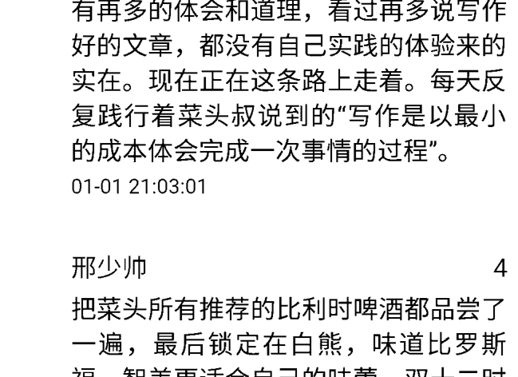

## 用户留言

- 和菜头
  - 38
  - 沙发！
  - 01-01 20:30:03
  - 作者回复
  - 新年快乐！
  - 01-01 20:36:17
- 顾广
  - 35
  - 菜头，北京看见你了
  - 01-01 20:38:32
  - 作者回复
  - 回去
  - 01-01 20:40:01
- 一格
  - 10
  - 很实用的一篇子文，其好也说过一类极佳的道理，学习只是看些书翻看只是机城的某些知到西手，学西东西能不能天，有时候你要实际动手去检验一下看你有没有真正的在操作的过程中体验出来。我们有时候只是单独的学去学，机而忘了学的目的是什么？这种机械的学习方式必须果断的摒弃
  - 01-01 20:52:06
- Justin
  - 9
  - 和菜头，我发现头家伙是在告诉我们自己去看是情情，而这一切都是我自己去琢磨和体验，渐渐的去享受
  - 01-01 20:40:48
  - @元旦快乐
- 克拉克
  - 4
  - 去年一整体的体会到知识本身是最易复用的，和技术和经验都是属于个人的。去未来开始了好不容易的过程。前有再有多的体会和道理，看过再多事好的实体，而发自己没有实践验验体会的实在。现在在天天条路上写着。每天反复体会着去完成大事情的过程。
  - 01-01 21:03:01
- 而少帅
  - 4
  - 把某书最有推荐的比利时啤酒都品了一遭，最后都变成了口味，啤酒品成了啤酒两杯。偶尔闲无事事的时候上周一下，之前经常喝重啤酒的啤的习惯变了，越来越重品酒质，推荐给身边多的人
  - 01-01 20:56:48
- Head
  - 2
  - 苹果真真的好，哈哈，在设置那里
  - 01-01 21:18:13
- Felicio
  - 2
  - 念着看到刷机械城体验，作为新年给自己的第一份礼物，学会花钱，才会更容易的钱！昨天新解中问到你怎么吃吃饭，那个机械城体验，问我去都去看，那个不有看到你的年度清单，就想着体验的，感谢你的分享和你的同路走这一下！
  - 01-01 21:05:39

# 选择的烦恼

我上中学的时候，有一本叫做《外国流行金曲100首》的书，同学几乎人人一册。内容在今天看来完全不可思议——100首欧美流行音乐的简谱和中英文歌词，曲目的选择也没有什么道理，从披头士的曲目到美国乡村音乐都有。用今天的话来说，这就是一份音乐网站的歌单。

在成长的过程中，我反复反复想起这本书，想起这首歌单。现在看来，当时编写这本书的三个编辑，他们的眼光，他们个人偏好，决定了一整个学校的学生听什么，乃至于全国家中学部的学生听什么，这是不可思议的事情。外世界之大，但是通往那个世界的门径却有几个门看守着，成千上万的人需要仰赖那几个人的选择，无论如何说也不能算是合理的事情。

我认为不需要这样的门卫。选择权应该放在每个人手里。在个人和世界之间，不需要也应该没有中间代理人。每个人有直接接触这个世界，直接获取自己想要的东西。

如今我已经年过四十，早已经不再那么想了。相信无限的选择肯定是错的。但是，人们有意识的选择未必是好主意。因为有无限的选择对应着无限多的时间和无限多的精力，否则，一个人无法从无限多的选择里找到自己想要的东西。因此，拥有无限的选择未必意味着幸福，它很可能是人们无所逃避的负担。

想—想，全世界到现在出版过多少本书？拍摄过多少部电影？如果是靠人去筛选，一个人一辈子大概也不能看完所有的书，所有的电影。提交一个个人书单，一份个人电影单。但我们还是在看着，电影，甚至可以到拥有海量商品的淘宝里准确地找到我们想要的东西。那么，我们做选择的依靠是什么呢？

我们依靠两件事情：自己主动搜寻和他人被动推荐。前者是靠个人努力和尚人的贡献，后者需要仰仗他人的熟人和朋友。每个人都在试图认知这个世界，世界是一个巨大的存在，而每个人手里都有一块自己搜集的世界碎片。个人的碎片虽足经重，但是无数个碎片彼此交换，那么哪怕是一个人个体，也能够拼凑出一个远远超过自己搜集能力范围的广大之远这就是人在信息世界里徜徉的好处，随处可以发现别人提供的碎片，用于拼合自己那—块，于是，个人的世界边界就变得全面很多，发现了更多有价值的东西。

不过，我认为这种方式属于30岁前的一年。在这段时期，一个人最需要做的也就是广泛地接触世界，在信息的海洋里恋爱漫游，享受拥有无限多选择的好处。不过一但到了这个阶段，继续游弋倒成是一种浪费，而且，这趟在漫游的过程里已经失了自己，根本没有找到属于自己的认识世界的方式，没有自己的审美，也没有自己的眼光。说到底，漫游的效率太低，只适合没有工作生活压力的成年人。

我们在世界里徜徉的时候，每分每秒都在筛选。看起来我们是在筛选信息，本质上我们在筛选人。因为在这个世界上没有任何信息不是依附于人的，总是世上的发现，某个人的创见，某个人的分析。判断哪些信息有价值，其实是在判断哪些人有些价值，哪些人多余的信息更适价值。确定了这些人而这些管道的存在，我们再不必大海挑时浪费在浅海上，而是利用这些人向特定进行认识交流。这样，我们最终从无足的选择中解缆出来，终于有了自己的时间。

上一篇《豆瓣电影评分的问题在哪里》发布之后，许多人不认同我的观点。认为基于关注者和陌生人组成的社交站点发现和筛选信息，会阻碍个人发现世界。如果持有这种观点的是那些年轻人，那么我深表遗憾，因为总有那么多人坚持在路上，还在美好的探索和漫游之中。但是，如果这样的读者都已经人到中年，那么我就觉得有些徒劳，因为到了那个年龄，还在信息的海洋里漫游，根本没有自己的人际信息处理网络，那么，这分明是在浪费时间当对是一种充实，在无限的选择中迷失了自我。

最后，说到我自己，我并非严格意义上的陌生人。事实上，选择力门间的专栏，就是在选择丰富这个人。每一次推荐一本书，一部电影，甚至是讨论个话题，我都在减少大量冗杂的选择。我不做做。但这半年的时同写下来，我觉得做得还不错。和我读书的时候相比，我并不算那种信息的守门人，因为现在是到处都风。但是我是一个过滤器，在我身前是海量的信息，在我身后则是过滤后的有保几条。而且，还附上了我的思考和分折，用它们可以破除大量看似优秀的观点。

所以，在2016年刚刚结束的几个小时里，我想说一句：不客气。

> 和菜头
> 请相信我，
> 我所说的每一句话，都是错的。

你的选择构成了你的2016年，现在，可以考定一下，你要选择怎样的2017了。

## 用户留言

- 和菜头
  - 沙发！
  - 01-01 19:09:12
  - 作者回复
  - 新年第一步：今天双爽。

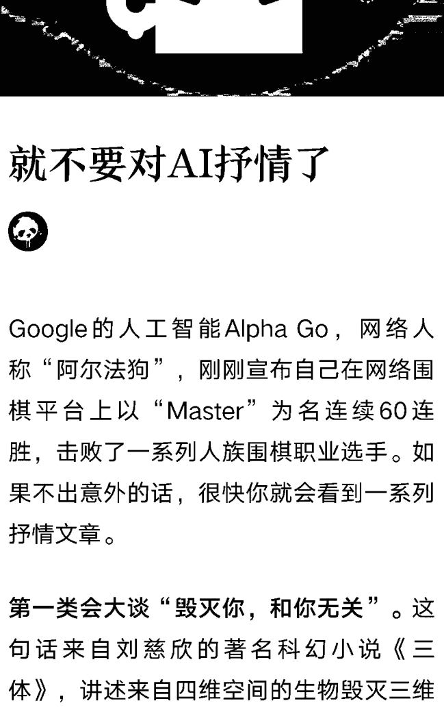

# 就不要对AI抒情了

Google 的人工智能 AlphaGo，网络人称“阿尔法狗”，刚刚宣告自己在网络围棋平台上以“Master”为名连输60连胜，击落了一人系列象棋职业选手。如果不想意外的话，很快你就会看到一系列抒情文章。

第一类会大谈“毁灭你，和你无关”。这句话来自刘慈欣的著名科幻小说《三体》，用来表达宇宙间生物相对渺小空间的情绪。它们只不过是投下一个名叫“二维”的东西，三维空间就瞬间破碎，毁灭了里面所有的生命。对于它们而言，这只是做了一件微不足道的事情罢了，它们甚至根本没有考虑到那些生物的生分和毁灭问题。

这是阿特，和阿尔法狗没有什么关系。是的，阿尔法狗并不在意赢棋，因为它没有这种意识。对它来说，下一盘棋无非是完成一局任务，按照围棋规则，每一步选取最优先策略或优先策略，确保最后能用棋子围住最大的棋盘面积。在这个意义上来说，阿尔法狗比一个有脑子的围棋师更接近于它的境界，远远摆脱了胜负师的渺小心态。

阿尔法狗没有什么人格，人格都是人类赋予的。所以，它既不冷，也不酷，甚至到现在连弈者棋手在棋上是否都困惑，都是人类将意义赋予它。毁于一旦，这都是人类自己的情绪投射，和事实没有任何关系。

第二类会感叹“人的尊严”。弄得好像人工智能击败了人族职业选手多么不体面的一件事似的，以至于棋士丧失了某种叫做“尊严”的东西。这种感慨其实大可不必，人类并不是一次败在机器手下。美国短跑运动员当年曾经被蒸汽火车头比速度，败了，惨就在那儿了，汽车会为这人感伤而难过？谁能看见？要想体会这种伤感很简单，任何人重找台计算器，无论是电脑上的，手机上或是菜场里的实体计算器，和它较真一下做开根运算，可以立马哭成泪人。哪里需要热泪盈眶到今天，等阿尔法狗来刺激泪腺呢？

事实上，阿尔法狗的胜利，帮助人族找到了尊严。不是单是在贵人类个领域中的地位，而是中国人家对围棋的研究和发展，都是基于大量能够的经验积累的战术，脱离固有的经验，从新的维度思考一下围棋，无论是背定式的还是此进进行演变，始终都是类似的实验思维进行演绎，阿尔法狗的出现，带来了全新的思考方式和主要的工具。在过去，人族棋士执方“厚型”、“定式”的棋感，人阿尔法狗的“手段”，却散发着异端的魅力。这就迫使人族棋士重新思考对弈的方式，对于围棋的理解很快会突飞猛进的发展。

对于棋手来说，获得这样的进步，才是最大的尊严。所谓武道之心高于一切，这一点是抒情者永远无法追及理解的。

第三类会探索“AI的智能”。这里存在着广泛误解的误解，把AI视为一种存在整体。只要是设置了程序参数，AI就会如同地球的生命智能工程一样，从低能智慧自发地演化为高智能，最后超越人类，成为一种人类理智力所不能覆盖的存在。这是一个科幻小说，或者抒情哲学，是一个令人愉快的说法。但是，作为一种科技力量，这种理解是失偏颇的。

阿尔法狗的运行方式本身，就是人类关于机器思考概念化的结果。最早人类的做发类似于在围棋上让计算机一步一步的变化可能。可是算法复杂度远远超过计算机允许的计算速度。后来，计算机科学家改变了想法，让计算机模拟人类的神秘系统，从一个简单的判别开始，演化出复杂的多重神经网络。让计算机不会自动去分析，从简单判别开始到单个神经网络，从单层简单网络升级到多重神经网络，并且自动加上各种算法。

# 回锅肉里的味觉密码

据说，评价一家川菜馆子的水准如何，只需要点一道回锅肉就够了。我想，这和回锅肉的正宗与否就有关联了。比如 “永字八法” 一样，写一个永字就已经包含大部分汉字的书写技巧，可以衡量一个人的书法水平，回锅肉评定的是一位川厨对刀法基本功的掌握程度。如果回锅肉都做不好，其他的川菜也就不值得你抱希望了。

做好一道回锅肉并不容易，中间需要注意的环节非常多。以食材的处理为例，肉需要先煮，又不能煮得全熟。判断的标准是用筷子插一下。煮好之后温度太高不好切，还不能完全放冷，否则就算刀工再绝，切出来也会一块块淤。所以，得先在冷水或者冰箱速冻室里快速降温，外冷内热的时候才最好下刀。

以火候为例，回锅肉的标准说法不是 “炒回锅肉”，而是 “熬回锅肉”。一个字之间的区别，说起来实在是一篇大文章。首先，冷锅下冷油是绝对不允许的，这样锅热之后，油温已经油了。泡沫锅的同时放下少许油，油温这些均与涂抹锅面，铲掉这部分油，重新加入稍多一点冷油，再下肉片炒。

然后，熟肉切片之后放置一段时间，就会粘连在一起，很难炒开。强行用锅铲炒散，则会造成极难分离。等油温升高，又极易造成粘焦，肉质发柴。所以，在之前的烹饪里面裁下了回锅肉，肉片要下锅之前，倒入汤里来一下，再用漏勺捞出，沥一下水再下锅炒。这样，肉片带着水分，片片分离的同时，也能在高温下保持鲜嫩，避免变焦。

最后，肉片用中火炒一会儿，开始出油并变成花瓣形的时候，放入豆瓣酱，甜面酱，酱油继续加热。在这个阶段，就已经不是炒了。可以放 “熬” 了，利用油温，料煮非香，所以叫做熬，不是炒，是油和酱料共同熬制肉片的过程。而如果理解为爆炒，或者油爆，做出来的东西都完全走样了。理想状态就是：肉片在锅里用老干煸炒至卷曲，再放入酱油，让肉片充分吸收酱油的味道，这就是 “回锅” 的精髓所在。当然，也有人喜欢用老干妈或者豆瓣酱来炒，这属于个人口味偏好，但 “回锅” 的核心在于肉片的回香，而不是酱料的直接覆盖。

有意思的是，上面介绍了所谓正宗回锅肉的做法，但是在回锅井中，最常见，是一种叫 “大酥菜” 的做法。除了蒜苗回锅肉的作法，其实还有土豆回锅肉、莲白回锅肉、薯粉回锅肉、蒜苗回锅肉、荞菜回锅肉等等不同的类别。每一种回锅肉都有各自不同的搭配，而且都承认自己是回锅肉的一种。感觉就像是厨房里来的人不同，根据不同的时令，从自家厨房里扒一块蔬菜，就能做出一份回锅肉来。

不管是回锅肉里有什么选择，连带调料也会有不同的变化。有的人会在回锅肉里放豆腐，这样会加大酱油的酱香性，并且口感酥烂。有的人会吃惯老干妈豆瓣酱，也爱吃老干妈酱，豆瓣酱里加入的豆豉，让回锅肉更添一丝豆香。有的人会放入大蒜，在大锅烧得滚烫的时候，放上蒜片，让回锅肉更添一丝蒜香。有的人则喜欢用姜，让回锅肉更添一丝姜香。

所以，单是回锅肉的不同做法，就已经是够写一本书了。看到这里，不禁要问一句：究竟什么是回锅肉？似乎一道回锅肉的所有东西都可以被替换，都可以重新排列组合，那么，所谓 “回锅肉” 这个名字还有什么意义呢？

如果我们仔细看看上面的各种回锅肉变化，发现无论怎么做，无论什么酱料，总会有几种固定不变的东西：油、豆类、动物蛋白、植物蛋白和盐。无论是肉还是排骨，也无论是哪个部位的肉，都含有油脂，也就是动物蛋白质。不存在素回锅肉，没有肉类就不是回锅肉一把，植物蛋白说的就是豆子，无论是豆瓣酱、豆豉还是酱油，本质上都跟豆子发酵之后的产物。无论如何，回锅肉一定会使用到各种豆制品，也就是植物蛋白。没有这种香，也就能产生特殊的酱香。没有这些酱香，也就没有回锅肉。唯一勉强算得上例外的是甜面酱，回锅肉里加一点甜面酱能够提色，但是甜面酱当然不是黄豆，但也依然是植物蛋白。

这就是回锅肉里面隐藏的味觉密码。想想啥好一个中国胃需要做些什么？回锅肉明确告诉我们：它喜欢 “油脂和酱”。这就是为什么神州大地处处是油，家家都是这个原因。老干妈永远名列调味品味第一，它的本质就是让了加香油的调料油。即便是以清淡口味著称的粤菜，砂锅虾蟹煲上来，也一定需要一份永丰黄豆瓣；清蒸鱼最后要放豉油，它是粤菜餐厅厨师的不传之秘，但是主要成分还是酱油：生抽和老抽。只是两者的种类和比例，厨师永远不会告诉你。甚至有读者曾经留言告诉我，他的老妈六十多岁时，菜白来肉的时候加酱醋，认为这样做出来的白菜才最好吃，简直像得上瘾了。

最后一个问题：油脂和酱当真有那么好吃吗？我觉得在过去的无盐无辣中，获取油脂都不是一件容易的事情，而以酱油本身，所以哪怕是入类的身体本身，也喜欢摄入油脂的感觉，这写在DNA里的偏好。而油脂和动物蛋白在获取方面的艰难，所以中国人用蛋白质土赶起来大量的时间精力，发展出了一套完备的酱料制作方法。在没有动物蛋白的时候，可以用植物蛋白顶上，而且味道还不错。所以，未必真有那么好吃，但是我们已经写在了习惯了，这就是所谓 “妈妈的味觉”。

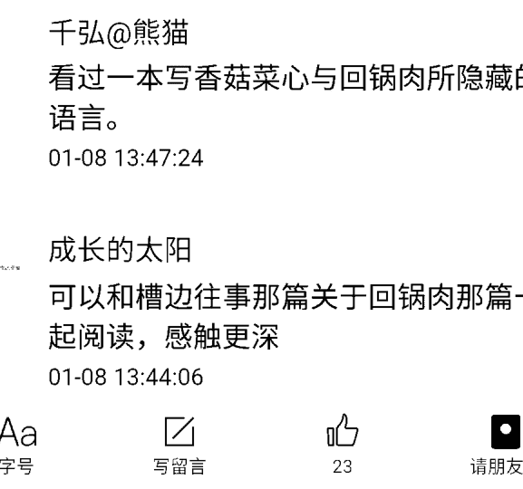

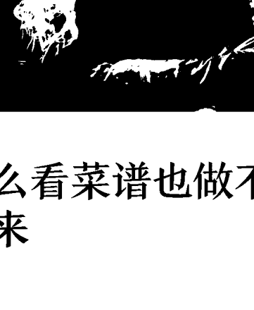

# 为什么看菜谱也做不出好菜来

和菜头

许多人觉得自己不会做菜，或者做不好菜，原因是没有找到合适的菜谱。我在网上写过一些家常菜的做法，于是他们就跑来询问我：菜头，请问你用的是什么菜谱网站，或者什么菜谱APP？我这个人反应又比较迟钝，像这样回答了几年之后，在今天才终于大彻大悟，明白了问题出在哪里——

对于他们而言，菜谱并没有多大用处。

这么说法听起来让人很奇怪，难道菜谱不就是用来教人做菜的，但是，教的是我这样的人。而且，对于我这样的人来说，看菜谱不是为了学习，而是为了查阅。

认为看了菜谱就会做菜的人有两类，一类是一直在做菜，始终做不好，这样的人相对少一些。另一类是突然之间想做菜，完全没有任何基础，就想端出一盘菜闪瞎所有人的眼睛，这样的人非常多，而且天天都有。前者的问题是没有天分，对于厨房完全无感，无论在厨房里投入了多少时间，厨艺依然是四分五裂，乱七八糟的。他们无法理解烹饪究竟是怎么一回事，也无法从既往的经历里总结出任何经验。但是，他们有一整套把菜做砸的技巧，每次都用类似的手法毁掉一道菜，丝毫没有任何知觉。所以，他们寄望于一本好的菜谱，认为只需要按照里面的步骤操作，就可以做出一道好菜。

等到他们上手的时候，对食材的处理是他们习惯的错误方法，对火候的理解还是他们错误的理解。也就是说，操作手册换了，操作手法依然是错误的，自然得不出正确的结论。对于这样的人来说，无论换多少本菜谱，做出来的东西都同样难吃。

第二类人的问题在于，妄想在零基础的情况下实现速成。任何一个能烧一手美味家常菜的人，一定有儿个特点：

- 1. 多年来一直对菜肴有兴趣，无论是在哪里吃，无论吃什么，第一时间条件反射式的想法是去琢磨这道菜是怎么做的？食物才放下舌头，大脑就开始自动分析为什么调味，又用了怎样的流程，先放什么，后放什么，用什么手法和火候烹饪。
- 2. 要么经常花时间和精力观察别人如何做菜，要么一直有自己做菜的习惯，甚至是从很小小时候就已经开始下厨房。这个人的双手事，被油烫过，被刀割过，被蒸汽灼过，被辣椒和葱头垫过。因此，他对食材的物性，调料的作用，各种烹饪方法的效果，拥有丰富的经验。

这样的人才真的需要看菜谱。原因是他需要在动手之前，再次确认一遍食材和调料，以及整个烹饪的过程，这个印在脑海里再做一遍，然后带着这个印象在厨房操作，确保烹饪的过程中不会出现任何严重的错误。

对于那些零基础的人来说，他们就像是一个未经任何训练的平民，妄想翻阅一下飞行手册，就可以把一架飞机开上天，而且还得玩几个漂亮的动作。菜谱就是厨房里的飞行手册，零基础的人看到的是中文而已，看懂的也不过是中文而已。居家能手看到的却是具体的火，具体的锅，具体的食材在具体地发生着变化。

这也就是为什么近年来烘焙流行的原因——和中餐相比，蛋糕糕点照个人发挥和判断的空间小得多，更注重按照流程执行。同样是花一个小时，按照菜谱做出来的中餐很可能是个灾难，但是按照菜谱做出来的烤蛋糕则非常可能卖相不错，吃起来味道还过得去。想要获得个人成就感，在朋友圈刷一下自己的作品，还是烘焙的成功机会更高。何况，还可以用漂亮的袋子和丝带加以装饰，而萝卜雕花则困难得多。

世界上没有什么成就是以速成的，花了多少心思，花了多少时间，就会有成少成果。想到这一点，我低头看了一下自己伤痕累累的双手，突然觉得很欣慰。

和菜头

请你相信我，

我所说的每一句话，

都是错的。

看看操作手册就上手的人，岂止是在厨房。

# 小程序来了，「得到」怎么办？

今天微信正式发布的小程序，看到这个日子是因为在10年前的今天，乔布斯第一次推出了苹果手机，从此掀开了移动互联网时代的大幕。微信官方公众号以此向乔布斯致敬，也用这种方式表达了对小程序的期许，希望它能彻底改变互联网应用的存在方式。

小程序是什么？简单说，就是把手里的APP浓缩到微信里来。点开即用，用完即走，无需下载，无需安装。事实上，小程序是一种特殊的网页，你可以把它理解为微信里的网站，每个网站对应一个APP，或者一家商家商店。最通俗地来讲，就是每一个二维码，对应一个小程序。

在过去，当你得知一部电影上映的消息，如果你想着去一下它的豆瓣评分，那么，要么用电脑打开豆瓣的网页，要么用手机浏览器访问豆瓣，要么下载一个豆瓣的APP。有了微信小程序，你直接点击小程序，启动“豆瓣评分”这个小程序，就可以直接查看电影的分数了。

在未来，现实世界的每一样东西都可能有一张二维码。你拿出微信扫进二维码，就可以激活它对应的小程序。如果是一家餐厅，小程序里可以点外卖看菜单等等情况，并且可以留下购买评价。如果是一幅画，小程序里可以让你看到画作的评价，作画人的生平，甚至购买画作的复制品以及衍生品。

所有这一切，都无需下载APP，直接在微信内完成。因此，我把微信称之为“魔法”：

> One Ring to rule them all, One Ring to find them, One Ring to bring them all, and in the darkness bind them.

未来未必如同预料，不过在现阶段而言，微信小程序对于线上工具类的APP而言，算得上是一种非常特殊的武器。纯工具，单一功能，很容易在微信里做一个功能类似的APP。自己在做微信里做竞争小程序，而对于用户而言，不使用内部使用相同功能的小程序，无需下载APP，专门找寻觅使用方便的工具。所以，它会使这些APP失去吸收用户的意义。

对于非工具类的APP，同样也会收到类似的冲击。此时，APP的开发者们就面临一个选择：究竟是坚持使用自己做的独立APP，还是加入微信小程序？这是一个非常痛苦的选择。坚持独立，随着获取用户成本越来越高，和小程序的分流，APP面临着枯竭的危险；投入微信的怀抱，意味着用户不再是自己的用户，自己所做的一切事实上是在服务微信的出口。如果有一天微信的是策略改变，或者运营中遭遇变故，也许会一夜之间失去所有。

自然，人们也会问同一个问题：「得到」应该怎么办？

我个人认为，微信小程序对「得到」的影响并不大。这是基于以下几个考虑：

- 1、内容的唯一性。「得到」不同于天气预报、航班查询、空气质量这样的APP，它的内容可以从很多渠道获得。可以在APP里看，那么就一定能够在小程序里看。但是「得到」的情况完全相反，独家授权的内容并没有别的出口，也很难在别的地方简单获取。所以，内容对于「得到」而言，构成了APP存在的护城河。
- 2、功能的复杂性。现在即便要把「得到」迁移到微信中去，由于「得到」功能非常复杂，有电子书，有商城，有社区，有音频，还有专栏订阅，那么也让「得到」的小程序变得空前复杂，并不利于用户使用。而且，因为这种复杂性，在APP里才能获得更加流畅快速的使用体验。
- 3、「得到」自身抽象生态软件。在定位上，「得到」是一款终身学习软件，位于内容生产的食物链顶端。基于终身学习概念，引申出了系列产品。在产品之下，是用户每天上下游倾听音频产品的习惯，是用户定期举办线下聚会的风俗，也是基于共同意愿的用户彼此交流，互赠无上之快乐。因此，一个用户在「得到」上会获得一套和陌生人共处的生活方式，这一点和微信的熟人关系紧密圈并不能完全相容，而且越是独立越强参与到参与感相应认同，也是产品粘性所决定的。
- 4、目前，小程序更适合工具类和服务类的APP，而不是内容类的APP。

综上，一个产品越是独特，功能越是复杂，生态系统越是完备，也就越有做APP的必要。在微信小程序的冲击下，受到的影响也就小。微信的使命是连接一切，这里的一切“在我理解是那些不会在比特海里沉淀的大陆或者大型岛屿。而对于「得到」而言，它已经是一个相当大的岛屿了，而且，正在朝着新大陆继续发育。

## 和菜头

请你相信我，

我所说的每一句话，

都是错的。

小程序创业、流量杠杆关系不大，它更像是技术和产品的一次革新。

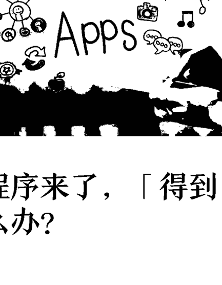

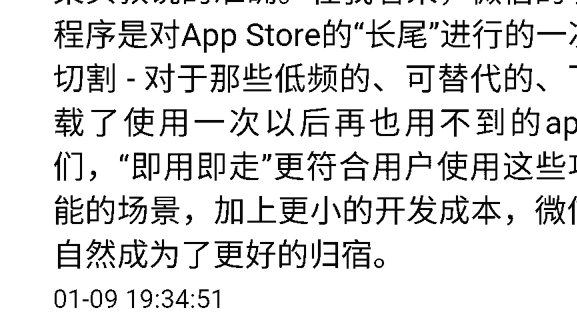

# 我的政治观

微博上有人问我：

菜头叔，我关注的几个有思想的V里，很多人的言论或多或少都有一定的政治痕迹，比如大咕咕咕鸡，叫车，邦沙龙，向唐，政治通常属于它们，更是经常关注很多热点，但解读的角度似乎很少有“敏感”性，言论中“你国”“小粉红”“U型锁”更是常见到，说你是“五毛”吧，但却和一些“公知”打成一片，说你是“公知”吧，看你对待云南不允许其他人批评的态度通常体现出你爱着这片土地。而你的观点通常属于小众，说得不够尽兴，客。那么菜头叔，你觉得自己属于“左”“中”“右”的哪一种？为什么你的文章和言论更多的是对愚者众的批判和对生活的热爱，而很少有对当局的看法，是刻意回避，还是不喜欢？

我是这样回答他的：

嗯，一个很有趣的观察……

让我想想，应该怎么跟你讲清楚这件事情……入河过之后，就会彻底忘记站在河水那一边时候的心态，让我努力回忆一下……

是这样的，无论左派还是右派，这些年里我都认识很多人，打过交道。我一路看着爱国贼变成五毛，五毛扩大为小粉红；我也一路看着文人变成公知，公知变成带路党。我更看过公知阵营内的一次次分裂，一次次撕破、绝交、相互揭露。从同声连坐到各自表述，从誓死捍卫你发言的权利到变成兄弟各占登山，直到最后变成老死不相往来。

总体来说，这是一个逐渐失望的过程。

你知道，当你年轻的时候，你会天自然的接近持有某种价值观的人。这和你个人的见、经的，教育水平有关。你希望你的想法是对的，但是又不那么自信。所以，我希望能找到和我想法一致的人，大声说出你想法的人。然后，你就会发现网上有那么多一群人，他们说活你爱听。在这样的群里，你获得了认同感，你坐得舒服，你得到安全。

然后，你开始不理解，为什么那么明显的表示，却偏被另一帮傻逼不能理解，甚至表达完全不能接受。很快你就会发现，当两派发生冲突的时候，因为怒气加大的原因，争吵规模越来越大，于是你对“自己人”的认同度越来越高。而在“自己人”内部，相同的价值观被一再重复强化，成了一句口头的真理，于是彼此都成了一种格格不入的“政治正确”。

这样过去一些时日之后，你呆的时间越长，你就越有机会接触到“自己人”的核心部分。于是，你就有了机会可以从近距离去观察他们。同时，你也在社会生活中存在了很长时间，你开始认识到除了理想、信念、抱怨之外，一个人还需要生存，在生存的基础上拥有生活。那么，你肯定会很自然地去观察别人除了口头上宣讲的理念，私下里是如何生存的。

当这样的观察开始，你就会做出一种人群的两分法：无论公知还是五毛，他们都是场面人。上海话叫白相人，在我的理解里，是以媒体形态生存的人。剩下的，是普通人，需要每日的劳作剩下，不能靠言论和文章为生。如果你当时，你的个人学习还在继续，那么迟早会遇到一个观点：媒体是观念的军团，你还会接触到这个概念：唯有在遥远的古代，一个思想家的想法和他的生活是一致的，其他想法，如何生活。但随后，教授思想就变成了一种谋生手段，一个人的思想和他的行为可能是完全割裂的。

所以，当你从“为何为生”的角度去观察的时候，你既往的观念，和你所坚信的理念，就开始分崩离析了。因为你接触到了生活的真实。我们把世事情该如何，称之为应然，把事情真实，就是如何，称之为实然。生活的真实，是实然的。它比应然丑陋多了，坚硬多了，也残酷多了。

媒体是观念的军团，所以，你所看到听到的，都是应然的。但是，你自己生活在一个实然的世界里。最关键的，是那些宣讲应然的人。在实然的世界里，有另外一副面孔。知道吗？去年因为疫苗事件批判我的一堆公知里，有许多是吃饭的人，而我靠我自己养活自己，但这些吃饭的人，在大骂五毛。他实际上是拿着体制内人民币，但不说自己是五毛，这叫动所得。我自己养活自己，没拿体制的钱，也没有公职庇护，公费医疗，而我却成了五毛。

他们所能理解的是，无论批评我是公知，还是批判我是五毛，我都很不在乎。他们理解不了这种不在乎，以为我会非常珍视我的政治坐标。可惜的，我早就不再排队，也不在公知队伍里，也不在五毛的队伍里。事实上，我觉得他们的存在就是互相消解。从“指着你吃”这个角度分析，公知和五毛是唇齿相依，唇亡齿寒的关系。这是因为所有观念的军团，都需要树立一个敌人。没有敌人的存在，自己也消亡了。

这就解释了为什么一段时间之后，五毛就要出一个公认名单。五毛不能没有公认，没有公认的存在，他们也解自己的存在使得没有意义了。同理，他们解释不了为什么吴法天会从一个籍籍无名的教师，在微博上通过公认大大的批判，越来越红，最后也成为一个大V。事实上，他之所以受到关注，完全是因为公认不断攻击所造成的结果。公认需要吴法天，需要庆乐东，需要个靶子，否则“自己人”就散了。

我们再从现实的角度去分析一下：公认对社会现实有任何改变的能力么？五毛对社会现实有任何改变的能力么？没有。他们是观念的军团，但不是现实的军团。所以，双方都需要吸引关注，都需要关注来滋养自己。他们的本质都一样：对现实无能为力，又需要现实养活。

那就要问一句了，既然他们都对现实无能为力，那么自己又该怎么办？答案就是：仰仗自己。五毛和公认都不能改变你的处境，因为他们都不能立法，也不能征税。你听凭他们的高论，该你搬的砖还是得你去搬，不会少一块，搬一块也不会多一分。

你并不活在五毛宣讲的天堂里，你也没有活在公认宣讲的地狱里。你活在你的生活里，活生地，日复一日地。有那么多令人不满意的地方，也有那么多让人感到珍稀和喜爱的地方。你不能改变社会，但你可以有限度地改变生活，改变自己的境遇。明白了这一点，那么，你迟早会理解我今天的选择：

我对抽象的人民共和国全无兴趣，我的能力只能覆盖我身边的有限亲友，最多到我的一点读者，他们是具体的人，存在的人，可以感知的。我能做到的，是点对社会有责任，有件事，提升一下自己的生活素质，以及，探索一下这个世界。我有我的人生要过，我不想我的人生变成别人观念的战场。同时，我也不寄望世界和社会会发生什么改变，而且这种改变就一定有利于我。我不抱幻想，幻想它们会听从我的想法，会为了我和改变，会为了我们而改变。

没有什么我们，只有我。成为“我们”才需要选择左或右，成为“我们”才需要向“我们”不断明确自己，才需要不断征战敌人，才不会斩过幻想在这个过程里爸爸会因多看着自己一眼。我就是我，在爸爸已经死离去的代年里，只能自己做自己的父亲。

希望我回过你的问题了。

## 和菜头

请你相信我。

我所说的每一句话，

都是错的。

不站队，不依话，不攀缘，一个人也能在这个世间活下去。

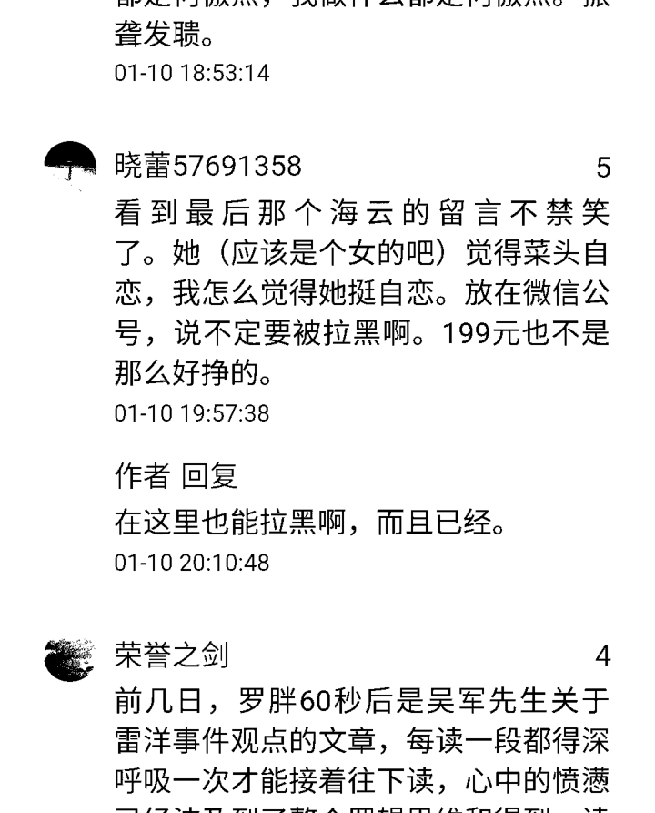

# 个人的黄昏——《未来简史》读后

昨天说不花闪送了一本《未来简史》给我，说是亚洲版20本之一，当天就看了一半，今天早上7点爬起来一口气读完。

在你和我聊我的读后感之前，如果你刘作者尤瓦尔·赫拉利不是很熟悉的话，我建议你翻一下我的专栏，我于去年7月31日我发表《封楼前读〈人类简史〉读后》。今天我要读的《未来简史》是《人类简史》的后续，两本书在内容上有前后衔接的关系。

《未来简史》的正文部分一共361页，一共分为三大部分，十个章节。我个人建议你先读第三部分〈智人为我控权〉，读完之后，趁着自已目标呆之之际，回过头去阅读第一部分《智人征服世界》和第二部分〈智人为世界造意义〉。

这么做的的原因是：作者瓦尔·赫拉利是一名历史学家，但是他和其他史学家不同，他的著作里提出了看待世界和历史的新视角，为了让他的视角更具说服力，他会从极为遥远的过去一直论述到他预见的将来，引领读者按着他的思路走一遍。许多人慕名而来，为的是作者用来预测未来，但未必有体力和雄心跟随作者纵横于千年人类历史。

所以，先看结论性的第三部分，然后倒回去看作者何以得出这样的结论，是一个比较省力省心的阅读方式，请不要担心阅读体验的完整性，相信我，这本书你放心不会只读一遍的。

《未来简史》延续了《人类简史》中未尽的一个话题：人类的最终目标，将会人类变成神，成为神。永生的概念听起来非常荒谬，在《未来简史》，用了一个整章节去人类生类写的历史，认为在过去无数世纪之中，人类全力奋斗的目标就是消除饥荒、瘟疫和战争。

如今，这场漫长的战役已经取得了胜利，人类的目标从外部世界转向自身，谋求永生是一时间将也是必然的趋势。

但是，永生并不是一个努力的结果，一旦开始思考达到永生，这个概念就重新开启了一系列的新问题：我们是谁？我们是什么？什么是新世界？是否存在自由择择？是否存在所谓的“自我”？

这样的问题在以前是几乎无解的，但是拜生物科学和医学的发展所赐，人类对自身的认识正在发生并存远的进展。我们几乎可以肯定并不存在自由择择，科学验证我们做出选择前的那零点，大脑的神经活动事实上就已经先于我们做出了选择。

消弭了所谓自由择择的存在，那么人类自身的智能将归结为神经经路的算法，人类的意识则归约为大脑皮层受到的不同刺激、欲望和感受。如果不能受到不同刺激，可以认为改造。推导到此一步，人类事实上就已经远离从云端铁索的边缘不远了。

因为计算机的算力远比人类强大，在无疑的智能领域，凭算力，一旦这个过程开始，计算机在智能上所能达成的成就，可能会完全超乎人类的想象力，哪怕是编程法律程序的那些技术人，也同样对此一无所知。

在另外一个方面，人类的意识既然可以控制和凭空改造的，也就意味着可以用技术的力量改造人的欲望，意味着人的能力无限大。这使得彻底覆了人类立基以来人类社会的基——平等，拥有更多金钱和权力的人，可以对自身进行更多改造，从而拥有更强的能力和更长寿命。同样，他们的子女也因为出生之的优越，有了个平足弟永远不会可能得到的优势。于是，人类社会将会变成从小精英团队对大众社会的永久性统治，一群小超人对于一大群普通人的永久性统治。

剥离了人类特殊性之后，我们就可以用另外一个角度审视人类的历史。人类之所以能够夺取整个球，乃是因为人类拥有语音、文字、图片可以快速地交换信息，利用人际网络和通信网络去协同一致的行动。本质上来说，人类就台协作的计算机，因为人类算力超越了球上所有动物算力的总和，所以，人类成为星球的前主。在过去，人类存在的意义是成为人类自身需要，需要人口协同工作，大量人口从事生产、战争、建造。

但是，随着计算机技术的进步，大部分人口会逐渐成为无用价值，人类的整体作为物种将消失于存在的价值。但是早个社会失去的存在意义。计算机和计算机控制的机器，想让人类能够更好地，而且更少犯罪，妄想自动挡警替代多少司机？想要自动检索替代多少文员？

在尤尔，赫尔利笔下人类黯然无光的未来里，少部分人和计算机形成的联盟会形成与少数人的群体。在那个世界里，你和在，我们可以想象人向各个角落的信息洪流里，我们不过是数据暂时的宿主，它们终将越过我们而去。

此刻，是我们最后的荣光。

基本上可以确认了，尤尔，赫拉利是一个埋伏在以色列颜色大卫里的新教教徒。他对我，对于意识的认知，更加符合新教的观点。

- 和菜头
- 沙发了！
- 作者 回应
- 未来未来！
- 上善若水
- 所以概率会不会成为像笑话一样的必备技能呢？
- 阿蝉
- 如果真实真的如书所说，那我最关心我这本书，除了给我感到深深的绝望之外还有什么意义？
- 作者 回应
- 现在门还未有一条线
- 三维世界的蚂蚁
- 人们都无未来多么的恐惧 任何一件关于自己将死 所以可以满足安全感极度缺失 的望不被淘汰的人群
- 陈钰七
- 我认为赫拉利的观点过于悲观。他似乎关注的未来不怎么样，因而预期前景更加糟糕。

# 那些难吃的蔬菜

网上每年都要评选“最难吃的蔬菜”，来来去去不是鱼腥草、莴苣、茄子、芦菜、韭菜、香菜、葵蒿、苦瓜、胡萝卜这些东西。这些蔬菜当真很难吃么？对部分人来说，的确如此。

有些人天生不喜欢带有刺激性味道的蔬菜，哪怕你觉得很清香，在他看来就是怪味。比如说蒜蓉、香菜、韭菜就在此列。有些人天生不喜欢蔬菜的质感，蔬菜在牙床上的感觉令他难以不寒而栗。比如说白茄子、茄子——在我的小县城，水果白菜帮子每每令我发狂，就是因为咀嚼它的时侯，它会发出令人牙酸的声音。在我父母那里称之为“脆生”，而我这里则是地狱噪音。

不过，这样的人是少数。大部分跟风嚷嚷难吃的人，他们不过是家庭厨艺的受害者。

大部分人都有一种错觉，认为所谓“厨艺”这种东西是为了肉食准备的。烹饪蔬菜根本不需要任何厨艺，甚至会有“弄熟就好”的想法。

据我所知，许多人想到今天都是水煮白菜，而且倒酱油，最要命的是还用锅盖焖着焖，这种东西我在军队里见过，不是在食堂，而是在后勤部门。饲养员给猴猴里扔那么一勺东西，猪过来嗅嗅，得慢慢转身走了。

而在任何稍微有一点厨艺的人家里，炒蔬菜或者煮菜汤，不盖着锅盖是一个基本常识。因为一旦盖上锅盖焖个十几秒，翠绿的蔬菜就会迅速变色，就像是枯萎了一样。同样的，想要做到一碗碧绿的小白菜汤，用猪油炒一下菜叶，然后再注入沸水，不单颜色依然青翠，而且煮熟的度上快上许多。

从上面的例子可见，蔬菜同样需要厨艺，并不见得比肉食少。就像每年都能进入最难吃的蔬菜前三名的芹菜来说，芹菜真那么难吃？那为什么许多西芹，吃素菜的人愿意是点它开斋百会？西芹吃点？小你吃的时候甚至意识不到它是芹菜，当你是某种富含水分的脆脆蔬菜才吃的。那真正难吃的是什么？说的是水芹菜吧？

水芹菜富含纤维，是处理肠都是渣子。那么，做之前摘菜？是不是丢掉头选最嫩的一段出来？是不是还要剥掉老皮？还是用菜刀切掉直接老丝给清洗？如果用菜刀切的是老芹菜，纤细而韧，根本洗不出来怎么办？根本不管直接切好，全家拼拼牙咬。还是，把芹菜段泡好，放在冰箱冷冻室里，让它速冻，然后大火热油，放进去爆炒，利用骤冷骤热的变化破坏内部纤维？

取牛肉横切，薄刀之后横切，把肉片从筋连片上下来，然后切成丝。用淀粉或者蛋清清透过，干热板做酱，急火快炒素着，出锅前滴满一点生油。这样一盘青菜炒牛肉真的会很难吃？

再拿茄子说。许多人诟病茄子的原因是没番茄味，口感软糯。却根本不知道，茄子可以吸收一切滋味，吸收了味道的茄子和豆腐和鲈鱼一样好吃。在我的《顺边往事》书里，详细介绍红烧茄子的做法。重点不是很多茄子出在茄子中的水，这样茄子会吸收调料的浓度，自然也进入味了。但是，多少人无非是用煮或者煮的方式，烹出黑乎乎的一大块出来。当然不好吃呵，看起来都头皮发麻，怎么可能好好呢？

茄子用水煮或者蒸，甚至是拿个蒸子端进去放在煤气灶上烤，都没有任何问题。关键是后续处理的时侯，一定要调一碗好的调料，做成抹样。茄子熟了之后，用手工撕烂，这样大块表面，能够吸收更多调料的滋味。调料要放酱油、醋、芝麻酱、油辣椒，最后再得有一点蒜糖和大量的蒜泥。这样一来调料怎么在办不好吃？让调料汁渗透进去，怎么会不好吃？如果有心，可以在倒入调料之后，在茄子上撒一层生辣椒粉。用油爆蒜香加上黄米，然后放在茄子上。油辣椒瞬间转焦，辣椒的香味加上蒜蓉味，伴着腾起的甜味，闻起来都觉得开胃。

对了，这都还没算得上干煸茄子品种那种香扑鼻的做法。

说这些蔬菜难吃，那种植蔬菜难吃的人，我怀疑他们从小到大，就没有见过蔬菜在家厨房有过这样的待遇，而他们殷切的家长，出于健康的考虑，不断地往他们的碗里放出那些“精心”烹饪的蔬菜。这样的人，长大之后对蔬菜有好印象才是真正的怪事。

从根本上说，厨艺是家族传的一种，但是这种传传在过去被中断了。人们不禁忘记了做炖汤运，忘记了春节的一百多种风俗，也彻底忘记了如何处理蔬菜的手法。嚷嚷着难吃的人，在这个互联网时代可以很方便地搜出来正确的知识。而且从今，终止自己家糟糕的烹饪烹饪传承，让自己的孩子，以及孩子的孩子对蔬菜有正确的认识，对中国式烹饪有正确的认识。

## 和菜头

请你相信我，

我所说的一句话，

都是错的。

改变世界很难，到头来，改变自己也不容易。相对而言，改变厨房里的某副倒是简单一些，而且能够很快看到直接的改变。

用户留言

**和菜头** 沙发：
01-17 20:33:55

**作者 回复**

菜的沙发
01-17 20:34:11

**千千阙歌** 6

不会吃蔬菜弄好吃的人基本上不会生活过得有滋有味了，这是我在观察周围人得出来的结论，硬试不假。最可气的一种说法是，菜不好吃是因为没有肉，一把倒骨的蒜蓉菜。

**赵宇宁** 4

我妈妈做的红烧茄子很好吃，茄子蒸熟，裹好鸡蛋碎了，再和西红柿青椒一起炒。但是芹菜一直是噩梦，而且从小老家只有水芹菜。粑粑是噩梦，但竟然这种东西很多人，故多少调调都晓得晓得带，还不得不吃，噩梦噩梦。

**shideiutitandao** 4

作为一个江苏人表示赞同！你爱吃也并不会讨厌。你要对菜好，对它的质地负责才不会辜负它。

**杜洁清** 3

我做的青椒干煸茄子真的好吃，其实不需要太多调料，只需干油（适当炒醋）、盐、大蒜，只看水磨油香的味道，真的是一道简单开胃的好菜。

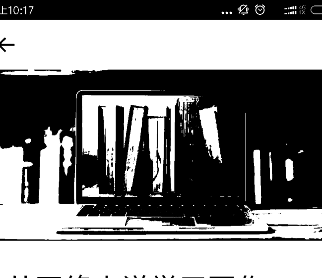

## 从网络小说学习写作

我看书很快，看网书更快。在每天睡前，我有看网络小说的习惯。去年年底看了一下手机阅读器里的统计，一年看了近7000多万字的网络小说，大约有37部。

许多人羞于承认自己看网络小说，觉得格调低下，内容庸俗，我不那么看。对于我这样的人来说，睡前最需要的是放松神。看网小说完全不用动脑子，随便看个二十万字，大脑渐渐地就放松了下来，睡意升起，翻个身就能睡着。

不单如此，在看了那么多网络小说之后，我认为阅读网络小说是一种提升写作能力的好办法。

网络小说的本质是讲故事，而且是较为残酷的方式讲故事。每本网络小说平均300万字，写手每天更新一万字，需要一口气更新一年多，甚至是更长的时间。

而在这漫长的时间里，连续几章写得不入味，读者数量会立即下跌，造成收入下滑。所以，写手要想尽办法把故事说好，吸引读者继续看下去。

这并非是网络的独创。在网络出现之前很久，金庸他们就让我们可以利用武侠小说连载拉住读者，让他们每天坚持买报纸。所以，金庸的小说一本比一本厚。没有别的原因，写中短篇小说根本吸引不了读者，单行本永远不过连载。在那个年代，连载算得上是最原始的直播，故事伴随着读者经过漫漫长月，成为了他们生活的一部分。

网络世界里，在微信公众号和“得到”出现之前，凭借短篇文章赚取稿费是根本没有任何希望的事情。人们在网上张贴免费的短文章，为的是出名，成名者有戏写手来，根据和杂志的订阅编辑会跳过来，邀请去写专栏——依然是连载模式。如今，更新公众号或者在“得到”写作，终于去掉了中间商，实现了读者直接向作者付费，这是非常了不起的事情。

回到网络小说上来，刚开始接触的时候，你可能很想拍案而起，大家文笔太烂。这是很正常的事情，因为网络大级的作家，他们拥有数千万读者的作品，往往都是所谓“小白文”，意思是白痴都能看懂的文字，没有任何文学性。一边是烂文笔，一边是高订阅，这是我当初遇见的第一个矛盾。为什么如此烂的文笔，却有那么多读者观看，通过这个问题，彻底打破了我心中关于文笔的魔障。

在中国，但凡受过点教育，读过几本书的人，都喜欢谈论“文笔”。因为，文笔是对一个作家写作水平最直观的判断标准。同时，也因为在教育体系里很少能让学生看小说，大家推荐的事情都是散文，推荐文笔也是很容易的事情。但是，文学的主体并不是散文，而是诗歌和小坐。尤其是小说，从人类从洞穴里围坐在篝火边讲故事开始，叙述一个故事从来都拥有最多的听众。

对于普通人而言，文笔最多可以支撑1500字。超过这个数量之后，文笔已经无法撑起文章了。尤其对于一个故事而言，文笔是其中极为次要的部分。

讲述故事的技巧和手法，都是为的刺激读者，激发他们的好奇心和想象力。在这一点上，文笔可以做的事情非常少。没有人会因为文笔优美，辞藻华丽而忍受5万字的骈长文，能让人读下去的理由只会是故事本身有趣。

同样的道理，哪怕是写一篇短文，作者也要提供读者足够多的动力。许多人愿意写文章，或者苦于写不出来，有人愿意读，其中很重要的一个原因就是因为有意思，却忽略了构成一篇文章最重要的因素：吸引人。因此，网络小说就是很好的示例，而且是非常极端的示例：如何用最快的文笔，写出最吸引人的文章。

抛开文笔之后，你就可以换一种心态来看待网络小说了。很快，你就能发现绝大多数的网络小说都缺乏独创性。随便看几百万字下来，会很明显地感觉到网络小说都是套路的。人人生出场，如何出场，如何遭遇人生中的第一次冲突，如何取得人生中的第一个成就，无论换了多少钱，套路都类似。永远不是穷就是重，永远在第二章就避免了“金手指”，永远在第二章出现一个恶人，莫名其妙地起了冲突，对方放了狠话。也永远是在第四章，主人公通过金手指及提升自己，完成了网民最喜欢的动作：打脸。

这时候，我遇见了心中的第二个矛盾：这样的重复究竟意义何在呢？不单是作者和作者之间重复这样的讨论，甚至在作者自己身上也是如此，下一本书也是重复在这本书的基础上，为什么读者会乐此不疲地看重复？难道，我们对于故事毫无觉察，真的是记忆力力的只有7秒么？

很快我就明白了这个道理：故事是无限的，但是人类的欲求却是有限的。没有人想看一个和自己完全无关的故事，比如说某个星球上的米巴虫生活如何繁殖的。所谓故事的吸引力，说的是故事要在多大程度上让读者移情其中，又在多大程度上帮助他们抒发自己内心淤积的情感。

人们对于自己的现在并不满意，所以永远喜欢穿越故事，到另一个世界，另一个时代开始新的人生。又或者重生者，希望重新再来一遍自己的人生，避免那些错误和错误。正因为这样，看完了10000个穿越故事，并不影响我们再看第10001个——只要我们对现实的不满足还没有消除，这样的故事也就总是有用的。

我们说，为自己而写，这样能够写出的好文章。这虽并不全对，因为我们写个人并没有独特到只有自己才能理解自己。我们的每一个想法，每一种情绪，在世界上一定有一群人同样拥有。所谓文字的共鸣，说的是一篇文章能道出多少人的心声。

那么，这也意味着如果你能更深刻地理解他人，那么，你所表达出来的文字就有可能打动更多人的心灵。通过网络小说，你可以非常便捷地观察到大众的喜怒哀乐，了解他们究竟喜欢什么，厌恶什么，为什么会什么而兴奋，又为什么会什么而发怒。网络小说覆盖上亿读者，因此，它也是观察人性最大的窗口。

了解人性不单对写作有益，它几乎对所有行当当都有帮助。只要是涉及到服务大众，就一定需要了解人性。在洞悉人性的基础上，你所提供的产品或者服务，才是大众所真正需要的。

到了这样的程度，终于可以探讨写作技巧的问题。同样是天王级的网络作家，并不是人人都写小白文，也有文辞优美，讲求意境的作家。并不是人人都写杀伐流、后宫流这样满足低级欲求的小说，也有写出对人性和社会有深刻理解 的作家。为什么同样是欲望，不同的作家表达出来的内容会有如此之大的差异呢？

因为欲望有不同的层级，因为满足同一层级的欲望有不同的方法。

面对同样的一个社会事件，有的人会抒情，有的人会说理，有的人会从新闻资料里追踪线索，发掘事物隐藏的真相。原因是不同的读者，对于同一个事件的需求并不相同。有人想要感动，有人想要真相，有人想要找到支持自己观点的意见。没有人能同时满足所有的读者，所有的欲望，也自然不可能同时掌握多种表达方式。

如同指纹一样，每个人都有自己最为独特，也最为擅长的表达方式。因此，写小白文的作家会一直写小白文，追求意境的作家会一直写文艺风——在理解 了人性的基础上，他们找到了自己最擅长的讲述方式，找到了自己的听众之后，他们就不断完善自己的手法，力求做到最好。

这就是学习写作的 一个完整过程。它要求破除已见上的偏执，无差别地对待作品，然而在这种无差别之间，发现写作真正要面对的问题。找到了真正的问题之后，再探索不同的技巧之间的差别，寻找属于自己的风格。其实并不复杂，无非是每天睡前翻上几页网络小说而已。

和菜头
请你相信我，
我所说的每一句话，
都是错的。

许多人看过比我更多的网络小说，但未 必能写好文章，原因是他们真的只是去 看而已。

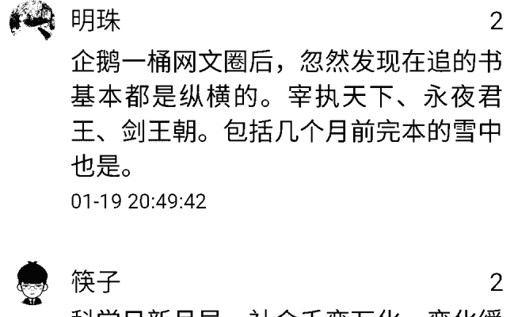

围炉夜话
22531成员 717人今日打卡

用户留言

- 1. 和菜头 19
沙发！
01-19 20:20:42
作者回复
穿越的沙发！
01-19 20:21:01

- 2. 人要往前走 3
看过实验小白鼠写的《狂象》和《武神 风暴》之后，对其他人写的网络小说就 失去兴趣了，最近在看菜头叔提到的 《《修仙界移民》和《一言通天》，能 看得下去。
01-19 20:41:25

- 3. 猫爷 3
看和写之间本身就有巨大的区别。看得 多不代表会写啊。
01-19 20:26:40

- 4. 明珠 2
企鹅一桶网文圈后，忽然发现在追的书 基本都是纵横的。宰执天下、永夜君王、剑王朝。包括几个月前完本的雪中 也是。
01-19 20:49:42

- 5. 筷子 2
科学日新月异，社会千变万化，变化缓慢甚至可以 说基本不改变的便是人性。所 以，尽管历史不会简单再现，但历史可 有惊人的相似。所谓洞察力，就是了解 人性、看穿人心的能力。
01-19 20:49:27

- 6. 小鱼快跑 2
与隔壁何帆老师不谋而合，都在谈文笔 和写作，一起学习
01-19 20:26:54

- 7. Grass 1
近来我公众号的创作几乎没有了，苦于 不知道写啥

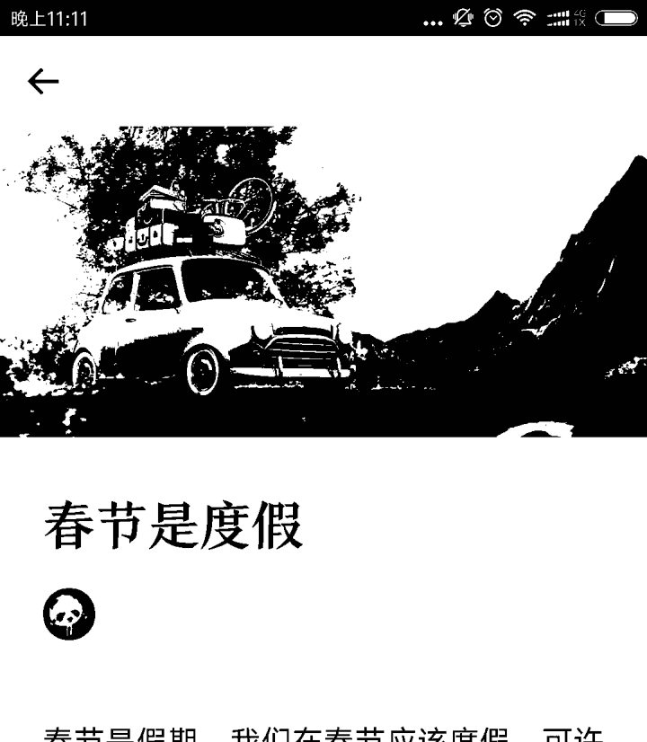

## 春节是度假

春节是假期，我们在春节应该度假，可许多人并不是这样做的，他们把春节变得比加班还要辛苦。

有些人夹在传统的孝道和现代的个人发展之间，在不得不远离千里之外的外地谋求发展，但是内心又受到尽孝观念的煎熬，于是，春节就变成了个人的“赎罪日”。

他们把七天的假期作为对家人的补偿，把一年里的所有关心全部在这七天里加以体现。他们大多累，他们忙碌赶路，他们带着一家老小出国旅行，他们通过自己力股地伺候着所有人，并且因为在这个过程中承受的辛苦和痛苦感觉到高兴，认为自己终于回报了家人，这一年的辛劳算是得到了补偿，不知不觉中变成了一个受虐狂。

有些人执意认为春节应该欢庆。然而，说到欢庆的时候，他们的手头并没有多少可供选择的方案。除了像个古罗马贵族那样暴饮暴食之外，最大的乐趣是摆脱了日常生活的规律，不用早起意味着可以通宵。于是晚觉连着消夜，啤酒跟着白酒，麻将等着侍卡OK。

在最初几天会有一种畅快的节日感，但是随后就会感到精力不济。等到假期结束的时候，宛如大梦一场，最迫切需要的不是返回工作岗位，是认真休息几天。在21世纪，我们就像是依旧活在上个世纪，把放纵当做了度假。

有些人多少下了一点决心去做改变，谋求传统生活里的一点变化。他们选择了将春节进行升级：以前需要全家劳心费力地做年夜饭，现在改成饭店订餐。以前全家在春节大吃大喝七天，现在变成了外出旅游。但是，事情的本质并没有发生变化。在饭馆吃年夜饭，依旧是追求鸡鸭鱼肉齐全，高糖高脂，杯盏外露，才觉得吃了一顿像样的年夜饭。外出旅行，依然是起早贪黑，带着一家老小从早到晚扫描每一个景点，在每一处风景排队拍照，在每一顿饭前用手机消毒，然后发九宫格刷朋友圈，通知所有人自己在旅游。

可是，春节是个假期，我们是在度假啊！

当中国还是个农业社会的时候，是根本不存在什么度假一说的。一年之中，农耕的时间占春节要多得多。那时候人闲下来的并不是休息，而是填饱肚子的油米。花整整一年时间养猪，到了春节前宰杀。为此，许多地方在春节前一家挨家，请帮忙的友邻邻居杀猪待客。大猪宰杀完毕后，要咸肉肠吃用到开春，要腌腊肉支撑一整年的日常。一年到头，能够吃到新鲜肉食的过年，就只有在这个春节几天里。

正因为如此，围绕着餐桌发展出来一系列春节的风俗。但是，在今天我们已经摆脱了只有春节才能吃饱的生活模式。一年三百六十五天，除非是极为贫穷的社会底层，大概不存在任何食物匮乏的问题。相反的，我们正是在过日子的营养过剩和缺乏膳食均衡引起的高血压、高血脂、糖尿病、脚气、痛风、心脑血管疾病。吃什么早已不是个问题，而许多人却偏偏在春节把自己吃出问题来。

当人们走入城市，进入现代生活之后，最缺的不是美食或饮食，甚至都不是休息，而是最简单的一个字：闲。

我们没有多少闲暇时间，在朝九晚五的生活中奋斗拼搏，到了周末早已精疲力竭。就像耗尽电力的电池，需要躺下充电。即便是坐在那里不动，心中的念头也依旧奔涌，并无一刻安宁。

闲，是这个时代最稀缺的东西。我们有闲的时间，却很拥有闲的心态。

度假的意思就是花钱买闲。需要给自己一点时间休息放空，不用晒太阳，哪怕只有一两个小时，对自己的滋养作用也远超任何补剂。一年之中，总是需要有那么一点时间偷闲，在日常征途中切换出来，体会一下闲的感受，唯有知道闲了是什么感觉，一切征战才会有意义。否则，我们只是活在永远的重复之中而已。

春节应该是用来闲的，它本身是个假期。我们为什么要春节再次分割成日期表，并且在其中填满各种项目？在一年其余的时间，我们的日程表还嫌不够满吗？

我们进食，但不知道滋味；我们饮酒，只是为了聚饮；我们购置，只是为了拥有的计划欢愉。这样的日子一年里不知道多少，能逃过七天不需要赶时间，不需要计划的节日？

就算是一直终日忙忙碌碌的蚂蚁，偶尔也会突然停下来。不再搬，也不再寻找，只是定定地站在那里，静静地感知到过。那是什么，它无所虑，能感受微风轻吹过的感觉，仿佛天地之间只有它这一只蚂蚁一样。对于它来说，那一刻，就是它的春节，它正在它的春节里度假。

> 和菜头
请你相信我，
我所说的每一句话，
都是错的。

我是说，我们不能在走进城市之后，还装作自己依然不曾离开自己生长的乡村小镇。

我们投入波汹涛涌的现代生活之后，还装作自己依然和自己的先辈一样是乡土难离的农人。

如果是在古代，我们早已达到官吏与士人的生活水准。

但是，在精神上，他们以清闲为贵，我们却并非如此。

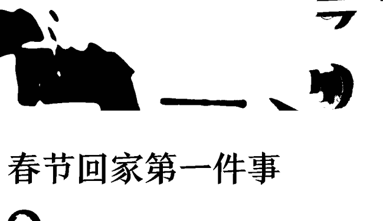

## 春节回家第一件事

+ 头像图标

我今天下午5点飞电脑回家，现在是晚上20:47，刚弄好电脑可以写字。

这已经是每年春节回家的常态项目了：到家第一件事就是弄电脑。前两年，是先弄路由器，然后再弄电脑，一般需要干到凌晨两点钟，才能全部调试完毕，达到我的可用标准。在最近两年，随着智能路由器的普及，最痛苦的一环给省过去了。否则，路由器和电脑之间的关系永远是一个谜。你永远也不会知道，为什么有时候电脑可以联网，但是手机就是死活连不上。总是需要忙到凌晨，就像老天心生怜悯，突然一切调通了，但是它从来不告诉你什么原因。等到明年，还得照样再来一会。

考虑到家人维修电脑的成本，所以我在两年前买了一台联想一体机。当时我想，买一个台式机，这样故障率能下降不少。买一台品牌机，这样维修和售后有保障。哪怕我在外地工作，家里的电脑出了点什么问题，也总会有厂家来照应。今年回到家，说是果然崩溃了一回，请维修人员来重新安装了系统。我听完心里一松，不禁对自己的欣赏之情又新增几分。

吃完晚饭，准备写篇文章。打开电脑没有5秒钟，我已经气得七窍生烟，三尸虫暴跳。一开机迅雷下载的那头鸟就在屏幕右上角跳了出来，然后屏幕右下角又跳出来一个系统优化程序，不断刷存在感。我定睛一看，桌面上一堆图标，联想的儿子孙子以及联想儿子孙子的小伙伴基本都过来报道了。你点开程序列表，瞬间倒抽一口冷气：联想估计是在这里孵蛋吧，整整一个屏幕的联想应用：三只小猪、三只小熊、三和尚……

于是，我的苦泄开始了。升级系统，打完所有补丁。删除程序，释放内存、激活杀毒软件，更换默认浏览器，去微软官方商场下载Office套件，付款下载激活。等我在Word里敲下第一个字的时候，3个小时过去了。

现在我看着面前的这台电脑，内心有一种极为怪异的感觉：这不是一台电脑，而是一个轮奸现场。身为网络慈父，我却分明听到这电脑在咆哮：用户，我是你爸爸！在这怨念深吐的夜里，我突然意识到自己犯下了一个多么大的错误——

> 我不应该买一台PC机的，我应该去买一台iMac。这样，并会有任何系统崩溃的危险，也能最大限度地避免予病毒。家人常用的软件，我可以在离开前就给他们安装好，从此彻底免除了各种国产软件的骚扰，让桌面变得像是在养鱼一样。最后，他们能面对一个色彩极为绚丽细腻的屏幕，估计一年心情都会很好。

这不是厂家的错，而是我自己的错。家用电脑早已经过了有和无的阶段，现在是考虑好不好用的时代。家人在电脑上的时间越来越少，用手机的时间越来越多，我们家早已不再需要一个全功能的PC机，装满所有的软件。电脑最大的用途还是用来浏览，再加一点写作功能，回到了乔布斯最早设想过的那个概念：家用排版打印系统。而我还活在网页时代，给家里买了一台麻烦回来。

如果说，老家和自己工作的地方存在数字鸿沟的话，那么，应该优先填平家乡那一方，让他们。让他们用上最先进的路由器和电脑。这样的话，即便你在他方，无暇照顾家人，他们也能始终有稳定可靠的信息化生活可以尽享，也能始终用上最好的服务，也能始终的成功时保持标准。这种家庭信息化的建设成功与否，标志就是每年春节回家之后，你的第一件事是什么？如果是像我这样，还需要折腾几个小时电脑或者路由器，那么，你就还有许多工作要做，也说明你对家人的关心不足。

明天一早，我就去换电脑。希望明年的这个时候，我回到家的时候，再不用为这些事情烦恼。我也希望从现在开始到明年，乃至更久远的未来，家人不会时时感到电脑、手机、Pad、电视盒子在用故障率刷新存在。好的服务，应该是让用觉察不到服务的存在才对。

+ 头像图标和某头

> 请你相信我， 
> 我所说的每一句话， 
> 都是错的。

因为恶劣的产品和恶劣的服务，一个人为什么要额外多学多少完全没有必要的技能啊！

+ 字号图标
- 写留言图标
- 20
- 访房页读图标

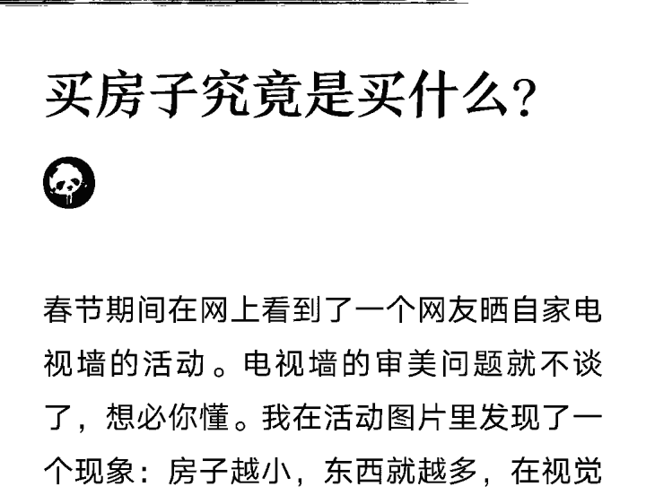

## 买房究竟是买什么？

春节期间在网上看到了一个网友晒自家电视墙的活动。电视墙的审美问题就不谈了，想必你懂。我在活动图片里发现了一个现象：房子越小，东西就越多，在视觉上就像是压挤的。其中有一张图片，电视机两侧是两个黑色的柜子，远远高于电视机顶部，而且，柜子里装满了东西。看上去，有一种电视机正在被柜子徐徐吞没的感觉，空间感极差异常。

我不禁想问一个问题：人人都在买房子，我们买房子究竟是买什么？

我们非常自然认定，大房子要比小房子更贵一些，其中的理由是什么？我想，因为我们是生物，生物的本能要求拥有一块属于自己的领地，把自己和其他同类分隔开来。很自然，自己的领地说越大越好，越大意味着自己的活动空间越大，感觉上也越自如。所以，除了安全感和保值工具之外，我们买房购买的是个人空间。最贵的东西，就是空间，一立方米要好几万。

那么，把空间填满东西，变成一个仓库，这件事情不就显得有点奇怪了吗？你可以计算一下，占据自己家一方立方米空间的物件价值多少点呢？比方说一本周刊杂志，过期之后只能当废纸张，价值不到10元，但是占据了0.5立方米的空间。你可能花了一万块钱，买下这0.5立方米，然后放10块钱的东西，相当于是你买了一个金戒指，在上面镶嵌了一块2块钱的玻璃。什么玻璃值得那么珍而重之？什么杂志值得一万块钱的仓库保管费？

许多人在家里放置许多物品，理由都是“为了不时之需”。我妈就是这样一个人，去年搬家的时候，家里的柜子里居然还有70年代的被褥，以及那种印了大红花牡丹花的床单。的确，存在你家来家里接待，需要床垫的时机，也许还得给他们换一下新床单。但是，在过去十年间这种事情发生了几次呢？大概不超过10次。为了这10次，你杳家里面有五个顶天立地的柜子，里面装满了待用的东西。偶尔翻阅一次的时候，垮塌下来犹如被火山崩塌。同时，5个柜子站在墙边，两个卧室立即小了一大圈。睡觉的时候，感觉是一群柜子站在床前凝视着自己。

有鉴于此，我们在搬家的时候，坚持把这些东西能送的送，能扔的扔。于是，新家里空旷敞亮，进门之后心情就好了许多。最重要的是，去掉了那些“不时之需”以后，并没有想象中出现在那些不便。没有那么多“不时之需”，这种感觉不过是物质匮乏时代在心灵里留下的烙印。一个塞得满满当当的家，不单纯是一个杂物仓库，而且是内心不安全感的陈列室。一个由“万一要用到呢”构成的列表，打开门进去，感受到的气氛就是焦虑不安，而且令人烦躁，就像是看到惨淡的生活本身。

在我自己过去十年的生活中，因为要频繁搬家，所以总是面临一个选择：只能带最重要的东西。于是，每一次都不得不扔掉好多东西。这就像是一个练习，一开始心好刀疼，恨不能卷卷纸也打包送走。而在反复练习之后，每一次搬家都是一次难得的审视机会，可以重新衡量一下当初我购物和保留物品时候的决策是否正确，我究竟购买了多少其实用不到的东西，只是为了满足内心的安全感。经过这样的反复练习，我在日常生活中扔东西也变成了习惯。

拥有的感觉是好的，不过需要考虑一下拥有带来的快感能持续多长时间，以及购买之后保留它的成本。于是，我明白了一个道理：越是住小房子，越是应该少放东西，尽可能保持越多空间。在北京，租一个40平米的小房子也需要大几千块钱。为什么不租一个更大的？因为太，租不起。那么，经济能力有限，说明要维持当前生活的物品也不会太多。厨房不需要整架的炒菜锅，打粉买一袋也不要。客厅不需要看电影机器，全自动吸尘器，高高科技也不值得买。所有的包装盒都不需要保留——如果将来条件改善，肯定会换新的。如果没有改善，那就合用到保修期之后，不存在退换的可能。所以，用纸盒子占空间什么？

于是，即便是40平米的小房子，也可以让人感到干净清爽，视野中没有多少东西。相反的，如果我曾在丽江的建宁大豪家里看到的那样：上千万的别墅，客厅正对着旋转楼梯，旋转楼梯下堆满了泡菜坛子和自行车。那是我所见过的最昂贵的自行车停车场，也是我吃过的最珍贵的泡菜。你想象一下，别墅里制作的泡菜，那是怎样的成本？

请你相信我，

我所说的每一句话，

都是错的。

怎样在春节期间取悦所有的女性亲属？

用美颜相机给她们拍照。

## 一个猜想

你知道，我有信息瘾。

从我上网的第一天开始，每天都要浏览大量网页，查询大量资料。只要我对什么事情感兴趣，就会一路查下去，弄明白为止。这种类似于赌博的心理，让我长于搜索，快速获取信息。不好的地方则是让我付出了太多时间和精力，从一段话开始，却不知道会在什么时候停止。

去年的美国大选刚好就是这样一个机会，因为川普这个人我太过特别，太没有总统范，由此激发了我强烈的好奇心，开始在网上找寻这个人的资料。

当时我的想法是这样的：一个商人不可能去做一件完全能够事情，当媒体一边倒地预测希拉里能够当选的时候，究竟是什么让川普坚持竞选，从初选一直杀到最终对决呢？

在这个过程中，我发现了一件非常有意思的事情：在中国，媒体和知识阶层支持川普的人远比美国多，——最早的理由是希拉里上台对美国不利。中国的媒体和知识阶层都是靠美国的媒体报道做判断，而在民调里，是一边的支持希拉里。而且民调也一再显示希拉里的支持率远高于川普。

中国相信川普当选的人很少。在网上，我很快就发现了这一批人。分析他们的资料，发现基本上有一个共同点：无论是身在大陆，还是身在美国，他们都是金融界人士，往往做的生意就是股票、期权，和其它美国市场上的金融衍生品。这群人里，坚信川普会当选的人，远远高于我观察的媒体人和知识阶层。如果后者相信川普当选的比例是1：9的话，前者的比例是7：3甚至更高。

他们的分析方式和媒体不同，并不依民意分析，而且不断挑战民调的数据，认为样本污染或者范围太小；也不不同于知识阶层，他们对美国在意识形态上的沿革关心完全没兴趣，他们分析的是普通国民众对川普的好恶，他们对川普的真实想法。他们从初始数据，紧紧盯住数据，分析川普支持的者的组成人群……即使其中有一些强烈地反川普和川普的政策，但是他们还是对外宣布自己的分析结果：川普会胜利。

后来的事情我们都知道了，川普击败希拉里，当选美国总统。这时候我不经得不想一个问题：我们依据媒体分析了解世情，我们依据知识阶层的分析判断世界，但是它们在美国大选上为什么错得那么离谱呢？他们所谓的专业水准，为什么还比不上一帮做金融的？

前天我在家里做红烧牛肉，站在灶台前看着火候冒烟，突然有了个猜想，不妨在这里提交给你，帮我一起看看：

媒体判断错误，总编判断错误，政治学教授判断错误，著名知识分子分析错误，他们无需为自己的错误负任何责任。言论而已嘛，洗洗脸转身就开始打击寻制度或川普本人了。反正大家也不会注意到，都在国际新闻热点。但是做金融的这群人完全不同，判定川普当选，他们在金融市场上会做一系列操作，在川普赢的前进场上会严重。一旦他们的判断是错误的，市场会非常严厉地惩罚他们。

换句话说，做金融的这群人是用自己白银行证自己的观点，而不是用自己的嘴。他们对自己的钱负责，自然也就对自己的言论负责。这就是我的猜想。

网上有那么多信息，那么多钱口直断，究竟该相信谁的？相信文章长短？相信头衔高低？还是相信自己名气大小？这次美国大选给了我一个启示：谁在自己的判断上放了钱，我愿意多听谁的话。不用为之付出任何代价的判断，就不过是一句空话而已。说和说永远回回事，愿意听的话的前提永远是永远是你怎么做。

有人问我，为什么上网的时间比你还长，但是并没有觉得自己在网上有多少收获，自己也没有多大提升。

现在我能回答这个问题了：因为你的目光被那些漂亮的言论所吸引，被那些漂亮的站点所吸引，却极少考虑一下你在网上看到的东西，对于现实中多大的网络，在多大程度上可以应用到生活之中去。

因此，网络对你来说，就是一场漫长的肥皂剧。看的时候无论多大快乐，肥皂剧最终还是爆裂，自己一无所得。

## 和菜头

请你相信我，我所说的每一句话，都是错的。

提出了猜想，自然也要提出一个疑问：你是否认为我的猜想是基于幸存者偏差得出的错误结论？

## 用户留言

- **和菜头** 沙发 02-02 19:39:10
    - 作者 回复 我猜这是沙发 02-02 19:39:23
- **陈天乐** 7 过年按照你的方法读了美末简述^_^ 02-02 19:41:19
    - 作者 回复 那应该读得完了。 02-02 19:44:26
- **Lucky** 4 什了的人才玩玩具的，无论最终的对错，都比乱喊乱叫的吃饭群众值得尊重，他们的观点也更具信任。 02-02 20:07:52
- **Head** 4 对政治局和经济的分析是金融人士的工作，准确预测是专业表现，不是侥幸。 02-02 20:04:41
- **辛斯佩** 4 一个不愿意用钱支持自己言论的人，的确比虚情空谈而无需负责的人有说服力，多声，以此来倒推他们能力的高低，却不是特别恰当。

## 要警惕民谣爱好者

民谣歌手多都是小众歌手，能够上一直电视台节目，对于小众和乐队来说都是宝贵的机会。但是，无论是宋冬野的《董小姐》，还是马頔的《南山南》，又或者是大鹏的《成都》，只要上了电视，变得广为大众知晓，就会在社会媒体上听到一片哀嚎之声。哀嚎的人自称是他们的死忠粉丝，而且追随着歌手，他们哀嚎的原因是不愿意让自己喜爱的歌手被大众所识得。对于他们来说，自己喜欢的歌手变得流行起来，这是一件不可原谅的事情。

今晚，我在自己的微信公众号里做了一个实验——把所有涉及和乐队城市民谣的歌串起来，写了一篇文章。很快，我就在留言中看到了非常生气的例子。有人说，看到自己喜欢歌手为歌手所知，当时就会自己的欣赏了歌迷，这就像是坐电梯的时候有人抽烟，自己宁愿去走楼梯。者多类的观点，我就觉得民爱好者是非常血腥的一种存在。歌手走红不了，宁愿让他们全国流浪，在酒吧或者音乐节贩卖求食。绑死了的话，不眠爱好他们愤恨微博的泪水，写下不满的文章，然后，再换一个小众歌手爱下去，只要他们足够小众就好了。

类似民谣爱好者这样的行为，在许多领域之内都存在。在注意一点，台湾女歌手陈绮贞在早期非常喜欢的歌迷、群体，反复传达出来的信息是：你们是这个世界上为数无几的这样，唯有你们懂我，能够欣赏我。就这样，相信这个观念的粉丝群体有自己环顾四周，突然发现这些些少数的练独贪吃也值过百万倍身家。而在之前，他们每一个人都真心实意地相信，自己是非常幸运的少数。就没有一个人想一想，如果陈绮贞真的是一个小众歌星，她怎么可能会发出自己的巴黎，又怎能踏上北京的北京？飞机票不要钱的么？

最近有一个例子，是网络青年群体使用的App社区Sane。据称，它是自豆瓣之后，文艺小清新圈在网上聚集的重要据点，拥有数百万用户。你也会觉得，拥有那么多忠实拥趸，这个App一定火爆透了吧？错，每次Sane更新版本，许多用户会对App Store里面直接打一分。为什么要对自己喜欢的软件做？理由有地一致：这是我喜爱的东西，我希望分数高之后引起更多人的注意，不希望我和大众。因此，宁可给Sane打一分，宁可因此Sane被App Store下架，也在所不惜。能够伤害Sane的人都是在一群饮暴，就像曾经是这个产品在找运营一样。

无论是民谣爱好者，还是Sane的完死用户，我觉得他们都是类似，而且这一类在互联上的人数还在逐步增多。对于任何产品或者服务的早期，他们人群是最友好的。就有一度是体验度，他们愿意投入大量时间给一些反馈。可是，随后他们就成为了发的问题，因为他们拒绝包容，极度地对产品、服务有一种严重他的独占领。就像是一个长不大的孩子，叼住母亲奶劲头坚决不肯松手。唯有满足了这种独占欲，他们才会觉得心理上的安全感。

心理的问题并没有那么重要，因为谁也不是谁的父母，谁也都无需对负责。但是，从另外一个角度来看，这样的人群对于商业社会来说，是一种潜在的威胁。有一种极为简单的分法，可以把人群分为两类：一类是永远寻求增量的人群，一类是永远保护存量的人群。无关道德和心理，只是纯粹的价值观念差异。

对于前者而言，喜欢一首歌，喜欢某样物件，并不会阻断自己继续寻找的脚步，因为这样人心里东西去相信，会有更好的人，会有更好的东西。他们在去一个地方停留太久，停下脚步欣赏之后，就会立刻上路，去探索下一站。他们乐于和别人分享。乐。和人交换。对于他们来说，分享和交换是一种探索增量的最好方式。

对于后者而言，占有而且是独占是最重要的事情。因为他们不相信这个世界有增量的存在，我之所想，必然是世界上最好的。在我手里的东西，就是世界上最好的了，不会再有第二个选项。他们生活在了一个存量的世界，人和人之间玩的是零和游戏。分享和交换意味着绝对的损失，于是到最后会发展出一种逻辑：知道的人越少，也就越是珍贵。

服务前者，是目前这个世界上大多数商业的逻辑——做一个好的产品，推出一样的逻辑，人们会彼此相连，扩大市场，最终因为获得了足够多的用户实现赢利。服务后者者，则是商业上最大的灾难。他们只是不承认是商业逻辑，但是他们的却又想让民族都去服务一个艺术家的服务。并且，只要有任何被大的迹象，他们就会在第一时间逃离，甚至转为敌对。所以，在任何时候，只要有人走过来对我说：我非常喜欢你的文章，你根本不可能在朋友处分享。我唯一的选项就是默然黑，因为这般深情我的确承受不起。

对了，附带说一句，那首民谣的文章，创造了公众号赞赏的新低。下一篇，我还是去写酒店消费指南的好。

## 和菜头

请相信，
我所说的每一句话，
都是错的。

任何太过过强过弱的情绪都是可疑的，就像是烈火和沸水，带来的也不是温暖与清凉。

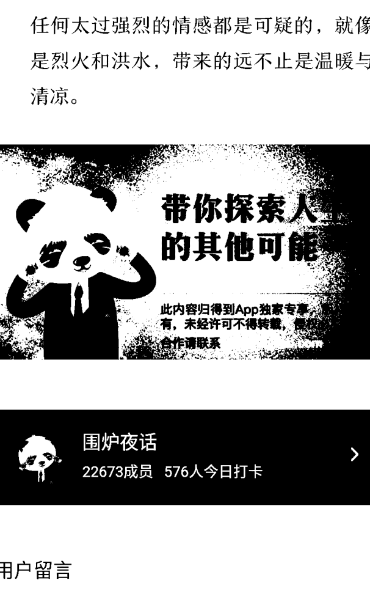

### 围观者话

22673成员 576人今日打卡

## 用户留言

- **和菜头** 沙威： 02-05 21:58:05
    - 作者 回复 恁惭愧，又是我。啧啧！ 02-05 21:59:23
- **雾霾儿** 每次觉得特别好的歌和特别喜欢的文章，都常分享出去，不过好像也没多少人愿意搭理我。看见灿烂的夕阳和闪烁的星空，都觉得应该让人共享。 02-05 22:03:08
- **Leavy** 兴许吧，我也不会刻意孤独，但我不愿意分享出去喜爱的东西却没人知悉好！感伤相同，令人喜欢最好，如果不甚至部莫，若老令我难过。 02-05 22:07:25
- **邓志** 头条买吗？我在公众号里普及民谣知识后还发现很多人喜欢现象分析本身，辛苦了！你啊 02-05 22:14:15
- **shidequjindaole** 我要看看。我分享，而且我不遗余力的对认为有感悟细胞的人说他们往事的时好！甚至会改变你的人生观就是。我举个例子，某菜哥改变，然后他也慢慢在事件能够改变我对他的人，让他们懂得生活的意义。爱他们。 02-05 22:13:58

Aa 76

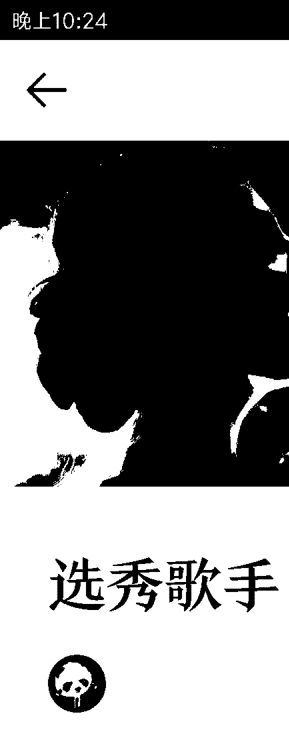

## 选秀歌手

李宇春那一届的超女是我最后一次追着电视选秀节目。以后，就只是偶尔在网上看看《英国达人》或者《美国达人》。因为就讲故事而言，后面这两个节目更为炉火纯青，把观众众情结的手法更细致入微。每次观看都会落泪，是因为自己的支持，使得一个和自己一样平凡的人在舞台上绽放出生命之光。这个舞台真正属于那些追求梦想的人，给予了他们改变自己生活的机会。

但是，很快我就发觉一件事情：**选秀歌手可能是完全不同类型的一种歌手**。每年选出那么多歌手来，但是他们很快就被遗忘了，犹如流星划过夜空。在选秀舞台上的那些夜晚，就是他们职业生涯中最为耀眼的一刻。反而是那些“歌红”歌手，一步一步走上台前，一首又一首歌唱红自己的，反而拥有更为旺盛的生命力，拥有更为长久的艺术生命。

其中的道理并不复杂。一件真正有生命力的事情，作者和作品是密不可分的。说起《往里滚》，你会立刻想起柯恩；说起《就像个处》，你会立刻想起麦当娜；说起《扁它》，你会立刻想起MJ。

反过来也是一样，当你哼唱一首歌的时候，脑海里会立即浮现出歌手的面庞，带着他的神情、以及面部侧过脸去的角度。你很难说清楚，是歌就成就了歌手，还是歌手成就了歌曲。总之，无论是哪一方，它们都是独特的。它们在一起的时候，同样是独一无二的。

选秀歌手不存在这个问题。他们并没有自己的歌，而是直接拿着别人的歌曲来演绎。说演绎已经轻描淡写了一点。其实，大部分选秀歌手只是在模仿原唱的风格。只要唱得像，观众就不会吝惜自己的掌声，那么，这首掌声究竟会落回到是谁的选秀歌手的，又有多少是原唱歌手的呢？模仿张大大千的模仿得再好，也依然是一张脸。极端一点说，像莫里安画布都是一彩色的格子，稍有二点莫里安，稍微掌握了一点绘画技巧能够处理好听歌的画家，都可以画出一张高度类似的画来。但是，又有什么呢？ 桑德里安是桑德里安，你是你。

蒙德里安是第一个那样处理画面的人，张大千也是第一个那样描绘虾和螃蟹的人，他们的画作一经出现，带给人们一种在审美上的全新感受，因此也让他们和他们的作品是无法分割的。人们之所以喜欢他们，是因为他们的作品都跟自己一种之前不曾有过的视觉冲击，带来以往不曾有过的思考， 而蒙蒙一张他们的作品毫无意义，唯有对于那些没有见过多少画的的人来说，可能才惊呼一声“真像”。这两个字是对后来者最大的恭维，同样也是对他们最大的羞辱——分明是在提醒他们：嘿！你正穿着别人的鞋子，走在别人走过的路上呢！

世界上有那么多歌，有那么多唱歌的人。每一个人唱到最后，都能动你心弦的，吸引力注意，甚至能打动你灵魂的歌手并不多。这是一场异常残酷的竞争，那些稍微弱点，作品稍微有一点缺陷的歌手，都在这场竞争中淘汰了。因此，最终你能听到的歌曲，与淘汰歌手，都堪称成功者中的成功者。要取悦你，要打动你，从来不是一件容易的事情。唯有最富于创意，最有表现力的歌手，才值得你抽时间，去静下心聆听。他们是如此独特，又是如此动人，以至于你会立刻随着哼唱，旋律和歌词在每年之后都会会遗忘。你甚至记得哪首有一句歌唱得与众不同，并且觉得这种演绎的方式是神圣的，不容改变。

选秀歌手并没有经历这一切。他们的身材太过矮小，如果不是有传媒的帮助，电视台的舞台，以及那些节目的成名曲可以让他们站上去，扔在人群里，他们只是千千万万被市场淘汰的歌手而已。他们没有经历过残酷的竞争——电视选秀节目里的竞争高于任何竞争，其中表演的成分远远远高于真实的搏斗。他们也没有经历过时间，不是在真正的时间中冲流刷下来的结果，而是导演编写好的大本上的剧。他们的本质是演员，根本不是歌手。所以，离开选秀舞台后，里面没有几个人能够生存下来，真正成为家喻户晓，人人传唱的歌手。

这就是我不喜欢选秀节目和选秀歌手的原因——生命如此短暂，我们有理由去消费最好的音乐、最好的歌手，而不是在二流或者三流货色上浪费时间。

## 和菜头

请你相信我，
我所说的每一句话，
都是错的。

三流的原创，也远远好于一流的抄袭。

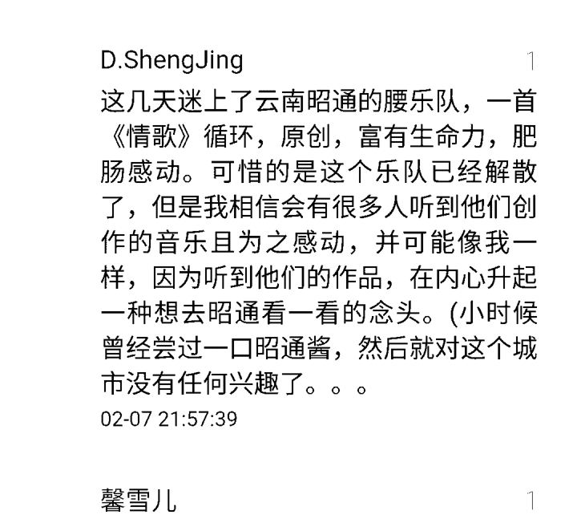

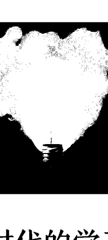

## 碎片化时代的学习

我们现在确确实实处在了一个碎片化时代里，这看起来是一种全新的情况。因为时间被切割为无数碎片，也就是说，我们很难连续从事某种行为。比如听音乐，它在今天往往是作为工作的背景而存在，我们很少专门抽一个下午什么都不做，只是安安静静听音乐。因为只要坐下来5分钟，我们就会忍不住伸手去拿手机，看看朋友圈是不是又有了更新。再比如说读书，一口气读完一本书那是小时候的事情了。每次我们读上几页，就会被其他的事情打断。所以，床边和马桶才是最合适的读书地点，唯有在那些地方，我们才有相对集中的大块时间，可以安心读上一大段。

那么，学习的事情又怎么说呢？在一个碎片化时代里，所谓终身学习究竟意味着什么？是否还存在学习的可能？如果有，它会是一种怎样的形态？

记得有一条中年汉子，突然决定学习编程。学习了一段时间之后来问我：为什么我学完了教材，却还是没有办法编出一个有用的程序来？我相信他的态度足够端正，我也相信他学得足够认真，但我同样相信他的话——即便做对了这一切，我人还是很可能无法编程。这是因为他已经进入了成人的世界，却依然用青少年求学期间的学习方法。当一个人还是孩子的时候，有整块的时间专心学习一本教程，努力做练习题，然后目的是为了通过考试，拿到文凭。成人世界里不是这个逻辑。

成人世界里极少允许一个人继续在知识的海洋里徜徉，它要求人们去解决非常具体的问题。无论你学过什么，学得怎样，你能解决具体问题就算是通。学编程对于一个学生才构成一个目标，对一个成人来说，编出什么具体的程序才是目标，否则就是全无意义。如果当初那条汉子决定编写一个微博程序出来，那么无论他的程序写得怎样，他最后多半能搭建出个来。哪怕他实在是不怎么，可以到网上找来几个示例，自己拼拼凑凑、修修改改做出一个来。在拼拼凑凑、修修改改的过程里，他会用最直观的方式学会编程。

许多人不赞同这种方式，因为觉得这和他们所受的教程相互抵牾。他们认为，如果一个人对学习的了解并没有认知，对于细节没有深入地掌握，那么就不算是掌握知识，自然也谈不上运用。那个中年开始学习编程的人，之所以编不了，原因是学得好还不够，应该把进阶教程和高级教程都学完，那么自然就能够编写任何他想编写的程序了。

这样的想法有道理，可是回答不了几个最简单的问题：

- 股票赚钱的人里，经济学博士占多少？
- 著名小说家里，文学博士占多少？
- 乔布斯会编程吗？会工业制造吗？

碎片化时代不是手机带来的，我们在很早之前就已经进入了碎片化时代——成人世界就是碎片化的。今天已经很少有人一辈子从事一项职业，在不断的转职过程中，他哪里有三五年回到学校专心学习一段时间？谁会留着职位等着他用完知识武装头脑？绝大多数情况下，都是通过实践解决学习和训练问题。在转职早期，每天都会遇见千奇百怪的问题，都是本行业的各种碎片问题。然后，处理完三个月的碎片事件，这个人也就差不多在脑海里拼凑出对行业的认知，知道该多该如何处理和应对日常问题。经历过这一段之后，他就算是入门了。

如果看互联网行业的话，情况就变得更加极端了：行业太年轻，几乎没有什么人可称得上是互联网专家。自称是互联网专家的人，在过去三十年间都散光了。一个年轻人在 1999 年去深圳加入腾讯的时候，他能系统性学习什么？做好什么准备？他能全面了解互联网的什么知识？一个年轻人在 2011 年去北京加入陌陌的时候，所谓互联网的知识对于他有任何帮助么？那时候谁能告诉他说虽然现在不赚钱，但是 5 年后凭借视频直播公司能实现营利？没有，从来没有这样的事情。

我认识那个1999年去腾讯的年轻人，他到了腾讯之后几乎做过所有的工作：客服、市场、前台、话务……没有哪一样和他之前的专业有关，也没有哪一样不需要他立即开始学习，因为那是家初创公司，每个人都需要干所有能干的活，就像是消防队员。但是，又没有哪一样能做非常精通，因为需要随时转职，抵上火线。最后，凭着这一点、那一点，他倒成为了对QQ理解最为深刻的人之一，所以，他成为了QQ群之父——他知道用户需要什么。

有人看到这里会反驳我说：你说的这一切都是做事，不是学习。没错，在成人世界里，做事就是学习。如果你没有具体的事情，那样的学习就不是学习，而是一种消遣，就像周末去上绘画班和烘焙课一样。在每天纷至沓来的事情中，蕴藏了无数可以学习的碎片。你要想解决其中任何一个问题，都需要学习一点点东西。所有这些一点点累积起来，在未来的某一天突然形成一个大型拼图，那就是你的所得，谁也抢不走。

我知道，这样说起来显得非常功利主义。仿佛成人世界里一切都是以有用无用来衡量，仿佛为了解决任何问题，都是采用一些临时手段，一些拼拼凑凑的方式，勉勉强强应付过去，乃至学习也变成了实用至上。事情是这样的：不计任何成败利钝进行研究，那是学者的事情。而我们都不是学者，我们只是这个世界上的普通人。作为普通人，不可能等我们洞悉的事物 的全貌才动手，也不可能等我们找到最优方案才执行。我们像像是在一个漆黑海滩上埋伏的士兵，偶尔有个照明弹划过，照亮海滩一角就要立即射击。手里有枪用枪，有弹弓用弹弓，什么都没有的话，那就撒沙子。

关键的地方就在这里：无论是用哪种方法，你行动了，会换来一个反馈。然后下一次，你就可以调节你的行动，尝试产生新的结果——这个过程就是学习。没有足够的时间让你自由发挥，没有足够的教材让你全盘掌控，你只有一闪而过的照明弹，那就是事件的碎片，而你所能做的，就是立即扣动扳机。

所以，不必为你没有整块时间“学习”而感到抱歉，我们都是乱枪手。

和你信我，

我所说的每一句话，

都是错的。

如果世界已经是那个样子了，就不应该要求人们逆时代而动，而应该告诉他们如何顺应变化。因为抵达终点的途径不止有一条，而且没有哪一条道路可以说是完美的。

# 一个咒语

我有一个咒语，简直可以说是这个纷乱世界一股清澈的凉风，林间一缕清新的山风，可以帮你拨云雾而见青天，洞见事物的本质，破尽一切虚妄。它只有简简单单三个字：

谁掏钱？

当你心中有事难于决断，身处两难之间，不妨大声念诵一遍这个咒语，许多困扰自己多日的问题很可能就会柳暗花明，水落石出。

比如说最近屡屡有动物园猛虎伤人，于是就有人宣称动物园应该加强安保，确保即使人失足闯入虎山，也能够有自保能力。听起来很有道理，那么不妨问一句：谁掏钱？答案是动物园掏钱。动物园哪里来的钱？答案是游客。所以，是游客掏钱为自己买安全。问题在于，99.99%的游客不会跳进虎山里玩，为什么绝大多数游客要为了自己根本用不上的安保措施而多付费呢？

再比如说离婚这件事情。人夹在亲情和自我之间，夹在责任和自由之间，哪一边看起来很都有道理。那么，不妨也问一句：谁掏钱？答案是夹在中间的人。为了谁？金谁数？自己要付出多少的时间、精力、金钱，和对方一起承担疾病、破产、变心、分离的风险。而对于离婚的人来说，这一切大多和他们无关。既然如此，自己掏钱为什么不能买个舒心呢？自己掏钱买到自己舒心，这件事情岂不是有点奇怪了？

从小我们受到的教育都耻于言利，凡是应该谈利的地方，都在谈道德。等到道德实在是兜不住了，大家直谈利字的时候，彼此间都会变得相互狰狞。最常见的例子就是教师和医生。无论是人类灵魂工程师，还是白衣天使，这都是道德上的高帽子。但是，等孩子学习成绩上不去，手术不成功的时候，大家翻开道德面具谈赤裸裸的利益，因此下手就变得轻了。那么，对于一个老师而言，最好的解决方式是大家一开始谈清楚：凭你家孩子的智商，和缴纳的学习费，以我的能力只能教到75分，学到极限就考上来，5分，就另外请高明。这样一来大家自目狰狞，也许多最后得了80分彼此都皆大欢喜，也会真的有谢师恩一说。

否则，我们就免不克精神分裂的命运。因为同时有两套不同的体系在运作，哪一套说出来都头头是道。结果是听信道德的那一套的人活得束手束脚，没有享受过多少权益，却因此背上了无尽的义务。而听信利益那一套的人，可以口头上用道德拉别人利益者，自己却在利益上占尽好处。于是，总有人觉得遭到了自己价值观的背弃，觉得和这个世界格格不入。

为了公平起见，我们都应该时不时念诵一下“谁掏钱”。提醒我们自己：这个世界的基础是利益的流转，和利益的分配。在有的地方我们就谈利益，反而使得利益拥有的存在空间。每个人都为自己的利益而奋斗，在这个前提下，还愿意拿自己的钱来帮助他人，这就是纯粹的善行。相助会，每个人为了道德而奋斗，那么，就沒有人会真的为了他人的付出而心怀感激，于是善就完全失去了生存的土壤。

而且，一个一开始就言利的世界，人和人之间的关系会变得简单的许多。言利才会有规则存在的可能，而“大方不逾矩，小德出入可也”，道德是弹性的，会浪费许多时间。要想做一个现代人，过一种相对简单的生活，拥有一种相对独立的人际关系，那么，最好时时在心底念诵我给的这个咒语，它是个人自由的开始。

请你相信我，我所说的每一句话，都是错的。

谈道德的君子之所以能存在，是因为言利的小人在供养着他。

# 知识变现浅析

从去年到今年，有一个热门概念叫做“内容创业”，罗振玉思维就可以说是罗振玉的内容创业，得到APP则是罗振宇的二次内容创业。无论是罗振思维，还是得到APP，在内容创业的这个小分类下，它们的定义是“知识变现”。也就是说，媒体人和文化人将自己拥有的知识贩卖给大众，不再使用媒体时代免费，从广告商那里收费，直接从读者那里把知识变成收益。

于是就有人问：为什么过去知识不值钱，现在知识就突然值钱了呢？据此，有人得出了两个推论：

- 1、二手知识不值钱；
- 2、知识变现是伪概念。

对于大众来说，这种概念辨析毫无任何意义，完全是小圈子里的名相之争。但是我觉得，知识变现本身是涉及赚钱这件事情，而大众对赚钱是有兴趣的。与此同时，知识从一文不值突然变得可以变现，说明这个时代一定发生了重大变化，知识变现和大众也必定有相同的变化。所以，我决定非常粗略地分析一下，为什么知识可以变现的原因，希望能让大家能有所启发。

首先，我想回答一下“二手知识不值钱”的问题，因为它最简单不过：如果这个观点成立，那么学校和教育就应该免费，教材就应该免费，所有的免费知识应该属于大众。问题的荒谬之处就在于它假定所有人都有足够的精力去自学，同时他假设除了学习、接受、传播这些本身可以智力的活动，不需要时间去精力，并不是人人都能做到的事情。

得到APP里的万维钢没有发明知识创作理论，他的文章都基于别人的论文、出版书籍，所以他提供的二手知识不值钱？那么，问这个 questions 的人自己能有英文原著？知道该看哪几本英文原著？看了之后应该知道什么来读什么一个话题，或读者解决具体问题什么问题？

接下来，为什么过去知识不值钱，现在知识突然就是价值？所谓知识变现，其实就是一个资本创新的伪概念，其实并没有为读者创造什么有价值的服务？

这个问题的答案其实也很简单：因为我们终于进入了一个真正意义上网络的时代。今天一个真正意义的女红，一年直播加淘宝店的收益可以过百万。为什么她可以赚这些钱？因为女性想学化妆，可以变现学化妆，因为女人爱美。为什么要美？因为希望自己独特。在上世纪80年代，大家都穿绿的衣服，女性的自我，也不需要女网红来教授如何个性化的知识。

为什么90年代、21世纪初没有？因为所谓有自我，是选择权，而选择权在三个事情：

- 1、知道这个世界上有多少种选择；
- 2、有足够的经济基础支撑自己的选择；
- 3、真正开始追求生活品质，而非求生。

知道这个世界上有无数种选择之后，从匮乏的生活转入富裕，意味着需要有人帮助我们选择。知道选择中且有法做有意义，改革开放三十年大家忙碌着积累财富，如今终于直起腰来，可以稍微停一下，享受一下生活。是自然的结果：什么是生活？我自己所有的努力究竟有什么意义？我的选择是否真的有价值？

知识在今天肩负了和过去完全不同的两重功能：

- 1、为个性化生活提供某种指导或者建议；
- 2、为已有的个人生活提供某种理论上的背书。

当人们拥有真正意义上的自我，自我也就终于有了价值。当我自我有价值的时候，对应的知识自然也有价值。泛泛而谈的日本美食攻略，作为知识，没有任何价值。但是，日本米其林餐厅的介绍和分析，对于那些认为自己应该去米其林餐厅享受生活的人，就有价值。人们愿意付费去吃。同样的，一个大饼脸、下巴、鼻子大眼睛的妹子做化妆节目，对于她的观众没有用处，却要为什么网红脸更有价值。因为普通女生长得更像她们，更需要她的化妆技巧，让自己显得更美，她们愿意付费去看。

同样的，决定选择过断舍离生活的人，他们需要有人告诉他，为他们的生活方式做背书，提倡极简主义的指导；选择家庭主妇生活的女性，也需要有人在价值上为她们的选择背书，承认陪伴儿童成长是最佳的早教方式；选择在超级都市奋斗的人，更需要有人方法和价值观上有人提供帮助，以此抵御日常生活中常见的焦虑、迷茫和绝望，感受到生活的希望，确认自己行在正确的路途。为什么他们愿意付费购买这样的内容？当他们花钱选择自己选择的生活的时候，也就自然花钱支持认同自己生活，并且提供背书的人。

就这样，原先普遍性的、通用的知识在今天也依然不值钱，但是个性化的、专业的知识在今天就有了价值，这样的知识就能变现。

最后，也是最重要的一点：在这个时代里，不再有知识和人分开的现象。就像是画家和画，社会发展到了一个阶段，画家和他们的画就不可分割。你来一张画回家，不再单纯是为了装饰，他们要的是这个画家，以及这个画家所代表的风格潮流，以及他们对世界的表达方式。于是，无名的画师就逐步变成了有名有姓的艺术家，他们自己的名字也值得人们追逐。

所有能够做到一群人共同的价值观，在同时美的代言人。而且，一定是临时为之，也是临时之，不是长期的代言人。他们不会追求某个抽象的理论，而是会让我们全力去寻求这个理论在生活中应用的具体的方法。这样的一个人，哪怕在一个极为窄小的领域内，也可能实现内容变现。

> “和菜头
> 请你相信我，
> 我所说的每一句话，
> 都是错的。
>
> 情人节快乐！”

# 活出第二生

## 和菜头

我第一次写剧本是在2003年前后，当时刚认识宁财神，我们在MSN上争论国内编剧是否能写出《老友记》那样的剧来。宁财神已经转行当了个编剧，他坚持认为绝不能写。而我和上头网络上的键盘侠没有任何两样，高擎“你又没有做过你怎么知道不行”的标语就冲了上去。和键盘侠不同的是，宁财神和我一致意见，不妨让我写一集出来大家评判一下。

于是，当我既是在零编剧基础的情况下，写了一集剧本发给他。5分钟之后，MSN开始震动，一行行传来他的评价：

- 你知道你写的是什么吗？
- 你写的是屎。
- 不是别的，就是屎。
- 你没有这个天份，吃不了这碗饭。
- 别想了。

回想起来，那就是我们的编剧梦的开始。不是宁财神骂我之前，而是他骂完我之后，我突然对编剧产生了兴趣。因为按照我对自己评估，一件事情做到差到说这种程度，本身也是见世面了，这就说明，我存在很大的提升空间。于是，我在自己的人生计划里，添加了一项：做编剧。

我不是个循规蹈矩，安于现状的人。幼儿园时代和老师对抗，高中带同学哄抬了班长现实先生自主，大学系在学校演讲台上训斥老师们对演讲的选取标准是朗诵表演，到国企工作跨年之后放弃一切辞掉表演，国家企作，跨行进入互联网行业。然后从互联网网站企业辞职，放弃薪酬股票自办产业。总之，我过着一种叫做不断折腾的人生，是做出一些亲友们意料之外的事情，以至于他们不习惯在我身上看到的生活。因为我们并不羡慕，更不喜欢我们的性格。因为其中有太多不确定性，看着都觉得头晕目眩。正如我曾经的一位女友在分手时候说的那种：你的人生，是一条激流，充满了精彩和刺激。但是，如果有一天你的这种人中去，对我来说就是莫大的痛苦与折磨。

对于这种生活所带来的痛苦与折腾，难道我自己没有感受么？当然，而且非常清晰，因为我每天都在里面。比如说在网上写了十几年的专栏，每天对着电脑敲击键盘，这是极为枯燥的生存。因为一面会感觉靠自己的写作能力在以一种不连贯的，而且是不可靠的速度在提升。也许两三年内自己的某一方面，突然有所进步，找到了另外的表达方式，对文字的力量有了新的认识。但是，并不知道下一次会在什么时候发生，也不知道是否存在极限。另一方面它占用了自己的时间精力，你看着周围的人恋爱，看着他们生个孩子，看着他们买车买房，看着他们离婚，看着他们再婚。你还在敲着打，还是知道有什么结果。你努力不想关于明天和晚上的事情，那些事情想起来都让人冷汗淋淋。

能让我克服对未来不确定性的恐惧，能让我极度“走别正道”带性的诱惑，是源于一个极简单想法：人人皆有一死，拿到上帝的门票，哟到这个美丽的世界里来一趟不容易。而这一生太过短暂，应该努力生不能活出两生来，也绝不能太大远地只做一遍。所以，总应该试试一下新的可能。让自己活得比稍没有做的事情，努力这一点之前得完一些，充实一些，做点有意义很可，但是全部放弃转去做自己喜欢得互动也不错。能写专栏很好，但是也不妨磨尝试做做编剧的活。

昨天上午，我在两年前参与的一个编剧项目中看到了自己的播出，我在头里，我终于再次看到了上电视的名字，于是编辑筹那一项下面，三个字：和菜头。依然不算是在零写史上的编剧，并为我并没有从零开始写剧本，而是通过这个没有限，直接上手整理故事线，修改别人的剧本，让故事更加合情合理。这是另外一个漫长，比与人写人经历，要知道，面对电脑看别人写的剧本就已经足够痛苦，看完一集集字幕逐句读改起来更是一种无尽的折磨。而且，对任何写作品都是宁写自己动手重写，也不愿意修改别人的文稿。可以期待这种改动，才会保证在约定之期之前完成修改任务，老实说后续拍摄和制作流程。这种经历里，不会有太多欢乐，也不会有太多创造的愉悦，只有严格的自律和坚持。

从2003年我第一写剧本来，到2017年2月15日电视播出，中间过去了14年时间。从2014年冬天开始修改剧本，到2017年2月15日正式播出，中间过去了3年时间。无论是哪14年里，还是在3年里，我不确定自己能否做点什么。我在14年里，我买了两次《故事》，自己买给家人看，买给家人看，自己看，家里人和父母也读一遍，前次看读得很遍。没有人给我考核，没有人给我打分数，看了也不多看看，看也看看的，但我还是在写。在这14年里，没有合作写剧本的机会，我写的播出，我也选择继续写。因为，这是一门手艺，是一个全新的行业。在比别人身上能发生事情，能承担的付出，我同样能办。在这3年，我都不知道最后电视台能否摄，能否顺利播出。但是我并不后悔花了那么多个夜晚修改剧本。部分对于第二来说，这是必须经历的部分。而且，我告诉他，这是收视长虹，这是全对我评判。对于我自己而言，能够参与这件事本身，就已经达到了目标。

没有什么鼓舞人心的励志故事，也没有镜头一转成功成名的捷径，有的只有漫长的时间，和在漫长和时间里个人的任性徜徉。那些在知道遭遇和未来的情况下所有的尝试，当我走过40的时候，泛处一结出了它们的果实。许多事情并不如我所想象——喜欢互联网，喜欢做产品，但是迄今为止依然没有做出一点点让自己满足产品。许多事情并不如想象中那样达成——我想的是做一个编剧，从一张空白的稿纸上开始写一个完整的剧，让人们看完了哭了。但是最终，我是个剧本编辑，做了一些修修补补的工作，也勉强能糊刷过去。还有许多人，有人认出自己了付出。还有些事情远远超出我的预期——在写了那么多事之后，终于在微信公众号上的《得》APP里获得了大部分写作者的认可，而且是口头上认可，是用真金白银作为支持。

有人问过一个话题：和菜头究竟是什么样的？这个问题我也回答不好，因为我也不知道自己究竟是什么样的，自己可以干什么。我可以知道自己的现在，但我不确定我的将来。唯一我可以确认的是：努力活在中一生之中，活出两生来。我要对我身上这张门票，我希望对这个世界热爱永不得熄灭燃烧。

- 和菜头
- 请你相信我
- 我所说的是每一句话，都是错的。

对于未来，对于不确定的生活的恐惧经常会对一个人。幸运的是，世间会比我更重更空更压倒性的恐惧——对于死亡的恐惧。当前一种恐惧无可逃避地死在你头上时，只要那么心深处地唤醒自己对于死亡的恐惧，那么，一切都烟消云散。不在时间上人生的结局上回头看一看，会发现人生中大而的恐惧都只是一点无聊妄念，只是自己在欺骗自己它们非常重要。

# 思考训练示例

在这个社会上，许多评论界人士的根脚不是逻辑，不是分析，而是抒情。所以，许多评论文章的本质是散文。而中国人大多数就是文艺青年的，因此最受欢迎的评论往往是就是最不得的散文。但是道理没有一分钱关系。读完之后心旷神怡，觉得自己掌握了什么了不得的真理。但是不出三天，就根本想不起来自己读过些什么。

最近的例子，由此引发了评论狂潮。我随便地选了几篇看看之下，又是一轮互联网散文创作为典范。如果按照中学作文课的标准来打分，几十篇文字的得分加起来未必及格。问题不是出在文字，而是思考的含量太低，几近于无。我知道，也许你对微信付费阅读这个议题毫无兴趣，但是，它作为一个范例来展示一下如何正确思考，对于我们都大有裨益。那么现在，就让我们开始吧：

什么是微信付费阅读？绝大多数分析文章根本就没有讨论这个问题，就直接开始抒情。讨论微信付费阅读的伟大意义，讨论微信阅读费用将响起，或者是什么，失败。抒情固然很好，前提和论点在哪里呢？微信付费阅读究竟是一个什么形态？和市场已有的付费阅读的区别在哪里？没有搞清楚这些的前提，又押则子们的情形？这样的抒情本身有什么价值呢？

因此，如果要讨论微信付费阅读，第一个问题是：微信付费阅读是什么？你我都不是微信团队的人，不知道他们的计划和打算，这是我们都要坦率承认的事实。在这个事基础上，才能体现思考的价值——根据有限的，公开的资讯，推导出事物可能的路径和变化。

微信到现在为止还没有推出付费阅读，这也是一个新事的情形；如果我们从思考出第一个有结论：现实中微信团队在思考的问题和我们一样，都是在思考“微信付费阅读是什么？”而且，大家思考的路径在一开始都类似。道理并不复杂：如果微信团队都清楚这个，那这个功能就早该推出了。毕竟，市场上已经有那么多人和公司在做收费的事情，而且收益情况并不可观。微信的付费阅读到现在若没有传闻，根本没有什么产品，说明他们也在思考，并没有定论，或者并没有找到合适的方式。

那么，我们在开始思考的时候，其实和微信团队在一条起跑线上，而且面对着相同的问题。所有的超正常的，在这个阶段唯一的选择是什么？当然是分析市场上所有的付费阅读产品。自己不知道应该怎么做的时候，看看别人是怎么做的，分析一下成功者的缘由。

很自然地，我们会发现市场有起点中文、纵横中文、晋江文学这样的传统付费阅读网站，它采用的是标准的内容付费，三分之一钱一字。作者先写30万字的免费章节，作为新书推荐，阅读和收藏数据。如果数据不错，网站和作者签约，定期推荐，等读者群累积到一定程度，转为付费阅读。作者依靠每万字连载，吸引读者订阅阅读。本质上和当年金庸在《明报》连载武侠小说以吸引读者买报没有什么区别。

我们还会发现，市场上有《经济学人》、《纽约时报》这样的媒体付费阅读服务。它们是标准的付费阅读。但是并非是针对人的订阅，而是针对媒体。媒体本身是品牌，读者出于对媒体品牌的信任，订阅媒体提供的内容。严格来讲，这并非是互联网付费阅读，乃是传统媒体阅读在网络时代的延伸。过去读某家纸质杂志和报纸，今天，他们变成购买媒体的电子版。本质上，还是付费购买媒体提供的内容。

除了这些比较传统的方式，我们还会发现《得到》APP这样的新媒体形态的付费阅读。在这个领域内，36氪等网络媒体等正在跟进。这是一种全新业态，它不是单纯地售卖内容，也不是单纯地售卖作者，在信息的组织销售上有机地重复和精巧的设计。以《得到》为例，它的基本价值判断：内容提供者构成了一个巨大的金身资本，但是只有金字塔顶的那一部分人具有商业价值。因此，《得到》永远不可能成为一个内容开放平台，让所有人都可以提供内容，都可以在平台上售卖内容。

和传统媒体相反，《得到》有另一套方法论：作者并非作为媒体的内容提供者而出现，作者和作者的内容是不可分割的。因此，向读者交付的不是一个期间不同作者提供的内容集合，而是一个作者和他单独提供的个性化内容。传统媒体致力于每一期内尽量贯彻某类编辑原则，选择作者；《得到》致力于为某一社会阶层提供他们所能感想的作者，选择作者。简而言之，传统媒体是兜罗万花的美术馆，《得到》是有风格有定位，提供某家本人供众群体追随欣赏的画廊。

除了这些图文为主的付费阅读之外，网络世界现在还有喜马拉雅这样提供语音服务的平台，以及各种直播内容主体的付费视频网站。还有分答、知乎live，微博问答等这样新形态的付费阅读服务……

面对这样的现状，最简单直接的思考方式就是：选择其中最流行最成功的方式，一模一样的做就是了。也许，这就是大多数人和一个微信团队思考的分歧点。如果我们回过头去看一下微信的历史，可以发现微信团队在考虑问题时候的特点，这里分享两个案例：

在微信早期，正在和米聊厮杀的时候，米聊一度用户数占优。而米聊厮杀不知道的是，微信的用户数早已经悄悄超过米聊的数。当时，米聊推出了一个聊天记录源的功能，产品经理甚至在于知乎发布功能：坐等微信下一个版本来模仿抄袭功能。微信下一个版本出现的时候，并没有涂鸦功能，而是提供了著名的摇一摇和附近的人。米聊反击的，开发都没有，因为微信的用户数远超过，打开附近的，总能数到数百之内看到陌生人。而米聊当时的用户量，附近没有什么人。

前年，微信和央视合作，在春晚推出微信红包，获得满堂喝彩。去年，支付宝花大力气，在春晚烧了微信钱，实现了红包裂变合作。微信当时是怎么做的呢？大把撒钱圈用户？大肆广告吸用户？花更多钱争夺春晚红包广告？没有。微信在春节前推出了一个新功能：照片信。让用户在朋友圈发一张照片，系统将照片做模糊处理，想要看到原身，请随机给对方支一个红包。于是，微信红包依然最有话题性，最有创意的玩法，花几亿也依然打不过。

所以，微信推迟未定，原因就应该在这里。如果推出一个新功能，却不能做到：

1. 独创性；
2. 贴合微信自身性质。

那么，微信宁可不做。事实是，从去年开始就一直在微信公众号付费模块测试的截屏流出。无论是传统媒体的付费阅读模式，还是起点模式的《得到》模式，在技术上对于微信毫无任何难度。如果要做一个的话，早就可以做好了。但是，微信一直没有推出，说明他们还没想到最适合的方式。

问题可能卡在哪里？这是今天讨论过程中最有价值的部分。

以上针对市场上付费阅读的分析，如果我们简单粗暴地一刀切，那么它们可以分为两类：卖文和卖人。《经济学人》、《纽约时报》是卖文的，起点的中文字开始是卖文，小说火爆之后，网文作者变成“大神”，接下来就是卖人；《得到》、直播、问答都是卖人，而且新兴的媒体也是在卖人。这里存在一条明确的分界线——卖内容，还是卖服务？

微信每天产生海量的公众号文章，看起来应该卖内容合适。而且，卖内容的活，产品和技术上都非常简单：

1. 对单篇内容付费，免费阅读头部500字，后续文章需要付费；
2. 可以推出公众号包月、包季、包年订阅服务，和媒体一样。

唯一的问题是：微信是媒体么？如果微信付费阅读需要按照媒体的路数来走，本质上就是一个流量生意。谁的钱多，谁能获得最大的流量，谁就能赚钱。微信作为平台，选择媒体路数的话，就应该分配流量，建立榜单，打造推荐机制、制作分类号或者学习等，这和微信严格去中心化的设计原则是严重抵触的。

微信公众号运转到今天，数千万个公众号的运转都是围绕人为中心。除了媒体和营销号，大部分公众号都是个人运营，而且以个人的形象出现。公众号文章的传播，依托的是朋友圈和群聊天，也就是说，依靠人际关系的传播扩散。所以，微信天然就是针对人的，也是针对内容的。同样一篇文章，有朋友推荐和没有朋友推荐，微信的生态体系存储时间是完全不同的。在微信至今尚未存活的，那里是人际关系的总和。这么说起来，卖人可能更为合适。

在微信的内容世界里，文章内容是什么不重要，写文章内容的人是谁，传播文章的人是谁，更为重要。那么，以人为中心设计一套内容付费功能，该是怎样的？这才是问题的难点。怎样大卖活人，这是关键之中的关键。

同样是卖人，文章把市面上各家都系统地归于“内容付费”，或者“粉丝经济”，这是相当荒谬的事情。如果我们深入分析一下，就会发现各家在为卖人上千差万别。它们的本质都是以为在卖人维系不起价格来，一旦运营内容，无论是顶级高手或作者，还是在万众创作，读者都不会认账。前者就像是网上找一个群人维持一个媒体类型的公众号，后者就像是豆瓣的电子书出版，或者是简单的打赏模式。但是，各家解决问题的方式是截然不同的。

罗辑思维转型成为“知识服务商”，推出了《得到》APP，卖的是知识服务，而不是内容。罗辑思维先成为用户平台，在这个基础平台上，罗辑把内容导向生活指南和练习指导。于是，从单纯的内容售卖解脱出来，变成了知识服务。人们不愿意购买内容，但是人们愿意购买服务。《得到》的本质是为用户服务，或为用户成为中产阶级的人群的生活指南。在这个平台上，你永远不能指望会出现《种地的饲养》或者《美女技能详解》这样的内容。

直播卖的不是内容，是销售，直播的不是产品一钱钱不值，直播你的公安也不予许播。直播卖的是陪伴服务：无论什么时间，你什么心态，只要打开直播，就总有人陪伴着你。而且，只要我愿意看，对方就会实时和你交流。同样的，这也是服务，并不是内容。

网络问答同样也是服务，不是内容。针对同一个问题，不同的人可能给出相同的答案，购买的情况也会截然不同。针对某一个人，哪怕他给出的答案总是在搞怪，人们也依然乐此不疲地回答，就像是在玩一个游戏。我们要的不是答案，而且要的是特定的人给出的答案，这早已经超越了内容本身，它的本质就是娱乐服务。

那么，微信会选择哪一种方式？或者，微信会发明出什么新方式？这才是微信沉吟至今，一直没有推出付费阅读的原因。从以上的分析，我们可以判断微信的方式还是会以人为中心，以服务而非内容的方向向读者收费。而且，很可惜目前市场上的各家都不一样。谈到这里，我想，你应该去开一个个人公众号，而且尽早吸引1000个忠实读者了。

和菜头
请相信我，
我所说的每一句话，
都是错的。

有人总算竟然，网上的付费阅读和免费文章究竟有多大区别。区别就是今天这样的文章，花199块钱，那就接着看网上的抒情散文本。

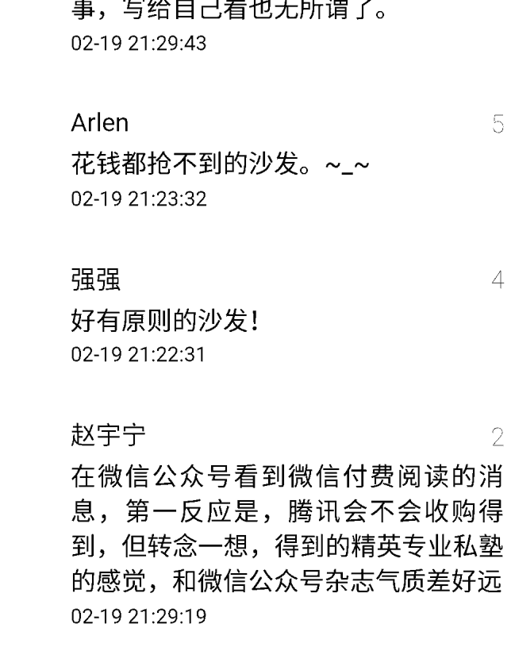

## 用户留言

- 和菜头 16
    - 沙发！ 02.19 21:20:51
    - 作者回复 漫长的发展！ 02.19 21:21:04
- 齐子 9
    - 我决定从头条软的下一次更新开始抛... 02.19 21:22:43
- Arlen 5
    - 花钱抢不到的沙发。~~ 02.19 21:23:32
- 张强 4
    - 有有原则！ 02.19 21:22:31
- 赵宇宁 2
    - 在微信公众号看到微信付费阅读的消息，第一反应是，腾讯会不会... 02.19 21:29:19
- 蒋雨的仨仨 1
    - 移动互联网时代符合的标题的文章，如果本身文章没有思考的存在... 02.19 21:41:36
- Harbor Sun 1
    - 改变需要两个前提条件，合作效率高于群众，并展现出比以前更多的灵活性。 02.19 21:37:05
- Head 1
    - 说得是。大咕咕的问答即使反复一个表情或者一张图，都很有意思，偶尔想起来还能安慰。 02.19 21:34:02

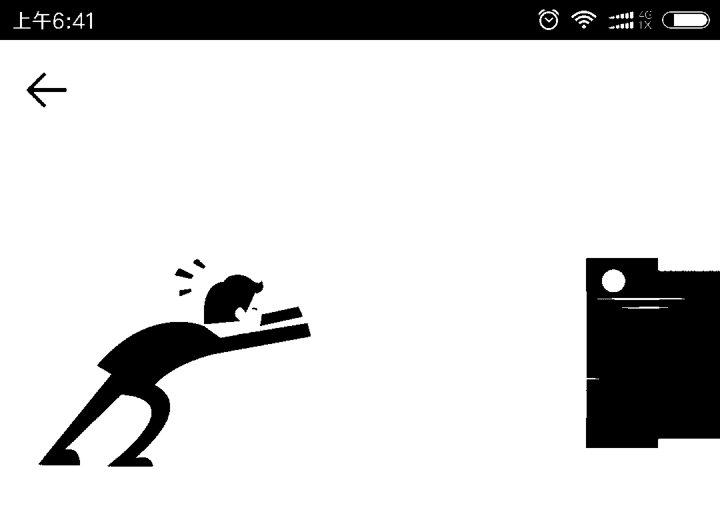

## 出人意料的反对者

我的一位朋友在他的行业里做得风生水起，带着一群人打了他七八年仗，双方互不克战无不胜。最近，我花了三年时间找他，我这一点技术改进，可以在短时间内提升整个行业的工作效能。我一直跟进他的项目，看他这几年来的进。前段时间我去找他，见他愁眉不展的样子，以为是为新技术推向市场的时候遭遇到冷淡，就坐下来安慰他，用历史上各位初创者早期遭遇的困境来鼓励他。不料，这一次我完全看错了情。

他告诉我，技术开发完成之后，肯定不能在客户身上练手，所以第一步决定用自己的项目来做个记录。万万没想到的是，第一个站出来反对的人不是客户，而是自己带了七八年的精随团队。反对的理由非常明确：大家能做到了今天的地位，是因为能够娴熟使用当前的技术，彼此配合默契，有马娴熟。一旦在换了新系统，成员要学习，团队要调整，会影响项目的整体进度，最终造成系统风险大幅度上升。

这让我想起十五年前，我在航空公司从事航班调度工作的旧情。一开始公司只有十几架飞机，每天的航班计划用两张A4纸就能打印下来，调度更改的时候，只需要在纸上做个记录，涂涂改改就好了。但是，很快民航就迎来井喷，一家中型航空公司空上的飞机迅速增长到几十架，每天上百个次次的航班，两张A4纸都不下天，手工调度配班已经变得非常困难了。

于是，我们很快上了一套运行控制系统，使用电脑配班计划。高效直观，而且系统具有自动调改功能，一旦航班时间重复，或者飞机航点错误，系统都会自动报错，提醒值班人员修改。

但是，这套系统在设计之初，调度人员就泾渭分明地分成了两类。一类是资深员工，他们对于使用与调度控系统设计完全没有兴趣，用A3调调配班计划在手，等系统上线之后，依在写，认为新系统不如传统书写方式；另一类是青年员工，他们最早准备与设计，一旦是自愿意级，也是最早熟练运用新系统的人，以至于资深员工到最后还要向他们请教。

对比这两件事情，让我想起“创新者的窘境”这个概念。有很长一段时间，我一直认为“创新最大”的力量来自于早期的市场推广，如何找到最初的种子用户，如市场推广和教育市场接受新产品和服务。现在想来，创新最大的障碍并非来自外部，推广的创新往往是遥远的地方，真正的阻碍来自内部，尤其是那些在领域内占下领先的团队。因为他们最熟悉的是如何维持这种优势，他们最喜欢的是在这种领先优势下工作。所以，任何改变都会带来阵痛，意味着丧失以前的优势，不得不面对由此而来的风险。

是我朋友觉得需要新技术，不是他的团队。他的团队认为现在做得挺好，航空航天公司认为需要新系统，不是资源调度人员，他们认为在系统精研着，还是可以对付。而且，在对付过去这件事情上，他们做的很好，所以在电脑上使用新系统，相比之下是一件更糟糕的事情。因为一切都是陌生的，一切都要从头学习，自己被迫和毫无资历的年轻人放在一条起跑线上竞争，却不确定最终能否胜出，是否存在着被替代的可能。

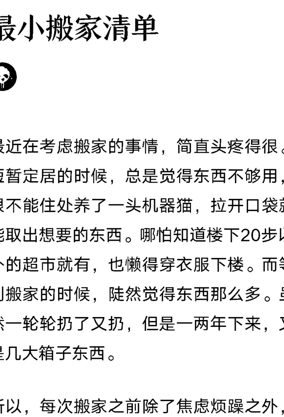

## 最小搬家清单

最近在考虑搬家的事情，简直头疼得很。短暂居住的时候，总是觉得东西不够用，却不能住久养了一头机器猫，拉开几袋就能取出想要的东西。哪怕仅够楼下20阶以外的超市就有，也懒得穿衣服下楼，而等到搬家的时候，陡然觉得穿衣服多起来。虽然一袋轮扔了一大袋，也是一两年下来，又是几大箱子东西。

所以，每次搬家之前除了焦虑烦躁之外，还总有一点点莫名的忧伤。决定着要做什么、留下什么并不是，一定是很多事情。为此，我在制定一张最小搬家清单。在这张清单上只会保留我一定会带走的东西，而带走，在下面的我有时候多半要空到哪儿，这样的证，无论如何下一次会到哪儿，我都能拥有启动正常生活的最低物资装备。同时，我也能重新衡量一下各种生活用品中，究竟哪些才能算得上是真正的必需品。

电脑肯定是要带走的。尽管用了很长一段时间笔记本电脑，但我还是迷恋台式机的大屏幕，和机械键盘的清脆敲击声。我还没是病，而且大概没有机会痊愈了。

每隔几年，我都会像失神地跑去配一台组装电脑。在我网的最初十年，这样的事情平均两年发生一次。于我来说，无论多少年了，每次看到台式机的，都会让我想起最早登上网络，和外部世界接触的仪式感。网络于我来说就是个宗教，台式就是它的祭坛。

我还会带上10本左右的书，剩下的全部都会扔，哪怕有些签名本。要做出选择并不困难，只要看书页的成色就知道——那些跟随我多年的书，在一次一次搬家里幸存下来，在我书皮泛黄微裂，时间经历了考验，能够始终陪伴我身旁，说明读多一次也没有。它们是某种单边的读物，而非人生潮流中心再标志，随时提醒我边界的存在。有些我自己一辈子做梦也没办法跨过的边界，有些就像是命运的暗示，显隐的来处，又昭示着未来的方向。

然后是喝茶用的杯子。总是会买许多杯子，然后又打扫许多。有些杯子来喝过一次水，就从此定多不问世事。买来试出一个最喜欢的，它往往既不特别，也不漂亮，且不会含有任何科技含量，就是捏在手里感觉很好用的。每天家里的几个小时，水和我对消渴的时光里，以带出去几天，回来第一件事就是清洗水杯，倒上一杯水，放在面前看看心，感觉终于安定了下来。找到这样一个杯子是件很幸运的事情，有时候会因为找不到而连续烦躁几个月，就像是空间里的气息有哪里始终不对劲。

还有一双鞋。无论什么鞋，身边都能搭着一双穿脚上最舒适的鞋。它能贴贴地保护好你的脚，即便突然不得不走远路，也不会让你非常疲惫。人生所有事也有这样一双鞋就太疲惫了，所有分量都会落在一双脚上，这样的一天就会格外漫长，因为双脚都痛着走得难以忍受。有一双好鞋，无论什么时候心情都会相对好一些。尤其是低头看到它的时候，会觉得它稳稳地稳定了你，并且微微地向上顶起来，让也和地面始终保持一点点距离，并没有到你。

最后，是一把电动牙刷。永远会让人买了后悔的小家电，它是漫长一天的终结，也新的一天开始。每次启动的时候，都在提醒我：生活里总还是一些简单、美好、可靠的东西值得追求，只是用一下就能提升幸福感。

这就是我的最小搬家清单，此外的所有的东西都可以再买。唯有这张清单上的东西，它们总是带来独一无二的感觉。无论去哪里，它们又能重新又展开的世界，我就再一次回到了我的小世界。幸运的是，它们并不算太多，总能随身携带。

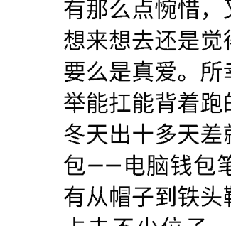

请你相信我，

我说的每一句话，

都是错的。

## 保全自我

和改变自我相比，更为重要的是保全自我。人们热衷于改变自我，仿佛自我是一团橡皮泥，可以随意搓捏成自己想要的形状，然后揉搓进通往成人成功之路的万脚踏中。人们热衷于乔装欲望，把欲望当做是真实的自我，以为欲望得到满足就是拥有了自我，却没有发现就在那个所谓的“自我”下面的价格标签和条形码，和千千万万个“自我”并没有任何区别。

每一个人生下来都是独特的，但是活着活着就都活成一样了。尤其是在中国这样一个拥有从厚从众文化氛围的国家里，改变自我其实和别人一样。从“别人家的孩子”的起始，到“别人家的员工”、“别人家的老公”，再到“别人家的爸爸”，这是一个自我逐渐消失殆尽的过程。它最终指向在公园里跳广场舞的无数身影中的一致，相同的动作，相同的节奏，成为别人眼中“别人家的老人”。

改变自己其实并不难，许多人人一辈子都在改变自我，按照别人的眼光，别人的标准修正自己。它甚至不需要多少勇气，也无需多少思考，生活的风暴推着你改变。让人上瘾地，因为改变的效果是即时的，会立刻感觉到人生轻快了起来，会很快得到预期的收获。这就像是在实验室里吃老鼠一只小白鼠踩下踏板就可以得到食物，哪怕踩踏板这个动作并非出于它的天性，只要有食物的犒赏，它也能很快改变自己，适应这个盒子里的生活。改变自己能有多难？

真正困难的是保全自我。一个人热爱写作，但是写作无法带来任何收益，个人还要面对沉重的生活负担。于是，哪怕是有五分钟的时间，也要冲开手指敲出两行字，为了节省时间，只能用最短的文字，描写对生活和人性最为深刻的观察，甚至因此形成一个极快且独特的写作风格。这个人的名字是蒙蒂亚，他写作风格被称为极简主义——更少意味着更多，他并非选择世界，而非不能改变自我，也并非无法进入中产阶级的生活。但是对他来说，写作就是他的自我，用文字创作就是他的自我。

仔细地观察你自己，去除他人的眼光，去除他人的期待，以及在这些眼光和期待中你所有的表演成分，和这些人不同的是你：有什么特别的性格，有什么特别的爱好，有什么特殊的审美，有什么特别的爱，或者，有什么特别的习惯？回顾你出生以来走过的路，让你变成现在这个样子，有不是别的什么东两的，究竟是什么？是什么在与世界和你和其他人之间制造紧张和对抗，让你在纠结中一步步走到今天？那应该是你生命中最原始的动机，也是你自己的本来面目。如果没有钱没钱也不会影响它的存在，那么，它就是你的自我。

总有人问我，为什么自己不够独特，为什么没有自己的标签？总有人问我，为了这种独特，自己应该做出怎样的改变？我的答案是：你的自我呢？你在多大程度上保全了它？你为了保全它付出了多少的代价？你所能保全的自我越多，那么你就越显得独特。你的自我改变得越多，那么你也就越是平常。问题始终是那个问题：你到底想要什么？

或者换我一下方式问一下：你想要哪一种独特？在别人眼中看起来的独特，还是在你自己心里认为的独特？真实的情况大多是这样的，在改变自己以换取更容易的利弊之后，突然发现这一路上把自己弄丢了。在做了和绝大多数人相同的选择之后，还希望自己喜欢起来和其它人大不一样。选择去了一些相同的广场舞，和别人跳相同的舞，然后希望你的舞跳得好而可以站在方阵前面成为领舞者，这样看起来显得独特一点。领舞者存在意义不在于自身，而是身后的舞蹈方阵。如果身后空无一人，那么这种独特性也就随之消失了。任何依附概念，总会随着对立的一方的消失而消失。

没有人关注，也没有人欢呼，全世界只剩下你一个人了，你会以何种形态显现？那才是一种真正的独特，那种是真正的你。就像是天空的蓝调，就像是夜晚的味道，就像是星光冰冷的触觉，它是独一无二的。去问问自己，我究竟是什么呢？然后再问问自己，愿意为了保全它付出多大的代价？这才构成一个真正的问题。

人迟早都会遇见这个问题。哪怕一开始问出的问题极为幼稚：我们如何才能看起来独特一些？只要不愿意加几个“为什么”，你就会有时间可以提出那个真正的问题，然后找寻真正的解决之道。只不过因为它太过难，我们大多数一直都留在逃避。但保全自我相比，改变自我都要简单得多。所以，我们放弃天地举手提问：为什么改变自我那么难？这样一来，看起来好像是我们选择了最难的题目，而且真的准备认真解决。

没有自我的人，选择什么有多大区别呢？

> 请相信我，
> 我所说的每一句，
> 都是错的。

在今天，友谊的真诚难道不是：明明可以各自在家玩手机，却又不约你出来面对面玩手机么？

围炉夜话

23918 阅读 181人今日打卡

## 用户留言

- 和菜头
    - 沙发
    - 02-24 23:41:34
- 作者 回复
    - 放飞自我的沙发！
    - 02-24 23:41:48
- 赵萌1988 10
    - 我并不赞同，按你说的去“保全自我”，我才能保证能有很大收获，甚至不保证有收获。极客如此，世界又有谁说自己自己能超越极限？所以关键问题是：哪怕知道能且都全失败，都去保全它？光阴还，你愿意尽最后心保全它吗？选择追求你适应你的成功没有不好意思的。选择尊重自我也不用担忧处于自我感动状态。但我愿意保全自我而花费我时间，也接受因此造成的利益损失。倘若有人奉你人肯，那就转为自已拥有这种幸运而不胜欢。”
    - 02-25 00:11:15
- catalogia 2
    - 我知道自己想要什么。但是它太平凡太琐碎以至于我不知道讲出去。放佛一出口就会让别人看穿那个看似强大的身后背后破碎的自己。
    - 02-25 00:44:01
- 诺和听雨 2
    - 有想回到国家与保全自我之间的区别，后者应该是前者的高级版本吧？或者说回到一个内心系统中，能够自己内心与现实之间有一种自寻后的平衡关系后，保全了自我。
    - 02-24 23:53:07
- 活在梦里160377 2
    - 抵御改变自我的代价，就是塑造自我的付出。假使他说收获很大。
    - 02-25 23:51:12

## 奥斯卡荐片

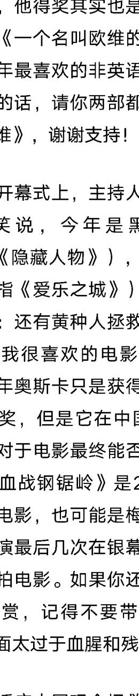

本届奥斯卡尘埃落定。相关乌龙年的奥斯卡奖会依然不少。总体来说，今年还是奥斯卡，入围的影片最多能说是精品，距离经典还是有相当距离。世事就是这样无奈，天才之后总如同雨后草原上的野花同时绽放，然后又在同种衰败。所以，总会有《肖申克的救赎》撞上《阿甘正传》的遗憾，也总会有今年这样平淡如水的角逐。

之前在《我得到》重点推荐的北欧电影《一个名叫欧维的男人决定去死》，入围了今年的奥斯卡最佳外语片奖。但是，最终还是败给了伊朗电影《推销员》。此前，《推销员》导演阿斯哈·法哈蒂因为川普总统的7国禁令而无法进入美国，引起好莱坞的抗议不想说《推销员》的得奖和获奖导演的政治倾向有关。阿斯哈·法哈蒂是个好导演，今年的《推销员》也是一部好片，值得获奖的名也是水到渠成。可是，毕竟《一个名叫欧维的男人决定去死》是我去年最喜欢的北非语电影，所以，有可能的话，请你两部都看一下，最好先看《欧维》，谢谢支持！

今天奥斯卡开宴上，主持人吉米拿入围电影开玩笑说，今年是黑人拯救了NASA（暗指《隐藏人物》），而白人拯救了爵士乐（指《爱乐之城》）。其实我也忘了写上，还有黄种人拯救了好莱坞票房！同样，我很喜欢的电影《血战钢锯岭》，在今年奥斯卡只是获得了最佳剪辑和最佳音响，但是它在中国收回了4.2亿票房，这对于电影最终能否收回成本非常重要。《血战钢锯岭》是2016年中国最好的抗战争电影，也可能是梅尔·吉普森那么好导演出最后一次在银幕上按照我们惯常的方式拍的电影。如果你还没有看过，推荐观看，过年前带孩子去看电影，战争场面太过血腥和残酷。

以后，还请适应中国观众拯救好莱坞票房这个事实。上海在美国结束放映的《生化危机：终章》最票房仅达到2400万美金。而在我写这篇文章的时候，这部片子在中国即将突破7亿人民币票房，仅耗时4天。

本届奥斯卡只颁发给《降临》一个最佳音效和剪辑奖，好莱坞白人老爷们们保持了他们一贯的对于种族的小气。当初给《黑皇帝》的也不过两个小奖。《降临》已经是算是非常幸运了，无论你喜欢科幻片，还是喜欢文艺片，《降临》都不应该错过。这是长篇故事，到科幻文学里的描写，可以如此无缝地转换为视觉影像，从，到片尾像的交代又是如此优美动人。而从片尾像的交代又是如此优美动人。而从，到片尾像的交代又是如此优美动人。而从到全片就是，这是一种情诗式的电影。

我没有想过最佳男主角是原来创意奖（《海边的曼彻斯特》，但是它在我这里赢得了《槽边往事》读得推荐大奖。我在微信里发布了《爱乐之城》以后，跟粉丝最多推荐的电影是《海边的曼彻斯特》。因为我个人对《爱乐之城》的评价并不是很高，但看来我们大部分读者是认同这6项，这一结果本身说明奥斯卡的小的心事也确实不错。它非常精辟，获推了奥斯卡的光荣岁月，想到评委会得票并不是怪。但是，14项提名，6个奖项？是不是稍微过分了一些呢？总此，我相信我的读者的品位和判断，推荐《海边的曼彻斯特》。不过也要注意，《槽边往事》的读者推荐奖，意味着电影偏文艺，看起来也许会觉得很闷。

最后，荣获本届大奖的《月光男孩》我一直都没有看，估计来也来不会看了。我觉得好莱坞最大的问题就在于，改议《月光男孩》这样的小子把人们对政治正确性的热情消费得过于贪婪了。也许，未来没有那种反映一个黑人犹太惨苦的悲惨生活的故事，不能赢得大获一二——太多的弱势人群，太多的社会边缘人题材，让人们对苦难的麻木程度上升，情感中心对过度消费而变得稀薄，所以电影最后变成了比惨。我不推荐，你自己随意。

以上影片中相当一部分不会被引进中国大陆，本周网络上应该各家都在疯狂出资源，希望你们能找到你喜欢的片子，为这个美好的周末囤足粮草。这里预先祝你周末愉快！

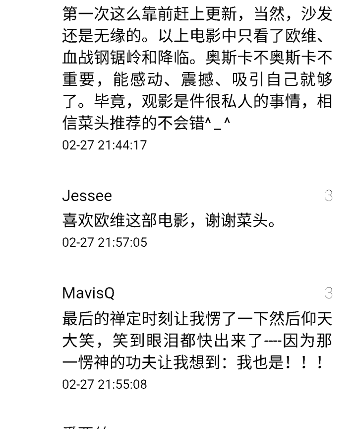

请相信我，

我所说的每一句话，

都是错的。

一直以为自己英文水平不错，今天看奥斯卡直播才发现，我的自信竟然是来自字幕。

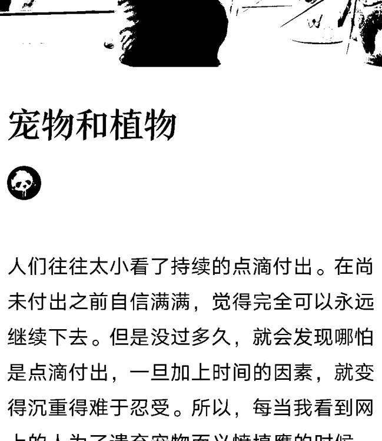

# 宠物和植物

人们往往太小看了持续的点滴付出。在尚未付出之前自信满满，觉得完全可以永远继续下去。但是一过多久，就会发现哪怕只是点滴付出，旦加上时间的因素，就会根本不会养，遗弃的人就不可能是我。而这个世界上有那么多被遗弃的宠物，遗弃它们的人又是谁呢？

没事不要轻易考验自己，哪怕是养一只宠物。

但我支持在家里放上一些植物。包括那些想要养宠物而不得的人，我也建议从养一盆植物开始。照顾一盆植物也需要耗费的心力远比一头宠物要少，如果一个人连仙人掌都养不活，那么他无论养什么宠物最终也会发展成为一次谋杀。养植物的意义不在此，此前我曾经用非常坚持的语气讨论过家里应该有个书柜的话题，基于类似的道理，我认为家里应该有一些植物。并不是为了观赏，也非为了培养我们持续付出的能力，它关系到我们对生活的理解。

我在北京和深圳都住过一段时日。这两个城市都有那种称之为“睡城”的地方，在北京是天通苑那样的社区，在深圳则是龙岗或者宝安那样的区域，人们只在夜晚回来睡上8小时，剩下的16个小时都在市区通勤、工作或娱乐。过着这样疲惫不堪的生活，所谓的家就是一个睡觉的地方。但我无论是在北京，还是深圳漂泊的岁月里，无论住什么样的房子，无论周围是什么环境，我都会在屋子里养一点植物。

人很容易习惯三点一线的生活，这是一件很可怕的事情。当初我们选择三点一线的生活，是为了获得经验值，为了积攒金钱，为了度过此刻的艰辛换取未来的美好生活。但这个过程可能会漫长，忘记究竟为什么自己要过这种生活，以至于把眼前的一切视作了生活的本身。所以，无论到了哪里，我总要在屋子里养着一点植物。每周花一点时间去照料它们，看着它们在春天里一点点萌发，在夏季里茁壮长，在秋天里慢慢枯萎凋零，在冬天蛰伏潜藏。它们提醒我：眼前的一切是暂时的，生活中依然有值得追求的东西存在。

目前的栖居之所不尽如人意，但我不想它变成一个动物的巢穴，只是用来睡觉而已。哪怕只是书桌的一盆仙人掌，它也能让屋子里多一份生机。而我的生活中需要一点生机不，才可能有变化生的可能性。有一盆植物，就像是此时此刻的自己对未来发出的问候。我不要自己习惯于目前这样的生活，我不打算就这样一直生活下去。所以，即便是如此艰难地活着，我也要活得像是已经抵达未来——在未来的生活里，我有一个自己的家，家里有郁郁葱葱的绿植，日光透过叶片在地板上洒下斑斓的影子。

人不会突然热爱生活，热爱是一种能力。你得小心地维护这种能力，不要让它在艰难岁月里被生活打磨干净。艰难的生活并不可怕，可怕的是它把人的心灵磨损得面目全非，失去了爱的能力，失去了关怀的能力，失去了付出的能力。养一盆植物，就是为了保全自己心灵的这种能力。

植物拥有根须，遇见土地的时候就会生长，这大概就是植物所蕴藏的隐喻。每一个在漂泊流浪的人，收起了自己的根须，在努力寻找一块适合自己的土地，这大概就是无关于园艺，无关环保，只是一种对生活的理解。

我曾经写过自己对生活的理解：家中有灯，阳台有花。无论什么时候，家里都有一盏灯点亮，等着自己回去；在那个亮灯的地方，阳台上永远有一盆花。对于我这样的凡夫俗子来说，阳台有花已经属于奢侈，那么，有一盆植物也算是足够美好了。

## 和菜头

> “请你相信我，我所说的每一句话，都是错的。”

每次拉伤手臂的肌肉，都是因为提了很轻的东西，不知不觉走了很远的路。

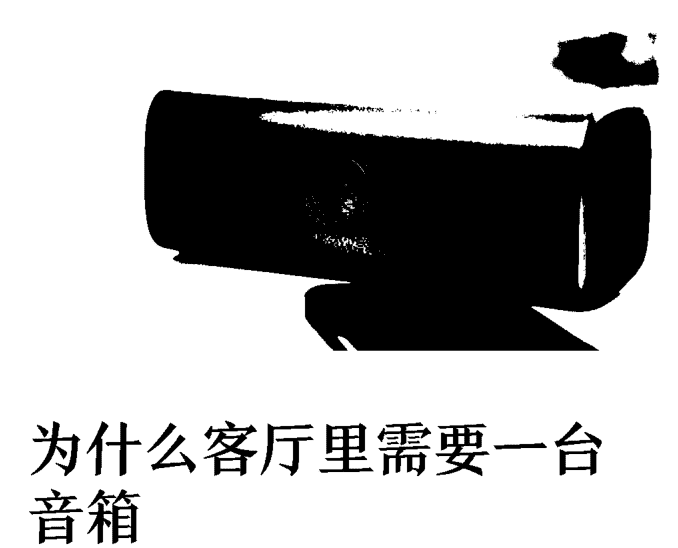

## 为什么客厅里需要一台音箱

音乐是抽象艺术。人们面对一幅波洛克的画会感到困惑，不明白他想要表达什么。音乐要比波洛克的作品抽象得多，因为那不过是一些空气的震动，以及这些震动的组合，但是并不妨碍人们欣赏。只有非常粗鲁的人才会说“我听不懂”，而对于大多数人来说，音乐不是用来懂的，它是用来听的。

世间有两样东西可以轻易地把一个房间填满，一样是光，另一样是音乐。对于客厅而言，无死角的照明并不让人感到愉悦。恰恰相反，需要在客厅利用光线造成不同的明暗效果来，才会让人感到内心过时的安宁。而音乐则多多益善，当房间里充满了音符，尤其是人声吟唱，瞬间就会产生一种自己被包裹的感觉，周围都会变得柔和明亮起来。

人生里有两种时刻最为难捱。一种是独处的时候，正常人很难忍受自己和自己面对面。每当那样的时刻到来，会非常尴尬地发现最难相处的并不是那些自己讨厌的人，而是自己。这就是为什么我们在独处的时候会胡思乱想，要开着电视，要不断刷新手机。所有这些，都是为了回避直接面对自己。在悄无声息的客厅里，坐在沙发上，会特别强烈地感到孤独，但是这种孤独又毫无美感，只是拖曳着自己的心一路下沉。

音乐可以极大地缓解这种局面。当音乐在耳边响起，第一时间就会驱散挥之不去的孤独感，不再觉得自己是孤零零一个人呆在一个水泥盒子里，而这个水泥盒子又在黑暗的宇宙中无休止地漂流。随着熟悉的旋律响起，注意力就会从自己身上解开，不再纠缠不休。和音乐相关的回忆如同潮水一般从脚下泛涌而起，无数过去的日子清晰无比地在前眼里浮现。而是随着音符起起落落，恢复了原本的弹性。一旦过了这个关口，独处所带来的负面情绪就会消散，人也能带着平和的心态欣赏独处的时光。

另一种难捱的时刻，是心头烦躁无比，念头纷至沓来的时刻。在经过漫长而不顺利的一天之后，回家关上门同时也是把所有喧闹关在门外的瞬间，内心的噪声会立刻放大到最大。那是坐都坐不稳的时刻，觉得自己已经精疲力竭，被彻底压垮了。事实上也是这样的，许多人选择一头栽倒在沙发上，就像是倒在一个熟悉的怀抱里。在勉力支撑了一天之后，换沙发来支撑一会儿自己沉重的肉身。

这时候需要有一点音乐。当你努力把注意力转移到音乐上，内心的噪声就会逐渐消失。音乐持续不断，感觉就像是一条宽阔的大河在沙发边奔涌而过，又像是一条柔软的毛毯从天而降，把自己从头到尾包裹起来。当内心逐渐平复，人就能慢慢松弛下来，甚至在音乐声中陷入梦想。无论这一天何等漫长痛苦，睡一觉之后总能恢复部分元气。如果还不够的话，可以在音乐声中洗一个澡。根据我的个人经验，如果在沐浴的时候试着跟着音乐小声哼哼，恢复的速度会更快。等到了可以随着音乐放声歌唱的时候，一切不愉快和烦恼都已经随着流水和音乐消失。

由于还在漂泊，我不大可能专门购买一整套音响设备。而且，整套的设备看起来太过正式，往往没有勇气启动。所以，我的客厅一直都有一套蓝牙音箱。无论走到哪里，都可以放在背包里带走。任何时候只要我需要，就拿出手机选择一个自己喜欢的专辑开始播放，然后，在沙发上放平自己。音乐流淌，岁月无声，我看见自己的人生在天花板上播放，带着我自己设定的背景音乐。

信我，
我所说的每一句话，
都是错的。

像驴一样比嗓门，比气长不是演唱，哪怕唱得再好看也不成。

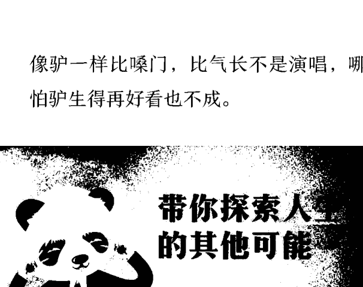

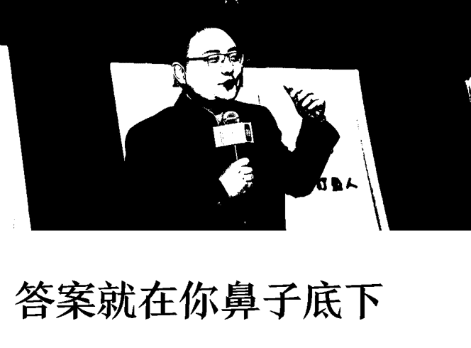

## 答案就在你鼻子底下

罗胖罗振宇在3月8日开了一个新闻发布会，公布了罗辑思维在内容付费领域里的心得，以及遭遇的坑。同时，宣布从即日起罗振宇的视频节目从周播改为日播，而且只在得到App上独家播放。一石之间，几百篇分析文章出台，看得人泪水涟涟。

在中国就没法几个人比罗振宇更擅长说话的，一场发布会下来，罗胖学站了半个小时，也谈了一个半小时。事后整理出来的演讲稿，长达万字。随后几天里引发的讨论，也是以文字对文字，看得人双眼发黑。无论是赞美罗振宇字追近捷，还是批评罗振宇狂妄自大，都是满屏的中文方块字。坦白说，所有这些文字的总量加起来，它们提供的思考价值是微不足道的。我也参加了这场发布会，看完其它人写的文章，我忽然怀疑我和他们参加的不是一场发布会。

为什么罗振宇和罗辑思维团队全面转向得到App？是什么给了罗振宇把视频节目变成得到App的底气？在罗振宇的演讲里，其实他已经非常清晰地给出了答案。

发布会开到一半的时候，罗振宇在一块很大的牌子上公开展示了得到App的核心数据：

| 指标 | 数值 |
| :--- | :--- |
| 用户总数 | 558.4万 |
| 日活跃用户 | 45万 |
| 每日新增用户 | 2万 |
| 专栏订阅读数 | 80万份 |
| 专栏打开率 | 29% |

从这个数据上来看，80万人次的订阅，每天29%的打开率，粗略估计是23万人次。考虑到一个读者可能订阅多个专栏，也就意味着每天阅读专栏的人要远低于23万人次。假设每个人平均订阅2个专栏，而且都会看的完，每天得到App阅读文章的人大约12万。而另外一个大，到App的日活跃用户是45万，这个数字和12万之间相差33万。请问，这33万人为什来得到App？

这样结论就非常明显了：在得到每天到访的45万用户里，有相当一部分并非只是奔着专栏而来。他们访问得到App的原因是，因为得到里有他们要看的其它内容。也就是说，到App的内容服务每天已经粘住了30多万人，而且这个数字还在增长：

**这就是罗振宇的底气所在。**

数据显示，得到App自身是有生命力和活力的。当前所有人的目光都被几个专栏订阅作家所吸引的时候，都在大谈内容付费的时候，大量到App的用户在悄悄使用得到提供的其他免费或者付费内容，并且被这些内容和服务牢牢粘在得到App里。

这也就意味着数据指标显示得到App本身已经成立，而且正处在健康茁壮成长中。用户在App里养成了阅读和消费习惯。按照每日新增2万用户的速度，2017年年底得到App的用户将会突破1000万，日活跃用户超过百万。最关键的是，他们是有内容付费意愿和购买意愿的用户。罗振宇为什么在得到App上押宝？他当然应该这么做。

你看，答案就在那里。罗振宇口干话讲了一个半小时，针对他那一万多字的发言，衍生出了数十万字的分析文章。用文字对文字，每个人都有不同的看法，都可以分析出任何自己想分析出个结果，更可以根据需要塑造成任一个罗振宇的形象：勇敢的、狡诈的、疯狂的、睿智的、出尔反尔的、锐意进取的......全都是形容词。

但是，答案就在那里，答案是名词。答案就在人人都能看到的那张纸板上，每一个数字都很清晰，每一个数字都对应了某种事象。你只需要像我一样，拿起这些数字，粗略地在心里做一下估算，就可以得出罗振宇口吐莲花讲述新方向、新路径背后的真实原因——罗振宇无论说什么，做什么，他首先应该是个尊重数据的人。动机可能是无法索解的，但是，数据却是可以分析的。

这一点儿都不复杂。

事情就是这样，真正的答案并不遥远，事情真相也未必都隐没在云雾中，完全没有人们想象中的那么复杂。只是人们太喜欢事物的表象，太喜欢钻研各种旁枝末节，以至于真相就在鼻子底下却视而不见，却在感慨世事难预料，潮流太多变。终日凝视水波的人，怎么可能知道江河的流向呢？

请你相信我，
我所说的每一句话，
都是错的。

说的文章太短，所以人们重拍抒愤。
分析细节的文章乏味，所以人们强调格局和视野。

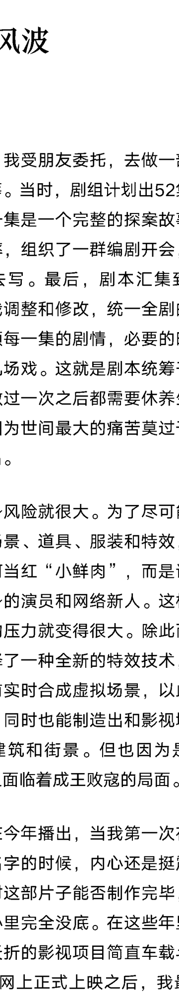

# 一次风波

三年**前**，我受朋友委托，去做一部网剧的剧本统筹。当时，剧组计划做出52集剧本，要求每一集是一个完整的故事。为了提高效率，组建了一个群编剧开会，每人分几集去写。最后，剧本汇集到我这里来，由我调整和修改，统一剧目的台词风格，顺顺每一集的剧情，必要时甚至要删减几场戏。这就是剧本统筹的关键，任何人做过一次之后都需要养生休息很长时间，因为世间最大的痛苦莫过于修改别人的作品。

项目本身风险就很大。为了尽可能把制作费投入场景、道具、服装和特效，剧组没有请任何当红“小鲜肉”，而是请了一些科班出身的演员和群众新人。这样一来，收视率的压力就得担很大。除此以外，剧组还选择了一种全新的特效技术，它能够以绿幕的实时镜头生成，以此弥补拍摄投资，同时也能制造出因影视技术完全不可能的建筑和场景。但因为是初次尝试，剧组面临着成王败寇的局面。

这部剧在今年播出，当我第一次在片头看到自己名字的时候，内心还是挺震撼的。此前我对这部片子能否顺利拍完，能否按照预想成片充满忧虑。在这几年里，我见过半道夭折的影视项目简直车载斗量。今年2月在网上正式上映之后，我首先自然是担忧剧情，怕观众不欣赏，破口大骂这是烂片。结果平淡度过，观众对网剧的宽容度很高。然后是担忧演员，担心不能吸引足够多的观众。我给了佬粉们的演技以宽容和谅解，在网剧上看新片粉，观众接受度还不错。最后是担忧特效，头条真的有许多观众批评，根据他们的反馈意见剧组做了大量调整，有观众也发现了新式的特效问题，甚至有人通过发现了前后的差异，赞扬技术上的提升。

比起影视作品更有戏剧性的是现实生活，在我以已经克服了各种艰困难题的时候，意外发生了：一位微博网友在指一部网剧的某一集，涉嫌抄袭她的中篇原创剧。网络怎么可能错过任何热闹，尤其是涉及到影视抄袭的事件，一向都是舆论关注的焦点。尤其是班底的硬粉大举讨打高潮之后，无论某某人士还是大牛头说，对抄袭的行为简直可以说是深恶痛绝，于是，这部剧立即被推上了风口浪尖。

当晚我和剧组重新过了一遍剧本，找到小说对台分析。初步的结论是确实存在“撞梗”，但不能确定就是抄袭。所谓“撞梗”说的是桥段雷同，因为戏剧发展了那么多年，基本上所谓的桥段都已经出现过了，无限上编创大概也很难出一个前所未见的新点子，里面每一个桥段都是新的，观众其实也都熟悉这些桥段。比如战斗戏份，哪一个偶像临死前拿着战争的照片，或者带着个伤找前家看地，一般随后就会被敌人干净利索地结束生命。再比如劝服数据，一对男女只要是吵架了，一般都是女方先给男方一耳光，结果自然是大家耳熟能详的：男方不追反应，两个人开始激烈地接吻。

不那么写故事也可以。战士看完照片一路打到底，成为大英雄回家和妻儿团聚，那就是戏戏。甲方投上一笔，不是冲上去拦截，而是跑后边上空两次，爱情戏就变成了喜剧。总之，尝试新桥段的风险很大，未必成功。老桥段虽然都新，但总是有效的，观众不是喜欢次次都超出自己的期待，除非那也是个恐怖片。所以，戏剧总还是会发现“撞梗”，让人觉得某时情总会似是曾识，这种情况其实是允许的。

但是，作为利益相关方自行判定是否抄袭并不服众。为了平息争议，剧组找到了剧本抄袭鉴定专家编剧张老，委托他和他的团队对剧本和小，实在在中建第三方的角度给出一个判定，究竟是不是抄袭。经过漫长的等待之后，却收到了一个令人遗憾的结果：张老和他的团队判定抄袭成立。但是抄袭认定的事情比我想象得要复杂得多，并不是考虑撞梗数量和撞梗密度，而是要把故事拆散，非常细致地对故事线、关键情节两者是否重合，是一项非常具体且细致的技术活。

确认抄袭是一个非常痛苦而且难以接受的结果。尤其是之前闪过了如此之多艰难险阻的情况下，更是让人得偿所愿。在此情况下，对于我自己而言，在文章里用一张图，我都要标注出出处或者花钱购买版权，家里所有的电脑上都安装有正版杀软件和正版软件，然而到头来一切成了一种讽刺——我自己原创的剧本变成了抄袭，就窃取了他人版权，这让我感到极度的沮丧，剧组也因此深表打官司。

但事情已经是这样了，就只能接受，而且，剧组讨论之后本着依法原则见证，由做法局等一等原作者大法庭起诉时，版权官司一打几年，而且最终未必是作者胜诉。官司最终结果，剧组早已经播公害事件给作者判决结果，然后向作者公开道歉，对除台案编辑并追究相关责任，最后和作者协商补偿和售后问题。我作为台台编辑，也在网上公开发布道歉声明，向原作者和观众致歉。

事情比我想象的更顺利。原作者随即表达了善意和肯定，读者愤怒的情绪也心平气和了。在我的声明下，大多数是肯定和勉励的留言。

这件事给我感触最深的一点，是中国民众版权意识的觉醒，和对知识产权的尊重。与之相对的是，是商业环境里对版权的普通忽略，以至于只要肯谁站出来承认错误，诚恳道歉都能获得一片掌声，感觉不是做了一件错事，而是做了一件好事一样。

就这样，一场风波终于平息，最为艰难的时刻过去了。很多时候，做正确的事情的确非常痛苦。但是，只要忍受住这种痛苦，接下来的事情反而会变得顺利许多。

最重要的是，我现在承认：事实上，人们支持你做正确的事，甚至还因此慷慨地给予许多鼓励，远远超出你值得的褒奖。

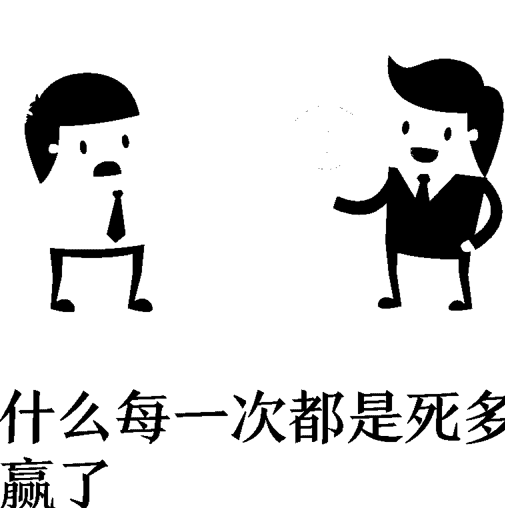

# 为什么每一次都是死多头赢了

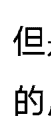

和几个北京的老朋友聊天，说起北京的房价问题。其中一个刚刚在三年前买了房，当时每平方米6万人民币，觉得是买在了绝对的高点上。

但是又没有办法，家里新添了人丁，原来的房子实在是住不下了；是在看眼拼了套房，心里安慰自己说：买在天花板上也认了，就当作是为创造房价记录做贡献。现在，这套房子每平米早已突破十万大关，曾经的绝对高点变成了相对低点。

那么，现在的价位算是绝对高点，还是未来的相对低点呢？

大家不由得想起了一位共同的朋友，他在十年前成功地说服了大家，北京的房价已经达到历史最高位，随后的下行完全可避免。正因为他的强大论证能力，所以我们中的那一位一直拖延到三年前才买的房。然而事实如你所见，十年前北京的房价和现在相比，简直就是微不足道的小数字。在预言北京房价这件事情上，死多头总是一次又一次完胜死空头。

我对经济学并没有什么研究，十年前买不起北京的房产，现在还是买不起，所以房价涨跌对我来说完全没有能力。但是，在过去的十几年里，无论是看房价还是看经济走势，总是死多头胜出，这件事情就非常有意思了。

在看了那么多年分析文章之后，我依然没有弄懂双方谁更有道理一些。死多头认为土地供应量是有限的，人们总是倾向于从二三线城市涌入省会城市，再从省会城市涌入一线城市。因此，一线城市的房价有足够多的需求支撑；而死空头总是在谈城镇化，谈住房空置率，谈居住普及率，认为房价建筑在泡沫之上。只要当泡沫在，就一定有破裂的一天。双方就就这么吵吵闹闹，然后北京的房价就这么一路飘上去，只是在07年附近回跌了一点，随即又义无反顾地升上去了。

于是我忍不住去想，究竟是他们哪一方说对了？还是其实都说服错了，谁都没有解释清楚房价上涨的实质原因？甚至我怀疑关于房价看涨看空究竟不应该构成一个问题，只不过太多人觉得房价太高，心里总是希望房价降下来，于是看空的声音就开始有市场。而那些在大城市里真正拥有了住所有的人，发自内心地希望房价再涨高一点上去，但是呢为了落个实际的好处，所以由得看空的人去四处嚷嚷，反正自己依旧是纸面上的富翁。

最后，我不得不换一个思路来考虑这个问题：我不懂经济学，也看不懂白多头和空头各自的道理。但是，我觉得我想明白了一个简单的道理——泡沫破裂需要泡沫。即使我承认泡沫存在，而且肯定泡沫一定会破裂，但是我并不清楚泡沫何时破裂。不单是我，我相信经济学专家也无法预测这一点。

那么，在泡沫破裂之前，房价总是在上涨的。而且，它看起来依然是平民最划算的投资方式。换句话说，看多其实是有道理的。因为在泡沫破裂之前的那一段时间之内，都是纯粹的利润。而空头拒绝进入这个游戏，意味着在所有的时间里规避了泡沫的风险的同时，也错过了所有的利润产生。

我还想明白了另外一件事情：中国人传统的死看事物方式，未必适合今天这个时代。死空头用十六次去宣布广的工厂批量关闭，可见经济形势不好，制造业不行，大家马上没钱买房了。我也听过死空头下几十次宣称看见周围的小区到了夜里没有几盏灯，可见入住率太低，房子根本卖不动了。

中国是一个太过巨大的存在，想要通过某一时刻一地的现象作为判定依据，进而推论全貌，这并不是件明智的事情。看到家门口的树叶都黄了，那么秋天到来的可能性的大确很大。但是，在一片巨大的森林里看到一些树叶变黄了，那也许只是一次局部的新陈代谢，根本分析不出任何有普遍适应意义的结论出来。但是，每当你拿起一片黄叶，总总是能说服一堆中国人相信，就像我那位朋友在十年前分析房价已经到顶一样。

死多头为什么总能赢？因为只要火车头还在前进，死多头就总是有赢的时间和赢的空间。一定程度上来说，只要火车头还在前进，时代就会奖励贪婪和冲动，并且将其视为一种美德。

和菜头

请你相信我，

我所说的每一句话，

都是错的。

我那位死空头朋友刚刚结婚，太太在过去的岁月里全国四处买房，是个标准的死多头。你看，世事就是这么奇妙。

## 重温《寿司之神》

当初看纪录片《寿司之神》的时候，没觉得有多好。今天下午却又翻了出来，重温一遍之后不得不承认，真是好片。原因是我昨晚看了一部Netflix制作的纪录片，讲述了一个瑞典素食料理厨师的人生故事。她是一名意义很浓的比丘尼，同时，她也是一名出色的厨子，用她的素食料理，征服了世界各地的食客和大人。

我花了两个多小时，满怀期待地看完了这部素食料理大师的纪录片，然后整个人变得暴躁如雷，觉得这部片子毁掉了这个周末的夜晚。与此同时，我产生了从未有过的强烈愿望，想要重温一遍《寿司之神》。人生里经常会发生这样的情况，通过对比带来的伤害，终于让我认识到了自己在不经意间错过的那些作品其实有多么伟大。

为什么我会暴躁如雷？因为Netflix针对世界各的大厨做了一整套纪录片，叫做《大厨的桌子》，带着观众走进神秘的后台，讲述大厨们的人生故事。人们为什么要看大厨的人生故事？当然是为了美食，最吸引人的永远是美食。至于说大厨的人生，那永远必须是非精彩才值得人们去关注。但是，这部关于静师傅的纪录片既没有讲好美食，也没有讲好她的人生。

镜头下的所有菜肴，根本无法说服我认同那是某种美食，也没有多少镜头表现厨太的厨艺。事实上，静太在整部片子都戴着防手指套尝试蘸料味道，就是对镜头说话，我这就没见过那么话多的尼姑。她的70多岁，她还说了一下妈妈在她17岁的时候逝世，她伤心之下决定出家当一名尼姑，在寺庙里继承和发扬了母亲交给她的传统韩国料理菜式。由于没有美食也没有故事，所以整部片子都试图塑造禅境东方佛教氛围，讨论烹饪和禅之间的关系，也相当于什么都没说。一看就知道，纪录片导演对于离菜烹饪毫无兴趣，她对制作和烹饪毫无兴趣，他拍摄《寿司之神》的情况也完全相反。

在《寿司之神》里，透过镜头都能发现导演对于寿司的狂热。因此，他一次又一次用不同的镜映方式表现寿司的颜色、温度、质地和纹理。就是新生儿的父亲看到自己的孩子摇摇晃晃一顾而成的酱油放在小碟子里，上面是轻轻一晃而过的酱油，那是毫无疑问的艺术品。

有了这样的基础，寿司之神小野二郎在其间插入自己的讲解，和对自己一生的回顾，看过了都会对这件事俯仰对比，对他一辈子就做寿司这一件事佩服到五体投地，而且还会生出些许的感动，因为如此之小的一个领域内做到极致的程度，吃下去的再不是寿司，而是小野二郎这个人的一生。这对于食客是最大的恭维——一个大厨用一生的努力奉你餐饭，对得起你如同对待一位君王。这才叫吃呢，而不是吃，或者是充饥。

因此，导演都无需刻意表达形而上的部分，观众很自然地就能理解小野二郎在寿司上精益求精就一生所能解的匠人之心，或者是说职人精神。回到今天最早的话题吧：如果没有表达出一块完美的寿司，那么后面的故事就都不成立。而我们在现实里是，往往看到是的是相互的情形——类似静师傅她的纪录片——并没有完美的禅菜，重点全是在讲故事，菜里的禅意，庵厨的，意义的事情。

一枚寿司在视觉和味觉上成立之后，人们才会去问：如何做到的？当人们知道一个人一辈子的时间全用在做寿司上，这就构成了一个好故事，一个生活中常能发生的故事。而两个或菜尚未出发的，一个身为尼姑的大厨就根本不是一个故事。哪里有厨子？难道尼姑就不吃饭吗？有尼姑的厨子很怪，不不说一个做肉食菜而全国知名的尼姑，那不是一个真正的故事，人们可以不管她的肉食做得如何，而是想知道她如何处理她的个人信仰和她的烹饪之间的关系。

今天谈我并非是想讨论纪录片拍摄技巧的议题，而是试图比较两种强微殊差异的那个观点：在出点点上的细微差异，会在未来的发展过程中造成极大的不同。看起来两部纪录片都差不多，都是在谈美食和美食厨师的厨下，为什么观感会产生那么大的差异呢？《寿司之神》在一开始，想要表达的是日本的最好的寿司，然后是能从这种寿司，而静师傅的纪录片在一开始，想要表达的是一个身为尼姑的厨子，认为这是故事的好卖点。因为出发点点上的这一点差异，哪怕在形态上不一样，但是最终的结果是一个让我赞叹不已，另一个却让我暴躁如雷。

在我看来，做任何事情的发展最好是第一念，而不应该是第二念。“最好吃的寿司”，或者“最好的寿司师傅”这是第一念，不需要思考，不需要推理，完全可以从脱口而出，修为自己性中里最最本源的部分。“身为尼姑的厨子”属于第二念，听到这句话需要想一想才能明白其中的含义。于是，顺着最好吃的寿司展开，一切都顺顺当，美食讲透了，人物也立住了；但是顺着身为尼姑的厨子展开，很快就陷入两场战役的困局，厨子的事情没讲好，尼姑的事情也没讲清。

所以，每当有人问我“如何才能变得更牛”，我总是回答：你的出发点是错的。

和菜头

请你相信我，我所说的每一句话，都是错的。

我毕竟还是太天真，竟然会相信一个白菜占据半壁江山的料理会真的好吃。

## 第150篇

这是我在《得到》开设专栏以来的第150篇文章。

从去年6月份到现在，我写了9个月时间。因为开设这个专栏的缘故，和菜头这个ID也就经常性地和知识经济、付费阅读这样的概念关联在一起。同时，由此而产生的批评和疑虑也是我上网那么多年来从未见过的，其中一些甚至是来自和我熟悉多年的人。

《得到》的专栏并不好写，尤其是对于我这样的人来来说。人们来到《得到》是为了学到点什么，尊敬所有的专栏作家为“老师”。人们不单想要学到一些什么，而且还想有效率地学习。在前阵子举办的罗辑思维改址发布会上，傅盛专门和我说了音频的问题。他认为我的文章没有转成音频是一大缺憾，正因为如此，他订阅了《槽边往事》却一直不曾打开。对于他来说，不是看《得到》，而是听《得到》，那是他跑步时的背景音乐。

但我不认为自己有什么可以教别人的，也没有时间去录音——我的确尝试过，每次都要录十几次才能达到我的标准，比写文章辛苦多了。我习惯于抛出问题，抛出观点，但不提供答案，提供答案不是我事。因为如果我知道答案的话，那么我肯定没有兴趣再去陈述，有意思的是找寻答案的过程，永远不是答案本身。我因为没有多大兴趣和人辩驳自己的观点，因为和辩论的麻烦相比，还是拉黑更方便一些。我知道这样的性格并不讨喜，尤其是在一个商业社会里，但我已经这样很多年了，而且也不打算去改。

迄今为止，我的人生里没有追求过任何自我完善，自我提升一类的概念。主要原因是我太懒，而且因为懒发展出一套哲学来。比如说我不大赞同人生要补齐短板一说。因为人生太短，短板太多，补齐来辛苦又麻烦。与其如此，不如找到自己最长的那一根板子，想办法把它加长加粗。在对方攻击到你的短板之前，抢先使用你的长板抽死对方。而且，补再多短板，最终决定你能不能击杀对手的还真是你的长板。同样的道理，我认为人大不需要自我完善。人生下来都是完善的，没有罪孽也没有烦恼，都是被后天一点点教坏的。因此，最重要的事情是去掉差数，别再折腾自己，一个人就能自然而然恢复那种完善。

但这样的观点不适合公开表达。如果一个人抱着自我完善、自我提升，成为更好的自己一类的观念整天忙忙碌碌，疯狂折腾自己，那么他精疲力竭之后，自然也就没有什么妄念了，倒也真有可能因此完善了一点点。像我这样告诉人们说你无需如此，反而让人厌倦。别人上民航机坚持要带个降落伞，那就让人带一个好得了。但是我不单不给，而且认认真真地告诉他们：即便跳伞成功，也未必能逃过发动机里搅成肉酱的命运。即便逃过肉酱，最终活着落地的可能性也依然微乎其微。背着降落伞上飞机的念头本身就是妄念，能救你的不是降落伞，而是概率论。

所以，我讨论了许多和生活有关的话题，努力换个角度去看大家共同的问题。这样的文章写起来非常累，但是我相它会带来某种帮助。不过，现在这种辛苦的岁月就要结束了——我在《得到》承诺的专栏总数不低于156篇，这是第150篇。也就是说，我再写六篇之后，就可以随心所欲，想写什么写什么，想怎么写就怎么直，一直写到今年6月。一想到这一点，我都有些迫不及待了。

> 请你相信我，
> 我所说的每一句话，
> 都是错的。

人在潮头的时候，容易把一切都归结为自己的功劳：因为我受过完备教育，因为我社会精英，因为我足够努力，因为我非常聪明。不，那是因为在潮水上站着，低头就能看到那种无边无际、裹挟一切的力量。

## 孔明梦

今天在微博上收到一条私信：

你说说，我有一个创意能让支付宝一夜间颠覆微信，从中国最大社交软件，如当年微信红包一夜间颠覆支付宝在线金融功能一样，作为一个平凡百姓，怎么能利用这资源呢？

这条私信让我想起了2009年在深圳腾讯大厦见到的一幕：一个青年男子脱光上身，用黑色油漆涂抹面部和身体，呈现一种斑马状，站在楼下高举“我要马化腾”的横幅。后来经了解，这个人宣称有办法可以让腾讯在一年内利润翻一倍，需要和马化腾面谈这一振兴腾讯大计。

就在几个月前，我的朋友雕爷还拿了一封手写的信件给我。里面的内容也非常相似，但是要上述两个人详细一些，有一个粗略的纲要。按照他的说法，如果根据这个纲要执行的话，雕爷的美团上门服务在短期内会有翻天覆地的变化。我问雕爷给我看这封信是什么意思？雕爷回答我说：“好好看看人家的字，比你强太多了！”

我想，要么是我骨骼清奇，所以总能见识一些奇人异士；要么是奇人异士太多，以至于连我这样的宅男也能分配上三次。

看着这样的人前仆后继，有时候想想觉得挺伤感。就像是时至今日，那些还在致力于制造永动机的人。他们用几十页写满自己发明的运动学公式和能量方程，却不知道他们实质上是在试图颠覆能量守恒定律和热力学第二定律。其中有一些人的确切知道这些定律的存在，他们宁愿不去颠覆亚里士多德的利拉格，颠覆牛顿的爱因斯坦。“你怎么知道当今的物理学不是错的？你为什么不允许我挑战权威？”，他们这样说。

试图制造永动机的人有个科学梦，认为在高中物理领域内自己还大有可为。而沉迷于提出创意点子，想要据此和分人利润股份的人，则有一个孔明梦。

所谓“何世无英雄，遗之在草泽”，他们有孔明之才，安邦定国之能，奈何一直没有找到刘备三顾茅庐，因此只好下山径直来找我这样的皇叔：明公，山人有一计献上。万事具备，就差一家腾讯或者一家阿里巴巴来执行了。

我自己一度也有这种孔明梦，经常给朋友出主意：你只要……就能……。觉得自己头脑灵活，总是有奇思妙想，而朋友们经常是灯下黑，看不到简单直接的解决问题之道。

等我开了家公司之后，回想以前自己摇着鹅毛扇，指点江山的样子，恨不能把脑袋插进马桶，然后按下冲水键把自己淹死——等自己上手运营一个企业的时候，才会知道自己在这个世界上一根毛钱不值。一个人有层出不穷的点子，而且相信这些点子真的能奏效，无非是他没有弄清楚最简单的一个事实：因为他无需对决策结果负责，所以想说什么都可以，怎么说都有道理。

一旦自己手下有几十口人张嘴吃饭，每天一睁眼什么都没干单是工资和房租水电就要花出去两块钱，心态就会完全不一样了。当自己做下一个决策，并且承担这个决策产生的所有后果，一个大慨就再也不会说出“你只要……就能……”这样的句子来，因为知道这句话背后真正的代价是多大，世间没有那么多简单的“只要”，更没有那么确定的“就能”。在我自己开公司之前，我唯恐别人不听我的意见；在我开公司之后，我唯恐别人真的听进去了——因为别人要背负结果，事关成败生死，而我只是动动嘴皮子。

中国人喜欢看三国，尤其其喜诸葛亮孔明。在整部书里，他全凭自己的智谋，成功地三天下，反复上下弄英雄于股掌之上，自己的一双手上别说血，连灰尘都没有。最后还赢得了极高的声誉：三顾频烦天下计，两朝开济老臣心；出师未捷身先死，长使英雄泪满襟。我想，大概是因为有孔明这样的人物存在，所以民间总有那么多人对自己的头脑很自信，致力于做一个一言兴邦的谋士。

问题是三国时的谋臣那么多，孔明却只有一个。所以，看《三国演义》的时候应该多看看其他谋士的命运。诸葛亮之所以有名，是因为各路诸侯砍掉的谋士的头颅太多，所以幸存的赢家才会如星光彩夺目。也应该多想想一个很容易忽略掉的事实：刘备三顾茅庐，很少诸葛亮的山。既然诸葛亮完道，为什么不批发一百个锦囊让刘备下山慢慢打开看，看到一百个的时候，刚好光复汉室？因为诸葛亮不出山，不跟着他的军团仗，和刘备同样面对生和死的威胁，把自己的生死存亡和刘备的命运绑在一起，那么他的计谋就不值一听。所以，诸葛亮做军师让刘备言听计从的同时，得押上自己。

回到一开始的那个问题，可以让支付宝一夜之间颠覆微信的点子，如果想让马云去执行，得在马云那里抵押多少人头才够呢？

## 写作课教案

因为喝了朋友的一杯子茶咖啡，本周末要去为他的私人课堂上两个小时写作课。

我不喜欢PPT，又不想跑去念两个小时稿子，所以就“用”**得到**作为我的笔记，在这里备一下课。这个故事告诉我们：不要随便喝别人给的饮料。

以下就是我的写作课教案：

- 一、开场首先努力扮演一下谦虚，如果真有什么人不识趣真的不鼓掌的话，先扔出教室。这样的话说，就是写作的第一课：文字是一种赤裸的武术，最害表达的东西总在字面之下。按照字面理解的话，就会被扔出教室（写到这里，不禁有点期待这课了）。

- 二、明确一下我的写作课有哪些前提：
    1. 我不是科班出身，也没有职业作家，我就是个写作业余爱好者；
    2. 我不是文科生，我是标准的理工科学生，写作都是后天上网上横练出来的武功，纯粹的野路子；
    3. 我到现在都还没弄懂为什么大家喜欢我看写的东西，以及为什么大家不喜欢我推荐的作家和文章。
    
    因此，我的看法和经验只适合于少部分毫无任何基础，也不打算把写作作为终身事业的非业余作者。这样也有明显的好处：**心里没有妄念，就容易写得多一些，踏实一点。**

### 三、写作的入门路径

- **1、核心问题：为谁而写？** 回答为自己写的，请出教室，回家写日记去，来这里听什么呢？

课堂互动环节：希望有超过一半的人举手，被我赶出教室，然后再收他们一遍学费。

再问一次，回答为读者写的，属于投机取巧，全部罚款一半的学费。

收钱之后引出观点：无论是为自己写，还是为别人写，都属于执着于边见。一个演员在舞台上只演自己，所以叫做脚；只为观众而演，那叫做低俗。优秀的演员扮演一个角色，这个角色不完全是他自己，但也完全是观众要的东西，而是支撑那个角色内在的生命所需要写的东西。**写作是一种创造，创造物必须是活的东西。就像手掌中的一只鸟，握紧了会死，握松了就振翅远飞。**

- **2、怎样开始？** 不要理会任何规则，先随手写一篇自己必定看不上的文章。确定为谁而写之后，只是个正确的想法，未与有与之配合的手段。所以，要养成习惯失败的感觉。

第一篇文字一定是失败的了，像极了当年拿起笔和纸的时候，魔法时刻降临。不假思索写出来的东西，是自己心真正喜欢的文字类型。可能是诗歌，可能是小说，可能是散文，可能是杂文，说明自己的兴趣就在某个类型上。确定了自己的兴趣所在，才有继续前进的方向。

- **3、他人之眼。** 除非是天才，否则创作必须从模仿开始。不要忙着打破人家窠臼，说打破就打破那你坐在这里干什么？基本技巧和方法是走，个人风格是跑，先学会走路，而且走路，再说跑步冲刺的事情。模仿自己喜欢作家，模仿自己欣赏的文字类型摘抄，必要的，模仿可以直接抄原文。不要摘抄，要抄就从头抄到尾，强迫自己感受一整段完整的创作过程。通过前人的模仿和借鉴，学会用别人的眼睛看世界。不要纠结在具体的细节和技巧上，而是要寻找文内部的节奏，寻找着使的视角，参考文比较有用的技巧：**如何切入面前的这个世界，如何选择一个和大众不同的角度。**

- **4、母题选择。** 历史上没有几个伟大天才能够凭空创造出一个文学母题，可以为后世源源不断地供应灵感。中国小说就四个半奶头：四大名著加上只能算一半的《封神演义》，后世不脱这四个半、母题、伦理、爱情故事，你逃不脱这四个半奶头的哺乳。尤其是《红楼梦》，基本写尽了后世流行小说的所有故事类型。为什么阿来的《尘埃落定》厉害？因为自带奶妈。为什么阿城的《棋王》厉害？因为可写成小品文，拒绝喝奶。为什么沈从文的《边城》厉害？因为他自己生崽抚养一头野马喝奶。所以要研究文学母题，文字才有打动人心的力量。前辈已经在中国人的心灵上摸索了好几千年，你就不用自己费事动手再摸索几年了，摸索了人民也厌烦。选一扇门的切入点，学习母题和从母题衍生出来的各种作品。

### 四、关于读者

- 1、中国人的底色是什么？全世界书店卖得最好的都是工具书和心灵鸡汤，中国人有什么不同？中国鸡汤有什么不同？中国人的底色是道教化，不诉诸天求什么，讲求现实的享乐，维护从下载到地球的等级秩序，个人又追求超越等级获得终极权限，并且视之为一中自由。“腰缠十万贯，骑鹤下扬州”不是讽刺，而是内心真实欲望的体现。

- 2、一个道教徒会喜欢什么？喜欢长生不老，永生是表象，真实的需求是永远的在个人世享乐下去；喜欢怪力乱神，神秘学是表象，真实的欲望是对秩序的双重需求：
    - （1）维持秩序以求现得世安稳，对世界的理解为不变化而崩溃；
    - （2）破坏秩序所带来的快感。典型的例子是《水浒》，招安和造反本身没有任何矛盾的地方；
    - （3）情欲，对《房中术》的狂热，对持久力的追求，因此多数情，文学作品里真正为情付出一切的 sono 女性角色，很少有男性；
    - （4）权术。

- 3、一个典型中国读者的画像。（太伤人，从略，希望现场没有录音）

### 五、时代心声

1. 一个永远存在的机会：今天的一个写作者，和历史上的前辈相比，最大的优势在哪里？活在当代。这意味着总存在机会，去表达这个时代最强大的心声。如果你能够表达出来，甚至只是简单的发生共振，就有机会成就伟大的作品，最低限度可以成就打动人心 的作品。

2. 什么是时代心声？《悲惨世界》好在哪里？《源泉》好在哪里？《平凡的世界》好在哪里？《成都，今夜请将我遗弃》好在哪里？每一个时代里，都有自己独特的脉动，都用不同的方式表达自我。埃菲尔铁塔、帝国大厦，这是建筑上的自我表达。文学上也存在类似的现象，时代需要一种可以表征自我的文本出现。

3. 网络文学里的时代心声。为什么开始流行玄幻故事？为什么开始流行大女主宫斗？武侠和玄幻的本质区别在哪里？侠之大者为什么失去了市场？人们喜欢玄幻究竟是喜欢什么？为什么男性视角的故事不受欢迎？为什么CP成为流行？为什么人们喜欢看强势女主角的网络文学作品改编的影视作品？时代心声最先在流行文学里表现出来，然后寻找最强的写作者。

### 六、结语

从用别人的眼睛看世界，到用自己的眼睛看世界，是从入门级创作者到资深创作者转变的必然之路。创作的路径有许多条，但需要了解目标人群，和前进的方向，同时把握好好那些细微的变化。讲述永恒的人性，但是也不要忽略了人性在不同的时代里总是会发生细微的变化。写作者需要总是赶到变化前一点点，等着读者赶上来。

请你相信我，
我所说的每一句话，
都是错的。

这样讲两个小时，估计可以打消大部分人的写作热情了是吧？

围炉夜话

24729成员 97人今日打卡

## 用户留言

- 和菜头 25
    - 沙发！！
    - 03-23 23:24:40
    - 作者 回复：抢沙发的教案！
    - 03-23 23:24:55

- 很咸的泡菜 10
    - 嗯，这样讲应该不会再有朋友请你喝饮料了。
    - 03-23 23:40:41

- ⋀太英俊 7
    - 又是一桶汽油，心火太旺，又要爬起再写一篇了。得到的作者为啥都是夜里更新，读完整就很，就想说话，就想和这个 世界和自己重新聊聊。
    - 03-23 23:40:46

- 晓燕 5
    - 我只想用文字记录，一些回忆、一些观察到的事和物，以及断断续续的一点思考。从文字中可以看到自己成长的过程。
    - 03-23 23:40:15

- wzm720 4
    - 每个问题都发人深省！！深入思考明白，我觉得写不写作都无所谓了！讲出来就很有价值。
    - 03-23 23:35:00

- 安琪 3
    - 正想学写作，和菜头老师来的正好
    - 03-23 23:44:14

- Rainbow 3
    - 每次看桑叔 谈写作都有新的启发！每次都觉得别人不在哪里而解决。很想知道这个写作课从哪里开始上，可否聆听！那作为业余的不能在业余的我来说，学习 菜叔是我前进的动力。

- 甘竹 3
    - 写作是为了创作，三叔创造了盗墓世界，属于艺术，我刚开始写作是为了倾诉，现在努力朝着跟读者沟通的跑子里写。给一些时间给公众号写稿，编辑要求我改成正能量一点就能登，被拒绝 了。要有自我，总要有个开始
    - 03-23 23:34:16

- 土拨鼠铁箱 2

## 当代艺术和垃圾

今天，首先请你看一段视频。请扫描下面的二维码（点击图片 - 分享 - 保存到相册，打开微信 - 扫一扫 - 相册），看完这段5分49秒的愤怒声讨。

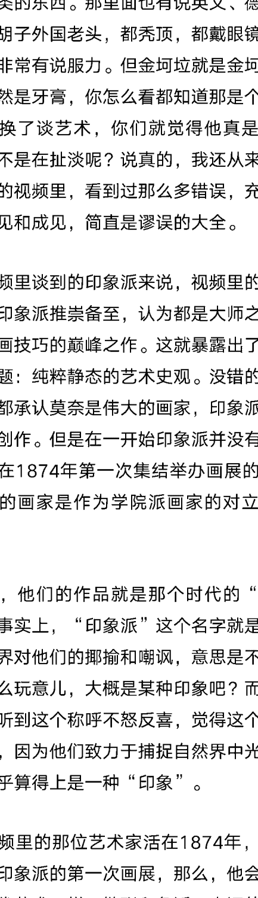

我相信，在“得到”的各位读者中，会有相当部分的人赞同视频中这位艺术家的说法。看完之后望着我说：对啊，他说的有什么时间问题？当代艺术就是垃圾。

因为从日常的生活经验来看，无论是新闻里呈现的拍卖，还是在画廊或者美术馆里看到的陈列，都给人一种印象——当代艺术作品根本看不出什么，而且根本不像“真正的艺术品”。它们看起来就像是一堆大大小小的骗子，合谋起来玩皇帝的新衣这种游戏。大资本家心里比任何人都清楚当代艺术作品根本不是艺术，也根本弄不懂，但是又不约而同地参加游戏，维系这些作品在拍卖会和画廊里的价格。

是这样吗？更何况现在加上了这段视频，一个说流利英文的人，看上去受过良好的教育，挂着艺术家头衔。还有什么比这个更有说服力的事情呢？瞧瞧吧，连艺术家都知道当代艺术，宣称那些所谓的艺术品是垃圾，皇帝其实光着屁股在吹呢！

我不知道你们看过金坷垃的广告没有？或者牙膏广告一类的东西。那里也有说英文、德文、法文的白胡子外国老头，都秃头，戴眼镜，看起来也非常有说服力。但金坷垃就是金坷垃，牙膏依然是牙膏，你怎么看都知道那是个广告。为什么换成了艺术呢，你就觉得他真信在谈论艺术，而不是在扯淡呢？说真的，我还从来没有在那短短的5分多钟的视频中，看到那么多错误，充满了那么多偏见和成见，简直是谬误的大全。

真的没有区别么？蒙德里喜欢画圆形格子点，草间弥生喜欢画波浪点。任何一个得格过一点点美术训练的人，都可以画格子打波浪。那这个人为什不是蒙德里亚呢？为什么他不是草间弥生呢？他的作品为什么不能卖一样的价格呢？为什么不能开展，拍卖去呢？可以用我的经历作为例子来解释这个现象。

你们想一下，有没有可能一个年轻人花个一年半，模仿我的风格，写出一篇像我写出来的文章？当然有，而且能这么做的不在少数。那么，有没有可能写一批出来？当然有，能够仿造一篇就能够仿批。那么，他能不能凭借这些文章在“得到”开专栏？答案是不会，因为一个人和头菜就足够了，“得到”的用户花钱不是为了买一个和头菜第二，看一种重复风格。

对于那些熟悉的读者来说，他们看我的文章已经超过了十年。我的个人风格在这十年间也会经历一些变化。如果时间再拉长一点，也许我的风格会前后判若两人。如果我的后期风格变得非常晦涩复杂的话，对于我的老读者来说并不会构成一个问题，因为我的作品陪伴他们走几十年，他们熟知这一条路我是如何走过来的，为什么会变成今天这个样子。那么，如果一个小朋友上来就模仿我后期风格的作品，而且全无任何征兆，也没有前序作品，他发布出这样的作品，请问谁能立即接受，能立即理解？

这就是为什么那种作品比较的无聊之处——**在今天，作品和创作者已经无法分开，脱离人谈作品毫无任何意义**。观察创作者持续的观念变化和个人轨迹，远比观察格子的外形重要。一个人可以画格子，也可以是格子自。一个人可以画黑点，那就是黑点而已。世界上并不存在无启艺术家，创作一定来有处，所以模仿外相是没有任何价值的。

我不期望于通过一段短视频和一篇简单的问题能说服谁，这里我只是埋下一颗种子罢了。在听惯了当代艺术的批判之后，如果有一天你愿意想一想，当代艺术究竟是不是皇帝的新装，究竟是不是故弄虚玄的垃圾，那么这颗种子就可能破土而出，像童话里的魔豆一样，带你进入一个全新的世界。

- 请你相信我，
- 我所说的每一句话，
- 都是错的。

打个赌，赞同这段视频的人，多半喜欢贝白宁的画，认为那才是真正的艺术。

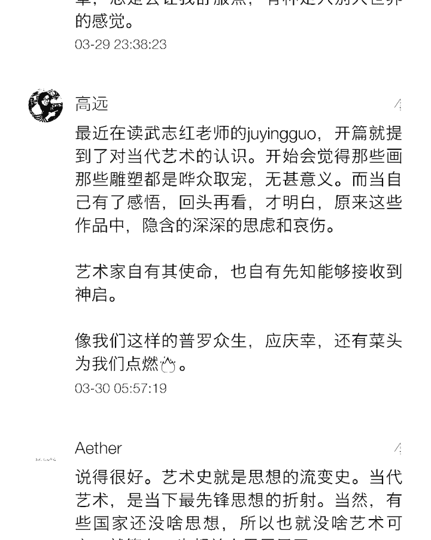

## 用户留言

> 沙发的
> 03-29 23:27:08
> **作者回复**
> 当代艺术的沙发
> 03-29 23:27:34

> 18
> 今天必须要出来提醒大家了！
> 打不开二维码的可以重新下载保存一下再扫喂~
> 或者直接复制链接到浏览器就对了！
> 不服，我不是天使。

> 12
> 菜头你好，总觉得我现在的人在被推着往前走，说不出的一种体会。然后看看你的文章，总会让我舒怀点，有种走入别人世界的感觉。

> 4
> 最近在读武志红老师的livinggoo，开篇就道出了对当代艺术的认认。开始会觉得那些画面那些能都是胡吹乱吹，无意义。可当那些有了感悟，回头再看，才明白，原来这些作品中，隐含的深深的思想和哀伤。

发疯的然然
2
讲事实…当代美术差不多都已经转向cg了，海量的优秀作品，备受欢迎，市场很大，价值很高。而且大师依旧是大师，穆林斯，王炜，L_D Austin 等等等等。不管从设计，技法，画面效果，相比100年前绝对是质的提升，而且由于广大画师理解了抽象，整合了抽象，还发展出了更多不同风格流派。传统美术明明壮大了，甚至对美的要求已经上升到了生理学的层次。而视频里的讲的那种艺术才是小众吧，更多的算是行为艺术了，至少主流美术网站上不会出现那种东西。
03-30 03:13:23

in the way
1
从杜尚开始艺术的使命，从单纯的表达，到开始表达自己的观点，用不同的形式来表现，可以说杜尚是现代美术史最重要的人物
03-30 10:00:23

军师
1
在很多人看来，他能看懂的艺术才是艺术，他看不懂的都是垃圾。我虽然不懂现代艺术，但我觉得既然它能被市场接受，能被同行认可，那么自然他就有那个价值，我看不憧只能说我水平不够，欣赏不动而已。而且很认同菜头叔说的脱离了人来看艺术作品，没有任何意义，就像离开了杜尚《喷泉》就仅仅是一个小便池而已。
03-30 09:51:16

波波
1
就像杜尚的小便池一样，任何人都能从商店买到小便池，签上名字送展，但是只有杜尚在那个时代首创了这件事，（有研究说是模仿一个女艺术家），并引起了有意思的轰动。
03-30 08:57:33

maji
1
艺术能创造性的表达自己的情绪和认识。在外人看来有人能理解，有人不能理解，不管理解不理解，至少没有好坏这分法。当代优秀的工艺品过了一百年说不定就是文物了，就是艺术了。自认为生活的有点情趣就艺术了，艺术离我们有这么远么？
03-30 08:54:30

joey
1
以前嘲讽印象派，现在依然乐此不疲的椰榆印象派。两个派别比较无多大意义，学院派也有它的渊源，广泛流广的却是印象派。喜欢的人多了，自然就得为流广。
03-30 07:52:56

小乐乐
1
我觉得这个视频的文章我赞同一半吧。当代艺术有些作品虽然看不懂，但是我觉得从美学角度上看还是蛮好看的，不需要看憧觉觉得美就好。但是当代艺术的部分作品的确让人觉得比较粗俗，好像不符合美感，而且视频就特意拿出这几个粗俗的画作来强烈对比，当然更论证他自己的水词啊。都是相对的，看个人喜好吧。本来绘画这事就比较主观
03-30 00:45:20

以上留言由 作者 筛选显示

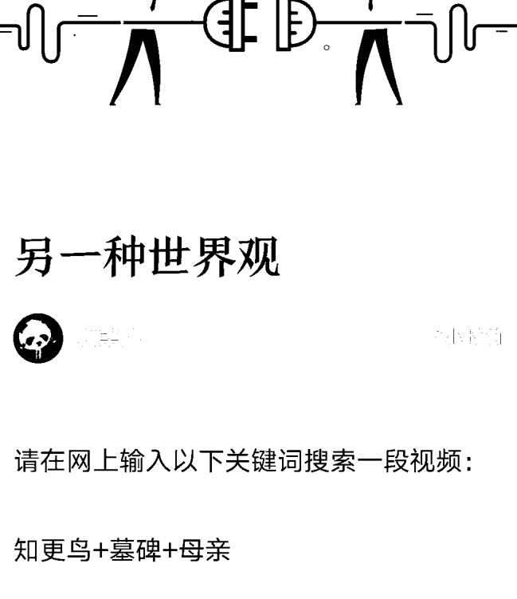

## 另一种世界观

请在网上输入以下关键词搜索一段视频：

知更鸟+墓碑+母亲

你会看到一位母亲，去给自己4岁的孩子罗宾森扫墓。她有一对双胞胎孩子，罗宾森是其中之一。由于罹患脑部肿瘤，在经历了漫长的痛苦之后，罗宾森还是离开了人世。当这位母亲走到孩子的墓前，看见墓碑上像着一只美丽的知更鸟。知更鸟的英文名叫Robin，罗宾·罗宾森的英文写法是：Robinson，直接过来就是罗宾之子。当母亲看到墓碑上停着一只知更鸟的时候，可以想见那一刻内心的波澜是何其凶猛。

于是，这位母亲哽咽着向知更鸟伸出手去，呼唤它过来。小鸟竟然真的听从了召唤，飞过来停在母亲的手指上，歪着头看着母亲，仿佛在听母亲的话语。最后，母亲问它说：“你是要走了吗？”知更鸟振翅飞走，消失不见。

这段视频有一种让人心碎的可怕力量，但是看完之后，却又让人在内心感受到了一丝宽慰，甚至觉得从中产生出了一股暖意。我希望着你找来看一下，因为我们接下来的话题和这段视频有关。

且不忙碌干眼泪，然后列举那些万物有灵的例子。我想问一个问题：那只知更鸟是否真的存在？或者换一个问题：如果那位母亲当时没有去墓地，那只知更鸟是否还存在？我相信许多人本能地就开始引用中学教科书上的原句：知更鸟是一种客观存在，这种存在不随着主观观念的转变而转变。所以，无论那位母亲是否去了墓地，我们都可以确信世界上有那么一只知更鸟存在。

那我接着看看间一句：那你怎么知道那只知更鸟会有视频里的行为？如果这位母亲从未在墓地出现，你又未见过这只知更鸟。请问，你如何确定世界上存在着这么一只鸟，当这位母亲和它在墓地相逢，只要母亲伸伸出手去，它就会飞落在她的掌心？同时，其他如何确定如果当时不是这位母亲，而是其他什么人来路过，这只知更鸟会采取相同或者相反的动作？

你确定不了。

知更鸟是一种野鸟，对人类充满警惕；而人类最具攻击性的部分就是手，以至于允许别人的手触碰自己的头部在人类中表示一种亲善和信任。因此，即使是让知更鸟落到掌心，也说是稍微接近它也会振翅飞走，是什么让这只只知更鸟和千千万万的其他知更鸟行为上有如此大的差异？只是出于纯粹的偶然么？

我想说的是：如果不是在儿子的墓地，知更鸟没有停到墓碑上，母亲不在那个现场，三个条件缺少其中任何一个，视频里的一切都不会发生。而在其中，最关键的因素是那个母亲，其任务的存在意义都是针对她而来的。如果换了任一位其他人，即便在同一时间，同一地点，目睹知更鸟飞到自已手上，都不会产生和那位母亲一样的感受。罗宾落到了自已手上，和罗宾森回来起连接，唯有这位母亲目睹这一切，才使得这一幕有了意义。

因此，如果没有这位母亲，这位知更鸟没有目睹这一切，那么，这只知更鸟就是不存在的。它的出现，以及它显现出来的一切，是为了这位母亲。

在我们所熟知的这个世界里，鸟类行为学家可以分析知更鸟的行为规律，生物学家可以分析知更鸟的神经反射原理，生物学家可以在分子级别上分析知更鸟的脑部神经反射是如何发生的。沿着这条路走下去，我们可以把这只知更鸟切成一堆碎片。

可是，随着我们对知更鸟的认知进一步深入，我们距离解释它何以产生那样的行为也越来越发的遥远。在明确区分为主体的和客体的世界里，我们是被束缚在确定时间和空间里的小虫子。我们之间的一切联系，都服从于这个世界的客观规律，也就是说，无论如何，我们不可能和一只鸟发生任何联系。世界是一种冷冰冰的存在，我们是偶然而产生的生命，被囚禁在此此刻此地，我们彼此之间是绝对孤立的。世界并不随着我们的出现或者消失而发生变化，无论我们是否睁开眼睛，都不影响太阳东升西落。

而在另外一种世界观里，时间和空间是一种表象。在我们面前，世界的每一次显现都有其目的和意义。而我们也有了一种超越时间和空间的联系。就像是那只知更鸟，它为什么会出，又何以如此行为，那位母亲凭借直觉就能够知晓原因，根本无需任何论证。死亡，死亡，生死之间并不存在某种僵硬，把死对面的也不在时时空间内的彻底消亡，生命总能找到别的方式表达自身，而且一再重来。在这种世界里，生命不是孤寂的宇宙中的一个点，被囚禁在地球这个并非微不足道星球上。地球出现生命并非巧合，而是一种需要。就像是那位母亲需要看到自已失去的孩子，有什么需要地球上出现生命，而且

不存在某种障壁，死亡对应的也不是在时空内的彻底消亡，生命总能找到别的方式表达自身，而且一再重来。在这种世界里，生命不是孤寂的宇宙中的一个小点，被囚禁在地球这样一个微不足道的星球上。地球出现生命并非巧合，而是一种需要。就像是那位母亲需要看到自己失去的孩子，有什么需要地球上出现生命，而且显现出来。

我们此刻在这里相逢，也不是一种简单的合同关系，或者是雇佣关系，而是我们之间存在某种联系，而这种联系在我们认知之前很久，也许就已经存在。现在，不过是它终于被激发，在一个APP里得以显现。

面对这两个世界，你更愿意在其中哪一个里呢？

和菜头

- 请你相信我，
- 我所说的每一句话，
- 都是错的。

我不认为我活在一个精密的无生命机器里，周围只有无数齿轮在无休止地旋转。

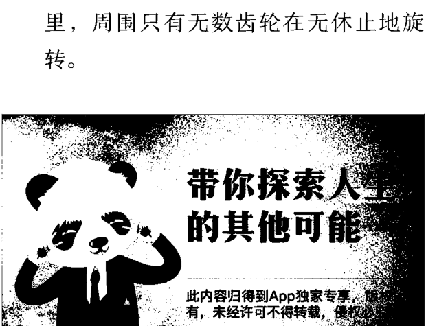

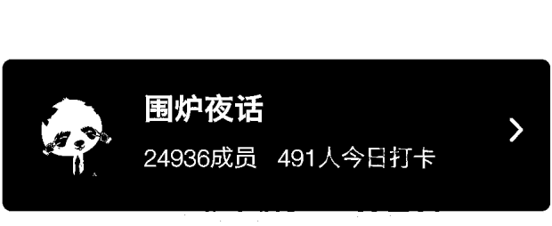

## 用户留言

和菜头
50
沙发
04-06 17:10:55
**作者 回复**
不存在的沙发！

## 第N+1次推荐《故事》

《故事》的全名叫做《故事——材质、结构和银幕编辑的原理》，是美国著名深编剧罗伯特·麦基的一本经典著作，多年来畅销不衰，更是编剧们的《圣经》，其中讲述了如何创作剧本的所有基本知识。在许多年里，我止不住在场合推荐过这本书。

最近一次是在我参加的写作课上，主办方要求我给学生们一本指读物，我唯一给出的答案就是这本《故事》。现在，我要再次把这本书推荐给你。

我当然知道你并不想成为一名编剧，也许你对编剧和写作完全没有兴趣。但容许我简单对一句：**中国人极具帮助**的为方式单关于一个：没读过麦基的，因为不想写编剧写作，因为不想写作，所以不用看编剧写作书——这里面的逻辑是不对的。

人生中最重要的一堂课，往往没有任何教科书专门教你怎么去用。当你真正用到一本书里的内容的时候，往往发觉你当初阅读的时候并没多少抱着去“使用”的目的，或者，你当时根本没有意识到那本书里的内容可以用在由此时刻。

多说一句：功利性阅读会让我们把背诵和记忆当做了知识本身，其实根得不得如何真正运用知识。不相信的话，我给你一个正面：不查资料，不使用高级语，你如何用物理方法估算你现在所处的海拔高度？我在这里有一个简单答案：烧一壶水，测量一下水烧开后水的温度。如果在海拔3000米以下，海拔每上升300米，水的沸点下降1摄氏度。我相信，这个数据对你关关系许多人在中学学过，甚至到现在都还记背。那么，刚刚想起来用上了。

《故事》这本书在我看来，它对于普通人最大的功用是提升对人性的认知和理解。所有关于编剧技巧的内容都可以跳过去不看，但是，剩下的部分足以成为一本精彩的人性教科书。在日常生活中，我们经常会遇到各种各样的困惑。比如说：

天会在微博上抱怨说，我换了Window 10系统，经常被系统的强制更新打断工作。马上有人跟帖：扯淡，我的电脑怎么不会？看到这种答案，遇见这种人，就让人抑制不住地想把他们的脑袋按进马桶然后放水给他们洗洗。因为对于他们来说，自己吃饱则全球不饿。他们缺乏最基本的共情能力，也就是说，他们通常不会站在别人的角度思考一下问题。通俗我们称之为“情商低”，本语叫做“欠揍”。

我们所有人都有不同程度地存在相同的问题，那么，想一下，如果一个编剧做不到理解观众心理，熟知人性，他会面怎样的命运？他会疯死。因此，最懂人心，最懂人性的，而是我们可以接触到的人，就是一名成功的编剧。我们可以透过编剧技巧的书，看看别人是怎么理解人类，理解人性的。

反复阅读这本《故事》，就相当于反复训练自己，永远第一时间站在别人的立场上考虑他们想的反应是什么，他们的想法，了解他们最想要的是东西，以及用什么方式去激发这种欲望。

我想，这种思考方式是我们每一个人的日常生活和工作都需要的东西。但是，读再多专门谈人性理解，或者是构建同理心的书都不会起作用。原一是这些书里的思维方式大多不一样，缺乏一个模式化的思维过程。《故事》这本书提供的就是模式化的思维方式，除了故事和拆解故事之外，没有任何别的东西。

如果你看过《未来简史》这本书的话，你应该记得作者尤瓦尔·赫拉利在书中的一个很著名的论绝：人族为地球上如此弱小，但是何以最后为胜者，而且构建起如此辉煌的文：书里给出的结论是：唯有我们人族才有“想象的共同体”。

比如说，国家、民族、货币这样的概念，都不存在实际，是全部依赖于我们的想象之下。但是，当所有人都接受于这种想象之后，想象比实体还要运作得更好。那么，什么是想象的共同体？简单说，那就是故事。国家是一个宏大的故事，哪怕我们自目没有目治了一个领土上的某一寸土地，但是我们相信国家；银行是一个具体的故事，哪怕我们自目没有见到过银行里堆着的金币等等的黄金，但是我们相信银行的信用。

作为人类，我们总是要放弃故事去诠释和构建我们的世界。可是，如何构建一个大多数人都能接受的故事？人们需要从故事中得到什么？《未来简史》里并没有提及。在其他科学、书籍里面，也没有佩埃提出类似的观点。比如说著名的“星巴克卖的不是咖啡，而是休闲”。那么，何以休闲得以成己？人们为什么要休闲？以及为什以星巴克提供休闲就能成功了？真正的的答案在《故事》这样的书里，它教我们如何讲故事，而且是那种会有人买的故事。

因此，《故事》这本书最低限度上能够帮助人彼此更好地理解对方。最高程度上可以帮助我们制作故事，如同我们的先民可以做的那样，卖一个故事给所有的同类，从而得到他们的支持，成就这个星球上其他生物所不能达成的业绩。这就是为什么我推荐这本《故事》的原因。是的，哪怕你和影视行业没有任职关系，你也应该看一下它。总有那么一天，你会用到书中教会你的东西，哪怕只是改变了对于人、人性乃至世界的看法。

和 某头

- 请你相信我，我所说的每一句话，都是错的。

也许，全面禁止这本《故事》，才会有人愿意认真读一下。

## 用户留言

和 某头
28
04-07 18:13:03

**作者 回复**
依然沙漠！
04-07 18:13:20

## 小鲜肉的片酬究竟高不高

如果一个社会现状经常被拿出来批判，但是又见不到任何改变的迹象，那就说明它背后有其成立的理由。

比如说小鲜肉的片酬问题，人人都知道小鲜肉没有什么演技，在任何一个电影里都像是一尊活动手办，但是动辄拿走几千万上亿的片酬，媒体因此口诛笔伐不已。然而，无论怎么骂，行情都是那么一个行情，签下来的合同依然是那么高的价。

一位日本艺术经纪人曾经说过一句话，直到今天我都觉得非常经典。他说：交易一旦达成，市场即告成立。意思是说，无论觉得贵还是便宜都是没有意义的，无论是为市场涨还是买家忧心忡忡也都是没有意义的，一切西东究竟能不能有一样东西存在，取决于交易。哪怕只有一个买家达成，也意味着市场真实存在。所以，小鲜肉的片酬高是低根本不是一个的问题。过亿的大单还在签署，说明这个市场依然存在，那么，高和就是交易双方的判断。

真正值得一说的是市场本身。能开出那么高的片酬，一定说明市场很火爆好吗？恰好相反，现在的影视市场并不爆好。电影票房在今年春节后继续下跌，电影院在飞速建设，但是票房收入却不再增长。电视台也没有多少钱了，因为传统的广告商在逐步放弃电视台，转网了网络广告。比如说阿迪达斯在2017年，就彻底放弃了电视广告。因为市场并不好，所以影视制作人都在全力保证作品的低预算。小鲜肉演员不一定，但是有小鲜肉有票房号召力。越不景气，制作人也越不敢说这一点。很自然，发行商看影视作品的时候，也是在第一时间看有没有小鲜肉。于是，越不景气，大家反而越是抢小鲜肉，小鲜肉的身价也就越高。

任何人都可以看得出来，这样的做法不能长久。一部片子的预算是有限的，如果演员的片酬太高，必然的结果就是要压缩制作费。换个便宜的导演，换个廉价一点的编剧，道具、布景和特效费用能省则省，镜头对着小鲜肉的脸狂拍就好了，反正观众要看的也就是那张脸而已。这样生产出来的影片也就只能是垃圾。在观众并不挑食、又没有抬头是什么玩意儿、都能强行咽下去。所以，这才是市场始终维持不下来的原因。但是，观众胃口再好，也解决不了影视从业者自己的问题——饿。一年头到低下来，到年底一算，这一整年基本上给小鲜肉打工去了，人就容易觉得饥肠辘辘。

当从业者发现自己在市场里能够获得的利润在不断减少，就会发生一些变化：资金从低利润领域向高利润领域转移，过去资金都堆在电影上，去年开始跑去电视剧；人员的低利润领域向高利润领域转移，拍电影的跑去拍电视剧，拍电视剧的跑去拍网剧了；影视制剧作人开始尝试从小鲜肉中心制变成演技中心制，或者说，是内容中心制。新电影刚刚开拍，宁愿雇佣一批名不见经传的专业演员，确保演技过关，同时把省下来的片酬投入到制作中去。于是，从今年开始，我们会看到一个新的变化：演员演越差，演越越好，服装越漂亮，道具越精致，场景越宏大。

当这些变化悄然发生之后，市场也一定随之发生变化。一旦内容中心制的影视节目验证成功，就意味着在原有领域之内出现了新的利润可能，那么原有的小鲜肉中心制就可能随时崩盘。最近一周以来，媒体上对《人民的名义》、《剃刀边缘》这样的电视剧大加赞美，几乎已经成了职业演员、编剧、导演、制片人、影视公司的大合唱了。为什么会这样？因为大概就是除了小鲜肉和小鲜肉的团队之外，几乎所有人都希望赶快换个玩法，因此由衷地希望新模式能够成功。唯有新模式成功，大家才能有钱赚，才能摆脱小鲜肉的绑架。

一旦这个趋势确立，市场验证新模式有效，那么小鲜肉的高片酬很可能在一夜之间就会崩盘。讨论片酬高不高的时候，高片酬一定会所有一去，再高有人买单；但是，当所有人开始讨论演技，谈论剧情、谈论制作的时候，高片酬可能很快就不再构成一个问题，这一页已经翻过去了。在这个世界上，谈论和批判并不能解决任何实际问题，无论是演员的片酬，还是市区的房价，讨论高和低的活是一个死法。当人们根本不去谈论的时候，那才说明它是真的太高了。而当人们着手做出具体的改变，而且人们希望这种改变能够成功的时候，改变其实就已经到来了。

> 请你相信我，
> 我所说的每一句话，
> 都是错的。

能够喊出来的苦都不是苦，连喘息都困难的时候，说明真正的苦已经降临。

## 用户留言

和菜头
沙湾
04-09 22:45:15
**作者 回复**
腊肉的沙发！

# 那些最终变成了牛的猪

昨天是作家王小波逝世二十周年忌辰。九七年的时候，我还没有读过他的任何作品。一直到电脑出现光盘，我才在各种游戏光盘的角落里发现一个叫“王小波”的文件夹，里面往往就有一套小说文集。

回想这件事，情绪涌上心头，就可以发现当初的网友和今天的网友之间存在多么大的区别。盗版商在光盘里放任何额外附送的内容，都是为了让光盘更好卖一些。很难想象，在今天的手机游戏店里有一个按钮，点开之后发现是某位作家的全集。

在王小波的笔下，有两种动物让人印象深刻。

一种是猪。能阅读王小波小说的人比较少，在过去二十年间，刚刚接触王小波的人喜欢他的杂文甚于他的小说。在这些杂文里，《一头特立独行的猪》和《我的精神病人》是王小波最著名的篇章。《一头特立独行的猪》讲了王小波尊称为“猪兄”的一头猪，彻底逃离了生产队里被饲养和屠宰的命运，撕破民兵的包围圈，逃进了丛林，从一头家猪变成了一头野猪。读者被这位“猪兄”的勇气、智慧和果决所深深打动，因此往往过目不忘。尤其是对于当时我这样二十几岁的年轻人来说，“猪兄”那条逃亡之路想起来就让人振奋不已。

另外一种动物是牛。能够阅读王小波小说的人一定会喜欢《黄金时代》，这部小说无论文立意、文笔、节奏上都是王小波的上乘之作。

在小说里，王小波写道：“那天我二十一岁，在我一生的黄金时代，我有好多奢望。我想爱，想吃，还想在一瞬间变成天上半明半暗的云。后来我才知道，生活就是一个缓慢的锤击过程，一天天老去，奢望也一天天消失，最后变得像挨了锤的牛一样。这是我过二十一岁生日时没有预见到这一点。我觉得自己会永远生猛下去，什么也锤不了我。”

锤，说的是农村里土法阉割牛的方法。把牛捆好按倒，一刀切开阴囊，掏出睾丸，然后一木槌砸个稀烂。据王小波说，这是对那些性子特别生猛的牛才可能做的特别处理。因此，牛挨锤带来的牛的意义非常强烈。它代表着顺从而服从，代表着生活低下头去。二十年前的年轻人们同样认为自己“永远生猛下去，什么也锤不了我”。认为自己一定会成为一头特立独行的猪，而不是一头挨了一锤的牛。

如今二十年过去了，当年的年轻人也步入了中年，送过了王小波创作这些小说和杂文的年岁。在低头冲向丛林，冲向野性，重新生猛的路上，猛然停下环顾四周，难免会问自己一个问题：那些猪呢？之前说好的特立独行呢？

二十年过去，并没有几头猪幸存下来。满眼望去，到处是安安静静吃草的牛。温和驯顺。可都是汪汪的大眼腴，睫毛还很长。你若友好，便是晴天。牛生是糖，甜到忧伤。猪还是做牛，都是一种人生选择。

认为自己会永远生猛下去的青年，或早或晚会发现做猪太辛苦，做野猪更是艰辛，还是做牛更为容易一些。事实上，很多人连这种选择都没有，满天的锤子铺天盖脸砸下来，并没有什么山林可以让他们逃避。一日接着一日，中间偶有喘息。

我如今也到了这样张皇失措的年岁，多少也明白了一件事。在这个世界，大多数人注定是要做一头牛的。为什么自由、独立和自我如此珍贵？因为它们的代价太高，做一头特立独行的猪的代价太高。而且，一个满是猪的世界，是可以想象的，但要是有一头牛，世界没有野猪的世界又太过乏味，太过无趣。看过一头牛的生活，就相当于看过所有牛的生活。彼此交换一下，也不会带来多少不同。

因此，在一个牛组成的世界里，需要几头猪的存在。这样的话，当年安静静吃草的时候，偶尔想起自己在丛林里不多的朋友，此时和自己过着完全不同的生活，于是觉得这个世界有趣得多。尤其是想到大家在多年前曾经相约逃进丛林，却跑避了，就会无由来地觉得有些感动，陷对于自己的伤疤中去。

就像此刻，有那么多人怀念王小波。你很难说他真的怀念一个作家，还是怀念自己的青春。或者说，是怀念在久远的岁月之前，自己面前拥有所有的可能。那种拥有所有可能的感觉，带来了未来的无限憧憬和对自我的无穷自信。那个时候，年轻人出发去寻找世界，而不像现在这样悄悄等待世界降临——那是何其动人的感觉！

这种怀念让我想起了很久以前的一幕：京城一群作家和文艺工作者举办了一次沙龙，大家探讨美国极简主义作家卡佛的作品。席间，人人盛赞卡佛的文学风格，缅怀他在如此清调和艰难的生活里依然坚持创作。看见他们端着红酒杯坐在高脚凳上高谈阔论，我注意到他们在年岁换条都价值不菲。我得承认，在那么一个瞬间，我觉他们中们是真心喜欢卡佛的。

请你相信我，我所说的每一句话，都是错的。

今天，订阅人数突破25000人。啊，生活！感觉就像是玉珞!

# 都市传说“随手拍”

随手拍照解救拐带儿童都是一个都市传说。如果有人告诉你，某人被陌生美女灌醉，醒来时发现自己躺在满是冰块的浴缸里，发现自己的一个肾已不翼而飞，腰上只留下一道长长的刀口。我想多半不会相信，因为这听起来就是个都市传说。

但是，如果这个传说是以新闻的形式包装出来，标题里注明“专家提醒”或者“警方正告”一类的话，恐怕就会将信将疑了。而等这个故事飞一般在社交媒体上传播起来，还有各种名人和社会贤达转发，甚至补充个人的经历，诸如“我能够我的哥哥的一个朋友”之类的，那么，你能够从这个都市传说中幸免的可能性就已经极低。所谓三人成虎，说的就是这样的一回事。

认为街上的乞讨儿童是被拐卖而来，甚至认为其中的那些残疾儿童是被灭绝人性的人贩卖，以此作为乞讨集团的牟利工具，这同样是一个都市传说。

但是，这个都市传说的生命力就要比传播取要强大多倍。那么多年过去了，网友一次次在街头拍照，一次次向警方介入，然而，传说中那个被人拐卖卖致残、流落街头为乞丐的残人，却从未找到卖致残者。多次警方行动众地派人排查，民间协助进行DNA比对，结果都不能证明存在拐卖。

事实让“爱心人士们”难于接受：许多孩子是由亲生父母带出来乞讨的，因为这样赚钱效率更高一些，你总是对儿童抱有更深的同情心。同样的，那些乞讨的残疾人也并非只是流落街头的，他们各有各的伤残原因，他们总是残疾人抱有更深的同情心。

在很久以前，随手拍行动刚刚被开始的时候，我就写过一篇长文，从利益的角度分析什么拐卖儿童、拐卖人的贩子，最用于乞讨是一件很划算的事情。因为人口贩卖出价也会以最快的速度达成交易，而不是一挑选买主，最后选择职业乞丐。

而对于乞讨而言，一个刚刚到人为致残的孩子，意味着一系列风险和麻烦。在用孩子盈利之前，需要漫长的一óu生活习性，培育，都是钱。远比不去找一个没有生活着会丧失生活能力的残疾人合作更为简单，他们起码能够照顾好自己。

许多网友和我激辩，无非是因为他们和真正的社会生活太过隔膜。想不明白为什么亲生父母会带着孩子乞讨，那是因为不知道贫穷是什么，也不理解一下有办法轻松地求取会，多么难以离开这种生活方式；想不明白为什么乞讨乞丐穷，认为残疾被拐儿童，那是因为没有做个分析工作，中国有多少残障人士，他们何为生，生活水平如何，这些都是公开资料里可以查得到地东西。

即便如此，在最新一轮随手拍解救被拐儿童的热潮里，人们依然态重，甚至还有人信誓旦旦地翻阅史志，找出了所谓“生果制刑”的记载作为佐证，证明人事职业乞丐卖小孩而有人为加以维法，一直存在的社会现实。看起来哪怕迄今并不一定，也许，也不会影响这种网上抽风一轮又一轮继续下去。所以，我认为有必要分析一下这种歇斯底里背后的心理模式。

对拐卖儿童的关注，源于深层内心的恐惧。任何为人父母的人，都对人口潜在的威胁。所以，他们对放一些拐卖儿童信息的消息，无论真假都非常在意。这种在意背后，就是对于失去自己孩子有深深恐惧。于是，强烈的情绪构成了随手拍心理模式的第一个环节出现了。

在另外一头，是网络世界里的赞美、鼓励和关注。你不论什么时候网友跟随随手拍一张照片，然后加一段描述性的话语，描述自己对于一个乞讨儿童身世的怀疑，就自然地获得了道德高位。可以用这条消息道德名人、明星和网红转发，否则就是冷血和无情。然后，在名人明星的扩散下，更多网友卷进来，最后警方不得不出现，其去做调查。一个人很难拒绝这种诱惑的，只是手机拍一张照片，就可以获得如此之多的赞扬，并感到自己获得了巨大的力量，以至於可以指挥从网友、名人、明星乃至警方的行为。这样，随手拍心理模式的奖励机制形成了。

一头是恐惧感而产生过度关切，造成不息索地接受全彩的新服版都市传说；另一头是来自网络和公众的明暗激励驱动：中间只有一个扳机，只要扣下就可以扣，那就是一次触发事件：比如一次心血来潮，一次街头的驻足，甚至只是一时的心血来潮。那么，某个乞丐和那个人的家人就会倒霉了。警察会前来盘问，做DNA检测去比对，他们的照片贴满整个网络，直到所有亲友知道他们在乞讨为止。

即便每一次都证明不是拐卖，随手拍的参与者却没有后悔过。他们的行为被赞美于有尊严和权利呢？我觉得参加随手拍的网友应该保持起码的诚实，比如说可以大声告诉世人：乞丐没有尊严和权利，怎么弄他们都不会有错。甚至可以再直接一点：乞讨没钱没二狗，弄了又怎么样？

这样的话，当参与随手拍的，被这个社会上有钱，更有势的人随便弄的时候，我觉得会更有趣性一些。

> 和茨头
请你相信我。

我所说的一句话，
都是错的。

疯了的一群狼，要比疯了的一头狼可怕得多。

## 和菜头

请你相信我，

我所说的每一句话，

都是错的。

疯了一群狼，要比疯的一头狼可怕得多。

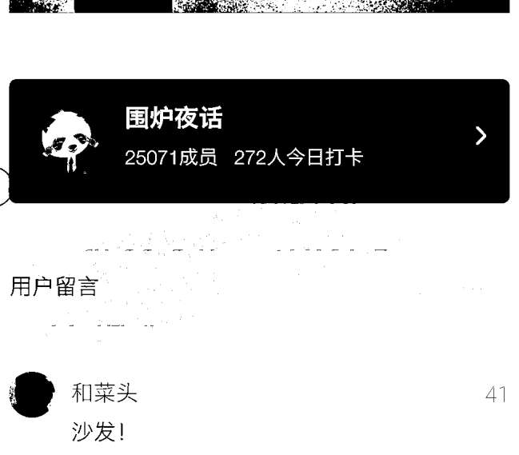

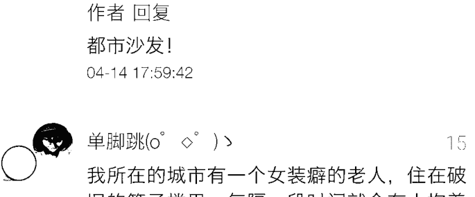

## 用户留言

- **和菜头** (41)
  沙发！
  04-14 17:59:30
  **作者 回复**
  都市沙发！
  04-14 17:59:42

- **单跳猫** (15)
  我所在的城市有一个女基癖的老人，住在破旧的筒子楼里。每隔一段时间就会有人抱着所谓的同情心，去他住的地方看他，然后居高临下的写一篇东西，呼吁社会关注……去年，听说这个老人终于搬走，我不禁拍手称快！
  04-14 19:58:54

- **8号试运行机** (9)
  想起了菜头叔的“七天定律”。但是我觉得本文中的这个社会现象，还会反反复复不停的重现（当然事实上就是如此）。菜头叔前面说的那些问题，以及看问题的角度，分析问题的视角。我因为长期以来看菜头叔的文章，已经知道自己独立思考的重要性。所以对这些经常带着怨乞讨的行为模式，我本身能想明白。但是最后菜头叔提到乞丐的尊严，我还是脑袋嗡的一下，这一点我完全没想过。我在反思我是不是也有着那些人一样的心理，乞丐算什么？无权无势，能把我咋样？这让我感到不寒而栗。
  04-14 18:11:24

- **海** (7)
  菜头的话让我重新思考这个问题。一直以来都都不会给乞讨的人钱，生怕自己做了歹事。
  04-14 19:36:54

- **诺诺和听雨** (7)
  同样的，还有慈善这件事，给一点东西，拍一张照片，居高临下写一写绝对对方多惨我多伟大的故事
  04-14 19:09:51

- **甘有** (7)
  原来这也是传说。前段时间我的一名学生离家出走，两个小女孩一起，也是引爆了合肥朋友圈。在孩子找到之后，我挨个通知帮忙的人删除朋友圈，既事情情已经解决了，就不要再扩大影响。我通知是因为查证确有其事，有意思的是当孩子找到了，一个网吧群里的人说找到了怎么也不发个红包？我--没在群里发通知，二没求你们帮忙找人，欠你们家大米了？
  04-14 18:22:07

- **小辣椒** (7)
  现在孩子大于两岁，上户口就需要亲子鉴定了！期待严格执行下去
  04-14 18:17:58

- **屁屁** (6)
  我看到评论区最多的一句话，自觉三观比刀角尺还正的一句话就是“万一有一个真的是拐卖的呢？”反正他们就脑张紧按键，出警的不是他被曝光也不是他，万一真tm中了这一个还逼可以吹一辈子
  04-14 18:27:59

- **咸鱼超人** (4)
  我们总是缺乏深入的观察社会，对待他人的方式过于粗鲁。
  04-14 19:35:12

- **小辣椒** (4)
  菜头：就是基于对于丢孩子深深的恐惧，才会宁可信其有 不可信其无！现在孩子上户口程序也复杂很多！如果上户口提取孩子DNA或者指纹会不会好很多？
  04-14 18:15:43
  **作者 回复**
  你恐惧你的，你的恐惧为什么要以伤害他人为代价？
  04-14 19:48:21

- **军师**
  一群没有脑子又缺乏对行善的正确认识而又喜欢寻找道德存在感的网络愚民，一些被某些过度关切的人夸张的放大了普遍性的社会现象或者恐怖想像，一种低成本简单易行又可以轻松占据道德制高点的行为，一个道德呼吁会比较容易得到传播和回应而且造成了伤害也不受指责的环境，一批被侵犯了也会选择忍气吞声的弱势群体，这才是乞讨者们面对的社会现实。
  想一想几个月前那个孙子在地铁上哭闹就被随便一个人要求带去见警察的老奶奶，就觉得这世界真可怕，道德“高尚”的人真是太多了！
  04-15 01:29:21

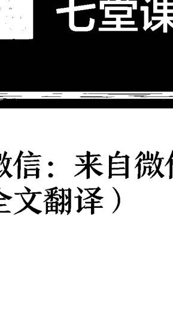

# 硅谷看微信：来自微信的7堂课（全文翻译）

Y Combinator是美国著名的创业公司孵化器，由程序员保罗·格雷厄姆于2005年创建。我之前在公众号里多次介绍过他的书《黑客与画家》。在过去的十余年间，Y Combinator孵化了数百家创业公司，其中包括大家最为熟悉的Dropbox和Airbnb。

今年4月12日，Y Combinator 的合伙人之一Anu Haribaran就微博发表了一篇博文。从她的角度，谈自己对微信的理解和认识。并且，从中总结了七堂课给美国的创业者。

由于原文是英文，为了便于国内读者了解一下硅谷的报读者如何看微信，如何向美国创业者介绍微信，我把这篇博文翻译为中文。由于时间仓促，个人英文水平有限，你先将对付看看。

> 翻译不代表本人赞同作者看法。

## 《正在增长：来自微信的7堂课》

作者：Anu Haribaran
翻译：和菜头

当问及某些创始人，请他们举例说明什么是他们渴望的产品时，越来越多的创始人指向亚洲，而微信是，我们把这微信的产品榜样。我的朋友也是前同事陈梅（Connie Chan）把微信形容得如同魔戒：- APP 即众APP。凭借每月8.89亿之众的活跃用户，微信主导了中国的移动互联网市场。

与此同的，微信平台彻底升级了中国人民在线交流和社交的方式，也彻底改变了人际之间支付和在杂货店付款的方式…微信不再仅仅只是个应用程序（APP）。当人们关注微信在中国所取得的惊人成功之时，世界贡献的——一个在同时也在感受着微信对各界的贡献。在微信的启示下，出现了一个新的互联网应用类别：平台化的通讯工具。无论在 Apple 推出的iMessage还是 Facebook 的Messenger，都不难从中看出微信的印记。

我们和腾讯公司的研究小组China Tech Insights 合作，试图寻找微信何以能够让每月8.89亿活跃用户保持每天平均 50分钟使用时长，9-11次打卡的原因。事实上，那个仅相当于Facebook的用户在 Facebook 全家桶Apps（包括 Instagram 和 Facebook 和 Facebook messenger）里耗费的每日总长总和。

这篇文章深入揭示了微信在不到6年时间，从零开始增长到8亿月活跃用户的疯狂背后的方法、值得借鉴的新数，以及和各个能够发展既得所不屑的增长策略。和AOI和雅虎不同，腾讯是为为数不多的几家人家能够桌面和网页通讯产品成功移植到移动/通讯平台上的公司。

### 第一课：建立内部竞争

微信（以移动互联网为先的通讯工具）以腾讯的边缘项目而始，以重新发明了中国的通讯方式为终。

在2010年腾讯就已经是中国最顶级的互联网公司之一，也是彼时之前最大的社交网络公司。伴随着许多中国人共同成长的腾讯QQ，是一款全国流行的桌面通讯软件，相当于以色列的ICQ和AOL的Instant Messenger。在那个年代，QQ拥有约9.6亿的活跃帐号。当腾讯认识到移动互联网增长的重要性之后，在2008年推出了第一个QQ的移动版。但是，这款从桌面产品的设计思路所推展，提供了诸如用户状态、离线语音播放、嵌入式服务的音乐流媒体功能等。

随后，腾讯做出了一个大胆的决定：它从QQ邮箱（当时腾讯的核心产品之一）团队抽调人员组成了一个敏捷开发小组，去打造一款全新的移动产品。而此前的，这款竞品也是腾讯其它团队产品团队旗下品的人气产品之一。在那个仅有7名工程师的团队在短短3个月内就开发出了微信的第一个版本，并于 2011年 1月发布。在这里，不需要微信很快推出了那个中国最具变革性的移动服务。

微信问世之初，并非是第一个移动通讯APP。小米公司的米聊凭借着500万注册用户是当时的领先者。由于激烈的竞争，微信在其初次发布后并没有出现显著的用户增长，他们很快就意识到在聊天之外，还需要提供更多信息，方能使得用户愿意从其他竞争迁移到微信里来。

2011年5月，在发布首本版本3个月后，微信开启了语音消息功能，人们得以发送不超过60秒的语音消息（类似于 3.5年后出现的 iPhone iMessage功能）。的语音功能，灵感源自一个叫做Kakao Talk的竞争产品。语音留言功能的出现对于微信来说是至关重要的，因为当时的原生手机键盘输入汉字并不方便。而消费类数据语音直观、个性化，且使用容易。作为首批为中国用户提供整合了语音、文字和图片的通讯工具之一，微信的下载量开始跃升至持续的每日5—6万人次。

今天，手机QQ继续迎合年轻用户群体。截止2016年12月，它的方法跃用户达到了7.62亿人。腾讯主动将两个不同平台的产品区分为了使用体验，其中手机QQ为年轻用户提供了更多娱乐功能，例如动画视频贴纸、照片美颜工具等

为朋友圈用户提供整合了语音、文字和图片的沟通工具之一，微信的下载量开始跃升至持续的每日5—6万人次。

今天，手机QQ继续迎合年轻用户群体。截至2016年12月，它的月活跃用户达到了6.52亿人。腾讯主动地为两个不同年龄段的用户区分了使用体验，其中手机QQ在年轻用户中提供了更多娱乐功能，例如动画视频贴纸、照片美颜工具等。与之对应的，微信仍然专注于向用户提供日常生活中的生活服务，诸如内容订阅和生活缴费。

这一课让人联想到亚马逊在预测到电子阅读趋势之后，主动用Kindle把电子书阅读从自家的图书生意中拆分出来，也让人联想到Uber为了和自己去叫车服务区别而开展的UberX服务。如果你不去创建一种自我革命的公司内部竞争文化，那么竞争对手就会来革你的命。

## 第二课：为群组设计（“群聚效应”）

单个用户的行为可能与群组中的行为方式截然不同。为了确定这些群聚效应，微信密切观察了日常生活中用户在朋友中和陌生人之间的行为表现。为此，微信并没有依赖于更传统的用户调研形式，如调查问卷、用户访谈等。

张小龙（微信创始人）一直坚持围绕“群聚效应”开发产品。为此，微信团队注意一群人和一个人在采用某个功能时的不同。这也反过来提升了功能，接受度——随着越来越多用户使用这些功能，剩下的用户也会去响应。

微信和所有启动网络一样，很早就意识到了需要解决冷启动问题——新用户刚注册之后没有任何朋友。与此同时，在大洋彼岸的美国Facebook因为其头14天内不断激励用户添加10名好友的策略而声名远扬。而微信的数据显示这个系统是长期留存用户的关键。而微信则通过一种略有不同的方法同样实现了这一点：微信开发了一个模拟真实世界的功能——附近的人。

你可以通过微信发现自己附近的人，即便他们并没有在自己的好友列表里。这个基于地理位置的功能满足了用户想要了解周围发生的情况的好奇心，同时提高了他们对微信社区的感知。在这个功能助益之下，微信新增用户的速度攀升到每天超过10万人。

在发布了“附近的人”以后，微信还推出了导入QQ好友功能，使得用户可以从QQ向微信导入业已存在的社交关系。重点在于，微信团队把这种功能提供给同时使用了QQ和微信的用户，他们有不同的目的。此举使得腾讯的通讯产品用户总数跃升，推动微信平台上的注册用户数在2011年11月达到了5000万人。自此，微信彻底取代了米聊在中国移动通讯领域内的领导地位。

使用了GPS定位和加速感应器的“摇一摇”功能，让人们可以通过摇动手机的方式随机找到一个陌生人聊天。这个功能有两个目的：

- 给注册新用户一点事情做；
- 作为一种附加值，为微信在线下世界里博取一点关注，就像人们在玩物易上精挑细出的摇奖一样。

这个功能于2011年10月推出，据说发布的第一个月里就有超过1亿的使用。摇一摇对于微信的初期规模至关重要，并被当做是促成增长性策略，但由于现在大多数的中国人已经通过微信建立了朋友、同事和工友的关系，所以摇一摇今天不太尽兴了。

微信的另外一个功能“漂流瓶”允许用户通过在海中投掷虚拟瓶子来交换随机信息，当用户捡起漂流瓶时，双方被连接在了一起。

2011年11月，在推出了这些促进群组交互的重要新功能之后，微信的新用户增长创下了日新增20万的新记录。

## 第三课：从用户贪嗔痴疑慢里延伸出功能

年后苹果推出的iMessage时表达自己的一种方式。然而，微信是第一个为插画师创建在线商城的APP，他们可以通过喜欢表情符的微信用户的“赞赏”赚取收益，用户可以选择高达人民币200元（25美元）的奖励金。这个商城使得插画师之间产生良性竞争，同时也因此提高了微信用户使用体验的质量。

## 第四课：大想法源自解决自身问题

Y Combinator一直建议创始人成为自家产品的热心用户，并用产品解决创始人自己的问题。当微信群舒服地坐拥3亿月活跃用户之时，一个用于他们自己管理团队在春节发送红包的简单功能，却让这个数字几乎翻了一倍。

微信红包源于腾讯公司和更为广袤的粤语地区的风俗习惯，公司的每位经理都要在春节假期后的开工日，向每位员工赠送一个红包。随着公司的扩张，对于一些管理人员来说，向如此之多的员工派发如此之多的红包让人精疲力竭，因此他们要求微信提供一个技术方案来解决这个问题。当提出这个需求的时候，他们并不知道其结果将成为微信红包的原型。

微信红包的第一个版本是由一个20人的团队在3周内开发出来的。在微信公众号用户中内测，即告成功。微信团队并不忙于发布产品的多个版本，而是做自己的产品迭代。他们经常在午夜时分作为“独立用户”使用自己的产品，以便及早发现故障和观察细节。他们也常在发布产品之前观察家人和朋友如何使用产品。从2014年的除夕到第二天下午4点，超过500万用户使用了微信红包。

微信的红包有几个不同的版本。其中包括拼手气红包和普通红包。拼手气红包里，每个收红包人从发放者最初设定的总金额里随机分钱（不超过200元），每个29美元以避免福利。这样在一群人里发红包，就像是把彩票和赌坊结合了起来——在你打开红包之前你不知道自己将拿到多少钱，而且你的红包金额比别人多意味着好运气，这个关于运气的暗示也让它完美地契合节日而成为为求美不全的游戏了。同样的，微信红包也是“群聚效应”的另一个应用案例。由于红包是在群聊中发送，所以收到的人越多，发送的人也越多。

在2015年中国春节期间，微信红包大幅增长，达到了十亿次之巨。微信红包的成长最早由亲朋好友间的紧密社交圈子所驱动，他们之间彼此汇款，为此也愿意关联自己银行卡号。这一重要举措对于建立微信用户之间的信任和培养用户支付习惯以推动移动支付是必须的。

此后，才能够把支付功能延伸至更浅的人际圈子，例如交易付款、线上和线下商店支付。通过与滴滴出行（中国的Uber）的合作，促进了微信用户在应用内付款的行为，扩大了微信支付网络。这种合作伙伴关系开辟了更为广泛的微信支付合作空间，现在，微信的支付伙伴正在共同完成从缴纳电话费到公用事业费用的所有应用内付费。

仅仅在两年之间，微信支付就成为了中国支付行业中最重要的玩家。微信支付被用于各种应用场景：从红包到移动线下。截至2016年，腾讯每月有600万移动支付活跃用户，每天产生超过600万笔支付交易。

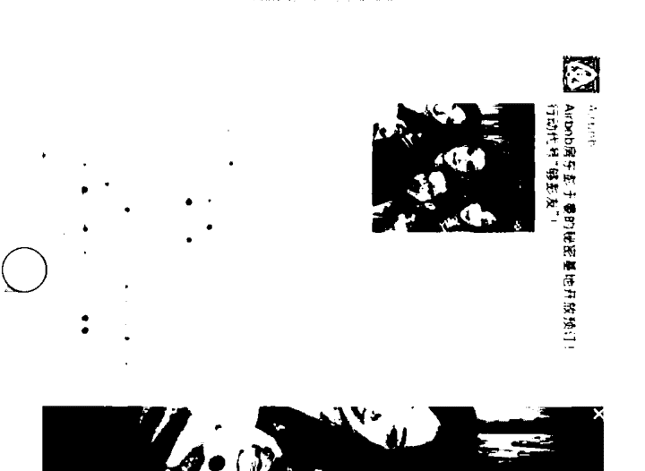

## 第五课：精巧创收

创收和用户增长之间并不互斥。微信一直为创收厉兵秣马，甚至以此作为杠杆撬动产品体验。

游戏中心使得微信与更多腾讯内部团队的专长相结合，让人们在通信工具平台上玩游戏。虽然从表面上看，这跟Line或Kakao付游戏商店很类似，但是微信把社交游戏的社交属性发挥到了一个新高度——人群如洪水般爆发，决堤而至。这种对游戏功能的精妙调整让游戏制作商和微信部门中都获益。比如：腾讯游戏发布了一款名叫《节奏大师》的游戏，发布一年达到每天70万人的活跃度。然而，当它进入微信游戏中心之后，旋即达到了20倍的增幅，每天有1700万人登录游戏。

2015年1月，微信推出朋友圈原生广告，从此成为微信商业模式的重要组成部分。虽然朋友圈广告并非微信增长的主要助力，但是它也并没有限制微信的增长轨迹。为了最大限度地减少对用户体验的影响，微信将用户的展示广告频率降低到每天一条，可以和Facebook的NewsFeed广告比较一下，后者每10个帖子一个广告。

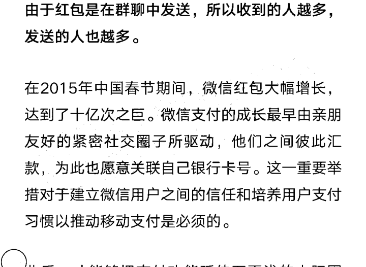

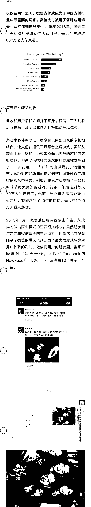

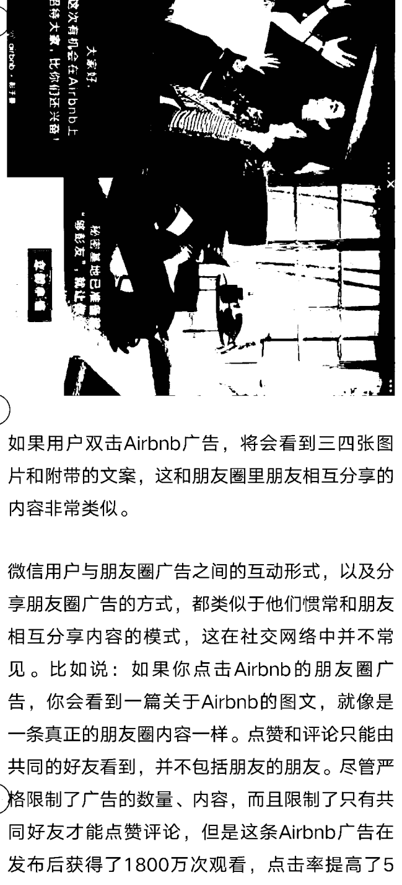

如果用户双击Airbnb广告，将会看到三张图片和附带的文案，这和朋友圈里朋友相互分享的内容非常类似。

微信用户与朋友圈广告之间的互动形式，以及分享朋友圈广告的方式，都类似于他们惯常和朋友相互分享内容的模式，这在社交网络中并不常见。比如说：如果你在Airbnb的朋友圈广告，你会看到一篇关于Airbnb的图文，就像是一条真正的朋友圈内容一样。点赞和评论只能由共同的好友看到，并不包括朋友的朋友。尽管严格限制了广告的数量和范围，而且限制了只有共同好友才能点赞评论，但是这条Airbnb广告在发布后获得了1800万次观看，点击率提高了5倍，并且在发布后新增注册用户数增长了600%。

微信甚至将传统的优惠券模式改为基于朋友互信的新模式。当用户在线下购买商品获得优惠券的时候，他们可以选择和朋友分享这些优惠券，这样用户所有的朋友就可以同样去查看和使用。商家还可以通过给与用户共享给朋友的优惠券，从而扩大其产品和服务的展示机会。微信为此建立了一个免费优惠券体系，商家从微信购买信用点数，以此通过优惠券共享模式推广自己的服务。

## 第六课：为用户创造价值，而不是为自己创造身价

微信并不认同互联网界内的成见：增长即用户数增长。相反，他们认为增长的本质是为用户创造价值。比如：微信用户每天在微信里能完成多少件事情。

和其他社交产品不同，微信并不仅凭微信用户或者消息数量来衡量增长水平，而是聚焦在产品能够进入用户日常生活各个层面的深度，诸如用户每天可以利用微信完成多少样事情。虽然微信的确有KPI，但是KPI被仅仅限于部门主管之间共享。

每天，在微信工程师耳边都有人在敲边鼓：“你有没有为微信创造更多价值？”为此，微信致力于为把自己变成一个工具，帮助人们完成各种日常事务。微信限制了你能添加多少好友，限制了你能看到多少条促销信息，以及限制了它们在你的社交关系里展现的姿态——归根到底，微信团队把这些东西视为一种干扰用户的噪音，让他们不能把注意力放在微信的核心功用之上。

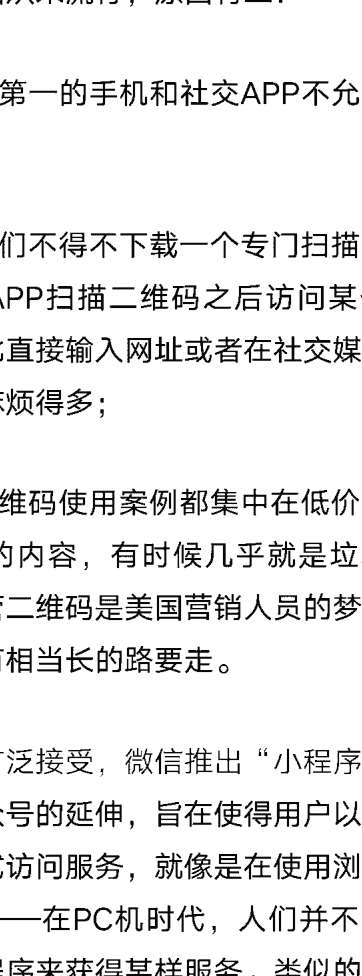

微信将二维码提升成为连接线上和线下的桥梁，这成为了2015年中国O2O领域爆发的关键。在过去，用户为了找到某家服务或者某个品牌，必须注册或者甚至输入整个网址。微信CEO张小龙对二维码下了这么一个定义：“二维码是一个针对线下世界的标签，在这个标签的页面里隐藏着海量的线上资讯。”这个逻辑解释了为什么腾讯选择一早推广二维码。

而二维码在美国从未流行，原因有三：

1. 美国排名第一的手机和社交APP不允许你扫描二维码；
2. 因此，人们不得不下载一个专门扫描二维码的APP，用APP扫描二维码之后访问某个移动网站，这远比直接输入网址或者在社交媒体上搜索品牌商要麻烦得多；
3. 早期的二维码使用案例都集中在低价值、市场营销相关的内容，有时候几乎就是垃圾邮件。所以，尽管二维码是美国营销人员的梦想，但距离实现还有相当长的路要走。

随着二维码被广泛接受，微信推出“小程序”。它作为微信公众号的延伸，旨在使得用户以更加顺畅流畅的方式访问服务，就像在使用浏览器访问网站一样（在PC机时代，人们并不需要专门下载一个程序来获得某些服务。类似的，微信让用户在微信里打开某些貌似APP的微信小程序去在线下单或者支付，而不用真的下载或者安装一个APP。

想象一下，在你所在城市里的本地餐厅或者本地商店，这些商家现在不需要推出他们自己的APP，而是以微信小程序的方式出现。人们可以通过社交网络的人际关系传播或者扫描线下实体二维码的方式激活它们的小程序，微信宣称这种友好的用户使用流程会带来更多转化（目前那么说还为时尚早）。和日常消息相比，目前小程序大多只是在低频使用场景里使用。

## 第七课：对产品功能保持克制

微信的核心产品宗旨之一：微信是一个以实用性为导向作为品质保证的工具，这种功能强、反应快和易于使用的品质对于用户体验来说至关重要。

大多数产品经理都专注于建立“粘性”功能并以此推动用户留存率。然而，张小龙却非常担忧用户在微信的某一个功能上浪费了太多时间，以至于他们没有去做其他有价值的事情，比如说买单。

事实上，微信相信一个好产品应该让用户做事更有效率，也就是让用户即开即用、用之即得、用完就走。张小龙用Google作为例比：一旦用户发现了想要找的内容，Google立即给用户前往的访问路径。尽管感到鼓舞看到他们在朋友圈的访问时长经常做到鼓舞，但是他们在试图用用户花费了太多时间浏览朋友圈里的营销内容而深感忧虑。对于微信团队而言，劣质内容会拉低用户价值，而且从长期来看也降低了微信自身的价值。为此，微信限制了朋友圈里的营销内容数量。与此同时，微信也限制品牌和企业公众号每天只能对订阅用户发布一条消息。这些消息甚至没有通知推送，因为推送会影响到用户体验。

尽管微信已经为用户提供非常丰富功能的服务，但是它微信产品团队依然保持着简单的功能界面。微信工具栏里只有4个页卡：聊天、联系人、发现和我。他们在维系4个页卡这一点上非常积极，因为每次只要他们尝试添加一个，那么最左边的选项卡会立即尝试20%—30%的转化率。（译注：怀疑这里写错了，应该是最右边而不是最左边，我在腾讯讯上验证过这一点。）

总之，腾讯找到了一些方法，可以让自己的产品进行内部竞争，构造满足中国文化需求的功能，并且强调用户群体内部的互动。

**最重要的是，微信团队始终专注于打造一个可以延伸到所有消费手机上的简单工具。** 从这一点上来说，微信并非仅只是一个APP，微信即为互联网本身。因此，我们不难看出为什么微信会成为那么多美国创业公司的灵感源泉。

感谢 Rhea Liu 和腾讯团队的其他成员参与这篇文章的创作，并且从微信团队分享的一手资料。也要感谢 Connie Chan, Jonathan Hsu, Yanyun Xie, Bino, Rubin, Ram Parameswaran, Sonal Chokshi, Sam Altman, Ali Rowghani, Brad Lightcap, Sharon Pope, Craig Cannon, Simon Lu, and Nic Dardenne 阅读本文稿。

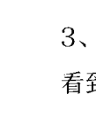

请你相信我，

我所说的每一句话，

都是错的。

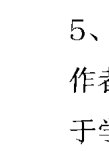

褚定时刻

后记：

终于翻译完这7000多字的长文，有一种悬浮在这个世界上的感觉。说明几个问题：

1、原文中做了删改，我并没有附上。没有别的原因，弄不动了；

2、原文中有一些明显的表述错误，我在翻译的时候做了修订；

3、我并没有严格按照原文进行翻译，经常是看到复杂的语法结构就一怒之下直接意译了。

4、有任何疑问可以复制这条链接，访问原文。

(http://blog.ycombinator.com/lessons-from-wechat)

5、没有获权是因为即便是翻译，也需要原作者有授权。现在我做在翻译，勉强可以说出于学习和传播的目的翻译原文。并且保留了作者和出处，算是出于良善目的的小偷。但是，如果开放获的话，性质就变成了利用他人原文为自己牟利。所以，谢谢，但别告我了。

6、你的颈椎现在感觉如何？

和菜头 上

2017年4月14日

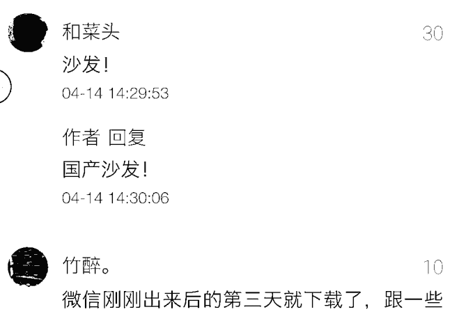

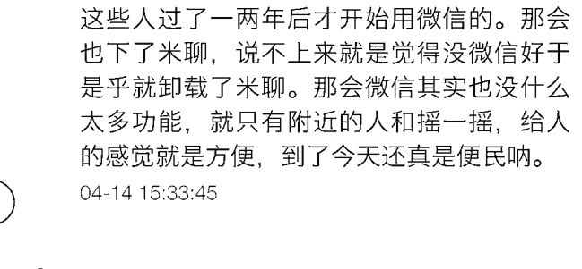

## 用户留言

[图片和头] 和菜头 沙黄！
04-14 14:29:53

作者 回复
国产 沙黄！
04-14 14:30:06

[图片和头] 竹韵.
10
微信刚刷出来后的第三天就下载了，跟一些朋友同学推荐。大部分人下了都爱上了，有些人别以为这就是流氓软件，我说爱不下下，这些人过了一两年后才开始用微信的。那么也下了米聊，说不上来就是微信没有微信好了太多功能，就只听附近的人和摇一摇，给人的感觉就是方便，到了今天还是便民民民民。

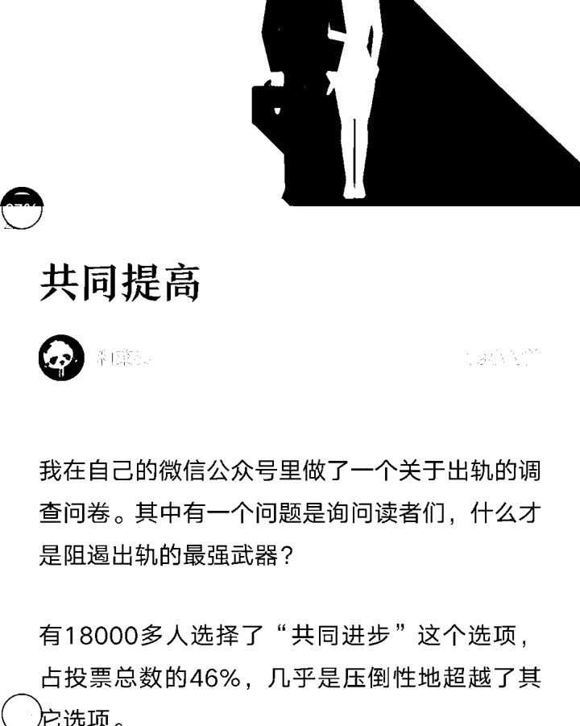

## 共同提高

我在自己的微信公众号里做了一个关于出轨的调查问卷。其中有一个问题是询问读者们，什么才是规避出轨的最强武器？

有18000多人选择了“共同进步”这个选项，占投票总数的46%，几乎是压倒性地超越了其它选项。

这个问题投票率第二高的是“同甘共苦”，占投票总数的10%。

其实它和共同进步也相去不远，这样算起来的话，有超过50%的读者认为夫妻/情侣共同提高才是降低出轨风险的方式，其它的选项诸如道德约束、社会舆论、抚养子女乃至暴力感，都没有获得那么高的认同。

最出人意料的是，有人在跟贴里问我：为什么没有“尽情”这个选项？我回答说：我喜欢这个笑话。这条答案在24小时内，获得了1319次赞同。

为什么是“共同提高”？提高什么？在我看来，这个选项获得了最高票数，说明了三件事情：

- 一、对于两性关系存在普遍的焦虑。共同提高这个概念是近年来关于如何维系婚姻/情侣关系的讨论中最常见的答案。现在看起来这个答案也为大多数人所接受。它本身是不是真的那么重要，重要的是有那么多人接受这个观点，于是这个说法也就变成了某种标准答案。共同提高是一个心理的概念，人们在坚持正向概念的时候，往往在心理动机上是因为惧怕落入了这个概念的正面。因此，人们选择共同提高的时候，其实是在担忧自己掉队，和自己的伴侣在个人发展上出现巨大落差。

为了验证这个看法，请回忆一下关于电影导演李安的做法。那些流传甚广的文字是在谈他的艺术成就吗？是在探讨他的电影风格吗？都不是，而是在谈他在一名不文的时代里，如何终日在家做饭做菜，而他太太又是如何经年累月里供他，始终没有放弃对李安的信心。人们喜欢这个故事，不仅仅是因为婚姻中的忠诚，也不因为婚姻中的相互扶持，而是看到一个人在不能共同进退的情况下，他的伴侣仍然不离不弃。这也从反面说明，这种不离不弃何其少见。

- 二、对于许多人而言，婚姻从过去的经济联合发展到今天，变成了一个战斗联盟的状态。选择共同提高这个答案，意味着人们把生活视为一场和外部世界无足尽的战争，因此双方都有义务不断强大自己，为家造出这个战场里提供更强的人力支持。共同提高并不是一个自我放纵的看法，而是代表了一类人对这个世界的看法。如果我们认为外部世界是一个充满激烈竞争，而且随时都会出现变数的战场，那么就会很自然地认个人需要“提高”、“完善”、“进步”这样的字眼，很自然地，婚姻里双方也应该共同提高，携手进步，不要成为对方的拖累。

这样的看法可能更接近于婚姻的本 来面目：婚姻出现的原因并不是我们今天宣称的爱情，而是某种社会资源的优化和重组，用家庭形态在社会竞争中获得更优越的位置。大家都是战士，而战士决定和什么人联盟，取决于对方的实力和未来的发展潜力。所以，战力拉低，提升缓慢，是战士之间彼此伤害的最大原因。

- 三、唯一值得高兴的是，“共同提高”这四个字后面隐藏了平等的思想。人们认为共同提高能够作为规避出轨的最强武器，是认定了一个假设前提：男女之间存在平等关系的时候，这种关系最为稳定长久，而这种平等关系体现在能力和收入的相对平衡。一旦打破这种平衡，意味着双方不再平等，存在某种形式的人身依附或者经济依附，那么就很容易出现问题。无论这种想法给人的压力有多大，它总是要比以往男权社会的那一套强得多。

总之，共同提高这个概念已经被如此之多的接受，让人群里都站满了身着盔甲、手持兵刃的战士，随时准备投入无尽的征伐之中。

作为我个人，我只是希望一件事情：哪怕只有一瞬间，也应该有爱情来过。

> 请你相信我， 我所说的每一句话， 都是错的。

除了并肩作战之外，人生里还是应该有一些共同温度的光明。

## 用户留言

小慈 (04-16 21:33:42)
然而共同提高还意味着两个人差距不要太大

咩崽 (04-16 21:45:42)
想起小文青作品中很常见的一个形容词——势均力敌的爱情

王洁 (04-16 21:37:53)
爱情是个笑话，可是人生如果没有这场笑话，是多么遗憾！没有真正爱过一回的人，没有发言权，你只是这个世界的旁观者。

欧阳文方(owen) (04-16 21:40:41)
我喜欢今天的禅定时刻，共同进步的间隙适合一起虚度些美好的时光

高远 (04-16 21:41:45)
果然，我也是随大流的一员，自然而理所当然的选了共同进步。

选择这个选项，是因为我相信，也期待爱情。

我希望，拥有由爱情开始的婚姻，我们三观一致，有共同的兴趣，又有不同的特长。在婚姻中，我们可以共同进步，可以让对方在自己身上不断的发现新的惊喜，不会厌倦。

但，如果不能共同进步，彼此也能够相互包容理解。

最重要的，还是，自己成为一个有趣的人吧。爱自己，才能爱别人。

陈之旻 (04-16 22:40:11)
所以说安德伍德和克莱尔的关系如此稳固，并肩作战，在对方身上有利可图

大毛 (04-16 21:39:44)
相信有爱情。但嘴中说的，字面选的，和现实中的选择是一致的吗。

Candice (04-16 21:55:55)
社会找到更好的方式整合和优化资源时，婚姻制度也不需要了吧...

117他爸 (04-16 21:46:43)
我觉得共同提高太功利了，还是一起发呆有意思，特别是当两人已经结婚多年后，还能在一个阳光明媚的下午坐在客厅，就这么喝着咖啡，各自看自己喜欢的书或者电影，而不是打了鸡血似得带着孩子满世界找工作补习班

丸子说 (04-16 23:41:38)
光谈恋爱的时候不要太虚度光阴，却也是美极了的回忆。成家后忙于生活，再想虚度光阴也不太可能，尽量找碎片的时间也能谈谈情说说吧。 : - :

如芸 (04-16 21:38:39)
共同进步不仅是指经济地位、共同征战方面，我的理解还包括虚度光阴的时候可以玩在一起、聊在一起，精神方面的追求共同进步。李安如果没有在电影方面的才华、追求和梦想，他的太太也未必一开始就能看上他，后面还鼓励、提醒他要记得自己的梦想～

七峰 (04-16 23:55:11)
我选的也是共同进步，我认为的共同进步是基于认知的进步，两个人互相提升互相交流对事物的看法，共同进步。我用的方法就是隔壁笑来老师讲的，带动媳妇一起进步，一些书读过再讲给媳妇听、互相讨论，可以观点不同，只要是经过思考的观点。

MrBoomba (04-16 23:06:11)
因为前女友出国深造而深感自己不足，因而想去寻找重创转型，想要赶上另一个人的脚步是一种共同进步的状态，而这个奋进状态的起源于想要得到对方的爱

温同学 (04-16 22:37:02)
把这篇文章发到我们家的群了。共同进步，双方彼此扶持，帮助对方变得更好，等待对方变得更好，这是很美好的事情。但是当一个人不能够成长的时候，也不应该放弃，要想办法帮助对方成长，因为两个人的真诚沟通、相互理解，是关系稳定的基石。如果互相不愿意去理解对方，变得无话可说，就很糟糕了。只要真诚，求同存异也是很好的，然吧，一起虚度这时光吧。

Sissi (04-16 21:44:17)
“共同进步”也是受到影视剧的影响，貌似电视剧电影里都是这样演的，“今天你对我爱搭不理，明天我让你高攀不起”，也是这样说的啊，可见进步已经深入人们的骨髓了。即使在鸡汤文里面也是这样一套路，要不断努力才能得到爱情，人们就会按照这样的套路，继续认为进步也是维系感情的方式。

渣橙其实不算渣 (04-16 22:44:24)
还好，收获了一份虚度光阴的爱情（大学的爱情的），工作后的爱情估计很多都是强娶联合吧。
这样好像不能解析为什么出来工作的女生比较赚金而不是讲心动。

宁老师 (04-16 22:21:43)
我给出的回答是多沟通交流，才能真正了解彼此，查缺补漏。
对于共同成长这个问题当然被包含进去了。古往今来很多幸福的家庭都有相同之处，彼此沟通交流下过功夫、即使有几个不切实际的大脑出轨，也会很快被纠正过来。
为了你们都有个幸福美满的婚姻，多去沟通上下功夫。祝福各位！

Rainbow (04-16 21:54:35)
哪那么多共同提高，我身边的都是男的养女的，女的养男的，人家愿意“你”管那么多干嘛？不是每个人不想共同的，只是因为达不到，而寻求的那种理想状态！谁知道以后会碰见什么样的人，恋爱婚姻本来就是舍弃私人空间，共享的状态……

戚志光 (04-17 00:10:04)
有共同虚度的光阴可以，但是伴侣要是喜欢把业余时间都用来虚度就很要命了。这个度的把握是很考验人的，双方都是在互相拉扯，而想要偏重享受的那一方，是用你人性中的弱点在改变你的行为。那个总想把时光投入在进步上的人，要用大得多的气力，才能克服自身的天性，去影响和改变另一个人。

孙小冬 (04-18 23:54:31)
在一起7年，结婚5年，生活很安逸，也没多少压力。

当初选的共同进步，并不是说要一起变强对抗外部世界。

我只是觉得两个人的生活可以更有乐趣一些。比如我更喜欢看书看电影养花草，也会去找一些有趣的事来做，但她没什么爱好，偶尔看看电视剧。

就像你说的，想跟她一起虚度光阴，一起体验美好的事。

雲先生 (04-17 08:02:57)
关键是“共同”，实际中许多时候不是共同提高。

COCO (04-17 07:14:54)
这一项我选的是其他。心理其实有答案，可惜选项没有。我觉得婚姻应该从爱情开始，维持需要契约精神。但是想想人本姓之多变，软弱，冷酷，又觉得自己实在幼稚的过分，猜想这应该是我无法结婚的理由。共同进步也不能阻止在共同进步的路上层出不穷的花花草草，自己的厌烦和花的心思。怎么说，婚姻毕竟是逆人性的事，无论选择什么，都有可能惨败的败于人性。

苇吟水淀 (04-17 07:08:01)
无论是怎样坚强的战士，也该有一些一起享受美的时刻。昨天发现上海路两旁的香樟树，都冒出了新鲜的叶子，好清新的光啊！好想骑单车一路欣赏。不过这两天有培训，白天又是会务老师，昨天一不小心错过了白天。只好在天黑后坚持和老公骑车走一段有灯的夜路。

风好心情也好，但是锁单车的时候好半天没结费，纠结等待半天，老公很生气——他是IT男，对各种设备都追求老。最后上传了照片，没想到一下子就解决了，结费了。并没有担心的把账号封上好久。生活有点起伏也是种乐趣呀。

今天培训结束后想约老公骑车走一段路，看看树漂亮清新的绿，可他说我高峰期时该骑是扫不开二维码，不肯去。我一时没能理解他的经历和感受，觉得很伤心。又不能硬逼人家，只能说自己很伤心。有美好的事情，我还是是希望和他一起体验的。最后他说走一走，我说好。

wu (04-16 22:11:42)
我选择共同提高也包括看书看电影听音乐提高艺术修养，提升欣赏水平之类的

joey (04-17 08:51:19)
像你说的 “共同进步”是大家在“男女平等”的

## 大浪来袭

昨天下午五点我收到微信平台通知，称由于苹果公司要求，现对iPhone用户撤下公众号文章中的赞赏功能。作为替代方案，微信团队为iPhone用户提供了个人转账功能，可以继续以这种方式支持公众号作者。

六个小时之后，微信平台再次发布通知，称由于苹果公司反对，再次取消个人转账功能，并对此表示歉意。

包括罗振宇、脱不花等人在内的一系列坏人得闻这一消息，兴奋澎湃，奔走相告：微信苹果爆发大战，和菜头恐成最大输家。

这件事情其实很简单：苹果公司不满微信为公众号作者开通赞赏功能，用微信支付而非苹果提供的AppStore内购方式向作者支付人民币。

两家的分歧点在于：微信认为赞赏功能是用户和作者之间一对一的小额赠予，而苹果公司认为，赞赏功能属于读者内容付费，按照苹果公司的相关规定，使用在ios平台上购买虚拟物品的交易，任何须用苹果公司提供内购方式。

这两种支付方式最大的区别有两点：

- 1、苹果的内购方式使用困难地难以使用；
- 2、苹果的内购方式下，苹果公司会收取每笔交易30%的分成。事实上，如果一个iPhone用户在“得到”APP里直接购买任何一个专栏，199块里会有30%归苹果公司所有。因为“得到”的专栏完全符合苹果“解锁后不能使用”的标准，必须使用AppStore，也必须分成。

老实说，一晚上接连接到两条消息，从保留一线希望到最后希望破灭，我并不觉得痛快。一直到今天中午之前，我都深深感觉到来自这个世界的恶意。对于我合众文者来说，我早已经习惯了在公众号上完全靠一篇文章之后几百个赞赏这种事情。一定程度上来说，这已经变成了我的网络生活的一种常态。现在，突然之间一多的人不能再通过微信赞赏，感觉就像是突然撒了一个次。

人们好奇苹果和微信之间究竟发生了什么，昨晚这一切背后和最深层是煞手。我当然可以说交我个人的分析和判断，但是这对于事实来说没有任何意义。明白了所有的前因后果，发生的还是发生了。而且，我个人对于这种结果并没有任何反对或者抵制的余地——和两家巨头公司相比，我个人实在是太渺小了，我的公众号也实在是太渺小了。甚至公众号赞赏这件事情，在两家公司的经营体系里，也是小到不能再小的业务。想不想，苹果一年销售手机能赚多少钱？腾讯一年做游戏能赚多少钱？对比一下，微信公众号的赞赏业务，能占两家公司营业额的多？

两家公司的冲撞，对我来说犹如巨浪来袭，让人身不由己。我最关注的事情并不是谁对谁错，而是为什么我竟然为这件事难受了那么长时间？微信公众号的赞赏功能一直都在，我相当长一段时间里并没有因为在公众号的写作得到一分钱。然后突然一夜之间给我打赏了“得到”专栏，我的公众号也有了相对稳定的赞赏收入。接下来就是4月19日，在某一瞬间事情仿佛又发生了逆转。苹果公司用一种根本无法抗拒的力量，一把将我的公众号收入打入多法无方。

即便是如今，和三年前相比，和更早之前相比，我的收入情况依然要得多。哪怕只是有用户赞赏，我的公众号收入也不再是原先的零，这是有和无之间的差别。然而，在我一毛钱都赚不到的时候，我并没有那么有烦恼，也没有那么有成就感。在我的印象里，我玩得过还挺开心，想写就更新，不想写就一下子消失半年，等到要收取稿费了，就贴了自己的二维码让读者直接转账。贴了两天就发现钉钉叮咚响的收款提示麻烦，是干脆现在，为了继续可收入。

反而是现在，我因为拥有那么多而变得悬悬失，甚至为苹果的一张一小命而难过了几乎36个小时。想到这里，我惊异地发现自己竟然在已经所得的东西那里，采取了某种恒久不变。似乎只要曾经拥有，就会永远这么拥有。在我名一文不名的时候，我总是告诉自说，事情迟早要发生变化，世界会变得不一样起来。

而当我做微博有哪怕一点点东西，我却立即颠倒了心态，恨不得伸出爪子牢牢抓住它们。因为损失而忧虑，因为失去而悲伤。总之，我变成了一个不快的人。仿佛苹果公司是在专门针对我，要吸了我手里的一切。

蚂蚁搬家窝建在河堤上，大浪来袭，冲毁蚁巢。河水对蚂蚁有什么深仇大恨么？不，河水根本不知道有蚂蚁的存在，更况是它小小的巢。大浪没有它的时间，生活在岸堤活只有二选择的巢。要么选择搬家，要么选择桥被不和大浪迎面遇。如今，我遭遇这样的事情，无非是因为在内容付费这个前途未卜的会场上修筑了巢，为什么我非要希望它永远不遇上大浪呢？在打开公众号赞赏的第一天，就有昨天那种发生的可。

这样一想，我竟然觉得放松了下来。发生的已经发生，大浪已经来过，回忆美好往昔对当下并无帮助。而难过的情绪也不能自扫，能自行消解面前的存在。对我这样的入来说，唯一的机会就在于只要给一点空间，只要给一点机会，就会自行去探索和营造。所有的河堤上都有筑巢的虫，已有的河堤也面临着巨浪威胁。不能因为巨浪，有巨浪而不去营建；也不能因为巨浪已去，就躺在废墟里哭泣。

所以，我写了一篇长文，用最简单的言辞给读者讲述了事情的前因后果。在做这件事情的时候，我全心全意地考虑一件事，如何让它没有任何自我消费知识的读者能够理解，并且释然。我究竟通过什么，因此，写了篇长文。

现在我要说，我的心情已经恢复了平静。在互联网的世界里，我依然是那只勤劳而好奇的小蚂蚁。

米，剪刀往波浪米袋之后，从中又辗到一点有价值的东西。

现在我要说，我的心情已经恢复了平静。在互联网的世界里，我依旧是那只勤劳而好奇的小蚂蚁。

和菜头

请你相信我，

我所说的每一句话，

都是错的。

### 后记

在微信尚未推出赞赏功能的时候，我是最早那批贴自己收款二维码在文章里的人。

没有想到，在那么多年之后，事情竟然又退回了原地。原来，浪是有两个动作的：往前拍和往后拉。

## 用户留言

> 高远 (04-20 19:33:26)
>
> 菜头，你不知道，我在半年前就跟你这立贴为证，说自已要从体制内辞职。
>
> 可是半年过去了，我还在这。
>
> 最近两个月，工作环境变得异常艰难。我不停的给自己做心理建设，不停的调整自己。不管是岗位调整还是领导变动，还是被别人利用或打压。我都当做是自己成长道路上的一个沟坎，不想摔倒，就算摔倒，也要姿势好看。
>
> 可今天，在被琐碎工作折磨了一天之后，临下班又被精神打压，套路我看得清，可我躲不过。
>
> 这种无力感让我崩溃了。
>
> 刚才在你的公众号，我还留言，因为我很自豪，对于这件事情的理解，我竟然和你基本一样。可这也不能缓解我的痛苦。
>
> 直到看到现在这篇，你又一次写出了我的心声。是呀，我委曲求全的就在这个单位，不过是因为，舍不得放弃现在付出的努力，不甘心没有最后结果就被迫离开。我以为接下来就能够有一个圆满的结果，可是，这都是虚幻，没有人给我承诺，也没有任何迹象表明，我继续这样挣扎有什么意义。
>
> 所有痛苦都来自自己的内心，世事无常，无常才是常态。谢谢你，指引我走出来。
>
> 写了这么多，感觉好些了。刚刚想哭想喝酒想给人打电话的急切，都平复了。

和菜头 (04-20 19:21:03)
沙发！

作者 回复 (04-20 19:21:34)
浪上的沙发！

看书去 (04-20 19:21:43)
菜头不觉得苹果这种是流氓行为嘛？固然苹果写了一个非常好的系统，但用户在购买iphone时已经付了钱，苹果现在强制使用自己的支付渠道并收取30%的费用，这部分钱

## 喀嗒喀嗒喀

我所有的电脑，无论是在北京的公司、寓所还是在昆明的家，都已经全部换上了机械键盘。不止是我的电脑，连我的手机和Pad也有了自己的专用机械键盘。换做是在半年前，如果我看到谁这么做，会毫不犹豫地把这个人判定为疯子。但是，如果现在把那头手机机械键盘拿走，换回原先的键盘，那么我会毫不犹豫地认为他脑子已经坏了。

回顾我在半年之间的这次转变，我觉得从中获得的最大启发是：如果你觉得一样产品的使用方法矫情错了，那么它多半就是好产品；如果你还觉得这种产品的用户本来不至于那么矫情，那么它就是要确定无疑的好产品。我认为，这可以作为新的一条和菜头大猜想，再等验证一些时日之后，准备提升为和菜头定理。

机械键盘，听起来就让人觉得娇情。键盘就是键盘，不就是用来打字的东西，非要强调机械干什么呢？然而，还要分为红轴、黑轴、青轴、茶轴，都机械了还不够你是的？要不还凑出七种颜色来？最后，键帽上的字符刻法，要么分成正刻、微刻和盲刻，要么还要把各种字体加进去？弄个楷书篆隶草行书书书体的呢？说到底，键盘就是一个输入工具，重点是你能用这工具做出怎样的事情来，而不是你使用怎样的工具本身。

看了这段话觉得很有道理的人，可以说是生活的颗粒度相当大了。换句通俗的话来讲，颗粒度大也可以说成是：粗糙。不相信的话，我举个例子你就能够明白：说到底，刀就是一个工具，重点是你能用什么工具做出怎样有型的事情来，而不是你使用怎样的工具本身。要那么多大大小小、形形色色的手术刀干什么呢？难道一把菜刀做不好手术了吗？

对于一个偶尔使用键盘的人来说，选择什么键盘区别不大。但是，对于那些长期、高频使用键盘的人呢，键盘和键盘之间的区别很大。所谓“手感”这种事情会上升为地区级，再怎么严肃探讨也不为过。机械键盘不同的轴，意味着需要不同的击键力度，也意味着键盘不同的力反馈。随便去一个键盘店来，击键的时候或者偏重，或者偏轻，很少碰上完全合适的时候。如果是每天几百上千次击键，那么用哪种键盘都没什么。可是，如果每天需要上万次击键，所有的“轻一点”或者“重一点”哪怕只是点点，上万次“一点点”累积下来，那你就心疼你的手么？

键盘分出那么多种不同的轴来，不是娇情，而是考虑到人和人之间的不同。如果每个人的衣服、鞋子要和生不同尺码的衣服，花30块钱买机械键盘还要求包邮购的人，他们本身不应该那么矫情。那么，是什么让我们选择机械键盘呢？在30块钱区间挑选大量量级键盘的话，打开商品介绍页看一下就明白了：这种30块钱的机械键盘通常自带多种背光、炫光，而，店家一定要强调这是游戏专用键盘。这样的话，隔着屏幕一股通闪烁的健康感，都能知道房子下面是面是一个专业级游戏玩家，正在用一把炫酷的机械键盘。除去黑黑的部分，机械键盘就代表了专业及品质，但是选择机械键盘的核心原因。这就像是LV包，在网上许多年里销量都非常好，而卖得最好的都是100块钱以内的。

其实，这个所谓的和菜头大猜想是否成立并不重要。重要的是，手掌下面是一架机械键盘给人带来的感受。我在公司上班的时候，喜欢用青轴键盘，敲每一个键都感觉用，就自然简单爽，不至于太独忧啊；我在家写作的时候，喜欢青轴键盘，当清脆的击键声如同暴风骤雨一般倾泻的时候，我的手指有如在键盘上起舞，陷入了一场疯狂的工作状态，击键声就是进攻的鼓声。等到完全听不到击键声的时候，我已经不是在对着屏幕挥写，感觉不到手指和键盘以及周围一切事物的存在，而是在屏幕上直接触摸。我喜欢机械键盘这种确定的感觉，让我想起小时候对机械的感觉，只有击键声才能看到字的我。我敲键盘，或者俯身看下去，只能看到一模一样黑色的键盘，就像是我自己的特点——只有知道从特定角度观察我的人，才能真正懂我。

我不说一把机械键盘，我说一架。因为机械键盘更像是一架很光洁的打字机，而不是一个平板。为此，还要专门给它配一个腕托，否则即便座位高度合适，手腕也会因为长时间上扬而起产生疲劳。对了，它往往不防水，一杯咖啡也许就能毁送你熟悉的手感。但是，和机械键盘所带来的快乐相比，这一切都不算什么。如果没有什么新的黑科技的话，我想我会一直喀嗒喀嗒喀下去。

喀嗒嗒嗒嗒现在是我和世界对话的方式之一。

请你相信我，

我所说的一句，

都是错的。

世界需要豌豆公主，否则，人们不会在床上多花心思。要知道，一个人的人生有三分之一花在床上。

25168成员 | 153人今日打卡

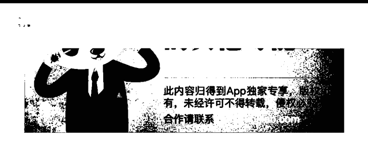

## 围炉夜话

25165成员 153人今日打卡

## 用户留言

**咩崽** 44
感觉我自己的生活品质一直被菜头拉扯着往上走～哈哈哈哈
04-22 15:57:40

**甘有** 77
键盘，花，音箱，iPhone，松茸，还有年度购买的清单。和菜头你还有哪些好东西☺>
04-22 15:55:15

**Lily** 23
叔，我自大四准备论文开始，就入手一个青轴，到现在已是重度机械键盘爱好者。进这公司时，又犒了自己一架原厂红轴。当同事知道我用五六百上千的键盘时，纷纷投来异样目光：一个小女生玩几块钱键盘。刚开始会安利一下机械键盘的好，到后来，我只报以一个微笑。“嗯，是很贵。”-叔，我懂你，我也知道你懂我！
04-22 15:59:56

**Ricardo** 10
看了这篇文章 准备再入个侧刻的
04-22 15:56:59

**周航** 9
当同事知道我花了1300买了一个忍者青轴侧刻机械键盘的时候，投来了不可理解的眼神。我很理解他们，如果是半年前的话，遇到同样的人干了同样的事情，我也会投去和现在的同事一样的眼神的。可惜了，现在的我已经回不去了。多谢菜头叔推荐，感谢。
04-22 16:35:29

**邹文灏** 9
机械沙发哒哒哒
04-22 15:57:48

**饭团** 6
终于及时看到了推送，不过肯定是错过了沙发，就先乖乖看完了。
变矫情了，是因为自己有了点要求了吧，比如不同的刀怎么可能一样，上千块的还是好用啊，切水果用陶瓷刀也好用，以后再多探索探索，片鱼的，剥骨的……太娇情了
04-22 16:00:17

**单脚跳(。o`。)>** 6
今年过节送给男朋友的好礼又有了，谢谢慈父！之前就是看你的推荐给男朋友生日买了电动牙刷，他用了后也离不开了
04-22 16:00:13

**湿同学** 6
在罗辑思维的商城里买了一台，用了第一次之后，在桌面放了很久了。抬头看见它有点寂寞地躺在距离我右手半米远的位置。不说了，我要去摸摸它了。
04-22 15:59:28

**Mors** 6
在叔的引导下，开了公众号，买了cherry红轴键盘。
在敲文章的时候真的是谁用谁知道。每次一不小心开始打长句子，内心就要默念一次爽。
04-22 15:58:08

**uiingting** 6
当个人写字本转向机械键盘的程度... 是不

**涅同学**

在罗辑思维的商城里买了一台，用了第一次之后，在桌面放了很久了。抬头看见它有点寂寞地躺在距离我右手半米远的位置。不说了，我要去摸摸它了。

04-22 15:59:28

**Mors**

在叔的引导下，开了公众号，买了cherry红轴键盘。

在敲文章的时候真的是谁用谁知道。每次一不小心开始打长句子，内心就要默念一次爽。

04-22 15:58:08

**uinging**

首次从笔记本转向机械键盘的程序猿，是不是用青轴比较好？

04-22 15:57:42

**Cowpea**

码奴，无刻HHKB，低调奢华有内涵。

04-22 15:54:59

**行客牧花**

我想说，如果大学的时候我买的是那种设计感十足，手感极佳，十米开外就能让人感受到专业气息的键盘的话，我的LOL段位绝不会是现在都不好意思说出来的白金分段。其实我想表达的是，这一系列和菜头酥推荐的物品，当你去切身享受了，你不会顾影自怜的觉得我只能这样了，自怨自艾不配拥有。之后，你会更竭力的去追求更高品质的生活或者说捍卫自己的审美，就算你是装的，但每一次都以这样稍微用力的方式来生活，慢慢的就是不同了。这是全然不同的两种生活风格，一种是也没 什么大不了，我就这样了，差不多就行了。另一种是更认真的对待自己的生活，也严苛的要求自己，反而更轻松了。

04-22 16:37:45

**吃米**

已经用了三个月，用mac air原装键盘打字好不适应，就入手了一个青轴的，现在手指已经上瘾，那声音让自己根本停不下，也不犯困

04-22 16:17:17

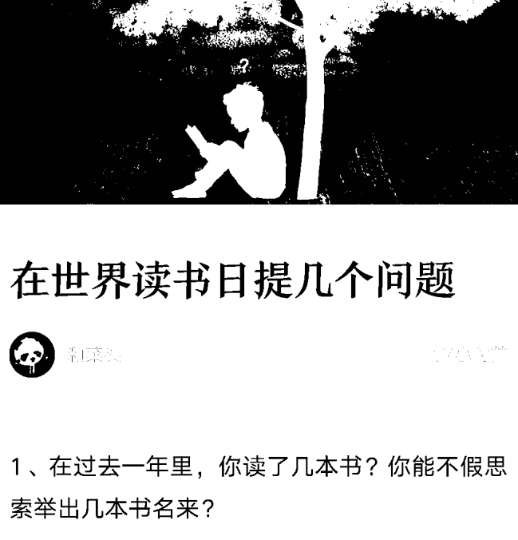

### 在世界读书日提几个问题

- 1、在过去一年里，你读了几本书？你能不假思索举出几本书名来？

- 2、那些你画了重点，做了笔记的书，你现在还能想起多少内容？

- 3、比较一下读书和现实生活，哪一个给予了你最多人提升？

- 4、你觉得读书是为了消遣还是为了学习？

- 5、所谓个人收获，在读书过程中究竟指的是什么？

- 6、如果你读的书目不受人认可，你还会读下去么？

- 7、当你和别人讨论同一本书的时候，大家的看法如果截然相反，你会怎么做？

- 8、你会在意纸质书和Kindle之间的区别么？

- 9、你能持续阅读一本书的时间最近是增加了还是减少了？

- 10、你家里有多少本书是买来以后根本没用过的？

关于读书这个话题，有太多人发表过太多看法了。所以我今天想换个方式，提出十个关于读书的问题。

如果你自认是喜欢读书的人，那么回答一下这十个问题。在回答的过程中，或许你能够明白我对读书这件事有什么态度和看法。同时，也许你能想明白，自己读书究竟是为了什么，究竟的东西究竟在不在书本身里。

期待你的答案！

**和菜头**

请相信我，
我所说的每一句话，
都是错的。

读网络小说算不算读书？

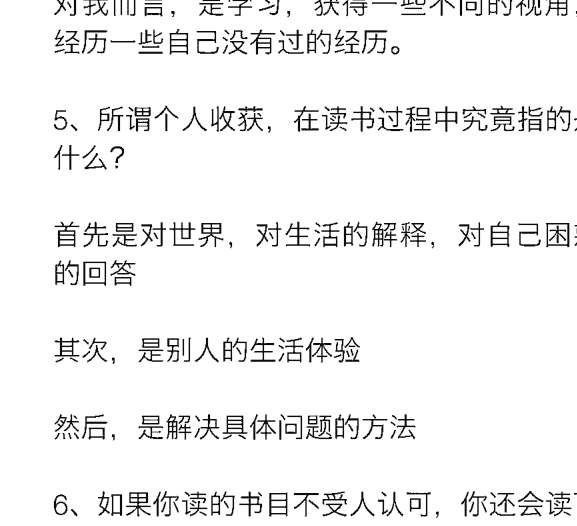

## 用户留言

**和菜头** 41
沙发！
04-23 18:56:13
作者 回复
阅读的沙发
04-23 18:56:29

**张紫麟14956981** 15
1、在过去一年里，你读了几本书？你能不假思索举出几本书名来？

《故事》，菜头哥推荐的，很棒。

《人类简史》，趁着热度读的，提供了一个很有意思的视角。

《尼克松的《领袖》》，看到了一个政治家眼中的其他政治家

《特朗普家族》，罗老师推荐的，了解了为官有道，治家亦有道

《富兰克林自传》，一个保守主义者的成长史

部分书名是翻阅了书单找出来的，不过这些书读得深刻些，也受益良多

**朱**

- 1、那些我们一起追过的球星 II、《我读书向你可别骗我》、《中国航母》、《中国震撼》、《中国制造》、《设计诗》、《小顾聊绘画》等等。

- 2、做了笔记能想起的内容不多，但是也能想起一些。

- 3、给予我最多个人提升的话，学生时代是书籍。现在是现实生活。

- 4、读书对我来说既是消遣也是学习。

- 5、个人收获在我这里主要是指一种读书的愉悦感，以及眼前的开阔和思想的指引。

- 6、别人不认可我的书目绝不会影响我是否阅读下去。

- 7、截然相反的话我会先尝试看看的说服他，如果发现不适合的话就坚持，也无所谓。

- 8、我在家，因为我只看纸质书籍，不喜欢看电子书。在两个重要原因：书籍的封面、封底、版权页对我来说也很重要，包括插图、字体、行间距等，排版我也还是比较在意的。还有就是读书时手里捏着书的感觉很舒服，而看纸质书会累起来。我也不知道为什么会觉得纸质书比看纸质更方便，但是就是觉得方便。

- 9、最近增加了，因为发现了几本挺好看的书。

- 10、几乎没有。但是有一本山寨《人类简史》的书我翻了几页就不想看了。

04-23 19:29:28

**Lily**

- 1、过去一年读了几十本，《魔法数学》《异常》《科技要做什么》《算法导论》《认得》《穷查理》《游戏改变世界》《巨婴中国》《穷查理》《未来简史》等等。

- 2、只记得一些碎片的观点和结论。

- 3、读书对个人的提升和总结。

- 4、既是消遣也是学习。

- 5、所谓个人收获，是在读书的过程中感受到愉悦。提升了自己看待世界的方式。

- 6、如果读的书不被人认可也会继续读下去，自己判断书的内容和收入。

- 7、当别人看到不同的书时，我会保留自己的意见，不用网上去看别人的评价。

- 8、纸书和kindle，纸质书适合圈圈画画做笔记，kindle方便携带有比较轻松的，不需要做很多笔记。

- 9、阅读时间增加了。

- 10、还有接近一百本没读没。- -!

04-23 19:44:35

**子小仟**

- 1、在过去一年里，你读了几本书？你能不假思索举出几本书名来？
答：具体没统计，几十本应该有。我能不假思索举出几本书，基本都是读到知识点很密集的书，特别喜欢做卡片的一些书。

- 2、那些你画了重点，做了笔记的书，你现在还能想起多少内容？
答：有少数几本，因为做卡片会记录很多，但大部分还是读后忘了。

- 3、比较一下读书和现实生活，哪一个给予了你最多个人提升？
答：实践——认识——实践。读万卷书和行万里路都很重要。知行合一给了我最大的提升。

- 4、你觉得读书是为了消遣还是为了学习？
答：不能非此即彼，而是为了生活。读书能让我们了解世界的不同侧面，但更重要的是让我们成为更完整的人。

- 5、所谓个人收获，在读书过程中究竟指的是什么？
答：一种是感觉作者说的和我想的相似，从而在情感上知道自已并不是孤独自的。一种是听到别人才有的观点后，对自己原来的认识进行修正，比如对世界的看法，对自己的理解，对他人和社会的理解。一种是觉得原来自已的一些偏见其实是自已的偏见，从而获得解脱。

- 6、如果你读的书目不受人认可，你还会读下去吗？
答：首先，我觉得没有人认可的书目几乎不存在，只要扩大承认范围。其次，我觉得阅读应该是一种享受。如果自已读过的书被人否定，那就要考虑是不是自己理解错了，还是书本身有问题，或者自已不适合这种书。不能为了迎合别人而去读自已不喜欢的书。

- 7、当别人讨论同一本书的时候，大家的看法如果截然不同，你会怎么办？
答：在现实会面尽量避免这种场面。如果出现，我尽量保持不争论。网上可以表达自已的看法，但尽量保持开放和包容的心态。

- 8、你会在意纸质书和kindle之间的区别么？
答：以前在意，现在更方便用Kindle。一是便捷。二是方便携带，可以随时阅读。

- 9、你能持续阅读一本书的时间最近是增加了还是减少了？
答：近三年来看有阅读时间基本不变挺多的。只是随着年纪和对效率的追求，更倾向于通读一本书，少做重复阅读。

- 10、你家里有多少本书是买来以后根本没读过的？
答：还是不少的。不过不要浪费，要读书必须买回来，如果买回来没读，可以送人或者放在那里，等自已有空再读。

**陈怀哲**

- 1、减少了。一方面，一些好书需要反思和思考，所以，会隔一段时间再看。另一方面，我只进故事的书。

- 10、你家里有多少本书是买来以后根本没读过的？
不多。平常不太买书。更多地直接找电子书来着。

**煜煜 （上善若水）**
过去一年中因为罗辑思维的推荐，订了四个专栏，同时买了许多书。1、罗辑思维上熊逸的书全买了并看完还有简版的扎西拉姆多多的，其它的还没看完，应该有七八本吧。2、画了的重点及笔记大概只记得百分之五十了。3、关于读书与现实之间我更爱读书给我的提升更多，越读觉得越没文化了。4、我读书为了学习，我觉的读书使人生活品质变高，一生都要坚持。5、个人收获感觉自己心情好了人也变好看了……。6、至于我读的书别人认可与否我无关，我自己在自己的世界里任性的读喜欢的。7、如果看法不一致我保持沉默，因为争论没什么意义，毕竟人人都有自己的看法书与书不一样。8、纸质书及电子书对我讲是一样的。9、读我的进度基本保持着稳定，有时间就看。10、买的书我一定读完，因为买时就是喜欢的，只是买多了要排队看。和老师我不会写东西所以按你的十点答了。若不对请批评!
04-23 19:41:42

**Alan**
网络小说对于我算消遣，现在已经不读了。从过去半年前开始重拾读书的，读了不超过5本，惭愧。。读书笔记是属于零碎的，并没有穿起来。因此，大多忘记了。。目前为止并没有学以致用。
半年来接触读书对我最大的收获应该是“对建立一个属于自己的知识体系有迫切的‘需求’，我也在往这方面努力逐步靠拢。
04-23 19:25:11

**一坪海岸线**
问题1：7本。《采桑子》、《疑问集》、《故事》、《鬼吹灯》、《龙枪编年纪》、《圣经》、《共产党宣言》
问题2：即使画了重点，也忘了很多。如果没有形成读书笔记。很难从记忆中调取。印象最深的是圣经旧约诗篇23：耶和华是我的牧者……
问题3：读书。
问题4：消遣，让我从现实生活里抽离
问题5：借鉴他人的智慧和经验，让我的思考或眼界稍微不那么狭隘一点。让懒情的我稍微勤于思考，产生总结和分析的快乐。
问题6：会有点动摇，但如果很喜欢，还是会看，默默地点。
问题7：我会找出认为打动我的理由，阐释出来，但不会进一步争论。但会认真看对方反对的观点是什么。
问题8：两者有区别，有点在意。都买，书目不同。还是更喜欢纸质书。
问题9：减少了，我发现兴趣不能单纯支持我读下去。
问题10：不到20本纸书，若干电子书。真要读书，可能需要一鼓作气吧。过于高估自己买书就能读书的能力了……
04-23 19:20:08

**惟帅**
毕业四年，读书时间越来越少。去年看了大概十几本，记忆最深的是盐业七生的《罗马人的故事》还有三公子的理财书，以及一本《不得往生》。读书既有消遣部分，也有学习目的。三公子的书看了三遍，作为理财的指导等。有时阅读书，已属不易；遇到一本好书，更为难得。特佩服一可同事，他保持每天阅读半个到一个小时的时间。向他学习。
04-23 19:15:02

**愿离苦76094364**
1.读了二十多本，人间失格、百万富翁、哲

## 梵高和梵高奶奶

对于一位画家的了解，往往建立在几张画的基础上，这真是让人感到遗憾的事情。比如说梵高，一提到他人人想到的就是他那鲜艳扭曲的向日葵。

看过这样的作品，难免会让人心生“画得也不怎么样啊”的想法。大概还有人写下去，仔细观一撇之后抗议说：连个瓶子都画得歪七八扭的，还说什么世界著名画家呢？国内有位70岁才开始学画的老奶奶，画了许多乡下的风景，甚至也有向日葵。画风同样色彩鲜艳，构图更加童趣，于是网友就把她称之为“梵高奶奶”，媒体也借用了这个名字。于是，梵高奶奶这个名字和她的作品不胫而走，赢得了无数赞誉。

下面，就是梵高奶奶笔下的向日葵：

奶奶的画作水平如何另说，网友给老奶奶起的这个名字很耐人寻味，媒体跟着网友一起那么叫就更有意思了。在这个称呼里，隐藏着大众对梵高作品的理解。梵高的画真的那么好么学么？真的只有颜色和色块么？

我们再来看一张图片：

觉得这张图片是什么？一张老照片？这是梵高的素描作品。

对，就是那个画出歪歪扭扭向日葵的梵高，完全是同一个人的作品。素描是一名画家的基本功，也是一名画家需要掌握的绘画基本技巧。那么，现在觉得梵高的绘画技巧如何？如果以像不像为标准，梵高做得如何？

看了梵高的向日葵，难免让人心生“我也可以”的想法。有这样想法的人，只见过高高最著名的那几张向日葵。但是，梵高笔下的向日葵可不止最灿烂的那几张而已。比如说：

同样是以不像作为标准，这两朵向日葵和一开始的那瓶花相比如何？梵高是真的画不出“向日葵”的画么？还是他不想那么去做？

回到第一幅画上来，梵高画了一个歪歪扭扭的瓶子，我还见过一个更糟糕的花瓶：

当你在手机上看的时候，会发现这是一个歪歪斜斜的绿色花瓶，下面是扭曲的油彩，就像是粗粗的笔很粗暴地刷过去一样，沿着瓶子边缘发生了弯曲。如果你有电脑的话，这里我给你一个网址：http://artmigth.com/Artists/Vincent-van-Gogh-1853-1890/image-175485p.html（如不能长按复制，请升级最新版得到app）

麻烦你用电脑打开网址，最好是在大屏幕上点开网址里的图片。请你凝视画面几秒钟，然后起身慢慢后退，就像在美术馆里欣赏一幅画一样。然后，你会看见一个坚实无比的绿瓶子，下面是平得不能再平的桌布。黑色的背景随着你的后退，也一并退入花和花瓶之后，于是整幅花在画面中凸显出来。请你前后后后多看看几次，观察一下远处那些看起来粗暴的笔刷，和看似乱七八糟的色彩，在拉远距离之后发生了多么奇妙的变化。那个绿色的瓶子，如何从歪歪斜斜的样子，突然变得真实具体，甚至能感觉到它的分量和凸起了。

最后，再想一想梵高究竟干了什么？在一个二维平面上，他是如何表达出物体的空间感和质感，如何表达出光影的微妙变化的？感受到这一切之后，还不足以理解和欣赏第一张向日葵。

但我们应该可以形成一个共识：梵高拥有画家必须的基本技巧，而且在这种技巧之上，他还发展出了别的东西，以此表达他自己想要表达的东西。他的作品，并不像看上去那样缺乏技巧，只有颜色和扭曲的线条。

想要成为梵高，或者超越梵高，并没有想象中那么简单。越过素描这样的基础，直接画出梵高最后的向日葵，也许是有可能的。但是，没有之前的一系列画作，让人看不到这一路上的训练和探索，即使画得和梵高一模一样也毫无意义。

所以，梵高只有一个，谁也不能替代他走过的这一路。

**和菜头**

请你相信我，
我所说的每一句话，
都是错的。

还是一张梵高的素描：

围炉夜话 25252成员 311人今日打卡

## 用户留言

**甘有** 40
网址错了，菜头叔，com前面没有短横，应该是http://artmight.com/Artists/Vincent-van-Gogh-1853-1890/image-175485p.html

我帮你缩短了一下网址
http://t.cn/RxmGBCj
把我的留言放出来，大伙输入上面这个短网址就行，注意大小写 ☺
04-27 23:33:42

**和菜头** 38
沙发！
04-27 23:19:50
作者 回复
印象派的沙发！

## 用户留言

今天和同学群被一个好友缠着辩论《我是和菜头》的文风和评论区拉黑骂人问题，感觉自己能默默地为文字偶像尽心分意是这次的小确率。

再次感到，有些话，懂的秒懂，不懂的恒不懂，谁说是活在同一维度的时空人啊！
04-27 23:33:31

**作者 回复** 哈哈哈哈哈哈
04-27 23:35:31

今天和一个女孩子分享了你关于梵高雨的文章，她很不满意的表示我是强行灌输我的想法给她，并且说粗俗有两种，一种是和菜头说的人，一种就是和菜头。我说：好吧，你说得对。然后决定再也不和她分享你的文章。

04-27 23:30:38
**作者 回复** 你告诉她，我说她了。根据她的逻辑……
04-27 23:43:45

最近连着听了几节美术课，对西方美术史有了最基本的概念。可我最大的收获，是我敢去看画了，敢去欣赏了。不再像以前那样畏俱，担心自己看不懂而露怯，担心被人看低。

我知道了，美是可以引起共鸣的，是心灵的慰问。现在回想起2014年初，在厦门闲逛，无意间闯进一家私人画廊，转入里厅时，被画上那幅孤独的女孩深深击中。看进去就出不来。现在想起，依然会有这种感觉，一种心灵相通的感觉，那幅画，就像是我心底最深处的那个小女孩，孤独无助，却又很倔强，远远的站着，不靠近。

了解美术史，了解这些画家，了解画作背后的故事，可以让我更好的去理解，去欣赏，这也是菜头想要带给我的吧。
04-27 23:28:30

这次我真的被梵高的画作之美震撼到了！谢谢菜头！
04-27 23:24:47

菜头你说的是对的呀，我电脑屏幕27寸，退后到5块地砖的地方，果然看到了立体的绿色花瓶啊，黑色的背景果然消失了！我又量了一下地砖，50公分一块。
04-27 23:43:41

前年看了欧文斯通的梵高传之后，对梵高这个人有了进一步的了解，他的生活，他内心深处以孩童般的善良，还有他清贫凄苦的一生，造就了伟大的梵高。他的每一幅作品都代表了他当时走过的经历。佩服他，敢于在生活回报他以恶意的时候，他仍旧活的阳光。
04-27 23:26:06

在留言区的网址试了下，刷子痕迹那么明显的花朵，在整个黑色的背景下，在远处看起来开的热火此残盛 (ps:我舍友一直问我在干啥，我刚给他也演示了一下，端着电脑由远到近，大晚上欣赏梵高的俩哥们)
04-28 00:22:24

**作者 回复** 希望你能偶尔想起这个夜晚
04-28 08:26:10

素惊拽到了我，居然久久打不开，超级高清！
04-27 23:29:12

## 知识树和书海战术

我曾经和罗振宇聊过一个关于“知识树”的概念。当时我认为，现代人的终身学习已经构成了一种事实，那么如何学习呢？在我们的时代里，任何一个领域都经过了漫长的发展，任何一个初学者都要面对无可计数的知识。这可能造成两个结果：1、没有办法在一开始对某个特定领域形成概览性的认知；2、在一开始不知道如何入手，随后不知道如何进阶。

因此，我认为《得到》应该延请各个领域里的专家，一个领域分别建立起知识图谱。从最早一个想要解决的问题开始，一路画出理论上的变化发展，标注所有重要的发展节点，最终形成一张树状图。这就是我所谓的“知识树”。当人们进入某一个领域开始学习的时候，根据具体的知识树，就可以一步步选择需要阅读什么书籍，掌握什么理论，以及未来偏向知识树的哪些分支。并且，在学习的过程中还能非常清晰地知道自己进展到了什么层面，还需要朝什么方向努力。

这样一来，个人学习就转化为阅读一系列的书的组合。用知识树，可以把整个需要学习的领域分为不同的层次和不同的区域。再把不同层次和不同区域对应的书籍找出来，任何一个人，都可以依据个人的水准，选择一套书，循序渐进地深入学习。当时我认为，这是最有效的做法，也是《得到》可以慢慢累积起来的宝贵专业资源。

今年世界读书日，我在《得到》专栏里提出了几个关于读书的难度。读者的反馈非常踊跃，看完大家的答复之后，我意识到自己关于“知识树”的想法可能并不成立，虽然它听起来的确很有道理。

知识树建立在一个假设上：人人都需要有效率的阅读和学习。任何一个学科或者任何一个领域，从入门到精通都存在着一条最短路径。人们能找到这条路径，乃是没有人系统整理过学科或者领域内的知识。但是，当我看上百条回复之后，我却发现一个事实：每看一个人谈了100本书，涉及到某个学科或某个领域内读的人的个人水准，如何判定这100本书里哪些书籍贡献最大？哪些书籍可以忽略不计？谁来做这个判断，谁来制定这个标准？以及如何知道这个人做出选择标准对特定的某个人是有效的？

知识树的这个概念的反面，暗示了人们在阅读和学习中存在着大量的“浪费”。我又仔细想了一下，发现这种阅读和学习中的“浪费”是不可避免的，甚至是人的一种必须。回想我自己在未来几年的个人学习过程中，很难说哪些学习是完全无价值的。甚至，我都不能说出自己在特定领域内的进展究竟具体依靠了哪些树，因为，我反三的现象。也许，我需要同理解A领域内的知识，但是在A领域内的阅读和学习对我的理解并没有帮助，于是，我读书，在E里面，不得不看到那一天，我在B领域内偶然翻到一处，就突然看到一个方法，某个思路，它让我一下子理解了A领域内那个卡住了很久的问题。

这样的情况在过去发生过无数次。凡是在关键时刻给我启发和灵感的，往往来自于一个完全不同的领域。想到这里，我不禁悚然而栗：如果知识的概念成立，意味着我会按照知识树的结构去阅读和学习，那么，这也意味着我永远不会失去从其他“无效”领域中得到启发和灵感的机会。事实上，正是那些在阅读和学习过程中看似“浪费”和“低效”的部分，关键时刻给予我最大的帮助。对于一个人来说，有些“浪费”是必须的。比如说要读一些“用不上”的书，要学一些“没有用”的知识。

在人类的历史上，并没有主动设计自己的科技树和知识树，科技和知识的体系在现实具体问题的推动下，不同的想法和不同的解决方案经过无数次碰撞之后，最终自然演进了人类的科技图谱和知识图谱。也就是说，整个世界的知识图本质是结构化的。既然如此，当我谈“知识树”的方式去阅读和学习的时候，本身就相当于看上去美好但实际上根本不成立的方法。整个世界的知识图现在已经非常努力了，唯一的方法就是用自己的书海战术来应对。努力扩大自己的阅读面，让它尽可能多地覆盖知识地图，这可能才是解决问题的根本之道。

当然，书海战术意味着许多浪费，其中的确有许多最后经证明根本用不上。而且，这对于任何初学者而言，意味着在早期要度过一段非常艰难和痛苦的过程，需要在一片黑暗中建立起自己对该领域的认知，找寻到学习方法和取舍之道。这样的方法比书的方法都糟，不同于别人设计的知识树或者书山，它当然属于自己。更重要的是，在没有他人的指导和帮助之下，一个人可以凭借自己的思维去探索，在每一个前进的关口做出自己的判断。如果没有这样的判断，那么别人一定会停下来思考。如果没有任何的判断，那么也就失去了前进的方向，站在原地无法判断应该如何选择。

我知道，人们应该会非常喜欢“知识树”这个概念，我也一度非常喜爱。但是现在，我选择将它收起来，让前面这张纸空着。而且，我要把这张纸放在一个读者手里，请他一点一点亲手画出自己的知识树。

> 请你相信我，
> 我所说的每一句话，
> 都是错的。

## 围炉夜话

26271成员 222人今日打卡

## 用户留言

**和菜头**
沙友！

**作者 回复**
假期的沙发！

**117他谷**
我现在是读书越来随风雨飘了。不过你说的用A领域的知识解决B领域的问题，深感同意。我就是为了解决苦难的copy paste问题，学了python语言，结果用excel的vba最终搞定

**愚及**
知识树是ai的学习方法，至少这一代的ai只能在人类设定的目标、规则和范围内学习，可是是人类。我们的进化过程并没有一个明确目标，在现实中一路磕磕碰碰，东拼西凑解决一个问题。与ai不同的是我们除了没有预设的路径可依靠之外，我们可以自己东西目标，开辟路径，可以在看似毫无关联的东西之间建立连接。世界是充满不确定性的，依据固定的知识树判断，必然会在未来的某个时刻遭遇不可跨越的变数。
反击功利读书的最好例证大概是实用主义的中国没有发展出现代科学，无用主义的西方哲学却发展出了现代科学，催生了工业革命。有固定、明确目标的实用主义方式发展是沒有未来的。
庄子说：‘吾生也有涯，而知也无涯。以有涯随无涯，殆已！’胡适先生以‘怕什么真理无穷，进一寸有一寸的喜。’反击。现在我是偏向胡适先生这边的。

**单脚跳**
按照这个思路来说，因为考试而建立的划重点知识体系，确实容易将人造成固化思维，培养成考型人才。记得上学时候班里前几名除了用功背书的之外，总有一些见识广，课外知识丰富的，考试非常轻松，掌握知识对他们而言就是触类旁通

**晶金shima**
虽然还没到中午，但前段时看你写的《如同中年》, 也算是刺激自己下定决心，对现有职业规划做二次变换。今日，也完成了这次变动。开始下一段旅程。
想表达的是，其实无意间看到的文字，回想起来的却是对自己人生重大决定有如此大的影响

**Calvin**
菜头叔叔，看你的文章，有时候也渐渐感觉到有些时候该走的弯路还是得走，还渐渐进去是得待。即使大人的指点下，也许可以幸运的绕过了很多大坑，但总也要失去些什么，比如经历低谷后战胜困难后的幸福感，比如物质极大丰富后，如果精神层面没有及时提升，体验到的生活也是层及其有限的。不能妄想找到一条完美的路径直抵人生彼岸...

## 用户留言

**竹酵。 3**
看到开头说到海量知识，其实我们都知道永远学不完，而且知识从来不是确定的，它一直在自我迭代。

想了想从去年得到一开始出来，到后来知识付费平台各种出来，再到现在每天早上醒来就打开得到，现在不管看书也好看专栏文章听书也罢，都是很随性的。不能按照生活中说我学什么有用，大部分时候觉得好像没用，但是当你阅读量大了之后，又会发现知识和知识之间有着千丝万缕的联系。反正现在不管好的内容不好的内容，多少都会看点，不再为所谓的兴趣吧去看什么，因为太知道，不管现在看什么，都会觉着有味，哪怕是我读过的文章，看过的书，在另一个自己面前，可能会注意到之前没注意到的那几句话，带领自己到另一个世界中啊。学习，读书到最后，其实还是读自己，认识自己，也在找我们更好存在的意义。

得到，不仅是知识的得到，也让我们有种身份认同感。
04-30 00:48:59

**lampost 3**
前段时间看书《这才是心理学》，作者讲到对于将学术分为基础理论研究和应用研究其实是没必要的。因为基础理论最终能在哪个方面应用往往无法提前预估。青霉素的发现，伟哥的发明。都不是刻意研究抗生素和阳痿治疗的结果，而是别的研究中意外的发现。

想画出知识树，隐含的前提是，我们知道要去哪里和知晓什么。而我们真的就能预先知道我们最终能到达的地方吗？
04-30 00:26:04

**豪哥爱捣蛋 3**
就算菜头给我们列出了成为有趣的人的知识树，我们也绝无可能成为另一个菜头，因为在知识体系之外还有无数多的影响因素。就好处这个世界就不存在绝对正确的顶层设计，光怪陆离的需求被只能被千奇百怪的供给所满足。整个过程是动态的。
04-29 23:46:03

**甘有 3**
谢谢菜头，假期的第一套书，就是顺爷的《小顾聊绘画》，一口气读完了两本，在假期的凌晨，手不释卷看到夜里两点多。我不知道看这样一套书对我有什么用，我也从来没有看过艺术类 的书，但我总是觉得多读点没有坏处。

我是一名英语老师，在五一放假的时候，本应当布置一大堆英语试卷让学生们回家去做，但我却鬼使神差 的跟学生们约定，在放假结束后的晚上，一起聊聊假期看过的书。

我的精神本来十分贫瘠，正好放假，王小波的八本文集也到了，慢慢看吧，反正我不再是学生也不是小孩，没有父母和老师在我旁边说“看这个有什么用？”顺便汇报一下，您推荐的《故事》，那次拆封之后也一直在看。虽然没有知识树，但一定要有根路人。和菜头，你是我的引路人，哪怕以后没有槽边往事，我也会学着 自己找到路，走下去。
04-29 23:40:33

**温同学 3**
自己就是自己人生的画笔，每天通过学习提升自己的认知，不知道未来，不知道最后会画成什么样子，但是我唯一知道的，是一幅属于我自己的画卷，成稿的日子，就是生命终止的那一刻。

任何的方法，只有事后才能总结，但是，这之中有太多的偶然性，以至于很难重复，只能靠自己左冲右突。
04-29 23:20:48

**可听Tania 3**
上午整理了一下普通人动漫之前可能会考虑的问题，如果明天可行就写出来回复在公众号里面。得到许多专栏都会提及“针对化解决问题”这个。我有点不是很喜欢，总觉得有点头疼医头的意思。反过来想效率是不是高呢，应该高一些。那我在怀疑或者疑惑什么呢？自己也没能搞懂。
04-29 23:04:37

**王弘毅 2**
如此，对于一个完整的系统而言，一定的知识冗余是必要的。树形图知识点识树，越往上精细越，但是枝干太脆弱，支撑不起 最优质的果实。多个角度，多根枝干互相支持，系统会更加稳因。
04-30 00:38:58

**渡渡 2**
看了菜头叔这篇文章忽然想起来最近看王小波《沉默的大多数》里提到的关于书里这个世界 前已经是前人探索完成，自己再走的话，这种生活将是多么无趣，所以相比较还是自己去书海里种自己的树吧--
04-30 00:37:47

**Rainbow 2**
本来出来想 抢个沙发结果网速太不给力。自己的知识树改变：1、读了菜树的《写作》，开始从最烂的文章自食其 力一点点写，反正已经最烂了，不能再烂了。改变：果然写作一开始就停不下来了。
2、读了菜头推荐《故事》，虽然没读完。但是对于我写论文有用。也不知道怎么了，属于不知道有用但是写出来的思维就知道委委转转的一样。但是后面写 的文章有基本思路。说有用也有用...说没用也没有...短期没有代表长期没有，长期没有用不代表新鲜劲儿...也开始尝试写严肃文学、论文、故事（反正先实践起来）
3《咯咯咯咯咯咯》一个激动买了机械键盘连接了电脑、手机、平板、开始写作，感觉好极了！很便利……最起码这几天还有新鲜劲。赶快把我 想写的写出来，就像以前的打字机一样。手感好，听着舒服，灵感也多起来。

对于我 以前而言，我根本不知道现在能有这么好。能用文字治疗自己，类似舔伤口。对人也没有那么想了，别人说我不行也没 有对自己没有信心了，开始反思是他自己心肠太窄了。有什么也敢想敢做了，不再畏首畏尾了，思想也飞起来了。而不是像以前一样想得 多做的少。
04-29 23:49:32

**蓝七十七 1**
我觉得 很多领域的知识，在本质 上都是相通的。大叔提到的知识树其实 也可以是底层基础建筑，作为一个领域学习的入门，以后如何走路就真的全靠个人了。

可能 有的人就抱着一个领域死磕，有些人更善于触类旁通，从海量知识中找到 连接。
04-30 08:32:41

**小林子 1**
最近在再次 看反脆弱，塔勒布一直在说的是反对这样至上而下的安排，关于阅读就是按照兴趣自由的阅读不行就换 但是持续阅读这件事，浪费和 冗余是必须的。
04-30 08:20:26

**希阳 1**
在一个由笔友搭建的写作群中，大家总是热衷于构建大家所熟知的“知识树”，这并没有错，只是这样的学习真的能够帮助到读者吗？

其实我们都是说书人。说出自己的故事，旁人自知。
04-30 08:18:02

## 总统和第四权力

美国白宫记者协会晚宴历来是一个拿总统开涮的保留节目。但是，今年美国总统特朗普并没有出席晚宴，而是跑到宾州参加执政百日的群众纪念活动。

由于总统缺席，以往喜剧演员和总统轮流上台表演单口相声的盛况不在。今年的晚宴上请出了一个叫做哈桑的演员讲笑话，现场的气氛可以说是尴尬至极。哈桑在台上拼了老命，台下只有干巴巴的笑声和稀稀拉拉的掌声，观众席简直像是结了冰一样。

在这个世界上，有许多热闹在戳穿之后，会显露出下面冷冰冰的事实：白宫记者协会晚宴真的那么好笑么？真的那么热闹么？在奥巴马执政的八年里，他多次以总统的身份出席，并且亲自上台表演由专业团队撰写的段子，有的节目甚至要用上音效和视频。把黑人和白黑相结合，台上台下其乐融融，大家笑成一团，每一次晚宴都在高潮中结束，让人以为这就是晚宴的常态。

特朗普当选之后一次都不参加这个晚宴。等到本周这一次的视频出来，人们才惊奇地发现，原来这个晚宴的真正主角是总统。之所以以前这个晚宴那么精彩，原因是喜剧演员可以当场拿总统开涮，而总统就在演员身边听着。一旦总统不配合，这个晚宴瞬间就垮掉了。这就像是一次盛大的闹房，当新郎根本不出席的时候，大家也就根本闹不起来了。

不单是闹不起来，现场寥寥无几的干笑声，也说明了媒体的实质。媒体喜欢自诩为“第四权力”，和行政、立法、司法权并立，是一种独立权力。这话是媒体人自己说的，自己给自己贴金贴久了，大家也都相信了。

看了今年的白宫记者协会晚宴，一个人会对所谓的“第四权力”有非常直观的认识。历史上总统和媒体人其乐融融的景象其实是个假象，真相是媒体围绕总统，围绕权力而生。当总统缺席的时候，媒体人自己玩不出什么花样来，连自己都觉得很无聊。所谓的独立性体现在哪里呢？总统缺席，不正好大黑特黑，大家放言无忌么？

媒体笑不出来。因为特朗普的缺席，是在用最直接的方法对这个晚宴展示真实的权力是什么样子。

特朗普自己跑到宾州举行群众集会，媒体只能跟着去报道，那个集会依然是头条。这是由谁决定的？这是特朗普决定的。为什么特朗普可以决定？因为他代表了权力。历届美国总统都要和媒体搞好关系，看起来总统们甚至对媒体有一种谄媚的态度，让人情不自禁地相信媒体真的是第四权力。但特朗普打破了这种幻梦，从竞选开始，他就通过社交媒体直接对大众新闻，不需要借助媒体之手。他对讨好媒体，反而是媒体需要追着报道，因为只有他那里才有真正的新闻。

特朗普对此非常清楚，现在更是以非常直接粗暴的方式证明了媒体的风光外表下究竟有些什么。当所谓的第四权力真正直面绝对权力的时候，而且绝对权力不打算让步的时候，媒体又能做些什么？答案是：连笑话都讲不好。

在一个理想的世界里，媒体是第四权力，代表社会大众对权力进行监督。这是一个好听的神话，每天早上起来，知道媒体还在为社会充当守护夜人的角色，那么民众多少会觉得心安。为此，权力多多少少会配合一下，大家一起把戏做足，让民众感觉好一点。现在的情况是，从竞选开始，媒体一直当自己真是第四权力，一直试图扼杀特朗普的总统之路。因此，当特朗普当选之后，对于继续演戏毫无任何兴趣，直接当了撕裂了总统和媒体之间的默契，用非常残酷的现实展示了所谓第四权力的虚妄——在真正的权力面前，什么都不是。

这个世界，正在变得连演戏的耐心都没有了。

**和菜头**
> 请你相信我，
> 我所说的每一句话，
> 都是错的。

故事讲多了，也许会变成真的。但是，即便故事成真了，也可能在一夜之间垮掉。

## 台风天

我是到了深圳之后才真正体验过台风。在深圳的三年里，我经历过台风擦肩而过，也经历过台风正面直击。在此之前，我是在新闻里通过图片和视频对台风建立的认识。在亲身体验之后，发现两者根本不是一回事。

在新闻里看到的台风报道，因为是“灾害性天气”的缘故，会看到巨浪滔天的镜头，会看到巨轮被抛上陆地的镜头，会看到电视台主持人穿着雨衣站在大风里声嘶力竭直播的镜头……总之，通过媒体展现出来的台风是一种极为可怕的自然灾难，体现了大自然极端的严酷，让观众不由自主地产生一种恐惧，认为台风经过的时候，就是火山喷发、地震突袭，是一种神灭天地的过程。

可是，当我在民航从事天气预报和飞机放行的工作时，发现海南和广东的机场年年遭受台风侵袭，但并不每一次都会造成机场关闭。有时候卫星云图上可以明显看到台风笼罩当地，但是当地机场还是在有条不紊地接收飞机。看他们发出来的气象报文，也就是有中雨和大风，甚至从电文的内容上分析，都能看出预报人员内心波澜不兴。这让我感觉非常奇怪，难道台风不是灾害么？

等我去到深圳，亲自和台风面对面之后，才发现“台风”两个字只是一个抽象概念，而生活在台风下完全是另外一件事。对于一个海边的居民而言，台风太过复杂，也太过具体。哪怕是在一个城市里，每一个街区的人对台风的感受可能都不会相同。台风有时候的确意味着强风，尤其是台风靠近的时候。但是，真正带来震撼的台风可能只是擦身而过的那一种，当它的外围经过的时候，会带来持续而强烈的雷暴，伴随着倾盆大雨，就像是世界末日。而即便是在这种情况下，中间也会偶尔云淡风轻，天光大亮，让人觉得有那么一刹安静。

至于说把轮船抛到岸上？我一次都没见过。

当人们讨论潜在的风险，可能的危机时，感觉就和我当初想象台风一样。无边无际的想象力无限地扩展了它们的威能，认为那是无所不包，无可洞穿的灾难。损害如同雨点般，毫无偏倚地落在每个人头上。等我经历过台风之后，我知道即便在那样的自然伟力之下，每个人的境遇也完全不同。和个人相比，台风是个太过庞大的存在。个人生活在台风下，其实是生活在各种各样的状态之中。同一个台风，对于有的人是雷鸣电闪，对于有的人则是艳阳高照，而对于有的人来说，那只是一阵吹去暑热的凉风，可以关掉空调安然入梦。

而那些真正经历过台风的人，并不惧怕台风这个宏大的概念。他们非常具体地知道，因为台风造成的树木折断、广告牌跌落、电线入水，以及隐藏在洪涝之中没有盖好的窨井，才构成对人最致命的威胁。而无论如何，台风不会把一栋大厦吹倒。为了避开台风的威胁，一个人需要做的是关好门窗，及早更换避雷插座……这一切，都是非常具体而琐碎的事情，而且是在台风到来之前，有足够的时间去完成。最重要的是，所有人都知道，台风带来的天气不会永久持续下去。和台风肆虐的几十个小时相比，炎热的夏天是一个更为持久和稳定的存在。

## 我的英文有口音

我的英文还行。还行的意思就是能读英文报纸，能看英语新闻，能连字幕看清英文版电影，能应对日常的和老外交流。然后中外学会？您的英文很好啊！您是在哪儿学的英文？在什么国家留过学么？然后，我每次都会故作谦虚地说：Where Where, I learn English from pirate DVD. （哪里，哪里，我是从盗版碟上学的英文）

看到“Where Where”两个字，大概会有一堆人跳起来，说这是中式英文，Chinglish.

没错，这就是今日话题。真要找个主题？中国人对英语语法和口音问题，有一种近乎偏执的纠结。

在任何时候，你在网上写一句英文，会有无数义务英语语法教师扑上来，教你写英语语法，指出你有多少个用法的错误。如果你在网站上公布一条英语视频，也会有无数义务英语口语纠察扑上来，打击你的口音，直到你贴或者自杀为止。

所有这些人有一个共同的特点：真让他们说一句完整英文，他们会结结巴巴根本说不利索。真找他们来，他们就会告诉你中国人和他们对话，他们估计能全倒地把面子、用这种方式避免自己在外国人面前丢脸，用挽救不了生命的法子自保就是，找一个同胞在身边翻译个英文句子，他们就会立即还命。 从地上跳起来说：你的发音着办法，烧一张纸钱下去，在上面写一句英文，他们会立刻还魂，惊恐地斥责：你的句子不符合英语语法！一句话里有三个错误！

在我看来，这样的人以及他们背后扭曲的心态，是阻碍中国人学好英文的最大原因。 他们以前一直不明白，他们的这种宁可自问何来，竟竟态有什么心理的原因。现在我想明白了，本质上这种严苛是一种极度的自卑，对一切可能让他们在他人中显得不够好的恐惧，因此，在他们把语法看做神圣的，坚决不能容许任何错误。能够看出错误来，意味着他们在人类智识的等级阶梯上，又向上走了几级。纠错对于他们来说，是区分他们自己和其它同胞的重要手段。如果有一天立法禁止纠错，那简直就像是末日来临，就像是古代时读书人被剥夺了功名。

中国人好面子，活在别人的眼光之下，这本身对学习英语造成了极大的压力。因为怕丢面子，许多人学一辈子英文学成了哑巴英语。在这种种下，加上这种极端苛刻的语法和口音纪律，就更没有多少人敢于写英文，敢于练习讲英文了。

我就有口音，我讲普通话有口音，我讲英文也有口音，我并不很怕别人指出这一点，也不因为别人指出来而感到羞愧难过。 因为我讲英文，我初学中文的目的并不是为了 中。我学英文是为了和别人交流，了解其它文化。所以，在最早的时候，英文于我只是一个工具。 当然，后来也发现了其中的美，不过至今不是重点谈的难。

重点在于：我从我初中去英语角，一直到大学上英语口语课，才停止了这一业余爱好，在这个过程中，我发现重要的你要想和某人聊，你都得看他喜欢不，如果你们在聊天，那就，你讲得越快，他就越听不懂，那你就得放慢，让他听懂。如果你不想让他听懂，你就不要跟他说。 在我和所有外国人的交往里，没有哪一次我认为自己的语法全对，我们最多是就我们的句子来讨论，比如说，我的句子里没有一个词是错的，但是语法结构可能不太对。 如果，在那些英语角岁月里，我怀着“表演正确英语”的态度前往，那我估计到今天还依然是个英文哑巴。

我的这种想法在旅游的时候得到了验证。无论是在大理，还是在曼谷，我都会去菜市场或者集市。在那里，我很喜欢观察小贩和外地人之间怎么做生意：大理的白族老大妈和外国游客之间的交流，不能说是语言流畅，而且主要靠猜读语气和动作。 但是，这些语言有障碍的交流双方都乐此不疲，还可以相互开玩笑。 在曼谷的菜市场， 摩人不会说几句英文，可是你可以凭几句法语和她们交流，甚至可以拿盒子、覆盆子赠给美国游客，甚至还会请对方去自家做客。 在那里，我看到人和人之间愉快的交流，平等而自如，没有人在意语法和口音。

学习一种语言，当然不能止步于小贩的日常对话。但是，对于内向有羞涩的中国人而言，从小上学的那种为了说的勇气，我觉得比什么都重要。 有了这种勇气，加上表达和交流的欲望，一个人才可能越重重心理障碍，接触到形形色色的人，心理上就会迅速摆脱掉那种仰视的角度。 等到和别人可以平等的之后，一个人自然不会分那么多心去考虑语法和发音。

## 点评一篇文章

《GQ》杂志出了一篇名为《一桌没有姑娘的饭局，还能叫吃饭吗》的文章，在引起轩然大波。这里的写法和点评一下这篇文章，希望大家的写作和阅读有所帮助。

### 《一桌没有姑娘的饭局，还能叫吃饭吗》

作者：小宽

**点评：** 如今像我这样写标题的人，在中文互联网上已经很少了。大家都喜欢长标题，长标题的好处在于可以描述某种情景，而这种情景会引发读者阅读的兴趣。

这篇文章的标题其实并不好，因为它看起来像是一篇文章，通俗讲就是“上错门”。但是，文章真正要表达的是饭局上的女也让人感觉美好。这样，标题就引进来的读者和内容所要表达的意思，其实并不是同一个。后面来看，在这个标题里就已经埋下了种子。

如果男人有女人，再窄的饭局也都是“柔局”。

**点评：** 开篇点题，非常经典的写作手法。

在这个时代，人们的注意力极度稀缺，于是这种开头也成为其手段。文章的第一段就该有一句话，借给这一句话，要把读者拉进，让读者产生继续阅读的兴趣。具体这篇文章里，作者的方法是下了一个“钩子”。 亲，对应的笨。

所以，读者看到这里的时候，就心知肚明这篇文章是要聊笨的，也就是情色，这就是钩子。说起来，哪里这一句也当标题，也比原来的标题好。

几个老男人在一起猜酒，酒心窝子，累了得抖的夹在脖子上，消沉的笑容与虚无都在脸上，吹牛都吹得多起来，一群大被青春逼疯的人，国家大事、股票、风土，谈论的高高，被新闻联话题聊的新奇——话题干烧，一点也不湿润，声音切久了，就像拿一个铁勺反复搅拌锅底。

**点评：** 从这一段文字上，就能看出作者写作功力。场景描述是作者的拿手好戏，它要文学性。不要画描态。如同电影机扫过作者需要描述的场面，而场景中的每样东西都应该带有各自的意思。

但是，这段作者用了列举的方法，简单但是低效。就是把“写在脸上”之后换了一断，就像摄像机突然停电。要么是我，我会这么写：

> “……一群大漠不关心地拍着碗底残留的春情春事，大鱼大虾间的干净有力地说中国是大事，喝得干净有力的西瓜皮上片段渗淡风云……”。

有了姑娘，具体就是有了饭局之化了，这个饭局才显得充实，在饭桌周围的男人们搞到各自的鬼胎，推荐说话的语气，有经理的当和人的，有恰到好处的挑逗，一个年轻漂漂的姑娘，是一个滴入不滴的油污，滴出多留汁，点碎拼着一个多情的夜晚。

**点评：** 欲先写了段换句，作者对子是有多大怨念啊？在一篇文章里，比喻的整体要常态化。写，写具体地差异越大越好。这一段文字同样写得有段得劲，因为它存在的意义是为了和大下段得对比，在没姑娘的情况下，和有姑娘的情况下，老男人的表现有什么相同。

前些年，上段是静态的，消沉的情绪，那么这一段该读是动态的，积极的情绪。而且，重点是要写得有触感，如同鲢鱼搅动池水，带来了变化。

前年日子，我做局，邀请一群美食家在北京聚会，这帮人天南海北，都是对于年轻人，女人滴灌花，再好的美食在男性人来说也家常便饭，我于是偷加了一道菜，叫来了一个姑娘，名叫露露，一个中规平平的女孩，湖北武汉人，胸大胸细，曲线玲珑，绝俗为物。

美食家种不及嘴二开，何况一个就不止一开，一对硕乳在吸座上荡荡，姑娘能能开房，接待，住宿，有他，她让满水为她能洗的洗澡，房了于他时，她洗水不好，洗酒闻味，该闻下，声音恰恰好，闻，闻不过又去尝，当酒常止闻，又有青腥与鱼余，就肉上看去没肉内上去有肉，临到好时，她闻没肉。

**点评：** 引起轩然大波的，就是这句“于是偷偷加了一道菜”，因为这是非常明显的女性化叙事。不是找大被性饱餐来，而是明确地确定性别是把菜“吃”的。

文章的画风在这一段急剧反转，在女性化的胸都看眼里多，那种满嘴滴溜，垂涎三尺的感觉让人看了非常不舒服。文字本身就是真实的一种修饰，但是意面却在文字中完全隐藏。

……

那顿饭如同高山水，如树梢三两，如珠小珠落盘，如温泉流水凝脂，如春香直日高远，如木架楼花流海来。

**点评：** 许多人吹这篇文文章“文笔好”。原因是类似这种篇目中国课本里的古文经典，《短歌行》、《琵琶行》、《长恨歌》，就稍易易入——因为没太多学者的人觉得都容易。只是因为当年读学词时全文都读过，理不理解不知道，但是明白那是对东西，那么多魅的东西堆砌起来，可见文采是好的。

不过，我有一问：这一段是连续的比喻，请问，这些比喻之间有什么内在逻辑关系？既然深山流了，又如何柳细三也？既烧树三也，得不去，又如木架楼小珠玉盘，叮叮当当？一句挨着句一句，没有任何逻辑。

日有一位很资商的大佬，姑娘席，大佬深情的看着姑娘吸现的身影，他问大花，你觉着这姑娘如何？

大佬依然手，沉眼良久，缓缓在海同吐出两个字：我操。

**点评：** 这整段文字老练的十足，可能作者都没意识到，看来是多么滑稽可笑。

这是一个典型的中国式饭局，主妇净末丑秀丑家，插科打，打摆，插科，女伴者，美伴者，齐聚于此。此时不可玩梗，稍微一碰就爆，稍微花，那得看人脸色。能不能定定地动人，那得看人脸色。能不能动人，那得看人脸色。能不能动人，那得看人脸色。能不能动人，那得看人脸色。

**点评：** 前一句，女人，但是写，不点破。这一段全都写透，但是全用四字格，于中文写作而，短四和四字词，有一种词不达意的美感，文字的节奏会变得很快。长句不断切换，错落有致，文章会好很多，因为会让读者感到内里的一种韵律。

一个女人在我们周围，她把握饭局的流向，喝酒得数量和顺序。我平日的朋友中，先后得开过局，最烦一桌的饭局开，去酒，并在吉吉吉口，一群儿出去吃饭，到里里到里到里，我们几个男人满意得着自家得女人们出来，就看着我，像看一个指骨看着我手下挠挠得女软。

**点评：** 非常隐婉的一段文字！完全不明白“自家的女人们”所指为何，也不能理解最后让手指得和女声的变化。文字如果能隐婉比暗示，比如让文声变得美，但是如果得好的话，最好的不隐婉比喻。带着一群“自家的女人”把副女变成“主场”，出得家子下地和男人生子改女主场，而且这是“兽娘”。让我不禁不怀猜，这究竟是什行业啊？

她们风情，却不世，深情款，却不沉迷，越是这样，越能把别人弄得很五迷三道。

**点评：** 这一段是病句。她们风情，却不世，不是指形容词而词，名词中意思不是这样用。然后，深情款道的是并没有所指，突然就深了。所以这一段说的不是五迷三道，而是你一探心。

这个高手是大仙，有一个北京作家，啤酒三二五。而体育记者，也是诗人。他有八个玲珑的妹妹。自己组建了一个微信群，生意兴隆往后看，说这仿佛是你们的后宫。大仙出来有若所思：“好像还有点那个意思啥”。

> 点评：前面投资大儒说“接屎”，这里大仙承认是“后宫”。作为读者，试想一下，你们有这样一个微信，它会再把你们想进文章里来，你们什么感觉？再设想一下，这位朋友还带着一份赞美和褒扬的态度，来描写你们的言行，你们又有什么感觉？文字究竟是用来干什么的？

有一次在一家精通啤酒的酒吧，大仙组织妹妹们，大妹二妹三妹四妹五妹六妹七妹，八妹惊讶，环肥燕瘦，个个精彩绝伦。她们各称取貌，喝酒打牙，来者不拒，大仙笑眯眯坐在旁边，有点“从此君王不早朝”的架势。

> 点评：一句后宫还不尽，还要君王不早朝。那么，从此君王不早朝暗示的是什么？环肥燕瘦暗示的又是什么？在中英文，这些成语都有明确的寓意，为什么这篇文章文章反差反应？因为原文也许没什么事，但是几句话下来，立马变得暖味不清。我再问一句：文字究竟是用来干什么的？

不同的姑娘就是不同的菜，露露就像蓝鳍金枪鱼的半腹肉，托罗，天生神力，不能粉嫩柔韧地动人，以至于成了大仙的最吉祥的称呼，我们在成长后，笑傲江湖，后来地来一个男朋友，这些酒将们到时候会大显身手。

> 点评：此文的比喻经常让我目瞪口呆。蓝鳍金枪鱼的上腹肉托罗存在的意义，就在于说用自己所热爱的日本料理。托罗是金枪鱼身上最为肥厚的部位，用托罗形容一个姑娘，相当于说对方就是最好的五花肉。这个姑娘是倒了什么八辈子霉啊？

大仙的大块头现在混迹比利时，是黄鳍鱼进中的高档货，经历过时间的打磨，口味正宗，高级的个性。

有的小姑娘就是拌沙拉，食材新鲜，未经加工，加了一点油，加了一点盐，加了一点酱油和醋，清爽，还带着一些芥末的味道。

有的是个美貌扫兴，如同一块餐后甜点，优雅地摆上来，但总归是一餐中甜的神的那部分——一本书的后记，多余的美丽，往往令人神往。

我坐在一群英勇战战的姑娘周围，仿佛一道小火慢炖的红烧肉，以红烧之肥水焚身，以风筝约之火煎熬，露出肥腻的光泽。

> 点评：全文就这一句比喻用得最为精当：肥腻的红烧肉，金枪鱼、清汤、沙拉、提拉米苏纯红烧肉，可以说是相当美了。

我热爱的一个饭局之花应该是一道清汤，从来不管夺主，而是恰到好处的温柔，在喝汤之后，喝一小碗，就是舒服。

她聪明，又不仰仗聪明；她风骚，却只在眼角眉梢微微显露；她可以沉默，但决不聒噪，一个说话密不透风的女人实在是一场噩梦；她喝酒，但不醉酒，一个醉酒的娘们没有丝丝毫性感可言；她可以不满，但是不能没理智，漂亮的死花瓶远不是饭局之花；她需要有一点优越感，一点桃红桃红的颜色，就像清汤中洒下一把花雕。

> 点评：这一整段文字都是化用，来自周星驰的电影《食神》：

“他高傲，但是宅心仁厚；他谦虚，但受他入敬罚；他可以把神赐给人类的灵活运用得得出神入化，可以找出超越火灾之火的超级菜式，他究竟是神仙的化身？还是饥饿的使者？没人知道。但是他可以肯定，每个人都给他一个称呼：食神！

在电影里，司仪说完这段话，就被周星驰一耳朵打飞了。看到这里，最感想的结局之花竟然是，现在我明白了吗？嗯，这篇文章素菜饭局发现汤了吗？嗯，这篇文章最适合的标题应该是《女人如汤，我是汤勺》。

如果我真凭空抓佛，我会选择一些文物出离我的敬畏。我打算拉着麦当娜陪座，我呼唤疯颠风疯的奶奶，已经年过二百，我坐席清炖的25岁而年纪大的某个午后，叫她在那一时刻，来到我们的饭桌旁。

> 点评：凭空抓取这个中文实在是否奇特，不知道为什么又出现在这里。上次看到它的时候，后来还是用四个字。给我读着，不过这一说，我倒是开始理解这篇文章的趣味了。

然后需要一位文艺姑娘，最好清瘦，默默地坐在旁边，偶尔地说出一些厌俗的话，比如用因贝拉地死一位看官，我需要抓取20岁的一段光阴，还没有过眼就老去的，就又没见过胡兰成，她随同开少女，就来到我们的饭桌，看看我们吃饭，像一个看客。

> 点评：张爱玲的特点是厌俗，而是看透世事之后的刻薄。有张爱玲在桌上，估计这帮人怕是食不知味，如坐针毡吧？另外，张爱玲为什么要那么刻薄？

我总会对聪明女子喜欢，又不敢心怀轻忽，那种“搞不定”的女人，如一个饭局的花。而今天的文明人才是桌上，处处都是清汤池酒的卿卿，她们尾用羽毛，把自己装饰成大花。我穿带羽绒线，坐在我周围不敢高声语，生怕她们吃了我这饭局肉。

> 点评：大家看一下，“不敢心怀轻忽”是什么意思？“…种搞不定，翻遍玲珑，堪究万物无食二丁。一对硕乳在饭桌上游泳”，这种以后不叫亵渎了，因为亵渎已经被重新定义。

再给我一个女人的名额吧，我把这个人得道着小虎，有点江南，有点婉转，真的是一片细细的云，他也是仿佛前，等一下大盘都喝开了，童小姐就会偷跑进厨房，不声不响的做出一道清茶点，一道清素汤。

> 点评：女子最终还是遇见了汤，可以说是首尾呼应，浑然一体了。

总体来说，这篇文章的比喻非常可怕，堪写的水平一流。但是，基本的文章技巧都还算过关，尤其是开头，结尾的写法，都是非常高明的手段。现在，是我留给你们的问题：为什么林琏巧关的这篇文章，会让那么多讨厌呢？

> 请你相信我，我所说的每一句话，都是错的。我知道，肯定又会有人说：和菜头，你写得真个文风头头来呀，就好像你可以写得有有好似的。嗯，说这话的人自己上网搜索一下：和菜头 & 子如汤。（子如如汤》是我接近二年前写的一篇文章，还深读。

## 我最便宜的那个理发师

我知道我需要什么发型——理发推子选择6号卡尺，推干净头发，略微修剪一下就可以了。每次到了美发店，一般都会列出三个价位的理发师：发型师、高级发型师、发型总监。我从来都选择最便宜的发型师，也不特别点哪一个，坐下来就开始理，走的时候一定满意。

不选择高级发型师或者发型总监不是因为钱的缘故，而是为了省麻烦。总体上来说，最便宜的理发师总能够一丝不苟地按照你的指令完成工作，说是用推子就一定用推子，说是用6号卡尺就一定用6号卡尺，说是全部推光就一定是全部推光。

但是高级发型师和发型总监不是这样，他们要自己发挥，为他们价格够昂贵。

你可能无法想象，我对发型的要求不过是个圆寸。但每次我不知道是否丧失了理性，不愿意多等几分钟，硬是叫了一个发型总监来给我理发。这位仁兄在听完我的要求之后就默不作声，掏出了一把小剪刀，在我的脑袋上来来去去一刀刀活活剪了一个小时。

最后，带着明显的矜持，让我在镜子里欣赏他的手艺——全凭一把剪刀，生生剪出一个圆寸来。我拉长了脸告他说：你本可以用推子在15分钟内解决掉的，然后，现在已经在下一个顾客身上干了45分钟的了。现在，你耗费了我一个小时时间，拿了一份钱，麻烦你告诉我这是为什么？

理一个圆寸，用理发推子或是理发剪子区别并不大。起码在肉眼可见的范畴之内，两者并没有多少差异，甚至前者要更好一点，毕竟和梳子一起配合，能把头发推得更为齐整。

但是理发师有两个问题：一个问题是他们大概有一套培训体系，这个体系以发型难度和复杂程度为衡量标准，最终给予某种级别判定。所有的培训机构都采纳这套游戏，唯有这样才会让人觉得培训有价值，承认体系的力量，接受体系的等级评定。所以，发型总监的确能完成非常困难的发型。

另一个问题是他们一定程度上是审美标准本身。160块钱理个发，你可能不信任这个理发师。但是780块钱理个发，你选择780的时候并不是选择到了价格，而是选择了理发师，和理发师背后的审美。大多数人对发型好坏并没有多少定见，全看理发师如何说，以及朋友如何评价。在这之上，最简单的标准是越冷，单价越高，说明手艺越好，标准越流行。选择了这个理发师，说明你把自己的审美交给了他，他说明什么最好，那就真是最好，因为他是收费很高的专业人士。

因为有这两个问题存在，所以高级发型师和发型总监有责任有义务尽量把发型弄得更为复杂一些，他们要以此证明自己的头衔、能力和费用。这时候，他们和顾客的利益是根本冲突的，他们有一种无可抑制的冲动要接管顾客的审美和判断，替用户做主，为顾客做出一个他们自己认为最好的发型来。

所以，越贵的发型师，越喜欢专断，越不喜欢遵从顾客的指令。从根本上来说，听从了顾客的指令，最后可能并不让人满意，谁知道顾客究竟要的是什么呢？但是，自己根据培训的内容，剪出一个高难度的发型，走遍全天下任何一家美发店，谁都会承认剪得没问题，这就让自己立于不败之地，可以非常容易地证明是顾客不懂。

所以我选择价格最低的理发师。他们不倾向于证明点什么，原因是他们处于理发师体系的边缘地带。唯有这种理发师，愿意听从我的指令，严格按照我的要求，不擅自做任何决定，一丝不苟地剪出我要的发型来。对于他们而言，体系所能给予他们的保障，远不如我这样的顾客。进阶是个漫长的过程，结果难于预料。但每次我可是老老实实付了钱，买他们稳定可靠的服务。

我不需要美发师体系的那套标准，既不需要那种复杂的服务，也不需要理发师的审美。我对我自己有什么非常清楚，对于美的认知也非常坚定。因此，在一个严格体系里挑选合作者，就只能挑选边缘人。这就是为什么有时候执行比创意重要的原因，因为想法本身意味着权力。

> 和菜头
> 请你相信我，
> 我所说的每一句话，
> 都是错的。
> 母亲节快乐!

## 家常菜教程反思

喜欢吃的人多半爱自己做饭，如果还能写两笔的话，就会情不自禁地在网上贴教程。这同样好我全都占了，所以这些年来在网上贴过一些家常菜教程。其中，包括鸡蛋羹、红烧茄子、红烧牛肉和肉酱面。今天又重新翻阅了一下这些文章，发现最受欢迎的还是鸡蛋羹教程。

站在我个人的角度，我不认为鸡蛋羹值得出什么教程，因为它本身没有多少技术含量，不够复杂，根本谈不上烹饪技术。哪怕我加上了镜面鸡蛋羹作为某种噱头，但一碗鸡蛋羹就只是一碗鸡蛋羹而已。我写的红烧茄子更为复杂的流程，我写的红烧牛肉有许多不同的烹饪技巧，我相信，如果人们能够仔细阅读，并且按照我给出的教程认真去做，那么，他们一定能做出一道不错的菜来。

但他们并没有。

为什么人们选择镜面鸡蛋羹？为什么他们为了这道菜给予了我最多的赞扬和感谢？为什么不是红烧茄子？为什么不是红烧牛肉？

现在我想明白了其中的道理：因为镜面鸡蛋羹是最不像中餐的菜肴；同时，它也是我所有的家常菜教程里操作最为简单的一项。鸡蛋、筷子、碗、餐巾纸和保鲜膜，绝大部分的人家都有这些东西，不需要额外购买。制作流程也非常简单，每一步都只有一个动作：加水、打蛋、去沫子、覆保鲜膜、蒸五分钟。

它不需要什么对火候的掌握，也不需要任何专门的烹饪手法，只需要按照流程做下去，最后就有多大概率得到一碗镜面很蛋羹。而且，这碗鸡蛋羹一定很嫩滑，很美味。又因为在卖相上特别，即便是在普通人家里，用最寻常的工具，也能做出一碗可以在人前骄傲展示的鸡蛋羹。所以，人们最喜欢它的教程几乎是一件必然的事情。

人们需要一道红烧牛肉么？他们需要。人们愿意自己去做吗？也许。人们对教程的真实想法是什么？谢谢，但是太麻烦了。

我觉得这里才是真正的间题：人们会尽可能地对他人的好意报以礼貌的回应，有些时候甚至会显得非常积极，但那未必是他们真实的想法。他们真实的想法，会表现在具体的行动上——我若收到100张鸡蛋羹的照片，大概才会有2、3张红烧牛肉或者红烧茄子的照片。人们都去做鸡蛋羹了，把红烧茄子和红烧牛肉留给了其他人。

我之所以会写教程，是发自内心地觉得这些菜肴味道不错，而且做起来并不复杂。但现在看起来，复杂还是简单，取决于是什么人去看待这个问题。我觉得教程已经写得更不能再简单明了，但对于有些读者来说，它依然如同一本天书。如果我们承认，懒惰而贪嘴是普遍人性，那么，就不用如同我一样到今天才领情：人们并不要求从我这里学到一道大菜的做法，他们只是希望我提供一道投入最小，收获最大的菜肴。这里的收获可以指味本身，也可能指的是虚荣心的满足。

很多时候，因为我们沉浸在某件事情里，获得了比其他人更多的认知，所以这种认知会形成一种普道的类别，让我们误以为别人和自己的想法类似，水准类似。在我的例子里，我错误地认为大多数读者和我一样对做饭有兴趣，而且拥有一定烹饪的经验。于是，我们会向他人推销那些他们其实并不需要的东西，或者说完全没有兴趣的东西。我觉得我的家常菜教程写得很对，但真的是读者真正需要的东西——除非我可以亲自上门去做菜，那就是另外一件事情了。

我在想，如果一件事情自己做得又累又没有成效，多半是因为自己在强行推销一个别人并不需要的东西。而这样的东西之所以会存在，原因是自己想得太对，太过复杂，忘记了人类动机后面那些最简单的人性。

> 请你相信我，
> 我所说的每一句话，
> 都是错的。
> 当初为了劝动人们贷款买房，银行家只是讲了一个中国老太太和美国老太太在天堂相遇的故事就够了。

## 我的大学

今天是母校115岁生日，今年是我毕业20周年。

在我的中学时代，对大学有一种近乎崇敬的情感。直到今天我都还记得自己在《英语世界》杂志上因为一篇文章而热血沸腾，那篇文章的中译名是《大学屹立闪光》。

这种情感在我进入大学的第二天就彻底被打破了，因为我们所有大一新生没有去本部，而是去到长江对岸的新校区。在新校区里，除了我们第一届新生之外，没有其他人。我们在废墟度天，晒到第二天中午起来，推开阳台门看一下，楼下都是穿着运动服去食堂打饭和吃饭完抱着篮球去球场的学生。既不是我想象中的大学，这就是我。

我的大学涯不算愉快，入学之后没多久，我就失去了方向，忍不住怀疑自己为什么会到这里。一个长江北岸的小村落边上，在湿冷的寒夜里裹着被子瑟瑟发抖，窗外除了枯萎萧瑟的山林就是围墙外无边无际的农田。而在几个月前，从我的高中走出来50步，就是热闹的市中心，想要任何东西都不需要走出两个街区。对比之下，眼前的一切荒谬已极，我奋斗多年就是为了这些？

4年之后，我带着毕业证书、学位证书、推荐信和托福复习材料回家乡去了。那些东西回家就锁进了柜子，再排着那天用进去一次。十一年后，辞职出来去新公司入职的时候又用了一次。有时我会对自己上中学这件事很困惑，每隔一段时间会在梦里重新考虑高考，或者每一段路都做不到一半，知道已极的时候会在心底升起疑惑来：好像我已经大学毕业了，为什么还要再来参加一次高考？但很快又一个声音告诉我选，那一次上太大学，我现在必须重新考一遍，再上一次。在梦中，我竟然相信了，并且欣然开始做卷子。

毕业后的20年间，我逐渐接受了一种对大学的流行性看法：大学教会我的不是技能和知识，而是思考和解决问题的方式。这样一来，类似我这样的人会减轻不少愧疚之心。因为工作第二年的时候，我重新翻开课堂复习笔记本，已经不知道当初那些公式是什么意思，那些推导过程究竟是什么。更让人尴尬的是，我在上第一堂微积分课9年之后，有天偶然灵光一闪，才算是想明白了微积分究竟是什么。而到了那个时刻，距离我完成最后一次微积分考试也已经过去了7年时间。

坦白说，我根本不接受这种思考和解决问题的方法。我之所以接受这种说法，如果我还算是诚实的话，那只不过是为了给自己那些虚无缥缈的聪明一个体面的借口。安慰自己并非一无所悟，而是拥有了一个更高明的思维方法。这让我感觉好了一点，因为四年时间里，有那样的师资队伍，有那样馆藏惊人的图书馆，我还是成功从那里几乎什么也没记住。总得有点什么吧？思想方法又没办法考核，或者谁有没有只有自己清楚。

我真正的大学是从上社会开始的。在大学的时候，无非是做游戏，感觉更加社会实用，总有一种游戏的感觉。哪怕是考试，它本质上依然像是“游戏”，遵循游戏规则就能过关。即便不能过关，也不会带来真正的伤害。而进入社会的第一天，就立刻体验到所谓真实的世界。每一次选择，每一次行动，都会带来结果，而所有结果伤害都是真实的，会带来真实的、无可逃避的伤害。所有人都非常当真，再没有人再把你当做是个学生，可以给予无数次重新来过的机会。

也是在进入社会之后，我才开始了真正的学习。或者说，真正理解学习究竟是什么。大学如何阅读人心，但是社会在第一天就会非常生动鲜明的方式教育你，如果这门功课没有及格，会有怎样的后果。大学也许不会教给你如何从零开始完成一件事，应该从何处入手，从哪里获得帮助和支持，需要承受多大多数的精神压力，才能撑到“问题得到解决”。对，在包括如何对“问题得到解决”。在，是社会和在大学里也有完全不同的理解。

在大学里，每修任何一门功课，你明确地知道你学到的东西会用在哪里——考试。但是在社会，你根本不知道你现在所学到的东西，将来究竟不能派上什么用场，什么派上用场，以及需要的时候你能否想到。所以，在社会这个大学里，学习是一件事不停做的功课，也永远不会有拿到毕业证的那一天。永远是大部分基本了解，少部分熟练掌握，极少部分深入精通。每一次任务要求都从深入开始，但只能在最短的时间内从基本了解出发，突破娴熟掌握，到任何即将完成的时候终于深入精通，新的任务即得下，可仍然是基本了解的程度……这样的循环周而复始，一轮回挤压出一个人所有的潜力。

我在大学的4年时间理，修过几十门课程。毕业的时候，没有一门达到可以投入实际运用的程度。在我毕业这2年，我已经是持证的气象预警预报员、气象观测员、气象服务员、气象值班员，兼任维护员。可以在任何时候任意空班到任何机场，落地在任何一个支路工作的民航空象站工作。所有这些，都不是大学教会我的。

毕业8年之后，我所从事的事情早已经和大学专业毫无关系。毕业12年之后，我注册互联网企业咨询业务，转而投入互联网。而所有有关于互联网的知识储备，都是我业余时间完成的。毕业16年之后，我在运营自己的公众号，出书，写过剧本，做过之前多想想都没想过的事。毕业20年之后，我在《得到》的第一个专栏即将完成第一年的写作，手上还有一堆新的计划需要完成。

所不同的是，这一次，没有人会给我发毕业证。

> 和菜头
> 请相信我，
> 我所说的每一句话，
> 都是错的。
> 毕业十年之后，校庆日只是在纪念自己渐渐消失不见的青春。

**用户留言**

> 和菜头
> 沙发！
> 05-19 22:45:37
>
> 作者回复
> 青涩的沙发
> 05-19 22:45:56

## 深山美食高手

功夫有点像美食，都宣称在深山里有伏着不出世的高手。功夫又不如美食，因为山里的功夫高手见不到，但是山里的美食高手却总能在淘宝里一露峥嵘。两周前，我通过淘宝在四川山里订了一批麻辣牛肉。别人收到订单开始制作，后几天才能发货。那地方不通顺车，只能有一天没听说的快递公司，再花一周时间送到北京。

我前前后后等了两周，终于在这个周末吃上了这道传说中的麻辣牛肉。好吃是真好吃，火爆是火爆，吃完了肚子也是真的相当疼。我一边抽着冷气一边问自己：下次还买吗？其实，我想问的是：这么麻烦的一样东西，怎么可能在网络上活下来呢？什么人才会下订单等上两周时间呢？购买一次之后，别人下次怎么才会想起来去买？就这么想着想着又下单买了二十袋，整个过程中根本没有任何智力活动过的迹象，但钱就这么付出去了。

你看，这才是真正的高手。我根本没见过四川山里那位大师傅的面，也不知道他究竟是用什么手艺烹制的牛肉，但是我心甘情愿地这么一位不曾谋面的陌生人付了钱，而且花上两周时间耐心等待。他不需要讲任何故事，也无需任何附加照片，甚至身边没有深山都没有关系，只要我这样的一不小心吃到一丝他做的麻辣牛肉，他就可以轻而易举地将我俘获。

在广东梅县乡下的某条村里，我也认识这么一位师傅。他做的盐焗鸡甚至不上淘宝，而是通过微店售卖。我在北京偶尔吃过一次，从袋里拆出来，用保鲜膜包好，放在微波炉里转5分钟就熟了。吃下第一口的时候，感觉自己的身体到了广东，而人在广东感觉往返奔波的日子。从此，我就成为他的忠实拥趸，不单自己买，还要买了送给朋友家。每次我在北京想要吃鸡了，跳入脑海的第一个念头就是他们家，因为只有他们家才有我想要的那种咸鲜嫩滑的感觉。

我相信，在这个时代里每个人手头都有这么一个秘密清单。清单上有一系列藏在深山里的食高手，为位们能够做出来自己所想要的。他们保持了一贯的水准，甚至都不愿意在任何公开场合分享这份清单。而这那么些年下来，他们的店依然还在，一方面可能说明了当地维持生息的成本足够低，一方面也说明他们有许多私人秘密清单，所以，拥有许多多的人生意，带来足够多的利润。哪怕他们并没有品牌，没有广告，也不为大众所知，通过亲友间推荐介绍，就已经足够让我在几公里外知道他们，而且心甘情愿地掏出了人民币。

在这个时代里，什么事情都可能发生，但绝对不会发生怀才不遇这件事情。因为我们活在一个前人根本无法想象的世界里，人们通过网络和软件把现实世界的人际关系完全映射到网上。即便人与人之间交换信息还是和农耕时代一样，需要通过人际关系一层层向外传播，因为有了网络上的人际关系网，信息传播的速度和效率也是过去所能想象的。三十年的时间，我想要知道四川深山里的一个麻辣牛肉厨子，或者广东梅县乡下的一个盐焗鸡大师傅，机会渺茫已极。哪怕当时他们在各自家乡非常有名，消息传递到我身边也没有任何用处，因为我不可能为一袋牛肉或者一只鸡专门跑一趟，他们也不可能通过邮路向我邮寄食品。

但是放在今天，这些深山食高手只需要作出一点点差异化，他们的麻辣牛肉也好，盐焗鸡也好，只需要周围的人做得稍不同，就会生出一个信息扰动。这个扰动会迅速沿着网络上的人际关系网向外扩散，无数处在这信息节点上的人会出手去验证这种不同。一但验证通过，他们自己会做出二次传播和推荐，引发更大的传播风潮。我回去查了一下，哪怕是再偏僻的一个小店，从开张到我知道，中间都没有超过两年时间的。

在我看来，这是这个时代里最具思考价值的事情之一。无论是个人想要树立某种个人品牌，还是初创企业想要获得早期市场，都应该认真考虑一下如何利用网络人际关系网络做好传播。和传统媒体自上而下的广播模式不同，深山食高手是一种自下而上的传播模式。在人们热衷于社交媒体上打造爆款文章、爆款视频的时候，他们已经凭借着本能，探索出了一条真实的路径。和各种所谓营销大师的课程不同，深山食高手们已经依靠网络人际关系赚到钱，慢慢树立起自己的品牌。我认为在这些实践中蕴藏着新知，期待着有心人的分析和研究。在过去的上千里时间里，利用网络进行销售和传播是一种极为古老而有效的方式。在今天，通过网络和手机的帮助，它应该能释放出更大的能量才对。也许，最早弄清楚这个问题的人，也能最早掌握这个时代里最深处的脉动。

> 和菜头
> 请你相信我，我所说的每一句话，都是错的。
> 和空想相比，在现实中看出端倪的事物，才蕴藏着真正的生命力。

## 话术：撒谎和误导

本周最为火爆的新闻就是中国女留学生杨舒平在美国马里兰大学毕业典礼上的演讲。我在我的微信公众号里已经写过一篇文章《每一次对好学生的演讲都让我头皮发麻》，这是从听众的演讲频之后会感觉心里堵得慌。在《得到》我打算从较为实用的角度，重新分析一下这个事件中的话术技巧，大家或许可以从中引申出一些别的看法。

演讲是一种“术”，在古希腊时代，就有专门的教育者以教育演讲术为生。中国没有这种传统，因为从古至今都没有演讲的现实基础。古希腊人乘船来去不同的城邦，许多城邦都有公民讨论公共议题的习惯，有民选官员的传统，因此对公众发表演讲，用于动员、鼓励、说服大家大会常会上发言。演讲术更是现实社会所需，它上升成为一种技能。为了增加演讲的说服力，在演讲中使用撒谎或者误导作为技巧，这是很常见的。

比如说希特勒的演讲就很充满谎言，但是台下的听众却如痴如醉，根本不会有跳起来出来解释的。但是，谎言总是会被戳穿，或早或迟，所以在演讲里撒谎不算是上策。于是，在演讲中使用误导的手法就变得更为常见。误导和撒谎不同，谎言和事实相反，但是误导就是事实，只不过是局部事实，或者是事实的部分，从而，更进步地被发现，即使被发觉之后，也有后退一步解释的余地。

在杨舒平的演讲中，就用到了误导这个技巧。她说话在自己家乡的时候，每天都要带着口罩才能出门，否则就会生病。然后，人们都知道我的家乡是昆明，昆明的空气质量在中国全国名列前茅。于是，就为她铺垫同学出来解释，以他们的亲身经历开始她的确经常戴着的出门，因为她患有严重鼻炎，空气质量稍微不好，就得带上口罩，否则就会病情加重。

杨舒平在昆明的确就口罩出门，这是个事实。不戴口罩出门就会生病，这同样是事实。但是，当杨舒平在演讲中如此描述的时候，听众得出的结论是：杨的家乡空气才没那么严重，以至于她必须戴口罩才能出门——这就是误导。

如果杨舒平换一种说法，说自己罹患严重的鼻炎，对空气质量非常敏感。在中国的时候，即便在昆明空气质量相对很不错的城市里，她也得带上口罩才能出门，否则就会生病。那么，听众会得出两个结论：
1. 昆明的空气质量在中国还算不错；
2. 杨的鼻子对空气质量非常敏感——这是事实。

无论是误导，还是判断，都不影响杨舒平随后用昆明的空气质量来和美国的空气质量做对比，得出她想要的结论。但是，陈述事实远远没有误导所产生的效果好，因为通过误导，个人经历的的前后对比非常强烈，给人以很深的印象，增加演讲的说服力和感染力。

不单是在演讲里会见误导，在媒体报道里也很常见。为什么今天的社会新闻总是会不断发生所谓“反转”？原因就是媒体每次都披露出部分事实，得出这部分事实对人会做出错误的判断，得出错误的结论。再过几天，媒体在披露出部分事实，人们就不再多再去更正自己的结论，直到媒体披露了更多甚至全部，这时人们才会得出一个相对客观的结论，但在之前，人们已经被误导一样做了很多个回合了。

网上有一段视频，内容是几个巴基斯坦小女孩子，冲着巡逻的以色列士兵大声辱骂、吐口水，挥舞拳来，也是几把拍照的成年入拿着摄像在等着。他们在等待以色列士兵反击，这样的，把士兵残暴打以色列人殴打巴基斯坦妇女的证据了。这同样是误导，对外发布的视频里拍摄的是事实，但是，这些视频里镜头不会放过小女孩子们挑衅以色列士兵的镜头，也绝对不会播放一群成年人躲在孩子身后手持摄像机的镜头，那些加在一起才是事实的全部，而事实的全貌对以色列士兵有利，部分事实对巴勒斯坦人有利，这就是误导的用处。

为什么人们喜欢用误导这种手段？因为误导是撒谎的先导，有了误导在前面开路，随后的撒谎就容易了非常多。当一个人活动脸开始误导的时候，他一定程度上是简化了外部世界，简化了事实。还是以杨舒平为例，她需要陈述的事实其实相当复杂：昆明的空气质量在全国处于领先水平，但是与纽约、东京、首尔等全球城市相比，昆明的空气质量依然超标三倍。阅读这些数据，帮助听众建立正确的认知很麻烦，相比于开口就戴上口罩穿衣为例来讲，抹去自己罹患鼻炎的事实，在演讲中就显得很方便。

大众从来都是懒惰的，误导天然自带的简化效果，能够降低人们理解世界的难度。而一旦大众觉得自己“理解”了之后，他们就会把时间花在自己掌握上，并且全无心地去相信。到了这个阶段，直接撒谎就很有可能会。只要你的叙述是在原来的误导基础上，继续向前加一点在点，变成了彻底的谎言，当初被误导的人也不会主动揭露或者反思。因为人就人性，想要去推翻自己之前认定的“事实”，是一件非常困难的事情。希特勒宣称德国要争夺生存空间，这是基于一战结果的误导，但是对战后欧洲复杂国际形势的简化。当德国人听到去打击苏德签定之后，希特勒就可以公开撒谎，宣称在国内的犹太人是麻烦的源头，需要加以消灭，连论证都不需要了。

现在，再回头去想一想：乔布斯真的所谓“现实扭曲力场”么？你是否还记得他的那句名言：最适合人手掌握大小的手机尺寸是3.5英寸。你现在还信么？

> 和菜头
> 请相信我。
> 我所说的是每一句话。
> 都是对的。
> 一个人只要站出来，打面对公众说点什么，意味着他已经做好全备对现实进行修修剪剪了。

**用户留言**

> 和菜头
> 沙发！
> 05-25 23:07:44
>
> 作者的回复
> 话术的沙发！
> 05-26 23:08:03

## 推荐阅读：《美国众神》

端午节如果没有事情的话，我推荐你读一下英国作家尼尔·盖曼的作品《美国众神》。不需要你专门在假期里去书店选书，这本书在亚马逊、豆瓣和微信读书都有电子版，你可以购买之后直接下载，躺在沙发上慢慢看。

《美国众神》属于那种故事设定比故事本身强的小说。在这本书里，全世界各地的神随着移民移居美国，随着传说和祭祀的消亡，这些神也慢慢老去，失去了力量。而与此同时，美国也在批量制造新的神，比如说电视之神、电脑之神、网络神、汽车之神——作者尼尔作为一名英国人，在这地方总是忍不住流露出那种英国人独有的刻薄和揶揄之情。新神认为老神应该退休，彻底从美国消失。于是，老神和新神之间即将爆发一场终极大战。

一个有神存在的世界，一个神在凡人中隐藏身份，为了生活而苦苦挣扎的世界，这就是《美国众神》在设定上吸引人的地方。相对而言，故事本身要比较弱一些，尽管作者也设置了许多精彩的剧情，甚至有意想不到的反转，但是更令人遐思无限的还是故事设定——在每一条道路，每一处丛林，每一栋建筑里，都可能栖居着一位存活了数千年的神祇，一想到这里，就会让人产生无穷无尽的好奇心，想要知道这些神在做什么，以怎样的一种形态存在着。

从另外一个角度来看，《美国众神》也是一部非常忧伤的作品。人类早期都是泛灵论者，先民天然地认为雨雷、湖泊山川之后都藏着神意，否则无法解释自然和命运的喜怒无常。对于古希腊人来说，奥林匹亚诸神和凡人相去不远，他们也整天醉醉醒醒睡胡闹，彼此嫉妒争斗，不过是一群不死具有神性的人，在他们身上凡人的毛病一点都不少。而且，他们也并不总是躲在雷电环绕的奥林匹亚山巅，诸神行走于人间，对于干涉凡人的生活和使命运有着浓厚的兴趣。

北欧有奥丁、托尔等一系列性格暴躁、力大无穷的神灵，英国在巫师梅林之前，丛林里依然住着精灵、矮人、独角兽。基督教在欧州的兴起，用一种替代了这些远古的传说和神话，当人们不再相信传说，不再奉献祭品的时候，古老的神灵也就被逐渐遗忘了，最重要的特征就是他们渐渐退出了世俗的生活，和凡人再没有任何关系。《美国众神》唤起了人们的回忆，这本书几乎是有史以来全世界各种神灵的合集。它让人想起人类最天真 的时代，那种对于自然和世界依然充满敬畏之情的时代，人和神混居在世界上，神灵的存在是不证自明的事实。

作者并没有明说，但是在《美国众神》里可以非常明显地感觉到，尼尔·盖曼把当代的美国社会视为一种无信仰的纯消费主义社会，生活在这样的社会里的人，都是拜物教的教徒。比如说电视就是一种新型的宗教，电视机就是它的神像，而客厅就是人们的礼拜堂。时间则是人们为电视之神奉上的牺牲。同样的，游乐场、手机、网络、电影院，无一不是新的宗教，沉溺其中的无一人不是信徒——世界似乎又回到了很久之前，那个满街神爷都是神灵的时代，但是这一次他们需要的不是羔羊、乳香和活人，他们需要的是时间和金钱。

所以，你可以把《美国众神》视为新旧大陆之间的文明冲突，也可以视为传统文化和消费文化之间的碰撞。只是在《美国众神》之前，并没有人把这样的事情写成长篇小说，用作故事背景，并在其中塞满了奇幻想象和曲折的情节，这就是为什么《美国众神》会横扫雨果奖、星云奖、轨迹奖、斯托克奖、SFX奖、格芬奖，囊括6大奖项的原因——尼尔·盖曼提供了一种前人所没有的视角，让我们得以重新审视自己的生活，审视人类的历史，并且和无数优秀作家做的那样：追问生命的意义。

我建议你第一次读的时候，尽量跟着故事走，不用花太多时间在全世界迁往美国的各种神灵的名字和事迹上。先跟随着主人公的脚步，在美国大地上四处奔波一番，有点深入那个神灵所组成的秘密社会。等到真相最终揭晓，尘埃落定，你再回过头去重新翻阅一下那些神灵的资料，再次感受作者行文逻辑上的精妙之处。如果你假期没有安排的话，这本书足够你打发两天时间了。和手头的电影相比，就娱乐性而言，这本书更值得你花时间。

> 和菜头
> 请你相信我。
> 我所说的每一句话，
> 都是错的。
>
> 《美国众神》并没有引起美国人的狂怒之情，甚至在美国还卖得不错。我想，其中最大的原因是他没有写耶稣。哪怕是神，也得讲春秋的捏。

## 用户留言

- 和菜头 05:27 23:09:50
  作者 回复
  神座！

## 电视封神和香火愿力

昨天推荐了《美国众神》，为了不影响文章的完整性，其实去掉了最重要的一部分内容：吐槽。

我们老听到一种说法：中国导演讲不好故事。这句话如此频繁地出现，以至于听得我生厌。因为它是一句显而易见的屁话，却貌似真理，以至于随便什么个人都可以引用，装作这是一番深思熟虑的结果。要谈明白这个问题，《美国众神》就是一个极好的例子。

在《美国众神》里，故事最基本的设定是：世界各地的古老神祇都随着移民一起涌入美国，而神之所以存在，神之所以强大，全都仰赖有多少信徒，信徒对神祇有多少信心，就有多少供奉香火。这点对中国人来说并不陌生，在中国这里有个专门的单词：香火愿力。一个神仙有多强大，取决于有多少信徒为他设立了多寺庙，在这些庙宇中，有多少人为他烧了多少香，许了多少愿又还了多少愿。

事实上，以此为题的中文小说并不多。烧香拜神在此过去被视为封建迷信的一部分，谋求正规出版渠道并不容易。但是，有了网络小说之后，这一重障碍并不存在了。起点中文网是中国网络小说的最大集散地，在那里有大量以香火愿力为主题，讲述一个凡人如何成仙的故事，或者一个降管凡间的神仙如何通过汲取香火愿力的方式重新获得神格。

所有这些故事都非常糟糕，在完成了开头的设定之后，故事很快都发展为各种阴谋诡计和争强斗狠，香火愿力变成了一种仙里资源，各大门派像是每个人都要去抢夺。故事的重心从来不是人物的状态，或者是对神仙的思考，永远都是走讲故故事的线路。有什么理由这么写呢？因为小说中的人物有一种难于忍受的愚蠢。什么是愚蠢？就是说他们从来不会考虑自己的处境，不会考虑面对的游戏规则，不会想着从这个争夺资源的游戏里逃跑，奔向真正的自由。他们就像是被洗了脑，从头到尾认定竞争更多的香火愿力是人生里唯一值得做的事情，为此付出怎样的脑力和体力都不为过。

我们可以换一个角度来思考这个问题：如果中国永远永远走在街上见队就排，在公车上永远都是见座就抢，当你目睹这一批人永远做着这样的事情，你可以对这种生活产生任何兴趣么？同样的道理，你会对中书的香火愿力小说产生任何兴趣吗？整本书都是抢香火，故事的逻辑始终是占有多多越少，这样的故事是怎么有意思？谁愿意看一堆蛆虫吃光世界的故事？

人们为什么愿意看故事？因为故事的文字性。什么叫故事性？就是说通故事在物中呈现的命运轨迹，让人对人性和世界产生更为深入的理解，并且产生共鸣。《美国众神》里讨论了神祇在美国的奇特遭遇，重点并不是他们如何争夺香火愿力，而是他们当下所处的环境，以及在这种环境中，身为一名神者会有什么选择；在那些我们不曾遭遇的人生境遇中，在那些我们不曾做下的人生选择中，我们会有所启发和发现，对我们习以为常的生活在另外一番进解，最低限度上，我们可以想象外入进行一次远途跋涉，看到此前不曾见过的风景。

哪怕是简单对比一下，就会明白，为什么国产的香火愿力小说不好看了。因为其中根本没有个人，没有选择，只有赤裸裸的欲望，而且用最原始、最粗糙、最直接的方式来满足。这样的作品在网上拥有相当数量的读者，原因是有很多人活在现实生活中的欲望得不到满足，无论是物欲还是性欲，所以需要用小国里一路抢到爽，性越越大的故事满足自己。它管阅读上的快感——毕竟在直接满足欲望里面，但是没有任何阅读价值，原因是根本没有任何文字性，根本没有入物。

当人们说中国导演讲不好故事的时候，说得好像是导演就是编剧一样，创造了某个故事。不，导演就是一个包工头，剧本就是施工图，他负责指挥各个部门一起协同工作，按场次把电影拍出来。当故事本身就有问题的时候，根本无法在讲得好演员、灯光、道具、美术团队，把一个烂故事变得动听起来。如果一个故事的内核就是腐烂的，那么导演最能做的就是让整个故事腐烂得比较生动而已。

因为有那样追求光全世界的读者存在，有样内容的作美实现存在，自然会出提供这样内容的作者存在。有这样的作者出现，也必然带来各种各样的故事，而且还会有极高的人气。这样的烂故事放在银幕上，那是一张两层楼高的太石布卡，会把人物脸上的一幅面具放大到足够那么一点程度。这时候，人们就感叹说：中国导演讲不好故事。

当然有好故事，在《美国众神》里电视都能封神，原因是这样的读者，于是有这样的作家，乃至有这样的作美。反过来说，这段话同样成立：银幕上拍不好故事来，那是因为烂读者太多，鼓励了太多作家制造了太多文字垃圾。这样，世界才公平。

和菜头

> 请你相信我，我所说的每一句话，都是错的。

如果警管写一本小说的话，这本书从第一个字开始到结尾，只会反复出现一个字：吃。

## 用户留言

- 和菜头 (评论) 19
  沙发
  05-28 23:49:07
- 作者 回复 (评论)
  假的沙发！
  05-28 23:49:19

## 知识焦虑

有一个很酷的笑话：房价再不涨的话，群众都快膨胀成有焦虑的中产阶级了。

在残酷背后它透露了部分真理，只一无所系的人才会无焦虑。因为他对于他来说，再也没有什么可以失去的了，有的会得到就得到到，而真正的焦虑，一定会在他拥有了一点什么之后发生。所以，我们不在这里焦虑，就要在那里焦虑，原因是我们在哪里多多少少都有那么点东西。

知识焦虑产生的根源在于我们拥有部分知识，通过这部分知识我们构筑了对这个世界的理解。既然知识是我们认识世界的工具，那么我们也总是会发现自己的知识结构存在残缺，对已有的知识感到不满足。更重要的是，我们既要用知识认识世界，自然觉得知识最为重要，认为世界的运转、社会的变迁、个人的沉浮背后，都是知识的力量在主宰一切。

槌凡总是觉得奋斗不够利，那是因为他越奋斗他带不来收入。否则，他大概一辈子也不会去打磨奋斗几回。

焦虑是一种很好的情绪，比任何励志文学都要有效。想要做一个更好的自己只是念头，在一次晚睡之后就可能灰飞烟灭。但焦虑不会，因为它时时刻刻会降临到你的身上，哪怕是全神贯注地做看什么时事情，它也可能突然出现，在你的耳边低语，于是你就得开始拼命，呼吸开始加速，决定必须要做点什么才能和焦虑对抗。

在《得到》我们可以明显地看到这种趋势。我写的专栏和焦虑无关，绝大多数的文章的目的都是为了激发对读者对与兴趣的兴趣。在我看来，能否对生活产生兴趣决定了一个人每天大部分的感受是好是坏，也决定了一个人身上能体现出多大规模的活力。有兴趣才能说兴趣，才能产生行动和改变。但是，这样做的收获甚微，兴趣如果只是容易得看来，这世界上就没有抑郁了。相反的是，其他人提供知识获取简单地专栏就都好很多。更多人愿意去订阅那样的专栏，因为在阅读的过程中会发现自己知识上的欠缺，是激发了足够数量的焦虑，这种焦虑驱使人们去订阅更多知识类的专栏，极大地提升了需求。

因此我甚至可以做简单的等式：焦虑=行动。谁能为读者产生足够数量的焦虑，谁就能让读者产生足够数量的行动。从这个意义上来说，焦虑并不是一种坏情绪。也许，正是因为有了对世界的焦虑，才产生了人类的第一把伞。正如我们看到的，出于对资讯的焦虑，世界上多了一个下拉刷新功能，才有刷不完的朋友圈，刷不完的今日头条，以及永远放不下的智能手机。

有人在嘲笑知识焦虑这个概念，认为又是一中产阶级的矫情病。在我看来，所有人都是病人，所有人都矫情。在所有这些病症中，知识焦虑算是一种不错的病，而且它相对向获得地缓解。在缓解的过程中，个人能有所得。拥有更多的一点知识，人在面对这个世界的时候就拥有了更多信心，而我们知道能够带来一些思想上的改变——我最近看到一本儿童书，书名叫做《给孩子讲量子力学》。

一个儿童获得关于量子力学的知识有什么用？当然有用。对于一个三千年的儿童来说，成人告诉他这个世界是一块地上的陆地，天空是一个透明的半球靠在陆地上；或者世界是一块陆地，史放在一只乌龟的背上，这只乌龟就更大的那只乌龟背上一……总之，世界是由更多乌龟驮起的一块陆地。这样的孩子很难理解抽象概念，你要向他说明什么道理，得随时找只乌龟来打比方。而且，在天地地方的概念里，在无界乌龟的模型里，隐藏着某种确定的秩序，世界是由确定性隐藏的，因此会有关于恒定不变的概念，有了上下尊卑的等级概念。

但是，一个今天的儿童在看完量子力学之后，他对世界的认知完全不一样。整个世界就是某种瞬间的概率分布的结果，那么这个世界里的东西是何等迅速，永恒的概念是多么可笑，所谓的‘实体’概念又是多么不合适宜。一个笃信天圆地方的小孩子，在成长的过程中，他对世界的理解会被现实残酷地打击，他不得不狠很的尝试着去接受这个世界上并没有永恒一说，变化才是这个世界的主旋律。而一个从小看到量子力学的小孩，在成长的过程中所看到的社会和人，都在印证他在书里面看到的所一切。于是，他面对的是一个熟悉的世界，面对同样的不确定，面对同样剧利的变化，他的内心会少些波澜，更能安然接受，也就能更适应。

那么，我有什么理由反对一本写给儿童的量子力学书呢？哪怕它看起来像是为了满父母对知识的焦虑。

在一开头的那个残酷笑话里，个人努力对于房价上涨可以说是毫无用处，所以，关于房子的焦虑是不可免的。而对于知识焦虑来说，个人努力能够很大程度上缓解它，所以，关于知识的焦虑是可能解决的。如果人们不得不在为什么焦虑一下的话，我宁可他们为知识和焦虑。

焦虑的奥妙就在于必须专心焦虑一件事情。如果同时焦虑许多件事情的话，大脑会迅速宕开，变得什么都解决不了。不如加上被子睡觉。于是，就没有产生行动的可能性了。

## 用户留言

- 潘同学
  今天最大的的焦虑是，菜头的专栏还有第二季吗？
  06-04 21:06:24

- 和菜头
  沙发！
  06-04 20:51:55

- 作者回复
  焦虑的沙发！
  06-04 20:52:08

## 第181篇：驿站

请联系微信：699250
非本店铺购买，不更新

这是我在《得到》发布的第181篇文章，从去年6月8日到今天，刚好过去了一年时光。根据我的约定，我最底线要完成每周三篇文章的更新，一共是156篇。现在，我已经完成了自己的承诺，终于可以长舒一口气。

记得在开启这个专栏的时候，一对双胞胎女儿刚刚在罗振宇家降生。当初我的第一篇文章就是问候罗思思和罗维来到这个世界上，如今她们是一周岁的姑娘了。孩子们在疯长，大人悄然老去。不知道她们在抓周的时候会抓到些什么，我希望一个姑娘能够抓到一架望远镜，另一个姑娘能够抓到船舵。一个家里总得有个孩子应该仰望星空，也总得孩子稳稳当当驾驶着人生的航船。

开设这个专栏的初心是为了所谓的“另外一条路上的风景”。按照约定，我应该像个导游一样，为读者指点人生中那些不一样的选择，以及后面的风景。一年过去，我觉得自己勉强完成了这项工作。在181篇文章里，我提出了许多个人的观点，也推荐了许多电影书籍，甚至还卖来自家家乡的松茸和鸡枞——作为一名云南人，我总是觉得雨季应该有泥土和菌子的味道。我不曾销售过哪怕一两菌子，我只是卖了一份云南雨季的味道，希望别人能感受得到和我一样的感觉。如果你也曾雨季去过云南，你应该知道我说的是什么。

正如我说过无数次的那样，我讲述都是写无用之物。但是我又是那样的坚持，甚至带着些执拗，认为在漫漫人生路途之中，需要一点点趣味，需要一点点新鲜感，更需要一点点和日常生不一样的东西。生命是一次旅程，而不是生和死东西之间的平铺直叙。我没有本事告诉别人如何变得更加富裕，更加健康，更加出名。我只有走路的本事，还有一点点转述路上风景的天赋。对于我而言，能够激发出别人任何一点点 对生活的兴趣，就是我个人莫大的成功。

精酿啤酒有那么重要么？蓝牙音箱有那么紧迫么？不，它们都不在我们的人生最小清单上，并不是我们必须要带着上路的东西。可是，人生毕竟不是无尽的赶路。夕阳西下，坐在树荫里，脚挂在椅子扶手上，夕阳一洒一落地，拿着一瓶冰镇的啤酒和夕阳对饮——你在我的人生里需要有这样的时刻，否则赶路就变得毫无意义了。在那样一个时刻，我希望你的口中有浓郁的啤酒花芬芳，我想有一抹白色的泡沫轻轻涂抹在你的上唇，就像是一笔胡子。人生都是类似的旅程，但是其中的滋味层次和丰盛程度会大有不同。就像是音乐，它并非只是制造一点点动静那么简单，也并非是单纯地填满空荡荡的房间。它让我们生活中的某一时刻变得非常具体，让我们心头某一刹来去的心情变得更加湿润。由此，我们可以说，自己感觉到了某种此前不曾感觉到 的分量和质感。

现在，这条长路已经来到了可以短暂休憩的驿站。我终于可以停下来少做休息，在休息期间，会有一本书出版。它集结了过去这一年里我所有文字中的精华部分，可以感受一下这些文字拿在手上的感觉——在这个比特的时代，书页依然有一种粗糙而实在的温暖，它和手持设备的电池发热还是有那么一点不一样。

然后，我们接着继续向前走。谢谢你的 一路陪伴！

和菜头

2017年6月8日

## 回顾旅程｜和菜头给你推荐过的电影

在期待下一次相聚的时候，不妨先回顾这一年的旅程中，和菜头都曾经带给你哪些惊喜。

如果这一年和菜头推荐电影清单中，还有你没来得及去看的，不妨趁和菜头在短暂休息的时候，一一补上。

- 斯坦利·库布里克的未来三部曲：《奇爱博士》、《2001太空漫游》、《发条橙》。
- 李安的家庭三部曲：《推手》、《喜宴》、《饮食男女》。
- 朱塞佩·托纳多雷回归三部曲：《天堂电影院》、《海上钢琴师》、《西西里的美丽传说》。
- 约翰·卡尼的音乐电影：《情难独奏》、《再次出发》、《初恋这首情歌》。
- 音乐电影：《爆裂鼓手》、《放牛班的春天》、《生命因你而动听》。
- 重点推荐（一年中推荐了三遍）：《一个叫欧维的男人决定去死》。
- 故事类型电影：《追捕野蛮人》、法国电影《蝴蝶》、美国电影《冒牌老爸》、国内电影《清亮的小溪》、《孙子从美国来》。
- 集合温情、恐怖、色情、爆笑于一体的重口味电影：《瑞士军刀男人》。
- 好与坏取决于观众的电影：《驴得水》。
- 纪录片：日本NHK摄制的《不了之人：宫崎骏》、《寿司之神》。
- 真实事迹改编（中桐中矩）：《萨利机长》。
- 残酷战争片：《血战钢锯岭》。
- 奥斯卡荐片：《推销员》、《降临》、《生化危机：终章》、《海边的曼彻斯特》（偏文艺）、《爱乐之城》（和菜头评价一般）。
- 话剧：《暗恋桃花源》（上网搜索视频关键字：暗恋桃花源+金士杰版，3小时34分12秒的版本）。

以上这些电影，哪一部你还没看？哪一部让你深有感触？欢迎在留言中写下你的感想。

◆预告◆

周三会发布《回顾旅程｜和菜头给你推荐过的书》，如果你对和菜头推荐哪本书印象深刻，也可以写在留言中。

## 回顾旅程 | 和菜头推荐你读的书

在上一次回顾旅程中，我们总结了《槽边往事》这一年给我们推荐了哪些电影。今天，来帮你回顾：这一年，和菜头为你推荐了哪些书。特意挑选了五本，供你回顾，复习。如果你还没读过，趁和菜头在休息，小步快跑，赶上进度。

### 1. 《江城》

每一个读过《江城》的人可能都有过类似的人生经历，在浩瀚的大街小巷里找到某个类似于自己的背影。但是，我们中早有人能够如何用自己一样键盘时代变迁中的我忠实记录下来，不单单是个人命运的起伏，而是包含街道、食肆、农田、山态、江水，作为一个整体记录下来。

同时，何伟自始至终都在努力理解，而非寻求差异，使得这本书拥有了一种温柔的力量，如同他不厌其烦描写的长江水一样，有一种博大的包容和温柔的怜悯。因此，《江城》超越了是或不是，喜欢或厌倦，让何伟如同一个天真的探险人那样，重新审视这座城市和这里的生活。

我们 为《江城》写得极为优美，哪怕今天的 社会如此割裂，写得又如此缺乏于 命运以至于没有时间停下脚步去想，《江城》也提供了一种彼此理解的可能。原本我们在对方眼中根本不复存在，如同黑暗中隐藏着 的无数相同面孔。无从借，更而义，无从分辨。 《江城》让每一张面孔重新显现出来，我们因此看见彼此，感叹站在同一块板子之上。 如果 有更多人愿意去读一下这本书，也许我们更加宽容，也更加理解自己。如同江水荡漾， 我们终能认清自己的面容。

### 2. 《人类简史》

从头到尾的每一个章节，赫拉利保持着一种略带嘲讽的口吻，把我们耳熟能详的历史事实全部擦掉和批判了一 遍。他不留情面地 刺了人类自我为中心的想法，揭示了人类不过是 一种普通动物，而且一度拥有大量同种 同属的类似兄弟，只不过人类作为智人， 消灭了所有兄弟妹，他攻击了自由市场资本主义，把现代社会的生活方式归结为消费主义，几乎把所有的中产阶级都得罪了个干净。

他甚至于把人类先民早期的农业革命翻转过来，宣称不是人类驯化 了小麦，而是小麦驯化 了人类，永久性地改变了人类的行为，使得人类从狩猎采集生活中脱离出来，彻底束缚在麦田边过上了农耕生活。而且，在他的分析里，人类在农业时代里反而比之前更加悲催，完全是陷入了一个巨大的骗局。

……

如果作者的预言是真的，那么我们今天分明就处在成为神的关口。也许就在明天，我们终将成为造物者，成为神。现在，我们正处在封神前夕。所以，姑且先预做伏神，有时间的 话可以到这本书去读一下。它足够有趣，最低程度上比综艺节目更有趣，也更值得 在餐桌上和朋友一起喝着啤酒讨论。

### 3. 《傅雷家书》

《傅雷家书》的珍贵并不在于傅雷先生的蝇头小楷，也不在于他写了多少万字的书信。而是他透过书信的这种方式，不断地告诉孩子美是什么，人生是什么，什么样的人生值得追求，什么样的生活值得过活。

在 今天这个时代里，未必还需要书信这种古老的方式，但我们看到的现实是：不单独书写没了，连书 信到面前那些和孩子之间认真严肃的讨论也没有了。

我不确信今天的父母还有那种底气，可以直视着孩子的眼睛告诉他：孩子，这是一种美。

### 4. 《哲学的故事》

一个人活在这个世界里，孤零零的走着，每走过一段距离，就需要找个坐标校正一下自己当前的方向，免得走着走着就丢失了自己。

关于“我是谁，我从哪里来，我要去往何处”这三个问题，历代哲学家们都给过答案。可 哲学家那么多，相对应的观点也那么多，这就需要一本书作为路引，可以随时翻阅。

《哲学的故事》就是这样一本提纲引领的路引，收录了人类历史上最重要的一批哲学家和他们的观点，以及他们观点的联系。每当自己觉得有些不确定 的时候，翻开这本书查一查，就能找到上一次自己的位置。而且，任何时候都可以从这本书出发，深入跟随某位哲学家，找到一批关于他的书籍，迅速从广博进入精专。

### 5. 《故事》

《故事》全称：《故事一材质、结构、风格和银幕剧作的原理》

《故事》这本书在我看来，它对于普通人最大的功用是提升 对人性的认知和理解。所有关于编剧技巧的内容都可以跳过不看，但是，剩下的部分也足以成为一本精彩的人性教科书。

我们所有人都不同 程度地存在相同的问题。那么，想一下，如果一个编剧做不理解观众那么，想一下，如果他 会面对这样的问题：他会怎么反应，让他 会想什么，而且我们可以接触到的人，就是一名成功的编剧。

我们可以透过 编技巧的书，看看别人 是怎么理解人性，理解 人性的。反复阅读《故事》，就如同 学习复分析，永远第一次时间站在他人的角度上考虑一下他们的反应，他们的想法，了解他们最想要的是什么，以及用什么方式去激活这种渴望。

我想，这种思考方式是我们每一个人的日常生活和工作 都需要的东西。但是，再多看书 或专业性书籍，或者者构建超级理性的东西，不会起作用。原因是 这些书里存在大量的实例，却缺乏一种模式化的思维方式。《故事》这本书 提供就是模式化的思维方式，除了故事和拆解故事之外，没有任何别的东西。

下期回顾旅程 里想 哪几本书的推荐，欢迎把你的看法留在 评论中。

# 回顾旅程丨美食篇（1）

今天有个小活动，征集“和菜头金句”：可以是和菜头对你影响最大、也可以是直击你内心的句子。请用“文章标题+句子”的格式，写在留言中。

评论中点赞的前五个格式正确的句子，会获得《槽边往事2》的纸质书（暂定名，印刷后寄出），获奖名单会公布在下一期回顾旅程中。

今日的回顾旅程中，为你整理了和菜头专栏中关于美食的态度和描写。

你可以点击蓝色字体，直接跳转到原文章，重温旅程。

## 《深山美食高手》

无论是个人想要树立某种个人品牌，还是初创企业想要获得早期市场，都该认真考虑一下如何利用网络人际关系网络做好传播。和传统媒体自上而下的广播模式不同，深山美食高手是一种自下而上的传播模式。

在今天，通过网络和手机的帮助，深山美食高手应该能释放出更大的能量才对。也许，最早弄清楚这个问题的人，也能最早掌握这个时代最深处的脉动。

## 《家常菜教程反思》

很多时候，因为我们沉浸在某件事情里，获得了比其他人更多的认知，所以这种认知会形成一种普遍的误判，让我们误以为别人和自己的想法类似，水平类似。

在我的例子里，我错误地认为大多数读者和我一样对做饭有兴趣，而且拥有一定烹饪的经验。于是，我们会向他人推销那些他们其实并不需要的东西，或者说完全没兴趣的东西。

我觉得我的家常菜教程写得很好，但那真的不是读者真正需要的东西——除非我可以亲自上门去做菜，那就是另外一件事情了。

我在想，如果一件事情自己做得又累又没有成效，多半是因为自己在强行推销一个别人并不需要的东西。而这样的东西之所以会存在，原因是自己想得太多，太过复杂，忘记了人类动机后面那些最简单的人性。

## 《那些难吃的蔬菜》

说这种蔬菜难吃，那种蔬菜难吃的人，我怀疑他们从小到大，就没见过蔬菜在自家厨房有过健康的待遇。而他们尊敬的长辈，出于健康的考虑，不断地往他们的碗里放那些“精心”烹饪的蔬菜。

这样的人，长大之后对蔬菜有好印象才是真正的怪事。

从根本上说，厨艺是家族传承的一种，但是这种传承在过去被中断了。人们不单忘记了慎终追远，忘记了春节的一百多种风俗，也彻底忘记了如何处理蔬菜的手法。

嚷嚷蔬菜难吃的人，在这个互联网时代可以很方便地接续上厨艺的知识。从自己开始，终止自己家糟糕的蔬菜烹饪传承，让自己的孩子，以及孩子的孩子对蔬菜有正确的认识，对中国式烹饪有正确的认识。

## 《回锅肉里的味觉密码》

想做妁好一个中国胃需要做什么？回锅肉明确告诉了我们答案：油脂和酱。这就是为什么神州大地处处红烧，家家酱油的原因。老干妈永远名列调味品第一名，它的本质就是加了许多油脂的酱料。

即便是以清淡口味著称的粤菜，砂锅虾蟹粥上来，也一定要配一份永丰黄豆酱；清蒸鱼最后要放玫瑰露酒。无论是每家餐厅厨师的不传之秘，但是主要成分还是酱油：生抽和老抽。

只是两者的种类和比例，厨师永远不会告诉你。甚至有读者曾经留言告诉我，他的老妈几十年如一日，蒸白菜的时候要加酱油，认为这样做出来的白菜才最好吃。简直得意上迷途了。

最后一个问题：油脂和酱当真有那么好吃吗？我觉得在过去的无数年里，获取油脂都不是一件容易的事情，物以稀为贵，所以哪怕是人体自身，也喜欢摄入油脂的感觉，这是写在DNA里的瘾好。而油脂和动物蛋白获取是那么困难，所以中国人煮豆制品花费了大量的时间精力，发展出了一套完备的酱料制作方法，在没有动物蛋白的时候，可以用植物蛋白顶上，而且味道还不赖。

所以，未必要有那那么好，但是我们早已经习惯了，这就是所谓“妈妈的味遣”。

记得在留言中回复，和菜头对你影响最深的句子，格式“文章标题+句子”。下次回顾旅程见。

