# 欧神推荐的水库必读 100 本书单

## 水库论坛资源分享-欧神

各种付费资源更新，欧神水库均有。

一顿火锅钱，更新各种付费文章。

**小新便利店**

- 客服1号
- 付费资料群
- QQ微信：960081254
- 备用V：zsxx0004

### 问答精选

**问：**
因为疫情而失业，长期不上班与人交往大大减少，如何避免因此造成的社会交往能力和口头表达能力下降，如何排解长期不上班在家造成的孤独感和抑郁情绪？有没有相关的书籍或者课程推荐一下？

**答：**
微博。

**问：**
欧太你好：
1. 解决冲突和矛盾本质有哪几种方式呢？
2. 很多时候处理信息的方式是否比信息本身更重要？毕竟处理信息的方式也是一种获得信息的方式？
3. 除了二十四史和资治通鉴这种大家推荐比较多的读物外，您是否有推荐的觉得值得一读再读的历史类书籍？

**答：**
1）这问题没法答，仅供参考。司马懿说，为将之道有五，能战则战，不能战则守，不能守则走，不能走则逃，不能逃则死，何降之有。政治家说，为政之道，能谈判则谈判，不能谈判则参考司马懿。
2）这问题没法答。我估计你自己也不知道在问什么，请不要接代问。问题2的正确问法，需要1000字的上下文。否则我回答你，就要写1000字。信息的处理方式，也是一种信息。
3）知乎历史版问：神，如果让您写本《家学》在教子篇除了您之前说过的“活下去！”的格言外，针对男孩和女孩还能再各给一句金句吗？(如有冒犯敬请谅解)有人生必读书目推荐吗？闭塞在即，恐日后再无机缘劳神指点迷津，愿神好人一生平安！
**答：** 多生，至少生三个。

**问：**
殷大，从政有没有好的书籍或者公众号推荐；或者有没有好的书籍或者公众号是讲如何主政一方的。

**答：**
做县官，州府，部长，更高，需要完全不同的技能。做正官，辅官，吏，科员，需要完全不同的技能。以你的提问看，能混底层就不错了。

**问：**
欧大好，除了《潜规则》和《血酬定律》等，还有什么好的书籍可以推荐的?

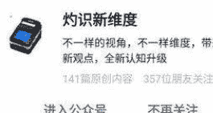

**问：**
首先感谢欧神无私奉献的各种教诲，您现在闭圈在即，自个觉得接触水库晚了仍未有出师的本领，现在如请您推荐一下经济学等方面的书，当作给我们这些学生布置一下自习课的内容，您会推荐哪些呢?

**答：**
@张是之

**问：**
欧大，最近有什么书推荐，谢谢。

**答：**
刚把《新宋》看完了。

**问：**
欧大，有个问题您看方便回答吗？不方便请忽略。记得以前您推荐过亚洲教父这本书，现在欧大接触了東方的各方面教父们，欧大觉得跟书里讲述的相似吗？有什么特别感触方便分享吗？尤其看到欧大跟马来林拿督的合影，感慨书中人物和故事来到了欧大的现实生活。祝福欧大😀

**答：**
那说明你肯定没看过这本书，连写的是什么都不知道。

**问：**
请问欧大，托马斯.索维尔写的经济学入门类书籍怎么样，可以推荐给小辈们作为入门么？

**答：**
抱歉，没看过这版。

**问：**
欧大，你好。您有意愿推荐的关于公司管理、制度之类的书籍吗？或者其他有关这方面的内容，感觉市面上的书也好，一些博主文章也好，很少能具体能够用的，偏重理论。谢谢。

**答：**
以上全错。最讨厌书单的，Low 得要命。哪见过真正写出来的。更何况企业管理，很多靠的误导和欺骗，写出来就不灵了。

**问：**
欧大，关于书籍启蒙的事情：任大 pao 很多观点感觉越来越能接受了，相当佩服，他自己大量阅读书籍，还有自己的私人图书室。您想搞自己的书室吗？为什么？个人感觉藏书很方便查阅。您说没有推荐的书单，书里也没有系统学习的框架。但除了初中物理，您感觉哪几本人文历史书籍对您发现归纳总结那些更底层的社会规律启发最大呢？(本人工科生，以前不喜欢历史) 厚黑学不行吧？还有比柏杨版资治通鉴更好的吗？谢谢。

**答：**
书再多，也没有意义。书籍再多，都是同一水平线的。例如都是小学数学辅导。我需要的是高层次资料，一册难求。你或许看书还有裨益。

**问：**
欧神，拜读了您《六百万个傻瓜》后谈下我的感受。曾混迹于 985，他们把知乎当高配版百度，引经据典奉为主桌。曾一程序员男友拿知乎问我：你怎么和知乎上的不一样？！读知乎只读高票回答，然后以为兼听则明了。认识几个知乎小v，现实中特别屌丝真是超出我的认知。知乎大多政治正确代购狗杠精，我因为发表不同声音被举报。别高估 985211 整体素质，大多只是得过且过，上进点的就刷学分实习兼职，课外书也是知乎推荐阑割书，能够思考的并闯出来的极少。他们乐意按照中产阶级拼命加班加薪模式走，我曾拿水库给他们看结果各种 diss 我，因为这不是中产常规模式有风险房产时代已过去投机狗。就是特别怕风险求安稳又眼红别人发财，普遍清高。

**答：**
985 在我眼里，本来就是很低层次的存在。 Top4 也很低。至少得 Top 1% of Top4 起。

**问：**
欧大，关于香港澳产历史的书或资源，可有推荐？谢谢！

**答：**
自己去 HK 买。

**问：**
鞍大，除了您的文集之外，有无其他的经济学？

**答：**
《一课经济学》。
张是之： 系统了解奥派经济学的话，可以从《人的行为》入手。

**问：**
欧大好，请教您陈志武的金融的逻辑这套是是否，他的学术观点如何评价，有什么方向性错误吗？比如他说到国库充盈造成能更专制，也有更专制的倾向。而且借债的西欧国家反而借以发展了债券市场，并且在举债的过程中让让渡了部分公民权利，推动了民主和规则的发展，这个说法客观吗？我怎么觉得有点执果索因呢？是否先是有民主制度，君权有制衡才导致国王负债后与议会达成妥协的？就是说民主制度在先，才有金融市场的发展？而不是因为国王穷所以就有了民主和债权市场？

**答：**
且也会更专制，因为他们不需要靠老百姓的钱养着；相反，越是制廷欠债累累的国家，其国王、政府就必然要依赖老百姓交税、有求于百姓，这最终能制约国王的权力、促进民主与规则的发展。如哈佛大学教授理查德·派普斯（Richard Pipes）在《财富与自由》(Property and Freedom)中所说的，之所以民主法治能在英国兴起，就是因为英国皇家把土地权逐步卖掉之后，国王不得不每年与掌握征税权的议会交涉。就像在当初美国一样，一旦国家负债累累，而老百姓又不得不交税的时候，连那些本来不关心政治的公民也不得不关心政府的权力和自己的权利，交税是提醒公民权利、感受政府权力的最具体方式。无需征税也能自己富有的君主或者政府，其制度必会走向专制。

第二，就如当年美国三只国债所表现的，这些国债的存在与交易市场提供了评估其政府政策与制度优劣的具体工具，通过国债价格的上涨下跌，立即反映出市场对国家未来的定价。只要国家的负债足够高、只要继续发债的需要还在，国债价格的下跌必然逼着政府对其政策或法律做出修正。公民投票是民主制度的重要形式，但投票无法天天进行，而证券市场对国家的监督、评估、定价却是每时每刻的！美国和英国的兴起如此，其他西欧国家的经历要么也是如此，要么就被金融市场所教训！

负债累累的政府是一个权力难以扩张的政府，因为负债后，一方面政府就得面对债券市场，另一方面就得征税，就得面对纳税人。或许，负债、债券市场、征税、纳税人，这些也都是民主宪政的砖瓦。金融不只是能帮助一个国家平摊一时的支付压力，还能促进制度的良性发展。

抱歉，没看过。 国债要还的。中世纪的国债，完全是靠剃刀发出去的。他的史料就不对。

**问：**
老大，有没有在培养孩子方面专业的大V推荐？或者其他学习方法，譬如读书，推荐一下相关好书。库友也请推荐一下。谢谢！

**答：**
可以啊，一节课 10000 元。你不会以为这种干货，35 元/一本书吧。

**问：**
老大，小儿本月降生，思考教育问题有些头疼。书籍、媒体大都三观不正。想找些三观正确的少儿故事书都觉困难。有什么推荐吗?

**答：**
没推荐。凯叔讲故事还可以。

**问：**
姣大，您有推荐的历史书吗？

**答：**
现在越来越觉得《二十四史》回味无穷。

**问：**
欧大，您平时怎么做到长时间有效看书的？我平时看书前面两个小时效率最高，后面指数级下降...... 而且信息量大以后，很快就会把论点忘记掉，除非重新再看一次，不知道您平时也会重读之前看过的觉得不错的资料吗？我 现在采用的笨办法就是把关键论点写下来，记在旁边，下次复习时可能不用那么长时间。不知道欧大有没有好的方法推荐给我们学习一下，谢谢！我这个现象 t-1 是不是我没有真正理解透文章的观点?

**答：**
看书是一边看，一边撕的过程。除非一些很难的书，例如爆炸力学，否则看的当时就全明白了。

蓝雪 ： 没有欧大的智商，就不要撕书了。我这种普通人，也是一边看，一边忘，貌似只能的反复看多几次，加深印象才行。或者某一天突然理论联系实际了，然后就彻底记住了。

王馬丁 ： 每天把看过的内容用自己的语言找 lp 叨逼叨复述一遍，lp 不要听拉着孩子说一遍，孩子不要听拉阿姨也说一遍，阿姨不要听就是对宠物狗也说一遍。 吐得出来才说明吃进去消化了。

**问：**
欧大，训练 " 空间思维 " 的书，有什么好书推荐吗？我想提升自己看事的格局……

## 空间思维

空间思维也称“多元思维”、“全方位思维”、“整体思维”、或“多型思维”，是指跳出点、线、面的限制，能从上下左右，四面八方去思考问题的思维方式，也就是要“立起来思考”。其实，有不少东西都是跃出平面，伸向空间的结果。小到弹簧、发条，大到奔驰长啸的列车，耸入云天的摩天大厦最典型的要数电子王国中的“格里佛小人”——集成电路了。在电子线路板上也制造出立体形的，它不仅在上下两面有导电层，而且在 线路板的中间设有许多导电层，从而大大节约了原材料，提高了效率。

| 中文名 | 空间思维 |
| :--- | :--- |
| 别 称 | 多元思维、全方位思维 |
| 定 义 | 一种普遍的思维能力 |
| 组 成 | 空间概念、呈现工具以及推理过程 |

### 介绍

### 《立体解析几何》

**问:**
gg，你给你家宝宝宝课外读什么书，小学生有什么书推荐的吗？ 如果可以，是不是周末假期带他们多各种地方走走，不一定是景点，见识世界远比去各种辅导班好。

**答:**
看书不如逛商场。 旅行不如自己去买双鞋。

**问:**
效哥，以及本圈的各位大侠，求推荐一些职场斗争的书籍以及资料，万分感谢。 这方面能力也是重要部分，我比较弱 炒房之余也要把这方面能力抓上去，万分感谢。

**答:**
少看宫言剧。
Lucky star : 《孺子帝》关注下。

**问:**
殴大好：请问有适合小白入门的房产书籍推荐吗？谢谢！

**答:**
没有。 问书单都很 low。

**问:**
欧大 本人是甲方地产渠道经理，知道这个行业，需要超强执行力，才能不断的引流，扩大项目宣传度。 首先我会通过自己觉得最苦的 3 件事，来判断他对金钱的欲望。现在就是想知道对方执行力的强弱。 1. 在面试的时候，通过什么方式判断对方的执行力？ 2.或者通过哪些问题，可能问出执行力的强弱。 3.欧大，有没有关于面试官的一些技巧的书籍推荐？

**答:**
让他排队等三小时(可自愿离开)给你 5 分钟，拿到前台小妹的微信。
抱歉，非我所长。

**问：**
我神，你推荐的 一课经济学 看完了，感觉仅仅是给结论，没有推演证明，有没有对这些内容证明的书推荐？

**答：**
你问，我答。

**问：**
欧老师万福金安！ 是不是您写序的书都值得推荐呀？ 您还给哪些书写过序呢？

## 丑房焕新 “房住不炒”新形势下新房系的第一要课

于是季老混发了50页的大纲内容给我，我认真地看了两个下午。概括来说，季老混的逻辑流程是这样的：

1. 确定目标客户。市场上存在一群客户，追求更好、更有品质的生活。客户的需求是整个市场存在的基础。
2. 确定经营区域、板块和户型。
3. 确立合伙人体制，产品才有灵魂。
4. 确定套路和套餐。“业余”和“专业”的区别，最关键在于套路。专业的公司大都是有一整套打法的，大都有几种固定的套餐搭配。
5. 出租增值业务，出售增值业务，合伙人加盟模式。
6. 实操。

季老混讲的几种手法，确实让人耳目一新。
例如让员工带客户看房进门，会邀请客户洗一下手，让他感受三种流出热水的温度和水量。
水系统的领先还是次要的。关键在于“温水洗手”，这在心理上是很大的暗示，让客户感觉欠了你一份人情（水的消耗），可以极大地提高签约率。

这是非常重要的一手资料，只有奋斗在最前线的工作人员才有的智慧。
这也是这本书的价值。
再譬如说，细节决定成败。
丑房焕新最重要的细节是什么？竟然是开关面板。
品牌开关面板很贵，动辄几十元一个。很多操作，做完之后，从业人员总觉得差一口气，自己装的就是没有设计师好看。
为什么？匠人和大师差在哪里？差的可能就是一个“决窍”：神之一手，画龙点睛。“所有的开关面板，必须全部换新。”这一句话就价值千金。
迫不及待，我已经想要买这本书看了。

欧成政（eyvon\_ou@163.com）
2017年9月10日

**答：**
哦，很多推荐语，都是人情。 只不过我的序言，很少夸大罢了。
白纹黑斑马 ： 《丑房焕新》，已吃灰。

**问：**
最近拜读了下欧大番外篇部分关于#F10 以及后面的三代之治，实则是大开眼界，醍醐灌顶，想问下欧大，您关于哲学和历史这部分认知是通过什么渠道学习的？另外，有没有对你触动很大书籍或人推荐，感谢感谢。

**答：**
在这个世上，有资格做我老师的人，不多了。《资治通鉴》，吴恩，冬川豆。

**问：**
欧大 本人是地产渠道底层管理，甲方渠道经理。 1.有营销管理方面（最好有房地产方面营销管理）的书籍 推荐看吗？或者电影，电视剧，想学习下，感觉自己管理能力很差。 2.地产营销管理的本质是什么？让团队小伙伴赚到钱？让他们学习知识？读懂每个人的心思，让他们更努力，激励他们赚钱？

**答：**
没有。不传之秘 产品逻辑。

**问：**
大大，可以推荐几本您认为比较好的书吗？初学经济学，刚开始 cf(经济学的，或者别的类的)

**答：**
《一课经济学》 @张是之。

**问：**
ou 大，推荐下经济学圣经级别的几本籍啊！最多 1-3 本吧？

**答：**
推荐了你也看不懂啊，都很晦涩。能把《宏观经济学》看懂不错了。

**问：**
大，在香港中央图书馆，有推荐的书吗？

**答：**
没有，时代不同了，不看书。

**问：**
欧神，看水库公众号说您擅长营销学，能不能推荐几个营销书籍或者公众号，我一直也做营销策划类，想要继续提升一下，谢谢🙏

**答：**
“老板，能不能介绍发财的秘籍，最好印刷成书”。

**问：**
o 大，有没有推荐讲国家战略层面设计的书籍？这个不敏感吧。

**答：**
你能接触到的，都是错的。

**问：**
os，除了欧神文集外，和两本书，请问还有没有推荐的比较体系的房产和经济学方面的书。另外，跟大家再推荐几部电影呗，假期愉快《一课经济学》《调音师》

**答：**
赵炳皓： 布老师推荐《经济学诡辩》。
2019-05-03 21:04
赵炳皓： 经济学的思维方式，这本也适合初学者。

**问：**
欧神万安，陷入原生家庭矛盾泥潭，可有推荐的文章或者书籍，自己左冲右突，越陷越深，动弹不得，需要指引，需要方法论，求指导。

**答：**
首先财务独立，其次人格独立。 当父母不能控制你，他们慢慢也就不能命令你。

**问：**
殷大，不教 marketing 可以教教管理学嘛，或者您推荐个书之类的 😊

**答：**
抱歉，不会。 还没教到企业并购，我就离职了。

**问：**
神，有正统的 marketing、管理学书籍推荐吗？谢谢。

**答：**
不传之秘。

**问：**
殷大，推荐几本书看看吧。

**答：**
最近在看《罗马人的故事》第三，第四册。

**问：**
欧神你好，求问有没有类似毛选的讲“体”的书籍著作，求欧神多多推荐。

**答：**
毛选不是体，谢谢。

**问：**
殷大，周易 值得去研究吗？为什么？

**答：**
推荐过一本书，君木匠 《周易正解》。

**问：**
欧大，推荐推荐市面上比较好的关于个人贷款类的书或有贷款干货的其他公众号或平台谢谢！

**答：**
绝对不可能有书。 公众号遮遮掩掩写着，圈内贷款中介，基本都有自己的文章号。 另，参阅今天的帖子“不要给我推荐书单”，很 Low 的。

## 第四项 主要材料清单

主要材料清单是项目立项申请的关键组成部分，其准确性和完整性直接影响项目的可行性评估。根据项目需求，主要材料可分为以下几个方面：

1. 原材料：包括生产所需的主要原材料和辅助材料，如金属、塑料、电子元件等。
2. 设备：包括生产设备、检测设备和辅助设备，如机床、检测设备、仓储设备等。
3. 人力资源：包括技术人员、管理人员和操作人员的配置。
4. 其他：如土地、厂房、能源等基础设施。

| 序号 | 材料名称 | 规格型号 | 数量 | 单价 | 总价 | 备注 |
| :--- | :--- | :--- | :--- | :--- | :--- | :--- |
| 1 | 钢材 | 50mm | 100吨 | 5000元/吨 | 50万元 | - |
| 2 | 塑料 | ABS | 50吨 | 20000元/吨 | 100万元 | - |
| 3 | 机床 | CNC-01 | 10台 | 50万元/台 | 500万元 | - |
| 4 | 检测设备 | 光谱仪 | 5台 | 30万元/台 | 150万元 | - |
| 5 | 技术人员 | 高工 | 10人 | 10万元/年 | 100万元 | 3年 |
| 6 | 管理人员 | 经理 | 2人 | 20万元/年 | 40万元 | 3年 |
| 7 | 操作人员 | 技师 | 50人 | 5万元/年 | 250万元 | 3年 |
| 8 | 土地 | 工业用地 | 20亩 | 100万元/亩 | 2000万元 | - |

### 附 表 3.5 主要材料清单

| 序号 | 材料名称 | 规格型号 | 数量 | 单价 | 总价 | 备注 |
| :--- | :--- | :--- | :--- | :--- | :--- | :--- |
| 1 | 钢材 | 50mm | 100吨 | 5000元/吨 | 50万元 | - |
| 2 | 塑料 | ABS | 50吨 | 20000元/吨 | 100万元 | - |
| 3 | 机床 | CNC-01 | 10台 | 50万元/台 | 500万元 | - |

注：以上清单仅为示例，具体材料清单应根据项目实际情况填写。

5. 主要材料清单
6. 主要材料清单

其他说明：
1. 材料采购需考虑运输成本和存储成本。
2. 设备采购需考虑安装调试费用。
3. 人力资源成本需根据当地市场行情进行调整。
4. 土地和厂房成本需根据项目所在地实际情况进行估算。

## 请别再推荐你的傻 X 书单了（分享自知乎网）

要：读书对大部分人来说只是一种政治正确消磨时间的方式

问：

欧大，您在 17、18 年出版的书已经看完，并且您的地产秘密，地产头条均已在听，反复听，变成了文字版，非常棒，如果五年前认识您，我财富肯定是现在多三倍以，现在我想问，您在 19 年有新作推出计划否？还有，麻烦您推荐一下好书，列三本，谢谢？

2018 合集，中信出版社正在处理。书没什么推荐的，还不如看微信公众号。

问：

想了解真实的世界和社会法则，除了看欧大写的和你推荐的文章外，还应该看什么读物？奥派经济学的书？哲学书？

“辉格”的水平极高。堪比阿蝶。

问：

欧大，能否帮忙@一下大蕊，准备要小孩儿，想学习一下备孕和怀孕期间的注意事项，请问有什么小密圈，公众号或者书籍推荐吗？谢谢！

@大蕊

大蕊： 公众号：暖暖妈 书集：崔玉涛（原和睦家儿科医生）备孕期间不用紧张，不抽烟，不喝酒，轻松备孕。备孕期可以服用爱乐维复合维生素，怀孕以后接着服用，4、5个月时补充 DHA，后期会定期产检，没有特别问题不用补充其他营养品

问：

欧大，**推荐**几本金融类的**书**吧，之前学艺术的，金融一窍不通，工作上慢慢接触金融房产类的，现在想学。

《商业银行学》

问：

od 适合男孩玩的游戏，有**推荐**吗？像王者荣耀这种就容易沉迷，不适合吧！泡图**书**馆和玩游戏，可以展开讲一下吗？

你们不清楚网游的实质。网友的本质是什么：等级制！当你连熬几个通宵，再升一个等级。你得到了什么。什么也没有得到，废寝忘食为了一串数字。沉迷网游的同学，其实是极度的盲迷。跪舔权力欲。

问：

欧大 想学习 marketing 相关的知识 求**推荐下书单**。

不传之秘。一堂课十万元。

问：

大，印象中您以前**推荐**过柏杨版的资治通鉴，近期看您对这一版本评价又不高，要看的话到底哪个版本好？您有其他史**书推荐**吗？谢谢。

资治通鉴，能翻译成白话文就不错了。夹在中间的“柏杨说”，可以不看。

问：

神有没有什么讲货币历史的**书推荐**？民国时期触发法币快速贬值的原因是什么？发行金圆券有什么意义？人民币又是如何代替法币在全国流通的？

货币这玩意很有趣，弹性很大，一般 300% 没有问题。也就是你说信，你就信。说不信，就不信。一旦引发恐慌情绪，物价涨 300%，还是这些纸币。社会照常运转。

问：

欧神，已系统拜读您的文集。还有哪些奥派的**书**值得看看？麻烦您**推荐**两本好吗。谢谢欧神！

《一课经济学》@张是之 菁城子

问：

奕志 提问：欧大，有**推荐**讲述日本“失去的二十年”或者东南亚金融危机的**书**么？这些**书**基本都是错的。请问如何获得相关正确信息？

日本死于管制。和宏观政策关系不大。30 年了，能试的套路都试过一遍。

fred：既然什么方法都试过了 都不去放松管制？

yevon_ou 回复 fred：改革最难

问：

欧大，有**推荐**讲述日本“失去的二十年”或者东南亚金融危机的**书**么？

这些**书**基本都是错的。

问：

欧大，经济学书籍比如曼昆的经济学，萨缪尔森的经济学和你之前推荐的奥派的一课经济学，有什么区别吗？作为学习经济学的书籍，都没有问题吧？

经济学错误很多，几乎没有一家的纯净正确的。奥派是最接近严谨的。

问：

神，求推荐奥数“老师备课用书”，网上没搜到

### 详情

yezong_ou
2017/12/5 11:20

匿名用户 提问：欧大，想给我家娃学下奥数锻炼思维，欧大有什么好的方法推荐么？去上学而思如何？

买些专门的奥数“老师备课用书”

自己教

- 朱业胜(阿懒) 淘屋合伙人

这种问题，我怎么可能教你。

问：

欧大如何修炼的好涵养，我自己做教育培训，遇见 sb 家长真心想慰啊，什么给娃按摩扎针艾灸三伏贴的...虽然知道是金主，但是我还是有些人的生意不想做，欧大这样的身家，怎么会无差别服务得那么好的...有什么**书推荐**吗？

《信用卡账单》

问：

欧大，请问有没有哪本贸易金融的**书**写得挺好**推荐**的？

奥派入门：不管别人怎么对待贸易，你永远都是零关税，才是利益最大化的。凡是违背这条定律。都是错误的。

问：

欧哥哥，想按您说的研究炒菜先研究货币，能否**推荐**几本经典的研究货币入门的**书籍**？类似您**推荐**过的<宏观经济学>那种世界经典？

你记住结论：货币滥发就行了。不需要自己再研究一遍轮子。

问：

欧大好！能否帮忙**推荐**几本关于货币学方面的**书籍**，比较奠定三观，三观正确的货币学**书籍**？

弗里德曼《货币的危害》

问：

OS，可以**推荐**一些人生哲学公众号或**书籍**吗？

李雪？

问：

欧大，谢谢您问一下，想给孩子请个老师打国学底子，能推荐一下打国学底子的书目吗，几千年流传下来的国学经典那种，或者我能求一份欧米莱的书目吗（不仅限国学）？谢谢灯塔A这个问题困扰我好久了。

老师教的书法，水墨，三字经，全部都是垃圾。不学也要

问：

想了解西方证券史，求欧神推荐靠谱的书

大部分是错的

问：

可否推荐一两本入门级历史书？

唯为

问：

Ogg，本科生，对商业一无所知，有没有什么书推荐啊......

为什么老是问我看书呢。学徒制才是未来。

问：

od 推荐 2-3 本 您认为非常值得看完的书 谢谢

《紫川》，《将夜》

问：

欧神好！请问有推荐给小学男生看的书吗？帮助他们了解社会，激发欲望，有朋友送了套《哈佛家训》。

《风姿物语》

问：

欧神，罗马人的故事这套书质量如何？观点靠谱吗？推荐不？

买套 kindle 版就行了。

问：

神，自己创办的公司越做越大，人数变多，组织结构也在升级。越来越发现各种事务需要更强的政治手腕才能搞定，有没有什么方式可以提升政治能力？书或者公众号之类的可以推荐？

企业管理，是世界上最难最难的事。否则那么多的 MBA 干嘛用的。

了解 1900 年到 1945 年的美国经济，有什么好的书或者文章推荐吗？

《罗斯福新政的谎言》

问：

神，奇门遁甲有推荐书籍或其他资料吗？

没有。伪道

问：

请问有没有比较好的职场书或者小说推荐？想好好混职场，但是无家学传承，不知道如何找出真神拜码头，非常幼稚。一开始觉得来这里问可能被嘲讽“上班不如炒房”，后来想想 t-1 应该想通。

这个非常非常难。系统工程，不是一本书可以教育的。

上山还要学三年呢。

问：

欧，货币学相关的，有没有可以推荐的书？特别感兴趣，因为特别烧脑。弗里德曼《货币的祸害》已看完。

你应该明白，目前市面上 99% 是错的。有空我来写，颠覆三观。例如“加息不能抑制通胀”

问：

哎大，小弟从高中开始就对易经道德经感兴趣，平时非常喜欢看书，很享受那种收获知识的快感，那种三观升级的快感。对历史也很感兴趣，读史亦能通今。微信公众号冯学荣和冬川豆关注过了，您还可以推荐一些了解正史的书或平台给我么？感谢哎大（PS：虽然问了很多没关于房产的问题，但是平时不忘库圈内攻心法，不忘实操）

其实知乎历史版，水平非常高。苏沉船

问：

99.99% 的书都是垃圾，神，能不能推荐一些你觉得适合发财必看的书呢？

《信用卡使用手册》

问：

OD,以及圈友们，请教下男孩在幼儿园时除了一般的绘本外，有没有什么巨著或书本推荐阅读？阿姨建议在小时候记忆力强时生吞活剥的记忆阅读一些名著，长大后或许有助于快速理解。谢谢~

阿姨 SB

问：

神，我想看看刘阿姨的**书**，如果只看 2-3 本，你**推荐**哪几本？节日快乐。

他出过**书**么？

yevon_ou：《**休谟传**》不算。

问：

欧大，看您写的帝王教育和平民教育很有感触，有**推荐**的**书**和文章吗？能给上大学的孩子看吗？

呵呵呵 都说了帝王教育，你和我说新华**书**店有没有出版？

2161：诸位说的对，我的本意是让孩子开阔视野，看问题能客观一点
2018-09-25 14:09

桃军师：其实读历史就好 史书虽然没有讲“帝王术是什么”但是所有内容都是在讲帝王怎么做 一个小切片，就能琢磨出很多东西

语言会说谎，但行动不会 史书若说谎，谎言本身，就是价值
2018-09-25 14:55

桃军师 回复 2161：不需要纠结是否“帝王术” 只要能掌握中国社会一以贯之的逻辑 不论做帝王还是做平民，都能游刃有余 世事洞明皆学问，人情练达即文章

问：

请**推荐**一下关于逻辑的**书**籍或者渠道

《逻辑学》教科**书**

问：

欧，想看看逻辑学方面的书，提高逻辑思维能力，有推荐的吗？或者大家有相关的书也可以推荐，谢谢

正经的大学《逻辑学课程》

问：

金融学推荐几本书来系统学习下呗，另外，怎么评价薛兆丰的经济学课（我已经学完了，请欧神评价对比下）

《一课经济学》 系统学完？昨天那篇“价格决定成本。成本决定价格”你就看不懂。

问：

欧大，有装修有关的书推荐吗？

没有

匿名用户：推荐你个公号，装修学。
2018-09-11 13:19

天天 回复 匿名用户：谢谢

问：

欧大:孩子今年上初一，老师让海量阅读，您能帮着推荐几本书吗？

首先确定文科还是理科。《金庸全集》《一课经济学》

yevon_ou：临高启蒙其实也可以
2018-09-06 16:39

凤舞九天 回复 yevon_ou：欧大不是批评过临高启明三观不对么，为什么还推荐呢
2018-09-06 18:01

yevon_ou 回复 凤舞九天：未知错，怎知对
2018-09-06 18:48

含笑半步癫 回复 yevon_ou：请问，如果是女孩也推荐金庸全集吗？
2018-09-06 22:51

桃军师 回复 含笑半步癫：咦读书为什么分男女呢🙃马克一下

问：

欧，我想读读美国的发展历史，毕竟未来很多还是会参照的，你有书推荐吗？谢谢

英文资料占多。中文可以看着菁城子写的一些。

问：

欧神好，我是做律师的，越来越觉得逻辑的重要性。请问有什么好的书籍推荐，可以培养逻辑能力。谢谢！

大学逻辑考纲

问：

推荐一些关于价格和垄断讲得比较透彻的书和文章，谢欧哥！

不存在垄断。奥派否认一切垄断。

问：

奥派不承认垄断的存在，请推荐奥派论述“垄断不存在”的书或文章，谢欧哥！

所有的奥派书籍中，都默认这个原则。上帝创造世界，没要求这个元素。

张是之：推荐薛兆丰的《商业无边界——关于反垄断法经济学革命》，虽然不是奥派书籍，但对反垄断问题梳理的很全面了。

问：

欧大，你看王小波么？他的小说有点看不懂呢，是因为我太年轻，没经历过那个年代缘故么？您比较认可哪些国内作家，有没有推荐的 作品，最近书荒

看过《黄金时代》，白银时代青铜时代。还不错。但放到今天，不会是最好的。

问：

我神吉祥！您之前推荐的经济学入门教程《商业银行学》大一教科书，是指戴小平还是戴国强写的那本？

有区别么…… 反正都是 90% 对，10% 不对

问：

欧大，老弟高一，他想暑假学学计算机编程，零基础，能给推荐几本好书吗？谢谢

给他 300 元，书店里自学。他若是回答你“不会买书”，那就是根本没用求学的态度。考验失败。

问：

欧大，你的九本书里面，哪一本是讲具体投资操作的，麻烦推荐一下我好看那本

楼市&杠杆

### 水库论坛

| 类别 | 序言 | 经济 | 经济 应用 | 发展 |  |  |  |  |
| :--- | :--- | :--- | :--- | :--- | :--- | :--- | :--- | :--- |

序言：

问：

殴大 晚上好 朋友推荐了一本吴晓波的 大败局 给我 值得看吗 ？ 我 家里也做企业就看看 殴大 有推荐的书吗 什么书都可以 谢谢灬

他的经济学不扎实，不可以信他。

问：

欧大，您推荐的书一本都没有看过，以前也没有看书的习惯，能推荐下看的顺序吗？是买纸质版还是网上下载免费电子书？谢谢。普通本科工科毕业。

没有书单。学习是环形的，不是线形的。如果一定要推荐一本书，那就是《初中物理》

问:

学问分为天子之道，和牧民之道。曾国藩家书是牧民之道。欧大，有天子之道推荐吗

哈哈哈哈哈哈 你这不就是典型的牧民教育毕业么，这种东西，怎么可能卖给你。

问:

欧大，自认加入水库后跟您学习进步很快，感觉您比传统的有钱人淳朴很多，愿意带我们，想想多年后您退休了，我们还得继续扛着生活。除了吴思的潜规则，老师还有其他推荐的书目吗？谢谢！

人需自救，而非他救。道理主要靠自己悟，师傅领进门。

问:

欧大好，能不能推荐一下，统治阶级内部规则的书，或者文章，谢谢这种东西，怎么可能是印刷品。

问:

殷大好，历史小白，也挺感兴趣，请帮忙推荐几本入门书学习？谢谢！

吴思《潜规则》

问:

大大，推荐一下金融基础相关的书籍吧

《商业银行学》大一教科书

### 问:

大国宪制这本书推荐么？

一般，层次不到

### 问:

欧大，除您的书外，请推荐经济学基础书籍或经典

看看张维迎

### 问:

神，能推荐下股权分配的书籍吗？升阶路上，总有人同行、总有人分道扬镳，总有人停下休息。想系统学一下公司股权分配、激励、退出的常用机制。网上微信课看了几个，都是推销线下课程，想先看书学下系统理论再选择靠谱的线下课程。

譬如“合资企业”的一个套路，就是不停地亏。尽可能投广告，开产品线，为未来投资。则公司亏损。然后 50:50% 的股权结构，就让对方追加资本金。一直搞了几次，把对方拖死。再也拿不出钱。然后你用低廉的价格，拿到增资的股份。然后你告诉我，TMD 这样的手法，哪一书会出版，堂而皇之地告诉你！！！别再问书单了，很 LOW 的。显得象个 SB 一样。

### 问:

欧大，推荐个几本经管书吧？

我感觉没有成文书。

### 问:

谢谢欧神，接上问，求推荐 介绍女生十二星座及星座口味的书籍，论坛，微信公众好号等

没有。任何真正的知识都很贵。而且还买不到。

问：

欧大，有没有推荐 财报考的好的 ID？或者书 ，谢谢大大，大大万福～ :blush:

非我所长，戴老板或许更熟一点

问：

odd～看学术型文章，理科教科书，历史书 (非三国演义那种小说)总是坚持不了，看着看着就会头昏脑胀，无法思考，然后总是忘记。请问，该怎么克服这样的问题？或者有没有别的方法推荐 一下呢？谢谢 :pray:

明明是作者的问题。写得象狗屎一样。

问：

神，最近看的你觉得值得推荐 的书，电影是什么？

二周没看电影了。刷了豆瓣，给新书 评论笑哭了。

问：

Od 你写的哪些篇章有利于提高 T-1 能力？或者那些书 ？可以推荐 下吗？

所有的文章，都是都围绕同一套思考体系。

问：

股大，推荐 本构建 T-1 思维的书 ？多谢

见《欧绅 5.16 朋友圈内容》

问：

欧绅，看你说“《小岛经济学》很多错误”，能否明确告知？我正在研读，感觉这是了解奥派经济学的最好读物了。另外：你欣赏的奥派书单，求推荐！谢谢！

有空写一些。基本 1/2 篇幅以后，就全错了。滥发纸币不是这样解释的，作者关于货币的理解十分混乱。

问：

欧大，新年祝您继续 NN，贷款大涨，买得开心卖得顺意！想请您开个书单呢

书单其实还不如自媒体订阅号。

问：

求欧神分享一些书单，谢谢😊

昨天花了 1000 多元买 kindle 书。《古董局中局》，这篇水平和鬼吹灯是同一数量级的。比较烧钱的是盐野七生的《罗马人的故事》，因我有几个疑问不明。

问：

今天看到米宅创始人米公子的文章里直接推荐欧大的书，鼓励年轻人去购买，看来你们也是惺惺相惜啊，你怎么看米宅创始人米公子和他的文章？

### 第二步：你要看一些书和听一些课！

其实以前像金朝阳类似的课是可以听的，但最怕的就是他们忽悠能力太强，普通人的定力不行，容易上套，被收割，但他们的**基础理论**是值得参考的。

去参加这类课时，一定要切记**不带钱不带卡**即可，但年轻人需要经历这种热血沸腾，前提是要有定力，这是你会去奋斗和改变自己的源动力。

当然，也有一个最简单和省钱的途径。

去京东上买一本欧成效的《中产阶级如何保护~~自己的财富~~》好好看看，如果想提高效率，下载破竹APP，花几十块钱去听两个讲座，《大白读懂欧神》第一季和《大白读懂欧神》第二季，一两个小时全搞定。

此时，你已经从地产盲，变成了**地产小白**，知道是别人赚钱是怎么回事。

广告金主，不好得罪

问：

Os，有关风水方面的**书籍**可以**推荐**吗？感觉风水虽然没有很强的科学依据，但还是挺有讲究的

@柴犬花生酱

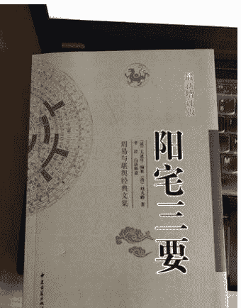

问：

欧神，怎样可以有效提高 marketing 能力？有什么实践，课程或者**书籍** **推荐**吗

别再问这么幼稚的问题了。好像问“怎样迅速让我发财”

Melanie：欧大高调离婚，就是非常经典的 marketing 案例。其中尤其令人佩服的是，欧大在大大提高 IP 知名度吸粉的同时，做到了最大限度地维护了夫人的尊严，欧大自己在大多数粉丝心目中的形象却并没有降低，少数反而升。欧大自己说，等那天等了整一年。细想欧大的一系列安排，包括多军北京聚会上欧大对演讲主题的选择，就能发现，欧大一直在很用心地做功课。还有昨天欧大公众号的文章，通过推新书来推小密圈的手法，令人拍案叫绝（公众号 书 水库小密圈及小密圈线下，欧大的这些安排都是活教材）。能认识欧大，真是三生有幸（光看欧大怎么做 marketing 就很过瘾，更何况还能随时向欧大请教）。最后是，经典教材就在我你的眼前，但学习却非常不容易，所以我们要加倍努力。

问：

ogg，我想学习 marketing 思维，可否请大大推荐 t-1 的书或者学习途径呢，谢谢（比心）

不传之秘。别 TMD 整天问哪里可以买 25 元的破书，很 Low 的。真正的知识，都不在书上。

问：

Od，有没有类似于营木匠讲周易那样讲孙子兵法，孙武兵法的书？求推荐。

你以为好东西满地都是啊........

问：

欧神，工作经常要主持会议，特别想提高这方面的能力，通过什么途径提升？你博览群书，有什么好的公众号，视频培训，教材推荐。殷大万福！

### 奥派经济学与书籍推荐 Q&A 精选

**问：** od，之前看您回答相关心理问题，您说无非心魔，想破就能破。您知识渊博，本人理解想破心魔必然要深入了解自己的潜意识，知道小我是怎么运转的，天启自己，改变小我的认知。请问欧大怎么能有效了解自己的潜意识以破心魔？有相关的书推荐吗？谢欧大！

外部环境的剧烈改变，例如你突然赚了 1000w，可破各种心魔。

**问：** 请问欧大，关于司马懿的书籍有什么推荐的？感谢！

《军师联盟》看电视剧好得了。视频比文字更省力。如果说史籍的话，知乎历史版。

**问：** 欧大推荐一些第一流的书

《亵渎》《紫川》

。。。：阿里、官能、十日谈、冰封、朱颜血=_=!!!，全是禁书 我的童年

> 2018-04-08 14:18
> **yevon_ou** 回复 **。。。**：朱颜血

**问：** OD ~ 奥派经济学，从 0 开始，有什么推荐书？已经买了《人的行为》《人经济与国家》，谢谢

从张维迎的文章开始看。原版大部都太晦涩，你不会看的。

**问：** 欧大，有什么推理侦探或者罪罚题材的书籍推荐吗

还不如看一些科幻书。

**问：** 欧大，求推荐几本关于奥派的书籍

如图，@周克成

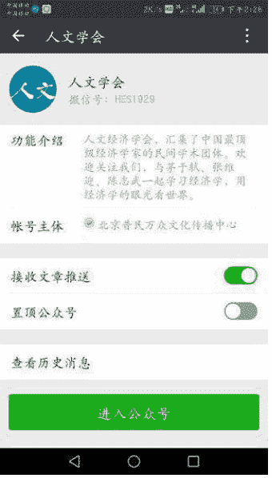

**问：** 想研究研究战时社会经济**学**，求极大**推荐**靠谱的**书**籍，谢啦

关注“缸里拉出个电锯”

**问：** 欧老师，本人，男，刚毕业工作马上两年了，没有什么积蓄，做事不圆滑，有什么**书**籍**推荐**么？想干点事情出来

看**书**干什么，加班呀，去和同事聚餐呀。

**问：** 想脱离对现代军事的一无所知，有什么**书**或者公众号**推荐**吗？

如图

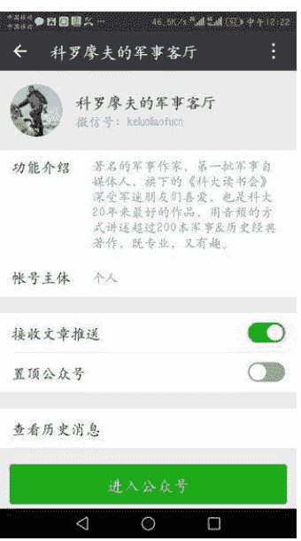

**问：** 欧大有无生物学方面的书籍或者公众号有推荐的？

抱歉，生物是我比较差的一科。

**泰霖**：公众号果壳吧，基础书籍的话：普通生物学，科普的话，杰拉德戴蒙德的书不错，拿了普利策奖的。筑基可以了。

**问：** 欧神，想注册一个公司办企业 JYD，感觉自己对公司注册，财务走账，报税等这这些都非常陌生，有什么关于这些知识可推荐的书介绍吗？谢谢~

不用看书，花 2000 元找个中介。习惯用人。

**云飞**：社会分工这么明确，你咋还要自己干？弄个烤鸭试试，不会？

> 2018-03-02 18:12
> **周秦汉** 回复 **云飞**：社会越分工，效率越高，交易越多，财富也就越多。什么都要自己干的，注定赚不到钱

**问：** 欧树，这本书有必要看吗

#### 国家为什么会失败

- 全部 天猫 店铺 淘攻略 挑尖货
- 综合排序 销量优先 筛选
- 搜索结果有点少，别着急下面有你喜欢的哦

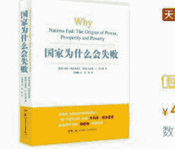

| 商品名称 | 价格 | 付款人数 | 店铺/地点 | 操作 |
| :--- | :--- | :--- | :--- | :--- |
| 国家为什么会失败 | ¥ 48.8 | 1人付款 | 数字图书专营店 成都 | 进店 |
| 国家为什么会失败 德隆·阿西莫格鲁 湖南科学技术出版社... | ¥ 48.5 | 1人付款 | 志达图书专营店 上海 | 进店 |
| 现货包邮正版国家为什么会失败 德隆&middot;阿西莫格鲁 罗宾... | ¥ 30 | 20人付款 | 杭州 | 进店 |

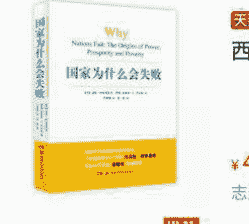
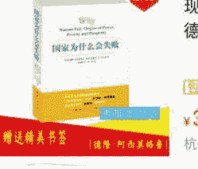

很棒的书，奥派许多人推荐。

**问：** 欧哥哥，从道德经、周易中可以领会 T-1 吗？原文感觉很晦涩，又担心自己找的注释书不地道。可以推荐有趣，可读性强，正解的解读渠道吗？谢谢欧哥哥。

又见伸手党。别问我荐书了。在本圈慢慢泡几个月。

**问：** 那别的朝代呢？除了你推荐过的新宋。其实我真正好奇的是一件事情。很多我们看着觉得不合理的事 其实有着很合理的内部逻辑 只是受制于客观条件 作了次优选择 而这条件却被人忽略 才觉得不合理。

在处理历史上 就导致了一方面面对当时的客观条件一无所知 一方面又以为自己比古人高明。任何能让我增进对历史客观条件了解的书 我都感兴趣。当然 如果有趣 可读性强 就再好不过了。

所有的帝王宰相，都比你一个二本马列大学生聪明。全国能做到 Top 7，那是人精。绝不是一句“历史局限性”就可以轻视的。轻视者才是真 SB。

**追问：** odd 那 有书推荐吗

别整天问我荐书，很烦的。别以为网上到处都是“水库”这样的论坛。可能你一辈子也就遇见一个。

**问：** 匿名用户 提问：明朝那些事儿 大臣高官派系的起落都太戏剧性 看不出君臣博弈 官场运行的任何内在逻辑 有更好的资料吗？

**追问：** 那别的朝代呢？除了你推荐过的新宋。其实我真正好奇的是一件事情。

很多我们看着觉得不合理的事 其实有着很合理的内部逻辑 只是受制于客观条件 作了次优选择 而这条件却被人忽略 才觉得不合理。在处理历史上 就导致了很多人一方面对当时的客观条件一无所知 一方面又以为自己比古人高明。任何能让我增进对历史客观条件了解的书 我都感兴趣。当然 如果有趣 可读性强 就再好不过了。

所有的帝王宰相，都比你一个二本马列大学生聪明。全国能做到 Top 7，那是人精。绝不是一句“历史局限性” 就可以轻视的。轻视者才是真 SB.

**问：** 神，长假想学点历史方面的知识，启迪一下自己，有什么方法或书籍推荐？祝新年快乐。

又浅又真的书很难找。看看《这个天国不太平》

**问：** 欧大，看了丑房焕新，但是没有很细说装修上的手法，有没有介绍装修手法的书籍推荐呢？

自己装二套。

**问：** 欧大，一个小问题，前阵子推荐的一本凤冰新书名？《X 虏 X 宝》这样式名字的？

如图

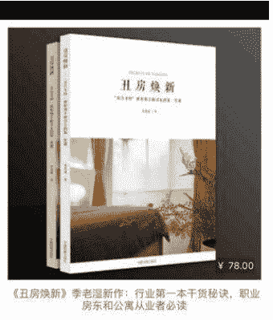

**问：** 欧神好，请问您以前某篇文章内推荐了《凤变冰的……技巧》等书，我实在找不到了，现投资了两房，一自住一出租，马上需要装修，想先系统学习再问你细节，请推荐下比较干货的装修书啊

前两天刚开了新书发布会，改名叫《丑房改造》

**问：** 快放假了，大大，求推荐一本 t-1 的书假期精读（本人新人小白，没好好读过书）

### 《宏观经济学》

谁写的有讲究么？

没有。区别不大

**问：** od，能不能推荐几本经济学的入门书籍。

刚转了书单。其实国内二传手的文章，要简单易懂得多。例如张维迎，布尔费墨

**问：** 欧大 你推荐的那个书单后面的一课经济学讨论班水平如何 收费300多 张是之解读经典什么的

初级水平，适合入门。

**问：** 欧大，能否推荐几本关于了解资本游戏底层逻辑的书？谢谢

你傻呀。《九阳真经》去书店里买的么。

**问：** 欧神，我觉着财上海的 真学霸只看教科书是放洋屁吧，欧大都推荐教师用书做参考书啊……

他只见过后重点水平的。

**问：** 欧大，对于心灵受到创伤的人，什么办法能自愈？如何能让自己变得内心强大，有没有推荐的书，谢谢！

时间久了总能自愈。

**问：** 欧大，外甥女文学方面很天才，有作家潜质，对历史和经济学感兴趣，数学功底一般（数学不出色，但也经常满分）。现在初一寒假，庸师让他们看《镜花缘》《红楼梦》这种大部头，我担心她的年龄应该看不懂里面插科打诨的讽刺和人情世故，打算给她重新列张书单和电影单。您觉得纪录片《大国崛起》、《明朝那些事儿 1.2》《美国商业大亨传奇》、电视剧《阿信的故事 83 版》中某几集，电影《成长教育》、《风雨哈佛路》、《杜十娘》对塑造三观怎么样？求推荐她这个年龄看得懂的经济类、文学类、比较合适的言情小说。还有一个问题，这个年纪有没有必要从小学奥数开始看？

看大部头都是囫囵吞枣。成长最快的方式，是大人看懂了，然后每一节有针对性地解释。

**问：** 欧大，已经得到 App 买了《中产阶级如何保护自己的财富电子书》，想收一套欧神的纸质书，请推荐个购买渠道。

机场 VIP 版

**问：** 欧神，想学习 货币经济学、美国货币史，有什么好书推荐？

弗里德曼《货币的祸害》

**问：** ODD，虽然你不是特别推荐看书，但是我知道你看了很多书。请推荐几本你认为还不错的宏观经济方面的书吧？什么通货膨胀，通货紧缩，财政政策，看的云里雾里的。（不要说活的久能懂的很多道理了，毕竟我外公 92 岁了也不肯买房。）

你去新华书店买 10 本。看完了不解，你再来提问。我没篇幅教你。

**问：** 欧大大，本人理工女，因为毒教育，此前一直以为“历史 = 某年某月某日签订某合约”，在水库看您很多历史话题，才意识到这门学科乐趣无穷。现在想找几本书，或者系列文章，放 kindle 日常读一读。您有啥推荐不?

最浅的，从《明朝那些事儿》开始吧。

**问：** 欧大，美国 1980 年后到现在的发展史，时代特征等有研究过么？求指点，或求书籍推荐。

美国时代的终结 #F530

**问：** 有没有装修方面的书推荐一下，谢谢

《凤变冰的 108 种方式》据说要出版了。

**问：** ODD，请问您怎么吸收知识的？感觉您懂很多，又不是很推荐看书的样子。

活得久

**问：** 欧大，我是一名医疗卫生行业从业者，深感要改变命运，必须从改变思想做起，2018 年希望能通过阅读构建自己在商业，赚钱，以及历史方面的思想构架，您能帮忙荐几本吗？

在本圈泡半年就够了。

**问：** 欧大能不能关于李世民做了一本书写的比较好的书啊

别问我推荐了[表情]什么时代了 让唯唯弟弟写一篇吧。

**问：** 神, 你在成长过程中, 看了哪些关于房产投资的书呢? 可不可以推荐几本。

如图

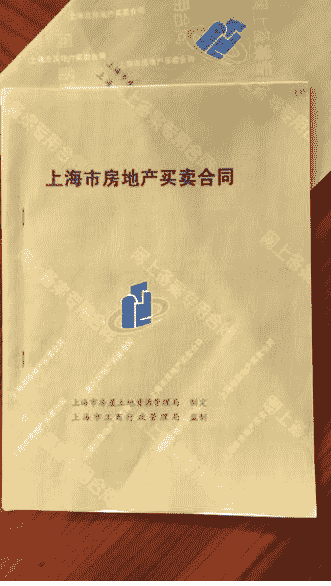

**问：** 欧大可不可以推荐下练习狐媚术的书籍啊?

为什么你总以为什么东西都可以靠买书呢。能买么

**问：** 欧大推荐两本奥派的书吧。最近没钱不去挖笋了，免得伤心。看书放松吧

《宏观经济学》非常浅，适合你。

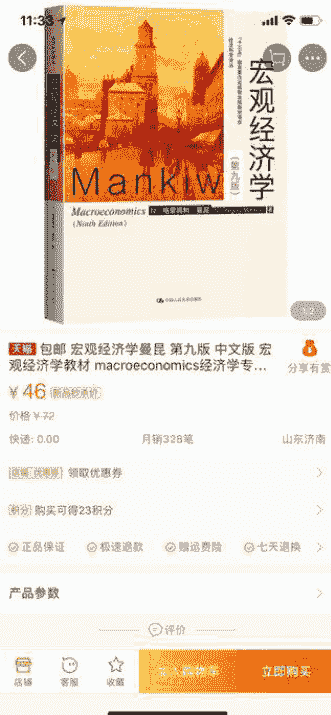

**红龙 Reddrago\***：这本吗 老大 查看图片

**yevon_ou** 回复 **红龙 Reddrago\***：可以的

**问：** 欧大，推荐一下了解真实 enlai 的书单?

全部史料，至少要十几本书。谁敢出版。看看小册子不错了。

**问：** 欧神，看你说“《小岛经济学》很多错误”，能否明确告知？我正在研读，感觉这是了解奥派经济学的最好读物了。另外：你欣赏的奥派书单，求推荐！谢谢！

有空写一些。基本 1/2 篇幅以后，就全错了。滥发纸币不是这样解释的，作者关于货币的理解十分混乱。

**问：** 匿名用户 提问：欧大 《宏观经济学》保罗·萨缪尔森 (Paul A.Samuelson) 的观点对吗？推荐看吗？整本书哪两行错的？另外：京东看了下 有两本 其中一本是带注疏的 推荐吗？(怕译者观点有问题)

感谢欧大！

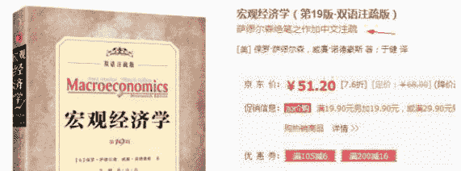

〔政府可以通过加息来抑制通胀〕这句话印了二行。

**问：** 求 od 推荐春秋战国优秀的历史书籍或资料

现在都不看书了，都是碎片化学习。知乎---春秋战国

**问：** 欧大，刚过而立之年记忆衰退严重，看过的房都记忆混乱了，准备到东南亚闭关半个月。推荐两本易记史书吧，谢谢

《抗日援朝-大明 1592》

**问：** 西方版的军事书名字叫什么求大大推荐

如图。有石器时代到中世纪到火枪绳一个系列。

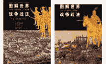

**问：** 欧神, 有没有好书推荐, 刚看完古董局中局, 谢谢

我太忙了, 很久没看书了。《六朝清羽记》试试

**问：** 看到欧神推荐《紫川》, 我是初中看的, 只图爽了。莫非这个书其实是有深意的?

没啥, 就是爽。

**问：** 欧大，小米入了小秘圈，我把十一本满级 coc 和王者级别的王者荣耀都戒了，烟也戒了，酒也不喝了，麻将也不打了，美剧也不看了，摄影也不玩了，耳机也不烧了，自行车也卖了，妹子也不泡了，旅游也不去了。每天就看房子办贷款。懂了 irr 怎么算，看完了死人经和将夜，还看了大国大城，欧大文集又回顾了一遍。年底完成买房任务了，突然感觉好空虚也没有朋友，请问还有什么书好看？能不能多推荐几本，我看书的能力实在很厉害。

《亵渎》《紫川》

**问：** Os 一直看您书，看来三遍，坚持踩盘 70 多套，我觉得要重塑三观，房产已经坚持了四年，买房子也是小有收获，老师，您能否推荐几本对您影响很深的书？另外 有没有其他好的学习途径可以推荐？我感觉智慧才是一生不移的财富，别无其它，您说呢？

《宏观经济学》

**问：** 欧大，市场营销方面有没有推荐的人、书、或者公众号？

不传之秘。

**问：** 欧大，可以推荐影响你最大的五本书吗？谢谢！

初中物理 初中数学 高等数学 数据结构 宏观经济学

**问：** 欧大，看明史推荐那几本书？

我对古史学得比较多。唐代以后，文字保留的太多。史料是以每一代翻倍的速度在增长的。明史这种大部头，还没来得及看。

**问：** 欧神，看了你的话通缩的文章，有点小骄傲，我花了两年时间想通了所有成本既人力成本。平时没啥事爱瞎琢磨。目前有个问题想不清楚，也找不到合适的书看，求欧神推荐书籍或指点一下，一个国家的货币量以什么为参考发行。外汇价格波动以什么为参考？没学过经济学自己先看书琢磨，扯的有点远，欧神见谅。

完整的货币经济学，有空我整理写出来。排队遥遥无期。

**问：** 欧神，问两个问题。1 您对卡耐基《人性的弱点》和《人性的优点》这两本书怎么看呢？算是描写人性的好书吗？2 除了去与人接触，投身到一线。您有描写人性好些的书推荐吗？做为多一个渠道去了解人性。辅助与人接触时看的更清晰，快速。谢谢股大。

那二本数我没看过，抱歉。买房以后，你父亲的嘴脸，有助于你认清“人性的弱点”。更多分享加微信:zsxx0001

**问：** 欧大，有靠谱的装修宝典或书籍推荐吗？知道装修、凤冰得靠大量实践，但是还是需要一些装修基础知识和设计品味素养。群友有靠谱的也请推荐哈。

如图

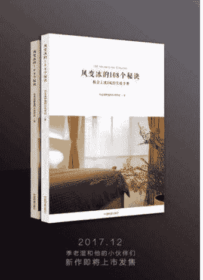

**问：** 欧大，如果想系统学习人民币国际化，有什么书籍推荐吗？

人民币国际化，迄今仍是不知所云。消费带出去的 RMB，毕竟是小钱。金融带出去的 RMB，才是大头。离岸 RMB，因为怕冲击国内市场，一直不肯开。最简单一点，BOC 的国际清算中心，就不给接入。

**问：** 20 世纪 d 史有什么书籍推荐

很多啊。76 年怎么上台 79 年怎么上台 84 年你好 88 年通胀 88+1 叛徒 92 93 大通胀 97 使馆 末评系 咖啡太浓了

**Kory**：叛徒是？

> 2017-11-17 11:50
> **yevon_ou** 回复 **Kory**：秀

**问：** os, 求奥派经济学的书籍推荐。最好简明易懂

布老师推荐《小岛经济学》

**Arischotle**：感觉这种问题总是在寻求成功的捷径 :confused:

> 2017-11-13 23:43
> **Arischotle**：包括求白话道德经的。
> **evon_ou** 回复 **Arischotle**：+10086

**问：** 欧大欧大, 市场营销的知识传授点吧? 实在是太渴求了。哪怕推荐一本您觉得好的书, 好的公众号也好呀?

(新版目录) Marketing: 市场营销入门 #210
Re-Sale 为什么这么难 #220
如何运营一家企业 #230
无中生有的高阶 #240
夏洛特烦恼 | 精准营销的胜利 #F240
美国大片加速走向屌丝化 #F1030
老婆喊我组装自行车 #F390
从包粽子机说起 #F1120
怎样把品牌做死掉 #F1180
水库赚钱之道 #F1190

**问：** 恰空: 是是指什么？再您推荐一些政治、历史、经济、军事、金融、天文等学习渠道或书籍？

@恰空

**恰空**：回答这个问题所需时间太长了，我有点懒。所以切实的建议是找到这个领域的牛人，请他推荐 1)入门级 2)初中级 的两套阅读书目，每套 5-10 本即可。之所以不推荐看中高级的，是因为看了也看不懂，而且很枯燥，通识教育不需要那么细

**问：** 本想提问欧神怎么看哲学？发现之前有人提问过了，看到欧神回答「你们现在学的哲学，不叫哲学，禅宗、冥想、灵修都不叫哲学。哲学应该是关于万物之本源的学问」那可否请欧神多讲几句，我们普通人怎样学习哲学或者介绍几本入门书？之前欧神推荐的网络小说类，都是大部头，通过阅读故事，体会故事人物的经历而自学领悟，这个阅读量相当大。

哲学的几重境界 #F860

**问：** 您推荐的书，就是死人机，阿里布达和亵渎，新宋这四种吗？

紫川，将夜

**问：** 以前天天看育儿文章，现在看觉得都是妇人之仁没见过世面的 sb 在教人育儿。怎么办？求推荐育儿书或传记

世人碌碌，你才能暴富。

**光影间**：我在北京开奥地利学派幼儿园，欢迎有兴趣来咨询哈哈

**问：** 「匿名用户 提问：Odd，你是如何判断一本书的好与不好呢，有什么依据吗，例如像死人经，将夜，本人有点愚钝这两天看了些，没发现什么特别的地方呀」

只翻了前 7 页？我推荐的，就一定是好的。

**欧哥哥** 能说说 好在哪里吗，希望能简要说下

心智成熟的人看死人经。心智不成熟看小马宝莉。

**羊毛毛毛**：正在看死人经，开篇的梗子和《不公平地揍人》思路相通呀

**Alex Ma**：死人经：1，生存是第一要义；2，任何承诺都可能被背叛；3，任何努力都有可能没有收获；4，运气是成功必不可少的要素之一；5，苦难是人成长的最大动力；6，为了达到目的不择手段，无可厚非 ……

**问：** 欧大能不能推荐一些好书呢？请多推几本，最近书荒。

《将夜》《死人经》《亵渎》近期很久没有见到“大作”了。

**问：** 关于育儿方面，欧神有没有书籍，公众号，付费平台的推荐？两个儿子，一个快五岁，一个一岁半。市面上有很多育儿书籍要么是照料生活方面，要么是培育智力方面，我觉得这些都不重要。我记得欧神说过重要的是教会他们世间的法则？（原话记不清了）我的想法是把孩

子培养成有专长，有爱好，不管想做什么都可以做到最好的人。另外我觉得培养孩子的阅读兴趣是很重要的。这种想法如何？请欧神指导。

不清楚哪个公众号好。

问：

欧神晚上好，有没推荐的与销售书籍，或者欧神有哪些建议呢

书籍绝大多数是垃圾。真正干货，不会在书里。还不如发掘微信号高手。抱歉没有

问：

欧神，如何看待逻辑思维得到 app 里推荐的那些课程，以及相关读书活动。

水平有信心碾压。

问：

神，能否再推荐几本其他方面书籍

《长安十二时辰》

问：

神，请推荐几本关于历史的书籍，谢谢！

《罗马人的故事》

问：

欧神，想请教 28 岁女孩子，想升内修，可以推荐几本书吗

内家修炼？都是伪经，亲

问：

请欧老板推荐几本可以系统学习奥派理论的书籍 谢谢

奥派很难上手，米塞斯的著作，没有经济学功底根本看不懂。还不如先学市场经济。诸如科普读物《一课经济学》问问@周克成

周克成：推荐订阅薛兆丰的得到专栏，《薛兆丰的北大经济学课》，199 元/年，得到 | 薛兆丰的北大经济学课

问：

欧大好，博弈论有啥书推荐学习的吗？我看这个教科书上各种数学符号像天书一样，看起来真累！我中学数学还是经常满分的...

我也没学过，抱歉

问：

求欧大推荐靠谱的易经书籍

茗木匠

唯为：茗木匠解读易经的书确实见解独到，就是重点不够突出，语言太啰嗦，看着不耐烦。

问：

我神，有没有对“马基雅维利”阐释的比较好的小说或者书籍推荐几本？谢谢。

《君主论》

一响贪欢：以及#F20

问：

ODD，您推荐的《血酬定律》和《潜规则》看过了，收益颇多，多少明白了真实世界之下的潜流其实才是真正决定历史进程的力量。麻烦您再给推荐几本这样的让人明白 T-1 道理的历史或经济方面的书，多谢！

这种武林秘籍级的书，你以为满大街都是啊。

冬川豆 李硕 肛锯

问：

o，有什么书推荐看的，历史，物理，生物，科学，经管……都行。或者你觉得看过不错的书都可以，我下载到 kindle 里看。谢谢

最近在找 kindle 漫画，暂没有发现好的资源。

问：

od，育儿方面有没有好书或者视频语音资料推荐，娃还没出生，不用考试的父母还是很焦虑的

焦虑对胎儿不好。该吃吃，该喝喝。

逍遥熊：《美国儿科学会育儿百科》

2017-09-19 16:45

朱业胜(阿懒)：孕期每周宝宝树的 app 看，每周注意事项。0-2 岁，一本足矣《希尔斯亲密育儿百科》

2017-09-19 18:45

逍遥熊：微博关注：京虎子

2017-09-19 23:43

Aila (平米深圳顺* 回复 朱业胜(阿懒)：西尔斯的《怀孕百科》《亲密育儿》都好，还有个日本人写的《育儿百科》，我的闺蜜团人手一根背巾

问：

除了您推荐的吴思三部曲，还有什么宇宙真理的书籍吗？（奥派的我已经有了）谢谢

知乎：汗青

问：

欧大有什么推荐的书嘛？

加来道雄

问：

od 奥派的书看谁的？请推荐两本

布尔费墨，微信微博

问：

欧神，能不能偶尔经常推荐点书或者文章之类的。总回答问题，太辛苦了。

《书籍时代的消亡》，现在都是碎片化阅读了。除非小说书。

问：

欧大，卡内基的人性的弱点值得看吗？有没有讲人性的书推荐？

不清楚。估计已经被改得面目全非了，不是钢铁大王的原话。

问：

欧神旁仁波切：有必要读些建筑类入门书籍吗？或者其它非水库基础读物？请推荐

没必要 有必要，因此不推荐。

乐墨 回复 一鸣贪欢：因为有必要，所以阉韪词，所以不推荐

问：

欧大，关于数学有没有适合成年人看看的入门**书籍推荐**。易懂又好的。

这个问题太宽泛。不知道你数学学到哪一级。微积分还是复变函数。

问：

请问欧神有什么**推荐**的**书**或者人吗？想了解英国衰落的原因

《1850 年英国为何衰弱》，这个专题是没有**书**的。甚至很少有学术界正面承认。个人怀疑和最早的福利主义萌芽有关。

问：

您都在看什么样的纸质历史**书籍**和财经**书籍**，能否**推荐**一下

很久不看纸媒了。关键是没渠道买。

问：

欧大大，除了您写的两篇文章外，有什么讲装修的好的公众号或微博**推荐**吗？不用**书**，就想进去看看，谢谢啦！

史惟臣刚寄了本《凤变冰手册》给我，请我写序。我说你先让我看看吧，**书**看完了我再想序怎么写。

问：

欧神，如何了解男朋友的心理，有**书推荐**不？

这个话题也太大了，建议细分

问：

ODD，看了你很多文章和帖子，很佩服你对市场的敏锐度，以及对于各种 zc 产生后果的预测。除了你提到的奥派经济学，你还有什么**书籍推荐**吗？我希望也不被一些御用 wl 砖家忽悠，多点判断力

布尔费墨 要不布老师出本文集算了。

问:

神，您有关于 通货膨胀，比较好的书籍或者文章推荐么？谢谢！

讲真话的书不能出版的，亲。

问:

谢大大回复，现代尊卑除了官场职场上之外，还需要遵守"老尊少卑"、"夫尊妻卑"这些传统吗？有没有书籍推荐的？非常感谢！

《潜规则》《血酬定律》

叶骥：吴思超级棒，吴思读完读金观涛老师的思想史，最爱

问:

神，方便推荐几本关于城市化和货币方面的书看看么？

《美国大城市的生与死》

yevon_ou：只记得第一第二章是《石币之岛》

问:

殴神，毒教育真可怕，怎么才能知道真正的历史事件和真相，有什么好的地下书籍或者公众号推荐吗？还有就是觉得好可悲，外国一直往未来科技走，但在中国还是在从历史从寻求真相。

厚积薄发，融会贯通

问:

欧神，怎么才能培养出像您这样的才能，由哪些知识结构组成，或者有推荐的书籍？（培养下一代用☺）

被雷劈一下

问：

欧D，可以 推荐 些你认为有营养的（国内 外）电视剧 电影、书么，军事联盟那篇您写本好啦，剧小密圈平时都特别关注您CF外的话题或细节。

能过审的可真不多。前二年还好些，后来大批 marketing 的人涌进影视圈“策划”，后来就全是屌丝电影了。X囧

问：

一个偶然的机会发现水库，最近一直在学习欧神的帖子。但知识都是碎片化的，总做伸手党向欧神提问也不是个事。想问问欧神能 推荐 几本金融知识的 书 吗？入门级小白，一直关注实业，看了欧神才发现金融知识真的博大精深，想一点点学习起来。

象我这个水平的 书，没有。

windy：不用这么高水平的，您这水平，除了学习，经验和悟性也很重要，我还没那么贪心。觉得不错的值得看的金融知识的书有没有好的推荐呢？其实我是零基础啊

2017-07-18 23:08

yeyon_ou 回复 windy：《商业银行学入门》

问：

欧神好，小朋友暑期在家闲置，想找些合适的 书给他看，能否 推荐 一些？一年级，识字量 1000+

不要看经典文学，都过期了。看这二年商业化的，小马宝莉，芭比公主

问：

欧大，烦请 **推荐** 一些正三观的 **书**，政治历史地理等等都行。（公司发了 1000 元亚马逊购 **书** 额度，只能买 **书**。）谢谢！

图解世界战争纪实 拿破仑战争 我刚买的 amazon 还没看

问：

请问欧老师有没有金融相关 **书** 籍 **推荐**？谢谢

国内的谬误太多。国外的也是。 暂时没有 **推荐** 的，谬误的先看起来。

问：

欧大，可否 **推荐** 一本邓小平传记类 **书** 籍？

对这个领域没研究。

问：

哥哥 **推荐** 几本地理 **书** 或者相关作者呗

知乎关注: 马前卒 先看他历史精华帖

问：

欧大，能否 **推荐** 一本讲解《道德经》的 **书**？

没有

小马奔腾：南怀瑾

2017-07-01 22:33

yevon_ou 回复 小马奔腾：不行

问：

请教欧神，通货紧缩会对经济有什么影响，会阻碍 dt>0 么？货币是中性的？求 **推荐** 几本讲货币的经济学 **书** 籍，感谢欧神。

当然是以上算错。

问：

初二的小女孩，欧大推荐做/学些什么，看些什么书？

先学数理化吧。数理化讲逻辑。

4、 奥派经济学的学习应该如何入门？请欧神推荐些基础的书籍和视频。

布尔费墨微博(非情感类部分)

问：

殴神好，反复看了水库公众号，和你推荐的几个公众号，感觉自己的思维和辨识能力有所提升，负面影响是大多数文章新闻和书都是垃圾满篇毛病。但是好东西很少很快看完了，怎么破，有啥好的资料和地方可以继续学习，谢谢。

炒二套楼，写战后感。（保证情绪满满。

问：

欧神：帮一个朋友问，推荐几本战略管理和投资理财方面实用的几本书？谢谢

世面上的，都是错的。

问：

欧大，除了您的那本中产阶级以外，可否在推荐基本树三观，整本溯源的书。

有哪本书劝你负债的。

问：

欧大晚上好，您辛苦了。本人好学校文科研究生毕业，工作也与金融不沾边，看了您的文章以后简直打开了一个新世界……学而后知不足，感觉自己经济学基础知识太薄弱，不成体系，不懂的太多。我的目标是希望有独立思考的能力，掌握对赚钱这件事的判断力，但目前感觉脑袋空空，里面装的都是毒教育。也不能总指望您一口一口喂饭什么都来问您不是？我该如何补足？去念个好学校金融方向的在职的 mba？或者网络学校？或自学看书就行？除了您的大作和水库的帖子以外，您有什么书推荐小白自学的吗？恳请指点...

先看二遍。估计你 0.5 遍都没看到。

问：

欧大，俺准备买最后一批书了，您的平装精装我也要买买买。还请您推荐一本讲市场营销的书～

中国没有三观很正的 marketing 书籍。都是"点子大师"野路子的。英译版里淘淘。

问：

请教您： 什么样的户型是好户型？什么样的露台是好露台？怎么看房子质量好坏？等等 这类基础知识有没有推荐的书或者文章？

《最好的房型》二篇

问：

可否请欧神推荐二本汇率方面的书籍 :)

书店里的书，全部都是错误的

问：

奥派推荐哪些经典？国内翻译过来的奥派书籍，感觉大部分不流畅、晦涩难懂 ~~

可以看看连岳，布尔费墨，鬻城子的微信号。

问：

欧神您好，我想要了解 Marketing，学习这方面的知识，看过您关于这方面的文章，想要进一步学习的话有什么地方或书籍可以推荐吗？

不传之秘，只传内堂弟子。所以中国人改革开放 30 年，制造业都学得差不多了。MKT 还有很大距离。我时间短，也只学了皮毛。现在中国香水还是卖不过法国。

问：

欧神，能不能推荐一些入门级的经济学的书，虽然不是这个专业的，也希望能学习一下。谢谢哈

《宏观经济学》萨缪尔森

问：

关于经济学虽然没有多深的了解，但毕竟有些大致方向，和梗概概念。可是对政治这件事很没概念，有推荐的靠谱的政治学的书吗？

冬川豆

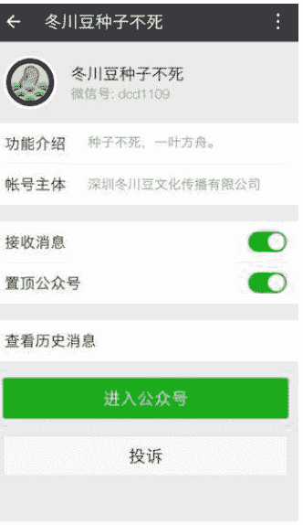

问：

欧大推荐的三本书，宏＋阿＋碧。第一本知道，第二和第三让你领悟了什么？恳请指点。

阿里你们大部分人都没看过，去看一遍比较好。 阿里的价值观其实就是“关我屁事”

问：

欧神，能否推荐三本对你的价值观世界观的形成影响最大的书？谢谢！

《宏观经济学》 《阿里布达年代祭》 《碧血剑》 碧血剑是我看的第

一本武侠小说，在非常长的时间里，是唯一的武侠小说。

问：

殴大帮忙推荐几本书或电影，别太枯燥的~

我怎么知道你喜欢看哪类书，以及心智哪个阶段。 《死人经》第一部

问：

欧大，你也看跳舞的书啊，涉猎如此之广，如此杂食。cq 刚建完仓，

推荐几本玄幻意淫一下。

《裁决》，七十二编的书都很弱智。

问：

殴大啊，京东预定了你的书，但怎么还不出来啊？再推荐本经济学的

书吧，没书读了

还没印刷完呢。 没书看，可以看看经济类的教科书。

问：

殴大，对您影响最深的书籍有那种类型？能不能推荐详细书名或者作

者。谢谢

布尔费墨的几篇无政资文章。

问：

请教欧神，如果想教孩子历史知识，推荐什么书籍，规避毒教育呢？

少学冯学荣 老学冬川豆

问：

希望欧神推荐一些书，那些扭转迷思的书。不想做一个懒得思考的庸众，我需要形成自己的判断力。我还有时间，我可以学习。 推荐的好，我希望看到的同道和我一起给欧神打赏。也是自愿原则。

刚准备写《书籍时代的消亡》

问:

欧神晚上好，有书（您的都买了）、电影、歌手、公众号推荐吗？刚做完一单想休息顺便充实下，谢谢!

《死人行》第一季

问:

欧神，有没有什么奥派经济学的书推荐呢，入个门先

木有 下一篇准备写《书籍时代的终结》 晚安

问:

我看了你写当年在外资企业做 Marketing 的文章，受益匪浅，就一个问题：可以推荐一些资料或者书籍来深入学习关于你文章提及 Marketing 的知识吗？我觉得我们大学的都是假市场营销。 特别是你说的正规企业” 卖假货“ 那个案例，这种思维方式很有魔力。

这种东西，不传文字。 只传内门弟子。

SPU：内门弟子 开课了么？ 怎样收费？

yevon_ou 回复 SPU：我说只传 manargement trainee

问:

欧神，能推荐些历史，军事，政治等方面的书或者作者吗？谢谢

田中芳树，司马迁太郎，LCY 纯属玩笑。

问：

欧大，有没有经济学方面的书籍？或者你最近看的其它书也行～

最近在看《量子色动力学》《爆炸力学》

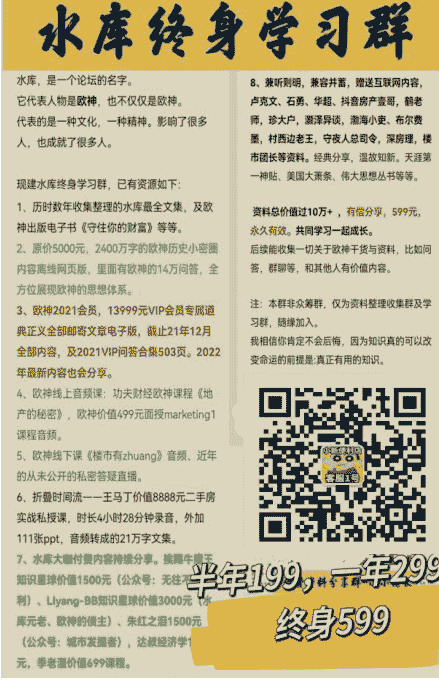
