# 武志红·自我的诞生（公众号懒人找资源）.md

# 介绍

本电子书由公众号*懒人找资源*根据网上公开信息爬取，仅在*懒人专属群*内测试分享。

所有内容版权归得到 app 所有，未经允许，不得转载。

# 发刊词：“我”，是一切的根源

武志红

2022-04-24

## 发刊词：“我”，是一切的根源

发刊词：“我”，是一切的根源

你好，我是武志红，是一名心理咨询师。我从事心理咨询工作已经 13 年了，为很多人提供了心理咨询服务，其中很多来访者和我保持着长期的咨询关系。

临床心理咨询的经验不断积累，自然而然地，我对各种心理现象的关注和思考也不断加深。最初，我更关注的是家庭养育，“原生家庭”这个词在中国被广为人知，很大程度上就是因为我的推动。到现在，“原生家庭”这几个字似乎已经成了我的一个标签。

事实上，从家庭养育出发，我并没有停下，一直在前行。逐渐的，我的聚焦点放在了“自我”这个概念上，形成了一个深刻的感知：

**大多数人的痛苦，根源在于自我尚未形成。**

正是因为这些感知和思考，才有了你现在在听的这门课程，《自我的诞生》。

到底什么是自我？或者反过来问，什么是没有自我？

我的一位来访者的故事，推动了我对这个问题的思考。她是一位女士，40 来岁的时候开始找我做心理咨询。她未婚，没孩子，一个人租住在一个小小的单间公寓里。可是，她并不是没有经济实力。她自己开公司，盈利不错，一点儿也不差钱。

那她为什么不让自己的生活变得更好一些呢？因为她是我们通常认识中的那种“大好人”。她不怎么给自己花钱，但愿意给父母和家人花钱，而且是很多很多钱，比如给父母买大房子。

不只是家人，谈恋爱时，她也花了不少钱。即便对方人品不怎么样，甚至算是渣男，她也愿意花钱。

她之所以来找我做咨询，是因为她发现自己心中怨气太重，特别是对渣男恨得不得了。

在和我的心理咨询进行了没多久后，她对我说出了一件让她感到非常恐惧的事情。她说，她知道自己所谓的当“好人”是一种病，但她一直以“好人”自居，甚至为此感到骄傲。可是在过生日时，她发现自己有了大问题。

当时，她收到了很多生日礼物，这让她很感动。可仔细一想，她发现自己已经两三年没有给别人送过生日礼物了。

这个发现，让她非常惊讶。当她观察内心时，惊讶升级成了害怕。她发现，她似乎对别人失去了关心，失去了温暖的一面，甚至她觉得自己在失去基本的人性，心在变得冷漠。

这位来访者的故事，对我而言，有重大意义。这个故事的关键点，细想起来是有些恐怖的：一个好人，逐渐丧失了对所有人的关心。

就是从这里开始，我形成了对“好人”的初步思考。现在回头再看，我可以非常简单地概括说：这个所谓的“好人”，破坏了自己的生活，破坏了自我，最终这种破坏也转向了他人。

做一个没有欲望的、所谓的“好人”，似乎是一种常见的追求。但这种“好”，容易变成对自己人生和心灵的破坏，这是一种经典的自我没有形成的现象。

另一种没有形成自我的经典现象，和“好人”正好相反，就是极度在乎自己，我称之为高自恋者。

人都是自恋的，高自恋者有什么不同？最大的不同就是对自己欲望的在乎程度。高自恋者极度在乎自己的欲望，可能会不顾一切地去追逐，甚至为此利用、剥削别人，也理直气壮、心安理得。

不只是对欲望，高自恋者对自己在每一件事上发出的每一份动力、每一个念头都非常在乎，并且苛求周围人完美地配合自己。希望自己在每一件事、每一个细节、每一句话上都占上风，都要赢。为了赢，可以不惜代价。这样的人，一样也是没有形成自我。

这门课程会用更准确的语言告诉你，这也是没有形成抽象意义上的自我。  
**因为没有形成，所以在每一个细节上发出的动力和意志，都是“我”。一个细节上的具体意义上的“我”的死亡，就等于是“我”本身的死亡。**  
死亡，这件事多可怕，自然就执着地想要赢。

你发现了吗？“好人”和高自恋者，正好是相反的两个方向。

“好人”，一辈子都在灭欲望，灭隐私，灭自我，想换取在别人眼里的好形象。

高自恋者，对欲求非常执着，想得到的是别人的配合。

你看， **因为“我”没有形成，于是总是去关注“你”，想从“你”那里得到存在感。**

回到前面的问题，在搞清什么是自我之前，更容易理解的是，没有形成自我是什么样。“好人”和高自恋者，只是我为你列举的两种经典表达。围绕着自我没有形成，还有形形色色的表现方式。

存在感，是一个抽象的哲学词汇。如果用我的话来翻译，我想应该是：“我”可以存活的感觉。

**“我”可以存活的感觉，如果基本形成了，就意味着一个人的自我形成了。**

我的这门课程，讲的就是自我形成的过程。

当把存在感理解为“我”可以存活的基本感知后，可以直观地去理解很多事情。

例如焦虑。焦虑无处不在，关于焦虑的理论研究也很多，我自己的理解是，焦虑或许都是死亡焦虑。它的对立面，就是存在感。当一个人总是在焦虑中时，那可能意味着，这个人的自我尚未形成。如果自我形成了，那这份弥散性的焦虑，就会变成自在感。所谓自在，也很简单，你把这个词拆开来看看，就是“和自己在一起”，或者说“自己在”。

有不少人，会把自我等同为自私，甚至还有人把自我视为洪水猛兽。我要告诉你的是，自我形成后，一个人会变得非常不同。

自我没有形成的人，总在关注着“你”，要么渴望在别人眼里得到好评，要么苛求别人按照自己的要求来，这都会给关系带来压力、剥削和破坏。

当自我诞生后，一个人不仅获得了存在感和自在感，同时也会摆脱对别人的过度关注。

这时，还有一个深刻的事情发生了：

**当“我”的存在得以确立后，也就可以看见“你”了。**

**自我诞生的同时，意味着一个人终于能真正看见别人了。**

相反，自我没有形成的人，因为活在“我”随时会死去的焦虑中，会变得很敏感，好像每时每刻在每一种关系中，都藏着“生死之战”：到底是外界的“你”胜利，还是内在的“我”活下来。

这里说的“关系”，不仅包括人际关系，也包括和事物乃至世界的关系。

比如，有的人在和别人的沟通中，只想着倾吐，拒绝聆听。为什么？因为倾吐意味着你配合我，聆听意味着我配合你。如果配合这个动作中有支配与服从的意味，甚至还有生与死的含义，那自然会渴望倾吐，抗拒聆听。

我认为，一切美好的事情都来自于深度关系。一个人之所以难以建立深度关系，就是因为这种难以言说的死亡焦虑。

一个人的自我得以形成后，意味着“我”可以存活了，也终于能看见真实的“你”了。“我”和“你”就可以去放心地去建立深度关系了，然后在深度关系中，去创造各种美好的事物。

**人，是万物的尺度。一个人的心灵，就是他丈量世界的尺度。**

**当“我”在黑暗之中，世界也必在黑暗之中。**

**当“我”被照亮时，世界也会变得光明。**

**照亮你的自我，有着如此伟大的意义。**

“自我”是心理学中一个最基本的概念，从这一点来看，这门课程似乎也没什么特别。但当我形成这个课程的初步意识时，我自己无比感动，觉得这是“伟大的课程”。

因为，对任何人而言，形成一个抽象意义上的自我，都是伟大的里程碑。

就我自己而言，实际上我也没有真正形成自我，我就是前面讲到的那种“好人”，所以我的自我被破坏的程度也很高，再重新把它活出来，真是很不容易。

因此，我在相当程度上，也像是一个初生儿一样，从理论和体验上去观察、感知，一个没有自我的人，到底该怎样逐渐活出自我。

头脑上理解“自我”这个概念，知道自我形成的理论，和在体验上深刻感知到，这从来都是两回事。我的这门课程，就是带着满满的感性和体验，它是一个活生生的课程。

这些因素加在一起，我想自恋地说：这是一个非凡的课程。

你，完成了这个非凡的过程了吗？你的自我诞生了吗？

甚至，你开始了吗？

如果你还未从自己出发，那么属于你的生命之旅，也就还没真正开始。

欢迎你加入《自我的诞生》，我们一起启程。

  
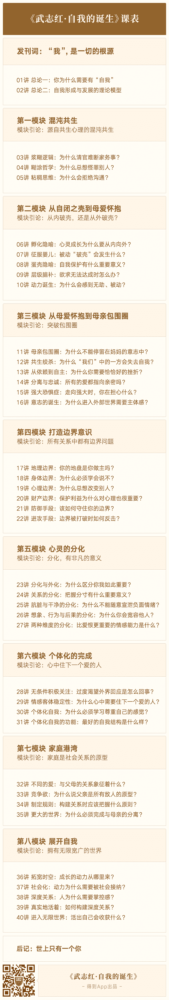  

公众号懒人找资源，懒人专属群独享

# 致心理学课老用户的一封信

武志红

2022-04-24

## 致心理学课老用户的一封信

致心理学课老用户的一封信

懒人专属群的群友，你好

好久不见，你还好吗？

距离我的上一门年度课程《武志红的心理学课》结课，已经 600 多天了。今天是 3 月 20 日，春分，万物复苏的日子。我带着这门全新的课程《自我的诞生》，和你再次见面。

一年多前，我在筹备新课时，原本的设想是做一门关于边界意识的课程。你一定听我说过很多次了，边界意识很重要，现代社会越来越城市化、全球化，人的边界意识也越来越强，所以我觉得需要把这件事讲清楚。

在筹划课程的过程中，我的想法不断发展变化。有一天，突然有了“自我的诞生”这个想法。

这个想法的形成，总结起来有这样一些原因：

第一，的的确确，找我做心理咨询的来访者中，很多人像是没有形成基本的自我；

第二，我发现很多人会过于强调“无我”；

第三，我也不断地发现，我自己其实严重失去过自我。

按理来讲，自我的初步形成，是三岁就该实现的事，可你看，很多成年人都还没做到这一点。因此我发现，讲讲自我如何形成，是一件非常值得去做的事情。

这个课程名称，这个概念，也包括一些意象形成的时候，让我觉得这是一个伟大的课程。不是因为“武志红”做了这样一个伟大的课程，而是因为这件事情真的太值得了。

**自我的形成，本身就是一件伟大的事，是心灵发展的里程碑；**

**你的自我的形成，对于你的人生来说，更是一件无比伟大的事情。**

也许你还记得，在我的年度课程《武志红的心理学课》中，第二章的主题就是“自我”。那你可能会有疑问，和这门课的区别在哪里呢？

在心理学课中主要介绍的，是如何去认识和衡量人的自我，而这门《自我的诞生》课程中，我是 **借婴幼儿自我形成的理论框架，来讲述一个成年人该如何构建自我。**  
所以请你放心，这两部分内容没有重叠。

你可能也发现了，年度课程中，“内聚性自我”是贯穿到所有章节中的一个隐藏的线索。这是科胡特的概念，意思是当一个人真实地活着时，就可能围绕着“我是好的”这种基本自恋感，形成一个有内聚力的抽象自我。当这个自我形成后，人就可以在情绪的惊涛骇浪中，有一个自我稳稳地站立着，会变得很不一样。

但是，在年度课程中我没有系统地论述内聚性自我该如何形成，而这正是这门新课的意义。你学习过年度课程，就等于说有了非常好的土壤基础，  
**现在学习这门新课，是一个向下生根、向上生长的过程。我相信，你会在这个过程中，向内更好地形成自我，向外更好地发展自我。**

对我个人而言，我写东西必须有感觉，如果只是理性的知识，我是没法下笔的。这个新课也一样，自我的形成与发展并不是什么新知识。但是，理性的知识必须和感性的体验有了深度结合后，我才会有感觉，然后才能下笔。

所以，也请你原谅，这门课程我打磨了很久，让你久等了！

对我自己来说，这门课也是意义重大。我作为一个经典的滥好人，我的自我也没有很好地发展起来。多年来，我也是在不断认识这个问题，然后一点点去构建真实的自我。

最近两年，我的这些问题终于迎来了一些重要突破，所以这门课才真的可以下笔写了。

你看，我也是在学习心理学的历程中，逐渐对自我有了更深刻、更真切的感知和认识。事实上，很多心理学大师也是如此。精神分析大师弗洛伊德，就深受恋母情结所困，所以才提出了俄狄浦斯情结；罗杰斯，25 岁才有了第一个朋友，他的太太，这样一个关系匮乏的人，最终成了关系心理学的大师。

他们是在认识和化解自己问题的同时，触碰了人类共同的问题。我作为一个严重失去自我的人，一直在关注“自我”这个命题。我也自恋地觉得，我非常深度地触碰到了它。

**“自我”，是我们每一个人必然面对的人生课题。** 如果你发现自己或身边的人，深度为“我”所困。那么，这个课程值得你加入。

在课程学习过程中，你依然可以像以前一样，在每一节课课后，给我留言、提问，和我沟通交流。此外，为了让同学们之间能更方便地交流学习心得，我们还专门开设了知识城邦话题讨论区，话题名称叫做  
**#强大自我养成记** 。你现在就可以点击下方图片跳转，去写下你对于自我的第一个认识。我也会经常在知识城邦和你、和其他同学交流。

好，愿每个人都能成为真实的自己。我们课程里见！

武志红

2020 年 3 月 20 日 春分

  

公众号懒人找资源，懒人专属群独享

# 01 讲 总论一：你为什么需要有“自我”

武志红

2022-04-24

## 01 讲 总论一：你为什么需要有“自我”

01 讲 总论一：你为什么需要有“自我”

这一讲是这门课的总论，我想先向你说明一点，这门课程主要是讲给成年人听的，虽然借用了儿童的心理发展理论，名字还叫自我的诞生。

你可能会有点纳闷，哪个成年人没自我呢？毕竟我们每个人整天都把“我”挂在嘴边。

但我想告诉你的是， **不断说“我”这个词，有了“我”这个意识，并不等于你就形成了抽象意义上的自我。**

\*

## 抽象意义上的自我

我从事心理咨询工作这么多年来，做过的讲座已经有几百场了，邀请过我的机构总数远远多于这个数字。

这些讲座的内容，常常是我讲我擅长的主题，但大多数时候，我估计得有九成，邀请方最希望我讲的主题都差不多，那就是压力和情绪管理。

我想，压力和情绪问题可能是困扰人类最多的心理问题，太多人都深有体会，压力和情绪给自己和周围人造成了很大的困扰。

想必你也观察到了，不同的人，应对压力和情绪的能力是不同的。有的人又结实又灵活，应对能力很强；有的人很容易崩溃，陷入情绪的泥沼中不能自拔。而且，人们在这一点上，表现有一贯性。

那你有没有想过，这种差别是怎么形成的？有什么原因吗？

其实，最重要的原因就是， **一个人有没有形成抽象意义上的自我。**

我来给你举一个例子吧。

我的一位来访者，是一位女士，她的工作类似于中间商，就是把乙方工厂的产品采购过来，然后卖给甲方。

这个工作带给她很大压力，因为她要同时处理甲方、乙方、自己公司和她自己这四方的利益，这太复杂了。她在应对复杂关系时，有一个招数，做一个“无我”的人。简单来说，就是她很愿意让步，从来都是把别人利益放在第一位，公司非常信任她。

在简单的二元关系中，她这个招数最容易起作用，因为牺牲自我，可以让事情变得容易很多。可是，如果在复杂的多元关系中，光没有私欲还不行的时候，她就容易束手无策。例如，如果公司的上级对她说，要狠狠压低乙方的价格，这立即就会带给她巨大压力，因为她在面对乙方时，一样也是容易放弃自我的。

不仅如此，她的“无我”风格其实还暗藏着一种心理：我已经这么无私了，你们要认账，如果你们还不知趣，我会非常愤怒。

我们都知道，情绪管理中，愤怒是一种关键性情绪。容易过分表达愤怒的人，会显得很有戾气。但是，如果太难表达愤怒，就会转过来挤压自己，容易变得无助，而且还会因为自己表现这么虚弱而产生强烈的羞耻感。

这些感觉我的这位来访者都有。多数时候，她表现出来的是让步，然后自己去消化由此带来的虚弱、无助和羞耻。偶尔，她也会失控，表现出强烈的愤怒，甚至是戾气，然后生意就很难做了。

总之可以说，她一直都是一个直戳戳的人，不会绕弯，和她共事久的人，都知道她这个特点。

不过，我们做了长时间的心理咨询后，她发现自己变了，变得有策略了。

有一天，一个乙方公司的经理，对她很愤怒地说，某个生意不做了，除非你们大大提高收购价。但我的这位来访者知道这是不可能的，价格提高到那种地步，自己公司和甲方公司都没法通过。可同时，这个生意有它的价值，她和公司都需要做成这个生意。

以前碰到这种事，她只有两种反应，要么讨好，要么顶回去，可这次她开始变得不同了。

她没有立即陷入到情绪中，而是先想象自己是一个旁观者，拉开一点距离去观察这位经理。然后她立即明白了，这位经理就是很愤怒而已，生意他也不可能不做。只是，这个事实不能简单地戳破，她还得安抚这位经理的情绪。

于是，她对这位乙方经理说，您很愤怒，我听到了，也感受到了，抱歉，那我们考虑一下，这个生意就不做了吧。但转过头，她却对甲方的经理说，请您继续给乙方发提货单。结果，这笔生意还是成了。

她觉得，这是自己平生第一次如此“狡猾”。实际上，她脑袋里早就知道可以用各种策略去应对压力，过去压力一上来，她的情绪就会被激发出来，然后心被情绪占得满满的，就没有空间去思考这些策略了。而现在，情绪占不满她的心，她有了更多空间，变得灵活了很多。

听到这儿，你肯定想问，这个空间是怎么多出来的呢？

因为，经过她自己的努力，和长时间的心理咨询，她的抽象意义上的自我，初步形成了。

**具体意义上的自我，和事件中自己的具体意志紧紧绑在一起，因此没有多少空间。**

**抽象意义上的自我，就像是一个容器，可以容纳自己在一个个具体事件中的意志，因此有了空间。**

\*

## “我”与具体的意志

这虽然是我咨询中遇到的案例，但我觉得它可不是一个单独的故事，而是一种规律。

**抽象意义上的自我是否形成，会导致压力与情绪管理的严重不同。**

很多哲学家都会说：只有生死，才是大事。例如存在主义哲学家、诺贝尔文学奖得主加缪\[1\] 就说过，真正严肃的哲学问题只有一个，那就是自杀。

然而生死其实无处不在，我们有肉体生命的生死，也有心理层面的生死。

例如，容易崩溃的人，他们容易执着于具体的细节。这是因为，他们围绕这个细节发出了自己的意志。然后，这个意志就是一份独立的生命了。意志实现，就意味着这份意志活了；意志失败，就意味着它死掉了。

这就引出了一个关键问题， **在抽象意义的自我形成前，人必然会有这样一种逻辑：**

**“我”，等同于自己发出的任何一份具体的意志。**

人人都怕死，所以一个人的心理是这种水平的话，自然也就执着于细节。可以说，这种水平的自我，是具体意义上的自我，不是抽象意义上的自我。

相反， **一个有抽象意义的自我的人，会有另一种逻辑：**

**每一份意志，都只是“我”的一部分，而不是“我”自身。**

所以，任何一个具体意志的生死，就只是这份具体意志的生死，而不是“我”的生死。

\*

## 内聚性自我

美国自体心理学创始人科胡特\[2\] 提出过一个概念，叫“内聚性自我” （Cohesive Self），这是对抽象意义上的自我更准确的描绘。

科胡特说，  
**内聚性自我的形成，是心灵发展历程中的一个里程碑，也是情绪承受能力的关键，因为情绪的惊涛骇浪，只会让内聚性自我晃动，但不会轻易导致自我的瓦解。**

内聚性自我中，有一种向心力，一个人的心灵碎片，都可以被凝聚在一起。这种向心力，是建立在“我基本上是好的”这种感觉之上。

内聚性自我的内核，是鲜活流动的生命力，它也有一个外壳，但这个外壳就像是皮肤，和心灵的血肉自然连在一起，具有弹性和交互性。于是，当外界出现压力时，不仅不容易被压垮，还能和外部世界有充分的互动。

如果有严重的情形出现，一个人的自我被严重攻击，皮肤被撕裂，内核也遭受创伤。但因为有内聚力在，心灵碎片仍然可以重新组织在一起，获得新生，还可以更成熟，更强大。

那么， **内聚性自我是如何形成的呢？**

简单来说， **一个人需要获得一种感觉：真实地展现意志，并深信，自己的意志基本可以实现。**

自己的意志基本可以实现，这是一种抽象意义上的“我已经活下来了”的基本感觉，它形成后，一个人就从一个个具体意志的生死中解脱了出来。

我们经常讲存在感，这个词有点玄妙，如果换成“我已经活下来了”，就好理解多了。当这种感觉产生后，一个人的焦虑就会减轻，变得自在起来。

所以一个人有没有自我，远不是压力和情绪管理这么简单，它还有更有魅力的部分。

得到的专职作者贾行家老师有一个很有诗意的表达。他说，在他的观察中，那些有自我的人，就像是一尊尊的“小神”，他们不仅自在，还充满尊严感和完整感。

我的这门课讲述了自我的诞生与发展，但重点是阐释自我的诞生。这门课不仅会为你讲述清楚自我诞生这件事，同时还会带来一些副产品：更好地管理压力与情绪，同时也变得更自在，更有尊严和完整感，宛如一尊“小神”。

当然，真做到这些是非常不容易的，可至少我们可以先在认知上完善这一部分，初步有所体验。此外，相信你已经有很多关于自我诞生与发展的体验，那我们的课程会帮助你深化，并系统地认识这一点。

在这门课程的讲述中，我会使用精神分析中关于孩子如何在和父母的三元关系中发展出自我的理论，其中涉及到的案例大都是我常年心理咨询的临床案例。同时，这也是我个人的一个成长经历，我至今也仍然面临着自我诞生与发展的议题。

所以，我们一起来走这段路。

注释：

\[1\] 阿尔贝·加缪（Albert  
Camus，1913—1960），法国小说家、哲学家，存在主义文学、“荒诞哲学”的代表人物。他于 1957 年获得诺贝尔文学奖。主要作品有《局外人》《西西弗的神话》等。

\[2\] 海因兹·科胡特（Heinz Kohut，1913-1981），美国心理学家，自体心理学（Self  
psychology）的创立者，著有《自体的分析》和《自体的重建》。科胡特作为精神分析的重要大师之一，扩展了精神分析的视野，将尊重和人性带入精神分析对人的理解和工作中，发展了精神分析最主流的三大学派之一——自体心理学。

  

公众号懒人找资源，懒人专属群独享

# 02 讲 总论二：自我形成与发展的理论模型

武志红

2022-04-24

## 02 讲 总论二：自我形成与发展的理论模型

02 讲 总论二：自我形成与发展的理论模型

这一讲我要为你介绍一下这门课程的理论基础，它包含两个部分，一个是精神分析中的经典理论，另一个是我自己的思考。

## 精神分析中的经典理论

这也是由两个部分组成，包括精神分析学家玛格丽特·马勒的婴幼儿心理发展阶段论，和精神分析的创建者弗洛伊德，关于俄狄浦斯期的理论。

俄狄浦斯这个名字来自于古希腊三大悲剧之一《俄狄浦斯王》，这是一个著名的儿子谋杀父亲，迎娶母亲的故事。如果你对这个故事感兴趣，可以找来读一读。

心理学家马勒论述的，是三岁前的孩子与母亲的关系，而弗洛伊德所说的俄狄浦斯期，讲的是三岁之后的孩子，这个时候父亲也深入参与到母子关系中，构成了复杂的三元关系。

**·玛格丽特·马勒的理论**

马勒认为，三岁前孩子的心理发展分三个阶段：

一、正常自闭期 婴儿出生后 1 个月内

只有这个阶段的自闭是正常的，以后的自闭是病态的。

这个阶段，婴儿肉体上虽然已经出生，但心理上，好像仍然活在一个封闭的蛋壳内，表现得对外部世界不感兴趣。

但是，这个阶段不能掉以轻心，不能因为孩子表现的貌似对外部世界不感兴趣，就忽略对他的照顾。相反，需要提供良好的孵化环境，让婴儿可以从这个心理蛋壳内破壳而出，从自闭走向开放。

二、正常共生期 1 个月到 6 个月左右

和第一阶段一样，只有这个阶段的共生才是正常的，此后的共生是病态共生。

例如常有妈妈说，我们家孩子十几岁了，但我们好得像是一个人，他什么都告诉我，对我完全没有秘密。这其实就是病态共生。对此，国内知名的精神分析学家曾奇峰说，孩子没有秘密，就会长不大，没法走向独立。

父母与孩子的病态共生，一般都是父母想和孩子共生在一起，并且大多是父母的意志侵占孩子的生命。对孩子来讲，这是没有必要的。

可六个月前的婴儿期不同，对小婴儿来说，一方面，他们处于全能自恋中，觉得自己是神；另一方面，他们极度虚弱无助，吃喝拉撒睡玩等基本需求，都有待妈妈照顾，所以是必须和妈妈共生在一起，这是一种真实需求，所以叫正常共生。

这个阶段中，婴儿会觉得我就是妈妈，妈妈就是我，我和妈妈构成了一个共同体，身体和心理都是连在一起的，这被称为母婴共同体。

三、分离与个体化期 6 个月到 36 个月左右

分离，是指身体上的独立；个体化，是指心理上的独立。

在孩子实现了独立之后，他的个体化自我也就随之形成了。这个阶段中，孩子的能力越来越强，最终能基本独立完成吃喝拉撒睡玩，同时也与妈妈分离，母婴共同体最终瓦解。

这是一个漫长的过程，不会一蹴而就，比如当孩子学会了爬、翻身、坐等动作，孩子的自恋会爆发出来，他想立即靠自己完成各种探索。但遇到挫败后，会再次陷入到虚弱无助中，对妈妈又产生依赖。随着能力增长，自恋又会爆发，不断在独立和依赖之间徘徊。马勒把这个过程总结成了四个亚阶段，分别是分化与躯体意象、实践、和解和情感个体稳定与个体化。

1.分化与躯体意象 大约 4/5 -10 个月  
婴儿开始把身体从母亲身上挣脱下来，开始有独立诉求，越来越体验到与母亲的分离，但没能力走远，只能在母亲脚边玩；婴儿会开始检查，什么是属于母亲的，什么是不属于母亲的。  
2.实践 大约 10-15/16 个月  
显著特征是婴儿开始进行四肢爬行的运动，运动知觉等机能发展，学会走路，这增加了离开母亲的冒险，练习承受分离焦虑，逐步形成独立个体；同时他仍然寻求母亲的存在，并不时加以确认，寻求“情感充电”；这个时期自恋达到顶峰。  
3.和解 大约 15/16-24 个月  
这一阶段的幼儿全能感再次受挫，有着独立和依赖的矛盾：想要分离又害怕失去；更能包容分离焦虑，同时付出的代价是承受很多孤独、脆弱和依赖；这一阶段幼儿情绪种类扩展，语言能力提高，客体与规则开始内化。  
4.情感个体恒定与个体化 24-36 个月  
在这个过程中，个体逐步明确自己是谁；这一阶段的主要任务是形成对母亲的稳定的内在表象，能维持对母亲及其他一切的稳定形象，可以将母亲内化，当母亲不在眼前的时候，可以保持一种稳定的内在母亲的视觉；这个阶段也表明儿童综合的认知功能逐渐清晰起来。

在良好养育下，孩子到了三岁时，个体化自我就会形成。同时，与孩子保持基本稳定关系并且又提供了良好养育的妈妈，会内化到孩子的内心，让孩子“心中住下一个爱的人”。

**这是标志性的时刻，个体化自我的形成，意味着孩子有了“内在的我”，而心中住下一个爱的妈妈，意味着孩子有了“内在的你”。**

人的心灵发展是非常有意思的，在我的理解中，就像是要将外在的东西不断内化一样。当内化完成，人对外在事物的执着就会降低很多。

例如，当个体化没完成前，就会对“我”的意志有一种偏执的坚持，但一旦有了“内在的我”，“我”在内部心灵中得以存在了，就对“我”在一个外部事物上是否存在，变得不是那么执着了。

再比如，在重要关系中，有人能容忍关系的分离，这是因为他们心中住着一个内在的爱的人，有人难以容忍关系的分离，这是因为他们心中没有住着“内在的你”，所以需要一个“外在的你”在身边。

\*

## 弗洛伊德的理论

个体化自我和“心中住下一个爱的人”，极为关键。有了这两者，孩子才能进入到俄狄浦斯期。这一时期的理论来自弗洛伊德，在我们的课程中，对于孩子三岁之后的成长阶段，会用经典精神分析的理论来补充。

俄狄浦斯期是三岁到六岁左右，也被称为恋父恋母期。对男孩来讲，是与父亲“竞争”母亲的爱，对女孩来讲，是与母亲“竞争”父亲的爱。

可同时，这种竞争又不能太敌对，而且竞争也不能彻底实现。俄狄浦斯期的顺利过渡，需要孩子完成对异性父母的认同，男孩认同父亲，女孩认同母亲，把目标变成“找一个像母亲或者父亲这样的异性恋人”。

**个体化自我，是孩子能展开竞争的基础。** 如果没有结实的自我，男孩与父亲竞争，女孩与母亲竞争，这太难了。

孩子需要完成对异性父母的认同，这种认同得以实现的基础就是“心中住着一个爱的人”。

在俄狄浦斯期初步品尝了竞争与合作后，一个孩子就可以进入到社会中，在家庭以外，去学习更有张力的竞争与合作，并最终构建自己的生活。

我个人作为精神分析取向的咨询师，根据自己多年从事心理咨询工作的心得，提出了我自己更形象化的理解。我认为一个人的自我诞生与发展，可以分五个阶段：

自恋之壳 母爱怀抱 家庭港湾 社会熔炉 无限世界

孩子的生命力，需要不断在更大的空间里伸展。

**先是要刺破孤独的自恋之壳，进入到母爱怀抱，这是最原始的关系；接着要刺破母爱怀抱，进入到父亲母亲一起构建的家庭港湾；再接着，要离开家庭港湾，进入到所在文化的社会熔炉；最终也要刺破社会熔炉，进入到世界乃至无限的宇宙中。**

这五个阶段，也将是我后面 40 讲课程的总体逻辑，我会一步一步带你走过这整个历程，带你学习每一个阶段背后的心理学知识。

这五个阶段还可以有一个更形象化的理解，我想请你来想象一只鹰蛋，最初是在自恋的壳中，当母爱提供了良好的孵化环境，它就会自然发育，破壳而出。

刚破壳而出的雏鹰，嘴还不够尖，利爪也未长出，羽翼也只是有雏形，总之它的攻击能力还没有形成。这时，它要在母爱怀抱中继续发育。这个阶段，它看起来就像是一只没有攻击力的小鸡。

等攻击能力初步形成后，它变成了真正的小鹰，需要进入更具有挑战性的环境，去试炼它的竞争力。

三岁前的孩子，就像是“小鸡”，但三岁后，具有个体化自我的孩子，就像是“小鹰”，这时要破掉的壳，是母爱怀抱。然后进入到家庭港湾，在这个由父母构成的复杂关系中，去初步磨练它的攻击力。再然后，要进入社会熔炉。最后，进入到无限世界中去翱翔。

这个形象化的画面，就是我在这门课程中为你总结的，可以称为是自我诞生与发展的 **“蛋-鸡-鹰”模型** 。

\*

## 基本的满足和必须的边界

这个发展过程中，有一对核心矛盾，那就是基本的满足和必须的边界。

基本的满足很容易理解，一个孩子必须得到基本的满足，这样才会体验到“我的需求是好的”，最终简化为“我是好的”，这是内聚性自我的向心力的由来。同时，父母必须尊重孩子的边界，并让孩子也逐渐学习看到，父母也是有边界的。

孵化是一个重要隐喻。父母必须看到，孩子有一个自恋之壳，这个边界必须尊重，不能贸然强行破壳。

所以说，边界对于一个人的成长来说至关重要。但是对边界的尊重，是我们极度缺乏的东西。在这门课程中，我也会和你深入探讨边界意识，可以说“打造你的边界意识”是这门课的另一个隐含标题。

边界意识很重要，也是现代社会的一个共识。它既是个体化自我产生的一个条件，也会因为个体化自我的发展得到进一步促进。

如果说，个体化自我的发展，是对“我”的尊重，那么你也会看到，这一点实现的同时，也会增加一个人对“你”的尊重。这两者是相互成就的，而不是互为对立。

但是，当边界意识和个体化自我的发展受到阻碍时，你会看到非常熟悉的东西，糊涂哲学与浆糊逻辑，我将它们概括为混沌共生，会在接下来的第一模块课程中详细讲解。

好，以上就是这门课程总论的全部内容。下一讲，我们将正式开始第一模块的学习。

  

公众号懒人找资源，懒人专属群独享

# 模块引论：源自共生心理的混沌共生

武志红

2022-04-24

## 模块引论：源自共生心理的混沌共生

模块引论：源自共生心理的混沌共生

这一模块的名称是“混沌共生”。所谓混沌共生，指的是人与人之间，像是缠绕在一起，缺乏清晰的边界。

当代著名画家曾梵志\[1\] 有一种风格的画作系列，我非常喜欢。画面中，乱枝丛生的荆棘后面，是一个被缠绕住的生灵，如老虎、狮子、巨大的兔子或人。

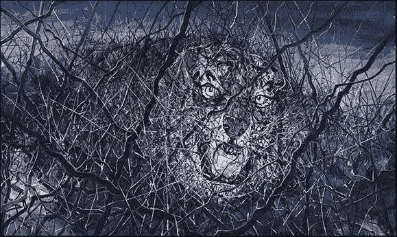

这些画我看得很有感觉，我觉得这是对混沌共生的一种精确表达， **人际关系的复杂缠绕，锁住了一个个的个体。**

在这种复杂的缠绕中，才会催生出“难得糊涂”这种哲学。

**糊涂哲学的源头，是共生心理。**  
六个月前的婴儿会觉得，我就是妈妈，妈妈就是我，我和妈妈的身体与心理是一体的，这可被称为“母婴共同体”，所以是不分你我，不分彼此。

对六个月之前的婴儿来讲，共生是必须的、正常的，但之后的共生，都是病态的。

糊涂哲学，都是因为不能分太清楚而导致，基本上都是因为不能区分“我是我，你是你”而导致的混乱。这种哲学如果盛行，必然会导致混沌共生的缠绕状态。

在“混沌共生”这一模块中，我会通过分析我在心理咨询中遇到的个案，来解读这种经典现象。我认为，帮助你认清这些现象，是摆脱这些缠绕的开始。

\*

从整个课程体系来看，这一模块相当于前奏。

我在常年做心理咨询的临床观察中发现，很多人的个体化自我尚未诞生，一直停留在母爱怀抱，甚至是自闭之壳中。

从“蛋-鸡-鹰”的形象化模型来讲，直到成为一只小鹰，才意味着个体化自我的诞生。因此也可以说，处在混沌共生中的人，还是需要老母鸡呵护的小鸡，也有人会去扮演呵护小鸡的老母鸡，但这并不是成熟的母亲，而是需要和小鸡共生在一起才有存在感。

好，让我们开始这一模块的正式学习。

注释：

\[1\]  
曾梵志，当代著名画家，1964 年出生于湖北武汉市，1991 年毕业于湖北美术学院油画系。从二十世纪九十年代起，曾梵志的创作以其独特的语言风格和敏锐的社会批判，受到评论界广泛的赞誉，也得到社会民众的持续关注。与此同时，曾梵志参与了一系列国际和国内重要的艺术展事，并在知名艺术机构举办了个人展览。曾梵志被认为是当代中国较具代表性和国际影响的艺术家之一。

他说，“我所画的每一张画，其实提出的都是一个问题。人的问题、从生到死的一系列问题、人所面临的所有困境。”

  

公众号懒人找资源，懒人专属群独享

# 03 讲 浆糊逻辑：为什么清官难断家务事？

武志红

2022-04-24

## 03 讲 浆糊逻辑：为什么清官难断家务事？

03 讲 浆糊逻辑：为什么清官难断家务事？

有一句话你认同吗？“清官难断家务事”。如果你认同，我认为那就意味着你的家庭与家族是混沌共生的。

我想从一个故事给你讲起。一个女孩，她是我的一位来访者，有一天她听说前男友订婚了。刚听到这个消息时，她有些难过，但是，当在朋友圈看到订婚现场的一张照片时，她突然觉得自己可以祝福前男友和那个女孩了。

这样听来，她真是善良，对吗？但我和她深聊下去后才发现，她是在祝福自己。准确地说，她是在庆幸，幸亏订婚的那个人不是自己。因为，她在朋友圈看到的那这张照片让她有些惧怕。

惧怕什么呢？照片上双方重要家人都参加了，这让她想，从此以后，再没有什么事是两个年轻人自己的事了。他们所有重大的事情，如结婚、生子和买房等，都需要双方家属，特别是双方父母一致同意才行，否则不得安宁。

之所以这样想，是因为她自己家就是这样的。她父母的事，从来都不是他们父母和她这个核心小家庭单独的事，而是两个家庭的事，双方家族都会参与。即便是很小的矛盾也很容易闹得不可开交，就算是和睦相处时，彼此之间也像是一锅浓得化不开的粥。

她从这样的家庭中还得到两个结论，第一个是她的外婆想控制每一个和她相处的人；第二个结论是，奶奶比外婆更进一步，不仅想控制和她直接相处的人，还想控制每一个关系，别人怎么相处，奶奶也要管。

这个女孩所恐惧的，就是在家庭中很容易看到的浆糊逻辑。

我从自己多年做心理咨询的经验出发，总结了六条浆糊逻辑：

\*\*  
\*\*

**浆糊逻辑 1：**

**我的事也是你的事，你的事也是我的事；**

**我的事是所有人的事，所有人的事都是我的事。**

假设你是 A，家里还有 BCDE 四个人，按照这条浆糊逻辑，你会去干涉 BCDE 四个人的事，反过来他们也会操心你的事。

你还深深知道，改变自己有多难，但你却会抱着这样一种想法：改变别人会很容易。于是，你在操心别人并想让对方改变这一点上，会特别有动力。

**浆糊逻辑 2：**

**所有关系，都是我的事。**

这一条逻辑让事情变得更加复杂，本来，你可以有简单的活法，只去处理和你直接相关的关系 AB、AC、AD 和 AE，至于 BCDE 间的关系，你尽量不干预。

浆糊逻辑则是，BCDE 他们怎么相处，也是我的事。并且，我和谁相处，也是每个人的事。

持有这一条浆糊逻辑时，人就没有了隐私感，也必然会陷入口舌中，因为希望所有人能看见自己在所有关系中都是好的，我的好、我的冤屈，你们都该知道，都该为我说话。

我可以拿我的亲身经历来说说这种逻辑。我的老家在河北，回老家的时候，我习惯了和村里人聊天的，聊聊家长里短。但慢慢的，我总结出一点，所有人谈的就是一件事：我对 B 很好，可 B 对 C 竟然比对我好，你说说这对吗？

明白这一点后，我就开始回避这类聊天了。

这种浆糊逻辑，是家庭关系总是一团浆糊的关键所在，谁想管事谁就会被累死。那个最想管事的人，常常正是各种冲突的根源，因为他搅进了所有关系，因此制造了大量的问题。

**浆糊逻辑 3：**

**你们=你，我们=我。**

这种逻辑就是你家任何一个人让我不快，你都要负责；你让我不快，我找你全家麻烦。

例如，媳妇和婆婆起冲突，要找老公麻烦；老公和媳妇发生冲突，也要找父母。总是在“告状”中，事情因此很容易闹大。

这种简单思维，其实是没有分化出“我”和“你”，更没有分化出“我”和“我们”、“你”和“你们”的区别。

我认识一位法官，他对我说，他认为九成离婚案是父母逼孩子离的。我也知道很多类似的事件，根源就是闹事的父母，没有将小两口的家庭视为一个独立的家庭，而仍然将自己与孩子视为“我们”，将孩子的伴侣和父母视为“你们”。

我的一位男性来访者，想和妻子离婚时，有了巨大的担心。他告诉我说，他和妻子是同一个地方的人，他们双方的家族在当地很有影响，整体上两家关系不错。当地是非常重传统的，如果他们俩离婚，只怕会导致两个家族成为仇敌，甚至会走到断绝关系的份上。可以说，他们小两口不能处理“我”和“你”的事，而是得先去思考双方家族构成的“我们”和“你们”。

这条浆糊逻辑，会严重影响核心家庭的幸福。

核心家庭，也叫再生家庭（family of procreation），相对于原生家庭（family of  
origin）这个概念，是指我们成年后所成立的家庭， **原生家庭会影响或决定核心家庭。**

太多家庭中，虽然两个人结婚了，但仍然将“我”视为“我们”，也就是原生家庭的一员，而将伴侣视为“我们”之外的外人。

例如两口子因为家人吵架，即便是家人做错了，我们也常会听到这样的辩护：他们是我的家人啊！可见这里的意思就是说，他们和我构成了“我们”，我们是一体的，其他人都是“你们”。而这样的辩护，是将自己的伴侣推向了对立面。

这一点上会有性别差异。男人容易将母亲与家人视为自己人，而将妻子视为外人。但是在传统文化影响下，女人没有可以后退的娘家，所以难以和自己原生家庭还保持着“我们”的感知。直到生了孩子，才与自己孩子构成了“我们”。

**浆糊逻辑 4：**

**把二元关系中的问题归咎于对方，也就是“你”。**

最常见的一种形式就是：我过得不好，是因为“你”。

例如，太多人面临离婚时，会说因为对方不够好，没有给自己带来想要的生活或者幸福。

事实上，以我的了解，这常常都是归咎而已。很多时候，即使换一个他们理想中的完美伴侣，他们仍然感受不到幸福和满足。

**浆糊逻辑 5：**

**把二元关系里的问题，归咎于“他”。**

这个很容易理解，A 和 B 之间出了问题，归咎到 C 身上。这是为了捍卫自己和重要客体，于是要把“我”和“你”的关系中的问题，都归咎给“他”这个第三者。

这种情况在三角恋中很常见，我们常会看到有女性遇到丈夫出轨，首先想到的不是攻击丈夫，而是把怒火倾倒给插足他们关系的第三者。

**浆糊逻辑 6：** **绕弯沟通**

A 对 B 不满，不和 B 直接说，而是说给 C 听，让 C 告诉 B。

北大学者吴飞，在他的社会学经典著作《浮生取义》中，写过多个这类故事。其中一个故事是这样的：一位父亲想让儿子给他修房子，但不和孩子直说，而是在另一个人面前怪孩子不给自己修房子。以这种方式，他想让这个人去跟孩子说，你爸想让你给他修房子。但儿子对父亲这种方式很厌烦，没理会，结果这位父亲就闹起了自杀。

吴飞喜欢使用“道德资本”这个术语来解释这些现象，意思是，如果这位父亲主动去和孩子说，希望孩子为自己修房子，那就消耗了自己的道德资本，这样和孩子的关系，就会失去一些道德优越感。

从心理学看，这位父亲这样做的主要原因有三个：

*   在二元关系中表达渴望或者不满，张力太大，而且个性不成熟的人，通常要表达的会是有些不切实际的想法和要求；
    
*   A 直接找 B 谈，容易有无能感和羞耻感；
    
*   因为不是“我”直接说给“你”的，所以我不用为这件事负责。这样一来，不管你是拒绝还是答应，我的情绪体验都会弱很多。
    

\*

以上就是我对于家庭关系中常见的浆糊逻辑做的不完全总结。家人之间的浆糊逻辑，想必除了这些还有很多。

我们可以看到，这些浆糊逻辑整体上会有这样的作用：把事情的焦点，从个体身上拿开，也不聚焦在我和你的二元关系中，而是编织进复杂的关系中，把事情弄得越来越复杂，以至于真像是“清官难断家务事”。但是，  
**当我们把事情的焦点再还原到二元关系，甚至聚焦在个体身上时，你会发现，事情会变得清晰简单很多。**

思考题

在你的观察中，还有哪些浆糊逻辑？你在面对这些情况时，又是如何处理的？欢迎写在留言区，和我分享讨论。

1\. 常见的浆糊逻辑： 1）我的事也是你的事，你的事也是我的事；我的事是所有人的事，所有人的事都是我的事。 2）所有关系，都是我的事。  
3）你们=你，我们=我。 4）归咎于客体，也就是“你”。 5）归咎第三者，也就是“它”。 6）绕弯沟通。 2.  
当我们把事情的焦点再还原到二元关系，甚至聚焦在个体身上时，会发现事情变得清晰简单很多。

  

公众号懒人找资源，懒人专属群独享

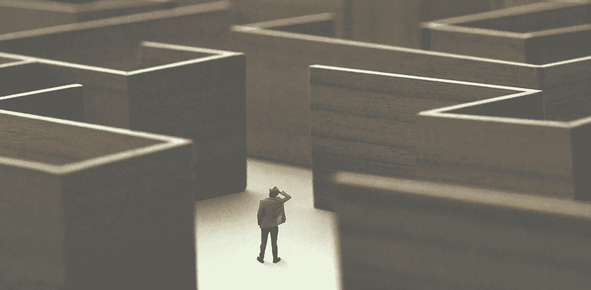

# 04 讲 糊涂哲学：为什么总想怪罪别人？

武志红

2022-04-24

## 04 讲 糊涂哲学：为什么总想怪罪别人？

04 讲 糊涂哲学：为什么总想怪罪别人？

家庭中常常会出现的浆糊逻辑，不仅如此，社会中常持有类似的逻辑，就像我们常听到的一些俗语，比如葫芦僧判糊涂案、难得糊涂等等。

在粘稠的家庭关系和复杂的社会关系中，糊涂哲学似乎成了一种生存之道。只是，在讲究法制和契约的当代社会，我们很容易看到，糊涂哲学会带来巨大的破坏力。

我们先来看一类事件：摔倒在地的老人讹诈扶助者。

正常情况下老人摔倒了，路过的人，特别是年轻人该怎么办？当然是去扶助老人啊。可是，如果随之而来的代价是，老人有很大的可能会说，就是你把我撞倒在地的，不然你为什么要扶我？

这种情况下，你怎么办？你可能仍然会有勇气说，我选择扶，因为社会系统会给我公正。

但是，假如判案时，因为证据不足，或者部分法官，出于对老人是弱者的考虑，而最终“葫芦僧判糊涂案”，让你适当承担一些责任。那你怎么办？

这些事特别容易让人心寒，它们一而再再而三地发生，被很多人认为，导致了社会道德大滑坡。后来老人摔倒后，不敢扶成了一种常见心态。

这类事情中，有两个非常值得思考的问题：

*   倒地的老人为什么恩将仇报？
    
*   他们为什么会得逞，而且从不被法律惩罚？
    

我们先来看看第一点。对此，一个流行的说法是，坏人变老了。还有一个常见的说法是，老人们是为了钱。

这两个说法，我个人觉得缺乏说服力，因为在不少案件中，讹诈的老人其实并不差钱。我记得有两起案件，是警察救助了摔倒的老人，而且两位老人都是晕过去了，但他们醒来第一时间都是很本能地抓住警察质问：你为什么撞我？幸好这两起案件中，都有视频证明是老人自己摔倒的。

我在关注这类事件后，最终得出了我自己的结论：

**这些老人的心理发展水平比较低，他们接受不了“我老了，我控制不好自己的身体了”这个事实。所以，我摔倒在地，既然不是“我”这个人的问题，那肯定是一种外力击倒了我。**

前面我们讲过，没有形成自我的人，他们的压力和情绪管理能力很差。因为一件事处理不好，他们就认为，这件事上的“我”被杀死了。这感觉很糟糕，所以最好是把这种死亡焦虑排出去，例如找一个人去怪罪。

找一个人去怪罪，这是社会中非常常见的一个现象，它不只是出现在倒地老人这类事件中，还展现在很多方面。

例如，家中少了钱，父母或老人怀疑是孩子偷的，对孩子一顿打骂，可后来发现，是自己把钱忘在别处了；

例如，医闹刚刚发生时，主流媒体和公众舆论，也包括我自己，很容易站在病人一方，去怪罪医院和医生，可事情屡屡反转，真相浮出水面后，舆论才逐渐站到了同情医生的一方。

再比如“校闹”。我看到有一些中小学开始不太敢开设体育课了，广州一所重点小学甚至干脆取消了课间操，让孩子们做手指操。出现这种情况，部分原因是应试教育体系带来的压力，但还有一个显而易见的重要原因是，一旦孩子们在学校发生意外，如体育课上受伤，家长们很容易大闹一场，最终常常是学校和老师得付出代价。我的来访者中就有多位中小学老师，其中就有两位因为这样的事件付出了代价，这让他们害怕带孩子们做一切体育活动。

校闹的逻辑也延伸到了大学。北京大学心理咨询中心的徐凯文老师告诉我说，据统计，中国大学生的自杀率大大下降，明显低于世界平均水平，高校的危机干预系统发挥了巨大作用。

但同时，学校在这方面投入的精力太大，以至于有一些学校在研究生考试时，面试的一个重要内容就是偷偷评估学生的精神状态，如果发现容易出事闹事的学生，基本不录取。但这样的评估明显又是缺乏科学标准的，很可能会误判，并且很多天才，性格是有些怪异的，所以这样会筛掉了优秀的人才。

说了这么多，你可能会想，为什么要去闹？为什么要找一个人或机构去怪罪？我举个例子，做一下更细致的解释。

我的一位好友，多年前，每当家里出了“意外”，例如一件衣服找不到了，或家中家具的摆放有了变化，她都会花很大力气在上面，必须得到一个答案，要确定这些“意外”是怎么发生的。

我和她深聊之后发现，她心中有这样一个潜在的逻辑：意外都是失控，既然不是我干的，那必然是有一个我之外的力量干的。可是我是自己住的，那这些意外就是小偷甚至魔鬼干的，那这个结论就太可怕了。

实际上，每一次所谓的意外都是她的头脑出现的问题，例如衣服随手扔到某个地方了，不经意挪动了家具等等。

我的判断是，像她这样的人，身边必须得有人。这样一来，不仅有了人陪伴带来的温暖和安全感，还有另一个好处，有了所谓的意外时，她可以第一时间去怪罪这个人，于是就不用担心那种隐隐的被迫害感了。

这种逻辑跟了我这位好友很多年，直到最近几年，她才有了根本性变化，不再那么担心了。这是因为有了很好的关系陪伴她，她的自我也逐渐形成了。

我们可以看到，有一个人去怪罪这多么重要。不然，这些容易闹事的人就会停不下来，他们会越闹越厉害。

这样就可以解释为什么会出现“葫芦僧判糊涂案”的浆糊逻辑，这些家伙闹起事来太执着了，干脆让他粘上一个人或机构得了。

我曾经因为遇到类似的事而报案，到了派出所后，警察对我说，不要觉得就你不容易，你不过只是遇到了一个这样的人而已，可我们大多数时间，就消耗在这些爱闹事的人身上了。

**这个人太难搞了，干脆就让他缠上另一个人，这种糊涂逻辑其实很常见。**

我曾经请过的一位钟点工，她的前夫是严重的偏执狂，因为前夫出轨和严重家暴，他们离婚了。离婚后，她前夫日子过得不顺心，又开始来闹她，还会骚扰和威胁她的家人。结果她的家人纷纷劝她说，你看你年纪不小了，还和他生了几个孩子，你再也嫁不出去了，不如和他复合吧。后来她前夫终于不闹了，一问，原来有了新女友了。

这就是和稀泥，不讲是非对错，不去尊重事实和逻辑，而是大概差不多就行了。

我认为它有一定的合理性，一个社会中爱闹事的人太多，而且他们闹起事来太严重，那就不如让他们粘上一个人或一个机构。这样是不公平，但有用。

如果按这个逻辑推演下去，可以达到非常严重的地步。近两年，有几个正当防卫的事件成为社会热点话题。在这些案件中，歹徒严重行凶，受害者反击，致其重伤甚至死亡。但在事件还没有水落石出之前，竟然第一时间都被舆论说成是防卫过当。

我曾经看到过一个数据，说是采取“正当防卫”辩护策略的刑事案件有 12346 起，但最终认定正当防卫的只有 16 例。

这种事的背后逻辑，可以说是“各打五十大板”，管你谁是攻击者谁是反击者，先都惩罚一下再说。

可你想想看，一旦是我们自己做裁判时，不一样容易使用类似逻辑吗？

*   比如，如果你自己的家人中，有人闹得很厉害时，你是公然指出某个人有问题呢，还是和稀泥呢？
    
*   比如，你家的两个孩子打架，你是不是也容易说，我不管你们谁对谁错，你们动手就都不对；
    
*   又比如，在社会热点新闻中，“一个巴掌拍不响”，是多么常见的说法。
    

可以说，这些事件中，都藏着共同的逻辑：

**我们很难去只处理一个个体，所以总是要把事情变复杂，把这个个体和另一个人甚至更多人扯到一起，就好像人不能为自己的行为负责，必须拉一个垫背的。**

思考题

你如何看待怪罪别人这种心理呢？当你做裁判时，你觉得怎样的思考方式可以避免“各打五十大板”的糊涂判定呢？欢迎在留言区写下你的看法。

1、找一个人去怪罪，是因为没有形成自我的人的压力和情绪管理能力很差，一件事处理不好，会认为这件事上的“我”被杀死了，为避免这种糟糕的感觉，就要把这种死亡焦虑排出去。  
2、和稀泥，是不讲是非对错，不尊重事实和逻辑，差不多就行了。  
3、我们很难去只处理一个个体，所以总是要把事情变复杂，把个体和另一个人甚至更多人扯到一起，就好像一个人不能为自己的行为负责。

  

公众号懒人找资源，懒人专属群独享

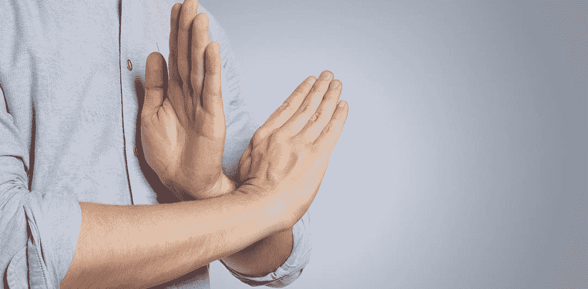

# 05 讲 粘稠思维：为什么会拒绝沟通？

武志红

2022-04-24

## 05 讲 粘稠思维：为什么会拒绝沟通？

05 讲 粘稠思维：为什么会拒绝沟通？

在前面两讲，我分别谈了家庭和社会关系中常见的浆糊逻辑和糊涂哲学，这一讲我们换个视角，看看为什么会出现这种现象。

这就必须回到每个个体的身上来了。其实我们绝大多数人，都存在一种错误的思维方式，我把它称作粘稠思维。正是这种思维方式，才导致我们在处理各种家庭和社会关系的时候，说不清，理还乱。

## 人与人之间的粘连

我刚做心理咨询没多久的时候，接到一个印象深刻的个案。一位来访者，是个女孩，她有一种完美主义，说自己脑海中常常浮现出一个意象，一个像水晶做成的公主，晶莹剔透，没有一点杂质。她知道，这是她的自我意象。

后来我也在咨询中遇到过多位这样的“水晶公主”，她们看上去干净至极。这是一种美，很容易打动男人，女人也容易对这样的女孩生出怜爱。

然而，从另一面看，这也是有问题的。为什么这么说呢？你想想看，要如此晶莹剔透，就得剔除掉水晶中的杂质，可那些杂质是什么呢？我认为就是“我”的各种欲望，还有容易被我们感知为黑色的负面情绪。但是，人不可能没有欲望和黑色情绪。所以，当这个女孩觉得自己是水晶公主时，也就意味着她压抑得非常厉害，这些杂质都被压抑到潜意识中了。

其实，不只是女性，男人也会有相对应的这种意象。我来说说我自己吧。

有一次，我在找我的精神分析师做分析时，产生了这样一种意象：我躺在病床上，胸腹都被剖开了，旁边站着一位穿白大褂的医生。

我告诉了我的分析师我的这个意象，他解释说，或许你体验到的是，我对你的分析是如此无情，就像医生在解剖你一样。

我感受了一下，觉得这个解释不够味儿。因为，分析师的分析没有让我觉得痛苦，相反我有一种极度坦然。于是我自己分析明白了，在我那个意向中，不是别人把我剖开的，是我自己这么做的，其中的那份坦然就像是在说：请看吧，我没有一点花花肠子。花花肠子是什么？就是我的各种欲望和黑色情绪。

## 透明幻觉

**透明幻觉，是指你不用说，我就知道你是怎么回事；我不用说，你就该知道我是怎么回事。** 我们之间是透明的，根本不用沟通，一眼望去，就会知彼此。

你可能很快就想到了恋爱中的女人常有的一种逻辑，你爱我的话，我不说，你就会知道我的心思。有这种逻辑的女性，容易拒绝沟通，因为她觉得没必要沟通。  
**很多粘性思维产生的根源，就在于一定程度的透明幻觉。**

我在咨询中常常遇到有很多来访者非常紧张，我问他们为什么如此紧张，他们说，你是非常厉害的咨询师，那你肯定一眼就能知道我在想什么，可我内心中有很多见不得人的秘密，怕你看出来，所以非常紧张。见不得人的秘密，也是杂质。

碰到这样的来访者，我会在一开始就特别说明，我根本做不到这一点。有时我会产生各种感觉，根据这些感觉去推理你可能是怎么回事，但也是推理而已，你是解释你自己的权威，我了解你的可靠途径，就是通过你的讲述。你不向我敞开自己，我就不会了解你。

透明幻觉不严重的来访者，会立即接受这个解释，并松一口气。透明幻觉很严重的来访者，也会松一口气，但同时又会对我有失望，因为他们很期待我是能一眼看透他们的。随着咨询的进展，他们的这份渴望和幻觉还会被多次唤起。

这是非常重要的，咨询师需要在恰当的时机向来访者解释并澄清这一点，因为这个透明幻觉是双向的。当他们认为咨询师具备这个能力时，也意味着，他们觉得自己也有这个能力，他们能不用沟通就知道咨询师是怎么想的。

推理一下就会知道，当一个人持有这种幻觉时，他们就会严重减少和别人的沟通与澄清，会有无数的误解产生。因为他们  
**把自己孤独的想象，当成了真实信息，由此就会缺乏基本的现实检验能力。** 当这一点特别严重时，就意味着很可能是精神病性的，那就不再是心理咨询的范畴了。

不过以我的经验，太多看起来心理问题并不严重的人，都有相当程度的透明幻觉，这个是可以讨论、认识并处理的。

那透明幻觉是怎么来的呢？它的原型是婴儿对完美母爱的渴求。婴儿不会说话，所以理想妈妈必然是一个不用说话就知道自己怎么回事的妈妈。可是，成年人如果持有这一逻辑，就容易陷入偏执。

比如你常常会听到这样的抱怨：你怎么会不明白我是怎么想的呢？你就是这么回事，我当然知道！等等。

在我的认识中，透明幻觉在我们社会非常普遍，所以我们得有一个应对它的笨方法，那就是多沟通。

我们必须假设，了解一个人是相当不容易的，了解自己其实一样不容易。 **我们需要在关系中多沟通才能了解对方，需要多探索内在才能了解自己。**  
那种瞬间就能知道彼此是什么样，通常是幻觉，或者只是偶尔发生而已。那是神才有的境界，人类没法具备。

对于透明幻觉特别严重的人，他可能根本上就是排斥沟通的，因为沟通会让他看到，对于同一件事，他有一种认识，而别人会有另一种认识，这几乎是必然的，而他们很想这件事只有一种认识，也就是他自己的认识。

例如，一位来访者一直觉得，如果总是能和别人达成一种共识多好，但突然有一天她领悟到，总能达成共识意味着，在某件事上，有一个人的认识被灭掉了。而如果她总期待着身边某个人和她达成共识，那就意味着，要么是这个人，要么是她自己的认识，被灭掉了。

## 事与事之间的粘连

受到粘稠思维支配的人，除了常常把人和人粘在一起去看，也经常把事和事粘在一起去看。

这就可以解释，为什么两口子吵架可以从一件鸡毛蒜皮的事开始，然后翻出一辈子的旧账来，因为所有这些事都是粘到一起的，当下这件小事没有独立性。

这还导致了一个问题。很多人会发现，伴侣记不住你的好，而你的坏他们永远记得。不止如此，他们还把这些坏揉成了一个整体，永远带着这个整体去看当下。

很多父母也有相似的粘连逻辑，例如父母常对孩子说：我是你的爸爸，或者妈妈，难道我会害你？也就是所谓的  
“天下无不是的父母”。在父母和孩子的关系里，无论父母怎么做，都不会错，错的只能永远是孩子。这也是把所有问题揉成了一个整体。

还有员工和老板，也会有这样的现象。拿我自己来说，我作为老板，不断听到有员工会说：我对公司尽心尽力。后来我真的怕了这个说法，因为我发现他们最初的确是这样想，也是这样做的，对我和公司都非常上心，这非常好。但是，时间一长，这句话的另一面就展现出来了，“既然我已经尽心尽力了，所以我没有问题”。

\*

家庭、社会和个人身上的糊涂逻辑，虽然看似不同，但其实你会发现它们起到了一个作用，让我们难以聚焦在当下的这一件事上，就事论事的谈话。

这种逻辑，其实是婴儿早期的共生心理的展现。这就会引出一个问题，为什么会有那么多人会停留在婴儿期的共生心理中？

**弗洛伊德说，如果一个人在某个发展阶段得到太多满足或遭遇严重匮乏，都会导致这个人的心理发展固着（fixation）在这个阶段，形成情结（complex）。**

弗洛伊德觉得，人停留在共生心理中，是在某个阶段得到太多满足或匮乏导致的，但我认为主要还是因为匮乏。可以说，它们之所以这么常见，根本原因是有很多人在婴儿早期，共生的需求没有得到满足。

共生需求，放到成年人的身上，很容易让人闻到不对劲的味儿，但放到婴儿早期，它就具备极大的价值，是婴儿再正当不过的要求。

思考题

学习了第一模块，你了解了混沌共生，我想请你来谈一谈，如果让你来解决混沌共生中缠绕的状态，你会从哪些方面入手？你觉得这个过程中应该注意些什么？欢迎你在留言区，写下自己的看法。

1.透明幻觉，是指你不用说，我就知道你是怎么回事；我不用说，你就该知道我是怎么回事。应对这一点有个笨方法，就是多沟通。  
2.常见的粘稠思维还有难以聚焦在当下正在进行的单独一件事，不能就事论事，而是把所有事都粘到一起。  
3.弗洛伊德认为人停留在共生心理中，是在某个阶段得到太多满足或匮乏导致的，我认为主要还是因为匮乏，根本原因是有很多人在婴儿早期，共生的需求没有得到满足。

  

公众号懒人找资源，懒人专属群独享

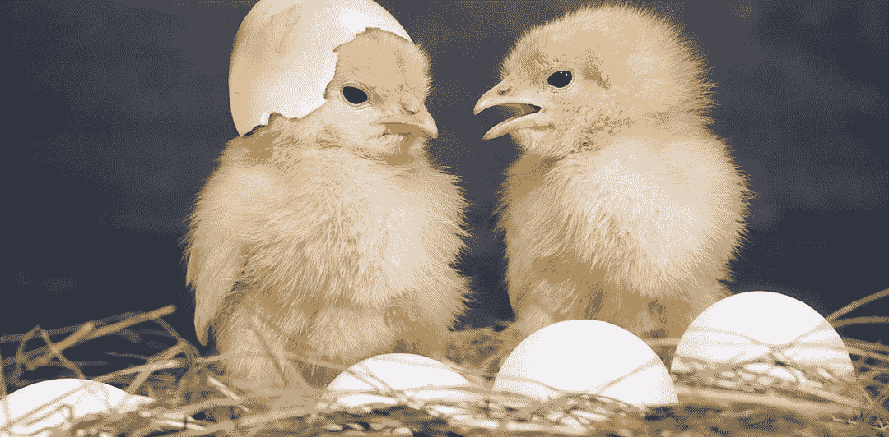

# 模块引论：从内破壳，还是从外破壳？

武志红

2022-04-24

## 模块引论：从内破壳，还是从外破壳？

模块引论：从内破壳，还是从外破壳？

在这个模块的开篇，我想和你讲一个根本性的隐喻——孵化。

请你来想象一下：一只鹰蛋，要孵化成小鹰，该怎么做？

我们都知道基本方法，就是提供孵化环境，让小鹰的胚胎自然成长，等到发育成熟的时候，小鹰会在蛋内基本成型，然后从内部破壳而出。

作为养育者，你不能从外部把壳破掉，那样是具有破坏性的。我们可以把这个隐喻延伸到心理上， **对自我没有成形的人来说，最重要的就是孵化的环境。**

例如，婴幼儿走路这件事，养育者不能着急，最重要的应该是提供必要的支持，让孩子逐渐学会走路，这就是在提供孵化环境。相反，如果养育者过分使用学步车之类的东西，让孩子过早学会走路，就是对孩子自然而然的成长过程的一种破坏。

孵化，还有一个重要的隐喻。当一只小鹰从蛋壳内破壳而出时，意味着它从孤独的一元关系，进入到了与母亲的二元关系。

婴儿出生后，最初是活在一种自闭中，当母亲提供了良好的孵化环境，就可以帮助孩子从自闭之壳，进入母爱怀抱的二元世界。

**如果这个发展受阻，人就会在相当程度上停留在自闭中。** 怎么才能安全、顺利的从一元关系过渡到二元关系呢？这是这一模块我要为你解决的问题。

接下来，让我们开始这一模块的正式学习。

  

公众号懒人找资源，懒人专属群独享

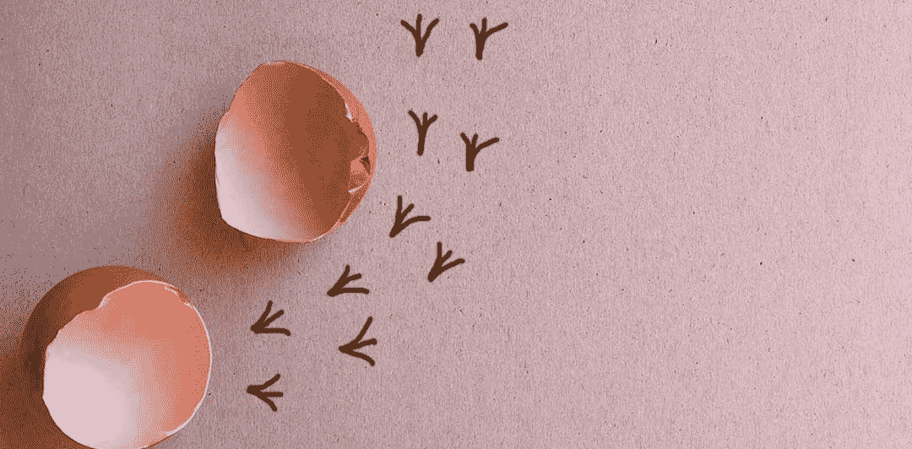

# 06 讲 孵化隐喻：心灵成长为什么要从内向外？

武志红

2022-04-24

## 06 讲 孵化隐喻：心灵成长为什么要从内向外？

06 讲 孵化隐喻：心灵成长为什么要从内向外？

这一讲开始，我先来讲讲自闭这回事。

自闭状态有一个广泛的谱系，这个谱系中最广为人知的是自闭症，就是完全不想跟外界社交。轻一点的叫阿斯伯格症，这是一种社交障碍，这类人比较喜欢重复、刻板的活动方式，渴望社交，但缺乏能力。再轻一些的如回避型人格障碍，普通人中则有所谓的“宅”。

自闭症这种级别的自闭状态，我们就不展开讨论了。我想和你探讨的是，普通心理意义上的自闭，也就是说，为什么生活里很多人有回避型人格障碍和 “宅”的表现？

要想搞清楚这个问题，就要请你先回顾一下我在课程总论中提到的理论。

著名精神分析师玛格丽特·马勒将婴儿早期的第一个月，称为正常自闭期，意思是只有这个阶段的自闭是正常的，以后的自闭都是有问题的。接下来到六个月是正常共生期，一样的意思，只有这个阶段的共生才是正常的，以后的共生都是病态的。

我认为， **生命越初期的命题，一般也越重要。** 一直停留在混沌共生状态，是个严重的问题，但我觉得这还是大大好过一个人一直停留在自闭状态的。

可以说，婴儿从自闭发展到共生状态，是一个巨大的进步。这意味着，婴儿从孤独世界，初步进入了关系世界。

## 孵化的隐喻

马勒描绘说，刚出生的婴儿，虽然肉体生命已经出生，但心理生命似乎还没有诞生。出生还不到一个月的婴儿，他们对外部世界仿佛不太感兴趣，像是还待在一个无形的蛋壳中，等待着破壳而出。

无形的蛋壳，你可能听上去会觉得有点难以理解。但如果你把它想象成一个真实的鹰蛋，你就会立即知道，该如何让小鹰顺利出生。

方法很简单，就是孵化。老鹰要给鹰蛋提供良好的孵化环境，让小鹰的胚胎，在蛋壳里不受感染地自然发育，逐渐长成雏鹰的样子，然后从内部把蛋壳打碎，破壳而出。

这个过程中，老鹰必须有耐心。它不能使蛮劲，从外部破壳，那会破坏鹰蛋的发育，还有很大可能会杀死自己的孩子，导致这份诞生根本就不会发生。

你可以把这个孵化的画面，看作是心灵成长的一种基本隐喻。

**孵化的隐喻，不仅是婴儿从正常自闭期发展到正常共生期的隐喻，也是孩子以后发展成长任务时的基本隐喻。**  
虽然养育者有时要教孩子、干预孩子，偶尔还要发挥自己的权威。但整体上，按照孵化的隐喻，  
**养育者需要尊重孩子自己的感觉，依照他们自己的节奏自然成长，让孩子的一项项能力从内部破壳而出。**

只有等孩子的内聚性自我形成后，养育者才可以从外部破壳，因为这时的孩子就能承受和转化一定程度的创伤了。

由此，我们知道，虽然处于自闭期的婴儿，看上去像是对外部世界不感兴趣，但养育者不能掉以轻心，这时候，养育着应该更加积极地为他们提供好的孵化环境，给予他们更多的关注，辅助他们完成对外部世界的探索。否则他们可能就没法破壳而出，一直滞留在自闭状态。

## 自恋与全能自恋

一个人如何才能从“宅“走向开放，一个婴儿如何从自闭走向关系？这里面有共同的道理。要来讲清楚这个道理，我得先和你说说自恋这件事。

我在长期的心理咨询中观察到，太宅的人，例如被诊断为回避型人格障碍的人，他们普遍都是“老好人”。或者准确地说，他们常常太软弱，所以他们如果进入关系，就容易被欺负，在关系中处于下风，这就伤害了他们的自恋。他们之所以会变得宅，是因为宅着的时候，可以保护自己的自恋。

**自恋是人的根本本性，婴儿则有原始的全能自恋。**  
婴儿不仅觉得，我就是妈妈，妈妈就是我，还觉得我就是万物，万物都是我。甚至可以进一步表达成：我是神，我一发出我的意志，万物包括妈妈在内，都得满足我。婴儿甚至连“配合”这个概念都没有，因为万物合一，所以这是自然而然的事。

为什么要理解自恋和全能自恋？因为理解了它们，你就能更好地理解孵化的隐喻。如果是从内部破壳而出，婴儿乃至孩子和大人，就会有这样一种感觉：  
**这是“我”掌握着的，作为外部世界的“你”，是在配合我。**

## 原始母爱贯注

但是你会发现，有不少养育者会容易去控制，甚至逼迫婴儿，这里有个人风格的原因，但我认为还有一个特别重要的原因，那就是如果要围绕着婴儿的意志，满足他们，和他们建立共生关系，就意味着得知道他们发出了什么需求，但这怎么能知道呢？毕竟婴儿不能讲话。

关于这个话题，我曾经在我的微博上发起过讨论，问题是：“你通过什么来判断小婴儿的需求呢？”然后我得到数百个非常有意思的回复，我来给你列举几个妈妈的回复：

1.我看看婴儿的小眉毛就知道他想干什么了。  
2.小婴儿饿了，为娘的一听到哭声就立刻涨奶。但我觉得更多的时候，母乳宝宝根本不需要用哭声表达，妈妈就会有心灵感应。  
3.小婴儿只会哭，不同的需求哭声不同。一开始新手爸妈都不理解，后来注意倾听，观察，总结，就能发现不同哭声代表的不同需求，只要理解了，满足了，宝宝就不哭了。

我列举的这些妈妈对孩子需求的判断方式，都是表现比较好的部分，但也有不好的。我对几百个回复的答案做了分类总结，大致可以分为以下四类：

1.完全不懂婴儿发出的信号是什么，于是很烦躁； 2.能通过经验总结出，婴儿不同的动作、信息，特别是哭声是什么意思； 3.经验加上敏感的直觉；  
4.如同心灵感应一般的同步，不过常常只是限于很小的婴儿。

除此之外，还有比较常见的一类是，小婴儿遇到了危险，被妈妈感知到了。例如有多位妈妈讲到，自己突然惊醒，下意识地伸手，拉住了险些掉下床的宝宝。还有妈妈梦见孩子被东西压住了，惊醒，然后真的看到孩子被枕头给压住了。

这听上去可能会让你觉得不够具有说服力，但是我想为你介绍一个英国精神分析学家唐纳德·温尼科特（Donald. W. Winnicott.  
1896-1971）提出的概念—— **原始母爱贯注** （Primary maternal preoccupation）。这个概念是指，  
**在分娩前后的一段时间，一些妈妈会进入特别的“病态”，这时候的妈妈对孩子的感知能力变得很敏感，甚至不用沟通就可以知道婴儿的需求。**

简单来说，就是母亲的全神贯注，完全紧随着孩子需要的表现。其实，养过小宠物的人都知道，小宠物不会说话，但你们之间是可以交流信息的，你越是投入，就越可能懂得。

我认为对于妈妈来讲，还有一个特别的投入，那就是哺乳。在留言回复中我看到，有多位妈妈讲到她们在给孩子哺乳时，那份如心灵感应一般的连接比较多，等断乳了，这份感觉就没了。

可以说，妈妈满足婴儿的需求，并不仅仅是照顾好孩子的生理需求，还有极为重要的一点是，通过照顾孩子的需求，妈妈和孩子建立了关系，这样就帮助孩子，从自闭的孤独世界进入了关系的世界，这是拥有正常心智的基本。

养育婴儿是件很辛苦的事，但很多妈妈与小婴儿建立了美妙的连接后，她们会非常享受，并且，这也会疗愈一些妈妈自己的孤独感。

当妈妈能很好地感知婴儿，并照顾婴儿时，就给小婴儿提供了良好的孵化环境。  
**因为共生期一开始，婴儿会觉得妈妈就是整个世界，所以他们会感知到，好像整个世界都在张开双臂，欢迎自己的到来。**

这是很深刻的祝福。假若有命运，那这也是一个好命运的基础。

思考题

在你的身边，有没有遇到过妈妈强行为孩子“破壳”的行为呢？请你举个例子。

1.孵化是心灵成长的一种基本隐喻。养育者需要尊重孩子自己的感觉，依照他们自己的节奏自然成长，让孩子一项项能力从内部破壳而出。  
2.从内部破壳而出，孩子就有一种我可以掌控、外部世界是在配合我的感觉；如果养育者从外部强行破壳，孩子的自恋就会受损。  
3.妈妈满足婴幼儿的需求，并不只是照顾好孩子，还要帮孩子从自闭的孤独世界进入关系世界，这是拥有正常心智的基本。

  

公众号懒人找资源，懒人专属群独享

# 07 讲 征服婴儿：被动“破壳”会发生什么？

武志红

2022-04-24

## 07 讲 征服婴儿：被动“破壳”会发生什么？

07 讲 征服婴儿：被动“破壳”会发生什么？

上一讲，我讲了孵化的隐喻，强调让孩子的各种生命力都自然发生，从内部破壳。现在这一讲我想讲讲，如果从外部破壳会发生什么。

## 习得性无助

给你讲一个让我印象深刻的场景。我看过一个母亲和婴儿互动的视频，视频里，一位表情僵硬的妈妈，站在床边，给躺在床上的孩子读古典经书。关键是，那只是一个几个月大的婴儿。

他当然听不懂妈妈在说什么，但是他能感受到妈妈的语气和情感，他并没有被妈妈吸引住。所以，视频中的婴儿几次把头扭过去，我觉得这就是他在用婴儿微弱的方式表达抗拒。可每次，妈妈都会用双手，把他的头再摆正，然后接着读经书。

几次下去后，这个婴儿不反抗了，他的脸正对着妈妈的脸，接受灌输。

这就是一种从外部破壳的表现，妈妈破坏了婴儿的蛋壳。婴儿不反抗，是因为反抗没有意义，他形成了“习得性无助”。也就是说，他对妈妈的抗拒，被证明是没有意义的，他只好接受。但是，他的眼神变得空洞，神情变得和妈妈一样僵硬。

这个婴儿的边界没有被尊重，他不能用身体动作来表达抗拒，他就用神情来表达。原本围裹在他身体外的蛋壳被破坏了，而他进一步退守，用自己的神情和内心，来重新构建一个新的保护壳。只是这个壳，比他本来的壳，变得更小、更脆弱了。

强控制型的养育者，的确会不断压缩孩子的壳，导致孩子的内在空间会越来越小。特别是婴儿，他们的确非常虚弱，任何一个大人都可以征服他们，让他们放弃自己的意志，而接受大人的意志。

我在得到上的另外一门课《武志红的心理学课》中有一节课叫《输在起跑线上》，里面提到了家庭和幼儿园在养育孩子时，容易对孩子有各种逼迫。而且研究发现，当孩子被逼迫得少时，就会更外向，当被逼迫得多时，孩子就会变得更内向。严重的话，这种内向，就可以视为自闭的一种表现。

## 满足共生需求

我的一位问题相当重的来访者，她有一个强烈的意象，她感觉自己平时就缩在一个火柴盒里。相对应的是，她有一个很强硬的妈妈。我见过她妈妈，觉得以她的风格，是不大可能提供孵化的环境，很容易从外部破女儿的蛋壳。

不过，这位妈妈从来不会去打骂孩子，她只是在感知孩子的需求时，总会出现问题和偏差。所以，她经常做不到围着孩子的感觉去满足孩子。她照顾孩子时，必然会把她的理解加在孩子身上。当然，如果妈妈们总是不能满足孩子的需求，也会让妈妈们非常无助、焦虑和失控。

我曾经遇到过一位新手妈妈来访者，她之所以来找我做咨询，是因为她曾经真的伤害过自己的孩子。当孩子哭泣时，她做了各种努力想满足孩子，发现无效，而孩子哭得越来越惨，这个时候她非常痛苦，失控时，她就会攻击孩子。

后来，她的孩子才九个月大，就能开口讲话了，而且一讲话就很完整，表达能力非常好。这位妈妈忍不住想，可能孩子也怕了，如果再不讲话，真的会被妈妈伤害。

等孩子能用语言清晰表达自己的需求后，这位妈妈就没那么焦虑了，因为她知道孩子想要什么了，而她非常愿意满足孩子。从这一点上可以看出，她是多么想做一个好妈妈。

这样的妈妈之所以难以做到理解孩子，可能是因为她们自己也不曾和自己妈妈构建过共生关系。这可能是家族轮回问题，例如她的妈妈也没有从姥姥那儿获得良好的照顾。还可能是历史遗留问题，例如，以前产假最短时只有四十多天，当没有老人带孩子时，孩子要么丢在家里，要么放到托儿所，从而导致了母婴分离。

像我河北农村老家，过去养孩子有一种流行模式：大人们去地里干活，就把小婴儿孤独地留在炕上。一天回家突然发现，孩子竟然会走路了，大人很开心地大喊：啊，我们家孩子会走路了！

对婴儿来讲，这是非常恐怖的养育环境。因为婴儿缺乏基本能力，吃喝拉撒睡玩都不能自理，可以说，孤独对他们来说就等于是地狱。  
**当他们太多时候是靠自己完成了吃喝拉撒睡玩，那他们也会在很大程度上，失去了和养育者建立共生关系的动力。**

上一讲我们提到的英国精神分析学家温尼科特说过，孩子的基本生理需求即吃喝拉撒，都不要被严格训练，就让孩子自然而然掌握它们就好，如果有严苛训练，都可以视为是对孩子的虐待。

例如关于吃这件事，对婴儿来讲，吃是第一位的需求。当母亲是按照婴儿的需求去哺乳时，这就是在满足婴儿的共生需求。当母亲忽视婴儿的需求，按照自己的节奏去哺乳时，就是在破坏孩子的保护层。

你是小婴儿的时候，是怎么被喂养的呢？这其实不容易得知，但你可以从你小时候，父母在吃饭这件事上对你的态度，看出一些端倪。例如一位网友在我微博上留言说：

我在家不能决定我吃什么吃多少，一顿也不能在外面吃，忍着吃我妈做的难吃至极的菜，我说了不喜欢吃的菜，让她别弄了她也不听，不吃鱼头逼我吃，每顿饭都在我吃之前被她夹满了菜，吃得差不多了再继续夹满，我不能自己边吃边夹，吃饭对我来说变成酷刑。

这样的故事相当普遍，我的一位来访者，甚至在描述完她是怎么吃饭的之后，突然痛哭流涕地说：

我每顿饭都是一场战争，我只能偷偷地在一些不起眼的地方表达我的抵抗，看得见的地方我都输了，我在家吃了二十年饭，那意味着遭遇过两万次的酷刑。

说酷刑并不是一种夸张的形容，而是真实体验，还可能会导致与消化系统有关的一系列身心疾病。

## 躯体化

精神分析业内常有人说，躯体化应该是最常见的自我防御机制。躯体化就是说，  
**某种情绪不能在心理层面流动，也不能通过言语表达出来时，就有可能会转过来用身体症状来表达。**  
例如在吃这件事上，如果孩子被逼迫，那么孩子会产生愤怒和羞耻等一系列情绪体验，如果这些情绪不能在关系中表达，就会转变成消化系统的疾病，例如肠胃问题。

这个躯体化过程到底是怎么发生的呢？

还是要回到前面讲的孵化的隐喻：当父母尊重孩子时，在吃这件事上，养育者就是在孵化孩子吃这个行为，它可以从幼稚、混乱走向成熟和有序。如果养育者用强力手段逼迫孩子接受大人的安排，那就是在从外部破坏孩子的蛋壳。

除了孵化的隐喻，还可以有更直接的解释。当在吃这件事上逼迫孩子时，就相当于在给孩子下“毒”。比如孩子会因此产生负面情绪，他们会有愤怒和恨意，而且被强力逼迫，还会带给孩子被打击的羞耻感。逼迫程度越强，孩子的这些负面情绪也就越强，“毒性”也就越大。

吃，主要发生在消化系统上，如果抚养者在其他方面逼迫孩子，那孩子也会在相应的身体系统上出现问题。

所以抚养者要问自己一句：我能看见孩子吃的需求吗？特别是，在孩子如何吃这件事上，我能尊重孩子的感受吗？

同样的道理，可以延伸到成年人身上。例如你也可以问问自己，在吃这件事上，你能自如地发出你的动力吗？当饿了的时候，能坦然去找吃的，并且在吃多少、如何吃上，你能尊重自己的感觉吗？

不光是吃饭这件事，任何事都一样。  
**当一个人能按照自己的感觉和需求做一件事时，他在这件事上的意志才得以存在；当不能按照自己的感觉和需求做一件事时，他在这件事上的意志就被摧毁了。**

很多孩子和大人，都很难发出自己的生命动力，那是因为他们的生命动力在童年早期，就已经被闷死太多了，以至于他们被困在习得性无助中，觉得发出这些生命动力没有意义，而这意味着，这些动力还没出生就死了。

思考题

请你回想一下自己在处理哪些事情时容易出现“习得性无助”的问题？

1.强控制型的养育者会不断压缩孩子的壳，导致其内在空间越来越小。 2.孩子的基本生理需求要让孩子自然而然掌握，严苛训练是对孩子的虐待。  
3.当一个人能按照自己的感觉和需求发出生命动力时，他在这件事上的意志才得以存在。

  

公众号懒人找资源，懒人专属群独享

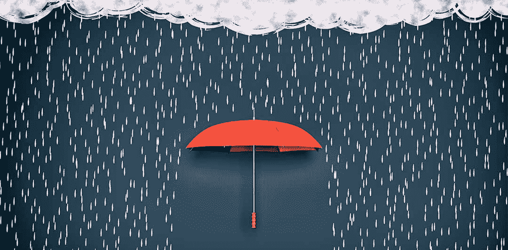

# 08 讲 蛋壳隐喻：自我保护有什么重要意义？

武志红

2022-04-24

## 08 讲 蛋壳隐喻：自我保护有什么重要意义？

08 讲 蛋壳隐喻：自我保护有什么重要意义？

前面两讲，我讲了孵化的隐喻，讲到生命力最好是从内部破壳而出，不要从外部强行干预。孵化是从养育者角度来看的，这一讲，我们换个视角，我们从婴儿的角度去看，那么与孵化隐喻相对应的，就是蛋壳的隐喻。

## 母爱与父爱的壳

这里的蛋壳，就是自我保护的意思，自我保护这个概念非常重要。当你看到一份美好的感觉在流动时，你也要看到，它的外围，总是有一个外壳存在，这份美好的感觉必须在这个外壳所构成的容器内，才能自由流动。

我们继续来想象那颗鹰蛋。鹰蛋都是有两层壳的，里面是一层软壳，外面是一层硬壳。这也是一个基本的隐喻。

我在前面讲过，自闭之壳，是由婴儿的自恋组成的，所以也可以称为自恋之壳。从心理发展上来讲，这是最小的一层壳，而这个壳被破掉后，就进入了母爱怀抱。母爱怀抱也是一个容器，一层更大的壳，相当于鹰蛋的那一层软壳。这个时候，孩子的生命力，就有了更大的流动空间。

我们可以想象，母爱怀抱，就是鹰蛋里的那层软壳，而母亲之所以能专注地呵护孩子，是因为孩子的父亲，在扮演着蛋外面的那层硬壳。

**母爱的软壳，还可以称为“呵护层”，而父爱的硬壳，可称为“保护层”，这两层必须同时存在，孩子才能得到好的照顾。**  
当父爱的硬壳不存在时，母爱的软壳就不能安稳了。这个时候，母爱之壳会试着同时承担保护层和呵护层的双重功能，难度就大了很多。同样的，当母爱的软壳不在时，父亲也要同时去承担这双重功能，也会难很多。

我在微博上谈母婴关系的时候，常常会引起一些女性的攻击。她们认为，我太强调母亲对婴儿乃至孩子的重要性了，但是，父亲的价值在哪呢？要知道很多家庭经常是“丧偶式育儿”。

她们的愤怒可以理解。全世界有问题的家庭，的确是有一个共同的模式：焦虑的母亲、缺席的父亲和有问题的孩子。当父亲缺席时，母亲就要同时承担硬壳和软壳的双重功能，自然会变得焦虑很多。

此外，我也见过少数的例子，父亲能和婴儿建立起非常好的共生关系。例如我一位女性朋友，她和另一半谈恋爱时，就发现对方极其感性，像有读心术一般，常常不用说话就知道她是怎么了。等有了孩子后，丈夫的这份感知能力，也发展到和孩子的关系中，而且正好她是一个偏理性的妈妈，和人难以亲近，也难以和孩子建立太亲密的关系，再加上她工作忙，老公工作轻松一点，于是带孩子的任务就落在老公身上了。

虽然爸爸也能承担起这份责任，但我还是想说，婴儿六个月前与妈妈建立的母婴共同体，是至关重要的，它是孩子在胎儿时与妈妈共生关系的一个延伸，这一部分别人难以替代。

这并不是我个人的观点，客体关系心理学的理论构建者，比如玛格丽特·马勒和梅兰妮·克莱因等人。这些理论家们通过对婴幼儿的大量观察研究，得出结论：在孩子三岁前，孩子的注意力主要在母亲身上，母子关系是核心，父亲对孩子来讲，不是那么重要。

## 父亲与社会熔炉

但是，父亲还是极其重要的，他们的重要性，是给妻子和整个家庭，提供保护和支持。父亲要做好硬壳这个“保护层”，好让妻子安心去做软壳这个“呵护层”，专心做孩子的容器，让孩子完成从自闭之壳到母爱怀抱的关键过渡。随着孩子的成长，还需要破掉母爱怀抱这个壳，然后进入到由父亲和母亲共同构建的家庭港湾。

父亲之所以能守护好家庭港湾，也是因为他所在的家族和文化所构成的“社会熔炉”，鼓励他做好妻儿的保护者，如果社会熔炉不鼓励他这么做，他就会变得有些麻烦。

例如，当婆婆入侵家庭港湾时，这个小家庭的父亲，还能发挥好家庭保护者的功能吗？

**社会熔炉，是家庭以外的一个社会的共同空间，它需要有基本公平合理的规则，我称之为“神圣第三方规则”。**  
也就是说，这个规则虽然有点高高在上，但基本是公平合理的，是尊重关系中所有人的存在的，也是约束关系中的所有人的。当社会能做到这些时，社会熔炉就成了一个更大的保护层。在这个保护层下，父亲们不必把时间精力都放在积攒权力和生存资本上，而可以把更多时间放到家庭中了，于是就可以更好地发挥家庭保护层的作用。

例如，在我的河北农村老家，过去春节期间，男人们整天都在喝酒。实际上喝酒是一份“苦刑”，大多数男人并不享受，但为什么要这么做？他们是为了构建和维护社会关系网，这样才可以有更多力量去保护家庭。同时，因为我们的社会文化更重视男人的原生家庭与家族，而不鼓励对小家庭的重视，所以男人们甚至还要有意远离妻儿，这样好在社会熔炉层面获得更多认可乃至力量。

但是这几年，我发现我的老家发生了剧变。例如，过去大年初一早上，都是男人们去给各个长辈磕头拜礼的时候，但现在这个延续了不知道多少年的习俗竟然没有了，男人们的酒场也少了很多，他们有更多时间，去守着妻子孩子以及父母等核心家人了。

对这个变化，我的理解是， **社会规则越来越清晰公平，社会上的机会也越来越多，整个社会熔炉，成了一个更好的保护层。**  
于是解放了男人们，让他们不用再在构建关系网上花费太多精力了。

社会熔炉是个有些宽泛的概念，它还包括国家层面。国家越来越富强，军队越来越强大，这些都构成了社会熔炉。这个更大层面的保护层的质量变得更好，让人们更加安心去守护自己的小家庭了。

社会熔炉之外，还有无限世界。我们不仅要做国家的公民，同时也需要有全球视野，做一个世界公民。同样的道理，当这个无限世界的规则基本公平、资源和机会良好时，社会熔炉这一层面的保护层，也可以更好。但这两年，整个世界作为一个无限世界，出现了很多动荡，这也会连带着一个国家与地区层面的社会熔炉变得不够结实，然后一层层地影响下去，最终影响到个人。

\*

这一节课，和整个这门课程，都在讲述五个层面的壳：

*   **自闭之壳**
    
*   **母爱怀抱**
    
*   **家庭港湾**
    
*   **社会熔炉**
    
*   **无限世界**
    

一只小鹰的胚胎，先孵化成形，接着突破自闭之壳，进入到母爱怀抱，再突破母爱怀抱，进入到家庭港湾，再离开家庭港湾，进入到社会熔炉，再突破社会熔炉，进入到无限世界，最后可以在最广袤的空间中翱翔。

我们这一模块，集中谈的是从自闭之壳到母爱怀抱，这是自我发展中最为关键的一步。  
**这一步的实现，就意味着一个人从孤独世界进入到关系世界，或者说从封闭的想象世界，进入到了开放的真实世界。**

如果这一步发展失败，一个人就会滞留在自闭之壳中，就会被孤独和封闭的想象所困。

社会熔炉中，有社会文化的软件和社会构成的硬件来保护自己；家庭港湾中，有父亲母亲保护自己；母爱怀抱中，有母亲保护自己；那么，在最原始的自闭之壳中，是什么在保护自己？是一个极为重要的东西，我们的头脑。

头脑是每个人都可以拥有的东西，并且头脑有一个很重要的功能，任何我们在真实的关系世界中所需要的，如果没有实现，我们是可以通过头脑的思考和想象来“模拟满足”的，头脑的这个功能，可称为“脑补”。

脑补是奥妙无穷的东西，它是怎么发生的，有什么用处呢？这是我们下一讲的内容。

思考题

在你生活的地方，有哪些民俗习惯体现了人们在争取社会熔炉的保护呢？

1.孩子的心理发展中，蛋壳的概念是极为重要的，我们之所以能安心在一个壳内，总是因为外面有一层更大的保护层。  
2.社会熔炉中，有社会文化的软件和社会构成的硬件来保护自己；家庭港湾中，有父亲母亲保护自己；母爱怀抱中，有母亲保护自己；在最原始的自闭之壳中，是我们的头脑在保护自己。

  

公众号懒人找资源，懒人专属群独享

# 09 讲 层级脑补：欲求无法达成时怎么办？

武志红

2022-04-24

## 09 讲 层级脑补：欲求无法达成时怎么办？

09 讲 层级脑补：欲求无法达成时怎么办？

“脑补”的概念，通俗的说法我们都懂。例如，你想和某个理想的异性恋爱，现实中这看起来不可能，那你就可以用头脑来想象一下。你仔细想想就会发现，我们的生活中脑补无处不在。它是一种重要的想象，可以填补我们现实中无法达成的欲求。

## 脑补过头的问题

但我想告诉你的是，脑补太过头，会带来问题。

我来给你讲一个案例。我的一位来访者，她是一位女士，她总是要熬夜到凌晨三四点钟才入睡，这对她的身体和精神造成了很大的损耗，她很想改变这一点，也多次尝试正常入睡。这当然会给她带来好处，可她就是没法坚持。别说坚持了，她从来都是只能尝试一个晚上，第二天晚上就不能继续了。她发现，在做这种尝试时，她会陷入到一份难言的焦虑中。

我和她深入去探讨她的这份焦虑，后来我们逐渐找到了答案。她太孤独了，没有任何可以信赖的人。她唯一信赖的，就是她的头脑。但是，要入睡时，人必须要放松头脑，让脑袋里的思维适当地停下来。但是，对于她来说，作为唯一可信赖的头脑，怎么能停下来呢？

我做出的再复杂一点的解释是，她不仅成年时没有人可以信赖，婴幼儿时，也没有和妈妈等抚养者建立起基本的关系。结果，她没有实现从自闭之壳到母爱怀抱的过渡。

可以想象一下，一个幼小的孩子，特别是一个婴儿，怎么才能安睡呢？旁边最好有一个保护者，幼小的孩子信赖他，于是就可以放下警惕而安睡。因为这个可以信赖的保护者，给他提供了一个保护壳。

处在自闭之壳中的孩子，当没有真实抚养者做保护壳时，他可以“脑补”一个保护壳。一般来说，这会有两个部分：一是想象一个保护者；二是头脑不断去思考、分析和解释所遇到的事情，由此制造一种安全感：我掌握了这件事。但这只是符号系统的了解，不是真实地掌握。

例如我的这位来访者，她在熬夜时发现，自己的头脑在不间断地对白天的各种事情进行分析和诠释。同时，她也会幻想一些不可能的关系，以此来安慰自己。

所以，我想告诉你的是，当头脑是你最可靠甚至唯一的保护壳时，麻烦就来了。你怎么能放下它？这很难，但如果放不下，你就难以入睡。睡着了你也会发现，头脑仍在不间断的思考和想象中，所以进入不了深度睡眠。醒来后，会觉得好像睡眠没太起到休息的作用，自己还很累。相反，那些能迅速安然入睡的人，他们醒来时，会觉得神清气爽，睡眠带给了他们很好的休息作用。

因为孤独，也因为头脑的确很好使，人必然会启动“脑补”。 从“脑补”到真实，不同的人处于不同的层面，分别是妄想、幻想、想象、情感和灵魂。

## ·妄想

**妄想，是直接把内在想象当成外部现实来对待。**  
比如钟情妄想，就是指我觉得你爱我，就等于你爱我，不需得到你的佐证。再比如全能妄想，西方精神病院里常会见到一些病患认为自己是“耶稣”，这就是经典的全能妄想。

再比如被迫害妄想。一位女士带着她的男性家人来找我做心理咨询，咨询中，这位男士告诉我说，有一次他看到自己放在冰箱里的一瓶水，瓶盖被打开过，水也少了。虽然是一件很普通的事，但他讲的时候会有一种很警惕的感觉，这让我觉得他可能是有被迫害妄想的精神分裂症。后来我问他的家人，家人说这位男士的确已经被诊断为偏执型精神分裂症，并且说即使是病好以后他的状态也会很不好，这让家人很绝望。所以抱着一点儿希望来找我做心理咨询，特别向我隐瞒了医院的诊断。

这位男士的被迫害妄想的确严重，他认定那瓶水被人动过了，而且是下了毒。但我作为一个陌生的心理咨询师，也是他不信任的人，或者可以说他不信任任何人，所以在对我说明情况时，他并没有明确告诉我他认为水里被下了毒。

以上这些精神病性的妄想，普通人中不常见，但普通人可以看到一些轻量级的妄想，例如有人会持有这种逻辑：我缺爱，就该有人给我完美的爱，你不给我，我恨你。因为这个逻辑，任何不完美的关系，也可以说是所有关系，都被破坏了。

“我缺爱，就该有人给我完美的爱”，这个逻辑本身就是不可能的，现实中没有人能做到，如果把这个逻辑延伸到所有关系中，就有了妄想的味道。

## ·幻想

如果处于这个层级，你会知道 **幻想是幻想，现实是现实。**

例如某个偶像的超级粉丝，可能会幻想与偶像生活在一起，即便知道这不现实，也会沉溺其中不能自拔，因为现实世界基本融入不了，只好拿这个不可能的幻想来安慰自己。我们常说的白日梦，就是经典的幻想。

妄想和幻想有什么区别呢？妄想的特点，是很容易把事情拔高到神、佛、魔，开悟、通灵等地步，总之已经非人类了；而幻想，还停留在人类中，不过也拔高到了极致，带着强烈的理想化。

徐志摩一句话很打动人：我在寻找我生命中唯一之灵魂伴侣，得之我幸，不得我命。这句话充满幻想的意味，但现实中，他构建情感关系的能力相当差。

## ·想象

达到这个层级，就能 **清晰地区分想象与现实，而且发展了非常具有现实感的想象和认知，甚至好像能洞见人性一切奥秘似的。**

到了这个层级，你能基本适应现实，但其实你没融入现实，你和别人相处时总是若即若离，难以深入，而你的想象和认知，仍然主要是头脑构建的结果。

到了想象这个层级，因为有了非常好的认知，容易出现一个问题，本人和旁观者都可能觉得自己像是掌握了真理，但这不是真的。举个例子来说，有一部电影，叫做《猫屎先生》，曾经获得了奥斯卡奖，影片中的男主角写了几十本畅销爱情小说，可他根本没法谈恋爱。

处于想象层级的人非常多，很多人都会觉得自己头脑厉害无比，像掌握了宇宙真理一样，但他们特别难以和人相处，都可能是处在这个层级上。

我认为，处于前面说到的这三个层级的人，都缺乏深度关系，可以说是还没有特别好地完成，从自闭之壳到母爱怀抱这一最基本的过渡，因此缺乏活在现实中的能力，所以脑补是他们最重要的东西。

## ·情感

到了这个层级，你会发现情感，也就是关系的互动，其实非常迷人，于是你就不太容易迷恋自己的头脑。

在前三个层面中，你会惧怕沟通，总是去想象对方如何如何，而且不大容易接受对方表达的信息，但到了情感这一层面，你就能很好地共情别人，你的外部世界和内部世界都住进了爱的人。脑补当然还有，但不再是主要的了。

如果你自然而然地就在这一层级，意味着你生命最初，实现了从孤独头脑的自闭之壳，进入到母爱怀抱的这一重要发展。这里的“母爱怀抱”，可能就是母亲提供的，也可能是其他重要的抚养者提供的。发展到这一层级的人，有可能会对母亲有各种怨言，但无论如何你都应该对母亲表达一份感激了，因为正是她提供的怀抱，把你从孤独的自闭状态，拉进了关系的世界。

## ·灵魂

一切是一切的隐喻，一切也是一切的幻觉。头脑是情感的幻觉，情感是灵性的幻觉。当情感充分展开，在酣畅淋漓的爱恨情仇中，你会感觉到这背后还有一个灵魂在里面，一切外在现实，不过是为了灵魂的淬炼。就像稻盛和夫在他的著作《活法》一书中的说法：“我们人生的意义是什么？人生的目的在哪里？我的答案是：提升心性，磨练灵魂”。

## 关系的深度是根本

**从脑补到真实的发展，根本的关键是关系的深度，但它经常要假借一个很基本的东西，那就是需求被满足。**  
我们要看到这两者的同时存在，例如，当妈妈给孩子哺乳时，孩子和妈妈之间的身体连在一起，竟然增强了母子之间的敏感度，让母子共生变得更容易。当母亲能照顾好婴幼儿的吃喝拉撒睡玩时，不仅仅是满足了孩子的需求，特别重要的是，母亲因此和孩子构建了深度关系，让孩子从孤独的自闭之壳，进化到了母爱怀抱的关系世界。

**对于脑补特别严重的人，包括自己，我们要给予宽容，因为当现实太糟糕时，人不容易离开脑补。**  
同时，我们也可以得到一个结论：本来就很孤独的人，不要轻易去追求似乎与世俗生活有仇的纯粹的灵魂，那很可能只是脑补的东西，看起来高大上，其实是一份致命的孤独，相反，孤独的人，需要去追求对自己基本需求的满足，然后在这种追求中，和各种各样的人建立关系，从而把自己从孤独状态拉出来。

思考题

在你的脑补活动中，你最常遇到的是哪一个层级的脑补？你能举个例子吗？

1.因为孤独，也因为头脑的确好使，人必然会启动脑补。从脑补到真实，我认为可以分成五个层级：妄想、幻想、想象、情感和灵魂。  
2.对于脑补特别严重的人，包括自己，我们要给予宽容。不要轻易去追求纯粹的灵魂，那可能只是脑补的一个看似高大上的孤独而已，相反需要去追求对基本需求的满足，然后破掉自己的脑补，逐渐活在真实关系中。

  

公众号懒人找资源，懒人专属群独享

# 10 讲 动力诞生：为什么会感到无助、被动？

武志红

2022-04-24

## 10 讲 动力诞生：为什么会感到无助、被动？

10 讲 动力诞生：为什么会感到无助、被动？

这一讲，我想和你谈谈六个月前的婴儿期发展成功的标志——动力的诞生。

什么是动力？就是一个人作为一个生命体发出的一切。这是精神分析中的词汇，精神分析有时候也被叫作心理动力学。

从理论上来讲，这动力包括三个部分：自恋、攻击性和性。换个角度说，动力也可以被划分为三类，一是身体的欲求，也就是欲望和需求；二是头脑的声音，也就是你想表达的观点；第三就是情绪和情感。

把动力的诞生，视为六个月前的婴儿发展成功的标志，意思是，正常自闭期和共生期的婴儿，如果养育得好，他们就可以坦然发出自己各种动力；相反，如果养育得不好，动力的发出就会有困难，甚至根本发不出去。

在婴儿期，无论是需求完全得不到满足，还是全部被满足，动力的发出都会失败。只有在基本满足的情况下，才会成功。这也会延续到我们成年以后。

## 绝对禁止

需求基本得不到满足

有一次，我的一位女性来访者给我讲了一个梦，这是她多次做过的梦。她说在一个巨大的房间里，她躲在地毯下，将自己紧紧裹住。一只苍蝇，站在她身上，像航母一样大，而且是纯黑的，散发着金属光泽。她吓得一动都不敢动，觉得一动，苍蝇就会咬下她的头。

我个人认为，这个梦很像是她婴儿时体验的直观表达。超大的房子，像航母一样大的苍蝇，可梦里的自己并不巨大，这很像是婴儿的感知，因为婴儿的时空感还没有基本形成，会根据自己的感觉夸大或缩小空间。

当我把自己的解释告诉她时，她说，是啊是啊，应该是这样的。我问她，为什么会这么确定？她说，因为梦里的房间外面，有姥姥说话的声音，而姥姥就是在她一岁前过来照顾她，后来姥姥就不在她家照顾她了，所以她觉得这个梦应该就是取材于她一岁前的感知。

婴儿活在全能自恋中，觉得自己是神，一发出动力，世界就该配合满足自己，而且是立即的。可事实上，婴儿是非常脆弱的，如果养育者不配合他们，他们会立即体验到无助。

也就是说，婴儿表达了一份动力，认为自己是神，世界就该配合他们。当没得到配合时，他们立刻会产生暴怒，恨不得摧毁整个世界，但这会吓到他们，必须要把这份毁灭欲投射出去，例如外界有个东西想摧他自己，而这时他会被吓得一动都不敢动。

我觉得可以想象，这位来访者在婴儿时会有很多事让她无助。当没有大人和她共生在一起时，她的吃喝拉撒睡玩自己都搞不定，而外界又有事物侵扰她，很可能就是一只苍蝇，可她作为一个婴儿无能为力，最终种种可怕的感觉就集中投射到苍蝇这个活物上，就好像苍蝇是个巨大无比的恶魔，所有无助感，都是它攻击婴儿导致的。

我提出过一个词，叫做绝对禁止性超我。我们都知道， **弗洛伊德著名的人格结构理论，本我、超我和自我，**  
我分别给它们加上了一个前缀，用来认识社会中人的人格，分别是 **全能自恋性的本我、绝对禁止性的超我和软塌塌的自我。**

我来大致为你解释一下绝对禁止性超我。本我想为所欲为，而全能自恋性的本我追求彻底的为所欲为。这个东西影响到别人时，就构成了对他们的绝对禁止性超我，也就是说，你的任何自发性都是错的，在绝对禁止性超我影响下，你会觉得向左不对，向右也不对，站在原地也不对，你的意志像是从你的心灵世界被移除了似的，你只有听话才是对的。我让你动你才动，我让你怎么动你就怎么动。

发出“绝对禁止”信息的人，本质上是个小婴儿，还希望世界完全按照他的意志来。而被“绝对禁止”控制的人，就是一个失败的婴儿，没法正常地发出动力。

我在心理咨询中，碰到过多个这样的个案，他们觉得自己怎么做都不对，同时，他们看别人也是怎么都不顺眼，好像这辈子没有过一次满意的时候。

## 绝对允许

需求全部得到满足

绝对禁止的对立面，是绝对允许。我还是用例子来为你说明。

例如，一个女孩，她一直活在绝对禁止的感觉里，有一次她听到一句话：生命的一切都是好的，都是被允许的。

这句话给她带来巨大鼓舞，从此以后她开始释放自己，只是，最初追求释放的时候，她就从绝对禁止，变成了渴望绝对允许，也就是说，她期待别人允许她一切的动力，不接受任何束缚、否定，更别说攻击。但是，在成年人的世界里，这是不可能的。

**渴望绝对允许，也是因为自我完全没有建立起来，所以“我”就等于自己发出的任何一份动力，如果一个具体的动力被否定了，他们体验到的不是一个动力的失去，而是“我”被杀死了。**  
这时候就容易爆发出严重的斗志。

绝对禁止是极度糟糕的东西，如果孩子活在这种感觉中，生命力必然会变得很虚弱，而绝对允许也是不可能的事情，即便在婴儿时也是不可能的。实际上，  
**人之所以追求绝对允许，是因为没有体验过基本满足。**

## 基本满足

基本需求得到满足

有一位来访者，让我印象非常深刻。他强烈地追求完美，希望自己能在自己的圈子里，在每一方面都是最卓越的，这种期待自然会被严重打击，所以他很容易有严重的抑郁。这就是说，渴望绝对允许被打击后，降落到了绝对禁止的位置上。

他追求完美的动力非常强，我一开始没有否定和打击他这一点，相反我还真的鼓励他去追求一些可能的完美，甚至还和他一起讨论怎么实现他的一些目标。

令我印象极为深刻的是，当他花了几个月时间，在一件大事上做到他心目中的完美后，他突然觉得自己可以放松了。后来，在另外几件大事上，他都实现了他心目中的完美，然后突然一天他领悟到：凡事不用追求完美，追求完美都是在渴求别人的掌声，事情做到六十分就已经可以了。

他的家人朋友和同事，也感受到他的巨大变化。以前他追求完美时，身边的人会感觉到自己像被他绑架了，常常必须给他掌声，以满足他自恋的需要。他不再苛求完美时，他们和他的相处变得放松了很多，而且能感觉到他也能看见别人了。

完美只可能偶尔会实现，渴望一直完美，那就是孤独头脑的脑补，而一旦在关系中获得基本满足，你就会发现，这比完美好太多了。

养育婴儿和养育自己时，基本允许是一个很好的原则。至于绝对禁止和绝对允许，非要进行对比的话，我认为还是绝对允许更好一些，因为这意味着你还是能把自己的动力表达出来，虽然一开始容易过头，但现实总会教育你，让你不断去修正自己绝对化的渴求。如果一直活在绝对禁止中，那就一点机会都没有了。

**动力的诞生，是一切的开始。** 实现了这一点的婴儿或成年人，是能够比较直接地表达自己的各种生命诉求的，他们整体上呈现主动、积极的态势。

**发展得比较好的人，是既能表达自己的动力，而且在追求动力的实现上，会付出不折不饶的努力，但当发现追求的成本太高，或者根本不可能时，他们也会接受放弃掉一份动力。**

发展得不够好的人，容易呈现过度的执着。一旦表达了动力，不管能否实现，不管是否对别人构成严重伤害，他们都希望自己的动力必须实现。他们不能接受自己的一份动力会“死”去。

这两种人的差异，是前一种人发展出了自我，他们不仅实现了动力的诞生，他们也实现了自我的诞生，而后一种人则只实现了动力的诞生。

## 感觉的诞生

这一讲我们是在讨论动力的诞生，其实在这过程中，还有一个东西会发生，那就是感觉的诞生。

婴儿和任何事物建立关系都会有自己的感觉，如果母亲等养育者太喜欢控制婴儿，并把自己的意志强加在婴儿身上，婴儿就可能会失去自己的感觉，这个时候，孵化就不存在了。

例如睡觉，婴儿会有自己的韵律和节奏，如果对婴儿进行严苛的训练，通常这个训练会起到效果，但代价很可能是婴儿不断去放下自己的动力。

我希望你能记住温尼科特的说法：如果对婴幼儿的生理问题进行严苛训练，那是对孩子的虐待。

作为成年人，如果你发现自己是一个被动封闭的人，你也可以问问自己：我是不是严重失去动力了？

如果答案是确定的，你要知道， **你也该好好来养育自己内在的婴儿，让你再次充分发出你自己的生命动力。**  
要知道，经受过训练的婴孩，可能早早就会变得安静不惹事，但这样的孩子，不如一个充满能量、宛如永动机一般的婴孩更健康。

思考题

绝对禁止、绝对允许、基本允许，你认为你的动力处于哪种情况呢？为什么？

1.动力的诞生是六个月前的婴儿发展成功的标志，如果养育得好，他们就可以坦然发出自己各种动力； 2.动力的发出可以分为三种情况：绝对禁止、绝对允许和基本允许；  
3.绝对禁止是极度糟糕的东西，绝对允许也是危险的，只有基本允许才能帮助动力的诞生。

  

公众号懒人找资源，懒人专属群独享

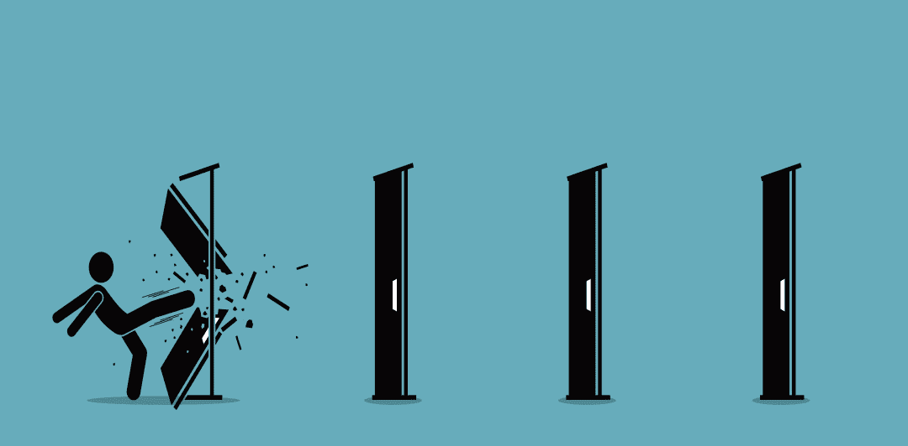

# 模块引论：突破包围圈

武志红

2022-04-24

## 模块引论：突破包围圈

模块引论：突破包围圈

上一个模块，我讲到从自闭之壳进入到母爱怀抱，这是心理发展上的一个里程碑。这一模块，我要告诉你的是，这虽然是一种发展，但是千万不要停留在这里，否则，温暖的母爱怀抱就会变成窒息的包围圈。

所以，这一模块我会和你谈谈 6 个月到 24 个月的婴幼儿心理发展过程。 **这个过程，主要是控制与被控制，独立和依赖的矛盾。**  
对孩子来说，如果发展顺利，就会初步发展出意志。对于成年人来说，我们需要去审视自己在这些方面的发展是不是足够充分。

精神分析中，常出现一些让人惊悚的词汇，例如弗洛伊德提出的俄狄浦斯情结，说的是恋母弑父、恋父仇母。还有一对我觉得也很惊悚的词汇，是心理弑母和心理弑父。它的意思是，孩子人格要走向独立，需要在心理上先完成对母亲意志的“弑杀”，接着完成对父亲意志的“弑杀”。

我个人认为，这些词汇并不是有意要耸人听闻，而是这样讲才能表达精神分析理论的深意。因为， **要使用“弑”这样的词汇，才能反映亲子关系中也有残酷的一面。**  
如果父母在控制孩子上太用心，他们就是在杀孩子的意志，也就是孩子的精神生命；反过来，孩子对父母也有这份动力。

一个人是怎么在心理上摆脱父母的控制，初步形成自己意志的呢？在这一模块你会找到答案。

\*

从整个课程体系来看，这一模块到第五模块，我们讲的都是“突破母爱怀抱”，也是自我诞生的第二阶段。从“蛋-鸡-鹰”的形象化模型来讲，这是小鸡逐渐进化成小鹰的阶段。

对照我在总论中提到的马勒的理论，这一阶段谈的是分离与个体化期的前三个亚阶段，也就是分化期、实践期、和解期。

我们还可以这样理解，第二模块讲述的阶段是孩子的心理生命诞生了，但这个生命还非常柔弱，需要在一个非常温暖的母爱怀抱中去锻炼肌肉，这个时候就构成了一个基本矛盾：  
**既要依赖母爱的怀抱，又要演练和母亲的各种对抗。当这份依赖被允许，孩子对关系的信任就产生了；但对抗被允许，孩子的力量就被初步允许了。**

好，接下来，让我们开始这一模块的正式学习。

  

公众号懒人找资源，懒人专属群独享

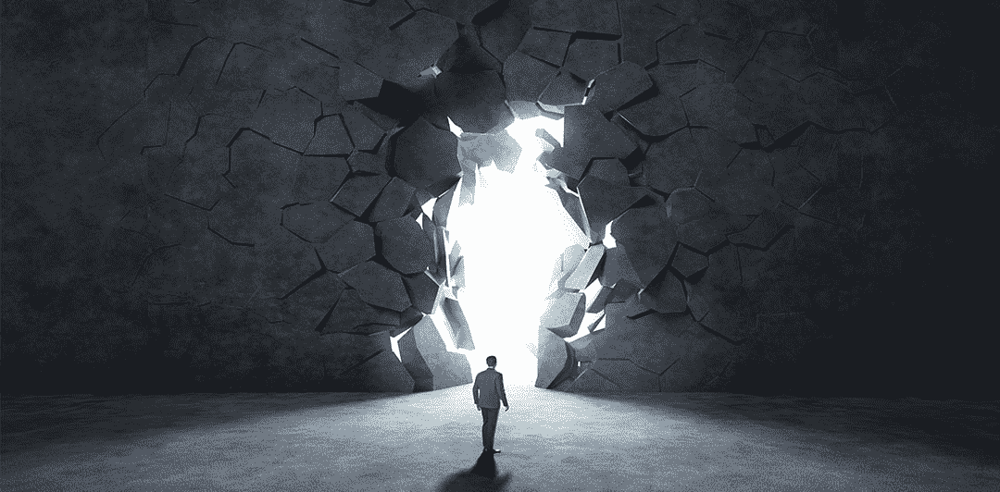

# 11 讲 母亲包围圈：为什么不能停留在妈妈的意志中？

武志红

2022-04-24

## 11 讲 母亲包围圈：为什么不能停留在妈妈的意志中？

11 讲 母亲包围圈：为什么不能停留在妈妈的意志中？

母亲包围圈，这是我发明的一个词汇，顾名思义，是说一个人几乎被母亲的意志和存在彻底给包围了。

我在第二模块中讲过，一个人从自闭之壳，发展到能进入母爱怀抱，这是一个非常重要的里程碑。但是，你不能停在这儿。  
**母爱怀抱很好，但如果停在这儿，就意味着陷入了母亲包围圈。**

## 与妈妈的抗争

我还是从一个故事为你讲起。我的一位来访者，是经典的中国式美女，看上去总是弱弱的，颇有林黛玉的风格，在中国这是很受男人喜欢的一种风格，追她的男人不少。

然而，她对事业没规划，对自己未来想过什么样的家庭生活也没考虑，像是做一天和尚撞一天钟。并且，她非常受男性欢迎，可她对于构建自己的家庭生活缺乏信心，一旦出现有女性来和她抢男人，她就会自动后退。

我和她讨论这个问题时，她先是说她觉得自己战胜不了竞争对手，再谈下去，她说出来自己一个更重要、更强烈的感受：她觉得所有男人和他们妈妈的关系都太紧密了，她根本挤不进去。

更进一步谈下去，我才发现真正的问题是，她有一种根深蒂固的感觉，觉得自己永远都斗不过她的妈妈。长期以来，但凡和妈妈出现争执，她永远都是输的那一个。

她第一次和妈妈抗争成功，是在大学的时候。当时她们刚刚搬进新家，关于她卧室中的床怎么摆这么一件小事儿，她和妈妈出现了分歧。一直以来，她都特别听妈妈的话，可这一回，她的倔劲儿升起来了，她不想让步，想坚持自己。妈妈也一样，坚决不让步。围绕着这张床怎么摆放，母女俩愣是争了半天，最后她大哭。即便这样，妈妈还要坚持按照自己的想法来。

正巧，这时候妈妈的一位好朋友来家里，看到她们母女俩争成这样，觉得很惊讶。这位好友对她妈妈说，女儿都这么大了，你怎么还管她这么多，这是她的房间，她爱怎么摆就怎么摆吧。然后，妈妈就听了好友的劝，尊重了女儿的意见。

在这位来访者的记忆中，这是她这辈子第一次成功地拧过了妈妈的意志，即使这个过程里有别人的帮助。

妈妈对她有强烈的控制欲，这份控制欲无处不在。她想做一件事，意味着她升起了一份动力，这个动力可以视为一个独立的生命，而妈妈在这件事上特别想管她并且成功以后，就意味着她的那份动力被灭掉了，妈妈的意志占据了她的身心。

## 黑色生命力

那份被灭掉的动力，可以说是一份死能量。什么是死能量呢？

我曾经提出过一个形象化的模型：想象你是一个能量体，你的任何一个动力，如欲望、需求和想表达的声音等，都像是章鱼伸出的一个能量触角。

这个能量触角，本来是灰色的、中性的。但如果这个能量触角，能够被其他能量体接住，你们两者之间建立了关系。那么，它就被照亮，就会变成彩色乃至白色的能量，我们可以叫它白色生命力；相反，如果这个能量触角没有被接住，它被拒绝或被忽视了，那么，它就会变成黑色能量，黑色生命力。

这份黑色生命力，如果继续向外表达，就变成了对其他能量体的攻击，这就是破坏性；但如果这份黑色生命力不能向外表达，那就会转而攻击自己，于是对自己构成了压制。所谓的无力感，如果你仔细觉知的话，你会发现，它其实都是黑色能量转而向内压制自己的结果，这也是抑郁的原因之一。

黑色生命力和白色生命力，还可以换成另一套语言： **死能量和生能量。前者指向破坏，后者指向滋养。**

本来就是摆家具这么简单的事，一加进妈妈强烈的管制，就变得复杂深刻了。不过，一旦理解到，这种事情中藏着“你死我活”的战斗，或者更准确地说是“你的意志死、我的意志活”，我们就立即会明白，这不是一件无所谓的小事。

母亲严重地控制这个女孩，而且非常有耐心和决心。同时，母性的确是容易事无巨细都会去关心的，这位来访者的妈妈就是这样。此外，母亲在和她斗争时，总是赢。这些因素加在一起，对她构成了一种全方位的围剿，母亲的意志无处不在，把她彻底包围了，她冲不出去，她的意志大多被闷死在这个包围圈中。

这位来访者还告诉我，她常常做一种梦，她去一个车站或飞机场，想坐交通工具离开，可她买不到票，总是没法离开。这个梦和她另一个重要的情况有关。

从小，她本能上想离妈妈远一点，例如去找爸爸，可爸爸总是会把她再推回到妈妈身边。她找其他亲人，亲人们都会说，你妈不容易，你妈最爱你了，你妈喜欢你、需要你，你多陪陪你妈……这些声音让她非常绝望。我觉得这种感觉就是她那个梦境的意思：她离开了妈妈的包围圈，想乘坐列车或飞机离开妈妈，可周围人的态度都像是在说，你没有买票的资格。

## 母亲包围圈

因为这位来访者的故事，我想到了“母亲包围圈”这个词。不过，我当然不是因为这一个个案，就提出这么一个词汇和说法，而是有许多个类似的个案，让我先有了各种理性的总结，但到了她的这个个案中，突然很多东西被触动，然后我就想到了“母亲包围圈”这样一个简单而形象的说法。

你可以粗略地观察一下你周围，相信你会看到很多人处在“母亲包围圈”中。台湾学者孙隆基写过一本很好的书，叫《美国的弑母文化》，讲的是美国文化对躺在母爱怀抱中有很深的恐惧，你观察美国的电影也会发现，多数讲的是和父亲的关系。

恋母或寻母这些说法，是在说哪怕成年人也都是孩子，都在寻找母爱的怀抱。我觉得这只是一方面，另一方面是母亲们也不想让孩子离开。

例如我的这位来访者，她谈恋爱时，虽然也会被充满雄性魅力的男性吸引，但她更容易选择温和宽容的男人，因为这样的男人身上有更多的母性。我觉得这就是在“寻母”，而对于她真实的母亲，她绝对是想离开的。只是一离开，又容易有深重的内疚感。

## 病态共生

我再讲另一个故事。我的一位男性来访者，他是个超级宅男，也是典型的回避型人格。他只有两个深度关系，一个是和太太，一个是和妈妈，而遇见太太之前，他的世界里只有妈妈一个人。他的妈妈也不断地说，妈妈的世界里也只有他一个人，说的好像是他们是孤儿寡母相依为命似的。可是，这位来访者是有父亲的，而且他们也生活在一起。

这是经典的病态共生关系。 **一般来说，病态共生关系如果发生在亲子关系之中，那几乎都是父母想和孩子共生，而孩子想离开但离开不了。**

有一次，我的这位来访者看一部美国西部电影，影片内容是关于挖金矿的，那是男性的丛林世界，动不动就打打杀杀，人命如草芥。可看了这个电影后，他生出一份强烈的憧憬，他很想去这样的世界，哪怕只是做一个小喽啰，哪怕轻易就丢了命也想去试一试。

然而，他觉得他去不了，因为妈妈离不开他。如果他离开了妈妈，妈妈会活不下去，这样会让他内疚至极，他想到的“唯一”解决办法是他得有分身术，真实的自己去那个丛林社会，虚假的自己留在家里陪妈妈。

讲着两个故事，是想让你明白什么是母亲包围圈，以及怎么判断自己是不是陷入了母爱包围圈。我认为，  
**如果一个人离不开母亲，或者一想到要离开母亲就会特别内疚，那可能意味着，这个人身处“母亲包围圈”中。**

课后练习

如果你也有这种感受，那应该怎么去破除呢？我建议你可以做这样一个练习：

拿一个让你感觉很像妈妈的物品，找一个安静的场所，坐下，闭上眼睛，让自己安静下来，再花一点时间感受身体，做三五次深呼吸。  
继续闭着眼睛，想象一下，妈妈出现在你身边，她会出现在什么位置，她是什么样子。尊重第一时间出现的情景，不要做任何修改。  
再睁开眼睛，把那个代表妈妈的物品，放到妈妈出现的位置。 接下来，你就在那个位置上，先想象和妈妈在一起的感觉。  
再接着，你试着离开妈妈。可以先倒退着，看着妈妈，越来越远，然后再转身，继续逐渐远离，最后离开那个房间。

建议你慢慢地去做这个练习，看看会发生什么。也欢迎你在留言区中分享，当你想离开妈妈的时候，会发生什么？

1.如果停在母爱怀抱，就意味着陷入了母亲包围圈。这是一种全方位的围剿，母亲的意志无处不在，将孩子彻底包围。  
2.病态共生关系如果发生在亲子关系之中，那几乎都是父母想和孩子共生，而孩子想离开但离开不了。  
3.离不开母亲，一想到要离开母亲就会特别内疚，这意味着你可能身处“母亲包围圈”中。

  

公众号懒人找资源，懒人专属群独享

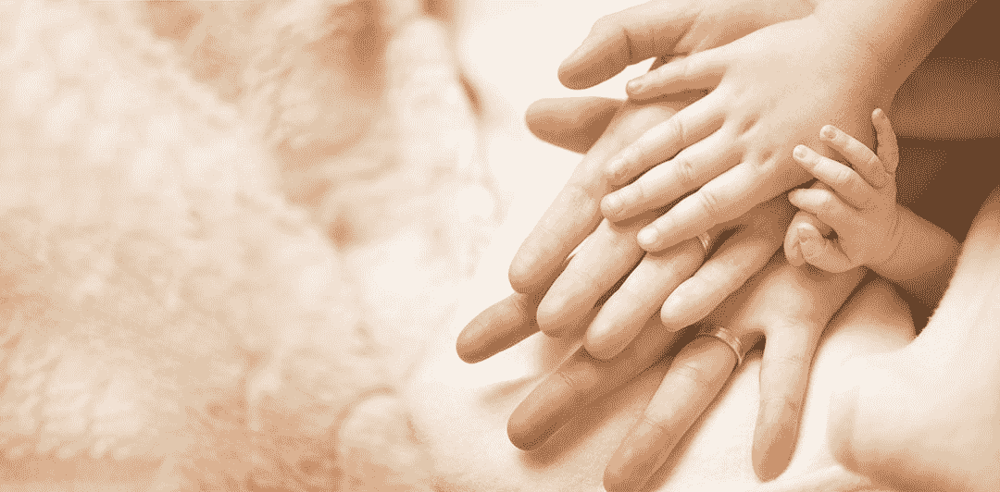

# 12 讲 共生绞杀：为什么“我们”中的一方会失去自我？

武志红

2022-04-24

## 12 讲 共生绞杀：为什么“我们”中的一方会失去自我？

12 讲 共生绞杀：为什么“我们”中的一方会失去自我？

上一讲中，我讲了一个现象“母亲包围圈”，这个形象化的词汇是我提出的。这一讲中，我再讲一个我提出的词汇“共生绞杀”。

## 共生绞杀的两个层级

要理解共生绞杀，就要理解共生关系的本质。 **共生关系，是我和你的自我都消融，然后构成了一个共同体“我们”。**

你可能会说这听起来还不错啊，“我们”，这听着多温馨舒服，相反一个人老讲“我我我”，听上去有点太自私，太生分。乍一看真是这样，但我要告诉你的是，这是因为没有理解到共生关系的残酷之处。

**共生关系的达成，需要一个强烈斗争过程，“我”和“你”必然要去争做“我们”这个共同体的代言人，而最终结果就是，“我”或“你”其中一个人占据了“我们”，而另一个人的自我消失了，也就是被绞杀掉了。**  
这也就是我这一讲想给你重点讲的“共生绞杀”。

共生绞杀存在着两个层级，分别是细节水平上的绞杀，和抽象自我水平上的绞杀。

细节水平上的绞杀很容易理解，就是对一个具体动力的绞杀，也就是说，“我”在每一件琐碎的事上都要去管制“你”，要你听我的。这一旦达成后，就意味着我绞杀了你的一个具体动力。

再说说抽象自我水平上的绞杀。这种绞杀在时间上可以说是长年累月，“我”通过对“你”的一个个具体动力的绞杀，最终实现了把“你”这个人的自我给消灭了。

正常共生，是一种真实的需要，无助的小婴儿要把他的声音传给母亲，好让母亲照顾好他。面对几个月大的新生儿时，一些母亲的自我也像被灭了一样，或许是因为这个原因，英国精神分析学家温尼科特才会说，有“原始母爱贯注”的母亲像是一种特殊的“病态”。

但我经常看到这个逻辑被逆转，太多母亲渴望把他们的声音传递给孩子，这就对孩子构成了绞杀。  
**当只是一个具体动力被绞杀时，这份绞杀的影响，就要看这个动力的意义有多大。**

例如，你想吃巧克力被禁止了，偶尔这样一次无关紧要。但是，如果你考大学选专业时，或选择和谁结婚时，自己的动力被灭了，而变成遵从父母的意志，这就构成了严重的绞杀。

所以说，最糟糕的是抽象自我水平上的绞杀。什么样的父母会对孩子构成这种绞杀呢？那就是，父母好像对管孩子这件事上瘾，任何事他们都要管。

一位年轻女孩告诉我说，不管她做什么事情，她绝不可能得到母亲的认可和支持。非常微妙的是，妈妈一定要管一下，哪怕只是一点点。打个比方，好像她本来的选择是 5 分，妈妈最终帮她选定的，有时候也就是 5.1 分。虽然只是 0.1 分这么小的差别，但也透露着母亲这样的含义：你的自发选择，我是绝不可能接纳的。

当几乎所有事都藏着这种含义时，这种对一个个具体动力的绞杀，最终就构成了对一个人抽象的自我水平上的绞杀。一旦达到自我水平上的绞杀，这也构成了严重的“你死我活”，我认为这个时候可能就不是比喻了，而是有了真实的杀戮含义。

## 病态共生的案例

我关注过一些比较典型的社会事件。比如，十几年前，上海某大学一位女研究生在自己的学生宿舍自杀，用一种难以想象的方式，痛苦地结束了自己的生命。

这件事发生后，她的家人大闹，说是因为校方太冷酷导致了女儿自杀。但很快，人们就通过这家人和朋友的描述，看到了这个女孩生活的一些特别之处。她的妈妈竟然和她一起住在研究生宿舍里，挤在一张床上，女孩的舍友们受不了，纷纷搬离。

据说，女孩在读本科时，这位母亲就一直跟着女儿。这位母亲身体健康，有退休金，有自己的房子，事实上没有任何理由去这样挤进女儿的空间。我认为，这就是她严重地和女儿共生在一起，最终将女儿绞杀掉了。

这个女孩在考大学时，就特意考去另外一座城市，目的可能就是想逃离母亲，但被母亲否决了。后来母亲为她选择了一座大都市，也不是女孩自己的意志，是妈妈想去大都市。女孩的同学观察到，母女俩走在一起时，母亲很是骄傲，而女孩常常神色暗淡。我认为，这就像是母亲有了错觉，她觉得是“我们”一起在读书，当然这个“我们”是她控制着的。

另一个比较惨痛的故事，是一位高材生杀死了自己的母亲。我看到有很多信息显示，他的母亲对他有严重的管控。例如每天给儿子电话，讨论学业，还让儿子汇报每一笔账，精确到几元几角。甚至我看到还有信息称，儿子怎么吃饭，吃饭的时候要保持什么姿势，这位母亲也会管。如果我看到的这些信息都是真的，那我觉得也可以说，是母亲想和儿子共生在一起的控制欲，构成了最终绞杀。

这两个案例，可以说是母子病态共生的一体两面，女孩选择绞杀了自己，而高材生则绞杀了母亲。当然了，这两个案件很极端，但我认为它们传递的信息极为重要：  
**当母亲或其他抚养者成功地和孩子共生在一起时，他们的关系中必然存在着“你死我活”。**

## 进入更大空间

你可能会问，那该怎么办呢？答案很简单，孩子得突破母亲包围圈，进入到更大的空间。

怎么才能顺利突破呢？理想状态是，当孩子提出自己的需求，或者表达自己的主张时，母亲需要正视，并且给予孩子一定的选择空间。父亲或者其他亲人的角色，也要鼓励母亲给予孩子一定的自由。同时，还需要社会文化的指引，让大家整体上形成一种共识，认为大一点的孩子离开母亲的怀抱，是正确的、必然的。

我特别想强调的一点是，我们必须警惕把母爱严重美化的成年人，因为他们内心中可能还藏着另一种真相，那就是对母亲的恨。这听上去可能会有点匪夷所思，但我自己看到的很多案例显示，越是把妈妈说得伟大的人，他们对母亲的恨意越多，越想离开母亲。

例如我见到一位智商很高的女孩，她在顶级的跨国金融机构工作，很以自己的逻辑思维能力为傲，不过她说，高中的时候，她曾经思考过这样一个问题：有人这辈子可能从来不犯错吗？从逻辑上讲，这不可能。但事实上有的人真的做到了。例如妈妈，她这辈子就从来没错过。

我们作为旁观者，当然知道这是不可能的。可是这个女孩为什么会有这种感觉呢？真相是，她的妈妈确实非常厉害，但也极度自恋。她和妈妈在一起的时候，母亲的聪明和强势，让她根本没有空间去看到妈妈有问题的一面。

这个女孩直到高中毕业上了大学后，和妈妈拉开了距离，才看到妈妈也是一个问题很多的人。

我觉得很有意思的是，后来我把这个故事写到微博上，有很多人讲到他们在中学的时候，有过一模一样的思考。

和妈妈共生在一起的成年孩子，他们一般都有一个特点：对妈妈的需求，特别是情绪，非常敏感，而对自己的需求、情绪和感受，非常迟钝。这也是共生关系的特点：  
**忘记了自己的感受，为别人的感受而活。**

当你发现自己处在这种状态时，首先必须意识到这是严重的问题，接着要尽可能地完成空间上的分离，留出感受自己的空间。当然，最重要的是完成心理上的分离。这个时候我强烈建议去找一位咨询师来辅助你完成分离，因为心理上的分离是非常困难的，你会发现，对自己的感受迟钝、对别人的感受敏感，这个特点已经成为习惯，挥之不去。

举个例子，我的一位心理咨询师同事给我讲过的一个来访者故事：

一位女孩，一直是妈妈“贴心的小棉袄”，妈妈永远不让她关房门，从来都会很随意地翻她的东西。妈妈和爸爸闹离婚时，她就是妈妈派出的侦探，去监视爸爸的一举一动。爸妈大战时，她也永远是妈妈的同盟。她一直觉得，妈妈这样做都是出于爱。

后来，她恋爱了，她很快乐。这时她惊讶地发现，母亲竟然憎恨她的幸福，质问她为什么经常偏向外人。这时她才醒过来，她和妈妈的关系是有问题的。最终，她坚决离开了妈妈。当从家里搬出来那一刻，她感受到了一种从未有过的海阔天空的感觉。我认为这是很真实的感觉。

这两讲，我们讨论了母亲的包围圈以及包围圈里的共生绞杀。你已经知道了，  
**从自闭之壳到母爱怀抱，是关键的第一步，也是母亲给孩子的一个重大礼物。但母爱怀抱毕竟是一个很小的空间，而一个人的成长，一定是要不断进入到更广阔的世界中才能完成。**  
一旦母爱想要控制孩子完成这一步成长，就会发生共生绞杀。

思考题

你有过逃离母亲怀抱的愿望吗？你会付诸什么行动呢？欢迎你给我留言。

1.共生关系的本质是我和你的自我都消融，构成一个共同体“我们”。  
我”和“你”必然要争做此共同体的代言人，结果就是其中一个人占据了“我们”，而另一个人的自我消失即被绞杀掉了，这就是“共生绞杀”；  
2.共生绞杀有细节水平和抽象自我水平上的绞杀两个层级。最糟糕的是抽象自我水平上的绞杀，这构成了严重的“你死我活”；  
3.应对共生绞杀的方法是，孩子得突破母亲包围圈，进入到更大的空间。

  

公众号懒人找资源，懒人专属群独享

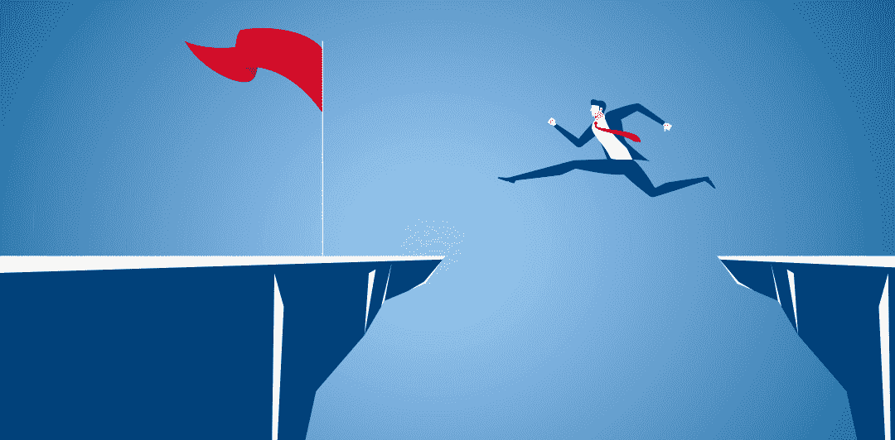

# 13 讲 从依赖到自主：为什么你需要恰恰好的挫折？

武志红

2022-04-24

## 13 讲 从依赖到自主：为什么你需要恰恰好的挫折？

13 讲 从依赖到自主：为什么你需要恰恰好的挫折？

前两节课我们讲了母爱包围圈和共生绞杀，也许会让你觉得有些黑暗，这怎么就把母爱说成这样了。如果你有这种想法的时候，我希望你也能想起，我们第二模块讲了母婴共生是如何重要，只是孩子不能停留在这儿，必须完成与妈妈的分离。

你肯定还记得我在总论里跟你讲的精神分析学家玛格丽特·马勒的理论，她把三岁前孩子的心理发展分成三个阶段，  
第三个阶段是分离与个体化期。分离，就是婴幼儿与母亲身体上的分离，而个体化，指的是婴幼儿自我的逐渐呈现，可以看作是心理上的独立。这两者的发展程度，最好是相匹配的。不匹配会发生什么呢？

如果心理上早熟，就是个体化太早实现，但身体能力还不足以支撑独立，这会让孩子在使用身体能力上出问题，这常常是因为妈妈不能正确地评估孩子的发展程度。

当身体能力已经可以实现分离，心理上的个体化却滞后，也会带来问题。例如，一位男士告诉我说，他在读小学高年级时，妈妈还喂他吃饭，这让他觉得自己还是一个小宝宝。

**分离与个体化期，又被马勒细分了四个亚阶段，分别是分化期、实践期、和解期、情感客体稳定与个体化期。**  
接下来，我来和你谈谈前三个时期，最后一个我会在第四模块中再为你详细讲解。

## 分化期

6-16 个月

当孩子四五个月大的时候，“我就是妈妈，妈妈就是我”的共生感，已经开始不断有动摇了，而到了六个月大以后，这种感觉不断变得明晰起来。

这个阶段，他们会发展出一些侦测行为，例如咬自己的手指，疼；再咬妈妈的手指，不疼。这会让他想，噢，好像妈妈和我的身体的确不是一起的。这种身体上的分化，开始让孩子体验到“我是我，妈妈是妈妈”，这是重要的分化，它还会引出一系列的分化：

第一，内部世界和外部世界的分化。“我”和妈妈，是一个内部世界，而我和妈妈之外的是外部世界。婴儿对外部世界变得越来越好奇，越来越想离开“我”和妈妈的世界，进入到外部世界。

第二，妈妈和其他人的分化。在分化期之前，小婴儿常常是没有陌生人焦虑的，因为他们觉得不管是妈妈还是别人，所有人都是一个样。但到了分化期，小婴儿却变得对陌生人有了提防，因为他们认识到，妈妈和其他人不一样。

这是两类基本的分化，此外还有一些细腻的分化，例如他会开始区分妈妈的身体和妈妈的衣服也是不一样的。

从整体上看，分化良好的孩子，会把注意力从内部转向外部，并因此产生了各种动力，例如急着去发展爬行、走路甚至跑等行为。当分化发展不够顺利，婴儿的注意力大多还停留在自己和妈妈的“内部世界”时，婴儿的发展就会受阻。

可以说， **孩子能很好地分化，得建立在共生关系得到基本满足上。** 如果共生关系建立得比较差，那么孩子会推迟分化，还想和妈妈粘成一个人。

## 实践期

10-16 个月

你发现了吗？分化期是 6-16 个月，这也是你需要注意的地方，实践期和分化期时间上有重叠，实践期是分化期的一部分。

实践期是孩子能力急剧发展的阶段，他们先是能借助爬行或扶着东西挪动身体，从而可以离开母亲，后期发展到自己能站着行走。

每个婴儿一出生都有着“全能自恋”，觉得自己像神一样无所不能，但其实他们的能力很弱，所以这份自恋的满足，只能来自妈妈提供的良好照顾。可到了实践期，孩子发现他可以自己满足自己了，于是全能感得到了直接满足，那感觉简直不要太好。

精神分析学家马勒形容这个阶段的孩子说： **“孩子和这个世界有着一个甜蜜的恋爱，甚至中毒了。”**

带着这份强烈的全能感和信心，这一阶段的孩子会显得很皮实，跌倒了也容易显得无动于衷。同时，他们也开始频频说“不”或者“我来”。

我第一次读到马勒这段理论时，让我想到了施瓦辛格那样的大块头明星，觉得他们身上散发的那个味道，和实践期的孩子很像。影片中，他们主要就是展现自己的无所不能，而女性只是陪衬。他们的风格，和布拉德·皮特等明星演绎的男人味儿很不同。后者是强烈需要女性的，并且还有人格力量平等的感觉，但大块头肌肉男做主角的电影中，女性被严重弱化了。我觉得这很像实践期这个阶段的孩子对妈妈的感知，就好像在说“你看我多么强大”。

面对这一阶段的孩子，有的母亲会迫不及待想把孩子丢开，让他自己照顾自己，自己被解放了。但这样做就太早了，实际上孩子还非常需要妈妈。

还有的母亲，自己非常享受以前和孩子共生的感觉，所以不喜欢孩子的这份自恋。有些妈妈甚至因此会想再生一个孩子，好再去构建母婴共生的感觉。

## 和解期

16-24 个月

刚刚我们说到的实践期的全能感很快会过去，正在学步的小孩很快会累积不少受挫感，这让他们再次对自己的独立能力产生怀疑，对母亲的依赖也重新多了起来，要再次去靠拢妈妈，所以这个阶段被叫做和解期。

这一阶段还会有“和解危机”，因为小孩需要处理自主与依赖的矛盾，他们要逐步消除自己的全能妄想，可又要留住“我很棒”的感觉。

这一阶段，或者说在整个的分离与个体化期，都存在着一种东西，那就是  
**孩子会和妈妈争夺关系里的控制权，他们对妈妈控制自己很敏感，同时他们也会想去控制妈妈。**  
当真的能做到时，孩子会有自豪感。妈妈需要适当满足孩子这一点，这也是孩子未来能跟别人写协作，或者支配和领导他人的基础。

所以说，控制与被控制是整个阶段的一个核心矛盾，但在和解期，它的表现会更强烈一些，因此会出现这个阶段特有的一种难缠的状态，孩子会对母亲或抚养者发出矛盾的指令，例如让你帮他倒水，可你真帮了，他们又会生气，搞得妈妈不知道他们想做什么。

要想找到原因也不难，你想想看，孩子在这个阶段既有全能感的残留，幻想着自己无所不能，同时又知道这不真实，很多事情自己是做不到的。于是他们期待的解决方式是，妈妈神奇地满足了他们，但又不需要他们感激，这样显得好像这件事是他自己干的似的。

其实你仔细想想看，这可不只出现在小孩子身上，在成年人中这也是很常见的心态。有太多人喜欢你帮他们把事情处理好，但最后弄得好像是他们自己的功劳。

比如，有一位我的来访者，回忆起中学时，妈妈帮他做了很多事，帮他写作文，帮他做手工，并且完成得恰到好处，很像是他这个年龄的孩子能做到的。因为妈妈做得实在好，所以替他夺得了各种奖励和赞誉，而他特别享受这一点，认为这就是自己的功劳，没有一点不安。

## 容器、挫折与自我效能感

分离与个性化期的这三个亚阶段，它们看起来很复杂，妈妈等养育者能细致入微地把握孩子这种心理的变化，是非常不容易的。但这个时候，我提醒你可以把握三个概念，就能很好的帮助孩子渡过这三个阶段，三个概念分别是  
**容器功能、恰恰好的挫折、自我效能感。**

容器功能，意思是一个养育者（主要是母亲）要做孩子的容器，包容孩子无法包容的情感，慢慢帮助孩子消化、接纳和成长，发展孩子容忍挫折的能力。它有两个特点，一是当孩子把事情做好的时候，认可他；二是当孩子遇到挫折的时候，支持他。

“恰恰好的挫折”意思是孩子的发展中，如果完全没挫折，他就没法成长，例如可能一直停留在全能感中。但挫折太大，那也不能成长。所以最好是“恰恰好的挫折”，有点超出了孩子的能力，但通过努力，孩子完成了它。这些努力最终会滋养孩子的“自我效能感”。

“自我效能感”这个概念，最早是由美国社会心理学家阿尔伯特·班杜拉（Albert  
Bandura）提出的，他说，自我效能感就是人们对自身能否利用所拥有的技能去完成某项工作行为的自信程度。简单说，自我效能感就是通过克服一个又一个困难，孩子不断地体验到“我能行”的感觉；而且真不行了，也可以求助，这不丢人，能使用别人，也是一份值得骄傲的能力。这是整个分离与个体化期发展的最重要的目标。

分离与个体化期这个阶段，是一个无比宝贵的练习场，因为它基本上没有成本，但挑战性不亚于成年人结婚、恋爱、生子、工作和交友的过程。  
**如果在这个阶段，让孩子充分体验到“我能行”的自我效能感和“不行了就去找人”的感觉，这是能过好一生的重要基础。**

当然，如果你是一个成年人，你曾经在这个阶段没有很好地过渡过来，那么你的自我效能感就会较弱。

思考题

你能通过你现在的行为习惯，分析一下你的分离与个体化期的情况吗？欢迎你给我留言，我们一起交流。

1.分离与个体化期是孩子从母婴共生关系走向母子分化的过程，可以分为四个亚阶段：分化期、实践期、和解期、情感客体稳定与个体化期。  
2.分离与个体化期的阶段是一个无比宝贵的练习场。孩子每一个任务的完成都非常有挑战，在这个阶段让孩子充分体验到“我能行”的自我效能感和“不行了就去找人”的感觉，是能过好一生的重要基础。

  

公众号懒人找资源，懒人专属群独享

# 14 讲 分离与忠诚：所有的爱都指向亲密吗？

武志红

2022-04-24

## 14 讲 分离与忠诚：所有的爱都指向亲密吗？

14 讲 分离与忠诚：所有的爱都指向亲密吗？

我的一位良师益友，也是国内知名精神分析师曾奇峰说过一句这样的话：“爱制造分离，而施虐制造忠诚。”忠诚这个词，听上去多美好，被这样一解析，味儿全变了。这句话到底什么意思呢？

我在这门课程中不断地在讲，人的成长过程，需要不断破壳，才能从一个小的空间进入更广阔的世界。这个过程中，如果在某个地方特别地强调忠诚，那么一个人的发展就会停在这儿。

## 分离与忠诚

**健康的成长过程中，一个人会不断渴望进入到更广阔的空间。**  
孩子处在分离与个体化阶段时，如果正常发展，最终的结果是孩子的个体化自我得以诞生，心理上与妈妈的分离也得以完成。

怎么实现这一点呢？精神分析学家玛格丽特·马勒给出了解决办法，那就是按照孩子的身体发育水平，母亲不断与孩子分离，最终让孩子的个体化自我得以诞生。可这个过程又是复杂的，母亲或者主要抚养者，  
**既要照顾到孩子的自主需要，也要考虑到孩子真实的发展水准。这种复杂的满足，依靠的是对孩子深厚的爱。**

那什么因素会让一个人停下来呢？曾奇峰老师的解释是，施虐。你可能会觉得施虐这个词听起来太刺耳了，我觉得可以换一个温和一点的词：匮乏。

如果这份爱不够，有了匮乏，那么孩子可能会有两种结果：要么过早的个体化，也就是早熟；要么个体化没法完成，不能与母亲分离，陷入了母亲包围圈之中。

说到这儿，我必须得说一下，“心理上与妈妈的分离”这个说法不够符合精神分析的表达，更精神分析的表达是“心理弑母”这个有点惊悚的说法。这个概念我在前面讲过，它的意思是，孩子走向自主时，需要完成对加在自己身上的妈妈意志的反抗。

例如，我一位朋友，她的儿子活力四射，两三岁时，多次对她说出让她特别受不了的话，比如对她大喊：妈妈我恨你！我恨不得把你切成碎片，再倒进马桶里冲走！

我这位朋友最初听到儿子这种话时非常生气，后来她了解到“心理弑母”这个说法后平静了很多，然后就可以和儿子耐心地谈，和他开玩笑说，妈妈要是没了，谁陪你玩，谁给你好吃的，你认真地想想，你还希望妈妈消失吗？

儿子想了想说：妈妈，我就是很生气，但我不想让你真的消失。待了一会儿，又过来说：妈妈对不起，我爱你。

现在她儿子读小学了，仍然是活力四射，情商很高。所以，他虽然说了那些狠话，但不代表他的真实想法，他只是在经历一个分离的过程。

**所谓分离与忠诚的矛盾，其实全在于孩子的选择上，当孩子的意志和妈妈的意志发生冲突时，如果孩子选择尊重自己的意志，那就是完成了“心理弑母”；如果孩子选择遵从母亲等抚养者的意志，那就是被忠诚所困，失去了他自己。**

## 控制与被控制

我刚刚讲的这个小男孩，是一个成功完成分离与个体化的例子，下面我讲一个没有完成分离的例子。

多年前，我的一位男性来访者，可以说是达到了回避型人格诊断标准的，他发现自己的一个大问题是读书不能专注，最多两分钟，他就会走神。我和他经过探讨后，发现他的走神是在寻找妈妈。

我在前面的课程中提过他的故事，他是一个幻想去美国西部挖金矿的超级宅男。在我和他探讨走神这个问题时，他说了一句令我印象深刻的话。他说：“武老师，你想象一下，如果你专注地在干一件事，一转身，发现妈妈不见了，那就太惨了！太惨了！”

他特别多加了一句“太惨了”，来强调这种感觉的强度。当时我实在难以与他这种感觉共情。后来我花了很多时间，听了很多故事，才慢慢真的理解了他的感受。

我的理解是，因为不能让如此惨的感觉发生，所以他不能专注，隔一小会儿就要离开自己专注的事，去寻找一下妈妈，确认妈妈是否还在。

这位来访者有很强的察言观色的本领，常常我话还没说，他就已经猜到我下一句要说什么了。但是，他这个本领没多大用处，因为他绝对不允许自己使用这个能力去利用别人，他不允许自己在关系中处于控制地位，他只能让自己在关系中处于被控制之中。

可以说，他练出这个本领，只是为了更好地讨好别人。这又引出了一个新的问题：他在一个时间段里，只能和一个人打交道，再多一个人，他就会手足无措，慌得不得了。因为他做不到同时全力讨好两个人。这种活法，太累了。

他在读大学的时候，发现自己永远是宿舍最后一个睡着的人，一开始他不知道自己是怎么回事，后来发现，他在不自觉地做一件事，他必须确认宿舍里所有人都睡着了，他才能睡觉。

当时他不明白自己为什么这样，而且也控制不了。但和我做了心理咨询后，让他理解了自己的逻辑，他是无形中把所有人都当作了妈妈，他惧怕每个人离开自己，所以必须确认所有人都睡着了，这样就再也不会离开自己了，然后他才能放松，允许自己睡着。

三岁前他是怎么长大的？妈妈和他是怎么相处的？这一点，我和他的咨询中并不能很好地确认，因为记忆太模糊。而按照妈妈的说法，妈妈很爱他，他不应该发展到这种地步。

不过，我也给不少的妈妈们做过咨询，她们会说自己孩子的问题，我通过对这些咨询经验的总结，发现通常是这样的情况：在 6 个月前的共生期，孩子没有和母亲建立起基本的共生关系；6-36 个月的分离与个体化期，母亲或其他抚养者对孩子的控制欲望太强，不允许孩子按照自己的来，同时与孩子的分离仍然比较多；更夸张的是，等孩子长大了，母亲倒是越来越依恋孩子，不想让孩子离开，甚至对孩子强调，你是我生命中唯一重要的人，我不能失去你。

我相信这不仅仅是我个人的总结，而是一种常见的社会现象。

## 指向分离的爱

**所有的爱都指向亲密，唯独父母对孩子的爱指向分离。** 父母越是爱孩子，孩子走向分离的时候就越容易，但当这份爱很匮乏时，孩子的离开，就变得难了很多。

当我们想给另一个人爱的时候，需要问问自己，我对他做的，是增强了他的自我，还是破坏了他的自我？是让他变得强大自信，还是让他变得虚弱自卑？

放到分离与个体化的阶段，养育者需要切记孵化的隐喻，要尊重孩子周围是有一个壳的，最好是提供孵化环境，让孩子从内破壳而出，而不要从外部去破壳。

孩子越小，这一点越重要。特别是在分离与个体化期，孩子已经开始展现他们强烈的自我意识以及地盘感，他们不仅总说“我”，也常说“我的”，父母要尊重孩子的这个边界意识，特别是整天和孩子朝夕相处的妈妈或其他类似妈妈这样的养育者。

心理学家荣格说，母性总是指向融合，所以让母亲这么做不容易。  
**但当母亲能做到时，这对孩子来说会是一个巨大的祝福，因为这意味着，孩子在生命最初就被允许，他可以按照自己的意志来，他的地盘、他的边界是被允许的。**

对母亲来讲，能做到这一点的一个重要基础是，母亲有自己的自我，有自己的世界。在孩子幼小的时候，她必须去照顾孩子，当随着孩子能力增长，母亲会自然而然地后退。对于没有自我、没有自己世界的母亲来说，这会是一个大难题。这样的母亲，更容易舍不得孩子与自己分离，那会让她们感到失落。

最后我想说，一旦使用“母爱”这个词，我们就容易给它披上玫瑰色的外衣，好像这个词就是纯然的美好，而我在这一模块种讲到的关于“母亲包围圈”的描绘，希望能够帮助你看到，母亲和孩子的关系可以如此复杂。

同样的，一旦表达“爱母亲”时，我们也会很容易觉得，这件事是纯然的美好，但它一样也是复杂的。我会在下一讲为你解释这一点。

思考题

你认为忠诚和爱的边界在哪里？请你在留言区说说你的理解。

1.当孩子的意志和妈妈的意志发生冲突时，如果孩子选择尊重自己的意志，那就是完成了“心理弑母”，如果遵从母亲等抚养者的意志，那就是被忠诚所困，失去了他自己。  
2.所有的爱都指向亲密，唯独父母对孩子的爱指向分离。父母越是爱孩子，孩子走向分离的时候就越容易。  
3.重要的基础是，母亲有自己的自我，有自己的世界。在孩子幼小的时候，她必须去照顾孩子，随着孩子能力增长，母亲会自然而然地后退。

  

公众号懒人找资源，懒人专属群独享

# 15 讲 强大恐惧症：走向强大时，你在担心什么？

武志红

2022-04-24

## 15 讲 强大恐惧症：走向强大时，你在担心什么？

15 讲 强大恐惧症：走向强大时，你在担心什么？

这一讲我想要通过过度讴歌、过度拯救和强大恐惧症这三种表现，带你看清一个人表象和本质之间的关系。了解了这三种表现以后，当你看到了 A 时，就意味着你也看到了-A。学会用这个逻辑去看一些人和事儿，你会有惊人的洞察力。

## 过度讴歌

刚才说看到 A 时就看到-A，什么意思？

例如，有人把母亲对他的爱和他对母亲的爱，摆到了极高的位置。这就是 A。这个时候我要提醒你，你要从这个现象看到他的另一面存在，甚至你可以相信另一面更为真实。另一面，就是-A。

我在心理咨询中见过很多男士，他们小时候生出过强烈念头，想为妈妈写一本书，歌颂她是“天下最伟大的母亲”。但在咨询中我又看到，他们对母亲有强烈的恨意，甚至是深深的鄙视。然后，他们又因为这些恨意和鄙视，对妈妈产生深重的内疚。

意识上美化母亲，潜意识中憎恨母亲，然后因此又在意识上有了内疚，这是极其常见的一个逻辑。

我认为，当一个人认识到这一点，才有可能深入自己内心，看到对母亲复杂的情感。这个复杂的情感越强烈，就意味着他和母亲的共生程度越严重，而分离程度也就越差。

这种复杂而奇怪的逻辑，是一种心理防御机制，叫“反向形成”，简单来说 **，“反向形成”就是指你有了一种情绪情感，结果你表现出来的是相反的。**

你发现没有，好像围绕着母亲和孩子的关系，复杂的情况总是很常见。

## 过度拯救

简单来说，就是看到你有痛苦，我奋不顾身扑上去拯救，哪怕没效果，哪怕严重损耗自己，哪怕你不领情，哪怕意识到我这样做好像会导致你剥削我，但我就是控制不住自己，继续帮你、拯救你。

你看，这样做时，明显有了“你我不分”的感觉，所以这其实是共生心理的一种表达。

这种现象很常见，例如，一个孩子总是生病，后来在心理咨询中发现，孩子生病是有规律的。这个家庭中，媳妇和公婆关系很紧张，家里一旦发生剧烈争吵，这个孩子就会生病，而且每次都挺严重。孩子一生病，父母和爷爷奶奶都得手忙脚乱地照顾他，当把时间耗在对他的照顾上时，他们也就不战斗了。

可即便如此，也不足以拯救这个家庭，他们还是会继续大战，一直到媳妇和公婆撕破了脸，不再来往了。后来，这个孩子得了重病，爷爷奶奶这时必须得来看他，然后家里的关系因此出现了转机，被修复了。

从家庭治疗的角度看，这个孩子就像是在通过不断生病的方式，来拯救这个家庭。家庭关系被修复之后，孩子也就不怎么得那种病了。

我个人认为，孩子的这种行为表现，其实来自于他的全能感，孩子们总觉得自己该为家庭乃至家族负责，所以很容易做过度拯救的事。

那我们大人该怎么做呢？当然是要告诉孩子，大人的事大人处理，你好好做孩子吧，就算大人们的关系出了问题，每个大人都是爱你的，而且大人们之间的争执，不是你导致的。

但是，太多家庭不会这么做，相反会有意利用孩子。例如，一位女性和丈夫大吵大闹后，常对几个孩子说，你们怎么不快点儿长大，长大了就可以保护妈妈了。然后有一天，她再次和丈夫争吵时，几个幼小的孩子齐刷刷站在她面前，要保护她。

因为妈妈最初和孩子有共生关系，所以妈妈们这一招很容易奏效，当她们屡屡这样利用孩子时，孩子就会陷入到“过度拯救”的泥沼里，不能直面真相。

他们的潜意识里其实很反感被这样利用，被利用得越严重，反感程度也就越严重。  
**这份反感有时很难被意识到，但他们却能意识到因为这份反感而产生的对妈妈的内疚。**  
所以很多人会纳闷，他们明明对妈妈非常好，可为什么心里对妈妈有那么大的内疚？

除了内疚，陷入过度拯救中的人，还会遭遇“好人没好报”的糟糕感受。他们的拯救对象如果不是妈妈，而是其他人，那他们会发现自己拯救的对象，最后会鄙视他们、嫌弃他们、背弃他们，至少不会和他们亲密，他们会感到自己伤痕累累。

我觉得， **陷入过度拯救中的人需要认识到，你自己的内心其实是相反的。你多么强烈地在过度拯救一个人，你就多么强烈地想离开他。**

## 强大恐惧症

强大恐惧症是我提出的一个说法，意思是说一个人走向强大时，会莫名其妙地失败，或犯一些低级错误，仔细分析下去，会发现是内心深处有这样一个逻辑：  
**如果强大了，就会失去关系。**

我还是来为你举例说明。我的一位男性来访者，是小有成就的企业家，他有一个很特别的问题，虽然有非常强的学习愿望，但他不能读书，一读书就会有很强烈的心理不适。

对此，他有自己的一些认识。他说，他在读初中和高中时，发生过很诡异的事，这应该是他不能读书的原因。

先来说初中吧。他当时考上了一所普通中学，成绩离重点线只差一点点。上了一段时间学后，有消息传来，说一所省重点学校空了一个名额，问他愿不愿意去。这么好的事，他当然去。去之前他隐隐担心，自己到了省重点会不会成绩很差？去了之后，他学习热情高涨，很快就在年级名列前茅，这让他非常开心，自信心爆棚，总觉得自己像在飞一样。听上去这种感觉是不是很像我们前面课程提到的“分离与个体化期”中的实践期？

没过多久，他生病了，必须退学接受住院治疗。几个月后，他身体恢复，但保险起见，就不能再去离家很远的省重点中学了，只能在家附近的中学读书。

到了高中，同样的事情又轮回了一次。他又是考上了一所普通高中，一所省重点学校空出一个名额，让他去了，又是很快，他的成绩就可以在年级名列前茅了，他又体验到飞的感觉。可接着，他的身体又出了同样的问题，然后住院，治好后就在家附近的普通中学读书。

这次轮回带给他巨大的影响，他觉得自己被诅咒了，他这么热爱读书，但看来是老天不让他好好读书。

我在和他做咨询时，我请他躺着，先花了一段时间让他进入放松状态，然后让他把当年的事情细致地说出来。这个过程中，我使用了心理咨询的具体化技术，我必须搞清楚他话语中的那些细节，好去搞明白具体是什么意思，因为语言是非常容易含糊和有歧义的。我是想让他通过讲细节，把当年的感受调动出来。

在我请他细致讲述的这个过程时，他惊讶地发现，躺在医院的时候，他内心其实非常享受，因为妈妈会亲自来照顾他，这是他一生中和妈妈最亲密的时候，他太喜欢这种感觉了。

原来，他有一个比他小一岁多的弟弟，意味着他还在共生期的时候，妈妈就怀孕了，然后他和妈妈的连接就断了。弟弟出生后，他总是被要求让着弟弟，这让他觉得自己永远都争不过弟弟。只有他生病的时候，特别是这两次生重病的时候，才能得到和妈妈亲密的机会。

这样的故事，我在咨询中经常见到。可以说， **小时候没和妈妈构建好共生关系的人，一直都在寻找和妈妈或其他人构建共生关系的机会。**

说了这么多你可能会问，这和强大恐惧症有什么关系呢？

**强大意味着要发展自己，而通常这就意味着要远离家庭。**  
这位男士去省重点读书时，潜意识中就会非常担心会不会因此彻底失去母亲。所以就会害怕强大，这就是强大恐惧症的根源。

## 成长安全岛

养育 6-36 个月的孩子时，有这样一个经典的图景：孩子在探索世界，但要有一个安全岛在。这个安全岛最好是母亲，也可以是其他孩子信得过的抚养者，这样孩子探索世界时，可以不断回到安全岛来，和抚养者分享他们的感受，而当他们受挫时，抚养者也可以去帮他们。

很多妈妈应该有过这样的体验。有时候你发现孩子在专注的玩玩具，所以你觉得，既然孩子这么专心，根本没注意我，那我就离开他吧。但你刚离开，孩子就嚎啕大哭，到处找你。

这是一个深刻的隐喻。发展自己，像是激情的部分，安全岛就是安全感的部分，我们虽然一直强调分离的重要性，但不能忽略分离的一个重要前提，那就是，  
**只有当安全岛得到了确保，一个孩子乃至成年人才能充满激情地探索世界。**

在这一讲的末尾，我想送你一句话：

只有确保有大地可以降落时，一只飞鸟才能酣畅地在天空翱翔。

思考题

这一讲，我们讲了过度讴歌、过度拯救和强大恐惧症的表现和背后隐藏的真实心理。你在成长过程中，有没有过其中某一种体验呢？欢迎你给我留言，跟我交流。

1.过度讴歌的逻辑越严重，就意味着和母亲的共生程度越严重，分离程度也就越差。  
2.陷入过度拯救中的人需要认识到自己内心是相反的，你多么强烈地在过度拯救一个人，你就多么强烈地想离开他。  
3.强大恐惧症更深的逻辑是如果强大了，就会失去关系。只有当安全岛得到了确保，一个孩子乃至成年人，才能充满激情地发展自己、探索世界。

  

公众号懒人找资源，懒人专属群独享

# 16 讲 意志的诞生：为什么进入外部世界需要主体感？

武志红

2022-04-24

## 16 讲 意志的诞生：为什么进入外部世界需要主体感？

16 讲 意志的诞生：为什么进入外部世界需要主体感？

这一讲是第三模块的最后一讲，整个这一模块，我和你探讨的是 6-24 个月的孩子的心理发展，这在玛格丽特·马勒的理论中，是分离与个体化期的前三个阶段。

为什么说这个阶段对于自我的诞生来说也非常重要呢？我在第二模块中讲到，6 个月前的婴儿成功度过正常自闭期和正常共生期的标志，是“动力的诞生”，也就是能发出自己的各种动力。那这一模块所讲到的 6-24 个月的孩子，成功发展的标志可以说就是“意志的诞生”，也就是这一讲我要为你着重讲的内容。

作为成年人，我们需要去审视自己有没有完成这两部分的诞生。

## 意志的诞生和动力的诞生

你可能想到的第一个问题是，意志的诞生和动力的诞生有什么区别吗？简单来说就是，你能表达你的动力，但你未必会非常坚持；而  
**意志的诞生，就意味着你能坚持这份表达，想让它彻底地、成功地表达出来。**

我拿自己来举个例子吧，我是一个微博控，有时一天能发十五条微博，各种声音，我都想表达，可以说，在表达观点这方面的动力上，我没有太大障碍。

但是，一旦在微博上遭遇严重的围攻，我就会删微博，这就说明我的意志不太强，我不能在外界干扰的情况下，坚持自我的表达。所以，在意志诞生这件事上，我发展的程度很一般。

而且，我自己深深知道，删微博并不都是因为明智，主要是怕事。所谓怕事，就是当我的意志表达和别人的意志表达出现冲突时，我就容易后退。

我的这种风格，可以说是展现在我人生中的方方面面。例如我太好说话，这意味着，别人的声音很容易占据我，而我失去了自己的声音。在我的公司里，虽然我是老板，是品牌形象，也是工作经验最丰富的咨询师，但我总是以商量的口吻和员工说话，难以雷厉风行地让大家贯彻我的意志。

那么，我这是怎么回事呢？为什么会出现这种情况呢？

这有两个原因：

*   我认同了我的母亲。我的妈妈可以说就是一个“滥好人”，当和别人的意志发生冲突时，她很容易放弃自己的意志。
    
*   我的母亲有严重的抑郁症，虽然她从来不控制我，对我的需求也非常包容，但我不能索取太多，毕竟她太虚弱了。
    

## 本我、超我与意志

一个人太有意志，就容易起冲突，但很多人是害怕冲突的，所以他们学会掩饰自己的意志，从而获得一些空间。但怕的是，他们装着装着，就彻底忘了自己的意志。

不过，我的确觉得，多数情况下，一个人缺乏意志力是可以回溯到婴幼儿时期的，特别是分离与个体化的阶段，当他表达“不”“我来”等意志时，是被允许了还是被打压了，决定了他之后能不能顺利地表达自己的意志。如果养育者的手法太严谨，一旦自己和孩子的意志出现冲突时，会持之不懈地打压孩子意志，那么孩子的意志就不能顺利诞生。但是，你也会看到，即便被打压很厉害的人，也在用各种方式，去表达自己的意志，伸展空间。

例如，我的一位来访者，是一位女士，她有严重的拖延症。每次来咨询，她都必然会跟我讲一个矛盾：过去一段时间，她希望自己是积极高效的，但她就是颓废着、拖延着，似乎没有为克服这些阻碍，做任何努力。

随着咨询的深入，她对拖延症的理解越来越深，在一次咨询中，她突然认识到，那个不断拖延的部分，才是她真实的自己。她说，在管教这件事上，她的妈妈有强大的意志，最终是妈妈的意志占据了她的头脑和意识，当她想追求高效有价值的生活时，那其实是超我。

弗洛伊德的人格结构理论认为，人的人格由本我、自我和超我三部分组成。

**“本我”** 也就是本能，指潜意识里的我，它由各种欲望组成，遵循的是享乐原则。

**“自我”** 负责处理现实世界的事情，大部分是有意识的。

**“超我”** 是人格中的管制者，代表着道德，遵循的是道德原则，有一部分也是有意识的。

如果把你面对世界的这个自我放在中间，那么，你就可以把本我看成你“内在的小孩”，而超我，就可以看成“内在的父母”。本我和超我的关系，就变成了“内在的小孩”和“内在的父母”的关系。

如果“内在妈妈”这一部分一直成功，那她就会完全失去了自我。

相反，一直被她鄙视的严重拖延症，其实是她的“内在小孩”在说话，虽然这一部分让她在现实上有很多损失，但如果没有内在小孩的声音，她感觉自己的生命都将是毫无意义的。因为一个身体只能住下一个灵魂，如果妈妈的意志彻底占据了她的身体，她宁愿死去。

这位来访者真切地认识到这一点，开始改变自己，努力表达自己的意志，并坚持表达自己的意志。

## 意志的诞生与外化

**动力的诞生，是一个人能表达自己的生命力。意志的诞生，意味着一个人能持之以恒地表达自己的生命力，这会给一个人带来持续的滋养。**

相信你一定见过，能持之以恒表达自己动力的人，也就是非常有意志的人，他们相处起来是容易让你觉得不好搞、不舒服，但是，你会发现，这些人通常有这样的特点：很有活力、很有主见，非常有创造力，审美品味很好等等。

在我身边，汇聚着一群这样的人。例如，我装修房子的时候，先是找了四家设计公司，请他们都出了方案，我也为他们的方案付了钱，但基本都不喜欢。

后来一位朋友给我介绍了一家新的装修公司，第一次见那个设计师时，我就知道这是一个很有主见的女人，我知道她会不好相处，但她一开始提供的设计方案我就非常喜欢，最终，我请了这位设计师。

事实也证明，这个设计师真是没那么好相处，中间发生了很多小冲突，其中有几次给我的感觉好像这里是她的空间，她珍爱她的每个想法，其他人都别瞎指挥。但最终，她的装修结果，我实在是太满意了。

对这种人，我一直都有了解，知道他们不好相处，但他们有才华，我在我的公司招聘时，也特别想多招一些这样的人，有脾气，有激情，有强烈的自我意志。

“意志的诞生”，这是我自己的表达。如果用玛格丽特·马勒的理论来讲，6-24 个月发展成功的标志，是“外化”。意思是，一个孩子成功地把注意力从内部转向了外部世界，还发展出了能适应外部世界的能力，而且是带着主体感，也就是我讲的自我意志。

相应的，这个阶段发展失败的标志，是一个孩子没能进入到外部世界，还沉浸在自己和妈妈所构成的内部世界里。

讲到这儿，我要跟你说说妈妈和爸爸的不同。对孩子来说，因为共生，因为在妈妈肚子里待过，所以孩子会把妈妈视为内部世界的一部分，把爸爸视为外部世界。

我个人认为，东方社会的人相对内向封闭，这可能就是一个重要原因。这个道理还可以继续延伸，如果我们深爱一个人，例如自己的孩子和伴侣，那么最好是做他们的容器，鼓励他们，支持他们，用他们自己的方式，展开他们自己独特的生命，让他们充分体验到，他们的动力可以展开在这个世界上，他们可以坚持自己的意志。

当然我也要澄清一下，我这样说，并不是说内向是不好的，外向就是好的。依照荣格等很多心理学家的理论，内向外向是一种人格维度而已，不分好坏。不过，假如养育者给了孩子这样一种基本感觉，“你不能按照自己的意志展开你的动力”，那就会造成额外的自闭、封闭，这才是我一直讲的真正含义。

\*

好，说到这儿我想带你来回头再看看第二、三模块，在 6 个月前的心理发展过程中，不能伸展自己的动力，退缩在“脑补”中，这是一种失败；在 6-24 个月的心理发展中，不能在外部世界伸展自己的意志，退缩在内部世界中，这也是一种失败。

这也是成长的含义。生命，的确就像是一粒种子在长成参天大树，或一只鹰蛋长成大鹰的过程， **这是一个不断展开的过程，也是自我逐步诞生的过程。**

思考题

你身边有没有敢于表达自我意志的人呢？你认为他们这群人有什么优、劣势呢？过度的自我意志表达会带来什么问题呢？

1.动力的诞生，是一个人能表达自己的生命力；意志的诞生，意味着一个人能持之以恒地表达自己的生命力，这会给一个人带来持续的滋养。  
2.在 6 个月前，不能伸展自己的动力，退缩在“脑补”中，这是一种失败；在 6-24 个月的心理发展中，不能在外部世界伸展自己的意志，而是退缩在内部世界中，也是一种失败。  
3.如果我们深爱一个人，那么最好是做他们的容器，鼓励他们，支持他们，用他们自己的方式，展开自己独特的生命。

  

公众号懒人找资源，懒人专属群独享

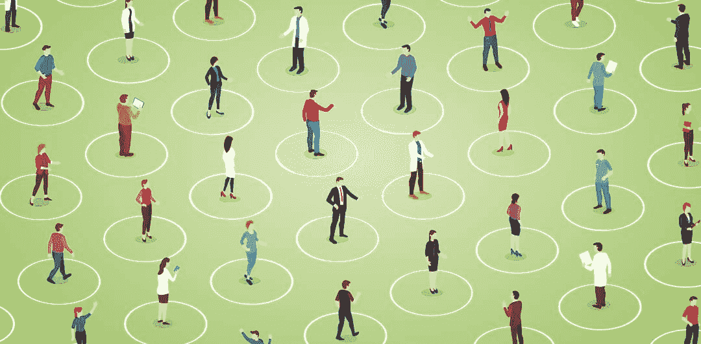

# 17 讲 地理边界：你的地盘是你做主吗？

武志红

2022-04-24

## 17 讲 地理边界：你的地盘是你做主吗？

17 讲 地理边界：你的地盘是你做主吗？

我在总论中介绍过，边界意识涉及的方面很多，它包括了人与人相处的地理边界、身体边界、心理边界和财产边界。这一讲，我先来谈谈地理边界。

## 每个人都该有自己的“地盘”

前不久，我在朋友圈看到一篇文章，分析了我们中国各个民族的传统民居，简单读过一遍后，我发现我更喜欢少数民族的民居。这让我有些好奇，这种喜欢是怎么产生的呢？于是又把文章仔细读了一遍，然后发现，原来是因为汉族民居是挤在一起的，比如围屋和碉楼，而我喜欢的少数民族的那些民居，一户户之间是有距离的。

这让我联想到多年前的一次经历。

2006 年，我第一次出国，去了波兰。同行中有很多摄影爱好者，大家特别想拍农村风光，于是去了波兰古都克拉科夫旁的一个农村。村外的农田和牧场很漂亮，但村里的房屋有些普通，甚至有些破败。不过有一点给我留下深刻印象，一户户之间有相当的距离，没有密实的围墙，就是用铁栏杆或木栅栏简单围一下，院里院外，种的都是花。

这和我河北老家农村太不一样了。我们那儿是一户户紧挨着，一点距离都没有，并且房顶都连在一起，你可以轻松从房顶上进入同排的任何一家。同时，家家都有高高的围墙。

这种一户户紧挨着的状态，会制造邻里间的紧张，例如你家是不是盖高了，你家种的树的树枝进入了我家院子等等，很容易引起争执。如果一户户之间，有足够远的距离，这些问题应该会少很多。

不过，比起我的家乡，在珠三角地区的农村，这种房屋挤着的情况会更严重，它们的房子，普遍是低层窄，高层宽，像要变着法把房子盖到别人家地盘。有朋友称之为“握手楼”，就好像两栋楼近得可以握手了。

这样挤着，有一定道理，例如经济上的考量、面积上的限制等等。不过我觉得还有更深刻的理由。

我的河北老家，主要是平房，没有握手楼这种感觉，但农田的这种感觉很强。农田间的路窄得很不合理，因为一家家都在扩张自己家的地，把路给占了，例如我家最主要的一块地，地边通向邻村的路，过去是可以过大马车的，现在窄得只能过自行车了。

这样做，就是为了占经济上的便宜吗？我的理解是，虽然那点便宜没多少，但你占了我没占，我就觉得自己输了，被欺负了，不行，我也占，还要比你多一点，这样才能显得我厉害。从小我就觉得，相比利益上的争夺，这种心理上的争斗才是最重要的。

总结一下就可以说， **彼此之间有清晰的地理边界的，大家会尊重这个边界，虽然看上去距离远了，但其实关系更和谐。**  
那些紧挨着的房屋，边界没了，看上去更亲密，结果大家围绕着边界的明争暗斗反而更多。

要我说，地理边界这个词，不够直接，换一个词“地盘意识”，那就太好理解了。

在现代社会，特别是在城市里，人最容易拥有的一个地盘，就是房子了。我个人有这样一个理解，在我们这个缺乏边界意识的社会，大家热衷于买房子，这和农民想拥有一块土地一样，既是为了生存，也是为了拥有一块属于自己的地盘。

## 家庭中的边界

那问题来了，在你的地盘、你的房子里，你有边界意识吗？

我们知道，在美国，如果一个人闯进别人家里，主人让他走他不走的话，主人是可以向他开枪的，事后的法律判定也会倾向于保护主人。我觉得，美国社会的治安虽然有很多问题，但对地理边界的尊重，对个人产权的保护，的确会让一些事情变得清晰很多。

我看新闻时关注过一起医闹事件。一名男子攻击了一位正在出诊的医生，医生受伤后，奋起反击，把该男子也打伤了。警察来了以后先带走了男子，后来要拘留医生时，医生不够配合，警察就行使了一定的强制手段。

这件事的处理，看起来逻辑是没问题的，医生不够配合，警方当然有合法行使强制手段的权力。但我的理解是，这里面其实还可以多加入一层逻辑，那就是边界意识。原本的逻辑是，医生和病人发生冲突，互相攻击，都有错，所以都得负责。但如果加进边界意识这个因素，那就变成这是医生的地盘，是救死扶伤的地方，来闹事的人，先侵犯了医生的边界，有错在先。

不过，在事不关己的新闻事件里分得清边界，不等于这个边界问题延伸到你自己身上，也能分得清清爽爽。

一个男人闯进你家里，攻击你和家人，你奋起反击，是再正当不过的事，因为他在入侵你的地盘。这一点相信你没有任何疑问，对吧？那我再问你一个问题：如果父母到了孩子家里，你觉得谁是主人？

你可能说，这当然是孩子的家，父母是客人。这种认识也许不难，然而，父母们真的会甘于客人的角色吗？他们会不会在孩子的家里指手画脚呢？

再问男同胞们一个问题，这绝对是个超重量级问题，你的妈妈到了你家，她是客人，还是主人？你看，这些问题放在一些具体的家庭情境里，很多人恐怕就会觉得很难办了。

关于这个问题，我认为男人和婆婆必须要明白一点，在儿子的小家庭中，只有一个女主人，那就是儿子的伴侣，婆婆的儿媳。

以我的了解，我们身边很多离婚案，都是因为双方父母没摆正自己位置，还想在孩子的小家庭中做主人导致的，而且，婆婆会是其中最明显的一个因素。

这种现象和我们第一模块讲到的共生心理紧密相关。虽然母亲和儿子女儿都有共生，但毕竟社会文化中，将已婚的女儿家视为别人家，而容易将已婚的儿子家视为自己家，这样一来，很多婆婆还会觉得，儿子家是“我们家”，就是“我和儿子的家”，儿媳是外人。有些小家庭，哪怕儿媳的经济收入比儿子要多，甚至房子都是儿媳为主买的，可侵略性太强的婆婆仍然会觉得这是“我和儿子的家”。

如果母亲和儿子共生程度太高，婆婆的控制感太强，那么一旦婆婆住到儿子家，不出问题才怪。

所以， **家人之间也应该有地理边界，尊重这个边界，家庭关系会清晰很多，好相处很多。**

## 帮孩子建立地理边界意识

成年人相对独立，划定合理的地理边界很容易。可是，怎么给未成年的孩子一个合理的地理边界呢？其实也不难，只要做到两点。

首先， **父母要适当保持在家里的权威，毕竟这是父母主导建设的空间。**

其次， **父母需要尊重孩子的地理空间。**  
比如，进孩子房间时，要敲门，或者给孩子一个可以上锁的抽屉，那是孩子神圣不可侵犯的空间，大人没有任何理由去进入这个空间。同时也要让他知道，他同样不可以随意侵犯父母的地盘。

尊重孩子的地理空间，意味着在给孩子一种感觉：你是你地盘上的主人。 **这会有助于孩子形成边界意识，能在被入侵时捍卫自己的权益。**

如果父母经常入侵孩子的地盘，那么孩子有可能变得和父母一样，也会随意入侵别人的空间，同时，也可能没有更好的自我保护意识，因为他们习惯了被父母入侵。

最后再举一个社会新闻的例子，在一家书店，一位少年大声朗诵，书店女店员上前制止时，这个少年大怒，虽然还是个孩子，但他却说出了“信不信我抽你”这样恶劣的话。少年的父母虽然有点不好意思，但还是解释说“他还是个孩子”。这样的所谓的“熊孩子”，我们在很多地方都看得到。这些孩子如果将这种做事风格一直持续下去，只怕他们的人生不会顺利，因为人们会讨厌他。讨厌的原因也很简单，他在入侵别人空间时毫不自知，缺少地理边界意识。

思考题

我常说： **如果在你的地盘里，你不能做主，你就是别人的殖民地。**

那么你是谁的殖民地？你如何能重新夺回你的地盘？你又是谁的殖民者？你应该怎么把主权还给别人呢？欢迎你在留言区跟我交流。

1.地理边界更直接的表达是地盘意识，有清晰的地理边界，虽然看上去距离远了，但其实关系更和谐。 2.尊重地理边界的存在，家庭关系会清晰很多、好相处很多。  
3.父母需要尊重孩子的地理空间，这意味着在给孩子一种感觉：你是你地盘上的主人。这会有助于孩子形成边界意识，在被入侵时捍卫自己的权益。

  

公众号懒人找资源，懒人专属群独享

# 18 讲 身体边界：为什么必须学会说不？

武志红

2022-04-24

## 18 讲 身体边界：为什么必须学会说不？

18 讲 身体边界：为什么必须学会说不？

身体边界很好理解，意思是， **建立起了这种意识之后，你就能做到自己的身体自己做主。** 反之，没有身体边界意识的时候，身体不能自己做主时，就容易出问题。

我认为，身体是灵魂的殿堂，而且一个身体只能住下一个灵魂，当你的身体里，住下了别人的灵魂时，你的身体会不认账，因而生病。

## 躯体化

躯体化的意思是， **当一种情绪或情感不能通过语言和行为自由表达出来时，就会通过身体来表达。** 躯体化，可能是人们最常启动的自我防御机制。

举个我自己的例子，我的左耳有严重的听力问题，它是中学时一场疾病导致，但当我知道躯体化这个概念的时候，我深深地赞同，这太符合我的情况了。

从小到大，我一直听女人诉苦，先听妈妈诉苦，后来恋爱时，又容易找有一肚子苦水的女人。可我知道，我是多么不愿听女人诉苦，但我花了很长时间，才敢开口对妈妈和那些女人说，别给我讲这些，我不想听。

还有一类故事，就更常见了。一对老两口，一个很擅长表达情绪，攻击性也很强，结果七八十岁了还耳聪目明，精神矍铄，另一个很压抑，极少表达情绪，结果耳聋眼花。逻辑是一样的。我不想听你发脾气，我不想看你发脾气，可我表达不了，我很想把它们的功能关了，最后久而久之，它们的功能真不行了。

讲一个我亲身经历的案例。有一次，我参加了一个培训课程，老师是德国的亨利·博亚（Heinrich  
Breuer），他是欧洲系统排列学院创始人之一，是一位经验丰富的专业心理治疗专家。晚上吃饭的时候，一位女学员向亨利老师请教，她说她的父亲和她住一起，常常她一出门，父亲就生病，她不得不回去照顾父亲。这次又是这样，她已经大老远来参加这次培训课程，父亲在家里也有人照顾，几经犹豫，她决定留下，暂时不回去照顾父亲。

亨利老师说，父亲一生病你就回去照顾他，这样一来，他的愿望总是实现，这种现象被称作继发性获益。

**继发性获益**  
的意思是说，有一些人生病后，获得的特殊照顾和优待，都属于继发的利益。病人通过症状获得好处，比如通过疾病达到不上学、不上班，避免指责和批评，免除某种责任和义务，寻求别人注意和同情等等，这是他们应对心理、社会各方面困难处境和满足自身需要的一种方式。这会导致病人“发明”大量的躯体化症状来达到“继发性获益”，这种“发明”可能是潜意识中形成的。

所以，回到那位女士的情况，父亲一生病她就回到父亲身边，这等于她鼓励了父亲生病。既然父亲能通过生病而让女儿留在身边照顾他，那么他为什么不这么做呢？

当亨利老师说这些的时候，这位女学员像是完全忽略了亨利老师的解释，还在继续倒苦水。这种感觉我很熟悉，很多来访者会带给我这份感觉。部分来访者，是因为太自恋而意识不到别人，于是会忽略咨询师的存在。还有一些来访者，他们的心智比较成熟，是有能力意识到别人的，之所以会忽略咨询师的声音，是有特别的原因在里头。这位女士，我觉得是后者。

于是我忍不住插话，对这位女学员说，不知道你有没有注意到，你忽略了亨利老师的话。听到我的提醒，她愣了一下，反思了一会儿说，好像是这样。

我继续解释说，此时此刻，亨利老师作为男性权威，像是父亲，而你最不想理会的，就是父亲的声音，所以刚才你也忽略了亨利老师的声音。父亲太需要你了，你感觉被淹没了，想和他划出一个边界，你不能主动直接地表达，只能使用被动的方式，例如忽略、听不进或遗忘他的声音。

好，这是我对这位女学员当时的表现做出的分析。我个人认为，是一个比较典型的能解释躯体化的案例。

## 保护抽象意义上的“我”

其实，还有一类现象非常常见，可能就发生在你身上。比如，有人求你做一件事，你不愿意，但又不好说出真实理由，于是委婉地说，“哎呀，对不起，我身体太累了，我做不了”。然后，你很可能会发现你的身体真的变得很累。甚至，你干脆真的就生病了，这下变成了“不是我不想帮你做事，你看我的身体不行了。”

**在关系中，表达心理层面的“我”想拒绝“你”时，这张力太大了，特别是“你”太脆弱的时候。**

这类现象，我也有一个个人的观察。我喜欢看 NBA，不过我是那种不太懂篮球技术的伪球迷，我观看的其实是篮球场上的人性。我发现当球场上压力极大，特别是球队严重溃败时，一些心理承受能力差的球星，就会出现严重伤病。当然，这些意外伤病的发生一定有前因后果，但我个人认为这里面有一个隐藏的表达，“不是我这个人能力不行，是我身体不争气”。

我认为，之所以会这样，是因为虽然身体非常宝贵，但相对而言，我们更惧怕的是心理意义上的“我”不行或不好。所以很多时候为了保护抽象意义上的心理的“我”，就会委屈和伤害身体层面的“我”。

**没有形成自我的人，会惧怕每一个具体动力的生死。**  
更严重的是，社会中很多人好像普遍没有形成自我，没有“里子”，只有“面子”。我们也知道，在东方社会，要给对方留面子，结果变成大家都难以干脆利落地说“不”，而是发展了各种被动方式，美其名曰“委婉”。

## 对父母说“不”

前面讲的，都是成年人的例子。接下来，我们从养育孩子的角度来看看这问题。

如果你想让孩子做自己身体的主人，那么必须要向孩子清晰地传递一个信息：你可以对爸爸妈妈说“不”。

有时候，孩子会拒绝发展自己的一些能力。例如，你让孩子学钢琴，结果他的能力不升反降。对这样的现象有一种很好的解释，那就是当孩子不能说“我不想”时，他们就会说“我不行”。可是久而久之，他们都忘了这是怎么来的，忘了自己真正的感受，结果真的会让孩子变得在很多方面都不行。

再比如，家暴，打孩子，这就不更可取了。首先，不论出发点是什么，这都不能称为“教育”；其次，当父母对孩子行使身体暴力的时候，无疑是对孩子说，我可以侵犯你的身体。

父母不但不能对孩子使用武力，还要给孩子传递一个信息，你的身体是神圣不可侵犯的，父母不可以侵犯，别人更不可以。如果你被侵犯时，你可以使用各种方式保护自己，必要的时候甚至可以使用暴力。

\*

好，这一讲我们一直在探讨为什么必须守住身体边界，身体边界对一个人的重要意义。那么，如果已经发生了没能守住边界的情况，该怎么办呢？这里每个人的情况不同，我虽然很难给出一个统一的方案，但如果你发现，由于你不会保护自己的身体，出现了躯体化问题，你可以好好对自己的身体说这样一段话：

过去我虚弱时，谢谢你，身体，你一直帮我承担情绪的痛苦。现在我发誓，不管情绪上的挑战有多大，我都会努力觉知到我的情绪，并努力在关系中去表达，我再也不想让你受这份苦了。

守住身体的边界，简单来说，有一个总的原则，那就是 **积极地在关系中表达“我愿意”和“我不愿意”。**

思考题

你一定知道有一些非常重视高考升学的学校，采用军事化的管理，对学生的学习生活都有非常严格的时间管理和各种规定。我注意到其中有一个很特别的现象，在学生早上跑操的时候，有一所学校就要求学生们挨得紧紧的，几乎可以说是前胸贴后背。而且据说这种方式被很多学校模仿。

请你用这一讲课程的内容分析一下，这样做是为什么？这真的能提高高考成绩吗？如果能，那又是为什么？

1\. 建立起了身体边界的意识之后，你就能做到自己的身体自己做主。反之，身体不能自己做主时，就容易出问题。  
2.身体宝贵，但我们更惧怕心理意义上的“我”不行或不好，所以为了保护抽象意义上的心理的“我”，就会委屈和伤害身体的“我”。 3.  
守住身体的边界，有一个总原则：积极在关系中表达“我愿意”和“我不愿意”。

  

公众号懒人找资源，懒人专属群独享

# 19 讲 心理边界：为什么总想改变别人？

武志红

2022-04-24

## 19 讲 心理边界：为什么总想改变别人？

19 讲 心理边界：为什么总想改变别人？

什么是心理边界？就是你和他人不同的心理状态。拥有良好的心理边界，意味着你的心理状态是你的，别人的心理状态是别人的，你们之间有边界。你关于对方的感知、想象和判断是你的，除非得到了很强的佐证，才可能确认是对方的。

## 隐私感

说到这儿你可能会很容易想到隐私这个词。没错， **隐私感是最简单的心理边界。**

我们都知道，有些人很缺乏对彼此隐私的尊重，比如过年回家，长辈们喜欢打探晚辈的收入情况和恋爱状态等等。这就是缺乏边界意识的一个反映。  
**当一个人特别爱窥探别人的隐私时，就意味着他在跨越对方的心理边界。**

除了因为一些人的好奇心，导致他们喜欢越过心理边界，还有另外一个重要原因，那就是我们有时会过度美化坦诚的价值。

坦诚让人与人之间交流更顺畅，彼此更信任。这当然没错，但是很多人没有意识到，  
**过度“坦诚”意味着，一个人彻底放弃了他的心理边界，让自己处于一种看起来毫无隐私的状态。**  
这恐怕就违背了坦诚的初衷。“我”完全毫无保留地向“你”呈现一切，这本质上是一种臣服，谁又不喜欢臣服自己的人呢？

只有当你设立清晰的心理边界，向对方隐藏起你的隐私时，你才能成为一个自主的人，而不是臣服者。在和别人打交道时，你才是成年人。

著名心理咨询师曾奇峰说： **没有秘密，孩子就不会长大。**  
他表达的就是这个意思，一个孩子如果一直对父母彻底敞开心扉，没有隐私，就意味着他还不是一个自主的人。

当然，我们通常不会彻底丧失隐私感，即使是一个坦诚的人，也知道我和你之间是有边界的。如果把缺乏隐私感的情况推到极致，问题就会变得严重。

当一个人的“透明幻觉”很严重时，就会彻底失去隐私感。“透明幻觉”这个概念我们在第一模块也提到过，有“透明幻觉”的人认为，我们都是透明的，根本不用沟通，一眼望去，就会知彼此是怎么想的。还有一种情况比“透明幻觉”更严重，也是精神疾病中的一种症状，叫“被洞悉感”。患有这些病症的人会认为，有一种神明的力量可以洞悉他的一切想法。这意味着，他的心理边界彻底消失，他的自我彻底瓦解了。

## 谁的感受谁负责

隐私感只是心理边界的一部分，接下来谈的边界你未必能接受，叫“谁的感受谁负责”。

有强烈的受害者情结的人最难接受这一点，他们会认为，“我”的痛苦感受，是“你”这个坏人导致的，你要为我的感受负责。

但是，为什么你会选择和这个让你感受不好的人在一起？为什么你不离开他？那是因为你从中获得了一些感受层面的好处，只是你没认识到或不想承认。

无论是地理边界、身体边界还是心理边界，当我们去突破边界时，几乎有一个共同的目标，那就是从这份突破中获得好处。其中最大的一个好处，就是维护自己的自恋。

我来讲一个来访者的案例。这位来访者是我们通常认为的那种“女强人”，她和老公开公司，能量十足，有很强的驱动力和绝不妥协的意志，公司和家里都是她说了算。

从某一天开始，她怀疑丈夫和公司里一个女孩有暧昧，然后，她开始闹。她的老公早就被她的强势驯服了，所以第一时间就完全配合她。配合的方式包括把女孩从公司解雇，手机让她随便查，电子邮件、密码等一切都向她敞开。

然而，这位来访者没有找到证据。可她还是相信自己的判断，她的老公干脆对她说，你请一个私家侦探吧。

她犹豫了一下，没有这么做，然后继续闹。就这样持续了一年多，老公和她都筋疲力尽。最后她对丈夫说：你就承认你和她有暧昧吧，你承认一下就好，我不会拿你怎么样。

她说得非常诚恳，但老公感觉事情没那么简单，担心她以后会拿这个说法继续闹，所以没配合她。

好，我们来看看这位女强人的心态，其实是有点像嫉妒妄想，就是找一个原因去嫉妒，虽然没有任何证据。

说到这儿我必须强调一下，这种模式如果转换一下性别，后果可能会更可怕。有嫉妒妄想的男性，通常会逼伴侣承认外面有人，如果不承认很可能会使用暴力，如果伴侣迫于暴力承认了，男性很可能会继续施暴。事后，又会跪下来痛哭流涕，请求原谅，并发誓再也不会使用暴力。但这种人发誓没有用，以后还会这样干，一次次地轮回。

这就是严重的心理边界不清，因为正常人会知道，这是“我”的想法或推断，没有实锤前不能当作事实来对待。

好，我们再回到女强人的案例。我在给她做咨询时问她：在你没有证据、你老公完全配合，还建议你找私家侦探时，你为什么还要你老公承认他犯了错误呢？她说不出来为什么。

我解释说，你就是为了证明你是对的。如果你老公真出轨，你会难受。但比起这份难受来，还有另一个痛苦你不愿意面对，那就是你可能错了。你老公是对的，你需要对老公道歉，承认你错怪了他。如果承认这些，你一直以来强大的自恋会崩溃瓦解。

**自恋是人的根本本性，**  
从小婴儿到成熟的个体，人要从全能自恋发展到健康自恋，从认为自己是神，发展到认为自己基本还可以。但如果是婴幼儿时没发展好，导致还严重滞留在带着全能感的自恋中时，自恋就太难被打破了。这个时候，人去破坏心理边界，常常就是为了归咎给别人，例如把“我是坏的”“我是错的”这两种东西，变成“你是坏的”“你是错的”。这位女强人的案例就是一个典型的表现。

**一个成熟的个体，要懂得“谁的感受谁负责”这个道理，当一份关系或一件事情令人不舒服时，如果持有“我的痛苦我负责”，那人才容易有动力去改变。**  
而一旦持有“我的痛苦你负责”时，就会总想着去改变对方。

## 心理边界与创造力

**良好的心理边界能让我们在跟别人相处时，保留自主的权力，也会在坏情绪来临的时候，拥有主动改变的能力。**

除此之外，良好的心理边界还能给我们带来另外一个好处，那就是拥有更好的创造力和想象力。因为，当你没有心理边界感时，你会觉得你的想象是不自由的。有一双眼睛，而且是苛刻的眼睛在盯着你，让你不敢有出格的想象，因此也难以发展出丰富的想象力，最终创造力也会受损。

心理边界等于为你创造了一个空间，去容纳你纯粹的想象，有了这个空间，你才能控制好自己想象，不会让想象发展成真实的行为。

我在前面课程中讲过，按弗洛伊德的理论，人在三岁以后就会产生俄狄浦斯情结，男孩想和爸爸争夺妈妈的爱，女孩想和妈妈争夺爸爸的爱。俄狄浦斯情结，注定只能停留在想象中，它不能变成现实。如果一个人没建立好心理边界，就会彻底无法容纳俄狄浦斯情结，也就是几乎完全不允许它在想象中出现。

所以我有一个说法：在想象的世界里，人可以拥有一切自由，但你就把那些最出格的想象，留在想象空间就可以了。想象不等于要变成行为。像心理咨询，特别是精神分析这件事，其实最重要的部分，就是在一个被保护的、稳定的心理边界内，去探寻来访者的想象。

相对于前面两讲的地理边界和身体边界，心理边界更高级，不过一般来说，更高级的心理过程都是因为低级的心理过程得到了非常好的实现，然后它们内化到人的心灵，就变成了高级的心理过程。

所以，如果你自己想有更好的心理边界，或者想让你的孩子有很好的心理边界，以发展出他的想象力和创造力，那么，先保护好地理边界和身体边界吧。当一个社会能很好地保护人的想象空间时，那势必也会在整体上为社会带来想象力和创造力。

思考题

你一定看过不少美剧，像《权力的游戏》等，为什么它们这么有吸引力？你能从心理边界的角度分析一下吗？欢迎在留言区写下你的看法。

1.拥有良好的心理边界，意味着你能区分你的心理状态是你的，别人的心理状态是别人的。心理边界更高级，先保护好地理边界和身体边界，才可以有更好的心理边界。  
2.隐私感是最简单的心理边界，当你设立心理边界、向对方隐藏起隐私时，意味着你将自己当作了一个自主的人。  
3.心理边界的重要功能是帮助发展想象力和创造力。你可以有一个空间去容纳纯粹的想象，而不必非得把想象发展成行为。

  

公众号懒人找资源，懒人专属群独享

# 20 讲 财产边界：保护利益为什么对心理也很重要？

武志红

2022-04-24

## 20 讲 财产边界：保护利益为什么对心理也很重要？

20 讲 财产边界：保护利益为什么对心理也很重要？

这一讲我们讲边界意识里的最后一个边界：财产边界。

你可能会想，财产这种明显是身外之物的东西，为什么会对心理也有重要影响？因为我们始终处在关系中，难免会和他人发生利益关系，所以，对利益的边界的处理，会对我们的内心产生各种影响。

## 家庭中的财产边界

有很多社会新闻事件都和这个有关，例如有一位男子跳河自杀，他是一位司机，收入并不高。但是他的哥哥好赌，他就拿了 14 万积蓄帮哥哥还清了赌债，可哥哥又透支 5 万输光，他只好卖车再帮哥哥还钱。可是，他自己家每个月的房贷就构成了很大压力。这些压力让他一时想不开，自杀了。

在我看来，这些事确实难办，但是如果能有清晰的财产边界意识，或许就可以避免。

在特别重视家人和家庭的社会中，有清晰的财产边界意识，并不容易。你得明白，你的财产是你的，而不是“我们”的。一旦你觉得，你的财产是“我们”的，那必然会出很多问题，例如，你可能会失去上进的动力。

我在做心理咨询的过程中，听很多来访者说过类似的情况，从小他们的父母就对他们说，咱家就你最出息，以后就靠你了。这个说法，会迅速带给他们很大压力。他们会非常惧怕，以后自己发展好了，真的得背上全家人一起前行，如果真这样，他们宁愿不要发展得太好。

我在思考这个问题时发现，对于不能捍卫自己边界的人来说，自卑竟然成了一种保护。因为，如果你不自卑，坦然承认自己的强大，那么你就得承担更大责任；如果自卑，把自己认为的能力降到真实能力以下，就可以使用这个借口：不是我不想背负太多责任，是因为我没有这个能力。

## 职业关系中的财产边界

我先说说我最熟悉的职业关系，咨询师和来访者的关系。我先问你一个问题：你认为咨询师和来访者是什么关系？

我想太多人会首先认为，这是一个帮助与被帮助的关系啊。这一点当然没错，但同时，你必须看到的一点是，咨询关系，也是交易关系，来访者是付出金钱，来购买咨询师的专业服务。

在精神分析的工作中，特别重视“咨询设置”，也就是咨询师与来访者的契约。例如，如果一位来访者和咨询师约好，每周日下午两点到三点是他们的咨询时间，那么这时间、价格，就要保持固定。条件好一些的资深咨询师，甚至会把咨询的地点也固定下来。

如果来访者确实遇到特殊情况，需要变动怎么办？首先以契约为准，其次才是根据特殊情况做协商。如何处理咨询关系中的财产边界，就非常考量咨询师的专业功底，和在处理利益问题上的成熟度。

很多咨询师，容易在金钱上给来访者让步，例如有些来访者收入不高，或有的来访者临时遇到了困难，也有少数时候，一些来访者谎报自己的情况，明明自己的收入还不错，却把自己说得非常可怜，试图说服咨询师为他降低咨询费，这就构成了对咨询师的剥削。

资深的咨询师们，在给来访者减价甚至免费这件事上，是非常谨慎的，因为这涉及边界的晃动。

**咨询的根本目的，是帮助来访者成长，走向成熟与强大。**  
但当咨询师给来访者减价甚至免费时，就可能向来访者传递了一个相反的信息，就是在鼓励来访者变得弱小。你越弱小，我越愿意帮你，甚至喜欢你，和你的关系越深。

来访者还会有这样的感觉：我收入高了，如果还维持这种咨询费，就是对不起咨询师了，但如果恢复了原价，我就失去了在咨询师这里的一份特别感：咨询师对我减价这显示了他重视我。总之，为了维护这种感觉，来访者可能会下意识地不去努力提高自己的收入。

除了上面这些，咨询师这里也可能隐藏着一个含义：我比你强大。来访者因此会体验到虚弱感、羞耻感，甚至潜意识对他的咨询师产生憎恨。同时，当咨询师太轻易让渡利益时，也是在教来访者剥削自己，这会导致来访者轻视咨询师。

我们再来看另一种比较特殊的职业关系，雇主和保姆的关系。保姆虽然跟雇主是雇佣关系，却是需要跟雇主生活居住在一起。这种微妙的关系就更要注意财产边界问题。

我们都知道一个社会新闻案例，杭州保姆纵火案。保姆在雇主家纵火，导致女主人和三个孩子不幸身亡。一个完美家庭，就这样被摧毁了。

是这家人对保姆不好，引起的仇恨和报复吗？还真不是。保姆月薪 7500 元，要买房子的时候，雇主还借钱给她。后来发现她有偷东西的行为时，雇主虽然报警了，但还让她在家里住着，给她改过的机会。

在我看来，我认为这家人对保姆太好了，好到失去了边界，特别是财产边界。7500 元的月薪不是问题，哪怕更高也可以，但借钱给她这些行为，我认为就是在破坏财产边界，会让保姆误以为她借钱的行为是正当的，“我付出这么多，你们就应该借钱给我”。

再举个我朋友的例子。他请的也是一位全职保姆，干活认真，人也善良，朋友很信任她，所以就多次借钱给保姆，而且也没把借钱的事儿放在心上。因为他的收入很不错，这点钱不算什么，并且他对保姆的确很满意，打心眼里把保姆当成家人对待。

逐渐地，保姆自己也把自己当这个家里的一员了，在家里特别有主人翁的感觉。慢慢地，保姆的行为发生了一系列微妙的变化，干活不再那么细致了，也开始偷懒了，细节上也不如原来好了。可是，我的这位朋友不是那种挑剔的人，觉得没什么大问题。

再后来，这个保姆提出要跟我的这位朋友借几十万买房子。朋友很诧异，觉得她怎么可以提这个离谱的要求，就拒绝了她。被拒绝后，保姆就抱怨了，“你收入那么高，几十万不算什么呀”。

她的情绪虽然不算激烈，但我的这位朋友一下子警醒了，觉得事情不太对头，果断辞掉了保姆。

## 利益关系中的“共生感”

后来朋友和我说起这件事时，他说保姆最初人是非常好的，也很尊重边界，是他自己一再突破边界，“诱导”保姆提出很多出格的要求。他说，如果能重新开始，他会严格遵守财产边界，借钱就是借钱，借了必须还。同时也在工作上对她严格要求，如果想对保姆好，可以提高她的工资，那样她钱拿得也有尊严。总之，必须得按照规则来。

听完他的故事后，我跟他解释了一遍“共生”的概念，他很有感触，说把保姆当成“一家人”这种感觉就是共生，但不该这样的。雇主和保姆就应该是雇佣关系，而且因为这份职业的特殊性，保姆会深入介入雇主的生活，所以更要时刻让保姆意识到，这是你的家，你的财产，不是“我们”的，更不是保姆个人的。

咨询师和来访者、雇主和保姆，这是两种相对特殊的职业关系。咨询师和来访者，是长期固定的帮扶关系，但又有金钱交易；雇主和保姆，看似只是金钱交易，但保姆会深度介入雇主的生活。正因为这些特殊性，里面包含的财产边界问题也显而易见。看懂了这些，你就能更容易理解其他职场关系中的财产边界问题了。

例如，同事之间，请客吃饭谁买单呢？老板过生日，你要不要以个人名义送礼物呢？你想拿下的一位大客户，要求你帮他办私事，你该不该帮呢？你可以想想，遇到这些问题该怎么办呢？

总之， **不管是在家庭里，还是在职业环境里，都不要轻易给别人共生感，更不要在金钱利益上真让对方觉得你们是一体的。**  
否则，等你有一天觉得不对劲，想往后撤，想从“我们”回到“我”和“你”时，对方会有怨气。不夸张地说，清晰的财产边界意识，有时候是可以用来保命的。

**财产必须是有边界的，当这一点被充分尊重并得到保障时，人才会有更强的动力，去创造更多的财富。**  
所以，我强烈建议：在任何方面，不要着急让渡自己的利益，不要用这种方式展示自己的助人胸怀。

我甚至还很毒舌地讲过一句话：成熟的人讲利益，幼稚的人讲情怀。这句话招来很多批评和嘲讽，不过我自己是越来越坚持这句话。处理利益，不正是这个世界上最难也最关键的一件事吗？最好的政治家，最好的企业家，不都是能处理利益关系的顶级高手吗？

思考题

你如何看待利益关系？你对财产的边界是如何划定的？如果有独特的妙招，欢迎写在留言区，分享给其他同学。

1.在任何方面，不要着急让渡自己的利益，不要用这种方式展示自己的助人胸怀。 2.处理利益，是这个世界上最难也最关键的一件事。成熟的人讲利益，幼稚的人讲情怀。  
3\. 财产必须是有边界的，当这一点被充分尊重和得到保障时，人才会有更强的动力，去创造更多的财富。

  

公众号懒人找资源，懒人专属群独享

# 21 讲 防御手段：该如何守住你的边界？

武志红

2022-04-24

## 21 讲 防御手段：该如何守住你的边界？

21 讲 防御手段：该如何守住你的边界？

边界非常重要，但不可避免的，总有人想突破你的边界，甚至已经占据了你的地盘。那你该怎么守住你的边界呢？这一讲，我就来讲几个有效的防御性手段。

## 不含敌意的坚决

这是树立边界意识的最好的方式，不过我也必须说，最好的方式，有时看着最容易，但也可能最难。

**不含敌意的坚决，** 是自体心理学派创始人科胡特（Heinz Kohut，1913—1981）提出的，意思是我拒绝你，态度特坚决，可我没敌意。

举一个我自己的例子。我在读研究生的时候，妈妈开始对我逼婚，而我初中时就有了明确想法，有爱情才结婚，我还早早坚定了丁克主义。可我妈妈是观念传统的农村老太太，那该怎么办？

这个问题，我身边也有朋友遇到过，他们的做法通常是，口头上答应妈妈，但行为上拖着，结果变成不敢回家，整天躲着妈妈了。我觉得我不能这样，必须得和我妈妈谈一次，让我妈妈知道，我的想法是什么，并且我不会改变。可那是我的妈妈，我又不想让她生气，那该怎么办？

当时我还不知道科胡特的这个术语，但我本能地使用了这一原则。一次回家前，关于恋爱结婚成家，我做了充分思考，也决定在家待一周时间，和妈妈敞开谈一谈。

开始的两天，我妈妈很开心，因为发现我终于愿意谈这个话题了。不过，她的高兴中其实藏着一个前提：她认为自己是合理的，并且能说服我。

可是，在谈话的过程中，我并没有让步，而是不断向她阐述我自己的观点。我的妈妈也感受到了我的坚持，过了三四天后，她谈话的热情就没那么高了。这很容易理解，谁也不愿意输，但是我态度又很好，所以妈妈也没有生我气。

到了最后两天，妈妈开始躲着我了，她开始害怕和我沟通。后来，妈妈就再也没有在结婚生孩子的事情上强求我做什么。现在，我 44 岁，没结婚，没生孩  
子，但活得越来越好，她对我也就没什么不放心的了。

我的这个故事，是非常典型的不含敌意的坚决，这个故事我到处讲，教会了不少人，很多人说非常好用，但也有人说不管用。为什么呢？

因为，我妈不是我的“宗主国”，我也不是她的“殖民地”。她从来没打骂过我一次，我们交涉起来，自然容易很多。然而，  
**很多人还处于“殖民地”位置，对方觉得可以支配你，那么他们自然不愿意轻易放弃自己权益，你要会战斗才行。**

那接下来，我就教给你更多技巧，它们一个比一个有战斗力。

## 从小事开始

**维护边界，特别是亲人之间，可以从小事开始。**

一切共生关系中，都必然存在着剥削。精神分析认为，一岁前婴儿和妈妈的关系，就是剥削与被剥削的关系。当然，正常的母婴关系，必然是婴儿剥削妈妈，如果发展成病态共生关系，那大多会变成强有力的一方剥削虚弱的另一方。

如果亲子关系和伴侣关系间，存在着严重的剥削，而你又不想断绝关系，该怎么办？ 你可以从小事开始。

我的一位女性读者曾经分享过一个她的故事，她说有一天她要加班，给妈妈电话说晚饭别等她了。可是，等她 8 点多加班结束回家后，发现妈妈、丈夫和孩子都没吃饭，在等她。这时，她有非常强烈的被绑架的感觉，她觉得这是妈妈潜意识中想用这种方式逼她就范，让她以后都早点回家。所以，她对妈妈说，我今晚不吃饭了，以后再有这种情况我也不吃。

她树立界限的努力奏效了，后来这种事再也没有发生。

吃饭这件事虽然很小，但是我的很多来访者和朋友，都试过就从吃饭这种看起来很小但又每天都在发生的事情开始，坚决地表达并维护自己的意志。

例如，有朋友想自己盛饭，那样他可以把握盛多少，可每次都是妈妈抢先给他盛，而且必定会盛很多。他决心改变这件事，他的做法是如果妈妈帮他盛了，他会说谢谢，但一定会把饭从碗里去掉一些。少数时候，他还把饭倒在锅里，然后再自己盛。妈妈多数时候没有什么情绪，但也有失控质问他的时候。这种情况下他就耐心对妈妈说：我就是想自己盛，这样可以把握到底吃多少。

他这样坚持做了一段时间后，妈妈最终接受了他这个做法。然后他发现，妈妈对他其他事情的控制，都明显少了很多。

所以，从小事开始，坚决表达自己的意志，这是一个好办法。

## 尊重事实，驳回情绪

从小事着手，一般适用于关系亲密的人之间。如果你们关系一般，甚至是陌生人，而你又特别不擅长争辩，那你该怎么守住自己的边界呢？我再教一个方法，就是尊重事实，驳回情绪，这也是沟通的重要原则。

我们都知道， **我们讲话时，会传递两层信息：事实层面的信息和情绪层面的信息。**

不知道讲事实的人，就是只会胡搅蛮缠的人，和他们吵架，只要你冷静一点，只抓着他们谈事实就可以了。如果还有旁观者，那吵赢他们就会更容易。

所以，但凡脑子比较清楚的人，都知道要讲事实，然后在讲事实的时候，再把自己的情绪传出去，投给对方。

如果一个人传递过来的情绪是好的，你愿意接受，那无妨接过来，让它流动。但如果你感受到，对方传递过来的是情绪垃圾，而你并不想容纳对方这种情绪，那就该驳回去。

我的一位好友，刚大学毕业时找的第一份工作，是给一个老板做秘书。一天她老板翘着二郎腿，优哉游哉地，突然轻飘飘扔出了一句话：我一天挣的，比你一年都多。

女孩愣了一下，觉得真是莫名其妙，然后她扔了一句话回去：是啊，你说的对，我一辈子可能都挣不了你一年的，可是你很累啊，我不想过你这样的生活。你看，这就是她对事实给予了承认，而把垃圾情绪驳了回去。非常有意思的是，之后这位老板改变了对她的态度，对她非常尊重。

这份尊重，是她挣来的。她捍卫了自己的心理边界：尽管你是老板，也别想把你的情绪垃圾扔到我这儿来。

很多人会认为，那是老板啊，是不是应该讨好一下？可是，如果你把他的情绪吃进去，就意味着你在屈从于他，这就鼓励了他以后继续鄙视你。我知道很多例子，哪怕面对很不好惹的权威，如果你能这样和他们沟通，也同样会获得尊重。

相反，即使你是权威的一方，如果你总吃别人的垃圾情绪，那么你也会逐渐丧失权威。

## 这是我的事，那是你的事

当对方想破坏你的边界时，告诉他，这是我的事，和你无关；如果他想拉你进他的边界时，而你不愿意，就告诉他，那是你的事。

这里，我要特别向你推荐《不要用爱控制我》这本书。作者帕翠丝·埃文斯在书中讲了一个她自己的故事。

有一次她讲完课坐着休息，突然听到一个声音在对她说“笑一下”。她一开始以为不是在和她说话，就没理会。那个声音再次响起，她抬头一看，应该是一位听众，在用这种方式想和她打招呼，可她很不喜欢这种方式。她觉得这是在教她怎么做，是一种经典的控制方式。这时她给出的反应是：“什么？”

当这个人再次说“笑一下”时，她再次问“什么？”，那个人可能感受到了自己刚刚的行为很冒犯，就主动离开了。

\*

如果有人想要侵入你的边界，或者拉你进入他的边界时，你可以采用以下四种防御性手段：

1.  不含敌意的坚决；
    
2.  从小事开始拒绝；
    
3.  尊重事实，驳回情绪；
    
4.  这是我的事，那是你的事。
    

思考题

这是我总结的维护边界的防御性手段，我也很想知道，你在这方面有什么成功做法吗？既能做到不破坏关系，又能守住边界？欢迎你在留言区跟我交流。

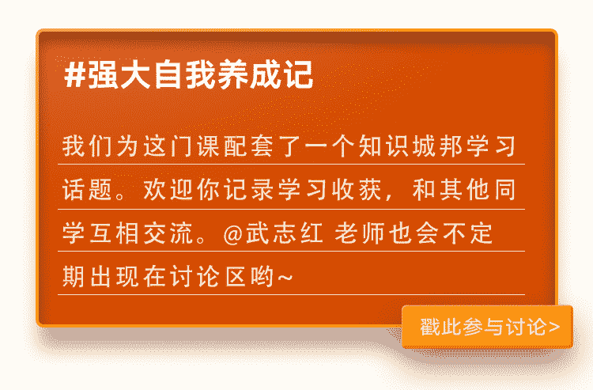  

公众号懒人找资源，懒人专属群独享

# 23 讲 分化与外化：为什么区分你我如此重要？

武志红

2022-04-24

## 23 讲 分化与外化：为什么区分你我如此重要？

23 讲 分化与外化：为什么区分你我如此重要？

在这一模块的引论里我们讲到，各种分化中最基本的分化，是“你我的分化”，也就是真切地认识到：我是我，你是你。

还可以这样来理解，“我”，是内部世界，而“你”，是外部世界。也就是说， **你我的分化还意味着，一个人能区分内部世界和外部世界了。**

听到这儿你可能会觉得，分化的概念也太简单了吧，这难道不是谁都能意识到的吗？

听起来很简单，但还真不是谁都能发展到这一步的。按说这是一岁多的幼儿就应该发展出来的心理能力，但实际上，很多成年人都没有发展到这一步。

## 精神疾病中的“你我不分”

如果一个人在意识上不能区分“我的”和“你的”，这是很严重的问题。从一些极端的情况来看，很多精神疾病的症状中就有你我不分的逻辑。

例如，偏执型人格障碍\[1\]患者和偏执型精神分裂症\[2\]患者的症状。他们的偏执一旦启动，就会表现为他们认为事实是怎样，就是怎样。有被迫害妄想的偏执患者，他们会对自己的妄想深信不疑，认为自己遇到的不幸和灾难都是来自于某个人或某种势力的系统性迫害。

对于这样的患者，你没法说服他们。如果你原本是他们最信任的人，那他们可能会把你视为自己人，一旦你和他们进行争辩，不相信他们的说法，他们就很容易把你也划到那个迫害者所构建的体系内。

同样的情形，如果有一个人对你产生了钟情妄想，也就是他认为他爱上了你，而且你也爱上了他，那么，你也很难让他们相信，这不是真的。他们会认为，你所有的言行都是在对他们表达爱意，如果你严厉地拒绝他们，他们会认为你是在考验他们。

比偏执更严重的，还有幻觉，例如幻听，听到并不存在的声音；幻视，看到并不存在的东西。

除此之外，这些患者还容易伴随着“透明幻觉”，例如他们会有“被洞悉感”，觉得不用沟通，别人就可以轻松看到自己在想什么。

如果你和他们打过交道，你会体会到交流的困难。他们认为你是怎样的，那他们就会把这份理解视为是关于你的真相。你怎么辩解都没用，你辩解时，他们只会认为你是在狡辩。

回到我们今天的主题，你我的分化。也就是说，这些患者会认为，“我”对“你”的认识，就是关于“你”的事实。更精确地说，那就是他们认为“我”的内部世界对“你”这个外部世界的想象，就等于是外部世界的事实。

我在课程中常常会强调边界意识，这一类情况就是典型的没有边界意识，因为没有一个边界挡在“你我”之间，所以你可以随意地到我的世界里来，我也可以随意地到你的世界中去。

普通人都知道，互相理解不是一件容易的事，需要做很多沟通，在没有进行沟通之前，自己对对方的认识都是推测和假设。这份认知，其实就是建立在你我的分化已经实现之上。

所以说， **边界意识不仅仅是现代社会的通行规则，也是更高的心理发展水平的表现。**  
当没有边界意识这种情况非常严重的时候，不仅会带来人际关系上的混乱，还可能意味着一些严重的心理问题。

我为你列举的这些精神疾病都是比较极端严重的例子，目的是为了让你更容易理解到底什么样的情况是“你我不分”。

## 如何实现“你我分化”

我们先来说说孩子该如何实现分化，然后再来反观成年人该怎么办。

说到孩子实现分化，我又要强调 6-24 个月这个时间段，因为这是婴儿实现分化的关键时期，家长在这个时期应该做什么呢？只需要做一件事，那就是允许孩子说“不”。

不知道你有没有注意过，孩子能开口讲话后，除了常说“妈妈”、“爸爸”这些家人的称呼以外，还有两个词会出现得很早：“不”和“我来”。

“不”和“我来”，对成年人来说很简单，但对孩子来讲有着重要的含义。 **表达“不”，其实就是孩子在和妈妈划开边界，是他们在主动把妈妈从自己身边推开。**

“我来”这个词的意思是，我发出的动力和意志，我要自己完成。当孩子能基本做到这一点时，他就实现了“外化”。在心理学家玛格丽特·马勒看来，6-24 个月的孩子，心理发展成功的标志就是外化的实现。什么是外化呢？最简单的理解，我们可以认为它是外向的近义词。

说到这儿，我想问你一个问题，到底是内向好还是外向好？

你肯定会说，如果内向外向是一种天然气质，那就不分好坏。没错，但如果内向是一种封闭和退缩的心理状态，那就可能意味着本该在两岁前完成的外化没有实现，甚至更严重的情况是，本该在 6 个月前发生的共生都没有实现，导致一个人还处于自闭之壳中。如果一个人没有实现“外化”，那这个人就难以把自己的手脚向外伸展，做事的时候也会顾虑重重，畏首畏尾。

所以，当孩子表达“不”和“我来”这些意愿时，就是在向外伸展手脚，妈妈或者主要养育者就要尊重这一点，不能总是替孩子去解决问题。

**当孩子表达了“不”但却失败了的时候，这意味着养育者入侵了他们的边界。**  
当养育者不顾孩子“我来”的愿望，而替孩子解决了某件事时，本质上这件事就成了“你来”。 看起来，这样做是帮孩子解决了一些问题，但破坏了孩子外化的努力。

6 个月前的共生期，就是“你来”，婴儿发出的动力都是母亲替他完成。但 6 个月之后就不能再“你来”了。

养育者必须得知道，看上去婴幼儿就只是“吃喝拉撒睡玩”，但其实这些事情具备巨大的价值，婴幼儿不仅仅要掌握这些基本技能，同样重要的是他们在掌握这些技能时，实现很多心灵发展的议题，例如你我分化，例如外化。

当然，幼小的孩子并不能独立地去完成这一切，所以在孩子三岁前养育者需要有“容器”的功能，当孩子把事情做好时，认可他；当孩子遇到挫败时，支持他。这样做不是为了帮孩子解决各种需求，而是为了滋养孩子的自我。

而且，三岁前的孩子，还没有发展出抽象意义的“我”，也没有内化一个“你”在心中，所以他们需要有人陪在他们身边。

\*

我之所以着重讲对孩子的培养，一是希望如果你正在养育孩子，不要错过最佳时期，二是因为对成年人来说，基本原则是一样的，只不过难度和时间会大大增加。如果一个人没有实现你我的分化，还因此有了一些精神疾病症状，那这个人成长起来会非常不容易。

如果是一个各方面基本正常的人，只是发现自己没有很好地完成分化和外化，那么，培养自己各种边界意识，是非常有用的做法，可以帮助自己完成分化。关于如何培养自己的边界意识，你可以查看课程第四模块“打造边界意识”。

至于外化，如果发现自己不是天生的内向，而是因为一种不舒服的封闭、退缩的心理状态，那就要有意识地做各种努力，把自己的动力、意志延伸到外部世界上去。

你可以来检测一下自己是不是能顺利地表达“不”和“我来”这些意愿。如果不能，建议你用今天学到的知识重新审视一下自己的内心，然后，试着从一些小事上开始练习，例如吃饭穿衣，努力把自己的意志伸展出去，自己做主。取得一些小的成果后，再逐步试着做一些更大的事，例如在工作中表达自己的观点想法。如果你发现自己的情况很严重，或者你没法判断自己的情况，建议你找专业的心理咨询师。

思考题

我想请你来做一个观察，看看你身边的真实生活中，家长的哪些做法是在破坏孩子的分化或者外化过程？相信这个观察的过程能帮助你更好地理解，也能作出更多的改变。欢迎你把自己的发现写在留言区。

1.最基本的分化是“你我的分化”，这也意味着能区分内部世界和外部世界了。  
2.当孩子表达“不”和“我来”时，妈妈等养育者要允许和尊重这一点。“不”是孩子在和妈妈划开边界，“我来”是他自己能完成的动力和意志，并延伸到各种各样的外部客体上。  
3.成年人培养自己各种边界意识，可以帮助自己完成分化；有意识地把动力、意志延伸到外部世界上去，可以帮助自己完成外化。

注释：

\[1\] 偏执型人格障碍

偏执型人格障碍是以猜疑和偏执为特点的人格障碍。临床表现为敏感多疑，患者易把别人无意甚至是好意的行为当作恶意，对周围的人们过分警惕或怀有敌意。遇到挫折或失败时，归咎于周围环境或他人，夸大对方缺点或失误，易与他人发生争执。容易记恨，易引起强烈的敌意。固执己见，不相信与其想法不符的客观证据，很难以说理或事实来改变其认识和想法。

\[2\] 偏执型精神分裂症

精神分裂症是指精神活动（心理活动）与现实环境相脱离，思维、情感、意志互相分裂，并且伴有幻觉、妄想、紧张综合征等，是精神病中患病率最高的一种。偏执型精神分裂症是常见的一种类型，临床表现以妄想为主，常伴有幻觉。

  

公众号懒人找资源，懒人专属群独享

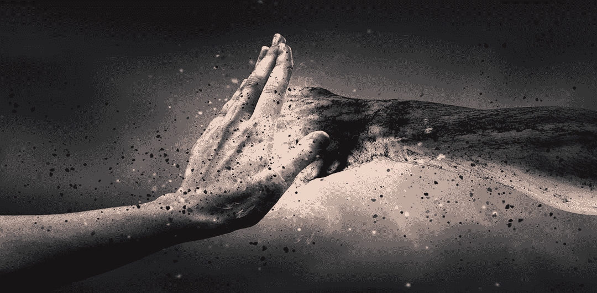

# 22 讲 进攻手段：边界被打破时如何反击？

武志红

2022-04-24

## 22 讲 进攻手段：边界被打破时如何反击？

22 讲 进攻手段：边界被打破时如何反击？

上一讲我们讲了守护边界的防御性手段，这一讲，我来讲讲守住边界的进攻性手段。

先讲一个基本观点，什么时候防御，什么时候进攻呢？当一个人总用一种方式对你，而且，即使你使用了防御性的方法也不能完全杜绝时，使用一些进攻性的方法，就非常必要了。

## 直击命门

我个人认为，这是处理中国式家庭关系中的一个大招。

直击命门就是直接、清晰地告诉对方，例如“你把事情说得那么复杂，不就是为了一个目的？让我听你的，按照你的来？但是，我为什么要听你的？”

这是共生关系的一个根本点， **沉溺于共生关系的，都在试图控制对方，让对方听自己的，按自己的意志来。**

但一般情况下，一个人不会直接说:“你必须听我的”。所以，大家都知道，要给自己不那么正确的权力欲望，增加一些正确的“名义”。

这些“名义”有很多种表现，比如：

我这么爱你，你为什么不听我的？ 我这么辛苦，你为什么不听我的？ 我这么无助，你为什么不听我的？ 我是你爸妈，你就得听我的；  
我身体不好，你不能惹我生气，你必须听我的； 我见识比你强，你要听我的； ……

所以，如果发现，对方说来说去，就是想让你按照他的来，那你可以不去做复杂的辩论，而直接讲明白：你不就是想让我听你的，但你是你，我是我，我为什么要听你的？

在我们生活的环境里，有时候我们要花非常大的力气，去争辩一个道理，因为这藏着一个逻辑：谁有道理，就得听谁的。所以，不仅控制的一方不断讲道理，被控制的人也会使劲去讲道理，很多人认为，只要把符合自己利益的观点讲得很有道理，就可以让对方听自己的了。

但有边界意识的人都知道，我是我，你是你，如果纯粹是我自己的事，不管你有没有道理，我都没必要跟你争辩。

再举一个例子，在恋爱关系中，很多人会因为一点小事不如意，就把它上升到“你到底爱不爱我”的终极拷问上。其实，在这种对话中，爱只是一个幌子，根本点还是你必须要听我的，按照我的来满足我的自恋。所以他们不是在问你爱不爱我，只是在问你“你听我的还是不听我的”。

我身边就有很多女性对我说过，有不少女孩最初恋爱时，都是抱着这么一种感觉：你爱我就得听我的。发展到极致，这会变成要找“二十四孝”男友或者老公。

有些男性为了避免争执和矛盾，就主动去讨好女性，迎合她们。但我要说出一件残酷的事实：恋爱中，越是听从对方的，可能越不容易赢得对方的爱，因为我们需要能击破自己自恋的人。虽然有点残酷，但人就是这样子。如果你无条件听对方的，对方就觉得你只是他自身的一部分，然后他反而觉得自己很孤独，因为他要寻找的是另一个完整的人。

所以，当我们戳破了对方的自恋，就等于告诉了对方：我是一个完整的人。这时对方反而有真切遇到你的感觉。

## 让对方疼

如果前面讲的都行不通的话，就需要使出有些破坏性的一招了：让他疼。

**攻击性有一个重要功能，就是直接树立界限。**  
你入侵我的界限时，我发挥我的攻击性让你疼，好告诉你这是我的地盘，我不是你随意可以入侵的人，我不是你想怎样就怎样的。这种疼可能是心理上的疼，也可能是身体上的疼。

我的一位来访者说，她的妈妈已经快 80 岁了，前两年来到广州。妈妈在家里说一不二，在她还小的时候，如果不听话，妈妈就非打即骂。她长大了一些后，如果不听话，妈妈就会使劲闹，闹得全家人鸡犬不宁。于是孩子们和父亲都形成了一个共识：别惹她。

例如，关于怎么在垃圾桶上套塑料袋，她妈妈就有自己的一套做法，并逼迫所有家人按照她的来。

来访者向我求助后，我就教给了她这个方法，我让她反过来去教妈妈，该怎么在垃圾桶上套塑料袋。开始的时候，她一去控制妈妈，妈妈要么暴怒，要么痛哭，有时躺在床上说，你气死我了，我不想活了。

她爸爸劝她别和妈妈闹，因为妈妈身体不好，妈妈一辈子就是这么不好惹，你就别招惹她了。但是她并没有停止，围绕着垃圾桶的事争斗了三个月。突然有一天，她妈妈能用幽默的方式驳斥她了，她感觉妈妈的内心也变得坚固了，不再是一被挑战就崩溃。然后，她也不再强求妈妈按她的方式给垃圾桶套塑料袋了。

针对这件事，我个人的总结是，这位来访者经过三个月的让妈妈疼，让妈妈知道了，这个家不是她想怎样就怎样，每个人都有自己的主见，不会按照她的想法来。如果她非要入侵别人的界限，别人就会让她疼。这份疼痛让她意识到，自己的孩子也是独立的人，不是她自身的一部分。她们之间是有边界的，当接受了这一事实后，她自己也变结实了。

## 反击霸凌

最后我再来谈一个比较特殊的情况，那就是面对霸凌，我们应该怎么做？我说的不仅仅是校园霸凌，也包括亲人之间的“霸凌”。

**当有人闯进你的地理边界，而你一再让他离开，却最终失败，那你得知道这是霸凌。** 你需要用更强有力的方式请他离开。

当有人在身体上霸凌你，你需要在身体上发起反击，如果你做不到，就需要找别人来帮助你；当有人在心理上霸凌你，你需要在心理上发起反击；当有人在金钱上霸凌你，一样的，回击他，切断它。

在做咨询的时候，我遇到过很多来访者，他们的孩子在学校被霸凌，基本上这些被霸凌的孩子的家长平时都有一些行为上的共性，我把它分成两种，一种是他们自己根本不会使用肢体力量保护自己，也难以使用语言暴力回击别人，他们的孩子也认同了他们的方式；另一种是他们经常攻击孩子，不允许孩子还击。

对后一种家长，让他们做到第一步比较困难，就是承认自己是孩子的霸凌者。当他们承认这一点，并向孩子道歉后，孩子很快会发生一些改变。

对前一种家长，他们得意识到，他们认为的善良，其实是软弱。他们把自我保护，视为是错的，但其实是他们的经历，让他们不敢使用身体和语言暴力，因为担心这样做时会遭到更严重的惩罚。

当意识到所谓的善良其实是软弱时，他们会清楚很多，然后会去教孩子，如何使用“让他疼”的方式去保护自己。特别是，当孩子做不到时，他们必须出面保护孩子。

家人间也是这样的道理。我的一位来访者，她刚来咨询的时候有严重的产后抑郁症。我处理过不少类似的个案，我发现基本上都有一个严重的问题，那就是她们在家里没有权力，不会保护自己，会有很多剥夺和被欺负。这位来访者就非常典型，虽然她生了儿子，但在她和老公的家里，她是最没有地位的。婆婆地位最高，接着是老公，接着是老公家人，他们中地位最低的是公公，然后是孩子，而她是最末一位。

她就是在原生家庭中严重被抛弃、被欺负的女孩。随着咨询的进展，她的自我越来越有力量，越来越能保护自己，后来把公婆从自己家里请走，对老公家人多次强调，你们到我的家里来，必须知道我才是主人，你们是客人，搞不明白这个，我的家不欢迎你们。对老公她也越来越显露真实的脾气，甚至有点儿不好相处。

后来，她老公对她说：以前吧，你很乖，我喜欢你那样子，但说实话，我不尊重也不爱你；现在吧，你脾气真臭，有时候我特别生气，但我越来越需要你，离不开你，也开始爱你了。

这是人际关系的一个基本真相： **有边界的人，有自我的人，会不好相处，但这样的人才会被尊重，才可能被爱。**

课后调查

你是否有过这样的转变：本来你对自己的某种行为或心理蛮骄傲的，觉得自己是个好人，但后来却发现，它带给你的是被人看不起，带给关系的也是破坏，然后你有了意识的觉醒，开始改变。当你变得“不好惹”以后，结果别人反而更尊重你，你们的关系也变得更好，而你也变得更喜欢自己了。

如果你有这样的经历，欢迎写在留言区，或者我们课程的知识城邦话题“强大自我养成记”中，我们一起学习交流。

1.守住边界的攻击性手段有：直击命门，让对方疼，反击霸凌。  
2.有边界的人，有自我的人，会不好相处，但这样的人才会被尊重，才可能被爱。这是人际关系的一个基本真相。

  

公众号懒人找资源，懒人专属群独享

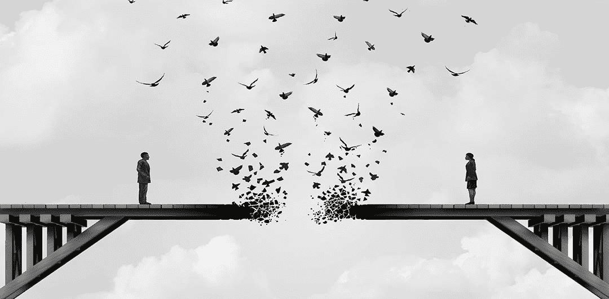

# 模块引论：分化，有非凡的意义

武志红

2022-04-24

## 模块引论：分化，有非凡的意义

模块引论：分化，有非凡的意义

我曾在我的微博上发起过一个调查：你什么时候开始清晰意识到，什么样的另一半适合你？什么样的朋友和你处得来？我还请网友们讲具体一点，说说是怎么发生的。

这是一个很实在的问题，最终有数千人给出了回答，其中很常见的一类回答是：和某某人分开后。

这个某某人中，有伴侣，也有父母。例如有一个获得数百个点赞的回答是这样的：

最近，开始和父母真正心理分离，允许自己和他们有不一样的命运，内心开始持有美好愿景，包括工作和感情，并相信自己能遇见。

看了这些回答，我不禁感慨，虽然我们崇尚亲密惧怕分离，但 **太多觉醒，是从分离开始的。**

说到分离， **最原始的分离，就是和母亲的分离。**  
我们的课程就是要着重为你讲解这一点。第二个模块讲的是母子共生，第三、四、五模块，讲的都是婴幼儿与母亲的分离，它们对应的是我在总论中提到的 6-24 个月的“分离与个体化期”的前三个阶段。

6-16 个月，被玛格丽特·马勒称为“分化期”，我们这一模块中谈到的“分化”，不仅仅是“分化期”的分化，含义要更为广泛一些。

**所谓分化，就是一个人能认识到，不同事物之间是有差别的。**  
分化的种类非常之多，数不胜数，最关键的，是“你我分化”，也就是孩子逐渐意识到，“我”和妈妈是两个人，我们的身体是分开的，我们的心理也是有边界的。

一些基本的分化发生后，意味着孩子的世界，从共生的混沌世界，变得复杂而清晰了。

在咱们得到上，有很多老师讲过和“复杂”相关的话题，我还记得罗胖曾在一期罗辑思维节目中发问：“你敢让自己变得复杂吗？”复杂很重要，而分化，就是复杂化的开始。分化，有非凡的意义，也可以帮助我们理解很多生活中的现象。

好，在我们开始学习这一模块正式课程之前，我想先问两个问题：

1.  你觉得你能区别对待人吗？你觉得这种区别对待合适吗？
    
2.  你能比较好地把握事情的轻重缓急吗？
    

这两个问题算是一种自查，如果你的答案是不能，或者不够确定，那么这一模块的内容应该能帮助到你。

好，接下来我们就开始这一模块的学习。

  

公众号懒人找资源，懒人专属群独享

# 24 讲 关系的分化：把握分寸有什么重要意义？

武志红

2022-04-24

## 24 讲 关系的分化：把握分寸有什么重要意义？

24 讲 关系的分化：把握分寸有什么重要意义？

之前的课程中我提到过，最原始的关系是母婴关系，而且，6 个月前的婴儿和母亲的关系，是混沌的母婴共生体，也就是说，婴儿觉得我就是妈妈，妈妈就是我。

不仅如此，对于幼小的婴儿来讲，他还会有一份延伸的感知，这比母婴共同体更加原始：我就是世界，世界就是我；我就是万物，万物都是我。这样的认识，可以帮助我们理解一些现象。

## 从共生到分化

例如，一个普通人，他总是心怀天下，想着拯救全世界，以至于严重忽略了自己的生活。这种情怀可能是他把最初的共生关系直接投射给了世界。也就是说，最初他觉得和母亲乃至世界是共生的，成年后，他仍然觉得他和整个世界是浑然一体的，他要为这个世界负责。

如果说，他是对这个世界有着一种深沉的情怀，但同时又过好了自己平凡的生活，拥有丰富复杂的情感关系，那么这种情怀可能是成熟的情感。但如果他的世界无比单调，却心怀天下，就需要警惕了。

一个人需要从原始共生的混沌状态不断分化，可以这样理解：

最初的母婴共同体是“一”，它需要不断分裂分化，先是完成与妈妈的分化，进入“二”的世界。然后意识到父亲的存在，这就进入了“三”的世界。此后，世界对他来说就变得复杂了很多。

可以说， **父母与孩子的这个三元关系，是孩子之后人生各种复杂关系的基础。**

其实，这种关系的分化，可以很直观地看到。如果你观察一个孩子的成长就会发现，最初孩子只在乎妈妈，后来也开始在乎起父亲来。等上幼儿园后，很多父母会发现，孩子对老师的在乎，胜过了他们。孩子还会逐渐地对同龄人越来越感兴趣等等。等再大一些，青少年们可能还会狂热追星。

成年后，一个比较成熟的人，根据关系的深度不同，会自然而然地产生不同的情感。关系越是深厚的人，就会越在意，像追星这样的热度也会降下来。总之，他们会更能够以自己为中心，来构建一个复杂的、现实的真实世界。

假如一个人做不到这种区分对待，而是对所有人一碗水端平，这种为人风格，可能会被一些人美化，但并不是一件好事。

你发现了吗？关系的分化做好了，放在现实生活的语境里，就是我们常说的有分寸感。在不同的关系中，把握不同的分寸。因为对关系的认识变得清晰了，就能明白对待家人、明星、陌生人应该有不同的分寸感。  
**人性极其复杂，我们需要一张复杂的关系网，来承担不同的人性。**

## 理清生活中的乱局

我来讲一个案例帮助你理解。

我的一位来访者，是位女士，她觉得婚后的生活非常痛苦，因为她总是感觉自己被丈夫一家人排斥。

她丈夫说过，我们一家人非常亲密无间。婆婆有几次干脆对她说，你怎么一直都没摆正位置？你就是个外人啊！

她的婆婆是这个家族说一不二的权威，她的丈夫是家里的核心人物，是事业有成的企业家，是整个家族的精神支柱。既然都是一家人，那账就不能算太清楚了。这位女士观察到，她老公的弟弟妹妹还有其他家人，简直是使劲往自己的口袋里捞钱。可她不能指出来，否则会被婆婆一家人攻击说她在挑事。

她老公也会因此埋怨她，偶尔会对她暴怒，觉得她在破坏一家人的团结和情感。她和老公沟通时，发现老公对公司的这些情况比较清楚，也觉得这样是很不合理的，但他就是不能为此做些什么。

生活在这个家族里，这位女士常感觉自己像是陷入了粘稠的沼泽地，动弹不得。

感觉到粘稠不清爽，这是关系没有分化的基本表现。这会构成家族和企业的一种乱局。我们常说“家人之间不能分得太清楚”，这种认识，如果处理家庭问题还好，毕竟你可能已经习惯了这种模式，但这种认识带到公司后，公司的发展就容易遇到瓶颈。

后来，这位女士劝她老公引进投资，等投资人进驻后，逼迫她老公逐渐放弃家族式管理，接受现代化企业的管理模式。这种改变引起了很多冲突，但最终转变还是发生了，企业走上了更好的发展道路。并且，出现了一个连带好处，原来搅成一锅粥的家族成员开始走向分化，开始分出彼此。

最终，这位女士有了一种感觉，她终于有了属于自己的小家庭。

你发现了吗？这种故事在我们社会并不罕见，很多人结婚后，重心还是在自己的原生家庭，他们不仅没有完成和母亲的分离，也没完成和原生家庭的分离，结果也就没法真正把自己的小家当作自己生活的核心。

## 父母对孩子说“不”

上一节课我们讲到，孩子对妈妈说“不”，非常重要。其实， **父母对孩子说“不”一样很重要。**

当孩子对妈妈等抚养者说“不”时，是孩子主动地在划分边界，而抚养者对孩子说“不”的时候，也是在给孩子划边界。

概括来讲，父母等养育者需要给孩子两个基本点：

**一是给孩子提供基本满足，让孩子的动力和意志伸展出来；**

**二是该拒绝的时候拒绝，这让孩子会明白，关系中是有边界的，没有谁该被谁支配。**

不只是在亲子关系中是这样，其他关系，甚至职场上也是如此。我在第四模块讲“财产边界”时提到过，心理咨询师与来访者这一对职业关系。咨询要付费，要约好时间，咨询师和来访者都要守约，双方不能在咨询之外有其他关系等。

这些设置就是边界，当来访者想突破边界却被拒绝时，来访者会失望、愤怒或受伤，但这会带来很多好东西。

我来给你讲一个我做咨询的案例。我的一位来访者，是个年轻迷人的女孩，她说她爱上我了，而且她的这份爱非常浓烈，但她是个敏感、脆弱的人，这就让我担心我的拒绝会伤害她。不过，作为比较有经验的咨询师，我还是坦然地拒绝了她。

我的拒绝，带给了她很强的情绪，但她再次来见我时，她说，一开始她很失望、很受伤。可是，她有过恋爱经验，当脑子里充满对我的想象中的爱时，她没有去分辨其中的不同。但被我拒绝后，她冷静了一些，她就比较了对我的“爱”和对恋人的爱，发现两者是不一样的。她对我的爱，更像是对亲人的爱，特别是对父亲的复杂情感。我们通过这样的探讨，也谈出了她更多、更复杂的恋父情结。

可以说，我对她的这次拒绝，在很大程度上推动了她在关系上的分化。而这样的分化，也帮助她在未来的关系处理中，更能把握分寸。

我在咨询中还发现，有一些人会存在这样一种现象：喜欢上一个人，和一个人有些亲近了，就会想要和这个人发生性关系。我认为根源并不是性的动力在驱动，还是因为没有实现关系的分化，甚至情感的分化。

**如果能逐渐完成关系的分化，就会真切地懂得关系和情感是多种多样的，才会特别懂得如何去把握关系中的分寸。**

我用影视剧给你举个例子吧，有一部电视剧，叫《九州缥缈录》，里面有三个重要角色，男主角吕归尘、女主角羽然和女主角的男友姬野。他们三个人彼此的情感很深厚，女主角非常有主见，在三个人的关系中，她始终知道该如何处理，她和男主角虽然相互吸引，但对她而言就是挚友，她和姬野的关系才是恋人关系。可以说，编剧对这一分寸把握得很清晰。

不过，很多观众对这种安排不满意，认为男女主角更适合在一起。我个人觉得有这样想法的观众，恐怕就是关系分化发展得不够。

\*

最后总结一下，关系的分化，指的是一个人逐渐能分清楚不同的关系，如亲情、友情、爱情、同事、上下级和陌生人等等，进而把握好关系中的分寸。  
**一个人能把握好关系中的分寸，该拒绝时拒绝，该加深时加深，这又对进一步实现关系的分化，构建更深厚的关系，有着重要意义。**

不只如此，关系的分化，还可以衍生出情感的分化、道德的分化，如爱与恨，善与恶等等。

你看，因为人与人的关系多种多样，所以由此而产生的关于分化的问题，也有很多种类。

思考题

关于关系的分化和情感的分化你还能想到什么呢？欢迎在留言区写下你的想法。

1.父母等养育者需要给孩子两个基本点：提供基本满足，让孩子的动力和意志伸展出来。该拒绝的时候拒绝，让孩子明白关系中是有边界的；  
2.关系的分化，是指一个人逐渐能分清楚不同的关系，还可以衍生出情感的分化；  
3.当逐渐完成了关系的分化，会真切地懂得关系和情感是多种多样的，也才会特别懂得如何去把握一个关系的分寸。

  

公众号懒人找资源，懒人专属群独享

# 25 讲 肮脏与干净的分化：为什么不能随意宣泄负面情绪？

武志红

2022-04-24

## 25 讲 肮脏与干净的分化：为什么不能随意宣泄负面情绪？

25 讲 肮脏与干净的分化：为什么不能随意宣泄负面情绪？

这一模块我们一直在讲分化，这一讲我来跟你谈谈肮脏与干净的分化。肮脏与干净，表面上看这一对词很容易理解，从精神分析角度看，它们又有什么样的含义呢？我从一个小案例来讲给你听。

这是我看到的一则新闻，一位老人在公交车上喋喋不休地追着骂一位女士。为什么呢？因为这位女士本来和他坐在一起，后来离开座位，换到了另一个座位上。他认为这位女士是觉得他臭才离座，所以他很生气。

这看上去是一则普通的社会新闻，我们可能会想到的是道德教养等问题，但我看到的是这位老人的心灵还严重滞留在混沌共生中。我有这样三个理由：

*   第一，他把自己对别人的想象，直接当作现实来对待。他认为这位女士换座是因为觉得他臭，就把这个认为当作了现实来对待，这是典型的你我不分。
    
*   第二，他轻易去辱骂对方，这也是越过边界，在攻击对方。
    
*   第三，换座是别人的自由，我们不应该觉得自己有在公交车上干涉另一个人换座的自由，就算因此有了情绪也不应该轻易发泄出来。
    

除此之外，就算一个人真的身上有气味，应该允许别人跟自己保持距离，但这位老人认为这不可以。所以总体来讲，我认为这是因为他没有完成肮脏与干净的分化。

## 对肮脏的管理

肮脏与干净，从精神分析角度来看，这是一对非常重要的矛盾，也是三岁前的孩子需要完成的一个关键分化。

依照弗洛伊德的理论，1 岁前的婴儿处在口欲期，1-3 岁的幼儿则处在肛欲期。肛欲期的重要矛盾是大小便训练，我认为可以说这就是对肮脏的管理。

训练孩子大小便时，需要遵循一个重要的基本意识：不能对孩子太严厉，而应该帮助孩子自己逐渐地掌握对大小便的管理。因为，  
**如果过于严厉，就会让孩子形成他律他制的心理，还容易导致吝啬、洁癖等强迫性的心理问题，而帮助引导就会帮孩子形成自律自制。**

两种方式都可能会让孩子尊重规则、遵守纪律，但严厉训练下的孩子会觉得是被迫的，一旦找到机会可能就会放纵自己，而那些被帮助引导的孩子则会觉得“这是我的选择”。

精神分析学认为，对肮脏的管理，大多数都可以回溯到对排泄物的管理上。这看上去是非常直观的、生活化的理解，脏东西如果被管理得好，生活就会很舒适。事实上，大小便还有一个深刻的心理隐喻：它们是负面情绪的象征。

在精神分析看来，这一心理隐喻的源头是共生期的婴儿开始有的。婴儿就像是活在全好全坏的神话世界中，要么是全能自恋般的全然美好，要么有一点坏就会导致死亡乃至世界的崩塌。婴儿自己也会知道，大小便等排泄物是令人不舒适的，所以他们会觉得如果向妈妈等养育者扔大小便，会是对他们的攻击。

不仅婴儿如此，成年人如此，动物也一样。讲一件有趣的事，有一次，我去广州长隆动物园，隔着玻璃墙，一只雄性老虎很有气势地朝我走来，接近玻璃墙时，它一转身，冲着我撒了一泡尿，正好尿在我脸前的玻璃上。我当时就感受到了一种被蔑视的滋味。

孩子需要学习对大小便的管理，就像是要学习对自己情绪的管理一样。这一点，对成年人来说也一样。我们之所以常常要谈到心理问题和婴幼儿时期的对照，就是因为在精神分析看来，婴幼儿时期常常隐藏着问题的根源，只有从根源上了解，才能帮助我们成年人解决问题。

## 心智化和见诸行动

心智化的意思是，养育者要帮助孩子学习，用语言来表达自己的情绪。特别是，当孩子处于强烈的负面情绪而大吵大闹甚至搞破坏时，  
**养育者可以用语言翻译出他们的情绪，这样就意味着他们的情绪被语言标记了。**

例如当孩子非常生气的时候，你可以对他说，你知道吗？你现在的这种情绪就是愤怒，你非常愤怒。然后进一步告诉孩子，他的愤怒是如何产生的。进而帮助孩子逐步理解、化解这份愤怒。

仅仅是标记，就会让孩子对情绪有了一种掌控感，而当孩子能用语言向别人表达情绪，这就是在沟通了。

见诸行动的意思则是，有一种负面情绪你没法忍受，于是把它变成破坏性的行为。

说到这儿你就明白了， **情绪管理，就是要不断心智化，同时不能轻易见诸行动。**

这听上去不难，但其实做起来并不容易。有的人对负面情绪的控制力很差，一产生就想表达。从精神分析角度看，这里面包含很多层意思，比如，这样的人觉得自己非常虚弱，负面情绪就像是死能量，如果憋在心里，会把自己“杀死”。再比如，还有一层意思是，这样的人有很强的自恋感，也就是权力感，当他们向其他人表达负面情绪时，会觉得对方很弱小，自己很有力量。

像我们开头讲到的那位老人，追着换座的女士不依不饶，很有可能是因为他知道自己比对方强大，如果换成是一个壮小伙子，或者一看就不好惹的人，他可能就会掂量掂量再行动了。

## 负面情绪的表达

如果你已经做了父母，我必须要提醒你，当面对弱小的孩子时，需要特别控制负面情绪的表达。但很可惜，我观察到的很多家庭恰恰相反，很多父母习惯向孩子宣泄负面情绪，我还有另一个发现，就是其中不少人在社会生活中其实是很温顺的。这就不得不让我联想到，权力其实是这里很重要的因素，可能向孩子宣泄负面情绪的大人知道，在外面社会上，成年人不好惹，得收敛着点，而在家中，面对自己的家人，例如弱小的孩子，肆意宣泄是安全的。

说到这儿，我想起我的一位来访者的经历。她是一位女士，她告诉我，童年时经常会做一个梦，梦到她和妈妈在一起，妈妈在滔滔不绝地骂，有时是直接骂她，有时是骂别的什么，而家里的地上、墙上、家具上和天花板上，到处都是粪便，她身上也有。这种梦让她难受至极，她一直不明白是怎么回事。

我从精神分析的角度解读来看，那就是妈妈的负面情绪，在家中任意挥洒。这也确实是这位女士家中的真实情况，她的妈妈在家里是说一不二的女主人，对老公和孩子都是想骂就骂，好像永远都处在不满中。

所以我认为，当一个人这样做时，就是因为对肮脏与干净的分化没有发展好。  
**一个发展相对成熟的人会知道，自己得合理控制情绪，不能随意把负面情绪宣泄到别人身上。**

当然我必须要提醒你，不能以偏概全，因为我们不能简单地把负面情绪就看作是垃圾，不能总是憋着。相反，在越是重要的关系中，表达自己的负面情绪，理解对方的负面情绪，是极为重要的。亲密关系中，双方需要学习容纳彼此的负面情绪，这会让关系变得更亲近、更深厚。

## 类似的其他分化

肮脏与干净是一对很重要的分化，类似的分化还有很多，例如坦诚与隐私。

活在混沌共生中的人，会觉得我就是你，你就是我，我们之间不必有隐私。但如果有了细腻的关系的分化，你会知道，在不同层级、不同性质的关系中，适合透露的隐私的层级是不同的。

这跟我们今天讲的肮脏与干净的分化有什么共通之处呢？那就是它们都会带来空间上的分化。

例如，过去物质条件不好的家庭，可能一个大家庭就只有一个大卧室，里面有一张大炕，无论男女老少都睡在一起。卫生条件不好，更别提有什么隐私空间了。大多数时候确实是经济原因导致不得已这样，但这种情况就很容易导致混沌共生。无论是家庭，还是家庭中的每个成员，追求分化、追求自我诞生的过程都不会太顺利。

现代社会不只是物质条件提升了，更重要的是人们越来越重视分化，重视心理上的成长，于是，我们的家庭不仅分卧室、客厅、厨房和厕所，还分主人房、客人房、小孩房和书房等，条件更好的，不同的孩子也有不同的房间，而且厨房和厕所也变得越来越清洁干净。

肮脏与干净的分化，是一对基本的分化，它还会衍生出一些接近的分化，比如好与坏的分化、美与丑的分化等等。

好，这一讲我们讲了这么多，其实可以回到一句很简单的话上：见人的时候，还是把自己处理一下，弄干净点吧。

思考题

从肮脏与干净这对分化出发，你想到了其他的哪些分化？你又是如何理解的？欢迎在留言区写下你的想法。

1.肮脏与干净是一对非常重要的矛盾，也是三岁前的孩子需要完成的一个关键分化。 2.情绪管理需要不断心智化，同时不能轻易见诸行动。  
3.肮脏与干净的分化发展相对成熟的人，会知道自己得合理控制情绪，不能随意把负面情绪宣泄到别人身上。但亲密关系中，双方需要学习容纳彼此的负面情绪，这会让关系变得更亲近、更深厚。

  

公众号懒人找资源，懒人专属群独享

# 26 讲 想象、行为与后果的分化：为什么你会宽容他人？

武志红

2022-04-24

## 26 讲 想象、行为与后果的分化：为什么你会宽容他人？

26 讲 想象、行为与后果的分化：为什么你会宽容他人？

这一模块我们一直围绕着分化展开，这一讲我要跟你谈谈想象、行为和后果的分化。

想象、行为和后果的分化之所以至关重要，是因为这是一个人在外化过程中必须要实现的步骤，那外化对于一个人的自我又有多重要呢？我们一起来看一看。

## 外化的重要性

提到心理学，我们常常会说这是一门关照内心的学问，很容易强调“向内看”的重要性，你可能还会常听到这样的说法，“亲爱的，外面除了你自己，没有别人”。

我个人很喜欢这些话，觉得它们很有深意，但是，作为想要带你一起找到自我诞生路径的人，我必须要提醒你，我们得警惕一味强调向内看的这种逻辑，尤其是如果你是一直向内看的人。

为什么这么说呢？我作为精神分析取向的咨询师，和不同的来访者进行了长时间咨询后，我发现，  
**那些在外在世界活得丰富、拥有立体的社会关系的人，是心理相对更健康的人，他们做心理咨询后也更容易见效。**

之所以这样，我认为里面藏着的一个原因是， **人的内心世界是非常难以纯粹内观的。**  
相反，人是需要把自己的内心淋漓尽致地展现在各种关系中，外在世界像是一个人内在世界的投影一样，通过观察这个人淋漓尽致的外在世界，能更好地看到这个人的内心，从而能更好地修炼自己的心。

实际上，一个人从婴儿到成年的成长历程，就是一个不断走向更广阔的外部世界的过程。同时，这也是一个不断地将内部想象世界，展现到外部现实世界的过程。

这种向外拓展的过程，就是心理学家玛格丽特·马勒所说的“外化”，她认为这是两岁时就应该基本完成的一个标志性发展任务。

如果外化严重停滞，一个人就容易处于封闭内向的状态。对于这种状态，我有一个有点刺激人的说法：你不能去搞外部世界，只好封闭起来搞你自己。我的意思是想说，  
**如果你不能和外部世界充分发生关联，内心世界就容易产生各种问题。**

好，说到这儿你应该已经听明白了，外化对于人的重要意义。那么，外化的过程中，为什么特别需要一个人实现“想象、行为和后果”的分化呢？

## 想象、行为和后果

**想象** ，是指你的纯粹内在的想象世界，没有和外部世界产生任何关系。

**行为** ，是指你向外部世界的客体发出了你的动力，并传递到了客体上。

**后果** ，是指你的行为，对外部世界的客体的确造成了一些实质影响。

如果你不能很好地区分它们，那会带来各种影响。

我先来说说我的亲身经历。前几年，我经常会开设持续几天的工作坊，每次参加的人都会有三十人以上，多的时候会有五六十人。我逐渐地发现，差不多每次工作坊上，都会有一个人出现比较严重的状况。例如，在讲课现场晕倒，甚至抽搐。有时是课程结束回家后，出现异常的状态。

这样的事情发生了几次后，我开始留心总结，我发现这些人有一个共同点，那就是他们分不清想象、行为和后果，直接把想象等同为行为和后果。

例如，有一位女学员告诉我，她在工作坊结束一两天后，有一天晚上在家时惊恐\[1\]  
发作。我和这位学员电话沟通时，她说她做了很恐怖的噩梦。可是她一直不愿意跟我讲噩梦的内容，后来好不容易才告诉我，她说她梦见家人都死了。我再问她细节，她有些恐慌地说梦中家人都是各种惨死，而且她隐约知道是她干的。

这个梦是很吓人，但我作为她的心理咨询师知道，最吓人的是她不能很好地区分想象、行为和后果。她有“杀掉家人”的想象，然后她觉得好像自己干了这事，还觉得像是真的有了后果，因此自己罪大恶极，产生惊恐这种急性焦虑症。

事实上，她的确需要“杀掉”家人，特别是母亲。我为什么这么说呢？因为这位女士虽然已经结婚生子，但和父母仍然住在一起，而且母亲对她的控制非常严密，也就是说，她还处于母亲包围圈中，她得突围。

经历了她的故事后，我就有了警惕心，每次开设工作坊，我都会在第一天给大家讲想象、行为和后果的区别。我会反复强调，每个人的潜意识都有非常黑暗、血腥、奇幻的内容，你可以想象任何事情。在这些单纯的想象中，你有绝对的自由，但是，你必须要知道，你的想象只是想象，只要你没有见诸行动，就不会引起后果，更不要因此觉得自己有罪。

## 觉知复杂的内心

我学习心理学，特别是学精神分析后知道，心灵世界丰富复杂的程度远远超出一般人理解的范畴。例如，精神分析学派创始人弗洛伊德提出了潜意识的概念，依照他的说法，每个男人都有恋母情结，每个女人都有恋父情结。另一位精神分析学派大师荣格提出了集体无意识的概念，他认为一个集体有他们没有承认，甚至都没有碰触过的无意识，例如我们崇尚孝道，孝道就是我们的集体意识，而孝道的对立面就是我们的集体无意识。

**潜意识浩瀚无边，当你去探寻你的潜意识时，就相当于跳入了深渊。** 那我们该如何在这无边的深渊中找到一座灯塔呢？

我想用一部电影作为例子来给你解释这个问题，这部电影就是《蝙蝠侠》三部曲，它的导演诺兰用非常隐晦的手法，表达了蝙蝠侠恋母弑父的情结。

例如，蝙蝠侠的老家被毁掉后，他好像并不心疼，而是非常自然地想去修建他心中的新家。我认为这可以理解为，过去的家是父亲创造的，而他想超越他死去的父亲。甚至我觉得蝙蝠侠的黑色形象，就可以理解为是他的黑暗内心。

你看，蝙蝠侠这就是在碰触自己的深渊，这样做太容易迷路，电影中他青梅竹马的女友瑞秋好像看到了这一点，对他说了这样一句话：  
**重要的不是你怎么想，而是你怎么选择，选择决定了你是谁。**

我非常喜欢这句话，它很准确地告诉我们想象、行为和后果对我们的意义。  
**每个人的想象世界都无限地复杂，但人可以通过主动的选择，去追求他希望展现的行为，以及他希望达到的后果，这些在外部世界看得见的东西，会反过来塑造他的内在心灵。**

因此，我们要特别重视自己的选择，一个人应该去觉知自己复杂的内心，但要说什么话，做什么行为，这都是可以选择的。同时，对自己和别人的想象，我们需要给予适当的宽容。毕竟，言语和行为不是一回事，行为与后果也不是一回事。

例如，你的一个朋友对你发了怒，向你说了很难听的话，你要知道这是难听的言语，但并不等于他真对你做了这样的行为。

你能区分这一点时，才能对别人的想象和言语给予宽容。比如关系很好的朋友常可以肆无忌惮地在言语上攻击彼此，但这并不影响他们的友谊，因为他们知道，想象、言语和行为不是一回事。

## 想象世界里的自由

在现实世界中，要评定一个人，特别是要给一个人定功或罪，是需要根据其实际行为以及后果，特别是后果，这可以称为现实原则。例如你开公司，要做到赏罚分明，就需要有这样的现实原则。

当我们能把想象、行为与后果区分开以后，这就会带来一个好处：  
**把想象就当作想象来对待，假定想象世界并不等于现实，甚至想象都未必能进入到现实世界，那会让想象世界更加自由。**

例如，如果拿现实世界的法律与伦理去衡量想象世界，那很多文学、影视剧的杰作就不可能问世了。正是因为我们区分了想象和现实世界，想象世界才变得更加自由，才有了各种天马行空的作品。

精神分析的治疗，以及理论的发展，都遵循了一个原则：中立、不带评判地去觉知人的内在想象世界。可以说，这是尊重人的想象世界的彻底自由。

精神分析是探寻一个人的内在想象的规律，它主要是围绕着这个人的个人历史展开，这让我想起《人类简史》的作者尤瓦尔·赫拉利说过，人类社会终究是智人这种动物集体想象的结果。他说：“任何大规模人类合作的根基，都在于某种集体想象的虚构故事。”

所以，想象极为根本，一个富有想象力的人，他不仅仅是有创造力，他很可能也会给人类社会带来改变。

不过，这需要区分想象、行为和后果，因为直接把内在想象和现实后果等同起来的人，他要么是完全不能自由的，要么就是一个彻底的疯子。

思考题

听完了这一讲，你对人的想象和行为会不会有了不一样的理解？欢迎在留言区写下你的想法。

1.每个人的想象世界都无限复杂，但人可以通过主动选择，去追求希望展现的行为，以及希望达到的后果，这些在外部世界看得见的东西会反过来塑造内在心灵。  
2.区分想象、行为和后果，要知道想象与言语、行为不是一回事，行为与后果又不是一回事。  
3.把想象就当作想象来对待，假定想象世界并不等于现实，甚至想象都未必能进入到现实世界，那会让想象世界更加自由。

注释：

\[1\] 惊恐

焦虑症可分为急性焦虑症和慢性焦虑症，急性焦虑症又称惊恐障碍。惊恐障碍的临床表现为患者突然出现惊慌恐惧，多数人会产生濒死感、失控感、窒息感等。惊恐发作往往出现于独自一人或处于幽闭憋闷环境的时候。

  

公众号懒人找资源，懒人专属群独享

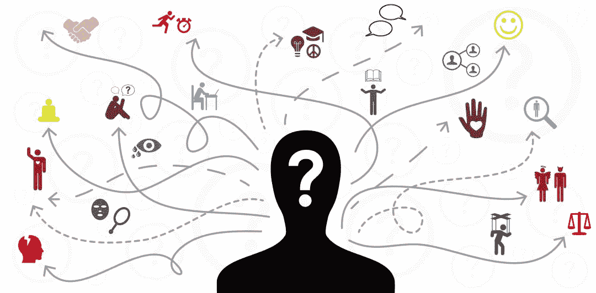

# 27 讲 两种维度的分化：比爱恨更重要的情感能力是什么？

武志红

2022-04-24

## 27 讲 两种维度的分化：比爱恨更重要的情感能力是什么？

27 讲 两种维度的分化：比爱恨更重要的情感能力是什么？

在这一讲之前，我们已经讲了四种分化，但是，人性非常复杂，涉及到的分化种类繁多，目前讲到的是我认为最重要的几个。那么，其他类型的分化，能不能有一个逻辑清晰、条理分明的理解呢？

## 人性坐标体系

在思考这个问题时，我想到了我总结出的一个“人性坐标体系”。 这个坐标体系的纵轴是力量维度，横轴是情感维度。

纵轴的力量维度，你也可以理解成自恋维度、权力维度、能力强弱维度。横轴的情感维度，你可以理解为关系维度、道德维度等。当思考一种人性的分化时，如果你想给它做一下归类，那么可以看看，它是该归到力量维度上，还是该归到情感维度上。

用力量维度和情感维度，更能说明这两个维度的性质。不过，如果想特别准确地来理解，还是自恋维度和关系维度更好一些。

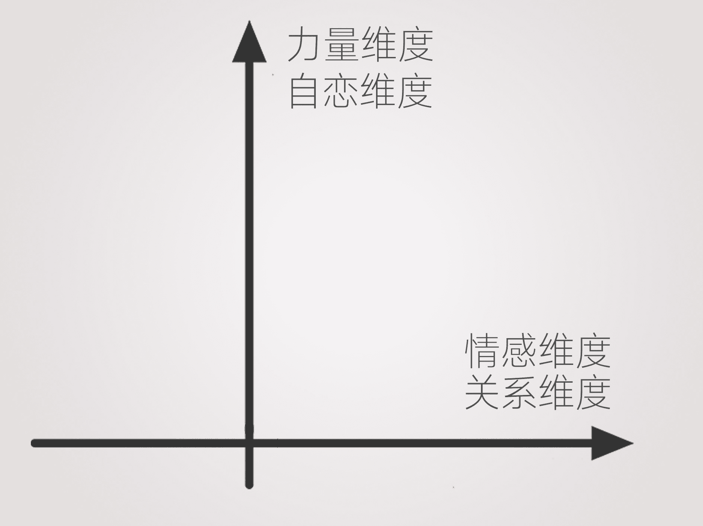

## 自恋维度与关系维度

仅仅清晰地意识到自恋维度与关系维度的存在，这也是一个重要的分化，可以帮助我们理解很多东西。

首先，我希望能帮助你意识到，虽然我们喜欢讲爱恨，但爱恨的情感能力，在心灵发展上是比较滞后的，而自恋、力量维度，是天然的。  
**一个人从只在乎力量的自恋维度，发展到真正在乎情感的关系维度，这是一种人格上的重要发展。**  
当一个人处于混沌共生中时，他常常以为自己特别在乎爱恨，但其实他真正敏感的是力量的强弱，也可以说是权力的高低。

我们还是用比较常见的社会新闻举例吧。

一辆公交车上，一位孕妇准备下车，她给一位老太太让座，让座时她说：“您慢一点，别碰着我。”就这样一句话，触怒了这位老人，老人开始对孕妇破口大骂，指责她说：“你让我站了好几站都不给我让座。”孕妇解释说：“我是孕妇，身体不方便。”老太太说：“你是孕妇咋了？我是老人，你就该让座！”

这件事中，我认为可能是孕妇觉得自己主要在表达关系维度的内容，而老太太完全感知不到这一点，她感知到的只有自恋维度的内容。你早就该给我让座，你提醒我别碰着你，也是在攻击侮辱我。在老太太的世界中，只有“我”，也就是只有自恋、权力、强弱与高低，而没有“你”，没有关系、情感、爱和平等。

这个坐标体系，还可以帮助我们理解很多现象。例如，我发现身边常常有人有这样一种感觉，好像必须足够卓越才配活，才可以得到承认。我把这个称为“卓越强迫症”，核心症状是相信“不卓越不配活”，这是怎么回事？

如果用这个坐标体系来分析，那就是我们常常特别在意力量的自恋维度，而对情感的关系维度，感知不够深。单纯从视觉上看，我们只在乎纵轴，纵轴的特质就是分高低。我们不太在乎横轴，而横轴的特质是平等。

我们可以给这种现象，在这个坐标体系上标定一下分数。我认为，我们对纵轴的在意是无限的，假设满分是 100 分，那意味着我们的感知会是从-100 分到 100 分，而对横轴的感知，我们不敏感，也许可以打-10 分到 10 分。想象一下，这个纵轴无限，而横轴是-10 分到 10 分的图，像不像是一条狭窄的独木桥？

当我用这个画面再去重新思考时，立即明白了我老家村子里的一位大家长的故事。

这是发生在我身边的事儿，这位大家长是我们村子的一位能人，他非常能干，他的家族和他所带领的儿子、女儿两边的家族，都是村里过得比较富裕的。可以说，他是这整个家族当之无愧的“大家长”。他对第三代孩子们的教育特别焦虑，一次听说我回老家了，就带着一个孙女和一个外孙来见我，希望我能开导开导这些孩子，让他们好好学习。

其实，这种事我见多了，几乎必然的一个规律是，家长们都希望我去开导孩子，可最终都变成我发现了家长们的问题，开导和分析他们。

这位大家长的孙女，在读小学高年级，一直都是班里前五名，还在刚刚结束的考试中考了第二名。这是很好的成绩了，可这位大家长说不满意，他觉得第二名毫无意义，只有第一名才有意义。你可能觉得听上去像在开玩笑，但他说得情真意切，不是装的。

虽然我在多年的心理咨询中，已经见过很多父母对自己孩子不够认可，总说“别人家的孩子”更好，但这位大家长的看法和他坚决的态度，还是刺激到了我。

这位大家长，或者类似有这种“只有第一名才有用”想法的人，可以说，他们情感的关系维度基本上没展开，他们只感知到了力量的自恋维度。

我想请你想象一下这个画面，他们的横轴完全没有展开，只有纵轴，那会出现什么情况？

从数学上来讲，纵轴在-100 分到 100 分之间是有无限多的位置的，但从心理学角度来看，纵轴这时会出现一个变化，那就是只有 100 分和-100 分。或者说，只有 100 分，也就是最高位置才有价值。

为什么会这样？我认为是因为力量维度和死亡焦虑联系在一起。如果人性中只有力量维度，那意味着位置最高的那个人，可以决定其他所有人的生死。所以，虽然 99 分也够高了，但只要不是 100 分的最高位置，就还是会有巨大的死亡焦虑。

再说回到这位大家长的外孙，是一个男孩，他的成绩一直很差，总是倒数，有时会考倒数第一名。

一次，他考了倒数二十几名。按说这是一个巨大的进步，可姥爷和妈妈还是肆意地批评他，说你怎么还是这么烂，你看你竟然还有点骄傲了，你知不知道这个成绩还是在中下的位置？你还是落后的，你骄傲什么？

我有一位做家教的朋友，她说这种现象她见过很多，成绩特别差的孩子，他们的家长就是对中间位置毫无感觉，他们会认为孩子从考二三十分到及格毫无意义，从及格到七八十分也毫无意义，似乎他们只要顶尖的好成绩，这就很容易导致孩子们自暴自弃。

我对那位大家长的外孙讲了自暴自弃的逻辑，我告诉他，从倒数最后几名到倒数二十几名是巨大的进步，你本来期待着得到大人的认可，但发现还是被批评后，你很生气，很绝望，干脆自暴自弃，甚至故意考倒数第一名，来气他们。你这是在报复惩罚他们，这带给你了快感，让你觉得自己有力量。不过，你也可以换一种方法，你自己知道学习很重要，学习好了自己也会开心，那么，你能不能为自己学习呢？

或许是我的话起了作用，我听说几个月后，这个男孩的成绩有了非常大的提升。

自恋是人的根本属性，刚出生的婴儿天然都是在自恋维度上，而且这还涉及到死亡焦虑，他们因此对力量的强弱和权力的高低非常敏感。

但是，随着感知到抚养者特别是妈妈的爱，他们开始感知到关系的维度，开始体验到爱。并且，当他们也能对妈妈产生深厚的爱时，他们才感知到，世界上不是只有“我”这一个中心，还有“你”这另一个中心，“你”和“我”一样都是值得尊重的人。这时，平等也就产生了。

所以说， **只有情感，才能让人感知到平等。**

相信很多人都会有这样的体会，你原本对一件事很纠结，这件事中有很多东西令人敏感在意，但当你感知到这件事中你和对方的爱后，你突然间放下了敏感与纠结，你觉得怎么着都行。这就是从力量维度到情感维度的转变。

不过，力量维度并没有消失，而是随着情感维度的展开，你的心胸一下子变得宽广了很多。回到刚才我们说的人性坐标体系，就是当横轴和纵轴的分数都能展开时，整个坐标系的面积一下子变大了。

## 孝顺≠爱

这又让我想到孝顺这件事。很多人会认为，孩子对父母的孝顺是爱。我想说，我们常常对孝顺的定义很模糊，甚至偏离了它原本的意思。比如，我们通过这个人性坐标体系来看，孩子顺从父母，如果是把父母放到了权力的高位，维护了父母的自恋，这是力量的自恋维度的表达。但却常常忽略横轴的展开，横轴意味着平等。过于强调顺的孝顺，是被扭曲的孝顺，爱的部分缺失了，所以这样的孝顺可能就不是爱。

实际上，如果想让自恋的婴幼儿感知到爱，需要养育者，特别是妈妈，在孩子幼小的时候给予孩子充分的照顾，并呵护孩子的自恋。而这意味着，养育者要常常呵护孩子的动力与意志，让他们的动力与意志基本得到实现，最终孵化出自我来。

思考题

我们社会中有很多现象，本质是自恋、力量与权力的表达，但被我们说成是关系、情感与爱，这是一种倒错，你能想到哪些呢？你又是如何理解的呢？欢迎在留言区写下你的想法。

1\. “人性坐标体系”的纵轴是自恋、力量与权力维度，特质是分高低；横轴是关系、情感与爱的维度，这可以帮助理解人性涉及到的各种分化，特质是平等。 2.  
力量维度和死亡焦虑联系在一起，只有情感才能让人感知到平等。从只在乎力量的自恋维度，发展到真正在乎情感的关系维度，是人格的重要发展。

  

公众号懒人找资源，懒人专属群独享

# 模块引论：心中住下一个爱的人

武志红

2022-04-24

## 模块引论：心中住下一个爱的人

模块引论：心中住下一个爱的人

我在总论中介绍课程理论模型时，跟你讲过心理学家马勒的婴幼儿心理发展阶段论，这个模块对应的就是马勒所说的第三个阶段“分离与个性化期”中的第四个亚阶段，如果你需要复习，可以回到总论二，再学习一遍。

简单来说，马勒认为，人在 24—36 个月的时候，会完成两件很重要的事：“情感客体稳定性和个体化的完成”。

我先来为你解释一下什么叫“情感客体稳定性”的完成。

人在这个阶段，会把身边最重要的情感寄托对象，也就是那个外在的爱自己的人，通常是妈妈， **内化到心中，让自己“心中住下一个爱的人”。**

现在的育儿观念中有一个共识，妈妈最好稳定地、高质量地陪孩子到三岁，其间尽量不要有分离。这个说法的源头，我想也许就是因为马勒这个理论的流传。

**当“心中住下了一个爱的人”之后，你对孤独的承受力就高了很多。**  
反过来也可以说，能享受孤独的人，不要觉得都是因为自己境界高，真相可能是你运气好，因为你在 3 岁之前把爱你的人内化到了你心中。

好，这是情感客体稳定性的完成，那什么叫“个体化的完成”呢？

就是指，当人用 3 年的时间把外在妈妈的爱变成“心中住下一个爱的人”的同时，孩子的个体化过程也完成了，也就是说，他抽象意义上的自我诞生了。

“你存在，所以我存在。”这句话你肯定不陌生，很多西方哲学家作过这样的表述，他们说的“你”其实是“上帝”，但在母子关系里，我们可以借用这个表达，这也是成立的。当孩子在三岁前得到了比较好的陪伴，在三岁时，他的内心会同时住下“我”和“你”。

这是心灵发展过程中一个里程碑式的进步。在 6 个月前的共生期，孩子虽然本质上是活在“我们”之中，但孩子只能感受到“我”是唯一的中心，可以说是活在一元世界中。当心中同时住下了“我”和“你”时，孩子的心灵，就进化到了二元世界。再以后，当孩子能将父亲这个“他”也能当作中心，而内化到自己内心后，他的心灵就进入了三元世界。

关于一元、二元和三元的关系，我在年度课程《武志红的心理学课》中的“关系”模块里有详细论述，感兴趣的话你可以去搜索学习。

回到个体化的过程，我们说到抽象意义上的自我诞生了，但这个诞生的过程并不那么容易，这期间任何一点阻碍和干扰，都会影响诞生的进程。这个模块的课程中，我们就来详细聊一聊。

课前调查

在正式学习开始之前，我也想做个调查：

你是从记事起，就觉得别人和你一样需要尊重和平等，还是因为经历了什么事、有了什么体悟后才意识到这一点的呢？

欢迎你留言给我，如果这中间有转变过程的话，请详细讲讲。这或许可以反映出你是在什么时候，完成了你本应该在 3 岁前就迈出的这一步。

  

公众号懒人找资源，懒人专属群独享

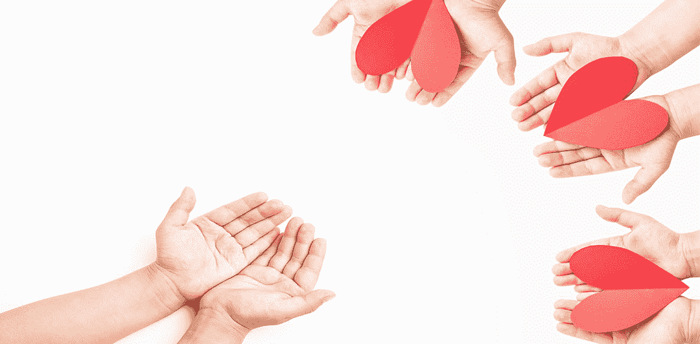

# 28 讲 无条件积极关注：过度渴望外界回应是怎么回事？

武志红

2022-04-24

## 28 讲 无条件积极关注：过度渴望外界回应是怎么回事？

28 讲 无条件积极关注：过度渴望外界回应是怎么回事？

这一讲中，我要为你讲一个完整的个案。因为它非常地具有代表性，我相信通过对它的分析，和对相关心理学知识的学习，能够帮助你很好地了解一个成年人在心理学意义上的自我确认。

这个个案的主人公是我的一位来访者，她是个女孩，称她为 M 吧。她来找我咨询的时候，25 岁，当时我发现她有两个非常特别的地方，一个是有撒谎癖，一个是很容易紧张。

## 个案问题分析

什么是撒谎癖呢？就是，当别人问她关于自身信息的时候，她永远不会在第一时间说实话。

例如关于收入，假设她月收入是 12000 元，那她绝不会第一时间如实相告，哪怕是最好的朋友。她要么说多一点儿，要么说少一点儿，就算跟真实数字只差一点点，也不会把真实数字告诉对方。

当然，你可能说，收入算隐私，想保密可以理解，但她在很多其他事情上也是这样。例如吃了一顿饭，别人问她花了多少钱，她也绝不会说实话。

这样的撒谎癖不是道德问题，因为她不是为了骗取好处，更无意伤害对方。我认为，这么做只是要把自己的真我隐藏起来，不让人看到。

对我，她一开始也有类似表现，例如关于姓名和家境，她都有隐瞒，但后来又如实告诉了我。但后来据她自己说，相对于其他人来说，在面对我时，她已经尽可能坦诚了。

再说说她的第二个特征，容易紧张。

我和她做一节心理咨询的时间大概是 50 分钟，这个过程中 M 会一直坐得很端正，而且每时每刻都在非常紧张地关注着我的一举一动。如果我略有懈怠，如疲惫、犯困、皱眉或者低头等等，她都会紧张地问：武老师，我让你累了吗？我刚才的表达不好吗？我是不是说得太乱了？

通常这样的现象，我倾向于理解为，这其实是来访者对咨询师生气了，但他们表达指责时会有困难，于是把这份指责转向了自己，所以才会问你是不是她哪里做得不好了。M 说，她真的从来没有因为我这些懈怠而生气，她是觉得，自己说话确实啰嗦，没重点。

不过，对于她每时每刻都在紧张地盯着我这一点，她是没有自知力的。对她而言，这是自然而然的状态，她在哪儿都这样。“不识庐山真面目，只缘身在此山中”，这个诗句可以用到这儿。

## “镜映”与“无条件积极关注”

经过我的分析，我认为，她的撒谎癖和容易紧张的问题，都可以归到一点上，那就是她在寻找“镜映”\[1\]。这是心理学上的一个名词，简单来说，就是给出正向回应。

从生理学意义上的自我来说，我们对自我身体的认知，最早是从镜子里来的，我们会有一个被外部照到，然后才知道我是谁的过程。

**心理学意义上自我的确认，也需要一面镜子，需要另外一个人作为镜子去确认我们、看到我们。**  
最常见的，就是婴儿需要通过妈妈等主要照料者作为镜子，从中得到自己身份的确认。

回到 M 这个个案，也就是说她希望她发出的每一份动力，都能从我这面镜子里得到回应，这会带给她一种感觉，“她完全是好的”。

所以说，她每时每刻的紧张，对我一举一动的关注，就是希望我能给她这种回应。当我有懈怠时，她之所以不生气而是指责自己，是因为她把我当成了权威，权威这面镜子没有问题，如果有问题，也是因为受她影响。

从职业角度看，我的确需要给她“镜映”，或者，你可以简单理解为“无条件积极关注”\[2\]，这是人本主义心理学家罗杰斯提出的概念。简单来讲，无条件积极关注基本等同于“无条件的爱”，  
**我对你好，是没有任何附加条件的。** 所以我对 M 的心理咨询，最初就是支持和肯定为主，后来才逐渐给她专业的分析。

M 的撒谎癖，可以这样理解： **她如此渴望得到外界回应，尤其希望从别人的镜子里看到自己是好的，当她得不到这种回应，就会让她觉得她的真我是“坏的”。**  
所以，但凡涉及到“她自己”的信息，她都会习惯性撒谎，制造一团迷雾，好让别人看不到她的真我。

这也会导致一些其他常见的问题，比如她几乎没朋友，她和父母的关系相当差。一般人在这种情况下，就不会想着改变父母了，因为最终会绝望且疲惫不堪，只好转身离去，而去构建自己的生活。M 读过不少心理学的书籍，知道这一点，但她本能上特别想改变妈妈，特别想和妈妈亲近，于是做了很多努力。

一开始，她是受到了一些挫败，但经过一年多努力后，突然一天，她和妈妈的关系，发生了巨大变化。听到她的讲述，我深切感知到这是一种质变。不过同时，我也有担心，因为这是 M 使了很大劲才换来的，而妈妈也很不自然，这份变化能持久吗？后来，她和妈妈的关系果然出现过很多次危机，有时危机能持续半年。不过，每一次危机最终都化解了，前两年多数是她主动向妈妈示好，后来基本都变成，妈妈先过来向她示好。

在和妈妈的关系有了质的改善后，她遇到了一个蛮合适的男孩，开始了真正的恋爱。这个过程中，做心理咨询也起了很大的作用，如果不是咨询，她可能分分钟就会选择分手。想分手的原因都是一致的，就是当男孩有了懈怠后，她立即觉得，对方是不是不喜欢我了。

心理咨询中我的懈怠，和恋爱中男孩的懈怠，有时是真的，但更多时候是她自己的误解。追求镜映的人，只要没得到积极回应，就会感知成负面回应。可实际上，除了别人偶尔会给她负面回应外，很多时候别人只是活在自己的世界里，而产生的一些懈怠，并不是针对她。

这个道理，其实她头脑里是懂的，但体验上却做不到，对方不给积极回应，她就会紧张。我认为可以这么说，她在 6 个月前的婴儿期，共生需求没得到基本满足。于是，虽然她有成年人的头脑，但她的心灵上还非常渴求与一个人共生。

再后来，她结婚了，可是，并不像是两个成年人的婚姻，更像是丈夫是一位妈妈，在哄着她这个宝宝。

## 孤独与回应

她和妈妈的关系愈加亲密，会有各种约会，一起看电影，一起听课，一起吃饭。有一段时间，她只要一空下来，就会不安，特别想给妈妈打电话，有时电话接通了，却不知说什么。

一孤独就不安，必须要找人陪伴，这可以理解为，孤独的时候，因为没有镜子给自己积极回应，于是她就会觉得自己的动力与意志都是坏的。这太可怕了，所以必须要找一个人，作一面镜子来告诉自己：你是好的。

妈妈越来越懂女儿的这种感觉，会对她各种夸奖、肯定、表达喜欢，妈妈常对她说的一句话是：“你可爱，做什么都对。”并且，妈妈虽然有忍耐和配合的时候，但她由衷地愿意这么做。

我的理解是，妈妈之所以在女儿幼小的时候没满足女儿的共生需求，是因为这位妈妈也没有从自己妈妈那儿得到满足。所以，随着和女儿的关系越来越亲密，都有了共生感，她的共生需求也被满足了。

M 在和丈夫、和妈妈的这两对关系中，甚至会越来越放肆，而丈夫和妈妈都能容纳这些。有时候可能会受不了，关系会暂时崩掉，但他们都会主动转过来和她修复。能有两个人宠自己，M 深深地感到，这太幸福了。

这种状态持续了大约三年后，一些改变悄然发生了。有一次，有人问 M，你的新工作怎么样？她自然而然地跟对方讲了一些情况，包括她的收入等等，然后她意识到自己竟然没有撒谎。在和我的咨询中，她也逐渐放松一些了。有一天，我突然感觉到，我们关系中的那种一直以来的紧张消失了，我也忽然明白，她变了，她放松了下来，她不再每一分每一秒都关注我的一举一动。

她也意识到了自己的改变。她说她觉得整个生命乃至整个世界都不一样了，有一句话从心中涌出：“反正有大把美好时光可以浪费。”

M 能从极度紧张发展到基本放松，这是一个巨大的成长。

\*

作为这一模块的第一讲，我们一起通过这个案例，了解了一个成年人在心理学意义上的自我确认。之所以用 M 的个案来串联所有的内容，是因为这样更能帮助你理解。这一讲还只是浅层的分析梳理，下一讲我还会对这个个案做更多的分析，并通过分析引出我们这一模块的核心理论。

思考题

听完了这一讲，我也想听听你的理解和分析，最好是使用你在我们这门课程中学到的相关理论。如果你也有类似的转变，也可以讲讲你的故事，和你对自己的分析。欢迎在留言区和我讨论。

注释：

\[1\] 镜映（mirroring）

在自体心理学中，父母对子女的正向反应，反映了自体价值的感受，并逐渐灌输内在的自体尊重。父母对于儿童的活动的欣喜，这对儿童的发展来说是基本的要素。这样镜映反应的结果，儿童能发展并维持自尊和自我肯定的抱负。

\[2\] 无条件积极关注

人本主义心理学家罗杰斯将对咨询关系的重视提到了一个前所未有的高度。关于如何构建咨询关系，他提了三个非常简单的原则：真诚、共情、无条件积极关注。无条件积极关注，是自我发展的重要方式之一。它是一种没有价值条件的积极关注体验。即使自我行为不够理想时，仍能觉得自己受到父母/咨询师的真正尊重、理解和关怀。

  

公众号懒人找资源，懒人专属群独享

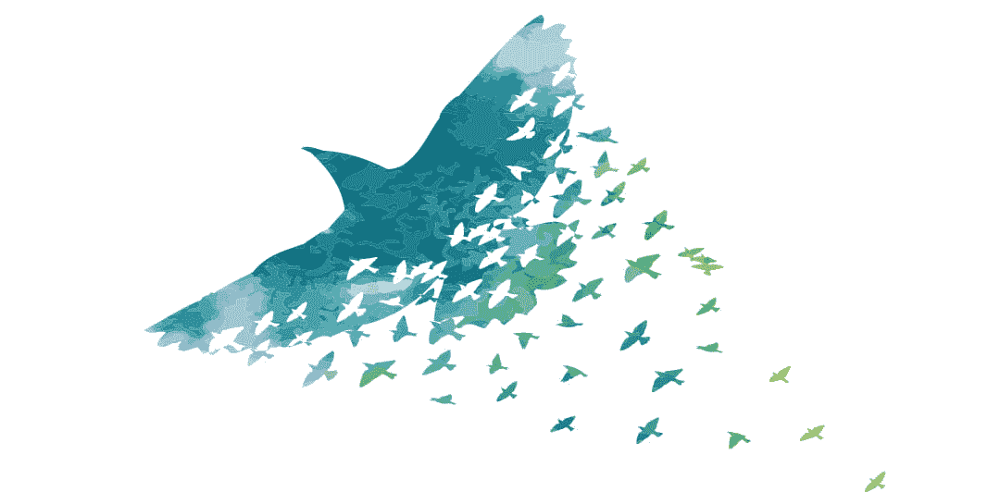

# 问答：翅膀，是在一次次跌落中炼成的

武志红

2022-04-24

## 问答：翅膀，是在一次次跌落中炼成的

问答：翅膀，是在一次次跌落中炼成的

这一期的用户提问大多来自总论和第一模块。

在回答问题前，我先来分享一首鲁米的诗：

鸟儿在天空， 画着它们的圆圈， 它们是如何学会的？ 一次次地跌落，它们 就获得了翅膀。

我在年度课程《武志红的心理学课》中，会在每个章节的开篇分享一首鲁米的诗，很多老同学都说很怀念武志红的文字、宝木的声音和鲁米的诗这样的组合。

我在看后台留言中同学们的问题时，很自然地想起了鲁米充满哲理和韵味的诗。

引用这首诗是想说， **别着急，别忘记你的困境和问题的价值，因为能驾驭飞翔的翅膀，就是在一次次跌落中炼成的。**

读者 用户“蓝知水”：:

> "这门课程里的“自我”与年度课程里“本我”“超我”中讲的“自我”有没有区别呢？ "

弗洛伊德的人格结构理论，将人格分为三个部分：本我、自我和超我，对应着的英文是 id、ego、superego。

这门课程《自我的诞生》中的自我，指的是“self”，对应着弗洛伊德人格结构理论中的“人格”。

现在，流行的翻译中，会把“self”翻译成“自体”。Ego 相对会被理解为是头脑、意识层面的“我”，而 self 是自体，指的是全面的“我”，特别是翻译成自体，就有了“身体”“实体”一样的感觉。

我认为“自体”这个翻译很好，但我们习惯的使用中，这个词还是有些距离和晦涩，而我自己也一直不是太喜欢使用这个词，加上“自我”的概念有约定俗成的部分，所以在我的课程中，“自我”大多数时候就是自体，当我要表达“头脑自我”的时候，我会专门说明一下。

这些概念你听上去可能会觉得有些混乱，我是想过把它们统一起来，但暂时还没有这样做。也许未来会做这项工作。

读者 用户“露酱”：:

> "我觉得一个婴儿的发展历程，也是一个成年人形成内聚性自我的关键，重新养育自己一遍，是不是发展“自我”的关键呢？但是已经没有那个环境，没有了简单的需求，极度缺乏安全感就像真实的攻击一样，攻击内心。那该如何解决？"

这是非常好的问题，我的这门课程就是在阐述这个意思。如果能做到很好地把自己养育一遍，那么头脑上就算不必明白课程中的理论，也可以帮助自我重新获得诞生并发展起来。

当然，问题是成年人都有厚厚的防御，直接去重新养育非常不容易，所以需要去学习。但学习时，别忘了照顾好自己。

读者 用户“云枫”：:

> "邵恒头条有一期内容，大概是说从传统大家族分裂成“核心家庭”后，这个“小家庭”非常脆弱，因为少了“减震器”。而这个“减震器”，正是其他亲戚帮忙调解矛盾。"

> "按浆糊逻辑的意思，其他人参与貌似是不好的。可有时候有其他人的参与，确实能起到调解的作用。所以在家族内部，把别人的事当自己的事去解决，只要不过分干预，是不是也是有积极作用的呢？  
> "

其他亲戚帮忙，掺和到小家庭的冲突中来，这当然会有减震器的功能。

我们之所以要去构建非常复杂的关系网络，也许就是因为当心智发展水平太低时，难以在一对一的二元关系中解决问题。

不过同时，如果总是使用减震器，那就回避了成长。

以我自己的观察，就像我在第一模块课程中的总结，我认为太复杂混乱的家庭关系，反而是严重破坏了小家庭的连接。

读者 用户“雨诺”：:

> "我们所有人都是生活在各种各样的关系之中，只要在关系中每个人都会或多或少地作出妥协和让步，那就无法完全按照自己的心意生活，这样的情况下真实的自我和外界的关系之间不就是会形成一种矛盾吗？该如何处理这种矛盾呢？"

我认为，人当然是没可能“完全按照自己的心意生活”，各种矛盾普遍存在。

但是，当能做到“我的世界我说了算”，“你的世界你说了算”，“共同的世界可以有基本公平的神圣第三方规则来遵循”，那就会清爽简单很多。

所以我的这门课程是从边界意识生长出来的，当人有了基本边界后，焦虑会减轻很多。

读者 用户“鞠鑫”：:

> "武老师，我发现在跟上辈人相处的家庭中，浆糊逻辑彼彼皆是。虽然我逐渐找到自我、发展自我，可是却无力摆脱浆糊的纠缠，父辈认为他们的逻辑强大到带有不可违逆的神性，特别是在争夺子女教育话语权上，所以我时常会感到无奈和郁闷。这种情况我该怎么办？"

这是很有意思的问题。

首先，当发展自我的观念越来越普及后，社会集体观念也会随之发生改变，然后父辈们会往回收他们的边界，下一辈的空间和权力就会得到尊重。

放到微观之处，这个宏大的改变，就有赖于一个又一个家庭的改变。例如你就需要学习，如何让父辈们不去过度入侵你，和你的孩子们的空间。这有很多奥妙的地方，也有一些技巧，我会在课程中不断论述。

拿我做心理咨询的经验来说，基本都是真正来做咨询的那个人是痛苦的，所以才想到改变。如果总是你痛苦，而父辈们不痛苦，他们当然不会去改变，当下一辈的“反抗”给他们带来一些痛苦时，他们才会想去改变。当然了，我说的反抗是打引号的，不是硬碰硬地抗争。

我认为，虽然这个过程有痛苦，但改变导致人格成长，所以，这是值得的。

读者 用户“duoer”：:

> "我的前任就是一个典型，他一遇到加班和父母亲闹矛盾，就会情绪不好，和我的沟通就会莫名其妙地火药味很重。一开始我还以为是我真的做了什么让他很受不了的事，后来一分析，加上询问他的近况，才知道我被当成出气筒。但是，和他讲道理没有用，一旦想解释一下他的情绪跟我没关系，他就会换个角度继续吵，甚至扯出几个月前的事情来骂我。"

> "分开一段时间以后，我感觉自己轻松了很多，也不用成为那个“害”他的人了。不知道他找到了另外一个“害”他的人没有。像这种思维，要怎么样才会有转机呢？一辈子生活在这种思维里，会怎么样？"

首先我要恭喜你，离开了一个喜欢归罪别人的人。

一辈子生活在这种思维里，如果总有可以欺负、可以归罪的人，那这样的人也可以活得不错。但如果没有人欺负和归罪了，他们会很惨。

我从你的提问里觉察到另外一点，当你不断在问“他会如何”“他会怎样”时，这可能显示着，你习惯性地，还是会把注意力放在别人身上。

读者 用户“Rumi”：:

> "怪罪别人，可以保护自己的全能感和自恋。但有的时候我也会过多地归因在自己身上，承担很多属于别人的责任。而这种压力，希望把事情做到完美的压力，会让我产生拖延。没法做好，那就不要开始。  
> 所以武老师，这个度要如何把握？感觉好难。"

怪罪别人，是直接在追求自恋，追求全能感。

但并不是另一个方向就不是这样了。A 和-A，本质上是一回事。我认为，总是做自我归罪的人，一样也是有全能感的逻辑，“如果我控制好自己，就可以让一切按照我的意愿去发展了”。

我认为这里面没有一个简单的“度”，当一个真实的自我形成后，很多事情会自然而然地发生改变。

读者 用户“跟着我的感觉走”：:

> "为什么有的人会把伴侣所有的不好都记住，永远带着这些不好去看对方？"

我认为，是因为受全能感支配的人，会有这个逻辑：我全然是好的，你要全然完美地回应我，而那些不好，都意味着在破坏这个全能幻觉。

还可以说，这样的人，他们还活在动力水平的我这个层面，他们有一个逻辑，“我的动力=我”。于是，他们的体验是，在任何一个细节上没有得到对方的积极回应，都意味着这个动力被杀死了，也就是“我”被杀死了一次，因此会产生巨大的恨意。

读者 用户“简简单单爱”：:

> "我倒是不会把责任推给别人，但是我觉得自己也不是很愉快，有时候告诫自己：吃亏是福。是不是也是一种自我防御机制在工作？ "

本来吃亏了，但劝自己说，这是“福”。这种逻辑，是一种经典的自我防御机制，也就是“合理化”。

同时这也意味着，是“攻击性转向自身”，因此的确会有不愉快的体验。如果总这样，就可能会累积出抑郁来。我认为如果有这样的情况，可以多试试去向外表达攻击性。

\*

欢迎你就这门课程的内容继续向我提问，写在下方留言区中。我会不定期做问答加餐。希望这些交流能够帮助你更好地学习这门课程。

  

公众号懒人找资源，懒人专属群独享

# 29 讲 情感客体稳定性：为什么心中需要住下一个爱的人？

武志红

2022-04-24

## 29 讲 情感客体稳定性：为什么心中需要住下一个爱的人？

29 讲 情感客体稳定性：为什么心中需要住下一个爱的人？

上一节课中，我讲了我的一位来访者 M 的案例，这一讲我想带着你一起，用咱们课程的理论对 M 的情况做一下更详细的分析。因为这是非常典型的一个案例，通过对它的分析，可以帮助你更好地理解自我诞生过程中，个体化完成的重要意义。

好，我们先来看看 M 的问题，究竟是什么？我认为，至少有以下两重：

*   **第一，她在婴儿时和妈妈的共生没有得到满足，导致她部分卡在自闭之壳中。**
    
*   **第二，她两岁前的基本任务“外化”，也没有完成。**
    

## 共生没有得到满足

她成年后如此渴求共生，加上与妈妈的关系一开始很差，让我推理出，六个月前的共生期中，她没能和妈妈建立基本的共生关系。

上一讲我们也提到，M 在恋爱中，常常没法持久，这也可以理解为，一旦她发出动力，稍稍受挫，这份动力就会死掉，可以说“动力的诞生”在她身上都是一个问题。

当然，爱的表达对很多人来说都是大难题，我见过很多人恋爱中都是一般的水准。可能他们中有人在其他方面，可以追逐自己的动力与意志，但也的确有不少人显示了一定程度的自闭。例如我们这个案例的主人公 M，她基本没有朋友，这也是自闭的表现之一。

我还观察到一点，M 像是没有自己强烈的需求，她除了对和妈妈的亲近表现得很执着以外，在其他方面都没有比较热烈的爱好。这也可以说，她的太多动力都处于冰封状态，没有真正活出来。

## “外化”没有完成

**外化完成，对应的现象是，能将自己的动力和意志自如地伸展到客体上。** 客体包括人、事和物，这一点上，M 都有匮乏。

比如，她有一个非常特别的地方，小学一年级、初一、高一乃至大一，成绩都非常出色，但一年级学期末成绩就开始坠落，二年级就很普通了。她有极其强烈的好胜心，可这份好胜心，并不能支持她取得一贯的好成绩。而且也不是她智商的问题，我觉得她智商也相当高。

为什么有强烈的好胜心和高智商，而且一年级总能取得出色的成绩，然后就不行了呢？

我觉得这可以用“意志的诞生”的说法来解释。

**任何普通人，都有动力，都可以起心动念，渴望自己卓越，这是全能自恋的表现，而且人格越是稚嫩，全能自恋就会越强。**  
但是，要实现学习成绩的卓越，一般来讲都需要“意志力”，需要你能持续地作出努力。但在 M 这里，我认为她是能靠高智商和强烈的好胜心，在短期内获得好成绩，可她的意志尚未诞生，所以难以持续努力。

以上这两点，是对她的问题的一种解释。

那一个孩子，一个成年人的动力和意志如何能诞生呢？学了前面的课程你已经知道，这需要得到“基本满足”。所以“基本满足”，就是  
**一个人从内部发出了他的动力与意志，最终在外在世界中得以实现，当获得“我的动力与意志能基本实现”的感觉时，这就意味着动力与意志的诞生。**

## 如何得到“基本满足”

一个成年人，可以通过智识，去选择那些对自己难度适度的东西，在这方面发起动力和意志，然后不断地去实现它们。这是一条显而易见的路。不过，如果你的动力和意志没有诞生，这样做就会非常不容易。

而且在我的观察中，如果一个人就是要去追求事情上的实现，就会导致一种现象：你在某一方面或某几方面，展开了你的动力与意志，但好像整个世界，仍然对你是关闭的，外化仍然没有发生。

我认为，动力的完整展开，外化的基本发生，需要这样一种基础： **你和一个人，建立了完整的关系，既有深情，又有广泛的配合。**  
这样完整的关系，可以帮助你比较全面地打开自己。

最容易看到的完整关系，就是亲子关系和情侣关系， **因为生活本身，就必然意味着广泛的配合。**

对于 M 这样的人来说，她需要和一个人重新建立适当共生的关系。因为，婴幼儿时的匮乏，导致她觉得自己的动力和意志基本上是“坏的”，不能向其他客体展开。这种感觉刻骨铭心，让她一直都是严重蜷缩着的。成年后，当和妈妈建立了适度共生的关系，她的动力和意志都可以向妈妈这儿伸展，也包括在妈妈的陪伴与帮助下向其他客体伸展，这种感觉的实现，才彻底打开了她的世界。

虽然玛格丽特·马勒说，只有 6 个月前的婴儿与妈妈的共生才是正常的，此后的共生都是病态的，但我在咨询和生活中，见到了不少像 M 这样的故事，他们的确是成年后，通过实现和一个人的适度共生，才重新打开了自己。

六个月前的婴儿与妈妈的共生是全然的，是百分百的，他们希望全然地拥有彼此。而成年人的共生，第一，不容易只有彼此，第二，也要有意识地不要全然陷入二人关系。例如对 M 而言，她和老公的关系不错，而妈妈和爸爸的关系很好，这让她和妈妈的共生程度没有太严重。

她们的关系，应该是既有强烈的共生部分，例如经常一起做各种事，同时又有 6—36 个月的“分离与个体化”的部分。

这一部分是什么样？你可以想象一个经典的画面：

*   **孩子在专注地玩耍，但需要妈妈或稳定的抚养者陪伴在身边，他们受挫时会找妈妈帮助，把事做好了就想与妈妈分享。**
    

对应到 M 这儿，就是她什么事都想讲给妈妈听。

不管是亲子关系、情侣关系，还是其他深度关系，我们都需要懂得一点，我们在满足彼此的需求之外，同时还帮助彼此更好地伸展了自己。这份伸展，或者说生命力的扩展，比满足彼此的需求还要重要。

我们还要懂得一点，人是慢热的动物，无论是亲子之间，还是其他重要关系，要想实现彼此的基本满足，实现关系的深度，需要时间。

## 情感客体稳定性

说到这儿，需要讲一下心理学家马勒的另一个重要概念，“情感客体稳定性”。要讲清楚这个概念，先要讲清什么是“客体稳定性”。

你肯定知道，和幼小的孩子玩“藏猫猫”的游戏是很好玩的。妈妈把自己的脸用手蒙上，再突然打开，孩子会笑得特别开心。可孩子大了，这游戏就没法玩了。

这是为什么呢？因为，幼小的孩子还没形成“客体稳定性”的概念，他们觉得，一个物品看见时，就是存在的，看不见时就不存在了，所以一会儿存在，一会儿又不存在，这种对比太刺激了。妈妈和孩子玩藏猫猫，给孩子的感觉是，最爱的、唯一的妈妈突然间消失了，喔，这太可怕了，可还没来得及感到恐惧和悲伤呢，妈妈突然又回来了。这太刺激了！

听到这儿你要注意了，我并不是反对这个游戏，实际上，这是很好的游戏，可以帮助孩子慢慢形成“客体稳定性”的概念。

“物质客体稳定性”很容易形成，智力正常的话，孩子在 9 个月时就有了客体稳定性的概念。但是，很多人终其一生，“情感客体稳定性”都没能形成。

**情感客体稳定性形成的标志是，虽然一个人对你有时好，有时不好，但你基本上确信，他是爱你的。**  
这一点的形成，是需要时间的。马勒认为，如果妈妈稳定地给予孩子有质量的爱，那么孩子三岁左右时，会形成情感客体稳定性。

如果换做一个封闭的成年人，要重新相信这份爱，更需要时间。所以，在 M 这个案例中，她花了更多的时间，才终于确信妈妈是爱她的。

上一讲中，我讲到她后来不再紧张，慢慢放松下来，你可能会觉得这没什么了不起。其实，这是巨大的改变。之前的紧张，是她怀疑自己不好，不值得被爱，而且这份不好，是一种基本感觉，无处不在。但当和妈妈的关系得到巨大改善，并且这种状态持续了数年之后，她终于确认，妈妈是爱她的，而她是值得被爱的。这个时候，她才放松了下来。

马勒把 24—36 个月，称为是“情感客体稳定性和个体化的完成”的亚阶段。这两个术语可以这样理解，  
**情感客体稳定性的形成，是一个人的心里住下了一个爱的“你”，而个体化的完成，是这个人确信，“我”是好的，是值得住在抽象的心里的。**  
这意味着，一个人的心里，住下了一个“好的我”和“好的你”。

**“好的你”，愿意善待我；“好的我”，也愿意善待你。**  
即便你我之间有愤怒，有敌意，那也是可以在我和你的关系中得到化解的。这样的基本感觉，才带来了真正的放松。

思考题

你发现了吗？爱，就是这么了不起！你有这样的时刻吗？突然间发现，不知不觉中，你心中已经住下了一个爱的人，你的生命从此变得不同。

1.动力的完整展开，外化的基本发生，需要这样一种基础：你和一个人，建立了完整的关系，既有深情，又有广泛的配合。  
2.情感客体稳定性的形成，是一个人的心里住下了一个爱的“你”。虽然这个人对你有时好，有时不好，但你基本上确信，他是爱你的。这个过程，需要时间。  
3.个体化的完成，是这个人确信“我”是好的，是值得住在抽象的心里的。这意味着一个人的心里住下了一个“好的我”和“好的你”。

  

公众号懒人找资源，懒人专属群独享

# 30 讲 个体化自我：为什么必须学习尊重自己的感觉？

武志红

2022-04-24

## 30 讲 个体化自我：为什么必须学习尊重自己的感觉？

30 讲 个体化自我：为什么必须学习尊重自己的感觉？

这一模块我们在谈“个体化的完成”，这一讲，我要和你讲一讲“个体化自我的诞生”。

你可能读过米兰·昆德拉的小说《生命中不能承受之轻》，他在里面描绘了女主角特丽莎的一种恐惧：

小时候，她的妈妈一再对她说，你什么都不是，你和别人没什么两样。 这种说法里，有绝望和认命在。  
特丽莎很美，她希望是独一无二的存在，不过不是因为美才这样想，而是特丽莎觉得，独一无二才意味着，她是存在的。  
特丽莎的妈妈年轻的时候也很美，这份美貌给她带来了炫目的存在感，她同时和几个男子有性关系，可被一个条件一般的男人设计了，怀了他的孩子，不得不嫁给他，后来生活越来越不如意。  
可能特丽莎的妈妈觉得自己被嘲弄了吧，她变得坦荡而鄙俗，也想让女儿接受她的感觉：你和别人一个样。  
和托马斯在一起后，特丽莎把这份渴望放到了托马斯身上，希望托马斯能给她这份感觉——“你是独一无二的。”然而，她被嘲弄了，托马斯有无数情人，他亲她的时候，和亲别的女人一个样，摸她的时候，和摸别的女人一个样。

我在思考“情感客体稳定性和个体化的完成”的时候，会禁不住地想起特丽莎的这个渴求。

当一个孩子能稳定地在妈妈充满爱意的目光的这面镜子中看见自己时，他就能感受到自己是独一无二的存在。情感客体稳定性的形成，也意味着孩子个体化的完成。很显然，米兰·昆德拉笔下的这位特丽莎没有形成这一点。

## 个体化自我

个体化完成之后，紧接着就是需要个体化自我的诞生。什么是个体化自我？就是你形成了一个独特的自我，它围绕着你的感觉而构建。

幼儿怎么才能形成自己的个体化自我？我在之前的课程中，多次讲到这个问题，概括来讲，需要以下这些条件：

1.  **6 个月前，妈妈和孩子构建好共生关系，满足孩子的共生需求。**
    
2.  **6—36 个月期间，按照孩子的需要，逐渐和孩子拉开距离，但妈妈仍需要给孩子感觉“妈妈基本稳定地在你身边”。妈妈可以上班，出短差，这时需要一个替代抚养者，总之不能让孩子自己待着，而且这个替代抚养者也要稳定，别换来换去。**
    
3.  **养育者给孩子高质量的回应，这包括照顾孩子的生活需求，和情感上的需求。**
    
4.  **允许孩子说“不”，尊重孩子的“我来”。**
    

在这些条件下，孩子最终相信，世界是基本可以信任的，他的生活基本是可以掌控的。而且，他不是委曲求全地活着，他可以按照他的感觉，展开他的动力和意志。

在我的这门课程体系中，所谓的活着至少有三个层级，先是动力层级的“我”可以活下来，接着是意志层级的“我”能活下来。到了三岁的时候，终于是抽象自我层级上的“我”可以活下来。

反过来也可以说，当“我”是动力层级时，人会执着于一个动力，要求当下的这个时空中立即实现，否则就觉得“我”要死了；当“我”到达了意志层级时，一个人就有了时间感和空间感，简单理解就是我们通常所说的耐心，但还是不能接受意志的生死；当“我”是抽象自我层级时，一个人就获得了一个超然于一切具体动力和意志上的自我，这份抽象的存在感，会让一个人形成更大的心灵空间，而且他能理性地接受一些动力和意志的死亡。

这是正常的心理发展过程，如果能这样发展，一个人可以说是幸运的。奥地利精神病学家阿尔弗雷德·阿德勒有一句非常戳心的话：  
**幸运的人一生都被童年治愈，不幸的人一生都在治愈童年。**

## 尊重你的感觉

人性非常复杂，心理学也纷繁复杂，想要形成个体化自我，有最简单的原则，可以让人去遵循吗？

我认为有，那就是，尊重你自己的感觉。这是个体化自我的关键。没有形成个体化自我的，需要学习尊重自己的感觉，最终集腋成裘，形成个体化自我。形成了个体化自我的，他们自然而然地会尊重自己的感觉。

当然，也存在特殊的情形，本来有鲜明的个体化自我的，但在残酷的环境中，因为不能尊重自己的感觉，最终丧失了个体化自我。

说到这儿我想问你一个问题，感觉是什么？你一定有自己的答案。我认为， **感觉是你和一个事物建立关系时的产物，它分身体感觉和情绪情感，还有一些莫名的感觉。**

关于感觉和自我，我还想跟你介绍精神分析学家科胡特的一对术语：真实自体和虚假自体。如果一个幼童，他基本上是围绕着妈妈的感觉转，就会形成虚假自体；如果他基本上能尊重自己的感觉，就会形成真实自体。

对自己来说，有真实自体的人，会感觉到自在。所谓自在，就是“我和自己在一起”；有虚假自体的人，不管看上去功能多好，他们自己会感觉不自在，而敏感的人也会感觉到，他们不真实，有些假，而且他们和你之间，像是隔着什么似的，难以碰触彼此。

有虚假自体的人，他们还有一个关键问题，会发生“向思维认同”。他们觉得“思维就是我，我就是我的思维”。可以说，  
**有真实自体的人，他们的自我的内容，是活生生的体验，有虚假自体的人，他们的自我的内容，是剥离了体验的思维。**

实际上，真实自体和个体化自我的概念基本等同，是心理学家们发展出不同的词汇，可以帮助你从不同的角度来理解一件事。形成真实自体的条件，和形成个体化自我的条件可以说是一样的。

## 真实自体的功能

当父母或其他养育者，有意地想爱孩子，想培养孩子的个体化自我，可以有一个基本意识： **在孩子的事情上，你是尊重孩子的感觉，还是想把你的意志强加给孩子。**

或者说，如果从孩子的角度看，孩子是“我”，养育者是“你”，那么养育到底是允许“我”从“你”的世界中脱颖而出，还是“我”要消融在“你”的世界之中。

这么说你听上去可能觉得很抽象，我来给你举个例子。

我的一位来访者，是一位女士，我们可以叫她 W。她十来岁的时候，父亲去世了。在此之前，父亲也总是出差，和她在一起的时间不多。这意味着，她一直和妈妈在一起。她成家后，妈妈也继续和她住在一起。

在一次咨询中，我和她谈到和妈妈的关系，她告诉我说，她感觉自己像是被粘住了，又像是掉入了一个泥沼，她想脱离，但怎么也脱离不了。

她还有一个非常有意思的情况，她后来开始学心理学，但在我面前，她显得好像没有什么光芒，极少看到她在心理学方面的天赋。然而，她在和同学们一起时，却可以释放这种光芒，令同学们常常为她的天赋惊叹。

她说，我觉得在你面前谈心理学，像是对你的一个巨大冒犯，我根本不敢想象有一天我会像你一样，在心理学方面取得巨大成就。

我们来看看这位女士想表达的意思，我的确是有点儿名气，但你应该也有体会，名气这种东西，是远看时才会发生的，而我和她的咨询关系，是非常近的关系，她其实能看到我作为一位咨询师的完整部分，既有一些优点，也有明显的缺点。但即便如此，一想到要和我比高低，她就觉得这是非常恐怖的事情。

非常有意思的是，这种情况后来发生了变化。这位女士在工作中遇到了一位能力很强的领导，一直和她是平等相处，而且允许她挑战自己，当有不同意见时，这位领导总能看到她的可贵之处。当然，如果她错了，领导也会指出来。这位领导是真实地欣赏她。

结果，在工作中，这位女士开始绽放自己，几乎在方方面面她都发现，自己的水平提升了至少一个层次。此前，她根本不敢想象，自己会是这样的能力水平。

从我分析的角度来看，在她身上，原来的“虚假自体”是非常明显的，她非常有礼貌，也有不错的情商，但所有人都觉得难以靠近她，她自己也觉得，她的样子是使劲“装”出来的。

在这个领导的带领下，她的“真实自体”率先在工作中展现了出来，就像是她的光芒把一个虚假的壳给彻底戳破一样。并且，她在工作中体验到了自在，无论是做事，还是和同事领导相处，她都变得非常尊重自己的感觉，总是能不假思索地表达自己，同时能做到情商很高不伤人。但是，真正需要她去做一些伤害性的事情，例如辞掉不适合的员工，她也能做得游刃有余。

这就是真实自体的功能，它比虚假自体效率高很多。我和这位女士后来的咨询，也因此变得简单了很多，我们不断在探讨她与其他人的关系，和她与这位领导的关系有什么不同。她在工作中的体验能移植到其他关系中吗？如果不能，是卡在了哪里？

好，我想和你再一起来看一看，为什么这位女士和领导的关系，会带给她这么大的滋养？其实，我给你举这个案例，就是想帮助你理解，这和好父母的关系很像。好的父母，和她这位领导对她，都有容器功能。

什么叫容器功能？你把事情做好了，认可你；你受挫了，支持你。而且，你可以冒犯我，我不需要你因为服从而消融在我的地盘上，我愿意看到你的“脱颖而出”，我愿意看到你一飞冲天，逐渐脱离我的怀抱。

这还可以概括为： **我愿提供支持给你，同时，我也接受你颠覆我。**

思考题

欢迎你在留言区中谈一谈，你是如何看待“感觉”的，你又能不能做到尊重自己的感觉呢？

1.个体化自我，就是你形成了一个独特的自我，它围绕着你的感觉而构建。  
2.有个体化自我的人，自我的内容是活生生的体验；有虚假自体的人，自我的内容剥离了体验的思维，也让人感觉不真实。  
3.好的父母和其他好的客体，都有容器功能：你把事情做好了，认可你；你受挫了，支持你。同时，我也接受你颠覆我，我不需要你因为服从而消融在我的地盘上，我愿意看到你的“脱颖而出”，逐渐脱离我的怀抱。

  

公众号懒人找资源，懒人专属群独享

# 31 讲 个体化自我的功能：最好的自我结构是什么样？

武志红

2022-04-24

## 31 讲 个体化自我的功能：最好的自我结构是什么样？

31 讲 个体化自我的功能：最好的自我结构是什么样？

这一模块我们谈的是“个体化的完成”，我用了三讲内容讲述个体化自我，那形成个体化自我到底有什么作用？这一讲，我们就来谈谈“个体化自我的功能”。

从课程第一讲到现在，相信你已经看到，从动力的诞生，到意志的诞生，再到抽象自我的诞生，都是非常重要的心灵升级。

那你有没有想过，我们升级自己的心灵，到底是为了什么呢？

我认为，至少有一个极为重要的功能，就是为了有一颗更加坚韧的心。因为只有这样，你才能进入更为复杂、更为真实的激烈竞争。

精神分析学派有一个众所周知的经典理论，认为 3—6 岁的孩子会进入俄狄浦斯期，也就是恋父恋母期，男孩会想和爸爸争夺妈妈，女孩想和妈妈争夺爸爸。

如果你不太了解这个理论，肯定会觉得这种观点太难以接受，但我要告诉你的是，你可以把这种竞争理解成社会竞争的雏形。俄狄浦斯期的竞争，孩子既要把他的竞争欲伸展出去，又不能真的成功，毕竟竞争对象是自己的父母。所以还要学习和异性父母的合作与和解。当孩子能处理好这个竞争和合作的关系后，他在处理家庭以外的竞争合作关系，就有了一个很好的基础。

实际上，三岁前的孩子和妈妈的关系中的竞争要更激烈，但这主要是想象层面的，而俄狄浦斯期，当父亲介入竞争后，这时的竞争合作就是看得见的，已经是现实层面的真实竞争了。

孩子需要坚韧的心，才能展开俄狄浦斯期的竞争，而在此之前，最好是孩子已经形成了他的个体化自我。

## 自我的结构

说起来非常简单，自我有两个部分，外壳和动力。最好的自我结构是什么样呢？如果让我形容，就是  
**有像人的皮肤一样的外壳，既有保护作用，又能和外界进行敏感而充分的互动。内部的动力，又是自在流动的，像有生命力的水流一样。**

好，我来分别说说这两个部分。先看外壳，自我的外壳是非常重要的。

我来举一个自己的例子。有一次，我在不断深入自己的潜意识之后，潜意识的深渊吓到了我，于是，我就去找一位资深的心理咨询治疗师请教，他告诉我说，探索潜意识，或者说觉知心灵，是一件非常危险的事情，需要一个结实的自我，能包住这些内容。

他的话让我很有收获，其实，不仅探索潜意识需要一个心灵的外壳，我们平时一样需要。我在咨询和生活中和人深度对话时，好像能感受到每个人不同的自我之壳，而基本上每个人对自己的自我之壳，也有自己的形容和理解。

例如，有来访者告诉我说，觉得自己被困在了监狱里，不一样的是，有门，也有锁，但一直觉得这个锁是打不开的。有一天在梦中发现，他的牢房里有开锁的钥匙，当他去开锁的时候，发现这把锁已经打开了。而且，锁不是在门外，而在门里面，也就是说，这把锁最初是他从里面锁上的，不知不觉中他已经打开了，但头脑上还没有意识到。

为什么要锁上？因为不安全。为什么要打开？因为渴望别人能走进来。这个梦以后，我的这位来访者明白了，他是不愿意主动走出去。因为，这样就意味着是他发出了走出去找人的动力，如果这份动力被挫败了，会让他感觉很恐怖，甚至是受伤。所以他期待的是，他主动打开门，由别人来找他。在我的帮助下，他明白了这个梦的含义后，他明白该他自己主动走出去了。

对于自我之壳，除了这个意象之外，我常年的咨询经验还发现有另一个方向的极端意象，那就是有人觉得自己是没有皮肤的，是裸露在风中的。

我认为，有这种极端意象的人，他们有的就是破碎自我。他们不能保护自己，甚至暖风都会让他们疼，也就是说，别人温柔地靠近他们，他们也会有痛苦和敌意，同时也控制不住自己去攻击别人。

除此之外，还有些意象是像皮肤，但又有质的差别。例如，很多人会觉得，自己像是被困在一个塑料薄膜里，他们能从薄膜里看外部世界，看得还算清楚，也能隔着这层薄膜去碰触感知别人。可这当然还是有隔绝感，有时他们想去撕掉这层薄膜，这时发现，这个薄膜无比坚韧，他们根本撕不破。这种感觉，也是令人很恐怖。

但是，如果是另一种意象的皮肤，那就会是最好的自我之壳。这种皮肤和自己的身体有机地结合到一起，就像是身体的一部分，可以和外部世界有非常好的互动，敏感而灵活。

## 内在的动力

动力，如果是被自我之壳所包裹着，也会变得很不一样。

最好的状态是， **内在的动力既像肌肉，又有血脉，而且比这个更灵活，你会感觉到这些动力有时能像水流一样，在美妙地流动着。**

人的动力有三种，包括自恋、性和攻击性。虽然这三者容易被我们视为不好的东西，而要去控制、去压制，但如果你体验过，自恋、性或攻击性酣畅流动的感觉，你就会知道那有多迷人，甚至还会上瘾。

**自恋、性或攻击性，其中的任何一种动力能酣畅流动时，人都会产生高峰体验。** 高峰体验，是美国人本主义心理学家马斯洛提出的一个经典术语。

马斯洛发现，自我实现者们常常会提出一种特殊的生命体验，“感受到一种发自心灵深处的颤栗、欣快、满足、超然的情绪体验”，由此获得的感觉，就像光一样，照亮了他们的一生。这种体验持续的时间虽然短暂，但深刻无比。

我甚至可以用更极致的形容，当一份动力全然流动时，你会有神性的体验，你觉得自我之壳消失了，“我”也消失了，你进入了一种“无我之境”，你会体验到“我就是万物、万物都是我”这种合一感。

## 动力与规矩

这个道理放到养育孩子和对待自己上，我希望你能懂得一点： **动力的流动，要比规矩重要很多。**

我认为我们之所以想立规矩，至少有两重原因：

*   担心自恋、性和攻击性这些动力是破坏性的坏东西，如果流动起来，就会伤害别人；
    
*   这些动力能比较好地流动的人，会变得厉害、不太好管，用我在之前课程中提到的“人性坐标体系”来理解，这样的人在力量维度上容易发展起来，于是不太愿意居于低位，不愿意听话。
    

但是，我认为比起人对动力流动的需求，这两重原因就显得没那么重要了。

**人活在这个世界上，需要一种基本感觉：我可以带着主体感，也就是“我是我生命的主人”，走入外部世界。**  
如果没有这份感觉，人就宁愿把自己封闭起来，退到一个相对孤独的小世界。这样的小世界，无论别人看起来多么不合理，对自己而言，都有一个巨大的意义，那就是在这里我是主人。

这一讲的内容临近结束，我想举一个我身边现实的例子。

最近几年，我发现当我回到河北老家农村时，总有我们村里或邻村的人来向我求助，说他们的孩子从大城市回到家里，不愿意出门了。我发现，这些孩子有中学生，也有二十多岁的成年人。

可惜的是，我并不能对他们从心理学的角度有很好的干预，因为心理咨询工作是建立在来访者承认自己有问题的基础上的，愿意为之付出努力而寻求改变。但这些年轻人是他们的家人来向我求助，他们自己通常不愿意面对自己的问题。

我通过观察发现，他们其实是在社会激烈的竞争中落败下来，觉得没有希望了。用我们这一讲的内容来说，就是他们觉得没有希望把自己的生命动力外化了，于是选择了退回到一个很低的位置上，或者退回到封闭的小世界中。

如果你不希望自己的孩子或者自己有一天会这样，你就需要在这个世界中展开你的动力。这比规矩、纪律要重要得多。懂得遵守规矩和动力，会让你和这个世界的冲撞减轻一些，但如果这些来自外部世界的力量，彻底主导了一个人的行动，那这个人就容易选择严重的自我封闭。

简单来说，你必须懂得，你的个体化自我非常宝贵。人活在这个世界上，不是生来去顺从的。

心理学家温尼科特有一句话非常好，这一句话胜过我这么多絮絮叨叨。他说，  
**孩子的养育中，“需要一个不会报复的人，以滋养出这种感觉：世界准备好接纳我的本能喷涌而出”。**

愿你能滋养出这样的孩子，也能滋养出这样的你自己。

思考题

学习了“个体化的完成”这个模块，你又有什么新的收获吗？欢迎你在留言区中分享，如果对这部分内容还有疑惑，也欢迎你向我提问。

1.孩子需要坚韧的心，才能展开俄狄浦斯期的竞争，而这最好是孩子已经形成了他的个体化自我。  
2.最好的自我结构是，有像人的皮肤一样的外壳，既有保护作用，又能与外界进行敏感而充分的互动；内部的动力又是自在流动的，像有生命力的水流一样。  
3.人活在这个世界上，需要一种基本感觉：我可以带着主体感走入外部世界。

  

公众号懒人找资源，懒人专属群独享

# 模块引论：家庭是社会关系的原型

武志红

2022-04-24

## 模块引论：家庭是社会关系的原型

模块引论：家庭是社会关系的原型

我们的课程已经完成了六个模块，这六个模块的内容如果对照到总论中的理论模型，其实一直是三岁前的母子关系，到了这个模块，才引入了父亲。至此，孩子也开始步入三元世界。

在这之前，孩子一直处在母爱怀抱中，虽然已经开始试炼自己的力量，但母爱怀抱是一个初级而简单的演练场，并且母亲会被孩子感知为“自己人”，而父亲已经被孩子感知为“外人”。  
**父亲、母亲和孩子，构成了一个复杂的三元关系，这是一切社会关系的原型。**

## 三元关系的意义

三元世界，或者说三元关系，到底有什么意义呢？

我曾经在微博上，见到过一些极端的、所谓的女权主义的观点：为什么非要父亲加入？父亲只是提供了一颗精子，母亲现在不缺物质，社会也越来越能提供支持给母子关系，要父亲干什么？

的确，现在有很多讽刺的新名词，例如“丧偶式育儿”，是说父亲就像不存在一样，育儿成了母亲一个人的事。还有更糟糕的“诈尸式育儿”，需要父亲帮忙的时候，他不在，但又时不时跳出来指责母亲和孩子。这样的父亲不仅添乱，还想要主导权。

如果真是这些情况，父亲简直就是来剥削母亲和孩子的，那确实要问了，要这样的父亲做什么？

不过，这些都是糟糕的情况。 **正常情况下，父亲的存在会让孩子天然地处于一个复杂的三元关系中，这有助于孩子心灵的进化。**

三元关系不只是和父母，它其实无处不在。当你和一个人发生冲突时，如果就是你们俩彼此争斗，你会发现不容易判断尺度。这时你会很容易想到，去找一个第三方来评断一下。这就是三元关系。

对应到和父母的三元关系中，并不是说父亲就是做像裁判一样的第三方，而是说当父亲和母亲或孩子中的某一人发生冲突时，另一个人就可以做第三方。这也就是为什么我们说父亲的介入让孩子进入了三元世界。

**现实世界中，充满了各种各样的三元关系。**  
所以，一个人需要学习如何在这种复杂的关系中，既能展开自己的竞争欲，又能与人合作，还能掌握各种分寸。最初的三元关系，就是父母与孩子的关系，孩子可以充分去学习，这是孩子进入真实社会前的一个重要的演练场。

## 竞争与合作

3—6 岁的这个阶段，或者说家庭港湾的这个阶段，孩子需要完成的是竞争与合作，和对规则的遵守与挑战。

如果把孩子比作小鹰，自闭期的婴儿就像还在鹰蛋中，共生期进入母爱怀抱后，就像刚孵化的小鹰，看上去还像是只无害的小鸡。分离与个体化期的孩子，就像是开始长出羽翼、尖牙和利齿的小鹰了。

但是，这样的小鹰，还需要去磨炼自己的攻击力，3—6 岁的俄狄浦斯期就是一个这样的阶段。孩子在和父母的关系中，磨炼竞争力，同时又要学习合作。只在和妈妈的二元关系中，孩子还不太敢这么做，只有当更有力量的父亲进入到亲子关系后，孩子才可以大胆展开攻击性。

课前调查

请你说说你和父亲的关系吧，你什么时候意识到父亲在家庭中的存在？又是什么时候意识到他在你心中的存在？很多人对父亲的认识会有一个转变过程，你有吗？是什么时候发生的转变呢？欢迎你在留言区和我讨论。

  

公众号懒人找资源，懒人专属群独享

# 32 讲 不同的爱：与父母的关系象征着什么？

武志红

2022-04-24

## 32 讲 不同的爱：与父母的关系象征着什么？

32 讲 不同的爱：与父母的关系象征着什么？

这一讲我来谈谈父爱与母爱的不同。在第六模块中，我谈到无条件积极关注时，为你完整分析了女孩 M 的个案。我们来简单回顾一下。她有撒谎癖，很容易紧张，这都源自她对外界回应的渴望。她为了改变和妈妈的关系做了很多努力。

## 融合与秩序

这一讲，我们再来看看 M 这个案例。

M 在和妈妈修复好关系之前，她和爸爸的关系质量还不错，可以打到 60 分以上。妈妈和她的关系，只能打到 30 分。

不过，当和妈妈的关系得到修复，甚至实现了部分共生后，M 对爸爸越来越不满。因为她发现，妈妈对她几乎是完全接纳的，但爸爸会对她有挑剔。我作为旁观者必须得说，爸爸对她的挑剔其实并不多，我甚至觉得，她爸爸的批评都很有道理。

这是怎么回事呢？

我认为原因就在于，父爱和母爱是不一样的。 **荣格认为，母爱指向融合，父爱指向秩序。**  
放到 M 这里，妈妈会由衷地说“人可爱，做什么都对”，一喜欢起来，觉得女儿怎样都是好的。可爸爸会说这是好的，那是坏的，这样是对的，那样是错的。

**荣格还认为，女性天然是情绪化的，男性天然是重逻辑的，** 男性需要向女性学习情绪的感性力量，女性需要向男性学习逻辑的理性力量。

感性的情绪，和母爱指向融合，是联系在一起的；理性的逻辑，和父爱指向秩序，联系在一起。

如果是在情侣关系中，理性的逻辑，要去理解情绪，不能轻易去切断情绪。因为逻辑看上去再高明，也不能建立关系中的连接。能够建立连接的力量，来自感性的情绪。

到了亲子关系中，母爱的情绪力量带来的巨大好处是，与孩子建立充分的连接。这种不带评判的力量，才可能与婴幼儿建立起共生关系。如果动不动就去做理性认识，这种逻辑的力量反而会破坏连接。

所以，对还强烈需要共生的 M 来讲，认为她可爱，认为她做什么都对，这样的母爱太重要了。没有这样的母爱，她就难以走出自闭之壳。

但是，当她的动力越来越能伸展时，就需要逐渐与妈妈分开。这一点如果是孩子，那会非常明显。但 M 是成年人，可以说她的分离与个体化，和共生需求得到满足，是搅在一起的。当她受不了妈妈时，她还有丈夫；当妈妈受不了她时，也可以去找 M 的爸爸。

## 父亲与三元世界

从孩子的角度看，父亲在孩子三岁前不重要。这是客体关系理论家们一致的看法。“不重要”的意思是，父亲不容易直接对孩子发挥作用，孩子也更在乎母亲。你看，我们一直在讲的玛格丽特·马勒的理论，她在讲三岁前孩子的心理发展过程时，我们的确没看到里面对于父爱的论述。

但这个阶段，父亲当然也有极为重要的价值。他的价值就是，给太太提供保护和支持，这样才能让母亲更好地去容纳孩子。在第 8 讲《蛋壳隐喻》中，我也讲到，蛋壳是有两层的，母亲需要专注地去做软壳的时候，父亲就要做那个坚硬的外壳，去保护太太和孩子。

在这个基础上，父亲就能对三岁后孩子的成长发挥重要作用。 **父亲的存在，可以撑开母子关系，让孩子活在三元世界中。**

我来用几何图形帮你理解这个三重世界。

*   **在共生期，孩子与母亲彻底融合，这就像是一个圆，这是一元世界；**
    
*   **分离与个体化期，孩子与母亲的关系，就像是一条线，这是二元世界；**
    
*   **三岁后，孩子进入弗洛伊德说的俄狄浦斯期，这时的关系世界，就像是一个三角形。如果没有父亲的存在去撑开，母子关系的分离就有可能会失败，又退化到一元世界，母子彻底融合。**
    

我作为心理咨询师，见过很多母子彻底融合的案例，大多不是孩子想和母亲融合，而是母亲离不开孩子。而且，很多人的原因都是，母亲自己在童年时，共生需求严重没有得到满足，于是在自己的孩子身上寻求这份满足。

我还见过非常严重的案例。母亲不允许孩子去找心理咨询师，孩子也因为被母亲严重吞噬，很难迈出做心理咨询这一步。共生关系是严重排外的，成年孩子和母亲彻底融合的严重个案中，通常母亲会把自己的丈夫也赶出母子关系之外，不让父亲对孩子发挥影响。这很容易导致离婚，就算不离婚，父亲在家里也像一个影子一样，极度没有存在感。

普通成年人是不会希望和谁严重共生在一起，英国精神分析学家温尼科特认为，能充分满足婴儿共生的母亲是特殊的，但凡孩子大一点，母亲也会想脱离这份共生关系。所以在这种前提下，父亲的存在就非常重要。

我们来想象一个场景：妈妈和孩子之间发生了冲突，两人都很激动。这个时候，如果丈夫站出来说：来来来，老婆，你离开一会儿，我陪陪孩子。或者对孩子说：你离开一会儿，我和你妈待会儿。

你看，父亲只是这样做，就会很有作用。当然了，父亲的作用要远胜于这些。

我之前在课程中也讲过，当关系只是“我”和“你”的二元关系时，作为母亲的“你”象征着外部世界，而作为孩子的“我”象征着内部世界。但是，当关系进入到“我、你、他”的三元世界时，就变成母亲像是自己内部世界的一部分，父亲才是外部世界。这就引出了一个根本性的隐喻：父亲是外部世界的象征。

关于父亲，有一个说法是“你与父亲的关系，决定了你与社会的关系”。意思是，和父亲关系好，就能比较好地融入社会；和父亲关系不好，融入社会就会有难度。因为，  
**社会就是外部世界，父亲是最原始的外部世界，是外部世界的象征。**

所以，如果父亲能与孩子建立足够好的关系，这会让孩子在进入社会时容易很多。最好是父亲自己已经比较好地适应了社会，融入了社会。

## 父亲的努力

父亲与母亲还有一个巨大的不同。母爱像是天然就形成的，通常情况下，孩子都会天然爱母亲，这种爱一出生就有，因为在妈妈肚子里就已经有了无比深刻的连接。

父爱不行，父亲想让孩子感觉到爱，孩子也对父亲产生爱，这需要父亲的努力。父亲不能什么都不做，或者做得非常简单，不能等着孩子来和自己建立密切的关系。

我来讲一个现实的案例，亚马逊的创始人贝佐斯（Jeff Bezos），他的生父特德·约根森（Ted  
Jorgensen）没有抚养过他，他和继父生活在一起。贝佐斯三岁时，生父就离开了他，然后直到贝佐斯功成名就后，有记者去采访时，这位生父才知道原来世界顶级富翁是自己的儿子。约根森是一家自行车修理店店主，生活贫困，生前想和儿子取得联系，但没有成功。等他死后，贝佐斯才到他的墓前看望。

另一个知名人物，苹果的创始人乔布斯（Steve  
Jobs），也是一出生就被亲生父母送人了，养父母对他很好。不过，他最终还是承认了母亲，但一直没有承认亲生父亲。

我在做心理咨询的过程中，见过很多情况没有这么严重的案例。孩子从小就离开父母，跟着其他养育者，例如爷爷、奶奶、保姆等等。等孩子长大了一些后，回到父母身边。这时，母亲比较容易和孩子恢复情感，但很多父亲容易表现得很急迫。他们最初也做了一些努力，可看到孩子没有给予回应，就很快放弃了。情况糟糕的父亲，还会反过来指责攻击孩子。结果造成孩子对父亲更加反感，父子关系就像是变成了仇人一样，甚至一辈子都没法修复。

其实在我看来，容易气急败坏的父亲，本质上也是一个宝宝，他们期待着孩子能给自己回应，希望自己稍一努力，孩子就爱上自己。但这是不可能的，你想想看，母爱住在孩子心里，需要母亲不仅怀胎十月，还要在三岁前给孩子稳定高质量的爱。父爱当然也是这样，如果想让父爱住在孩子心中，父亲需要做出同等级别的努力。

**爱，从来都不简单，不可能一蹴而就。**

思考题

请你来回忆一下，你的爸爸给你“外部世界的象征”的一件小事，他是如何让你从他身上，看到更大的世界的呢？欢迎你写在留言区分享。

1.女性天然倾向于感性的情绪，母爱指向融合；男性天然重理性的逻辑，父爱指向秩序。  
2.父亲对三岁后孩子的一个重大作用是，父亲的存在可以撑开母子关系，让孩子活在三元世界中。  
3.父亲是外部世界的象征。如果父亲能与孩子建立足够好的关系，会让孩子在进入社会时容易很多。 4.爱从来都不简单，不可能一蹴而就。

  

公众号懒人找资源，懒人专属群独享

# 33 讲 竞争欲：为什么说父亲是所有敌人的原型？

武志红

2022-04-24

## 33 讲 竞争欲：为什么说父亲是所有敌人的原型？

33 讲 竞争欲：为什么说父亲是所有敌人的原型？

上一讲我们讲到父爱与母爱的不同，孩子对母亲的爱像是自动获得的，当然了，其实是母亲怀孕、分娩、哺乳和陪伴换来的。但比起母亲，父亲更需要努力。

## 父亲是所有敌人的原型

不仅如此， **父亲的存在还有一个重要的意义：承载并化解孩子内在的敌意。** 对这一点，美国神话学家约瑟夫·坎贝尔（Joseph  
Campbell，1904—1987）有一个经典的说法： **父亲是所有敌人的原型。**

这一讲我们就来谈谈这个问题。

父亲是所有敌人的原型，我觉得可以有一个简单的理解。最初，当孩子还处在与妈妈的共生关系中时，他会把妈妈觉知为自己的内部世界的一部分，而爸爸不仅是外部世界的象征，也是想从外部世界闯入这个共生关系中的“敌人”。

这个敌人要打引号，但也不难理解。任何想要闯入高度共生关系的人，都会被想控制这个关系的人视为敌人。例如很多婆婆仇视儿媳，是因为她们想和儿子共生在一起，儿媳是破坏这个共生关系的人，自然就会被视为敌人。

为什么说父亲可以化解孩子的内在敌意呢？ **当一个人内在充满敌意时，必然要去寻找外在的敌人。**  
这叫作投射。当这个外在的关系，能容纳并转化这份敌意时，这个外在的转化，又可能会被这个人内摄进来，于是，这个人内在的敌意就被转化了。

这是非常重要的机制。所以你看，父亲最初被孩子视为“敌人”，这并不是坏事。因为，不管母子关系是一元世界还是二元世界，在容纳敌意上，都是困难的。

我们可以把敌意理解为死能量。我在第 11 讲《母亲包围圈》中提到过死能量，是指你的任何一个动力被拒绝或者忽视了，就会变成死能量；如果被接纳，就会变成生能量。也就是说，动力原本都是中性的，当表达动力失败了，就会变成死能量。我刚刚说到的敌意，就是死能量。

一元关系完全接纳不了死能量。因为一元世界中，一个人会觉得死能量会把自己杀死，所以要把敌意完全排挤出去。

简单举个例子，例如我的一位男性来访者，他觉得自己是天底下最好的人，周围的人都是坏人。那些稍不如意就暴怒的人，也是因为他的心灵完全容纳不了死能量，要拼命向外投射。

二元关系就会好很多，毕竟，当和母亲建立了密切关系后，孩子就会觉得向母亲扔一些敌意是可以的，母亲能接得住。不只是亲子关系，其他亲密的二元关系也一样。

不过，如果只有二元关系，还是不敢向对方扔太多敌意，例如恨意。因为假如你的生命中只有一个珍爱的人，你不能恨他，你会担心恨、敌意这些死能量，一旦表达，对方就可能会被杀死，这太可怕了。所以，最好是在二元关系之外，找另一个人去恨。

如果你找一个普通人去恨，那对方是没有必要容纳并转化你的恨，所以可能报复你，也可能转头就走。

但如果这个人是父亲呢？你是他的孩子，这就变得很不同。

## 爱恨的表达

说到这儿，你可能还没有完全理解。我们可以来做一个想象。这个想象对很多人来说，可能就是真切的感知。

你和我现在处在二元关系中，如果我们觉得这个世界上我只在乎你，你也只在乎我。那么，我们之间很难有表达和容纳恨的空间，我们俩会觉得对方完全是好的。这个时候，一旦有恨意升起，你会体验到，好像这个关系一下子变得全坏了。或者说，你的恨意会让你惧怕，因为好像要去杀掉我一样。

你看，在这样纯粹的二元关系中，爱和恨都是直戳戳的。如果你一表达，就希望直接传到对方那儿去。如果表达爱，对方得立即接住，如果表达恨，对方也得接住。接不住，这个恨意就反过来弹到自己身上。所以，二元关系是迷人的，但张力也是极大的。

**可一旦变成三元关系就不同了，爱和恨就可以绕弯了。** 特别是，你可以分化爱和恨，把爱表达给在乎的人，把恨表达给不太在乎的人，这样就可以保护好的关系了。

我个人认为，孩子三岁前会产生很多敌意，甚至是恨意。因为他们如此无助，即便有妈妈等抚养者尽心尽力地呵护，他们还是有很多动力和意志都不能实现。这些敌意和恨意憋在内在世界里很不舒服，不如表达出来。

我觉得，这个时候表达很重要。因为孩子的力量太小，他们就算全力地去表达自己的攻击性，对父亲造成的伤害也很有限。

说到这儿我们得理解，父亲力量大，块头大，能在更高水平和孩子玩攻击和被攻击的游戏，这也是很重要的一点。

我曾在博客上和网友们探讨这个问题，至少有两位父亲对我说，这下子他们明白了，他们的孩子曾对他们说：爸爸，不知道为什么，同样的事，妈妈干了可以，你做了就是不行。

敌意、恨意和死能量这些词，都藏着这样一种信息：攻击性是很可怕的。父亲要明白这一点，然后欢迎孩子投射敌意，和孩子玩攻击、被攻击的游戏，当这成了一场打闹时，可怕的部分就被转化了。

所以我个人觉得，父亲面对孩子时，可以不那么小心翼翼。通常来说，父亲们也的确没有母亲那么细心。

## 鼓励竞争欲

我曾去一个城市讲课，请我讲课的朋友说，听课的人中会有一个难缠的小青年，你留意一下。果真，当我面对二十来个年轻人讲课时，其中一个帅小伙儿把脚翘在桌子上，对我表达挑衅。后来我讲到的话题，刚好和孩子对父母的挑衅有关，这搞得他好像有些尴尬，也可能是我的有些话说进了他心里，所以他没一会儿就把脚收了下来。

课后，这个男孩过来和我交流，他说，武老师，我们家有个规矩：凡是我爸爸做的决定，永远都是对的；凡是我做的决定，永远都是错的。我本来以为，是父亲刻意在打压儿子，但仔细聊发现不是，是这位父亲的确太厉害了，他能力太强，就算不和儿子故意竞争，最终也给儿子造成了这种感觉：我永远没有老爸厉害。

后来我的培训课堂上，这位父亲也来了。他在和我的谈话中提到一件事：儿子小时候和他玩拳击游戏，玩着玩着，他一不小心摔倒了。几乎同时，儿子一拳打在他身上。在他倒下去的那一刻，他从儿子眼睛里看到的是极度的失望。

这位父亲对这件事的理解是，他让儿子失望了，让儿子受伤了。所以他此后下决心，不让儿子失望。他本来就是一个厉害人物，朋友们常用“完美”来形容他，从这次拳击事件以后，他变得更加无可挑剔。这才导致出现了前面那个男孩说的家庭规矩，凡是爸爸做的，永远都是对的。

**自恋是人的根本属性，每个人都想在力量维度上充分释放自己，所以天然地想和任何人竞争。**  
先和母亲竞争，然后和父亲竞争，也包括和其他人的竞争，例如兄弟姐妹之间。做父母的需要清晰地意识到这一点，不能把这种竞争视为洪水猛兽，去打压，相反，要鼓励孩子表达自己的竞争欲。

到了俄狄浦斯期，这份竞争欲会变得非常明显。所以父母特别是父亲，可以在各种竞争游戏中，让孩子有赢的时候。当然，父母也不必做得太过，不用总是假装输掉。我认为，可以把这当作一个半想象的游戏，和孩子都是有输有赢就好。这样可以让孩子充分体验，在力量维度上，上上下下的感觉，既能享受在力量维度的高位，又能承受自己有时降到低位。

俄狄浦斯期经典的解释是，男孩想和爸爸争夺妈妈的爱，女孩想和妈妈争夺爸爸的爱，这一部分非常复杂，我不在这门课程中展开阐述。我认为，我们可以把俄狄浦斯期的任务理解为，要让孩子学会竞争与合作。

孩子内在中本来藏着很多浓烈的敌意，惧怕这些敌意的表达，怕会对别人，特别是最爱的父母造成巨大的伤害。但当孩子发现，这不是真的，相反，发现父母可以容纳这些敌意，而且这些敌意在关系中被接纳、转化时，会成为一种活力，既可以滋养关系，也可以滋养自己。

当获得这种感觉时，孩子就会感觉到，他的竞争欲被祝福了。

思考题

已经成年的你，能不能顺畅地表达自己的竞争欲呢？你遇到过什么样的困难？欢迎写在留言区，我们一起讨论。

1.父亲的存在有一个重要的意义：承载并化解孩子内在的敌意。  
2.纯粹的二元关系中爱和恨都是直戳戳的，三元关系可以分化爱和恨，把爱表达给在乎的人，把恨表达给不太在乎的人，以保护好的关系。  
3.父母要让孩子能展开他的竞争欲，让孩子充分体验在力量维度上的变化，要祝福他的竞争欲。

  

公众号懒人找资源，懒人专属群独享

# 34 讲 制定规则：为什么关系中需要“神圣第三方”？

武志红

2022-04-24

## 34 讲 制定规则：为什么关系中需要“神圣第三方”？

34 讲 制定规则：为什么关系中需要“神圣第三方”？

这是第七模块“家庭港湾”的第三讲，我们来谈谈规则。

前面课程中，我讲到三元关系，这里要提醒你的是，把父亲视为关系中的第三元，并不意味着关系都得构成实实在在的三方力量才叫三元关系。实际上，这个第三元，在更多时候，是以规则的形式存在的。

## 两种规则

**规则有个好处，当规则很清晰的时候，相关的人都知道分寸在哪儿，边界在哪儿。**  
相反，当规则不清晰的时候，边界也是模糊甚至混乱的，人就不知道该怎样把握分寸，这时就会产生很多焦虑。

来举个我亲身经历的例子。

前不久我去买一个比较贵的相机，和店老板聊天，他告诉我说他的很多客户都很有钱，这些客户常表达这样一个观点：我并不在乎钱，但我在乎自己会不会被骗。比如某客户花了四万块钱买了一个自己喜欢的相机，这是心仪已久的相机，拿到手后很开心。但和另一个人聊天时，对方说：“啊，我也买了这个相机，只要三万七千块。”对于这个客户来说，差三千块钱其实根本不在意，但他会觉得自己被骗了，因此产生强烈的羞耻和愤怒。

我认为，这不是钱的问题，是边界的问题。当边界清晰时，我是我，你是你，我没有侵犯你，你也没有剥削我。当边界变得模糊混乱，人就会花很多时间和精力去想，我侵犯你的边界了吗？

**当一个人发现自己的边界被侵犯时，哪怕实际利益并不多，但没有守住边界的感觉，也会让人产生强烈的羞耻、愤怒等体验。**

依照荣格的说法，母爱指向融合，父爱指向秩序。这就会导致两种规则。如果母亲喜欢制定规则，那很容易变成事情不管大小，什么都得按照她的来。相反，如果父亲制定规则，相对更容易制定一些粗糙但重要的规则。我觉得可以说，父亲可能有专制的色彩，但他们是真有规则，而母亲的规则容易是模糊的，常和她们的情绪联系在一起。

那两者兼具就是好的吗？你来想想看，如果一个人既专制又琐碎，定的规则非常多，同时又情绪化，规则的边界就会很轻易地变来变去。那这就是最可怕的事情，这里面的含义是：“其实只有一个规则，就是我想让你怎样，你就得怎样。”这是全能自恋演化出来的规则，这也意味着根本没有规则。

## 基本公平的神圣第三方规则

**要想真的形成三元世界，规则就必须有一个特点：基本公平。**

虽然我们讲一元关系和三元关系，但其实所有关系的基本落脚点，都是二元关系。当有基本公平的规则时，双方都同样被约束，这时就形成了三元关系。就像一个三角形，关系双方就像三角形底端的两个角，这个基本公平的规则，在三角形的上端。这样的规则，我把它叫作“神圣第三方规则”。

只有基本公平的神圣第三方规则，才能把二元关系变成三元关系，如果规则很不公平，主要就是来维护一方的，那么规则就成了一方的帮凶，二元关系就会坍塌成一元关系，一方被另一方吞没。

一元关系中会有最大的焦虑，因为被吞没的一方，会觉得自己被杀死了，心灵会被死能量充满。而掌握一元关系的另一方，也会担心对方反扑，所以要时刻警惕着。

到了三元关系中，因为形成了一个三角形，这时就有了空间存在，这份焦虑也就会化解很多。

放到亲子关系中，就要注意了，规则不能只用来约束孩子。例如，整天玩手机的父母，给孩子制定不能玩手机的规则，这就不是神圣第三方规则。不管你使用什么说辞，例如“你还小不行，等你大了就可以”，都不能让孩子感到信服，他只会觉得自己是被压制的一方。

大人可以通过言语暴力甚至身体暴力，来逼迫孩子服从，但那也只是服从而已。一旦有机会，孩子就会想办法破坏这份服从。

**和神圣第三方规则对立的，是权力规则。**  
意思是说，规则就是不平等的，就是我用来压制你的，你不服从，我就对你实施暴力。权力规则，只是用来增强“我”的力量，压制“你”的力量。

例如，听话，就是一个权力规则。我来讲一个案例帮助你理解。这个案例来自催眠大师艾瑞克森的书《催眠之声伴随你》，是发生在艾瑞克森家里的一个故事。主人公有他自己、他的女儿，还有他的外孙女。

一个周日，我们全家人正在阅读报纸，我的外孙女克莉丝汀走向她的母亲贝蒂，一把抢过母亲的报纸并扔在地上，贝蒂说：“克莉丝汀，这可不是个好行为，把报纸捡起来还给妈妈，再向妈妈说声对不起。”  
“我不需要这么做。”克莉丝汀回答。  
家中每个成员都提出同样的要求，都被她用这句话挡回来。于是我让贝蒂把她抱进卧室，放到我身边。克莉丝汀神情傲慢地看了看我，就往下爬，我却抓住了她的脚踝。她说道：“放开我！”  
我回答：“我不需要这么做。”  
她使劲踢打挣扎，很快地，她挣脱了一只脚踝的束缚，我立刻握住了她另一只脚踝。这是一场奋不顾身的战争——犹如两个大力士之间无声的较劲。经过四个小时的奋战后，她终于认输，转而对我说：“我去捡起报纸还给妈妈。”  
我乘机使出杀手锏：“你不需要这么做。” 她的小脑袋开始快速运转，急忙说道：“我会捡起报纸。我会还给妈妈。我会向妈妈道歉。”  
我依旧不为所动：“你不需要这么做。” 她开始全力冲刺，说：“我会捡起报纸。我要捡起报纸。我要向妈妈道歉。” 我说：“很好。”

这个故事中，艾瑞克森是在做一面镜子，让外孙女看到自己在做什么，而且帮助她完成了一个转变，从“我会这么做”的被迫，变成“我要这么做”的主动选择。

这是在维护家庭中的规则，但这是艾瑞克森家中谁都要遵守的规则，而不是只用来管孩子的。

## 让活力流动

**规则很重要，但规则本质上是为了让活力流动。**  
当规则适度，并且是基本公平的规则时，人会感觉到，规则就像堤坝，把汹涌澎湃的生命力水流拦住，同时，又没有损坏这股水流的流动。如果规则是模糊的，那么水流就容易肆意流动，就像发生水灾一样。如果规则太多，那又有了太多的阻挡，会损坏河水的流动，导致堵塞。

对于孩子来说，要到三岁之后规则才变得特别重要。一个重要的原因是，在三元关系中建立规则是比较容易的。

这不难理解，只有母亲和孩子的二元关系中，当母亲要去树立规则时，这就既是运动员，又是裁判，这时母亲的规则，会让孩子充满严重的焦虑。

例如，我有一个来访者，是个女孩，她常做的一个梦是有一个明亮的月亮在盯着自己，这让她非常不安。我个人认为，太阳象征着父亲，月亮象征着母亲，所以盯着她的月亮，其实是母亲的化身。随着我在咨询中对她的深入了解，果真是母亲对她控制得比较厉害，而且父亲严重缺席。

所以要等父亲介入后，孩子感觉自己进入了三元世界，这个时候，哪怕仍然是母亲在制定规则，但孩子会感觉不一样了。当自己和母亲发生冲突时，运动员和裁判的两个角色可以分开了。这时，正常情况下母亲也会知道，最好是让丈夫来做裁判。

不过，如果碰上极为专制的母亲就不一样了。例如有来访者讲述他的家庭环境时说，母亲严厉地攻击孩子时，父亲想帮孩子，母亲会训斥说：“哪里有你说话的份儿！你以为你是谁！”如果是父亲专制，一样也是很严重的问题。

正常的家庭，会自动地分化出运动员和裁判这两个角色，毕竟， **正常的父母更愿意看到孩子开心和成长，而不是一味树立自己的权威。**

好，讲到这里，我想你已经看到我所说的父亲的价值，不仅仅是为家庭提供保护，更重要的是，  
**当父亲介入母子关系后，孩子的世界就可能从二元世界进化到三元世界。** 这对于自我的形成是非常重要的部分。

我们在和他人构建关系时，制定神圣第三方规则非常必要。它是你把握分寸，划清边界的基础。

思考题

如果你为某种关系感到焦虑，那你可以看看，是不是关系中的规则模糊不清晰？如果你正处在某种深度且和谐的关系中，也可以审视一下其中有哪些“适度的规则”。在关系中制定规则，你有什么心得吗？欢迎写在留言区，和其他同学一起讨论。

1.三元关系中的第三元，更多时候是以规则的形式存在着。当规则清晰时，人们都知道分寸和边界在哪儿；当规则不清晰时，边界也是模糊甚至混乱的，会产生很多焦虑。  
2.有基本公平的神圣第三方规则，才能形成三元世界。  
3.规则本质上是为了让活力流动。当规则适度且基本公平时，人会感觉到规则就像堤坝，把汹涌澎湃的生命力水流拦住，同时又没有损坏它的流动。

  

公众号懒人找资源，懒人专属群独享

# 35 讲 更大的世界：父亲如何在母子关系中发挥作用？

武志红

2022-04-24

## 35 讲 更大的世界：父亲如何在母子关系中发挥作用？

35 讲 更大的世界：父亲如何在母子关系中发挥作用？

这是第七模块“家庭港湾”的最后一讲，我们来谈谈进入更大的世界。

按照精神分析学家玛格丽特·马勒的理论，孩子会在三岁时，实现与母亲的分离，并完成自己的个体化。但我发现，很多成年人都没有完成与母亲的分离，甚至终其一生都没有做到。

我来给你讲一个社会新闻事件，是看起来有点极端的案例。

一位婆婆报警，说自己的儿媳在家里大吵大闹，并砸坏了不少东西。警察到了之后了解到，儿媳之所以大闹，是因为她和丈夫已经结婚三年，但丈夫居然每个月都有几天要和婆婆睡在一张床上。婆婆甚至说，反正你已经给我们生了孙子了，你和我儿子离婚吧，我跟儿子过就行。

你听了肯定会觉得这太不可思议了，怎么会有这样的长辈？这位丈夫也不像个成年人，对吧？可是，我做心理咨询十多年的时间里，这种情况见过不少。

按我自己的观察，总结来说是太多成年人，还没有完成与妈妈的分离，还和妈妈共生在一起。

我在课程里讲过很多次，这多数时候不是孩子的需求，而是妈妈的需求。一般常见的情况就像这则社会新闻一样，孩子成家后，妈妈会跟着孩子去孩子的新家。孩子的爸爸未必愿意去，所以经常出现的情景是，妈妈介入了孩子的小家庭，而爸爸在老家自己待着。

过去，这常见于母亲跟着儿子，但现在，因为独生子女很多，母亲跟着女儿的现象也很常见。

刚才这个案例还有一个背景，男方的父亲早早过世，这对孤儿寡母一直相依为命。所以，这增大了孩子与母亲分离的难度。

## 父亲的功能

相反，如果父亲一直在，而且正常地发挥了父亲的功能，那他可以至少在三个方面发挥作用，让孩子与母亲的分离变得容易很多。

功能一： 父亲可以直接把孩子带出“母亲包围圈”。

孩子陷入粘稠的关系泥沼中，没法挣脱。这个粘稠的泥沼，就是母亲包围圈的象征性表达。母亲不想放手，想粘着孩子，那孩子想靠自己的力量挣脱，这的确很困难。但是，如果是父亲过来拉一把呢？这会变得容易很多。

功能二： 父亲作为外部世界的象征，可以减轻孩子对社会的恐惧。

一元世界中，“我”会把“我”之外的世界都视为敌人。二元世界中，“我和你”之外的世界都是敌人。

所以，父亲作为母子关系之外的存在，是所有敌人的原型。孩子和母亲的关系陷得越深，外化完成得越差，对外部世界的敌意和恐惧也就越大，这会严重影响孩子进入外部世界。

但当父亲能承受孩子的这份敌意的投射时，就能帮助孩子去化解敌意，从而减轻进入外部世界的难度。

不过，如果父亲的社会化完成得太差，是一个封闭得不得了的人，那这一部分的功能会弱化很多。孩子会对父亲产生很深的失望。

所以，关于父亲，会有这样一个说法，“最好的父亲是给孩子一个忙碌的背影”。这句话的意思是，忙碌的父亲，通常虽然有可能忽略了家庭，但他比较好地适应了社会，这自然会减轻孩子对社会的恐惧。当孩子以父亲为傲时，父亲在社会上是个强者的形象，这会内化到孩子心中，于是孩子融入社会的难度，就变得低了很多。

功能三： 当孩子离开时，父亲能很好地陪伴母亲，这会减轻孩子对母亲的内疚和担忧。

有两种母亲，会粘住孩子。一种是强控制型的，她们主动地粘住孩子；一种是虚弱的母亲，当孩子想离开虚弱的母亲时，会担心母亲过不好，甚至会担心没有自己，母亲会死掉。

不管是控制型的，还是虚弱的母亲，如果她们不孤独，有父亲陪伴在母亲身边，就会好很多。如果父母感情很好，那就更好了。这种情况下，孩子就可以比较坦然地离开母亲。

总结来说，健康家庭会呈现出相似的画面： **父母恩爱地肩并肩站在一起，共同祝福孩子走向独立，去寻找自己的世界。**  
这是一些家庭治疗中，做家庭雕塑时常看到的模式。

## 家庭雕塑

这是美国家庭治疗师萨提亚女士（Virginia  
Satir，1916—1988）创建的一种心理治疗模式。方法是这样的，让家庭中的一位成员扮演导演，来决定其他家庭成员的位置。这个其他家庭成员，可以是真实的，也可以是由其他人扮演的，甚至可以用物品代表。

治疗师可以通过看家庭成员摆放的位置、距离，摆放时的肢体动作等等，来观察这个家庭里成员之间的关系。对家庭成员来说，通过这种把关系视觉化的方式，可以审视自己的关系模式、沟通模式等等。

这就有了我前面提到的画面，很多健康家庭在做家庭雕塑时，都会展现出这样的模式。有问题的家庭也有一个普遍模式：缺席的父亲、焦虑的母亲，和有问题的孩子。当父亲缺席时，母亲就容易去粘孩子，或者，就算母亲没有主动去粘孩子，孩子也会选择去靠近母亲。这种时候，孩子常常就不再是孩子，而变成了母亲的伴侣这样的角色。这在相当程度上意味着，孩子的童年结束了。

依照弗洛伊德的经典理论，俄狄浦斯期的孩子，男孩会和爸爸争夺妈妈，女孩会和妈妈争夺爸爸，反过来，爸爸也会和儿子竞争，妈妈也会和女儿竞争。

但是，不少家庭中出现的一个问题是，爸爸干脆离开了家庭，还主动把孩子推向妈妈。因为男人觉得，妻子的情绪化太可怕了，他接不住，他想躲开甚至逃走，于是把孩子推过去，去做安抚妈妈的工作。

我的许多来访者在这方面有非常相似的回忆：当妈妈痛哭时，爸爸会过来找他们，对他们悄悄说，去陪陪妈妈。然后，爸爸却离开了。

这样一来，就意味着父亲逃离了妻子，也逃离了家庭，而让母子关系变得更粘稠，最终阻碍了孩子走向独立。

如果母亲是强大的、不孤独的，还能很好地适应社会，那么，就算父亲缺席，孩子在进入外部世界时也会容易很多。所以，我前面讲的这些，并不是必然会发生的。但是，不得不说，这种情况对母亲的要求太高了，意味着既要当妈，又要当爸；既要承担呵护孩子的软壳功能，又要承担保护孩子的硬壳功能。

所以，比较理想的情形是父亲能很好地和母亲在一起，这会让孩子的分离变得简单。

## 竞争之外的认同

俄狄浦斯期包含的不只是竞争，还有认同。

解决俄狄浦斯期冲突的一个经典方法是，孩子本来想和同性父母争夺异性父母的爱，这份竞争欲得到了伸展，这很重要。但最终孩子发现，他不能真的实现。那该怎么办呢？如果孩子和同性父母的关系还不错，那么孩子自己会找到一个解决办法，就是向同性父母认同。

例如对男孩来讲，男孩意识到不能把妈妈从爸爸身边抢走，但是，他可以向爸爸认同，变得和爸爸一样，然后去找像妈妈那样的女人。反过来对女孩也一样。

别小看了这一点，我认为， **这种认同是合作的基础。**

这种认同的产生还有一个前提，就是父母之间是有爱的。如果父母关系不太好，那么孩子产生认同就会变得困难。

好，以上就是这一讲的内容。最后我想说，父母需要意识到，虽然我们常用港湾来形容家庭，这当然没错，但也不能忘了，  
**家庭其实也是孩子进入真实社会前的一个演练场。**  
在这个演练场上，大人不仅要教孩子遵守规则，懂得合作，同样重要甚至更重要的是，要让孩子展开他的竞争欲，就像让小鹰，可以肆意地伸展它们的翅膀一样。

思考题

到这儿你已经学完了“家庭港湾”这一模块，我想请你来结合学到的知识谈一谈，家庭对于一个人成长和发现自我的真正作用。也欢迎你结合自己的经历，来谈这个问题。

1.父亲的三个功能是：可以直接把孩子带出“母亲包围圈”；作为外部世界的象征，会减轻孩子对社会的恐惧；当孩子离开时，父亲能很好地陪伴母亲，会减轻孩子对母亲的内疚和担忧。  
2.孩子向同性父母认同，这种认同是合作的基础。  
3.父母需要意识到，家庭是孩子进入真实社会前的一个演练场，不仅要教孩子遵守规则，懂得合作，更重要的是让孩子展开竞争欲。

  

公众号懒人找资源，懒人专属群独享

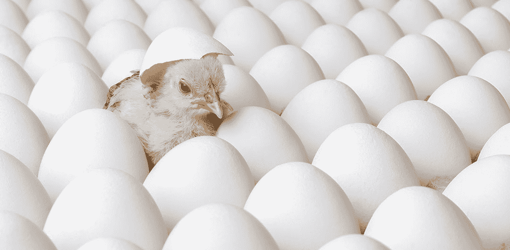

# 问答：成年人如何孵化自己

武志红

2022-04-24

## 问答：成年人如何孵化自己

问答：成年人如何孵化自己

这一期的用户提问大多来自第二模块，很多问题都提到共生。

说到正常共生期，我就会想到鲁米的这首诗：

云朵流泪, 花园就会开花。 婴儿哭, 母奶就会溢出。 万物的哺育者说过: 让他们尽情地哭罢。 雨的泪与太阳的热共同滋育我们。

这首诗非常简单，还有点过于热情，不像我经常引用的鲁米的其他诗句那么有哲理味，但是这首诗表达的意思，我觉得特别贴合这一模块的内容。  
**别忘了，你也可以像婴儿一样表达你的动力。**

读者 用户“Camus”：:

> "如果成年人没有形成自我，还被巨大的外力强行破壳了，应该怎么办呢？重新孵化？重新找回自恋？重新成长吗？"

我认为如果发生这样的情形，那就意味着，创伤发生了。被强行破壳的程度越严重，创伤的程度也就越严重。

这时该怎么办呢？

首先，要尽力恢复现实生活的秩序。这就好像地震灾难发生后，现实意义上的救灾非常重要，要远远胜过心理援助。

其次，如有人恶意攻击了你而导致破壳，那么，你要尽力回击这个人，让他付出代价，这很重要。不然，人容易陷入到无助和绝望中。

接着，要去做心理重建。如果这种时候有抑郁产生，那得知道这是创伤导致的攻击性不能向外，转而向内攻击了自己。

心理重建中特别重要的是控制感和自恋的恢复。前面讲的都是控制感的恢复工作，自恋的恢复也至关重要。例如，一个女孩失恋时想自杀，做了心理咨询后发现，她是相信了前男友的逻辑，认为之所以分手都是自己的错，这才导致了攻击性向内转向自己。理解了这一点后，她的自恋恢复了，自杀冲动也就慢慢消失了。

读者 用户“罗耀龙@坐忘”：:

> "怎么给自己“孵化”，促成自己的“内部破壳”？"

读者 用户“123”：:

> "成年后还可以养育自己内在的婴儿吗？具体有哪些做法呢？"

成年人该如何孵化自己？我们可以使用课程中的概念和方法。

首先，不要着急。着急意味着，自己在不断地自我破壳。心灵的事，得慢慢来。

其次，构建自己的保护壳。我在这儿说的保护壳首先是现实意义上的。因为心理层面的保护壳，谁都有。怎么构建保护壳？具体的理念和方法，我在课程的第四模块中讲了，就是构建自己的边界。

接着，去照顾好自己。既然婴儿的孵化，是通过母亲满足他的吃喝拉撒睡玩这些看似普通的动力而实现的，那么成年人也一样。当你能照顾好自己的这些基本需求时，就意味着，你的动力再次伸展了出去。

并且，一个成年人要照顾好自己的基本需求时，必然要和各种人去建立种种关系，特别是亲近而重要的关系。当你能做到这一点时，也意味着，你给自己构建了一个不错的关系网，这被称为“社会支持系统”。

因此，你要远离那些总是让你难受、剥削虐待你的人。很多人难以离开这样的关系，这有深层原因，同时也因为容易在头脑上欺骗自己，在头脑上不断为这样的关系寻找合理化的理由。但如果你尊重自己身体时，你会活得直接而简单。

读者 用户“广行天下”：:

> "人的成长，需要提供一个适合的环境，在环境中自然地生长。但是我们就不能吸取前人的经验，站在巨人的肩膀上更快速地成长吗？"

我认为，人的智性的知识，是可以迅速累积的，就像你说的，可以站在巨人的肩膀上，快速成长。例如物理学的知识，牛顿发展出自己的理论，对整个人类世界来讲，都是无比伟大的事情，但你现在学习这些理论并不会很困难。

但是，人的心灵和情感，却没办法简单累积，需要一个又一个的独立个体慢慢去实现。

当然，这里也有另一种意义上的累积。例如，如果你的父母有完善的人格，这必然会让你的成长变得容易很多，你有可能轻松地突破自闭之壳、母爱怀抱、家庭港湾而进入到社会熔炉乃至无限世界。

相反，如果你的父母人格很不完善，你就有可能连自闭之壳都难以突破。

头脑上的知识可以累积，但人生是一场体验，每个人都知道，头脑上想明白和体验上活出来，可能还差着十万八千里。

读者 用户“刘淑清”：:

> "自闭之壳、母爱怀抱、家庭港湾、社会熔炉、无限世界，层层递进，一个人如果顺利完成了这五个层面的壳，是否有时也会返回自闭之壳？或者五个层面共存？"

当一个人顺利度过了这五个阶段，他就拥有了自由。因为，这五个阶段的图景，其实都藏在他内心，这是他完整的生命体验。

体验一旦发生，就不会消失，而会成为自我的一部分。

真完成了这五个阶段，一个人就更可以独处了，因为独处时，他有丰富饱满的内心，他并不虚无。

读者 匿名用户：:

> "所有人都应该在对应的阶段完成对应的事情，否则就是有问题的吗？没有个体差异吗？"

> "另外，看文章如果总会对号入座，觉得自己是不是有文中说的“病”，这种把自己代入的敏感怎么解决呢？文章每次讲清楚原理是否也应该给一些行动改变方案呢？"

你描述这个问题时，就可以看到，当达不到一些标准时，你会觉得自己是有问题的。

因此可以说，你也许时时刻刻有这种逻辑：有更高的标准，我就该达到，不然我就是错误的、有问题的。

既然自我否定时常在发生，那我认为也可以说，你时刻都在体验“我”一次次被杀死。这很可能是自我严重没有形成导致的。

但是我觉得，我们既可以说，这是问题，也可以说，这是人性的一部分，每一部分都有存在的价值和道理，需要承认和接纳。例如我自己，我觉得我有相当一部分，是停留在自闭之壳中的，但我接纳自己这一部分的真实存在，而它也带来好处，比如我的分析能力。

读者 用户“鱼小姐”：:

> "武老师，你说要按照自己的感觉和需求发出生命动力，但是如果这个感觉或者需求是不对的，或者如果接着做下去，会给亲密的人造成伤害，是不是一种自私的行为呢？那这种生命力能持续吗？"

遵从自己的感觉，但不是说要按照自己的感觉和需求肆无忌惮地去发出生命动力。

我们当然要使用自己的头脑、自己的心，去评估和衡量怎么作选择。

这一点上，我喜欢王小波的一个说法，这应该算是“消极自由”吧。也就是说，在不主动伤害别人的情况下，人就拥有自由。

不过，真活出这份自由，也是很不容易的，需要强大的自我才能做到。

读者 用户“张锡平”：:

> "“代入感”和“脑补”的区别是什么？我看书听课时都会出现相应的画面，例如，书中写道，走进一座花园，我就会看到盛开的鲜花，甚至闻到花香。这属于“脑补”吗？"

我们看到人性中的一些部分，它们看起来也许不成熟，但它们并非是错误的、不该发生的。脑补这件事也一样。

脑补的问题是，不能进入到关系的现实世界，于是使用头脑想象，只是在想象层面去自我安慰。

当我们既活在现实中，又可以有丰富的想象，这就不同了。这是多么美好的事情。

读者 用户“cccccckino”：:

> "能融入生活的人可能更脚踏实地地活，但是不是会被烟火气掩盖了灵气？"

> "我观察到我一个大学同学，曾经的她也是倔强要强，后来恋爱了，柔和了，我总感觉她变得世俗大众，不再特别了。我这么想是不是因为我自己不敢活出世俗里的自我呢？"

你最后的问法，是很有意思的。这样问是一种反思，意味着，你不仅是在看到你的智性上的问题，也看到了这个问题背后的自己。

我的确见过很多你说的这一类人，我非常喜欢他们，容易为他们着迷。他们的神情中，特别是眼神里，有一种纯净加梦幻的感觉，如果人还长得美，那真可以说是超然脱俗的气质了。

然而随着年龄的推移，这份纯净加梦幻会出问题，当他们的孤独想象和外在现实发生冲突时，他们如果拒绝作调整，而是坚持活在想象中，那会跟不上现实的变化，他们最终会觉得越来越失落。

其实人的成长，就是这样一个过程，一个稚嫩的灵魂出生在人间，接着感受到人间的各种爱恨情仇、各种俗世的刺激和挑战，于是逐渐变得浑浊，但有可能再次淬炼出纯净来，而那时就是一种成熟的、有韧性的纯净。

读者 用户“李文涛”：:

> "被绝对禁止的孩子到了青春期容易追求绝对允许吗？"

我认为的确是这样。

更常见的是，被绝对禁止的孩子，等自己做了父母，就在孩子面前呈现为所欲为的样子，同时，又继续对孩子构成绝对禁止。

所以早早被绝对禁止的孩子，是出于恐惧才不敢表达自己，可一旦有了机会就会去追求为所欲为，而表现得放纵、不尊重规则。

\*

欢迎你就这门课程的内容继续向我提问，写在下方留言区中。我会不定期做问答加餐。希望这些交流能够帮助你更好地学习这门课程。

  

公众号懒人找资源，懒人专属群独享

# 模块引论：拥有无限宽广的世界

武志红

2022-04-24

## 模块引论：拥有无限宽广的世界

模块引论：拥有无限宽广的世界

这是第八模块，也是我们课程的最后一个模块，“展开自我”。

这门课一开始我就讲到，成长像是一个破壳过程，先破开自闭之壳，进入母爱怀抱；接着离开母爱怀抱，进入家庭港湾；再从家庭港湾，进入社会熔炉；最后，破掉社会熔炉，进入无限世界。

这里面一共有五个阶段，你可能已经发现了，这五个阶段在课程的篇幅设置上很不平衡。自闭之壳和家庭港湾，都只用了一个模块讲述。母爱怀抱是这门课程的重点，也最有分量，占了五个模块。现在你听到的这个模块，就是社会熔炉和无限世界这两部分。

为什么这两个阶段只占一个模块，跟母爱相关的内容却占五个模块呢？我得跟你解释一下，有这样几个原因：

首先，这门课程主要是在讲自我的诞生，正常情况下，这是三岁时就该完成的。

第二个原因是，现代精神分析理论，特别是客体关系理论，把重点放到了母亲和孩子的关系上。精神分析学派还认为，一个人的人格会在 6 岁前定型，以后就是不断展开它的过程。

此外，我在做心理咨询的过程中，观察很多来访者的案例后发现，有很多人的确是卡在了和母亲的关系之中。

所以，在这门课程中与母爱相关的内容占的篇幅很大。

\*

好，那我们来说说这一模块的主题，社会熔炉和无限世界。

**社会熔炉，指的是你所在的社会文化空间，这是比家庭港湾更大的空间。**  
当一个人的成长刺破家庭港湾这个壳后，就进入了社会熔炉。社会熔炉，一样也可以被刺破，然后就进入了无限世界。

当你的自我发展到这一步时，你就像在无限天空中翱翔的雄鹰。这样的成长，需要一次又一次的叛逆。

**当你在无限世界中翱翔时，你的心中会住着过去获得的所有的爱，那是每一层空间对你的容纳。**

前面的课程我们讲到，孩子先是在和母亲的关系里形成个体化自我，接着在有父亲参与的三元关系里初步掌握社会化的技能，学会处理竞争与合作的矛盾。

现在，孩子可以离开家庭港湾这个容纳性空间，进入到现实世界中了。社会熔炉也罢，无限世界也罢，都不再有那么强的容纳性。这就需要一个人既能充分地展开自己的力量，又能处理好复杂关系。

就像一只初具杀伤力的小鹰，进入广阔世界后，要磨炼自己的利爪、尖嘴和羽翼，让它们变得更强，同时也要学会掌握使用它们的力度。

预习作业

在这个模块正式开始之前，我想请你做一个小作业，很简单，就是做自己的父母。现在，你可以想象一下，如果你是某个年龄段的自己的爸爸或妈妈，你想对当时的自己说些什么、做些什么？

这其实也是我在做心理咨询时常用的技巧。欢迎你把自己的想法写在留言区。我们下一讲再见。

  

公众号懒人找资源，懒人专属群独享

# 36 讲 拓宽时空：成长的动力从哪里来？

武志红

2022-04-24

## 36 讲 拓宽时空：成长的动力从哪里来？

36 讲 拓宽时空：成长的动力从哪里来？

这是第八模块的第一讲，我们来谈谈拓宽时空。从自闭之壳到母爱怀抱，到家庭港湾，再到社会熔炉和无限世界，这个成长的过程其实是空间不断被拓宽的过程。

特别重要的是，一个人在成长过程中，需要意识到时间和空间的存在，然后不断地拓宽自己的时空。

## 成长动力的来源

我在思考这个问题时，想到了我自己的故事。

从时间上，我是 1974 年出生，没过几年就改革开放了，所以我成长的过程可以说是见证了咱们国家翻天覆地的变化。

从空间上，我在河北一个普通的农村长大，家境在村里属于贫困户。我的小学是在村里读的，初中在镇子里读，高中在一个省级重点中学。后来，我考上了北大，先在河南陆军学院接受了一年军训，然后才去北京大学本部读书，一直读到硕士毕业。毕业后，我到广州工作，直到现在。我个人觉得，我也算是在社会熔炉中充分历练过了。

一直以来，我给自己的定位是宅男作家，外加明显的滥好人。宅，其实就是封闭，我觉得自己也没有很好地完成外化。不过，这也并不全是坏事。

前不久，我和我的咨询师谈到这一点时，我觉得有些庆幸，庆幸我年轻的时候不是那么会处理人际关系，所以也没有在这方面花太多时间，算是回避了这个难题。那时候的我，因为对周围的世界不那么认同，所以一直有一种莫名的动力，想到更大的世界去看看。

我对自己的分析是，因为我没有太认同我所在的狭窄的农村世界，所以我的内在，有一个不一样的时空。

那这个时空是从哪里来的呢？答案其实也简单，从读书中来。

小时候，我所在的村子虽然不算偏远，但除了教材外，想读到一本好书是非常不容易的。

我有哥哥姐姐，哥哥大我八岁，他的教材我全读了，不管懂不懂。我姐姐偶尔会往家里拿一些杂志，我也都读了。真不是夸张，可以说我是把家里所有有字的东西都读了。

这些书虽然不能算是好书，有意思的也不多，但还是让我觉得我所在的世界之外，还有一个世界，我好像能朦朦胧胧地感知到或想象到那样一个世界。这种感知或想象，影响了我的一些重大决定。

例如，那时候农村孩子在中考时，都拼了命去考中专和师范，因为考上后，户口就变成非农业户口了，对那时候的村里人来说，这是“鲤鱼跳龙门”一样的升级。

所有人都去考，可以想象竞争有多激烈。我上初三时，班里就有一个女孩，初中读了九年，不断复读，就为了考个中专。

初三一开始，我的成绩突飞猛进。到了中考时，我的成绩足以考上中专师范类学校了。

最初，我的确也受到影响，很想报考中专师范类学校，但在报志愿的最后一刻，我放弃了这个选择，改报了一所省重点高中。

可以说，我和我的同学们的命运，在那一刻变得不同了。我的好几位初中好友，学习成绩都很好，他们都一门心思考中专师范，最后大多也都考上了。可是，你一定也知道，农业户口、非农业户口，随着社会的发展和开放，并没有多大区别。国家后来也取消了农业户口，建立了统一的居民户口。可以说，当时我身边很多人努力学习的根本动力和目的，后来变成了所有人都轻松获得的东西。

除了这些同学以外，还有一位令我印象深刻的小伙伴。他家是村里家境比较好的，他读书比我好很多，而且他的情商和整体人格结构都相当好。但不知为什么，读初中时，他开始相信“读书无用论”，自己决定不继续读书了。

后来，他一直都是村里最能干的，日子也差不多是过得最好的，小家庭和大家族都很合睦。但是，我总是替他感到惋惜，他的人生就被锁在村里了，他原本可以走向外面更大的世界。

我以前也总在想，到底是什么驱使我在关键时刻作出了不一样的选择，为什么我能一直坚持读书？

我想也许一个关键的原因是，我读了很多没用的书。

前面说到的那些有用的教材，和没用的杂志，凡是有字的，我都读。而我的大多数同学们，不想浪费时间在没用的书上，都在读教材，研究教辅材料。可能就是因为这些，当我身在八十年代的北方农村时，脑海中想到的是一个不同的世界，心中模模糊糊地憧憬着一个不一样的时空。然后，这成了我心灵中的一幅图景，诱使着我作了不同的选择。

除了这个原因，还和我的父母有很大关系。哪怕我父母只是对我说一次，“咱家穷，你考中专师范吧”，估计我就不会报考高中了。但我的父母从来没有这样要求过我。

好，说了这么多关于我自己成长的故事，我是想请你来看一看，对我来说，成长的动力都从哪儿来？很显然，根据我刚才说的，一是来自读书，一是来自父母。

## 现实层面与想象层面

学了前面的课程，你已经知道了，正常的发展中，孩子需要完成与家庭的分离。如果有了父母的鼓励和允许，这会变得容易很多。

无数爱孩子的父母，愿意鼓励孩子走向独立，而这时我们可以看到， **孩子时空的拓宽，至少有两个层面，一个是现实层面，另一个是想象层面。**

现实层面中，父母可以多带孩子去不同的地方，就可以起到帮助孩子拓宽时空的作用。我两次去南极，都看到有父母带着不同年龄段的孩子来到这里。2014 年我第一次去南极的时候，同行的一位小女孩就创下了南极游客的最小年龄纪录。我相信，对这些孩子来说，真实空间的拓展会直接对他们造成巨大影响。

想象层面上，读书，或者说知识面的拓展，也会起到这个作用。知识有一个特点，那就是可以超越时间和空间。你可以由此，在想象层面上任意拓展，获取成长的动力。

用我们常说的一句话，那就是行万里路，读万卷书，这可以极大地拓宽一个人的时空。

## 父母限制

现实生活中，可能并不都是这样理想的情况。例如，如果父母不愿意你离开家，怎么办？

如果你想进入家庭以外的社会熔炉，甚至是无限世界中，你首先要知道，你想要离开的这种想法是再正常不过的。

当父母激烈反对的时候，你需要做的就是坚持这份愿望。你可以试着在那些关键的人生节点上，作出符合你内心的选择，特别是像考大学、找工作这样的事。

我在做心理咨询的过程中，见过很多下面这一类的悲惨故事：

这些来访者们年轻的时候，大多很听父母的话，仍然活在家庭港湾甚至母亲包围圈中。虽然自己感觉到束缚甚至窒息，但到了考大学、找工作这样需要作重大决定的时刻，他们不想让父母伤心，还是选择了离父母最近的地方。

这样做导致的结果就是，他们一直没有拓宽自己的时空，成长的动力也早早被消磨掉。而这份束缚和窒息可能会越来越重，如果他们迟迟没法作出离开家的决定，等父母老了以后，这份决定就更难了。

我常常建议我的来访者，在父母还是壮年时早作决定。因为这样的话，虽然会给父母带来巨大的冲击，可他们还有时间和空间去适应孩子不在他们羽翼下生活的状态。

## 环境限制

除了这一点，有时候也会是大环境带给人的限制。这个时候，你可以不断问自己：我可以怎样拓宽我的时空呢？

我有一位朋友就是这样的情况，虽然生活在小山村，但始终有非常清晰的意识：我绝不属于这里，我不能接受自己一直被封闭在这么狭隘的空间中。最终，她抓住各种机会，走进了更广阔的世界。

现代社会，呈现出巨大的流动性，年轻人都在争相奔向开放的大城市，这也是在寻求更大的时空。所以其实大环境的限制不容易出现了，相反，展现在我们每一个人面前的，是各种拓展时空的机会。

所以我想，我们每一个人都可以时不时问自己这样一个问题： **我的时空，是在萎缩，还是在伸展？我有没有很好地利用各种机会？**

思考题

我想请你来分享一下，你在现实层面和想象层面上，获得过怎样的成长动力？欢迎写在留言区，和我交流讨论。

1.在成长中，一个人需要意识到时间和空间的存在，不断去拓宽自己的时空。时空的拓宽至少有两个层面会起到重大作用：现实层面和想象层面。  
2.当父母反对你与家庭分离时，你要坚持自己的愿望，试着在关键的人生节点上作出符合内心的选择。

  

公众号懒人找资源，懒人专属群独享

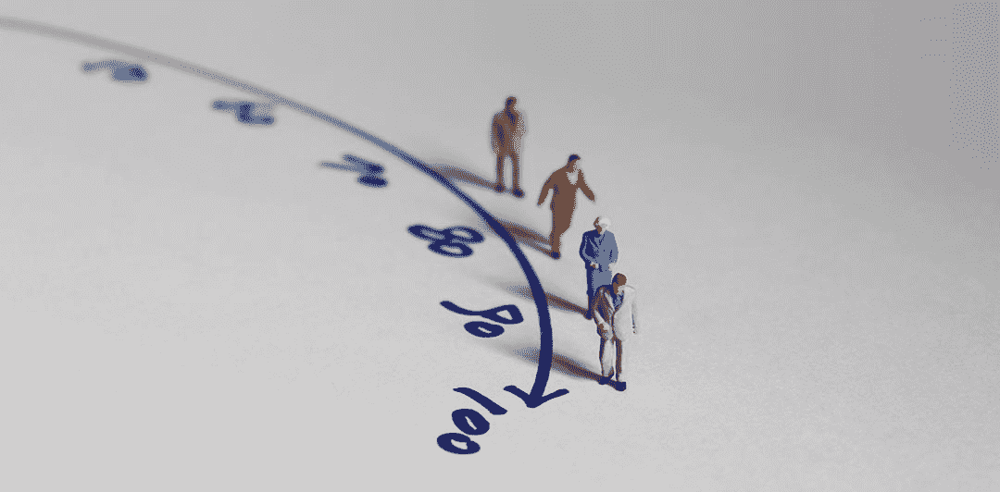

# 37 讲 社会化：动力为什么需要被社会接纳？

武志红

2022-04-24

## 37 讲 社会化：动力为什么需要被社会接纳？

37 讲 社会化：动力为什么需要被社会接纳？

一个人的成长过程中，社会化和个体化是一对经典的矛盾。 **社会化，是个体融入社会的过程；个体化，是成为自己的过程。**

关于个体化，有一个富有诗意的表达： **人生只有一种成功，那就是按照自己的意愿过一生。**  
个体化的内容，我在之前的课程中涉及到很多，这一讲，我们着重来谈谈社会化。

人需要一定的社会化，否则会陷入孤独，心理上也容易产生疾病，但社会化不能以严重地损失个体化为代价。我在前面课程中说过，好的父母是孩子的容器，好的社会也一样是好的容器，可以容纳形形色色的不同个性的人。这一点很重要，个体的幸福，社会的美好，都与这一点有关。就像罗素的那句名言：“须知参差多态，乃是幸福本源。”

所以我们可以说， **一个人的社会化过程，就是在不失去自我的前提下，对社会有基本的适应。**  
要实现这一点，需要一个人在社会熔炉中，在力量维度和情感维度上伸展开他的动力。

## 校园霸凌

我想讲一个比较特别的现象，校园霸凌。因为这可能是很多人经历过的事，现在也时常发生在我们身边，而且它通常发生的时间，就是一个人最初经历社会化的学生时期。所以我觉得，从这个特别的现象入手，可以帮助你更好地理解社会化，理解一个人动力的展开与社会熔炉之间的关系。

校园霸凌，是力量维度上的事情。有些校园霸凌，是一个霸道的孩子欺负其他孩子。严重一些的，也可能是一个孩子王，搞了一个小团伙，一起欺负别人。

我认为，那些被严重欺负的孩子，常常是在力量维度上表达有严重困难的孩子。

普通级别的校园霸凌，被欺负的孩子可以通过更好地表达自己的力量，例如反击，去解决问题。

但是，当霸凌到了严重的地步，这就超出了孩子的应对范围。可以说，孩子遇到了巨大的挫败，孩子的父母、学校等等其他方面的力量，就要发挥容器功能，帮孩子去解决这份超出了他应对能力的挫败。

在我常年的观察中，发现大多数被严重霸凌的孩子，他们的父母自己就很软弱，平时生活中不会使用力量。他们既不会使用力量保护家庭，也不会使用力量来攻击孩子。

至于霸凌者，特别是霸道的孩子王，常常有凶悍的父母。孩子认同了父母的霸道，到了学校里，就霸道地对待同学。

霸凌现象，绝对是个大难题，首先在法律上，面对未成年人缺乏约束手段。再者，孩子们常有这样一种思维，认为孩子们之间的事，最好自己解决，求助老师和家长是一种羞耻。

当一个孩子向家长、老师等成年人求助时，一般意味着，霸凌已经相当严重了。可我也看到很多案例，家长在这种时候反而会训斥孩子。为什么呢？我认为是家长自己软弱，怕面对这样的难题。

看待霸凌问题时，我们得意识到， **在相当程度上，未成年人的世界比成年人的世界更残酷。**

因为，成年人攻击彼此时，一般是有原因的，所以也有分寸，目的达到了就好。可是，未成年人发起攻击时，常常没有明显的目的，也因此会不知道什么时候罢手。假如他们还没发展出同理心来，霸凌事件就很容易失控。

所以，在这种情况下，孩子用坚决的态度保护自己，是一种简单直观的方法。这会让他在孩子中间赢得尊敬。实际上，一个孩子仅仅是散发出坚定的信息，就可以让他在很大程度上免去被霸凌的危险了。

严重的霸凌，必须警惕，但事实上，不同程度的霸凌是很难避免的。我们可以把这个理解为，未成年人的世界也是一个社会。他们需要在这个社会中，去学习表达和掌握自恋、性和攻击性这三种动力。

## 动力的升华

很有意思的一点是，一些研究显示，这些霸凌别人的小团伙的领导者，最终并不容易取得高的社会地位和成就。你可以在万维钢老师的《精英日课》中，搜索《欢迎度》这本书，里面就有提到类似的研究。

为什么会这样？如果让我来回答，我会用弗洛伊德的“升华”这一概念来解释。 **社会化中，人的动力需要升华，就是要变得更文明，更容易被社会所接纳。**  
动力被社会接纳了，人才能更好地完成社会化，进而更好地成为自己。

**动力，就是一个人的燃料，推动着一个人的成长。**  
社会熔炉给一个人提供的时间和空间近乎无限，如果你在比较狭窄的时空节点，过早地得到了动力实现的感觉，这会给你制造太早的满足，然后让你停在这个地方。

回到校园霸凌的话题，霸凌他人的孩子，他的自恋、攻击性乃至性的动力，在中小学这个时空节点，就得到了巨大满足。特别是男孩，如果他能控制一个小团伙，欺压住其他男孩，他就是这个时空的“王者”，几乎必然得到一些女孩的崇拜。于是，他的人生早早就达到了巅峰。

可是，这是一个幻象，我觉得可以叫做“霸凌幻觉”。这只是中小学层级的时空场，还没进入真实的社会竞争。

除此之外，喜欢霸凌的人，常是人性发展得不够好的人。他们的自我并不完整，导致他们难以承受动力、意志方面的挫败。拿学习这件事来说，一个人至少要发展到意志层级，能持续地努力才可能取得好成绩。而霸凌者，他们在应对像学习这样的事时，就会有挫败。挫败让他们动力、意志层级的“我”有要死掉的感觉，这种感觉太糟糕了，所以他们想把这种感觉甩出去，可能就会发展成欺负其他同学。

更糟糕的是，他们通过这种转嫁受挫感的方式，获得了“王者”的体验，觉得自己站到了权力的巅峰。当他们迷恋这种感觉时，就更难以面对以后成长过程中的困难。

相反，那些把自恋、性和攻击性的动力升华的孩子，那些动力逐步被社会接纳的孩子，他们虽然有压抑，但如果能持续努力，更有可能在情感维度上发展自己，这使得他们最终反而更能够和别人共处。最终，在人生这场长跑中，变得更成功。

## 体系化与超级个体化

体系化的意思很简单，就是人们集中起来，形成了一个体系，占据很多资源。当体系化特别严重时，孤零零的个体会产生恐惧，因为担心自己会被排斥在体系之外，找不到生存空间。对应到校园霸凌，被霸凌者感到恐惧和压抑的另一个原因，就是霸凌者搞的小团体对他们各种刻意地排挤。

和体系化相对应的，我认为是超级个体化了。一个高度个性化的个体，哪怕没有组织起来，看起来孤零零的，但其实也具备了很大的影响力，因此能生存得很好。

你可以回忆一下，你在学生时期，身边有没有这样一个同学，他不被任何小团体影响，有自己的三两好友，学习成绩很好，但不是唯老师命是从，而是有自己的见解主张，一副不太好惹的样子。他可能还读了很多书，总是让你感觉他很有见识。有什么班级活动，大家也总想听听他的意见。这样的人，我觉得就是超级个体化的人。

所以说， **在一个人社会化的过程中，需要避免体系化，有意识地向超级个体化努力。** 具体的做法多种多样，但我认为其中的核心是要懂得区分成就动机和权力动机。

*   **成就动机，** 是说你不断发展自己是为了追逐成就，把一件件具体的事做好；
    
*   **权力动机，** 是说你发展自己不是为了做好一件事，而是为了在体系中占据高位。
    

如果你的成长只是发展权力动机，遗忘了成就动机，那你看似是在努力让社会接纳你的动力，实际上会起到相反的作用。

我认为，时代进化到超级个体时代，这是一个进步，是一件好事。例如现在我们处于互联网时代，这是一个无限且平等的平台，鲜明的个体化更容易在这个共享平台上脱颖而出，这对我们每一个人的成长来说都是极好的社会环境。

但这也带来一个问题，一个人如何能成为一个超级个体呢？这需要不断学习，可这会不会给人带来更大的焦虑呢？在我看来，终身学习很重要，但还有一个原则更为重要，我会在下一讲和你谈谈这个问题。

思考题

你成长的过程中，有没有某一个社会化的节点增强了你的动力呢？在平衡社会化与个体化这一对矛盾时，你认为应该注意些什么？欢迎你写在留言区交流分享。

1.一个人的成长过程中，社会化和个体化是一对经典的矛盾。社会化是个体要融入社会的过程，个体化是成为自己的过程。  
2.社会化过程，是在不失去自我的前提下对社会有基本的适应。这需要一个人在社会熔炉中，在力量维度和情感维度上伸展开他的动力。  
3.把自恋、性和攻击性的动力升华的人，虽然有压抑，但能持续努力，更可能在情感维度上发展自己，更能够和别人共处，最终在人生长跑中变得更成功。

  

公众号懒人找资源，懒人专属群独享

# 38 讲 深度关系：人为什么需要掌控感？

武志红

2022-04-24

## 38 讲 深度关系：人为什么需要掌控感？

38 讲 深度关系：人为什么需要掌控感？

上一讲我们讲到了社会化与个体化之间的矛盾，还讲到了在一个人社会化的过程中，需要避免体系化，有意识地向超级个体化努力。这一讲我要讲一个原则，把握好这个原则，你就可能会成为一个超级个体，或者至少能活得不遗憾。

这个原则就是你要真正认识到： **一切好东西，都来自深度关系。**

## 在关系中投入真实

自恋是人的根本属性，受自恋的驱使，人很容易产生权力动机，并由此产生比较心。什么叫比较心？就是希望“我的能力比你强，我的位置比你高”。可是，人都有一个深刻进化，那就是进化到关系维度。当进入关系维度后，我们就有可能领会到一个基本事实：一切好东西，都是深度关系的副产品。

好的关系，是幸福感最重要的源头。好的关系，其实就是你和一个人建立了深度关系。  
**你在关系中深度地投入了你的真实，然后碰触到对方的真实，真实的你们深度碰撞彼此，由此建立了深度关系。**

我特别喜欢台湾漫画家蔡志忠的一个说法。他认为，如果一个小时值 10 块钱的话，分成两个半小时，每个半小时都不值 5 块钱。如果分割成 4 个 15 分钟，那么每个 15 分钟连 1 块钱都不值。反过来讲，连贯的 10 个小时，就已经价值几千万了。

你应该听出来了，他讲的是专注。如果你专注一个小时，价值并不是专注半小时的两倍；如果你能持续专注好几个小时，那它的价值可能翻了好几倍。

所以，看起来每个人拥有的时间差不多，但能持续高度专注的人，他们在时间上远远胜过了其他人。可以说，他们获得了对时间的掌控感。

对于蔡志忠这个说法，我完全信服。但是问题也来了，为什么有的人能持续专注？有的人不行？

我个人认为，这是一个关系问题。

**当你和一个事物打交道时，这个事物的外部信息，就会涌入到你的内在。**  
这就是你和这个事物的关系。那么，你是如何感知这个从外部涌来的信息呢？你是不是能掌控这些信息呢？

## 掌控外部信息

我认为感知外部信息有两个维度： **一是你觉得外部信息是善意的，还是敌意的；二是你的自我的水平，是脆弱的，还是坚韧的。**

我来讲一个来访者的案例帮助你理解。

她是一个女孩，来找我做咨询时她的问题相当严重。但是，她特别吸引我。当她讲她的故事时，我总是能高度地专注。她的表达能力非常好，能把一些并不多见的心理，描绘得清清楚楚。我认为，她的智商也很高。

她的问题是，不能和人交往，也不能静下来读书。这导致她的人生没法升级，因为没有新的信息注入。她一直不能接受也不能理解，为什么自己不能好好读书。

我从她的一份渴望中，看出了问题。她的渴望是希望能彻底封闭起来，给她一台能上网的电脑，维持基本的生活，就这样与世隔绝。因为有这种渴望，所以出现了一个现象，那就是任何影响她封闭的信息，都会让她烦躁。也可以说，这让她失去了掌控感。例如，她家附近的噪音。

与其说是烦躁，更准确地说，那是一份级别很高的暴怒。本质上，她觉得这些影响她隔绝的信息，都是在攻击她的，是有敌意的。

这一点，在我和她的咨询关系中也展现出来了。她第一次来的时候，就非常清晰地叮嘱我说：请不要给我任何建议。

建议，特别是咨询师的建议，对她来说就是干扰级别很高的外来信息，被她感知到的敌意水平也会非常高，所以她一开始就凭本能，告诉我放弃咨询师的这个功能。

另一个问题是，她的自我非常脆弱。把外来信息感知为敌意，加上自我极度脆弱，这自然带来的问题是，外界信息一进入她的内在，她的体验就是“我”被杀死了。

所以，在我看来，她不能读书，不能与人交往，都是为了躲避“我”被杀死的恐怖感觉。

如果说，一切好东西都是深度关系的产物，而她根本就没有深度关系，所以也就没有创造出什么好东西。如果用前面提到的蔡志忠的话来讲，那就是她根本就没有与事物建立关系的专注时间，没有办法掌控事物带给她的外部信息。

我的另一个来访者，他的情况要稍好一点。他是一位男士，他能看书，但他发现自己看书最多只能持续两分钟，然后就会走神。我在和他探究为什么会走神时，他发现那是童年时刻骨铭心的一种体验，他做任何事情都不能专注，因为随时担心妈妈会离开。所以他的走神，是在寻找妈妈，是在关注妈妈会不会离开他。

我认为这位男士是在分离与个体化期，缺少妈妈持续的陪伴，导致他不能专注地玩耍。前面讲到的那个女孩，则是在婴幼儿期严重地缺乏陪伴，是一种极度匮乏的状态。

## 获得掌控感

精神分析认为， **父母和孩子关系质量的重要性，远远胜过父母能教给孩子的经验和知识。**  
当父母或其他抚养者能做一个稳定的容器时，孩子的生命力就能被容纳在其中。而且，因为父母与孩子的关系是基本善意的，孩子就会形成基本的感知：从外界涌入的信息，基本是善意的。

对孩子而言，敌意和善意是什么意思呢？其实就是能否按照孩子的意愿让孩子获得掌控感。

**人生只有一种成功，那就是按照自己的意愿过一生。** 其实这在童年时就开始了。

我接触的很多父母会疑惑孩子专注力的问题。他们认为自己把孩子照顾得好好的，满足了孩子的一切，但为什么孩子还是不能专注呢？我发现通常这些父母在照顾孩子时，是按照自己的意愿。虽然父母基本上满足了孩子的生活需求，但孩子感知到的是，父母常常是入侵者，是有一些敌意的。

不过，有一些敌意的入侵者，也远远好过孤独。因为太孤独的环境下，孩子会把一切外来信息都视为有敌意的入侵者，会产生绝对的排斥。而普通的父母，就算有入侵，孩子也会发现入侵的信息，有敌意也有善意，不用绝对排斥。生命早期的养育者与孩子的关系，就会奠定这样的基调。

作为成年人，我们可以去认识这个道理，然后试着寻找办法，把涌入的信息从感知为敌意，变成感知为善意。基本方法非常简单，就是去掌控一个事物。你能掌控时，你就感知为善意；你不能掌控时，就会感知为敌意。这是非常微妙的，你可以试着去体会一下，看看是不是这样。

在确认了这样的前提后，就可以寻找一个你感兴趣的事物，去练习如何掌控它。要知道，每当你想转身离开时，你会容易认为是自己累了，可仔细觉知你会发现，这通常不是累，而是挫败感，是你觉得自己被这个事物给打败了，你的自恋被嘲弄了，你转身，是想去寻找自恋的安抚。

安抚自我是很重要的。但简单安抚之后，你要再次转过身来，继续去练习掌控这个事物。

这一讲我们一直在说对外部信息的掌控感。但其实，掌控不是根本性的表达，是关系不够深时用的一种表达。  
**当关系不够深的时候，你的的确确会觉得，你是主体，而那个事物或者人是客体，是你需要掌控的对象。**

随着你持续地投入，越来越能掌控这个事物时，你会越来越专注，这时你会感觉好像每个事物都像是有生命一样，你和这个事物的关系也越来越深。甚至突然有一刻，你会体验到，没有我，也没有你，没有自体，也没有客体，就连时空感都变了，你进入到浑然忘我的状态，你和这个事物融为了一体。这就是高峰体验的共同特征。

思考题

你有没有过掌控感满满的体验呢？它是如何发生的？你又从这份体验中收获了什么？欢迎写在留言区分享交流。

1.一切好东西都来自于深度关系。感知从外部涌来的信息有两个维度：外部信息是善意的还是敌意的，自我的水平是脆弱的还是坚韧的。  
2.父母和孩子关系质量的重要性，远远胜过父母能教给孩子的经验和知识。 3.把涌入的信息感知为善意的，基本方法就是不断地努力去练习掌控一个事物。

  

公众号懒人找资源，懒人专属群独享

# 39 讲 真实地活着：如何构建深度关系？

武志红

2022-04-24

## 39 讲 真实地活着：如何构建深度关系？

39 讲 真实地活着：如何构建深度关系？

上一讲，我们讲到一切美好事物，都是深度关系的产物，也解释了为什么有人不能构建深度关系。这一讲，我们来继续谈谈该如何构建深度关系。

方法说来也简单，那就是真实地活着。

## 真实自体与虚假自体

我在这里说的真实，指的是能构建真实的自体。与真实自体相对应的是虚假自体。精神分析认为，人有三种动力，自恋、性和攻击性。  
**构建真实的自体，就是要真实地展现自恋、性和攻击性这些生命动力。**

展现这些，其实是危险的。为了避开这些危险，人就会选择将自己的生命动力隐藏起来。这就不可避免地出现一种情况，人会活在思维层面。  
**向思维认同，将思维等同为“我”。这就是虚假自我。**

我因为做心理咨询这份工作，也算是阅人无数了。我发现了这样一个规律：在某一个领域内出类拔萃的人，大多都是非常真实的人。

因为道德层面的考虑，我们很容易美化谦逊。但其实我通过仔细观察发现，这些出类拔萃的人，可能在普通的为人处事上是谦逊的，但在他们擅长的领域内，他们常常是自恋的、具有攻击性的。

一切美好事物是深度关系的产物，可是， **只有拿出了真实的人，才可能与一个事物建立起深度关系。** 如果你一直是虚假的，那么这份深度关系根本就不可能发生。

说到这儿，我想到了一个现象：中年危机。人到了中年之后，精力下降，因为很难更新迭代知识结构，工作也容易遭遇瓶颈。家庭生活又是上有老下有小的阶段，要处理的麻烦事变得很多。所以就感受到了严重的危机。

可是，并不是所有人都这样。也有很多职场精英、成功企业家，就是在中年时期发力，在各个方面取得成绩。

为什么会有这样的差别呢？除了每一个人不同的个性化原因，我认为总体上，这两种不同的中年人身上，有热情的差别。后一种人，年龄成为了他们的祝福，他们身上都带着一种热情；前一种人，年龄成了一种诅咒，他们缺乏这样的热情。

热情是什么？

自体心理学家科胡特有一个说法： **心理健康的标准，是自信和热情。** 活力滋养自身，就是自信；活力能流向客体，就是热情。

他说的活力，我认为可以理解为人性化的动力。所以可以说，那些在工作中带着热情的人，是能将他们的动力灌注在工作中的人。

很多人虽然也是在积极工作，但常常是在用套路工作。他们只是在用头脑工作，不是用真实的动力。

我自己现在也是公司的老板，有热情也是我招募员工的重要标准。我认为，如果要招募普通岗位的员工，那有聪明的头脑和较好的文化水平，就足够了。但如果要招募重要岗位的员工，我就必须看看他们身上是否有这份热情。

## 亲密关系中的真实

好，我们一直在讲的是与事业的关系，其实，在亲密关系中也一样。

你想拥有一份深度的亲密关系，就必须问问自己，你呈现了真实自我吗？对方呈现了他的真实自我吗？或者说，在这份关系中，你们能真实吗？

和工作不同的是，亲密关系涉及到全方位的动力，就是自恋、性和攻击性都会涉及到。如果在一份亲密关系中，不能让这三种动力自然而然地流动，那么，即便这份关系看上去非常美好，那也是没有意义的，时间会验证这一点。

我可以通过对一句俗语的简单解释，来帮你理解这一点。这句俗语就是“男人不坏，女人不爱”。所谓的“坏男人”，你可以理解为是在相当程度上真实的人。“坏”，可能就意味着他充分地展现了动力。反过来说，所谓的“好男人”，可能各方面都对，但就是缺乏亲密，缺乏激情。

我们前面说到谦逊，我认为， **人可以最终活得谦逊，但谦虚不应该是一开始的状态，而应该是攻击性得以人性化的自然结果。**  
如果一个人年纪轻轻，就过分懂事，几乎完全看不到自恋和攻击性的部分，那这个人既不容易在事业上成功，甚至都不能很好地构建亲密关系。

我在做心理咨询的过程中，见过很多爱情故事。这些故事一开始都非常浪漫完美，甚至让我禁不住想，简直是可以直接搬到影视剧里的故事。但几年过去后，这些看上去浪漫的爱情却瓦解了。

这些故事让我不断思考，原因到底是什么？我看到了一个共同的规律，那就是这些故事中的双方，都在使劲地对对方好，没怎么“坏”过。例如两人意见不合，向对方表达不满，偶尔发生小冲突，这些都可以称为“坏”。有的关系是其中一个人严重地不能在关系中表达“坏”，有的关系则更糟糕，是两个人都不能表达。

我甚至可以有点绝对化地说： **如果在亲密关系中，两个人都是在呈现对彼此的好，没怎么发生过冲突，那么这份亲密关系必然会终结。**

例如我的一位来访者，是一位女士，她非常享受和老公的婚姻。然而结婚七年后，突然有一天，她发现老公出轨了。她没法接受这一点，对她老公说：“为什么过去七年中，你一直让我觉得在天堂，突然之间把我拉下地狱？”

我和她深入探讨后发现，在她的婚姻中，她老公简直是“二十四孝老公”，各方面都做得太好了。例如她一回家，睡衣、拖鞋、牙刷，老公都已经为她准备好了，甚至挤好了牙膏。他们相处的七年中，她的老公对她的照顾可以说是无微不至，就像一位有完美主义的妈妈照顾婴儿一样。

可实际上，她的老公多次对她表达过，我很累，很压抑。可她都听不到，在她的感知中，她是突然间失去老公对她的爱的，但其实她的老公是在逐渐远离她，可同时一直还在无微不至地照顾她，这给了她假象。

事实上，一个人要构建好深度的亲密关系，比在事业上做到出类拔萃要难很多。因为，构建深度关系，需要在关系中全面地展现生命动力。

## 深度关系需要时间

和过去相比，现代社会有一个巨大的变化是，改变的速度快了很多。人们开始在空间上有了更多选择，例如一份工作不适合自己，换一个。甚至，一份亲密关系不适合自己，也可以换一个。对于整个社会来说，我觉得这自然是有很大的正面意义。每个人都可以遵循自己的内心，去作出符合自己心意的选择。但是在这个背景下，我们也得知道，  
**深度关系的构建，需要时间的累积。**

我觉得，生命的历程最好是这样：生命最初六个月，能展现动力；等到了两岁的时候，能展现意志；三岁左右时，初步形成了个性化自我，然后，在家庭中初步学会竞争与合作；紧接着，在漫长的社会化过程中，自我越来越坚韧有力，空间也不断地延展。

但是，这是比较理想化的情况。现实中，拥有这样完美历程的人并不多见。你可以观察你自己，想办法回溯自己的成长经历，去定位不同阶段自己的发展状态。如果发现，你的抽象意义的自我、意志和动力，没有很好地在相应的阶段形成，那么你至少可以从现在开始，让自己活得真实，大胆去呈现自己的生命动力。

活得真实，没有一个具体可以去操作的手册，能拿着一步一步学习。我的建议是， **从不同深度的关系，按你能适应的难度层次，一层一层开始。**  
你可以先设定一些对你来说容易的小目标，达成后再提升难度。例如，如果你难以在工作中展现真实的一面，那可以先试试跟亲近的朋友、伴侣，说出某个隐藏很久的想法。这样一点一点的小成就，会帮助你逐步走向真实。

思考题

每一个人在真实地活着这件事上，都有自己不同的经历。你曾经用过什么样的方式，帮助自己展现真实的一面吗？欢迎你在留言区中分享。

1.去构建深度关系的方法就是真实地活着，要真实地展现自恋、性和攻击性这些生命动力。  
2.人可以最终活得谦逊，但谦虚不应该是一开始的状态，而应该是攻击性得以人性化的自然结果。  
3.每个人都可以遵循自己的内心，作出符合自己心意的选择。但我们也得知道，深度关系的构建，需要时间的累积。

  

公众号懒人找资源，懒人专属群独享

# 40 讲 进入无限世界：活出自己会收获什么？

武志红

2022-04-24

## 40 讲 进入无限世界：活出自己会收获什么？

40 讲 进入无限世界：活出自己会收获什么？

这是这门课的最后一讲，我们来谈谈突破社会熔炉，进入无限世界。

我在课程中反复强调，自我的形成和发展中，有五个阶段：

*   自闭之壳
    
*   母爱怀抱
    
*   家庭港湾
    
*   社会熔炉
    
*   无限世界
    

在这个过程中，一个人要不断地刺破此前的壳，进入到更大的空间，然后这个更大的空间又形成了一个新的壳，又要继续刺破，再进入新的广阔空间。具体就是：

*   刺破自闭之壳，进入母爱怀抱；
    
*   脱离母爱包围圈，进入家庭港湾；
    
*   离开家庭港湾，进入社会熔炉；
    
*   突破社会熔炉，进入无限世界。
    

## 无限世界

我的定义是，它是我们目力所及的“全世界”，是普通人所能触及的最大现实空间。除了这些物质空间，无限世界也包括无限的精神世界，或者说想象世界。

在我看来，人有太多部分都需要进入到无限世界。例如要探讨任何领域的真理，你都不能简单忠于某个有限的空间，因为那会把你锁住，将你定格在那里。

你看哲学家的思考，如果是直接思考人性，很容易对社会当前的存在状态构成冲击。他们需要进入到无限世界。

在心理学领域中，这个逻辑一样存在。很多人试图发展出扎根于中国文化的本土心理学，我个人认为，这种尝试很有价值，但如果它是出于对我们自身所处的社会熔炉的简单忠诚，那这种探讨也会变得有限。因为我觉得，从根本人性上看，全世界的人都是一样的，都遵循同样的基本逻辑，只是在表现形式上不同而已。

这样讲起来很抽象，我想讲我的一位好朋友的故事来帮助你理解。可以说，这位朋友是我身边最典型的进入无限世界的人。

她是一位女士，现在已经在美国定居很多年。前几年，她搬到了波士顿。到达波士顿后，她立即就干了一件事，去找了波士顿的市长。找市长干什么呢？并不是要解决什么问题，而是跑去对市长说，我刚刚搬到波士顿，我是一个什么样的人，我希望能对波士顿作出我的贡献。

然后，在接下来的几周里，波士顿市长真的为她安排了拜访波士顿市各种机构的机会。

这件事让我非常感慨，我对她说：你简直到哪儿都是主人。

她和我同龄，一直在世界五百强企业里工作。她做市场营销，所以她的足迹几乎遍布全世界。不只是在波士顿，她自己也觉得好像到哪儿都不怵，到哪儿都有一种主人翁的感觉。

她刚在美国开始工作的时候，就非常惊讶，她的华人同行们对公司领导们非常小心谨慎。她就对这些同行说，你们要“粗鲁”地对待他们。她的意思是，你越是轻松直接，这些领导就会越喜欢你、重视你。

不过后来，我的这位朋友发现，她的这些东西没法教给别人，别人即使知道了，也可能做不到。

我认为，因为这是人格的力量，或者说，因为自我层级的不同，所以不是每个人都能轻松做到的。

有一次，我和这位朋友进行了一番深入谈话，我发现她完全不知道压力是何物。在任何高挑战环境下，她都能充满浓烈的好奇，同时能辐射出自己满满的能量，和权威相处总是轻松自如，但又不会让这些人感到冒犯。

我作为心理咨询师，非常想总结出这是怎么回事，所以我不断深入地了解她的人生，特别是原生家庭。关于她的真相一层层剥落，结果最后落到了这样一个观点上：她的妈妈充满力量和爱，她对妈妈有很高的认同，因此和妈妈竞争时，也是建立在认同的基础上。而且，因为竞争中有认同，所以她对权威表达自己的观点时，自己也没什么内耗，自然而然地也就呈现出高情商。

我把关于她的这些情况理清之后，忍不住感叹：这样活着，真是惬意！

不只是和妈妈的关系，我这位好友和她父亲的关系，简直也是她在主导，她可以肆意地在父亲面前表达自己的感受和力量。

如果用这门课程的理论来讲就是：

首先，因为妈妈有爱，所以她轻松地从自闭之壳跳入了母爱怀抱。

其次，因为妈妈有力量，也鼓励她独立，于是她又自然地突破了母爱包围圈，进入了家庭港湾。

在家庭港湾这部分，她出了些问题，因为父亲不够有力量，所以她后来总是去寻找有力量的男性，这给她带来了痛苦。但总体上，她还是能在家庭港湾中展现自己。

除此之外，她的社会化极好，到哪儿去都是深受欢迎。她的个性化也非常好，一直个性鲜明，特别是什么环境下都可以简单拒绝别人，也就是说，她成功地跳入了社会熔炉。

在中国工作两三年后，她去了美国，觉得崇尚个性的环境更适合她，她充分感觉到自己的个性得到了最大程度的伸展，然后逐渐地，她觉得整个世界都像是自己的舞台。这也就是说，在社会空间层面上，她突破社会熔炉，进入了无限世界。

非常有意思的是，虽然她进入了无限世界，但如果你见到她，你一眼就可以看出她是中国人。中国文化的一些传统，像是烙在她身上一样。她对自己的家庭也特别地用心。

前面我们一直在讲， **一个人的完整发展，需要不断刺破当前的壳，最终翱翔在无限世界。**

但是，我想再次强调一个最初在总论中谈过的画面：  
**当一只鹰在天空中自由翱翔时，它的心中，藏着过去的所有画面，藏着对过去的爱，这构成了一种自然而然的忠诚。**

## 世界公民

所以，一个最终翱翔在无限世界中的人，并不会彻底背叛自己过去身处的社会熔炉、家庭港湾、母爱怀抱乃至最原始的自闭之壳，他与这一切并没有割裂，而是与自己的过去有深刻的连接，有一种出自爱的忠诚，但那不是偏执、狭隘的忠诚。这样的人，我认为就可以称为“世界公民”了。

说到世界公民，我想到一个你也很熟悉的人，你在他的身上也可以看到这种世界公民的身影。这个人就是马云。我为什么这么说呢？你看，马云的生意和足迹遍布全世界，他和谁打交道都像是平起平坐，他讲什么都信心满满，但你又不会觉得他是在玩自恋。

必须强调的一点是，马云并不是功成名就之后才这样，他一直都是这样。

我的另一位好友，湖畔大学 CEO 班的孙博，在她身上，我也见到了这种感觉。我曾经在年度课程《武志红的心理学课》中，也讲到过孙博的故事。

孙博是一家旅行机构的创始人，她一样也是去过大多数国家。我总结孙博最显著的特点就是，无论去哪儿，都像是她的主场。其他人，到了其他的国度，会觉得自己是客人，可孙博在哪儿都觉得自己是主人。

地球，世界或无限世界，是一种对外在空间的描绘，实际上，你会看到， **能在无限世界中，有主人感的人，他们先做到了一点：他们是自己内心的主人。**

如果你想给孩子这份感觉：整个世界都是你的主场，那么最简单的做法就是，在生命最初，就让他感知到，他的动力、意志乃至自我，可以充分地在家庭这个人生练习场中存在并展开。

如果你想给自己这份感觉，那么， **试着从现在开始，就去活出你自己，在一个又一个的细节上。**

我也见到很多人，他们看过了全世界，但他们的灵魂，仍像是锁在一个小小的心灵空间上，那是因为，虽然看过了世界，可他们仍然没能忠于自我。

我还有一个观点，当一个人能真实地活着，能忠于自己内心时，他会打通一个通道，直接和存在本身相连。这是谁都可以拥有的一个便捷途径，它是自由灵魂的专利。

更诗意的表达是： **一个人的本心，可直接通向星辰大海，与万物相连。**

\*

这是我们这门《自我的诞生》课程的最后一节，我想在结尾处，送你一句康德的话：

世界上唯有两样东西能让我们的内心受到深深的震撼，一是我们头顶浩瀚灿烂的星空，一是我们心中崇高的道德法则。

浩瀚星空，和根本性的道德法则，都属于无限世界，是锁在自闭之壳、母爱怀抱、家庭港湾和社会熔炉中的人所体验不到的。

学完这门课程，希望你能知道， **你的自我，是可以超越一切现实的存在。**

感谢你的聆听，愿你迎来自我的真正诞生。

课程评价

我想请你在留言区中，谈谈学习这门课的感受，为这门课写一个评语。没有固定的格式，遵从你真实的感受。

如果解决了你的某个具体的问题，如果某一讲、甚至某一句话，对你有所触动，如果解开了你的某种困惑，希望你能写下来，告诉我。

1.一个人的完整发展，需要不断刺破当前的壳，最终翱翔在无限世界。他并不会彻底背叛自己的过去，而是与自己的过去有深刻的连接，有一种出自爱的忠诚。  
2.人有太多部分都需要进入无限世界，要探讨任何领域的真理你都不能简单忠于某个有限的空间，因为那会锁住你，将你定格在那里。  
3.能在无限世界中有主人感的人，先得是自己内心的主人。 4.当一个人能真实地活着，能忠于自己内心时，可以直接通向星辰大海，与万物相连。

  

公众号懒人找资源，懒人专属群独享

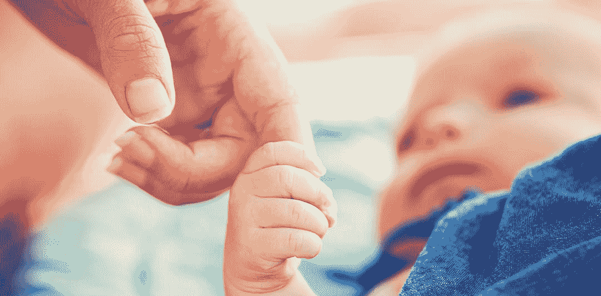

# 问答：突破的力量，是爱

武志红

2022-04-24

## 问答：突破的力量，是爱

问答：突破的力量，是爱

这一期的用户提问大多来自第三模块。在回答问题前，我想说说我看留言时的一些感受。

比起我的年度课程《武志红的心理学课》，我觉得这门课程中，同学们的留言分享细节更丰富，更具体，更加有打动人心的力量。

这可能是因为年度课程比较宏大，《自我的诞生》这门课更聚焦，更具体，也因此更容易唤起细腻的感受。

特别是第三模块的内容，同学们的分享尤其让我有触动，我想原因可能是，的的确确有太多人被困在了“母亲包围圈”之中。

就此分享鲁米的一句诗：

没有你的光照，一头巨狮就会被一只兔子俘虏。

因为母亲的照顾和爱，婴儿和母亲建立起共生关系，走出孤独的自闭之壳。当这份爱更充足时，孩子会更有力量，去突破母亲包围圈，走向更大的空间。

**当这份爱匮乏时，特别是母亲难以接受孩子走向独立时，孩子就容易卡在母亲包围圈这个小世界之中，孩子的心灵也会萎缩。**  
这份关系投射在其他的各种关系中，就可能会出现鲁米所说的，一头巨狮被一只兔子俘获。

读者 用户“月下孽生”：:

> "如果在“弑”父和“弑”母的过程中存在强烈的罪恶感、愧疚感、羞耻感、恐惧感和焦虑感，从而总是回到顺从父母的状态，头脑里明白应该要去“弑杀”，但行为上却做不到，产生了思想和行为的决裂，那该怎么办？"

这种时候，我们得区分“想象、行为和后果”。

如果离开父母，就等于是现实意义上的杀死父母，那这件事当然就没法做了。

但如果是另一种情况，那就不一样。这种情况是，幼小的孩子没有完成“想象、行为和后果”的分化，把“心理弑父弑母”的想象当成了行为，甚至是后果。并且，因为孩子的这种分化失败了，所以留在了潜意识中，成为成年人后还是不敢去完成与父母的分离。

如果认识到这一点，可能就会让人得到解放，认识到“心理弑父弑母”不是真实地伤害父母，只是分离而已。

如果觉得做到这一点非常困难，我认为既有自己潜意识内在想象的原因，也有父母不想与孩子分离的原因。这种情况下，如果父母明事理，可以和父母去讨论，获得他们的支持。

如果父母特别反对孩子走向分离和独立，而自己又做不到这一点，那么找一位心理咨询师来帮助自己，就很有必要了。

我们可以这样来理解：如果你打心眼里认为一件事很对，可你无论如何都做不到，那这就意味着你需要外力的帮助。这种时候，恪守基本中立原则的心理咨询师，会是很好的选择。

读者 用户“梁天骄”：:

> "我也想和母亲分离，但是我的工作和父母在一个城市，我想从家里搬出来，一提这件事我妈就会一病不起，我承受不起这个后果了，我该怎么办？"

首先，我认为你必须得意识到，随着年龄的推移，你和母亲付出的代价会越来越多，所以这件事最好是尽早完成。我有几位朋友和你一样有类似的问题，他们尽管在二三十岁就意识到自己应该离开父母，但却一直拖到四十多岁还没完成，结果母亲这时已经上了年纪，更加离不开孩子了。

我的这几位朋友都深深认识到，自己的一生被这种病态共生绞杀了，他们对母亲更加怨恨，可同时还要和母亲生活在一起，这种感觉就太痛苦了。所以我认为，与母亲分离这件事得尽早做，越早代价越小。

母亲一病不起，这是她体验到她主导的这个病态共生关系，要走向瓦解，“我们”要死了。同时，因为是她主导着关系，所以她会觉得她要“死”了。但我要说，这是一个很难避免的过程，可以说，没有痛苦就不可能完成。

这时，我认为需要向妈妈传递信息，那就是：我只是离开你，可我们关系还在；我离开你，并不意味着我不爱你了；我离开你，你会痛苦，但这是一个过程，我和你一样有痛苦，可我必须得完成它。

这里面既有情感上的表达，也有知识上的教育，当母亲头脑上能先有改变时，这份痛苦会减轻。

除了这些，我认为这个分离过程可以使用一些策略。不要想着一蹴而就，而是先有一些轻度的分离，例如你可以去旅行，有时不和母亲联系，在一些常见的小事上不听她的话，坚持“不含敌意的坚决”的原则，等等，这些都是分离。然后再去实现，从家里搬出来，真正实现分离。

读者 用户“梁沉”：:

> "对于常感觉自己缺乏母爱的人，是不是不存在“母亲包围圈”的问题？"

如果一方面缺乏母爱，另一方面又没有和母亲共生在一起，那自然是不存在这个问题。

但是，我观察到，很多人其实是并没有从母亲那里得到足够的爱，同时又被母亲给困住了。具体就是，在正常共生期共生需求没得到满足，到了分离期，母亲又过来和自己粘到一起，这会导致孩子最难离开母亲。

实际上，当母亲先给了孩子比较多的爱后，孩子会更有力量、更自我，这时就算母亲想和孩子共生在一起，孩子也会比较坚决地走向独立。

读者 用户“Hong”：:

> "可不可以请您也讲一下母亲如何放下母亲包围圈，也提供一个具体的练习？"

> "拿我自己来说，我的儿子才 11 岁，性格倔强，智商很高，极其不喜欢运动，可以一个月不洗澡。几乎每次让他运动或者洗澡，他都要黑着脸摔摔打打一番。我很想放下自己对他的要求，请武老师支个招儿吧，不是要改变他，而是想知道怎么改变自己。"

办法可以比较简单，比如不去控制他，也不去照顾他，同时适当坚持边界。

孩子在自己的空间，比如卧室里，可以有不洗澡的自由，但如果卫生问题影响到你的空间时，你可以表达你的情绪，但要使用“我”开头的句子，而不使用“你”开头的句子。

你描绘得比较简单，我试着从有限的信息中做一些分析：

“极其不喜欢运动”，可能是幻想着，我像婴儿一样只是发号施令，然后由母亲继续像照顾婴儿一样照顾自己，而不是我自己去照顾自己。

“一个月不洗澡”，也有类似含义。同时，也有和母亲对着干的意思，你越逼我，我就越不着急，用这种方式来气你。

“性格倔强”，这可能意味着，孩子和你之间有控制和被控制的问题，倔强是在反控制。

如果这些分析基本成立，那可能是你和儿子在一定程度的病态共生中，你在过度照顾他，因此让他固着在婴儿状态，你同时也在越界控制他。所以解决方法就是，少照顾他，同时也少控制他。

此外，还可以让儿子多和你分离，多让父亲带带他，或者多和同龄人长期相处一下，夏令营可以是一个选择。这些做法，都可以让他离开和你的关系，进入到其他关系中。

读者 用户“重庆 Franklin”：:

> "为什么说，“父母越是爱孩子，孩子走向分离的时候就越容易，但当这份爱很匮乏时，孩子的离开，就变得难了很多？”这句话怎么理解呢？父母的爱应该会变得和孩子更亲密吧，会更难分离？"

你这样问的时候，是把分离和亲密视为了一对矛盾。如果分离和亲密是绝对的矛盾，那就意味着，两个成熟的独立个体之间，就不能产生亲密了。这当然是不成立的。

孩子在三岁时，实现马勒所说的“分离与个体化”，但真正地走向独立，还需要一个漫长的过程。

孩子天然是希望走向更大的空间的，所以这个课程将这个过程描绘成了五个阶段。走向更大的空间需要力量，而自我力量的最初获得，是来自于爱和允许。

读者 用户“淬炼中”：:

> "我自查了一下，发现两个方面。第一方面，自己在关系里很难表达自己，总是妥协、不回击，感觉意志和动力都严重不足。第二方面，我在工作上却很坚定，遇到大事果断，并能坚持自己的意志，动力十足。请问武老师，这算是意志和动力发展的什么情况呢？"

工作，主要是你一个人的事，不太牵扯到关系，特别是不牵扯到核心关系，你明确了这一点，就可以坚持自己了。

在关系中你很难表达自己，其实就是一旦“我”的事，变成“我们”共同的事，你就不能坚持“我”，而总是去考虑别人了。

这种情形，我个人认为一样可以回溯到童年。你做自己的事情时，得到了母亲的允许，她没怎么干涉你，但在和母亲的关系中，你可能因为种种原因，而不得不过度考虑了她，很少考虑自己。

\*

欢迎你就这门课程的内容继续向我提问，写在下方留言区中。我会不定期做问答加餐。希望这些交流能够帮助你更好地学习这门课程。

  

公众号懒人找资源，懒人专属群独享

# 后记：世上只有一个你

武志红

2022-04-24

## 后记：世上只有一个你

后记：世上只有一个你

人来到这个世界上，不是来当炮灰的，而是为了活出自己的光彩。

作为咨询师，我会看到，每个人都在尽可能地活出真我，但当环境严重压制真我，人就会把真我藏起来。这个时候，这个人就失去了一些宝贵的东西。

我认为有一种情况是不会发生的：一个极顺从的人，同时又极具创造性。顺从的人可以是一个不错的工具，但活力和创造力这样的东西，必须建立在这个人能做自己的基础上。

现代舞大师玛莎·葛兰姆说过这样一段话：

有股活力、生命力、能量由你而实现，从古至今只有一个你，这份表达独一无二。如果你卡住了，它便失去了，再也无法以其他方式存在。世界会失掉它。它有多好，或与他人比起来如何，与你无关。保持通道开放才是你的事。

其实，很多智者都表达过类似的意思，如诺贝尔文学奖得主、俄罗斯文豪索尔仁尼琴就有一个非常简洁的表达：

每个人都是宇宙的中心。

我想，这句话可以直接用在我们自己的身上： **你，就是宇宙的中心。**

对你自己而言，你自身的宝贵性不言而喻，对你所在的社会和世界而言，也一样如此。一个伟大的社会，必然需要一个又一个的超级个体的诞生。

对此，我自己也有一句话：

活出自己，是一个人对这个世界最大的祝福。

到底如何活出自己？我想在这篇后记里，补充一些建议给你。这些建议可能很平实，很普通，但它们会真的给你力量。

## 第一，请先照顾好你自己。

如果更明确一些，就是请先照顾好你自己的身体，包括各种各样基本的物质性需求。

婴儿需要走出自闭之壳，进入到母爱怀抱。这如何实现呢？一个重点就是妈妈等养育者照顾好了婴儿的身体需求，通过这个过程，妈妈也和婴儿建立起了基本关系。

成年人也一样。童年时得到比较好的照料的人，成年后会自然而然地把自己照顾好。童年时没有得到很好的照料的人，会把正常的基本需求视为是贪婪过分的可怕需求，会鄙视这些需求，转而过于重视精神性需求。可精神性需求，又很容易成为想象层面的东西，这就会让人一直陷在孤独中。

同样的道理，如果你爱上了一个人，想和他建立亲密关系，那么，试着和他一起，照顾好你们彼此。

## 第二，明智地看待关系。

**成为你自己，但必须在关系中。** 一个人在孤独中，其实是没法幸福的，也不可能圆满。

人不能彻底活在孤独之中。的确，饱满的灵魂是可以享受孤独的，但如果从出生到现在一直孤独，那么，就必须警惕，极可能是活在自闭之壳中。

我在心理咨询工作中看到，一个人的关系匮乏程度，和他的心理问题严重程度是正相关的。有的来访者一开始心理问题比较严重，但当他们构建了基本的关系之后，如恋爱关系、朋友关系等等，人格的成长和做心理咨询的效果，都有了好转和进步。

所以，我有一个建议是， **也许你处理关系的能力不够好，但仍然要勇敢地去构建基本的人际关系，不要彻底封闭在孤独中。**

在构建和维系关系时，要明智，不要太理想化。明智的意思是，去构建对自己有益的关系。所以，和谁在一起，要有意识地去选择。当一份关系变得有“毒”时，要敢于结束它。当然，血缘关系是难以结束的，那么就要勇于远离。

人的成长是很不容易的，特别是人格水平不够高的人，需要借助关系来救助自己。世界非常之大，要相信，每个人都能找到与自己相匹配的关系，特别是亲密关系。

当你拥有一份特别契合的关系，就会对彼此都有滋养。如果推动这份关系发展成超深度关系，你必然会看到，这是你生命中最重要的幸福感的源泉。

## 第三，尊重你的感觉。

真实地活着的一个证明就是，非常尊重自己的感觉。

感觉，来自体验，来自心灵深处。追寻感觉时，大部分时候，你并不知道是为什么，但就是有一种莫名的引力，带着你前行。

当你在某一个领域，乃至整个人生中，都做到了这一点，随着时间的推移，你会发现在一个又一个感觉的背后，原来有深刻的联系。

苹果创始人乔布斯的形容是，  
**每次听从感觉所做的一个选择，就像是一粒珍珠。一个又一个的珍珠散落时，你不知道选择它们到底是为什么，但突然有一天，这些珍珠有序地串成了一个整体，你才发现，原来它们是有一条线贯穿其中的。**

还可以从另一个角度来看你是否做到了这一点，那就是，你是否展现了你的三种生命动力——自恋、性和攻击性。如果你从未展现过，那意味着你还没有真实地活着，尊重感觉也就无从谈起了。

## 第四，守护你的权力。

权力是至关重要的部分。你对自己的空间有多大权力？例如你的房子，你是主人吗？当碰到反客为主的人，不管是亲人，还是偶尔来的客人，你能直接捍卫吗？还有你的头脑、心灵和时间，以及你的工作岗位，你都能守护吗？

明明是你的空间，但你却没有自主权的时候，就意味着你遭遇了入侵。入侵会引起你的敌意，当敌意太强，而关系又不得不维持时，你就会陷入僵硬的状态。也就是说，你只能保持非常浅层的互动，可是内在的流动被彻底切断了。你的头脑在动，但没有了创造力；身体在动，但没了活力；情感在维系，但没有了热情。

保护你的空间，守护你的权力，这样你的生命动力，才能在这个空间内自由流动。

## 第五，主动拥抱自恋的破损。

**自我的成长，必然伴随着自恋的破损。自我越是虚弱的人，越是恐惧自恋的破损。**  
然而，当严重活在自恋中时，那常常意味着，其他客体的能量不能很好地流进你的空间了。

成长中总是会有各种伤害，当伤害严重一点时，我们会觉得像是遭遇了创伤。然而，生命有一个真理，当伤口出现时，光也就有可能进入了。这来自鲁米的诗句：  
**伤口，是光照进来的地方。**

**勇敢地活，努力地去追逐你想实现的目标，拥抱发生的创伤。** 在这个过程中，你越是真实，越是主动，劲使得越足，那么随着时间的推移，你会发现越是没有遗憾。

创伤通常不会导致遗憾，最容易让人感到遗憾的是，你没有充分地展开你自己，你太畏缩。这样的话，在事情发生时你确实保护了自恋，可是，后来你会明白，自恋从未严重破损过的一生，是枯燥干瘪的一生。

奥地利心理学家弗兰克尔说， **投入地去爱一个人，投入地去做一件事，幸福就会降临。**

但我要说，投入的过程中你会发现，你的自恋会受损，但同时你也会不断成长，这是一种必然。

## 第六，通向自我实现。

自我实现，活出你自己，成为你自己，这些语句，其实都是同一个意思。

不要把活出自己理解成为所欲为。 **如果为所欲为就能通向自我实现，那这条路也未免太简单了。**

精神分析认为，活出自己的过程，是人性化攻击性的过程。最初，当一个人的自我太脆弱时，会恐惧自己的攻击性。因为担心一展现攻击性，就会被报复，甚至被灭掉。于是，为了保护“我”，人就会压缩攻击性，这时就只是在活着而已。

度过了这个恐惧的阶段，一个人就不再担心，一展现攻击性就会被灭，就有了基本的存活感。但接下来，又会进入内疚的阶段，开始担心一展现攻击性，会伤害所爱的人。

我们就是在恐惧和内疚之中，不断去修炼攻击性的表达，最后，你可以由衷地信任你的自发性，坦然地伸展攻击性，不再恐惧自己受到伤害，也不再因伤害所爱的人而内疚。

你可以看到，人格成熟的人，就是能自如地表达自己的力量，而他们的力量，既能滋养他们自身，又能滋养关系。

但这绝不是一条简单可以实现的路，不过，它是真可以实现的路。愿我们每个人，能先初步形成一个真实自体，然后再接受真实世界的淬炼，最终活出你自己。

\*

罗胖在谈到关于活出自我的话题时，引用了钢琴家古尔德的一段话，我觉得说得实在是好，分享给你：

一个人可以在丰富自己时代的同时，并不属于这个时代，他可以向所有的时代诉说，同时他不属于任何特定的时代。一个人可以创造自己的时间组合，拒绝接受时间规范所强加的任何限制。

我在这门课程中，勾勒了一个自我诞生并成长的“蛋-鸡-鹰”模型，依照这个模型，自我的诞生与发展看起来是需要一个又一个的阶段，可同时我也想说，一个忠于自我的人，可以破碎时空，碰触存在，与道相连。

这听上去非常诗意，像是捷径一般，但这条路只属于忠于自我的人。

**请记得：世上只有一个你！**

感谢你的聆听，你的自我终将诞生。

  

公众号懒人找资源，懒人专属群独享

