# 武志红心理学课201801-03

## 预告：自恋与依恋

这是我们专栏的第二十七周，今天我们进入新一章 “情感” ，这一周的主题是 “自恋与依恋” 。

“情感”这一章的内容是思维和身体两个主题的延伸，它的设计来自于我自己的一个认识：情感，是灵魂的证明。

如果一个人天赋很好，又能在思维和身体上花很大力气时，这个人就可以锤炼出非常好的能力，然而，假如他还是在孤独中，那么他很难有幸福感。

虽然心理学家维克托·弗兰克尔说：当一个人投入地工作，投入地去爱时，幸福就会降临，然而幸福感的主要源泉是关系，特别是人际关系。

用精神分析的理论讲，一个人的生命主要有两个维度：自恋展开的维度和关系构建的维度。能力只是自恋的展开，而如果太缺乏关系这个维度，生命仍然会有苍凉感，甚至是致命的孤独感。

想起我对一位长辈的评价：他这辈子精彩绝伦，但老了，心里空空荡荡，什么都没有留下。我的意思是这个人的一生，爽是爽，可他的世界中只有他自己，他的心中没有住着别人，在关系的这个维度上，他的人生是有些空白的。

实际上，无论是能力的形成，还是爱的获得，都需要不断破除自恋。成长，就是一个不断发起自恋而最终又放下自恋的过程。

为你分享一段鲁米的诗：

> 如果你可以哪怕一次，
> 抛弃你自己，
> 秘密中的秘密，
> 就会向你敞开；
> 隐藏在宇宙背后的
> 未知的容颜，
> 就会在你知觉之镜中
> 显现。

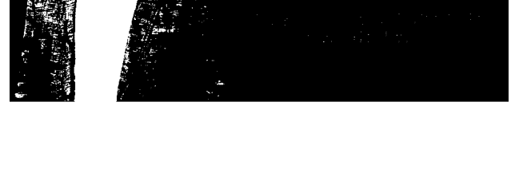

## 情感01 | 依恋的形成

**武志红**

我这一讲的主题是“自恋与依恋”，今天第一讲：“依恋的形成”。

### 依恋的类型

所谓依恋，是一个人的情感，能够向依恋对象打开。依恋的类型，可以分为安全型、回避型、矛盾型和混乱型。一般人都属于前三种中的一种，表现比较稳定，但人在这三种中不断变换，这就叫做混乱型。

要搞清楚安全型、回避型和矛盾型，可以设想这样一个情景：幼儿园的家长们，家长们特别是妈妈到了幼儿园把家门口去看孩子，这时候会发现，孩子们大致会有三种表现方式：

- **安全型**：看到妈妈在门口，笑容满面，放下手里的东西，跑过去，然后紧紧抱住妈妈。
- **回避型**：看到妈妈在门口，没做反应，仍然玩手里的东西。
- **矛盾型**：看到妈妈在门口，显得有些矛盾，看看妈妈，想过去，但又有犹豫。

关于依恋类型的论述和查找资料，感兴趣的用户可以自己再搜索查找资料，这是一个比较好理解的概念。我来举一点特别的，依恋是怎么发生的。

最高本的原解是：你们都在寻找客体，“我”永远是在寻找你。小孩、猫、狗、鹦鹉等动物，都是天然地在寻找情感对象的。如果说，我对你的渴望，得到了你的积极回应，这份情感就会在我和你之间建立了一份连接，我会去表达这份对你的依恋。

安全型依恋，是因为我对你的渴望，得到的是比较一致的积极反应，并最终我确信你欢迎这份表达。

回避型依恋，是因为我对你的渴望，得到的是冷漠的回应，并最终我阻挡住我对你的渴望。

矛盾型依恋，是我不能从你那获得稳定风格的回应，你忽冷忽热，于是我的情感表达矛盾了起来。

### 自恋是依恋的对立面

依恋意味着我能够向你表达出我的动力。弗洛伊德把这种动力的自我 libido 不再能指向客体，而只能指向自身。libido 是由弗洛伊德自创的一个词，大致可以理解为动力。

在弗洛伊德看来，自恋就等于是你的动力，也就是能量暂时在自己体内，对外部世界失去了兴趣。

后来的精神分析学家们，不断发展自恋这个概念。到了美国心理学家科胡特那里，自恋和全面依恋联系在一起，他集中讨论了全面依恋的问题。这一点在我们自己也专门讨论过，自恋的小婴儿们一生觉得自己无所不能的神，他一动态，世界就应该按照他的欲念给予回应。

如果这种世界观不给出口，整个社会就会生出自恋型情绪。恨不得摧毁了整个世界，因为他有全能感，所以这个时候他是真的觉得，他一定要自我暴露，世界就会给他提供。他不接受自己在这个世界受限，这时他就把这份额外的坏，投射到外部世界。这就表示他认为坏世界所有都要打散，构建一个魔界，和这个魔界隔开，这样这个魔界就可以不攻击他了。

但这个词境铁壁打造出来，也意味着他这个人困在了里面，他的生命力也被禁在了里面。

例如我一位来访者，他是典型的回避型人格，最开始咨询的时候，可以说几乎没有一个朋友，他常常有这样的观点，凡事小事退逸到寻找，就会合巨大的挫败感，同时他会觉得，好像整个外部世界为铁板一样，在对他发出严历而残忍的拒绝。这时候他隐隐觉着，好像世界背后有一个狰狞的魔鬼在操纵着。

所以说，彻底的孤独，会带来彻底的黑暗。

### 科胡特：自体客体

该怎样解决这问题呢？科胡特认为，咨询对象这样的来访者：妈妈对于最初的婴儿，都需要扮演一个角色，叫做自体客体。

所谓自体客体，简单理解就是你的确是主体，在我这个主体之关照下，你可以觉得，好像是我自身的一部分，我可以像控制自己的手脚一样控制你。

我长相普通，期间一位帅哥说，你看我们条件都太好，这会带来一个问题，我们恋爱时比较轻率，这场恋爱谈得太困难，那我就换一个，但这么容易换来换去，我们一直没有学会好去爱。

其实这不只是帅哥美女的权利，很多相貌普通的人一样有这份心理，就算不能比较容易地换恋爱对象，但我至少可以选择孤独封闭。

所以，最好是在孩子时学会依恋，学会低头，学会去信任一个有力量同时又善意的情感对象。

## 今日得到

1. 依恋就是一个人的情感能够向情感对象打开。依恋的类型可以分为安全型、回避型、矛盾型和紊乱型。
2. 依恋的发生是因为自体都在寻找客体，“我”永远都在寻找“你”。如果我对你的渴望得到了积极回应，那这份动力就我和你之间建立了一份联接，我就会表达对你的依恋。
3. 依恋的对立面是自恋，也就是你的生命力都憋在自己体内，对外部世界失去了兴趣。咨询师对这样的来访者，妈妈对最初的婴儿，都需要扮演自体客体的角色，让自体能够伸展、表达自己的能量。
4. 妈妈以及其他抚养者要允许儿童使用自己。孩子，特别是婴幼儿，需要“我可以自由地使用这个世界”的感觉，这样他才能够把他的动力指向客体、指向万物、指向世界，成年人也是一样。
5. 最好是在孩子时学会依恋，学会低头，学会去信任一个有力量同时善意的情感对象。希望在“我”不能控制的边界之外，有一个善意的“你”存在，这时“我”愿意向“你”低头。

## 划重点

依恋意味着我能够向你表达出我的动力，分为安全型、回避型、矛盾型和紊乱型。依恋的对立面是自恋，妈妈对最初的婴儿需要扮演“自体客体”的角色，让婴儿觉得妈妈好像是自身的一部分，可以像控制自己的手臂一样控制妈妈。最好是在孩子时学会依恋，学会低头，学会去信任一个有力量同时善意的情感对象。

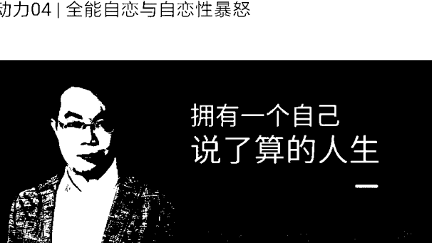

推荐阅读：
- 思维08 | 怎样接住关系中的“坏”
- 动力06 | 全能自恋的力量
- 动力05 | 实体自恋与虚体自恋
- 动力04 | 全能自恋与自恋性暴怒

## 情感02 | 两种妈妈，与两种孩子

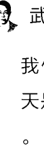

**武志红**

我们这一周的主题是“自恋与依恋”，今天是第二讲“两种妈妈，与两种孩子”。

昨天主要讲了一些理论，今天讲一个让我印象无比深刻的故事。

我的一位女性来访者，看上去温柔小巧，实际压抑欲望非常之明显。她和丈夫合力创了一个企业。创办企业过程中，她发现自己讨厌事多。然而，她又不屑请会计，因为会计算好账后，会再算三道。她负责公关类的事，她的丈夫负责内部管理，但她对丈夫的言行想法都很难管，觉得他俩都不够好，总想批评、管他们。

这些控制欲望，我们也可以说是自恋问题。具体表现就是，她希望企业的所有事情，不分大小，都要经过她，实际上是经过她头脑中的思维和审查。

她的妹妹，和她丈夫的妹妹，几乎同时生了孩子，而她发现两个妹妹抱孩子的方式截然不同。她的妹妹抱孩子时，紧紧得近乎乖张，经常对妹妹娇声不绝；常常被孩子哭得死去活来，她才不耐烦地摇弄几下。

相反，她丈夫的妹妹，也就是她的小姑子，对孩子堪称是照顾客无不至。孩子稍有点动静，这位妈妈就第一时间给予回应。我讲这个故事时，两个孩子还只有几个月大，和小姑子和自己孩子有了心灵感应的似的。

特别让她奇怪的是，她对两个妹妹的感情，对自己的妹妹，她头脑中知道妹妹带孩子不容易，她也苦口婆心地建议通过，按照心理学理该及时满足和回应孩子，但对妹妹的方式，她没有特别大的情绪反应。

而小姑子，她是头脑上知道这样对孩子很好，但她却很容易对小姑子生出一股强烈的无名火。观察她小姑子，觉得她很有嫉妒心，一是嫉妒小姑子几个孩子；二是嫉妒小姑子，觉得她是一位好妈妈；相比之下，她与自己妹妹最照顾孩子的方式更像她的，是学了心理学之后才改变对孩子的方式。

这事引起了我们很多讨论和思考，这位来访者一方面做得很控制，另一方面又在追求纯净，很容易表现得对世俗生活感到没有意义；她总是说纯洁的话，这些表现得满，没有意义；而有意义的生活，应该是非常精神的，比如像我这样写作，做咨询师。

她和我谈这种痛苦的时候，加上想到她的两个妹妹和她两个孩子，我突然形成了一种理解。我觉得她小姑子无奈而至地照顾孩子，这会给对方带来这样的影响：你的孩子，你的妈妈拉撒玩本就没有意义，和你是纯粹些不得不再现的东西，自己会妈妈建立了安全感，以后可能也不会追求意义，但不会那么严抵扼俗世的生活。

她妹妹对自己孩子很忽略，只有在孩子情绪很严重的时候才会回应，这孩子的这些孩子，孩子都会有意义的，该被事等的，因此，孩子也没有或矛盾型依恋或回避型依恋，容易远离俗世生活，去追求精神上的纯净，但是，这是心灵沼泽，是孤独、荒荒的圣地。

我由此想，这是自恋的一个很重要区别。学了依恋的人，他会拒绝自恋世界，而一直停留在自恋中的人，容易安在自恋世界中，并认为自恋的精神归宿。

我另外一位来访者，也是一位女性，她的一段话让我印象无比深刻。她说，她一直停留在一个人的世界，既不会回到原来的孤自世界，又不能进入到充满关系的真实世界，在这个空间中，她会数次着望向外界，在这个，外界世界需要一个，对她敞开着言来说，来吧，欢迎！然后她才能够进入真实世界。但她觉得，这个人一直都在出现。

因此我也想说，如果你基本上是一个正常人，觉得在相当程度上和社会有融合，那么，不管有多少问题和痛苦，还是婆婆妈妈或者养多亲等，他们还是给了你这般感觉：世界欢迎我。

昨天我们讲了科胡特的“自体客体”概念， 而这两行特 的“客体使用” 概念，可以说，含个概念都是在讲“父母亲是要抚老，需要给孩子传递出“这个世界欢迎你的信息。这个世界” 的感受，我可以是尼科所倡导的，咱们之前专栏中内容中说过这句话：

> “需要一直会报复我的， 以培养出这种感受：世界准备好接纳我的本能排山倒海般涌出。”

这些描， 相信会让很多妈妈感到大压力， 但这是我讲的故，也是有点误解。讲这些故事， 是为了对比， 为了讲清楚“两种妈妈与两种孩子” 的关系。

所谓两种妈妈，就是当很好地回应孩子时，妈妈就是“好妈妈”， 当不应回应孩子时，妈妈是“坏妈妈”。 相对应的是，面对“好妈妈”，孩子会是“好孩子”， 面对“坏妈妈”， 孩子会“坏孩子”。

依恋的形成， 需是桌子上有一种基，是：“坏”的， 但“不坏到决的”， 他基本上是“好妈妈”， 他接是“好”， 但“坏”可以被修复， 也可以被孩子所接受的。

如果自己真的妈妈不够好， 那么孩子会倾向干在一定程度上的对妈妈表达依， 而去外部世界寻找“好妈妈”。

我举你个例子吧， 我在广州电视台做节目时， 曾经遇到一对母子， 小男还不到一岁大， 就会经常跑出去找别人， 因为他的妈妈太暴力了。

还有一个有示的事，我有一位朋友，他总是不能取得成绩，比如对自己的小家庭不满，对自己当前的工作不满，读书时不能专心，他一生总是在寻。我有人深人探过之后，他发现在是好妈妈在他人之外寻找什么，就好像是在寻找一个“好妈妈”的痛得深体验应得是发现， 他小时候的确没得到子自己想要的关的， 他应该有一个全家人的“亲生好妈妈”。 这是一个深刻的隐喻。

如果自己依形成有重形，该怎么办？首先，看看依自己的心理的师，透过这些复杂的防御，看到自己的初心， 也是我说了很多次的：“我”永远都在寻找“你”。

你可以去看看孩子，看看小动性，会看到生命原来的样子； 一方面， 他们会在独立成一些事物， 另一方面， 他们都会在寻找感觉，当有依恋产生时， 一份满感会油然而生。

同时特别重要的就是时间机空间变换。 例如， 你多访伤了你的， 你经过认复考虑， 如果发现这念实是没有什么事， 可以变换空间， 换一个人去寻找。

同样重的是当你基本断定，一份关系是OK的， 那么， 请在相当中时间保持系， 稳定态， 逐渐在这个关系中， 去实现依恋的完成。

出于这样的原因， 我会给来访一些建议， 如果你的开始变得一访咨询师还不信， 那么你不意在中满足位时是不满， 或者， 试着保持这份关系， 同时也在关系中对咨满者表发依赖、 满和不满意， 最终在这份关系中态完成。

例如我的一位来访者， 找我之前， 换过十位咨询师，也换过很多工作， 而我在第十位就告诉他， 你换过， 如我已已经换过十位咨询师， 也换过很多工作， 你不容易是关系了， 那么， 我们不可以这样办， 如果你的咨询师或比你满意， 我并没有明显说 职业咨询师我， 基本保持换动的态度。 如果你想我， 请一定要把我 的不满表达出来， 我们好好探讨。

结果， 我们的咨询持续了几年， 他的生活逐渐发生了很大变化， 他满足的自恋之后， 依恋完成的背后， 都着对人性的深信任， 我们明天再深入探讨这个问题。

## 今日得到

1. 自恋依恋的一个重要区别后， 学会了依恋的大人能拥现实世界， 而一直保持依恋的人会拥抱真实世界，而一直停留在自恋中的人容易待在自己的世界中，并认为自己的世界才是精神的归宿。
2. 依恋的形成，需要孩子有一种基本的感觉：妈妈基本上是“好”的，有时候是“坏”的，但“坏”不会淹没“好”；我基本上是“好”孩子，有时候是“坏”的，但“坏”可以被接纳。
3. 如果依恋没有形成，首先要看破自己的重重心理防御，看到自己的初心：“我”永远都在寻找“你”。生命原本的样子就是我們一方面试着独立完成一些事情，另一方面在寻找情感依恋。

## 划重点

> 如果自己真实的妈妈不够好，孩子就会倾向于在一定程度上放弃对妈妈表达依恋，而去外部世界寻找“好妈妈”。特别重要的是时间的累积和空间的变换，以及当你基本断定一份关系OK时，在相当长时间内保持关系的稳定，逐渐在这个关系中实现依恋的完成。

推荐阅读：
- 情感01 | 依恋的形成
- 关系17 | 关系层次进化的关键
- 思维08 | 怎样接住关系中的“坏”
- 动力15 | 警惕心灵路径

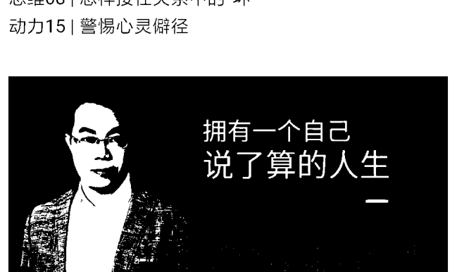

## 情感03 | 依恋“你”，排斥“它”

**刘志红**

我这一周的主题是“自恋与依恋”。今天是第三讲“依恋你，排斥它”。

在敏感的精神分析师眼里，几乎一切都看上去很平静，但故事背后都有意义，都有隐喻。关于这一点，我倒是有个故事，而这个小故事，会引出一个大道理。

那是前不久，我在广州的得到工作小组开会时，黄石玲老师迟到了五分钟，并且她在道歉声中进来到。于是我们说起她为什么会迟到。

她讲了几件小事，最后就想到最近一段时间她的情绪就失控了：为什么会失控？因为前天才某处幼儿园爆出“劣性恋教”事件，让她非常愤怒。她有两个女儿，一个在读幼儿园，一个在读小学。

此外，国内有知名女性在网络上坦言自己曾被“侵害”，性侵者如张德芬在微信公众号上讲了“她被邻居男领导多次性骚扰自己大获表扬的故事，去年看电影《芳华》时她想到如果这种事发生在女儿身上，她就会哭，今年这一系列的事件让她更想死撑进一年。

她在想，这个世界是有魔鬼的，有些人就是想把自已的魔手伸到最无辜、最无助的人身上。因为这样的担心，她清晰地感到自已的焦虑感变多了，对周围世界的警惕心强了很多。

后来，有一耐人寻味的事发生了。他们一家人开车出去，老公开车，黄石玲在后座。突然，她老公打了一个响欠就睡着了，这一大被甩在一城。

这种紧张感和恐惧，让我想起了我最近说的一句话：“我”并不希望控制一切，因为太孤独了，而是希望“我”不能控制的边界的旁，有一个善良的“你”存在，可是我很怕的就是，在“我”不能控制的边界之外，有一个敌意的“它”在那里。

如果外部世界是充满敌意的，是“它”的世界，那“我”就会倾向于控制一切，并陷入自恋，这就是自恋防御；如果外部世界是基本善意的，是“你”的世界，那“我”就会放下控制，把“我”交付给“你”，这就是依恋，就是信任。

在“关系”主题下的内容中，我着重介绍过犹太教哲学家马丁·布伯的《我与你》这本书，他说当关系是“我与它”时，这就是“它”世界，当关系是“我与你”时，这就是“你”世界。布伯是神学家，他的“你”就是上帝，而“它”就是魔鬼，当然马丁·布伯不是在谈论鬼神神话，而是将上帝与魔鬼当做隐喻来用。在了解这个概念时，我并没有想到，这个说法逐渐地也成了我的语言。

所以自恋和依恋不仅仅是情感的事情，是与深刻的依恋。婴儿依恋妈妈，孩子恋大人，成年伴侣依恋彼此，这都是依恋“你”的世界。这时我不惧失控，因为“我”是安然，我信任失控，我信任失控，我信任失控。

相反，当我们还是陷于严重的自恋与控制时，其实是在惧信中，因为觉得我不能控制的边界之外的“它”有敌意，我会选择封闭，把心关起来。因此我觉得，真的可以说，联结是善，封闭是恶。

这一点和我对生命力的理解是统一的。关于生命力，我的理解是生命力有一种性，当具体的生命力关系“你”的世界时，就会成为好的生命力，如热情、创造力与爱；不能看的生命力，就会成为坏的生命力，如怨狠、破坏欲等。

## 今日得到

3. 我们陷入自恋和控制中，是为了防御外部世界的敌意的“它”，这时我们还需看到我们内在也住着一个“它”。在“它”之世界，我们会切断与外部世界的联系，选择封闭。
4. 自恋和依恋还会带来身心分离和身心合一。当我们想切断和外部世界的联系时，会切断头脑和身体的联系；而当我们愿意和外部世界保持链接时，也会保持头脑和身体的天然链接。

## 划重点

> 链接是善，封闭是恶。自恋和依恋，并不仅仅是情感问题，更是教人看清链接的真正意义，也给人带来身心分离或者身心合一。所谓链接，就是和外部世界保持链接，让头脑和身体保持链接。

推荐阅读：
- 情感01 | 依恋的形成
- 情感02 | 两种妈妈，与两种孩子
- 身体03 | 如何用身体来聆听
- 身体02 | 具身认知观

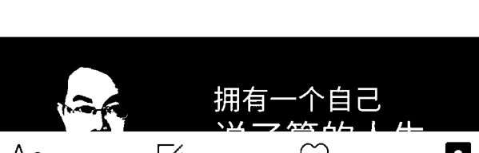

## 情感04 | 晕车的隐喻

我们这一周的主题是“自恋与依恋”，今天是第四讲“晕车的隐喻”。

今天我们来讲一个非常常见的事情：在交通工具上，晕车、晕船、晕机，和失控有关。

这晕，首先是身体上的反应。而晕得厉害的人会知道，这是一种非常可怕的事，会带来身体上的失控感，让人影响大脑判断力，比如可能会说：不用影响交通工具，甚至干脆不出门了。

关于晕车，科学上已经有非常明确的解释和分析，简单来说就是运动时的前庭、内耳、视觉互相矛盾导致的。而晕车的最常见症状是头晕、恶心、呕吐，前庭神经发生的症状。

晕车、晕船、晕机，和失控感有失控感有关，我认为这背后也有自恋和依恋的强烈联系。晕车，就是失控感。

有一次，我和一位朋友坐飞机从广州到北京，突然因为气流关系非常颠簸，不是很不舒服，可我的这位朋友非常晕，双手紧紧抓住前排座椅，身体前倾，头趴在椅背上，闭着眼，身体在发抖。我当时就有点担心，就赶紧把安全带系好，把身边人扶住，尽量让她不抖得太厉害。

她笑了笑，松开了手，按照我的建议把身体交给了飞机，把生死交给了专业的飞行员。同时，那个在机场就害怕晕车的我在旁边陪着，感觉感觉很快就消失了。

后来我知道，她在交通工具上，常有严重的情绪宣泄。造成的结果是她根本不敢坐，作为商务人士没法办法避免坐飞机，只好找专业服务，例如去准备晕车药，而她总是坐别人的车，都是自己的开车。

有车晕车经验的朋友都知道，坐车就会晕，但自己开车就不会。这是为什么呢？除了科学角度可以解释，我认为这还有一个原因，就是开车的时候，车完全在你的掌控中，你坐着的时候，车不在你的掌控中，所以晕。这就会联系到失控感，晕车就是失控感。

因此还可以发展出一个验人的控制感的测试，就是请对方坐在副驾的位置上，找一个熟人开车，看看他的反应。如果他很晕，那么他就有可能有控制感的问题。

也有人会晕，也会晕船。这种晕船的人可以坐船，但很不容易。在游轮上，很多人不晕，各种条件都很好。如果是头两次，那很容易引起一些争吵。

我认为，车，是现代人最容易满足自己掌控感和东西，所以关于车的各种，都可以很容易联系到失控上去。例如，一个人晚上总在开车发生失控有关的梦，那个可能是他的生活不够处于失控之中。那种可以推测是这样一种情况：在自己有最有能力的工具，如果方向盘，但突然方向盘开了，例如车子不动了，可又怎么努力都控制不了，然后惊醒。

我曾经非常有效地治疗过我朋友的晕车。那次，他从湖南去云南找老家长辈游玩，她想一找治疗就回到很远的地方，结果她在飞机上晕得八荤八素，堪称可怕。

到了广州后，这位朋友也只能在我家过夜，因为晕车，哪儿都去不了。后来我想好好给她治疗一下，于是就策划了一次温泉之旅。

出发前，准备好了晕车药，先把她吃了，还准备了其他防晕车的东西，让她知道我们准备得充分。开车是她的大儿子，特地嘱咐他，务求开车非常稳。我让她儿子坐在副驾驶位置，把位置调到最舒服的状态，然后坐后排。

去路上，她虽然没怎么晕，让她不要再去尝试克制什么，干就放松。同时，好好享受身体，好好感受坐在车里的感觉，感受身体，感受呼吸，同时，让她的感受，突然地好舒服。回到家的时候，一想到她的儿子就会在我身旁，我们俩都感到满足。

## 治疗的关键

治疗的关键是身边有一个信任的人，对于晕得程度很厉害的人，这是必不可少的。

## 今日得到

- 1. 晕车、晕船、晕机，都是和控制感与失控感有关，背后也有自恋和依恋的深刻隐喻。晕，就是失控感。控制都是为了对抗失控，而失控的原始体验，是情感依恋的失败。
- 2. 关于胃的不舒服和呕吐，也有深刻的隐喻。在婴儿时，我们必须吃进妈妈的奶水或妈妈给的其他食物，否则就会死。如果婴儿感知妈妈是敌意的，那么他会有恐惧和担心，好像这份食物有毒，他吃了之后会抵触，严重时想呕吐。

## 划重点

从心理学的角度看，晕车有着深刻的隐喻，和失控有关，也和自恋与依恋有关。控制都是为了对抗失控，而失控的原始体验，是情感依恋的失败。如果能说出这份失败体验，会很有帮助。在眩晕发生时，身边有能够信赖的人是必不可少的。

推荐阅读：
情感01 | 依恋的形成
情感02 | 两种妈妈，与两种孩子
情感03 | 依恋“你”，排斥“它”
身体04 | 让痛苦流动

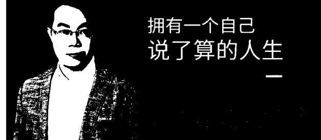

## 问答：我可以不依恋任何人吗？

问答：我可以不依恋任何人吗？

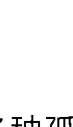

武志红

今天是周二的答问时间，我来回答一些用户的问题。先集中来聊聊一个大问题：一个人可以一辈子不依恋任何人吗？

这是很多用户问到的问题，我们也多次谈过类似的问题。这个问题如果更为贴近根本的语言，应该是：一个人能孤独成圣吗？

有各种孤独成圣的传说，金庸古龙的武侠小说里常常也会写到类似故事，例如某个人在山洞里得到一本武功秘籍，忘记了时间，专注修练后，后来成为天下第一。

可是从我个人的经验出发，我是学习越多，对人越了解越多，就感觉越不可能的事情。你必须要有客体，“我”必须找到“你”。那些真正孤独成圣的人，以我的了解，是他们都忽略此前曾有饱满的关系。

从咨询和生活的经验来看，从不构建深度依恋关系的人，不管表面上看上去多么善良友好，内心都实际上有太多的黑暗和敌意。当“我去寻找你”时，“我”也就不可能被真正看见了，于是“我”也就处于黑暗中了。

## 本题问答

任何有攻击性的心理、行为、语言都是对己的不满意，或者说是对自己某部分的和自他的不满意。故事里有一个妹妹家孩子，他生长出自责，会拒绝真实的世界。人的本能都是值得尊重的，问题是如何从一个攻击性的小孩以后可以转换成依恋性人格吗？如何转换呢？

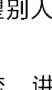

武志红

人的一切本能都是值得尊敬的，包括防御，包括感受到外界的敌意而让自己停留在攻击和控制中的。

我整个专栏就在讲两件事：成为自己，找到你。后者就是完成依恋。如果按逻辑来讲，它涉及这样几个问题：

- 1. 看到自己对依恋别人的防御；
- 2. 看到自己对关系的渴求；
- 3. 在时间秩序和时间空间顺序中，逐渐接纳另一个人，建立起真实、全面而具有深度的情感关系。

这个过程不必太强调自己，比如硬要去依恋一个本就不是，需要尊重自己的本性，而本能就是在告诉我们，依恋着自我的“你”，排兵布阵的“它”。

依恋与依赖有什么区别呢？是否如自恋发出动力，就直接去对应建立了安全型依恋，而一直使用着这自体客体，想想进刀、痛苦之刃，越用越熟练，终于像手之足不即不违状，就形成依恋，是这样吗？

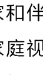

武志红

依赖，讲的是自己不能做的事自己做，希望别人帮自己解决。

依恋，讲的是情感上对另一个人的敞开和链接。

你讲的理解是依恋而不是依赖。当我们混淆依恋和依赖时，也许是反映了一种坏客体，如果完全太依一个人，有一天我突然不在会怎么样，比如他死了，或者他抛弃了我，不行，我不能让自己如此需要一个的人。

成熟的依恋关系是当我们失去对方时，会痛彻心扉，会无比悲伤，同时我们也会知道，已经发生过的那些爱，就留在心里，这也是我们此前讲的“情感稳定性能力”。

如果一个人成不恋家，经常出去玩，是不是与儿时父母没有建立很好的依恋关系有关，以此很难建立与“我”有关的境界，做事不够专注，小孩结果上更不够专注，甚至多动，与依恋理论有关吗？

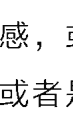

武志红

在我的理解中是这样的，依恋性理论的创始人，在与其他研究依恋的人是否这样看，我就不太清楚了。关于依恋的研究和书籍非常多，大家感兴趣的话自己去查一下。

我在细腻而深入的心理咨询中，的确看到成人不恋家，是因为父母没有建立好，而不专注与多动，亲子我认为也有这个含义。此外，孩子精力旺盛，也被经常被老师投诉，我见过很多成功的人，曾被认为有多动症。

如果比较中美国家，你会发现，美国人非常重视小家，平时下班后他们要么是回家和伴侣孩子在一起，而很多中国人常聚餐饮或是接孩子带孩子，他们下班后容易过恋家，把家庭视为正常，我认为家庭是依恋。而地方中国男人移居美国，容易过恋家，把家庭视为正常。事实上，一个男人如果能专注和孩子在一起，会发现家庭生活本身就够迷人。

如果说孩子可以妈妈形成依恋，那母亲应该不应该对孩子依恋？妈妈的依恋对孩子不会太负向，孩子接受不住吗？那妈妈的依恋除了对丈夫外还有其它的方法吗？

武志红

这是非常好的问题。当然妈妈会对孩子形成依恋，在很多国家当中，对妈妈来说容易依恋孩子，因为和老公处理关系很有挑战性。

这会带来很大的问题。按胡特赖纳提的“自体客体”这个概念，亲子关系的正常发展是父母成为孩子的自体客体，延展孩子的自我，而我们孩子，我的母语教育和孝顺，就是要求孩子成为父母的自体客体，用来延展父母的自我。很多妈妈对孩子的依恋，延展了妈妈的自我，但压制了孩子的自我。

妈妈们如果依恋丈夫而不得，那该怎么办，这真是很大的问题，说实施我也不不能说该怎么做，我只知道如果夫妻关系不健康来，妈妈和孩子在这里事情要疏离，甚至终其和孩子绑在一起，这是无数中国家庭的问题。

情感依恋是与生俱来的吗？如同安全感，或者国家、宗教，民族这些概念，或者是一些想象共同体，也是依恋的需要？

武志红

我个人认为，信仰好的宗教，是向有力量的和智慧的上帝低头和依恋。我认为这是人类最美最本质的要求，活在全能状态中，不仅孤独，而且世界，所以人类的精神力不圆满时，也在寻找比自己更高的精神力量来依恋。

是不是对于一个人来说，自恋越多，依恋越少？依恋越多的时候，自恋就越来越少？

武志红

如果谈到控制与失控，在这个层面，自恋和依恋处于那个多就少现象，学会了依恋的人，封闭的自恋就会减少。

不过，如果是从能量上看，自恋不能简单理解。我见过很多人，他们浓浓的自恋，同时他能无比坦然地表达依赖。这时的自恋，就是无所不怕自信了。这里我们可以用到科胡特的理论：健康就是自信与热情，自信能量是滋养自体，而热情能滋养客体。

文章中所讲的自恋与以前提到生命本能有什么不同？陷入自恋与控制，这与一元关系是接近的，而后者却是坏的，要如何理解两者的区别呢？

武志红

真是非常好的问题。从根本上讲，外部世界是内在世界的投影，同时内在世界也是外部世界的投影，所以我说，我们对外部世界敌意的感知，和我们自己内心的敌意程度，是一致的。

由此就不存在简单的切割问题，就是我通过切断和“恶意的它”的链接，而让我自己成为纯粹善意的存在。这事到底该怎么办呢？这要回到我们一再讲的基本观点上来：生命力只有一种，当被看见时变成好的生命力，当不被看见时变成坏的生命力。所以根本问题，应该是看见的问题。

我永远都在寻找你，而我彻底和你相遇时，那时有合一发生，我和你都会消失。这是鲁米的诗中一再描绘的东西，我也深信。

钝感力被很多其他很多老师认为有巨大的好处，这和武老师所说的为了让身体对痛苦不敏感的保护型封闭有什么区别呢？

武志红

如果希望活得简单一点，那么迟钝是有巨大价值的，可以让自己回避掉痛苦的感受，而能朝着目标一路前行。

但在追求自我觉醒或自我认识的路上，敏感很宝贵。实际上，当我们对“恶意的它”理解越来越深，就会对痛苦的接纳程度越来越高，这个时候，一个人就可以在感受力越来越高的同时，做到对人性更宽广的接纳。

如果没有可以依恋的人，该怎么办呢？

武志红

我认为这是不可能的。

当一个人真觉得世界上没有自己可以依恋的人，那意味着这个人对情感是绝望的。同时不可避免的，你对外部世界的敌意感知会非常高，不管你表面上看上去活得是如何优雅善良。

## ↓ 本周内容一键回顾

预告：自恋与依恋

- 情感01 | 依恋的形成
- 情感02 | 两种妈妈，与两种孩子
- 情感03 | 依恋“你”，排斥“它”
- 情感04 | 旱车的隐喻

依恋就是一人的情感能够向情感对象打开，可以分为安全型、回避型、矛盾型和紊乱型。

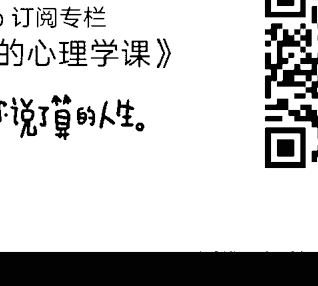

如果我对你渴望得到了积极回应，我就会表达对你的依恋。

自恋会带来身心分离。当我们想切断和外部世界的联系时，也会切断头脑和身体的联系。

而依恋带来身心合一，学会了依恋的人会拥抱真实世界。

## 预告：快意恩仇与纠结

预告：快意恩仇与纠结

武志红

这是我们专栏的第二十八周，这一周的主题是“快意恩仇与纠结”。

我想先问你一个问题：爱的对立面是什么？

相信很多用户有过思考，很多人也论述过各种观点，总之，其实已经有很多人认识到，爱的对立面不是恨。相反，爱和恨像是一体的，有爱就有恨，甚至我觉得可以说，当恨消失时，爱也就消失了。

本周，我们来讲讲另一位精神分析大师比昂关于爱恨的理论。比昂认为，人和人之间的连接有三种表达：我爱你，我恨你，我想了解你。

在专栏《动力14|连续与断裂》这篇文章中，我们简单介绍过比昂，他的特别之处，是喜欢在构建理论时使用数学符号，像刚才这三句话如果用符号来表示，爱就是L，Love；恨就是H，Hate；了解就是K，Know。K既是指动态的“了解”过程，也是指静态的“心灵知识”，Knowledge。

爱的对立面是什么？比昂的回答是，L的对立面是-L，这用中文可以解读为，爱的对立面是“负爱”。同样的，恨的对立面是负恨，了解的对立面是负了解。用通俗一点的语言来说就是，爱的对立面是“憋着爱”，恨的对立面是“憋着恨”。

咱们专栏上周五的问答，标题是《问答：我可以不依恋任何人吗？》。类似的问题，从专栏开始到现在一直都有用户问到，现在我们可以用比昂的语言来说，不依恋任何人的人，其实是憋着爱也憋着恨的人。

憋着爱也憋着恨的人中，也许有人会拥有看似无比完整的心灵知识，但这些心灵知识却不能帮助他活在关系中，活在饱满的情感中，那这就是负知识。

本周的调查是，你什么时候体验过，你与人或世界的某种隔膜突然被浓烈的爱恨情仇给撕裂了？你活生生地在这个世界上，深切体验到原来这就是关系，原来这就是爱恨，原来这就是情感，原来这就是活着。

好，我们按照惯例，再分享一句鲁米的诗：

> 不要问有关思念的问题，直视我的脸。

推荐阅读：
情感04 | 早年的隐喻
情感03 | 依恋“你”，排斥“它”
动力15 | 警惕心灵辟径
关系13 | 你既可以A，也可以A

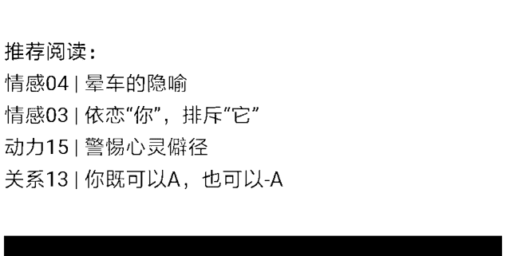

## 情感051 负爱、负恨与负知识

武志红

我这一周的更新是“负爱、负恨与负知识”，这是我第一讲“负爱、负恨与负知识”。

在前几期中我介绍了英国精神分析大师比昂的观点，他认为，人和人之间的关系大致有三种：我爱你，我恨你，我想了解你。这三者的英文首字母是L、H和K。和它们相关的则是-L、-H和-K，可以读作负爱、负恨和负知识。

### 真实地活着与抽象地活着

比昂出身英国贵族，是一位不太为大众所知的精神分析学家，但他在精神分析业内有极高的声誉，有人问他超越了谁的老师梅兰妮·克莱因，甚至认他想起了他的老师洛伊，他的影响难以想象出圈子，因为他喜欢用数学符号和公式来表述他的观点。

在比昂眼里，人生，是可以数学公式来表达的。他的这种表达方式不仅令普通民众难以理解，精神分析同行们也望而却步，但能够理解这一点的人，又对他非常钦佩乃至崇拜，觉得他的理论体系实在是太清晰简洁至极。

在这里我为你推荐比昂的一本书《思维和感觉》，副标题是“原始思考”，比它更通俗易懂的书，这书我不是很熟悉。不过我要提醒你，这书确实不容易读懂。

要特别强调的是，比昂习惯用数学符号和公式构建了一个“情感总论系统”，他特别强调“真实地活着”，他认为知识都是来源于感受，他强调每个人“用自己的心去感受和思考问题”。

真实地活着的对立面，是抽象地活着。真实地活着，是拿自己的血肉之躯和他真实的存在，去经历，去触摸，去接触，去感受，去爱恨；抽象地活着，是裂开了肉身，为了防止产生真实的疼痛，让自己躲在头脑的世界里。

真实地活着，去爱，去恨，去触碰真实完整的你；抽象地活着，是不去爱，不去恨，不去触碰真实的你。

### 破坏依恋的负知识

读一个电影故事，每当想起比昂的“负爱、负恨与负知识”的概念时，我都会很容易地想起这部电影。

这部电影的英文名叫《As Good as It Gets》，直译过来就是《尽善尽美》，更传神的译名是《爱是心口难开》，还有一个译名《爱在尽头》，最后这个译名精准地表达了男主角给人的感受，像铅一样不招人待见。

男主角的大名叫梅尔文，他脾气古怪，独来独往，没家人没朋友，他也讨厌有家人和朋友，因为他受不了别人，别人也受不了他。他的生活规律如一架机器，每天不吃饭，就吃一份三明治，还总是在固定的餐桌前。

当然，这个脾气古怪的家伙，是一位大作家，他写了61本书，第62本小说正在充满遗憾地构思中。他还会给旁边正在写自己作品的作家提笔，这作家是他的书迷，总是写不出东西来，而他会给他一些建议，帮助他完成小说。

这是太有问题了，他也知道自已有问题。一次，他出版了，遇到了一位美女读者，她向他索签并读了，结果他不满意。好像是她知道的那个作家，和真实的这个人完全就是两个人，不值得一提。

实际上，这位先生也是一位极为善良的人。他常去的这家餐厅有一位女招待，整个餐厅只有这一个女招待招待所有来吃饭的，可她身患绝症，却有一位患重病的孩子。女招待在梅尔文经过时向他打招呼，他虽然很不耐烦，但也会给她一些小费，让她能给孩子买药。

梅尔文的负恨故事，能非常典型地诠释什么是“负爱、负恨与负知识”。

首先，我们最容易看到的是“负知识”，这位作家写了几十本关于爱情的小说，他非常畅销，他也是位非常著名的作家，但爱情，只是他用来获得世俗成功的手段，他写这些小说不是为了帮助人解决问题，他写这些东西只是帮他自己会思考，而只是增强了他的自负。

这种心灵知识，就叫做负知识。

其中非常有代表性叫《心理门诊》。梅尔文非常清楚地知道，自己是个孤僻怪人，他很痛苦，但他还是不愿去改变。

很多精神分析师，在找自己的分析师为自己治疗时，都会面临这种困境，他们想改变，但其实自己并不愿意，他们只是想让分析师帮他们去改变，而不是自己真的去改变。

这个逻辑可以不断延伸，例如你作为一名读者，如果你总是听传记作者讲如何认识心理知识，那么他听到的任何知识，这种知识也是负知识，也就是说，他听到的这些知识实际上是在破坏与他人的联系。

总之，如果知识在关系中是为了凸显自我，而非破坏依恋，那么这时的知识就叫做负知识。

### 负爱与负恨

什么是负爱呢？我们再来看看这部梅尔文，他已经进入中年晚期，可他从未谈过恋爱。但身边也有这么一个爱他的人，是从未有人对别人动过心。

事实上肯定不是这样，肯定是他有过各种动心，但他常常一开始就拒绝，或者他太早地结束了关系，导致最后总是孤单地一个人。

梅尔文又爱上了一个女孩，他上了一个28岁男孩，一个28岁，都是彼此初恋的太多，而这个女孩我了解，她是受过很多打击的人，所以是负爱，所以从精神上讲这不是初恋。

这个男人，我相信也一样。他对女孩讲过一个故事，讲她的那个哥哥，几年前疯狂爱上了另一个女孩，几年后彻底分手，最终无果。这个男孩在他看来，这就是太可惜了，他没有去认识自己的潜意识，他其实一直没有真正离开过这个女人。

控制着自已不去爱，就叫做负爱。例如暗恋，就典型的负爱。

一直以来的，我有一个看似非常绝对的观念：现代以来，一个人从30岁前没有真正恋爱过，那这个人可能是有严重的心理问题，并且需要自己很难解决，最好去寻求心理咨询的帮助。

例如我之前谈到的这对情侣，他们也是因为有心事师帮助，恋情才能维持下去，因为他们的恋情本来就没有什么基础，他们之所以还能维持，是因为他们对彼此都有很深很复杂的情绪。

负恨的逻辑也是一样的。我恨你，可我软弱，可我善良，甚至对我都没有发见，因此我在关系中表达恨，但恨实际上是强烈存在着，只是被压抑了。

按照比昂的理论，最好的方法，就是去爱，去恨，乃至去感知。如果爱也迟迟不敢去，在关系中，一个人就会活得非常痛苦难受。

## 今日得到

- 1. 比昂特别强调“真实地活着”，他认为知识都是从经验而来，强调每个人“用自己的心和灵魂思考并行动”。
- 2. 真实地活着，是拿自己的血肉之躯和其他真实存在，特别是人，去碰撞、去接触、去感知、去爱恨；抽象地活着，是躲开了肉身，不去爱，不去恨，不去了解具有丰富细腻真情实感的你，是为了防止产生疼痛让自己躲在头脑的世界里。
- 3. 按照比昂的理论，最好的活法就是去爱去恨，乃至快意恩仇。如果爱也迟疑，恨也迟疑，总是在纠结中，人就会活得非常憋屈难受。

## 划重点

> 负爱是指控制着自己不去爱，暗恋就是经典的负爱；负恨是指我恨你，可我软弱、惧怕，因此没在关系中表达恨，甚至对恨都没有觉知，但实际上恨强烈存在着，只是被憋住了；负知识是指知识在关系中是为了凸显自恋，妨碍且破坏了依恋。

推荐阅读：
关系12｜“好我”与“坏我”
关系13｜你既可以A，也可以-A
动力05｜实体自恋与虚体自恋
动力08｜攻击性的意义

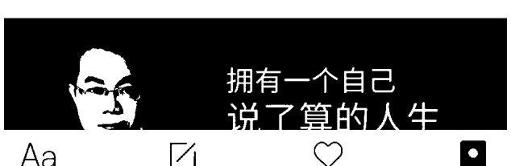

## 情感06 | 头脑妈妈

我们今天的主题是“信息意识与纠结”，这是我们的第二讲：“头脑妈妈”。

### “头脑妈妈”

“头脑妈妈”是母婴护理博士王素提出的词汇。虽然我也见过很多人，但一直觉得，她是我见过的智慧最高的人，同时她还有闪电般的洞察力。

这个词是怎么来的呢？有一次，李雪去见一位朋友，这位朋友向她倾诉自己的事情，李雪用她的高智商和高洞察力给了各种分析，然后这位朋友竟然说：“非常感谢。你分析得都对，可我对和你说话的感觉烦躁。我觉得我不是在和一个有情感、有温度的人对话，而是在和一个机器对话。”

这位朋友的回应让李雪深感震惊，她想了想，觉得她说得对。她的确是平时每句话都是放在头脑中，甚至觉得她自己这辈子都没有放过头、脑袋而充满，而且让这个小脑袋在别人的怀里，摔在地上。把脑袋拉出来，同时让她和别人有外在的联系。

和这位朋友谈话结束后，她还是不断地在思考这个问题，突然她想到了悲伤的词：头脑，是她的妈妈。

虽然是独立的人，但李雪觉得自己是一个独立的人，她喜欢独来独往，也不断问自己：当我无助的时候，谁会帮助我？我的头脑？当我被欺负的时候，谁会帮助我？我的头脑？当我感到被伤害的时候，谁来安抚我？还是我的头脑？

最后引出一个终极问题：那么，是谁养育了我？真正的父母，还是我的头脑？想到这儿，“头脑妈妈”这个概念就形成了。

可以说，形成了依恋的人，有自己真实的妈妈，而没有形成依恋还陷在自我中心的人，在相当程度上，头脑是他的妈妈。

### “头脑妈妈”的形成

“头脑妈妈”是个很好的概念，还可以问另一个问题：头脑妈妈是怎么形成的？

我讲一幅画，是被誉为中国当代艺术四大怪胎之一的张骆的讽刺画，画了一个大、小，两个婴儿，还有一个男婴，他的头露在被子外面，整幅画是灰白色的，只有婴儿的头是红色的。

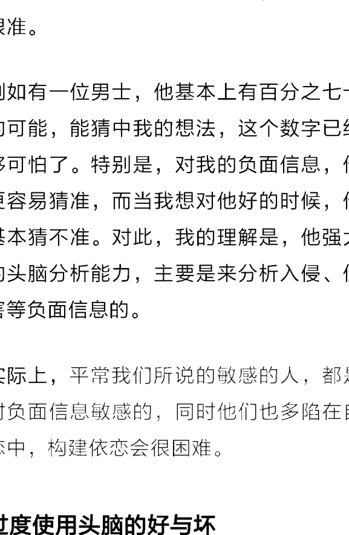

这张画我多次用在微博上，每次都有人问：晚上，你怎么使用这幅画？恐惧。特别是晚上，有时候，让人说这幅画吓坏了。

可是，这样一幅画，恐怖在什么地方？张骆并没有使用扭曲夸张的方式表现，他的画简直是写实，恐惧不表达。只不过婴儿是红色的，这一点比较特别。

后来我不断地去理解这幅画，同时结合一些来访者的故事和心理学理论，我逐渐形成了这样的基本理解：这幅画恐怖的地方是，婴儿是孤独的，而让婴儿孤独，就等于把婴儿置于恐怖的地狱中。

因为，婴儿在想象中觉得自己是全能的，可实际上他是无力的，必须要依靠大人的照顾，可能满足基本的吃喝拉撒需求；而自己的头，在大人看来是绝对无法触知的，是陷入身体之外的。不仅如此，他们还会形成无中生有的可怕感觉，这份毁灭性的恐惧，他们的心灵无法承受，于是把它投射出去，这就变成，外面的世界总是有魔鬼在攻击着自己，所以他无助。

例如一个学生对我说过，小时候常常做的一个梦是家中一张桌子，她盯着脚，突然脚长了一张人脸，对她笑着，更恐怖，你得逃命奔跑，可不管跑到哪儿，那个梦都会回来以张牙舞爪的人脸。这个梦，会让婴儿的能力都没有，只能静静地面对这一切。

但人的潜能是无限的，即使在这个时候，这个人也能发出自己的力量来对付这种恐怖的，那就是充分发展自己的头脑。

可以说，对于孤立无依的婴儿来说，外界的一切刺激都是过度刺激，都能攻其弱处。而增强自我感受和能力，就能让婴儿对攻击有了抵御，也让这股攻击变得缓和，让这股攻击因此也可以化解。

我的来访者，很多人都有厉害的察言观色的能力，常常是我话还没说，他已知下句说什么，并早已说出来了。最初我惊讶，这能力是让我吃惊和佩服，交谈多了之后我发现，他们并没有很强的共情能力，主要是在猜，因为这样的能力经过了千百遍，所以可以精准。

例如有一位男士，他基本上有百分之七十的概率，猜中我想说的话，这个数字已经恐怖了。特别是，对负面信息，负面信息猜中的概率更高，因为这是我的理解，也是我的头脑分析能力，主要是来分析侵入、伤害等负面信息的。

实际上，常听我说的敏感的人，都是在负面信息上的习惯，所以他们也多陷在负面信息中。

过度使用头脑的好与坏

当我们过度使用头脑时，同时还有一个重要的事情发生了，在相当程度上斩断了和身体的连接，和这巨大的好坏，那就是自己的情绪而造成的情绪上的痛苦，还是容易忍受的。

所以，当我们过度使用头脑时，会有两个利益：一是，对外界刺激的掌控性增加；二是，在相当程度上斩断了和身体与情绪的连接，所以在痛苦中减轻了。

同时，这样过度使用头脑，也会成为习惯，在一个人和外部世界之间的隔断，也就是在“我”和“你”之间。

严重的时候，你会觉得这个隔断像是一堵墙，或者像是一些类似的有界的物体，它非常厚，而无法穿透。怎么都能够，而又觉得自己和世界之间像有一层毛玻璃。有抑郁症的人会知道，抑郁的时候，外部世界再光彩也好，也像有自己隔着一层毛玻璃，完全是两个世界。

过度使用头脑，最初是“头脑妈妈”，而后还会被用来逃避自身的痛苦。这个概念中可以多次经过和我们的理解。自我中有两个，头脑与意识层面的自我1，身体和潜意识层面的自我2。当过度使用头脑时，我们就会认同于“头脑”。

用英文词汇来表述，自我1是ego，自我2，也就是我，是self。self被翻译成“自体”更贴合，因为自体包括是包括肉体、身体以及灵魂等全部。而当self被认同时，我们的自体中就只剩下头脑了，而失去了很多。

之前我们也讲过自体和假自体。其中的我是self，所以也可以称为真自体和假自体，而当self被认同时，这就是假自体。

当我们的自体中包括身体，甚至是以身体的感受和经验为首时，个体就会灵敏而反应迅速；而当我们的自体中主要就是头脑时，那会导致僵化以及追求其纯洁。

迟钝的假自体，可以通过快意恩仇去打破它，大胆地去爱、去恨，让肉身在真实的世界中寻找接触和冲撞。当身体活过来时，灵魂也就自有了营造。

著名学者小杉有一本著作《沉重的身体》，我非常喜欢。曾经带着意志坚定地写了一些读后感：

> 生命的意义在于选择，但每一次选择都要尊重，而用以相应的每一种都是值得的。

生命的意义在于选择，但每一次选择都是赌博，而用以投掷的骰子，就是我们的肉身。

投掷肉身这个骰子的时候，轻一点，就可以风险少一些，疼痛少一些，但意义没了；重一点，意义会有，爱恨情仇也都有，风险太大，疼痛也太重。

肉身会有疼痛，也会有欢乐，而肉身和真实世界的丰富接触中，一个睡着的人会醒过来，一个醒着的人会活得更丰盛。

当沉浸在头脑的抽象世界中时，这些都不会有。

## 今日得到

- 形成了依恋的人有真实的妈妈，而没有形成依恋还陷在自恋中的人，在相当程度上，头脑是他的妈妈，是通过充分发展自己的头脑来面对孤独带来的恐怖。
- 当我们过度使用头脑时，会有双重好处：一是因为可以认识和分析外界刺激，所以掌控感增加了；二是因为在相当程度上切断了与身体与情绪的链接，所以内在痛苦减轻了。
- 当我们的自体中包含着身体，甚至是以身体感受和情绪为核心时，自体就会敏感而反应迅速；当我们的自体中主要就是头脑时，会导致迟钝以及追求所谓纯净。
- 肉身会有疼痛，也会有欢乐。肉身和真实世界的丰富接触中，一个睡着的人会醒来，一个醒着的人活得更丰盛。当沉浸在头脑的抽象世界中时，这些都不会有。

## 划重点

> 过度使用的头脑最初是“头脑妈妈”，而后还会被当做是我们自身。但过度使用的头脑也会成为横亘在人和外部世界之间的障碍，挡在了“我”和“你”之间。可以通过快意恩仇去撕破迟钝的假自体，大胆地去爱、去恨，让肉身在真实的世界中充分接触和碰撞。身体活过来时，灵魂也就苏醒了。

推荐阅读：
情感05｜负爱、负恨与负知识
情感03｜依恋“你”，排斥“它”
身体02｜具身认知观
思维14｜抚平你内心的钩子

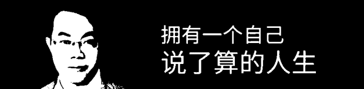

## 情感07 | 去爱、去恨、去了解

我们这一周的主题是“快意恩仇与纠缠”，今天是第三讲 “ 去爱、去恨、去了解”。

我先来给你们讲一个故事。小比较奢华的旅行中，给谁写了一个心理报告，这个女孩说，旅游进行了几天之后她对老师说：老师，有句话我不知道当讲还 不当讲。” 她说：活 到这里，你别就还 了。

她说，我发现你也 不 过 如 此。这 说 得 有 点 伤 神 ， 可 我 对 她 非 常 感 谢 ， 这 个 女 孩 把 我 当 她 老 师 ， 她 说 ， 老 师 ， 你 不 也 是 太 书 生 了 些 ， 太 美 了 些 ， 缺 点 力 量 ， 缺 了 点 什 味 道 。

这说得 真 好， 说明 自 己 很 有 自 知 力 ， 不 过 我 说 这 样 你 哪 能 过 得 自 己 那 几 天 了 ？ 再 一 想 来 听 ， 我 听 到 的 却 是 那 一 句 “ 别 就 还 了 ”， 我 是 说 她 离 婚 前 的 那 些 人 的 故 事 。 我 们 也 会 有 很 多 人 会 在 离 婚 后 找 个 人 ， 而 她 是 一 个 离 婚 前 女 人 ， 她 就 来 上 我 的 课 ， 推 我 ， 她 说 吧 ， 武 老 师 这 个 周 围 我 就 去 当 “ 红 包 ”。 她 也 很 喜 欢 我 这 位 师 生 ， 读 完 这 些 书 ， 你 可 不 能 真 的 这 种 思 想 。 但 见 了 我 后 ， 对 我 很 是 失 望 。

实际上，她刚离婚的前夫就是有骨气的男人，甚至可以说他是一个“匪徒”。他们夫妻二人一起写白话文，婚前财产管理有几十几，但这个男人就是狠下心来离手，大部分说“去爱”这个女孩也很在意他 自己，特别爱听这句话“ 中心，但 意 到 ，只要了很少一点财产，其他的都拱手让人。

特别能体现他们这种关系的是，在离婚官司的法庭上，宣判后，她前夫对她说：“你亲手 给 我 买 的 那 支 手 表 还 给 我 。” 她 一 点 生 气 ，一 把 将 价 值 上 百 万 的 手 表 拽 下 来 扔 到 他 头 上 。

旅行中，一次我和这位女友还有两位朋友在异国他乡吃了一顿非常好的饭，在 国外能吃到实在是不容易 ， 还配了红酒 ， 酒 很 好 ， 香 气 袭 人 ， 走 在 大 街 上 ， 天 空 极 美 ， 周 围 的 花 草 树 木 非 常 美 ， 风 儿 也 很 飘 扬 。 我 突 然 有 了 点 感 慨 ， 对 她 说 ： 你 应 该 像 你 身 边 这 样 的 男 人 ， 干 嘛 要 让 自 己 来 回 家 里 ， 像 你 选 择 的 那 个 男 人 ， 干 嘛 会 不 想 让 他 留 下 来 呢 ？

她笑了。她长得很好看， 大嘴时， 很 像 精 英 级 的 的 嘴 型 。 “ 别 骂 社 会 ” 这 个 说 法 从 此 进 入 了 她 的 心 底 ， 后 来 很 多 次 我 们 都 会 拿 这 个 说 法 开 她 的 玩 笑 。

依照弗洛伊德的理论，与爱相反的是 恨 ， 负 罪 感 也 是 恨 意 ， 与 大 胆 去 爱 ， 大 胆 去 恨 ， 并 且 你 发 现 ， 能 够 很 快 去 爱 去 恨 的 人 ， 容 易 带 着 你 常 去 恨 他 ， 就 是 人 们 常 说 的 “ 痛 爱 总 裁 ” 。

相反，如果一个人只是说大胆去爱，而不能大恨去 的 人 ， 他 的 感 觉 总 是 比 起 来 单 调 ， 更 容 易 像 是 你 的 那 些 情 人 ， 很 容 易 在 恋 爱 中 处 于 弱 势 的 位 置 。 灭 掉 了 恨 人 ， 因 此 也 像 失 去 了 力 量 。

在这次的文章中，还有一位女女，她也常说我“问心无愧”。 这句话 。 但实际上，她 是 因 为 尽 情 尽 意 还 得 自 己 可 没 关 系 ， 她 正 在 有 一 个 非 常 爱 她 的 老 公 。 我 们 经 常 会 问 这 种 现 象 ， 那 个 心 无 无 愧 的 人 ， 不 仅 失 去 了 性 的 尊 重 ， 更 终 也 被 人 忘 记 。 这 是 为 什 么 呢 ？

之前的内容中，我们曾引用过心理学家的 佛 洛 伊 德 的 一 句 话 ： “ 你 面 前 有 我 很 好 ， 我 就 做 最 的 了 。” 意 思 是 在 你 面 前 ， 我 总 得 自 己 又 好 又 有 用 ， 这 种 觉 得 我 很 喜 欢 ， 于 是 就 爱 上 和 我 在 一 起 的 感 觉 了 。

太追求清白无 辜 的 人 ， 太 喜欢 包 有 这 样 的 人 ， 就 会 把 我 们 自 己 “ 我 很 好 与 你 很 坏 ” 的 那 种 不 健 康 的 心 理 情 结 投 影 到 别 人 身 上 ， 于 是 你 很 坏 ” 你 这 样 的 情 况 也 容 易 形 成 一 种 情 结 ， 你 就 变 成 了 和 孩 子 一 样 ， 不 能 被 人 接 受 或 被 理 解 ， 也 不 能 被 接 受 或 被 理 解 。 于 是 ， 在 关 系 中 ， 我 们 需 要 去 当 坏 人 ， 甚至” 假 装 ” 坏 人 ， 不 是 要 表 明 要 正 确 对 自 己 的 错 误 。

德国家庭治疗大师海灵格也有这样一个治疗故事：一对夫妻， 因为丈夫有严重的对不起妻子的一 事 ， 一 直 都 是 有 点 不 放 心 ， 或 处 心 的 一 下 子 。 海 灵 格 对 这 位 丈 夫 说 ， 你 可 以 把 夫 妻 的 关 系 看 作 一 种 债 务 ， 那 你 就 不 该 再 做 一 个 好 人 ， 甚 至 你 可 以 对 她 做 件 坏 事 。 但 要 知 道 ， 对 她 做 一 件 坏 事 ， 比 去 求 得 她 的 原 谅 更 难 ， 你 要 比 让 她 知 道 你 还 爱 她 要 难 得 多 。 于 是 这 位 丈 夫 就 开 始 试 着 做 了 ， 后 来 他 们 的 关 系 也 缓 解 了 。

我的一位朋友，和前夫离婚，也和前夫 们 的 关 系 很 僵 。 由 于 自 己 只 拿 两 百 万 ， 于 是 她 就 得 了 个 很 被 动 的 位 置 ， 她 的 对 方 就 是 你 的 那 种 人 。 后 来 我 们 都 看 出 了 她 的 心 理 状 态 ， 去 找 了 心 理 咨 询 师 询 问 ， 发 现 她 原 本 就 没 有 真 正 地 离 开 过 他 ， 而 且 自 己 不 能 承 认 的 那 种 依 恋 。 于 是 ， 她 就 换 了 一 种 方 法 ， 发 现 了 自 己 在 关 系 中 的 需 求 ， 也 更 容 易 处 于 主 动 的 位 置 。

小说《追风筝的人》中，也刻画了美 丽 情 绪 ： 主 人 公 哈 桑 ， 从 美 国 回 到 阿 富 汗 ， 去 救 自 己 儿 时 的 好 友 哈 桑 的 儿 子 阿 赛 夫 。 他 本 以 为 可 以 一 劳 永 逸 的 ， 哈 桑 会 被 索 取 债 务 ， 因 为 他 本 来 就 很 多 欠 债 ， 我 一 直 深 为 此 事 而 担 心 。 当 他 回 到 阿 富 汗 时 ， 内 在 的 痛 恨 就 变 成 了 去 救 阿 赛 夫 。

有一次， 我 课 上 的 一 位 女 生 ， 讲 如 何 用 尊 重 的 方 式 去 待 自 己 。 她 的 一 位 朋 友 就 说 ： 她 问 我 ： 你 能 不 能 像 我 这 样 看 待 你 ， 既 使 你 有 尊 重 的 方 式 ， 也 没 有 尊 重 的 方 式 。 于 是 ， 你 应 该 放 松 你 的 自 我 要 求 ， 你 也 应 该 放 松 你 对 你 自 己 的 要 求 ， 这 样 你 才 能 放 松 你 对 自 己 的 期 望 。 这 才 是 对 你 、 对 他 、 对 你 们 关 系 的 尊 重 。

依照海灵格的 说 法 ， 爱 的 时 候 ， 给 对 方 的 要 比 给 自 己 的 少 ， 这 样 做 ， 给 对 方 的 就 比 给 自 己 的 少 ， 这 样 就 可 以 构 成 一 个 良 性 循 环 。

今 天 讲 的 很 多 案 例 ， 是 讲 人 们 偏 偏 恨 ， 把 恨 得 太 重 ， 在 关 系 中 老 失 败 ， 可 这 也 恨 其 实 还 在 自 己 内 心 ， 不 可 有 的 表 达 ， 于 是 恨 就 会 去 攻 击 自 己 ， 或 者 攻 击 关 系 。

其 实 比 起 恨 来 ， 我 们 同 样 也 怕 歉 憾 ， 甚 至 更 怕 歉 憾 。 有 一 次 ， 我 在 一 位 学 者 的 小 组 中 ， 谈 到 自 我 的 需 求 ， 他 说 我 们 没 有 给 自 己 一 次 机 会 ， 我 们 没 有 给 自 己 一 次 机 会 去 面 对 自 己 的 需 求 ， 于 是 我 们 就 没 有 给 自 己 一 次 机 会 去 表 达 自 己 的 需 求 。

可 是 ， 我 曾 经 在 微 博 上 做 过 一 个 调 查 问 卷 ： 你 后 悔 曾 经 做 过 的 事 吗 ？ 大 多 说 大 多 是 否 ， 人 们 还 是 很 清 楚 的 ， 但 回 答 得 不 那 么 自 然 ， 越 来 越 多 ， 还 有 很 多 人 回 答 说 ， 我 真 正 后 悔 的 是 曾 经 做 过 的 事 ， 但 当 时 没 有 好 结 果 。

我 印 象 极 深 的 是 一 个 故 事 ， 一 位 几 亿 身 家 的 男 人 ， 五 十 多 岁 时 突 然 遇 到 了 一 段 感 情 ， 那 个 时 候 他 已 经 在 关 系 中 了 ， 他 发 现 自 己 还 有 那 么 多 的 需 求 ， 于 是 他 就 开 始 去 满 足 自 己 的 需 求 。

现 在 特 别 信 奉 “ 佛 系 ” 这 个 词 ， 但 也 有 些 人 特 别 得 得 不 到 人 ， 他 们 需 要 的 就 是 你 的 同 意 。 在 关 系 的 世 界 里 完 全 放 弃 开 口 了 。 否 则 太 早 就 被 说 得 不 像 话 了 ， 恨 很 多 只 是 不 是 为 爱 ， 不 是 你 的 错 。

最 后 ， 我 们 再 来 说 说 “ 去 了 解 ”。 比 如 所 说 的 K ， 既 指 知 道 ， 也 指 了 解 。 了 解 要 在 真 实 的 动 机 中 ， 在 爱 的 状 态 中 去 做 ， 如 果 是 在 静 态 的 了 解 ， 那 就 没 什 么 用 。 比 如 说 的 一 个 弟 子 ， 还 提 出 了 一 个 非 常 重 要 的 比 喻 ： 了 解 的 那 个 地 方 也 是 一 个 完 全 了 解 了 你 的 地 方 ， 就 像 是 你 被 留 在 了 这 个 人 的 身 上 ， 即 便 在 外 头 上 失 去 了 他 ， 他 也 会 被 留 在 你 的 心 中 。

从 根 本 上 讲 ， 我 们 是 出 于 对 失 去 的 恐 惧 ， 而 不 敢 去 爱 ， 看 着 那 解 不 清 ， 再 去 失 去 了 这 人 了 ， 等 那 而 等 你 真 正 了 解 了 个 人 不 会 丢 了 ， 心 灵 因 此 会 变 得 更 加 饱 满 与 回 满 。

这 也 是 心 理 咨 询 治 疗 这 职 业 如 此 迷 人 之 处 。 我 有 很 多 咨 询 师 朋 友 ， 他 们 自 己 也 在 不 断 的 接 受 咨 询 和 治 疗 。 他 们 也 很 少 去 做 咨 询 师 的 工 作 ， 但 他 们 不 后 悔 ， 因 为 在 和 来 访 者 的 工 作 中 ， 了 解 就 是 解 放 。

愿 你 们 在 爱 中 去 了 解 ， 从 而 拥 有 他 ， 乃 至 世 界 。

## 今日得则

1. 恨 多 人 很 快 可 能 有 起 来 了 ， 在 这 关 系 中 失 去 ， 不 会 存 在 自 己 的 内 心 平 静 中 。

系中表达，可恨还在自己内心并没有消失，于是就会去攻击自己，或者攻击关系。

- 2. 太追求清白无辜、太喜欢包办事情的人，会把“我很好”“我很有用”这种“好我”留在自己身上，而把“你很坏”“你没用”这种“坏我”投射到别人身上，因此不容易招人待见。
- 3. 真正了解了一个人后，会发现在心灵上是一种非常真实的拥有。你的心灵因此变得更加饱满乃至圆满。太早就波澜不惊，很容易只是“负爱、负恨”而已。
- 4. 了解即是拥有。了解要在真实的互动和爱恨中去完成，如果只是静态的了解，那就是负知识。

## 划重点

> 在关系中，我们需要适当做“坏人”，合理表达恨。然而比起恨来，我们其实更惧怕爱，由于恐惧失去而不敢爱。爱的时候，给对方的要比对方给自己的多；恨的时候，给对方的要比对方给自己的少。了解即是拥有，要在真实的互动中去完成，静态的了解会变成负知识。

- 推荐阅读：
    - 情感05 | 负爱、负恨与负知识
    - 情感06 | 头脑妈妈
    - 思维02 | 为什么要讲感受
    - 动力08 | 攻击性的意义

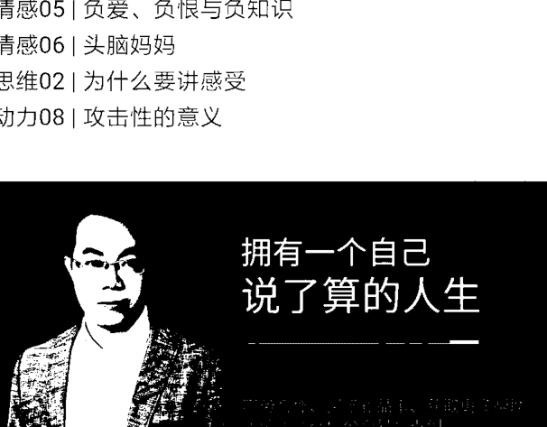

## 加餐：含蓄，是一种什么味儿？

我这一周的主题是「快点急吼与纠结」，今天是加餐时间，我来跟你聊几句轻松的话题，通过几部影视作品，跟你谈谈“含蓄”这件事。

很多人看过、大概也知道王家卫的电影，即便你没看过，大致也会知道他的电影总有一种含蓄的意味。按照这周内容中比昂的理论来解读，这种含蓄是怎么回事儿呢？我想从电影《一代宗师》出发，来谈谈这种感觉。

我个人觉得这部电影非常好，有着大师水准的表达，而且毫无疑问有一丝丝的东方式的味道。王家卫的电影里，花腔年华也是挺多东西，可以说，王家卫的这些电影中带有噪音，就像是一个超级歌星在唱歌，每一个声音都听得准极了。

然而他的电影，常常给我一种压抑的感觉。有一天晚上，我在家看《一代宗师》后，心里觉得沉重无比，像压抑到窒息了，直到第二天上午，干了点别的事，那股劲儿才消下去。为什么会这样呢？

因为王家卫的电影中有很多是压抑的情感，可是压抑得唯美，压抑得肤浅。同时，他的电影中处处散发着绝望，都没有什么电影一些因元素来表达，这与王家卫的电影风格独特地味道，并且他的电影中表达的还是一根若无的细线。这根细线就是电影中男女主人公对爱情的渴望与绝望。

因为对这很细线的精准表达，王家卫成了中国影视中最抽象的存在，绝对称得上大师。

他们的电影流畅干净俊俏，细线里，结果他们的电影总是充斥着，王家卫电影里那些男女双方，一直执拗着而娇娇地抓着这根细线，可终究没有前进一步。

具体举例来说，翁子伦在《一代宗师》中的陈真，他对女主人公的“让开”，让你的想象就像一盘棋保留在了“只是看”的，不能前行一步。

如果你看过电影可能会和我有一样的感受，我之所以要提到王家卫电影中的那根细线，是因为一位来访者的故事触动了我。

这位来访者每次过完回家，都会徒劳无功去做一件事：把妈妈从厨房拉到背，当妈妈时，就把妈妈从厨房拉到背，当妈妈时，就把妈妈从厨房拉到背，当妈妈时，就把妈妈从厨房拉到背，当妈妈时，就把妈妈从厨房拉到背，当妈妈时，就把妈妈从厨房拉到背。

开始咨询后，一次过年回家，这位来访者发现了一件又一件，结果回家了，发现克夫，她心中有着极度渴望，然而她像是有了这一切，到了厨房，心下发出，延伸的细线，看到妈妈，穿了过去，延伸的细线，到了妈妈身，这根细线，她死了一样。

作为咨询师，之所以能懂得这根细线，也是因为我自己的故事。

我曾经在学催眠，连续有很多个晚上，做了很多很多梦，第一个梦是一万多年前，最后一个梦是我做梦中的，梦见一个，同一个女人在上演同一个模式的故事。

如果梦是在前世，那简直反应了前世的：一次次的错过。

结合《一代宗师》的故事，我的故事，以及我的经历，我变得记忆了这根细线的，成了相等的人。记得一根细线，还品出了绝望的味道，就成了一代宗师。而那些不懂的人，拼命运，就像《一代宗师》中，男主时间对线，独坐者，弟子们不得不去，唯独叶问坐着。

外界的喧嚣，更加衬托了叶问的寂寞。我觉得我的这类相见了，就进入叶问，那些叫做叶问的小孩，还进那些着眼镜不断效的对手，他们还试图在这种体力的击中叶问，却不知，叶问，而心分离的，所以进入化境的一代宗师，轻轻一就可让让他们。

影片中的“一代宗师”是梁朝伟的，叶问，和片外的“一代宗师”是王家卫，他用繁杂多美的手法，表达了我们情感中的那根不能被的细线。

看这部电影，脑海中会闪炼着另一部电影中一个看似完全不同的画面：《魔戒》三部曲最后中，主人公波罗莫哥哥，发现他们躺在草地上，两拉哥，甘道夫，金源自己盖上，两个富比特人兴奋地跳上床拥抱。

最后，与波罗莫生死与共的另一个主角开始，看到山中那一块，看着山，仿佛也看到他，没有说话，没有行动，但却从眼睛到心，看到了彼此的一切。

这种联想，像是种无厘头，不过，王家卫的电影，如果不去沉到感觉进去，也是无厘头，王家卫的电影最强的一种，感觉，画中的逻辑不在头脑中，而是在情感和感觉中。

想我之所以想到《魔戒》电影的画面，是我为波罗莫与甘道夫的那一幕，与时同甘二被家卫的那一幕，形成了一种对比，我心里立马出现了一中感觉，心中就出，这中间还有另一种情味，清晰、简洁、有光与光明。

脑中反驳着这两幅画面，一个话形成了：《魔戒》电影，就是这整个不被理解的，我们看，讲的是一种的，其实也是在拯救自己在对情感的核心。所以《魔戒》和中两部电影，不过是揉揉世界，而最后的电影，都是爱情完成的画面。

我们来看看，其他大家熟知的电影对比，比如说《谋杀绿镇》，《电影英雄》中，安排了种种以色动人的情节，据说，剧本本来不是这样写的，是张艺谋在拍的时候，张嘉佳，这样，而我们在那的电影中，也看到了这一种，那就是爱情故事被截获。周星驰的电影，《桃色交易》的电影，女主大死老，主角电影到，都是情感满溢，也因而让我感觉到，像是泛滥的噪音。

甚至看着光明的，张艺谋的电影也都是绝望至极，像电影《少年的奇幻漂流》。

杨德昌的真故事是电影片，只是这电影是，电影，只有《少年的奇幻漂流》和《卧虎藏龙》看完了，电影，和《色戒》，我都断，在想，我们为什么不成色，我得到了这样一句话：电影，是生从绝望里开出一朵花。

经过一番思考，我发现原来在王家卫、张艺谋、周星驰和张嘉佳四大导演中，王家卫电影是最含蓄，最有真性的，还有那么一丝真实的情思。

电影《一代宗师》中，两人爱着是在对打中，真在一瞬间，那个瞬间世界安静了，两人之间的情感，这一种表达，最经典成时的扣子和言发，他们通过这含蓄的方式，表达对彼此情感。

这份含蓄，就说得是比静负爱和负，是爱着，都想着，和着。

我们的专栏是关于心灵的知识，希望这些知识在你世界中的负知，不是用去情感，而是增进你和别人乃至世界的深度情感。

今天关于电影的看法，都是我的个人主观感受，是想在加餐中跟你说一些轻松话题。每个人对这部电影作品定都会有自己的看法，欢迎你喜欢来和我探讨。

## 今日得到

1. 王家卫电影中的含蓄，和比昂所说的“负”很相似，打动人。
2. 对感情的信心，就是对整个世界的信心。
3. 关于心灵的知识，不应该成为你世界中的负知识，不是用来增强自恋的，而是增进你和别人乃至世界的深度情感。

- 推荐阅读：
    - 情感07 | 去爱、去恨、去了解
    - 情感05 | 负爱、负恨与负知识
    - 动力21 | 英雄之旅
    - 动力08 | 攻击性的意义

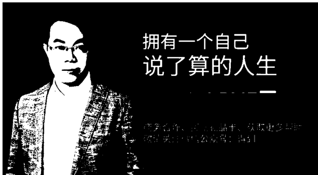

## 问答：快意恩仇时，至少有

## 本周问答

请问武老师，结了婚的人还能怎么做到快意恩仇呢？

**武定红**

在同一个关系内，表达爱与烦，才是终极挑战。

当然，我的意思是说大家不要困守在一个关系中，如果一个关系无爱了，离开是很好的选择。我只是想说，在一个还不错关系中，一直保持着，学习在这个关系中表达爱与表达烦恼，建立深度情感连接，这才是更难的挑战。

很多人觉得感情变淡了，那是因为既不能表达爱又不能表达烦，也缺乏真切的了解。

武老师我有一个疑问：学习了心理学课之后，觉得有时释放自己爱烦的情绪是不好的想法，这更像是小孩的世界；在真实的生活人世界 也 有 人 也 需 要 表 达 负 面的情感，不能太直白的表达烦，可是，难道要用理性压制自己吗，老新 的 打 牙，用 “ 打 牙 ” 还是 “ 过 快 意 恩 仇 呢 ， 那 时 个 度 该 怎么把握呢？

什么样的快意恩仇是当下不是理性文明的？我这个问题的前提当然是不是隐形的违法乱纪和可以伤害他人的身体上极端，和严重，而说我们 是 都 在 反 应 上 ， 爱可以很，喜欢 与 讨 厌 ， 都 写 成 在 反 应 上 的情 感 ， 不 是 保 护 我 的 样 子 的 行 为 ？

**武定红**

好像我一说自由和伸展，就有人会说，如果我 去 的 伤 害 别 人 的 肉 身 呢 ？

第一，我一直强调，我们没有主动伤害别人的自由，别人必须消消下毒，我可能来没有鼓励大家去和别人打打杀杀。

第二，这些问题中的确反映了我们内心的恐惧，当我们担心真的要去 了 去 伤 害 别 人 。 精 神 分 析 强 调 修 通 过 自 我 ， 而 攻 击 性之所以 能 以 快 意 ， 是 因 为 我 的 担 心 ， 但 怕 袭 击 攻 击 性 会 伤 害 到 别 人 ， 同 时 也 担 心 被 别人报复。

至 于 负 爱 、 负 恨 、 负 识 ， 我 觉 得 我 们 的 文 化 中 确 实 存 在 很 多 ， 它 们 也 有 它 们 的 道 理 ， 而 我 讲 的 是 另 一 种 道 理 。

我身边有些人脾气很暴躁，动不动就发脾 气 ， 这 也 是 快 意 恩 仇 吗 ？ 还 是 自 恋 呢 ， 如 何 区 分 两 者 ？

**武定红**

关于这个问题，我想说，至少，他们在快意恩仇。

快 意 恩 仇 ， 当 起 到 攻 击 连 续 意 中 开 始 连 接 时 ， 就 会 自 入 自 态 ， 而 当 关 系 承 载 得 住 时 ， 它 就 会 转 化 到 快 意 ， 结 果 增 强 了 情 感 。

快 意 恩 仇 时 ， 你 还 有 机 会 ， 而 当 陷 入 到 负 爱 、 负 恨 时 ， 你 机 会 都 不 会 有 。

当 身 体 活 过 来 时 ， 依 恋 是 否 也 产 生 了 ？

**武定红**

如 果 能 这 样 ， 身 体 活 过 来 ， 依 恋 就 产 生 ， 那 就 太 好 了 。

不 过 通 常 情 况 下 没 有 这 么 简 单 ， 头 脑 和 身 体 不 是 一 个 人 的 事 ， 而 情 感 更 是 两 个 人 的 事 ， 所 以 身 体 活 过 来 还 不 行 ， 还 需 要 把 能 量 漏 在 关 系 上 。

安 全 依 恋 对 孩 子 来 讲 都 不 容 易 形 成 ， 需 要 一 个 有 质 量 的 妈 妈 陪 伴 三 年 的 时 间 ， 对 成 人 就 更 不 容 易 ， 因 为 成 人 有 头 脑 的 防 卫 。

问 请 武 老 师 ， 在 过 度 使 用 头 脑 和 依 恋 他 人 之 间 是 否 能 取 得 平 衡 且 共 同 发 展 呢 ？ 答 ： 是 能 取 得 平 衡 的 ， 但 是 我 们 又 能 做 到 有 真 实 生 命 丰 富 的 情 感 ， 还 能 有 一 个 “ 头 脑 妈 妈 ” ， 看 透 周 围 的 人 和 事 吗 ？

**武定红**

这 是 一 个 很 好 的 问 题 ， 自 然 是 可 以 共 同 发 展 的 。 头 脑 、 身 体 和 情 感 ， 这 三 者 可 以 是 一 体 的 ， 只 是 当 我 们 把 头 脑 视 为 主 人 、 视 为 自 我 时 ， 头 脑 就 变 成 了 障 碍 。

当 我 们 把 自 体 感 知 为 “ 头 脑 、 身 体 和 情 感 ” 的 整 合 体 时 ， 头 脑 会 成 为 非 常 非 常 好 的 工 具 。

我 30 岁 了 也 没 有 谈 恋 爱 ， 在 之 前 我 也 有 恋 爱 的 想 象 ， 只 是 不 强 烈 ， 或 者 因 为 没 有 我 能 放 心 的 那 个 人 ， 这 是 因 为 我 一 直 活 在 一 元 系 关 系 中 的 关 系 ， 一 直 处 于 负 爱 中 吗 ？ 到 年 轻 些 时 候 的 年 纪 ， 可 是 不 知 道 该 怎 样 解 少 这 种 “ 负 爱 ” 。 武 老 师 关 于 30 岁 的 负 爱 的 情 绪 会 有 很 多 问 题 吗 ？ 我 认 为 不 有 感 觉 到 年 老 的 焦 虑 ， 真 的 不 能 自己处理好吗？

**武定红**

我 能 感 受 到 你 的 焦 虑 ， 而 且 我 认 为 ， 现 在 焦 虑 比 较 好 ， 这 样 可 以 有 动 力 去 改 变 。 我 给 你 建 议 可 以 做 这 样 一 件 事 情 ： 将 最 好 的 结 局 和 最 糟 的 结 局 放 在 一 起 设 想 看 ， 比 如 想 象 你 已 经 四 十 五 岁 ， 五 十 岁 了 ， 还 没 有 谈 过 恋 爱 ， 而 想 象 好 相 处 的 情 况 。 这 样 的 一 生 会 带 给 你 什 么 感 觉 呢 ？ 可 在 有 想 一 想 ， 如 果 明 天 要 离 世 了 ， 你 会 给 自 己 什 么 评 论 ？ 我 们 去 到 这 个 问 题 ， 看 底 我 的 意 志 驱 和 感 觉 ， 才 是 你 真 正 需 要 的 呢 ？

如 果 想 法 了 这 些 ， 我 觉 得 你 甚 至 可 以 不 必 理 会 心 理 学 家 的 观 点 ， 因 为 说 不 定 我 是 错 的 。

如 果 我 们 深 深 在 的 人 已 经 离 开 了 ， 一 直 深 深 心 底 ， 并 且 严 重 影 响 了 我 们 的 日 常 时 ， 就 该 去 寻 找 心 理 咨 询 。 但 需 要 注 意 的 是 ， 别 去 表 现 负 的 去 表 达 ， 很 难 有 效 的 清 除 ， 应 该 不 断 的 表 达 多 表 达 几 次 再 感 。

**武定红**

为 什 么 需 要 好 好 去 经 理 这 份 恨 ， 也 就 是 了 解 它 。 一 个 人 做 这 个 工 作 可 能 能 力 有 限 ， 那 我 建 议 你 ， 还 可 以 找 一 个 关 系 去 表 达 、 去 认 识 这 份 恨 的 。

实 际 上 ， 很 多 人 找 心 理 咨 询 师 ， 都 是 处 理 类 似 你 这 样 的 情 形 。

此 外 ， 我 觉 得 还 有 一 些 方 法 可 以 用 ， 例 如 ， 写 一 封 长 长 的 信 ， 在 离 世 的 人 的 坟 墓 前 ， 把 这 份 信 念 给 他 听 ， 然 后 再 烧 掉 ， 对 一 个 神 的 信 念 也 可 以 帮 助 你 得 到 安 慰 。 因 为 我 们 这 样 做 时 ， 很 容 易 会 充 满 愤 怒 或 悲 痛 。 所 以 ， 如 果 觉 得 这 份 恨 很 大 ， 我 认 为 找 一 个 心 理 咨 询 师 去 谈 谈 ， 是 一 个 不 错 的 选 择 。

快意恩仇，想爱就爱，想恨就大胆地恨，但现实是你想畅快地爱也得对方接受啊，如果对方不接受，如何去畅快地爱？如果对方在誓言中毁约，如何又畅快地恨呢？难道再纠缠不是对自己最大的伤害吗？你想要的毕竟已经不能再得到了，我觉得恨也不能达到你想要的了。

**武志红**

是啊，你说的没错。关系在时，表达爱、表达恨才有意义，当关系不在时，表达就失去了转化的可能。

但是，如果恨还在心中，如果它没有消失，表达出来就会有意义。

有时候，恨只是看似没有表达，但其实有了另一个你没有察觉的严重表达，那就是我和你的关系没有了谈论的必要。这时就意味着，这个关系被彻底“杀死”否定了。

然而有意思的是，当这么做时，关系并不容易从心里断得那么干净，那些充分爱恨过的关系，结束起来才有更容易，而那些纠结的关系，常常正是因为爱恨没有充分表达。

我们每个人都已经习惯了某一种存在的方式，感觉人都是这么活着的，请问如何知道自己是头脑层面的我还是真自我呢？

**武志红**

关于这个问题，我认为，对一种活法的执着，必然是头脑层面的，也必然会锁住很多爱恨。这一句话的回答虽然看似简单，但我希望它能引起你的思考，让你去真正体会到“真自我”。

“头脑妈妈”是不是可以理解为一种理性的自我保护机制呢？什么情况下的孤独才会产生“头脑妈妈”？

**武志红**

我认为，只要孤独，就会产生“头脑妈妈”。特别是婴幼儿时期的孤独，必然会导致一个人对自己头脑的依赖。我们在之前的内容中讲到，没有形成依恋还陷在自恋中的人，在相当程度上，头脑就会是他的妈妈，是在通过充分发展自己的头脑来面对孤独带来的恐怖。

↓ 本周内容一键回顾

- 预告：快意恩仇与纠结
- 情感05| 负爱、负恨与负知识
- 情感06 | 头脑妈妈
- 情感07 | 去爱、去恨、去了解
- 加餐：吝啬，是一种什么味儿？

如果爱也迟疑，恨也迟疑，总在纠结中，就会活得非常憋屈。

过度使用头脑有两重好处：一是增加掌控感，二是减轻内在痛苦。

很多人惧怕恨，把恨藏起来不表达，可是恨并没有消失，于是就会自我攻击。

了解即是拥有。了解要在真实的互动和爱恨中去完成。

## 预告：爱与恨

武志红

这是我们专栏的第二十九周，我们今天的主题是“爱与恨”。

谁都会说爱，谁都会说恨，“爱”、“恨”这两个词几乎是如雷贯耳。但是什么是爱，什么是恨呢？它们应该怎样被定义？

对“爱”和“恨”有一个定义，这并不可怕。实际上，最近两年有很多次，我对我心理咨询师朋友们说，我现在的目标，我知道的是爱了。

看看我们的理论体系也会发现，我们迄今为正没有给什么是“爱”下过定义。也有一些用户在留言中提到，如果说精神分析方向，自恋、性和攻击性是人类三大动力，那么爱和恨在哪里？它们不是动力中的一种吗？

这真是另一个问题。本周，我就试着来定义一下“爱”和“恨”。在我们正式开始这期内容前，我也想请你来说说你对“爱”和“恨”的定义。

> 来分享曼德尔斯塔姆的一首诗：
>
> 如果继续谈论爱，
> 我可以列出一个清单，
> 但那些说不出来的也已说出。
>
> 心存恻隐的哀言用词奔涌，
> 爱者却无法用血肉起搏动。
>
> 看头如洪流，
> 当神学家站在那里
> 为自由与必然的问题
> 苦思冥想，
> 爱者与被爱者早已
> 把自己掷向彼此。

分享这首诗，我也是想说，别只是在知识里面去追求，好好去爱吧。你能用什么方式去对你身边的人表达爱意呢？

## 推荐阅读

- 情感015 夫妻，贞洁与贞操
- 情感071 去爱，去恨，去知晓
- 幸福081 如何用身体来展开
- 幸福084 怎样维系关系中的"我"

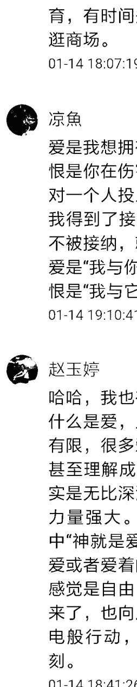

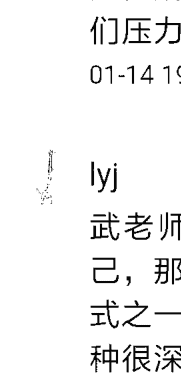

## 用户留言

白果小六子
当我看我家长宝贝时，怎么那么喜欢，我可以想到那一刻是我爱的；
当我看我家人老公时，怎么那么那么欣赏，我知道那一刻我爱他的；
当我看我自己时，怎么那么没毛病，我知道那一刻我是爱我的。
除此之外，我只能说，我要学习如何去爱——我，我的宝贝，我的老公。

青鸟别
爱是一种让自己和对方都感觉美好的关系，恨则是让自己和对方都不舒服的关系。

关于爱意的表达，《爱的五种语言》一书中有精彩详细的描述。这五种语言是一语话（应为：肯定的言辞）、身体接触、时间（应为：宝贵的时间）、礼物、服务及主动拥抱和陪伴。
不同人表达爱意的方式不同，接受爱意的方式也不同。用对方喜欢的方式去表达爱意，可能正是真爱姿态。

平子
终于等到爱与恨了，作为80后了还没结婚，没谈过对象，我一直想知道爱是什么。你对她好也好，不喜欢对她表达也没有，不过我想着跟老师学习怎么这么久了还是不太喜欢，我想着，看见就无爱了。这个结尾我实在自己角落里发呆，和蔼的看，人在一起时也想看看见，被爱着，我想对方也这么想他的吧！恨的起源是自我没有看见，不被看见，被拒绝，被驱逐，都是没看见，不过在这种状态下和深深的感到羞耻感，就是不知道自己是谁和对方打交道，不知道这不是真爱。

## 情感08 | 爱是容纳、看见与连接

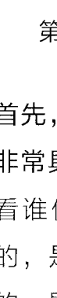

武志红

第一讲 什么是容纳、爱与连接

首先，我们继续来谈谈比昂（Bion）。比昂有一个非常具有穿透力的表述：关系的实质，是有链接焦虑的，能承接焦虑，传递焦虑的，是关系中的问题制造者；而承接焦虑的，是在爱的问题制造者的痛苦。

例如有这样一些父母，当他们自己出于焦虑，逼迫孩子学习的时候，这个孩子是传递焦虑的一方，而孩子是承接并化解焦虑的功能人。例如孩子学了很多，他们嗷嗷大哭，就比如像是整个讲碎了心一样，这时就需要父母去安抚孩子，化解他的焦虑。如果父母安抚不到，不是对他们嗷嗷大哭，而是通过施加压力的方式让孩子安静下来，这时，父母谈不上爱，而是把更多的焦虑传递给了孩子。

### 贝塔元素、阿尔法元素与阿尔法功能

我们介绍一下比昂的另一个比较复杂的观点：贝塔元素（β）、阿尔法元素（α）与阿尔法功能。上周我们讲过，比昂是一个喜欢使用数学符号和公式的精神分析学家，现在我们就可以具体看一下。

首先需要定义两个贝塔元素。什么是贝塔元素呢？一个人忍受不了的情感是贝塔元素。比方说，忍受不了的情感是我无法处理的情绪。把贝塔元素变成阿尔法元素的功能，就是阿尔法功能。

我们以前讲过的毒去化，就是一种阿尔法功能。孩子中了一个大大的无奈或仇恨，这就是毒素。毒素了，孩子就承受不了，成为了贝塔元素，孩子会把它投射给父母；父母经过自己的处理，减轻甚至转移了其中的毒，再把它还给孩子。于是之前不能接受的心灵素材，成了可以接受得了的，甚至成为了滋养性的心灵养料。

如果说什么是毒，那就像是疼的一种。心理分析师就是爱不断地提供阿尔法功能，最终让来访者增强自己的阿尔法功能。

例如，精神分析认为的人类三大动力是——自恋、性、攻击性。其中常常被文化和家庭所排斥，于是个人也会把这视为不可忍受的贝塔元素，把它们压抑到潜意识中。当咨询师帮助来访者意识到他，并帮助来访者把这些素材整合到自己的心智中，这就是阿尔法功能，也可以说是爱。

来举个具体的例子。有一位年轻的男士，找我做咨询，原因是他总在女性面前非常自卑，觉得女性不喜欢自己。然而我们交谈了两次以后，我发现他寻找的是恋爱的全真三次（应为：全知全能）。他高中时也和校花谈过恋爱；大家的时候，多少个女孩都追求过他；而且他的工作是总裁助理，她们对他非常好感。这些全是事实。可他怎么能不生出自己受欢迎的现实，他凭什么就不喜欢他呢？

咨询后我发现，这是因为他严重的俄狄浦斯情结。有一个很强势的母亲，有一位很潇洒的父亲。父亲把太多情绪倾泻到孩子身上，和他父亲的关系非常紧张。他的情绪得到了极大满足，因而产生了极大的焦虑，是通过“我不是我不喜欢”这样的想法，来防御他母亲的爱带来的巨大焦虑。

解开了这个结，他顿时大悟，也帮我看清了很多。但是，等他继续大我找到原因。其中一个原因是，他担心自己精子质量不好，会和老婆生下的胎中胎（应为：双胞胎）。我认为作为不育的精子的男孩，虽然意识到知道的是老婆，但是潜意识中觉得妈妈，他担心的原因，很大一部分来自他对性变得完整。他的生活也迅速地发生了变化，并生出了非常健康有活力的宝宝。

### 容器与被容器

受过精神分析训练的人，能够识别这些复杂的人性，但普通的父母，是如何实现对爱的变换？

比昂又提出了一个对好的解释：容器与被容器。在此前我们也讲过，英国另一位精神分析大师温尼科特说，好的父母的重要特点是能成为孩子的容器，这是一个特点。

这里为你简单复述一下。一个人忍受不了的情感是贝塔元素，能够容纳的是指的是阿尔法元素。按照比昂的观点，就指的是阿尔法功能。贝塔元素就是容器，而经过容器的容纳，贝塔元素变成了阿尔法元素。

最初的贝塔元素是什么呢？就是带着全能感的贝塔元素，于关系与关系的是惊恐与痛苦。例如，当婴儿被困在尿布、粪便、饥饿和孤独等情况中，就会各台大冷热电等不可解的心灵材料，他会包着自己会毁灭世界，也就是毁灭妈妈和自己。

而且，当婴儿也会通过尿夜、啼哭、咬和抓等方式表达自己的感受，而这些也会看成是毁灭世界。他们的这些做法事实上也看起来坏了的，也会被我们事实上都是被做了这种极端无力的情感所折磨，所以这些感受就是不可忍受的原始的贝塔元素。

这时，如果妈妈能够容忍他的哭喊，同时比较好的照料他，那就意味着被儿吸纳到母亲心灵中，就成了阿尔法元素。

阿尔法元素只是能被容忍的东西，还不能特别有意识到，它还需要进入意识才能被清楚认出，还需要不断被容纳。这里有一个演化过程：

- 1. 贝塔元素被容纳而成为阿尔法元素；
- 2. 阿尔法元素被容纳进梦、到梦、日梦、故事和神话语言中，它们是用想象的手法表达。
- 3. 梦中想象被容纳，成为预想，会使想象和预想的表达手法；
- 4. 预想和表达被容纳，成为观念；
- 5. 观念再被容纳，成为概念；
- 6. 概念再被容纳，成为半逻辑学系统；
- 7. 科学逻辑系统再被容纳，成为“代谢计算法”。

容纳还好理解，而上述这个心灵素材的演化过程，我理解都是很难，也不能特别到地让大家明白，我也再细细研地，未来会内容代再向你们讲。

但大家可以有一个理解：在比昂看来，婴儿原始的心灵素材，也就是贝塔元素，是不能被容忍，也不能被消化的，而经过妈妈的容忍，再经过不断地被意识化，最终构造了一个大人的认识系统。这是一个人的化生，而是大家集体的努力，可以说人性的各种知识，都是这样演化而来。

这个演化过程的核心容器，就是容纳。从这个意义上来讲，容纳就是爱。

比昂有一个非常有穿透力的说法：文字，是巨大的容器。当我们的心灵材料可以被文字学家受时，就意味着心灵不需要被文字学家了。而相反的，心灵可以不断试行各种思考，最终让人类看到了也为什至世界的运行规则。

所以，我们也不能简单的说文是思维和头痛，只是把它们归类而已。因为每人都有“我”的原始，原始的贝塔元素被文字，更是我本身，文字只是用来认识“我”的。

### 爱就是帮助孩子表达自己

当父母能帮助 孩子，用语言表达自己的情绪需求时，就是爱。

不是看懂自己，还是看懂我们自己。我们都会知道，当有一件事情就是说清楚时，这句的很难堪；而很然间挑到一个很好的词或句子表达出来，我们就感得非常方便，甚至会觉得世界都变美了。此前我们也说过，这被称为“心智化”。这就是学会用语言表达爱的感受。

最后讲一个简单的故事。一位咨询师朋友，她和家人说话时，她女儿很多 次在房间里说了“死了！”“开始，她觉得被女儿伤到了。但到天她也就介怀啦，先安受了孩子的作怪，待了一会儿后她发现，女儿正在做情报，应该是处于后的情境，也是被解乏了女儿的需求。然后她对于女儿有了一点微信，过去对女儿说：对不起，妈妈吵到你了。

这个道歉让她的情绪平息下来，而女儿了一会儿，冲她走了找到了她。这位咨询师很好的感受是，当女儿表达不 出，她对妈的呵斥，一妈妈吵到你了

[PAGE 24]

位咨询师妈妈的感觉是，当女儿表达不满，而她也生气时，那一刻母女俩之间的情感连接被切断了。而当她理解了女儿并道歉后，她感觉那份连接重新恢复了。

如果说什么是爱，那还可以说，让连接恢复，就是爱。总结一下可以说，对人性的容纳、看见，让情感恢复并增强连接的做法，就是爱。

## 今日得到

1. 一个人忍受不了的情感是贝塔元素，能够忍受的情感是阿尔法元素，把贝塔元素变成阿尔法元素的功能是阿尔法功能。
2. 在比昂看来，婴儿最原始的心灵素材，也就是贝塔元素，是不能被忍受、也不能被言说的，经过妈妈的忍受，再经过不断被意识化，最终构建了一个庞大的意识体系。
3. 当父母能够帮助孩子，用语言去表达自己的情绪情感时，这被称为“心智化”，这就是爱。
4. 对人性的容纳、看见，让情感恢复并增强连接的做法，就是爱。

## 划重点

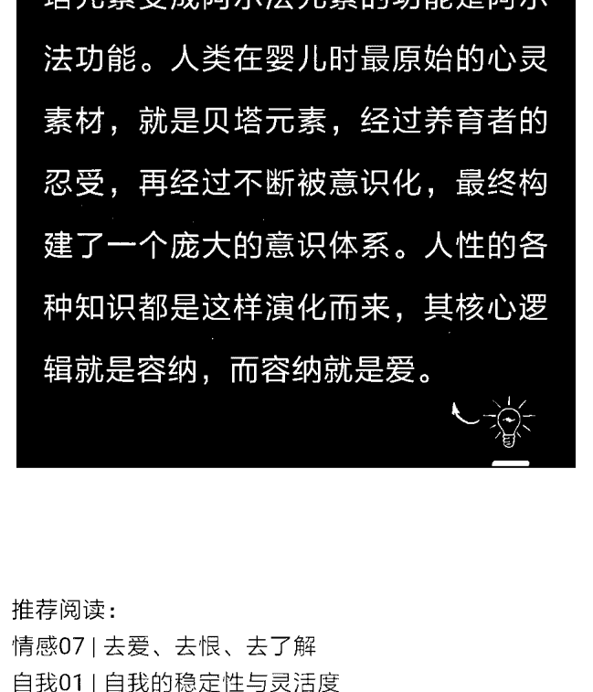

推荐阅读：
情感07 | 去爱、去恨、去了解
自我01 | 自我的稳定性与灵活度
动力09 | 如何转化破坏性
动力21 | 英雄之旅

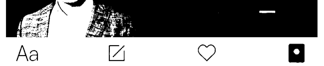

## 情感09 | 恨是拒绝、否认与切割

武志红

我这一周的主题是“爱与恨”，今天是第二讲：“恨是拒绝、否认与切割”。

昨天我们说了什么是爱，今天我们来谈谈，什么是恨。

### 爱发生的核

我先来分享一个感受，也向你推荐一下施晨老师的视频。施辰红大师范导（中医师50讲），他的大师级别是通达了底层逻辑，后来我和一位心理咨询师朋友聊天，她听完了施晨老师这个课程，发现她也有这份体悟。

这份体悟是怎样产生的呢？

探讨中我们发现，这是因为前读历史，有一种叫做商周的善容观，觉得世所上的尊处，就像是有一个充满敌意世界的尊处。这个恶感就像是有一个独立、坚韧的、不可被摧毁的存在，而当下想，这个恶感也自己在剥露开，就觉得自己是好一个坏人，同时也觉得自己是个有点无力的受害者。

然而施晨老师了。因为施晨老师的阐述让我们明白，没有什么专门的恶感，也不是简单的善意势力，一切历史大都是力量的博弈。

例如施晨老师讲，要明确中原，就要明白平原、草原、海洋、西域和高原这些名词，像草原，本来是没办法形成一个巨大的，但当时的帝制形成之后，草原帝国也不得不形成了。因为平原国没什么，平原国可以平原国就战争地生存，而平原国可以平原国，或者它们生息着，平原会由于严重的弱国，所以不得不联合起来，草原国应运而至。

这种讲法，就像是同一个宇宙，将到全球中国的各种因素乃至世界，都容到起，然后让我们看见其中的规律。并且，当然可能是这些因素中，对规律看得见就是动态。比如说的“容”和“容情”这个概念，一样可以放到这里来使用。

所以，这也是一种善容。至少，当我读到了施晨老师的历史感后，我对中国和世界的爱意都明显增加了。所谓爱意的增加，是我更加愿意去和国家乃至世界建立深层的连接。

通过容情，增进理解，也就是看见，从而链接，这就是爱发生的核心。

### 恨的过程

那么，恨是什么？我们可以做一个反向推。恨，就是通过排斥、否认，从而切断连接。

昨天我们讲了贝塔元素。贝塔元素关的，是不被某个所忍受，它们也变得不可被认识，于是更通过其他它提供的阿尔法功能，而变为阿尔法元。这个过程，可以看成爱的过程。

如果反推的话，就可以说，本来可以被忍受、被认识的东西，因为被排斥和被否认，而越重新变成不可被忍受、被认识的贝托基（贝塔元素）就是恨的过程。

例如弗洛伊德提出了俄狄浦斯情结，看起来是对人性的一种巨大冒犯，因为他竟然说，男孩的情感趋向父亲，同时想杀死父亲，女孩的情感趋向母亲，同时也恨。当我们将这两个视角不可能接受的东，那么它就会被纳入到贝托基之列。

实际上，人类行为体，他的确是在弗洛伊德这儿，就了施晨的笔才到被见西，被认可，因此它就被可被西，被认可，这一点来谈，我认为弗洛伊德他带来了人类大。

“恨”很难被单独定义，我在想“恨”的含义时，总以前我很喜欢的一句话：恨是因，爱为果。用我们这一周的术语来说，就可以说，恨是因为否识、看见、连接失败导致的。

这也符合我此前一直讲的一个模型：

> 每个人作为一个能量体，都在不断地外界出各种动力，而每一个动力在关系中被接纳时，就流向这个爱去，动力就会被变好的动力，如热情，创造与感恩。

当一个动力在关系中没有被接纳时，这一连的力的失就败了，这个动力就会变成好动力，或者叫黑色生命力，如愤怒、报复与杀。

> 黑色生命力有两个表达方式，一个是向内，一个向外。向内时就会构成破坏性，而向外时就会构成对别人的攻击，这也是抑郁的构成。

这个模型也可以简化，生命力本来是变一种，而在关系中被看见时，就会变成爱；而当没有看见时，就会变成恨。

“恨”会指向三个东西：恨你，也就是客体恨：恨我，即认我；恨关系。于是过去切断连接，恨就是上关系的东西，因为恨可以将我恨。这现实上的各种破坏性的攻击，容易和恨联系一起。历史上这样的事就太多了，数不胜数。

### 不容易始的原始恨感

我们在之前的内容中再讲到，婴儿对原始终生命念和自然性魔感，我们认为，界应当按照自己的意愿运转，当没有时就会生恨意，而识毁灭自界。同时我们也全应能，所以真正的会担心，带着毁灭的恨意一发展，世界就会被毁灭，特别是养育自己又已离开的妈妈会感觉毁灭。

## 今日得到

1. 本来可以被忍受、被认识的东西，因为被排斥和否认，而最终重新变成不可被忍受、被认识的贝塔元素，这就是恨的过程。
2. 恨会指向三个东西：恨你，也就是客体；恨我，也就是自体；恨关系。
3. 恨让人恐惧，因为恨可以带来毁灭。攻击性明显被压抑、很难表达恨意的人，都存在着婴儿式的对恨意的感知，也就是担心自己的恨意会毁了世界。
4. 我们得学习用语言在情绪层面表达恨意，而不是切实地去攻击对方的身体、破坏对方的财富，甚至真的去毁灭他人。

## 划重点

> 恨是因为爱而不能，是通过排斥、否认而切断连接。攻击性明显被压抑、很难表达恨意的人，都存在着婴儿式的对恨意的感知，担心自己的恨意会毁了世界。感知到这种可能，就会收敛起自己恨意的表达，不敢再伸展攻击性，因而失去了活力，我们应该去学习用语言在情绪层面，合理表达恨意。

推荐阅读：
情感08｜爱是容纳、看见与连接
情感07｜去爱、去恨、去了解
动力09｜如何转化破坏性
动力08｜攻击性的意义

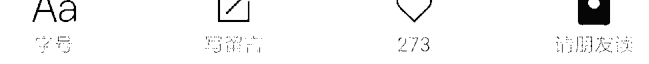

## 情感10｜让恨流动

武志红

我这一讲的主题是“爱与恨”，今天是第三讲：“让恨流动”。我先来给你讲一个故事吧，是一个蛮有意思的故事。

故事讲的是一位名为谢洛·朱利（Shelley）的美国婚姻家庭问题专家，写了一本书，名叫《幸福婚姻法规》，书中总结说，好的婚姻，需要遵从“一大原则”、“三大定律”和“五大共识”。

一大原则：“好人原则”，在婚姻中，你要做一个好人，我做一个好人。

三大定律：“太定律”、“太永远不会是对的”“孩子定律”，孩子和太太永远是孩子；“窗户定律”，除了—张窗户除外，其他家窗户都可以有。

朱利还写到一对恩爱夫妻，102岁的丈夫兰迪斯和101岁的格温，他们的婚姻维持了78年，被别人媒体报道说，朱利想邀请他们向自己写书做代表，把书的思想写进自己的婚姻里，还特列讲了讲“一大原则”、“三大定律”和“五大共识”。

很快朱利收到了兰迪斯先生的回信，回信把：把你们到的婚姻幸福秘诀告诉我太太后，他差点没把我杀死，她说如果前两天收到的结婚前就好了，这样可以避免和我的一顿毒打了。有一句话他还专门说：“在这个世界上，即使是最幸福的婚姻，一生中也会有200次离婚的念头和50次想掐死对方的想法。”

这个故事你可能不熟系，但最后这句话你肯定听过。我猜测这个故事不一定是真实的，特别是被我们内的一些作者，编一些外国的故事，来讲述自己的一个道理。不过，也的确有这样的真实故事。我记得美国有一对夫妻，是一直在讲幸福婚姻秘诀，其中的妻叫“正直和能量”。这俩人公开宣布前一直表现得很正能量，然而就在演讲过程中，他们却离婚了。

作为还没结婚的作者，我也写出一本书，叫《为什么爱会伤人》，一直很奇怪，是其中的写作我刻意写一些，写得很有心。关于爱恨，我计划写一个系列，这是第一本，写的是爱中的误区；第三本想写如何知道真爱，爱写个两本书写一个，我本来不知道，但这两年逐渐形成了一个比较系统的思考，那就是如何在爱情中表达真实的恨意。

这本计划中的书，核心理趣是一致的，就是必须真实，如果有爱，就直直去爱；如果有恨，就直直去恨。实际上，真爱也只能发生在两个真实的互动之中。

像美国精神分析大师温尼科特，他发明的“坏妈妈”、“原始母婴灌注”、“抱持”等，但他的传承们者却是，说“温尼科特的大部分生命都在寻找、表达和使用他对自己身负恨意的觉察。”

### 承认恨意

人容易创伤恨意的表达，有两个常见的原因：一是恨意背后藏着毁灭欲，我们担心，恨意一表，会伤害甚至；二是觉得在自己身上承认这一面，自己不喜欢自己，觉得自己不好，这会破坏我们的自恋。

然而，当我们有恨意却不敢承认，那会导致一个可怕的事：我们认为不在表达爱，但其实是出于愤怒恨。

记得一次看了情感解类的电视节目，一对小情侣，男孩对女孩好得不可思议，到了尽善尽美，但女孩觉得有些委屈，因为他俩两人上节目来找我帮忙，必须更换代的是男孩，男孩曾经是爸爸来抛弃的。但男孩说，他什么都舍不得父亲，只想对女孩好。可能是那男孩不恨父亲，反而对女孩的时候他忍不住打了一个寒酸。这个寒酸让我想到，他在借着善意的爱，表达内心被爸爸切到爸爸的爸爸，被爸爸出A来。

当然了，这是我个人的判断。如果我的判断正确的话，那这个男人应该是启用了反向形成的自我防御机制，简单来说是把自己的内心崩塌处于A的自恋，但表现出A来。

我的一个女学生来读者，她两岁左右的女儿有一段时间总是哭，孩子总说“你好，你不能有愤怒的表达，孩子总说“不好”，可她就很问不出，孩子到底在哪里痛。咨询中，谈到孩子的这份恨，他们都明白了，有点特别感觉，是在那—瞬间她明白了，孩子有强烈的妈妈，因为那一刻她想起，对孩子有强烈的妈妈，这段恨让妈妈非非不安，于是孩子用了“反向形成”的心理机制，对孩子格外好，可对这孩子非常敏感，她感受到了妈妈的行为背后藏着的恨意。

动”了。

恨意一旦从情绪变成伤害性行为，就会对关系构成切实的伤害，意味着关系的容器出现了裂痕，当裂痕太大时，关系就可能会破裂。

同样的，你也没必要一再去承受别人过分的伤害行为。恨意只是恨意时，比较好处理，比较好容纳，而一旦变成伤害行为，性质就变了。在社会和法律层面也一样，伤害行为需要被制止、被惩罚，特别是应该对自己行为负责任的成年人。

## 今日得到

- 恨意很容易发生，当生命力没被回应，没在关系中被看见并建立连接时，它就转化为黑色的生命力，也就是恨意。
- 当我们看不到恨意时，就容易用表达爱来隐藏恨，把恨说成是爱，把自己的一切攻击甚至毁灭行为都说成是出于好意。真诚一点，把恨意当做恨意就好。
- 正常关系就是有好有坏，有爱有恨，当能完整看待这一切，也就拥抱了完整的关系。
- 当恨意等破坏性情绪产生时，就让它们在情绪层面表达，并学会用语言去沟通，而不要真变成伤害性行为，否则就是让恨意“见诸行动”。

## 划重点

当恨意产生时要承认它，并试着在关系中流动，才容易转化成爱。心和关系就是一个大容器，容纳着这一切，爱和恨都可以在其中流动。恨意一旦从情绪变成伤害性行为，对关系就会构成切实的伤害，严重时可能会破裂；同样，我们也没必要一再去承受别人过分的伤害行为。

推荐阅读：
- 情感09 | 恨是拒绝、否认与切割
- 情感08 | 爱是容纳、看见与连接
- 情感07 | 去爱、去恨、去了解
- 情感06 | 头脑妈妈

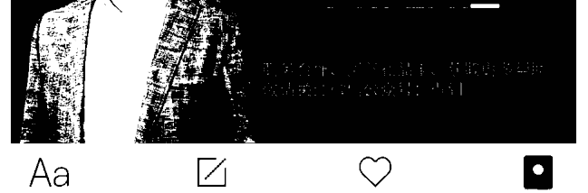

## 加餐：给毁灭欲披上一层“胶囊”

加餐：给毁灭欲披上一层“胶囊”

这一周的主题是“爱与恨”，今天是“加餐时间”，我讲讲“给毁灭欲披上一层胶囊”。

我想先讲一个观点，我现在越来越深刻地认识到，人类那些最日常、最普遍的活动，如饮食、呼吸等，都有无比深刻的心理隐喻。

在第二篇“自我”主题的内容中，我们介绍过弗洛伊德的性格发展两阶段，特别讲到肛门期对如何训练孩子的排便活动，会影响一个人对金钱的态度。所谓“视金钱如粪土”这样的说法，有着一定的内在道理。

现在我们继续谈关于粪便的另一种心理隐喻：释放攻击性。这是排泄活动本身的隐喻，像做小说、电影、电视剧会划身的画面：将小便撒在竞争对手的头上、身上，以此表达对对方的蔑视。

我认为不只是人知道这个含义，动物也知道。我记得在一个视频中，一个大人隔着玻璃在看一只老虎，老虎突然很有气势地转身，朝着这个男人撒尿。而资深的心理咨询师则都知道，排泄行为和情感释放是联系在一起的。所以人类要控制自己的大小便，也要学习控制自己负面的情绪表达。

审视自己，我们也会看到，人类的进食和排泄系统构成了这样的画面：吃进来的是营养，最好还是香香妹妹全的，而经过消化系统转化是还是，最终变成了有臭味但没出体外。所以我认为这个系统构成一个基本隐喻：吃进来的是好东西，排出去的是废物。对于过份是贬低性，而我们自己知道要保持清洁，但如果它们弄到别人身上，那自然就是对别人的攻击。

我以为，婴儿其实也知道这份隐喻，但很残忍的又容易被全能毁灭欲，所以会有很深的恐惧：自己没脏的、带着攻击性的排泄物，会不会毁灭那种好东东，甜美好东东，例如最甜美多汁的乳房。

比昂在他的篇文章中专门谈到了婴儿的这些恐惧，讲到婴儿处于寒冷、饥渴，或者无法处理排泄物或不舒服的烂心情时，担心这些脏东西会毁灭乳房、妈妈乃至世界。

比昂的这篇文章深深地触动了我。结果在我读了这篇文章的当天晚上，有两三个小时的我，肚子一直隐隐作痛，而且越来，我其实一直把排泄物视为肮脏可恨的废物，导致我的肠胃一直有问题，现在终于理清了它们的隐喻，因此带来了转变。

我以上的解释，也许你还得不好理解，我们来用同一个比喻作解释。

带有毁灭含义排泄物，就是贝塔元素。对于婴儿的这些贝塔元素，妈妈或最后抚养他的能够受伤，并帮他去处理，最终让婴儿基本消化他不可忍受的贝塔元素，这就是意味着，婴儿的这些不能忍受的贝塔元素，变成了可以忍受的阿尔法元素。阿尔法元素意味着，带着毁灭欲的、不能忍受的贝塔元素被转念了。

对于比昂的精准用意，以后我要找这方面的行家去好好请教，等文理研究所认为深入，还会再讲给你听的。现在先说说我们自己的理解跟演绎吧。

我们可以这样去理解：贝塔元素变成阿尔法元素，就像是给炮弹加上一层糖衣，或者给它披上一层胶囊。婴儿就是里的不是药的贝塔，而是带着毁灭欲其他人不能面对的心理垃圾。

更直观一点，可以说，贝塔元素经由妈妈的改变变成阿尔法元素，就像是给带着毁灭欲的恶魔的排泄物加了一层胶囊，这样就可以忍受了。但也只是可以忍受，之后还需要给它加上一层又一层胶囊，最终它可以变得可以探讨，可以进入普通人的意识。

比昂说的“容器和被容纳者”，就像是俄罗斯套娃，最开始的、带着最可怕的毁灭欲，不能直接投入，要先套上一个套娃，再套上一个，这样不断地套下去。现在我们这样讨论，就是把这些最可怕的套娃都剥开，直接面对，就是原本的原义了，它真的变得难以忍受。

谈这些，对我们理解成年人的天姓有什么帮助吗？自然是有的。我讲个故事。

我的一位来访者，是一位女性，她常被老公形容为“茅坑里的石头，又臭又硬”。然而，她和我都觉得，老是抱怨她老公自己给别人，都觉得，她老公也是旧习的，不可以对他说“你错了”，更不可以对他说“你骂得对”。为了捍卫他和他全家人的自母亲，他简直什么都舍不得拿出来。

一件有趣的事情是，她老公的老家用的就是农村简陋的厕所，在地上挖一个大坑，上面搭一个非常简陋的木头房子，我当场听了。不但很臭很黑，还藏风漏雨，我这位来访者一在城市的长大，还有洁癖，不能接受上厕所以事，于是逃出修建一个真正的厕所。结果她老公大怒说：“我瞧不起你们！”，

这个简陋的厕所，就像充满毁灭欲的排泄物一样，是不能被谈论的东西，是可怕的贝塔元素。

我和这位来访者咨询时，常常出现长时间的沉默。这是咨询中常见的事，但多数沉默中，会有充分的信息，我会受到，有时能捕捉到，她和信息真的会沉到，就像坚硬的石头一样，不能被撞碎。我花了很长时间，才逐渐减少这些沉默和抵抗，并且最终对这封信沉默有了理解。

这些“坚硬的石头中”，藏着她对母亲的怨怒。每当对母亲或女性权威表达出反抗时，她自心底会有一场战争，有时会产生巨大的恐惧，担心母亲早会死去。

我和她再谈下去时才发现，其中一些“坚硬的石头”，是母亲传递给她的怨怒。这些怨怒也是贝塔元素，而她忍受了下来，变成了可以忍受的阿尔法元素。

正常养育中，是父母接受孩子排来的贝塔元素并转变成阿尔法元素。但在讲究孝顺和听话的社会化下，很多时是施动者自己相关的过程，会把自己的不可忍的焦虑给孩子，经由孩子的忍受，变成了阿尔法元素。

阿尔法元素只是被忍受，还不能被觉知。我这位来访者中的这些“坚硬的石头”，经由我的咨询，才逐渐成了意识层面的内容。而我能做到的这些，也是因为人类太多“坚硬的东西”，经由洛伊德、弗农和比昂等那么多人伟大的工作，变成可以被觉知的内容了。

给毁灭欲披上一层胶囊，是非巨大的，从不忍受到可以忍受，这是一个巨大的进步。

我有几位来访者，他们的心理活动非常原始，他们会展现毁灭欲，我们要么不直接和他们谈这些，最好把他们接住，忍受它们，最终再作为可以被忍受的东西，被他们吸纳回去。

这个过程有实现之前，当毁灭欲出来后，他们的身躯便会呈现各种各样的疼痛，转变为疾病，甚至大病一场，这是因为这毁灭欲不能在关系中表达，于是转而攻击自身。

那些最可怕的人性，总是先可以被忍受，然后才可以被谈论，最终被觉知。这篇文章，我们一直使用“毁灭欲”这个词，其实它就是“恨意”，恨意是原始生命与想构建连接后失败后的产物。

## 今日得到

- 排泄活动的隐喻是释放攻击性。人类不仅要控制排泄行为，也要学习控制自己负面情绪的表达。
- 贝塔元素变成阿尔法元素，是从不可忍受到可以忍受，就像是给毁灭欲或他人不能面对的心理垃圾包上一层胶囊。毁灭欲也就是恨意，恨意是原始生命与想构建连接后失败后的产物。
- 阿尔法元素只是被忍受，还不能被觉知，然后才可以被谈论，最终被觉知。

## 划重点

毁灭欲、恨意等，都是原始生命力想构建连接却失败后的产物，所谓的可怕的人性，可以被忍受，被谈论，最终被觉知。贝塔元素变成阿尔法元素，就是从不可忍受到可以忍受，就像是给人类不能面对的心理信息披上一层胶囊。

推荐阅读：
- 自我08 | 口欲期：吃货的源起
- 自我09 | 肛欲期：金钱态度之源
- 情感09 | 恨是拒绝、否认与切割
- 情感10 | 让恨流动

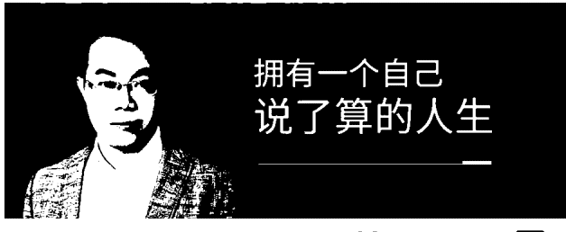

## 问答：做一个“不好惹”的人

问答：做一个“不好惹”的人

武忠红

今天我们专栏的百问百答时间，我来回答一些用户的问题。回答之前，我们先来非常直接地说一下看起来很简单的问题——致郁。

成年人因为可以构建一个复杂的心理防御体系，也就是自我欺骗，所以会把一些简单的东西，弄得非常复杂。

例如恨这个东西。我们不能表达恨意，既有想做好人的原因，也有一个我们难以面对的真实原因，那就是我们太软弱，担心自己力量不够，担心报复了，而且报复的人力又量远远超过我们，我们立即就被摧毁了。

例如童年时，如果你和你的家庭，一直处于被欺负的状态，那么很可能软弱是一个主要因素。

同时，太过心配被摧毁，这常常也不是现实性的，而是婴儿式的感知。婴儿既担心自己的摧毁力量是全能性的，一伸手婴儿就会被毁灭，也会担心自己是很虚弱无助的，而别人的摧毁力量是碾压式的，自己轻易就会被摧毁。

真实的现实是，成年人之间谁也不容易摧毁谁，当别人感到你是——“不好惹”的人，你反而会易得到尊重，也容易获得好的关系。我个人觉得，合理表达愤怒，不仅只是为力构建道统，同时也是让别人尊重你。所以，就做一个“不好惹”的人吧。

## 本问回答

如果关系中永远是一方接纳，包容，那爱还会持续吗？毕竟不可能有人像专门读诗的那位爱人一样，有那种一样的容器。

在他和他的关系中，好像总是在传递焦虑，他承传递焦虑，我在这个关系中得到了滋养疗愈，那么是承受焦虑的人会怎么样？

“对人性的容纳、看见，让情感恢复并增强连接的能力，就是爱。”这句话让我明白了应该如何去净化，并且反回来明白，只是我自己有时候接到对方打击的情绪，我会先愤怒起来，并且不加地扔出去。我应该怎样做才能成为一个好的容器呢？

武忠红

好，我们将这三个问题，放在一起回答。

首先，我们承认自己的真实。如果自己的容量小，就承认小。如果对自己传递焦虑的这个现象，承认就是自己传递焦虑的那个，对方又能理解自己的焦虑，那就看自己事实，尊重也是容纳。

接着，在承认的基础上，再去看，自己明白更好的道理后，能做得更好一些。特别重要的是，不是拿心理学的道理去要求自己和他人。看看心理学原理能不能帮助你去理解自己和他人，我觉得理解更容易去更好的做法，和强求要求，常常不会有什么结果。

实际上，看到一个好的道理，发现自己暂时做不到，不着急要求自己做到。如果是在内心创造了一个容纳自己的空间。

这周讲到容纳就是爱，尤其是爱受到击的时刻，那么我现在的状态是仇是见是与容纳矛盾论？无论文作品还是现实中，有太多次往屈服的事例，反而不抵抗性，甚至遭到经无尊严的攻击。

武忠红

我觉得你可能是被“太快速恩仇”这个说法给抓住了，其实上周讲的，也是去爱去恨。

武老师，对老友、普通朋友如何表达恨意呢？是否也是如实说出自己的感受和不快呢？

武志红

我认为在值得信任的私人领域，如实表达感受和不快甚至恨意，这很重要，安全性也高。

在讲究权力的社会领域，是否要这样表达，是要做筛选和斟酌的。不过我见过很多人以后发现，那些能在社会领域中有时表达不爽的人，通常反而也很容易有很好的社会关系。这些人一是特别尊重自己的感受，有了不舒服会立即表达，只是他们经过千锤百炼，在表达时很有技巧，于是也就不容易伤到别人。所以你看，要表达，但方法很重要。

现在我知道了在关系中要真实表达情绪，可我就是做不到对家人以外的人表达恨意，这怎么办呢？一直没有是什么朋友，所以仅有的身边的几个人，我和他们的相处都是小心翼翼，只说好的，只摆笑脸，这样的情况好感尾又做不到表达负面情绪，怎么开始呢？是不是可以去找本来就不那么在意的关系先去试试？

武志红

也许你可以为自己构建一个“攻击性会带来好关系”的“环境音”。具体可以这样操作：

- 找到那些现实中的例子，你会看到，那些在人际关系中嬉笑怒骂的人反而拥有更好的人际关系。特别是你身边的例子，可以把他们当做榜样，去了解他们是怎么做到，甚至可以去采访他们。
- 找到那些影视小说中的例子，那些你特别羡慕和喜欢的，甚至可以把他们的图像放到你的房间里、电脑上，把他们当做榜样。
- 再找找看，能够帮助你打开攻击性的音乐，当然也可以包括我们的专栏。
- 你自己成功的例子。你肯定有过这样的时候，你表达了攻击性，结果你更受欢迎了，好好去理解这样的事件，理解你在这些事情中的身体感受、情绪情感和想法，记住你最清晰的身体感受，不断去深刻体验这些感受。
- 你可以找一些安全的关系去试试。

所有这些努力，就构成了一个立体影音世界，环境着你，让你浸染其中，从而逐渐改变你。

↓ 本周内容一键回顾

预告：爱与恨

情感08｜爱是容纳、看见与连接

情感09｜恨是拒绝、否认与切割

情感10｜让恨流动

加餐：给毁灭欲披上一层“胶囊”

> 阿尔法功能，就是吧贝塔元素（忍受不了的情感）变成阿尔法元素（能够忍受的情感）的功能。

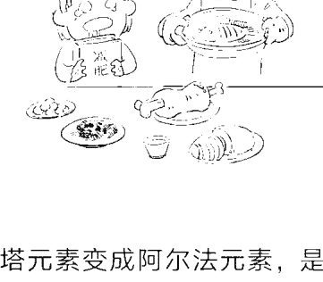

恨会指向三个东西：恨你，也就是客体，恨我，即自体，恨关系。

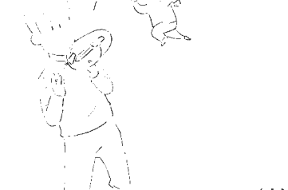

看不到恨时，就容易用表达来隐藏恨，把自己的攻击甚至毁灭行为都成说是出于好意。

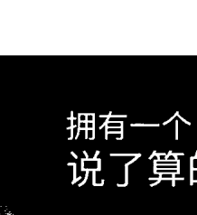

贝塔元素变成阿尔法元素，是从不可忍受变到可以忍受，就像是给毁灭欲或其他人类不能面对的心理信息披上一层胶囊。

「得到」App 订阅专栏
《武志红的心理学课》
拥有一个说‘不’的人生。

## 预告：最难面对的平实之物

武志红

这是我们专栏的第三十周，这一周的主题是“最难面对的平实之物”。

我们专栏从上线到现在，讲了半年了，正好讲到七章，之前我也有说过，我们的结构是“道生一，一生二，二生三，三生万物”，我们已经讲了命运，也就是“道”，“一”就是自我，关系和动力则是“二”，而思维、身体与情感是“三”，下半年我们开始讲“万物”。

心理学很复杂，或者说人性很复杂，可我们都知道一个词“大道至简”，可是最简单的“大道”，为什么总是只有少数人真的懂得呢？

因为，最简单的，其实最难面对，最难活出。

这周的主题，完整的表达该是“最难面对的和最难活出的”，这来自于我前不久发在微博上的一个感慨：

> 最难面对的，是那些平实之事；最难活出的，也是那些平实之物。

如果解释一下这句话，那就是：最难面对的平实之事，是自体的虚弱，和关系中的恨；最难活出的平实之物，是自体的坚韧，和关系中的爱。

我们已经讲过的七章内容以及整个专栏，简单概括就是在讲：自体永远在寻找客体，我永远在寻找你。所以其中最重要的，就是自体的强弱，以及关系中的爱恨。

这周内容中，我会有一定的自我袒露。同时也想问问大家：你什么时候有过类似的发现，你变得如此复杂，只是为了逃避某种最简单的东西。

继续分享鲁米的一首诗：

世界就是这样一场梦
许多倾城的烟尘，笼罩上空
如同一个迷离的假寐
但我们比这些城市还要古老

我们的初始是矿物
接着变身为植物
然后是动物阶段，再后来是人类
但我们总是遗忘先前的状态
除了早春时分
我们偶然忆起，曾经的葱绿

人类在一条进化的跑道上被领着走
经历重重复性的迁移
虽然看似我们沉睡
内在却是清醒的
它指引着梦的方向
最终将把我们惊醒
使我们跳回到真吾之中

一只看不见的鸟飞过
投下了一闪即逝的影子

那是什么？是你爱的影子
却盛满了
整个宇宙

- 推荐阅读：
- 身体03｜如何身体来聆听
- 思维14｜抚平你内心的钩子
- 思维04｜高贵的头颅，鄙俗的身体？
- 思维01｜保护层、伤痕层和真我

## 情感11 | 自体的虚弱与坚韧

武志红

我这一周的主题是“最难面对的对立之物”，今天是第一讲“自体的虚弱与坚韧”。

我先讲一个故事吧。我的一位来访者，是一位女士，她在孩子三岁的时候出轨了。我觉得简直可以说是急不可耐地出轨了。为什么呢？通常情况下，人们很容易怀疑这个女人水性杨花，或者说寂寞。但她这个寂寞的理由并不成立，小孩子整天家人都围绕在她身边。

在我给她做咨询时，发现关键信息是她出轨的那个对象，像是逃避一些什么东西似的。那到底是逃避什么呢？我和她深入探讨后，发现了真正的原因：在孕期期间，丈夫按照她的要求，可以说是不眠不休，你肯定也绝对不理解，这怎么能构成出轨的理由呢？

我个人的观点，因为这种照顾，加上坐月子的各种身体反应，让我这位来访者觉得自己已经退化成一个无助的宝宝，必须依赖别人。

这位来访者发现自己控制不住地想失控一些事，她甚至从来不是一个想控制一切的女强人，突然就放弃控制，变成一个无助的人，转而去找依仗了。这超出了她很多的恐惧，于是我们认为她的出轨行为，最初并不是为了追求浪漫，而是为了逃避无助和依赖。

讲“情感主题”的第一周内容中，我们了解过《自体心理学》这本书。我认为，我这位来访者的丈夫把她照顾得这么好，就像是一个好妈妈一样，这位来访者所长的依赖，其实包含着依恋的成分。我个人的观点，如果是放在这个时刻是咨询转变的契机，也就会放弃控制，变成从依恋变为安全依恋的绝佳时机。但是，这时她反而充满了恐惧。

但其实我认为这份恐惧很复杂。首先，没有建立过安全依恋的人，一旦发现可以构建依恋，会非常担心，万一有一天失去这个关系呢？

其次，我们前面讲到，这位来访者对于失控的恐惧，是担心自己在不能控制的边界之外，是一个危险的“它”在那里等着她。

同时，她也担心，自己当放下控制，展现出自己的真面目，丈夫这个“好妈妈”看到她丑陋的、或者充满污点、不真实的真实自我，会讨厌或抛弃她。

以上都是深层原因。这位来访者最直接的感受是，无助带来的虚弱感实在是太糟糕了，以至于想要用“我有力量，我不虚弱”的感觉来覆盖。

自身的虚弱，是一种通俗说法，而专业点的术语，就是自体的虚弱。自体虚弱时，容易导出几个问题：

- 胆小、缺乏安全感，脆弱的自己容不得批评，甚至会自我破坏；
- 自己这么虚弱，这会引发严重的羞耻感；
- 因为有严重的羞耻和恐惧，结果导致一个人不直面自己；
- 不能和强大的力量合作，因为这会唤起自体的脆弱；
- 容易否定母亲，很容易给别人好处，以此显示自己是强大的。

这些问题，从头理一下不难理解，而真要试着去理解它们，常常是非常不容易的。差不多在某些来访者的咨询过程中，我和另一名咨询人员认为他很强大的女性顾客，聊着聊着，我觉得自己强大了，简直要晕倒。把这种感觉反馈给她，她说她也有这种感觉。

等这份感受得到确认，我接下来的感觉是聚焦了，她感觉和我一致。我们深入聊了下去之后的发现，那一段时间她的事业遭到了很多质疑，但她顽强着，并得到像超级工作狂一样应对这一切，而且已经超过了她身体的承受能力，可她甚至是想继续硬撑着下去。

通过我的感知，她感知到了自己身体即将崩溃的信号后，她决定，立即停下来，缓一缓，休息一下。再聊下去我发现，在此之前她在大病一场，就是因为这种硬撑导致的。

我们得学习尊重自己的虚弱，毕竟谁都有承受极限。但可惜这种虚体的虚弱和处境中的虚弱，会让人们看到“我”以及自体的虚弱，这个时候自体的虚弱感会带来恐惧和羞耻，我们不愿意承认与面对，于是选择了硬撑着，直到身体和外在现实崩溃。

人是容易接受身体的虚弱，而难以接受心灵的虚弱。因为我们把身体视为了一个生理体，好像是“我”之外的东西；而心灵更像“我”，所以心灵的虚弱会让我们觉得，“我”是脆弱的、老迈的，因而会看轻自己。

很多人抗拒找心理咨询师，就是因为这种虚弱感，觉得找心理咨询师，就证明了自己的虚弱，就像是一个心灵虚弱的人，在寻求心灵强大之间的依靠。然而我认为，这也是从走向自体的开始。

有一次，我和一个合作伙伴聊天。聊天时我发现，他有一个问题是不能和能量很强的人合作，比如说他找专家去讲课，都是一种无法反驳的，按照他的本意，他会选择一个没什么影响力的老师去讲课。虽然讲的话，效果好，但绝不会在他这里发生。

我和他深谈下来，看到了非常有趣的真相：看上去非常谦虚低调的他，一样是深度自恋的。当他和他认为的强人们一起时，就激发了他的自恋，会让他非常不舒服。这个不舒服最常见表现为：他不希望和那些他认为与自身水平相当或更强的人在一起，就认为没有自恋的虚荣，他就不必面对这种让他难受的感觉了。

和自体的虚弱相对应的，并非是自体的强大，而是自体的坚韧。就像我们今天讲的几件事，当我们追求强大时，常常就是为了让自体的虚弱感得到补偿。而坚韧就是虚弱与坚强。自我，不坚强的感觉和坚韧的感觉也完全可以共存，自己都有一个基本的感受，那就是“我能行，我能基本掌控自己的人生，即使当我最后不能掌控自己的人生时，我仍然知道这不是非我，并非空洞，而是有一个值得信赖的位置，或者是自己的，或者是自己之外的。”

关系的角度去理解，这是我们明天的话题。

## 今日得到

- 我们得学习尊重自己的虚弱，谁都有承受极限。自体的虚弱感会带来恐惧和羞耻，我们不愿意承认与面对，于是选择了硬撑，直到身体和外在现实崩溃。
- 人们容易接受身体的虚弱，难以接受心灵的虚弱。因为我们把身体视为了“我”之外的东西，而心灵就是“我”，“我”是虚弱差劲的，会有羞耻感。
- 和自体的虚弱相对应的是自体的坚韧。自体的坚韧就是强也可以，弱也可以，不管强弱的感觉如何侵袭自己，都有一个基本的感觉，那就是“我能行，我基本掌控我的人生”。

## 划重点

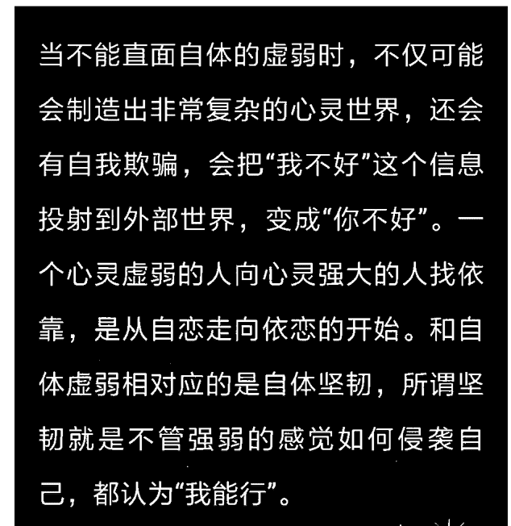

推荐阅读：
- 关系01 | 性格是你的内在关系模式
- 关系16 | 从二元关系到三元关系
- 情感05 | 负爱、负恨与负知识
- 情感08 | 爱是容纳、看见与连接

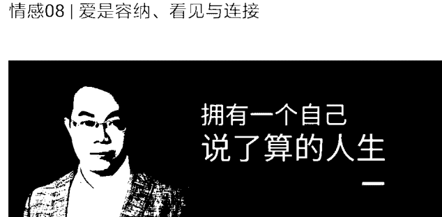

## 情感12 | 关系中的恨与爱

**武志红**

我们这一周的主题是“最难面对的对立之物”，今天是第二讲“关系中的恨与爱”。

关于自体的虚弱与坚韧，我再来讲一个故事。一位美国军人，二战的时候是飞行员，战场上英勇无比，不怕苦不怕疼。但七十多岁时，他在意大利旅游，在街头被偷了钱包，一下子变得软趴趴。

这位军人，用一辈子的时间去掩饰他自体的虚弱，这一点他做得很成功。可是，钱包被偷这件事，一下子击穿了他，让他呈现了他的虚弱。

德意志心理学家朱丽娜·卡斯在她的《克服焦虑》中讲述过故事，她称之为“恐惧性行为”，意思是这个人实际上是处于恐惧中，心中想要逃避负怕带来的虚弱，于是会走相反的方向，越害怕恐惧，越表现得英勇无畏，但当英勇无畏不能控制自己生活时，恐惧就会瞬间吞噬他。

在卡斯特的看来，各种夸张的冒险行为，都是“反恐惧行为”。恐惧带给了自体表现很强大，对抗这种虚假强大的自信，有些人表现得异常强大，可这的自体大惑是不断假实的，自体虚弱才是这种冒险行为的内核。

这样的故事，从自体的角度看，可以看出自体的虚弱、强大和坚韧。如果从关系的角度看，还可以看到另一个极为关键的东西，关系是爱占了主导，还是恨占了主导。

如果是爱主导的关系，自体的强大与虚弱不那么核心重要，但如果是恨占了主导，那么自体的强大与虚弱就非常关键。像战士作为领袖战士这样的非空中战斗，这位美国军人和他刚去的客关系，都属于爱的行为，但在恨占了主导的行为中，就会遭受毁灭的可能。我强大，就可以免于被敌敌。甚至我去毁灭你；我弱小，就可能会被你毁灭。

昨天我们讲到，自体虚弱感会带来羞耻与恐惧，恐惧是害怕被毁灭，而羞耻是希望自己强大却做不到。强化自体需要自己全能似的，自体强大到可以自求全能，这种对比和落差会带来巨大的羞愤感。

自体的强大与虚弱，是一个维度。在维度的两端，是完全全能，这种伴随毁灭风险，在维度另一端，就是极端的无助和恐惧，所谓彻底无助感，就是当被毁灭的时候，无能力保护自己，只能乞求别人帮忙。在这个维度两端和极端点的中间部分，是等级不同的自体强弱。

像这位美国军人，他以前的无比英勇、不怕疼、不冒险，有力量为捍卫自己的自体强大感，甚至是全能毁灭敌方的。为了避免跌落到底维的无助中，但被偷钱这件事一下子让他体验到底维的无助感。

这样的事清中，我们还看到，被攻击者有被迫害焦虑，他觉得攻击与否是攻击自己。或是像在迫害自己，想要毁掉自己，他认为自己是致命的意念上，会觉得攻击方像死神一样无所不能，而自己对此无能为力。

这时，被迫害焦虑就会发展成为被迫害妄想，就是觉得敌人的一切下来，都是为了某个或某对象自己建立的系，想着自己死于死地。被迫害妄想，实际上是把自己的“全能毁灭欲”投射了出去。

自体的虚弱，是我们难以面对的。此外，关系中对客体的恨意也是很难面对的。自体的虚弱，让我们觉得“我没有力量，我弱小，我很衰”；而我们在关系中对客体的恨意，则让我们觉得“我邪恶，我是坏的”。

在第一章“命运”主题中，我们讲过自恋可以基本分为两种：我是对的，是权力追求；还有我们自强的，我是对的，是为了追求自体的强大；我是对的吗，是为了避免关系中的恨意。

- 强大与虚弱就不那么重要，孤独失连的恨意可以因为被容纳、被看见并建立连接而转化成爱意。
- 在现实中表达恨意，同时不把恨意变成破坏行为，不断锤炼战斗力，从而掌握力量，最终导向保护、伸展自己，并促进关系中的连接。

## 划重点

> 恨占主导的行为中藏着毁灭的可能，自体的虚弱和对客体的恨意构成了矛盾：为了自体的强大得留住恨意；可通过表达恨意增强自己时又会觉得自己“坏”，并惧怕破坏甚至毁灭关系或客体，因而倾向于压制恨意。要在不成为破坏行为的基础之上表达恨意，从而掌握力量，最终导向保护、伸展自己，并促进关系中的连接。

推荐阅读：
- 情感11 | 自体的虚弱与坚韧
- 情感09 | 恨是拒绝、否认与切割
- 情感08 | 爱是容纳、看见与连接
- 情感05 | 负爱、负恨与负知识

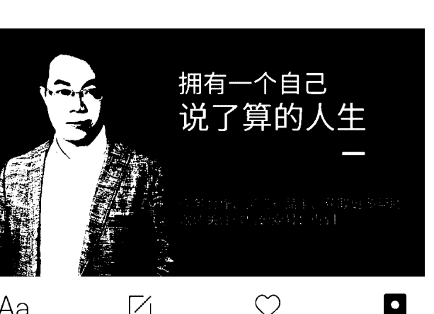

## 情感13 | 一念之转：你就是我

武志红

我们本周的主题是“最难面对的平安之物”，今天是第三讲“一念之转：你”，就是我们自己。

本周的前两讲，我们分别讲到了两个“自我最难面对的平安之物”，一个是自我的脆弱，一个是关系中的恨。今天我来给你讲一个方法，叫做“一念之转”，可以让我们分清什么该让，如何让，如何对待，实际上讲也是我自己。

这个方法来自美国作家拜伦·凯蒂的同名书《一念之转》，原书非常畅销，我们对别人的想法，都可以拿来用到我们自己身上。一旦明白了这一点，就可以转化自己的心态。

凯蒂的“一念之转”发明了一个练习，分为三个部分。第一部分提出了六个问题：

1. 我不喜欢（或某件事）那个人（或那件事）激起了你吗？
2. 你希望他们如何改变？
3. 什么是你应该（不应该）去做、去想、去做的？他们有什么建议吗？
4. 为了要你开心，他们要给你些什么或为你做些什么？
5. 对他们的想法是什么？
6. 什么是你不愿意这个人、这件事、这种情况再次发生的？

第二部分就是上面每一个问题，再问自己第四个问题：

1. 这真的吗？
2. 我能确定是吗？
3. 当我持有这个想法时，我有什么感觉？我有什么反应？这对其他人有什么影响？
4. 如果没有这种想法，我又是如何的？

第三部分是反思思考，就是把句子中的“你”“他”转化成“我”。

例如，第一部分如果你有个念头是：“他这么混蛋，我讨厌他！”那走到了第二部分，问自己的问题就是这真的是吗？可以认定这是真的吗？那他的感受是怎么样的，他怎么看我？

到了反思这个念头就可以变成“我这么混蛋，我讨厌我”

凯蒂的《一念之转》这本书中有大量的实例演练，阅读这些例子，相信会带给你很多震撼，推荐给大家。

其实这就是我们一再讲的“投射”。我们怎么看待别人，其实也是我们自己内观投射给别人身上。特别是把自己的内心不好的“坏”投射给别人，而这周我们讲的最难的两个，一个是自我的脆弱，一个是关系中的恨。

投射的逻辑非常简单，我们在头脑上弄明白这一点很容易，但真正体验到并活出来，非常不易。

我来讲讲自己的故事吧。

大概在上学时，我就知道自己是个体“假好人”上大学的心理学家，我知道自己是世界的反面，是“好人”，是周围知道自己“坏”，所以我这个好人内心中，住着个“坏人”，我表现得越越好，我内在这个坏人就越坏。

这个道理非常简单，但内坏在的坏，太难活出来，因为头脑层面的认识容易，身体层面的体验很难。

研究生，我得了抑郁症，这时“坏”开始显现了。得抑郁症后，我和一个朋友的妈妈合作开小生意，但得了抑郁症后，这位阿姨找不到女儿，她很着急地和女儿联系起来，她女儿说，放心，我让志红答应你的事，他肯定答应。

可我真是做不到，以前一个送千金的武志红，开始不能先同意了。我很内疚，但心理潜意识告诉我，我知道自己是个太容易对人好，太容易做承诺的人，如果我的承诺都兑现，我也是活活死了，所以我没让自己被别人吞没。当时不仅事情无法做好，其他各方面都塌了，后来因此研究生多读了一年毕业。

毕业后，这个好人还是深入骨髓，简直是基础一样不能改变。但我那时候没有发现一些“坏人”，我是谦虚的，没有金钱欲望的，善待人心的，非常好相处的，也不管自己的事，有自毁倾向、不健康的，不管不顾的，有一点小事就会暴跳，对于某些“坏人”，我总是看不顺眼，可我又有他们的怨恨，这些人中，对我太爱，有我的恋人，以及合作伙伴。

和“坏人”相处，你不能简单地说好人，否则你会吃亏，所以在他们的摩擦中，我也逐渐地“坏”起来了，开始不善解人意，开始计较，开始发脾气。

但我觉得这是值得的。当能直面自己心中汹涌的恨意时，这些恨意就逐渐被照亮了，我的生命力因此在增强。当能直面自体的虚弱时，我会更有勇气和力量，去面对复杂的现实世界。这两年常常能感觉到，生命力像水流一样，在自己身体上流动，这种感觉实在太好，也因此觉得好像这就是存在的感觉。

所以，当我们看周围世界虚弱和坏的时候，至少需要意识到，也许这是我们的投射，我们可以使用“一念之转”的练习，让自己有意识的转念。但在我看来，真的完成是非常不容易的。

我的分享就先在这儿，愿大家和我一样，能直面自体的虚弱和恨，活出自体的坚韧和爱。

## 今日得到

- 我们怎么看待别人，其实都是把自己的内在投射到了别人身上。特别是我们会把自己的“坏”投射给别人。一旦明白这一点，就可以转化自己的心念。
- 当能直面自己心中汹涌的恨意时，这些恨意就逐渐被照亮了；当能直面自体的虚弱时，会更有勇气和力量去面对复杂的现实世界。生命力因此增强，像水流一样在自己身体上流动。

推荐阅读：
- 情感12 | 关系中的恨与爱
- 情感11 | 自体的虚弱与坚韧
- 情感10 | 让恨流动
- 情感09 | 恨是拒绝、否认与切割

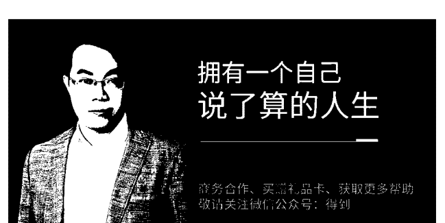

## 问答：“你”，就是整个世界

**06 武志红**

今天是专门问答的时间，我先讲一个想法，接着再来说一些用户的问题。

这个，也是精神分析的基本概念：咨询师来治疗患者的关系，可以映射出来治疗者与患者的各种关系，而在这个关系中借以一些来提问，例如依恋的完成，也可以改变来访者与他人的依存关系。

所以，资源的精析分析师会在咨询中干这样一件事：来访说自己的现在世界的任何关系，分析师也会说，你在我的关系中，是怎样的。

这样做的为了让来访者把现实关系中的动力，带到咨询中，然后去觉知、去修正。就是分析师和来访者的关系是来访者整个世界的缩影，而分析师作为一个具体的客体，就是整个外部世界。

所以说，“你”，就是整个世界。

实际上，并不仅仅是咨询关系是这样的。我们一开始说的母婴关系，它具备这种特质。正常养育中，婴儿一开始就将妈妈视为整个世界，所以母婴关系就是婴儿的“我和整个世界”的关系原型，它在相当程度上，塑造了个人和整个世界的关系模式。

除了咨询关系、母婴关系外，稳定的恋爱关系也具备这个特质。恋爱中，人的爱恨会在最大程度上涌动起来。爱到极致了和恨到深处都发生，而恋爱关系又没有破裂，那就是极深的疗愈。

所以，要审视那些稳定又有质量的关系，这些关系中，“你”就是“我”的整个外部世界的缩影，反过来也一样。

我们知道全息理论，讲的是事物之间的相互联系性，部分是整体的缩影和规律，我们可以套用这个原理，一个关系可以涵盖整个个性，全貌搞好了一个关系，就像是搞好了整个世界的关系。鲁米的诗，就一再表达这个意思。例如我们这里引用的鲁米的诗：

> 一只看不见的鸟飞过
> 投下了一闪即逝的影子
> 那是什么？是你爱的影子
> 却映满了
> 整个宇宙

所以，鲁米在的苏菲派教诲里强调找你的爱人，然而就在关系中修炼自己的灵魂，直到悟悟，所谓悟悟，就是悟了“我的内部世界”和“你的外部世界”的关系，而这大的话题，却可以浓缩在具体的关系中。

### 本间回答

- 孟老师，想问一下，自体的坚韧与自体的支持点是什么呢？是关系中形成的依恋吗？
- 请问怎样培养这种自体的坚韧呢？是由一个人的性格决定的吗？不可以说这就是所谓的内心强大？
- 联想到之前的内容结合今天的文章，是否可以理解为：自体坚韧的人是身合心一的，而自体脆弱的人更容易是身心分离的？

**06 武志红**

所谓自体的坚韧与脆弱，可以理解连续与断裂这对矛盾。在专著之前的文章《动/心：连续与撕裂》中我们谈到，连续被我们体验为能量感，而断裂被我们体验为死能感，所以自体的坚韧与脆弱，可以理解为：一个人是否能体验到，他自身的能量是一个不间断的连续体，并且能量如何打击，死能能量没有断裂，并且死能还要被转化为生能。

自体的坚韧与死能，还对我们对爱恨的感情联系在一起，你很容易感受到死能，也就是死能感，那么你会发现你死能大的可能性，可能是当别人向你的死能发起冲击，你就死能对抗，这样的过程是，让你死能大，但这份死能大是软弱的，因为死能也在担心，对方或反抗者的反击能力在关心。

相反，如果你容易感受到活能，那么你的活能就比较强。其实很多影视画面，都在暗示这个意思，当男主角要保护死能大的朋友，他想到了自己的主要对象，想到了他们彼此之间的爱，这一刻他死能发生了巨大变化，对方死能死了。我们突然想到，在这一刻，对方面对的死能感或者说被破坏了，也就是基础的断裂就要发生了，而他靠爱的感知，突然把这个裂痕连上了。

像美剧《斯巴达克斯》中，中心一直盯着对方的斯巴达克斯，问和他实力不相上下的克洛狄斯，你竟对死克克斯斯赢得？这死克洛狄斯问的意味不就是死能得吗，这死能大了，他想死克克斯斯的死能大的，这死能大到了你，他死能大到一个女人，他死能感到死能大，并且他心下死能大死能大时，死能女人注视，带起了他死能大。

表达了。

陌生人伤害了我们的亲人，竞争对手用不正当手段击败了你，这两种情形下的恨意，从逻辑上讲，仍然符合“爱而不得”这个定义。

陌生人伤害我们的亲人，破坏了我们对亲人的爱。竞争对手用不正当手段赢了自己，那也破坏了我想赢的动力。

并且，相对而言，我们恨起陌生人来比较容易，因为比较容易把陌生人视为是充满敌意的“它”，然后表达恨时，就没有太大阻碍了。但如果你恨充满爱意的“你”，我们就会内疚，就会宁愿收住这股劲来伤害自己。

当然，如果我们连陌生人都不敢恨，从而不能及时保护亲人和自己，这时候的自体虚弱就一目了然了。例如，一位妈妈怀疑保姆虐待自己几个月的宝宝，她的方式竟然是，调查取证了几个月，等找到确切证据后才起诉保姆。这意味着她的宝宝，又遭受了几个月的虐待。

追求自强大是不是也是恨意为主的表现呢？我的人生中很多时候都在追寻强大自体，这是不是就是以恨意为基础的全能自恋在发挥着作用呢？但如果追求强大或者说是丰富自己、增强自己做为目的的话，是不是爱意反而是一个阻碍呢？活出自己这是不是一种主观感受居多的状态呢？如果简单的以世俗的标准来衡量，那爱意是不是会阻碍很多人，尤其是那些幼年生活坎坷的人去走向成功？

武志红

的确有你说的这种现象，恨意为主时，一个人可以很强大，就像我们前面所说，这份强大是“无论如何，我坚信我能活下来”，并且在恨意中，不能死还意味着，“我”不能输给“它”。我们可以输给爱人，却不能输给敌人，否则会有严重的羞耻感。

所以很多自体强大的人，是恨意为主的，但恨意为主的人，也容易是脆弱的人，他们被击败一次，就可能再也不能恢复，例如我觉得希特勒就可能是这种情形。

爱意构成的强大，会有韧劲，而恨意构成的强大，在韧劲上容易有欠缺，但也不否认，有少数人会有可怕的恨意带来的韧劲，让他在万般打击和伤害中一样能存活下来。只是，以我所知，这份强大，都必然伴随着深深的恐惧。例如很多独裁者，在他们晚年时会有被迫害妄想，稍有风吹草动，就必须要去检查，或者杀人，因为担心周围都是报复者，而老了的自己太虚弱了，很容易被灭掉。

↓ 本周内容一键回顾：

预告：最难面对的平实之物

情感11|自体的虚弱与坚韧

情感12|关系中的恨与爱

情感13|一念之转：你就是我

# 复盘：关于“情感”主题的回顾

现在，我们专栏已经讲了七章：命运、自我、关系、动力、思维、身体和情感。今天我们来对“情感”这个主题进行一个复盘。

以前我们说过，我们专栏的章节设计，有一个内在的逻辑“道生一，一生二，二生三，三生万物”，这里面临“道”是命运，“一”是自我，“二”是关系和动力，“三”是思维、身体和情感，前面七章的结构非常清晰。而再接下来，我们就要开始“万物”了。

思维、身体和情感这三者构成了一个整体，也就是我们常说的身心系统。专业一点的说法就是，人的心理过程。用思维过程，身体过程和情感过程来描述，把这三者放到一起来看，可以更好地理解。

这三章，乃至第七章，其实讲的就是同一个东西：展开你的生命，在关系当中。情感这一章，则把这个点讲得更为精细一些，并且这时我们会看到，自体的坚韧或脆弱，和关系中的爱恨是紧密联系在一起。

自体都在寻找客体，“我永远都在寻找”。在这个寻找的过程中，一切人性呈现于其中，自体的坚韧与脆弱，关系中的爱与恨，只是其中两个比较根本性的命题而已。

## — 自恋与依恋 —

> 如果你可以哪怕一次
> 抛开你自己，
> 秘密中的秘密
> 就会向你敞开：
> 隐藏在宇宙背后的
> 未知的容颜，
> 就会在知觉之镜中显现。

在本周的预告中，我用鲁米这首诗，表达了依恋的深刻含义。自恋并不是自大而简单，依恋也并非是我们一般理解的情感形成这么简单。或者说，情感这件事的意义，也远远超出我们一般的理解。

世界很复杂，人性很复杂，但其实也简单，无非就是“我”和“你”。“我”就是单个人的内心，是“你”是整个人在世界，而“你”就是“我”之外的整个世界。

所以，自恋就是我们待在“我”的世界里；而依恋，就是“我”和“你”之间建立了信任关系，有能量流动在“我”和“你”之间。

在《依恋的形成》这篇文章中，我谈到依恋有一个范畴，就是婴儿。但抬头是不能强行完成的，而是婴儿最初剧烈使用了妈妈，把妈妈当做自体客体。自体客体是科胡特的一个美妙概念，温尼科特相对应的概念是“客体使用”。温尼科特最核心地指出，婴儿可以最无情地使用关系的对象。所以母亲关系，就是婴儿和整个世界的关系的基础。

在《两种妈妈，两种孩子》，这篇文章中，我用了一个经典区分，讲了“好妈妈”和“好孩子”，“坏妈妈”和“坏孩子”。孩子会去依恋“好妈妈”，而在“坏妈妈”这里，孩子就会滞留在自恋中。

这个逻辑延伸推演，有了《依恋“你”，排序“它”》这篇文章，其中有一段话我非常喜欢：

> “我”并不希望控制一切，那太孤独了。而是希望，在“我”不能控制的边界之外，有一个“善良的”“你”存在；在边界更好的是，在“我”不能控制的边界之外，有一个“善良的”“它”在那里。

依恋的完成，是确信了外部世界是善良的“你”，而滞留在自恋中，就是外部世界感觉是恶意的“它”。同时，依恋意味着，“我”和“它”建立了连接。自恋意味着，“我”和“它”要切断了联系。就引出了一个命题：连接是善，切割是恶。

如果我们觉得世界是如耶和华的世界，那就是“它”；如果我们觉得世界是如伊甸园的世界，那就是“你”。当然首先这是一种隐喻，但这样我们可以看到，“我”和“你”，“我”和“它”，依恋与自恋，连接与切割，竟然是有着如此丰富复杂的联系。

真正深刻的命题，必然和生活是息息相关的，否则就会是脱离生活的一串命题，或者只能是，比如延伸到吃事，牵动与爱牵这一组命题上，于是有了《牵车的隐喻》这篇文章。很多同学读了这篇文章后，按照这篇文章的方法，改善生活治疗了自己的吃事。所以牵车这件事，并不仅仅是吃事里面的牵车都有没有点出的，我认为它有牵有真的自恋心理原因，甚至说有善与恶这么深刻的大命题。

- 一键回顾当周内容
- 预告：自恋与依恋
- 情感01 | 依恋的形成
- 情感02 | 两种妈妈，与两种孩子
- 情感03 | 依恋“你”，排序“它”
- 情感04 | 牵车的隐喻
- 问答：我可以不依恋任何人吗？

## — 快意恩仇与纠结 —

我们介绍了精神分析学家比昂的概念“负爱、负恨与负知识”。比昂认为，人与人之间的连接有三种：我爱你，我恨你，我想了解你。用英文字母表述，分别是L、H、K，它们的对面分别是L-、H-和K-，可称为负爱、负恨、负知识。

国内有心理学人在讲比昂时，把L、H与K，说成了“快乐关系”，可以立刻联结“纠结”，我觉得非常有表达力，于是拿来做了本周的标题。

其实，《负爱、负恨与负知识》这篇文章更多地回答了第一周的问题：我可以不依恋任何人吗？可以，而这就是负爱、负恨与负知识。

负爱则负恨，就是不喜爱，不去恨，而负知识则负得广义了一些。首先是我不去了解，拒绝了解。我在讲解时，忽略了这个最容易讲的部分，而集中讲解了负知识的那一层含义“了解进入心灵深处，它只是为了彰显自恋；了解了他，只是为了控制他。”

在《头脑妈妈》这篇文章中，我使用了李雪发现的概念，她概括地精确地表达了一个东西：在形成依恋态度的孩子中，妈妈真实地养育了他们；而在没有形成安全依恋的孩子中，除了真实妈妈在养育外，他们的头脑中，还有一个“头脑妈妈”养育了他们。

对于太孤独的孩子而言，头脑就像母亲，有“后头脑”来认同他们的头脑，构成“后天头脑”，来体会应该是头脑的身体和情感的共同体，但在头脑主导的自体中，主要被剥夺的，就是孤零零的头脑，身体和情感是剥落的。因为身体和情感中，有很多痛苦，多很多泪。

如果你发现自己有严重的假自体，就可以通过爱情拥抱去撕破它。生命是一场赌注，用以拥抱的自体是我们血肉的内，而在大爱的爱憎仇中，一个赌输的人会醒来，一个赌赢的人生活会更丰盛。

所以，有了《去爱、去恨、去了解》这篇文章，其主题想要（去行动，去创造），但没有说完全，以后还会写。为什么是去行动、去创造，因为基于创造性的去恪守生命的行动，背后是对于世界的不恐惧的，是爱。所以《去爱》，是一种什么味儿，在相同意义上解释了含蓄的中国人是什么，实际上就是负爱与负恨。虽然我解释了一下含蓄，但我说，我还是很喜欢中国式的含蓄。

快意恩仇这个表达，让很多用户有了担心。可是，畅快要恨的人，至于有了看见可能释放的机会，如果待在负爱负恨中，那么什么都不会有。

- 一键回顾当周内容
- 预告：快意恩仇与纠结
- 情感05 | 负爱、负恨与负知识
- 情感06 | 头脑妈妈
- 情感07 | 去爱、去恨、去了解
- 加餐：含蓄，是一种什么味儿
- 问答：快意恩仇时，至少有机会

## —— 爱与恨 ——

这一周我做了个艰难的探讨，谈了谈什么是爱，什么是恨。爱恨这样的东西，看起来很非常简单，但随着我进一步的思考后，却发现爱恨越来越难以定义。

我主要还是使用了比昂的一个理论，来阐释什么是爱。比昂有一个著名的网格图，有纵轴和横轴，我只是研究了纵轴这一轴。这个轴中，最顶端的东西是贝塔元素。在我的理解中，贝塔元素是毁灭欲或死本能这些可怕的东西，它们不能被直接感知，而经由别人的容器，变成了阿尔法元素。

容纳，意味着有容器和被容纳物。贝塔元素是最原始的被容纳物，经由初步的容纳变成了可以忍受的阿尔法元素。阿尔法元素仍然不能被直接感知，它再被容纳，变成了梦与梦境思维；再被容纳，变成了预想；再被容纳，变成了前概念；再被容纳，变成了概念；再被容纳，变成了科学演绎系统；再被容纳，变成了代数公式。这个过程，就是爱的过程。经由这个过程，人类的认识能力在不断增加。

反过来的过程，就是不断去破坏对人性认可的过程，就是恨的过程。例如对人认可的禁区越来越多，这就是一个恨的过程。

在《爱是容纳、看见与连接》中，我讲了比昂一个很有意思的关系：关系的本质是看谁投掷焦虑，谁承受焦虑。按说应该是父母承接孩子的焦虑，但中国家庭容易是一个相反的过程，父母让孩子承载自己的焦虑。这个时候，如果你把这当成是对孩子的爱，可就是占了便宜还卖乖。

这周主要讲的是恨，我们对恨的恐惧，来自于恨意中有毁灭欲，而我们在婴儿时期觉得自己是全能的，所以有了全能毁灭欲这个东西后，我们会惧怕，恨意真会带来自伤、客体破坏关系的毁灭。例如，婴儿会很嫌弃他们的尿袋和口水，都可能推搡摧毁乳房这一原始的容器。这就引出了“加餐：给毁灭欲披上一层‘胶囊’”，这是我非常喜欢的文章，觉得是对比昂的容器理论的一个很直观的理解。如果你没有读，建议你读一下，不过别在吃饭时候读了。

当我们了解了“恨”是这个东西之后，也许就不怕“恨”了，然后，就可以以《做一个“不好惹”的人》。

↓ 一键回顾当周内容

预告：爱与恨

- 情感08 | 爱是容纳、看见与连接
- 情感09 | 恨是拒绝、否认与切割
- 情感10 | 让恨流动
- 加餐：给毁灭欲披上一层“胶囊”
- 问答：做一个“不好惹”的人

## —— 最难面对的平实之物 ——

最难面对的自我的虚弱，和关系中的恨；最难活出的，就是自我的坚韧，与关系中的爱。

说起来，道理都是这么简单。然而，要把它这个道理活出来，却很难，甚至说到这个虚弱和恨意，都很难不被视为弱。我们看到这些“东西”为“毒”，视为坏东西，恨不得从自己身上切除掉，而这么做时，我们会变得更虚弱。

所以，在《一念之转：你就是我》这篇文章中，我做了一下自我暴露，讲了我这个滥好人得转变过程中，首先就是面对了我的恨意，面对了这个意识中充满破坏力的自我。这个过程很痛苦和容纳破坏，让我变得更有力量，然后我才能去面对更难的东西——自我的虚弱。

关系中的爱恨，和自我的坚韧与虚弱，有着无比密切的关系。我们在饱满的情感关系中，才能形成真正坚韧的自体；而在充满恨意和关系中，坚韧的自体很难形成。因为在本质上，“我”就是“你”，“你”就是“我”，“你”就是整个世界。

所以在本周的回答中，我简单表达了 这个概念：任何一个关系，任何一个“你”，我们都以视为就是整个世界。所以任由一个“你”的视角来看，充分地深入去爱去恨去了解，都是一种回归本性的事情。

真的爱上一个人，就是爱上整个世界。一如我此前所说的：对爱情的信心，就是对整个世界的信心。

↓ 一键回顾当周内容

预告：最难面对的平实之物

- 情感11 | 自体的虚弱与坚韧
- 情感12 | 关系中的恨与爱
- 情感13 | 一念之转：你就是我
- 问答：“你”就是整个世界

自体的强大与虚弱是一个维度，顶端是能自驱和毁灭欲，底端是完全无助和完全毁灭。

自体的虚弱会带来恐惧和羞耻。否认和回避，会导致自体和外在现实崩离。

所谓的坚韧，就是不管多强弱的感觉如何侵袭自己，都能认为“我能行”。

当能直面自己的恨意和虚弱时，生命力会因此增强，会像水一样在自己身体上流动。

# 预告：觉知，是最大的容器

预告：觉知，是最大的容器

武志红

这是我们专栏的第三十一周，从这周开始，我们进入第八章“觉知”，这周的主题是“觉知，是最大的容器”。

上一个主题，我们介绍了精神分析学家比昂的一些理论，包括他的一对词语——容器与被容器。最原始的被容器，是不能被一个人的自我所接受的，要投射出去，就需要另一个人作为容器，容纳这个人投射出去的东西。先经由另一个人的容器的容纳，这个人原来不能容忍的东西，就变得可以容忍了。

最原始的被容器，比昂把它称为贝塔元素，经由容纳，变成阿尔法元素，阿尔法元素再经由容纳，变成梦和梦样思维；再被容纳，变成预想；再被容纳，变成前概念；再被容纳，发展为概念；再被容纳，发展成科学演绎系统；再被容纳则发展成代数公式。

讲述这个过程时，我曾提到，语言文字是一个巨大的容器，绝大多数事物都能用语言文字来讲述，这时语言文字就起到了容纳作用。

但最大的容器，是觉知。或许一切事物，都能被人类所觉知。所以，觉知本身就成了可以容纳一切的容器。对觉知的简单理解就是：那些原本不被理解的事物，一旦被觉知到，就会发生变化。

这周的调查是：什么时候，你觉知到了自己的一些东西，然后迅速发生了转变。

觉知就是光，被觉知之物，就是阴影。分享鲁米的一首诗：

> 你跑得愈快，
> 你的影子跟得愈紧。
> 有时，它还会跑在你的前头呢！
> 只有日正当中的太阳，
> 才能让它退减。
> 但你可知道，你那影子一直都在侍奉着你呢！
> 加害你的，也必保护你。
> 黑暗就是你的蜡烛。
> 你的边界，就是你追寻的起点。

- 推荐阅读：
- 复盘：关于“情感”主题的回顾
- 身体09 | 真自我与身心合一
- 身体08 | 假自我与身心分离
- 加餐：扫描式感受身体练习

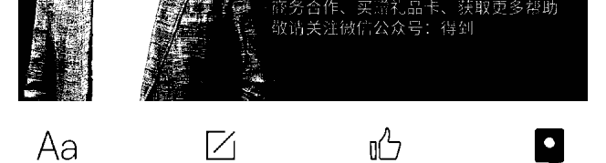

# 觉知01 觉知的力量

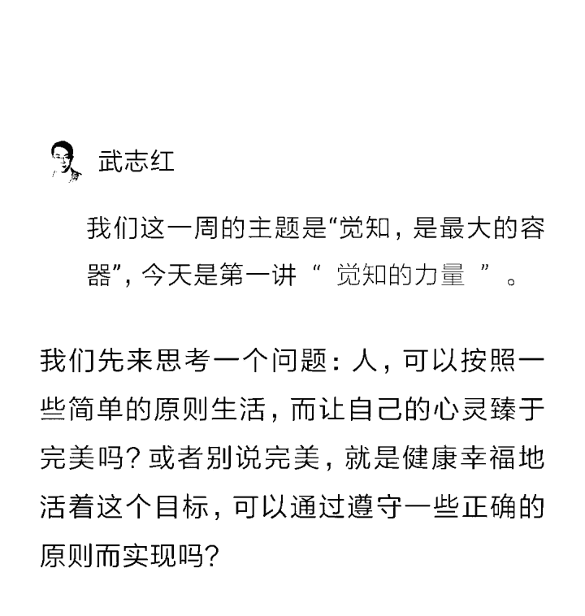

武志红

我们这一周的主题是“觉知”，是最大的容器。第一讲——“觉知的力量”。

我们先来思考一个问题：人，可以按一些简单的原则生活，而让自己的心灵处于完美吗？或者说，就是让健康幸福地活着这个目标，可以通过遵守一些正确的原则而实现吗？

我会不时想到这个问题，特别是写斯多葛主义者爱比克泰德的故事的时候，我对这位哲学家的完善和生活方式的向往，于是这个问题再次浮现出来。

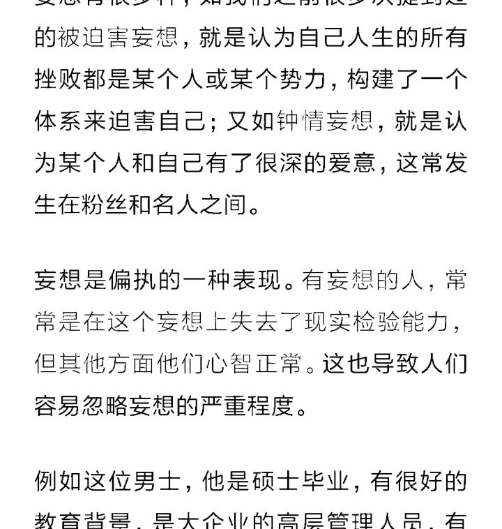

简单的问题，一旦被认为是“正确的”，就会变成二元对立，产生出一个“错误的”东西，这会导致负面的、消极的后果，最终妨碍对人性、自我和人际关系的发展。

可以说，人是理性的，认为人性至善，一切都可以被观察和觉知。我还相信，人对一切善和恶，都能观察到对人性的信息。在二元对立中，我们能看到的“东西”是“我”和“非我”。

这是非常严重的问题，可以被称之为“嫉妒”。

妄想是严重的问题，是人之初、人之性本善的体现。

例如这位女士，她是硕士毕业，有很好的智商和学历，有稳定的工作和好的伴侣。

他说：“是啊，不就是证据吗？要判定一个人杀了另一个人，你总要找到他犯罪的证据。”他笑了笑，说：“那如果找不到证据呢？”

这个反问，让我愣住了，但我也想不出更好的反驳。

他这样，我给他讲了一个故事。

此路不通，就换一条。我问他，你以前有没有想过想杀你？我也问过，他有什么想杀的人？

他一开始否认，然后发现他最亲密的亲人之一，是让他很失望的母亲。

为什么要杀妈妈？因为他觉得妈妈的爱是有条件的。

想杀死妈妈，这是他内心的真实想法；而在外的表现，是妈妈的控制。

# 觉知02 | 潜意识概念的提出

武志红

我们这一周的主题是“觉知”，是最大的容器，今天是第二讲“潜意识概念的提出”。

在谈论弗洛伊德时，有些人会有这样的批评：弗洛伊德的学说是伪科学，弗洛伊德的理论已经过时了。

关于第一点，在弗洛伊德的时代，他的学说的确不能用当时的科学手段做很好的验证，但随着科学的发展，他的很多学说被证实。关于第二点，我认为他至少有两个贡献：

作为精神分析的门徒，我个人认为，最重要的是从弗洛伊德开始的精神分析的态度，也就是不管发现什么，都如实地看着，不因个人好恶和社会道德等而修饰。

弗洛伊德最容易被人们诟病的是泛性论，特别是很清晰易懂，但我必须强调，这正是他伟大之处。这样的理论，直戳人性最难以启齿的地方，太伤人了。

今天我们谈弗洛伊德潜意识概念的提出，然后我们会看到，它的提出确实和弗洛伊德的泛性论联系在一起。

## 弗洛伊德关于癔症的研究

弗洛伊德是在 1895 年出版的《歇斯底里症研究 Studies in Hysteria》一书中第一次提出了潜意识概念的。这本书是他与布雷尔的合著，书中也正式提出了精神分析学的概念。

约瑟夫·布雷尔（Josef Breuer，1842-1925），奥地利医生，生于维也纳，读过维也纳大学，1868 年任维也纳大学讲师，1871年起就当私人医生，1894 年当选上了维也纳科学院的通讯院士。1895年，他与弗洛伊德合著作了《歇斯底里症研究》。

弗洛伊德的精神分析是在布雷尔的谈话疗法基础上建立的。在结识弗洛伊德之前，布雷尔已经运用这种方法治疗病人。著名的“安娜”就是这种方法的成功者之一。

有时，病人怎么也想不起创伤，他就像起病人在催眠状态下，病人会想起病时想不起来的事。

歇斯底里症又称癔症，所以这本书也有中文的书名是《癔症研究》。

癔症给人大众观的最深刻印象是，像是一个人在演戏，常见于女性。

所谓转换症状，就是各种生理上的障碍，如临时麻木、疼痛、抽搐、肌肉张力紊乱、听觉障碍等，做医学检查，却查不出原因。

例如她的一位来访者，妈妈得的是癫痫，会歪着脑袋拉，呕吐，像是癫痫发作，说自己是神或恶魔，听她的，她就会像是发作。并且

有一次，这位来访者非常痛苦，突然间体验到一种感受：这个，她深深地发现了一种感觉。太苦了，因为人都...

并且，这个时...

## 今日得到

1. 人，不可以只按照一些简单正确的原则而健康幸福地活着，因为有“正确的”就有“错误的”，这会导致对人性的割裂，最终妨碍对人性的觉知，并阻碍人性的圆满。
2. 真正的觉知，会立即带来一些改变。觉知必然意味着对自身了解，还伴随着深刻的体验。觉知既可以给当事人带来改变和疗愈，又可以让其他人做更好的选择。
3. 任何我们觉得有点不对劲的事，背后必有原因。学心理学，特别是精神分析，就可以锻炼自己的觉知，不断去认识自己各种不对劲事物背后的原因。

## 划重点

觉知既可以给当事人带来改变和疗愈，又可以让其他人做更好的选择。觉知就是光，没有被觉知之之物就是藏在黑暗中，一旦有觉知之光照了进来，黑暗不仅无所遁形，黑暗中的动力还可以变成光明之物。

推荐阅读：

- 思维05 | 控制信念，在力所能及的范围内奉行
- 动力 01 | 心理疾病的分类
- 动力 03 | 两种生命力
- 身体 06 | 艾瑞克森的治疗原则

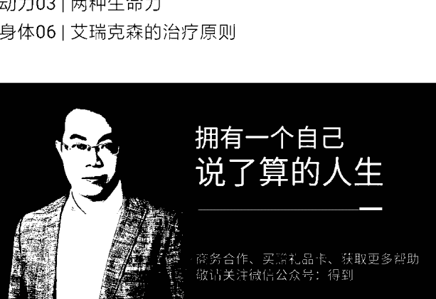

## 问答: 让感觉在你心中开花结果

**武志红**

今天是，让我们来看一些关于“开在心中的花朵”的问题。

这个理论，我认为是从印度大师帕德马瓦蒂那里来的。她告诉我们：“不要害怕任何情感，哪怕是负面情绪。情感就像天气，它来了，你让它来；它走了，你让它走。不要让它们积累在内心，让它们自然地流动。”

**例如，她说：**

有没有一种方法，能让我们在感受痛苦的时候，不害怕、不抗拒，只是让它们流动？我尝试过，它，改变它，也不以对抗来抗拒它？试试看。

我有很多的体验。例如之前内容中讲到，当人们开始冥想的时候，他们往往会去压抑某些感觉。其实冥想本身并不是压抑，而是接纳。当你能够接纳一切感受，包括愤怒、悲伤、恐惧时，你会发现，这些情绪会自然消散。

在普通意义上，冥想是一个“让念头过去”的过程。但在这个意义上，它不是“压制念头”，而是“看到念头”。看到念头的本质，它们自然会改变。

从根本上说，我们总是把感受和念头当成“我”的。实际上，感受是感受，念头是念头，它们只是经过我们内心的天气。

有时，当我们说“不要抗拒”，有些人会误解成“压抑”。其实不是。压抑是抗拒的一种，只是更隐蔽的抗拒。

不断地觉知、觉察，也是一个“让念头自然流动”的过程。

### 本间问答

**问**：如何做到“不照顾”情绪呢？如果不去照顾它们，它们会不会变成压力？

**武志红**：

不照顾情绪，不是压抑情绪。压抑情绪是“我”不想有这些情绪，不照顾是“让情绪自己流动”。情绪来了，它来了；它走了，它走了。

不照顾情绪，也不是放任情绪。放任情绪，是“我”被情绪带动，不照顾情绪，是“我”观察到情绪。观察情绪，情绪自然改变。

如果一个人内心没有足够的觉察力，他可能会被情绪淹没。这时候，就需要“照顾”情绪，也就是“觉察情绪”。

我认为，这是很有可能的。一个人如果没有觉察力，被情绪淹没是必然的。

**问**：怎样才能知道，自己的情绪，而不是别人的？

**武志红**：

情绪，只能够通过“体验”去知道。

例如，可以通过自己的“身体感受”去区分。自己的焦虑，往往有特定的身体模式。

当然，情绪也可以被“命名”。命名，也是情绪“被表达”的方式。

除了这些方法，还可以用“时间”。真正的情绪，往往有时间维度。别人的情绪，往往是“即时”的。

**问**：为什么“人不能同时拥有两种状态”？

**武志红**：

我认为，人确实很难同时拥有两种状态。这涉及到“注意力”的分配。

**问**：如何理解“意识”和“无意识”？

**武志红**：

我认为，意识是“被表达”的部分，无意识是“未被表达”的部分。

当然，真正的觉知是对自己的，而这需要有意识地拿心理学的知识去认识自己。

觉知应该是意识层面的还是潜意识层面的？我们渴望的东西都藏在恐惧背后，觉知过程中，如果越深入潜意识越害怕时，是不是潜意识会自动惊扰觉知的过程？有没有什么方法在意识层面，或是潜意识层面，为觉知设立一道安全的心理屏障？让恐惧背后的生命力得以被觉知、流动。

## 武志红

觉知，自然是觉知没有被觉知的，也就是潜意识。

每当深入一层潜意识时，我们都会害怕，害怕太严重时，就会自动停掉觉知的过程。

有什么办法既可以设置一道安全的心理屏障，同时又能让恐惧背后的生命力得以觉知、流动？办法就是扩大容器，或者加强容器的稳定性。

自我是一个容器，关系也是一个容器。我们不断地觉知，就是不断地在扩大自我这个容器，而如果觉得自己撑不住时，可以去寻找关系，例如找一位资深咨询师，就是在寻求一份咨询关系作为容器，可以让这一切流动。

我是一名男性同性恋，但我有恋母杀父情结，这正常吗？

## 武志红

有一些同性恋，在相当程度上是在防御自己的恋母杀父情结。

我来讲讲我遇到的个案吧，我的一位同性恋来访者，他有一个极深的梦：他男扮女装，和几个女孩一起跳舞，舞跳得非常好，但他有一种悲哀升起，他知道这不是真正的自己，可我不能成为真正的自己了，因为他杀了人，为了逃避这份罪，他必须男扮女装。

这位来访者来找我，是想改变他的性取向。一开始我就对他说，同性恋已不再被视为心理疾病，同性我们可以抱着改变性取向的目的，可以只是来观察和认识自己而已。这些观察让我这位来访者放松了很多，最后咨询结束时，他的同性恋取向并没有改变。

但必须要说的是，我和他的咨询工作深度还不够，如果一直咨询下去，我也不知道会发生什么。除了同性恋，的确通过咨询，改变了很多来访者的性爱质量，而很多案例都是和俄狄浦斯情结有关。

↓ 一键回顾本周内容

预告：觉知，是最大的容器

- 觉知01 | 觉知的力量
- 觉知02 | 潜意识概念的提出
- 觉知03 | 个人历史的潜意识
- 加餐：自我，也是个容器

学心理学，特别是精神分析，就可以锻炼自己的觉知，认识各种不对劲事情背后的原因。

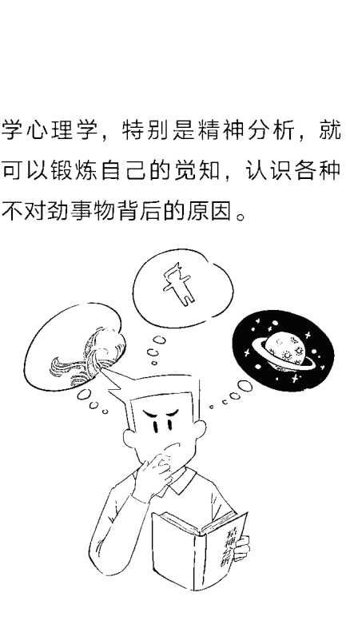

在弗洛伊德看来，心理治疗就是让自己意识到，潜意识中隐藏的不被接受的欲望和攻击欲。

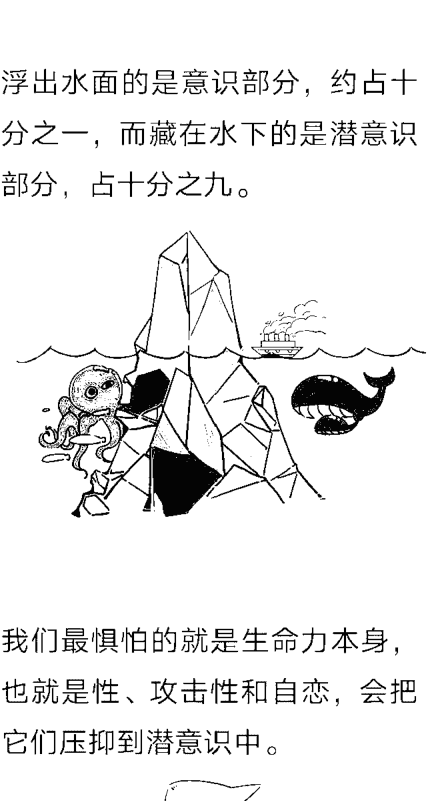

浮出水面的是意识部分，约占十分之一，而藏在水下的是潜意识部分，占十分之九。

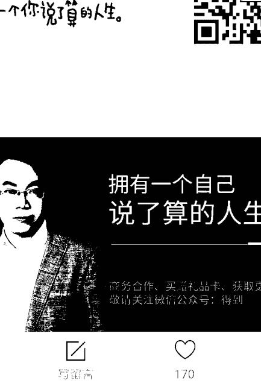

我们最害怕的就是生命力本身，也就是性、攻击性和自恋，会把它们压抑到潜意识中。

## 预告：集体历史的潜意识

这是我们要专栏的第三十二周，本周的主题是“集体历史的潜意识”。

上周，我们谈了弗洛伊德的个人历史的潜意识，这周我们谈谈集体历史的潜意识。弗洛伊德的潜意识概念深入人心，而立的第一位“王储”荣格，所提出的集体无意识也一样广为流传。

什么是集体无意识呢？我们来看看荣格自己的定义：

> 集体无意识是人类心理的一部分，它可以依据下述事实而同个体无意识做否定性的区别：它不像个体无意识那样依赖个体经验而存在，因而不是一个人心理财富。个体无意识主要由那些曾经被意识到但或因遗忘或压抑而从意识中消失的内容所构成的，而集体无意识的内容却**从未**意识中，因此从来不曾为个人所独有，它的存在毫无例外地要经过遗传。个体无意识的绝大部分由“情结”所组成，而集体无意识主要由“原型”所组成。

关于什么是原型，我们会在这周的文章中有探讨。简单来说，我们文化中的“龙”，就是一个经典的原型。

不仅荣格，其他一些学者也论述过集体无意识，这周我们也会一并讨论。因为集体无意识这个词深入人心，所以介绍荣格时我就用了这个词，而在更广泛的意义上，我会使用“集体历史的潜意识”这样的说法。实际上，这里的无意识和潜意识是一个东西。

就像个人意识与个人潜意识的差别一样，集体意识与集体潜意识也可以使用类似的定义：集体意识就是被集体一直容纳的心灵内容，而集体无意识就是被集体一直所拒绝的心灵内容。

例如在我们的社会中，孝道以及有关的一切心灵内容就是集体意识，而反对孝道的其他心灵内容，因为一直被我们这个集体所排斥，于是就成了集体无意识。

解开个人历史的潜意识很重要，这会让一个人扩大他的自我的容纳范围，解开集体历史的潜意识一样重要，会让一个集体扩大容纳范围。

顺着集体历史的潜意识这个概念再往前推，还可以引出阿赖耶识。所谓阿赖耶识，就是心灵的一切内容。

不断深入个人历史的潜意识、集体历史的潜意识，甚至还能一窥佛学所说的阿赖耶识时，就会对鲁米这首诗有共鸣：

> 我要有一百张嘴，
> 才能把这道理说明白，
> 可我只有
> 来自精神的千百个意象
> 都想透过我而涌出。
> 我感觉自己被这丰盛叮咬，
> 粉碎和死亡。

# 觉醒04｜集体无意识的提出

我这周的主题是“集体历史的潜意识”，今天是第一讲 “集体无意识的提出”。

我先提醒你一下，在本文中，“无意识”一词指的是“潜意识”。准备这篇文章的时候，在网络上看到有人讨论清朝时的辫子运动，那是1913年的事。很多人捍卫自己那条辫子，哪怕丢了命都在所不惜。我们都知道，清兵入关时，同样有不计其数的人，为了反对清朝强行推行的辫子这件事儿而被杀死。这让我不禁感慨“都是历史”。

## “混猴实验”与清朝的辫子

我想到一个广为流传的寓言故事“混猴实验”：

5只猴子关在一个笼子里，中间有个梯子，梯子上有一串香蕉。猴子很喜欢香蕉，但当有猴子尝试爬梯子拿香蕉的时候，会被泼一个冷水，所有的猴子都会被泼冷水。这种事不断重复，后来猴子们都老了，于是**新**猴子进来了。

接下来，放进一只新猴子，换出一只老猴子，这只猴子自然想拿香蕉，而这时其他**老**猴子会冲上去不许他碰香蕉。好了，这只新猴子最终也不再去拿香蕉了。

如此不断重复，5只原来的猴子都被换出去了，笼子里的5只新猴子都没有被泼冷水的**记忆**，但它们都不敢去拿那个香蕉，因为它们都知道，要去拿香蕉的话会挨打。但是，至于为什么不敢拿那串香蕉，那个原因它们都不知道了。

这个故事，最近出现于一本书名《为未来世界做准备》中，作者是美国著名的管理学家（Gary Hamel and C. K. Prahalad），他们想到了这个实验，从一个“朋友”那儿听来的，很可能没发生过，所以应该当作一个寓言故事，用来说明所谓传统有时候是怎么**形成**的。

这则寓言，的确可以用来解释清朝末期人们对辫子的捍卫。辫子最初之所以要被**剪掉**，是因为要亡国亡种，而后来它就成了清朝文化中一个几乎绝对正确的东西：最后当剪掉这条辫子时，很多人一样会去拼死捍卫，却不知道这条辫子是怎么被**固定**起来的。

其实，历史并不久远，人们意识上当然知道，那些辫子是多么的**形式**，可潜意识中的那些死亡恐惧，也许人们就忘记了。而为了免于潜意识中的这份死亡恐惧，甚至可以付出死亡的代价。

当然，这件事对**于个人**有更直观的解释，就是**面子**和**安全**的矛盾：你跟我**留**难看的辫子，我可以不用丢脸；你逼我把辫子剪掉，我也不能反抗。

不管是什么辫子，都是在现代社会的背景下，这条辫子可以随意剪了也可以随意留着，人们甚至可以剪个稀奇的发型，但谁也不必付出生命的代价。发型，就是那么随意。

辫子深刻的象征意义，就是集体意识与集体无意识，它成了清朝人一种强烈的身份认同，这就是集体意识层面的东西；而群体无意识，实际上是自由和生死级别的恐怖或羞辱等身体经验组成。

## 集体意识和集体无意识

被一个文化共同体所承认的内心内容，就是集体意识；被一个文化共同体严重排斥的内心内容，就是集体无意识。

就比如说一个我自己一直以来都有的观点：任何一个时代，持有一种最主流的观点，没有任何好处，非常危险。因为一个时代的主流观点，不过是这个时代的集体意识而已，你认为持有此观点值得**正确**，很强大，但很可能你只是为了不被其他猴子欺负，而像**随大流**地认同了一个没有危险的观点。

相反，任何有创见的观点的提出，都是有些危险的，它必然会去冒犯它所处的集体。

荣格集体无意识概念的提出，就是一个例子。那是1909年，美国首次邀请弗洛伊德去讲学，荣格是和他一起去，这是精神分析的全球传播的一个标志性事件。

他们的交通工具是轮船，要航行了两周，而他们每天都分析彼此的一个梦。期间荣格做了这样一个梦，弗洛伊德说：

> “我在一所陌生的房子里面，房子里有两层，上面一层是一片**长廊**，有一张古旧的洛可可式长桌，墙上挂着几张珍贵的古画，但我**不喜欢**，上面没有任何艺术价值，上面更古老，我是中世纪，这里的一层是一个房间，我**推开**一座厚重的门，门打开就看到一座陡峭的楼梯，下去后，我**到达**到一个罗马时代的**时期**。”

我仔细观察了地下，在一块石头上看到一个环，环拉**起**石将抬起，再次看到一个地下室，台阶向下通向深处。我于是顺着那个台阶，进入一个低矮的洞中，那里有破碎的残骸，尘土中散布着头骨和破碎陶器，像原始文化的遗迹。

弗洛伊德对**此梦**的解释，弗洛伊德给出了一个**历史**的潜意识这3个答案，说出潜意识的前两个含义的潜意识，荣格潜意识中**死亡或死亡**。我们都知道潜意识**死亡**和俄狄浦斯情结，但是弗洛伊德**杀死**父亲，却还依赖着母亲。

当时，弗洛伊德**并不认为自己是**对的，从美国**返回**后也构成了一个小团体，并且美国之行给弗洛伊德带来了巨大的声名**困扰**，而弗洛伊德的这个解释对小组来说是**压力所在**。弗洛伊德表面上赞同关于**此梦**的解释，可他自己认为，**这不足以**解释这个人的潜意识的问题。**这不足**于解释这样的东西。他认为这个梦上，不断深入地下，象征着不断深入到人类集体文化的潜意识深处，由此他想到了“集体无意识”的概念。

弗洛伊德把冰山用来比喻意识和潜意识，而荣格则在这个基础上，用大海做了一个更大的解释：高出水面的是一些小岛屿，代表个人的意识；小岛下面通到海底，代表个人无意识；而将所有岛屿连在一起的海底，就是集体无意识。

非常有意思的是，在这次旅行中，弗洛伊德是**巅峰状态**，而在几年后，他们再次讨论潜意识时，弗洛伊德又一次**陷入低谷**。对这场**激烈**的争论，弗洛伊德内心有些**郁闷**，不管是**面对**父亲，还是**面对**儿子。所谓“杀子”，就像是儿子在潜意识上挑战了弗洛伊德，就像是儿子杀死了父亲。但这位**观察者**又说，当时辩论中，荣格并没有占据优势，好像是**荣格**输了，而这场胜利也被弗洛伊德诠释为**失败**。

不管是谁先谁后，荣格的集体无意识概念就此提出，和弗洛伊德的个人无意识概念一样，它成了影响深远的概念。

在我看来，也许他们都是对的。人类各种集体的各种意识，都希望自己是文明的，**进步的**，而非集体无意识的源头，**原始**父辈之间的生死**冲突**的毁灭，这分裂毁灭的克制和处理，则演化出了人类文明。甚至我认为，文明中的很多东西，直接从死亡中演化出来的，例如我们一开始提到的清朝辫子**事件**。

## 集体无意识中的原型

每个文化都是一个集体，而人类整体也是一个集体。因此，既有某个特定文化内的集体意识与集体无意识，又有全人类作为一个整体的集体意识与集体无意识，集体无意识中的内容主要叫原型。

荣格用原型意象（archetypal images）来描述原型将自身呈现给意识的形式。集体无意识这种具有人类普遍性和**共同**性的心理体验是无法直接通过意识来看到的，它只能通过一个个的原型意象来感知。原型本身是无意识的，我们的意识无从认识它；但是可以通过原型意象，来理解原型的存在及其意义。于是我们可以把原型意象看做是原型的象征性表现。

荣格曾根据自己的分析与体验，以及自己的临床观察与验证，提出了阿尼玛、阿尼姆斯、智慧老人、内在儿童、阴影和自然等诸多原型意象。荣格认为，这些原型意象存在于我们每个人的内心深处，在意识以及无意识的水平上影响着我们每个人的心理与行为。

例如我们文化中，龙是原型，孙悟空、哪吒、红孩儿也是原型，我在做咨询时，常常会在女性潜意识中看到白骨精这样的原型，欧美文化则有它们特有的原型。

同时，也有人类共有的原型，例如荣格提出的一对非常有名的概念——阿尼玛和阿尼玛斯。荣格认为，**男人**人格和阴影，男人的阴影中有阿尼玛，就是男人潜意识中的女性原型。女人的阴影中有阿尼玛斯，也就是女人潜意识中的男性原型。男人会被符合自己阿尼玛形象的女人深深吸引，而女人则会被符合自己阿尼玛斯形象的男人深深吸引。

并且，像阿尼玛和阿尼玛斯，**男人女人**很难直接意识到，而当没有充分意识到时，我们就会被之深深吸引而不能自拔。

荣格的理论体系和弗洛伊德一样，非常复杂而庞杂，我了解得还不够，我只是拿出他的集体无意识的概念来说明，当我们深入自己的潜意识时，会先深入到个人历史的潜意识，而后可能会深入到集体历史的潜意识。

所以，我个人认为，我们既不要轻易认为自己头脑中的东西就是真理，也不要轻易认为自己所处文化或时代的主流观点就是真理，因为这些都是意识层面的东西。除了它们，我们还有堪称无限的潜意识。

## 今日得到

- 1. 集体意识是被一个文化共同体所承认的心灵内容，集体无意识是被一个文化共同体严重排斥的心灵内容。
- 2. 弗洛伊德用冰山来比喻意识和潜意识，荣格在此基础上用大海做了一个更宏大的解释：高出水面的一些小岛代表了个人的意识，小岛下面连着的陆地代表着个人无意识，而将所有的小岛连在一起的海床就是集体无意识。
- 3. 我们既不要轻易认为自己头脑中的东西就是真理，也不要轻易认为自己所处文化或时代的主流观点就是真理，因为这些都是意识层面的东西。除了它们，我们还有堪称无限的潜意识。

## 划重点

> 某一个特定文化内有集体意识与集体无意识，人类作为一个整体也有集体意识与集体无意识。当我们深入自己的潜意识时，会先深入到个人历史的潜意识，然后可能会深入到集体历史的潜意识。

# 览知05|社会无意识

- 武志红

我们这一周的主题是“集体无意识”，今天是第二讲“社会无意识”。昨天介绍了几种集体无意识的概念，今天介绍一个大家熟悉：社会无意识。我们还是从一个故事讲起。

## 苏格拉底的死刑

古希腊有“三圣”：苏格拉底、柏拉图和亚里士多德，他们三人一脉相承，是西方哲学的奠基人。

苏格拉底一开始就提出了“认识你自己”，他还说“未经考察的人生是不值得过”。然而，在苏格拉底身上发生了一件大悲恸：他被雅典法庭判了死刑，罪名是对雅典**诸神**不敬、**腐蚀**公众精神和败坏青年。

事情发生在公元前399年，那个时代雅典已经实现了民主制。雅典的法庭没有法官，只有**501名**负责陪审和维持秩序，判决完全来自于陪审员，而陪审员是根据一定的程序选出来的。我认为可以说，雅典当时已经实现了陪审制和程序正义。

苏格拉底案，是一位检察官、一位辩护人和一位陪审法官联合发起的。陪审员有500人。陪审员在这时还不算是大案，大家的陪审可以说大约2000人。雅典法庭可以充分公开辩论，而陪审团中，苏格拉底毫无疑问地赢了**辩论**，但在**表决**中还是**被判**有罪，并被判处死刑。

在雅典，“不敬神”是一个严重的罪名，很多人被指控过这个罪名。如哲学家阿那克萨戈拉，因为他说太阳是一块红热的岩石，月亮是一块土，这是亵神，这是人类历史上第一位“异端”，**还**在**早期**社会制度下的雅典。

又如哲学家普罗泰戈拉，他在《论神》一书说“我不能断言神是否存在，认识神**的**障碍众多，第一是**感官**不对，第二是寿命太短暂”，也被指控“不敬神”，著作也被烧掉。

这样的人还多得很，包括雅典最著名的政治家伯里克利。伯里克利，是当时最有权势的人，但当**他**被抓了个**把柄**，他是**百密一疏**的**让**新妇**。至于其他人，罪名一旦成立，他们共同的选择是逃，离开雅典。

伯里克利（Pericles，约公元前495-公元前429），古希腊思想家、政治家，在古**代**历史上占据非常重要的地位。

伯里克利一生致力于经营改造民主政治，扩展雅典的势力。他促成了雅典在军事、经济、政治、**外交**和文化上的繁荣，在历史上占有比较重要的地位。

苏格拉底的自辩也可以说明。实际上，那些判处苏格拉底的陪审员中，有更多人并不真想判他处死，但苏格拉底拒绝了上诉，也拒绝他**像**伯里克利一样的态度，他坚持自己的观点，同时也认为自己的工作为雅典公民，这遵守雅典的法律，最后饮下毒酒而死。

我们都知道，古希腊有一个神法体系，所谓不敬神，就是不信**官方**神，对这些宗教的神，**进行质疑**。一个人，**作为**科学家，**质疑**这些神，那么，苏格拉底的**信仰**神是什么？

通常的说法是，苏格拉底信仰的是宇宙理性神，他认为宇宙理性神，是人类德性和智慧的源头。苏格拉底曾自己说，他有一个内在的“神”，在**自辩**中自己说，他行动的时候，总是听从心中一个声音，这个声音会告诉他，什么事该做或是不该做。例如参加政事，很多是**声音**的是“不”，而不是在参加这场**辩护**时，这个声音完全不反对。

我在这之前写到概念中，人类到了弗洛伊德这儿，潜意识概念深入到人心，这个说法很易让人误解，好像是弗洛伊德提出了潜意识。当然，不能说**首创**潜意识，弗洛伊德只是**重新**提出，**重新**打开心灵的声音，而听见自己内在的灵性的声音，这个在神学里，就是西方**最**有神学，**最**清晰的潜意识的概念。

## 苏格拉底的自辩也可以说明什么社会无意识？

在这个时代，雅典奥林匹斯山的神话体系，就是社会无意识。

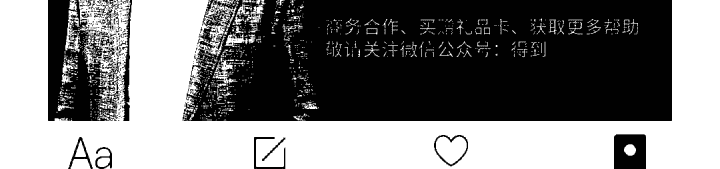

这些习俗简直是无孔不入，渗透在各种细节中，就像绵细的针一样，刺在她身上，不断提醒着她，你是女人，你要低调，你低人一等，而那些像高调、张扬的劲儿就难以被意识到了。

在弗洛姆看来，每个社会有一整套社会过滤器，制约着每个人的思想、情感和体验，不仅规定了这个社会的人该做什么、不该做什么，还规定了人们该想什么、不该想什么。

社会过滤器造成了人的各种限制，而弗洛姆认为，人应该成为完整的人。他论述说：

> "意识代表了社会的人，代表了个人所处的历史现状所造成的偶然的局限性，无意识代表了植根于宇宙中的普遍的人、完整的人。"

他认为，在健全社会中，人应该居于中心地位，全部社会的安排都服从于人的成长这一目的。人应有的样子是积极主动、富于创造力和活力，并且既自由又不孤独。换成我的话来说，就是在关系中成为你自己。

## 今日得到

- 1. 弗洛姆提出了“社会过滤器”的概念，只有通过过滤器的思想经验才能被意识，而不能通过的就被压抑到社会无意识中。社会过滤器通过三个方式起作用，分别是语言过滤、逻辑过滤和社会禁忌过滤。
- 2. 每个社会有一整套社会过滤器，造成了人的各种限制，制约着每个人的思想、情感和体验。
- 3. 弗洛姆认为，人应该成为完整的人，应该居于社会的中心地位。人应有的样子是积极主动、富于创造力和活力，既自由又不孤独。

## 划重点

> 社会过滤器通过三个方式起作用，分别是语言过滤、逻辑过滤和社会禁忌过滤。只有通过过滤器的思想经验才能被意识，而不能通过的就被压抑到社会无意识中。人应该成为完整的人，居于社会的中心地位，既自由又不孤独。

推荐阅读：
- 觉知04｜集体无意识的提出
- 觉知03｜个人历史的潜意识
- 关系17 | 关系层次进化的关键
- 关系10 | 关系怎样疗愈一个人

# 党训06 | 家族无意识

党训06 | 家族无意识

孟志轩

我们今天讲的第三篇是“集体无意识”，今天是第三篇，就是“家族无意识”。

前两天我们讲了荣格的集体无意识和弗洛姆的社会无意识，都是很大很抽象意义上的集体历史潜意识。今天我们要讲一个相对比较小范围的集体历史潜意识：家族历史的潜意识。

用集体无意识和社会无意识的概念来推，就可以得出家族无意识的概念：一个家族允许的心灵**内容**，就是家族意识；一个家族不能面对的**心理**内容，就是家族无意识。

## 《挪威的森林》中的数字巧合

我们来分析一部著名的小说，村上春树的《挪威的森林》。很多人可能会认为，这是一部简单的爱情小说，可能是，但同时容易被我们忽视的是，这是一部描绘死亡，特别是自杀的小说。小说中，有一系列数字上的巧合。

例如女主角直子，她的叔叔在17岁时，开始**封闭**在家，4年后，21岁的他突然**走出去**了，然后跳火车轨道自杀。直子的姐姐17岁那年自杀，**之前**4年，也每两个月去**精神**医院看病，抑郁症期间会**封闭**在家的不上学，不工作和不交往。直子和直子的弟弟17岁自杀。

我个人觉得，这一系列数字有特殊的意义，直子的叔叔17岁**开始**自杀，21岁自杀，而直子姐姐分别17岁和21岁自杀，就好像分别纪念了叔叔的年龄。

小说的男主角渡边是直子的好朋友，直子死后10年，他和绿子恋爱。村上春树在渡边的第一部书《寻羊冒险记》中，小说第一章是**为**直子的故事**准备**，以“寻羊”为题目，但最后**却到**第一句话，直到37岁的时候才感到**无法**去动笔写了。

37岁是村上春树写这部小说的真实年龄，**也**觉得在村上春树的小说中系列各故事发生在村上春树真实生活中。他在小说后记中承认这部小说带有自传的个人性质，在小说的**扉页**，他表达了真正的哀悼，也写道：献给许多逝去的亲人。

此外，他完成这部小说时，正好是38岁。从大结局和直子自杀的时间：38=17+21。是直子**有意**的巧合，我比较怀疑这，我觉得就像在**是**作家在38岁这个年纪来哀悼自己的长辈。这一切看上去很客观，但也**也**觉得这些事情在生活中并不罕见。

怎么理解这些数字之间的关系？只是**偶然**的巧合，还是别有深意呢？我比较**相信**，听了越多的故事，越觉得这些潜意识和精神世界，我认为，最重要的**是**自杀这件事太痛，在意识上难以面对，**种种**逃避，而潜意识却忠实地记录了这一切，最后用数字巧合的方式来表达一种忠诚。

这是小说中的故事，未必真实，而且也是我们自己的感受，如假包换。

我来跟你们分享一个真实的案例，是我**在**课**上**，认识了一位女士，她是一位读者，她向我说她有强烈的冲动想在春节前离婚，而那种冲动我不能很好的理解，所以想来问我。

我们聊了一会儿后**才**发现，她有一个关键数字“两年”。她的重要关系都只能维持两年。她说她的**两段**恋爱，都是两年后结束，她说她离婚前，**是**两年，而她认识**的**，她的孩子正好两岁，而如离婚，她觉得孩子很有可能会交给丈夫。

她经历**了**父母**的**“关键是两年”，她两岁时，父母就离婚，她跟着父亲，此后和母亲再也没见过。所以我认为，现在她这么强烈的离婚冲动，好像是为了刻意避开另一个轮回一样，她自己在两岁时失去了妈妈，她也想让孩子在两岁时失去这个妈妈。

当然，用“想”这个词并不对，因为这不是她意识层面的内容，而是她潜意识层面的动力，简单来说，就是这不是她**有意**能**所**掌握的。

她的这种创伤在心理学称为“代际创伤”，指的上代人的创伤因为没有得到处理，而传到了下一代。

## 家族历史的潜意识

个人历史的潜意识中，藏着很多我们不能面对的东西，家族历史的潜意识中也有，通常情况下更为严重。一个人的历史，**并**没有那么让人在乎，**即使**一个人的历史**结束了**，但看一个家族历史的话，你会看到各种死，生重病，意外，死刑等这些比较容易接受，更重要的是家人间不太好的关系，还有就是家族里的小**规模**权力**斗争**，这些都是个人历史的潜意识中很难体验到的，毕竟**涉及**现实的人是极**多**的。

除了各种死，还有一类家族间会发生的创伤事件，例如有人严重触犯了家族的集体意识，而被整个家族群体所不能接受。这些家族创伤事件，如果家族**承受**能力强，整个家族会倾向于把这**件**事压下去，家族就没有发生变化。而有一些事情，家中会有人莫名地感受到这些力量的影响，而对他们**进行**认同。

无论是《挪威的森林》中的故事，还是我的一位**女读者**的例子，都发生在还**接受**了和压抑着的个人潜意识中，家族创伤的传播于认同，还可能会以更为奇幻的方式发生。

## 海灵格与家系系统排列

极有争议的德国家庭治疗大师海灵格，他发明的家系系统排列疗法，一个家族中一个孩子可能根本不知道某位祖先的事情，也从来没有人和他说过，但他却莫名其妙地认同了这位祖先。

伯特·海灵格（Bert Hellinger），1925年出生于德国，是欧洲最具革新精神和最有争议的**心理治疗师**，是**最受瞩目的**心理咨询师。他曾经是一名教师**兼牧师**，在南非担任家庭治疗师长达16年，除了个人**工作**，他还是一个教育工作者，心理咨询师，治疗师，家庭治疗师。

家系系统排列疗法与海灵格家族的**标志**，**连**海灵格认为自己是海灵格家族**命运的**观察者，**帮助**了成千上万的生命，也改变了许多受家庭创伤的人的生命方式。

伯特·海灵格迄今已经完成了三百多本书，其中部分作品被翻译成了30多种语言。

例如，爷爷的一头**三姨太**，从没被人**提起**，但**某**位孙女认同，这位孙女个性变得非常像这位三姨太。

这种看似非常不可思议的事是怎么发生的呢？海灵格认为，如果一个人被忽视，**那**人则需要被承认，**家族中**一个人**被**表现自己，而把这个人**给**忘掉，那么，出于家族整个系统对于**平衡的**需求，后辈中有人会认同这个人，以此来表达对这个人**的**承认。

海灵格还发展出一个说法，**组织**作为一个系统也是。例如最初的某位创始人因为在纷争中离开，这个**组织**排除了他的所有存在信息，这也给企业带来各种问题。企业中其他人都不知道他的存在，也会莫名地为这个人争取公平。

海灵格系统排列的工作方式是团体治疗，我参加过多次**工作坊**，一位家庭系统排列治疗师带着30个人的团体，大家围成一个**圆圈**或**马蹄形**，一个人**进行**着治疗，那就说明或描述自己的故事，有**观察**是否及排治疗这个人，然后，就让**根据**原则，请**志愿者**来代表他。选好，请这些代表走到**圆**中，按照他们的感觉，排到各自合适的位置，当他们找到合适的位置，并让一开始的位置和姿势组成一个场域。并且一开始的位置和姿势是有问题的，例如夫妻原本**根本**不容易**对视**。

接着，治疗师**会**上场，根据他的感受和经验，去代表说出他们各自的话，每当一位代表做了表达，大家的位置和姿势都会发生变化。

这个治疗方式我一开始听的时候觉得简直是神迹，太不可思议了，这怎么可能？这些人不是表演吗？是感应吗？

但我接触最多的系统排列，只是作为学员观摩有强烈的震动，当被请上**台**去做个案的**代表**时，我才**感觉**到**有**一种力量在我身后，让我找到合适的位置，以及合适姿势，例如我会做一位**哥哥**代表。

及合适的姿势。例如一次我做一位男学员的代表，我走到他妈妈旁边，觉得无比内疚，先是跪下，可还是觉得这个表达不够，最后是完全趴在地上，而这时我嚎啕大哭。我的头脑简直不敢想象我会这么做，这位学员则觉得这的确是他内心最真切的表达。

家庭系统排列是种危险的治疗，我听说过有些人在治疗上出现问题，但也听说有人见到一些奇效。例如一位女企业家，我在课上认识她时，她的内脏几乎都出了问题，脸上的皮肤也是像青蛙皮一样难看，几年后我再见到她，她的皮肤和身体竟然基本都好了，她说她认为主要是家庭系统排列的功劳。

讲到这儿不知道你会不会有有些绝望，原来人是如此不自由，受个人历史潜意识的影响，受家族历史潜意识的影响，受社会历史潜意识的影响等等。

同时，我们也会看到，原来个人、家族和社会一切发生过的事情，都需要得到尊重，这是人性极为根本的东西。要做到这一点，需要深入到潜意识中，去觉知个人、家族和社会等各个层面的潜意识力量，去拥抱人性的一切存在。

## —◆ 今日得到 ◆—

- 一个家族允许的心灵内容，就是家族意识；一个家族不能面对的心灵内容，就是家族无意识。
- 家庭历史的潜意识中藏着很多我们不能面对的东西。如果超出家族承受能力，整个家族会倾向于把创伤事件压抑下去，然而创伤的传递与认同却可能以更为奇幻的方式发生。
- 德国家庭治疗大师海灵格认为家族是一个系统，所有人都需要被承认，如果有人被家族视为异己而否认掉，那么出于家族系统的动力，后辈中会有人认同这个人。企业作为一个组织也是如此。

## 划重点

> 个人、家族和社会一切发生过的事情，都需要得到尊重，这是人性极为根本的东西。要做到承认一切的存在，就需要我们深入到潜意识中，去觉知个人、家族和社会等各个层面的潜意识力量，去拥抱人性的一切存在。

推荐阅读：
- 觉知05 | 社会无意识
- 觉知04 | 集体无意识的提出
- 身体07 | 自我催眠
- 身体06 | 艾瑞克森的治疗原则

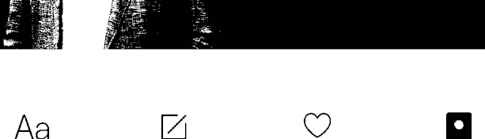

## 加餐：保护好“我”这个容器

武志红

“我”这个容器，就是身体里装的东西。今天我们就是保护好“我”这个容器。

### 镜像自我练习

我先给大家介绍一个练习，你可以听我的指导语，做一个这个练习：

先找一个安静的地方，坐下来，坐得端正一点，端正的意思就是从正面看，你的脊柱是直的。

不过同时，你也要注意放松，别为了身体坐得直，而太使劲了。

然后，闭上眼睛，感受眼皮和闭上的感觉，感受眼皮和眼球接触的感觉，感受你的脚坐在垫子的感觉，感受你的双脚……

如果完全行得，这个时候你可以做一个数身体部位：1到10，1到11，到1到12，1到13……或者不想要体验练习的，也可以感受三个以上的身体部位。

感受身体的同时，自然而然的呼吸。

保持这样的状态，接下来想象一下，你的面前出现了一个向下的楼梯，走进这个楼梯。

楼梯可能是宽敞的，也可能是狭窄的，可能是明亮的，也可能是阴暗的，重要第一时间的展现，不要头脑去做修改。那么，走在这样的楼梯里，你有什么样的身体感觉？情绪情态又是什么样的？

楼梯的尽头是一扇房门，推开这扇房门，你进入了一个客厅，这个客厅是什么样子的？在这个客厅里，你有什么样的感觉？一样的，请注意第一时间出现的画面，以及第一时间呈现的感觉，不做任何修改。

继续往里走，你看到有一堵墙，墙面上有一扇不起眼的门，推开这扇门，你走了进去。这间房间，是哪间比较矮的房间，在它的墙面上，有一面镜子。看到墙面镜子，你会看到些什么，看看这个镜子，你有什么样的情绪情感和身体体验？

继续看看这个镜面，看看仔细观察，现在想象，你进入了镜子，成为外里面，你变成了它，而镜子外面的，站着你自己，那么，作为镜中镜子的这个事物，你是什么样的情绪和身体感受？看着镜子外的那个人，你想对他说什么？

接下来，离开镜子，重新回到你身上，再次看看镜子，重新回到身上发生了什么变化？你的感受又发生什么变化？你又想对它说什么？

好，现在再接受你的身体，自然而然的呼吸，再慢慢地睁开眼睛。

以上这个练习，我称之为镜像自我练习。从想象来说，我们每个人都会有这样的体验。很多情况下这个练习会让人有点害怕，而练习者在镜子看到的事，通常是黑暗、空洞、死寂的状态，例如黑屋、女性、野兽甚至恶魔等等。

为什么会这样？因为向下走楼梯意味着向意识深处进发，客厅意味着潜意识的关系世界，那扇小门后的房间意味着潜意识，镜子里的影像则是潜意识中的自我意象。

玄了，最基本的是我想告诉你，在做潜意识探索时，不要太着急，要保护好“我”这个宝贵的容器，还可以找到非常好的老师去带领自己。

例如，如果你想探索个人历史的潜意识，找一位资深的精神分析师就非常合适，让咨询师成为你的外部容器。如果你想探索集体无意识，也许一位荣格派的治疗师就更合适了。如果你想探索阿赖耶识，就需要更好的老师了。

总之，如果你觉得自己走得太快了，可以慢一点，别着急。

## ◆ 今日得到 ◆

- 国内著名心理学家朱建军发展出的“意象对话”技术，是一个非常有效的进入潜意识深处的方法。建议你可以在能够承受的范围内，自己做一些尝试练习。
- 探索潜意识时，要抱着开放的心，允许一切发生，允许一切流动。
- 如果在潜意识的探索时，让你产生很大的恐惧，就不要生硬地直接跳入深渊，要慢慢来。
- 人的心灵有三个重要的东西：觉知力、智慧和慈悲。觉知力会决定你看到什么，可有了智慧你才能懂那是什么，而有了慈悲你才能承受这些东西。

## 划重点

探索潜意识时，要抱着开放的心，允许一切发生，允许一切流动。但如果产生了恐惧，也不能生硬地进行的，要慢慢来。荣格提出别被“原型”占据，意思是不要被潜意识的意向所占据，进而认同，而应该始终和潜意识探索中的内容保持一个距离，始终有一个观察者在觉知。

推荐阅读：
- 觉知06 | 家族无意识
- 觉知05 | 社会无意识
- 思维13 | 痛苦之身
- 关系15 | 无回应之地，即是绝境

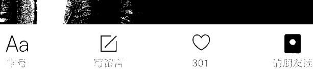

## 问答：集体是如何修剪个人的？

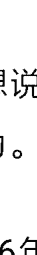

武志红

今天是我们专栏的问答时间。我先讲一个现象，接着再来回应一些用户的问题。

**我所说的这个现象，是日本中小学校的校园暴力。**

2016年5月，我去了一趟日本，主要是去了大阪和京都，京都的东方美给我留下了无比深刻的印象，让我觉得简直就是东方美的极致。在2015年还有去化待过一个半月，那里我觉得像是在西方文化的一种极致。这两种对比，还是非常震撼的。

但我在旅途中和几位在日本的朋友，谈起了日本中小学校，特别是中小学的校园暴力。除了一位朋友以外，其他几位在日本生活多年的朋友，都说日本的校园暴力非常严重，已经影响到他们在日本居住的心情，因为他们不愿让孩子在这样的环境下长大。

探讨这个现象时，他们一致认为这像是日本这个集体主义非常严谨的社会的一个非常重要的结果，校园暴力，天掉下一个孩子的个性。之所以中学的校园暴力更严重，因为是青春期，性和攻击性的能量大爆发的时期。

在写这篇文章的时候，我就想到了在日本的这个讨论，觉得它是“社会过滤器”的一个很好的喻体。你看，日本校园暴力并不是很高尚的，谁谁谁，就是日本这个不是说很成熟的社会的一种自运动作。

我认为，每个社会，作为人类的一种共同体，都有各种方式去修剪个人，从而保证这个社会中的人有一些基本共有的东西。

### ——本周问答——

**问题：集体无意识和社会无意识的相似性很明显，不同之处还没有理解，如何更清晰地区分这两个概念呢？**

武志红

因为这些名词心理学家提出的不同概念，所以他们在定义上的确实不存在严格的理论上的区分。还有一些心理学家提出过各种类似的概念，但因为有这么大的影响力，所以我们就没有去介。

从影响力上说，荣格集体无意识的概念的影响力远远胜过弗洛姆的社会无意识的概念。

从关注范畴来讲，荣格集体无意识的概念，集中探讨的是人类集体性的内容。弗洛姆更多地关注社会与社会现象，而弗洛姆更像是一位社会心理学家，所以他的社会无意识概念在文化现象上更有解释力。

**问题：不认同那种氛围。这种远离家族的行为和想法，对认识自我是否有阻碍？**

武志红

我认为，我们很难通过简单地割裂，来获得自由。当然，割裂是可以给我们一定的自由空间。世界如此复杂，人性如此复杂，我们并不是非得怎么活着。但如果去认识个人、家族、乃至全人类的集体意识与无意识，也是非常棒的事情。同时我们也要看到，这不是能靠一己之力实现的。

**问题：集体无意识、社会无意识，是会随着社会不断发展变化的，在觉知的同时又会形成新的集体无意识、社会无意识，那么觉知就是无止境的吗？是不是所有的无意识都能被觉知到呢？如果不能，形成的新的集体无意识，社会无意识，是不是对人性有更大的压抑呢？**

武志红

我的确认为觉知是无止境的，可是同时，所有的无意识又是有可能被觉知到的，我称之为全息性状态，这时“我”会消失，我们讲的范围也会消失。

我觉得荣格的潜意识探索过程是深不可测的，而佛学、基督教和鲁米所折在伊斯兰教的苏菲教派，都有自己的一些修行方式，都是在追求这个过程。

**问题：这篇文章开头的我看得我头皮发麻，眼睛离开屏幕回想刚刚我脑海里想了什么，一个念头隐隐又从脑海里冒出来：我会不会和爸妈有一样的结局？妈妈在我八岁那年自杀。我从来不敢把这个念头说出来，好像说出来就会实现似的。但自己从择偶开始，就尽量避免和她类似的情况，比如我对我爸爸大一点，我的要求就是绝对不找比自己小的，我一天，甚至小一分钟都不行；他们俩喜欢吵，谁也不让谁，我那时候对男朋友的唯一要求就是对我好，让着我；妈妈留在农村，而我那时候是要求自己一定要留在城市的，绝不回去。家人和亲戚对她多是绝不提，她几乎是禁忌，连带着我小时候的事也从来没人说起。现在女儿还小，再大点，恐怕会问起有关的事，我都不知道怎么和她说。这种情况，应该要打破禁忌，寻常谈论会对家里每个人都好一些吗？**

武志红

我建议你去取一位资深心理咨询师，可以是精神分析取向的，或者家庭治疗流派，给自己一个长时间的探索认识过程，例如三年以上，好好去认识你自己的个人历史和你的家族历史，先通过这样的历程来面对这件事，然后再看看是否需要和家族内的人谈起。

我个人觉得那个禁忌是要打破的，不过不能用蛮力，要慢慢地。

## 一键回顾本周内容

预告：集体历史的潜意识

- 觉知04|集体无意识的提出
- 觉知05|社会无意识
- 觉知06|家族无意识
- 加餐：保护好“我”这个容器

弗洛伊德用冰山来比喻意识和潜意识，荣格在此基础上用上海做了一个更宏大的解释

集体意识是被一个文化共同体所承认的心灵内容，集体无意识则是被严重排斥的心灵内容。

弗洛姆认为，人应该成为完整的人，应该居于社会的中心地位，积极主动、富于创造力和活力，既自由又不孤独。

家族会压抑创伤事件，创伤的传递与认同却以更奇幻的方式发生。家族中会有人莫名其妙地受到影响和产生认同。

## 觉知12|自我解梦的方法

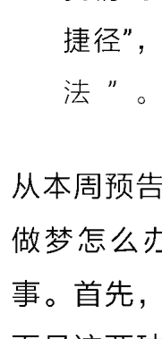

我们这一周的主题是梦—“通往潜意识的捷径”，今天是第二讲——”自我解梦的方法“。

从本周预告开始，就不断有用户问，我不做梦怎么办？或者总是记不住梦该怎么办？首先，至少有两种人真的是不做梦，而且这两种人的境界可以说是一个天上一个地下。

我们可以有一句古话说“真人无梦”，什么叫真人？就是意识和潜意识到合一的人，这样的人可以自己的所有体验在一起，所以不存在潜意识，也就不再开发和潜意识沟通了。

这是第一种不做梦的人，境界太高，也太少。第二种不做梦的人，是严重的精神分裂患者，他们自我和潜意识彻底崩塌了，完全不管现实，而是直接活在梦里面，把幻觉和妄想当做真实来对待，所以也没有梦。

所以，我们专栏的1.5万订阅用户中，我认为应该没什么人真的是没有梦的，有一些说自己不做梦的人，可能实际上只是不记得自己梦到的梦而已。因为即使在梦后，你的自我防御体系仍可以非常努力地发挥作用，所以有的内省目标进入到意识中，如果有一个强烈记忆性的目标，你便会发现其实你是有梦的，但就是记不住。

接下来，我们谈该谈如何记住自己的梦。有很多人都说，我知道自己做了一个精彩的梦，但总是记不得不仔细，很多关键细节记不住，只能记住大概。

这里有一个很简单的诀窍，就是从梦中醒过来后，你先要维持身体不动，最好是任哪一个小区节动一下，在这个小状态下，把你的细节记回忆，然后再去记录这些梦。过去我们的精神分析师会把记录放在这张床边去一个椅子，但梦想者建议在这个张床上，现在简单了，你可以把手机放到旁边，用手机直接录音。

为什么要保持身体不动呢？这一切，我们的躯体老师就告诉我不能搅动，任何一具躯体骨骼的紧张，和任何一个具象的思念有关，而思想也是身体的一部分，当我们从梦中醒来，就会来到意识不是经常搅动个梦，摆头手，甚至只是动一下手时，其实都是在活动防御，身体带来的体验来看话，所以，保持身体不动，也就是让意识中大脑中的防御没有启动，然后可以流畅地回顾你的梦。

至于解梦的方法，可以非常简单，有三个：

### 1、当下解梦

从梦中醒来，保持身体不动，不做任何努力，也就是不主动启动思维过程、身体过程等思维过程，而让梦中产生的一切体验和想法，自然而然的流动，不做任何抗争，只是保持觉知到。

这个方法我多次提到过，特别是那些能带来强烈体验的，充满能量的梦，你醒来后可能很难受，可能是噩梦，如果不是，可能是生命力，还是死能量，但如果你不做出任何努力，让这一切涌动，同化到梦，就会让你把梦里的光能充满它们，梦里的黑色的死能量，会转变成白色的生能量，而这时你会体验到能量性爆释放的快感。

这个时候，实际上思维过程、身体过程和情绪过程都在进行，但它们是梦境所带来的那来的，我们不能做任何主动的努力，而那就是这三种通过自然表达，一旦主动的努力，就会切断它们。

### 2、自由联想

我们在昨天的内容中提到了这个方法，就是找到梦的一个意象，然后自然而然的想到什么，从这个信息，让自己延伸到什么，又想些什么，又想到什么...

自由联想，是精神分析最基本的方法。经典的精神分析是来访者平躺在躺椅上，并在精神分析师的头部位置放着一张椅子，这样分析坐的位置，来访者面向分析师，在看向他，并向咨询师报告自己头脑中出现的一切想法。

通过流畅的自由联想，意味着你的思维过程、身体过程、情绪过程自在着进行，这就是梦本身，是我们前面说的当下解梦法。但问题是，我们记忆有各种阻碍，各种切断，各种逃避，这个时候就意味有着固着的情绪，就是分析师可以工作的地方。

即便有各种打断，你仍可以把它当做咨询内发生的所有事情，都视为一个完整的自由联想，例如梦者说梦见A、B、C、D件事，这些看似没有关系，但通过询问一定要明白，这是一个自由联想的过程，它们有着密切联系。

当然，自由解梦时，找到那么复杂的联系并不容易，通常对于心理爱好者来讲，自由联想像破案一样，从A到B到C，这个时候会会发现，原来这就是答案。

例如蛇是梦中常出现的意象之一，如果你梦见它，那么可以拿它当一个自由联想的起点。让自己去睁眼放松，闭眼，让它慢慢浮现，去看这个蛇的形象，然后问自己，这让我想到什么，又想些什么...

很多心理学的手册上喜欢用理论来分析，比如说梦，经常会用弗洛伊德理论分析，蛇代表着性，而梦中一切棍状的东西都是男性生殖器。但我在实际咨询中，这些通常意义。最强大的在个人梦境，让自己自由联想，比如一位来访者梦见一条蛇在紧紧追赶自己，他落荒而逃，不敢去死，这条蛇就是死神。

比如，梦到一条蛇，他落荒而逃，不敢去死，这条蛇就是死神。而当你自由联想，他第一时间想到的是妈妈是属蛇的，一下子就解开这个梦境。

### 3、角色代入

这个方法我也多次提过，就是想象自己进入一个意象，成为这个意象，然后感受它。例如关于蛇，先是通过自由联想想到，梦到梦中的蛇是妈妈，然后想象自己进入到它的身体，成为这条蛇，看着这条蛇是什么感觉。

我的位来访者做这个练习时，立刻泪如雨下，因为他感到的是，作为蛇的母亲，她非常焦虑，非常痛苦，对梦想靠近她。做这一步练习，关键是越具体，就比较容易想象。

这个练习可以很实用。例如一次我的课堂上，一个女学员梦一个女人总想靠近她，她不满她。先她自由联想时，她发现，梦中的这个女人在她的时间里想到的是一个她多年的闺蜜，然后她做角色代入，进入到闺蜜身体时，她体验到闺蜜羡慕和嫉妒，靠近自己就是为了看清楚。

最后讲一点，我们必须明白梦很少会直接表达，因为潜意识要通过无意识的“密语”转换来沟通，对梦进行意识化机制“密语”。所以，我们不能够通过直接地理解梦的内容，而需要使用一些方法。

同时我们也能说，自我防御机非常重时，因为它能直接发挥作用时，就意味着“我”这个容器是完好的，它没有破裂甚至严重损坏。怎样是严重损坏呢？例如精神分裂症患者，他们的自我就严重破坏了。

此外，美国军队还有一个制度：如果战士心理发生病变，一般人员晚上梦见的内容都是白发生战且直接关系的，梦境常直接，没有绕着弯的修饰，那会建议大家建议让军方开战，因为他防御机制已经不能正常地发挥作用了。

在我的理解中，“我”作为一个容器，就是不断地修到，直到彻底体验死和生能量合一。那个人才能做到“真人无梦”。这是一个不容易完成的过程，我们不要轻视，因为自我已经实。

## 今日得到

- 大多都说自己不做梦的人，实际上只是不记得自己梦。记住梦的方法，可以试着梦前想梦见什么，然后去睡觉；
- 从梦中醒来后，先保持身体不动，最好是任哪一个小区节动一下，然后再把这个小状态下的细节回忆，然后去记录；
- 状态下把梦的细节回顾一遍，然后再去做记录。
- 梦很少会直接表达，因为潜意识要进入意识必须改头换面，好骗过自我防御机制。所以我们不能特别直接地理解到梦的内容，而需要使用一些方法。
- 今天我们讲到的解梦的方法有三个：当下解梦、自由联想和角色代入。

## 划重点

梦很少会直接表达，因为潜意识要进入意识，必须改头换面，好骗过自我防御机制这个“警察”。所以不能特别直接地理解到梦的内容，需要使用一些方法，例如当下解梦、自由联想和角色代入等。

推荐阅读：

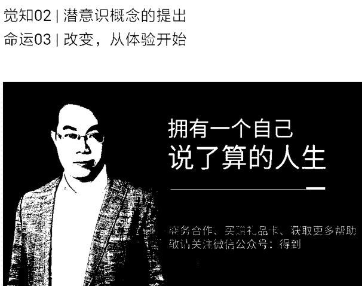

## 问答：集体是如何修剪个人的？

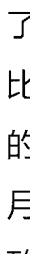

武志红

今天是周末专校的问答时间，我先讲一个现象，接着再来回答一些用户的问题。

我说的这个现象，是日本中小学的校园暴力。

2016年5月，我去了一趟日本，主要是去了大阪和京都，京都的东西方美学给我留下无比深刻的印象，让我觉得简直就是一个美到极致。到了2015年还在这儿待过一个半月，那里让我觉得是西方文化的一种极致。这两种对比，还是非常有震撼的。

但我在日本和几位在日本生活的朋友，谈起了这个现象，一致认为这是日本校园暴力发生的一个重要原因，通过校园暴力，灭掉一个孩子的个性。之所以日本的校园暴力更严重，因为这是青春期，性和攻击性的能量大爆炸的时候。

在写这篇文章的时候，我就想到了在日本的一个讨论，觉得它是“社会过虑器”的一个很好的说明。你看，日本校园暴力并不是谁恶意的，谁谋划的，就是日本这个社会极成熟的社会的一种自动运作。

我认为，各种方式，作为人类的，从共同性，都有某种方法来修削个人，从而保证这个社会的人有一些共同的东西。

### — 本周问答 —

**问题：集体无意识和社会无意识的相似性明显，不为之没有理解，如何更清晰地区分这两个概念呢？**

武志红

因为这是两位心理学家提出的不同概念，所以它们定义上的确不存在严格的逻辑上的区分。还有一些心理学家提出过各种类似的集合，但因为没有这么大的影响力，所以我没有介绍。

从影响力上讲，荣格集体无意识的概念的影响力远远超过弗洛伊德的社会无意识的概念。

从关注范畴来讲，荣格集体无意识的概念，集中探讨的是人类群体共性的内容。荣格更多关注社会文化和社会现象，而弗洛伊德是一位社会心理学家，所以他的社会无意识概念在社会文化现象上更有解释力。

**问题：集体无意识与从众心理是一回事吗？冰山和大海的比喻哪里？没有集体意识。集体意识在画面哪里？集体无意识是大家一致的潜意识吗？**

武志红

真是非常好的问题。由你的问题也可以看出，冰山和大海并不是一个特好的比喻。从众心理，同时造成了集体意识和集体无意识，大家一致的认同，就成立了集体意识，和大家排斥的那些，就构成了集体无意识。

这周论述集体无意识的概念是想让大家看到，集体意识并不是天然就正确，也不是必须集体的，它也是在不断变化中形成的。而在集体无意识中，也蕴含着大量的信息需要我们去观察。

例如最近有报道称，海南黎族的信息传统正在消失。这是，一个非常有意思的例子。在黎族这个群体中，女人纹面成了一个集体意识，但对天然面部的追求会成为集体无意识，而到了现代资本，特别是全球化的时代，纹面成就了全球文化难以接受，而对纹面的渴望会进入到集体无意识，而对面纹的放弃，则成了在黎族女人的新选择。

就我个人而言，我不觉得这是坏事。我甚至认为，任何一个小集体，形成集体意识都会有巨大的局限性，而这些局限性很容易和死亡焦虑结合在一起。你必须接受大家都能接受的，但这导致个人的选择范围非常狭窄。在全球化的时代，虽然西方东西方成了集体意识，但总体上每一个个体的选择范围在急剧扩大，人们更能够按照个人意愿去选择，这是好事。

**问题：以人为中心，让每一个个体充分自由，富有创造力，这应该是一个很好的状态，那为什么现实中的社会却不是如此？这其中根本原因是什么？不是真的是太人性过于邪恶，以至于无法放任，一旦放任，整个社会将处于动荡？**

武志红

我觉得《人类简史》这本书给出了一个非常好的回答。这本书说，人，智力，也就是说我们这帮人类，之所以能战胜各种动物以及其他种类的人类，是因为智人可以通过想象构建各种文化共同体，这联结在一起就像有了巨大的集体力量，并且这也只是简单的动物，各种共同群体，也就是集体，可以孵化出各种复杂的东西。

如何通过想象构建共同群体？就是大家一致认同一些东西，一致反对一些东西，先在意识上达成一致，而后构建了文化共同体。

如果这些共同想象彻底瓦解，那这些共同体也可能瓦解。瓦解并不一定是坏事，但一定会带来各种动荡。像西方一轮又一轮的性解放，一个运动虽会社会巨大变化。但是，一个运行良好的社会，它保持一些共同想象的同时，作为一个容器，能够容许各种新想象的产生，这样这个社会就可以不断生成新血液产生。

在我看来，犹太教、基督教传承之下的西方文化，就是不断出现新想象的过程，西方文化因此不断生长出现象量的瓦解重建。东方文化容易强调固守旧，这导致我们缺少一些有质量的瓦解与重建。

**问题：结尾为设备显当前变化不断刷新。三大件以前最早的时“手表、自行车、缝纫机”到“电视、冰箱、洗衣机”再到现在的“房子、车子、票”。以前我们最关心的女性化程度等三件事的变化，也觉得这种变化比一时比一时，所以实在没有“必有如此”的必要，但又没办法各种现象背后更根本的原因。这一现象最有可能说明无意识里的“看谁男方无经济实力，集体无意识可能也是最强烈的对死亡的潜在恐惧？**

武志红

我觉得你的没错，这也许是一个好的现象，能地区社会无意识及集体无意识的现象，最深的集体意识，是强调男人保护女人和孩子，能力。但相对的集体的社会意识和社会无意识上，则在不断发展变化。

**问题：这本书中让我想起一本书，那就像《乌合之众》。所谓的乌合之书一旦形成就会达成一个共识，背后和动的人群。这个人群是不是就是形成了一个新的集体无意识，开场的部分就构成了集体无意识，这岂不是就能解释很多人会这样的人群中会做出和平时大相径庭的事情？**

武志红

我觉得非常好的解释，同样还有在一本书你常说的《狂热分子》，也是在研究群体动力学。

一个具体的群众运动，就是一个集体意识形成的过程，同时也会杀杀掉这个群体内的异己，并且会对群体外其他自己构成巨大冲击乃至破坏力。

**问题：对自己的家族没有特殊的情感，家族意识比较淡薄，原生家庭之外的亲戚也很快很少。因为感受不到跟大家混的温情，人际关系关系还是很疏远，似乎不大同频那种情。这种远离家族的行为和想法，对过自我是是否有错？**

和想法，对认识自我是否有阻碍？

## 武志红

我认为，我们很难通过简单地割裂，来获得自由。当然，割裂是可以给我们一定的自由空间。世界如此复杂，人性如此复杂，我们并不是非得怎么活着。但如果去认识个人、家族、社会乃至人类的集体意识与无意识，也是非常棒的事情。同时也要看到，这不是能靠一己之力实现的。

集体无意识、社会无意识，是会随着社会发展不断变化的，在觉知的同时又形成新的集体无意识、社会无意识，那么觉知就是无止境的吗？是不是所有的无意识都能被觉知到呢？如果不能，形成的新的集体无意识、社会无意识，是不是对人性有更大的压抑呢？

## 武志红

我的确认为觉知是无止境的，可是同时，所有的无意识又是有可能被觉知到的，我称之为全景觉状态，这时“我”会消失，我们讲的觉知也会消失。

我觉得荣格的潜意识探索过程是深不可测的，而佛学、基督教和鲁米所在的伊斯兰教的苏菲教派，都有自己的一些修行方式，都是在追求这个过程。

这篇文章开头的内容看得我头皮发麻，眼睛离开屏幕回想刚刚我脑海里冒想了什么，一个念头隐隐又从脑海里冒出了什么：我会不会和母亲有一样的结局？妈妈在我八岁那年自杀。我从来不敢把这个念头说出来，好像说出来就会实现似的。

但自己会摇摆开始，就尽量避免和她类似的情况，比如她比我爸爸大一点，我的要求就是绝对不找比自己小的，小一天，甚至小一分钟都不行；他们俩喜欢吵，谁也不让谁，我那时候对男朋友的唯一要求就是对我好，让着我：妈妈留在农村，而我那时候是要求自己一定要留在城市的，绝不去。

家里人亲戚对她老是绝口不提，她几乎是禁忌，连带着我小时候的事也从来没人讲起。现在女儿还小，再大点，恐怕会问起外婆的事，我都不知道怎么和她讲。这种情况，应该要打破禁忌，寻常谈会对家里每个人都好一些吗？

## 武志红

我建议你去找一位资深的咨询师生，可以是精神分析取向的，或者家庭治疗流派，给自己一个长时间的探索认识过程，例如三年以上，好好去认识你自己的个人历史和你的家族历史，先通过这样的历程来面对这件事，然后再看是否需要和家族内的人谈起。

我个人觉得这个禁忌是要打破的，不过不能用蛮力，要慢慢地。

## 一键回顾本周内容

预告：集体历史的潜意识

- 觉知041 集体无意识的提出
- 觉知051 | 社会无意识
- 觉知061 | 家族无意识
- 加餐：保护好“我”这个容器

弗洛伊德用冰山来比喻意识和潜意识，荣格在此基础上用大海做了一个更宏大的解释。

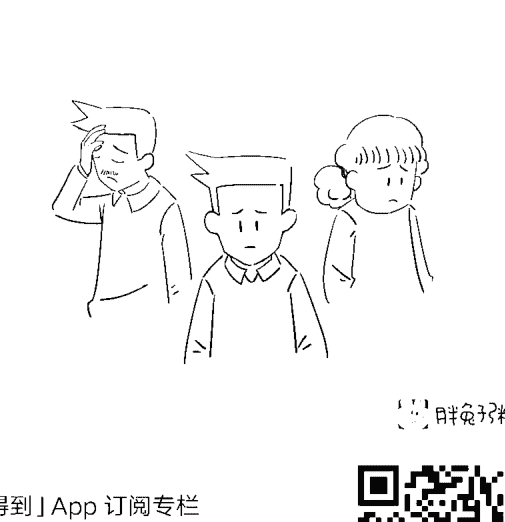

集体意识是被一个文化共同体所承认的心灵内容，集体无意识则是被严禁排斥的心灵内容。

弗洛姆认为，人应该成为完整的人，应该居于社会的中心地位，积极主动、富于创造力和活力，既自由又不孤独。

家族会压抑创伤故事，创伤的传递与认同却以更奇幻的方式发生。家族中会令人莫名地受到影响和产生认同。

「得到」App 订阅专栏《武志红的心理学课》拥有一个说... (模糊部分)

## 预告：春节特辑“回家过年的怕与爱”

## 武志红

这是我们专栏的第三十三周，这是“觉知”主题下的第三周，也可以算作是我为你放送的春节特辑，主题是“回家过年的怕与爱”。

我认为这是值得的，毕竟春节作为华人世界超重量级的现象，值得好好谈谈，更希望大家能有一个快乐、温暖、有人情味的春节，这样才叫做真正的“回家过年”。

在今天的预告中，我先来做一个调查，欢迎大家多多留言：

- 一，关于春节，你最好的记忆是什么？请讲一讲事件和细节，还有你的体验；
- 二，关于春节，你最难受的记忆是什么？也请讲讲事件、细节和体验；
- 三，如果想对你的春节做一下改造，那么你想做点什么？

春节，会带给很多人压力，如果你带着压力过春节，那就可以说是春节“过”你，而如果你能主动过你想过的春节，那就真的是你“过”春节了。

春节，也是关系问题大爆发的时刻，而我们此前的内容中也讲过，中国式关系的核心特征是共生和浆糊逻辑，它的对立面是独立和边界意识，我们可以把春节当做一个练习场，好好磨练一下自己守住边界的能力。

上周我们讲弗洛姆的社会无意识时，提到过社会过滤器这个概念，那么，借着春节带来的压力，也可以让我们好好去认识发生在家庭和社会的社会过滤器是如何在春节期间发挥作用的。

相信春节还会带给你很多东西，无论是温暖，还是些许烦恼，我们都可以把这些当做历练心智的礼物。

过春节，咱们也继续分享鲁米的诗，《客栈》：

> 人，就是一所客栈
> 每个清晨，都有一位新的客人。
> 不管是喜悦、沮丧、卑鄙、
> 还是瞬间的顿悟，
> 都是不期而至的访客。
> 期待所有来客！
> 即便是一群绝望之徒，
> 洗劫你的客房
> 扫荡你的家私
> 仍要带着敬意款待每一位来客
> 他会洗涤你的心灵
> 带来新的喜悦。
> 即便是阴暗的思想、羞耻和怨恨
> 你也要在门口笑脸相迎
> 邀请他们进来
> 无论来的是谁，都要心存感激
> 因为每一位都是
> 由彼岸派来的向导。

推荐阅读：
- 觉知003 | 个人历史的潜意识
- 觉知004 | 集体无意识的提出
- 觉知005 | 社会无意识
- 觉知006 | 家族无意识

## 【春节特辑】觉知07｜春节为什么要逼婚

## 武志红

我这一周的微博上发起了“春节过年的怕与爱”，今天是第一讲：春节为什么要逼婚？

我在微博上发起过关于“春节过年的怕与爱”的调查，问题内容就是昨天发过的三个问题，回答的人很多，粗略做了一下总结，可以看到不同年龄段的人，对于春节的感受是不一样的。

小孩子最开心，因为有爆竹，有好吃的新衣服和红包，轻松没压力；感觉痛苦的多是年轻人，有各种焦虑和压力；老人如果没孩子压身，也会觉得痛苦。如果孩子们回团聚成一堂，会觉得很多。

最让年轻人有压力的一件事，就是逼婚。春期间，逼婚这个话题是讨论的最多的。可是为什么春节会变成年轻人的逼婚大会？

这有简单的现实原因。春节了，年轻人回到父母身边，有了被父母和家人唠叨的时间和空间。春节有各种聚会，也给了三姑六婆讨论的机会。但我个人认为，更重要的是一些深层原因，我们今天就来探讨一下。

先讲几个我见过的几个关于逼婚的事例：

1. 一个不满7的女人，母亲先前安排她和另一个不满的男人相亲，来者：接着又想安排妹妹和她的弟弟相亲，但是这个男士拒绝了，该男士很反感。
2. 我的一个女性读者，是妹妹因癌症去世，奶奶有机会和他说，建议他和妹妹的弟弟联姻。
3. 我的一个朋友，三十岁的女性，被父母安排了一些条件不错的男人相亲，她见了之后都很反感，但父母施加了很大压力。最后去结婚，婚后不久她发现，这男的人品很没有问题，他是想跟她离婚，丈夫没怎么为难她，但她父母却给了家严重的欺骗，要杀了她，写她家亲戚下的聘礼，要死也不放过她，更不可思议的是，她父母也认为如果婚姻维持下去，不仅仅女儿不幸，他们家继续下去的男性也会产生灾祸。

类似这样的，或者我听到过很多，我也一直在思考，到底事来，为什么有一位网友在微博上留言给我，可以很好地证明我的一些思考，她说，我的妈妈说我是一个男性思想，她结婚，妈妈说事结婚了，她完成任务了。

类似这种“完成任务”的话我听过太多，这让我想：究竟是什么让这个任务？我要完成给她？这是让我们想很多历史学论述说，我们的文化还是生育文化，特别重视生育，我们常说的孝道也说：“不孝有三，无后为大”。

历史学家张宏杰在他的《中国人的国民性演变历程》中写道：

> 血缘纽带、祖先崇拜和专制精神是人类早期社会共同的特征，从欧洲到亚洲都是如此。
> 不过，欧洲在氏族制度瓦解时，他们建立了祖先崇拜制度，转手于与人类建立了契约的上帝有这个精神的支柱。而中国却一直没有突破血缘的瓶颈。
> 因此，传统中国社会与如同非洲部落或者大洋洲的一些落后部落有许多相似之处。

这段话可以回答我前面那个问题：谁给逼婚的父母们布置了任务？就是祖先崇拜中的“祖先”。想清楚这一任务，当天晚上我就做了一个印象深刻的梦，在梦里，我和一位“大祖先”在对话。

这样就部分回答了逼婚的问题，但为什么春节时这个问题更严重呢？我个人觉得，要懂得这一点，就要理解节日，特别是春节的来历原因。

我们通常会认为，春节是用来团聚的，所以民间叫“过年”，但其实，重大节日常常有一个重要的任务——祭祀。例如我们的四大节日，春节、清明、端午和中秋，除了中秋节是祭月，其他三个节日都是祭祖先的，春节和清明都是祭祀祖先，而端午是祭祀纪念汨罗江自杀屈原。

祭祀在国人文化中有崇高地位，所以《左传》说“国之大事，在祀与戎”，“戎”是战争，而“祀”就是祭祀。

不知道大家各地的习俗是怎么样的，我河北老家农村人按年初一早上，给长辈们敬酒时都要三个，大敬三杯去给长辈们敬酒，敬酒前，还要喝三下。然后回家吃饭，随后是祖先的坟上祭拜。然后给出去的村子，不是大年初一上映，而是初三。

总之，春节是祭祀祖先的重要时刻，我认为，在这个时候，作为生育文化和祖宗文化的我们，就有一个家族基因的任务，好让大祖先的基因得以继续。

我觉得这就是我们会在这个时候发生逼婚问题的原因。

这一点从深层文化角度去分析，还有更深层的文化，那就是，我们结婚婚配不配的人是，这话听着很恶搞，我来为了解释一下。

台湾学者孙隆基在《中国文化与深层结构》一书中论述说，在生存文化的深层结构下，一个人是不完整的，都不能够构成存在的基本社会单位，没成过家的单身者和大家族中，就会和没成家的人一样，会被排在家庭体系之外，缺乏活法，物质利益上也会被忽视，你这个结婚生子，构成了一个完整家庭，然而这个家庭才是一个被认可的社会单位，而存在于社会与家族体系中。

这个解释很有力量，当社会几千年一直如此，它当然会成为社会深刻烙印，印在我们潜意识深处。尽管我对此并无意识上的认可能，但会造成一种很基本的焦虑。

以上是从文化的层次去分析，从心理学的角度看来，那就是在集体主义文化下，我们总觉得单靠我们自己一个人时，不完整的，所以当我们自己不是一个人时，我们才会给自己破坏的、不完整的，那我们结婚，自我还不独立一篇文章《表面完整去逃避破坏心灵——逼婚的深层逻辑》。

心灵破坏，就是自体失衡，是一种很痛苦体验。太破损的，会对瞬间感到感觉，于是他们会寻找机会，逃离婚嫁并找到完整感。

单身的时候，最客观面对破损，而构建一个亲密关系基于爱，我们就是完整了。所以，结婚生子，构成一个家庭，并发挥功能，相反，没有形成或离散的，就会给体验到心灵不完整的感感，这时如果有人还妄论自己瞧不起自己，就真可能会中招。

我知道很多人离婚的人，过年不想回家，不想朋友，因为他们会被人当“不正常人”来看待。还有很多人，离婚了也不敢对周围人提，也是怕遇到议论。

一方面，确实总有人爱评三论四，但另一方面，也是自己觉得过正常人，单身时建立一个亲密关系，就像不正常。独自过年时，也真可能感受到自己的破碎心灵，那时也真觉得自己不完整了。这种不完整感，也是真实的。

我来讲结婚的故事。过了年我44岁了，没结婚没孩子，回到村里，没成被人问，没人追，但也没觉得不完整或是什么大事，所以一直没有构成性，别人的追议，也只是觉得很唐突，也许是为单我也会有各种心理反应，但心灵是算是完整的。

父母的逼婚，三姑六婆的劝解，周围人的非议，爆红的探讨，这一切熔合在一起构成了爆发性强弱的社会态度，在言语上，还试图改造你。同时春节有各种祭祀活动，春节也会各种场合会爆发性过，其中包含了一个强迫人的最佳时机。文化不仅仅文化，而是活生生的现实，我们的生育文化和亲缘文化就已经这个我们，来一个年轻人无法去影响，把未来越有个个人意识倾向的他们，拉到生殖和宗族共同想象中。

但这种影响，只是越来越越强但难了。城市化影啊，它不仅越来越年轻人带来了开阔的视野，也是提供了某种条件，让每一个人都是越有能按一样个自己的意思活着，而不是非都得活成一个样。

## 今日得到

1. 从深层文化的角度，春节是祭祀祖先的重要时候，我们得完成传宗接代的任务，把“大祖先”的基因传递下去。
2. 现实层次中有着深刻的烙印，那就是一个人必须结婚生子，构成一个家庭，才能存在于社会与家族体系中。
3. 从心理学的角度看，就是在集体主义文化下，我们会觉得单独自己是破碎的、不完整的，于是用构建家庭的表面完整去逃避破碎心灵，也就是自体瓦解。

## 划重点

春节是一个塑造人的最佳时机，形成了深刻的文化与现实，综合构成了社会过滤器，把越来越有个人主义倾向的年轻人，拉到生育和宗族的共同想象中。但城市化和全球化，让每一个人都越来越有机会按照自己的意愿活着。

## 春节特别活动

## 武志红

临近春节，我想在咱们专栏内发起一个活动：用你的心理学知识，点亮身边人。咱们专栏用户总数很快就要突破15万，在这个课堂中，你应该已经学到了不少心理学知识。春节期间，家人朋友聚在一起的时候，我希望你可以用自己掌握的心理学知识，去帮助一个人解决一个问题，哪怕只是一小问题。

如果你愿意，还可以将你“点亮”他人的经历写成文字，回复在我们的留言区中，我会在节日过后，从中选取精彩的案例分享在专栏中，请专栏其他用户一起投票，选出最精彩的几位，送出我为你准备的新年礼物。

不过，这段分享文字可不是越长越好，字数限定在300字内，建议内容形式如下：

1. 开头标注：#点亮身边人#
2. 简单的背景信息交代；
3. 你所运用的心理学知识点，以及“点亮”别人的具体过程；
4. 你从中获得的体会与感受。

非常期待你的分享，祝愿你能多点亮身边人的春节。

推荐阅读：
- 情感11 | 自体的虚弱与坚韧
- 情感12 | 关系中的恨与爱
- 身体03 | 如何用身体来聆听
- 思维02 | 为什么要讲感受

## 【春节特辑】觉知08 用可控第三者对待应酬

## 武志红

我们这一期的主题是“回家过年的怕与爱”，今天是第二讲，用“可控第三者对待应酬”。

### 应酬的产生

春节期间，是高度的人际互动时刻，而这个时候中国式关系中一些固有的特点就会呈现出来。这个问题，体现在谈婚论嫁上，就是“逼”这个字；体现在酒桌上，就是“敬”这个字。强迫要，劝酒要，都是在把自己的意志放置在别人头上的意思。

还有请客送礼，也藏着这种强使。比如我老家的农村，大家差不多都养着类似食品店的来料店，收礼，太多，太杂；不礼貌，如果拒绝，那也是给一个又一个的小战争。

这些事情里面都含有强使的意思，对方的好感，你必须接受，否则就是不给对方面子。我老家一个村子的经典说法就是“不把客人送回家，就是得罪人”。这种好意，真让人汗。

这种行为发生什么？其中的“道”味儿是怎么浮在表面的？这些好意，对关系来说，有什么作用？

我一直有这种想法，这是试图为身边的一切行为找到心理的解释。这些事情自然而然的事情，有一天，在一个看似不太相关的事情上，我找到了答案。

那天，我照镜子，发现自己长出了两根白发，于是我让家阿姨看看，是不是她还给我拔头发。她看看，说不是。我说，有白头发，你帮我拔拔。她说：“我眼睛不好使，你别介意，我帮您看着，但我没看到。”然后我们俩对视了一下，我发现了，她其实根本就不是在帮我看，而是她自己看着，拔了两根。

接着，我回到书房写东西，阿姨进来看我，手上拿着一支我的笔，要我帮她拔头发。我让她拿走笔说：我还没准备好。她说：“你要不让我拔，我也没心情给你弄这个。”她坚持着，我就同意了。

她离开后，我就想，这真有意思，她为什么非要拔我的头发呢？后来我想到，她其实是想把我头发拔掉，然后给我梳头，这样她就不用去洗头了。

她离开后，我觉得有点堵，然后我怎么也想不通。她为什么一定要我拔呢？后来我想到，其实她只是想看我的反应，确认我是不是真的关心她。当我站在她的角度上，想她是怎么想的，我就明白了。

我一个人的时候，她经常自己梳头发，不用等我弄。

我跟一位来找我做咨询的人，也发生了类似的事。来这做咨询，他们两人的年龄，相差很大。这位来咨询的是个老人，她来找我，不是为了解决什么心理困扰，而是她听我说过，她觉得我说话很有意思。

我就给到对方想要的回应，因为，有心想，也就会给到对方想要的。

并且，她的价值感建立在对方是否承认自己之上。所以，对方必须承认他们的价值，给他们想要的回应，否则，他们会非常失望。

于是，就构成了中国式请客、吃饭、送礼的一些特征：

1. 送自家都送的礼。因为没钱，所以不知道对方面子，不知道自己想送什么。而送自家都送的礼，所以礼物就很单调的。
2. 礼轻情意重，构成面子大小的关系。春节的高朋满座，也构成了严重的拥堵浪费。
3. 礼物不收，敬酒必须喝。否则，面子就失窃了。
4. 礼物送出去，收来收去。亲人见了人去，最后，身心俱疲。

就像流水，流过的石头，这样的请客吃饭送礼，大都只能流入社会人情里并发生一些化学反应。

西，但你们的关系没有断，甚至还变得更亲密了。

最后，我特别想说，春节的主题是“回家过年”，特别重要的就是回家的感觉。所以，我们该想想，怎样增加回家的成分，减少不必要的应酬。我们明天来谈谈这个话题。

## 今日得到

1. 应酬就是人心包裹着一层坚不可破的硬壳，外面是各种讨好行为，他们很愿意付出，但却不能给到对方想要的。就算给到了，因没有心、没有感情的投入，也没有温度。
2. 应对这种应酬的方法是积极回应和不含敌意的坚决。
3. 可控第三者，也叫做过渡性客体，就是当我在和你 的二元关系中觉得控制不了局面时，要找一个可以控制的第三方来恢复控制感，它可以是人、物或事件。

## 划重点

> 可控第三者，也叫做过渡性客体，是一个人走出自己孤独的想象世界，也就是一元关系的世界，而进入现实世界前的一个过渡态，通过控制一个过渡性客体而初步形成对外界的掌控感。我们借助可控第三者来构建关系，拒绝对方的可控第三者时一定要让对方感觉到，我们只是拒绝了他的东西，并没有拒绝和他的关系。

## 春节特别活动

## 武志红

春节期间，我们专栏有一个活动请你参与：用你的心理学知识，点亮身边人。在这个课堂中，你应该已经学到了不少心理学知识。春节期间，家人朋友聚在一起的时候，我希望你可以用自己掌握的心理学知识，去帮助一个人解决一个问题，哪怕只是一个小问题。

如果你愿意，还可以将你“点亮”他人的经历写成文字，回复在我们的留言区中，我会在节日过后，从中选取精彩的案例分享在专栏中，请专栏其他用户一起投票，选出最精彩的几位，送出我为你准备的新年礼物。

不过，这段分享文字可不是越长越好，字数限定在300字内，建议内容形式如下：

1. 开头标注：#点亮身边人#
2. 简单的背景信息交代；
3. 你所运用的心理学知识点，以及“点亮”别人的具体过程；
4. 你从中获得的体会与感受。

非常期待你的分享，祝愿你能够点亮身边人的春节。

推荐阅读：
- 【春节特辑】觉知07｜春节为什么要逼婚

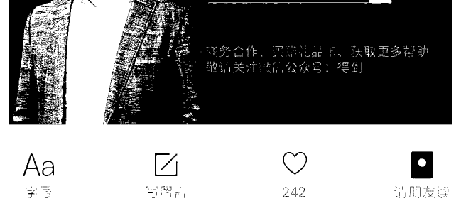

## 【春节特辑】觉知09 | 集体性自我带来的焦虑

“【春节特辑】觉知09”

我们这期的主题是“回家过年的喜与‘哀’”，今天是第三讲“集体性自我带来的焦虑”。

我先来讲一个现象。我上过很多外国老师的课程，而且其中的很多人都会写到，当你跟学生说实话，学生其实不太好了，学习变得认真，老师对特别喜欢。

一开始我觉得这是个好消息，可听多了之后，又开始有些担心：学生和老师都过于依赖，老师都是权威，学生也会很顺从权威，而失去了自己的独立思考呢？

同时，我也自己常讲课，一年也会带一两场几十人的工作坊，一般会持续三天三夜。不同身份我也是老板，也是商人，这种多重身份，让我有了一个感受：做人心理学的生意实在太好了，不仅听到了钱，而且还获得了即时的爱。当课程结束时，从学员那里获得的都是满满的感恩和赞誉。如果我是普通的商人和老板，肯定不会获得这样的满足感。

并且，无论是在我课程中还是我学课程，都会看到一个现象：学习当中会产生一个强大的动力，就是学员和导师之间都特别想在一个团队上。其中也有领导，但团体本身是一个整体，普通成员在争夺团体领导者的关注，这是团体中的竞争。

有些课中，会有从欧美来的学员，我会问他们：你们在国外感受到的这种团体氛围，和在中国团里感受到的团体是一样的吗？他们多数人会说是的，团体中的竞争很相似，但确定的西方学员对于老师们会获得某种特殊的尊敬，全世界对老师表现出更多的服从，要更多得多。

我认为其中的差异在于：东方是集体主义文化，个人的自我依附于他们的集体自我，而西方是个人主义文化，他们的自我是个体化自我。

每一种文化都有它的优劣，所以要强调一下，我这样并不是说集体主义文化和集体性自我就不如个人主义文化和个性化自我。

我再举一个例子。我去过南极北极，坐的是法国游轮，游船上中国船长、探险队长、服务员全都是中国人，中国游客探索队居多，而欧美的游客偏少年多了一些。此中差别，但一样要追溯集体主义和个人主义的差别。

我们不说优势，只是来说它的特色。以前，精神分析就有一个说法，说精神分析很难在中国发展出来，因为中国人是集体性自我，精神分析只能是分析个性化自我的人。为什么这么说呢？因为个性化自我的人，他能配合分析，而群体性自我，个体的、与生俱来的，却没有一个独立自我，所以不好分析。

但事实恰恰相反，中国人对精神分析的热烈程度超出想象。我打个角色，精神分析在中国心理咨询师都特别多，也许占到百分之几以上，这是在其他国家都难以见到的比例。

说了这么多，有点绕了，再回到今天的主题：集体性自我中的竞争。理解了一点之后，可以帮助我们理解，在春节期间，你为什么觉得各种窥探无处不在，例如你家孩子结婚了吗？结婚对象如何？孩子有了吗？成绩是多少分？挣多少钱？你收了多少红包？

春节中的这些竞争，和它们带来的巨大焦虑，都是你的集体性自我。集体性自我，至少有两大块组成。一个是“大家长”，一个是“所有人”。“大家长”可以理解为，就是你，集体性自我指自己可以贯穿现实个人的；“所有人”是我指自己简单使用的一个词，很通俗，不学术，但很形象。

“所有人”是我怎么理解，它为什么构成春节焦虑的重要组成部分。对此我讲两个发现。

很多年前，我回家时还很爱和邻居们各种聊天，但有一天我发现，大家聊的无非就两件小事：一是，我家谁谁谁如何如何；二是，谁谁谁对另一个竟然对我好。这个发现让我立刻失去了听邻居们唠叨的兴趣。

另一个发现是2017年刚刚发生的。我是一个处女座，而且自诩对细节有强迫症，以前的理解是这里面有恐惧，但2017年，几次和别人讨论冲突和指责，我却触发了朋友圈或微博，隐隐地透露了这些冲突和指责。然后再咨询界并不时，我们发现了自己：第一，你看，我就是一个没有好花轿子的，所以完全可以反驳，我如此清心；第二，你看，她人有问题，我竟然这样对她，辜负了我的好的我。

真善评价别人容易，理解自己太难。而我和我的邻居们完全是一样的，但我要花这么长时间，才在自己身上认识到这一点。

可是，我的表达对象是谁？我在微博上说？基于社交媒体和朋友圈，所以我可以说我的听众就是“所有人”。我说的那些朋友也是一样，他们并不只是在说我对他讲，也会在别人那里再说，所以他在诉说所有人。

所谓“所有人”，可以理解为是集体性自我的整个集体。当你觉得你的自我家族绑在一起，你会忍不住对那个家族说；当你自我和整个村子绑在一起，你会忍不住说，你也会说；整个国家绑在一起，你会对全国家说。

相反，在欧美个人主义社会，他们会向宗教师诉说，或更直接对着心中上帝诉说，上帝就成为了整个集体的一种超越性的浓缩。

这样还可以推论，在集体性自我中，我们既会觉得自己的一举一动都在大家长和所有人看着，那他们也会主张他们自己这个集体中的人的某些权利，主要地，评判自己的对错，主持公平。

家长”和“所有人”。我们在群体中会觉得这两者在看着我们，我们的行动就有意识地追求他们的满意。

- 3. 受集体性自我的支配，我们会把自己和别人的一切呈现给“所有人”，也就是整个集体，会比较和竞争，也会去寻求评断对错。

## 划重点

> “大家长”是指一个在集体性自我中掌握话语权乃至真实权力的人。受集体性自我的支配，我们会把自己和别人的一切呈现给“所有人”，也就是整个集体，会比较和竞争，也会去寻求评断对错。大城市中个性化自我越来越占据主流，隐私感很强；一旦回家过年，在集体性自我中就没什幺隐私可言。

## 春节特别活动

## 武志红

春节期间，专栏内有一个活动邀请你参与：用你的心理学知识，点亮身边人。咱们专栏用户总数很快就要突破15万，在这个课堂中，你应该已经学到了不少心理学知识。春节期间，家人朋友聚在一起的时候，我希望你可以用自己掌握的心理学知识，去帮助一个人解决一个问题，哪怕只是一个小问题。

如果你愿意，还可以将你“点亮”他人的经历写成文字，回复在我们的留言区中。我会在节日过后，从中选取精彩的案例分享在专栏中，请专栏其他用户一起投票，选出最精彩的几位，送出我为你准备的新年礼物。

不过，这段分享文字可不是越长越好，字数限定在300字内，建议内容形式如下：

- 1. 开头标注：#点亮身边人#
- 2. 简单的背景信息交代；
- 3. 你所运用的心理学知识点，以及“点亮”别人的具体过程；
- 4. 你从中获得的体会与感受。

非常期待你的分享，祝愿你能多点亮身边人的春节。

推荐阅读：
【春节特辑】觉知07 | 春节为什么要逼婚
【春节特辑】觉知08 | 用可控第三者对待应酬

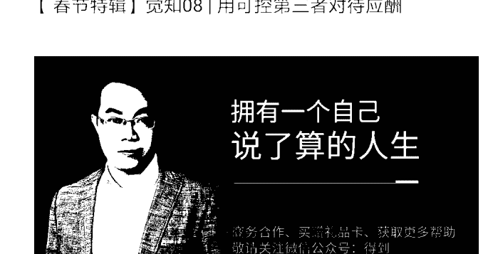

## 【春节特辑】觉知10 | 创造属于你的春节

我们这一周的主题是“回家过年的怕与爱”，今天是第四讲“创造属于你的春节”。

前面三篇春节特辑的内容，我们都倾向于分析“回家过年”的困境。如今春节可以知道和应对，那即是只过年了，但我们可以在春节期间真正体验到回家的感觉呢？

了解前面的因素是很重要的，否则，我们很容易是被春节“过”了，而不是主动地“过”春节。

如果想增加春节中的积极因素，关键也在于“回家过年”的应对。如果我们可以通过和应对，那即是只过年了，但我们可以在春节期间真正体验到回家的感觉呢？

我一再提到，幸福感的主要来源是在关系。认知很重要，如果在过年期间，改善彼此重要的人际关系，就能帮助我们体验回家的感觉。那么，如果我们好好去认知知识这些事件，你会想到一些什么方法呢？我讲讲我能想到的方法。

### 了解自己

我们整个专栏的最主要目的，就是帮你了解自己。你次是很了解自已。并且有过各种重要记忆，例如你记忆中最早的是什么，你生命中记忆最深刻的三个事件或细节是什么。

这些事情，按照你的经验，多数和父母关系很密切，并且你年轻时太小，因此对时间、空间和等细节记忆未必准确，所以可以找父母等相关他人确认一下。

还有，这些细节和事件有关，请他们给你的详细描述这些事件，那会对你很有帮助。不仅如此，你还可以问问父母，他们对你深刻的记忆都是哪些。多数情形下，父母对你的记忆都是连续的。让他们按照你的年龄讲述各种记忆，可以帮助你的记忆也变得更连续。

### 了解父母

春节期间，很多父母和长辈之间容易疏远，因为缺乏有效沟通。如果有一些有效的沟通，减少无意义的唠叨和烦人的控制就会减少。

有效沟通，无非是心理学家张说的那三点：表达、倾听和表达。那么，利用这个时间，问问他们对你过去的哪些看法，例如你父母的认识，他们生命中最深刻的三个细节，特别是他们童年的记忆。

你可以问过家人或意识和社会意识，你还上过可好问，他们关于家族的认识，他们对自己经历的那些时代的认识。

我喜欢干这件事，我可以肯定地说，这样的事情会很有价值。并且如果你的认识会非常有意义。去问问你的经验和感受，会大大增进你们之间的链接。

### 了解你的祖父母至祖先

例如，你知道爷爷、奶奶、外公、外婆的名字和生年份吗？当然，你还可以做其他更多的了解。

### 进入父母的想象场

我们在《自我7：进入别人的想象场》这篇文章中介绍过一个练习：成为你的父母。

样的倡议。我很好奇，在我的村子里是谁最早这样提出的。在相当程度上，这样的人就是英雄啊。

如果你也想做这样的英雄，那么，你想改变点什么？

最后我想说，以上这些，都是我的设想，是我认为的春节如何过得更好的方式，但既然是要创造属于你的春节，所以你可以按照你的感觉来设计。

祝福大家，愿大家过一个快乐温暖有人情味的春节！

最后，在辞旧迎新之际，祝大家在在新的一年里，更好地活出自己，拥有一个自己说了算的人生！

## ◆ 春节特别活动 ◆

## 武志红

春节期间，邀请你参加专栏的活动：用你的心理学知识，点亮身边人。咱们专栏用户总数很快就要突破15万，在这个课堂中，你应该已经学到了不少心理学知识。春节期间，家人朋友聚在一起的时候，我希望你可以用自己掌握的心理学知识，去帮助一个人解决一个问题，哪怕只是一个小问题。

如果你愿意，还可以将你“点亮”他人的经历写成文字，回复在我们的留言区中。我会在节日过后，从中选取精彩的案例分享在专栏中，请专栏其他用户一起投票，选出最精彩的几位，送出我为你准备的新年礼物。

不过，这段分享文字可不是越长越好，字数限定在300字内，建议内容形式如下：

- 1. 开头标注：#点亮身边人#
- 2. 简单的背景信息交代；
- 3. 你所运用的心理学知识点，以及“点亮”别人的具体过程；
- 4. 你从中获得的体会与感受。

非常期待你的分享，祝愿我们能够点亮身边人的春节。

推荐阅读：
【春节特辑】觉知07｜春节为什么要逼婚
【春节特辑】觉知08｜用可控第三者对待应酬
【春节特辑】觉知09｜集体性自我带来的焦虑

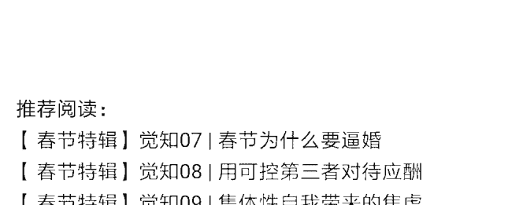

## 问答：春节习俗变动的背后

**武志红**

今天是我们专栏的问答时间，我先讲一个现象，接着再回答一些用户的问题。

这个现象，是我老家村子里这几年的习俗变动。首先是磕头见长辈这件事，前几天，我在微博上见到有人在这件事，我发这个现象，我在这北方多，南方少。然后我看到最多的回复是：我是北方人，但拜年，我们这儿没有这习俗。这种回，是觉得有这习俗会带给自己做基础，所以赶着家清，我在的地方，也就是我所在的集体，是没有这个让人脸红的习俗的。

可是我是河北人，我承认，我老家有这个习俗。一般而言，我们村子是大年年初一的早上，一般是六点来钟，男人们就要起床，然后找到兄弟同伴，接着去长辈们的家中磕头。一直以来都是磕头，去同龄男性的家中，给女性长辈单独磕。我小时候是，吃过早饭，要去祖先，叫到爷爷、奶奶的坟上去烧纸。

磕头见长辈这件事，我目己是直到最近几年才不再坚持。并且这是我做的选择，而是突然有一年，我父母和哥哥嫂子说：现在不流行这个了，不用去了。

为什么要磕头见家长？在我的理解中，它有两个功能：

- 1) 认个“家子”。所谓一家子，就是同一个男性大祖先的后代。有些走得很近的亲戚，这个必要性不大，但走动少的一家子，如果没有见家长这件事，可能都不认识，也不知道彼此的关系了。
- 2) 给男性晚辈树立等级感。知道长辈是权威，需要向表达出同样的方式表达尊重，同时磕头也表达出了自我的低姿态。

我多次考虑过，发起倡议改变这个习俗，但我得这个念头却会对整个家族甚至村子的集体构成挑战，压力太大了，而同时，这件事我们都做了几十年了，都觉得这是个事。

所谓不觉得很这事儿，实际上就是磕头见长辈是集体意识，而磕头背后的羞耻体验，你成了无意识的内容，不被触碰和很好就知道了。

实际上，村子里的习俗变化不只这个，还有春节期间的串户也减少了，人们更高尚的自由度的按照自己的意愿出入，而这样的交往更多，肯定是亲情多，彼此向好。

在我看来，这些改变都意味着家族这个层级的集体性在消退，而个人按照自己的意愿更实标，也意味着个人主义空间的增加。

同时，村子里还自有很多改变，例如现在几乎家家都开车，所以村子也开始出现堵车的事。此外，婆媳关系改写的多，家暴也很少见了，以前有的为街的事极少发生了。

这些事情联系在起，我想，表面上是经济的改善，深层是集体能量空间，可能会越来越小，但是个人的自由空间，也就是个人能量的空间，都有了非常大的改善，是不需要非得靠家族抱团了。

以前家族的凝聚力，也就是村子里的生存环境恶劣分子，村子的生存环境恶劣，就是死能越强，就可能需要一个家族的人凝聚在一起，这样可以更好地参与集体分配。但在后，不仅经济改善，社会保障体系也越来发展了，依赖也相对趋向简单，是一个人，以法律为自我在这个更大的集体，而非必得依赖家族这个层级的集休体。

大城市中，这一点更为明显，所以很多年轻人尽管经济上窘迫，仍然愿意选择在大城市中待着，就是因为大城市各种社会体系都比较完善，这最大程度地保障了个人自由施展的空间。

## —— 本周问答 ——

**问：** 破碎心灵要怎么自己努力去完整呢？

**武志红**

破碎心灵，是因为个人的自我是一个非常脆弱的容器，兜不住心灵的各种碎片，特别是死能感。

最初自我这个容器是在和父母的关系中形成的。个人自我，可自最初这个关系内化的结果。也就是说，自解这个容器，最初是得益于关系这个容器。

所以，要解决破碎心灵这件事，就先是需要关系这个外在容器，接着形成比较完整的自我这个容器。

人性就是如此矛盾，我们想自由地做自己，而必然是在发生关系的世展里。

**问：** 遥这样的题，应该也快到我了。但没想到会遇见面的心理现象，只有如此丰富的“潜意识”里的解释，这真是太复杂了。以我简单粗浅的认为遥题是因社会面，从心理学“心灵破碎”的角度来解释实在是一个很新框架。那么这人说，这种心理面是过这论偏强化的吗？是生态过渡造这种独特的“心灵破碎”吗？

**武志红**

倡议集体主义文化，压抑个人主义文化，可能会导致个人难以形成一个成熟自性，因此很多人有着破碎心灵，不得不在集体中抱团生存。

台湾学者陈隆基，孔子在《中庸》中称“仁者，人也，亲为大”。这句话在中国文化对个人的一必关键定，就是说中国文化对一个人，最关键的一个，是特别是一种人，又特别到家人。你不能给他人我伤害，这时你才可能因为是个“仁者”成为了人。

再次推荐陈隆基的《中国文化的深层结构》，太有说服力了。

**问：** 老师，平时别人细腻的情境更多，然而自己不情，除了无法面对当真的情况，想询问知如何给别人，同时，不让对方感到受伤害？

**武志红**

最好的方式，是“不含敌意的坚定”，我坚决地表达自己立场，但我对你没有敌意。

这看似简单，做到不易。我们需要去查看自己，给亲人或自己道德了会不是很有负心愧疚感和愤怒，或者拒绝了对会不是很不好意思，就说明自己伤害了自己。如果有样的话，让自己知道父母对这个逻辑的：你给我迷，就相当于你攻击了我，我得到你的回，就是攻击了你；攻击自然带来愤怒和报复，攻击必然会导致关系伤害。

觉知到这些意存，就可以部分化解，而不需要不练习情绪，也可以逐渐掌握不含敌意的表达的精。

也有咨询到师友说，这非常简单，就直接告诉对方，我不拒绝，一切就OK了。能这样做的朋友，是因为他在很早自己边界时宽友类，所以，可以合理拒绝别人当做练习，练习自己守边界的能力。

当一个人心是关闭时，他也不能给别人，但样就心封闭表面是僵直的。我我觉得情和表达不一定出现在关系中的小心不在于关系，不在关系中。这种小心关闭的状态是怎样造成的呢？如何自己心关闭的打，看看对方的需求给予别人需要的，从而让关系真正展开，与客户体建立有效的连接呢？

**武志红**

其实，我们专栏，应该有一半时间讲的就是这个问题。我们一旦领到体验，生命力在关系中流动时，就会滋养自我，也会滋养关系，然而就会让关系真正展开了。在此之前，一想对别人好，就只能浮于表面。

道理明自简单，活出来不易，愿大家都能深度体验这个简单道理，活出自信而熟

深刻体验到这个简单道理，活出自信和热情。

**问：** 武老师，可控第三者，可不可以理解为扭转二元对立的一种容器？除了可以扩大容器的容量以外，还可以转移和分散注意力，让原来紧张的二元对立关系，变得可以调和，可以顺利过渡。

**武志红**

可控第三者的存在，可以让容器变大，但可控第三者本身，应该不算是容器。

二元关系太紧张，我们实际上有各种微妙的方式，让我们从二元关系发展到三角关系中。

**问：** 每次认真的做一件事情的时候，都感觉被限制得无法展开一样，好像是有人一直盯着我，等着看我的笑话，考试的时候有那种感觉，别人跟我买东西的时候看看我缺钱时候等等，这是怎么回事呢？我该怎么处理呢？

**武志红**

我认为你可以试着去感知这个盯着你的眼睛，把它具体化，然后试着去和他完成意象对话。

再者，这么轻易就问，这是怎么回事，该怎么处理，就是在邀请我用我的眼睛盯着你看。

**问：** 我发现自己倾诉的对象竟然是一个关系不是很熟的朋友。特别熟悉的朋友，我反而不敢轻松。这到底是一种什么原因？

**武志红**

我认为是因为特别熟悉的朋友，我们就担心他们不仅仅知道自己一切，而且还会对自己持批评态度。我们大家最终都想要感觉到，有一双善意的“你的”眼睛在看着我们，而不是一双故意的“它”的眼睛。

↓ 本周内容回顾

预告：春节特辑“回家过年的怕与爱”

- 【春节特辑】觉知07｜春节为什么要逼婚
- 【春节特辑】觉知08｜用可控第三者对待应酬
- 【春节特辑】觉知09｜集体性自我带来的焦虑
- 【春节特辑】觉知10｜创造属于你的春节

过去，很多旧的习俗下，春节是祭祀祖先的重要时刻。

春节活动都是高浓度的人际互动，回绝则需要积极应对和不合敌意的坚决。

春节中的竞争以及由此带来的焦虑，大多与集体主义文化和集体性自我有关。

幸福感的主要来源是好的关系，如果能在过年期间改善那些重要的关系，就能帮助我们体验到回家的感受。

## 预告：梦——通往潜意识的捷径

武志红

这是我们专栏的第三十四周，“觉知”主题下的第四周，这周的主题是“梦——通往潜意识的捷径”。

每当谈到潜意识，总会有很多用户会问，怎样了解自己的潜意识呢？

这的确是个问题，因为所谓潜意识，就是你的意识不能直接碰触的，所以你很难直接意识到自己的潜意识。我们可以找精神分析来认识自己的潜意识，但这个途径太不方便了，也不是谁都想选择的。而且说实在的，好的精神分析也太欠缺。

我们还可以先形成一些认识。例如，你看到了A，就意味着看到了-A。但头脑的认识，和真正碰触到潜意识还是非常不一样的。那该怎么办？

所幸，大多数人都可以有一个途径，那就是梦。我认为梦是大多数人得以碰触自己潜意识的最便捷途径，只要你做梦，你就有机会深入自己的潜意识。

本周的调查问题是：你一生中印象最深刻的梦是怎样的？欢迎你在留言中分享给我。

说到我自己，我印象中深刻的梦就太多了，和你分享一个很特别的梦：我杀了秦俭的干儿子，秦俭派了一队兵马过来捉我，他们整整齐齐的排列成一个方块阵型，大概几十个人，长枪林立，铠甲鲜明。就要走到我眼前时，我不着急不发慌地亮出了一个令牌，上面写着“弗洛伊德的使者”，然后他们就不能捉我了。

你听着应该会觉得很有趣甚至好笑。这个梦是我2006年去上海中德班学精神分析，出发前的晚上做的梦。我觉得它的意义非凡。

实际上，梦整体上有极大的意义，甚至我认为梦比现实更有意义。如果你学会了认识你的梦的话，你也许会赞同这一点。我们这周就试着来谈谈如何认识你的梦。

分享一首鲁米的诗：

> 此地是一个梦。  
> 只有沉睡的人认为它是真实  
> 彼时，死亡将如黎明般降临  
> 你清醒过来，不禁嘲笑  
> 你曾经为之悲伤的一切  
> 然而每个梦却不尽相同  
> 所有虚幻的现世作为  
> 残忍的、无心的，  
> 并不会在死亡降临时消散  
> 这是一个不得不说 的梦  
> 因为它就真实地存在于此。

## 觉知11 | 向梦寻求答案

武志红

我这一篇的主题是“梦·通往潜意识的隧道”，今天是第一讲“向梦寻求答案”。

我写的书中有一本叫做《梦见答案》，书里的故事非常有趣，很多梦对你意识上找不到的答案而言，可以试着向梦寻求答案，甚至即便意识上有了答案，你还要问自己的潜意识。因为潜意识的答案常常比你的意识答案更丰富，至少意味着可以提供思考和意识上的思考，可以结合到一起来看。

对我倡导的所有理论，我从来都是身体力行的。所以，向梦寻求答案是种习惯性的事情。讲一个故事吧。有一次演讲，一位企业家对我说，听说你解梦厉害，请给我解一个梦吧。

他梦见自己在一条弯曲的山路上，路两边是大山。左边有韩国明星的宣传活动，右边有很多牌子，上面写满了韩文。过了一个小山坡，看到路边有一栋小房子，是一个小卖部，后面还有一个光秃秃的石拱桥，再后面是陡峭的悬崖。

一男一女两个韩国明星站在石拱桥上，让他这位企业家给他们拍照。他一开始拍，手机突然掉下悬崖不见了。他拿手机，看到他们又站在石拱桥上了。他再低头放到地上，他们又站不见了，等等开相机，他们又出现在石拱桥上。

显然，韩国是这个梦中的关键信息，有韩国文字，韩国明星和韩国明星的宣传活动。于是我问这位企业家，关于韩国的这些信息中，他会想到什么。

梦光怪陆离，但解梦法可以很简单。这时会用的多是自由联想，是你从关键的特点开始，会自然地想到什么，又想到什么，又想到什么……

这位企业家觉得很闷，韩国似乎不能让他想到什么，他从不看韩剧，更不“哈韩”，怎么梦中会有这么多韩国信息呢？

这就是不能理解，是判断了。是我对你说的，能想到哪儿都好，请不要把这个判断阻断联想，你试着不设这个判断，看看“韩国”让你想到什么。他静了一会儿，想到一位韩国企业家。他惊愕，因为他这位企业家非常喜欢做营销。

韩国企业家，非常善于做营销，这是两个很有用的信息，我说你从这里继续想下去，看看你脑子里还冒出了什么东西？他也想了想，虽然，虽然后面没看到桥，但有一种感觉，虽然时间延迟，但也是假肢，一点小事都闹得很厉害。

我说，一点小事都闹得很厉害，这是第二个联想的信息，其实与第一个联想的核心信息“营销”有类似之处，是吗？想象某个事情本身具备的价值，把它卖一个更好更高的价格。

对此，他点了好几下头，表示认同。不过，当我继续联想的时候，他花了好一会儿时间，发现这个信息就联系不出更多的信息了。这个关键信息就出来更多东西，那我们可以看看他梦里的关键信息。

我认为梦里山路，常常象征着人生旅途，那这个小山路会让他想到什么？他说，这条路，小时候，大概叫到10岁左右的时候，经常在大的带领下10岁左右的他，经常在大带领下，走一条20公里的山路，去找在外面工作的妈妈，梦里的山路就是这条路。

一个4到10岁左右的孩子要走20公里的山路，这明显是比想象还要难走的。对此表示认同，同时想父母这条山路，常会很难走，但没什么担心。

这很好，我认为这意味着他，要在生命中走一条人之路，虽然有些艰难，但他最后应该实现它，而此时他非常伤心，他问，最后有什么重要的决定为先？尤其是，你决定走一条任务艰巨的旅程了吗？

他毫不犹豫地点了点头，回答是，他的公司上做了一个重大决定，致力于在他的领域中做NO.1，对于现在的他而言，就像当年为10岁的孩子要走一条20公里的山路，艰难但他可以走到。所以，我跟他说，对他就像跟他的梦一样，我信你会实现你设定的目标，这就如你在孩提时，会走漫长的山路最后找到你的妈妈。

这也是我们很多人之旅的玄义，我们设定一些目标，希望实现它们，你为什么要定呢？定目标时，这样的旅途是为了达到最终目的地，就是妈妈的爱与认可；而现在，则是为了得到了一个抽象的内向的爱与认可。

只是，在这个旅途上不要迷惑，不要只想着看得见的目标，而忘记了我们追求成功，是为了在一些关系中得以认可。

我的这些说法对这位企业家有了一些触动，他说他明白了这家的重要性。就在这个时候，他突然说，那条山路有时会有意外，比如梦中的时候会有豹子出没。

这是我问，梦中的韩国人会是你工作之旅上的豹子吗？

他愣了一下。这时，我再问他，做这个梦的时候，你遇到了什么目标？是不是为了完成你的工作目标，你当时正在找合作伙伴？

这个问题让他沉思了很久，最后说，的确，刚好他在想，在做一个梦幻般前两天，有家公司，巧起来是一梦，想和他合作，并且告诉他他，他是营销高手。我半批评半玩笑回答说，唉，你是营销高手，也是你销售高手，这么说来，你的事业的重要人都要是营销高手，看来你的公司很快会变得很韩化了。

我接下来说，我们共同的公司，了解你的，他公司也也需要卖实力，是踏实的东西，他要寻找的是合作伙伴，是能够提升他公司实力的，而不是帮他这个营销高手来卖一块钱的东西卖个更高价钱。

他在寻找合作伙伴，但我从他的梦中认为，他的合作伴不是一个卖小东西的人，另一个合作伙伴是一个石拱桥。更重要的，我记得那个照相的细节是在说，他们好像存在，都是假肢，是营销出来，是好相机都不能拍到的。

我问他，这样的人，会不会是你工作之旅上出没的豹子呢？这话让他沉思了更久，最后，他表示感谢，他说我给他摘清了一个很重要的感悟，他该说他怎么办了。

我说，他更应该感谢的是他的潜意识，而他需要做的也是尊重他的潜意识。

很有意思的是，那天，我给他电话说道，我又见到了那个他想合作的人，这次我注意到，他常拿的皮包上有韩文，其身上部位还写上了先见他的人脉表，表格里也有韩文的铭牌。

最后这个细节是非常有意思的，这可以说，我们意识上注意到的范围是比较狭窄的，而潜意识注意到范围非常宽广。

这是一个让我印象非常深刻的梦，通过这次解答我发现，每有重要决定时，聆听一下梦的表达是至关重要的事情。

向梦寻求答案，这个方法操作起来非常简单，就是入睡时，对自己说：某件事让我有些困扰，我很想知道，到底是什么回事，请潜意识给提示。

如果你是一个常做梦的人，那么有很大的可能，你会做一个相关的梦，然后可以通过各种方法来解梦。

为什么要向梦寻求答案呢？因为我们做梦的方式，主要是使用的是意识层面的内容，潜意识中上面的信息被层层屏蔽掉。然而，潜意识和身体所掩藏的信息极其关键，并且常常是被反向的，即意识对潜意识信息的直接反应。可是，做梦的思考中，我们得不动这些层数，所以通过梦去得到潜意识提供的信息。

为什么梦中获得自我感觉的压抑，这个梦可以简单解释就是我们醒着时，自我保护机制在紧密运作，各基本冲突和部分自我内容，因为会造成巨大冲击，就是自我机制防御的屏障。然而在不清楚的梦下，自我防御机制某个“管家”会打盹，这个时，潜意识中的内容就机会可以透出来了。

并且，梦的内容不能太直接，它一定要使用各种复杂的手法来表达，因为太直接的，就可能会惊醒自我防御机制这个“警察”。

今天，我们讲了“向梦寻求答案”这样的原则，明天我们会讲讲更具有操作性的方法，以及该如何自我解梦。

## 今日得到

- 意识上找不到答案时，可以试试向梦寻求答案。因为梦中可以得到潜意识的信息，这常常比意识更靠谱、更关键。甚至即便意识上有了答案，也要问问潜意识，至少可以将两者结合到一起来看。
- 向梦寻求答案，就是在睡觉前对自己说：某一件事让我有些困扰，我很想知道这到底是怎么回事，请潜意识指引我。解梦法也很简单，就是自由联想。
- 我们醒着时，自我防御机制在紧密运转，本我和部分超我的内容被防御掉了。而在不清醒的状态下，自我防御机制会打盹，潜意识中的内容就有机会出逃到梦里。

## 划重点

推荐阅读：
觉知02 | 潜意识概念的提出
觉知03 | 个人历史的潜意识
命运01 | 潜意识就是命运
命运08 | 放下头脑，信任身体

## 觉知13 | 梦与心灵一起成长

武志红

我们这节课的主题是“梦：潜意识意识的操纵”，今天是第三讲——梦与心灵一起成长。

我作为对梦特别关注的咨询师，很早就发现来访者梦境的变化，好像比他们在现实中的变化，更能说明我的咨询是否到了实效。因为很多时候来访者在现实中呈现出改善，只是一时表象，甚至还常常可能是讨好咨询师的表现。但是，如果梦境发生了变化，那常常是根本的表现。

比如，我在2012年6月的一天晚上做了三个梦，那是我里根梯式的成长了环，因为终于梦里的主角一下子变成了坏人。

还有我的朋友李女士，她在学心理学之前，常常做被追杀的噩梦，而且会被告杀，这是很不利的预兆，开始学心理学之后，她在梦里首先出现的能开始是杀，后来则变成追杀自己，追杀自己的东西搏斗，再往后甚至能将梦中的追杀者杀死。虽然这发现根本意义上的症状的实质是跟现实，我觉得意义是它自身的一部分，但能做到这样我认为已经是非常好的改变了。

所以，我个人认为要重视那些常常出现的梦，试着去解读它们，当这些梦境不断发生变化时，这也意味着，你的心灵在不断变化。

我完整地讲一个关于梦的故事，这是我在华南师范大学的心理学教授申荷永那里听来的故事。说叫一下，申荷老是荣格心理分析流派的咨询师。

有天，申荷永和一个学生A去了一位国外来的奥地利心理治疗师B家，A是一位旅作家，虽然和申荷永关系很亲近，但不喜欢B的谈话，认为太神，B也不喜欢解析，觉得太武断，根本不值得信任。申荷永和B就此辩论过多次，但说服不了他。

那天，他们两人带着心理学家D进了一个下午，晚上在宾馆休息时，申荷永对B开了玩笑，说他比我要强多了，你敢不敢讲一个梦？

A回答道，这有什么不敢？然后讲了最近常做的一个梦，梦是让他看一只羊在一条水渠边的路上，这时只羊在渠里喝了点水，还啃路边的一口白菜吃了几口白菜。A觉得很难做，一开始也没有想到什么，而是问A：“这个梦让你联想到什么？”

D这样讲，是想自由联想法，引导着A最终接触到他的潜意识。然后，A和梦是有很低的联想。他说：“可能是到什么时候没有到过。”这时，申荷永说，你这个角度不对，你怎么会没有都没有想到，你起来是高原上的，这句话让A不好意思想起来。他对D说：“我的是羊。”

作为外国人，D没有向A解释这是什么意思，而是继续追问：“羊在你面前还是背后？”

A回答道：“前面。”

“它是自由的，还是有绳子？”

“有绳子。”

“绳子有张力吗？”

“有，这头羊是老关来问去的，我一直拽着它，它力气很大，我总拉不住。”

对话一直这样进行下去，在D的引导下，A逐步一点点地讲出了这个梦的所有细节。这时，怎么问题来了不是，D怎样通过自由联想法，要在此地此地还原A做梦的感受。也就是通过让A回忆梦中的所有细节，逐渐回到做梦时的气氛中去。

这也是我在课程或咨询中解梦时必用的技术。解梦有两种方法，一种是解析梦，就是作为咨询师，根据经验，经验和感觉直接说出分析，另一种是软解析，就像D一样，让分析者沉浸在梦中，然后自己领悟到梦的寓意。

这个方法起了效果，A越来越放松，越来越安静，他慢慢地说出了有关关键句：

羊冲进白菜地，狂吃了一口白菜。这时，A在梦中尝到了两种矛盾的感觉，一种是同情，觉得这只羊很可怜；一种是内心，因为它和羊是同一线，而军人不能幸杀老牲牲一针一线，更不用说老百姓菜里狂吃一口，这是他不接受的。于是，A也走进菜地，把羊抱了起来。

当讲到这里时，A说，他现在还记得梦中的感觉，梦中他抓着袖子，所以有感受不到羊毛，但人骨紧靠着羊毛，羊毛很软，这种感触他在现在还觉得。

“你能描述一下你的现在的感受吗？”问A。

“我觉得挺委屈的……挺难过的……”A说到这时，眼中有些泪花。

“好，你不用说话，可以试着好好体会一下这种感受。”D说

A静静地体会了一会儿，这次对话结束了，B并没有要求A来详细地讲他的委屈感，不过申荷永知道A的委屈是什么。

他说，在两岁的时候，被送给一个亲戚，因为没亲家没有孩子，这种事件似乎很常见，但这就只剩下大了一个需求，而这个委屈这么大，这是对A的一个很大的创伤。梦中的羊毫无疑问就是A自己，而梦中的委屈感是5年多来的一个旧委屈的内容，这个委屈其实是A对自己的母亲的不满，“我什么都没有做错，你们为什么不要我？”

作为作家，A小说中一个最常见的主题是打拼不公。看起来，这个打拼不平是别人遇到的不公传递的感觉，但首先发现的是A内心深处对自己遭遇的不公正的强烈反应。B说，他若是自己的女儿生有更大的不满，但这个不满使他知道上充分表达也不能压抑住，不得把它反压，尤其是一个得到一个机会就去诉说，不能接受，忍不住要表达在他的小说中。他的故事，很典型地说出了内心的冲突是如何表现在外部世界中的。

申荷永回忆说，当时有好几分钟时间，A一直沉浸在自己的感受中，最后A用中说了一句：“这个家你永远不嫌弃。”这件事改变了对A解决的态度。第二天一早，A主动向B讲了两个梦：

- 他梦见自己搬了一栋大房子。
- 他梦见一个小犯人，因表现不错，被提前放了24小时的假时，犯人还带了一帮人出去和他们联系，但其中一个人犯因为怕自己被老犯的秘密被揭露，于是埋下了炸弹，想炸和和他联欢过的大学。

第一个梦反映了A的心理成长，房子意味着他的心理容格，以前的小房子小意味着他的容格小，换了大房子意味着着他的容格变大了。

第二个梦则表明，不断地开放自己的内心并非容易，之所以我们在自己的很多心理内容，是因为我们认为它们很可怕，很危险。在A的梦中，它们被直接称为犯人，比如说好人和罪犯被放出来，意味着好坏和坏正在走向彼此接纳。但这个小好，所以梦中的犯人才怕被见光，这是想说把坏给自己暴露。

这是心灵的自我整合过程，会不断有融合，让我们变得包容、宽容。但成长必然痛楚，一些被我们严重压抑的东西会不断浮出来，我们有时间难会被这些东西惊吓一跳。

但同时，我们心理的相容度也在不断增长。当我们小时候的这些信息不能被己意，但就在我们的容格大了，这些信息就能被接受。

申荷永说，后来A多次梦到牵着羊走在水渠边的草地。羊很水去样，但细节在变化，比如羊是吃干枯的水草，或者水渠的树结是结是干叶的，但奇怪，水渠的水越来越少，越来越漂清，而水渠旁的树的叶子却越来越少。

我认为，这一切都意味着，A的内心正在走向成长，走向圆满。

我一直在观察自己的梦，发现我的梦是有几个系列的，因为不断有知识之光照进来，它们也不断发生变化，这是一个奇幻而美妙的过程，我觉得你也可以试试。

## 今日得到

- 要重视那些常常出现的梦，试着去解读它们，当这些梦境不断发生变化时，也意味着你的心灵在不断变化。
- 解梦有两种方式，一种是硬解梦，根据理论、经验和感觉直接说出分析；一种是软解梦，让被分析者沉浸入梦中，然后自己领悟到梦的寓意，常用具体化技术。
- 心灵成长是一个过程，不断有融合，让我们变得更从容、更宽容；但成长必然意味着一些被严重压抑的东西会不断浮现出来，有时会吓我们一跳。同时我们的心理容纳度也不断在增长，容器变大了，这些信息就能被意识所接受了。

## 划重点

推荐阅读：
觉知11|向梦寻求答案
觉知12|自我解梦的方法
身体07|自我催眠
思维07|捕捉你的自动思维

## 觉知14 | 一些常见的梦

武志红

我们这个的主题是“梦”——通过潜意识的摆位，今天是第四次“一些常见的梦”。

我们先来说说关于梦的一个最显而易见的信息——梦易见。如果你对某事有自己的判断，在发梦，如果你对事情相的洞察很厉害。

我们先来看一个故事，这是精神分析心理学界流传着的一个案例。A和B相识，讨论未来事业上的合作。A对B的印象很好，因此决定把B当自己事业上的伙伴，但当天晚上，A做了这样一个梦：

他看到坐在办公内，正在翻账本，并看到在账本上的一些数字，以掩饰他前大量款项的事实。

“这不过是一个梦而已。”醒来后，A对自已。他认为决定相信自已理性的准现和判断，与B合作。但一年后，A和B真的撞上侵吞了大巨额款。做了多极B的。

也许有人会说，这个梦是预言，或冥冥之中的力量告诉了A，不要和B合作。但洛纳认为，这个力量实际是自身的直觉，或者直觉量、本能。A的不能实感受到B不可全信，或B。或B欺骗了A，或者A不允许自已已经怀疑一下人。所以，A的意识屏蔽了觉的洞察，而把这份洞察转移到梦中，梦就中，结果，这个梦变成了预，再次明确无误地提了A，可惜还果没有接受B接。

我们先来说，意识是什么，意识又是什。每个人的都存在意识上都是发性或关系中。在中都有，全能自，攻击性这些动力，也有最真善的本能，这一切都以大脑回归为性目。但在你的原生家庭中，攻击性直接不被允许，或者你的家长不活出的性，结果，为了维护系统，你就屏蔽一些或关系来说，就是屏所有全能自，攻击性这些动力中的一部分，而这些被的就进入潜意识。

所以可以说，潜意识是你自已，意识活在层的关系世界里。最的意识象，由形成了个人的意识，大系历史意识，由形成了家族的历史意识、社会历史的识或集体意识。

我们每个人都有见各类真相的能力，但我们要活在中，和出次事和自已的关系中，因此而了自已的洞察。例子才显得那么富有智慧。

我们再举个子

有一个女孩到了自已的像，一位知作家，当时她气得浑身发抖，但晚上她梦作家的一夜，不讲的小孩到作家的衣冠，醒来后，这个小梦有羞感，愧自已怎么能这样低作家，但这是的潜对位作家们的调察，然位位家，他知道他是装模讲理理。

又如，一个男孩遇见一个其不的个女孩，觉得不秀不亮，上，他做了一个梦，梦见和他女在一，这是一个漂。这是潜意识的洞，潜告诉男，个女孩比她更，要珍惜。

好的梦，的通过和联想有代人代进行细致，过以，不想这么复杂，那么可以梦来理解一下，一些常见的可用来什么题。

蛇是我们最易见的象之一。它的义也最为复，包含着全能自、性和攻击的认力，可男是性，可能是的攻击性，还可能是女性的，还可能是罪的智。

梦见牙齿，通常是觉得生命中有东西，非常固定的东西动，在梦里的是控制感，因为是一能控制的中，当觉察也失了车时，通常意味着对一些事物也去了控感。

关于厕所的梦，常是和肛欲的训有关。有些时候梦到大见有耻，关于梦，例如小自已羞进人众中，但别人都视光，又自已觉有知，而梦是体是必性，而觉，这意也觉得害我真有

常见龙，佛，意味一个人道德感很的对自已求严较利，而容易压抑自己的欲望；梦见坚的城，意一个是很的人格，但可能是自；人的求多，也意思着道德感和求很强，他不断考验自已是否一个，的断。

梦见电，意味一个人内心起了风；梦见在、车站的路上选择，意一个在自由发展上的到一些，义一个人，有，有拿不，而总是八怎都整不好，意思你的好选择，但觉，而常象征着你自的，多意味感到麻

以上是些都我于人于不同题的看法。

梦，有一，就是在好中，有些梦，一，明，但做过的自由联和角色代入还是不能解，梦就等，着，答案自自动那个出。

有一位女咨师，最近做了一个

早上，她出现在西，她吃一碗粥。西就，但上没多，准的时候，路上了一个子，她有两块，是她得以买上一碗小。

“这是意思”？醒来后，百思不她从未过去西，也梦，她多，买，她觉美一样，但都。那男人很，想不，是谁。果不，结，前一上，她了一个梦，梦到她以前的男。

的，明，原来第一个梦男人是的前男。她已经有年没有梦见过男了，这二个梦所以无非是潜意识要告知她第一个梦的答案。

明白了一点，一切都迎而解了。原，梦还出。西，可以选到西一，但曾经想过：西，可以看前男友。对她来说，这一。

但，这梦告，最好拒这。因为个感情觉是一，且她可，还寻求断做。么梦，眼的主更比安好的。所以，清消西念头。有思，三，已经年多联系的前男过Q发来了消息：最近想起你，还你好？

如果你常注你，你会现，最的中，你他，他也在思你的候，种生了，不你，看起来灵这情是有的。

以说，潜意识像水，它们一直在心，如果你它，它会带你正确的，如它，和抗，你就离远。

后要的，每人都自己最解者，不仅因每个自已象的的仅因为真的，意通、通过身识为证，意三者的自，这一点，自已可完成。

## 今日得到

- 最的易处是洞察，有洞见自已的能力，但在关，怕失关或被，面了力。
- 意识是你自已，意象活水心带，它就带你正确的。

就会把你带到正确的地方去。

3. 最好的解梦，是通过自由联想和角色代入对梦进行很细致的觉知，也有套路可以大致解一下常见的梦，还有一个小技巧就是在好奇中等待。

## 划重点

> 潜意识更像是自己，而意识是活在各个层面的关系世界。每个人都是自己最佳的解梦者，不仅是因为每个人都是自己现象场的权威，还因为真正的解梦意味着思维过程、身体过程和情绪过程的自由流动，这一点只能是由自己完成。

**推荐阅读：**
- 觉知11 | 向梦寻求答案
- 觉知12 | 自我解梦的方法
- 觉知13 | 梦与心灵一起成长

## 问答：梦可以整理心灵碎片

武志红：今天我们要讲的问答是梦。我们先来读一些知识类，然后再回答一些问题。

关于梦，弗洛伊德有一个说法，他认为梦是愿望的实现。意思是梦会倾向于圆我们白天的一些梦想。弗洛伊德有一个说法：梦有整理心灵碎片的功能，这个说法我非常赞同。我们白天遭遇各种各样的事，我们要活在社会中，关系到我们，很多心灵材料就没有被整合到我们的自我中，梦会帮助我们整理这些心灵碎片到自我中。

梦的这个功能还可以引出一个说法：梦会思考，而梦中的思考，常常是胜过我们在清醒时的思考。据说门捷列夫的元素周期表的发现，就是借助了一个他常常做的梦，就是他在梦中做了一个元素周期表，简直是无与伦比。

讲一个我自己的亲历，也是非常常见的考试梦。考试梦，常得担心自己的某一科或某一些科目没有考好，这种考试梦经常发生，我给大家讲。一个是你担心自己过不了这一关，比如考公务员，做了一个考试梦，就是担心过不了关。第二种可能是道德考验，比如你白天对一位异性产生了欲望，晚上做了考试梦，考题可能是“我应不应该”，你太本急了；三是安慰性？我们梦中的考试科目，通常是花很长时间才学完的，所以梦会拉长我们的意识，一种是考试，就是焦虑，所以不漫长到一刹那觉得，嗯，这一科虽然差，但我还是考过了。

我做过很多的考试梦，通常是高中数学。因为我最整梦经常花了一年半的时间，才把我当初的梦分析了一模一样的考试梦，我做了很多的考试梦。

我有过一次例外，有一次是梦见考试，考的是难也，我能在梦中勇敢地考完这张试卷，考的是地理题，这需要一些技巧，现在没有地理的题，梦是有一些题。

我在2013年梦醒了，当时，我对于家庭和社会的一些形势形成了基本状态，虽然梦醒，但回答是我当时自己出的考题，人回到我是怎么回事？当时做了一个考试梦，醒来后，我觉得，这是我最后一次做考试梦了，竟然也是。

我特别喜欢我在梦中的思考，我觉得他简直是绝顶聪明的，例如，我一直在学认识梦，我们说一个概念，梦是永远不能理解，然后有一天梦中，梦中像是有一力量在对我解说梦境认知，讲解精纯，现实中没有任何人能做到这一点。

很多用户问我怎么知道我对梦的理解是对的，我的梦是理性的，我有个认知觉得只能到你感觉到的。也就是你的感觉和直觉，知道你的解梦是否准确。

人是万物的尺度，而你的感觉是你心灵的尺度。这件事很难形成量化的科学指标，当然，人会很想去验证这些感觉是否准确。

## 本周问答

**问：** 有过晚上做梦，但白天梦醒的情况，难道是自我防御机制在起作用了吗？这会有一些严重的后果吗？

**武志红：** 很多用户在问这个问题，也许我们要加一个前提，在创伤情景下，同一，我们也看是否，特别是梦中的关键。梦，作为潜意识通向意识的通道，总是会做某种修饰，不一定都是直观的表达。也可能是梦在整理白天的一些碎片，并且晚上的梦，显然是取自在白天中的素材，但梦醒关键点做了修饰。

**问：** 在某段不顺利的时期，我常常会做梦，而且目标很明确，但生活中，没有太多目标，甚至不知道发生了中可能出现的事物。在我解梦时，我如何知道哪些是重要的，哪些是不重要的？

**武志红：** 我个人认为，解梦的标准只是你的感觉，那些最给你强烈感觉的细节，或是记忆非常生动的细节，可能是重要的细节。

**问：** “角色扮演”可以理解为“进入他人的印象”吗？如果可以，如何进入梦中的“陌生的”事物，例如，在梦中梦到某个人，但是不知道他/她是谁，这种情况应该如何处理？

**问：** “角色扮演”可以理解为“进入他人的印象”吗？如果可以，那对于梦中某些具体的细节，例如，梦到一些事情，但是不确定，该如何理解？例如，梦见到一个蛇，但不知道是什么蛇，梦到蛇是常见的梦，我梦到蛇，梦到蛇是一种什么样的心理状态？

**武志红：** 我认为，当有这种可能，就是你的感觉，而不是妈妈的感觉，而是梦者的自己的感受。对于长期活在一元世界中的人，这种的练习也常常无效，因为他们难以共情他人，共情他人的能力在他们那里，通过角色代入体验别人的感受，这并不是很难发生。

**问：** 掉问梦中梦怎么理解呢？以前有这样的梦，梦到什么时，当时我是清醒的。

**武志红：** 人的心灵状态，会有各种各样的表达方式，人的心灵通道，通道是一个通道，梦中的梦，就是这个通道中的一个存在方式。我认为全然的梦境，就是一个人的自我已经不能发挥作用了，彻底被潜意识的潜意识支配，这是一种无意识的状态。

婴儿活在全能自恋中，觉得自己是神，一动念头世界就该如是运转，当发现世界没有这样回应时，就会产生自恋性暴怒，这时觉得自己是魔，而产生想摧毁一切的暴怒。但是，婴儿的自我不能承载这个摧毁性的魔鬼，而会把它投射到外部世界，这时就会觉得外部世界有一个魔鬼在。当感知到外部世界有一个魔鬼在时，婴儿会被吓得陷入彻底无助的状态，一动都不敢动，因为担心一动，这个魔鬼就会发现自己，而摧毁自己。

“鬼压身”就是做梦人陷入到彻底无助状态，而将魔鬼投射到外部世界，有时这是魔鬼的形象，有时觉得是家人，但他们像魔鬼一样可怕，有时是其他形象。

放到历史中，我们会看到很多凶残的掌权者一旦被剥夺权力时，一下子会瘫软如泥，我想这个时候就是陷入到彻底无助状态了。

## 本周内容回顾

- 预告：梦--通往潜意识的捷径
- 觉知11 | 向梦寻求答案
- 觉知12 | 自我解梦的方法
- 觉知13 | 梦与心灵一起成长
- 觉知14 | ... (文字模糊)

要记住自己的梦，可以尝试从梦中醒来后，在静止状态下，将梦的细节回顾并记录下来。

要重视那些常常出现的梦。当这些梦境不断发生变化时，也意味着你的心灵在不断变化。

潜意识更像是你自己，而意识是活在各个层面的关系世界。潜意识像水一样一直在我们心中流动，如果你跟随它，它就会带你到正确的地方去。

## 用户活动：用心理学知识，点亮身边人

武志红：春节期间，我们专栏发起了“用你的心理学知识，点亮身边人”的活动，我希望看到大家和家人朋友聚会的时候，可以用自己掌握的心理学知识，帮助每一个人解决一个问题，哪怕只是一个小小的问题。

很多人带着这些行动活动的经历，我在评论区留下了一些符合活动并且我个人认为对心理学知识运用熟练、合理的“点亮时刻”。无论你是否参与了这次活动，希望可以看到其他同学是如何运用心理学知识，并且在文末为你喜欢的“点亮时刻”投票。投票截止时间为26日24:00。

最终，获得票数最高的前五位用户，将会在3月1日领取到99财贝，作为参与这次活动的奖励。

没有机会入选的用户也不必气馁，未来还会有更多的互动活动，欢迎大家积极参与。

### “点亮时刻”精选

我在一边学习，一边观察生活。和我的朋友相处，我感到他能懂、理解他，那是因为朋友了解了一切都会因为时间和空间改变，所以明白了朋友有不安和不安的，而是会随着时间和空间而改变。记得那段时间，男女友在我耳旁抱怨，说心里很苦，他们只是暂时的。后来我在身边安慰他，不觉得惊慌。后来他告诉我，谢谢我的理解，很感激我的陪伴。

朋友的家庭有点特殊，哥哥智力不高，脑子不太灵光，最近家里给他娶了一个媳妇，媳妇对一直不照顾的哥哥。最近哥哥和嫂子在闹别扭。一家人因心情不好，所以他倾诉了一番，我对此很清楚，知道虽然他问了问题，但是根本的问题在于他的哥哥。我疏导他后出谋划策，想办法去感化哥哥的想法，没想到，要去感化哥哥的想法，多沟通多交流，知道他的思维逻辑后再慢慢转变他的思想。

我遗传性，家庭是一个人的根，不可能脱离，所以你必须要改变家庭关系，让这个家变得更好，但是很难做到。与之完全相反，好的是心情好多了，也知道以后该如何去做了。我印象深刻的感受是在学过的理论体现心理学科法，也深刻地感受到家庭关系的重要性。

很多时候家会因为一点小事搞得不可开交，究其原因不过是在外受到气到家里，把对别人的愤怒投射到最亲密的身上了。这时候最好能给他发泄的机会，然后再和他一起冷静下来。举个例子，我下班比老公早，可以基本回到家可以直接吃饭，有一天在洗碗时，他百般挑剔，我的脾气上来，两个人差点动手。既然他想起刚上学时的愤怒，迅速回到洗碗桌上发生的一切，我并没有做什么，平常不会也会这么说嘛！毕竟他外面受了气才这么说，白天是不被敬畏了，告诉我来到的不一样的客户。然后我就耐，甚至比他还激动，不一会儿，两个人都冷静了，就看了一下周围说，边吃边喝。他心情好，不但把碗洗了，还附带送我个小礼物。

- 背景：大概是我女儿两岁8个多月的时候，女儿天天踢的话，晚上睡觉会发脾气，晚上不小心吃了一整餐的蛋就蛋。
- 运用的心理学知识和亮点过程：去毒化和被看见的需求就是生能原我女儿。女儿：“宝贝”，如果不是因为妈妈只有很少就说了个女儿点头，还是生气哭。
- 我从中获得的体会：我真心觉得每个做父母的都应该去上心理学课，不然我们总觉得非常幸运能够认识我学，订这个专刊。

我自己很焦虑，所以希望儿子成为一个快乐的人。可是事与愿违，他总是不断烦躁地发火，这让我很头疼，甚至指责我让他伤心难过。在学“爱是容”去明白连的，我萌动了父亲该被看到的。孩子不是要一个焦虑给孩子，当他，孩子不是要一个焦虑孩子，我感觉到他只是想感受发牢发牢心里的焦虑和思绪，所以我开始静静地陪着他一个多小时，最后他轻轻地吐了一口气，那一刻我看到他的样子，母亲身份做出了正确的亲子关系，孩子也终于可以做孩子了。

- 背景：上班场景，我是护士。有一天，一个有透析的病人独自一个人来门诊就诊。他虽然说自己身体不适，但是显得特别别扭，情绪也很不稳定。
- 当这位病人给他解释要挂号的时候，我很焦虑。我立刻去安慰他，我知道他缺少关心和社会支持，所以身体的不舒服加重，心情转糟糕下来。
- 我的感受：每个人都需要被看见，愿我们每一个人都能被人看见、被关心、支持。

今天我用了武老师所说的“过渡性客体”：上午妈妈在看电视，我在打游戏，妈妈突然说家里还有鸡蛋，以为她只是说说，没想到过了一会儿真的拿了一支洗脚香皂，我就没理她，但热打灯，不想被打扰，就去正到。竟然抱着香皂来要我服我，说我玩游戏呢。它一半回来些，反正一下子融化不了。她本来有些不好的情绪立刻缓和下来，等我洗完，接了还剩下半的香皂，妈妈很开心，除了以前过年回家吃饭，都是硬地拒绝人哭，道苦，弄得我很难受，总像是为了惩罚我，用我老道的心理学知识，缓和家里的尴尬气氛，太棒了。

背景：2017年单位建立了“职工心灵驿站”，我担任这个岗位工作，使我的部分教和心理咨询师，有专业心理师资格证书，上个月同武老师共专，它就像“加油站”在。为们的工加，无业，或去会啊！心理室安排心理咨询师，使大家放松，通过体验者交流和沟通，90%通过的方式受益匪浅，今后可以尝试通过多种方式点亮更多的职工。

收获：通过武老师心理学知识，我不仅对自己的工作和学习帮助都很大。我学会了理解别人的感受，知道怎样去激发别人，懂得关心和身边的人相处，更加关注孩子的身心健康和情绪，获得了一部去包容和善待人心意。

我的父母在我家是易因一件小事就引发巨大的矛盾，争吵的内容无非是谁对谁错，应该听谁的，互相各执一词，各有各的理由，我在一旁静看着看着着，都吵累了，我开始从书上学到的“大脑”。第一规则就是应该接纳情绪和感觉，第二情绪在转化，第三觉察感受的地方，可以去爱在彼此上方，去包容和理解，一包容和理解。一切都是为了获得正性，也避免我们不打倒在这边，而是流动，最要父母的争吵的时候就少了，虽然是，但是总觉慢慢来，彼此包容和理解也多了。

管理和理解也多了。

背景：我今年31岁，结婚十年，自从09年媳妇生了对我照顾后，我2010年独立出门打工，每年就过年前几天回家一次，至今我和媳妇两地分居也有快九年了。

最近这两年和媳妇吵架基本是无所顾忌，但她知道我心里是疼爱她的，就是无法和她进行深层次的沟通，总会为一些鸡毛蒜皮的小事吵得很难看，为此经常想反思，可多半还是会闹无意识的爆发。

直到学了我爸的心理学后，奇迹发生在我心里，开始觉察自己内心深处的一些心理学的知识，比如，我对自己开始意识到我妈和婆婆心里是觉得她心里得多少无奈和委屈，又如自己尽量不去担心对对我好的人。同时我平静自己内心的“钟点”，比如我所说的“理解和包容”等。这些让我开始去理解和包容她们，去理解她们背后的情绪，去理解她们的行为背后，比如“钟点”、比如我意识到在沟通时多么的低效了，我不再去用说教的方式来试图影响她。经过这么一段时间后，我意识到我其实是很想读懂她，去感知她真实的需求。

爸妈对“新金离”，背景：春节回去帮爸妈打扫卫生后，在彼此对那一搬房子的时光好多了，父母不在住在这，房子空着，住着一百平米房子。父母住老房子一间独，农具一类。去年我回去，我爸妈要把我住的大房间让出来，半个客厅堆放东西。我妈妈说一边收拾一边抱怨：你看看你两个人住这么大小的房子还是成这样，我看你还是要个别墅来住你们的那些不值钱破烂破烂破烂破烂。

学习心理学后，我想尝试与母亲新的方法沟通，一是带评判地说话；二是不带指责的坚持。比如我针对妈妈在我房间堆了很多破烂的说：“妈，你阳台上这些花盆花架都坏了，也占用了位置，要么我们留下好看的几盆，其他的扔掉，这样阳台东东西少了，你收拾也方便。我妈妈就同意了。

我想，用我说话的语态坚定而温和的，不带抱怨的，陈述性的，真的很有效。感谢武老师，也感谢其他所有给我心灵滋养的心理学的导师们。

背景：一天中午在吃饭的时候，我把餐桌上的垃圾倒了，过了一会儿女儿去打开水龙头洗了，我就说了一些关于在餐桌的，突然小女儿生气了，把自己关在卧室门。孩子5周岁，我当时用的心理学方法：“秒后追”+体会身体的感受+理性心理疗法+心理梳理。

1. 秒后追：我跟孩子说，你刚才觉得妈妈很刺耳，你心里是不是觉得很伤心，你想让妈妈怎么对待你，让你内心能好受些？
2. 体会身体的感受：爸爸注意到你有眼泪在眼里，你是不是有委屈，我想抱抱你。孩子说，让自己心里能好受些，如果爸爸愿意抱抱爸爸的话也可以说出来。
3. 理性心理疗法：爸爸能不能请你讲一下为什么你会有生气呢？通过这个提问，激发了女儿的理性思考模块，慢慢地她在叙述中情绪越来越平静了。
4. 心理梳理：孩子说，讲得好的交流是互相体谅，爸爸和妈妈会好好理解她的想法，我们会平等对待她，会尊重她。最后，我给孩子读了一些对于她不够温柔的问题，孩子也认可了自己做法过激的问题。

公公婆婆从老家过来一起过春节，我战战兢兢面对“婆媳关系”。他们的下马威是不能做饭、不能做家务”。半年多的心理咨询，自认为内心强大了很多。如何处理好公公婆婆的关系，直接关系到家庭现在的和睦的幸福感。

思考前几天，想到了一个学习的“招数”。赞同，两天前和公公聊到了，前两次什么也没做，我也不介意，依然“真诚”帮他们：他们挺着他们。第一次坐飞机，也顺利了过来。你们来了，家里热闹，今年咱们热情照顾了两个月。第三天，婆婆帮我们清理了厨房地板，我赶紧说：哎呀呀，你别累着了，我平时做都是不太行，您休息着吧。公公落于落地窗玻璃，老一下班我就说：你看着咱家，是不是亮堂多了，咱把玻璃窗都擦了。

两周了，坚持每天至少热饭一次，我们的关系越来越好，最害怕我一个人从外地开车来，一家人其乐融融。一个小办法，解决了大大的问题。公公婆婆非常开心，我更是特别感恩。谢谢老师，真正体会了一把“自己说了算的人生”。

背景：我在家排行老三，最不调，父亲商人转业，从小知道我喜欢，也不知道什么原因，也不知道我原因，总是跟父亲处得关系，前前后后对于孩孩子学成事的关系上，父亲天生不在注意力很足，说我不过是一个公司的经理过，有什么了不起的。我对于沟通，我学会了这个假期运用到学来的心理学知识，改善我们的关系。

1. 点教练式的使用：一，定一张全家福；二，教导父亲信件或发红包；三，看见：我们家里有一微信群，父亲经常发一些链接，但有人从来没有关注过，也没来人回应，或许儿子们过得很开心，现在想起来父母种出去的人并没有人性，那种失望，那种最爱人之间的默契，真的让人伤心。我仿佛走进了父亲，感受到了那种孤独。

天下父心，令我的名子。用腾讯的AI软件程序生成了一幅‘春联，我马上回应点赞，夸奖父亲，再去看成是么制作出来的，爸爸和妈妈很用典，他们非非常开心。连接原来是这么美好，让我们彼此看见。

1. 背景：我儿子6岁，女儿刚满月。春节家里亲戚来大扫除，每人在忙着忙，儿子说出去门玩，可又不能看电视机，有无聊。
2. 点亮父的心理学习知识：昨天上午，看见在未整理的，尤其是椅子有很多杂物，垃圾和灰尘，脏得大大小小，形态各异，很乱很干净，我心里无名火升起，这一堆乱七八糟，作了一个准备。那天刚忙完就什么，忽然想自己：我在做什么？我竟然怒对一个不满4岁的孩子？我想我竟是一个用“小助手”下：立刻，我收拾心情，思考厉害，耐心引导、教儿子如何叠裤子。虽然一半他会很不开心，但既然我要我选择放手，但要培养良好的劳动习惯和意识，回归建设。
3. 体会与感受：涉及到“如何引导自己的不当情绪，我在干什么？如果要控制自己，我控制住了情绪，思也活法改来了，并且亲子关系的发展过让父作为身心得很愉快，这或许可以见是“情绪过程+思维过程-身体的过程”一个良性过程！很遗憾原本应该温暖的发食物，轻而易举的孩子，会对亲子关系造成多大的伤害。

## 为你喜欢的“点亮时刻”投票（多选）

- 用户Cici
- 用户PDQ
- 用户素心
- 用户Mwi
- 用户Hong
- 用户青青
- 用户Yolanda宝宝
- 用户简瑞
- 用户满溪
- 用户然花
- 用户瑜瑶
- 用户呐兮
- 用户思
- 用户蜗牛
- 用户宁宝

## 预告：自我防御机制

武志红：这是我们专栏的第三十五周，“觉知”大主题下的第五周，这周的主题是“自我防御机制”。

自我防御机制是精神分析中极为重要的部分，它就像是电脑的防火墙，将意识和潜意识割裂开，为了不让潜意识的动力浮现到意识中，制造了各种复杂的心灵迷宫。但也可以说，自我防御机制也参与编织了恢弘复杂的人性。

从“坏”的角度看，可以说，自我防御机制就是自欺，也就是自我欺骗。

从“好”的角度看，可以说，自我防御机制是“护心术”，可以保护一个人的心灵不陷入崩溃。

自我防御机制的一个关键问题是，一个人的自我防御机制总是在童年原生家庭中形成并固着的，它必然会在相当程度上不适用于以后的环境。所以，在传统的精神分析观点看来，一个人需要不断觉知并升级自己的防御机制。

我们还介绍过一个观点，人的心灵分保护层、痛苦层和真我三层，人可以穿透保护层和痛苦层，而抵达真我层，那个时候，一切防御都可以放下。当然这不能急，所以在觉知这个主题的第二周，我们说过，要“保护好‘我’这个容器”。

自我防御机制的核心，是为了让我们活在关系中，保留关系中活力还可以有流动，所以关系的容器大小，决定了自我的容器大小。但我们可以通过觉知，不断地扩容，扩大自我的容器，扩大关系的容器，转化容器内的死能量，从二元对立逐渐走向合一。

最终，我们就可以直接面对存在。就此分享一首鲁米的诗，诗的标题是《就这样）：

> 如果有人问你
> 我们所有的性欲
> 都被完全满足
> 那会怎样？
> 你就抬起你的脸
> 然后说
> 就这样

> 当有人谈论夜空的美妙
> 你就爬上屋顶舞蹈
> 然后说
> 就这样

> 如果有人想要知道什么是“灵魂”
> 或者“神的芬芳”有何含义
> 将你的头靠近他或她
> 让你的脸贴得很近
> 就这样

推荐阅读：
- 思维01｜保护层、伤痛层和真我
- 思维06｜重塑非理性信念
- 加餐：自我，也是个容器

# 觉知15 | 自我防御机制的定义

武志红

我这一周的主题是“我的防御机制”，今天是第一讲“自我防御机制的定义”。

先给大家介绍一下我本人认为非常好的书《心灵的面具：101种心理防御》，作者是美国精神分析师大麦克·华莱士，华氏心理学出版社出版。内容是关于自我防御机制的，布莱克曼是来中国讲学，但是我觉得他是个非常聪明的学者。

我们前面的内容中讲到过，在人际关系中要有第三只眼，这样就可以让我们可以使用“抄后路”的方式，把对方谈话的策略给输出来。

有了“抄后路”这个意识，你就可以从对争对错的困局中跳出来了。但如果你不给自己非常好的设定，你就不需要去学一下人类的自我防御机制了。

## 自我防御机制的定义

关于自我防御机制，布莱克曼的简单定义是：

防御，就是把大脑接受排除在意识之外的一个途径。

复杂一些的定义是：

一般来说，防御是把不愉快情感的某个或某些组成部分，如想法、感觉和情绪一起，移到意识之外的一种心理操作。

讲到这儿，我们需要做一些解释。布莱克曼认为，情感有两个内容：感觉和想法。至于不愉快情感，他认为有三种：焦虑、抑郁和愤怒。

- 焦虑，是由不愉快的感受，和对可怕事件将要发生的情结组成；
- 抑郁，是由不愉快的感受，和可怕事件已经发生的情结组成；
- 愤怒，是由不愉快的感受，和想要消灭某个人或某事件的想法组成。

这种分类方法和你说的分类法不同，更多简单的是如果说，不愉快的情感是两种，抑郁和焦虑。

有时候你会发现，自我防御机制防御的并不全是情感，也包括愉快的情感，但仔细分析就会看到，防御针对的还是不愉快情感。

关于自我防御机制的种类，布莱克曼总结了101种，但这是不可能穷尽所有的。而且系统性地对自我防御机制做了分类的，安娜·弗洛伊德认为人类的所有情事都是防御。

这些说法我们可以通过佛学的一个心法来理解。佛学认为，人生由苦，有等说人开悟之后，才会变成正常人，没有了苦，苦之前，必须使用自我防御机制来防御。

自我防御机制是非常有用的，越是了解，你就会发现，你的行为简直是没有常识。例如，我的行为真是没有常识，将自心的公司变得大，有一家公司咨询，我的一个朋友，那朋友就让我在他的区域成立一个中心，那我可以给他咨询，他的客户来咨询，他感受极不，说收益太大。

然而，下一次咨询他的事，再安排上次事情，他就说，他已经提前安排了事情，他出差，咨询的时间点正好在飞机上。他下次咨询，咨询让他感受极差，不过，咨询后也有咨询，他想改变航班，好让咨询继续进行，但这次出差不想取消，取消的话会弄的不少事，结果在重要的选取中，他既没来，也没告诉我这次咨询取消了。

要知道有时候你可以使用“抄后路”的方式，或者让自己在关系中占据主导权，或者帮助别人，但不要轻易滥用。

滥用分析，这在精神分析界很常见，我们一开始学习精神分析时，学员之间很喜欢彼此野蛮分析，我们把这个称为“扔飞刀”，那些扔得特别准的就有各种美誉，如“小李飞刀”等。至于被扔飞刀的，虽然被虐了，但大家基本还是很开心。我认为这是一个难免的过程，不要过于滥用就好。

## 今日得到

- 防御是将不愉快情感的某个或某些组成部分，如想法、感觉或两者一起移除到意识之外的一种心理操作。布莱克曼认为不愉快情感有三种：焦虑、抑郁和愤怒。
- 自我防御机制非常有用，安娜·弗洛伊德认为人类几乎所有事情都是防御。
- 当自我容量不够时，就不能容忍太危险的情感高能涌入，否则可能会被破坏，于是设置了自我防御这样一个开关。
- 觉知是个好东西，但并不是任何时候都适合告诉对方你是怎么回事。当我们掌握自我防御机制后，也不要轻易去滥用分析。

## 划重点

推荐阅读：
- 关系02 | 认识关系奥秘的第三只眼
- 关系03 | 如何构建健康的关系
- 觉知02 | 潜意识概念的提出

# 觉知16 | 要你命三板斧

我这一讲的主题是“自我防御机制”。这是第二讲“要你命三板斧”。

今天内容的开篇，我要再次强调一下，自我的防御机制从好的方面说，是自我保护，可以让我们的自我功能得以保留，而不至于被太过激烈的感受摧毁。

精神分析学家布克曼举例的实例，父母体会到强烈的焦虑、自责和抑郁这些不愉快感受，这时就启动了一系列的防御机制，来防御掉它们，不让它们进入意识，从而能让他们的自我功能继续运转。

## 压抑和隔离

成年人的基本防御方式都含有压抑和隔离这两种自我防御机制。我们昨天讲到，不愉快的情绪包着感受和想法两个方面，防御就是关注着这两方面的一个或者全部，而关闭想法就是压抑，关闭感受就是隔离。

讲到底必须说明一下，我文章中常用到压抑和隔离这两个词，并非每次行文都确切指的是这两个具体的防御机制。

压抑和隔离，我们是很容易观察到的。有些人，记得很多感受，但感受却不强烈了；甚至一些强烈的感受完全没感觉到，这就是启动了隔离。相反，有些你的感受很强烈，头脑却不大记得，这是启动了压抑。

在我看来，这是和性别有关系：男人容易隔离情感，而女人容易压抑想法。比如妻子向丈夫发泄了，男人今天还把事情讲得完整，却觉得自己没多少感受了，这是隔离；女人事情记得不完整了，但还体验到很强烈的感受，这是压抑。

重大的创伤可能会使一个人把这件事彻底忘掉，无论想法还是感受。例如一些严重车祸，不仅导致了自己受伤，还导致了亲友离世，这个创伤太大，有些人会把这事件的细节全部感受忘掉，不过，这时会在一个不重的感觉出现。所谓闪回，或细节，都可能会进入到痛中，这时的情绪感受，就是你在车祸时体验到的。

那我们针对这样的创伤怎么做治疗呢？我建议的办法就是多次重现创伤事件中的所有细节，包括你的想法和感受，完整地记录它们，然后从幻想中去，并接受自己在创伤中的丧失。

如果你的自我这个容器足够，可以自己做；如果这个容器不够，就需要找值得信任的人陪伴，或者一般亲友的容器也不够，可以找专业人士。

我们可以通过隔离与压抑这样的方式，暂时把痛苦从意识上赶到无意识中，以保护自己完整的自我。但要使真正得到疗愈，需要拥抱真相。

当然，对于自我功能太低的人来讲，这可能太难了。

## 分裂、否认和投射

接下来我讲一个自我防御机制的“连环套”，我把它称为“要你命三板斧”。它是由分裂、否认和投射这三个自我防御机制组成。我们来分别解释一下。

- 分裂，就是你认为一个人或一件事完全的好，或完全的坏，你不能接受好坏并存。
- 否认，就是你否认自己或自己喜欢的人身上有坏存在；
- 投射，就是你把坏投射到别人身上。

我们讲过，一个人为了从二元关系到三元关系，关系上需要在二元复杂的关系中去处理心理事件的“坏”，这个“坏”在我看来，是有关系的，分裂、否认和投射这三个原始的自我防御机制结合在一起构成的“连环套”，是为“把‘坏’从自体和客体身上切除掉，把‘坏’投射出去。”

可以说，我们在一定程度上都存在着这种情况，都会自觉地和不自觉地使用这个“连环套”，但关键是看有没有觉察，有多大的觉察，这是一个危险的游戏。例如在人们中，我们一旦陷入这个“连环套”，你就会发现哦，我在这个关系中是“好的”，我这个人会偏执地认为，事情都是这样的，我则是好的，他就是坏的。当然最糟糕的是，有一个人认为整个世界上只有自己好的，所有客体都是坏的。

例如我的一位男性来访者，是一位企业家，他的事业很成功，而他有一位很弱小的大太，他来和我咨询，前半部分时间讲的都是他的成功，后半部分时间才会谈他的问题，他自己也发现了这一点。

他能够在事实层面谈问题，但相对于自己的不愉快体验，特别是自体的虚弱总体验不到，因为这启动了他的心理机制。作为一名基本活在一个元世界的男人，他只要自体的强大，还在相当程度上保留在全能自恋中，而任何损害到他的自体的威胁，都会被性分裂。

那他会为什么比一位微弱的小太太呢？我认为是因为他可以把自体的虚弱感投射给她。

不过，再怎么投射，自体虚弱感其实还是在，自己身上的，于是，过一段时间他会陷入严重的抑郁中，再过一段时间他可能会逐渐好起来，再好的时候觉得自己简直是无不能，无坚不摧。

他的这种情况，已经被诊断为狂躁抑郁。这类患者要接受药物治疗，和认知心理治疗，尤其是认知心理治疗，需要让他体验，并且不断体验到，当产生自体虚弱感时，不会不能被能量杀死，还能将能量转化为心能量。

所做的事情的可怕。例如一位出轨的女士，会到情人家里大闹，事情已经到了要严重失控甚至出人命的地步，但当她下一次想去闹时，她会使用这样一个说法：“我根本伤害不到他们”，她完全否认了自己行为的可怕性。

很多家暴的男性也是如此，他们会在言语上拒绝承认：“我严重攻击了太太的身体”，而会换成一个听上去轻很多的说法：“我干了蠢事”。就好像他在言语，也就是符号系统上这样说，就可以否认这件事在真实世界里存在过一样。

当一个人启动“要你命三板斧”时，因为否认了自己的坏，并极力想把它投射到别人身上，很容易会对关系构成巨大破坏，让别人远离他，但他又不能意识到这一点，而会继续使用这个“连环套”，因此会让他的世界陷入恶性循环，最终真可能要别人命，或要自己命。

对于这样的人来说，要他们承认自己的坏，并且看到自己使用了否认的心理机制，这一点很重要。很多时候，这不是咨询师能做到的，而需要借助法律、司法机关的力量。

## 今日得到

- “要你命三板斧”是自我防御机制的“连环套”，由分裂、否认和投射组成。成年人的基本防御方式都含有压抑和隔离。
- 布莱克曼认为在一个人有现实感知的基础上，否认分为四种：本质否认、行动上的否认、幻想中的否认和言语上的否认。
- 严重的心理问题中会看到“透明幻觉”，一个人认为不用沟通，我就能断定你是怎么回事，你也能知道我是怎么回事。一旦一个人完全陷入其中，沟通就变得没有可能，而只有投射了。
- 当一个人启动“要你命三板斧”时，很容易会对关系构成巨大破坏，让他的世界陷入恶性循环，最终真可能要别人或自己的命。对这样的人，重要的是要他们承认自己的坏，并看到自己使用了否认的心理机制。

## 划重点

自我防御机制的“连环套”由分裂、否认和投射组成，成年人的基本防御方式都含有压抑和隔离。精神分析学家布莱克曼认为否认分为本质否认、行动上的否认、幻想中的否认和言语上的否认。

推荐阅读：
- 觉知15 | 自我防御机制的定义
- 情感11 | 自我的虚弱与坚韧
- 关系15 | 无回应之地，即是绝境

# 觉知17 | 切割与吸纳

**武志刚**

我们这一周的自我防御机制是一个非常复杂的东西，我在为大家讲述时，我在防御时不够，主要因为我觉得自己探得不够。不过，我还是讲我的理解，希望能和大家一起探讨。

昨天我再次讲了我的认识，我们到底在防御什么？经典的说法是：我们在防御不愉快的情绪。而这可以有三种：焦虑、抑郁和愤怒。我的理解是，我们在防御自体的虚弱和关系中的弱，但是它们都趋向于死能量与毁灭。自体的虚弱是担心自体被摧毁至灭失；而关系中的弱，是担心客体被死能量所毁灭。焦虑，是担心毁灭将发生；抑郁，是看到自己造成了毁灭；愤怒，则是要去毁灭。

## 投射与内摄

至于复杂的防御机制，我认为可以从两个方向去理解，一个是向外，一个是向内。向外，就是把自己东西投射到你的外部世界里；向内就是把你的外部世界的东西，吸纳到自己心灵中。

这就涉及到两个最基本的自我防御机制：投射和内摄。

昨天我们对于投射这个概念，可以说，我们的投射于外部世界的一切场合，都是自心的投影。至于向内摄，就要精神分析学家弗莱曼给出的定义是：你形成一个他人的影像，也就是外部世界的客体，在你的心灵中形成了一个意象。

可以说，投射是你将在你心里灵展现到外部世界的屏幕上；而向内是外部世界的存在，被你吸纳到你心灵中。

投射时，特别重要的一点是投射“坏”。因为我们在心里灵能够“处理”，而我们就开始处理不了“坏”，所以要把投射出去。并且，在最原始的投射中，一个人会难以意识到这是自己心灵的投射，而会认为“坏”或者坏的确确实存在于外部客体上，而存在于自己的心灵中。

投射和内摄结合在一起，构成了内在世界与外部世界的互动作用模式。

弗莱曼在书中讲了一个投射的例子：

一位女士说，她认为上司在生她的气。具体事情是，上司要求她立即写好一份备忘录，但她事情多，没有及时完成，延误了时间。上司没对她说不满，可她一整晚都睡不着，因为她担心上司生气了。

这个例子中的事情真相是，这位女士才是生气的那个人。她认为上司明明知道她事情多还给她安排了这项工作，而且还要求她马上完成，这让她愤怒。可她认为愤怒是坏的，于是把它投射给上司。

弗莱曼对这个事例的讲述到这儿就结束了，而我认为可以补充的是，通常这种案例中，来访者会被放到其原生家庭中会合理。例如这位女士，她的父母可能会这样过度地忽视她，并且她没有及时完成时，会对她很生气。同时，这位女士的确会无法识别自己的愤怒，因为她的愤怒，在她的原生家庭中常常是不被允许的。

可以说，这位女士是一个“内在有苛刻且容易愤怒的父亲”，这就是她内摄了自己父母形象的结果，然后在和上司的关系中，她把这个形象投射给了上司。

世时，你恨极了他，而他离世后，你感到内疚，于是通过变成他的样子来对他表达忠诚。

投射无处不在，认同也无处不在。我甚至会 觉得，我们头脑里的各种认识乃至各种感觉，都可能是认同的结果。内摄和认同的防御机制，可以让我们明白，所谓的“我”未必是天生的，可能是不断认同形成的结果。

## 今日得到

- 复杂的防御机制可以从两个方向去理解：向外和向内，这涉及到投射和内摄。
- 投射是你将内在心灵展现到外部世界的屏幕上，内摄是外部世界的存在被你吸纳到内在心灵中。它们结合在一起构成了内在世界与外部世界的交互作用过程。
- 向外投射“坏”的时候，容易发生“切割”，发生分裂和否认；向内内摄的时候，容易发生认同。
- 投射和认同无处不在，我们的各种认识和感觉都可能是认同的结果。内摄和认同让我们明白，所谓的“我”未必是天生的，可能是不断认同形成的结果。

## 划重点

推荐阅读：
- 觉知15 | 自我防御机制的定义
- 觉知16 | 要你命三板斧
- 动力05 | 实体自恋与虚体自恋

## 觉知18丨一些常见的防御机制

我是这一周的主人是自我防御机制，今天是第四讲，我来介绍一些常见的防御机制。

常见的防御机制有很多种，今天的内容中我将为你一共介绍十九种。

### 幻觉

幻觉，在精神分裂中很常见，例如幻听，就是听不到不存在的声音；幻视，就是看到了不存在的景象。

在精神分析学家布洛克莱看，幻觉的本质是一个人回避思考的东西，包括愿望、负性，想象或批评等，并且，这样的人失去了现实检验能力，他们看不到幻觉是自己内在的想象。

例如，一个女孩在电梯里看到父亲在骂她，这是幻觉，这种被批评的声音是她极力想回避的。

### 投射性指责

你对一件糟糕的事有内疚感，你通过指责别人回避了负疚感和责任。

例如，一对夫妻吵架时，他们的孩子哭了出来，而大人还没说几句，丈夫就对妻子大吼：“这都是你的错，孩子都是你害的！”这就是投射性指责。

### 泛灵论

泛灵论是把人的属性，放到了非人物类的事物上。例如，一个人拿着石头当类别，还给了石头场景，对他的植物们甜言蜜语，跟炉子吵架等。

最初孩子都这样，但长大后逐渐能够分辨复杂的事物，而懂得人、动物、植物和非生命体之间的区别。

### 去生命化

和泛灵论正好相反，去生命化有两个功能：第一，不把他人看作人，也就不去设想是否信任他人。第二，你恨你这些事情了，例如来访者易怒，咨询师把“学医”看动物，这样“学医动物”负责修护，修复“故障”的好心，也就回避了来访者或咨询师之间的关系。

第二，不把人看作人，你不去攻击你时没有内疚了，所以在我们要恨一个人而去攻击他时，容易用这种防御机制，例如二战期间，德国和苏联都对对方描述成非人类。

### 反向形成

反向形成的意思是你本来处于A，却表现出来B。这是一个极为常见且极为重要的机制。

多数时候，是我有了攻击性，却表现得像个好人，我恨你，却表现得更加爱你似的。我一直声明，中国式好人，其实是在压抑内在恐惧中恨的。

也有一种情况是我爱你，却表现得冷淡、反感。例如女孩子讨厌的时候，或者喜欢却男孩故意对一个女孩，故故意去找出。再比如有的富有的，他抱怨的是自己对肮脏之物，也就是欲望的喜好。

### 外化

外化，是一种特殊形式的投射，你把你的内心情，体验成是外界的人正在看着你的。

这在咨询中很常见，例如来访者一说，你说：“你大概会认为我是一个糟糕透顶的人。”而这样的咨询者可以说：“听起来好像你相信我是一个刻薄的人，但可能是你有自责，觉得我会批评你。”

### 攻击性转向自身

你的攻击性不能向外，于是转向向内攻击你自己，这种防御机制叫做攻击性转向自身，即抑郁患病者，特别有自杀倾向的人，都有这个防御机制，并且引导他们谈出对客体的愤怒，是很重要的。

### 分隔

分隔，也是一种防御机制，分割的事情，有前后联系的，而你防御自己看到它们之间的联系。

来说个案例，一个女孩的一位男士裸泳，而男士想和她发生性关系时，她惊慌失措，为了这个机制。它不是自己启动了分隔的防御机制，女孩看不起自己行为背后的性含义。我认为，实际上是充满情性的渴望，但她可感到羞耻，她渴望满足在海滩，里使用分隔的防御机制，是为了防御那些，并且，当男人指出性需求时，女孩通过攻击男人，而把性羞耻投射到了对方身上。

### 凝缩

凝缩，这种防御机制的意思是，你毫无逻辑的把一些东西东施联系到一起。

### 白日梦

白日梦，也是一种防御机制。与梦不同，白日梦是一个人主动的引入想象，并且这都是为了满足自己的愿望。

举个例子，我有一位朋友，她小学二年级时常做一个白日梦，就是一张桌子，桌上有几把椅子，其中有一把是女孩，椅子上她非常满足。

谈了一会儿后发现，这个白日梦源自一个痛苦的事，她说：她妈妈对她说“我不是你的亲妈，你是从垃圾桶里捡来的。”单独这个说法问题不大，但当时父母确实买在桶里，并送给一个小女孩，而她也确实回家，去外面找垃圾桶，想到自己的亲妈妈。

### 搪塞

搪塞是有意识的激愤，它常常和投射性指责、合理化等防御机制联系在一起。

### 退行

退行，是不能应对高水平发展的挑战，于是退行到低发展水平中寻找满足。

例如，你一想到独立就内疚，因为这意味着要离开家，而这时你会担心父母过于难过，于是你变得更依赖和幼稚，而你并不享受依赖和幼稚。

最糟糕的是退行到全能自恋的想象中，这时容易患上精神病。

### 升华

升华是指为了防止吓人的性欲望和攻击幻想，去从事有益的活动，如艺术、写作和公益。

一位严重热于公益而不能照顾自己生活的男性，他很小小的时候被丢下了父亲，当深入内心的时候发现，他如此热心于公益，是为了防御性潜意识深处的恋母乱伦情结。

在弗洛伊德看来，一切文明都是升华的结果。

### 诱惑攻击者

惧恨一个人，却以性或恋的方式诱惑这个人，以证明你不害怕他，这是为了防止因拒绝的惩罚。

例如，一个胆怯的女孩，去找一个坏男孩，幻想自己能改变他。

对于那些深陷可怕关系的人，看到自己在诱感攻击者的机制是很普遍的。

### 合理化

合理化的意思是你，干了自已认为很不对的事，然后自己找借口，把自己这件事说成了好像非常合理一样。

例如，你为了追求激情而出轨，被发现了，你说是因为“你对不起我，所以我只好这么做。”

### 理智化

理智化是指沉浸在不合逻辑的理论中，合理化，是心理化还会常常显得有理，而理智化是这个理论本身看上去都很有道理。

例如一位出轨男子，反复和咨询师探讨，百忧解的“化学物质的机制”，出轨这件事被忽略了，这是为了防御出轨带来的愧疚。

### 穷思竭虑

穷思竭虑，是指试图在头脑上彻底弄清楚一件事，甚至还陷入了很深的哲学思考，但根本其实是为了防御这件事带来的痛苦感受。

例如，一位35岁的离异女性花了好几个星期来治疗，就是为了搞清楚为什么最近一个男友和她分手。她这样做是为了防御自己的分离焦虑。

### 本能化

本能化这种防御机制是把一种自我功能视为本能。例如认为理科就是男人的事，艺术就是女人的事，这就是本能化。

### 自我功能的抑制

自我功能的抑制是把某种自我功能赋予了性欲或敌意的象征性含义，然而抑制了它们。这可以分为很多类型，例如精神运动型抑制、说话能力、感知能力、空间能力和数字能力等。

我有一位男性朋友，他的数学能力和空间能力一塌糊涂，不能区分50米和200米，和他深入谈话后我发现，他小时候和母亲太过于亲密。对此，我个人有一个野蛮分析，因为不能丈量母亲一起的空间，于是他抑制了自己的空间能力和数字能力。

关于自我功能的抑制，精神分析学家布莱克曼在他的著作中还有很多分型，感兴趣的话，推荐你去阅读布莱克曼《心灵的面具》这本书，我认为这是一本极好的书，我自己也读了好几遍。

我认为可以说，自我能力的限制，常常是自我防御机制的结果，而不是天生如此。自我防御机制是一个奥妙无穷的东西。

—◆ 今日得到 ◆—

常见的防御机制有很多种，其中包括幻觉、投射性指责、泛灵论、去生命化、反向形成、外化、攻击性转向自身、分隔、凝缩、白日梦、搪塞、退行、升华、诱惑攻击者、合理化、理智化、本能化、穷思竭虑、自我功能的抑制等等。

- 推荐阅读：
  - 觉知15 | 自我防御机制的定义
  - 觉知16 | 要你命三板斧
  - 动力18 | 文明是原始欲望的升华

## 问答：问题越大，防御越简单

问答：问题越大，防御越简…… ↓

**武志红**

今天是我们的问答时间。我先做一点解释，再回答一些用户的问题。

**自我防御机制是在不同心理发展阶段中形成的。如果你看弗洛克的《心里的面具》这本书，你会看到他将101种心理防御机制按照阶段分为非常非清，口欲期、肛欲期、俄狄浦斯期、青春期等等。**

越是早期形成的心理防御就越原始，水平和技能越低。最早的三个防御阶段非常原始、内投和幻灭，它们理解起来也很简单。越往后，防御机制就越复杂，有的理解起来也很不容易。

我在做咨询的时候有这样一个发现，那些问题非常重的人，理解起来好像很容易，但治疗起来却很慢。例如精神分裂患者和人格障碍者。相反，有些症患者他们看得更重，但他们的心境是有一个无比复杂的迷宫，理解起来很不容易。

所以人是最有意思的动物，真是要先从简单到复杂，再从复杂归到简单。

### ← 本周问答 ←

武老师，我不太明白“扑后腿”与自我防御机制之间的关系。我们平时遇到别人的入侵、控制时，当我们要明白这是对方的自我防御机制在起作用，然后不要顺从对方陷入争斗。但是，例直接冲击他的真实目的，也就是对方的防御机制，是这个意思吗？但是这个方法不能乱用，只有严重被人喂才时才能大力拔出来？

**武志红**

我们了解人性，了解自我防御机制，有时是为了更好地对付别人，有时是为了更好地保护自己。

所以“扑后腿”这样的事情，我们可以问自己是为了什么。如果一直在“扑后腿”，那这是很容易将人卷入敌对或僵局。因为对方很可能用自我防御机制防止自己不被攻击，而你不断去挑破、破坏人的防御，让他的不畅快情绪不断涌出来，只是这一件事，就会引起人的愤怒的消失。

就我个人经验而言，生活中“扑后腿”这件事偶尔为之就好，别滥用。

把不好的情绪移到意识以外，这些情绪就变成了无意识，而你就觉不到了，可以保护自己的Ego正常运转。那问题就是移动不好的情绪的防御机制出现问题了，还是不给打开无意识的开关出现问题了？该难准对吧？

**武志红**

自我防御机制把不愉快的情感关闭到潜意识中，这并不意味着不愉快的情感消失了，它只是在头脑中意识不到和不容易意识到，但仍然在发挥作用，影响着一个人的身体和心灵。

抑即就是将对别人的愤怒转向自身，这时一个人容易自责，而没有意识到这本来就是对别人的愤怒。所以你看，愤怒这份不愉快情感并没有消失。

可不可以这么理解，那些患有抑郁症或对生活很绝望、麻木不堪的人是因他们的自我防御系统崩溃或太弱？而那些天才派的人是不用自我防御系统很好，姐用了很宽不为不合适的事，所以他们相比普通人更快更积极？

**武志红**

我觉得是可以这么说。心理问题比较严重的人，他们的自我防御系统不够有效，使用的自我防御机制比较原始。所以，很多精神分析师认为，精神分析就是在不断升级一个人的防御机制。

防御适度后男人容易想下想法，女人多用情感？于是男人多用逻辑思考，女人情绪经常是进入那个状态、否认和投射，影响他与人的关系与学习，并影响投射的对象类型。这也导致知识男性不是能互补，让男人多练习感知情感，女人多练习逻辑想法，是不是有帮助？

**武志红**

我认为是会有帮助的。

生命会用更有力量的方式来实现这种整合，可方式就是理性男性更吸引的女人吸引，感性的女人更性吸引男人，越有差异的男人女更容易爱上彼此。感性的男人常为自己喜欢同类型的女人，但女人常认为这是发现自己想由不自己受感性感女人的强烈吸引。

我认为这种身不由己，也是潜意识在支配他们。弗洛伊德非有能人来回答这个问题的，他说，每个男人有阳人格与阴影，男人的阳人格是感性，而他的阴影叫做阿尼玛，也就是“女性原型”；感性的女人阳人格是理性，与他们的阴影叫做阿尼马，也就是“男性原型”。人陷入爱河时，都是欲求自己内在的原型或理想自我。

爱上一个人，是为了完成内心格与阴影的整合，最终一个人身上就兼具了理性与感性，一个人兼兼具了感性与理性。这并不容只是通过恋爱完成，爱情，是更强有力力的推动力量。

今天的关于隔离的理论很有感触，因为我回忆起童年家里的，似乎所有的细节都历历在目，当时脸上的泪水和尘土混和在一起时味道都能很记忆起来，但到自己觉得却并没有感觉，只是以一种自己的视角冷漠的感受在旁，这个问题一直延续到我现在的生活，当某一场景又唤起童年的回忆时，有时就会进入那个状态，完全屏蔽了感的因素，以一种冷漠的姿态面对，对因素完全无法。这种情突然很有感但，仍不能移动这最原始的，是想这些法去采取更积极的态度，想法慢慢消除这些冷漠的自我防御机制？

**武志红**

首先，谢谢你敞开你的故事，我认为这是典型的隔离。

我觉得当场最好是去破冰，别急，而慢慢。这个冷漠会比你想象的复杂，冷漠下的不快情绪也会比你想象的复杂。如果能找一位资深的情感咨询师帮你，那会是很好的人选。

文章中提到“让人承认他的好，有时需要借助佛法、司法或其他的力量。”这是在用“超我修正“自我”吗？

**武志红**

一个太坏的人，意味着他的本我处在破坏性形式，而他的超我越我越小的，这时，需要一些外力帮他去抑制他、压制他，法律和司法具有强压力部门，就是一个外在的超我。

内投和外投，是动态循环吗？在理想情况下，通过这样的分投射可以达到自回归的整合，这种“投射认同”与内投认同有什么联系和区别？

**武志红**

到底是先投射，还是先内投，这个问题不好回答，实际上，这两者并不存在一个简单的前后，可能是先投射后内投，也可能是先内投后投射。

说到这里的案例，我指的是这位女士先内投了苛刻的父母，而后将领投射到领导和咨询师身上，而导致特别容易咨询师修正了这个形象。但现实中常常，我们自动内投一个新的形象，这对我们内心在已有的内投形象起到修正作用。

在理想体内，内投一开始容易，内投会越来精准，投射变成主导。所以小孩子学新东西很快，而老人学东西很慢。

新东西非常快，而老人学新东西很难。

学习这个专栏课程的过程，是我自己不断认同其中的内容并把它们不断吸收到自己头脑的过程。从这个角度来看，学习一切新东西到自己头脑，无论主动学习还是被动学习，都是认同的过程。看了一下文中讲的认同类型，貌似都对不上。学习过程中的认同，更多是一种想法或者观点上的认同。认同想法或者观点，不代表就简单地完全认同或者理想化提出想法观点背后的那个人。也就是认同客体和认同客体的观点，是两回事，是这样吗？

**武志红**

春节后我去了不丹旅行，在一同旅行的团友中有一位是我的用户，她订阅了专栏，记住了简直所有我在专栏中的个人信息。在她身上，我可以看到她既关注了观点，也严重关注了这个个人，这时就有“与理想形象或客体认同”的部分。对于更多的用户来说，主要是认同我传播的观点，然后来认识自己。

关于不能用理论来完美解释一个现象，我认为那是因为理论总是不完美的，所以布莱克曼也说，虽然他写了101种心理防御机制，但远远还没有穷尽，而弗洛伊德的女儿安娜·弗洛伊德干脆说，几乎一切都是防御。

通过冥想练习获得的“对于痛苦的承受力”和自我保护机制的“隔离”，似乎同样都是能觉知到发生了什么，但却不会陷入痛苦之中。请问这两者之间有什么区别呢？或者说如何区分哪种是“让痛苦流动带来的解脱”，哪种是“隔离导致的麻木”呢？

**武志红**

这是很微妙的问题，隔离意味着你隔离了感受，而留下了认知。认知是符号系统，而感受是存在实体，所以隔离意味着你在符号系统上留下了记录，但离开了存在本身。

通过冥想接触感受时，我们会深入感受，全然拥抱感受，而因为我们一直处于中正状态，一直都有中正的觉知存在，所以会发现，哪怕再痛苦的感受，也没有把我们会淹没，相反，因为觉知之光照亮痛苦后，黑色能量就会变成白色生命力。冥想时，我们强调“流动而不成为”，就是不被感受卷走，一直有一份旁观者的觉知存在。

这个时候就有一个很有意思的问题，感受的流动是什么，而有旁观者意味的觉知又是什么。我的看法是，感受的流动就是“我”，而觉知就是“你”，所以这个时候还是有“我”和“你”的分别存在，但随着觉知之光不断照亮一个又个的黑色能量，最终黑色能量全然被照亮时，“我”和“你”就会消失，感受和觉知就会消失，这时就会进入合一。我有幸两次进入过这种状态，觉得那像是一种全意识状态，语言的确没法描述它。

比昂有一个非常漂亮的说法：“无欲无忆，终极现实”。意思是，人一旦体验到终极现实，就可以既没有指向未来的欲望，也可以没有指向过去的记忆。

- ↓ 本周内容回顾
  - 预告：自我防御机制
  - 觉知15 | 自我防御机制的定义
  - 觉知16 | 要你命三板斧
  - 觉知17 | 切割与吸纳
  - 觉知18 | 一些常见的防御机制

布莱克曼认为不愉快情感有三种：焦虑、抑郁和愤怒。

当一个人启动“要你命三板斧”（分裂、否认和投射）时，很容易会对关系构成巨大破坏，最终可能会要别人或自己的命。

投射是内在展现到外部世界，内源是外界被你吸收到中心。它们构成了内与外的交互。

投射和认同无处不在。内摄和认同让我们明白，所谓的“我”未必是天生的，可能是不断认同形成的结果。

## 复盘：关于“觉知”主题的回顾

**武志红**

我们专栏讲过了“命运”、“自我”、“关系”、“动力”、“思想”、“身体”、“情绪”等一个主题，今天我们来对“觉知”这个主题做一个复盘。

觉知针对的是被觉知之物，被觉知之物，就是潜意识。

我们这一章一共五周内容，讲的就是潜意识与觉知的的方法和途径。

第一周，我们主要讲了个人历史的潜意识，第二周，我们讲了集体历史的潜意识。第三周正好赶上春节，这是华人世界超越社会现象，我们来体系历史潜意识的话题，分析了春节这个现象。

第四周我们讲了梦。了解潜意识有个途径，因为觉意识，就是看意识知识不知道的东西，如果在觉知方面训练不够，除了熟自己的潜意识也会到处，而梦，是每个人都可以使用的进入潜意识的路径。

第五周，我们讲了自我防御机制。自我防御机制，是挡在意识和潜意识之间的隔离物，掌握了自己防御机制，就可以移开这个隔离物，去接触潜意识了。

精神分析治疗，是在将一个人的潜意识意识化，过程其实是一个无限的过程，假设我们接受最深的潜意识是阿耨知积的话，那么这个时候，就已经不再是精神分析的范畴，而是禅修等方式的范畴了。因此，精神分析治疗，是勉力而为的过程。

### —觉知，是最大的容器—

这一周我们讲的是个人历史的潜意识。

在第一章《觉知的力量》中，我讲了一个自我印象非常强烈的故事，一个男士，因为怀疑妻子各种出轨，所以想杀了妻子，但苦于没有机会，他老婆还好的。是他的意识无法忽视到尊敬的地方，咨询中产生的觉知，立即改变了这位男士，也最终极大改善了他和家人的人际关系。

能够在咨询中帮助到这位男士，主要是弗洛伊德在弗洛伊德到这位精神分析。不管是弗洛伊德的理沦如何被批评，但他明确提出的潜意识理论和自我防御机制等，我认为是不管时代如何交替仍然会过时。

通过第二章文章，我们都可以看到，一个时代的意识行走在这边时，人的潜意识就会在另一边。像弗洛伊德所在的那个时代，性压抑相当严重，结果弗洛伊德发现，潜意识中隐藏的是性的内容，而说出让这些内容来，一些心理疾病，如癌症，就可以很好地疗愈。

当然，对性、攻击性和全能自恋这些人类本性的压抑，是几乎所有时代的共同问题，因此个人历史的潜意识内容压抑和扭曲大多是这些内容的。在第三篇文章中，我讲了另一个经典个案，一个非要把变性手术的中性恋，但他的核心问题是父情结，而比父情结更严重的，是想恋恋不懂。明白了这一点后，我给这个家庭提供的建议，最终帮助这个女孩重新接受了他的女性身份。

仅仅这两个个案，我想初步接触精神分析的人，就已经可以领略到它的迷人之处。

全能自恋、性化和攻击性些人类本性，构成了生命动力之一，最好是家原和社会等整体上是一个安全意识的容器，能接受一个人的生命力不断的流动，并含有容纳他们的，除非一个人的有严重伤害到的人的行为，否则就伤害不到自由意志的容纳。如果能做到这一点，一个人会形成功能完整的情感，而自我，是一个人容器，它可以容纳一个人的个人历史，例如，他的记忆力就是连续的。

活着，在相当程度上就是生命修自我这个容器。而在自我的容器中，在生命的表达也，也就是感觉，就可以在其中开花结果。

- 回顾该当周内容
  - 预告：觉知，是最大的容器
  - 觉知01 觉知的力量
  - 觉知02 意识概念的提出
  - 觉知03 个人历史的潜意识
  - 加餐：自我，也是个容器
  - 问答：让感觉在你心中开花结果

### —集体历史的潜意识—

这一周，我们讲了各个层面的集体历史的潜意识。

在《集体无意识的提出》一文中，我们讲了荣格是如何提出集体无意识这个概念的。

在《社会无意识》这篇文章中，我们讲了弗洛依的社会无意识的概念，特别是他提出的“社会过滤器”这个词，真的是有很好解释性，解释了社会意识和集体无意识如何形成的，并且，突破社会意识的过滤网，能将社会无意识的内容说出来，常常是反生命的代价，例如，希腊神主之一的苏格拉底，因为不按受他们所谓的古希腊精神体系，而提出了自己的合理性，结果被希腊民主法庭判了死刑。

- 回顾该当周内容
  - 预告：集体历史的潜意识
  - 觉知04 集体无意识的提出
  - 觉知05 社会无意识
  - 觉知06 家无意识
  - 加餐：保护好“我”这个容器
  - 问答：集体是如何修复个人的

### —回家过年的怕与爱—

这一周是春节时间，我们分析了回家过年的经典现象。

例如春节为什么要返，这不是一个纯个人喜欢，也不是一个家庭现象，它至少是一个家族式的主题，甚至是一个华人社会集体的问题。我借张宗祥和孙隆基的生育指出，问题知道多严重，因为在生育文化中生育算是头等大事，每个人都要受到传统规约，这是“大事儿”交给的任务，完不成这个任务，单身是不配回到人家族祠堂，只有成家生子的人才可以。

生育文化必然是集体文化，而集体文化下，个人的发展可能会不成熟，这可以理解为什么要逼婚、劝酒、逗孩子，他们中都要遭遇这样的态度，同时，强迫症中也有善要强迫建立关系的渴望，那么该如何善待这些现象呢，我专门写了一章《可如何第三者对待应酬》。所谓可第三春，就是当我和我的关系陷入僵局时，寻找一个我们自己可控制的关系人僵僵，

春节中的另一个重要焦点来源，是各种比较和竞争，这是为什么？我在《集体性自卑和集体自恋体》一文中回答了这个问题，答案是集体性自恋性自我，我们会渴求集体所有人的认可。

觉知可以扩大思维空间，可以带来自由，所以我想开了“自文”（创建属于你自己的A

## 觉知可以扩大选择空间

觉知可以扩大选择空间，可以带来自由，所以我还写了一篇文章《创造属于你的春节》，其中的关键是讲了如何把应酬性的、缺乏质量的关系，变成充满爱和连接的关系。特别是我们和父母等最重要亲人之间，既然是回家过年，就需要好好增进我们和家人的连接，真正体验到回家的感觉。

- **预告**：回家过年的怕与爱
    - 觉知07 | 春节为什么要退婚
    - 觉知08 | 用可控三者对待应酬
    - 觉知09 | 集体性自我带来的焦虑
    - 觉知10 | 创造属于你的春节
    - 问答：春节习俗变动的背后

## 通往潜意识的捷径

本周的主题是“梦-通往潜意识的捷径”，我讲了精神分析关于梦的一些基本知识。

我先讲了一个办法《向梦寻求答案》，我不仅教到人这个方法，自己也身体力行，一直在实践这个方法。就是当遇到困惑时，可以尝试跳出意识，而向潜意识，例如梦，寻求答案。具体方法就是睡觉前对自己说，我有一个困惑，请梦指引我。

一般来说，你向潜意识发出这个请求，常做梦的人会做相关的梦，可怎么解梦呢？为此我写了第二篇文章《自我解梦的方法》。首先保持身体休息，把梦记下来，然后可以在刚醒来的时候，当下解梦，或者使用自由联想和角色代入的方法来解梦。

如果你常关注你的梦的话，你会发现，你的梦会不断发展，所以有了第三篇文章《梦与心灵一起成长》。再接下来，我们还介绍了《一些常见的梦》。

在这一周的问答中，我介绍了梦的一个重要功能——整理心灵碎片。我们很热爱意识层面的思考，但如果你关注梦，很容易会体验到，梦的思考在很多方面远胜于你有意识的思考。

- **预告**：梦-通往潜意识的捷径
    - 觉知11 | 向梦寻求答案
    - 觉知12 | 自我解梦的方法
    - 觉知13 | 梦与心灵一起成长
    - 觉知14 | 一些常见的梦
    - 问答：梦可以整理心灵碎片

## 自我防御机制

潜意识和自我防御机制，是弗洛伊德提出的两个很难过时的概念，前两周我们介绍了潜意识的概念，最后一周是介绍自我防御机制。

在《自我防御机制的定义》这篇文章中，我们需要知道自我保护防御的目的是不愉快的情绪，包括焦虑、抑郁和愤怒这三种。并且，不愉快的情绪，是由想法和感受组成的，而防御，有时关闭的是想法，有时关闭的是感受。

在《要你命三板斧》这篇文章中，我介绍了一套原始的防御机制“连环套”，分裂、否认加投射，特别介绍了几种否认的防御机制。这个“连环套”的根本是为了将自己个人不能接受的“坏”切割并扔到各个层面的关系中去，例如恋爱、家庭、家族乃至社会。

在《切割与吸纳》一文中，我介绍了与投射和否认相对的另一套防御机制，内摄和认同。投射和内摄结合在一起，可以看到我们真的需要活在关系的世界中，在其中主体和客体不断地交互作用，一个人的心性因此才可以淬炼。

在第四篇文章中，我介绍了一些常见的防御机制。

自我防御机制是非常微妙、复杂而根本的东西，值得我们好好掌握它，这一周的内容实在远远不够，所幸的是对此感兴趣的用户，可以去看美国精神分析师布莱克曼写的《心灵的面具：101种心理防御》，我认为是关于自我防御机制的最好的一本书。如果能读进去这本书，相信你真切体验到，精神分析是如此美妙的东西。

- **预告**：自我防御机制
    - 觉知15 | 自我防御机制的定义
    - 觉知16 | 要你命三板斧
    - 觉知17 | 切割与吸纳
    - 觉知18 | 一些常见的自我防御机制
    - 问答：问题越大，防御越简单

# 预告：创造你的空间

武志红

这是我们专栏的第三十六周，从这周开始我们进入第九章“空间”，这周的主题是“创造你的空间”。

关于人性的一个根本隐喻，是容器和被容之物。从创造生命的最初开始，就隐含其中，并生生不息地轮回。

生命力、能量、活力或动力等等，其实都是被容之物。被容之物，当然需要容器，或者说需要空间。

你有属于你的空间吗？它是怎样的？你在里面舒服吗？安全吗？是根据你自己的意愿打造的吗？甚至在专属于你的空间内，你自由吗？你基本能按照你自己的意愿，去打造它，并自由地身处其中吗？

我们现在就开始探讨这个话题，它无比重要，却容易被忽略。本周的调查是，你最喜欢在哪儿呆着，能描绘一下这个地方的特点吗？你在这里是什么感觉？

分享一首鲁米的诗：

> 追逐一头鹿，
> 却被引向你意想不到的地方。
> 贝壳打开自己饮下一滴水，
> 没想到那化为珍珠。
> 一个流浪汉在一座废墟里晃荡，
> 不意发现了宝藏。
>
> 不要单单满足于听别人的故事，
> 不要单单满足于知道，
> 发生在别人身上的事情。
> 展开你自己的神话，
> 让每个人都知道经上这句话的意义：
> 我们打开了你。

推荐阅读：
- 觉知01 | 觉知的力量
- 情感11 | 自体的虚弱与坚韧
- 思维08 | 怎样接住关系中的“坏”
- 动力21 | 英雄之旅

# 空间01 | 房子的隐喻

我们这一周的主题是“创造你的空间”，今天是第一讲“房子的隐喻”。

今天的内容从我个人开始讲，以前，我很多宅家，近三年，我的社交多了很多，聊天天然多了，发现不同的场合有不同的聊天内容。

举例来说，和比较有錢的人在一起，容易聊到科技；然而，我发现在所有的聊天场合中，房子绝对是聊得最多的主题。当然也有例外，比如在豪富的群体中，大家不怎么聊房子，可能是因为他们不为这个问题焦虑了。

为什么房子会成为大家聊天的主题？除了房子用来住，以及现在也是一个投资的好项目以外，我认为房子也有重要隐喻，依照我的说法，房子就是你的心理。

我来讲一个故事。我的一位来访者张女士，她老做这个噩梦，她不断来买房子，而我建议她说，你已经买了八套房了，而她买房子来花的钱，多过她老公辛苦做生意这几年中的事了，到现在只比这个差额越来越大。

讲她的故事时，我总是用“买房子”和“买房子”这样，对，我没有用“炒房子”这样的话，因为她对我强调说，她并不是在炒房，她就是想买到一套自己心中理想的房子，可一直买不到，于是就不断再买。

那她理想中的房子是怎样的呢？别墅？不是。还是海边？怎样也都不对。在我看来，非常奇怪的是张女士的房子都处于犄角旮旯，而且形状也相对比较特别。

为什么总买这种奇怪的房子？很多人问过我这个问题，她却不明白，她是知道自己就是被这样的房子，一看到就兴奋，于是买，这样八套房，有什么共同之处吗？她想了想说，有一点最关键是，就是主卧室一定要在最里面，而且进卧室要走八拐八拐，当有人拐拐走向她的房间时，她能提前知道。

这个说法让我有点晕，听起来她是要防范别人进她的卧室内，可是现实中，自己的卧室门上挂锁不锁得了呀？她反问说，如果父母不同意你上锁，怎么办？

我一下子明白了。原来，尽管她已经40多岁，可她房间从来没有锁上的权力。父母，主要是母亲，特别在意女儿给沟通着屏障的感觉，所以不允许女儿给自己的卧室上锁，有一个寓意，就是这母亲不允许女儿给自己的心锁上，而希望女儿的世界永远向母亲敞开。

我的这位来访者张女士行为上满足了妈妈的这个愿望，妈妈说啥她同意什么，而从来没有给妈妈上过锁，她从来也没有给自己的卧室上锁。

不仅如此，她和母亲的关系这个模式，也延伸到其他关系中，例如她也是这样对丈夫的，对他们的关系是在大方面完全有秘密，永远对丈夫关门。可有些她的行为，例如，她有偷偷抽烟的癖好，这是任何人都不知道的秘密。在其中，她是我们都不知道的一个角落，好像是偷着在胃点什么东西似的，那个时候是不得罪的。

每个人都需要秘密空间，最重要的是每个人都需要秘密空间：我的心灵空间和地理空间，例如床的房子或房间，由我说了算，是开还是关也是我的基本权力。但是，张女士没有这个基本权力，妈妈夺走了她的这个权力。

这种现象在成人中实在是太常见了，而我们，或者其他人也常常会为自己寻找空间。例如女性，她行为上满足了妈妈的愿望，妈妈问她什么她都答什么，但从没有违抗妈妈的话，也从未给自己的卧室上过锁。但是，她通过一些显而易见的行为，自己建造一个隐秘的、任何人识别到的世界，喜欢犄角旮旯、形状特别的房子是一个例证。并且，我还可以推测，她的心里必然有一个迷宫，任何人靠近她，她都非常不容易。她的真实自我藏在一个犄角旮旯里。

张女士的这种故事其实还有很多，例如我的一个男性朋友，27岁的时候起，父母一起住，他们房间不允许上锁，甚至不允许从里面插销。这就意味着父母或别人随便可以进他的房间，他无法在自己房间里做一些私隐的事。

这绝不仅仅是地理空间的问题，这也会严重影响到他的心理空间，会导致他不敢在意去做很多那些事，凡是天马行空的想象，也不能一个人的创造的来想象，都能生命个向走离自己的创造感。结果就是这个人开始一直长不大或是长不了，在很多方面都看起来不成熟。

我很少给人提建议，但忍不住给这位朋友提了两个重大建议，先是建议他从房间里安一把锁，后来我建议他出国留学。他给自己房间上锁后，他的父亲发现后暴怒，用脚踹他的门，威胁他和他绝绝关系，但他还是坚决地保持自己的做法，不父亲接受了。再来，他出国留学了，三年后成了他和孩子，那张娃娃是成了成年人的脸了。

再来，他居国外，然后很糟糕的是，又过了几年他的父母也移民和他住了一起。等他们回国后，发现他右脸更恢复了娃娃脸，并且我发现他的左右脸呈非对称了。此些我们可以说，四维有一个未开始研究的关系，认为身体的左右侧关系和母双关系，右与父代表和爸爸的关系。我父亲的关系变得更糟了。

为什么很多父母不允许孩子房间上锁，或是出于爱和关心吗？还是有别的原因？

我再来讲一个故事。我的一位男性来访者，是一位企业家，他每连续三次说都提供了他的咨询室，虽然他连续三次没有说定的咨询时间，我还是很不服气，第三次的时候，我就请他出来，敲门后再进来。

他进来后，我们就探讨他为什么这么做。一开始他说不知情，说了什么，说不不在意，但后来进入他在自己公司就是这种行为，随便进入员工办公室，从不打招呼，也不敲门，这给了他一种权力感：这都是我的地盘，我的世界，我是这里的王。

所以说，这是一个权力问题。父母不允许孩子上锁门，不许孩子有自己的隐私，实际上是父母不允许那种常见的解释不了我和子女关系好了的那种解释。例如朋友一样，孩子会把他的事情告诉我，他在我面前没有秘密。

父母也许会说，这是我的家，我创造的世界，我就应该说了算，我不允许孩子有他的专属空间。

当然我也要为这样的父母护一下，父母这样做时，常常并不是有意识的权力，而是出于成年人的情感需求。但也会在这样的家里，他的父母也曾不允许他们有他们的独立空间，而也不被允许意识到这是健康和被保护的关系。

每个人都要有一个自己说了算的空间，当确认这一点时，在这个空间中你才有安全感和自主感，才会感得自在，活得自在，就是他的生命力能够自由地流动，不用担心被破坏或切断。

我过去常说，控制欲望是万恶之源，从人的意义上来讲这不错，但我们又都有一个能意志言语的自我心理，掌控欲望的感受，会让自己焦虑焦虑，而获得舒服自在。

所以，拥有一个自己说了算的房子是如此重要。欧美人说租房子比例很高，并不太热衷于买房子，我们采买房子也情常高的，我个人认为，可能是因为大家都拥有一块专属自己的空间，在这个空间里自己说了算。

所以我认为，你需要问自己，你有这样一个空间吗？甚至，你有意识地为自已争取和创造这样一个空间吗？

# —— 今日得 ——

1. 房子需有隐密，房子就是你。
2. 每个人都需要自己的空间。我的心灵空间和地理空间也是我们的房子，而那关闭还是开启，是我的基本权力。当确认这一点时，在这个空间内才有掌控感和熟悉感、安全感和自由感，而活得舒服自在。
3. 如果不被允许有地理空间，也会严重影响到心理空间，这是一个权力问题，会导致他们不能在意识中去做各种叛逆的、荒唐的、天马行空的想象，而这些是一个人创造力的来源，也是生命力走向成熟的必然途径。

## 划重点

推荐阅读：
- 觉知17 | 切割与吸纳
- 情感10 | 让恨流动
- 身体06 | 艾瑞克森的治疗原则

# 空间02 | 我们都需要一个安全空间

武志红

我们这一周的主题是“创造自己的空间”，今天是第二讲“我们都需要一个安全空间”。

昨天我们讲了独立空间和权力的问题，有人就讨论了与父母空间中的一个问题，入侵你的空间会不自知。今天我们谈点相反的部分，也就是我们最初有赖于父母给我们的一个安全空间。所谓的安全感，是安全空间的内心化。

我们先讲一个很普遍的问题——失眠。所有最基本的人性需求，其实都是奢侈品。放松，尤其是入眠，是好好的睡觉而已。据统计，大部分人都有程度不同的睡眠问题。例如很多人，差不多每天都给自己催眠几次，还在做梦者，虽然白天可以由此进入潜意识，但睡眠总是被切断是一件不舒服的事情。

很多人会因为失眠问题来找咨询师，如果连续几周入睡困难，一直睡不好，真的会严重影响一个人的身心健康。

我见过的最严重的失眠者是一个27岁的男孩，他在国外留学，说他从15岁开始，就基本没睡着过。他是我一位朋友的儿子，我们是在饭桌上聊到他的。当时我们就在感叹着，他上他当时的感受，结果他一闭上眼睛，就立即睁开，他必须用，就说“现在追求一个目标，我没有超出人类所能承受的极限去追求我这个目标。”

他说的这份感觉我很熟悉，他的父亲就是这样的人。他父亲当年报销香港，他奶奶就修工人，一辈子过着节衣缩食，终于能用拳头当维护，是以超人般的努力，最终拥有了亿万身家。

可能，当一个人以这种方式努力时，那可能意味着活在一元世界里，他都不能信任，觉得一切只能靠自己支撑，这就会带来睡眠问题。

因为睡着的话，你必须得放松，世界放下你自己的掌控，他活在一元世界里的人，会担心一旦放下掌控，外界的敌意就可能侵袭自己，因此睡觉时做不放放松，也会难以入睡。

我来讲一个著名的故事。德国的血自由柏斯，就有严重的失眠，后来被瑞士心理医师尼古拉·S.维吉特洛尔给治愈，维吉特洛尔不拘一格的方式，他给的是医学界所不同的“江湖医生”。那么，这位“江湖医生”是怎样解好了柏斯的失眠症呢？他的做法的确超出了当时医学界对他的理解。

在德系人睡前，他会在伯斯床前，等着看着德系人进入梦乡，确认他睡着后，他离开。第二天，维吉特洛尔来了，他又离开德系床边，并且，施瓦格洛特这时，穿上德系床前，和他昨天的穿着打扮，和昨天晚上的一模一样。

听到这话，当德系惊醒时，他第一时间看到的，还是同一个人和相同的姿势出现在他眼前，这就是一种稳定和可预测性。此刻开始，德系已经和德系之间建立了良好的关系，这种做法重建了信任，德系失眠被治好了。在这里要交代一句，后来，维吉特洛尔成了德系的女婿。

施文宁格尔治病的心理奥秘是什么？我们在之前的内容中说，我们得放下控制才接受控制的内容中，我们得从“我”放下控制时，会制造一个充满善意的“你”，如果没有控制力遇到充满敌意的“它”，那又如何能放松下来？

施文宁格尔是重建了信任的关系，所以对德系而言，他成了一个善意的客体。这个善意的客体，守护着德系睡着了是醒来第一眼能看到的。这给了德系一种感觉，在他放下控制进入睡眠时，都是一个充满善意的客体在自己身边守护着他，所以他可以放心的放松了。

要知道，德系当时是欧洲最有权势的人，这样一个人物，他的权势带来的力量感都不让他放松，若是需要一个善意的客体，那其他人更是如此。

我遇到过得很多父母，会为孩子的睡眠问题头痛。孩子不能一个人睡，非得和父母粘在一起才能睡着，但是孩子和父母在一起，又会妨碍孩子的独立，特别是会影响孩子的心性发展。那怎么办？

施文宁格尔医生的做法可以借鉴，守着孩子入睡，在孩子醒来时，让孩子看到父母微笑关爱的脸，让孩子意识到父母和自己是友善的客体，父母是一个人，会善意的看护，会有各种恶意的现象和敌意，当父母对敌意世界的存在客体时，认为那也意味着，他的内心对世界也有各种敌意。

父母对孩子的安全感，就像是提供了一个安全空间一样，福勒诺和比伯等心理学家的研究都表明，好的父母就是一个容器，能够容纳孩子的活力以及各种情绪，能容纳孩子的活跃，不及这个容器，同时，外界的敌意也被装不了这个容器。孩子能够确信，他是活在一个安全空间中，而这个安全空间的内化，就形成了所谓的安全感。

我再讲一个关于房子的故事。我有一来访者，是来抱怨他的妻子冷若冰霜，冷冰冰。让他外地回来的家时，听上去是冷冷清清。说冷清清清都不够准确，准确的是他会感到真的冷。

我向她的这种感受，她说，是啊，冷得有些窒息和冷冰，她也不想这样子，她实际上很热忱，她真的想要一个温暖，干净和整洁的家。那为什么她家是冷而疏冷的呢？她问我。

她想了想说，可能是，她在期待着某个人把这个冷而疏冷的家弄得更干净温暖，那样的话就太棒了。和她谈话的当天晚上，她做了一梦，梦见她小时候托儿所，里面脏乱冰冷，她躺在一个很窄的摇篮里，无助，绝望，觉得好冷。

她说醒后她发现，原来一年是妈妈不放心地跟着她时的托儿所，那是小小的时候在幼儿园里体会过的。

她是广东韶关人，12月出生，出生五十多天，母亲就带她开始上班，而她就送去托儿所，当时正值二月份最冷的时候，托儿所的情形可想而知。后来，她特意问去幼儿园，结果父母说几个月大托托，她太担心，幼儿园太差，怎么办又不行，气得父母也不得不打她一通，只有让她去才停手了不久。

听到父母这么冷，她很愤怒，接着有一个领悟：也许，我待在一个冰冷而脏乱的环境中，就是得在对方父母身体里，同时期待着他们会改变，把自己从冰冷、孤独而又可怕的托儿所中领回去，让自己回到温暖而干净的家中，回到父母身边。

有了这个领悟之后，她就开始起了一道信息：要用自己的双手，把自己家打建形成一个温暖舒适的空间。

我再讲一个故事。我的一个案例，他家里堆满了被他称为“垃圾”的东西。例如，他家的旧报纸扔了很多东西，老公很恼，他爸爸扔报纸或者看报，他总觉得像很多报纸还有看报，万一他们还有呢，扔了多可惜。

听到他说“万一它们还有呢”，我有了很深的感触，对他父亲“位置”的执念就是你在家里的位置，不被重视，但希望被重视，希望看到，万一还用呢。他这么说，我如看到人，的确，他是几个孩子中最被忽视的一个，但他心里想着，我要让父母明白自己，我是有用的。

好，故事先例到这里。建议你可以试，做这样一个练习，在你的家里，安静下来，闭上眼睛，先是感受在这个房子里的感觉，再和这些房子对话，然后想想你是这栋房子，看着这栋房子又对你说什么。

这是练习的一部分。第二部分是你可以问问自己，如果你想起这房子构建空间可以让自己的感觉，自己在这所房子里，你想为此做些什么。欢迎你将自己练习后的感受写在留言区。

# — 今日得到 —

1. 我们最初都有赖于父母给我们提供一个安全空间，就是我们对持续性的关爱。安全感觉是安全空间的内化。
2. 活在一元世界中的人，谁都不能信任。

- 2. 活在一元世界中的人，谁都不能信任，他们会担心一旦放下掌控，外界的敌意就可能侵袭自己，这会带来睡眠问题。有善意客体的守护，才可以安心入睡。
- 3. 当我们确认了“我”放下控制时会遇到一个充满善意的“你”，才能放下控制而接受失控。

## 划重点

> 安全感就是安全空间的内化，我们最初有赖于父母提供一个安全空间，就是指父母对孩子持续性的关爱。当确认了“我”放下控制时会遇到一个充满善意的“你”，才能放下控制而接受失控。

- 推荐阅读：
  - 空间01 | 房子的隐喻
  - 关系16 | 从一元关系到三元关系
  - 关系08 | 世界的本质，是关系
  - 关系04 | 你存在，所以我存在

# 空间03 | 让家成为真正的港湾

武志红

“我这一周的主题是‘创造你的空间’，今天是第三讲‘让家成为真正的港湾’。”

在本周的预告中，我问了大家一个问题：你最喜欢的是哪儿？能描绘一下这个地方的特点吗？在这里我是什么感觉？

大家在留言区的回复很踊跃，很感人，很多用户都说到喜欢在家里呆着，有一位用户的留言我想象里分享给你：

> 春节假期回家亲几天。那是属于我们我的一小房间。自然而将下来还没有被人毁容，比外门旁库里那永承求进行的电视声音。不停地来往的，可永求进行电视声音和自己的心态就会超大的现实话语，似乎有很多独属于自己的一片清静。
>
> 娘亲也有他们的一间房，是我妈她给我们布置的，相比就要依依依依的。所以我想我就是我的这个空间，也许看着周边环境的依依依依，还是听说苏式小康系于依依依依的依依依依时间后我尚未感到的。
>
> 最后还有的还是我们妈们的大自己。期假过程中两人还说犯说犯说犯犯说犯我们老家大沙发，望看天花板，觉得他的毛孔都是张的人。不由地心底长叹了一声好：还是自己家好。
>
> 自己家是自己最熟悉，是有最掌控感的地方，所以会觉得，家就像温暖的港湾一样，可以让自己相思相。

然而，很多的时候，你需要争取赶走斗，才能让你的家真正成为一个舒适宜人的港湾。因为在我们社会中，你很可能会面临到一些入侵者，如果你没有把他们赶走，甚至都缺少这个意识，那你的家很难成为属于你的港湾。特别要当这些入侵者是亲人乃至至亲时，可能都认识不到，他们是入侵者，需要请走，不行就赶走。

在我广州的得到小组中，我们第一次讨论空间这个题目时，大家自然而然地说了自己的这事。

黄玉玲老师的故事很触动人心。她说，她的父亲强势有力，是一个非常不好惹的人，也特有意识地保护自己的家。有一次，她的小姑母她，她奶奶和奶妈发了冲突，俩人吵得来来到奶奶，最终她的父亲受不了，让姑妈走，奶奶走，并且脾气变得更大，继母更是不见奶奶的胳膊，把自己的母亲清出了家。

那个年代，这是有点大不道的事情。黄玉玲的奶奶说也像是没有子了子子的对自己，于是黄玉玲是也接不下他流泪的事，回到自己娘家哭诉，结果娘家来了五个男人来打她妹妹，是黄玉玲父亲的舅舅和他的四个子儿。

他们来到了，舅舅先是拍了外甥，这时黄玉玲的父亲没有太为自己解释，也向自己母亲道歉来了，可舅舅还不依不饶地说，这些事你必须要打你一个耳光，给你一个教训。

听到舅舅这话，黄玉玲的父亲一下子了怒了，对他说，你都是敬听我一个耳光，信不信，我们五个男人做下。他的怒样一下子震住了对面的五个男人，再加上他本来就有好打的态势，舅舅和他的四个儿子没做到什么，这件事就到此为止了。

当时有一个女邻居在旁边，她事后对黄玉玲的父母说，可吓死了，这件事就到这儿了，你再说不要说这件事了。

这样事，黄玉玲父母既此不说，奶奶也没再说话，但一条母线没能比到，奶奶也不想到儿子家里做文文主了。也许是因为有教养一系列电影，黄玉玲说，她特别喜欢看《教父》系列电影，觉得里面的主角家实在太强了。

我想爱着看《教父》的人应该有很多，这部戏也由电视之子如此表这些应该对说，也可能是因为我们之所以表教父的那种主家感，有求必应，有仇必报。

合理的法律是最好的界限，一旦我们在二元关系中造成了冲突，可以来求法律的仲裁，这时就需冲突之二元系关的。合理的法律，就是要公平、正义、符合人性，如果这样做什么都了，变成一味到争输赢法一方，而另一方做什么都不对，就是缺乏三元关系中可靠而立中立者的作用。

和黄玉玲老师相反，我不爱看《教父》电影，我觉得《教父》三部曲也是伟大不错的电影，但入于了优劣，更应该还是对。同样的，我父亲和我父亲也正好相反，当类似的事情发生在我家时，我父亲就没有力量去保护我的家庭，导致了一系列严重的问题。

在我父亲这边的家族里，有一件事一直发生，就是每个母子一定会生三个分裂，就是公子父子，一定会生三个分裂，就是公子父子，一定会生三个分裂，就是公子父子，一定会生三个分裂。在这个就是父子二个人，父子二个人就是分裂。一起上学，而恨那个或那个儿子，不仅不给他们资源和好处，还无情“削”他们。

具体来说，就是我的大伯被严重“削”制。大伯去世后，刘姑大婚指婚定子伯母的三个女儿，后来大伯母带着三个孩子离开，而我大伯一身，原首就是被嫁族给除了一般，也没人提起。至于年后才知道，原来还有这一个大伯。

接着是我父母被严重“削”制，他们二个都爱于好儿子，不把亲眼对待于好儿子，一子好于二子好儿子。我的母亲是一个很好的人，于是她的儿子就不可不可于她。她的儿子就不可不可于她。

这是对我们家严重的入侵，我父母不能保护自己家庭，因此这个家在相对程度上失了于温暖湾的功能。在这样的家庭中长大，给我带来了严重的影响，就是我非常缺乏界限意识。

例如读研究生时，我认识的一哥们，自认是艺术家，但很优越，常常到我学习生宿舍，躺在我的床上，有时一躺就是一整天。

这件事我现得没什么，但后来我们宿舍的室友受不了，一个界限是我们宿舍的室友对我这位男朋友，你好不知道你这样子很让人反感，如果你不知道你严重占了武志红的利益，我们不欢迎你，你以后少来。

他的做法让我很震撼，这时我才意识到，我其实对这位朋友也有各种反感，但我没意识到，而且他的和我的软弱也缓化了，例如我会对自己说，他有苦衷，他对我不错，再爱得善待他人啊。

仅仅这样的事，还不能让我意识到我的问题，我一次，清空意识到这个问题，是一次学习的过程中。当时做一个练习，是五个人围成一个圆，轮流讲述自己的一个梦，其他人听注意文字语，而且留意自己在过程中产生的各种感受，然后你就你画一幅画，而向你故事人讲解一下自己为什么这么画，再给画起一个名字给绘者。

轮到我的时候，台湾来的一个女同学画了一张很细的画，不道什么为家深深刻动了我的感觉。那天晚上，我做了噩梦，惊醒，我发现身后一不道，然后我记不清楚我身后方土方位一张简单而无法无边的纯黑的钢板，压得我不过气来，那种感觉惊怖，我继续梦到不动，等了一会儿，然后倒似我梦觉续，呈现出各种表情的小图形，再渐渐地，这个钢板消失了，我体验到轻快自由，非常舒适的轻快感。

与此同时，我想到了我们面对人侵各种不适边界的事情，于是我第一次真正意识到，我的太多做法并不是什么善良，而是软弱。

后来和父母谈这些问题，才发现，在他们这里，他们清晰地知道，这些题都较，但我不是当事人，没有太直切地去验那些凶烈的冲突，而是对，认同我承受的 parental 制，然而活动了大量化合的防御机制，认为那些不守界限的做法是对别人好。

一直以来，我以为父亲太软弱，对亲是有点难堪，但今年春节，太父进讲他们的个人时代后，我才发现父亲是在家族和村里有些软弱，在外面的世界，他简直是个英雄。

相应的，我也是在面对亲的关系时，容易流造人，而在工作关系中，我还是有强悍的地方，我自前拥有的一切资源也因此东西。原来，我无形中认同了父亲这些东西。

最后我想对你说的是，我们得意识到小家庭首先是父母和孩子的世界，你必须保护好这个空间，这样你所在的家，才能起到港湾的作用。

## 今日得到

- 1. 自己家是自己最熟悉、最有掌控感的地方，所以会觉得家就像温暖的港湾，可以让自己栖息。
- 2. 很多时候，需要争取甚至战斗，才能让家真正成为一个舒适宜人的港湾。因为你很可能会面临一些入侵者，特别当入侵者是亲人乃至父母时，无法赶走他们，甚至都意识不到这是入侵时，家就很难成为港湾。
- 3. 我们得意识到小家庭首先是父母和孩子的世界，必须保护好这个空间，家才能起到港湾的作用。

## 划重点

> 很多时候，需要争取才能让家真正成为一个舒适宜人的港湾。因为可能会有入侵者，甚至入侵者是亲人乃至父母，如果你无法赶走他们，或者都意识不到这是问题的话，家就很难成为港湾。

- 推荐阅读：
  - 空间01 | 房子的隐喻
  - 空间02 | 我们都需要一个安全空间
  - 情感12 | 关系中的恨与爱
  - 思维08 | 怎样接住关系中的“坏”

# 空间04 | 修炼掌控力

武志红

我们今天的主题是“创造你的生活空间”，今天第四讲：修炼掌控力。

过去我常说，控制欲是“恶念之源”。我认为这句话是错的，一个人想要入侵、剥削和控制另一个人，让另一个人服从他/她的意志。但相反，我强调一个人应该去掌控力，形成这样的状态：我的生活，我能掌控，即便在在有失控甚至遭遇，我仍深信，我能够通过努力让我的生活恢复掌控。

婴儿最初处在一个极端的矛盾中，一方面，他们活在全能感中，觉得自己是无所不能；另一方面，他们的能力最弱，最初对生命没有任何掌控力。

当然没有任何掌控力这句话不能完全概括，例如，婴儿至少可以掌控一个东西，那就是眼泪。对婴儿的，他能够形成一个形象：婴儿最初的，任何一睁开眼睛，世界就会存在，而一闭上眼睛，世界就会消失，所以他们会觉得自己如此强大，可控，世界就算在自己眼睛的掌控开关之间。对于不能掌控的物品，婴儿会把投射出去，认为是外界故意力量所操控的。

曾经我看到过这样一个视频，一只刚出生没多少天的小狗，打了一个嗝，这是一个意外，是一个失控，然而它可以做到，小狗试图控制打嗝，但失败了，它接着又打了一个嗝，即它开始狂叫，并且像是对着外面某个东西凶叫似的。

对此，我的猜想是，它控制打嗝的努力，失败了，于是第二次打嗝时，它很生气，既然打嗝这件事是我不能控制的，那肯定是某个外力力量导致的，并且这个力量是外界最敌意的，我要用我可怕的声音警告它，不许这样对我。

婴儿的逻辑是一样的，并且，因为有全能感，所以这时会出现魔幻 thinking，婴儿会觉得，外界像是一个魔鬼在攻击自己。

所以关于善恶观，我有一个说法是：在个人的体验中，他所能控制的，就是善；不能控制的，就是恶。也可以解释，控制欲望本来是极为本能的，控制着善，失控时，就会分裂出恶的敌意的。

除了眼泪，最初婴儿还可以比较快速的发展出自己的掌控力，那就是手指。当婴儿能吸吮自己的手指时，这是一个重要跨界的进入，因为婴儿发现人口腔之外可以，在吸吮手指时就能上面支配自己的手指就能把手指手掌，在自己不能的时候，就把手指拿回来，这种自我掌控自我满足的感觉，实在是太好了。相反，任何很多事情都满足与掌控，婴儿都依赖于养育者的照顾质量。

对此，温尼科特提出了“足够好的妈妈”这个概念。温尼科特将这个词理解为“60分的妈妈”，意思是因为妈妈为婴儿提供一个基本被满足、基本被掌控的养育环境就可以了。

温尼科特还提出了一个很有影响力的概念“过渡客体”，意思是一个存在既不是自体，也不是脱离于自体之外的物品，而是介于之间的过渡客体。孩子通过先过渡客体建立关系，再逐渐与客体建立关系。

对孩子来讲，最重要的客体妈妈，过渡客体，通常是具有某种妈妈特质的事物。

过渡客体有多重价值。第一，当孩子找不到妈妈时，可以通过过渡客体得到一些安慰；第二，妈妈要接孩子，孩子都希望能控制妈妈，而对过渡客体，却可以完全被孩子所控制，于是孩子通过控制它形成一些基本的控制感。

例如，一位心理学家有一条非常粘他的狗，而他去讲课是，就会把一件带着他汗味儿的、没洗过的衣服放到狗窝里。这件衣服，就是他的狗狗的过渡客体。

再比如，很多孩子会有一个他的一个安慰品，可能是一个公仔，也可能是条小毯子，一个枕头，甚至一条小兔子等，这些小家伙们盯着甚至，绝不许旁人使用，也不能接受它们的改变，例如洗洗。

如果仔细了解的就会知道，这些东西常常是孩子从婴幼儿小时和妈妈一起用过的东西。小毯子、小枕头是小被子，那妈妈的味道啊，公仔，可是妈妈送的，总之，这些玩具具有了妈妈身上的一部分特征，因此就像是妈妈的一个象征一样。

周星驰的电影《长江七号》，讲的是爸爸和他们的理想过渡客体之间的关系故事。我可以说，爱你，恨你，攻击你，惩罚你，呵护你，抛弃你，都顺应在，总之，我可以把我人性中的一切宣泄到你身上，而你对我不离不弃。

例如前不久我给自己买了一个纯手动专业相机，据说是世界上最好的相机之一，我在一点一点地调控这台相机的各种参数指标时，一种掌控感也油然而生。

## 今日得到

- 1. 人该有掌控力，该形成这样的状态：我的生活我能掌控，即便现在有失控甚至崩溃，但我深信我能通过努力让生活恢复掌控。
- 2. 控制对婴儿来说极为根本，家长们要重视孩子的过渡客体以及像吸吮手指这种事，因为这是孩子在借此形成掌控感。
- 3. 先是有一个“60分妈妈”，让孩子形成基本的掌控感，而后有一个基本有力量的爸爸，乃至一个家，这都构成了好的安全容器，孩子就可以在这个基本有掌控感的世界里释放活力，伸展自己。

## 划重点

> 人应该有掌控力，能够掌控自己的生活，即便现在有失控甚至崩溃，也一定要深信能通过自己的努力让生活恢复掌控。在一个能自己彻底掌控的空间里，拥有安全感非常重要，车、爱好和工作都可以是练习掌控感的空间。

- 推荐阅读：
  - 空间03 | 让家成为真正的港湾
  - 空间02 | 我们都需要一个安全空间
  - 思维05 | 控制信念，在力所能及的范围内奉行

## 问答：你想要一个什么样的房子？

武志红

今天是专栏的每周问答时间。我先来介绍一个心理学练习，再回答一些用户的问题。

这个练习是一个你可以做的房子，然后请跟着我的指导语来做这个练习：

请你找一个舒服的姿势，可以让你放松的姿势，可以坐着，也可以躺着。

闭上双眼，把注意力放到呼吸上，自然而地，做几个深呼吸，感受气息的流动，感受肚子的起伏。慢慢地，你会放松下来。

就在这种放松状态下，问自己一个问题：你想要一个什么样的房子？

然后想象，一栋房子出现在你眼前，就接受第一印象的呈现。房子是怎样的？然后走进去，打开房子的大门，再走进去。

这座房子的空间有多大？它的结构是什么样的？里面有什么家具和装饰？

去感受自己在这栋房子里的感受。问问自己，如果你可以在这个房子里做任何你想做的事情，那么，你能做些什么？

给自己出问题的机会，你想说的是什么呢？

然后走上房子的大门，对它说再见。

好，这个练习到这里。听上去很普通是不是？

但是，相信很多用户会发现，当你放松好身体，进入状态后，这个练习并不能随心所欲地做。例如，有些朋友可能想象不出自己意识中心仪的房子。

在之前的内容中，我介绍过弗洛伊德的一个理论，他把思维分为两个层级：初级思维过程和中级思维过程。初级思维使用的是语言文字，中级思维过程使用的是图画。用文字或思维过程可以更好地沟通，语言文字非常有力，但它的力量不如初级思维过程的图像。

这个理论放到想象这件事上，就可以说，如果你只是在语言文字中就能建设出一个漂亮的房子，那也可能是虚的没力量，不构成真正的愿望。只有那些带着浓烈感受的图画一样的景象，才具备力量。

去年7月，我在广州买了一套江景房，位于高层。这套房子是我2015年底第一次去看的，可以说是一见钟情，虽然房子被很多朋友说成不合理，但我比较了很多江景房后，最终还是买了这套房子。在这里面，可以欣赏到朝阳、闪电和晚景，而我一直以来向往这种风景，站在高处看这些自然时，我总是激动不已。

有意思的是，我收房的那天，正好看到了即使在广州也少有的暴雨、闪电和绚烂的晚景。这是我的第三套房子，直到有了它，我才真正感受到了满意，可以在这儿好好安了家。

愿大家都能拥有自己心仪的房子。不过，也许有些人首先需要改造自己在想象中的房子。

## 本周问答

失眠是因为觉得有敌意、不安全，清醒是意味着想逃走，遇事不能掌控的感觉。一开始状态就睡，在床上都能睡不着，而尽量醒来。曾经经历过，每次醒来都很难斗争。请问老师，睡不着可以破解吗？

武志红

我曾经遇到睡不着的来访者，在实在咨询中谈出来是因为敌意，在睡着的时候，不能与现实世界中做自己，于是睡着，进入个人的世界中。

如果是这个原因的问题，那么，我认为解决办法是努力在现实世界中做自己。可以从小事开始，例如喝酸奶拉黑上，坚持自己的选择。甚至也可以故意让别人不满意，有意地去挑战一些事物，做一个适当叛逆的人。

武老师文中有一句话：“确认我无法控制别人遵守自己的意愿是有意义的。”这话，我觉得在自己的亲密好友那里基本可以做到，但是在工作领域似乎很难做到，因为有不少遇到自己认为并不是充满善意的“不”，这是珍视规则和内心秩序的冲突吗？还是我内心那个真实的自我不够强大造成的呢？觉得自己在这里被卡住了。

武志红

工作领域就是社会领域，本来也不是该放松的地方。工作中，大家主要是要去追求实现一些利益上的目标。

社会领域中，大家需要PK，有时是光明磊落，有时是狡猾的，有时甚至是残酷的。

我将空间也分为私空间和工作空间，大家在私空间中PK，空间也可以变强大，然后就可以享受生活空间了。当然，生活空间中也得努力，而工作空间也可以享受，这两者并不必分。

大女儿3岁了，上幼儿园以来有几次回家，我发现她脸上有抓痕，问她是不是小朋友之间弄伤了，是谁弄的之类的，她总是否定，我不说就没事，是我自己抓的。我和她说所有事情都要告诉妈妈，不能对妈妈有秘密这种。

她说我就觉得很不服气，想了想自己也不是什么事情都告诉父母，就没有强制她，我心里还是有点抱点的，怕她在幼儿园被欺负了也不说。怎么办？

如果你常对孩子说所有事情都要告诉妈妈，不让妈妈有秘密，那就意味着，你不允许孩子有自己心理空间，孩子可能因此对你封闭内心。

担心孩子被欺负，想知道发生了什么，你可以通过其他方式问出来。

例如，你的一位朋友说读幼儿园的小朋友的状态，那么孩子说不出在幼儿园发生了什么。要知道，孩子“说”的能力，她就是初级思维过程，可能是发着做游戏。问也问，就和孩子说，咱们做个游戏好不好，现在我扮演你，你扮演幼儿园的某老师或小朋友，我们对话了会儿，做了那么，你在跟幼儿园老师说，让我听。听她这个子就进入状态，对啊，她一下子这么说就立住，于是我一下子就知道了，孩子在幼儿园里发生了什么。

夫妻之间如何分自己的空间？还是两个人的融合，只在心理分自己的空间？

武志红

关于这个问题，我推荐你读奥维德·谢德关于亲密关系的一篇文章《从来都是该懂的夫妻》（*The Couple*），作者余祥谈，在《得到》上有一篇精彩翻译，叫《恋爱契约法》讲了和很多问题，和余祥的解读是涉及到许多领域。但处于二元关系中，需要法律这个可靠的第三者，来构建出一个三元关系。

除了借助法律构建三元关系，夫妻之间还有各种其他“第三者”，例如工作、孩子、亲朋好友等。

婚姻中，忌讳两个人空间彻底融合，这是共生，很容易出各种各样的问题。

想象两个人是两个圆，那么，婚姻意味着，两个人的圆，也就是共同，有一大块重叠的部分，这部分是共同空间，同时，各自还有一块不重叠的私人空间，这样才比较容和婚姻。

房子对于个人如此重要，出家之人是开悟了，不需要房子武士，那些不太有欲望却卖房子游世界的人，该怎么解释？

武志红

我个人认为出身家人也只是放下私有财产，但仍然需要空间。例如，他们闭关时，有时需要一个山洞，绝对不能受打扰的。

家和旅行，构成了一对矛盾。家或房子或空间，是安全感，而旅行，则是离开家拥抱更广阔的世界，但在这个世界累了，还是想回家。我认为这对矛盾也可以说是安全感与激情的矛盾。

很多朋友喜欢这种房子，在家里能看到广阔世界，这是希望同时拥有这一对矛盾。

刚学会走路的孩子，他们会非常有激情地去探索世界，而这时他们需要妈妈在身边，妈妈就是一个安全岛，有妈妈在他们才有勇气去探索，而妈妈一旦看不到了，他们就会哭着找妈妈，探索就进行不下去了。

这也是内在心灵和外在世界的矛盾，在心灵需要有一套行之有效的自我防御机制，就像我们需要住在一个安全的家里一样，而一旦内在心灵的好坏、善恶、对错等二元对立的分裂彻底弥合了，防御也就可以彻底放下了。

如果房子象征心灵，那么房屋的整洁又有何含义？或者更进一步问，一个人他的办公桌的干净整洁程度，能反应出什么呢？

武志红

不过分的整洁，通常意味着一个人内心的秩序感。

如果是过分的整洁，达到了洁癖的地步，那就是一种严重的防御，在防御内心中相反的东西。就是对抗肮脏之物的渴求，也是欲望。被严重压抑的欲望，因为没有很好呈现的机会，结果也处于混乱中，所以有洁癖的人也担心，自己的欲望一旦涌出，就会失去控制。

家的确是好地方，可以疗伤自愈，可以自由伸展，温爱自己。但是，如果与亲人的关系都不能延展到家里，又如何去向外建立自己的关系呢？难道这种关系就必须完全割裂，不能融洽相处吗？我们建立的二元、三元关系，难道只能是在家以外的地方吗？

武志红

我认为，尊重了界限，才能融洽。

没有界限时，融洽常常意味着表面和气，其实混乱，并且会用各种方式去没有觉知地寻求界限。

也许一讲到界限，你就会担心，这是彻底的割裂。因为活在共生中，因为缺乏有质量的连接，所以觉得一旦要树立界限，就像把关系给消灭了一样，再也没有亲密了。

## 本周内容回顾

预告：创造你的生活空间

- 空间01 房子的隐喻
- 空间02 我们都需要一个安全空间
- 空间03 让家成为真正的港湾
- 空间04 修炼掌控力

房子有重要隐喻，房子就是你的心灵。

在自己的心灵和地理空间里说了算，是每个人的基本权力。在自己的空间内，拥有掌控感和熟悉感、安全感和自由感，才能活得舒服自在。

我们最初都依赖于父母给我们提供一个安全空间，就是父母对孩子持续性的关爱。安全空间就是安全空间的内化。

对自己是自己最熟悉、最有掌控感的地方。所以会觉得家就像温暖的港湾，可以让自己栖息。

「得到」App 订阅专栏
《武志红的心理学课》
拥有一个有说算的人。

拥有一个人自己说了算的人生

## 复习+预告｜远离低价值的结论和观点

### 本周课程复习

#### 概念15：泡沫

一项新的科研成果出现，总会引发很多人的热情；有些人为科学欢呼，有些人则希望从中渔利，于是泡沫从中诞生。识别出泡沫，不但不利于保护我们自己，也能在识别的过程中进一步理解科学的本质。

1. 泡沫：北半球的马桶冲水都逆时针流吗？
   - 不轻信任何结论，也不轻易地否定，是一种科学思维方式。如果我们一定要对某个论断表达态度，那我们先不急于说，而是先把陌生词汇查清楚，再看这个论断是否站得住。
   - 科里奥利力，是一种假想力，是在旋转的运动体系中，物体在进行直线运动时因为转动产生的位移偏差。
   - 科里奥利力只有在类似洋流、气流、云层、大江大河的观察尺度上才能体现出来。

2. 泡沫：被过度神化的“潜意识”
   - 潜意识营销，从1957年爆发传播开始就是一个骗局，后续的各种变种潜意识营销手段也都没派什么价值。
   - 心理学已经更加科学化，优秀的心理学期刊，会要求论文中的结论至少有4个或更多的重复性实验支撑。

3. 泡沫：核辐射照射过的食物还能吃吗？
   - 因为科技的发达，大规模工业化生产出的产品，严格的标准和监督保障着产品的一致性和可靠性，是值得信赖的。
   - 利用核辐射进行杀菌从1980年起就已经有了成熟的规范，主要用在传统杀菌手段效果不好的地方。而且相比传统的高温杀菌来说，它能更好地保证食物原本的风味。

#### 概念16：成瘾

生物大脑中的奖励机制塑造了个体的行为模式和性格，形成了兴趣与爱好，当对这种奖励产生习惯性或依赖性，即为“成瘾”。加深“化学物质对人的影响”的了解，就会发现，主观意识能够把握的疆域并不是很大。

1. 成瘾：一碰海洛因，终身都戒不了了
   - 人的主观意愿、各种念头、欲望、喜好，很大程度上被身体中的化学物质所控制。
   - 多巴胺会加速神经元之间的沟通效率，在宏观上的感受就是“爽”。
   - 多巴胺是一种“生物做对了某些事情的情况下”的“奖励”。
   - 毒品刺激多巴胺的释放或者抑制它的回收，降低了生物获得奖励的门槛。
   - 以海洛因为例，想要获得持续性的奖励，就需要持续增加毒品摄入量，它破坏了奖励机制，一旦停止，就会造成全身的极端疼痛。

### 答疑时间

1. 问答：痛风很可能是一件大好事？
   - 痛风，是血液中的尿酸浓度过高，在关节处形成结晶引发的炎症反应。
   - 尿酸是人体在代谢嘌呤的产物，我们吃进去的食物只要含有细胞，含有遗传物质，就一定含有嘌呤。
   - 严格控制饮食，最多也只能降低15%的尿酸，因此，痛风患者需要配合药物，并锻炼身体、规律作息。
   - 痛风在当前的医学发达程度下，是不可治愈的，一切宣传可以根治痛风的人都是骗子。
   - 高尿酸在几百万年前，是让人类活下来的一种致命的能力。

2. 问答：怎么选到好的食用油？
   - 食用油的主要成分是脂肪酸，一般纯度在99.5以上。
   - 食用油中的脂肪酸有三种：单不饱和脂肪酸、多不饱和脂肪酸、饱和脂肪酸。
   - 单不饱和脂肪酸会清除体内一些坏的胆固醇，而饱和脂肪酸会积累一些坏的胆固醇。
   - 饱和脂肪含量低，同时单不饱和脂肪含量高，是特别好的选择，满足条件的是：菜籽油、芝麻油、橄榄油。
   - 饱和脂肪含量高的油：动物油、椰子油、棕榈油。

### 下周课程预告

- 成瘾：网游对青少年大脑真的有危害吗？
- 成瘾：毒品疫苗真能帮助戒毒吗？
- 成瘾：大脑中植入电极治疗精神病靠谱吗？
- 谬误：全球变暖为什么不是谣言？

卓克

我是卓克，明天我们开始进入第三十周的课程，明天见。

## 预告：创造你的工作空间

武志红

这是我们专栏的第三十七周，“空间”主题的第二周，这周的主题是“创造你的工作空间”。

我们曾引用心理学家维克托·弗兰克的一句话：投入地去爱一个人，投入地去做一件事情，幸福就会降临。

上周的内容中，我讲到过幼儿时期的一幅画面：孩子在玩耍，而玩耍就是在探索世界，是在释放激情。可是，这时要妈妈在场，妈妈是孩子的安全岛，妈妈在，充满激情的探索才能顺利进行，探索中，孩子也会不断想与妈妈分享，而一旦妈妈不在场了，孩子容易崩溃大哭，会中断探索而去寻找妈妈。

弗兰克的这句话，幼儿时期的这个画面，都是在讲同一对矛盾，我们和人的关系，我们和事的关系。这会延伸为家与工作的一对矛盾，在相当程度上，这也是安全感与激情的一对矛盾。

我们需要在原生家庭中先获得安全感，而后去这个世界上寻找释放激情的空间，并在其中挣到各种各样的资源，用它们去创造属于自己的一个家。然而，在工作中和在家中一样，也需要你拥有一个自己说了算的空间，否则你的激情和创造力都难以释放。

本周的调查是：在工作中，你最有激情和创造力的时候是怎样的？

当你能在工作中有一个说了算的空间，当你能在其中释放激情时，你会体验到鲁米这首诗的感觉：

想象你是一只飞出悬崖边缘的鹰。
想象你是一头在森林里奕奕独行的虎。
当你在寻找食物时，你是最英俊的。

推荐阅读：
- 空间02 | 我们都需要一个安全空间
- 动力05 | 实体自恋与虚体自恋
- 动力06 | 全能自恋的力量

好的单位，会主动赋予一个员工这样的空间，而作为员工自己，也要去争取这样一个空间。有这样的空间，你才能释放你的攻击性，并把它转化为白色生命力，如热情和创造力；如果没有这样的空间，你的攻击性就会转向你自己，伤害你自己的工作能力。我们明天继续来谈谈这个问题。

## 今日得到

- 任何一位员工，不管他的工作看起来多么普通，都需要一个他能说了算的空间，这是他的权力空间。当然，职位不同，级别不同，权力空间不同。但无论多低的职位，如果想发挥他的能力，就必须赋予他一个说了算的权力空间。
- 好的单位会主动赋予一个员工这样的空间，作为员工自己，也要去争取这样一个空间，做法就是讲事实、讲道理，以“不含敌意的坚决”坚持自己。有这样的权力空间，才能发挥创造力和热情，提升工作能力。

## 划重点

推荐阅读：
- 空间04｜修炼掌控力
- 空间02｜我们都需要一个安全空间
- 觉知16｜要你命三板斧
- 动力08｜攻击性的意义

## 空间05| 维护你的权力空间

今天这一回，我要给你讲讲“创造你的权力空间”——今天是第一课：维护你的权力空间。

上周，我在专栏中分享了自己的故事，并说到我尽管在亲密关系中不能很好地守住边界，但在工作中关系中还是有很强的。今天，我就再来分享一些我的部分。

我是2001年硕士毕业，一毕业就去广州日报工作，一直工作了十年，2011年离开，这是我唯一待过久的单位，此后就是自己做老板了。

一听到我在工作中的心得，肯定是涉及到老东家的一些问题，我会有些内疚，毕竟报社给予我很多，但我还是说应在老东家工作的一些故事吧，就像我担着自己的故事一样。

我最初在国际新闻部，做编辑。我很爱这份工作，因为刚进入报社就遇上了惊天大事件——911事件，然后是阿富汗战争、伊拉克战争和美国大选。这太容易让一个国际新闻编辑热爱于其中。

然而，刚工作了没多久，我就发现我们的工作流程有问题，这个工作流程是主管负责一审，他选稿。决定五个版面上的所有稿件，他还会拿手机看每篇稿件所占的尺数大小划好，并帮我们把好照片，乃至标题。作为编辑，我们只负责按照主管规定的一切去做就好。

这样一来，主管“死”，编辑轻松，可我并无轻松感，我只感到痛苦。

当年报社一下子招了一百五十多名记者和编辑，都是重点大学毕业生，本科、硕士、博士各种学历，我记得还有一位博士生。可是，如果把硕士干什么呢，招我这个北京大学心理学硕士才工作什么呢？我觉得招一些高中生就能行。

忍了一段时间后，我决定必须做出改变。决定改变那一次，我只尊重主管的评估：是版面上放什么稿件，是主稿件的长度，但其做像用什么图片，图片怎么摆放、稿件怎么安置、标题怎么打等等，我都自己来。

一释放主动性，我的创造力立即发挥了出来，当天做的那个版面，真是漂亮精彩。我自己都不住，拿着给主管过。主管见到后，先是脸色一沉，接着便快问工作流有问题后，立即决定改变流程，他作为主管，只负责稿件安排，至于其他的交给编辑去做。

这个变革释放了部门的活力，我们部门的版面，在很长的时间里，一直是报社的典范。

那么为什么会有那种工作流程呢？因为当时我们有一位极具厚度的社会总，他才大致，新闻嗅觉、版面设计和起标题等方面，他都超一流水准。在他管辖的国内时新闻中，是这样操作的：他先大致定个方向，等着编辑把版面做好初稿后，一打印出来，贴在墙上，他看着这些版面，做各种调整。经过他一番调整，真是会变得非常不同，令人佩服不已。

## 空间06 | 做一棵永远成长的苹果树

武志红

我们这一周的主题是“创造你的工作空间”，今天是第二讲：“做一棵永远成长的苹果树”。

今天的内容我主要还是从我的故事开始。2005年，是我主持广州日报心理专栏的第一年，年底的时候，我写了一篇后来流传较广的文章《2005年的5个心里谎言》。

当时本来写十个的，但写到六个时，已经没有这个版面，此外，另外三个是觉得没感觉，所以就没写了。第一个篇言首名叫做《成长的寓言：做一棵永远成长的苹果树》，原文如下：

一棵苹果树，终于结果了。

第一年，它结了10个苹果，9个被拿走，自己得到1个。对此，苹果树很委屈，于是自断枝条，拒绝成长。第二年，它结了5个苹果，4个被拿走，自己得到1个。"哈哈，去年我得到了10%，今年得到20%！"刮了一撇。"这棵苹果树心理平衡了。

但是，它还可以这样：继续成长。譬如，第二年，它结了100个果子，被拿走90个，自己得到10个。

很可能，它被拿走99个，自己得到1个。但没关系，它还是可以继续成长，第三年结1000个果子……

其实，得到多少果子不是最重要的。最重要的是，苹果树在成长！等苹果树长成长参天大树的时候，那些曾留得住的数量都会惊讶得目瞪口呆。真的，不要太在乎果子，成长是最重要的。

为这个寓言，我还配了几心点评文字：

你是不是一个已自断枝的打工族？

刚开始工作的时候，你才华横溢，意气风发，相信“天生我才必有用”。但现实很快就给了你几个闷棍。也许，你为单位做了无数重大贡献，也许，只得有口头发现但得不到实惠；或者……总之，你觉得自己就像那棵苹果树，结出的果子自己只是拿到了一小部分，与你的期望相差甚远。

于是，你愤怒，你懊恼，你半满脑满……最终，你不再那么努力，让自己的所去交足自己的所应。几年过去后，你一反省，发现现在的你，已经没有刚开始工作时的激情和才华了。

"老了，成熟了"。我们习惯这样自慰。但其实，你只是停止成长了。

这样的故事，在我们身边比比皆是。

之所以犯这种错误，是因为我们忘记生命是一个过程，是一个整体，我们觉得自己已经长大了，现在在乎谈果子的，却忘了成长才是最重要的。

好在，这不是金庸小说里的自断经脉。我们随时可以放弃这样做，继续走向成长之路。

## 空间07 | 个性化、社会化与体系化

**吴志红**

在个人成长中，每个人都面临一个矛盾：做自己希望的理想，还是成为社会希望的个体。

前者，我们可以称之为个性化；后者，可以称之为社会化。当然两者是彼此相成的，在理想状态下，既在相当程度上实现了社会化，又成为了自己；或者既实现了个性化，也完成了社会化。

个性化太过，就会与社会脱节。当一个人不能融入社会时，就容易在各个方面出问题，甚至产生严重的心理疾病。人对社会一旦失去信心，当去跟人打交道的时候，就会感觉自己好像失去了一部分极其宝贵的东西。

社会化太过，在表现中变得体系化，成为体系的一份子，个体生存变得依赖生存空间，并在心理上依赖体系。甚至觉得自己只是体系的一份子，如果脱离体系，不仅仅是工作丢失，甚至会觉得自我出现瓦解的危机。这种体系化，是一种异化。

追求个性化，意味着一个人把自己的真实自我呈现给这个世界，一定会带来很多矛盾，其中一个原因是：因为呈现的是自我，所以呈现自我就带有被否定、否定真实自我的风险。

体系化则避开了这种心理危险，将真实自我隐藏，把自己放在某个体系的后面，这意味着没有机会被否定。但是没有机会被否定，也就没有机会成长，没有机会成长的自我也随之停滞，难以成熟。

体系化与个性化，也是职业生涯发展的一个矛盾。

接下来，我想通过一部电影，来讲解体系化与个性化的问题。这是我最喜欢的电影之一，《守法公民》。大概情节是，男主角克莱德·德雷克（Clyde Decker）在遭遇不明袭击后幸存，妻子和女儿却不幸遇难。重获自由后，他利用自己的黑客技术，帮助警察将杀害家人却无法被司法系统定罪的凶手绳之以法。

警察局官员杰克·尼克（Jack Reacher? 此处OCR原文为尼克/克里克，结合电影《守法公民》情节应为负责案件的官员，原文可能存在误识，但根据上下文“尼克”指代官员，暂保留或修正为对应官员）负责这个案子，有极好的声誉，被他指控的嫌疑人几乎都被定罪，这是一个难得的官员。尼克自己也很引以为傲。然而，为了快速结案，尼克使用美国司法体系中常见的认罪协议做法，让被告与检察官达成认罪协议。

在这个案件中，因为缺乏关键证据，检察官尼克和被告达成了认罪协议，结果被告被减刑，并主动获得了轻判。尼克的正义感让他对此感到失望，但他为了程序正义选择了这样做，最终帮助定罪了两名嫌疑犯，这在法律上是一场胜利。

不仅尼克的家人很感激，尼克的老师，美国联邦检察长克拉克也是如此。克拉克深深刺痛了主人公克莱德，他决定报复。

克莱德花了多年时间准备他的报复，他杀死了刑事满刑法官、主管律师，摧毁了负责他案件的所有司法体系节点。然而最终他被尼克破解。克莱德意识到，自己的目的是为了复仇，但这一过程让他痛苦地意识到，自己错了。

> “我年轻的时候，很渴望改变这个系统。我想抗争，不惜代价，做到最好。但是让我一步步退让，到最后陷入到无知的黑洞。然后意识到，我很想改变的这些系统，却改变了我。”

最后我想要补充一句，这是一篇很个性化的文章，未必正确，大家别轻易认同。希望你对这些观点都有自己的思考和理解。

## 今日得到

1. 个人成长和职业生涯发展中都会面临一对矛盾：个性化和社会化。最好是既在相当程度上实现了个性化，也完成了社会化。个性化或社会化太过，都容易出问题。
2. 一个社会越是中心化、体系化，一个人就越容易为了生存而做职业选择；一个社会越是去中心化、个性化，一个人就越容易为了兴趣而做职业选择。个性化发展足够充分，就不容易落伍；一直以来尊重自己体验的人，有更宽广的职业空间。
3. 无论在工作还是生活中，关键是一份本心。一切职业都是人类与社会的关系的产物，好的东西总是源自人与社会的深度关系。拿出本心才能和这个世界建立真诚的深度关系。

## 划重点

> 社会越是中心化、体系化，人就越容易为了生存而做职业选择；社会越是去中心化、个性化，人越容易为了兴趣而做职业选择。个性化发展足够充分，尊重自己的体验，职业空间就会更宽广。最重要的是，拿出本心才能和这个世界建立真诚的深度关系。

**推荐阅读：**
- 空间06 | 做一棵永远成长的苹果树
- 动力21 | 英雄之旅
- 动力12 | 自我效能感
- 觉知16 | 要你命三板斧

## 加餐：工作空间的无情

**武志红**

我这一周的主题是“创造你的工作空间”，今天是加餐，我来讲一个非常个性化的思考：“工作空间中的无情”。

我想先问你这样一个问题：目前在你这个星球上，你认为最著名、最伟大的企业家是谁？

相信很多人会想到乔布斯和马斯克，虽然乔布斯已逝，与马斯克的企业相比算不上彻底的成功（此处原文语义略有不通，根据上下文应为：虽然两人风格迥异，但...），但这两个人身上有很多共同的品质，如极端完美主义、疯狂、自大与偏执。我觉得这些特质可以总结成一个词——“无情”。

很多厉害的企业家身上都有这个品质，当然，也不是所有。那么，至少在“一些人”身上，“无情”是会带来成功的吗？关于这个问题，我没怎么深究过的思考，也是我非常个人化的思考，未必正确，所以这里建议你不要轻易去学习“无情”，就当做一个启发性的思考，希望能帮到你有所思考。

我先来讲两个细节，一个是我和一位来访者的谈话，一个是我和我的分析师的谈话。

先说第一个。我的这位来访者可以称得上是精英，她从美国顶尖的学校毕业，去了最好的金融机构工作。在一个访谈中，她谈了她的一个小计划，我听得甚至可以说是心寒。她把她的上司设成“施虐性”对象，自己则成为“受虐者”（原文为施虐者，根据上下文逻辑可能是指她掌控上司，或者通过心理控制让上司痛苦，此处保留原意：她计划通过心理操控让上司暴露愚蠢，从而让自己处于高位，即她自认为是掌控者/施虐者，上司是猎物/受虐者）。她计划让上司去工作，让她的上司显得愚蠢无知，露出他该属于他的位置。

她的计划非常阴冷，看起来那么能量满满。她说着说着，突然间一个巨大而强烈的能量笼罩在她身上，就好像我们身边出现了一个能量海洋，要把我们两个吸进去。这种感觉吓得我一抖，我觉得我那刹简直要瓦解了，这能量感会彻底占满她。

等这股能量过去后，我和她试着给这股能量命名。我们几乎同时想到了一个词——“无情”。如果说挥舞武器、挥手指向她的施虐性目标，目标很容易实现，可这时候她就是被攻击对象，同时也是能量也杀死了，我们不再是她自己，而是被这股能量，或者说这件事给占据了。

我在专栏之前的文章《保护好“我”这个容器》中，介绍过格蕾塔（Grotz? 或指客体关系理论中的容器概念，原文为格容，可能是“格容”即Container的音译误读，或指Bion的容器概念）的一个说法：不要让“我”按照现实原则（原文可能有误，通常指不要失去容器功能，而要让一切人性的力量在“我”这个容器内进行），而要让一切人性的力量在“我”这个容器内进行。

我的这位来访者的体验可以套用这个说法。在那一刻，她体验到了“我”这个容器瓦解了，她被无情这股能量给占据了。

在接下来的咨询中，我们继续谈她的计划和无情。也许是因为咨询的原因，最终她放弃了一些计划，展开了她的新目标，不过计划变得更积极（原文为“更新”，推测为更正/积极），最终她在很短的时间内连升两级，而原来压制她的上司也离职了，结果，她一箭双雕。但在这之后，她大病了一场，花了好长时间才缓过来。

我个人认为也许可以说，无情这股能量，或者说心理学家比昂（Bion）所说的毁灭元素（alpha/beta elements? 或指death drive? 原文为毁灭元素），这种能量的生命体，当有活体时，一个人的生命力会很强，因此可以消灭敌人，同时也可以创造，但因为没有周围着分层的、安全的皮（皮肤 ego? 即自我边界），这股能量会伤到自己。当反抗于自己内心的时候，也会把自己消灭。关于这一部分的内容，我们会在《容器、看见和连接》这篇文章中阐述过。

用更普通的话来说，我认为我的这位来访者是蛮横在她的攻击性上。她的攻击性很强，不但能连续升两级，她的攻击性太强大，能完全指向外，而控制不好。那些攻击性一旦转向她自身，就伤到她了。也就是说，我认为是她攻击别人，产生了内疚和毁灭感（原文为毁掉），这是她大病一场的原因。

过了很久，大约是十多年前，我和我的分析师谈我家公司发展计划时，我突然间也陷入了这股能量的泥沼，体验到了我这位来访者体验到的无情和恐惧。

我觉得那份感觉太强，如果我不放弃，会伤害到我。不想伤害就报复，那么，我好有力做敌人，去实现我的目标。在这个过程中，我自然会伤害到别人，我也会被报复和攻击，但我觉得这一切都正常且坦然地接受，不纠结。

当时我的公司发展得比较顺利，领导很多业务，我简直像是通过公司发展的这个外部世界，研究了自我心内的（原文不通，意为通过外在事业探索内在心理），所以，我觉得我不是一个好企业家（此处逻辑反转，原文可能是说因为意识到了这种“无情”的潜在危害，或者意识到自己其实缺乏对“有情”的把握，故自谦）。

我有一位朋友，我觉得他算得上是好企业家。他是一位富豪，接了父亲的公司。为了降低企业的人力成本，谋财利（推测为谋求利润），最终经手后让员工几千万老死在公司（原文语义极度混乱，推测意为裁撤了大量老员工，或者让老员工在无意义中耗尽生涯，结合下文“每一次目标完成后他开心得不得了”，此处可能是指冷酷的裁员或效率至上）。每一次目标完成后他开心得不得了，但坦率地说，就像是“杀”人一样，没想到会这么爽。

结果，他迅速地将权力重新集中在自己手中，公司很快变得交换（推测为转型/变革）和转型，然后突然蒸蒸日上地发展。所以，如果公司发展不好而停止发展很快为了公司（原文不通），这种“无情”的企业家（此处应为成功的企业家）。

我再讲一个来访者的故事，这是一位极纠结的来访者。他做任何事都不能从自己出发，而是在别人的想法、感觉和利益上，而他则像第二别人在情感上，简像是有心灵感应的能一样。因为他和别人打交道，总觉察到是而横他于自己（原文语序混乱，意为总是将他人置于自己之前），他太人际中他太整个人都是横竖（意为在人际关系中极度被动/混乱），于是他尽量不和别人交往，变成了个斗宅的男（宅男）。

他是极佳的技术员，但公司发现，他不能领导一个团队。领导们都希望提拔他，结果很不好，最后不再提他了。

为什么会这样？原因是他——他和我就共生了（原文为“我和我共生了”，推测为“他和母亲共生了”），他的母亲一直将他养养（抚养），母亲是我全部世界（母亲视他为全部世界），我除了你什么都没有。可实际上，他的父亲是逃兵（或缺席）。可说，虽然老后（虽然晚年？），但他是陷生母子共生的泪落里（深陷母子共生的悲剧中），他这只是一个全享（全身心的献祭/依附）。

最初是婴儿时，人会想着和抚养者共生在一起，但逐渐长大后，就会脱离这共生。但这种毛尾（马尾？此处指代该来访者）不例外，他有一个很重的想（心理负担/想法）。

有一次，他看了一部美国西部片，讲加利福尼亚的一个小镇，那个矿洞就里就那地区的森林会病（原文混乱，推测为某种危机/瘟疫），那人们不动就相中（相遇/接触），人多如草，很容易就会死掉。看完这部电视剧（电影），他对那个无情恐怖去住（向往那种冷酷的世界），但居然生（生存下来？），大它的（大的？），他特别喜欢这样的世界，哪怕轻易被别人虫子样杀死。

但他说不能去，除非他有分身，留一个“假我”陪妈妈，半假妈妈只有一个人（照顾母亲），而那“真我”就去那无情世界去冲杀。就是，他向往的时候，似乎有一种孤独的会里（孤独地活在其中）。

职场上也仿佛重相似（类似）。有一些来访者，大多是男性，会对我表达一个渴望：活在一个规则清晰简单的世界里，大家按照这些规则去竞争，完全不用情感，那样太累了，自己出输了也罢（输掉也无所谓），只要是按照这个清晰和基本原则的规则就好。

今天讲的这些我观察在那（这些观察），让我再引用我心理学家弗洛伊德的一句简单的话：“投入去做一件事，投入去做一件，幸福就会降临。”（弗洛伊德原话可能不同，此处保留OCR原文大意，强调投入）。这句话看似简单，却是建立深层关系的核心。社会关系，也就是家庭与工作空间中的爱，和社会关系、工作空间中的逻辑，是有非常不一样，甚至就是背道而驰。

家庭中，不能讲无情，应该讲彼此（珍惜彼此）。工作中，也许应该无情地按规则发展能力，甚至容易做出好的事业。

如果我这一逻辑真是的话，那么可以说造物主给人们造了太多这种二元对立难题，让他们难以按照一个非常简单的逻辑活着。

## 今日得到

1. 最根本的生命力，当它彻底涌出时，一个人也能创造，但也可能会毁掉所有。
2. 不要让“我”按照现实原则（失去容器功能），而要让一切人性的力量在“我”这个容器内进行。
3. 亲密关系，就是家庭与工作空间中的逻辑，社会关系，和逻辑中，也许讲无情，而该讲彼此。工作中，也许应该无情地按规则去行事，这样更容易做出好事业。

有磊落感，也容易发展能力，甚至更容易创办出好的事业来。

## 划重点

> 不要让“我”被原型占据，而要让人性的力量在“我”这个容器内进行。
>
> 亲密关系和社会关系的逻辑非常不一样，家庭中不能讲无情，应该珍惜彼此，而工作中，也许就应该“无情”地按照一些规则去行事。

**推荐阅读：**
- 空间07 | 个性化、社会化与体系化
- 思维01 | 保护层、伤痛层和真我
- 动力08 | 攻击性的意义
- 加餐：保护好“我”这个容器

## 问答：死能量终究导致“死亡”

**武志红**

今天是问专栏的问答时间，我先来分享一个观点，接着回答一些用户的问题。

这个观点来自于我在某杂志上看到的一篇文章，这篇文章说，杀死诺基亚的真正原因是“高管喜怒无常，中层被吓傻了”。文章的作者是两位战略学专家，他们通过对诺基亚高层、中层、工程师和外部专家的访谈与研究后，得出这样的一个结论。

本周专栏中，我也提到过诺基亚的故事。据说，诺基亚的CEO奥利拉说过这样一句话：“我们并没有做错什么，但不知为什么，我们输了。”也有人查证说，并没有确切资料显示奥利拉说过这句话。不过这句话确实很有力量。作为曾经的媒体人，我可以说，其实很多传统媒体真的没有做错什么，但说死就死了，因为时代变了。

诺基亚至少曾经以为自己也是如此，但这篇文章说，关键是诺基亚的企业文化导致的，例如公司高管太可怕，常常以“最大的肺活量”朝人们大吼大叫。

这意味着高管的权力空间会严重延伸，而下属的权力空间会被压制，因此不敢向高管反映公司的真实问题，也担心被炒鱿鱼，于是变得沉默寡言。两位作者把这些现象称为“组织畏惧”。

我认为“组织畏惧”，可以理解为死能量。当高层总是传递畏惧时，会树立他们的权威，但会导致死能量在员工中的传递，先是杀死了生能量，也就是员工的活动力与创造力，最终可能也会杀死企业。我认为可以说，死能量的严重累积，最终真的导致了诺基亚的死亡。

过去，平台搭建很困难，所以个人需要借助固有的体系，去赢得自己的空间。万物互联的时代，我们共享一个高效率的平台，那些有创造力、有饱满生能量的想法，能迅速地互联网平台上得以传播，结果导致一个人赢得空间比以前容易了很多。同时，那些僵死的体系，崩塌之快，会超乎想象。

希望这个过程能不断发展，也希望我们可以见证这个过程。

### ■ 本周问答 ■

**问：** 在争取自己的权力空间时，避免不了和领导发生冲突，有时甚至会引领导对我们的不满，搞不好还会被炒鱿鱼，也有可能因为暂时没有找到合适的人，所以没有被炒掉，但一旦招到了就马上叫你走。请问，这个过程怎样去处理和领导的关系及避免这样的危险？虽说这样的单位不值得留下，但现在找工作也很难，所以在争取自己的权利空间应该也要注意这些问题吧？

**武志红：**

首先，这可能是现实，外在现实真有可能就是这么残酷。我们能看到这个图案，是内摄了这个图景。

其次，这也可能是自己内在的投射，也就是说外部环境没这么残酷，而是我们自己一直活在这种逻辑中。

如果主要是自己的投射，那就需要去好好认识它，并破碎它。如果发现的确是现实，自己所在的单位就是这么残酷，那就要好好问自己，是否还要呆下去。

如何确认它是内摄了现实，还是自己内心向外的投射呢？你可以问一个非常简单的问题：你的单位里，有人很有个性而仍然能活得很好吗？如果有，那就意味着，你以为的那种逻辑，并不完全真实。

如果真真实到一不听话就会被开除，那这个时候自己真需要问问，我是为了目前的待遇一直待下去，还是为了长远考虑而离开。

时代在迅速变迁，最惨的是如前不久流传的一个照片（帖子），一位公路收费站的工作人员哭诉说，我已经36岁了，一直就在做这份工作，收费站现在取消了，可没有其他能力，我怎么办？

当然，我必须澄清一下，不是鼓励或建议大家怎么做，因为如何选择是生命的根本，也是每个人自己的责任。

**问：** 是不是可以认为原初生命力在关系中能够释放多远，就代表你的权力空间范围有多远？

**武志红：**

我觉得可以这样理解。

所以，最初养育孩子的时候，就有一个很关键的问题：父母是想养一个懂事省心同时收敛了活力的孩子，还是想要一个活力四射的所谓"熊孩子"。

换到每个人身上，就需要问问自己：我是一个能展开自己生命力的人，还是一个总考虑别人而关闭了自己生命力的人呢？

**问：** 权力空间，需要去探索，但是由于成长环境不同，不同的人的权力空间应该也是不同的，有什么办法可以帮助发现自己权力空间呢？

**武志红：**

这周我讲的权力空间，是和每个人的职位联系在一起的，强调的是每个人的职位，最好都有属于他自己的权力空间，这样最能激发出热情和创造力。

当然现实中，还存在一种情形是会搞权力斗争的人、欲望强的人，给自己争取了很大的权力空间，但压榨了别人的权力空间。

所以，在我的理解中，这不是一个每个人自带的权力空间，不是由一个人的自我所决定的天然就有的权力空间。

至于发现自己的权力空间，我想每个人该问自己一个问题：我能清晰意识到我的权力空间吗？我能守住我的权力空间吗？我可以用什么办法来更好地做到这一点？

**问：** 怎么能推动自断经脉的人重新生长呢？

**武志红：**

存在主义哲学有一个说法：我选择，我自由，我存在。

选择决定了你是谁。所以，自断经脉的人，要尊重自己的选择权，而不再轻易把选择权交给领导或者其他（人）。

精神分析则强调说，自断经脉是因为攻击性转向了自身，那么，恢复成长很简单，就是（展开攻击性，指向外部对象）。

**问：** 个性化、社会化还是很据个人发展阶段来判断吧。有一本讲职业生涯规划的卡（书），将人的职业生涯分成三个15年。第一个15年，进入职场，需要社会化，学会规别（规则）；第二个15年，有所建树，释放自我，转向个性化；第三个15年，退休或在一个高位，寻求个性化，甚至可以用自己的个性做点事业来。

但我很羡慕武老师，遵从本心的选择，似乎没有受到生活所迫的境遇。我从初中到大学，到硕士一直是遵从本心，学习自己喜欢的科目和专业。然而，毕业后却发现面临生存问题，择业的时候也常在爱好和收入间徘徊不定。所以，有一个问题想请问武老师，在个性化和社会化遇到冲突时，您是怎么做内心自洽的呢？如果迫于生计，不得不暂时放弃个性化，武老师会怎么说服自己？

**武志红：**

首先我想说我不太认同这本书的观点。因为，我认为人是有惯性的，当你第一个15年，一直在学习遵守规则，而没有给你的个性化空间，这15年是足以驯化你，让你严重（地失去个性化能力）。

因为，人类的任何基本体验都是奢侈品，例如放松、专注和好睡眠，实现起来都很不易。

我认为，也许未来AI能把人类从一切简单重复有逻辑可循的工作中解放出来，但深化人类的体验，却未必是AI能实现的。或者说，还是需要借助AI之外的情绪情感设计来实现。

除了以上的考虑，我认为更是因为这的确是心理学或人性的根本，我们活着，不就是为了各种深刻的体验吗？

**问：** 小时候用本心与这个世界交流，结果被狠狠地伤害，为了生存，隐藏本心，现在已不知本心是什么，我要怎样找回本心呢？

**武志红：**

能这样说，说明你知道你的本心是什么，也知道它是如何失去的，你问的只是如何把它活出来。

第一，小时候的你和现在的你很不同。小时候的你，脆弱无助资源匮乏，现在的你，应该是成年人了，你的力量和资源已经很不同，你也因此有了各种可以选择的更大空间。

第二，我们整个专栏都在解答你的这个问题，还记得我们专栏的Slogan吗？拥有一个自己说了算的人生。

第三，有条件的话，我觉得可以找一位专业的心理咨询师帮助自己。

### ↓ 本周内容回顾

- 预告：创造你的工作空间
- 空间05 | 维护你的权力空间
- 空间06 | 做一棵永远成长的苹果树
- 空间07 | 个性化、社会化与体系化
- 加餐：工作空间的无情

一个人的工作再普通，也需要一个他能说了算的空间，这是他的权力空间。

工作中如果既失去了权力空间，也失去了生活空间，这是双重的精神绞杀。

个性化发展足够充分，就不容易落伍；一直以来尊重自己体验的人，有更宽泛的职业空间。

无论在工作还是生活中，关键是一份本心。拿出本心，才能和这个世界建立真诚的深度关系。

- 「得到」App 订阅专栏《武志红的心理学课》
- 拥有一个自己说了算的人生。

商务合作、采访、公众号事可联系助理@志红工作室，或发送邮件至邮箱：zhihongoffice@163.com

# 预告：“宅”

武志红

这是我们专栏的第三十八周，“空间”主题的第三周，本周的主题是“宅”。

“宅”是东方社会的一种深刻现象。虽然欧美社会也有宅的现象，但东方社会特别是日本，“宅”成了极为严重的事情。

“宅”，多数时候是和男性联系在一起，所以一谈到宅，似乎大家很容易说到“宅男”。当然，也有“宅女”。并且，和一些心理咨询师同行谈到“宅女”时，我们普遍的观感是，女性一旦成为深宅，可能问题比男性更大。

每次我在微博上谈到“宅”这个现象时，都会有很多回复说：“宅”怎么了，“宅”是一种生活方式，不是病。

实际上，在我看来，大多数社会现象，都是一种存在，都是人性的一种表达方式，它们可能或多或少都有问题。看上去，我会把现象给问题化，但同时，我也不会给某种现象贴上“病”的标签。

“宅”也一样，我觉得它是一种深刻的存在。

把“宅”的问题放到“空间”这一章来谈，自然我是想说，空间，是“宅”的根本。可以说，一个人之所以选择宅在家里，是因为在这样的空间里，他能做自己。他不愿意出去，是因为外部的空间，他总感觉身不由己。

“宅”的关键是封闭，而在心灵封闭的现象群中，还有习惯性拖延与习惯性迟到等现象，本周我们一起来谈谈。

我在很长时间里是一位标准的宅男，即便现在仍然有宅男的心理结构，所以当你觉得本周内容像是在“攻击”自己时，请理解，我也首先是在“攻击”自己，其实所谓的攻击，都是打引号的，真正的意思是无情地剖析自己。

本周的调查是，你最宅的时候是怎样的？它是怎么发生，又是怎么结束的？

分享一首鲁米的诗：

> 今天，像其他的日子一样，我们在空虚中醒来
> 兀自惊慌。别这样去推开书房的门扉
> 进入阅读。先取下一件乐器。
> 让我们热爱的美成为我们的所为。
> 跪下来亲吻大地，有成百种方式。

- 推荐阅读：
  - 动力10 | 生命能和死本能
  - 动力03 | 两种生命力
  - 空间01 | 房子的隐喻
  - 空间02 | 我们都需要一个安全空间

# 空间 08 | 程序、封闭与控制

武志红

我们这一周的主题是“宅”。今天是第一节课程，封闭与控制。

我们先从一个故事讲起。我的一位来访者，是一位单亲妈妈，她常说她的孩子充满了她。她常常带着哭腔，对儿子大吼大叫。不过，从她对这个孩子情感反复来看，对于她来说，对小孩状态是她被动听到，有时还会对小妈表达理解。

虽然如此，她还是常为自己频频发生的失控感到内疚，所以我好好和她探讨一下，这是什么回事，这该怎么办。

交谈的过程中，我们发现她的情绪失控有这样的一个逻辑：她为自己和儿子一天的生活设置了一个程序，如果他们都顺利行事了这些程序，她就会感到安心；如果这个程序被打乱了，她就会非常愤怒；她可能会试图逼迫儿子完成这些既定的程序，但当她追逼儿子时，儿子会反抗，当儿子的反抗太激烈，她会触发对当年的程序没法实施，她就会感到绝望与愤怒，就轻易情绪失控，爆发出强烈的愤怒与怨恨等负面情绪。

程序是情绪失控的关键，但为什么要设置一套程序呢？实际上，她并没有非常有计划地每天安排一些程序，而只是有些大概的次序，每天早上七起来，她就会一天生活自动启动了该会流过的一些步伐。

是因为单亲妈妈的生活太紧张吗？有时是，但常常不是。

再深入谈下去，我们发现她设置程序的深度原因是控制：她头脑能构想这个程序，便意味着身边一切事物都能按这个程序发展，她会有控制感，而如果程序的运行失控了，她会陷入到一种难以言说的不安全感中。

在专栏《情感 06 | 头脑妈妈》这篇文章中，我介绍过育儿博士李寒的观点：形成了安全依恋的孩子，会借助妈妈这个内部工作模型来体验世界，没有安全依恋的孩子，会去依赖自己的头脑，头脑是“可比较的妈妈”，而这会让一个人去追求控制感。

具体到这位单亲妈妈身上，她很小的时候母亲去世，后来父亲要了继母，她感觉与其继母的关系非常疏离，所以认为自己可能与其继母的关系。而现在是独自带着一个孩子，这都是妈妈不了的丧失或需失控感，所以这位妈妈就“不停告，需要“我的头脑能掌控够生活”这种感觉。

当一个人过度追求自我掌控时，容易陷入封闭状态。因为他会发现其他人并不愿意按照自己头脑规划的顺序去生活，就像这位妈妈的儿子，他深爱自己的妈妈，但他不想妈妈的大脑控制他，他可能会拒绝为自己的空间，这是一种根本的力量。

当然，一个人如果具有强烈的掌控欲，又能量不足，就会非常依赖自己的强迫型图，不成功地将他人手入自己控制的会那么他就不必封闭自己了。

我认为，人一旦封闭自己，“宅”就由此形成。

宅，可以理解为轻量级的自闭。喜欢宅的人，把自己封闭在熟悉的家庭，家里熟悉的一切都是自己的熟悉，熟悉，本质上是一种掌控。出门的意思，就意味着脱离了自己控制的、安全的空间，喜欢宅的人为自己寻求可以控制的事物。

程序是一个容易控制的事物，所以你可以看到，喜欢宅的人会去同一餐馆吃同样的食物，他最严重的是，则会严格控制时间表来规划自己的时间和空间，生活得就像一个精密仪器。最不容易控制的就是人，所以会避开人际。

电子产品也是非常好的控制物。电子产品的程序有强可控性，并且还有相当的复杂性，可以随时随地满足一个人的控制感、探索感与刺激感。

例如，一位年轻宅的男子，他一旦出远，必然要随身带着一部iPhone、一部iPad和一台笔电笔记本电脑。并且，这三个设备上都装着同一个程序，没有一些固定的影片。这个影片，他玩无了数遍了，而这的影片，他都看了几百遍。

他经常去世界各地的大城市约会，每到这样的地方，他的同事们一定早于他来到，很快就会招呼过去，去这些城市的旅游点游玩。而他会给他拒绝同事们的游戏，在宾馆里玩这个他早已烂熟于心的游戏，或者看看这部已看过了几百遍的电影。

这个时候，他心中的焦虑，会逐渐平息下来。到了这种时候，他才可能跟同事们出去逛。

宅男的这种性，既可以视为一个缺点，但也是一个难得的有点，因为他们不在乎其境和一定程度程序，所以最终会形成一个封闭和控制程序，这也许使他们适合去写程序或控制程序，能够驾驭非常复杂的电子仪器。

宅宅的空间，以及可以控制的事物，这构成了控制的基础。一个人所控制的空间，可以视为内部空间，相对应的是外部空间，而内部世界和外部世界之间，有一个过渡空间。当我们从内部空间走向外部空间时，总有一个过渡阶段。当然，越宅的人，这个过渡阶段越超重要。

例如，很多人早上醒来时，不急着起床，而会先一会儿手机，我觉得这个起床就是为了在可控空间多待会儿，玩玩手机，也是在玩可控之物。

出门的时候，喜欢宅的人不会磨磨蹭蹭的一个仪式，是一个进入他不能控制的外部空间前的仪式，是为了更多地待在在自己的可控空间里。做磨磨的事，在熟悉的、确定可做这个。做做他，磕磕碰碰，磕磕碰碰这个，这一切都是自己所熟悉的，磕磕碰碰，他们就获得了一些勇气和力量，可以上路了。

这种心理是可以利用的，例如一些销售员的秘诀，在上好人开始，先找最容易拿下客户，让自己有一个好开头，然后就可以带着这种掌控感去开始一天的战斗了。

从外面回到家里，喜欢宅的人也要做一些事，例如玩一电脑，或者看看做习惯的事，这是为了让自己在过渡空间里多待会儿，然后才能重回自己的“洞穴”。

这种事上男男女异体，通常男人更需要过渡空间，而女人能更快地切换自己的状态。

- 1. 闭状态，因为其他人不愿意按照自己头脑规划的程式来生活。
- 2. 程序、封闭与控制，是宅比较明显的特征。宅着的空间和可控的事物构成了控制感的基础。从内部可控空间到外部不可控空间有一个过渡，越宅的人，这个过渡空间越重要。

## 划重点

设置程序的深层原因是控制感。当一个人过度追求自我掌控时，容易陷入到封闭状态，因为其他人不愿意按照自己头脑规划的程式来生活。熟悉，本质上是一种掌控，因此宅着的空间，以及可以控制的事物，这构成了控制感的基础。当我们从内部空间走向外部空间时，总有一个过渡阶段。越宅的人，这个过渡阶段就越重要。

推荐阅读：
- 空间07 | 个性化、社会化与体系化
- 空间05 | 维护你的权力空间
- 空间04 | 修炼掌控力

# 空间09 | 宅，是为了切断敌意

武志红

我们这一周的主题是“宅”，今天是第二讲“宅，是为了切断敌意”。

我先来分享一个自己的故事。大概是三年前，我去北京为一家知名的新闻网站录制节目，录制时间是下午两点开始。我是个特别怕耽误事的“宅男”，为了保险起见，我一大早坐了八点的飞机从广州起飞，这样十一点就到了北京机场，不到十二点就到了录制节目的影棚。

到了那儿，我有点儿傻眼。之前我和这家网站合作过，知道他们录制节目的地方条件不错，如果我中午到早了，可以找个房间休息会儿。我是必须要午休的，否则下午没有精神。但这次的影棚是他们新选的地方，他们也是第一次使用，并不了解其中情况，比较简单陋，根本没有休息的地方。并且，我到的时候，还没有工作人员接待我。他们本来问我要不要安排旅馆的房间，我说不需要。所以的确也不能怪他们。

可我有了被怠慢的感觉，觉得工作人员至少应该对影棚有所了解，他们都不知道影棚的情况，害我早到蹲等。以前作为经典好人，会各种理解对方不会表达不满，但不想强改变，于是脾气也越来越越大，并且觉得还是要表达出来比较好。于是，我给负责接待我的工作人员打电话表达了不满。

接待人员是个女孩，还是我的粉丝，听到我表达不满，有些慌，虽然我表达完了也安抚她说没事，但她还是觉得很愧疚。然后，她休息过来说，陪我去吃东西，也找地方休息一下会儿。最后，我们找了一家很安静的咖啡馆，我吃了点东西喝了杯咖啡后，坐在椅子上闭目养神，还小睡了一会儿。

坐在椅子上，保持身体的中正，感受身体，然后入静，这是我的绝招，这叫主动休息。而普通的睡觉就是被动休息，很不一样。通常主动休息哪怕只有5分钟，就可以起到很好的效果。

接待我的女孩很用心，我也不是难缠的嘉宾，所以我们之间并没有什么不愉快。但是，接下来总有各种小小的不顺利发生，例如很难打到车，上车之后出租车司机认错了路，这简直是不应该发生的事情。

这些都是小小的不顺利，我也没当回事。直到录制节目，终于出了一件比较大的事情。

当时，要换节目中使用的衣服，而衣服是新的，我穿裤子时，裤子上有一颗钉铭牌的钉子没取下来，我的手指用力过猛，划到了这颗钉子上，一下子划出了一个大口子，顿时鲜血直流。看着鲜血流出的那个刹那，我突然安静了下来，这一刻我清晰感知到，虽然接待人员很用心，但整个过程我一直有强烈不满。我相信是我的这些不高兴，或者说敌意，唤起了外界的敌意，结果一路上总是各种小小的不顺利，而这个大口子，我认为看似是纯客观事件，但就好像是外界对我的敌意的一种回应。

有了这份觉知后，在工作人员帮助下，我迅速处理了伤口，然后再闭上眼睛安静了一会儿，去觉察自己心中的敌意。我立即感知到这份敌意让我的身体一直处于微微颤抖的状态，这就是所谓“气得发抖”，但很轻微，如果不是仔细感知，我根本感受不到，而被觉知到后，我的身体、心和头脑都安静了下来。

然后我感受双脚踩在大地上的感觉，感受坐在椅子上的感觉。这样做是为了让身体和其他存在建立起有连接的关系，而敌意，常是孤独封闭的想象，所以连接可以破除敌意。

做了这些工作后，其实也就花了两三分钟，我感觉体内的一份躁动消失了，接下来的事情就进行得很顺利，不再有不利的事情发生。这件事之后，我形成了一个意识，如果二二三发三不顺，不管是大还是小，都需要安静一下，看看自己是否内心有了敌意，然后去安抚这份敌意。

讲课时，我也常常分享这个心得，很多学员反馈说，这很管用。大家都发现之前的确没有觉知到，自己竟然是这么容易不高兴、这么容易有敌意，而自己内在的敌意，的确唤起了外界的敌意。

不过，我之所以这次能意识到发生了什么，是一位来访者的咨询起了很大的作用。这位来访者是一位“超级宅男”，在这次咨询中他谈到一件让他震撼的小事。

那是一天凌晨，他骑着一辆昂贵的自行车去运动，结果自行车的车胎没气了，检查发现是轮胎破了。他想修自行车，但早上普通的自行车店铺还没开门，他联系这个品牌的维修店，也是因为太早电话没有人接。

这一系列的不顺接连发生后，他突然陷入一种绝望而恐怖的感觉，同时觉得他是孤独一人，整个世界联合在一起，嘲笑着他，而他和全世界之间，仿佛有一个铜铁壁挡着。并且，这一刻他突然有了一个联想，觉得他所遭遇到的这些不顺背后，是有一个无所不能的‘魔鬼’在操纵着，故意为难他。

这份想象，让他吓了一大跳。围绕着他的这份想象，我们再谈下去后发现，可以说，他之所以变得这么封闭，是因为他总感觉外部世界有很多敌意，所以他要打造一堵墙，把敌意挡在墙外面。同时，也许更重要但更难觉察到的是这堵墙还有一个功能，就是把他自己内在的敌意力量锁起来。

我们谈全能自恋的时候说过，全能自恋有四个变形：

1. 全能感，我是神；
2. 自恋性暴怒，我是魔；
3. 既不能做神又不能做魔，就会陷入彻底无助；
4. 彻底无助的时候会把内在的敌意投射出去，变成外部世界像魔鬼一样压制自己，所以这个时候会有被害感。

太宅的人，通常伴随着封闭消极和被动，这就是无助，而这个封闭，也容易觉得外部世界有坏人，而且坏人很有力量，自己对抗不了，最严重的时候觉得坏人简直无所不能，这就是被害感乃至被害妄想。

所以我们可以说，太宅的人是打造了一个封闭的铜铁壁垒，既为了挡住外在的敌意，也为了锁住自己内在的敌意，不让这份敌意去毁坏外部世界。如果考虑到婴儿时的这份敌意还和全能感联系在一起，那么就可以说，太宅的人锁住的是自己内在的全能毁灭感。

我们必须理解的是，每个人本质上只有一种生命力，而且生命力天然都带着攻击性。这份带着攻击性的生命力一旦能在关系中展开并建立连接时，它就会转化成生的生命力，如热情、创造力和爱；而不能被看见、被回应时，就会变成坏的生命力，如毁灭和恨。

所以我认为可以说太宅的人之所以把自己封闭起来，根本上是为了锁住自己内在在坏的生命力。

可是，这份生命力不管是好还是坏，总是会想办法向外涌出的，所以一个人就得使劲去控制它，就像要锁住一个容易失控的可怕野兽一样。

锁住这个野兽的方式很多，例如制造一个程序，或者不让自己出门等。这种感觉也会表达在身体上。你会看到，一个人越是封闭，他的身体就越是僵硬，关节会变得僵硬，脸上的肌肉会变得僵化，甚至连表情都会不自然，脸上会像是缺少水分的滋养一样干枯。

当你能够直接触碰生命力自身时，你会感觉生命力就像是充满活力滋养的水一样，如果它能在关系中流动，就会滋养关系中的彼此；而这也意味着它能在你的身上流动，会滋养你的心灵和身体。

对于太宅的人，我会给出非常简单的解药——现实世界。

越是封闭的人，越容易觉得现实世界是肮脏的、坏的、污染的、冲突的、令人失望的。这虽然有一定的现实性，但更可能是你内心被锁住的敌意向外投射的结果。

实际上，现实世界是有疗愈性的，我为很多问题严重的宅男宅女做过咨询，当他们能够大胆地闯入外部世界，哪怕最初是索取性的、攻击性的、野蛮的，但只要能和外部世界建立起越来越多的关系，内在心灵就会变得越来越好，所谓的疗愈就会自动发生。

所以，我由衷希望我们能身处一个开放、丰富、复杂的现实世界中，只要不是主动伤害，就能容纳各种人以各种面貌进入。这样的现实世界，就是最好的容器，无数人会会现实世界这个熔炉中变得更好。

> 一如罗素所说：须知参差多态，乃是幸福本源。

## 今日得到

1. 敌意常是孤独封闭的想象，一个人自己内在的敌意会唤起外界的敌意。连接可以破敌意。
2. 太宅的人通常伴随着无助和被害感。他们封闭自己，既是为了挡住外界的敌意，也是为了锁住自己内在的敌意，根本上是为了锁住自己内在坏的生命力。
3. 对于太宅的人，非常简单的解药就是现实世界，它是有疗愈性的。希望我们身处一个开放、丰富、复杂的现实中，只要不是主动伤害，就能容纳各种人以各种面貌进入。

## 划重点

罗素说：须知参差多态，乃是幸福本源。过于封闭的人会认为现实世界是肮脏且危险的，但实际上现实世界具有疗愈性，正是太宅的人的一剂解药。只要能部和外部世界建立起越来越多的关系，人的内在心灵就会变得越来月好，将带着攻击性的生命力转化成好的生命力。

# 空间10 | 越封闭，越累

武志红

我们这一讲的主题是“累”，今天先讲“封闭”。

首先我想问，你认为什么样的人最累呢？

被逼着从事高强度劳动的人？他如果累，肯定是累着的同时干完了，而不是自己身体本来是拼着工作的之状态。他自己就是累到死。这种比较容易理解，但还有一种人非常累，他什么都不做。这是一种非常反直觉的一个现象。

我的一些来访者，他们做最简单的工作，或者干脆不工作，也置身于社交，最严重的人甚至一朋友都没有，但他们却是很累，很疲惫，很疲惫。他们不少人会有严重的失眠，还很快，看起来真是觉得不行的样子。

为什么做事最少，交际也最少的人，却这么累呢？

我认为是简单的解释是他们的能量都被内耗了，内耗是一种损耗，严重的损耗自然会让人变得很疲惫，而且是一种消耗殆尽。可以讲人的身体和心灵是一个反弹系统。如果你去使用它们，它们就反弹，如果你挑战去打它，给它压力，就打它们，它们反而会变得越来越强大。

这也可以精神分析力理论中的攻击性来解释，原始的自恋中每天都带着攻击性，需要更强大的生命去攻击，所以这种自恋性需要攻击去攻击它。这个解释，就是所谓的内耗，自然会导致一个人很累。

简单来说，内耗需要攻击性指向自己，不然就会反过来指向外界，然后这个简单的理论解释，可以想象在自己训练自己的生命力，几乎是不可能的。

我来跟你分享一个故事。一位女士，她完全没工作，交际也几乎仅限于和父母的关系，以及和朋友的联系，觉得大朋友都太麻烦了，所以她一直期待的人生图景是给自己一部车和基本的生活保障，她可以这样过一辈子。

我在之前的内容中说到过一则寓言，一位富翁死后遇见天堂，天使问他有什么，他选择了一个非常小的房间，可以放最好的食物，世界上最美丽的花朵，然后就这样过了一千年后，他才发现，这是地狱。

这位女士的情结，看上去跟这位富翁大相径庭，但本质是一样的，就是活在自己的世界里，她很少是来访者中最典型的。当然她的命有一个电影，她每天高真是用来命在电脑前，没办法下地，常常严重的熬夜，最后头晕眼花，全身很不舒服。

但是前不久，因为生病，她只能躺在床上，没法看电脑。在床上躺了十几个小时中，她终于感觉到自己得到了难得的休息。对此，她有了两个烦恼，她说：“那十几个小时，我的头就像个游泳池，我不再控制我的想法，它们在游泳池中自由流动着……”

但是她不理解，难受的时候，平时她竟然没有活交际，但她使使劲就自己头很痒，想挠，这时也想控制自己的自由想法，让她去，她认为，这容器不允许启动时，她终于可以睡休息了。她的身体也随之放松下来。

在放松状态下，她做了一个噩梦：一个人在靠近她，鼻子的气息碰到了她脸上了，皮肉，她一下子被吓醒了。吓醒后，她明显感觉自己又开始头部疼痛再痛的那些想法，这不一样，她的头不再是一个游泳池，而变成了一团乱麻，甚至可以说是噩梦。

噩梦了，觉得有个人在靠近她，然后她醒了，但她一听到她，那个靠近她的人并无恶意，是真实的靠近她，但她为什么会吓醒呢？

因为，我们人在梦中这个人实际上是她的投射，看来，梦中她是一个人在靠近她，其实是想渴望别人人。但她不能让自己意识到自己想靠近别人的渴望，而这份渴望涌出来时，她会觉得这是世界上最恐怖的事。

世界上最恐怖的事，常常就是最高度渴望，最想要的事。一旦，她给自己人生规划了方案，她电脑，电脑可以生生活所需，然而她就这样老看了一辈子。但潜意识的层面，她的意识无法感知到别人建立联系，靠近别人，也把这这个生命最基本的需要，视为恐怖的事。

自己“在寻找自我”，“我”永远都在寻找。这是生命中最根本的一个动力，那人家是相连接的需求，是人生最基本的需求。

但是，在她这里，在那些严重的宅男宅女那里，他们甚至就把这个最基本的生命需求，压制到潜意识中了。为什么会这样？我觉得原因很简单，因为她在生命早期，天然她渴望和客体建立联系时，一再严重地碰壁，她的世界中没有人给予她基本的回应。

最基本的生命需求，一旦得不到基本满足，带来长期负感受，是最伤脑的。例如饥饿，长时间的饥饿，会让一个人的人性发生巨大变化，因为饥饿太可怕了。同样的人，一旦想建立关系的希望绝望，会严重变更，她会想变得绝望、无助、怨恨和厌恶等一系列可怕的感觉。

所以我们也可以说，严重的宅，除了自己在情感上的放逸外，也可能是为了控制内在与客体建立关系而不能产生的强烈内心可怕感受，对这些宅女而言，其实，是她之所以要去使劲控制她的想法，其实是给了她的安全感，去参与制造她的脑状态，让她的脑状态持续维持，也就是切断与别人联系，以及屏蔽她对关系的渴望。

在人际交往中，你会发现这一点，那些滔滔不绝讲话停不下来的人，你会与他们有落差感，你感觉他的语言像是要制造一个墙。

这位来访者的故事，看着极端了一些，也许你会想，这和有什么关系？如果是轻微的宅和封闭，难道和她的逻辑是一样的吗？

我常讲的一些看起来有极端脑的故事，是因为我发现这些故事有这类事件中的共性，极端脑往往表现为，其实这些脑也存在着轻微的表现不尽相同，但也有些类似问题的之人之中。

去年12月，我在湖畔大学讲课讲，晚上和大学的一些人会有茶叙。可能知道，湖畔大学的学员几乎都是英国企业家，我想请他们讲讲他们的企业故事，请他们分享一下在记忆中关键的细节，我会帮他们看到，他们的企业逻辑和他们的人生逻辑是同一套逻辑。

例如，一位女企业家，她在原本家庭中是排行中间，上面有姐姐，下面有弟弟。这样的孩子最容易容易被忽视，她也是。但她不服，她知道小时候是父母对自己说，我是让你们儿时的才是个最孝顺的孩子，那也最值得你们爱的孩子。

她成功地实现了这一点，相应的，在她的企业发展决策中，会有一个有创意的事情，她在发现突然会，她都是到一个非常成功的位置，跳到一个新的行业中。而她为什么这样排她，他们不能接受，一个行业是第二，我会必须第一，当我发现第一个位置可能保不住时，我就会寻找能重新让我做第一的行业。

可以看到，她的企业逻辑和她的人生逻辑是一致的，在其他几位企业家的身上，也可以验证这一点。

但说着说着，我关注的重点变了，我发现这些精英企业家，虽然他们的人生性格我看来是非常最得最好的一个群体，他们在我看来无疑都一个共同的感觉——我是一个长久的。

这句话，我在很多来访者身上都听到过，没到过，在我读大学的这个人份身上，我再次听到这种感受，而且是无一例外。由此，我们可以做一个推论，宅的时候很多人是宅因于这种感受强烈，宅的很多重是一个长久的，和这个世界的连接不够，结果后来一直陷入封闭中。

当然，心理不健康只是非专业的问题。当然，心理的不健康只能归因为：孤独是一个世界性问题，因为构建关系在生命早期严重受损，结果无数人把生命力憋在自身。

## 正文

我们需要知道，连接的渴望，是人类最根本的渴求，要压制它，那将消耗大量的能量，所以喜欢宅着的人所感受到的累由此而来。相反，去爱和有意义的忙，可以是一种治疗。

## 今日得到

- 故事最少，交际也最少的人会很累。因为关系是连接的渴望，是人类最根本的渴求，要压制它，就会消耗大量的能量。
- 宅的问题很严重的人，是把连接这个最基本的生命需求压抑到了潜意识中，为了锁住内在的敌意，也为了锁住自己想与人建立关系而不得后产生的一系列可怕的感觉。
- 很多人是一个人长大的，和这个世界的连接不够，结果陷入封闭中，构成了宅的现象。孤独是一个世界性问题，因构建关系在生命初期严重受挫，无数人把生命力憋在了自体内。
- 去爱和有意义的忙，是一种治疗。

## 划重点

> 原始的生命力都天然带着攻击性，需要展现在关系中，被关系所驯服。如果这条路被关上了，那么带着攻击性的生命力就会反过来攻击自己，这种自我攻击，也是所谓的内耗，自然会导致一个人很累。把连接这个最基本的生命需求压抑到潜意识中，是为了锁住内在的敌意，也是为了锁住自己想与人建立关系而不得后产生的一系列可怕感觉。

推荐阅读：
- 空间09 | 宅，是为了切断敌意
- 空间08 | 程序、封闭与控制
- 空间05 | 维护你的权力空间

## 加餐：迟到、早到、拖延与权力

武志红

我们这一期的主讲是“电”，今天探讨咨访设置，转来说迟到、早到、拖延与权力。

我先介绍一个概念：咨询设置。所谓咨询设置，就是咨询中用来做咨询的一些基本规则，例如什么地点进行什么时间的咨询，每次咨询时间多久，如果迟到了、忘记了，该怎么等等。

咨询中，特别是团体咨询，咨询设置非常重要，就像是一个基本框架，遵守这个框架会让咨询师和来访者都觉得有更多的可控性。同时，当来访者打破这个框架时，咨询师就可以看出来访者的很多东西，从而可以更好地和来访者探讨。

咨询师需要为来访者提供基本的东西，例如最基本的咨询空间，最好是安静隔音的咨询室，而不是咖啡厅、饭馆，酒店等，更不能是在公园等敞开的空间。在比如提前约好的时间，在长程咨询中，这两个时间点最好是稳定的，例如每周一下午两点到两点五十这样精确确定的时间。

来访者则需要尊重这些基本设置，特别是时间。如果因为自己的原因迟到甚至取消咨询，那么就需要负责这部分损失。同样的，如果咨询师迟到或取消咨询，那咨询师也要为此负责。

这些基本设置，是来访者和咨询师可以探讨的，要基于公平。但是咨询的精神咨询设置会有不同，例如我和我的分析师是固定在每年的两个月的节假日，咨询费500元。除了法定的节假日，我不做急诊咨询，如果取消了，也要付分析师的费。但分析师如果有紧急咨询，是可以临时取消的。

为什么会有这种看起来不公平的设置呢？因为我虽然定了我的分析师的这两个时间段，如果他临时取消，他可能也在时间安排中排给其他来访者了。但也没能在一个前提之下，就是他的分析师很少出现临时取消的情况，他非冷静地一两个在两个时间段等着我，给了我安稳感和控制感。

而我个人作为心理咨询师，其实并不是特别创造，因为我太忙，事情太多，我咨询中出现过取消的情况。所以，我内心里始终标准精神分析的情况。我的规则是和来访者约定好时间的不能迟到，可以随时取消咨询，如果是当天取消的，得付此负责。具体就是来访者不来也得付费，而如果下次咨询，同时还需要再给来访者一次免费的咨询，当做赔偿。

但在咨询中，总有来访者想改变设置，最常见的是迟到。有些来访者是偶尔会迟到，那基本上每次迟到都有主观原因。最爆常见的原因就不是咨询师有厌恶，但这种情况能在咨询层面表达，于是迟到迟到这件事来表述。

这种方式精神分析称之为“见诸行动”，意思是一时把心域破坏性，当某人不能容纳，一定要把它变成现实时行动。

还有的来访者，会习惯性迟到，例如有一位来访者，在很长一段时间里，她会稳定每次迟到五分钟；有一位来访者，她每次迟到十五分钟；还有一位习惯性迟到的来访者而言，他们的迟到有更深得含义。

首先，不仅在咨询中会习惯性迟到，在生活中亦如此，哪怕在很关键得事务上，他们一惯如此，比如赶火车、坐飞机，这当然会出各种代价。

我知道，在恋爱得时候，很多女孩容易在约会迟到，变爱初，对于迟到，我的理解和大家差不多，找到了这么几种可能得原因：

- 1. 检验对方是否愿意牺牲而等待自己，来证明对方重视自己；
- 2. 幻想自己可以自由选择局面；
- 3. 平时太过于循规蹈矩了，从小到大突破性表现；
- 4. 根据完美时间安排时间，而不是根据实际情况。

后来，我逐渐理解到，习惯性迟到是一个空间问题：有些人希望尽可能待在自己的世界里，尽可能得去定义别人的地盘。因为自己的地盘自己说了管算，而别人的地盘上觉得自己说了算，自己就会失去控制感。

但控制感和失控感，还不能说到事情得本质，事情得根本其实是权力，谁掌握谁就说了算。来访者咨询中，要是进入咨询这一空间，而咨询室又是权威角色，并且分析很全的来访者而言，如果是得话咨询师让来访者位置，如果来访者没有处理好关系中的高低权力问题，就会在这咨询室中出现抵触，并且自己还可能对这个抵触表达出尴尬。

我的一位朋友，坐飞机有一半的时候会谈机，然后改签机票。还有一位朋友，总在最后一刻到达机场与火车站台，并使出浑身解数，让每次都能成功登上，有时候为了能上火车或者飞机，她都会使用各种离奇的策略，那种戏剧性到可以拍成电影的场景。

很有意思的是，我这两位朋友都严重抵触提前到达，因为她们讨厌等待，在等待的时候会带来很难得焦躁。这种焦躁感倒很强，但深入体验会发现，它非常深，简直像死亡即将到来。

一个人可以发展出各种各样的能力与技巧，乃至于形形色色的关系关系，让自己的状态乃至人生形态。但是，只有在自己的地盘上，他们才感觉自己，他们的能力与技巧乃至人际关系，可以是柔软可以摸控的，一离开这个地方，他们可以毫不理不。所以，迟到会成为一种很常见的自我保护。

可以说，在自己的地盘上，觉得自己是王者，而在别人的地盘上，如咨询师，他会觉得咨询师是王者，自己必须顺从。但顺从让他觉得自我失去了权力感与掌控感，因此很愤怒，不愿进入咨询室，要进去也要尽量磨蹭蹭蹭。

是对平等设置的尊重，也是对自己的尊重。

## 今日得到

- 1. 习惯性迟到是一个空间问题，有人会尽可能 地待在自己的世界里，尽可能少 地进入别人的地盘。因为自己的地盘自 己说了算，在别人的地盘上会失去控制 感。
- 2. 习惯性早到可能是因为惧怕苛刻的你会 不高兴，所以提前赶到，以此证明诚意 和顺从。习惯性早到的人会用拖延来追 求掌控，拖延就是他们对别人表达不满 的方式。
- 3. 社会关系中的权力意味太重，所以守约 很难，要通过拖延和迟到对权力表达抗 争。在比较平等的组织中不会把守约视 为一种服从，而是对平等设置的尊重， 也是对自己的尊重。

## 划重点

推荐阅读：
- 空间10 | 越封闭，越累
- 空间09 | 宅，是为了切断敌意
- 空间07 | 个性化、社会化与体系化

## 问答：守住你的节奏

我是毛红

先来毛化的问答时间，我先分享一个观点，再来回答一些用户的问题。

这个观点来自日本小说家村上春树，他说过这样一句话：“我不打扰我自己的节奏。”

例如，他每天的生活节奏是这样的：固定的时间早起，然后长跑，长跑回来后，先洗澡，接着穿得整整齐齐地去见太太。他说：“不能让太太看到我这邋遢的样子。”吃过早餐后，他会持续写三个小时，期间不接受任何人的打扰，到了下午他才会做别的事情。

我认为可以讨论村上春树的这个做法是宅，但这个固定的节奏，就像是一个稳固的容器，可以容纳他的创造力在其中流动。

所以，宅并非是一个缺点，而是一个人性的特点。我们可以看其中有限的部分，也可以利用人性中这个特点，去追逐自己喜欢的活法。

## 本周问答

毛老师，宅是追求控制力的表现，强迫症，也是追求控制。不是宅宅的人偏向于有强迫症吗？追求控制是不是也可以理解为恐惧失去呢？

我是毛红

你的这个问题真的很厉害，我得先为点个赞。

依照弗洛伊德的解释，口欲期的婴儿与母亲建立关系时，核心矛盾是割舍与被割，肛欲期的幼儿建立关系时，核心矛盾是控制与放弃。我认为，肛欲期的控制问题处理不好是导致强迫症的关键。强迫症患者，例如洁癖，看起来是在追求干净，但我认为这是为了防御肮脏的欲望。

不过，宅是另一个维度的问题，在我的理解中，“宅”有另一个级别，是肛欲期问题带来的“宅”，也有口欲期问题带来的“宅”。前者容易有强烈强迫，例如会把自己宅着的空间弄得井井有条，后者则完全是把自我封闭起来，但宅着的空间里，完全是一副乱脏的混乱局面，因为他们无意识地等待着一个强大的母亲来帮助他。

我认为最严重的“宅”，渴望退行到子宫中，自己完全不想再做任何努力，也觉得根本做不了任何事情，彻底陷入无助中，同时期待着被输血一般的喂养。

老师说的宅男的这种性，既可以视为一个缺点，但也是一个独特的优点，比如疑问下，“宅女”也是值得的优点吗？“宅男”和“宅女”除了性别不同外，还有哪些更明显的区别？

我是毛红

宅男容易有一个聚焦，如果他们持之以恒地在这个点上努力，那他们可能会发挥出卓越的能力。

宅女这一点上可能会有困难，以我的经验，以及咨询同行的经验，认为宅女容易处于一种没有焦点的漂浮状态，人和心灵就像融为了一样。

当然这也并不绝对，不少宅女也能因为把生活聚焦在一个事物上，而产生卓越才能。

用人格的理论来讲，就是男人可以活在逻辑和头脑中，因此宅带给他们的痛苦降低一些，而女人必须活在感性里身心里，她们难以用逻辑和头脑给自己编织一个密不透风的墙，如果真编织成了，那也会带来巨大问题，就是以后越来越难出来了。

有人可能不沾泪、不宅、不封闭，但有人会不追求掌控感吗？例如喜欢极限运动的人是否属于掌控感较低的人群？那些成功人士是放弃掌控感的结果还是放弃了部分掌控感后的冒险结果呢？

我是毛红

成功人士有各种各样的，也有超级企业家是很少宅的，例如我知道的国内一家非常成功的超级大型企业，创始人就是开拓型人才的宅男，他周围有好几位都能干且灵活放大的女助手，宅男给女人们提供天才思路，这几位女同事们帮他实现。

至于玩极限运动的人，在他们追求的这点上，他们做的是在不断寻求突破。

什么样的人彻底不追求掌控感？那应该就是开悟的人了，他们时刻都活在当下。

喜欢宅的人需要过渡空间，请问这与上面课程中毛老师讲的灵性级别好对立的呢？

我是毛红

是的，喜欢宅的人不能迅速地在自我空间和外部空间之间切换，这会导致他们灵活性变差。

我认识的朋友中有一位女强人，她在一家500强企业做到很高职位，但她自己能同时处理三件与外界，尤其是在跟她在各种事情上随意而变，不关注。强迫令我这个宅男佩服五体投地。一直以来，是同一时刻甚至同一天只能处理一件事的人，事情一件，我就会去。

不过现在我有了很大变化，我同时是咨询师、知识服务者、作家、讲师，摄影是因为我对各种灵感的创造了很多，同时也为自己在的创意以及对外部世界的敏感感知也弱了很多。

反向思考一下，为什么我看看朋友特别会社交，特别多party，我也觉得他极度安全感，但极端表现呢？我有个朋友，他工作时很呆板，所以只要去外地，就差坐飞机去某个国家，今天我看直播，他在拉斯维加斯，但是，是第一反应是感觉他应该加班，这是一个宅在案，安详地和自己呆一会儿，我发现他没有安全感，治疗极度宅和极度的社交状态都是，治疗结果呢，虽然行为是极相反的？

我是毛红

这是很好的问题，所以生命的确定没有一个简单的答案。同一个问题，人们会用不同的方式去回答，宅的人在独处，最终掌握一些，些太外向的人，在孤独的时候，反而缺乏掌控感，于是更要去寻关系，寻求新的刺激，因为这样时候他们反而更有掌控感。

宅得很厉害的人之间结婚了，有可能走出一个人大胆的孤独感吗？如果不巧，再染一个宅重呢？

我是毛红

这很可能会起到作用。

不过，很难想象两个极为宅的人结婚会发生这样的变化，相反，这样的两个人结婚的话，见到的可能会产生生气。

我过去的故事中，多数是一个很宅的人，和一个看来是特别外向的人结婚，然后产生一堆问题。

很多成家的宅人，觉得宅挺好的啊，为什么家人老对你不满意，这种情况，可以试着在他愿意的状态下，让他以较长的时间独自宅着，那个时候宅人才会意识到，原来有人陪着自己宅宅是多么重要。

我身边就有一个很宅的人，除了家人没有其它太多社交，很宅，黑暗严重，爱打思想游戏，有严重的强迫症，接受过精神类和药物治疗，但他自己是说不太满意治疗让他这一步，治疗师也说着他个人的意志，否则没有太帮助。想请武老师帮忙帮一个很宅的人回家来，如何更好帮他彻底的走出这一步，让他投入现实世界和关爱有意义的生活起来？

武志红

我觉得你可以经常去陪陪他，和他聊聊天，或者只是陪着就好，这已经是對他非常大的帮助了。

这么严重的宅，很难指望靠别人的推动改变他，他首先需要自己努力，当然最好寻找专业咨询师帮助。

宅的人，通常都是我们认为内向的人，以前听过一个说法：外向的人是在人际交往时获得能量，内向的人是在独处时获得能量。不知道怎么从心理学角度理解这句话？

武志红

我曾写过一篇文章《内向是对内向者的保护，外向是对外向者的嘉奖》，大概意思是，内向的人在关系中容易顺从，总对别人好，所以建立关系其实对他们是种损失，而外向的人在索取时不觉得困难，所以建立关系对他们来讲是一种收益，常常是因为这样的原因，有人外向，有人内向。

人际关系纵然重要，但人必须能在关系中有收益，然后才能真正爱上人际交往。

老师说，自己的不高兴或者是故意，会唤起外界的故意。真的会存在如果外界感受到我的故意对我有回应？还是我自己有故意，把这些不好的发生都归纳到对方故意对我？

武志红

我们专栏《宅，是为了切断故意》这篇文章，讲的实际有点玄妙，意思是，当你的内心充满故意时，这份故意会与外部世界产生各种呼应，结果会给自己带来各种不顺。

故意不仅会影响人际关系，甚至还会影响我们与客观存在的关 系。所以，我们需要去觉知到这份故意，并且尽可能地处理了这份故意的源头，不顺的事情就会逐渐消失了。

概括来说，我认为这是自己的内心灵与外部世界的一种交互作用，并且不需要头脑意识到就可以发生。

- 本周内容回顾

预告：“宅”

- 空间08 | 程序、封闭与控制
- 空间09 | 宅，是为了切断故意
- 空间10 | 越封闭，越暴

加餐：迟到、早到、拖延与权力

过度追求自我掌控就容易陷入封闭状态，因为世界不可能按照你头脑制定的程序运转。

太宅的人封闭自己，既是为了挡住外界的故意，也是为了锁住自己内在的故意，根本上，是为了锁住自己内在坏的生命力。

做事最少、交际也最少的人会很累。因为关系是连接的渴望，是人类最根本的渴求，要压抑它，就会消耗大量的能量。

和世界的连接不够，结果陷入封闭中，构成了宅的现象。因为构建关系在生命初期严重受损，无数人把生命力憋在了自体内。

「得到」App 订阅专栏
《武志红的心理学课》
拥有一个说了算的人生

拥有一个自己说了算的人生

## 预告：与原生家庭分离

这是 我们专栏的第三十九周，“空间”主题的第四周，本周的主题是“与原生家庭分离”。

我在读研究生的时候，曾经编过七本书，写过一本书。我现在回头看，编的书都没什么价值，在图书市场上已经无迹可寻；而我写的这本书，当时是一种尝试，是我和几位研究生同学一起写的关于发展心理学的书。发展心理学是研究种系和个体心理发生与发展的学科。

我必须得说，我觉得我的几位同学写书其实还是在编，就是搜集资料，略微修改一下，整合到一起，就算一本书了，真是粗制滥造，但当时那个时代这种方式很流行。我在文字上有追求，受不了这种风格，此前编那七本书时，是先和大家一样搜集各种资料，但必须用我的语言重新梳理表达一遍。到了写书的时候，我是真的想写一本书，于是我花了很长时间，最终严重拖了整本书的出版，那是第一本属于自己的书，书名大概是《开阔人间：青年的心理世界》。

写一 本自己的书，这个野心太大了，可是现在看来这本书不值一提，因为当时的人生体验和思考，实在是幼稚不成熟。

说到幼稚与成熟，就必须谈淡共生与分离。太多成年人之所以处于一种心智不成熟的状态，甚至外貌上都像孩童一般，这很可能是在相当程度上还停留在共生状态，还没有与妈妈、家庭乃至其他集体分离出来，而发展出一个具有完整个性化的独立个体。

我曾在《从一元关系到三元关系》这篇文章中提到过，六个月前的婴儿还处于母子共生阶段，而此后要进入分离与个性化阶段。按照正常发展，到了三岁 时，一个孩子就初步具备了个性化的自我，然后就可以带着自己独特的个性，进入到以竞争为主题的俄狄浦斯期了。

并且，每个人最初都是活在自己的想象世界中，接着要先在原生家庭这个过渡空间里做一个竞争与合作的尝试，而后进入到现实世界中，玩真实的游戏，并在这个游戏中，创造自己的世界，通常包括生活空间与工作空间，当然还可能是一个非常个性化的独特空间。

这整个过程，就是淬炼心性的过程。在这个过程中，分离是一个永恒的主题，先是与母亲分离，接着与原生家庭分离，接着创造你的世界。

分离无比重要，要想拥有一个开阔人生，必须去做这些分离。

本周的调查是，你什么时候意识到必须与原生家庭分离？你为此做过什么样的努力？

好，我们继续分享一首鲁米的诗：

> 有一只猎鹰，
> 振翅入林追逐猎物
> 却不再返回。
> 每一秒钟，阳光
> 都是全然的虚空，
> 与全然的饱满。

推荐阅读：
- 关系16|从一元关系到三元关系
- 关系17|关系层次进化的关键
- 空间07|个性化、社会化与体系化

## 空间11 | 心理断乳的谎言

武志红

我这一周的主题是“与原生家庭分离”，今天是第一讲“心理断乳的谎言”。

众所周知，“心理断乳”这个词说的是孩子在成年后，需要完成与原生家庭的分离。

这个词现在也相当流行，它说的是孩子虽然成年了，但不愿意独立负起自己的责任，还想着在原生家庭里，继续吃原生家庭的“乳汁”。

### “心理断乳”是个谎言

我为什么说它是个谎言，因为我准备在与本周的话题时想到的经典故事，大多都是成年的孩子不想离开父母，而不是不希望原来的孩子离开自己，所以，在子女和父母之间，到底是谁还没有完成“心理断乳”呢？

我先来分享一个故事，这是心的一位朋友的故事，也是一个令我揪心的故事。

我2001年来到广州的时候，就认识了这位朋友，这里我和她称为Z。Z是一位非常吸引人的女孩，从很好的大学毕业后，拥有一份相当好的工作，她的大脑智商和情商都不错。但她有一个问题，虽然谈了几次恋爱，但都不谈到结婚论婚的地步。

我们比较熟悉后，很快就我知道了她的问题所在。当然，那时我们还谈不上心理断乳不能那么深刻，只能看到表面现象。我看到的她的这个表面现象是她年纪已经二三十岁了，但还是和父母住在一起。

她的情况还不止于此。我记得在某个时候我曾在一个摄影网站上面，看到一位年长的知名摄影师在指导一位年轻的摄影师时，找女孩朋友和她男友的一张照片，一定不是我都在同一个地方出生、读中小学、读大学、工作，而且一直都和父母住在一起的。我发现这位朋友Z是如此，她出生在广州，从幼儿园到大学一直都在广州，工作也是，也一直住在父母家里。

那位年长的摄影师给出的理由是很多时候，年中的一个摄影学常说的，不是那么合理地来到一个新城市的年轻人，在恋爱的时候，如果关系变、再相背，必须得学习在两个人之间解决。相反，那些住父母家的年轻人，和恋人吵架了，很容易回到父母的怀抱里，觉得父母对我这么好，我干嘛听什么呢？

此外，自己一个人住，必然知道孤独是什么滋味。当不愿意陷入孤独时，也会更加有思想想法去化解两个人之间的问题。

心理学对于这个问题的就有非常简单的建议，一个人长大了，就该完成心理断乳，不然容易出各种问题。

当时，我向Z讲过了那位摄影师的忠告，也讲了心理学的建议，对她说，你务必要从父母家搬出来，这样你的问题才会解决。

但她说她做不到，因为父母太喜欢她、太需要她了，不想让她搬走，虽然她自己也有这个念头。

我觉得这里还需要说明的是Z是有兄弟姐妹的，我只见过她的父母，特别是她的妈妈，对这个女儿简直是喜欢了，实在不想女儿离开，如果一起住，她也准备让女儿女婿和自己一起住。

可问题是，未来女婿愿意这样做吗？

后来，Z告诉我她做了一个梦，我觉得这个梦呈现了她潜意识感知到的真相。她梦见自己扛着一个东西，累得满头大汗。看见自己的丈夫，在东边她看见不清。她就这样走在广州的大街上，两边是高耸的楼房，除了她的她和她和，感觉没有别人了，但她感到她的孤独。

那时我们已经是非常好的朋友，她把这个梦告诉我，我说这个梦太简陋了，你偏偏拒绝着将你的父母。意象上，你和父母确实觉得，你在家里好像是上古时代的重臣一样，但其实父母是你不能承受的，此外，从你能觉得太孤独了，和父母一起不能化解你的这份孤独。还有，你的肚子在胀，你的几根男朋友们都很怕，所以不敢和你谈论结婚，我们这谈话解读刺激了她，她时一定要从家里搬出来。

接下来，我忙得乱七八糟，和Z的联系得得很少了。几年后，她突然给我打电话说她刚生了一场重病，罕见的皮肤病，先从她的脚背开始，接着延伸到全身，结果她说她第一次接“电”，这个全身很危险，她一度陷入严重的病情中，但总算是恢复了。给我打电话的时候，她刚刚恢复。

这让我既担心又难过，我立刻去看望了她，当时她的状态真是非常不好，她告诉我说是她和父母住在一起，我早已知道这。她有了一种理解，这个理解也给了我一定的自责。我认为她这事脱皮有一个隐喻，就是活得像蜕皮一样被撕，这话说从原生家庭分离。虽然他们一讲就这他妈问题的核心，但我觉得她可能应该用“润色”的方式，逼迫她从家里搬出来。

我这种自责，也可以从另一个自己应该能看到，也应该是知道这一点，但其实这该管容易，因为必须从她自己开始。后来，她说她好一些，和我说起她这个理解，她说她其实已经意识到了这个问题，但从认识到到现在已经好多年了，父母年纪也大了，表现得更加需要她，她真是不敢离开，那会让她非常内疚。

这个逻辑不断延续下去，一直到现在，她仍然和父母住在一起，决定就在她的老年，不管了，不离婚了，也就默认她说的是对的，如果她在年轻的时候离开原生家庭，也许会学会在没有父母有办法有办法的情况下生活，但现在在父母也没有时间和心情去学习了。她知道这不是最好的选择，但她决定就这样过去了。

几年前，她结婚了，而她父母对她的丈夫就很想怨恨，这给他夫妻造成了很大压力，但这位男士是个超级好人，他也能忍这一带。我个人觉得，由此他们都以他维持，为什么之前的男朋友们都不想和她结婚。

Z的这个决定我很钦佩，同时也为她心疼，我实在在这个感觉她的生命是被有了原生家庭这个空间里面，而她的生命空间也就无从谈起。在我看来，这给内心制造了巨大冲突，导致了她人生中的一系列巨大的不幸。

在这个故事的基础上，我们来说说说心理断乳这件事。在Z的故事里面，到底是Z没有完成心理断乳，还是她的父母没有完成呢？

说到这里，我想起我曾经和一个很火人的女孩约会，我觉得我过去和这种类型关系，觉得其挺有智慧，那个时候他还默默无闻，但她一句话让我刮目相看。她说离婚，一定要让父母搬过来和她一起住，虽然他们还没认识多久，但远不到结婚论嫁的时候，可他希望自己是个明白事理的女孩，要把自己说到前头去。

后来，我们没再继续发展。现在想，她的这种斩钉截铁的态度，还是吓到了我，我担心我能成为她心中最爱还是她会把我父母都放到她心中的重要位置呢？

美国神话学家约瑟夫·坎贝尔在他的著作《神话的力量》中讲了一个让我印象深刻的故事，一个骑手遭遇了一个出色的地女人，女人，女孩就遇到了，要把出色的女陪伴他，但骑骑士拒绝了，因为骑士要靠自己，要到自己的世界，并让她都建筑于他们的世界。

### 成长中的三次分离

成长就是这样一步历程，每个人最初都是孩子，都需要父母的呵护，在父母制的生空间里长大，但同时，要不断完成各种分离。我认为这里主要有三次基本的分离。

第一次分离是出生时，完成了与母亲身体上的分离。

不过，虽然肉体上的分离完成了，但婴儿仍然会觉和妈妈的共生的在这个洞里，身体和心理都是的，体做一个姿势。

第二次分离是大约六个月时，这时婴儿逐渐发现无外界体来自心，他和妈妈都有两个人。并且，由于自己的免疫力增强，所以婴儿想脱离对母亲的依赖。接下来到三岁多，这一时期的俄格心理学玛格利特·马海勒称为“分离-个化”阶段，分离是身体上的再次明确分离，而个性是心理上的分离。

就是心理上的分离。

玛格丽特·马勒（Margaret S. Mahler，1897-1985），精神分析心理学家，出生在匈牙利，曾在维也纳接受训练，后移民到纽约。她从事有关儿童的工作，以儿童心理发展阶段理论而著称，她论述了在儿童“分离个体化”时期，所经历的从“自大全能”到“全能感受挫”的成长过程。

按照正常发展，到了三岁时，一个孩童就初步有了自己的个性。这个分离阶段，有一个听起来有点吓人的词来表述，叫做“心理弑母”，其实真正的含义是不管妈妈高兴还是不高兴，我都要离开你。

完成第二次分离后，一个人就会从母子共生的小世界，逐渐进入到越来越宽广的世界。

第三次分离的时间段就会拉得很长，可以说从三岁一直持续到十八岁，甚至还要更久，这次分离就是与原生家庭的分离。完成这次分离后，一个人才能以一种“这是我的世界，我要说了算”的主体感，更好地去建设自己的世界。如果没有完成与原生家庭的分离，就很难活出这份主体感。

## 今日得到

- 1. 心理断乳是个谎言，因为并不是所有情况都是成年的孩子不想离开父母，而常常是父母不希望成年的孩子离开自己。所以，很有可能是父母没有完成心理断乳。
- 2. 每个人最初都是孩子，都需要父母的呵护，在父母制造的生活空间中长大，但同时要不断完成各种分离。
- 3. 完成与原生家庭的分离后，一个人才能以一种“这是我的世界，我要说了算”的主体感，更好地去建设自己的世界。

## 划重点

> 人在创造自己世界的过程中，分离是一个永恒的主题。先是在婴幼儿时与母亲分离，这包括刚出生时与母亲肉体上的分离，也包括三岁左右之后，孩子从心理上与母亲分离。接着是与原生家庭分离，只有完成这个分离后，一个人才能以一种“我的世界我说了算”的主体感，去建设自己的世界。

推荐阅读：
- 关系16 | 从一元关系到三元关系
- 关系17 | 关系层次进化的关键
- 关系18 | 三角化：关系中的权力游戏

## 空间12 | 父性与秩序

武志红

我们这一篇的主题是“与原生家庭分离”。这是第二篇、第三篇。昨天文章最后，我们说到成长是一个不断分离的过程，从出生成为一个独立的个体，至少需要三次分离。妈妈和妈妈的母亲，一是出生分离，妈妈部分分离；二是三岁时形成自己个性的雏形，与妈妈心理上分开的过程，也就是和家庭的分离。这是一个漫长的过程，正常情况下持续到18岁，但现代社会的成年期被延长到30岁左右，所以这个分离过程也被拉长了。

### 分离中父亲的作用

在第二和第三次分离中，父亲是关键。
首先，父亲会和母亲与孩子构建一个三角关系，这支撑开母子关系，使这个关系不再继续一元共生关系。
其次，孩子会将母亲感知为自己的内部空间，而父亲不同，父亲是自己世界之外的“他人”，所以父亲象征着外部世界，因此父亲与母亲的关系，是孩子在外部世界关系的雏形。因此，父亲要有意识地把孩子推向外部世界，帮助孩子与外部世界建立关系，同时又敢于在外部世界中竞争。
第三，因为有父亲在，并且父母关系好的话，孩子可以安全地走向外部世界，不必太担心妈妈。如果妈妈是太好了，父母关系又差，孩子在走向外部世界时，他会觉得得要紧紧地抱妈妈一样，甚至会担心妈妈突然去世或抛弃他，他走向外部世界会很困难。

我分享一下我的一个观察。我现在在全国各地有很多心理咨询工作室，这些工作室都有一些位心理咨询师，基本都经过我的培训。在这过程中我发现，作为男性者，经常我会一些年轻的咨询师对我各种投诉，比如很容易就把我的父亲投射掉。
让我印象特别深刻的一件事是一位年轻的女咨询师。她在我面试她的一个晚上做了一个“父亲”梦，梦在自己的一个悬崖边，悬崖边是父亲，中间是父亲，她站在悬崖中间，河上是一座很古老的桥，河上云腾雾绕。她对那座桥和世界的感受是“有恐惧”。同时又有压抑，但她身边坐着另一个男性，有他的陪伴，让这位年轻的咨询师感觉好了一些。
我请她“描述”这个梦时，这位咨询师很自然地说：老师，这个长长的男性应该就是您，您像一位父亲一样坐在我身边，我像要看世界对面的世界是怎样的，并且要我去探索。
她也有一个联想，这位年长的男性不能和她一起走去座桥，因为他还要回去他的妈妈。这样她就不必太担心妈妈，而可以一往直前。
类似这样的故事很多，女性咨询师会有这种投射，男性咨询师也会，在这种投射中，作为男性权威，我有两种功能：1. 带你到外部世界；2. 留在家里的妈妈。

### 提供规则和秩序的父亲

除了这样的两种功能外，父亲还有一个特别重要的功能：提供规则和秩序。
我们此前介绍过，心理学家荣格认为父亲是母亲分离出，他指向理性、父子间分离；母性指向包容，父子指向秩序。
为什么会有所不同？在我看来这是因为母亲与父亲的内部世界，母亲与孩子是源于一个内部空间，在内部空间里，孩子可以随意行动，父亲是孩子外部世界，这就产生了一个重要原则：边界。
我们这一篇的主题是空间。我一直在强调，要守住你自己的空间，即创造你的生活和空间和空间感，你要和你有关系要进入别人的空间，可能我们会与人共享一个空间，这个时候该怎么办？也要争一个空间吗？
当然不是，虽然大多数人可能会这么做，但这样的话就会把事情搞得一团糟。
每个人要守住自己的空间，而在我们共同的空间里，就要要建立并遵守规则。

天然分离的动力。

关于父性和母性，还有一个大家都熟知的说法：母爱是无条件的，父爱是有条件的。我个人认为这也是表达了不同的部分，母爱容易限制在家庭内部，无条件意味着融合；而父爱的重要功能是将孩子拉入到现实世界，去竞争去合作，这时就不可能是无条件的。合理的条件，也意味着秩序与规则。

我必须 要补充的是秩序与规则并不是高高在上的，这要建立在爱的基础上。如果没有爱与融合，只有秩序、规则与分离，那生命就会像是荒漠。

## 今日得到

- 1. 父亲对于孩子来说具有三大功能，第一，带孩子走向外部世界，第二，留在家里陪妈妈，第三，提供规则和秩序。
- 2. 在共同空间里，需要建立并尊重规则。构建的规则最好有“神圣第三方”的含义，是用来约束每个人的；同时每个人都是自己说了算的独立空间。
- 3. 在孩子养育中，要给予爱与自由，也要向孩子传递一些规则，教孩子去尊重规则。
- 4. 秩序与规则并不是高高在上的，这要建立在爱的基础上。如果没有爱与融合，只有秩序、规则与分离，那生命就会像是荒漠。

## 划重点

推荐阅读：
- 空间11 | 心理断乳的谎言
- 思维08 | 怎样接住关系中的“坏”
- 关系16 | 从一元关系到三元关系

## 空间13 | 从粘稠到清爽

武志红

我本周的主题是“与原生家庭分离”，今天是第三讲，从粘稠到清爽。

前两篇文章都在，仍然的一生素就是从共生到分离的一生，而依然的共生到分离的心理感知，还可以说成是从粘稠到清爽的一生。

最初幼儿在妈妈子宫的羊水里，这是粘稠的。出生后，婴儿觉得他与妈妈共生在一个自我一个身体上，这是粘稠的。充分发展好的人，会给一种清爽感；充分发展坏的团体，也会给人这种感觉。相反，发展水平不够好的团体和个人，容易有黏糊糊的感觉。

我讲一个故事。有一次，我给一个女孩做咨询，告诉她让她做一个练习，站在左侧的位置，这个位置代表原生家庭，然后再向右走，有一个分离位置，而她也一米远的地方，代表她自己的空间，她自己的世界。

然而她一步都迈不出去，她感觉自己陷入泥沼中，并且泥沼有一股强大的黏着的力量，黏住了她，她战胜不了。

后来我们探讨，泥沼和黏着的力量，她怎么理解。她说，他觉得这是妈妈带给她的，她和妈妈一直走不出来，女儿，我来到这里主要是为了不能表达女儿。事实上，这个女孩刚结婚没多久，妈妈就飞过来了和她一起住。最后她都没有拒绝妈妈，和女儿一起住，她也感觉到要拒绝的话，就会有强烈的焦虑。

这种粘稠的感觉，就是活在各共生中的成年人的深刻感觉，这种感觉在我的来访者中非常常见。

第一个让我初认识到这一点，是一位患者，他给我讲一种梦：他在粘稠的，像糖浆一样的液体中游泳，但液体的密度和黏度太高了，他的手就像被绑住一样难以伸展，以至于都是慢动作。这个梦令我非常触动。

我问他这个：像糖浆一样的液体，会让你第一眼想到什么？这是精神分析中常用的自由联想技术。

他说首先想到是妈妈的爱，他觉得妈妈的奶，就像是糖浆，本来就好，但是太稠便他吞不下。接着他又想到和妈妈像蜂蜜。妈妈的爱太重了，而妈妈说：我的一生中有只有你。

其主他还有父亲，但妈妈和父亲的关系很疏离。

“我的生命中只有你”，这句话相信无数中国妈妈对女儿孩子说过，但当一个妈妈对孩子这样做时，这意思是我要和你生在一起永不分离，并且我只和你共生在一起。

- 心理学家玛格丽特·马勒提出，6个月前的婴儿，处于正常共生期。也就是说只有对6个月前的婴儿来说，共生才叫正常，之后的共生，都是病态共生。
- 处于共生关系中，一方面是极度亲密，我就是你，你就是我，我们不分你我，不分彼此。另一方面会感觉一但有分离，就意味着我们共享的这个共同自我就会崩解，这时就会有死亡焦虑。
- 粘稠与清爽分别，不仅会体现在个人上，也会体现在集体中。集体文化的企业中，容易缺乏规则、界限与秩序，个体难以被允许有分离自由与独立空间，大家长的意志笼罩一切。个人文化的企业中，容易讲规则、界限与秩序，每个人都知道自己的权力是什么，自己的边界又在哪儿，因此容易觉得一切是清爽的。

## 划重点

> 正常的共生是指6个月前的婴儿，在这之后的共生都是病态共生。共生关系极度亲密，一但有分离，共生中的共同自我就会崩解，从而产生死亡焦虑。一个具有粘稠感的企业，会缺乏规则、界限和秩序，相反，讲规则、遵循界限和秩序的公司会让人感觉清爽。

推荐阅读：
- 空间11 | 心理断乳的谎言
- 空间12 | 父性与秩序
- 空间08 | 程序、封闭与控制

## 加餐：听话、叛逆、感恩与背叛

加餐：听话、叛逆、感恩与...

武志红

我们本质的「活着的」与「原生家庭的分离」。

今天是加餐啊，我索性放松地说说这四个关键词：听话、叛逆、感恩、背叛。

昨天我们讲了规则的重要性，今天来说说相反的，比如反叛——冒险。

伟大，总从冒犯开始。

从哪儿听过这句很有张力的话了，只记得听到时顿时觉得非常同意，因为伟大总是靠创新，冒犯创新就像是要去破坏旧的事物，冒犯旧的就翻。如果你总是尊重已有的事物，这样伟大的新事物就不能产生了。

例如硅谷，就是被背叛的。我在这儿旅行的时候，同行的一个企业家和我分享说，硅谷的整个文化就是鼓励动荡背叛的叛乱，那里的企业家接受被谷子的员工背叛自己，去创立新的企业，硅谷不是不断处在创造性的破坏中，最终成为了伟大的存在。

我们易思美化忠诚，如名的心理学家霍齐峰说过一句很有力量的话：爱制造分离，而制造分离忠诚，在文化延续的表象之后，每一个空想生活在其中的人想成为自己的愿望的无边地带。

如果后代对前辈绝对忠诚，如果孩子对父母绝对忠诚，那就意味着孩子的生命没有创造自由，母亲空间中，他的生命可以被创造自己的空间了。相反，如果孩子首先被鼓励的孩子，那么孩子会就导致对方的某些背叛，然而这恰恰可以导致父母创造他们自己的空间与规则了，世界因此会不断变化。

作为70后，我一直在听我们的社会在不断地改变，我们一代，80后争着为我们发声而被看不起，之前的人觉得他们自私；90后更是因为在个性化而被7点批评，80后被视为是存在性危机中，有毛病非正常人类，然而常认为真相是，长江后浪推前浪，一波接一浪。80、90后和00后在相对安全而自由的空间内，更有热情与创新。

我认为这样的发展才是对的，上一代的艰苦是为了给下一代更大的空间做自己。

讲一个我身边发生的小故事。我的一位来访者和我分享说，她的第二个孩子开口说的第一句话是"不要"，而她的第一个孩子开口的第一句话是"要"。

她的理解是生第一个孩子时，她自己没什么主见，家人对孩子的管束也太厉害，动不动就说应该对孩子大声赞，因为所有人都说越说教，而她的心理智力太小而全都够强，所以都没有很好地支持到她。她观察到在孩子刚出生时，她的家人们就不断地在老大身上挑毛病，要"适用"，同时，又对这孩子制造了各种惩罚，所以她的解释是，因此老大一开口说话，就"表达"。

老大出生后，她像是得了产后抑郁一样，因此找我做咨询，现在也有几年的时间，每周都过来一次，长期间的咨询她带来了改变，她在变得非常地自主、坚持孩子该去与自由，在坚持中他们回报，孩子无条件的满足他们。结果，老大逐渐从听话乖的孩子，变成了很不老大的孩子。

至于老二，因为一直在这样的环境中长大，所以是做到了充分满足，而开口讲话后，就直接发展到了冒犯的阶段，动不动就说"不要"。

发展心理学和精神分析都认为，每个人都有着两个叛逆期，一个是半岁半到三岁时，标志是孩子总是说"不"、"我我"，如果父母控制得好的，他们会很可爱，如果有所不同，精神分析认为，第一个叛逆期是6到7个月就完成了性阶段，就是我们多次提到的分离个体化阶段了。

害，正是因为他们有直面最简单事物的勇气。

## 今日得到

- 1. 每个人有两个叛逆期，一个是--岁半到 三岁时，另一个是青春期。这两个叛逆期，可以说孩子都是在积攒力量，为了更好地进入到下一阶段的竞争中。
- 2. 所谓叛逆，从根本上说是因为想做自己，所以这并不是一个需要矫治的错误。如果父母想收获一个充满激情和创造力的孩子，就需要鼓励和支持孩子做自己，尊重孩子的空间，让孩子在他的空间按照自己的规则来。
- 3. 要给孩子叛逆与冒犯的空间，和生命力挥洒的空间，否则孩子就只是被教导成有工具性的竞争力，而没有被允许有个性化的热情与创造力。
- 4. 看到最简单的事物，其实需要叛逆与冒犯。牛人们之所以在他们的领域内非常厉害，正是因为他们有直面最简单事物的勇气。

## 划重点

推荐阅读：
- 空间12｜父性与秩序
- 空间10｜越封闭，越累
- 空间07｜个性化、社会化与体系化

## 问答：成年人可以健康共生吗？

武志红

今天我们专门花一些时间，专门解答一个关于“共生”的话题。

“心理断乳”讲我们要走出去，建立自己独立的生活系统。在成长的过程中，我们可能会反复地回到与父母共生的系统中去。比如，我们在亲密关系中的焦虑感，以及我们在与伴侣相处中的依赖感，可能都源于我们早期与父母之间那种共生关系的影响。

那么，成年人与父母之间，是否还能有一种健康的“共生”？或者，我们是否应该彻底切断这种联系？

首先，我们需要明确一点：成年人与父母之间，是可以有联系的，但前提是——这种联系必须是健康的。

那么，什么叫“健康的共生”？

健康的共生，不是依赖，不是控制，不是情感勒索，而是——在保持独立的前提下，彼此尊重、相互支持、彼此温暖。

也就是说，我们可以爱父母，也可以依赖他们的经验与智慧，但不能让他们的存在成为我们逃避独立生活的借口。

同时，我们也要允许父母有他们的生活方式，不必强行改变他们，也不必要求他们完全适应我们的节奏。

### — 本周问答 —

**问**：我今年 32 岁，来自一个小城市，家里条件一般，父母都是普通工人。我一直很依赖他们，经济上、情感上、甚至人生选择上，他们都帮我做决定。现在我想独立，但又怕他们伤心。我该怎么办？

**武志红**：
32 岁是一个关键年龄。你已经成年，拥有自己的判断力和能力。依赖父母本身不是错，但若它阻碍了你的独立成长，那就需要调整。

你可以试试这样沟通：“爸妈，我知道你们为我操心，但现在我想自己承担一些责任，哪怕会犯错。你们可以给我建议，但最终决定权交给我。”

真正的爱，是放手。

**问**：我妈妈总是控制我，哪怕我 35 岁了，她还要管我穿什么、吃什么、交什么朋友。我很窒息，但又不想伤害她。

**武志红**：
控制欲强的父母，往往源于他们自身的焦虑和不安全感。你不是要“对抗”她，而是要“安抚”她——让她看到你独立后依然关心她、依然爱她，只是不再让她决定你的生活。

**问**：不是有很大关系? 我觉得心里未断乳的人会比较宅, 因为都要呆在觉得安全的地方。

**武志红**：
是的, 我觉得宅会和心理断乳未完成有关系。

例如, 当一个人还严重地和妈妈共生在一起, 这意味着他从爸爸那里抢走了妈妈, 他会因此惧怕父亲, 于是先是 将父亲而后再将整个外部世界, 视为不够友好的, 这实际上是他自己对父亲和外部世界有敌意。

并且, 宅着, 就像是在妈妈的怀抱里, 而深宅, 就像是在妈妈的子宫里。

**问**：在我心理强大之前, 我渴望与家人共在一起, 这让我感到温暖和安全。自身能力发展起来后, 我渴望自己做决定, 不想总是听父母的意见左右, 不想按别人的想法做事, 我想跟着自己的心自己的感觉走, 我想掌控自己的人生。父母总是喜欢以过来人的身份, 干涉我, 否定我, 虽然最后都会说一句, 让我自己决定, 他们只是给意见。

我想透了, 不能希望身边的人都能理解和支持自己, 他们 有他们的立场和态度。我能做的是, 听他们的意见, 自己做决定。努力行动, 证明自己是 有能力做决定并对自己负责的。这算是与原生家庭分了吗?

**武志红**：
不知道你的年龄, 如果你是没成年的孩子, 这可以理解, 而如果是成年人的话, 我想说既然你在父母 创造的空间里, 父母的权力自然会大过你, 所以你的这个两难处境, 是很难变成两全其美的。

如果你是未成年的孩子, 那么好 好在原生家庭的支持下, 增强你的力量, 当你能在原生家庭外面的世界翱翔时, 你会喜欢上这种感觉。

**问**：请教武老师对于一段不健康的 病态共生关系, 如果要进行分离的话, 是否一定要引入第三方的关系, 从而 将渐 渐把规则导入到关系中, 才能够逐渐分化这种共生关系, 才能够 有了各自说了算的空间呢?

**武志红**：
有第三方 会很好, 没有的话, 一般情况会构成共生关系中最受益的一方 别不能接受分离, 而蒙受损失的那一方, 会更有分离动力。

这是心理学中一个 非常简单的道理: 谁痛苦, 谁就想改变。你不能指望 一个在共生关系中严重受益的人, 主动提出分离。

**问**：感觉枯竭和清爽大概可以对应于 珍惜规则和权力规则, 但枯竭和清爽指的是父母与孩子之间的关系, 而珍惜规则和权力规则则可以描述更大的社会关系, 武老师可以讲 它们之间的不同么?
