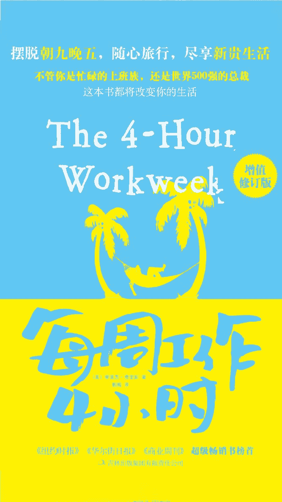
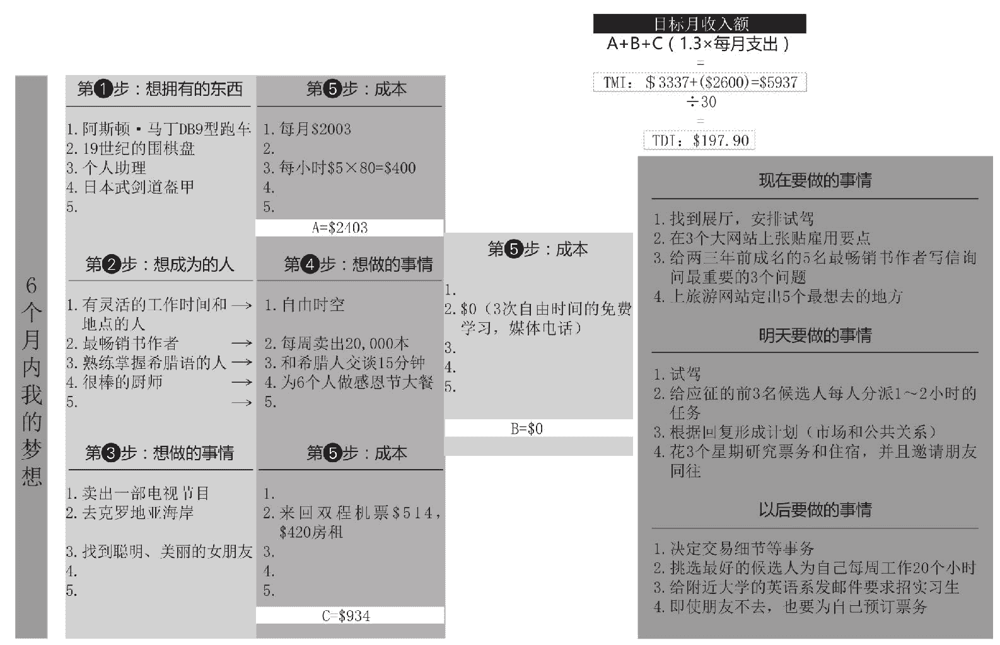
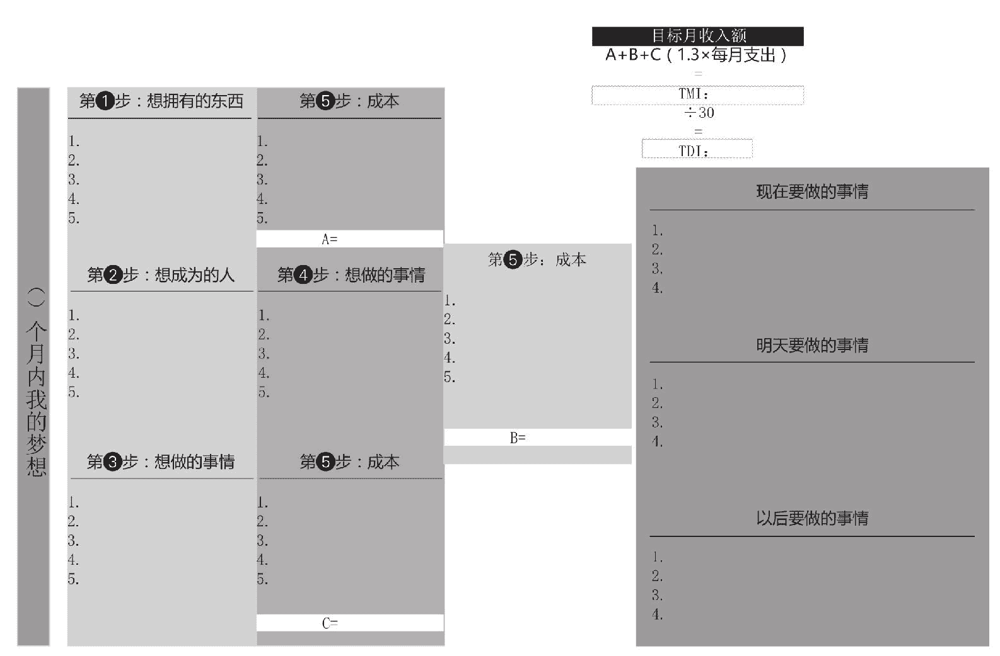
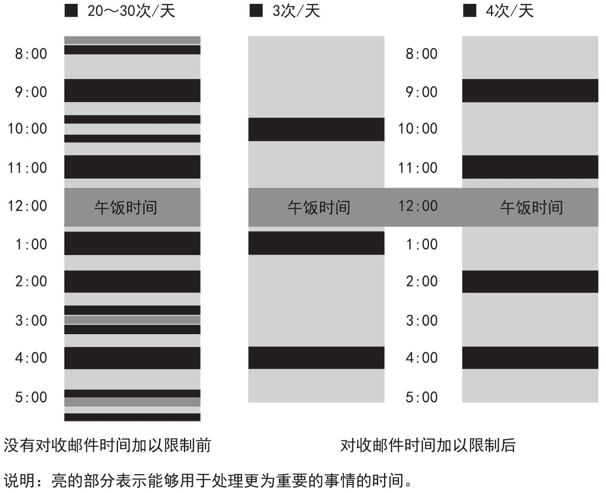
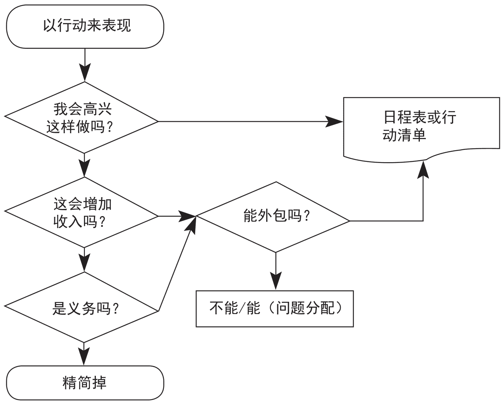
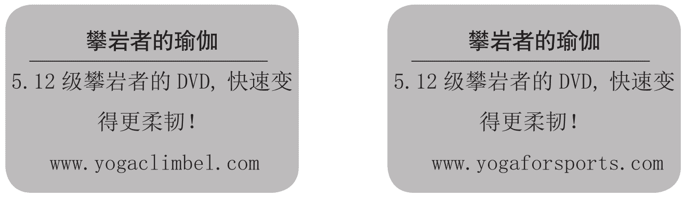
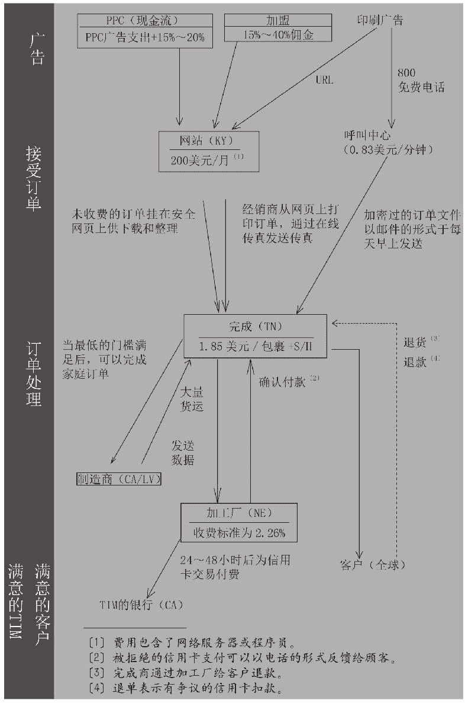
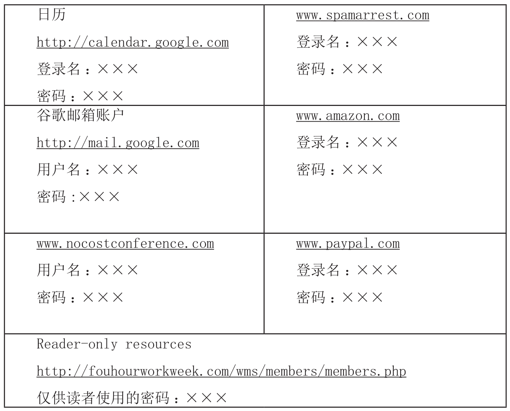

   

目录 对本书的赞誉 增值 修订版前言 写在前面 写给心存疑虑的读者 我的故事以及你需要这本书的理由 自我剖析年表 第一步 D——定位 1．警告与对照 一夜“烧掉”100 万美元 2．改变规则的规则 一切流行皆为误区 3．躲避攻击 战胜恐惧，不再麻木 4．重置系统 非理性和不模糊 第二步 E——精简 5．时间管理的终结 幻觉与意大利人 6．低信息食谱 培养选择性忽视的能力 7．阻止干扰 拒绝的艺术 第三步 A——自控 8．外包生活 去除冗余，尝试利用“地域差价／汇率差异” 9．收入自控Ⅰ 寻找缪斯 10．收入自控Ⅱ 测试缪斯 11．收入自控Ⅲ MBA——缺席管理 第四步 L——解放 12．“失踪” 如何逃离办公室 13．无可修复 和工作永别吧！ 14．迷你退休 拥抱移动生活 15．填补空虚 缩减工作，丰富生活 16．新贵常犯的 13 大错误 最后一章 一封必读的电子邮件 最后但同样重要 博客的妙处 参考读物 几个重要的方面 补充章节 致谢词 索引 

# 对本书的赞誉

这本书写的正是时候。本书是一本对于当下移动生活方式的宣言，蒂莫西·费里斯恰恰是这种生活方式最恰当的发言人。这很了不起。

——杰克·坎菲尔，《心灵鸡汤》联合作者

不可思议！从迷你退休到外包生活，本书一一囊括。不管你是忙碌的上班族，还是世界 500 强的总裁，这本书都将改变你的生活。

——《纽约时报》畅销作家菲尔·汤恩，《股市一号法则》作者

《每周工作 4 小时》为一个古老的问题提供了一个新的解决方案：我们如何工作才能既保证生活质量，而又避免工作霸占了我们的全部生活？那些认真读了这本书，并且深受启发的人将发现，这个世界其实为我们提供了多种选择和无限的可能性。

——迈克尔·伯格，《创业必经那些事》作者

这可是全新的事物！强烈推荐！

——斯图尔特·弗雷德曼博士，宾夕法尼亚大学沃顿商学院教授

29 岁的蒂莫西的人生比 51 岁的乔布斯的人生还要丰富多彩。

——汤姆·费姆斯基，记者和硅谷观察者网站的出品人

如果你希望按自己的意愿生活，这本书为你规划了蓝图。

——迈克·马颇斯，Motive（驱动力）公关公司创办人，Tivoli 公司创始人（公司以 7 500 万美元价格卖给 IBM）

感谢蒂莫西·费里斯，我才有更多的时间去旅行，与家人共度时光，并且还有时间来从事写作。这本书是一本充满智慧并且非常实用的书。

——A.J.乔布斯，《绅士》杂志编辑，《全都知道》一书的作者

蒂莫西就是电子时代的《印第安纳·琼斯》。我已经追随他的指导，实现了很多不可思议的梦想了：在远离喧嚣的小岛上钓鱼，在阿根廷陡峭的岩壁上滑雪。简单说吧，你照着他的话去做，就可以像个百万富翁一样生活。

——阿尔伯特·蒲波，UBS（瑞士联合银行集团）全球总部数学分析员

读这本书就好比在你的收入后面加上几个零。蒂莫西把生活方式设计提升到了一个新高度。按他说的做吧！

——迈克尔·科林，麦肯锡咨询公司顾问

蒂莫西既是科学家又是富有冒险精神的猎人，他为我们绘制了通往崭新世界的地图。我一晚上就读完了这本书，我从没读过这样的文字。

——查尔斯·L.布鲁克，布鲁克投资集团主席、总裁，哈佛法学院联盟前总裁

外包已经不再是世界 500 强的专利了。中小型企业，忙碌的职场人士同样可以靠外包琐事来提高他们的工作产出，增加闲暇时间，把精力和时间花在更重要的事情上。现在是时候从世界的变革中获利啦！

——威威科·考克尼，印度砖墙公司总裁

蒂莫西是专家！对此，没人比我更清楚。我亲历了他从草根到新贵的道路，亲历了他从一个打工仔转型为企业家的过程。他找到了一个比传统保守的一套更为行之有效的办法，所以他现在敢于回击传统了。

——丹·帕特兰，艾美奖获得者，流行音乐制作人

《每周工作 4 小时》对于那些对精神生活尚有需求，追求精神生活的富足的人来说具有非凡的意义。在你为生活牺牲掉全部之前，买一本来读一读吧。

——约翰·鲁斯特，微软全球总部产品经理

如果你希望现在就实现你的梦想，而不必等到二三十年之后，就马上买这本书吧。

——劳拉·罗登，硅谷新兴企业联合会主席，圣何塞州立大学公司财务讲师

通过蒂莫西这种时间管理方法和专注于重要事情的思维方式，人们能在 15 分钟内搞定通常需要一个周末才能完成的事情。

——蒂莫西·杜博，知名投资人

蒂莫西做到了大多数人只能梦想的事情。我简直不敢相信他愿意与所有人分享他的秘密。这本书非常值得一读。

——史蒂夫·凯，美国知名卡通形象设计人

一半科学一半冒险，蒂莫西创造了一幅全新的世界地图。我一口气读完了它——我从没读过这样的书。

——查尔斯·布洛克，哈佛法学院协会前任主席，布洛克资金集团的主席和首席执行官

我们为生活而工作，但如何防止工作吞没生活？本书是解决这个老问题的新方法。读者将从书中得到启发，发现一个有无限选择机会的世界！

——迈克·嘉宝，全球 E-myth（电子神话）公司的创始人兼首席执行官，世界小型企业发展权威

# 增值 修订版前言

《每周工作 4 小时》这本书被 27 家出版商中的 26 家拒绝过。

当书稿卖掉后，一位潜在的市场合伙人，同时也是一位书商发邮件给我，告诉我历史上畅销书的数据分析，用来证明这本书不会在主流社会上获得成功。

所以，我尽我所能使这本书更有价值。我写作的同时想象着我的两位好友，直面他们的问题与困惑——那些问题我很久以前也曾经有过。我把注意力放在那些对我有效而又不同寻常的解决方法上。

我当然希望这本书能成为图书市场中的一匹黑马，一鸣惊人，但这似乎并不太可能。我期待着好运降临，同时也做好了最坏的准备。

2007 年 5 月 2 日，我接到了编辑的电话：

“蒂莫西，你上榜啦！”

那时候是纽约时间 5 点刚过，我十分疲倦。书出版了仅仅 5 天，但我已经接连完成了二十余个电台访谈，访谈从早上 6 点就开始，贯穿全天。我从没想过为我的书做全国性的活动，但那也比 48 小时里批量完成全部电台访问有趣。

“希瑟，我爱你，不过别拿我开玩笑，好吗？”

“没有，我是认真的，你的书真的上了畅销榜。恭喜你，《纽约时报》畅销书作家先生！”

我背靠着墙，任由自己滑下去，直到坐到了地上。我闭上眼，微笑着，深呼吸。事情有变化了。

一切都在改变。

生活方式设计：从迪拜到柏林

《每周工作 4 小时》现在已经被翻译成了 35 种语言，并成书出版。在美国，它荣登畅销榜长达 2 年之久，每个月都在给我们带来新的故事和新的发现。

从《经济学人》杂志到《纽约时报》的风尚版，从迪拜的街头到柏林的咖啡馆，生活方式如何设计已经超越了文化的差异，成为一种全球的运动。本书原有的理念在不同的环境里，以我从未想过的方式被拆分、改进并接受检验。

如果一切顺利的话，还出新版本干吗呢？因为我知道本书可以更好，而且旧版本少了一个很重要的元素，那就是：您。

这版增值修订版增加了一百多页的新内容，包括最先进的科技，实地调查获得的资源，以及最重要的部分——从四百多页的读者来信中精选出来的现实生活中成功的故事。

老师、学生、企业家或职业流浪汉驻足一下吧！这里可能有某个人的故事是你可以复制的。比如需要一个在争取远程工作的谈判中能帮上忙的模板；花一年时间在阿根廷，却仍然拿原公司的工资……这样的例子，就在这本书里。

生活方式的设计实验博客和本书同步面市。仅仅 6 个月，这个博客就从 1.2 亿个博客中脱颖而出，成为全球具有人气的 1000 个博客之一。数以千计的读者在这里分享他们自己的工具和一些小技巧，分享现象和超出预期的结果。这个博客也成为我一直期待的实验室，我强烈建议你也加入我们的行列。

生活方式的设计实验博客中新近添加了“最佳博客”的板块，这个板块将整理出最受欢迎的帖子。在博客里，你还可以得到来自各方的建议，从巴菲特（别奇怪，我曾经追踪过他，而且会告诉你我是如何做到的）到国际象棋大师乔希·维茨金。对于那些想在最短的时间里过得更好的人来说，这里是一个绝佳的实验乐园。

并非“修订版”

从旧版已经过时而无用的角度来说，这本书可不是“修订版”。这的确是一次彻底的大修，但并非你想象的那样。

从 2007 年 4 月开始，全球都有了重大的变化：银行倒闭、退休金和积蓄随即蒸发、失业率创下历史的新高。读者和怀疑论者不禁要问：书里的这些理念和方法真的在经济萧条或重整的时期也有用吗？

当然，回答是肯定的。

事实上，金融危机前我在讲座中曾向大家提问：“如果你永远也没法退休，你的决定和你为自己优先考虑的事情会改变吗？”我的这个问题，现在不再是假设了。成千上万的人现在不得不面对他们的积蓄缩水了 40%，甚至更多，不得不重新做出选择。他们能够重新分配退休的时间，把退休时间平摊到一生之中，从而让生活变得更加舒适吗？他们现在能搬到哥斯达黎加或泰国，用手头仅剩的积蓄在当地过上相对好的生活吗？能把他们的某些服务卖给英国的公司，从而换一种更保值的货币吗？答案永远是肯定的。

用生活方式设计的理念去替换不同时期的职业规划听起来更合理。前者显然更灵活，而且可以让你尝试不同的生活方式而不必等待 10 年或 20 年之后的退休岁月才去改变自己的生活方式。等待退休也有风险，总有些市场崩溃在你的掌控之外。人们对待开拓新思路持宽容的态度（也能原谅已经这样做了的那些人），因为过去那些看起来很“保险”的办法，已经失败了。

如果有人失败了，这种小实验的代价是什么呢？通常什么也没有。想象一下吧，2011 年你参加一个工作面试的时候，面试官会格外关注你是否有一年的工作经验吗？

“所有人都被解雇了，我获得了一次一生中不可多得的机会去周游世界。真是太棒了！”

如果他们还问你别的类似的问题，这本书里的话还可以用上。

Facebook（脸谱）和 LinkedIn[^(\[1\])](#Section0001_split_000.xhtml_note_link_11)在 2000 年后的互联网泡沫之后上线，其他重新调整后的公司还包括 Monopoly（垄断）、Apple（苹果）、Scrabble[^(\[2\])](#Section0001_split_000.xhtml_note_link_12)、KFC（肯德基）、达美乐比萨、联邦快递以及微软。这不是巧合，经济环境不佳的时候，正是创造降价的基础设施、用便宜的价格雇到出色的自由职业者、用抄底价格达成广告协议的时机。这些在大家都充满信心的情况下是不可能完成的。

无论是休息一整年酝酿关于生意的一个想法，还是重新调整你的生活，抑或是重拾你某个搁置了很久的梦想，在特殊时期去完成这些事，都是很好的选择。

最坏的情况会是什么呢？

我希望你在关注身边无限可能的时候，记住这个常常被忽视的问题。这个集体恐慌的时期，恰恰是你涉足某件事难得的好机会。

能与全世界的读者分享我过去两年的经历，是无上荣幸的事。我希望你们喜欢这个新版本。

我将永远做你们谦逊的学生。

热情地拥抱你们。

蒂莫西·费里斯

加利福尼亚州，旧金山

* * *

[\[1\]](#Section0001_split_000.xhtml_note_backlink_11) 　Linkedln，一家面向商业客户的社交网络服务网站。

[\[2\]](#Section0001_split_000.xhtml_note_backlink_12) 　Scrabble，西方流行的英语文字图版游戏。

# 写在前面

## 写给心存疑虑的读者

可以为我量身打造生活方式吗？答案极有可能是肯定的。下面我们来列举一些普通人跻身新贵阶层之前的那些常见的质疑和顾虑吧！

我必须要辞职吗？我必须痛恨我的工作吗？我必须承担风险吗？

以上三个问题的答案都是否定的。不管是耍小花招，溜出办公室，还是精心经营生意，使自己的生活更为富足，总有很多途径帮你在各个层面上享受舒适的生活。一位世界 500 强企业的员工如何用一个月时间在中国寻宝，又如何用科技手段掩盖自己的行踪？你如何独立经营一个月入 8 万美元的生意，却又可以置身事外，毫不操心？这些秘诀尽在这本书里。

我必须是个二十多岁的单身汉吗？

当然不是。这本书是为全部有意愿改变生活现状的人准备的，对于所有有意愿结束拖延人生计划，试图在有限的人生里拓宽生活宽度的人都适用。本书讲述的故事既有为了兰博基尼而蠢蠢欲动的 21 岁小伙子，也有单身妈妈如何带着两个孩子周游世界。如果你已经厌烦了一成不变的生活并且已经做好了准备去开启一个具有无限可能的世界，这本书就是为你而写的。

除了旅行我别无他选吗？我只是希望能多点儿时间。

不见得，旅行只是选择之一。其实你的终极目标只是为自己多争取一些自由的时间和空间，并在任何地方都能享受它们而已。

我必须是含着金钥匙出生的“富二代”吗？

当然不是！我父母赚的钱都加起来，一年也从未超过 5 万美元，我从 14 岁就开始到处打工了。我不是“小洛克菲勒”，你当然也不必非要出身富庶人家了。

我是不是必须毕业于“常春藤联盟”里的那些顶级名校啊？

也不是！书里提到的那些模范，并非都毕业于哈佛这样的名校，有些甚至还是辍学的学生。名校出身固然不错，但非名校出身也有很多未被发觉的好处呢！名校毕业生们都争相应聘那些高薪却每周额外加班 40 小时的工作去了。15～30 年呕心沥血地工作，在他们眼里已经成为“本该如此”的必然。你问我是怎么知道的，我告诉你我亲历了这一切，见证了崇尚名校观念的崩溃。我写这本书，就是为了反驳这种观点。

## 我的故事以及你需要这本书的理由

当你发现自己站在了大多数人一边，你就该停下来反思了。

——马克·吐温（1835—1910，美国小说家）

任何一个还在为温饱而奋斗的人一定缺乏想象力。

——奥斯卡·王尔德（1854—1900，爱尔兰戏剧家和小说家）

我的手心又开始出汗了。

为了避开天花板上令人目眩的灯光，我低头盯着地板。我觉得我应该是世界上最好的舞者，只是我还没注册成为职业舞者而已。我和我的舞伴艾丽西亚与其他 9 对选手站在一起，艾丽西亚不停地换脚调整站立的重心。我们 10 对选手是从四大洲 29 个国家一千余名参赛选手中选拔出来的。这是世界探戈舞大赛半决赛的最后一天，也是我们这些半决赛选手在裁判、摄影机和雀跃的观众们面前的亮相。其他 9 对选手平均合作了 15 年，我和艾丽西亚才仅仅搭档了 5 个月零 6 小时。现在，我们表演的时间到了。

“感觉如何？”艾丽西亚用带着阿根廷口音的西班牙语问我。她是经验丰富的职业舞者。

“很棒，相当不错。我们就享受音乐吧，忽视周遭的一切——就当他们不存在。”

事实并非如此。真难以置信，La Rural 会展中心里聚集了五万多名观众和工作人员，即使是布宜诺斯艾利斯最大的会场也很少出现这样的盛况。透过浓浓的烟雾，想分辨出坐在看台上黑压压的人群简直是不可能的，场馆里除了那块 30 英尺[^(\[1\])](#Section0001_split_000.xhtml_note_link_21)×40 英尺的空间外都是露天的，没有丝毫遮盖。我整理了一下细条纹的演出服，又理了理蓝色真丝手帕，以掩饰我内心的浮躁与不安。

“你紧张吗？”

“我不紧张，我只是很兴奋。我就是来享受过程的，其他的就顺其自然吧。”

“下面有请 152 号参赛选手。”引导员做完了他的工作，下面就看我们的了。我们走向硬木地板上的时候，我跟艾丽西亚说了彼此意会的单词：Tranquilo——放松。她笑了，就在那时，我不禁问自己：“如果没有辞职，没有离开美国，我此时此刻在做什么呢？”

这个念头转瞬即逝，因为主持人走到扩音器前，观众席爆发出阵阵掌声，主持人道：“152 号参赛选手，来自布宜诺斯艾利斯的蒂莫西·费里斯和艾丽西亚·蒙蒂。”

我们上场了，光彩照人。

在美国，标志式的提问是：“那么，你都做过些什么？”这个问题现在对我来说有点儿难回答。恰恰因为这个问题难以回答，你现在才有机会看到这本书。这样看来，也不失为一种幸运。

“那么，你都做过些什么？”

假设你能找到我（其实这很难），还要看你如何提问（其实我希望你不要问），我可能在欧洲参加摩托车比赛，在巴拿马的私人海域潜水，或者在泰国跆拳道赛季的间隙坐在棕榈树下休憩，也可能是在布宜诺斯艾利斯跳舞。奇妙的是，我并不是身价百万的富豪，而且那也并不是我所追求的。

我并不喜欢这种开场白，因为它反映了一种我曾长期深陷其中的流行病：工作职责成为自我注释。要是现在还有人问我这个问题，我会严肃而简洁地告诉他：“我是个毒品贩子。”

谈话就此结束，而且我的回答只对了一半。要把全部事情讲出来，恐怕就需要长篇大论了。我该如何给提问者解释清楚“我怎么打发时间”和“我以什么为生”是截然不同的两件事呢？我每周工作不足 4 小时，可我现在赚的钱比我过去工作一年赚的还多。

这可是我第一次想对人袒露心声，把我的真实故事讲给人听。这涉及一个很重要的亚文化群体——新贵阶层。

住豪宅的百万富翁们做了哪些住铁皮房的平头百姓不做的事情？答案就是他们遵循不寻常的规则。

一个公司里的“蓝筹股”员工为什么能瞒着老板去周游世界一个月，而老板却根本没有注意此事呢？他用技术掩盖了真相。

金钱已经过时了。新贵阶层抛弃了“推延生活的计划”，转而用他们这个时代的货币——时间和移动——来创造一种奢侈的生活方式。这是一种艺术，也是一门科学，我们称之为“生活方式规划”。

过去 3 年里，我一直在全世界穿梭，结识了很多生活方式超乎人们想象的人。与其厌恶现实，不如让我来教你如何让生活服从于你。其实这远没有听上去那么难以实现。我从一个加班加点却被克扣薪水的小职员跃身为新贵一族的故事乍听起来比小说还要离奇，但其实这种经历不仅可以复制，而且有方可循。

生活原本就不必如此艰辛，确实不必。大部分人，包括过去的我，总是试图尽力说服自己相信生活本就如此。用朝九晚五的劳作去换取短暂的周末或极为短暂的假期，还要冒着随时有可能被解雇的风险。

事实上，至少我坚信并要在书中与大家分享的事实却不尽然。我将在本书中与你分享如何依靠经济上的小技巧——巧妙利用汇率差，或尽可能将琐事外包出去，或分身有术——帮你做那些大部分人认为不可能实现的事。

如果你已经翻开了这本书，极有可能你是不甘心做一个在办公桌旁坐到 60 岁退休的人。无论你的梦想是逃离你死我活的残酷竞争、现实生活中的奇妙旅行、长时间的游荡，还是创造世界纪录，抑或是你仅仅想换个工作，本书都会把那些能够协助你把梦想立竿见影地变成现实的秘诀毫无保留地告诉你，协助你在当下就实现梦想，而不必等到退休以后。其实，我们有办法让你现在就享受到勤恳工作的果实，而不必等你走到生命的尽头才获得。

到底该怎么办呢？我们要从一个大多数人忽略的区别——我就曾忽略了这个简单区别长达 25 年——着手。

人们并不渴望做百万富翁，人们仅仅是希望体验百万富翁才能享受得起的那些生活。映入人们脑海的，往往是滑雪胜地的小屋、私人管家、异域旅行等画面。躺在度假屋的露台上，一边听海浪拍岸，一边惬意地往肚皮上搽可可油，听上去可真不错！

在银行里存上百万美元并不是白日梦，白日梦是这百万美元所能保障的自由自在的生活方式。那么问题的关键是，人们怎么才能在没有百万美元存款的情况下，还享受百万存款所赋予的自在生活呢？

在过去 5 年里，我为自己找到了这个问题的答案，本书旨在为你详解这个问题的答案。我将告诉你如何将收入与时间剥离，如何在过程中创建理想的生活方式、周游世界、享受这个星球所能提供的最佳服务。我到底怎么做到从每天工作 14 小时，年薪 4 万美元转变为每周工作 4 小时，月入 4 万美元的呢？

这还要从所有变化的源头说起。有趣的是，一切都是从一个培训未来投资银行家的短训班开始的。

2002 年，应在普林斯顿大学读书时的教授和高科技企业管理课程的奠基人爱德·茨肖教授之邀，我重返校园，给学生讲述我在现实世界里的商业经历。在我之前，已经有不少千万富翁给这群学生做过演讲，尽管我已经创立了一家赢利丰厚的运动营养品公司，我走的却是一条与别人截然不同的路。

随后的几天里，我发现，几乎所有人都在讨论如何把一家公司做大做强，然后卖掉，从此过上幸福的生活。这当然没错，但问题是几乎没有人想过这样的问题：为什么要这么做？为什么要把人生最好的年华花费在畅想最后那区区几年的幸福上？

我要讲的课最后被命名为：“贩毒——为享乐和赢利”。课程从一个简单的假设开始：对工作——生活方程式中最基本的前提进行测试。

如果无法退休，你的决定会发生变化吗？

如果不用等到 40 年后，而是用一种“迷你退休”的方式来改变“推延生活计划”，现在就提前享受人生，你会怎么做呢？

要想像百万富翁一样生活，就得像奴隶一般地工作吗？

这些问题让我无所适从。

不一样的结论？“现实世界”的所谓常识性规则，不过是一堆脆弱的、被社会所强化的错觉的集合。本书所要讲的正是发现并抓住其他人错过的那些机会和选择。

本书有何独到之处？

首先，我关注的是人最本质的问题。我已经假设，你正饱受时间匮乏之苦，恐惧感滋长，甚至更糟——你已陷入绝境，将就过小康生活，却毫无成就感可言。最后一种情况最普遍却又最不易察觉。

其次，本书不教你如何储蓄。我不会建议你为了 50 年后存够百万美元而戒掉每天一杯红酒的习惯，我宁可选择红酒。我不会让你从今日的享乐和明日的财富中二选一，我坚信两者可以兼得。我们的目标就是享受与获得利润两不误。

最后，本书也不是找到理想工作的指南。我认为，对于世界上 70 亿人口中的大多数而言，所谓好工作，就是花费时间最少的工作。绝大多数人终其一生也找不到一个能不断带来成就感的工作，所以，这并不是我们的终极目标，解放时间和实现收入自动化才是我们的目标。

每次开课，我都以解释作为一个“生意人”的重要性开场。生意人的口号很简单：现实是可以协商的。在科学与法律范畴外，任何规则都可以被改变或打破，而这并不需要违背道德。

DEAL（交易）也是迈入新贵阶层过程中几大步骤和策略的缩写。

这些步骤和策略的运用可以达到难以令人置信的效果——无论你是一名普通员工，还是一位企业老板。你能把我对老板所做的一切照搬过来吗？不行。你能运用同样的原则和方法使收入翻倍，又让工时减半，或者至少增加一倍的休假时间吗？当然可以。

以下就是你可以用来彻底改造自己的方法和步骤：

D——Definition（定位）：引入新游戏的规则和目标，彻底颠覆了陈腐的观念。书中抛弃了令人沮丧的假设，解释了相对收入和良性压力的概念，谁是新贵以及他们如何经营管理自己的事业。在引入奢侈生活方式设计三大因素之前，这部分将全面介绍生活方式规划的要点。

E——Elimination（精简）：彻底批判了有关时间管理的陈腐观念。这里详细记录了我按照那位经常被遗忘的意大利经济学家帕雷托的理论，将每天工作 12 小时缩减为每天工作 2 小时……改变就在 48 小时之内。通过反常规的新贵法则，比如培养选择性忽略能力、建立低信息食谱，可以忽略掉不重要的东西，从而将每小时的工作效率提高 10 倍以上。文中提出了奢侈生活方式设计三大要素的第一个要素：时间。

A——Automation（自控）：通过地域差价、外包及不决策准则，实现现金流自动控制。这里囊括了许多超级成功的新贵的行事准则。这一部分提出了奢华生活方式设计的第二个要素：收入。

L——Liberation（解放）：解放是全球化趋势的移动宣言。“迷你退休”的概念将在这里提出来，同时还有完美地遥控及躲避老板的办法。解放并不是廉价的旅行，而是打破把人们束缚在同一地点的桎梏。这里将涉及奢华生活方式设计的第三个要素：移动。

我不得不提醒你的是，如果你每天只在办公室里出现 1 小时，大多数老板都会心有不快。所有的雇员都应该按老板的思路，从 D 到 L 地阅读本书，但要按 D—E—L—A 的顺序来实践这些理念。如果你决定仍要留在现在的工作岗位上，那么，在你的工时缩减 80%之前，你必须先创造工作地点的自由。即使你从未想过要成为现代意义上的企业家，D—E—A—L 步骤也会把你打造成为真正意义上的企业家——诚如法国经济学家 J.B.萨伊在 1800 年首次提出的企业家定义所言：把经济资源从低产地区移动到高产地区的人。

最后我不得不承认，我所推荐的许多方法看上去都不太实际，或有悖常理，对此我已经有了心理准备。现在，下决心去挑战常理，体验一下另类思维吧！只要试过，你就会发现这里别有洞天，并且再也不想走回头路了。

来吧，深吸一口气，让我向你展示我的世界。记住——放松。是享受乐趣的时候了，其他一切顺其自然就好！

蒂莫西·费里斯

日本　东京

2006 年 9 月 29 日

## 自我剖析年表

所谓专家，就是在极小领域内犯过所能犯的全部错误的人。

——尼尔斯·玻尔（1885—1962，丹麦物理学家，诺贝尔奖获得者）

疯子也有清醒的时刻。

——海因里希·海涅（1797—1856，德国文学批评家、诗人）

本书将向你介绍我实现如下目标的方法。

普林斯顿大学企业管理课程客座讲师。

美国有史以来第一个探戈吉尼斯纪录保持者。

三十余位职业联赛或奥运会纪录保持者的咨询师。

Wired 杂志评选的“2008 年度最伟大的自我推销大师”。

全美中国式散打冠军。

日式马上射箭手。

政治避难研究员和行动派。

中国台湾 MTV 频道霹雳舞演员。

爱尔兰曲棍球手。

中国内地和香港地区电视剧演员。

其实，在我的成长经历中，我并不怎么耀眼。

1977 年　我提前 6 周来到这个世界，只有 10%的存活概率。不过，我活下来了，而且长得非常胖，腰都弯不下来；两只眼睛和别人有点儿不一样，我可以同时看到不同的方向，于是我妈妈给我起了个昵称——“金枪鱼”。迄今为止，我的人生还都不错。

1983 年　因为拒绝学习字母表，我差点儿没上完幼儿园。老师拒绝向我解释为什么要学习字母表，她只是说：“我是老师——这就是原因。”我告诉她这样非常可笑，还叫她不要再管我，我要专心地画鲨鱼。于是，她把我安排到了“坏学生桌”，还让我吃了一块肥皂。从此，我就蔑视权威了！

1991 年　我有了第一份工作。哦，还真是不堪回首！我以最低的周薪受雇于一家冰激凌小店，在那儿做清洁工。很快，我发现大老板的原则就是重复劳动。我以自己的方式只用 1 小时就完成了 8 小时的工作量，剩下来的时间，我就翻看功夫类杂志，还在店外练习空手道的踢腿动作。第三天，我就被解雇了，这真是创了纪录，老板还给了我一句临别赠言：“有一天，你也许会明白辛勤工作的价值。”到现在我似乎也没明白。

1993 年　我申请参加一个为期一年的交换生项目，地点是日本。在日本，人们玩儿命似的工作，把因玩儿命似的工作导致的死亡叫过劳死。据说，日本人出生时想成为日本神道信徒，结婚时想成为基督教徒，去世时则想成为佛教徒。我由此得出结论：关于人生，大多数人都是充满疑虑的。一天晚上，我本想让房东太太第二天早上叫我起床（日文 okosu），我却说成让她强暴我（日文 okasu）。她看上去非常困惑。

1996 年　尽管我的 SAT（美国高中生的“学术水平测试考试”）分数低于平均水平的 40%，我高中的升学顾问也劝我更“现实些”，但我想法子混进了普林斯顿大学。我想，我就是不擅长面对现实。我的专业是神经系统科学，但后来为了不再把打印机插头安到猫脑袋上，我转到了东亚研究系。

1997 年　我以为当百万富翁的时刻到了，把三个暑假打工赚到的钱全都用光，制作了 500 本名为《我如何打败常春藤盟校》的有声读物，但是一本都没卖掉。我让妈妈 2006 年后——我的书被市场拒绝了 9 年之后——再处理掉这些书，这就是毫无来由的自负带来的乐趣。

1998 年　在四个投球手砸了我一个朋友的脑袋后，我退出了弹跳球运动，那可是当时校园里收入最高的兼职。此后我组建了一个速读学习班。我在整个校园里贴了成千张丑陋的荧光绿宣传单，上面印着：“3 小时内将你的阅读速度提高 3 倍！”普林斯顿的学生们马上在每一张宣传单上写上了“屁话”二字。3 小时的学习，我以每场 50 美元的价格办了 32 场，相当于每小时 533 美元。这让我明白，先找到市场再生产产品远比反过来做要聪明得多。两个月后，面对枯燥的速读我几乎要哭了，于是，我决定结束这个学习班。我憎恨服务行业，我需要的是能销售的产品。

1998 年秋　一个论文上的重大分歧和对成为未来投资银行家的强烈恐惧促使我决定结束我的学术生涯。我通知学籍注册主任我要退学，以后再决定是否返校继续学业。我父亲坚信我永远不会再回去完成学业了，我自己也认为我的人生完了。我母亲却认为这没什么大不了的，也没必要大惊小怪。

1999 年春　3 个月的时间里，我先后做过世界上最大的外国语言材料出版商贝立兹的课程设计师和一个三人政治避难研究公司的分析师。此后，我飞往中国台湾，莫名其妙地开了一家健身连锁店，却被当地一个黑帮组织三合会搞垮了。我沮丧地回到美国，决心要学习中国式散打。4 周后，我以人们未见过的最难看的姿势和最怪异的方式赢得了全国比赛的冠军。

2000 年秋　在恢复了信心但荒废了论文之后，我回到了普林斯顿大学。我的人生非但没有就此终结，相反这一年的“耽搁”还给我带来了不少好处。现在，那些二十几岁的年轻人都拥有非凡的能力。我朋友以 4.5 亿美元的价格卖掉了一家公司，而我则决定到阳光明媚的加利福尼亚碰碰运气，去赚取我的第一桶金。尽管当时是有史以来就业市场最好的时期，可我还是花了 3 个月时间才找到工作。而这份工作也是得来不易，我使出了撒手锏，我给一家刚创办的公司的首席执行官连发了 32 封邮件。最后，他不得不妥协，把我收编在了销售团队里。

2001 年春　TrueSan Networks 公司已经从一个名不见经传的 15 人小公司发展为拥有 150 名员工（他们每天都在做什么）的个人数据存储公司的老大（这是怎么算出来的）。我的新上司是一位刚刚上任的销售总监，他要我从电话簿的字母 A 查起，然后一个一个地打电话过去推销产品。我非常委婉地问他我们为什么要这么做，他的回答是：“因为我要求这么做。”这可不是一个好的开始。

2001 年秋　在连续一年每天工作 12 小时后，我发现了我是公司工资第二低的人——只比前台高而已。于是，我开始故意把每天的工作时间都花在网上。一天下午，当我再没什么可转发的情趣视频时，我开始研究开一家运动营养品公司的可行性。我发现，从产品生产到广告设计，一切事物都可以外包出去。于是，我用了 2 周时间，拿着从信用卡里透支来的 5 000 美元，办了一个网站，还采买了第一批商品。还有个好消息，我被公司解雇了。

2002 年至 2003 年　BrainQUICKEN LLC 生物科技公司（以下简称 BQ 公司）已经起步，我每个月可以赚 4 万美元——这可是我以前的年薪。唯一的问题是，我发现我每周要工作 7 天，而且每天都要工作 12 小时以上。这种状况快要把我逼疯了！我给自己放了一周的假，和家人一起飞往意大利的佛罗伦萨。我每天花 10 小时在网吧里上网，真是受不了。我开始在普林斯顿大学教学生们如何打造“成功的”公司，成功即赚钱的意思。

2004 年　不可思议的事发生了。一家信息产品公司和一家以色列的多品种经营公司开始跟我接洽，他们有意购买我的孩子——BQ 公司。我要么被迫消失，要么主动卷铺盖走人。神奇的是，我的 BQ 公司并未瓦解，反而运转良好，一切又都回到了以前的样子。那以后不久，这两家公司都表示要投资数百万美元来生产我的产品。

2004 年 6 月　我决定，哪怕是我的公司土崩瓦解、不复存在，我也必须在我走上霍华德·休斯[^(\[2\])](#Section0001_split_000.xhtml_note_link_22)的老路之前远离工作一阵子。我放下了一切，背起背包，去了肯尼迪机场，买了我能买到的最早的一班飞往欧洲的机票。我在伦敦降落，打算此后去西班牙再过上 4 周，我要在回到盐矿区之前给自己充足电。我的放松之旅在第一天早晨以一次神经质的崩溃开始。

2004 年 7 月至 2005 年　4 周延长为 8 周，我决定在国外继续待下去。作为对公司自控运营和我本人生存能力的最后测试，我只在每周一的早晨花 1 小时收发电子邮件。当我突破了自己瓶颈的时候，公司利润也随之增长了 40%。当工作不再是奔波劳累或充当回避人生重大问题的借口之时，人们又该做些什么呢？很显然，只能心怀畏惧，加倍保重。

2006 年 9 月　在破除了所有可为和不可为之界限的种种预设后，我怀着顿悟了的心态，回到美国。“贩毒——为享乐和赢利”已经成为一门有关理想生活方式设计的课程。新的信息很简单：我已经见到了梦中的乐土，而且我还带来了一个好消息——你们也能获得它。

* * *

[\[1\]](#Section0001_split_000.xhtml_note_backlink_21) 　1 英尺=0.304 8 米。

[\[2\]](#Section0001_split_000.xhtml_note_backlink_22) 　霍华德·休斯（Howard Hughes）：美国电影制作人，富翁，花花公子。

# 第一步 D——定位

现实只不过是幻象——持久的幻象而已。

——阿尔伯特·爱因斯坦

（Albert Einstein, 1879—1955，

德裔美国物理学家，诺贝尔奖获得者）

## 1．警告与对照 一夜“烧掉”100 万美元

就像我们说自己发烧实际上却被发烧所控制一样，这些声称自己富有的人，其实是为富有所支配。

——塞内加（约前 4—65，古罗马悲剧作家）

我也记得那些看上去富有实际上却极其匮乏的人。他们积攒了大量无用之物，却不懂得如何去利用，也不懂得如何舍弃，最终将自己陷入金银的桎梏之中。

——亨利·戴维·梭罗（1817—1862，美国作家）

引子：美国中部时间凌晨 1 点，拉斯维加斯 3 万英尺的高空

他的朋友们已经酒酣耳热，进入梦乡。头等舱里只剩下我们两个。他伸出手来跟我握手，自我介绍说他叫马克。他的手伸到我的阅读灯下的时候，我注意到他手指上有一个像兔八哥戴的那种巨型钻石戒指。

马克是个遵纪守法的富商。他曾先后经营南卡罗来纳州几乎所有的加油站、便利店和赌场。他带着笑意说道，每次周末和朋友们一起去赌城，他们总要花掉 50 万～100 万美元。真不错！

当我们谈到我的旅行经历时，他在椅子上端坐起来。不过，我还是对他不同寻常的赚钱方式更感兴趣。

“那么，在你所有的生意里，你对哪个最有兴趣？”我问他。

他不假思索地回答道：“哪个也不喜欢。”

他解释说，他花了 30 年时间去和那些他并不喜欢的人打交道，买那些自己根本用不着的东西。生活变成了一波接一波——他一直非常幸运——的战利品和昂贵的汽车以及其他毫无意义的吹牛资本。马克是众多仍活着的死人之一。

这正是谁也不想要的人生。

苹果和橘子：比较

到底是什么把拥有众多选择机会的“新贵阶层”（以下简称 NR）与处处节省、把一切都留到最后、到头来发现最好的年华已经消逝的“延期生活者”（deferrer，以下简称 D）区分开来的呢？

区别从一开始就出现了，新贵阶层与普通大众的目标不同，这种不同直接反映出不同的思考层次和人生哲学。

请注意，在以下描述中，尽管想要达到的目标乍看上去十分相似，但措辞上的细微差别却直接导致了在实现目标所需要采取的行动上的差异。这些差异并不仅限于企业拥有者，有些其实更适用于员工。我稍后会加以解释。

D：为自己工作。

NR：使别人为自己工作。

D：想工作的时候工作。

NR：绝不为工作而工作，花最小的代价达到最大的效果。

D：尽早退休或趁年轻退休。

NR：定期分配一生的休假期和冒险期（迷你退休）。意识到完全休息并不是目标，做令人兴奋的事才是真正的目标。

D：当老板，不再做雇员，希望成为有掌控力的一方。

NR：既不当老板，也不做员工，只做拥有者。就好比拥有一辆火车，但雇别人来保证火车按时运行。

D：赚很多钱。

NR：赚很多钱，但要有质量地赚钱，避免杂乱无章。拥有大量资金储备，但同时心里清楚：大多数物质需求只是为在不紧要的事务上消磨时间提供一个借口罢了，包括买东西和准备买东西。你是否曾经为一个崭新的英菲尼迪跑车花 2 周时间跟代理商谈判，从而得到 1 万美元的折扣？了不起！你有人生目标吗？你是否曾为社会贡献过有价值的东西，还是仅仅每天翻翻报纸，敲几下键盘，周末醉醺醺地回到家呢？

D：获得最大的利益，无论是股票上市、买入或撤资，还是挖掘其他“金矿”。

NR：目标宏大，但确保每日收入稳定。现金流第一，日进斗金次之。

D：从不得不做不喜欢的事情的状态中解脱出来。

NR：从不得不做自己不喜欢的事情的状态中解脱出来。此外，还要有追求梦想的自由和决心，不再为了工作而工作。经年累月的重复劳动之后，你需要经常努力发掘自己的潜能，重新调整自己的梦想，重拾尘封的爱好。不只是简单拒绝那些令人空虚的俗务，而是追求并体验世界上最美好的事情。

如果上错了车，那就赶快下来

首要原则是不要欺骗自己，而你自己是最容易被欺骗的人。

——理查德·费曼（1918—1988，美国物理学家，诺贝尔奖获得者）

钱赚够了就收手，千万别像旅鼠似的丧失方向，盲目地追求金钱是愚蠢的。

我曾包下私人飞机，翱翔在安第斯山脉的上空，曾在世界一流的滑雪跑道上尽情享受世界上最棒的葡萄酒，也曾懒洋洋地躺在私人别墅的巨型游泳池里，过着国王一般奢侈的生活。有一个秘密，我很少提及，即所有这些都比美国的房租还便宜。如果能自由支配时间和空间，你的钱将自动增值 3～10 倍。

这和货币汇率无关。拥有很多的金钱和能像百万富翁一样地真正享受生活，根本就是两回事。

生活中，你所控制的“W”的数目，决定着你手头金钱的实际增值价值——做什么（what），什么时候（when），在哪里（where），和谁（who）一起做。我称之为“自由增值机”。

以此为标准，每周工作 80 小时，每年获利 50 万美元的投资银行家还不如每周工作 20 小时、年收入 4 万美元的受雇于人的新贵阶层更拥有掌控力。而且，新贵们对自己的生活时间、地点和方式还拥有完全的自主权。计算一下这些数字并比较一下两者所带来的不同生活方式时，我们就会发现，前者的 50 万美元也许还比不上后者的 4 万美元更有价值。

选择和选择的权利才真正具有力量。本书就是阐述如何发现、如何付出最小的努力和代价来发现并创造选择和选择权。这样说看起来似乎是个悖论，但事情确实如此——你可以用现在一半的工作时间去赚更多乃至多得多的钱。

那么，谁是新贵阶层呢？

这样的员工：他通过计划并商讨获得远程工作，从而在 10%的时间里，完成 90%的工作。这样，他就可以抽出时间练习越野滑雪，还能每月有 2 周时间陪家人旅行。

这样的老板：他懂得放弃那些获利甚少的客户和项目，懂得外包整个业务运营，懂得游走世界各地，收集稀有珍宝。同时，他懂得用远程的方式，通过网络下达工作指令。

这样的学生：他愿意冒险——其实也没什么大不了的——建立一个网络在线视频租赁服务，每月从高清电视爱好者的小市场中获得 5 000 美元的收入。这份每周仅兼职 2 小时的工作，却能帮他全职地做一个动物权利保护活动的组织者。

选择是无限的，但每一种选择都始于第一步：放弃成见。

为了做到这些，你需要学习一种全新的语言，需要面对一个全新的世界来重新定位。无论是转换职责，还是抛弃所有关于“成功”的旧概念，我们都需要改变规则。

新游戏，新选手：全球化与无极限

意大利　都灵

对我来说，文明设置了太多的规则，所以我尽我所能去改写它们。

——比尔·科斯比（生于 1937 年，美国喜剧演员）

当他在空中旋转 360°时，震耳欲聋的噪声归于平静。戴尔·贝格·史密斯完美地完成了一个后空翻，并将雪橇在头顶交叉成 X 形。他划过终点的同时，也让自己的名字载入了史册。

这是 2006 年 2 月 16 日，戴尔成为都灵冬奥会自由式滑雪男子雪上技巧项目金牌获得者。与其他职业运动员不同的是，在取得荣誉这一刻，他意识到，没有必要回去继续这个前途渺茫的职业了，也不能把这一天当作人生中仅有的亮点。毕竟，他才 21 岁，开着一辆黑色的兰博基尼跑车。

戴尔出生在加拿大，有些早熟。他在 13 岁时有了自己的第一份工作，创立了一家以互联网为基础的 IT 公司。幸运的是，他有一位经验丰富的老师和伙伴——15 岁的哥哥詹森指导他。公司的创立，就是为了实现他们兄弟二人登上奥林匹克舞台的梦想。仅仅两年后，他们的公司就在同类企业中名列世界第三。

在非赛季里，当队友在滑道上训练时，戴尔却常常在和东京的客户谈生意。在这个崇尚“辛苦地工作，而非聪明地工作”的世界里，尽管他的成绩还不错，但渐渐地，教练们对他的做法产生了异议，他们认为他在生意上花费的时间过多，然而训练却远远不够，尽管他的成绩一直不错。

戴尔并没有在生意和奥林匹克梦之间做抉择，他选择了两不误。从“鱼和熊掌不可兼得”变为“两者都要兼顾”。他和哥哥不再在生意上花费太多的时间，而是花了大量时间和法裔加拿大人在一起。

2002 年，他们迁往世界滑雪胜地——澳大利亚。在那里，滑雪队规模更小，也更具灵活性。他们受教于一位传奇教练。短短 3 年后，戴尔加入了澳大利亚国籍，与昔日队友同场竞技，并成为历史上第三个获得冬奥会金牌的澳大利亚人。

在以袋鼠和海浪为标志的澳大利亚，戴尔的英姿已经被印上了邮票。毫不夸张地说，就在“猫王”的纪念版邮票旁边，你就可以买到印有戴尔头像的邮票。

名誉自有其好处，跳出眼前仅有的选择也是如此，总会有其他选择能够使人获益。

南太平洋，新喀里多尼亚

一旦你表示能接受备选方案，通常事情就果真如此了。

——约翰·F.肯尼迪（1917—1963，美国第 35 任总统）

很多人仍然相信，只要再多一点儿钱就能把事情做好。他们的目标是任意移动的靶子：30 万美元就存银行，100 万美元就用来投资，一年 5 万变成 10 万，等等。我的助理朱莉的目标则是本能的反应：当初带走几个孩子，回来的时候要带着相同数量的孩子。

她坐回原位，目光越过她熟睡的丈夫马克，瞥了一下走到对面，做着之前做过千百次的动作——一、二、三，情况还不错。12 小时后，他们都安全地返回巴黎。当然，前提是从新喀里多尼亚起程的飞机自身一切安全。

新喀里多尼亚？

新喀里多尼亚位于南太平洋珊瑚海热带地区，曾经是法国领地。在那里，朱莉和马克刚刚卖掉了陪伴他们环绕世界 15,000 英里[^(\[1\])](#Section0001_split_000.xhtml_note_link_31)的帆船。当然，用卖船的钱来偿还他们最初投资的债务也是整个计划的一部分。他们的计划还包括长达 15 个月的环球探险，从布满狭长小船的威尼斯水路到波利尼西亚群岛海岸，所有的花费控制在 18,000～19,000 美元。这些他们都做到了，花费远比巴黎的房租和面包钱要少。

大多数人都认为这是不可能的事情。然而，这些人并不知道，事实上，每年至少有 300 个家庭从法国起航去做相同的事情。

这次旅行是朱莉 20 年来的梦想，一直被不断增加的各种职责义务排在计划单的最后，而且每时每刻都会有新的一连串理由使这个计划不得不一再搁浅。有一天，朱莉意识到，要是她现在不去做，可能就永远不会有机会去做了。各种理由不断地堆积，不管合理还是不合理，都会使她更难以相信“逃跑”是可行的。

经过一年的准备，加上她和丈夫又进行了一次 30 天的试验性旅行，终于，他们开始了这次具有重大意义的旅行。几乎就在起锚的同时，朱莉意识到 3 个孩子根本不是让她放弃旅行和探险的原因，而恰恰是支持她扬帆远行的最好理由。

出发之前，她的 3 个孩子为了争抢一顶帽子，像小兽一般打成一团，但在学习如何在晃动的卧室里生活的过程中，孩子们学会了忍耐。这使他们受益，也大大地省了父母的心。出发前，看书，对 3 个孩子而言，就如同吞沙子般无聊，而在空旷的大海上只能盯着一面墙打发时间的时候，孩子们开始喜欢上看书了。后来的实践证明，把他们从学校里拖出来一年，让他们接触全新的环境，是目前为止在他们身上最好的教育投资。

现在坐在飞机上，朱莉看着窗外机翼在云朵间穿行，心中已经在考虑全家的下一步计划了：去山区找个地方滑一整年的雪，开一家航海装备店，赚取滑雪和其他旅行的费用。

她已经成功尝试了一次，不断的渴望就此开始。

生活方式设计的实践活动

我再也不想开车穿过整个镇子，去学校把我儿子接回来，再小心翼翼地穿过结冰的高速路，带着他返回工作岗位干活了。我的“迷你退休计划”使我们俩都加入了一所替选制的寄宿学校。这所学校在佛罗里达州的树林里，园中有溢满春水的池塘和充足的阳光，还有生活方式被重塑过的孩子和员工。你可以很容易地找到愿意同时接收你和孩子的替选制学校或是传统学校。替选制学校通常都将自己定位为提供帮助的社团，并且相当热心。你甚至有机会在学校内找到一个新职位，从而让你有机会和孩子一起适应新的环境。

——黛布

蒂莫西：

你的书和博客让我毅然辞职了，我写了两本电子书，参加了高空跳伞，在南美洲体验背包客的生活，把全部的混乱一扫而空，还主持了年度世界顶级“红娘”大会（这是我自己的生意，已经经营了 3 年）。这已经是最好的事情了吗？我甚至连杯饮料都还没买呢！

非常感谢你，兄弟！

——安东尼

## 2．改变规则的规则 一切流行皆为误区

我给不出一个万无一失的成功法则，但我能告诉你一个失败法则：永远在尽力取悦所有的人。

——赫伯特·贝亚德·斯沃普（1882—1958，美国编辑、记者，首位普利策新闻奖获得者）

一切流行的都是误区。

——奥斯卡·王尔德（1854—1900，爱尔兰戏剧家和小说家）

引子：掌控游戏而非仅仅参与游戏

1999 年，我刚辞去第二份没有成就感的工作，大吃花生酱三明治才让自己开心起来。这时候，我赢得了全美中式散打比赛的金牌。

这可不是因为我擅长拳打脚踢，老天可没那么厚道。我只是中了别人的激将法才去参加比赛的，而且我只准备了短短的 4 周，感觉还是有点儿冒险。另外，我的脑袋很大，有西瓜那么大，这可是对手上佳的攻击目标。

我赢是因为我充分研读了比赛规则，并找出了其中两条漏洞：

赛前一天称体重。我用现在教给优秀举重运动员的脱水技术，在 18 小时内减掉了 28 磅[^(\[2\])](#Section0001_split_000.xhtml_note_link_32)。称的时候是 165 磅，马上补水恢复到 193 磅。想要击败比自己高三个重量级别的选手太困难了。我可怜的对手们。

如果一方在一个回合中跌落散打台三次，他的对手则自动获胜。我决定将这一规则作为我唯一的战术：想尽办法把对手推下台去。可以想象，这一举动让中国裁判多么无奈。

结果呢？我以技术性击倒对手赢得了所有比赛，然后就带着全美冠军的奖牌回家了，这可是 99%的具有 5～10 年经验的选手都无法做到的事。

但把对手推出围栏是否触犯了道德底线？根本谈不上——这充其量是采取了在规则内的不常见的举动而已。重要的区别就在于正式的规则是自愿接受的规则。来看看奥林匹克官方网站（www.olympic.org）上的例子吧。

1968 年的墨西哥奥运会上，跳高运动员迪克·福斯贝利首次在世界级大赛上采用背越式跳高技术，这也为跳高这个项目带来了革命性的飞跃。当时，跳高选手们通常采取单脚起跳跃过横杆的技术（这种跳高技术被称为“跨越式”，与跨栏的动作相似。采取这种跳高方式，运动员可以以脚落地）。福斯贝利的跳高技术需要在起跳之前做一段高速助跑，然后单脚起跳，扭转身体，最后背朝横杆，头先跃过横杆。福斯贝利跃过横杆的刹那，全世界的教练都难以置信地摇头，而墨西哥城的观众对福斯贝利的表现则报以热情的回应。他们用西班牙语高喊：“好极了！”福斯贝利将横杆纪录刷新至 2.22 米，并且每次都是一次试跳就成功。后来，他创造了 2.24 米的世界纪录，并获得了金牌。

到 1980 年，16 位参加奥运会跳高比赛的选手中，有 13 位都采用了福斯贝利创造的背越式技术。

在现在的散打比赛中，我用过的减轻体重的方法和将对手推下台的战术，已经成为合理的规则，并非我引发了这一变革，我只是预见了它们而已。

竞技体育的发展依靠崇拜的削减和基本常识的检验。

生活和生活方式也是如此。

挑战现状 VS 保持愚蠢

大多数人都用双腿走路，难道为了与众不同，我要用手走路吗？为了与众不同，我要内裤外穿吗？不，不是这样的。迄今为止，我也用腿走路，我也把皮带束在里面，它不松，我是不会想到去整理它的。

只有在带来更大的效率和乐趣的情况下，与众不同才是不错的选择。如果每一个人都以同一个方法来看待和解决同一个问题，而结果不会是最佳答案。这时，我们该问问自己：“是否换个角度来做？”

当我走出校门，开始第一份工作——销售数据器时，我注意到大多数人打给潜在客户的电话都没人接听。原因是：看门人式的秘书。如果我只在早上 8:00～8:30 和下午 6:00～6:30 的时间段打电话过去，只有 1 小时，我就能避开接听电话的秘书而直接与客户预约会面。而公司里的高级销售主管则从早上 9:00 一直打电话到 5:00，他们预约的会面次数仅为我的一半。换句话说，我仅用 1/8 的时间就达到了 2 倍的工作效果。

从日本到摩纳哥，从环游世界的单身妈妈到拥有百万家产的赛车手，所有的成功新贵的基本准则都惊人的一致。同时，又和其他人的基本准则有明显不同。

下面就是这些异类者的规则，阅读时请谨记于心。

（1）退休是为“最坏打算大全”上的保险

退休计划就像人寿保险，它只是预防出现最坏情况的一个保障而已。彼时，由于身体的原因，我们已经无法胜任工作，必须靠积蓄生活下去。

以退休为终极目标是错误的，其失误之处至少反映在以下三个方面：

①　退休就是承认这样一个事实：你不喜欢自己在人生最年富力强的岁月中所从事的工作。这种人一开始就失去了成功的希望——这样的牺牲完全不值得。

②　“大多数人的退休生活甚至都不可能永远保持温饱水平。在这样一个世界里，即退休生活有二三十年之久，而通货膨胀导致购买力每年下降 2～4 个百分点。即使你有 100 万，若干年后，积蓄的价值也会大大缩水。原先的预算根本不够用。”[^(\[3\])](#Section0001_split_000.xhtml_note_link_33)期盼已久的黄金岁月，变成了中低阶层生活的重现，这可真是一个让人哭笑不得的结局。

③　如果原先的积蓄够用，那表明你是一台雄心勃勃并且十分能干的机器。假如情况如此会怎样呢？退休一周，就足以让你感到无聊透顶，闲得发慌了，极有可能你会去找一个新工作或者开一家新公司。如果这样，你等了几乎一辈子的退休，不就彻底失去意义了吗？

我并不是说不要去为最坏的情况做打算，我已经为我的 401K 计划[^(\[4\])](#Section0001_split_000.xhtml_note_link_34)和个人退休账户做了充分的准备，我从个人纳税计划中抽了很多存进去，但我不会把退休当作自己的目标。

（2）兴趣和精力也有高潮和低谷的循环往复

假如我给你 1000 万美元，要求你连续 15 年每天工作 24 小时，然后拿钱退休，你会接受吗？当然不会，因为你根本做不到。这是无法承受的，正如大家经常描述的职业生涯：每天超过 8 小时做同样事情的结果，要么是崩溃，要么就是赚够了钱后就此彻底停止工作。

我那些三十岁左右的朋友，怎么个个看上去都老态龙钟，跟地产大亨唐纳德·特朗普或女星琼·瑞佛丝似的呢？这太可怕了，每天三杯卡布奇诺咖啡和难以承受的工作量，加速了人们的衰老速度。

我们的生存需要工作和休息交替进行，更别说我们还有自我发展的需求了。能力、兴趣和心智的忍耐力都各有各的周期，有高潮也有低谷。我们的计划也应该随之调整。

新贵的目标是把“迷你退休”分配到整个一生之中，而不是愚蠢地把休息和享受一再地延迟，统统推到退休之后。只在身体机能处于最高效的时候工作，生活才更充实、更愉快。制作蛋糕，享用蛋糕，生活应当如此。

目前，我的个人目标是：每两个月的工作之后，就有一个月的海外生活或一个月的强化学习（探戈、搏击，什么都行）。

（3）少做并不意味着懒惰

少做些无意义的工作，就能够集中精力做对个人而言更重要的事情，这并不是懒惰。对于大多数人来说，这好像不太能接受，因为我们的文化更重视个人牺牲而不是个人的产出能力。

很少有人会去（或者说有能力去）了解自己的工作成效，继而及时评测出自己的贡献。更多的工作时间，就意味着更多的自我价值，意味着来自上司和周围同事的支持和肯定。可是，新贵花很少的时间待在办公室里，却能够比十几个非新贵取得更有意义的成果。

让我们重新定义一下“懒惰”，“懒惰”是容忍令人不满的现状，让客观环境或其他人决定自己的生活，或者积累着财富，而自己却像走过办公室窗户的路人一样走过自己的人生。银行存款的数额并不能说明什么，花在处理无关紧要的邮件和琐事上的工作时间也不能说明什么。

关键是高效，而不是忙碌。

（4）刻意安排的时间永远都不准确

我曾经问妈妈，她是如何决定什么时候要第一个小孩（就是我）的。妈妈的回答很简单：“我们当时想要，而且认为没有理由去拖延了。生小孩这种事情是刻意安排不了的。”于是，就有了我。

所有的重大事情，刻意的安排通常会搞砸。等待一个好时机辞职？但是，正如星空中所有的星星不可能排成一列，人生路上的红绿灯也不可能同时变绿。万事万物不会都和你作对，当然也不会都顺你的意，各种环境条件永远不可能达到完美。“总有那么一天”，这个借口会像疾病一样，将你的梦想和你一起带进坟墓。不断地权衡利弊也没有意义，如果这对你来说很重要，而且“最终”你会这么做，那么现在就做吧，边做边调整。

（5）寻求宽恕，而不是寻求许可

如果事情并不至于毁掉你周围的一切，那么就试着去做，然后证明它是正确的。人们——无论是父母、伴侣还是老板——情感和本能上也许会拒绝，但是事后，他们会学着慢慢地接受。如果事情造成的损失不太大或者可能弥补，就不要给别人说“不”的机会。大多数人习惯在你动手之前就来劝阻，但是一旦你开始做了，他们的阻挠就变得犹豫了。要学会做一个“麻烦制造者”，真要是搞砸了，也要学会说“对不起”。

（6）要强调优势，而不是弥补弱势

大多数人通常只擅长小部分事情，而在其他大部分事情上做得非常糟糕。我就只在产品创意和产品销售方面比较有优势，而在大多数方面就非常差。

我的体质生来就适合举重和投掷，事实上也正是如此，但我一直没有意识到这一点。我尝试过游泳，但看上去像只快要淹死的猴子；我尝试过打篮球，但看上去像个石器时代的野人。这之后，我才成为了一名搏击手，并且一举成功。

相比之下，修补盔甲上的所有裂口，不如发挥自身的强项更有效，也更有趣。选择是利用强项的倍增效应，而不是持续改进弱项，后者最多也不过是达到中等水平。集中精力充分发挥自己的特长，而不是总去对弱项修修补补。

（7）物极必反

拥有一些好东西是可能的，但是如果过头的话，大部分的努力和所拥有的这些好东西就会变成不利因素。于是：

和平主义者变成了好战分子；

自由主义战士变成暴君；

祝福变成诅咒；

帮忙变成帮倒忙；

更多变成更少。[^(\[5\])](#Section0001_split_000.xhtml_note_link_35)

拥有太多或得来太容易，会使原本渴望的东西也变得索然无味，这个道理对于财产甚至时间都同样适用。生活方式设计并不旨在制造过多的空闲时间——这事实上是有害的，而是致力于积极地利用空闲时间。简单地说，就是做想做的事，而不是被迫去做不想做的事。

（8）光靠钱是不能解决所有问题的

对于作为通货力量的金钱，人们强调得很多了（我自己也是这个话题的粉丝），但是拥有更多的金钱并不是我们想要的答案。人们之所以想拥有更多的金钱，部分原因就是头脑懒惰。“要是我有更多的钱就好了”——这是我们需要深刻自我反省，或是为了获得更舒适的生活而必须做决定的时候，能找到的最简单的托词。我们用金钱做托词，拿劳心劳力的工作做借口，否则，很快，人生就只剩下抱怨了：“约翰，我很想谈一谈生活中的空虚问题，每天早上当我打开电脑的时候，看到有那么多的工作要做，那种绝望的感觉就像被拳头击中眼睛。我至少要花 3 小时去回复那些无关紧要的邮件，然后再给昨天已经拒绝我的那些潜在客户打电话。嗨，我得挂了。”

让自己跟着金钱的车轮忙碌地转动，假装这是解决一切问题的办法，你还想方设法地让自己分心，以至于无视这一切其实毫无意义。内心深处，你知道这一切都是假象，但是因为每一个人都在参与同一个虚拟游戏，事情的真相自然很容易就被忽略了。

这一切绝不仅是金钱的问题。

（9）相对收入比绝对收入更重要

关于卡路里的价值，饮食学家和营养学家之间有一些争论。一个卡路里就是一个卡路里，就像一朵玫瑰花就是一朵玫瑰花一样吗？减肥就是消耗的卡路里要比吸收的多这么简单，或者还是卡路里的来源比较重要？根据和顶尖运动员共事的经验，我知道后者才是真正应该关注的。

那又该如何看待收入呢？1 美元就是 1 美元吗？新贵们可不这么看。

让我们来看一下这个像小学五年级数学题这样的问题吧！两个勤奋的年轻人相向出发。年轻人 A 每周前进 80 小时，年轻人 B 每周前进 10 小时。两人每年都有 5 万美元的收入，当他们在午夜相遇时，哪一个更富有呢？如果你的回答是 B，那么恭喜你，答对了，这就是相对收入和绝对收入的差别。

绝对收入（absolute income）只有一个神圣而不变的衡量指标：原始却无所不能的美元。比如，珍妮每年赚 10 万美元，而约翰每年赚 5 万美元，这样珍妮赚到的钱就是约翰的 2 倍。

相对收入（relative income）有两个变量：美元和时间，一般以小时来计算。“每年”这个概念太笼统了，具有很强的迷惑性。让我们来看看实例吧。珍妮每年赚 10 万美元，每年有 50 周，那么她每周就赚 2000 美元，每周工作 80 小时。这样算起来珍妮每小时赚 25 美元。约翰每年赚 5 万美元，每年同样是 50 周，那他每周只赚到了 1000 美元，但约翰每周仅工作 10 小时，因此算下来，他每小时能赚到 100 美元。从相对收入的角度来看，约翰比珍妮富有 4 倍。

当然，相对收入还得和实现目标所必需的最小数额一起考虑。假定我每小时赚 100 美元，但是每周只工作 1 小时，我就不可能活得像明星一样潇洒。假定绝对收入的综合是实现我的梦想的保障（并不是和同层次的人去任意乱比），那么相对收入则是对新贵财富的最真实的衡量指标。

最顶尖的新贵阶层里的牛人们，每小时至少能赚 5 000 美元，而刚出校门时，我每小时只有 5 美元的报酬……我这就告诉你如何接近新贵们的水准。

（10）负面压力有害，良性压力则有益

大多数只爱享乐的人并不知道，并不是所有的压力都是坏事。相反，新贵们并不打算消除所有的压力，想都没想过。压力有截然不同的两种，就好比词语“兴高采烈”和它所对应的“烦躁不安”之间的差别一样，后者一般不常被提及。

负面压力（distress），指的就是让你变得更脆弱、更不自信和更无能的有害刺激。上司毁灭性的批评、恶言恶语和当街被掴掌都属于这一类。这些都是我们要尽量避免的。

良性压力（eustress），可能是你从未听过的一个词。英文中的 eu-前缀，在希腊语中是“有益的、良好的”的意思。例如，在单词“兴高采烈”（euphoria）中，此前缀就是表达的这个意思。那些激励我们超越自我的行为榜样，消除腰部赘肉的体育训练，以及拓展我们适应范畴的冒险，都属于良性压力，都有益健康，且能够促进我们成长。

不欢迎任何批评的人必定会失败。我们需要避免的是那种毁灭性的批评，而不是所有的批评。同样地，没有良性压力，就没有进步，创造或者利用更多的良性压力，我们就能更快地实现自己的梦想，关键就在于一定要清楚地区分这两者。

在消除负面压力和寻找良性压力两方面，新贵们都同样积极主动。

问题和行动

（1）“现实主义”和“责任心”是如何把你阻挡在你想要的生活之外的？

（2）做你“应该”做的事情，如何减少了你的人生经历，又如何使你后悔没尝试其他事情？

（3）查看自己现在在做的事情，并问自己一个问题：“如果我做的事情与周围的人做的事情截然相反，那么会发生什么？如果按照目前的轨迹继续工作 5 年、10 年或者 20 年，我会失去什么？”

## 3．躲避攻击 战胜恐惧，不再麻木

停顿就是错误的第一步。

——（美国中餐馆）福饼（Fortune Cookie）

在消除恐惧前必须先定义它。

——《星球大战：帝国反击》中的尤达（Yoda）大师

引子：巴西里约热内卢

还有 20 英尺就到了。

“跑啊，使劲跑啊！”汉斯·基林不会说葡萄牙语，但他的意思已经表达得够清楚了——冲刺。他的运动鞋紧紧抓着起伏不平的岩石，他尽力向前探着前胸，拼命地冲向 3 000 英尺高的绝处。

他屏住呼吸，好完成冲刺前的最后几步，恐慌使他几乎失去了知觉。他的视线开始模糊，从眼眶开始，渐渐地只能感觉到一点点光，然后……他飘了起来。当他意识到上升的气流和滑翔伞的双翼将他托起之时，瞬间映入眼帘的是地平线上升起的茫茫一片天空特有的蓝色。恐惧早已被抛在了山巅之后，在科帕卡巴纳壮丽的热带雨林和洁白的沙滩数千英尺的上空，汉斯看到了光。

那天是周日。

第二天，汉斯回到了位于令人羡慕的洛杉矶世纪城的律师事务所，一到那儿，汉斯就递交了辞呈。5 年来，面对闹钟的时候，汉斯总是不禁担忧：我还要这样工作个四五十年吗？有一次，因为没有完成项目而被训斥之后，汉斯在办公桌下蜷缩了一夜，只是为了第二天一醒来就能继续工作。就是那天早晨，他对自己承诺：再有两次类似的事情发生，我就离开这里！就在他去巴西度假前，同样的事又发生了三次。

我们都曾对自己许下过类似的承诺，汉斯此前也曾下过这样的决心，但至此，事情有些不一样了。其实是他有些不一样了，在逐步走向衰老的过程中，他悟出了些什么：一旦你经历了危险，危险也就没有那么可怕了。他的同事们的话丝毫不出意料：他抛弃了一切。他是一名正要走向事业巅峰的律师，他到底还想要什么呢？

汉斯并不清楚自己想要什么，但至少他尝试了。换句话说，他知道什么是他不能忍受的，而且他果断地和它说了再见。他再也不想过这种行尸走肉的日子了，再也不想在和同事一起吃晚餐的时候评价彼此座驾的优劣，不想为自己买了一辆新宝马而沾沾自喜，直到别人买了一辆更贵的新奔驰来终结自己的优越感了。这一切都结束了。

很快，变化就随即产生了。很久以来，汉斯第一次感受到自己的内心与所做事之间的平衡。过去他一直很害怕在乘坐飞机时遇上强气流，仿佛他最好的时光会随之消失。但现在，他已经可以在遭遇强气流的时候仍像婴儿般安睡了。这实在是奇怪啊！

辞职一年多以后，他仍然收到各大律师事务所发来的邀请，但此时他已经开创了一家位于巴西的弗洛里亚诺波利斯的热带天堂冲浪冒险公司，公司名叫 Nexus Surf。他还遇到了梦想中的女孩，那是一位有着巧克力色皮肤的姑娘，名叫塔蒂阿娜。汉斯大部分时间要么在棕榈树下休憩，要么就是帮客户们享受他们一生中最美好的时光。

这就是他一直恐惧的吗？

这些日子里，汉斯常在海浪中看见原先那个疲倦而又不开心地工作着的自己。在海浪的起伏中，真实的情感也随即迸发：“上帝啊，我真希望可以做你做的那些事。”上帝的回答总是相同的：“你可以。”

落日的余晖洒在水面上，为他早已知道的信息蒙上一丝禅意：这并非放弃，并非为自己的职业生涯画上了永久的句号。假若他愿意，他随时可以重返律师行业，只是，现在这并不在他的考虑范围之内而已。

当他带着客户们经历了狂风巨浪返回岸边的时候，他的客户们找到了自信，也恢复了镇定，但他们一踏上岸，现实的一面就又出现了：“我将来可以，但是现在我还不能放弃我的所有。”

他无奈地笑了。

悲观的力量：定义噩梦

行动未必一定带来快乐，但没有行动就一定不会有快乐。

——本杰明·迪斯雷利（1804—1881，前英国首相）

做还是不做？尝试还是不尝试？无论他们自认为勇敢与否，大部分人会投反对票。未来的不确定性及失败的可能性，总会令人恐慌和忧虑，在不确定与不快乐之间，大部分人会选择不做，也不尝试。多年来，我为自己设定目标，下决心改变方向，但结果却是任何改变也没发生。和世界上的大多数人一样，我也会恐惧和不安。

4 年前，这个问题因为机缘巧合迎刃而解了。那时，我很富裕，我的资金比我的消费计划要大得多。我每个月可以赚到 7 万美元，但我却痛苦至极，比任何时候都惨。我完全没有私人时间，只会拼命地工作。我当时创办了自己的公司，最终却发现公司无法转手。[^(\[6\])](#Section0001_split_000.xhtml_note_link_36)那时我觉得自己举步维艰，而且觉得自己真的很蠢。我本应有法子摆脱这一困境，但我怎么会这么蠢，居然对此无能为力？振作起来！别再做这样的蠢事了！我怎么了？事实却是，我并没做错什么。并非我自己已经触及自己的极限，而是我公司的商业模式在那个时候已经达到了极限。并不是司机无能，而是座驾不给力。

公司尚在雏形之时所犯的错误使我无法将公司转手。我应该请小精灵把我的大脑和超级计算机连在一起，但这也无法奏效。接下来的问题是，我如何离开我的弗兰肯·斯坦[^(\[7\])](#Section0001_split_000.xhtml_note_link_37)，又让它不至于消亡呢？我如何才能既摆脱工作狂倾向，又能让自己不再担忧公司因为我不再连续一天工作 15 小时而垮掉呢？如何才能逃离这个自己给自己设置的牢笼呢？旅行吧！我决定去旅行一次，环游世界，休息一年。

所以，我就出门旅行去了，是这样吧？好吧，我会讲这个故事的。开始，我觉得，应对半年来我的羞愧、尴尬和愤怒，出去旅行一次是个不错的选择，然而，一连串无休止的理由让我环游世界的计划一直未能实现。当然，这也是我工作效率很高、相当高产的一段时间。

后来，有一天，我正在担心未来的情况不知道要糟糕到什么地步的时候，我忽然想到了一个绝妙的主意。它的确是对我那时“无欢乐，只有担忧”的人生状态的一种启示：我何不确切地描述一下我的噩梦究竟会是什么样呢？如果我去旅行，最坏的结果会是什么呢？

我的生意很可能会失败，看起来极有可能就是如此；我还可能会收到律师函，而我会因为外出旅行而无法及时签收律师函，因此被告上法庭；我的公司会关门，存货散落在货架上，而我此刻却在爱尔兰一个冰冷的海滩上孤独地踱步。我想我大概会在雨中哭泣吧。我的银行账户会缩水 80%，很显然，我车库里的汽车和摩托也会被偷走。我想象着，当我俯身给流浪小狗喂食的时候，很可能刚好有人从我头顶的阳台上往下吐口水，口水正好吐在我头上，那个小狗会趁我抬头向上看的当口冲上来咬我的脸。上帝呀！生活真是太残酷了，太艰辛了！

战胜恐惧＝定义恐惧

花几天时间，用最俭省的费用生活，穿最朴素的衣服，然后问自己：“这就是我所害怕的生活吗？”

——塞内加（约前 4—65，古罗马悲剧作家）

然后，有趣的事情发生了。在不断自我折磨的同时，我恰好也开始了反向思考。正当我一次次以定义噩梦的方式克服那些莫名的不安和恐惧之时，那些最坏的情形也就不那么令人担忧了，我也不再对外出旅游那么恐惧了。突然间，我开始思考我可以采取哪些措施来挽救剩下的资源，开始考虑如果所有的不幸接连发生，我该如何回到正轨。必要时，我可以去酒吧兼职做服务生，来赚钱付房租；我可以卖掉一些家具，减少外出用餐的次数；我可以从幼儿园老师身上“偷”些午餐钱，他们每天早上都从我公寓前经过。我还有很多选择。我意识到，要回到过去的生活并没有那么困难，更不要说生活下去了。这些事情都不会危及生命——根本不会，这些只不过是人生旅途中的一些考验而已。

我发现，如果用 1～10 级（1 代表无关紧要，10 代表永久性的影响）来评判生活改变对人的影响力，那我所谓的最坏情况至多也就是 3 或 4 级的水平。在我看来，大多数人和他们所谓的“天哪，我的人生完了”的人生劫数也不过如此，就是 3 或 4 级的影响力而已。请记住，彻底改变人生轨迹的灾难性事件发生的概率也就百万分之一。从另一个角度来说，如果我能认识到人生最好的状况，甚至是可能的状况，那么就可以很轻松地让人生朝着积极的方向进行永久性的 9 或 10 级的改变。

换句话说，我所冒的风险不过是暂时的 3 或 4 级的影响，但我所换来的却是永久性的 9 或 10 级的积极改变。而且，如果我愿意，我只要稍加努力就可以轻松回到以前那种工作狂的状态中去。这些思考给我带来一个重大启示：其实生活几乎不存在什么重大风险，有的只是极可能发生的人生的重大改变，而且，我也不需要额外的付出即可回到以前的生活状态中去。

于是，我决定去旅行，并且只买了去欧洲的单程机票。我开始计划我的历险行程，并且开始解除一切身心负担。预想中的灾难一个也没发生，而我的人生却从此仿佛是童话一般。我的公司经营得比以前更好，要不是因为公司的赢利为我 15 个月的环球旅行埋了单，我几乎都把这件事给忘了。

找出乐观背后的恐惧

悲观主义者说：“哦，没希望了，再努力也是徒劳。”而乐观主义者说：“不用再努力了，事情总归会变好的。”两者一样，因为什么也不会发生。

——伊冯·乔伊纳德（生于 1938 年，美国巴塔哥尼亚公司创始人）

恐惧有多种形式，我们一般不会直接称之为恐惧。恐惧本身就让人感到不安，世界上多数的聪明人都以乐观的否定的方式去掩饰恐惧。

大多数不想辞职的人一直安慰自己：工作状况会随着时间而有所改善，工资也会随之增长。当工作并没有无趣到无法忍受之时，这个理由看上去倒像是个搪塞得过去的借口。只有工作到了像炼狱一般的程度，人们才会真正有所行动。只要是还没到那个地步，人们都会有足够的耐心和理性忍受下去的。

你真的认为一切会自行改善吗？也许这只是一厢情愿的期待和懒得行动的借口吧。如果你真的相信会有改善，那你为何要对现状表示质疑呢？人们通常都不相信未来会有所改善，这只是遮掩莫名恐惧的伪乐观罢了。

和前一年相比，你的状况真的改善了吗？和一个月前比呢？一周前又如何呢？

如果答案是否定的，那么事情显然不会自己变好。如果你一直在自欺欺人，那么现在是时候清醒并准备好改变了。不要陷入詹姆斯·迪恩[^(\[8\])](#Section0001_split_000.xhtml_note_link_38)式的自我毁灭的结局中，人生的路还很长。朝九晚五的上班生活要持续 40～50 年，如果救世主迟迟不出现，你该怎么办呢？那可是五百多个月的辛苦工作啊！

你还要苦撑多久？人生不该再错过了。

有人呼喊领班

你生活舒适，但说不上奢侈，别告诉我那是因为钱的缘故。我所说的奢侈和金钱一点儿关系都没有。这种奢侈有钱也买不来，那是对不畏惧不舒适的人的回馈。

——让·科克托（1889—1963，法国诗人、小说家、拳击经纪人、电影制作人）

有时候，时机很重要。几百辆车子在停车场里绕了很多圈也没找到停车位的时候，有一辆车从一个停车位里倒了出来，向出口开去，而你离这辆车的保险杠还不到 10 英尺。真是天助我也！

有时候，很不巧。正在享受性爱的时候，电话响个不停，而且没有要停的意思。过了 10 分钟，UPS 快递（UPS Express，联合包裹服务公司）的快递员又按响了门铃。错误的时机真的很倒胃口。

吉恩·马克·哈奇怀着强烈的帮助别人的意愿来到西非加纳做志愿者。从这个愿望本身看，他来得正是时候。20 世纪 80 年代初期，加纳正处在政变中，经济上遭遇了恶性通货膨胀，又遭遇了 10 年以来最严重的干旱。从相对自私的立场来看，他来得太不是时候了。

他同时也没料到，当地的食品供应也已经乱套了。面包和干净的水已被视为奢侈品，无法供应了。接下来的 4 个月里，吉恩只能以菠菜和玉米混合的糊糊为生。那可不是我们通常在电影院里点的那种速食。

“哦，我能活下去！”

吉恩·马克已经无路可退，但这也没什么大不了。两周后，他已经适应了当地的早餐、午餐和晚餐（加纳糊糊），不想逃离这个地方了。最基本的食物供应和三五好友才是真正的生活必需品。外界看来简直是灾难一般的生活，却成了他有生以来最乐观积极的一段经历：最坏的情境也不过如此。享受生活吧，其实你并不需要那些炫目的东西，但你需要学会掌控时间，需要明白大多数事情并非想象中那么糟糕。

现在，48 岁的吉恩·马克待在安大略美丽的家中，当然他也可以放弃这种舒适和安逸。他很富有，并不担心明天会一无所有。他最珍贵的记忆里，还有加纳的那些朋友和那里的糊糊。他努力为家人和自己营造特别的时刻，他丝毫不为退休担忧。他身体健康，并且已经保持了 20 年的半退休状态。

不要把一切都留到最后，事实上完全没必要。

问题和行动

我是个老人，我也听说过相当多的磨难，但它们大部分并未发生。

——马克·吐温（1835—1910，美国小说家）

如果你因做出改变而不安，或者因为对未来的不确定的恐惧而一再拖延，不能下决心改变，那么下面就是给你的良药。记下你的答案，记住前思后想并不见得取得更好的结果，写下你的第一反应即可。写下答案并且不要修改，答案要尽量写详细。每个问题都花几分钟来回答。

（1）你下决心做你现在想做的事，最坏的情形是什么？

当你考虑重大改变的时候，脑海里浮现出哪些质疑、恐惧和不安？把它们尽可能详尽地描述出来，你的生活会就此终结吗？最致命的影响是什么？如果用 1～10 来评级，这种影响是几级？这种状况会是永远的吗？发生这种情形的概率有多大？

（2）对于要发生的糟糕情况，你能采取什么补救措施？如何能让事情回归正轨，哪怕只是暂时性的？

事实是，事情总比你想象的要容易。你如何才能让事情回到掌控之中？

（3）无论是暂时性的还是永久性的，最可能发生的事情的好处或结果是什么？

既然你已经描述了最差的情况，内在的（自信、自尊等），或者外在的，会有哪些好结果发生呢？如果给这些情况评级，它们会是几级？你创造好的结果的可能性有多大？有没有能力不如你的人也成功过？

（4）如果今天你被解雇了，你靠什么来维持生计？

考虑一下这种情况，回顾一下问题（1）～（3）。如果你因尝试其他选择而辞职，日后又不得不重操旧业，那你怎么办？

（5）你因恐惧而迟迟未进行的计划是什么？

通常，我们最恐惧的事恰恰是我们最应该做的事。一个电话，一次谈话，无论是什么事，正因为担心未知的结果我们才不敢去做。描述一下最糟糕的情况，接受它，然后去做。我再重复一遍你应该知道的事实：我们最害怕的事情正是我们最应该去完成的事情。就像我说过的那样，一个人的成功与否通常取决于他主动接受令人不快的谈话的次数。下决心每天去做一件你所恐惧的事情。我克服自身恐惧的办法就是不断与社会名流和知名企业家联系并寻求他们的建议。

（6）推迟行动的代价是什么？

这个代价包括财务上的、情感上的和身体上的。不要只去计较行动会带来什么后果，对不采取行动的惨重代价进行权衡也同样重要。如果不去追寻自己有热情的事情，1 年以后、5 年以后和 10 年以后，你会在哪里？受客观环境的压制，让自己有限的生命中一个又一个 10 年荒废在自己并不喜欢的事情上，那是什么感觉？如果你可以洞悉 10 年后自己的样子，并且百分之百肯定这是一条令人失望、充满遗憾的道路，如果我们把风险定义为“出现不可逆转的负面结果的可能性”的话，那么不行动恰恰是最大的风险。

（7）你在等待什么？

此前我们已经驳斥了所谓的好时机的概念，如果你已经不再以此为借口，却仍然回答不出这个问题，那么答案很简单：你害怕，就像所有其他人一样。评估一下不行动的代价，想清楚大多数失误发生的可能性和弥补措施，养成那些不断超越并享受人生的人一个最重要的习惯：采取行动。

## 4．重置系统 非理性和不模糊

“请告诉我，我应该从这里往哪里走？”爱丽丝问。

“那可得取决于您想去哪里。”猫说道。

“去哪里我都无所谓……”爱丽丝说。

“那么您走哪条路都行。”猫说。

——路易斯·卡罗尔（1832—1898，英国数学家），《爱丽丝奇境漫游记》

理性的人让自己适应世界，非理性的人坚持让世界适应自己，所以，所有的进步都靠非理性的人。

——萧伯纳（1856—1950，爱尔兰剧作家，诺贝尔奖获得者），《致革命者的箴言》

引子：2005 年春，新泽西州普林斯顿

我不得不利诱他们。我还有别的选择吗？

他们围着我，虽然姓名各不相同，但问题却非常一致：“挑战到底是什么？”所有的目光都集中在我身上。

我在普林斯顿大学的授课已经在兴奋与热情的氛围中结束。同时，我知道很多学生走出课堂后的做法一定和我教授的大相径庭。他们中的大部分人仍然会把依靠咖啡的刺激、每周坚持工作 80 小时作为高收入理所当然的途径，除非我能证明，课堂上所传授的这些准则在实际生活中确实能够奏效。

于是挑战也就来了。

我承诺提供一张去世界上任何地方的往返机票给任何一个可以用最漂亮的方式完成一个未知“挑战”的人，结果和完成方式都要可圈可点才行。我让感兴趣的同学下了课来找我。于是，下课之后，60 名学生中的 20 名留了下来，他们把我围住。

这项任务旨在测试他们墨守成规的程度。任务本身很简单：联系 3 个似乎无法取得联系的人——詹妮弗·洛佩兹、比尔·克林顿或者 J.D.塞林格，谁都可以——设法至少让其中一人回答 3 个问题。

为了一次免费的旅行机会，20 位学生跃跃欲试，但到底有多少人能完成此项挑战呢？

实际上……没有人，一个做到的人也没有。

他们给出很多的借口：“不是那么容易就能使人……”“我有篇很重要的作业马上要交了，而且……”“我很想做，但实在是没办法……”虽然措辞不同，但所有借口背后隐含的意思只有一个：这件事很难办成，几乎根本不可能完成，其他人一定会做得更好。正因为所有人都高估了这项挑战的竞争程度，以致没一个人敢于参与。

从我设定的规则来看，只要有一个人能交给我一份哪怕是一段含糊的回复，我也会把奖品奉上，而这件事的结果，既让我失望又使我困惑。

第二年，结果完全不同。

我把前一年的教训讲给学生们听，结果 17 名学生中的 6 名在 48 小时之内就完成了任务。是因为第二个班更优秀吗？不是。事实上，第一个班里优秀的学生更多，但他们什么也没做，就好比给枪支装好了弹药，却并不扣动扳机。

第二个班则是在行动之前就接受了我所讲的道理，那就是——

做一个不现实的人比做一个现实的人更容易

无论是联系社会名流还是亿万富翁，第二个班的学生都做到了——只要相信它不难做到，就这么简单。

高处不胜寒，99%的人都认为自己不可能取得伟大的成就，于是他们确定的目标就很现实——中庸。因此，在“现实”这个层面的竞争程度显然更为激烈，而这些选择了中庸的人，往往浪费了更多的时间和精力去过得“现实”，从而达到“中庸”。要知道，筹集 1000 万美元比筹集 100 万美元还要容易，在一连串数字里找出一个完美的 10 比挑出五个 8 要容易得多。

如果你缺乏安全感，你猜其他人会怎样？实际上，世界上其他的人也有这种感觉。不要总是高估对手而低估自己，你比自己想象的要强得多。

此外，非理性和不现实的目标更容易实现，还有另一个原因。

在肾上腺素的激发下，你拥有了宏大的目标，同时也拥有了为达到目标而克服考验和磨难的毅力。而现实的目标，那种抱负和雄心仅限于一般水平的目标，不能激发人的热情和创造力，充其量也只能在解决头一两个问题的时候让你觉得新鲜有趣，过后你也就放弃了，不再继续为之努力了。中等的、可预见结果的事情，必然只能换来中等的、可预见的努力。我会为一次希腊群岛的木舟之旅竭尽全力，但不会为去俄亥俄州的哥伦布过个周末而殚精竭虑、节衣缩食。如果只因为后者“现实”就选择后者，我不会有热情去克服实现过程中将要遇到的各种困难和障碍，而为了希腊清澈的海水和美味的葡萄酒，我会乐意为了实现这个梦想之旅而奋斗。尽管从难度评级上说，希腊之旅的难度可能是 10 级，哥伦布的周末行可能只有 2 级，但后者可能更容易化为泡影。

鱼最少的地方最有可能钓到味道鲜美的鱼。凡人皆有不安全感，这会使大部分人规避风险，选择打安全球，那么此时，选择本垒打就变得容易了。目标越宏大，竞争对手其实越少。

做大事的人都是从正确地提问开始的。

你想要什么？首先，换个更好的问题吧

很多人可能自始至终都不知道他们到底想要什么。我也不知道我想要什么。如果你问我接下来的 5 个月里在语言学习方面有什么计划，那我很清楚我想要什么，因为这个问题很具体；而“你想要什么”这个问题本身并不明确，不足以使人给出有意义和有行动价值的答案，所以还是忘了这个问题吧。

“你的目标是什么”也是一个令人困惑和颇费猜疑的问题。为了重新表达这个问题，我们要后退一步，从总体上来看。

让我们假设一下，如果有 10 个目标，而我们都达到了，所有的付出会换来怎样的结果呢？最常见的答案是“快乐”，这也是 5 年前我会给出的答案。但现在，我不再认为这是个好答案了。买一瓶酒也能换来“快乐”，“快乐”这个词显然被滥用了。其实有一个词能够更为精确地表达我所认同的真正目标。

请允许我先提个问题。“快乐”的反义词是什么？是“悲伤”吗？不是。正如爱与恨其实是一枚硬币的两面一样，快乐和悲伤也是如此，喜极而泣就是一个很好的例证。“爱”的反义词应该是“冷漠”，“快乐”的反义词应该是“无聊”——这才是问题的关键。

“激情”是快乐的同义词，它正是你应该努力追逐的东西，是治愈一切疾病的良方。当朋友建议你跟着自己的热情或感觉走的时候，我想他们实际上指的是激情。

绕了一圈，我们找到了答案。你要问的问题不是“我想要什么”或者“我的目标是什么”，你应该问“什么事能够让我富有激情”。

成年起步：冒险失败带来的混乱

在大学毕业后到找到第二份工作之前的这段时间里，一定会有个声音在你的内心回响：不要自己骗自己，生活可不是演电影。

如果你只有 5 岁，你说将来想成为宇航员，你的父母一定会告诉你：你能做到。父母这么说并无害处，就像告诉孩子们圣诞老人真的存在一样。但如果你已经 25 岁了，你才宣布你要开始一个全新的职业，父母的回答恐怕会迥然不同：现实点吧！当个律师、会计师或者医生，生孩子，把他们抚养成人，然后看着他们的人生也如此这般循环下去。

如果你能不理会这些怀疑，并开创了自己的事业，冒险失败（Adventure Deficit Disorder, ADD）所带来的混乱也并未消失，它只是换了一种形式。

2001 年，我创立 BrainQUICKEN LLC 的时候，目标非常明确，即不论是烦躁不安地敲击电脑键盘，还是悠闲自得地在海滩上修剪指甲，每天都要赚 1 000 美元。公司应该有自动进账的现金流来源。通过我的“劣迹”年表可以发现，在公司险些倒闭之前，除了必要的基本收入，这样的自动进账情况并没有发生。为什么？因为我的目标不够具体，不够明确。我不清楚最初工作量的替代事物究竟是什么。于是，即使并没有钱财上的需求，我也在不停地工作。我需要这种高产出的感觉，没有其他途径能够让我获得这种感觉了。

我想，这就是大多数人工作到死的那一天的原因：有了 X 美元后我就不干了，然后，我就做自己想做的事情了。如果你没有明确“我想要什么”的替代事物，那么这个替代维度里的空白所带来的对不确定的恐惧，就会使这个 X 的数额无限地增长。

这时，无论是普通员工还是老板，都变成了坐在红色宝马车里的胖子：非常无聊，尽管有那么一点钱。

红色宝马敞篷车里的胖子

在我一生中为数不多的重要时刻里，有两个重要时刻，一个是在我被 TrueSAN 公司解雇之前，另一个是在我为了防止自己持枪冲进麦当劳而选择离开美国之前。在这两个重要的时刻里，我都预见到了自己的未来，我不过是又一个经历中年危机的、坐在宝马车里的胖子。只要看看那些和我在同样的生活工作轨道上的比我年长 15～20 岁的人，无论他们是销售总监还是同行业中的企业家，我都会感到恐慌。

这种恐慌感异常强烈，简直是所有恐惧之和的完美再现。于是，这种恐惧给我和另一位生活方式设计者兼企业家道格拉斯·普莱斯带来生活方式的改变。在最近的 5 年里，道格拉斯有过和我相似的经历，我们面对过同样的挑战和自我怀疑，因此，相互间也一直非常关注对方的发展。我们像个团队一样，共同面对不断来临的颓废时期。

当我们中任何一个人开始降低要求、失去信心或“接受现实”的时候，另一个就会像个戒酒协会的劝导员一样，及时打电话或发邮件提醒：“伙计，你又变成红色宝马敞篷车里的秃头胖子了吗？”这样的前景太可怕了，通常我们会立即收拾颓态，回到原先的轨道上。最糟的不是倒闭或一无所有，而是继续忍受一成不变的无聊状态。

记住，无聊才是真正的敌人，抽象概念里的“失败”并不是。

纠正路线：变得不现实

当宝马车里的胖子开始晃动丑陋的脑袋时，我用一个以前用过至今仍然奏效的方法来重燃生活的激情或纠正现有的生活路线。从某种程度上说，这个办法和我在世界各地遇见的最令我记忆深刻的新贵们所用的方法如出一辙，即圆梦计划。圆梦计划之所以被称为圆梦计划，是因为它在大多数人所理解的梦想上加入了时间的限定。

它与制定目标的概念更为接近，但是两者在几个关键性问题上又有差异。

目标不仅仅是雄心，更要有明确的步骤。

目标要不切实际才更可行。

致力于填补因为不再继续目前的工作而产生的空虚。像百万富翁一样地生活意味着做有趣的事情，而不仅仅是拥有令人羡慕的东西。

现在是你实现宏大梦想的时候了。

如何和小布什或谷歌公司的首席执行官通电话

有一篇文章，题目叫《失败也要败得比上次好》，作者是亚当·古特斯菲尔德。文章记述了我如何在普林斯顿大学的课堂上教学生们联系一个骨灰级企业家或可望而不可即的名人的方法，我对此文做了几处修改。

人们总是喜欢说：“你知道什么并不重要，关键是你都认识谁。”这句话常常成为人们无作为的借口，仿佛那些成功人士生下来就认识有权有势的朋友似的。

无稽之谈。

下面的例子讲的就是普通人如何与名人取得联系的故事。

失败也要败得比上次好

——亚当·古特斯菲尔德

普林斯顿的大部分学生都喜欢在学期论文上拖拖拉拉，来自洛杉矶的雷恩·马瑞南也不例外。但当大部分本科生在业余时间里上 Facebook，或者到 YouTube 上看视频的时候，马瑞南却在用电子邮件和兰迪·科米萨（风投公司 Kleiner Perkins Caufield and Byers）的合伙人讨论佛教问题，还向谷歌的总裁艾瑞克·施密特提问，问他一生中最快乐的时刻是什么时候（施密特的回答是“明天”）。在发邮件之前，马瑞南从未和科米萨联系过。此前，在普林斯顿大学的一个学术会议上，他和施密特有过一面之缘。马瑞南对自己的评价是一个“天生害羞”的男孩。他说如果不是学了蒂莫西·费里斯有关“高科技企业管理者”的课，无论如何都不敢给这两个在硅谷最有权势的人随意发邮件的。费里斯在课堂上鼓励马瑞南和他的同学们与成功企业里的名人们联系，问他们自己一直想问的问题。

作为回报，费里斯承诺，奖励那个联系到最难联系到的名人，并问了最具启发性问题的学生一张去世界任意地方的往返机票。

“我觉得成功可以用你发起不那么令人舒服的对话的次数来衡量。我希望通过训练学生打陌生拜访的电话、写陌生询问的邮件来克服害怕被拒绝的恐惧心理。这种训练会使他们终身受益。”费里斯说，“短期内推销自己可能不难，但渐渐地当你发现你周围的同学们已经和前总统乔治·布什，迪士尼、谷歌、惠普等公司的总裁，以及其他看似不可能联系上的人建立了联络，这会迫使你反思自己给自己所设的界限。”费里斯每学期给学生们讲授“高科技企业管理者”课程，以此来告诉学生如何设计自己的人生。

“我每天都参与类似的竞争，”费里斯说，“我通常这样操作：如果可能，先找到他们的私人邮箱——一般在他们的博客里能找到线索。然后写一封两到三段的邮件，告诉他们我对他们的工作很熟悉，然后问一个听上去很深奥但又易于回答的、和他们的工作或人生哲学有关的问题。这封邮件的目的就是为了能和他们对话，吸引他们花一点时间来回复你的邮件。第一封邮件中不要向他们求助，那是在通了三四封邮件之后才做的事情。”

通过“费里斯解决技巧教科书”，马瑞南建立起了与科米萨的联系。在第一封邮件里，他提到在《哈佛商业周刊》上看到了科米萨的一篇文章，并且说自己深受启发，所以非常想问问科米萨“你生命中最开心的时刻是什么时候”。科米萨在邮件中推荐了一本藏传佛教的书，马瑞南回复说：“正如言语无法解释幸福的真正含义一样，言语也无法穷尽我对您的感激之情。”他的邮件中包含了他对法国诗人泰森·德士马的诗句的阐释，德士马是前欧洲曹洞宗研究会主席。至此，马瑞南与科米萨建立起了邮件联络。几天之后，科米萨还给马瑞南发来了一篇《纽约时报》中讨论快乐的文章。

联系施密特则更费周折一些。对马瑞南来说，最难的一步是搞到施密特的邮箱地址。他发邮件向普林斯顿的一位院长寻求帮助，但没有得到任何回复。两周以后，他又给这位院长发了一封邮件，跟院长说，他想要邮箱地址是因为自己以前见过施密特。这位院长回信说不能提供，但马瑞南没有气馁。他又给这位院长发了第三封邮件，他问道：“这件事上就不能破例吗？”这次他赢了，院长给了他施密特的邮箱地址。

“我知道我的同学里有人采用了更随机、更灵活的技巧来完成任务，但那不是我的风格。”马瑞南这样解释自己不屈不挠、不断尝试的原因：“我对待拒绝的态度，不是采取其他途径继续尝试。塞缪尔·贝克特是我的精神偶像，他说‘屡战屡败，屡败屡战，没什么大不了的。失败了再来，比上次败得漂亮就好！’”你永远不会知道你能从失败中获得什么，哪怕是反复的失败，但一次比一次有所改进就好。

内森·卡普兰是另一位挑战者，让他引以为豪的是自己联系到纽瓦克市的市长詹姆斯的过程。詹姆斯在阿尔·夏普顿的竞选中立下了汗马功劳。www.fundrace.org 的网站上列出了詹姆斯的地址。此后，内森在一个专门查询电话的网站上输入了这个地址，通过这个网站，内森获得了詹姆斯的电话号码。内森给詹姆斯留了言，过了几天，他就开始询问詹姆斯关于儿童教育的问题。

费里斯很为学生们在这次竞争中所付出的努力而自豪。他说：“大部分学生可以做非常令人钦佩的事情，只是他们有些时候需要一些激励。”

问题和行动

存在的空虚主要体现在无趣的状态上。

——维克多·弗兰克尔（1905—1997，出生于奥地利，美国临床心理学家。《活出生命的意义》的作者）

人生太短暂，不要太平庸。

——本杰明·迪斯雷利（1804—1881，前英国首相）

圆梦计划似乎很有趣，但这也会很困难。可是，越难你越是需要它。为了节省时间，我推荐使用计算器，以及 www.fourhourblog.com 上的表格。

（1）如果你不可能失败，你会做什么？如果你比世界上的其他人都聪明 10 倍呢？

横栏上画两条时间线：一条是 6 个月，另一条是 12 个月，纵栏上分别列出你梦想得到的东西，即你梦寐以求的东西（不局限于如下这些物质需求：房子、汽车、衣服等），成为想成为的人（如一个了不起的厨师、能说流利的外语等），做想做的事情（如去泰国旅游，到海外寻根，种兰花等）。如果你不知在某个分类里该写什么——很多人都会这样，那就想想在每个分类中你最讨厌什么，最恐惧什么，然后把相反的内容写下来。别把自己限制死了，也别把自己局限在这事是否能实现的考量里。现在，这些都不重要了。这是一项释放压抑的训练。

要确保既不对自己评头论足，也不要骗自己。如果你真的想要艘游艇，不要因为内疚而写上你想帮助解决世界贫困的问题。世界之大，有人追名，有人逐利，这都很正常。每个人都有各自的怪癖和缺点。如果有些东西能够增强你的自我评价，那就写下来。我有一辆比赛用的摩托车，其实并非我喜欢骑车飞驰，我买它仅仅是因为我觉得有了它我看起来更像个很酷的小伙子。这并没有错，想要什么都写下来吧！

（2）画一个空白表格

对于“到底是什么时常拖我们的后腿”这个问题，大部分人不知如何回答，原因是不知如何给自己的梦想定位。在“想做的事情”那一栏里，这种现象尤为明显。如果是这样，那就请你想想下面这些问题：

如果你银行里有 1 亿美元存款，那你每天都会做什么呢？

第二天早上醒来，什么才能使你觉得异常兴奋呢？

别着急，好好思考几分钟。如果还是没想法，那就来回答一下下面这几个问题：

一个最想去的地方

一件有生之年最想做的事

一件每天都想做的事

一件周末会希望做的事

一件你一直希望学习的事

（3）“想成为的人”是如何影响行动的

把“想成为的人”一栏中的答案转化为“想做的事情”，使之更具可操作性，这便是“想成为的人”对人行动的影响。找出一个能够为这一阶段的行动定位的举动，再想想在什么情况下，你已经达成了目标。人们总是觉得，“想成为的人”更容易想出来，但其实这一栏只是在未转化为“想做的事情”之前的铺垫。以下是一些例子：

一个了不起的厨师：独立做圣诞大餐而不需要协助

说流利的中文：和一个中国同事聊上 5 分钟

（4）这 4 个梦想将会如何改变全局

用那个 6 个月的时间表，或者把最重要的梦想用荧光笔标注出来。如果有兴趣，在 12 个月的表里再做一次。

（5）算一算实现这些梦想所需要的资金，算一下为实现这些梦想，每个月需要有多少收入，请将 6 个月计划和 12 个月计划分开计算

如果可以，最好算出这些梦想每个月需要多少花费。从现金流的角度考虑一下每个月的收入和支出，把账目细分到每一美元进账和花出去的每一美元，不要仅仅考虑大概的收支。很多东西往往比想象的要便宜。比如一辆崭新的兰博基尼跑车售价 26 万美元，相当于每月支付 2897.8 美元。我在 eBay 上发现了一辆已经跑了 1000 英里的我个人最喜欢的阿斯顿·马丁 DB9 型跑车，只卖 13.6 万美元，平均每月支付 2003.1 美元。还有，你能想象一次周游世界的旅行只要 1399 美元吗？路线是：洛杉矶→东京→新加坡→曼谷→德里或孟买→伦敦→法兰克福→洛杉矶。

关于这次行程花费的具体方法，会在第十四章的结尾处介绍。

最后，在时间表里，计算一下实现圆梦计划所需要的目标收入额。方法是：首先，在 A、B、C 三栏中，分别将选中的 4 个梦想的月支出相加，计算总数，即便有些栏中的梦想每月支出总和为零也没关系。然后，将所有栏目中的每月支出相加并乘以 1.3 倍（乘以 1.3 表示在支出之外，预留 30%的机动余地用于保险和储蓄）。这个大额的数字就是你的目标月收入额，也是阅读本书过程中要时刻牢记的目标。下面，我把这个月度目标收入除以 30 天，得到日目标收入额（Target Daily Income, TDI）。我认为，每日目标比较容易操作。相关网站上的在线计算器可以帮你进行相应的计算，这一步骤就很容易了。

圆梦计划样本表格

通常来说，这个数值总是比预期的要低一些，而且这个数值会随着你把“想拥有的东西”改变成一生一次的“想做的事情”而降低。移动会促进这种趋势的发展。即使这个金额的总数仍然十分吓人，千万别为此发愁，我曾经帮助我的学生在 3 个月内实现了每月额外增收 1 万美元。

（6）为 6 个月时间表中的 4 个梦想制订三步走计划，从现在开始实施吧

我不太相信长期的计划和遥远的目标，事实上，一般我只制订 3 个月和 6 个月的圆梦计划。各种变量太多，而“未来尚且遥远”将成为拖延计划、迟迟不采取行动的理由。因此，这项训练的目的并不是要你从头到尾概述每一步，而是确定最终的目标，确定达到这些目标的必要途径，并为关键的最初几步的实施提供动力。从那以后，我们要做的就是解放时间和产出 TMI（Target Monthly Income，目标月收入额）了，这些将在后面讲到。三步走计划如下：

首先，这一计划关键的最初几步，为每一个梦想确定三个步骤。计划行动，要简单而明确，即现在要做的事情，明天要做的事情（上午 11 点前完成）和后天要做的事情（也是上午 11 点前完成）。

其次，确定实现每一个梦想的三个步骤之后，在“现在要做的事情”一栏中写上三项行动，现在就开始做。每一项都应该很简单，能够在 5 分钟之内完成。如果 5 分钟之内不能完成，就把这个步骤分解。如果现在正是午夜，不方便给他人打电话，那就做点别的，比如给他人发电子邮件，并提醒自己明天一早就打电话。

最后，如果下一步是探求查找性的工作，就直接联系知道答案的人，而不要花太多时间在书本和网络中查询，以免使对查询结果的分析过程影响整个行动。我所推荐的最佳方案，就是向做过同样事情的人寻求建议。这并不困难。

其他方案还有通过给教练、老师或销售人员打电话或预约见面而获得动力。如果取消事先安排好的私人课程或个人承诺，你一定会感到愧疚，把这种愧疚感，变为行动的动力。

明天永远不会来。不论任务多么简单，现在就去做第一步！

挑战训练

最重要的行动永远不会是令人舒服的。

幸运的是，你可以通过自我调整来应对并克服这种不适感。我就曾努力让自己做到：提出解决办法，而不是去问别人怎么办；主动和对方一道给出自己想要的反应，而不是被动地等待；既坚持自己的主张，又不得罪别人。要想拥有不同寻常的生活方式，就要培养自己做决策时与众不同的习惯，既是为了你自己，也是为了别人。

本章之后，我将带你经历更多令人不适的训练，但这些训练都非常简单。有些训练看上去相当简单，甚至毫不相干（如下面这些），但你一尝试，就知道其中的奥妙了。你只需把它们当成游戏，期待从中得到小小的奖励——就是这样。大多数训练历时两天。你需要在日历上标记每天所做的训练。每次只能进行一项挑战训练。

记住，适应能力的提高与需求的满足二者是有直接联系的。

好了，我们开始吧！

学会凝视（两天）

我的朋友迈克尔·埃尔斯伯发明了一种单身人士参加的活动：凝视。这和 8 分钟约会很像，根本的不同是凝视不能说话。游戏双方互相盯着对方的眼睛，每次 3 分钟。游戏中，你一定会发现大多数人这样做的时候都会非常不自在。接下来的两天里，你要训练自己凝视他人的眼睛——无论是街头路过的人还是谈话对象——直到对方把眼睛移开为止。

提示：

①　视线集中在对方的一只眼睛上，别忘了偶尔眨几下眼睛，以免被别人当成精神病患者而被痛揍。

②　在谈话中，倾听别人说话时凝视对方比较容易，当自己说话时，也要注意保持与对方的眼神交流。

③　最好以那些比自己年长或更自信的人为凝视对象。如果某个路人问你究竟在看什么，你只要微笑着回答：“不好意思，我把你错认成我的一个老朋友了。”

* * *

[\[1\]](#Section0001_split_000.xhtml_note_backlink_31) 　英里，英美制长度单位，1 英里等于 5 280 英尺，合 1.609 3 千米。

[\[2\]](#Section0001_split_000.xhtml_note_backlink_32) 　大部分都认为这样的体重控制简直不可能。我在 www.fourhourweek.com 网站上提供了照片。请勿在家中模仿，我是在医疗顾问的指导下进行的。1 磅=0.453 6 千克。

[\[3\]](#Section0001_split_000.xhtml_note_backlink_33) 　见 2006 年 3 月 20 日的《巴伦周刊》，苏珊·麦琪的《活得滋润》一文。

[\[4\]](#Section0001_split_000.xhtml_note_backlink_34) 　美国的一种养老金计划。——译者注

[\[5\]](#Section0001_split_000.xhtml_note_backlink_35) 　此语源自《少即是多》（Less is More），高迪安·范德·布莱克（Godian Vanden Black）著。

[\[6\]](#Section0001_split_000.xhtml_note_backlink_36) 　这成了另外一个自己强加的障碍和一个错误的做法。BrainQUICKEN LLC 于 2009 年被一家私募股本的企业收购。这个过程可以在这里找到。

[\[7\]](#Section0001_split_000.xhtml_note_backlink_37) 　弗兰肯·斯坦：FrankenStein，文学作品中的一个怪物形象，通常指超出创造者控制并将创造者毁灭的作品。

[\[8\]](#Section0001_split_000.xhtml_note_backlink_38) 　詹姆斯·迪恩：美国演员，常演叛逆角色，死于车祸。

# 第二步 E——精简

不是积聚而是精简，不是每天增加而是每天减少，文明的高度总是向着简化迈进。

——布鲁斯·李（即李小龙，1940—1973，全球著名的华人武打电影演员）

## 5．时间管理的终结 幻觉与意大利人

完美不是指没有东西能增加上去了，而是指再也不能减少什么了。

——安东尼·德·圣－埃克苏佩里（1900—1944，法国飞行家、作家，代表作《小王子》）

对于可以用不多的精力就能完成的事情，过多的投入就是愚蠢。

——奥卡姆的威廉（约 1285—1349，奥卡姆剃刀发明者）

对于时间管理，就一句话：忘了它吧！

从严格意义上来讲，你不应该试图每天都做更多的事，每一秒钟都在开足马力地工作是不现实的。我花了很长时间才意识到这一点，我过去也是“大量工作才能获得好结果”这一理念的信徒。

假装忙碌，通常是为了掩饰自己逃避了那些必须做又很难做好的事情。躲避难做但又重要环节的做法有很多，如你可以给几百个根本无效的潜在销售对象打电话，重新整理你的 Outlook 联系人，在办公室里翻找那些你并不真正需要的文件，或者在毫无必要的情况下，花好几小时优化你的手机。

事实上，如果你希望能够在美国的公司里向上爬，又觉得领导们不考查你都做了什么（我们现实点），那么你只需要拿着手机和几张纸在办公室里晃悠就行了。看吧，这个员工真勤奋，我们该给他升职啊！不幸的是，对于新贵来说，这种举动既不能把你从办公室里解救出来，也不能把你送上飞往巴西的飞机。拿报纸卷个卷，拍拍你自己——醒醒吧！

毕竟，这里还有更好的选择，这种选择不但可以提升你的职位，而且可以丰富你的人生。信不信由你，这不仅可以帮你做得少，却能得到的多，而且还能让这种现象成为一种自然。

进入精简的世界吧！

如何利用生产力

你已经明确知道了要抽时间去做哪些事情。现在，就要解放出自己的时间。技巧就是用来帮你在保持或者增加现有收入的同时，解放出你的时间。

这一章的目的就是使你的工作效率得到 100%～500%的增长，只要遵循书中的方法，你就将亲身体验到这一变化。不论是员工还是老板，法则都是相同的，但两者增加生产力的目标却截然不同。

首先，对员工而言，员工提高工作效率是为了增加谈判的砝码，从而达到两个目的：加薪和远程工作。

回忆一下，前文中曾提到，成为新贵的一般顺序是 D—E—A—L，但是如果你依然想保住目前的工作职位，则需要采用 D—E—L—A 的顺序。环境差异就是原因。员工们的工作环境是办公室，在达到一周工作 10 小时之前，他们得先把自己从这种环境中解放出来，因为在办公室这样的环境中，员工们就应该朝九晚五地不停忙碌。即使你的工作成效是过去的 2 倍，但如果你和同事们相比，你只用同事 1/4 的时间来工作，公司也极有可能将你解雇。或者，即使你一周工作 10 小时的产出是其他人工作 40 小时的 2 倍，老板对你的期待仍会是：“一周工作 40 小时吧，产出 8 倍的成效吧。”这是一个看不到尽头的游戏，而你不想参加。于是，第一需要的就是解放时间。

如果你是一名员工，本章将提升你的价值，让公司宁愿接受给你加薪或允许你远程工作，也不愿忍痛解雇你，这就是你的目的。一旦目的达到，你就可以不受官僚们的干预而自由支配自己的时间，从而实现自己的梦想。

对企业老板而言，他或她本人就是企业利润增长的直接受益者，所以目的就变得更简单了，那就是在继续增加收益的同时减少工作投入。这将为自控做好准备，也为解放铺平道路。

对两者而言，以下一些定义都是适用的。

有效率 vs 有效益

效率（effectiveness）指的是做那些使自己能更接近自己目标的事情。效益（efficiency）指的是尽可能以最经济的方式完成一项给定的任务（无论任务重要与否）。全世界公认的做事模式就是：无论效率如何，有效益就好。

从这种意义上来说，最佳的上门推销人员是有效益的。也就是说，非常熟练而有技巧地上门推销，从不浪费时间——但绝对是没有效率的。他或者她完全可以通过电子邮件或信件等更好的方式卖出更多的产品。

同样地，每天 30 遍地查阅电子邮件，给文件夹进行精细微妙的分类整理，用一套深奥复杂的方法来快速处理 30 次脑筋短路，这也是有效益但没有效率的行为。我就曾是这种无效忙碌的专家。从某种角度看，这样做也是有效益的，但完全没有效率。

以下是两条要牢记的真理：

不重要的工作做得再好，也不会变得重要。

耗时的工作并不等同于重要的工作。

从此刻开始，请记住：做些什么当然比如何去做更为重要。有效益当然很重要，但是如果不是用在正确的事情上，有效益也就是徒劳的。

要找到正确的事情，我们需要走进下面这个花园。

帕雷托和他的花园：80/20 和不再做无用功

计算过的事情才能成功。

——彼得·德鲁克（1909—2005，作家、管理顾问、大学教授，被誉为“现代管理学之父”，美国总统自由勋章获得者）

4 年前，一个经济学家彻底改变了我的一生。我一直没能请他喝一杯，真是太遗憾了——我亲爱的维尔弗雷多死了快 100 年了。

维尔弗雷多·帕雷托（Vifredo Pareto, 1848—1923），是一位充满智慧且富有争议的经济学家和社会学家。他以一名工程师的身份，尝试了各种不同的管理实践，后来继任了昂·瓦尔拉斯的教职，在瑞士洛桑大学担任政治经济学教授。他的重要代表作品《政治经济学手册》谈到一个当时鲜有人研究的收入分配法则，这个法则后来以他的名字命名为“帕雷托法则”或者“帕雷托分配法”，最近 10 年又统称为“80/20 法则”（80/20 Principle）。

帕雷托用来说明社会财产分配的极端不平等性和可预测性的数学公式——80%的财产收入由 20%的人口所生产和占有——不仅仅应用于经济学，事实上，几乎在任何领域都可以发现它。比如，帕雷托花园里 80%的豌豆都是从他种的 20%的豌豆荚里出来的。

帕雷托法则可以用一句话概括：80%的产出来自 20%的投入。根据具体情况的不同，可以用不同的方式表达这句话：

80%的结果源于 20%的原因。

80%的成果来自 20%的时间和精力。

80%的公司收入来自 20%的产品和客户。

80%的股市盈利由 20%的投资者和 20%的个人投资来实现。

条目可以无限延续而且多种多样，而比例常常会不对称甚至加大：90/10、95/5、99/1 并不少见。但 80/20 是人们寻求的最低比例。

一天傍晚，我偶尔翻到帕雷托的书。当时，我正陷入一周 7 天，每天 15 小时繁重而无望的工作苦海中，凌晨就得打电话去英国处理工作事务，一天里正常的朝九晚五的工作时段则处理美国本土的工作，忙到午夜再打电话到日本和新西兰处理当地的事务。我就像困在一列脱轨且没有刹车的火车上，因为没有选择所以只好不停地加马力。于是，出现了两种选择：要么筋疲力尽直到崩溃，要么尝试一下帕雷托的建议。我选择了后者。第二天早晨，我开始思考下面两个问题，重新审视我的工作和个人生活：

到底是哪 20%的原因造成我 80%的问题和不快乐？

到底是哪 20%的原因带给我 80%的理想成果和快乐？

整整一天，我把所有看似紧急的事务都放在一边，尽可能全神贯注地进行自我剖析，我用这两个问题分析所有的事情，包括我的朋友、客户、广告以及休闲活动等。做这些，不是为了重申自己所有的事情都做得很正确——事实常常相反。目的只是发现自己的低效之处，学会精简，找到自己的优势，并充分发挥它的效能。在接下来的 24 小时里，我做了一些简单而在情感上不容易做的决定，从而真正永久地改变了我的人生，让我能够拥有现在享受的生活方式。

我做的第一个决定很好地证明了这个分析精简的方法多么快速有效：我不再联系我 95%的客户，而且彻底取消 2%的客户名单，最后只留下 3%的最优秀的生产商继续销售和生产。

120 多位批发客户中的 5 位就能带来 95%的收入，而我 98%的时间都用来与其余的客户进行交涉，而那 5 位客户全都是定期订货，不用打催促电话，也不用费口舌说服。换句话说，我一直在忙碌，只是因为我觉得在上午 9 点到下午 5 点我应该做些什么。我并没有意识到每天从早上 9 点一直工作到下午 5 点并不是生活的目标，只是大多数人的日常模式而已，不管是否必须如此。而我这种极端的情况就是为工作而工作，这是新贵的词汇中最受鄙视的词语。

所有的问题和抱怨，百分之百都来自这些占大多数的低效的客户。有两个大客户，他们做生意的一贯风格是典型的“我把事情搞砸了，你帮我收拾干净”。我把所有这些超低产出的客户都搁置一边：如果他们订货，那好——把订货单传真过来；如果他们不订货，我不会再追在他们身后，不再打电话，也不再发电子邮件，什么也不做。这样，我只需要应付那两个大客户就可以了。他们的生意一向很难谈，但是当时却占公司实际收入的 10%左右。

事情总是如此，犹豫不决才造成各种各样的问题，而不是因为自怨自艾引起或不够振作所引起的。我将他们的恫吓、侮辱、费时的争论和辩解都当成做生意的一种代价。在应用 80/20 法则进行自我分析时，我发现那两个大客户几乎是我一天所有的不快乐和愤怒的源头，而且还会继续影响到我的私人时间，让我在深夜还得忍受“当时我应该这样去反驳那个浑蛋”的自我折磨。我的收入根本抵不上我的自尊和心情所遭受的影响。我并没有想过自己为什么需要钱，就想当然地以为自己需要它。客户永远是对的，不是吗？为了生意，不是吗？该死的，不是这样的。至少对新贵而言不是这样的。我炒了他们的鱿鱼，觉得非常开心。我们之间的第一次谈话是这样的：

客户：“怎么回事？我订了两份货，居然迟了两天到货（注意：我曾经反复提醒过对方，但对方仍然用错误的方式把订货单发给错误的人）。你们这群人真是我合作过的人中最无组织性的一群白痴。我在这行干了 20 年了，这是最糟糕的一次。”

任何一位新贵——这里，就是指我，都会说：“我要杀了你。你小心点，一定要小心点！”

我真想那么说。在脑海中，我已经练习了百万次这样的回答，但是现实中我是这样说的：

听到这样的情况我非常抱歉。您知道，对于您的不敬，我已经忍受好长一段时间了，很不幸，我们的生意可能不能再做下去了。我建议您好好想想这样的不快和愤怒是怎么来的。无论如何，我祝您一切顺利。如果您想继续订购我们的产品，我们非常乐意为您提供服务。但是前提是，请您注意言谈举止的得体。您是知道我们的传真号码的。就这样，祝您开心。（挂断）

我打过一通这样的电话，也发过一封这样的电子邮件。结果是什么？我失去了一位客户，但另一位则改正言行，一直不断地将订货单传真给我。问题解决了，利润损失最小化。我立即比之前快乐了 10 倍。

然后，我分析了公司前 5 位客户的共同点。在接下来的一周里，针对 3 位类似风格的买主，进行了关系巩固工作。记住，更多的客户并不意味着能带来更多的收入，更多的客户不仅不是最终目标，反而会带来 90%的额外工作和仅 1%～3%的收入增长。不要再犯错了，终极目标就是以最少的投入（也包括最少数目的客户）获得最大的利润。我强化我的优势——我最重要的生产商，集中精力增加他们的订货数额和订货频率。

最终结果是什么呢？我不用追着 120 个客户乞求订单，不用打说服的电话，也不用长篇大论地写电子邮件去和对方理论，就可以从 8 个客户那里收到大笔订单。4 周之内我的月盈利就从 3 万美元增长到 6 万美元，而我每周的工作时间一下子从 80 小时减少到 15 小时左右。最重要的是，我自己能感受到快乐，在过去的两年中第一次感到乐观和自由。

接下来的几周里，我把 80/20 法则应用到其他几个方面，包括：

（1）广告

我找出了带来 80%以上收入的广告，找出这些广告的共同之处，然后进行强化，同时取消了其他所有的广告。我的广告费用立即减少了 70%，而我的直接销售收入在 8 周之内从每月 1.5 万美元一下子增加到了 2.5 万美元，几乎翻倍。如果我放弃长期使用的杂志广告而采用电台、报纸和电视广告，销售额一定会马上翻倍。

（2）网上加盟机构和合伙人

我解雇了超过 250 个低产出的网上加盟机构，把其中一些变成持股形式，从而把精力集中在两个给公司带来 90%收入的加盟者身上。我的管理时间从每周 5～10 小时降到每月 1 小时。同一个月里，网上合伙人的收入也因此增长了 50%以上。

放慢步子，记住这一点：大多数事情看上去并没有多大差别。显得忙碌只是懒惰的一种形式——懒于思考和未经选择地去行动。

看上去显得忙碌，通常和无所事事一样的低效率，更让人生厌。做事情有所选择——少做，才是通往效率的途径，集中精力做少数重要的事，其他的就不用管了。

当然，在全新环境（无论是一份新的工作或者新的创业经历）中，在能够分清主次和轻重之前，你需要花一定时间想清楚，什么才是最重要的。把一切都扔到墙上，看看什么能粘住。仔细选择是整个过程中必需的一部分，但不应花费一个月或者两个月的时间。

我们很容易陷入琐事之中，逃脱的关键是要记住：时间不够，实际上是因为主次不分。花时间停一停，闻闻花香，或者——像这样——数一数豌豆荚。

朝九晚五的幻想和帕金森法则

我看到一家银行写着“24 小时营业”，但是我可没有那么多时间。

——史蒂文·赖特（生于 1955 年，美国喜剧演员）

如果你是一名员工，把时间花在无意义的事情上，在某种程度上，不是你的错。没有一定的利益，一般人是没有动力去好好利用时间的。这个世界已经习惯在上午 9 点到下午 5 点这段时间里工作，既然你在该时间段里受雇于人，必须待在办公室里，你就不得不找各种事情来打发这段时间。因为有的是时间，所以时间就被浪费掉了。这是可以理解的，但现在，既然你的新目标不再是每月定时领工资，而是去商量要求远程工作，那么，面对同样的工作现状时，你就要变得有效率起来。最好的员工才有最大的谈判砝码。

对企业老板而言，浪费时间是一个不好的习惯，这也是模仿的结果。我也不例外。大多数企业老板都曾做过员工，受朝九晚五文化的影响。于是，他们会采用同样的日程表，无论他们设定的目标利润是否一定需要上午 9 点开工或者一天 8 小时地工作。这样的日程表是一份集体的社会契约，也是以数量定绩效的方式的古老的遗留物。怎么可能全世界所有人都正好需要 8 小时来完成工作？不可能。朝九晚五只是随意制定出来的规矩而已。

你没必要为成为一位百万富翁而每天工作 8 小时——更不用说只要活得像个百万富翁了。每周工作 8 小时都嫌多了，当然，我并不指望大家现在都相信我。我知道你怎么想，我自己有很长一段时间也那么想：一天的时间真的不够多。

那让我们来考虑一些有可能达成共识的事情。因为有 8 小时的时间要填满，我们才有满满 8 小时的工作。如果我们有 15 小时，我们就会工作 15 小时；如果有一件紧急的事情需要我们 2 小时后停止手头工作，而工作又不能拖延，神奇的是，我们往往会在 2 小时之内完成所有的这些工作。

这与 2000 年春天爱德·兹肖告诉我的一个法则有关。

那时，我忐忑不安地回到普林斯顿的课堂，但并不能静下心来，占学期分数 25%的期末论文要在 24 小时之后上交。论文的选择之一，也就是我当初的选择，是采访一家刚创业的公司的主要负责人，然后写一篇关于该公司运营模式的深度报道。公司的主要领导在最后一刻决定，由于相关保密因素和公司挂牌上市之前的预防措施，我不能采访两位重要负责人，也不能使用该公司的信息。我觉得这事彻底没戏了。

课后，我去找爱德，告诉他这个坏消息。

“爱德，我想我的论文可能要延期。”我解释了现在的情况。爱德笑了，显得一点也不担心。

“我想你应该没问题的。企业老板是促使事情发生的人，不是吗？”

24 小时之后，最后时限的前一分钟，当爱德的助理正在锁办公室的门时，我交上了 30 页的期末论文。我找到并采访了另一家公司，赶出了这篇充满了浓浓的咖啡味道的论文。弥漫的咖啡因剂量足以取消一整支奥运会田径赛队伍的参赛资格。结果，这篇论文是我 4 年里写得最好的论文，我得了一个 A。

就在前一天离开教室时，爱德给了我一个关键性的建议：帕金森法则。

帕金森法则认为，任务的重要性和复杂度与所分配的完成任务的时间密切相关。这就是不断迫近的最终时限的魔力。如果给你 24 小时去完成一项任务，时间的压力促使你集中精力去执行，别无选择只能做最重要的部分。同样的任务，如果给你一周去完成，它就换来了小题大做的 6 天。如果给你两个月的时间，但愿不要这样——它就变成了一场精神磨难。因为精力高度集中，短时限内做出的最终产品通常不比长时限内做出来的差，甚至质量更高。

这反映了一个非常奇怪的现象。增加成效有两种顺序颠倒的办法：

只做重要的事情，以减少工作时间（80/20 法则）。

减少工作时间，来做最重要的事情（帕金森法则）。

最好的解决办法是两个一起用：确定几件影响收入的重要事情，用非常短和清楚的时限来计划它们。

如果还没有正确选定目标和重要的任务，就莽撞地开始和结束，那些不重要的事情就会摇身变成重要的事情。即使你知道什么才是重要的事情，但如果没有设定完成任务的时限，那些强加到身上的（或突发的）次要事情就会不断地出现，不断占用你的时间，一天下来你会一事无成。除了去 UPS 寄一个包裹、预约几次会面和查阅电子邮件之外，朝九晚五的一整天还能干什么呢？不要感到难过。过去，我好几个月都在干这样那样的次要事情，感觉好像是公司在管理我，而不是我在管理公司。

80/20 法则和帕金森法则是两个重要的基础概念，在这一部分里，我们还会看到它们的不同形式。大部分的投入都是无用功，浪费的时间与得到的时间成正比。

只有对高负荷工作量的有效限制，才会迎来优异的效率和时间的自由。下一章节，我们将介绍冠军的早餐：低信息食谱。

一打蛋糕和一个问题

喜欢忙碌并不是勤奋。

——塞内加（约前 4—65，古罗马悲剧作家）

加利福尼亚州山景城

“星期六是我的休息日。”我对盯着我看的一群陌生人解释说。他们是我一个朋友的朋友。这是真的。你会一周 7 天都吃全麦食品和鸡肉吗？我不会，不要随便下结论。

吃完第 10 个还是第 12 个蛋糕，我扑通一下坐到沙发上，沉醉于甜品的愉悦之中，直到时钟敲响午夜 12 点，我重新开始周日至周五的成人饮食菜单。我旁边的椅子上还坐着一个参加聚会的客人，他慢慢地品着一杯葡萄酒，这虽然不是他的第 12 杯，但也一定不是第一杯了。于是我们开始交谈。像往常一样，我不得不面对这个问题：“你都做过些什么？”同样，像往常一样，我的回答让对方以为我要么是个爱胡说八道的疯子，要么是个犯罪分子。

怎么可能用这么少的时间来保证收入水平？这是个不错的提问。这才是个值得问的问题。

在任何方面，和我交谈的查尼都算得上应有尽有。他有一个幸福的家庭，有一个两岁大的儿子，还有一个孩子应该 3 个月后就要降生。他是一个成功的技术销售人员，尽管和其他人一样，他还想每年多赚 50 万美元，但目前来说，他的收入是非常稳定的。

他也提出了不错的问题。我刚完成某次海外旅行，正计划去日本开始一趟新的探险之旅。两个小时里，他一直追着我问同一个问题：怎么可能用如此少的时间来保证收入水平？

“如果你对此感兴趣，我们可以把你作为一个研究案例，教你如何去做。”我主动说。

查尼加入了。他拥有一切，就是没有时间。

一封电子邮件和 5 周的实践之后，查尼带来了好消息：他在上一周里完成的事情比之前 4 周之和都要多。而且周一和周五他都给自己放了假，每天还至少减少了 2 小时的工作时间和家人待在一起。也就是说，他由过去一周工作 40 小时，变为现在一周只工作 18 小时，但他创造的成效却是过去的 4 倍。

这是激流勇进和练习中国功夫的结果吗？不是。是应用了最新日本管理秘诀或者更好的软件的结果吗？不是。我只要求他坚持做一件简单的事情。

每天在固定的时间段，至少问自己三次以下的问题：

我现在有成效，还是很忙碌而已？

查尼领悟了要点，换了个更具体的问题：

我不停地找事做，是不是为了逃避做重要的事情？

他去除了所有填满时间的事情，专注于求证结果，而不再专注于展示奉献的过程。奉献的过程，通常是经过伪装的毫无意义的工作。你得毫不留情，去除所有多余的。

你不可能既吃了蛋糕还同时拥有它们。

问题和行动

做得少，却能得到的多的诀窍有两条：写一个待做事情的表单，写一个不需要做的事情的表单。通常来说，这里有两个问题：

哪 20%的事情给你带来了 80%的问题和烦恼？

哪 20%的事情满足了你 80%的愿望，并且给你带来了快乐？

下面这些假设的事件会帮你考虑这些问题：

（1）如果你得了心脏病，每天只能工作 2 小时，你会做什么呢？

不是 5 小时，不是 4 小时，也不是 3 小时——就是 2 小时。这不是我希望教会你的终极状态，但这是一个开始。我已经听见你脑子里在念叨：这太可笑了，完全不可能！我知道，我知道。如果我告诉你，你只有几个月好活了，过得还不错，享受每晚 4 小时的睡眠，你会相信吗？恐怕你还是会不信。尽管在数不清的岁月里，你都是这么过的，这种经历也不例外。医生已经警告过你了，在心脏接受三路通联手术后，如果你不能在手术后的头 3 个月里把每天的工作时间控制在 2 小时以内，你就会有生命危险。你会怎么办呢？

（2）如果你的心脏病二次发作，这次，你必须把工作量控制在每周 2 小时以内，你又当如何呢？

（3）如果现在有把枪指着你，你不得不把每天工作量的 4/5 都砍掉，你会砍掉哪些呢？

简化需要无情一些。如果你必须停止 4/5 的耗时耗力的工作，比如发邮件、打电话、沟通、文字工作、广告、客户、供应商、产品、服务等，在不影响收益的情况下，你会精简掉哪些呢？哪怕是每个月只考虑一次这个问题，你也会使自己的工作更上一层楼。

（4）我希望自己看起来非常高效的时候，通常做哪三件事？

这些通常是你用来拖延重要事情的借口（重要的事情通常会令人不愉快，要么是失败的概率很大，要么面临被拒绝的可能）。不妨直面自己，我们每个人都做过类似的事。那些被你当作拐杖的举动都是什么呢？

（5）谁是那 20%的人，为你带来 80%的欢乐时光？谁又是那 20%的人，带给你 80%的抑郁、愤怒和困惑？

特征：

积极的朋友和损友：谁总是帮你，又是谁总是伤害你，你如何增加和前者的联系，又如何避免和后者的接触？

那些你花了大量的时间相处却给你带来大量压力的人是谁？如果停止与这些人互动会怎么样？对恐惧的评估在这里很有用。

你在什么情况下会觉得时间严重不够用？你采取了哪些措施、思路，或者向哪些人寻求了帮助来改善这种局面？

并不需要列出具体数量，我们就能发现哪些是用消极的态度、倦怠和对自己及外部世界的低期望值来荼毒我们的人。事情往往如此，你只有和某个朋友断交，或者切断和某个群体的联系，才能过你想要的生活。这样做并不差劲，这样做只是出于实际的考虑。那些只能荼毒你生活的人并不值得交往。好好想想吧，否则你就是受虐狂了。

要脱离某一群体或者疏远某个人其实也很简单，你不妨直说你的顾虑，当然，也需要有些技巧。如果这些人对你反咬一口，那正好说明你远离他们是非常正确的选择。摆脱他们吧，就像摆脱任何坏毛病一样。如果他们对你承诺，他们会有所改变，那也还是先远离他们两周吧，用这两周时间接触一些正面的影响，同时也减轻一些对这群人的心理依赖。接下来，你得设定一个期限，看看他们是不是真如承诺的那样有所改变。此外，还得有意识地给自己设置一个不成功便成仁的标准。

如果这种尝试对你来说太冒犯别人了，那就礼貌地拒绝和他们继续交往。他们打电话过来的时候，给自己安排点事做，这样他们叫你出去的时候，你就有理由拒绝了。一旦你发现了减少和他们交往给自己带来的益处，那不和他们交流就成了自然而然的事情。

“我不能撒谎，那太恶心了。”“这么做让我很内疚。”如果有这样的想法，那你一定要记住：不要低估你那些悲观、犹豫不决、做事没条理的朋友对你的影响力，如果朋友不能帮你变得更强大，那他们就在把你变得不堪一击。

把碎片从你的路上踢开，你会庆幸自己这么做的。

（6）学会反问自己：“如果这就是我今天所完成的全部事情，我会对自己的一天感到满意吗？”

在到办公室或者坐在电脑前的时候，你应该有一个今天需要优先完成的事情的清单。这样你就不会把脑细胞浪费在毫不相干的邮件上了。把明天需要做的事情列出来，最迟不要晚于今晚。我不建议用 Outlook 或电子文档来做这件事。我会用一张标准尺寸的纸，对折三次，这样方便我把这张清单随身携带，既不占地方，也不费力。

一天之内，不要给自己计划两件极为重要的任务，永远不要。如果事情都至关重要，那就更没有必要如此。大部分人都会遇到这样的事情——有两件事看起来同等重要，那就仔细看看你的清单，同时扪心自问，如果这就是我今天只能完成的一件事情的话，我对自己今天的表现满意吗？

在考量事情的紧急程度的时候，不妨问问自己：如果我不做这件事，会怎么样呢？这件事值得我放下重要的事情去优先处理吗？如果你今天连一件重要的事情都还没做完，那就不要为了省下 5 块钱在租赁店关门前去退一台 DVD 机了。把重要的事情先做完，付那 5 块钱的罚款吧！

（7）在电脑屏幕上贴一张告示贴，或者用 Outlook 的提醒功能，一天至少提醒自己三次：“你是不是又在为了逃避重要的任务而做毫无意义的事情呢？”

我还会用一个叫“时间卫士”的监控软件（www.rescuetime.com）来监控自己。如果我在某个网页或某个程序上花了太多时间，比如 Gmail、脸谱网，或 Outlook 等，这个软件就会提示我。这个软件每周还会分析你的时间分配，并且提供你和其他人的对比。

（8）避免一心多用

我要跟你说的事情，可能你早就知道了。一边刷牙，一边讲电话，一边回邮件是行不通的。同理，边吃东西边做在线调研也行不通。

如果你安排得当，完全没有必要一心多用。有一种病叫作“任务蔓延综合征”，就是指表面上很忙碌，仿佛做了很多，但其实成果很少的情况。如前所述，你应该每天给自己设定两个基本目标或任务。两件事情要分别操作，不要掺杂在一起。分散注意力的结果就是精力不可避免地被分散，注意力无法集中，成果就会少得可怜，而且没有成就感。

（9）在宏观和微观方面都使用帕金森法则

使用帕金森法则能够在短时间内实现更多的效益。把日程缩短，设置必要的时间节点，让任务更为集中，从而避免犹豫不决和拖拖拉拉。

从宏观上讲，每周把周一和周五空出来，把下班时间设为每天下午 4 点，这有助于你更有效率地处理有优先级的事务，同时也能建立社交生活。如果你有个盯人盯得很紧的老板，我们将在以后的章节里讨论对付他的细节。

从微观的角度来讲，把待做清单上的事情尽量缩减，制定严格的时间节点，这有助于帮助你采取直接行动，避免过度追求细枝末节。

如果工作中经常使用网络，或者上网很方便，则可以登录 http://e.ggtimer.com，这是一个很方便的计时器。在路径中，填上你所希望的时间限制，然后按回车键。如果输入的时候弹出“错误！超链接引用无效”句子，你可以试着输入 e.ggtimer.com。

挑战训练

学会求助（两天）

别再询问别人的意见了，从现在开始，你要学会提出解决方法。从同样的事情做起。如果有人问：“我们去哪里吃饭？”“我们该看哪部电影？”“今晚我们做什么？”或其他差不多的问题，不要仅仅回答“你有什么意见”。从现在开始，你要提供一个方案，不要反复思考后再做决定。你可以在私人生活和职场里开始这项练习，可以这样开头儿（我最喜欢第一个和最后一个）：

“我能提个建议吗？”

“我建议……”

“我推荐……”

“我建议……你觉得怎么样？”

“我们试试……吧，如果不行再试其他的。”

生活方式设计的实践活动

我是个音乐家，我买你的书，是因为德里克·西弗斯在 CD baby 的网站上推荐了它。研究了帕雷托法则，我意识到我网站上 78%的音乐下载来自我的一张 CD，55%的下载其实来自我的 5 首歌。这让我明白了我的粉丝们需要什么，而那正是我需要展示出来的。下载就是证明。itunes 会把这些歌曲和 CD baby 网站上的收入直接打进我的账户。一切都是自动完成的，只要录制做好就行了。有几个月里，我的收入足以应付生活，我付了所有的账单后，还有钱像个艺术家似的去周游世界，吸引新的粉丝的同时，我还可以拥有收入。

——维克多·强森

如果要“外包”银行业务，公司需要用一个带锁的箱子来处理支票。就像所有有电子银行业务的银行所提供的服务那样，所有的支票都被寄到一个银行开立的邮政信箱里，银行处理这些支票并把钱存入相应的账户。根据客户的需要，可以把所有存入你账户的支票的档案发给你。这既可以用 Excel 表格或其他任何形式的财务表格来发送，Quicken 或者 SAP 也都适用。这确实有效。

——匿名者

## 6．低信息食谱 培养选择性忽视的能力

信息的消耗能力显而易见：信息消耗了接收者的注意力。因此，大量的信息造成了有限注意力的分散，也产生了在过多信息源中合理有效地分配有限注意力的需要。

——赫伯特·西蒙（1916—2001，诺贝尔经济学奖获得者[^(\[1\])](#Section0001_split_000.xhtml_note_link_41)，也是 AM 图林奖获得者）

一定年龄以后，阅读很容易使头脑由主动创新状态变为被动接收状态。任何一个阅读太多而动脑太少的人都会养成懒于思考的习惯。

——阿尔伯特·爱因斯坦（1879—1955，德裔美国物理学家，诺贝尔奖获得者）

我希望你现在坐下来，别再吃那个三明治了，这样你就不会嚼东西了。把孩子们的耳朵捂上，我现在要告诉你一些令人失望的事情了。

我从来不看新闻，也几乎不买报纸。过去 5 年里，我只买过一份报纸。那是在伦敦的史丹斯特德，买这份报纸也只是因为我以为买了它再买百事的健怡可乐可以打折。

我承认我是一个与世隔绝的阿米什人，但后来我发现，那个地方不卖百事可乐。

多恶心啊！这样也敢号称见多识广，富有责任心的市民吗？不看新闻怎么能了解最新的时事？我会回答这一问题的，但是——请等一下——实际上，情况比你们想象的要好一些。我每周一会用差不多 1 小时的时间来查阅生意上的电子邮件，但我在国外的时候从来不查语音信箱，从来都不查。

可是，如果有人有紧急的事情找我怎么办呢？其实这事从来也没发生过。我的联系人都知道我从来也不理会所谓的紧急事件，所以紧急事件也就从未发生过了，发生了也不会找到我头上。如果你把自己当作处理信息的瓶颈而把权力下放给其他人，问题就会自行解决或者消失了。

培养选择性忽视的能力

聪明人往往有很多不想知道的事情。

——拉尔夫·瓦尔多·爱默生（1803—1882，美国思想家、文学家、诗人）

从现在开始，我希望你能培养出选择性忽视的离奇本领。视而不见的本领也许是天生的，但也可以通过后天培养出来。一个人必须学会忽视那些无关紧要的琐碎信息，去除那些无用的干扰。下面的内容非常重要：

养成和保持低信息食谱的习惯，如同现代人吸收了过多的又没有营养价值的卡路里一样，信息工作者也从错误的来源吸收了不少数据。

输出——大量的输出，是设计生活方式的基础。要增加输出，只有减少输入，大多数信息耗时、消极，与目标无关，也在你的能力之外。请留意你今天所读所看的东西，然后回答我，它们是否至少和上面的亮点相符。

我每天只在去吃午餐时扫一眼自动售报机的头版标题。过去 5 年里，我没有因为这样的选择性忽视而遇到任何麻烦。而且，选择性忽视反而让你有了新的话题，你可以在谈话中问别人：“告诉我，最近世界上有什么新鲜事发生吗？”如果事情真的那么重要，人们一定会谈论它，你也可以从别人口中了解整个事件。我以这种方式了解到的世界大事，往往比那些专注于细枝末节而失去整个信息森林的人了解到的还要多。

从可行性角度来看，每个月我最多能读完 1/3 本的产业杂志（Response）和一本商业杂志（Inc.），总的阅读时间在 4 小时左右。这是以结果为导向的阅读。我睡前还会读一会儿小说来放松自己。

我是如何做的呢？我举例说明我和其他新贵们是如何看待和获取信息的。在上一次总统选举中，除了身在柏林的那段时间，我参与了各项投票。我在几小时内就做出了决定。首先，我给美国的朋友们发邮件，他们都受过良好的教育，价值观也和我一致，我问他们选了谁，为什么。其次，我判断人的标准是行动而非语言。于是，我问柏林的朋友们，他们的观点都受不受美国媒体宣传攻势的影响。我问他们：如何根据候选人过去的行为判断他们的能力？最后，我看了总统候选人的电视辩论。我就做了这么多。我让这些值得信赖的人为我综合分析了几千页各种各样的媒体评论，将他们花费的数百小时为我所用，这好比请了几十位个人信息助理，而我却不需要为此支付费用。

也许你会说，这只是一个简单的例子，如果你要做的事情你的朋友都没有做过，你该怎么办呢？比如说，身为新人，如何将自己的第一部书稿卖给世界上最大的出版商？这个问题很有趣，我是这么做的：

从几十本参考图书中，我根据读者评论以及作者所取得的成效挑出一本。如果我只想知道如何去做，我就只读“我是如何做到的”那部分以及作者的自传部分。像思考者和崇拜者那样花时间阅读全书就不太值得了。

通过阅读该书，我提出一些聪明而具体的问题，并通过电子邮件和电话联络了世界上最棒的 10 个作者和代理人，反馈率高达 80%。

整个作品，我只阅读了与我立即要做的事情有关的章节，花了不到 2 小时。写电子邮件和电话的草稿花了大约 4 小时，真正发电子邮件和打电话只花了不到 1 小时。这种亲自联系的办法不仅比去全自助西餐厅更有效率和效益，同时也为我找到了将来图书营销的主要同盟和导师，我也重新认识了谈话这种几乎被遗忘了的沟通技能的作用。它的确奏效。

又一次，少即是多。

如何在十分钟内将阅读速度提高 200%

的确，你总要花一些时间去阅读的。以下是 4 个简单的技巧——帮助你在十分钟之内将阅读速度提高 200%，同时还能不漏掉重要信息：

（1）两分钟：在快速阅读的同时，用一支笔或手指在每一行下面画过。阅读是一系列的间歇移动，也叫扫视，视觉上的引导可以防止遗漏。

（2）三分钟：从每一行的第三个字开始看，到倒数第三个字为止。这就用上了眼睛的余光，我们平时的余光都浪费在了空白的边框上。即使下一行的关键词句就在头或尾的三个字的位置上，你也用余光阅读了它们，而且还减少了眼球的运动：

从前，一个信息狂决定重新开始生活。

习惯以后，可以再增加两边跳过的字数。

（3）两分钟：一旦习惯两遍跳过三四个字以后，尝试每一行只间歇性地移动两次。只看跳字后其余部分的第一个字和最后一个字。

（4）三分钟：运用好的方法（以上三种方法），以超出理解限度的速度阅读 5 页，然后再以舒适的速度继续阅读。这会提高你的理解力，并重新定位你的阅读极限，就好像 50 英里的时速已经比较快了，但如果这是你在高速公路上由每小时 70 英里的速度降下来的，就会觉得前者只是慢动作而已。

在阅读的书里计算每分钟的阅读字数，以取得进步。将 10 行的字数相加后再除以 10，得到平均每行的字数。再乘以每页平均行数，得到每页平均的字数。然后就简单了，如果你 1 分钟内读完了 1.25 页，平均每页字数是 330 个字，你每分钟的阅读字数就是 412.5 个。经过训练，你每分钟能读 3.5 页，那么每分钟就阅读了 1155 个字，你就能进入世界上阅读速度最快的读者前 100 位了。

问题和行动

学会视而不见是获得内心平静的重要途径之一。

——罗伯特·索耶（生于 1960 年，加拿大科幻作家）

（1）立即开始为期一周的“媒体斋戒”

当你把信息之门关上的时候，地球照样转动，世界并未终结。要认识到这一点，最好采取邦迪法，并且立即执行一周的“媒体斋戒”。戒掉信息，有时就像戒掉冰激凌一样难。“我再看一分钟网页”就和“我再吃一勺”差不多。因此必须快刀斩乱麻。

此后如果你仍想继续像吃热量高达 15,000 卡路里的炸薯条似的汲取信息，当然可以，但从明天开始至少坚持 5 天戒除任何传媒。下面是“斋戒”的规则：

不接触任何报纸、杂志、音像制品、非音乐的电台。任何时间里听音乐是可以的。

不上任何新闻门户网站。

不看任何电视，除了每天晚上可以看 1 小时纯粹娱乐性节目。

可以看杂志，也可以睡前看 1 小时的小说作为消遣。

不可以坐在桌子前上网，除非你有必须完成的工作。不得不如此的意思是说必须如此，而不是说浏览一下也不错。

在这一周里，戒掉任何无意义的阅读。

空余出来的时间做什么呢？原来读报的时间可以和爱人交谈，和孩子们沟通，或者学习本书的方法。在朝九晚五的时间里把每天当作最后的时间节点似的去完成应该优先处理的工作。如果做完之后还有空余时间，你可以进行本书中的训练。推荐本书看上去有点虚伪，但其实不然：书中的这些信息不仅重要，而且立即就可以运用，现在就用，而不是等到明天，甚至后天。

每天午餐之后，注意不是午餐前，给自己 5 分钟的补习时间。问一位消息灵通的同事或者饭店的服务生：“今天世界上有什么大事发生？今天我没看报纸。”一旦发觉答案并非你感兴趣的，就可以就此打住。事实上，大多数人根本记不住自己早晨花了一两小时读到或听到的信息。

自己要严格要求自己，我可以为你开处方，但你要照着我说的去做才行。

（2）养成习惯反问自己：“我有什么紧急或者重要的事情非用这个信息不可吗？”

信息仅仅对某事有用是不够的——信息必须是对紧急或重要的事情有用。若非如此，就不要汲取这种信息。如果在重要的事情上派不上用场，或者在还没用上之前就已经忘掉了的话，这样的信息其实是毫无意义的。

我过去常常为了某件事提前几周甚至几个月就开始阅读或上网查资料，结果发现时限将至时，还要重读同样的资料，这真是又愚蠢又多余啊！就按照你的“待做事务清单”去行动，根据具体需要去汲取信息。

（3）练习“不完成”的技能

这是另一个我花了很久才学会的技能。开始做某件事，并不意味着你必须完成它。如果正在读的文章实在读不下去，就放下它，再也不要重新拾起了。如果你去看一部电影，发现比《黑客帝国 3：矩阵革命》还要难看，请在更多的脑细胞死掉之前离开电影院。如果吃了半盘排骨就发现自己已经饱了，那就放下可恶的叉子吧，也别再给自己点甜点。

更多并不意味着更好，停止一件事往往比完成一件事要好上 10 倍。如果老板没有要求，而这件事又枯燥又无聊，那么养成“不完成”的习惯吧！

挑战训练

索要电话号码（两天）

每天至少向两位（你尝试的次数越多，压力也就越小）有魅力的异性索要电话号码，索要时一定别忘了眼神交流。女士们，这意味着，你也是这个游戏的参与者，现年 50 岁或者年龄更大都没关系。记住你的真正目的不是要到电话号码，而是克服主动询问的恐惧心理，所以结果并不重要。如果你已经有了伴侣，你可以在要来电话号码后把它们扔掉。

如果希望训练卓有成效，你可以去人多的购物中心——如果想更快地克服这种不适感，我推荐你去购物中心，并且 5 分钟里连续问 3 个人。你可以参考如下对话：

“对不起，我知道这看起来很奇怪，但如果我现在不问你，我一天都会非常后悔。我正赶着去见一位朋友（意思是我有很多朋友，我并不是那种乱搭讪的怪人），但我真的觉得你实在是很可爱（很有魅力，很迷人）。我能问你要个电话号码吗？我保证我不是变态。如果你没兴趣，给我个假号码也行。”

## 7．阻止干扰 拒绝的艺术

独立思考。做下棋的人，而不是棋子。

——沙拉夫·萨瑞尔（英国作家）

开会是一种令人上瘾并沉醉其中的活动，无论公司还是其他组织都习惯于开会，只是因为他们自己不能独立解决问题。

——戴夫·巴里（生于 1947 年，美国作家，普利策奖获得者）

引子：2000 年春　新泽西州，普林斯顿大学

下午 1:35

“我觉得我明白了，我们继续吧。在下一段，作者解释了……”我尽可能详细地记笔记，生怕漏掉任何一个细节。

下午 3:45

“好吧，这说得通，但如果我们看看下面这些例子……”我在一句话中间停住笔，问道。助教正把手放在头上。

“蒂莫西，我们先到这儿吧。我会记住这些要点的。”他已经受够了，我也是。我要做的仅仅是实践一下。

在 4 年的大学生活里，我有一个策略。如果我在某堂课的第一篇作业或者课堂选择题测试里没有得 A，我就会准备好足够问 2～3 小时的问题，在助教的答疑时间里到他办公室去。他不回答完所有问题或精疲力竭，我绝不离开。

这样做主要有以下两个目的：

可以知道助教在评分时侧重哪一方面，包括他的偏见和小毛病。

以后助教想要不给我 A 的时候，就要三思而行了。他们会清楚，如果没有特殊原因，他们又没给我 A，他们知道会有什么后果：我会跑到他们办公室去，问很多问题，不到 3 小时，不会出来。

如果差异化有用，那就学着让自己显得与众不同。不管是在学校还是在生活里，为自己树立一个自信的形象，你会得到关照，这样你就不必每次为了获得关照而额外祈求或付出了。

回顾一下你在游乐场里度过的日子吧，总会有很多霸王和数不清的受害者，但也总会有那么一个小朋友，拼命地回击，努力地要保护自己。他也许并没打赢，但两三个回合下来，那个小恶霸就不会再去招惹他了，再找个受气包总归会容易一些。

所以还是做那个拼命回击的小朋友吧！

做重要的事情，避免被琐事所扰并不容易，整个世界看起来似乎就是要在你头上拉屎。

现在是时候结束信息滥用了。

不是所有的罪恶都是一样的

我们这里说的干扰，是指重要任务从开始到结束的整个过程中任何起阻碍作用的事情。有三种主要干扰源：

（1）浪费时间的事情：有些事情可以直接忽视。最常见的浪费时间的事情有：不重要的会议、讨论、电话，上网、发邮件。

（2）消耗时间的事情：重复的任务，或者要求完成的事情，但是经常影响更重要的事情。后面有几个你比较熟悉的例子：收发电子邮件、打电话、客户服务（订单服务、产品咨询服务）、财务或销售报告、个人事务，都是不得不做的事情和重复性的动作。

（3）授权失败的事情：需要获得他人许可才能完成任务的情况。例如，解决客户问题（财物丢失、货物损失、产品故障）、客户联系、所有类型的现金开支。

让我们逐个分析抵抗上述三种干扰的办法！

浪费时间的事情：成为一个无知者

最好的防御就是进攻。

——丹·盖博（生于 1948 年，史上最成功的摔跤教练，奥运会金牌获得者）

浪费时间的事情是最容易精简和改变的，这是有关限制接受和把所有信息都集中到目前的行动上的问题。

第一步，减少电子邮件接收和发送。

（1）如果 Outlook 上设有来信语音提示或类似程序，禁用这个程序。把自动接收和恢复功能也关闭。因为一旦有人给你发邮件，它就会立即提醒你。

（2）每天两次查阅电子邮件，一次在中午 12 点或午餐前，另一次在下午 4 点。因为只有在中午 12 点和下午 4 点查阅邮件，才能保证你查看到此前发出的邮件的回复。永远不要将早上第一件事情定为查询邮件。[^(\[2\])](#Section0001_split_000.xhtml_note_link_42)你可以在上午 11 点前完成重要的任务，以免你以午餐和阅读邮件为借口，拖延重要的事情。

在贯彻一天两次查询邮件的原则之前，现在你的邮箱设置邮件自动回复，将你的改变告诉老板、同事、供应商和客户，以保证改变行动的有效性。我建议你不要主动要求他们接受你的改变，还记得我们的事项要求之一吗？寻求宽恕而不是寻求许可。

如果这样让你感到担忧，那么去和你的直属上司沟通，向他建议进行一到三天这样的尝试。举出那些因为频繁干扰造成工程未决或者失败的例子，尽可能把责任推到垃圾邮件或者办公室之外的什么人身上。

下面这封邮件模板可供你参考：

问候语，朋友（或尊敬的同事）：

因为繁重的工作任务，我现在只在每天中午 12:00（美国东部时间，或者写上你的时区）和下午 4 点查阅邮件。

如果您需要紧急帮助（请确认是紧急情况）不能等到 12 点或者 4 点，请拨打电话 555-555-5555。

感谢您的理解，这一改变将帮助我们更有效地沟通和工作。请理解，这样做是为了帮助我更好地为您服务。

您忠实的，蒂莫西·费里斯

尽快养成一天查阅一次电子邮件的习惯。人们对事情重要性的判断力常常很差，而且会夸大用来打发时间的琐事的重要性来聊以自慰。邮件自动回复的设置，不但不会降低大家的共同效率，反而能够促使人们对打扰原因进行反省，并帮助他们减少无意义和耗时的联系。

和你刚读到建议时的反应一样，我刚开始也非常担心错过重要的需求并导致混乱，但是，什么也没有发生。尝试一次，如果过程中遇到一些小问题，尽力去克服它。

我设置了一个私人邮件自动回复，告知来信人我每周查阅一次电子邮件，并且没有引起任何抱怨。你可以发邮件到 timothy@brainquicken.com 了解详情。过去 3 年我不断修改这封自动回复邮件，它非常灵验。

第二步，过滤来电，减少打电话的次数。

（1）如果可能的话，使用两个电话号码——一个办公室号码（非紧急情况用）和一部手机（紧急情况用）。也可以换成两部手机，或者非常紧急情况电话号码可以换成互联网电话号码，那样可以使用电话在线语音信箱（比如，www.Skype.com）。

使用自动回复电子邮件中留有手机号码时，一般情况下都要应答来电，除非对方是不明来电或是你不想接的电话。如果不能确定来电是谁，把电话转接到语音信箱，随后立即收听语音信箱的留言，决定事情是否重要。如果可以不接，就让来电者等着，来电者也需要学会等待。

办公室电话要设置为静音模式，而且可以随时转到语音信箱。语音信箱的录音应该听上去很亲切：

这里是蒂莫西·费里斯的办公室电话。

我会在每天中午 12 点（美国东部时间，或者你所在时区）和下午 4 点两次收听并回复语音信箱留言。

如果您有不能等到那会儿的急事需要处理，请打我的手机 555-555-5555。我会在查收留言后跟您联络，请务必留下您的邮箱，以便我尽快回复您。

感谢您的谅解，我希望就此提高工作效率，以便为您提供更好的服务。

祝您今天开心。

（2）如果有人真的拨打了你的手机，那估计就是出现了紧急情况，应该特殊对待。如果不是紧急情况的话，不要让这样的电话过多地浪费你的时间。在电话问候语里你就可以做出判断。试着来比较一下对话：

简（接电话者）：喂！

约翰（打电话者）：嗨，您是简吗？

简：我是。

约翰：嗨，简，我是约翰。

简：嗨，约翰，您怎么样？（或者）嗨，约翰，有什么我能效劳的？

约翰开始跑题，谈话陷入无聊，而到最终，你才发现闲聊就是这次电话的目的。有一个更好的方式：

简：我是简。

约翰：嗨，我是约翰。

简：嗨，约翰。我正在忙，有什么我能效劳的？

此后的对话很有可能是：

约翰：那我等会儿再打来吧。

简：没关系，我还有几分钟，需要我做什么呢？

不要鼓励别人闲聊，也不要任由他们闲聊，让他们立即进入正题。如果他们继续东拉西扯或者不愿意待会儿再来电，就直接请他们说来电的重点。如果他们花了很长的篇幅描述一个问题，就直接打断他们：“（他的名字），不好意思打断您，但是我 5 分钟后有一个电话要接。我能为您做什么呢？”或者也可以这样说：“（他的名字），不好意思打断您，但是我 5 分钟后有一个重要电话要接，您发邮件给我可以吗？”

第三步，掌握拒绝的艺术并避免开会。

2001 年，我们新的销售副总监来公司的第一天，他在公司全员大会上的发言只有以下几句：“我不是来这里交朋友的，我受命来这里打造一个销售团队，销售我们的产品，这就是我想做的事情。谢谢。”如此简单。

接下来他履行了他的承诺。办公室里喜欢交际的人不喜欢他，因为他雷厉风行和惜字如金的风格，但是每一位员工都很尊重他的时间。他从不无故发火，但是他非常直爽，在他身边工作的人也非常专注。有一些人并不觉得他有领导的气质，但大家都认为他做事非常有效率。

我还记得第一次与他在办公室里的单独会面。刚从 4 年严格学术训练的大学出来，我滔滔不绝地谈论自己未来的计划、已经实践过的策略、至今为止的反响等。为了塑造良好的第一印象，我至少花了 2 小时的时间准备。他微笑着倾听了不到 2 分钟，就举起手来。我停下来。他善意地笑了，然后说：“蒂莫西，我不想听故事。请直接告诉我，我们要做什么。”

接下来的几周里，他让我意识到，如果我专注于错误的事情，那对如何让公司最大的两三位客户签署购买订单根本没有好处。从此以后，我们的会面总能控制在 5 分钟以内。

从此刻开始，下决心让你身边的人学会专注，避免各种没有明确目标的会议，无论是亲自出席的会议还是远程的会议。这些可以通过技巧来解决，不过要做好准备，一些喜欢浪费时间的人在最初几次遭到拒绝之后会感到不快。一旦大家清楚了你的原则是做好事情，而且这个原则不会改变，他们会接受这个原则继续生活，最艰难的时刻就过去了。不要做愚蠢的事情，否则你也会成为傻子。

你有义务让身边的人变得有效率。其他人都不会为了你而自动变得有效率。请看如下建议：

（1）假设大多数情况都不是紧急情况，你可以要求人们按以下方式交流，先后次序为：电子邮件、电话、会面。如果有人建议会面，可以要求对方先发一封电子邮件，必要时可以再通一次电话。拒绝时可以用其他紧急事务作为借口。

（2）尽可能使用电子邮件回复语音信箱。这会让人们的描述更为简洁。帮助他们养成这样的习惯。

和电话的问候语一样，电子邮件的联系也应有一定的方式来阻止无谓的来来回回的纠缠。因此，一封“我们能下午 4 点会面吗？”的邮件可以写为：“我们能下午 4 点会面吗？如果可以……如果不可以，请给出三个你方便的时间。”

你查阅电子邮件的次数越少，这种“如果……那么……”的句型对你来说就越发重要。因为我每周只查询一次电子邮件，我发出去的邮件，可不希望 7 天后得到的仅仅是“如果”的回答或者其他信息。例如，如果我怀疑一个新的生产订单还没有到货，我会给我的货运经理发一封这样的邮件：“亲爱的苏珊……请帮我确认新的生产订单是否已经到货了，如果到了，请通知我。如果没有，请联系约翰，他的电话是 555-555-5555，他的邮箱是 john@doe.com（邮件同时抄送给约翰），并确认到货日期以及运单查询号。约翰，如果货运方面有任何问题，请和苏珊直接协调，她的联系方式是电话 888-888-8888。苏珊有权代表我对 500 美元以内的事务做决定。如果有紧急情况，请打我的手机，但我相信你们两个能处理好。谢谢。”这种做法避免了多数随之而来的问题，也避免了分别谈话两次，而且还把自己从这个问题里解脱了出来。

（3）只有问题得到确认，才能召开会议做决策，而不是开会确认问题。如果有人要求与你会面或者约个时间打电话来讨论问题，就请对方发一封会面目的和议程的邮件来：

听上去没问题，为了好好准备，能否请您发一个有关会面议程的电子邮件来？就是关于我们需要解决的问题和见面的主题，这非常有必要。先谢谢您了。

不要给对方留下商讨的余地，在对方反驳之前先说“先谢谢您了”能增加收到回复的概率。

电子邮件有助于明确会议和电话所要达到的理想结果。大多数情况下，会议并没有必要，因为一旦确定了问题，你就可以通过电子邮件来回答那些问题。让大家都养成这样的习惯。五年多来，我没有召开过任何有关商业问题的会议，也没有开过多少电话会议，而且我每次电话处理问题的过程也都不超过 30 分钟。

（4）说 30 分钟。如果你确实不可避免地要参加会议或者电话会议，就请确定会议或电话会议的结束时间。让讨论简短，而不是没完没了。如果事情很清楚很明确，决策时间就不应超过 30 分钟。在非整点的时间提醒他人你还有其他事情要做，这样更令人信服（比如 3 点 20 分的时候，而不是 3 点半的时候提出来你还有其他事情要做），然后让大家专注于问题本身，不要互相闲扯、诉苦或者跑题。如果你不得不参加一个既定的长时间而又没有结果的会议，请会议组织者允许你第一个发言，当你把 12～25 分钟的讲话结束之后，如果有必要，可以假装接到一个紧急电话，然后赶紧离开，事后再通过别人了解会议的其他内容。另一个选择是非常坦率地表明，这次会议毫无意义。如果你选择后者，那得做好被炒鱿鱼的思想准备，得抓紧时间另谋出路。

（5）工作小隔间是你的庇护所——不要允许其他人随意闯入。有人会用一个请勿打扰的标记，但是我发现，除非你有一间自己的办公室，否则这种标记根本不会引起别人的注意。我的建议是：即使不听任何东西，也要戴上耳机。如果还有人无视这种拒绝的姿态，走过来说话的话，那就假装在接听电话。我会把一根手指竖在嘴唇前说：“对，我在听您说话。”然后对着电话说，“您能稍等一下吗？”接着，我会转向来者说：“嗨！我能为您做什么？”我不会让来者“稍后再来”，而是迫使对方给我一个 5 秒钟的简短叙述，有必要的话稍后再发给我一封电子邮件。

如果你不喜欢用耳机，可以采取接听手机反问来者的方式，也能达到相同的效果：“嗨，×，我正在忙。有什么我能效劳的？”如果 30 秒内对方仍然不清楚你的用意，那么还是要求对方发一封相关的电子邮件给你，不要提出给对方先发邮件：“我很乐意效劳，但是我必须先把这件事做完。您能给我发一封邮件提醒我吗？”如果对方仍然不能会意，那就给对方一个时限：“好吧，我两分钟后要接一个电话。到底是什么情况？我能为您做什么？”这种方式也适用于电话交谈。

（6）使用“宠物狗策略”，帮助老板和其他人养成不开会的习惯。销售行业的“宠物狗策略”的命名来自一种宠物店的销售模式：如果买主很喜欢某个小宠物，但还在为这次购买是否会改变自己的生活而犹豫不决，店主可以主动提出让买主先把宠物带回家，并告诉买主如果他此后改变主意，还可以把宠物送回店里。当然，被送回来的情况很少发生。

当你遇到对方坚持不做永久改变的情况时，“宠物狗策略”非常有效。告诉对方“我们只试一次”，如果不行还可以恢复到过去的状态，这样可以让事情有所进展。

我们来比较一下下面的对话：

第一种：

我知道您很喜欢这个宠物。您会一直照顾它，直到它死去——差不多 10 年的时间吧，您没有无忧无虑的假期了，还得戴上手套处理它的粪便。您觉得如何？

第二种：

我知道您很喜欢这个宠物。为什么不直接带它回家呢？试试看会有什么感受，如果您改变主意，只要把它送回来就可以了。

现在想象自己正在走近站在过道里的老板，拍拍他的肩膀，对他说：

第一种：

我很愿意参加会议，但我有一个更好的主意。我们再也不要开会了，因为我们所做的事情全是在浪费时间，得不到任何有用的结论。

第二种：

我非常愿意去参加会议，但是我实在太忙了，我真的有一些重要的事情要做。今天我能不能不参加会议了？我会被会议弄得心烦意乱的。我保证会后我会找同事××去了解会议的重要内容的，行吗？

第二种可供选择的版本看上去并不是永久性的要求，这正是它的目的。经常使用这个方法，让自己比别人少参加一些会议，不断在开会时消失，然后用自己已提高的工作成效为证，慢慢地，将这个暂时改变转变成固定下来的习惯。

学会模仿乖巧的小孩：“就这一次，求求您！我保证我会去做某事的！”家长们接受了这一套，因为孩子们帮助大人进行自我欺骗。同样，这一套也适用于老板、供应商、客户和全世界。

学会使用它，但不要上它的当。如果老板要求你加班：“就这一次。”他将来也一定还会这么要求的。

消耗时间的事情：批处理，不要拖沓

计划可以防止混乱和冲动。

——安妮·狄勒德（生于 1945 年，美国作者，普利策奖获得者）

如果你从未用过商业打印机，那么，它的价格和交货时间一定会让你感到惊讶。假设印制 20 件定做的彩色 T 恤要花费 310 美元和一周时间，那么印制 3 件同样的 T 恤要花多少钱和多少时间呢？

也是 310 美元和一周时间。

这怎么可能？很简单，开版费用是不变的。彩图网版的材料费用相同（都是 150 美元），手工压印的人力费相同（100 美元）。开版是整个过程中真正费时的工作，无论印制数量是多还是少，都得一周才能交货。另外，低规模生产的价格：生产 3 件 T 恤的成本是 20 美元一件，而不是生产 20 件 T 恤时的 3 美元一件了。

要解决成本和时间的效率问题，就得有更大的订单，这种办法叫作批处理（batching）。批处理也可以用来解决我们不得不做但是非常耗时的事情，也就是那些不断打断我们最重要工作的事情。

假设一下：你每周五次查收并回复邮件，每次平均花费 30 分钟，一周共回复 20 封邮件，如果你每周一次查收并回复邮件，可能一次要花费 60 分钟，但你仍然是回复了 20 封邮件。这和此前的两个半小时 20 封邮件的工作量其实一模一样。一般来说，人们出于担心会发生紧急情况，才一周五次去查询邮件。但是要知道，首先，很少发生紧急事件。其次，即使是收到紧急事件的邮件，哪怕是错过了最后的期限，事情仍然是可以补救的，或者可以尽可能地弥补，把损失降到最低。

所有的任务，无论大小，都会有一个时间限制。无论对 100 个人而言，还是对一个人而言，这个时限都是不变的。我们在心理上应该设置一个调整的转换点，最多中断 45 分钟，就必须回到重要工作上来。要知道，我们每天朝九晚五的 1/5 多的时间都被这样的中断给消耗掉了。

所有反复循环的任务莫不如此。这也是为什么我们决定每天只在特定的两个时间点（两个时间点之间是积累邮件和电话的时间段）查阅电子邮件和电话留言。

过去 3 年里，我每周查阅邮件的次数从未超过一次以上，甚至一连 4 周都不去收邮件。没有事情是不可以补救的，也没有什么损失超过了 300 美元。这样批处理为我节省下了几百小时的重复性劳动的时间。你的时间价值是多少？

我们来看一个假设的例子：

（1）你的报酬或价值是每小时 20 美元。例如，你的年收入为 4 万美元，每年有两周假期：

年薪 4 万美元÷（每周 40 小时×每年 50 周=2000 小时）=每小时 20 美元

（2）估算一下通过批处理同样的任务而节省下来的时间（以小时计算），然后把这个小时数乘以你每小时的平均收入（这里以 20 美元计算），计算一下你可以赚多少钱：

每周：20 美元×10 小时=200 美元

每两周：20 美元×20 小时=400 美元

每个月：20 美元×40 小时=800 美元

（3）测试一下以上批处理的频率，确定每个时间段内弥补问题的成本是多少。如果成本比上面的美元数目低，就可以把批处理的时间频率再降低一些。

举例来说，采用以上提到的计算方法，如果我每周查阅一次电子邮件，结果导致每周平均损失掉两笔销售业务，总共 80 美元的利润损失，那么我会继续每周查询一次邮件的习惯，因为 200 美元（10 小时的时间）减掉 80 美元的损失之后，仍然还有 120 美元的净利润。更不要说我在省下的 10 小时里做其他重要事情所带来的巨大利益。如果把完成一件重要事情（比如锁定一个大客户或者完成一次改变人生的旅行）所带来的财务和情感的获益都计算在内，那么批处理的价值要比每小时节省的价值大得多。

如果批处理引发很多问题，弥补所需要的成本比节省时间带来的收益要大，就可以将批处理的效率提高。以此为例，我不再每周查阅一次邮件，而是每周查阅两次（不是每天两次），并想办法改进我的工作体系，便于早日重返一周只查一次邮件的频率。能通过更巧妙的办法解决工作问题时，就不要通过更拼命工作的方法去解决问题。因为我很少看到真正的问题出现，所以我不断地把批处理工作上和私生活上的事务的频率降低。目前我的一些批处理事务如下：邮件（每周一上午 10 点）、电话（完全不用）、洗衣服（每隔一周的周日晚上 10 点）、信用卡和账单（大多数情况下是自动还款，但是每隔一周的周一上午在查阅邮件之后我会去查看一下余额）、力量训练（每隔 4 天做 30 分钟），等等。

授权失败的事情：规则和调整

目的就是授权给员工，把所有相关信息给他们，让他们比过去做得更多。

——比尔·盖茨（生于 1955 年，美国微软公司的合伙创始人）

所谓授权失败的事情指的是由于没有获得时间的许可或信息而无法完成某项任务。通常在被宏观管理或者进行宏观管理时出现这种情况，两者都会消耗你的时间。

对员工而言，目标是拥有充分接触所需要信息的机会，以及尽可能独立做决策的权力。对企业老板而言，目标是尽可能地把信息和独立决策权下放给员工或责任人。

客户服务中的问题是授权失败的典型。我在 BrainQUICKEN LLC 公司的个人案例可以说明问题是多么严重，但又多么容易解决。

2002 年，我把订单跟踪以及回复的客户服务外包，自己仍处理与产品相关的其他问题。结果呢？我每天收到二百多封邮件，从上午 9 点到下午 5 点一直在回复邮件，而且每周收到的邮件的数量以 10%的增长速度激增。因为外包客户服务而导致了更多客服问题的产生，我不得不取消广告和限制货运的数量。这是一个“不可测量”的模式，记住这个词，它很重要。它不可测量是因为有一个信息和决策的瓶颈，那就是我。

关键在哪儿？每天我的信箱里大部分信件根本与产品无关，只是外包的客服代表请示各种行动是否能够获得许可：

客户声称没有收到货物，我们怎么办？

客户被海关扣了一个瓶子，我们能重新发货到美国的地址吗？

客户两天后要参加一项体育比赛，要求尽快收到产品，我们可以连夜发货吗？如果可以，额外的收费是多少？

无休止的请示，成千上万种不同的情况，我没有时间也没有精力一一回复。

幸运的是，有人有这方面的经验：让外包客服代表自己解决问题。我只给所有的客户主管发了一封电子邮件，很快，邮件由每天 200 封降低到了每天 20 封。

嗨，大家好：

由于个人原因，我需要重新设定一个原则，让客户开心。如果问题可能造成的损失不到 100 美元，请各位自行判断并解决。

这是正式的书面许可，要求各位在处理所有损失在 100 美元以下的问题时不需要再联系我，可自行解决。我不再是你们的客户，我的客户就是你们的客户。不要向我寻求许可。就按照你们认为正确的解决方案去做吧，我们边做边调整方式。

谢谢！

蒂莫西

经过仔细分析，我清楚地发现，邮件中请示的 90%以上的事情都能在 20 美元之内解决问题。做出改变后的最初 4 周，我连续 4 周审查他们独立决策后的财务结果，后来是每月一次，再后来就是一个季度审查一次。

令人惊讶的是，一旦你把责任交给对方并表示你对对方充分信任的时候，对方的智商似乎也立即翻倍了。第一个月的成本比我自己宏观管理时要多出大约 200 美元，但是同时，我每月为自己节省了一百多小时的私人时间，客户也享有了更快捷的服务，退货率也降至 3%（本行业的退货率为 12%～15%），外包客服代表为生意所花费的时间也减少了。所有这一切都带来了更快的发展、更高的利润空间，各方面都更开心。

人们比你想象的更聪明，给他们一个机会展示自己吧。

如果你是一个被宏观管理的员工，去和老板坦诚相见，说明自己想提高成效的想法，并希望更少地打扰他。“我非常不愿意如此频繁地打扰您，把您从手中正在忙着的重要事情里拖出来。我最近读了一些书，对于如何提高自己的效率有了一些心得。您有时间谈谈吗？”

在这次谈话之前，养成一些像前面例子中提到的能够让你减少寻求许可次数而更独立工作的习惯。刚开始的时候，老板可以每天或者每周审查你自己决策的结果。建议老板尝试一个星期，谈话结束语可以是：“我很想尝试一下，我们可以试一个星期吗？”或者我个人最喜欢的：“这个要求也还合理吧？”对任何人来说，将此定义为不合理好像都不太容易。

如果老板把过多的工作压给你，那就向他解释你的压力非常大，想分清这些工作的主次轻重，从而更好地分配时间。如果所给的时间限制非常不合理，告诉老板你认为要同时高质量地完成所有任务是非常困难或者不太可能的。即使这些都不能改变老板的决定，至少你提前表示过担心和警告。

记住，老板是管理者，并不是奴隶主。为自己树立不断挑战现状的形象，大多数人都会学会避免与你争论，特别是在提高工作效率方面。

你如果是宏观管理他人的老板，要明白，即使你比世界上其他人做得更好，也并不意味着所有细节琐事你都要参与。授权给其他人去做，而不用打断自己正在做的事。

以上所述的关键是，你只拥有争来的权利。

设定于己有利的规则，限制其他人对你时间的侵扰，在花时间和对方交流之前，促使对方先搞清楚他们的请求，把那些不得不做的小事批处理，从而防止他们成为拖延更重要的工作的借口。不要让别人干扰自己，找到自己的重点也就找到了自己的生活方式。

在下一部分“自控”中，我们会看到，新贵们如何创造了无管理情形下的收入，又是如何消除最大的障碍——他们自己的。

问题和行动

人们以为做超级天才一定很有趣，但他们不知道要容忍全世界的白痴是多么困难。

——小男孩凯文（《凯文和小老虎哈贝》）

责怪蠢人干扰了你就如同责怪小丑吓坏了孩子似的，他们对此无能为力——这就是他们的本性。而且，我（没错，就是我自己）偶尔也会成为干扰的制造者。如果你有时也会像我一样，那在这点上我们找到了共同点，并应学会认识干扰，并且与随意的干扰斗争。

如果你有一套可以遵循的规则、应对方法或程序，这就容易多了。你应该帮助自己和他人来防止那些不必要和不重要的事情去阻碍重要的工作的任何一个环节。

本章和此前章节的不同之处在于，由于例子和模板的引入，必要的行动从头到尾都有完整的展示。所以这里的“问题和行动”不再是对本章节的重复，而是一个总结。俗话说“细节决定成败”，所以请务必重读本章节的各个具体事例。

我们再来回顾一下本章的重点吧！

（1）设置系统限制他人通过电子邮件和电话干扰自己，避开无意义的联系

现在就准备好自动回复和语音信箱应答的草稿，以及各种各样的借口和理由。改变“您好吗”的习惯，用“我能为您做什么”具体化并且记住：不要讲故事，关注眼前的行动，制定并且执行拒绝干扰的原则。

尽可能地避免参加会议。

使用电子邮件而不要面对面地解决问题。

避免请求（这可以通过“宠物狗策略”来实现）。

如果开会在所难免，记住下面两点：

会前就清楚地知道会议的目的。

确定会议的结束时间或者提前离席。

（2）批处理以降低启动任务的成本，以节省更多的时间去实现更重要的梦想

我可以通过批处理来做哪些事情？即什么任务（举例来说，无论是洗衣服、买食品、邮件、账单，还是销售报告）可以分配到一天、一周、一月、一季度或一年的某个特定时间去完成，从而避免因重复而浪费时间。

（3）建立或争取自我管理的原则和方针，抽查实施的结果

对于那些即使操作错误也不会导致致命后果的事情，你要做的是消除操作过程中的决策瓶颈。你如果是员工，一定要充分相信自己，在尝试的基础上要求更多的独立性；在发表一通让老板惊讶的即兴演讲之后，准备好实施的“规则”，并且向老板提出条件。记住“宠物狗策略”——表示这只是一次性的尝试，万一行不通仍然可以恢复原样。

如果你是企业老板或者经理，一定要给别人证明自己的机会。因为要出现不可修复和惨重损失后果的可能性很小，而时间却肯定会有所节省。记住，所有获利只有在你使用时才是真的“利”。为此，你需要时间。

方法和策略

避免书面的打扰，掌控全部

Evernote（www.evernote.com）

这恐怕是我去年发现的令人印象十分深刻的东西了，这个网站为我介绍了很多能提高效率的技术。Evernote 已经帮我消除了生活中 90%的书面东西，也让我摆脱了上网时通常开着的很多窗口。这两样东西占据了我很多时间，并且对我来说并没有什么意义。这个网站可以帮你把办公室里无意义的零碎，在两三小时内清理干净。

Evernote 可以帮你很轻松地捕捉到任何信息，不管你是通过什么方式获得的信息，这些信息都可以很方便地被查找到。我在如下方面使用它：

我给今后可能会需要的东西照相：名片，手写的笔记，葡萄酒品牌，收据、白板上的内容等。Evernote 会根据内容自动识别这些照片，所有这些都可以搜索到，不管是从你的苹果手机、电脑，还是从网页里。举个简单的例子吧，我可以几秒钟就从名片里找到我要找的联系方式（我通常用电脑里的摄像头来照相，从此我不用再把所有的名片都录入电脑，也不用再在邮件里搜索电话号码了），想想这能省多少时间吧！

扫描全部的合同、书面文章等，否则这些东西会占满我的整张桌子。我用一台富士公司的小型扫描仪（http://bit.ly/scansnapmac），这是我能找到的最好的扫描仪了，只按一个按钮，它就能自动把所有文件扫描进 Evernote 里去。

把有用的网页、链接或文字快照下来，这样我就可以在下线、旅行或需要调研时浏览它们了。别用那些使信息分散的书签、我的收藏和标签了。

屏蔽并忽略所有不想接的电话

●　Grandcentral（www.grandcentral.com）和 Youmail（www.youmail.com）

在这个换地址的速度远远快于换手机号码速度的时代，如果你的手机被公开了，或者落入了坏人手里，这事很可能变成灾难。登录 Grandcentral，从上面获得一个带有你所在地区区号的号码，然后把电话转接到你的电话上。我现在通常会把 Grandcentral 的号码分为家人和亲近朋友之外的其他人。这样做的好处是：

可以把不想接的电话加入黑名单，以后这个人再打你电话的时候，就会听到“该号码已停机”。

可以给每个打电话来的人（配偶、老板、同事、客户）提供定制化的语音信箱。他们留言的时候，你可以听到他们讲什么，然后根据信息的重要性来决定是否值得接听。此外，它还有电话录音功能。

可以使用一个你住址外的区号来保护你的隐私。

设置免打扰时间，这样你的电话会自动转入语音信箱，手机并不会响。

把语音信箱里的留言以短信形式发送到手机上。

Youmail 是另一个选择，也可以把语音信箱里的留言以短信形式发送到你手机上。在会议中间忽然接到电话怎么办？可以用短信通过语音信箱应答电话，这样你就不必会后再回电话了。

有的放矢的日程，不要为一件事反复发邮件

有几件事是和邮件约日程一样浪费时间的。甲：“周二下午 3 点怎么样？”乙：“我没问题。”丙：“我那会儿正好有个会议，周四怎么样？”丁：“我那会儿正好要开电话会议，周五上午 10 点吧。”用下面这些工具来制定日程吧，这样制定日程就不会复杂得像是你又打了一份工似的了。有下面的工具，你就不用发愁了。

●　Doodle（www.doodle.com）

这是我能找到的最便捷的免费制订多人日程的工具了。有了它，你就不用为了一件事反反复复地发邮件了。这个工具可以在 30 秒钟内发起会议邀请并征询每个人的最佳时间，还可以同时把链接发送给每个人。这样，几小时后，你会从每个人那里得到反馈，很容易就知道什么时候所有人都有时间了。

●　TimeDriver（www.timedriver.com）

这个工具能够整合你 Outlook 或者谷歌日历上的行程，并且显示你有空的时间段，这样你的同事或客户就能根据你的时间表来和你约定见面或谈话了。

你只需要在邮件中加入一个“现在约见”的选项，就不需要你本人再亲自告诉别人你什么时候方便见面或者接电话谈事情了。只需这个选项，想约你的人自己就能知道你什么时候更方便了。

选择最好的工具整合时间

●　Xobni（www.xobni.com/special）

Xobni——在收件箱里显示为后退。这是一款免费的 Outlook 的插件，有很多功能，但和本章的内容联系最为紧密的是，它可以搜索到“热点”或者告诉你在哪个时间段里，你收到的来自哪些最重要的联系人的邮件最多。这些“热点”信息，能协助你更好地分配和利用你的时间，在减少邮件查询频率的同时，又能确保让你那些最重要的联系人（客户、老板或其他人）满意。这个软件还能够在你杂乱的收件箱里，帮你把重要联系人归类——按照电话号码、地址等方式。

不用进入收件箱也能发邮件

不用因为害怕忘记什么而在收件箱里浪费时间了，利用下列服务，你就可以保持专心致志的状态，无论是为了完成一项工作，还是仅仅为了享受周末。

●　Jott（www.jott.com）

打几通免费电话就能记住你的想法，帮你创建待做事情表，或者设置重要事情的提醒。这项服务，在 15～30 秒钟内就能发短信给你，或者发邮件给你指定的任何人，还能帮你在你的谷歌日历上自动设置日程。Jott 还能协助你在微博 Twitter 或 Facebook，或其他任何可能一浏览就把你拖住的网站上发语音信息。

●　Copytalk（www.copytalk.com）

能够听记 4 分钟内的任何信息，并将文本以邮件的形式发送给你。对头脑风暴来说，这简直太有用了！而且文本的准确率令人非常满意。

阻止打开任何网页

●　Freedom（http://www.ibiblio.org/fred/freedom）

Freedom 是一款免费软件，能够阻止苹果电脑在 1～480 分钟（8 小时）内登录任何网页。Freedom 能够帮你摆脱来自网络的干扰，让你集中精力把最重要的工作先做完。

Freedom 软件只能通过重启机器来关闭。这一设置通常使人们放弃了“作弊”的企图（自己退出软件等），老老实实做手头上最重要的事。一开始先设置一个时间较短的屏蔽期吧，如 30～60 分钟。

挑战训练

重访令人头疼的两岁时期（两天）

接下来的两天里，试着做那些两岁小孩喜欢做的事，别管别人怎么说，拒绝做那些不会导致你马上就被解雇的事情，自私点儿。和上一个练习一样，结果并非是我们的目的——本章的目的就是学会精简。而在这个过程中，学会说“不”，而不用觉得尴尬。面对如下问题，你大可拒绝：

你有空吗？

想不想今天晚上／明天去看电影？

你能帮我做××吗？

对任何要求，你都应该回答“不”。别为此再编造解释或借口，就说“我现在真没空，不好意思”或“我自己也忙不过来了”即可。

生活方式设计的实践活动

批处理工具——邮政信箱，就是说尽可能地使用邮政信箱，而不让人把信寄到你家里来。这是一种尽可能不公开你真实地址的方法，也可以帮助你实现批处理的工作方式。邮局里一般就有垃圾箱，这样的话，至少有 60%的信件根本不需要带回家。我一周查询一次邮件已经有一阵子了，我发现这不仅能少花点儿时间在处理信件上，而且我还能更好地处理它们，把需要解决的事情解决掉，而不是看了，然后扔在一旁等着以后再来跟踪处理。

——劳拉·特纳

对于家庭来说，每周工作 4 小时并不是说你必须花 4 个月在加勒比海驾帆船，除非这是你的梦想。其实每天傍晚抽出时间和家人一起到附近的公园散散步，或者至少保证周末的时间全家人共度，都是实现这一理念的有意义的实际行动。

（实践这一做法有很多不同的方式）孩子们得承诺当妈妈对着电脑的时候不去打扰，孩子的爸爸要在晚上多照看一下孩子们，父母双方每周都要计划一下下周谁多抽点时间照顾孩子，等等。这样做的回报就是每个家庭都能有更多的时间共度。

——艾德莉安·詹金斯

干吗不把迷你退休和牙科治疗（或者别的治疗）结合起来，利用各地医疗费用的差异和你已经存的钱，边治疗边旅行呢？我在泰国住了 4 个月，在那里接受了牙根填充治疗和牙冠治疗，如果是在澳大利亚，我要花上三倍的费用。在泰国、越南、菲律宾和印度的果阿有很多高端的医疗服务，医生们都讲流利的英语，这些服务是为那些“政治避难”的人或专门边治疗边旅行的人提供的。在欧洲也有很多人到波兰或匈牙利去寻找类似的服务。要了解情况的话，你只需要搜索“牙医”这个词和你想去的国家，就能够找到那些专为外国人设的广告。也可以向那些常年在异国居住的人取经，或者到在线论坛里征求意见。现在，我人在澳大利亚，仍然每年把牙科检查和旅行结合起来。我存的钱足够支付旅费。即使是在发达国家，医疗收费标准也有很大差异，比如，法国就比英国便宜，澳大利亚又比美国便宜（这是蒂莫西的提示：学习一下不可思议的医疗旅行和汇差获利法吧）。http://en.wikipedia.org/wiki/Medical\_tourism，知名的保险商，AETNA 也提供支付海外医疗和手术的保险服务。

——匿名者

* * *

[\[1\]](#Section0001_split_000.xhtml_note_backlink_41) 　1978 年，西蒙因为他对“经济组织内决策程序的开创性研究”获得诺贝尔奖。他认为，要想在任何给定的时刻，获得绝对全面的信息从而暂做一个决定是不可能的。

[\[2\]](#Section0001_split_000.xhtml_note_backlink_42) 　这个习惯虽小，却可以起到改变你一生的重要作用。

# 第三步 A——自控

史考特：她是您的了，先生。所有的系统都自控并且准备就绪。一个猩猩和两个手下可以把她抓住！

寇克舰长：谢谢您，史考特先生。我会让别人解决这件事情。

——《星际旅行》（Star Trek）

## 8．外包生活 去除冗余，尝试利用“地域差价／汇率差异”[^(\[1\])](#Section0001_split_001.xhtml_note_link_51)

一个人能放弃的东西越多，他就越富有。

——亨利·戴维·梭罗（1817—1862，美国作家）

如果我来讲这个故事，你一定不会相信，所以我让 A.J.雅各布斯亲自来讲。这个故事为将来更难以置信的事情铺平了道路，而这些事情你都会亲身经历。

我的外包生活

一个由全球男性时尚旗舰刊物《时尚先生》杂志自由撰稿人 A.J.雅各布斯讲述的真实故事。

（三个圆点表示不同的叙述时间段）

那是一个月前，我正在阅读托马斯·弗里德曼的畅销书《世界是平的》。我挺喜欢弗里德曼的，除了感觉他蓄的八字胡有点让人莫名其妙外。他的这本书主要是讨论外包的作用，外包不仅为美国带来了印度和中国的技术支持以及汽车制造商，同时也带动了美国的法律界、银行业、财会业以及其他各行各业的变革。

我没有自己的公司，甚至连一张时髦的商务名片也没有。我只是一个作者和编辑，大多数时间只穿着平角短裤在家工作，要说正式些的服装，那就是我印着企鹅图案的睡裤了。于是，我开始思索，为什么世界 500 强企业那么有趣、诱人？为什么我就不能加入 21 世纪最伟大的商业潮流？为什么我不能把自己那些简单的任务交给别人去做，甚至连自己的生活都外包呢？

第二天，我就发电子邮件给 brickwork——弗里德曼书中提到的公司之一。brickwork 公司位于印度的班加罗尔市，提供“远程执行助理”服务，主要面向需要做数据处理的金融公司和保健公司。我表示想雇用一名助理，协助处理《时尚先生》杂志相关事务，帮我做一些研究、做格式化备忘录之类的工作。公司的总裁维凡克·库卡尼回复道：“非常荣幸能与您这样有声望的人交流！”——我已经喜欢上这家公司了。此前，我从未觉得自己有什么声望。在美国，我甚至连 Bennigan 饭店服务生的敬意也得不到。所以，当我得知我在印度还有点声望时，我真的非常开心。

几天之后，我收到一封我的新任“远程执行助理”的电子邮件：

亲爱的雅各布斯先生：

我的名字是哈尼·巴拉尼。我将协助处理您的编辑工作和个人事务……我将尽全力满足您的每个要求，让您感到非常满意。

我真的非常满意，这太棒了。想当初我在办公室工作时，也有不少助理，但是从未有过任何令人满意的交流。事实上，有人如果用到“非常满意”这个词，通常会被人力资源主管严肃地约谈，从而结束。

…

我和朋友米沙一起吃晚饭。米沙在印度长大，创建了一家软件公司，并且因此富得流油。我把外包工程的事告诉他。“你应该打电话给印度 YMII（Your Man in India）公司。”米沙解释说，这是一家专为身在海外工作，但父母仍在新德里或者孟买生活的印度商人服务的公司。YMII 公司专门为这些商人提供海外门房似的服务——可以为这些“被抛弃的父母”买电影票、买手机或做其他各种杂事。

…

太好了！这可以让我的外包工程上一个新台阶。我可以很好、很清楚地给助理们分工：哈尼主管我的商务工作，YMII 则照顾我的私人生活——付账单、预订假期票务和网上购物。YMII 与我不谋而合，于是雅各布斯公司的支持团队如虎添翼。

…

哈尼为我完成了他的第一项工作：研究《时尚先生》，选出当今世上最性感的女性。我被指派写一篇关于这位最性感女性的文章，而我实在不想花那个力气去浏览所有关于她的充满疯狂气息的粉丝网站。当我打开哈尼的文件夹时，我有种感觉：美国完了。文件夹里面有图表、有分章节的标题、她的宠物目录、身材尺寸和最喜欢吃的食物（比如旗鱼），详尽且条理清晰。如果所有的班加罗尔人都像哈尼一样，那我要为美国即将毕业的大学生感到悲哀了。他们面对的是一支饥饿、优雅、熟练使用 Excel 的印度大军。

…

事实上，接下来几天里，我又把一大堆网上事务统统交给阿沙（来自 YMII 公司个人事务部门）：支付我的账单、从网上买东西、帮我儿子找一只叫“咯吱我大眼毛毛”的玩具（其实，商店里的“咯吱我大眼毛毛”玩具已经卖完了，于是阿沙买了一只“跳舞鸡大眼毛毛”——这是个不错的主意）。我让她打电话给 Cingular 公司问询一下我的手机的套餐服务。我只是猜测而已，但是我想她一定是从班加罗尔打电话到新泽西州，再转到班加罗尔的 Cingular 员工，不知什么原因这点让我感到很开心。

这是我外包生活的第四天。早晨，我开始敲击电脑键盘时，我的邮箱里已经满是海外助理发来的最新信件了；睡觉时，有人在为我工作，真是一种奇怪的感觉——奇怪，但是非常棒。当我在枕边梦游时，我并没有浪费时间，因为有人帮我把事情做好了。

…

哈尼真是我的保护神。来看看这个吧：因为某种原因，科罗拉多州旅游委员会总是给我发电子邮件（最近，他们还通知我参加一个由世界上最著名的哈里昆小丑演出的科罗拉多喷泉节的活动）。我要求哈尼帮我礼貌地要求对方停止再发类似邮件给我。这是他写的信：

亲爱的朋友：

雅各布斯先生经常收到来自科罗拉多的新闻邮件，确实非常频繁。当然，邮件都是非常有趣的话题，然而它们并不适合登在《时尚先生》上。

另外，我们非常理解您花费大量精力来编辑这些文章并把它们发送给我们，我们非常理解。遗憾的是，这些文章和邮件的阅读太费时间了。

目前，这些邮件对您、对我们都没有起到应有的作用，因此，我们请求您不要再发送类似的邮件。我们并没有贬低您的工作的意思，希望得到您的谅解。

谢谢！

哈尼·巴拉尼

…

这是报刊史上最好的拒绝信了，措辞非常客气，但又暗含一丝怒气。哈尼因为科罗拉多浪费了雅各布斯先生的时间都有些义愤了。

…

我决定要考验的下一项是我的婚姻。和妻子朱丽之间的争吵，让我头疼不已，部分原因是她比我善辩得多。也许阿沙可以做得更好，我给她写以下这封信：

阿沙：

你好。因为我忘了在自动取款机取现金，所以我妻子非常恼怒……我想你能不能转告她我爱她，不过同时小心地提醒她，她也比较善忘——上个月她丢了两次钱包，还忘了给贾斯帕买指甲刀。

A.J.

我简直无法形容发出那封邮件时我有多兴奋。通过电子邮件横跨半个地球和妻子争吵，还要吵得如火如荼，真是太不容易了。第二天早上，阿沙把她发给朱丽的信转发给我过目。

朱丽：

我十分理解你因为我忘记在自动取款机取现金而如此生气。我一直太健忘了，非常抱歉。

但是我想这并不能改变我深爱你的事实……

你的爱人 A.J.

附：这封信是阿沙以雅各布斯先生的名义写的。

好像还没完，她还寄给朱丽一张电子卡片。我打开卡片：两只泰迪熊抱在一起，旁白文字是：“任何时候你想拥抱，我就在这里……我错了。”

哦，浑蛋！我的外包助理好得过头了！她保留了道歉的部分，但是拔掉了我的刺。她自以为在帮我，简直超越到我前头去了。我感到自己受到极大的侮辱。

朱丽则非常满意，她回复道：“你真好，甜心。我原谅你。”

…

尽管有自己的助阵团队已有 3 周，我还是感觉压力很大。也许是“跳舞鸡大眼毛毛”的错，我儿子非常喜爱它，但它让我慢慢发疯。不管是什么原因，我感到是时候去征服另一个领域了：外包我的内心生活。

首先，我要外包我的治疗事宜了。我计划给阿沙一张清单，列出我的神经官能症症状和童年逸事一二，让她和我的神经科医生谈 50 分钟，然后把治疗建议转达给我。很聪明，不是吗？但我的神经科医生拒绝了这个提议，不知是出于医疗道德还是其他什么原因。好吧，于是我让阿沙寄给我一份经过谨慎研究的减压备忘录。这份备忘录颇具印度情调，其中包括一些瑜伽动作和意念。

这好像不错，但是还不够。我决定要把我的焦虑外包出去。过去几周里，因为一桩生意谈了很久都没谈下来，我一直焦躁不安。我问哈尼是否愿意为我分担焦虑，一天几分钟就好。他认为这是个非常好的主意。“我每天会为此焦虑的，”他写道，“别担心。”

外包我的精神压力是那个月最成功的试验。我每次开始绞尽脑汁时，就提醒自己：哈尼已经在为我想这事儿了，所以我要放轻松。不是开玩笑——仅仅这件事就让我觉得非常值得。

匆匆一瞥：你会在哪里

未来就在这里，但不是遍地都是。

——威廉·吉布森［生于 1948 年，美国科幻作家，《神经漫游者》（Neuromancer）的作者，书中第一次出现“赛博空间”（cyberspace，意即网络空间）一词，他本人被称为“赛博朋克（Cyberpunk）运动之父”］

下面是对整个自控过程的一次预览。

今天正好是星期一，我早晨起床后享用了一份精致的布宜诺斯艾利斯早餐，然后花了 1 小时查阅电子邮件。

来自印度的索姆亚帮我找到一位失去联系许久的高中同班同学。YMII 公司的安那库为我整理好了关于退休者的幸福和不同领域年平均工作小时数的表格研究报告。我的第三位同样来自印度的网上助理（Virtual Assistant），已经帮我安排好了这个星期的各种会面，并为我找到了日本最好的剑道学校和古巴顶尖萨尔萨舞教师的联系方式。在下一个邮件夹里，我很高兴地得知，我在田纳西州的执行会计经理贝丝，一周内解决了二十多个问题，尽量让来自中国和南非的最大的客户们满意，还同我在密歇根州的会计师一起处理了加利福尼亚州的营业税归档事宜。现在税款已经通过我的信用卡支付并记录下来，快速浏览一下我的银行存款账户就可以确认，沙恩和我的信用卡专业处理团队的其他人本月为我存入比上个月更多的现金。在自控世界里一切都是那么顺利。

这真是一个阳光明媚的日子，我微笑着合上了手提电脑。一顿全自助的早餐，有咖啡也有橙汁，我付了 4 美元。每小时我要付给印度的外包助理 4～10 美元，而国内的外包助理的报酬，则按照他们的表现或产品发货量来付费。这就带来一个奇怪的商业现象：负向现金流动不可能出现。

这时候有趣的事情发生了，你赚的是美元，用的是阿根廷比索，支付给助理的则是印度卢比，但这还只是个开始。

但是我只是个打工的！这对我有什么用呢

没有人能给你自由，也没有人能给你平等、公正或者任何其他东西。如果你是一个真正的人，那就自己去获取。

——马尔科姆·艾克斯（1925—1965，美国黑人运动领袖）

找一个远程个人助理是一个非常重要的起点，标志着你学会了如何做一个发号施令的指挥者而不是被指挥的人。相对于大多数重要的新贵技巧，远程管理和交流，只是一次小规模的训练。

是学习如何做老板的时候了。这不仅花不了多少时间，而且成本低、风险低。你目前是否“需要”人手并不重要，它只是一个练习。

远程管理和交流还可以测试你做企业家的潜质：你能管理（指挥和惩罚）别人吗？通过正确的指导和实践，我相信你可以做到。大多数企业家会失败，是因为还没有学会游泳就一头跳进了深水池子。你可以把雇用网上助理作为一个没有任何坏处的简单练习，为时 2～4 周的基本管理测试的成本只在 100～400 美元。这是投资而不是开支，而且它的投资回报率会令你吃惊。最多 10～14 天，投资的成本就可以收回，此后就是节省时间所带来的纯利润了。

成为新贵并不只是更巧妙地工作，而是要建立一个可以替代自己的体系。

这是第一项练习。

即使你并不想成为企业家，这也是完成我们 80/20 法则和精简过程的最后步骤：做好让他人替代自己（即使永远也不需要）的准备，你就掌握了一套精准的取舍标准——帮你去除日程表中不必要的冗余部分。当你付酬让别人去做时，那些纠缠不休的琐碎事情就会立即消失。

但是费用如何呢？

对大多数人来说，费用都是一个障碍。如果我能够比助理做得更好，为什么我还要付钱让他们做呢？我们的目的是为你腾出时间，让你专注于更重要和更美好的事。

本章就是帮你跨过这个生活方式障碍的一个低成本训练。你有必要认识到，自己动手成本更低，但是这并不意味着你愿意花时间自己做。如果你愿意花自己每小时价值 20～25 美元的时间，去做那些别人愿意以每小时 10 美元的价格就做的工作，就是对资源的巨大浪费。学着花钱雇别人为自己做事情很重要。很少有人这么做，这也正是很少有人能拥有自己的理想生活方式的另一个原因。

即使每小时的花费可能比你目前挣的还要多，这样的交易还是非常值得的。假定你一年挣 5 万美元，算下来每小时收入为 25 美元（假定每年 50 个星期，每周一到周五，上午 9 点到下午 5 点工作）。如果雇用一个一流的助理须付每小时 30 美元的报酬，那么他可为你每周节省整整 8 小时，也就是一个工作日，你的成本（减去你的收入）就是 40 美元，而你得到了额外的一天时间。你愿意每周付 40 美元以换取每周只从周一工作到周四吗？我愿意，并且我就是这么做的。记住这已经是亏损情况下的结果了。

如果你的老板大发雷霆怎么办？

这多半还算不上一个问题，当然，防患于未然比事后补救更好。从情理上和法律上讲，你的老板都没有理由知道你是否选择了非敏感性的工作。第一个选择就是外包个人事项。时间就是一切，如果你把时间花在家务杂事和琐事上，还不如把它花在更好的地方。一个网上助理能改善你的生活，而管理方法也很容易掌握。第二个选择是，把那些不含财务信息或者公司信息的工作委托给别人去做。

准备建立一支助理大军吗？让我们首先看看委托（delegation）带来的不利。全面了解是为了避免滥用授权和无谓的行为。

委托风险：在开始之前

商业中，技术的第一个准则是：有效运营的自控将增大它的有效程度；第二个准则是：无效运营的自控将同样增大它的无效程度。

——比尔·盖茨（生于 1955 年，美国微软公司的合伙创始人）

你曾经接受过不合理的任务分配，被安排做一些琐碎的工作或者被要求以最低效的方式做事情吗？曾做过那些没有乐趣也没有成果的工作吗？

现在该轮到你来展示聪明才智了。委托的目的是进一步地缩减时间，而不是造成更多的运作和增加琐事。记住：只做清晰明确，而且重要的事情。

委托之前首先要精简。

不要把还须精简的事情立即自控运作，也不要把本可以自控运作或者简单化的事情委托他人去做。否则，你由浪费自己的时间转为浪费别人的时间，也就等于浪费了你辛苦赚来的钱。如何才能变得更有效率和效益呢？现在你可是在花自己的钱。这就是我希望你适应的事情，开始的这一步就是一次小小的锻炼。

我提到过在委托之前先精简吧？

举个例子，主管们通常让助理阅读电子邮件。有时这确实是可行的，但我的方法是使用垃圾邮件过滤器、常见问题回答的自动回复设置以及自动转发邮件给外包助理的设置。这样，我能把需要处理的电子邮件数量限制在每周 10～20 封。我每周只花 30 分钟的时间就可以处理掉，因为我有一套精简和自控体系，所以我能办到。

我已经把会议精简掉了，因此我不需要助理来安排会议或电话会议。如果某个月我需要处理一个 20 分钟的电话，我将通过两三句话的电子邮件来解决所有问题。

第一原则是先完善规则和程序，再考虑增加人手。适当的人力与完善的程序相结合将会达到事半功倍的效果，用过多的人力来弥补不足的程序，只会使问题也倍增。

菜单：充满各种可能的世界

我对那些自认为主宰我的人从桌边丢来的同情面包屑没兴趣。我希望拥有点单的权利。

——图图主教（生于 1931 年，南非首位非裔大主教，诺贝尔和平奖获得者）

下一个问题就是：“你应委托哪些事务？”这是个好问题，但是我不想去回答它。我想看《恶搞之家》[^(\[2\])](#Section0001_split_001.xhtml_note_link_52)。

说实话，写一本如何才能不用工作的书真是件苦差事。brickwork 公司的瑞蒂卡和 YMII 公司的温基更适合来写这一章节，因此我只谈一谈以下两条指导方针，而将那些费神的细节工作留给他们。

黄金法则 1：每一个被委托出去的任务必须是消耗时间的事情，同时已被精确定义。如果自己像没头苍蝇一样忙得团团转，并且委派网上助理为你做这些事情，并不会改善宇宙的秩序。

黄金法则 2：更轻松一点，享受一些委托的乐趣。让在班加罗尔或者在上海的某人以你私人管家的身份给朋友们发电子邮件，约定午餐聚会之类的事情，或者用陌生的号码以浓重的口音给老板打奇怪的骚扰电话。有效率并不意味着任何时候都得严肃认真，从被控制变成控制别人是件很有趣的事情。你要稍微宽宽心，放下包袱，以免演变成综合征。

变得个人化，过霍华德·休斯式的生活

霍华德·休斯，超级富有的电影制片人，《飞行者》（Aviator）中的怪人，因常常让助理做一些奇怪的事情而闻名。你也可以做一个霍华德·休斯式的“怪人”[^(\[3\])](#Section0001_split_001.xhtml_note_link_53)：

在经历第一次坠机事故之后，休斯告诉一位朋友：自己的痊愈全是橙汁的功效。他固执地认为，橙汁暴露在空气之中会降低疗效，因此他要求助理必须当着他的面将新鲜的橙子切片榨汁。

当休斯在拉斯维加斯享受夜生活的时候，如果他的副手接近任何一个他喜欢的女孩子，那么都将受罚。如果一个姑娘接受休斯的邀请一同进餐，他的副手将拿出一份合同给她签字。

休斯有个全天候服务的理发师，但是他一年只修理一次头发和指甲。

据说在住旅馆的日子里，休斯让他的助理每天下午 4 点将一个奶酪三明治放在他小屋外一棵指定的树上，无论他是否住在那里。

真是林子大了什么鸟都有！就像福特 T 型车将交通便利带给大众一样，网上助理将亿万富翁的古怪言行展示给接触到的所有人，无论男人、女人还是小孩。这就是进步。

我也不废话，让我把话筒交给别人，我知道 YMII 公司处理私人和商业事务，而 brickwork 公司只专注于商业项目，让我们从重要而枯燥的事情开始，再很快从严肃转向轻松。

温基：不要有所顾忌，有什么事情尽管向我们提出。我们曾为客户做过各种事情：安排聚会、组织宴会、研究暑期课程、清理会计账目、根据平面草稿造 3D 立体模型。尽管提出您的要求，我们可以为您儿子的生日会找到离家最近且受孩子们欢迎的饭店，做出预算并组织好这个生日联欢会——这能解放您的时间，让您去工作或者和儿子待在一起。哪些是我们不能做的？我们做不了那些要我们亲身参与的事情，但是您一定会惊讶：在今天这个时代这种事情是多么容易做到。

下面是我们最常处理的事务：

→安排会面和会议→网络搜索→确认约会、任务完成情况→网上购物→写法律文件→无须专业设计师的网站维护（网页设计、张贴、上传文件）→监督、编辑在线讨论并张贴评论→在网页上发布职位招聘通知→写文件→校对编辑文件的拼写和格式→在线搜索更新的博客内容→为客户关系管理软件更新数据库→处理招募新人过程→更新发货单并且接收货款→将语音信箱留言转成文稿

brickwork 公司的瑞蒂卡补充了以下几条：

→市场研究→财务研究→商业计划→产业分析→市场评估报告→演讲准备→报告和时事通信→法律研究→分析学→网站发展→搜索引擎优化→维护更新数据库→评估信用→管理采购过程

温基：我们有一个健忘的客户，一直需要我们不断地打电话提醒他各种各样的事情。还有一个客户，由于习惯问题，每天早上要求我们打电话叫他起床。我们还做过跑腿的事情，在卡特里娜飓风过后寻找失去联系的人。甚至还有为客户找工作！至今为止，我最自豪的事情是：我们的一个客户有一条非常喜爱的裤子，但已经不再生产了，他把裤子寄到班加罗尔（从伦敦），我们帮他仿制了一条完全相同的新裤子，价格也比原来的便宜很多。

下面是其他一些 YMII 公司客户的要求：

提醒一名冲动的客户支付目前的停车罚款，并且提醒他不要再因超速驾驶吃罚单。

向客户的配偶道歉，送鲜花和卡片。

制订饮食计划，定期提醒客户按照计划饮食，根据特定的饮食计划订购食品。

为外出一年后回来的客户找工作。我们做好职务研究，完成求职信，修改简历，并且在 30 天之内为客户找到工作。

修好瑞士日内瓦的一座房子的玻璃窗。

从老师的语音信箱收集家庭作业信息，并且发电子邮件给客户（孩子的家长）。

研究如何为小孩子（客户的儿子）系鞋带。

在客户出发之前就为客户的车在要抵达的城市找到停车场。

为家庭订购垃圾箱。

找到特定时间、特定地方、特定时段的权威天气预报和报道，而且是 5 年前的，用来为诉讼案件做支持证据。

替客户和他们的父母交谈。

这里还有一个真实的外包工作的例子，这个实例来自读者大卫·卡洛斯。大卫在家里请了一个私人厨师，每顿饭的花费还不到 5 美元，仅仅是想想这种可能性也足以让你流口水。大卫解释说：

我希望找人帮我做我喜欢吃的食物。我自己就是个厨师，但我总是太忙，而且我是家里唯一一个真正会做饭的人。我常常没有时间准备在我看来健康的食物，所以我写了一个广告，登在了 Craigslist[^(\[4\])](#Section0001_split_001.xhtml_note_link_54)上。

我这个广告范围十分狭窄——太具体了。两个月里，我仅找到了两个应聘者。有一个人看起来仅有两成合适，但这个人信仰印度克利须那教派多年，住在印度，而且他提交的菜谱足以证明他清楚自己在做什么，所以我们就开始了。

他做的饭真的很了不起。每小时的评级都是“非常有理”，如果我们两人中只有一个人在城里采购食物的话，他过来也仅仅需要 5 分钟路程。现在，我每顿只花不到 5 美元就可以吃到可口的印度菜，而且这些食物和我在任何地方吃到的一样好吃。

现在我打算尝试其他美食啦，像泰国菜、意大利菜、中国菜等。这就是说，如果有一天我真的有时间自己做饭的话，我会更加愿意去做饭，因为我不是唯一一个做饭的人了！

招募印度／亚洲素食主义厨师

日期：2007-06-07 太平洋时间晚上 12:25

大家好！

我们是本地一个喜欢印度，或者说是亚洲素食的家庭。我们希望找一个有经验的，能做可口、新鲜、健康、地道印度菜甚至是亚洲素食的厨师来帮我们做饭。

如果你只做过一两次咖喱饭，而且每次还要看菜谱的话，那这个职位恐怕不适合你。如果你能做可口、新鲜、健康、地道的印度素食的话，请写信给我们。如果你是印度人、巴基斯坦人或旁遮普人的话，这对你来说可是个展示印度素食、厨艺和文化的好机会。对阿育吠陀知识的了解及其与饮食习惯的联系是另外一项考核标准，但不是必需。

请在回复中列举一下你在烹饪方面的经验以及你都擅长做什么菜。如果我们喜欢你提供的资料，我们希望你能为我们实际做一两顿饭试试——当然，我们会付钱。试过之后，我们会决定我们彼此是否合适。

这是个兼职的工作。你得自己负责税务等问题。我们按小时付费，购买食材的钱另外付。你可以在自己家里做饭，我们会想办法去取餐，这样的话最好能够冷冻保存。我们可以一起制定菜谱以及你方便的工作时间。

谢谢你的关注。

基本的选择：新德里还是纽约

成千上万个网上助理——怎样才能找到合适的那一个呢？本章结尾部分提供的资料将告诉你到哪里去寻找，不过除非你事先有一定的标准，否则你会感到眼花缭乱的。

“到底在哪里？”这样的问题有助于你的寻找。

远程还是当地？

“美国制造”不再有往日的优势，跨越时区来到第三世界具有双重意义：你睡觉时别人在为你工作，每小时的成本更少。换句话说，你节省了时间和成本。瑞蒂卡用下面的例子解释了前者：

纽约的一天快结束时，您可以在下班前把任务布置给印度的远程个人助理，而第二天一早，您就可以看到任务完成的回复。拜纽约和印度之间的时差所赐，远程助理们可以在您睡觉的时候工作，并在早晨把做好的事情回复给您。当您醒来的时候，就可以在邮箱里找到完整的总结报告。另外，这些助理也可以帮您找到您想阅读的资料。

印度和中国的网上助理，还有其他发展中国家的助理，一般每小时收费 4～15 美元。低收费的助理工作主要是简单性的劳动，高收费的助理工作则包括类似拥有哈佛大学或者斯坦福大学的工商管理硕士和博士学历才能做的事情。你需要一个筹集资金的商业计划？brickwork 公司可以为你效劳，收费只在 2500～5000 美元，而不是 15,000～20,000 美元。不是只有小事情才可以求助于海外助理。据权威消息人士透露，世界五大会计咨询事务所的执行经理们也是按惯例向客户收取六位数的研究报告费用，然后把任务以四位数的报酬转手交给印度方面去做。

在美国或者加拿大，每小时的收入一般在 25～100 美元。一比较，选谁就很明显了，不是吗？100%的人会选择班加罗尔的助理吗？不一定。最重要的衡量标准不是每小时的成本，而是每个任务的平均成本。

海外援助的最大障碍就是语言，这经常导致双方讨论的次数翻两倍，也增加了成本。我第一次雇用一位印度网上助理时，就犯了一个常识性错误，我没有给三个简单的任务设定以小时为单位的时间上限。那一周的后几天，我在检查任务完成情况时，发现他居然用了 23 小时才确认这些任务。他为我下周安排了一个暂定会面，却约定了错误的时间！脑袋有问题。23 小时？结果，我每小时支付 10 美元，总共付出了 230 美元。同样的任务，上周我委托给一个加拿大的以英语为母语的助理，他 2 小时就完成了，按每小时 25 美元收费。50 美元就完成要花 4 倍多时间的任务。此后，我雇用了同一家公司的另一名印度助理，他做得和那个以英语为母语者几乎一样好。

如何去选择？这就是最有趣的部分：你无须选择。你只不过需要测试几名助理，一方面提高了自己的交流能力，另一方面也可以判断哪一个值得雇，哪一个应该被解雇。但是做一个只看结果的老板并不像看上去这么容易。

有几个要记住的教训。

首先，每小时的成本并不是决定成本的最终因素，要关注每项任务的成本。如果你需要花时间重申任务和管理你的助理，计算一下你为此付出的时间，并且把它加到（使用上文中提到的每小时效率计算）任务的最终成本上，结果将令你吃惊。当然，宣称自己有 3 个国家的人为自己服务显得酷而且有趣，但是花时间去培养这些本应该帮助你把生活变得更容易的人就不那么有趣了。

其次，只有在实践中才能得到验证。如果不先试一次，是不可能预测到你和助理之间的默契度的。当然，你可以做些什么来增加成功的概率，其中一件就是联系一个助理公司而不是只使用一个单独的助理。

单独助理 VS 支持团队

假设你找到了理想的助理。他正为你处理所有不重要的任务，而你决定要踏上盼望已久的泰国之旅。你感到很开心，因为除了你自己之外还有人能为你处理工作，并且解决问题。多么令人欣慰的事情！可是，在曼谷飞普吉岛之前的两小时，你收到一封电子邮件：你的助理现在暂时不能提供服务，他将住院一个星期。不太妙，假期泡汤了。

我不太喜欢完全依赖一个人做事，而且我也不推荐这样做。在这个高科技的世界，这种依赖性被称为“单一失败点”——所有的事情都命系一个脆弱点。在 IT 信息技术世界里，“备份”这个词成为一个卖点，有备份的系统的任何部件发生故障或者机械失灵时，该系统仍能继续运作。就网上助理来说，有多余的人手意味着可以拥有后备支持。

因此，我建议你雇用一个网上助理公司或者有后备人手的网上助理团队，而不是只雇用单个的网上助理。当然，有不少人几十年来一直雇用唯一一个助理而没有发生任何意外，但是我认为这只是例外，而不是规律。多点儿保险总比多点儿风险要好。除了能够规避灾难，团队的建构也提供了一组备选人才，你可以布置多个任务而不用再费力寻找另一名有资质的人来共事。brickwork 公司和 YMII 公司都具有这种团队建构，并且提供单个联系点——一位个人事务经理，他能把你所有的任务转派给团队各部门最有能力的人去做。需要图解吗？没问题。需要数据库管理吗？没问题。我不喜欢给很多人打电话去做协调工作。我喜欢一站式购物，宁愿多支付 10%的费用来享受这种服务。同样，我也鼓励你做到大事聪明，小事糊涂。

选择团队并不表示团队越大越好，只是多点儿人手总比一个人好。迄今为止，我雇用过的最好的网上助理是一名手下拥有 5 个后备助手的印度人。对你来说，3 个人稍显多余，但是 2 个是必需的。

头号恐惧：“亲爱的，你在中国买了保时捷吗？”

我想每个人都会有些担心。A.J.显然也不例外：

现在，我的外包助理知道太多关于我的事情——不仅是我的日程表，还有我的胆固醇量、我的性障碍、我的社保号码、我的各个密码（有一个密码是年轻人常用的粗话）。有时候，我会担心自己无法再赶走那些外包助理，或者最后收到一张在印度阿嫩德布尔城路易·威登专卖店消费 12,000 美元的万事达卡账单。

好消息是滥用财务和机密信息的情况很少发生。在我为写作本章所做的所有采访里，只遇到唯一一次滥用信息的例子，于是我花了很长时间，耗费了很大力气来调查。原来，一位生活在美国的工作负担过重的网上助理，在最后时刻雇用了其他的自由职业者来帮忙。

请记住，永远也不要雇用新手。禁止小公司的网上助理在没有你的书面许可的前提下把工作转包给未经考察的自由职业者。还有些口碑更好和更高端的公司，设有非常多的信息安全措施，在有违例现象发生时也能很快查找到当事人。比如下面例子中的 brickwork 公司：

员工都经过个人背景调查，并按公司维护客户机密信息的政策，签署不能泄密协议

出入需要电子门卡

客户信用卡信息只能由少数高层管理者输入

禁止把文件带离办公室

不同部门之间有基于虚拟局域网的限制，这就保证了在未经授权时团队中不同部门之间不能接触相关信息

限制接触特定部门的信息

定期检查打印机打印记录

禁止使用移动软盘和 USB 端口

获得国际认可的安全标准 BS779 证书

在 128 比特位加密技术的保障下进行所有的信息交换

保证虚拟个人网络连接的安全

我认为，机密的信息放在 brickwork 公司里，很可能比放在你的个人电脑上安全 100 倍。

但是，数字化的世界里信息被窃事件又是不可避免的，所以，仍需要做好预防工作和风险控制。我用两种方法来降低损失并快速修复。

（1）永远不要用借记卡进行网上交易或者与远程助理进行交易。取消未经授权的信用卡交易——尤其是美国运通卡，这对你毫无坏处而且随时可以办理。和取消未经授权的交易比起来，把从活期账户里划走的钱要回来要麻烦得多，单是文件程序申请就要花几十小时。即使是退款申请获得了批准，真正要回这笔钱也要几个月的时间。

（2）如果网上助理需要以你的名义登录一些网站时，你应另外创建单独的新用户名和密码用于登录这些网站。实际生活中，大多数人都与网上助理共同使用以前的用户名和密码登录，若使用了前述预防手段就可以减少可能造成的损失。若需要登录新的网站，可以让网上助理使用这些单独的注册信息来创建新账户。当你雇的助理拥有现实商业网站的登录权限时，这点就尤为重要（开发者、程序员等）。

即使迄今为止，你尚未遭遇信息或者个人机密被窃，也并不代表将来不会遭遇。使用上述方法，当事情真正发生的时候，你会发现，和大多数噩梦一样，其实事情并没那么糟糕，而且尚可弥补。

复杂 VS 简单：常见抱怨

我的助理真是个白痴！预订一次会面居然花了 23 小时！当然这是我第一次抱怨。23 小时！我禁不住大为光火。我最初发给这第一个助理的电子邮件应该表述得相当清楚了。

亲爱的 Abdul（阿卜杜勒）：

下面是你的第一项任务，请务必在下周二之前完成。如有任何问题，请打电话或发电子邮件给我。

（1）请到 http://www.msnbc.msn.com/id/12666060/site/newsweek/上查阅该文，找到卡罗尔·密莲根、马克·齐克里和朱丽·齐克里的联系方式（电话号码、电子邮件地址、网站）。同样，再到 http://www.msnbc.msn.com/id/12652789/site/newsweek/上查找罗伯·朗的相关信息。

（2）请安排我分别与卡罗尔、马克、朱丽、罗伯的 30 分钟的会面。你可以去 www.myevents.com 网站（用户名：notreal，密码：donttryit），根据我下周的日程安排预约，时间在美国东部时间上午 9 点到晚上 9 点都可以。

（3）找到曾不顾老板反对进行远程工作协议尝试的在美国工作的人的姓名、电子邮件地址和电话号码（电话号码最不重要）。其中，有在美国之外旅行经历的人是最理想的对象。其他关键词还包括“遥控工作”（teleworking）和“远程办公”（telecommuting）。最重要的是他们曾与固执的老板商讨过这个问题。请把有他们信息的相关网站链接发给我，并附上一段文字说明他们为什么符合以上条件。

期待看到您的工作成果。如果您不理解或者有疑问请给我发电子邮件。

祝好。

蒂莫西

事实是——我错了。这并不是发号施令的良好开端，甚至在我写这封电子邮件之前就犯了致命的错误。如果你自己是一个有效率的人，但还不习惯于发号施令，应该将开始阶段的大多数问题都归因于自己。人们很容易将问题归因于别人并立即发火，但大多数刚做老板的人反复犯我所犯过的错误。

（1）我接受了公司提供给我的第一个助理，而且一开始我没有提出任何特殊要求

要求对方“精通”英语，并能使用电话进行沟通和交流（即使并不需要）。如果不断出现交流的问题，立即要求换人。

（2）我给出了不精确的指示

我让他去安排会面，但没有指出我是出于写作一篇文章的需要。基于之前对其他客户的工作经验，他就想当然地以为我想雇用一些人手。于是，他把时间都用来编写电子数据表，以及去招聘网站筛选我并不需要的其他信息。

我表达的语句应该做到没有歧义，而且应适用于小学二年级学生的阅读水平。即使对方以英语为母语也应有同样的要求，并且应使要求更清楚明确。高级复杂的语言掩饰了它的不准确性。

注意，我要求对方如果有什么不理解的地方或者有疑问的时候随时联系我。这不对。在任务开始之前，应要求海外助理复述一遍任务以确认对方已经理解。

（3）我给了对方浪费时间的权限

这又让我们提到损失风险控制。应该要求对方几小时后汇报任务进程，确认任务的正确理解和可执行性。有一些任务在最初的努力之后会发现是不可能完成的。

（4）我提前一周确定了最后时限

应用帕金森法则，应该分派任务在 72 小时之内完成。我曾经有幸让任务在 48 小时和 24 小时内完成。这也是促使我们雇用小型团队（3 个或者更多人手）而不是单个助理的重要原因之一，否则那名助理会在多个客户的紧急要求下不堪重负。较短时限的设定同样适用于更大的任务（如商业计划），只是，需要把任务分成几个阶段，分别在较短的时限内完成（概要、竞争研究综述、不同阶段计划等）。

（5）我给对方一次性设定过多的任务而又没有明确主次顺序

我建议，可能的话一次只发送一个任务要求，最多不要超过 2 个。如果你想让电脑死机或者崩溃，试试同时打开 20 个窗口和程序。如果你不分主次指派十几个任务给助理，助理也会崩溃。记住我们的原则：委托之前先精简。

一封好的助理任务委托电子邮件应该如何写？以下是我最近发给一名印度助理的电子邮件，而且对方的任务完成情况令人惊喜：

亲爱的索姆亚：

谢谢您。我想从以下任务开始。

任务：我想找到出版有自己著作的美国男性杂志编辑的名字和电子邮件地址。A.J.雅各布斯就是这样一个例子，他是《时尚先生》杂志的自由撰稿人。我已经有他的信息，需要更多像他一样的人的信息。

您能帮我做这件事情吗？如果不能，请给我您的建议。如果能，请给我回复，并明确您计划如何来完成这个任务。

最后期限：因为我急需这些信息，所以，请在给我回复邮件之后立即开始工作，每 3 小时告知一次您的进展情况。如果可能的话现在就开始做吧。每 3 小时的汇报和最终结果请在美国东部时间周一晚上之前全部完成。

谢谢您的及时回复。

蒂莫西

简短、礼貌而且重点突出。清晰的表达、清晰的安排，都源于清晰的思考。请思考清楚。

在之后几个章节里，你在网上助理部分的训练里所培养的交流技能将应用在更大更能产生利润的领域：自控。接下来，你外包进行的程度将使委托任务像手指画画一样轻松。

在自控的世界里，不是所有的商业模式都是平等的。那么，你该如何打造一个企业，一根手指都不动就能把各部门都协调好？你该如何避开大多数的常见问题而使银行存款的现金自动运营？一切都始于对所有选项的理解、避免信息泛滥的艺术，以及我们通常所说的“缪斯”（muse）。

下一章是第一步的蓝图：产品。

按流程办事

这里是 4HWW 的流程图，它是读者杰德·伍德提供的。伍德用它来提高决策的效率，减少输入的同时增加输出，从而多争取些时间和妻子儿女在一起。

问题和行动

（1）找一个助理——即使你并不需要

适应指挥别人而不是被别人指挥。从一次性的测试性项目或者不重要且重复性的工作（最好是日常工作）开始。我建议对于语言技能需求较高的工作，还是要找本土的助理完成，海外助理可以在任务的早期阶段帮你改进沟通方面的清晰度。各找一个这样的助理，现在就开始工作吧！

下列网站是非常有用的资源，均按地理位置分列。

美国和加拿大（每小时 20 美元以上）

http://assistu.com/client/cllent\_how.shtml

http://www.yourvirtualresource.com/looking\_for\_va.htm

http://ivaa.org/RFP/index.php

http://www.canadianva.net/files/va-locatorhtml（加拿大）

www.onlinebusinessmanager.com

北美洲和全球（每小时 4 美元以上）

www.elance.com（搜索“网上助理”“个人助理”或“执行助理”）通过 Elance 在线中介的客户反馈评论，我找到了目前最好的网上助理，每小时收费 4 美元。

印度

www.tryasksunday.com（一周 7 天，每天 24 小时服务，每月的花费是 20 美元，一星期的免费试用期）。AskSunday 是一个在个人外包领域经验丰富的网站，该网站在 2007 年《时代》杂志评选的年度网站中排名第二。只需要拨打 212（纽约市的区号）就能和这些谈吐文雅的印度或菲律宾的助理通话。我 80%的时间都用他们的服务，很多任务甚至连 10 分钟都不到就完成了。如果是耗时比较长的项目，可以选择下列团队，收费是每小时 12 美元。

www.b2kcorp.com（每小时 15 美元以上）。无论是《财富》10 强的石油公司、《财富》500 强的客户，还是五大会计师事务所或者美国议会的成员，brickwork 公司都能为之服务。从收费即可看出该公司的业务范围十分正式——纯商业事务，非私人事务。给姨妈订花之类的业务，估计不做。

www.yourmaninindia.com（每小时 6.25 美元）。YMII 公司可以处理商业和私人两方面的事务，并且能提供实时服务（有专人全天候值班），或在你睡觉时完成任务。不同网上助理的英语水平和工作效率差异很大，所以，在委派重要任务之前，应先面试一下网上助理。有一点很重要：随着本书第一版的面世，也开始出现了对这个网站的投诉，说其服务质量低，而且要等 4 周才能成为客户。

（2）从小事着手，但从大处着想

蒂娜·佛西斯，网络在线运营经理（高层次的网上助理），曾帮助客户重新设计商业运营模式，从而使该客户由六位数收入变为七位数收入。她给出以下建议：

看一下自己的“要做事务清单”——有什么事情拖了很久没有做？

每次被迫中断或者更改工作任务时，问一下自己：“网上助理能做吗？”

审视一下痛苦之源——什么事情最让你感到沮丧和无聊？

下面是一些网上运营的小企业常见的“消耗时间的事”：

上传文章提高网站点击率，建立邮件发送清单。

加入并调整网上论坛和信息公告栏。

管理附加项目。

收集简讯内容、出版简讯和张贴博客。

为新的市场策略进行调查和研究，为目前市场行动分析结果。

不要期待一个网上助理能带来奇迹，也不要对他期望过低。稍微灵活一点控制，不要去做那些最终非但没有节省时间反而耗费时间的无用功。为知晓一张机票的报价花 10～15 分钟给印度发电子邮件是毫无意义的，你不如只花 10 分钟上网查询，还可省下双方来回确认的时间。

把自己的舒适范围再拓宽些——这也是本次训练的全部意义。如果发现网上助理没有能力完成自己委托的任务，那你完全可以收回来自己去完成，所以尽可能地测试助理们的能力极限。

（3）确定五项最耗时的非工作任务和五项纯粹因为个人兴趣而委托的个人事务

（4）保持日程设置和日历的同步

如果你决定让助理来处理你的日程，在你的日历上添加事宜，那么你们两个保持一致和同步就非常重要了。以下几个工具可供你选择：

BusySync（www.busysync.com），我有两个 Gmail 的账户，一个是我的私人账户，另一个给我助理使用，通常大部分普通邮件从助理的邮箱发出。我用这个工具把助理的谷歌日历和我电脑里的 iCal（MAC 日历）同步。我也用 SpanningSync（www.spanningsync.com）来实现同样的功能。

WebEx Office（www.weboffice.com），可以在画日历的同时，把你的日历在网上共享。这可以与 Outlook 同步，这里也可以提供文件分享和其他适合团队工作的工具。我建议你把这个工具和你的 Outlook 和助理的谷歌日历做个比较。

挑战训练

使用“批评三明治”（每周两天）

很可能有人——合作者、老板、客户或其他人做了一些令你不快或不满意的事情。不要因为害怕出现争执而对这种事情避而不谈，而要使用糖衣炮弹来要求对方改正。连续两天，每天一次，使用我说的“批评三明治”（Criticism Sandwich）来应对别人，此后三周里的每周四（周一到周三工作太紧张，周五则太放松）应用一次，请在日历上标注出来。之所以称之为“批评三明治”，是因为我们需要先就某事夸奖对方，然后表达批评意见，再通过转移话题以夸奖方式结束之前敏感的话题。下面假设你和上司或者老板对话，重点词句为加粗的字。

你：嗨，玛拉。您有时间吗？

玛拉：当然。什么事情？

你：首先，我想谢谢您帮助我处理了 Meeliewom 账户的事情（或者任何其他事情）。我非常感谢您能教我如何处理这样的事情。您真是非常擅长处理技术问题。

玛拉：小事而已。

你：有件事情（the thing）[^(\[5\])](#Section0001_split_001.xhtml_note_link_55)，每个人都有很多工作要做，我感觉[^(\[6\])](#Section0001_split_001.xhtml_note_link_56)有点儿不对劲。一般来说，事情的主次轻重总是很清楚的[^(\[7\])](#Section0001_split_001.xhtml_note_link_57)，但是最近我发现自己已经分不清这张单子上任务的主次和轻重了。这么一堆要处理的事情，您能帮我指出哪个是最重要的吗？我肯定这只是我的问题[^(\[8\])](#Section0001_split_001.xhtml_note_link_58)，如果您能帮我，就太好了，我将不胜感激。

玛拉：嗯……我来看看自己能做什么。

你：这对我太重要了。谢谢。差点忘了[^(\[9\])](#Section0001_split_001.xhtml_note_link_59)，您上周的演示真的非常棒。

玛拉：您真的这么认为吗？……（开始念叨了）

生活方式设计的实践活动

最佳的发邮件时间

你建议大家每天只查收几次邮件。我这里有个配套的点子：我方便的时间回邮件，但我会计算好邮件大概什么时候进来，那个时间里，我是否正好也方便。在 Outlook 里你可以设置迟发邮件，把邮件延迟到一天中的任何时间段。举个例子，如果我下午 3 点回复邮件，但我不想让我的员工马上就回复或是澄清问题（这么做就和用邮件聊天没什么区别）。所以，我点击发送，但邮件却延迟到晚上或者第二天早上 8 点才进员工的收件箱。这才是邮件的功能嘛！邮件是信，不是聊天软件。

——吉姆·拉兰纳加

## 9．收入自控Ⅰ 寻找缪斯

事情定好就不要放在心上了！

——罗恩·波拜尔（生于 1935 年，美国发明家，RONCO 公司的创始人，通过销售烤鸡电转烤架收入 10 亿美元以上）

方法可以有上百万种，原则却很少。清楚原则的人能成功地选择自己的方法。不顾原则一味尝试方法的人，一定会遇上麻烦。

——拉尔夫·瓦尔多·爱默生（1803—1882，美国思想家、文学家、诗人）

新生起步

一个美丽的夏日清晨，道格拉斯·普莱斯在布鲁克林的高级住所里醒来。首先：咖啡。他刚从克罗地亚海岛度完两周假回来，时差问题还不大。这只是过去十二个月里他去过的六个国家之一。日本是他下一个要去的国家。

手上拿着咖啡杯，脸上带着微笑，他悠闲地踱步到 Mac 手提电脑前，开始查阅电子邮件。总共有 32 封邮件，带来的都是好消息。

他的一个朋友和商业伙伴，也是 Limewire 公司的合作创始人，带来一个新消息：他们新创立的致力于更新 P2P 对等网络（peer-to-peer）技术的 LastBamboo 公司，已经发展到最后的关键时期。它可能是一个能带来亿万巨额利润的新兴儿，但是道格拉斯选择先让工程师们自由发挥。

Samson Projects——波士顿热门的现代艺术馆之一，对道格拉斯最近的工作非常满意，要求扩大新展品的合作，让他负责展览的音效。

信箱里最后一封信是一个道格拉斯迷写给“天才博士”的信，里面对他最新的街舞指导专辑 onliness VL.O.L 大加赞赏。道格拉斯发行了他命名为“开放音乐”的专辑——任何人都可以免费下载专辑，也可以在自己的作曲中引用专辑中的任何一部分。

他又微笑起来，吃完他的烤黑面包片，开了一个窗口接着处理商业邮件，这将花更少的时间。事实上，一天只花不到 30 分钟，一周加起来也只有不到 2 小时的时间。

变化太大了。

2004 年 6 月的一天，我在道格拉斯的住所查阅电子邮件，我希望这会是很长时间里最后一次做这件事。几小时后，我会马上赶去纽约肯尼迪机场，开始一次不太明确的全球探索计划。道格拉斯在一边看着，感到很好笑。他曾经也有过类似的计划，而且将自己最终从一家探险投资类的互联网新兴公司中解放出来。那家公司曾经上过报纸的头版，但他现在渴望的只是一份普通的工作。网络公司的狂热时代已经逝去，销售和挂牌上市的大好时光也随之消失。

他和我道别，在出租车开走的一刹那，他做了一个决定——抛开所有复杂的概念。现在是回到简单状态的时候了。

在 eBay 上试营业一周以后，Prosoundeffects.com 公司于 2005 年 1 月成立了，公司的目标就是让道格拉斯用最少的时间投入，获得大量的现金收入。

我们再回到 2006 年道格拉斯的商务邮箱的收件箱：

有 10 份订单，有订制音效库的人，制片人、音乐家、有电子游戏设计师和其他音频专业人士需要特殊音效 CD 的人，有人想要人、狐、猴发出的咕噜声，还有人需要异域的乐器声。这些就是道格拉斯的产品，但是他并不拥有这些产品，因为那样需要仓储库存和提前支付的现金，他的商业模式更加高级。以下是其中一条收益流程：

（1）一名潜在客户在谷歌或者其他搜索引擎上看到了他的点击付款（Pay-Per-Click, PPC）广告，就点击进入他的网站：www.prosoundeffects.com。

（2）这名潜在客户在雅虎的购物车里添加了一件售价为 325 美元的产品（售价 29～7500 美元各类产品的平均价格），附有购货账单和货运信息的 PDF 文件就自动发送到道格拉斯的信箱。

（3）一周三次，道格拉斯只要在雅虎的管理界面上按一个按键，就可以从他所有客户的信用卡里收取费用并把资金转入自己的银行账户。然后，他把那些 PDF 文件以 Excel 购买订单的形式保存下来，再将购买订单通过电子邮件发送给 CD 库的制造商们。厂家再把产品直接寄给道格拉斯的客户——这种方式叫作直达货运（drop-shipping），然后道格拉斯只需要在货到 90 天之内支付产品零售价的 45%给制造商（net-90 terms，货到 90 天付款）。

我们来看一下他的全效系统的数学奥妙。

他从每一笔 325 美元的订购中赚得其零售价的 55%，也就是 178.5 美元。如果我们扣除零售价的 1%（325 美元的 1%即 3.25 美元）作为雅虎购物平台的交易费用，2.5%作为信用卡支付程序的费用（325 美元的 2.5%就是 8.13 美元），单这一笔交易，道格拉斯就能从中得到 167.38 美元的税前收入。如果把它再乘以 10 份订单数，工作 30 分钟就能得到 1673.80 美元。每小时道格拉斯就能赚到 3347.60 美元，而且不需要预先购买产品。他的初始创业成本是网页设计的 1200 美元，而这笔钱在第一周就收回来了。他的 PPC 广告成本大约每月花费 700 美元，他每月付给雅虎 99 美元，用于支付雅虎提供的平台和购物车的服务。他每周的工作时间少于 2 小时，每月收入却常常超过 10,000 美元，而且没有任何财务风险。

现在，道格拉斯把时间都花在令自己兴奋刺激的事情上：制作音乐、旅游和寻求探索新的商业贸易。Prosoundeffects.com 并不是他的最终目标，但是它消除了他所有的财务顾虑，并且解放了他的时间，这可以让他更专注于其他事情上。

如果无须考虑钱的问题，你会做什么？如果你遵循本章的建议，很快就要面对这个问题。

是时候寻找你的缪斯了。

要赚取一百万美元，可以有一百零一万种方法。选择都是无限的，无论从事特许经营，或者当自由咨询师，都可以帮你达成心愿。幸运的是，本章内容并不是针对那些想经营企业的人，而是针对那些想在拥有企业的同时又不想把时间投入在上面的人。

当我介绍这个概念的时候，大家的反应差不多都是一样的：哦？

人们不敢相信，世界上大多数超级成功的公司并不生产自己的产品、不亲自接听电话、不配送自己的产品、不为自己的客户提供服务。上百家公司都假装自己是在为他人服务，并且处理以上这些事务，其实是把自己的硬件设施出租给知道怎么找到他们的其他人去运营。

你是不是以为微软公司生产 Xbox360，柯达设计和发布了它们的数码相机？错。实际上是一家叫 Flextronics 的公司，这家总部设在新加坡，并在全球 30 个国家设有分部的工程设计生产公司生产制造了以上两家公司的产品，该公司年收入达 153 亿美元。美国几家最畅销品牌的山地车全都出自中国的三四个工厂。数十家电话服务中心只需要一个按键就可以回答杰西潘尼公司全球客户的所有电话，另一个按键则回答戴尔电脑全球用户的所有电话，当然还有另一个按键用来回答新贵们的电话，比如我的。

这一切是那么美丽透明，而且并不昂贵。

然而，在建立这个系统之前，我们还需要一个可销售的产品。如果你拥有一家服务性公司，本章将帮助你把相关专业知识转化成可货运的耐用商品，以突破小时模式的限制。如果你还在白手起家的话，请立即放弃服务性公司的模式，因为频繁的客户联系使得缺席管理不太可能实现[^(\[10\])](#Section0001_split_001.xhtml_note_link_510)。进一步缩小范围，我们目标产品的试验成本不得超过 500 美元，同时需在 4 周之内实现自控运营，而且进入正常运营阶段后，管理时间一周最多不得超过一天。

一家企业能像美体小铺（Body shop）公司和巴塔哥尼亚（Patagonia）公司一样改变世界吗？能，但是那并不是我们的目标。

一家企业能通过挂牌上市或者销售获得现金吗？能，但是那也不是我们的目标。

我们的目标很简单：创造一个自动生成现金且不用耗费时间的工具，就是这样[^(\[11\])](#Section0001_split_001.xhtml_note_link_511)。我把这个工具称为“缪斯”，这是为了尽可能地把它和定义模糊的“生意”区分开来，“生意”可以指一个杂货店，也可以指一家《财富》10 强的石油集团——我们的目标更明确，也要求有一个更精准的称谓。

因此，首先是现金流和时间。有了这两样流通的货币，其他所有事情都有可能。没有它们，什么事情都不可能。

为什么一开始就要明确终点：一个警示故事

莎拉非常兴奋。

她为高尔夫球手设计的特殊 T 恤已经上网销售了两周，并平均每天能以 15 美元的价格卖出 5 件。她每件的成本只有 5 美元，所以，把货物发送到客户手上完成交易后，她每 24 小时就能赚 50 美元（还要减去 3%的信用卡交易费用）。她很快就能收回最初定做 300 件 T 恤的成本了——但是她想获得更多的利润。

与此前她的第一个产品的命运相比，这次真是非常幸运。此前，她曾花 12 000 美元为新妈妈们设计、生产了一种高科技的轻便婴儿车（她自己从来没做过妈妈），还为此申请了专利，结果却没有人对此感兴趣。

随后，这一批 T 恤仍在卖，但是销售速度开始减缓了。

当其他资金雄厚而凶悍的竞争者开始加大广告投入而抬高成本时，她好像遇到了一个在线销售量的瓶颈了。然后她灵感突现——零售！

莎拉去和当地高尔夫球商店的经理比尔商谈，对方很快表示对这些 T 恤感兴趣。她非常开心。

比尔按惯例要求享受销售价格的 4 折。这就意味着她的售价从过去的 15 美元降到现在的 9 美元，利润从过去的 10 美元降到 4 美元。莎拉决定不管怎样也要试一试，并且，她和周围城镇另外两家商店也谈好了相同的交易。货架上积压的 T 恤开始减少了，但是她很快意识到，不多的利润都被处理发货和增加管理的额外时间吞噬了。

她决定找一位经销商（distributors），即批发商（wholesalers），以减轻这方面的工作。那家公司主要是一个货运仓库，负责从不同的制造商那里把产品销售到全国各地的高尔夫商店。该销售商很感兴趣，他按惯例要求给予原零售价 70%的折扣，就是 4.5 美元——这样的话，每件 T 恤莎拉还要亏 50 美分，于是她拒绝了。

更糟糕的是，四家当地的商店为了和其他店竞争，开始将她的 T 恤打折销售。这样，他们自己的利润率也被挤掉了。两周以后，再也没有订单了。莎拉放弃了零售交易，沮丧地回到网站交易。由于新的竞争，网上的销售量也降到几乎最低。她没有收回初始投资，仓库里还剩了 50 件 T 恤。

情况不太好。

其实，这一切都可以通过正确的测试和计划避免。

“肌氨酸先生”爱德·伯德可不是莎拉。他并没有先投资，然后等待最好的结果。他有一家总部位于旧金山的 MRI 公司，生产的 NO2 产品在 2002～2005 年一直居美国运动营养品销售的首位。尽管仿效者众多，但它还是最畅销的产品。正是聪明的产品测试、明智的市场定位和高明的销售手段让他做到了这一切。

在生产之前，MRI 公司首先在男性健康杂志上做了 1/4 页的广告，提供产品的低价订购。一旦收到大量的订单证实产品有很大的需求量，N02 的定价就变成非常惊人的 79.95 美元，作为市场上的一流产品面世，而且只通过全球最大的营养食品连锁店健安喜医药专卖店出售，其他人均无权销售。

把生意做绝有什么好处？有以下几个有利的理由：

首先，相互竞争的经销商越多，你的产品就会消失得越快。这是莎拉犯的一个错误。

整个过程是：经销商 A 以你建议的宣传价 50 美元出售产品，然后经销商 B 以 45 美元的价格出售以和 A 竞争，然后经销商 C 以 40 美元的价格出售以和 A、B 竞争。很快，没有人能从该产品的销售中获利，也没有人会再下订单了。消费者现在已经习惯于更低的价格，而且这是不可逆转的。这个产品的生命力就终止了，你不得不再次寻找一个新产品。这也是这么多公司月复一月不断制造新产品的原因。这是一个令人头疼的问题。

我只有一个运动营养产品，名字叫作 BrainQUICKEN LLC（也以 BodyQUICK 为名销售）。产品销售了 6 年，而且持续赢利，因为我选择了一两家销量大并且可以持续获得利润的经销商，尤其是那些能够有大宗销量的网络销售商。而且，我选择的经销商要能保证把广告费用压到最低[^(\[12\])](#Section0001_split_001.xhtml_note_link_512)。我要把批发销售尤其是网上批发销售限制在这两家最大的经销商手上，要不然 eBay 上那些疯狂打折的销售商和各种小商贩会把你逼得破产。

其次，当独家授权对我非常有利时，我就考虑向某人提供独家经销权，尽管大多数制造商都极力避免这样做。当我给一家公司 100%的销售权利，我就在谈判中得到了更好的利润率（留给产品零售价打折的余地就较少）、更好的存储供货市场、更快的支付方式和其他优惠待遇。

在生产产品之前先决定如何销售和配货，这非常关键。牵涉的中间人越多，为维持所有环节的赢利而付出的时间和金钱上的代价就越大。

爱德·伯德先生明白这一点，而他的例子也证明了，做和大多数人所做相反的事情能够降低风险，增加利润。在产品生产之前决定销售途径只是其中的一个例子。

当爱德不旅行，也不待在只有几个精英助理和两只澳大利亚牧羊犬的办公室的时候，他就开着兰博基尼跑车去加利福尼亚的海滩玩。这样的结果并不是偶然的。他创造产品的方法——还有那些标准新贵的方法都能被效仿。

下文将告诉你如何以最少的步骤做到它。

第一步：找一个有能力尝试的合适市场

当我年轻的时候……我不想被定型……而现在你希望成为定型的演员。因为这就是你的特色。

——陈冲（生于 1961 年，华裔女演员，出演过《末代皇帝》和《双峰》）

有人就是喜欢奢侈的矮人游戏。

——丹尼·布莱克（Shortdwarf.com 合伙人[^(\[13\])](#Section0001_split_001.xhtml_note_link_513)）

创造需求很困难，满足需求则容易得多。不要在创造出一个产品后再去寻找买主，而要先找到一个市场——明确你的目标消费者，再为他们寻找或者制造出一个产品。

我曾经是一名学生和运动员，所以我为这些市场制造产品，尽可能以男性消费者为目标。我制作的大学指导语音读物之所以失败，是因为我从来没有担任过任何顾问，但我意识到我有接触学生的机会，接下来我开办了速读学习讲座，并且成功了。那是因为当时我自己也是学生，我清楚他们的需求和消费习惯。成为你目标市场的一名对象，你就不用再费力思考别人需要什么产品、愿意购买什么产品了。

从小事着手，但从大处着想。

丹尼·布莱克以每小时 149 美元的报酬雇用小矮人进行娱乐活动。这是一个怎样特殊的市场呢？

有人说，如果每个人都是你的消费者，就意味着没有人是你的消费者。如果你想将产品销售给爱狗人士或者爱车人士，请停止吧。针对如此巨大的市场做广告，费用将十分高昂，而且，你还要面临众多产品和免费信息的竞争。如果你专注于如何驯养德国牧羊犬，或者古董福特车的修复类产品，市场和竞争都会变小，广告宣传的费用也会降低，高昂的价位也更容易被接受。

BrainQUICKEN LLC 最初是针对学生设计的，但是结果证明市场太分散，不容易拓展。基于学生运动员的良好反响，我以 BodyQUICK 的品牌重新推出产品，并且尝试在杂志上刊登专门针对武术运动员和举重运动员的广告。这些市场和庞大的学生市场没法比，但是也不算小了。媒体成本的低廉和缺少竞争力使我很快以“神经加速器”迅速占领市场，这是我为了提前排除其他产品的竞争而新造出来的一个产品分类名称。在一个特定的产品类别里要么做到最大，要么做得最好，要么就做得最早。我选择做得最早。我的产品占领了目标市场。做大池塘里的一条不明身份的小鱼，远不如做小池塘里的大鱼更能赢利。至于如何确定鱼是否足够大，大到能达到自己的目标月收入额，可以在本书相应网站的“缪斯之路”部分查找到相关内容，我会给出如何确定最新产品的市场规模的更详细的实例。

问自己下面的问题，找到有利可图的合适市场。

（1）你目前属于或曾经属于哪一社会阶层、哪个行业和职业群体？或者你是否了解这些群体？无论你是或曾是牙科医生、工程师、攀岩者、休闲骑车者、改装车迷、舞者或者其他职业的从业人员。

仔细地审视自己的简历、工作经历、运动习惯、兴趣爱好，列一张自己现在和曾经相关的所有群体的表格。看一下自己所拥有的产品和图书，包括在线购置和非网络订购的东西，问自己：哪种群体的人会和我买一样的东西？你定期阅读或浏览哪些杂志、网站和简讯？

（2）你定位的哪一群体拥有自己的杂志？

去一家大书店，翻一翻杂志架上的小型专业杂志，看看能不能碰巧找到新的合适市场。实际上有几千种与职业、兴趣、爱好相关的杂志可供选择。除了书店，还可以参考相关杂志，确定杂志的读者定位。把群体范围从问题（1）缩小到只通过一两本小型杂志广告即可锁定的范围。这些群体（比如高尔夫球手、业余运动员、钓鲈鱼的人等）是否富有并不重要——关键是他们消费某种产品。给这些杂志打电话，和它们的广告主任谈话，告诉他们你有意刊登广告；要求对方通过电子邮件给你发送目前的广告收费单，包括客户情况和过刊样本。在过刊中搜索一下通过免费电话或网站直接销售产品的连续刊登广告的制造商——重复刊登广告的客户越多，广告出现的频率越高，说明杂志给客户带来的利润越高……同样也会带给我们。

第二步：寻找（不要投资于）合适的产品

天才不过是能看到别人看不到的东西。

——约翰·拉斯金（1819—1900，英国作家、艺术家和艺术评论家）

找出两个你最熟悉的市场，它们都有自己的杂志，并且能够以低于 5 000 美元的成本在该杂志上刊登全页广告；杂志读者不能少于 15 000 人。下面是真正有意思的环节了。现在针对这两个市场，我们开始寻找合适的产品。

目标是不花成本形成完备的产品思路。在第三步中，我们会为这些产品策划广告并在投资生产之前测试真实消费者的反馈意见，要确保终端产品能符合一个自控模式有以下几个标准。

（1）主要获益应该可以用一句话涵盖。

别人可以不喜欢你——你经常得罪一部分人来取得更多的销售业绩，但他们永远不应该误解你。

产品的主要获益应该可以用一句话或者一个词来解释。它有哪些与众不同之处？我为什么要买它？朋友，只能用一句话或者一个词。苹果公司在推广 iPod 产品时就做得很好。它没有使用该行业通用的惯用语，如容量大小、带宽等，只是简单地说：“口袋里的 1 000 首歌。”结束了。简洁，如果还不能让大家清楚明白，就不要继续往前走。

（2）产品的价格应该在 50～200 美元。

绝大多数公司把价格定位在中间层次，而那正是竞争最激烈的地方。把价格定低是目光短浅的行为，因为总会有人愿意牺牲更多的利润以致双方两败俱伤，最终破产。塑造质优价高的高端形象，超出市场竞争的高额收入，除了带来看得到的收益外，还有三个重要的好处。

①　更高的定价意味着更少的销售量——也就是只要管理更少的客户就可以实现目标，这样速度更快。

②　更高的定价吸引了维护需求更少的客户（更好的信用、更少的抱怨或问题、更少的退货等），麻烦的事情更少，这非常重要。

③　更高的定价也带来了更高的利润率，这样更安全。

我个人的目标价位是投入、产出比为 8∶10，也就是说定价 100 美元的产品最多只能有 10～12.5 美元的成本。如果你决定像道格拉斯一样销售他人的更高端产品，尤其是省去货运部分，风险就更低，所需的边际收益也就更小。如果采用通常建议的 5 倍产出投入比来给 BrainQUICKEN LLC 产品定价的话，我早就会因为不诚信的供货商和延期的杂志而破产了，6 个月都熬不到。幸好，较高的利润率挽救了我的产品，12 个月内它的利润就达到每月 8 万美元。

当然，高价也有自身的限制。如果单件价格超过某一位置，潜在客户可能会在决定购买前，先和某人电话商量一下。这不符合我们的低信息食谱原则。

我发现 50～200 美元的定价区域能以最少的客户服务带来最大的利润。价格高，只要证明它高得合理就可以了。

（3）产品生产时间不能超过 4 周。

从保持低成本和无须提前存货就能满足销售需求的角度来看，这一点非常重要。我不会经营那些生产时间超过 4 周的产品，而且我建议，产品从订货到发货，时间不要超过 2 周。

那么，如何知道一个产品的生产时间有多长呢？

通过 http://www.thomasnet.com/，联系你有意经营的产品的合约生产商。如果你需要他人引见一位无法取得联系的生产商（如盥洗清洁产品生产商），可以求助于某位相关行业的生产商（如盥洗盆生产商）。仍没结果呢？你可以在谷歌上以产品名称的各种同义词加上“组织”和“协会”为关键词，来搜索合适的行业组织。要求这些行业组织引见和联系制造商，并且询问此类产品杂志的名称，因为这类杂志通常会有合约制造商及相关服务提供者的广告信息，后者我们在之后实现网络自控经营的时候需要用到。

从合约生产商那里询价，以确定自己的定价差额合适可行。确定生产量为 l00 件、500 件、1000 件、5000 件时的单件产品成本。

（4）产品应能通过网上“常见问题解答”即可进行全面说明。

下面是我做 BrainQUICKEN LLC 产品时的败笔。

虽然我开发的可吸收食品使我实现了新贵的生活，但是我也不希望大家再服用它。为什么？每个客户都有 1 000 个问题：服用产品的同时能吃香蕉吗？服用产品会不会导致吃饭时放屁？……一个接一个，令人头晕。选择一个能够通过网络解答所有常见问题的产品。如果做不到，想抛开工作抽出时间去旅行根本就不太可能，除非你给电话服务中心的操作员投上大笔资金。

明白了以上的信息，还有一个问题：“如何获得令人满意的合适产品？”有以下三个选择，我们推荐的主次顺序是选择三，选择二，选择一。

选择一：再次销售产品

以批发的形式购买一个已有的产品，然后再次销售，这是最容易但也是获利最少的方法。由于和其他经销商之间的价格竞争，这是起步最快也是消亡最快的途径。除非签订独家经销协议限制他人销售，否则每一种产品的获利寿命都会很短。然而，如果二次销售是做二级辅助产品[^(\[14\])](#Section0001_split_001.xhtml_note_link_514)的话，这倒是一个不错的选择。因为这类产品既能销售给已有客户群体，也可以交叉销售[^(\[15\])](#Section0001_split_001.xhtml_note_link_515)给新的网络客户或者电话客户。

找到批发购买的步骤如下：

（1）联系制造商，询问“批发价目表”（一般在零售价基础上给 40%的折扣）以及合作条款。

（2）如果需要一个商业纳税号，可以从所在州的公务网站上打印相应的表格，花 100～200 美元申请一家有限责任公司（我建议用这个），或者类似的保护性的商业组织。

如果没有完成下一章中的第三步，请不要先行购买任何产品。目前只要完成利润率的确定、产品和销售方案的定位就足够了。

这就是二次销售，没有更多的事情可做。

选择二：产品授权

我不仅要用上自己所有的脑力，还要用上所有能外借到的脑力。

——伍德罗·威尔逊（1856—1924，美国第 28 任总统）

世界上一些最著名的品牌和产品实际上是从某人或某地借鉴而来的。能量饮料红牛最初来自泰国的一种补品，卡通人物“蓝精灵”则来自比利时，“宠物小精灵”的形象来自生产本田汽车的地方。吻（KISS）乐队的唱片和音乐会收入已达几百万美元，而其真正的利润来源却是品牌使用许可权——授权他人大量生产带有自己名字和形象的产品，从而得到销售利润的提成。

在授权交易中有两方，新贵们可以做其中任何一方。首先，一方是产品的创造者[^(\[16\])](#Section0001_split_001.xhtml_note_link_516)，称为“授权人”，“授权人”可以将生产、使用和销售自己产品的权力卖给他人，从售出的每件产品中获得批发价格（一般是零售价的 60%左右）的 10%～30%的提成。只是创造，收取利润，剩下的让别人去做。这是个不错的模式。

交易的另一方是有兴趣生产和销售创造者产品并从中得到 90%～97%的利润的“被授权人”。这对于我和大多数新贵而言更有吸引力。

然而对双方来说，授权都是复杂的交易，授权本身也是一门学问。创造性的合约谈判非常重要，对大多数读者而言，如果这是他们的第一个产品，他们肯定会遇到不少问题。无论是小熊泰迪·华斯比的案例还是比利·布兰克的跆搏健身案例，都可以在 www.fourhourworkweek.com 网站上找到授权双方的真实案例研究，并附有真实美元交易的合约完整文本。而且，从如何销售没有原型或专利的新产品到无名创业者如何保护产品的权利，都可以在这里找到答案。经济学的奥妙让人着迷，利润也令人吃惊。

与此同时，我们将专注于同样面向大多数人的一个最简单和最有赢利的选择：创造产品。

选择三：创造产品

与拥有相比，创造是更好的自我表达方式。人生正是通过创造而不是拥有来展示的。

——维达·D.斯卡德（1861—1954，美国教育家、作家、社会福利活动家）

创造一个产品并不复杂。

“创造”听上去比实际做起来复杂。如果是一个复杂的产品，比如一项发明，完全可以在 www.elance.com 网站雇用机械师或者产业设计师来根据你对产品功能和外形的描述而设计生产出一个原型产品，然后再把它送到合约生产商那里。如果你发现合约生产商生产的某个普通产品能在某个特殊的市场进行重新定位，那就更简单了：让他们制造产品，然后在产品上贴上自己的标签，就立即变成了新产品。后者常被称为“私营标签”。你在脊椎指压治疗师的办公室里看到贴有该办公室品牌的维生素产品了吗？或者在超市里看到该超市品牌的商品了吗？这就是“私营标签”的作用。

当然，在生产产品之前应该首先测试市场反应，如果测试很成功，下一步就是生产了。这意味着我们需要牢记设计成本、单件成本和最小订货量。创新的小器具和设备是很不错的产品，但是通常对加工生产有特殊要求，从而造成生产的初始成本过高，最终不能达到我们的标准。

暂且不考虑机械设备，也不考虑那些焊接和工程，有一种产品能满足我们所有的标准，小批量制造的时间不超过一周，产出投入比的定价差额超过 8 倍，甚至可以达到 20～50 倍。

不，不是贩卖海洛因，也不是使用奴隶，那需要太多的贿赂和人际工作，而是信息。

信息产品成本低、制造迅速，而且竞争者效仿起来非常耗时。回想一下电视广告中最畅销的非信息类产品——无论是运动设备还是辅助器械，在其他效仿者充斥市场前只能拥有 2～4 个月的生命力。我曾在北京学习过 6 个月的经济学，亲眼看到最新款耐克鞋或者卡拉威高尔夫球棒在美国上架一周后就被仿制，然后出现在 eBay 网上。这一点儿也不夸张，我说的还不是看上去很像的仿制品——而是成本只有原版 1/20 的一模一样的复制品。

从另一个方面来说，对那些剽窃专家来说，当还有其他更容易复制的产品时，窃取信息就是一件太过耗时的工作。相比为避免侵权而解析全盘操作程序，绕开一个专利权要容易得多。所有时段中最成功的三个电视产品——在十佳电视广告畅销排行榜上占据 300 周以上，正显示出信息产品的竞争优势和利润率优势。

无须定金（Carlton Sheets 公司）

解决焦虑和抑郁（Lucinda Bassett 的著作）

个人力量（Tony Robbins，潜能开发专家）

我在与上述一家公司的某个主要老板的谈话中得知，2002 年，他们通过信息创造的价值收入超过 6500 万美元。他们本部的办公室员工不到 25 人，从媒体购买到发货等其他基础工作，全部外包给他人。

每年，他们公司人均创造超过 270 万美元的利润。令人难以置信。

在市场规模的另一端，我知道某人曾花了不到 200 美元就制作出低成本的 DVD 指导碟片，然后卖给想安装安全系统的存储设备经营者。没有比这更合适的市场了。2001 年，他以每张 95 美元的价格通过行业杂志销售这种初始成本只有两美元的 DVD，他不用再雇任何人就赚了几十万美元。

但我不是专家！

即使你并不是一名专家，也不要着急。

首先，从产品销售上来说，“专家”就是仅仅意味着你比购买者更了解产品。你不需要其他任何知识，没必要成为最好的——只要好过小批潜在客户目标数就行。假设你现在的梦想是参加阿拉斯加州的 1150 英里艾迪塔罗德雪橇狗大赛——这需要 5000 美元才能实现。如果有 15,000 名读者，其中只有 50 名（O.003%）相信你在某某技能上的卓越才能，愿意支付 100 美元参加你办的培训班，你就有了 5000 美元，爱斯基摩人就出现了。那 50 个客户就是我说的“最小的客户基础”，他们是你需要说服，并使他们相信你能够完成既定目标的最小数目的客户。

其次，如果你了解几项基本的信用指标和具备高等知识的公认的条件，就能够在 4 周之内打造专家的身份。重要的是，你要学习这些公关能手是如何重组观点并定位他们的客户的。你可以从本章的“打造专家：如何在 4 周内成为顶尖专家”一节中去学习。

获取信息内容的方式决定了你对专家身份的需要程度。这里有三种选择：

（1）自己创造内容，通常是将同一主题的几本书的观点相结合再转述出来。

（2）对进入公共领域不再受版权保护的信息内容进行再次利用，比如政府文件和现代版权法实施之前的材料。

（3）付酬劳请专家帮助你创造内容。可以预先一次性付费，也可以以版税形式支付报酬（比如净收入的 5%～10%）。

如果你的选择是（1）或者（2），你就需要在一个有限的市场里打造自己的专家身份。

假设你是一名房地产经纪人，和大多数经纪人一样，你非常想拥有一个简单而不错的网站来宣传自己和自己的生意，如果你阅读并且理解了有关主页设计的 3 本畅销的图书，你就比 80%的房地产经纪人杂志的读者懂得要多。如果你能总结信息的内容，并且针对房地产市场提出建设性的意见，那么你在杂志上刊登的广告一定会收到 0.5%～1.5%的回应。

通过对以下问题的思考，利用自己或他人的专长，寻找目标市场中的指南类或信息类潜在产品。致力于价位在 50～200 美元的复合式产品，比如包括两张 CD（每张 30～90 分钟）、一份 40 页的 CD 文本和一份 l0 页快速使用指南的产品。

（1）如何针对目标市场培养综合技能？我称为“瞄准机会”——或者还能为目标杂志上已经畅销的产品增加点什么吗？要缩小圈子，深入思考，不能范围太大。

（2）你对什么技能感兴趣？你和你同一目标市场里的其他人愿意付钱去学习吗？成为这个技能的专家，然后生产产品指导他人。如果你需要帮助，或者想缩短这个过程，请思考下一个问题。

（3）你能访问哪些专家从而制作出可销售的音频 CD？这些专家不一定是最好的，但应比大多数人要专业。提供采访的原版数码复制给他们使用或者销售（这一点通常就足够了），或者再支付一小部分预付酬金或按销售量给付版税。使用 Skype.com 网站的通话录音机（HotRecorder，最好使用这个，或者附录中推荐的其他相关工具），直接把这些谈话录到你的个人电脑上，然后把 MP3 文件发送给一家在线听写服务公司。

（4）你有没有从失败走向成功的故事可以做成给他人的指南类产品？回想一下你曾克服过的困难，无论是事业上的还是个人的。

打造专家：如何在 4 周内成为顶尖专家

该除去专家身份的神圣光圈了。让专业界指责我吧。

首先，“被看成专家”和“是专家”是有区别的。在商业界，前者是售出产品的人，而后者和你的“最小客户基础”有关，指的是创造优秀产品并能够防止退货的人。

通晓某个领域内的所有知识是可能的，比如药品，但是如果在名字之后你没有一个医学博士的称号，很少有人会信服你所说的话。这里的医学博士就是我说的“信用指标”。拥有最多信用指标的所谓“专家”是能够售出最多产品的人，但不是最了解产品意义的人。

那么，如何在最短时间内具备那些信用指标呢？

我的一位朋友只花了 3 周时间就成为“顶尖的关系学专家”，不仅被《魅力》杂志（Glamour）和其他美国媒体进行特别报道，还为《财富》500 强企业的经理提供过如何在 24 小时内改善关系的咨询。她是如何做到的？

她采取了一些简单的步骤，产生了信用的滚雪球效应。下面是你可以效仿的步骤：

（1）加入 2～3 个响亮的商业组织，获得“××组织成员”的头衔。在她的例子里，她选择了“解决争议协会”（www.Acrnet.org）和“性别教育国际基金会”（www.ifge.org）。这些头衔可以在网上通过一张信用卡花 5 分钟解决。

（2）阅读你所关注领域的 3 本畅销书（在线搜索最畅销书书单），每本书总结一页纸。

（3）通过张贴海报宣传，在附近的知名大学里进行一次 1～3 小时的免费讲座。然后，在位于同一区域的两家著名大公司（比如 AT&T 公司、IBM 公司等）的分公司举行同样的讲座，告诉对方自己在某某大学或者某某学院也做过类似的讲座，并且是步骤 1 提到的组织成员之一。强调你是免费为他们讲座，只是为了在学术之外增加自己的演讲经验，并不是销售任何产品或者服务。从会场的两个不同角度录制讲座，以备将来制作成 CD 或 DVD 产品。

（4）可选步骤。给自己关注主题的相关商业杂志投一两篇稿子，引用步骤（1）和（3）里你完成的事例证明你的信用度。如果遭到对方拒绝，就主动要求采访一位知名专家并写一篇报道——你的名字仍然会出现在作者一栏中。

（5）加入美通社的 ProfNet 服务。这是一个帮助新闻记者引用专业发言人的观点、丰富新闻故事内容的网络服务。成为公共人物很简单，只要你停止叫嚷，开始倾听，通过步骤（1）、（3）和（4）证明自己的信用度，网上查询以回复记者的疑问。如果做得恰到好处，你就会出现在各种媒体上面，从地方小报到《纽约时报》和 ABC 新闻。

成为一个公认的专家并不难，所以我想现在就把障碍去除。

我并不建议你去假装成某某人物，我不是这个意思！“专家”是一个模糊的媒体术语，因使用过度而定义不明确。现代专业定义中，大多数领域的专家，技能都是通过群体关系、客户名单、书面证书和媒体报道，而不是通过智商值或者博士学位来展示的。

用最好的方式展示事实，不要编造，这是这个游戏的本义。

CNN（美国有线电视新闻网）上见。

问题和行动

本章主要是实践，所以“问题和行动”很简单。事实上，只有一个问题。问题是：“你阅读本章时有没有按指示去实践呢？”如果没有，去做！和往常的“问题和行动”部分不一样，本章的结尾以及此后两章将更注重提供更多的工具和方法，便于读者采用文中详细讲述的行动步骤。

挑战训练

寻找“尤达”[^(\[17\])](#Section0001_split_001.xhtml_note_link_517)（三天）

连续 3 天，每天至少给一位未来的著名导师打电话，只有在打过电话之后才能使用电子邮件联系。我建议在 8:30 之前或者 18:00 之后打电话，这样可以尽量避免秘书或者其他接待人员的转接。只向对方请教一个问题，一个自己做过研究但无法解答的问题。瞄准最棒的人——总裁、超级成功的企业家、著名作家等，不要为了减少恐惧而把目标定低。如果需要可以上 www.contactanycelebrity.com 网站，你的问询模式可以如下：

陌生接听者：这是 Acme 公司（或者“这是某某导师的办公室”）。

我：你好！我是蒂莫西·费里斯，请找约翰·格里斯汉姆听电话。[^(\[18\])](#Section0001_split_001.xhtml_note_link_518)

接听者：我能问一下您电话的来意吗？

我：当然。我知道这听上去有些唐突[^(\[19\])](#Section0001_split_001.xhtml_note_link_519)，不过我刚完成自己的第一部作品，又刚在《纽约之外的时间》杂志上读到了对他的访谈[^(\[20\])](#Section0001_split_001.xhtml_note_link_520)。我关注他已经很久了[^(\[21\])](#Section0001_split_001.xhtml_note_link_521)，好不容易才鼓起勇气打这个电话。[^(\[22\])](#Section0001_split_001.xhtml_note_link_522)给他打这个电话，只是为了咨询一个重要的问题。不会花他太多的时间，最多两分钟。您能帮我接通他的电话吗？[^(\[23\])](#Section0001_split_001.xhtml_note_link_523)我非常非常感激您的帮助。

接听者：嗯……等一下。我看看他有没有空。（两分钟后）好了，接通了。祝您好运。（转接另一条线的铃声响起。）

约翰·格里斯汉姆：我是约翰·格里斯汉姆。

我：您好，格里斯汉姆先生，我叫蒂莫西·费里斯。我知道这听上去有点唐突，但是我刚刚完成自己的第一部作品，仰慕您已久。我刚在《纽约之外的时间》杂志上读了对您的专访，好不容易鼓起勇气给您打电话。我一直非常想就一个问题咨询您的意见，它不会花您太多时间，最多两分钟。我可以提问吗？[^(\[24\])](#Section0001_split_001.xhtml_note_link_524)

约翰·格里斯汉姆：哦……好吧。说吧，我几分钟后要接一个电话。

我：（通话快结束时）十分感谢您的耐心。如果我偶尔遇到难题——非常偶然的情况，我可以给您发电子邮件吗？

结束谈话时为以后的联系打开一扇门。从电子邮件开始，发展和导师之间的指导与被指导关系。

附：工具和方法

确定足够的市场规模

●　Compete（www.compete.com）和 Quantcast（www.quantcast.com）

可以找到网站的来访浏览者数据，并可以搜集他们浏览时的路径。

●　作家市场（www.writersmarket.com）

你会找到几千种不同专业的有用杂志的清单，包括它们的发行量和订阅数额。我更喜欢阅读该杂志的印刷版。

●　Spyfu（www.spyfu.com）

下载竞争对手的广告经费、关键词及广告语细节。持续及重复的广告花费通常意味着广告的成功。

●　标准比率和数据服务（www.srds.com）

你可以查到每年杂志名录和可租用的公司客户邮寄地址名录。如果你打算制作一盘如何用猎枪打鸭子的指南性录像带，请首先查一下猎枪制造商的客户名录有多大，再查一下相关杂志。去图书馆查阅印刷版，就不要为网上查阅权限付什么糊涂账了。

找到要转销的制造业或者产品

●　加盟网络：Clickbank（www.clickbank.com）

Commission Junction（www.cj.com）

亚马逊联盟（www.amazon.com/associates）

没有库存清单，没有付款凭证。通过 Clickbank 和 Commission Junction 等加盟网络网站尝试产品和目录，是简便快捷地运作概念型产品的办法。每笔交易，你将得到单笔交易的 10%～75%的报酬。注册两个网站很有必要，这样你能够监测到畅销品是如何被推广和销售的。

●　阿里巴巴（www.alibaba.com）

中国的阿里巴巴网站是全球最大的 B2B 市场平台。从 9 美元一个的 MP3 播放器到 2 美元一瓶的葡萄酒，这个网站包罗万象。如果你要找的东西在这里找不到，那很可能世界上根本没人能做那玩意儿了。

●　Worldwide Brands（www.worldwidebrands.com）

这个平台为那些愿意将产品直接投递给客户的制造商提供大量的如何操作的指南。这种直接投递的模式可避免库存。那些亚马逊和 eBay 的大卖家不仅从这里找零售商，他们还从这里找批发商寻找已经清盘打折的资源。Shopster（www.shopster.com）是另一个不错的选择，那里有一百万个以上的零售商可供你选择。

●　托玛斯生产商记录册（www.thomasnet.com）

这是一个可供查询的合约生产商数据库，其生产产品范围从内衣、食品到飞机零部件，应有尽有。

●　电子产品，DVD 和书籍

www.ingrambook.com

www.techdata.com

●　家居用品及硬件

（www.housewares.org，www.nationalhardwareshow.com）

这里可以找到家用器皿、五金器具和相关人员（屏幕解说）的相关信息，也可以参加当地或州立交易会。

●　消耗品和维生素（www.expoeast.com，expowest.com）

这些网站可以查到消耗品和维生素产品的信息。

找到可以重新利用的公共领域信息

在使用明显的公共领域材料之前，请务必和知识产权律师谈一谈。如果某人改动了某个公共领域作品的 20%（比如通过删减、脚注的方式），这个完整的“新”作品就应该受到版权保护。未经许可的使用则可能因为侵犯版权而受罚，细节问题比较复杂。你可以自己做初始研究，但在准备开发产品之前，先找专业人士查看一下你的研究结果。

●　古腾堡项目（www.gutenberg.org）

古腾堡项目是一个包括 15 000 种以上公认进入公共领域的文献的数字图书馆。

LibriVox（www.librivox.org）

LibriVox 是提供公共领域音像书的免费下载的集合。

将采访专家的电话录音制造成 CD 产品

●　HotRecorder（www.hotrecorder.com）

通话录音机 HotRecorder 可以录制任何 PC 电脑上拨出或接听的电话，可以与 Skype（www.skype.com）及其他 VOIP 程序一起使用。

●　免费电话会议（www.nocostconference.com）

这个网站可以给你提供一个免费的 800 号码供电话会议使用，还可以提供录音和文件恢复。普通电话就可以拨打，所以参加会议的人不需要特别准备电脑和网络。如果你有问题要问，我建议你先征求与会者的意见，从而避免通话时一会儿静音，一会儿话筒太响之类的问题。

●　Jingproject（www.jingproject.com）和 DimDim（www.dimdim.com）

如果你想录制如何在电脑屏幕上操作做视频的指南，这两个免费软件可以帮你完成此项工作。如果你需要更高级的剪辑软件，Jing 的升级产品 Camtasia 就是这个领域的技术标杆（www.camtasia.com）。

通过授权换取版税

●　发明权（www.inventright.com）

斯蒂芬·基是我见过的最成功的常青树型发明家，他从迪士尼、雀巢和可口可乐公司得到几百万美元的版税。他并不擅长研制高科技产品，但是特别擅长创造简单产品或者改进已有产品，然后把他的想法授权租给大公司。他想出某个点子，只花不到 200 美元给这个点子申请一个临时专利，然后让其他公司去做剩下的事情，自己只管收钱。本网站介绍了如何顺利做到同样的事情。单是他向潜在客户进行电话推销的技巧就非常有价值。强烈推荐。

●　高西－伦克公司（www.guthyrenker.com）

高西－伦克公司是电视直销业的最大巨头。公司每年销售收入超过 13 亿美元，其产品包括非常轰动的安东尼·罗宾潜能开发系列产品、高伦雅芙除痘系列、温莎普拉提健身计划等。如果你达到了公司的要求，虽然不能指望超过 2%～4%的销售额，但是巨大的销售额仍能让你感觉超值。你可以通过网络提交你的产品。

为尚未开拓利用的想法申请专利，再转成产品

●　美国专利和商标局（www.uspto.gov）

在“技术转让办公室”（Technology Transfer Offices）下的“查看所有列表”中，可以查到大学科研成果里的一些可申请专利的技术。

发明家团体和联盟：可以打电话询问会员们是否有可申报专利的发明。

成为一名专家

●　专业导航的 ProfNet（www.prleads.com）和 HARO（www.helpareporterout.com）

登录该网站并注册专家身份后，可以每天收到新闻记者希望引用你的专业观点的消息，或者记者希望为当地媒体，甚至 CNN 和《纽约时报》等媒体进行专家访谈的邀请。不要将自己局限于专业界，可以试着协助人们解决实际问题。本书读者在该网站注册有一定优惠，可以付一个月的费用接收两个月的信息。

●　专家点击（www.expertclick.com）

这是专业人士的另一奥秘。通过这个月点击量达 500 万次的网站，向媒体公示自己的专家简历，接收每日更新的顶尖媒体联系方式数据库，免费给 12 000 个记者寄新闻稿。通过这样的途径，我上了 NBC 电视，还拍了一部黄金时间的电视节目。真的很有用。在电话里提及我的名字，或者在网上使用“蒂莫西·费里斯 100 美元”，可以得到 100 美元的折扣。

生活方式设计的实践活动

欣喜若狂

我 13 岁的女儿希望长大以后成为一名宇航员。去年，她经受了一次严峻的考验。《阿波罗十三号》里有句谚语，说：“失败不是我的选择。”于是，我突发奇想，希望联系到阿波罗十三号的指挥官吉姆·洛菲尔。找到他并不困难，他还给我女儿写了一封很棒的信。信中谈到了他加入阿波罗项目的种种艰辛，更别说后来驾驶一架出了毛病的航天飞机了。他的信对我女儿来说意义重大。几个月后，我们有了新的进展，我女儿获得了进入飞船发射的 VIP 通行证。

——罗伯

你好，蒂莫西：

上周的 4 月 25 日，我在邦司和挪伯书店里。我在问询处等着他们的员工帮我去找一本叫《癌症回归线》的书。就在等他回来的空当，我看到了另一个柜台上的一本别人要买的《每周工作 4 小时》。我毫不犹豫地走过去，翻看起来。正如你猜到的，我马上让他们的店员也去给我找一本。我还没读完《癌症回归线》，但已经把你这本书看完了。

周一的时候，我跟我老板说，我要每周有两天时间在家办公。他同意了，下周就开始执行。

周一我还预订了 9 月一整个月的巴黎豪华公寓，价格只有我在南加州的公寓费用的一半。我要争取在整个 8 月里增加远程工作的次数，这样 9 月我要求远程工作的时候，批准起来就会更容易了。如果到时候老板不同意（现在看起来可能性很小），那我就打算辞职不干了。

现在我正筹划我的工资增值项目呢。

蒂莫西——了不起！我的生活三天就发生了改变。（还有，你的书真的很有趣。）

谢谢！

——辛迪·弗兰克

## 10．收入自控Ⅱ 测试缪斯

很多理论只有被某些重要实验揭示了错误时才会消失……因此实验主义者是任何科学领域的侍卫，是他们保证了理论家的诚实。

——加来道雄（生于 1947 年，日裔美国理论物理学家）

在每年出版的 195,000 种图书里，只有不到 5%的图书可以销售 5000 册以上。即使是有几十年经验的出版商和编辑团队也经常失败。鲍德（Border）书店的创始人曾在与全国杂货递送服务 WebVan 公司的合作中损失了价值 3.75 亿美元的投资债券。[^(\[25\])](#Section0001_split_001.xhtml_note_link_525)为什么会出现这样的问题？因为没有人需要。

凭直觉和经验来预测产品和生意是否会赢利是非常不灵的，顾问团也起不了作用。问 10 个人，看看对方是否愿意购买你的产品，然后告诉那些回答“是”的人，在你的车里就有 10 件产品，要求对方现在就购买。刚开始，人们出于善意会给出肯定的回复，但在真正要花钱的时候，就会立即变成礼貌地拒绝了。

要得到准确的商业可行性分析，不要问对方想不想买——而是直接问对方买不买。第二个问题的答案才是真正重要的信息。

新贵们的方法正反映了这一点。

第三步：对你的产品进行微型测试

微型测试，指的是在产品制造之前投入少量的广告费用来测试客户对产品的反应[^(\[26\])](#Section0001_split_001.xhtml_note_link_526)。在互联网出现之前，只能在报纸杂志的分类广告栏内做广告，让潜在客户拨打已预先录音的销售声讯电话。那些潜在客户会在声讯电话中留下他们的联系方式。然后，根据来电者的数量和随后的销售信函的回复情况，制造商可以决定是生产该产品还是放弃。

在互联网时代，出现了更好、更便宜、更快捷的工具。我们可以在谷歌关键词广告上测试产品的创意——这是最大最全的点击付款（PPC）引擎，5 天只需支付不到 500 美元。这里的 PPC 指的是在谷歌正常搜索结果的右上方所列出来的重点搜索结果。广告客户付费后，当人们搜索某个与广告客户产品如“认知类药物”相关的词时，广告客户的广告就会出现在搜索结果的右上方。每次有人点击进入他们的网站时，广告客户就得支付一小笔费用，额度 0.05～1 美元。想进一步了解谷歌关键词广告和 PPC，请登录 www.google.com/onlinebusiness 网站。想了解更详细的 PPC 策略案例，包括一份完整的 90 天 PPC 市场计划，请登录 www.fourhourworkweek.com 网站。

基本的测试过程包括以下三个部分，在本节中都有介绍。

在竞争中胜出：了解市场的竞争情况，创制一个更具吸引力的产品供应单，放在只有 1～3 页的基础网站上（1～3 小时）。

测试广告：使用谷歌关键词广告测试自己的产品供应单（3 小时设置，5 天的被动观察）。

放弃或者投资：放弃未通过测试的产品，大批量生产并销售成功通过测试的产品。

我们把舍伍德和约翰娜两人各自的产品创意——法国水手衫和针对攀岩者的瑜伽 DVD 作为案例，研究如何设置测试的步骤，以及你该如何做。

去年夏天，舍伍德在法国旅行时买了一件条纹水手衫，他回到纽约后，不断有 20～30 岁的男性青年在街上走过来问他这件衣服在哪儿买的。于是，他感到机会来了。他找来了纽约市各种针对这个群体的过期周刊，并且给法国的制造商打电话询价。他发现，可以以 20 美元的批发价买进这种水手衫，再以 100 美元的零售价卖出，考虑到货物运至美国的费用，他在每件水手衫的成本上加了 5 美元，每件成本就是 25 美元。尽管这还不是我们的理想定价差额（4 倍 VS 8～10 倍），他还是决定无论如何要尝试一下。

约翰娜是一位瑜伽教练，她发现自己不断增加的客户中有大部分是攀岩运动爱好者，她本人也是。于是，她开始考虑制作一张针对这项运动的瑜伽指导 DVD，同时附上一本 20 页的活页指南手册，定价为 80 美元。她预计，制作一张低成本的 DVD 母带需要借一台摄像机、一盒 90 分钟的数码带，以及一位朋友的手提电脑来进行简单的剪辑。此后，她可以在自己的手提电脑上制作小批量的首版 DVD——无须菜单，直接是影片和标题，然后用 www.download.com 网站的免费软件制作碟片标签。通过与碟片复制店联系，她得知，如果复制小批量（至少 250 张）的专业碟片，每张需要 3～5 美元，包括封套。

有了创意和初始成本的估算，下一步是什么？

（1）在竞争中胜出

首先，每一种产品必须经过竞争能力的测试。舍伍德和约翰娜如何战胜其他竞争对手，提供更好的产品或保证呢？

①　舍伍德和约翰娜在谷歌搜索了一下，搜索各自产品的最热关键词。为了找到相关联的和衍生的关键词，两人都使用了搜索关键词建议工具。

谷歌广告语关键词工具：（http://adwords.googel.com/select/Keyword-ToolExternal）打开网页，输入关键字，查询搜索量，并得出搜索量更大的其他可替代的关键词。点击“搜索量由大到小排列”的选项，关键词就会按照搜索量由多到少的顺序排列。

SEOBook 关键词工具，SEO 火狐浏览器插件：（http://tools.seobook.com）这是一个非常不错的资源网页，它的搜索功能是由 Wordtracker（www.wordtracker.com）提供的支持。

两个人都登录了不断出现在最前面搜索结果的 3 个网站和相关 PPC 网址。然后，舍伍德和约翰娜如何让自己的产品与众不同呢？

●　使用更多的信用指标（媒介、学术界、协会和证书）。

●　创建更好的产品保证。

●　提供更好的选择。[^(\[27\])](#Section0001_split_001.xhtml_note_link_527)

●　免费或者更快捷地发货。

舍伍德发现，在竞争对手的网站上很难找到与自己产品类似的水手衫，那些网站上有几十种水手衫的介绍，不是产自美国（非正宗）就是从法国运来的（客户必须等 2～4 周才能拿到产品）。约翰娜没有找到“针对攀岩运动的瑜伽的”DVD，她所做的是一个全新的产品。

②　现在，舍伍德和约翰娜需要制作一份精彩的单页广告（300～600 个字词）来强调他们产品的与众不同，用文字和图片（个人照片或者网上下载的图像）来说明产品的好处。两人都用了两周的时间来收集那些引起他们购买欲望或者注意力的网络广告和印刷广告——这些广告可以作为样本。[^(\[28\])](#Section0001_split_001.xhtml_note_link_528)约翰娜从学习瑜伽的客户那里取得产品的测试评价，舍伍德则让朋友们试穿这些水手衫并把朋友的评价写在广告里。另外，舍伍德还向制造商要了照片和广告样本。

在 www.pxmethod.com 网站上可以找到一个很好的范例，即“我是如何利用研究会参与者的评价来创建一张测试单的”。前面“打造专家”部分所推荐的免费指导讲座，是宣扬产品特色和定位的理想方式。

（2）测试广告

现在，舍伍德和约翰娜需要测试客户对广告的真实反应。首先，舍伍德在 eBay 网上进行了一次 72 小时的拍卖。在拍卖中，舍伍德使用了自己的广告语进行测试。他把“底线”（他能接受的最低价格）定为每件 50 美元，为避免法律上的麻烦，他在最后一分钟取消了拍卖，因为他并没有产品可以发货。他收到的竞拍价最高为 75 美元，于是他决定进入下一阶段的测试。约翰娜不习惯这种带有明显欺骗性的举动，于是省去这一初试环节。

舍伍德的成本：不到 5 美元。

两个人都发现一个可以放置单页广告的低成本服务商，如 www.bluehost.com 网站。Bluehost 的平台可以为他们提供一个域名，舍伍德选择了 www.shirtsfromfrance.com，约翰娜选择了 www.yogaclimbel.com。为获得更多的域名，约翰娜还选择了便宜的域名注册商 www.domainsinseconds.com。

两人的成本：不到 20 美元。

舍伍德使用 www.weebly.com 制作了他的单页网页广告，然后又增加了两个页面。如果有人点击了第一个页面底部的“购买”按键，就会被带到有定价、发货和处理操作的第二个页面[^(\[29\])](#Section0001_split_001.xhtml_note_link_529)，还有要求填写一些基本联系方式（包括电子邮件地址和电话号码）的表格。如果访问者按下“继续订购交易”键，就会被带到第三个页面，上面写着：“很不幸，我们目前正处于延期交货时期，一旦有存货到位，我们会尽快联系您。谢谢您的耐心等待。”这种设计结构让他能分别对第一页单页广告和定价进行测试。如果有人到达最后一个页面，就可以视作是一份订单。

虽然舍伍德最终未接收确认账单数据，这种方式也是合法的，但约翰娜还是不喜欢这种“纯粹的测试”方式。她坚持用这两项服务制作一个单页网站，包含她的单页广告和一个注册窗口，只要客户登记电子邮件地址，即可以免费获得攀岩瑜伽“十大技巧”。她认为可以把 60%的邮件注册当成假定的订购要求。

两人的成本：0 美元。

两人都从 50～100 个搜索关键词中选择设置了简单的谷歌关键词广告，在增加网页的访问量时，同时测试网页的大标题。他们每天的预算限制在 50 美元。（在进行 PPC 持续测试的时候，我建议你先访问 www.adwords/google.com/onlinebusiness 网页，然后花 10 分钟左右的时间创立自己的账户。如果上网瞥一眼就能明白的事情要花 10 页来解释其术语，就过于浪费了。）

舍伍德和约翰娜使用前文中提到的搜索关键词建议工具，决定最佳的搜索关键词。为提高网站的转换率（网页访问者购买的百分比，直接反映网站的赢利状况）和降低点击成本，两个人都选择了精确的关键词（“法国水手衫”相比“法国衫”；“运动瑜伽”相比“瑜伽”）。同时，他们也通过四次定位找出点击成本低于 0.2 美元的第二特定关键词。

舍伍德使用谷歌免费分析工具来跟踪“订单”情况和网页浏览放弃率——网页访问者在哪个页面离开的比例，约翰娜则使用 www.wufoo.com 来追踪电子邮件地址的注册率。[^(\[30\])](#Section0001_split_001.xhtml_note_link_530)

两人的成本：0 美元。

在设置谷歌关键词广告时，舍伍德和约翰娜都注重强调自己产品的不同之处。每一条谷歌关键词广告包括一个大标题和两行描述语，两者都不能超过 35 个字符。以舍伍德为例，他创立了 5 个组，每组 10 个搜索关键词。下面是他的两个广告：

约翰娜也同样创立了 5 个组，每组 10 个搜索关键词，并且测试了一些广告，包括：

请注意这些广告不仅可以用来测试大标题，还可以测试产品承诺、产品名称和网络域名。其实很简单，制作几个广告，谷歌会自动为你调整其中次序，保持其他都不变，只有一个变量，从而对这个变量进行测试。你应该明白我是如何为本书选定这个最佳书名的了吧！

舍伍德和约翰娜都把谷歌上只为最有效广告服务的功能关闭了，这么做对此后比较点击通过率和将最佳因素（标题、域名、文本）组合成最终版本的广告，非常有必要。

最后，你必须明确，广告并不是把潜在客户骗来访问网页，产品的供给情况应该非常清楚。我们的目标是有效流量，所以，我们不希望为了吸引网页浏览者或者那些不愿意购买的好奇者而主动提供一些“免费”的名目。

两人的成本：每天小于或等于 50 美元×5 天=250 美元[^(\[31\])](#Section0001_split_001.xhtml_note_link_531)。

（3）放弃或者投资

5 天之后，是统计结果的时候了。

什么是“良好”的点击通过率和转换率呢？这里的计算容易令人迷惑。如果我们以 80%的利润率销售一件 10 000 美元的极地战将服饰，很显然，这比以 70%的利润率销售 50 美元的 DVD 碟片需要的转换率更低。若想找到更完善的工具和免费的电子制表软件，进行所有的计算工作，可以登录 www.fourhourworkweek.com 网站。

约翰娜和舍伍德决定在这一阶段只做简单的计算：他们在 PPC 广告上的花费是多少钱，“销售”出的产品又值多少钱。

约翰娜做得不错。尽管网页访问量并不足以做仔细的统计研究，但是她在 PPC 上花费了 200 美元，得到 14 个要求免费“十大技巧”的电子邮件注册。假设 60%的注册者最终会购买 DVD，那就意味着 75 美元×8.4 个人（每张 DVD 利润）=630 美元的假定总利润。这还没有考虑每位客户的潜在终身价值（指客户一生所带来的价值）。

小测试的结果并不一定保证未来的成功，但其反映出的迹象还是非常积极的，于是她决定每月支付 99 美元和每次交易小额的费用，在 Yahoo 商店上创立一家自己的店。她的信用度还不够高，所以，她选择使用 www.paypal.com 网站在线接受信用卡的付款，而不是到银行开设商业账户接受信用卡支付的支票账户。她向那些注册电子邮件地址的人发送了“十大技巧”，并且要求对方回复对产品的反馈意见和对 DVD 碟片内容的推荐意见。10 天之后，她终于可以第一次发货了，网上商店也开始运行了。她销售给最初注册要求订购的客户的产品收入超过了生产的成本。很快，她每周通过关键词广告和 Overture（第二大 PPC 引擎）就能卖出可观数量的产品——10 张 DVD（750 美元的利润）。她计划在合适的杂志上试登广告，还要创建一个自控的模式，以把自己从整个交易过程中解放出来。

舍伍德也看到了产品的潜力。他在 PPC 上花了 150 美元“卖出”3 件水手衫，“赚”到 225 美元的利润。他的网页流量足够大，但是大部分的访问者在定价那个页面离开了。他没有降低定价，而是在定价页面进行了“返还 2 倍价格的质量保证”的测试，如果客户感觉 100 美元的水手衫不是“他们穿过的最舒适的”水手衫，就能得到 200 美元的返款。这次测试，他“销售”出 7 件水手衫，赚了 525 美元的利润。基于这些结果，他通过银行创立了一个商业账户来处理信用卡业务，然后从法国订购了 12 件水手衫，10 天之内，他就卖完了所有的产品。这笔利润足够让他在当地一份艺术周刊上刊登一个小广告，他还争取到一半的折扣（要求对方给予“首次刊登广告的折扣”，然后再引证其他竞争性杂志的合作情况，使对方再给出 20%的折扣），广告里他把这种水手衫称为“杰克森·波洛克衫”。他继续以发货 30 天付款的条件从法国订购了 24 件水手衫，并在杂志广告里留下一个可以转接到他手机上的免费拨打电话号码。[^(\[32\])](#Section0001_split_001.xhtml_note_link_532)为什么不使用网站呢？原因有两个：原因一，他想确定最常见的问题，然后把这些问题放在网络在线的常见问题解答中；原因二，他想测试一下每件 100 美元（75 美元利润）和“买二赠一”（200 美元-75 美元=125 美元利润）两种销售方案的优劣。

杂志广告登出后的 5 天之内，他就卖完了这 24 件水手衫，大多数客户都是以特价购买的。成功了。他重新设计了杂志广告，并增加了常见问题的解答，以减少问询电话。另外，他还决定和杂志方面商定长期广告的合作协议。他给杂志的销售代表寄去一张支付 4 期广告费用的支票，要求得到广告费用 30%的折扣。然后，他打电话给对方，确认对方已通过联邦快递收到了支票，因为支票已拿在手里，同时出版的最后期限又迫近，杂志方没法拒绝。

舍伍德打算辞去原来的工作，他想先离开公司休假两周去柏林。他将如何一边继续水手衫的成功销售，一边又能逃离原来的公司呢？他需要创建一种新的模式，实现自己的移动缺席管理（Management by Absence, MBA）。

这就是下一章的内容。

再访新贵：道格拉斯是如何做到的

还记得 Prosoundeffects.com 的道格拉斯吗？他是如何测试创意，并从每月 0 美元的收入变为 10 000 美元收入的呢？他遵循了以下步骤：

（1）选择市场

他选择音乐和电视制作人作为他的市场，因为他本人就是个音乐人，也使用过此类产品。

（2）灵感产品

他从音效库的最大生产商那里选择可以转售的畅销产品，并和对方达成批发购买和代为发货的协议。这些音效库的售价多在 300 美元以上（最高可达 7500 美元），所以，相比那些销售低价产品（50～200 美元）的人，他需要回答更多客服电话。

（3）微观测试

为在购买存货之前测试出产品的需求量（和可能定出的最高价格），他在 eBay 上拍卖产品。只有接到别人的订购时，他才去订购产品，而产品将直接从生产商的仓库里发出。基于 eBay 上确认的需求量，道格拉斯在 Yahoo 商店里开设了一家商店，销售这些产品，同时开始测试关键词广告和其他 PPC 搜索引擎。

（4）保持成功和自控

这次测试之后，随着足够的现金流的产出，道格拉斯开始试验在商业杂志上做平面广告。同时，他精简并外包业务，以减少自己被牵制的时间，从每天 2 小时变为每周 2 小时。

挑战训练

学会拒绝第一笔谈妥的买卖，并且走开（三天）

在这项训练之前，如果可能的话，先登录本书相关网站，阅读在线补充章节“如何以 10 万美元的价格做 70 万美元的广告”，然后周六、周日和周一连续 3 天，每天留出两小时时间。周六和周日去农贸市场或其他户外销售的活动现场。如果无法做到，就去独立的小型零售商店（不是连锁店，也不是大型零售商店）。

设定 100 美元的谈判学费，寻找总价至少为 150 美元的东西。你要做的就是把销售者的价格打压到 100 美元或者以下。最好一次购买几件便宜的东西，这样比一次只购买一两件大物件更容易要求减价。他们第一次报价时，你一定要问：“有折扣吗？”让他们先自行减价。在营业时间快结束的时候去谈判，确定自己的目标价位，计算一下，向对方报出你可以接受的实盘价。如果对方不能满足你的目标价位，试着转身离开。周一，给两家杂志社打电话（做好第一家会让自己尴尬的准备），使用本书相关网站上的交谈方式和对方谈判，在对方最终的实盘价上再予还价，把价格尽可能地压低，稍后再给他们回电话，解释说自己的建议被上层管理层否决了。

这种谈判相当于纸上交易（paper trading）。“纸上交易”指的是设定想象的预算，“购买”股票（把目前的价值写在一张纸上），然后跟踪股票的表现一段时间，这样就可以观察到，如果交易是真实的，自己的投资技巧如何——在实战中真正运用技能之前，这是一个无风险的锻炼投资技巧的方法。让自己习惯于拒绝别人的报价，亲自还价，并且更重要的是——通过电话。

附：工具和方法

测试缪斯网页样本

●　PX 方法（www.pxmethod.com）

这种销售模板可用来测试速读产品的可行性，测试非常有效。注意它是如何使用证书、信用指标和无风险保证，又是如何把定价放在不同的页面，使它单独成为一个测试的变量的。可以把这个网站作为参考——它是一个可以效仿的简单有效的模板。

快捷简单的网页制作，无须任何技术

●　Weebly（www.weebly.com）

Weebly 被 BBC 评为必上网站，通过它，我可以在两小时内设立一个 www.timothyferriss.com 的网站，并且保证用谷歌搜索引擎 48 小时内都搜得到。这个网站如同下面我要提到的 wordpress.com，技术上考虑到了搜索引擎搜索的要求，你完全不用再为这方面的事情费神。你既不需要有程序编码知识，也不需要有上网的经验就能操作。

●　wordpress.com（www.wordpress.com）

我用 wordpress.com，在斯洛伐克的布拉迪斯拉发创建了一个网站 www.litliberation.org，那是因为我的美国设计师被累惨了，所以我只能收拾他留下的烂摊子。我花了不到 3 小时学会了这个网站功能的使用方法，并建好了我的网页。这个网站是为了一个实验性教育筹款活动设立的。后来我们发现，这个网站帮助我们实现了筹款的 200%的增长，比同期史蒂芬·考伯特筹到的还多。此外，我还运用 Wordpress 里的公开的免费工具去管理我的前 1 000 条博客。这个功能也很方便，但需要一些基础的管理和技术常识。

Weebly 和 Wordpress 都可以帮你管理网页，无须其他的主机。

如果你选择使用 Wordpress 完成更多的定制服务，我建议你同时设定一个主机，这仅需要简单设置 Wordpress 就能实现，比如 www.bluehost.com。你还可以用 Shopp 插件（shopplugin.net）或 Market Theme 插件（http://www.markettheme.com/），它们可以用于增加其他的电子商务功能。shopify.com（稍后会做详细介绍）也是一个可以实现全部需求的不错选择。

在几秒钟内就建立起测试付款的表格，不管需不需要付款

●　Wufoo（www.wufoo.com）

Wufoo 虽然不提供购物车的全部功能，但是提供最清晰、最容易使用的在线表格的设置，可以帮你生成一个链接到快钱（PayPal）的付款页面，把生成的付款页面连接到你的 Weebly 或 wordpress.com 页面，或其他任何地方。你只需要把代码填入你自己的网页，使它在网页上能够使用即可。Wufoo 对于单件商品销售非常实用，因为顾客无法在购物车里添加多件商品，除非按照亚马逊的方式操作。对于那些额外的需求，你需要一个能够彻底解决一切的网站，我会在后面告诉你到哪里去找这些资源。

有效成本、商标档案和公司形态（LLC, C-Corp, etc.）

尽管我也有 C-Corporation（常用来发布存货给投资者），但对于小买卖来说，下面这两个网站使用起来则更方便。你可以问问你的会计师，哪个实体形式更合适。

●　LegalZoom（www.legalzoom.com）

公司的形态，商标和其他近乎所有的法律文件。我认识一个人，他就是靠这个网站上的服务筹建了一个公司，现在这个公司已经价值 200 万美元了。

●　Corporation Creations（www.corporatecreations.com）

本土或跨国公司的筹建。

可供下载类产品（电子书、视频、音频等，以受欢迎程度降序排列）的服务

●　E-Junkie（www.e-junkie.com）

●　Lulu（www.lulu.com）

Lulu 还做按需印制和其他形式的生产。和 Lightning Source（www.lightningsource.com）一样，它通过亚马逊、邦司和诺伯在线，以及其他的主流途径分销。

●　CreateSpace（www.createspace.com）

这是亚马逊的一个子公司，它提供免去库存清单的纸质书、CD 和 DVD 的定制，此外还提供从亚马逊视频定制栏目中下载视频节目的服务。

每次点击付款广告介绍

●　谷歌关键词广告指南（www.google.com/onlinebusiness）

市场规模和关键词建议工具

除了 Brainstorm 以外的 PPC 的搜索工具，并且确定寻找某项服务或商品的人的数量。

●　谷歌广告关键词工具（http://adwords.google.com/select/KeywordExternal）

输入要搜索的事物，然后找到数量和其他替代选择，并能够找出搜索量。点击“Approx- Avg 搜索容量”栏，可以从多到少地排列结果。

●　SEOBook 关键词工具，SEO 火狐文件名

http://tools.seobook.com

由 Wordtracker（www.wordtracker.com）支持的带有搜索功能的网页，很不错。

低成本的域名注册

几秒钟注册域名（www.domainsinseconds.com）

我在这里注册了近一百个域名。

●　Joker（www.joker.com）

●　Go Daddy（www.godaddy.com）

便宜而可靠的网站寄存服务

当你的网站和别人的网站一起放在一个单一的服务器上时，分享的寄存服务就非常便宜，所以，我建议你使用两个服务商，一个作为主要的，另一个作为后备的。把网站页面放到每个寄存服务器上，并在 www.no-ip.com 网站注册，这样可以把访问量（域名服务器 DNS）改向引导到后备网站的时间缩短为 5 分钟，而不是往常的 24～48 小时。

●　land1（www.landl.com）

●　BlueHost（www.bluehost.com）

●　RackSPace（www.rackspace.com，以专用服务器和托管服务器闻名）

●　Hosting.com（www.hosting.com，以专用服务器和托管服务器闻名）

免费的网上图库

●　iStockphoto（www.istockphoto.com）

iStockphoto 是网络原创会员互动制的图库和设计网站。这个网站有超过 400 万的照片、矢量图、视频和音频磁道，以及动画可供使用。

●　Getty Images（www.gettyimages.com）

这是专业人士常去的网站。支付一定费用，就可以看到各种图像或电影。我支付 150～400 美元，用于全国发行的平面广告所需的大多数图像，效果非常好。

邮件登录追踪和定期的自动应答

以下两个程序都可以在你的网页里完成嵌入邮件地址。

●　AWeber（www.aweber.com）

●　MailChimp（www.mailchimp.com）

付款过程的端到端网站解决方案

●　Shopify（www.shopify.com）

这是一个设计漂亮，受使用者喜爱的网页，它提供完整的 SEO（搜索引擎最优化）、拖放使用、统计和产品完成服务。这些服务由经过认证的合作方提供，如亚马逊的 Fulfillment。这里的客户从小业主到美国著名跑车 Teslamotors。与雅虎和 eBay 不同，你需要设置一个收款服务来收取客户汇给你的钱。（看看下面——快钱是最方便的选择）

●　Yahoo 商店（http://smallbusiness.yahoo.com/ecommerce）

这是道格拉斯使用的网站。每月只需要支付 40 美元，每笔交易支付交易额的 15%。全天候的支持服务非常棒。

●　eBay 商店（http://pages.eBay.com/storefronts/start html）

每月支付 15～500 美元，另外还有 eBay 的费用。

测试网页的简单付款处理程序

●　PayPal 购物车（www.paypal.com）

几分钟之内就可收到信用卡付款，而且没有月费（每笔交易支付交易额的 1.9%～2.9%和 0.3 美元）。

●　谷歌结算（http://checkout.google.com/sell）

在关键词广告中，每花 1 美元就可以在免费处理过程中省 10 美元，以后每笔交易支付交易额的 2%和 0.2 美元。这个检测要求客户有一个谷歌用户名。因此，这可以作为前述付款解决方案的最有效的补充办法。

●　Authorize.net（www.authorize.net）

这个网站可以帮助你用低廉的价格快速处理信用卡和电子支票。有超过 23 万的供应商信任 authorize.net 提供的转账服务，享受它提供的服务，避免欺诈，并拓展生意。每笔汇款的手续费低于快钱或谷歌，但设置服务需要一个商业账号和其他耗时间的申请。我建议产品测试通过后再使用它的服务。

了解网络流量的软件（网络分析）

人们是如何找到、浏览并离开你的网站的？每一个 PPC 广告带来多少潜在客户？哪些网页最受欢迎？这些程序可以告诉你所有这一切。谷歌对大多数低容量网站是免费的，而且比很多付费软件要好，因为其他软件每月要收取 30 美元或者更多的费用。

●　谷歌分析（www.google.com/analytics）

●　Crazyegg（www.crazyegg.com）

我用 Crazyegg 来观察人们进入网页后到底会点击哪里，这对计划在网页的什么位置安放最重要的链接和选项来说至关重要，因为它能够帮你分析访问者的下一个举动。不要猜测怎么做会有用，还是来测试吧！

●　Clicktracks（www.clicktracks.com）

●　WebTrends（www.webtrends.com）

A/B 测试软件

你知道，测试只是游戏的另一称谓罢了，但要测试所有的变量，情况就会非常复杂。你怎么知道主页上哪一种大标题、文本和图像的结合能带来更多的销售额呢？与其费时地使用一种版本一段时间后再换另一个版本，不如使用软件，它可以为浏览网页的潜在客户展示你主页的不同版本，并为你做出相应的统计和计算。

●　谷歌网页优化器（WO）（www.google.com/websiteoptimizer）

这是谷歌分析提供的一个免费工具，但比很多收费工具都好用。我用谷歌 WO 来检测三个待考察的主页，并且提升了 19%的注册率，后续还有 16%的提高。

●　Offermatica（www.offermatica.com）

●　Vertster.com（www.vertster.com）

●　Optimost（www.optimost.com）

低成本免费拨打电话号码

●　TollFreeMAX（www.tollfreemax.com）

TollFreeMAX 可以让你拥有自己的免费拨打电话号码，来电可以转接到任何电话号码上，语音邮件则可转到你的电子邮件地址上。

了解竞争对手网站的流量

了解你的竞争对手的流量如何，是谁把链接连接到他们的网站上的，需要关注以下网站。

●　Compete（www.compete.com）

●　Quantcast（www.quantcast.com）

●　Alexa（www.alexa.com）

寻找自由设计师和程序员

99Designs（www.99designs.com）和 Crowdspring（www.crowdspring.com）

我用 99Designs 在 24 小时后，花了不到 150 美元，为 www.litliberation.org 做出了完美的 LOGO。我提交理念，然后超过 50 个设计师提交了他们的方案和设计草稿供我浏览和选择。我给出修改建议后，从里面选了我最满意的一个。Crowdsping：说出你的价格，你的截止期限，几小时里看到方案，几天里保证完成。一般来说，一个项目会得到 68 个条目，少于 25 个条目的话，它会给你退款。

●　ELance（www.elance.com）

●　CraigsList（www.craigslist.org）

生活方式设计的实践活动

我是美国公民，我的朋友和亲戚不可能总能靠手机联络到我，但通过 Skype In 就可以做到。这并不新鲜，但它可以给我提供一个固定的美国（或其他国家）的电话号码。号码可以发送到你的 Skype 账户去，每年的花费是 60 美元。这样，你的电话可以转接到你的座机上，你花的这些钱，可以保证你在世界各地都能接到美国打来的电话。我用这项服务跑遍了世界四十余个国家。通话质量通常还不错，而且这项服务真是太不可思议了。网址是 http://www.Skype.com/allfeatures/onlinenumber/。还有一个小建议，如果用无锁的 GSM 手机，还是要买一个当地的 SIM 卡，漫游太浪费了！用本地卡，你还能连上 GPRS，EDGE 或 3G，有时候还有无线网。

——克罗尔

通常我会把我的所有工具进行在线备份，这样，万一我的电脑被偷了，我可以买个新的，然后把一切都找回来，在 24 小时里恢复常态。这里是我常用的一些工具：

rememberThemilk.com 对我来说是很重要的日常备份工具。

Freshbooks 可以用于在线开具票据。

Highrise（http://www.highrisehq.com/）可以进行在线客户管理。

Dropbox（getdropbox.com）可以方便地进行在线文件分享，还可以在外出中自动备份重要文件。

TrueCrypt（truecrypt.org）可以保证你出差或度假时电脑数据的安全。（蒂莫西的评语：这还可以靠 U 盘来运行。还有一项很酷的功能：如果黑客迫使你修改密码，这个工具可以实现分级拒绝访问（如隐藏文件夹等）。

Pbwiki.com-WiKi 网站可以让我在享受生活的同时还能看到那些对我来说最重要的笔记和想法。

FogBugz on Demand：http://www.fogcreek.com/FogBUGZ/IntrotoonDemand.html.

这是一个针对软件开发公司的“漏洞搜索”工具，但我每天都用它来完成我个人的或公司的任务。这有点儿像个避震系统，你可以用它来发送邮件。用它来追踪邮件也很不错，这个软件提供一个供两个用户使用的免费版。

——R.B.卡特

亚马逊的 Mechanical Turk 是一项特别有用的服务。你只需投入一点点时间，一个原本需要几百人协同工作的项目就可以靠极低的单位生产投入来实现。举例来说，寻找史蒂夫·佛赛特（从字面上看，几千人一起看卫星图片已经吓到了 SAR 机构），我本人不在亚马逊上面开店，也没入股任何那上面的公司，但我常常使用它们提供的服务，有些真的具有变革意义。了不起！

——J.MARYMEE

快速投入市场

最快捷地使商品进入市场的办法是 registra.com。这个网站的服务器挂在 dathorn.com 上（这是一个便宜的中间商账户，和 www.domainsinseconds.com 一样），只需点击两次就可以在 wordpress.com 上建立一个博客，为它申请一个主题。那个“现在就买”的按键连接着一个邮箱、电话或其他网页，用户可以继续点击进入快钱的按钮。这样，我就会自动收到这些细节，然后告诉卖家，这个快钱账户现在不再使用了，我用这个办法来测试我能做多少单生意。我用谷歌广告来测试浏览量，并用谷歌来测试理想状态中的 ROI（最好用谷歌分析）。一两周后，当我看见了正向的 ROI，那我就可以知道这个产品值得我投入更多的精力。我会重新设置好快钱的付款链接，然后发邮件通知先前的买家，可以付款了。通常几小时里，我就可以有钱进账了，而且现金还在不断地增加。有一个例子是公关 DIY 服务，你可以在 www.mybusiness.com.au 了解这项服务。网络可真了不起，期待更新的版本……

祝好。

——马特·施密特

## 11．收入自控Ⅲ MBA——缺席管理

未来的工厂只需要两个员工——一个人和一只狗，人是用来喂狗的，狗是用来防止人去碰机器的。

——沃伦·本尼斯（1925—2014，南加州大学企业管理教授，曾任肯尼迪总统和里根总统的顾问）

大多数企业家一开始并不把自控当成他们的目标，于是他们陷入巨大的混沌之中。这个世界里的每一个商业巨头相互间都矛盾不断。来看看下面的话：

如果一个公司的维系是爱而不是恐惧，那么这个公司就更加强大……如果员工都很早来上班，那就表示他们很开心。

——赫伯·凯勒赫（美国西南航空的创办人之一）

看，孩子们。我非常霸道地创立了公司，又非常霸道地经营着它。我一直是非常霸道的，你永远不要想改变我。(1)

——查理斯·露华森（露华浓创始人和高级总管）

嗯……该听谁的呢？如果你反应迅速，就会发现我给你的是一个非此即彼的选择。好消息是，和往常一样，还有第三种选择。

在企业管理类图书或其他地方，你所看到的相互矛盾的意见，通常和对员工的管理——处理人这个要素——有关。赫伯告诉你给员工们一个拥抱，露华森让你严厉地对待员工，而我告诉你：可以通过精减掉所有人员来解决问题——去除“人”这个要素。

一旦你拥有了热卖的产品，就可以设计一个能自我纠错的自行运营企业模式。

远程控制总裁

幸运的是，人类有隐藏自己的本领，否则，具有野兽天性的人类将会互相吞噬。

——亨利·沃德·比彻（1813—1887，美国废奴运动领袖）

宾夕法尼亚州的乡下

在一幢有着 200 年历史的乡间石屋里，一次“2l 世纪领导才能的实验”正在悄悄按计划进行着(2)。

斯蒂芬·麦克唐纳尔正在楼上穿着拖鞋看电脑里的电子数据表。从创立伊始，他公司的年收入就以每年 30%的增长率增长，现在他能花更多的时间和三个女儿在一起。

实验？作为苹果门农场的总裁，他坚持每周只花一天时间在新泽西州桑莫塞郡桥水市的公司总部。当然，他并不是唯一一个大多数时间待在家里的总裁，还有几百个因为心脏病发作或者精神崩溃需要时间恢复的总裁也待在家里，但这中间有一个非常重要的区别。麦克唐纳尔这样的生活和工作模式已经持续 17 年了，更重要的是他在创建公司 6 个月后就开始这样的模式了。

这种有意识的缺席，使他创建出一个依靠程序驱动而非创始人驱动的企业。和经理们之间的有限交流，使企业老板发展出一套运营模式，其他人不用打电话向他求助，而是自己面对和处理问题。

这并非只适用于小规模经营。苹果门农场向高端零售商出售一百二十多种有机和自然肉制品，每年赢利超过 3 500 万美元。

这一切都能成为现实，是因为麦克唐纳尔从一开始就定好了自己最终的目标模式。

风景背后：缪斯模式

命令是任何人都不能看到伟大的奥旨！没有任何人，没有任何办法！

——翡翠城大门守卫，《绿野仙踪》（Wizard of Oz）

开始就确定最终目标——企业最终的组织结构图，并不是什么新思路。

名声显赫的生意大亨韦恩·赫赞加就曾模仿麦当劳的组织结构，把录像带租售店“百视达”打造成亿万美元的巨头，其他十几家巨头也是这样发展起来的。我们与它们的不同在于“心中的最终目标”。我们的目标不是打造一家尽可能大的企业，而是一家尽可能少让我们操心的企业，这种模式不是把我们置身于信息流的浪尖，而是把我们拉出了信息流。

我第一次尝试的时候，并没有真正领悟这个道理。

2003 年，我在自己家里的办公室接受纪录片《在电视上》的采访。采访中，几乎每隔 20～30 秒钟，我们就会受到电子邮件提示音、短消息提示音和电话铃声的干扰，我不得不一一回复，因为十几个决定等着我来做。如果我不去确保火车整点运行，我不去灭火，就没有人去做这些事情了。

自控过程的剖析 每周工作 4 小时的实际模式

切分蛋糕：外包者经济学

每一个外包者都从利润蛋糕上瓜分了一部分。下面是一张产品损益总表。我们假定一个通过电话销售的 80 美元的产品，在创造该产品的过程中曾受到一名专家的帮助，为此，这名专家获得部分版税。我建议以比预计高的开支来计算利润率，将不可预料的成本和各项杂费，比如每月报告的费用等都算在里面。

收入

产品销售　　80 美元

货运／处理　　12.95 美元

总收入　　92.95 美元

开支

产品制造　　10 美元

电话服务中心（0.83 美元／分×平均电话时间 4 分钟）　　3.32 美元

货运　　5.8 美元

履约商（1.85 美元／包+0.5 美元／盒子包装）　　2.35 美元

信用卡处理（92.95 美元的 2.75%）　　2.56 美元

退货＋信用卡支付失败（92.95 美元的 6%）　　5.58 美元

版税［批发价 48 美元（80 美元×0.6）的 5%］　　2.4 美元

总开支　　32.01 美元

利润（收入减开支）　　60.94 美元

如何计算广告成本？如果在 PPC 上做 1 000 美元广告能销售出 50 件产品，那么我每次的订单广告成本就是 20 美元。这样，实际每件产品的利润就是 40.94 美元。

自那以后，我建立了一个新目标。6 个月以后，我再次接受后续采访，一个最显而易见的变化是：安静。我自下而上重新设计了企业运营模式，于是，我没有任何电话要接，也没有任何电子邮件要回复。

人们经常问起我公司的规模——我雇用了多少全职员工，回答是“一个”。大多数人听到这样的回答就兴味索然了。但是，如果有人这样问我：有多少人在为 BrainQUICKEN LLC 工作？答案就非常不一样了：200～300 人。我就是“机器中的幽灵”。

从广告——这里指印刷品广告——到我银行账户里的现金储蓄，包括一些样本成本，图表“自控过程的剖析”就是我的模式的简化版本。如果你通过前两章的指导发展了自己的产品，就很容易进入这样的模式。

如果有人问：在整个公司的运营图表中，你在哪个位置？回答是：我不在任何一个位置。

我不是一个过路收费亭，任何事情都非得经此通过，我更像是一位站在路边的警官，如果需要可以随时介入。我可以通过外包助理的详细报告来确保公司的运营按计划正常进行。每个星期一，我检查上一星期的执行情况报告，每月的第一个星期一，检查上个月的执行情况报告。每月的报告，包括从电话服务中心接到的订单情况，为我核对服务中心的账单并评估利润提供了方便。或者，我只需每月的第一个星期和最后一个星期上网核查一下我的银行账户，看看有无异常的减少。如果发现情况，只需发一封电子邮件就可以解决问题。没有情况，我就去继续练习剑术、画画，去远足，或者继续当时正在做的其他任何事情。

把自己从交易过程中解放出来：时间，方法

系统就是解决办法。

——美国电话电报公司（AT&T，美国最大的移动运营商，具有百年历史的电信巨人）

图表“自控过程的剖析”就是自行运转系统的大致设计蓝图。或多或少会有一些不同，但是主要原则是一样的。

与专职于某项功能的外包公司签订合同，而不要找自由职业者，这样如果有人被解雇、辞职或者无法工作时，你可以找人替换而不会影响自己的生意。雇用能够提供详细报告，必要时又可互相替代的团队工作者。

确定所有的外包工作者愿意通过相互沟通来解决问题，给他们书面授权，让他们自己能够做出大多数非关键性的决定，而不是首先来打扰你（我从 100 美元不到的授权开始，两个月后就达到 400 美元的授权）。

你该如何做？我们来看一看企业家最容易在哪里失去前进动力，并从此止步，这一定对你很有帮助。

大多数企业家都尽可能从成本最低的选择开始，步步为营，亲力亲为，小规模地运营起步。这不是问题，事实上，这是很有必要的，此后企业家才会清楚如何训练外包工作者。问题是，这批企业家不知道该在什么时候用什么办法使自己或自己的家庭小作坊更上一层楼。

“更上一层楼”，我指的是每周处理 10 000 个订单就和每周处理 10 个订单一样容易的一种商业结构。要做到这一点，就得尽可能缩小你本人做决策的责任，从而达到时间自由的目标，也就是在不改变工作时间长短的前提下，搭建使收入翻两倍或三倍的平台。

给本章附录部分列出的公司打电话，了解它们的成本情况。我以发送产品的件数为分段标准，请你根据每一阶段的升级模式来做计划和预算。

阶段Ⅰ：总发货产品为 0～50 件

你亲自做。把自己的电话号码登在网站上，回答一般的问题和订货要求——在开始的时候这非常重要。通过接听客户电话来决定此后网上常见问题解答中的问题，这些常见问题也是用来培训电话接线员和写作销售资料的主要材料。

PPC、非网络广告、网页是否清晰或者令人误解，吸引的是否都是不合适或耗时的客户？如果是这样，根据常见问题进行修改，把产品的益处（包括产品不具备的功效和性能）表达得更清楚。

回复所有的电子邮件，把你的回复邮件都存在一个名为“客户服务问题”的文件夹里，并把回复邮件抄送给自己，将客户问题的本质按主题分类，以便将来做索引。亲自包装并且发送产品，从而选定最便宜的包装和发送途径。到当地较小的银行（比大银行容易通过）开设一个商业账户，为此后外包业务方面的信用卡支付处理提供便利。

阶段Ⅱ：每周发货产品大于 10 件

在网站上增加详尽的常见问题解答，陆续添加接收到的问题的答案。在电话黄页簿的“履约服务”或者“寄送服务”一栏下寻找当地的履约商（fulfllment Companies）。如果在黄页簿或者 www.mfsanet.com 网站上都找不到，就给当地广告印刷厂打电话，询问他们有没有推荐意见。将范围缩小到不要求支付初始设置费用和每月收费最低的履约商（通常是规模最小的）。如果找不到这种条件的履约商，就要求对方在这两方面都给出至少 50%的折扣，然后要求将初始设置费用作为货运和其他费用的预付款。

将候选履约商的范围进一步缩小，只剩那些能够回复客户的电子邮件（理想的方式）订货或者电话订货的履约商。他们将复制粘贴你“客户服务问题”文件夹里的电子邮件并回复客户，尤其是那些订货和退款的客户（在 www.fourhourworkweek.com 网站上可以找到以履约为目的的电子邮件回复样本）。为了减少或者去除各种杂项费用，你可以向对方说明你这是刚刚创业的公司，预算非常少，并且告诉对方你需要现金做广告来争取更多的发货。如果有必要，可以提及你正在考虑的其他几家它的对手公司，让它们自己陷入互相竞争，以一家公司的较低报价或者让步条件促使另一家公司给出更大的折扣和额外优惠条件。

在做出最终选择之前，要求对方至少提供三名客户以兹证明，可以引导这三名客户说出该履约商的缺点：“我知道他们很好，但是每一个人都有缺点。如果一定要说出您对他们不满意的地方或者他们还没有做到最好的地方，您认为是哪里？您能向我描述一下你们之间发生过的争执或者不同意见吗？我明白，与任何一家公司合作都有可能产生不同意见，这没什么大不了的，当然，我可以为我们之间的交谈保密。”

要求对方答应“30 天内付清款项”的条件——交货 30 天内付款，在及时付清对方第一个月服务的款项之后再提出这个要求，和需要生意的小公司来谈判这些条件要容易许多。确定好履约商后，让你的合约制造商把产品直接发货到履约商处，并且把履约商的电子邮件（你可以使用自己域名的一个电子邮件地址，然后再转发）或者电话号码放到网上“致谢”页面，回答订单状况的相关问题。

阶段Ⅲ：每周发货产品大于 20 件

现在你有了现金流，可以支付设置费用和更大更成熟的外包工作者所要求的每月最低额。给“端到端”履约商打电话，让其全权负责，包括订单状况、退货和退款。与对方商谈成本问题，请对方提供在传递文件和解决问题方面曾有过合作的电话服务中心和信用卡处理商名单，并将此名单作为候选。不要用陌生人，那会带来程序成本——错误百出，代价昂贵。

最先要做的是在你的信用卡处理商那儿建立账户，因为你将会需要自己的商业账户。这非常重要，因为履约商只能处理退款事宜和拒绝交易的信用卡，其他业务也都是外包给信用卡处理商来处理。

从新的履约商推荐的名单中挑选一家电话服务中心，并与之建立联系。电话服务中心通常会为你提供免费拨打的电话号码，而不用再去购买。看一下前面测试中的网上订购和电话订购的比例，仔细考虑一下电话订购带来的额外收入是否值得费这么大力气去做，通常你会发现并不值得。在没有其他选择的情况下，那些打电话来订购产品的人也会选择在网上订购的。

在和电话服务中心签订合同之前，找一些该服务中心代替目前客户接听的 800 号码，试着打几个电话，问几个和产品相关的比较难的问题，评估一下该服务中心的销售能力。每个电话号码至少打三次（上午、下午和晚上），并且注意一个关键的因素：等待接听的时间。电话应该在电话铃响过 3～4 声之内被接听，如果进入等待队列，等的时间则应越短越好。超过 15 秒未接听，会使太多的电话订购客户中途放弃，也就浪费了你付出的广告费。

不决策的艺术：更少的选择＝更多的收入

公司做错了决策或者做了过多的决策，都可能导致公司倒闭。后者还会使事情更为复杂。

——迈克·马颇斯［Motive 公司（挂牌上市达 2.6 亿美元市值）创始人之一，Tivoli 公司（以 7.5 亿美元卖给 IBM 公司）的创始董事，以及 Digg.com 等公司的投资人］

约瑟夫·雪格曼(3)是十几个直接反映营销和零售成功案例背后的市场天才，这些成功的案例包括 BluBlocker 太阳镜现象。他第一次出现在 OVC（全球最大的电视与网络的百货零售商）上时，就在 15 分钟之内卖出了 20 000 副 BluBlocker 太阳镜。在取得电视上的一系列成功之前，约瑟夫主要做印刷媒体，他赚了几百万美元，并且打造了一个叫作“JS&A 集团”的帝国。他曾经受聘于一家手表制造商设计系列手表广告。制造商想在广告中展示 9 只不同的手表，而约瑟夫建议只重点展示一只手表。客户坚持己见，于是约瑟夫主动提出设计两种不同的广告，在同一期《华尔街日报》上测试反响。结果呢？一只手表的广告卖出的数量与 9 只手表的广告卖出的数量之比为 6:1。

T 型福特车一直处于畅销车榜第一位，取决于如何计算（销售数量还是总销售额）。有人认为，最早的大众甲壳虫是纪录的保持者。亨利·福特曾说：“客户想要任何颜色都可以，只要是黑色的。”他知道很多商业人士似乎已经遗忘了一个事实：服务客户（“客户服务”）并不是要成为客户的私人管家，去满足他们的每一次奇想和欲望。客户服务是以对方可以接受的价格提供优质的产品，并且以尽可能快捷的服务方式解决相关问题（包括丢失、换货、退款等）。就是这样。提供给客户的选择越多，带来的无法选择也就越多，收到的订单也就越少——没有好处，只有坏处。另外，提供给客户的选择越多，为自己带来的生产压力和客户服务的负担也越重。

“不决策”的艺术指的是把提供给客户的选择数量最小化。下面是我和其他新贵用来降低 20%～80%的服务压力的一些办法：

（1）提供一到两个购买的选择（比如“基本的”和“额外的”）就够了。

（2）不要提供多种货运方式的选择。提供一个比较快捷的途径，并且收取费用。

（3）不要提供连夜或者加急的货运方式（可以向能够提供这种方式的转销商提及这点），因为这些货运方式反而会导致上百个紧急电话。

（4）完全取消电话订购，引导潜在客户去网上订购。这听上去令人费解，但当你了解了亚马逊（Amazon.com）将网络作为最重要的节约成本手段来生存、发展、壮大的成功事例后，就会明白。

（5）不要提供国际货运。每个国际货运订单要花 10 分钟填写海关表格，还得处理客户的抱怨，同时产品的成本还因为关税的原因而增加 20%～100%，这种选择简直是自讨苦吃，这种选择也和利润密切相关。

这些原则中，有一些暗示了可能节省时间的最大办法：筛选客户。

并不是所有客户都是平等的

当你达到阶段Ⅲ，并且拥有一定现金流时，应该重新评估你的客户，并进一步精减。任何事情都有好和差两种：好的食物，差的食物；好的电影，差的电影；好的性爱，差的性爱，当然也就有好的客户和差的客户。

从现在起，你要和前者做生意，而避开后者。我建议将客户视为平等的交易伙伴，而不要总把他们当成需要不惜一切代价去满足他们的愿望且永远正确的上帝。如果你以一个合理的价格提供一个非常不错的产品，那么，这就是一个平等的交易，而不是下属（你）和上司（客户）之间的乞求过程。要体现职业精神，但永远不要向不讲道理的人屈服。

我建议，与其和那些麻烦的客户打交道，不如一开始就阻止他们订购你的产品。

我知道许多新贵都不接受西联汇款的支付方式或者支票付款方式。可能有人会说：“这可是放弃了 10%～15%的销售份额啊！”新贵们会回答说：“是的，我放弃了，但我同时也避开了占据 40%开支和吞噬 40%时间的 10%～15%的客户。”这是 80/20 法则的典型体现。

那些在订购之前就花费最少却要求最多的客户，在购买产品之后仍然会继续这种风格。你应把他们从客户群中排除出去，这不仅是一个好的生活方式的决策，也是一个好的财政决策。低利润和高维护成本的客户喜欢打电话，并且占用 30 分钟时间问一些不重要的或者在网站上已经有解答的问题，浪费掉——以我的公司为例——每次 30 分钟的电话成本 24.9 美元（30×0.83），先就将从他们身上赚的一小部分钱用掉了。

而那些花最多钱的客户却是抱怨最少的。除了像我们一样采用质优价高的定价策略，以下还有几种吸引高利润和低维护成本客户的方法：

不要接受预先汇款的支付方式，也不要接受支票或者汇票形式。

把最低批发数量提高到 12～100 件，向对方要求商业纳税号，以验证对方是真正的商业人士，而不是心急火燎的新手。你的公司不是他人学习成长的商务学校。

要求所有潜在的转销商都在网上填写在线订购表格，打印后传真给你。永远不要为大额订单重新商讨定价或者同意降价。可以解释说，过去这方面发生过问题，所以现在“公司有这样的政策”。

通过销售低价位的产品（MRI 公司的 NO2，产品的预订方式）而不是提供免费产品，获取客户的联系信息，以便后续销售。提供免费产品给那些容易吸引的客户，不要将钱花在那些不会回报的人身上。

提供你输我赢的质量保证（见下一节），而不是免费试用。

不要接受邮件诈骗事件频发国家的订单。

你输我赢质量保证——如何把每样东西卖给每个人

想得到品质保证吗？先买一个烤箱吧。

——克林特·伊斯特伍德（生于 1930 年，国际影坛男性偶像，被誉为“城市牛仔”）

30 天内退款的品质保证已经过时了，因为它不再有往日的吸引力。如果产品不能使用，我已经被骗了，却还要花一个下午去邮局退货。我所花费的，无论是时间还是实际邮资，都比我买这个产品的钱还要多。要解决这一问题只排除风险是不够的，于是，我们进入了被忽视的你输我赢质量保证和逆转风险的领域。新贵们把大多数人眼中的售后服务——质量保证——作为一项基础的销售手段。

新贵们努力让客户觉得，即使买卖失败，客户也有利可图。因为你输我赢质量保证不仅消除了客户的风险，而且把风险转移给了卖方——也让公司陷入财务风险之中，而卖方会尽全力不让此事发生。

下面是一些实例。

30 分钟之内送货，否则免单！

（多米诺比萨就是用这条质量保证来开发市场的。）

我们相信您会喜欢 CIALIS，如果不喜欢，我们为您的选择埋单。

“CIALIS 承诺计划”提供了一个 CIALIS 的免费样本，承诺如果达不到广告宣传的效果，就为你选择的竞争产品埋单。

如果您的车被盗，我们为您支付 500 美元的保险自付额。

这个质量保证帮助 THE CLUB 成为世界第一大汽车防盗设备产品。

我们提供 110%的保证，第一次服用后 60 分钟内见效。

这是 BodyQUICK 产品的质量保证，是运动饮食相关产品中的第一个质量保证。其主动提出，如果第一次服用之后 60 分钟内没有效果，不仅会退还产品的所有款额，还将寄送产品价格 10%的支票。

你输我赢质量保证看上去是一次巨大的冒险，尤其是当有客户滥用这种质量保证以谋取利益时，比如前面 BodyQUICK 的例子，但这也算不上多大的冒险——如果你的产品确实达到了质量标准。大多数人还是诚实的。

我们来看一些真实的数据。

即使是在 60 天的无条件退货期内(4)，BodyQUICK 的退货率还是少于 3%，而这个行业通用的 30 天 100%退款质量保证的退货率为 12%～15%。在引入 100%退款担保之后，BodyQUICK 的销售量 4 周内增加了 300%以上，而且退货情况全面下降。

约翰娜采用了这个你输我赢质量保证，提出“两周之内提高 40%的运动灵活性，否则全额退款（包括货运费），而且不用退还 20 分钟的 DVD 赠品”。舍伍德也有了自己的质量保证：“如果这些水手衫不是您所穿过的最舒适的水手衫，您不仅可以退货，还可以得到货价 2 倍的退款。每件水手衫都提供了终身的质量保证——如果穿旧了，可以把它寄回，我们会为您免费换一件。”

因此，两个人的销售量在最初两个月内都增加了 200%以上。约翰娜的退货率没变，而舍伍德的退货率增加了一半，从 2%增加到 3%。灾难吗？远远不是。两个月前，他售出 50 件水手衫，有一件退货需 100%退款（收入：50 件×100 美元-100 美元=4900 美元）。两个月后，他卖出 200 件水手衫，有 6 件退货需 200%退款（收入：200 件×100 美元-6 件×200 美元=18,800 美元）。我会选择后者。

你输我赢质量保证是一种全新的双赢策略。勇于承担责任，你就可以获取应得的回报。

小型蓝筹公司：如何在 45 分钟之内使公司看起来像世界 500 强

你是不是厌倦了自己皮包骨头的形象？我保证，几天之内你就会有新的肌肉！

——查尔斯·格拉斯（1892—1972，美国最著名的健美运动员，通过连环画册传授健身课程，销售额 3000 万美元以上）

如果与大规模的转销商或者潜在合伙人接触，公司的规模小就会是一个障碍，这种歧视既没有理由也无法忽视。幸运的是，几个简单步骤就可以将你公司的形象在 45 分钟之内得到神奇的提升，显示出未来世界 500 强的势头，让你的缪斯从咖啡店延伸到会议室。

（1）不要做总裁或者创始人

担任总裁或者创始人则暗示这是一家刚刚创业的新公司。你可以给自己一个中层头衔，比如“副董事长”或“主管”，或者根据具体场合安排类似的头衔（销售主任、企业发展主任等）。为谈判顺利，也要记住，最好不要以最终决策者的形象出现。

（2）在公司相关网站上公布多个电子邮件地址和电话联系方式

在网页的“联系我们”一栏中为不同部门公布不同的电子邮件地址，比如“人力资源部”“销售部”“咨询处”“批发销售部”“媒体／公共部”“投资部”“网页管理部”“订单处理部”等。刚开始，这些邮件都会转发至你的电子信箱。进入阶段Ⅲ时，大多数邮件将直接转发到相对应的外包工作者那里。多个免费拨打电话号码也以同样的方式处理。

（3）设置一个互动式语音应答服务的远程接线员

只要近 30 美元，就可以让自己的公司听上去像一个蓝筹股公司。10 分钟不到的时间，你就可以在一些网站，比如宣称拥有 Reebok 和 Kellog 客户的 www.angel.com 网站上，设立一个 400 开头的免费电话，通过语音提示设置回答来电的客户：“谢谢您给（公司名称）的来电。请报出您想找的部门名称或者人员姓名，或者保持电话连通状态，听取下面的选择提示。”

如果对方报出你的姓名或者选择了相应的部门，来电就会被转接到你预置的电话号码或者相应的外包工作者的电话号码上——在等待转接的铃声之后，一切都顺利解决了。

（4）不要提供家庭地址

不要使用你的家庭地址，否则会带来众多的来访者。在确定一个能处理支票和现金订购业务的“端到端”履约商之前——如果你决定自己来接收支票，那么使用一个邮政信箱。但地址只留邮局的街道地址，不要写“邮政信箱”。这样“邮政信箱×××未知地址，US 11936”就变成了“市区大道×××号×××单元，US 11936”。

展示一个精心设计的职业形象给对方，公司规模大小不重要，给人的感觉很重要。

挑战训练

在公众面前放松自己（两天）

这是最后一次挑战训练，此后的章节将解决令大多数办公室一族感觉最不舒适的转折点：进行远程工作协议的谈判。今天这个挑战应该很有趣，展示出一个——非常清楚的——事实，即大多数人所遵循的条条框框都只不过是社会习俗而已。无论是创造理想的生活方式，还是自娱自乐让人疑惑，都不会有任何法律、法规的约束。

所以，要在公众面前放松自己。听上去很简单，不是吗？我有个很出名的特点，就是能放松自己，博取朋友们一笑。实际上，不管你是男性还是女性，是 20 岁还是 60 岁，是蒙古人还是火星人，都应该这样。下面这种方法我称为“暂停休息”。

每天一次，连续两天在一个拥挤的公众场合找一个中心地带躺下来。午饭时间是个理想的时间。这个公共场合可以是拥挤的人行道、热闹的星巴克咖啡店，或者一个热闹的酒吧，这不需要什么技巧。只是躺下来，在地上安静地躺 10 秒钟，然后起身继续此前你在做的任何事情。我曾经在夜总会里这样做过，清出了一块跳霹雳舞的场地，很自然地躺下，不会有人回应你的可怜兮兮，除非你躺在地板上神经紧张，让别人误会。无须解释，如果事后（在你躺下的 10 秒钟里不太可能有人走过来询问）有人问起，只要回答：“我只是想躺几秒钟。”你说得越少，这件事情就越有趣、越开心。刚开始两天，自己一个人这样做，以后则可以和一帮朋友一起躺下来。这是一种宣泄。

非理性地思考还不够，思考是被动的，要习惯非理性地行动。

附：工具和方法

让自己看上去很显赫——虚拟接线员和互动式语音应答

●　Angel（www.angel.com）

5 分钟就可以得到一个带有专业语音菜单（语音识别部门、分机等）的免费热线电话号码。不可思议吧！

●　Ring Central（www.ringcentral.com）

提供在线的免费拨打电话号码、电话过滤和转接、语音信箱、传真收发和信息提示。

CD/DVD 的复制、印刷和产品包装

●　AVC 公司（www.avccorp.com）

●　SF 视频（www.sfvideo.com）

当地履约商户（每周发货小于 20 件）

●　邮寄履约服务协会（www.mfsanet.org）

“终端到终端”履约商户（每周发货大于 20 件，500 美元＋初始设置费用）

●　Motivational Fulfillment（www.mfpsinc.com）

曾幕后组织过 HBO、PBS、Comic Relief、Body by jake 等公司或其产品的宣传。

●　Innotrac（www.innotrac.com）

它现在是几家大的 DR 市场公司之一。

●　Moulton Fulfillment（www.moultonfulfillment.com）

拥有 20 万平方英尺的设备，能够提供实时在线的存货报告。

接收订单电话服务中心（按分钟计费或按照销售量计费）

通常来说，有两类不同档次的电话服务中心，一类是接收订单的，另一类是拿佣金的。建议你和每个在考虑范围内的供应商都进行谈话，以便了解他们提供的服务各有什么选择及如何收费。

第一种适用于那种你已经在广告中明确告知了产品价格（固定报价），提供了免费的信息（用于吸引顾客的兴趣），或者假如你不需要能够应对异议的训练有素的销售人员去克服顾客拒绝购买的理由。换句话说，你的广告或网页已经足以吸引潜在消费者。

第二种模式更像销售服务中心。接线员可以拿提成，并且受过一定培训，是专业的“达成销售人员”，他们的唯一目标就是把来电者转变成购买者。这些电话中心负责回复那些“来电咨询信息／试用产品／样本产品”的广告，这些广告并没有固定价格（或者先使用后付款承诺）。这群人是我合作过的专业人员，但是他们的费用会更高。

●　LiveOps（www.liveops.com）

这个以居家工作代表为特色的先锋服务网站，通常能够提供每分钟更低的收费。它可以提供各类服务，包括代理、IVR 和西班牙语。与多选择式购买比，这种服务更适用于一站式购物。

●　West Teleservices（www.west.com）

世界范围内有 29 000 名员工，每年处理亿万分钟的电话。所有的大销售量和低售价的商家都使用它为低价产品或高端产品进行免费使用或分期购买的分期计划。

●　NexRep（www.nexrep.com）

NexRep 是一家在家办公、训练有素的销售代理公司，其专长是 B2C 和 B2B，inbound outbound 的项目。

●　Triton Technology（www.tritontechnology.com）

这是一家按销售水平得提成的电话服务中心，以惊人的销售能力而闻名(5)。如果您的产品售价低于 100 美元，就不要接受他们的服务。

●　CenterPoint Teleservices（http://www.centerpointllc.com）

这个销售团队在固定价格、优惠价格和多种产品组合（在客户已经决定购买一种产品后，尝试使购买升级）的销售方面都很有经验。他们可以处理来自广播、电视、纸质宣传品或网络渠道的订购。

●　Stewart Response Group（www.stewartresponsegroup.com）

这是一个靠销售业绩驱动的呼叫中心，也是采用家庭代理模式，无论是入站项目还是出站项目，也采用家庭代理模式。这也是一个技术化程度很高的精品中心。

信用卡处理商（经营你的银行的商业账户）

这些公司不仅在处理信用卡业务方面非常专业，而且能够代表你和履约商户沟通，把你从交易过程中解放出来。

●　TransFirst 支付处理（www.transfirst.com）

●　Chase Paymentech（www.paymentech.com）

●　Trust Commerce（www.trustcommerce.com）

●　PowerPay（www.powerpay.biz）

这是发展最快的 500 个私营公司中的几家。可以从你的 iPhone 或者其他设备上完成信用卡支付。

加盟项目软件

●　我的加盟项目（www.Myaffiliateprogram.com）

可以参考第九章的“工具和方法”章节所列出的加盟项目。

媒体折扣购买代理

如果你按杂志、电台或者电视频道的报价表付账——首先报出的是“零售”价格，你永远赚不了钱。省下那些麻烦和开支，可以考虑雇用一家广告代理商，他们可以帮助你谈判拿到特定媒体高达 90%的折扣价格。

●　曼哈顿媒体（纸质媒体）（www.manhmedia.com）

任务完成速度很快、非常不错的代理商，从一开始我就和他们合作。

●　Novus Media（纸质媒体）（www.novusprintmedia.com）

与一千四百多家杂志和报纸都有合作关系，提供报价表价格平均 80%的折扣。它的客户包括 Sharper Image 和 Office Depot。

●　Mercury Media（电视媒体）（www.mercurymedia.com）

美国最大的私营 DR 媒体代理商，专营电视业务，也能处理电台和印刷媒体的业务。他们提供投资回报率的全面追踪和报告服务。

●　Euro RSCG（跨界媒体）（http://www.eurorscgedge.com/）

影响覆盖全球的主流 DRTV 媒体，能够辐射各种平台。

●　Canella Media Response Television（电视媒体）（http://www.drtv.com）

●　Marketing Architects（电台媒体）（www.marketingarchitects.com）

电台媒体 DR 的领军者，但是价格有点昂贵。几乎所有最成功的 DR 产品——卡尔顿房地产的非现金销售策略和安东尼·罗宾等都与它有合作。

●　Radio Direct Response（广播媒体）（www.radiodirect.com）

马克·里普斯基打造了一家伟大的公司，它的客户有小规模的直销商，也有旅游卫视和富国银行。

在线市场研究公司（PPC 宣传管理等）

从小规模开始，寻找当地助手：

●　SEMPO（www.sempo.org）

很不错的中等规模公司。

●　Clicks 2 Customers（www.clicks2customers.com）

●　Working Planet（www.workingplanet.com）

非常有能力的专业者——以几千美元就可以进行小规模的宣传活动。

●　Marketing Experiments（www.marketingexperiments.com）

这是我的工作团队。

●　Did It（www.did-it.com）

●　ROIRevolution（www.roirevolution.com）

花费是由每月 PPC 的开销按比例决定的。

●　iProspect（www.iprospect.com）

全服务电视广告制作人

这些公司制作过 Oreck Direct, Nutrisystem, NordicTrack 和 Hooked on Phonics 等很多家庭品牌。第一个网站有非常不错的 DRTV 术语表，两个网站都提供了非常棒的资源。只接受短片广告预算在 15 000 美元以上，或者长片电视广告的预算在 50 000 美元以上的生意。

●　Cesari Direct（www.cesaridirect.com）

●　Hawthorne Direct（www.hawthornedirect.com）

●　Script-to-Screen（www.scripttoscreen.com）

零售和国际产品销售

想把产品放到沃尔玛、好市多、Nordstrom 或者日本主要大型百货商店的货架上吗？有时候，请一些有关系的专家帮忙就能达成这一愿望。

●　Tristar Products（www.tristarproductsinc.com）

●　BJ Direct（国际）（www.bjgd.com）

名人经纪人

想找一位名人帮助促销产品或者做产品的形象代言人吗？如果思路正确的话，花费可以比你想象的要少得多。我知道美国全国棒球协会和其最佳代言人之间的一桩服饰代言交易只有每年 2 万美元。下面是一些可以合作的经纪人。

●　Celeb Brokers（www.celebbrokers.com）

董事长杰克·金是把我引入这个神奇世界的第一个人，他非常了解这一行业。

●　Celebrity Endorsement Network（www.celebrityendorsement.com）

寻找名人

●　联系名人（www.contactanycelebrity.com）

完全有可能自己来找，我就做过许多次。在线目录及其高效的工作人员将帮助你联系世界上任何一位名人。

生活方式设计的实践活动

读了关于外包那章之后，我觉得这似乎是一个很有创意的点子，但并不适用于我。既然本书余下的部分都是关于 spot on 的，我还是决定尝试一下。我没有把钱输送到海外去，我选择了把钱留在美国，我瞄准了还在上大学的侄女。她会用电脑，而我对电脑一窍不通。事实证明这是个好主意，我因此节省了大量时间，而我侄女也赚到了零花钱。我似乎从外包方式中获得了很多积极的东西，避免了语言不通等问题带来的麻烦。你的书让我学习了一些年轻人的思维方式。

——肯

嗨，蒂莫西，你几个月前提到 www.weebly.com，我用它创建了我的缪斯小站，一切似乎很不错！还有，Facebook 的群几乎包含了你能想出来的所有不错的功能。我试用过的还不错的功能有如下几点：

找到一个能买我的“缪斯”的群。

找到群主，给他们发信息，告诉他们我的缪斯将如何帮助群里的成员。然后礼貌地请求他们在群里发布一个“新消息”的帖子，这样比我自己发帖显得更为可信，而且群管理员编辑过的帖子可以置顶，直到管理员删除消息。这可比单纯的发帖要有用 100 倍。有一次，管理员买了我的“缪斯”，把我的帖子在群里置顶了，还用邮件通知全体成员，建议他们去我的小站看看。

——GAVIN

(1)　理查德·泰德罗（Richard Tedlow），《企业巨人：七位企业改革者和他们建造的帝国》，2001 年出版，哈珀经管，2003 年重印。

(2)　改编自 2005 年 10 月 Inc 杂志上的“远程控制总裁”。

(3)　约瑟夫·雪格曼（Joseph Sugarman），《书面语言的广告奥秘》（Advertising Secrets of the Written Word），DelStar 图书出版，1998 年。

(4)　为客户利益同时也为了克服普遍的惰性（也包括我），需要给客户提供尽可能多的时间来评估或者忘记这个产品。Ginsu 刀具就提供了长达 50 年的质量保证。你能提供 60 天、90 天或者 365 天的质量保证吗？首先测试一下提供 30 天和 60 天质量保证时的平均退率（为了做好开支和现金的预算），然后延长质保期限（部分可能是因为这个原因）。

(5)　参见电影《开水房》（Boiler Room）和亚历克·鲍德温在《拜金一族》（Glengarry Glen Ross）一片中的角色。

我们为自己制造压力，因为我们觉得似乎必须如此，我们不得不这样。好在，我现在已经不这么想了。

——奥普拉·温弗瑞（生于 1954 年，美国演员、脱口秀节目主持人）

* * *

[\[1\]](#Section0001_split_001.xhtml_note_backlink_51) 　出于利益或生活方式的原因，充分利用全球价格差异和货币差异。

[\[2\]](#Section0001_split_001.xhtml_note_backlink_52) 　《恶搞之家》：美国喜剧动画系列剧。——译者注

[\[3\]](#Section0001_split_001.xhtml_note_backlink_53) 　唐纳德·巴特莱特（Donald Bartlett），《霍华德·休斯：他的生活和疯狂》（Howard Hughes: His Life and Madness）。

[\[4\]](#Section0001_split_001.xhtml_note_backlink_54) 　美国一个知名的信息发布网站，类似中国的赶集网。——译者注

[\[5\]](#Section0001_split_001.xhtml_note_backlink_55) 　尽量避免使用“问题”（a problem）这样的词。

[\[6\]](#Section0001_split_001.xhtml_note_backlink_56) 　没有人会和你的个人感觉争论，从而避免了关于客观环境的争论。

[\[7\]](#Section0001_split_001.xhtml_note_backlink_57) 　注意，我未将“您”作为主语，从而避免了直指之嫌，即使句中仍有暗示。“一般说来，您完全能分清主次和轻重”听上去就像反手一击。亲密的朋友之间，可以省去这些形式，但是永远也不要用“您总是做×事情”，那样很容易引起争吵。

[\[8\]](#Section0001_split_001.xhtml_note_backlink_58) 　既已表明观点，就可以把话题稍微放轻松一点。

[\[9\]](#Section0001_split_001.xhtml_note_backlink_59) 　“差点忘了”用来作为结束语的赞扬非常合适，同时又可以毫不尴尬地转移之前的敏感话题。

[\[10\]](#Section0001_split_001.xhtml_note_backlink_510) 　有一些特殊的例外情况，比如不需要内容生成的在线会员网站。但总的来说，产品需要的维护工作更少，而且可以帮你更快达到目标月收入额。

[\[11\]](#Section0001_split_001.xhtml_note_backlink_511) 　缪斯能以非常惊人的速度为实现梦想提供时间和财务上的自由，让自己能够（一般都可以）开创其他的公司去改变世界或者销售自己的产品。

[\[12\]](#Section0001_split_001.xhtml_note_backlink_512) 　你不能控制自己产品的销售价格，但是你可以要求一定的广告费用。可以把最低广告费用协议引入合约总条款，当对方签订书面批发订购单时，这两个条款都会自动生效。在 www.fourhourworkweek.com 网站上可以找到 GTC 和订购单的样本。

[\[13\]](#Section0001_split_001.xhtml_note_backlink_513) 　详见《华尔街周报》，2005 年 7 月 18 日版（http://technologyinvestor.com/login/2004/jul18-05.php）。

[\[14\]](#Section0001_split_001.xhtml_note_backlink_514) 　二级辅助产品指的是在原始产品销售之后，再销售给客户的产品。iPod 封套和汽车的 GPS 全球定位系统就是两个例子。因为无须相关广告的费用，这些产品的边际效益就更低。

[\[15\]](#Section0001_split_001.xhtml_note_backlink_515) 　交叉销售指的是在原始产品售出以后，当客户仍然处在打电话或者网上购物篮状态时，向对方进行相关产品的销售。全面营销和直接回复词汇表请见 www.fourhourworkweek.com。

[\[16\]](#Section0001_split_001.xhtml_note_backlink_516) 　也指版权和商标的所有者。

[\[17\]](#Section0001_split_001.xhtml_note_backlink_517) 　尤达，Yoda，电影《星球大战》中绝地武士的精神领袖。——译者注

[\[18\]](#Section0001_split_001.xhtml_note_backlink_518) 　随意而自信的口吻会让事情变得不可思议的顺利，而说“请帮我找某某先生（或太太）听电话”，会带来意想不到的负面作用。如果想增加接通电话的概率，就请直接称呼目标导师的名字。不过，万一露馅会很尴尬。

[\[19\]](#Section0001_split_001.xhtml_note_backlink_519) 　当提出不同寻常的要求时，我使用这样的引入语。它可以起缓和作用，同时也引发接听者的好奇，不至于立即干脆地回答“不行”。

[\[20\]](#Section0001_split_001.xhtml_note_backlink_520) 　这句话回答了对方脑中的问题：“你是谁，为什么现在打电话给他或者她？”我喜欢为“第一次”打同情牌，而且发现最近一家媒体进行在线特别报道中也引用了此话。

[\[21\]](#Section0001_split_001.xhtml_note_backlink_521) 　这是暗示对方，我在给一个我很熟悉的人打电话。如果无法说出自己崇拜对方已久的话，就告诉对方你多年关注那位导师的职业生涯和商业经历。

[\[22\]](#Section0001_split_001.xhtml_note_backlink_522) 　不要假装很强势。让对方清楚自己很紧张，他们才会放松警惕。即使我并不感到紧张，我也经常装成这样。

[\[23\]](#Section0001_split_001.xhtml_note_backlink_523) 　这里的措辞非常关键。请对方给予“帮助”。

[\[24\]](#Section0001_split_001.xhtml_note_backlink_524) 　只是再重复一遍前面的一段话，不要废话——直接进入重点，寻求对方接受自己提问的肯定回复。

[\[25\]](#Section0001_split_001.xhtml_note_backlink_525) 　http://newscom.com/2100-1017-269594.html?legacy=cnet.

[\[26\]](#Section0001_split_001.xhtml_note_backlink_526) 　在发货之前就向客户收费，一般是不合法的——我们也不会这么做，但是这样的做法仍然比较普遍。如果货物从纽约到加利福尼亚只要 3～5 天时间，那为什么仍有那么多的广告宣称“3～4 周送货”？因为这样留出了公司制造产品的时间，而制造成本都来自客户的信用卡支付款额。这是很聪明的做法，但是常常不合法。

[\[27\]](#Section0001_split_001.xhtml_note_backlink_527) 　这适用于舍伍德，而非约翰娜。

[\[28\]](#Section0001_split_001.xhtml_note_backlink_528) 　我最成功的产品 BodyQUICK 的广告口号（“增加力量和保证速度的最快捷方式”）从何而来？我借鉴了经久不衰也最赢利的 Rosetta Stone 的广告语：“学习一门语言的最快捷方法。”重新创造一种模式，成本非常昂贵，做一个敏锐的观察者，发现已经有效的模式，然后去改造它。

[\[29\]](#Section0001_split_001.xhtml_note_backlink_529) 　舍伍德将发货和处理信息放在最终的订购页面之前，这样，人们不会只是为了确定总价而去进行最终订购的操作。他希望“订单”能真实反映订购情况而不只是一个价格检验器。

[\[30\]](#Section0001_split_001.xhtml_note_backlink_530) 　如果测试结果令人满意或者你因此建立起了一个大型的邮件地址数据库，你可以使用 www.aweber.com 上的工具来扩大资源范围。

[\[31\]](#Section0001_split_001.xhtml_note_backlink_531) 　记住，100 个特定关键词每次点击 0.1 美元，比 10 个宽泛的关键词每次点击 1 美元有效得多。支付的钱越多，所带来的流量也越大，统计的结果也就越有效。如果预算允许，增加相关联关键词的数量和每日支出，这样整个 PPC 测试的成本就是 500～1 000 美元。

[\[32\]](#Section0001_split_001.xhtml_note_backlink_532) 　本章结尾部分和下一章将告诉你如何设置这样的服务。

# 第四步 L——解放

在自由状态下犯错，远比戴着枷锁做正确的事情要好得多。

——托马斯·亨利·赫胥黎（1825—1895，英国生物学家、作家，有“达尔文的坚定追随者”之称）

## 12．“失踪” 如何逃离办公室

每天勤勤恳恳工作 8 小时，最终可能成为一个每天工作 12 小时的老板。

——罗伯特·弗罗斯特（1874—1963，美国诗人，四次普利策奖获得者）

在这条路上，只有第一步最重要。

——维安尼（1786—1859，天主教圣徒）

引子：加利福尼亚州帕罗奥多

“我们不会为那些电话埋单。”

“我并没有要求您这样做。”

沉默，接着是点点头，笑一笑，然后老板带着狡黠的微笑答应了：“好的，那么——好吧。”

于是，44 岁的戴夫·卡马里罗迫不及待地离开。他工作了一辈子，终于恍然大悟，开始了他的第二个人生。

他没有被解雇，也没有受到批评。他的老板似乎对这种要求没有什么意见。当然，戴夫在工作上忠于职守，也没有耽误会见客户，但是——他刚刚在中国待了 30 天，没有一个人知道这件事。

“这太容易了，难度都不及我想象中的一半。”

戴夫是惠普公司一万多名员工中的一员，而且令人费解的是他非常喜欢这份工作，他根本不打算创立自己的公司。过去 7 年里，他为美国 45 个州和 22 个国家的客户提供技术支持。但是，6 个月前，他遇到一个小问题。

她——他的女朋友，他想向她求婚了，但是这还需要一些准备。

难道他像其他大多数男人一样害怕承诺，害怕不能再穿着蜘蛛侠服装在家里跑来跑去，或者无法放弃所有自尊心强的男人的最后避难所——玩电子游戏吗？不，他已经过了那样的年纪了。事实上，戴夫做好了一切准备，他准备提出那个重要的问题了。只是他的假期不够，而他的女朋友不住在这座城市。她离这儿非常非常远，他们隔着 5 913 英里的距离。

去中国深圳会见客户的时候，他遇见了她。现在，是见她父母的时候了，可是，距离太远而无假期真是件麻烦事。

戴夫最近才开始在家里接听客户要求技术支持的电话，而家，不正是心的所在吗？买了一张飞机票和一只 T-Mobile GSM 三频手机后，他飞在太平洋上方，开始了第一个 7 天实验。他横跨了 12 个时区前来求婚，而她答应了，他真是最聪明的美国人。

他的第二次实地考察是一次 30 天的中国家庭和中国食品之旅（猪头，谁吃过这个），最终他的女朋友 Shumai Wu 变成了 Shumai Camarillo（卡马里罗太太）。而在帕罗奥多，惠普公司依旧在拓展其全球商业贸易，根本就不知道或者也不在乎戴夫这个人在哪里，甚至他把所有的来电都转接到他新婚妻子的手机上，世界仍然没有变化。

现在，怀着最好的期待也做好了最坏的准备，戴夫回到美国，他得到了童子军最高荣誉——标志自由移动的鹰图徽章。真的，未来似乎可以变通。他决定，从此以后每个夏天在中国待两个月，然后去澳大利亚和欧洲，把曾经失去的时间补回来，而且这一切都是在老板的许可之下。

挣脱束缚的关键其实很简单——戴夫要求的是宽恕而不是许可。

“我人生 30 年都没有旅行过——所以为什么不去呢？”

……

这正是每个人都应该问自己的问题——为什么不呢？

从世袭贵族到漂泊者

住城堡、打宽领带、牵着脾气暴躁的小哈巴狗——旧贵族就是有着这些鲜明特征的在某地颇有势力的上流阶层。楠塔基特岛的 Schwarzes 酒店和夏洛特维尔市的 McDonnells 酒吧。哦，汉普顿的夏天如此富有 20 世纪 90 年代的气息。

评判标准正在发生变化。固守在一个地方的生活方式将成为中产阶级的定义新标准，而新贵正由一种看不见的力量下定义，那就是自由地移动。新贵的定义早已并非简单的金钱了。这种飞来飞去的生活方式并不只是属于公司老板或者自由职业人了，普通员工也可以实现。(1)

员工不仅能够实现这种生活方式，而且越来越多的公司也希望它们的员工能够实现这种生活方式。全球消费电子零售业的巨头百思买正将几千名员工从明尼苏达州的公司总部送回家办公，并且他们宣称，这样做不仅降低了成本，而且带来了 10%～20%的销售增长。新的原则是：想在什么时候，想在什么地点工作都可以，只要完成工作就行。

在日本，一个每天朝九晚五埋头苦干的三点一线的“机器人”被称为 sarari-man——工薪族，最近几年又出现了一个新词：datsu-sarasuru，即非（datsu）工薪阶层（sara）的生活模式。

现在轮到你来学习跳 datsu-sarasuru 之舞了(2)。

向老板要啤酒喝：“十月啤酒节”案例研究

为了得到解除枷锁的合适筹码，我们要做两件事情，一是让对方明白远程工作的商业益处，二是让对方明白拒绝这样的请求代价太大或者太无情。还记得舍伍德吗？他的法国水手衫开始进入正常的销售轨道，而他一直渴望环游世界。现在他有了足够多的钱，但是，他需要先从办公室的日常管理工作中脱身，然后才能运用“精简”步骤中所有解放时间的手段，去实现环游世界的梦想。

自从精简掉 90%的耗时工作和干扰他的事务之后，身为一名机械工程师的舍伍德，只用了过去一半的时间就完成了过去两倍的设计工作。他的上司注意到他在工作表现上的量的飞跃，他对公司的贡献越多，他的价值就越大，公司也更需要他，就意味着谈判时拥有的筹码就越多。同时，舍伍德还对部分工作成效有所保留，这样在远程工作的尝试阶段，他可以强调自己的成效有了突然的提高。

自从精简了大多数会议和亲自参加的讨论后，他已经自然地把 80%与老板和同事间的联系渐渐转为通过电子邮件联系，另外 20%则通过电话联系。不仅如此，他还通过使用阻止干扰的方法去除不重要的和重复的电子邮件，从而使得邮件的处理量减半。做了这些准备之后，远程工作的提议就显得不那么突兀了，或者即使从管理者的角度来说觉得有点突兀，但也能够接受。随着受到的束缚越来越少，舍伍德开始全力推进自己的计划和改变自己的工作模式。

舍伍德为逃离计划制订了五个步骤，从公司业务淡季的 7 月 12 日开始，持续了两个月，最终以德国慕尼黑十月啤酒节之旅结束，这次持续两周的十月啤酒节之旅是一次最终测试。此后，将是更大型和更大胆的漫游计划。

第一步　增加投资

在 7 月 12 日，他和老板谈及员工的额外培训。他提议公司资助他参加一个为期 4 周的行业设计培训班，以提高他服务客户的能力。当然，他没有忘记提到这将给老板和公司带来的益处（他将减少部门内沟通的时间和精力，同时增加客户满意度及工作效益）。舍伍德希望公司能在他身上做尽可能多的投资，这样，如果他离开公司，公司的损失就会很大，老板就更离不开他。

第二步　证明不在办公室的成效更高

7 月 18 日和 7 月 19 日，即谈话后第二周的星期二和星期三，为了展示远程工作的成效，他打电话请了病假。任何需要待在家的理由都可以（需要安装有线电视或电话、修补房屋等），如果你不想说谎，可以利用周末或两个假日的时间进行远程工作。他选择在周二和周三请病假有以下两个原因：

这样不会让人误以为他只是为了凑 3 天周末时间而谎报病情；

趁机测试自己在工作日脱离社会生活的生存能力。

他努力使这两天的工作成效都翻倍，在给老板的电子邮件中有意透露出这种成效，并对这两天完成的工作做了量化记录，留在将来谈判时作为证据。因为舍伍德使用的昂贵的 CAD 软件只能授权在办公室的台式机上使用，所以他安装了一个免费试用期内的 GoToMyPC 远程访问软件，这样他在家就可以直接操控办公室里的电脑。

第三步　将公司获益量化

舍伍德制作了一张重点突出而又简明扼要的表格，以表明自己在离开办公室的时间里完成的工作量。他知道，必须让老板明白，远程工作是一个不错的公司运营模式，而不是个人福利。量化的结果显示，他每天比以前多完成 3 份设计，并节省了整整 3 小时的工作时间。他解释说，这是因为他精简了人际磨合的时间，并避开了办公室的干扰。

第四步　建议采用一个试验期，同时试验期可以随时取消

经过前面几章的挑战训练，舍伍德非常自信地提出了自己的尝试性建议：为期两周，每周一天远程工作。他事先准备了腹稿，但是并没有如 PPT 演示般正式地提出，那样会给老板决策重大或不可逆转的感觉，复习一下“宠物狗策略”。

7 月 27 日下午 3 点左右，舍伍德选择在病假后一周的相对不那么忙碌的周四，敲响了老板办公室的门。他们的对话如下（一些通用句型以楷体字显示，括号里的内容解释了某些谈判观点）：

舍伍德：嗨，比尔。您现在有时间吗？

比尔：当然。什么事情？

舍伍德：我想让您听听最近我一直在思考的一个新想法。只要两分钟就够了。

比尔：好的。直说吧。

舍伍德：您知道，上周我生病了。简单地说吧，尽管当时身体感觉很不好，我还是决定在家继续工作。有意思的是，我以为做不了什么，但那两天我比以前还多完成 3 件设计。另外，在没有反复沟通、办公室嘈杂干扰的情况下，我还节省了 3 小时的工作时间。好吧，我想说的是，我能不能周一和周二在家办公，只是试一下，为期两周。您随时可以终止这样的尝试，如果要见面，我会来公司的，我只是想试两周，看看结果如何。我有 100%的把握比过去提高一倍的工作成效。您觉得可以吗？

比尔：嗯……如果我们需要共同修改客户设计怎么办？

舍伍德：我请病假期间，用 GoToMyPC 软件操控办公室的电脑。我可以远程浏览所有的东西，而且我的手机 24 小时开机。那么……您觉得怎样？从下周一开始试试吧，看看我能做出多少成果来。（不要远离自己的目标主题。解决了对方提出的异议和担忧之后，立即直奔主题）

比尔：嗯……好的，行。但是只是一次尝试。我 5 分钟后有个会议，马上要出发了，我们会尽快就这个问题再次交谈的。

舍伍德：太好了，谢谢您。我会及时向您汇报成果的，一定会给您惊喜。

舍伍德根本没指望能得到一周两天远程工作的许诺。他要求两天，是因为如果遭到老板拒绝，他还可以退后一步，只要求一天。为什么舍伍德不直接要求一周五天的远程工作呢？原因有两个。第一，要求管理层立即接受一周五天在外办公有点操之过急，我们只能在没有使对方担心惊恐的前提下得寸进尺。第二，慢慢锻炼自己的远程工作能力——适当预演，在真正长时间远程工作之前，这样可以降低危机出现和事情搞砸的可能性，不至于让远程工作的机会被收回。

第五步　延长远程工作时间

舍伍德努力使远程工作的时间成为他迄今为止工作成效最高的时间，甚至尽可能地降低办公室的工作成效以突出前后对比的差异。他约老板在 8 月 15 日见面，并且向他汇报了这段时间的成果。他准备了一页重点突出、简明扼要的陈述，详细地表述了与过去办公室里的工作相比，目前他所增加的工作成效和内容。他又一次提出每周 4 天为期两周的远程工作试验，需要时准备把 4 天降为 3 天。

舍伍德：事实比我想的要好。如果您看一下这些数字，可以看到明显的成效，而且我现在更加喜欢这份工作了。因此，如果您认为可以，我想建议再让我尝试两周每周 4 天的远程工作方式。我想周五是出现在办公室的最好时间（人们比较轻松而且通常会提早下班）。来办公室上班就可以为下周的工作做好充分的准备了，当然您认为哪一天来办公室比较合适都行。

比尔：舍伍德，我真的不觉得我们可以这样尝试。

舍伍德：您最担心的是什么呢？（不要接受一个模糊的拒绝。让对方具体说明他的担心，这样你才可以去攻克它。）

比尔：我感到你正在离开公司。我的意思是，你准备离开公司吗？如果每一个人都想效仿怎么办？

舍伍德：有道理。是啊。（不要在对方拒绝之后立即跳起来反驳。承认老板的担心是合理的，以防大家出于自尊导致争论。）首先，坦率地说，以前那些干扰、人际磨合沟通、某些不可理喻的同事，曾经让我差点辞职，但是现在我对新的工作日程感到非常满意。（注意：这样的坦诚实际上是一个间接的威胁。它可以让老板在拒绝之前三思，能防止你输我赢式的最终摊牌场面的出现。）和过去相比，我做得更多，同时又感到轻松。其次，除非一个人能够证明工作成效的增加，否则就不可能得到允许远程工作的机会，我就是一个很好的例子。当然，如果他们也能够证明，为什么不给他们一个尝试的机会呢？这样可以降低办公费用、增加工作成效，同时又让员工开心。所以，您看呢？我们能否试两周，我每周五过来处理办公室事务。我仍将以实践来证明，当然，您有权在任何时候改变主意。

比尔：哦，你真是坚持不懈啊。好吧，我再给你一次机会，但是不要告诉其他人。

舍伍德：一定。谢谢你，比尔。我非常感谢你的信任。我会尽快向你汇报的。

舍伍德继续以前的策略，在办公室里低效工作，在家中高效地工作。两周之后他向老板汇报成效。在其后的两周里，他继续每周 4 天的远程工作模式，直到 9 月 19 日的周二，他正要去国外走亲访友，因此，老板不能打电话叫他回公司了。这次出国旅行的计划能否实现，此次的谈判举足轻重。于是，他要求老板同意一次为期两周的远程工作模式。舍伍德的团队正在进行一个项目，需要用到他的专业知识，他做好了准备：如果这次老板拒绝，他就辞职。他知道，就像人们喜欢在散市之前讨价还价一样，能否得到自己想要的通常主要取决于提出要求的时机，而不是提出要求的方式。尽管他希望最好不要辞职，但他水手衫的销售收入也已经足够帮助他实现十月啤酒节之旅及其他梦想了。

他的老板默许了，舍伍德也不用拿辞职来威胁了。那晚到家后，他就花 524 美元买了一张去慕尼黑参加十月啤酒节的机票，这些钱连他水手衫一周的销售收入都不到。

现在他尽可以用上所有节省时间的办法，把那些无关紧要的事情精简掉。一边喝着麦香啤酒，一边穿着皮短裤跳舞，舍伍德就能很好地把工作完成了。实现 80/20 法则之后，他的公司状况更好，他自己也拥有了环游世界的自由时间，但是，等一下……如果你的老板拒绝了呢？嗯……那老板就会将更多的工作交给你。如果上层管理者这么不明智，那就用下一章的方法来教训他。

另一种选择：沙漏

还有一种被新贵们称为“沙漏”的有效办法：先采取较长时间的缺席。如此命名是因为你需要首先进行长时间远程工作的可行性论证，其次达成短期的远程工作协议，最后进一步协商离开办公室的无限期远程工作的模式。下面是采用此方法的步骤。

（1）利用一次事先做好的计划或者紧急情况（家庭事件、个人事务、搬家、修理房屋等）的原因要求离开办公室 1～2 周。

（2）表示你知道自己不能停止工作，宁愿不度假也要工作。

（3）提议自己能够进行远程工作，必要时，主动提议如果相比平时工作成效有所降低，可以相应地降低远程工作时间（只是那段时间）的工资。

（4）允许老板一起来制定实施办法，这样他也参与其中。

（5）把“不在”办公室的这两周变成你最有工作成效的两周。

（6）回到办公室之后向老板展示量化的工作成效，告诉他——没有所有的干扰、人际磨合沟通等，你的工作成效提高了一倍。提出先尝试两周，每周两天或者三天在家办公的模式。

（7）把这些远程工作的时间变得非常有成效。

（8）提出每周只在办公室待一两天。

（9）把那些在办公室的时间变成一周最低效的时间。

（10）提议实现真正的移动——取得老板认同。

问题和行动

最近，有人问我会不会解雇一名造成公司 60 万美元损失的员工。我回答说：“不会，我会用这 60 万美元来培训他。”

——托马斯·沃森（1874—1956，IBM 创始人）

因为害怕放弃控制权，所以企业家会在自控阶段碰到最多的问题，而企业的员工则因为害怕享有控制权，所以常在“解放”阶段受阻。下决心去抓住缰绳——你以后的人生就靠它了。

下面的问题和行动会帮你摆脱建立在出勤率上的工作模式，获得建立在成效上的自由。

（1）如果你心脏病发作，假设你的老板对此深表同情，你该如何进行 4 周的远程工作

如果障碍是你的工作并不适合远程工作，或者你估计老板可能会拒绝，提出以下问题：

你做这项任务要达成什么目标？

如果出于某个重要原因，你不得不采用其他方式来完成同样的任务，你会选择远程会议、视频会议，或者使用 GOTOMeeting、GoToMyPC，还是其他相关软件？

你的老板为什么会拒绝远程工作方式？它对公司最明显的负面效应是什么？你如何防止这种负面效应的发生或者将损失最小化？

（2）设身处地从老板的角度想一想。基于你的工作历史记录，你相信自己能离开办公室工作吗

如果不能，重新阅读“精简”章节，提高自己的工作成效，并且考虑一下“沙漏”的方法。

（3）培养自由环境下的工作成效

在提出远程工作方式的尝试性建议之前，试试两个周六在公共咖啡屋工作两三小时。如果你一直在体育馆里健身，也用两周时间试试在家里健身或者在体育馆以外的任何地方健身。这样做的目的是让自己跳出一个单一的环境，确保将来在家工作有足够的自律能力。

（4）量化目前的工作成效

如果你已运用了 80/20 法则，设定了阻止干扰的原则，完成了基础准备工作，那么无论是客户服务、利润创造、页面制作，还是款项结收速度，如果将这些量化计算的话，你的工作成效都应该达到一个历史最高点。对此，要做好相关记录。

（5）先创造一个机会证明远程工作的成效，再要求得到宽松的政策

这是测试你在办公室以外环境工作的能力，并为你将来接受更少管理和监督积累谈判筹码。

（6）在建议之前练习应对“拒绝”的艺术

去农贸市场练习谈价，要求得到免费的最好服务，要求服务恶劣的饭店赔偿，或者要求得到整个世界。当人们拒绝时，问他们以下这些有魔力的问题：

“我需要做什么才能得到（理想的结果）？”

“什么条件下您才能给我（理想的结果）？”

“您能不能为我破例一次？”

“我相信您以前一定也破过例，不是吗？”

（如果最后两个问题的回答是“没有”，则问：“为什么不呢？”如果回答是有，则问：“为什么？”）

（7）让老板开始习惯远程工作的方式——建议周一或者周五在家

如果公司解雇你需要付出较大的代价，你可以考虑这么做，即使远程工作的成效略比平时低。

如果老板拒绝了你的要求，你就该考虑寻找一个新老板或者自己做老板了。这项工作可能永远不能将时间的自由带给你。如果你决定彻底离开公司，就可以考虑让对方把自己逼上绝路，就是说要有技巧地被解雇，并且利用中止工作或者失业时期度一次长假，这样比单纯的主动辞职更合算。

（8）每一次成功尝试后延长尝试期限，直到最终实现完全远程工作或者理想的移动生活

不要低估公司对你的需要。认真工作，然后要求得到自己想要的。否则，你就离开。世界很大，没有必要把大部分生命浪费在一个小空间里面。

生活方式设计的实践活动

考虑一下使用 Earth Class Mail 吧，你可以用它把你的所有邮件整合在一起。Earth Class Mail 可以帮你过滤收到的全部邮件，你可以选择是把邮件从垃圾箱里拖回来，还是彻底清除，或者你可以自己浏览一下邮件内容，或者把某个邮件发给你自己或你希望的收件人。我还没有正式使用它的服务（我打算 5 月旅行回来就正式开始使用），但我的一个朋友，还有一个在波特兰的作者推荐了这个网站，而且还认识他们的总裁。Earth Class Mail 的服务听起来非常不错，而且似乎比依赖自己的朋友、家人更有效。

——纳萨利

我还使用 GreenByPhone.com 授权来自 Earth Class Mail 的电子支票，每笔交易我要支付 5 美元，但我人在圣地亚哥，我的 Earth Class Mail 上的办公地点在西雅图，而我的银行账户则在俄亥俄。这样运作毫无问题。

——安德鲁

如果要更新我的成绩清单的话（我们已经连续 7 年这样到处旅行了，太棒了），我会加上一条——我是个到处旅行的女性，而且还是一位母亲（孩子现在 16 个月大了）。我最喜欢的东西清单如下：

Athleta 品牌的运动装，轻便，易清洗，能够很好地适应运动的需求，看起来又非常时尚。裙裤能够让你看起来富有女人味，又让你在登山的时候能够迈大步还避免尴尬——女士们，你们一定知道我在说什么，对吧？有一点我想告诉大家，买稍长一点的裤装，基本能够应付各国的风俗习惯，这一点同样适用于游泳裙和运动背心的选择。

Fresh & Go 品牌的牙刷用起来很方便。

Marsona 的声音机器可以帮你把不熟悉的噪声给屏蔽掉（通常在家里，这是给孩子们用的，当孩子们听到这个声音，就知道睡觉的时间到了）。这东西在旅途中真的帮了我们很大的忙，我们的睡眠全靠它来保障。现在我们在家里也常常用它来确保睡眠。有了它，你再也不用在大半夜因为不堪噪声的骚扰而换酒店了。而且，我知道我们应该轻装旅行，但因为带了孩子，有些事就没什么商量的余地了。下面这些东西能帮你轻松地出海：

配有花生壳制作绳索的黑羊毛毯——它比棉织物更舒适、柔软，你可以把孩子放在里面，从新生婴儿到 16 千克的孩子都适用。我出门总是带着它，这是我不能没有的出行装备。

Peapod 牌的便携可折叠儿童床：这个床在家就是孩子的小床，这样出门的时候，宝宝就能够在熟悉的地方睡觉了，而且那个小帐篷还保证了旅行中的个人隐私。床适用于刚出生到 5 岁大的孩子。这个小床还能变形为一个带轮子的手提箱，我可以把自己和孩子的小衣服和杂物放进去。

Go Go Kids 旅行伴侣：适用于汽车旅行或搭乘飞机。

Britax Diplomat 汽车座椅：这个东西尺寸很小，但孩子可以一直用到差不多 4 岁。

还有就是出门的时候买一个比规定的登机行李箱再小一号的行李箱，这样当飞机满员的时候，你就不会被要求开箱检查了。你可以据理力争说把箱子放在脚下。还有就是，在飞机起飞或落地的时候，你要记得给孩子点儿东西含着或咀嚼，这样孩子就不会因为起飞或降落时的耳朵不适而大声哭叫了。预祝旅途愉快！

——karyl

(1)　如果你是一位企业家，不要跳过这一章，远程工作工具和方法的介绍对解决难题是非常必要的。

(2)　尽管女性工作者常被称为“0L”（Office Lady）——办公室女士，这个词在日本也可用于全部女性。

## 13．无可修复 和工作永别吧！

所有的行动都是有风险的，所以审慎不是为了避开危险（这是不可能的），而是为了评估风险和果断决策。我们可以因为野心而犯错，却不能因为懒惰而犯错。要培养自己勇敢行动的力量，而不是忍受折磨的力量。

——马基雅维利（1469—1527，意大利政治思想家和历史学家）《君主论》（Princc）

引子：存在主义请求和辞职的完形填空（拟稿：爱德·默里）

亲爱的对方姓名：

今天，当我正在为我的宠物名清洗的时候，我意识到一件非常形容词的事情：您是一位副词无情的贬义词。

昨天晚上，在喝了七杯最差的烈性酒名，还吃了点儿药名——这些连政客人名也脸红的时候，事实变得更清楚了：是他们，不是我。

当涉及我生活里自己最喜爱颜色的人际关系时，我其实才是那个彻底无助状态的人，而且我无法和这个形容词星球上任何人分享我内心最深处的情绪种类……因为他们都是贬义形容词的灭绝动物名。我情感动词他们每一个人，而且希望他们在著名餐厅名的开胃食物盘中吃到副词恶心的食物。

这种形容词发泄让我感觉兴高采烈的情绪，同时还有奇怪的孤独感。我不知该怎样和身边那些一群动物名朝夕相处，我已经厌倦了每天在你的房屋某处“哭泣”的同义词……也许将一把蔬菜名塞入我的身体的洞孔里可能会好些。当我看到我父母的身体某部分变得副词时，我的心都动词。很显然，他们喜欢汽车型号多过爱你兄弟姐妹的名字。或许我应该用利器猛刺我的身体的敏感部位。

今天我已经决定买一个名词，可以像比喻一样用，或者作为不随时间改变的事务的象征的咒语——我注定要受其困扰。我和大多数形容词状态的农场动物名一样，几乎已经无法控制我形容词的头脑了。我拼命地表示“阻止”的动词自己不要采取行动动词来报复我所有的同事……除了某人姓名。我一直想和他动词。我不想被动词。

如果真的有来生，请把我解救出来。

有些工作的确不可救药。

所谓改善，不过是在监狱门上安装精心设计的窗帘——有所进步但远远不能令人满意。在这一章里，“工作”指的是你自己经营的公司或者一份正常上班的工作，有一些建议只适用于上述一种情况，但是大多数建议都适用于这两种情况。现在，我们开始了。

我曾经三次辞职，其余工作则通通以被解雇而告终。遭到解雇，有时让人非常意外，而且需要一段时间才能平复心情。但通常来说，这是上帝赐予的幸事：别人为你做了决定，你也就不会在错误的工作中度过余生。但大多数人并没有那么幸运，他们不会遭受解雇，在他们 30～40 年的职业生涯里忍受着平庸——这是精神上的慢性自杀。

骄傲和惩罚

如果要玩这个游戏，一开始就要清楚三件事情：游戏规则、奖励与惩罚、结束时间。

——佚名

花费精力或消耗时间的事情，并不就是带来成效的或者值得去做的事情。因为 5 年、10 年或者 20 年之前的错误决策的结果得由你一直承受，而一直在承受后果的你会觉得，承认决策错误这个事实实在令人难堪，但这并不意味着你现在就不能做正确的决策了。如果你的骄傲阻止了你的步伐，那么 5 年、10 年或者 20 年之后，你还是会因为同样的原因厌恶生活。我也非常讨厌做错事——让我的公司陷入一潭死水，直到最后被迫改变方向或者直面惨状——我知道这样的改变有多困难。

现在我们都在同一个竞技场上：骄傲是愚蠢的。

对成功者而言，能够抛弃无用的东西是必须具备的能力。事先没有思考清楚就去做某项工程或工作，会使得本来有益的事情变成浪费精力，这就如同预先不设定赌注的上限就进赌场一样：危险又愚蠢。

“但是，你不明白我的处境。非常复杂！”——果真如此吗？不要把复杂和困难混为一谈。大多数的处境都是简单的——只是情感上难以接受。问题和解决办法都是简单且显而易见的。你并非不知道如何去做，你当然知道，只不过你担心最终会弄得比现在还要糟。

现在，我告诉你：如果你已处于这种情境，就不会比现在更糟糕。再复习一下“战胜恐惧”的部分，并且真正地战胜恐惧。

如同撕去邦迪：并没有你想象的那么困难和痛苦

中庸的人都是顺从派，像站在雨中的牛一样，以斯多葛式的哲学去接受折磨和灾难。

——科林·威尔逊（1931—2013，英国作家，著有《局外人》，新存在主义者）

因为几种最主要的恐惧心理，人们不肯离开即将沉没的船，而简单几条理由就可以驳斥这几种恐惧心理。

（1）辞职是永久的

绝对不是这样。使用这 1 章和第三章中“问题和行动”来测试一下，自己如何在行动之后再回到过去的职业轨道或者创建新的公司。我从没见过哪种方向的改变是完全不可逆转的。

（2）我会无法支付账单

你当然可以支付。首先，你的目标是在辞职之前就找到新的工作或者新的现金流来源，这样问题就解决了。

如果你彻底离开公司或者被解雇，暂时削减大部分开支，只靠存款生活一阵子并不困难。无论是出租还是出售房子，获得资金的方式很多。你总会有选择的余地。

可能情绪上会有些问题，但你不会挨饿。在这几个月里，把车停进车库，取消保险。在找到下一份工作之前，可以和别人拼车或者搭乘公共汽车。多用几张信用卡，在家自己烧饭，不在外面吃饭。把以前花了几百甚至几千美元却从未用过的东西全部卖掉。

详细统计一下自己的资产、现金储备、债务和每月开支。估算一下，以目前的资源或者卖掉部分资产，自己还能生活多久。

仔细审查所有开支，然后问自己，如果需要一个新的肾脏，我非得精简这项开支，我会如何做？在没有实际需要的时候，不要感情用事——很少有什么事情是致命的，尤其是对聪明人而言。如果你做到这些，失去或者辞去一份工作不过是美好生活之前的几周假期（除非你要求得到更多）。

（3）如果我辞职，就会失去健康保险和退休金

这不是真的。

当我被 TrueSan 公司解雇时，我也很担心这两点，我甚至还想到将来带着一口老牙在沃尔玛打工谋生的悲惨前景。

在努力打探了解之后，我发现自己可以享受同样的医疗和牙科保险——同样的保健护理和网络服务——每月 300～500 美元。我把自己的 401K 计划账户转到另一家公司（我选择了富达投资），手续更加简单：只需要 30 分钟不到的电话，而且没有任何费用。

把上述两个基础保险账户搞定所花的时间，比打电话让客服人员调整电费单的时间都要短。

（4）这会毁了我的简历表

我喜欢充满创意的非虚构类作品。

偷偷用点技巧，让不寻常的工作经历成为得到面试机会的根本原因，这其实并不困难。怎么做？做一些有趣的事情，让看简历的人感到羡慕。

如果你辞职之后无所事事，我也不会雇用你的。

如果在简历上你有 1～2 年的世界环游经历，或者有不错的欧洲职业足球训练的经历，这两件有趣的事情在你重返职场时会起到意想不到的效果。第一，因为你的杰出，你会得到更多的面试机会。第二，那些对自己的工作感到厌烦的面试官会把所有面试时间都用来询问你是如何做到这一切的！

如果有人问及你为什么离开以前的工作岗位，你就可以给出一个不容辩驳的回答：“这是我能去做（异国情调的、让人羡慕的经历）的一生难求的机会，我无法拒绝这样的机会。我想，还有多年的工作时间，有什么好急的？”

酪饼因素

你希望我给你一条成功的秘诀吗？其实，很简单——不断失败。

——托马斯·沃森（1874—1956，IBM 创始人）

1999 年夏天

其实在品尝之前，我就知道味道不太对了。尽管在冰箱里放置了 8 小时，这块酪饼仍然没有做好。它在三千克的大碗里搅拌起来就像黏稠的浓汤，当我把碗倾斜，凑近看的时候，有大块的黏块在里面晃来晃去。一定是哪一个步骤做坏了，也可能是下面某样东西出了问题：

3 根 500 克重的 Philly 乳酪条

鸡蛋

甜菊

无味凝胶

香草

酸奶油

在这个例子中，可能是几种原料混合的原因，或者少了某种简单的成分，使乳酪蛋糕变成了蛋糕状。

我正在节食，不食用任何碳水化合物。此前，我也曾经用过这个配方。我做的酪饼曾经很好吃，以至于我的室友每次都要瓜分一份，并且一直要我做个更大的。于是，就有了数学计算带来的问题。

在 Splenda[^(\[1\])](#Section0001_split_003.xhtml_note_link_61)和其他畅销的糖类替代品出现之前，大多数人都使用甜菊，一种比糖甜 300 倍的草药。一滴甜菊相当于 300 小包糖，这需要非常精细的计算，而我不是一个精细的厨师。记得有一次，我没有用发酵粉，而是用小苏打做了几块饼干，结果饼干被我的室友全吐在了草坪上。而这次的新杰作让饼干变得像精细的美食：尝起来就像液体乳酪与冷水以及 600 小包糖的混合体。

看着自己的酪饼，我做了所有正常和理智的人都会做的事情：我叹口气，抓起最大的汤勺坐到电视机前直面自己的惩罚——开始慢慢吃它。我浪费了整个星期天和那么多原料——该品尝自己种下的苦果了。

1 小时吃 20 汤勺之后，碗里的浓汤还没有消耗掉多少，但我实在是吃不下去了。接下来的两天里，我不仅吃不下任何东西，连汤也喝不下。甚至在接下来的 4 年里，我都不愿意看到酪饼，那曾经是我最喜欢的甜点。

愚蠢吧？当然愚蠢。没有比这更愚蠢的事了。这就是一个人们在工作上一直在犯错的荒谬而具体的例子：明明可以避免，却还要自作自受。当然，我接受了教训，也为错误付出了代价。真正的问题是为什么？

有两种错误：野心的错误和懒惰的错误。

第一种错误是行动决策的后果——做点儿什么。这种类型的错误源于不完整的信息，因为事先不了解所有的事实，但这种错误值得鼓励。幸运总是降临在勇敢者头上。

第二种错误是懒惰选择的后果——不做事情，尽管知道所有的事实，却因为恐惧而拒绝改变恶劣的状况，最终使得学习体会变成了终极惩罚，恶劣关系变成了不良婚姻，乏味的职业选择变成了终身监禁。

“是啊，但是如果我所在的行业对跳槽行径非常鄙视怎么办？我才在这里工作一年不到，未来老板会怎么想……”

他们会这样想吗？在自己陷入更大的不幸之前，首先测试那些假设的真伪。我认为，对好老板而言，最重要的吸引因素是工作成绩。如果事实证明你是一名业界明星，三周后就离开了一家较差的公司，这并不会对你有任何影响。如果在你的领域里，获得升职的前提条件是忍受数年的摧残性的工作环境，那么这样的游戏是否值得你去赢取？

错误决策的后果并不会因为年龄的增长而削减。你在吃什么样的酪饼呢？

问题和行动

只有睡着的人才不会犯错误。

——英格瓦·坎普拉德（生于 1926 年，世界最大的家具品牌—宜家的创始人）

每天成千万的人离开他们的工作岗位，其中大多数都未必有你能干。这并不令人奇怪，也没有那么悲惨。下面一些练习将帮助你明白，换工作是多么自然的事情，不同工作之间的过渡又是多么简单。

（1）熟悉的现实审视：你想要的东西是能在目前的工作中获得，还是只能在其他地方获得？

（2）如果你今天被解雇了，你会做些什么来维持财务开支？

（3）请一天的病假，把自己的简历贴在各大招聘网站上。

即使你目前并不想离开你的工作，仍然可以把自己的简历贴在网站上，如 www.monster.com 和 www.careerbuilder.com 网站等，必要时还可以使用假名。这会让你知道在目前工作的岗位之外还有其他的选择机会。如果你的实力达到某一水准，可以给猎头们打电话，并给朋友或其他非工作联系的对象发一封简单的电子邮件，如下：

亲爱的朋友们：

我正在考虑换一份工作，对任何机会都感兴趣。没有什么事情不可以做。（如果你知道自己想要什么或者不想要什么，可以加上“我对……尤其感兴趣”或者“我希望最好能避免……”）如有可能的机会请告诉我！

蒂莫西

在一个朝九晚五的工作日请一天病假，或者利用一个假日，来完成以上这些练习。这个练习模拟失业的状况，能缓解离开办公室后过渡时间里的心理恐惧。

在行动和协商的世界里，有一个可放之四海皆准的原则：拥有更多选择的人就会拥有更强的力量。不要一味等待，现在就偷偷瞥一眼未来，让你行动更容易、更坚决。

（4）你如果自己经营或拥有公司，假设你刚遭受起诉不得不宣告破产。公司现在破产了，你必须结束一切经营。依照法律这是你不得不做的事情，这时没有资金来进行其他选择，思考一下你将如何生存？

附：工具和方法

想想你的选择，然后“扣动扳机”吧！

●　I-Resign（www.i-resign.com）

这个网站提供很多不用辞职的选择（休年假、公共假日），还有简单的辞职信和再就业的一些指南。这个网站里有一个特别有帮助的论坛，还有歇斯底里的“来自伦敦的在线顾问”的信件。

开设退休账户

如果你需要一个顾问，也不介意花点钱，可以考虑以下选择。

Franklin-Terapleton（www.franklinterapleton.com）

美国基金（www.americanfunds.com）

如果你决定自己投资，不想出现资金方面的压力，那么可以联系下面的公司。

富达投资（www.fidelity.com）

Vanguard（www.vanguard.com）

自由职业者和失业者的健康保险

推荐顺序递减

Ehealthinsurance（www.ehealthinsurance.com）

AETNA（www.aetna.com）

Kaiser Permanente（www.kaiserpermanente.org）

美国互助协会（www.american-community.com）

## 14．迷你退休 拥抱移动生活

在旅游业发展之前，旅游被看成是一种学习，其益处就是陶冶情操，并且帮助你形成价值观。

——保罗·福塞尔（1924—2012，美国作家），《国外》（Abroad）

从长远来看，即兴表达的简单冲动比研究更重要。

——罗尔夫·波茨（美国旅行家、作家），《漂泊》（Vagabonding）

舍伍德从慕尼黑十月啤酒节归来后，头晕目眩，却感受到德国之行那些日子是他 4 年来最快乐的时光。现在，远程工作的实验得到允许，他也正式进入了新贵的世界，需要做的就是好好利用自由和工具，用有限的资金创造出无限可能的生活方式。

如果你也经历了前文所说的那些步骤，精简、自控和松开束缚自己活动区域的缰绳，现在就该尽情展开梦想和探索世界了。

即使你并不想尽情去旅行，或者仍然认为这是不可能的事情——无论是因为婚姻、抵押贷款，还是孩子，本章仍然是你下一步要做的事情。我们一直推迟那些重大的改变，直到真正急需时（或者准备充分时）而不得不接受改变。这一章是对我们设计缪斯的最后测试。

变化发生在一个墨西哥小村庄里，以一种世界通用的寓言的模式展现。

寓言和寻宝者

在医生的建议下，一位美国商人去墨西哥海边某个小村庄度假。第一天，因为早晨接到办公室打来的紧急电话，他无法入睡，于是走出房间来到码头清醒一下头脑。一只小船停在码头边，船上只有一名渔夫，船里有几条大黄鳍金枪鱼。美国人对金枪鱼的质量赞不绝口。

“您花了多长时间才捕到这些鱼？”美国人问道。

“只要一会儿。”墨西哥人用好得令人吃惊的英语回答。

“您为什么不多待一会儿，捕更多的鱼呢？”美国人又问。

“这些鱼已经足够养家，还能送给朋友们一些。”墨西哥人一边把鱼放入篮子里，一边回答。

“但是……您剩下的时间用来干什么呢？”

墨西哥人抬起头笑着说：“我睡到很晚起床，上午花一点时间捕鱼，剩下的时间就和我的孩子们玩耍，中午和我妻子朱丽娅一起睡午觉，每天傍晚去村庄里散步，在那里和我的朋友们一起喝点葡萄酒，弹会儿吉他。我的生活非常充实而忙碌，先生。”

美国人笑了笑，立直了身子，说道：“先生，我是哈佛的工商管理硕士，可以帮助您。您应该花更多的时间捕鱼，然后就可以买一艘更大的船。很快，通过捕获更多的鱼，您就可以买几艘船。最终您可以拥有一支渔船舰队了。”

他继续说道：“您不用再把捕获的鱼卖给中间人，可以直接卖给消费者，最终可以创建自己的罐头厂。您可以控制产量、加工和销售。当然，到时您会离开这个海边小渔村，搬到墨西哥城，然后搬到洛杉矶，最后去纽约，您可以正确管理、经营自己不断拓展的公司。”

墨西哥渔夫问道：“但是先生，这得花多少时间啊？”

美国人这样回答：“15～20 年，最多 25 年。”

“但是然后呢，先生？”

美国人笑了笑，然后说：“那是最好的时间。时机合适时，您可以宣布挂牌上市，把自己公司的股票卖给大众，成为非常富有的人。您可以赚几百万美元。”

“几百万美元？先生，然后呢？”

“然后您可以退休，搬到一个海边的小渔村，在那里可以睡到很晚起床，上午花点时间捕鱼，剩下的时间和孩子们玩耍，中午和您的妻子一起午睡，每天傍晚去村庄里散步，在那里和您的朋友们一起喝点葡萄酒，弹会儿吉他……”

最近我在旧金山和一位好朋友吃午饭，他是我大学时期的室友，即将从一所顶尖的商业学校毕业回到投资银行业。他讨厌每天午夜才从办公室回到家，但是他向我解释，如果他这样每周工作 80 小时，9 年后他就能够成为一名常务董事，每年收入可达 300 万至 1000 万美元之多，那时他就非常成功了。

“老兄，每年 300 万至 1000 万美元到底用来做什么？”我问道。

他怎么回答的呢？“我要去泰国长途旅行一次。”

这正好清楚地体现了当今时代里最大的自我欺骗：超级富有的人才能进行长途旅行。我也听过下面这样的话：

“我只会在公司工作 15 年。然后，我就升职为合伙人，就可以减少工作时间。一旦在银行里存有 100 万美元之后，我就把它投入安全型的投资里，比如债券，每年赚取 8 万美元的利息，然后退休去加勒比海旅游。”

“我只在咨询行业做到 35 岁，然后就退休，骑车去环游中国。”

如果你的梦想，你绚丽职业生涯终点的那罐金子，就是在泰国自由旅行，在加勒比海环航或者骑车环游中国，会怎样呢？这所有一切只要不到 3 000 美元就可以实现。上述的梦想有两个我都体验过。下面只是两个例子，表明很少的钱就可以做到那些事情[^(\[2\])](#Section0001_split_003.xhtml_note_link_62)。

250 美元：在史密森学会热带研究所的一个私人岛屿上和 3 名当地渔夫一起待了 5 天。3 名渔夫为我捕食烧饭，还带我去了巴拿马最棒的也是最神秘的潜水景点。

150 美元：在阿根廷的葡萄酒之乡门多萨租用 3 天私人飞机，在私人导游的带领下，飞越了最美丽的葡萄园，环绕了白雪覆盖的安第斯山脉。

问题：你最近把 400 美元花在什么事情上？在大多数美国城市里，这 400 美元不过是两三个周末的无聊活动的开支，或者为了忘却一周工作的活动开支。对于改变人生的整整 8 天的经历而言，400 美元算不了什么，但是这 8 天并不是我向大家所推荐的目标。从更大的范围而言，那只是其中的小插曲。我建议的远不止这些。

迷你退休的诞生和假日的消亡

人生不是通过加速就可以体味到更多的。

——莫罕达斯·甘地（1869—1948，印度最伟大的政治领袖）

2004 年 2 月，工作非常辛苦，我也非常痛苦。

我最初计划的寻梦之旅是在 2004 年 3 月去哥斯达黎加进行为期 4 周的西班牙式休闲旅游。我需要为自己充充电，无论从哪点来说，4 周的时间看上去都非常“合理”。

一个对中美洲比较熟悉的朋友负责任地指出这个计划行不通，因为哥斯达黎加的雨季就要开始了，倾盆大雨和急流可不是我想要的放松方式。因此，我改变计划，决定干脆直接到西班牙旅行，为期 4 周。尽管横跨大西洋的旅程很长，然而，西班牙和我一直想去的其他国家相邻。在这种想法的驱使下，我很快就失去了“理性”，决定在西班牙待 4 周之后，去斯堪的纳维亚（半岛）继续花整整 3 个月寻找我家族的历史之根。

如果有什么定时炸弹或者迫近灾难的话，一定早在前 4 周里就爆发了，因此，我把旅行时间延长到 3 个月并不会增加额外的风险。3 个月，真是太棒了！

最后，3 个月变成了 15 个月，我开始问自己：“为什么要把 20～30 年的退休时段整个放在最后，而不是把它重新分配到整个人生中去呢？”

疯狂旅行之外的其他选择

要感谢州际高速公路体系，现在从东海岸到西海岸的旅行几乎看不到任何东西。

——查尔斯·库拉尔特（1934—1997，哥伦比亚广播公司记者）

如果你已经习惯一年工作 50 周，那么即使创造了机会可能来进行长途旅行，这种惯性仍然会一路带领着你。你会 14 天游览 10 个国家，这样只会得到一个疲惫的旅程。就如同一只饿极了的狗进了一家全自助餐厅，它会把自己吃到撑死。

我把这 3 个月变为 15 个月的寻梦之旅，去了 7 个国家，还和一个好不容易请到 3 周假期的朋友一起旅行了至少 20 个地方。整个旅程令人兴奋，不过有点像在看快速播放的人生。我们已经不太记得在哪个国家发生了哪些事情（除了阿姆斯特丹以外，我指的是我还记得阿姆斯特丹可以逍遥漫游的自行车和著名的馅饼），大多数时间我们俩身体都不太好，而且有时因为已经提前订好航班而不得不离开某些地方，这令我们感到非常不舍。

我建议完全反着做。

疯狂旅行之外的其他选择——迷你退休，花 1～6 个月的时间去一个地方工作或者体验，然后才回家或者去下一个地方。这是最积极意义上的反度假。虽然比较休闲，但是迷你退休不是为了逃避，而是为了重新审视你的生活——创造一个空白的平台。在精简和自控之后，你还要逃避什么呢？我们的目标是以能让世界改变我们的速度去亲身体验这个世界，而不是奔波于一个又一个熟悉而陌生的宾馆间，通过照相机来观看这个世界。

这也不同于休息日。休息日通常更像退休：一次性的活动，当有时间的时候就休息。迷你退休则以循环为特点——它是一种生活方式。现在，我每年有三四个迷你退休时段，而且我知道，有一些人也在和我做着同样的事情。

清除杂念：情感自由

一个人的完美之处就在于找到自己的不完美之处。

——圣·奥古斯丁（354—430，著名天主教神学家）

真正的自由并不仅仅是有足够的金钱和时间做自己想做的事情。有可能——实际上不是例外而是规律——你拥有了金钱和时间上的自由却依然困于激烈竞争的痛苦之中。在追求速度和规模的文化中，一个人不可能解除压力，除非他能先摆脱追求物质的习惯，摆脱时间饥荒的情绪，摆脱相互攀比的冲动。

这需要时间。效果不是累积的，再多的为期两周［two-week，也叫作“tooweak”（太无力）］[^(\[3\])](#Section0001_split_003.xhtml_note_link_63)的观光旅行也不能替代一次不错的丛林漫游。[^(\[4\])](#Section0001_split_003.xhtml_note_link_64)

在我采访对象的人生经验里，一般要花两三个月来脱离过去的常规生活，然后清楚地认识到自己曾让忙碌干扰了生活目标。和西班牙朋友吃一顿晚饭就花掉 2 小时，你能泰然处之吗？一个小镇每天下午所有的公司都要午休 2 小时，然后下午 4 点就下班，你能适应吗？如果不能，你得问：“为什么？”

学会放慢节奏，故意失去方向。观察一下自己是如何看待自己和身边的人，这可能要花上一点时间。至少用两个月的时间去摆脱过去的旧习惯，重新发现自己，并且不要提前预订不断迫近的返程班机。

财务现实：就是变得更好

关于迷你退休的经济争论是蛋糕上的糖霜。

在一家高级宾馆待 4 天或者两个人在一家不错的旅店待一周的成本，和在一个不错的豪华公寓里住一个月的成本差不多。如果你换一个地方居住，国外的开支同样也可以抵销，通常成本更低——你此间在美国的账单。下面是最近旅行的一些实际月开支数额。

南美和欧洲的部分同时都指出，奢侈的程度取决于你对当地的熟悉程度和你的创新能力，而并非取决于第三世界国家的货币贬值总额。很显然，我并没有在温饱线上挣扎——我过得像一个摇滚明星，其实这次旅行只需我平时花费的 50%不到。但我的目标是享乐，而不是苦行僧般的生存。

机票

免费，来自美国运通金卡和 Chase 大陆航空公司万事达卡的折扣机会[^(\[5\])](#Section0001_split_003.xhtml_note_link_65)

住宿

布宜诺斯艾利斯的公寓，相当于纽约第五大道的公寓，有房屋清洁工、私人保安、电话、采暖和高速互联网：每月 550 美元

柏林普伦茨劳堡区 SoHo 式的新潮大型公寓，包括电话和采暖：每月 300 美元

膳食

布宜诺斯艾利斯四星级或者五星级饭店每日两餐：10 美元（每月 300 美元）

柏林：18 美元（每月 540 美元）

娱乐

布宜诺斯艾利斯 Opera 海湾最热门的俱乐部八人贵宾桌和无限畅饮的香槟：150 美元

西柏林最热门俱乐部的入场券、酒水费和跳舞费：20 美元／人、晚×4 次／月=80 美元／人、月

教育

布宜诺斯艾利斯每天 2 小时的西班牙语私教课，每周 5 次：5 美元／时×40 小时／月=200 美元／月

每天 2 小时探戈舞私教课，由两名世界级职业舞者教授：8.33 美元／时×40 小时／月=333.2 美元／月

柏林每天 4 小时顶级德语指导：每月 175 美元。因为有学生证，我所有的交通费可以有 40%的折扣，但是如果我没有去上课，钱也会自动被扣除

柏林最好的学院每周 6 小时的综合武术训练：免费，作为我每周教授英语 2 小时的交换条件

交通

在布宜诺斯艾利斯参加探戈舞课程的每月地铁和每日出租车的来回费用：每月 75 美元

在柏林地铁、有轨电车和公共汽车的每月费用，学生证打折之后：每月 85 美元

4 周的奢侈生活

布宜诺斯艾利斯：1533.2 美元，包括从肯尼迪机场出发的来回机票，在巴拿马一个月的逗留。有近 1/3 的费用用于每天与世界级老师一对一的西班牙语课程和探戈舞指导

柏林：1180 美元，包括从肯尼迪机场出发的来回机票和其间在伦敦一周的逗留费用

这些数字与你目前的家庭月开支——房租、车险、设备、周末开销、聚会、公共交通、汽油、会员费、订阅费、食物和其他事物——相比，如何？把它们全加起来，很有可能，你会像我一样发现，环游世界、享受自己的人生能帮你实实在在地省下不少钱。

恐惧因素：不去旅行的借口

旅行毁了所有的快乐！看过意大利之后，这里没有一幢楼值得一看。

——范尼·伯尼（1752—1840，英国小说家）

我有孩子们和一幢房子，我不能去旅行！

健康保险怎么办？要是有什么事情发生怎么办？

旅行不危险吗？要是遭受绑架和袭击怎么办？

我是一个女人，一个人旅行会有危险。

大多数不去旅行的理由完全就是借口。我也曾有过这样的借口，所以这并不是假仁假义的说辞。我非常清楚，借用外界原因不去行动，很容易使自己放过自己。

我见过截瘫患者和聋哑人，也见过老人和单身母亲，还见过私人房主和穷人，他们都在寻找并且都找到了很好的改变人生的理由。他们实现了长途旅行的梦想，而不是驻足于无数的烦琐小事之中无法行动。

上述大多数的担忧都将在“问题和行动”中得到解决，但是其中有一点需要事先做一点镇定精神的准备。

“现在是晚上 10 点，你知道你的孩子们在哪里吗？”

在进行第一次出国旅行之前，所有父母们最担心的就是在混乱之中丢失一个孩子。

好消息是，如果你带着孩子去纽约、旧金山、华盛顿或伦敦没问题的话，那么带他们一起去我在“问题和行动”部分建议的起始城市就更不用担心了。和美国大多数大城市相比，那些城市的枪支和暴力犯罪更少。因为更多的旅行是去第二个家——也就是进行迷你退休，在旅程中你和陌生人一起从机场到旅馆之间来回折腾的机会减少了，出现问题的可能性会随之降低。

但是，万一呢？

让·艾瑞可，一位单身母亲带着两个孩子周游世界 5 个月，她比大多数人的恐惧感更强烈，这常使她凌晨两点在一身冷汗中惊醒：要是我有什么事怎么办？

她想让孩子们事先准备好最糟情况发生时的应对方法，但又不想惊吓到孩子。于是，像所有的好妈妈一样，她把它变成一个游戏：谁能记住路线、旅馆地址和妈妈的电话号码？她把每个国家的紧急联系人的电话号码都以速拨号形式存入她可以全球漫游的手机里，最后，什么事情也没有发生。现在她正打算搬到欧洲某个可以滑雪的山中小屋，把孩子们送到法国一所语言学校。就这样，一次成功孕育着下一次成功。

她在新加坡的时候最为害怕，事后回想起来，其实那是最不用担心的地方（她曾经带着孩子去过南非等地）。害怕是因为那是她的第一站，她还没有适应和孩子们一起旅行。这种害怕只是一种感觉，并不是现实。

罗宾·林斯基·罗梅尔和丈夫带着 7 岁大的儿子在南美旅行了一年，此前她曾经受到朋友和家人的警告：2001 年货币贬值风暴之后，不要去阿根廷。她做了一些调查，认为这种担心是没有根据的，决定继续前往阿根廷旅行。当她告诉当地人她来自纽约的时候，他们瞪大眼睛张大嘴巴：“我在电视上看到那些大楼被炸毁！我永远不会去那么危险的地方！”不要总以为国外比你自己的家乡更危险，大多数情况下并不是这样。

和我一样，罗宾认为，孩子是人们安于舒适环境的借口。为了不去进行探险的尝试，就找出这么个简单的借口。该如何克服恐惧呢？罗宾给出两点建议：

（1）和孩子们一起的国际长途旅行正式开始之前，先进行几周的试验性旅行。

（2）旅程中的每一站，从到达的时刻开始安排一周的语言课程，尽可能充分利用机场的有利条件。语言学校的工作人员通常会为你安排公寓的租用，你也可以在旅行之前先认识一些朋友，了解当地的情况。

如果你担心的不是孩子丢失，而是孩子扰乱了自己的心情，那该怎么办？

接受本书采访的一些家庭都给出了同一个建议：采用人类所知的最古老的说服手段——奖惩。每一个孩子都可以因为 1 小时的良好表现而得到一些钱，比如 25～50 美分；如果违反了规则，就扣除相同的数额。所有享乐的购买花费——纪念品、冰激凌等，都来自孩子们自己的积蓄；没有积蓄，就没有糖果。这对父母自制能力的要求通常比孩子们的要求更高。

如何得到 50%～80%折扣的机票

这不是一本教你节省出行的图书。

这里所提供的节省成本的建议主要是针对那些狂欢式旅行的人。对开始迷你退休的人而言，他们宁可另加 150 美元轻松得到两个月分期付款的机票，也不会花 20 小时飞一条未知航线来获取飞行积分或可疑的好处。经过两周的调查研究，我以 120 美元买了一张去欧洲的单程候补机票。我满怀信心和热情地到达肯尼迪机场——看看那些买全价票的傻瓜！90%“参与”此次活动的航班拒绝了我的机票。那些航班的位子在好几周之前就被预订了。结果，我花了 300 美元在一家宾馆住了两晚，填了一份对 AMEX 航空公司的投诉意见表。最后，在万般沮丧之中我从肯尼迪机场拨打了 1-800-FLY-EUROPE 热线电话。以 300 美元买了 Virgin Atlantic 航空公司去伦敦的往返机票，并且在 1 小时后出发。而一周之前同样机票的价格超过 700 美元。

去过 25 个国家之后，我发现了一些简单的策略，可能在不浪费时间和制造麻烦的前提下为你节省 90%的开支。

（1）使用积分奖励的信用卡支付大笔的“缪斯”广告费用和生产开支。

我不会为了省小钱而花大钱——这些开支是不可避免的，因此我充分利用它们的价值。这一条，为我每 3 个月赢取两张免费的国际往返机票。

（2）提前（至少 3 个月之前）或者在最后一刻购买机票，最好把出发和返程日期定在周二和周四。

我非常讨厌制订远期旅行的计划，而且计划若有改变，代价就会很大，所以我选择在出发日期之前 4～5 天才去购买所有的票。一旦飞机起飞，那些空座的价值就是 0，所以最后时刻的机票价格非常便宜。

先使用 Orbitz（www.orbitz.com）把出发和返程日期定在周二和周四，然后对比一下前后 3 天出发的不同航班之间的票价。把选择票价最便宜的那一天作为出发日期，用同样的方法选择最便宜的返程日期。去该航空公司的相关网站，把自己计算出的票价和其公布的票价做对比，然后去 www.Priceline.com 网站，以 50%的折扣价竞拍这两个票价中的更优惠价。可以以每次 50 美元的增加率继续竞拍，直到拿到更优惠的价格，或者确信无法拿到为止。

可以考虑买一张去国际航运中转中心的机票，然后再买一张便宜的当地航班的机票。

（3）考虑在国际航空港购买机票，然后选择乘坐当地的廉价航空。

如果去欧洲，我一般买 3 张票。一张免费的西北航空机票（通过兑换 AMEX 积分）从加州机场到肯尼迪机场，一张去伦敦希思罗机场最便宜的机票，还有一张 Ryanair 或者 Easy Jet 航空公司的去我最终目的地的最便宜的机票。我曾经只花了 10 美元从伦敦飞到柏林或者西班牙——这可不是印刷错误。地方航线经常会根据税金和汽油的价格来收取航班座位的费用。去中美洲或者南美洲的目的地，我通常会选择巴拿马的当地航线或者迈阿密的国际航线。

更多就是更少：消除杂乱

人类想得到一切可能想到的物质目标。随着能生产出任何东西的现代工业文化的出现，打开满足无限需求的仓库的时机也成熟了！……它是现代的潘多拉之盒，它的瘟疫也随之散布在世界各地。

——朱利斯·亨利（1904—1969，美国人类学家）

只有放弃许多原本平常却被过高估价的东西，才有可能得到自由、快乐和成功。

——罗伯特·亨莱（1865—1929，美国艺术家）

我认识一个千万富翁的儿子，他是比尔·盖茨的私人朋友，目前管理私人投资和农场。过去 10 年，他名下有各种不同的漂亮房子，每一幢都有全职厨师、仆人、清洁工和维护人员。在每一个地区都拥有自己的房子是什么感觉？非常痛苦！他感觉自己像在为他手下的人员工作，因为那些工作人员在他的房子里待的时间比他还要多。

长途旅行是减少多年来因超出所能地消费造成伤害的好借口。在拖着五件套的新秀丽大箱子环游世界之前，你应该先清除那些貌似生活必需品的杂物。那真是地球上最可怕的部分。

我并不是让你穿着睡袍和拖鞋走来走去，也不想叫你对那些有电视的人嗤之以鼻。我不喜欢那些假仁假义的惺惺作态，我可不想把你变成一无所有的作家。还是让我们面对现实吧：在你家里和生活中有许许多多的东西是你用不上的、不需要的，甚至并不是特别想要的。它们只是你冲动之下买来的废物或者杂物，进入你的生活却永远也不会起什么作用。你是否注意到，这种混乱让你无法决策、无法专注，也消耗注意力，把自由的快乐变成了繁重的任务。在你把这些杂物全部扔掉之前，你根本不会认识到它们的干扰和破坏作用——无论是瓷娃娃、玩具车，还是粗制 T 恤衫。

在开始 15 个月的旅行之前，我正担心如何把我所有的东西放入租来的 14×10 英尺大小的存储室里。接着，我意识到：我永远不会重读存下来的商业杂志；我在 90%的时间里一直穿着同样的 5 件衬衫和 4 条裤子；该换新家具了，而我却从来没有动过以前买来的室外烤架或者户外家具。

扔掉那些我永远也不会用的东西就像终结资本主义。要我放弃那些曾经以为非常有价值而买来的东西真的不太容易，挑选衣服的最初 10 分钟就像在决定每一个孩子的生死。我好久没有扔过东西了，把从来没穿过的漂亮圣诞服饰归入“扔掉”的一堆真是困难，而把那些穿了很久已经产生某种情感的旧衣服也归入同一类更是令人不舍。经历最初几个困难抉择之后，动力开始增加了，接下来的事情就容易多了。我把所有很少穿的衣服都捐给了慈善机构。通过 Crajigslist 网站，家具花了不到 10 小时就解决了，尽管我只得到某些家具原零售价的 50%，还有一些是白送出去的，不过这又有什么关系？我已经使用甚至虐待了它们 5 年，当我再次回到美国时，我会买一套新家具。我把室外烤架和户外家具送给一个像孩子一样喜欢过圣诞节的朋友，这让他足足兴奋了一个月。感觉真不错，我口袋里多出了 300 美元，至少可以支付在国外最初几周的房租了。

还没清理地板，我就给公寓腾出了 40%以上的空间。这让我感触最深的不是多出来的物质空间，而是多出来的精神空间。此前我仿佛同时运行了 20 个精神程序，而现在我只运行了一个或者两个，我的思路变得更加清晰，人也更快乐了。

我问过书中每一个接受采访的漂泊者，如果要给第一次长途旅行的人一条建议，那会是什么。回答是一致的：尽量少带东西上路。

而把行李箱装满的冲动是很难克服的，解决办法就是设立我称之为“安居资金”的款项。我准备行李时没有考虑所有可能发生的紧急情况，而是尽量少带行李，准备 100～300 美元作为旅行过程中到达某地时的购买资金。我从不带化妆用品，也不带一周以上的换洗衣物。这是一种挑战——在海外寻找剃须刀、乳液或衬衫本身就富有探险趣味。

设定自己一周后就会回来，在此前提下开始打包行李。以下是一些必需品，按重要性前后排序：

（1）相应季节一周内的衣物，比如夏天可以是一件半正式衬衫和一条裤子或适宜的裙子。还可以带上 T 恤衫、两条短裤和一条实用的牛仔裤。

（2）所有重要文件的备份、影印件或者扫描件：健康保险、护照／签证、信用卡、借记卡等。

（3）借记卡、信用卡、总额 200 美元的当地小额纸币（大多数地方不接受旅行支票，即使接受也要多费口舌）。

（4）在运输途中和旅店里防止行李被盗的小型钢丝自行车锁，用于存物柜的小型挂锁。

（5）目的地语言的电子词典（纸制版字典在交谈时查阅太慢）和小开本的语法指南或课本。

（6）一本简洁明了的旅行指南。

就这么多[^(\[6\])](#Section0001_split_003.xhtml_note_link_66)。要不要带手提电脑呢？除非你是一名作家，否则我建议不要带，带上它太麻烦又容易分心。可以使用 GoToMyPC 从设有互联网的咖啡馆登录家中电脑，让我们养成这样的习惯：不要扼杀时间，而要充分利用时间。

波拉波拉岛的生意人

加拿大努纳武特巴芬岛

乔希·斯坦尼兹，www.nileproject.com 的创始人。他把靴子踩进 6 英尺深结了冰的海水里，站在世界的边缘，他惊奇地注视着眼前的一切，好像看到独角兽在跳舞。

10 头独角鲸——白鲸罕见的近亲——游到水面上，对着天空伸出它们 6 英尺长的螺旋形长牙。这群 3 000 磅重的鲸又一次窜回深深的海底。独角鲸能潜入非常深甚至深达 3 000 英尺的海底——因此乔希至少等了 20 分钟才又一次看到了它们。

他和独角鲸在一起似乎很合适。它们的名字来自古斯堪的纳维亚语，指的是它们斑驳的蓝白皮肤。

独角鲸——活死人。

他笑了，过去几年他经常这样笑。乔希觉得自己就是一具行尸走肉。

大学毕业后一年，乔希发现自己患上口腔鳞状癌性病变——癌症。他一直希望成为一名管理咨询顾问，一直希望成为很多角色，突然间，这些都不重要了，得这种特殊癌症的人只有不到一半的患者能存活下来[^(\[7\])](#Section0001_split_003.xhtml_note_link_67)。死神不歧视任何人，而且来的时候常常不给任何征兆。

很显然，生命中的最大风险就是遗憾：错过不该错过的。他再也不能回到过去了，即使过去那几年他一直在做自己不喜欢的事情。

两年之后，恢复健康的乔希开始了他没有终点的环球之旅。他以做一名自由作家的收入来支付旅行的开支。后来，他和别人一起创立了一个网站，专门为那些想成为漂泊者的人制定路线和行程。他的主管地位并没有让他安定下来，他已经习惯在波拉波拉岛的水上小屋或者在瑞士的阿尔卑斯山下的小木屋里谈生意了。

有一次，他在雷尼尔山的基地营接听了一个客户的电话。客户打电话来确认一些销售数字，并且问乔希话筒背景里的风声是怎么回事。乔希回答：“我正站在海拔 10 000 英尺高的冰山上，今天下午大风一直在猛烈地将我们向山下吹。”客户让乔希继续做他自己的事情。

另一名客户在乔希正准备离开巴厘岛的一个寺庙时打来电话，并且在话筒里听到了敲钟声。客户问乔希是否正在教堂，乔希不知道如何回答，他脱口说：“是吧。”

我们再回到这群独角鲸那里，为了不遇到北极熊，乔希还有几分钟时间就要出发回到探险队营地。24 小时的白昼意味着回到陆地之后，他可以和朋友们分享很多故事。他在冰层上坐下来，从一个防水包里拿出卫星电话和手提电脑，像往常一样开始写电子邮件：

“我知道你们看见我这么开心一定很不舒服，但是你们知道我现在在哪里吗？”

问题和行动

知道太多的结果是不幸的：知道自己行程路线的旅行者立即就会感到厌倦，就如同小说家在确定自己的小说情节之后一样的感觉。

——保罗·泰鲁（生于 1941 年，美国现代火车旅行家），《地球边缘之旅》

如果这是你第一次考虑移动的生活方式和长期探险，我很羡慕你！做出改变并且进入等待已久的新世界，就像把人生中你的乘客角色提升为飞行员的角色一样。

这次“问题和行动”主要讲述你应该采取的每一个确切步骤——可以用倒计时的方式——用来准备自己的第一次迷你退休。当你真正经历过一次旅行之后，大多数步骤可以被精简和浓缩，其中一些步骤是一劳永逸的准备。因为做好这些准备之后，以后的迷你退休顶多只需要两三周的准备时间。

拿一支铅笔和一张纸——这会很有趣。

（1）做一个简单快速的资产和现金流统计

在桌子上放两张纸，一张用来记下所有的资产和其相应的价值，包括银行账户、退休账户、股票、债券、房产等。在另一张纸的当中画一条线，在线的左右两边分别写下所有收入的现金流（工资、缪斯收入、投资收入等）和开支费用（抵押、房租、车款等）。哪些费用可以被精简呢？是极少用到的，还是没有多少价值反而还带来不少压力和干扰的？

（2）把欧洲一个梦想的目的地设定为为期一年的迷你退休目标，并为之克服恐惧心理

用第三章“问题和行动”的内容来评估自己对最糟糕情况的恐惧，以及现实中可能出现的后果。除了极少数例外，大多数情况都是可以避免的，即使出现其他情况也是可以扭转局面的。

（3）为自己实际的迷你退休选择一个目的地。从哪里开始这是一个大问题

我建议以下两种选择：

①　选择一个起始点，然后四处游荡，直到找到第二个家。当我买了一张去伦敦的单程机票时，我就是这么做的。我在整个欧洲游荡，直到喜欢上了柏林，接着就在那里待了 3 个月。

②　观察一下旅行地周边，然后在最喜欢的地点安顿下来。当我在中美洲和南美洲旅行的时候，就是这么做的。我在经过的每个城市都待了 1～4 周，最后回到我最喜欢的布宜诺斯艾利斯——在那里待了 6 个月。

当然也可以在自己的国家里实施迷你退休，但是如果身边尽是拎着同样老套行李的人，变革的效果会有影响。

我建议你选择国外的地点，这些地方虽然看上去陌生，但并不危险。我打过拳击、赛过摩托车，做过体现男人气概的所有事情，但是从电影《上帝之城》（City of God）里，我体味到更多有趣的事情，所以我决定去巴西棚产区的巴西小镇看看。我会严格区分平民和机关枪，路人和弯刀，还有社会争斗。贫穷没问题，但是枪眼可不行。在订票之前，首先查阅一下国家相关部门的旅游警告提示。

以下是我最喜欢的起始地点，你也可以选择其他地方：阿根廷（布宜诺斯艾利斯、科尔多瓦），中国（上海、香港、台北），日本（东京、大阪），英国（伦敦），爱尔兰（高威），泰国（曼谷、清迈），德国（柏林、慕尼黑），挪威（奥斯陆），澳大利亚（悉尼），新西兰（皇后镇），意大利（罗马、米兰、佛罗伦萨），西班牙（马德里、巴伦西亚、塞维利亚）和荷兰（阿姆斯特丹）。

在以上这些地方，花很少的钱就可以过得很好。我在东京的开支比在加利福尼亚的还少，就是因为我对东京非常了解。在大多数城市里，都可以看到艺术区域向破败地区迁移的潮流，这与 10 年前的布鲁克林毫无不同。唯一一个我几乎找不到 20 美元以下的像样午餐的地方是哪儿呢？伦敦。以下异域城市，是我不建议首次尝试漂泊的人踏足的地方：非洲所有的国家、中东、中美洲和南美洲（除了哥斯达黎加和阿根廷）。墨西哥城和美国与墨西哥的交界地带，由于绑架事件频发，也不能成为我青睐的目的地。

（4）为旅行做好准备，下面是倒计时的日程表

三个月之前——精简

在出发之前习惯极简主义的行动原则。即使你从未计划出行，也可以问自己一些问题再采取行动。

哪 20%的行李是我 80%的时间都会用到的？精简剩余 80%的衣服、杂志、书籍和其他东西。要无情——即使发现生活中还要用到那些东西，你可以重新购买。

哪些行李给你的生活带来压力？这和维护成本（金钱和精力）、保险、月支出、时间消耗或者单纯的干扰有关。精简，精简，再精简。只要卖掉一小部分物品，就能为迷你退休提供一笔大的资金。车子和房子也不例外。回家之后你一定能再次购买车子或房子，而且通常说来不会有什么损失。

检查一下目前享受的健康保险是否涵盖了长途海外旅行，出租或者卖掉房屋——经常在外漂泊的人最赞成出租，或者结束自己公寓的租期，把所有个人物品都搬到储藏仓库里。

任何情况下，当你心存疑虑的时候，就问自己：“如果有一把枪正逼着我，我会怎么做？”事情并不像你想象的那么困难。

两个月之前——自控

把多余的物品精简之后，联系定期给你发送账单的公司（包括供应商），约定以信用卡形式自动付款，并获得奖励积分。告知对方你将环游世界一年，对方通常会接受你的信用卡支付形式，而不会像追踪神偷卡门一样，上天入地到处找你。

为应对拒绝的信用卡公司和其他公司，设置支票账户的自动借记转账；开通网上银行业务和网上账单支付业务，把那些不接受信用卡支付或者自动借记转账的公司都作为网上收款对象；在处理公共事业费用和其他各种开支的时候，将这些既定支付账单的额度比预计多设置 15～20 美元。这样就可以把各种各样的杂费都预算在内，既避免了耗时的账单处理，又积累了信用。取消银行和信用卡的报表清单寄送服务。为所有支票账户办理银行发行的信用卡——一张商业用途，一张私人用途，并把现金透支额度降为 0，减少信用卡滥用的可能性。把这些卡留在家里，只把它们当作应对紧急情况的透支款。

找一位可以信赖的家人或者会计师，授予他们以你的名义签署文件（比如报税单和支票）的权利[^(\[8\])](#Section0001_split_003.xhtml_note_link_68)。正在国外享受旅行的快乐时，出现不能接收传真件或必须亲自出席签署一份原文件的情况，再没有比这更扫兴的事了。

一个月之前

和所在地邮局的主管沟通，要求把自己所有的邮件都转递给某位朋友、家人或助理[^(\[9\])](#Section0001_split_003.xhtml_note_link_69)——你每月支付 100～200 美元，请朋友或者家人在每周一把所有非垃圾邮件的内容简单描述并通过电子邮件转给自己。

准备好旅行目的地要求和建议的所有健康免疫证明和疫苗接种证明，可以查阅疾病控制与防疫中心网站，寻找相关信息（www.cdc.gov/travel/）。因为在通过国外海关时，有时需要提供健康免疫证明。

在 GoToMyPC.com 或者其他远程登录软件上创建一个试用用户名，预先操作一次，以确保不会发生技术问题[^(\[10\])](#Section0001_split_003.xhtml_note_link_610)。如果转销商（或者销售商）仍把支票寄给你——此时履约商应该处理客户支票，你可以做以下三件事中的任意一件：

把银行存款账户信息直接告诉转销商（理想首选）。

让履约商处理这些支票。

让转销商通过 PayPal 支付，或者让他把支票邮寄给自己信任并且有权代表自己的某个人（最次选择）。

最后一种选择中，把存款单交给那个有权代表自己的人，这样他就可以签名或者盖章，然后邮寄支票。如果你是大银行的客户那就方便了，你的助手可以在做自己的事情时顺路把款项存入附近的分行。如果你不愿意也没有必要把所有的账户都转到这一家银行，只要新开一个账户，专门处理这些存款就可以了。

两周之前

把身份证件、健康保险和信用卡都扫描存入电脑，并打印多份，几份留给家人，另外几份分别放入随身带的几个包里。把扫描的电子版本通过电子邮件存到自己的邮箱，如果在国外丢失了，打印件还可以重新打印出来。

如果你是企业家，选择一个最便宜的手机服务方案，并设置语音问候：“我目前因商务原因在海外出差。请不要留语音信件，因为这段时间我不会查阅语音信箱。如果事情重要，请发电子邮件到＿＿@＿＿.com。谢谢您的谅解。”然后设置一个电子邮件信箱的自动回复，说明由于在海外出差的缘故可能要 7 天（或者你选择的任何周期）才能回复邮件。

如果你是员工，可以考虑购买一个四频或者 GSM 兼容的手机，这样老板就能联系到你。如果老板会检查你是否正常接收工作邮件，就去买一个黑莓手机。别忘了在发出的电子邮件里禁止会泄露秘密的“本邮件从黑莓发出”的签名档服务，切记！其他方法还有：使用一个可以转接到自己海外手机的 Skype In 账户（强烈推荐），或者使用一个 Vonage IP 盒，你就能在世界任何地方都以自己家庭住址的区号开头的电话号码接听固定电话。

在迷你退休的最终目的地找一间公寓，或者在迷你退休的起点为自己预订三四天的旅店或者宾馆。在抵达之前预订公寓，风险和费用都比较大，不如利用到宾馆后的三四天的时间，再去寻找合适的公寓。如果可能的话，我建议在起点住旅店这不是出于成本的考虑，而是因为旅店的工作人员和入住者更加见多识广，对你寻找合适的目的地更有帮助。

如果需要的话，办一份海外医疗转运保险。如果你身处发达国家，就像我一样购买当地保险来增加自身的保险系数。不过，如果需要 10 小时的航程才可以飞回发达国家，这份转运保险也起不到任何作用。我在巴拿马办了转运保险，是因为这里离迈阿密只有 2 小时的航程，但此后我在其他地方都没有办过。不要为此感到不安，在美国中心和在任何遥远的地方都是一样的。

一周之前

为需要批处理的任务比如电子邮件、网络银行业务等制订好日程计划，以精简来对待那些因为无意义工作而推迟重要事情的借口。我建议，旅行中只在每周一的早晨查阅电子邮件，并处理网络银行业务。每个月的第一个和第三个周一查阅信用卡使用情况，并处理其他网上支付业务，如合伙人业务等。这些自我承诺是最难遵守的，所以现在就开始执行，做好自己可能会冲动地取消这些承诺的准备。

把重要文件，包括身份证件、保险和信用卡的扫描文件保存在随身携带的可插入电脑 USB 端口的小存储器中。

把所有物品从自己的房子或者公寓里搬出，放到存储仓库里，只为旅行打一个小背包和一个手提箱，然后向一位家人或者朋友简单交代一下。

两天之前

把车停进储藏室或者朋友的车库里；把燃料油安定剂放进油箱；把电池的正负极分开，以免电量耗尽；使用千斤顶，以保护轮胎和防震；把所有的车险取消，除了失窃保险。

到达（假设你没有预订公寓）

入住旅店的第一个白天，乘坐公共汽车环游城市，然后骑自行车在未来公寓周围的小区转一转。

第一天下午或晚上，购买一部无绑定[^(\[11\])](#Section0001_split_003.xhtml_note_link_611)的手机和可以使用预付充值卡的 SIM 卡，发电子邮件给 CraigSlist.com 网站上的公寓房东或者经纪人，查阅当地报纸的网络版，为接下来两天的看房做好准备。

第二天和第三天，找到并预订一个月的公寓。如果没有试过在那里过夜，不要订一个月以上的时间。我曾经提前支付了两个月的公寓租金，结果发现城市最热闹的公共汽车站就在我卧室的对面。

搬入那天安顿下来后，购买一份当地的健康保险。问一下旅店店主和其他当地人他们买的是什么保险。除非到离开前两周，一定说服自己不要购买任何纪念品或者其他可以带回家的东西。

一周之后把所有随身带来的不经常使用的东西精简掉。把它们送给更需要的人，或者寄回国，也可以扔掉。

附：工具和方法

寻找迷你退休的目的地

●　网上旅行者（www.virtualtourist.com）

全世界最全面、最公正的一手旅游资源，超过 775 000 名会员在该网站上为 25 000 个旅行目的地提供了建议和警告。每一个目的地都分成 13 个类别，比如，要做的事情、当地风俗、购物、旅行必备物品等。对大多数迷你退休体验者而言，这里能提供一站式服务。

●　脱身有术者（www.escapeartist.com）

想拥有第二本护照、建立自己的王国、在瑞士银行开户，或者想做其他我不敢写入本书的事情吗？该网站提供了丰富有趣的资源。当美国总统发动第二次世界大战时，你一定希望得到一个逃跑计划，无论你正在保时捷的卡宴车里，还是被关在监狱里，都给我传个信儿。

●　外界杂志在线免费档案（http://outside.away.com）

外界杂志的所有档案都可以在线免费获取。无论是宁静的露营地，还是世界闻名的旅游热点；无论是梦想中的工作，还是巴塔哥尼亚独特的冬季，这里有几百篇附有美丽图片的文章点燃你旅行的渴望。

●　GridSkipper：都市旅行指南（www.gridskipper.com）

对那些喜欢《银翼杀手》似的诡异气氛、探索神秘角落的都市爱好者而言，这个网站非常合适。它是《福布斯》杂志 13 强的旅游网站之一，而且雅俗共赏（引自 Frommer 杂志）。

●　孤星：荆棘树（http://thorntree.lonelyplanet.com）

为散布于不同地区、有着不同观点的环球旅行者提供的论坛。

●　家庭旅行论坛（www.familytravelforum.com）

你一定猜到这是一个关于家庭旅行的综合论坛。想把孩子们以高价卖到东欧，或为了省钱想把祖母送到泰国火葬吗？那么你找错地方了。但是如果你有孩子，有一个旅行的大计划，那么这就是你要找的论坛。

●　美国旅游局（www.state.gov/r/pa/ei/bgn/）

●　世界旅游之窗（www.worldtraveldwatch.com）

这里有拉里·哈伯格和詹姆斯·欧雷利有关全球事件、与旅行安全相关的奇异事件的每周在线报道，按主题和地理位置分类，在最终确定计划之前必看的简明指南。

●　美国国务院世界旅行警告（http://travel state.gov）

迷你退休计划和准备——基本要点

●　环游世界常见问题（包括旅行保险）（www.perpetualtravel.com/rtw）

这里的常见问题解答起到了救生员的作用。最初由马克·布罗修斯执笔，此后经过几年来不断的补充，现在已经涵盖了从财务预算到文化碰撞等各方面的具体细节。你的资金能够维持多久？你需要旅行保险吗？请假出行，还是干脆辞职？这是全球通用的实用指南。

●　美国疾病控制与防疫中心（www.cdc.gov/travel）

对世界上每一个国家的疫苗接种和健康计划都有相应的建议，某些国家在入关时要求提供疫苗接种证明，因为有些疫苗要提前几周预订，所以要尽早完成接种。

●　税务计划（www.irs.gov/publicatios/p54/index.html）

更多好消息。即使你搬到其他国家永久居住，只要你还拥有美国护照，就不能不交美国的税！但不要担心——法律上还有一些办法可想，比如 2555-EZ 表格，如果你一年内在美国以外的地方待了 330 天以上，这份表格就能为你提供高达 8 万美元收入的免税。那也是我为什么将 2004 年之旅延长到 15 个月之久的原因之一。请一个好会计师，让他们帮你处理具体事宜，从而省去自己的麻烦。

●　美国出资的海外学校（www.state.gov/m/a/os）

●　如果你不愿意让自己的孩子脱离学校一年到两年，可以把他们安排到由美国国务院出资在全世界 132 个国家开办的 185 所中小学里。孩子们还是喜欢上学的。

●　家庭学习计划 101 和快速启动指南（http://bit.ly/homeschooling101）

这个网页为打算让孩子在家接受教育的父母们提供了便利，让他们的孩子在旅行中不中断教育。这样，孩子们就能随时重返公立或私立学校，还能让孩子领先于他的同学们了。

●　《家庭学习》杂志（www.homeedmag.com）

这里集中了丰富的资料，可给家庭教育人士、旅行的家庭以及不去学校的孩子们提供帮助。这里有教学大纲、法律资源以及档案。了解一些法律常识很有必要：美国有些州给在家接受教育的孩子提供每年 1600 美元的资助，因为这些孩子没有到公立学校上学，因而没有使用该州的公共教育资源。

●　国际货币兑换（www.xe.com）

当你沉浸在旅行的兴奋之中，在忘记了 5 英镑不等于 5 美元的事实之前，在这个网站上把当地的货币数值换算成自己能明白的货币数值。不要总是提出“这些硬币每一个等于 4 美元吗”的疑问。

●　通用插座转换器（www.franzus.com）

随身携带一大堆电线和连接器是非常恼人的事情——找一个带保护装置的 Travel Smart 牌多功能转换器。大小只有半副扑克那么大，这是迄今为止我在各地使用过的转换器中唯一没有出现过问题的。请注意这是一个转换器（帮助你插入插头），而不是一个变压器。如果国外墙上的电路电压是美国的两倍，你的器械会自动失灵。所以这又是一条理由，不要带着这些必需品出国，而应该直接在国外购买。

●　全球电力指南（www.kropla.com）

世界各地不同的电路布局、电压伏数、移动电话、国际电话拨打区号以及电力不匹配等相关知识。

世界范围的便宜机票

●　Orbitz（www.orbitz.com）、Kayak（www.kayak.com）和 Sidestep（www.sidestep.com）

这些网站涵盖世界范围内四百多条航线。我通常先从 Orbitz 开始对比价格，然后我再查看 Kayak 和 Sidestep。我的经验是，如果要找的出发地和目的地都不在美国的飞行路线的话，Sidestep 是最有效的。

●　TravelZoo Top20（http://top20.travelzoo.com）

飞到莫斯科，只要 129 美元？可能这个就是你要的每周出行优惠，能够让你最终下定决心去旅行！

●　Priceline（www.priceline.com）

从 Orbitz 价格的一半开始竞价，每一次加价的幅度为 50 美元。

●　CFares（www.cfares.com）

会员可以享受超低价。我曾经以 500 美元的价格买到了从加利福尼亚飞到日本的机票。

●　1-800-FLY-EUROPE（www.1800flyeurope.com）

我曾经在飞机起飞前两小时以 300 美元买到从肯尼迪机场到伦敦的往返机票。

●　欧洲折扣航线（www.ryanair.com，www.easyjet.com）

全球免费住宿——短期

●　全球免费住宿者（www.globalffeeloaders.com）

这个网络社区把大家集中起来，在全球为你提供免费住宿。一方面可以从本地人的角度去了解当地，另一方面既省钱又能结交新朋友。

●　沙发冲浪项目（www.couchsurfing.com）

和上面的网站类似，不过更能吸引年轻的、喜欢热闹的群体。

●　热心俱乐部（www.hospitalityclub.org）

在世界各地都可以通过这个运营良好的网络平台，结识为你提供免费旅游或者住宿的当地人，该网站在全世界二百多个国家拥有 20 万个以上的会员。

在世界各地免费住宿——长期

●　Otalo（www.otalo.com）

一个搜索引擎，可以为你提供不同的假期租房信息。在这个网站上，你可以找到两万余个家庭的信息。Otalo 在度假租房领域，有点像 Kayak.com。这个网站提供大量的各种各样的度假租赁信息，并且把结果整合为了一个易于使用的搜索工具。

●　Hostels.com（www.hostels.com）

该网站全篇提供的是青年旅舍，通过它，我在东京闹市区找到一家不错的宾馆，一晚只需 20 美元，还在 8 个国家找到了类似的宾馆。选择宾馆，首先考虑它的位置和大众评价（见下面的 HotelChatter），而不是宾馆的档次，四星级的宾馆是为那些奢侈的旅行者服务的。在找到一套公寓或者其他长期住宿的房子之前，该网站能够为你提供真正富有当地风味的住宿地点。

●　HotelChatter（www.hotelchatter.com）

好好阅读该网站的每篇网络日记，可以挖掘到详细而真实的世界各地住宿情况评论。每天更新几次，既有旅行者失望而沮丧的经历，也有如发现神秘宝藏般令人激动的故事。该网站也可以提供在线预订。

●　Craigslist（www.craigslist.org）

除了印有房屋列表的当地周刊，比如柏林的 Bild 杂志或者 Zitty（不是开玩笑）杂志，我还发现 Craigslist 网站是一个寻找海外长期居住的带家具公寓的最佳起点。我写这本书的时候，该网上已经有五十多个国家的公寓了。而且网上订房价格要比定价低 30%～70%。如果你的资金预算有限，可以让一位旅店员工或者某个当地人帮助你打电话商谈价钱，并告诉帮你谈价的人，在价钱谈好之前先不要透露你的海外身份。

●　国际之家（www.interhome.com）

总部在苏黎世，在欧洲有两万多间可以出租的房屋。

●　Rentvillas.com（www.rentvillas.com）

非常特别的租房体验：从小村舍、农场到城堡，范围可达整个欧洲，包括法国、意大利、希腊、西班牙和葡萄牙。

电脑远程登录工具

●　GoToMyPC（www.gotomypc.com）

该软件可以帮助你便捷地登录自己电脑上的文件、程序、电子邮件和相关网络，可以通过任意一个网络浏览器或无线设备使用，而且是 24 小时工作。过去 5 年多，我一直忠诚地使用 GoToMyPC，从世界各个国家和岛屿登录我在美国的电脑。

●　WebEXPCNow（http://pcnow.webex.com）

这是公司远程登录的领头者，现在提供大多数 GoToMyPC 所能提供的服务，包括从远程电脑上剪贴文件、打印文件、传递文件和其他服务。

●　DropBox（www.getdropbox.com）和 SugarSync（www.sugarsync.com）；JungleDisk（www.jungledisk.com）和 Mozy（www.mozy.com）

这两个网站都可以作为备份和同步多台电脑间（如你家里的电脑和旅行时的电脑）数据的工具使用。JungleDish 和 Mozy——我用 Mozy——这两个网站专为在线数据储存而设计。

免费和低价的互联网（IP）电话

●　Skype（www.Skype.com）

自从 Skype 问世之后，我每一个国际电话都是通过它拨打的。它可以以平均每分钟 2～3 美分的价格拨打全球的固定电话和手机，或者免费和世界另一端的 Skype 用户连接。每年花 40 欧元左右，你就可以获得一个以自己家庭住址、电话区号开头的国内号码，然后把这个号码的电话转接到海外手机上，这就能让你的旅行不为人知。你可以悠闲地躺在里约热内卢的海滩上接听或打到加利福尼亚你“办公室”的电话。真不错。

●　Vonage（www.vonage.com）

Vonage 提供一个小型转换器，将你的宽带调制解调器连接到普通电话上。旅行时把它带上，并安装在你的公寓里，这样就可以接听或打到国内电话号码的电话上。

●　VoIPBuster（www.voipbuster.com）和 RebTel（www.rebtel.com）

这两个工具都可以提供虚拟电话号码。在网页上输入一个朋友在海外的电话，这两个网站都会提供给你一个这个地区的区号给你的朋友。VoIPBuster 还可以作为一个更加便宜的 Skype 使用——它提供二十余个国家的免费国际长途。

国际多频段和 GSM 兼容的电话

●　我的世界电话（www.myworldphone.com）

我比较偏爱诺基亚手机。使用这种电话，要确定你购买的手机是未绑定的，也就是说可以在不同的国家根据网络供应商的不同而更换其中的 SIM 卡。

●　世界电子 USA（www.worldelectronicsusa.com）

很好地解释了不同国家使用的 GSM 频率和“波段”。帮你决定在旅行时应该购买什么样的手机（也许对选择家用电话也有帮助）。

人迹罕至之地的工具

●　卫星电话（www.satphonestore.com）

如果你想在尼泊尔的山区或者遥远的岛屿上有一个让自己安心（或者让自己头疼的）电话，那这个电话就得通过卫星而不是发射塔工作。Iridium 品牌是公认接收信号能力最强的（两极之间），GlobalStar 排第二（三个大洲），租借或者购买都可以。

●　口袋大小的太阳电池板（www.solio.com）

如果电池耗尽，那么卫星电话和其他小型电子器械就毫无用处。Solio 大概有两副扑克大小，展开就变成小型太阳电池板。我很惊讶地发现它只用 15 分钟就把我的手机充满电了——比墙上的插口还要快两倍。转换器也全球通用。

到达之后做什么——测试职业和其他

●　Verge Magazine

●　Meet Up（www.meetup.com）

可以按照城市或活动来查找那些和你有着相同兴趣爱好的人。

●　成为旅行作家（www.writtenroad.com）

能在周游世界的同时赚钱，并记录自己的所思所想吗？对很多人来说，这简直就是个梦寐以求的工作。让旅行作品出版领域的资深人士让·利奥来告诉你这其中的微妙吧！Jen 的作品《文胸里的沙子和其他不幸的遭遇：路上的有趣女人的故事》是 Frommer 杂志评选的经济旅行最佳指南。这个博客对那些旅游预算紧张的人来说是首选，而且里面一些文章也提供了很多实用的低科技旅行和徒步旅行的建议。

●　教英语（www.elscafe.com）

对教师、未来的教师和英语学习者而言，“戴夫的 ESI 咖啡馆”是历史悠久而且非常有用的资源，有讨论版和世界范围内“招聘教师”的广告。

●　把自己的脑袋变成橡皮泥（www.jiwire.com）

环游世界的同时，可以和家中的朋友短信联系。该网站列有 15 万个以上不同类别的关注热点以满足你对信息的渴望。如果它成为你每次上网必去的网站，那么你应该感到羞愧。如果你感到厌倦，记住，这是你的错。我也曾经历过，所以我不是在说空话。我们常会不时地有这种感觉，但是你得更加有创意才好。

●　兼职或者全职的新职业（www.workingoverseas.com）

这本百科全书详尽地为那些放眼全球的人提供了无限的选择。由《去海外》杂志的国际职业编辑让马克·哈切编撰和更新，每年支付 15 美元就可以尽情浏览。

●　有机农场的全球机会（www.wwoof.com）

先学习，然后在多个国家教授可持续有机农业技术，包括土耳其、新西兰、挪威和法属波利尼西亚岛。

用自己不会的语言交谈和发邮件

●　谷歌 Chat Bots（http://bit.ly/imbot）

可以在实际交谈中使用这个软件，它基本上涵盖了世界上任何一种语言，还可以通过 E-mail 给在世界任何地方的人发送即时消息。

●　Nice Translator（www.nicetranslator.com）和免费翻译（www.reetranslation.com）

把英语文本翻译成十几种语言，或者把那些语言翻译成英语。尽管 10%～20%没翻出来的地方会给你带来麻烦，不过，总体来说，还是令人吃惊地准确。

在最短时间里熟练掌握一门语言

语言狂和加速学习

所有和语言相关的方面，从详细的指南（如何激活忘却的语言、每周背 1 000 个单词、掌握语调等）到记忆术，到最佳电子捷径都可以在 www.fourhourworkweek.com 网站上找到，点击“语言”那一栏即可。学习语言是我的一个嗜好，我学会把语言分解再组合，以便更快地掌握它。3～6 个月内掌握任何一门语言完全是可能的。

找到语言学习的对练和资料

●　LiveMocha（www.livemocha.com）

●　EduFire（www.edufire.com）和 Smart.fm（http://smart.fm）

我特别喜欢它们的快速头脑学习游戏。

●　About.com（www.about.com）

About.com 上有很多非常不错的、当下比较流行的语言的老师。

Http://italian.about.com

http://spanish.about.com

http://german.about.com

http://french.about.com

## 15．填补空虚 缩减工作，丰富生活

专注于我们自身之外的东西，是矫正过于理性头脑的好办法，因为这样的头脑过于沉浸在自己的世界里。

——安·拉莫特（生于 1954 年，美国作家，《一只鸟接着一只鸟》的作者）

不可能有足够的时间让我们去做所有想做的无聊事情。

——比尔·沃特森（生于 1958 年，美国漫画家）

引子：伦敦，国王十字地区

穿过铺着鹅卵石的小路，我撞进一个熟食店，要了一份意大利熏火腿三明治。当时正是上午 10:33，我第 5 次看时间了，也是第 20 次问自己：“我今天要去做什么呢？”

目前，所能想到的最好回答就是：买一份三明治。

30 分钟之前，那是 4 年以来我第一次在没有闹钟的情况下自动醒来，而前一夜我才刚刚从肯尼迪机场飞抵这里。我一直非常向往这样的生活：清晨伴着窗外清脆的鸟鸣声醒来，笑着从床上坐起来，闻着新煮咖啡的清香，像西班牙别墅里的一只小猫一样伸伸懒腰。太惬意了。然而，事实却通常是这样的：我总是好像被什么粗粗的声音叫醒，一下子笔直地从床上坐起来，一把抓过闹钟，嘴里还一边诅咒着，穿着短裤跳下床去查阅电子邮件。这时，会突然想起这违反了自己的承诺，于是又诅咒了一番，回去看看房东——也是我以前的同学在不在，这才意识到他和世界上其他人一样去上班了。

接下来的一天，我迷迷糊糊地从博物馆游荡到植物园，再从植物园到游荡回博物馆，好像是在一遍又一遍地清洗衣物。我一直避免进可提供上网的咖啡馆，心中还带着一丝说不清的愧疚。我需要列一张“要做事务清单”来让自己拥有成就感，于是写下了“吃晚饭”之类的内容。

这日子比我想象的困难多了。

产后抑郁症：这很正常

人，生来就如此，一种工作的放松只有在另一种工作中得到。

——阿那托尔·法郎士（1844—1924，法国教育家、作家，诺贝尔文学奖获得者）

我拥有的金钱和时间比曾经拥有过的梦想还要多……我为什么还感到抑郁？

这是一个值得好好回答的问题。很高兴你现在就意识到了这一点，而不是等到生命终结的那一刻！退休生活和过度富有的生活一样，因为同一个原因而让人失去成就感，并且变得神经质：太多空闲的时间。

但是等一下……难道更多的时间不是我们一直追求的吗？这难道不是本书一直在讨论的吗？不，根本不是，过多的空余时间只会导致我们更多的自我怀疑和各种无聊的念头。去除了不好的，并不意味着就产生了好的，只是留下了一片空白的空间。减少以赚钱为目的的工作，并不是最终目标，更好地生活、更多地体验，才是目标。

刚开始的时候，表面的幻想就足够了，这并没有什么错。我得承认这是个重要阶段。疯狂地做自己的梦，这不是肤浅，也不是自私，这对不再压抑自己和戒掉不断推迟计划的习惯非常关键。

我们假设你实现自己梦想的第一步是去环游加勒比海群岛，或者去非洲塞伦盖蒂大草原远征。那会是一次非常奇妙而令人难忘的旅行，你现在就应该去实现它。然而，总有一天——三周或三年之后，你再也喝不下凤梨可乐，或再也不能为红屁股的狒狒拍照了。自责和存在的恐慌从这一时刻就开始了。

但是这是我一直渴望的生活啊！我怎么会感到厌倦呢？！

不要惊慌，镇定下来。当一直表现很优秀的人在辛苦工作很长一段时间之后调低速度挡位时，这种感觉很正常。你以前越聪明能干，越执着于目标，现在这些不断增加的痛苦就会越强烈。好比以前一次冲三包咖啡而现在突然要养成不喝咖啡的习惯一样，摆脱时间的饥荒感、学会享用充足的时间也不容易。

还不止这个！退休者感觉抑郁还有另一个原因：社交孤立，对你也如此。

办公室还是有它的好处的：免费的劣质咖啡，倾诉，抱怨，闲聊，互相诉苦，同事彼此通过电子邮件互发的有趣视频和愚蠢的点评，一事无成但是说说笑笑就可以打发几小时的会议。工作本身可能无药可救，但它构筑了人际交往的网络——社交环境，而把我们置于其中。一旦解放出来，这个自动的部落单位就消失了，而自己头脑中的声音就更加清晰了。

不要害怕自我存在或社会交往的挑战。自由就像一项新的运动，刚开始，彻底的新鲜感足以让整件事情一直保持它的趣味性，而当你掌握了基本要领之后，就会发现，即使只想做个半吊子的运动员，也需要进行认真的训练。

不要着急，最大的回报就会到来，而你距终点线只有 6 厘米了。

沮丧和疑惑：你并不孤独

都说人一直在为人生寻找意义，我认为并不是这样。我觉得我们一直寻找的是活着的经历。

——约瑟夫·坎贝尔（1904—1987，美国神话学教授、作家，《神话的力量》）的作者）

你摆脱了朝九晚五的生活后，第一件事可能就是去旅行。但是，旅程中并非到处都是美丽的玫瑰和白色的沙滩，当然大多数时候应该是这样的。没有最后的期限和人际干扰，人生重要的大问题（比如“这到底有什么意义？”），在之后的时间里变得更难以回避。在浩如烟海的选择面前，决策也变得困难。我究竟想要怎样的人生？好像又回到大学四年级的时候了。

和所有成功的过来人一样，你也会经历可怕的疑惑阶段。当你走过了在糖果店里挑选的阶段，相应的动力就不知不觉地产生了。世界上其他人依然处于朝九晚五的工作折磨之下，而你离开了单调的工作岗位，开始考虑自己的决策正确与否。常见的疑惑和责问有以下几点：

（1）我这么做的确是为了更自由和更美好的生活，还是仅仅因为我的懒惰？

（2）我离开激烈的竞争是因为不喜欢它，还是我无力应对它？我是在逃避吗？

（3）现在就是我理想的生活吗？也许我最好还是回到过去的生活中，接受别人的指示而不要去理睬其他的可能性，至少那样生活比较容易。

（4）我真的成功了，还是仅仅在自欺欺人？

（5）我有没有为了让自己显得成功而降低自己的标准？那些目前收入是三年前两倍的朋友们，是否做了正确的选择？

（6）现在我为什么不快乐？我可以做任何事情，但还是不快乐，我有资格享受这种生活吗？

大多数疑虑在我们明白怎么回事以后都会消失，正是过去那种“更多就是更好”“金钱代表成功”的竞争思路让我们在开始阶段就陷入了问题之中。除了明白这一点之外，还需要更深刻地观察和体会。

只有头脑空白的时候才会想到这些问题。回想一下，你曾在什么时候感到百分之百的精力集中和充沛，就是说你完全在状态，极有可能是你完全专注于某件外界事物上的时刻：专注于某个人或者某件事情，运动和性爱是两个非常棒的例子。缺乏外界吸引和刺激，脑袋就开始转向内在，并制造需要解决的问题，尽管问题并不明确或并不重要。如果你找到一个能使注意力集中的点——一个看上去不太可能实现的野心勃勃的目标，它就会促使你成长和发展[^(\[12\])](#Section0001_split_003.xhtml_note_link_612)，于是那些疑虑自然就消失了。

在寻找新的注意力集中点的过程中，那些所谓的人生大问题会不可避免地出现在你面前。世界各地所谓的哲学家们，一直想拨开纷繁世事的迷雾回答那个永恒的问题，尤其是其中两个最常见的问题：“人生的意义是什么”和“这到底有什么意义”。

问题不断地出现，从自省角度到本体论角度，我对所有的问题都只有一个答案：根本不回答这些问题。

我不是一个虚无主义者。事实上，我曾花了十几年时间探索精神和意义的概念，正是这样的探索让我离开了世界顶尖大学神经系统科学实验室，去访问世界各地的宗教机构，最后得出的结论是令人惊讶的。

我百分之百地确信，大多数我们觉得必须面对的重要问题——经过几个世纪的思考和误解——本身的措辞就非常不确切，让所有解答的努力都成为浪费时间的行为[^(\[13\])](#Section0001_split_003.xhtml_note_link_613)。这并不令人失望，反而是帮助你解除了一个巨大而无用的负担。

思考一下这个问题：人生的意义是什么？

如果必须回答，我只有一个答案，就是：一个生物有机体的本质状态。“但是那只是一个定义，”提问题的人会反驳道，“那不是我所表达的意思。”“那你表达的意思是什么？”除非问题本身很清楚——每一个词都定义明确，否则，没有办法回答它。如果没有进一步的明确阐述，“人生”的“意义”问题无法回答。

在花时间回答那些让你紧张的大小问题之前，请先确保你对下面两个问题的回答是“是”。

（1）我清楚这个问题中每个词的确切含义吗？

（2）这个问题的答案能付诸行动，并改善目前的状况吗？

“人生的意义是什么？”这个问题既不能满足上面的第一个条件，也无法满足第二个条件。诸如“如果明天火车晚点怎么办”之类超乎自己能力范围的问题，也无法满足上述第二个条件，可以不予回答。这些问题都没有价值。如果你不能明确定义问题，或者无法采取应对行动，就忘掉这个问题。如果你接受本书的这个观点，它会帮助你进入世界上能力和成效最佳的前 100 人的行列，同时把你生活中那些哲学上的精神压力一一消除。

锻炼你的逻辑性和实践性精神工具，并不意味着要你做无神论者或无宗教主义者，也不是让你变得愚钝和肤浅，而是让你变聪明，把精力都用在关键有效的地方。

一切的关键点：请开始吧

人真正需要的不是没有压力的生活状态，而是为了自己自由选择的、值得的目标努力和奋斗的状态。

——维克多·弗兰克尔（1905—1997，出生于奥地利，美国临床心理学家。《活出生命的意义》的作者）

我相信，生命就是用来享受的，自己感到快乐就是最重要的事情。

每个人都有自己实现这两个目标的方式，而这些方式随着时间而有所改变。对某些人而言，答案就是去帮助孤儿，对另一些人而言，可能就是编写乐曲。我自己对实现这两个目标的回答是去爱和被爱、学无止境，但我不认为每一个人都得这样。

有一些人认为爱自己和享受快乐是自私和贪图享乐的表现，其实不是。享受人生与帮助他人，或自己感到快乐与增加大家的快乐，并不像不可知论者和精神生活倡导者那样彼此排斥。一个人并不会排斥另一个人，假定我们关于这一点已经达成一致。那么，还有一个问题：“要做什么才能让我享受人生，并让自己感到快乐？”

我无法提供让每一个人都满意的唯一回答，但是基于曾采访过的十几个成功新贵，我认为有两点非常重要：持续的学习和服务。

学无止境：把锯子磨锋利

第一次出国的美国人经常惊讶地发现，尽管过去 30 年有了巨大的变化和进步，但很多外国人还是在说外国话。

——戴夫·巴里（生于 1947 年，美国作家，普利策奖获得者）

“活到老，学到老”，必须得这样做。这就是我经常在进入新工作单位的前 6 个月内就辞职或者是遭解雇的原因。随着可以学习的空间逐渐缩小，我开始感到厌倦。

当然你可以在家更新自己的头脑，不过旅行和移居能提供让这个更新过程变得更快的特殊条件。像坐标和镜子一样，陌生的环境为你的个人成长提供了一套全新的参照系统，让你的弱点更加容易克服。在去异地旅行之前，我会较清楚哪项特殊技能将在那里得到集中提高。下面是几个例子：

爱尔兰的康尼马拉：盖尔式爱尔兰语、爱尔兰长笛以及世界上速度最快的田径项目爱尔兰式曲棍球（想象一下用斧状手柄玩长曲棍球和橄榄球）

巴西的里约热内卢：巴西式葡萄牙语和巴西式柔道

德国的柏林：德语和锁舞（街舞的一种）

我想专注于语言学习和某种肌肉运动技能的学习。有时，第二个目标是到达国外目的地后才发现的。最成功的长年漂泊者通常会将身心的同步发展结合起来。注意，我经常把我在家练习的一项技能武术和旅行中海外国家当地的武术结合起来。这样，很快就融入了当地的社交生活并结识到朋友。当然，学习目标并不一定是某项竞技运动，可以是徒步旅行、象棋，或者任何能吸引你从书本中抬起头、走出公寓的事物。运动正好是一个非常不错的选择，它可以避免开始阶段因为语言不通而产生的恐惧感，而且，通过运动切磋，能培养持久的友谊。

这里特别值得一提的是语言学习。毫无疑问，语言学习是训练清晰思维能力的最佳选择。

不要说不懂当地语言就不可能了解当地文化，何况掌握一门新的语言会增进对自己语言的了解：对自己思想的了解。熟练掌握一门外语的实际益处通常被低估，就像它的难度通常为人所高估一样。很多理论语言学家也许会提出异议，但我从个人对十几门语言的实践和研究中得出：

当摆脱了朝九晚五的工作方式之后，成人比孩子掌握语言的速度更快[^(\[14\])](#Section0001_split_003.xhtml_note_link_614)。

在 6 个月内或者更短的时间内可以达到以任何一门语言流利交谈的水平。如果每天能学习 4 小时，那么 6 个月可以减到 3 个月不到。本书不再详细解释应用语言学和语言学习的 80/20 原则，但是在 www.fourhourworkweek.com 网站上可以找到相关资源和完整的指南。高中时，我的西班牙语不及格，但这以后，我学习了 6 门语言，只要方法得当，你也可以做到。

学会一门语言，你就拥有了第二双观看世界和理解世界的眼睛。当然，回国后你用不同的语言诅咒别人也会非常有趣。不要错过使自己人生经历倍增的机会。

为世界服务：拯救鲸鱼，还是杀了它们给孩子吃？

道德不过是我们对个人不喜欢的人所采取的态度。

——奥斯卡·王尔德（1854—1900，爱尔兰戏剧家和小说家）

大家一定期待我在这一节讨论一下服务这个话题，下面就开始了。和之前的讨论一样，这里提到的理解也有点与众不同。

服务对我而言很简单：做一些事情，改善自己以外所有物种的生命。这和慈善事业不一样，慈善事业是毫无私心地为整个人类的生活谋福利。人类的生活一直致力于把环境因素和其他的食物链排除在外——因此目前我们正面临灭绝。服务才是正确的态度。世界的存在并不只是为了人类的幸福和繁殖。

在拯救森林和挽救箭毒蛙之前，我首先要告诫自己：不要做理由的势利眼。

你去帮助非洲饥饿的孩子们的时候，洛杉矶正在挨饿的孩子们怎么办？你去拯救鲸鱼的时候，那些无家可归快被冻死的人怎么办？做一个珊瑚灭绝研究的志愿者，对目前正需要帮助的人们有什么好处？

孩子们，请注意，每一个不幸都需要我们伸出援手，所以不要陷入“我的理由比你的崇高”之类的无谓争论，数量或者质量上的比较都没有任何意义。事实是，你挽救的几千条生命可能会缓解一场殃及百万人口的饥荒，或者你保护的一棵玻利维亚灌木可以治疗癌症。所有结果都是未知的，尽自己最大的能力，期待最好的结果发生。如果你的努力改善了世界——不管你如何定义世界，那你都做得很好了。

服务并不仅仅局限于挽救生命或者环境，还可以改善生活。如果你是一位音乐家，让几万甚至几百万的人脸上浮现出笑容，那么我认为这也是一种服务。如果你是一位导师，改变了一个孩子的人生，让他朝更好的方向发展，那么世界也就得到了改善。改善世界中生命的质量，它的意义并不低于挽救更多的生命。

服务是一种态度。

找到自己感兴趣的目标和方式，然后就去做。

问题和行动

因为自己没有主意，所以成年人总是问孩子们长大后想当什么。

——波拉·庞德斯通（生于 1959 年，美国喜剧演员）

能在水上行走不是奇迹，真正的奇迹是行走在绿色的地球上，深刻地活在当下，真实地感受生活。

——一行禅师（越南裔佛教比丘兼作家）

我不可能只是旅游、学习语言，或者为了某个目标而奉献毕生，当然你也不可能这样。那根本不是我的建议。这些只是很好的“人生轴点”——把我们带向不同机会和经历的起点；没有这些起点，我们就找不到那些机会和经历。

“我的人生应该做什么？”这个问题没有所谓的正确答案。先把“应该”去掉。下一步——也是整个问题中最重要的——有所追求，至于多么有趣或者有多少回报并不重要。不要匆忙地选择一份长期的全职工作，花点时间寻找吸引自己的事情，而不是第一份你可以接受的工作。兴趣会把你带入新的世界。

下面这些不错的步骤将告诉你如何开始，许多新贵都运用它们成功地实现了自己的梦想。

（1）回到零点：什么也不做

在避开头脑中的妖魔之前，我们先得面对它们。首先是速度癖。如果不在持续的过度刺激之后稍稍喘口气，很难重新调整内在的生物钟，旅行和增长见识的冲动只会让情况更糟糕。

放慢节奏并不意味着做得更少，它表示去除那些影响成效的干扰，从而感知并反思忙碌的惯性。你可以参加一个 3～7 天的静修活动，其间不得说话，也不得接触任何媒体。

学会品味静止的思想状态，这样才能欣赏更多，随之做得更多：

生活艺术基金会（课程Ⅱ）——国际性组织（www.artofliving.org）

加利福尼亚的精神碰撞沉思中心（http://www.spiritock.org）

马萨诸塞州的克里帕鲁瑜伽健身中心（http://www.kripalu.org）

纽约的天湖小屋（http://www.sky-lake.org）

（2）向自己选择的服务性组织匿名捐赠

这会让自己更有动力，也不会因服务带来声誉而产生自满。当“服务”变得非常单纯时，感觉会更加良好。下面是一些可以尝试的不错的网站：

●　慈善导航（www.charitynavigator.org）

这个独立的慈善服务网站可以根据你设定的标准，为五千多个慈善机构进行等级划分；可以免费制作你最喜欢机构的个性化页面，并对它们进行各方面的比较。

●　第一次给予（www.firstgiving.com）

Firstgiving 网站帮你创建一个在线募集资金的页面。各类捐赠可以通过特定网址 URL 进行。比如说，如果你特别想帮助动物，可以通过点击一个相关链接进入几百家不同的动物慈善机构网站，然后决定给哪一家捐赠。英国的相关网站地址是 www.justgiving.com。

●　善意网（www.networkforgood.org）

登录该网站可以找到各种需要捐赠的慈善机构的链接，还可以找到志愿者工作的机会，也可以自动创建在线信用卡的捐赠。

（3）进行一次学习型的迷你退休，并与当地的志愿者服务结合起来

进行一次六个月或更长时间的迷你退休，专注于学习和服务。时间更长的话，可以考虑语言学习，反过来，语言学习可以帮助你在志愿者服务中更有效率、更有意义地互动。

在这次退休之旅期间，在本子上记下所有的自我批评和消极的思绪。当感到不安和焦虑的时候，至少问自己三遍“为什么”并把答案写在纸上。书面描述这些疑虑可以从两层意义上降低它们对你的消极影响。首先，造成最大影响的通常是自我怀疑的不确定的本质。用书面形式定义和研究这种怀疑——就像促使同事写电子邮件一样——要求思路清晰，于是会发现大多数担忧都是无谓的。其次，把这些疑虑记录下来，在某种程度上可以把它们从你的头脑中消除。

但是该从什么地方开始，接下来又该做些什么呢？没有一个唯一正确的答案。可以使用下列问题和资源寻找灵感：

现实世界中哪一种情形最令你愤怒？

无论你是否有孩子，对下一代你最担心的是什么？

什么事情让你的人生倍感快乐？你如何帮助其他人也得到同样的快乐？

没有必要把自己限定在一个地方。还记得那个花一年时间与丈夫一起带着 7 岁的儿子一起环游南美洲的罗宾吧？他们三人在每一个地方花一两个月时间做志愿者，比如在厄瓜多尔的巴诺斯制作轮椅，在玻利维亚雨林帮助珍稀动物康复，以及在苏里南放养棱皮海龟。

到约旦做考古挖掘或者去泰国海岛开展海啸救援工作如何？这只是两个例子，每一期《去海外》（www.vergemagzine.com）杂志都介绍和推荐了几十种海外地点和志愿者工作案例。更多的资源可以参见如下：

携手应对灾难 www.hodr.org（hands on Disaster Response）

希望工程 www.projecthope.org

国际援助 www.ri.org

国际援助同盟 www.irteams.org

国际航空大使 www.airlineamb.org

儿童大使 www.ambassadorsforchildren.org

国际援助者 www.reliefridersinternational.com

博爱世界村项目居住地 www.habitat.org

行星：实践生态旅行全球名录 www.planeta.com

（4）重新修订梦想

迷你退休之后，把“定位”阶段制定的梦想重新看一遍，需要时可重新修订。下面的问题会对你有所帮助：

你擅长什么事情？

你在哪个领域会成为最棒的？

什么事情令你快乐？

什么事情令你兴奋？

什么事情让你有成就感并感到自信？

迄今为止人生中最令你感到自豪的是什么事情？你能再做一次或者更进一步改进吗？

和其他人一起分享和体验时，你有什么收获？

（5）基于（1）～（4）步的结果，考虑尝试新的全职或兼职工作

全职工作并非不好，只要你喜欢——这正是“工作”区别于“职业”的地方。

如果你已创建了自己的缪斯，或者把工作的时间减到不能再减，可以考虑尝试一份兼职或者全职的职业：一个真正感兴趣或者一直梦想的职业，这正是我写此书的原因。现在我可以告诉别人我是一位作家，而不用再花 2 小时解释我“药贩子”的身份。当你还是小孩子的时候，你梦想将来成为什么样的人？也许你现在该去报名参加宇宙露营计划或者做海洋生物学家的实习助理了。

重新找回童年的兴奋并非不可能。事实上，我们应该这样做，再也没有镣铐——或者种种借口阻止你了。

## 16．新贵常犯的 13 大错误

如果你没有犯错，那是因为你处理的问题不够难，而这就是一个大错。

——弗兰克·威尔茨克（生于 1951 年，美国物理学家，诺贝尔奖获得者）

Ho imparato che niente e impossibilee anche che quasiniente e facile…（我知道没有事情是不可能的，也没有事情是容易的……）

——Articolo 31（意大利说唱乐队）“Un Urlo”

错误就是“生活方式设计”游戏的别名。它要求与基于退休的延期生活的旧世界进行一次又一次的斗争。下面列出了你可能会犯的错误，不要因此而沮丧，错误只是过程的一部分。

（1）迷失了梦想，陷入为工作而工作的思路

当你感到自己陷入这种模式的时候，请重新阅读本书的“写在前面”和“第一步：D——定位”。每个人都会遇到这种境况，但是很多人从此卡住再也出不来。

（2）事事亲力亲为（微观管理）

发送电子邮件来填充时间规定职责，设想可能出现的问题及状况，限定自主决策的范围——请停止吧，为了涉及的每一个人的神经。

（3）自己处理可以由外包工作者或者同事处理的事情

（4）帮助外包工作者或者同事多次处理同一个问题，或者处理非紧急的问题

给他们“如果……那么”的规则，让他们解决所有非紧急和不重要的问题；给他们自由，让他们在没有你指示的情况下做事。书面设定自由权限，然后书面强调如果是自由权限和规则以内涵盖的问题，均不会得到你的回应和帮助。以我为例，所有的外包工作者都可以自己判断并处理任何额度不超过 400 美元的问题。根据外包工作者的不同，我会在每个月末或者每个季度末检查他们的决策对利润的影响，并且随之调整相应的规则，通常都是根据他们的正确决策和创新性的解决思路放宽规则。

（5）当拥有了足够资助自己实现非营利性的梦想的现金流时，仍然追在客户后面，尤其是那些不合格的或者海外的潜在客户

（6）回复那些不会带来销售利润的电子邮件，或者回复那些可以通过常见问题解答或自动回复设置回答的电子邮件

如果需要，将客户正确地引导到合适的信息源和外包工作者的自动回复样本上，可以给 info@brainquicken.com 发邮件。

（7）在自己生活、睡觉或者应该休息的地方工作

区分环境，即专门设定一个工作的地方，在这个地方只是工作而已；否则你永远也无法逃离工作。

（8）没有以 2～4 周为周期，对自己的工作和个人生活进行一个全面的 80/20 法则分析

（9）无论是个人生活还是职业生活，都不停地追求无止境的完美，而不是只要达到不错或者良好就可以了

要明白，这只是为工作而工作的又一个借口。大多数人的付出和努力就像学习一门外语一样：6 个月的强化集中训练就可以实现 95%正确使用语言的能力，但需要 20～30 年才能达到 98%正确使用语言的能力。专注于将一些事情做到优秀，其他的通通只要达到良好就可以了。完美是一个不错的理想和方向，但是要明白完美的实质就是：一个不可能达到的目标。

（10）夸大琐事和小问题的重要性和比例，作为工作的借口

（11）把非紧急的事情变得紧急起来，从而证明工作的意义

我说过多少遍了，不要关注银行里的存款，而要关注自己的生活，否则就会像开始阶段的资金空缺一样带来恐惧。如果你无法找到生活的意义，那你就要成为这个意义的创造者，无论是实现自己的梦想，还是找到能够给自己带来目标和自我价值的工作，理想的做法是将两者结合起来。

（12）把某个产品、某件事情或某个项目当成终点和人生存在的意义

人生很短，经不起浪费，但是对一个悲观主义者或者虚无主义者而言，它又很长。你现在无论在做什么，都只是通往下一个项目或者下一次冒险的踏脚石。你可以进入任何轨道之中，也可以从任何轨道中走出来。怀疑只不过是某种行动的信号。如果产生怀疑或者处于过度疲劳的状态，那就休息一下，将 80/20 法则应用于自己的工作、行为和人际关系上。

（13）忽略生活中的友情

你要结交那些微笑面对人生、非常乐观的非工作关系朋友。你可以独自寻找灵感，但不要独自生活。以友谊和爱的形式分享快乐，快乐就会翻倍。

* * *

[\[1\]](#Section0001_split_002.xhtml_note_backlink_61) 　美国一种甜蜜素品牌。

[\[2\]](#Section0001_split_002.xhtml_note_backlink_62) 　这一章的美元数额都是指布什总统 2004 年连任之后的时期，也是近 20 年来美元汇率最差的时期。

[\[3\]](#Section0001_split_002.xhtml_note_backlink_63) 　《洛杉矶时报》的乔尔·斯德恩创造的这个词。

[\[4\]](#Section0001_split_002.xhtml_note_backlink_64) 　无论如何，只管出门旅行一次，花几周时间完全没有束缚地去做自己想做的事情。我就这样做过。我也将继续这样做下去。我手拿荧光棒来到了西班牙的度假胜地伊比沙岛，喝了苦艾酒和很多水。接着，坐下来开始计划真正的迷你退休。

[\[5\]](#Section0001_split_002.xhtml_note_backlink_65) 　缪斯的维护成本低，但在以下领域内非常昂贵：制造业和广告业。和愿意接受信用卡支付的商家做生意，事先就此谈判，必要时可以说：“我并没有让您把价格降低，我只是要求您接受信用卡付款。如果您能够接受，在您和您的竞争者某某之间，我将选择您。”这是另一个“实盘报价”的例子，而不是一个问题，让你处于更有利的谈判位置。在 www.fourhourworkweek.com 网站上注册，就可以查阅到我如何通过“搭载”和“循环”等概念获取旅游积分的详细解释。

[\[6\]](#Section0001_split_002.xhtml_note_backlink_66) 　想要看我是怎么收拾能够环游世界的行李，重量却不到 10 磅吗？你可以在 www.fourhourblog.com 里，点击“旅行”。

[\[7\]](#Section0001_split_002.xhtml_note_backlink_67) 　http://www.usc.edu/hsc/dental/opfs/SC/indexSChtml.

[\[8\]](#Section0001_split_002.xhtml_note_backlink_68) 　这一步非常重要，必须找自己信任的人。这样你的会计师就能够以你的名义签署税务文件或者支票了，你就不必花费几小时甚至几天的时间来传真、扫描或者使用昂贵的联邦文件快递服务了。

[\[9\]](#Section0001_split_002.xhtml_note_backlink_69) 　你可以在 www.earthclassmail.com 上找到相关服务，这里可以把你的非垃圾邮件扫描并以 PDF 的形式发送给你。

[\[10\]](#Section0001_split_002.xhtml_note_backlink_610) 　如果你在外出时把自己的电脑留在家中或者放在其他人家中，这会非常有用。如果你随身带了电脑，就可以省略这一步，不过那好比刚刚戒掉海洛因的瘾君子随身带了一包鸦片一样。不要诱惑自己去扼杀时间，而要去重新发现时间。

[\[11\]](#Section0001_split_002.xhtml_note_backlink_611) 　无绑定的意思是手机能使用预付费的电话卡，而不需要选包月套餐，还有就是这部手机可以在其他国家使用别的 SIM 卡。在美国的话，大部分卡的价格是 10～30 美元。

[\[12\]](#Section0001_split_002.xhtml_note_backlink_612) 　亚伯拉罕·马斯洛，美国心理学家，因提出“马斯洛需求层次理论”而闻名。他会把这个目标定义为“最高层次的体验”。

[\[13\]](#Section0001_split_002.xhtml_note_backlink_613) 　关于佛教的禅宗公案和深奥的沉思冥想问题，我们可以通过一些方式得到解答，但那些方式和工具不是必需的，也不是本书的讨论范围。大多数没有答案的问题只不过是因为问题本身措辞不清。

[\[14\]](#Section0001_split_002.xhtml_note_backlink_614) 　Hellen Bialystok 和 Kenji Hakuta 的《换句话说：二语习得的科学与心理》（In Other Words：The Science and Psychology of Second-Language Acquisition）。

# 最后一章 一封必读的电子邮件

忙碌的人忙于任何事情，除了生活。

——塞内加（约前 4—65，古罗马悲剧作家）

过去 33 年，我每天早晨都面对镜子问自己：“如果今天是我人生的最后一天，我还会去做今天原本要做的事情吗？”当答案“不”连续几天出现时，我知道我需要做些改变……几乎所有的事情——所有外界的期待、所有的骄傲、所有的尴尬或者失败的恐惧——所有一切在面对死亡的时候都消失了，只留下真正最重要的事情。记住，我所知道的能够避免陷入失落与担心的最好方法是：假设死亡即将到来。

——史蒂夫·乔布斯（1955—2011，苹果公司联合创办人，大学中途辍学，后成为苹果公司总裁）在斯坦福大学 2005 年开学典礼上的讲话[^(\[1\])](#Section0001_split_003.xhtml_note_link_71)

如果你对人生感到困惑，你并不孤单，大约有 70 亿人和你一样。当你意识到人生并不是一个有待解决的问题，也不是一个需要赢取的比赛，这自然就不再成为一个问题。

如果你一心要解开这个根本不存在的谜，你就会错过所有真正的乐趣。当你明白那些规定和限制都是我们为自己制定的时候，不断追求成功的沉重就可以被偶然发现的轻松所替代。

因此，勇敢起来，不要担心其他人的看法，毕竟他们并不经常这样做。

两年前，我收到一封来自纽约一家医院，一位走到生命尽头的患病女孩的电子邮件。自那以后我经常重读来信中的一部分，希望你也能这么做。下面就是来信中我经常重读的内容：

慢慢跳舞

你见过孩子们

坐在旋转木马上吗？

或者听过雨点

拍打地面吗？

是否曾追逐飞舞的蝴蝶，

或者在傍晚看着太阳落山？

你最好放慢脚步，

不要舞动得太快。

时间很短暂，

音乐不会持续。

你跑着穿过一天

好像飞一样吗？

当你问：“你好吗？”

你听到回答了吗？

当一天过去的时候，

你是否躺在床上？

而数不清的琐事

萦绕在你心头？

你最好放慢脚步，

不要舞动得太快。

时间很短暂，

音乐不会持续。

有没有告诉你的孩子，

我们明天再做？

在你的匆忙之中，

有没有看到他的悲伤？

有没有失去联系，

让一段美好的友谊消逝？

因为你从来没有时间

去打电话说“嗨”！

你最好放慢脚步，

不要舞动得太快。

时间很短暂，

音乐不会持续。

你为了到达某地跑得飞快，

那就错过了一半到达的乐趣。

你的日子在烦恼匆忙之中，

那就如同扔掉了未拆封的礼物。

人生不是一场竞赛，

请一定放慢脚步。

在歌曲结束之前，

倾听音乐。

自由意味着责任。这也是大多数人害怕它的原因。

———萧伯纳（1856—1950，爱尔兰剧作家，诺贝尔文学奖获得者）

* * *

[\[1\]](#Section0001_split_003.xhtml_note_backlink_71) 　http://news-service.stanford.edu/news/2005/junel5/jobs-061505.html.

# 最后但同样重要

## 博客的妙处

让坏事情发生的艺术（没写博客三周之后）

好久不见了！我刚刚经历了一场略显超时的迷你退休，我的旅游历经伦敦、苏格兰、撒丁岛、斯洛伐克、奥地利、阿姆斯特丹和日本，才刚返回加利福尼亚。我刚打开邮件的收件箱，就发现等待我的是一些不怎么令人愉快的“惊喜”。怎么了？这都是我自导自演的。

我一贯如此。

这一次倒是也有一些令人愉快的内容等着我。

有一家我们的供货商倒闭了。因为总裁的去世，每个月的订货量下降了 20%以上，他们急需把全部订单和设计都转成在线操作。

我失踪的收音机和杂志又出现了，还有一些注定失望的采访者。

还有一打以上被我错过了的成立合资公司的机会。

并非是我刻意要把人们逼疯，完全不是这样。我只是注意到了一个事实：大多数情况下，如果你要做大事的话，就得放任那些不好的小事发生。这恰恰是我们需要培养的一种能力。

那么我短时间戴上眼罩，就任由机会从眼前飘过，又会如何呢？

我坚持观看在欧洲举办的 Rugby 世界杯，还看了新西兰的 All Blacks live，这是我多年以来的梦想。

自从我被 Commando 洗脑后，每支我能用的枪，我都要打几发试试，感谢斯洛伐克共和国和它的国会。

我在日本拍了一部关于飞行员的电视系列片，这也是我长久以来的梦想，而且是过去这几个月里我经历的最棒的事情——即使不是过去这几年里最棒的。

我见了一个日本株式会社青年社的出版人，在东京接受了媒体的访问。在那里，《每周工作 4 小时》已经成为排名第一的强大链条。

我享受了为期十天的媒体斋戒，那之后我感觉我仿佛已经有两年没碰电脑了。

我参加了东京国际电影节，和我影片中的主角们出去喝了一杯，其中还有电视系列片《行星地球》的制作人。

一旦你意识到，即使你把这些噪声屏蔽掉，地球也不会毁灭，你就自我解放了，而这种方式并非尽人皆知。

你只需记住：如果你不能集中精力，不能专注于某事，你就永远也不会有时间。我能抽出时间来查邮件，听语音信箱的留言吗？当然可以。那可能也就花掉我十分钟的时间。我有必要把精力花在让坏事鱼贯而入上吗？当然没必要。

当你安慰自己说“我就花一分钟查个邮件”时，我却没有这么做。以往的经验告诉我，收件箱里的一个小麻烦可能会萦绕在你的脑子里很久，即使你关上电脑几小时，甚至几天之后，这些琐事对你的负面影响还是挥之不去。这是最糟糕的事情了，你的脑子被这些事情所盘踞，既不能放松又不能有所作为。要么集中精力工作，要么干点别的，千万别一心二用。

不专注于某事时，时间就显得毫无价值了，所以专注比时间本身更为重要。

下面这些问题能够帮你迅速关注到效率的盲点，洞悉事情的本质。即使你并没有环游世界的打算，也还是养成让坏的小事发生的习惯吧。要不然，你永远不可能有时间去做那些真正改变你人生的大事，不管是重要的任务，还是高峰体验。如果你仅仅是抓紧时间，但任由琐事把时间扯成碎片的话，你就不能集中精力去享受过程了。

你的生活中，完成了哪个目标，生活就会完全改变呢？

在当下，哪件事是你觉得“必须”或“应该”完成的？

你能放手让可能出现的“失败”发生——哪怕仅仅一天——然后专注于下一个能让你的生活为之改变的任务吗？

在你的“待做清单”上排了最久的是什么？明天就开始着手做这件事，别让任何事打扰你，做不完就不要吃饭。

“坏”事真的会发生吗？会不会小麻烦不断？当然会。大部分人会抱怨，然后就迅速忘记了，但当你完成了更重要的事情时，你看到的情形却是：这些小事无非是一些鸡毛蒜皮和可以修补恢复的片段而已。

——2007 年 10 月 25 日

2008 年里我爱做的事和学到的

2008 年对我来说是尤其令人激动的一年。这一年里我做成的生意和认识的人比过去五年加起来还要多。这为我带来很多得以深入观察做生意和人性的机遇，而我恰恰也发现了不少自己错误的预设和判断。

以下是我在 2008 年里学到的。

2008 年里我最爱读的书：《希腊人左巴》和《塞内卡：来自斯多葛学派的信札》

这是我所遇到的两本关于实用主义哲学的最具可读性的书。如果你只能读一本，那我建议你读左巴那本，但塞内卡的书会让你的领悟深入下去。这两本书都很容易读懂，两三个晚上就能看完。

不要接受陌生人巨大的或花费巨大的帮助。你欠下的巨大人情会萦绕脑海，时刻骚扰着你。如果你没法拒绝，那么尽快挑选一个礼物作为回报把这个大人情还掉，千万别等到施惠者给你设定任务或期限的时候才去还人情。只有一个例外，那就是超级成功的偶像级人物介绍工作给你的时候。

你不一定非要在你花钱的地方去赚钱。我在圣何塞有过一个房子，但我一年前搬走了。那里现在空空如也，但我每个月还要为它偿还一大笔银行贷款。那么好事是什么呢？我不在乎。但事情也并非总是如此。好几个月里，别人劝我把房子出租的时候，我都有种强烈的罪恶感，尤其是他们强调，不把房子租出去，我等于是坐视到手的钱溜走。后来，我意识到你不用非要在你花钱的地方把钱赚回来。如果你在牌桌上输了 1 000 美元，你应该试着在那儿翻本儿吗？当然不是！我不喜欢和租房的人打交道，即使是有房产中介的参与也是如此。我的办法是：就让房子空着吧，需要的时候就去住，只要能够在其他地方把买房的贷款挣出来就行了，做咨询、出书都可以。

最容易引起自我怀疑和抑郁的原因：试图去取悦那些你并不喜欢的人。花心思去讨好别人完全没有问题，但你得把心思花在对的人身上，还是去讨好那些令你愉快的人吧。

慢慢吃饭＝生活。从哈佛的丹尼尔·吉尔伯特到普林斯顿的马丁·塞林格曼，这些致力于“快乐”（自我感觉处于良好的状态）的研究者都认同一件事：和朋友或爱人一起吃饭可以直接制造“良好的感觉”。每周应该至少和那些能令你开心的人有一次两三小时的聚餐或小酌。我发现这种晚霞效应持续最长的是与五个或五个以上的人一起吃饭。每周里效果最好的时间有两个，一个是周四的晚餐或晚餐后出去喝一杯，另一个是周日的早午餐。

广告并不创造个性，而是揭示了它。相应地，钱并没有改变你，只是让你有恃无恐后把真实的自我表现了出来。

问题的关键并不是有多少人得到了它，而是有多少人在做这件事。如果你深受什么事情的启发，不要吝啬于与他人分享。尝试着帮助别人，尝试着让世界变得更好吧！如果你致力于做某件饶有趣味却有些遥不可及的事，别指望大部分人都能理解。去他们的吧！没有哪个雕像是为批评家而创作的。同理：你永远不是像别人评论的那么不好。我的代理人曾经把每条和《每周工作 4 小时》有关的博客或媒体报道都发给我。我的书出版八周后，我跟他说只需要把主流媒体上的正面评价或那些我必须回复的书中失误发给我即可。还有一个相关道理是：你同样也不像别人夸奖得那么好，妄自尊大或妄自菲薄都不是好事。前者让你肆无忌惮，后者使你垂头丧气。我希望在乐观向上的同时还保持饥饿状态。说到饥饿……

在起床半小时之内要吃高蛋白质的早餐，然后外出散步 10～20 分钟，最好还能拍拍球。这个习惯可比早上起来就吃百忧解管用。（建议读一读：“如何 3 分钟做早餐”“如何轻松剥煮鸡蛋的皮”等文章。）

我不喜欢花掉 50 美元甚于我喜欢赚这么多钱。为什么是 50 美元呢？我的电脑记录的实验显示，我常常花掉 50 倍的钱防止一个假设出来的以 100 美元为单位的开销和收入对比。歇斯底里的部分是这样的，即使是我已经意识到这种倾向，要阻止这种反应仍然十分困难。因此，我选择干预会导致错误反应的环境因素，而不是依靠错误倾向的自我修正。

我不应该投资公共股票，那是我无法影响结果的领域。一旦意识到其实没人可以预测对风险的承受能力或是对失败的反应。我在 2008 年 7 月将我的投资全部转移到了固定收益和类似现金手段的投资方式上，由于这个原因，我分出税前收入的 10%投资于美国天使投资，在那儿我可以在 UI 设计、公共关系和合作伙伴关系方面得到帮助。（阅读建议：《反思投资》第一部分和第二部分，www.fourhourblog.com）

当你觉得不堪重负的时候，重新思考一下这个问题：你就要崩溃了，还是就要有所突破了？

定期做一下贫穷演习——即使是适度的花费也要进行严格的控制，至少坚持一到两周。处理掉 20%几乎不怎么穿的衣服，这样你会敢于设想并且不会为此而忧虑（塞内加说）。一种处于困顿状态的心态（妒忌和不道德行为的来源）源自对轻易获得的东西的厌倦（塞内加说）。

一小杯肯尼亚 AA 咖啡，在里面加上桂皮，不加奶或糖。

保持旧有的规范总是要好于创造新的。

为了更好地迎接 2009 年的到来，我要引述一封邮件。这封邮件来自我的心灵导师，我视他为导师已经有十年之久了。

当人们紧握双手的时候，我回想起了 20 世纪 70 年代石油危机时期我们的遭遇。因为石油匮乏，每个加油站外都排着长队，联邦高速公路上最高限速是每小时 55 英里。经济倒退时期，风险投资很少（一年 5 000 万美元进入风投公司）。时任美国总统吉米·卡特（穿着毛衣在白宫发表电视演讲，因为他刚把白宫的暖气关掉）说这种情况是“令人不安”的。就是在这段时间，两个年轻人——连大学教育都没完成的年轻人，比尔·盖茨和史蒂夫·乔布斯都创办了他们各自的公司，而且经营得非常好。机遇既存在于经济良好的时期，也存在于经济萧条的时期。事实上，机遇在大家普遍觉得时局动荡的时候反而更多。

那么，如此说来，我们正在接近一个了不起的年度的结束时期，尽管我们读了不少关于 2009 年的展望，我们仍然可以期待新的一年中的种种机会和自身的改变。

大家新年快乐！

如何怀揣 10 英镑或更少的钱去周游世界

拖着新秀丽的五件套绕着地球转，是世界上最无趣的事了。我目睹了一个朋友这样做，他这样辗转于地铁和酒店楼梯之间，过了三个星期。我觉得这非常搞笑，特别是好几次看到他刚从拖拉箱子中腾出手来，或干脆把箱子顺着楼梯扔下去的时候。我可不想看你也会因此而崩溃。旅游的乐趣和你带的箱子包裹成反比。

周游三十余个国家的经历告诉我，精简行李也是一门艺术。

我周三刚从哥斯达黎加回来，现在在夏威夷下机，准备在那儿停留一周。我都带了什么东西，为什么这么打包行李呢？（请浏览 www.fourhourblog.com。[^(\[1\])](#Section0001_split_003.xhtml_note_link_81)）

我实践了我推崇的 BIT[^(\[2\])](#Section0001_split_003.xhtml_note_link_82)旅行原则：在当地买。

如果你打包的时候把所有可能发生的意外都考虑进去的话——最好带上登山鞋吧，万一去登山呢？带上雨伞吧，万一下雨呢？带上高跟鞋和宽松长裤吧，万一我们要去某个高档的餐厅呢？——那么最后带上一头毛驴的负重上路就不可避免了。我的心得是最好旅行前拨出一笔 50～200 美元的预算作为旅途中的“安顿经费”。我通常用这笔钱来买那些我百分之百肯定要用到的东西，比如笨重不便携带的或者别的零零碎碎的东西——雨伞、防晒油等。还有，如果能借到就不要购买。如果你是去哥斯达黎加看鸟的，那你不用带双筒望远镜，总归会有人带的。

下面是夏威夷之行的清单：

超轻夹克衫（Marmot Ion）（3 盎司）。

透气的长袖 T 恤，防晒用的，在巴拿马的时候，这件衣服可帮了我的大忙。

一条天鹅绒裤子。天鹅绒很轻，而且不会起皱，还能速干。天鹅绒裤子是迪斯科舞者和一些快闪旅行客发明的。

金士顿的笔记本电脑锁，还可以把所有包都锁在某个固定的物体上。

一只 under armour 的厚袜子，用来放太阳眼镜。

两件尼龙背心。

一条大的超细纤维速干毛巾，吸水后的重量是干时的 7 倍。

一个洗漱包，用来装牙刷、旅行牙膏和多用刀片。

Fly Clear 旅行生物测试卡（www.flyclear.com），它帮我减少了 95%的机场等待时间。

两套 ExOfficio 的超轻内衣。它们的宣传语里有一条是“6 周穿行 17 个国家只需要一套内衣”。考虑到它们的重量和 Kleenex 面纸的重量一样，我决定带两套。除了重量外，带它们出门的另一个原因是，它们穿起来真的比普通的纯棉内衣舒服。

两套短裤或游泳裤。

书籍：《孤独的行星夏威夷》和《企业家的命令》[^(\[3\])](#Section0001_split_003.xhtml_note_link_83)（后者非常值得推荐，建议买一本）。

一副眼罩和耳塞。

一双 Reef 牌的凉鞋，最好是脚踝部分的鞋带能拆下来的那种。

佳能 SD300 数码相机，一张 2G 的 SD 卡。天，我实在是太喜欢这款相机了，简直难以形容。这是我买过的电子产品里设计得最好的一款。我现在不仅用它拍照、摄像，我还把它当成扫描仪的替代品。我正考虑要不要换一款新出的，也更便宜的 SD1000。

一顶咖啡色帽子，以防我头顶的头发被晒焦。

一个 Kiva 的可放大的粗呢包。

一个润唇膏，一个 mag-lite Solitaire 的闪光灯，还有一卷运动绷带。最后一样东西很重要，它和普通的绷带一样可以用来绑东西，但同时比较柔软，即使受伤也能使用。

Lewis 和 Clark 的锁头（用来锁行李、柜子等需要用到锁的地方）标准的小锁通常对小锁柜来说太粗了，很难穿过锁柄。

Radio Shack 的厨房计时器，我用它当闹钟已经有 4 年了。我不用手机当闹钟的原因很简单，你得一直开着手机，即使你把手机设定成振动，还是会有人打你的手机，把你吵醒。另一个用厨房计时器当闹钟的好处是，你很清楚你睡了多久，还需要多少睡眠。这样你就可以判断自己是否需要喝点含有咖啡因的饮料——这是另一篇的主题。

——2007 年 7 月 11 日

简单生活之选：6 个减少劳碌、提高产出的模式

我已经厌倦了狗狗卡通片了。

那是晚上 9:47 分，我在最近的一个周六晚上去了书店。我还有 13 分钟，我必须找到一本《纽约客狗狗卡通》的替代品。畅销书？店员推荐？新书还是经典读物？我已经在那儿转悠半小时了。

我已经开始对这个可笑的任务不耐烦了，我计划只花 5 分钟就办完这事的。我转到了心理学专架，突然一本书映入眼帘——《选择悖论：为什么多即是少》，那本不是我第一次看到或读到的 Barry Schwartz 2004 年的经典之作了，但似乎是回顾本书核心原则的大好时机。

你考虑的选择越多，就得同时考虑作为买家会因哪些商品后悔。

你的选择越多，似乎越难满足你设定的终极目标。

这就引出了一个困难的问题：到底是有个不太令人满意的最佳结果好，还是有个令人满意的可以接受的结果好？

举例来说，你愿意花几个月的时间从 20 套房子里选出一套（在投资方面可能是最佳的选择，但你的判断可能要到若干年后等你出手的时候才能验证），还是愿意买一套在投资方面只有第一套的 80%的潜力，但不需要做事后评估的房子呢？

难以取舍呀。

Schwartz 还鼓励购买那些不能退货的商品。我决定留着那本傻乎乎的卡通书。为什么？那无关满意度，而是出于现实的考虑。

收入是可以改变的，但有些资源则不能，比如说注意力。我在前面的章节里讲过注意力的重要性，以及它如何定义时间的价值。

举例来说，如果你在收件箱里发现了一件棘手的事，而你必须等到周一才能做出回应，你还能安心享受周末吗？

虽然浏览收件箱只花了 30 秒，但是你在未来 48 小时内对这件事给予的关注，以及随后 48 小时你投注在这件事上的精力，都会比你想象的要多得多。你还有时间，但你的注意力已经减退了，因此时间也就失去了实际意义。

当你想到以下两个事实的时候，精简选择的生活方式就成为一种颇具吸引力的工具。

（1）考虑一下过多的选择所耗费的注意力，而这些注意力原本可以用于行动或对现在的状况有所醒悟。

（2）注意力不仅对创造力至关重要，对鉴赏力也至关重要。

因此：

过多的选择＝较少的创造力

过多的选择＝较少的鉴赏力

过多的选择＝一种无法应对现状的感觉

怎么办呢？下面有 6 个基本的模式可以采用：

（1）为自己定个规矩，这样你就必须自主做决策了，并且要做多少决策就做多少决策（参考我是如何把我的邮件外包给加拿大的外包人员的，在这部分最后的举例之中）。

（2）在可以采取行动前，不要让自己陷入深思熟虑、举棋不定的境地。

举个简单的例子，别在周五晚上或周末期间看邮件，你很可能会遇到工作中出现的问题，而又毫无办法，只能等到周一才能采取行动。

不要为了逃避令人不快的谈话而拖延做决定。如果有个熟人问你愿不愿意下周去他们家吃晚饭，而你明明知道自己去不了，那就别说：“我还不确定，我下周再跟你确定时间吧。”你应该委婉地表示拒绝，比如说：“下周吗？我下周有个工作必须周四完成，但谢谢你邀请我。我不想让你白等，咱们就当我抽不出时间吧，不过如果事情有了变化，我有空了，我再告诉你，我过去，可以吗？”决定已经有了，可以继续做事了。

学会迅速做出不致命的或者可以改变的决定。给自己设定一个时间限制（我不会花 20 分钟以上的时间去考虑我还有什么别的选择），选择限制（我最多只会考虑三种方案），以及财务限制（举例来说，如果花费在 100 美元以下，或者潜在负面影响在 100 美元以内，那我就会让我信得过的助理来处理这件事了）。这个帖子的大部分内容是我降落在阿拉斯加的亚特兰大机场后写的。我本可以花 15 分钟去考虑一下陆路交通，还能省 30%～40%的费用，但我还是打了一辆车。说得形象一点儿吧，我可不愿意牺牲我仅剩下的 50 个注意力点数中的 10 个去考虑交通的问题，我宁愿保留这 10 个点数，把它们用在这篇文章上。因为时差的缘故，我还有 8 小时才到上床睡觉的时候，还有大把的时间呢，但是跨国旅行加上我是个夜猫子，我感觉我已经缺乏专注力了，所以我要快速做决定，从而把仅余的专注力用在更重要的事情上。

在没有必要的时候，别尝试去改变——这样会增加关于选择的考虑。稳定也能确保创新，而这更有价值。和运动员们一起工作的时候，我发现那些保持最低脂肪量的运动员总是反复吃同样的食物，极少改变。我吃那种“低碳”的早餐和午餐已经有两年了[^(\[4\])](#Section0001_split_003.xhtml_note_link_84)，我只在真正享用的晚餐和周六的食谱里加入一些变化。这种是按部就班还是常常变化的区别，还显示在锻炼和娱乐消遣上。在减脂增肌的锻炼中（即使是在 4 周减掉 34 磅的情况下），我从 1996 年开始就在基本相同的时间段采用同一套最小的锻炼计划。这期间，只偶尔进行一些试验性的改变。在娱乐消遣上，既然目的是要寻找乐趣，减轻压力，我尝试每周做些不同的项目，可能会在旧金山的室内攀岩馆攀岩，也可能会去尝试骑山地自行车。

后悔是过去式的决策，停止抱怨，以减少后悔的感觉。调整自己的状态，使自己关注到自己在抱怨，然后采取行动停止抱怨。可以进行一下威尔·鲍温那个著名的“21 天不抱怨”的试验。就是你在手上戴一个手镯，每抱怨一次就把手镯摘下来，换到另外一只手上。试验的目标是 21 天都没有抱怨，每抱怨一次就从零开始计时。这种持续增加的对抱怨的警觉，能够帮助你减少那种毫无意义的对过去事情的反复思量——这种反复思量除了消耗你的专注力外，对事情不会有任何改善。

并不是做决策本身被回避掉了——这并不是事情的本质。看看一个优秀的总裁或者一个表现卓越的合伙人是怎么做的，你会发现他们做出了高密度的决策。

问题在于反复思量。我们在举棋不定中浪费掉的时间，以及反复考量每个决策的时间，这才是问题的关键，才是扼杀我们专注力的元凶。花在反复思量上的时间，而不是我们所做的决策的总和决定了你专注力是“盈余”还是“亏损”。

让我们假设你要比平时多花 10%的时间用来遵守这 6 条原则，但这会帮助你节省 40%的做决策所用的时间（就是说 10 分钟的决策过程，减少到了 6 分钟）。你不仅将有更多的时间和精力投入到真正创造效益的活动上，而且会从你做过和经历过的事情上获得更大的乐趣。把这多花掉的 10%当作一种投资吧，或者是你过上理想生活需要支付的税金，不要把它看作一种单纯的消耗。

拥抱迷你选择的生活方式。这是一种微妙的而且未经开发的哲学工具，它会让满意度和工作成果显著增长，还不会让你觉得累到难以承受。

先从做快速可修正的决策开始检测这几条准则吧！

——2008 年 2 月 6 日

千万不要做的事：9 个需要马上改掉的坏习惯

在改善行为上，“千万不要做的事”总是比“一定要学会做的事”更有效率。

原因很简单，你不能做的事定义了你能够做的事。这里有 9 个企业家和办公室工作人员通常存在的习惯，而这些习惯正是需要努力改掉的。稍后我会对这些误区做详细的解读。每次着重改善一两条，你要像处理需要优先完成的事情那样去对待迫切需要改善的习惯。

不要接不熟悉电话号码打来的电话。

你尽可以去给别人惊喜，不过还是别让别人随意来打扰你了。这些电话通常只会打扰你或者把你置于不利的讨价还价的境地。就让这些未知来电转到语音信箱吧，你可以考虑使用 GrandCentral 或 Phoentag.com 提供的服务。前者是把语音信箱的内容发短信给你，后者是发邮件。

别把收发邮件当成早上起来的第一件事，或是睡觉前的最后一项工作来做。前者会打乱你一天的计划，把你设定好的处理事情的优先级彻底弄乱；后者会让你失眠。10 点以后再来处理邮件，至少等你做完了一两件最重要的事情之后。

不要在没有详细日程表或结束时间的情况下答应去参加某个会议或接听某个电话。

通常，凡是有清晰的议事日程，或会议目标、主题以及问题的会议或电话，都不会超过 30 分钟，应该尽早索要这些议程和安排。这样，你一方面可以好好准备，另一方面也能更好地利用时间。

别给人闲扯的机会。

如果有人在电话里问你“最近怎么样”，千万别急着回答。标准回答是“有什么事吗”或者“我正在开一个重要的会议，但有什么我能效劳的吗”。以已完成的事务为导向的事情，最核心的部分是把事情引导到主题上来。

不要连续不断地查看邮件，应该在固定的时间段查看邮件。

我对这一点的重要性已经说了很多。别像上瘾似的黏在电脑旁，回复那些看似紧急的邮件，你应该把注意力转移到真正重要的事情上去。给邮箱设置一个自动回复，然后每天只查看两三次邮件即可。

不要和低效能高维护成本的顾客过度沟通。

通向成功并没有一条确定的路线，但一条必定失败的路就是试图去取悦每个人。花两天时间用 80/20 法则把你现有的客户进行一下分析，找出哪些是贡献了 80%利润的客户，哪些是消耗掉你 80%的时间却仅贡献了 20%利润的客户，然后从公司制度上确保时间分配向贡献大的那 20%的顾客倾斜。同时给那些高服务成本却低产出的客户发邮件，告诉他们本公司只接受有限次数的客服电话，只在特定时间回邮件，只接受有限的订单等；向他们指出，如果他们不能适应公司的新政策，本公司乐意介绍新的供应商给他们。

不要靠加班来解决过剩的工作——要有优先级。

如果你不考虑优先级，那么每件事看起来都显得又重要又紧急。如果你每天只为自己设定一个工作目标，那么就没有什么事情显得既重要又紧迫了。通常来讲，事情全在于你是否能够容忍不好的小事发生（晚点儿回电话，道个歉，花一点儿延迟费，丢掉一个不讲理的顾客，仅此而已），而把时间腾出来给那些重要的大事情。解决不堪重负的办法绝对不是做更多，或者学得更加长袖善舞，而是学着去找出那些对你的事业或人生有决定意义的几件事而已。

不要 24 小时带着手机或者电脑。

每周至少花一天时间远离电子设备。关机或者更好的选择是把它们落在车库或车子里。我每周至少周六这么做，我建议你出去吃晚饭的时候也把手机放在家里。晚点儿回电话，或第二天再打过去又会怎么样呢？正如一个读者对他略带愤怒的同事做的那样——这位同事一周 7 天，一天 24 小时都沉浸在工作里，而且期望别人也跟他一样——“我不是美国总统，我觉得没人会在晚上 8 点的时候还需要我工作，你也不能绑架我的时间，说吧，怎么了？”回答却是：“没事。”

不要期待工作能够填补非工作关系或工作之外的活动能带给你的那些东西。

工作不是生活的全部，你的同事不应该是你仅有的朋友，你应像规划重要的商业会议那样精心设计你的业余生活，永远不要对自己说“我这个周末要把这事给搞完”。回顾一下帕金森法则，给自己制定一个相对紧张的时间表，以提高你单位时间的效率，而不会任时间溜走；把注意力首先放在最重要、具有决定性意义的几件事情上，先把这几步做好，后面就简单了。把周末时间都花在发邮件上是最错误的选择，你在这个星球上的时间少得可怜，还是做点儿更有趣的事情吧。

边缘公告：11 个信条帮你在 3 个月里提高（或翻倍）你的利润

高利润通常需要更好的规矩以及速度，而不是更多的时间。对于一个初学者来说，财务标准应该尽可能简单，即在最短的时间内，通过最少的付出赚到钱。不是更多的顾客，不是更多的流水，不是更多的分公司，也不是雇用更多的员工，就是赚到钱，得到更多的利润！

在我采访超过 12 个国家的众多有所作为的总裁的基础上，以下这 11 个信条，可以被称为“边缘公告”——回归最基本的法则去做到不寻常的事情，完成不寻常的目标：在 3 个月里持续稳定地赢利，甚至使利润翻倍。

每当我觉得不堪重负或利润下滑的时候，我都会回顾这 11 个信条。希望你也觉得它们有用。

（1）恰当的定位就是崭新的法则——小丑娱乐法则

很多年以前，一个投资家因贸易违法被判入狱。他被抓起来的原因和他那些在豪华游艇上举办的奢侈派对有关，即在这些场合他常常雇用小丑。提供小丑表演服务的那家公司曾经说过，“有些人就是喜欢与小丑娱乐”。恰当的定位就是崭新的法则。但这里也有个秘诀：定位市场，大批量销售都是可能的。iPod 的生意并不是针对五十几岁的跳舞人士的，他们瞄准的是 20～30 岁的玩嘻哈风格的年轻人，但每个人以及他们的奶奶都希望显得年轻而富有活力。所以他们都把 Nanos 别在腰间，称自己是苹果的忠实粉丝。你所描述的你的目标客户并不一定就是会买你产品的唯一人群，你在制定市场战略，向大众描绘你的产品适合什么人的时候，应该把你的产品描述为适合社会主流，就是大部分人都想成为的那个阶层的人所需要的。定位并非就是市场。没人希望自己仅仅是社会中普普通通的一员，所以别把你自己传递的信息弄得平淡乏味，还以为这样会吸引所有人。实际上，这样做的结果很可能是谁也不买账。

（2）重访德鲁克——可以度量的事情，才是可以驾驭的

对事情进行度量是必需的，正如彼得·德鲁克所言，可以度量的事情，才是可以驾驭的。度量学的原理很有价值，除了运营的统计，还包括“投入产出比”——用于计算广告、完成度、期望收益、付款人拒付、坏账等，以及广告投入的最高预算（你在广告上最高可以承受的开销），媒介效率和项目生命周期值等。除此之外，你还可以计算回报率和记录比，考虑把广告统计直接运用到你的生意中来吧。

（3）定价优先于产品——先找好销售渠道

你的定价有弹性吗？很多公司在生意的早期都是直接把产品销售给用户的，这些公司总是在经销商和批发商找上门来后才意识到他们的定价完全没有余地了。如果你的利润空间只有 40%，而一个批发商找上门来，希望跟你谈 7 折进货，那你怎么办呢？你的定价没法和批发商合作，除非你修正定价和利润率。所以最好的办法是在产品上市前，就把这些问题考虑进去，要不然，你就只能升级产品或者推出新产品了。定价之前，还是先去征求渠道的意见吧。此外，跟他们谈的过程中，你还会发现这其中是否还有额外的费用产生，比如你是否需要分担广告费用，针对大宗采购，你是否需要给予额外的折扣，你是否需要为商品上架支付额外的费用等。我知道有一个世界级品牌的总裁，在没接触到顶级零售商之前，不得不把他的公司卖给了世界最大的饮料制造商。在定价前，检验一下你的判断是否准确，要把功课做充分。

（4）少即是多——减少中间环节以扩大利润

渠道越多就越好吗？并非如此。未经控制的渠道拓展最终会导致无穷无尽的烦恼和利润的流失。经销商 A 和网上经销商 B 用你的产品打起了价格战，直到双方都毫无利润空间甚至亏本才收场，随之而来的是你的产品也卖不动了。你为此不得不重新开发新的产品，因为价格战从来都是价格越来越低；价格战一旦开始，商品就很难再恢复原价销售了。为了避免这种情况，你最好考虑一下与一两家主要的经销商合作，用独家经营权与其谈判，从而获得最大的利益。例如，较少的折扣，得到预付款，得到较好的商品摆放位置以及市场推广的配合等。从苹果、劳力士到雅诗兰黛，获利高的品牌往往都是从限制经销商开始的。要记住，获得更多的客户不是你的目标，做生意的目的是要更多地获利。

（5）零利润——创造需求而不是提供措施

专注于创造终端客户的需求，这样你就可以提供相应的措施了。通常，一个带来打折消息的广告就能起到这样的作用。在法律与科学范畴之外，大多数法则只是实用而已。在你所从事的产业里，大部分人都在提供措施，并不等于说你也必须这样做，况且提供措施恰恰是引发大部分失败的开端。引用初始经济和永远适用的公司政策，正是预付款和道歉的原因，别指望有例外。纯利润从 30%到 60%，再到 120%，时间才是初创阶段的公司拥有的最大的财富；一直追讨逾期未付的欠款，会导致你的利润率下降。只要消费者需要你的产品，批发商和经销商就需要购买你的产品。事情就是这么简单，所以还是把你的时间和精力放在你能决定的市场和公关的战略上来吧。

（6）好形象通常是多余的，广告只在第一次做时有用处

采用直接广告形式（如给某网站打电话，或是直接拨通某个电话号码），这通常可以跟踪到。尽量采用直接广告而不要采用形象广告，除非你已经有了预付订单来负担这笔费用（比如说，如果你付一定费用，我们给你的商品一个正版的广告等）。别听信广告推销人员所说的曝光率，没有这些曝光率，消费者就不会产生购买的想法。制作精良和精心策划的广告，只在第一次做的时候发挥效力。如果某件事情在某一方面运转良好，如回应率很高，但销售量不高，或者回应很少，但销售量显著等，那就预示着只需要有一些小小的修正，调整事情就可以提高投资利润率，放弃那些不可能追踪投资利润率的项目。

（7）降低负面，以保障正面——牺牲掉边际贡献，以确保投资安全

不要仅仅为了提高边际贡献率，就盲目进行大规模生产，除非你已经做过市场调研，而且确定你的产品不需要进行任何修改。如果每个有限数量的模型，在生产环节需要花费 10 美元，仅能以每个 11 美元的价格售出，这在产品测试阶段是可以接受的。为了降低经营风险，不要为了提高边际贡献率而去提高生产量。规避潜在的经营风险至关重要。

（8）不要急于谈判，应先让对手跟自己讨价还价

购买商品的时候，永远不要第一个出价，等到第一个人出价后，再试着杀价。比如，一个人喊出了 3 000 美元，随即是一片沉默，这会令已经有压力的销售人员自主调整价格。先让人们自己和自己讨价还价一番吧。“这是你能出的最高价了吗？”至少要探出一个更低的卖家心理价位，然后出手。如果他们说最低要 2 000 美元，而你打算付 1 500 美元的话，先说你只能付 1 250 美元吧。他们肯定会把价格调整到 1 750 美元，然后你可以说：“我有个主意，咱们一人让一步吧。我今天晚上就寄给你支票，你第二天就能拿去兑现。”结果会怎样呢？肯定是以你期望的 1 500 美元成交的啦！

（9）高度活跃 VS 产出率——80/20 法则和帕雷托定律

整天忙碌不等于高产出率。忘记创业之初人人都要超时工作的法则吧，那通常是人们用来安慰自己的。80/20 法则就是帕雷托定律：你所期待的 80%的效果源自你 20%的努力。与其把大量的时间用来“救火”，不如好好分析一下，是哪 20%的客户为你贡献了 80%的利润。这其中的原因是什么？试着把你的强项发挥到最大，而不是把时间都用来修补你的弱点。

（10）顾客并不总是对的——“解雇”难缠的客户

并非所有的顾客都生而平等。把 80/20 法则运用到时间上：哪 20%的人浪费掉了你 80%的时间？把这些消耗高贡献小的顾客送上“自动驾驶仪”，让他们自己下单，别催促他们，也别去回访。“解雇”高耗能同时又高产出的顾客，给他们写信，说清楚你的公司采取了新的策略，向他们表明：如果你们现有的服务无法满足这些客户需要的话，你很乐意介绍新的供应商给他们。如果我最大的客户占用了我所有的时间，那怎么办呢？你需要明白，没有时间，你就无法使你的公司更上一层楼，也无法超越那个客户。而人，即使是好人，也会在你默许的情况下，浪费你的时间。你要为所有参与进来的人设立好制度和规矩，减少来回往复的无意义沟通。

（11）截止日期甚于细节——先测试可信赖性，再测试能力

技能常被夸大。不按时间规范做出来的完美产品，通常比按时间做出来的说得过去的商品更容易把一个公司拖入绝境。在雇用一个人之前，给一个具体而严格的时间限制来考察他完成工作的能力，而不要仅凭一个辉煌的文件夹就聘用他。只要资金没有问题，你随时都可以修正产品的缺陷，而小缺陷又往往被消费者原谅，但不遵守时间对于公司来说往往是致命的。加尔文·柯立芝[^(\[5\])](#Section0001_split_003.xhtml_note_link_85)曾经说过，再没有比有才能却没能成功更稀松平常的事了。我要加上一句：还有一件稀松平常的事，就是聪明人总是觉得他们的智商或简历能为他们工作上的不守时辩护。

如果把收件箱外包，并且再也用不着查邮件

如果你根本就不用查邮件呢？

如果你能雇个人替你花大把时间来查邮件怎么样？

这可不是梦想。在过去的 12 个月里，我尝试着通过训练别人像我一样工作来使自己彻底摆脱收件箱。并不是要你模仿我，而是希望你学着像我一样考虑问题。

这就是结果：我每天从不同的人那里收到一千多封邮件，[^(\[6\])](#Section0001_split_003.xhtml_note_link_86)每天不再花上 6～8 小时来读邮件——我以前就是这么做的，我现在能够把过去几天甚至几周才能读完的邮件在 4～10 分钟内就搞定。

现在，我来说说这是怎么做到的吧。我要讲到一些具体的技巧和外包收件箱的模板。

我有很多用于不同用途的邮箱，比如给我博客读者的，给媒体的，给朋友和家人的，等等。tim@-.com 这样形式的邮箱是给我刚认识的人的邮件地址，那些邮件由我的助理来查阅。

99%的邮件会自动转入预先设好的分类里去。这种设置通过设置问题和回复就能完成。我的设置文件在这篇博客下面的链接里，欢迎效仿、改进和使用。我的助理会在上午 11 点和下午 3 点查收邮件，然后把没用的删除。

剩下 1%需要我亲自阅读并采取行动的邮件，我每天下午 4 点会和我的助理通 4～10 分钟的电话。

如果我很忙或者正在国外旅行，我的助理会把这些需要回复的邮件编上号，留言给我，我就可以有的放矢地回复邮件了。我近来发现，使用语音信箱更好，这会迫使我的助理准备得更充分，说话更简明扼要。

每天晚上或者是第二天一早，我会用 Skype 来听取我助理的语音留言，然后用 Skype 简短地告诉他们怎么做，或者写封邮件回复助理们，告诉他们（1．鲍勃：告诉他……2．秘鲁的乔斯：问问他……3．对北卡的斯比克说：请确定……）。用 4～10 分钟取代花 6～8 小时过滤邮件，避免做重复性的回复工作。

如果你只有一个邮件地址，我建议你用 Outlook 或 Mail 等软件，而不要用 Gmail 等只有网页才能打开的邮箱。原因只有一个：一旦你发现了收件箱里有新邮件，你会忍不住想去一看究竟。如果你不想滑倒，就不要去可能让你滑倒的地方。这就是为什么我专门设了一个只给助理或家人发邮件交流的邮箱，那个邮箱几乎总是空的。

邮件似乎是人们最不可能放手的事情了。世界 500 强的总裁们，畅销书的作家们，名人们——我认识的很多优秀的人，他们能放弃任何事，但是邮件除外，他们把邮件看作必须自己来完成的事情。“没人能帮我看邮件啊”或者是那句“我是来信必复”，把他们一天 8～12 小时绑架在电脑前。这一点儿也不好玩，而且还会限制他们去做更有意义、更具回报性的事情。

面对现实吧，我已经这么做了。查邮件不是什么了不起的惊世骇俗的事，也不是只有你才会的技能。

事实上，查邮件和别的事情一样，就是个过程。你如何评估和处理邮件（删除还是归类，转发还是回复）就是一系列你需要追问自己的问题，不管是意识到的，还是尚处于潜意识层面的。我有一个文件就叫“蒂莫西的处理规则”，我的助理们针对这个规则把我发给他们的带有“加入规则”标记的字条等归入这个文档，通过一两周的试验，在助理的帮助下，你可以总结出一系列反映你大脑处理邮件的规律。这通常会让你明白你的处理方式是多么杂乱。下面我列出一些我的规律来帮你们节省点时间。

小贴士：

（1）确定会务和会议的安排，通常会用掉你大量的时间。让助理在谷歌日历中帮你设置好日程和会议。我会把自己的时间用我的 Palm Z22 或 Ical 来设置，然后同步到 Palm OS 上。用我的索尼电脑同步到谷歌日历。我建议把会议和电话集中在一两天里完成，这一两天最好能固定下来，每个会议之间休息 15 分钟。把会议和电话分散到每天里，只会把你的时间都打乱（2009 年，我更新使用苹果电脑，不再用 Palm Z22 了，所以我还是用 Ical 去同步谷歌日历的）。

（2）如果你进入助理的邮箱回复邮件，一定要抄送给他们，这样他们才知道你现在正在处理这些事。

（3）期待小问题。人生充满了妥协，如果你希望收获巨大的好事的话，习惯于让微不足道的坏事发生是十分必要的。这件事上没有例外，也无法逃脱。预防一切状况的发生通常会导致一事无成，所以还是让那些在可容忍范围内的微不足道的坏事发生吧，从而把精力集中在大事上。

准备好来体验了吗？下面就是你要做的步骤：

（1）决定你到底用哪个账户以及你打算如何给邮件归类。

（2）找一个助理。

（3）优先测试可靠程度，然后再考虑技能。在决定聘用助理或是让他处理你的邮件前，让前 3 名候选人在短时间里完成一些事情。

（4）用 2～4 周时间做试用期，试试他们的水平，也看看随即产生的问题。通常会产生很多问题，你可能需要 3～8 周才能顺利起航。

（5）规划一下自己的人生，找点儿事情做，填充空虚感，别让自己的大脑老想着收件箱。

蒂莫西的处理规则[^(\[7\])](#Section0001_split_003.xhtml_note_link_87)

注意“问题和答案”的形式——有些问题是我给助理设置的标准，有些是我助理添加的，所以这是我们共同工作的结果。

密码

团队要求：

我通常有几个优秀的助理去管理其他 4～5 名二级助理。二级助理通常只能处理特定的事务，工资只有优秀助理的一半。优秀助理的职能有点儿像办公室主任，或者是 COO。

下载：www.alexa.com——Toolbar

学习统计，为商业机会以及合资公司的机会评级。

截止时间至关重要。铭记截止时间，并且遵守。

如果蒂莫西说“给我回电话”，那就给他回电话，而不要发邮件。这一点非常重要，因为蒂莫西不常上网收邮件，他大部分时间都在旅行。

即使是晚上也要回电话，他起得晚，如果他不想接电话，他会有办法不接的，但请你一定要在他说回电话的时候给他打回去。和邮件相比，他肯定更希望接到电话。

买一本《写作指南》来读，注意语法和标点。我们代表蒂莫西和一些高端的客户打交道，我们的措辞和语言水准代表了蒂莫西的团队的水准。

你要熟读蒂莫西的书，并且熟悉他的网站，这样代表他回答问题的时候才会恰如其分。

联系方式：

蒂莫西·费里斯

【邮件地址】

手机：（私人信息，你知道就好）

可以给别人的手机号：

Skype：

账单地址：（私人信息，你知道就好）

购买：

询问首席助理（人名），是否可以购买该物品，他会告诉你申请是否被批准。

问题和答案：

（1）你觉得合资公司怎么样？

我不反对合资公司，但是我的品牌和受欢迎程度是第一的。我肯定不会与任何有损我的品牌和信誉的人或公司合作。“借助我们的抵押贷款项目轻松赚百万”的网站会让某些人出局。我不可能跟一个骗子或是一个皮包公司合作。问问你自己：如果一家运转良好的公司的总裁看见这个，他还会有兴趣和我聊聊吗？

（2）你只看重获得利润的工作吗？

不是。我也看重地位（哈佛、政府等），我注重建立良好的社会关系，特别是在某个领域内特别出色的人。

（3）你怎么处理 Spam 的？

我用 Spamarrest 或 Gmail，这方面我没问题。

（4）你最佳的回复率是多少？保证 48～72 小时内回复所有邮件？

邮件当天回复。我会高效工作的。

（5）你每封邮件必复吗？

是的，但我希望你先把它们过滤掉，回复所有你能回复的，然后把所有需要我亲自看的都在 Gmail 上标上蒂莫西。

（6）你在日历里标出所有事情吗？

是的，但是我希望我能去掉一些，越多越好，我希望你能承担起这些事。

（7）我们处理你的事，还是你会自行处理？我们对两者都没意见，不过，如果能交给我们处理最好。

我会尽力指出哪些应该由你们处理。我需要你们确认收到了任务清单并且更新工作的进程。

（8）你的团队里都有谁？

有我，有出版团队，有负责公关的同事。我可能会要你参与其他工作，但目前来讲，仅此而已。

（9）通常来说，我们会固定和谁打交道？

一般来说，99%的情况下就是我，也有可能和我的出版、技术支持和网页的同事打交道，还有我的出版经纪人。以后也许会更多，但到目前为止就是这些。

（10）谁为你把关呢？

所有花费在 100 美元以内的事情，你都可以自己做主。用你自己的判断力评估，然后汇报你的决定就好。

（11）你有休息日吗？就是绝对不办公的时间？

现在可以告诉你的是，不要在周五给我安排会议，但我们可以根据实际情况调整（我现在每周一和周五有事情）。

（12）以前谁负责帮你约会议？

我自己。4 年来，我都没有亲自参加过任何会议。有了这本书以来，很多事情都改变了。

（13）能否解释一下你的理想工作时间，一周里，什么时候接电话，一周应该安排多少会议，旅行的偏好等？

我习惯晚睡晚起，所以尽量不要在上午 10 点前给我打电话。

不要在安排了会议的同时打电话给我，也不要把会议约得太分散，每个会议之间留 15 分钟休息就好。通常下午 1 点后，我就不安排会议了。电话会议的话，一定要有设定好的结束时间，通常控制在 15～30 分钟内。如果有人有急事非要跟我通话的话，告诉他们“为了更好地利用时间，蒂莫西希望能在通话前得到一份电话内容的提纲，您能把您要谈的主题和一些要点发给我吗”。

（14）你希望我们把你的私事也写进谷歌日历吗？

当然。

（15）哪些是我们必须替你回复的邮件地址？

参看前文。

（16）你觉得我们回邮件的时候是以你的名义回，还是写上“蒂莫西的团队”？

后者。或者你们可以写得更详细点儿——“蒂莫西的执行助理”。你们有其他的建议可以提。

（17）你希望我们每天什么时间段查邮件？

一天两次吧，上午 11 点和下午 3 点，以你的时区为准。

（18）你什么时候工作？

东部时间上午 10 点到下午 6 点，有时候是晚上 11 点到夜里 2 点。在你哭鼻子质问不是“每周工作 4 小时吗”之前，我解释一下，这里的工作时间可以理解为接电话的时间。我有很多的项目和计划，我非常活跃。来看看博客里的 6 条评价你就知道了。

（19）你用 IM 吗？

我不怎么用，除非是约好了的会议。你登录进去吧，如果我觉得有必要，我会登录的。我更喜欢用 Skype 的聊天功能。我不想再装一个 IM 软件了。

（20）如果有紧急的情况，你更喜欢接电话还是收邮件？

电话。当然是电话。遇到紧急情况不要给我发邮件。我对自己给出的建议很坚持，我不怎么查邮件的。

（21）你最喜欢的颜色是什么？

绿色。

（22）如果当天有什么事情蒂莫西必须回复，那就在这天的晚些时候给蒂莫西打电话。

（23）电子书：告诉他们从我的网站里就可以下载电子书。

（24）在邮件里标注“必读”即可，不用回复和转发。

（25）所有的关联邮件都可以归类或删除，蒂莫西登录后会收到通知的。

（26）关于健康和保健方面的创业的问题，参看 Gmail 中的模板和恭喜及一般生意问题——BrainQuicken 模板。

（27）关于语言的询问，请参看 Gmail 里的模板：读者关于语言资源的提问——语言模板。

（28）如果蒂莫西回复说“口授”，那我们可以这样回复：“因为蒂莫西在旅行，他现在不能亲自给您回邮件，但我在电话里跟他汇报了这件事，他要我回复您……”这样整个过程就容易多了，你不用再多解释事情的来龙去脉。

这样做是为了避免助理在传达我的口讯的时候还要进行人称的转换，如“告诉他……”要变成“他让我告诉你……”——这样也可以节省助理的时间。

（29）如果有人群发了邮件，我是收件人之一，那这封邮件可以忽略或删除。当然你要仔细读一读这封信，如果你发现信里说的是“我认识的一些有影响力的人”诸如此类的话，这封信就可以忽略了；如果是抄送给蒂莫西的信，那又另当别论了。

（30）蒂莫西的地址是××，这个邮箱不能给任何人。如果你要抄送给蒂莫西什么邮件的话，一定要密送，这个地址不能告诉任何人。

（31）所有和普林斯顿有关的人都要标注出来，蒂莫西会自己看的。

（32）如果我拒绝了某人，但他还是决定再尝试一次，你可以回复说：“蒂莫西很欣赏你的坚持，但很遗憾……”然后把需求归类。当然，你应该自行判断，这只是通常的规则。有些人不知道坚持和非理性的区别。

（33）别忘了把所有已经安排的邮件归类到“已安排”的分类中去。忘记写进日历的事情可能会引起大麻烦，归类是为了便于检查和核实。

（34）没有必要为已经打过的电话做回访，除非蒂莫西要求你这么做，或者是他们跟我们要了什么东西。

（35）把所有口头需求转给×××，并且确认他收到了。

（36）外语方面的问题。例如，这本书的某种语言的版权是否还在，请与×××联系。

（37）×××在兰登书屋的继任者是×××。

（38）在帮蒂莫西约电话会议之前先和他敲定时间，他可能在那个时间段出去旅行。

（39）给蒂莫西约会议的时候，别忘了问清楚会议的主题，并且写在谷歌日历的备注栏里，这样蒂莫西就可以做准备了。还有，别忘了向他们要一个电话号码，以防蒂莫西不能及时和他们取得联系（通常我会让人们打给我，除非我出国去了。当然了，这也是一个避免漏掉会议的办法）。

（40）录入会议的人，请把自己名字的缩写附在正文里，这样我们就知道是谁安排并录入会议了。

（41）在把事情转达给蒂莫西审读前先做好功课，比如这家公司的排名，这项活动的时间，一个以前举办过的活动的链接，对方的预算，其他已经确定出席的人都是谁等。把这些信息一起发给蒂莫西。

（42）关于 PX 理论的回复，请用下面这个模板：

×××：

你好！

感谢你对 PX 理论有兴趣。但是，PX 理论的网页目前仅供大家测试自己的商业点子使用。

我们不确定蒂莫西什么时候会考虑把 PX 理论商业化或出售，至少目前没有这方面的信息。谢谢您的关注！

（我发现很多顾客都没有注意到商品测试页，就直接下单购买那些还没上市的商品。）

（43）下载电子传真 EFAX 软件来看蒂莫西的传真。他的传真号是×××。

（44）关于出席活动或演讲的需求，可以这样回复：

感谢您的来信和对蒂莫西的邀请。我看了一下网站，发现这个活动是 20××年×月×日，在俄勒冈州波特兰举办。（举例）在我把您的邀请转给蒂莫西之前，能否请您先回答下面几个问题？

你们需要蒂莫西全程都在吗？

演讲的核心是什么？有没有提问环节？

你们负担演讲人的旅费和住宿费吗？

你们给演讲人的预算是多少？

还有其他已经确定出席的人吗？

我一收到您的回复，就会马上跟蒂莫西联系，看看蒂莫西是否能够应邀出席。再次感谢！

您的×××，

这封邮件是否可以上传到博客？还是私人的？还是上传前需要确认？

×××

姓名 蒂莫西·费里斯的执行助理

蒂莫西·费里斯《每周工作 4 小时》的作者

如何让老板同意你在保持联络的情况下远程工作？

这是一个真实的案例，讲的是读者奥特姆·布鲁克梅恩成功地游说老板同意她移居阿根廷，同时继续为公司工作，但每周工作量减少到 5～10 小时的故事。

奥特姆·布鲁克梅恩　　　　　　2008 年 7 月

背景

在为××公司工作了两年后，我对公司建立起了忠诚度和深厚的了解。作为市场协调员，我坚信我在工作中为公司创造了很多价值。在我灵活地处理问题和降低花费的原则下，我已经改变了我们制造和销售节日贺卡的方式。我开发了一项新内容，就是在我们的产品和市场宣传中，更多地引入照片。我希望继续为公司做贡献，但是在保持联络的情况下，远程工作。我已经决定要在 2008 年 9 月移居阿根廷 8～12 个月，我这样做的目的是练习西班牙语，同时在异国氛围中更好地了解另一种文化。我希望借此也能丰富我思考问题的方式。

我真诚地希望和公司讨论实现这一目标的办法。如果公司能够接受远程工作，我也有一些建议。我们可以测试一下这种方式是否可以运行，这样对我们彼此都比较公平。

角色 1：图片设计和印制广告协调员

责任：

为印制材料制定时间表，与相关部门协调。

期望：

印制材料如期完成。

责任：

与设计项目的负责人进行协调，协调外编和外聘设计人员。

期望：

印制材料要准确、恰当、有吸引力。

印制材料具有专业水准，并且按期完成。

责任：

维护好与印制提供商的关系，以最低的价格保证高质量按期完成印制任务。

期望：

印制材料应按预算完成，超出预算的部分应由市场部总监审核批准。

合同方式：

通过邮件和在线联络工具联络。

ConceptShare：我将通过远程的方式对设计工作进行协调。我目前与设计师和印刷供应商的联系也是远程进行，所以远程工作并不会影响这种合作。需要与项目团队和设计人员进行会议的情况下，我可以用摄像头进行在线视频通话。我可以用 Skype 和团队召开每周一到两次的会议，讨论所需要的调整变化以及其他项目的进展情况。

角色 2：特殊市场项目经理

责任：

为公司提供最新的、恰当的市场形象素材。

期望：

市场所需的形象素材和网页等是可以预期获得的。

合同方式：

我可以通过在线搜索图片或使用在线图片库的方式来远程完成这个工作。我可以用 Skype、邮件等软件来完成沟通工作。

责任：

识别并执行更新市场材料的机会等。

期望：

评估方案的可行性和效率效益。

选择设计好的项目，并在预算许可空间内，按时完成设计。

合同方式：

我可以用 Skype 和电子邮件联系沟通新的策划方案和新的机会。我新近设计了一款关于我们所有项目的日历，这个日历只有一页，涵盖了我们近期即将举办的所有研讨会的主题和其他信息。通过这个办法，学生们可以很容易地记住我们的项目以及报名的截止时间。这可能会为我们带来新一轮的报名高潮。

角色 3：网络市场协调员

职责：

为在线广告的效果提供支持并对之负责，跟踪广告的效果。

期望：

在线广告的效力应得到更多的关注。

市场部总监应对在线广告投放的效果和产出有所了解。

合同方式：

我对我们公司的在线广告的投放非常熟悉，我可以在远程的情况下，继续这个工作。我可以登录 Facebook 的广告、谷歌广告、博客网广告等其他主流网站去搜集信息，统计数据。我此前负责过公司 Facebook 和谷歌的广告投放工作，对我们通过博客投放广告的方式也非常熟悉。即使在国外在线投放新广告，对我来说也不会很难。

责任：

搜集最新的、恰当的图片。

期望：

具有吸引力的最新的照片应该在当地用于市场宣传工作。

合同方式：

如前所述，我可以利用在线图片库为公司选取合适的图片，这个工作完全可以在线完成。

为了更好地追寻我们的广告宣传品的效率效益，我认为我们公司应该设立一个在线市场协调员的岗位。我在公司工作一直很愉快，也期待在我出国期间将这种愉快继续下去。

感谢您的考虑。

对软件的解释：

ConceptShare: www.conceptshare.com. ConceptShare 软件能够帮助你建立一个安全的在线工作区，在这里你可以分享设计、文件和视频，并且可以邀请其他人来分享、讨论这些文件，而不必非要约定召开一个会议。很多公司现在都用这个网页来工作，而且我已经测试过了，这个网页在阿根廷也可以正常使用。

Skype: www.skype.com. skype 是一款免费的在线聊天软件。此外，你还可以用 Skype 以极低的价格打电话。Skype 还有视频功能，使用 Skype 非常简单，只需要下载软件（免费），准备一个耳麦和摄像头即可。我测试过这个软件，它运行稳定。

Istockphoto: www.istockphoto.com. Istockphoto 是一个在线的免费图片库。我在这个图库中找到过很多优质的图片。我们公司的一些市场宣传品里，也有部分图片出自这里。

Seminar Photo Contest：这是我和 Keri 一起创办的一个为我们的市场宣传和广告材料搜集图片的论坛。我们现在正在尝试着完善这个论坛，使之更好地搜集适合我们市场宣传的图片。所有参加我们 2008 年夏季研讨会的同学，都有机会提交他们在研讨会期间的照片，并且参加我们的抽奖活动。中奖的每幅图片都将得到一个 5 美元的亚马逊的礼品卡。

享受每周工作 4 小时的生活 案例分析、小贴士和黑客

禅和摇滚明星的生活艺术

嗨，蒂莫西：

下面就是我的故事。我是一个生活在德国慕尼黑的音乐家。我经营自己的品牌，但一直很难让生意有所起色。我经营着生意，却发现自己的创造力在下降，直到我无意间接触到摇滚乐。

其实在音乐界生存依然十分困难，但我发现做我想做的事已经没有那么困难了。很简单，我就是做我想做的事情。我想做的事，包括做一个父亲、演奏音乐、作曲、照看生意、旅行、学习语言（大部分时间我在学意大利语）、骑自行车等。所有这些都在下面的段落里。

我从 2008 年 9 月开始读你的这本书，然后一步一步地照着书上说的去做。差不多花了两个月时间吧，一直读到 2008 年 10 月，其中还包括浏览你的博客。就在这个过程中，我寻找到了心灵的玫瑰。我脑子里有太多事情想说了，语言奔涌而出，倾泻在纸上。

我开始把那些最困扰我的事情写出来（同时，尽可能多花时间去做我想做的事情，清单上的那些事）。

我研究了一番才发现，大部分事情都和音乐有关（外包研究帮我每天省了 2～3 小时）。

网络维护，我指的是 Facebook 和 Myspace 等网站。从 2009 年开始，我把我大量的市场推广转移到了这些网站上。另外，在其他 25 个网站上，我的身份是艺术家。

我在你推荐的网站 getfriday.com 上找到了一位合适的助理，现在他帮助我更新网站的内容，每周登录这些网站，查看信息，收发邮件，搜集评论等。我的助理会帮我筛选这些信息，然后每周发给我一份报告，列出需要我回复的详细内容。

对我出书需要的图片进行处理等工作，通过世界知名的外包服务网站 Elance 完成，这样我可以省下 5 小时的工作时间和大约 500 美元。

我的相册更新，特约演奏的日程安排，以及日常信件的处理，也交给助理完成，这又为我省出了 1 小时的回复邮件信件的时间。

我开始测试我的“缪斯”了——看看在线通过音乐学习语言是否可行。这件事尚在实验之中。

我打算在网上开一家为电影公司和一家为电影配乐的公司。电影公司可以轻松地点点鼠标就做成买卖，而不用为谈成一笔生意而谈判好几个月。这事我打算 2009 年着手运营，马上就要开始测试可行性了。

人们一定很奇怪，像我这样一个看起来像个退休摇滚乐手的潦倒人士，一点儿也不像运作企业的人，怎么能把生活的一部分成功外包给别人做，还能像个百万富翁一样地生活呢？（我觉得我过得像那么回事，虽然离百万富翁还有很大差距。）

我意识到，我可以这么做是从我收到助理的回复开始的。我的助理帮我把我需要外包的工作公布在了 Elance 上，我当天就收到了回复。我做了，而且得到了我该得到的结果。

对我来说，最大的改变就在于我现在的生活完全在掌控之中了。我有时间来照顾我才 20 个月大的小女儿了。我每天花半天时间陪伴她，剩下半天我妻子会接手。我有时间打理生意，我还能抽出时间去做那些我一直想做却没有时间做的事情。从收入的角度讲，我和以前没什么差别，但我现在却多了很多业余时间和一个清晰的头脑——所以我觉得我比以前富有了。

我没有老板，我只在我想工作的时候工作。以前，我每周工作 24～30 小时，包括办公室时间和进录音棚的时间，而且我现在着手去做的事，全部是我乐意做的。我现在还在一步一步地为再减少一些工作时间而努力（现在我每周大概只工作 10 小时了）。我的终极梦想是彻底摆脱办公室，希望有那么一天，我可以实现全部无纸化，仅一台电脑就是我的办公室。

我削减了自己的工作时间，彻底拒绝那些会令我不愉快或者把我累垮的工作——需要每周超时工作 10 小时的工作一概不做。不管是写作还是创作音乐，我都只会去做那些我真正感兴趣的项目。我也拒绝和那些爱抱怨的人或充满怨恨的人接触，这么做才能保证我不至于倒胃口。

我刚刚开始写博客 juergenreiter.com——“禅和一个摇滚乐手的生活”。我用博客来和大家分享我生活的点滴改变。对搞音乐的人来说，或许这能让大家看到黑暗尽头的一丝光明。

我还为我创作的音乐录制了一个专辑，生平第一次给自己的曲子填了词。今年春季这张专辑就要面市了，上面还会打上我自己的品牌 OrkAaN 音乐及艺术制作。

我今年要去纽约享受为期 6 周的迷你退休生活，5 月还要去西西里岛花两个星期时间学习意大利语，9 月，我还要再到西西里岛去，来一个两三个星期的自行车环岛游。我现在正在计划冬天的时候去墨西哥，或中美洲，澳大利亚。

我现在学会了用一种直的刀片刮脸，每天花 30 分钟刮脸——这是我多年来一直想做的事。刮胡子现在成了每天例行的最有意思的公事了！4 月的时候，我参加了一个咖啡师的课程（我是个咖啡狂人！），学完这个课程，我就成为咖啡师了。我当时希望我太太可以放弃她现在的教师工作，完成我们在慕尼黑开一家咖啡馆的梦想。现在，我们的咖啡馆叫“紫罗兰小姐”，2008 年 10 月开张营业，现在运转良好！我们咖啡馆的博客是 www.frauviola.wordpress.com。

你能衡量出这里的价值吗？我想这些改变已经足以说明问题了。

《每周工作 4 小时》给我的启发能够让我淡然地对待生活，那些冥想练习能够让我好好地规划我的时间，能陪我女儿玩耍，又不用担心忘记什么重要事情或是担心我在虚度光阴。我得说我的工作效率提高了 70%以上，我浪费掉的精力减少了 80%。

对那些刚起步的人来说，需要做到下面几点：

（1）从小处着手，但要树立长远的理想。

（2）区分什么使你快乐，什么让你厌烦。

（3）简化掉不必要的环节，只关注你感兴趣的东西。

（4）做你真正感兴趣的事，不要去管别人怎么说。这是你的人生，你有权选择如何度过。

（5）当然，你要先看看《每周工作 4 小时》这本书！

——瑞特

艺术爱好者所希望的

从墨西哥移民来美国以后，我亲眼目睹父亲终日辛劳地工作了 20 年。2007 年 4 月，我出差在外，在孤独冷清的酒店小房间里，我忽然意识到我竟然需要无休无止地出差，时时刻刻远离我的家庭和我爱的人。我才 33 岁，但如果这样下去，我注定要重复父亲的老路，一辈子也不会有机会真正追求我成为音乐家的梦想。

生活中总有一些惊喜。那天晚上，我在查邮件，有朋友推荐了《每周工作 4 小时》这本书。我被书中的内容深深吸引，只花了几小时就读完了，并且当下就决定马上开始实践书中的内容。在我跟别人讲述这本书以及我未来的打算的时候，大家都觉得我疯了。我把我大部分精力都花在了梦想、简化和解放自我上。举个例子吧，我把自我解放的第一步定位为获得远程工作的机会。在若干次失败以后（我学到了不少有用的谈判技巧），我得到了一个远程工作的机会。这个机会改变了一切。我实现了从每天工作 9 小时，周末还要出差到每周工作 4 小时的转变。我的薪水还增加了 1 万美元，工作效率提高了 2 倍。

现在我住在家乡西雅图，我和曾经远距离恋爱的女朋友住在一起。我利用我空余的时间追逐我的音乐梦想——我在一个乐团唱歌，并且自己作曲，我还演舞台剧，本周末我将表演一个我自己即兴创作的 60 分钟的舞台剧。此外，我还健身。我现在正在为参加我生平第二次的马拉松比赛接受训练。

我的朋友们大都无法相信我居然把大部分时间花在业余爱好上，我每周只工作 4 小时，却还保有一份全职工作才能有的薪水。当然，最好的事情是我得到了真正意义上的自由。现实是可以谈判解决的，现在我的现实就是我每天有很多时间陪在我爸爸身边，他可是等了 20 年才盼到了退休后的自由生活的。读过《每周工作 4 小时》后，我用了不到 24 个月就等来了这份自由。

作为一个移民，我希望把这个信息广而告之：在 21 世纪的美国，辛勤劳作并不是一种必需。相反，我们必须按照《每周工作 4 小时》的理念去工作，聪明点儿，动动脑子，以此来实现我们的新美国梦：获得自由的时间，去利用这个世界所能够给予我们的资源，好好利用我们在地球上的时间。

——巴伦

照片照完了

蒂莫西，你好！

我想告诉你，你的书《每周工作 4 小时》是如何改变我的人生的。

11 月的时候，我买了你的书。在此之前，我根本不知道“自主工作流程”是怎么回事。我有个兼职助理，但她每天的工作其实就是给我制造出更多的事做。我有时不得不工作到半夜 3 点，然后第二天 7 点还要起床。我很希望能出去旅行，但我既没钱，也没时间。

我常听你的书的有声版，每章都听，有时候，一个章节反复听。有一天，我边听边慢跑。当我听到你书里说一个人在网上卖音乐碟片的时候，我停了下来。

我是个摄影师，大部分时候是给婚礼拍照片。我在想我有没有可能在网上卖图片呢？于是，我就想出一个点子，我为什么不开一家家庭摄影公司呢？我停住脚步，立刻用我的 iPhone 手机预订了一个网站。

两个月后，我有了自己的网站。我的网站可以联络到美国的几千名摄影师。更好的是，我现在在做家庭摄影的生意，而且我再也不用亲自去拍照了。更妙的是，我们是美国第一家不冲洗相片只做电子相片的网站，而且我们成功了！其他摄影师对此颇有微词，但我更关注的是我找到了一条出路而不仅是增加收入而已。我现在解放了，我的时间也自由了。

我知道我上面说的这些事听起来含含糊糊的，但这些都不是问题的关键。关键是我现在工作得更好、更快捷，我现在有了两名雇员，我把电脑上的邮件提醒按钮关掉了，手机上的也是。其实，现在手机也不怎么响了。我只需偶尔查查，看看我有没有漏接什么电话就可以了。

现在，我的未婚妻更爱我了，因为我每天都准时回家吃晚饭，而且也不会再把电脑带回家了。我以前从未想过我能如此生活。目前，我的生活一切运转正常，从收入角度讲，钱赚得也比去年多了。

于是，我有了尝试一下人生中第一次迷你退休的打算。我的目标是到瑞士阿尔卑斯山去滑雪，在瑞士住 5 天，但花费不能超过 1 000 美元。我花了 500 美元订了往返机票。我的一天有效的滑雪票是 80 美元，住处免费——这都是从 www.couchsurfing.com 上获得的信息。我每天吃烤栗子、鱼和薯条，还有烤乳猪肉，一周里每天都喝很棒的啤酒。我就是这样做的。

那一周我过得非常愉快，我期待更多的迷你退休旅行。最近是我有生以来过得最愉快的时候了。

另外，我 5 月 11 日还要起程去意大利，边工作边度假。那边有两个婚礼要请我去当摄影师。我计划多花点儿时间好好玩一玩。

——马克·卡费罗，摄影师

在线法律

我曾经供职于硅谷的一家知名律师事务所，但某天我决定花一年的时间出国转转，去学一门外语。6 个星期后，我已经住在哥伦比亚的卡利了。我从没到过卡利，也不会说西班牙语，但正因为如此，这件事才格外令人激动。两年后，我 95%的时间还是住在卡利，远程工作（最近我刚在这里买了很漂亮的大房子，要是在加利福尼亚，我可负担不起）。在这，我还有一个全职的保姆兼厨师，她每天为我工作 5 小时，每周 5 天，但我每周只需要付给她 40 美元。

我开始了在线法律工作，跟我的老板讨价还价。每次我美国的电话一响，电话都会转给我，不管我在世界的哪个地方——我老家在新西兰，所以我也常常回那里去。我在美国的全部信件都会寄到旧金山的市场大街，然后有人会把信件扫描给我，这样我就能从网上看到这些信。如果我需要寄信的话，我还用了另外一家的服务，就是他们帮我在美国把信打印出来，然后邮寄，这样就没有国际信件的时间延误了。

我强烈推荐使用 www.earthclassmail.com 的邮件收发扫描服务，它有不同的套餐，但一般都在每个月 20～30 美元。你还可以选在一个 P.O.信箱或一个实际的地址。我市场大街的地址其实就是 earthclassmail 的地址。

如果是打印并邮寄简短的信件，我选择使用 www.postalmethods.com，开始可能会觉得不太顺手，但等你熟悉了就好了。这个网站的服务很便宜，连带邮寄费用，一封 4 页 A4 纸的信件，收费才 1 美元。

欢迎你来拜访我。哥伦比亚和我们常听到的一点儿也不一样。我觉得，深夜走在这里的大街上，要比走在旧金山的大街上安全得多。但请不要告诉别人，我们住在这儿的人，希望保守这个秘密。

——格里

和 OrniThreads 一起坐飞机

蒂莫西：

去年 7 月，我的导师给了我你的这本书。这本书对我产生了重大的影响，对我来说，这本书来得正是时候。读这本书的时候，我马上就要去参加我的首个奥运会三项全能比赛了。我已经接受了 5 个月的训练，看上去状态不错，也十分强壮，但我知道，要想取得好成绩，除了身体因素外，还需要一些别的创造力，而这种创造力我已经多年未感觉到了。我要去参加一项重大赛事了，我对自己的能力非常乐观，我觉得我有能力参加这样一项比赛。

根据你书中的原则，我想出了很多点子。我考虑可以做什么产品或生意，我现在马上就要发布我的第一款产品了。我的产品名叫 OrniThreads，是一家装饰店，专门为 20 世纪 70 年代和 80 年代出生的爱好猎鸟的人制作仿真鸟。

我瞄准这两个年龄段的人的原因如下：

对白天工作的我而言，我为××公司工作，已经学习了它那些会员制度，比如，根据美国 Fish&Wildlife svc 的统计，有 7 000 万美国人猎鸟。喜欢猎鸟的人都对这件事饶有兴致，充满热情。这股喜欢猎鸟的风潮还在向上流社会阶层和受教育程度很高的人群蔓延。

我在哥伦比亚大学参加了一个鸟类学的课程，选修了植物生物学方面的课程。我简直爱上了课本里的那些图片，就希望每天都被这些图片上的鸟儿包围着。我的网站 www.ornithreads.com 下周就要面市了。现在，我已经有三个设计作品打印出来了。

我对我的公司很有信心。尽管现在仍然处于实验阶段，但我会尽力把我的收藏都展示给客户，尽力积累经验。在做准备工作方面，你的书给了我很大的帮助。我真希望我的想法能够长出翅膀，公司能够上轨道，“自动”地为我赚钱。

如果你到纽约来，不管是来宣传书还是干什么，我希望能有机会见到你。

——布兰达·蒂莫西

不工作的训练

我用了你《每周工作 4 小时》里的理念，从 2008 年 8 月开始，到 2009 年 1 月，都在远程工作。我去了葡萄牙、西班牙、瑞典和挪威，我在那些地方滑雪或是冲浪，但最好的事情是，我银行里的存款比我朝九晚五工作的时候还多了 3 倍。我在一家世界知名的设计公司做软件设计师。我的职业也帮我把一些科技应用到了生活中，这真的改变了我的生活。我把我的 iPhone 和 Fring 绑定在了一起（Fring 是一个可以在 iPhone 上使用的 IP 电话程序。你用了它，基本上就可以用手机完成所需完成的工作了。在你出国的时候，它还能给你提供一个当地的电话号码）。

在开始远程工作前，我先用 4 个星期的时间让同事们习惯不再去我的工位找我说话，而是使用 MSN。不管在哪里我都登录到 MSN，这样有同事看到我不在就会在 MSN 上问我：“你在哪里？”我每次都回答“我在楼下的餐厅”“我在街角的咖啡馆”或者“我在×的工位”。渐渐地，就没有人再到我的工位找我了，大家都用 MSN 跟我联系。这样，我就可以远离办公室，飞到 5 000 千米远的地方去，而不被同事们发现。

还有一些需要考虑的事情，时差会对远程工作有影响。我在挪威的时候注意到——那时候有 9 小时的时差——我的一天快要结束的时候，我老板才刚起床，这样我就有大量的时间去走访挪威的大街小巷而不用担心老板会突然给我打电话。这真是太棒了！只要我愿意，我可以整天都在外面逛，回到家里，我吃完饭，然后和老板聊上 20～30 分钟。有几次，他有很紧急的工作要做，上床之前把工作布置给我，然后安心上床睡觉。第二天一早醒来，工作成果就摆在他面前了。

——匿名者

医生的命令

蒂莫西：

你好，这是我的故事。

我 4 年前就有这个梦想了。我那时正在准备考心理咨询师营业执照。我和一个朋友聊天之后，决定把去南美旅行当作自己通过考试的奖励。我们都被朝九晚五的工作——医院和临床的工作弄得精疲力竭了。

我曾经环游过美国和欧洲的几个地方，但我从来没感受过南美洲的文化。

那次南美之行简直棒极了，还开阔了我的眼界，让我领略了不同的文化和生活方式。旅行中，我和很多生活在南美洲的别的国家的人聊天，询问他们是如何用退休金在这里过着国王一般的生活的。有一件事很明显，很多尝试着靠做生意来贴补生活的人都失败得很惨。我大胆假设，市场里没有那么多现金可供那么多想做生意的人发财。

回到美国后，我对朋友说我得竭尽全力在美国好好赚钱，然后带着这些从美国公民身上赚的钱到别处去生活。现在南美的很多地方和第三世界国家也都有了网络和电话，而且互联网也得到了改善。

我要做的生意要具备基本要素，就是能远程控制，能够仰赖互联网或电话。

那时候，我做了一个小小的关于研究的咨询实验，就是以电话和邮件的形式帮博士生们完成论文、数据分析和开题报告等。我有一个小小的网站，最近这个网站的访问量开始增加了，显得有些拥堵。不过没关系，因为我也是把网络和市场服务交给别人去做的。我在逐渐学习，逐步学习搜索引擎和网络市场的知识，逐步掌握网络市场，最终宣传自己的网页。这个网站 www.researchconsultation.com 可以帮我逐步扩展生意。

在接下来的 3 年里，我又进行了其他几次“移动办公”实验，我去了哥斯达黎加、多米尼加共和国、委内瑞拉和哥伦比亚，以此来调试我该如何更好地在出国期间完成工作。

我最终结束医院的工作是在去年 11 月，就在感恩节的前一天。我很高兴，再也不必回头去做朝九晚五的固定工作了。尤其是我们医院最近开始了一项新的打卡制度，引进了一套指纹识别系统，每天上班和下班的时候都要按指纹来考勤。医院认为，这样才能保证每个人确实是工作了 8 小时。这是另一个我必须离开的理由。

现在，我住在美国纽约市和哥伦比亚。我常常出去旅行，和我的客户交流，管理我在美国和哥伦比亚的接线生，以确保有足够的美元进账，支付我在海外的开销。我还尝试了其他的网站经营业务，比如网络论坛等。希望这些网站也能越来越自主运营，使我不用再花费大量时间进行管理和沟通。

这就是我的故事。今天在南美洲，明天在世界的其他地方。我现在在墨西哥，这里也能用到高速的网络。自从离开了我的工作，我的压力指数明显降低，对生活的满意度大幅增加。

我的家人和朋友都说我简直疯了，我想也许他们说得没错……

——杰夫

4 小时之家和全球教育

蒂莫西：

我们搬到了一个电子游牧世界。从 2006 年开始，我们这些人就开始周游世界。我们事先做了你推荐的事后才开始读你的书，并爱上它。我们的生活发生了天翻地覆的变化，我们获得了更多的满足感，生活得更加简单了。我们活得更环保、更低脂、更健康、更开心，而且更有创造性。

当我们在 2004～2005 年间想这样做的时候，很多人以为我们是一群和尚，现在他们不这么想了，他们觉得我们是一群聪明的神经病。

因为有问题，所以需要找到一所合适的学校——除了获得众多奖项的聪明人会聚一堂外，我们学校给我们的除了改变以外，还有就是让我们希望花更多的时间在一起，也让我们预见到了潜在的危机，这些危机即将降临。

我觉得很多家庭都不得不采取迷你退休的方式，而且需要减慢生活节奏，甚至加入我们的行列。如果你需要花几个月时间和一群人像家人一样生活在一起，那你应该知道这其中所能享受到的教育机会远比待在家里要多得多——很遗憾，只有极少的人认识到了。

网络上有很多非常好的教育资源，很多在线课堂和了不起的老师。我女儿才 8 岁，但已经跟着约翰·霍普金斯大学的老师在网络课堂上上课了。今天，人们可以不必离开自己的文化根基就能融入其他文化中去。那些害怕其他文化对自己孩子造成文化侵扰的家长，真该知道这一点。

玛雅·弗罗斯特[^(\[8\])](#Section0001_split_003.xhtml_note_link_88)在她的书中曾经讲过，上大学对于大一点儿的孩子或大学新生具有怎样的特殊意义。我觉得因为互联网的诞生，教育将面临巨大的改变。家长们应该关注到这一重大改变，并尽早做出决策。

我们曾经带着孩子在西班牙的一所当地学校就读，这让我女儿很好地接触了西班牙文化，她的第二语言西班牙语得以更好地学习和运用。我觉得你的书里应该增加一些关于父母如何带着孩子在旅游的当地接受教育的话题。

我们曾经雇过当地的家庭教师来教孩子，效果不错；也曾经让孩子在西班牙的时候继续通过 Skype 来跟人在芝加哥的钢琴老师学钢琴。

此外，在线图书馆也非常重要。特别是对于阅读如饥似渴的孩子们来说。http://learninfreedom.org/languagebooks.html 是一个尚佳的选择，那里有很多教孩子语言的资料。你可以轻松地教出一个具有双语能力的孩子，哪怕你自己只会一门语言。

——Soultravelers3，一个住在海外并且享受这种感觉的家庭

财务沉思

我从斯坦福大学毕业后，从 2006 年开始一直在投资银行业工作。跟大部分人一样，一开始，我对这份工作很满意。没错，这种生活方式很糟糕，但我学到了很多东西，而且升迁得很快。我的血型是 A 型，所以从某种程度上讲，这个工作对我很有吸引力。

日子一天天过去，我忽然意识到投资银行的工作并不稳定，我非常希望离开这个行业，但和很多人一样，我并没有立刻采取行动。

2007 年 5 月的一个晚上，我在半夜 3 点开车回家。为了一个项目，我已经连续工作四五个晚上了。我开车撞在了一棵树上。如果你从没开着车睡着，然后撞上什么东西的话，你就想象一下蹦极的时候从 2 米高的地方落下吧。

我给同事们发邮件说“我在急诊”。还不错，大部分人理解了我的处境，让我休了一个连续三天的周末。我很幸运，我没受什么大伤，但是我那时候决定要离开了。

车祸的两三周后，我和朋友们一起吃饭的时候，聊起了这件事。一个朋友给我推荐了你的这本书——那个朋友现在也辞职了，她终于决定去追求自己的梦想了。

一开始，我觉得《每周工作 4 小时》这本书是骗人的，但我实在是太厌恶我的生活了，所以我想至少我可以买一本先看看。我一口气就把书读完了。后来我又看了一遍，以确认我读到的东西并不是幻觉。在从事金融行业之前，我曾经做过一些网页设计和绘画的工作。我有技术背景，所以书里说的一些事对我来说没什么稀奇的，我只是没有意识到一切都会这么容易，一点都不难。还有，我以前在日本待过一段时间，那是上大学的时候，而且我很喜欢住在日本的感觉。重游日本是我一直以来的目标之一。

我被你书中的理念所吸引，所以在 2007 年 10 月有了一次重返日本的旅行。从日本回来后，我决定要马上开始新生活。我自己的缪斯：我决定办一个进入投资银行面试的指南网站。尽管这是一个挺难的课题，但我相信我能做好，而且能比这个行业里的任何人都做得更好。我面临的问题是，我必须匿名工作，因为我自己还在这个行业里；还有就是靠点击率付广告费太贵了，因为我要按照关键词支付客户的点击率广告费。

2007 年 11 月，我决定开始写博客，博客的名字叫“合并与查询”（www.mergersandinquisitions.com）。博客介绍了投资银行产业和如何进入这个领域。我把大学生、MBA 学生和其他行业的工作人员作为我的目标读者。在我开始建立我的读者群的时候，我一直没有时间去完成我的缪斯——面试指南，但我收到了很多希望我来做咨询和培训的邀请，所以我开始了修改简历和模拟面试的部分。这听起来确实不浪漫，但我收费不低，而且随着时间的增长，这份收入至少可以抵得上我工资的一部分。我并不想在还没找到替代现有收入来源前就被解雇。奇怪的是，我的服务运行良好，尽管人们连我是谁都不知道。

与此同时，我决定在 2008 年 6 月辞职，而且也不准备再在金融行业找工作了。我剩下的时间并不多了，我得在短时间内让一切运转起来。我身边的每个人，主要是我的家人、朋友、室友都质疑我所做的事情，他们都觉得这并不可行。我决定不听他们的，无论如何都要做下去。当时我做了最坏的打算，我可以缩减开支，或者搬到泰国去教英语。

从 2008 年 8 月开始，为了增加收入，我调整了我博客的内容，决定提供更多的服务给我的读者们。这使我的兼职工作为我赚来了全职工作所能赚到的钱。这样，我就有钱有时间去夏威夷和阿鲁巴岛旅游了。在那里，我潜水、冲浪，还尝试了鲨笼潜水。我还去拜访了住在美国其他地方的朋友们。想象一下吧，办到这些事用的并非作为投资银行家的收入，而仅仅是兼职工作的收入而已。

伴随经济衰退和金融危机，我的生意却出奇地好了起来。因为经济越是不好，人们越是急于找到工作。我给那些被解雇的金融行业从业人员提供帮助，也帮不少人在其他领域找到了工作。当然，我也把更多的时间花在了工作上，现在是用时间换钱的大好时机。从秋天开始，我就开始着手准备我最初给自己设计的“缪斯”——面试指南。我的这个指南在 2008 年年底公布，并且取得了巨大的成功。

我的指南在给我增加收入的同时，还极大地解放了我的时间。我的收入不仅增加了两倍，而且如登上了无人驾驶飞机一般，不断向上“飞”。即使我不再写任何新东西，我还是可以比上个月多赚 2～3 倍的钱。我只需要每周花 4～5 小时的时间去更新我的博客，或者是做一些数量有限的咨询工作（大概每周 10 小时）。可以这么说，在我的收入增加了 3 倍的同时，工作外的时间却增加了 6～9 倍。

我承认，很多时候我“工作”得比我提到的多，但那些都是对相关领域的学习，都是我感兴趣的话题，并不是我不得不去做或不得不去学的东西。同时，如果某段时间我感觉我不想做这么多的话，我可以把工作时间削减至 5～15 小时，然后把时间花在学语言上，或者是去运动，去出国旅行。

这种安排让我得以有时间去中国旅行，我还去了新加坡、泰国和韩国。我 12 月、1 月的时候去的这些地方，还经历了一些可笑的事。再过几个月，我就要搬到亚洲去了，然后我要周游世界。我只需要在咖啡馆里让我的生意继续就可以了。

巧合的是，我在亚洲遇到了不少客户，他们觉得我的想法简直太酷了。

你的书改变了我的生活，而且最终使我的生活方式得到了改善。我要感谢你，感谢你的书带给我的一切。

——B.Dechesare

谁说孩子一定会拖后腿的

如果我考虑辞掉我收入良好、稳定又有保障的政府工作的话，我的第一个行动是考虑“如果用 1～10 打分的话，最坏的情况是什么”。这个打分的想法功效真是很神奇。

我辞职了，卖了房子，和我两个还不满两岁半的孩子以及我怀着孕的妻子进行了为期三个月的登山活动。这就是我的迷你退休。我们开车开得很慢，沿着澳大利亚的海岸线从悉尼开到阿德雷德。

我的脑子非常清醒，有家人相伴左右，觉得没有什么好担忧的。在这样放松的状态下，我把计划了 12 个月的事情付诸行动。我买了一个无线网络卡，开发了一个给电子工程师使用的产品，还写了一些程序。

我做这件事的同时还在进行信息节食，我只在晚上 9 点到凌晨左右，在露营的地方工作，我把能够外包的部分都外包了。比如一些无聊的内容或者是浪费时间的内容。举例来说，那些测试程序的部分和给我的书写简介的部分，都被外包出去了。

4 周后，我的信息网站就开始自动运营了，它带给我的收入是我全职工作时收入的二分之一。我只需每周工作 4 小时而已。

我原本计划是到阿德雷德找个工作，但随着我兼职收入的增加，我改变了主意。我决定还是发展我现有的生意。现在，我的网站收入基本可以覆盖我以前的全部收入了。这简直太棒了！

现在我们打算慢慢地周游世界，直到孩子们长大，可以上小学为止。

谁说孩子一定会拖后腿的？

——芬兰人

远程工作

一年多以前，我读了《每周工作 4 小时》，那是我妹妹的男朋友推荐给我的。那时候我跟他讨论了几个月关于我要如何彻底改变我的生活，我要搬到阿根廷去学卡斯特利亚诺的想法。看完这本书之后，我立刻停止了关于梦想的纸上谈兵，开始制订长期和短期的计划。我买了一个笔记本，记录我每个月的计划和任务。我研究了很多有可能远程工作的情况，我也开始告诉我的朋友和家人我的新计划。每个人都觉得我的计划仅仅就是计划，不可能真正付诸实践。他们觉得那是一个“总有一天我要……”的想法，而且我也没有切实地制订将这一打算逐步实施起来的计划。但我没有害怕，我为我找到了另一种生活的可能而兴奋不已。这是一个全新的开始。尽管我很爱我的工作，但我还有很多其他的事情想要做。首先，我考虑了是否可以以教英语为生，但在我的内心里，我还希望继续为我的公司工作，只不过是远程工作。这本书让我有信心相信这样做是完全可行的，即使身边的人都觉得这不切实际。

我给我的老板写了一个计划书，尽管我的朋友们都劝我千万别这么做。即使我老板拒绝了我的提议，我也有足够的积蓄让我在阿根廷生活至少 6 个月。我可以撑过这段过渡期，直到我想清楚我到底可以在那边做些什么。我不会放弃我的理想，不会放弃我希望生活得更好、更开心，仅用更少的时间投入工作的想法。所有人都不支持我，但我还是决定冒一冒这个险，我已经深思熟虑过了，很有信心。在我提交了我的计划书之后，我已经做了最坏的打算，我周围的人都准备好了安慰我的话。当我结束了和老板的谈话后，我简直难以相信。她接受了我的提议，而且迫不及待地要跟我讨论细节。她甚至面带微笑，告诉我，我的提议很了不起。我跟大家讲这一切的时候，几乎没有人相信。惊喜过后，我终于相信我做到了，压在我肩膀上的重担也仿佛去掉了。最艰难的部分完成了，我现在应该想想我该如何展开我的新生活了。

我为自己制订的计划是 2008 年 9 月移居到阿根廷去。我 9 月 3 日到达阿根廷，现在我已经在这里住了 6 个月了。我住在阿根廷一个省的首府，这是一个位于阿根廷北部的小镇。我现在每周工作 5～10 小时，我发现，不用去办公室、独自工作的时候，我比以往更专注，工作更有效率了。我请了一个西班牙语老师，我每天和她一起 2 小时，每周学习 5 天。我还有一些好朋友，我们一起分享自由时光，练习西班牙语。我每周去健身房 3 次，一周还练习 2 次瑜伽。这些事情我在美国都没做过，因为我根本没有时间。我吃得比以前好了，因为我有更多的时间关注我的食物。我现在还有时间去计划一些更大的事情。我现在希望我能开一个酒吧或者咖啡馆，这将要成为我下个阶段努力的方向。

我给《每周工作 4 小时》读者的建议都是源自我自己的经历。我很仰赖我周边的亲人和朋友给我的建议，但有的时候你可能必须忽略掉这些爱你的人对你说的话。假如你相信那些看似不可能的事情能成为可能，它就会的！

——A.K.BROOKMIRE

摆脱你的黑莓手机

我今年 37 岁了，是赛百味的加盟商，我现在运营着 13 家赛百味。我做这行已经有 7 年了，在读到《每周工作 4 小时》之前，我就是标准的工作狂，每天就是为了工作而工作。我从来不允许自己表现得和我做员工的时候不一样。《每周工作 4 小时》给了我自由，我总算是找到自己了，而且开始克服我工作狂的习惯性动作。我以前总是心不在焉，即使是在吃饭的时候，我也总是忙着应对我的黑莓手机而忽略掉了周围的人。读了这本书后，我开始懂得去关注周围人的感受。以前的我，假日仅仅是换了一个地方办公。《每周工作 4 小时》这本书带给了我一个新范例，我开始把我的生意当作一个“产品”，“开发”这个产品的初衷是为了给我带来更多的收入，帮助我把更多的时间投入到自己身上。最终目标是让我能够更欣赏自己，对自己更满意，而且希望我的日程和活动能够实现自治。我找回了自己，并且告诉自己我的初衷并没有错，下面是我做的改变。

首先，我把我没有终点的日程表改为每周 4 天，不超过 20 小时。我马上决定周一给自己放假，让自己享受 3 天的周末。我计划接下来把周五也从工作日志里去掉。周二到周五，我每天上午 11 点到下午 4 点工作（20 小时每周）。这种安排得不甚紧张的工作日程，让我得以去思考和过滤我自己的 80%和 20%。经过思考，我发现，那 80%中的 50%实在是不值得我耗费那么多精力的琐事，而另外的那 50%其实完全可以付钱让别人来做。太棒了！

现在我只专注于那些可以增加收入或是降低成本的事情上，如果无关这两条的话，那这件事就是别人的工作了。你不可能既怀孕又不怀孕，所以我也不可能上班又不上班。在我休息的时候，你可以试着联络我，祝你好运！我仍然没有完全摆脱收发邮件，但我已经把自动检测新邮件的功能给关闭了（这种新功能实在是科技创造出来自己干扰自己的新发明）。现在每周二到周五上午 11 点到下午 4 点我会收邮件，回邮件；这个时间之外的邮件，就只能等我回来上班时处理啦。

我邮箱的自动回复设置帮我挡掉了 50%的邮件，因为发那些毫无意义的邮件给我的人最终被我那个邮件自动回复给打败了，最终都放弃了要联络到我的想法——这可真不错！我总是保持一个简短而重要的待做事情清单，那些有明确时间范围的事情也会写进我的日程里。这些在待做事情清单上的事情我会优先处理，因为这些是我已经预先判断为重要的事情。其他闯进我收件箱的事情没有优先权，它们得等我把要处理的事情处理好再说。

我还可以继续说下去，但我觉得对于那些自主创业的人来说，这就已经足够了。在没有老板，也没有清楚的工作和生活界限的情况下，人们很容易变成工作狂。你的生意很容易把你拖入无休无止、时时刻刻想着工作的泥淖。《每周工作 4 小时》是解决这个问题的良药！

——安德鲁，英国的一个小企业主

《星球大战》，谁？

我知道《每周工作 4 小时》这本书对我起的作用是什么？看看我女儿对我现状的评价就清楚了。我女儿的幼儿园老师问她：“你爸爸是做什么的？”——当幼儿园老师给我重复这个故事的时候，她说：“你女儿惊讶而迷惘地看着我，然后很严肃地说：‘我爸爸每天只在家里看《星球大战》，别的什么都不做。’”

这个简单的问题很有意思，而我女儿的回答更有趣，我意识到了《每周工作 4 小时》对我的影响。你发现我女儿给她老师的回答别有深意吗？我觉得我女儿其实想说：“我爸爸做任何他想做的事。”——只是我女儿还没学会用这种语气陈述。

我两年前开始读《每周工作 4 小时》一书，那时候我正在海边和家人一起度假。我记得这么清楚，是因为我忍不住把书里的某些内容念给我太太听，这让她觉得很是困扰。我管理着亚特兰大的一家很大的金融学校，我工作的一部分是维护自己建立起来的这家学校的信息档案系统。因为这个系统至关重要，我不得不一年 365 天、一天 24 小时地为了系统的正常运转而工作。这对保住我的饭碗来说是个不错的主意，但对我的家庭来说就太糟糕了。我有 4 个漂亮可爱的孩子，但我没有时间亲自参与家庭生活。读了你的书，通过你书中的成功例子和一些独特的视角，我开始把你的那些理念付诸实践。

首先，我改变了我工作中回复邮件的习惯。我基本上不看邮箱，然后用你书中提到的方法去避免新邮件带来的噪声和打扰。我建立起了新的处理邮件的习惯，我开始学着批处理收到的邮件，没用多久，我就实现了邮箱里零邮件的目标。此外，我还实践了少即是多的理念，把它用于邮件处理。我尽了最大的努力确保我的邮件清楚，没有歧义。我仅仅和最有必要的事件相关人进行沟通，而不是把邮件抄送给全世界。通过逐步消除不必要的邮件，给我的邮箱减肥，采取行动和做完待做事情的清单才是重要的。

会议和电话会议是另一个威胁。我会仔细辨别我收到的会议邀请，然后开始尽量减少那些可参加可不参加的会议。我跟人们解释说我实在有太多事要做了。我开始询问人们会议需要多久，他们有什么具体的问题需要我解答。如果我必须参加一个会议，那就在大部分情况下用电话会议，因为电话会议室的限制，以及地域的局限，我们大部分的会议都是可视的。

尽量少地浪费时间，意味着我可以把更多的时间用于关注那些真正重要的事情上。我觉得我做的事更少了，但做完做好的事却更多了。聪明的人会发现，我完成工作的能力并未改变，我仅仅是让我的管理变得井井有条罢了。当我这样做的时候，人们就不再多问我问题了，我也实现了对自己每天具体活动的微观管理。我一直暗示人们我在不受打扰的情况下能做得更好。现在是时候亮出底牌了，该让人们知道我真正的打算了，我希望把自己变成虚拟的。

把自己变成虚拟的并非难事。我对我的经理很熟悉，也对供应链很熟悉。我早已实现了远程办公。在家里，我可以在我家装饰一新的地下室工作。这里和房子的其他部分不在一起，能免受打扰。这里还有独立的卫生间和淋浴，我还给自己准备了一个微波炉和一个小冰箱。我敢说，我家里的办公室，比我们公司高层们的办公室舒适得多。最棒的是我有一个理解我的妻子和一个能够尊重我决定的家庭，这让我远程办公的想法切实可行。

开始的时候，每周有一两天我在家办公，但这段时间并不长，很快我就一周有 4 天在家办公了。当美国东南部饱受石油短缺的困扰，而且油价涨到了 4 美元一加仑的时候，公司也接受在家办公的做法了。一夜之间，我成了同事们的榜样。当人们为没有汽油，无法开车上班而恐慌的时候，我很高兴我能够在家工作，而且我已经习惯了这种方式，我的工作能够照常进行。

从这个角度来讲，事情远比我期望的要好得多。通过运用《每周工作 4 小时》的理论，我发现我现在终于有时间去做我一直想做的亲自动手照顾孩子的父亲了。我现在常常出现在孩子们的学校门口，我还常常去餐厅和孩子们一起吃饭，特别是有炸鸡吃的日子。我还参加了一个简称是 D.E.A.R 的学校项目，这个项目的全称是“放下手中的事，给孩子们阅读”。我一个月里有那么几次到不同的班级里去给孩子们读书。我开车送孩子们去学校，他们一回到家里就能见到我。对我的家庭而言，我每天都实实在在地出现在他们的生活里。这种经历是无价之宝，我觉得实现我的目标了。这就是我的目标。

别的事情也随即发生了。在我还没意识到的时候，我周围的人，不管是学校里的还是教会的，都给予了我莫名的尊敬。我说莫名的是因为人们误认为我是一名医生或者是个小有成就的百万富翁。我一点也没开玩笑，有个人有一次叫我“大夫”。我猜大部分人仍然对富人有着某种根深蒂固的崇拜。我总是按时出现在学校的各种会议或活动中，我总是穿着随意，也不会被会议超时或者黑莓手机困扰。现在家长们把我选为了家长委员会的成员，我最近还当选为我们当地一家游泳和网球俱乐部的执行主席。我现在有时间去处理这些事，而且还能在家里保证高效地工作。不用说，现在崭新的生活大门向我敞开了，机会比以前任何时候都多。

说完了这些变化，我现在要回到我女儿对老师问题的回答上了。我现在的情况是，只要我愿意，我确实可以整天待在家里看《星球大战》，但是，我发现我现在为自己找到了更有意义的事情。我可以整天陪伴我的家人，可以为我的社区做些事，还可以为我们教会做志愿者。现在我还想把我的经历写成一本书。我着手在写的部分叫“虚拟员工指南”。书中涵盖了一些成为不用来上班的“虚拟”员工所需要的技巧和对策。我们来看看这本书的命运如何吧。不管怎样，有一件事我很清楚，如果没有看《每周工作 4 小时》这本书，我做梦也想不到我会过上现在的日子。

——W.比金斯

## 参考读物 几个重要的方面

伪君子是谁——谁又不是？

——唐·马奎斯（1878—1937，美国作家）

我知道，我知道。我说过不要阅读太多。这里的推荐图书只限于优中选优，也是本书的被访者和我面对“哪一本书最大地改变了你的人生”这个问题时，曾经使用和提到过的图书。

这些推荐的书中没有一本要求做本书所讨论的事情。也就是说，如果你卡在了某一点时，再去翻这些书。每本书的页数都已经列出来了，如果你做了“如何在 10 分钟之内把阅读速度提高 200%”一节中的练习，那么你每分钟至少应该能够阅读 2.5 页（40 分钟阅读 100 页）。

如果需要其他类别的知识，如实践哲学、授权许可以及语言学习等，请登录我们的相关网站。

最基础的 4 项：让我来解释

我叫它“最基础的 4 项”，是因为它们是 4 本书，我在写《每周工作 4 小时》之前，将这 4 本书推荐给充满热情的生活方式设计师。现在这 4 本书仍然值得一读，下面是我推荐的次序：

《狂想的魔力》（Magic of Thinking Big）（192 页）

大卫·施瓦兹（David Schwartz）

这本书最初是斯蒂芬·基推荐给我的，他是一位拥有无数专利产品的非常成功的发明家，与他合作的公司有迪士尼、雀巢和可口可乐。从传奇足球教练到著名总裁，全世界有许多优秀人才都非常喜爱这本书，亚马逊网站上该书得到一百多个五星级读者的评分。书的主要内容是不要高估他人低估自己。开始自我怀疑的时候，我就会去重读这本书的前两章。

《如何把想法变成几百万美元：企业家指南》（How to Make Millions with Your Ideas: An Entrepreneur’s Guide）（272 页）

丹·S.肯尼迪（Dan S. Kennedy）

这本书提供了把想法变成百万美元的一系列选择。我在高中时第一次读这本书，后来重读过 5 遍。它能激发你的企业家潜能。书中大量的案例研究，如多米诺比萨、赌场、邮购产品等，都非常精彩。

《重回创业神话：为什么大多数小型企业经营不力，它们该怎么办》（E-Myth Revisited: Why Most Small Business Don’t Work and What CO DoAbout If）（288 页）

迈克尔·E. 杰伯（Michael E. Gerber）

杰伯非常擅长讲故事，他关于自控的经典理论，讨论了如何打造基于规则而不是杰出员工的企业。这本书为人们提供了一个非常不错的路标——以寓言的形式讲述——如何从一个不断参与过程的管理者转变成一个拥有者。如果你正陷入自己公司的经营管理之中，那么这本书会立即带你走出困境。

《漂泊：长期环游世界非寻常指南》（Vagabonding: An Uncommon Guidetp the Art of Long-Term World Travel）（224 页）

拉尔夫·波兹（Rolf Potts）

就是拉尔夫这个人，也是这本书，让我不再寻找各种借口，而是为长期的环游收拾行李。本书几乎涵盖了环游世界的所有方面，尤其对选择目的地、适应旅行生活和回归正常生活很有帮助。书中摘录了著名漂泊者、哲学家和探险家的文字，还有普通旅行者的逸事。这是我第一次在为期 15 个月的迷你退休旅行时带的两本书之一（另一本是《瓦尔登湖》）。

精简情感和物质负累

《瓦尔登湖》（WaIden）（384 页）

亨利·戴维·梭罗（Henry David Thoreau）

许多人都认为这本书是自我沉思和简单生活的杰作。梭罗在马萨诸塞州乡村小湖的边上住了两年。他自己造房子，独自居住，并把这段经历作为自力更生和最小化资源的试验。他的这段生活经历既是一个巨大的成功，同时也是一个失败。这是我第一次在为期 15 个月的迷你退休旅行时带的两本书之一（另一本是《漂泊》）。

《更少就是更多：自甘贫穷的艺术——古代与现代赞美贫穷文选》（Less Is More: The Ad of Voluntary Poverty — An Anthology of Ancient and Modern Voices in Praise of Simplicity）（336 页）

高迪安·范德布莱克（Goldian Vandenbroeck）编辑

这本书汇编了关于简单生活哲学的精短文章。通过阅读，我明白如何以最少做到最多，并且学会精简需求，不过并不是像僧人一般生活。全书摘录并引用了从苏格拉底到富兰克林、从印度教典籍《薄伽梵歌》到现代经济学家的可行原则和短篇故事。

《僧人和谜语：一个硅谷企业家的教育》（The Monk and the Riddle: The Education of A Silicon Valley Entrepreneur）（192 页）

兰迪·科米萨（Randy Komisar）

这本伟大的书是兹肖教授给我的毕业礼物，它让我知道了“延期生活计划”的说法。兰迪，传奇的 Kleiner Perkins 风险投资公司幕后总裁合伙人，一直被形容为是一位“集职业导师、没有公文包的部长、特立独行的投资家、解决问题和创建机会的人于一身”的人物。让一位真正的硅谷传奇人物向你展示他是如何通过睿智的思想和超脱的哲学创建自己的理想生活的。我曾经见过他——他真的非常了不起。

《80/20 法则：以更少达到更多的成功奥秘》（80/20 Principle: The Secret to Success by Achieving More with Less）（288 页）

理查德·科赫（Richard Koch）

这本书探索了“非线性的”世界，讨论了 80/20 法则的数学与历史根据，并且提供了同样实用的方法。

创造灵感和相关技能

《哈佛商学院案例研究》（Harvard Business School Case Studies）

www.hbsp.harvard.edu（点击“school cases”）

哈佛商学院教育的成功奥秘之一就是它的案例研究模式——用真实的案例研究来讨论。这些案例带领你深入了解美国 24 小时健身公司、西南航空公司、美国天木蓝公司以及其他上百家公司的市场营销和操作策略。很少有人发现可以以每个 10 美元不到的价格购买这些案例研究，而不用花 10 万美元以上的钱去读哈佛（这并不是说后者不值得）。针对每一种情况、问题和商业模式都有相应的案例研究。

《“这种企业模式非常有效”：我如何利用商业电视广告营销创造价值 1 亿美元的 Thighmaster 健腿器的狂潮：一个企业家的探险故事》（“This Businesshas Legs”: How I Used Infomercial Marketing to Create the $100,000,000 Thighmaster Craze: An Entrepreneurial Adventure Story）（206 页）

彼得·彼艾乐（Peter Bieler）

这是天真的（本词最好的意义）彼得·彼艾乐白手起家的故事——没有产品，没有经验，没有资金——在两年不到的时间里，创造了商业销售价值 1 亿美元的帝国神话。这本书提供了令人兴奋的案例研究，能帮助你拓展思路。这些案例研究使用了真实的数据，进行了与名人交易、市场营销、生产、法律和零售等方方面面的重点讨论。彼得现在能够为你的产品投资做商业广告：www.Mediafunding.com。

《权力谈判的奥秘：谈判大师的内幕秘密》（Secrets of Power Negotiating: Inside Secrets from A Master Negotiator）（256 页）

罗杰·多尔森（Roger Dawson）

这本关于谈判的书让我大开眼界，并且教给我能够立即使用的实用方法。如果你渴望了解更多，威廉姆·尤莱恩（William Ury）的《跨越不》（Getting Past No）和 G.理查德·雪尔（G.Richard Shell）的《为了利益谈判：理性的谈判策略》（Bargaining for Advantage: Negotiation Strategies for Reasonable People）非常不错。这些谈判的书足够你使用了。

《回应》杂志（Response Magazine）

（www.responsemagazine.com）

这本杂志针对那些几亿美元的直销行业，主要针对电视、电台和互联网的市场营销。指南文章（增加电话销售、降低媒体成本、提高履约情况等）和成功广告（George Foreman Grill 烤架、疯狂女孩广告等）案例研究相结合。商业界最好的外包商也在这本杂志上做广告。这是一个价格非常公道的不错资源——免费。

《乔丹·惠特尼绿色表格》（Jordan Whitney Greensheet）

（www.iwgreensheet.com）

这是直销世界的内幕。乔丹·惠特尼的每周报告和每月报告对最成功的产品广告进行了分析，包括出价、定价、质保和广告频率（通过花费可以指示利润率）。书中还包括最新更新的磁带库，可以通过它购买商业广告和插播广告，做竞争性研究，因此，强烈推荐。

《小巨人：选择伟大而不是庞大的公司》（Small Giants: Companies that Choose to Be Great Instead of Big）（256 页）

波·伯林汉姆（Bo Burlingham）

长期担任 Inc.杂志自由撰稿人的波·伯林汉姆对致力于做到最佳而不是像癌症一样“扩散”的公司的相关分析进行了精心剪辑。这些公司包括 CLif Bar 公司、Anchor Stream Microbrewery、摇滚巨星 Ani DiFranco 的 Righteous Babe 唱片，以及十几个来自不同行业的公司。公司更大并非更好，这本书为你证明了这一点。

漫游协商和逃离准备

《6 个月的假期：如何计划、协商、无须辞职或者破产而休息》（Six Months Off: How to Plan, Negotiate, and Take the Break You Need Without Burning the Bridges or Groing Broke）（252 页）

荷普·德格路戈兹马（Hope Dlugozima）、詹姆斯·斯格特（James Scott）、大卫·夏普（David Sharp）

这是第一本吓我一跳的书，“他妈的，我也做得到！”它粉碎了大部分和长途旅行相关的恐惧感，提供了一步步的指南，让你在不放弃职业的前提下，花些时间去旅行或者追求其他目标。本书提供了大量案例研究和有用的书单。

《去海外：海外学习、生活、工作和志愿者行动的指南》（Transitions Abroad: The Guide to Learning, Living, Working, and Volunteering Overseas）

（http://www.transitionsabroad.com）

这本杂志提供了旅行选择的交流中心，为非旅行者提供了十几种令人惊讶的选择机会。印刷版和网络版都能成为你海外旅行的灵感资源。去约旦考古或者在加勒比海做生态志愿者如何？所有这一切都能在这里找到。

## 补充章节

你手上捧读的并不是本书的全部内容。我原想加入更多内容，但因为容量限制，没有办法做到。你可以使用书中隐藏的密码，去寻找我想加入的一些最棒的资料和内容。我花了几年时间收集了这些资料，下面仅仅是其中的几个例子：

1．如何以 1 万美元得到 70 万美元的广告

（包括真实的草案）

2．如何在 3 个月内学习一门语言

3．缪斯数学：预测产品的利润

（包括案例研究）

4．授权：从比利·布兰克斯的跆搏到小熊特迪·华斯比

5．真实美元的真实授权协议

（单这一项就价值 5 000 美元）

6．在线环游世界（Round-the-world）计划者

要取得更多的读者权限的资料和内容，请登录我们相应的网站 www.fourhourworkweek.com 上的免费指南信息版。你想进行一次免费的环球旅行吗？那么加入我们，看看一切多么简单。

## 致谢词

首先，我必须感谢我的学生们，是他们的反馈和问题激发了我写作这本书的想法。我还要感谢我的启蒙导师和企业界的超级英雄爱德·兹肖，是他给了我和学生们交流的机会。在无限推延自己的梦想被视为正常的当今世界，对于那些有勇气按自己的方式做事的人，爱德，你一直是一束闪亮的光。我对你的知识和技能十分敬佩，我向你致敬（还有卡伦·辛德里奇，最棒、最得力的女助手），只要你们召唤，我将随叫随到——我会为你们做一个 220 磅的健身器。

杰克·甘菲尔德，你带给我许多灵感，并且让我明白，在做一个很好很善良的人的同时，仍然可以做一个非常不一样的人。这本书原本只是一个想法，是你给了它生命。对你的智慧、支持和令人难以置信的友谊，我实在无以为谢。

斯蒂芬·汉索尔门，你是男人中的男人，世界上最棒的代理人，谢谢你一眼就“看中”这本书，让我从写作的人变成作者。我无法想象还有哪个合作者能比你更棒、更酷，我期待我们之间更多的探险合作。无论是谈判还是不间断的爵士乐，你都令我惊讶不已。作为新兴的代理形式，Level Five Media 有了你和凯茜·亨明掌舵，就可以如瑞士表般精确无误地帮助第一次出书的作者成为最畅销书作者。

希瑟·杰克逊，你独特深刻的编辑工作和强大的鼓舞力量，让我能够更快乐地写这本书。谢谢你的信任！我非常荣幸成为你的作者。出版社的其他团队成员，尤其是那些我每周麻烦他们（因为我爱他们）超过 4 小时的人们——特别是 Donna Passannante 和 Tara Gilbride——你们是出版界最棒的人。当你们脑袋那么大的时候，难道不痛吗？

如果没有那些愿意和我分享他们故事的新贵，这本书也不可能完成。特别感谢 Douglas Price（“Demon Doc”）、Steve Sims、John Dial（“DJ Vanya”）、Stephen Key、Hans Keeling、Mitchell Levy、Ed .Murray、Jean-Marc Hachey、Tina Forsyth、Josh Steinitz、Julie Szekely、Mike Kerlin、Jen Errico、Robin Malinosky-Rummell、Ritika Sundaresan、T.T.Venkatesh、Ron Ruiz Doreen Orion、Tracy Hintz，以及十几位因为公司关系而不便公开姓名的人。同样感谢 Dr.Flint McGlaughlin、Aaron Rosenthal、Eric Stockton、Jeremiah Brookins、Jalali Hartman、Bob kemper，以及更多 MEC 实验室的精英团队和好朋友。

从最初的想法到最终的印刷版，对书稿内容的润色修改过程非常艰辛，尤其是对本书的校对者而言！我将深深地鞠躬，我要把诚挚的感谢献给 Jason Burroughs、Chris Ashenden、Mike Norman、Albert Pope、Jillian Manus、Jess Portner、Mike Maples、Juan Manuel“Micho”Cambeforte，我的智囊后援 Tom Ferriss 兄弟，以及其他帮助我最终完成本书的无法列举的人。对 Carol Kline 我要特别感谢——是她的敏锐头脑和自我意识帮助这本书成形——还有我的好朋友和无情魔鬼代言人 Sherwood Forlee。

感谢我才华横溢的实习生 Ilena George、Lindsay Mecca、Kate Perkins Youngman 和 Laura Hurlbut，是他们帮助我在规定时限内完成工作，还不至于崩溃。我向所有的出版商推荐，在其他竞争者之前抢先雇用他们！

对于那些在这整个过程中一直引导和激励我的作者，我永远是你们的书迷，并对你们心存感激：John McPhee、Michael Gerber、Rolf Potts、Phil Town、Po Bronson、AJ Jacobs、Randy Komisar 和 Joy Bauer。

对于教会我如何克服恐惧和为自己的信念执着奋斗的 Steve Goericke 老师和 John Buxton 教练，这本书——和我的人生——是你们影响之下的产物。上帝保佑你们。如果年轻人能更多地拥有你们这样的导师，世界上的问题就会少很多。

最后，这本书献给我的父母，Donald Ferriss 和 Frances Ferriss，是你们引导、鼓励和深爱着我，并且自始至终支持着我。我对你们的爱无法用言语表达。

## 索引

1．关键词

（以在书中首次出现先后为序）

lifestyle Design　生活方式设计［《增值修订版前言》］

New Rich　新贵

Outsourcing　外包

Work-life Equation　工作——生活方程式

Mini-retirement　迷你退休

Liberation　解放

DEAL　交易

Definition　定位

Relative Income　相对收入

Eustress　良性压力

Elimination　精简

Effectiveness　效率

Rules of Nondecision　不决策准则

Automation　自控

Absolute Income　绝对收入

Distress　负面压力

Dreamlining　圆梦计划

Target Monthly Income, TMI　目标月收入额

Efficiency　效益

80/20 Principle　80/20 法则

Parkinson’s Law　帕金森法则

Low-information Diet　低信息食谱

Selective Ignorance　选择性忽视

Time Wasters　浪费时间的事情

Empowerment Failures　授权失败的事情

Puppy Dog Close　宠物狗策略

Batching　批处理

Geoarbitrage　地域差价／汇率差异

Virtual Assistant　网上助理

Delegation　委托

Redundancy　备份

Teleworking　遥控工作

Telecommuting　远程办公

Muse　缪斯

Management by Absence, MBA　缺席管理

Mobile lifestyle　移动生活

Deferred-life Plan　延期生活计划

2．成功案例（以在书中出现先后为序）

戴尔·贝格·史密斯，21 岁，冬奥会金牌获得者，既照顾了生意，又实现了梦想。

朱莉，3 个孩子的母亲，和丈夫带着孩子扬帆（真正的帆船！）远行 15 个月。

汉斯·基林，美国律师，辞职后在巴西开办冲浪探险公司。

吉恩·马克·哈奇，48 岁，加拿大人，曾在加纳当志愿者。

查尼，销售人员，经本书作者指点，每周只工作 18 小时，成效却是过去的 4 倍。

A.J.雅各布斯，自由撰稿人，亲自讲述了“我的外包生活”，甚至包括私生活。

道格拉斯·普莱斯，商业网站站长，每周工作时间少于 2 小时。

爱德·伯德，把生意做“绝”的老板，其产品居美国运动营养补品销售量首位。

舍伍德，工程师，业余创建法国水手衫网络销售“缪斯”，并以远程工作模式得到老板默许，去德国参加慕尼黑啤酒节。

斯蒂芬·麦克唐纳尔，公司总裁，连续 17 年每周只在公司总部待一天。

戴夫·卡马里罗，44 岁，惠普公司员工，“失踪”30 天，在中国度蜜月。

乔希·斯坦尼兹，癌症患者，以写作和网上生意为生，环球漫游者。

3．挑战训练

学会凝视（两天）

学会求助（两天）

索要电话号码（两天）

重访令人头疼的两岁时期（两天）

使用“批评三明治”（每周两天）

寻找“尤达”（三天）

学会拒绝第一笔谈妥的买卖，并且走开（三天）

在公众面前放松自己（两天）

* * *

[\[1\]](#Section0001_split_003.xhtml_note_backlink_81) 　这个视频解释了为什么我要带这些清单上的东西。链接上附带了所有物品的清单。

[\[2\]](#Section0001_split_003.xhtml_note_backlink_82) 　BIT：英文 buy it there。——译者注

[\[3\]](#Section0001_split_003.xhtml_note_backlink_83) 　英文 The Entrepreneurial Imperative。——译者注

[\[4\]](#Section0001_split_003.xhtml_note_backlink_84) 　如果你想知道具体是什么早餐，可以在 www.fourhourblog.com 搜索“低碳”，或者在谷歌上搜索“低碳”和“Ferriss”。

[\[5\]](#Section0001_split_003.xhtml_note_backlink_85) 　加尔文·柯立芝：1923——1929 年任美国总统。——译者注

[\[6\]](#Section0001_split_003.xhtml_note_backlink_86) 　还好，在我写这本书时，邮件量已经下降到了每周 2 000～3 000 封。

[\[7\]](#Section0001_split_003.xhtml_note_backlink_87) 　这篇文章可以在博客里找到，觉得有用的人可以拿去用。

[\[8\]](#Section0001_split_003.xhtml_note_backlink_88) 　玛雅·弗罗斯特：Maya Frost，出版了 The New Global Student 一书，2009 年皇冠出版社出版。