# 4小时工作制


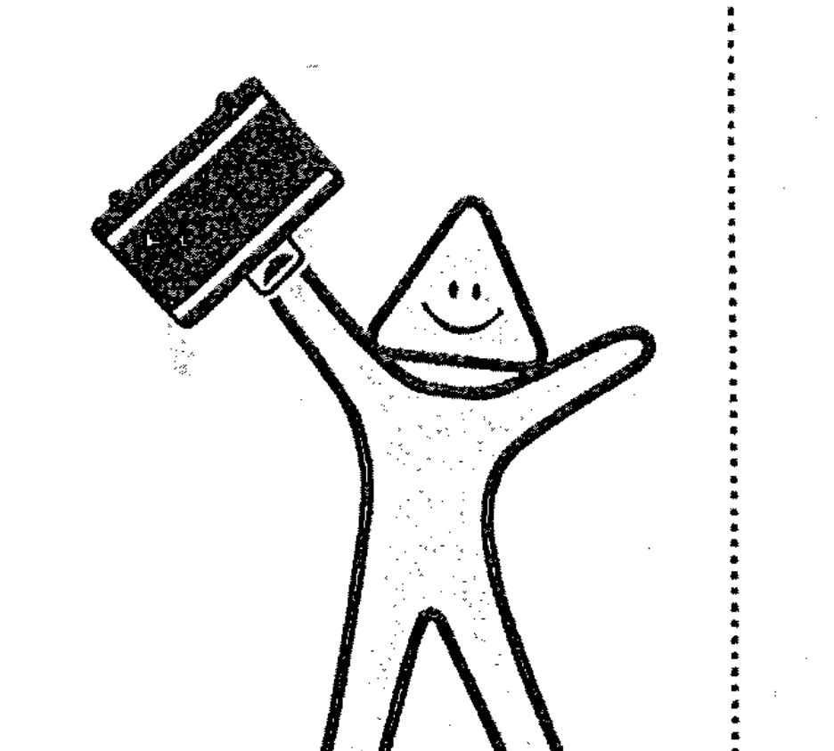

## 前言

# 網路數位時代，速度決定成敗

本書是為了懇切尋求著「快速工作法」的各位所寫。隨著IT（資訊科技）越來越發達，我們接收到的情報量以倍數在增長，但一天依舊只有二十四小時可用。而在有限的時間內，我們卻要完成「大量」工作並提供「高價值」成果，被要求像個超人一樣展現工作絕技，對於一般上班族來說，是非常困難的。

至今我曾在TOSHIBA、JR東日本、東京電力、FUJIFILM等企業擔任「速讀·迅速思考」的研修老師。在正式上課前的面談，我聽到許多學員感嘆著：「一天如果沒有四十八小時，實在是做不來。」但在課程結束後，就如同本書結語，多數學員表示確實獲得許多收穫。

然而，不僅在日本，全世界的人都會有下述的困擾

> 「渴望透過閱讀來吸收知識，獲得自己所需情報，但總是忙得挪不出時間。」
> 「總為了處理不斷冒出的雜事而忙得團團轉，工作遲遲無法有所進展。」
> 「即便想加班，但必須去接小孩，因此不得不把工作帶回家做。」
> 「因為自己的工作速度慢，所以迫切地想知道如何加快做事效率。」

這本書是為了「工作慢、零進度」而走到窮途末路的各位，具體說明高速且產生高價值成果的技術。

### 掌握二○%情報，工作速度飛快

對於「情報」的認知，很多人從未加以思考，只視它為一個詞彙而已。從「價值工程」（VE = Value Engineering）的角度來看，情報可以分為下列三種

- ①★★★ 最重要 (most important 1%)
- ②★★ 很重要 (more important 19%)
- ③★ 普通重要 (important 80%)

換句話說，所謂「情報」，對不同人而言，重要程度並非都相同。當中可能有「現在需要的情報A」、「不需要的情報B」、「已經知道的情報C」、「目前暫時不用的情報D」和「現在反而有害的情報E」等。從中找出「最重要」和「很重要」的○○%資訊，能帮助自我成長。

「最重要」的一%是「KSF」（Key Success Factor：成功的關鍵因素），掌握者通往成功之鑰，是此時此刻最需要的情報。

「高速工作術」的第一步，就是將情報分門別類，辨別對自己「最重要」、「很重要」和「普通重要」的資訊，並且重點處理「最重要」（一%）和「很重要」（一九%）的情報，毫不猶豫地捨去你認為「普通重要」（八十%）的情報。只要能做到這一點，工作的生產力、速度會迅速提升十六（四十倍。

### 高速工作的「IPO循環」

「高速工作術」的另一個核心，就是「Input」（訊息接收）、「Processing」（思考整理）、「Output」（傳達成果）的「IPO循環」。

### I PO 循環

Input - Processing - Output Cycle
如何獲得高速化・高價值的循環

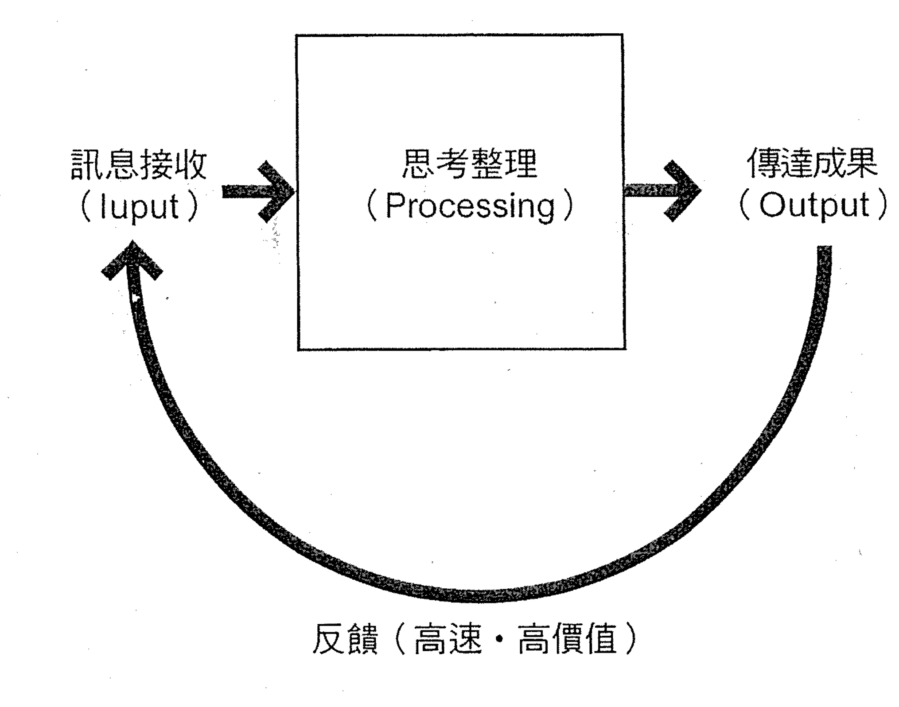

反思整理
(Processing)

訊息接收
(Input)

傳達成果
(Output)

反饋（高速・高價值）

I PO 循環是腦內產生出點子的作業工程，而所有的工作都是經過反覆I PO 循環所成立的。

在「高速工作術」中，納入了 I PO 各階段的腦科學應用和「價值工程」，並徹底研究出如何快速達到高價值的成果。

若是能將該循環高速地反覆運作，就可以「快速獲得自己工作所需情報」、「迅速思考整理為符合最終目標的型態」，以及「高速且最有效地傳達成果」。這些正是本書要教給各位的「高速工作術」。

接下來，我將加上自身經驗，進一步詳細說明。

### 速度能造就「高效益」成果

當我在三十、四十歲時，還是一名普通上班族，也面臨和各位一樣「被工作追著跑」的狀況。

三十歲左右在製藥公司工作時，即便身處於忙碌的生活中，但知識欲旺盛的我，不斷累積許多想閱讀的書。縱使求知慾如此的強烈，卻總是抽不出時間來好好看書，當時的我時常陷入這樣的煩惱。

四十歲之後，被分派到「國際事業部門」。而由於該工作的關係，我必須閱讀大量國內外有關「維他命」的文獻，再加上海外的駐派人員幾乎每天都會送來堆積如山的相关資料。讓我只想讀的書看不了，不得不讀的資料及文獻開始多得像山一樣，差點就要被壓垮了。因此我內心萌生這樣的壓迫感：「如果不能快速閱讀，絕對來不及處理這些資料。」隨後，我開始參加夜間學校的速讀課程。

雖然我因為該課程，熟習了當時主流的「右腦式」速讀術，甚至取得講師資格。但這時候我發現，就算閱讀速度再快，透過「訓練眼睛移動」的右腦式速讀，實際上並無法真正理解專業書籍、資料或文獻的內容和意思。

此時，正好到美國出差的我，得知美國總統都在學習的「歐美式速讀」相關情報。回到日本之後，到外文书店訂購了與之有關的書籍，忘我地開始研究。

爾後，我運用了擔任「藥品品質管理」負責人時期，所學到的「QC（Quality Control），也就是「品質管理」以及「大量且有效率生產高品質製品的技術，不斷地實驗、修正，終於研究出「齊藤式速讀術」—此方法不僅能快速閱讀文章，也讓我可以輕鬆愉快地確實理解、吸收書裡的內容。

接著，我開始想要將自己研究出的方法分享給大衆。對於強烈希望能「從大量的情報當中，快速地吸收優質部分」的人來說，我確信這個方法絕對是有所幫助的。

因此我下定決心，直接撥電話到某間出版社。很幸運地，編輯次長接到我的電話。我永遠不會忘記，和那位編輯次長初見面時，是在出版社附近的咖啡店，而那時正是最忙碌的年底。

當我向次長說明了自己的想法和點子時，他對我説：「那麼……請寫寫看這本書吧！」當場就獲得次長的信任，開啟了執筆的機緣。

但我表明自己不懂寫書的方法時，編輯次長告訴我，可試著將能想到的必要項目都逐一列出來，一個主題以一千兩百字彙整起來。無論從何處開始寫都可以，只要覺得好著手的部分就行。

奉獻新年假期所寫的速讀書籍，沒多久就準備出版了，還成為小有成績的暢銷書。就這樣，一邊持續著原本上班族的工作，一面開啟了我幸運的作家人生。

### 加快三階段，工作成效大躍進

我的這個故事中，充滿了許多促使「齊藤式高速工作術」發芽的種子。

「從挑戰速讀，到開始蒐集歐美速讀情報的經過」屬於「訊息接收（Input）」；「應用 QC 技術，不斷實驗及修正錯誤」則是「思考整理（Processing）」；「從打電話到出版社，直至書籍出版的過程」就是「傳達成果（Output）。

這三個過程中，「訊息接收」運用了「速讀術」來加快速度；而關於「思考整理」，因為當時我還沒研究出「迅速思考」的技術，所以假設是以等的速度進行；最後的「傳達成果」，很幸運地是掌握出版權限的關鍵人物，接聽了我的電話，並傳授了「快速寫作」方法，讓我能用前所未有的速度完成寫作。

在那之後，我就以 IPO 循環中「速度」和「兩成重要情報」的方式，反覆訓練自己。結果，透過不間斷的高速循環過程，我發現工作的速度開始越變越快。最後我得到的最佳回饋，就是累計銷售超過一百萬本的四十五本著作。

此外，為了傳達我所獲得的經驗，而開辦的企業研修或講座，聽講人數也超過了一萬人，這些數字就說明了成效。多年來，不斷地反覆運用 IPO 循環，在我本身的行動、業績和工作上都展現出成果（Output）。比如說，我成為研究所教授、醫學會和「健康科學」學會的理事；同時也創建了一個小規模的公司，成了社長；還在開發人類腦力、健康領域上有所貢獻。

本書的第一章、第二章會說明，如何進行高速的 IPO 循環，並以具體方法來告訴各位，怎樣透過「最重要的一％」、「很重要的一九％」來快速完成工作；第三章（第五章則是「速讀」、「迅速思考」和「快速寫作」的實踐篇；最後一章則會和讀者分享，如何創造全新價值的重要思維。

相信各位一定能在這本書找到自己所需的 Know-How（技能知識），也讓你一回到辦公桌，就會立刻想要實踐。

誠摯地希望大家可以學習這些經驗，進化成一名能夠「高速」完成工作，並提供「高價值」成果的菁英。如此一來，你就可以迎接豐富且充實的工作生涯。

## 第 1 章

### 時間不夠、效率低落，
問題出於不懂方法

### 踢走工作三大「絆腳石」，效率成果快速提升

執行一件工作時，可分成三個階段——分別是蒐集資訊的「訊息接收階段」（Input）；構思與發想創意的「思考整理階段」（Processing）；呈現成果的「傳達階段」（Output）。

當我們從高處俯瞰工作效率不彰之人的工作樣貌後，不難發現在這三個階段都出現了一道無形的阻塞物，並成為他們工作時的絆腳石。而這個IPO反倒成為降低整體工作效率的負面循環。

只要去除這些絆腳石，工作就能流暢地進行，執行的速度與現在相比，也會快上許多。因此，總是懊惱工作效率不彰的你，必須試著找出自己的工作「絆腳石」！

#### 情報速讀判斷力，成功加速的第一步

在第一階段所出現的「接收絆腳石」，導致你無法將「對工作有益」的知識輸入到大腦裡。

##### 成長受阻，只會更忙

是否曾聽過別人這麼說：「看了一本對自己十分有幫助的書」、「我參加講座，學習到新知識」、「我試著去參與不同行業的聚會」。此時，有些人則會說出以下藉口，證明自己整日為工作所忙，才無法挪出時間尋求自我成長：「你時間真多耶！好羨慕！我光忙工作上的事就昏頭轉向了一。沒辦法像你有那麼多空間時間。」「縱使如此，還是有些人在工作忙碌之餘，抽空閱讀書籍、參加研討會、學習

英文會話等，接觸工作以外的領域。

「那種人比較特別啦！」絕不能一開始就講出這種與「自我成長機會」劃分

界線的說法。若你心中有這類想法，那正是扯人後腿、阻礙成功的「絆腳石」。

請各位務必瞭解，每日汲汲於工作之中，不空出時間讓自己成長的人，就是

正在自己的「接收之門」前堆上更多的絆腳石。

###### ◆ 學習新知，才能加快效率

某個男人走在森林的步道中，看到一位十分專注、揮汗如雨，正拼命想砍倒

某棵樹的樵夫。而他發現樵夫身邊已有幾棵倒下的樹木，看來這位樵夫一直埋首

於砍伐樹木的工作。

這時，男人注意到樵夫手中的斧頭，發現刀斧已經出現缺口，它的鋒利度因

而降低了。因此，這個男人終於忍不住詢問樵夫：「您不把斧頭磨利一點嗎？」

樵夫悵然地回答：「我太忙了，哪還有空將斧頭磨利呢？」隨後，立刻再次高舉

斧頭，埋首於他的工作，似乎連再次跟男人交談的時間都沒有。

不知道身為拼命三郎的各位，看到這裡有何啟發？

如果樵夫不將斧頭磨利，他便無法乾淨俐落地在短時間內砍倒樹木，必須重覆好幾下砍伐的動作，才能成功砍斷一棵樹。這麼一來，勢必要花上許多的時間。更糟的是，他大概很快就會把手上的那把斧頭砍壞，最後失去這個賴以維生的工具。

對於樵夫而言，即使再忙，也應該花時間將斧頭磨利，因為這個動作對他來說是當務之急的事。

樵夫的例子是否也與你的工作情況相同呢？若是長久埋首於工作之中，不想辦法學習不同領域的新知識，以及提升原有的工作技能，最後便會落得如同樵夫的下場。

然而，身處商業戰場時，為了加速工作效率，也必須養成經常閱讀的習慣，並且與能夠提供新情報的人互動。因此，再怎麼忙碌都應該撥出時間來學習。

###### ◆ 事先蒐集情報，更快抵達目標

為了展開一趟舒適的旅程，行車路線、道路及目的地等相關情報自然是缺一不可。由於事先掌握了確實情報，所以既能充分享受路上的各種風情，也可以早一點抵達目的地。

因此，大部分的人都會先於網絡上查好行程，並在衛星導航登錄即將前往的目的地，或者攜帶地圖等輔助用具出門。而現在還可透過手機查詢地圖，所以大部分的人也不會帶實際的紙本地圖出遊了。

假如沒做好這些萬全的準備便貿然出門，可能會因為迷路或陷入可怕的塞車陣中，導致抵達目的地的時間遙遙無期。

當面對工作時也是同理。你可以**事先蒐集工作的相關情報、成功者不藏私的分享**，就能加快效率。比方說，「這麼做十分危險」、「這樣做可能讓工作效率停滯不前」、「如此做事比較快」等建議，全都可在成功者的著作中獲得。

倘若以「登山」來說，只要能先閱讀「有相關經驗者」的著作，大概就可以挺進八合目*，而剩下的距離，必須得靠自己的能力攻頂了。

假如缺少這些情報，做事可能會跌跌撞撞，造成工作進度停滯。

##### 閱讀新知是成功者的捷徑

然而，前面所說的情報大多寫在書本裡。當然，透過網路也可以查到一些資訊，或者請教別人也是一種有效的蒐集方式，但這些情報都不及書中所寫的清楚、有系統。因此，我以速讀的方式，從書中取得大量的知識來充實自己的技能，希望大家也能夠跟進。

德國的哲學家「奧斯維德」（ Oswald ）曾說：「成功者有兩個共通點。其中之一，他們都是經常看書的人。」順帶一提，另一個則是「正向思考」——積極

* 編註：「八合目」為接近日本富士山山頂之處。表示離攻頂不遠，但可能較險峻。

地熱行本書的「IPO循環」也是一種正面的思考模式。

書中囊括了先人血汗努力後所累積的經驗與智慧，所以成功者從書中獲得知識或情報後，就將之實踐於自己的工作上。

例如，平常我們很難有機會聽到，國外大企業家的成功經驗分享。可是只要你詳加閱讀該企業家所寫的書；或者某人訪問他後，所集結的作品，就能瞭解該企業家的理念，獲得具體且實用的情報，甚至可以得知他的成功過程與真情。

因此，世上沒有比閱讀更能獲取寶貴資訊的方法了。

想加速工作效率，提高最後工作成果的「價值」，蒐集情報是絕對必要的過程。而閱讀書籍正是集結有益資訊的最佳助力。

###### ◆「基模」能創造高効率度

假設某天你得知己一項訊息。一這個情報真是了不得！」這絕對不是你唯一能做出的反應，應該將重點放在「這情報是如何生成的？」此外，各位是否可以

立刻察覺，這是個能產生高價值的有益情報，還是只「哇！」的一聲便結束了。認知心理學中，所謂的「基模」（schemata）指的是「因知識或經驗的累積所得太智慧」。

基模「豐富」與「貧乏」的人，他們之間的差異，將明顯地表現在此————個基模豐富之人，在接收到情報後，能夠正確地分析何為「有益」以及「無益」訊息，並且知悉該情報「能不能用」。因此，他們通常能及早做出因應，不會讓機會逃走，也懂得搶先商機。這類型的人，總是維持著高効能的工作效率，容易創造高價值的成果。

然而，工作效率不彰的人，可想而知是因為你的「接收訊息」入口堆滿了絆腳石，同時也由於基模的不足，導致你無法充分理解眼前情報的價值。

小學生會獲得屬於他們生活中應有的基模；大學生、職場新鮮人，乃至叱吒商業戰場的企業家，都擁有各自獨特的基模。

假如你想學會如何分辨情報的好壞，進而提升工作效率，就必須設法增加自

己基模的廣度。那到底該怎麼做呢？

只要跟著「IPO循環」走，便可累積許多經驗；至於知識的積累，只要及

早讀完本書就能瞭解。因此我才會在書的開頭，建議大家必須閱讀大量書籍。

不管你再怎麼忙碌，養成閱讀的習慣才能幫助自己搶得先機、提升工作效

率，以及創造高價值成果。

###### ◆懂得速讀，三十分鐘看完一本書

「我已經瞭解閱讀的重要性了。但究竟要如何才能挪出時間讀書呢？」

「接收訊息」的入口堆積著絆腳石，或許讓你無法喘息。每天總是忙到連看

電視的時間都沒有。日復一日，過著回家，然後就睡覺的生活。

然而，由我所研發出來的「齊藤式速讀術」可以幫助你。只需要拿出三十分

鐘就能補充精神食糧。以下是我提供給各位的方法。

只要充分運用晨間三十分鐘，就能多出這些閱讀時間；通勤時讀書也是不錯

的方式，我向来都这么做——为了能够集中精神以速读的方式阅读书中内容，我常往前坐三站，回到发车的地方，确保自己已有位置可坐。速读的基本原则是，找出书中重点、熟读、深思其重要的部分。

除此之外，还可善用餐前的三十分钟、晚上入睡前的三十分钟。如此长度适中的三十分钟，以一整天的时间来说，应该不难取得。

并非“有时间，再阅读”，而是“绝对要挪出看书的时间”，只要你拿出这种气魄，就能实现每日三十分钟的阅读目标。

为了铲除造成工作效率不彰的元凶“接收讯息的绊脚石”，请务必学会第三章将提到的速读技巧，同时也要持续“三十分钟速读”的习惯。

#### 只要改变工作顺序，执行速度三级跳

你是否常常因为接二连三出现的杂务而忙得团团转呢？这都是第二阶段的绊脚石在搞鬼，让你执行工作的效率低效。

##### ◆ 掌握整体样貌，不再瞎忙

“明明一个接着一个把眼前的工作处理完了，为什么事情还是一堆？再这么下去，我似乎会永远迷失在工作的迷宫中，也必须辞职了。到底要怎么解决这个混沌的状态？”一个陷入工作苦恼的人向我求救，提出了这样的问题。

“最近辞职的前辈们所留下的工作也加诸在我身上”、“明明是最忙碌的时候，为什么把招募新人的工作交给我？”他的不满似乎已经濒临爆炸的极限。然而，“你好辛苦喔”这种同情是无法解决任何问题的。有一个更有效的方法能帮助他早日走出工作迷宫。接下来就与各位一同分享。

像这个人一样被现况压迫之人，大脑的情报处理系统，也就是“思考整理”的工作过程中已堆积了许多“绊脚石”。

前述的“情报”必须依重要性做取舍。相同地，工作也分为“重要的”及“不是那么要紧的”；同时还有“能交给别人的工作”、“先保留下来自己处理”、“可以不用做的工作”等。当这些事情全部混杂在一起，就会充斥着你的大脑，不断地压迫着自己。

列出上述这些工作类别，并不是叫大家将它逐一排前后顺序。如果这么做的化，反而会增加许多工作压力。

假如能单纯地依工作的重要度决定处理顺位，我想任谁都能简单解决所有工作。但往往许多工作在同一时间到来，焦点反而模糊了，干扰你的思维，让人不知道从何做起。会有这些问题，完全是因为我们没办法冷静分析大脑的整体图像，了解“当下的自己处于何种状态”，同时也欠缺正确的分析方法，便无法得知下一步该怎么走。

##### ◆ 改变工作顺序的绝招

想要快速将所有排程中的工作决定“优先顺位”时，有一个能帮助你立刻做出判断的方式，称为“心智图”。详细的画法及使用的方法将在第四章与大家分享。这个“心智图”不仅可以帮助你成功铲除工作过程的绊脚石，使你更流畅地处理工作，还能快速找到当下最需做的事。

从很久以前开始，我为了让执行工作的过程更顺畅，尝试过许多“笔记术”。可是不管怎么试，还是无法找到一个真正对自己有助益的“有效方法”。比方说，曾有一个笔记术教我将所有手边的工全部列出，把已完成的清单逐一打勾做确认。可是，当我一写出待办事项时，看着那些不断冒出的工作，不禁感到厌恶。

然而，在我逐一执行每个待办事项时，就连原本不需要完成的工作也让我忙得团团转，反而浪费了许多宝贵时间来处理不必要的事。

但是，经过不断地尝试、从错误中学习，最后让我找到了“心智图”的方法。请各位看下页的图。假设你总共有六件分别为 A、B、C、D、E、F 的工作必须完成。最中央的椭圆形有六条的树状形支线，呈放射状绘制。

这六条树状线的枝干部位写的是 A、B、C、D、E、F 各式工作种类。虽然乍看之下像是随意描绘的图，但其实这张树状分支图已成功将大脑资讯做了整理。

接着，在每一条延伸的树枝上写下自己应该执行的工作细项。此图就是你目前所有工作的整体模样，等同于工作俯瞰图。也就是说，原本大脑里乱七八糟的工作内容之想像，你已成功将它们全部绘制在一张纸上。这张图让我们瞬间了解大脑内部的样貌，也可称为“大脑图”。

只要一直盯着这张心智图，就可以立即知道哪些工作是比较重要的。

看了这个图之后，你将会获得以下启示：“A的工作必须先做这部分、B的工作要先做那些，总之必须先把它们都完成”、“D的工作下周再做也可以”、“E的工作先在说明时多花点时间好了”、“C的工作比较简单，请助理帮我做吧！”所有工作的优先顺序一目了然。

将优先顺位排出来后，便可使用麦克笔或色笔标注。用蓝色麦克笔将已处理完毕的部分涂销，而被蓝色涂过的部分就是你成功占领、夺得胜利的地方。当看到这些涂销，能让你产生十足的成就感。此外，还可从心智图归纳出来的工作事项中，把自己的应办事项明确地写在一星期或当天的行程表。

假如这期间发生了新的事件，再写一张心智图即可。一旦养成画心智图的习惯，用不到十分钟就能写完。只要花上少许的时间，便能帮忙大脑做整理，正确且果断地决定应办事项的优先顺位。

##### ◆ 瞬间转换思考的诀窍

所谓“马克杯握把法则”指的是，“别人与自己眼中看到的东西不一定完全相同”。假如你现在将咖啡倒入马克杯，并用右手拿着它。而刚冲泡好的咖啡香味正刺激着你的大脑。

问题来了，马克杯的握把位于哪一侧呢？对于身为右撇子的你来说，“马克杯的握把”在右手边，这不是理所当然的吗？因为这句话是从拿着马克杯的人口中讲出来的，一定不会错吧！可是，如果说此句话的人坐在你正对面呢？那么这时的“马克杯握把”应该是在左手边──这就是“马克杯握把法则”。也就是说，自己与别人眼中所见的事实，会因为接收方的立场不同而有所改变。

在“思考整理”的工作过程中，为了不让绊脚石影响自己，必须特别注意的是“不能单从自身角度看待事物”，必须“站在对方的立场思考”。这就是一种“复眼思考”\*的展现方式。在职场上，这边的“对方”指的是工作的“衣食父母”（客户、上司）。假如完全主观地照自己意思执行工作，无法配合对方的要求，结果不是失败，就是必须重头再来。为了填补这些失败所花费的时间，便成了拖慢工作效率的绊脚石。

工作无法如预期，这是理所当然的！但你必须确切掌握自己的目标，了解你在这份工作当中到底想获得什么。往右边走？还是往左走？直走？亦或是回转呢？假如可以瞬间做出判断，你就不会迷失方向，能够顺利完成工作内容。

> \* 编注：不受单一观点限制的思考方式。

##### ◆ 预先布局，解除麻烦与慌乱

决定工作的优先顺位，粗略订好行程表后，切记不可贸然将“虽然重要但不急”的案例提前执行，因为在案子到期日前的准备工作越完善，所得到的成果会越好。

因此，请拟定一个更加完善的行程表，藉此了解处理各项工作的时间顺序。这即是帮助你从成堆工作中解脱的黄金对策。

你是否因为十分忙碌，便把当下看到的工作优先处理。但如此一来，你将永远为了杂务一直忙得团团转。而这些工作大多都是“假如自己在一开始能妥善处理，就不会出现的麻烦”、“事前提升技巧，便可顺畅地执行的工作”、“倘若平常建立良好的人际关系，将获得一些建议与援助”，你有没有想过这些问题呢？

假如预知到可能发生的麻烦，就必须早日采取应付的预防措施，同时习得对工作有所帮助的相关技巧、建立广泛的人际网络等，虽说这些尚称不上是“当务之急”的工作，但却是最重要的。同时可帮助我们将来更加干净利落地完成工作，也不增添多余事项。

比方说，如果能够取得均衡饮食与运动量，并做好早期预防工作，就可拥有健康的身体，你也能在不担心健康的状态下全力在工作上冲刺；可是，倘若健康管裡做得不好，有初期症状出现也置之不理的话，恐怕将来会因为必须休假期而耽误了工作，同时还可能拖延了治疗时间。另外，治疗费也是一笔相当大的花费。而这些现象都是可想而知的。结果将导致工作大停摆，甚至脱离正常轨道。

工作和身体都是一样的道理。必须以长期的观点视之，做好预防工作。也就是说，准备、计划、管理的工作绝对马虎不得。

#### 价值工程＋二八定律，创造最高价值

在工作上你是否讲求完美，但却怎样也无法将脑中的创意完美地表现出来？

##### ◆ 别让“完美主义”成为绊脚石

“不把工作做得完美就无法安心”，这样的想法与坚持也是降低工作效率的一大要因。比方说，你的工作内容主要负责处理客诉案件，完美主义的你是是否妥善解决每一件客诉呢？当全部的事都处理完毕后，才感到自己对公司及顾客有所贡献。这种完成工作的成就感自然是十分令人欣喜！

但是，如果你可以在事情处理到某个程度便见好就收，就能将剩余的时间用来解决其它的工作。而且对公司来说，也会看见你高效率的工作绩效。

“可是，只要有一人感到不满意，不应该妥善处理吗？”或许你有着自己的坚持。但对于完美主义的各位来说，可能不知道的是，追求“凡事完美”的坚决态度已经成为自己工作效率的绊脚石。

为什么这么说呢？我将用以下“价值工程”的概念向各位说明。

##### ◆ 关键两成，能创造十六倍效益

一九八七年，意大利的经济学家帕雷托（Pareto），针对意大利的所得分配做了研究，发现一个定律：“意大利二〇％的人口拥有全国八〇％的财富”，此就“二八定律”的观点来说，不管什么样的国家或团体，皆可从下列的计算方式了解到这个事实：前20%人的生产力，是剩余80%人的十六倍——

- 这里有一个由一百人所组成的团体，假设生产力较高的前20%（A组，共二十人）能创造出80%利润。而这20位生产力较高的人，每所创造的利润相当于80%÷20人＝4%。
- 在这个一百人的团体中，扣除生产力较高的20人后，剩余80人（B组）所创造出的利润总额为20%。因此剩下的80人，每人创造的利润相当于20%÷80人＝0.25%。
- 因此生产力较高的A组20名成员，每人的生产力为4%；生产力较低的B组80位，每人的生产力为0.25%，将两者比较之后可发现生产力之差为A组（4%）÷B组（0.25%）＝16倍。
- 由此可知，假如将这个定律套用到工作上，只要处理前20%的重要案件，生产力就能提升到平常的16倍。

为“帕雷托定律”，或称为“二八定律”。

这个定律也能同样应用在其它方面。例如，可将它套用在经营、业务领域“ABC分析”上\*——“前二〇%的品项或者客户，可以创造出八〇%的营业额或利润，因此只要做好二〇%的管理与销售对策即可”。

在品管方面亦可套用此理论。只要重点式地解决前二〇%的客诉案、问题点，八〇%的客诉麻烦与困难便能迎刃而解。此外，也有以下的应用实例——因为检视全部近上万的生产品质为困难，因此可抽出其中的两成做为样本，经过仔细的试验后就能求得全面改善的良策。

因为善用这些品管技巧，让全世界，尤其是日本的生产力大跃进，更有效地生产大量且高品质商品，也因此让日本得以成为称冠全世界的生产技术大国。

而“齐藤速读法”和首次公开的“齐藤式高速工作术”，能将这个优秀的技术真正应用于知识产能（阅读），以及知识产业（knowledge work）上。

近几年来的产业界已经更加进化，在高品质、有效率、大量生产的现状下，开始以生产高价值及高附加价值产品为目标。倘若光靠“恶性价格竞争”是无法在斗争激烈的社会中生存下去的。

在这样的潮流推进之下，名为“价值工程”（VE：Value Engineering）又称为“价值分析”（VA：Value Analysis）的新技术也被导入生产线。除了企业之外，也同样可适用于个人身上。必须将这些新技术活用于知识产能（阅读）与工作上。其原因为何？只要以高速度创造高价值的产物，就能够从激烈商战中脱颖而出，成为最耀眼的业界第一把交椅。

我十分有自信，本书是日本首次，也恐怕是世界第一次，将这些真正的品管技巧与“价值工程”应用于知识产能与知识产业上。

接下来，我们试着把这些全新观念实际运用于工作上吧！

#### 一 价值工程 科学公式的实际验证

在价值工程的领域当中，有一个计算价值的公式。
V（Value 价值）= F（Function 功能・成果）÷ C（Cost 投入费用・时间）
托这个公式的福，开始能够在生产方式中，以数字来计算提高价值的方式以及找出创造价值的方法。这是一个划时代的做法，有笔者甚至将这种方式套用在知识产能的领域，完成了论文的写作，而该论文也被刊载于日本价值工程协会的杂志首版与前言。

究竟这个公式代表什么意思呢？

依据此公式所表示，V（Value 价值）与 F（Function 功能・成果）成正比，但与 C（Cost 投入费用・时间）成反比。

在 F 的值愈高，以及 C 的值愈低时，其 V（价值）愈高。

也就是说，当投入的费用愈少、时间愈短，生产速度越快时，就可以创造出更高的价值，因此这是一个将本书主题“高速·高价值工作术”以数字作为呈现的最佳计算公式。

接下来，我将在公式内套用数字，可能看起来有点难度。因此也会更具体地为大家说明。

所谓“二八定律”，以产品管理的方式来说明得话，便如四○○页图所表示的－样，只要能够从整体件数中，选出具优势的前二○%品项，并且确实地执行这二○%的管理工作，就能创造出八○%的成果。再将之套用到公式，可得出：

```
V（四○○%）＝F（八○%）÷C（二○%）
```

只要投入二○%的成本，就可获得八○%的收益，这就是“二八定律”，而创造出来的价值高达四○○%。

接着，倘若你坚信需投入一○○%成本才能创造高利益，不妨将之套用到这个公式，试着计算。假设你投入了一○○%的成本，同时所获得的收益也为一○○%的话，公式则变为：

V（○○○）＝F（○○○）÷ C（○○○）

上述公式的结果和运用“二八定律”的人相比，只能产生四分之一的价值。

然而，假设将一○○%的工作（C成本）套用在“二八定律”的话，便可创造四倍的价值。公式为V（四○○%）＝F（四○○%）÷ C（一○○%）

假使这时出现了一位“完美主义上司”，就算已整理出其余八○%的问题点呈报给他，但你只解决最重要的二○%问题，这位“完美主义上司”对于这样的处理方式一定会感到不满意。于是，他令你解决剩下的八○%不重要的问题。

倘若你也是一位追求完美之人，应该不会表示任何异议。不管怎么说，达到完美一事，是你们眼下最重要的。

在此时，你将创造的价值为“投入八○%成本而获得的二○%收益”，套入公式后便成了以下结果。

V（二五%）＝F（二○%）÷ C（八○%）

身为运用“二八定律”而创造出四○○%价值的人，原本可以不用理会其余不重要的事，却因为完美主义作崇的你，创造出来的工作价值仅仅二五％。也就是说，你只创造了十六分之一的价值而已。虽然这只是一个数字，但与总能切入工作要点的人相比，你们之间创造的价值差距竟然高达十六倍之多。

因此，完美主义简直是“不合时效”的做法。

假如想提升工作效率，最好在这里抛开你的完美主义。培养自己当机立断的能力，学会“丢弃的诀窍”。

关于将“二八定律”运用于工作的实际例子还有下列几项

- 假设共有十位成员一起开会，只要找出其中的两位关键人物 (Key Person)，并且说服这两人，其他的与会者便会跟随。
- 在提出问题的十人小组当中，找出提问最多的两位（领导者），并解决他们的疑虑，八成的问题将能迎刃而解。
- 假如有十件不得不接的案子，只要处理当中最重要的两件，就能顺势解决全体的八成问题。
- 假如有十个贩卖品项，只需重点式地大力销售其中重要的两个商品，就可达到八成的营业目标。
- 微软的创办人比尔盖茨 (Bill Gates)，他制造的并不是一台完整、百分百的电脑，只开发了电脑里的中枢商品——电脑的“OS”(Operating System) 作业系统。但比尔盖茨经由这个系统，运用在各家公司的电脑中，因而渐渐累积他的财富。

##### ◆ 专注二〇%，其余断舍离

假如我们欲丢弃一百%的坚持，要怎么做才能拿捏得当呢？应该坚守的界线到哪里？如何做才知道哪些事情是不用急着处理的？

这条“拿捏得当”的界线绝对不是单纯地划分于八成或五成之处。假如你想让工作产出最大价值，唯有遵循“二八定律”，挑出最具优势、优秀的前二〇%品项，剩余的八〇%请立刻抛弃吧！丝毫不需留恋。

比方说，当我们为新产品做企划案的简报时，与其一一、五十地从第一项照本宣科到第十项，不如从中选出两个最具优势的关键点，并且在简报内容中强调这两点即可。这么做也比较容易获得主管的青睐。

所谓“传达成果”（Output），指的不单单只是将想法化为企划书、报告书、论文或部落格文章等，此类可文字化的作业流程。自己的行为、表现、发言等也而是一种“传达方式”。

请在传达的过程中，整理出手边情报里最富价值的两成资讯。同样只需执行具优势的两成工作即可。如此一来，不仅能够全面提高工作的价值，你也将感觉到了工作效率明显提升了！

#### 工作做不完？关键在方法而不是能力

是否觉得自己“能力不足”，而失去信心了呢？或许让你工作效率不彰、总是做不完工作的，其实并不是你缺乏能力，而是方法不对！

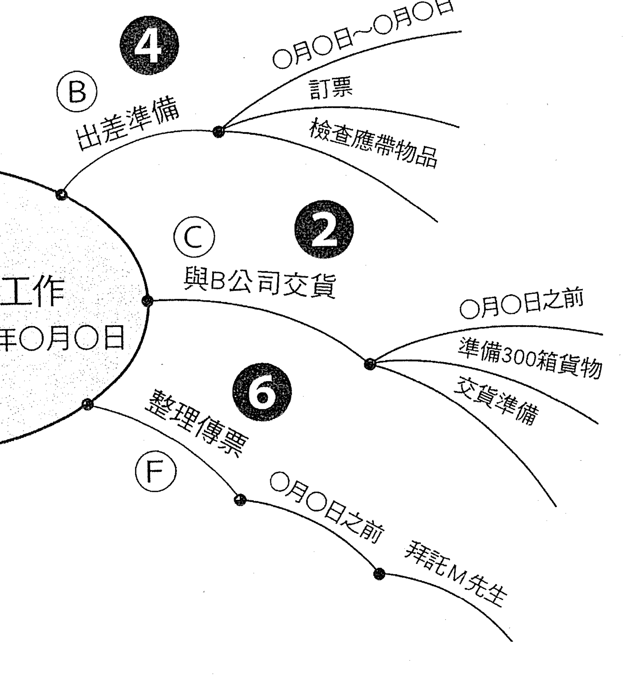
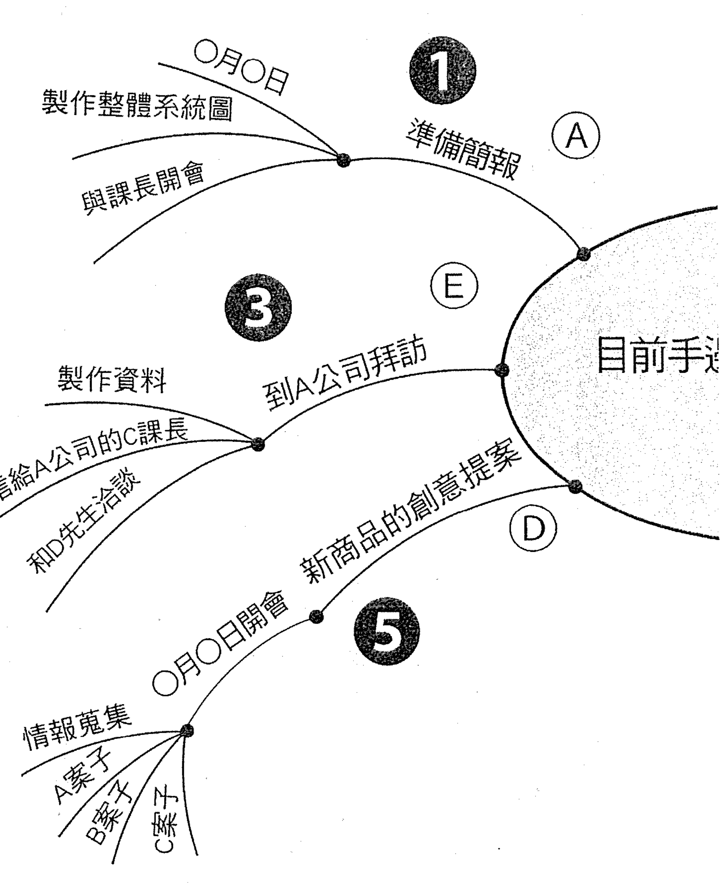
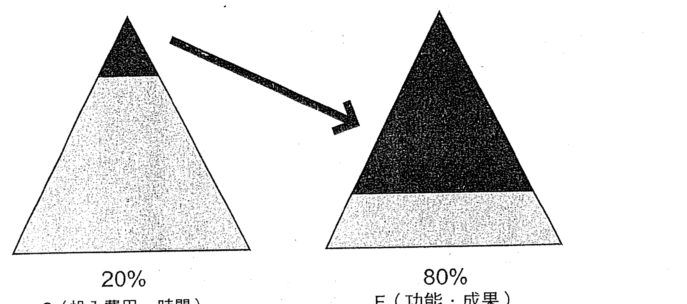
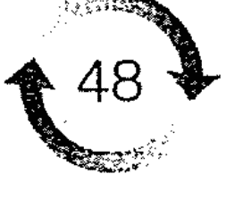


是扯後腿的人就是「你自己」！

「搞不好喔！就知道我的工作能力很差！」曾經萌生過這種想法嗎？此類負面念頭正是你的問題所在。

因此，請完全拋開這種負心態。等一下將與各位分享，如何善用每個人天生擁有的一千億個腦細胞。而只要懂得運用這些腦細胞功能就已足夠。

舉例而言，有位A先生的經驗與年齡都與你相仿，但A先生和你的工作效率卻是天差地別，這一切也將反映在最後的成效上。但絕對不是因為你本身能力拙於A先生，才導致你們出現極大的不同。只是因為A先生知道如何運用「IPO循環」的方式，以較快的速度創造高價值成效。

相較之下，現在的你抓不住IPO循環的要領，只是一味地焦急於自己低迷的工作效率，同時被關在困惑的迷團中。從現在起，你的所有疑慮將因這本書的出現而煙消雲散。

或許只是因為A先生已經領悟到「高效率工作的思考迴路」之精髓，而現在的你只是比他晚了一步，尚未領略到此要點罷了。

因此，我們從腦科學的角度來談談「高效率工作的思考迴路」吧！

#### ◆善用千億腦細胞，創造高效思考迴路

據說人類的大腦細胞總數為一千億個。不管是像蘇格拉底（Socrates）或亞里斯多德（Aristotle）這些出色的前人們，還是得到諾貝爾獎的科學家們，以及工作能力較強的A先生，甚至你自己，大腦的細胞總數皆是相同的。

人的神經細胞被稱為「神經元」（neuron），而這些神經細胞往外延伸聚集成束，即為神經纖維（nerve fiber），也就是我們一般統稱的「神經」。腦細胞便由神經元及神經纖維所大致構成。

每一個腦細胞透過神經纖維，以及神經纖維頂端被稱為「神經突觸」（Synapse）的接合部位，與其它的腦細胞相互連結，形成一個複雜的網絡。而這個網絡便稱為「思考迴路」。

比方說，當各位在解數學題目時，「思考迴路」將在你思考如何解題時開始運作，引導你想出答案。

當國中生第一次接觸數學時，剛開始連最簡單的問題也摸不著頭緒。可是，解了幾道題目後，如同大腦做幾次熱身操，起初完全不懂的題目也能簡單地理解它的内容，並且順利求得答案。然而，升上高三後，當你再回頭看國中一年級的數學題目，一定會纳闷自己當初為何被如此簡單的問題所困。

藉由解開相同的題目，使得充滿空隙的神經纖維，開始變得更密集。換句話說，因為思考迴路已變得強大，自然覺得最初的問題很簡單了。同樣的原理也可套用於工作上。只要重複做大量相同類型的工作，你就能掌握到要領與訣竅，便可在腦中順利建構高效率工作高手的「思考迴路」，當然工作效率也會提升。

- 千億個腦細胞是天生所有，但思考迴路卻必須自己創造。以積極面而言，只要製造的「思考迴路」充滿著無限希望的創造力，便能讓你一直保有創造能力；相反地，假如建立了一個消極且悲觀的思考迴路，當遇到難關時就會立刻退縮。

在創造「高效率工作的思考迴路」時還有一個重點——當你能夠常以熱情、快樂的心態投入工作時，腦細胞的神經纖維便會不斷地生長。這時大腦將分泌出有「正向荷爾蒙」之稱的「β腦內啡」（endorphin），大腦因而呈現人類感到放鬆與快樂時的「α波」狀態。如此一來，你就更能沉浸於工作中的樂趣。

試問自己：「為什麼努力工作於某事上面，或者力求改善方法呢？」這一切都是因熱情與興趣所致吧！而這兩件事必須靠自己察覺。比方說，即使是單調且無趣的工作，只要多花些努力，不僅可以增加每小時處理的件數，也會看見你和過去的自已不同之處，同時人際關係還會變得更好，光想到這些變化就讓人興奮不已。

假如想讓大腦的功能更加活化，需找出工作中有趣之處。而有些人會將工作視為自已的生存價值。但我想，如果能更進一步地回饋社會，做一些對地球有貢獻的事，相信你一定會感到十足的成就感。

面對工作時，是否保持熱情，將完全改變你的工作效率。然而，以此結論來說，只要徹底執行下列兩個動作，就能創造「高效率工作的思考迴路」：

- 重複演練「IPO循環」的工作方式
- 對工作常保創意之心，樂在其中

##### 最重要的百分之一

請各位想像一下，有一個飛碟即將從它的預備基地飛向外太空。而這個飛碟是甜甜圈做的。

甜甜圈飛碟不斷提高迴轉速度，咻——往天空飛去。同時，地面卻有一個甜甜圈飛碟搖搖晃晃、不安地轉動著，遲遲不敢往外太空飛。

這個甜甜圈飛碟眼眶泛淚，絕望地說：「為什麼我不能像大家一樣朝外太空飛去呢？自己真沒用！」此時，有一隻老鼠走了過來，笑著跟甜甜圈飛碟講：

「你很笨耶！因為我咬了你一口，所以才無法順利起飛嘛！你只要去麵包店將自己缺的地方補起來，就能立刻飛出去喔！」

「咦？原來如此啊！」甜甜圈飛碟慌慌張張地跑到麵包店，跟老闆要了一塊麵包，把老鼠咬破的缺口填補起來。於是，這個甜甜圈飛碟便開始旋轉，加快速度轉動自己的身體後，與其它同伴一樣，咻——朝外太空飛去了。

這是我自創的「甜甜圈飛碟」寓言，不知各位是否有所領悟呢？搖搖晃晃無法起飛的甜甜圈，正如同自怨自艾「工作效率不彰」的你！

當你因為自己某方面的能力不佳，而處於低迷狀態時，只要將這個部分填補起來，便能加速工作效率，創造顯著的成效。假設欠缺的部分為整體的百分之一，與你的潛能相比，不足之處頂多只佔了百分之二而已，但這個缺口卻常常是最重要的。

然而，你究竟欠缺什麼部分的能力呢？請試著做自我分析。

主管或客戶，平常是否就已經不斷地在提點你了？比方說：「不要每次都快要遲到了才進公司！記得早點到！」、「回應客戶時不能只說『嗯嗯』，要講『是的』！」、「要認真報告工作結果」，或者「常保持桌面整潔」等。

如果還有一部分不完美，到底是自己少了什麼呢？答案就在你身上。這不僅是一塊小缺口而已，要將它視為最重要的一部分。

當我們找到這個缺口後，請迅速填補它。這麼做才能發現那個缺口其實是最重要的百分之一，只要順利補足缺口，那就是你通往山峰的「成功之鑰」（KSF：Key Success Factor）。只需補強自己不足的地方，並改善不好的習慣就行。

當補強缺口過後，你便能大步往前邁進。像是最後成功飛上外太空的甜甜圈飛碟一樣，只要即時補救，就可改善工作效率不彰的情況，與同伴一同飛向天際。

或許你會認為：「真的這麼簡單嗎？？」但這是千真萬確的。只要你勇於嘗試，將能歡喜收割。

#### 學會「優點延伸法」，人際關係大躍進

為了提升工作效率，和諧的人際關係是不可或缺的。倘若和身邊的人起摩擦，將導致自己進退兩難，工作也無法依照你所想地順利進行。

然而，人們往往喜歡以「缺點修正法」來促使對方改進。這麼做只會讓彼此產生嫌隙，互相討厭而已。因此我建議大家在人際關係方面可使用「優點延伸法」。這是提高工作效率的重要方法之一。

「優點延伸法」指的是找出自己及對方的優點、可取之處，並將其發揚光大；「缺點修正法」則是指出自己或者對方的缺點，且為了修正它而被逼迫做某事的行為。這個「缺點修正法」不僅改善效率極低，對職場人際關係或自我修正也是一大致命傷。

所謂「缺點修正法」指的是將「完美主義」套用於自己或對方的方式。請各位切記，無法忍受工作缺陷的人，其工作效率較差，同時工作速度也很慢。

事實上，「優點延伸法」也同樣適用於「二八定律」。「優點延伸法」是一種準確瞄準自己或對方的兩成優點，並且試著引導出八成成效的方法；而「缺點修正法」剛好相反，他們只在乎工作後所創造的兩成成果，但卻花了八成的努力與時間來完成，因此消耗了極大的體力，是一個效果極低的方式。

各位還記得前面曾分別計算「只做重要的兩成工作，將剩餘部分捨棄的人」與「完美工作者」的產出價值，發現兩者之間的工作價值竟相差高達十六倍的事實嗎？「優點延伸法」與「缺點修正法」也是相同的道理。人際關係也可能導致工作成效出現十六倍的價值差距。一方意味著成功，另一方則代表著破局。

以下是發生在前來參加研習課程A先生的真實經歷。

A先生的公司要成立一個團隊小組，將負責執行新的企劃案。A先生被任命為該團隊的領導者。在每次開會時，同期進公司的B先生總在大家面前批評A先生：「進行工作的方式很奇怪！」、「完全不知道這個團隊想做什麼？看不到整體工作的願景。」B先生的意見總是充滿攻擊性，A先生也實在氣不過。

一開始，A先生只能暗自心裡偷罵B先生：「不要胡說八道！」、「都是那傢伙害的，讓我的計畫遲遲無法進行。」但是A先生內心突然覺得：「這樣子互相激烈地言語攻擊也不是辦法，計畫絕對不可能順利推動。我就試試研習課程中學到的優點延伸法吧！」

於是 A 先生開始試著思考對方的優點。結果他發現，原來 B 先生表達了這麼多意見是有原因的，而且他所言都有其道理。B 先生用自己的方法認真地為整個團隊計劃著想。因此，A 先生覺得自己應該以更積極的方式向客戶推廣，同時也認為有许多地方應該跟 B 先生學習。

經過這些思考，A 先生決定以和解為前提，找個時間和 B 先生談一談。「我對先前自己說的話感到很抱歎。你的想法也很棒，謝謝你讓我有表達意見的機會。」沒想到 B 先生竟然說了這麼一番夾雜感謝與道歉的話語。原本採攻擊姿態的 B 先生，態度收斂了許多。不僅如此，兩人之間的友情甚至開始萌芽。

在這之後，就算 B 先生想表達意見，也會以協助的態度做積極的發言，幫了 A 先生許多忙。經由這樣的轉變，不但整個團隊更加團結，更能全體一致地往目標努力。聽說最後計劃也成功達成了！

雖然職場上的人際關係總令人煩，但我還是想在這一章節的最後再次告訴大家：「只要常把優點延伸法放在心上，在工作時也能建立一個支撐自己的人際關係網絡。」

認同自身優點並加以延伸的「優點延伸法」功效十分顯著。這個方法不僅可以帶給自己自信及省下許多修正缺點的時間，同時也能不斷強化自身優點；相反地，如果只是一昧地想修正自己的缺點，不但習慣已累積多年，想改變恐怕十分困難，而且最後還會讓你失去信心。更糟的是，反而使自己重要的優點逐漸式微。

與其勉強自己修正缺點，不如透過優點延伸法增加自信。如此一來，缺點也可能會自動消失。

# 2

專注核心，其餘斷捨離，創造高效益成果

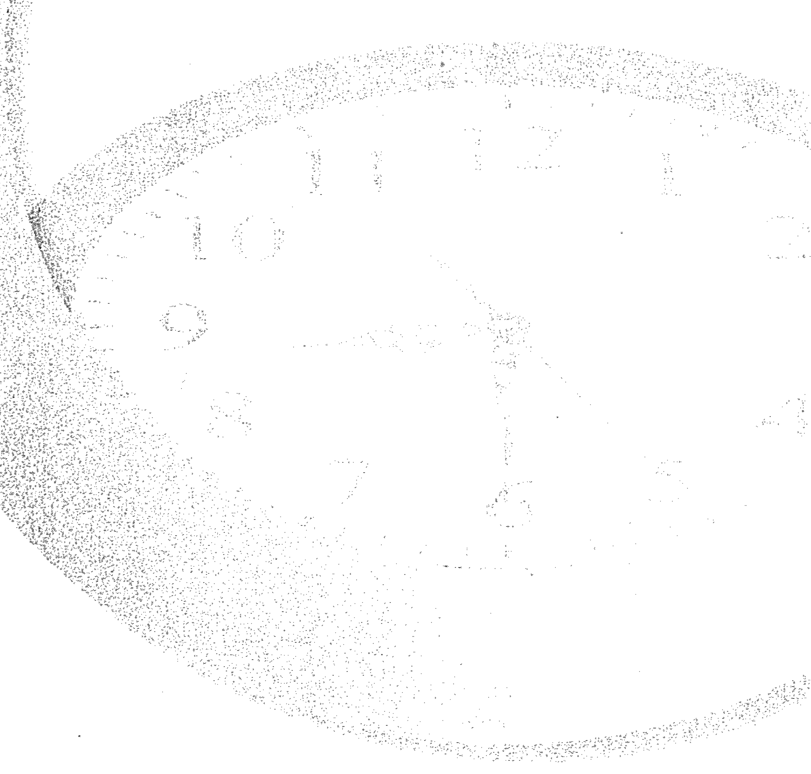

## 關鍵「1％」，迅速開啟成功大門的密碼

在第一 章的時候跟各位談到了「帕雷托定律」（二八定律）。相信大家已經知道它指的是，「一國之中，20％的人口，擁有80％的財富」之經濟定律。

接下來我想繼續與各位分享以下內容。

從世界經濟的分析角度來看，可以得到一個法則：「該國1％人民，擁有全國20％的財富」。或許最近的統計比例已經超過20％了，但為了計算方便就暫且以20％來算。也就是說，1％人民持有的財富，是其餘99％人的二十五倍。而我將這個法則稱為「一二〇法則」。

「一二〇法則」中最想傳達的事實是，「最重要的東西僅僅只佔整體的百分之一而已」。

## 〈1-20法則〉

- 1%的精英生產力，是團體平均生產力的20倍

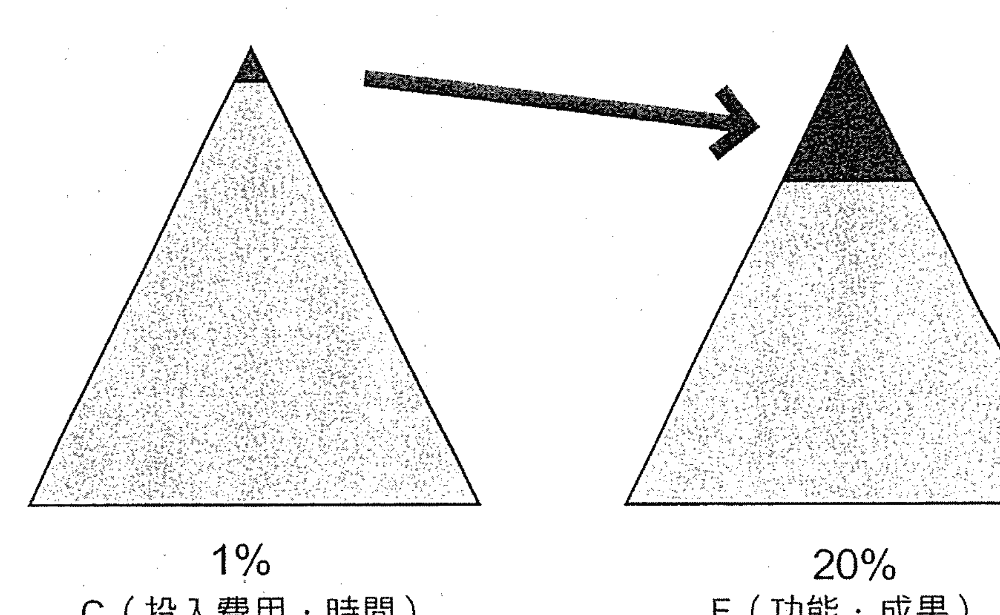

就「1-20法則」的觀點來說，不管什麼樣的國家或團體，皆可從下列的計算方式瞭解到一個事實：1%的精英生產力，是團體平均生產力的20倍——

- 有一個由100人組成的團體，假設生產力較高的 1%精英能創造20%利潤，而這位精英創造出的利潤相當於20%÷1人=20%。
- 在這 100人的團體中，因為團體創造的總利潤為100%，所以每一個人所創造的利潤相當於 100%÷100人=1%。
- 因此，生產力較高的1%精英所創造的利潤為20%，和團體當中每個人能創造的1%利潤相比，為20%÷1%=20倍。

假如將這個定律套用到工作上，可瞭解到一個事實：只要重點式處理前 1%的極重要案件，生產力就能提升到平常的 20 倍。

就情報的組成來說，最重要的佔一%，很重要的佔一九%，其餘部分則為八○%。其餘的部分雖然所占比例很高，乍看之下好像重要，但其實對當下的自己來說卻不是最要緊的，它只是混亂你的因素罷了。

是否成功掌握「最重要的一%關鍵」，或者能否準確瞄準目標，將大大扭轉你的工作成效。比方說，麥當勞創始人雷·克洛克（Ray Kroc）只因造訪一間位於美國加州聖博納迪諾（San Bernardino），店面不大但顧客絡繹不絕的漢堡店，就想出加盟連鎖店的經營模式，並從中獲得巨大財富。你能夠像克洛克一樣，確實掌握最重要的一%成功關鍵嗎？

如果我們欲算出一%情報導，實際運用於工作場合的價值。可將「一二〇法則」一套用到以下的價值工程算式裡，V（價值）＝F（功能·成果）÷C（時間·費用），則表示只要投入一%的成本，就能獲得二〇%的成果，因此可得到下結果：

V（一〇〇%）＝F（一〇%）÷C（一%）

一般人只能創造一○○%的價值，但使用「一一二○法則」的人，卻可擁有二○○○%的價值。兩者相比較後，竟相差二○倍。

「掌握最重要的一%情報，並專心處理它，其餘的全部丟掉」，這就是高速工作術的最高境界。

雖然以前面公式來看，那數據著實讓人感到害怕。但不論在人生或工作中，希望各位能夠漸漸從只能創造四分之一、一倍，或四倍價值的普通人，最後成為創造出二十倍價值的精英。

然而，大家都想找出最重要的一%情報。但要怎麼找呢？如果無法得其門而入，可是得吃上許多苦頭的。此時，工作效率不彰的人可能又要開始嘆氣了。但我認為還不需要如此灰心，因為所有的訊息都在你身邊，它們潛藏在周圍的人、事物、媒體或書本裡，也存在於整個社會裡。情報並在遙遠的星球，不用成為太空人，也不需要太空梭就可以到達了（請各位回想前一章「甜甜圈飛碟」的故事）。

是否能夠成功掌握關鍵，一切取決於你。接下來為各位介紹抓住重要情報的方法。

### ◆ 美國總統都在用的高速工作法

有泱泱大國之稱的「美國」，不論在世界的政治或經濟領域皆具有龐大的影響力，有著舉足輕重的地位。「美國總統」也可說是全球最忙碌的一種職業。總統的工作量不是一般人可想像的。他的業務量十分龐大。每天不但得閱讀堆積如山的資料、文件及報告書，同時也必須當機立斷地做出決策。

假如以一般的速度閱讀，並無法應付如此龐大的資料庫，因此歷任總統皆積極地尋找速讀方法。據說其中一任總統「約翰·甘迺迪」（John Fitzgerald Kennedy）的閱讀速度為歷任總統之首，也是一般人的四～六倍。

除了閱讀速度之外，甘迺迪在蒐集情報方面還有一個優點值得我們學習——即使是幾百頁、千頁的龐大資料，他也會命令部屬將所有內容精簡成一頁。這種做法剛好與「最重要的情報只佔整體的一 %」之想法完全吻合。可以說甘迺迪總統是一個天才型的工作處理專家。

另外，美國總統在經濟、外交及軍事等領域，皆擁有專門的輔佐官。即便總統本身對各領域的專業知識未達精通的地步，也能詢問輔佐官，借助他們博大的知識，並採納輔佐官的說明及意見。

我們也可以學習這種情報蒐集方法。第一個學習重點是，不管幾頁的龐大情報，都必須濃縮成一頁（一 %）。接著，就能順利取得最重要的資訊。

第二，當我們欲獲得某領域的相關情報時，可以透過人脈等尋找該領域的專家，掌握最重要的關鍵點。有些人甚至出版了書籍，也在網路上透過部落格提供情報，並且分享自己的獨到見解。

比方說，有一些部落客，專門閱讀「彼得·杜拉克」（Peter Drucker）「管理的實務」（Management: Tasks, Responsibilities, Practices），或「詹姆·柯林斯」（Jim Collins）「職業長青」（Built to Last）的超厚經營聖經後，以簡單易懂的短文介紹他們的理念。而一般人在忙碌的生活中，想靠自己閱讀完這些厚重的專業書籍實在不容易，如果能像這樣透過網路的搜尋，就可以知道他們的著作裡寫些什麼，同時也能快速掌握重點。

「單看這些內容，感覺自己只略知一二而已。」「你是不是心裡會這麼想呢？但即便只是閱讀別人分享的重點，也比完全無知來得好。而且讀者還能告訴大家情報的關鍵在哪裡。只看導讀的重點，總好過平常忙於工作中抽不出時間來閱讀。此外，這些導讀往往有更深入的見解，且能經網挈領地提供有益情報。

### ◆最關鍵的答案，就在「現場」

有一位年輕的男性經營顧問，被指派要為某美髮沙龍用品打響品牌名聲。即使平常他會上美髮沙龍讓設計師剪髮，但這對顧問對美髮沙龍業界卻是一無所知。因此，他採取了什麼行動呢？

「聽取前輩的經營經驗是最快的。」於是他立刻約了自己常光顧的美髮沙龍的店長小酌一杯。這位顧問並不是病急亂投醫，因為他從平常與店長的互動中，充分瞭解對方是個有自己想法的人才，經營的店舖在業界也是名聲極佳，所以希望向店長請益相關知識。

「美髮沙龍用品界的龍頭品牌是誰？還有第二跟第三名呢？」這位顧問開門見山地發問。接著，他又繼續提問：「那個第一名的品牌成為業界龍頭的原因是什麼？和第二名的差異為何？」「位居第三名的公司優點在哪？」「在過程中，他聽到許多美髮沙龍業界獨特的用語，並將這些牢記在腦海，之後再透過網路搜尋，一步一步進行他的計劃。隨後，這位顧問腦海裡就有了美髮沙龍業界的整體樣貌。然而，透過網路的關鍵字符搜索，他對那些業界用語有了更深一層的認識。對於想更深入瞭解的部分，則買了相關書籍開始認真研究。

於是，這位顧問已經能夠掌握拓展「美髮沙龍用品」的執行方向了。

透過這件事想讓各位知道的是，你想瞭解的情報，只要詢問「有自己獨到想法」，同時能夠言之有物的人，就可以切中要領地掌握相關資訊。

活的知識與情報，是任何東西都換不到的，這是它們最大的優點。而且最重要的資訊就潛藏於其中。

想要確實掌握最重要的一%情報，最好的做法就是「從現場找答案」。請試著在自己獲取的情報堆中，或周圍之人的口中取得有益訊息吧！

### ◆ 掌握「自己的關鍵字」，成功的不二法門

「齊藤式速讀法」裡，有一個名為「關鍵字法」的執行方式。

這個方法的意思是，當我們集中精神閱讀一本書時，關鍵字一定會一直出現在眼前，此時你必須降低速度，讀取關鍵字周邊的相關情報。

各位知道關鍵字總共分成兩種嗎？

- 一種是「自己的關鍵字」——「我想知道這件事」、「我對此事抱持高度興趣」、「這是目前自己的人生方向」等，只要心中有了這些關鍵字，就算在快速翻閱資料時，關鍵字也會自動映入眼簾。

另一種則是作者想傳達給所有讀者的「作者關鍵字」——當對方強烈地向自己表達個人主張時，表示他想傳達的正是「關鍵字」，只要你的天線能及時接收到，就可以順利取得相關情報。

這個「關鍵字法」也同樣能夠應用於工作上——以先前提到的「麥當勞」為例，創始者是「雷·克洛克」，就用他的故事來跟各位說明吧！

克洛克在五十幾歲時，為了販賣製作奶粉專用的攪拌機，他的身影遍佈了全國各地。偶然間，有位客人開門見山地表示：「我想要一台跟加州「聖博納迪諾」○○漢堡店一模一樣的攪拌機。」克洛克對這台攪拌機感到十分好奇，於是他便遠從芝加哥到加州，實際到了這家店一探究竟。

這家店的經營者是麥當勞兄弟，他們一次使用八台攪拌機，依序地製作奶昔賣給客人。讓克洛克驚訝的是，在這兩兄弟的經營之下，不論是食物的調理過程或販賣系統皆十分有效率，而且他們每天劃下的業績也十分可觀。受到震撼的克洛克腦中突然浮現了一個新想法——將麥當勞兄弟的漢堡餐廳以加盟連鎖的方式

擴大經營。於是，擁有現今如此龐大規模的世界連鎖漢堡店就這麼誕生了。

克洛克一開始便掌握了自己的關鍵字「攪拌機」。他眼中看到的亮點皆是攪拌機；當他造訪麥當勞兄弟的漢堡餐廳時，也發現了隱藏在店裡的關鍵字，就是能快速做出美味人氣商品的「高效率生產系統」。接著，這個關鍵字瞬間起了化學反應，轉化成實際行動。透過克洛克的例子，可以獲得一個感想：成功者都是在上天給予「啟示」時，能順利接住的人。

為了能夠接住這些啟示，成功之鑰在於你是否能掌握其中最重要的情報。因此我們隨時都要知道自己的關鍵字為何，同時也需不斷增加新的關鍵字，並且靈活地嗅出從裡面衍生出的「現況、事物、人及社會現象中的關鍵字」。

試著想想看，對你而言，自己的關鍵字是什麼？

## 「組合關鍵字」，情報精準度大提升

「GOOGLE」的搜尋功能，可以幫助你找到絕大部分的欲知情報。想取得最重要的資訊，就只能藉由這種方式。

〔GOOGLE〕每天處理的數據量上看二〇PB（Peta Bytes＝千兆位元組，相當於兩千萬GB）；每日做成的索引（Index）共有二百億頁；在歐美、亞洲及南美等地，總共有三十六所以上的巨大數據中心，每天處理的「搜尋次數」為十億次，而這些數據正年年增加中，現在所得之數據應該更高了。此外，據說跳出「搜尋結果」的平均時間僅為〇．二五秒。

想從龐大情報量中挖出自己想知道的部分，必須靠一點小技巧。訣竅就是，在搜尋時輸入的關鍵詞不要只是單一個或兩個，而需有三至四個。藉由關鍵字的組合，能獲得精準度更高的情報。

比方說，假如我想要以「情報」為關鍵詞，搜尋相關概念的網頁。如果單純打上「情報」二字，只會找到許多不著邊際的訊息來源；如果同時輸入「情報」、「知識」、「智慧」三個字，則將看到圖表，以及眾多有趣的數據。根據每次輸入的關鍵詞之不同，搜尋到的情報精準度也會出現明顯差異。

為了組合三、四個的搜尋關鍵字，必須充分瞭解自己「想知道什麼？」、「為何想獲取該情報？」也就是說，必須有明確的目標及目的。

因為非知道不可，所以在獲得想要的情報之前，需要不斷地嘗試組合各種關鍵字。只要能夠以準確的組合做搜尋，一定可以找到跟自己預想狀況吻合的情報。有「GOOGLE」這樣的巨大網絡做靠山，你就能成為出色的情報通。這麼方便的东西應該要充分利用！

## 善用「漩渦心智圖」，工作順序快速排定

到目前為止，針對提升工作「效率」以及「價值」方面，我提出了以下的方法供各位運用：

- 讓工作時的「IPO循環」運作更加順暢，並藉由不斷地循環這些過程，使得工作更有效率，締造出更大的效益。
- 不斷累積經驗與知識，拓展「基模」（智慧）廣度，創造快速、高價值成效。
- 領悟高效率工作的「思考迴路」精髓與「思考習慣」。
- 確實掌握最重要「1%」情報，以及重要的「兩成」工作，剩下的全丟掉！

接下來，將跟各位分享一個從「心智圖」中所發現，你也絕對能夠實踐的高速工作術──就是「漩渦心智圖」。當你真正執行時，一定會受益良多！

「漩渦心智圖」的真正意義是「順向地處理當下工作，並且逐一把它解決掉」。這個方式看似平凡，但效果卻十分顯著。接著為大家介紹此方法的意涵。

### ◆ 現在該做些？「漩渦心智圖」幫你找

請各位再看一下第三十二、三十三頁的心智圖。假設現在你手邊有六個工作需要處理，請打開記事本，做一張滿載任務，屬於自己的心智圖！

每一項工作中，必須執行的動作會延伸出許多分支。接著，請在這個圖上畫

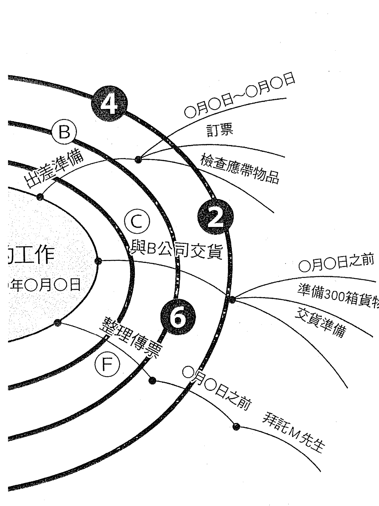

## 漩渦心智圖

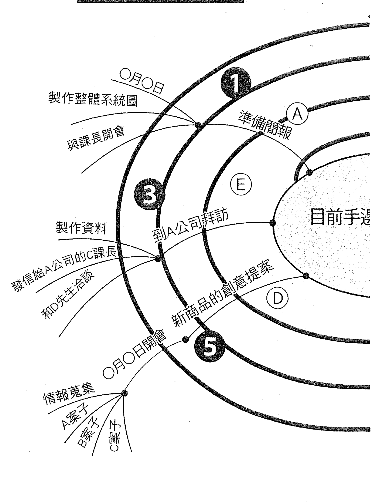

出一條又一條螺旋狀的漩渦，即為「漩渦心智圖」。倘若你還是不明白怎麼做，請參考以下的詳細說明──

- ① 第一步就是畫出一般的心智圖，決定工作的優先處理順位——依照工作的重要程度，依序標出一、二、三、四、五、六的編號。
- ② 先著手處理排在第一優先順位的工作，這裡就是漩渦的起點。第一優先要做的工作，則為「全部工作量」的兩成（請回想「二八定律」——只要完成兩成的工作量，等同於解決其它八成的工作）。

同時，只要處理好「第一順位工作中」，最重要的一%」（KSF: Key Success Factor）項目，就等於解決了「第一順位工作」裡二〇%工作內容。在處理時，還可用紅色麥克筆將該件工作的首要（大分支）、次要（小分支）項目塗上顏色，以視重要性。

集中精神解決完第一優先的工作後，再著手處理第二順位工作。當第二順位工作也完成後，它們將佔整體「工作成果」的兩成。接下來的三、四、五、六順位工作也依照相同的方式處理。解決掉的分支用「藍筆」塗銷，做為對自己的獎勵。這時候你可能會發現有些工作處理起來十分簡單。只要花個三分鐘打電話，接下來就能把工作交給接電話的人。此外，你也會瞭解到，有一些工作根本不需要再多費心神處理。「像這種太細微的執行步驟可免了吧！」、「聽說那間公司業績不是很好，不用再跟他們積極來往了！」這些新發現也會在此時冒出。但不要忘記了，你的首要目的是在這個階段整理手邊工作，用「斷捨離」的心情將不必要的東西通通丟掉！用藍筆把它們都塗掉吧！

以上即為「漩渦心智圖」的「第一週期」。也就是把漩渦當中的第一圈待辦工作處理完畢了。

- ③ 接著將進入第二週期。此時要處理「第一順位工作」中尚未解決的分支，以及剩餘工作的「最重要」— %項目，和「第二順位工作」的兩成內容，這時期就要把不需要的枝葉剔除。

有些工作在這個階段就能解決。此時，漩渦的第二圈處理完畢。

# 改變工作順序，每天上班只需 4 小時

- ④ 進入第三週期後，只剩下需要較多時間的大型工作，這時候請全力以赴。

進入到漩渦的第三圈及第四圈時，再以「藍筆」將處理完畢的工作全部塗銷。如此一來，這個計劃便已完成。接下來，你就可以開始繪製下一個不同主題的心智圖。按照以上做法，讓工作如同漩渦般一圈一圈地解決，這就是「漩渦心智圖」的真義。

依照這樣的處理方式，既不用擔心你忘了打電話而造成工作損失，或是怕自己不記得準備東西導致錯失商機等。

「只是照著循環走而已，這個方式很普通啊！」或許你會這麼說。但此方法的重要關鍵在於，透過「心智圖」，俯瞰工作整體樣貌。因此，請各位一定要再次溫習三十二、三十三頁的心智圖繪製方式，同時參考第四章所說明的「心智圖做法，製作自己的工作地圖。掌握了工作整體樣貌後，便以漩渦的方式排定工作優先順序，井然有序地整理思緒之同時，集中精神處理眼前工作。

在這樣子的運作之下，你不會被單一工作牽絆，而是順著漩渦走，一步步完成工作。

### ◆「訂下截止日期」，工作效率倍增

「漩渦心智圖」有必殺絕招——就是對每一項工作訂下「截止日期」。

茫茫然在工作堆中打轉並不是好事，必須藉由分割時間，讓工作更有效率。「在三十分內完成工作」、「用十五分鐘解決這個事情」，當你做了這些決定後，請在碼錶上設定時間，或者看著時鐘開始著手處理。此時速度便是關鍵，因此請注意，必須集中精神，專心地時間內完成工作。

然而，在繪製心智圖時便已決定了工作的先後處理順序，就算將時間細微分割再執行工作，也能夠確實掌握整體工作的完成度。

這是一個最不拖泥帶水，又可快速處理工作的有效做法。而且這個「訂下截止日期」的原則適用於所有的工作。建議大家從今天起就開始實踐。

## 奪回主導權，讓工作變「僕人」

「國王」與「家僕」的概念是出現於我正值四十出頭，埋首在速讀術研究之際。當初我為了訓練自己的速讀能力而站在書店看書時，起先是攜帶碼錶前往，而開始閱讀便按下碼錶，挑戰自己的速度。

但在一次閱讀中，我發現使用這個方法，竟讓書本成了「主子」，而自己卻變成「隨從」。

儼然以「國王」之姿出現的書本，竟然站在上位，而我卻一直以戰戰兢兢的心情，用速讀的方式試圖將書讀完，這種畏懼的情緒很快地侵蝕了我的內心。但是有一次我突然像被雷打到一般，瞬間清醒了！心中不禁這樣想：「我可以自己決定三十分鐘看完一本書，只要設定碼錶就好了。我才是國王啊，書本是家僕！」會萌生如此的念頭，是因爲我看了一本書後突然靈光乍現的。那本書是針對

「豐田汽車看板管理法」而論，進一步探討豐田汽車的生産管理方式。

一般工程的生產模式是先訂立生產計劃，接著需預測必要的零件數、調配零件，最後進入生產。但這種方法不僅讓各個作業程序皆留下可觀的「零件庫存」，還會有許多「成品的庫存」。此時為了徹底降低這些庫存數，豐田汽車便以逆轉的方式，想出了「看板式」的管理方法。

當第一次車子出貨之後，第二次要生產的數量與前一次相同；生產線上較後端的作業所使用的零件，則和前二作業程序中所用的零件數是等量的——這時候就必須藉由「看板」將「零件領取情報」及「生產情報」顯示出來，使其透明化——這個想法就是「主僕的逆轉」。

如此一來，零件供應商就能隨時依照「看板」上的指示，補足所需的零件量，同时也可以依照「看板」的指示控管交貨日期。

我從這樣的生產管理方式得到了啟示，將「主僕逆轉理論」與「訂下截止日期」這兩個方法加到了速讀術裡面。

當我們在速讀的時候，你必須是國王，書本是家僕。而身為家僕的書本應該在既定時間內對國王提供必要的情報。

事實上，工作也是相同道理——稱王的是你，工作則是你的家僕。因此，必須訂出「截止日期」，促使家僕更努力地動起來。這麼一來，你大腦的專注力將大大提升。這時請不要忘記「二八定律」以及「一一二〇法則」。

務必事先告訴你的合作對象，工作有截止日期與固定的交貨數量。也絕對不要被工作牽著鼻子走，工作應該由你來安排。

三十年以來，我一直持續研究讀書的技術及速讀方法，並建立了速讀的體系。所謂「齊藤式速讀術」指的就是如何從知識寶庫「書本」身上，有效率地取得更多資訊。

現今社會充斥著各式各樣的情報，幾乎所有的工作都必須建立在情報處理這一環，因此齊藤式的各種速讀技巧皆適用於不同的職業。而本書便是實際執行的最佳代言人。

當你透過速讀術開馘了其它扇門後，更可以藉由本書的「齊膝式高速工作術」打造你工作的無限可能性。

此外，「接收訊息階段」中所使用的速讀技巧，也能實際應用於「思考整理」以及「傳達成果」階段。

## 專注焦點，才能創造最強優勢

「打造最出色（突出）的優勢！」是「高速工作術」想傳遞給各位的重要訊息之一。重點在於如何專注地強化與突顯自己的 能力。

若想快速完成工作，絕對需要專注力。話雖如此，但我們終究無法對所有的工作同時保持高度專注力，倘若實際執行，成功的可能性也不大。此外，如果不斷地將專注力放在不需動頭腦思考的事情上，恐怕只會讓工作效率大打折扣。

倘若生活中缺少高低起伏的變化，將導致我們在面對重要的事，以及不要緊的事情，皆以同樣的態度處理，熱情也會被抹滅。如此一來，當真正遇到重要的事情時，就無法上緊發條，發揮全部的專注力。

只有全力集中專注力，將之用於最重要的工作上，才能想出最優質的戰略，創造高效益的成果。

所謂『最出色』（突出）的部分，指的就是你最具優勢之處。不同於一般人，有著自己獨特的強大力量，即為『最重要』（一％）及『很重要』（一九％）部分。

心理學家將這個異於常人的強大優點稱為「釘子」（splice）。這裡所謂的「釘子」指的是釘於鞋底或輪胎上的強力型釘子，同時還有止滑的功能；在打排球的時候，「spike」則意指大力殺球，使球成功落在對方球場而得分。

美國著名的經營顧問「理查·寇克」（Richard Koch）曾表示：「不管什麼樣的人，都擁有二○％的『釘子』（優點）。」。將這個釘子發揚光大，就是『優點伸展法』的最佳詮釋。

他同時也表示…「被喻為現代超級巨星的『比爾蓋茲』（微軟創辦人）、『賈伯斯』（Apple創辦人）、『傑佛瑞．貝佐斯』（Jeff Bezos，亞馬遜創辦人）、『安迪．葛洛夫』（Andy Grove，Intel創辦人）、『傑克．威爾許』（Jack Welch，美國通用電氣第八任執行長）等人，皆成功發揮了他們一〇〇%的「釘子能力」（超強優點），才建立了自己的輝煌成就。」

請各位想像一下「錐子」這種工具。假如錐子的前端不尖銳，像研磨棒一樣圓圓的話，絕對無法順利打洞。

因此，當你面對最重要的一％優點時，你需要的是如同以錐子前端開洞的專注力。而「專注力」也彷彿錐子的頂端一般，必須常保持尖銳的狀態。如此就能打造出最重要、出色的部分。

只要能夠傾盡全力，把所有精神集中於最重要的一％上，並把自己的優點研磨地如同錐子前端一樣尖挺、光亮，即使是銅牆鐵壁也能順利鑿出洞。而且你將會看到令自己驚訝的優異成果。

只要按照這個方式繼續堅持下去，成果將逐漸鮮明閃耀。而當你順利鑿洞後，也能獲得周遭人的認同。

平凡、一成不變，是無法得到任何人的認可。同時，倘若失去了尖銳的頂端，就沒辦法順利鑿出洞，更不能突顯自己優於他人之處。

想必各位看到這裡，就知道所謂「出色的部分」指的就是第二章的主題，最重要的「一%」，隨後才是很重要的一九%。

只要大家能夠確實實踐第一、二章所傳達的方法，相信你一定可以秀出自己獨特的「優點」。

第一優點（最重要的一%）出現後，隨之誕生的是第二優點。而第一優點彷彿是阿爾卑斯山脈中，絢爛耀眼的馬特洪峰（Matterhorn），唯一且迷人！

托各位的福，齊藤式速讀術也因本書進化成了「高速工作術」。而且我為這個已逐漸成型的工作術感到驕傲。希望首次將齊藤式速讀術的精華運用於工作的方法，能夠幫助各位順利打造自己最出色的優勢！

## 繁瑣資料文件，也能快速理解的「速讀術」

### 美國總統「速讀術」，文件再多都不累翻

長久以來，我一直不斷研究能夠大幅提高工作價值的「速讀」技巧。最終，有了具體的執行方針，將在这一章與各位分享。這是一個淺顯易懂，並且可以馬上執行的優質方法。

在能夠提高數倍／數十倍工作效率的「高速工作術」中，第一歩必須將「速讀術」應用於情報蒐集過程。

為了快速且大量地取得最重要、優質，且能立刻與工作連結的情報，就要仰賴快速閱讀的技巧。

成功掌握速讀技巧後，除了能將它具體運用在書本上，也可把這種速讀法應用於「人」和「社會」上，幫助自己取得有益情報，並且實際活用該訊息。

速讀的理念就是——把對自己無益的部分併除，在背後幫助原地踏步的你往前一步，並建立自己高速、高價值的優勢領域。

先前在第二章已經與各位分享過——歷任的美國總統必須閱讀許多相關知識的書本、文件或報告書，而為了消化這些龐大的資料，學了一種最有效率的速讀術。

美國第三十九任總統卡特（Carter），在他的手記當中便有明確記載過此事。當時他從美國喬治亞州的州長一職脫穎而出，被選為總統。而在他擔任州長之前，一直從事自己的家業，經營一個花生農場，似乎也未曾特別學習任何的速讀技巧。

自從卡特入主白宮後，發現以一般的閱讀速度完全無法應付這些大量的文書資料——「每天在總統府長時間工作之後，晚上總是待在公事包裡裝著滿滿的文件帶回家處理。剛開始還覺得滿快樂的，但過了一、二週後，我便意識到必須減少自己的工作量。—《卡特回憶錄：忠於信念》（Keeping Faith）」

因此，為了解決這個問題，他每週在會議室設了一個速讀訓練時間，並與夫人及身旁較親近的工作人員一起受訓。

結果卡特總統在訓練後說了這麼一番話：「雖然只上了兩次課，但我的閱讀速度已經比之前快兩倍，之後又在不知不覺間加快為四倍。當訓練結束後，我甚至不再為文書處理工作所苦了。」

從那時開始，他拿回自宅處理的工作量不僅大幅減少，還多出了許多閱讀、看電影，以及與家人相聚的時間。

即使不是身為事務繁忙的總統，也必須學會能夠幫助自己閱讀大量資料、文書及書籍的速讀術。

「我都把百年紀了，才開始學習新的技巧會不會太晚……。千萬不要說這種喪氣話，當初卡特總統也是在五十三歲才學會速讀。

然而，為了幫助自己從日益膨漲的資訊當中，成功取得並運用必要情報，須盡早學會速讀技巧。

### 快速閱讀，儲備知識，人際關係能變好

請將「閱讀」變成一種習慣。接著你就能透過速讀技巧，快速閱讀眾多書籍，並從中找出當下對自己最重要情報。書籍是智慧的寶庫——專家或熟知各方面領域的行家們，將他們長年研究的知識與經驗，全部匯集於一本書裡。

由於每天都會有許多不同領域的書籍上市，各位是否發現自己想看的書籍或者不得不閱讀的書日益增加——像是前輩或朋友向自己介紹一些「非讀不可」的書、暢銷書，或者是報紙、雜誌的書評中強烈推薦的作品等。

情報也請求速度。倘若你「思考整理的速度」總是無法跟上「情報流動速率」，恐怕就會讓寶貴訊息眼睜睜地從眼前溜走；書籍也是同樣的道理，當我們向網路或實體書店訂購某書後，所有書籍都可以在一定時間內快速送到自己手上。但是看書也有時機之分，因為「情報」期盼透過各種形式提醒你，各位不能只是讀取字面意思，必須抓緊時機，讀出書中想表達的重點。

假如有任何書籍想介紹給客戶閱讀，希望各位能夠先以電子郵件將讀後感想發給對方；倘若某本書是同事間正在討論的話題，而你卻未能及時閱讀該作品，恐怕就無法搭上話──閱讀也有助於你的人際關係發展。

此外，與現在手上工作相關的書籍更是有其閱讀價值。看這樣的書不僅是為將來的發展，同時也能幫助自己提升一些工作上的技巧。

在適當時機下，透過大量閱讀能讓你掌握「重要」及「必要」情報。

只要從書本中累積眾多知識，當我們面對龐大資訊時，便能快速地一眼分辨出哪些為「非必要」及「不值得擁有」的情報。

### 「齊藤式速讀術」，三十分鐘讀懂一本書

「齊藤式速讀術」的基本理念共有兩種。

第一個理念是「二八定律」的實際應用，請大家意識到「書中兩成的重要知識，囊括你所需情報的八成」，因此你必須先找出這兩成關鍵訊息。另一個理念是，對自己的閱讀時間設立「截止日期」，同時規定自己在期限內完成。

我要求各位做的並不是一分鐘必須讀上好幾萬字，只講究右腦式學習速度的速讀法，而是確實讀取書中所寫的內容及意思後，平均地將訊息傳達給左腦及右腦的一種速讀術。此外，我也採納了「價值工程」與稱霸全世界的日本企業管理方式之理念，各位可以自由運用，讓書成為你的家僕。

「看書必須付出很多時間！」「我只要一看書就必須從第一頁看到最後一頁，不然實在無法安心。」「我不會唸出聲，但是我必須逐字地看，才能在大腦留下印象。」像這種「以書為主導者」的閱讀方式，以後請不要再出現了。但是，總是讓人懷抱著期待，希望看到結局的「小說」則不在此限。

尋求情報的人是各位，因此「你才是主導者」。當你要看一本書時，千萬不可以只想著：「需要花多少時間才能看完這本書？」你應該想的是：「花在這本書上的閱讀時間以三十分鐘為限。並且訓練自己在看書的時候，瞬間分辨哪些是「對當下的自己很重要之情報」、已經瞭解的知識」、可以不用看的部分」這三個地方。只將注意力放在重要部分，持續閱讀。

只要能夠運用這種速讀方法，便可確實掌握及理解書中想表達的重點，而這僅僅花費你三十分鐘的時間而已。接下來，立刻為大家介紹「齊藤式速讀術」的「速讀基本法」：

閱讀一本書所需的時間為三十分鐘。在這時限內，必須執行以下三大工作：

- [ Step 1 ] 預覽——五分鐘
- [ Step 2 ] 拍照式閱讀——五分鐘
- [ Step 3 ] 略讀 (Skimming)——二十分鐘

請放鬆心情，給自己設定一個時限，立刻嘗試看看吧！


## 五分鐘掌握全書重點的技巧

請各位假設自己是倫敦貝克街（Baker Street）上偵探公司的一員，接下來你將拿到一本書，此時花五分鐘快速檢視該書。書裡可提供許多相關情報，你必須讀取「這本書中所寫的主題與論點，以及作者資訊」。預覽重點為以下五點——

- **「封面」和「書腰」**：先把焦點放在封面上！上面一定會印著書名、作者以及標題。

除了小說之外，所有書籍的「書名」大都會與書中主題有關，能讓大家一目瞭然。此外，也可以從封面的「大標題」大概知道作者書寫的主要內容為何。假如還有「副標題」，就能更準確地預測這本書的中心主旨。

「作者名字」也是有用的情報。假如作者為知名作家，或者你曾經閱讀過他的相關作品等，大概就可推斷此本書的難易度。

再來就是套在封面上的「書腰」。因為書腰主要的目的是廣告宣傳，所以通常會寫上針對該作品的宣傳口號。其中也包含了名人推薦、受廣大讀者支持的迴響等。雖然書腰上常使用極簡簡的文字誇大地書寫，但卻是一個能夠瞭解該書情報的最好媒介。

- **封面折口**：封面往內折的部分稱為「封面折口」。這裡通常寫著作者的經歷簡介，或書籍的相關介紹等，有時還會視情況刊載書的精采內容摘錄。

只需看這裡就可以知道「作者從什麼樣的出發點撰寫該作品」，以及「書的主題方向」。

- **目錄**：「目錄」可說是一本書的「嚮導地圖」。這本書是如何構成的？以什麼樣的話題做為開端？內容進行到一半時，又有何種發展？最後怎樣結尾？

只要看目錄，大概就能預測該書內容，同時也可從目錄裡找到自己需要的情報在哪頁。但是，似乎有許多人常常跳過目錄，直接進入本文閱讀。對於想學速讀的你來說，為了掌握整本書的樣貌，請務必在看內文之前先瀏覽目錄。

養成這種習慣後，只需閱讀目錄，大概就能立刻判斷該書是否為自己所需要的。即便之後想再重新看那本書時，也會對書的內容印象深刻，輕鬆地知道它裡面寫了些什麼。

以我個人而言，有時我會視情況將目錄印下來並歸檔。因為「目錄」等同於記憶裝置、情報來源的功能。

- **前言、後記、序**：「前言」、「後記」裡面大部分記述了「作者為何寫那本書」、「作者為什麼希望大家閱讀此書」的相關內容，全是作者想對所有讀者說的話；「序」則包含了「大家對這本書的評價」，以及「說明該書的意涵」等，有時也會刊載名人對此書的簡略書評。

總而言之，這裡所刊載的內容可說是此書全文的重要縮影，告訴大家「如何閱讀這本書」。

- **小標題、插圖、圖表**：不需要認真地逐一檢視每個小標題、插圖及圖表。只要將書大致翻閱，覺得有特別吸引自己目光的部分再停下來即可。像是重覆率極高的圖表、覺得特別的小標題或插圖。

如同與初次見面的人相遇一般，先憑藉第一印象來與對方相處。因此現在也要建立對書中內文的最初印象即可，不需要特別在意細部內容。

各位認為這些過程所花的時間會超過五分鐘嗎？只需加快速度處理，你將發現五分鐘綽綽有餘。

這個「預覽速讀法」是一個極佳的實用技巧。每當我站在書店的新書櫃前，都是用「預覽速讀法」來檢視每本書的內容取向。於是我很快就能分辨「這是一本值得閱讀的好書」、「此為一本刊載了许多新情報的劃時代作品」、「這本書只不過都是些老生常談的內容罷了」等。這個技巧可幫助我們區分該書是否值得一讀，在選書時實為一大助手。

不知道大家是否還記得「一一二〇法則」？
「預覽速讀法」也同時實踐了「一一二〇法則」中所提到的「從1%當中，就可獲得書中重要的20%情報」之原則。

而為了能夠成功讀取每本書裡最重要的1%情報，請各位務必要學會這個「預覽速讀法」。

### ◆「拍照式閱讀」，大腦迅速複製

「拍照式閱讀」的技巧，是以二十萬美國人實際執行過的「人氣速讀法」為基礎而發展出來的。

執行方式很簡單。只要從每本書的第一頁開始，依序將每個展開的「跨頁」頁面以複製的感覺，藉由視覺記憶下來。彷彿按相機的快門一般，每一個「跨頁」皆按下一次快門。在按快門的同時，以每兩秒規律地把頁面內容收錄於大腦。換句話說，每一頁大概只要花一秒钟，總共所需要時間為五分鐘。因此，即使總頁數達三百頁的書籍，也只需五分鐘就能閱讀完畢。

訣竅就是跳過內容的細節部分，只閱讀粗略的樣貌。

「怎麼可能？光是這樣大概看一下，就可以看懂整本書在說什麼？」或許有人會提出這種疑慮，但「拍照式閱讀」是藉由右腦功能而發展出的獨特速讀法。

假設我們在小朋友的運動會場拍照。為了配合即將抵達終點的自家小孩之速度，你的眼中只看著自己的孩子，一邊按下快門。可是，最後拍出來的照片中，除了你的小孩之外，拿著抵達終點旗幟的高年級生、落後的其他孩子等，也一併出現在相片裡；還發現背景是紅土鋪設而成的運動場；遠方加油席上的小孩們雖然臉部表情並不清楚，但也同時入鏡了。

我們往往只將注意力放在自己關注的目標上，但事實上卻如同這張照片一樣，視覺所及的範圍內所有景象，皆會成為圖像輪送到大腦。

「拍照式閱讀」就是利用這種視覺功能發展出來的。身為掌管影像的右腦，會將視覺傳輸之畫面轉為訊息。而在主宰理性的左腦完全不知情的情況下，右腦就已經對書的內容有了大概的認知。

「拍照式閱讀」雖然無法帶領各位深入瞭解書的內容，但却可以引領我們如同造訪未開拓之地一般，清楚地告訴大家「何處為山？哪裡為海？」大致探知書的整體樣貌。同時也因為已經先對書的大概內容有所瞭解，方能提升下一個步驟的去蕪存菁精準度，找出書中重點。

此外，當習慣了這種閱讀方式之後，就能快速掌握自己所求的關鍵字，或者作者想傳達給大家的關鍵字。

如此一來，在「拍照式閱讀」的過程結束後，相信你應該已經大致瞭解書的意義與內容，同時也能讀取重要情報。

### ◆以字追文，截取重要情報

「略讀」指的是英文中的「Skimming」，意思是「撇去表面的浮物」、「撇取」。這是一種歐美式的速讀代表，同時也被納入美國的正規大學課程中。

執行的方式則被比喻為海鷗覓食——海鷗會在海上一邊盤旋，一面尋找食物。當海鷗一發現獵物之後，便立刻俯衝下水面，以尖嘴捕捉魚類。接著，再回到上空繼續盤旋飛行。

同樣的道理可套用在我們看書的時侯。一開始先盡可能地快速閱讀書中文字，彷彿海鷗於空中盤旋時看著海面一般，一邊俯瞰整體頁面，一面搜尋自己需要的關鍵字，以及書本想傳遞給讀者的關鍵字。在尋找的同時，也能漸漸發現重要情報就出現在關鍵字的周遭。

找到關鍵字後便降低速度，慢慢咀嚼周邊文字，獲得有益的情報。結束之後，再次將閱讀速度提高，接著找尋下一個關鍵字。

雖然關鍵字周遭的內容大約只佔整體內文的兩成。可是透過這個方法，你卻能獲得八成重要的情報。

希望各位特別注意的是，這個方式絕對不是教大家「跳著閱讀」，而是請各位盡量集中注意力追趕上文字，以及字句中想傳達的意義。

若是依照這個理論執行，剛開始難免會感到有些困難。而正所謂萬事起頭難，不免會有這些想法——「比想像中還花時間耶！」、「我還是逐字認真地看完了！」、「似乎還有沒看到的字，感覺有點不踏實。」但是，當各位重覆執行兩、三次後，就能慢慢習慣了，也可以掌握到其中的訣竅。

請大家務必要習慣「齊藤式速讀術」，因為我想世上沒有其他速讀術比它的靈活運用度更大了。

## 「弄髒書本」，回復記憶最快速

明明看了很多書，卻總是忘得一乾二淨。這是因為「人類」天生就容易「遺忘」。

不知道大家是否聽過「艾賓浩斯記憶遺忘曲線」（The Ebbinghaus Forgetting Curve）的故事。這是德國的心理學家赫爾曼·艾賓浩斯（Hermann Ebbinghaus）對於「遺忘」一事所做的知名實驗。

根據這個實驗結果，發現人類在二十分鐘後會忘記四十二%；一小時後則忘了五六%；一天後就會忘記七四%；一星期後將遺忘七七%的記憶；一個月後可複習”是十分重要的。同時，為了不讓自己“遺忘”，也必須不斷地閱讀。

怎麼做才可以讓自己記住呢？盡可能在一邊閱讀書本時，一面在書上做些不同的醒目記號，或者抄寫筆記。倘能使用心智圖，那將是最棒的做法。

建議大家閱讀時擺放螢光筆或四色筆在旁邊，將你認為重點的地方，或者是切中要點的理论以劃線的方式做記號。

此外，小標籤也是必備文具之一。為了明顯地標示出哪幾頁有重要情報，可貼上小標籤，隨時提示；假如該書作者有推薦的書籍，為了方便日後購買時能立即找到書名，同樣可在這個地方貼小標籤。若是手邊剛好找不到標籤，也可以將頁面的折角對折。

倘若突然湧現任何想法，就寫在書的空白處吧！即使都是一些與書本無關的全新創意或靈感也無妨。

如果當腦中浮現想法時，未能及時做記錄，的確很快就會忘記。除此之外，若是隨便抄寫在一张紙條上，日後也會因為找不到紙條而錯過了當時忽然湧現的創意或靈感。假如能將它寫在書本裡，這些想法是絕對跑不掉的。因此，我大部分都在書上做筆記。

如前述所言，小標籤、頁面折角、重點劃線、螢光筆記號、做筆記等，它們便為下次閱讀時「記憶提點」的角色。「原來如此！當時我有這樣的想法啊？」一有時候會因為這些記號，而讓日前閱讀的情景一一浮現。

把書「弄髒」是一種「留下記憶線索」的行為。

當下一次該書本又回到手裡時，只要閱讀做重點劃記的部分，就能快速獲得重要情報。

只要是一本值得一看再看的書，就請積極地弄髒它，並將該書內容收錄到自己的情報記憶裝置中吧！

關於為重點部分劃標記的做法，絕不容許有任何猶豫。假如你對劃記重點的方式還是有些疑慮，怕會把書本弄得很髒。現在市面上也有賣一些能夠擦掉的原子筆或螢光筆，或許可以利用這樣的工具來消除你原本的顧慮。

這個「弄髒書本」的過程，請務必在「略讀」期間執行。如此一來，專注力不但能提升，二十分鐘的限時也將變得綽綽有餘。

電腦裡有一個名為「GIGO法則」的語法。這個用語的原文是「Garbage In, Garbage Out」。意思為，只要將垃圾丟進去，就會出現垃圾。

這個用語很早以前就曾出現過，但當時我心想：「如果丟鑽石進去，會怎麼樣呢？」「想必也會跑出鑽石吧！」

那時我剛好正在思考「IPO循環」——假如在「訊息接收階段」，能夠找到如同鑽石一樣耀眼的情報，並投入「思考整理」過程，最後自然也會產生像鑽石般高價值的創意或靈感。

「Diamond In, Diamond Out」, 我將此稱為「DIDo 法則」。當我們透過速讀的方式大量閱讀時, 請務必找出絕佳的方法獲取如同鑽石般優質的情報。如果能夠在花費相同時間的情況下, 取得「很重要」的一九%情報, 以及「最重要」的一%情報, 那你手中含有些重要訊息的書本, 正是可以幫助各位創造高收益的最佳媒介物。

隨時注意對自己來說「最重要」及「很重要」的訊息, 就能果斷地挑選出你該閱讀的書。但是, 也不能只看跟自己專業領域相關的書籍, 這麼做會讓你的視野愈來愈狹窄。因此建議各位挑選書籍「不限領域」, 只要是能夠提供有價值的想法與情報之書, 對自己來說都是有益的精神食糧。

或許你有這樣的想法: 「到底什麼樣的書才是鑽石?」倘若無法自己做判斷, 可以參考書評, 或是電視、廣播、網路上的好書推薦, 從中選一本真正的「優質好書」。

漸地, 你將能一眼分辨何為應該看的書, 哪些是不需浪費時間閱讀的書。

# 找到原礦，才能琢磨出耀眼鑽石

只要各位懂得「什麼書對自己來說如同鑽石一般」，表示你已經有了一雙可抓出優質情報的銳利雙眼了。

## 「倒三角」閱讀法，再也不用從頭看到尾

報紙在出刊時，絕對不會先刊登重要度較低的新聞，一定是把最重要的新聞內容放在頭版。不管是電視新聞，還是雜誌，也是如此。

情報會經由「最重要↓很重要↓詳細」的順序提供給大家。情報構造以「倒三角」的方式呈現。

在閱讀新聞內容時，最重要的是「標題」。假如標題的旁邊或下方有幾行文 字說明，這就是「重點提要」。

在重點提要的部分，會刊載內容的「何時」（When）、「何處」（Where）、「誰」（Who）、「做什麼」（What）、「為什麼」（Why）、「如何做」（How），稱為「5WIH」，簡潔地以文字傳達給讀者。只要看了「重點提要」，方可掌握新聞的大部分内容，如果發現這個「重點提要」是自己較不感興趣的，就能直接跳過，接著閱讀下一則新聞。

事實上，每則新聞在「內文的開頭」都會將最重要的情報先傳達給大家。接著依據讀者想要瞭解的重要度，由最高到最低依序排列，最後才把與新聞相關的談話等放在最後，讓欲知詳情的人繼續看下去。

因此，讀者應該順著倒三角的構造來吸收新聞內容。執行要點如下

- 先看標題，再決定是否閱讀該報導
- 再看重點提要，倘若已經瞭解新聞內容，就不再深入閱讀
- 開始閱讀本文，但不用全部看完
- 將重要的報導內容，以及感興趣的部分全部讀完

以報紙來說，光是早報就有三十萬字左右的情報量，用書本來比喻，即為兩本書的文字量。因此以倒三角的方式做「挑選式」的閱讀，依然能夠充分地讀取到內容。

這個倒三角的情報構造，也同樣適用於瀏覽網路文章與電子郵件。「最想傳達給對方知道的事情」、「「最希望讀者瞭解的」一定寫在最前頭。

利用網路搜尋功能找資料，或閱讀大量的電子郵件時，聰明地使用「倒三角」閱讀法能節省許多不必要時間。

## 「英語」也能快速讀！段落首句是重點

接下來為各位介紹在短時間內，能夠快速閱讀英文書籍、資料、文獻的高效率速讀法。

千萬不要自暴自棄地認為「自己英文不好，所以根本不可能學會英文速讀」。正因為英語程度不佳才必須要學，這是一個能夠幫助大家準確掌握文章意思的方法。

面對英語文章時，有專門的速讀法則。可遵循此法則，閱讀重要之處即可。只要將你應該讀的部分聚焦在一起，不僅能節省時間與勞力，還可在短時間內看完，並且大致瞭解文章的意思。而英文速讀有以下兩個重點

- 重要的情報通常出現在標題、第一段、第二段，以及最後一段
- 每一段落的首句最重要。通常是作者最想告訴讀者的事情

所謂的「段落」指的是好幾個句子所聚集而成的文字方塊。每當文章告一段落時，便會換行再起一個新的段落。通常每三、五行為一段。

## 掌握「標題＋三個段落」，輕鬆抓住文章要點

英文的每一個段落都有不同名字。第一段叫做「Lead」；第二段落是「Billboard」：在文章最後的段落則稱為「Kicker」。順帶一提，在報紙中的「Read」指的是放在本文前面的短篇「重點提要」。

首先，「標題」是用來突顯及強調該篇文章的重點部分，只要掌握其中涵義，大概就能推測出文章的主題為何。「Read」是在說明本文、刊載內容、資料的主旨，是十分重要的段落；「Billboard」則是補充第一段未詳盡描述之處，通常擔任補充說明本文主旨的角色，這個部分也必須充分掌握。

「Kicker」大都是文章結論。這部分會寫一些關於「今後將如何處理」的內容、文章裡描述的話題，或到目前為止的發展等。因此，這段也務必詳讀。

也就是說，只要掌握標題、「Read」、「Billboard」及「Kicker」的部分，就可以抓住文章的表述要點。

### ◆讀懂「段落首句」，內容重點不會漏

在英語文章當中，每一個段落都有「主要觀點」，而各個段落中，也有一個能表現該主要觀點的句子。

通常這些「主要觀點」都會在每一段的第一句。而這種情況所占的比例大約為七成，但有些人認為已達九成了。因此，除了「Read」、「Billboard」及「Kicker」這三個部分之外，其它的段落只要閱讀第一句即可。懂得掌握這些要點，就能讀取到文章最重要的部分。

有時可能會遇到一些文章，是將主要觀點放在段落中間，請不要過於在意，依舊閱讀每段的第一句就行。

接下來，縱使有些不懂的單字，也繼續讀下去。通常只要看完全部文章，大概就能知道先前無法理解的單字意思，或可以藉前後文推測出其字意。

倘若過度在意每一個單字，反而會讓自己裹足不前，速讀過程一直被中斷。總之，當你能讓速讀「流暢進行」，就可看出作者大致想表達的觀點。

請重覆幾次英文速讀法，並且熟練地執行。相信你的英語水準也會隨著速讀能力一同提升。

## 只要一週！沒學過的專業領域也能懂

有時候我們可能會因為工作的關係，像是「因部門調動，被分派到完全不同的專業範圍的部門」、「要以一個新計劃進軍新市場」等因素，必須在短時間內搞懂一個自己從未涉獵的専門領域之相關知識。

這時候有一個方法能幫助你解決難題，就是「一週內搞懂專業領域知識法」。

假如你想學會這個方法，則要先大型書店的「專業書籍區」去翻閱。接著，挑選出你欲精通的專業領域書籍。總共必須購買「一本基礎書」及「九本相關書籍」。

> 「只要看了這本書就能確實瞭解基本知識」的書，就是「基礎書」，就像市面上小開本尺寸的書籍，這種適合大眾閱讀的會比較淺顯易懂。「基礎書」也可以視為「入門書」。

決定了用來建立基礎知識的書之後，接下來你需要挑選一些不同作者所寫的書，或刊載新情報的刊物等「九本相關書籍」。然而，從網路書店購買當然比較方便快捷，但在實體書店購買，能夠現場翻閱，買錯的機率也會較低。

首先，請從熟讀「基礎書」開始。建議可挑選休假日，並在比較不會分心的時間集中精神閱讀。

因為透過基礎書已經掌握了專業知識的基本骨幹。此時只要依循「齊藤式速讀法」的方式，讀完剩餘九本書的兩成重要部分，就可獲得八成情報。當然，也必須借助「小標籤」，或「重點劃記」的方式將重要之處留存於記憶中。

當閱讀進度到第二、三本時，大概就能察覺到書中重要的部分皆被一直重複提起；讀到第四、五本後，方可透過重點複習的方式，不斷地加深記憶。複習的同時也能檢視有無新的情報；第十本書也讀完後，你應該就累積了相當程度的基本知識在腦海裡。

而你必须在一个星期内看完这些书。所以请先排定优先考虑顺序，确保读 书的时间，同时集中精神阅读。

有了这些万全准备，便可避免在商场上与人谈及工作时发生「肤浅错误」，同 时也会让对方产生好感，认为自己是個好学的人。

若想再更广泛瞭解其它专业领域，也可透过实际执行这个方法，让自己的 认知触角开展得更广。

## 厚重书籍怎么读？速读超人的密技诀窍

「速读专业书籍？这不可能吧？」或许有些人心中正这麼想。

的确，内容总是厚厚一大本的专业书籍，想一口气看完似乎真有些难度。尤 其对于已经挑战过几次高难度的专业书籍，最后嚐到败果的各位，更认为这是 天方夜谭吧！甚至内心不禁会这样想：「如果有这种魔法般的方法，请救救我 吧！」

一般人會認為，想成功駕馭專業書籍必須付出相當程度的努力。但有一個快速的方法，不僅能幫助大家理解專業知識，也可一步步確實地朝目標接近。

## 速讀超人的閱讀三步驟

一九九〇年被金氏世界紀錄認定為，全球閱讀速度最快速的速讀專家「霍德華・伯格」(Howard · Berg)，他所提出的「專業書籍攻略法」重點如下——

- (Step 1) 預覽——五分鐘
- (Step 2) 略讀 (Skimming)——十五分鐘
- (Step 3) 記憶、學習——四十分鐘

五分鐘的預覽時間裡，可以取得專業知識的整體樣貌，同時瞭解書中「主要寫些什麼？」、「應該先取得何種知識」等。只要確實做到這階段的重點，就能

將下一個「略讀」步驟中，應學習的部分精簡為五〇%的份量。

而在「略讀」的步驟中，可藉由重點劃線、螢光色標示或者小標籤等，一邊檢視重點部分，一面尋找「必須確實學習的關鍵處」。同樣地，完成在「略讀」階段需做到的事，能將下一個「記憶學習」步驟應學習的量精簡為五〇%。「預覽」以及「略讀」階段中，已將應學習之處各自精簡為五〇%。因此重點學習的部分佔了整體的二五%。

這樣的結果與講究整體兩成學習方式的「齊藤式速讀術」是完全吻合的。

## 善用「分區法」，閱讀更簡單

接下來你可能會有以下問題。一般來說，面對厚重的專業書籍時，應該很難將內容精簡為五〇%的份量吧！

當你尚且不慣任何專業用語時，如何把內容精簡化？因此我採取了一種「分區法」，將整體文章分成好幾個區塊，每一區塊皆利用這個速讀術逐一攻破。

那該怎樣劃分區塊呢？你可以先瀏覽目錄，把每章分為一個區塊，以及將看似關係密切的文章歸納為同一區塊。

劃分好區塊後，先以預覽的方式，取得對該書的相關情報，再根據自己的分區方法做分類。接著，依照「霍德華·伯格」的執行方式，將每個文字區塊逐一解決。

每個文字區塊皆依序執行預覽、略讀過程，並將需學習內容精簡到二五％。接著在後面的四十分鐘專注地學會如何組合書中知識，並且檢視貼了小標籤的地方、劃底線的重點或自己親手寫的筆記，同時配合筆記本裡的重點提示，就可一面整理要點，一邊學習。

當你想要統整文章内容時，請參考第四章與各位分享的「心智圖筆記術」，除了能讓學習成為一件快樂的事，也可幫助大腦清晰思考。

書中的專業用語，請務必牢記。而為了日後能夠即查即用，也可以先將專業用語一一列出。

### ◆閱讀目的先決定，成效快速達成

此種專業書籍的速讀法是俯瞰整體，專注於某部分的學習攻略法。這是一個高效率，能幫助你快速達到目標的方法。

一般人面對專業書籍時，最常出現的錯誤做法，就是漫無目的地從第一頁開始，試圖理解每一個專業用語。這個方法不僅浪費時間，也只會讓自己在專家面前原形畢露罷了。這麼做完全是實踐「書是國王」，而「你是家僕」的君臣關係。

過度拘泥於每一頁的專業用語，對書籍整體樣貌一知半解的情形下，你將無法得知「自己應該學習什麼」，想當然也沒辦法看到未來，最後也只能放棄。有句話叫做「見樹不見林」，正是此情景的最佳寫照。

倘若只把目光集中於一棵樹上，如何知道森林的整體樣貌呢？

第一步，請先登上高山俯瞰整片森林！當掌握了整體樣貌後，接著再細看每一棵樹。

看了這本專業書籍後，必須先學習哪些部分？獲取何種情報？最後的目標是什麼？該情報對哪些事情有幫助？要先掌握這些重點，才能進入學習的階段——因為充分瞭解內容的整體樣貌，就可在短時間內抵達終點，也能創造較高的學習成效！

然而，透過「複習」當天所學到的大致內容，讓記憶不斷更新也是一個幫助你記住的好方法。因為只要過一段時間後，原本好不容易理解的文字區塊可能會漸漸遺忘。所以隔天必須不斷地複習每個文字區塊，這種持續的動作，也是提高理解力的關鍵之一。

## 「考證專用」速讀術，再忙也使得到

公司內部考試、考取證照等，社會人士也有許多考核在等著自己去挑戰。

因為大家只能利用工作空檔做準備，所以希望有一個高效率的「考試速讀術」。以下就是針對各佔上班族設計的速讀方法。

在參考書的選擇方面，只要詢問參加過同一個考試並順利過關的前輩或同事，請他們介紹即可。

只要選擇一本有詳盡重點，可主要學習的參考書，以及另一本「補充說明」用途的書就行。看這些的目的是讓你知道怎麼做才能確實、牢牢地「記住」考試中可能會出現的試題。

但是，參考書也不是茫然地從第一頁開始看，要懂得採取戰略。必須以「看起來容易考一」為基準，將重要的部分整理出來。因此，你就要收集考古題，事先掌握考題趨勢。而實際的執行方法和閱讀專業書籍一樣，大約五分鐘預覽，十五分鐘略讀，四十分鐘用來記憶、學習，總共約花費一個小時。

在預覽階段時，必須瞭解與該考試內容相關，以及如何考取證照等各種情報。此外，也要閱讀參考書的目錄，先掌握接下來的整體學習樣貌。

然而，當到了略讀階段時，試著猜想「出題者希望大家學會什麼？」將重要的部分，以及過去曾出現於考古題的相關內容以螢光筆標記，同時運用小標籤、筆記、重點劃記的方式必須牢記之處清楚標示。

在記憶、學習步驟時，請假想自己為出題者，在大腦裡以快問快答的方式做模擬測驗，同時牢記先前螢光筆標記的部分。之後再配合考試日期，徹底地複習，確保合格之神經願自己。

我想各位大概都對「考試速讀術」有了一定的瞭解。相信大家也瞭解到，在速讀的世界裡，最重要的是先掌握閱讀對象的整體樣貌。

俯瞰全體，攻取部分內容——不論是「速讀術」或是「高速工作術」，其理念是共通的。能夠學會速讀術的人，工作效率勢必極佳，因為他已經透過速讀的方式找到最有效率的學習方法。

我想你也一定可以透過快速閱讀許多書籍，獲得「最重要」及「很重要」的情報，進而能夠完成高速工作的夢想，並將之實踐於生活中。

# 4 懂得「快速思考」的技術，決策力顯著提升

## 心智圖思考技巧，從達文西到愛因斯坦都在用

在第一章及第二章介紹了有助於提升工作成效的「心智圖」運用方法，在這一章將更深入地為各位說明，如何在工作「IPO循環」的「思考整理過程」中，運用「心智圖」的思考技巧，以高效率工作速度創造高價值成效。請各位務必瞭解其中之精髓並加以應用。

首先想請教大家：「你目前面對的是一個什麼樣的工作任務？」「此時是否在絞盡腦汁，希望想出一個好企劃案呢？或你正在煩惱如何決定工作的優先順序？顧了那裡，可能這邊又疏忽掉了；再者，剛好在苦惱該怎樣與客戶洽談？好不容易努力領會了艱澀的新學問，卻又不知該如何傳達給別人？正在想法設法地讓自己的思路更縝密？因為工作出了一些問題，剛好在尋求解決方案？」

「心智圖」可以一次除掉這些煩惱，引導你找出最好的解決方法，是一個十分方便的「思考技巧」。同時也是一個能讓思考速度快轉數倍，培養最佳判斷力，瞬間做出最好決策的工具。

所謂的「心智圖」就是如同先前三十二、三十三頁的圖，從中央部分呈放射狀的方式做筆記，為一種獨特的「筆記方法」。

原本這是由英國一位「東尼．布贊」（Tony Buzan ），從達文西、畢卡索、愛迪生，以及愛因斯坦等天才們的筆記方法中獲得的靈感，創造出的筆記術，我再將之發展成適合日本人思維模式的「心智圖」。

天才的思維模式是以放射狀的形式，不限於文字，能夠用插圖或影像的方式呈現。此外，透過一個中央關鍵詞或想法，用放射狀的連接方法，逐一寫下所有腦中想到的代表字詞、任務或其它相關項目。此舉能讓思想全面展開。

只要能夠按照大腦內的思考模式寫下，必然就能做成此模式的筆記。

「東尼．布贊」從大家普遍運用的條列式筆記方法中，發現這種固有的方式會抑制大腦的作用，因此便發現了這個可複製天才大腦運作的放射狀筆記術。

記得當我發現東尼發明的這項「心智圖」（Mind Map）時，打從心裡地感動不已。因為在這之前，我已經研究過許多思考技巧，也嘗試各種筆記方法，卻一直不得其門而入。很慶幸在這時，讓我接觸到了這個斬新的筆記術。

然而，自從發現了「心智圖」這種做筆記的方式之後，我便開始實際運用，最後總是在滿心歡喜與快樂的情緒之下，真切地感受到它的方便性。

倘若只在「一根樹枝」（放射線）寫上一個單字，之後再回顧，不僅難以回想起當時的狀況，反而還會讓自己備感壓力。

對於凡事喜歡講求確實的日本人來說，一個能夠幫助正確記憶，並且可將腦中想法詳細描述的心智圖是有其必要的。因此，在做筆記的呈現方式有了變化——除了寫下「關鍵字」（單字），同時也能以「短句」（短文）來記錄。

假如在中央的部分畫出一個相當於「主題提示」的插圖，可能會花上許多時間，因此只要簡單的在心智圖的中央畫一個橢圓形，並具體寫入能代表主題的文字。接著，在旁邊畫上浮現於腦海中，屬於自己的插圖、表格、圖表等。這個圖能幫助你實際運用於工作中，這就是「心智圖」的全部樣貌。

## 「大腦筆記術」，完全釋放腦中創意

像是從複雜的糾葛中走了出來，感覺十分輕鬆，當我為企業進行研習課程時，許多人在真實體驗心智圖後，紛紛發表這樣的感想。

「心智圖」就是一種一五一十地將大腦的思考迴路呈現於紙上的筆記方法。我將「心智圖」自行命名為「快速思考心智圖」。為什麼要加上「快速思考」四個字呢？因為只要透過心智圖就能環顧整體的思考樣貌，瞬間做出正確判斷。

大腦中每一個腦細胞都有許多神經纖維呈放射狀往外延伸，並且不斷地與其它細胞接合，因而創造出了思考迴路。而在心智圖中，第一步必須在紙張的正中央畫一個橢圓形，並在裡面寫下主題。隨後，再將自己的想法全部依據畫葫蘆，一個接著一個地，從橢圓形呈放射狀，往外畫分支（關連線）。這完全是模擬神經纖維在大腦中延伸出去的模樣。

舉例而言，工作時使用的心智圖（請参照三十二、三十三頁），「到A公司拜訪」、「交貨給B公司」、「新商品的創意提案」、「準備簡報」等，這些通常都是最先分支出去的支線。接著，每一個分支會再有小分支延伸出去，這時就可以寫下其他必須執行的作業細項，使分支更擴散，或者讓分支分離，藉此能開始思考工作的程序。

在心智圖上只需寫下腦中浮現的单字或短文，完全不需感到有壓力。

對於忙碌的你來說，幾乎沒有「時間」可以仔細思考，而在寫心智圖的同時，將文思泉湧、腦中說不定還會浮現出意想不到的好靈感。此外，你也完全不需要一邊書寫，一面檢視「這樣的想法到底好不好」。判斷想法優劣的步驟等到最後俯瞰整體樣貌時再執行即可。

總之，只要照實地把腦中所想寫下來。如此一來，你的心智圖就是一個真實呈現大腦想法的俯瞰圖。

當心智圖完成了之後，你便可觀察此圖，找出重要與不重要的部分，從檢視的過程中找出最佳的解決方案。

## 心智圖完全技法，能找到成功新契機

縱使大腦不停地在運轉，但有時我們的實際做法可能與內心所想出現落差。

為了避免此種情形發生，只要專心書寫心智圖，就能在短時間內，找出在該時間點的最佳解決方法。而「心智圖」的寫法十分簡單。

### ◆ 心智圖筆記本，像大腦思考

只要挪出一個足夠的空間，不管什麼樣的事情都能寫入心智圖裡。有些人寫在記事本：也有參加研習課程的學生在看完書後，將心智圖寫在書的空白處。

但是我比較建議大家選用 B5 大小的筆記本，並將其攤開使用。因為在一定面積的紙面上，才有足夠的空間將大腦中的所有想法書寫下來。

假如能夠準備一本「心智圖」專用的筆記本，不但可把每個時期自己寫的「心智圖」保存下來，同時也能做為參考記錄及資料。此外，認為特別重要的想法，可以在下一次將該想法列為「主題」，再畫一個心智圖。而當你用的是心智圖專用筆記本時，只要往後翻一頁就有一張全新頁面能寫了。

至於筆的方面，可準備四色原子筆或各種顏色奇异筆。各個分支線，以不同顏色呈現，或使用不一樣的色筆圈起重要部分，甚至畫入彩色插圖也十分方便。

### ◆ 讓目的具體化，想像空間不受限

有了主題、目的之後，大腦便開始進入思考模式。

而該如何清楚表達你的主題呢？例如「說服A公司的B先生之方法」、「怎麼做才能成功達到業績目標？」「為什麼C先生會生氣呢？」、「到○○日之前必須完成眼前任務的辦法」等，讓主題具體化即為一個突顯它的好方法。

同時，也請確切寫上當天的日期、時間！日後當我們回顧時，這些記錄或資料會成為將來重要的情報依據。

從橢圓形延伸出去的分支線（關連線），請以畫「曲線」的方式做延伸。因為與直線相比，曲線對大腦來說是比較柔和的線條，不會阻礙大腦思考，想像空間也不受限制。

關連線不需要一條一條地依照順時鐘方向來畫。只要有什麼新的想法，就在這裡畫一條線；假如又在別處有了新概念，立即在该處畫一條分支線；如果方才已想過的部分又蹦出新的看法，可以再回去剛才的分支處再次延伸。重點在於自在，隨心所欲地畫。

每一條分支線都寫上一個關鍵字或一小句話——你可以寫上疑問句，像是在哪裡？」或者短句也行，例如「集中於A公司」、「寫郵件給B公司的C先生」等。只要寫出類似這些，對你來說是淺顯易懂的字句即可。

順著自己的大腦思維來書寫，才是寫心智圖的最佳訣竅。

### ◆「接合黑點」，串連大腦思維

人類的大腦中，每一個腦細胞皆有神經纖維呈放射狀向外延伸，同時與其它細胞不斷地錯綜複雜地連結著，藉此構成了「思考迴路」。 這時候擔任「接合大臣」角色的是一種位於神經纖維尖端的接合部位，名為 「突觸」（Synapse）。

在突觸裡存在著許多的「粒線體」（Mitochondrion），但大多處於休眠狀態。但是，當所有細胞聚集在一起後，它們則會開始活躍，並且生成能量。接著，突觸將釋放出神經傳導物質，將情報傳到下一個細胞。

因此，我們在心智圖當中也有類似這個功能的接合大臣—當主要分支線從 中央的橢圓形向外延伸出更多小分支時，在它們的連接處，以「黑色圓點」標示，就等同於突觸的功能。

或許有人認為：「有也好、沒有也罷，這和畫心智圖有什麼關係？」當你直

### 心智圖塗鴉，能激發更多創意

各位是否還記得在學生時代，要是我們在筆記本上亂塗鴉，一定免不了招來一頓責備，但是在繪製心智圖時，十分歡迎大家隨意亂畫。

不管是自畫像、隨心所欲的塗鴉、插圖、表格等都來者不拒，請盡量在連線的旁邊或關鍵字下方畫上任何你想畫的東西。此外，也歡迎使用愛心圖案、音符、星星標記、感嘆符號、疑問符號等。各種顏色的麥克筆同樣能用，請讓你的心智圖變得五彩繽紛！

這樣的心智圖不僅使人在寫的時候下感到開心，看到畫完的成果同樣感到快樂，對大腦來說也是很愉悅的刺激，同時還能激活被稱為「想像腦」的右腦，進而讓右腦與左腦一起發揮作用，激發許多創意。意想不到的驚人企劃案就會在此時誕生了。

不過，有一點請特別注意。絕對不可勉強自己花太多時間在繪製心智圖。因為心智圖是是為了能夠幫助你短時間專注的筆記方法。假如為了讓它看起來更美觀、兼具設計感而花費許多心力在畫精美插圖，反而是本末倒置。請各位務必多加注意。

因此，若是能準備一本專用筆記本，就可立刻開始繪製。如果手邊真的找不到筆記本，也能利用廣告紙的背面空白處來畫心智圖。

在你最放鬆的時間，依照自己喜歡的模樣，並且根據自身想法繪製，這才是心智圖的精髓所在。

然而，在繪製心智圖時，假如腦中突然浮現完全不同於主題的想法，或者想到自己應該做的事情，請不需猶豫，立刻在空白處做筆記。

因為人類的大腦會不停地運作，當然會突然冒出許多新的想法！這些靈光一現的創意通常是重要的情報，絕對別錯失良機，務必記錄下來。

假如我們想要模擬大腦功能，明顯標示出心智圖上字句之間的接合點，那擔任突觸角色的「黑色圓點」，它的存在感將會更顯著。正動手畫之後便能體會到，用黑色圓點標示出來，可讓各分支線的連接處更加清楚。

### ◆ 利用心智圖預約行程，工作不再一團亂

當你針對工作繪製完「心智圖」後，可藉由俯瞰完整的圖示，排定工作的優先順序，也能用紅點把會議或與客戶洽商的時間做明顯標示，直接將心智圖做為行程管理之用。

我一向使用螢光筆把完成的工作及已處理事項劃掉，這不僅會帶給我小小的成就感，同時也可以讓腦內瞬間充滿愉悅的β腦內啡（endorphin）。對了，我將這樣的標記方式稱做「小確幸法」。

如此一來，「已辦事項」與「待辦事項」便一目瞭然，就可立刻判斷接下來的「應做事情」為何，進而讓工作更順利地進行。

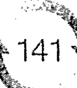

第 4 章 懂得「快速思考」的技術，判斷力顯著提升

前來參加研習的學員中，有一位表示：「一開始，使用心智圖對我來說，幫助最大的是，我自己命名為『今日預約行程』的行程管理心智圖」。

M小姐是一位在大型通訊公司上班的資深員工。雖然她已經是十分出色的管理者，但當她接觸到「用心智圖管理一天行程」的經驗分享後，覺得對自己的工作很有幫助，便立刻實際執行。

工作時，打電話與發電子郵件是每日必做的功課。因此，M小姐每天早上皆在中央的橢圓形寫上「今日預約行程」的主題，接著開始寫下「發電子和郵件與部長確認行程」、「打電話給A公司的B先生」等，將當天必須執行的重要預約事項全部寫出來；緊急插件的預約行程當然也寫進去了；從以前就一直想提出的企劃案之相關洽談也寫到裡面。

寫下的原因並不表示非得立刻跟對方預約洽談時間。書寫下來只是想隨時提醒自己：「如果能成功，就想嘗試看看。最後也一定要做到！」然而，那位M小姐寫在心智圖上的預約工作，都已經標示上「已處理」的記號，唯獨「企劃案」

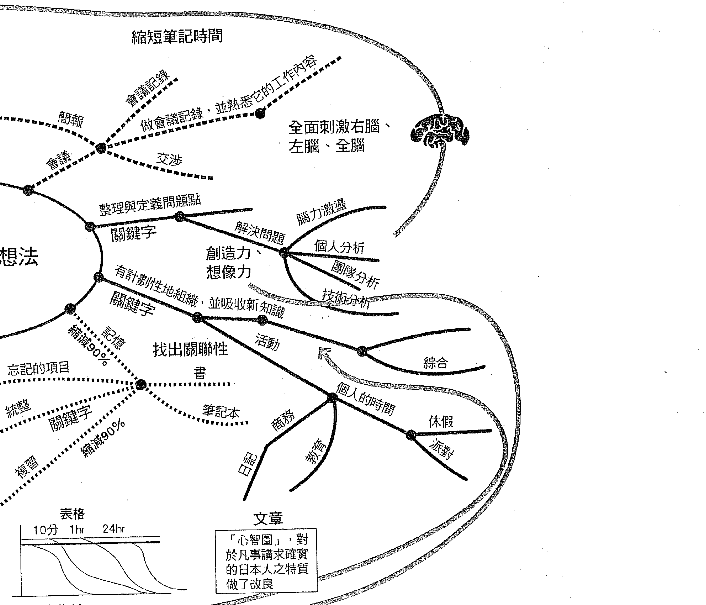

## 心智圖範例

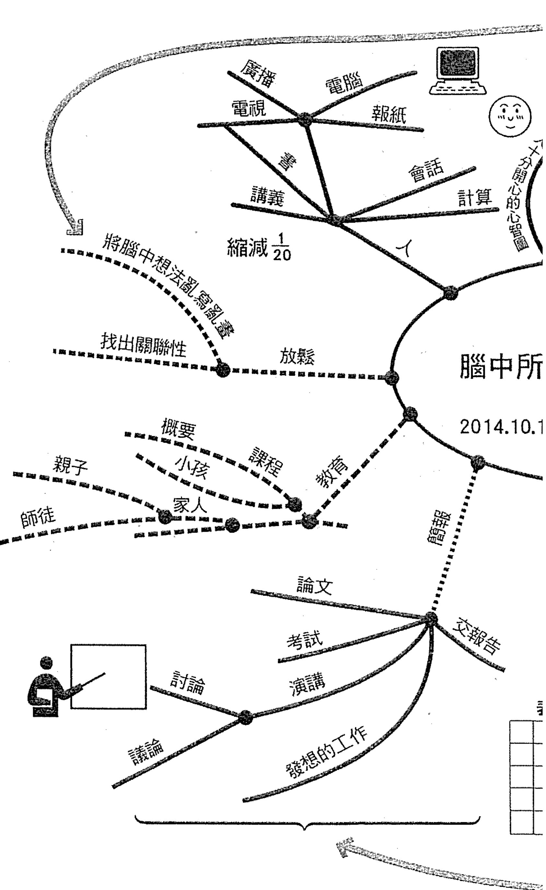

洽談預約「工作依然為待辦事項。她開始猶豫了，覺得今天一定要完成。但經過一番內心的掙扎後，她還是將這個行程的預約工作延期了。

過了幾天之後，M小姐十分在意那個一直被留在原地的預約行程，極度想在上面標示「已處理」的記號。於是，她的體內立刻有一股衝勁湧上，最後終於成功預約。

從這個真實案例可發現，心智圖除了讓人有「想完成工作」的念頭之外，也能不斷促使你去做，最終得以讓企劃案實現，對工作創造了莫大的功效。

最後，M小姐臉上掛著滿足的表情跟我說：「老師，能完成的事，就必須先做，對嗎？」

各位還記得之前提到過的「將必須執行的重要事項寫入行程表」，這位學員的經驗剛好驗證了這句話。

「行程管理心智圖」可以開創一個全新的工作契機，成為一種促進自我熟忱的工具。

## 避免負面想法，就會點燃企劃靈感

開發新企劃案、新商品，或者擬定經營戰略等出色的企劃能力，對於商務人士在拓展商機時，是一個不可或缺的重要技能。

> 「但是，自己不太擅長創新的工作……。」
> 「我也不是企劃部的人……。」

現在並不是示弱的時候。無論對什麼樣的工作來說，企劃能力與發想力都是必備的。況且，如果想取得「高速工作術」技能，這些能力也是各位必須具備的。

這個時候，「企劃心智圖」就能提升這些能力。只要讓書寫「企劃心智圖」的動作變成一種習慣，你的企劃力與發想力將會有顯著的進步。

「企劃心智圖」的寫法和腦力激盪的方法一樣。只要把自己腦中所想到的事情一一化為句子就可以了，程序如下。

- 在中央橢圓形內，將你想的企劃內容以主題方式呈現。比方說，請具體寫下「新的○○」、「夢想中的△△」。
- 接著，再依循想法走，延伸每一個分支（關連線），同時寫下關鍵字及短句。
- 這時必須注意的是，「絕對不寫任何負面的內容」——「這麼做是不通的」、「「預算不夠」等表現方式務必避開。同時，在書寫時腦中也不要想著這類不好的念頭，判斷與結論就暫且擱置。記得切莫把一些公司裡的相關負面結果帶入心智圖內。
- 此外，即便你認為「這樣寫會被笑」、「這麼做好像很胡鬧」的想法，也請照實寫下來吧！心智圖只有自己看而已，不用在意那麼多。況且許多富含創意的企劃案皆始於「好笑有趣的發想」，所以不需對自我設下太多限制。總之，讓創意源源不絕地產生吧！
- 再來就是延伸關連線時，腦中自然會聯想到這些延伸線到盡頭處，會是甚麼模樣。於是，連自己都無法預料的想法便會繭出來，而這個想法就是你獨特的創意。


當你面對既定主題擬訂企劃時，可能因此在意圖間催生出一個更有趣的企劃案。這時也可以將想到的內容做為主題，再繪製一張心智圖。絕對不能錯失大腦正在不斷轉動的時候，把腦中浮現的畫面全部畫成心智圖。最終，就會誕生一個全新企劃案。

一邊看著繪製完成的心智圖，一面慢慢研究「分支線該怎樣連結？」、「這個部分如果改成這樣會如何？」也是一種十分享受的事情，不是嗎？

然而，我們有時可能會在搭車時突然冒出一個想法，可先將它寫在記事本上，或者錄製在手機裡，不要錯過任何一種新的想法，全部一五一十地記錄下來。等到有完善的紙筆工具後，儘速把這些全都繪製成圖。

藉由反覆執行「有創意或新想法時，就立刻畫心智圖」、「一邊摸索讓創意或想法實現的方法，一面繪製心智圖」的動作，日後即使不畫心智圖也能文思泉湧地發想出許多創意，以及思考執行步驟，為自己塑造一個高速大腦。

因此，我一直強調心智圖是一個鍛練思考的最佳工具。

## 消化所學新知，「十五分鐘」能辦到

大腦消化、記憶、複習難解的題目時，也可藉由心智圖之力。此圖是一個十五分鐘就能解決問題的「學習工具」。

專程花了時間閱讀專業書籍，或者用心理解複雜的組成原理，但過了一段時間後，難免會遺忘。有時候明明很想將自己好不容易消化的知識與人分享，卻又無法透過言語順暢表達。此時就可藉由畫心智圖，在大腦中先做整理，同時也能更新記憶內容。有了這個圖，無論何時都可以簡單地做複習與統整。

然而，在第三章已經介紹了有關閱讀專業書籍的速讀法。既然你已經花了時間閱讀，為了成功取得書中相關知識，不妨再多挪出一點時間做重點統整，繪製成心智圖。

無論是針對書籍的部分內容，或是以整本書樣貌畫出來的心智圖，建議大家可以可以在閱讀完專業書籍，記憶猶新時將重點寫在圖上。繪製時的要點就是不拘泥於書本的頁數順序，也不要受時間牽絆。總之，請從重要、印象較深刻的部分畫出延伸的分支線，並且將它不斷地發展下去。此外，如果有極度想記錄的文章，也可以摘錄其中的內容；該書的作者與出版公司樣為重要情報，請務必寫下來。

不同於條列式書寫或以文章形式寫在筆記本的方法，只要在心智圖寫上關鍵字及短句即可，因此可節省許多時間與作業程序。不用過度拘泥於細部的內容，只需掌握基本架構即可。

完成的心智圖請依主題做區分，同時並標上色彩。重點部分以較醒目的顏色將其圈起，讓心智圖看起來繽紛有趣味也是十分重要的。

只要僅僅十五分鐘的過程，便可消化、記憶、複習自己學到的知識。

在繪製心智圖的動作尚未成為習慣之前，或許會花費更多時間。因此請集中精神，在十五分鐘內反覆執行，同時也讓「思考」成為一種慣性行為。

## 「找出關鍵」能力，就是危機處理能力

當工作出現問題，不知道該怎麼辦、驚慌失措、想找人求救之前，請試著畫出你的心智圖吧——當下最重要的是先掌握問題的整體樣貌，並且找出它的核心，延伸分支線，把當時所能想到的原因逐一列出。

各位還記得「二八定律」嗎？「尋找引發問題的兩成原因，並找出解決該問題的重點，就能讓八成的疑難雜症迎刃而解」，即為「二八定律」。

然而，核心的兩成問題才是最大的麻煩來源。比方說，面對新的內部改革聲浪，大家都抱怨連連，互相訴說自己感到不公平之處。公司氣氛跌到谷底。但仔細觀察之後發現，抱怨的人其實只佔了兩成而已，因此只要成功說服這些人就可以讓內部改革在毫無阻礙下進行。

再舉例來說，當自己在開會時提出了一個方案，但卻引發各界議論，一直無法做出決策。此時若想讓大家接納你的意見，必須先說服關鍵的核心人物，只要他同意了，通常其他人也會跟著附和。最終你的企劃案就能順利被公司採用。

也就是說，不僅關鍵重點為兩成，有問題的地方也佔全體的兩成。但這兩成究竟在哪裡呢？請繪製心智圖找出來吧！找到它之後就能擬定解決對策。

一直講好像有點囉嗦，但還是必須再強調一次：只要解決兩成問題，幾乎所有疑難雜症都能迎刃而解。雖說事有輕重緩急，但只要立刻面對問題，在跌一大跤之前找出解決對策即可。解決問題的能力是在商場上打滾的你所必備的技能，是否能夠瞬間讓這個能力得以發揮才是關鍵。

請藉由繪製心智圖，培養解決問題的能力吧！只要讓畫心智圖的動作成為習慣，就能在沒有實體心智圖的情況下，一樣可透過大腦的模擬做全盤的考量，培養當機立斷的危機處理能力。

# 5「快速書寫」輕鬆學，傳達力百分百

## 正確傳達力，成功的最後一哩路

接下來的這一章裡，將與各位分享如何高速且高價值地將所學「傳達」給別人，同時告訴大家「速寫」的技巧。

「傳達」的方式原本就不拘限於文章的形式，自己的行爲、表現、發言、信件、電子郵件等，這些都是一種「傳達」。

我常會想，大家是否尚未充分瞭解這些傳達方式的真諦，或者對於「傳達」之意有所誤解。

因此，想先為各位解開在傳達過程中容易產生的誤解，幫助大家更有效的掌握「正確的傳達方式」。

在第一章曾談到：一個工作效率不彰的人，皆是因為「IPO循環」當中的某個環節出現了一項強大阻礙所致，這時只要將「傳達過程的絆腳石」去除即可。

## 「情報價值」，在對方認定而非自己現給對方即可

傳達情報時，大家往往容易出現以下誤解：「只要將自己認為重要的內容呈

當我們需要蒐集情報時，藉由速讀所獲得的知識與資訊，想必是「自己認為有價值」的內容。但在工作上傳達訊息給夥伴時，從自己大腦裡拿出來的知識、情報、創意等等，則必須是對方「需要的情報」，或者是他「認為有价值的情報」。

例如在出版會議上，當你欲說服業務負責人的時候，與其告訴對方自己的企劃案多麼有魅力，不如拿出數據資料，較能說服對方，因為對他來說，「比較有价值的情報」是「數字」。「這個企劃案預計可以創造〇〇這麼多業績。由於在其它公司看到了這些成果，所以我敢如此斷言。」像這樣提出統計式的相关「數字」情報，才能提升說服力。

說服一個人的時候，只要提供「對方認為有價值的情報」，無用的訊息多說無益，因為對方根本不會張開耳朵去聆聽。

相田地，當我們要傳達情報時，必須先仔細思考「對方認為重要的訊息」為何，才是最要緊的。

## 內容不在多，說出重點別人才想聽

接收情報時的「速讀」理念是「獲取」（take）；傳達訊息的重點則為「給予」（give）。「他們最想要的是這樣的情報」、「在這裡最欠缺的部分是這個」——做出最適切的判斷，提供對方需要的訊息，就能明顯看到成效。

因此，為了讓「傳達」工作成功奏效，祕訣在於「給予」對方市面上少見的独特情報，並且是他需要的部分」。倘若能順利辦到，不但對方開心，自己也高興。這就是「WIN－WIN」（雙嬴）的精髓。想必你的大腦一定塞了許多訊息——有益的情報，無傷大雅的一般資訊皆混雜在一起。而「傳達」的原則就是，只將最重要的兩成提取出來，剩下的不重要部分全部割捨。舉例而言，若是你想到十個企劃內容，只要提出自己認為最好的兩個即可；當學習了某領域的知識後，傳達給對方的訊息也只需選擇你最感興趣的兩成情報即可。

我們常聽到有人這樣講：「請說重點。」由此可知，發言時要捨去多餘情報，講重要之處就好。而這些所謂的「重點」，便是佔整體情報兩成的有益訊息。「但我不知道這兩成重點在哪裡。」或許有人會這麼說，而這種人需要立即透過「心智圖」，來執行「俯瞰整體與做出正確選擇能力」的思考訓練。寫上幾張心智圖後就能整理出條理分明之思考迴路，之後即使沒有心智圖的帶領，也可漸漸瞭解何謂重要的兩成。

到目前為止，與各位分享了如何成功「傳達」的技巧——「對方真正需要的「訊息」、「提出的情報剛好補足欠缺的部分」、「你的大腦中最重要的兩成資訊」這三點為傳達知識、情報與創意時的重點。

只要能依循這個原則，並且學會接下來即將介紹的「速寫」技巧，應該就可以有效地呈現訊息給對方。

## 心智圖能找出關鍵字，是「快速書寫」的基礎

「心智圖」是一種能幫助研究時寫筆記，或做會議備忘錄的神奇工具。只要連結關鍵字句即可。因此不但可以節省抄寫筆記的時間，比起條列式筆記，速度快上好幾倍，也省下你不少的工夫。

在寫筆記時，還能展現更大的自由度，例如「發現這裡和那邊互相有關連」、「因為話題改變了，畫一條新分支繼續寫吧！」、「雖然和剛才的內容有重覆之處，但由於又加入了一些新情報，所以再回到原本的分支，加上這些訊息吧！」像這樣在寫筆記的同時，還可自由地發揮、連結。

假如有新想法時，也能加入一些小插圖——因為這時以圖像記憶為主的右腦將受到刺激，不僅可以使得右腦與左腦一同靈活運作，還能讓你的筆記看起來更具趣味性。日後回頭再看時，也會發現內容簡單易懂，是一個可幫助記憶的優質筆記。

此外，倘若突然出現脫離主題的話題，也可以在角落處畫一個迷你的心智圖。當你之後把筆記本攤開看時，就能夠對當時的會議或研習課程內容一目瞭然，也可確實掌握重點所在，並且立刻區分「重要」與「不重要」的部分，將情報做篩選。請各位務必試試這個做法。

### ◆ 透過心智圖，能建構企劃案

前一章提到，能藉由心智圖整理出腦中企劃案或創意的發想，我們也可以順勢將企劃書文章化。

首先，找出大約兩項能夠成為文章主題的關鍵字句。與其將一到十的創意全部寫成文章，倒不如從心智圖當中找出可以吸引大家注意的宣傳文字。接著只要根據重點來書寫其他需要補充的文字。這種一舉擊中要點的方式，比較能夠給人震撼的感覺，同時也可創造較佳的成效。

此外，在整理論文或原稿時，可透過心智圖的模式，沿著各分支前進，就能輕鬆整理出結論！

### ◆創意「文章化」，情報流通變「雙向」

處於資訊如此發達的社會，蒐集情報的能力之優劣會決定你是勝者，還是敗者。因此為了提升這項技能，則必須盡力去獲取有益訊息，同時也要具備傳達能力。此時，假如你還在以單向的方式吸取新情報，恐怕無法得到優質訊息。

吸收訊息後，必須在大腦內加工、重新整合，並把自己統整過的創意、情報文章化。接著再將這些優質訊息傳達給外界，如此就會有更優良的情報回饋到身上，同時也知道你的下一步該怎麼走。因此，「將腦中創意文章化」是不可或缺的一個步驟。

### ◆ 養成三大習慣，「速寫」變簡單

將創意文章化是「傳達」時的一個重要步驟。像是電子郵件、企劃書、簡報等這些傳達方式，都必須把其中的想法轉換成文字。而且為了提高傳達的成效，就要學習「速寫」的技巧。

「可是我實在不擅長寫文章……」有如此煩惱的人，剛好可以把速寫技巧當作寫文章的訓練。建議大家可以試著逐步養成以下三個習慣

- 現在就著手開始寫，並且每天持之以恆，不管花費十五分鐘、還是三十分鐘，甚至是一個小時，請先養成書寫的習慣。
- 寫文章時不強求有許多美詞佳句，先練習快速地將想法寫出來即可。
- 以三十分鐘為限，書寫一張 A 4 份量（大約一千兩百字）的文字為目標。當你寫下主題（標題）後，便開始計時。

盡量把每天要寫的文章控制在一張A4大小，也就是三張四百字的稿紙的內容。我將此等文字份量稱為一篇「文章」。因為不管是企劃書或隨筆文章，大概都能統整成這樣的文字量。若以書做比喻，大約是單行本*約兩頁的數量。然而，單行本中都會有許多標題，在每個小標題之後則接著一篇完整的文章，其份量相當于一張A4的大小。

當你想配合不同用途，欲將這些內容加工時，也請掌控在一張A4的份量。如此一來，即使把檔案列印出來，同樣能剛好收進檔案夾裡妥善保存。

### ◆反覆練習，培養「思考迴路」的絕佳管道

假如能養成每天書寫的習慣，方可在腦中建構寫文章時的思考迴路，而它的結構也將變得愈來愈扎實，因此就能逐步幫助你快速寫成一篇文章。

常聽到大家說「專業師傅有他的獨門技術」這句話，這是一種受到眾人推崇的行家技巧。為什麼有人可以達到如此神一般的境界呢？

但你可曾想過，這些「專業師傅」其實一開始也只是素人而已。師父領進門後，從基礎開始學習，接著不斷地遇到挫敗，就會增進自己的技藝，最後才能進入該領域的名人堂；相反地，如果未經「反覆練習」這條路，則無法熟悉專業領域內的事物。寫文章也是同樣的道理。擅長構思文章的人，一定是從孩童時代便喜歡書寫，並且一直持續不間斷地做這件事。因此，為了快速訓練自己寫出好文章，「反覆練習書寫」是絕對有效的唯一方法。

所謂的「文章化」，只是把大腦裡浮現出的想法做統整而已。只要透過每天寫文章的方式，就能讓腦中的想法獲得有系統的整理，也可以幫助你深入瞭解自己的看法或體會出更深的理論。

* 編註：以單一獨立作品型態，並非連載形式所發行的書籍。

## 文章如何打動人？內容實用決定成敗

一篇「文采豐沛，但裡面看不到優質情報」的文章，與「文筆普通，卻處處可見重要訊息」的作品相比，各位認為哪篇文章的價值較高呢？

在商業戰場上，毫無疑問的是後者。因此，你並非要練習寫出一篇文采飛揚的文章，而是必須把優質情報寫到裡面。

寫文章時，應該著眼於「寫什麼內容」，而不應著重在「如何寫出一篇好文章」。文章的內容實用性才是真正的勝負關鍵。若是能時常將吸引對方的情報寫入文章中，才可以讓你的傳達工作產生良好的結果。因此，接下來要與各位分享「如何寫出吸引人的文章」之基本技巧與注意事項

- 為了抓住對方的目光，必須在第一時間將必須傳達給對方的情報呈現出來。在文章開頭切勿冗長鋪陳，先從結論開始寫，接著再說明理由與過程。這裡可對應到先前談到「速讀」的章節中，「從報紙的標題開始閱讀」的原則，只是現在角色轉換了，你變成書寫者。
- 句子較短的文章比較容易閱讀；冗長的句子對閱讀者來說是一種壓力。因此，遇到字數較多的句子，最好避免使用連接詞將它與其他句子合併為一句冗長的話。當需要連接詞接續句子時，請立即切斷，另起一句。
- 「或許」、「聽說」、「可能」、「似乎」等表示推測、傳聞的字詞也盡量避免。因為這些詞語容易給人曖昧不明、模擬兩可的感覺，最後只會落得「你到底想說什麼」的負面評價。當你確認了情報的正確性之後，請以肯定的口吻表達，更能提升閱讀者對寫作者的信任度。
- 必須先找出書寫的主題，才能每天以三十分鐘完成一張A4份量的文章——在走向書桌前先決定主題，接著針對主題思考，等到真正坐定位後，則可開始將想法化為文章了。順道一提，你可以先藉由心智圖整理所有想法，同時把主題輸入大腦，稍做休息後，大腦自然而然就會統整那些想法。

## 關鍵 字 句 靈 感 易 消 失 ， 隨 時 寫 下 不 放 過

當不知該如何下筆時，先把自己想到的主題之關鍵句寫下來。接著，再以關鍵句為中心，向外擴展分支，最後就能寫成一篇有理條的文章。

當我們絞盡腦汁去思考時，「靈感」與「創意」總是不會順我們的意而輕易出現，但這兩樣東

西也常常不經意地在我們散步、泡澡、坐電車等，這種心情放鬆、發呆的時候向自己揮手。因此，即使是平時出門散步，我也一定會將便條紙及筆帶在身邊，以便隨時做筆記。

寫文章時必須有題材。如果平常沒有把找尋題材的天線打開，那你就會持續停留在搜尋情報的階段。此時，縱使人已坐在書桌前，腦中必定一片空白，完全不知道该寫些什麼內容，甚至連一個字也寫不出來。原本打算好好訓練寫文章功力的，這時卻只能讓時間一分一秒地流逝而毫無收獲。

必須再次提醒各位，寫文章時的重點為「寫什麼內容」，以及「要納入哪些重要情報」，以上兩點才是應該著墨的要點。因此，你必須經常尋找可寫的問題素材——不管是報章雜誌上最熱門的話題，還是在健談之人口中所獲取的情報皆可；或者透過速讀所學習到的新知：從熟知流行事物的同事身上獲得的情報等。創意就存在於我的身邊。

但有一個重點是，假如你的搜尋天線找到能吸引他人的關鍵字句，必須立刻將其記下。因為這些短暫浮現於腦海後就消失的創意、靈感，之後任當事人怎麼試圖努力回想，通常都會無功而返。

## 善用「手機錄音」，任何空檔都能記錄創意

寫文章的工具不只平常那些書寫用具，或者是用電腦輸入。透過口述做筆記，是一個在搭乘交通工具時，善用空檔時間來記錄創意以及想法的有效方法。

在我還是個一般上班族時，經常會利用從家裡走到車站的途中，使用小型錄音機，將自己的想法以口述的方式記錄下來。到了晚上或假日的時候，再一邊聽著錄音帶，一面把這些口述轉換成實際的文字檔案。這種方式與演講的要領十分接近，對於一向愛講話的我來說，是一個非常快樂的時間。

當創意、關鍵字句浮現時，請善用 IC 錄音機、手機的語音備忘錄、電腦的語音辨識軟體，立即錄下你的珍貴想法吧！而且之後還可以針對已錄下的內容，思考主題延伸、合理運作及實踐方法，而這些擴展出來的想法也都能隨時採口述方式錄下。經過前面這一連串的方式後，就可形成一張 A4 份量的文章。

假如是用口述做筆記，文章的完成度達百分之五十便已足夠，不需要對裡面的用語做細微的調整與修飾。即使內容尚未全部完成也無妨，只要論點的起承用語是明確的，可讓閱讀者知道一篇文章想表現什麼即可完成。因此，內容要以「淺顯易懂」為目標。此外，比起抽象式的用語，請多以較具說服力的話來呈現。順帶一提，倘若有任何想分享的趣事，也歡迎放入文章中。

然而，當你以前面口述的方式做完筆記後，請一邊聽著錄製的內容，一面將它整理成一篇書面文章。如果你是用語音辨識軟體，則可透過辨識功能，讓電腦自動輸入文字，待文章全部寫入完畢後，只要透過電腦螢幕檢視內容即可。此外，聽說最近有許多智慧型手機只要在有一定網路的環境，便能用語音功能來輸入文字。而當你使用習慣之後，它勢必會成為一個方便的工具。

熟悉了以上的口述方法後，日後也可以利用在企劃書，或者是會議發言內容的準備工作上，還能隨時想出新提案，呈報給上司或客戶，同時應用於部落格文章發表、網頁更新、演講、報告、簡報、論文、書籍撰寫等領域。

## 學會「速寫」，寫作出書不是夢

只要將你寫的每一篇文章集結起來，就能創造各式各樣的用途。比方說，蒐集一篇至數篇的文章，就是部落格、電子報、網頁更新一次的文章份量；或將每一篇至數篇文章集結起來，就是部落格、電子報、網頁更新一次的文章份量；或將三（五篇）文章集結，則會變成報告、小論文；而把五十篇文章集中，即為一次演講或簡報內容；如果聚集十（二十篇）文章，就成了篇幅較長的論文。

假如將一百二十篇文章内容集結起來，則成為一本「書」。因此，「出書」這件事並不是夢。在這裡，邀請大家一同挑戰這當中最困難的「出書」。我會把完成一本書的艱難過程逐一分析，讓各位都能輕易地瞭解它。

做為一位商業人士，在剛踏入這個戰場時，最想做的必定是先站穩地位；而當你晉升到不同層級時，就會想要擁有工作以外，屬於自己的時間。人們總是在每一個階段有著不同的欲望。所以試著把「出書」做為我們的終極願望吧！當然啦，一開始還是得先透過部落格、電子報等鍛鍊自己寫文章的功力，同時累積你的文章量。

## 「出書」也是一種將自己品牌化的方式。許多創業者也紛紛愛上「出書」——因為「書」會成為他們最好的自我介紹管道，其效果十分強大。

順帶一提，在我仍為上班族時，也曾透過知名出版社幫忙，出了一本有關


「速讀」的書籍。當時那本書引起的廣大迴響，實在是讓我始料未及。在這個過程中，強烈地感受到自我的存在，同時更深感自己肩負著莫大的責任與使命。

然而，當你集結了足夠的文章量後，便可將它們彙整成一本書──這時請決定書的主題，並針對主題挑選至少八十則的相似文章。

回想起重慶時，我正在寫一個以「速讀」為主題的書，出版社的副總編輯教授給我一項方法──當你想寫一個主題時，先將自己能想到的關鍵字或標題逐一一列出，接著針對每個不同標題分別寫成一張 A4 份量的文章。假如你也想為自己出本書，不妨可以採取這種戰略式的寫法。

接下來將為各位介紹如何寫成一本能有效傳達主題的書籍。首先，一本書的內容通常是由四～七章所構成，每一個章節裡還有許多小標題，這部分請大家先有一個基本認知。而以下就是建構一本書的方法

- ① 整理每一篇寫好的文章，根據不同主題把與之相關的文章集結起來，並依其內容分成不同章節。建議你可使用微軟系統「WORD軟體」裡頭的「Outlines」（大綱）功能來進行整理。使用「大綱編排」功能，就能簡單整理這些文章。

- ② 想出符合書的主題，以及各章內容的標題，並且列出每章的「標題清單」。這些就是「目錄」。

- ③ 目錄完成後，開始思考內容構成是否完備；每個章節的文字量夠不夠、有無條理分明、還需要增加些什麼。隨後，再次審視書的內文，將書寫完整及尚未寫完的部分做取捨。接著，針對不足之處再補充說明。

- ④ 撰寫「前言」或「後記」，這兩部分視情況來決定是否要寫。假如原本寫的文章中有適用之處，也可以將其添加文字後做爲「前言」或「後記」。

- ⑤ 重覆閱讀書的內容，並推測讀者能理解到何種程度，再加以修正。

最後就要進入印刷流程了，所以務必仔細校對內容。校對時，請注意以下幾個重點

- 檢查文章所使用的語氣是否一致
- 有無錯別字，或錯誤的標點符號
- 用語是否統一
- 內容的前後理念是否相同。例如在 A 處表示「贊同」，但在 B 處則表明「反對」，這樣是不行的
- 假如有引用的部分，有沒有清楚載明出處

當全部內容皆整合完畢後，就將它交給出版社，他們則會印刷成實體書籍，或者是以電子書的方式來呈現給讀者。

以上就是我第一本書的產出過程。當然，在構想階段時，如果腦中還有其他想寫的內容，你可以在蒐集情報及整合的工作完成後，將出版企劃案呈給出版社參考。一旦成功定案，便能依照企劃內容開始寫文章。

「出書」是「速寫」的終極方法，也是最好的「傳達」方式。

而關於「傳達技巧」的分享到了尾聲，我想告訴大家的是，一個善於傳達成

果的人，他所呈現的不只是書籍、論文、部落格或是演講稿，連同自己的行為、實際表現、態度、積極度等，都會愈來愈好。這時就可套用先前的「PDCA法則」。（參考一〇八—一〇九頁）

假如你的書皆裝載這些原則，成為暢銷書絕非夢想。事實上，我也是依循這樣的方式來出版書籍。那時的我剛過四十歲，雖然擔任主管，但只是一介上班族而已。隨著書的暢銷，開啟了我的另一個作家人生。

提出市面上少見的探討主題，同時保持你的衝勁，並且確實掌握前面所說的技巧，你也能寫出一本暢銷書。

## 6

### 速度是決勝關鍵，價值成果提升六十四倍

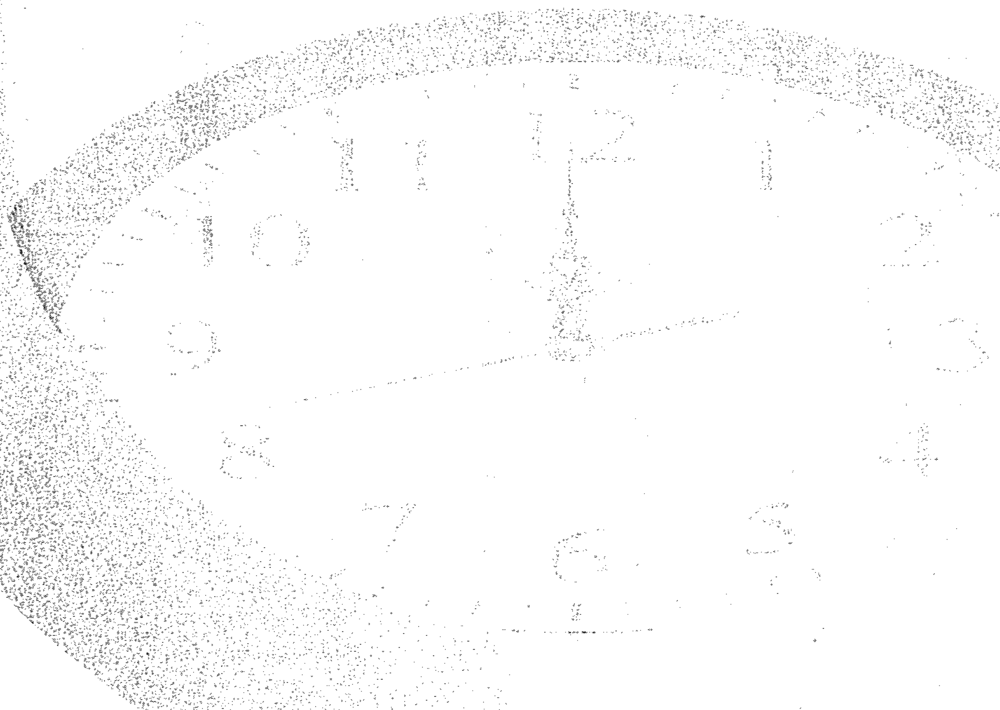

## 網路時代的競爭，速度是勝負點

在這一章想和大家談談「速度」對於工作的重要性，以及「高速」及「高價值」在工作上的意義。

現今社會處於一個 IT（資訊科技）發達的社會。預估今後也會以飛快的速度持續擴展下去。因此，整個世界充斥了各式各樣的情報。倘若你完全與外界隔絕，埋頭苦幹地工作，對週遭環境反應過於遲鈍，最後只會捲入無知的漩渦中，被社會所淘汰。

然而，IT 時期與以往的时代已大大不同。先前大家都將 IT 時代視為「十八世紀工業革命後的最大改革」。但其實工業革命為人類帶來的是以機器為主的「物品生產」方式；相對地，IT 革命帶給我們的則是一場「知識生產」方法的創新。藉由蒐集情報產出的大量知識，讓我們的社會瞬息萬變。而在這裡希望大家

- 搶先一步發現新知，並將之快速傳遞出去的企業或個人，經濟上會比較富裕。
- 只知盲目跟隨現有情報及知識的個人或企業，最後就會妥協與滿足於低報酬和利潤。

注意的是，伴隨著IT產業的發展，當初人們預測的「兩極分化模式」儼然已成為既定的事實。以下即為「兩極化」的最佳例子

也就是說，我必須向大家宣告，現在已經是一個「必須快速利用眾多知識產出成效」的時代，唯有迅速發掘新知，才能帶給你富裕的生活。

然而，現今這個時代的關鍵字則是「知識」與「速度」。能否成功掌握這兩項重點，將決定你下一步的成敗。

因此，我針對「如何才能快速利用知識產出成果」這個主題做深入研究。接著，便創立了這種能夠快速完成工作，提高效率的方法—「齊藤式高速工作術」。

## 速度與價值成正比，早人一步獲利差異大

「快速執行工作」是高速工作術的中心理念。

但為什麼提高速度，就可以成就高價值的工作成果呢？為了確認這一點，我再一次跟各位介紹能「創造價值的公式」吧！

將「知識勞動」*中最重要的成本——「時間」放到這個公式裡，是為C。

```
V（Value 價值）＝F（Function 功能．成果）÷ C（Cost 投入費用．時間）
```

從公式上可明顯看出，只要能夠盡量縮短分母的「時間」，就可提高產出的價值。C 的數值越小，V 的數則越大。

即使想提升F（功能．成果），但若是身為分母的「時間」數值依舊很高，價值還是會變小。

舉例而言，以同樣完成十份工作來說，有一個人要花十天時間，另一人則只

> * 編註：透過人類大腦思維進行的「知識」轉換過程。

「有急件要處理時，就找最忙的人幫你！」這句話是否有些矛盾呢？事實

## 當高速成習慣，「高價值成果」不斷

要花五天。前者所創造的價值是十÷十一；但後者卻是十÷五∥二。因此，只要以兩倍的速度完成工作，創造出的價值也會提升兩倍。換句話說，縮短時間，意

即提高工作速度，也是成就高價值工作的必要條件。

此時，請各位把注意力放在「二八定律」與「一二〇法則」中，「很重

要」及「最重要」的知識與情報，果斷地捨去其餘不必要的訊息，還可將這些省

下的時間放在處理工作上，如此才是能夠創造高價值、高效成果的最佳依循法則。

速度與價值是成正比的——只要速度提高兩倍，價值也會提升為兩倍。

上，它非常合理——忙碌的人與閒暇之人相比，忙碌之人通常能在相同的時間內，處理比閒暇之人多上好幾倍的工作量。由此可知，這些忙碌的人處理工作的速度已經遠高於其他人了。想必他們一定有依循「IPO 循環」的原則。不僅如此，也表示這些人常在一個時間內，同時處理好幾項工作。

這是因為他們遵循「IPO 循環」原則來處理工作，久而久之便練就了快速完成的功力。所以這些人已經具備了高速、高價值的工作能力。因此，在把工作交付給忙碌的人之後，看到他們最後的完成時間可能會令你大吃一驚。

相反地，對於一個閒暇之人來說，在他們啟動工作模式前，必須花許多時間來熱身，速度自然比較慢。由此可知，將急件託付給閒暇之人會耗费更多時間。

## 大腦維持高轉速，創意靈感不短路

讓人感到耳目一新的企劃案或創意，絕對不是光坐著思考就能激發出來。在

## 高速世界裡工作的人，能獲得較多的創意及靈感。

有一位擔任產品企劃的人曾經跟我說過：「想要做出暢銷商品的人，必須隨時打開接收創意的天線，注意每一個小動向，並跟上這些動向的流動速度。雖然後我的工作聽來似乎有點辛苦，但只要習慣此種速度，即便你在這過程中適度的休息、享受私人時間，工作速度也不會因此停滯。」

企劃案或創意，常常是坐著速度之毯，在我們頭腦空空時突然飛入，讓人不需多加思考，就能從中蹦出好的靈感。

假如想激發創意或好的企劃靈感，首先你必須開始起身行動，接著加速快速度，彷彿開車在高速公路上一般，讓自己的大腦維持在同一个思考速度。因為根據「慣性法則」指出，以八十～一百的時速，馳騁在高速公路上的油耗成本，遠比開車在街上走走停停還要省。

相反地，好不容易已經到了一個高速的境界，如果讓速度突然慢下來，則必須更費工夫地加速，才能回覆到高速的層級。因此，倘若不付出自己的精力，維

## 懂得「知識勞動」秘訣，價值提高六十四倍

在高速度工作術當中，我們將「接收訊息（Input」、「思考整理（Processing」，以及「傳達成果（Output）」的速度各提升四倍。只要搭配「二八定律」，執兩成的工作，創造八成的成效，就能成功將各個階段的速度提高四倍。也就是說，整體功效提升為四倍速×四倍速×四倍速＝創造六十四倍的價值。

持高轉速，創意或靈感也不會找上門。

然而，許多得獎的作家或學者中，有些人在獲獎後仍相當活躍，也有人就這麼消失了。其中的差異在於，能否在得獎後快速且持續地將更多想法與大家分享，維持自己的曝光度。

因而，請各位試著把本書所學的高速工作習慣繼續保持下去，並且巧妙地調整工作速度的快慢。

「那只是紙上談兵罷了，現實生活中根本不可能做到吧！」或許此刻你正在這樣感嘆著。但是，其實所謂的「知識勞動」就是一個能夠如此簡單幫助你造成成果的神奇事物。

然而，以「人體勞動」為例，即使你能輕易拿起四十公斤的物品，但面對八十公斤的東西時，恐怕就不是那麼簡單的事了；轉換成「知識勞動」而言，並以「邀約演講」做為例子，有的人一場演講只收一萬日圓的報酬，有些人則收取五十萬日圓。這個例子剛好可以印證——在相同的時間，付出同等的勞力，但卻創造出五十倍的價值。

就出版業來說，若是以相同的主題內容，付出同樣的勞力而做出的兩本書，可能其中一本成為了銷售達百萬冊的暢銷書，但另一本卻乏人問津。這樣的例子在出版業比比皆是。這完全是因為「知識勞動」所造成的不同結果。

想必各位從以上的實例，更能真切感受，若是善加利用「知識勞動」，可以為原本的事物創造幾十倍價值。只要存在一絲的可能性，就能試著挑戰。而這些

關鍵祕訣已全部收錄在本書。

## 光有爆發力，卻無法持續，終究失敗

在龜兔賽跑的故事中，你覺得誰比較快抵達終點呢？

「結局不已經寫在依索寓言裡了？是烏龜獲勝，對吧？」

「不，因為兔子掌握了高速工作術的重點，所以最後的優勝者是兔子。」

經幾番詢問之下，大概會出現以上兩種不同意見。

的確，根據故事的結局，是烏龜最先抵達終點的。「這個答案不是很奇怪嗎？烏龜的動作這麼慢，牠的行事風格應該和高速工作術所追求的態度背道而馳吧？」或許你正想如此反駁。

但我們給予評價的重點在於烏龜的「持續力」。

兔子雖然擁有瞬間的爆發速度，但欠缺了持續性的速度。「好累喔！反正我都已經跑到這裡了，先睡個午覺吧！」這麼想的兔子，自我控制力是比較弱的。

雖然烏龜在「速度」這一點劣於兔子，但卻擁有較佳的持續力。

而絕不能馬虎的正是「持續力」這一點。如果一開始便用盡全力往前跑，最後可能會讓自己上氣不接下氣，賠了夫人又折兵。

掌握自己的步調，控制流程，在每一個工作來到之前，學會烏龜的「持續力」，不斷地完成接踵而來的工作。這樣的態度才能創造高速、高價值的工作成效，希望各位可以謹記在心。

## 運用高速工作術，創造自己獨特價值

「提供有價值的知識」將成為這個社會的主流。而我們必須「搶先一步把新知识快速產出」，才能領先其他人。不管哪一種職業領域皆適用這個道理。

不需重覆執行已經做過的事，也不是完成事先設定好的工作流程，請試著「加上新知识」、「激發靈感」、「找出必要但缺少的部分，並將其補足」。相

信只要這麼做，你就能在工作上創造出全新的局面。

此外，高速工作術也能幫助大家找出「自己身上的獨特價值」，並且有效地提升它。告訴自己「不必和別人比較」、「不追求戰勝敵人」，我們追求的是如何提高自我價值。

考試考得比別人好，接著就可以在好企業工作。像這種考試成績與大企業能左右人生的年代終將劃上句點。嶄新時代所追求的是能夠創造全新知識，具備特色的人才。

請大家一定要多加利用本書的高速工作術，藉此提高自己的專業度。

各位現在所在的地方絕對不是終點目標，而是一個能展開多向人生的起點。不管幾歲開始都不遲，就從現在邁出你的步伐吧！

希望大家可以善用這本書所收錄的有益情報，找出只有自己才能創造出的獨特價值。

最後，介紹一下我到各大企業進行講課時，來自聽講者的聲音

- M先生（二十四至二十九歲·男性）

高速工作術簡直就像為我所研發的東西。以往我總認為所有的工作都非做不可，但現在已經懂得排出優先順序，「捨棄」不重要的部分。感覺能減輕我不少工作壓力。因為西積了許多工作，我會開始以心智圖來判別其重要性，並且運用高速工作術的方法。不知道為什麼，現在已經覺得興奮不已。從今天開始，就努力嘗試這樣做做看。

- H先生（三十至三十九歲·男性）

我發現，即使透過讀書獲得各種知識，但如果不能轉換運用在自己的立場、情況，實際上並沒有任何幫助。然而，能否準確地找出關鍵字，並且抓住「實踐」的重要時機，這些都受到自己的智慧和能力的影響。

我認為「高速工作術」裡的這些指導，都是為了磨練自我的終極練習。此外，也深入地體會到，最重要的是在人生中，明白自己最終究竟要「傳達」什麼，以及能「傳達」到何種程度。

- Y先生（二十二、二十九歲，男性）

我發覺，在寫心智圖的時候，連自己平常沒有意識到的想法，都能逐一一寫出來。原來自己一個人也能進行腦力激盪，這件事著實讓我感到驚訝；只要畫出心智圖，便能引導出解決問題的方法也使我大吃一驚。一想到可以藉由這次的學習，讓自己有所改變，就覺得非常開心。

我期望運用心智圖來解決工作上的煩惱。不僅如此，還悄悄懷抱著一份野心，那就是想要有效的「傳達成果」（Output），成為率領公司向前的重要角色。

- N先生（四十、四十九歲，男性）

現今的社會不斷在變化，導致各企業的運作也在改變。所以我們必須跟上這個情報化時代的腳步。從如此發達的情報網中，積極且快速地獲取各種資訊，儲蓄成自己的知識，並且傳遞、提供嶄新的創意，我想這是十分重要的。

然而，現在的公司大都越來越傾向自由發展。雖然常聽到「該抱持著危機意識」，但我曾經以為公司的整體營運，和自己工作內容並無直接關係，對於自己毫無警覺，並將一切原因都歸於外部因素上。

而且以前的我，每天都被主管交派的工作窮追猛打，忙得團團轉，只為了做完事情而工作。但我認為需要先從我本身開始著手改變，之後就可以集結每個人的力量成為一股龐大的動力，企業也才能在這個競爭激烈的時代中生存。

今後為了不錯過社會上的種種變化或重要資訊，期許自己能積極、快速且均衡地獲取各種情報，並非只是一個單純的上班族，而是作為一個企業的人才，不斷地提出自我意見。

- S小姐（四十～四十九歲・女性）

每天總是會收到許多的信件，不論重要與否，要確認並理解這些內容，需要花費相當多的時間。原本我是因為這個理由而參加了速讀法的研修，但沒想到學會的是以速讀為基礎，進一步提高工作效率的技術。

透過此課程，我理解到在有限時間內快速地獲得情報，並且加以處理後提

出，這一連串流程是「知識生產」中的重要元素。

而且這個速讀法和高速工作的理念，也是能促進公司業務合理化、效率化、改善等行動的基礎重點。我想要立刻應用這項技術在我的工作上。

- A先生（五十「五十九歲·男性）

我以身為自己工作領域中的專家而感到自豪。積極地完成應盡本分這一點不需多說。但是，如果繼續維持現狀，可能會陷入「井底之蛙」的危機。所以，我不應該侷限在自身的專業領域，而是廣泛地吸收知識、多方面獲取情報，相信就可以培養出有別於以往的想像力、行動力和決斷力。這也是今後企業希望員工要具備的能力。

依賴企業提供完善訓練之時代已結束，今後應該會轉變成接收（to）與給予（go）關係——企業需要的是能夠給予公司幫助的人，因此我們必須自行獲取情報，充實自我。我想那些不具備專業技能之人，最後只能被迫以時薪受雇。

在這種時代來臨以前，為了不受社會洪流所淘汰，就要在提升自我能力的同時，熟習速讀技巧、蒐集多層面情報，並整理這些資訊，不斷地提議、發言。

# 參考文獻

《トヨタ生産方式—脱規模的経営を目指して》，大野耐一，ダイヤモンド社，一九七八年。（《追求超脫規模的經營：大野耐一談豐田生產方式》，中衛）

《成功はゴミ箱の中に レイ・クロック自伝—世界一、億万長者を生んだ男 マクドナルド創業者》，雷·克洛克、羅伯·安德森/野﨑雅恵訳，プレジデン卜社，二〇〇七年。

《カーター回顧録·上》，吉米·卡特/持田直武訳，日本放送出版協会，一九八二年。

《人生を成功させるための「八〇対二〇」革命！》，理查·柯克/門田美鈴訳，ダイヤモンド社，二〇〇三年。（八〇—二〇個人革命：個人如何獨具創意，締造最大的財富與幸福，大塊）

# 改變工作順序，每天上班只需 4 小時

腦力開發醫學博士，教你「高效思考迴路」，效率提升 64 倍，不再加班累到死

齊藤式高速仕事術

- 作者：齊藤英治
- 譯者：郭欣怡

- 總編輯：鄭明禮
- 責任編輯：楊善如
- 業務主任：劉嘉怡
- 業務行政：謝慧青

- 出版發行：方言文化出版事業有限公司
- 劃撥帳號：50041064
- 電話/傳真：(02) 2370-2798 / (02) 2370-2766

- 定價：新台幣 290 元，港幣定價 97 元
- 初版一刷：2016年8月25日
- ISBN：978-986-92935-9-4

# 國家圖書館出版品預行編目(CIP)資料

```
改變工作順序，每天上班只需 4 小時：腦力開發醫學博士，教你「高效思考迴路」，效率提升 64 倍，不再加班累到死 / 齊藤英治作；郭欣怡譯. -- 初版. -- 臺北 : 方言文化, 2016.08
面；公分
譯自：齊藤式高速仕事術
ISBN 978-986-92935-9-4 (平裝)
1.職場成功法
494.35
105014071
```

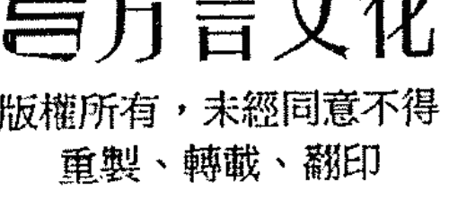

SAITOSHIKI KOUSOKU SHIGOTOJYUTSU
Copyright © 2014 by EIJI SAITO
Original Japanese language edition published by FUSOSHA Publishing Inc. Tokyo.
All rights reserved.
Complex Chinese translation rights arranged with FUSOSHA Publishing Inc., through Future View Technology Ltd.

Complex Chinese translation copyright © 2016 by BABEL PUBLISHING COMPANY
