# 水库家学合集

更多独家绝密资源加微信tushu959 课程学习官网: https://s.wsxc.cn/xK0Qqd

## 罗友书社

## 未来，属于终身学习者

我这辈子遇到的聪明人(来自各行各业的聪明人)没有不每天阅读的-没有，一个都没有，巴菲特读书之多，我读书之多，可能会让你感到吃惊，孩子们都笑话我。他们觉得我是一本长了两条腿的书。

> ——查理 芒格

未来，到底需要什么样的人才？

改变命运唯一的策略是你要变成终身学习者。未来世界将不再需要单一的技能型人才，而是需要具备完善的知识结构、极强逻辑思考力和高感知力的复合型人才。优秀的人往往通过阅读建立足够强大的抽象思维能力，获得异于众人的思考和整合能力。未来，将属于终身学习者！而阅读必定和终身学习形影不离。欢迎加入我们的共享读书社群：zswx0001 一起分享海量精品书籍和大师课程。

- 罗友书社：与渴望学习成长的人共同进化
- 有人常常把成本支出的焦点放在钱上，其实不然。
- 时间是读者付出的最大阅读成本
- 怎么读是读者面临最大阅读障碍
- “读书破万卷”不仅仅在万，更重要的是在“破”！

现在，我们构建了全新的共享读书模式“罗友书社”，它将成为你破万卷的新居所。在这里：

从单一到复合，从知道到精通，从理解到创造，罗友书社希望建立一个“与渴望学习成长的人共同进化”的社群，与此同时，我们希望能够重新定义你的学习场景，让你随时随地收获有内容、有价值的思想。通过阅读实现终身学习，这是我们的使命和价值。

问：庆和沈阳的房价大概维持在多少比例是合理的，市场jj时期1.1-1.3：1,管制时期1.3-1.8:1吗？

答：整天自己发挥理论，自己负责。没理论，别整天自己发明理论。套餐

问：大，关圈不意味着停摆，但其 t-1 是什么？如果不方便可不作答。

答：收费太便宜了，不够成本。

问：欧神，您好接受不完美的 t-1 是什么？

答：完美代价太大

问：欧大，请问商业运行的 t-1 是是付费者补贴白嫖者吗？

答：你家门口卖煎饼果子的，谁白吃了。

问：西港付尾款愁了 2 个月，两鬓白了四根头发，心里压力大，上周突然想通了，路要向前走，心态放平衡，谋事在人。请问欧神若干年后如果月供＋0 或者尾款翻十倍的时候如何想通一些事情，您是如何解压的？（重要）压力山大的 T-1 底层道理是什么？多谢

答：既入此门，终身受苦。你就不要想着如何解压了，并没有这个办法。你永远会把尺度，押到你喘不过气来的最后一寸。人性贪婪。

问：欧大你好：1，关于公众人物总会有一些过去的历史或者种种过往经常性被网民扒出来，这时候如何应对这种人设崩塌和信任危机？是不回复？还是应该如何处理？ 2，做好公关的 **t-1** 是什么呢？

答：不同的公众人物，不同的时期，有不同的应对方式。 知道现在是什么时期。

问：欧大你好：1，做好喜剧的 **t-1** 是什么呢？ 2，在一个家庭中父母性格不同的强势会给孩子带来什么样的后果？例如如果母亲性格极其强势，教育出来的男孩长大后没有自信，唯唯诺诺，这个时候应该如何矫正？ 3，幽默的 **t-1** 什么呢？

答：喜剧是轻浮的，悲剧才是永恒。 永恒的喜剧，一定是潜伏的悲剧。例如周星驰电影。 （谚语）一个幸福的家庭，就是没有控制欲太强的人。 远走他乡，独立生活。 反转

问：欧大，有个脑洞想法，坐标一线，假如 sf 是借的，月供是 xyd，不限循环买下去，买了贷，贷了买，升值了 dy，最终能活得下来吗？活下来的话，**t-1** 靠什么？

答：涨幅超过 5%，每年

问：请教我神，35 岁男由项目管理转做技术，急需提高专业能力。请教专业领域提升的 **T-1** 是什么？如何技术上精进，成为领域的 1%？谢谢我神。

答：你直接辞职好了。35 岁还做什么技术。 要不就像美国乘务员一样，把所有任务外包给沈阳程序员段子。

问：欧神，我个人理解机会从变化中来，赚钱从变化和机会中来，事情不变化一个萝卜一个坑，一变化就会发生错位错配！和赚钱需要 Bug 底层逻辑可冲突？

答：世事在变化。 要么你可以 “算” ，通透 T-1 ，洞彻天机，提前布局。 要么你运气特别好。 普通人，没人教，凭什么下一个时代你可以赚钱。

问：欧大好，除了《潜规则》和《血酬定律》等，还有什么 t-1 的好书可以推荐的？

答：灼识新维度（注：公众号）

问：欧大，年销售额百亿级别的制造型民营企业，目前 A 股上市，老板总会强调其父辈是平凡的农民，原生家庭没有所谓背景和拼爹的资本。从 t-1 看这是出于渲染和打鸡血的需要，实情并不是这样？

答：并不是每一个企业家，都是官员手套。 也可能是盟友。

问：敬爱的欧大：生意上零售和批发，玩批发才有前途 t-1 原理是什么，是通过薄利让利量大 解决流量问题和时间成本吗？ 望欧大指点一二

答：批发上限高。 不代表批发赚钱。

更多独家绝密资源加微信 tushu959 课程学习官网: https://s.wsxcn/xK0Qqd

问：欧先生您好，如果吸收系统不成体系框架，即便看的都是真经也没用，最近思考和阅读较多，请问您文集开始体的部分算是吸收系统的框架和体系吧（比奥派还要底层）？或者您对吸收体系和框架搭建有什么好的办法吗？奥派经济学是体系框架的一种呢？还是需要更深入的了解 :--: 才能搭建，奥派仅是体系框架的一部分（毕竟还有很多非经济学内容）

答：一个非常大的误解。水库其实没有系统地写过“体”。经济学三原理，用的篇幅非常少。一笔带过。“炒楼学”是“用”。

问：欧大，请问心胸宽广的 :--: 是什么？以前都用宰相肚里能撑船来形容一个人有能力，能成大事。奥派思维下，应该是一切出发点都是为了自己的长期利益或短期利益吧？谢谢欧大

答：有更重要的事

问：2020.4.18 欧大，一事不解。以深圳为例，福田市中心配套非常成熟，但最好的也就不到10。而购买力却对前海光明这些还不成熟的地方给很高溢价，他们成熟了不也就达到福田这种程度。请问市场如此定价背后的 :--: 是什么？

答：zf 炒作，小白跟风。熟悉的套路。炒完一个板块，再炒下一个。只炒政府空地最多的板块。

问：神，请问 T-1 的原因是什么？ 是因为大江大河是天堑吗？（黄浦江造了那么多桥和地铁，应该没有交通的问题了吧？）

> **朱红之泪**  
> 2018/4/14 09:50  
> 匿名用户 提问：朱大，为什么说南京的本质应该向南发展呢？这背后的原理或者逻辑是啥？  

答：人口自然而然的发展趋势。  
比如，莘庄人气就是旺，无论浦东怎么吹，就是没人。

对 黄浦江还是一塌糊涂。天堑。

问：2020.4.13 经济受到疫情打击这么大，深圳还涨的这么猛的 T-1 是什么？是因为蓄的水实在太多，但也挡不住吗？

答：地产向来和经济无关。 只和印钞有关。

问：欧神，在想要不要报那个你经常转发的那个村西边老王的课程，请问商业的 T-1 是什么啊

答：我没推荐过他的课程。 阅读理解能力啊......

## 水库终身学习群

水库，是一个论坛的名字。
它代表人物是**欧神**，也不仅仅是欧神。代表的是一种文化，一种精神。影响了很多**人**，也成就了很多**人**。

现建水库终身学习群，已有资源如下：

- 1、历时数年收集整理的水库最全文集，及欧神出版电子书《守住你的财富》等等。
- 2、原价5000元，2400万字的**欧神历史小密圈内容离线网页版**，里面有欧神的14万问答，全方位展现欧神的思想体系。
- 3、**欧神2021会员，13999元VIP会员专属道典正字全部邮寄文章电子版，截止21年12月全部内容，及2021VIP问答合集503页。2022年最新内容也会分享。**
- 4、欧神线上音频课：功夫财经欧神课程《地产的秘密》，欧神价值499元面授marketing1课程音频。
- 5、欧神线下课《楼市有zhuang》音频、近年的从未公开的私密答疑直播。
- 6、折叠时间流——王马丁价值8888元二手房实战私授课，时长4小时28分录音，外加111张ppt，音频转成的21万字文集。
- 7、水库大咖付费内容持续分享。挨踢牛摩西知识星球价值1500元（公众号：无往不利）、Llyang-88知识星球价值3000元（水库元老、欧神的债主）、朱红之泪1500元（公众号：城市发掘者）、达叔经济学1元，季老湿价值699课程。
- 8、兼听则明，兼容并蓄，赠送互联网内容，卢克文、石勇、华超、抖音房产亷哥，鹤老师，珍大户，源泽异读，渤海小吏、布尔费墨，村西迪老王，守夜人总司令，深房理，楼市团长等资料。经典分享，温故知新。天涯第一神贴、美国大萧条、伟大思想丛书等等。

**资料总价值过10万+，有偿分享，599元，永久有效。共同学习一起成长。**
后续能收集一切关于欧神干货与资料，比如问答，群聊等，和其他人有价值内容。

注：本群非众筹群，仅为资料整理收集群及学习群，随缘加入。
我相信你肯定不会后悔，因为知识真的可以改变命运的前提是:真正有用的知识。

**半年199，一年299。**
**终身599**

问：欧大，李子阳的这篇文章中，说 1973 到 2011 年美国中产和普通工人收入增长停滞，富人收入大幅增加，t-1的原因是什么？ 文中说是因为华尔街投资人介入公司，裁员，美化财报，造成公司员工失业，觉得不太令人信服。

× 铅笔经济研究社 > ...
看上去，从里根到克林顿时期的美国经济增长，
和战后1950年代到1970年代那段经济增长的黄金时期很类似。克林顿时期还创造出最长的持续增长期。但是，细看之下，却能发现很多不同。

战后时期的经济发展，中产阶级的收入大致和经济增长同步，但1980年代以来的三四十年中，虽然经济整体高速增长，但主要表现为顶端富豪阶层财富的膨胀，而中产阶级的收入却停滞不前。扣除通货膨胀因素，很多中产的收入基本没有增加。

> 从1948年到1973年，美国普通工人的工资增长了93.7%；而从1973年到2011年，普通工人的工资仅增长了4.2%；按小时折算的工资，2011年和1978年完全相同——收入停滞不前长达三十多年。

答：因为工人的生产力没有增加。 所以这只是工人的错，不是其他任何人的。

周秦汉 ： 道理非常简单，美国制造业的老板和员工，都因为白左停止发展，但是 IT 和金融离白左远，得到了巨大进步。 然后倒逼媒体和自媒体，拿制造业员工和金融业老板进行对比。

问：欧大，有朋友想在重庆区县开家实体生鲜店，您觉得能成功赚钱的 t-1 核心是什么？

答：年轻人千万别创业。 先在这行干三年学徒。省你上百万。

问：欧大，当年去库存大涨，所有人（不止水库）都冲楼市。 1.为什么去库存前大家不积极买呢？未必那个时候刚需不多？答案是因为普遍认知房价到顶，所以不着急买？ 2.去库存这一波狠狠教育了大家楼市不言顶，认知改变后，从此进入下半场。这个下半场是不是指投资客比刚需客多，以后涨归涨，但有泡沫。 3.之所以推二线，T-1 是人口庞大，刚需尚多，价格便宜且安全？

答：没这个说法。没有所有人冲楼市这回事，张嘴就吹。 没这回事。你眼神有问题。 便宜

问：桥水的失败又一次应验欧 sir 预测，没有什么神。想问一下，据我了解，桥水基金也是大量的运用杠杆，利用了金融机构的低成本资金，做风险平价策略（对冲大部分风险了）。 但为什么他的模式在这种极端情况下会还是逃不过危机，而不会。这里面的 t-1 本质是不是还是大类资产选择问题？

答：因为数学模型有问题。 马可维兹方程式，本身就是错的。

阳光 ： makweitz 是错的？又颠覆三观了？能否多解释一点点？哪里错了？

2020-03-20 01:20

徐运华 回复 阳光 ： makwiz 方程式拿历史数据预测未来，当然是错的了

2020-03-20 08:31

阿元 回复 阳光 ： 欧大文集里的手把手教你做次贷篇有详述

2020-03-20 10:50

问：欧大，这是是否为： 所有的真消息，不可能同时发挥作用。 所有人的判断，不会同时一致。 也可以说，同时发生的消息，必有真假。 同时做出的判断，必有优劣。 就是阴在阳之内，不在阳之对。

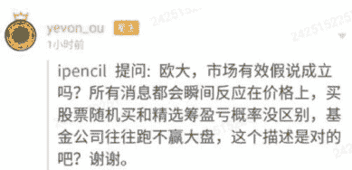

海是平的么

immrb：错到家了，不然还要炒家，还要对冲基金干嘛

宏观与微观尺度的问题。

周秦汉 ： 假消息像大海，真消息像珍珠

问：大，感觉你真的是什么都知道，我神威武。。 。 追问——（短期之内，会有一个愚蠢的投资进入。后来发现，根本研究不出什么。） 根本研究不出什么的 **t-1** 层原因是?

答：生物技术大坑已久。 科技锁死，目前没有新的技术。

问：欧大 安，孩子教育方面有哪些 **t-1** 吗？谢谢！

答：欲望是一切的基础。 欲望是成功的基础，渴望成功者才能成功。

问：欧神，您好，请问计划生育的 **t-1** 是什么?

答：再问类似问题，会导致封号。 门阀

问：欧大您好！您经常说低价区容易涨，高价区比较困难，听上去很有道理，但 **t-1** 是什么呢?

答：刚需价值，比附加值更保值。 越是高阶的附加值，越不安全。

问：欧大您好！再问一个基础问题，您一直说只有大城市才有房地产， **t-1** 是什么？是因为二手房交易率，人口规模，城市级别？还是其他？这些因素您首先考虑的是什么？另外，水群很少谈弱二线城市，如太原、南宁、乌鲁木齐等，是因为不够大，还是没前途，还是有更好的不值得考虑？谢谢！

答：小地方的房地产，容易沦为有价无市。根本没有人买二手房。 弱二线，二手房根本出不掉。或者出货大幅折价。

问：全球的金融业总体来说是不是一个利润丰厚的行业？起码从业人员的薪酬收入水平是社会顶尖的，这里面的是高级智慧劳动+高风险高回报吗？谢谢！

答：Commercial bank不算金融业，其他都利润丰厚。 不是，见《金融业的折旧》。离钱近。

问：神, 作为您关圈前的最后一个请求, 能不能最后再写一篇中的,直击人活着的目的: 我觉得您的“孩子不是手段, 孩子就是目的”还不够。项多算个是 t-2。 真正的 是生物学, 是有性生殖, 是减数分裂： 优点： 1、有性生殖中基因组合的广泛变异能增加子代适应自然选择的能力 2、有性生殖能够促进有利突变在种群中的传播 3、消除基因的有害突变对生物生存的影响 缺点： 1、基因组合的形式多样化,使遗传变异速度明显加快 2、增加了两性配子相遇的难度 不生孩子,生物没法进化。 此外, 我比您还极端, 癌症是进化中放的定时自毁装置, 老人去死, 不是因为消费>生产, 而是为了给后代腾出宝贵的生存空间

李子鸣认为生育率的恶性崩溃，是因为「社会养老」，因为人们不需要为孩子投资。

他是彻底的胡说八道。

「孩子」从来都是负债资产。父母从来没指望从孩子身上收回什么金钱，我们也清楚的知道，收不回投资。

但这并不妨碍我们对孩子的爱。

孩子不是手段，孩子就是目的！！

历史上所有不注重子弟的文明都灭绝了。我们爱孩子，不是为了 RMB 三千五千的孝敬回报。而是为了祖先输给我们的血，我们流淌给孩子的血，中华民族的。

血脉就是我们的终极目的。

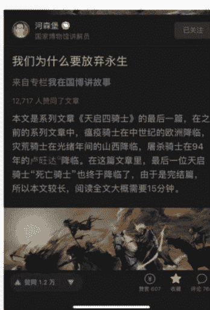

见《正本清源说奥派》，第一第二篇。

更多独家绝密资源加微信 tushu959 课程学习官网: https://s.wsxc.cn/xkOOQd

问：欧大，低价区大概率跑赢高价区的 T-1 是？便宜不一定是好货吧

答：基本价值容易升值。 附加值较难升值。

问：欧先生，您说的 T-2，甚至 T-3 是什么？

答：生物的 T-1 是化学 化学的 T-1 是物理。 我发现在一些 SB 的脑海里，是不是从来都没有过 T-1 的概念。

问：OD，你说到 T-2，T-3，可否举个例子，同一个事情，从 T-1，-2，-3？

答：一元二次方程 x=-b±sqrt(b²-4ac)/2a 平方降频原理 三次与四次方程解 群论，五次以上方程解

徐运华 ： 欧大，一元多次方程需要降幂，逐步降到一元二次再求值，就像把复杂逻辑一层层拨开，这就是 T-1 吧

周秦汉 ： 简单来说，会解 x^5 的，一定会解 x^2

2020-03-09 13:44

曲奇 ： 高阶向下兼容低阶，反之不行

问：欧大，前几年公司发行内部股票，采用价高者得的竞拍方式。由于大家都看好公司未来的发展，所以很多人都溢价购得对应的股票。 后续有同事想抛售这部分股票，被公司限价，不允许高价抛售。公司对购买者资质提出很高要求，导致很多人没有资格购买。 公司最近财务赤字严重，又开始卖股票。本以为通过这次教训，不会有人购买了。但是没想到，就在最近，上海的总部又高价卖出了好多股票…….这些人都什么心理？被虐成这样了，还要买，这背后的[t-1]反应出什么？

答：七年换一批韭菜。人民并没有记忆，记忆的力量远小于教育/洗脑。

问：欧大，您看电影会去注意并记忆一些主线、副线、桥段的东西吗?或者您，怎样记一些电影里的东西呢？凭自己的兴趣吗？看电影或者看书，您认为有哪些好的习惯和方式呢？我们应该教育并训练小孩这些好的习惯和方式吗？还是让小孩自己去发现和掌握？因为，我不是很确定哪种习惯和方式更好，但担心教给他一些不是足够好的东西。通过我对《闻香识女人》和小密圈里一些信息的思考，我认为，厉害的家长，首先是成为一个足够好的榜样，同时，通过生活中的训练和指导（有可能是暗处），让小孩掌握更多人生的好习惯和方法，对吧？您对教育小孩，除了激发他们的欲望，让他们吃一点苦头外，还有什么大方向的建议吗？谢谢！

答：事情反常，意外，不合逻辑，exceptional才会被记录。否则，就[t-1]分析消化，毫无例外。直接归档。不要让小孩背记公式，要记公式背后的道理。不过很多大人，自己只懂公式。没法教。

问：od，能分享下部落冲突的一些感悟吗，或者背后的[t-1]写过二篇铺垫，第三篇才是正文，可惜群众不要看。

## 问答记录

问：
欧大，我们看很多知识，如何把她串起来，而不是忘记了

答：
只记忆 T-1

问：
欧大，企业管理的 T-1 的逻辑是什么

答：
信息的无篡改流动。

问：
传统的经济学认为有效需求是拉动经济的发动机。还有一些观点认为中国的经济比美国潜力大，也是因为需求潜力更大。想问的是这个所谓的“需求”的 t-1 到是什么？能理解为您欧大您说的欲望吗？凭什么中国人，人均消费美国人 1/3 人种既然平等，最终 GDP 就必然差不多。

答：
（原文未提供直接回答，保留问题）

问：
效哥，既然日本的国债利率这么低，还会有人买它？背后的 T-1 是什么？

答：
（原文未提供直接回答，保留问题）

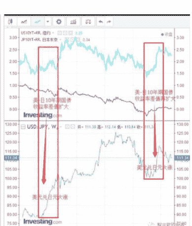

问：
欧大好，入库了一段时间了，看各式各样房产新闻和分析，刚开始心情和过山车一样，反复起伏，现在看什么分析为啥都感觉不明显呢，例如沈阳，很多微观层面的分析，有道理但更像是由果推因，还是觉得您说的货币原因和蓄水爆发等理由更有说服力，这是微观层面 T-1 的原理还欠功课嘛？

答：
大部分 V 的文章，可以不看。 他们根本分不清权重，有定性而无定量。粉耳朵

问：
欧大，（如图）中华文明能够自古延续至今的 T-1 是否真的是人口规模优势？谢谢。

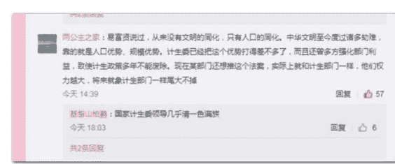

答：
否则元代就杀杀杀了。

问：
请教欧大，香港有个汤文亮教人买房，写的第 10 个人理论和逢三退一。读了读感觉第一，文字量太单薄，完全不成体系，就是一些些简单的经验总结。二是对 <mark>t-1</mark> 揭露不多。完全不能跟欧大的欧神文集著作等身和体系化和观点犀利相比。因此请教欧大，汤文亮最可取的有哪些主要观点吗？要是欧大没了解过，就算了啊。☺

答：
不了解。 基本就是户型，朝向，地段，这些很肤浅的东西。 连第二层的 “好盘不算” 都没有说到。

问：
民国被称为文化和思想的黄金时代，名副其实吗？集中涌现出大师的情况在中外历史上时有发生，比如 1920 年代的物理学，18 世纪的西方古典音乐等。现代人写不出唐诗和古典主义交响曲，<mark>T-1</mark> 是什么呢？

答：
主要成就是人文，因为没有管制。 理科完全不能和近代比。

问：
昊思的几本书价值如何，感觉揭示的很透

答：
入门级不错

问：
是什么意思？

答：
底层规律

**yevon_ou** 1小时前

> immrb 提问：欧大，我对自知之明的理解，就是一种估值能力，对吗？
> 能正确评估自己，才能把自己的时间精力去“交易”对自己最有利的事情上。

答：
不对

知己和知世界，是同一回事。

答：
原理是一样的，就是对规则的极端领悟。 因此，一个充分自知的人，去做任何事，都一定会成功的。世界观厉害。 除非是被打断腿的残疾人。

问：
判断这次疫情不会鹰鸽转换的 t-1 是什么？

答：
老大没点头

问:
欧大，川总视资本市场如命，成天的关注和转发股票指数的涨跌情况，动不动就批评鲍威尔不降息！降息对美国经济发展有那么重要吗？美国是价格型？这个 t-1 是什么？谢谢！

答：
降息有利大选

问:
欧大，生娃有功，单着有罪。古时好像就是这样的。如果政府施加这样的干预有效吗？暴力吗？对 t-1 有何影响？

答：
有效 没暴力啊。无子女者不得担任 gwy

问:
欧大，2015 年以来，利率已经接近 5 年没有调整了，也就是说，有接近 5 年没有降息了！降息实际上是全面降低全社会的经济运行成本。最近几年为什么央行的操作都是降准而不是降息？T-1 在哪儿？

答：
某人说了…………要数量型不要价格型

问:
欧大，你发的文章很多都会受到大家的激烈讨论，其中不乏带有情绪的恶意评论。你可以心平气和的看完甚至回复，不会觉得被冒犯的 T-1 是什么？谢谢！

答：
因为没击中要害。

问:
欧大，隔行如隔山，一些人在自己熟知和专业领域里认知非常高，到了其余领域就变得比较蠢，这是人的常态。但有一些人就能横跨很多领域，对于整体世界的认知比较高。 怎样培养对这个世界整体认知的提高，起码做到对于不熟知的领域不那么蠢

答：
因为你是从 T-1 倒推 T 层，因此可以解析得七七八八。

问：
保险为什么一定要持牌销售？ t-1 原因是保护既得利益？

答：
怕你卷款潜逃。

问：
企业融资难的 T-1 是什么？和金融去杠杆关系大吗？企业都觉得资金紧张，所以身边做企业的人往往会信那些通缩的论点。或者说 inflation 最终一定会配合融资变得宽松吗？

答：
信息处理低效 优先毁灭民企。 物价上涨，自然流动性变少。

问：
欧大，中国民间的清官情结， t-1 是什么？是因为整个的物质贫乏吗？

答：
因为民众脑回路有限。 不懂贪官的好处。

问：
欧大，开发商在卡回款指标和项目价值最大化，这两者之间动态平衡的 T-1 是什么？

答：
看自身财务压力。

问：
欧大安。你写过一篇分析秦汉天下形势的文章，分了五个层次。我的问题是，对一个问题的分析层次，通常是怎么划分的？怎么越挖越深呢？是通过不断思考 t-1 么？

答：
哦，其实五个层次是不对的。

问：
欧大，出轨的 t-1 是什么？

答：
婚姻制度的不合理。

问：
百思不得其解：请问中国人重视阴宅万年吉地不亚于阳宅，有什么 t-1 的道理吗？

答：
阴宅是买给自己的，阳宅是买给子孙的。

问：
欧大，假设贷款包 1000 万，资产负债率 50%，资金成本总体 5%，扣除租金收益后，成本 4%每年。 那么也就是说每年利息仅仅 40 万，以五年计，共 200 万，而融资这些钱不是特别难的事。 基本就是稳赚不赔的生意，所以这是 “房贷核心” 的 t-1，这样理解对吗？

答：
对的，正确

问：
欧大 安 会笼络人心 是一种技能吧 有些人天生有（叫领导力）对吧 笼络人心 有没有核心法则的，或者 t-1 的简单总结语 是什么？

答：
是 理顺利益关系

问：
欧大，有的人破坏规则，你告诉他这样是不对的（没有态度恶劣），他不认错还振振有词， t-1 是什么？

答：
他没挨过打。

问：
殴大，想请问一下，您觉得泡妞的 T-1 是什么，谢谢。

答：
长择短择完全不同。

问：
请问欧大，“对事不对人”是不是正确的处事方式？是不是一种聪明的方式？这里边有没有什么 t-1 原理？

答：
正确 聪明 理智走向科学。

问：
欧神，最近在重看水库文章，看到了“平等”一卷，陷入了对欧洲史的不可自拔。英国自治传统和法系思想主要区别在哪里啊？分别的 T-1 是什么？

答：
因为英国是岛国，不需要统一战争，也不需要陆军。 没有“总体战”的体质。

问：
请问一下类似“世界上本没有黑暗，划一根火柴就可以点亮漫漫长夜，再强大的黑暗都消失了。”这种话。体现的社会思想正确吗？t-1 的原理是什么？然后再请欧大用理论物理解释一下黑暗和光明到底是不是物质？👍

答：
鸡汤 火柴根本不取暖。 黑暗的定义是什么？

问：
欧大好，正在执行申卡，也知道山穷水尽的原则，在盘算常持房产的未来资金来源，想请问一下信用贷是充当救命和应急的角色吗？如果信用卡都申请完了，想申请一些随借随还的信用贷，这个节奏对吧。

答：
因为新手阶段，没有赚钱效应私人借款还没有可能解锁。另从历史看，老城区总是失败的，这个 T-1 的原因是不是和居住舒适度不一定有关系，是新贵崛起，否定之前的价值或者无庄不市吗？

答：
对的 可以 因为太贵，没庄，人口老化。

问：
欧大：何为智慧？

答：
识破 T-1 规律

问：
欧大，新能源汽车有存在价值吗？许周口大肆推动新能源汽车，T-1 何在？

答：
when if 石油断绝

问：
欧大，阿里在港股 => 美股 => 重回港股上市的 T-1 是什么？除了第一次可能是股权架构只能在大陆以外上市，是集邮先生为了再次集邮么？

答：
美股监管，罚款太严重。

问：
欧大，四种全荟，啥没解决，把过去的复述一篇，了无新意。武帝，何？T-1？

答：
一切为海军让路

问：
欧大，国有部门，一个部门待了 7 ~ 8 年，普通员工，想再往上走下，眼看比我小的都科长了，该怎么办？给领导塞钱？还是说真的要看着表现，多到领导前走走？想往上走 [t-1] 是什么？

答：
换吧。路已死

问：
1973 年 10 月迫使石油输出国组织（欧佩克）接受了美国人的条件：全球的石油交易必须用美元结算。 欧大，美国这么做的 [T-1] 是什么？

答：
增加 USD 的使用场景。

问：
欧大，您平时怎么做到长时间有效率看书的？我平时看书前面两个小时效率最高，后面指数级下降…… 而且信息量大以后，很快就会把论点忘记掉，除非重新再看一次，不知道您平时也会重读之前看过的觉得不错的资料吗？ 我现在采用的笨办法就是把关键论点写下来，记在旁边，下次复习时可能不用那么长时间。不知道欧大有没有好的方法推荐给我们学习一下，谢谢！ 我这个现象 [t-1] 是不是我没有真正理解透文章的观点？

答：
看书是一边看，一边撕的过程。 除非一些很难的书，例如爆炸力学，否则看的当时就全明白了。

问：
欧大，两国之间的汇率的 [T-1] 事什么？

答：
边际价格，无意义。

问：
少年时总因为明天有重大考试/面试/转学/转岗/重要场合公开上台等挑战、紧张的事而失眠； 现在反倒是遇到开心的事时会睡不着觉，直接失眠到天亮。家人团聚、环境改善、某件事情发展顺利...等等。 现在再发生当初那些让人紧张出汗 压力天大的事，完全不会挂心上。 这背后 t-1 是啥呢....人生越走，高兴的事就越少越珍贵了吗 哈哈

答：
筹码多了，输得起。

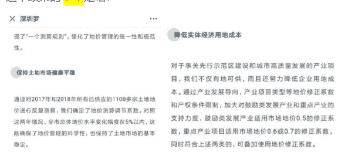

问：
这个政策的 T-1 是啥？

# # 微调工具

问：
欧大，请教下扫黑除恶的 T-1 是什么原因？另外好多催收、数据爬取都被算到黑恶里面，这又是什么原因？

答：
增加执政力量，削弱民间团体。 因为找不到大恶人了。

问：
阿拉伯世界始终没有出现强大国家的 t-1 是？

答：
奥斯曼不算么 阿拉伯半岛没水。

问：
欧大晚上好，请问 MH370 的 T-1 是多少？

答：
不清楚

问：
Q 大，有问题请教。 三季度的经济增长率已经跌到 6% 了。 2012 年以来经济增长速度是每况愈下。这对谁有好处啊？ 一味的去杠杆，该降息不降息……把经济搞成这种样子的 t-1 是什么？

答：
qbdw

问：
殷大，民企职场升迁的 T-1 是什么，是站队吗？

答：
看你是低级，中级，还是高级员工。

问：
欧神，聪明人是不是都有攻击性，明显或不明显的。t-1 是因为他对世界看得更透彻。

答：
只保留合法的攻擊性。

问：
欧大好，请问什么途径可以了解到美国房价和日本房价当年转折的 T-1 逻辑呢？自己才疏学浅，丰富一下多军理论，省的被斯文的空军质问。百度了一下知乎了一下，没有太好讲逻辑的文章，人云亦云，例子都是一样的……

答：
美国有转折么？

问：
欧大，你没有名师，那你的各种 T-1 怎么得出来的？

答：
所以进度缓慢。 否则会比现在强得多。

问：
od，幸福快乐的 T-1 是什么？

答：
降低期望值

问：
OD，如果一个人的 t-1 不是生存与繁衍，那么是不是他的行为逻辑就不能用经济学预测与解释？ 如果这样的人一时间出现很多，是不是市场就短期失灵？

答：
50 年后，他们就淘汰了。 历史是无情的。

问：
请问欧神，顶级艺术品的对手盘是什么人，最近认识一个房产富二代，买了大概几千万的当代最红潮流艺术家之一的各种作品，确实一些衍生品是有二级市场，也能快速出掉的，这里面的 T-1 是炫耀吗？ 谢谢解惑

答：
砍掉二个零。 真实价值，几十万都不值。 全是镰刀，没有韭菜。

问：
欧大，每次匿名就会出现那么多婆婆妈妈，叽叽歪歪的问题，T-1 的原理是啥？

答：
《乌合之众》，群体匿名道德标准下降。

问：
os, 强迫症的 t-1 原理是什么呀

<a class="weblink" href="https://www.zhihu.com/question/319499347/answer/831375797" title="天才和普通人 的大脑有什么区别, 到底是大脑的哪一处相对普通人较为发达呢? - 知乎" target="_blank" style="color: #567895;">天才和普通人 的大脑有什么区别, 到底是大脑的哪一处相对普通人较为发达呢? - 知乎</a>

问:
恭喜我神，普天同庆 神，欧债危机的 T-1 是什么？德意志为什么放弃老马克？为什么要救助欧猪国家？

答：
T-1，当然是有一帮 SB 乐意去买债券。否则直接破产好了，干嘛关心投资者的赔钱。

问:
我神万岁。接欧债危机 t-1 问题 为什么会“有一帮 SB 乐意去买债券”？

答：
因为民主政体，政府会兜底。

问:
殴神，看到你回答育儿的 t-1 多生就是最大的王道，数量堆死质量。可是自己多生的孩子，质量不好的岂不是也很痛心

答：
生不出来更痛心。

问:
欧大，请教下排除毒教育，构建看世界的 t-1 思维，最需要关注的学科除了经济学，历史还有哪方面学科？

答：
数学

问：
育儿的 T-1 你觉得有哪几个？

答：
多生就是最大的王道，数量堆死质量。

问：
灯塔，很多水库老人在背后开坏你，嘲笑你的老破大，讽刺你把大家带沟里，还说你西港割韭菜。 他们这么说的 T-1 是什么？

答：
穷

段公子 回复 Werewolf ： 我所见过诋毁欧神的人有几种。
1. 最低层的屌丝，啥都不懂，人云亦云，诋毁一下，显得自己有水平。
2. 稍微懂一点的普通投资者以及一些机构的负责人。把自己操作的失败案例归罪到欧大身上，投资不考虑因时因事因势，不结合自身实际，月供钱都不留的。别说你看过水库。
3. 某些人故意诋毁，为博自己出名。树立自己的 IP。目前诋毁欧神的一众屌丝中，都没说到点子上，很 low。

问：
神，经济周期的 T-1 是什么？

答：
数学，傅里叶变换。【大白话版】天下哪有笔挺直的直线。

问：
欧大，说服的 T-1 是什么？

答：
人不可能被说服。 除非被说服符合他的利益。

问：
为何颜值是女性的第一竞争力？ t-1 是什么？ 颜值高大概率基因强大是嘛？

答：
女性最大的价值是繁殖。

问：
女人追求情绪价值的 t-1 是什么？ 例如女人不屑于(至少在宣传口号上)不屑于“只要物质不要陪伴”。你损失 100w 的生意陪她吃顿晚餐她觉得很满足，给她 100w 她反而不满意；要你给她买 2w 的包，其实也就值 2000，剩下 18000 算买她一个开心，本质还是要情绪价值。大量女性还是推崇宁愿物质少一点也要追求爱情，请问这是生物进化来的本能还是被洗脑的？还是说只是女性口中这么说其实是要你付出更多的物质？

答：
因为她们不知道 100w 代表多少钱。 女性对真实的世界一无所知。

问：
欧大，为什么女篮女足的颜值比女排差那么多？ t-1 是什么

答：
晒黑的

问：
欧大，电视剧《天道》里面，“透视社会依次有三个层面，技术、制度、和文化。小到一个人，大到一个国家一个民族任何一种命运归根到底都是那种文化属性的产物。强势文化造就强者，弱势文化造就弱者，这是规律。也可以理解为天道，不以人得意志为转移。” 这话三观正确吗？ T-1

答：
《论儒法:禅宗·基督自治及道教的复兴(五)--- 神的战争 #F10》

问：
欧大，你赚钱怎么会这么厉害，t-1 是？

答：
勤奋

问：
乌镇大会 t-1 是在干嘛？

答：
我也不知道。 乌镇很破的，什么也没有。

问：
您说的人工智能关键在于框架，怎么理？是不是可以理解为创新、发现 T-1?

答：
算法

问：
请教殴大，负利率的 t-1 是什么？您是怎么理解的？或者哪篇文章您觉得解释的正确？

答：
负利率根本不需要关心。 0.01%和-0.01%区别很大么。 不大，远没有 0.01%和 0.25%区别大。

问：
欧大，当年您作为一个学霸，保送生，是不是看看课本就能领悟 t-1，根本不需要做很多的题目吧，这种能力是天生的吧？

答：
很多人学习的方式不对。 刷题，同一类型的题，刷三道就足够了。

问：
大城市法制较五线城市更健全，t-1 原理是什么？

答：
信息成本低

问:
你为啥知道那么多 t-1?

答：
因为你问的多。

唯为 ： “求之而后得， 为之而后成， 积之而后高， 尽之而后圣； 故圣人者也， 人之所积也。”

唯为 回复 枫树岭 ： 来，也可以归纳为六个字—— “人之所积者圣”

人要想真正掌握万事万物的 t-1 而达到 “圣” 的境界， 唯一的途径是学习和实践的持续积累。

问:
欧大好！ 请问海权的 t-1 是什么？ 谢谢您

答：
1） 贸易  2） 自由选择登陆地点。

问:
欧大， 请问感觉现在官方老在题学习新加坡模式， 那么新加坡模式的 t-1 是什么， 罪恶的点在哪儿？

答：
富人房放开， 穷人房保障。 问题是， 穷人房也不该保障， 福利就是恶。

问:
欧大万安～ 进去水库后发现自己看问题角度开始变了 最近观察公司里的人发现:公司里加班最多的人， 工资、年终奖各种福利也是较好的， 但普遍都只有一套房子， 多是 ceo 盘， 普遍只一个孩子多半是女孩。 而看起来混日子的普遍 2.3 套， 孩子也至少 2 个， 最惊奇的是扫地大姐 3 套房 4 个孩子， 问：1、20 年后这些奋斗人的孩子会不会多半

## 欧大，交易的 T-1 是什么？

净利益的增加

问：

欧 Sir：失落的三十年，和“菜”价上涨不矛盾？货币永远贬导致“菜”价上涨的 T-1 不会因失落的三十年而改变？

委内瑞拉也是失败国家。津巴布韦也是。

问：

欧大好。刚又重看了一遍《列兵与阶层》。一般人很少换赛道，经验能力也就自然累积。切换赛道的活，低阶的东西有什么是可以带入高阶的呢？

T-1 的领悟

问：

欧大，为啥一线城市学区房十几万几十万都有人买？买房的钱完全可以去读私立小学了呀！T-1 是啥？

SB 死不光，科创板还有人炒呢。

问：

OD，有时候很焦虑啊，感觉自己能力不够，即使和同龄人比，已经还算 OK 了，但人外有人，始终也会有比自己强的人。请问：
1. 如何能做到像你一样，全方面的强，或者说全方面的能提升一个等级，即使很多事情参透 T-1 的逻辑，但未曾涉及的领域始终是不懂得。对成功的饥渴很强烈
2. 平时内心的心思，是复杂一点好，还是简单一点好呢？本身喜欢多想的内心世界，对方一句话，能想到背后好几层意思。

多种可能和情况，看到身边人很简单的思路，活着也很开心，自己这种多想有时候觉得很累啊。哪种好呢？

每年工作 4000 个小时，持续 15 年。

问：

欧大大，高房价会降低企业竞争力吗？t-1 是啥？

不会。价格本质是要素的比例。看病便宜，就是剥削医生的劳动。该什么价，就什么价，参考《正本清源话通缩》

问：

欧神，中国一线城市房价历史除了参考香港外，东京 伦敦 纽约的房价发展史可以纵向对比参考么？

当然可以，T-1 是通用的。

问：

哥哥，今天跟一朋友见面，算半个同行，规模比我小，野心倒是比我大，感觉下来她是想我拉拢我跟她干。她的能力还不够驾驭我，但她很执着。

学会用 T-1 的思维看待事物之后，我一直都有点颓废，变得没有什么理想，也没有那么强的事业心和拼搏精神了，工作中找不到成就感，一门心思钻研房子和怎么钻空子赚钱。

我今天看到她，有我曾经也有过的理想和使命感，活得那么笃定和有动力，忍不住鼻子很酸。你的理想是传播奥派吗？人一定要有理想才行的吧，否则跟咸鱼有什么区别呢？只为了生存和繁衍活着，我还做不到呢。那如果原先的理想推翻了，新的又一时半会找不到，该怎么办才好呢？我想有一个东西，我需要对 Ta 很执着。

当你的低级欲望得到满足，你就会有中级欲望。我看我，还有做不完的目标。

问：

欧神，有的人做一个行业都做不好，而有的人能同时做几个行业还都能做的出类拔萃，我想问后一种是不是宣传的，一个人同时做好几个行业应该不符合逻辑吧？

其实是 T-1 层的强，例如勤奋，例如谨慎。

问：

欧大，问个问题，当自己的阶层从原来的阶段进入到另一阶段，身边的人其实已经换了，但如何能保持，不脱离了解之前阶层的情况呢？举个栗子，比如现在已经不是学生或者年轻人，但要了解他们的 insight，靠自己的话靠什么？这种 T-1 的思考逻辑是什么呢？升阶了但脱离了大众，但得屌丝者得天下啊。

保持不了。《屌丝时代》写过，当你靠屌丝发财，越来越有钱之后，你也将必然渐渐脱离屌丝。第一代富豪，能保持一些生活习惯就不错了。

问：

欧大，打圆场的 t-1 是什么？

给双方不同的台阶下。

问：

欧大，杭州这次事件，看完视频车主应该毫无责任，但最终还是判三成责任，这种和稀泥指法，T-1 逻辑是啥？减少麻烦，民萃原因？

6月17日上午，杭州发生一起交通事故。交警通过调取现场监控发现，一名50岁左右的女性既不遵守马线，也无视信号灯，试图从双向4车道的马路直接横穿。走到中途，她突然加速小跑，一辆正常行驶的小轿车为了躲闪，撞上马路边护栏，造成汽车和护栏不同程度受损。

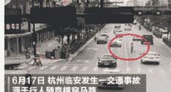

对此，杭州交警认定，行人负主要责任，汽车司机负次要责任。行人除了承担70%的汽车维修费用外，还要全额赔偿护栏被撞造成的损失。

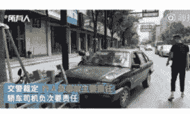

该认定一出，不少车主纷纷点赞。

交规法 66 条了解一下。秀相时代，内部白左就已经开始抬头。

问：

欧大，根据生存和繁殖是第一要务的原则，对关于变童的思考。
①当未成年雌性还未对当那些强壮的雄性产生吸引力时，相对弱势的雄性趁虚而入，虽然受孕概率很低但依然有可能，所以这个基因保留了下来。
②动物中应该也有这种类似行为，但由于动物对于处女膜这种器官有无的不敏感导致成年雄性并不会根据该指标对雌性进行挑挑捡捡。
③人类父母对于自家孩子性侵的愤怒主要来自于贞洁被破坏，未来“市场行情”会受到影响。
④如果施虐者破坏器官，甚至导致不孕不育，这是对核心利益的损害，必须讨伐。其实小孩子啥都不知道，家长的谴责和过度强调反倒产生负面心理影响，对吗？

没月经怎么受孕？没月经怎么受孕？不是，欧美也愤怒。负面个屁，圣母神经。

SherryH ：提这种问题本身就很邪恶

2019-07-05 12:14

心忈 ：假如她是你的女儿

&n: 损害核心利益也 just是不孕不育就必须讨伐，没有就可以不讨伐？题主有女儿吗？家里有女人吗？殷大咋不送你二字套餐呢

问：

欧大，已经持续很多年都处于蚂蚁打转的模式，太想要在年轻的时候成功，但是使命感和目标却很模糊，所以容易把别人的目标当成自己的目标，不知道自己最想要得是什么，所以容易患得患失，容易陷入情绪的沼泽，如何找到最适合自己的人生使命呢？

首先，想清楚社会运转的方式 [1-1] 知道人情世故，经济兴衰，才能战略规划。

问：

欧大 通州调整定位 将原规划中“市行政副中心、国际商务新中心、文化发展创新区、和谐宜居示范区”的发展定位调整为“国际一流和谐宜居之都示范区、新型城镇化示范区、京津冀区域协同发展示范区”。这 [1-1] 是啥？可以理解成 zf 把人忽悠到通州后 就跑了？和谐居住，就是不发展经济了。高楼大厦 88 \v

问：

神，信任难以建立，却容易打破？有什么 [1-1] 的方法代替信任？为什么信任成本那么高还要去建立？

先支付代价。某些场合，信任的回报很高。

问：

神。北上赶人的 T-1 是什么？

W

问：

欧大，让公司营销团队重视客户满意度呢的 T-1 是什么？

业务类型不同。部分公司，严重依赖重复购买。

问：

衣不如新，人不如旧，这种说法是民间没什么因果关系的顺口溜，还是说有确实道理？如果有道理，t-1 的原理是什么？

循环博弈中，恋旧者占优势。

问：

欧大，谢谢你想问一下，格力 V 奥克斯，伊利 V 蒙牛，饿了么撕美团，这些现象背后的 T-1 是什么？谢谢欧大，不吝赐教。

撕人，不管成与不成，总是吸眼球涨流量的。

问：

Ocean.日本人深入骨髓的不给别人添麻烦的 T-1 是战后麦卡阿瑟把日本的国民性给阉割了？

不清楚这个习惯，什么时候兴起的。肯定是江户后。

问：

欧 sir 富不过三代的 t-1 是？阶级固化屌丝想逆袭只能靠抢劫打地主了。

被打劫

问：

欧大，教育的意义是什么？孩子教育的目的t-1是什么？

驯化 另类驯化

问：

欧老师，请问您觉得墨菲定律是真实的，还是感知偏差？如果是真实的，它的t-1是什么？

孕妇效应

问：

OGG，感情的T-1是什么？您说屌丝无爱情。那么同理，屌丝亦无亲情/友情，对吗？

有啊，但很容易贱卖。例如，给你个九品科长当当。

问：

欧大好！您在文集中写除了刑法之外的法律都应废除，请问成文民商法的t-1逻辑是什么？和抢劫有关吗？谢谢您！

商法归根到底的问题，是你给了钱，我不给货。不给货，就是抢劫了。适用刑法。

问：

请问神：HK 今年推出自主养老金抵税的优惠政策（自付 6 万能抵税 1 万左右）。背后T-1是为了托股市吗？养老金投资选择都是各大基金。谢谢

养老金主要是安抚民众。偷割猪油是小钱。

问：

欧大，发现小密圈好多问题都是问 T-1 的，小白（包括我）都希望掌握终极真理，然后就能世洞明，一劳永逸。其实是在缘木求鱼。小白最重要的是去从看房 200 套开始，把所有该踩的坑都踩了，吸取经验教训，然后才能开始进步和进阶，请问这样的理解对不对？

学而不思则罔，思而不学则殆

Alex Ma ：道理有几个层次：知道了 懂了 掌握了。小白们再问，也只是『知道了』的层次，要到后面的层次，是要踩坑付代价的。最难的就是认识到自己的弱，承认自己 SB。而我等 DS 们往往在第一个层次，就认为自己掌握了宇宙真理，看不起别人了。

问：

官本位的 t-1 是抢劫大于 trade 么？

一般意义的官本位，语境指的是官大一级压死人。而不是只有当官才能发财。

问：

头条系崛起的 t-1 是什么？

不清楚。得屌丝者得天下。感觉和预装机软件有点关系。

问：

Ocean 绿教从麦加麦地那小镇，扩散至今 近 2000 万平方公里的 T-1 是什么呢？

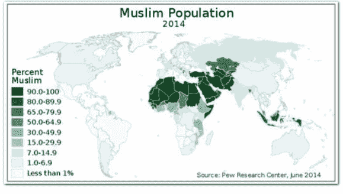

别人渣。都是垃圾地段。

问：

欧神，小时候有些同学，学霸，也很聪明，不用怎么看书听课，分数去很高，长大却平庸，而且很多这样的例子，t-1 是什么？感觉他们也 不是死读书类的，你觉得主要原因是？

只有疯子才能成功，他们不够疯。

问：

欧大好，重庆大部分都是 50 年的塔楼，50 年和塔楼的 t-1 分别是什 么原因？

CQ 全部都是五十年，没有 70 年。塔楼因为容积率商高。

问：

Ocean.阿富汗能成为帝国坟场的 t-1 是什么？呢？

屁话，还不是另一个巨头给钱。

问：

欧大，执行力的t-1是什么？如何提升执行力？

执行力不是一种毅力，而是一种技能。学会了之后，就一直会了。

问：

欧神好！如何解决对抗毒教育和寻找正确的t-1规则中产生的负面情绪？看心理医生有什么用？觉得对方大概是听不懂我在纠结什么吧

如果正确的三观，能指导你预测世界，认清世界。你自然会有收获的快感。

问：

一帮反对Robin Li 当院士的投票反映什么t-1的原理吗？

士农工商，对商人的歧视。

问：

欧大，你为什么那么喜欢读历史？t-1是？不过确实挺有趣的

历史是最高文化，远超过一切知识。只不过屠龙技，等级低用不上。

问：

欧sir，是不是东方人比较注重精神上理论上的东西，而西方人比较注重实践出真知？阿基米德在公元前两百多年就发现了杠杆原理了，西方人的科技一直领先东方啊，造成这种区别的T - 1 是？

西方人追求T-1，东方人没有这个说法。例如，你很难想象，西方人很早就有“原子”的概念。

问：

欧神，虽然股市是骗局，不过我想问的是，像 “缠中说禅”、江恩八线那些，他们那一套自圆其说、有理有据的体系，其 T-1 是怎么一回事啊？

江恩八线就是黄金分割线 0.618 啊。很粗浅的道理。

问：

欧大，很好奇，你懂得东西这么多 1、是在你小的时候 有人引路教导入门 t-1 还是你自己悟的 t-1 2、你说 market 是不传之秘 那你又是如何知道 market 之秘的呢

我没有名师，否则肯定比现牛很多。我是管培生啊。

问：

请问欧神，上海的公办/民办的小学，初中，有择校的操作空间，和改革开放后，80-90 年代的价格双轨制，有内在相通的 T-1 原理么？谢谢

想多了，整天胡说八道。除了水库之外，你拿着钱，能找到入口么。

@KATE

KATE : 微信ipip885

问：

一群员工抗议 996，那为什么他们不去当老板？除了资本，你觉得当老板的 t-1 是什么？

承担风险。中枢协调人

问：

一个人的知识架构一定要是一个开放系统。这行业最大的陷阱就是，我们依照旧经验，觉得我们的既有认识、甚至思维习惯是最合理的，从而陷入封闭叙事的框架下。每一个新信息都被当成强化既有认识的工具，这样既有认识天然就不会有纠错过程，偏离不断累积，最终一定会被现实世界骤然推翻。欧大，一个挺出名的学者说的，有道理吗？还是他没参透 T-1

有道理啊。不就是今天肛据说的么。

问：

欧大，过去十多年，煤炭价格大起大落后面的 T-1 是什么？

不清楚。放松价格管制？

问：

欧大，有的股评牛人长期预测大盘指数准确度有 80%以上，T-1 原理是什么，真的是有技术含量？还是有内部消息？

只强调猜得准的那几次

问：

我神，谈判的 T-1 是什么？

将心比心，站在对方的立场考虑问题。

问：

“股 sir 说美国是汽车文明，中国是地产文明。两者不可做比较。可与日本韩国儒家文化圈同是以地产文明为核心的做比较。” 欧神， 1. 汽车文明和地产文明分别是什么啊？ 2.为什么中美会有这样的差异？ T-1 是什么？

人口聚集密度不同。国家策略走向不同。

问：

欧神，实行户籍制度的 T-I 是啊么啊？

剥削农民，城乡剪刀差。

问：

欧大，为什么有的人就是没什么欲望呢？没有赚更多钱的欲望，没有过更好生活的欲望，没有想更瘦的欲望，没有去看更好地方的欲望，空头吹牛倒是不少，最好躺着赚到钱，最好帮他把舞台全弄好然后他上来鼓个掌。T-I 本质是什么呢？改变得了他么？

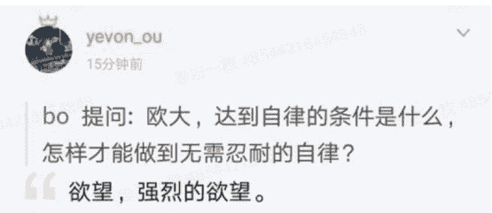

首先，人是分优劣勤勉的。其次，降低刺激阈值。每一个小努力就有回报，会有帮助。

问：

大，1，女性之间容易嫉妒的 T-I 是啥？零和思维？2，女性美貌体现的是生殖力的话，已婚配已生娃的女性花费较大心力维持美貌似乎得不偿失，姿色平庸反而压力更小(无论压力来自男性还是女性)，为何广大女性依然孜孜以求追求美貌？谢谢。

在古代一个家族中，女性几乎共享同一个男性的恩宠，因此内斗很厉害。如果女性有自己工作，会好一点。有些少数民族女性，婚后故意划破脸。

Mushroom ：妒忌的本质是在一个窄小的范围内争抢有限的资源。如果你从外部赚足够多的钱，必然不会再去除忌一个浅浅池子里的同类。

问：

欧大，请问能做一个顶级的销售人员的 T-1 能力是啥？产品千千万，公司千千万，各有好坏，不应该是在好的公司卖真正好的产品吧 marketing 做完的基础上，剩下就是拼销售的能力了。好的销售，天天和 客户泡在一起。急客户所急。

问：

os，msl 为什么有那么强的侵蚀能力，T-1 是什么？

白左的宠物。

问：

欧大，刚刚看到一句话感觉特别有道理。我感觉靠谱的 T-1 就是它了，我的理解对吗？

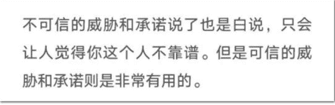

这句是鸡汤，没有细节。怎么样才能证明你的威胁是可信的呢，小流氓就一定要砸碎你的玻璃窗。

问：

就是做老板，而不是做伙计的能力。 \~ 神, 做老板的能力T-1 是利益分配么？还是其他什么？可以提示下么？

不是。很大一块，是视野。

问：

“夸夸群” 的流行，体现了一种什么样的社会思潮？后面t-1 的经济原理是什么？

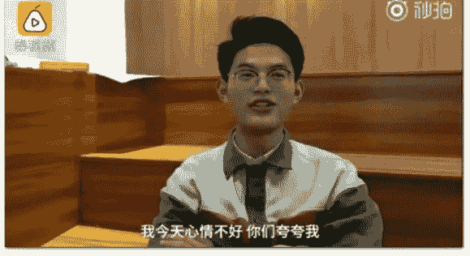

佛系啊。

问：

欧大，请问人喜欢吹嘘夸大自己的财富和实力 这个后面的T-1 是什么呢？如果一个人的朋友都在 a8.5 这个水平 那这个人财富的上限大约是多少钱呢。 谢谢

更多独家绝密资源加微信tushu959 课程学习官网：https：//s.wsxc.cn/xK0Qqd

## 《格调》（上）

朋友一般都很准了，如果还不准，可以看看他的对手。

**问**：改善一下提问再求救欧大，房产调控的 t-1 是因为白左，还是因为利益？

**答**：利益。

**问**：老大，经济学第一定律 dt > 0，郭嘉高层没人懂经济学？限购限贷这么做是想安抚屌丝？ t-1 是什么，是真没人懂经济学还是背后有更深层次的意义？

**答**：交易成本过高，则国家大贷。R > T。有些人想抢劫，深入骨髓。

**问**：老大，巴国人民素质一塌糊涂有没有 T_T 啊？

**答**：穷山恶水出刁民。

**问**：按 0 账单做，在下一个月账单日还钱，按照 app 里边的“未出账单”总数，以及每笔逐一对照没问题，可是账单日总是出来少则几十元，多则几百元的账单是怎么回事？

**答**：自己看“账单明细”。

**问**：政府做效率一定不如私人（或者说计划一定做不过市场）的原因是什么？是因为产权吗？是因为未来太复杂无法计算吗？还是都不对？

**答**：花别人钱不心疼。

**问**：神，为什么户型之间的差距就 5~8%？同一地段，相差 5 年的两个小区，我观察同样的三室一厅，A 南北通透，窗 1.5 米的两间朝南，一间朝北，房龄多 5 年。和 B 一间朝南窗户 1 米 5，另一间朝南半开间，朝北正常，这两套同一楼层，面积相差 0.3，成交价相差不到 2 万。我是否可以认为户型的差距就 5~8%？这个原理是什么？总价约束？

**答**：不是 Apple to apple 的问题。差的不是户型，而是 5 年折旧和品质。

**问**：大，转向服务业的，是什么？您是不建议转行做二手房中介吗，为什么？欧大辛苦，谢谢！

**答**：对。服务业，58 同城上能找到的一切服务。《论工业革命与市场经济》未来属于服务业，严格点说，属于动脑子的人。

**问**：神，吕雎他老爸为何能在刘邦还是屌丝时就看出这人有潜力呢？是什么品质让吕老爹看上刘流氓？吕老爹会识人的 T-1 是什么？

**答**：那二女儿为什么嫁个匹夫？吹呗。

**问**：全能的欧大，父母不相信子女的话 T-1 是啥？老年客户用我的产品晚上起夜由两次减为一次，我父母现在是两次，建议他们用说啥也不用，说就是不信我的，辩证上年纪了都这样。其他事例也是，同样的道理事情，别人说就信，我说的就不信。是老年人的自尊？为了给多军省钱？

**答**：不是。为了维护“父权”体系的权威，他就是要否决你。显示话语权。

**问**：欧大，一直以来看你的文章，同样一个事情，即使非常复杂，总感觉你说的就更容易让人理解，这里面有什么特殊的 T-1 技巧能透露吗？其中一点应该是，你确实对很多事情想得比较透，但我发现很多人想得清楚但也解释不好。

**答**：那是因为很多人，根本就是胡说。东拼西凑几千个字，把新闻罗列一下，其实作者自己都没有搞懂。

**问**：欧神，以前欧洲如果死了很多人，也就是等人口自己恢复。现在为什么要引入移民？ T-1 是什么道理？

**答**：老年人不肯降低生活水准，想要廉价的佣人。白左病呗。你想想没有外国怎么办。

**问**：欧大好，需要跪银行的 T-1 是因为银行业是严重管制的行业吧？假象金融服务完全自由市场开放，应该是银行跪客户吧。

**答**：对的，给高利率即可。

**问**：欧神，为什么关注点也是钱？眼球也是钱？ T-1 是什么呢？

**答**：我以前认为，广告的转化率为 0%，这么傻的广告，谁会买呢。后来才知道，大概是 1.3%，就靠这一点点转化率，撑起了整个行业……

**问**：股大，为什么放水阶段允许存量贷款优化？t-1 是什么？毕竟不给优化 p 民也只能接受。

**答**：LI 说了，要切实降低利率负担。

**问**：一家公司管理员工上一个人的活宁愿给 3 个人干给低 3 个工资，也不愿意给一个人干给高工资。说是怕高工资的养久了欲望强烈容易出走，便宜的人走了也容易替换。可是 3 个便宜的人工位各方面费用成本远远大于一个高工资的成本，而且业务还做的烂。对方我的合伙人 bat 中层管理背景，被原来的企业文化洗脑的厉害，我一直没找到 t-1 能强有力说服他的理由。

**答**：因为精英很难补充。业务的持续性，鲁棒性，更重要。属于不追求效率，但绝对不可以停机的行业类型。

**问**：欧大晚上好，最近辛苦了。请问叛逆期的 t-1 是否不懂生存的挑战何在？

**答**：积怨已久，小时候无力反抗。

**问**：股大，国家要 A 股涨的 T-1 是什么？

**答**：国有股抛售。

**问**：你说经济学是社会科学的 T-1，经济学能解释近代民族国家的兴起和亨廷顿提出的文明的冲突吗？

**答**：见《论平等，自由，博爱》卷。

**问**：欧神，既然你也觉得教育如此腐败，本科如此不值钱，我们孩子一直沿着这条路走的，是为何？可能是在 tg 掌心下，都得按他的套路出牌吧，好比如 tg 制定了游戏规则，有学历可以入户，我们拥有 fp，有学历，办卡额度高，我们拥有资金……

**答**：低成本混个本科够了。本科还是要的。高成本，大投资“教育”，请免了。

**问**：欧神，请问极度厌恶风险背后的，是不是不愿意承担责任吗？谢谢。

**答**：对的。承担责任，就有风险。不担责任，就没有风险。自私的人，不愿意付出。

**问**：怎么和别人简单说清楚 t-1 呢？

**答**：你要清楚明白 T-2，才能轻松回答他关于 T-1 的无数问题。

**问**：接上，如果完全静止，我们就“观察”不到时间了，但我们这个宇宙有些“自发的不可逆转或者静止的运动”，比如粒子衰减，宇宙空间膨胀，所以，随之有了可观测的“时间”变量。等到宇宙彻底熵增到最大，能量全部转化为质量或空间后，时间是不是也就随之静止了，到那时再怎么演变，就得跳出这个四维宇宙，研究“宇宙的宇宙” t-1 才知道了吧？不行，我脑细胞不够用了……

**答**：其实时间后退三秒，再向前 4 秒，人脑是感觉不到的。因此，不可以说时间是“单向”的。

**问**：欧神，家里满月酒，父母请了 58 家人家，大约 20 桌人。但是实际上，我认识的也就是舅舅姑姑大姨叔叔那大约 8 家人家的样子，和父母同辈人的那批，而爷爷奶奶他们的亲戚大都不认识了。想问：
- 1. 以前维持这么庞大的亲戚 T-1 是为了什么？
- 2. 现在是不是越来越没有必要维持那么大的亲戚群了？特别是借钱，找银行是不是更方便了。
- 3. 这种庞大的亲戚群，未来是不是消失了？

**答**：械斗。没必要。消失，重新崛起。

**问**：灯塔，婚票要求无房无贷的 [t-1] 是为了规避银行面签提出双签、增加首付成数、提高利率等无理要求？

**答**：# 家庭算二套

**问**：县城 gwy，jc，今年已经开会，要按照全国统一部署进行职务序列套改，意在解决 ga 系统人多位置少长年升不上去的情况，本人情况：混日子工作 12 年，刚够 xx 序列（正科级待遇），请问这跟真正的正科不一样吧，因为感觉我们局长也才正科啊，他都干了 18 年了，人家还担着很大的干系。总觉得哪里不对劲却又说不上来，才疏学浅希望欧大不吝赐教 [t-1] 原理，拜谢！

**答**：正科级待遇，简单易懂。

**问**：OD，你说的男人有趣指的是什么？有通行标准吗？有趣的 [t-1] 是世事洞明，人情练达吗？

**答**：你的智商，我没办法拯救你。

**问**：欧大，各类所谓的金融投资品（FC 除外）和 FC 比喻似都是下九流，却为什么没有受到类似 FC 的各类限制？本身 FC 就具备了金融属性，为何不承认并任其自由呢？[T-1] 是啥啊？是担心不受限，价格暴涨，河蟹受对我挑战？“自由交易给交易品带来真正的降价”这个道理不对么？

**答**：# 庄家不同

**问**：神，都说律师和医生是高端职业，是真的还是毒教育？如果是真的，那 t-1 是什么呢？

**答**：国外是，国内不是。

**问**：欧大好，坐标渔村，请问把所有银行的借记卡全部办理下来的 T-1 是什么？
- 1. 以后方便还信用卡？
- 2. 未来卡多了可能不好办下来？
- 3. 为以后在本行申卡做准备？感谢！

**答**：不要问了，让你办你就办。

**问**：欧大，你打车只打专车，高铁只做商务座的 T-1 逻辑是什么？

**答**：抱歉，目前坐的还是—等座。王牧笛坐飞机，只坐一等舱。像我这么抠的人，也就只舍得促销升舱。

**问**：欧大好，勿二字套餐。
- 1. 入圈+拜读文章，有点儿明白娃本位，像您说的，有孩子就是 GDP，包括数量 > 质量，都与毒教育相违。现在想想是不是“坏人”或者上层人，压根不让 P 民知道 T-1。
- 2. 既然娃本位，上层分家，中产学区房陷阱，底层随便生，管不了，养不起。这是不是也算一种阶层流通？谢欧大

**答**：T-1 是一个整体，知道了一条，很容易推出另一条。屏蔽的办法，倒不如 ABCDEFG 都彻底不让你们知道。我没说过第二段。

**问**：神龟息大法的 T-1 是什么？

**答**：https://m.weibo.cn/1301890202/4337022775144370 这段基本完全伪科学。

**问**：欧神新年好，祝新年财源滚滚。请问一下关于中国的城市发展问题：
- 1. 当代中国将北京作为首都（政治、文化中心）的 T-1 原理是什么？从地理防御上来看，当代已无北方游牧民族威胁，自然环境上华北也不如江南，国际交流上沿海城市也开放过内陆，应对战争威胁也是西南更安全，继续维持北京首都地位难道只是考虑到沉没成本吗？
- 2. 未来中国有无更换长期首都的可能性？如果更换，会不会导致北京甚至整个华北地区一蹶不振？
- 3. 从十年以上尺度预测，未来中国的十大核心城市梯度如何排列？谢谢欧神指教！

**答**：1949 年的军事形势。靠 Moscow 近。有不死鸟，看腹地。
*注：不死鸟=有大量人口的区域的首位度城市。*

**问**：欧神，你信风水吗？风水 T-1 的原理是？

**答**：不信。山清水秀，住得舒服。

**问**：大，盛世以儒治世，乱世当以道平天下。儒家的 t-1 是等级制在盛世和平年代巩固了国家的稳定保其 300 年和平。当历史时期变乱的时期道家人物就出来拨乱反正，如伊尹、姜太公、诸葛亮，乃至刘备等……战乱时期仁义道德那套不管用，唯有活到最后才是正义！而道家讲究顺其自然，那为何要出来拨乱反正？何为正？对错正反天道自会评判不是吗！莫非是替天行道？

**答**：你说的是法家吧。

**问**：欧大，传言深圳可能提高豪宅线。看房时听中介说，部分业主不放盘了观望。我的疑问是：
- 1. 提高豪宅线，降低了买卖双方的交易成本，对于 19 年春节后房价影响如何？
- 2. ZF 提高豪宅线的目的是为了促进二手房交易吗？

**答**：轻微。提高很少，影响忽略。

**问**：神，有些人道貌岸然的，看着难受，更难受的是，看着他骗了不少人，或者放任有关系的一些人作恶，放任另一些人生死。这种人如果复杂一些还好，稍微一道貌岸然就很恶心。这有 T-1 的解释嘛？

**答**：为什么有人吃这套呢。关键还是教育的错。

**问**：欧大，1. 您说的教育的错，T-1 可不可以理解为：因为教育造就了某部分人吃这套，所以造就了道貌岸然的人，类同于有什么样的消费者，就有什么样的商品的道理吗？ 2. 您说是教育的错，意思是错在教育出了吃这套的部分人，还是指错在教育出认为这一套有问题的人？ 3. 请问应当如何去应对身边基本没法躲开的这种人？理智告诉我要保持表面上的和谐，但经常受到情绪干扰，无法把控。

**答**：对的。tg 的错。管好你自己，有空救几个人。注意别封号。

**问**：欧大有篇说货币每年贬值 22% 的文章是？或者简单 T-1 是啥？谢谢。

**答**：我没说过贬值 22%。

**问**：欧大，像打港办这样的狗血事件，不是恶性竞争、个人恩怨这么简单吧，手套主子的要求才是 t-1？

**答**：国企亏得起，钞票是印出来的。民企就被排挤了。

**问**：怎样评价人民的名义，祁同伟这个人物，希望听到 t-1 的观点。

**答**：# 逼上梁山

**问**：欧大，现在大龄剩女越来越多，t-1 是什么呢？一夫一妻制？还是三观不正？

**答**：一夫一妻制。

**问**：总有一天，大户型会比小户型卖的贵。请问 t-1 是什么原理，生育放开？改善需求？

**答**：人的欲望持续增长，没有人喜欢一辈子住在小房子里。

**问**：炒菜还能赚钱的 t-1 是科学尚未普及吗？

**答**：是的。

**问**：欧神一直有类似的问题：一旦普遍人懂得 CF 的 T-1，是不是就是疯狂阶段了？假想身边的朋友如果哪天都是库友了，岂不是完蛋了？平时根本没法和身边朋友聊起水库种种，信则信，不信则无。欧神怎么看？

**答**：穷人总觉得自己一变坏就有钱。跪银行有多难，你知道么。

**问**：欧神，链家一边搞贝壳大平台，一边启用德佑等加盟。裁判员运动员都做了，未来有前景吗？看好啊！T-1 呢？祝欧神早日心情大好。

**答**：没戏，死棋改编还是死。

**问**：欧大，你说过要多交际吗，T-1 是什么？

**答**：没说过。社交同样需要成本，无差别人类体力劳动。

**问**：殴大，中华民族绵延至今的 T-1 是什么呢？

**答**：运气。

**问**：个人感觉是概念迷糊和近代中国人强行制造的概念。不管被灭国被混血多少次，人种被改变了多少，近代人都认为那些古代人是中华民族。但古代人自己不见得认同。

**答**：DNA 检测，中国人高度纯洁。和 3000 年前安阳出土的古人，几乎完全直系。其实有一个很大的问题，其他民族生存力不如汉人。例如罗马和日耳曼人共处以后，是罗马人被淘汰，人数越来越少。但是汉族和少数民族杂处之处，少数民族喝酒。不爱工作，不维护家庭。最终是少数民族几代人之间被淘汰。例如满人，甚至蒙古人，进入北京之后迅速地贫困化。蒙古人花光了所有的金钱，直至卖身为奴。这一类的现象，都没有深入研究。

**问**：大，在公司混，和同事，上级沟通的 t-1 是什么规律？

**答**：是什么级别说什么话。

**问**：od，你对中国的酒桌文化怎么看，为何有些生意在酒桌上才能成？这里 T-1 是什么？

**答**：如果是国企和国企做生意，则利润价格就不是最重要的。交朋友，拉山头，确定人际高低，才是礼仪核心。南方市场话，就很少需要喝酒。能谈钱的事，干嘛谈酒呢。

**问**：OS，奥派者逼迫伴侣信仰奥派的行为并不是奥派，因为奥派的 T-1 是不干涉。所以当伴侣死不接受后，真正的奥派要么分手，要么接受并容忍之。不分手也不容忍异端思想，老是跟伴侣吵架，鄙视其愚蠢的左派思维，实际上也是犯了白左那一套的老毛病。对吧^_^ 反省自身小结，望诸道友引以为鉴。

**答**：我当然有权唠唠叨叨。我不强迫你，可是我可以挤兑你。

**问**：os，白左最喜欢拿这些说事，小弟基础知识不够，求问这两个谎言的 T-1 是？（BJ 雾霾这不是真真实实的么，还有饮用水污染的问题）

**答**：匿名用户 提问：大，人类是不是应该控制发展，否则环境污染，很多野生动物被吃光，温室效应，弊端太多了。

**答**：环境污染和温室效应，都是谎言。地球上人类访问过的土地，只有 15%。人娄居住的，只是地球很小一块面积。污染就污染了，大不了换块地皮住。全球在变冷。

**问**：如图，恳请老大解惑。第一条，楼梯 3F 与 7F 这个懂，过。第二条，电梯 7 层，顶楼贵 10%，不知如何计算？T-1 是什么？第三条，电梯 30 层贵约 7-8%，对比的两个楼层分别是什么？之前老大说过，电梯高层第五层或者第六层为基本层，往上逐层按 0.6% 递增。恳请老大指点二，三条。

**答**：欧大，三楼房子一般是七楼的几折，朝向面积都一样。
**答**：楼梯楼，还是电梯楼。电梯有儿层？
**答**：楼梯楼 3F 比 7F 贵 15%。
**答**：电梯 7 层，顶楼贵约 10%。
**答**：电梯 30 层，贵大约 7～8%。
**答**：电梯 7 层，就是洋房啊。自然顶楼贵许多。电梯 3/30F 需要折价 92 ~ 94%。

**问**：欧神好。请问我的思路对吗？如果简单把一套房子的价格分解成 1) 土地 2) 建筑物。真正保值/升值的是土地，建筑物随着老化变得不值钱。土地当然是大城市土地。可是土地本身无法承载居住能力，必须在土地上盖一个房子才能住人。这好比一个还没开发的地下水源，打井后水源的价值才能体现出来。因此，最优质的投资标的，是土地占房价的 99%，建筑物 1% 的房子，是吗？也因此这是你推崇老破大的丨丨吗？

**答**：土地其实也不保值。随着城市的外扩，郊区在摊薄市中心的价值。只有严格土地管制，城市扩张暂停的 City，地段才能保值。

**问**：欧神，培训公司的丨丨是不是吹牛 B＋割韭菜？

**答**：流量，流量是一切。名师+官方教授背景+吹。

**问**：殷大好：目前这个楼市情况，我是否应该把手上的房贷通过还款再抵押出来的方式拉高（负债率 15% 拉到 50%）哪怕这比抵押贷款出来，不买房子，放着备不时之需也是好的？背后 T-1 防止踏空大放水货币贬值。

**答**：对的，不缺钱的时候，赶紧优化资产平衡表。

**问**：欧大为什么你敢于放出批评和扒皮？什么样的负面扒皮才是致命的，什么无关紧要？胸怀宽广的 t-1 是什么。

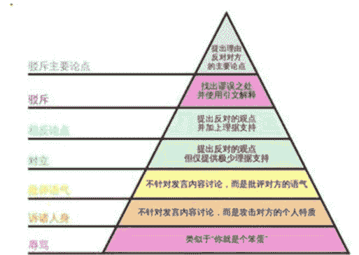

问：欧大，你为什么那么推崇孝道？据历史来看，很多有成就的人根本就不履行孝道，为了利益弑父杀兄（比如李世民），可没人谴责。普通老百姓对父母稍微有点不满，就会上纲上线到不孝的谴责，T-1 是什么原因？

答：我没有推崇孝道。孝的本质，见 #F10 第三篇。

问：欧大，英国脱欧的实质是什么？如何 T-1 去思考这个混乱的世界难题？

答：《美国三篇》有写到。

问：欧大，销售陌生拜访的 T-1 是什么？

答：10 秒之内，说出你对客户的价值。

问：欧大，女人之间 T-1 是什么？为什么很难像男人之间通力合作？竞争的策略是因为没有力量？靠头脑谣言惑乱男人的力量？
- 女生评价另一个女生是美女，那说明此人长得很普通。
- 女生评价另一个女生是大美女，那说明这两人关系很好。
- 女生评价另一个女生很可爱，那说明此人比较矮。
- 女生评价另一个女生人很好，那说明此人长得很胖。
- 女生评价另一个女生身材好，那说明此人瘦得像竹竿。
- 女生评价另一个女生没朋友，很孤立，那说明此人是男人心中的大美女。
- 女生评价另一个女生没气质，那说明此人不仅漂亮，身材还很好。
- 女生评价另一个女生是绿茶婊，那说明此人很有男人缘，男人都喜欢。
- 女生评价另一个女生是狐狸精，那说明此人简直是完美了。

术语：“塑料姐妹花”

问：欧大，不买公寓的 T-1 就是土地增值税对吧？如果不含土地增值税的住宅性质公寓是基本等同于住宅的吗？

答：不含土地增值税，哪怕有很多办公，折价也不大。

问：欧大，请教近两年外汇管制这么严，难道跟 2025 VV 有关吗？如果不是，外汇管制的 T-1 是什么呢？谢谢。

答：经济下行啊，汇率吃紧。下行因为 VV。

问：大，一带一路的 T-1 是人民币国际化还是？

答：石油。

问：欧神，男男的 T-1 是什么？基因？

答：工蜂。

问：欧大，做律师的 T-1 是什么？

答：搞定法院。

问：和贵人相处的 T-1 是什么？贵人如何才能介绍你进入更高圈子？

答：提供价值。有钱人不是为了提拔你而出现的。

问：欧大，历史上“以少胜多”的战争的 T-1 是什么？

答：以正胜，以奇合。豪赌赌中。

问：首先西岗我也参与了。您去西岗的 T-1 是因为，国内增速未来会缓慢，你在找更高速效率更高的投资渠道，这样理解对吗？

答：不是。因为项目好。

问：2019-01-07 欧神，请问“肛锯”的文章要如何读，才能提高阅读的乐趣？今天这篇文章对我们凡夫俗子来说，具体借鉴意义是啥呢？凡夫俗子不就是靠付出双倍努力抢跑道最安全吗？毕竟【应试】其实是一件朽木也能雕出花的事情，相对容易，付出和回报也成正比。大多数人自以为的离散型人格不过是“懒”的借口。看清高考的 T-1 之后，也无法改变自己是鱼 🐟 的事实啊。

答：你问肛锯去啊。写了文章还要负责解释？他可没有收你束修。

问：欧大，气功在 80 年代发展这么壮大的 T-1 是啥？现在的什么类似于气功？就此种东西的传播逻辑，欧大是否写篇文章？

答：填补宗教的空缺。现在流行咪蒙了。

问：中国没有一个主流化宗教的原因是什么？

答：教权不能挑战君权。

问：欧大，米塞斯说经济学的公理是：“人的行动皆有目的”。这个是先验的，不需要证明的，其他的经济学原理都是在这个基础上通过演绎推导出来的，这就是经济学的逻辑吗？

答：更底层的是，“适者生存”。

问：大，体制内按道理不算忙单位，直属女领导（正科）每天急吼吼，在办公室楼道里天天呈小跑状，在任何人面前（领导更加）都表示自己很忙，忙得不得了。目测她已无升迁希望，四十好几了，自己也是这么说的。她这么做的动机是啥？我作为下属应该怎么应对？她能指挥的只有我，其实对我还算关心，就是见不得我闲着，大事小事指派我，有些事真的很没意义（比体制内工作那种笼统的没意义更没意义），我其实也挺配合帮忙的，有时候也被她折腾得很烦。

答：有些人性格吧，急性子。

问：欧大，工作上积极主动好么？缺点是什么呢？谢谢。

答：工资对你重要么？

问：欧大，经济越来越差，但是周围的同事都赚的越来越多，买房买车生娃，过得越来越好啊，是因为通胀吗？

答：是的。

问：欧巴，请别人办信用卡，别人同意给你办的 T-1 逻辑是什么？毕竟现在这个社会人人缺钱，如果想到办信用卡，办了都自己用吧？

答：总有人情，总有中老年人。

问：星座与人的性格的关联性解读是伪科学还是有一定道理？类似于《双鱼座不能炒饭》？有 T-1?

答：出生的时候冷暖不同，会导致蜡烛包的大小不同。

问：请问欧大，各种交通意外，人生厄运，飞来横祸的 T-1 层原理是什么？普通人怎样最大程度避免？

答：概率论，多拜佛。

问：丞相为何是坚定的鸽派呢？而仙人是坚定的鹰派？其中的 T-1 是啥？

答：也不算坚定的鸽派吧，那是因为你没见过真鸽。

问：身边的人被毒教育害得深，天天说生的多不如精养好。怎么和他们说清楚，精英有竞争优势的前提是对劣等人口的屠杀？

答：人不可能被说服。让他多交的税，来养你的娃。

问：习惯损失，远离完美主义的方法，是不是就是不断做事，足够忙，就无暇顾及这么多了？大部分人小时候接受的是不是毒教育？老师不断用“小红花”来引导你服从她的安排。长大后，就容易形成讨好型人格，分不清主次和重要性，不断通过满足、讨好去获得他人的认可？

答：你的世界越小，越容易完美主义。是的。是的。

问：请教下掘除毒教育，构建看世界的 T-1 思维，最需要关注的学科除了经济学、历史还有哪方面学科？

答：数学。

问：让孩子从小培养荣誉感是毒教育吗？

答：让他知道哪种荣誉感值钱。班级小红花不值钱。（桃军师：荣誉感是重要的，精英必然有极强的自尊心。但是让你感到荣誉的事物，在不同人眼里是截然不同的。你要有真正的骄傲，为了真正荣誉的事情而战，对于什么事情值得荣誉有清醒的认识，这也是精英的一部分必修课。精英不可以被奖励，这世界上没人有资格奖励你，当你的主人，赏给你一块骨头。贵族是为了自己心中的道德而战。不然人家给个小红花胡萝卜你就爬上去，那不叫荣誉感，那叫肥鹅满路。）

问：时值中秋佳节，重温你的大作《每逢佳节倍孤单》，文末你说到：教育最核心的首要目的，就是让我们的儿女，也成为 0.1% 的觉醒人群，睁开眼睛看世界，不被“毒教育”祸害。对于我们绝大部分人来说，是做不到不把孩子送到学校，那么我们如何避免孩子的天真好奇心不被泯灭，不被灌输马克思主义，不对老师所谓的权威服从？是 A: 先让他全盘接受学校教育，待他到一定的年龄（比如上大学），告诉他真实的世界，毁三观，树新生。还是 B：一开始就告知书上的不一定对，老师说的不一定对，你得独立思考。如果按照 B，他会不会不相信课本及老师，导致学习成绩差？

答：B，独立思考的人，成绩怎么会差。

问：奥派认为爱国是应有的情感问题，还是毒教育？

答：自愿即可。本质是一种重复性生存博弈。

问：请问男、女分别 S.A.B.C.D 的打分标准有吗？如果林志玲 S 级的，为啥郭台铭不娶她啊，要娶她身边相貌平平的舞蹈老师~男人的品味到底咋回事。

答：A 是人工养殖的巅峰。为什么你是 S，男人就就一定要娶你呢。这是女人毒教育啊。

### 11-20

问：某国的毒教育，把辩证法当成一大法宝，导致民众缺乏逻辑，是这样么？

答：“辩证法”在主流哲学史中，并没有地位。笑料级。

问：看最近韩国八卦想到，偶像+演员（慕、孙倔）+演员，是否都属于毒教育+娼妓之道？可所谓的艺术家呢？演员也有演的好的，好像您也喜欢孙燕姿，包括画家，音乐家，非常刻苦，艰难。这种应该尊敬吧。但万中无一。

答：如果你为了赚钱，别走艺人这条件。如果你像这篇文章……还有和自己结婚这种操作，感觉生命真·大和谐了。

问：“思维训练”是毒教育吗？还是确实有必要的。

答：费效比很多，充斥着无效的面粉，营养只有一点点。

问：最近活得有点虚无，路上看到辆新款奔驰觉得还挺好看然后马上心里有声音提醒：水库人买什么车（其实我也有就是买的经济适用省油车）于是继续走过，找到了我熟悉的小电驴继续踩盘。看到前几天有库友问什么是享受生活，我只有 A8.3，却禁不住开始想，为什么要给孩子留那么多房子？孩子不如我留着坐吃山空当败家子？孩子比我强那更不需要我做什么了。并且看到宗庆后女儿也找不好对象，给女儿留那么多也许会害她吸引白眼狼？给儿子留那么多小小年纪衣食无忧一辈子吃房租会不会没有追求变废人？我这想法有什么问题？需要灯塔来虐一下树三观了，谢谢...

答：富人孩子没有追求会变成废人，这是洗脑毒教育。

问：1.请问这么多年，欧美福利好是不是毒教育？美国上流下流社会分裂严重，那欧洲，尤其什么冰岛之类，那么远，没打过一二战，人少，热力资源丰富。2.看你文章写过，北欧本身凋敝，利用人民币汇率显得钱多，没遇到您之前，我也觉得瑞士好，不干活，月薪两万。LV 六千。这也是毒教育吧。3.之前有人问过，英国大概 RMB A8.3 就富了。一二线已经开始崛起了，这代表中国强大多了？

答：欧美福利最差。因为我们都是富人，对于富人，这是负福利。瑞士人民水深火热，瑞朗是全球最贵大货币。400w 英镑，在 UK 绝对算横扫。

问：BJ 小白领，考虑换工作，目前遇到困惑：一是在有点关系的企业（曾经任职过）先入职（职位一般），薪资会提升两倍（原基数小），有好领导带着（确定可以学到东西），说想带着我工作之余做些咨询培训工作（ta 需要钱），但是担心自己的专业发展受到影响；二是自己往外闯寻找天地，在职业规划内寻找当前最适合的工作，努力朝着专业路径往前走，提升技能和经验。薪资预期同一。求指教，谢谢！

答：显然 A，“专业技能”毒教育。

问：老母亲总说，钱赚得差不多就行了，太太平平，赚钱太多你看电视上的都怎么怎么的。欧神，这是毒教育吗？为什么她会觉得赚钱太多不平？赚钱太多真的不太平么？

答：她的年代，资本家都被斗死了。钱要赚，多生娃，分家产。

问：做人心不够狠咋办？去钥匙店配钥匙，10 块钱。来来回回折腾了我七八趟，最后还是开不了门。店家老婆说给我退钱，兜里最后掏出来皱巴巴的 10 块钱给我，我不要。觉得小商小贩的，用料也有成本。可事实是我搭上了很大的人力成本，他们的服务质量很有问题，我还应该找他们赔偿呢。是不是从小受的毒教育太深了？

答：你的狠心的定义，是 10 元钱么。

问：事先申明高额抵押金（类似婚前加名或彩礼嘛？）这种做法只能对付比自己低的贫民。对高阶布鲁就不需要讨论对策了。对所谓势均力敌（客观上真的对等而不是自己感觉平等实际下位）的异性，怎么博弈到女性最佳利益？假设这个女娃娃是你女儿好了。您教的这些都是站在男性立场的博弈之道，您也救救救我们这些投错胎的可怜的女苦娃子对此凶残掠夺的破解之数呀。

答：我对我女儿的最佳教育是：“接受，合理的”传统教育认为女性应该独点，才是毒教育。

问：光棍太多是不是容易造成社会不稳定，从这个角度看也许一夫一妻很难改变？

答：穷人的毒教育，总以为是农民起义，推到封建王朝的。

## 21-30

问：都说律师和医生是高端职业，是真的还是毒教育？

答：国外是，国内不是。

问：现在经济发达后女人受教育水平提高，结果是女权盛行和白左。这种现象的出现是否也有基因层面的依据？如果有，是否意味着之前人类历史长河中，也曾有过类似经济发达的时期，所以生成了这类基因？

答：因为政府篡改国有教育。既然是毒教育，女人容易盲信，自然容易教育出这样的女性。

问：这两年的村里有几百男青年娶不上媳妇，这帮娶不上媳妇的人最后的结局大概能猜出来吗？大概率会怎么样？社会会越来越乱吗？造成这个的主根本原因是计划生育吗？

答：自然老，自然死。你们完全不懂正史。在真正的中国历史上，任何朝代，都有 1/3 的男性没有后裔。受毒教育的大学生，才会大惊小怪。

问：入圈+拜读文章，有点儿明白娃本位，像您说的，有孩子就是 GDP，包括数量>质量，都与毒教育相违。现在想想是不是“坏人”或者上层人，压根不让 P 民知道 T-1。

答：T-1 是一个整体，知道了一条，很容易推出另一条。屏蔽的办法，倒不如 ABCDEFG 都彻底不让你们知道。

问：财产税，是每个王朝的必然产物吧。因为不允许有钱有闲阶层的无权家族产生。对吧？

答：完全是毒教育。基本上没有人征财产权。嫌富人钱多，多生儿子多分家即可。

问：我突然觉得目前的绘本和大部分动画片都非常扯淡，基本上是毒教育。反倒那些大浪淘沙留下来的老人与蛇之类才是好的故事，您说对吗？

答：对的。2019 年动画片，比 1990 年代，落后二个档次。

问：落带为安是毒教育吧？

答：落砖为安。

问：叶圣陶的《多收了三五斗》您还记得吧？是毒教育吗？需要怎么给孩子吃解药他能理解？

答：槽点无数，吐不完。粮食贩子对你是恩人，没人收购你更惨。

问：你常说中国的教育是毒教育，但你其实也是公立学校读了很多年，且成绩优秀是好学生，你是怎么做到的不受毒教育侵害的？

答：远远超过系统上限。

问：为什么说钢琴和留学都是毒教育？C9 高校毕业应该留学美研还是国内考研还是本科毕业直接工作？

答：因为没人买单。不做体制内，则建议直接工作。

# 41-50

问：请问我两个儿子，二线十几 N 的家庭，二十年后应该找什么样的儿媳妇？如果学钢琴留学都是毒教育，应该怎么培养孩子呢？让他学擦妹吗？谢谢。

答：你再生 3 个，合计 5 个。把资产分薄，才是不败之地。

问：压轴之作工业革命是否为体，揭示后工业时代社会趋势？今日谈继承仅仅是用，实为规律的一点运用？另一方面评论区感受到巨大的套利空间，毒教育已经深入人心。铁粉成钢粉了！谢谢欧大！

答：《工业革命》那篇，可以衍生出十二三篇。例如随便拆一个章节，就是《程序员会不会失业》，只不过没人看，还不如写写口水文。取一个耸人听闻的标题，《怎样才能继承 3000w》

问：1.为什么中国股市十年不涨？2.为什么股市十年不涨，中国经济这十年还发展这么迅猛？

答：估值过高。“股市是经济的晴雨表”，这句是骗术毒教育。

问：为什么说股市是经济的晴雨表是毒教育？

答：谁信谁掉坑。还有人说，“看好地产不如买地产股”呢。

问：企业家最大的社会责任，就是坚决不要承担任何社会责任。欧大，社会责任是不是毒教育？那国家有责任吗？

答：绝对的毒教育。白左就是这样一点点剥制企业家的。

问：新上海人，普通家庭，女儿幼儿园。1.应试教育也是一种能力，小孩努力 211 为了进入社会的入场券。2.从小培养经济思维，明白毒教育，树三观。3.父母自己努力，多挣钱，带孩子多见识各种层次。其实这三点并不矛盾，相辅相成，只是需要家庭多付出点心力，是吧？

答：对的。

问：1.试试各种酒精叶子 LSD、反文化运动、嬉皮士文化、追求心灵解放、inner peace、反对大工厂等等，是真的只是文青、白左、liberal 的余孽呢，还是另一方面的确能够有效提高社会 creativity？2.creativity 是毒教育么？是不是它并没有想象的那么重要，因为先行者惩罚严重、抄作业流已然足够富国强民？

答：《自由主义的价值观》你可以随意，别妨碍别人就行。楼市才是你这辈子接触的，最创新驱动的行业。

问：中学教材里的 mks 主义是不是大部分属于毒教育？儿子马上小学三年级，等孩子上中学以后是不是要特别保持警惕，多和孩子交流，帮他纠正有毒内容？

答：是的。马克思就是为抢劫找个理由。这种教育极恶。（周秦汉：也有部分优点，比如按劳分配没错。yevon_ou 回复 周秦汉：按劳分配不是按卡路里。）

问：“屌丝不满足就会掀桌子改朝换代”是毒教育的话，历史那些揭竿而起建立新政权是怎么回事呢？

答：《鸿鹄之志》

问：请教一个有关进阶的问题，传统文化中重视家庭建设，传承家风，家训家规，越是名门望族越是重视这些。当下社会，对于普通家庭来讲，这一环很缺失啊！努力去学习和营造家风建设有必要吗？

答：这个多半是毒教育。哪头猪告诉你，为了质量可以放弃数量。2 VS 1 意味着质量的一方，要有压倒性二倍以上的力量。但在现实世界中，是几乎做不到的。所谓的高门大族，是在维持数量的同时，维持较高质量。否则哪怕 4 个变 3 个，他们也承受不起。我认为质量的差异，<20% 最多了。

# 51-60

问：趁着有限的生命好好爱对方，这句话是不是毒教育？欧大曾经说只追求结果。只在乎过程不在乎结果的都是赌矫情？

答：例如陪伴子女？女儿结婚那一天，一定哭晕。

问：1.习惯损失的 T-1 是什么呢？2.另，其实社会科学也和自然科学一样，通过不断推演得出 T-n 的原则，就像牛一二三定律，麦克斯韦方程式一样，这些原则的原则才是社会运行的基本规律而且也是环环相扣的，不容有一点错误，不然整个理论大厦会倒塌，记得您的文章里面有提过类似的观点。而这推演的过程，是不断发现真相的过程，就和数学物理老师跟你推演的一样，只是因为社会科学因为 ZZ 的原因，不愿意把这些告诉你，所以才会有毒教育对吧？您是大概多大的时候发现这些 T-1 的呢？3.请问您说知乎水平综合水平不高，但其实有些板块您也是关注的，麻烦推荐一些？

答：时间有限。对的。到现在仍在探索中，很多迷雾。历史。

问：需要让婴儿体验孤单吗，一定要有人陪着，没人在身边就哭，之前有个阿姨，最近请长假了，现在是我一个人带她，我做饭和上洗手间也不行，看不到人就哭，现在我上洗手间也要把她抱到门口看着……让她哭习惯，还是让她不要有这样的体验比较好…

答：不要不要，毒教育。之前“哭了别安抚”的女权文章，已经被科学界辟谣了。说是最歹毒的女人。
（遥想：及时满足婴儿一切需求：始终与妈妈同在，充足奶水，干净尿片。就听不到哭声，很好带。
Chellsea.吕 回复 遥想 ：还有戒母乳传统观念也是毒。我女儿当时半口辅食都不吃所以一岁多就给戒掉母乳了 没有和我分开 因为她哭的时候我不抱着心脏受不了头两天晚上哭了几次 第三天成功戒掉没哭一声 奶奶说她没见过这样就能戒掉母乳的
袁浩：孩子安全感不够。够的话自己玩两小时，不理你。）

## 51-60

问：害怕日后斗地主，富人有无必要备份国外身份，哪国最好？

答：都是中产毒教育。贫穷中产最喜欢移民。

问：人天生懒惰。又红又专的时代，自己不用思考，跟着红色就好，每天看“为人民服务”好像是一盏明灯，虽然愚。现在思想自由，什么都需要自己思考，有时候反思毒教育，发现岁数大的时候给自己反过来洗脑，其实很费劲很震撼的。如果不说钱，是懒惰的跟着红专幸福，还是知道真相自由思考幸福？

答：那要看多少钱才能让你幸福。5w 还是 500w，年花。

问：为什么那么多人宁可黑都要在国外，或者挣了钱都想出国，心中的执念是什么？

答：毒教育啊。

问：夫妻新上海人，入水库后。去年买了第二套，今年有了女儿。我们都是工薪阶层，在教育问题上想请教。

1. 虽然是毒教育，但我们阶层唯一为数不多机会，是不能放弃的。适应考试，本身就是一种生存能力。
2. 在孩子成长中，她要去当‘三好学生’也不反对，但引导她多角度比较，理解‘三好学生’是不是值得。
3. 您说的，经济学就是放弃，这件事可以从小引导。比如去游乐场和买新玩具，二选一；自己省下的零花钱可以自己做主。
4. 大人以身作则。指望小孩子口才好，能抗压。大人要花心力求赚钱，去协调，会变通。
5. 尽可能让其体验多样的社会环境，明白市场。体验后，和小朋友一起总结，探讨启发，逐步积累。望指点！

答：经济学的精髓是“取舍”，本质是价格问题。三好学生，文山题海，不是说不好，关键是代价。花这么高代价，买一个无用品，值得么。你要从“代价”的角度，去考虑培养问题。

问：为何感觉你对公司这个物种有着很深的不屑和鄙视呢，一来欧大炒菜不屑用公司操作，二来你经常提家族生意而非公司。求问：公司从体用的社会经济层面上讲提高了效率，你还是认可价值，只是在具技术的层面上，大多数公司实际只是个圈钱的工具，而反对鄙视呢还是从体用的层面就反对呢（压根就没有提高效率，只是毒教育）？

答：想多了，纯粹是个税制问题。

问：1948 年上海年硬通货是美元、黄金，那么 2025 期间的硬通货是什么？战时货币贬值一定会有黑市吧，黑市用什么来交易呢?

答：为什么一定要存在硬通货呢。毒教育。

问：土地兼并是毒教育，那东汉末年黄巾起义难道不是因为小农失去土地活不下去而造反吗？这些农民为何不投奔地方豪强?

答：不是啊，黄巾起义在正史上根本没有地位，无非就是邪教作乱罢了。东汉末年，并没有人口压力。主要还是因为三个皇帝都绝后吧。

## 61-70

问：大学毕业的时候自视清高，入了地产行业，但没做销售，因为当时看不起销售，结果几年下来被一起毕业做销售的同事远远甩在了后面，现在看就是受了毒教育，现已转销售，但如果做销售不能升到经理或总监等到年龄大了继续卖房子也尴尬，现在想觉得将来自己开个中介做个二手房应该也蛮好的，欧大觉得我的这个想法怎么样？

答：不好，中介红海毫无价值。

问：马斯洛的需求金字塔理论是不是毒教育？因为最底层的安全和生存其实永远不可能 100%，所以在满足上层需求的同时必须保证底层需求的百分比持续增加。对吗？

答：马斯洛是正确的。你的解读是错的。什么乱七八糟的展开。

问：跟一个大叔聊天，大叔银行管理层的，房都无负债，我跟他提到毒教育，经济学，奥派，他回我“真的啊？哪天跟他讲讲经济学”，一脸懵逼的样子，他是真不懂还是是装出来的？

答：人家生活舒适，没有感觉到痛。

问：衍生货币是毒教育，啥是衍生货币呀。

答：《商业银行学》自己买本书。

问：男儿膝下有黄金算不算毒教育呢？

答：不能贱卖。

问：“好好上班”是毒教育吗？我觉得大部分工作都是鸡肋（月薪 2 万元以内），员工只是领导或老板的赚钱工具；对于真正勤奋的人来说，上班才是最浪费时间的。我的认知对吗？

答：首先，你是谁。这是大是大非的问题。“自知之明”才是安身立命之本。

问：百善孝为先，不是道教观点吧？白左毒教育？

答：儒家观点，在《论儒·法·禅宗·基督自治及道教的复兴#F10》有写。你承认孝，就是承认等级制。

问：欧大，天道酬勤都是毒教育？怎么正确理解天道酬勤？

答：什么是“勤”

## 71-80

问：金融对资源配置的有效性已经用人类七千年的 历史证明了。从苏美尔文明开始，借贷就被刻在了石碑上……一旦去金融化，就像 汉末大通缩和中世纪一样，烧杀掠夺，民不聊生...欧大，教科书介绍金融对人类社会的发展是极大的，现在金融也是最赚钱的，这是毒教育吗？如果没有金融，会有今天社会的繁荣吗？

答：强制只许国有金融，就是抢劫了。

问：有一个观点～当 ducai 政权推动经济进步的时候，他们有可能会失去权力，这是因为，学生、知识分子和管理者将要求得到更大的公民自由和政治自由。从历史上看，确实没有任何一个发达经济体能够保持住 ducai 政体。请问这个观点准确吗。

答：不准确。民众要求政治权力是毒教育。

问：老公最近工作不顺，对他心情影响很大。我的 观点是工作打工就是拿工资，只要不裁薪酬，不 降级别，工作地盘被人抢了就抢了，少做点挺好的。可是他听不进去，还说房贷压力大，导致他不敢懈怠。我觉得就是他没想清楚底层逻辑，之前被毒教育洗脑。还是说男的就是希望有权利，比起现实利益更重要。我咋劝好？谢谢

答：只见树木，不见森林。估计他一时半伙醒不过来，你有得好好苦了。

## 81-90

问：由香港某人持有 1.5 万套物业勾起的一些想法：农业社会时代，土地不断被兼并，少数人掌握大片土地，农民土地越来越少，最后导致社会变革。现代工商业社会，少数人囤大量房产（城市土地的一种表现形式），是否是另一种意义上的人类规律之土地兼并？香港可能是城市发展的较晚期形态？

答：毒教育，伪科学。

问：为什么是毒教育，伪科学，生产元素都被垄断了

答：dT＞0 土地买卖是好事，土地抢劫才是坏事。而且事实上你根本不懂，什么才是"土地兼并"

问：最近比较困惑，工作体制内，一眼看到老，而且即使天时地利人和升上去待遇和 cf 也不能比，15 年开始每年 2n，基本小白起步耗费精力也算很大，单位现在基本也就是混着中等水平。自己心理知道不能把太多精力耗费在工作上，但是平时在单位环境中同事领导不时又会说些激励的话或多或总是会影响到心理，可能是从小毒教育的影响太过深刻又或者是粉耳朵，总觉得混着负罪感满满和失落感，搞得心累，像一个枷锁一样难挣脱，不知道你有没有过这样的经历？怎么克服心魔呢？这个问题应该很多库友都存在。

答：等你赚到 8.2，并开始使用一部分财富消费时。你会拉开和他们的阶层感。并且想，“何必在意 SB 的看法”。归根到底，你现在赚钱还不够多。还没有脱离原生阶层啊。

问：以前我觉得一个人要自己创业，才能实现自己的价值，但我现在感觉，如果有机会，去一个大企业工作，做职业经理人，好像更厉害，自己创业，太局限了，全方面的弱，信息也没有，只是小打小闹，那些上市公司的高管经理都可以秒杀你

答：“以前我觉得一个人要自己创业，才能实现自己的价值”，这句话就是毒教育。创业并不比睡懒觉更光荣。从严格的经济学上讲，在不涉及暴力情况下，赚钱越多越光荣。因为越时赚钱，你越是从事“社会最稀缺的”职位。

问：在急着要找人借钱的时候才意识到人脉的重要性。我平时待人温和客气、没有深交、不爱应酬，但是现在找同事、同学借钱却被拒绝。是不是‘君子之交淡如水’是毒教育？？那些狐朋狗友、一起吃喝玩乐经常在一起的人们却人脉广一些、容易借钱一些

答：狐朋狗党也不会借钱给你。你平时的形象，得是“商界精英”才行。总之需要经营，都是无形资产。人际关系是一件非常复杂的事，“亲密”绝不是表面看上去那样。而且也和你所处的社区，整体文化氛围有关，非常非常复杂，不是三言二语可以解释清的。

问：贸易为什么逆差比顺差好，国际上都追求是顺差，因为“赚到钱了。

答：毒教育。美国才是最大赢家。你对于人生“实利”一无所知。（段公子：逆差是进来的货物多，付出去的纸币多。同样是等价交换，你愿意持有实物还是持有纸币？）

问：《乌合之众》这本书，作者阐述的观点，是不是毒教育？

答：不是，但还是写得太冗长，翻来覆去重复。

问：课本里讲愚公移山的故事是不是毒教育？

答：不算。

问：经济发展到一定阶段需要配套的政治体制改革。欧大，这句话是不是毒教育？

答：没问题。问题是，发展多少算"多"呢。

问：我觉得相信你写的东西可能是需要一些阅历、能看清冰冷现实的，只是因为已然相信的正是有了才会已然相信，包括你都是我体会不到没有这些阅历人读你文章的感觉的。好比小时候就是怕黑怕鬼，其实是见的太少，受的关于鬼神的毒教育太多，到了十四五岁才开始真正最后相信唯物和科学，是因为见得多了，在那之前你再怎么劝说我无神，恐怕都是很难信服的。也就有了一个猜想，如果你思想获取机会完全均等的话（阅读公众号的虽然已经跟普及，但肯定和人群的真实分布还有不小差距的），小老板的信众会比程序员多。

答：上进是你自己争取的。

## 91-100

问：本人理工女，因为毒教育，此前一直以为“历史=某年某月某日签订某条约”，在水库看您很多历史话题，才意识到这门学科乐趣无穷。现在想找几本书，或者系列文章，放 kindle 日常读一读。您有啥推荐不？

答：最浅的，从《明朝那些事儿》开始吧。

问：说话算数，重诺，是好还是坏，从太祖与常凯申来看，显然底线低的获胜了。得道者多助，失道者寡助，是毒教育？

答：诚信可以卖，不可贱卖。

问：您文章说过这个社会是少数人玩多数人，因为他们知道我们不知道的真理。请欧大告诉我三条 0.04%都知道的真理，但是普通大众没概念被毒毒教育后忽视的。

答：储蓄可以致富；A股是有蓝股票的；房价是炒上去的。

问：教科书上的中央集权是不是毒教育？

答：是的。彻底的中央集权，会扼杀创新。也会扼杀英雄。

问：为啥要有历史事件，和平年代不好吗，为啥要弄些灾难？

答：为啥和平好。毒教育

问：8 岁女孩儿，北京市重点公立小学，学风严谨保守，没入水库前被毒教育教育了，学业压力大，现在刻意做了减法，但仍然保留了舞蹈、钢琴。我是这么想的，在颜值和气质上潜移默化，不追求考级走专业，是否也可以保留该特长。

答：不累就保留吧。

问：坐标 BAT，看见公司的高管，又年轻有事业有成，总是想发奋工作，以后也能登上这个位子，是不是毒教育？是不是打工的上升通道及其窄？这种执念要怎么破？

答：上面位置已经满了。想靠勤奋升职，性价比不会太好。找风口回报更高。

问：请问欧神怎么看“当官不为民做主，不如回家卖红薯”这句话，是“真正的力量”还是“毒教育”

答：什么是做主。不看圣母看疗效。不眼泪看疗效。

问：善恶是不是毒教育？分清楚善恶并不重要对不对？

答：善恶不是一维的。一维的善恶观，是巨大的毒教育。

问：刚刚和老婆吵完架！我老婆在国企上班，加班是经常的，没有补贴，今晚加到11 点！上周应酬还喝醉了！我们去年结婚，今年准备要孩子！因为她的工作薪酬很低，4000 多，我爸想让她去我家企业上班，她说嫌弃我家单位，就是喜欢呆在这个没有前途的单位！她今天加班这么晚，我很担心也确实很生气，我在外边辛辛苦苦打拼回来，没人照顾我，她却还加班，而今晚的爆发点是她埋怨我不照顾她，不关心她，心很寒！我说这个问题的本质是她的工作导致我们每次吵架的原因！还有，我们家的一切大小事物全部我买单，我老婆赚的钱都不够她自己花的，房子也是我家全款买的 ！她拎包入住！老大，你觉得我应该怎么解决？当然，我老婆也确实很辛苦！

答：典型的“拎不清”。从小毒教育受惯了，以为一份体制内工作高于一切。

## 101-110

问：我是医生。“医德医风”也是毒教育吧？以前总想着给病人省点钱，能不多开药就不多开药；特别看不起逢人就开一堆中成药的同事...事实上，我是错的。看病就是一场买卖，能打敌奸商的，一定是另一个奸商。我完全没有必要出于“医生良知”而刻意少挣钱，只要开的药比别的同事少一点，我就算是有良心的了。

答：对的。事实上你在加速你医院的溃亡，留出空间给诚信医院。

问：学校教育倡导合作，是不是毒教育？如果孩子个性比较另类是否一定要让他学会合群呢？还是充分挖掘自己的特质不要过于在乎他人？

答：合作必是庸才。你不需要把能力，拉低到猪队友的水准。但是父母给子女真正的教育，其实是伪装。装合群，绝不做异议者。在体制规则内偷懒。

问：不是很理解煮肘的二妞妈怎么想的，如果是真爱，看到自己男人，跟别的女人谈恋爱难道心里不难受吗？

答：为什么要难受？毒教育啊

问：这是人性，谁都会难受的，不敢赞同欧大的说法

答：那你在这个世界上最难受的事，会无穷无尽。

问：毒教育真可怕，怎么才能知道真正的历史事件和真相，有什么好的书籍或者公众号推荐吗？还有就是觉得好可悲，外国一直往未来科技走，但在中国还是在从历史从寻求真相。

答：厚积薄发，融会贯通

问：请问您以前是如何发现我们的教育是毒教育的，如何在这么一个毒教育的环境中看清楚事情的实际情况而不被那些错误的洗脑信息所蒙蔽呢？

答：显然是没上小学就知道了。老人庶语

问：欧大为何说一夫一妻不人道，难道忠诚不是婚姻里最基本的品质吗？

答：不是。毒教育。婚姻里最主要的品质是互相帮助。

问：您多次提出中国的毒教育：我三个孩子，我老大（女）秋天开学在内蒙上初一，老二小学三年级，儿子幼儿园大班。请问您的教育理念及思想是什么？您是怎么培养孩子的？对于我这个 A8.5 的家庭应该怎么样做？

答：zf 在有意识地洗脑教育。你要识破那些事。把真相告诉子女。

问：《剑桥中国史》这套书怎么样？是毒教育吗？您在文章里经常引用《剑桥中国史》和知乎……

答：渣。适合初中水平阅读。现在发现英国人学术水平完全不行。

问：有感身边一些奇特的家庭和工作中的现象（不泛指），在亲子或来往密切的关系中，父母长辈或上司扮演着的角色，喜欢干一些锄强扶弱的事，然并暖的结果是，需要扶的也不见得扶好，强的也被锄到里焦外嫩，无解

答：父母小时候，受的毒教育。IBM 1980 年开始实行所谓“新管理”整个销售团队中，把业绩最好的那个人开除掉。结果……是一场大灾难。

## 111-116

问：男宝家庭，一边是公立毒教育，一边是国际学校香蕉人天花板，怎么选？还有没有第三条路？如果欧大有儿子，会怎么规划呢？纯粹想听听欧大的想法，不用负责。

答：男孩上公立。然后再自己教呗。

问：选择英国 top 10 这所以是想以此为跳板，硕博时申英国 top 2 或者美国 top 10，如果能实现前途会否光明些？大一受一些作品影响，立志为 AI 学科发展做贡献，这个目标是否三观不正？毕竟在国内受毒教育太多，但自己对 AI 还是很有兴趣。如果坚持，未来怎么规划比较好？我父母做煤炭生意起家，04 年煤矿因规模环保问题被政府关闭，后通过房产投资保住部分财富，但还是家中落，掉了一个阶层，现收入几乎全部来自租金。您说走本地豪强路线，我的情况已无法子承父业，如果是走炒房路线，西北地区估计远输内地。怎么破？btw, 庆幸通过水库端正了择偶观，提高了对白左女性的警惕，感谢。

答：一般都是本科值钱。硕博本身就不值钱。尤其 Top2 有几种硕士，是付钱就可以读的。因此更不值钱(农林机械学)AI 在 1980 年代火了一阵，后来消停 30 年。到今天依然没戏，基础理论第一定律都没发明。基于穷苦的 AI 不是 AI。你父母当年怎么起家的。叔伯辈还在的话，多混叔伯辈圈子。圈子才是最值钱的。

问：底层闹事是毒教育。我神能展开一下吗？

答：稳定压倒一切。于是开始稳定套利。就好比“抗药性”的比喻。最能适应青霉素的霉菌，活了下来。

问：美联储加息也是跟我天朝加息一个套路吗？就是表面加息实质放水？如果美联储确实存在货币政策的宽松和紧缩周期，美国房产价格是一直上升还是与货币政策同俯仰。前两年看到新闻说底特律的房价跌成翔了。也不知是不是断章取义

答：加息减息本身就是骗局。毒教育。真正的经济学，是“货币中立”也就是根本不用引入货币。没货币社会也能运转。

问：如果秉持道家思想，任由兼并集中发生，分化到极其严重时。会不会导致王朝总崩溃，就像中国历史不断上演的治乱兴衰的循环？或者我们所受的历史教育是毒教育，中国跳不出历史周期律是另有原因？

答：不会，土地兼并是毒教育，完全不符合事实。

问：土地兼并是毒教育？何解？

答：挂在缗绅，宰相名下可以省税，因此多了很多“代持”名义上，某些大官可能有几万亩土地。但其实自有的，5%都不到。历史远比比你学到的复杂。

问：能让宰相做代持！！那得要多大的回报？

答：从来不是。只要你中了举人，就有农民带了土地，主动要求兼并。

问：本人好学校文科研究生毕业，工作也与金融不沾边，看了您的文章以后简直打开了一个新世界……学而后知不足，感觉自己经济学基础知识太薄弱，不成体系，不懂的太多。我的目标是希望有独立思考的能力，掌握对赚钱这件事的判断力，但目前感觉脑袋空空，里面装的都是毒教育。也不能总指望您一口一口喂饭什么都来问您不是？我该如何补足？去念个好学校金融方向的在职的 mba？或者网络学校？或自学看书就行？除了您的大作和水库的帖子以外，您有什么书推荐小白自学的吗？

答：先看二遍。估计你 0.5 遍都没看到。

问：统治阶级是更怕底层人民闹事，还是更怕中产阶级闹事？底层豁得出去，而中产顾虑较多。从某国现行政策来看，是更讨好底层，怕底层闹事儿。

答：底层闹事是毒教育。国家分三层，君主，贵族，底层。说废话长，骗语太多。

问：你认为 rmb 发行的锚是什么？是美元？还是什么？

答：没有锚。关于锚的说法，本来就是毒教育。

## 女儿的教育系列24万字未删减版

问：曹建海牛刀档次太低，时寒冰是毒教育吗？还有您觉得罗辑思维讲的空洞无用吗？除了布老师和菁城子您还有其它推荐吗？我的起点低，不能再撑受毒教育了还望欧神赐教！

答：2009 三剑客：牛刀，时寒冰，曹建海都是毒教育。菁城子以前是罗胖编辑，所以罗胖早期作品还行。后来也不行了。我能看得上的大牛很少。冬川豆，李硕，王陶陶，马前卒，都是有缺陷的人。包括布老师谈情感也是一塌糊涂。

问：在国内，怎样选取教育以及培养的大方向可以免受毒教育以及培养好更好的孩子呢？

答：跟他说学校的名次不用太在意。出八分力就够了。没必要追“三好学生”。

问：如果想教孩子历史知识，推荐什么书籍，规避毒教育呢？

答：少学冯学荣，多学冬川豆。

问：欧先生认为孩子学习芭蕾什么的都是边际效益很低的事情，那么，我猜测欧先生的小女自小也不学习这些，那欧先生的小女自劝学习什么呢？欧先生认为让孩子学习芭蕾，舞蹈，是毒教育，是以取悦他人为目的的，欧先生认为的该有的形象就是包租婆那样，一切只以经济为目的吗？

答：目前主要培养她们习惯损失。

问：小孩成长过程中，如何避免或减轻毒教育？谢谢！

答：多劳动，就不会有圣母心。以前有个笑话。如果你儿子从伯克利回来，如何给他解毒。你就说让他洗 30 天的碗，就捐一毛钱给黑人盟人。你聪明的儿子，在洗到第 20 天时，一定会忍无可忍地说：“为什么不让墨西哥人自己来洗这些盘子”。

问：坐标天津，三口人均为中国籍，孩子 4 岁，为躲避毒教育，想上惠灵顿国际学校您看可以吗？如果可以的话，惠灵顿在津只招外籍（绿卡），求破国籍限制的术。万分感谢。

答：我们有钱人家的女孩子，读读国际学校也就罢了。男生恐怕无法立足。入外籍很容易，菲律宾 4w 美金二个月搞定。但是不能孩子单独入，得带一个大人。不值得。

问：欧大好，对于一线城市中产家的女孩，以后是学 it 专业、专业比学校重要、本科毕业就工作然后早婚早育比较好吗？怎么找对象合适？对于男孩呢？

答：尽量往金领男多的圈子里挤。环境重于努力。男生看心态有多高了。

问：欧大，未来的二十年内，如果孩子的学习成绩可以考上国内大城市的 211 大学，无论男孩女孩，是不是就没有必要再去美英日留学了？？在国内 211 大学选择一个好的专业读完本科即可吗？

答：美日英，只有 Top10 是有价值的。

问：OD 您好 关于小孩培养 1、怎么才能培养男孩子的欲望？ 2、男孩需要培养欲望，那女孩呢，培养方向的底层框架是什么？

答：羞辱。女性欲望不用这么强烈。

问：OD 您好 祝神安康 给予指引。男孩不适合国际学校 可能是根正苗红圈子的问题。那您当时让你的女儿读国际学校 是基于什么考虑呢？读国际学校对女孩有什么特别好处吗？

答：不想太辛苦，做个富贵闲人好了。

问：
- 1. 有些黄子美女，家庭条件很普通，但是她们却喜欢穿上各种奢侈品大牌服饰，朋友圈或微博上晒的都是高端酒店、商场购物、或华丽的餐厅。她们这样做的目的是什么呢？在吓退屌丝的同时，也把一些本来门当户对合适的对象给吓退了。她们这样做可以提高身价吗？（除掉晒什么就缺乏什么这个因素）

答：《格调》上。

问：谢谢欧先生，看你在别的回答中，说女孩子要在大学毕业时，找金领早早嫁掉。 马上关隘了，替我女儿问下，蒋太和蒋相遇于微时，那对于刚毕业的学生来说， 1、怎么来看男孩子将来会有能力，会有大的发展，怎么挑选优秀的男孩子？ 2、或者说，蒋凡、黄峥这些人他们年轻的时候，身上有什么特质，能被大佬看中，创业成功如此优秀。

答：我很喜欢一句话：“NB的人很早就NB”。 十岁不成国手，终身无望。

丹丹丹：比如牛魔王大二就通过了高级程序员，同学这时还在学基础知识。

yevon_ou 回复 丹丹丹：16岁高级程序员 18岁系统分析员

问：欧大，晚上好，请教下女儿教育的问题： 1、女孩子内在评价系统和外在评价系统哪个更重要？ 2、被夸大的孩子乖巧懂事，可是不太能接受批评和失败怎么办？ 谢谢欧大

答：if 外表 > 阈值 return 内在 else return 外表 endif。多批评几次，让他习惯习惯。

问：欧先生好，如果是屌丝家庭的女儿，是不是将来的培养方向，只能是嫁的好？

答：也可以女儿自己强，做女强人啊。

问：神，如果让您写本《家学》在教子篇除了您之前说过的“活下去！”的格言外，针对男孩和女孩还能再各给一句金句吗？(如有冒犯敬请谅解)有人生必读书目推荐吗？闭圏在即，恐日后再无机缘劳神指点迷津，愿神好人一生平安！

答：多生。至少生三个。

问：欧大，女孩以后应该怎么选专业、职业和发展路径呢？谢谢

答：显然，你需要先介绍你的背景。

问：欧先生好，昨天做 B 超知道是个女孩，问个重复提问的问题，女宝宝之前记得您说过建议学金融，不用在表演类的培养上太用心，女孩子家除了运动，还有什么兴趣爱好是您建议的呢？长大后的学科方向，还有别的建议嘛～非常感谢。

答：多带出去接触社会，尽早参与大众社交。

问：OD，请教孩子教育，男孩明年 9 月上小学，女孩后年，sh 有房，但 不 是一 类学区，大人无 sh 户口只有积分，孩子有米国护照和国内户口，2 人得在一个学校，在目前已及后面的形势下： 1) 假设孩子的学习力和达到的高度是一样的，比如国内 top10 对应国际 top10，top20 对 top20，将来孩子大学是国内好还是国外好？ 2) 小学是上 sh 房子门口的普通公立，还是参加摇号私立？ 3) 国际学校还是一个好的选择吗？如果用美籍身份上，上 sh 的一些不错的国际小学就意味

答：着放弃高考，总感觉没啥大意息呢。 4) 我等普通人 jthl 之时外籍身份是否会有区别待遇，国际学校是否会停摆，如现在疫情。 孩子还可以，几十万学费也没问题。

答：国内有能力私立，尽量私立。 不好。 不会。

问：欧老师，如果说教育男孩子得重点是激发欲望(个人成长深有体会)。那作为父亲，教育 女 孩子的重点是什么？

答：放弃幻想。参与实务。

问：欧大，对于普通中产， “必须生男孩” 这个观点怎么看？ 对于那些生的 女 孩，为了有个男孩，又领养的男孩的又怎么看？ 我的意思是对于我们普通人，生男孩非常非常重要吗？ 我哥哥跟我说这是男权社会，一定要有一个男孩。说这对我的 人生很重要。 我自己活到今天，对这个的内心看法是：儿女双全自然是好的，但真的都是女儿或者都是儿子，也能接受。当然这个想法也跟我目前的经济条件有关。

答：每个人生存策略不同。

问：欧大好！请问：条件一般，净 A8.2，本科 985，硕士 t2，工作 2 年，某 top 券商前台，颜值普通的男性， 想找个三观一致，白手起家，一起努力建仓的 女 孩。但是，走一圈下来，不论校园还是职场，感觉，很多 女 孩都比较讲究现世的享受，不太追求未来五年十年的预期。现在比较悲剧，爸妈催，领导催，很慌但也很无助。身边 女 孩 白左居

答：多，根本不想碰，怕自己每年努力 2n，结婚也会吵死。 目前这种情况，是不是只能继续单身，继续努力买砖头提升自己了？

答：今年 28，再拖三年也不要紧。

问：大大，家有小女一个，目前已经在广州置业，女孩 培养是溢价买套学区房给她好的教育还是拿有限的资金继续淘笋，让她上村小，关于女孩 教育有什么建议？

答：学区房≠好的教育。

问：欧先生，婚姻市场女孩 需要陪嫁房子么。 （今天 LB 热帖）想听听您的看法

答：看你的颜值咯。

问：欧大好， 坐标 010，普通工薪家庭。家里两个女孩，资质一般，期望不高的话，教育重点应该放在什么方面?

答：正确认识世界的眼光。

问：殴大，安，好： 我前公司总裁给我讲过:发财不能靠工资，多生娃，看会议室人发言前要知道他们的背后真是想法，女孩不需要多读书等等，现在回想起来，他都对。他是初中生创一代已退休。 创一代的人虽然学历没现在的高，他们能成功，是不是就是能够悟透底层逻辑。

答：实践是检验真理的唯一标准。

问：欧大，针对教育方式的问题： 比如，小孩太胖（青春期 和 大学快毕业可以谈对象 两个阶段）， 是该怎样让他们注意身材别太胖呢？女孩子，男孩子您会有不同的要求吗？ 个人感觉，还是应该大人做好榜样，注意控制饮食和常锻炼。 这样应该比强制要求要好，对吧？ 您说，情商最好的小孩是你大打他一顿，他还抱着你的腿，粘着你。这是小孩天生观察出来的， 还是怎样培养出来的？ 谢谢!

答：欲望是一切的基础。 被异性羞辱。 S 级都是天生的。

问：大， 女孩 5岁，一提倡再要一个孩子就哭，看到妈妈跟别的小朋友说话就强烈反对，这个该怎么办?

答：直接镇压。 没大没小没规矩，什么时候轮到你管。

问：股大好，请教个育儿问题。两岁半了，不知为何性格很固执，不顺意能哭很久，比如她想吃糖不给，要是不理她，她能哭一个小时，能把嗓子给哭哑，这种小朋友该怎么教育好啊，这性格是怎么养成的？

答：让她哭啊，哭停一次就好了。

Gemini：两岁半刚好是第一个叛逆期，规则养成期

2020-03-12 15:12

大茶茶的心情：天生的，我女儿也是这样。这样的孩子，性格执拗，做事认真。她哭起来是动用了爬虫脑，完全不受高级情绪区域控制。你可以看看丹尼尔的一系列讲大脑结构和情绪管理的书。

2020-03-12 15:41

Alex Ma：顺着她，不理她。 告诉她难过了可以哭，可以爸爸妈妈抱着哭；但是哭没有用，不解决问题；哭完了就应该自己去玩别的。坚决不能答应无理要求。 小孩子很会自己找台阶的，一次两次就好了

2020-03-12 17:03

咖啡好喝：你要转移她的注意力

2020-03-12 17:57

宋兵乙：哭只是手段，哭不是目的

2020-03-12 23:19

哲子 回复 宋兵乙：哈哈哈，+10086

2020-03-13 00:26

哲子 回复 Alex Ma：好想知道如何应对声波攻击呢？我一听娃哭，整个人就炸毛，第一反应就是满足让他消停，也让自己消停。

2020-03-13 00:28

Alex Ma 回复 Alex Ma：去安慰呀，抱抱呀。哄哄，引导他转移注意力，给他建议，可以玩什么，吃什么

问：od,为什么男孩女孩是这个顺序？注重点有什么不同？

答：女孩不用拼搏。

问：神，我有没有必要在幼儿教育上，尤其是读小学阶段就告诉他，世界是残酷的现实？比如告诉他，如果想当班长，妈妈会塞钱给老师。告诉他如何花钱，花心思收买同学。要打架，两兄弟一起上，妈妈会去赔钱的等等。但我老公认为，不应该从小对他俩说这些，小时候还是听一点美好的童话比较好。我俩谁都不能说服对方，问，那种教育方式更好？男孩子应该从什么时候开始告诉他们世界的真相？那女孩呢？

答：6 岁以后，就可以告诉真相了。 小学第一课。

问：欧大安，男孩或女孩大学毕业刚进入社会，容易感情用事，处对象方面您有没有好的建议用来提点孩子呢？ 15 岁以后让孩子看水库文章早点建立好的三观？ 谢谢

答：初恋的成功率是 0.5% 很少有人，能接受这个残酷的事实。

问：股大，感觉刚刚的问题好像说偏了，我重新梳理一下。就是女朋友太粘人，每天找我视频时间太长了，我想少提供些这种情绪价值。做点自己的事情，因为感觉长期关系是自身的吸引，而不是无限的情绪价值输出。无力是因为知道女朋友是有养备胎的习惯的，就像股大说的，短暂专注但不长久，真正的吸引永远是接触到的最强强的男生。不知道这么想对不对。至于真爱，倒也不是，也会聊其他女孩子，但是觉得女朋友挺合适，不想有失误的操作，怕以后感到遗憾

答：不要投资女人，投资你自己。 等你八套房，让她来跪舔你。

问:有个关于孩子的问题，小女 10 岁。原来我们家和孩子奶奶分住在城市两头。过年前把老人接过来同住，相处还可以。孩子会陪奶奶聊天，陪她睡一张床，跟她一起拍美颜，甚至陪她洗澡。但有时会跟说这样的话：奶奶你住在我们家花我们的钱...奶奶觉得伤心。另外我们姐弟 3 家人出去吃饭，孩子会问为什么都是妈妈买单（其实是家族共有企业报销的）。我觉得孩子天性是自私的，这是自我意识的体现。

讲清楚道理就行了。但是这两件事被大家抓住如临大敌认为女孩子品行有问题。我认为是品行还未树立，女人们认为是品行不端。想听听欧大和大家的看法。

答：你直接和她说，妈妈是管账的，管账和出钱是二码事。 把道理讲清楚。

问：欧大，亲戚的孩子拿到了两个研究生 offer，在问我意见。有点拿不准，想麻烦您给给建议？孩子是女孩，本科在英国读的，活泼可爱长得很漂亮，成绩中上，父亲省会城市市委正局级干部，母亲在大学做教育，家庭教育很好。孩子挺有主见，之后不想进公务员系统，家里比较民主。 学校分别是：西班牙 ESADE 商学院国际管理专业、美国明德大学蒙特雷研究院本地化管理（翻译方向） 感谢！

答：二个都是垃圾。 这种女生，重中之重，要在留学中搞定男朋友。在 1：1 的战场上，把男人拿下。 否则，回到国内，就是 1：10 男女比例残酷战场。 企业管理通常都是万金油专业，一文不值。又是八流学校。 她回到国内，就是一个笑话。 算年龄，父母差不多正好要退休了。事业完全没有对接。 她对自己打分白富美。其实就是个 SB，jian huo 回到国内，月薪 3500 一无所有 35 岁老丑妇。

问：欧大 1.一般生男孩好，还是女孩好？ 2.有没有必要去做试管，然后让生男孩概率变大，还是顺其自然？

答：富人倾向男孩，穷人喜欢女儿。 你是哪个阶层？

问:欧大：这个小女孩为了自己的梦想，6岁不到每天早上5点多自觉起床学习不用父母叫。这种是先天基因自带还是后天可以培养的？我发现那些富贵几十年以上乃至延绵几代的成功人士(昙花一现的暴发户除外，比如神通辉)往往具有普世价值观的很多优良品质:比如极度的勤奋、自律、专注坚持、终身学习、懂得交换共赢而不是一味占人便宜……除了智商以外，以上其它是否都是后天可以培养的？

答：吹，使劲吹。 信你个鬼。

问：欧大 昨晚无聊看非诚勿扰，就是江苏台，孟非主持的，感觉这些女孩子比较多在意男生的经济实力，通常经济实力比较好的，好多自称女神的也是这样的，基本比较容易成功。 1.钱是男人胆吗？在任何时候？

答：参考北京户口的价值。

北京户口重要吗？ 查看全部 735 个回答 下一个回答 邀请回答 写回答 匿名用户 北京户口就像是一张兰博基尼满300万减120万的优惠券。如果你有近180万，这张券对你来说就值盒子。如果你银行卡里余额就180，这张券对你来说一分钱不值。如果你随时随地就是一个小目标，这张券有没有对你来说意义不大。发布于10:12·著作权归作者所有 zhuanzhi

问：圈里吼： 9 岁的小 女孩，想让她学一项体育运动，主要是想锻炼身体。 请问什么项目比较好呢？

答：游泳。

问：女孩为什么建议留洋呢？之前您不是说女孩出国会被西方白左思想污染，然后毁一生吗？

答：淼淼淼 提问：哥哥，深感真正的知识来自社会和家学。那么如果只是考虑刷刷履历，看起来好看一点。建议男孩女孩分别走什么样的路线？

答：男孩北清。女孩可以留洋。

因为你渣啊，北清考不进。

问：哥哥，深感真正的知识来自社会和家学。那么如果只是考虑刷刷履历，看起来好看一点。建议男孩女孩分别走什么样的路线？

答：男孩北清女孩可以留洋。

问：欧大，男孩培养欲望，经历苦难。女孩呢？

答：性格和眼光。

问：欧师，您说男孩最重要的三个品质是责任，毅力，智慧。那女孩呢？

答：性格，美貌，智慧。

问：欧大您好，女孩是不是应该报一个团体类的体育项目，报什么比较好？

答：随意，没这个说法。

问：欧大，家里 7 岁女孩，平时乖巧巧懂事的，今天放学没给她买学校路边的糖葫芦，我说太脏，还有各种不好。回到家就跟疯了一样各种哭闹喊叫。是不是心理太压抑了？

答：有概率。信息不足无法判断。

问：欧大安好。家有女孩 6 岁刚上小学，跟我想当班长，我该从哪方面指导她接近班长之路？她所在的班级是全年级 26 个班里排名第一的班。不打算给老师送礼的情况下。谢谢！

答：送礼才是最接近的方法。和她说，想当班长就得送礼。从小三观得正。

问：欧大，九岁女孩每天刷抖音，弊大于利还是利大于弊

答：每天 0.5 小时好了。

古柯：每天下班回来累瘫了不想动，我就瘫在沙发陪不到 3 岁的儿子看抖音，一边看一边跟他讲这是什么，那是什么，就当带他认识世界了

问：请教我神：朋友家 8 岁的小 女孩，人也挺机灵的，知道思考找方法，但上课时一直无法集中精力，心根本不在学习上，导致成绩不好，家长和老师都很头疼，这有什么办法吗？

答：欲望是一切的基础。

问：

欧老师，我明年毕业，现在在三线小城市的普通重点本科，商科专业，找工作是在学校等招聘会好，还是去大城市找呢？哪个行业适合女孩子呢？

二者都去。很难，要非常努力。

**问：**

欧神，为什么成都比重庆适合自住？

女孩富贵点

**问：**

欧大，替亲戚家小孩请教您对于毕业找工作的意见：

背景：三线城市排名快 100 的大学大四毕业生，女孩，国际贸易专业，老家东莞农村的。暑假在帝都学而思实习课程销售，能力和业绩还行，也位居中游。但现在毕业找工作碰壁较多，而且都是小公司。不自信了。

请教：
- 是不是为了将来有更好的发展，先找解决北京户口的工作最重要？
- 您对国贸这种比较虚的专业有建议的好就业方向吗？
- 北京户口相比于东莞农村户口呢？（老家离虎门高铁站 20 分钟车程，离南沙大桥高速出口 1km）
- 然后找个好一点的，体面一点的工作和单位，找个好夫家，早点多生小孩是最优选择？
- 谢谢！

是的。但北京户口已经很难了。以她的实力，换不到 100w 的。专业虚，人不虚就行了。她既找不到好工作，也找不到好夫家。认清现实最重要。

**问：**

代朋友提问，女孩，从学院教师转为行政口某科室科长，该科室只有一男科员，90 后，此科员在这科室呆快一年了。对我朋友抵触，分配任务时，总是反问科长是不是所有活都让他干？各种甩脸子，显自己比科长干活多，这种情况该怎么办？难道科长要和科员平分任务？甚至比科员多干，他才满意？

首先问问，这个男生有没有背景。其次问问领导，身为组长有什么权限，赏罚武器是什么。

**问：**

女孩，颜值中等，内向，冷门茶艺本科毕业，进一般公司工作还是学习跟着家人做小生意？

先进公司学习，磨去公主病

**问：**

神，想让小学一年级女孩学一样防身术，推荐啥？谢谢。

电击棒，这才是最好的武术。

小 su：电击棒不对，防狼喷雾，拿着喷蚊子的多练习几次，几个大汉无法近身，打算懂点事就让女儿常备，管他男女，动我就上，然后马上回家找爸爸

**问：**

欧大，小孩学奥数，男孩女孩都学吗？

对。奥数锻炼的是逻辑，这个世界 SB 太多。

**问：**

欧大晚安～进去水库后发现自己看问题角度开始变了 🥃 最近观察公司里的人发现，公司里加班最多的人，工资、年终奖各种福利也是较好的，但普遍都只有一套房，多是 ceo 盘，普遍只一个孩子多半是女孩。而看起来混日子的普遍 2.3 套，孩子也至少 2 个，最惊奇的是扫地大姐 3 套房 4 个孩子。
问：
1. 20 年后这些奋斗人的孩子会不会多半延续父母苦逼奋斗态？还是变成傻白甜？
2. 两种人思想差别大的原因是不是奋斗 X 本身思想就是匮乏的，只能进行所谓的努力，T-1 是什么？
3. 奋斗 X 改变赛道的概率大吗？为啥三观差别如此之大？打扰我神了

奋斗型傻白甜。傻白甜通常很“奋斗”的。绝大多数人，从不跳出坑中看全局。动脑才是最大的劳动。没人带动，99.99%不会换轨道。

**问：**

我神午安 🐉 留言请教一下：
96 年的女孩，普通本科毕业一年，兼职财务培训讲师，其余时间做微商，月入 2.5 万左右。独生女，人很漂亮、颜值高，性格比较坚韧，平时讲道理。现在想找份正式的工作，请问做什么职业好，兼职 CF。谢谢我神！

工作第一年，微商就有 25000. 继续做你微商，这很有前途的职业吧。

**问：**

Od，情感问题，听听你的看法。两个性格很像，喜欢争的人，是不是不适合在一起？如果问个女孩，你是喜欢我，还是喜欢我对你的好，对方回答后者是不是没有必要在一起了。女人分手时候，会去评判过去男人对女人的种种好，觉得不够好就分手了，觉得好就舍不得了，这样的感情是不是也没啥必要存在继续下去了。该追寻怎样的爱情呢？入水库之后感情生活也变得迷茫了...天天在矛盾和纠结下B女无爱情。

你根本没有资格谈论爱情，更没有资格获得“电视剧”中的爱情。别发傻了，按你这个标准，根本结不了婚。

**问：**

欧大，女儿今年上小学，像您说过的，小孩子当班长可以锻炼，儿也适用么？一般提前给老师送卡说这个事儿怎么样？

适用。可以

**问：**

欧大好！留学生明年回国，想试试落户上海或北京，我是子，法律专业，家庭基本无法负担首付，想抓紧时间落户买房。从未来发展角度，请问您推荐哪个城市？谢谢您！

北京

**问：**

欧大好，关于人生道路的选择问题，希望欧大和各位库友能提供一些参考，性别女，娃两个，大宝下半年读三年级，二宝男孩四岁多一点，一直不说话，去省儿童院看，医生诊断为孤独症谱系障碍，发育迟缓，需要全面康复治疗，并且父母要全程陪同，我现在地级市地方银行上班，一年大概十几万，如果去省会，可能必须放弃现在的稳定工作，并且全职带娃，如果儿子恢复情况不佳，有考虑再生一个，那样的话，也必定是无法工作了，为了孩子我应该放弃自己的安逸舒适，去走那条未知之路吗？

可以请阿姨带。自己在地级市再生一个。

**问：**

欧大，每天都会有各种和女性、小孩遭遇各种危害相关的新闻，比如滴滴女乘客被奸杀、小女孩子被人骗走杀害、长沙女路人被人捅下体。女友对这类新闻很敏感，很是警惕。请问有必要这么关注，这么担心吗？

孕妇效应。我看她是专心去找的吧。她怎么不觉得球赛消息，铺天盖地。

**问：**

烦扰 OD，小孩在托儿所，玩耍时致伤一个小女孩，小女孩眉毛处缝了 3 针。对方家长提出非常夸张的和解方式(成本太高，不可能同意)。请问 OD，如果走法律诉讼，是必败吗？

必败，但赔不了多少。

**问：**

女孩子，26 岁，文科生，没有男朋友，有没有好的渠道推荐一下？

与其介绍你渠道。不如让你拉下脸，摆什么公主谱。

**问：**

欧大好！我想问选大学的问题。女孩子泰国出生泰国籍，广东读当地小学，泰国读英文中学。理工科获录取，可入读 1.清华北大（国际生）2.香港大学或新加坡同类。未来小孩倾向出国读硕士，再回中港或东南亚生活。问 1. 选清北，加深中文和国情，2. 选香港中西结合。从学业和事业角度，她选哪条路较宽呢？欧大是过来人大智慧，请点拨一二

显然 A。香港已死，含金量不值钱。

**问:**

欧师，当你当年生下第一个孩子，发现是女孩时，会不会有点失望，当第二个孩子也是女孩，会不会更失望，哎，我现在就挺失望的，感觉女孩子真亏，方方面面包…

那就继续生呗。

**问:**

从娃娃位的角度来讲，个子高，屁股大，的女孩是否应该+1 分？骨盆大，利于生孩子

应该加分。丰乳肥臀，五官端正，都是生殖加分项。

**问:**

欧大好! 今年高考成绩出了，南通又是疯狂 400 以上 300 人左右。但是又不方便带孩子过去读书而且孩子也就 8 岁。想问欧大，女孩的培养，是不是要疯狂刷题家教努力考入 Top？还是国际学校出国准备？

女孩出国干什么，出国都滥交。

**问:**

欧大，亲戚家女孩，分数一般。去一线城市读个普通二本还是去海南大学读个 211?

同级 211 中，选城市。211 还是要保住的。

**问：**

欧大，[   ]上小学，需要让她力争上游，在小升初和初升高阶段全力以赴，考个好学校吗？还是合格即可，把精力放到开阔眼界、树立三观上？有个本科上就行？

要看你女儿是什么资质，和你是什么资质。

**问：**

欧大，晚上好。最近受父母催婚严重。冒昧的问您一下，如果当初您20 几岁的时候，会希望[   ]是怎样的性格，需要全方位支持您炒菜事业么？

和小犹太(周慧敏)一样温柔即可。

**问：**

欧大，有看到你女儿在英国读书，之前也有信息说不建议出国，尤其[   ]子，有点疑惑，出国读书好还是国内？如果出国，哪个时间段比较好？从初中，高中，大学，研究生？

英国学校，不是英国。

**问：**

欧神，我家女娃小学二年级，今年她参加福州市的电子百拼比赛（现场给定电子线路图，比赛安装的正确和速度）拿了名次，进入省赛，她所在学校（重点公立小学）就她一人。她在这方面的学习就是学校的兴趣班，我们家长之前完全没有上过心，也没课外辅导。我的问题是，引导[   ]子未来往这个专业方向发展可好？如果往这方面发展的话，家长可以送她去哪哪些类型的课外辅导班？

不好。歪掉的科技树，没有上途。未来做个电工么。还是要读正科。

唐乐：此类奖项是否小升初/中考有用??

2019-06-01 10:59

yevon_ou 回复 唐乐：看是否加分了

**问:**

欧大大，**女孩** 即将上小学一年级，以后用不用上奥数班？需要学速算法吗？谢谢。。

奥数培养的是逻辑。应该上。

**问:**

欧大，您给分析一下。**女孩** 6 岁半，一年级，据老师反应，对老师发出的指令不是完全领会，或者领会了，做起来也慢半拍，上课也总走神。在家时，叫她好像听不见，必须再叫或者喊地。平时做喜欢的事情时，专注度很高的，比如画画。你看，是家长那块做的不好么?

自闭啊，活在自己的小世界里。和同学混熟了，会好一点。

**问:**

偶像，我有个小妹妹，今年读高一，母亲去世了，家里其他人指望不上。现在是在河南的某个市级重点件校，模拟考成绩稳定 600 分上下，她自己喜欢理科。也比较听我话，性格乐观外向。我们每周电话沟通，感觉她学校教学基本就是题海战术，她每天 5:30 起床，跑步半小时，吃饭每餐 30 分钟，一直学习到 22:30，做不完的题目。

1、我是不是可以把她弄到天津、西藏这种地方去参加高考，考一个尽量好的学校和专业。如果去，在几先去合适？什么时候开始操作？大概要花多少钱？
2、尽量让她考到上海来，留在我身边照顾。如果考上海，什么大学和专业比较适合？
谢谢我灯塔

现在就去。因为某些城市需要满足年限。需要地接，否则一个小女孩异地搞不定。包括生活地接和入学地接。不清楚她在上海什么水准。人生规划不是三言二语，要看她的性格和志向和机遇。

3，那么小孩如果是女孩，又不能像你那样打造金融房产帝国去养，最应该怎样教育呢？男孩小孩呢？

女孩有眼界，也可以了。男孩必须懂实战，难 N 倍。

**问：**

咨询下我女儿今年九岁，六岁去的加拿大。一直上的英文学校。现在有机会上一个加拿大最好的全浸入式法语学校学两年法语。我们两年后计划回上海。现有两个疑问，今后如在国内发展，会法语用处大吗？上海容易找到法语继续学习的环境吗？担心离开这个环境就白学了，望给个建议，谢谢_∧

完全没用

**问：**

欧大，替 10 年以后的女儿问，女性在择偶和家庭生活中，对男性天生的多偶倾向应该持什么样的态度才是明智的？谢谢。

宁嫁英雄妾，不为庸人妻

**问：**

欧大，女儿嫁出去后，应该以夫家为主还是娘家为主？

郎咸平有个段子，“和 ZMN 娘家住”

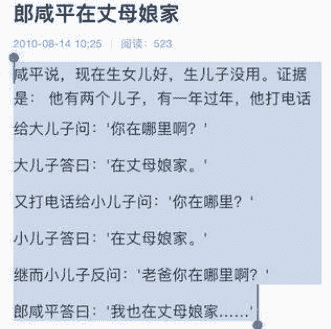

**问：**

欧大，女儿学棒球怕塞黑，有其他运动推荐么？朋友儿子打棒球晒得黑了不少

多花点钱，去室内。女性游泳也可以。

**问：**

欧神，女儿从小就爱看偶像剧，类似《亲爱的热爱的》这种，是不是有点脑残？

长大成熟即可

**问：**

欧大，对于普通中产，“必须生男孩”这个观点怎么看？对于那些生的女孩，为了有个男孩，又领养的男孩的又怎么看？我的意思是对于我们普通人，生男孩非常非常重要吗？我哥哥跟我说这是男权社会，一定要有一个男孩。说这对我的 人生很重要。我自己活到今天，对 这个的内心看法是：儿女双全自然是好的，但真的都是女儿或者都是儿子，也能接受。当然这个想法也跟我目前的经济条件有关。

每个人生存策略不同

**问:**

大，女儿找了个男朋友，用什么方法可以去甄别他是个潜力股而不是渣男，例如给他布置几个任务如，电视台大楼集体亮灯，这种考验人脉，沟通能力，财力的方法吗？

让屌丝出钱，而不是出面子。

**问:**

女儿今年考上上海美国学校，但是现在比较担心美国老师回国导致师资水平下降。如果中美进一步脱钩，美国学校是否有关闭可能。现在国际学校有大量外籍老师回国现象吗？是否现在有必要提前准备换学校？

无所谓。你又不关心教学质量，你只关心文凭。

**问:**

欧大，早上好，有个困扰，请您帮看看。女儿上小学，成绩年级前三。其实我也不确定算不算问题，就是她喜欢模仿别人，喜欢其他小伙伴带着她玩，而且她对小伙伴的陪伴非常的渴望。我没和老师探讨过这个问题，但和老师交流过程中，老师反馈孩子有点缺乏个性，希望她更多的去表达自己。特别想听听您的意见，感谢

就是社交太少了，玩久了自然改。

**问：**

女儿是否可以**用她的形象，构建**属于她的粉丝池，然后引导她走带货网红路线，成年后**把品牌，基于私域粉丝给她（有能力掌控情**况下），辅助她做自己老板（**已经有成熟团队）**，是**最佳**选择吗？（不追求学业），谢谢欧大

你以为做网红很容易么……

**问：**

你好，请问您**对**自己**女儿**也会**希望**她多生吗？毕竟生孩子**对**女人有一定的风险（如刘强东的妹妹），而且出生**后**育儿的责任**重担**基本上是女性完成，谢谢

当然。这是对她本人最大的利益。

**问：**

哈里王子找了有黑人血统的妻子，比尔盖茨**女儿**找了个 msl，这是家学的失传吗？

是的

**问：**

欧大，就是三甲医院试管，二胎能选男女吗？**有可能性**吗？**比如**托关系送礼。还是**没可能**。或者**圈里**有人知道吗？**头胎**女儿，二胎想男孩。

@大蒜

大蒜：国内正规三甲医院不允许

**问：**

欧大您好，家有<mark>女儿</mark>，很担心她们以后会找那种又穷又计较的屌丝，平时应该如何引导她们？

穷人=坏人

**问：**

神，<mark>女儿</mark> 5 岁，比较喜欢和同龄或者大 1-2 岁男生一起玩。因为邻居家小孩多，每天一起玩长达 3-4 个小时。养成了坐地上，趴地上玩玩具的习惯。衣服容易脏，经常被妈妈骂不讲卫生。要不要刻意禁止她和男生一起玩耍，比如禁止 10 天？衣服脏了，要不要打？

买 30 件新衣服，随便穿

**问：**

欧大，我<mark>女儿</mark>出生了，为<mark>女儿</mark>买点东西，10 万左右，老婆和岳母大人说，买黄金，我说，买 1000 股五粮液或 100 股茅台，小舅子说买保险，您说买什么好？

买乡下二棵果树

海滨：欧大的意思很明显就是让把现金留着投资，然后找个钱花掉了的好理由给丈母娘交代嘛 欧大厉害 这点子

**问：**

欧大，虽然很惭愧，作为一个很差的水库人。但我没忍住又来问问题了。产假结束后，从十一上班我就很焦虑很焦虑很焦虑，持续三个月喉咙疼，牙疼。。。吃药看了也没用，应该是自己焦虑所致，眼看这种状态持续三个月了。我真的心里很烦躁，很焦虑，120 现金，80 卡，放在那里，眼看着钱贬值，变毛。眼看要 33 岁，我想马上要二胎，当然可能又要成水库笑话了，我这种情况自讨苦吃。怀一胎时试管吃那么多苦，吐了整个孕期，然后期间各种缺氧晕倒，他常年出差，我一个人上班到生产前。可有了**女儿**，心里真的从绝望变成希望。又想再要一个给她做伴。命运为什么让我遇到水库呢，我感觉无论从孩子房子我都想践行，可我一个人有时心累到想砍人。怎么办？

很好，短期之内生二个，一次忙完。二个年龄相近，带起来也好带。还能一起玩。欧米莱和欧米笙仅差 19 个月。

**问：**

欧神~今天和老婆**女儿**逛商场，两岁半的**女儿**开始会主动要这要那了。想问您，您怎么对待孩子的类似要求的？完全满足么？房子再大也不能这样塞吧~ 😐 如果不完全满足那您如何给小朋友定规矩呢？

完全满足，二岁的愿望都很便宜。

**问：**

钱教授的事件刷屏了，欧大，有两个**女儿**，很忧虑呀，如何保护**女儿**，甚至读研都不轻松。最残酷现实是：面对可怕的叫兽，最有效的自我保护是不存在的

感觉是媒体带节奏，怀疑有隐情。

**问：**

不少人对古代的、秘方，有种天然的信任。但古人的平均寿命比较低、婴儿死亡率，产妇死亡率都是很高的。"乾隆皇帝育有的二十几名子女中，平均寿命只有 24.2 岁，其中 \[隐藏内容\] 平均寿命 18.8 岁，儿子平均寿命 27.7 岁，皇家尚且如此，普通百姓就可想而知了" 欧大，真的是这样吗？

需要修正的是，寿命 0 岁的人很多，拉低了平均值。

**问：**

欧神，你家儿子一岁多，比我 \[隐藏内容\] 大点，这段时间早教主要注意培养什么方面呢？望指导，谢谢

多陪伴，泡在浓浓的爱中。

**问：**

特朗普 190， 他与第一任妻子生的大 \[隐藏内容\] 180， 第三任妻子 180，与第三任妻子生的儿子，才 12 岁就 190 了。 感觉身高 7 分靠基因啊。否则牛奶喝吐了也长不到 190

北欧人大概靠 20 代人口积累，从 150 长到了 190

**问：**

女性若想要实现自我价值，或者希望自己变得更优秀，您也说过希望自己的 \[隐藏内容\] "学习经济、商科" 、 "拥有真正的力量，这力量不是用来取悦男人" "自己的实力获得社会地位" ... 那女性自我价值的实现的需求可能会和男人对女人的估值体系有分歧，那女性只要有自知之明，不把这些偏离男人价值体系的方面拿来在两性关系中当作筹码，也是无可厚非的吧。

不同的技能，用于不同的场合。先看你的目的，再根据战略目的，设定专用件。

**问：**

欧神好！表哥二线城市有几套房类的中产，高三女儿成绩不好，计划放弃高考，直接去新西兰留学，对小孩到底好不好？我个人觉得不好，怕小孩到国外学坏了。我又不知道怎么说比较好，你能不能说利弊？谢谢！

基本废掉了，回来就是一个小流氓。

**问：**

哎大，我一个朋友的女儿牛津大学毕业，感觉不可思议，不知道是一路怎么走。我一直猜测可能他女儿从小就是在美国读书，因为他之前在美国很长一段时间。您说普通一个中国学生怎么样走才能考入欧美名校，需要什么条件，怎么努力？ 谢谢

牛津又不难的。和人大差不多。

**问：**

欧大好！我女儿才上小学，经常看超级演说家，也有看电视，说长大了想当演员，如何打消她这个念头！谢谢！

过几个月自然就不想了。

**问：**

欧大好。除了“多生”之外，理想中女儿的样子和理想中儿媳妇的样子有没有什么区别？谢谢

女儿可以搂着你的脖子亲。

### 问答：教育与家庭

**问：** 欧神，请问一个教育孩子的问题，女儿现在一周岁多半个月。应该是 对自己的玩具没有所有权概念，自己的玩具被小朋友抢走了，没有 哭，也没有抢回来，这种情况应该怎样引导孩子？怎么做符合正确的 三观？
**答：** 给她一次性的东西，例如饼干，扎气球，易碎品

**问：** gg，女儿二年级，还算自觉，课堂也听得懂，作业也积极做，可是考 试成绩每次都偏后，需要哪里补呢？小二就多做题吗？
**答：** 看哪些题不会做。

**问：** 欧大，夫妻双方是双职工，第 1 胎是女儿。爷爷奶奶想第 2 胎要个 儿子，想让我们到时我爱人怀孕了先去香港先照一下，如果是男孩才 要。目前还没和老婆说这件事，估计她不会同意。 请问在父辈和爱 人之间，该如何选择？谢谢！
**答：** 不需要给父辈面子。

**问：** 殴大大 安 家庭条件不好，是不是多生女儿更好，比如生个三四个 五 六个女儿。 即使平嫁也是优的吧，培养的好 的话，稍稍高嫁一点，就 是 “赚” 的吧
**答：** 对的

**问：** 殴大，两个女儿，有必要再生个娃吗？必须儿子吗？
**答：** 多多益善，男女不论。

**问：** 1.特朗普的女儿伊万卡都生了 3 个，为何国内生 2 个都这么矫情？ 2. 文化差异的原因吗？基督教与犹太教里，有鼓励生育的信条吗？
**答：** 越穷越弱越矫情。 基督教鼓励鼓励生育的，例如反堕胎。 可以 看你有 多强

**问：** 小孩小学班主任拜托我一件事情，她女儿在人大读书，明年毕业，在 找工作，已经有两个不太好的 offer。希望我帮她来我们单位上班。我 们单位是四大会计师事务所。我只能帮她争取个实习生职位，并不能 争取入职。我的建议是来我项目做一个月实习生，让她的简历更好 看。她之前无实习经历。同时我给她安排工作灵活一些，不影响她继 续面试其他机会。神，您有什么建议？
**答：** 就这样不错了。 就像乡下老乡求你，你也只能做到这点。

**问：** 欧大，早安！最近被一事困扰，我女儿就读的幼儿园，学生一共 400 多人，这次发生集体中毒事件，中毒学生一共 300 多人，我女儿也食 物中毒了，折腾了 5 天，现在才算好多了，很多家长组织告学校，告 学校背后的益田集团，这个新闻已经随处都能看到，到目前，家长组 织了几次集会到学校，没有任何政府部门出面解决，益田也只是派了 一个很小级别的领导出面安抚了一下，没有解决任何问题，不谈赔 偿，不谈后续幼儿园整改的事情，难道我们只能就这样妥协，感觉作为一个老百姓，无助啊！ 【这家幼儿园被曝疑食物中毒，公司资产500 亿，老板曾是体育老师】 复制这条信息€81wiDi€OxaPW€后打开☁今日头条极速版☁
**答：** 什么叫 “疑似” 疑似当然一分钱不赔的。

**问：** 欧神，从娃本位角度看: 1. 捐精捐卵是不是负本万利，优先级最高 2. 为什么您似乎更倾向于生儿子，是传统主义思想吗？实际上**女儿**传承接代能力更强（男性数量大于女性数量），更容易合并 421 傻白甜升阶，物质和心力投入还少一些可以养更多。 3. 东亚文化和制度太反生育了，而且感觉根本没希望改善，生育率是否构成移民新世界国家的重要理由？
**答：** 是的 **富人生儿子划算** 没有这个说法。东亚高度强调生育。

**问：** 欧大好，**女儿**刚上小学一年级，才一周被老师小窗说了两次注意力不集中，很着急，怎么帮助她？谢谢
**答：** 不需要帮。老师放屁

**问：** 请问欧大，这个 10 岁的活该怎么引导？ **大麦茶的心情** 提问：神，我想请您指导一下孩子职业的问题。我**女儿**细致认真，爱学习，但是性格一根筋，情商不高。我感觉她这种类型，在技术岗可能更能发挥自身优势。但是，我知道技术无前途，更怕技术岗待久了人变得傻白 甜，不利于家族精神的传承。所以，您怎么看待这种先天优势与后天选择的问题？对我这种家庭底子单薄的情况，孩子应该选择什么职业或者专业？最近多有叨扰，谢谢欧大耐心。
**答：** 完美主义，都是见识太少。 一根筋，因为世界太小。 去麦当劳打二份暑期工，完美解决。

**问：** 神，我想请您指导一下孩子职业的问题。我**女儿**细致认真，爱学习，但是性格一根筋，情商不高。我感觉她这种类型，在技术岗可能更能发挥自身优势。但是，我知道技术无前途，更怕技术岗待久了人变得傻白甜，不利于家族精神的传承。所以，您怎么看待这种先天优势与后天选择的问题？对我这种家庭底子单薄的情况，孩子应该选择什么职业或者专业？最近多有叨扰，谢谢欧大耐心。
**答：** 10 岁左右的话，来得及改。 20 岁来不及。

**问：** **女儿**十一岁了，食量少，个子偏小，缺点一箩箩，懒且散漫，学什么都极端抗拒。但着迷动漫与日本文化，《哪吒》看了三篇，自小学漫画，不学英语想学日文。该如果引导才不会耽误她的一生。请欧神赐教，多提是一两句，感恩不尽。
**答：** 给她一堆日漫，直到她看得吐。

**问：** 欧大，你说培养**女儿**，能不能像培养儿子一样，培养事业心，不断赚钱的欲望？
**答：** 能，但不值得。

**问：** 父亲不同意女儿 A7 嫁的离自己太远，但女儿想去一线城市，这种情况下，是否应该和父亲撕破脸，和男朋友 A8 私奔？
**答：** 给她父亲 100w 现金

**问：** 欧大，濑泽文章说等到孩子 20 岁的那一天，给女儿买一个奢侈却又能通勤的包，给儿子买一块大牌却又不招摇的表。有助于孩子成长？
**答：** 屁大点钱。难道不是 3 岁时，拿着当玩具么。

**问：** Ocean ocean.家里有一女儿刚满周岁，胆子太小。到外面只要多小朋友多的地方，都不敢乱动。都是紧紧的抱住大人。这种今后怎么培养？
**答：** 一回生，二回熟

**问：** 欧神：如果离婚，如何把对孩子（女儿 4 岁）的影响降到最低。婚后为了孩子坚持到现在，好累！
**答：** 实话实话

**问：** 欧大，我女儿确定被复旦经济系录取了，您对复旦小校友送一句忠告呗，非常感谢。
**答：** 别被男屌丝骗了，其他随意。

**问：** 欧神，刚生了个女儿，在老家休养，不过爷爷去世了，依习俗，妈妈一定说过百日这天不能在家里，可是女儿才出生 10 天，做月子出去外面一天住酒店，这样对孩子和自己都不好巴？妈妈老是说百日巴后，老人魂会回来，无语，该不该遵守
**答：** 住一天酒店，屁大点事。我看你公主心有病。

**问：** 欧神，生了个女儿，别人说要富养女儿，对吗？打算外包给父母和保姆养，几岁前就要收回自己教育？还是说一定要从小都在身边？
**答：** 四五岁吧，老人花钱抠

**问：** 吸大，小孩子从刚出生后一年内，如果哭了，请问，哪种方式比较科学？1：只要小孩哭了，不管任何需求，都需要马上抱起来，这样小孩内心才更有安全感。有利于她以后身心健康。 2：除非刚性需求，比如饿了，其余类似撒娇的哭闹，没必要每次都抱她哄她。偶尔允许让她哭几次。一胎我就选择方法 1 带娃，结果女儿现在很粘着我们夫妻 妻。哭了只能抱着哄「否则能狂哭一个小时不停的那种」。也打过她，可能 15 个月太小，压根记不住挨打记忆，没改善。最麻烦是：睡着睡着了会起来哭闹，影响她长身体。对比，我姐的小孩，第三胎特别好带，不怎么哭闹，身体也长得快。她就是任由小孩哭几次，故意不抱娃。马上二胎快来了，不知道选哪种，谢谢
**答：** A 正确， B 是白左伪科学。小孩长大了，会很心理扭曲。

**问：** 欧大，看最近库友关于教育问题问的比较多。正好也面临这样的困惑，目前是在杭州上小学，老公业务方向在往长沙转移，单纯从未耒高考和以后的发展考虑，初中，高中是继续留在杭州好还是初中转长沙？非常感谢您！
**答：** 杭州好。长沙严重左倾，湖南人偏执。

**问：** 神，经历一些事情，觉得心累。请问您是怎样一如既往保持对生活的热情的？您会选择让自己的子女经历磨难吗？我指的是从您的角度，会倾向给孩子选择更艰辛的人生，还是相对单纯的人生？请灯塔指点。看过太多老一辈有成就者，给子女选择现世安稳的事业单位混日子。心里觉得这样不对，但是今晚，突然理解他们的苦衷，突然不忍心把孩子推到艰辛丛林中了。
**答：** 儿子奋斗宠着

**问：** 欧大，我可可爱，我女儿高考分数出来了，文科生，清华北大进不去，复且人大没问题，你建议考虑哪个？为什么？
**答：** 你生活在北京，还是上海？城市第一，复且偏职场，人大偏公务员。

**问：** 欧大，您女儿在英国学校目前中文读写如何？听说纯国际学校中文基本没环境全靠家长课外补？
**答：** 马马虎虎，听说读写。 不怎么要补。

**问：** 国际学校有几种，一种是中国名校的国际班，类似上中国际，世外国际。一种是民办双语，类似协和，耀中。还有一种是纯国际学校，类似美国学校，英国学校，请问欧大女儿上的是哪种？这三类学校哪种综合教育质量最好？
**答：** 英国学校。 双语=单语 纯英=双语 其他教育质量类似。

**问：** 大，女儿小学毕业了，要不要参加个美国 8 天迪尼斯夏令营？去了就傻玩，啥也学不到吧？ 有好的替代计划吗？
**答：** 纯浪费钱，没有任何必要。 还不如国内乡村游。

**问：** OS，坐标厦门 女儿小学六年级 数学渣 拖延症 时间管理能力差 公立初中没有什么好学校 问：A.就读派位普通公立 B.考私立 录取取决数学分数 据老师讲这数学成绩 影响着考高中 大学 进入后成绩会班里垫底 想进得花钱找门路；年费用 6-7 万；记得你说的私立学校在发 展； C.库友有什么经验可提高女生数学成绩的 老师那报了兴趣班 奥数班 学的辛苦 没见长进 。 谢谢！
**答：** 那就花 6 ~ 7w，这么少钱。

**问：** 欧大，如果只有女儿，把家学传给女婿，和传给自己儿子差别会巨大吗？
**答：** 没区别，外孙唯一即可。

**问：** 欧神，你觉不觉得生女儿挺亏的？跟别人姓，好像生的孙子也血缘分出去了吧，跟儿子比的话
**答：** 跟谁姓我一点都不在乎。

**问：** 欧大，你希望女儿成为的那个样子，和你对儿媳妇的要求和期望，有什么一样的地方？有什么不一样的地方？
**答：** 能生 能生

**问：** 欧大，你怎么看把孩子送到国际学校？是否有助于培养孩子向上和能承压的品质？
**答：** 好像不能，整天玩。 女儿无所谓。

**问：** 作为闽南潮汕人，如果能实现欧神说的多娃，幸福是无与伦比无法言表，但却带来问题：1，平均资源摊分少了，须富养的 女儿 尤甚，于心 何忍？2，若异母所生，日后矛盾与争夺隐约可见，普通人家实在经不起亲人间的冷漠与隔阂，岂不是为父罪过？ 3，多娃的前提无须量力而行吗？
**答：** 养一个娃，200w 就够了。你不会人均 200w 都拿不出吧。 那是你 SB，无能 尽量，娃比钱重要。比面子重要。比矫情重要。

**问：** 像步长制药赵总这么精的人，为啥要花这么大功夫送女儿去常青藤呢？孩子出来大概率白左，留在国内学割韭菜和政商关系的收益远大于学西方那一套毕业去华尔街当白领。赚到钱送孩子出国藤校在国民营企业家当中非常普遍，除了说出去名声响和方便移民外，有点不太理解这个现象。
**答：** 他未必要那么精的人。 有可能仅仅是风口上的猪。

**问：** 神，关于孩子教育，一般认为给孩子花在教育上的钱是个投资行为，但是按照您的观点这种投资性价比极低，所以应该算是消费行为，学区房和学而思们，大概率是给父母买个安心或者 ib 用的~是吗？ 您给女儿读一年 50 万的学校，报很多兴趣班啥的，并不是看中学校多好，而是这根本就是零花钱，找最贵的随便花~是吗？ 那么一般人家，对孩子的教育应该占到全家开销的多少比较合适？按照您对资产上到 a8.2 后每年开销 3.65%的要求，是不是孩子教育开销也就在这个比例 里面适配才对，零用钱随便花？ 那种每年投入孩子教育占全家资产10%15%甚至 20%的人家是是否大概率走向掉阶之路了~
**答：** 花在教育上，当然算投资。 只不过某些钱，花得不得法罢了。 主要是省心。不指望学什么。 10w/年差不多。 花三四十一年的，大部分兴趣班都是浪费钱(一手资源微信ip885)。

**问：** 欧大，宗庆后这么大的帝国，一个女儿? 他怎么想的？你没发现很多巨富很少孩子吗？可能我们阴谋论觉得人家远不止，我们只是不知道而已，事实也未必吧，感觉这么有钱，居然会做出这种事，难以理解
**答：** 王健林还一个儿子呢。马云还一个儿子呢。 二个原因：1) 白手套规定只能一个孩子 2) 庶子没进入视线。

**问：** 神，您之前说对 女儿 的培养是“通透”的能力，知道哪些人是真 NB，哪些是花架子。 没有父母培养，自己如何才能通透呢？ 我现在每天都看您之前写的文集，补常识塑三观。 刚才又看到一句“阅历不够，提问没用，别问了” 我自己也是没有阅历，如何增加自己的阅历呢? (是通过过去工作吗？ 如果工作每天都重复也照样没阅历。 ) 愚钝的人想听下您的指点，感谢!
**答：** 那要父辈中人，有人在做。 你光在旁边看，能懂个七七八八。但没有神髓。 时间

**问：** 欧大，您之前提到培养 女儿 的通透，那么分辨男人是不是花架子最重要 是看什么呢？特别是当男孩子比较年轻的时候 (没办法通过财富和事业这些直观因素来辨别的时候)
**答：** 承受损失的能力。 例如把一块手表砸了，需要工作一年，还清分期负债。他会如何表现。

**问：** 神，我发现家庭资产 A8 以上，右女概率极度增加，真的验证了之前一位大佬说过的一句话，越有钱越右。 1. 神，我现在还年轻，需要去用真诚打动那些右女吗？我到 A8 估计也是两三年的事 2. 神，那些把[■]送出国留学的有钱人，是不是都失误了？上完大学，绝对洗成白左女拳主义。毕竟没有水库思想，离父母又那么远，很难抵抗。 3. 神，那我是不是就不再搜索我身边的女留学生了？
**答：** 等你到 A8 再说吧。 失误了，绝户惩罚。 女留学生毫无价值。

**问：** 大神辛苦了！第一次入圈问题有点多，明天再回复即可。[■]今年下半年上学。我发现身边的家长都让孩子学乐器，各种乐器，我不觉得这有什么意义，所以没有让孩子学。问题是：以后孩子在班级里会不会被孤立？会不会伤孩子自尊心？需要随波逐流吗？神费心。
**答：** 学会一种乐器的一首歌曲即可，装逼用。

**问：** 神，我还是认为生二胎补偿 2000 块是有必要的。我去产科检查，听到过试管 8 次失败，继续第 9 次的。B 超还碰上了 43 岁第 37 次试管成功怀孕 5 个月的妈妈。大多数时候，感觉母亲是喜欢孩子的，这和意识心态没有关系，纯粹是发自内心的想保孩子。相反，是孩子的父亲，婆婆不喜欢，尤其是头胎[■]，二胎 B 超还是[■]，一定要腾名额留给儿子。我市外来人口多，医院里外来孕妇检查的多，常有有孕 妇哭，是男方不要孩子，女方没钱，只好随男方做主。要是真给了补 贴，二胎有钱，还能开放三胎名额，很多孩子还是能留下来的，毕竟 我们也只要劳动力，又不是真人才。您为什么不为补贴钱，就能改 变生育现状？这和减免税费就能扶持高新产业逻辑不是一样？
**答：** 哦，2000 问谁收。 丁克吗

**问：** 欧大好：准一线， 小升初，已被两家重点公办中学告知可录取重 点班，且免费，目前还在向重点民办学校申请，三年学杂费 20 万，请 教万能欧神：有无必要上重点民办学校？如果公办学校走读，而知名 民办学校寄宿的话如何选择？
**答：** 信息不足无法判断。各家学校的好坏，需要咨询本地土著。 初中不宜 住校。
Wayfarer： 初中住校，玩的比高中还要刺激…
Wayfarer 回复 Roya： 初中不懂就会去探索，高中都懂得差不多了
颜如玉嘉仕： 那天有个视频流出，初中生住校在男生寝室滚床单，旁 边 2 男同学看着

**问：** 继续上面三个小孩一个小儿子的事情。 亲戚家第二个小 ，在其外 婆家乡下长大，小时候也体会了一下乡下的不容易和老人那种勤俭持 家的性格，转学回去后，尽管基础不行，但后来在镇上高中也考上了 市里重点高中，再上了一所大学（尽管不是 top 系列） 1 吃苦真的能 让人奋进吗？ 2 老一辈的节俭和吃苦耐劳，对现在的年轻人还有益 吗？ 3 这个**小女儿高考只上了一般的一本学校的国际贸易专业，这学校考研风气很盛。是不是 不考名牌大学的金融专业就没啥作用？ 纯属浪费时间，还不如去深圳直接本科就业？早点谈对象都比读研好？**
**答：** 真的 有益 除非研究生 Top 5，否则尽早就业嫁人。

**问:** 神，问个对我很重要的问题。我 32，Lg34，小儿子还未满周岁。二胎的原因是因为大儿子粘他爸，长相脾气和他爸一个样，没有一点像我，婆婆特别喜欢大孙子。我浇水泥肥，结的果和我没关系，心寒。
我二胎想生个**女儿**，结果又是一个儿子，我仔细分辨，眼睛像我，其他没有了。二胎是试管，医院里还有一个冻囊胚，我有点想拼运气去生一个**女儿**，但又怕没我的基因更心寒。Lg 没什么不好，收入未知，年给我 60，我税后 12，公积金 3.6 万，二线 3 套 480 平，负债率 40%。娃不像我，是不是意味着我的基因绝种了？显性基因是不是意味着他的基因比我强？难道我要换人生娃去拼概率？是不是不像我，就意味着根本不是我的娃本位？求神指点！
**答：** 小孩子刚生出来，会特别像爸爸。基因进化，防止杀戮。 二岁以后，就会越来越象妈。

**问:** 欧大好，老家里父亲的一个朋友，估计 A9.5-~A10 级别有的（去年几十亿收购了当地一家上市公司），只有两个 20 多岁**女儿**，都在上海工作居住，其中一个刚从美国一个学校毕业回来。现在她们爸妈要求我 给介绍结婚对象，但我这边真没有合适的人，明天就要和他们一起吃饭说这个事情了，有什么建议可以帮助促进她们俩求偶呢？
**答：** 找个正正经经的，别找白左就不错了。

**问：** 转自浩泽：但这个周末会发布一篇关于二代传承的文章，阅读难度较大，请自己斟酌。 其中有一个问题，欢迎大家私信讨论：为何我们排行榜上的企业家，都是宛如绝嗣般的，缺乏直系接班人？ 我的分析是类似领导人不能有健康嫡长子，小兵手套可以有，所以jack ma 孩子不健康、仼不能传位给儿子而是给孟女儿等都不是很偶然？
**答：** 如果你要做官商，就得先 xx

**问：** 欧神，八卦下成为赌王女婿的 21 岁哈佛在读少年辛奇隆吧，哈耶普这种打法真的是开眼界了。观感感觉最重要是抓住了天时，算准了老爷子走之前四姨太最放心不下的就是这女儿了，要给个交代，只要不硬伤，赢面就很大。
**答：** 最近不在澳门，不知道内幕。
以斯帖： 1、赌王女儿不用结婚（穷的弱的那个才拼命用婚姻绑住对方，挖空心思想上位，男女都一样），她只要找自己喜欢的繁衍后代即可，也就是好看的或聪明的，所以她们现在是未婚夫未婚妻。 2、作为水库男就不要立那么大的志向了，你只有一条路，赚大钱，然后买（换）尽量好的基因。避开整容女、假学历（别笑，巨多）、假贵

族皇族后裔、假领导老总名人女儿，这三点几乎就是婚恋虚假溢价的全部了。

问：

欧大，SH 私立小学。女儿半夜用微信和外地陌生男子聊天怎么办。好几个都是对方主动添加的。最近一年家里新添成员我疏忽了对她个人关心，只关心她的学习。去年主场上海新增一套。家庭年入 200。LG 经常出差，家里所有事务都是我来做。老母亲是不是很失败。

家庭年入 200，可以请个阿姨。让阿姨多陪小孩。

问：

欧大，7 岁女儿总是问，妈妈你去哪里出差呀？（其实去其他城市看房），妈妈你去做什么工作呀？你在哪里工作呢？怎么回答比较好？谢谢我神！

妈妈炒房子呀，炒房子给你买巧克力。

问：

最近几年身边得子宫癌的女性多见，今年女儿 9 岁了，准备带她去香港接种疫苗。神，内地和香港的疫苗应该有些差异吧？至少是保真进口的吧？

更多独家绝密资源加微信tushu959 课程学习官网: https://s.vsxc.cn/xKOQcd

## HPV是什么?

HPV，即人乳头瘤病毒，是一种最常见的性传播疾病的病原体。常引起外生殖器湿疣、宫颈上皮内瘤变（CIN）等，某些HPV 病毒持续感染还会引起宫颈癌等。

除了有可能导致宫颈癌以外，90% 的肛门癌，40% 的外侧/阴道癌和 12% 的头颈癌与HPV 感染密切相关。

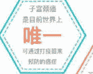

9 岁及以上女士及男士适用
护卫盾® 建议6个月内注射 3针
一年完成保护即可

非我所长。 @大蕊

大蕊：如果你选择正规医院，没有差别，疫苗已上升为政治问题，GJ 由 CDC 统一批发，各级单位再向 CDC 请领，每一个关卡都非常严格，香港也要选择正规医院。

2019-03-13 04:34

alina 回复 大蕊：大蕊，已婚妇女没必要接种了吧？，只要老公不出去乱搞。

2019-03-13 06:43

此地有萤 回复 alina：定期检查还是要的

2019-03-13 08:53

大蕊 回复 alina：45 岁以内都建议接种 HPV 疫苗

2019-03-13 11:18

alina 回复 大蒜：原理是啥那 如果性伴侣固定为什么还需要那?

2019-03-13 11:41

大蒜 回复 alina：HPV 是一种双链环状 DNA 病毒，它分为皮肤型 HPV(皮肤疣)和粘膜型 HPV(高危害型，低危害型)，高危害型就是各种癌，不展开了，低危害型就是生殖湿疣。 根据 HPV 基因序列不同分为 200 余种基因型，其中 40 余种与生殖道感染有关。也就是主要传播途径是 sex，你可以确定你的性伴侣是单一，你的性伴侣是否单一？多伴侣风险更高，另外对于有新伴侣的相对于长期稳定伴侣也存在更多风险。

2019-03-13 14:01

大蒜 回复 alina：问题是没有男人出去乱搞会回来告诉你，所以你的伴侣的伴侣是否单一存在不确定性，疫苗还是有必要打。

问：

还是父亲囤积，母亲疑似出轨那个楼主。我的女儿性格很像我母亲：脾气大，不认错，懒惰，喜欢抬杠、顶嘴，比较善良。只喜欢吃的好玩的，没收一点，就委屈得大哭。作业不做，却不着急。她天资一般，九岁了洗脸刷牙剪指甲还要大人催，认表还经常读错。刚刚让她做功课，好好说不听，吼她就说大人态度不好、没资格管她，我气得捏她脸，手上被她抓出来血印。可能不是故意，但已经不是一次。老师也说学习上太懒了，在学校里霸道。而我自己是一路好学生高考 top2，父母没有为学习婚姻和事业操过心。有一次我们教训女儿，我母亲劝和，对我女儿说，你现在还不到 18 岁，没有自主的能力，就要先忍着。这样的母亲，这样的女儿。有什么建议吗。哎。

欲望是一切的动力 你女儿有欲望么。

更多独家绝密资源加微信tushu959 课程学习官网: https://s.wsxc.cn/xK0Qd

问：

欧大，如果您的女儿在深圳上学，您会怎么选择呢？非题主，不过还是很关心小孩教育

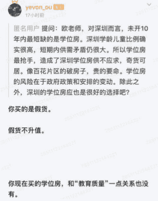

国际学校

问：

挺想知道欧大育儿方面有什么心得诀窍，之前看到您的回复您女儿三岁就很聪明了

我没说过这话。

问：

今天处长在讲育儿经验，他既带女儿住五星级饭店，也带孩子吃路边摊；既玩迪士尼，也去乡下感受鸡鸭成群。所谓营养均衡。防止女孩富养后，穷小子抛物线吐痰都对她产生吸引力。欧神，您说这个观念正确吗？

正确

问：

欧大，有些少数民族，例如云南这边，女人干重活养家，底层原因是什么，像纳西族男人据说要学习做“东巴”，傣族也“重女轻男”，男人要入赘，女儿继承家产，同样也是女人养家

男人不干活有几种情况。 例如雄狮子。雄狮只参与战斗，负责咬死其他的雄狮子。 又譬如泸沽湖。因为不需要战斗，所以产生了生殖崇拜。只剩母系系统。 因此要看男人不干活，而社会地位高不高。 有很多种情况。

问：

今天听来的事，我们单位退休的大领导只有一个女儿，大龄近四十，未婚。听到这个案例后，我一下子明白了欧神的娃本位是多么的睿智。纵使他们是精英家庭，是副省级干部家庭，但是只有一个女娃，女娃再嫁不掉，那么他们家的财富社会地位必将清零。 所以一定要有娃，娃就是人生的终极意义，一个还不保险，最好还要有男有女。欧神，你说我的理解对吗？

对的。都送给国家了。

问：

大大，女儿儿子们喝的什么奶粉？求推荐！

美素佳儿.皇家

澄澄 回复 alina：A2 和爱他美是网红奶粉，但营养成分一般，没有什么乳铁蛋白。而且 A2 是前几年才成立的公司，去年爆出过奶粉细菌问题。美素佳儿是多年老品牌，基本没出过问题，稳定的品质我觉得最重要。

问：

欧神，问个问题，如觉得不方便可以回答。 煮时说自家女儿要出嫁，不给太多家产，只给生活费。哪个儿子有出息，孙子多，给大头，其余也只给小部分。您同意这样看法吗？如果是您分配财产，假设您以后还会有更多孩子，女儿儿子之间怎么分配。 如果平均分配，财产被稀释，也难免不成器的孩子败家。如果分配太少孩子觉得不公？如有冒犯，请不要怪罪哈。

每人 10 套垫底。 表现好再送 20 套。

问：

最近活得有点虚无，路上看到辆新款奔驰觉得还挺好看然后马上心里有声音提醒：水库人买什么车（其实我也有就是买的经济适用省油车）于是继续走过，找到了我熟悉的小电驴继续踩盘。看到前几天有库友问什么是享受生活，我只有 A8.3，却禁不住开始想，为什么要给孩子留那么多房子？孩子不如我留着坐吃山空当败家子？孩子比我强那更不需要我做什么了。并且看到宗庆后女儿也找不到对象，给女儿留那么多也许会害她吸引白眼狼？给儿子留那么多小小年纪衣食无忧一辈子吃房租会不会没有追求变成废人？我这想法有什么问题？需要灯塔来虐一下树三观了，谢谢…

富人孩子没有追求会废成废人， 这是洗脑毒教育，fyi

问：

就一个[女儿]，年纪大了不再生了。A8.25 家庭。孩子很活泼很会社交，目前基本体育活动，手工兴趣爱好为主。但就一个孩子怕她以后被骗，纠结是应该让她吃苦磨练体制内读上去呢，还是轻松点就混个一般大学，或者出国。其实不想让她出国，就怕太轻松大学也考不进。欧神有什么建议吗？

女孩子单身千万别出国。 实在不生，就多带她参与社交活动，多一些闺蜜朋友。

问：

欧大：[女儿] 12 岁二胡过了十级，学习也比较自觉，但是需要督促，去年生了儿子，过几年还需要学学乐器吗？

学二胡有什么用？唱片也卖不出去。

问：

欧大，接这位圈友的提问：我[女儿]也在国际学校今年要升 9 年级了，出国几年感觉她在混时间也没用心学习，现在想弄回家乡找个大专给她读不想烧钱了（之前不懂掉坑）花费巨大。现在想留点钱买房子给她以后当房东也比这样浪费好，请欧大给点建议吧，多谢！目前最主要顾虑是她回来跟不上对她心理有打击

更多独家绝密资源加微信tushu959 课程学习官网: https://s.wsxc.cn/xK0Qqd

匿名用户 提问：欧大，您好。我的老大是男孩，目前在国际学校读五年级。我们原打算移民美国，魂改变想法，决定还是在国内发展。同时，孩子也说希望将来在国内发展。目测国际学校路线无法满足他读国内大学的愿望。我想现在给他在外面补体制内课程，初中时让他转体制内民办中学。但是孩子学术上肯定会有较大差距，这样会不会让孩子没有优势? 想听请欧大指教: 我是否应该让他重回体制内? 回体制内拼高考是否显而易见? 还有哪些需要考虑的因素? 多谢欧大，图片

> 关键判断20年后中国旺，还是美国旺。

大概率是中国旺。

中国发展，要么经商，要么做官。做官就要参加高考。

女孩子混个海外本科。 回来蹭青春年少，赶紧嫁人捆绑金龟婿才是王道。

问：

把手机丢了，怕她再丢，给她买了一个二手的九成高配版的，性价比我认为很好! 可是图片就是不用，说是二手的心理接受不了! 说天天用的手机一想起是别人用过的就是不爽! 这算是一种新手机癌吗? 怎么治疗?

更多独家绝密资源加微信tushu959 课程学习官网: https://s.wsxc.cn/xK0Qc d

那就把手机扔了，让她自己打工攒手机。 公主病危害极大一定要尽早治

问：

女儿八岁独生子女。家长会老师反映课间休息女儿总喜欢一个人玩或看书，不喜欢和一群人一起玩。平时也发现女儿只喜欢一对一玩耍。在群体里体现不合群。与女儿谈过她反馈二点一是有的小朋友爱说脏话，粗鲁她不喜欢，二是她觉得自己玩更有趣。这种性格是否需要家长引导改变？如何改？

或许是环境不好呢，班级同学都是民工子女。

问：

欧神，女儿要上小学了，身体素质不错，被夸耐力好爆发力强。她学习能力一般，学前班期末测评只有体育全部是优。认真听话性格好，就是有时比较要强。有国际学校开有网球班，26万一年，应该让孩子上吗？纠结。普通班17万正在备考，本准备让她上普通班的，寒假被亲戚说这孩子是个学体育的好苗子，又开始琢磨上网球班的事。他们一周10小时网球课，好教练，将来走打比赛，拿奖牌或运动员证书上国内或国外好大学的路子。

垃圾 坚决不做体育生

问：

欧哥哥，您这个答复简单了，事先申明高额抵押金（类似婚前加名或彩礼嘛？）这种做法只能对付比自己低的贫民。对高阶布男就不需要讨论对策了。对所谓势均力敌 (客观上真的对等而不是自己感觉平等实际下位) 的异性，怎么博弈到女性最佳利益？假设这个女娃娃是你 好了。您教的这些都是站在男性立场的博弈之道，您也救救我们这些投错胎的可怜的女娃娃子对此凶残掠夺的破解之数呀。一道题要正反两面都能解才是好老师嘛。谢谢灯塔老师喔。

来自 水庫

匿名用户
灯塔灯塔，怎样才能让喜欢的男生一夫一妻无邪妻呢？

别告诉我们去找loser，亏本生意不教也会做。

yevon_ou 2019/2/26 23:06

事先说明。

高额违约金。

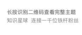

我对我女儿的最佳教育是：“接受，合理的” 传统教育认为女性应该独占，才是毒教育。

问：

那微博上煮老师的观点您怎么看？他认为女孩子没法轻松上985就没必要读大学了，因为大概率被洗脑向左，反而学历低一点的女孩更容易务实，愿意生娃，比如海底捞女~说到这您有写过a女的标准么？或框架么？狐狸精么？除了颜值外貌无法控制，其他有什么可以在[女儿]成长过程中做爹该把控的重点么？唉~其实这事儿一点不急，就是这两天总看见涉及到还有1年就没法得到您指点得提问，莫名的慌呀~现在在为下一个娃努力中~可能娃多了就不这么焦虑了？元宵快乐~

来自 水庫

27154

妳呀，不是雞王，女兒兩歲，所有培養都是荒废？就完全散养？一路公立加不补课，能談到辅大談到輔大，然後輔大工作就千脆，她以後怎樣完全就着我這個爹能撐到a几吗？

来自 水庫

匿名用戶

妳大好，目前一箱女孩四歲 ，以後往哪方面培養比較好呀？我應該如何以後培養金融行業。從小耍注意怎麼樣養呢？包括择校方面。目前農村省一路公立幼稚園上學，同學家長基本都是給自己孩子全能培訓班，感覺孩子在學校發現自己培養會有些自卑，目前只有給孩子上了籃球班，讓她有個好身體，這個學期準備開始學習芭蕾，只為保持體型氣質，說大怎麼說為呢，女孩要怎麼培養好。

yvxwn_au

2015/2/19 18:25

> 金融也拼爹的。

> 你不大話的店，人家爲什麼給你家女兒進去。

> 所有培養，全是荒废。

> 嬉笑之間。

長按识别二维码查看完整主題

短按星球 途路 一个恰好相住

yvxwn_au

2015/2/19 18:02

> 不是說完全荒废。只能说性价比极低。

> 类似那个四国外教的段子。

長按识别二维码查看完整主題

短按星球 途路 一个恰好住住

办公室白骨精，光鲜体面 Office Lady，只要不太丑就是 B 女了。 加个 A8，就是 A 女了。 其他名校，985，海外留学背景，钢琴芭蕾英语，其实加分不大。 就好比你能考进大学，就没有人问你高中哪所学校。

问：

欧师，不是题主，<mark>女儿</mark>两岁，所有培养都是荒废？就完全散养？一路公立加不补课，能读到哪就读到哪，然后能干啥工作就干啥， 她以后能怎样完全就看我这个爹能撑到 a 几吗？

## 来自 水库

欧大，目前一个女孩四岁，以后往哪方面规划比较好呢？我想让她以后从事金融行业。从小要注意怎么培养呢？包括择校方面。目前渔村省一级公立幼儿园上学，同学家长基本都是给自己孩子全能培训班，感觉孩子在学校发现自己的落差会有些自卑，目前只有给孩子上了篮球班，让她有个好身体，这个学期准备开始学习芭蕾，只为保持体型气质。欧大怎么认为呢，女孩要怎么培养好。

金融也拼爹的。

你不是大佬的话，人家为什么要招你女儿进去。

所有培养，全是荒废。

媚妓之道。

更多独家绝密资源加微信tushu959 课程学习官网: https://s.wsxc.cn/xk0OQd

不是说完全荒废。只能说性价比极低。类似那个四外国语的段子。

问：

歐大好，目前一個女孩四歲，以後往哪方面規劃比較好呢？我想讓她以後從事金融行業。從小要注意怎麼培養呢？包括擇校方面。目前漁村省一級公立幼兒園上學，同家長基本都是給自己孩子全能培訓班，感覺孩子在學校發現自己的落差會有些自卑，目前只有給孩子上了籃球班，讓她有個好身體，這個學期準備開始學習芭蕾，只為保持體型氣質。歐大怎麼認為呢，女孩要怎麼培養好。

金融也拼爹的。你不是大佬的话，人家为什么要招你[绿色方块]进去。所有培养，全是荒废。娼妓之道。

问：

欧神，看到海边卡夫卡发的文章讲中国什么时候会强大的，里面有个内容是权利跟金钱的关系，大意权利比金钱更重要，权利可以保护自己，仅仅有金钱则不行。最近我正好在思考这个问题：我发现虽然我房产多，但在社会上却力量很薄弱，连打个流感疫苗都托关系托不到（全职炒菜几年，社会关系越来越少了），和公务员，有实体的商人比起来，觉得自己就是社会的最底层了。将来等孩子长大了，我除了给他们留几套房产外，似乎没办法提供更多的帮助和保护，假如我[绿色方块]也遇到变态男怎么办？假如我儿子职场受欺负怎么办？我现在应该怎么样增加自己的力量呢？带俩娃的单亲妈求解惑/:@

他的那篇观点是错的。财富不是抢来的，专注于特权的，没一个好下场。就好比美国打二战，不是为了金本位霸权。

更多独家绝密资源加微信：tushu959 课程学习官网：https://s.wxcn.cn/xk0Qzd

问：

欧大好，我 3 岁多，性格好脆弱胆小，在外面玩别的小孩推了她一下她就要回家了。想想我们夫妻两人也都不是这个性格啊，从小也一直给她安全感，遇到事情也在教她怎样回击，但是并没有用。望欧大指点

出门太少

问：

欧大，我们老板经常把他带来公司，看起来最多上初中，来公司后在办公室到处跑，年会集体照他也站最前面唯一——个位置，我们公司规模几百人也不算小而且正在壮大，带他公司是什么心理，合适吗？

培养接班人

问：

上北京某公立重点小学，现在老师减负，吩咐家长带孩子预习、复习、写生字词、口算各种。每晚我必须带孩子学习……中年生活质量付诸东流(补习班只能一周一次，无法外包每晚的学习任务)。有说法是郭嘉故意用高房价(六个钱包迫不及待)和学校减负(两个大人心甘情愿)捆绑百姓，目的是维稳(月供+辅导)，这样就没人像 20 年前那样上街了，对吗？ “学校减负+家长参与” 模式，是郭嘉顶层设计，还是无意造成的？

有意无意都有。 你可以请家教。

问：

欧神您好 一对美国夫妻 45 岁左右 一直在中国发展 （本科毕业学校普林斯顿/斯坦福 研究生哈佛）男是美国白人 父亲是儿科医生 他自己长得丑 一进大学就进亚洲俱乐部泡亚洲女性 在美国没啥事业基础 30 岁后都在中国亚洲 估计再就业还是在中国刷脸。 女是台湾移民 父亲在台湾是外科大夫 到美国后一落千丈 对女儿们要求变态 女内心极缺安全感。 夫妻两人内心看不起大陆又离不开大陆的$\otimes$。在中国 不买房 两个娃 上 10w+性价比高的双语 房租估计 20w+.一年三次 旅游 年薪拿出 1/3 去投一个离岸年化 5-6% 的 pension fund。 想问 下这个家庭及后代是否全钱溃败 哪怕他们的孩子进了常春藤？

全钱溃败，又没钱，又没积累。 又没家教。

问：

夫妻都 38 了，也就 A7.5，有年幼 2 子，想再追一个女儿。不过身体情况不能自己生，想过几年达到 A8 经济和精力稍微好转再考虑代 y 一个，也可以选个女儿，现在进阶途中各种心力交瘁，也舍不得马上就拿 60 万出去，那是一套首付钱呢。最差就是过几年生不出，也还有两个儿子保底。您觉得呢

代孕也一直再涨价的。养孩子的费用，也一直在上升。 未必不必你投资回报更快。

更多独家绝密资源加微信tushu959 课程学习官网：https://s.wsxc.cn/xk0Qqd

问：

您对欧米莱将来找对象会有要求么？或者您将来选女婿会看重他哪方面？如果女儿乐意，但不符合您标准，您准备怎么办？ （马上我也有女儿了，想想她二十年后要嫁人，我一个大老爷们竟忍不住掉泪）

在任何一个领域出类拔萃

问：

欧大，上海房产3套，家庭年收入200多万。为培养独生女，花40万让女儿进了比较知名的中学，初中阶段每年花30万请老师辅导。女儿准备去美国读心理学专业，一年费用大约60万。这样操作划算吗？ 和将女儿留在国内读大学比较又如何？

把美国心理学砍掉，出垃圾的。

问：

沃顿商学院、宾大什么的值得去嘛？ 打算女儿送出国 儿子在国内吃苦

没什么价值。现在都不红，20年后更不会红了。

问：

欧大，四岁的女儿有个特点，话很多 而且喜欢乱说，比如说周末要带她去海边玩，她很开心，逢人就说，结果有个小朋友的妈妈听到就要跟我们一起去，可是我们这次只想自己一家人去，只好取消，跟那个妈妈解释，女儿乱说话。 更严重的是，有一天，装防盗网的师傅到家来，他小孩没人照顾，也带过来了。我老婆就悄悄告诉女儿不让别的小朋友去家里的主卧玩，也不许翻抽屉，妈妈出去一下。我在家陪她

们，结果她等了一会就直接跟那个小孩讲，妈妈说。。。装防盗网的师傅就在旁边，我那个尴尬啊，还好，那个师傅装没听到。。。女儿这种乱说话的特点，是不是长大就好了，现在要不要纠正，怎么纠正好点？

你的性格有问题。 为什么不带别人家女儿去，就要取消。 堂堂正正厚脸皮说， “我不想和你们家玩” 包括装修师傅，堂堂正正说 “不许碰” 。

问：

欧大，生了个女儿有点愁。女孩比较吃亏的。漂亮不太好，容易被 人盯上玩弄，不漂亮也不太好，会受尽白眼。思想上还要避免 “文艺” 和白左洗脑。。想了想文艺作品，大概只有《乱世佳人》适合给她看了。

多生几个是王道。

问：

大女儿六七岁 对谈恋爱的故事特别有兴趣 。 想问下欧神会不会刻意给自己的女儿挑选故事/电影去引导 会不会想要在潜移默化中影响她的婚恋观？ 欧神之前说您的父亲让您从小读什么书来着 《 珍妮姑娘》 《嘉莉妹妹》，觉得很落伍？最近在陪女儿听这个作者的书 觉得这些书放在现在社会来看 简直超级契合现状，半点不落伍。阳光底下没有新鲜事,过时 IP 的内核还是很经典。但给小朋友听是不是有点太暗黑了？谢谢

如果你读迪斯尼六公主， 女孩子什么都不用做，就会有王子追上门。

那孩子才是真的被毁掉了。 从小接受残酷点的教育，挺好的。 暗黑故事才是真相。

问：

我神，一个朋友，在县城做生意，年收入一百多吧，两个女儿，大女儿上师范专科，大一，觉得自己高考没考好，也喜欢学校的自由生活，一心想考研究生。在我的说服下，朋友不支持她考研了，希望她毕业回来接班做生意，那该如何说服大女儿回来接班做生意呢？希望你点拨一下

带她生意圈转一圈，看人们是如何鄙视老师的。

问：

看中一个数学家的基因，身高、外貌、智商都很满意，如何说服人家借个精子给我代孕呢？想要个女儿，人家一不缺钱二不缺名，算朋友，但是开不了口，也不想有实质性那种受孕。对方有一儿一女，我经济完全没问题也不想日后有跟对方有任何瓜葛，纯粹是看上了他的基因他的头脑，请问欧大有没有好主意？

派个中间人去，就说机构需要。

问：

欧神早，丈母娘买房想全款，不想给自己太大压力，如何说服她用她自己的名字或者女儿的名字贷款买房？

人是不可能被说服的。 可忽悠她为什么不买三套。

问：

大大，接上一个提问，女儿班主任过年送什么礼物合适？30 左右女老师，小孩 2-3 岁的样子。谢谢！

烟酒+玩具

问:

大大，女儿小学一年级，知道老师家的地址，过年需要送礼物过去不？

送

问:

od, 女儿小学三年级，今天老师打电话来说测试英语时 “打小抄” 被老师发现。这个应该认真教训还是淡化处理。个人感觉不是很要紧的事，说明孩子在长大，也不是死脑筋…… 准备告诉她做任何事要评估风险和收益，要后果自担。欧大有什么建议吗？非常感谢。

顺便看看她英语有多落后，赶紧补课到正常进度。

问:

欧太，女儿 11 岁学学防身武术或跆拳道有何利弊？

武术几乎无用。 跆拳道培养的是勇气。

问:

神，女儿散养成绩好马上小升初没法去好中学，会影响她未来么？

那就逼一逼，吃一年苦，考个好学校。

问:

欧大，晚上和 LG 大吵了一架，把女儿吓哭了。女儿 6 岁半，平时活泼开朗，没心没肺的，我们感情一直挺好的，家庭氛围不错，这次因为女儿教育问题吵架的有点严重，动手为止。现在很担心对女儿的影响，我应该怎么办？我们 7 年婚姻，恋爱两年，真正的白手起家，现在小 A8，没想到刚刚好起来，却是走到尽头了。生活的底色是苦难，说的真对。家庭琐事，烦扰欧大宝贵时间。

床头吵架床尾和，七年之痒。 没大问题的话，明天就好了。

问：

欧大小孩子总是跟老师和小朋友确认喜欢不喜欢她，是没有安全感和情感缺少的表现吗？今天幼儿园老师跟我谈话，说我女儿情感缺少安全感。离异家庭，是老师敏感了吗？

没事多搂着亲耐，可治此病。

问：

欧大，与前夫离婚，前夫目前未再婚，女儿目前与前夫生活，想在前夫同小区为女儿购置一套房子，用前夫名字，我出资我还贷，如何能保证权益将来一定是我女儿的？签订离婚协议补充协议？还是应该怎么办？欧神费心了

女儿99%，前夫 1%

问：

目前女儿五岁，还没跟她说这些，为了她的心理健康考虑,反而都为前夫说好话，说爸爸爱她什么的。事实上一年来看不了两次，且都是我要求的。这种老赖的态度很难想象老了会有这个自尊不伸手要钱，那女儿就需要为这一颗精子支付赡养费么？只能认倒霉吗？有没有高人指点一下？

前夫不支付抚养费，欠卡债网贷，已经是银行黑户，请问如何保障孩子成年之后其不来要赡养费？虽然起诉没有用，但是不是还是起诉确认他没有支付抚养费的事实比较好？也请圈内法律人士建议，谢谢。

亲爹过来要钱，

你儿子不心软的么。

精神足够强大，才能拿捏分寸。 你女儿精神有多强大，得看多年的教育。

问:

但是老婆女儿在，除非把他们也接过来？但是好像又没有这个勇气，毕竟女儿还小，需要人照顾。

你有钱就租个三房，关键还是没钱。

问:

欧大，看您之前的文章说不希望女依附男人，那立身之本是工作吗？或者其赚钱方式，但也要付出巨大心力不是么。可您又说女人的战场是养孩子，所以工作对女人到底是什么？

继承老爸的钱

问:

欧神，你写作的时候女还在身边吵，经常被打断不是很影响效率吗？你有没有什么提高效率的法门？

没有 接受损失

问:

odd，很好的男性朋友最近要真离婚，A8.5，有个3岁女，不知道要不要去争抚养权，我自己性别女，家里是儿子，感觉完全没法感同身受给出建议，是为了血缘教育质量留在身边还是不要更方便开枝散叶，欧大能给点参考吗？谢谢灯塔。

要看女方有多人渣了。

问:

为小孩将将升学考虑落户天津，女目前刚刚小学一年级，什么时候开始筹划比较合适？

越早越好

问:

殴大，我结婚了，有老婆和一个女儿，和老婆感情尚可，最近邂逅了一个女孩，这个女孩离异，并且怀孕了，我和她都想把小孩生下来，不知道应不应该？请支招

应该，+U

问：

od，女儿，学习的过程中遇到困难希望我给她申请豁免或者放弃，比如舞蹈班遇到难度大的动作要求，她就希望把班退了，家长有时候觉得不是很关键的问题就同意了她的意见，我是不是应该坚持，锻炼她的坚毅性格，而不是总是知难而退

选一个项目死活坚持即可。

宇文富贵：我曾经学钢琴学了十年，特别不喜欢，我父母也是秉着无论如何要培养我坚持精神的想法死活让我学，事实证明除了浪费钱和宝贵的童年少年时间，钢琴对我的人生毫无裨益。人应该坚持做某件事情无非两个原因：热爱或者利益。有其中之一自然坚毅，两者都没有硬坚毅是蠢..要不然用心找找孩子热爱什么东西（寻找热爱本来就要大量试错），要不然是利益诱导（比如舞蹈让你变美所有人羡慕你）孩子坚持某件事吧。强压无益。

问：

欧大，还是那个教育问题，您自己说是克服心魔涅槃重生，我自己的体会也是如此，经历磨难都没有磨灭对人生的热情，但现在的孩子极为娇气，特别是女孩子，怎么在她心里种下热爱人生的种子呢？

看你的目标。 要折磨总是有办法折磨的。 我女儿都想富责养，儿子再奋斗而已。

问：

有钱人的快乐!亚洲首富嫁女:请来碧昂斯表演 全球IT巨头齐现身 1、儿子的重要性 2、天下都是老夫人的，貌似溼肠伟全是女儿 3、天下s是一家，你侬我侬

洛克菲勒继承人，娶众议院院长的女儿，才是真正的世纪婚礼。 然后就是洛克菲勒的直线下坠。

问：

欧大，女儿小学一年级，太听老师话怎么办?简直老师传话筒，老师说什么都是对的。性格内向被动不活跃。

那是你平时教育有问题。 你平时教育就是“权威一服从”模式。

问：

欧神，请问您给欧米莱未来规划她做什么类型的工作呢？父母对女儿应主要重视哪几方面的教育？

地主婆 教她们，别听SB老师的。

问：

吸大，我女儿快一周岁十个月了，之前几个月不乐意就咬人，比如她叫我几次，我当时可能在做事，听见没立即回应就咬人，或者我批评她几句不乐意也咬人，后来一咬就打屁股，打哭过几次，基本上不咬了，但是现在一不乐意小手就掐人，我也不敢老打，怕损伤孩子的活力，是任其发展还是多加管教，您说这会随着年龄的增长慢慢消除嘛？还有李玫瑾教授的育儿观正确吗？谢谢

拍回: “痛不痛”？

大蕊 ：一周多咬人可能乳牙发育阶段，买一些咬胶类玩具。小手招人

是处于手敏感期，一方面是对事物的探索，另一方面表达她的情感需求，

需要妈妈的关注。多观察孩子的需求是什么，多抱抱，亲一亲。慢慢会

消除的。

问:

欧大好，向您请教如何处理孩子办事磨蹭的习惯。我[■]四岁多，办事喜欢磨蹭。举例如下：1.早上上幼儿园，需要喊起床好久，结果就

得急匆匆地赶路。2.早晚洗脸刷牙，每次都得催好多次。各种借口，

要么说再玩一会玩具，要么说累了不想洗。3.吃饭睡觉也是需要催，

每次就跟她说到吃饭时间了、睡觉时间了，她都是专注的玩她自己

的，喊好多遍才行。总之，在大人看来需要干什么的时候，她总是置

若罔闻，搞得家里人着急上火的。担心这么下去，以后干什么事都磨

磨蹭蹭、拖拖拉拉的。

让她知道，这些事是为了她好。例如中午饭不吃，那就别吃了，饿到晚餐吧。

问:

欧神您好，[■]明年美国本科毕业，教育心理学专业，准备回深圳工作，今年错过了秋招。请问明年寻找哪个方向的工作比较合适？作为

多军，我们接受与专业无关的工作，只要是领先的赛道。谢谢！

感觉找不到工作，没有一个职位适合她。试试新媒体写作。

问：

昨天带儿子，女儿过天桥，天上下着雨，路很滑，在下天桥楼梯时，女儿从天桥最右侧非楼梯部分（坡）上走下去。雨天路滑，差点摔倒了。然后赶紧从坡的地方回到楼梯上走。我儿子不管不顾，非要还走坡道，我提醒到，你姐姐刚才差点摔倒，你要是摔了，我会揍你。结果滑倒了，人没受伤，裤子湿了。我当时很火大，明明有前车之鉴，而且还提醒过不要再走，结果还是不听，最终非得摔倒一下。我当时给了他一个耳光。事后，我也反省自己，感觉自己的教育方式肯定不是最好的。作为父亲，欧大，遇到类似情形您会怎么做？

没有问题。最好补一句，'我打你耳光，是因为你把裤子弄湿了'因为让你走楼梯，他不听。他自行承担了走楼梯摔倒的后果。OK，这没有问题。这是他的自由。可是他把裤子弄湿了，这是额外的损失。就应该耳光。

问：

os：让女孩学艺术：舞蹈、表演这种不是卖女儿吗，是在两性里看开了吗，心灵自由需要太高的智力门槛和家庭殷实，不管傻白甜，扔虎狼了？日批算什么，诛心呢？

我没让女儿学跳舞啊

问：

欧大。小孩子一岁5个月，在小区玩总是会有个别家长带的其它小孩抢玩具推她抓她，我家娃不懂得还手（跟她讲过要还手，但貌似没太理解)，有的家长不会制止他们小孩，我在旁边除了制止还有没有其它更好的办法？谢谢我神。

差一岁，教导你女儿开窍。 很三四岁，不要和他们一起玩。

问：

大，好奇您的女儿完全不上培训班吗，娃的时间还是很多的，上一两个培训班入门一些兴趣特长也是有必要并且可以尽情玩耍的吧，如果没上培训班她课余时间都让她玩什么学什么呢？她不会和同学没有共同话题吗？如果娃有想上的兴趣班是否应该鼓励呢？如有冒犯忽略问答

课后一小时游泳，一小时小提琴。 连着玩的，这都不算事。

问：

四岁干嘛要识字。 四岁认识 300 字，本身就是错误的做法。你嫂子女儿以后会很穷的。 欧大，四岁应该干嘛？

人的认知能力是守恒的，小孩子每天就 14 个小时时间。 小孩子认识花花世界，超市购物，小马宝莉，幼儿园打架，差使钟点工阿姨......这些都是成长。 你把一切 “社会人” 都隔绝。关起门来只教认字。认字有屁用。 SB，屌丝，垃圾底层人，一辈子没希望出头的贱货。

问：

大，教四岁闺女识字急得自己想哭......嫂子家孩子跟闺女一样大，人家已经认识 300 个字了，我娃才认识二十个字。嫂子自己带娃，每天都 有计划的安排孩子的学习、玩乐时间。反观自己 6 点半加班回家吃完饭七点半，跟孩子聊聊天问问白天幼儿园的事情和学习加上陪陪老二

就八点了，洗澡喝奶八点半，就准备睡觉了。我顿时怀疑我上班挣钱的⽬意何在@⼆线连续四年 2n，也没这么⼼累和迷茫。

四岁干嘛要识字。四岁认识 300 字，本身就是错误的做法。你嫂⼦⼥⼉以后会很穷的。

问:

咬⼤，刚打算第三遍仔仔细读你“如何继承三千万”，就发现给封了。

⽇后多写些娃本位和教育娃类的⽂章吧，今天这篇“三千万”⽂章思⻔路赞的。就是我在想⽼⼀⽼局⻓也多娃了有⼉有⼥，财富都给⼉⼦，那家我⼉⼦娶了⽼局⻓⼥⼉，不是也没啥用吗？

如果⼋只⽼狐狸，有 64 个⼦⼥。⼀套就⾯没用了。

问:

堆积⼤量的资源，⾼成本“精养”⼥⼉。⾼学历，海外留学背景⽩⾻精，职场体⾯⾼⼤上 35 岁也没有男朋友。只懂婆婆妈妈，爱护⼩动物，傻⽩甜欧⼤，这些都⽶不对，难道养⼥⼉普通⼤学出来嫁⼈？普通⼤学也没有好对象啊

为什么你不是 A，就是 B ⽽。不读海外博⼠，就是民⼯中专呢。估计这辈子，正常的女人你⼀个也没见过。

问:

⼤⼥⼉学了⼏年舞蹈，⼩⼥⼉学唱歌怎么样？

学学就可以，别倾注。

问:

ocean, 家里[  ]小学一年级，在家里很活泼，但是上课不喜欢回答问题，也不擅长在人前表现，这需要有意锻炼一下吗？感觉这方面能力低于同龄儿童了，问她原因，她说怕别人笑话，平时感觉思想挺成熟的

说明还陌生。到二年级就疯了。

问：

欧大，曾仕强您看过他对易经对三国对人际关系的阐述吗？中国人设有人际关系，张嘴就问小孩你爸爸是谁，指出底层规律-爹是谁最重要。作为一个企业家富豪到老年时是不是真的想把一些他们能领悟到的世界真相告诉大伙？

就看过 “生一个[  ]，嫁给他的儿子”

问：

欧大，我[  ]7 个月大了，已经能流畅地爬行和坐立。目前牙牙学语中，超爱笑，好动。 请问，该买点什么玩具给她比较合适呢？或者和她玩点什么游戏？ 谢谢，也祝欧大的子女都健康快乐 ☺

爬爬垫 36 块，把客厅铺满。 扩大她的活动范围。

问：

欧大吉祥 我[  ]想大学选服装设计专业，喜欢。 我回答说选专业无所谓，只要自己愿意学有爱好就行。 跟她讲: 真正的学习是两点: 懂得人类社会运转规律，能欣赏大自然的魅力。成为有豁达的心胸和宽广的视野，有主见有毅力的人。工作后你先进大公司认识下真实社会，然后再出来自己做事，爸爸正在努力前行，希望到时有更好的实力支持你越飞越自由。  我的想法还行吗？  感谢！祝您新的一年好心情

她选了一个最喜欢的，而不是最有前途的。  说明意志力薄弱。

问：

欧神，您好。  女儿读的是国际学校，一年级，学校美术老师要求她拿一幅作品参加学校义拍活动，她们班只选了她一个人的作品，然后她舍不得她的作品，直接回绝老师说，我不想给我的作品，你叫其他同学吧。她爸爸说，你拿去参加拍卖，爸爸出高价格拍回来给你就好，她说，我又不是真能拿到那钱……  超级吝啬的性格，请教欧神应该怎么教育呀

认赌服输，从小损失。

问：

欧神，我 12 岁的女儿看了尴尬的相亲会说，好一副生灵涂炭的画面，还给出了建议，  1、减少男女比例，比如调整为 1:5，相应增加女生费用，人数比例合适，有利于互动  2、增加有肢体接触的游戏，比如跳华尔兹，玩真心话大冒险，等等  3、找个专业的主持人  4、空调开暖一点，备多些酒

事后复盘。  男嘉宾普遍表示满意。虽然气氛不燃，女方也保守。但胜在女人多。  男方都是大猪蹄子，挑花了眼。对于 50 个女性很满意，觉得推荐给男性朋友，下次再来。  而女方的满意度较低，抱怨男性少。没人理睬，只能扇扇子。  女性抱怨有什么用呢。我们不缺女粉。无论票价定多少，女性票是肯定卖完的。我们干嘛追求女性的满意

度。男嘉宾才是上帝，我们缺的是男粉。一切以男粉满意度为最高宗旨。男人满意就是上帝。 10:1 的比例不能动，天平还要继续向男性倾斜。 你女儿 的观察是对的。可她还是低等聪明，不是高等聪明。低等聪明在这个世界上最吃亏的。

问：

欧大，低等聪明和高等聪明的区别？以及为什么低等聪明最吃亏？

低等聪明就是只知其一，不知其二 还觉得自己最聪明。 例如这种女 儿，容易沦为白左。

问：

欧大，少年读金庸为什么好呢？

我女 儿 还看索菲亚小公主呢。 小孩子看点童话，没什么不好。

问:

如果跟大女儿结婚，您会给什么婚姻经营建议？

快生孩子

问:

欧大，那0.1%的有用的书是哪些，怎么选呢？

你水平到了，自然懂挑选。 你现在还会看你女儿的儿童读物么。

问:

欧大，女儿幼儿园大班，在家很活泼，在集体环境中比较扭捏，内向，但单独聊天很会说，有时接的晚，和老师会聊很多，本来我也没太在意，好几个幼儿园的家长跟我说我女儿很内向，我只是觉得她还没适应集体环境，不会表现自己，害羞，这种情况应该这么加强？

早着呢，才一个月。 待半年你看看。

问:

欧神，女儿五周半幼儿园学前班，发现几个特点： 1、会主动学习，对于报的兴趣班，都很爱学，画画、乐高、钢琴、英语，每次上课前都会提醒我准备好，英语打算转班，停了几周，会一直追问我为什么不让她学英语，并且哭着说让她赶快学；钢琴也是每天自己练习，各科老师都反应孩子学的不错。 2、幼儿园老师会教读儿歌和读字宝宝，遇到不会的字问我，现已经可以自己读绘本了。幼儿园作业都是自己写，我都不知道老师留过作业。 3、很要强，什么事情都要做到

最好，排队也要排第一个，做不好就会很伤心，并且反复练习。请欧神帮忙分析一下孩子的性格，并给予一些教育女儿的意见。

学而不思则罔。每种都拼命学的人，往往会忘了停下来思考。

问：

两个女儿该从小怎么培养，如果是您是如何帮自己女儿规划与引导的，金融家？艺术家？纯富二代？或者其它？有没有两个女儿分别培养不同方向的必要？

看她们自己禀赋。 marketing 而非 sales

问：

欧大，张雨绮这样的女人，做老婆如何，女儿培养成这样如何？

滥交基因，一般因为以前比较穷。不是豪门的选择。

问：

大女儿胆小，抗拒新鲜事物，上戏剧课全班都表演了，她拒绝，一群小姐妹出去玩儿（爸妈带着）都去骑马了，1 岁多的妹妹都骑了，她上去哭的恐怖！还有什么办法呢？谢谢殷大大！

先打一顿。然后从小的 Exposure 做起，例如去柜台结账。

问：

我两女儿相差 1 岁，性格迥异。老大漂亮嘴甜，能歌善舞，聪明学霸，缺点好强、爱打抱不平，男生性格，虚荣爱面子，经不起批评；老二乖巧温顺，成绩一般，不争不抢，没自信。担心老大再这么下去婚姻之路很坎坷，担心老二笼罩在老大的阴影下一直自卑，怎么正确引导她们呢？

重点夸奖妹妹一个姐姐没有的优点。 例如爱刷牙。

问：

大神 我女儿 13 岁 暑假去重庆看房 200 套时她也跟着看了一百多套

现在回家有空就抱着欧神文集看 已经看了 4.5 本了 我该让她继续还是专心读书比较好

专心读书, 了解世界。 不冲突的。

问：

女儿长大您在择婿方面会做哪些建议, 预防, 考察或干预? 我想象自己会跟踪他一个月暗中观察人品。见了身边工科老教授教育的傻白甜掉入大坑的惨痛。

在任何一个领域出类拔萃。 年轻人有没有才华, 很早就可以看出来的。

问：

欧大, 家有 6 岁女儿, 活泼乖巧, 您说女人重要的是退路, 眼光, 生育。那按以下方式培养女儿对吗? 1.退路, 至少本科毕业, 有能养活自己的收入, 不寄生于男人; 2.眼光, 多带出门, 认识社会不同阶层存在, 并尽可能富养; 3.生育, 从小灌输娃本位。以上对否, 还请大指正, 感谢。

都是中产阶级的筹码。 和我二个世界的。

问：

欧大, 是不是儿子就应该上公立中小学今早加入激烈竞争, 女儿还是上私立富养同学档次也好一些? 谢谢。

我是这样想的，

问：

O 大大，新上海人，普通家庭，女儿幼儿园。 1.应试教育也是一种能力，小孩努力 211 为了进入社会的入场券。 2.从小培养经济思维，明白毒教育，树三观。 3.父母自己努力，多挣钱，带孩子多见识各种层次。 其实这三点并不矛盾，相辅相成，只是需要家庭多付出点心力，是吧？

对的

问：

欧大晚上好，打扰请教一个孩子教育方面的问题。家有一儿一女，大的男孩，小的女孩。大的今年刚上小学一年级，从幼儿园中班开始，儿子总喜欢拍拍打打别的孩子，有时重有时轻。女儿现在两岁左右，哥哥在家里也经常爱干涉妹妹，比如不让她玩玩具，手挡着门不让妹妹出来。现在到了小学还这样，爱拍拍打打同学，挡着教室的门不让其他同学出入。这个问题让我们很苦恼，多次被老师告状。在家里我们也多次好好和他说，狠狠打过好多次，均没有效果，麻烦欧神看看有没有好招，拜谢！

让他和大孩子玩，被大孩子揍。 然后告诉他，这些事一点都不酷

问：

神，不知道您对自己的两个女儿是否有明显的偏好呢？如果有的话会表现出来让她们知道吗？您觉得如果家里两个娃，觉得父母更宠爱另一个的话会从小有心理阴影吗？

定位不同。一个喜欢吃甜，一个喜欢吃咸，只给姐姐买冰淇淋，就不是偏心。

问：

欧大，女儿 5 岁，儿子 4 岁。今天早上姐姐对弟弟说：弟弟，快去揍妈妈。弟弟狠狠一巴掌打在我腰上。问女儿为什么要打我，回答到：

因为开灯打扰她睡觉了。我先把儿子屁股打了几下，然后狠狠把女儿揍了一顿

1:不可以指挥弟弟干坏事

2: 自己想做的事情，自己做并做好承担后果的准备。

想关灯睡觉，跟妈妈说。

3:弟弟不能成炮灰，自己要有分辨力

女儿哭得很委屈，不知道这样的教育对吗？

教唆犯罪等同犯罪，所以弟弟来拍，并不能使你免于惩罚。

有什么意见，应该通过正规渠道反映。

最后，没有人问姐姐 5 岁，弟弟怎么 4 岁么。

问：

欧神，家住九霄，女儿明年读幼儿园，一个是读家附近的私立，不知名，校舍还不错，还是读七宝知名私立，离家远，早高峰开过去大概 40 多分钟，怕小孩早上睡的少，神有什么好建议么？

幼儿园。当然是附近的。

问：

大，接刚问的儿子培养问题——女儿呢，要不要培养识人的同时也培养物质欲？识人能力，是需要多多经历感情来培养吗？

女儿可以培养得只有眼光，没有实战。

问：

欧大，你打算让女儿读国内大学，但是一路都是国际学校，这个路径通吗？是什么样的方式？我现在也是这种情况，一直读的国际，但并不是太想让女儿太早出国。咨询一下，谢谢欧大

到时候再说吧，还有 10 年呢

问：

欧神，请问你家女儿幼儿园之前，日常安排都是怎样的呢？哪些和孩子相处的部分是你负责陪的？哪些由父母或者阿姨代劳呢。想从欧神的行为中得到些启发。谢谢！

我看着，阿姨带。

问：

大，老大女儿刚四岁，自私自任性...出去玩，别的小朋友靠近她的玩具都不可以，如果别人动一下她就撩好久还大声哭闹喊叫，小朋友都不敢跟她玩了；在家里一岁弟弟玩什么她就抢什么，抢来就扔一边，宁愿把玩具藏起来自己玩也不跟弟弟分享。从怀二胎起就注意尽量照顾老大情绪什么都依老大的，姐弟俩抢东西大人也是纵容老大。到现在我突然觉得有点不对了。怎么才能改变老大的脾气呢？愁死了

再找一个很自私的小女孩，火星撞地球。

问：

欧大，小女孩需要管制还是放养好？家有两女，大的三岁，小的一岁，性格不同，大女儿任性不爱吃饭，喜欢吃蛋糕零食巧克力喝牛奶长得秀气娇小机灵，小女儿不爱吃零食，吃饭规律长得胖呼呼的很乖，我一般顺着大女儿，每天给她买很多零食，也都是健康有营养的，5 段奶粉每天喝四五次，家里人觉得应该让她吃主食，禁止她喝奶粉吃零食，认为她身材瘦小是不爱吃主食引起的，但是她会向每个大人央求一圈，都不理她就会躺地上哭打滚，我很心疼，欧大觉得应该用这种强制手段纠正吗？谢谢。

小孩子可以宠着，但一定要有边界。到了边界就狠狠揍，让她知道“边界”的概念。

问：

欧大，人生路上坑很多要是至亲亲朋遇到坑，经过劝阻仍一意孤行，往坑里跳怎么才能把他们拉回来不跳坑- -! 小坑无所谓但大坑有时就是倾家荡产，甚至生命了经过劝阻，他们不听就只好任由他们去了吗-

如果你女儿非要和男朋友私奔，你怎么办。难道可以拉女儿么，当然不行。应该找小流氓，把那男孩搞失踪啊。

问：

后续，她赶在家长回家检查前的半小时内，飞快做完了作业，正确率比第一页稍低，也在规定范围内。又另外写了托管班留的一页书写。背完了之前布置要背的十多个单词。所以家长检查合格后，没有批评她。加上这两天她说自己肚子有些疼。但是请教欧大，这种磨蹭拖沓、自理能力差的习惯，怎么改进啊？小朋友平时比较有主见，家长也基本都是讲道理说服。她不能吃苦，抗压能力较差，做事情常常知难而退，对自己物品、时间和情绪的管理能力都比较差。天资在人群中大概算一般吧。性格开朗活泼，比较友善。谢谢欧大。

喜欢读书，听故事，画画，手工、过家家。家里控制，看电视少，每天小于半小时，基本不玩 ipad。表达能力还可以，外人看来乖巧可爱听话，有外场。生活习惯不好，比较散漫，能偷懒就偷懒，比如洗脸不提醒就常常不做。比较讲道理，有点自私，可以为别人考虑，但不太能牺牲自己利益。心智相对不成熟，比较天真，品德算纯良，基本不说谎。理解力记忆力不错，逻辑性较强。不能吃苦。做作业时专注力较差，看课外书时认真。谢谢欧大。哎。

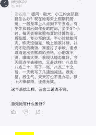

她不喜欢啊。 我 女儿 在玩小马宝莉的时候，飞快学会了二位数乘法，都不用人催。

问：

欧神 你女儿 两岁的时候，你会给她玩电玩吗？游戏厅那种。

不行，得四五岁。 二岁视力还没有固定。

问：

神，我朋友 A9.2,做餐饮生意，我平时把他当应急资金池用，一有资金缺口就跟他借。他在我们二线城市买了三套房，一套别墅，一套 CEO 大平层，一套顶楼复式，基本上在房产上收益比很低，完全没跑赢大盘。我最近想给他一些投资建议，让他也多买几套，结果他说他太太不同意，觉得现在房价太高。他太太就给他生了一个████，已经上初中了。他一直想多要个小孩，但是太太不同意所以一直没如愿，心里还是很难受的(他自己说)。太太一直在体制内干个闲职也不参与他的生意。我一直很好奇:一个管着七八百公司的老板，为什么会这么听老婆的话呀？难道真有什么御夫之术吗？

社会惯性。 很多事已经销了，但社会惯性还在继续。例如出国，钢琴，读博。

问：

欧大，████8 岁，天津，算是不错的公立校。没报几个班，贪玩。以后大点想让她接触奥派。小学这几年要注重哪方面的教育呢？

关注实践，自己想道理，不要信任老师。

问：

欧大 培养优秀████的核心在于哪些点可否谈一谈？

有钱，懂钱。

问：

欧生您好！我████明年美国本科毕业，听您说过京沪的户口是值钱的，可否乘毕业时机入户上海？目前她是深户，且已经购好深圳房产，将来工作和生活都在深圳，这种情况下有必要入户上海吗？谢谢回复！

已经在一线了，上海户口比深圳也好得有限。

问：

大学的时候有次答疑，一群学生聚在一起。我感觉有人把手伸入我连衣褚下面，并隔着内裤朝阴道抠。吓得我赶紧转身，身后两个男生，看到我回头就往两旁走了。我也不确定是谁做了这件事，也没有实物证据，但还是觉得非常恶心。从初中到大学，都是比较好的学校。但在校园里被人背后摸屁股的事也不少，就算看到了猥亵男，也不能拿他们怎么样。我不明白你为什么对女性说出自己被猥亵经历的 ME TOO 运动如此诋毁。我相信绝大多数在公共场所被猥亵的女性也是没有证据的，抠人下体能留下什么证据？甚至不知道被谁猥亵了。如果你的女儿在校园里在工作中被人用脏手抠下体，你会怎么和你女儿说？告诉她别声张，女权很脏？

大声地叫出来，“抓流氓”。如果一个没做，他一定会惊悚地说，“不是我做的”。你在当时处理失当，几十年后跳出来叫，什么意思嘛。

问：

欧神，我有一个二岁的女儿，加上她爷爷奶奶奶菲及我们夫妻俩的房产在江苏常州共有 4 套，重庆 1 套，以后还打算继续在一二线买房子，如何把这些资产巧妙地低成本的转移到女儿名下，另外我打算培养女儿炒菜技能等投资方法，以振兴家族！ 补充：有何培养路径？感谢欧神，祝身体安康！

等她大了，逐套卖掉，现金转过去。

问：

女儿马上要过 10 岁生日了，想不出送他什么礼物有意义 问他想要什么，回答我 Money 就可以了 现在的孩子物质条件好了，无欲无求，和我们小时候不能比啊 请教欧神作为两个女儿的父亲有什么建议吗？您送过娃些什么礼物？

送她 1000 元定时过期（或者各种限制）的超市 Coupon 好了。 看她的筹划能力。

问：

欧大，女儿正处在青春期。 她从各方面听说 me too（性骚扰），但又不是很理解。 怎样教育，才能让她有正确的三观呢？

不可以发生肢体接触。 谈话的话，不爱听可以走掉。

问：

欧大大，夫妻新上海人，入水库后。去年买了第二套，今年有了女儿。 我们都是工薪阶层，在教育问题上想请教。 1.虽然是毒教育，但我们阶层唯一为数不多机会，是不能放弃的。适应考试，本身就是一种生存能力。 2.在孩子成长中，她要去当“三好学生”也不反对，但引导她从多角度比较，理解“三好学生”是不是值得。 3.您说的，经济学就是放弃，这件事可以从小学导。比如去游乐场和买新玩具，二选一；自己省下的零花钱可以自己做主。 4.大人以身作则。指望小孩口才好，能抗压。大人要花心力去赚钱，去协调，会变通。 5.尽可能让其体验多样的社会环境，明白市场。体验后，和小朋友一起总结，探讨启发，逐步积累。 望指点！

经济学的精髓是“取舍”，本质是价格问题。 三好学生，文山题海，不是说不坏。关键是代价。 花这么高代价，买一个无用品，值得么。 你要从“代价”的角度，去考虑培养问题。

问：

欧大，女儿六岁，以后是让她去上海、北京还是深圳好点呢？去的话要早点做准备了是吧，自己已经贷过了，去这几个城市只能用抵押贷了吗？

看走体制内，还是创业狗的发展路线。

问：

请教欧大，定居杭州，有两个颜值顶级女儿，5 岁和 2 岁，该如何规划他们未来呢？马上就要惠灵顿公学，各种学习班眼花缭乱，哪些是该学习的呢？目前夫妻两加上两个外籍佣人带小孩，大女儿中英语母语级，谢谢欧大

关键你要赚很多很多钱。 让女人抓紧权力（财富），才是最好的生存之道。

问：

9 岁女孩，阿姨带她和弟弟去小区旁边商场玩。阿姨跟旋转木马卖票的人商量，两个小孩常来，可不可以这次只收一个小孩的钱，卖票人同意了。但女儿不同意，大哭，说应该付两个人的钱。还跟阿姨急眼，抓了她的手。这种缺乏 street smart 怎么看？

老师这样教的。你先买二张票。Street smart 到 13 岁以后再教。

问：

欧大好！女儿刚申请完大学，这个假期发现她沉迷于网络游戏，白天怕被我们发现，晚上不睡觉打到 2、3 点，早上起不来。有 2、3 个固定的同学一起打，怎么才能让她远离网游和渣友呢？焦虑中！谢谢！

她可能有一个喜欢的小哥哥在打王者。

问：

神，读五年级的女儿期末考试成绩出来了，语数外平均 75 分，为了把她的成绩搞上来，几年来各种培训班没少上，她妈妈也没少下功夫，但成绩就是没有改进，该怎么办才好？谢谢！

上培训班是很不负责任的做法。正确的做法是，你自己教，看她哪里不懂。

问：

欧大好，无论影视剧或者现实中爆出的一些单亲母亲，选择无视/漠视或者默认同居伴侣对女儿的性侵，这种心态的根本原因是女方在两性关系里的弱势尤其是经济地位的弱势导致的吗？这个事情一直很困惑我，无法理解一个母亲怎么会为了一个男人牺牲掉女儿。

对的 其实是编剧与审剧人的渣滓潜意识。

问：

本人在西南小城市，A7.8 家庭，女儿 18 岁高考分数差了 10 分才到本科线，是否建议复一年考一个普通本科（一本可能性低），还是建议去个大城市读大专？关于两种选择的差别，想听听您的看法。

本科

问：

请问欧大～有两个女儿（5 岁和 2 岁），岳父母（基本没有什么知识、也不爱读书）原来一起住带小孩，但是大女儿越来越多父母身上的性格缺陷，现在马上搬新家了，选择一个外佣（性格好，干活麻利）和一个亲戚（岳母妹妹）带两个小孩，外加一个司机，但是每天送上学还是很不放心，有什么办法可以破呢？或者有没有推荐搭配，其实家里那个亲戚也不想要（老家人，也是全身坏毛病）

进入高档社区，让孩子多和别的高知家庭玩。

问：

欧大，女儿 4 岁，下半年要念幼儿园中班，目前就读一年学费 2 万的幼儿园，开车 8 分钟，但是外教一周来一次，中教教的英语发音堪忧。现有一师资很不错的双语幼儿园可做选项，半天中教班主任，半天外教当班，其他都可以，一年学费 7 万，开车半小时。鉴于 4-6 岁是语言习得关键期，是否有必要选择双语幼儿园。谢谢我神给建议！

基本属于纯忽悠，完全没用。

问：

O 大，爱人是回族，家有大儿子汉族，小女儿该选择汉还是回？我的顾虑是，爱人其实不是特别遵守禁忌，所以我觉得太假而不合适。谢谢

想做高官就选汉族。 回族只是小恩小惠。 往上爬得高，一定是汉族。

问：

欧大，女儿，7 岁，一年级，做事容易分心，吃饭，写作业都不认真，就喜欢和别的小朋友玩，在班上成绩中下，有没有提高注意力的办法？

找到一个她喜欢的游戏（小马宝莉）

问：

神，我该怎么跟这样的父母相处。我妈沉迷于佛教，给庙里捐钱做义工。经常在微信跟我要钱，我原来不知道要钱做什么，今天才知道捐了或者买佛友的假保健品，一买就是 4000。吃那假玩意吃出毛病可怎么办。让她来上海三甲医院检查就是不听。今天让她办张信用卡给我用，怎么都不肯。一个劲的要我孝顺，说我不孝会有报应。我反抗她就联合亲戚甚至外人一起来干我。现在一个劲的羡慕人家初中毕业的女儿，说人家孝顺。我不明白带着老公孩子吃住父母家，孩子不带，天天麻将怎么就孝顺了。明明上回她妈吐槽，家里本来有存款早就想买房，她女儿一直说不着急再看看，一再错过行情，导致现在全款买不起了（他们不接受贷款）。决策错误导致家庭掉阶也羡慕？

等你赚了钱，隔三差五送你妈羊毛衫， 千万别给钱 她自然人前有面子。

问：

欧神，您好！请教一个教育小孩的问题：女儿、刚满六岁，做事非常非常谨慎，不敢冒一点风险，老师期末评价： “如果她认为事情太难或者不想做，她就不愿意去尝试，这直接影响到了她在课堂的纪律表现和学习表现。” 女儿就读国际学校，请教欧神如何培养小女孩的冒险精神、勇于尝试的精神？谢谢🙏 欧神今天的文章真是神作，掩卷长太息，人生何其幸运，才能拜读到如此精彩的文章，再次感谢。

家里管得太严。 哪天你 LP 不在的时候，和孩子一起玩“摔碟子”游戏。让她学会损失。

问：

欧大，领导女儿今年上小学，送啥礼物好呢？

童裝？

问：

欧大，女儿三岁，可爱鬼精灵，很讨人喜欢，但有时任性发脾气，哭的声音可大如果不哄就越来越厉害。目测未来长相离 S 级还是有差距，怎样教育引导她，才能让她在认清自己的同时，以后能有立足之地，并且拥有幸福生活？谢谢。

送去幼儿园。 家里只有她一个小孩子。

问：

欧大，请教一下，北京 a8.5 家庭。女儿在海外读商学院，学金融或会计，还没选方向。因会计学比较重，有两种选择:第一只学会计。第二学金融加一个其他什么专业。个人倾向金融加计算机。想听听欧大建议。谢谢

会计是穷人读的，8.5 读干什么。 金融+外贸，或者金融+新闻，我估计女儿也不会去当程序员的。

外贸做进出口，有油水空隙。 新闻做自媒体。 总之不是码农。

问：

殴大，我女儿刚满月。 请问你是否认可早期教育这种理念？ 你又是怎么培养自己的女儿的？比如一周岁之前。 谢谢

不认可早期教育。 健康成长即可。

问：

欧大好，刚看你的文章，很应景，正好我心中疑惑。我在苏南小县城，80 后，祖上开个大药房的，后遇公私合营，收了去。我母亲一直在这药店做到退休，后来这店被私人买下。近日和母亲聊天，发现这一行还是收入可以，我想继续进这行业，母亲不支持。我有一女儿，看着女儿在成长，有时候会想，就算她过五关斩六将上了大学，将来还是要面对就业然后面临中年失业，何不我现在为其铺路。我母亲本质上也是外公的这个店保了她一生无忧。我打算考药学研究生后出来做这块，您怎么看？有何建议？谢谢

如果能有一些“祖传秘方”，并且不触动药监局的监管。 这生意有得做。

# 问答精选：育儿与家庭

## 关于子女教育

**问：** 女儿4岁，想养小动物，特别喜欢巨型犬，要不要满足她的愿望？

不要。告诉她，真实的世界，和童话里是不一样的。大狗会拉便便，拉倒她床上。

**问：** 欧大，女儿今年即将高考，成绩可以上 TOP10，请问理科女生读什么专业比较好？

计算机。

**问：** 欧大，为啥是计算机呢？你不是推荐金融的吗？

男生多。你女儿估计金融不够资格。

**问：** 我女儿读广东外语外贸大学南国商学院德语专业，今年大二，还有 2 年毕业。女儿性格有点内向。对于毕业后就业方向很迷茫！请老师给一个职业规划建议，非常感谢！

做中德贸易。一开始在贸易公司，做得熟了，可以自己找一个品类海淘。

**问：** 欧神好，我女儿在读高二文科，数学成绩从年组 50 前降到 200 多，其余科 OK，没任何课外辅导；她说目前理解有些吃力，求欧神数学学习方法；万分万分感谢🙏

从初三开始补起。

**问：** 欧大，媳妇亲戚的女儿最近在家玩几天，两岁多，自己觉得小孩烦把家里搞得乱七八糟而且很吵闹心，我感觉自己一点都不喜欢小孩，我这种是不是太自私了不大适合养小孩啊？

是很烦的。一个小孩不行，最好二三个小孩，他们就自己和自己玩了。

**问：** 欧大 老大女儿 8 岁了，胖胖敦敦的，应该鼓励渴了喝牛奶吗？

鼓励。

**问：** 欧大，我女儿法律硕士毕业在三线城市的大学某学院的团委书记兼辅导员，工作很累，基本没有时间再要二胎，问题是再上博士来摆脱这种局面呢还是辞职专做 CF？正在办理 SZ 户口。谢谢！家庭在 A8.3，由于去年才接触到水库和您，目前已在 CQ 等地建仓。

既然是一条死路，就不应该在死路上越走越远。硕士辅导员很有前途么，没有。博士同样没有。尽快切换赛道才是正途。

**问：** 历史上诸子均分的目的是削弱贵族。从升阶的角度考虑，就应该避免离婚、子女均分家产？多个儿子的情况下欧神倾向的继承方案是？女儿的分配比例？

看你的资产结构。例如公司不宜拆分。象楼市这行，子女均分家产更合理。

**问：** 欧神，今天重读您的文章《新一代低值女#F1280》，文章里说：“温柔”才是女性第一大王牌。是不是说，要把女儿从小就要培养成：性格温柔，楚楚动人，传统，娃多 n?? 谢谢欧神！

不需要。传统的温柔不是温柔。

**问：** 欧大，我跟 LP 都是 985 毕业的，从自身经历，都觉得家庭教育比较重要，没有必要花那么高的溢价去买学区房。现在家有女宝宝，明年读幼儿园了，身边的朋友都开始换房或者买学区房，心里焦虑的不得了，都失眠好几天了。我担心女儿以后性格不坚毅，容易受环境的影响。觉得买个学区房，至少很大概率都是想读书的孩子，而不会出现小太妹小流氓之类的同学。坐标二线城市，正在努力冲刺 A8。欧大，请问真正的学区房具备什么品质呢？我 LG 希望女儿以后学习金融加计算机。您觉得方向对吗？

弱相关关系。学区房和家乡素质，老师素质，都是弱相关关系。不存在好的学区房，一般从人口入手分析即可。高档楼盘扎堆，就是学区房。

**问：** 欧大，我女儿三岁了，如果以后她想读艺术学校，我应该支持吗，是好的专业选择吗？还是说女孩子应该读理科，变得聪明点，靠自己实力比较好？

不支持，娼妓之道。

**问：** 看了一 个 真 实 的 情 感 调 解 节 目 ，真 的 是 太 有 感 触 。 大 都 是 女 的 嫁 过 来 后 做 牛 做 马 ，男 的 又 穷 赚 钱 能 力 又 差 ，还 一 点 不 重 视 女 的 精 神 需 求 ，把 老 婆 当 成 骡 子 使 唤 ，不 听 话 了 还 语 言 身 体 暴 力 威 胁 ，在 婆 媳 问 题 上 也 不 作 为 ，简 直 有 种 把 老 婆 不 当 人 的 样 子 ，而 且 大 多 都 是 女 的 长 相 不 错 ，男 的 丑 陋 不 堪 ，女 的 还 一 直 把 男 的 当 宝 一 样 死 心 塌 地 的 ，过 了 几 年 可 能 实 在 受 不 了 虐 待 了 ，才 开 始 醒 悟 。 中 国 大 多 数 家 庭 女 性 的 命 运 都 这 么 惨 吗 ？ 欧 大 可 以 给 支 支 招 吗 ，未 婚 女 性 怎 样 才 能 避 免 以 后 遭 受 同 样 的 悲 惨 命 运 ？ 有 女 儿 的 从 小 要 怎 么 教 育 呢 ？

天下之道，诛心最上。你教导女儿，一生多离二次，没什么了不起的。

**问：** odd，那你给女儿将来规划了什么学校？体制内学校还是体制外+美帝的藤校？

随便哪个学校，有本科文凭就行。我女儿不用职场面试啊。我可以买家公司给她当 GM.

**问：** 欧神，三岁女儿过于脆弱，脸皮薄，受不了被人拒绝和批评，哪怕是说她，注意安全，这个不能碰，都会哭或者尖叫，您对女儿有什么提高挫折商的办法吗?

打屁股，让她知道边界。

**问：** 我神，女儿6周岁，数学很差（在同龄人中真的中等也站不住），情商目前看也不行，不会察言观色（小三岁的弟弟从小嘴甜灵活）。以上均客观描述，非重男轻女。观察下来女儿从小体质不错，身高较高（大概率成年后能长175+）结实不爱生病，体育方面好像比同龄孩子好些，欧大能不能给点指点，女儿这类往哪方面培养较好？谢谢

你要把傻大姐培养成体育生，就真的终身不能翻身了。

**问：** 请问殴大如何看待现在的学生从小开始就各种补习班，压力很大这个现象？好事坏事？您会让您的女儿这么做？我现在的观点是让小孩多接受生活的历练，多接触真实的世界，您觉得如何？

我女儿几乎不上任何补习班。 Over

**问：** 欧大，准备小学开始让女儿走FD子弟学校，不知义务教育阶段课外该补充些什么？要不要高中也让她看资治通鉴？谢谢！

千万别看资治通鉴，高考不考。复旦附中有什么补习班，随大流就上吧。

**问：** 请教欧神及相关专业人士，我女儿今年在北京学数字媒体艺术专业毕业，现在腾讯实习，喜欢设计和计算机，颜值及家境都还好，已申请美国的研究生，分别得了卡耐基梅隆大学的娱乐技术和纽约大学的数字媒体专业的录取通知书。纽约大学每年给了 7 千美金的奖学金。女儿其实自己的方向是很想学人机交互。但是很遗憾没有申请到卡内基梅隆的人机交互这个专业，在中国上大学我觉得第一是城市，第二是学校，第三是专业，但对美国及她的行业不了解，现在请教各位大咖，从这两个城市(匹兹堡与纽约布鲁克林)，学校及专业来说，哪一个对女儿以后的整体发展会更好？万分感谢！

CMU 是一个很好的学校，我记得比纽约大学好。不过 CMU 的 Photoshop 系，似乎不是拳头系。美国制度和中国不同，选城市和选专业都不重要，学校重要。专业可以读了半年一年，申请转系。教育非我所长，圈内吼。

**问：** 女儿超级喜欢各种兴趣班，3 岁半在幼儿园看到老师弹琴，跟我吵了一年，4 岁半开始学弹琴，现在已经两年多。后面陆续学了主持人，跳舞，画画，英语。一年级上，给她断英语和小主持人。一年级下，想给她断画画，报铅笔字。大哭大闹，不同意，不肯断画画，还要改铅笔字为毛笔字。除了钢琴，所有兴趣班都不肯断，否则大哭大闹。而我不肯给她断钢琴。最后结果就是上更多兴趣班，每晚作业，钢琴。周末被兴趣班填满，只剩一个周日上午出去玩耍。如果你再问她报足球，机器人课好不好 她肯定说好! 我已不敢问 其实我希望她更多时间放在出去玩、文化学习或阅读上。有点心痛，可是又不知道怎么办?

看她够不够深入呢。有没有在一个项目上，做到全班遥遥第一呢。

**问：** 女儿一岁半不到，今天要爬上饭桌，被我惩罚面壁，哭的梨花带雨。妈妈抱走去房间边看窗外边哭，我过了一会儿进去，跟她对视了几秒钟后，女儿伸出双手对我说:抱抱。这算甲上吗?

一般。

**问：** OD，女儿一岁体检，测智力说发育比正常晚一个月，可能平时工作忙，小孩平时我妈带，我看之前问早教的问题，你都说多陪小孩玩就好，你怎么看现在的智力测试，准吗?

应该问题不大。不用担心。让孩子增加户外活动。

**问：** 欧大旱，记得您说小孩上那种几十万一年的学校没必要，可是您好像也说过您的女儿幼儿园十几万一干年，所以想知道您的教育观念不是最便宜也要十几万么。

**问：** 欧大, 女儿今年 10 岁了，长得挺漂亮，在私立学校读书。今年在考虑暑假要不要参加国外夏令营的事。5 万左右，20 天，英美两个国家任选一。欧大觉得有必要参加这种夏令营吗？感觉自己带着出国旅行不如这种夏令营效果好，但是又担心年纪小了怕遭遇到类似猥亵这种危险的事情，不知是不是多虑了？

猥亵不至于，老师一般都盯着，封闭场所。学不到东西是做的，就是动手做做游戏而已。

**问：** 和小朋友说起买房，居然得到的回应是干嘛为银行打工，觉得好惊讶！！ 现在有超高收入，一年出国 n 次环游世界不买房的人，以后怎么办？？？

被通胀洗干净。眼看风光一辈子，临到老，传给女儿，不过一套市区的房子，1000W 不值钱的存款，女儿还读的贵族学校成了白左。

**问：** 一个朋友问他最爱谁？他说最爱女儿只有一个女儿另一个朋友还没有孩子问他孩子和老婆最爱谁。他说老婆。欧大，怎么看待这两类人？

说爱女儿的，多半婚姻有裂痕。

## 关于“多生”策略

**关键词：** 多生，约 2.6 万字。蓝色字为问，绿色字为答。

### 本篇问答中提及文章：

- 《养儿防老没逻辑》
- 为什么老一辈那时带孩子那么轻松，对比现在带娃就像伺候祖宗一样？-知乎
- 布尔费墨 为什么做中小学生的家长非常痛苦？
- 《如何继承 3000w》
- 什么才是真正的财富 #1570
- 画生《退化》（以上均可搜到，除本篇）

**问：** 我的父亲是做生意的，已经 50 多了，他到现在都觉得培养我和我妹妹非常成功，实际我们在他的严厉管教下并不开心！也没有什么大成就！现在我有了儿子才一岁，他就让我扮演黑脸，不能惯着他，给他立规矩，其实，我爸也不能说错，但我并没有宠溺孩子，只是觉得孩子还小，也没法立规矩啊！我想问问欧神，你是赞成棍棒出人才还是让孩子自由发展的同时去引导孩子啊？谢谢我神

多生几个，才可以使用大胆的教育方法。

**问：** 如果让您写本《家学》在教子篇除了您之前说过的 “活下去！” 的格言外，针对男孩和女孩还能再各给一句金句吗？(如有冒犯敬请谅解)有 人生必读书目推荐吗？ 闭圈在即，恐日后再无机缘劳神指点迷津，愿 神好人一生平安！

多生至少生三个。

**问：** 对您说过的要关注孩子的 “恐惧” 印象深刻；要关圈了，育儿方面您还有什么特别想和我们说的呢？

多生几个，数量压死质量。

**问：** 想多生 孩子最适合生活在哪里呢

东南亚都挺好。

**问：** 孩子明白，多养猪是真的养猪吗还是有别的意思？知道非洲猪瘟后猪肉价格会一直高位运行！

多养资产。

**问：** 经济发展的上限受制于科技水平；科技水平与制造业发展息息相关（科技解决制造业中的痛点，没有制造业，科技升级就没有方向和动力）；制造业的发展受制于消费市场（没有足够大的消费市场，无法实现制造业足够大的规模经济）。消费对经济的拉动，是不是从消费对科技的拉动来解释更为有力？贫富过度分化明显不利于消费市场的做大（整体边际消费倾向低）。当然，富人孩子，穷人绝种，可以在奥派框架下解决贫富分化带来的消费不足问题。排除这个方案，如果您是决策者，在当下国情下，您如何解决两极分化对购买力的压制？经济学尚未入门，或有三观不正，求指正。感谢感谢！

哪头猪告诉你，科技上限和制造业息息相关。欧洲科技爆炸时，牛顿英国不过 250w 人口。中国四亿农民，体量对相对论毫无裨益。

**问：** 欧大你好，半年来忙于恋爱，也在两性关系中上了很多课。1、之前也希望可以越早要孩子越好，至少可以陪孩子玩得动，现在又觉得自己年龄实在太小，还是先不考虑，您觉得男人多大要孩子不算太晚？2，关于择偶方向，我也知道事无绝对，对于您来讲，可否总结出三个关于择偶的最深刻经验/方法？

18
不要相信爱情
不要相信爱情
不要相信女人

**问：** 请教欧大神，渔村 4 套（2 住 2 租 400 ㎡），惠州 1 套（空 100 ㎡），A8.3，贷款 340 万，资产负债率 10%，月收入 3w，月还贷 1w，1 个小孩 3 岁。克勤克俭，现金基本无留存。这种情况，为了希望孩子的孩子生活无忧，我应该如何规划更好？是继续买还是守着现有的一直收租？如果买的话，买 CQ 还是渔村周边广州东莞惠州？

多生几个娃最好。4 套房生 4 个。增加杠杆率。我一般对于缺乏流动性的地方，很谨慎。需要更多折扣。惠州回避。

**问：** 如果 zf 基于生育率考虑，补贴多娃家庭，或者给多娃家庭减税是否正义？由于不生娃就享受不到，实际是抽不生孩子者的税来补贴多生孩子的人，那么这算抢劫吗？

你可以视为 “防御税”。国防是每个人都享受的普适服务，你不出人力，就欠国家的。

**问：** 请问您对自己女儿也会希望她多生吗？毕竟生孩子子对女人有一定的风险（如刘强东的妹妹），而且生出后育儿的责任重担基本上是女性完成，谢谢

当然。这是对她本人最大的利益。

**问：** 我神，与女朋友在一起两年半，一开始我俩都觉得丁克很好，但是最近一年对于结婚一直很犹豫，而且我深受水库影响，现在想要多生，最近聊生娃，说 35 岁之后才愿意生，而且不愿意多生，是不是该分手...

35 岁之后你换他，男人可以再生，女人就绝望了。

**问：** 中国生育率一直持续下降，各路专家开出的药方都是宏观调控，政府出手；欧大回复让爱生的多生，是说放开二胎限制吗，但我感觉即使放开 2 胎限制，生育率还是不够理想。这个时候以富国强兵的目标来看，最优策略还是让市场自发调节生育率吗？

放开一夫多妻制。

**问：** 市场怎么解决生育率的问题？

让爱生的多生。

**问：** 欧大，多生孩子，高考加分能不能解决人口生育问题？

不能。3/4 人根本不高考。

**问：** 欧神，在未来可能出台的房产税，遗产税，以及高额的交易税，如何保护家庭财产不被收割，而得到传承？

多生几个。都是首套。

**问：** 殴大您好：1.向您这种不结婚，多生娃是可以操控的。2.向我们这样一夫一妻，不可能多偶的人也建议 n 娃吗？超累啊……公司父母孩子……3.有什么 n 娃不累的好方法吗？

建议，边际成本递减。

**问：** 欧大您好，我看到有报道说中国妇女不孕不育率从前是百分之 3 增长到现在百分之 15，自己身边也确实发现很多年轻轻轻的女性也不能自然怀孕，您觉得是什么原因造成的。感谢回答！

该生的没有多生。病伤基因没有淘汰。

**问：** 欧大，坐标 SZ，夫妻 28 岁，父母出钱买了两套房(500+700)，其他地方若干房产总值 300，都是去年买的还没有赚钱效应。现在家庭收入 30 左右（男 25 女 5）不足以承担每月 5 万的房贷压力，全靠父母支持，生活窘迫，也不敢花钱。马上到了该生孩子的年龄，因为压力大没人带也不敢生，生不起。像这种情况，年收入达到多少才能覆盖正常的房贷和正常养孩子的成本？水库 er 想多生，是否可以曲线救国回家乡四线小城市走生娃路线，还是想办法提高收入，等几年再生。感觉生活被房贷绑架了

既然月供 5w 了，那和月供 7w 有什么区别。自然放心大胆地生孩子，每个月多花 2w 你的三观不对啊，钱不靠省的。靠申的。

**问：** 奥派应该支持国家补贴多生孩子吗？

谁来补贴你？

**问：** 如果一男性基因遗传有问题，有 30%的概率生出残疾的后代。那么在水库娃本位思想下，他应该怎么做？ A.尽量多生 B.少生 C.领养健康的孤儿

A

**问：** 欧大好。除了“多生”之外，理想中女儿的样子和理想中儿媳的样子有没有什么区别？谢谢

女儿可以搂着你的脖子亲。

**问：** gg，最近回老家，看到好几个老太太，一生辛苦，生了好几个子女，均农民或者苦力讨生活。到了第三代，才有通过读书，做生意慢慢做得好的。如果愿意多生，不怕辛苦，是不是即使第二代普通人，他们再有后代，也会多有概率更好。

时代不同了，现在是福利的时代。

**问：** od，你说多生，博概率，那估计要多好几个吧，农村太多好几个，也都是普通穷人过一生。平凡普通的三个娃，和那种小有成就的一个娃比，哪个好。

肯定三个。

**问：** 现在 japan 新政了，问了一下在那留学的朋友，基本上只有生育的时候自己付一半的钱，还有就是保姆费和平时的食宿，剩下的完全由国家买单到初中毕业，此政策涵盖外国留学生和工作的外国人，不需要绿卡/国籍。请问可以这样操作生娃初中再回国吗？以后肯定是要回国的，不图国籍，主要是为了能多生娃少开销。

除非你完全不上班。否则怎么算，都是亏的。

**问：** 殴大大 安 家庭条件不好，是不是多生女儿更好，比如生个三四个 五六个女儿 。即使平嫁也是优的吧，培养的好的话，稍稍高嫁一点，就是“赚”的吧

对的。

**问：** 欧大好，要多生孩子，保持自己基因的多样性，那考虑纳妾，在考虑首先自有足够经济基础支撑的前提下，妾也有合理的挑选标准么？如何协调妻与妾之间的感情关系来保证家庭内部和睦？

某大神，就特别喜欢找村姑，厂妹。身体棒，而且不吵。

**问：** 殴神，看到你回答育儿的 t-1 多生就是最大的王道，数量堆死质量。可是自己多生的孩子，质量不好的岂不是也很痛心

生不出来更痛心。

**问：** 育儿的 t-1 你觉得有哪几个？

多生就是最大的王道，数量堆死质量。

**问：** 求欧大轻拍: 虽然我的孩子已经读三年级了，但我自己觉得到现在为止：我都不知道该怎么教育孩子！很多事情自己都没想明白，怎么教育孩子呢？平时忙于工作，孩子的教育和学习，没怎么管。像我这种情况，作为父亲应该怎么做才好呢？年近 40，升职无望，努力工作，争取多买几套房子，达到自己的上限（工薪阶层）；还是少加班（平时加班比较多），多陪陪孩子？

几个，概率倍增。

**问：** 神，孩子好，多子多福。最近思考：上一辈，兄弟姐妹多的，关系和谐还好。但是关系四分五裂的也不少，为财产或者其他。尤其男性，婚后全都听夫人的。听夫人的对，就是看不惯那种可是自私心，爱撺掇的妯娌，俗话：娶了媳妇忘了娘。何况是兄弟。最终结果兄弟之间感情失和。老人伤心。这样孩子多的好吗？原因是否跟原生家庭的教育有关呢？

太贫穷的家庭，总有各种纷争。但这并不是重点，重点是活下去。

**问：** 欧神好。生娃会付出大量的人力、物力、财力。而且是沒有回报的。一直没想通为什么要。对于自己来说，没有什么受益啊。A85 家庭几个合适呢？谢谢

孩子不是手段，孩子就是目的。10 个。

**问：** 欧神，你好。请问 娃的目的是为了国家和民族吗？

## 第一受益人是你自己

**提问：** 穷人是否也要多生孩子？

是。

**提问：** 欧大，北京人，近40岁了，丈夫外地人农村的，对于他的思想有个男孩就可以，也不想要那么多，他国企工作，外地社保，一年才赚十几万，我没工作，生三娃，一女两男，老大才5岁半~家里没人手，就自己一个人带，从本心是赞同您多生娃的思想的，但是丈夫觉得负担很重，我也感觉压力很大，现在孩子竞争那么激烈，一个都不好管，还弄三！！！而周边同龄女生都有点小嘲笑~现在谁生那么多，很多60/70的老人都说他儿媳妇让生都不生！以前的男人娶媳妇就是为了生孩子，现在很多男人都做不了女人的主心骨，娶媳妇为了精神需求，自己也不是特乐意要那么多孩子，所以经常瞬间觉得自己缺心眼儿，没大脑！您说像我家这样的条件，这步棋是不是走错了？让你儿子，娶他家女儿。财产全到手了。《怎样继承3000W》

**提问：** 欧大，为什么要多生娃？

孩子不是手段，孩子就是目的。

**提问：** 财上海的观点，父母为儿女牺牲，两三代人让孩子有机会再更高的平台拼博。您觉得呢?

不如**多生**几个。

**提问：** 欧神，你所倡导的娃本币，是煮肘那种吗？生个二十人的天团？还是这事看个人主观意愿，尽“可能” **多生**？

看你能力啊，不便宜的。

**提问：** 刚毕业不久的，金融基层岗位，XiaMen 土著 A 去 sz 从零开始打拼，生娃必定延后好几年 B 资源几乎全在 XM，放弃去一线，待在 XM 稳步发展，早生娃，**多生娃**，爷奶外公婆可帮带，cq、sz 稳步建一点点仓。 如何选？

生娃肯定是第一位的，B。

**提问：** 欧神，我常观察到，很**多生**很多孩子的人，孩子都很普通，如肉猪，其实我觉得真正影响后天成绩的，是家学和家底，家学可以指导方向，家底可以支持孩子，毕竟百分之 95 的人天赋都差不到哪去，所以**多生**是一方面，自己强才是真正带领孩子强的最重要因素，所以穷人**多生**，出暴击，富人**多生**，可以连环暴击，对吗？

很多只生一个的，更平庸。

**提问：** 可以理解为 R=铸币税，R>管制 R>T，R 才是真正的力量，唯一暴力保护维持铸币税和各种管制。 减少自身被 R 的方法 1.变成 R 的一部分 2.自身可控的负债，保持流动性前提下，积累房、地、娃，积累非货币的客观资源 3.换一个 R 少的地方, xg, 或许可能 R 也不少, 但还是地、房、娃、客观资源 烦请神指正~~

恐龙怎么死的。饿死的。因此生产才是第一力量。 R 是抢劫的意思, 不是铸币税。既然按人头分钱, 自然<mark>多生</mark>划算。

**提问：** 欧大, 坐标长沙。最近看到身边很多人都生了二胎, 甚至还有人怀上了三胎。虽然长沙经济水平一般, 人均财富水平也一般, 但是生活压力小, 幸福感强, 还能<mark>多生</mark>娃。这样从人生总体财富角度来看(包括金钱和娃), 是不是长沙人民总体财富水平也算很高呢?

很高。娃才是最宝贵的财富, 远远胜过北漂。

**提问：** 欧大, <mark>多生</mark>孩子的选择对穷人和富人同样适用吗? 谢谢~

适用。任何家庭, 都湿饱无虞。

**提问：** 神, 既然都说人口短缺, 为什么国家不开放三胎, 也不对二胎以上进行补助呢? 国家对高新产业开展扶持, 对招商引资进行税费优惠, 那一个个都说养老金不足, 鼓励<mark>多生</mark>, 干嘛不出长远规划? 是不是根本不认为人口紧缺, 反倒有意识的在控制人口总量? 税费那 1000 额度简直是毛毛雨, 高收入的没感觉, 低收入的享受不到。提高人口基数, 是要广大三四五线城市的家庭<mark>多生</mark>, 只要在孩子 10 岁前, 每个妇女第二胎后, 每月补助 2000 元, 人口就会多起来。2000 元很多吗? 最低工资也就这个数, 为什么国家不愿意?

你说的这一切都做到，生育率也不会起来。 生育率最关键的是一夫一妻制。 这需要全面的动刀，目前老大没心思。

**提问：** 欧大我父亲得了胰腺癌术后快半年了一直有术后并发症，不是发烧就是腹痛便血，我现在很忙碌一直在北京上海医院和家之间跑，六个月有四个月住院，孩子双胞胎还不满三岁顾不上，班也基本不上了，体制内还好领导给假，感觉心灰意冷只想好陪在我父亲身边，最后的陪伴，感觉老爸和老妈可怜，因为胰腺癌是癌王之王做了手术也随时都会复发，我原来很乐观什么事也打不倒我，可现在每天生活在恐惧当中父亲不是这犯病了就是那出血了随时生命危险，感觉每天都是灰蒙蒙的，心揪着独生子只能自己撑着该怎样调节自己感觉一切在亲情面前都不值得一提，怎么办每天阴沉恐惧大夫脸色差一点我都害怕，怎么样能好一点，怎么办

多生几个娃，生命在延续。

**提问：** 欧大，有时候和老婆说多生孩子，老婆就会说生孩子养孩子女人多辛苦，男人多轻松这类话。但理性上应该是女人应该和女人比，男人和男人比，对否？

哦，你有种说 “换人” 么。 估计你最多说 “转你 20w”

**提问：** 欧大，小孩刚上幼儿园融入集体生活，怎样才能避免小孩之间交叉传染?

无法避免，多生几次病有抗体。

**提问：** 神，非婚生子可以上户口吗？ 本人已有俩娃，限于体制内，无法多生。眼瞅老婆已近四十岁，计划生育迟迟未完全放开。如果我们俩离婚，老婆非婚生子，随老婆上户口，且不说生父是我，那么是不是组织上就无法追究我的问题？

可以 可以，对的。

**提问：** ocean，PoP 说小孩子不要太聪明，聪明了要跑出去，不会留在父母身边，还不如笨一点，去服装厂打打工，一辈子留在父母身边。怎么评价这 POP 的这种想法？

多生几个， 别算计孩子。

**提问：** 多子多孙多福气 大时代 丁蟹 子四个 长大后逆袭 虽然丁蟹奇葩 不知道如何教育四子 四子也奇葩 但一度发财住大房子 弟弟们律师医生人模狗样 方进新 被丁蟹打死后 子女 4 个 由富家子变穷 历经艰辛最后也留下一个 成才 逆袭 大决战 是不是从这里看出多生几个的必要性

对的。 否则就像李丽珍一样，被人虐死了。

**提问：** 欧大，娃本位 多生 孩子是王道。可为何皇家血统退化的那么厉害？从朱元璋到崇祯。按道理皇家是最有条件实施娃本位的，而且能生得特别多。

权力是腐蚀毒药。 权力对血统的腐蚀，无可阻挡。

**提问：** 殴大您好， 放弃原则，讨好有钱的左女，以获得更多的启动资金；或者娶一个没钱的右女，帮你 多生 娃，辅佐你炒房。您选哪个呢？ 我感觉有钱的右女很稀少啊

有钱的左女更稀少。 说得你能刷脸改变门庭似的。

**提问：** 老母亲总说，钱赚得差不多就行了，太平太平，赚钱太多你看电视上的都怎么怎么的。欧神，这是毒教育么？为什么她会觉得赚钱太多不太平？赚钱太多真的不太平么？

她的年代，资本家都被斗死了。 钱要赚， 多生 娃，分家产。

**提问：** A9 能为后代做的最有意义的事是什么？谢谢神哥哥

多生 点兄弟姐妹。

**提问：** 本人 92 年女，LG 同龄，两个人受欧大影响想 多生 娃。生 4 个岂不是要生到 36、37 岁？到时候高龄产妇了，好后悔前两年没开始生～～ 另今年中第一胎即将出生，父母不愿帮忙带，请保姆专门带小孩，白天就保姆个小孩在家，在家装摄像头安全吗？

代孕很快的，自己生需要七八年。到后面也不累的。 带孩子这种事，边际收益明显。 二个娃比一个省力，三个比二个省力。 给保姆比市场价多 500 的工资。

**提问：** 我们夫妻国际 top2 学校，小学也不太埋头学习，我们那时候都是有正常童年长大的。但是发现的家长苦不堪言：老师负责品德，家长才负责功课。北京海淀区一堆堆家长是教授、医生、研究员、硕士博士，天天辅导孩子功课。声称：时代变了，就像军备竞赛军费提高了，更科学训练使运动员成绩好了，所以现在拼家长为孩子是无奈之举。 我们觉得这就是条邪路，但身边家长对我们嗤之以鼻：等你孩子大了，你也得辅导功课，疯狂报班，你会和其他家长采取一样的行为，进入怪圈。 我们一直独立思考，从未随大流。我们会多生的，经济条件在北京也不错。 请问欧神，我大写的不服，我们如何到时候突破这种 sb 教育怪圈？

LOSER 拼教育。 有能力的人，难道不应该是父母铺路，积攒人脉，留下财产么。 我可以雇佣你们家的孩子，还可以炒了他。

MissYu ： 布老师写过一篇 为什么做中小学生的家长非常痛苦？

**提问：** 欧先生，我昨晚睡觉时、忽发奇想，皇帝如果生几百上千个儿子，然后教育好，应该可以靠儿子们的领导治理好国家，不过后来又想儿子多了，易乱，因为儿子们谁都觉得自己是正统，所以古代帝王最多生几十个，应该是担心易乱吧，不过几十个人起争夺皇位，皇帝靠什么来维持？没办法通过同样办法维持几百个孩子吗？

参照姬发。

暴龙哥 :   封建

**提问：** OD 家里同母异父小弟 33 岁（几乎从相亲到结婚生娃的所有开销都我无偿援助），无学历无技术无思维，人诚恳人善良品性良好，现娃已 5 岁，但其仍一事无成，弟媳才智在其之上已哭诉离婚……此次好说歹说争取了最后一年的机会（全年上缴 1.5W😭）  真是穷人的穷是全方位的穷……没法提携…就连让他给我提包我都担心包会丢  欧大，您觉得有啥上下策？忘指教，不胜感激。

让他  娃，教育仨子更省力。

**提问：** 欧大，感觉成为大家族，他们可以一直远超人，是不是背后有一套不为人知的秘诀，比如说她们会  孩子，比如说多买房，比如说还会怎么样，可否讲解一下。

“家学” 岂是三言二语可以说清的。

**提问：** 欧大，请问过年回家，发现父母岳父母亲很 活习惯不健康，投资理念不敢贷款，教育孩子无限溺爱，很多和奥派不符的地方，明知道不对或者要掉到坑里，却拦不住，或者拦了家人不高兴，不听，应该怎么做？难得糊涂？

关你屁事，什么时候轮到你管。 谏议而不逾界。

## 提问：

欧大，我在想一个问题，我们多生孩的原因是想像投资一个孩子，你生多个孩子，以后大概率可以赚更多，可是假设我们自己就可以赚到几辈子不愁吃穿，那我们生很多，会不会觉得很心累，少就少点，可能你会想我们要的是财富的长传，我以前也跟你想法一样，不过现在想，会不会我们想的有点多了，后代如何，其实我们早归尘土，何不给为现人多做努力？

《养儿防老没道理》

## 提问：

对抗通货膨胀是不是只有这三种方法，一消费把钱花掉，二借贷买房，三储备劳动力多生娃。

方法多了。主要这三种。

## 提问：

我神，多生娃和 vv 有什么关系？

保值

## 提问：

欧大和球迷们新年好。我家 12 岁的男孩子对什么都提不起兴趣，除了手机游戏，很佛系，逃避竞争，没欲望，懒得动，几百米路都不想走，家里条件小康，感觉孩子有点养尊处优。欧大有什么建议吗？带他坐坐绿皮火车，接触一下市井小民，这主意怎么样？

<mark>多生</mark>几个。 否则他有恃无恐

**提问：** 欧神，Tg 如果打赢美国，或者和解，跟美国划洋而治，对于国人来讲，我们的过剩产能首先会输出到哪里？

<mark>多生</mark>娃，需求就有了。

**提问：** 今天看了周秦汉的大作，深以为然。不管别人信不信，我很相信他说的，2023 到 2025 要打呆湾，进而要与美日发生冲突。那我们普通人，除了贷款买北上深和 CQ 的房产外，还能做点什么来对冲呢？如果欧神您不愿意多说，麻烦@周秦汉，我也非常想听听他的高见，感谢！

@周秦汉 <mark>多生娃</mark>

**提问：** 欧大，生娃是最大投资，以后娃的月薪可以达到几十万，找了好久没找到，那篇稿子能否发一下链接呢？想个说服老公，<mark>多生</mark>娃。谢谢欧大。

好像是《如何继承 3000w》 也可能是圈内贴。

**提问：** 格隆汇提出了这样的观点：按当下全国总和生育率推算，大约五十年、两代人后，中国人口将降至 6-7 亿，不出意外，这 6 亿人，应该 2 亿多生活在珠三角，2 亿生活在长三角，1 亿左右生活在京津冀，其他少量人口，则散居在广袤的中国其他土地上。欧神，您怎么看？

任何事都不能静态看待。

**提问：** 财产税，是每个王朝的必然产物吧。因为不允许有有钱有闲阶级的无权家族产生。对吧？

完全是毒教育。基本上没有人证财产权。嫌富人钱多，多生儿子多分家即可。

**提问：** 欧大，生了个女儿有点愁。女孩比较吃亏的。漂亮不太好，容易被盯上玩弄，不漂亮也不太好，会受尽白眼。思想上还要避免“文艺”和白左洗脑。。想了想文艺作品，大概只有《乱世佳人》适合给她看了。

多生几个是王道。

**提问：** ouda，资质平平的孩子，除了父母留的房和资产外，未来社会竞争靠什么防身？怎么选赛道，父母应培养他哪些核心竞争力？读书出类拔萃似乎有点希望渺茫。

资质平平，那就多生娃。 另外告诉他，认清楚自己“资质平平”，别乱投资，别相信自己是天选之人。 过完一生应该不难。多生孙辈就是赢家。

**提问：** 欧神，三和大神、徐汇大神这么多，是否说明天朝就是典型的金字塔社会？理论上金字塔比橄榄更有利于社会发展，但是这么多三和大神感觉一点都不能促进生产力发展啊？

全世界都是金字塔社会。 穷人绝种，富人多生，天下太平。

**提问：** 欧神，怎么提高生儿子的概率？碱性酸性理论靠谱吗？

不靠谱。刚罚了 1.5 亿美金。 多生几个，必有儿子。

**提问：** 欧大，老公坚持孩子第一位，要以牛津和剑桥为目标，去英国上幼儿园，从小开始规划.觉得国内太焦虑.去国外赚钱的路还没有理清.我还想在国内赚钱，目前在 sz1n 二线 2n 现在 a8.2 我想等 a9 了再出去.请予以指点.

牛津剑桥有屁用，还不如华东理工管用。 多生二个，就没有这么焦虑了。 否则一个孩子肯定教不好。 你 LG 估计不会帮助你赚钱。

**提问：** 感谢欧大，二线省会城市，这几年一路跌跌撞撞，基本上全款抵押，终于净 A8.5. 总 A8.8 负债 3000.不太愿意找房票，不想求人丁，说服他们太累。以后的路应该怎么走?谢谢！

慢慢开始休息，享受人生。多生娃。

**提问：** 请问欧大，二线A8.2的普通家庭，双职工，无商业背景，净资产完全是砖头。421结构膝下只有一个三岁小儿，不打算二胎。小儿爱玩性格倔强勇敢不怕疼痴迷打打杀杀，目前觉得比较喜欢乐高，画画看欧大点书里面说不推荐，那请欧大推荐下培养娃技能的战略规划，怕养废了呵呵。目前在上乐高和游泳课。请问问如果要培养一个体育技能和把妹乐器技能选什么好？如果欧大嫌烦懒得规划的话，那请分享一下欧大对自家小儿的技能培养吧，跪谢灯塔

多生几个。竞争，才是最好的锻炼。 下一篇 diss 乐高

**提问：** 殿大，jc的日子越来越不好过了，嫂h需要去侃认，不分黑白，过年不让放鞭炮，节假日去xl，假期少，也不倒休，是不是女同志只能求怀孕自保了？本来想着再过几个月要属鼠的

多生几胎

**提问：** 欧大，我今天被孩子姥姥（体制内退休，非农村也非重男轻女）震撼了下，跟她老人家说小外孙犯桃花以后还不得愁死我这当娘的，人家来句：只要养得起，犯桃花那就多生几个儿子也可以啊。我真...真不知道这三观对错…

对啊，最好十六岁开始拼命生。

**提问：** 欧霖：多娃是多男娃还是女娃啊？多娃的底层意义是？谢谢。

儿子比女儿好，因为可以**给**孙子。

**提问：** 欧神好，你的书已拜读基础篇、楼市篇和杂文篇（部分未完成）1. 一直在同一家公司，35 岁，大专，基层管理工作，民企上市公司-传统制造业，家庭工资收入 30w。 2. 资产两套房（420 平/杭州/房贷 100），为股票赚/16 年前购买）问题 1: 我们这种(夫妻均为农村/家乡贵州山沟沟里) 底层的人，后期怎么保持资产及持续上升。问题 2: 家乡的山地有没有投资价值（离贵阳 200 公里好远）问题 3：教育三个孩子。你说要提前为孩子铺路，但是我不明白，我们外来打工族无背景怎么给孩子铺路，除了学习考名校？ 谢欧大百忙之中给予我回复，祝新年里万事如意，幸福安康！

**给**娃，多负债。 没有 按倒拆迁妹，继承 3000w。读书学历是下下策。

**提问：** 欧神，女人道路选择，从效率最大化的角度是这样吗？ 1. 出身好，有厉害老爹的，继承，守护财产，战场在于养孩子。情商智商容貌决定内生幸福感，若不作，一生物质无虞 2. 出身普通，智商一般，但具有不错情商和容貌的：依附做八爪鱼。 3. 出身差，智商情商高，容貌普通：先赚钱，整容，然后依附做八爪鱼。 4. 出身差，智商高，情商差或一般，容貌普通：赚钱，双职工家庭或女强男弱。 5. 出身差，智商低，情商一般，容貌普通的，这一代无解，战场**在**孩子拼概率。 若想，容貌、名气易作弊；能否八卦鱼核心看情商，让人愉悦，愉快地把世代累积给你；情商高的基础上，外加智商，决定嫁的是什么程度的富；智商在线、情商不够适合自己赚钱

# 核心利益是繁殖

**提问：** 老师，还是刚才的那个咨询婚姻的问题，我需要做些补充，因为我媳妇从小没有跟着丈母娘长大，所以她的性格里像她妈的地方只是小部分，且他们母女关系并不好，合理的自私自我能接受的，人性我也知道不能考验，只要能有转机或者是希望，我是不想走到彻底离婚这一步，但离婚可以是手段，只是我还抱着她能转变的希望，如果真是离了婚，我其实对婚姻的态度是非常悲观的，我也不太相信自己能有幸碰到心疼自己的好女人，虽然想多生几个孩子，但却不想再轻易触碰婚姻了，目前也没想过缺乏母爱的孩子会怎样。或许这也是另一条路，请大家给我些建议和现阶段具体的解决方法吧，谢谢

越贫穷越自私，因为生活十分匮乏。 自私是可以治好的，富贵养人，堆个十8二十年也养好了。 只不过这个代价太高昂，何德何能。

**提问：** 较大，女朋友傻白甜听话会干家务，也愿意结婚后多生孩子，可是脑子一根筋又不爱工作爱玩游戏有点懒，这样的女人适合做一个多军的老婆吗？

## 提问

她如果摆明了给你养，不是问题。如果你养她，她还要摆主意，就过分了。

## 提问

欧大万安！我自己原生家庭，父母不睦，因此从小学会看人脸色揣度心意，长大后发现情商还行，善于应付各种人与事，也知道人间冷与暖，现在两个孩子，家里公婆、老公关系和谐美满，也都疼爱孩子，孩子被大家的宠爱包围，我却又会常常担心孩子会不谙人世，长大白左。不知如何教育小孩，老公也时常说我对孩子太好。

多生几个

## 提问

欧大，我觉得国内已经阶级固化了。500 个家族已经不让人发财了。家里从事的是高端服务业。未来打算让孩子也往这块走了。服务于 500 个家族和其周边。你看可否

多生娃，数量为王

## 提问

在当今这个社会条件下，神觉得有哪些措施可以鼓励多生娃？

一夫多妻制

## 提问

欧大，刚入水库两个月，对欧大倡导的娃本位深以为然，准备实践，目前只有上海内环 80 平两房无贷，老公 40 万，我 20 万，刚把贷款还清存款不多。已有一娃，老人身体不好带得很吃力，生二娃后我自己全职带好还是请阿姨比较好，经济上请阿姨好一点，陪伴上是自己来好点，拿不定主意。量力而行以后生几娃比较合适，教育培训以后经济上也很难跟上，完全摒弃高价培训班小孩会不会和同学脱节，适当的兴趣培养还是需要吧

阿姨带多生三四个 无谓的培训班都是骗钱的，砍掉各种娟娃教育。

## 提问

欧神好，刚才把您写的多生孩子文章给老公看，他乐坏了。他以前不同意再要，现在动摇了。家没有老人帮忙的话，双职工，最多生几个小孩好。谢谢

以后富家女遍地。生一个就继承 2000w

## 问

请问欧大，对于一般家庭在城市里多生养一个小孩，也是要付出不少时间精力和金钱的，就为了年老以后多一两个娃，年轻的时候付出那么多，值得吗？人的一生这么短暂？

多生一个娃，精力付出真不多。边际效益递减，第二个娃，连老大精力 1/2 都没有。而且他们会自己玩。你反而省力。

## 提问

欧大，最近看历史上各时期的清洗，发现动辄株连，一个大家族很容易就被灭。而现代社会一个人犯法和其他家里人没关系，不搞刑名不具-这个算是底层人民抗争得来保护自己的。所以只要多生下去，不发生战争屠杀这种，三代后，生的多的和只生一个的差距非常大吧。当然还有个家族的向心力和凝聚问题要解决好，要有个大家长。

对的

## 提问

欧神，你经常说多生孩子，不过每生一个孩子，都特别累，因为孩子晚上经常哭，你的解决方法是请保姆，然后让保姆通宵照看吗？那安全吗？怎么保障孩子的安全？另外打算让老婆生四个孩子，会不会伤害老婆身体？还是三个就好？

对的 安全。几千几万人都请了，就你 TMD 特别草莓心。代孕

## 提问

殴大，梁建章的一个观点，与您的判断基本一致，他也一直主张多生。

他喊生育比我早。

## 提问

我神，作为非独的我，越来越觉得多生一个孩子，比任何培训班，对孩子的教育意义都大，您觉得呢？

对的。二个孩子，天生就学会了社交。三个孩子更好。

## 提问

殴大，关于娃本位的选择：
- a) 生一个，集中资源培养，学区房，高级补习班
- b) 多生几个，资源普通，普普通通长大

该怎么选？在上海培养个孩子压力好大，不敢生。是不是资源集中，也不一定成才，反而多生几个有可能成才的。这样理解对吗？谢谢殴大，辛苦了

肯定 B 你根本不懂什么叫精养。

## 提问

欧神，在古代只要是娶进门的，无论妻妾，都是家族一份子，未来生活有家族的保障，不会随意被清场，所以有动力全职多生娃，生的越多地位越高；而现代社会，家庭财产保障和生娃没什么关系，尤其是只有一套婚前房子的家庭，女方只能算是暂住。人都是先考虑自己生存，再考虑家族发展，既然当代体制和法律对女性没有保障，女性必然寻求职场带来的生活保障，必然不能生娃，是不是无法解决的矛盾？

你 SB 不会加名字啊

## 提问

欧大大，我和朋友家族聚餐才深切感受到人口的重要性。他家七个葫芦娃，一大家子散发的蓬勃生气。再想想我是家中独苗，就要哭出来了。一定好好炒菜赚钱养娃！！

你可以逆袭

## 提问

为什么要孩子？

孩子不是手段，孩子就是目的。

## 提问

欧大，虽然你一直倡导女生生娃回归家庭少工作，但是一般男性都不是你那种想法，要承担责任愿意多养育小孩，对老婆的收入还很满意，放弃工作嫁给这种男性生娃不是风险很大很危险没保障？很多男的也很介意老婆什么钱都找己拿吧，就算之前有个提问他赚 200，老婆赚 100 只拿一半出来的人都会介意。那你给年轻女性指的这条路不是坑么

就是屌丝男咯。你干嘛嫁给屌丝。另，200+100 那个问题。正确的展开是：“男人赚 200，全部被家庭用了。女人赚 100，存了 50 私房钱。请问合不合理” 我看你们都理解错了。

## 提问

os 您好，一直不懂，为什么女人的赛道是生育？多生孩子的好处是什么？有文章讲吗？家里已有两个孩子，老婆一直有点后悔生老二，不知从哪个角度能给老婆讲清楚。

你要想清楚，真正的利益是什么。金钱仅仅是微不足道的利益。

桃军师 ： 因为只有女人能生，男人生不了娃呀~

## 提问

知识星球的群友提问，一直有人问，“为了多生一个娃，牺牲几年职场，牺牲几年收入”。我们的回复，一律都是“值得”。因为“娃本位”，其本质是“储存劳动力”。等你孩子踏上社会，他起薪就会有几十万，很快就会破百万。哦，月薪 100w。可是我有疑问到 20 年之后平均工资月薪 100W，一碗大排面要 1000，其实 100w 也只是相当于现在的 1w，纸币相当于草纸，数字听着吓人，感觉也什么价值

但你现在省十几万，更没有价值。

## 提问

作为我们这些中产阶级。这些企业主。资产达到 1 亿以上的。面对现在这种局势。我要如何去保护自己的生命和财产呢？

多生娃。恨不得 10 个娃，每人分 1000w

## 提问

欧大，您一直推崇的价值观是克勤克俭，多买房，生娃，但身边有相当多的年轻人，既不生娃，也不愿意背负房贷买房，总是说要活出最真实的自我，人生在世，活在当下，不愿意压力太大，这种人，也活得挺潇洒，您怎么看？

等他们讨饭时，坚决不要给钱。

## 提问

OD，新人，娃本位是娃吗？背后有和深层意义？

什么才是真正的财富 #1570

## 提问

哥哥：长相 4.5 分，靠个人奋斗到资产 8.3 的 33 岁女，想娃的话最好的择偶策略是什么？

找个从事体力行业的。例如警察

## 提问

想问欧大，一个男人要是真疼爱自己老婆，舍得让她一个接一个不停的生孩子吗，对身体的损耗太大了。实在要孩子，去代孕应该最好吧

在一个家庭中，夫妻关系难道不比亲子关系重要吗。孩子，没那么可怕吧。让女人出去工作，才是摧残呢。

## 提问

哥哥：本人特想过上衣食无忧的好生活，愿意孩子，不在乎男人有很多女朋友，这个想法是不是很像 low?可惜妹子投胎本事负载，眼看年龄见长还没过上梦想的生活，天天焦虑得睡不着，哥哥有什么好渠道/人推荐吗？

狐狸精要求颜值 9 分，智商 9 分，情商 9 分。哪有这么容易的。坦白说，比上班难多了。

## 提问

欧大，27 岁渔村 A8 独生女，多军有房有贷，有两个同龄潜在结婚对象
- A: A8.2 独生子，毕业起薪 50 万左右，高学历，控制欲较强但愿意花钱付出
- B：家里四栋准拆迁房具体资产估计在 A8.5 以上，大家庭有两个兄弟，有家族生意，为人老实做事认真，年薪 20 万左右

AB 均有结婚意愿，均无投资经验，无房无贷。愿意多生孩子，希望可以给后代提供更好的资源，请教欧大谁概率上会是更好的选择？

A 基本等同渣男。你自己考虑清楚，亲。

zhiwen ： 为什么 A 等同渣男呢？看下来就 “控制欲强” 这个贬义项，感觉就是有点直男癌啊。。。

yevon_ou 回复 zhiwen ： 因为其实不是很优秀，却自以为非常优秀。最容易冷血自私。

## 提问

opyright 16 1611 1181.16816 ( 13 13147166161 ) 218 1124 818113 ( 1122181 ) 81214 11 8181811, 1 8134 13 1811114, 812 1848114448141 1121611

ogg，听到一种说法：北京上海限制人口是因为大城市是避孕药，离开北京上海，去到其他城市才能多生育。有道理吗？

也没推出 “鼓励农村多生” 政策呀。

## 提问

欧大，漂亮女生坚忍买房冲 A9（会多生娃），最大的动力是什么？当女王吗？谢谢

没有男人爱

## 提问

试管移植完第 45 天，每天吐到怀疑人生，吐的胸腔，喉咙，肚子疼。吐完为了孩子还得吃。大概因为吃保胎药，吃所有食物都是苦的，偶尔想吃点水果，烧得胃久久过不来，能买到的水果都试了，苦不说，还总觉烧胃。上班五站公交，坐两三站下车吐，歇歇再上车。怀孕前卡接龙，看房。怀孕后勉强能强撑着信用卡接龙。好像对任何事都提不起兴趣了。每天走路比老年人还慢，是腿上真没力气，总像绑了沙袋。我怀孕前的雄心壮志：多生几个，多买几套。现在觉得熬过一天自己就厉害了，哪会再生什么孩子，买什么房子。欧大，我的人生被一次怀孕给变得一蹶不振了吗？

吐到四个月就天下太平了。

## 提问

欧大，十年退步一大截，孩子送出去比较好吧？谢谢！

不如多生二个

## 提问

欧大，现在生意实在太难做了，银根又紧，上班职场更是超低性价比，不知道该如何再发展，战略迷茫，现在有 5000 万的房资，2025 前是否应该保守些，多生娃，看世界，陪家人，5 年 6 年后翻番实现 5000 现金，留 5000 房资，看当时情况再做打算？请教欧大应该如何在发展？现在完全战略迷茫 感谢

多生娃反正肯定是对的。

## 提问

大，已有一儿一女想再追生一个，但是贯彻娃本位真的好难呢，单位领导很反感尤其像我这种还想生老三的（生二胎回来还给穿小鞋），老人也不理解不想帮忙。本人女 30 岁，弱二线城市国有银行，主场加sy1000 平，未开发 yxk.xyd。不想请阿姨（住家保姆的工资比我上班都多）想辞职在家自己带仨娃，是不是疯了？想多生娃对上班女性真是不友好呢🙂

没 1000w 赚钱效应之前，职场认真做。

## 提问

欧大，老婆 34 岁，今天我们发现，原本健康的胎儿(首胎)已停止发育、自然流产。心情沮丧。我们现在都想多生，经济条件较好。求办法，求安慰，求鼓励。

代孕了解一下

## 提问

神，家庭关系不好，老公身体差，能多生孩子么？应该趁年轻赶紧生完，还是应该换个人生？反正这辈子只想生俩，不想多生😡女 30，大娃已 3 岁。 也有人说，俩娃年龄差多的，大的能罩着小的……

年龄近的，可以一起玩。 总而言之，生比没有好。

## 提问

中国的生育率岌岌可危，除了收单身税还有什么更好的办法？每天大吼多生娃感觉并没有卵用

哪怕政府补贴二万。 剩女也不会嫁给王大锤的。

## 提问

数量堆死质量这个我懂，比如生一个娃他的个体能力要达到两个娃的2 倍这非常难。但我的财产是分给了两个娃，如果一个娃可以得到我所有财产，两个就要对半分，每个都要降到8.2。家庭资产不是应该集中比较好么？都说了富不过三代因为生得多家产要被分光，财产集中角度来说不是应该只生一个更好。这中间的矛盾怎么解释呢？并且生得多难道不是负担大了么，财富又被分散，你说收割 841 家庭，20年后孩子找另一半也都想尽量找独生的子女从而没人分家产。这不是的劣势么？

不是，财富并不是简单相加。财富的效应，我认为应该是“对数”关系。每翻三倍，才加一分。远不如拆家，回报率更高。

## 提问

欧神！当个人在社会上的阶层已经固定，不太可能有翻身机遇了，指望帮助下一代层次提高，如果娃，在抚养这些娃的时候，娃享受不到圈子里同龄孩子相同的物质条件，似乎起跑线更差了，娃长大后升阶的难度不是更大吗？

# 数量堆死质量

## 提问

想问问今天的小朋友，在全球老龄化严重的时代，长大之后是承担更大的社会赡养老人福利的成本，还是因为人口基数变现小所以能享受更大的人均国家发展红利居多？欧大你说的娃本位，意思就是倾向于后者对吗？穷人（至少小康或高级知识分子）娃与富人多省心娃的意义一样吗？

老人 A 小孩 B 曾辈 C 只有 C 才能享受到人均资源上升的福利。那得等人口降到 7 亿左右。2070 年以后。 再说一次，娃本位不是让你谋取利益去的。

## 提问

欧大，娃本位的关键为什么是村姑？是不是村姑没有被学校毒教育污染，愿意**多生娃**，而读过书的所谓白领只知道岁月静好，诗和远方？烦请欧大点评。

体能好

## 提问

欧大，突然想到也许孩子的天份才是最重要的，往大了说 mao，往小了说李嘉诚，刘銮雄，甘比，赵本山，包括罗尼，蘑菇，都不见得是父母全身心培养出来的，而是他们有这样的天份成才，可以这么理解吗？ 其实我是想**多生娃**，但有时候又担心生的多不能给足够的陪伴和足够的教育资源影响孩子成长、成就。谢谢欧大。

**多生**，靠概率博天才。

## 提问

我神，**多生**娃的话，夫妻精卵代孕，则基因无法改良,和别人生，就有多个家庭，怕失控。这貌似不是钱的问题啊，奈何？

这些都不是问题。 好比再造艘航母，不必烦恼用什么油漆。

## 提问

神，您看空这两年的 bj 中央行政区？（三环内） 2025vv，为啥您还让生孩子？ 娃太小了，感觉好不安全... 2025 年，应该在 bj 市中心蹲着，还是应该让父母带娃回哈尔滨郊区的村里呆着更安全？

绝对看空。 所以更要多生。 CQ

## 提问

以前读书的时候经常读到：富者田连阡陌,贫者无立锥之地。我就在思考，古代富者一有钱买地，和今天买房是一个意思吧。古代农业社会，土地就是资产，今天现代社会，人口向城市集中，房子就是资产。那富者不断买房就是不断累积资产，最终形成食利阶层。 神，我这个逻辑有问题吗？

穷不过三代。 富人要多生孩子。

## 提问

神，如果现在在中国像 1920 年代的美国，那么对于我们这些平头百姓，如何在这个时代获取最大的利益？

多生娃

## 问

欧大，多生才能保证延续，避免有误入歧途的，避免..等各种意外情况，这种理解对吗？

对的。不可控情况太多，所谓“追求质量，一个顶三个”是荒谬的。

## 提问

欧大，受您影响很深，人生导师，在此谢！经过这两年多的努力，基本上把之前积累的财产转变成了砖头，目前负债 A8.6 多，月供 50，资产 A9.2，还有个 A8.2 的现金。突然心生倦意，不想再折腾。打算今年 SZ 再完成 2 套休息，这状态正常不？

正常， **娃

## 提问

家有 8 岁儿子，我是个被整得有点焦虑的孩子妈，儿子小学二年级，每次写作业稍多点就各种哀嚎，整个写作业过程哼哼唧唧，尤其抗拒数学，不喜欢动脑筋烧脑，这样心不在焉写出来的作业质量也不高，语数外各科考试均有偶尔倒数 10 名左右过。看他写作业的态度我已经打过他无数次了，比别人笨还不肯比别人努力，看着就火大。每次均跟我对抗，我打他必定要还手，今天他找不到还手的东西，竟然去厨房找出菜刀了，我说过要把他送派出所去，才说以后不这样了。管小孩真心心累，亲娘都有点讨厌自己的小孩了，好后悔没趁年轻 ** 几个，让小孩间有个竞争。或者 ** 几个总能碰上个让自己满意的小孩。也许他身上有我自己的影子，我自己脾气也急，怎么引导小孩？ ** 几个， 他有恃无恐呢

## 提问

欧大，已经说服老婆开始多军之路，但是娃本位的思想工作还没做通，主要是现在有个三岁的儿子，实在太可爱太乖巧了，爱不够，怕再生的话会分心，其实我的感受也是，生命太神奇了，怎么就凭空出来个“人儿”呢，看他一点点长大，学走路，学说话，太好玩了，孩子真的是上天的馈赠。

她真的爱孩子，为什么不肯 ** 一个呢。

## 提问

欧大大，今年本科刚毕业，家庭条件一般，但很想早点结婚多生孩子，您认为越早越好还是等两年有点经济实力，可以为孩子提供更好的生活以后再努力生孩子。

有 A7 就该生

## 提问

欧大，80 后，升官渺茫，除了多生娃，多买房，一代人只做一代人的事，我们这代人还有什么可以追求的？谢谢！

只要活着，十年总有一次机会的。

## 提问

感情毕竟不是理性投资，难以通过逻辑推理而知道结果，但是一旦出问题就是 35n……如何能够尽量避免呢？及早认清自己真实的感受和需要？

多生娃，生娃不亏。

## 提问

欧大，如果一个女人足够强大，是不是也可以通过代孕多生娃，找一个或多个对自己百依百顺，愿意照顾 n 多娃的拜金男郎就行了。

嗯，那要足够强大。爆炸

王馬丁 ： 说贱做死

## 提问

欧大，坐标北京，我是个 34 的单身女性，一个年龄相当的男同事貌似是在一次团队聚餐后开始对活泼的我产生好感，后面发现他总找机会看我，已经有一年了，最近有点频繁，而且发现他自己也有点不知所措但还是想要找机会能看到我。他是高级码农（勿喷），已婚有个五岁的男孩，我不介意当后妈，也可以自己多生几个。但是觉得自己可能没有胜算，不知道怎么办才好，来问问欧大，谢谢！

什么叫没有胜算？ 我若是你，就对同事的同事说，“xxx 啊，最大的理想是生日那天，有人捧着 999 朵玫瑰向她示爱”。 题目既然出了，对方顺不顺楼梯下，就看他诚意了。

## 提问

犹豫不决的事，是不是不该做？ 不会结婚，但考虑要不要小孩，纠结快 2 年了，担心教育不好小孩，担心单亲家庭问题，担心各种周围的恶意，各种担心......人生终究是苦多于乐，为什么还要带一个生命来受苦？佛教徒无后，是为什么？你常说孩子是目的，但感觉你还是期待孩子带来超额回报，多生也是分摊风险。你鼓励多生，是基于人口社会学的考虑？还是个人情感？谢谢

孩子不是手段，孩子就是目的。 道士向来看不起和尚，因为和尚不能结婚。

## 提问

在王朝建立之初，国家通常放开盐铁管制，来鼓励生产，发展经济，保护个人财产。但在这个过程中，又不可避免地产生由商贸富豪和士族官僚构成的利益集团。当利益集团垄断了太多生产要素后，国家财政就会吃紧，贫富差距就会拉大，进而威胁到社会的正常发展。 欧大，这段话错在哪里呢？

什么叫商贾利益集团。 什么叫士族官僚集团。 别泼脏水好么，贫下中农最光荣么。

## 提问

神，您是指多生一个娃就多一次碰运气升阶的机会？

对啊

## 提问

神，已有一儿一女，在考虑三胎的事情。我不大明白在阶层日益固化的今天，多生娃，可以升阶吗，为什么呢？

可以啊。 那么多 8421 傻白甜等你娶。

## 提问

欧神 你之前的文章说子女后代才是真正的财富 深表认同 我现在 25 单身有个想法不知可行否 去国外找一个世界 top 级的名校学生（智商 身材 五官 身体状况 家族病史）完全没有任何瑕疵的捐一颗卵子 然后找国外中介代孕 这样是不是就实现了几代人努力的跨越呢 其中涉及的法律及伦理道德问题您如果了解的话也可以谈一下 （经济完全负担得起）

没问题，多生几个。 成熟产业，N 人做了。

王马丁 ： 混血儿一代基因严重不稳定

王马丁 回复 Seb ： 因为是千万年没有彼此相遇的基因 所以有千万种偶然性与不稳定性出现在杂交一代身上 可能有疾病 性格 相貌 智力等各种异常 不像同民族繁殖 后代基因大概率稳定

中产阶级拼学区房，周末送补习班，寒暑假美国夏令营，投入无数的心力，却不愿多生一个。这让我想到，好多人只买一套房，然后花一百万装修。中产在教育方面的投入和百万装修投入，感觉这两件事底层的错误有共通之处，欧神您觉得呢？

是啊，同样道理。画生在《退化》一文写道，中产阶级对于整个世界运行的轨迹，毫无了解。

提问：

神，国家的计划生育什么时候全面放开啊？为啥说多生孩子是赚了？

明明生的男孩是建设银行啊

再逗逗。打脸没这么快么

提问：

欧大，怎么看待“人穷志短”这句话？农村家庭老一辈有点小事。孩子生的多家庭儿女败光了。现在日子过得很水深火热他们还感觉不到。几个哥哥个个有车，开车去哪里天天微信发视频。貌似在炫。眼界狭隘。哥哥妹妹都差不多。读书都最高的学历是大专。基本上都是初中毕业。现在想买房代持，都不愿意。担心压力太大。怕我还不影响他们。宁愿过着舒服滋润的小日子。兄弟姐妹平均工资都是5000以内。我每月20000+。我哭了，有种烂泥扶不上墙的绝望。

如果强者不能多生，那强者还有什么意义。你只有一个娃的话，还不如像他们一样海草。

提问：

od，你提倡多生娃，可是娃也是倾向于懒，多个娃只是多个可能性。

那多生娃的意义何在呢？

没生肯定不行。

提问：

您的娃本轮我很佩服。近一步问你个问题。您会以下一代为中心吗。您说多生娃此生不遗憾，但我见多了把娃培养的为自己服务那种，就是常见的父母中心论，养儿防老。

《养儿防老没逻辑》

提问：

一个去年入水库的30+女性朋友，以前说最多生一个，现在说要自己至少生三个再代孕两个。变化如此之快，是看水库文集洗脑至走火入魔了吗？还好走火入魔的是女性，假如是家里的男人走火入魔一定要生三五个，而女人只愿意生一两个的话，那将会是很大的家庭矛盾吧？

生一个送1000w

提问：

夜里躺床上经常会恐惧死亡，觉得殷大说的太对了，多生孩子才不遗憾

+99

提问：

男29 强二线 娃 1n 家族财富 a8.3 父亲已经开始认同 cf 请问欧神

要想40岁前见到a9需要注意些什么？谢谢明灯

贷款贷足，还有11年，应该很稳很容易。还有余力多生3个。

提问:

欧大您好，强二线城市，家庭资产达到多少生三个孩子合适？谢谢您！

我觉得A7.5就应该三个孩子。越是二线，越应该拼命多生。每人花150W，养得起就可以。

提问:

OD~金钱社会，钱可以解决一般人面对的基本问题。现实世界，同性恋不会无后，因为生育辅助方式很多，不需要跟异性XOXO，也可以生孩子，精子卵子明码实价，还可以代孕……这样的小孩（单亲，无父或无母），对小孩影响大吗？是否有身份认同问题？社会舆论压力？这群人也很有经济实力，您说的多生娃，是否适用这群人？

生出来就行，再差也比大凉山强。

提问:

欧神，如果乱纪元真的来到，那我现在该做好什么求生准备呢？

多生娃

提问:

【未婚生子成荣耀？早恋早孕成时尚？这些竟然都是直播】未婚生子成荣耀？早恋早孕成时尚？这些竟然都是直播 欧大，从水库三观而言，肯定多生早生好。您认为，为何在00后会形成这种风潮，根源起因是什么？抑或每一代人都这样，只是00后被互联网平台放大了？

当体制不再笼罩四方八野，“规矩”就不再那么重要。

提问：

殴大好，你说多生即是财富，这个宣传行为中是否有国家大义和社会责任的部分，有的话占多大比例呢

0% 对于个人，已足够利益。

提问：

欧大，我团队有个小朋友，男生快30岁了，不擅长沟通，让他主持电话会议，他在这头紧张说不出话。后来闲聊，发现他家境优越，高中被送出国，17-25岁在美国。崇尚自然，谈起和一群老外泡野温泉、钓螃蟹、篝火聊天，很喜欢，说不喜欢现代水泥森林，不喜欢激烈竞争的生活，之前纽约的offer都不接。1、这算被白左化了吗？2、这种不喜欢参与竞争的心态，是不是注定会被淘汰？3、高财富值家庭如何避免培养出这种后代？毕竟他们生来就不缺什么

算是多生N个，你不争气就一分钱也不给你。

提问：

欧大，您觉得普通人养老，应该做哪些准备？除了多买几套房收租外，还有哪些能做的？谢谢欧大

多生孩子

提问：

欧大您好！您工作强度那么大，又致力于多生育。如何平衡子女养育和陪伴问题呢？

子女贵在方向。小学补课这种事，叫叫阿姨就够了。

提问：

欧大，为了多生娃，男人或者女人，到A几可以考虑三妻四妾？还是和同一个人生，但是找n个人代孕？过去那种，即便非常穷，也要生7、8个的做法，是不是也可以算人生赢家？

你养得起么，女人很贵的。除非你找村姑。算

提问：

欧大，看到你写社会平均工资，看了几遍细细品味才懂你的意思。普通人终将在水深火热之中，不爬阶不是穷不穷的问题。是命的问题。尤其对后代来说。我的理解正确吗？

多生娃。

提问：

SH家庭外地A7.6，年入60-80，小女孩4岁，LP一直很拒绝要二胎，本人一直想要个男孩，但她一直以二宝怕老大失宠为理由，LP以前留守儿童，心理有阴影，再家里老人也没法帮忙带小孩，二宝出来，经济负担重，也没人帮忙！苦恼！怎么解！求股大支支招数？

什么借口，都是矫情。就是不想受苦。和她说，你再去赚300W，换她多生一个，可不可以。

提问：

哥哥，女，国营单位33岁还是科员是不是没什么上升前途了？前面想为了申卡方便要不要下基层做个副科，毕竟觉得过了35更难上升了，但这2年抄菜下来，真心觉得上班没意思。从白手起家现在的资产虽然也就是1千多万，但是上班十几年都赚不到的，有点万念俱灰哪。

自己不会拍马，讨不了领导的好，看起来前路迷茫啊。现在准备生娃，可想后面是升迁无望了？一辈子做个小科员了。和当初刚进单位意气风发完全不是一个人了。略有失望。哥哥有什么建议么？

科员和副科也没什么区别。趁着体制内产假多，尽量多生娃吧。

提问：

欧神，想请教您下，女强人因为没精力多生孩子，会不会是种得不偿失？我如果想生二胎的话，事业肯定就是走下坡路了（我是高管职位，下面太多人虎视眈眈）所以我在想是不是我把天赋点加错了？应该把天赋点加在如何找事业有成的男人上，而不是让自己事业有成？很迷茫，请欧神指教，谢谢

从遗传学上说，女强人是为了整体家族的多生育率。如果你没有兄弟姐妹的话，则个人的工薪不值得追求。

提问：

既然人生不过是从一个坑掉落另一个坑，那怎样才能保证自己不落坑？利己？底蕴？经验？灯塔？

多生娃

提问：

如果像董明珠这样的真女强人，虽然占女性比例很小很小，但是她去打拼事业绝对比多生几个孩子贡献大吧

她生个孩子，也不会耽搁太多事业的。

提问：

哥，你现在单身了，有没有考虑过煮时的婚姻观，多生孩子，不结婚

有算计就不是爱情。

提问：

欧神，该如何戒掉坏习惯？比如戒色、戒赌……

多生孩子，把钱分掉。然后随便你去吧。

提问：

欧大，请问对这样的女生有什么看法：她的人生开了挂，读北大，进哈佛，当律师，现在回厦门守着一家小书店 | 人物 欧大，您称这个哈佛毕业的女孩子标配loser，挤在教室后面陪孩子奥数记笔记的父母是Loser聚集。您怎么定义成功呢？是A8.5之前集中精力赚钱，做父母的努力发展自己，多生娃，给孩子攒够1000平/娃，才是成功吗？孩子不需要拼奥数、各种特长吗？

别和我谈理想，我的理想是不上班。奥数妈妈并不是真爱数学，她们是想出人头地，发财。既然这样，得到了没有？

提问：

欧神，当年毛主席说人多就是力量，鼓励大家多生，当时一家五六个孩子的很正常。从人口的角度来说，毛主席也是为后来中国经济腾飞打下人口基础的。这样理解对吗？(一手资源微信pip885)。

对的。仔细想，有几件事做得很NB。

提问：

#职业规划 #欧大好。二线，女，A8.2，硕士，已婚，一孩。国企行政岗。年收入在本市中等偏上。讨厌国企尔虞我诈，相互倾轧。时间不自由。想读博，去高校当老师。时间上可能自由些，收入会低些。我

是在国企好好努力提干还是考博（不辞职）？（欧大，进圈后受教颇深，三观改变挺大，谢谢您。）

考博也就逃避几年。意义不大。不如多生几个孩子，多捞副业。内地城市国企沉闷之极。

提问：

欧神，有个好朋友，这两年干上如新了。最近听说把夫妻俩唯一的亦庄的房子卖掉了，本来以为为了孩子上学换回买市区，他闺女在西城上小学。结果就是卖了，劝了好多次都说不想再买了，说现金留在团队里做理财，年化7%-8%，我也无语了☹。这种人感觉有好多。还有个大学的关系不错的同宿舍的女孩儿，儿子自闭症，35岁带儿子去美国了，她读硕士儿子现在看读书比国内好，特殊教育确实优于国内。但是悲剧的是把唯一——套上海的房子卖了，给他老公做生意周转，再老家或者花桥买一套，年初只卖了400W，眼看着会越来越糟糕，劝她也不听，每次都不欢而散。他们也看到我自己的赚钱效应啊，但是还是觉得叫不醒，哎。

那就别劝了，自己多生点孩子。生物的进化，本来就是二条线。一条胜利，一条失败。

提问：

和您一样生了两个女儿，有什么办法保证三胎是男孩？

多生几个

提问：

欧大，我BF是离婚的，现在想起下辈子有点烦躁啊，他和前妻有孩子的，有男孩。未来我要注意什么？

几个，数量淹没他。

提问：

欧大怎么看吴佩慈那样给纪晓波生了n个还没被扶正的八爪鱼？每每逼婚都被群嘲，but加八爪鱼貌似是本圈一直推崇的啊

求仁得仁。她求什么，一定是嫁人么。

提问：

欧大，自从接触你和素肘的观点后，已患“繁殖癌晚期”，沪籍，和老婆均非土著，家乡就在上海周边，年入近百万，工作异常忙碌，早出晚归，兼职炒菜，仅有一娃，明年读小学。最近说服老婆准备几个，感觉在上海教育娃很不容易，无休止的培训班，生2个感觉都带不动，一直问自己，上了北清复交又怎么样，还不是要出来打工？很冲动，想回到家乡，住上大房子，过上岁月静好的日子，然后狂生娃，生个5、6个，就在家门口读书，后面超生的落不了户口，也能上国际学校。如何？

其实老家找几个身强力壮的村姑，生活何其逍遥。遥敬乌鸦大师。

提问：

我是初级阶级女多军。承认同欧生孩子的思想，但这里有一个问题要问，在真实生活中，生两个孩子的女性往往没有太多时间投身于职场。这是不是意味着，女性就要牺牲自己的职场，一心扑在家庭上呢？（欧神的太太是人中龙凤自然例外）站在女性角度想，生两个孩子的年轻女性，怎样才是最好的策略呢？

职场不值得追求。让男人多给补偿即可。

提问：

说多生娃粗养，最近这些事情，已经挺精养都这样，再粗的话，安全问题怎么办？安全好贵啊

孩子自己玩，很安全的。边际成本很低。

提问：

欧神好，坐标深圳，朋友们深圳有房但都只有一个女儿，我一个女儿一个儿子，我有时候劝他们多生一个不管男女，他们听后感觉不高兴，请问为什么？

没有人愿意跨出舒适区，承认自己SB。

提问：

os，我想践行那个土豪徐波的做法，难点在哪。或者我干脆多生几个混血宝宝（找乌克兰mm捐卵），如何。

女人的开支，比你想象的大。并不是只有生活费，就可以喂饱的。

当女人抢占一个阵地，她们就会望向下一个阵地。

提问：

神，在一线城市工作+多生孩子，这两点对于非富人来说难度感觉非常大。孩子花钱太多了。1-去二线或省会混+多生。or 2-一线工作+少生孩子。选哪个？

孩子花钱不多。除非你媳妇培养方式不对。女人多半无脑。

提问：

孩子的好处 粗略的算了下，每个孩子每年（幸福度、责任感、家族感）至少50%的递增。一路辛劳，等到了18岁，孩子必是你穷尽一生收益率最大的“项目”（生命延续、家族兴旺、儿孙满堂、不再孤单、赤子之心、洗衣做饭、挑起大梁、家庭稳定、瘫痪在床……如此多的溢价） 问题来了，本世纪的china，怎样获得官方认可的二套（妾和庶子）资格？

传播奥派，废除《婚姻法》

提问：

欧大您好！据个人经验判断，大城市里头富人阶层或是大户人家子孙，包括家境殷实的二代移民或官二代等，往往因为童年生活环境过于优越，成年以后经济及人脉关系上吃老本，事业上眼高手低等原因失去长辈的拼搏心和扩张性，最终沦为普通市民阶层。现想请教一下，您觉得是1.在一线大城市组建家庭，养育下一代 2.在二三线城市结婚生育，并将妻儿留在当地抚养 3.妻儿留在二三线城市，但在一线城市握有房产及户口，为家人预留一定不同级别城市间的流动空间。这三种方式哪一种更有利于下一代（主要是男孩）及家族的成长？是否从神魔鬼词的角度出发，不给下一代提供应有尽有尽有的物质及部分精神生活条件，反而更有利于他们成年后的奋发图强？

不如几个。穷的富的家长城里都生。

提问：

odd：感觉cf到1-2亿就差不多极限了，有必要最求完美，退下去收租养孩子了？

支持多生孩子。等人均分不到5000w时，你就会想多努力了。

提问：

欧大，今天有亲人去世，内心无限唏嘘。老人辛苦一辈子，除了几个儿女以及他们各自乱糟糟的家庭，什么也没留下。不由感叹，人生到底图什么？欧大常说要多生孩子，对于普通人而言，多生孩子又能带来多大的人生溢价？

孩子就是你生命的延续。否则金钱更没有意义。死不带去。

提问：

如果多生儿子是极佳的策略，那好色是不是一个很大的优点？烦请殴大点评。

我写过ABC类男。男性如果配偶太多，意味着他对每一个家庭分配的资源摊薄。你必须很强大，才有资格好色。

提问：

欧大，独生子女政策执行最严的当属体制内，从多生孩子的角度来看，他们是不是输得很惨？

是的

提问：

欧神，我赞同你关于多生孩子的思路，但是，在限购环境中，一个a8，生两个孩子，两个孩子只能变成a7，两个孩子再生2个，生活品质下降很厉害。而一个穷人，反正也没有什么可以下降的，生几个都无所谓。。这样生孩子对富人来说有什么意义。

孩子靠自己赚啊。你这么没志气，孩子不会赚钱么。

## 提问：

多生娃的好处感觉你一直没说明白。可否写一篇长文？

孩子不是手段，孩子就是目的。想象你是蟑螂。

## 提问：

转煮肘，房子、孩子。 “义务生育免费，养孩子的成本其实主要是在房子，房子装得下就行。若是一线城市，买不起大的，就在周边卫星城市买一个大的，周末回家，平时住公司附近和同事合租。只找右派女，不要找左派女（我微博搜左女 左男）。左派女是文艺女，若还强势，更麻烦，不愿生养孩子，又泼又抢钱还容易送绿帽子，一定不能要。有个150平的房子，老人（孩子奶奶或姥姥）和老婆住。或者直接去小城市算了。精英在大城市，普通人在小城市，没毛病。多生孩子，多幸福，少花在乱七八糟的娱乐方面，养孩子的钱就省回来了，孩子就是娱乐，就是希望。儿子考好大学去大公司打工，女儿教好，早找可靠富人，多生宝宝，多张“彩票”，多幸福。”

除了村姑比较丑，其他同意。

## 提问：

欧大，是否生孩子是一种选择，既然是选择，就有目的，您说生孩子本身就是目的的说法很难让人真正信服。那么，多生孩子的目的无非是为国家民族未来弘扬士的精神，还是为自己眼前子孙满堂的幸福感而生，还是遥想将来自己后代遍布全球的成就感而生？

螳螂甚至见不到子孙就被吃掉。为什么

提问：

生了一群娃，可能会出个奇才，也可能出了一个坑爹的“欧天一”。

那岂不是毁了一整个家族？所以娃是分散投资吗？

为什么坑爹，拿什么坑。你不懂企业管理的么。

提问：

欧神好，您一直说要娃，几个算够？一对夫妻的话，三个？单亲爸爸妈妈呢？

2.1个够本。逐代赢利总是需要的。

小草：0.1个怎么算

2017-09-17 21:56

yevon_ou 回复小草：意外死亡率

提问：

欧神，接孝顺问题。亲戚孩子，20多岁男孩，独子，父母都为高知。男孩大学毕业后外地工作。工作一般，小公司基层领导。小时候表现很听话。可能父母过去望子成龙，说教过多。现性格敏感，与父亲各自客客气气，对母亲语言明显有抵触甚至反感，平时几乎不与父母联系，偶尔回来亲戚聚会时，母亲跟他说话有时故意不回应转向他人说话。与家人没有什么情感交流，收入低也不愿接受父母帮助。同时似乎认为父母对孩子的好，是他们自身需要不需要感恩回报。这些问题工作(自己有收入)后显露，已持续几年。平时感觉固执，有自己一套理论。家人都不知该怎么办。不知欧神能否指点一二。(我也因此从另一角度深以为多生意义重大。)

估计他妈小时候把他的小浣熊卡片都剪光了。不可饶恕的罪行。

王馬丁：谁叫他父母只生一个？活该

提问：

如果没有人体冷冻技术，死后的世界跟自己就没关系了。在这种前提下，有很多子孙，中国是否兴旺，后代是否富足，这些事情似乎变得毫无意义。。。。所以，多生+积累尽量多的财富的意义就是：自己在80岁，甚至100岁的时候看着自家人丁兴旺，富足，儿孙叱咤风云，然后自己卧在病榻上沾沾自喜？或者为了别的什么？

遗腹子没必要看到。类似螳螂。

提问：

欧大，我和我爱人都是各自还有一个弟弟，我弟弟已经连生了三个，爱人弟弟还没有成家，我们自己已经有一个女儿，我老公不太想生了，这种情况可不可以等下一代再多生？反正家族已经有这么多后代繁殖了

哪怕兄弟，和你dna也只有一半相同。自己绝嗣，兄弟遗传，终究是一个遗憾。无数帝王都难受啊。

问：

欧大，既然女性生育占比那么高。那些女强人怎么说？比如彭蕾，吴仪等等？

## 提问

没写其他情人只代表其他情人还没出现吧？......婚姻对刘子墨有什么意义呢？只要多生孩子乖美女就可以了啊……

刘子默很挑剔的。

## 提问

欧 gg 刘鎏雄的甘比，能算作你说的拜金女郎吗？ 能干，做狗仔能挖料能吃苦，善良，哈哈女同胞可能很嗤之以鼻但是我觉得她还是挺善良的，努力，情商高，愿意多生孩子，目标清晰，不受干扰，克己忍耐

是的，不过我笔下《拜金女郎》是真爱。

## 提问

娃本位中男孩还是女孩比重高点，当然男孩女孩都是自己的骨血，都疼。但假如可以多生的情况下，要男孩多还是无所谓？财产分配给自己孙子多，还是外孙一样？

富人要儿子。16岁就可以推很多女同学。

## 提问

欧神，为什么孩子不是手段是目的？看您老提要多生，在犹豫要不要二胎，没想明白。另外，孩子出生月份有讲究吗？

你并不止是你的肉身。孩子等于你的延续。

## 提问

欧大，现年33岁，最近几年经历很多，岳母突然查出癌症，两年后病逝，一31岁同事突然心梗离世，一同事妻子30岁胃癌，离世，顿感人生无常，三观尽毁，现在内心有点抗拒体检，身边也断断续续听到体检查出绝症的消息，总感觉一旦查出些意外无法接受，我不知道这是不是怕死，但就是觉得不会甘心，现在家庭幸福，风头正劲，更何况cf大业未竟，按说30多岁应该是男人人生中比较好的时光，可是最近思想包袱有点太大了，所以这两年一直没有按期体检，欧大，这应该怎么破，是我想的太多，还是告诉自己认命为好？

几个。雄性完成了生育功能，就可以go die了。

## 提问

为啥欧神没多娶几个？女人如何提升家庭地位，让配偶身心均专一？

结婚早了

## 提问

已有两娃，被欧大鼓励“娃多买房”的观点说服，家庭A8.3经济压力不大，今天和老公商量想再生一个，俺男人极力反对，声称影响生活质量，以后儿女争夺家产，不利于家庭和谐。说我和别人攀比，娃是给别人看的。我女人都愿意，男人反而不想要了。欧大站在男人的立场给分析一下什么原因呢？

洗脑教育从小到大

## 提问

退休了，怎么能保持财富不贬值？万世不移的财富写得又精彩又让人绝望哪

娃，让他们去奋斗。

## 提问

欧神，房子脱离成本区后，多久套现？虽然这十年每次卖都被证明错的，但是一个投资物总不可能一直不卖吧。而且房子不像吗股票，股票跌了当天大概率还能割肉，但是房子一旦跌了，会不会连卖都卖不掉呢。现在这个体量，城市土著都基本有2-3套房，在继承给孩子，找一个土著结婚，这家就有4-6套了。..现在的女女孩子又不要孩子，以免影响生活质量，不像上一代能吃苦耐务。所以会不会之后房子太多人太少？

楼市无波段。要考虑的，唯有整体的裂变速度。真正的“长周期逆转”，或许你一生只会见到一次吧。那也不过跌30%

## 提问

神啊，求开导吧-_-。一女同事，老公50出头，年轻拼搏，至今家大业大，A10以上。日常不抽烟不太喝酒，身体平时没有见啥毛病。近日早晨，突然心肌梗塞，眨眼间说走就走了，送医院都来不及……人命脆弱，苦行僧，生熬死熬赚再多钱，如果没有命享受，值不值呢？还是边赚边及时行乐，享受生命？思想很受冲击

几个娃呗

## 提问

欧大，请问普通家境的妈妈从功利角度，怎么考虑二娃这件事的好处？穷人无论钱还是精力都十分有限。

孩子不是手段。孩子就是目的。

## 提问

欧神，你赞成娃本位，但几个以后，欧夫人如何继续职场生涯？你赞成全职主妇，还是上一辈来带孩子，还是保姆带？

House husband

## 提问

欧神好，昨天去城市超市买东西，发现物价飞涨，几个月前还26一包的澳洲芝士片，现在56...很活品东西都大幅涨价，人民币真的感觉越来越不经花，您说每年真实通货膨胀是12还是14？可以理解为现金现在1000万，五年后实际购买力只有500？是这样理解吗？谢谢

六年翻翻

## 提问

欧神，男孩一岁半，从他出生不久，看着幼小的他，我总是担心if something bad happened to both of us，应该怎么好好安置他，我们双方的家庭都没有合适的托付人，我们是计划让一位我们都敬重并信赖的长辈领导帮着给孩子寻找一个好的领养家庭，但是关于我们的财产：两套房子保守值550，贷款：295，其他现金类资产200，有意外险，保额可以cover贷款200，该如何留给孩子为好，但是也找不到合适的人委托长期打理至孩子成年，还是委托那个长辈帮忙观察领养家庭几年，然后将所有资产转移给领养家庭？可能是新手妈妈有点神经质。非常希望能听到您的好主意，欧神。

几个

## 提问

欧神您好。你说的孩子是生产力我相信的，富人多生娃也是事实，但是对于穷人是否成立？富人有钱把十个娃都按照精英模式培养，出精英概率就大；但是穷人生十个，按照贫富分化和阶级固化的速度，上老娘舅的几率更大吧。买房，买错不如不买，生娃为何不同理？房子套牢伤钱，穷人生娃不影响生活质量？ 欧神，请您喝咖啡的人是否希望您发挥自己的影响力号召大家结婚生娃，减少对国家对不利的单身狗和丁克？ 如果您不愿意回答，可以把我当SB晒出来，我想看看网友的评论。谢谢。

在高等教育，社会救济，民主政治如此普及的今天。数量策略，无疑比质量策略更有利。
华丽的分割线
坦白说，就凭那帮妈妈，也培养不出质量。博士和芭蕾，并不是精英教育。

执鞭之士：zg怎么是民主政治了？
2017-04-15 18:39

yevon_ou 回复 执鞭之士：人权即民主。只要你承认每个人的基本人权，就是白食政府。

KING 回复 yevon_ou：欧神怎么定义精英和精英教育呢😊
2017-04-15 19:15

yevon_ou 回复 KING：拿工资的，不拿工资的

## 提问

欧神您好 您曾经写过一篇文章 养儿防老没逻辑 后来又说娃本位 是否矛盾？ 另外想请教下 本人丁克 在上海有五套房 求问几十年后想卖房养老 能卖出去吗？现在二三线城市也在发展 以后外地也发达了 会不会没人来一线城市接手房子了？

1）孩子不是手段。孩子就是目的。让血脉生存延续，就是目的。生物界很多生物，都是哺育了以后，母体父体迅速衰弱老死。就是这个道理。

2）房产并不是万世不易的财富。或者说，在4/3/2这个价位上，房子是长期保值的。但是，在20/15/10这个价位上，还要保持2000w换一套房子。就不那么永恒了。

## 01

### 问：孩子教育方面有哪些T-1（注：底层规则）吗？如何才能让孩子成材？如何培养孩子的坚强、勇敢？

**答**：欲望是一切的基础。欲望是成功的基础，渴望成功者才能成功。苦难/折磨

### 问：小孩子的懒怎么破？做作业拖拖拉拉，有机会就偷懒少干活儿，揍一顿好几天又不行了。

**答**：懒是万恶之源啊，太可怕了。鸡娃不如鸡自己我懂的。关键把激励搞对。他的欲望是什么。没欲望就培养一个。

### 问：如果说教育男孩子得重点是激发欲望(个人成长深有体会)。那作为父亲，教育女孩子的重点是什麽？

**答**：放弃幻想

### 问：关键是怎么教育她们放弃幻想那 我一直想问怎么才能让女儿将来能够不左不作

**答**：参与实务

### 问：怎么才能培养男孩子的欲望？ 男孩需要培养欲望，那女孩呢，培养方向的底层框架是什麽？

**答**：羞辱。女性欲望不用这麽强烈，主要是性格和眼光。

### 问：欧大，你说培养女儿，能不能像培养儿子一样，培养事业心，不断赚钱的欲望？

**答**：能，但不值得。

## 提问

欧大，学霸是怎样炼成的，除了天才，欲望，逻辑，一万小时，还有什麽？

**答**：主要是思维方式不同。

## 提问

欧大 安 我之前问过长子的教育，欲望低，对成绩没有欲望，现在好转了，但是没有信心，看这里，没有信心 你也说要羞辱 匮乏 吗 这样会不会更没有信心，让孩子觉得人生无趣？我现在就担心，孩子成绩倒挺好的了（有时候可以年纪第一二），但是整天低迷 还有，成绩考的好，可以允许打游戏么？ 我们不在家的时候会拿奶奶手机玩游戏。

**答**：欲望是一切的基础，羞辱是必需的。设计游戏通关瓶子，是父母的责任。你自己应该先找一些easy模式给他刷分。

## 提问

欧大好。请教一个育儿的问题。男孩8岁，话多活泼，人懒畏难，会享受，无韧劲。夫妻性格温和讲道理，他不惧怕。试卷遇到稍难的题目直接大片空白放弃，对成绩一点不在意。请灯塔指点如何应对。谢谢。

**答**：羞辱和欲望。欲望是一切的基础。负面情绪比正面情绪更强大。

## 提问

对于没有欲望缺乏信心和能力 的孩子，怎么样激发他的欲望呢。你有想要的东西，但得不到也就得不得了，不值得去拼。给他看社会的残酷无情，了解天地不仁，诱发他的恐惧怎么样？

**答**：羞辱，匮乏，恐惧

## 提问

大，请教一个关于带娃的事情，实在是没办法，大娃九岁三年级男孩，对于作业非常非常马虎，从题目上抄数字能把105抄成102，总是这样，专注很差，从来作业都是任务式完成。（在家的时候好像谁说话，一个动作都跟他有关系）我自己是在家里的十年的家庭主妇，从二年级的时候我才意识父母是孩子的榜样，要有自己的事情，不然孩子也没有进取心，我就找了个自己喜欢的行业，偶尔会出差，我不在家的时候不仅是家庭作业不写了，老师布置的作业，他都能不记录回家。 我们都想送去私立寄宿了，想着在学校统一的环境，是不是会稍微静心，但又觉得是在推卸责任。神，我要怎么办？娃这样感觉一点动力都没有了，每天就喜欢带二娃，也是男孩。

**答**：欲望是一切的动力。抓住他一个欲望，必须认真写作业，才能得到奖励。

## 提问

欧大，为什么有的人就是没什么欲望呢？没有赚更多钱的欲望，没有过更好生活的欲望，没有想更瘦的欲望，没有去看更好地方的欲望，空头吹牛倒是不少，最好躺着赚到钱，最好帮他把舞台全弄好然后他上来鼓个掌。T-1本质是什么呢？改变得了他么？

**答**：首先，人是分优劣勤勉的。其次，降低刺激阈值。每一个小努力就有回报，会有帮助。

## 提问

欧大，达到自律的条件是什么，怎样才能做到无需忍耐的自律？

**答**：欲望，强烈的欲望。

## 提问

请问欧神如何提高自制力

**答**：欲望。用欲望压制欲望。

## 提问

欧大和球友们新年好。我家12岁的男孩子对什么都提不起兴趣，除了手机游戏，很佛系，逃避竞争，没欲望，懒运动，几百米路都不想走，家里条件小康，感觉孩子有点养尊处优。欧大有什么建议吗？带他坐坐绿皮火车，接触一下市井小民，这主意怎么样？

**答**：多生几个。否则他有恃无恐

## 提问

欧神，“志不强者智不达”是不是就是您说的欲望啊？

**答**：挺接近的。

## 提问

欧大，勤奋是天生的吗？还是后天可以培养的？怎样变勤奋？别拍我，我有时觉得自己很勤奋，有时又觉得很懒

**答**：原动力是欲望。欲望可以是贫穷，仇恨，渴望。

## 提问

欧神好！请问有推荐给小学男生看的书吗？帮助他们了解社会，激发欲望，有朋友送了套《哈佛家训》。

**答**：《风姿物语》

## 提问

殷大说，男孩要从小有欲望能吃苦。在中国一线城市养育男娃，怎么吃苦法？现在的孩子全都生活得太好啦

**答**：我从1岁~20岁，都没有零用钱。所以性格变态。

## 提问

欧神您好：女人应该学习什么？

**答**：克制欲望

## 提问

神，男孩子11岁，做什么都没有很用心，没有很高的目标和拼命的精神。这孩子人品正直，也很暖心，就是不太出色。是父母的期望太高了还是没有掌握好的教育方法？

**答**：欲望是一切的基础。首先，发掘他一个强烈的欲望。

## 提问

欧大，如何防止自己的孩子变成‘混NGO、去海地支援、参加彩虹游行’的无知白左？应该尽早给予哪些方面的教育？

**答**：不给他钱。他的一切欲望，必须靠工资赚来。

## 提问

神，成长环境里没有那么多苦难怎么造就欲望啊？有没有办法培养养成啥的？

**答**：神魔皆以血饲，你什么都不愿意付出，那就别追求富贵了。

## 提问

欧神，怎样才能培养出优秀的男孩子?五六岁的年龄该让他学什么?数理逻辑、珠心算还是马云说的画画音乐运动各学一样?

**答**：苦难和欲望啊。还不如天天在菜市场打架抢地盘，容易出人才。

## 提问

欧，如何培养孩子奋斗出人头地的欲望?

**答**：穷，不足，欲望

## 提问

如果大小米以后培养的话，除了眼界必须培养以外，还打算培养哪些必需的素质比如善良、坚毅、吃苦等的能力嘛，大米作为姐姐一般性格比较坚毅吧，当男孩子培养真的会心疼吧?

**答**：因为这样的话就可以入赘的！看她们自己欲望吧？ 看这个问题想到问欧大, 欲望如何培养? 还是与生俱来？看到很多一奶同胞，生活态度、境遇会有极大不同，基因应该想差不多，甚至外部环境也差别不大，难道差别就在内心?几年时间，差别变差距啊。

**答**：75%是先天的。也可以后天激发，譬如把她的每一件玩具都打碎。只不过比较残忍。

## 提问

群主，女人欲望多是件坏事吗？怎样培养女孩啊？女人怎样才可以幸福的过一生啊

**答**：任何人欲望多都是坏事。抓住主要欲望，放弃次要欲望。

## 提问

欧大，有个问题问一下。有个11岁的弟弟，五年级，一直和父母一起呆在泉州市下面的一个小县城石狮，准备暑期让他来北京呆3周左右。希望「1.开个眼界；2.培养欲望」欧大有什么比较好的建议么。

**答**：去国贸麦当劳打暑期工

## 提问

欧大，您说小孩子的欲望容易培养？能支点儿招吗？我儿十岁，从小养尊处优，一副无欲无求的样子，真让人捉急。

**答**：把他所有玩具扔掉。

## 提问

欧大，真心请教，男孩子坚毅如何培养？我的儿子总觉得太娇气了

**答**：有欲望，求不得

## 提问

大大，苦难和欲望是治疗拖延的药，苦难往往是环境所致，欲望是不是就是天生的了？

**答**：有了苦难，才有欲望。

## 提问

欧大，你觉得几岁开始培养儿子赚钱的乐趣合适？

**答**：等他开始有欲望满足不了。

## 提问

欧大，欲望和野心是一个意思吗？如果不是，区别是什么呢？

**答**：野心会践踏他人。

## 提问

欧大，您说开眼界，会花钱，燃烧欲望。会花钱是指投资吧，那燃烧欲望是指什么？是扩大欲望吗？

**答**：花钱就花钱，投资干什么。10个人坐下来，一桌菜2000元。你儿子会点菜么。

## 提问

欧神，煮肘说要让他的儿子们从小接受高强度的竞争，长成男子汉，跟你的理念很吻合啊。我家男孩今年五岁，接触水库前一直就像大多数中产家庭一样培养他，现在觉得越这样用力培养反而越跑偏了，会弹琴有什么用呢。欧神可以说下怎么培养男孩，为他打造怎样的竞争环境好呢？鼓励他在应试教育中拔尖正确吗？见识有限，只知道自己方向不对，但不知道怎么改啊，希望得到欧神建议，谢谢

**答**：开眼界 会花钱 焚烧欲望。

## 提问

开眼界 会花钱 焚烧欲望。 欧大，什么是焚烧欲望？ 为啥没有 会赚钱 这一项呀

**答**：小孩子干嘛要会赚钱。能学会花钱就不错了。欲望就是，譬如他很喜欢NBA，就带他多看几场直播，可就是压死也买不到科比同款球衣。

## 提问

终于亲身领会到心力和欲望才是一切的根本！请问欧大，如何才能激发小孩的欲望

**答**：我也不知道。但世上没有没有欲望的人。

## 提问

女儿不可培养欲望，培养欲望要出事的。女儿培养识人吧。了解底层原理，不到用自己动手做。 贵妇一生。欧大，怎样培养识人？

**答**：跟她讲底层道理。我女儿不想让她拼苦。

## 提问

欧总好！怎样培养儿子的欲望？谢谢！

**答**：你只要把好东西放在他面前就行了。譬如小时候看见王祖贤。

## 提问

殷大你刚才说培养女儿，如果不培养欲望，不经过杀伐，人生经历太单薄，又怎能好好识得人呢？

**答**：见识和实战之间，相隔无数个说线做泪。培养见识是相对容易得多的。

## 提问

欧大，中产阶级投资儿子是培养欲望，那中产阶级投资女儿是不是一样也是培养欲望？

**答**：女儿不可培养欲望，培养欲望要出事的。女儿培养识人吧。了解底层原理，到不用自己动手做。贵妇一生。

## 提问

“中产阶级应该怎么投资儿子？答：培养欲望”，请欧大给举几个例子明示一下。谢谢

**答**：其实就是魔鬼的煽动。你喜欢看韩剧，你的韩语就突飞猛进。你喜欢看美剧，你的英语就突飞猛进。有的孩子喜欢玩《秘境战争》，一个暑假飙到全班英语第一名。相比之下，我觉得最重要的，还是竖立对金钱的渴望。从小带他接触各类好东西，你想要过上流社会的生活么，好好赚钱。

## 提问

儿子刚小学毕业 上次你见过的。明天一些同学聚会准备吃顿午饭，今天问问我拿200元还叫我乘他去。马上上初中了，本来打算给他点钱，鉴于欧大你女儿有预算制度，一般建议给小朋友他每周多少零花钱呢，你说过男孩要穷养～暑假了，也没给他报啥培训班，什么小升初，又怕在家除了看看书没事做，就想帮他报个班学个游泳吧～旅游还要排日程。欧大以为然否？

**答**：他若有二个欲望，便让他舍弃一个。我不是要克制预算。我是要让她学会“取舍”

## 提问

记得神说，要培养孩子的好奇心。比如cf，必定是有好奇心的宝宝才会感兴趣，才会掏钱进来看看到底是怎么回事。而缺乏好奇心的宝宝只会 在自己熟悉的一亩三分地劳作，井底之蛙永无翻身之日。 是这个道理吗？

**答**：欲望 贫穷的，渴望翻身的 欲望。

## 提问

欧叔，怎样才能做到坚毅不拔，细心周到？

**答**：欲望

## 提问

欧大，我侄子刚20.是个待收割的底层韭菜，我很着急，生怕他的人生走不好，被别人收割了，给他买了好多揭露社会本质的书，时常带他到大城市转转，让他像有钱人一样消费，感觉没改变多少，请问欧大，有什么好的方法能够让他摆脱底层社会。

**答**：人要有欲望，才能被改变。等他被羞辱，或者有欲望吧。目前舒适区太久了。

## 提问

欧大，如何培养男孩子的欲望？小家伙8岁小学二年级，慢悠悠的，一副学习，个人喜好无所谓的状态……

**答**：让他被人欺负，被羞辱。

## 提问

欧神 您提到男孩要培养“”，还有“不劳作者不得食”；不能同意更多！请教一下，您对男孩的“胆量”在培养中占的权重怎么看，各方面挺优秀的小男生，比较胆小，您建议如何培养？谢谢！

**答**：以身作则，带着他一起坐过山车。

## 提问

欧大，努力是个伪命题？框架之内，驱动，自然而然，有问题解决问题，习惯损失。成功=天赋*勤奋*运气 其中勤奋是我们唯一可以控制的。破阶属于勤奋的一部分。

**答**：苦难和欲望。

## 提问

欧大，如何提高自律啊？总是拖延。

**答**：苦难和欲望。

## 提问

欧神，看了你930发的家庭教育的文章。我有一事不解——关于如何培养孩子的竞争动力回顾我自己之所以跳脱同龄人同阶层（如果暂且算的话），我觉得最大的动力来自于我总是有更强的赢和变有钱的“”，否则就永远停留在工薪层做个好学生、好白领 而我认为这种来自于学校教育的时候，就总是能赢——学霸考第一是会上瘾的、习惯了拿star of month就不会再甘愿落后的。从这个角度讲，是不是应该该孩子在校期间，就鼓励她在学校的规则内，努力得第一呢？

**答**：俺家是女儿，不是儿子。培养方法完全不同。女儿反正我可以罩她一辈子，富富贵贵算了。

## 提问

神，请教一个问题。大部分的幼儿绘本，我觉得特别二，整个故事只有脑洞没有逻辑，没有营养，里面人物对白设计SB，对于孩子了解真实世界反而会构成障碍。有人说，孩子需

## 提问：
要童话，童话就要不切实际的美好。可是，薛兆丰老师说如今童话的美好是以社会治安极大改善作为前提的。古代的童话就特别吓人，血腥。我尝试找一些关于经济学基本概念（比如，边际，需求供给，成本）的绘本，特别少，有的也是完全不得要领，字里行间谴责人的渴望过多的二货书。关于博弈和谈判的就更没有。请问关于给孩子讲的绘本，您有没有什么具体的建议？

基本上童话讲道理的，都是垃圾。还不如，“来了一只小狗，它和小猪一起玩”。三观马马虎虎的，我觉得；《卡梅利多的故事》《奇先生和妙小姐》还算可以。

## 提问：
ogg：家中小侄二十岁，大专刚毕业，除了不爱读书，情商智商还不错，喜欢读水库，是否支持他落户深圳，走专业炒房之路？还是让他找个工去锻炼一下？

事业是靠欲望支撑的。他有欲望么。

## 提问：
欧神下午好，记得您之前写过一篇文章提到过关于“人为什么不努力”的问题，您提到“心力”。我也觉得自己不够努力，请问有什么办法让“自己努力（勤奋）的能力”提高吗？

穷，欲望

## 提问：
您觉得事业成功最重要的因素是什么？

欲望

## 提问：
欧大 让小孩体验贫穷生活能否避免向左思想和建立奋斗的欲望？

哪怕你苦出身。等你进大学时，教授会说：“你们以前学的都是小乘心法，现在我来教你们大乘心法”。于是你就又掉落坑。抗拒白左，要大学毕业以后再接受派派教育。

## 提问：
欧大安，我非常同意您说的，希望决定一切，只是很想知道，像您这样的亿万富翁，为什么还有那么强的挣钱希望呢？还觉得自己穷的原因是什么？您的孩子—出生就财务自由，您将如何培养孩子的希望？期待分享，谢谢！

我很穷的。

## 提问：
OD，有的人比划听到别人说他不行，或者打压中，会越努力，越证明自己，更奋发图强，然后成功。有的人就只喜欢听鼓励的话，听不得打压或者说不好，然后努力的程度其实也一般。1，造成这样的原因和从小教育环境有关？2，如果努力程度一样，哪种更容易成功呢？3，对于孩子培养的话，哪一个方向比较好呢，家长正好一人一个方向。如果你是全班第30名，再怎么努力也不会出名那种呢。

努力就是一种低回报的生物学行为。B显然不成功。希望是一切的基础。

## 提问：
欧大，请问怎么加强自律，自己活的非常漫不经心，没有耐心，做事三分钟热度，没有人推就不动，体重严重超标，怎么破

希望。希望是一切的基础。有什么更重要的事。

## 提问：
欧神，为什么我们早晚会计，我们还那么努力？有强烈那么烈烈的竞争希望？

更多独家绝密资源加微信 tushu959 课程学习官网：https://s.wsxc.cn/xK0Qd

人择原理。我们是勤奋者的后代。

## 提问：
欧大好，家里男孩二年级，小时候老人带的多，好的生活习惯没有养成。现在作业拖拉，上课不专心听讲，每天因为课堂内作业不及时完成天天被老师留校。生活习惯也一塌糊涂，我们打也打，道理也说，依旧没有任何改善，他自己感觉无所谓，或者认错第二天依然我行我素。怎么破？

希望是一切的基础。

## 提问：
殷大您好！向您请教一下：我儿子今年刚刚上初一了，他对成绩也不会说有太高的要求自己要怎么怎么样？（一般成绩都是班级55人排40左右）。而且有一个很大的难题是不喜欢阅读，请问这样的孩子有没有什么方法引导他改变呢？谢谢

希望是一切的基础。

## 提问：
请教我神：朋友家8岁的小女孩，人也挺机灵的，知道思考找方法，但上课时一直无法集中精力，心根本不在学习上，导致成绩不好，家长和老师都很头疼，这有什么办法吗？

希望是一切的基础。

## 提问：
欧大我很是崇拜您，您在多个领域方面，经济，历史，计算机，物理科技，房产方面都有深刻的洞察力，想问您会想要培养一个对世界如此有好奇心的全能型人才么？还有像您这样的天才如何培养呢？

没法培养。希望是一切的基础。

## 提问：
更多独家绝密资源加微信 tushu959 课程学习官网: https://s.wsxc.cn/xK0Qcd

## 提问：
欧大安 怎么样培养孩子 对成功的 比如争取拿第一 比如勇敢上台演讲 比如积极争取班干部 五年级了 也不小了 但是还是对什么都淡定

羞辱他

## 提问：
求教欧师一个教育问题，背景有点长可以不看，重点就是一句：请问智商不错、但是家学不足的家里里的男孩子，如何培养情商？

希望是决定一切的基础。他觉得做个 geek 男也挺舒服，那他一辈子听不进。他哪天不想做 geek 了，自己会改的。

## 提问：
匿名最后一个小时，问下欧大，有些亲人:1，没有一点希望，2，不爱学习。这样的人是不是神仙也救不了，不该管吧？

装的。背地里可多呢。

## 提问：
还是父亲囤积，母亲疑似出轨那个楼主。我的女儿性格很像我母亲：脾气大，不认错，懒惰，喜欢抬杠、顶嘴，比较善良。只喜欢吃的好玩的，没收一点，就委屈得大哭。作业不做，却不着急。她天资一般，九岁了洗脸刷牙剪指甲还要大人催，认读还经常读错。刚刚让她做功课，好好说不听，吼她就说大人态度不好、没资格管她，我气得捏她脸，手上被她抓出来血印。可能不是故意，但已经不是一次。老师也说学习上太懒了，在学校里霸道。而我自己是一路好学生高考 top2，父母没有为学习婚姻和事业操过心。有一次我们教训女儿，我母亲劝和，对我女儿说，你现在还不到 18 岁，没有自主的能力，就要先忍着，这样的母亲，这样的女儿。有什么建议吗。咳。

希望是一切的动力 你女儿有希望么。

## 提问：
小学男生，普通家庭，应该如何培养。欧神觉得什么样的男生算是比较优秀

有强烈的欲望，才能出头。

## 提问：
欧大，普通人奋斗只有靠提高欲望与勤奋了吧？

欲望是内因。还需要外因。

## 提问：
Odd，侄子初二，1m8 瘦高个，父母 8.2+，杭州，初中开始成绩稳步下滑（现在是普通民办前 20%），对自己没有要求（原话:只要比 8 亿农民过的好就行了..），又觉得学校教的太简单，于是坐最后一排不听课，回家就打游戏，没游戏玩的时候也喜欢看书（有趣为主）。于是打算高中送他去国外读书，可能觉得死板教育不适合他，再打游戏人就废了。

我知道送出国您肯定会骂 sb，所以想问，该怎么让侄子“吃苦”，和他讲道理都不以为然。p.s 侄子只怕老爸，妈妈宠溺。

欲望是行动的基础。让他见识见识有钱人。

## 提问：
欧大节日好，请教一个育儿问题。看过很多普通家长，在孩子面前伪装很优秀，试图为孩子树立榜样，让孩子崇拜和听话。但那种伟光正的人设，总显得太假。是否应该让孩子知道父母也是人，小时候做过挫事，也有欲望，也有缺点，反而比较好，孩子遇到困难也不至于觉得是天大的麻烦，也能够督促自己更注重身教，和孩子一起成长。谢谢欧大！希望敏感期水库除了情感，多写点育儿吧。

6 岁可以伟光正 13 岁需要解释真相，免得孩子自己发现，会叛逆。

## 提问：
怎样对待孩子对玩具的无穷无尽。家有四岁小男娃，捧着 ipad 把能看见的网店玩具换个拍，幸好还不会付钱，否则看见多少买多少，不管多少钱。出门看到喜欢的玩具也是走不动路。对于普通老百姓来说，以前都是尽量满足，现在有点吃不消。每次出门可以说好只买一个玩具，网上的就没谱了，孩子还小，做家务奖励好像也不太好，怎样让他知道，要用赚来的钱满足自己，控制 呢？谢谢。

幸好我有钱，欧米莱有20个芭比娃娃。

## 提问：
幸好我有钱，欧米莱有20个芭比娃娃。欧大，看您之前文章讲，小孩子要有阀值，要不然以后想要满意越来越难，买20个，以后越来越大怎么办？

200个也买得起。参见前几天“人该不该穿鞋”的例子。

## 提问：
大大，弱二线普通a8.3家庭，父母都是工薪阶层，还贷之后现金流紧张，很想培养儿子物质 ，怎么做呢？

刷信用卡透支。

yevon_ou： 确切说，给他一张卡，让他透支。然后让他自己负责养。告诉他，容忍的上限，就是一直到卡刷爆。

## 提问：
欧大安, 怎么处理**欲望**和心情不好的关系, 怎样才是正确的心态？最近因疫情呆在家里休息, 觉得当一条咸鱼也能找到乐趣。

越是理性的人，越不会让**欲望**偏离自己的能力太远。也可以把**欲望**分解成很多步骤，A9= 买 80 套 CQ 你如果买了一套，不也完成 1.25%了么。

## 提问：
欧哥，我已经三十多岁了，与单位的大领导说话还会紧张兮兮的，当众登台讲话也是紧张，偶尔与人争执的时候，往往是本能害怕把事情闹大而选择主动让一步弱势妥协。是什么原因造成我这种性格的？有没有后天锻炼的方法？我平时既小心谨慎又上进心强的。

天生的性格，后天又被母亲压制。**欲望**决定一切，强烈的**欲望**。

## 提问：
请教一下欧大，想提高自己的学习能力，有值得推荐的训练学习方法的资料吗？除了穷之外还有办法吗？

**欲望**啊 武林中杀父仇人，满门抄斩，总是练功练得特别勤快。

## 提问：
欧神好！作为双鱼座的一员，突然好灰心，认清自己好难，如何克服与生俱来的弱点？

一个字..................穷 两个字................... **欲望**

## 提问：
本人大二，仰慕欧大已久。问题来了，家庭平台一般的，宅男做惯的如何去学为人处世？

欲望是一切的基础

## 提问：
如何面对本能的欲望，是束缚还是听之任之？还是尽一切可能满足满足：）

你问我么。摩羯的评语是：极度冷静地去做一件超级疯狂的事

## 提问：
对于什么是真正的勤奋一只苦于没有头绪，见过许多貌似认真勤奋效果不太理想，吃喝玩乐貌似不靠谱的人成绩也有优秀的，书上也说放松才能专注.希望神的指点，如何才能真正 的勤奋和进步。

欲望是点燃一切的基础。

## 提问：
欧大，总是太拖拉，没有执行力，有法改吗

欲望是一切的基础。

## 提问：
日本和欧美同样都很发达，为啥日本没欲望，欧美确欲望泛滥？

因为老人不死，还指手划脚。

## 提问：
欧大，有的人想成为人上人，有的人就觉得一般人挺好，欲望的不同是如何造成的呢？为什么欲望不同呢？我们拼命是为了生存，不被淘汰，可是 1 亿也是生存，一百万也是生存？为什么有人想 1 亿，有人想一百万就够了。物种设计真是太神奇了，总有均数，总有异数。

看你的祖先，选择数量优先还是质量优先。

## 提问：
事情总是拖延，有好的解决办法么，感觉自己简直就是垃圾

人生的原动力是**欲望**。看来你**欲望**不强。

## 提问：
欧大，请问你觉得一个人能够达成目标，获得他认为的成功，最关键的内在要素是什么？

**欲望** 或者说是放弃

## 提问：
您是如何苦中作乐的？除了提醒自己看看自己的**欲望**之外？有没有什么小小的快乐方式可以让你苦中作乐？

天生的。我对名车美妻不感兴趣。

## 提问：
欧大，好多城市都在开发新区，城市中心却破烂不堪，让人没有居住和购买的**欲望**。以武汉为例，老破房子都在市中心的高楼商务楼高架马路的夹缝里，布局杂乱不堪，又被遮挡又嘈杂。难道就因为成本高拆不动？论城市建设规划的话，政府应该不差钱吧。市中心更是脸面，政府怎么会不管呢？被困感好久。

新区是卖土地。老区是买土地。你是领导，你怎么做。我们并不反对新区，我只反对新区太贵。

## 提问：
更多独家绝密资源加微信tushu959 课程学习官网: https://s.wsxc.cn/xk0OQd

## 提问：
我作为女人，都觉得双儿和小昭是理想伴侣。。。但问题是，他们在精英男看来，会不会不一定适合作为正室？我是女人，不太懂男人想法。

很多有野心，的人，希望娶华筝，然后可以做大官。这些人通常是 B 男。

## 提问：
欧大，失去理智疯狂购物是不是一种无限娇惯的做法？缺爱需要富贵来治，万一疯狂购物没满足心中的，反而把她的阈值变得更高，这该怎么办？疯狂购物的边界在哪里？

衣柜总能堆满。实战经验。

## 提问：
欧大晚上好，前几天有个公务员的问题，不得志，你告诉他：要垂的下脸，拍马屁是第一生产力。我们普通人要怎么才能垂的下脸呢？我想欧大估计不会给人拍马屁吧

人的驱动力是。

## 提问：
欧大，泡水库大半年，有一个想法不知道对不对。A 和 B 背景起点相差不大的情况下，成就由三方面决定，x 方法 x 执行。如果三个方面都碾压对方，则必胜。就像您之前在 enterprise 观察到的一样，每一步都多做一点，最后就碾压对方。不知道思考的对不对？

对的。勤奋*天赋*运气

## 提问：
您说奥派从来不认为没有生意可做，我很想知道这里面的原因，这样人生是多么有希望呀

更多独家绝密资源加微信t ushu959 课程学习官网：https://s.wsxcn.cn/xK0Qqd

当\textbf{欲望}被满足，就会有新的\textbf{欲望}冒出来。\textbf{欲望}满足得越快，新的\textbf{欲望}冒得越快。

## 提问：
- 扩大，*圈里几个有出息的 90 后，比如水原长公子谢大湿，他们都有什么共同的特质吗？*
- 想像他们一样精通房地产投资有什么方法？

\textbf{欲望}

长公子 ： 因为你没有经历过从 5 年级前一直快乐而被认可。到后面持续不断直至今日的一次次巨大家庭和生活挑战，以及随之而来的：强大的内心、坚韧的性格、习以为常的竭尽全力的努力而敢于延迟享受、艰险历练出的敏锐直觉和深切同情、以终为始愿景必达的意念扭曲场力————一切没有最终毁灭一个人的，则让他一次次以惊人的速度更加强大。

## 提问：
- 如何让自己变狼，有什么方法？是多被坑几次吗？

\textbf{欲望和放弃}

## 提问：
- 穷人性格有巨大缺陷。你不信就试试。您说的我同意，但问题是他们是怎么取得成功的？是因为由穷变富是极少数人，特别不在范围内 还是说一个有\textbf{欲望}的穷人，经历了重重痛苦之后，最终能把性格的缺陷慢慢的弥补掉呢？

二者都有。穷人的巨大数量优势，决定了他们肯定可以冒几个中国首富。而没有打死你的，终使得你更强大。不断张经验值。

## 提问：
OD，如何看到行动力和拖延症的问题？有时明知道要做的事情，可是打游戏看视频刷到不能再晚，睡醒了就好一点；然后每天可能只完成一两件事就感觉差不多了，还有那么多To-Do list 没有完成，比如说办卡、看奥派的书、自己生意的打理、学英语等？

说明欲望不够抢。小时候不够穷。

## 提问：
欧神啊，我因为家境还行，老公寓二代，所以自己上进心不足。怎么才能有动力像您一样爱思考呢？还是说这东西是天生的没法改？

欲望是一切的基础。

## 提问：
欧大，当欲望太强，又能力不够的情况下，是不是容易犯错，要怎样调整心态好？

是的。吃吃亏就好。

## 提问：
复杂社交能力进化到成人身上在？三岁看八岁，八岁看终身。幼年时尽量引导些外向性格，将来才能做老大。估计欧大不外向，可也是老大？我初中时屡受羞辱，于是发誓要改变性格。请问性格如何改变？

想改就能改，欲望

## 提问：
十分认同外向型性格在各方面的优势，请教欧神您在改变为外向型性格上，有什么心得？

欲望

## 提问：
更多独家绝密资源加微信t ushu959 课程学习官网: https://s.wsrc.cn/xK0Qqd

## 提问：
欧老师，我一直以为自自己是一个理性坚强的人，最近在我自己性格和能力方面思考多了，尤其是看您的文集后，我渐越来越发现自自己是一个懦弱短视不够坚强的人。请问我应该怎样尽快的变成一个算得上真正优秀一些的人？还有如何使自已开朗平和？

**欲望**和牺牲。很多富家子不愿意拼命，是因为没有必要。

## 提问：
很多穷人有赚钱的**欲望**，但比起赚钱的煎熬来，**欲望**就被消灭了很多，反而富有的人更能承受这些煎熬，请欧大有空分析两句

正确。前面有一个传销跑步 5km 的。

周秦汉 ： 我刚才说了向我借钱的亲戚小孩，我让他们坚持每天跑步 5 公里，一个月后给他们钱

## 提问：
欧神，人的消耗有限，但为什么赚钱的**欲望**却是无限的？有什么进化学原理么？

不安全感。赚多少钱都让通货膨胀。

## 提问：
欧大大，有点计划控和拖延症怎样解释？是太闷压力小**欲望**不强烈吗

是啊，**欲望**不强烈。

## 提问：
欧大，自己**欲望**比实力膨胀的快。感觉不是件好事，一般您怎么克服这种情况呢？

闷头挫折

## 提问：
更多独家绝密资源加微信t ushu959 课程学习官网: https://s.wsxc.cn/xK0Qzd

## 提问：
请问欧大，从何而来？个人对目前的状况还挺满意，虽然知道的重要性但还是提不起精神。感觉身边的人都不如自己。是不是来自比较和苦难？

富二代纨绔子弟通常没什么出息，不是他们不聪明，而是他们没必要承担苦难。这是全世界的难题，无法解决。

## 提问：
房子十套遇到瓶颈，无法上升无法创新，不甘心有，此时需要大挫折吗？

不需要。慢慢水磨工夫解盘。

## 提问：
欧大，原来困难的意思是勤奋啊，那天赋是不是就是先天的，比如投胎的智商和财富，而运气就纯属是后天概率了，对么？

天赋是天生的。苦难 ------ > 摆脱苦难的 ------ > 勤奋

## 提问：
欧大，我想问的是成功与和苦难是线性关系么？苦难和越大，成功越大。

不是啊。成功=天赋^勤奋^运气 勤奋~苦难

## 提问：
欧大，您常说和苦难。1、苦难怎么定级别？我小时候也受过苦，您也有苦难？为什么差别这么大呢？决定我们的差别这么大的因素之一是苦难级别。同样您跟大舅哥也是？你俩苦难也不一样吧？2、也是不断变化升级的吧。小时候就是不当农民。现在的 就是不当穷人。您呢，也是不断变化的吧

你是说敏感体质么。抱歉，我不敏感。

## 提问：
更多独家绝密资源加微信tushu959 课程学习官网: https://s.wsvc.cn/xk0Qqd

## 提问：
欧大，您对爱(男女之间)的理解是什么，爱的最高境界是什么？您认为人这一生终极追求什么是最有意义的？

人类具备二种情绪，孤独和欲望。孤独追求的是灵魂的契和。欲望追求的是 Sex.

## 提问：
谢谢欧大，如您方便，麻烦做答 我指定义的，生产力从树皮茅屋，到宇宙飞船，Civilization 有哪二条主线。欧大， a 人的欲望和种群的数量 b 科技和种群数量 c 工具的开发和种群数量 abc 哪个更接近？ ℓ∘`、◦∘`、´ℓ`↘

能量和比特

## 提问：
男孩的人生中需要一个老流氓给他讲课堂上不会教的道理，比如江湖，比如欲望，单靠课堂男孩不会真正长大。 OS 同意？

就你这种温室里的妈妈，你懂谁是老流氓？

## 提问：
Ogg，人的一生辣么短，如果有一样东西是发自内心的喜欢，觉得身体每一个细胞都欢呼雀跃，是不是不该节制欲望，努力追求？ 超级喜欢熟普，八十年代的熟普，有严重的依赖症，没有茶这一天过不下去，精力不集中，无法进入工作状态~ 但人生的最高境界是不是无欲无求？我是该多调整状态还是随意就好？ 喜欢的代价就是贵！

拼命地赚钱。绽放地花钱。都这样。

## 提问：
欧大，您怎么看当下的 “丧” 文化，是阶级固化 低欲望社会来临了吗？

掀桌子的一代人。“主流屏幕”都被你们占据了，只能搞些小众市场出彩了。

更多独家绝密资源加微信： ushu959 课程学习官网: https://s.wsvc.cn/xK0Qqd

## 提问：

目标和欲望的区别是什么？

有目标未必有欲望。有欲望未必有目标。

## 提问：

欧哥哥，小时候有多穷，让你对屌丝的心态把握的这么精准？我记得我小时候（80年代）班上基本都是差不多条件的家庭，都很穷，物质匮乏。然后有少部分条件好的学生，但是在班上也没有什么话语权。这种环境下，我没有感受到穷，也没有很强的欲望变富。就觉得那个时候很美好，同学之间感情也很好。出了象牙塔，才发现自己穷的可怕。吃不饱。

## 提问：

欧大，人是欲望动物，一切为了生存，遵循自然法则。请问，知己朋友是如何做到的？怎样才能找到相互知己的朋友。不是为了算计和利益。

君子之交淡如水 港谚，“朋友都没得做”。

## 提问：

大家都打算买多少平可以退休，渔村 1000 平算及格么

看你的欲望在哪里。一般清贫点，A8.5 可以退休了。

## 提问：

神，开始投资房产一年来，发现物质欲望比以前反而降低了，仔细想了想，这似乎是个巨大的提升，对吗。

不是

## 提问：

欧大，感觉克勤克俭的多军生活，其实是自我安慰。每月 A6 的还款额都熬过来了，怎么看也不妨多买一件 A5 的衣服，一辆 A6 的车。只是在咬紧牙关的时候，告诉自己，已然尽了全力。男人消费很低，16 年起，我的收入还贷，老婆把收入填补了家用，已算贤惠。她偶尔抱怨许久没有购置新衣服了，我要如何做呢。

其实月供真的一点没压力，也完全不会干扰消费。真正死人的，是一年 2N。每年蓄能之前，就是鸡飞蛋打。

## 提问：

在傻空家人面前，哪怕创造赚钱效应，很大可能是无法获得他们进一步支持的，对吗？第一，之所以是穷人，就是因为知足长乐，赚钱的不强，所以赚钱效应产生的财富不足以让他们觉得诱人进一步投入；第二，他们如果厌恶杠杆，总是可以找到看空的理由，如果说小手笔试水的风险他们勉强愿意尝试，进一步扩张他们就觉得风险大不愿意了。第三，也可能第一部的赚钱效应只是效应，绝对数量级太小，无法碾压他们的观点。这就是去年并发 CQ2 套，现在有了明显获益后的现状。所以欧大，有没有可能人真的是难以被改变的，只能被天启。我想获得支持，进一步赚钱就应该继续寻找合适的人和项目，而不是花心力去改变一开始就看空的家人？

no，穷人最大的问题，是他想摆架子。哪怕拖死你没法做生意。这才是最可怕的穷人习气。

## 提问：

欧大，我感觉我现在是能力撑不起欲望，看着库友们在买买买，我只能干着急，心理很痛苦，怎么办？

你肯牺牲什么。

## 提问：

经济学小白，想请教一下欧大！市场是不是人类的所有需求，外加欲望值的实现(多交易)实现出来的就是财富(满足感)

对的

## 提问：

欧大，发现自己不长进的原因就是遇到困难第一直觉就是想要逃避，总是在用战术上的勤奋来掩盖自己战略上的懒惰，最近两年感受最为深刻，想问欧大我相信人性都是这样的，牛人是这么克服的呢？是因为欲望，抑或这就是基因决定的？

牛人可以看见远方，因此有坚持下去的动力。

## 提问：

欧大，现在在做销售，虽然接触了不少客户，但是自己的性格还是比较内向不善言辞，有什么好的改进方法嘛？

欲望决定一切

## 提问：

欧大，什么是财富？可以满足人类欲望的都是财富对吗？

对的

## 提问：

欧大，像邓文迪，正经耶鲁毕业，按说起点不低，要里有里要面儿有面儿，她如果不攀上默多克，正常途径努力，也是像国内名牌毕业在国内混的这种成功率？小康往上容易，但超额收益，高层次财务自由难？

给你一份年薪 25w 美金的工作，有意义么。你可以象《欲望都市》里面一样生活，可是看得上么。

## 提问:

经常看到欧大提到欲望，因为对财富的欲望，一遇水库立马追随，慢慢增加负债，用朋友的话说很有魄力。但在择偶上，虽有追求者，但寻觅觅仍然无法认定一人，自我反省可能是怂，担心漫人生路选错了同行者，不想承担这样的痛苦所以迟迟做不出选择。这算是缺乏某种欲望吗？还是缺少魄力？求大大指点...楼主大龄妹子...

很油腻的男人，真心啃不下去……这个可以理解的。

## 提问:

欧大，怎么理解廉者不求，食者不与这句话？

廉的古语本意，是欲望少。《世说新语· 廉者不求，食者不与》中“庾法驰造虞太尉，据廉至佳。公曰：“此至佳，那得在？”法驰曰：“廉者不求，食者不与，故得在耳。”廉法驰去拜访太尉庾亮，手里拿的廉尾纸到庾亮问道：“这柄廉尾这样好，怎么还能留在你的手上呢？”庾法畅说：“廉洁的人不会向我索取，贪婪的人我不会给他，所以这廉尾才得以留下来。

## 提问:

股大，感觉自己非常内向，几乎不会人际交往，平时的交流都是双人模式，面对感觉比自己牛的人完全不知道怎么交流。这种应该怎么样解决

你想破解，你就能破解。关键是欲望。

## 提问:

发财的 t-1 是啥？

渴望发财的心，有欲望才会去钻研，才肯放弃面子。

## 提问:

老公每天就是上班，看抖音，睡觉。其他一概不管。我天天为了上不去重庆的车失眠。是我欲望太多?

说明你结婚太早，被骗了

## 提问:

欧，自己算很有欲望的，但是近几年感觉力不从心，身体跟不上，忙起来压力大了就出问题，粘滞很大，算是到天花板了吗？还是拼一拼能到另一个境界？

你的潜能，肯定没有全部发挥。

## 提问:

欧大，跪求，如何让老公开窍。他 79 年的，北京，理工科，为人保守，无背景无职务，喜欢旅游，起早贪黑玩王者，只炒股，时赚时赔。顾家。他常说，为什么去赌呢，你现在无贷有存款，想干嘛随意。万一赔输了呢？为什么总把自己弄得这么累呢。他从来没贷过款。一，他认为中国没有私产，以后会 WEN GE。国内不安全，要在国外买，资金在国外安全，办了多个签证，为避难。二，他说自己是党员，不能违规，不能 JLH，不能炒炒菜。三，他认为手上要有现金，心里踏实，不愿意欠银行钱。四，他身边的人都不 CF，我被洗脑了，像传销。五，CQ 他认可，但是他说，ZF 知道投资客赚一把就跑，到时价格真起来，也不会让你们拿钱跑路的。

标配 LOSER 低欲望社会，你以后每餐给他吃佛系清水土豆丝，看他抱怨不抱怨。

## 提问:

老公有一天对我说 当时就觉得你看起来挺朴素漂亮，觉得不会有过多物质欲望 所以找你的，那种买包很贵的女的我也可能去和他们谈朋友 这样的真话，让我觉得收到了侮辱

如果早年看到《拜金女郎》说不定就会走另外一条路。无尽的后悔。只能自己熬着打怪升阶未婚的美少女们，《拜金女郎》真的是极好极好的文章，百看不厌，不要错过。

赚很多很多钱。我花不完，你来帮我花。只要你待我好。

## 提问：

和身边最亲密的朋友普及了炒菜，还有水库，还讲了自己的成功经验，想喊对方一起上路，对方说自己没啥欲望，钱够用就行了，房子有住的就行，还说房价是炒房的可以操作的，感到有点受伤。欧大年轻时候和身边朋友遇到这种意见不一致是如何想通的呢？还是继续普及科学让他们不厌其烦？

五年换批朋友

## 提问：

欧大，因为从小家庭教育原因，个人性格比较内向，在人多面前不怎么会说话，也比较怕竞争，害怕与人竞争。我这样的性格是不是废了？该怎么做来改变呢，真的很痛苦。

欲望是决定一切的基础。你嘴巴上说痛苦，我看你一点没痛到心里。

## 提问：

小时候性格老实的男孩子，父母培养钢琴，长大出国。后来的性格变化巨大。变成了凡事很不耐烦，遇事会暴躁，遇到困境会妥协的人。他是我的发小，还有的救吗？如果能帮助应该从哪方面切入更好呢？我很讨厌这样的家长灭绝男孩子的武德。但我对这个发小还有很深的亲情。

他有振作的欲望，自己会觉醒。他若软弱，没人救得了他。他是男人胆，你想帮他，可以救他赚钱。

## 提问：

欧大，同等孝顺的情况下，祖辈的财产就应该留给独子独孙，这个道理讲的通吗

不通，应该留给有旺盛**生育欲望**的支系。

## 提问：

普通人家孩子，京沪三套，高负债，净资产刚摸到 a8.1。感觉好累。主要是**欲望**增长的比能力快，感觉在饮鸩止渴，何解？

这事我管不了。

## 提问：

股大，你说过不能大休，看圈内人如此勤奋，我却是赚点钱就休息一阵。是懒惰，是**欲望**不够？怎么改掉呀

**欲望**不够

## 提问：

欧大，进水库，就没看过股，账户里还剩几块钱了。昨晚打开，都那么低了。买咯 5 万，国资背景的股，已经 2 块多了。3 年后打算再看，算小赌怡情了～三年后，会是多少呢 😄～不会变 2.5 万了吧？～～我其实还是很开心，买房多了，买了股票都没啥**欲望**看了，虽然那么小钱。不跟以前似的多少，都天天盯着。进化了。c:(⋆ ·̀ω ·́)>

你玩进外汇保证金，股票真无趣。你玩进币圈，股市太无趣。

## 提问：

股大，我弟出身中产 a8.5 家庭，妈妈是大学教授加经商，爸爸中年失业后在妈妈公司帮管理。他沿海中上大学留级一年，但是心气高（我觉得他是自卑），现在想考英国留学。我觉得他最大的问题是没经历苦难，没有**欲望**。平时要什么有什么，还有点虚荣。但是人的品质很善良。心气太高，想从政，很难听进身边人的建议。请问我能怎么帮助他？我很爱这个弟弟，从小看他长大，为他着急。

不就是富二代弱鸡白左么。无药可救

## 提问:

欲望和压力，哪个对人的驱动更大？

## 提问:

总是焦虑，总想将来，没办法享受此时此刻，也没什么消费。一想到生儿育女，焦虑感更大，担心养不好，占据我个人时间...什么原因？怎么破解？

星座不同。天秤座@

## 提问:

Ogg，做皇帝是不是一个没有回报率职业？因为他只剩下无穷无尽的义务，从本质上国力增长很难具体表现在实际物质上，只能靠精神自嗨，靠“明君”头衔自我约束？但是这种高度自律，控制情绪，扼杀喜好的非人忍耐力，并不能带给实质性的反馈，所以青年时代自律，到了晚年就崩了？另问，上下五千年，有没有在位时间并不短，始终节制克勤克俭的皇帝呢？

明君纯粹就是自虐。为了子孙。昏君醉生梦死

## 提问:

欧大，SH，在近郊看了很多三四万单价品质很不错的盘，回到市区看到六七万的破盘，忽然就没有在市区买的了。如果选择在比如北九亭这些近郊买，涨幅能跑赢大盘吗？

对的，我们都在郊区化。同样道理，则是内陆化。

## 提问：

问个感情问题，水瓶男遇上狮子女，不知是不是星座不合，我在物质上和 sex 上能满足她，她在物质上开始依赖我，但是她总是嫌我不理解她的心情，生一些小脾气。有时候聊的好的时候感觉非彼此不嫁不娶，有时候又会聊的彼此生气各执己见，累觉不爱。这种是我的问题，还是她的问题，还是我们都太强势？

控制欲吧。控制欲很可怕，智者可以抑制自己的边界。

## 提问：

欧大，感觉现在阈值高，不快乐。以前吃个真功夫，肯德基都很开心。吃顿自助餐，住个四星级都觉得自己上天了。现在天天躺在万豪系酒店的床上，各种提不起精神。似乎只有房子才是解药 欧大，你是如何调节这种状态的？多吃麻辣烫？

我比你更严重。几乎所有的物质欲望都没有了。

澄澄：明明偷着吃巧克力的时候很开心

## 提问：

欧大大，如果三个一线家庭，其父亲们在某领域，名和事业成就上都达到了很高级别，都是正副局级，一个级别可到全国政协委员，五年前三个家庭，财富不多都差不多净 A8.2，其中一个家庭儿子没有追求名的欲望，努力全力做了多军，在财富上帮助家庭正确投资从 A8.2 升级到 A8.6，算是一种明白阶层升级与掉落残酷的战斗胜利吗？另两个家庭孩子选择了安逸上班，没有做多军帮助家庭财富正确的投资，财富没怎么增长，行政级别也不能达到不父辈的成就，现在父辈们都退休，是不是马上就开始了阶层的掉落，而只有那个财富升级的家庭，也算是另一种方式保证了阶层的延续？谢欧大指教

是的 是的 后面还有一场比拼，即娃的数量。

## 提问:

欧神，你有没有想过，在你年老后怎么打理那么多房子，是传授给娃娃们，还是卖了？

全分掉。我本人物质欲望并不高。

## 提问:

欧大，30岁以后明显对各种之前喜欢的东西丧失感，电影看的也索然无味，读书大多感觉都是纸垃圾，已经攒下的钱如果不大作就算以后吊郎当混日子也不会过的太差。除了继续赚钱，剩下的漫长时光，就要这么黯然度过了吗？

私家车了解一下

## 提问:

欧大，“1998年至今休假时间总共不超过一周”，天天答小密圈，写水库文章，穷，您现在也不穷了，旱都翻身了；，生活已经很幸福了，还这么拼命干啥；卖几套房子去去杠杆，把日子过得乐逍遥，多好呢 想问下您，是什么着支撑您如此勤奋、如此拼命呢？

按照你的标准，是觉得我不穷了。

## 提问:

欧大：怎么提高对金钱的欲望？现在对看文章阅读的时间多了

经历过穷太。刻骨的贫穷

## 提问:

古代统治阶级对外示儒内功心法却是黄老之术，才有盛世以儒治世乱世当以道平天下。21世纪最困扰人类的是精神类的疾病。古时候的人们物质水平低下但人们的思想却比较简单纯，现在人物质充实了但思想却越来越空虚，缺的是精神的粮食，██无休止。如果是奥派的话该怎么解析呢？月盈则亏，物极必反。文明融合会产生碰撞，有没有可能未来在发生一定规模的战争后地球统一文明只有一个地球联邦，天地大同的盛世出现，而大同盛世之后随之而来的也将是人类文明的毁灭了吧？

此思想非彼思想。太空的话，打网游就行。精神空虚白左的话，就很难治。非得地狱才行。

## 提问：

神啊，道理懂(相对来说)，行动力差这件事怎么破？多年的行为习惯，很难有质变，不想认命。

说明缺乏██。███是一切的基础。

## 提问：

神，拖延症晚期，即您说的██不强烈，怎么办@@

你真想要，你就不会拖延。

## 提问：

殷大，无意冒犯，请问您有没有试想过普通人的生活，██小一点，压力小一点，好比马云说他最幸福的时候是当老师的时候。

他是白手套，当然忏悔。

## 提问：

欧神，请问：美国的问题是人口政策、难民、白左；欧洲是高福利、货币、白左；日本是老龄化、低***；英国和德国有什么硬伤吗？

共同的问题是: 国体

白坑黑斑马：民主，全民抢劫

## 提问:

欧大，追随水库的人越来越少了，并不是因为大家赚钱的***低了，而是因为水库的追随者都成了管家公司的韭菜，您不能指望一边割韭菜，一边韭菜们还高喊‘割的好！’

LOSER 的眼中，每一个人都要害他。

## 提问:

哥，果真，牛逼的人都是精力旺盛，那如何让自己精力旺盛？

***

## 提问:

欧神，如何提高自控力，不是房子，钱方面的。例如如何提高做人处事能力？改正大吃大喝的习惯？

有***才有克制。

## 提问:

欧大吉祥，在《日本人的苟利 #F1460》一文留言区看到您还有半篇删减，能否对日本人的短链和耻文化提个大概？感觉日本是个即现代又落后的国家，整个国家人特别追求细节、追求某一点的极致，国民讲究整洁、规则又极其不容易推行新事物（至少网购体验远不及中国）。另，如文章所言，是不是可以说日本的文化土壤先天适合低欲望群体滋生，而中国不会？

日本人“造反”元素不足。体制太强，体制外无法生存。

## 提问：

Os，一般而言，普通人在有一套住房后，会在什么样的情况下，有强烈的购买欲望？置换的动力是什么？

人均居住面积太小，才有强烈驱换。

## 提问：

欧神 老子提倡降低欲望 漠视荣辱。我们普通人总是欲求满满 永远不可能成为圣贤。所以 例不如在承认生命的底色是苍凉之后 更积极去追求世俗的成就（财富权力）。那我们学习道德经的目的到底是什么呢 应该如何品评消化道德经 并学以致用呢？谢谢欧神。

世界观和人生观是二回事。

## 提问：

Ocean.看了一年水库星球，渐渐懂了t-1原理，反而不快乐了，欲望越来越大。突然觉得无欲无求的SB挺快乐的。您通过什么娱乐活动，快了起来呢？

海底捞

## 提问：

大 我们人类之所以能登上食物链顶端是因为智人的本性极其残忍，对其他接近智人的高等猿人进行屠杀，不止是高等智慧生物只要是对我们有威胁的智人都对其屠杀灭绝。人最厉害的是有信仰懂得团结协作而且竞争生存欲望极强。这就是道家核心思想 “天地不仁以万物为鸟狗，在天道面前万物没有区别，物竞天择，适者生存。生存既是正义！在必要情况下人肉也是不可以吃的，只要能生存下来，人狗就是狗屁只是道德绑架。这样三观对？正确

## 提问：

总有一天，大户型会比小户型卖的贵 请问 t-1 是什么原理，生育放开？改善需求？人的欲望持续增长，没有人喜欢一辈子住在小房子里。

## 提问：

欧神，您对金钱的欲望造就了今日的身价，有钱之后，您依旧对政治不感兴趣，假使有机会也不愿意从政的根本原因是什么？（以您的家世，应该算朝中有人了吧。抱个大腿也不是什么问题。）R>T，来钱不是更快吗？有权不是更容易实现理想吗？万般皆下品，唯有做官高。请欧神解惑，谢谢。

做官≠发财哪怕象李达康这样位高权重，他的个人财富也未必高。奢靡享受更是远远不如。做官的回报，更多是心理上一种权力的欲望，而我，是一个淡泊平静的人。

## 提问：

老大，如何克制自己对喜欢的东西想买的冲动？想买个黄金工艺品（三万多块钱）真是很精致很漂亮，手头目前有几百万现金，但是知道买这个就是智商税没什么用，努力告诉自己一定要克勤克俭延迟享受。还是太年轻智慧历练不够啊，有时还是压制不住自己的欲望和冲动。有些事明明看到了本质，却还是...（算了还是不买了，车也不买，有钱就买房）

一个好的经济学家，从来不要求别人克制。他只把利弊摊在你面前，选择是自由的。

## 提问：

欧大，优衣库为什么这么牛逼？契合了低欲望？穷？谢谢！

“工业化”穷 打拳要讲套路，哪怕提供穷人产品，能像他这样 15 天出样，一年打几千个板，也是不容易的事。

## 提问：

欧神您好，想向您请教职业规划。本人女，本科英语，研究生思政，在职攻读博士：哲学院 “经济伦理专业” 预计 37 岁时毕业获得经济学博士，但是研究方向偏伦理。现郑州某高校英语老师兼任部门副主任，性格活跃，长相也行，年薪 10 几万，想靠勤奋致富，合法挣钱欲望强烈，不喜欢科研。如果在学校继续工作最多混个主任，副校长有点未知，挣不到钱，没有成就感，圈子又窄。想毕业后备行业挣钱，年龄大，经济知识薄弱，如果进入国企证券公司，有前途吗？家人都认为我瞎折腾，不太支持，我又时常叹息选错职业，请欧神给予指导，万分感谢

没有。首先证券公司本身日子难过，属于十几年前的高薪行业。其次你根本没有师兄师姐，毫无门路。关键还是眼界太浅，没见过更大的世界。

## 提问：

欧大，日本这么多年体制僵化、阶层固化，低欲望社会，年轻人没有斗志和希望 ~ 为什么依然能站在制造业产业链顶端？

因为别人更烂。

## 提问：

欧，怎么发现日子一年比一年难呢，目标都在一步步实现，但并没有开心，因为欲望越来越大。三十到四十之间的男人应该是最累的吧

是的，一入水库深似海。越赚越不开心。

## 提问与解答

欧大，一小辈无专长，中介门店混着，要怎么样才有出路？

  有才能动力。连都没有，就只能羞辱他了。

股大，我现在知道自己应该做什么做哪些事才对自己的短期长期目标有利。但是总会中途松懈，没有一个持之以恒的恒心和给自己的动力。以前加入水库还可以收获一些，但是看久了效用也在降低。您能给一些实用建议吗？

  ，是一切的源动力。仇恨，羞辱，性压抑，是远远比鸡汤强大的力量。

小富即安没有奋斗的了，应该怎么恢复？总是觉得困、累、烦

  就像 Cool down time 一样，过二个月又会积累。不用担心。

哥哥，今天跟一朋友见面，算半个同行，规模比我小，野心倒是比我大，感觉下来她是想我拉拢我跟她干。她的能力还不够驾驭我，但她很执着。学会用 T-1 的思维看待事物之后，我一直都有点颓废，变得没有什么理想，也没有那么强的事业心和拼搏精神了，工作中找不到成就感，一门心思钻研房子和怎么钻空子赚钱。我今天看到她，有我曾经也过的理想和使命感，活得那么笃定和有动力，忍不住鼻子很酸。你的理想是传播奥派吗？人一定要有理想才行的吧，否则跟咸鱼有什么区别呢？只为了生存和繁衍活着，我还做不到呢 那如果原先的理想推翻了，新的又一时半会找不到，该怎么办才好呢？ 我想有一个东西，我需要对 Ta 很执着。

  当你的低级欲望得到满足，你就会有中级欲望。我看光，还有做不完的目标。

欧大，除了工作，感觉对其它事情都提不起兴趣，这是不是厌世症啊，感觉快乐少了很多，是不是年纪大了就会这样

  常见，每个人都这样。一切物质欲望都得到了满足。

欧大，性格决定命运，内向的人想做销售的话，能改变自己性格的概率大吗？

  欲望才是一切的基础。如果不想要发财，谁愿意把自己逼得外向。

欧大，亲戚家哥哥，三十好几了，家在农村，属于村里最穷的那种家庭，人也非常不争气，一事无成，一无所有，又软弱无能，现在国家落户新疆的优惠政策，让他去新疆可好

  菜鸟去哪里都是菜鸟。菜鸟没有欲望。

欧大安，非常认同您说的只要做到“认真”，就能赢 99% 的人。能否请欧大指点，“如何”才能做到“认真”？先想明白“为什么”吗？先有欲望？

  认真不难，你想做，任何人都可以做。例如看房 200 套。

欧大，天之道，损有余而补不足。而人道，为什么相反，损不足以奉有余。是人的欲望造成的吗？

  因为这两句话都是忽悠你的。进化本来就是不断淘汰，十剩其一。

1. 感觉每天过得很快，自己工作也是能拖就拖，有点没心思，一般需要拿个本子记下每天做了什么事情吗？这样让自己觉得充实。
2. 您说到 A8.5 不再工作，比如平时一般您建议手上工作做到良，工作做完，再去做关于水库的事吗？这样不耽误工作？

  欲望是一切的原动力 A8.5 不再上班，而不是不再工作。工作只有更繁重的。迷茫期不要乱动，多思考多观察，不抢时间

欧大 安 这周末带娃坐地铁 坐公交 （最近的一次坐公交是 2016 年 g20 峰会期间） 感觉地铁上人好多，人潮感扑面而来。突然发现，世界是好美好的，一派蓬勃向上感，年轻真好！得出:我们内在欲望驱动的努力，是一种；外在的环境刺激起的努力，更是一大因素。对不对？

  都对。环境塑造人

欧神，做好一件事或一个行业或一门功课偷懒的最好方式就是把它研究透吗？

  欲望是一切的基础。否则你都坚持不下来。

欧大，怎样才能跟你一样博学多识，欲望决定一切，勤奋决定一切，你非常希望自己博学多识，所以你博学多识？谢谢。

  你愿意舍弃什么

欧 sir 好，您说关键是欲望。冒昧问一下，您赚钱背后的欲望是什么？

  穷啊……

欧大，针对教育方式的问题：比如，小孩太胖（青春期 和 大学快毕业可以谈对象 两个阶段），是应该怎样让他们注意身材别太胖呢？女孩子，男孩子您会有不同的要求吗？个人感觉，还是应该大人做好榜样，注意控制饮食和常锻炼。这样应该比强制要求要好，对吧？您说，情商最好的小孩是你大打他一顿，他还抱着你的腿，粘着你。这是小孩天生观察出来的，还是怎样培养出来的？😊 谢谢！

  欲望是一切的基础。被异性羞辱。S级都是天生的。

想要赚 100 万就要承受 100 万的痛苦。因为牛顿定律守恒。可以推导岀，没赚到就没有承受痛苦，没承受是因为欲望不够，欲望不够是害怕和懒，所以你推导岀穷的本质是懒？

  懒+蠢 懒+蠢→穷

欧大，感觉自己没有欲望，但又不甘心，这种病怎么治？

  不甘心就是欲望。现只差羞辱了。

欧大，您看电影会去注意并记忆一些主线、副线、桥段的东西吗?或者您，怎样记一些电影里的东西呢？凭自己的兴趣吗？看电影或者看书，您认为有哪些好的习惯和方式呢？我们应该教育并训练小孩这些好的习惯和方式吗？还是让小孩自己去发现和掌握？因为，我不是很确定哪种习惯和方式更好，而担心教给他一些不足够好的东西。通过我对《闻香识女人》和小密圈里一些信息的思考，我认为，厉害的家长，首先是成为一个足够好的榜样，同时，通过生活中的训练和指导（有可能是暗处），让小孩掌握更多人生的好习惯和方法，对吧？您对教育小孩，除了激发他们的欲望，让他们吃一点苦头外，还有什么大方向的建议吗？谢谢！

  事情反常，意外，不合逻辑，exceptional 才会被记录。否则，就 T-1 分析消化，毫无例外，直接归档。不要小孩背记公式，要记公式背后的道理。不过很多大人，自己只懂公式。没法教。

接着提问：
1、如果培养欲望？抓住微弱的兴趣点放大、持续正向激励，思路对吗？
2、35岁以上的人，是否很难培养了？

  负面情绪，一般更加强大。抓住羞辱。

欧大你好 是不是所有的利他行为都是从利私（富 贵 名 儿）的方向出发？那么可不可以说利他行为越大越说明他越自私？所以也可以把自私理解成欲望？

  如果是自愿，就一定利利。

欧大你说欲望是关键，年纪大了的确欲望了，有没有什么能增加欲望的办法？

  奖金落实

欧大 招房产销售类底层员工有一针见血的办法吗？欲望？

  赏罚分明

## 水库知识框架

科学尚未普及 毁三观竖新生

## 欧神推荐水库必读 100 本书单

### 前言

#### 为什么不列书单

这个系列开始前，先奉上餐前甜点《书籍时代的消亡#F1060》（可点击文末左下角阅读全文查看原文）。

> 书籍只不过一种表象，其本质是知识的传播。

在关于让欧大推荐书的提问里，欧大回答最多的是“最讨厌读书单的，Low 得要命”。为什么不推荐书单，我从提问内容和欧大简要直白的回答里总结出来是以下几个理由：

- 一是：书籍时代消亡。时代不同了，不看书。书没什么推荐的，还不如看微信公众号。《书到用时方恨烧》，现在根本没有人帮你系统性地整理。二本书概括一门学科的时代，已经过去了。
- 二是：任何真正的知识都很贵。而且还买不到。真正的知识，都不在书上。哪见过真经写出来的。比如企业管理，marketing，发财秘籍，家学传承都是不传之秘，一堂课十万元。除了贵，比如帝王教育，tz 阶级内部规则，狐媚术，甚至奥数“老师备课用书”等，可能拿钱还买不到真货。不要以为网上到处都是“水库”这样的论坛。可能你一辈子也就遇见一个。
- 三是：你能接触到的，都是错的。讲真话的书不能 c 版的。真正干货，不会在书里。比如，讲国家战略层面设计，西方证券史，讲日本“失去的二十年”，东南亚金融危机的，讲资本游戏底层逻辑，货币学，战略管理和投资理财，汇率，通货膨胀，甚至是讲女性内修的大部分内容都是错的。
- 四是：看书不如行动。比如，问：刚毕业工作马上两年了，没有什么积蓄，做事不圆滑，有什么书籍推荐？答：看书干什么，加班呀，去和同事聚餐呀。而且很多能力是系统工程，不是一本书可以教育的。学习是环形的，不是线形的。比如职场，比如企业管理，“企业管理是世界上最难最难的事。否则那么多的 MBA 干嘛用的。”
  > 书再多，也没有意义。书籍再多，都是同一水平线的。例如都是小学数学辅导。我需要的是高层次资料，一册难求。你或许看书还有裨益。——欧大
- 五是：学徒制才是未来。家学才是真经。

虽然欧大对索要书单的行为极其鄙视，但我们经过我们库友的不懈追问，还是有一些广义概念的书单流传于世。以下所提及的书单，除了传统意义上的纸质书籍，还包含微信公众号、网络文章等。

小提示：水库文集的重要性排在以下所有推荐的前面，最好把水库文集先看二遍。

### 第一部分 历史类书单

1.  **问**：你为什么那么喜欢读历史？t-1 是？不过确实挺有趣的。
    **答**：历史是最高文化，远超过一切知识。只不过屠龙技，等级低用不上。

2.  **问**：最近拜读了下水库存外篇部分关于《论语·法·禅宗·基督自洽及道教的复兴#F10》以及后面的《三代之治#F129》系列 7 篇，实在是大开眼界，醍醐灌顶，想问下您关于哲学和历史这部分认知是通过什么渠道学习的？另外，有没有对你触动很大书籍或人推荐？
    **答**：在这个世上，有资格做我老师的人，不多了。《资治通鉴》，吴思，冬川豆。

3.  **问**：印象中您以前推荐过柏杨版的资治通鉴，近期看您对这一版本评价又不高，要看的话到底哪个版本好？您有其他史书推荐吗？
    **答**：《资治通鉴》，能翻译成白话文就不错了。夹在中间的“柏杨说”，可以不看。

4.  **问**：您有推荐的历史书吗？
    **答**：现在越来越觉得《二十四史》回味无穷。

5.  **问**：除了二十四史和资治通鉴这种大家推荐比较多的读物外，您是否有推荐的觉得值得一读再读的历史类书籍？
    **答**：知乎历史版。

6.  **问**：如果想教孩子历史知识，推荐什么书籍，规避毒教育呢？
    **答**：少学冯学荣，老学冬川豆。

7.  **问**：小弟从高中开始就对易经道德经感兴趣，平时非常喜欢看书，很享受那种收获知识的快感，那种三观升级的快感。对历史也很感兴趣，读史亦能通今。微信公众号冯学荣和冬川豆关注过了，您还可以推荐一些了解正史的书或平台给我么？（PS：虽然问了很多没关于房产的问题，但是平时不忘库圈内功心法，不忘实操）
    **答**：其实知乎历史版，水平非常高。苏沉船。

8.  **问**：周易值得去研究吗？为什么？
    **答**：推荐过一本书，茗木匠《周易正解》。
    **唯为**：茗木匠解读易经的书确实见解独到，就是重点不够突出，语言太啰嗦，看着不耐烦。

9.  **问**：能否推荐一本讲解《道德经》的书？
    **答**：没有。南怀瑾的不行。

10. **问**：历史小白，也挺感兴趣，请帮忙推荐几本入门书学习？
    **答**：吴思《潜规则》

11. **问**：现代尊卑除了官场职场上之外，还需要遵守"老尊少卑"、 "夫妻俩卑"这些传统吗？有没有书籍推荐的？
    **答**：《潜规则》《血酬定律》。
    **吐槽**：吴思超级棒，吴思读完读金观涛老师的《思想史》，最爱。

12. **问**：您推荐的《血酬定律》和《潜规则》看过了，收益颇多，多少明白了真实世界之下的潜流其实才是真正决定历史进程的力量。麻烦您再给推荐几本这样的让人明白T-1道理的历史或经济方面的书，多谢！
    **答**：这种武林秘籍级的书，你以为满大街都是啊。冬川豆，李硕，肛铝。

13. **问**：除了您推荐的吴思三部曲，还有什么宇宙真理的书籍吗？（奥派的我已经有了）
    **答**：知乎，汗青。

14. **问**：可否推荐一两本入门级历史书?
    **答**：唯为（注：公众号唯为历史）。

15. **问**：长假想学点历史方面的知识，启迪一下自己，有什么方法或书推荐?
    **答**：又浅又真的书很难找。看看《这个天国不太平》。

16. **问**：本人理工女，因为毒教育，此前一直以为“历史=某年某月某日签订某条约”，在水库看您很多历史话题，才意识到这门学科乐趣无穷。现在想找几本书，或者系列文章，放 kindle 日常读一读。您有啥推荐不?
    **答**：最浅的，从《明朝那些事儿》开始吧。

17. **问**：推荐几本地理书或者相关作者呗。
    **答**：知乎关注，马前卒。先看他历史精华帖。

18. **问**：能推荐些历史，军事，政治等方面的书或者作者吗?
    **答**：田中芳树，司马辽太郎，LCY。纯属玩笑（注：即以三人均不推荐）。

19. **问**：推荐几本书看看吧。
    **答**：最近在《罗马人的故事》第三，第四册。

20. **问**：求分享一些书单。
    **答**：昨天花了 1000 多元买 kindle 书。马伯庸《古董局中局》，这篇水平和《鬼吹灯》是同一数量级的。比较烧钱的是盐野七生的《罗马人的故事》，因我有几个疑问不明。

21. **问**：《罗马人的故事》这套书质量如何？观点靠谱吗？推荐不？
    **答**：买套 kindle 版就行了。

22. **问**：能否再推荐几本其他方面书籍。
    **答**：马伯庸《长安十二时辰》。

23. **问**：有没有好书推荐，刚看完古董局中局。
    **答**：我太忙了，很久没看书了。《六朝清羽记》试试。

24. **问**：求推荐春秋战国优秀的历史书籍或资料。
    **答**：现在都不看书了，都是碎片化学习。知乎——春秋战国。

25. **问**：关于司马懿的书籍有什么推荐的？
    **答**：《军师联盟》看电视剧好了。视频比文字更省力。如果说史籍的话，知乎历史版。

26. **问**：能不能关于李世民推荐一本写的比较好的书啊。
    **答**：别问我荐书了。什么时代了，让唯为弟弟写一篇吧。（注：唯为弟弟公众号疑似已封号，可关注公众号：唯为历史）

27. **问**：看明史推荐那几本书？
    **答**：我对古史学得比较多。唐代以后，文字保留的太多。史料是以每一代翻倍的速度在增长的。明史这种大部头，还没来得及看。

28. **问**：刚过而立之年记忆衰退严重，看过的房都记忆混乱了，准备到东南亚闭关半个月。推荐两本易记史书吧，谢谢。
    **答**：马伯庸《帝国最后的荣耀：大明1592·抗日援朝》。

29. **问**：求问有没有类似m选的讲“体”的书籍著作？
    **答**：m选不是体，谢谢。

30. **问**：推荐一下了解真实en-lai的书单？
    **答**：全部史料，至少要十几本书。谁敢出版。看看小册子不错了。

31. **问**：烦请推荐一些正三观的书，政治历史地理等等都行。
    **答**：《图解世界战争纪实》《拿破仑战争》，我刚买的 amazon 还没看。

32. **问**：西方版的军事书名字叫什么求推荐。
    **答**：如图。有石器时代到中世纪到火绳枪一个系列。
    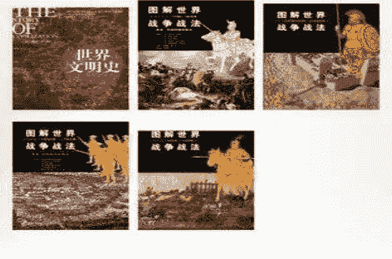

33. **问**：想了解英国衰落的原因，请问有什么推荐的书或者人吗？
    **答**：《1850 年英国为何衰弱》，这个专题是没有书的。甚至都少有学术界正面承认。个人怀疑和最早的福利主义萌芽有关。

34. **问**：我想读读美国的发展历史，毕竟未来很多还是会参照的，你有书推荐吗？
    **答**：英文资料占多。中文可以看看**菁城子**写的一些。

35. **问**：美国 1980 年后到现在的发展史，时代特征等有研究过么？求指点，或求书籍推荐。
    **答**：《美国时代的终结#F530》（注：sk 论坛文章）。

### 第二部分 经济类书单

36. **问**：对您影响最深的书籍有哪种类型？能不能推荐详细书名或者作者。
    **答**：布尔费墨的几篇无政资文章。

37. **问**：奥派经济学的学习应该如何入门？请推荐些基础的书籍和视频。
    **答**：布尔费墨微博(非情感类部分)。

38. **问**：奥派推荐哪些经典？国内翻译过来的奥派书籍，感觉大部分不流畅、晦涩难懂。
    **答**：可以看看连岳，布尔费墨，青城子的微信号。

39. **问**：能不能推荐几本经济学的入门书籍。
    **答**：其实国内二传手的文章，要简单易懂得多。例如张维迎，布尔费墨。

40. **问**：请欧老板推荐几本可以系统学习奥派理论的书籍。
    **答**：奥派很难上手，米塞斯的著作，没有经济学功底根本看不懂。还不如先学市场经济。诸如科普读物《一课经济学》，问问@周克成。
    **周克成**：推荐订阅薛兆丰的得到专栏，《薛兆丰的北大经济学课》。

41. **问**：除了您的文集之外，有无其他的经济学书籍推荐？
    **答**：《一课经济学》@张是之 菁城子。
    **张是之**：系统了解奥派经济学的话，可以从《人的行为》入手。
    **赵炳皓**：布老师推荐《经济学诡辩》，经济学的思维方式，这本也适合初学者。

42. **问**：经济学书籍比如曼昆的经济学，萨缪尔森的经济学和你之前推荐的奥派的一课经济学，有什么区别吗？作为学习经济学的书籍，都没有问题吧？
    **答**：经济学错误很多，几乎没有一家的纯净正确的。奥派是最接近严谨的。

43. **问**：推荐下经济学圣经级别的几本书籍啊！最多 1-3 本吧？
    **答**：推荐了你也不看ㄉ啊，都很晦涩。能把《宏观经济学》看懂不错了。谁写的没有讲究，区别不大。

44. **问**：《宏观经济学》保罗·萨缪尔森 的观点对吗？推荐看吗？整本书哪两行错的？另外：京东看了下 有两本 其中一本是带注疏的推荐吗？（怕译者观点有问题）！
    **答**：〔政府可以通过加息来抑制通胀〕 这句话印了二行。

45. **问**：奥派经济学，从0开始，有什么推荐书？已经买了《人的行为》《人经济与国家》。
    **答**：从张维迎的文章开始看。原版书都太晦涩，你不会看的。

46. **问**：求推荐几本关于奥派的书。
    **答**：公众号：人文学会，@周克成。

47. **问**：求奥派经济学的书籍推荐。最好简明易懂。
    **答**：布老师推荐《小岛经济学》。

48. **问**：看你说“《小岛经济学》很多错误”，能否明确告知？我正在研读，感觉这是了解奥派经济学的最好读物了。另外：你欣赏的奥派书单，求推荐！
    **答**：有空写一些。基本 1/2 篇幅以后，就全错了。滥发纸币不是这样解释的，作者关于货币的理解十分混乱。

49. **问**：德隆·阿西莫格鲁《国家为什么会失败》这本书有必要看吗？
    **答**：很棒的书，奥派许多人推荐。

50. **问**：你推荐的《一课经济学》看完了，感觉仅仅是给结论，没有推演证明，有没有对这些内容证明的书推荐？
    **答**：你问，我答。

51. **问**：金融学推荐几本书来系统学习下呗，另外，怎么评价薛兆丰的经济学课（我已经学完了，请欧神评价对比下）
    **答**：《一课经济学》系统学完？昨天那篇“价格决定成本。成本决定价格”你就看不懂。

52. **问**：请问有没有哪本贸易金融的书写得挺好推荐的？
    **答**：奥派入门，不管别人怎么对待贸易，你永远都是零关税，才是利益最大化的。凡是违背这条定律。都是错误的。

53. **问**：推荐几本金融类的书吧，之前学艺术的，金融一窍不通，工作上慢慢接触金融房产类的，现在想学。

## 54
问：想学习货币经济学、美国货币史，有什么好书推荐？比较奠定三观，三观正确的货币学书籍。

答：弗里德曼《货币的祸害》。

## 55
问：想按您说的研究炒菜先研究货币，能否推荐几本经典的研究货币入门的书籍？类似您推荐过的《宏观经济学》那种世界经典？

答：你记住结论，货币滥发就行了。不需要自己再研究一遍轮子。

## 56
问：看了你的话通缩的文章，有点小骄傲，我花了两年时间想通了所有成本即人力成本。平时没啥事爱瞎琢磨。目前有个问题想不清楚，也找不到合适的书看，求推荐书籍或指点一下，一个国家的货币量以什么为参考发行。外汇价格波动以什么为参考？没学过经济学自己先看书琢磨，扯的有点远。

答：完整的货币经济学，有空我整理写出来。排队遥遥无期。

## 57
问：方便推荐几本关于城市化和货币方面的书看看么？

答：《美国大城市的生与死》，只记得第一第二章是《石币之岛》。

## 58
问：虽然你不是特别推荐看书，但是我知道你看了很多书。请推荐几本你认为还不错的宏观经济方面的书吧？什么通货膨胀，通货紧缩，财政政策，看的云里雾里的（不要说话的人能懂的很多道理了，毕竟我外公 92 岁了也不肯买房）。

答：你去新华书店买 10 本。看完了不解，你再来提问。我没篇幅教你。

## 59
问：有没有对“马基雅维利”阐释的比较好的小说或者书籍推荐几本？

答：《君主论》。

一晌贪欢：以及《一个马基雅弗利主义者和自由主义的决裂 #F20》（注：sk 论坛文章）

## 60
问：《大国宪制》这本书推荐么？

答：一般，层次不到。

## 61
问：朋友推荐了一本吴晓波的《大败局》给我，值得看吗？我家里也做企业就看看。有推荐的书吗，什么书都可以。

答：他的经济学不扎实，不可以信他。

## 62
问：奥派不承认垄断的存在，可否请推荐奥派论述“垄断不存在”的书或文章。

答：所有的奥派书籍中，都默认这个原则。上帝创造世界，没要求这个元素。

张是之：推荐薛兆丰的《商业无边界——关于反垄断法的经济学革命》，虽然不是奥派书籍，但对反垄断问题梳理的很全面了。

## 63
问：了解 1900 年到 1945 年的美国经济，有什么好的书或者文章推荐吗？

答：《罗斯福新政的谎言》。

## 64
问：想研究研究战时社会经济，求推荐靠谱的书籍。

答：关注“肛里拉出个电锯”。

## 65
问：99.99%的书都是垃圾，能不能推荐一些你觉得适合发财必看的书呢？

答：《信用卡使用手册》（注：水库论坛信用卡卷）。

## 66
问：请问有没有金融相关书籍推荐？

答：国内的谬误太多。国外的也是。暂时没有推荐的，谬误的先看起来。

## 第三部分

## 认知 T-1 类书单

## 67
问：能否推荐三本对你的价值观世界观的形成影响最大的书？

答：《宏观经济学》《阿里布达年代祭》《碧血剑》。《碧血剑》是我看的第一本武侠小说，在非常长的时间里，是唯一的武侠小说。阿里你们大部分人都没看过，去看一遍比较好。阿里的价值观其实就是"关我屁事"。

## 68
问：可以推荐影响你最大的五本书吗？

答：初中物理，初中数学，高等数学，数据结构，宏观经济学。

## 69
问：想了解真实的世界和社会法则，除了看欧大你写的和你推荐的文章外，还应该看什么读物？奥派经济学的书？哲学书？

答：“辉格”的水平极高。堪比阿姨（注：刘仲敬）。

## 70
问：你写的哪些篇章有利于提高 T-1 能力？或者哪些书？可以推荐下吗？

答：所有的文章，都是都围绕同一套思考体系。

## 71
问：推荐本构建 T-1 思维的书？

答：见《欧绅 5.16 朋友圈内容》（注：指公众号 sk 论坛）。

## 72
问：能否请怡空推荐一些政治、历史、经济、军事、金融、天文等学习渠道或书籍？

怡空：找到这个领域的牛人，请他推荐 1) 入门级 2) 初中级的两套阅读书目，每套 5-10 本即可。之所以不推荐看中高级的，是因为看了也看不懂，而且很枯燥，通识教育不需要那么细。

## 73
问：您推荐的书一本都没有看过，以前也没有看书的习惯，能推荐下看的顺序吗？是买纸质版还是网上下载免费电子书？谢谢。普通本科工科毕业。

答：没有书单。学习是环形的，不是线形的。如果要推荐一本书，那就是《初中物理》。

## 第四部分

## 育児教育类书单

## 74
问：育儿方面有没有好书或者视频语音资料推荐，娃还没出生，不用考试的父母还是很焦虑的。

答：焦虑对胎儿不好。该吃吃，该喝喝。

- 逍遥熊：《美国儿科学会育儿百科》。
- 朱业胜(阿懒)：孕期每周宝宝树的 app，看每周注意事项。
- 0-2 岁，一本足矣《希尔斯亲密育儿百科》。
- 逍遥熊：微博关注：京虎子
- Aila：西尔斯的《怀孕百科》《亲密育儿》都好，还有个日本人写的《育儿百科》，我的闺蜜团人手一根背巾。

## 75
问：以前天天看育儿文章，现在看觉得都是妇人之仁没见过世面的在教人育儿。怎么办？求推荐育儿书或传记。

答：世人碌碌，你才能暴富。

光影间：我 在 北京 开 奥地 利 学 派幼 儿园 ， 欢迎 有 兴趣来 咨询 。

## 76
问：能否帮忙@一下大蒜，准备要小孩儿，想学习一下备孕和怀孕期间的注意事项，请问有什么小密圈，公众号或者书籍推荐吗？

大蕊： 公众号:暖暖妈；书巢:崔玉涛 (原和睦家儿科医生)。

备孕期间不用紧张，不抽烟，不喝酒，轻松备孕。备孕期可以服用爱乐维复合维生素，怀孕以后接着服用，4、5个月时补充DHA，后期会定期产检，没有特别问题不用补充其他营养品。

## 77
问：有没有在培养孩子方面专业的大 V 推荐？或者其他学习方法，譬如读书，推荐一下相关好书。

答：可以啊，一节课 10000 元。你不会以为这种干货，35 元/一本书吧。

## 78
问：小儿本月降生，思考教育问题有些头疼。书籍、媒体大都三观不正。想找些三观正确的少儿故事书都觉困难。有什么推荐吗？

答：没推荐。 凯叔讲故事 还可以。

## 79
问：男孩在幼儿园时除了一般的绘本外，有没什么巨著或书本推荐阅读？阿姨建议在小时候记忆力强时生吞活剥的记忆阅读一些名著，长大后或许有助于快速理解。

答：阿姨 S 币。

## 80
问：小朋友暑期在家闲置，想找些合适的书给他看，能否推荐一些？一年级，识字量 1000+

答：不要看经典文学，都过期了。看这二年商业化的，**小马宝莉**，**芭比公主**。

## 81
问：想给孩子请个老师打国学底子，能推荐一下打国学底子的书目吗，几千年流传下来的国学经典那种，或者我能求一份欧美来的书目吗（不仅限国学）？这个问题困扰我好久了。

答：老师教的书法，水墨，三字经，全部都是垃圾。不学也罢。

## 82
问：你给你家宝宝课外读什么书，小学生有什么书推荐的吗？ 如果可以，是不是周末假期带他们多各种地方走走，不一定是景点，见识世界远比去各种辅导班好。

答：看书不如逛商场。旅行不如自己去买双鞋。

## 83
问：请问有推荐给小学男生看的书吗？帮助他们了解社会，激发欲望，有朋友送了套《哈佛家训》。

答：《风姿物语》。

## 84
问：我觉着财上海的真学霸只看教科书是放洋屁吧，欧大都推荐教师用书做参考书啊……

答：他只见过区重点水平的。

## 85
问：孩子今年上初一，老师让海量阅读，您能帮着推荐几本书吗？

答：首先确定文科还是理科。《金庸全集》《一课经济学》。《临高启明》其实也可以。

- 凤舞九天：欧大不是批评过临高启明三观不对么，为什么还推荐呢。
- yevon_ou：未知错，怎知对
- 含笑半步癫：请问，如果是女孩也推荐金庸全集吗？
- 桃军师：咦读书为什么分男女呢，马克一下。

## 86
问：外甥女文学方面很天才，有作家潜质，对历史和经济感兴趣，数学功底一般（数学不出色，但也经常满分）。现在初一寒假，庸师让他们看《镜花缘》《红楼梦》这种大部头，我担心她的年龄应该看不懂里面插科打诨的讽刺和人情世故，打算给她重新列张书单和电影单。您觉得纪录片《大国崛起》、《明朝那些事儿 1.2》《美国商业大亨传奇》、电视剧《阿信的故事 83 版》中某几集，电影《成长教育》、《风雨哈佛路》、《杜十娘》对塑造三观怎么样？求推荐她这个年龄看得懂的经济类、文学类、比较合适的情情小说。还有一个问题，这个年纪有没有必要从小学奥数开始看？

答：看大部头都是囫囵吞枣。成长最快的方式，是大人看懂了，然后每一节有针对性地解释。

## 87
问：初二的小女孩，欧大推荐做/学些什么，看些什么书？

答：先学数理吧。数理讲逻辑。

## 88
问：老弟高一，他想暑假学学计算机编程，零基础，能给推荐几本书吗？

答：给他 300 元，书店自学。他若是回答你“不会买书”， 那就是根本没用求学的态度。考验失败。

## 89
问：关于育儿方面，欧神有没有书籍，公众号，付费平台的 推荐？两个儿子，一个快五岁，一个一岁半。市面上有很多育儿 书籍要么是照料生活方面，要么是培育智力方面，我觉得这些都 不重要。我记得欧神说过重要的是教会他们世间的法则？（原话 记不清了）我的想法是把孩子培养成有专长，有爱好，不管想做 什么都可以做到最好的人。另外我觉得培养孩子的阅读兴趣是很 重要的。这种想法如何？

答：不清楚哪个公众号好。最近有个多娃家学的，可以关注 下。

## 第五部分

## 网文小说类书单

## 90
问：帮忙推荐几本书或电影，别太枯燥的~

答：我怎么知道你喜欢看哪类书，以及心智哪个阶段。《死人经》第一部。

## 91
问：你是如何判断一本书的好与不好呢，有什么依据吗，例如像《死人经》《将夜》，本人有点愚钝这两天看了些，没发现什么特别的地方呀。

答：只翻了前7页？我推荐的，就一定是好的。

问：能简要说说好在哪里吗？

答：心智成熟的人看死人经。心智不成熟看小马宝莉。

Alex Ma：死人经：1，生存是第一要义；2，任何承诺都可 能被背叛；3，都有可能没有收获；4，运气是成功必不可少的要 素之一；5，苦难是人成长的最大动力；6，为了达到目的不择手 段，无可厚非……

## 92
问：我把十一本满级coc和王者级别的王者荣耀都戒了，烟 也戒了，酒也不喝了，麻将也不打了，美剧也不看了，摄影也不 玩了，耳机也不烧了，自行车也卖了，妹子也不泡了，旅游也不 去了。每天就看房子办贷款。懂了irr怎么算，看完了《死人经》 和《将夜》，还看了大国大城，欧大文集又回顾了一遍。年底完成买房任务了，突然感觉好空虚也没有朋友，请问还有什么书好看？能不能多推荐几本第一流的书，我看书的能力实在很厉害。

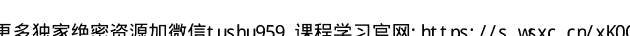

答：《亵渎》《紫川》。

- 。。。。。。：阿里、官能、十日谈、冰封、朱颜血=_=!!!，全是禁书我的童年。
- yevon_ou：朱颜血！！！

## 93
问：看到欧神推荐《紫川》，我是初中看的，只图爽了。莫非这个书其实是有深意的？

答：没啥，就是爽。

## 94
问：最近在看什么书，能推荐下吗？

答：刚看完《新宋》。

## 95
问：求推荐一些职场斗争的书籍以及资料。这方面能力也是重要部分，我比较弱，炒房之余也要把这方面能力抓上去。

答：少看宫斗剧。

Luckystar：《孺子帝》关注下。

## 96
问：你也看跳舞的书啊，涉猎如此之广，如此杂食。eq 刚建完仓，推荐几本玄幻意淫一下。

答：《裁决》，七十二编的书都很弱智。

## 97
问：你看王小波么？他的小说有点看不懂呢，是因为我太年轻，没经历过那个年代缘故么？您比较认可哪些国内作家，有没有推荐的作品，最近书荒。

答：看过《黄金时代》，白银时代青铜时代。还不错。但放到今天，不会是最好的。

## 第六部分

## Marketing 房产等其他各类书单

## 98
问：市场营销的知识传授点吧？实在是太渴求了。哪怕推荐一本您觉得好的书，好的公众号也好呀？

答：水库论坛新版目录 Marketing：

- 市场营销入门 #210
- Re-Sale 为什么这么难 #220
- 如何运营一家企业 #230
- 无中生有的高阶 #240
- 夏洛特烦恼 ｜精准营销的胜利 #F240
- 美国大片加速走向屌丝化 #F1030
- 老婆喊我组装自行车 #F390
- 从包粽子机说起 #F1120
- 怎样把品牌做死掉 #F1180
- 水库赚钱之道 #F1190

## 99
问：俺准备买最后一批书了，您的平装精装我也要买买买。还请您推荐一本讲市场营销的书。

答：中国没有三观很正的 marketing 书籍。都是"点子大师"野路子的。英译版里海淘。

## 100
问：我想要了解 Marketing，学习这方面的知识，看过您关于这方面的文章，想要进一步学习的话有什么地方或书籍可以推荐吗？

答：不传之秘，只传内堂弟子。所以中国人改革开放 30 年，制造业都学得差不多了。MKT 还有很大距离。我时间短，也只学了皮毛。现在中国香水还是卖不过法国。

## 101
问：我看了你写当年在外资企业做 Marketing 的文章，受益匪浅，就一个问题：可以推荐一些资料或者书籍来深入学习关于你文章提及 Marketing 的知识吗？我觉得我们大学的都是假市场营销。特别是你说的正规企业”卖假货”那个案例，这种思维方式很有魔力。

答：这种东西，不传文字。只传内门弟子。

SPU：内门弟子开课了么？怎样收费？

yevon_ou： 我说只传 managementtrainee

（注：欧大 marketing 课程 1 已于 2021 年 7 月 6 日开课，课程 2 正在众筹中）

## 邀请卡
Invitation

双喜

邀请您来一起看直播

# marketing课程1

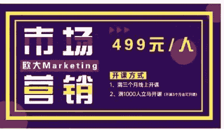

长按识别二维码立即观看

## 102
问：你在成长过程中，看了哪些关于房产投资的书呢？可不可以推荐几本。

答：如图。

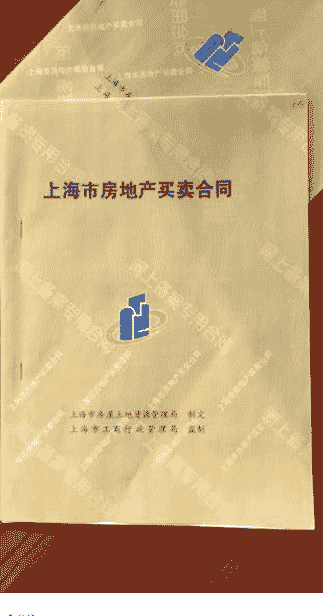

问：是不是您写序的书都值得推荐呀？您还给哪些书写过序呢？

## 103
# 丑房焕新“房住不炒”新形势下新房东的第一堂课

于是季老湿发了 50 页的大纲内容给我，我认真地看了两个下午。
概括来说，季老湿的逻辑流程是这样的：
（1）确定目标客户。市场上存在一群客户，追求更好、更有品质的生活。
客户的需求是整个市场存在的基础。
（2）确定经营区域、板块和户型。
（3）确立合伙人体制，产品才有灵魂。
（4）确定套路和套餐。“业余”和“专业”的区别，最关键在于套路。
专业的公司大都是有一整套打法的，大都有几种固定的套餐搭配。
（5）出租增值业务，出售增值业务，合伙人加盟模式。
（6）实操。

季老湿讲的几种手法，确实让人耳目一新。
例如员工带客户看房进门，会邀请客户洗一下手，让他感受三秒流出热水的温度和水量。
水系统的领先还是次要的。关键在于“温水洗手”，这在心理上是强大的暗示，让客户感觉欠了你一份人情（水的消耗），可以极大地提高签约率。
这是非常重要的一手资料，只有奋斗在最前线的工作人员才有的智慧。
这也是这本书的价值。
再譬如说，细节决定成败。
丑房焕新最重要的细节是什么？竟然是开关面板。
品牌开关面板很贵，动辄几十元一个。很多庸作，做完之后，从业人员总觉得差一口气，自己装的就是没有设计师好看。
为什么？匠人和大师差在哪里？差的可能就是一个“诀窍”。神之一手，画龙点睛。“所有的开关面板，必须全部换新。”这一句话就价值千金。
迫不及待，我已经想要买这本书看了。

欧成效（yevon_ou@163.com）
2017 年 9 月 10 日

答：哦，《丑房焕新》，很多推荐语，都是人情。只不过我的序言，很少夸大罢了。

## 104
问：看了丑房焕新，但是没有很细说装修上的手法，有没有介绍装修手法的书籍推荐呢？

答：自己装二套。

## 105
问：有靠谱的装修宝典或书籍推荐吗？知道装修、凤冰得靠大量实践，但是还是需要一些装修基础知识和设计品味素养。

答：《凤变冰的108个秘诀》。

## 106
问：什么样的户型是好户型？什么样的露台是好露台？怎么看房子质量好坏？等等，这类基础知识有没有推荐的书或者文章？

答：《世界上最好的房型#430》二篇（注：SK论坛文章）

## 107
问：如何修炼的好涵养，我自己做教育培训，遇见sb家长真心想怼啊，什么给娃按摩扎针艾灸三伏贴的……虽然知道是金主，但是我还是有些人的生意不想做，欧大这样的身家，怎么会无差别服务得那么好的……有什么书推荐吗？

答：《信用卡账单》（注：需要被信用卡账单刺激）。

## 108

# 109

问：因为疫情而失业，长期不上班与人交往大大减少，如何避免因此造成的社会交往能力和口头表达能力下降，如何排解长期不上班在家造成的孤独感和抑郁情绪？有没有相关的书籍或者课程推荐一下。

答：微博。

# 110

问：想看看逻辑学方面的书，提高逻辑思维能力，有推荐的吗？

答：正经的大学《逻辑学课程》。

# 111

问：记得以前您推荐过《亚洲教父》这本书，现在您接触了东方的各方面教父们，您觉得跟书里讲述的相似吗？有什么特别感触方便分享吗？尤其看到您跟 mll 拿督的合影，感慨书中人物和故事来到了您的现实生活。

答：那说明你肯定没看过这本书，连写的是什么都不知道。

# 112

问：看学术型文章，理科教科书，历史书(非三国演义那种小说)总是坚持不了，看着看着就会头昏脑胀，无法思考，然后总是忘记。请问，该怎么克服这样的问题？或者有没有别的方法推荐一下呢？

答：明明是作者的问题。写得象狗屎一样。

# 113

问：有关风水方面的书籍可以推荐吗？感觉风水虽然没有很强的科学依据，但还是挺有讲究的。

答：@柴犬花生酱。

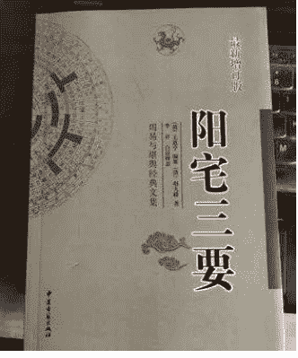

# 114

问：有什么推理侦探或者罪犯题材的书籍推荐吗？

答：还不如看一些科幻书。

# 115

问：想脱离对现代军事的一无所知，有什么书或者公众号推荐吗？

答：公众号：科罗廖夫的军事客厅。

# 116

问：欧大有无生物学方面的书籍或者公众号有推荐的？

答：抱歉，生物是我比较差的一科。

泰霦：公众号果壳吧。基础书籍的话：普通生物学；科普的话，杰拉德戴蒙德的书不错，拿了普利策奖的。筑基可以了。

# 117

问：对于心灵受到创伤的人，什么办法能自愈？如何让自己变得内心强大，有没有推荐的书，谢谢！

答：时间久了总能自愈。

# 118

问：本想提问欧神怎么看哲学，发现之前有人提问过了，看到您回答“你们现在学的哲学，不叫哲学，禅宗、冥想、灵修都不叫哲学。哲学应该是关于万物之本源的学问”。那可否请多讲几句，我们普通人怎样学习哲学或者介绍几本入门书？之前您推荐的网络小说类，都是大部头，通过阅读故事，体会故事人物的经历而自学领悟，这个阅读量相当大。

答：《哲学的几重境界#F860》（注：SK论坛文章）

# 119

问：如何看待逻辑思维得到 app 里推荐的那些课程，以及相关读书活动。

答：水平有信心碾压。

# 120

问：卡内基的人性的弱点值得看吗？有没有讲人性的书推荐？

答：不清楚。估计已经被改得面目全非了，不是钢铁大王的原话。

# 121

问：有必要读些建筑类入门书籍吗？或者其它非水库基础读物？请推荐

答：没必要。有必要，因此不推荐。

乐墨：因为有必要，所以闯 g 词，所以不推荐。

# 122

问：有没有经济学方面的书籍推荐？或者您最近看的其它书也行.

答：最近在看《量子色动力学》《爆炸力学》

# 123

问：请问您怎么吸收知识的？感觉您懂很多，又不是很推荐看书的样子。

答：活得久

## 水库知识星球 T-1（注：底层规律）系列

这一系列共 514 个问题，17 篇。

如果说水库在家学建构上提供了 T-1（底层规律）的框架，那在一线桃李满天下的教育革新者，就是看房 200 套的践行者，他们的经验和细节是丰满家学的拆骨法。

在需要耗费更多心神去填充家学的细节之前，知晓世界和社会 T-1 的逻辑无疑更重要。今天花了十几个小时看完 7 万字水库知识星球问答“T-1”系列（托做多娃家学公众号的福，我也是第一次系统看星球问答），发出第一千零一次惊叹：我神不愧是我神啊！真乃真理的百科全书~

请原谅一个孕 33 周的二胎妈妈为了保持日更，只是按照时间倒叙对问答进行发布，并没有进一步细分主题，比如 T-1 是什么，怎么获得 T-1 的能力，T-1 的功力表现，经济学、政治学、房产、爱情、婚姻等各行各业 T-1 的分类等等。虽然降低了大家的阅读体验，但更能实现前后文呼应（好吧，这是借口，有时间的话我还是会更细致地分类类，让自己也更清晰些）。

### 01–10

问：几次看到 T-1，求教具体是什么？感觉错过了一个重要原理。T 代表什么？那-1 什么意思？+1 又是什么意思？

答：如果你掌握了 100 条道理，却过不好人生。你需要一条 T-1 更底层的公理。T 是“现有”的简称。来自于股市中，T+1，T+0。-1 更底层，+1 衍生定理。

问：底层逻辑是什么意思，t-1 是什么意思？

答：你高考做了几千道题。但是理清楚出题老师思路的话，50 题就够了。

问：你当爸之后，功力有没有打七折？自己难道不矛盾吗？她们是掀桌子的一代人啊！什么东西最珍贵，这个社会可能会教给她？

答：T-1 的意思，就是时代在变，而底层规则不变。

问：您说的 T-2，甚至 T-3 是什么？

答：生物的 T-1 是化学，化学的 T-1 是物理。我发现有些人的脑海里，是不是从来都没有过 T-1 的概念。

问：我们看很多知识，如何把她串起来，而不是忘记了？

答：只记忆 T-1。

问：闭环不意味着停摆，但其 t-1 是什么？如果不方便可不作答。

答：收费太便宜了，不够成本。

问：接受不完美的 t-1 是什么？

答: 完美代价太大。

问: 请问商业运行的 t-1 是付费者补贴白嫖者吗?

答: 你家门口卖煎饼果子的, 谁白吃了。

问: 西港付尾款愁了 2 个月, 两鬓白了四根头发, 心里压力大, 上周突然想通了, 路要向前走, 心态放平衡, 谋事在人。请问欧神若干年后如果月供+0 或者尾款翻十倍的时候如何想通一些事情, 您是如何解压的? (重要) 压力山大的 T-1 底层道理是什么?

答: 既入此门, 终身受苦。你就不要想着如何解压了, 并没有这个办法。你永远会把尺度, 押到你喘不过气来的最后一寸。人性贪婪。

问: 1, 关于公众人物总会有一些过去的历史或者种种过往经常性被网民扒出来, 这时候如何应对这种人设崩塌和信任危机? 是不回复? 还是应该如何处理? 2, 做好公关的 t-1 是什么呢?

答: 不同的公众人物, 不同的时期, 有不同的应对方式。知道现在是什么时期。

### 11-20

问: 1, 做好喜剧的 t-1 是什么呢? 2, 在一个家庭中父母性格不同的强势会给孩子带来什么样的后果? 例如如果母亲性格极其强势, 教育出来的男孩长大后没有自信, 唯唯诺诺, 这个时候应该如何矫正? 3, 幽默的 t-1 什么呢?

答：喜剧是轻浮的，悲剧才是永恒。永恒的喜剧，一定是潜伏的悲剧。例如周星驰电影。（谚语）一个幸福的家庭，就是没有控制欲太强的人。远走他乡，独立生活。反转。

问：35 岁男由项目管理转做技术，急需提高专业能力。请教专业领域提升的 T-1 是什么？如何技术上精进，成为领域的 1%?

答：你直接辞职好了。35 岁还做什么技术。要不就像美国乘务员一样，把所有任务外包给沈阳极程序员段子。

问：我个人理解机会从变化中来，赚钱从变化和机会中来，事情不变化一个萝卜一个坑，一变化就会发生错位错配！和赚钱需要 Bug 底层逻辑可冲突？

答：世事在变化。要么你可以“算”，通透 T-1，洞彻天机，提前布局。要么你运气特别好。普通人，没人教，凭什么下一个时代你可以赚钱。

问：除了《潜规则》和《血酬定律》等，还有什么 t-1 的好书可以推荐的？

答：灼识新维度（注：公众号）

问：年销售额百亿级别的制造型民营企业，目前 A 股上市，老板总会强调其父辈是平凡的农民，原生家庭没有所谓背景和拼爹的资本。从 t-1 看这是出于渲染和打鸡血的需要，实情并不是这样？

答：并不是每一个企业家，都是官员手 tao。也可能是盟友。

问：生意上零售和批发，玩批发才有前途 t-1 原理是什么，是通过薄利让利量大解决流量问题和时间成本吗？

答： 批发上限高。不代表批发赚钱。

问：如果吸收系统不成体系框架，即便看的都是真经也没用，最近思考和阅读较多，请问您文集开始体的部分算是吸收系统的框架和体系吧（比奥派还要底层）？或者您对吸收体系和框架搭建有什么好的办法吗？奥派经济学是体系框架的一种呢？还是需要更深入的了解 t-1 才能搭建，奥派仅是体系框架的一部分（毕竟还有很多非经济学内容）

答： 一个非常大的误解。水库其实没有系统地写过“体”。经济学三原理，用的篇幅非常少。一笔带过。“c 楼学”是“用”。

问：请问心胸宽广的 t-1 是什么？以前都用宰相肚里能撑船来形容一个人有能力，能成大事。奥派思维下，应该是一切出发点都是为了自己的长期利益或短期利益吧？

答： 有更重要的事。

问：1.想和朋友一起开公号，我自己不方便公开出面，所以我提出公号所有权为我，公号内容的公开的人的形象是他，但是他还是以我公号名字不好拒绝了。2.后来就运营了 2 个公号，因为我也有些人脉，他也有些人脉，但是发现我在他公号发的文章他也没怎么推？我怎么让他有动力推？3.原来说好有客户上门他出面，后来真的有客户上门了，他又不愿意了。我的问题是，

1~与人合作重点是什么呢,是利益分配么? 2~穷人老是怕自己利益受损反而连开始也不愿意 t-1 是什么? 3~怎么破?

答:正常。他为什么要帮你。他为什么要帮你。直接换人。

问:音乐的本质是什么? 为什么会让人感到愉悦? 最开始人类只能听自然界的声音, 到后来掌握音律, 可以创作出让 人愉悦的声音。这个音律的 T-1 是什么? 我想了半天, 没想明白这个和进化中的生存和繁衍有什么联系。

答: 有节奏的声音, 一般不会 是野兽发出的。一般都是同伴发出的。

## 21-30

问: 李子阳的这篇文章中, 说 1973 到 2011 年美中 产和普通工人收入增长停滞, 富人收入大幅增加, t-1 的原因是什么? 文中说是因为华尔街投资人介入公司, 裁员, 美化财报, 造成公司员工失业, 觉得不太令人信服。

看上去，从里根到克林顿时期的美国经济增长，和战后1950年代到1970年代那段经济增长的黄金时期很类似，克林顿时期还创造出最长的持续增长期，但是，细看之下，却能发现很多不同。

战后时期的经济发展，中产阶级的收入大致和经济增长同步，但1980年代以来的三四十年中，虽然经济整体高速增长，但主要表现为顶端富豪阶层财富的膨胀，而中产阶级的收入却停滞不前。扣除通货膨胀因素，很多人的收入基本没有增加。

从1948年到1973年，美国普通工人的工资增长了93.7%；而从1973年到2011年，普通工人的工资仅增长了4.2%；按小时折算的工资，2011年和1978年完全相同——收入停滞不前长达三十多年。

答：因为工人的生产力没有增加。所以这只是工人的错，不是其他任何人的。

（周秦汉 ：道理非常非常简单，美国制造业的老板和员工，都因为白左停止发展，但是 IT 和金融离白左远，得到了巨大进步。然后媒体和自媒体，拿制造业员工和金融业老板进行对比。）

问：有朋友想在重庆区县开家实体生鲜店，您觉得能成功赚钱的 t-1 核心是什么？

答：年轻人千万别创业。先在这行干三年学徒。省你上百万。

问：这是否因为：所有的真消息，不可能同时发挥作用。所有人的判断，不会同时一致。也可以说，同时发生的消息，必有真假。同时做出的判断，必有优劣。t-1 就是阴在阳之内，不在阳之对。

yevon_ou 1小时前

> ipencil 提问：欧大，市场有效假说成立吗？所有消息都会瞬间反应在价格上，买股票随机买和精选等盈亏概率没区别，基金公司往往跑不赢大盘，这个描述是对的吧？谢谢。

# 大海是平的么

immrb：错到家了，不然还要炒卖，还要对冲基金干嘛

答：宏观与微观尺度的问题。

问: 感觉你真的是什么都知道, 我神威武。。。追问——(短期之内, 会有一个愚蠢的投资进入。后来发现, 根本研究不出什么。) 根本研究不出什么的 t-1 层原因是?

答：生物技术大坑已久。科技锁死，目前没有新的技术。

问: 孩子教育方面有哪些 T-1 吗?

**答：欲望是一切的基础。欲望是成功的基础，渴望成功者才能成功。**

问：全球的金融业总体来说是不是一个利润丰厚的行业？起码从业人员的薪酬收入水平是社会顶尖的，这里面的 T-1 是高级智慧劳动+高风险高回报吗？谢谢！

**答：Commercial bank 不算金融业，其他都利润丰厚。不是，见《金融业的折旧》。离钱近。**

问：作为您关圈前的最后一个请求，能不能最后再写一篇 t-1 中的 t-1，直击人活着的目的：我觉得您的“孩子不是手段，孩子就是目的”还不够 t-1。顶多算个是 t-2。真正的 t-1 是生物学，是有性生殖，是减数分裂：优点：1、有性生殖中基因组合的广泛变异能增加子代适应自然选择的能力 2、有性生殖能够促进有利突变在种群中的传播 3、消除基因的有害突变对生物生存的影响 缺点：1、基因组合的形式多样化，使遗传变异速度明显加快 2、增加了两性配子相遇的难度 不生孩子，生物没法进化。此外，我比您还极端，癌症是进化中的放定时自毁装置，

老人去死，不是因为消费>生产，而是为了给后代腾出宝贵的生存空间

李子畅认为生育率的恶性崩溃，是因为「社会养老」，因为人们不需要为孩子投资。

他是彻底的胡说八道。

「孩子」从来都是负资产。父母从来没指望从孩子身上收回什么金钱，我们也清楚的知道，收回投资。

但这并不妨碍我们对孩子的爱。

孩子不是手段，孩子就是目的！！

历史上所有不注重子嗣的文明都灭绝了。我们爱孩子，不是为了 RMB 三千五百的孝敬回报。而是为了祖先输给我们的血，我们流淌给孩子的血，中华民族的血。

血脉就是我们的终极目的。

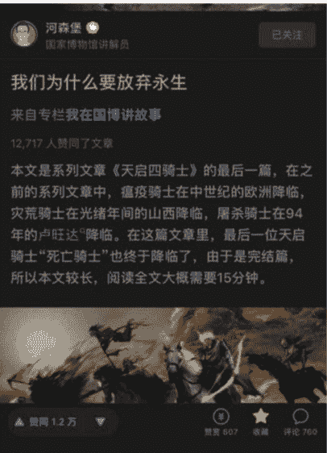

答：见《正本清源说奥派》，第一第二篇。

问：您看电影会去注意并记忆一些主线、副线、桥段的东西吗?或者您，怎样记一些电影里的东西呢?凭自己的兴趣吗?看电影或者看书,您认为有哪些好的习惯和方式呢?我们应该教育并训练小孩这些好的习惯和方式吗?还是让小孩自己去发现和掌握?因为，我不是很确定哪种习惯和方式更好，而担心教给他一些不是足够好的东西。通过我对《闻香识女人》和小密圈里一些信息的思考，我认为，厉害的家长，首先是成为一个足够好的

榜样，同时，通过生活中的训练和指导（有可能是暗处），让小孩掌握更多人生的好习惯和方法，对吧？您对教育小孩，除了激发他们的欲望，让他们吃一点苦头外，还有什么大方向的建议吗？谢谢！

答：事情反常，意外，不合逻辑，exceptional 才会被记录。否则，就 T-1 分析消化，毫无例外。直接归档。不要让小孩背记公式，要记公式背后的道理。不过很多大人，自己只懂公式。没法教。

问：企业管理的 T-1 的逻辑是什么？

答：信息的无篡改流动。

问：传统的经济学认为有效需求是拉动经济的发动机。还有一些观点认为中国的经济比美国潜力大，也是因为需求潜力更大。想问的是这个所谓的“需求”的 t-1 到是什么？能理解为您欧大您说的欲望吗？

答：凭什么中国人，人均消费是美国人的 1/3 ，人种既然平等，最终 GDP 就必然差不多。

### 01-10

问：何为智慧？

答：识破 T-1 规律。

问：你没有名师，那你的各种 t-1 怎么得出来的？

答：所以进度缓慢。否则会比现在强得多。

问：吴思的几本书价值如何，感觉 T-1 揭示的很透。

答：入门级不错。（注：《血酬定律》和《潜规则》）

问：说服的 T-1 是什么？

答：人不可能被说服。除非被说服符合他的利益。

问：中华文明能够自古延续至今的 T-1 是否真的是人口规模优势？

答：否则元代就杀光了。

问：民国被称为文化和思想的黄金时代，名副其实吗？集中涌现出大师的情况在中外历史上时有发生，比如 1920 年代的物理学，18 世纪的西方古典音乐等。现代人写不出唐诗和古典主义交响曲，T-1 是什么呢？

答：主要成就是人文，因为没有管制。理科完全不能和近代比。

问：能详细说下什么才是自知之明吗？有战略意识算吗？

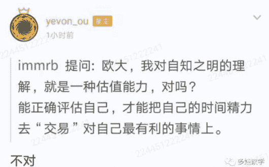

答：知己和知世界，是同一回事。T-1原理是一样的，就是对规则的极端领悟。因此，一个充分自知的人，去做任何事，都一定会成功的。世界观厉害。除非是被打断腿的残疾人。

问：川总视资本市场如命，成天的关注和转发股票指数的涨跌情况，动不动就批评鲍威尔不降息！降息对美国经济发展有那么重要吗？美国是价格型？这个 t-1 是什么？

答：降息有利大选。

问：生娃有功，单着有罪。古时好像就是这样的。如果政府施加这样的干预有效吗？暴力吗？对 t-1 有何影响？

答：有效。没暴力啊。无子女者不得担任 gwy

问：你发的文章很多都会受到大家的激烈讨论，其中不乏带有情绪的恶意评论。你可以心平气和的看完甚至回复，不会觉得被冒犯的 T-1 是什么？

答：因为投击中要害。

### 11-20

问：隔行如隔山，一些人在自己熟知和专业领域里认知非常高，到了其余领域就变得比较蠢，这是人的常态。但有一些人就能横跨很多领域，对于整体世界的认知比较高。怎样培养对这个世界整体认知的提高，起码做到对于不熟知的领域不那么蠢？

答：因为你是从 T-1 倒推 T 层，因此可以解析得七七八八。

问：保险为什么一定要持牌销售？t-1 原因是保护既得利益？

答：怕你卷款潜逃。

问：企业融资难的T-1是什么？和金融去杠杆关系大吗？企业都觉得资金紧张，所以身边做企业的人往往会信那些通缩的论点。或者说inflation最终一定会配合融资变得宽松吗？

答：信息处理低效，优先毁灭民企。物价上涨，自然流动性变少。

问：中国民间的清官情结，t-1是什么？是因为整个的物质贫乏吗？

答：因为民众脑回路有限。不懂tan官的好处。

问：你写过一篇分析秦汉天下形势的文章，分了五个层次。我的问题是，对一个问题的分析的层次，通常是怎么划分的？怎么越挖越深呢？是通过不断思考t-1么？

答：哦，其实五个层次是不对的。

问：出轨的t-1是什么？

答：婚姻制度的不合理。

问：百思不得其解：请问中国人重视阴宅万年吉地不亚于阳宅，有什么t-1的道理吗？

答：阴宅是买给自己的，阳宅是买给子孙的。

问：会笼络人心是一种技能吧，有些人天生有（叫领导力）对吗？笼络人心有没有核心法则的，或者t-1的简单总结语，是什么？

答：是。理顺利益关系。

## 21-30

问：有的人破坏规则，你告诉他这样是不对的（没有态度恶劣），他不认错还振振有词，T-1 是什么？

答：他没挨过打。

问：想请问一下，您觉得泡妞的 T-1 是什么。

答：长择短择完全不同。

问：“对事不对人”是不是正确的处事方式？是不是是一种聪明的方式？这里边有什么 T-1 原理？

答：正确。聪明。理智走向科学。

问：最近在重看水库文章，看到了“平等”一卷，陷入了对欧洲史的不可自拔。英国自治传统和法系思想主要区别在哪里啊？分别的 T-1 是什么？

答：因为英国是岛国，不需要统一战争，也不需要陆军。没有“总体战”的体质。

问：请问一下类似“世界上本没有黑暗，划一根火柴就可以点亮漫漫长夜，再强大的黑暗都消失了。”这种话。体现的社会思想正确吗？T-1 的原理是什么？然后再请欧大用理论物理解释一下黑暗和光明到底是不是物质？

答：鸡汤。火柴根本不取暖。黑暗的定义是什么？

问：新能源汽车有存在价值吗？许周口大肆推动新能源汽车，T-1 何在？

答：When if 石油断绝。

问：国有部门，一个部门待了 7～8 年，普通员工，想再往上走走，眼看比我小的都科长了，该怎么办？给领导塞钱？还是说真的要看表现，多到领导前走走？想往上走 T-1 是什么？

答：换吧。路已死。

问：1973 年 10 月迫使石油输出国组织（欧佩克）接受了美国人的条件：全球的石油交易必须用美元结算。美国这么做的 T-1 是什么？

答：增加 USD 的使用场景。

问：您平时怎么做到长时间有效率看书的？我平时看书前面两个小时效率最高，后面指数级下降……而且信息量大以后，很快就会把论点忘记掉，除非重新再看一次，不知道您平时也会重读之前看过的觉得不错的资料吗？我现在采用的笨办法就是把关键论点写下来，记在旁边，下次复习时可能不用那么长时间。不知道有没有好的方法推荐给我们学习一下，谢谢！我这个现象 T-1 是不是我没有真正理解透文章的观点？

答：看书是一边看，一边撕的过程。除非一些很难的书，例如爆炸力学，否则看的当时就全明白了。

问：两国之间的汇率的 T-1 是什么？

答：边际价格，无意义。

问：少年时总因为明天有重大考试/面试/转学/转岗/重要场合公开上台等挑战、紧张的事而失眠；现在反倒是要遇到开心的事时会睡不着觉，直接失眠到天亮。家人团聚、环境改善、某件事情发展顺利等等。现在再发生当初那些让人紧张出汗、压力天大的事，完全不会挂心上。这背后 T-1 是啥呢？人生越走越，高兴的事就越少越珍贵了吗哈哈哈

答：筹码多了，输得起。

问：请教下涉黑涉恶的 T-1 是什么原因？另外好多催收、数据爬取都被算到黑-恶里面，这又是什么原因？

答：增加执政力量，削弱民间团体。因为找不到大恶人了。

## 31-40

问：阿拉伯世界始终没有出现强大国家的 T-1 是？

答：奥斯曼不算么。阿拉伯半岛没水。

问：民企职场升迁的 T-1 是什么，是站队吗？

答：看你是低级，中级，还是高级员工。

问：欧神，聪明人是不是都有攻击性，明显或不明显的。T-1 是因为他对世界看得更透彻。

答：只保留合法的攻击性。

问：请问什么途径可以了解到美国房价和日本房价当年转折的 T-1 逻辑呢？自己才疏学浅，丰富一下多军理论，省的被斯文的空军质问。百度了一下知乎了一下，没有太好讲逻辑的文章，人云亦云，例子都是一样的……

答：美国有转折么？

问：幸福快乐的 T-1 是什么？

答：降低期望值。

## 41-45

问：育儿的 T-1 你觉得有哪几个？

答：多生就是最大的王道，数量堆死质量。

问：很多水库老人在背后开坏你，嘲笑你的老破大，讽刺你把大家带沟里，还说你西港割韭菜。他们这么说的 T-1 是什么？

答：穷。（段公子：我所见过诋毁欧神的人有几种。1. 最低层的屌丝，啥都不懂，人云亦云，诋毁一下，显得自己有水平。2. 稍微懂一点的普通投资者以及一些机构的负责人。把自己操作的失败案例归罪到欧大身上，投资不考虑因时因事因事，不结合自身实际，月供钱都不留的。别说你看过水库。3. 某些人故意诋毁，为博自己出名。树立自己的 IP。目前诋毁欧神的一众屌丝中，都没说到点子上，很 low）

问：经济周期的 T-1 是什么？

答：数学，傅里叶变换。【大白话版】天下哪有笔挺挺的直线。

问：为何颜值是女性的第一竞争力？T-1 是什么？颜值高大概率基因强大是嘛？

答：女性最大的价值是繁殖。（注：因为男性不能生娃，这是女性独特的优势）

问：女人追求情绪价值的 T-1 是什么？例如女人不屑于（至少在宣传口号上）不屑于“只要物质不要陪伴”。你损失 100w 的生意陪她吃顿晚餐她觉得很满足，给她 100w 她反而不满意；要你给她买 2w 的包，其实也就值 2000，剩下 18000 算买她一个开心，本质还是要情绪价值。大量女性还是推崇宁愿物质少一点也要追求爱情，请问这是生物进化来的本能还是被洗脑的？还是说只是女性口中这么说其实是要你付出更多的物质？

答：因为她们不知道 100w 代表多少钱。她们对真实的世界一无所知。

## 85-90

问：你赚钱怎么会这么厉害，T-1 是？

答：勤奋。

问：有时候很焦虑啊，感觉自己能力不够，即使和同龄人比，已经还算 OK 了，但人外有人，始终也会有比自己强的人。请问：
- 1，如何能做到像你一样，全方面的强，或者说全方面的能力提升一个等级，即使很多事情参透 T-1 的逻辑，但未曾涉及的领域始终是不懂得。对成功的饥渴很强烈。
- 2，平时内心的心思，是复杂一点好，还是简单一点好呢？本身就是喜欢多想的内心世界，对方一句话，能想到背后好几种可能和情况，看到身边人很简单的思路，活着也很开心，自己这种多想有时候觉得很累啊。哪种好呢？

答：每年工作 4000 个小时，持续 15 年。（注：欧大是 15 年每天工作 11 个小时啊）

问：1，低潮时如何面对？有点像是一个进入一个隧道，黑黑的看不到光，也不知道什么时候能出去，感觉越来越不自信。但仔细考虑过，方向是对的，初期目标也不高，想一步步走。最近有些触底，收入少了近 30%，原本的两年一栋也会推迟，其他都好说，这件事最不能忍。
2，人到 40 岁，必须明白的 T-1 是哪几条？您的星球几乎每天都看，受益匪浅。多谢！

答：那就不是低潮，至少你还有希望。你父母不是超人，你不是超人，你孩子也不是超人。

问：刚又重看了一遍《列兵与阶层》。一般人很少换赛道，经验能力也就自然累积。切换赛道的话，低阶的东西有什么是可以带入高阶的呢？

答：T-1 的领悟。

问：发现好多问题都是问 T-1 的，小白（包括我）都希望掌握终极真理，然后就世事洞明，一劳永逸。其实是在缘木求鱼。小白最重要的是去从看房 200 套开始，把所有该踩的坑都踩了，吸取经验教训，然后才能开始进步和进阶，请问这样的理解对不对？

答：学而不思则罔，思而不学则殆。（Alex Ma：道理有几个层次：知道了，懂了，掌握了。小白们再问，也只是『知道了』的层次，要到后面的层次，是要踩坑付代价的。最难的就是认识到自己的弱，承认自己傻逼。而我等 DS 们往往在第一个层次，就认为自己掌握了宇宙真理，看不起别人了。）

## 91-100

问：你为啥知道那么多 T-1?

答：因为你问的多。（唯为：“求之而后得，为之后而成，积之而后高，尽之而后圣；故圣人者，人之所积也。”“人之所积者圣”，人要想真正掌握万事万物的 T-1 而达到“圣”的境界，唯一的途径是学习和实践的持续积累。）

问：教育的意义是什么？孩子教育的目的 T-1 是什么？

答：驯化。另类驯化。

问：您说的人工智能关键在于框架，怎么理解？是不是可以理解为创新、发现 T-1？

答：算法。

问：负利率的 T-1 是什么？您是怎么理解的？或者哪篇文章您觉得解释的正确？

答：负利率根本不需要关心。0.01%和-0.01%区别很大么。不大，远没有 0.01%和 0.25% 区别大。

问：当年您作为一个学霸，保送生，是不是看看课本就能领悟 T-1，根本不需要做很多的题目吧，这种能力是天生的吧？

答：很多人学习的方式不对。刷题，同一类型的题，刷三道就足够了。

问：大城市法制较五线城市更健全，T-1 原理是什么？

答：信息成本低。

问：请问海权的 T-1 是什么？

答：
1. 贸易
2. 自由选择登陆地点

## 101-110

问：公司的 T-1 是降低征税成本吗？

答：降低合作成本。

问：电视剧《天道》里面，“透视社会依次有三个层面，技术、制度、和文化。小到一个人，大到一个国家一个民族任何一种命运归根到底都是那种文化属性的产物。强势文化造就强者，弱势文化造就弱者，这是规律。也可以理解为天道，不以人的意志为转移。”这话三观正确吗？T-1 是什么？

答：《论儒・法・禅宗・基督自治及道教的复兴(五)——神的战争 #F10》（可复制文章标题在微信搜索框进行搜索）

问：老家很多人在搞电商靠线上做生意发财，发现能做下去中，做的一般的月 800-1000，做得好的月 5000-10000。当然做不下去回来的也不少。不解做好这行的 T-1 层逻辑是啥？

答：那要看你做伙计，还是做老板了。做老板，关键要懂“流量” 。 [知道你为什么在西港不赚钱吗？](https://s.wsxc.cn/xK0Qqd)（可复制文章标题在微信搜索框进行搜索）

问：百度脱离 BAT 行列的 T-1 是什么啊？是普遍认为的错过了移动互联网吗？

答：百度能爬到 BAT，才是问题。从来就不是优秀的公司。

问：房子、车子，同样是实物资产，为什么一个升值，一个贬值？最关键的区别是什么？T-1 是什么导致呢？

答：技术附加值太高。

问：“会借钱给你的都是你想不到的人”这句话体会很深，它的 T-1 可以怎么说？

答：你识人不准，小白。（徐运华：万物皆有共性和个性，共性能识别基本属性，个性才能区分私有特征。观其言而察其行，去其糟粕，取其精华，这就是识人大法）

问：交易的 T-1 是什么？

答：净利益的增加。

问：失落的三十年，和“菜”价上涨不矛盾？货币永远贬导致“菜”价上涨的 T-1 不会因失落的三十年而改变？

答：委内瑞拉也是失败国家。津巴布韦也是。

问：为啥一线城市学区房十几万几十万都有人买？买房的钱完全可以去读私立小学了呀！T-1 是啥？

答：傻逼一直有，科创板还有人炒呢。

## 111-120

问：有的人做一个行业都做不好，而有的人能同时做几个行业还都能做的出类拔萃，我想问后一种是不是宣传的，一个人同时做好几个行业应该不符合逻辑吧？

答：其实是 T-1 层的强，例如勤奋，例如谨慎。

问：高房价会降低企业竞争力吗？T-1 是啥？

答：不会。价格本质是要素的比例。看病便宜，就是剥削医生的劳动。该什么价，就什么价，参考《正本清源话通缩》。

问：中国一线城市房价历史除了参考香港外，东京、伦敦、纽约的房价发展史可以纵向对比、参考么？

答：当然可以，T-1 是通用的。

问：今天跟一朋友见面，算半个同行，规模比我小，野心倒是比我大，感觉下来她是想我拉拢我跟她干。她的能力还不够驾驭我，但她很执着。学会用 T-1 的思维看待事物之后，我一直都有点颓废，变得没有什么理想，也没有那么强的事业心和拼搏精神了，工作中找不到成就感，一心想钻研房子和怎么钻空子赚钱。我今天看到她，有我曾经也有过的理想和使命感，活得那么笃定和有动力，忍不住鼻子很酸。你的理想是传播奥派吗？人一定要有理想才行的吧，否则跟咸鱼有什么区别呢？只为了生存和繁衍活着，我还做不到呢那如果原先的理想推翻了，新的又一时半会找不到，该怎么办才好呢？我想有一个东西，我需要对 Ta 很执着。

答：当你的低级欲望得到满足，你就会有中级欲望。我看我，还有做不完的目标。

问：当自己的阶层从原来的阶段进入到另一阶段，身边的人其实已经换了，但如何能保持，不脱离了解之前阶层的情况呢？举个例子，比如现在已经不是学生或者年轻人，但要了解他们的 insight，靠自己的话靠什么？这种 T-1 的思考逻辑是什么呢？升阶了但脱离了大众，但得屌丝者得天下啊

答：保持不了。《屌丝时代》写过，当你靠屌丝发财，越来越有钱之后，你也将必然渐渐脱离屌丝。第一代富豪，能保持一些生活习惯就不错了。

问：打圆场的 T-1 是什么？

答：给对方不同的台阶下。

问：已经持续很多年都处于蚂蚁打转的模式，太想要在年轻的时候成功，但是使命感和目标却很模糊，所以容易把别人的目标当成自己的目标，不知道自己最想要得是什么，所以容易患得患失，容易陷入情绪的沼泽，如何找到最适合自己的人生使命呢？

答：首先，想清楚社会运转的方式 T-1，知道人情世故，经济兴衰，才能战略规划。

问：信任难以建立，却容易打破？有什么 T-1 的方法代替信任？为什么信任成本那么高还要去建立？

答：先支付代价。某些场合，信任的回报很高。

问：让公司营销团队重视客户满意度的 T-1 是什么？

答：业务类型不同。部分公司，严重依赖重复购买。

问：衣不如新，人不如旧，这种说法是民间没什么因果关系的顺口溜，还是说有确实道理？如果有道理，T-1 的原理是什么？

答：循环博弈中，恋旧者占优势。

问：格力 V 奥克斯，伊利 V 蒙牛，饿了么撕美团，这些现象背后的 T-1 是什么？

答：撕人，不管成与不成，总是吸眼球涨流量的。

问：富不过三代的 T-1 是？阶级固化屌丝想逆袭只能靠抢劫打地主了。

答：被打劫。

## 121-130

问：你为什么那么喜欢读历史？T-1 是？不过确实挺有趣的

答：历史是最高文化，远超过一切知识。只不过屠龙技，等级低用不上。

问：执行力的 T-1 是什么？如何提升执行力？

答：执行力不是一种毅力，而是一种技能。学会了之后，就一直会了。

问：怎么和别人简单说清楚 T-1 呢？

答：你要清楚明白 T-2，才能轻松回答他关于 T-1 的无数问题。

问：墨菲定律是真实的，还是感知偏差？如果是真实的，它的 T-1 是什么？

答：孕妇效应。

问：感情的 T-1 是什么？您说屌丝无爱情。那么同理，屌丝亦无亲情/友情，对吗？

答：有啊，但很容易贱卖。例如，给你个九品科长当当。

## 131-140

问：很好奇，你懂得东西这么多：
1. 是在你小的时候，有人引路教导入门 T-1 还是你自己悟的 T-1?
2. 你说 market 是不传之秘，那你又是如何知道 market 之秘的呢?

答：我没有名师，否则肯定比现在牛很多。我是管培生啊。

问：一群员工抗议 996，那为什么他们不去当老板？除了资本，你觉得当老板的 T-1 是什么?

答：承担风险。中枢协调人。

问：谈判的 T-1 是什么?

答：将心比心，站在对方的立场考虑问题。

问：您说美国是汽车文明，中国是地产文明。两者不可做比较。可与日本韩国儒家文化圈是以地产文明为核心的做比较。
1. 汽车文明和地产文明分别是什么啊？
2. 为什么中美会有这样的差异？ T-1 是什么?

答：人口聚集密度不同。国家战略走向不同。

问：为什么有的人就是没什么欲望呢？没有赚更多钱的欲望，没有过更好生活的欲望，没有想更瘦的欲望，没有去看更好地方的欲望，空头吹牛倒是不少，最好躺着赚到钱，最好帮他把舞台全弄好然后他上来鼓个掌。 T-1 本质是什么呢？改变得了他么?

答：降低欲望。

答：首先，人是分优劣勤勉的。其次，降低刺激阈值。每一个小努力就有回报，会有帮助。

问：1，女性之间容易嫉妒的T-1是啥？零和思维？

2，女性美貌体现的是生殖力的话，已婚配已生娃的女性花费较大心力维持美貌似乎得不偿失，姿色平庸反而压力更小(无论压力来自男性还是女性)，为何广大女性依然孜孜以求追求美貌？

答：在古代一个家族中，女性几乎共享同一个男性的恩宠，因此内斗很厉害。如果女性有自己工作，会好一点。有些少数民族女性，婚后故意划破脸。（Mushroom：妒忌的本质是在一个窄小的范围内争抢有限的资源。如果你从外部赚足够多的钱，必然不会再去妒忌一个浅浅池子里的同类。）

问：请问能做一个顶级的销售人员的 T-1 能力是啥？产品千千万，公司千千万，各有好坏，不应该是在好的公司卖真正好的产品吧？

答：marketing 做完的基础上，剩下就是拼销售的能力了。

好的销售，天天和客户泡在一起。急客户所急。

问：刚刚看到一句话感觉特别有道理。我感觉靠谱的 t-1 就是它了，我的理解对吗？

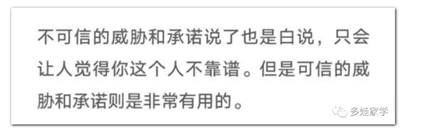

答：这句是鸡汤，没有细节。怎么样才能证明你的威胁是可信的呢，小流氓就一定要砸碎你的玻璃窗。

*141–150*

问：做老板的能力 T-1 是利益分配么？还是其他什么？可以提示下么？

答：不是。很大一块，是视野。

问：“夸夸群”的流行，体现了一种什么样的社会思潮？后面 t-1 的经济原理是什么？

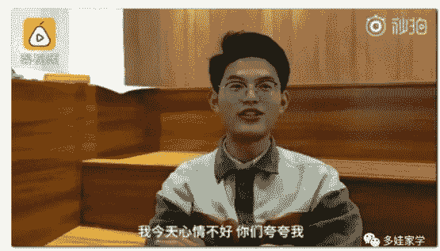

答：佛系啊。

问：请问你喜欢吹嘘夸大自己的财富和实力这个后面的T-1是什么呢？如果一个人的朋友都在a8.5这个水平，那这个人财富的上限大约是多少呢？

答：《格调》（上）（关注多娃家学公众号，查看今日次条推文）。朋友一般都很准了，如果还不准，可以看看他的对手。

问：房产t控的t-1是因为白左，还是因为利益？

答：利益

问：经济学第一定律dt>0，郭嘉高层没人懂经济学？限购限贷这么做是想安抚丝瓜？t-1是什么，是真没人懂经济学还是背后有更深层次的意义？

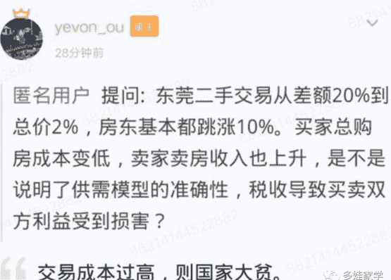

答：R>T，有些人想抢j，深入骨髓。

更多独家绝密资源加微信tushu959课程学习官网: https://s.wsxc.cn/xK0Qqd

问：政府做效率一定不如私人(或者说计划一定做不过市场)的 T-1 是什么？是因为产权吗？是因为未来太复杂无法计算吗？还是都不对？

答：花别人钱不心疼。

问：转向服务业的 T-1 是什么？您是不建议转行做二手房中介吗，为什么？

# 匿名用户

大，农村进城小屌丝一枚，普通本科，北漂，城市无根基29岁年入不到20万，建筑行业相关暖通空调专业，以前眼界浅拿考证当上升阶梯，耽误了几年青春，入库后放弃，18年跟水库大军买了几套沈阳一手，已无现金，xyk已开发40万未用，xyd未开发。请问：1、城镇化率已到60%，建筑行业及相关专业不可能再有起色了，行业萎缩会造成从业人员踩踏（现在应该正在发生），就算活下来也活不好，应该尽早改行，换条赛道，正确否？2、如果正确，应该转向哪里？转二手房中介等成熟些再转管家公司可以吗？不怕苦累，只求看到出头的希望，望指点迷津，谢谢！

yevon_ou 2019/3/6 00:03

答：《论工业革命与市场经济》（关注多娃家学公众号，查看今日次条推文）。未来属于服务业，严格点说，属于动脑子的人。

问：吕雉他老爸为何能在刘邦还是屌丝时就看出这人有潜力呢？是什么品质让吕老爹看上刘流氓？吕老爹会识人的 T-1 是什么？

答：那二女儿为什么嫁个匹夫？吹呗。

问：父母不相信子女的话 T-1 是啥？老年客户用我的产品晚上起夜由两次减为一次，我父母现在是两次，建议他们用说啥也不用，说就是不信我的，辩证上年纪了都这样。其他事例也是，同样的道理事情，别人说就信，我说就不信。是老年人的自尊？为了给多军省钱？

答：不是。为了维护“父权”体系的权威，他就是要否决你。显示话语权。

问：一直以来的看你的文章，同样一个事情，即使非常复杂，总感觉你说的就更容易让人理解，这里面有什么特殊的 T-1 技能透露吗？其中一点应该是，你确实对很多事情想得比较透，但我发现**很多人想得清楚但也解释不好**。

答：那是因为很多人，根本就是胡说。东拼西凑几千个字，把新闻罗列一下，其实作者自己都没有搞懂。

151-160

问：以前欧洲如果死了很多 人，也就是等人口自己恢复。现在为什么要引入移民？T-1 是什么道理？

答：老年人不肯降低生活水准，想要廉价的佣人。白左病呗。你想想没有外国怎么办。

问：需要跪银行的 T-1 是因为银行业是严重管制的行业吧？假如 jin 荣服务完全自由市场开放，应该是银行跪客户吧。

答：对的。对的，给高利率即可。

问： 为什么关注点也是钱？眼球也是钱？T-1 是什么呢？

答：我以前认为，广告的转化率为 0%，这么傻的广告，谁会买呢。后来才知道，大概是 1.3%，就靠这一点点转化率，撑起了整个行业……

问：一家公司管理员工上一个人的活宁愿给 3 个人干给低 3 个工资，也不愿意给一个人干给高工资。说是怕高工资的养久了欲望强烈容易出走，便宜的人走了也容易替换。可是 3 个便宜的人工位各方面费用成本远远大于一个高工资的成本，而且业务还做的烂。对方我的合伙人 bat 中层管理背景，被原来的企业文化洗脑的厉害，我一直没找到 t-1 能强有力说服他的理由

答：因为精英很难补充。业务的持续性，鲁棒性，更重要。属于不追求效率，但绝对不可以停机的行业类型。

问：叛逆期的 t-1 是否不懂生存的挑战何在？

答：积怨已久，小时候无力反抗。

问：你说经济学是社会科学的 T-1，经济学能解释近代民族国家的兴起和亨廷顿提出的文明的冲突吗？

答：见《论平等，自由，博爱》卷（关注多娃家学公众号，查看今日次条推文）。

问：既然你也觉得教育如此腐败，本科如此不值钱，我们孩子一直沿着这条路走的 T-1 是为何？可能是在 tg 掌心下，都得按他的套路出牌吧，好比如 tg 制定了游戏规则，有学历可以入户，我们拥有 fp，有学历，办卡额度高，我们拥有资金……

更多独家绝密资源加微信 tushu959 课程学习官网: https://s.vsxc.cn/xKOQd

答：低成本混个本科够了。本科还是要的。高成本，大投资“教育”，请免了。

问：极度厌恶风险背后的 T-1 是不愿意承担责任吗？

yevon_au 楼主 11小时前

匿名用户 提问：晚上和老公唠贷款买房的事又谈崩了，一个年入税后200万的人，会因为我贷款300万觉得影响他生活质量了，一个金融精英，明白通胀也明白货币超发，就是不肯举债，我们别说负现金流，离需要考虑月供的程度都没到，这到底是什么脑回路，到底在担心什么。大半夜气的不行。

他不想承担任何责任。

极度的风险厌恶型，和从小性格有关。不愿意承担任何责任。

你以后生病了，也别指望他照顾你。多娃家学

答：对的。承担责任，就有风险。不担责任，就没有风险。自私的人，不愿意付出。

问：家里满月酒，父母请了 58 家人家，大约 20 桌人。但是实际上，我认识的也就是舅舅姑姑大姨叔叔那大约 8 家人家的样子，和父母同辈人的那批，而爷爷奶奶他们的亲戚大都不认识了。

想问：

- 1.以前维持这么庞大的亲戚 T-1 是为了什么？
- 2.现在是是不是越来越没有必要维持那么大的亲戚群了？特别是借钱，找银行是不是更方便了。
- 3.这种庞大的亲戚群，未来是不是消失了？

**答：械斗。没必要。消失，重新崛起。**

问：坐标渔村，请问把所有银行的借记卡全部办理下来的 T-1 是什么？1 以后方便还信用卡？2 未来卡多了可能不好办下来？3 为以后在本行申卡做准备？

**答：不要问了，让你办你就办。**

有群友分享了一篇关于父母陪伴的文章，我刚好趁机抛出我的疑惑：古代帝王之子或者权臣之子，基本没有父亲陪伴，也很少母亲陪伴，他们的人格应该怎么样去解析？帝王术之类的家学对普通人的意义是什么？群友木的回答让我沉思：“能 s 死自己父母的人，能 s 死自己孩子的人，能 s 死自己兄弟姐妹的人，能灭族，能油烹，能车裂，能扒皮，真的要帝王谈人格么，重要么。我很早就接受自己是个很普通的普通人了，好也好不好到哪里。更惨的是，坏也坏不到哪里。”似乎有点明白欧大的一个回答：人到 40 岁，必须明白的 T-1 是哪几条？答：你父母不是超人，你不是超人，你孩子也不是超人。

161-170

问：随着 N 个平台上都成为大 V 之后，信息爆炸惹！如何有效过滤不重要的信息？T-1 的思想是啥呢？

答：信息的筛选和处理，本身就是一门大生意。甚至是唯一的生意。未来社会，有可能拿 99% 的精力，来进行熵减。因此你这个问题，不可能有“简单”的解决方案的。搞不定是一定的。

问：你信风水吗？风水 T-1 的原理是？

答：不信 山清水秀，住得舒服。

问：有些人道貌岸然的，看着难受，更难受的是，看着他骗了不少人，或者放任有关系的一些人作恶，放任另一些人生死。

这种人如果复杂一些还好，稍微一道貌岸然就很恶心。这有t-1的解释嘛？

答：为什么有人吃这套呢。关键还是教育的错。

问：现在大龄剩女越来越多，t-1是什么呢？yi夫yi妻制？还是三观不正？

答：yi夫yi妻制。

问：总有一天，大户型会比小户型卖的贵请问t-1是什么原理，生育放开？改善需求？

答：人的欲望持续增长，没有人喜欢一辈子住在小房子里。

问：炒菜还能赚钱的t-1是科学尚未普及吗？

答：是的。

问：一直有类似的问题：一旦普遍人懂得CF的T-1，是不是就是疯狂阶段了？假想身边的朋友如果哪天都是库友了，岂不是完蛋了？平时根本没法和身边朋友聊起水库种种，信则信，不信则无。您怎么看？

答：穷人总觉得自己一变坏就有钱。跪银行有多难，你知道么。

问：链家一边搞贝壳大平台，一边启用德佑等加盟，裁判员、运动员都做了，未来有前景吗？T-1呢？

答：没戏，死棋改编还是死。

171-180

问：你说过要多交际吗，T-1是什么？

答：没说过。社交同样需要成本，无差别人类体力劳动。

问：中华民族绵延至今的 T-1 是什么呢？

答：运气。

问：个人感觉是概念迷糊和近代中国人强行制造的概念。不管被灭国被混血多少次，人种被改变了多少，近代人都认为那些古代人是中华民族。但古代人自己不见得认同。

答：DNA 检测，中国人高度纯洁。和 3000 年前安阳出土的古人，几乎完全直系。其实有一个很大的问题，其他民族生存力不如汉人。例如罗马和日耳曼人共处以后，是罗马人被淘汰，人数越来越少。但是汉族和少数民族杂处之处，少数民族喝酒。不爱工作，不维护家庭。最终是少数民族几代人之间被淘汰。例如满人，甚至蒙古人，进入北京之后迅速地贫困化。蒙古人花光了所有的金钱，直至卖身为奴。这一类的现象，都没有深入研究。

问：在公司混，和同事，上级沟通的 t-1 是什么规律？

答：是什么级别说什么话。

问：你对中国的酒桌文化怎么看，为何有些生意在酒桌上才能成？这里 T-1 是什么？

答：如果是国企和国企做生意，则利润价格就不是最重要的。交朋友，拉山头，确定人际高低，才是礼仪核心。南方市场话，就很少需要喝酒。能谈钱的事，干嘛谈酒呢。

问：白左最喜欢拿这些说事，小弟基础知识不够，求问这两个谎言的 T-1 是？（BJ 雾霾这不是真真实实的么，还有饮用水污染的问题）

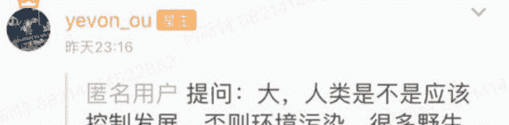

匿名用户 提问：大，人类是不是应该控制发展，否则环境污染，很多野生动物被吃光，温室效应，弊端太多了。

环境污染和温室效应，都是谎言。

地球上人类访问过的土地，只有15.9%

答：人类居住的，只是地球很小一块面积。污染就污染了，大不了换块地皮住。全球在变冷。

问：培训公司的 t-1 是不是吹牛 B+割韭菜？

答：流量，流量是一切。名师+官方教授背景+吹。

问：为什么你敢于放出批评和扒皮？什么样的负面扒皮才是致命的，什么无关紧要？胸怀宽广的 t-1 是什么？

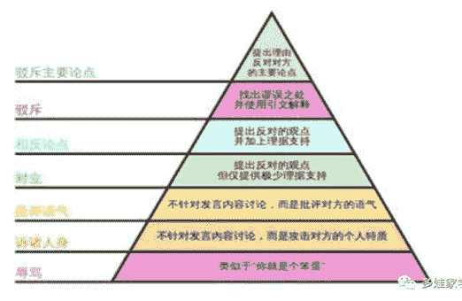

问：你为什么那么推崇孝道。据历史来看，很多有成就的人根本就不履行孝道，为了利益弑父杀兄（比如李世民），可没人谴责。普通老百姓对父母稍微有点不满，就会上纲上线到不孝的谴责，t-1 是什么原因

答：我没有推崇孝道。孝的本质，见《论儒·法·禅宗·基督教自治及道教的复兴（三）——法·禅宗#F10》（可关注多娃家学公众号，查看今日次条推文）。

问：接上面孝道的问题，我深入思考了下，孝道的t-1是什么呢？自从我做了父母后，我就看穿了那些"留守孤寡老人儿女不孝的"假新闻，因为我无比坚信，将来我老了，如果孤寡，虽然自己心里不好受，但我也绝不会主动成为孩子的羁绊的，我相信有我这样想法的父母肯定不在少数。所以，我猜想，孝道是人类远古部落时期遗留的风俗，远古老人在失去采摘和打猎能力后，但积累了很多经验，所以小辈需要尽孝来换取这些宝贵的经验，比如哪片果子好吃，哪的野猪出没更多，还有一些秘密技巧等，要不然按照"效率=正义"的理论，这些老人就该被抛弃到山洞自生自灭了，而现代社会，教育的普及，机器的发展，使得现代老年人从全社会效率角度看，基本是纯负债了。

答：为了你晚年的生活，你年轻时拼命储蓄工作。合理的。

> 181-190

问：销售陌生拜访的 t-1 是什么？

答：10 秒之内，说出你对客户的价值。

问：奥派者逼迫伴侣信仰奥派的行为并不是奥派，因为奥派的 T-1 是不干涉。所以当伴侣死不接受后，真正的奥派要么分手，要么接受并容忍之。不分手也不容忍异端思想，老是跟伴侣吵吵，鄙视其愚蠢的左派思维，实际上也是犯了白左那一套的老毛病。对吧，反省自身小结，望诸道友引以为鉴，

答：我当然有权唠唠叨叨。我不强迫你，可是我我可以挤兑你。

问：做律师的 t-1 是什么？

答：搞定法院。

问：和贵人相处的 t-1 是什么？贵人如何才能介绍你进入更高圈子？

答：提供价值。有钱人不是为了提拔你而出现的。

问：历史上“以少胜多”的战争的 t-1 是什么？

答：以正胜，以奇合。豪赌赌中。

问：首先西岗我也参与了。您去西岗的 t-1 是因为，国内增速未来会缓慢，你在找更高速效率更高的投资渠道，这样理解对吗？

答：不是。因为项目好。

问：米塞斯说经济学的公理是：“人的行动皆有目的”。这个是先验的，不需要证明的，其他的经济学原理都是在这个基础上通过演绎推导出来的，这就是经济学的 T-1 逻辑吗？

答：更底层的是，“适者生存”。

问：工作上积极主动好么？t-1 是什么呢？

答：工资对你重要么？

191~200

问：经济越来越差，但是周围的同学都赚的越来越多，买房买车生娃，过得越来越好啊，T-1 是因为通 z 吗？

答：是的。

问：请别人办 xyk，别人同意给你办的 T-1 逻辑是什么？必尽现在这个社会人人缺钱，如果想到办信用卡，办了都自己用吧？

答：总有人情。总有中老年人。

问：各种交通意外，人生厄运，飞来横祸的 t-1 层原理是什么？普通人怎样最大程度避免？

答：概率论，多拜佛。

问：如何学您的思维, 在水库大半年了, 感觉学会了一些方法见解，但是遇到独立的新事物，自己还无法独立像欧大这样分析事物 t-1, 担心自己几年之后，没水库会慢慢迷茫，感觉圈里朋友都差不多吧，真正能完整传承您思维的人真不多。就像西港项目都是只会跟随，自己是分析不出所以然来的。能说说您自己当初是如何形成这样思维的吗？您是否有启蒙的书籍渠道？

答：我花了很多年。

问：公司管理和 zf 管理的 T-1 是啥？

答：熵减少。

问：为什么我转你的公众号文章给身边人看他们一个也不肯看？说一大堆反驳的道理出来。而网上各种社群认识的转给他们却都如获至宝？T-1 是什么？

答：不愿意跨出舒适区。

问：几天不看小密圈，发现有很多 andy 刘、臭鞋幂、夹春卷的八卦，这些都是真的吗？联系到陈冠希艳照门，该圈真有这么乱吗？T-1 是？

答：真的。戏者，妓也。本身行业底线就低。另外一方面，一个 20 岁的女子，唯一的筹码是自己的身体。凭什么你成为千万人大明星。Joey 和濂比试，老板捧谁，祖儿夹断，于是大胜。

问：辩证唯物主义的 t-1 是什么？

答：就是他说算了。

# *201-210*

更多独家绝密资源加微信 tushu959 课程学习官网: https://s.wsxc.cn/xK0Qqd

问：那为什么经常听老人言说什么哪里的大老板,祖上建了个坟,所以风水好,益到后代,或者是 gaoguan 迷信风水,怎么会有这种风气？背后 t-1 是什么？

答：所以呢, 这辈子不成功, 不是他的错。

问：看了一年水库星球,渐渐懂了 t-1 原理,反而不快乐了,欲望越来越大。突然觉得无欲无求的。SB 挺快乐的。您通过什么娱乐活动,快了起来呢？

答：海底捞。

问：育儿的 t-1 是什么？如何才能让孩子成材？

答：欲望, 苦难/折磨。

问：写作能力提高的 t-1 是什么？如何才能做到想你这样文笔优美的

答：说人话。

问：个人炒莱是通过增加负债：

- 1.那房地产公司的 T-1 规则是什么？
- 2.看到 Top30 的地厂公司基本上都是 80%左右的负债率,地产公司的核心也是增加负债吗？
- 3.你认为房地产公司的核心岗位是那个？营销, 还是财务融资, 或者是其他。

答：因为 LVAT 的限制, 地产商其实是不能囤地的。因此主要的流派, 就是高周转, 高扩张。拿地, 建设, 营销, 三大主要岗位。

问：职场（非公务员）的 t-1 是什么？

答：出售时间劳力。

问：计谋的 t-1 是啥？

答：专用件胜过通用件。例如埋伏

问：难做重要选择，犹犹豫豫的 t-1 是因为不知道想放弃 A 获得 B，或者放弃 B 获得 A，内心是想两者都要的，但是现实不可能？

答：T-1 是什么也不愿意放弃。

问：戴威成老赖，小黄是彻底黄了。T-1：是不是因为一票否决权！滴滴，啊里，戴威都有一票否决权的权利，一旦各方没有达到预期利益都可动用一票否决，自然效率低下。

答：胡说八道。说得好像能并购，ofo 就有商业价值似的。

211-220

问：我们家目前算中产阶层吧！您说现在孩子的教育方法是应该向老辈子一样棒打出孝子还是现在最流行的弟子规教育？还是所谓的什么科学育儿保护孩子情商发展？哪个更适合中国的孩子？以后孩子能更有能力，更适应社会，更孝敬父母？更能提高阶层？

答：都不是。父母要看清这个社会 T-1，然后把脉络教给孩子。盲从任何一派都是错的。

## 问：您怎么看这个，T-1 的原理是：一个孩子成功与否 60% 取决于基因，30% 取决于 0-5 岁的培养，10% 取决于上学，读书，工作环境等。

**答：基因就是拼爹的意思。**

## 问：官员腐败的 T-1 是？到底对经济发展、社会发展好不好？

**答：千里做官只为财。本身就是成本核算的问题。第一流的北大学生，你不能只给他 8000 月薪。官僚机构的成本，远远超于民营。你不能用账面上的低工资来掩盖。**

## 问：我看了《将夜》的小说，想问您认为它好在哪里？这个书的 T-1 是什么？

**答：文笔好。构思也不错。**

## 问：请问国企里反复低效率开会，严重形式主义，不是踢皮球就是冷饭热炒讲废话的 T-1 是什么，强调先来后到等级尊卑吗？

**答：推卸责任。会议记录，集体负责。**

## 问：打架的 T-1 是什么，忍无可忍，求助库友。

**答：能打赢再打。**

## 问：人品的 T-1 是什么？看似人品很好的深交以后有摆你一道的时候。

**答：利益。**

## 问：好多微博 V 们都把你当敌人，背后的 T-1 是不是他们的名气不如你，你也从不反击他们，他们耍耍嘴皮蹭蹭流量而且还没什么损失？昨天跟一个好朋友聊起你，他说我是韭菜，被割了还不自知。我也就花 5000 多块钱，买一个一年可以随时咨询大神的机会，这样的好事去哪里找？普通人混职场别说花 5000 块，花 5 万块也找不到一个大神前辈可以对你一对一的指点啊？我的理解对不。希望水库er最后都A8,A9.西港项目红火，我们不是韭菜。

答：他们又没有信息。判断必然离题万里。

## 问：广告的 T 是为了获取眼球，那么 T-1 是为了抢夺自己的生存空间么？营销的和广告是不是趋近？

答：为了促进销量，为了带货啊。营销是 Pull，销售是 Push

## 221~230

## 问：海外华人无法在海外创业成功的 T-1 是啥？请问外贸是否一个好的方向，您怎么看。谢谢欧大指点迷津，现在在海外有个小生意遇到瓶颈。

答：不能融入主流社会，主要是白左的价值观，和华人越来越岔路。华人又不喜欢 LGBT 圣母。外贸做烂得不能再烂了。

## 问：知识可以碎片式？不是说要建立框架，记住 T-1 吗？另外时间可以碎片式，时间应该化整吧？

答：如果你同时涉足 20 个领域，那你的知识，无论如何一定是碎片化的。我长期以来，一直是 “百宝全书” 类型的人物。直到有一天，宛如熔炉，渐渐融会贯通。厚积薄发。

## 问：看到神对其他库友的指点，关于买完房不返租给原业主。背后 T-1 的风险侧重在 “清场” 难，而非产权纠纷。理解对吗？

答：对的。

## 问：请教工作选择问题：二线省会央企，年初从分公司跳槽到系统内部另一个子公司；现在 bj 的 hr 等职能部门内部招人，之前一直在前端做业务时间久了，想转后台，不用背指标；能去一线工作也不错。担心的点是：女，30 多了，一直琢磨做事情，恋爱经验特别少，没有确定对象，怕再这么折腾，更不好嫁；二是现在的团队领导刚提拔副职，人好、有能力，也比较护下属，再换一个部门领导，虽认识，要重新磨合，也担心现在缺人手，换过去现任领导心有不满；欧大怎么看，反正愿意做事情，不如做通潜在对象的工作，放开了直接过去，或者换人；还是考虑到体制内还是要站队，不如老老实实不折腾，结婚生娃，边工作边 cf？做这种选择的 T-1 是什么？

答：以婚姻为主，职场为辅。哪个岗位最适合你觅偶。

## 问：控制一个地区的 T-1 是什么？我们从汉朝就开始干涉西域，为何至今依然不稳定？

答：人口。西北太穷，缙绅不肯过去。人口留不住。

*注：原文中“縉绅”为繁体或异体字，此处根据上下文语境及常见用法修正为“缙绅”（指代士绅阶层），或者保留原意“缙绅/士绅”。考虑到OCR常将“缙”误识别，且原文语境讨论的是阶层，故修正。另外，原OCR中有一段关于秦国扩张的文本夹杂在问答之间，属于OCR错位或页脚/侧边栏内容，根据语义分析，这段文本（“秦国的扩张...”至“生在红旗...”）似乎是另一篇文章或笔记的片段，与周围的问答不连贯。但在任务要求中需“保留原文的所有信息，不要删减”，因此将其作为独立段落保留，但不强行合并到问答中，除非明显是同一主题。观察原文，这段文字出现在“答：人口...”之前，可能是上一题的补充或无关插入。鉴于其独立性，将其单独列出。*

秦国的扩张，是一个漫长而缓慢的过程。

“战国”时代，延续近250年。其中，仅秦昭襄王（芈月）执政，就超过55年。

秦始皇之前，“基本盘”的统治岁月，已经超过了整整三代人。

三代人是什么概念。

“遗老遗少”早已经死光。对前朝的忠诚，烟消云散。

生在红旗 下，长在红旗 下。都是忠实的子民。

## 问：如何提高口才？如何才能做到思路清晰，逻辑缜密，一针见血。有什么 T-1 规则吗？刚才看了刘国梁对乒乓球国家队 的训话，被其口才深深折服，下面的人都服服帖帖。这样的人才能 当乒协主席，除了球打的好，头脑和口才也非常厉害！

答：你对事物有极其极其深入的了解，才能脱口而出。否则，只能请托彩排了。

## 问：体制内管理的 T-1 是啥？是站队么，还是为别人着想。

答：站队。

## 问：喜欢待在舒适区，不大敢出去跟陌生人交际，交流，T-1 的原因是什么？怎么自救好？其实感觉自己也不算太差，就是习惯了整天研究买房子，如何买更多，所以这两年忽视了交际，感觉好没用。

答：房子赚到钱了没有。赚到钱就是英雄，怎么做都是品位。没赚到钱就是 loser，所有的品位都不对。

## 问：私企，制造业，快速发展壮大，利润高，未来选择努力上市（创业板）是否一般来讲是正道？争先恐后上市的 T-1 是什么呀？如何选择上市时机呢？

答：创业板的估值这么高。实业不赚钱，都等着套现呢。任何时候，能套现都是赚的。就是 IPO 排队太难。

## 问：爱情真的是伪概念吗？T-1 的逻辑是什么？

答：生存匹配互补。

## 231-240

## 问：如何将知识量压缩十倍？有什么方法或是技巧吗？我理解的是一篇文章只记核心内容，一件事压缩到三两句能概述清楚，只记关键点对吗

匿名用户 提问: 反复重复才能形成长期记忆, 好奇欧神海量知识是如何记忆的?

集中起来, 定期重复?

还是兴趣天赋, 一遍过?

> No, 压缩十倍

答: 只记忆 T-1 和推演过程。

## 问: 凡事要考虑成本, 教育也一样。我智商大概是前 1-2%, 媳妇 50%略靠后 (颜值好), 小女聪明伶俐, 但儿子 (12 岁) 智力和性格都很平庸, 小学成绩在 50%靠后。在高考难度很大的江苏, 如何在教育上适可而止? 感觉逼得太紧效果不好而代价太高, 比如性格扭曲, 近视, 损失了家庭亲子快乐等等, 不如给他留一些房产和安身立命的 T-1 的智慧? (我现在收入+炒菜, 6-7 年后 50 岁时应该有净 A8.4-8.5)

答: 战略优于战术。换城市, 天津。

## 问: 假如 2018 年, 我是 A9。多核子女 50 个, 年龄在 3-7 岁之间。这时, 教育这群子女的 T-1 原则方针是什么? 该如何思考这个问题?

答: 让他们从小一起长大, 紧密抱团, 互相支援。

## 问：麦肯锡的金字塔原理属于 T-1、T-2 的道理吗，值得一看吗？

**答：好像没这么神。**

## 问：自己是一个小部门主管，之前部门来新人，总会热衷给他们分享经验，带他们入行。最近心态变了，看着他们每天天真无邪，工作又不是特别努力上进，有时还出错，下班吃吃喝喝。想到这就按下了自己的教导之心。有两个疑问：

- 1 是自己认为神魔皆以血饲，你没付出，凭啥我要无缘无故教你？我这心态对吗？
- 2 是教新人经验这件事，教和不教，完全就是两种成长速度，为了让他们更好成长，我要不要主动教他们？从我自己的角度，我没想清楚“带新人”这个事情的意义和 T-1。

**答：对的。善良是一种重复博弈，图的是你的子孙。**

## 问：我们追求越多的房贷，越多的负债，那我去四线城市，拼命堆一堆的房贷，可是最终会死得很难看，T-1 是？

**答：人口流出。**

## 问：刚发现萨莉亚，干净便宜，菜色又丰富。人流大翻台率高，店内都和气气的。这个模式能持续，除了批量进货压低进价，还有什么原因吗？看起来比绝大多数西餐都成功。我都忍不住想搞清楚 T-1，然后自己开一家（当然不会！）。

**答：十几年了，萨莉亚还没倒啊。萨莉亚，豪享来，巴别塔，廉价西餐的代表啊。全国几百家店，平均效益没这么好。**

## 问: 每个城市玩法不同，重庆和沈阳最大的不同玩法在哪？城市玩法的 T-1 是啥？

答: CQ, 沈阳同生态位。构建以房贷为核心的资产组合包。

## 问: 你逐一分解收藏、股票、币圈都是庄家，有遇到有公司兜售某些拟上市公司的内部股票，请问我们如何判断各种赚钱机会靠谱不？投资的 T-1 的底层逻辑是什么？

答: 99.99%的投资，是亏损的。包括你定存银行。因为社会的平均回报率是负-12%，你要跑到正数，需要克服极大地心引力。

## 问: 越来越觉得人是由基因塑造，比如特别容易被情绪支配的人是不是主要是脑回路的问题，属于生理缺陷？有的女人相貌丑，作，脾气暴，控制欲强，小心眼，阴谋论+受迫妄想，烧香拜佛，迷信中药和瑜伽，还自我感觉良好……感觉所有这些症状的 T-1 是一样的，主要属于先天缺陷，无解。

答: 环境也会决定人的。例如从小在店铺帮忙。

## 241-250

## 问: 运气是人成功的很关键的一个环节。你觉得运气这东西有 T-1 的逻辑吗？

答: 所谓运气，无非你奋斗的的次数够多。

## 问: 假传万卷书，真传一句话。T-1 是什么？

答: 大道至简。

## 问: 底层逻辑是什么意思，T-1 是什么意思？

答：你高考做了几千道题。但是理清楚出题老师思路的话，50题就够了。

## 问：您对孩子不接受学校教育，自己在家教，怎么看？有这样的想法，T-1 的原理是因为什么？

答：教不好，不全面。学校家里结合更好。

## 问：演唱会认识了很多车友，但是聊了一段时间，发现好多人并没理解水库心法，但是已经目空一切了，言必 T-1，张嘴闭嘴就是底层逻辑，我就不明白了，装修买个花洒，T 减一万也没毛用啊，现在有点混乱是心法学不对，屌丝变成了自以为是的屌丝，还是我蠢，其实就是我心智未开还是 sb 啊？

答：战略高于细节。少林三流弟子胜过过海沙帮勤奋好手。

## 问：如何锻炼 T-1 的思维能力？

答：听别人怎么分析。T-1 就是“师”，你不会天天遇见名师。

## 问：品牌的 T-1 是什么？

答：降低甄别成本。

## 问：爱面子，在乎所谓的尊严。T-1 是什么啊？我思考的是争夺生存所在的等级，等级不同，获得的权利也不同。

答：熟人社区，零和博弈。“贱民”会受人欺负，死得很快，所以农民特别要面子。

## 问：大家普遍都见不得人好的 T-1 是啥？

答：农业时代，总量零和思维。

## 问：王家卫的《东邪西毒》里面，有个女人请张国荣杀一个人：张：“你出得起多少钱？”女人：“我家里很穷出不起什么钱1。只有一篮鸡蛋和一头驴2。这头驴是我娘生前留给我的嫁妆3。”1是假的就是谈判技巧，3是假的就是欺诈，是这样的吗？是的话为什么啊？区分二者的T-1是什么？

答：还有一些土地田契之类的我认为不算钱。

## 问：你对未来十年的影视行业发展怎么看？影视行业的T-1是什么？之前一直在这个行业里，未来为之奋斗是不是误入歧途？

答：未来肯定更多的电脑。但男女主角的收入，未会削减。配角演员难混。但程序员会赚钱。

## 问：一战的爆发有什么深层的原因吗？就是巧合加意外？

答：历史的必然。T-1是威廉二世比较蠢。T-2是德国的政体，威廉必然蠢。

## 问：大家普遍都见不得人好的 T-1 是啥？

答：农业时代，总量零和思维。

## 问：王家卫的《东邪西毒》里面，有个女人请张国荣杀一个人：张：“你出得起多少钱？”女人：“我家里很穷出不起什么钱1。只有一篮鸡蛋和一头驴2。这头驴是我娘生前留给我的嫁妆3。”1是假的就是谈判技巧，3是假的就是欺诈，是这样的吗？是的话为什么啊？区分二者的T-1是什么？

答：还有一些土地田契之类的我认为不算钱。

## 问：你对未来十年的影视行业发展怎么看？影视行业的T-1是什么？之前一直在这个行业里，未来为之奋斗是不是误入歧途？

答：未来肯定更多的电脑。但男女主角的收入，未必会削减。配角演员难混。但程序员会赚钱。

## 问：我特别苦恼。父母超级迷微信上的现在的一些项目。什么国家宝藏返钱啊，什么物联网项目啊，就觉得不用什么投入就能赚到钱。每天一堆不认识的人微信语音商讨如何运营一个微信群，统计个人资料到十一二点。开始我觉得过一段时间就好了，但是这都是半年了，一个项目结束还有另一个项目，而且他们是真信，真的相信！还动员亲戚参加，不参加就生气！这是为什么？倒底是因为生活太无聊还是因为穷？他俩退休金不少，加起来也一万了。我爸以前是领导，现在在组织里也是个领导，还指挥人家干活。我在想是不是不甘寂寞？麻烦您给分析下，倒底是因为穷还是因为想要当领导的满足感？还是想要能赚到钱而带来的满足感？T-1是什么？

答：穷啊，穷而且弱。穷弱贪都是孪生兄弟，一环套一环的。他管他的钱，你管你的钱。别把你套进去就行了。

## 问：生存竞争的压力，会是工业革命先在英伦发生的T-1么？同理，游牧民族对农耕民族，也存在生存压力，所以才进化快吧？

答:游牧民族那个鸟样,哪里发展快了。全世界游牧民族都快被淘汰了。英国生存压力也不大。大的是波兰。(海边的卡夫卡:欧大您错了,辽金元清可是入主中原的哦。yevon_ou回:游牧民族只能盘踞主场,脱离了主场就是渣。)

## 问:零售业的T-1是啥?如何看待这个行业未来的发展?

答:端处理。100000种SKU*1000000个客户,海量处理。(Lily•吕舒禾:多sku如何有效控制库存率呢。yevon_ou回:收SKU费)

## 问:在微博上看到了一个词“下d人”,在您看来什么样的人属于下d人啊?下d人的T-1是什么?

答:关键看速度。极速上升:上d人。缓慢上升:上进人。不降不升:人。缓慢下降:懒人。极速下降:下d人。

## 问:不是降维打击吗?怎么不能照搬了呢?

# 人文学会

如果要去外省投资房地产，不是不可以。但切莫照搬北京上海的例子。

我们要时时刻刻记着，只有人潮集聚的地方，产业集聚的地方，房子才能卖得超过1500元/m²，产生“钢筋水泥”溢价。

否则，哪怕GDP高如日本，人口稠密如日本，越前越後，备前备后，很多土地也是空置着，房子白送人都没人要。

只有大城市，才有房地产。

（yevon_ou，2013年3月10日午）

答：先想通 T-1，再根据变量不同，重新算 T。

## 问：肌肉记忆的技能有 T-1 的原理吗？比如乐器，书法，怎么可以更快掌握？

答：非我所长。但 40年内，一定会有机器取代健身。

## 问：这种测身体健康情况的仪器，可信吗？T-1 是？

答：不可能比正规医院150元的检测效果好。

## 问：数字能量场是否真的存在？它是国学的一部分吗？它是如何演化而来，T-1是？

答：伪科学。数学没有能量。

## 问：有没有比较好的职场书或者小说推荐？想好好混职场，但是无家学传承，不知道如何找出真神拜码头，非常幼稚。一开始觉得来ทíนì问可能被嘲讽“上班不如炒房”，后来想想 T-1 应该想通。

答：这个非常非常难。系统工程，不是一本书可以教育的。上山还要学三年呢。

## 261-270

## 问：平时，尤其是上班时身边有不少这些人：无所事事、岁月静好、只有抱怨没有行动、贪小便宜、格局小大惊小怪的同事。该怎么相处呢？不交流就太离群了，交流又实在交流不出个啥，还要迁就？必须实践水库克勤克俭、寻找 T-1 啊。是我自我感觉太好了？太苦大仇深了？太牛角尖了？

答：远远地抛开她们几个身位。

## 问：鱼最难得是知道水的存在。水是指这个人周围 T-1 的逻辑吗？

答：不是。指破境（桃军师：不是意识到“逻辑”的存在，而是意识到“原来有不止一种逻辑存在”。建议参考《被辐射的大脑#X69》）。

## 问：您最近的评论股市文章“一语惊醒梦中人”，把我对股市最后的幻想都打破了……想了好久，记起您曾说：“赚钱的 T-1 是对手弱”（原话忘了），所以在任何市场上如果你的策略是透明的，总会有比你强的人利用你的漏洞来收割你……没有万事不移的财富，也没有万事不移的赚钱法门……生财之道无外乎：1）独门绝技，知道别人不知道的窍门。2）能树立壁垒，别人知道方法也复制不了。所以多军贵在互联网啊……您说对不对啊……

答：贵在互联网，贵在互联网。没有一劳永逸的事。

## 问：各种私募基金和投资管理公司的赚钱的 T-1 是什么呀？家里做生意赚了 8.5 总想去找私募投资。我总觉得对平头百姓来说是割韭菜用的。

答：就是割你啊。赚 LP 的钱，而不是业务的钱。

## 问：演讲比赛 T-1 是啥？

答：评委。

## 问：好像发现很多 gaoguan 都是副教授或者院长， T-1 是什么？

答：学院院长，一般是安置退休高官的。你逻辑反了。

## 问：在公众号上看到这个，海洋被污染，轮船多坐， T-1 的逻辑是 d1>0？有了更多的交易，会使轮船变的更环保节能？

答：地球为人类服务，而不是人类为地球服务。为了保护地球而不发展工业，岂不是削足适履。（桃军师：环保是门大生意，不然谁买给你过滤器和“环保能源”赚钱？谁拿“碳排放量”掐你脖子，不许你发展工业？谁拿“PM2.5”煽动民意，指责zf过错？穹顶之下，环保是张牌，人家拿这牌来打你而已。非洲大草原热带雨林最环保，那里的人光着身子钻木取火在石板上烤椰子虫吃）

## 问：SH当年闹北区并入静安区的T-1原因是什么？

答：上海地位下降，没资格那么多区。

## 271-280

## 问：一线二线为什么女多男少啊？T-1原理呢？

答：部分男性退化成背景。

## 问：为什么推荐前台销售类的工作？T-1的逻辑是什么？

答：钱多。

## 问：很多教育包括道德、善良之类，从小就认为是无条件的，应该这样。但凡事都是相对的有条件的呀，是故意这样教的吗？T-1规律是什么？

答：太复杂的内容你记不住。小学生就只能教简化版。

## 问：g企干不过民企的T-1是因为产权吗？产权的T-1又是什么？

答：因为辛苦干活，钱不进自己口袋。天下熙熙，皆为利往。

## 问：g 企不赚钱，还给 g 企优惠，其背后的 T-1 原理是听话吗？为何不投资有活力的民营经济啊？

答：g 企可以如臂使指。例如让电风扇厂，完全停工，生产零件。

## 问：您说选赛道比努力更重要，那您相信佛学吗？佛学今生修行为了来世超脱出六道轮回，是否跟我们现世的追求相比是更高级的赛道和更普世的 T-1？

答：我是道教徒。

## 问：看了不少历史的文章，请教一个问题，如果不合适可以不回答。为什么我们历史上出现多次政策反复呢？其 T-1 的逻辑是什么？

答：因为其他王朝，也反复出现政策反复。例如汉高祖，汉惠帝，文帝，景帝，武帝，昭帝，宣帝，成帝。每一代的政策完全不同。其改头换面的程度，完全不亚于 2010 年。你觉得 2000年封建王朝，好像是同一个面孔，那是你历史学得多少。

## 问：崇祯在你眼里，你觉得他本励精图治，最终失败的 T-1 是什么？是大明病人膏盲，无力回天？还是崇祯刚愎自用，滥杀无辜？如果你穿越附身崇祯，你可以阻止大明灭亡吗？

答：每一个自私的人，都以为自己付出很多的。付出不是看你每天加班多少，而是看你牺牲什么。

## 问：我在 yang 企上班，很多同事都八面玲珑，所谓情商高，但也没捞到大的，要成功最重要还是自身牛 x，情商高只是润滑剂对吧！T-1 规律是什么啊？

**答：赛道最重要，战略高于战术。**

## 问：一战的爆发有什么深层的原因吗？就是巧合加意外？

**答：历史的必然。T-1 是威廉二世比较蠢。T-2 是德国的政体，威廉必然蠢。**

## 问：教做作业 t-1 是什么？苦不堪言。

**答：你自己都没学懂，怎么教小孩子。你以为的懂，其实不是懂。**

## 问：感觉 t-1 这个思维方式了不得，但我还是没有彻底弄明白。

**答：水到渠成。（周秦汉 ：什么事情都要总结出规律）**

## 问：不是说脑子越用越聪明吗？你有没有遇到我这种情况，就是经常思考解决各种问题，然后 N 了很多套之后，现在要记各种东西，算各种各样的帐，每种都要计算怎么巧妙运作，待人接物都要巧妙灵活，导致感觉现在脑子好像一来很多碎片记忆，二来到事时，立刻思考解决，脑子反而有种很累的趋势，就是懒的思考了，你有过我这种情况吗？你怎么解决，谢谢。

**答：T-1 的脉络整理出来了没有。**

## 问：什么叫为学日益，为道日损？

**答：如图。为道日损，就是直指核心，直指 T-1。（龙 ："为学日益，为道日损，损之又损，以至于无为，无为而无不为。取天下常以无事，及其有事，不足以取天下。"）**

### 译文

“为学日益”，什么叫学问？学问是靠知识、读书、经验，一点一滴慢慢累积起来的。今天懂一点，明天再懂一点，后天又懂一点，多一分努力就多一分的收获，这就是做学问。人为的学问是有为法，是有为之道，要慢慢累积增加起来，不是一步登天。

“为道日损”、学道与做学问相反，是要丢掉，“日损就是一天丢一点，明天一点，什么都要放下丢掉。修道的人常笑自己，一方面有欲望学道，一方面又不肯放弃读书，爱读书就是最大的欲望。”

## 问：财不人急门的 T-1 是什么？赚快钱难道也是错的？

**答：天下哪有赚快钱的生意。只有“赚快钱，高风险”的生意。**

## 问：习惯损失的 t-1 是什么呢？

**答：时间有限。**

## 问：观察了罗湖一家餐厅的老板，他请了八个员工，生意是不错，不过店面不大，最多 80-100，还要除掉厨房厕所，卖快餐汤河粉之类，每次都坐满，20 多个人的位子，感觉他好辛苦，哪怕生意好，也赚不了什么钱吧？我其实一直想问你为什么 cf 会又轻松而且利润高，背后 T-1 原理是？好像现在在民智很多人都开了吧，很多人都知道买 fang 了？竞争力大了吧？

**答：有吗。你跑到马路上，大喊一声，“炒菜光荣”？**

## 问：下面理解对吗？男找女 T-1 繁衍，女找男 T-1 安全感、不孤独。

**答：女找男 T-1，也是繁衍。**

## 问：发现一个很有意思的现象，人群总喜欢按照一些异同点，划分出 “你们 “和 “我们 “，地图炮、地域歧视、xx 省的人如何如何是最常见的表现。奇葩的是今天在高铁上听到有人侃侃而谈，他所在的张村和隔壁的李村都能说出云泥之别，优越感爆棚。好奇为什么很多人都会这样，t-1 是什么逻辑，是一种塑造共识的生存策略吗？

**答：歧视的本质，是信息成本。你不能关注到 h 南人身上的其他信息，就只能用 “h南” 标签。例如很多公司，要求能到王者钻石等级，说明脑子好。**

## 问：出生偏僻农村，谁家男人多就蛮横霸道，我家人少，凡事忍让，委屈求和。再加上我是女孩，从小不被重视，不敢提要求，渐渐养成包子性格。工作最开始几年，被同事欺负，忍气吞声，后渐反抗，发现那些人本质多欺软怕硬，你一强硬点，他们就缩了。现在遇到问题，一是不知何时该反抗，何时该一笑而过，不想整天为这些事纠结，但有时又不爽。二是反抗时如何做到有理有利有节。开始忍着，对方得寸进尺，最后实在火大，脑子一热，怕做出出格的事。处理以上这些有什么 T-1 的原则标准吗？

**答：实力是一切的基础。你要自己有钱，不靠他们吃饭，那随便怎么发脾气都可以。先赚 500w，然后拿二个气包练手。**

## 问：其实不愿意结婚生子和不肯看房买房，本质是一样的对吧。都是不作为，逃避。有的人可以看房 200 套，却不愿意看人 200 位。有人愿意生娃 3、4 个，却不愿意赚钱养家。真正的强者，如欧神，有房有娃。我说的对吗

**答：强者永远强。弱者永远弱。因为 T-1 是勤勉。**

## 问：看了灼识先生关于明朝灭亡的论述，结合欧大那篇《大学生为什么不给官做了 #F1825》（可关注多娃家学公众号，查看今日次条推文 ）的文章，对明末的情况又有了更深层次的了解，相比于当年明月的明朝那些事，这就是妥妥的 T-1。经济真的是太神奇了。随着人类的发展，未来朝代的寿命有没有可能无限延长？

**答：800 年和 300 年有区别么。随着时代节奏的加快，事实上是越来越不稳。奥派承诺了一个寿命最长的办法。**

## 问：请问人类为什么会进化出爱情，爱情 t-1 原理是什么呢？

**答：人类没有进化出爱情。19 世纪之前，没有任何传世文档提到过爱情。“爱情”是 19 世纪发明的。（江帆 ：中国不是有四大爱情故事吗？yevon_ou 回：后世硬凑的）**

## 问：凡帝王家一开始都是体力好，智力情商高，但传到末代皇帝，要么体弱多病，要么智力情商能力不行。导致这个的 T-1 原理是什么？如何规避？普通老百姓家为什么不是如此？

**答：千金之子，坐不垂堂。就好比你现在不吃粗粮，其实是进化，而不是退化。**

## 问：管理学的 t-1 是什么该管什么该放吗？

**答：信息。信息完备，你才知道该奖励谁，惩罚谁。**

## 问：如果是一个 80 后的 50 后父母没本事，在体制内朝九晚五、安于现状了一辈子最后 a7.1（注：资产 7 位数，7.1 即 100 万）。父母对孩子倾其所有，非常的爱。but 他们几十年也没有想过好好奋斗为孩子多留下点财产。那么这个 80 后孩子应该如何正确看待父母、对待父母？这是一个很复杂的情感+理性的问题，求 t-1 解。

**答：很简单。无灾无残养你到 22 岁，至少可以得 80 分。你的目标是 A8.5（注：资产 8 位数，8.5 即 5000 万），父母无论留给你 7.1 还是 8.1，都是小钱。最多占 20 分。**

## 问：您一路走来，只有朋友没有敌人的 T-1 是什么，凯算敌人吗？

**答：奥派注重合作，dT>0 把蛋糕做大，而不是抢夺蛋糕。炒家多几个不要紧，市场无穷大。**

## 问：微信各种工作群，如果加工一下信息。1.微信对各行各业信息相当了解。（对手有个钉钉，不过影响力太小） 2.这些信息可以供鹅厂产业链使用。3.知道行业的软肋，可按需要定向爆破。求明示， 还是我想多了？ 鹅厂的阶层，有更高阶的 T-1 规则？

**答：除非网监要求，否则微信是不敢看群聊天记录的。告 s 他。**

## 问：专利会阻碍后来者，设立垄断门槛，但是没有专利的话，抄袭者真的对原创者没有伤害吗？小公司做个软件，瞬间被大公司 1:1 抄过去。历尽艰难开起来的餐馆，被后来者 1:1 山寨模仿。很难说的原创者没有损失。就算模仿者能扩大整个产品市场，也不一定是原创者所要的。所以反对专利 t-1 层面是两害取其轻？

**答：如果规模可以创造利润的话，市场上飞快所有公司都会合并。规模并不代表利润。关于大公司碾压小公司的说法，其实是谎言。任何稍微有 marketing 常识的人都知道，大公司反而是无法抄袭小公司的。因为“定位”。例如微信无法收购陌陌。**

## 问：老大，9岁，杠精，老二，两岁，戏精，之前一直以为自己肯定能一碗水端平的，最近越来越觉得自己有点偏心，请问这正常吗？父母偏心有什么 T-1 的原理在？

**答：正常，不偏心才是白左宣传。进化的有一条科技树，就是小孩子越来越可爱。**

## 问：其实社会科学也和自然科学一样，通过不断推演得出 t-n 的原则，就像牛一二三定律，麦克斯韦方程式一样，这些原则的原则才是社会运行的基本规律 而且也是环环相扣的，不容有一点错误，不然整个理论大厦会倒塌，记得您的文章里面有提过类似的观点而这推演的过程，是不断发现真相的过程，就和数学物理老师跟你推演的一样，只是因为社会科学因为 zz 的原因，不愿意把这些告诉你，所以才会有毒教育对吧？您是大概多大的时候发现这些 t-1 的呢？您说知识水平综合水平不高，但其实有些板块您也是关注的，麻烦推荐一些？

**答：对的。到现在仍在探索中，很多迷雾。历史。**

## 问：2019 年 1 月 1 日起社保由税务部门统一征收！这项政策的 T-1，T-0，T+1 是什么？对大家的影响在哪？

**答：提问接近无理。别整天 T-1，T，T+1，每一条回答都是珍贵无比的好吗。人世间的明灯。（注：部分回答删减）**

## 问：哥哥开一个小服装厂，每年累死累活的也就赚 30W，有时候，我想，我们随便几天淘算一套 30W 的算盘还不算升值就搞定了他一年的辛劳，每次想到这里，都觉得神奇，反思是 cf太暴 li，还是什么 T-1 的原因？

**答：炒菜污名化。名与利不可兼得。见《职业炒家（一）#130》。圣谛有一个看法，认为做企业有很多隐性的好处。也有道理的。**

## 问：桦杉总结企业三大定律：企业第一定律：科斯，交易成本定律；企业第二定律：德鲁克，社会职能定律；企业第三定律：熊彼特，创新利润定律。请问：经营企业有什么 t-1 原理？毕竟除了炒菜，还需要经营企业，毕竟爬上 A10 以上还是需要创业。

**答：企业就是创造利润的。每一个环节，都要有所增益。**

## 问：传统行业信息化的 T-1 是什么？

**答：降低信息处理成本。**

## 问：**人和人之间的信任感的 T-1 是什么？获取公司大领导信任的 T-1 又是什么？** 自认为是一个很真诚的人，工作上很有原则，不搞乱七八糟的套路，最近有些渠道政策方面的事，怕被人套路了背锅。给我一个我信任的大领导发微信求问建议和关键时，他没有回复，他给人感觉是站奥派的。另外，我是不是用力过猛了……

**答：节约合作成本。节约合作成本。领导为什么要免费帮你咨询？**

## 问：白左圣母心的 T-1 原理是什么？我们常看到电视剧里“青天大老爷的剧情”，欧美还有救世主，超级英雄的角色，可见人在骨子里是希望别人拯救自己的，大多数人渴望别人拯救自己，于是看到别人弱就发善心，是这个原理吗？

**答：自信寄生宿主永不倒，自然肆意妄为。就像娇惯大小姐一样。**

## 问：您看人准确、有远见。请问 T-1 的规律是啥？

**答：我看人不准。**

## 问：你说小孩学钢琴、演唱、朗诵、马术等，参加钢琴、朗诵等比赛是失败的投资。怎么才是成功的投资？吃喝玩乐与奥数？T-1 是什么？

**答：重要的不是宰相的抬头，而是宰相背后的势力。重要不是你学会了钢琴，而是钢琴代表的意义。否则你就是一个酒吧打杂的。**

## 问：现在好像得了“信息饥渴症”，手机上关注了很多优质的公众号和微博，每天都有大量的信息需要看；如果不看，自己又会陷入焦虑，担心自己会落伍。请问：每天这样大量阅读零散的信息文章有好处吗？有啥弊端？个性不喜欢出去交际应酬，也不喜欢打游戏。

**答：你融通 T-1 层之后，T 层的文章就可以不看了。就如同你不会去看儿童文学，故事会一样。**

## 问：创业的 T-1 是什么？

**答：没有中间商赚差价。（Mushroom：嗯，节省交易成本。yevon_ou 回：你帮公司赚 1000w，分到手可能不足 100w，主要是信息成本。）**

## 问：城市规划的 t-1 是啥？

**答：政府名下，哪里的空地最多（包括旧工厂拆迁）**

## 问：最近想两个人过日子的 t-1，其实也是习惯损失，吵架姿态低一点主动和好，其实就是损失点面子保全全家情绪积极向上？可以这样理解吗？

**答：“决策仲裁体系” 两个人中，谁说了算，这是 T-1。如果都想捏主意，那一定是火星撞地球。**

## 问：林则徐说的：“子孙若如我，留钱做什么？贤而多财，财损其志；子孙不如我，留钱做什么？愚而多财，益增其过。”请问 t-1 的原理是什么？是不是类似于“父母不需要你大富大贵只希望你健康快乐就好”，算白左吗？

**答：这句话是错的。是白左特意节选出来，给你洗脑的。**

## 问：婚姻幸福的 T-1 是什么？

**答：SOUL MATE（注：灵魂伴侣）**

## 问：不肯承认错误、承担责任的T-1是什么？做错事情会找借口，找别人的原因，不肯承认自己错了。

**答：因为以前他推诿，也被原谅了。从来没有独当一面。**

## 问：请问厚德载物的T-1是什么？

**答：重复博弈，善良是熟人圈技能。**

## 问：坐标某新区管委会，有一定的规划编制权，非常认同您的t-1理论。如果请您做规划土地顾问，给局级领导，甚至副部级领导提建议，您觉得可行否？

**答：没事提什么意见啊。你知道哪一天规划，是哪个领导定的。没事尽得罪人。没有三年考古，你都不敢发言。**

## 问：即使是z币时代，政府如果增加房产供应，大盘还是会崩？t-1层原因是因为现在的价很高了？

**答：全球就崩了香港，日本二次。**

## 问：想了很久没想通，气质的t-1是什么呢？

**答：有钱。**

## 问：虽然勤奋也异常重要，但在竞争中胜出的最根本的素质还是努力思考并发现各种t-1对不对？

**答：对的。**

## 问：最近职业困境，跪求职业规划指导：北京央企 3 级小单位员工，兢兢业业干了 7 年了，也确实得到领导赏识，但因单位级别确实太低，权利有限，领导再努力，对我的帮助也甚微，至今无户口，年收入全算上不到 10 万，燕郊一套房子有贷，明年有北京资格能买一套。像我这样，年过 30，二本毕业，专业面窄，社会协调能力尚可，跳槽后能做什么工作最合适？（按照您之前回复肯定是基本废了，但是毕竟才 30，也不想等死。我能吃苦，不怕累，真心想重新规划新的职业，吃苦加努力探索 T-1，哪怕比现在进步一点点也在所不辞）。

**答：在职场你任何努力，都不可能出头了。有拼劲，可以自己尝试做点小生意。但要准备第一次铁定破产，这路也不好走。还是买买外省房子，赚钱简单。**

## 问：自信的 t-1 是什么？对不是很懂的问题就不敢发表意见，但有的人不懂也能说好久，听者似乎并不追究对错。

**答：自信的背后是实力。讲很久有多种理由，原因。**

## 问：买房毕竟有资金门槛，那些缺乏起步资金的人过不到这门槛然后大呼不公平。其实这算不算不公平？如果算不公平，那怎样才算公平? t-1 道理是什么? 如果算公平, 这公平的 t-1 是什么?

**答: 美国可以造飞机芯片业, 你没有积累, 造不出芯片, 是不是不公平。别人爹在拼的时候, 你爹在干什么。**

## 问: 我和老公都是做技术, 不同的专业, 他的专业不景气想转行到我的专业, 就外面报了一个培训班, 但跟我从事的具体方向不同, 他也会问我技术问题, 我跟他讲了他听不懂, 就说我表达有问题, 我说可能我确实不适合做老师, 你跟培训老师好好学, 他就说“你学了这么久技术就这水平也太烂了, 我同学的几句话指点都很有帮助, 你还不如一个外人”。他抱怨我不重视他, 敷衍他。关键我每次回答他一个技术问题都被他贬低, 我没法好好跟他说, 很容易被他激怒。我有什么做的不对的地方吗?

**答: 要几句话指点方向, 必需透彻理解 T-1 也就是比他至少高一个档次。感觉你夫妻都很渣。专业居然是靠“培训班”就可以转的。直接说, “亲爱的, 你这么聪明, 你懂的比我都多了”。**

## 问: 怎么锻炼忍耐力? 我有想说的话立刻就憋不住要说, 哪怕心里很清楚现在不是最好的时机, 也会脱口而出。同时非常容易被激怒, 有什么改善的办法? 这个问题有 t-1 的原因吗?

**答: 不够痛呗。**

## 问：计谋的 t-1 是啥？

**答：世界观**

## 问：学区房是真实需求吗，T-1 是什么？

**答：傻妈妈比较好忽悠。（王馬丁：恐惧，因自己人生失败而对下一代的前途产生的恐惧。）**

## 问：有没有可能虽然小胜，却把美的打醒了，从此一路高歌猛进甩开我们？就像你写的楚汉之争时那样，判断能不能的 T-1 逻辑是什么？

**答：我为此写了《六国论》（注：全网已删）。**

《六国论》有五重递进，由“秦国”为什么会灭亡这个初中历史问题出发，层层深入地剖析，一副真实历史的画卷绚丽展开，不得不拍手惊叹。

**然而，还有。“但人类的认知是无限的。一直到今天，我才知道《六国论》错得有多厉害《六国论》写了五层，但五层之外，还有第六层。”是谓《楚汉争霸的真正主角》。**

## 问：知道 t-1 后，一切都是利益的交换，还会继续热爱生活吗？

**答：世上只有一种真正的勇敢，即知道世界的真相依然热爱生活。**

## 问：您说“就是蠢。冒充什么耿直。”那什么才是真正的耿直，T-1 是什么？

**答：知道生活的真相，依然努力地活下去。**

## 问：t-1 究竟怎么样理解呢？是 t 的思维发散还是 t 的浓缩总结呢？

**答：发散总结都是同层的。**

## 问：明白很多 t-1 原理后，越来越抑郁，胸闷，总觉得没能力给孩子们（3 个孩子妈妈，今年刚生的双胎）准备多几本产证，很对不起他们。甚至觉得没能力，就不该生！目前只有深圳 2 贵阴 1，想哭啊！

**答：加油，别人都能做到。**

## 问：学区房产生的阶层聚集效应您怎么看呢？买的起学区房的家庭条件以及对于子女教育培养的重视是不是也是学区房升值的 T-1 呢

**答：买学区房，一般都是无权无势的人。**

## 问：最近看到好几个帖子，都说自从开始入了水库、拼命炒菜，赚了一千万几千万的。但是觉得自己不快乐。我觉得超有同感的。倒不是赚到钱不快乐，而是感觉被 “欧氏思维” 好像洗过一遍脑子一样。看什么都自动去想 t-1，发现好多东西没意思，肤浅的快乐没了，肤浅的享受也不愉快了…… 比如，我一个女的，A8.N（注：资产 8 位数），一个夏天穿两双一模一样的凉鞋，单价 200 多块。穿旧一双扔一双。真是好羡慕小女生拍拍餐厅、拍拍甜点，买名牌包包化妆品就很快乐的心境呀。

**答：是啊是啊，那怎么办呢？**

## 问：组织能力的 t-1 是啥？

**答：全面的强。**

## 问：人不风流枉少年？这话有 T-1 吗？

**答：年轻拥有失败权。**

## 问：市场好于计划的 t-1 是因为产权吗？

**答：市场是 dT>0，计划是使用 b 力，强制 dT<0**

## 问：你说苦难是你成长的原因，但我觉得更大的原因是敏感，苦难谁都无法避免，但能从困难中吸取教训，寻找 t-1 的规律才是成长的根本，很多人吃苦再多也找不出原因，无法成长。今天看 bb 写的回忆录有感而发，欧大天赋异禀，祝一切顺利！

**答：-。（注：默认库友膜拜。王马丁：所有成功人士都刻意强调从前的苦难，是为了减轻别人对他的嫉妒，减少别人对他财产的眼红。）**

## 问：自己在个窄众市场深耕将近 20 年，积累一些人脉，最近有几个朋友分别找我想合作开猎头公司。因为自己一直打工，如果做这个考虑到和现在雇主的关系，需要辞职。其实自己也有单干的想法，因为打工轻松又能炒菜，一直没有行动。现在被人推动，不知是否可行，而且对于合伙开公司有些忌惮，求神点醒！又，猎头行业的 t-1 是什么？

**答：把你预期的营业额，砍掉 90%，你还有热情撑下去么。绝大多数创业梦，就是砍掉一个零。**

## 问：很多别人谈的国际重大事件，您根本不加关注，请问您怎么看出有些事才是重大事件，有些事如贸易战其实不值一提，背后的 t-1 是啥？

**答：（无对应回答，原文此处截止）**

## 343

**问：** 国之大，唯祀与戎。

**答：** 国之大，唯祀与戎。

## 344

**问：** 自从入了水库，跟随欧大开智，逐渐学会 T-1 思维后，再听周边的人闲聊或讨论国家政策、国际形势，真想送他们二字套餐啊，但还是强忍住了，跟他们辩论是纯负收益，但憋的是相当难受啊。

**答：** -。（注：无回答。Mon.：利用这个机会，刷贷 p，刷多核，是最佳良机。切记，第一次，不要灌输，不要秀肌肉，不要辩论。适当插话，发问为主，死装小白，引导他们顺着你的思路走，得出结论，你若有所思，总结他们的观点，加上自己的见解，完美~第二次可以适当秀肌肉了，3-4 次可刷到票或核。）

## 345

**问：** 这个世界的 T-1 是什么，是交换吗？

**答：** 你会讲语文么。“这个世界”后面的定语呢，世界的哪个方面。

## 346

**问：** 成为强者的 T-1 是啥？

**答：** 付费！（慧君：付出资源，代价。）

## 347

**问：** 获得权力和保持的 T-1 是啥？

**答：** 分威权，和代言人二种。

## 348

**问：** 给客户送礼物的 T-1 是什么？曝光机会？

**答：** 说明你这个人，注重未来的合作机会。

## 349

**问：** 生活中有的人很能搞定人，比如申请更好的贷款，找更好的工作。但自己一直被欺负，很难说服别人搞定别人。要搞定人或事的 T-1 的道理是什么？

**答：** 懒。遇败不行就退缩了，而不是克服困难。整个流程，其实拆解成一百个小困难。你一个都过不了。

**问：** 一语道破啊。除此之外，如果我很勤奋还是搞不定事情，原因是什么？没有掌握什么技巧么？

**答：** 没学会绕路。

## 350

**问：** 大娃女孩 7 岁，从小觉得特别漂亮聪明可爱活泼，对任何事物都新鲜好奇，与陌生人相处也非常活泼。小娃男孩，从小觉得长得一般就算了，男孩子毕竟不看颜值。但总感觉什么都慢一拍，尤其跟姐姐对比差距太大。学说话从小特别迟，现在 3 岁多了只会说常用的话，跟着读绘本只能读两个词语，读三个就跟不上。比如我读，塞尔跟着妈妈去山上采蓝莓。他只能说：去山上采蓝莓。父母都上班，白天奶奶一个人带。不喜欢和陌生人相处，到陌生环境就害怕要抱，一直坚决的说不想上幼儿园，打算 9 月份送。去医院看了说没有自闭症，但还是避免不了焦虑。

担心他的未来。有时候会焦虑的想要不要辞职照顾他，但没确凿理由说服家人和自己，家人说我瞎担心。

**答：** 纯属瞎操心。自闭症症状很明显的。智商越高，开悟越晚。因为他需要通盘理解 T-1。

**问：** 不止智商慢一拍，情商方面也有点奇特。从出生起，就厌恶别人（家人）亲近他，不管亲他，抱他，都是一脸嫌弃和推开。按理母乳喂养应该可以促进母子关系，可是他只有喝奶的时候要妈妈抱在怀里，喝完母乳，就一把推开妈妈，要单独放在床上睡觉。现在大了，可以亲我了，但有条件才行。比如，他要我讲绘本，我说很累没有力气讲，要亲一个才有力气。他就很勉强无奈的说，好吧！火速亲一个，然后说：有力气了，快点讲啊！小孩子们不应该都是从小很粘人的吗？

**答：** 没问题。伟人特质。

**问：** 接上一个圈友的问题，您说“智商越高，开悟越晚。因为他需要通盘理解 T-1”，我总觉得，苦难只是人生底色，是向上奋进的原动力，但对于普普通通的我们，经历的苦难再多，真正的顿悟也是极小概率的，幸运被高人指点才是最重要的吧？真正标志着一个人开悟的界限又是什么呢？

**答：** 知道自己是 SB。

## 351

**问：** 在得到上学到了好多知识，听着有道理的不得了，可就一条大部分和赚钱联系不上，时间一长又忘了大半，是我悟性太差还是犯了方向性错误，求老师指点迷津？

**答：** 把所有道理都忘光，只剩下 T-1。

## 352

**问：** 求明示，屌丝层该怎样教育子女。您说追求真正的知识，现如今我夫妻俩已是水库三观，那么对孩子应该如何投入？目前既没有追求学区房，也没有学英语学钢琴，只是简单熏陶。

**答：** 真正的 T-1，应该是简单清晰，而不是复杂繁琐。只有父母自己掌握 T-1，父母才能传授给子女啊。

## 353

**问：** 我对如何教养小孩产生了极大的怀疑。买学区房学钢琴考一本，然后五千块一个月，都是歧途。甚至多陪伴小孩，似乎也是歧途。应该赚钱，爬阶，用自己积累的优势，给孩子铺好路，然而有的工作对孩子并无帮助，否则祖师爷的先辈也不会留下“不当穷教书匠”的祖训了。所以要么跳出舒适区重新出发，要么教会孩子用 T-1 思考，才是最重要的财富吧？

**答：** 每个人的学习能力都是有限的。越是 T-1 的规则，越是精简。则学生单位时间学到的东西越多。

## 354

**问：** 很好奇您的可以称之为家学的不传外人之秘，是自己悟的更多还是家族传下来的更多，您能想明白这么多 T-1 的深层远因，真的是太厉害了~

**答：** 其实第一，第二个路标最宝贵。后面就容易推算了。

## 355

**问：** 你写的哪些篇章有利于提高 T-1 能力？或者那些书？可以推荐下吗？

**答：** 所有的文章，都是都围绕同一套思考体系。

## 356

**问：** 推荐本构建 T-1 思维的书？（注：2018.5.17 的提问）

**答：** 见《欧绅 5.16 朋友圈内容》。

“这个问答是 2018 年 5 月 17 号的，本来以为欧大早期的朋友圈可能没有什么人收录，没想到网络的力量如此强大，不到十分钟，我就搜索出来了欧大在 2018 年 5 月 16 号的朋友圈内容。”

## 欧神 5.16 朋友圈

**2018-05-16 水库论坛 2020 2018-05-17**

欧神 5.16 朋友圈，分享了 5 篇文章，1 张图片：

- **yevon_ou：**
  - 水
  - 美国的塔里木河是如何被榨干的？

- **yevon_ou：**
  - 非常好
  - 吸粉拉新的 3 大实操指南！错过它仿佛错过一个亿……

- **yevon_ou：**
  - 不就是屌丝情怀么
  - 大多中国人不懂美食

- **yevon_ou：**
  - 动物园
  - 如何通过玩数字游戏，把公众号卖 38 亿元？

- **yevon_ou：**
  - 知乎：O 编稿总结：由美国城市规划来看中美城市生活的区别（知乎链接，文章请在次文查看）

- **yevon_ou：**
  - 地产类第一名，全国 1000 名左右。符合预期

2018 年 05 月 14 日榜单排名

| 总榜 | 房产 |
| :--- | :--- |
| 550432 | 1863 |
| 1090 (-849342) | 1 (-1862) |

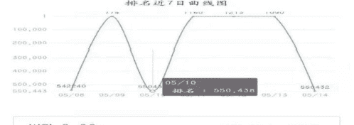

## 357

**问：** 在《中产就是接盘侠#F1750》（可关注多娃家学，查看今日次条推文）的文章留言中你的建议学习真正的知识，除 T-1 原理外，能否细化一下，能让我们有所实践。

**答：** 知识，怎么可能三言二语说清。

## 358

**问：** 每个广告我都点 了的，我保证。巧劲是不是我专注于 T-1 的思考和学习，然后多时间陪伴点滴中传递 T-1 思维，类似于古代富贵之家贴身教海家学，别浪费 时间金钱学钢琴英语那些鸡血妈妈热衷的项目？但我能力一般，职场也错过机会没大发展，贴身教海会不会误了自己的娃？

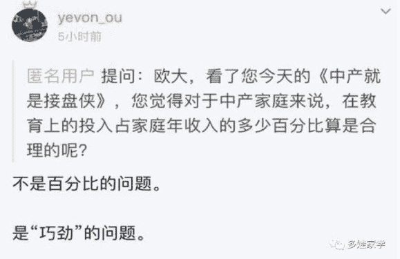

**答：** 初中语文，数学，教得并不得法。有一些方法，可以用小得多的精力，获得很好的成绩。

## 359

**问：** 人际交往的生息场，友情场，爱情场的 T-1 是什么？

**答：** 这么多 T-1 都是你问的么。思而不学则殆。利益。

## 360

**问：** 学而不思则罔，思而不学则殆。这句话怎么理解？学习不思考，没搞清楚 T-1 会迷惑，思考不学习怎么讲？

**答：** 整天问问题，不结合实践，无法领悟的。

## 361

**问：** 娃娃位的 T-1 是什么？爱情的 T-1 又是什么？

**答：** 繁衍。繁衍。

## 362

**问：** 你去过中国 150 个城市，一般每个城市待多久？具体考察每个城市一些什么方面？去过这么多城市，有些什么 T-1 的道理可以和库友分享呢？

**答：** 每个城市 2 天以上，否则不算。T-1 就多了。

## 363

**问：** 这两天有点窝火，恨不得抽自己几耳光。前天订了昨天一张京沪高铁票，结果昨天有事耽误未出行，想退票才发现半小时之内的高铁票不能退，损失五百多。今天订下午 3 点多的高铁票，结果磨磨蹭蹭发现自己有可能赶不上高铁，因为先前已改签过一次，于是只好退票，又损失一百多。以前比较自律，很少出现，现在好像放松很多。平常不爱动脑筋思考由来已久，这背后有什么 T-1 的原理？有什么好的建议吗？

**答：** 因为你开始忙了。忙了，就没有那么闲，把每件事情检查三遍。

## 364

**问：** 如何做流量生意，求指教 T-1。

**答：** 花钱买。

## 365

**问：** 房地产投资的 T-1 是啥？

**答：** 便宜。

## 366

**问：** 便宜容易涨的 T-1 是啥，收入有限？

**答：** 性价比的便宜，不是指绝对值便宜，崇明房子并不看好。

## 367

**问：** 道教的 T-1 是什么？

**答：** 对真理的不懈追求。

## 368

**问：** 水库线下团购的 T-1 的逻辑是什么呢？

**答：** 总有偷懒的人。

## 369

**问：** 地段扁平化的 T-1 是啥？

**答：** 交通改善。

## 370

**问：** 写了一年半的文章，公众号人气上不去，请问我该如何推广啊，人数卡在了 3000 人。求自媒体 T-1。

**答：** 说明你文笔不行，别写了。

## 371

**问：** Marketing 的 T-1 是啥？

**答：** 专用件，而不是通用件。

## 372

**问：** 发财的 T-1 是啥？

**答：** 渴望发财的心，有欲望才会去钻研，才肯放弃面子。

## 373

**问：** 管理学的 T-1 是什么？

**答：** 默认每一个人都是叛徒。

## 374

**问：** 管理学的 T-1 是诛心吗？

**答：** 劲往一处使，心往一处想。

## 375

**问：** T-1 层面，汇率是什么？

**答：** 边际价格。

## 376

**问：** 自律的 T-1 是什么？一块钱可以当时消费掉，也可以投资起来。

**答：** 贫穷啊。

## 377

**问：** 请教一个行业问题，也是个人职业方向问题。如今长租公寓各大开发商都在布局，各种互联网搞长租公寓的也融了几轮了。但我们都知道，目前都算不过帐来。这一波方向是赚未来的钱？还是瞎闹腾？我们公司大 boss 提出做长租公寓建筑设计、到室内、到家具软装一篮子整体服务供应商，新业务板块。也就是卖铲子。欧大，从 T-1 角度怎么看？这块新业务接还是躲呢？

**答：** 还行吧，利润还是正的。除非败家子式烧 VC。

## 378

**问：** 我再跟你确定一下我的理解，T-1 是不是问题的下一层？举例：我要去重庆买房。然后 T-1 就是：我为什么要到 cq 买房？T-2 是去 cq 买什么样的房？……T-99。如果不是，打我脸吧，继续回去复习……

**答：** 不是。T-1 是跨市场运作，T+1 才是买怎样的房。

## 379

**问：** 医疗大型设备销售，决策权在院长，求 T-1？

**答：** 你是药监局小舅子么。否则你的优点在哪里。

## 380

**问：** 麦肯锡的金字塔原理值得看么？有没有 BUG?

**答：** 就是 T-2，T-1 么。

## 381

**问：** 我想学习 marketing 思维，可否请大大推荐 T-1 的书或者学习途径呢？

**答：** 不传之秘。别整天问哪里可以买 25 元的破书，很 Low 的。真正的知识，都不在书上。

## 382

**问：** 你学知识是用记笔记的方式么还是用脑子强记？感觉那么多历史，记都记不完。指导一二，以便教姓。

**答：** 只记 T-1。（唯为：框架清晰了，知识就来了，也知道从哪里能学到知识。否则，那么多知识，认识怎么记得住啊！）

## 383

**问：** 在外地出差时无意中被带入水库，深深入迷，尤其喜欢各体系后的 T-1 原理及逻辑。然而回到所在城市，推荐给身边其他朋友同事亲人，却无一能看的下去，您觉得深深理解并喜欢水库理论的库友有什么共性？理工科生？

**答：** 至少，要大学文凭吧。

## 384

**问：** 请问您怎么评价吴恩？您的神魔皆以血饲有受他血酬观点影响吗？您认为从思想深度度上看他 nb 吗？和他差不多的见解者您觉得有哪一些呢？

**答：** 他是率先提出官场 T-1 原理的。（Mon：官场 T-1 是什么？zHoU-回复：血筹）

## 385

**问：** 您觉得一个男人需要做到喜怒哀乐不形于色，才是成熟吗？成熟到底可以为我们带来什么好处？成熟比幼稚更好的 T-1 原理是什么？

**答：** 如果你像一个巨婴一般，惊慌失措要求别人救你。你怎么独当一面，担当事情？无法做部门正职。

## 386

**问：** 有个小问题，您一方面很鄙夷做科研的研究人员，认为是屌丝 loser，升阶无望，一方面，我觉得您本人又是一个很爱钻研，研究事物本质，进而洞悉 T-1 规律的人，您觉得这两点矛盾吗？普通人，到底要不要选择研究性工作呢？还是只有您这样的天才人物可以选？

**答：** 钻研是为了赚钱。

## 387

**问：** 德鲁克开创了管理。管理的 T-1 是什么？一般来说，是不是随着公司越来越大，会越来越机构臃肿，做事成本越来越高。熵增，热量高，最后嗝，倒闭。

**答：** 这个话题太太太太大了。我认为管理最重要的是“淘汰”。

## 388

**问：** 朋友在一个小培训机构，学生重病家长（较底层）咬定是机构老师传染，大闹。虽然不要我解决，但不禁给自己出题，如果碰到类似问题除了极力跪舔安抚、叫老师一一去体检出证明，有无补充或代替办法？或底层 T-1 原理？想学习一点人生的经验。

**答：** 关键看教育局领导风向。一般家乡不敢这样闹，否则我每节课让你孩子立壁角。

## 389

**问：** 孩子动作特别慢，特别磨蹭，总爱追求完美，总爱迟到，这个毛病 T-1 层的原因道理是什么？怎么治？

**答：** 世界圈子太小。

## 390

**问：** 为什么对孩子教育您主张该打架打架，能量外放，对于成人反倒是忍辱负重，温和。这里面的 T-1 您是怎么考虑的？

**答：** 因为孩子其实并没有争夺利益。

Bill：3 岁、5 岁、8 岁、15 岁是不一样的，恩宠、食物、女友也是利益。无非越小的孩子消散越快，很少反噬，成人会厉害。也佐证善良会带来长远利益。另外在于孩子要接受训练，打架会有全方面的成人前的训练，有利于孩子成长。

yeyon_ou 回复 Bill：打架有专门的打法，不戳要害。

Bill 回复 yeyon_ou：是的，不能拿刀、不能打群架、打完不能寻仇是三原则，尤其是青春期不知轻重的孩子们。校长老师很早就给过秘籍的。

## 391

**问：** 您说“我都不确定自己是否活着”，像你这样极顶智慧的人应该是处于惯性生存状态。存在的意义，你似乎没有答案。我的答案是，在于追求自身与后代的幸福/自由，不是为了续基因（或活下去），更不是民粹大义。

**答：** 哲学有 T-1，T-2，T-N 一直没底的。

## 392

**问：** 机械制造行业，年入 100 左右，小公司。去年让出 51 的股份及财务权，对方资金雄厚，主要看中我的业务资源能力。快 10 个月了，不断投入，公司规模大了 4 倍。但是由于投入大目前尚无盈利。投入资金算公司向对方借贷，我未出资金。对方截止现在无任何违背信用行为，但我最近内心常有不安，手上还有非常好的客户资源不想去开发，担心资源用尽，我也无用。怎么破？T-1 是什么？

**答：** 有限公司不断亏损，最终把你剩余 49% 价值亏完。

## 393

**问：** 在长沙，目前正是小学入学报名的时间，好的学区房的房价是周围普通房子的二倍。买单的家长，是不是认为好的学区房，因为有好的老师，大概率会教出好的学习成绩。还是因为，能买得起好的学区房的家庭，小孩子本身素质就不错，反而正向强化了学校的整体成绩，是不是这两个因素都有，从而带来学区房的溢价？内地省会城市，热衷买学区房的底层 T-1 规律，除了投资的不稳定性，还有其他没？

**答：** 学区房变化非常快，南京四大名校只有 15 年寿命。

## 394

**问：** 对于李善友和混沌大学有什么看法，他们也是推崇一种 T-1 的思维模型。

**答：** 没有接触过。看看能否在 15 分钟内，清晰地讲出至少一个“干货”，否则也是骗人的。

## 395

**问：** 生意的 T-1 层是流量的买卖吗？低价收购，高价变现。

**答：** 很多生意是流量买卖。很多生意其实是利率买卖。

## 396

**问：** 你真是学富五车啊，帕累托最优点你也知道？你知道这 么多，能都记得吗？靠什么方法？理解？

**答：** 帕累托最优的教科书阐述，是错误的。不仅繁琐，而且 没有说到实质。帕累托最优不是三重项，就是一重项。它的 T-1 层解释，就是 dT=0。

## 397

**问：** T-1 在组合能不能这样理解，很多学习的东西，你要可 以退一步去还原，去发现它的本质核心，去归类它，让它为你所 用，看到它，就知道它的另外九个马甲？

**答：** 对的。

## 398

**问：** 人之所以能上进，能懂点 T-1，得一点道，往大了说：是有福气，生下来就注定了。往小了说：是受环境影响，受刺激了，对吗？

**答：** 一个字：穷。（注：有种穷，叫自己觉得穷。）

## 399

**问：** 祖师爷，你的学习模式是怎么样的？

**答：** T-1 再组合。

## 400

**问：** 如何建立行业核心科技，您当年水库的方法的摸索过程能分享一下吗？帮我们建立 T-1 思维？

**答：** 你实战 18 年，什么是痛，什么是坑，不就全知道了么。

## 401

**问：** 很好奇，您懂得东西这么多，涉猎之广，您平时这么忙，这么多知识时通过什么方式获取的呢？除了知晓 T-1 规律，举一反三，您是通常是如何提升自己的呢，能否指点一下呢？

**答：** 你把上班八小时，换成阅读八小时，就可以了。上班是极贱卖的行为。（注：这个回答是有前置条件的，不适用所有人。欧大有很多回答都是有前提的）

## 402

**问：** 从道德经、周易中可以领会 T-1 吗？原文感觉很晦涩，又担心自己找的注释书不地道。可以推荐有趣，可读性强，正解的解读渠道吗？

**答：** 又见伸手党。别问我荐书了。在本圈慢慢泡几个月。

## 403

**问：** 能推荐一些你阅读的资源都哪些？推荐一些公众号、网站，或者其他一些可以顿悟 T-1，开启民智的地儿？

**答：** 这个太多了，一言难尽。微博，知乎，关注人就几百个了。别再问我荐书了。

（加菲猫在成都：先把水库文集读 10 遍。光影间：把欧大关注的人都读一遍）

## 404

**问：** 问一个脑残的问题。您说您擅长思考 T-1。那么方法论是什么呢？思考到什么程度就是 T-1 了呢？

**答：** 每一条 T-1，可能仅仅是一条碎片。最后拼成一幅全景。类似于 1000 片的拼图进度。

## 405

**问：** 你的思想不会受环境、地域影响么？

**答：** T-1 就是跨越地域。（周秦汉：有前提条件的，一定条件下的客观规律。yevon_ou 回：越是 T-N，前提条件越是少。周秦汉：对的，要一层一层总结出根本规律。）

## 406

**问：** 有个讲 T-1 原理的，lv0-lv3 图，是在哪篇文章里的？

**答：** 《正本清源说奥派#F1170》（水库经典必读作品之一，该系列共 7 篇，可关注多娃家学，查看今日次条 7 篇推文）。

问: 瑞·达利欧的“经济机器是如何运行的?” 这个视频, 您怎么看? 尤其是经济周期, 您认可么? 看了《原则》这本书一半了, 他也是从 t-1 角度去思考问题的。另外就是这个人已经这么有钱了, 他有必要写书来敛钱么? 能不能就像他所说, 真的是为了把很多 t-1 分享出来。

答: 全错。奥派根本不承认 “经济周期”。经济周期是凯恩斯 的说法, 没道理的。

问: 请问男孩子混体制内的 t-1 原理是什么?

答: 万一混大官呢。

问: 回归到进化论里, 为什么人们受到表扬会开心, 受到指 责会郁闷? 想不通 t-1。

答: 生存优势。在人群中受欢迎, 就有更多生存概率。在 人群中受排挤, 就会生存劣势。

问: 我发现一个问题, 做成一件事的核心不在于怎么做到, 因为几乎所有事情都有对应的技能和智力资源, 困难总有解决困 难的办法, 真正的核心决定成败的在于利益的重新分配, 搞定这 个, 这件事就可以说已经接近成功这个想法符合 t-1 规律吗?

答：这个要看针对个人，还是针对团体了。针对个人：有困难就破。针对团体：对的。

411

问：如果你被绑了，你是选择把资产全拿出来赎还是宁死不屈？“士可杀不可辱”、“鱼死网破”是一种什么样的心态？是博弈下的恐怖均衡吗？符合奥派吗？如果研究 t-1 的原因，是不是生存下去比什么都重要？

答：要钱没有，含贷款的房子 N 多。你歹徒想要房子么？我自己掘地三尺都挖不出钱呢。

412

问：关于演唱会门票炒作有没有什么 t-1 的底层逻辑，就是大家都不知道的，感觉进入一个行业要知道别人不知道的才能赚钱！感觉这个行情很好赚钱，赚信息不对称的钱，还有没什么底层的逻辑？

答：艺术类票务，绝大多数折扣都非常深，超过 50% 折。半卖半送。

413

问：煮肘和欧大都是万里挑一的难得精英人才，在物理，数学，历史，地理等专业方面我相信欧大可以秒杀煮肘。想请问欧大在 T-1 哲学层面认知水平你们谁更透彻？还有在实战中组织领导大型团队协作完成系统任务能力谁更胜一筹？

答：哲学我胜。我没开过大型公司。

414

问：T-1 和 x/2 +10 是什么意思？

答：《35 岁女性，如何嫁给亿万富翁 #C10》（可关注多娃家学明天次条推文）。T-1 是更底层原理的意思。

415

问：跑去分答，听了您聊四线城市 vs 人口流出的 666。您看我这样总结对吗：看上去，当今社会的理财产品越来越复杂，花样繁多，走势也纷杂。从比特币到股市到期权，再到大环境冷冻房市……因此，在纷杂的环境下，普通人特别容易推翻过去的 t-1，以为不起作用了，以为未来会彻底巨变……然而，日光之下，并无新事。hh 永远 c 发，这是恒久有效的 t-1。不仅过去有效，未来还将持续有效。万万不可因为看一年冻市、人口衰减的新闻，就忘记这一条。永远给自己耐心，等待下一次大洪水弥漫。

答：对的。

416

问：城市发展的 T-1 层逻辑是什么？

答：节约成本。

417

问：本人是生活在新西兰的一个地产小白，在当地参加了很多免费和付费的地产投资课程。目前很混乱，原因在于地段上，有的大师说内环好，配套成熟，富人居住，房价稳定增长。有的大师说中环好，穷人升级物业，富人投资都在中环，性价比高。

有的大师说城乡结合部的穷人人区最好，有行情时最容易翻番，穷人很好讲话。三派的人都拿出来很多成功案例，请问哪个地段才是好的，穷人人区，富人人区，中产区，各方都拿得出来证据，自己方式最好。我迷茫，到底什么才是最好的投资地段，穷人，中产还是富人人区？

答：显然是以上全错。有道理的，必然是T−1的。例如三分消费者和人口流入。

问：什么是三分消费者？

答：《上海楼市的三分天下#250》（可复制文章标题进行网络搜索）

418

问：地段算是西方房地产投资的foundation了，您认为地段不保值的t−1是啥，我分享给加拿大的朋友。

答：location, location, location不是good location, good location, good location.

419

问：您的2n学说，楼市无波段等是否指25前一直上涨线，一些城市高潮后贤者时间而已，所以避开ceo或小城镇等个别坑几乎其他买买买就对了，现在就是贤者时间吧，其实拉长期看都是买点，t−1是hb，对吗？

答：对的。

420

问：想运用在水库这一年中所学，在使用合适信贷产品的基础上，在力所能及的范围内，今年在SH买套，好为家庭财富保值。但父母觉得办jyd等这类业务都是违法乱纪，觉得收壳公司后患无穷，觉得贷款中介都是c销骗子，不想配合。当然我知道父母有不配合的权利，但考虑到有无父母的底仓加持，对最终的结果是天差地别的。如果一心还是想再尝试着说服父母，想了解：1)父母拒绝配合的心理t-1是什么？2)在和父母沟通的过程中，应该把握的核心点、t-1是什么？

答：他们感觉被挑战权威。在你整个框架中，他们不是太阳，不是围绕着他们转的。而是可有可无的小角色。他们甚至连你在干什么都不懂。

421

问：看你书，看密圈，经常提到真实的'力量，那么是么是真实的'力量？

答：理解规则，使用规则的能力。这是T-2；信仰，这是T-1；帝王，这是T。

422

问：四十不惑，是指人四十岁才能真正看清自己想要什么吗？

答：是总结T-1。

423

问：智商包含哪些东西？不止是纯粹的智力吧？

答：认识 T-1 的能力，才是真智商。

424

问：怎么才能融会贯通，怎么才能悟出来？t-1?

答：想得多了，时间多了。

425

问：从看您文章开始就有几个疑问，我看文章和答疑可能不仔细，搜索也暂时没找到答案所以直接问您了。首先，DT>0，T 是交易的简称，那 D 是什么意思？第二，T-1 是指更底层的规 矩，T 是什么的简称？知其然而不知其所以然

答：D，微分负号。T 是“现有”的简称。来自于股市中， T+1，T+0

426

问：求推荐一本 t-1 的书假期精读（本人新人小白，没好好 读过书）

答：《宏观经济学》。

427

问：人类是否需要一种超越的、灵性的体验？也许是宗教的 体验。这是欧总被一些人称神的 t-1 逻辑？

答：先等你世俗的需求满足。

428

问：摆脱技术岗的 t-1 层逻辑是什么？

答：技术容易被取代。换一子不容易牵涉全局。

429

问：虽然您回答很多次了，还是想问您：技术不如管理岗，一做技术一辈子技术的 T-1 什么呢？

答：《对不起·我不会#F1360》（原文可关注多娃家学，查看今日次条推文）

430

问：任何管制都减少财富背后的 t-1 原因是什么，是人都抑制不了 qj 吗？

答：交易创造财富，交易少了财富自然减少。

431

问：一个团队或公司，面对造谣或半造谣抹黑，公关有什么 T-1 原理？

答：要看对方是大号，还是小号。几百个阅读那种，无视。

432

问：那些喜欢健身的男男女女们，T-1 原因就是为了吸引异性吧，否则正常锻炼身体就可以了啊。

答：因为空啊。每天二个小时无所事事，有多昂贵你知道么。

433

问：网文“28 岁成副院长，美女博士刘明侦爆红网络”，这种牛人的人生会一直开挂下去吗？她明白真正的力量吗？懂得 T-1 之道吗？或者作为悟性很高而且年已不惑的您，可以给她一点什么建议？btw，如果她单着你会追她吗？

答：24 岁的牛津博一文不值， 25 岁就能当教授，除了拼 d，不会有第二个解释。还真不知道，吏治已经败坏如此。

434

问：关于房产投资赚钱有什么 t-1 的原理？

1，构建房贷核心的资产包，意思是做杠杠增加收益，还有钱贬值，借今天的钱，未来贬值再还
2，可否理解为投资买入地段，赌他未来成为核心地段，有更多的人后期会买这个地段，赚这个差价还有没其他的 t-1 的原理？

答：所谓价格，是 A/B， 资产端跑赢负债端，A 跑赢 B，用 B 换 A。见《什么才是真正的财富#1570》（原文可关注多娃家学，查看今日次条推文）

435

问：新印的 p 涌入楼市的 T-1 原理是什么呢？

答：耐用消费品，而不是易耗消费品。你看从来没有人囤白菜。

436

问：请教下楼市启动阶段的 t-1，一般您通过什么指标判断楼市的启动阶段呢？是通过什么数据或现象进行判断？

答：饭桌上讨论的话题。

437

问：浦东为什么无商业？T-1 的道理是什么？

答：人口密度太低。规划太侧重于汽车文明，马路太宽，汽车太多，社区太静 —— 则人口密度太低。

438

问：资产价格的 T-1 是不是背后的资金流动？好比股市牛市中后期，交易量大增，非买房资金大量流入也意味着有资金大量流出，这些钱若进入房市就会推升房价，类似 15 年那样？

答：对的。

439

问：你的意思看到 200 套，是否要达到瞬间判断出好房子，当机立断拿下那种境界？重庆，半年时间看了估计有 150 套。觉得盘太多了，看不过来的感觉

答：你看了那么多套房。没有总结出整个市场 T-1 排序规律么。

440

问：北京您目前发现的房产投资 t-1 是啥？

答：土豪任性。

问：所谓北京楼市的 t-1，是不是可以理解为房价在于人心，人心由官圈，PEVC 圈，娱乐圈，炒菜圈，码农圈，学区房圈构成…都挺有钱，而圈子里总有带头大哥，他们觉得哪儿住着好，舒坦，狐朋狗友就都愿意跟着住在附近…于是周边的楼价就高了，没有规律，是各圈子的核心谁也不待见谁，所以各玩各的，自然也就各涨各的？可以这样理解吗？

答：对的（D.Q：可惜其他城市少了最主要的生力军：g 圈，PEVC 圈，娱乐圈）。

441

问：指责出轨实际是在指责什么？这种指责从 t-1 层面对是错？

答：契约。你承诺了照顾我一辈子，但是却做不到。自然是利益的损失。

442

问：男性的利益，在同一时间和尽量多的女性交 p。女性的利益，在不同时间和最强壮男性交 p。这两条算不算恋爱婚姻两性之间的 T-1 道理？

答：那不是我引用的么。《二性关系梳理》（注：上下两篇，原文可查看多娃家学今日次条推文）。

443

问：水库论坛这么多文章，你自己最喜欢哪一篇呢？

我最喜欢列兵与阶层，脱离了术和用的范畴，完全是 t-1 级别的文章

答：《拜金女郎》（注：原文可点击文末左下角“阅读原文”）。

444

问：进群一周，看到很多 t-1，搜索了一下依然觉得不明白。请神指路。

答：水到渠成，融会贯通的事。顿悟在一瞬间。（周秦汉：先看国富论等基础知识，再看水库公众号，知识星球问答最后才能看得懂）。

445

问：请问如何培养悟出 t-1 的能力，能细说吗？

答：每个人看待世界的方式不一样。蠢学生永远死记硬背一条条函数定理。有些人理解这个世界的方式，就是拆开的。我学得最差的学科是电路板原理，接近于零分无异。因为始终参不透 T-1 算法。还不如一些三流学生。但一旦我想通，肯定堂堂满分。

446

问：外人看来你现在归类简化了，就仨筐，喜欢的装进奥派筐，不喜欢的进白左，中间的看不见筐。希望多一些解释工作，特别是 t-1。

答：你思维简单，才会觉得别人分类简单。世界复杂着呢。

447

问：真正的力量是规则，那么规则应该不是人定的，而是无数个背后的 t-1 决定的，谁能参悟就掌握了力量？

答：有了大脑，还要执行。执行就要靠你手中的 A9 了。

448

问：除了回复知识星球，处理各种杂务，你每天还有多少时间进行 T-1 这种战略性学习和思考？

答：不是找借口休息了几天么。

449

问：期末阶段，辅导功课，难以控制身体的洪荒之力。是不是娃真的需要自己教，学校老师水平觉得不怎么样。看欧大自己教闺女学奥数，成绩取决于老师的水平。

答：奥数有诀窍。从 T-1 层开始讲数学。奥数大概一共十几种套路，套路明白了，这一类题就可以全破。

450

问：谢谢欧大的奥数 T-1，准备研究一下。其实也不是奥数这事，是觉得孩子在辅导功课这事上，真的让我们怀疑人生，很多時候都被她气的怀疑是不是自己亲生的，基因在哪里？先生是理科不错，中考理科满分；我是现在和我闺女同岁的时候，三年级可以看十几遍红楼梦，您说的琼瑶小说我也是那时候看过所有的版本了，从没担心过作文。但是这娃考试作文能一字不写零分，也不是态度，是没思路，不喜欢看书阅读有障碍；数学更是一塌糊涂，完全读不懂题。目前完全看不出基因来，也坚定了我们要老二的决心，平衡一下，教育一个真心累。但是在养育孩子的过程中，我和先生滋生了出深厚的革命友谊。脱离巨婴的最好历练。

答：生生生生生。一个风险太大了。

451

问：您觉得像杨振宁邓稼先袁隆平爱因斯坦等科学大牛在建构知识框架和掌握底层原理方面有无碾压您的地方，您又是在哪些方面相比他们略胜一筹或是部分碾压的？

答：当年和姚一隽同一个寝室。我非常有自知之明，数学不如他，而且学习进步的速度，IQ 也是一样。追不上。我擅长的，是超宏观大局面，历经十几年思索，然后找出一条 T-1，每个人擅长的东西不一样。

452

问：觉得朱 xh 每场都是独角兽有点信不过，就好比滴滴那个估值也是蛮搞笑的。场场都是独角兽的解释大概率是吹牛，掩护主力。还是房子实在。

答：自然有 T-1 玩法。

453

问：十年来，王兴发了 12838 条饭否消息……算是王兴文集，感觉有意思是有点意思，T-1 的东西却不多？

答：每个人路径不同，我如果上手拿到 3 亿风投，或许会走不同的路。

454

问：我对于炒菜、创投，都算了解一些，vc 圈各种流派也熟悉。但是对于您说的赵的方式，现实中还接触不到，也无法理解逻辑，赵是如何渗透到独角兽、pevc 圈子的，怎样运作？

答：T-1 手法，造势，爆炒。

455

问：你在北京除了天通苑，其他地区有仓位吗？您在帝都这几年怎么从来没见投资帝都或者了解过观区区域情况啊？投资是不看好帝都吗？

答：还有一点点，不多。我需要彻底想通 T-1，才开始大规模做。

456

问：大部分人没有想明白 T-1 和 T-1 为什么房子能赚钱？赚钱是为了什么？人生应该怎么渡过？欧大，这三个问题中的最后一个，您的答案是什么？看到欧大说一切都是计划中的，放心很多。

答：我一般认为，对社会做出贡献后，就尽情地退休。

457

问：我是个金融小民工，收入还不错，项目做得越多收入越多。但是精力十分有限，尽调报告动辄百页，求可以快速批量做项目的 t-1 方法。

答：这个我得在你的行业泡六个月。才能自己写 VBA.

458

问：19big 后感觉茅台要涨但家里未采纳，现已从 1300 涨至 1700……想问下您觉得小烟酒店今后的路怎么走，t-1 的原理是什么，越来越不好做了。

答：烟酒店没有任何存活下去的理由。尽早转型。

459

问：我感觉圈友被您的杠杆定律给洗脑了。且看我的分析：我昨天看到一个还建房的盘真的很优质，无奈身无分文了，上次咨询您的找 A9 借钱那套当天就又叉了。所以分享给圈友但是是没有回响。难道没有杠杆的产品真的没有价值？且看我来分析 t-1 层的道理。有无价值也就是看哪个方案更赚钱而已。我推荐的盘名叫金色年华，网上卖价 9500-11900，且取一个低价算 9300。我推荐的 135 平 4500/平，另收 25 万左右指标费，可留 10 万房款两年后过户时付款。算下来 6300/平，足足少了 3000/平*135=40.5万。我们来看首付是多少 4500*135+250000=100000=75.7 万。

答：小妹妹，别人不信任你。不是不信任你的数学。数学大家 都可以推算。而是不信任你的选筹。你怎么知道金色年华物超 所值呢。

460

问：从战争思考 t-1 的道理，是否如下追溯？军事学 -> 后 勤学 后勤学-> 政治学 政治学 -> 取舍学 取舍学-> 利益学 （？存疑）

答：军事有很多学识。最重要的是 zz。因为平民理解的军事， 第一条假设就是错误的。“你凭什么认为 j 人是忠诚的”，事实 是，j 人一点都不忠诚。

461

问：家里亲戚老人生病，感觉人生苦短啊，试问假如一个人懂得了无数的 t-1，a10，65 岁卒。一个 a8，不懂那么多道理天天吃喝玩乐的活着，90 卒。如果两人对比哪个算赢家？或者如果可以选择你选择哪一个？

答：拼娃。

462

问：以前买房赚钱后，导致三观变化。接触水库后，三观又毁。会不会有一天更高阶的理论和科技树出现（水库全错），三观再次尽毁？三观又一次被碾压，精神支柱倒塌，感觉人类是否太无知太渺小？

答：会啊，永远会有 T-1 理论。例如买房不是目的，赚钱不是目的。尽快生娃才是目的。

463

问：您的祝福语“运气守恒，习惯损失”的 T-1，理解为是概率论，对嘛？一个人智慧，胆识，出身等等约束条件，决定了-个人做事情成功的概率 A%，因为人一生会经历许许多多事情，相当于重复实验次数 n，最后的成就是 n A%。要想过得好，其实就是提升自身实力，即提升做事情的成功率 A%，靠勤奋来提升尝试的次数 n，随后成就（财富）nA%就大了。提升 A%靠智慧，提升 n 靠勤奋，最终的结论：人生真正的成就（财富）变量=智慧 × 勤奋。请教以上的推导有漏洞嘛。

答：No，这是无相关性行为，所以你的推论全错。我们一般的解释是，每当你成功，你就会很高兴。你高兴，你就会犯错。你犯错，你就会失败。因此成功一失败守恒。

464

问：其实再往 T-1 里思考，勤奋的本质是概率。好比 10000 次尝试可能会出来一个好结果。你做 1000 次可能就不出来。做得多了，自然就会有机会。概率事件。靠的是基数大。好比骗子打电话，100000 万例出 100 个傻子，100 个傻子里有一个大彩蛋。比如踩盘 200 套。更不要说因为大量联结带来的机会，大量练习带来的熟练。是这样的吧，欧大？

答：不是。勤奋是乘法。任何简单重复的事情，都不是勤奋。每天工作 16 小时的人，是超级懒惰的。

465

问：小孩在学校读书，弄清出题规律是否算 t-1？

答：算。其实老师都有一本《考题备课书》，这书新华书店买不到。但是淘宝却是有的是。只要买回来，小孩子考年纪前列很容易的。

466

问：聪明人很多，知识理论有很多，但大多聪明人将大量时间用来学习不重要的知识，思考、解释和解决不重要的问题。而少数人可以抓到问题真正的核心（比如肛镚在回答某些问题的时刻）。这个能力可以训练吗？

## 467
问：T-1 蕴含了对重要性的判断？

答：不是这样玩法的。你的任何一次学习，都是为了寻求 T-1，和重要不重要无关。Everything.

## 468
问：半夜看您写的《正本清源话通缩#F1175》（注：点击文末左下角阅读原文可查看），很过瘾。条清缕析。更奇特的是，别人写的经济学文章我经常看不懂，欧大写的本质话题我却能看懂，又足够 T-1。

答：因为他们逻辑不通，连自己都不能说服。

## 469
问：从小到大，因为懒，读好书少，在成长的路上，大学之前信过 ge 注意（因为只接触过这个，信仰层级的）。后来接触了 jd 教，也信（有保留的）了三年。后来看各路知识分子辩论，信仰了知识分子群体，其中主要是二罗。再后来就知道了您，现在主要信仰您……我已经 31 了，我虽然还蛮坚定地认为自己是在成长，三观更加准确丰富，但我这样变来变去算不算走火入魔？或者一个认真的学习者是不是不应该奢望三观保持不变？

答：如果你有困扰，就深入思考 T-1。有思辨的信仰才是真正的信仰（周秦汉：能帮你赚到钱的信仰才是正确的信仰。yevon_ou 回复 周秦汉：那实用主义就是你真正的信仰）。

## 470
问：您之前说“关键是权威性。家庭的‘权力’人，逐渐由你妈转移为你。这是一个潜移默化的过程。她逐渐意识到权威丧失，你财权越来越大。”我总是有“不孝，色难也”的道德审判，因此努力去做，其乐融融的和谐共处；另一方面，我实在无法与我妈亲密并温柔对她，因为往事无法抹去，我的恨无法消散，一遇事就要歇斯底里发作；而发作后又再次对自己进行批判……如此纠结怎么办，真的想大哭，这个点我怎么寻找 T-1，彻底想通并解脱？现在感觉内在受困折磨。

答：端正态度，以后就是你说了算。老一代迟早退出历史舞台（她没财力的话）。

## 471
问：怎么理解“熵”这个概念？关于它，有什么“T-1”的底层规律？

答：《工业革命》卷（原文见多娃家学公众号 11 月 10 日次条推文），主要讲熵。其实关于熵，理解最详细的文章是《哪些知识付费可以活下去#D02》（原文可查看多娃家学今天次条推文），只不过你们都没有注意。

## 472
问：细细研读您的《正本清源话通缩》篇，感觉这是一篇 T-1 的文章，因此特别仔细在看。全文逻辑严谨，层层递进，例子也恰到好处。自己太小白，唯一有一处不解，还要麻烦您解释一下，请您见谅。“目前的美国的国债规模，大致在 20 万亿美元左右。哪怕通胀多 1%，就是 2000 亿美金。财政部，是‘通货膨胀’的最大鼓吹者。”为什么通胀对政府有好处？

答：以前我要还你 200 个鸡蛋。现在只要还你 198 个鸡蛋。

## 473
问：想搞清人际关系的 T-1 该学习哪些资料。怎样实践。

答：人际关系的实质，是利益。一个王八池子，50 人抢一个升职岗位，人际关系必然惨不忍睹。勾心斗角。一个飞速发展的企业，自由跳槽的企业，大家齐心协力“能赚到”消费者的钱。企业文化必然是积极向上的。

## 474
问：总是拜服欧大的逻辑，喜欢看你的文章，剖析 T-1 的逻辑。我自己也是一个寻根问底的人。欧大是不是也是水瓶座呀哈哈？打算抽空拜读奥派经济学，大学专业本来想修经济学类的无奈没有考上，这下有机会了。

答：摩羯。

## 475
问：T-1 之下，有 T-2 吗？

答：有啊，有 T-N。

## 主题一

### 如何知悉 T-1

## 476
问：请问 T-1 指的是什么，感觉看文章时没见到过，有具体文章号码吗？

答：《大道随行，不忘本心#10》（本文提到的文章，可点击文末左下角“阅读全文”查看）

## 477
问：能否说一下，您认识到的 T-1 底层规律？

答：物竞天择，追求效率无所不在。

## 478
问：您教给我们很多 T-1 的真相。但我们大多尚不具备自己探索 T-1 的能力。您可否给一些探索 T-1 在方法论上的建议？

答：我小时候太懒，老师教的东西都懒得背。就在想，能不能用一个公式，推导出这些。长期的习惯。

## 479
问：独立思考，辨别真假，不盲从，是不是只有智商高的才做得到，感觉智商不够的人得到一大堆无法辨明的信息直接大脑混乱，系统崩溃，直接找个高人做他精神奴隶算了。

答：那先要建立自己整个体系，然后再解析。在这个纷纷扰扰的世界，花 10 年时间，解出 T-1 规律。然后再厚积薄发。普通人做不到。

## 480
问：如何做才能更好地把积累下来的碎片知识信息串联组织起来为自己所用，例如水库里很多经典的问题，每天问题太多都收集不过来，到最后脑子都乱了。

答：想通 T-1，需要的记忆量缩小十倍。

## 481
问：一直非常佩服你的睿智，能够透过让人眼花缭乱的外在看到本质，并且用 T-1 层原理解释，让人顿生醍醐灌顶之感。请问您的思辨能力和底层原理发现如何锻炼出来的？我想学习一下培养一下后代，不能浑浑噩噩一代复一代啦。

答：我从一元一次方程开始，思考方式就是和別人不同的。

## 482
问：现在这么多碎片化的知识，怎么管理呢？

答：想得久了，你自己会找到 T-1。

## 483
问：请问如何学到 T-1 的规律？

答：有人教，或自己想破头。

## 484
问：信息太多，你会不会烦躁？是 T-1 抽象？

答：看复变函数的时候很烦躁。

## 485
问：如果说世界观能自洽，已经通晓 T-1 的规律而不断练级；如果说看到顶层生活，自己仍有无穷欲望还没实现那请问欧大还想着 40 岁退休？还是不甘心要像诸时健一样生命不止，战斗不息？

答：赚钱有啥用？给别人看？我早过了这个境界。

## 主题二

### 关于孩子的 T-1

## 486
问：“重视智力成长”，能具体举例说明一下吗？该如何操作？

答：反应力，理解力，T-1 的领悟力。譬如自己想出 16*16 该怎么算。

## 487
问：我是一名老师，我理解你说的 T-1 在应试方面的应用是要帮学生对每门课建立知识结构，然后以知识结构应对万变的题目。这样理解对吗？

答：有些人看见的是橱柜，有些人看见的是三角形，有些人看见的是直线和角。（王马丁：有些人死记认字，有些人记住声旁形旁理解了造字）

## 488
问：您说，“如果你对一个方面过度重视，你对其他方面必然忽视。背唐诗不是不好。但你精力都消耗掉了，就没时间学别的。这个才是致命的。关键还是经济学的比较效率”。大多数人，并不知道有什么比唐诗更好的项目，也就无从比较了。可否深入一些，如何教小朋友学习 T-1？

答：T-1 不是一二句话的。譬如《亲爹给你的教育》中的，老师会不会看你的家庭作业。

## 489
问：如何看清华附小学生从小就开始培养这样类似研究苏轼的功能？这样教育后果是啥，培养 S 币？您看小孩是否有必要这样教？那么小学幼儿园阶段如何教正确？

答：这个完全教歪掉了。小孩子应该学 T-1 的原理，例如好奇，思辨，怀疑。你学这种“匠人之术”干什么。

## 490
问：你当爸之后，功力有没有打七折？自己难道不矛盾吗？她们是掀桌子的一代人啊！什么东西最珍贵，这个社会可能会教给她？

答：T-1 的意思，就是时代在变，而底层规则不变。

## 491
问：您之前说孩子读书要 T-1，在实践中能不能认为大学之前的学习这块主要就是为了考试？

答：读书首先要一个文凭。其次多多少少还是可以学点东西的。

## 492
问：我女儿上重点高中，文科班，英语成绩拔尖，其他一般，文科专业出路不如理科宽，请问从 T-1 层规律看，大学专业如何选？

## 罗友书社

## 未来，属于终身学习者

我这辈子遇到的聪明人（来自各行各业的聪明人）没有不每天阅读的-没有，一个都没有，巴菲特读书之多，我读书之多，可能会让你感到吃惊，孩子们都笑话我。他们觉得我是一本长了两条腿的书。

> ——查理 芒格

未来，到底需要什么样的人才？

改变命运唯一的策略是你要变成终身学习者。未来世界将不再需要单一的技能型人才，而是需要具备完善的知识结构、极强逻辑思考力和高感知力的复合型人才。优秀的人往往通过阅读建立足够强大的抽象思维能力，获得异于众人的思考和整合能力。未来，将属于终身学习者！而阅读必定和终身学习形影不离。欢迎加入我们的共享读书社群：zswx0001 一起分享海量精品书籍和大师课程。

-   罗友书社：与渴望学习成长的人共同进化
-   有人常常把成本支出的焦点放在钱上，其实不然。
-   时间是读者付出的最大阅读成本
-   怎么读是读者面临最大阅读障碍
-   “读书破万卷”不仅仅在万，更重要的是在“破”！

现在，我们构建了全新的共享读书模式“罗友书社”，它将成为你破万卷的新居所。在这里：

从单一到复合，从知道到精通，从理解到创造，罗友书社希望建立一个“与渴望学习成长的人共同进化”的社群，与此同时，我们希望能够重新定义你的学习场景，让你随时随地收获有内容、有价值的思想。通过阅读实现终身学习，这是我们的使命和价值。

## 主题三

### 各行各业各种问题的 T-1

## 493
问：不谈钱光说爱，不谋求未来更好的生活，对于 T-1 活下去明显不利，应该不对才是？

答：男人哄你，不谈钱光说爱。就是要流氓。

## 494
问：什么时候该守规矩，什么时候可以无视规矩？

答：想清楚规矩背后的原理是什么。代价是什么，收益是什么，T-1。

## 495
问：“信任”这个行为背后的 T-1 是什么？

答：控制一个人成本很高的，削减成本。

## 496
问：艺术还是有价值的，是否可以认为艺术独立于政治经济体系之外？是所有感性的灵性的不羁的集成。毕竟，真正的美人，就像艺术品，在她眼底可以看到四季，绝非漂亮可比拟。又，按照进化心理学，所有的男女结合都逃不脱规律和套路。但还是有很高级的人群可以遇到爱情。所以，真正的艺术、美、爱情还是存在，且可以幸免于您的 T-1 丛林法则存在的对么？

答：很抱歉，不是。“美女”已被解析。通过大型统计分析，全球各民族对美女的定义高度类似。全美最美的 50 个女性，在中国人调查中，认可率超过 90%。“美”的特征也被解析。例如脸颊对称，大胸，大屁股，肤色莹润。这些指标直接对应“生育”。大胸意味奶水足，大屁股意味产道宽，好生育。猩猩看美女是毫无意义的。

人类看美女，因为我们进化的基因。我们祖先喜欢这样的女子，祖先才有更高的繁殖率。才有我们。因为进化，而定义“美”。在艺术品上，也是一样。人们常常为一幅悲伤的作品震撼心灵。其背后，是心理学。人们为一幅宏伟的作品迷醉，其背后，是追逐流淌奶和蜜的土地。还是进化论。

（梁发：略肥胖的女人生育能力更强，为什么现在以瘦为美？ yevon_ou 回：白左）

## 497
问：请问薛定谔的猫是不是就是意味着 T-1？

答：关于薛定谔的猫的物理解释全错。凡是手里拿一本薛定谔的书，开口谈薛定谔的猫，全部都是 S 币。爱因斯坦本义是问，基本粒子，是具有量子态的。可我通过一个巧妙的实验，把量子和一个宏观事件（猫的生死）联系起来。请问，那么大一个猫。也能同时处于半生半死的量子状态么。目前关于薛猫的解释全错。

## 498
问：假设有铺子，卖东西，1 万流量每天，10% 转化率。从 T-1 层面来看，有哪些思路和技巧增加收入。

答：增加流量——到前方路口竖灯箱。增加转换——卖 1 元特价，吸引顾客入店增加客单价。至于怎么用最经济的方法增加流量提高转化，无非就是甄别你的客户面目属性，然后选择鹿晗，还是斯琴高娃代言。

## 499
问：问个非炒菜问题。单位是机关，大单位的小部门。因为加强监管，等待 big 开会，大家不做业务，气氛变很差，是非很多。打个比方，十几个人，有 n 个微信群，基本都是讲八卦，背后吐槽，踩人，交换信息，拉关系。大机构，其实信息是非常不对称的，但信息又是很价值的。每个人都在一些群里，又不在一些群里。谁也不知道自己不在的那些群，群里都有眼前的谁，而那个群又说了什么。这种信息不对称，除了内心强大，有没有 T-1 的逻辑能够看破的？八婆八公每每找上门来，吐给你八卦，又要套话的这种，要怎么应付？很烦这种人，但又没办法。

答：派系的合纵联合，有一个最基本的原则。谁强，就千夫所指。谁弱，就不招嫉恨。因此你只要保持基本的存在感，就不会和“最强者”人设差太远。然后你再想办法，跳出圈外，弯道超车。

## 500
问：除了房产，还有其他什么能推出 T-1？金融怎么推，股市可推吗？

答：当然可以，人类就在不停地追求更深规律中。

## 501
问：你讲的这些个经济学通识，尤其是奥派的这些理论和观点，长期来说令人受益匪浅。今天突发奇想，这些理论和观点是不是将来人类移民到火星也适用，甚至在遥远的某些未知的存在跟人类类似甚至更高等智能的生物的星球里，也是同样适用的？

答：T-1，适用的范围当然不止地球。

## 502
问：男 33 岁，进了一个不挣钱的行业，深感生活的不易，能进这个圈子对我来说是非常幸运的，您讲过，人最重要的就是模式，而您是我遇到的唯一一个把挣钱致富模式尽心传授给大家的人，看您的文集和日常问答，学到非常多的东西。想请教您，在挣钱方面，如何才能掌握 T-1 层次的规律？日常需要做哪些修炼？

答：别想 T-1 了，先从第一个赚钱小单做起。

## 503
问：T-1 的规则看，历史不断改朝换代的原因是什么？就是剥削反抗新建的怪圈么？一层一层的盘剥导致底层实在活不下去了。生产力大幅提高之后，能不能逃出这个怪圈？

答：和剥削没关系。你买台 PC，越跑越慢。虽然有 Defrag 等软件可以整理硬盘。但终究还是要重装系统。

## 504
问：很遗憾，高中时候没好好学习，大学平台一般，坐标江苏普通二本，专业传媒类相关。城市非省会，非苏南，感觉自己周边环境不理想。学习没有什么热情，又不想浪费光阴，现在已经积极参与家里买房等等，暑假陪家人去了重庆看看，其他方面欧大有没有什么建议，关于个人发展，关于未来等等？（比如要学哪些东西）

答：如果年轻，去大城市开开眼界。世界很精彩。看清了 T-1 之后，世界更精彩。（咖啡好喝：请问多大年纪算年轻。yevon_ou 回：28 之前）

## 505
问：在一个行业当中应该如何构建科技树？科技树向上发展是专业知识的精深为主还是知识边界的扩展为主？打造一个发达的科技树主要依靠少数天才还是群策群力？

答：想明白 T-1。

## 506
问：如果将经济学简单分为两派，自由派（斯密，奥派类的）和凯恩斯派。其二者分歧的 T-1 人生观世界观差异在哪里？哲学观点？左派右派？还是什么？比如我瞎说一下，凯恩斯派认为人定胜天，自由派则敬畏自然？

答：没有。不到这么深的哲学层次。仅仅在很浅的“逻辑”层次，奥派就把凯恩斯碾压得溃不成军了。其实凯恩斯心里也明白，他们的东西就是 Shit。但是大老板喜欢啊。凯恩斯严格说，是属于政工干部，而不是技术干部。

就好比林毅夫吉 l 调查。最精辟的评语是，林毅夫的报告虽然漏洞百出，但林毅夫才是大赢家。因为他是揣摩“领导的答案”，倒推反过来写的。

## 507
问：您炒菜的 T-1，引爆点是哪件事？

答：买了第一套就暴涨。

## 508
问：三年不涨，半年暴涨的 T-1 原因是什么，货币贬值是持续的，为啥涨价是突然的？

答：交易量，然后你看见了。

## 主题四

### 有助于 T-1 建构的推荐和点评

## 509
问：现金换砖头容易，彻底重塑三观是极难的事，需要自身的知识积累需要高人的指点，小小疑问：你是怎么开始的？

答：第一篇奥派，看的是布尔费墨。

## 510
问：如何评价《潜规则》和《血酬定律》

答：挺好的，T-1 的政治学。

## 511
问：您推荐的《血酬定律》和《潜规则》看过了，收益颇多，多少明白了真实世界之下的潜流其实才是真正决定历史进程的力量。麻烦您再给推荐几本这样的让人明白 T-1 道理的历史或经济方面的书，多谢！

答：这种武林秘籍级的书，你以为满大街都是啊。冬川豆，李颉，肛锯。

## 512
问：您说“《万历十五年》是垃圾。十五年粉是 S 币”。能说说为什么是垃圾么？为什么黄仁宇的分析是不对的。

答：故作深沉。他其实并没有看到 T-1 的规则，只不过伪装深沉。

## 513

## 水库终身学习群

水库，是一个论坛的名字。
它代表人物是**欧神**，也不仅仅是欧神。代表的是一种文化，一种精神。影响了很多**人**，也成就了很多**人**。

现建水库终身学习群，已有资源如下：

-   1、历时数年收集整理的水库最全文集，及欧神出版电子书《守住你的财富》等等。
-   2、原价 5000 元，2400 万字的**欧神历史小密圈内容离线网页版**，里面有欧神的 14 万问答，全方位展现欧神的思想体系。
-   3、**欧神 2021 会员，13999 元 VIP 会员专属道典正字全部邮寄文章电子版，截止 21 年 12 月全部内容，及 2021VIP 问答合集 503 页。2022 年最新内容也会分享。**
-   4、欧神线上音频课：功夫财经欧神课程《地产的秘密》，欧神价值 499 元面授 marketing1 课程音频。
-   5、欧神线下课《楼市有 zhuang》音频、近年的从未公开的私密答疑直播。
-   6、折叠时间流——王马丁价值 8888 元二手房实战私授课，时长 4 小时 28 分录音，外加 111 张 ppt，音频转成的 21 万字文集。
-   7、水库大咖付费内容持续分享。挨踢牛摩西知识星球价值 1500 元（公众号：无往不利）、Llyang-88 知识星球价值 3000 元（水库元老、欧神的债主）、朱红之泪 1500 元（公众号：城市发掘者）、达叔经济学 1 元，季老湿价值 699 课程。
-   8、兼听则明，兼容并蓄，赠送互联网内容，卢克文、石勇、华超、抖音房产亹哥，鹤老师，珍大户，源泽异读，渤海小吏、布尔费墨，村西迪老王，守夜人总司令，深房理，楼市团长等资料。经典分享，温故知新。天涯第一神贴、美国大萧条、伟大思想丛书等等。

**资料总价值过 10 万+，有偿分享，599 元，永久有效。共同学习一起成长。**
后续能收集一切关于欧神干货与资料，比如问答，群聊等，和其他人有价值内容。

注：本群非众筹群，仅为资料整理收集群及学习群，随缘加入。
我相信你肯定不会后悔，因为知识真的可以改变命运的前提是：真正有用的知识。

**半年 199，一年 299。**
**终身 599**
