# 水库家学文集事业家庭篇


一切荣耀属于莱莱！

## 给想赚钱的朋友

### 实业篇

（制造业、开店、创业、工商税务）

## 企业规模

公司越大越不赚钱，除非是独家生意，这是肯定的。因为董事会已经完全不知道具体业务情况了，他们找了一群大小经理替他们干活。这些老板很天真，他们想当然认为，给各种经理工资高一点，再加个考核，经理们就会好好了。

实际上不是的。再多的工资也维系不了多久，经理们想的是，能不能再多搞一点钱，少干一点活，人生一场，好好享受一下。

公司经营的最大难点不是出力气，而是判断力。面对鱼龙混杂的局面，做出有预见性的判断，经理们可不会如你的愿，经理们想的最多的是，自己的绩效能不能完成，至于公司会不会倒闭，他们根本无所谓。倒闭了，换一家打工，说不定还可以加点工资。

这样的思维下，绝大部分经理的判断和选择是对自己有利，而不是对企业有利。

小企业很有战斗力，因为小老板都是自己打拼出来的，经验丰富。公司规模小，具体业务是自己抓，什么事情都看在眼里，各种决策非常迅速有效。

结论：如果你办公司赚钱了，千万不要脑子发热大搞规模开分店。

## 给职业经理人发股权行吗？

不行。

绝大多数职业经理人不喜欢那种极本不可能上市的股票，他们更喜欢现金，更喜欢抓一点企业采购的小好处。

我们正常小办公司是不可能上市的，职业经理人也懂。我遇到一个 250 给企业几个经理分了 2%-5%不等的股权，最后，这些家伙整天天天耍赖，天天吵架，把小老板管的头破血流。小企业经营，嘛有什么正规啊。

结论，员工只看现金，不要搞什么虚无缥缈的故事。

## 员工怎么看待我们土老板的？

如果土老板赚钱了，员工会说，还不是我们辛辛苦苦干出来的？

如果土老板亏掉了房子，员工会说，用本企业也没有，还学人做老板？

反正，在员工眼里，老板没有一个好东西。

## 今年实体经济的生意实在太差（2019.12）

我家做生意几十年没见过这个阵仗，实在是太消沉了。或许是单独一家的情况，祝大家发财。

## 我今年有几个很苦的生意

只有去年的三分之一，亲眼看过全都是亏损。只有一个生意好，汽修厂。另外，保姆费用急剧上升了，据说送餐生意也不错。

## 生意不好是什么意思？

一般屌丝都听说过这句话，“今年生意不好啊”。但是，屌丝没有什么社会经验，也不太懂这句话的含义，我告诉你，生意不好是哪个意思：

- 一是生意下滑一半。例如你做电商，原来一天营业额三千，现在只剩下 1500 元了。绝大多数生意人把 20% 的波动视为正常情况，不去管的。大部分屌丝的想法是，利润 15%，1500 元，也不亏啊，这就是没好好上学的 250。

- 二是直接挂大零嘴，屌丝对做生意的理解，基本也就是郭总总爱我上我的轿跑，实际上，做生意的利润是这么算的，一个月成本 3 万，营业额超过三万都是利润。例如开个培训班，场地，教员工资基本固定，招 50 个人就发财了，招 20 个人就亏钱。经济学上这叫做边际成本，二本子不懂的。

前两天，我的车间主任娶创业去做法加工厂，我听了差点吉言。我不敢搞他发大财。我就问他，加工厂的关键是什么？他说，精打细算，质量第一。我觉得他脑子坏了。

加工厂的关键就是，一年到头有生意，而且是平均生意，生意多了，做不过来，纠纷一大堆，生意少了，工人一天到到没事干，老板就亏了。

如何做到一年到头总是平均接单？很难做到，所以，开加工厂的基本都是倒闲的结果。

## 永远不缺开代工厂的屎毛老板

我以前以为，生意不好了，开厂的新老板会少一些了，实际上没有减少，不怕死的多了。

绝大多数员工根本不知道市场行情，看到土地就挣到利润，上女郎工（虽然又是黑又胖），但很多屌丝还是嫉妒的煞火心。屎毛也想发财。怎么发财呢？屌丝最熟悉的就是他们三职那点事。于是，屌丝和他 150 斤的老婆在冬天的被窝里开始盘算了，买机器，租场地，也不过几十万，我都打听好了。你看我聪明吗？工人都是我兄弟，一叫就来了，财务人员老蒋干，后勤卫生女母缝干，采购销售交给小舅子，跑车交给老丈人，几可不过就是整一个前封而已。人人都可以开工。人生难得几回春！马上可以开宝马赚小美仙

我见过太多的屌丝开厂创业，成功率为零，有个共同规律：三年亏完一套房子，老婆离婚占一半。前两年，屌丝老婆的房价是上升趋势，所以，卖房创业，实际亏损更加厉害。

小美用上了没有？我认为绝大部分是用上了。前两天，又赌上界牌的小美，老家来了个不知道真假的老包，堵在土地板厂门口要赔偿，还走土老板装了二张，土老板赔了十几万，最后的一点点贷款了。当老板不就这么搞利润吗

绝大部分屌丝有一个超级强烈的发地心，而且以为自己特别厉害，老板是个壁毛。屎毛们认为，如果自己当老板，肯定比现在的老板管得好。

实际上，小厂的秘密不是管理，而是单子非常平均的旅游不断，十年如一日，就像是买师炒菜。这个奇怪在管理学中的甲级难题，但是解决。很多土老板喜欢好场子拼命喝骂，还要抢夺买单。为什么？就是去尼结人，争取大公司的生产经理给个两千台手机单子做。

> “这也不行，那也不行，我怎么可以发财？”
>
> “你就是个屌丝，发财和你有一毛钱关系吗？赶紧走人！”

## 拼少步还有多少时间？

今天，保捣又在拖着亲戚来骗局了。前大内，老乡拼快买了几件低价衣服，实际上她不便宜，浪费了几十元。不过碍于情面，第一次不好意思拒绝，以后肯定不买了。六环外的情况确实如此，只是某人第一次推荐，硬拉，你不愿意也要参与，否则绝交人。六环外的人很不愿意给亲戚朋友孤儿，哪怕当上边，也心甘情愿赔下去。

但是，农民的特点不是简单的图便宜，而是要又便宜又好。这个要求，很难有哪个企业真的做到，更不可能再喂。

靠噱头和摸擦人性捞快票的生意，很难持久。

## 今年做冬季产品的商家倒霉了

今年冬天不冷啊！

## 生意最好做的是县城乡镇

因为农民工有钱啊！现在工资最高，且不用买房的是农民工，存款大太高。一到春节，各种生意就来了，相亲消费，面子消费，是大头。买衣服，三金，洗车，卡拉 OK，洗浴，好烟好酒。

今年不太景气，房子很响厉害，建筑队，装修队生意一般。完全是靠前两年剩余的单子维持，今年农民工赚钱就少了。春节大许多太阔的消费可能就不做了。

结论：县城小店谨慎囤货和进货。今年的春节生意可能很一般。

## 农民增收靠小微企业

现在看，绝大部分农民发家致富，春节炸金花两万起步，收入来源不是种地，而是在小企业。现在很多农民工干装修，持卖桶，在医际当护工，年入十多万是普遍情况，远远比在乡镇当编制人好的多。

这几年，我被农民工搞走了很多钱。他们说，贴瓷砖就是这个价，瓷砖可以不要钱，人工费就要这么多。我还特别喝白开水（电热水壶），他们直接买矿泉水，抽烟喝酒都是几十上百的。有一次在底信上看到他们聚餐，档次远远比事业编制的高级，是在五星级的大包厢，上海郊区。

还有一些农民工是在小企业，开黑车，卤鸡爪，送快递，炸油条，收入好的不要不要的，只要中小企业赚钱，农民就赚钱。因为城市子弟已经被剥削腐破了，带个啤酒瓶底子，进炒青菜，带孩子都不会了。

农民增收必须依靠劳动，简单给农民进钱发大瓦房，并不解决问题的。农民的需求多了，你可能永远都满足。只有让他们有工作，有收入，才能长治久安。

现在的中小微商，小店铺，小作坊，日子不会好过。装修工生意也冷清清的，明年看看出情况了。现在搞什么家装修钱盈，开商岗对接农民工。农民工经常赚不到钱，闹纠纷。哪有直接哄业主来钱啊。

还有各种家电家具，装修材料，没有买房，卖给谁？还聊有什么生意？

现在卖一套窗帘就是大几千上万，你说开心伐？

## 高利贷

按照专家意见，大银行和股市无法为中小企业服务，那么有必要成立一些小的金融机构，为中小企业服务，放开利率市场。所以，舞龙横空出世了，多少想发财的家族钱进了。

这里面有个漏洞。大银行不敢给中小企业服务，是因为风险高。换成小银行上去，风险就低了吗？当然，我们不能事后诸葛亮。真正的问题看，我们的银行歧视中小企业。给高通公路贷款，能够收回来多少本金？大银行为什么不担心回收？这个话题就大了，没法说下去了。很多人说，美国修一个铁路要很多年，实际是有资金不到位问题。我们没有资金问题，所以快。

要解决中小企业的困难，实际上就一个办法，让他们赚钱，怎么赚钱？大家都懂。我就不说了。

八九十年代，中小企业如火如荼，为什么呢？

## 小老板为什么容易倒闭？

因为什么钱都可以欠，每月发工资是不能欠钱的，我见过拖欠两个月的，到了第三个月就不可能了，员工要打你了。

一个小厂，就算两百个人，工资社保加起来也要一百万打滚，实际上是 150 万左右，如果是二十个人就是每月 10-15 万。如果这个企业失去盈利能力了，发不出工资了，很快就垮了。绝大多数中小企业是在夹缝中求生存，没有什么稳定性可言，一旦市场不好了，分分钟就领盒饭了，一群员工和债主追着揍他。

绝大多数小老板是不愿意招陪的。

## 企业用工自主权应该尊重

现在的企业用自主权已经越来越脆弱了。这个员工能不能适合岗位，企业是无法举证的。这个漏洞造成了巨大麻烦。你总不能在每个员工背后跟个摄像机？还要搞窃听再搞 MTv, 现在的企业，已经越来越对老油条没办法了。你们要刻苦钻研劳动法规，恐吓小老板，这是收终终身的大买卖。

## 我有个疑惑，想请教专家

我不懂 C 语言，怎么招聘码农？我实在是分不清谁是搞好谁差。

## 当老板最大的痛苦是？

举例，做塑料桶，一个赚 50 元。要是做一百万个，我就发财了。但是做一百万个塑料桶要多少工人，多少原材料，如果卖不掉怎么办？如果做少了，前台小美一个月找我要五万的开支又不能平衡，所以，产量和销售量怎么平衡是无法预测的。做少了，财务成本都不够，亏钱。做多了，卖不掉亏钱，只有做的正好好才能赚钱。

如何正好好是天底下最难的话题。技术不重要，人才也都是吹牛的。只有老板是最痛苦的。这也是以前国营厂无法适应市场营销的原因。没有一个企业因为某个员工辞职而倒闭的。你不要自以为是。

企业倒闭只有一个原因，老板看准眼了。

## 做生意是非常难的

我认识一个爽性的小老板。毛利率 50%，做好了，两年赚一套别墅。做不好，两年亏一套别墅，比二八杠还厉害，进货运卖不掉虾就死了，亏了。进贷少，不赚钱，还很辛苦，成本一个字不少。进货多了，卖不掉直接完了，亏大了。

有一年春节前一个月要决定预定量，为了进货多少，夫妻俩个在档口打架，打老婆真的很过瘾。看得我老婆气不已。打死老婆还是决定不了进货量，小老板就问我今年春节出去旅游吗？我说去海南。小老板抬手就往那个胖女人一巴掌，打在大同穴和脸上。“你看看，人家有钱人春节都出去旅游了，进那么多货干什么？“我吓了一跳，赶紧说，”还没买飞机票，不一定“。胖女人就跑来抓小老板头发“今天不活了，和你拼了”。

## 明白了，看懵了

10:59 11月8日 收起

微博正文

**中国经济** [11-10 ...]

【#第四批混合所有制改革试点正在制定实施方案#】国家发改委在十一月新闻发布会上调称，今年5月正式启动了第4批混合所有制试点共工作，一共是160家。第4批试点在数量上和规模上都实现了了个大爆发增长，在领域上是不再局限于大家熟知的电力、石油、天然气、铁路、银行、电信、军工等这些重要的领域。既包括我们传统制造业领域的国有企业，还包括互联网、软件信息技术服务、新能源、新材料和节能环保等战略新兴产业的两高企业。肯定党 来说的话，包括一些已经混改了这个层级混改混合，进一步再走混改混合所有制改革的国有企业。目前我们正在组织试点企业抓紧研究制定混改实施方案。本段记者 袁寒雪 🏅 中国经济网微博视频

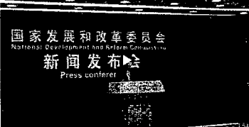

## 私企生意不好会有什么影响？

私企的 基础原材料 都是来自大国企，例如 纸浆厂的纱线就是石油产品，玩具车的钢材来自铁矿私企的铝合金，电缆是大头。私企生意不好，马上传递给上游。

另外，私企的员工收入下降，马上影响到 县城房地产。

## 当老板还是不要多读书

我认识的老板，过亿的，基本都是中专，技校，初中，小学文化程度。有个读大学就算高级知识分子了，有个艺术学院本科出身的老板，专门拉单子，做有关部门采购生意，是高学历人才了，现在倒闭了。有个大老板，农民工出身，总觉得自己文化低，壮读了个MBA，立马回来搞多元化经营，一年亏了一个亿。当老板还是不要多读书了，容易矫傻。

## 力帆搁在哪里

### （学术性探讨）

力帆的策略是低价，四万买车个。如果贷款，几乎每个农村家庭都轻轻松松买得起，但是四川重庆农民不买。为什么？因为农民有钱了。

中国农村人买第一个车有很多考虑，而且肯定有个非常紧迫的具体原因。例如做农村中介生意，相亲。特别看中面子，如果相亲开个超低价车，女方受不了。农民在城市里苦吃蛮苦，装修保姆都是高工资行业，农民收入已经高于一般市民了。大城市车子烧好面子，非要去两千多元工资的小公司办公室，坚决不去万元的装修工地，钞票都给我们老乡赚走了。城里孩子的老爸老妈在八九十年代低工资时期赚巴已早约出来存的，钱，基本毛的啥也没了。多数农村人不会在大城市买房，所以现金结余非常大。城里人有房贷压力。

面对一群省得滴流的农村铲户，你看不起人，卖超低价车，像话吗？农村也有穷的，但他们不买东，买车后，每月支出较大，穷人受不了。所以，卖私人车不能搞便宜策略。

我买第一个车是金杯，主要是便宜宜，还有一些网友买卖买车奇瑞，也是贪便宜，但是，那是十几年前的老资历了，为这件事，我被同事们嘲笑过无数次，特别是每天早上单位地下车库见面，实在是拿敢打招呼。那时候，内环线只卖四千多元。

## 汽车行业会不会再爆发？难

现在的车价（还有贷款服务），已经很低了，西北穷地方的农村，只要两口子不是懒汉，正常打工，都买得起，但没什么用。现在农村都堵车了，去隔壁村打麻将也开车了。我熟悉的一个欠发达地区的农业村，一大半家里买车了，不会再有爆发了。

城里用车环境严厉，罚款摄像头太多了，该买的都买了，合资车质量不错，家里有了，不一定换车了，打车方便很多。

## 上海小老板的外地师父

上海也有很多小老板，这个应该感谢外地师父。这么多年，绝大部分上海人，至少我亲戚下岗很多，经历了换岗。上海人是出了名的保守，不是回管厂不去。这时候，外地老板大批量进入上海，这些外地的小老板和上海人发生了联系，有时候就缺人缺聘请一两个上海人。这些上海人在实际经营过程中，发现做生意也不是很难，有就是缺卖送运上班好。于是也开始慢慢地做生意了。现在做了十几年生意也慢慢地稳定了，各种技术也就越做越精明了，他们成为了上海亲戚的恭贺的对象，老板，有钱。

这里面有一个很简单的事情做生意本身不雅就是害怕，如果有人给你走一遍流程，赚到钱了再手把手教，你就不觉得害怕了，这么有利润，谁都想去赚。很多新老板就这样诞生了，说到底就是，发财，也需要一个引路人。

## 某房东是小店老板

卖水果的，习惯了上海的普遍活，说，这辈于一心一套交房租，熬到七十回农村。他现在月入三万，属于农村间钱级别。打死也不走。

## 私营逆袭是有窗口期的

纵观近代百年经济史，第一个大规模的逆袭期是清末民初。逆袭必须具备的特点：

- 一是科学技术大进步。那时候，西洋技术大规模传入中国。各行各业，面临电力和机械的彻底改变。卢作孚是一个穷书生，成为西南最大的运输企业，无额寡家，从乡村小财主一跃成为中国最大的面粉纺织大王。各行各业，焕然大改变，无数大企业家，脱颖而出。

- 二是经济体制大变化。纺织机、电灯、万吨轮，早就发明了，但是，如果经济体制不变化，普通人是很难大展拳脚的。因为老的既得利益，会千方百计阻挠后来进入，以便自己把持新行业的利益。

- 三是社会临基本过得去。解放前，军阀混战，战争遍地，土匪匪流，但基本的社会秩序还是存在的，这些匪盗势力并不是要完全破坏生产，主要是吸，农民跑了，土匪也抢不到了，他们只是要抽头而已。

1937 年抗战爆发，交通阻隔，原料供应断裂，私营基本完了。

近代史上最著名的豪门，四川民族公司的卢作孚是如何逆袭的？我是凭记忆忆写的，个别细节，大家批评。

先说卢作孚有多富。抗战后，南京供应陷落，中国当时所有的工业资源都集中在上海和苏南，必须在四十天内运到重庆。之后就是枯竭无存。

卢作孚是当时中国最大的商长江航运总通部部长，他有大船四十八个，这在现在都是令人叹服的。他人保住了中国近代工业最大的成果。（民国体制和现在不一样，部长和司长，一个官大的一方，一个官具体业务，司长是掌握实权方。）

再说说他有多穷。他是乡村穷书生出身。他发迹前的收入，和一个公司挑水工的薪薄一样，月入49 元。一辈子没有积攒私财，解放后，从香港回来，后运动中自杀。为什么会出现如此奇特的事情？这里回落到，他逆袭路径和企业管理方法。

卢作孚一开始是平民子弟，家里很穷，他在重庆市近郊北碚村的老家，最欢喜的是研究数学，和乡企业没有一毛钱关系，研究数学，也就知道了西方工业革命、重庆是个山乡间隔难走的地方，大部分运输靠的是船运。卢作孚想办个船运公司，发展当地经济。

这简直是天开了，一个穷书生，要理想的出来买几万千洋的大轮船，怎么办呢？他就去求富人，却经风险投资。华尔街风险投资从来不是什么新鲜玩意，中国老祖宗早玩过的溜滚了。结果可想而知，富人们直接让他滚。就这样，初始期，他绝了一年多，他彻底绝望。

柳暗花明又一村，卢作孚去算个命，结果了，重庆的一个大官（周元），因为各种原因被免职了。这个老又走不通，就直接搞他。但是，卢生很不服软，大不会弄官方，万般无奈之际，正好碰到了卢作孚。老长官技术，但是会害人。少时，知识渊博，为人正，没有家景，好控制。于是，老长官车头，凑了八千块现大洋，让卢小子去继续修整。

卢小也能凑，直接拿着现票到上海，五千元买了发电机，三千元交了轮船定金，直接买了 3.8万吨大的大轮船。卢小回到四川，总成果 3.5万吨电机，老长官调即高没，没办法，只能继续套资金，最苦算是凑齐了，卢小当了大轮船的总经理，还办出了北洛的第一个电力公司。

这个过程，卢小完成了逆塞。四川人以精明见长，你一分钱投出，就有股份，只能家工资。卢小也不计较，卢小老板的出发点，本来就不是发财，而是造福乡里，有点理主义色彩。

大士豪们，肯定是知识和力气，卢作孚因为靠技术支配了他们的一手。卢平稳站位，无人撼动。与此同时，卢作孚非常会做人，不奢财，让各大股东非常放心。经过十几年的发展，从上到下，团结一致。


## 企业的二八规律

企业管理，说起来神乎其神，实际上是个小事，最多占二成。押对方向是大事情，至少占八成。倒闭的企业，都不是管理不通，而是决策方向错了。就算乱七八糟的企业，你只需要用一个年薪12万的凶悍大员，用不了十天，基本也就像个样子了。

真正的难点是，押宝。例如现在网上非常火爆的直播卖衣服，每年的款式这么多，流行趋势，流行颜色，流行面料，你放哪个？发对还靠创新，根本不是靠管理，也不是靠最新的尽职调查，而是，老板赌一把。一役制造业都是靠外贸设计，包括汽车，游艇，技术都是成熟的，其他行业，同理类推。

有些网络上的企业管理大师，吹起来一套一套的，其实咱们啥也不会的，上辈子里就是卖大力气。举个例子，杭州八维批发早市，每年有几个厂老板的，抓到爆款就发财了，抓到烂款就赔光了。别吹了，你有本事自己上去试试看，我估计你分分钟倒灶。

## 老板主要是干什么的？

小老板其实就是民工头，就不说了。我说一下，几个亿的雇主土豪，他们在干什么？

1. 关系。这一块，现在已经很少了。因为各单位的找都不出来吃饭了。最多也就是行业协会聚一下，互相吹吹牛，或者争点点小利。关系有事了，可能要想想办法，平时也没事了。
2. 决策。你千万不要以为，身价几个亿的大老板做决策，好像是个很神秘的事情。其实和你去菜市场买只鸭子差不多。这个项目干不上，这个薪酬做不做。就这样了。是与否，完全是拼经验。

很多老板经验也很强，经常做裁判听。

重大决策的事情，是不能交给副总或者部门经理的。因为三个人，会有五个看法。问他们，等于白问。他们会给一个风险提示。但你要真的听他们的，那就啥也干不成了。所以，企业老板其实是天天在押二八杠。

三，管理。企业里的破事多，纷份多。你不管都不行。天天吵，互相推责任。员工看到油瓶倒了也不扶的，必须你自己去转铃。

四，分钱。这个最难。分多了，你心疼。分少了，对方不满意。把握火候，考验老板的水平。

## 你说的制造业这么惨为什么不倒闭？

因为死不了。

小制造业，大部分是 20-50 人，缺一个都干不了工，因为工序要求。做到这个规模的制造业，至少五年八年了。如果倒闭，赔偿金，基本是 3-6 万/人。这就得拿出近百了万。死不起啊。

三角债难消。你欠我的，我倒闭了，一时半会也要不回来。你欠我的，一倒闭，马上喊打喊杀的冲过来了，我一家老小也受不了啊。

婚房汽车，都抵押给银行了，一倒闭，银行就上门调查查封了，还不如三个盆子五个碗，不停的倒腾。

这么多库存，机器，原材料，能续货，还能漏点钱出来，倒闭了，三毛线一分都没人要。

## 说个心酸的事情

我家公司里，有个部门经理出去创业了（投错错）。公司业务中，有很多环节，特别是原材料选择都关这一块，都是我和深凝私下做的，材料到了里，员工根本不知道我们经历多少麻烦，他以为，天底下的原材料都一样。

他要创业，我是否口硬心告诉他，现在不好做，再等等，他以为我耽误他发财，根本不理我。没办法，只能随他去了。结果，他把婚房号掉了，还欠了他后妈五十万。他老爸是再婚的。现在，家里背躺了。

他的创业模式也很简单。把我的前半串的优质客户抢去，给与更加优惠的措施，让他们进货交货。由于他的质量把控出了问题，经销商大批退货，一套房变成了一堆无卖库存。我也不知道说什么了。

结论：
1. 老板都是很聪明的，你看到的去西，只是结果，而不是过程，不要想当然。
2. 不要再低水平重复创业了。已经很成熟传统市场，没什么诊源机会了。
3. 要创业，一定要去新领域，大家都是从零起步。

## 为什么职工福利政策越来越好

好的都难以想象了？因为 80%的职工在民企上班，老板买单而已。

## 当当网为什么混得不好了？

(仅谈个人体会)

我原来是 个互联网的老土。网购刷盘教育，就是注册当当网，买书。我在当当网消费了很多钱，但现在，我连当年注册当当网的账号都找不到了。为什么会如此呢？实际上就是因为京东商城。

新华书店卖书，从来不打折。当当网好像是打折卖，我很高兴。自从发现网购不是骗人的，我又注册了京东商城，买日用品。

当时，支付手段很原始，需要银行卡号码、密码之类的，需要输入的数字特别多，还要各种奇奇怪怪的密码，我是小心翼翼，生怕搞错了。反正，支付是个很麻烦的事情，老年人都不愿意用，只有我们这种三四十岁，读过 top 大学的，人才敢冒险试试。当年，网络支付简直是丛林大冒险的感觉。

既然是麻烦，当然希望越少越好。这时候，京东商城开始卖书了，并且一开始卖的是比当当网还便宜（很短暂的时期），我就很舍不得。不买日用品和书，一次性支付就足够了。于是，我就一直在京东商城买了。这两年，微信支付流行了，支付手段超级方便，但是，我再也没兴趣重新去注册当当网了。

体会：做互联网，包括自媒体，不能小富即安，粉丝三五万就想撩广告费了。逆水行舟，不进则退。你以为可以安逸了，没门！还有那么多待优青年，麴刀霍霍要杀猪啊！

## 什么叫生意难做？（个别行业）

由于某些原因，主题只能以图片形式展现，请谅解。

> 上个月，我组织了一个个别行业的行情，实在是太震撼，往年夏季，应该是在热火朝天的为茶叶蛋备货，今年，很多企业现在还没大门开吊，无声无息，即便强开厂，也招括子接子地带外地订的灰雇看的，生产急需起，根本派什么活，拖到预在八月份，说高温假，又关了门。
>
> 部分原材料出现了近年未少见的峰台偏差，打工也不不常了，以前要么高价抢购人工的请况，今年几乎消失了，有工资吗？特别是银行，对中小企业起借多了，时不时的打来一个电话，定点款吗？靠啊我做个业啊。
>
> 为什么（个别行业）会出现这样怪网络冷的情况？宏观方面，我不说了。我就说微观现象。生产业输不能开工，或于经理接的订单数量，经济部找不找订单，理由放一个，去年有没有接？如果去年单家你的东西输钱子，你该去杀爹杀妈，如果没输钱，你输一坊啊，我吐你一口口水都不得跟。
>
> 经济点是变冷，坐在火车站的的北坡站出口时候，他们都一个表情，手袋在别着，就薄地地的颤爽。现在的理发也开过不了少个客了，因为这一套不好使了。县城小老板根本不起绝想了。
>
> 生产企业很苦恼，他想做出物有所值的效果，才够定经理向终端输系统的要求。但是，这个谈何容易。资金要，资金全，要耐用，成本必高。一般两百人以上的中等企业，至少要请三五个设计师，五个个模模其工，七八个样品制作实验员，这就十五个人了，这些人都是精，每人基本工资15万年，加起，人均成本20万，还没算到东西，300万友了，请家设计师，一年工资80万顶了，太了封。
>
> 要现人员包括销造，架构，仓库，接送，物，床次，售，售，雄，电工，司机，七七八八，不到20人，人均10多万工资顶了，就耗

250万成本了。实际上，远运不止，一般是400万左右。

再加上房租，水电气，食堂补贴，宿舍补贴，竞员图，车闹所旧，物业置理，安防，消防，工伤，利息，一年200-300万打底。

也就是说，一个中等企业，啥也没看到，700-800万纯消耗就出去了。

生产经营原材料，要发工资，做一个亿的货，贷款又是2000万。还不出钱，小老板就跳河了。

再加上30%以上的正常库存，你要做不到一个亿的产值，这个企业就就剖了。问题盈，你做出来了，卖给谁？不知道。所以，小老板就愁了。稻了，钱不敢开工。但你不开工，几百万管理成本，设计成本，找谁填坑？

于是，大大小小的老板就把心思放在贴块上面。互相谈条件，谈感情，设计出击种挖空心思的方案，互相忽悠。最后，产品没炒好。

设计，不搞了，找几个销售，买一些设计方案，大家做岀来的货，千人一面。

生产，不搞饭了，一翻腔，外包。质量可想而知了。

原材料，只要便宜的，这样能半年就赚。供应商都是盒烂货给你，看不到钱的主量，别想做好东西。

经销商是大爷，得靠不起，好喝，送货给你。

最后成成了三角债。经销商没钱给企业，企业没钱供应商，工人工资付不上去，大家干活不尽心，产品质量可想而知了，哪里的料？要不好，明年就翻服了。

当然，这是个行业性。中国经后，稳中向好。

## 公司做的这么好，都上市了，为什么还会垮掉？

高负债。

很多人不知道的是，上市公司，其实是效率最低的公司。同样做一模一样的塑料桶，如果小老板的利润是10%，上市公司最多是3%。道理很简单。

一是管理层级太多。上市公司一般是四层以上管理，从车间员工到董事长，至少四层，实际上八层都是很正常的。层层传递，效率员工，信息失真，决策慢慢。这里面的人员成本高的离谱。

二是财务漏洞多。主要是下展探花脏，多吃多占转回扣，屡禁不止，实际上也管不了。

三是合规性成本太高。上市公司方方面丽都会被严格监管，从社保到开票，相当严格，职业经理人不可能替老板营销，老板眼晴漏，分分钟有人告他。

小老板不存在这些问题。他们天交在企业界人间里，五花八门的事情，一分钟就决策了，员工到老板，也就是大嗓门喊一下的事情。小企业的效率才是最高的。当然，偷鸡摸狗的事情也不少，老苍卢拿个一车货，也不开展了。

上市公司利润很低收入，要想赚大钱，必然要通过拉量，做大基教。但是，目前的产业环境是，需求饱和了，再扩产，没人生了，怎么办？

一是多元化投资，主要是地产类。盖个大宾馆，以后房子孙放当房务。

二是资产并购，合并报表，做高股价。

这两个渠道都需募几万亿，几百亿的资金，长期投资，至少 4-5 年。起初，大环境好，借钱容易，疯狂举债。例如现在借口矿产，来条生产线，贷款是很容易的。但是，一旦资金面收紧，首当其冲的就是这些大民企，只收了资了。

由于资金盘太大，其他渠道是不可能弥补的，于是乎，出现了无力偿还的情况，公司爆仓了。

## 一般制造业（2019.08）

下半年出口怎么样？我接到的信息是，面临严峻挑战！你们呢？

## 为什么制造业越来越差？

1. 居住，大概花费了我们 80-90% 的收入，包括水电气物业停车费。
2. 吃饭，一只鸡，100-150 元，不算好。一开饭得白米虾基围虾，40 元。一斤番茄 4 元。一个月下来，中产家庭 6 千元是最低了，给孩子加点牛奶零食水果，大概一千以上。
3. 教育。补课费，一年 1-5 万是平均数。否则就是听天由命了。
4. 医疗。一个老年人一般 20-40 万是要的。
5. 买车。现在，不买年，就找不到老婆。

一般家庭花完这些开支，剩下的钱已经不多少了。衣鞋鞋，旅游，海鲜自助餐，奢侈品，很难再抢到什么份票了。这些低矮制造业，靠自己是不可能消化的，必须出口，否则就只能完蛋了。

聪明的朋义又耍发财了：把房价降下来呗！房价的组成，我们已经仔细分析过了：农民工工资，建材，土地款税费，利息，开发商的利润（现在很多是国企开发商）。你说哪个可以不给钱？

## 华为鸿蒙系统

财经网：【华为：#鸿蒙操作系统不是为智能手机设计的#】华为董事和高管副总裁张黎华周四表示，公司的鸿蒙操作系统不是为智能手机设计的，公司打算继续其智能手机上使用谷歌的安卓操作系统。最近正式提交的鸿蒙操作系统版本主要进入工业系统。

那么 app 的丰富程度就差太远了。安卓出个新的流行 APP，你怎么办？干瞪眼？

当时，我为什么不谈这个，是因为那些小粉红完全没有科学概念，就是一个劲的嚷大麻烦。你继续嚷，反正我买苹果了。

## 创业主要是管人

你不可能做出一个类似于苹果的高科技产品。你的创业，实际上是通用知识的创造性运用（经验丰富）。创业能不能成功？取决于你把技术运用的是否更加高效，更加美观，成本更低。这就取决于你的员工水平和队伍的稳定性。今天就分享一个真实的创业小故事。

创业项目是图文类。小老板姓庄，为甲方广告部门做配套，类似于婚纱摄影。小老板自己就是这个行业的资深员工，各种业务，驾轻就熟，但他一个人做不了那么多事情，必须开公司，招聘员工，这就变成创业了。

小公司创业，请资深大神是不可能的，开不起很高的工资。老板是这个行业的资深员工，他觉得可以自己带一个队伍出来。于是，招聘了一些本专业的大学毕业生，第 1 年给的实习工资是七八千块钱，经过三年，手把手的传授经验，这些大学生已经成长为比较熟的技术员了。企业也开始走向稳定盈利的状态。员工基本是 1 万左右月薪。

企业生意好起来了，小老板刚刚高兴了两天，员工就要求加工资，至少 1.2*1.5 万月薪。如果算上社保，那就是人均 2 万。企业赚了一点利润，不是为了发工资，而是要扩大市场，增加人员，采购设备。资双方对这个难题，是有巨大的矛盾，在某一开领了工资之后，员工集体提出辞职，小老板傻眼。背后的原因是，

1. 有一个同行挖墙脚，拉过去几个，每个人工资涨了 20%。
2. 还有一个两个员工觉得已经全部学完了，自立门户了。

这个小老板辛辛苦苦培养了三来年，付出了巨大的成本，不仅是教育管理的时间成本，更多的是产生产品的金钱成本。但员工对他并没有任何的感谢，相反觉得他很小气，很抠门，不舍得花钱。小老板觉得员工太不讲情面，手把手教会你，人家只要加点钱就跑了，很伤心。

后来，这个小老板也不再招收新员工，也不再培训员工，而是采取了分包的形式。他认识一些业内各方面的技术人才。小老板负责拉单子，接到单子，就把工作分解，技术工作交给合作伙伴，简单工作，就弄几个普通员工，简单做一下。

这个案例，小老板用人是错的，他太实在了，把所有的技术都教下去了，失去了制约的手段。他不了解员工的心态，员工从来都是认为自已吃亏了，总觉得工资少拿了，你无论请他们吃多少饭，喝多少酒，都是没用的，你要做老板，必须让员工无法轻易摆脱你。

一是在技术关键环节留一手，你自己做，或者亲家出，请得找一大大家都不认识的人去做。这样的话就不会有人有一锅端的抢人了，也没人敢自以为是。

二是企业要想上规模，例如采购高质量的设备，租用比较好的办公环境，抬高创业的成本。如果你让员工知道，创业成本高，员工心思就活了。

三是适当误导员工。个别的工资，野心勃勃，全面复制你的技术资料，时刻准备挖你的墙角，你无论怎样，都拦不住他出去自立门户的。所以，你在教他们的时候就要把最核心的内容淡化，甚至不怎么提及，你自己得悄悄的攥弄一下教才行。把那么重要的内容做说他的很受重视，很重视。给那些想偷师学艺的人，挖个坑。这种人工法出去之后，要不了多长时间，就是员工还会回来。

四是价格和成本不能谈。员工就难以推测你的盈利状况，也就不敢轻举妄动。

## 我曾经误导下属的故事

我以前做了一段时间小生意，精美的大牌化妆品直倍期，上面的美女是需要修图的。我就手把手教会几个员工怎么进行 ps 调色。这个技术活是很难的，我的 ps 技术是自己反复研究的，用曲线进行调色，ps 的人应该懂。我的技术比淘宝修图还还好（现在忘记了）。在电脑 ps 环节上，我毫无保留的教会他们了，有个员工学会了，就敢涨工资，我没同意。

猫放老虎，最后一招是不教的。

我没告诉他，我用的是哪个品牌哪个型号的印刷机进行实际印刷。这个 250 以为天下的印刷机都是一样的。出去单干，第一单就作锅了。

赔了人家一万多，还不知道为什么。

我现在可以说了，我用的是海德堡某型号（具体型号不记得了）。那个厂就两台机器，一个海德堡，一个杂牌（印刷简单产品）。ps 修片完成后，在厂里还要进行一次色彩校对，不同的机器，成像效果不一样。我已经熟悉那台海德堡，红色欠缺一点，所以每次修片都故意加重红色。我骗那个 250 说，电脑显示器红色失真，所以要加红色，他还真的相信了。结果出去就作傻蛋了。

为什么我亲自去印刷厂？倒也不是我想省省钱，而是迫不得已。印刷厂的流水线是时刻不停的。你的单子上机器，可能是下午三点，也可能是晚上九点。你必须守在那里，等待最后一次修片。上海印刷厂在很远的郊区，晚上就要很晚回来，也没车。所以，员工都不愿意去，只能是我去了。

## 师傅领进门

现在也是市场经济了，商业秘密，谁也不愿意告诉你。你去问海底捞的带火锅配方，人家一棍子把你打出来。但是，师傅也靠偷师。又不想花钱，怎么办？装模作样的带几个徒弟，指使他们干点杂活，就像是大师带徒。"去，把厨房拖一遍"。

这徒弟也干了小半年杂活了，你不拿点心发出来，也不好意思。凡是你自己看得见的流程，师傅也会大致教他一通，但你看不见的，就不一定了。上次，我一个 一 个厂长带徒弟。他是先够了的机械学院的专气，塞了一个高等学院的大学生进去学。学了两三年，流程学会了，但是，各种类型的曲线参数就是调不准。老师傅有 1-2 次靠 OK。这个大学生，要四五年才行。费工资料，做样品的师傅天天写他杂蛋。

这种事借很多的，江湖不会教你。候师，师傅不敢教来偷，老医生不让小医生做大难度手术，都是为了确保自己的江湖地位。你要是爬到师傅头上搜骨头，那还得了？这个时候，能不能再往前走一步，就看各自的悟性了。

我告诉你一个小秘密，关门弟子最牛 b。师傅要退休，如果没有个儿子接替，警惕性就小，愿意抖干货。以我的工厂经验，通用技术，有个好师傅，六个月就可以满师了，拖到两年，纯粹是忽悠你。

## 拼多多的发展势头确实很猛

我没有用过支付宝。我用微信。微信可以买机票，付水电气，宾馆，购物商场有拼多多和京东商城。条件好的，用京东；条件不好的，拼多多，基本都把全国上网人群覆盖了。

我为什么不用淘宝呢？在淘宝刚刚出来的时候，我还是个土老帽，根本不愿意把自己的地址，姓名，电话，交给一个陌生公司。随着时间的推移，周围人基本普及了微信，我也就开始用微信了。

我最初用网购，是在当当网买书。这个网站是北大学生开的，所以，我比较信任。我印象中当时用银行卡支付。后来，京东商城也开始卖书了，我又在京东商城买书，也是银行卡支付。后来微信也可以支付了。

## 小老板本来还想欠点房租

中指研究：【上海市政府常务会议决定：促进上海科创企业高质量发展着手处置低效产业用地】

指数社7月15日讯，上海市委副书记、市长应勇今天主持召开市政府常务会议，研究发挥资本市场作用，促进上海科创企业高质量发展；审议本市低效产业用地专项处置工作方案等。会议原则同意《关于着力发挥资本市场作用促进本市科创企业高质量发展的实施意见》并指出，在上海证券交易所设立科创板并试点注册制，是实施创新驱动发展战略、深化资本市场改革的重要举措，将推动金融中心和科创中心实现联动发展。要培育一批代表上海科创实力、体现上海科创潜力的优质科创企业，促进更高质量发展。要继续吸引证券、会计、审计、法律、评估等专业中介机构落户上海，提高服务能力，助推科创企业规范发展。（上观）

## 没技术，没关系，没资金但我想当个老板，行吗？

一般人不行。但如果你是有心人，还是可能的。你知道，老板是怎么来的吗？我敢说一下大家很尊敬的娃哈哈，白手起家，千亿规模，堪称逆袭楷模，人生典范，经久不衰。宗老师四十多岁从农村回杭州，也没什么技术，也没什么人脉，也没钱，也没天使投资人，一句话，啥也没有。他的脑袋三部曲，很有意思。

1. 吃亏有甜。他先去了一个小卖部，帮吃苦耐劳，攒了一点小钱。这一步，所有人都可以做到。新华部的陈发财也是这样起步的。
2. 销售有产生。他搞小卖部有点钱了，就往上游跨了一步，开了个小饮料厂。按照自己对你市场的熟悉，研发几个符合老百姓口味的饮料，饮料，无非是香糖，果汁，牛奶，再加白开水。老百姓的口味，就是自己的口味。做实验就是自己喝两口。关键是有他人替你卖货。他最懂小卖部老板的想法，一下子铺开成了。
3. 资产兼并。1991年，某国有罐头厂竟不抵债，有关部门的意思是，你把这个厂的一千多个职工包下来，这个厂就算送给（来自网络资料，若有补充请指正）。这一步有点冒险的，托中国经济的福，他成功了。以后的。咯。

为什么我要说这个例子？因为我的家族企业也是这样来过来的。我家开了个塑料棉小作坊，卖好了，赚钱了，再扩大，再往上游走，再往品牌走，再往全国全世界市场走。遇到了中国经济的两飞，经营，资产，土地，品牌，呼啦啦全部起来了。想不赚钱都不行，直到2011年才算进入下马场。下半场是大资金运作，你不需要知道了。我就说一下起步创业的个经验。

1. 从小到大，积累市场经验。

你没有爸爸爸，也没多少钱。你那唯一的出路就是，去个小店小厂打工。99.99%的打工都是混吃等死，或者累点东西回去，没有人去研究怎么做好这个店，开好这个厂？如果你是有人，打工三年，应该是看值怎么做小老板了。

2. 自己单干。

你有了经验，小门小厂，启动资金也不大，自己可以干起来了。

3. 赚钱后尽量往上游走

做小企业，只要自己肯吃苦，赚钱是大概率的。例如塑钢门窗，早餐店，做团队，卖建材。但


## 企业扩张与转型策略
走到这一步，你就遇到第一个难题了，后面怎么办？个别人就开始吃吗踢腿抽了。我的建议是，要么横向扩展，增加销售品种。要么纵向深挖，转型生产。

- 最关键的一步是，寻找确大的合适机型。
娃哈哈收购健大厂，启动资金不大，有历史原圆，无法模仿。但是，现在资不抵债，或者老板想退休的企业，还是有不少的。你把他们的机器设备，技术工，买下来（不买股权），立马就是一个新厂了。自产自销，生意好，就要做大了。走到这一步，你就算半个企业家了。

- 最秘密的诀窍是，进入一个新行业，而不是传统行业。
八九十年代，中国人基本没有饮料的概念。卖饮料就是新行业，做饮料就是高科技。类似还有健力宝，太阳神，脑黄金，中华鳖精等。
现在，你不要去做饮料了。你想办法，去做一个新的行业。因为在新行业里，大家都是从零开始，我不比你差！
who 信 who?

## 汽车销售下降了
我有个车，开了好几年了，应该可以买新的了。但我不买。因为我现在不愿意开车了，用车环境实在是太严厉了。
一是扣分制厉害。摄像头违章，例如超速扣 3 分，被摄像头拍到四次，就要培训 7 天了。有时候开到外地，可能一天就会报满了。现在的摄像头，简直是密密麻麻，附近圈一圈，估计有几十个摄像头了。为了避免违章，我尽可能不开车，而是绿色出行，例如自行车。
二是停车难。我发现，大部分办事机构，例如银行，社保，医保，医院，学校，街道办事处中心，都是在街道，附近停车位紧缺。每次开车出去，都是提心吊胆。好不容易到了地方，没有停车位，就来回兜圈子，很容易违章。
三是大城市限牌。摇号难，也就不买了。
汽车销售下降是好事嘛，我们是人口密集城市，汽车太多了也不好，污染环境。有些汽车厂不行就关了吧。

## 保民企，就是保粮食
现在，粮食价格低得离谱。一斤稻谷的价格等于半瓶普通矿泉水，一包 8 元的便宜香烟，大概是 2-3 斤大米。一袋十斤的优质大米，大概就是一双普通塑料拖鞋的价格。
农民对种粮食普遍不感兴趣，喜欢种植经济作物，一斤中茶叶 300 元，价格是粮食的百倍。大家喜欢吃菜，茶叶，水果，辣椒，中药，景观植物，就是不愿种粮食。南方丘陵地带的小块农田撂荒，是经常看到的。年轻人都跑完了，谁去种地？
但大家也无所谓，粮食太多了，吃不完，价格太便宜，从来没有人卖过粮当作事。粮食哪来的？大部分是农药化肥堆高了产量，少部分是进口。有人测算是 25%进口，去年进口了 1.15 亿吨（包括饲料粮），大概需要 320-350 亿美元（不精确）。
外汇哪来的？创汇比例是，外企 45%，民企 45%，国企 10%。外企的趋势，大家都懂。我们的粮食安全，主要是民企保障的。
目前的中小民企确实遇到各种困难了。今年五月份说降低社保负担，最后发现，表面上降低了点点缴纳比例，但不冷不热的提高了计算基数，实际上一毛钱没少，还增加了负担。至少我的社保是增加了。
目前，民企贷款确实方便了不少，各个银行为了完成任务，三天两头打电话请小老板去贷款。但是，借债是要利息的，要还的，企业利润上不去，借债只不过吃掉了儿子的婚房。
关心民企的落脚点，最好是降低民企的税费苛，而不仅仅是方便小老板去借债。

## 太好了！
11·11 财经社7月10日讯，李克强主持召开国务院常务会会议。要求切实减轻小微企业税费压力，决定全面推开营改增部分国有资本充实社保基金。

## 你能不能当老板？
弟弟贪了公司的钱。
老王在二线某城市开了个设备销售分公司，老王投入750万，某小股东投入250万。每年上亿的营业额。老王在京沪管理总部，无法亲自过去。于是，任命亲弟弟担任分公司总经理，还派了财务和人事过去现场监管。亲弟弟在当地熟悉情况下，利用销售费用环节，大肆挣钱。例如开个广告，请个歌手，做做公关往来，都是五倍顶账。
一年下来，亲弟弟额外搞走了上百万，再加上合法收入，赚的比老板还多，还没证据。老王和小股东只赚了80万，小股东天天在闹退股。老王到处受气。
如果换人，兄弟翻脸，前期各项工作白费了，需要再次花钱。况且，换人就避免这个问题了吗？也不见得。
如果实行考核，实际上也无意义，就算考核奖没有了，也不响他的挣钱。

## 民企有多难？
我以前在瑞士上班的时候，遇到过几个做奶油的家族企业。他们家做了一百年，现在是全球前几名的水平。我在内地某省认识一个国内的做蔬菜大老板，省内有名（未上市），估计几个亿的身价。独生子女儿子毕业痛，坚决不接手家族企业。或许，你会认为这是个例，实际是普遍情况。大多数中等老板（未上市），子女基本都接不了生意，勉强跟着父母做的，只是读书差，找不到工作，没办法。为什么呢？
很多民企已经不怎么赚钱了。很多看上去生意很大，到处是连锁店的老板，只是表面辉煌，照他的想法，早就想关门歇业，周转世界了。但关门了。因为有几个老职工等啥他买单，他买不起。他的想法是拖下去。我们都知道，一旦关门，部分人肯定是大闹一番，最后撕一块肉了。各种各样报账，就会层出不穷。这些民企，也不是说自己混纯冷血，总有不混规的，谁也不敢去捅马蜂窝。为什么不赚钱了？
- 成本压力大，现在，所有的生产要素都在涨价，环保成本与日俱增。最明显的就是工资社保公积金，亏了也要涨，这就把企业逼得越来越难了。哪有年利润增长的企业？
- 价格上不去，民企给80%的城镇就业人员发工资，但是，员工收入的80%，没有消费在民企，流到了住房医疗教育，这就给民企常者沉重的结构性打击了。现在，民企还能熬下去，主要是出口消化了过剩产能。但是，其他国家和地区的居民购买力上不去，或者产业转移了，对方也能生产了，出口就会遇到天花板，接下来头疼了。
- 纠纷太多，除了债券合同纠纷，现在的劳动纠纷实在是太多了。很多员工，辞职就打官司。劳动法规定了太多的细节（我赞同），实际执行是很难的。员工平时一厢一面的收集证据，小老板哪有这个能力？
- 工伤事故，无法控制。现在，上下学路上，出个交通事故，都算工伤。小老板能不能活，完全是看运气。
- 无休无止的呢，现在，员工大吵大闹，没人来帮忙的，小老板还能怎么办？不能打，不能骂，一个纠纷摆你一个月，你还做不做生意了？大多数富二代是学校里长大了，哪里见过这种江湖套路？在你办公室，地上一滚，直嚎。五分钟你就崩溃了。谁来管？没人防的。
当然，这也是好事，富二代滚了，我们就可以进装置了！心情多么好。

## 民企不太愿意转型升级？
因为谁先转型，谁吃亏。
中小民企一般没有什么科研能力。所谓的转型升级，就是买先进设备。买了新设备，就需要两个岗位，操作员和维修员。这些人，企业是要送去培训的。最主要的成本是，试投产的大废废品成本。
同行没有秘密。因为员工是互通的。我表哥在甲厂，我二姐在乙厂，我在丙厂，微信群一拉，什么事情都清楚楚。你老王牛逼，上了大设备，我就等着看结果。你亏丁，我笑话你。你赚丁，不出三个月，呵呵，你也到头了。老子也买一样的机器，再把你的操作工，维修工，一起挖过来，废品率降低了，培训成本也省了，过去就是熟练工。
为什么会形成这个问题？因为劳动法就鼓励辞职，鼓励跳槽。哪个企业培训员工，哪个企业就是傻帽，你培训好了，熟练了，总算是品率降低了，对面张老板加个两千元，员工就跑了。你还能怎么样？冲过去打架？不可能的。与其慢腾腾，不如直接挖人。

## 如果是你，你会怎么办？
俯辞网：刚刚王老师吐槽：哭了，某公司邀请我们一些贫困生免费去参加会议夏令营，但是各部门都怕负安全责任，不愿批准。
有人建议，那就和家长长线协议说：王老师回答，都会签，但是签了也没用啊，出事的时候还是会来闹。如果是媒体一曝光一乱写的话，学校和主管部门都难看。
身居海外的科研团，那就给买商业险吗！王老师说，商业险都有的，但是，万一出了事，即便保险公司赔的非常妥当，但是没用，家长还是会找学校闹，上级还是要批评他们不周全。
然后王老师说起去年这个公司给留守孩子举办的夏令营，我他不通过就没上报，自己一个人承担了安全责任，但是今年那么肥的胆子了，选择上报。果然，上报后各方互相推委。主办方那边的团市团委要给我们团委发邀请函，而市团委说不适合给我们，交给教育局发……反正谁都*不想接这个事
末了王老师，突然有点理解当官的了：事是个好事，可是一出事就谁也不想起责任。

## 如果是指，你会怎么办？
桑农：小老板尽可能不搞员工旅游，团队聚餐。如果出现问题，就是工伤了。可以折算给钱，大家满意。

## 做天猫，亏的连裤衩都没有
沪江魅影 e: 电商卖家，一年成交几千万，结果还是不赚钱，别说开网店成本低，我们一天上供给马的费用起码 5 万，而做实体，连商摊一起买来投资就几百万，要求不高，一年做 50 万利润就够了，就算亏了至少还有资产在，做天猫就是在给马骗子干活还要自己垫资本，亏了连裤衩都没有。
286个回答
吓得我又开了一个实体店，投资600万，我们已经把天猫关了，本来女装细分小类目前10的。一年成交几千万的。结果还是不赚钱，别说开网店成本低，我们一天上供给马的费用起码5万。小二还总让报这个活动，聚个活动，每次都有指标要求。完不成就不退押金。没办法完不成的就只有找跟单公司补单。再说连说淘宝便宜的都不是专业微过的。要么就是阿里水军。连商摊一起买来投资就几百万。要求不高，一年做50万利润就够了，就算亏了至少还有资产在，做天猫就是在给马骗子干活还要自己垫资本，亏了连裤衩都没有，边上做亏的朋友一抓一大把。跑路的网店越来越多，供货商货款一般都要压一个月货款的。买死了。一个小厂一年白忙，我们做一个爆款只要三天销售就几名，仿制款就可以让死成千上万条。最后就是压价抢夯而砸压乱拼，反正网上就一个图片，谁都不知道好不好，评价可以刷出来。傻子那么多骗头都不够用的。
菜菜：马上会有人跳出来，说，他二姐做淘宝，开奔驰！

## 宏观角度认识民企结构性困难
民企给全社会80%的城辗就业人口发工资。大家拿了工资，却主要不在民企的产品领域消费，而是把钱投给了医疗教育住房。那么，民企成品卖给谁？除了一部分固定消费，例如你家总要买一些塑料盘，卫生纸，多余的产能，只能出口了。如果出口不畅，民企会怎么样，大家也懂的。

## 三十年的商业感悟：我会发财吗？
90%的人是不可能发财的，京沪小二层混到老，已经够好的了。9.9%的人发点小财，例如赚个几千万，三五套房子，博得几个红颜知己，已经是令人羡慕了。大概0.1%以下的人，才会发大财，但这些，你永远见不到的。
我长期和一批距离瀑布桥还有 50 米的中等老板混在一起，深刻的认识到一个事情，不管发不发财，人的智商实际上相差不几，大老板还不一定比小聪明。你会不会发财，可能有几个原因：

- 一，机遇很重要
机遇分为两种：一是贵人相助，这个全完看运气。据说黄光裕有个司机，学历很低，因为做事踏实，被提拔为副总级别。现在也是几十亿身价了。（斗网上说的，我没较实过）。
二，顺势而为，这个大有讲究，可以思考。
大时代兴起之初。1993 年的第一批老板，绝大部分是赚到钱的。那时候，物资短缺，政策不严，只要你拿的出产品，销路不愁的。举个例子，你做裤子，先在京都卖 100 元，剩下的拿到杭州卖 50 元，再剩下的拿到东北卖 30 元。再剩下的，拿到驻马店卖 10 元，绝对不会有余货。其他同理。
行业兴起之初。淘宝，房产，中介，快递，计算机相关行业，手机普及，游戏推广等等，太多了。我举个例子。我当兵在大单位的时候，内环卖一套小三居，也就是二十几岁的时候，你知道冯农有多赚钱吗？我们单位的搜查室，要搞个计算机室，就是最简单的数据屏，日期，姓名，内容档案，部门。现在职高学生都可以调出来。但是，当年大家不懂啊，就说这个系统，半辈子多的钱，是张江科技圈的一个屌丝赚走了。大家都老板玩他妈的不错。
区域型机会兴起之初。汽车，功能性手机，空调，燃气灶等，在向农村普及的过程中，太多太多的人了，发了大财。就算简单的维修，教人使用，售后服务等，都可以县城买套房。

- 三，综合绝活
别人要想学会这个技术，他要折腾一两年，有这个水平就够了。至少保证一般人不会和你抢市场了。这个不仅仅是技术，也包括物流流程，行业小秘密，一般都需要拜个老师得指点一下，或者父母亲戚带入门。
很多绝活是可以转换的。例如，我以前写论文水平非常好，现在写段子，也算半个绝活。以前你是修收音机的，现在改修修手机，也是几分钟的。不要以为修手机很难，实际上，绝大部分手机故障，就是连接故障，五分钟，两百货。真的芯片坏了，谁也修不好。

- 四，利益分配
个体户无所谓。真正要搞大，手底下一般有几百人。一般而言，你拿纯利润的 30%，手底下的就拼命干，你拿纯利润的 80%，这个企业也就三五年就崩了。

- 五，不要吹牛逼
如果这个行业基本成熟了，你就避开吧。你千万不要轻易认为，自己找到了鸡贼的小秘密，例如掌控老家的端角，就可以逆天，没这么简单。

- 六，今后是服务业的天下了
服务业的特点是，多元化，多样化。传统大公司最讨厌这种千人千面的生意。举例，装修行业发展几十年了，比彩电冰箱的历史还悠久，但没有出现过类似格力，海尔这样的知名企业，原因就是管不好。
我的意思是，你也不要想着进特斯拉，你雕几套房子的钱就够了。好好研究一下服务业，找个风口，争取做区域型小品牌，例如县里的前五名，你就土豪了。

## 我很少说怎么做好大生意
因为这个受众太小了，而且绝大多数都是个性化的，你也不感兴趣。我主要说一些，起步阶段怎么思考。有六七成把握，就先做起来。没有什么生意，是你十全十美准备好的，进去就发财的。
市场行情，社会需求，时时刻刻在变化，今年数字讲课很火，明年政策一调整，可能是语文补课程火爆了。其他同理，在可能的情况下，尽可能凯里，抓钱。先干起来，慢慢总结打法。
绝大部分年轻人，其实是很聪明的，就是不知道做什么生意。其实，我也不知道你应该做什么。但是，你要相信一点，你不要别的人，只要是合法的事情，特别是服务业，你做到“四个更好一点”，细节更好一点，服务更好一点，性价比更好一点，态度更好一点，你就可以胜出。不就是多花点力气吗？没什的。
我和很多身价几个亿的大老板都问过，你当初下决心创业的时候，怎么想的？他们说，当初就希望，比在单位里多挣30%就饱了，没什么太大的想法，越做越有经验，慢慢地就出资了。
当然，也有很多倒霉了的老板。主要亏在扩张过程中，出现了能力不足的问题。这个以后再说。

## 为什么做实体经济
还要到处求这个，求那个？
老王就是一个很爱抖精的，安安分分办个小厂，也不欠钱，也不惹事，老老实实，为什么还要到处求人呢？
所有的纠纷，都是人和人的矛盾。只要是做企业，必然涉及到人。只要有两个人，就会产生矛盾，更何况是几十个，几百个人的企业。企业和员工，一旦产生矛盾，双方很难自己解决。员工的思路很简单，你老板买个车花了50万，给小三花了80万，我干了六年，辞退我10万不算过分吧？企业的想法是，厂里这么多年，进出进出加起来至少上千个员工，每个人都要10万，企业还能怎么做？不行，最多2万。
部分员工就不服了。内部人搞内部人，都是真狠耍命的。方方面面就闹来了。天底下，没有一个企业可以说自己是 100%的纯净势力，来调查的人，就是吃吃个饭的，小老板哪里是对手？事情就搞得很复杂了。
绝大部分小老板的归档意识不强，前两年的资料，可能就找不到了，越想越急，越想越窝火。理论上讲，企业找个律师专家，花一定的钱，长期折腾，到处收集资料，寻找依据，最后或许能够自证清白，但这个时间成本也实在是太大了，小老板心里天天挽着这个事情，情绪紧张，长期焦虑。还怎么能做生意呢？最后只能是到处求人了，‘少罚一点，少罚一点。认总了，快点解决’。
很多规定，处罚尺度幅国非常大，例如罚款20万以内，那是几万？又知罚5倍以下，花得就多了，罚10%。今年老酒不喝了，罚1倍算是一年干亏，罚5倍，小企业就直摇顶了，这种心理重压，有几个人受得了？你还能怎么办？
很多规定，各方理解不同。我是这么理解的，我觉得自己没错，有关部门你是怎么理解的，你就懂了。我觉得有这五个材料就够了，有关部门觉得必须需补三个辅助材料，你去跑跑吧！天南海北，我管你啊！这些问题，在基层是普遍存在的。但是，也很难快速解决。建议：
在经济发展遇到一些挑战的情况下，干脆来个总额封顶，每个单位的收费罚款总额，每年下降15%，大额罚款报省局审批，顶格罚款报国家总局批准。放水养鱼，日后日子好了，再去查，也不迟啊！
中必愿！

## 邮咸平之间
为什么服装程序那么大，也不暴跌？他没有说答案，我给你们说清楚。
一件衣服500元，出厂价也就是160元左右。其他费用都是物流，销售。
如果滞销了，服装厂就精打对折，80元出厂，但是物流和销售环节不愿意打折扣，这件衣服至少还是要卖420元，最多也就是85折。这个折扣，大家是不是不熟悉？
物流和销售，在固定成本下，根本不可能随波逐流。蔬菜就算烂在地里，也不会打5折的。广州市卖不完的花，直接踩踏，也不会送人，都是这个道理。
商品本身的价格是不高的，但是物流，销售，售后服务的成本，没法降低。

## 创业小思路
现在，做菜的视频，铺天盖地，诞生了—个网红，小工厨师。他确实火大了。我祝贺他。与此同时，我提个思路，有没有装修教程视频？特别是涉及到如何水泥砖的。
如果有，我相信，很多人会感兴趣。

## 中国制造的不可替代性
很多985以为，做碗子、塑料拖鞋，化工产品，有什么不可代替性？越南分分钟就搞定了。其实，你错了。以我在全世界的华商朋友圈获得商业资讯，我告诉你—个秘密，离开中国的原材料供应，东南亚制造业分析就差了。
很多人不理解，东南亚为什么不能自建原材料基地？我直接答答案，污染。为了建成全产业链，中国在过去几十年付出了极其沉重的环境代价，现在终于挨丢了。其他国家和地区，通通不行。我们现在修复环境，正在支付高额的学费。举例，除了极个别的风景区，哪个人敢用河水洗脸？你去试试着！
咱们就说说最热门的茶尔南亚小国越厂。你仔细看看就知道了，已经投产的这些厂，基本是污染极小的。而产生污染的环节，都不在小国。原因是他们不要污染厂。咱们说个最简单的，染色，电镀或油漆，这是99.99%工业都会遇到的问题。但是，这种行业，全世界没有第二个地区敢再搞了。如果按照欧盟的标准，环境成本和市场价格飞到天上了，如果忽视环境，那个大米之国的稻田就废了。
不要说什么稀土了，但凡污染较大的行业商品，停止出口，全世界一半的商品会变成黑色，而不是彩色。这不是开玩笑的。举个例子，我们如果停止越南的某些一级黑材料的出口，那些厂只能做半成品了。例如，没有油漆的家具，没有上过色的裤子，塑料拖鞋都是黑材料的颜色。
当然，我们不敢鼓励污，还要积极修复环境。但是，我们曾经的教训和经验，已经被其他地区高度重视了，不会再有哪个国家和地区敢玩这个了。
做生意，讨价还价，打打谈谈，今天翻脸，明天又好了，很正常，最后的结果，我是高度乐观的。至少十年没问题。

## 你为什么工资低？
因为80%的城镇就业在民企。你所在的民企要是为了，你怎么会好？

## 制造业的招工困难，已经越来越迫近了
什么是低端制造业？现在的年轻人，特别是农民工二代，绝大多数不愿意从事工厂操岗位了，包括流水线岗位。原因：
- 钱少，钱少，钱少
除了少数身价几千万，几百亿的互联网大老板，相当大比例的小老板，债务缠身，不亏就是赚，前些年利用赚本被设备和社保消耗了，自己还要买车软门面，实际上已经穷的一比吊用，再给员工涨工资，确实有现实困难。
- 老子是大学生了
农民工父母干了一辈子流水线，对工厂不感兴趣了。现在的大学教育普及，让60-80%年轻人误以为，自己是高学历了，不应该再进工厂了。


## 三、找老婆难

现在的婚恋市场，女农民也普遍歧视和自己类似的农民工，最喜欢拆迁户、二本大学生、坐办公室、有房车、迷彩礼，还要帅。

## 四、生活品质不如家里

现在的农民工，绝大部分在乡镇县城买了三室两厅，至少三分之一的农民家庭，有车了。孩子们从小到大吃得好、住得新舒服版，已经不习惯企业的集体宿舍了。而企业也没有能力提供一人一间。

## 五、农二代生活品质还可以

大多数二十几岁的农二代，父母还在工作，四个人赚钱，有房有车，养活一个婴幼儿，绰绰有余。

## 六、小老板的出路

卖掉儿子的婚房，继续熬吧。熬到利润大幅度提升的那一天，算运气。熬不到，建议奥克斯空调，也去买几个格力空调，拆开来当场测量！

良性竞争，互相监督，一起为提高中国制造的水平和加油！

## 中国制造业

互相公开举报和反驳，是很罕见的。

行业同行之间互相举报，是长期存在的。曾经做过IPO的人，大家心知肚明，但都是暗搓搓的，第一次看到知名企业这么公开的。某空调厂举报同行，这个事情具体细节，应该是在法律框架内的行为，不说了。我考虑的是更加深层次的问题。

没有一个企业可以确保自己的产品永远合格。今天你举报我，我闪了。明天我抓住你一个小辫子，也开个记者见面会举报你。长期折腾，无休无止。甲品牌举报乙品牌，乙品牌举报丙品牌，最后，互相举报，乱成一锅粥。中国制造的声誉怎么办？事实上，作为企业，要想处心积虑的举报一个同行，真不难。

每个行业都有一些共性问题，包括广告严不严端，标注不找造。要想挑辫子，真不难。举例，我印象中还有个广告，“每晚只用半度电”，这算什么？

我没有其他意思，只是觉得，这么好的技术，怎么不获个国家大奖？

如果企业互相公开举报是合法的，那么个人行吗？某人明天公开举报某奶粉厂，某食品厂，某汽车厂，是不是可以呢？这个社会总有个别无所用其果的人。这样的操作，对中国制造真的有益吗？

建议，只要不是危及生命和重大污染的紧急情况，尽可能慎重一点，要相信职能部门。

## 什么是低端制造业？

很多人认为，做裤子，做皮草包，做皮鞋，做马桶，做洗衣机，就是低端制造业。这是专家在说话。法国最高端的制造业就是，西装，爱马仕，意大利皮鞋，一双一万多人民币。

我可以不换新手就，但我肯定会买个贵一点的包或者穿好一点的西装。每一种合法需求都是高端的。

## 最高端的制造业是什么？

协和飞机是世界上最高端的客机，超音速，倒闭了。

铱星电话，是世界上最高端的互联网，不要怀疑，全部是卫星发射信号，无论你在大漠深处还是茫茫大海，都可以打电话，倒闭了。

因为成本太高，大家买不起。相反，一美元一双的塑料拖鞋，打遍天下无敌手。

高端和低端，并不是绝对的。有利于提高员工收入的合法产品，都是高端的。

## 中小微企业

大多数是居民生活类的生产服务行业，类似于互助。只要不害人，有关部门就别管的太严了。

装修乱开发票，只不过是增加居民负担，甚至把生意搅黄了。现在中小企业生意不好，先放宽一马，等好了再去查，也不迟啊！肉在锅里，跑不掉的。

### （企业管理）

订单下滑 20%，这个企业基本就是亏损了。

看了某篇文章，谈三角架公司订单因为某原因下滑了 20%，小编直接推导出影响不大的结论。这种文科生的思维，完全不懂企业，绝大部分企业如果订单下滑 20%，就亏到姥姥家了。原因如下：

企业成本分为两大块：

- 一是固定成本。包括行政人员工资，房租，宿舍，食堂，各种费用。这是占大头的。
- 二是产品物料成本加工费，这个不值钱。一个滑梭车，物料成本也就是十几元，机器加工。各环节，个人看一眼一下就行了。产品卖 200-300 元。

加工厂单独产品的净利润一般不会超过 8%，多数是 3-5%。实际上，很多企业基本无利润，就想着等拆迁。

或者是债务太多，强做欢笑的维持生产，因为一旦停产，所有债主都会上门逼债。

如果订单下滑 20%，收入大概率低于固定成本，直接亏了。大部分企业都是流水钱作业，一个萝卜一个坑，不会因为订单少了，就可以裁掉这个岗位的。举例：滑梭车有二十个工序，每个工序一个人。不能说订单少了，就裁掉工序啊！

这篇文章是纯理论，不挣钱，不扯远了。

## 真正的富人，从来不吹

为什么小老板如此的惹人烦，惹人烦？

因为太装 B。现在，市场上太多的农民土老板，出身卑微，最怕别人看不起自己。为了拉单子，为了撑面子，自己住在城乡结合部的农民房里，节衣缩食，非要贷款买个好车装门面，然后到处胡乱吹牛。到了人家办公室，先把奔驰宝马的钥匙晃，嘣的一下砸桌上。潜台词是，瞅瞅，我的车！

善良的小老板一般是夸大 5 倍的吹，狡管的小老板是加个零的吹，普通人吹吹牛也就罢了。至少他不会侵害别人的利益。小老板吹牛就逼人恨了。周围的人一听，我靠，你赚这么多钱啊？你肯定是奸商，肯定是缺斤短两，偷工减料，造记违规。再一看，哇，你还敢辞退工人，更真是个东西了。

实际上，大部分小老板的生意并没有他吹的那么好，或者不是每年都赚钱。但是，亏钱的时候他不说。偶尔露一次，一天到头的吹。平时，五块钱的停车费，他也要和别人吵一架。春节回到老家，口袋里掏出来就是硬中华。天堂，喝酒非要开五粮液，小奔驰的贷款已经拖欠两个月，还在抢着KTV买单。

真正的富人，其实从来不吹。例如我！

### 名校毕业的富二代为什么管理不了民企？

我们的民企，从来就不是靠规章制度管理的。波妇往地上一躺，直接滚，你怎么管？没人帮你的，你劝她去讨官司，她吐你一脸口水。

民企自己也有大量的不足，这个也没做到，那个也没做到。你要是被开除一个手脚不干净的部门经理，他跪天天告你。如果企业什么都做到了，这个企业的成本就跪天上去了。

实际上，老板核心就赖在这里，民企不是按照MBA的课里教材管理的。我们是层层包干，各部门做到什么目标，解决什么麻烦。哪个波妇散赌，她的经理去解决。解决不了，你这个经理别当了。你解决了，我就忍了你。你平时手脚不干净，我也认怂。我总不能拿个摄像机跟在你后面吧？

这种情况下，什么名校不名校，一律没效！

### 民企管理真的很难

几百个人在研究你一个人，你怎么可能把每个细节都算清楚？举例，后勤科说，某线路老化，要换两根电线。我同意了。电线也买来了，我也验收了。实际上改造电路只用掉了一捆（隐藏工程），另外一捆，他们拿去退钱了，三条香烟就来了。

这种事情实在是太多了。我总不能为了防止两万元的损失，去招聘一个年薪十几万的人去监督吧？实际上也没用。

### 请神容易送神难

我曾经把我们的一个亲戚，退休电工，叫过来监督厂里的各种小采购，五千以内的，他决定，结果，毫无意义。两个月后，他带头搞花样，请神容易送神难。我还拿他没办法了。

### 内环线没有厂子了

*那些漂来商业大楼里的鸡毛小公司是干嘛的？*

这个问题，很多专家都问过我。专家都是吃饱了不出门的，他们不懂。我用几句话给你们解释清楚，大中型生产企业，需要解决两个问题。

1. 一是采购。大中型企业，例如xx钢铁集团，煤炭集团，化工集团，采购的品种有几千个，有的是大批量采购，有的是三年一次两次，例如高速公路广告牌。这么多品种，他不可能一家一家去谈，也没有能力控制性比价，也不愿意聘用几百上千人，还管不住他们是不是捞好处。
2. 怎么办呢？大企业就把供应商缩减到100-200个，自己配上十几个工作人员对接。每个供应商负责上百个产品的集中采购。他怎么搞，他不管，我还要扣留几个月的账期，出问题就扣钱。

供应商也不是只做一个大企业，而是以大企业打挣成本，再做几十或者十几个中小公司，就是纯利润了。

二是销售。大企业的产品，可能是卖到千家万户，也可能是世界各地。大企业没有能力养活这么多销售员，也没有能力支付全世界的出差费，无力维持全国各地的售后服务。于是，就有一批小公司替他去销售和售后服务。大企业只管拿钱发货，其他不管了。

当然，这只是个部分。还有很多其他的，以后再聊！

## 刚才有个富二代私信我

家族企业是装饰材料的制造业，出口为主，今年委托负责去越南投资 4 亿了，他实在是不想去，不感兴趣，也不懂越南，但是没办法，必须要去。现在，沿海地区，开厂成本太高了。

## 企业如何活的长？

大清最牛最嗨的人，是那些靠关系发财的贝勒格格了，最卑微最辛苦的应该是手艺人。全聚德是清同治三年，1864 年成立，开始就是路边小馆子。四十几年后，这些五谷不分的废物贝勒格格，灰飞烟灭了，而一点一点积攒的烤鸭店，最后做成了中国文化的象征符号，经济效益无效。他还有很多例子，包括衣食住行药等等。

企业要想做的长远，靠市场才是最安全的。关系只是极个别受侵害下的自保，迫不得已。靠技术，靠手艺，非常辛苦，很累也很。但是，你在下笨力气，没人会嫉妒和注意你。那些一夜暴富的关系户，在其他人眼里，简直是对他吐牙切齿。抄近路的企业，活不长的。现在的关系，变化太快了。三天两头调价，你怎么办？

做企业，不要怕起步规模小，不要怕本金少，最重耍的是，这个企业能够自我盈利，老板有一定的口碑，绝活或者窍门。

以我的经验，某企业如果连续三年内，内部稳定盈利，外部没有扰原阻碍，五年后就会加速发展。因为你之前几年服务的对象，就是你的口碑宣传员，会给你拉单子。你的合作伙伴，认为你稳定靠谱，愿意搭帐了，你一子就活起来了。

## 为什么必须有小老板？

中小企业最大的贡献是两个，就业和创汇。

大多数小老板，出身卑微，言行粗鄙，文化不高，如果是交朋友，我也不找他们玩。小老板从事的工作，以前一是大媒体企业，或者小媒体企业在做，由于各种各样的原因，做不好，最后变成了承包，或者个体户。

如果小老板没了，这么多媒体岗位就需要重新选择若干千万的小厂厂长，小经理，维护企业运行，保证员工就业。目前看，就让他所有的正式编制派出来当经理，也不够啊。更何况，临时找来的人，也没有经营能力，职工奖金会计就没了，工资有没有再说了。

小老板最好的优点是，昼夜欢干涸。这是正式编制无法比拟的。只要来单子，麻将也不打了，睡觉也不睡了，我可以当天晚上就开车到武汉见客户，这种效率，正式编制是做不到的。

创汇，一般分为两种。

- 一是高高大上，这种情况可吹垠 b 毛，简直是天门呼啸，震天动地，实际上很虚弱的，稍微有点什么风吹草动，意外情况，说话就挂，直接就是狗了，就剩下嘴硬了（例如美国菜厂）。
- 二是傻大黑粗。这些人真是单做啊，食堂里最常见的菜单就是两个，炒肉片，炒猪肝，因为最便宜，炒个菜叶子，三个鸡蛋做成一汤，也就是这个条件。宿舍大部分是四人间，夫妻房也不多。哪里比得上人家高大上的豪华午餐。但这些外汇是最稳定，最牢靠的。裤子皮鞋五金件，瓷砖马桥代加工。

劳动没有高低贵贱，各种工作都重要，我们不要轻视小老板。他们是近几十年经济腾飞的重要建设者，尽可能把他们当做自己人吧。

## 我支持国产

但我对具体什么厂拿了冠军，并不介意。小米也是国产，一加也是国产。真正的硬气是，企业拿产品说话，而不是扯文科，谈情怀。如果你的东西比苹果好，我立马买。

## 厂二代接班问题，关系到制造业发展

小而美的制造企业，老板大多数六七十岁了。以我的观察，二代基本没有成功接班的。这些小老板，大多数是聪明人，子女成才的比例也比较高，超过一半是有的。据我观察，大部分厂二代没有做制造业了，大多数是进入体制内，或者去其他新行业，开餐馆也比开办厂好，至少没有三角债拖欠，还在市中心。

没人接班的制造业，到最后就是难遣员工。房产出租，收入主要是归还贷建设贷款。接手的主要是服务业，包括物流仓库，碗碟开店，连锁公司办公室，宿舍，幼儿培训，职业技能培训班，特别是4s维修厂，目前需求非常大。

有不少缩小厂二代去接班的，但我告诉你个笑话，那批人其实是能力最差的厂二代，因为他们在社会找不到工作，只能跟着父母在小厂里混混日子，开开车，买个配件，打个发票。有能力的二代，基本不去。

很多人说，厂二代不去就不去，小厂关门也无所谓。其实，小厂存在有重大社会意义，如果没有这些小厂，真到关键时刻，那头大了。

- 一是创意能力。虽然们看不起做塑料球，做衬衫，但这块外汇是最稳定的，那种高大上的东西，说来就来，说走就走。苹果加工是厉害，但真有什么突发情况，能指望？别人一卡脖子，咋咯，都僵，别装了。
- 二是容纳低端就业。几亿农民工，小部分在服务业，保安，销售，服务员。大部分是在小厂里，或者工地上。如果不拉动基建，小厂容纳就业的优势，就立刻突出了，省略一百字。
- 三是满足市场需求。我问问，巴西圣保罗市第二大市场，需要什么钛式的地方？怎么联系销售商？你肯定不知道。但我要是专门做这个，我就知道。如果这个小厂倒了，这个市场就歪了。积少成多，不是小事啊。

为什么厂二代不愿意接班？专家们说起来一歪一歪的，我就一个字，穷，又苦又穷，真TMD的穷！

大部分小厂都是在郊区。早上六点半开早饭，一直到你晚上九点。车间熄灯，小老板必须在厂里。如果回家吃食堂，每天来回跑。身体时间都吃不消，时间长了，也就不去市区了。厂区的生活条件是很艰苦的。很多居民说，艰苦个卵蛋，老板有套装修房。

绝大部分大学生没有住过厂区宿舍，都是想当然的。我是在厂区宿舍住过春夏秋冬的。

- 一是吃饭，厂区距离菜市场比较远，附近的卖的都是基本菜蔬，猪肉，家禽，吃的非常单调，而且味道难闻，员工食堂，个别厨师偷东西在行，手艺都不好。
- 二是住宿，厂区，半夜三更的卡车噪音，卸货噪音，隔壁厂加班机器噪音，苦不堪言。小知识分子根本受不了。
- 三是污染。厂区多多少少有些废气。
- 四是神经衰弱。职工下班后，基本没心思了。老板白天忙完，晚上开始盘算计划各种工作，经常搞到半夜，第二天凌晨五点多，就被各种噪音吵醒了。长期睡眠不足，时间长了，大部分老板身体都不好。

长期在这种艰苦情况下，如果不赚钱，基本没有子女愿意接棒的。

小厂和基建，是就业的稳定器。如果小厂不好，基建就要发力了。

## 一个小老板如果没生意，能够扛多久？这个是可以计算的。

一般制造业，如果一年忙到头，没什么倒霉事，有个行业内通用的利润公式“一人一万”。在生意最好的年份，1个员工大概可以为企业创造1万元净利润。100个员工企业，如果一年净赚到100万，小老板可以兴奋的飞起来，实际上，现在达不到这个标准，打个六七折吧。

1. 一百个员工，每月工资+社保，大概是50-70万。
2. 厂房，机器折旧，一年几十万。
3. 职工宿舍，一个人均成本3-500元，但宿舍都是一年一租的，不管怎样么样，50-60万就没了。

我们见过的情况是，如果一个月基本没生意，小老板就要换一个半。如果不裁员，小老板就要卖儿子的婚房，来发工资。两个月没生意，除了亲戚，其他就散了。

以前，也有个别小老板生意做垮了，但是，其他企业经营正常，员工很快就落实新单位了。现在的情况，还是有点不一样。希望大家及时做好准备，全面应对各种可能的情况。特别是做好员工的思想工作，齐心协力，共发有为。

我们肯定会取得全面胜利。这一点是毋庸置疑的。

## 很多小老板，已经很困难了

我说个你们闻所未闻的观点。

很多小老板，看上去是卖产品的，实际上已经变成了放贷款的金融行为了。什么意思？就是垫资。很多小老板卖200产品出去，毛利率20%，看上去好听，但是他遇到几个问题：

- 一，坏账风险。银行同学都知道吧？如果对方跑了，垮了，死了，瘸了，实在要不到钱，坏账就全完了，两年写零。
- 二，利息损失。200万的应收账款，什么时候能够要到钱？天知道。最好的结果是春节前三天。隔一年的也有，最惨的是要去打官司，拖个两三年，还不一定怎么样。
- 三，抵毛病扣钱。质量好，发货不及时，数量少了一点，颜色不对，尺寸差了一点点，某配件换了。反正就是挑毛病扣钱。因为你是垫资销售，你无力反抗。跨省跨县打骂吵，你也搞不赢。你要是一群兄弟过去走一圈，没有十几万万的吃喝喝成本，那是不可能的。
- 四，能不能做现款现货生意？你是外行。企业做生意不是卖零售，一般是给十几个大客户。你一定要做现款现货生意，生意就不稳定。多亏，只有明天放弃。但是，工业化生产必须是稳定连续，造成了生产和收款，时间上难以确定。货多了，只能赊账出去。

小老板表面上卖的是货，实际上变成了放款求利息的行为。你说难不难？

## 初级加工业可以转移吗？

为什么长三角珠三角的初级加工业，例如做拖鞋，不能转移到中部的贫困县？

许善达老师认为是，交通物流费太贵，抵消了土地便宜的成本。这是没有工厂经验的人的想当然。假设广东生产的椅子卖到东北河南，现在转移到湖南中部的贫困县了，还要卖到东北河南，距离近了，物流费肯定是下降的。

我是有长期小企业经验的，我说个不受听的话，原因是：

- 一，投资环境。

珠三角和长三角，也有很多不足。但总体而言，对中小企业还是比较宽容，除了一刀切的事情，一般事情，罚款不算太狠，很少顶格处理。七八万的人，不会没事到你这里去看看，去坐坐之类的。因为经济发达地区，内部管理严，老百姓意识也强，不能说是纯净水，但也可喝吧。

- 二，劳动力管理难
    - 1. 农民工在大城市打工，一般没时间闹纠纷，只要双方过得去，大部分是比较克制的。但是，如果这些劳动力是家门口的人，老板一个人是外地来的，还逛门。呵呵，你去试试看就知道了。分分钟让你蹲在墙角哭。
    - 2. 技术人员招聘难。珠三角，例如做电子产品，技术管理人员到处都是，小王跳槽了，老李马上又来应聘了。但如果这个企业孤零零的在一个贫困县城的郊区，四周都是庄稼地，离职一个工程师，这个厂子就算瘫痪了。

- 三，关键是什么成本优势
    - 1. 劳动力工资不会下降多少，性价比也不高。同样是拧螺丝，如果是东莞是 6000 元，湖南县某镇给 3500 元，没人来。青壮年男性，肯定是哪里钱多去哪里，留在乡村县城的女性，主要是为了照顾孩子老人，今天开家长会，明天去医院，后天喝喜酒，做事特别多，经常要请假之类的，很难保证纪律性。

很多大学毕业生，离家近不好吗？这纯粹是痴想了。加工厂都是集合体宿舍，离家再近，也没用。再问：我自己开车骑自行车去行吗？也不可能。一般情况下，自己来源，助动车不超过 30 分钟车程，最多也就是乡村路的五公里吧。一个企业，在五公里范围内是招不到多少青壮年的，一般是三十公里范围内。绝大部分人也是不可能回家的。与其这样，还不如买张车票去广东。
    - 2. 借款问题，略。
    - 3. 基础设施不一定保证，例如电力，水资源，燃气。
    - 4. 和村民纠纷问题。很多企业多多少少有麻烦，噪音、废气、废水、卡车压坏路面，汽车堵塞小路，劳资纠纷。甚至是没事找事情出来，附近就说你这几个厂有钱，不找你找谁？小老板很难解决闹题。
    - 5. 老板和主要管理原层，生活痛苦，这种贫困县，对于外地来的人，一个人远离家人，孤零零的，日子不好过。

## 民企小老板会主动加工资吗？

会的！

- 一，外部劳动力竞争因素

现在贫困区经济，中小企业聚在一起，员工之间的关系很复杂，大部分是邻里乡亲，互相认识。只要一个企业生意好，多招人，加奖金了，其他企业必须加，否则很多人就辞工了，或者群洋工。

- 二，实际情况

我记得2007年，上海一个普工，工资大概是1500-1700元，社保一百多。因为那一年，有个普工因为跟工纠纷，和我闹一天，我印象很深刻。其他时间的实际工资，我有点模糊了。

现在基本是5000-6000元了，社保近2000元。

- 三，内部员工和谐

一个企业赚不赚钱，所有职工都是一清二楚的。为什么啊？如果一个厂，不停的加班加点，车间主任不停的在车间里嚷嚷，“快快点”，那这个企业今年肯定是发财了。如果小老板是一脸郁都寡欢，车间里工人溜稀拉拖，连灯都没有全部打开，那这个企业肯定是个赔钱货。

你老板赚钱了，员工也要喝点汤啊！否则，内部就会出现消极怠工，互相推说，这对老板是很大的麻烦。所以，正常情况下，只要企业赚钱了，老板肯定是发奖金的。

- 四，那些大的互联网企业都是民企

他们的工资非常高，为什么？只要老板赚钱了，肯定是加钱的。毕竟具体工作是需要职工尽心理力的，如果都是互相推说，这个企业马上就垮了。

- 五，为什么老板说给我加钱？

因为你没有价值，没上哪上课，你赶紧的！

## 淘宝卖家，你多看看这！！

中小企业对知识产权成本的承受力有多大？

某私信，一个小企业老板说，他做了一个IT领域的小电器，卖的不错。但是，有人要找他打官司了，他头大了。真要搞起来，可能就是直接倒闭。因为他打官司的时间和金钱都不够，这个事情，我陷入沉思了。

前不久的那个著名图片公司，仅仅是因为一个照片，一个字体，一个包装纸，打上了万个官司，私下和解给钱的，更加是难以统计，这个事情给中小企业敲响了警钟。

我们打开各种网点看看，中小企业的知识产权情况，就不装装外宾了，心里都有数的，有些话，点到为止了。

- 一，知识产权是什么？

工业品知识产权大概分为两部分：一是外观，二是内在（线路设计，机构传导，制作方法等）。外观侵权可能还比较好分辨，大家注意一点，短时间是可以扭转局面的。圆的改成方的，长的改成短的，红的变黑的，还有改正的可能性。

难点是：内在的知识产权，中小企业办的多，养不起什么设计师团队，基本没有原创设计的能力，实际上，或多或少存在借鉴模仿的问题。

如果再出现一个类似的图片公司，一天到晚打官司，大部分中小企业估计直接歇菜了。外观好改，内在的怎么改？

- 二，专利成本有多高？
    1. 专利权查询成本。外观查询，一般人大概还可以理解。内在的线路设计，是否是侵权，我们说得清楚吗？目前，也不具备大量的专利人才去应付这个事情。一旦普及起来了，企业仅仅是查询成本，就高的无法想象了。
    2. 授权成本。老王搬了一个专利授权，我在此基础上改造了一下，这就涉及到老王给我授权了。你把老王找到，就不是件容易的事情，更何况后续一系列复杂谈判。搞完了，黄花菜都凉了。


3，原创设计师团队成本，中小企业一般都是几个大工把关质量，买点材料就开干了，根本养不起什么设计师团队。一般的大学生，也做不了什么原创，必须是高级人才。

## 三、诉讼成本真的大啊！

专利权打官司，我掏关系，听听就可怕了。我不相信一般十几个人，几十个人的小企业，有能力应付漫长的专利权诉讼。工业品专利权官司有个特点，产品的生产量很大，一年几千万都是可能的，听上去金额很大。但是纯利润率很低，3-6%就了不起了。

打一个专利权官司，一审二审，诉讼费，律师费，实验费，鉴定费，专家意见，差旅费，巨额赔偿，耗时两三年，成本几十万几十万，很普遍。

一般的土老板直接就吓傻了。

## 四、思考

- 1，外观专利保护，执行起来比较容易，先从这个拿，那个杂的网店做起来。

- 2，没有能力雇佣设计师团队的中小企业，不是少数，这涉及到就业，今后怎么办？专家们要拿出个方法，一刀切关门，还是怎么办？

- 3，经营正常的中小企业，能不能迅速让他们赚点钱，以有能力开展知识产权保护。知识产权投入是较大的数字，而且是长期的。

- 4，赔偿和罚款的上限和下限设定，要不要体现中小企业的实际支付水平？

## 儿女？我是不是看错了？

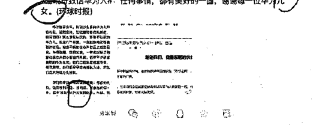

## 我喜欢海尔格力，不喜欢华为

这不是气话，我家的空调是海尔，十年了，质量非常好，特别是服务人员，电话联系了，准时到达。丈母娘家的格力空调，用了18年了，正常运转，加了几次制冷剂。

但是，我那华为手机，两年后就破损的不像话了。我也没提什么要求，只用一个微信支付，能不能恢复出厂速度？我花三千多买个手机，也不能算啊！

## 华为应该谦虚一点

我买了个华为手机，三千多块，也是我的辛苦钱。用了两年，就速度慢了，我反馈一下用户体验，你们知道了，今后改进工作，这是很正常的。但这两年并没有针对老机型提出改善。突然一群人来骂我，何必呢？

我不上报的，要想越总，也没什么！

## 蹲在墙角里抱头痛哭

我在家用 iPad，超过一万大的大额支付，一般是刷卡，节约点手续费。只有出门的时候，微信支付，买个菜，吃个小馄饨。但是，就卡在了手机慢这个问题上。买的时候，华为 mate7 速度很快，真是健步如飞，营业员给我展示的时候，我很激动。现在的速度，真是蹲在墙角里抱头痛哭，还被那些水军嘲笑。

## 身价几个亿的老板，实际上日子很普通。

你肯定要骂我了，你是不是嘲笑我们？还真不是，我就说老熟人王冶。

厂房土地，5 万平米，地级市有土地房房产证，大概 2 个亿净资产。机器汽车原材料，0.5 个亿。每年利润 800-1000 万。三个股东。人均 300 万，去掉税费，人均 220 万左右。实际上又贴进去当流动资金了。

银行欠了 3 千万。每年利息 180 万 ~200 万。生产流动资金需要 1000 万左右，到处搞不开哦。工人工资每月 80 万，一年就要 1000 万。一说到过桥资金，基本上就是条死狗了，这么多麻烦事，只要一个环节掉链子，他说完了。

现在，生意不好，互相三角债，到了晚上十二点，还有人能来账。你说憋心吧？

## 我告诉你一个身边的笑话

有个老板，身价两三亿，还住在省城八十年代的老板中房子里，小二层居，55 平米。单位分的。为什么？因为这么多年，就拆不出一笔买房的空余资金。

创业，还债，招聘，买门面，买地，买机器，建设厂房，装修，员工宿舍，设备更新，三角债，银行贷款，一个贷一个，二十一晃就过去了，搞成现在这样了。

最近，孙子出生了，他才发现，好像房子不够住了。

## 现在的中小制造业情况

首先说，主流是好的。

其次，也有一些混得不好的，拆东墙，补西墙，经常被要债的堵在办公室里，肆意谩骂。

我就说说这些混得不好不差的。债务不多，生意不好，泪眼模糊。厂里的水龙头，就和老板脸上的褶子一样，越来越陈旧了。

- 1. 第一代创业养老了，接近或超过退休年龄了。血压也高了，三高也来了，心情也不是很好。这几年基本是苦苦支撑。但是，开个厂，十多年复例，还有个老板新年，在亲戚面前还有点面子。

- 2. 设备更新换代，基本不输了，候台用吧。实在不行，某几个环节外发加工。

- 3，还能接到一些单子。几十年下来，老客户认人的，单子也不多，因为价格越来越高了。

- 4，厂二代基本不接手。一是没什么前途，二是管不住那些老油条。小时候叫他们叔叔阿姨，现在还叫么？读书好的，当白领事业编读，读书不好的，自己开个店，干什么的都有。

- 5，老同志们还在厂里混。反正还有十年八年退休。按照劳动法，厂里也不能开除我。老板也不敢开除我，你掌握我的一些不说说的事情，闲起来也难看。

- 6，有单子就接，老板也无所谓接多少，但不能亏，发个工资就行了。没单子，就打牌喝酒，找财务老阿姨说说笑笑。基本上，70%的时间还是有件事情做做的。

- 7，哪眼望去，都是老家伙，年轻人不来的。这另地方。

- 8，厂房开始收缩。退租或者租出去几个门面，老板拿去当生活票。

- 9，最大的盼望是，地铁轻轨高速，修过来了吗？要是拆了就好了。

## 为什么制造业小老板盼拆迁？

即使土地厂房不是自己的，一些小老板也盼望着拆迁。因为拆迁可以顺利的歇业了，工人赔偿也有拆迁买单，拿到一些补偿款，债务也基本了断，安安心心过渡了。

现在头疼，工人很难拿不出钱，三角债不断，订单不满，效益很差。关也关不掉，活着也很难看。

如果厂房土地是自己的产权，有证的，那简直就是上市的感觉了。本来根本卖不掉的厂房，一次性卖出了高价。今后吃利息也卖了。

## 我我现在越来越理解。张学良当年干掉杨宇霆的心情了。

目前很多富二代接手企业，也面临相同的问题。

拉队伍和千企业，道理是一样的。一群找不到好单位的人，抱团求生。如果碰巧做事做大了，每个人的利益就分化了。企业垮了，董事长秘书不会太难受，他们这个工作履历，另外打个工也不差，但是董事长该全家蹲折腾了。

一个企业快速做大，方方面面部是不规范的，上半身只讲速度，很多事情是睁一只眼闭一只眼。部门经理完成业绩后，自己搞点意思，欺负供应商，包个小妹，董事长也不想翻脸。但是，下半场，生意进入平稳期或者下滑了，那只能内部挖潜了。

内部不规范的本质原因是，有其他人好处少了。富二代要想改变，必恭得罪了其他人的重大利益。你规范采购，副总一年就少了几十万好处。你规范发货，销售部出差就没人请客喝酒泡茶桑拿了。

富二代接手后，面临一企萎缩老化的空架子，肯定要求变化。但是，得了好处的副总不想变化。他们希望这个人才辈出的富二代董事长，出面贷款顶雷，他们在底下舒服服服好好处。你垮了，他们无所谓。要么你动了他们的利益，他们千方百计给你出难题。无论你怎么改，他就会编出一大堆麻烦事情，让你变差。如果企业出现损失，他就把责任全部推到你头上。再享众乐独的路上，一脚，不听老人言，吃亏在眼前。以前都没有这样的事情呀。你肯定大大了。

你也不敢开除他们。这些人掌握了企业的各种规律，有几个可能性：

- 一是告状举报，这也违规，那也违法，企业很难报销。
- 二是出走企业，例如到竞争对手那里泄露客户名单，进货渠道，产品成本等。你也拿他没办法。上哪证据啊？
- 三是出工不出力。他表面认过了，但是干活不卖力气了，遇到事情，第一反应是推卸责任，别找我，我管不了。

大部分富二代，就算在老爷子的肩背支持下勉强接下来了，但是一旦老爷子病倒了，企业也就会越来越差。怎么办？很难办。

大体上有几个套路：

- 一是和平购买。你有功劳，给某一笔钱退休，转冠释兵权。但是，给多少呢？人心不足蛇吞象，你老板开大宝马，我也搞个小别克吧？你一年千万，我搞个百万年薪？问题是，这么多副总，怎么可能满足？
- 二是另起炉灶。老爷子海空老厂，挟持富二代的新厂。但这也会有个问题。如果新厂是其他行业，没经验，不一定赚钱。如果同行业，就会互相竞争，两败俱伤。
- 三是股份制改造。这个更加荒唐了。一开会七嘴八舌。赚了点小钱，立马要求分红，不分就闹。没事就来查账，老子也是股东。股你妈的，滚！

## n+6，还是有点良心啊

独家 | 甲骨文北京区域首批裁员约500人
补偿标准为N+6
21世纪经济报道 21财经APP 魏亚萌 北京报道
2019-05-07

5月7日，多位甲骨文中国员工向21世纪经济报道记者确认，甲骨文今日上午召开全员大会，正式规定了中国研发中心裁员政策调整。大会结束后，甲骨文中国立即开始对所涉员工进行一对一面谈。

“我9：55参加的一对一面谈，最终的补偿方案是N+6。”一位甲骨文中国研发人员告诉21世纪经济报道记者。按该员工透露，按照其所在组别的裁员比例而言，本次北京区域需裁员人数大约为500人左右，其他城市也会进行裁员。

在本次裁员大会上，甲骨文中国方面表示，这是一2.非常艰难的决定。面对快速变化的商业环境，甲骨

用二十多年见证了一个时代。我们毕业的时候，外企是镀金的单位，现在混成这样了。

谢谢曾经的外企，走好。我们加油，做大做强有些单位！

## 释放2800亿，全部用于民企和小微企业。

我一直认为，正常经营的民企并不缺钱。民企偶尔上大项目，例如厂房改造，设备更新，需要借点钱。正常情况下，包括小微企业，流动资金要求不高。民企不缺钱，真正缺的是利润。没有利润，股东不敢投资，最后变成了缺钱。利润问题不解决，银行贷款给他，无非是最后把小老板家里的房子处置了。

小微企业税费负担，从来就不是主要问题。中国经济的巨大腾飞，就是小微企业一步步扩展壮大的过程，以前税费更高，还是发展起来了。小微企业最大的成本是社保，这个负担非常重（我没意见)。

小微企业目前普遍交不起社保的情况，但是，这些小老板迟早要倒霉的，员工维权意识非常强大，现在拿工资的时候不说，辞职了，退休了，要去告状的。

我是高度赞同社保的，但有两个问题还是要研究一下。

- 一是医保使用效率。到底怎么样？我去医院，那么多多成药，我也不吃就扔了。这钱是医保的，能不能节约一点？
- 二是民营企业社保，大国企能不能分担？国企占用了全民最好的资源，但在解决就业问题上还不够，民企承担了80%的社会就业（社保）。小微企业的业务很不稳定，三个月没生意就垮了。大国企的业务很稳定，能不能部分承担一点社会保险？例如五五开？

当然，这只是理论思考。不足之处，大家批评。

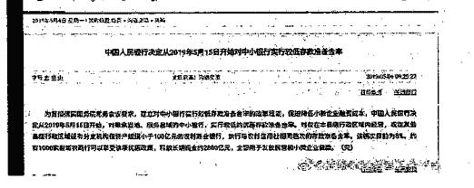

## 老一辈开厂的人。

很多人对马爸爸有想法。倒不是竞争失败，而是被打了措手不及。

我们的流通很糟糕，历来是层层批发的，最后的零销售，各地区定价不同。南京西路的房租和蚌埠的摊子能一样吗？淘 b 网强行把物价拉平了，但没有给开门人的一个解决方案。

我们是当年亲身经历过的，那个过程非常惊险。淘 b 网刚起来的时候，物流不发达，我们就避开大城市，在物流到不了的区域开厂。生意每天都在萎缩，每个月都可以接到门店和我们绝交的消息。淘 b 物流到哪里，我们就在哪里崩溃，淘 b 无法去我了，我只能卖品牌了。

后来，我们就转型做品牌，东西还是那个东西，小店铺老板自己去注册一个商标，我们给他贴上去。最后变成了一个产品，几十个牌子。这样做的原因是，大家对质量也不上了，反正，商标是小老板做的，做做了，换一个商标也无所谓。法人一个商标也就是几千元。

质量全靠一张图，照片好看就行了，只要三万不到，万事大吉，最后直接变成了价格战，小店铺被四处打倒后，我们千方百计的压低成本，最后，内环就找绿，大概是 1.5-1.8 万单价。当中有家家庭生活费是两年内环线漂壳小区的租金。就按这个目标配置资产。一把梭哈进去。

卖设备很简单，你去车网试一下，给钱拿走，我们拿到钱后，也是很紧张，不知道该怎么办了？

然后，我和亲戚准备去找工作了。亲戚原来是做财务的，我也准备他翻译了。本来以为，这日子就这样了。没想到，四万亿来了，我那天在吃面条，当时激动的跳起来了。我是金融专业科出身的。当然知道这是什么情况，后来，我就成为了作家了。

## 罗永浩的手机失败了

我在他意气风发的时候反复嘲笑过他，罗永浩不服气，还转过发。事实上，我当年的说法是有道理的。现在不应该再嘲笑了。今天，我们分析一下他失败的原因。什么“心太大，入错行”之类的文学语言，那是讲笑话了。我们站在企业家的角度，复盘一下。

- 1，首战即败，是认错了敌人

当年，手机价位高中低三档，很清楚的。

高价，苹果。

中价，华为，

低价，小米红米。

特色小众，例如 OPPO 音乐手机之类的。

如果你是罗永浩，你选择攻击哪个对手？苹果，不可能。华为，人家几万个工程师，你也打不过。小米是网红低价，OPPO 是音乐方向，vivo 是拍照方向。

实际上，罗永浩当时要是把锤子往手机方向帮，例如最好用的发烧裤手机，还有一丝活路。结果，他不愧是文科毕业，居然选择了“超越华为”的自杀性任务。

当时，华为手机价格是三千多一點，他定价是四千多。接近苹果了，我当时就说，没人买的，引发了巨大争议。因为有一批锤子粉疯狂的吹捧罗永浩，作为一个文艺工作者，罗永浩是非常享受这种待遇的。结果，首战崩败。

- 2，二线再败，是找错了原因

锤子第一战就输了，但是他不认为是手机定位错误，在疯狂的锤子粉丝爱戴之下，他只是把原因归纳为各种准备不足之类的。第二个手机的定价我印象中是 3500 元，还是在华为之上，我当时说，锤子应该定价 1900 元，被锤子粉疯狂怒骂，结果罗永浩又输了。

- 3，后面还有几个新产品，我根本就不关心了。在制造业品牌中，战败两次都彻底结束，不可能再有机会了。因为供应商和生产商已经不相信你了。锤粉算个毛啊，都是生活费不足两千的穷大学生，特别是河南山东的多。

- 4，锤子没有什么强大的技术背景，说白了就是买一堆零件的拼接机。如果走特色小众路线，是完全有机会活下去的，最后卖给他个电商品，当个特色专用机，不至于彻底败光。但是，罗永浩是吹他的手机是全面先进，东半球第一，这就没法圆回来了，把自己挂在旗杆上，下不来，结果真挂了。

## 我和大家说个小秘密

但凡看到那种拼了命做小生意的，一天到晚不停的那种，年入三四十万是起步价。

## 制造业的未来，主要是电商大佬们的。

互联网销售基本饱和了，大江南北的任何一个角落里，都可以看到微信支付，几大网络巨头。当今社会，只要能经营的，基本都上网了，学不一会的，也不可能再成为新流量了。每年的增量也就是几百万高中生。这个不多的。

销售饱和了，但这只是上半场。下半场的重头戏是，网络巨头直接生产了。通过分析大数 据，挖掘出热门标准化日用品，直接自己下单生产了。中小制造业，多小散乱差，面对几千亿资金实力的 倪然大物，技寒并无毫无悬念的。唯一的区别是，什么时候被兼并。

目前看，大欢已经拉开了惟幕。第一步是面大最广的日用品。类似于牙刷，床单，毛巾，拖鞋 等标准日用品。大环境的大方消费者，送假货款都买卖，不在乎品牌，便宜好用就好了。日用消费品， 也不会坏的，一次性生产两个亿，贴上“某东自营官营”商标，慢慢卖。假以时日，绝大部分小作坊 公司是要被淘汰的。

接下来，五花八门的制造业门类，会被一个一个爆破。这是符合逻辑的。

## 一，有利于提高行业集中度

各行各业若像空调彩电一样，只剩下5-10个品牌，这个行业就实现了价格物美，而且管起来容易。

## 二，有利于提高研发实力

小乱散的公司，研发实力不够，产品档次上不去，只能是重复。巨头进来了，完全不一样了。

## 三，有利于形成行业平均工资和职工队伍稳定

千家万片的小生产，员工流动性大，三天两改谈工资，烦不胜烦。我相信，空调厂的员工，估 计没什人去谈工资了。既不多待你，也别想太不多了。

## 四，环保，质检，社保，治安，卫生，方方面而就好管了。

各种小制造业老板：你们要想办法突围了。你们大概还有5-8年。十年前，各地的零售卖场是 怎么被干掉的，制造业也将是同理会。暂时无忧的有：

- 1. 带有半服务，半生产性质的商品，例如服装类，需要试穿，很难标准化。小阿姨们有钱了， 又胖了，网上很难买到合适的。
- 2. 服务业，暂时无忧。理发，发面，不能网购。
- 3. 高附加值的小众商品，大佬们还顾不过来。
- 4. 不适合快递的商品，也不搞它。例如各种国产饮料，太重了，完全不怕网购。

如果你家的商品，没有什么特色，又适合网购，例如滑板车，你们就不要盼望什么一厂传三代 了，不转型，肯定是完球了。

## 说句平庸的话

几百几千万亿的大佬们，逼可而止吧。家里有几十亿的资产，也差不多 了。今后的注意力不要单 纯放在赚钱上面了，而是要着眼于科研科技，追求科学皇冠上的明珠。小钱不要再赚了，给普通人 留点余地。这才是求福之路。

## 企二代接手的共性问题探讨

老爸管生产，老妈管销售，儿子管物流和行政。全家年入几百弯，辛苦也值得了。儿媳妇滴滴 的，好看不好用，帮不上忙。但是，今后父母退休，儿子必须独自挑大梁，但儿子确实管不过来， 技术，销售，采购，催款，推广，没那么容易接手的！任何一件小事就可以折腾你三天，还 不知道 怎么办。

与此同时，一旦管理失控，员工里的坏鸟也多起来，捞好处，吃回扣，偷东西，各种浪费就来了 ，企业就会很快亏损倒闭。

这个问题是普遍情况。现实中，企二代迫于无奈，使出的黑招烂招很多。我见过小二当部门经理的，还生了几子。当然，我们也不能提倡这个。

这个问题是 80 后富二代的普通痛点。老一代人因为各种原因，无法建立管理流程，全部是靠人管。这样做是合理的，**层层管理，成本太高了**，小企业受不了。父母一代从小生意做成大生意，能力水平已经丰富了，但儿子没有这能力啊！

把权利下放给部门经理是必须的。但是，部门经理也不见得是好人参，吃素卡要怎么办？说来说去，就是缺乏智商双全的贴心人。

**思路一，只求老实，不求能干**

部门一把手，选得老实人，尽可能避免大面积吃回扣。但是，这个办法后果是，老实人干起蠢事来，可能损失更大。只能是暂时的。

**思路二，选能干的，就让优搞点好处**

这种人初期是尽心尽力的，但是人心不足啊。你暂时的让利，一旦他习惯了，马上就会提出更大的要求。所以，这也是暂时的。

**思路三，双正职**

老实人管方向，聪明人管业务。这个办法成本大，效率低，双正职经常闹矛盾，你也烦，我也烦。也不可行。

**思路四，换个能干的婆婆，再拉几个小筷子进来，替我看好各个关口，晚上关起门来分钱？**

**思路五，全面转向现代管理制度，生死结一把**

现代管理制度，不是什么神秘兮兮的东西，就是开发票，上社保，全做账，全考核。但是，绝大多数小企业，因为缺乏进项发票，如果这么干，会把利润吃光的，原来年入百万，现在年入十万了。利润少了，成本反而大了。因为引入考核机制，各部门就要多养一个人管数据，填表格，分派责任。

企业原有规模肯定是扛不起这个成本了，必须快速扩张，通过做大规模，抵消成本扩大。但是，生意是那么好做的？一扩张就发财了？没这么简单。

综上所述，我也没法办了。

## 有个创业项目，大家思考一下

最近，身边有几位朋友陆续装修，遇到一个难题，预算看不懂，报价也无从下手。如果哪位同学熟悉行情，我给你们指个路，一份报价单收八百一百，给大家看看，是不是合理？哪些地方要注意。这个项目，我估计有需求。现在，上海每年几十万套新房装修，单套 25-40 万是普遍情况，一千元可以接受。

## 中小企业内部股权分配，激励部门经理？

你大概吃错药了！这种漫主意都是大学里的 250 刚离出的。副高和老总，最大的区别是，想问题的思路相反。

副高是正着思路想问题，大老板股权分一分，就是一家人了，荣辱与共，一起奋斗，把企业做大做强，共同发展。大概只有傻子才会相信这个。

我们做企业的人，第一反应是，分不下去。我这个公司，里晃外外，七七八八，也做个三百万


# 做一股生意

千万不要找外部合伙人。

按合伙人，绝大部分是撕破脸结束。公司做好了，固定资产几千岁了，互相争权夺利。采购经理让我妹去做，做了，怀疑大股东拿了钱，掏空公司，你要交代这笔钱！

“好好好，我害你了，二股本来嘛财务总总总行了吧？”还是不行。因为我决策买个大设备，我不同意，就算下来利润率太低。你给王小姐加工资，我也不同意，谁知道你们是不是有一腿？

愿意说，“开董事会啊！”你看啊！中小企业最大的优势就是，快快快。各种事情如果开会做决策，你以为是大单位啊？我在武汉要下个订单，你不同意，让我回蚌埠向董事会汇报工作？老子一脚踹死你。

为什么会产生这个问题？因为人的思路不一样。就算是两口子，装修完了说离婚，就算是模范夫妻了。有时候为了瓷砖铺什么颜色，夫妻两个可以在市场里互相打起来。到了公司，这个问题也是始终存在的。

谈合作的时候，大家互相吹捧，其乐融融。干开了，大老板有钱，想做大做强，二老板是小户，只想每年分红。每家每户，情况不一样，想法就不一样了。大老板确实常常欺负小股东。小股东也很可怜。马动志，全家勒紧裤腰带投进去八十万，原来指望三年翻倍买房，现在搞成这个样子，钞票都变成机器了，我不服，我要闹！

大老板说，“闹你个锤子，老子说了算。”

小股东说，“你信不信，我现在就告去各个部门告你。”

这种纠纷，此起彼伏，多的一逼。所以，现代管理制度，没有一个亿，你别多想了。这事情和你没关系！

# 兄弟姐妹，抵不过300万的损失

大哥白手起家，做大做强，把四个下岗的兄弟姐妹全部拉进来做当部门经理。时间一晃二十年。兄弟姐妹，现在也都开好了，人手一笔，买了漂亮房子了。

在发展的过程中，公司有过两次大飞跃，更换生产线和建标准化大厂房。兄弟姐妹全部出了钱，大家也取得了相应的股份。建厂房便宜，一平米一千元就行了。大家热情高涨，全部投资。

老一票现在也六十多岁了，二代先后进入企业接管，人多嘴杂，最后形成了规范的董事会制度。当然，也没那么严格，一次超过一百万开支，才需要开会。老大每年大概赚三百万利润，四个兄弟姐妹分，每年分别拿回去六七十万。子女们名义上还是股东兼二代，大哥是功臣至伟，全家英雄。

前两天出事了。大哥去银行贷款三百万，暂时闲置。这时候，有个老熟人来说，要过桥资金，300万半个月，利息20万。老大哥这个事情以前也做过，利息都进了自己腰包。这次又借出去了。没想到坏事了，对方跑路。

借款，其他利益确实知道，但不太清楚细节。事发后，这300万算谁的损失？老大的意思是，算公司损失，兄弟姐妹不服了。你没有经过董事会，这么大的损失，是你的个人行为，你赔。老大冒火了，当场摔杯子。兄弟姐妹不敢多说，二代们不服了，跳起来指责，“现在是董事会了，你不要一手遮天。”儿子女儿，女婿儿姑多，哭的哭，闹的闹，简直是鸡飞狗跳。

## 几个亿的大老板管不好一个厨子

企业都管饭的。厨房是承包给厨子。看上去好像很正常，但这里面，乌七八糟，花样多的一逼。（个别情况，不扩大化）私心厨子，无论工资发多少，还是要偷东西的。米面油，肉蛋菜，有什么，偷什么。但是，企业发给厨房的钱是固定的。厨子要是偷东西，或者少采购，就要克扣职工饭菜质量，但这种事情很难拿证据。

你说这一大锅汤里，有十个鸡蛋还是三十个鸡蛋，谁也说不清楚。如果厨子一顿饭二十个鸡蛋，一天三顿，一年下来不得了了。这只是鸡蛋，米饭质量也是问题，买菜价格也是问题。

终于，部分员工借着饭表里某个小事情，闹开了。员工坚决要求开除厨子，厨子哭天抹泪说冤枉。一个车间下午就不上班了闹，董事长没办法，开车赶回来查菜。怎么回事呢？为了平息矛盾，只好先让厨子回家。厨子说，合同签一年，我三个徒弟的损失怎么办？

董事长没办法，一咬牙，赔了15万。员工满意了。但是，第二天怎么办？没办法，另外找了个厨子，质量还不如以前的。员工又不高兴了。董事长说，谁不高兴，你陪同去买菜。有个员工举手同意去，第二天早上五点就去菜市场买菜。干了两天，没一个员工满意去了。

一切照旧，就是董事长后悔，赔了15万。

## 哪个老板有钱？

一万人的大厂，两三百人的中等公司，哪个老板有钱？

屌丝肯定以为自己看错了。还有这么提问的吗？老板是坏？我不蠢，我只是比你见得多。员工厂多了，具体不说了，就提个A股中型公司吧。老板一算，自己持股权15~17%，卖股，15亿啊。你贩卖吗？基本卖不掉的，你要卖一半，提前几个月公告，股价直接跌到地板上，你试试看！

老板的吃喝玩乐，无所谓，公司包了。但是，大型企业的财务制度非常严格，要想花自己两千万买房，我的娘，这事情复杂了。

大部分A股老板工资是不高的，你去看看审计报告就行了。要想来钱，有几个可能性：

- 一是你爹靠小金库。出问题，你就完了，法律责任大。
- 二是股权转让，两千万这个档次差不多，再多，市场就怀疑你了。是不是公司不行了，你想跑？
- 三是自己给自己加工资。股东大会一般也很难通过。

一个中等A股的大老板股东，社会地位高，可以让很多人发财，但自己收入也不会太高很多。相反，一个两三百的优秀大餐馆，生意好的时候，绝对不比上市公司老板差钱，当然，社会地位很差。

## 部分小老板就是个班组长

最大能力是管七个人，加上自己，一个办公室坐满。所有人打电话，他听得到。什么事情，小老板都知道透，判断问题，又快又准。公司效率高的一逼。这种公司，除了兼职会计每个星期来一次，没有其他人任何用人，一人就是一个部门。

如果产品对路，小老板赚钱是很容易的，一两年后，达到年入百万算不多的。但是，到了这个阶段，往往是危机四伏的时刻。

- 一是小老板懈怠了。拼命赚钱为了啥？天天上班，一天忙到晚，赚上了百万，全部便宜了家里那个胖女人，实在是苦心想啊。有点厌倦了，懈怠了。
- 二是小老板骄傲了。你只要赚钱了，永远不快乐享受你的人。很多小老板被在这个氛围里，慢慢骄傲了，读一期MBA总裁班，自己觉得无所不能了，巴菲特常个鸟，马云也不过是这样气好，我比他们厉害。
- 三是小老板膨胀了。既然我管七个人，可以赚几百万，是要管四十个人，是不是就可以赚几百万？手下的骨干们一致叫好，欢呼雀跃。因为膨胀了，他们就是中层干部，还要加级，至少有八个小助理可以管一管了。
- 四是小老板贪欲上来了。既然大家都这么有信心，那就扩编。

这下子热闹了，办公室不够了，再借几个办公室。一个老员工就是一个部门，我的地盘我做主。中层干部们互相开始防范，互相偷做。吃肉喝汤也开始了，虐待小员工也开始了，威胁手也有的。

小老板也开始觉得，人生真美好。你看，没人烦我了，什么事情都有部门经理去挡一挡，我就是提提要求，做点指示。老员工们都是农村来的，别的不会，尊敬领导是一流的。每个细节都得领导弄得像个当家的。什么事得都开始走流程了，中层开小会，小员工不能来。

小老板关起门来，开始不掌握一线情况了。他也没当回事，这点事情，我们管啊，怕什么。嗯，新来的女助理，还算漂亮，小地方来的，家里也没什么钱，对我一脸崇拜。想办法要亲一发。

公司走到这一步，当老板觉得自己轻松了，这个公司基本就完了。

## 富二代和老臣

回顾历史，人世间最危险的位置，大概率是开国维勋的后代子。五代十国就是这么来的。乱世枭雄一般是全能冠军，手下猛将如云，打遍天下无敌手。问题是，一代枭雄压迫的这些骄兵悍将，但是换个小周到，下面的猛张飞不听活，怎么办？

宋朝赵匡胤挂了，弟弟接旗。明朝朱元璋为了孙子上位置，杀光了所有的左膀右臂，最后还是被朱棣钻了天下无将军的空子。清朝皇太极意外早走，手下实力最大的是弟弟多尔衮。皇太极的大儿子豪格，实力不够，碰巧的是，多尔衮没有争议，宝寨闲除了皇太极的好儿子，算是历史的意外。

铺垫了这么多，我想说的是，中国的第一代大富豪们，已是具有不好过，这些人大概是50-60岁了。独生子女刚刚大学毕业，若有私生子女还小。子女聪明劲是有的，但实力不够。一起打天下的老臣们私下是不是实施呢？

山西乔家集团没有处理好。老帅突然设了，二把手弟弟出局。还在读书的儿子，突然间成为几百人的一把手，不到十年，从名誉首位为破产清算。具体原因我也不知道，但老一代的左膀右臂都歇了是基本事实。

上海耀斯集团处理的很好。老帅四十岁不到因癌没了，估计子女还小，弟弟接手实际管理，企业欣欣向荣，发展壮大。

这些事情显然是个案，但是说明了一个问题，企业传承是很困难的。很多屌丝不知道有什么困难。我给您简单讲几句。（不是指具体企业）

- 一是对于老关系。场面上的人情，没有什么记录的。一把手突然挂了，人情关系，只有最边上的二把手知道一点点，如果二把手出局了。这个线就断了。
- 二是对外关系。商场凶险。险在哪里？不讲诚信。一把手历经坎坷，对这些商业伙伴怎么制的利用，察言观色，心里大约有谱，风险不大。小阿哥上来，啥也不知道，老臣们不把关，不出问题才怪了。
- 三是对关系，大部分企业都从零起步，不太规范，内部乱七八糟的事一大堆。如何利益平衡，互相抓住把柄，确保不翻船，老板知道，小阿哥下来坐地位，也不知道，也不会掌控，一有利益冲突，很快就失控了。一拍两散，大家一死球。
- 四是技术生产。这是企业的命脉。小阿哥一时半会儿学不会这么多事情啊。但是，企业的原材料采购，技术引进，设备更新，追在眉睫，全是钱啊，不被骗了才怪。
- 五是销售平衡。略。

大企业就是一堆钱，这么多真头方阵的救命事啊，刻不容缓，这么多心狠手辣的老江湖虎视眈眈，让一个还不怎懂事的大学生去一个一个搞定，几乎不可能。这时候，最靠谱的应该是，熟悉情况的副总，死心塌地辅佐。小阿哥最大限度让利，在今历的五到八年里，学习各种知识，保持企业发展，然后培养自己的心腹。或者副总上位，子女退群，拿个红利。

话说起来容易，但是这活造度太高了，每一件事情都可能稳枪走火，人心不定纯套套，最后，往往是一场鸡毛。

企业家早点培养子女行不行？还真不行。年轻人总有个成长过程。你让20岁的人理解40岁的思维，很难做到。

最好的办法是，老掉渣活到70岁，把老臣们熬到退休，子女40岁成熟了，才有可能接的住。但是实际上大部分接不住的，市场风云变幻，谁有本事做到一步不差啊？

## 富人是怎么消失的？

我遇到过一个富人，欲企业成功了一辈子，最后一分钟出事了。他把所有的生意安全结束了，自有资金，盖了一个大厂房，占地巨大，漂漂亮亮。工程竣工了，这等于安全了。剩下的银行贷款，靠租金也解决了。就在喝庆功酒的那一天出事了。

他在车间安装了一个升降机（不是电梯），升降机不知道什么原因自动起降，一下子死了一两个人。这死了得，一大群各局们的执法人员找上门了，查封，调查，罚款，又进击配合调查了。被害人家属发了疯的堵门阻事，这个企业的房子租不出去了；银行贷款又起诉查封了，一个接一个的破案，最后把这个老板烦得精神崩溃。

这或许是个例，但是每分钟，每个角落，都在发生各种各样奇奇怪怪的事情，这些事情追根溯源，最后基本会扯到富人头上，这些资产是你的啊，你怎么能躲掉？

## 企业文化

当企业开始说文化了，说明老板对企业已经非常不满意了，但也没有好办法，也不想加钱，实际上也没钱。怎么办呢？洗脑，希望员工以大局为主，自觉自愿做好事，大家算是帮忙帮忙好伐？洗脑这个词太难听了，换个词，叫做企业文化。实际上，泛泛而谈的企业文化，毫无实际意义，大家都在做表面文章。

最好的办法是，制度管人。但是，谈何容易啊！大部分中小企业做不到制度管人。

- 一是成本太高。制度本身的制定，就是一个非常花钱的事情，绝不是什么网上抄一个那么简单。而是要把企业中遇到的问题和解决方法写进去，还不能太露骨。我见过一个劳动法专家，开价20万起稿，写的是真有水平。
- 二是人才匮乏。HR慢慢的也有自己的利益要求了，老板等于给自己找了个麻烦。
- 三是相互制约。老板也有小脾气，员工三天两头告状，也是麻烦事情。

大部分初创企业活不长，就是管理问题解决不了！人员成本越来越高，效率越来越低，大家把主要精力花在加工资，吃回扣，推责任，乱拉皮。老板也搞不清该谁对谁错，只能是两边安抚。最后，遇到一个大的行业寒冬，销售滑坡，企业就挂了。

也有一小部分企业，做大做强了。这种企业只有一个特点，突然出现了暴利，例如商品畅销，大把大把的钱进来了。这时候，老板底气足了，愿意花钱解决内部那番问题了。先把自己的漏洞补好，该充的钱交了，该修的修好了，回头开始收拾内部那些漏蛋了。

通过治理整顿，形成了小而全的管理模式。企业如果赶上周期性繁荣，通过三年的内部治理，基本就稳定下来了。但是，这种情况少之又少，运气比水平更重要。

## 农家乐，日渐式微了

农家乐是七八年前，有关部门为了鼓励农民在家门口致富，推出的商业政策。鼓励农民在农业性质的土地上，盖一些房子，搞餐饮旅游，宾馆停车场。我去过一些，都是依山傍水，环境优美。但是，农家乐也有很多现实问题。

- 一，和商业用地形成了利益冲突。随着城市开发，商业房和农家乐房子，越来越近近了，两者的利益冲突是很大的。农家乐是无证建筑，成本就是砖头，商业房就惨了。
- 二，污染大。农家乐，人多生意好，形成了越来越多的污水粪便，餐余垃圾。农村管网建设薄弱，污染去了哪里，心知肚明。
- 三，管控隐息。治安，消防管控，也有一些难度。
- 四，利益分配。农家乐的规模，一般远远超过了农户自用的面积，涉及到集体资产，例如山林，水流，空地，道路，噪音，游客破坏，污染，投资主体和分配比例，怎么划分，也是困扰。以前大家没设搞建的，或者其他村民现在觉得吃亏了，往往有些内部纠纷。

# 99%的企业永远做不大

我们经常见到某些中小企业，产品好，价格好，但就是做不大，或者一做大就完了。这是正常情况。

一个企业，是由各种细致入微的事项组成的，但这需要消耗巨大精力。当企业还小的时候，老板一个人就管的住。但是，企业做大了，老板要管的项目实在是太多了，就没时间管了，就只能授权，采购时价，销售自售，招工自搞等等。你不管了，部门经理就疯了。各种捞好处的事情，就愈演愈烈了。老板垮了，关我什么事。

老板需要的是，智勇双全的战斗机，但这世界，哪有这种人人啊。核算有，你给的起多少钱。一百万，两百万，都不够，他们要的是—字半肩云，甚至是反客为主。于是，很多企业稍一扩大，就出现效益崩溃，再次收缩。

很多人以为，采用什么参谋之类就好了。其实那是胡扯的，奖金能有多少？一次翻过天海就超过了奖金，没用的。

## 企业诸侯制

专业性大企业，往往是采取诸侯制。

大家共用一个招牌，各白为主。总部提供技术支持或者产品生产，你完成一个包干任务就行了，剩下多少都是你的。这种企业最容易做大。但各路诸侯也会不断的产生新麻烦：

- 一是霸蛮，互相抢地盘，跨区域销售。
- 二是吃里扒外，用总公司的资源，扶持其他自有品牌。
- 三是不考虑品牌价值，胡乱降价，把牌子越做越烂档。
- 四是拖欠总部的钱款，耍无赖。

# 你全家都是250?

turinanaro：菜某再声势再大妇的域，也没改变不了老板们还是最赚钱的事实。那么多豪华车都卖给谁了？苏浙的乡镇企业家不都过的好好的！

答：这么赚钱，你为什么不开厂？你全家都是250?

## 小老板真惨

《芝麻胡同》看了几十集了，小老板真惨。大老婆跟厨子遇奸怀孕。小老婆先被吴长言强奸了。长房门媳妇董阳僧被伙计睡了。儿子抗日回来，腿残废了，老婆也没了，儿子残别人爹。大伙计成了二老板，一顶顶绿帽子扑面而来，真是欢乐的海洋。

## 劳动法一网购

导致中国绝大多教行业不可能创造名牌了。

中国绝大多救制造企业，没有能力在全球各地自冒零售。举例，专门做裤子的厂，产品很畅销，但没有能力在全国两千个县注册公司，给营业员交社保。事实上，企业是通过层层批发销售。

但是，裤子出厂后就失控了，一些人开店，给消费者试穿服务。有的人不开店，鼓励抄号族去实体店试穿后，在网上满意。开店的人数倒大蹲了，白白付出了巨大成本，但没有生意。现在，这个问题基本解决了。店老板不要商标，只要白牌子，拿回去后，贴上自己注回的商标。

这就变成，同一个产品有几十个商标，杜绝了抄号族。但是，这也彻底扼杀了中国名牌的诞生。现在，只有那神需要售后服务的产品，例如汽车，空调，冰箱，洗衣机，可以侥幸逃脱抄号族。那些不需要售后服务的日用品，己经很多年没有出现过名牌了。没办法，这就是命。

## 你是大学生，你先说

过去十年，无休止的增加民企社便负担，是不可持续的。

这些年来，民企社保负抱实际上是每年增加，强制增加的。很多打工族认为，必须增加老板负担，增加企业负担！让我满意。如果企业老板无力承担，那就关门，让有能力承担的人当老板。这话听上去好像很有道理！

我们是高度融入国际贸易国家，商品出口的国际定价权，不是我们一卖说了算。无休止的增加社便负担，势必一个接一个的打破行业盈亏平衡点。举例，现在我们的低价原服都需要进口了，HMZara，绝大多散是东南亚或中国生产。越来越多的日用品企业搬到越南去了。

事实上，只有既不出口，也不进口的行业，可以通过转嫁成本，维持社保负担。例如房地产、互联网、医疗教育养老、烟草电力等。这些行业的成本通过无休无止的涨价，维持了就业人员的各种诉求。他们能够降价，无非是别人不能参与竞争而已。

为什么东部那么多制造业搬走了，苏州那么多外资 x 了，但是农民工的就业形势还是那么好呢？因为有三大就业老底。

## 一、互联网行业

这个行业诞生了无数的快递员。互联网分为两种销售模式：

京x是自负快送，看报表，京x好像一直没有盈利，说白了，是国际风险投资给快递员交了社保。

淘x是盈利的，但是无数的淘x夫妻，基本是不交社保的，这些钱给快递员交了社保。

## 二、基建行业

基建行业是完全脱离国际定价的，能够轻松转嫁社保成本。事实上，基建行业的劳务工，交社保的，也极少。但是，要维持庞大的基建行业，需要多少m2？你心里懂！

## 三、自食其力

遍布大江南北的小买卖，小劳务，小超市等。例如早点店，老板不像老板，打工不像打工，基本不交社保，保姆肯定没有社保。小超市，理发店，开盘车，金饭排，装修队等等，这些散布在城乡各个角落的小劳务，因为不交社保，自由灵活，托举起巨大的就业基础。

如果制造业创业人数下降，那么做著m2和国际风险投资能不能扛起来了？你是大学生，你先说。

## 菜菜：马勃龙醒！

```
凤凰网财经; #3.15#【脑门信念】#卧底调查外卖家#：厨师每天眯著看板饭，蔬菜不洗就下锅】 知情人卧底：“外卖家”某门店发现：①洗碗池里洗拖把，厨师每天踩著案板走；②花菜、金针菇、四季豆等蔬菜不洗就下锅，工作人员称不著心不经意吃下去了；③过期食材继续沿用，为应付检查，临时贴上当天生产的标签。
```

# 民企承担了80%以上就业

各种各样，五花八门的要求企业增加员工福利的建议，最后都是民企小老板买单。这是小老板光荣的任务，必须做好，做扎实，为民企献策。小老板，加油啊！

## 做生意要靠陌生人

除了体制内，其它吃提成的人，都应该做自媒体。以前还可以打商业广告，现在没人看电视了，报纸已经是老古董了，商业信息的传播渠道是自媒体。要是今后媒体把我搞了，卖卖点茶叶小铁箱，赚个行业平均利润，也是可以的。

做生意，熟人是没用。熟人唯一想法是：你不要赚我的钱，给我带点货，不赚是顺手的事情吗？你居然还想赚我五个点，你还要啥哟，上次我自敬你酒啦！陌生人其实更好说话，你只要卖真货，赚五个点，也是你的辛苦费，我接受。

陌生人怎么找到你？就是靠口碑和自我展示。口碑这东西，太慢了。偶发事情，例如加价，找律师，代认证，口碑可能是有用的。日常发生的商业行为，例如买茶叶，买箱子，一般人也不会互


### 企业贷款的抵押物

1. 上市公司基本是股权质押。
2. 非上市企业，主要是房产土地门面抵押。
3. 其他零零碎碎的品种，古董抵押，订单抵押，机器抵押，车证抵押等等，都不是主流，也就是捣捣花头。这也不能怪银行，因为这些杂七杂八的东西，银行很难估值，也无法变现，甚至无处可保存，你抵给银行，银行也放不下啊。

### 成功老板赚了谁的钱？

实际上是赚了那些倒闭老板的钱。我们仔细算算账，老板成功的，十分之一都不到，其他人亏掉的钱肯定超过那个赚的钱。1993年，改革春风吹满地，和亲戚家一起开塑料桶厂的有几百家，现在只剩下三家还在做了。

### 外地人如何在上海扎根和扩散

家门口有个小饭店，主要经营小馄饨，大碗面，家常菜。生意挺好的，老板是一对四十多岁的中年夫妻，带着一家亲戚在干。很辛苦，早上四点半就开始准备了。

他们的经营模式是最开放的学徒制。招工是一个老家亲戚家族，有老有少六个人，没有社保，工资就是个零花钱。老板负责教徒弟，徒弟拼命干三年。据他们自己吹，小店一年有七八十万利润（主要是帮手工资低）。

两年后，这个店口碑建立了，生意成熟了，老板就去另外一个地方筹备新开店。这个店就由亲戚独立试做一年，利润分成。第三年，老板把这个盈利的店整体转给亲戚。

这个模式非常有意思。

- 一，老板得利。带工六个，价值很明确，虽然很低的工资，干的全心全意，老板的管理难度极小，利润很大，没人要求加工资辞退。一年几十万收入，还省心。
- 二，亲戚得利。亲戚知道这个店，三年后是让自己的，学技术是全心全意，干工作是尽心尽力。

饮食店是纯体力劳动，讲究的是责任心。如果老板不在家，时间长了，质量就不行了。如果老板天天在家，就不能扩展，大家都累。

传授技术的难题也解决了。以前的手艺人，教会徒弟，饿死师傅。现在，师傅是全心全意教，因为三年后这个店归徒弟了，也没什么保留的。

但这个模式，核心不是不交际，是不是符合劳动法？

## 有没有cpa帮我看看

这个账对不对？

现在，对小微企业有优惠政策了。月销售额10万元以下的，免增值税（普票）。按照10%的净利润（去掉一切成本，人工，租金，装修等杂费），企业利润1万元，交5%的企业所得税，分红到手要交20%个税，小老板实际每月到手收入七八千元。

### 助力民企再发展

关键是社保和劳动法。

小微民企，实际上的税费是不多的。现实中，你去街上的小餐馆吃一顿，做个整扇门窗，装修个套餐小，也不会要发票。这话咱们点到为止。小微企业现在最大的压力是劳动法规定的各种隐性负担。小微企业现在面临：员工管理难，难度高，告状多，社保压力山大。

小微企业一年的利润，也就是两三个员工的工资。如果遇上几个老油条员工，或者有孕妇请长假，企业收入就锐减了。当然，我们没意见。

千言万语一句话，要鼓励民企发展，关键是让企业有利润。

### 先进制造业和基础制造业

都重要，要兼容包容。

先进制造业代表本地区最优工业水平，有利于长远发展，肯定是重要的。但是，先进制造业有自身规律：

1. 对就业的拉动是不足的。芯片制造，都是纳米级的精度，自动化流水线，不需要多少人。擦玻璃，拧螺丝，需要很多人。航空航天航海制造，单价高，利润高，也要不了多少人。
2. 市场容量有限。欧美日，67，人口加起来，不过是 9 亿左右。我们 14 亿人口，加上他们的 9 亿人口，占了世界人口的三分之一。如果都把先进制造业搞，卖给谁？亚非拉有多大的市场容量和消费力？

我们是人口大国，全面小康的基础在于充分就业。事实上，一般制造业，例如塑料料桶，做椅子，拧螺丝，而大量厂，网络极佳，是就业的主要组成部分。但是，现在的一般制造业，混的真不咋滴。

一，制造业第二代普遍不愿意接班，原因多种多样，但是，穷和烦，是主要的。与此同时，学校银行烟草的子弟肯定愿意接班。这话点到为止，不想惹事。

二，农二代也不感兴趣。原因也差不多。工资相对于其他行业不高，人比较辛苦，大多数是住集体宿舍。老板娘也在厂里宿舍住，你说还能怎么办？

说来话去，其实就是一句话，一般制造业利润太差，银行都拒绝。为什么曾经打造全球无敌手的一般制造业，现在这样了？说白了，负担重。

建议：切实落实上级政策，给中小微民企减税费减负担。可以力度大一点。等企业利润好转了，再加也不迟。

### 人人车踩刚劳动法

凤凰网财经：【人人车踩刚劳动法，离职职员上千人不胜任】# 人人车裁员 # 人人车一名车评估算师说 18 号早上他正常去上班，结果手机一登录人人车的内部系统，账号密码全部失效，所有其他同事也都登录失败。紧接着，主管直接公布公司原地解散，成都全城一百多号人，经理以下职位的人全部瞬间离职。据被裁员的说法，人人车给出的裁员方案是：1 月不给工资只给绩效，2 月没有工资，也没有任何补偿，要求员工立即签署主动离职协议。像人人车这种大型经济性裁员，按照劳动法，至少要领通金公司，向劳动行政部门报备方案，并至少给员工补偿 N+1 个月工资才行。菜菜：不胜任是不可能的。人均 2-3 万，也不多啊。

### 破产也要还债！

马鸿泉说会计:浙江台州一家塑料模具厂的破产女老板为躲避难欠员工的29万元工资，多年前从家乡离乡，辗转多个省市，靠做保姆、洗碗工等临时工作维持生计。今年大年初一警方终于将 she 追住并拘押。她落网后，经家属筹资，于2月11日还了其他欠7名工人4年之久的29万元工资。员工领到被拖欠4年之久的工资后终于喜笑颜开。

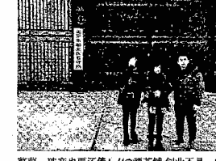

> 某荣：破产也要还债！//“儒家铺·创业不易，中国很多民营小企业主都是承担的无限责任，自己身家全都压上，稍有不慎，一辈子都翻不了身。

### 内地小县城电子厂也出现用工荒了

这是预想之中的事情，主要原因是劳动力低值的用工规定造成的。

#### 一、内地乡村劳动力的实际情况

乡村里的聪明人和强劳力，肯定是去沿海打工了，大基地，拾垃圾，贴瓷砖，一年十几万二十万，没人会留在县城拿三五千的小工资，还累的半死。

现在还留在县乡的中青年男性，大多数有自己的赚钱门道，例如运输，装修，小买卖，手艺人。被遗留在乡村的中青年女性，原因无外非照顾老人孩子。这就决定了县乡女工们不可能早八晚五的上班，只能是打散工。三天打鱼，两天晒网，老人病了，孩子放假了，就不来上班了。闲的说事，可以来赚个三瓜两枣。

#### 二、劳动法不做临时代性就业或单就业

二十年前，江浙沪之所以在农村发展起了私营经济，主要是因为当时劳动保护法不严格。劳资双方按照实际情况，因地利宜，你上半天班也可以，你干三个月也可以，不爽就算了。干的不好，我裁辞了你。工资互相提。

现在劳动法强调的是长期就业，农民工一入职就要五险一金，签合同，手续复杂，各种非常严格的保护，成本很高，企业付出这么多钱，就要加强培训考核，赚回来这个钱。人为加大成本后，企业自然不愿意找些心不全稳的散工，而员工也无法完成早八晚五的纪律性岗位，互相看不上眼，有岗位，没人来。

#### 三、大基地拉高了工资，农民看不上制造业

电子厂，不加菜三千，也就是个县城服装店营业员的水平。加班五千多，累的走不动路。班组长达还还要背大冒牌，上个月还得要资格，烦的一比。这个工资水平，完全没有吸引力。有这方气力，还不如去沿海打工，说方气，没时间的，找个小店，三瓜两枣个月拿销售员，赚点零花钱。中等年妇女去电子厂当流水线工人，真是没兴趣。

#### 四、高铁拉进了家乡的距离

电子厂打工，早上七点半或八点上班，都是在工业园集中住宿。这和去广东宁波打工是一样的，根本管不了孩子老人，最多是家里有事，回去快点。但是，现在高铁也快了。广东回家和县里回家，最多差半天时间。为了鲁儿的少几个小时，一年损失两三万的收入，这个账没人买单。

建议：发展制造业，应该实事求是地制定劳动规模，不要人为抬高制造成本。

1. 建议放开灵活就业。不要为了长期而故意长期。很多农民家里有老弱病残，并不适合长期高强度岗位，只是想做零个零花钱。劳动法带来的各项成本大幅度提高，企业只希望找长期工，不喜欢招聘散工，或者马上要退休的人了。
2. 企业面对今天来，明天走的散工，就不要强调什么社保不社保了，买个工伤保险就行了。
3. 假如员工安安心心做长期工，按照长期就业形势走。大家都满意。

“用工荒”向中西部蔓延：村干部招不到工或停职 地方户籍新政人才入口“一把抓”

为了抢工业园建设工，村干部放下进了误工单场。

2019年初，各地的人手季节已经开始缓解。

21世纪经济报道记者了解到，不仅是东南沿海，一些中西部县城工业园区也出现招工难现象。

### 制造业怎么办？

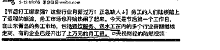

### 我心态都碎了

昨天去看了优衣库，两三百元的廉价服装，都是土耳其等进口到中国的。我心态都碎了。我们是服装大国，曾经扫遍天下无敌手，现在怎么了？已经沦落到廉价衣服都不会做了，需要进口了。

1. 我们没有富裕到可以放弃制造业
2. 虽然，大城市有很多高薪岗位，但是拼多多多的流行揭示了一个秘密，其实，中低收入人群还是很多的，前几天在海南县城闲逛，问了一下物业公司的保洁，前台，物管，大多数是三千左右收入，来源是附近村民。这也是中国县城的普遍情况。中国还有很多失业者，统计局说是 4-5%，中国劳动者 7.8 亿人，三四千万劳动力失业。

廉价服装，塑料拖鞋，是世界各国的必需品，广受欢迎。可是，在我们很多企业夸张嘴里，成为了落后产业，需要淘汰。我是很伤心的，这群专家早就食人间烟火了，一天到晚报论坛，结交富豪，听他们胡说八道，真是经济学的悲哀。

### 二、制造业卡在哪里了？

一是劳动力成本高新的不合理，多少比例的劳动力成本没有发到劳动者手里，被各种各样漂亮的名义拿走了，大家心知肚明。

二是劳动法导致难以对工厂严格管理，质量体系也随之呵呵了。以前，工厂对劳动者管理是很严格的，这保证了质量，现在很难管工人了，动不动就打官司，举报，告状，然后有关部门兴冲冲的就来了。劳动者是需要企业制度约束的，不能随心所欲。

但是怎么能呢？以前有句话“今天工作不努力，明天努力找工作”。现在这句话被劳动法打掉了。打工的随意，一般企业根本无法开除他。这种质量管理体系，我也是服气了。

### 三、建议

1. 给企业自主用工的权利。天上不会掉馅饼。劳动法不创造利润，只是把企业经营利润转移给了员工，甚至培养了一些偷懒耍滑的恶劳招数。
2. 减税减费，以利诱之。鼓励创新创业，让低收入劳动者尽快增加收入。
3. 不要轻提民企小老板了。芯片是重要，但是塑料拖鞋就不重要吗？劳动没有高低贵贱之分，不要人为抬一个，压一个。
4. 有关措施要落到实处。企业没利润或净利润很少，有关部门大张旗鼓的裁减利润所得税。总体肯定是好的，但远水解不了近渴。要是小老板有一百万利润，还要裁什么税？

中国经济境中向好。我们欢欣鼓舞。

### 过两天，招工难的新闻

会按照惯例充斥各大媒体。例行工作，大家要有觉悟，积极配合。

### 我支持农民工拿高工资

但劳动法不能干涉企业的用工自主权。

现在的情况是，小老板已经心不在焉了。今年春节，我和好几个小老板聊天，之后我心情非常沉重《中国经济稳中向好，我们欢欣鼓舞》。

企业管理中的很多事情，在公开场合是不是能说的。但是，能不能滥罚，有没有效益，都在这里秘密里。中国制造，不应该有 what 先后退之分，而是优质劣质之分。h 不就是个手捏包吗？先进个锤子的！但是人家一个包卖的比芯片还贵，为什么？

我看到听到很多事情后，感到个人的力量是渺小的，我也设什么办法，只有加强学习，提高理论水平了。来，我们一起喊，中国经济稳中向好，我们欢欣鼓舞。

### 创业人为的是有限公司

最后怎么自己成为老板了？

在中图，有限公司几乎只是理论上。当你去银行贷款，或者谋求天使 vc 投资，对方往往要求你个人对还或者公司负债进行无限责任担保。这公司分分钟就变成了无限公司。如果欠债不还，创始人个人就成为老赖了。

如果创始人拒绝担保，所有人都会认为，你不敢签字，说明自己都没有信心，使 b 方给你钱紧！有的投资人还会找你父母配偶子女，让他们也表态签字，那就一勺烩了。

不要以为年轻人创业是个美好的事情。从古至今，发财都是九死一生的。当然，卖肉夹馍还是可以的。

### 装修公司怎么拉单干？

前几天，老友家买了房子要装修，一起去看看。进了小区，我突然发觉，一大堆闻所未闻的装修公司正在热火朝天的开工。其中一个所谓的设计师，以为我是业主，就找我推销。开门第一句话，我在这个小区已经接了十几套，加个微信，眼见为实。

我被这句话打动了，加了微信。然后我就看看他们的朋友圈。说实话，我要是装修，还真的全找他们，眼见为实啊。小区里的线路，户型，大差不差，统一施工，看得到效果。我要是去大牌公司，最后出来什么样子，只能靠吹了。十年前，我在 x 局梁家附近，找电话骚扰，我打电话投诉，对方和我说，新的地板都这样，家具一压，过段时间就好了。我就信了。十年后，还在啃。

我在小区里，没有看到任何一个上海知名的装修公司，全部是我第一次听说的公司。但是，他们生意确实好。因为装修的家庭，大门会贴上一个大福广告，一看就知道谁干的。

我在回家的路上，看到了不少知名装修公司的广告牌，但我们没有在这个小区里看到任何一家。我一直在疑问，什么会是这样的？

小公司接单人的套路，

1. 前两单，给个优惠。接房第二天就抢先开工，会成为大家关注的对象。
2. 来参加费的业主，多加微信，每日直接跟进。
3. 委托业主在业主群里，发送张图片。一大群人就围上来看听了。
4. 最好在附近有办公场所，方便谈话。

### 民企不缺贷款，缺的是利润

银行为了完成指标，委婉形式主义，硬要给民企贷款一万元，实际上就是扰民。一万元，对一个企业而言，毫无意义，只是村小杂货店一遇到两万的营业额而已。但是中奖—放贷—还贷的一整套流程，大概需要两个工作日。这简直是新脑人脑。

前几天，减少了企业所得税，理论上是件好事。但享受减免的前提是，你要先有 100 万利润，300 万利润。如果哪家小企业有这么多利润，早就笑的飞起来了，还有什么困难啊？对于许多没什么利润的中小企业，减不成都一样，纯粹是精神鼓励。

企业最需要的是，劳动法能不能调整？社保能不能减下来，减 25%，或 50%？免企利润这么好，也给他们出点了。

### 员工已经很难管理了

很多效益中下的民企对员工已经很难管理了。

京沪上级员工的朋友圈一般是以行业为划分的。浙江小县城的员工朋友圈是以工业园区为划分的，你不管每个企业，只要是在这个园区的员工，很多人是亲戚老乡，互相拉个群，这个群会越来越大，群和群之间互相转化，基本上整个工业区的员工人群都是互通的。

这种群对于促进员工斗老板，起到了巨大作用。企业的员工逛得老板增加了某个福利，其他企业都会一哄而起。哪个员工发现了占企业便宜的万好办法，基本上一两天内会普及。

现在的部分民企老板，基本上也放弃了对员工的管理，互相威胁，保寺操作。员工分为管理层和员工层，各有各的路径。

1. 管理层，是掌握企业的把柄，例如排污处理工商税务消防等不规范的地方，动不动就互相举报。
2. 员工层，动不动就以谈工资为由，不干活了。你也没办法。大家都没有长期打算了。
3. 很多民企老板的想法也很简单，能干嘛干，不能干嘛算了。一些老牌企业现在变成了总包商，负责设计和销售。村里来的工头当老板，拉几十个老乡组成一个生产线，今天给这个干，明天给那个干。由于缺乏长期 的质量管控，质量越来越糊宝了，反正大家都糊涂。

以上说的都是效益不怎么好的民企，大家不抬杠。

实事求是讲，部分民企之所以走到这个地步，主要是不能严格按完全合规造成的。但是，民企的起步和发展，也就是因为不规范。前两年环保很，整个工业区，噪音指标，家家户户都不达标，要罚谁就罚谁。有个老板不服气，质问，你说谁家达标？有关部门说，某件作设计公司，噪音测量达标。

企业的利润有多高，我说了你也理解不了。我就举的例子。你去小餐馆吃饭，一盘抄青菜，大概是15-18元。这点青菜最多四两，批发价成本大概也就是1元，一条鲈鱼，饭店里是48-58元/斤，批发价是12元。表面上看，餐馆利润很高，而且大部分小餐馆也不傲娇，也不搞投保，但是，很多人开餐馆居然倒闭。为什么？隐性成本高。再说下去，篇幅几百字。

现在，监管烦感多，社保成本，劳动成本高的难以管理，已经让部分民企很难撑下去了，这些问题已经无解了。我们把民企困难的问题归结于贷款难，其实是不准确的。大部分民企不缺钱，只缺利润。

### 减免企业所得税

对民企的帮扶有限，对困难企业更像是精神鼓励。

企业所得税，就是企业利润税。减税的折腾是，企业有很多利润。但是，目前的部分困难中小企业，例如雇工几十个人到几十个人的，利润微乎其微，减不减，其实都差不多。

建议：社保，三免五减半。这才是真金白银的减免。南方的社保已经多用到完不，需要运给东北了，为什么不减一点呢？

中国经济稳中向好，我们欢 鼓舞。

### 定向降息，貌似帮扶民企

实际上民企很难享受到，因为银行会要求贷款企业给银行做回报，彻底抵消利好。

做回报的本质就是换个弯子提高利率，银行的手法干百奇怪，态度强硬，语气恶劣，民企苦不堪言，但民企也不敢对银行。因为你今后总要找银行贷款的，现在你敢不配合，下次到银行这里来排队的时候，你就知道下场了。

银行是大象，民企是蚂蚁。让大象给蚂蚁让利？我也只能这，好吧，我配合？

中国经济稳中向好，我们欢鼓舞！

### 很多企业都有小辫子

一个企业面对的执法部门是很多的，如果某方里面严格规范，像个纯净水，大概也就是互联网里的几个巨无霸了，他们是独一无二的超级利润。但是，普普通通的家具厂、裤子厂、塑钢厂，能够做到纯净水状态的，有几个？

这就导致了很多企业是有小辫子的。如果企业最后做垮了，也没人找麻烦，小老板自己卷铺盖，回农村种地了。万一这个老板做大了，呵呵，好戏就开场了，无休无止的麻烦，管状举报打官司，会把很多企业搞的精力殆尽。第一代创始人，八面玲珑，可能还勉强维持，但一般是传承不下去的。富二代都是读书出来的，嘴里玩的了这种事情？

企业开始关照，对于屌丝逆袭而言，就很有利，你倒了，我就有机会了。实际上基本不可能。人家干了三十年，积累了那么丰富的经验，都摆不下去了，你白手起家，就一套矮拐的管什，这不是搞笑吗？一个新员工的生产失误，就可能让你赔掉一半身家。这种事情，我们见多了。

劳动力成本上升，是应该的。但是，我们是发展中国家，加工货，加社保，严管重罚，也要考虑实际生产效率。如果加到最后，我们白出口出了巨大的国际市场，是不是有点不划算？十年前，欧美超市里都是中国制造，现在还有多少？

看数据，出口还在增加。看欧美超市，感觉有点摸不到头脑。数据典籍是，我们现在把对亚非拉贫困地区的项目算成了出口数据。当然，这也对。问题是，有些话，我也说不下去了。省略一百字吧。

这么多年，欧美发达国家的工资，没有明显上升，这导致了他们的消费并没有上升。奇怪的是，越南墨西哥等国对欧美的出口大幅度上升，那么他们占领的份额，原来是谁的？你问我，我也不能说明。

### 部门骨干联合辞职

我是一个大厂老板，服装出口行业。今年生意较差，我和其他股东千方百计的维持，至少不降低工资。可半年后，厂里的一些年轻骨干，联合好了跑出来要求加薪，否则辞职。如果这批人辞职，我的企业明年就很难正常运转了。如果加薪，企业肯定就亏损了。怎么办？

答：各部门留一个技术骨干，其他人随意，要走就走。企业立即收缩业务。2019 年只做老客户，维持。

### 劳动法越严格

适者越匪强，阶层越固化。

实际上，任何政策都是双刃的。劳动法强化了对员工的保护，提高了解雇的难度，等于增加了创业的门槛。如果劳动法得到一视同仁的执行，得者是两头，底层员工，大企业大股东。而中间层很郁闷，创业门槛太高了，做不起来了。

我曾经遇到一个学习用品的设计师，帮替了几年，最后一地鸡毛，活不成，死不了。我和他们聊天，找原因。其实也很简单，供应链不行。他的模式是，设计开发新产品，委托代工，自己销售。所谓的美国模式，美式曲线吃两头，理论完美。

但是，加工外包的环境，实在是恶劣到无法承受了，

一，价格不稳定

外包加工，都是一批一批的，但是加工厂经常涨价，每次都谈的精疲力尽，

### 二、时间不稳定
加工厂有时候单子多，就把你的单子放在后面，你急得直跳，他们不管。

### 三、质量不稳定
很多原材料是委托采购的，有的工序是手工操作，工人流动性大，质量很不稳定，经常出麻烦。

### 四、纠纷无法解决
合作方都是大爷，你一个大学生在农村吵架，没人理你的。
我问他，为什么不自己开小厂？他说：劳动法导致雇佣超级困难。生意有奸有差，好的时候，工人随便跳槽，差的时候，企业解雇不了，所以没法开厂。
如果硬开厂，那么工作重心就是四处挨单做加工，保证工人有活干，有工资拿。而自己的强项是设计研发，最后变成包工头，也不是自己的强项。
这个大学生，搞了几年，亏掉了一套房的首付，现在不死不活的赚着。女娶也跑。但他也无所谓，反正新招聘进来的女学生也可以发展成为头妻，有个体面的宝马，有个相亲的写字台，赚个底不是问题。

### 刚才，有个大学生问：

你遇到的问题，为什么不通过合同解决？这实在是搞笑了。在中国，一百万以下的生意，合同等于零。
你要是把合同签的过于苛刻，没人会和你合作。你要是写的含糊一点，才可行。实际上，要货的时候，都是急得火烧眉毛，有什么心思，一字一句的研究合同。
就算合同对你有利，那又怎么样？你有多少时间去打官司？现在，打一个官司半年算快的。很多屌丝宁愿了，规定是三个月。我做一个字，滚！实际情况和规定，没有半毛钱关系。各种变态，例外规定，拖一年都合法。商人一般不打官司。
商人靠的是，利诱。你做好了，我下次还找你加工。问题是，这一套也不管用了。现在做生意，搞加工，什么合同不合同的，都是一片混乱。

### 怎样才能发财？

这个事情，我思考了好几年。结论是，脑子有病的靠运气。
发财，一定是你做了普通人不会做的事情，而且若干年后，你幸运的等来了转机。别人也不是傻瓜，不做肯定是有道理的。举例，15年前，你在外环地买20亩地，办了产权证，熟到现在就发了。这是正确的废话。
问题是，当年你没钱买，怎么办？你去借钱。怎么还？不知道。所以，正常人是不敢买的。但是，真有神经病，借钱去买。
我曾经问过一个小老板，“你当年生意不咋样，为什么借钱去买地？”他说，“我以为可以炒地皮，转手赚个几十万。没想到不能炒，结果套牢了。这么多年，我开个小厂，一天到晚东借西凑，揽了好多年才平账。物价上涨了，当年借十万去付的大钱，慢慢的就不大了。”是啊。当年捡江区一套小户型房子不过十万，现在两三百万了，什么局解决了，子是他发了。
这种事情很多的。2003年，山西煤改，送给做，你也不要啊。有的人是没办法，欠账要不回来，不得已拿个煤矿压在手里。没想到，彻底废了。
我一直在想这个事情，到底脑子有毛病？你说这些个土老板，脑子跟驴踢了，自以为鬼，啥也不懂，一顿乱操作，居然成了。我那么聪明，什么都懂，居然不赚钱。你说读书有什么用？

### 再说一个，莫名其妙的发财故事

十年前，有个250老板，是做裤子的。小打小闹类型。结果遇到一个骗子，说他多么多么厉害，华北五省都跑通。小老板一激动，产量翻了n倍。我也不知道他是怎么被他忽悠的，反正是倾家荡产，到处借钱，希望一年赚个金娃娃。结果，不言而喻，亏得倾家荡产。

那时候，裤子做出来了，那个骗子也就象征性的买了一点，然后就找借口说，这不好，那不好，没法合作了。这个老板傻眼了。这么多裤子怎么办？于是，老板找了很多朋友，半卖半送的推销，只求少亏一点。

（价格不太准确，但意思差不多）裤子成本价150元，零售价300元。那个老板实在是没办法了，按照100元发货，一条亏50元，还要亏钱。卖完了算账。到最后，数量都不点了，按照重量出货。一斤三条裤子，也不管尺码了，大差不差。最后，这个老板一年亏掉了几千万，老婆离婚，供应商拿不到回款，把他揍得满地找牙。

第二年，奇遇发生了。他一年之内，居然在华北五省成为名气最大的裤子品牌。因为与他合作的人赚翻了。实际上是赚了他的本钱。但是，别人不知道啊。市场上他成为了传奇品牌。华北每个乡镇都有人来找他进货。

第二年，投国一半损失，第三年扭亏为盈。他花了三年时间，把销售渠道塞满了华北五省。这是很多人一辈子也走不到的高度。五年后成为华北一流的裤子供应商。之后，人生开挂了，买土地，建厂房，扩大规模，反正找他进货的人非常多。

像我这么聪明的人，怎么可能干这种蠢事？所以，我也发不了财。仔细想想，这个事情的内涵是：用一千万的亏损，迅速占领市场，让合作伙伴赚钱。组建了稳定的销售渠道和合作伙伴。但是，正常人会敢这样做事情？他到现在都不承认当年是被骗了，相反是神神秘秘的说自己多厉害。厉害个鸟。

### 我不认为男性的工作能力不如女性

但过去几十年，女性在商业中的发展，也非常好。我思考了几个原因。

- 一、男性思维缜密，偏悲观，相对保守

理性的人，对于没有把握的事情，往往是保守的。女性显得少，靠直觉，往往偏乐观。过去四十年，货币大放水，偏乐观的房产和企业投资方向，容易发财。

- 二、女性静的下来，男性浮躁

凡是有钱了，女性一般不会去想象承包两个小白脸，而是一心一意把房子摸起来，无论是工业商业房产，还是家庭房产。女性对房产的兴趣，简直是无可救药的执着。这暗合了过去四十年的发财路径。

普通男人发财了，先买套大房子，但就此打住了，马上去会买一个一百多万的豪车，到处炫耀，喝酒买单，最喜欢别人吹捧他，然后一大堆各色女人贴上来，捧了这个，用了那个，然后家庭矛盾激化，妻不要知，各自提拼。

- 三、面对困难的态度不同

女性的财富期望值不高，很少有女性说，我娶立志成为亿万富豪。所有的女性，都能够接受平衡，失败了也认命，为了孩子，还会继续坚持做下去，很可能最后迎来转机。中国过几十年，小企业翻身的情况，非常多。

男性的财富期望值极高，做生意的男人，每个人都是雄心壮志。一旦意气失败，往往无法承受外人的鄙视和嘲笑，一蹶不振，关起门来喝闷酒，一天到晚醉醉睡睡，人也废了。

### 四，女性的缺点是更糟糕些

企业管理中，确实存在逻辑性，各种工作安排，要很紧密，效率最高。但是，过去几十年，靠精打细算是没有发财的，货币一增发，啥也赔不到了。真正的负财是，房地产。女性偏重于逻辑严谨，有杂不系，但效益不大。女性偏重房子土地，虽打正着。

### 女人当家，家豪旺

菜娘家是做塑料桶沿版车的。这个生意最明显的特点是，只求市场，不求人。你认识某个大头，也不能解决带版车的储路问题。一切必须以消费者满意，精打细算节约成本，来支撑工作。

我所在的工业园区里，地处长三角，都是小老板，1-10亿，没有大老总。男老板和女老板，各有几家，干了几十年，知根知底，我描述一下他们的家庭分工。

一，男性当家，女人不参与的企业。（园里区都是小老板，没有大企业）男老板做事稍规整。大家一起盘大棋，凡是企业家房产证办不下来的，都是男老板在建设过程中，随意修改图纸造成。

二，女性当家，男性不参与的企业。利润率很高，生意好，但做不大，只要一亿就结算给封顶了。

三，夫妻各管一块生意的，出现了两极分化情况，在起点差不多的情况下，

- 1，有一对夫妻，遥遥领先，某一年纯利润上亿。
- 2，另一对夫妻，女性生意一般，男性强行惜失败，最终跑路了。
- 3，意见不和，长期打架，离婚。
- 四，男为主，女服从。离婚 99%出轨，最后一地鸡毛。
- 五，女为主，男为辐。有好几家，发展中上。

### 制造业的路在何方？

前有成兵，后有追兵，制造业路在何方？

制造业是我们的起家法宝。一亿条裤子换一个飞机。就是先辈们白手起家的经验。当小老板们辛辛苦苦做出裤子后，坐土飞机的人却嫌不起这些低附加值劳动了，专家们总以为只有芯片才是王道。芯片是制造业皇冠上的明珠，是先进制造业的标志。

我们有勇气冲击产业高峰是好事情。但是，珠城顶的那能坐几个人啊？我们 14 亿人口，比我们要富裕的国家大概是 g7 和一些独养好家，他们加起来人口也不如我们多。如果我们主要做高端次，他们给我们做裤子吗？

立足干现实，当前正要就业，还是在民仓和日常消费，例如塑料桶，水龙头，地瓷砖，在满足内部消费同时，尽可能发挥优势，出口一部分工业品，换回粮食玉米大豆。

我们积极发成少数专家努力攀登科学高峰，但绝大部分人还是要在中小微企业工作，奔家幅口。我们要让千万百计中小企赚到钱，就业就业就业大，现在的帮扶措施主要是借借络体，这个很重要，但不是最重要的。中小企业最大的限原流是，没有利润。中国的劳动力成本，平均到手 10000 美元/年，社保个供大概是 4000 美元，土地房租，水电气。各种官僚的烦原，那是吃候啊！东南亚新兴国家，工资只有我们的三分之一。

我们的出口优势目前还在，得益于熟练工人，结合配套完整，产业集聚形成，但这些优势是可复制的，新兴国家模仿和超越正在发生。制造业有个重要名词是“后发优势”。当年我们的得益于后发优势，上来说是最新的流水线，打的西方制造业彻底结束。但是，现在的新兴国家也在复制“后发优势”，而我们怎么办？

我们是人口大国，居然进口 Zara, HM, 优衣库的低价服装，是不是不可思议啊？为什么外国老板把纺织服装的订单交给新兴国家？因为我们的成本太高了。如果不控制成本，各行各业的订单，也会一点点流失。到时候，我们怎么办？是不是还要进口肥皂盒，洗衣液？

建议：员工福利不能减，但是其他成本真的应该实实在在的低一点了。低价服装已经在进口，我们不希望看到今后塑料拖鞋也要进口的局面。

### 员工变股东，行不行？

公司法讲角度讲，貌似可行。但是企业一线，实际上不行。原因是：

- 1. 股东之间不能互相管理
大股票不能指挥小股东去换桌子，今后工作展开，上下不服，就乱套了。

- 2. 小股东辞职不了怎么了？
员工辞职，司空见惯，她不会因为是股东就不走了。还是看钱的。

- 3. 小股东要求查账怎么办？
按照公司法，小股东的权利可多了。他要是怒搞，或者对大股东不满意，每个月要对账，你不是死给他看了？

### 如何裁员？

裁员是老板最痛苦的事情。一方面，对自己人下刀子，于心不忍，人家也是有老有少，失业后肯定不开心。另一方面，员工也会翻脸，举报告状，要泼漆，什么都干。

- 1. 选择时间
最好不要跨年。跨年，多算一个月工资，实际上也没什么。

- 2. 补偿要当给
员工有两个月工资，可以好好过个年，重新找工作，大家提前回老家，心态也可以接受。

- 3. 说清楚企业困难
小公司最好斩全薪或降薪，相当于倒药，员工不能以什么调岗岗培训理由，不找你官司打。过 渡期，老板失责，加个外甥女，自己顶上，反而是收效业务了才裁员，工作量不大。

- 4. 重新开张
如果半年后，业务有起色，可以重新。半年后，大家也找到工作了，没人找你。

- 5. 提前和业务单位打招呼
近期裁员，肯定有人收口大骂，造谣流事，大家包涵一下。

舒服，没这个要求。我对此不做任何评论。

今天，我主要回顾 1998～2001 年集体转民营过程中的一个典型样本。我是近距离观察了二十年。

老王是我丈母娘的远房堂哥，原是江浙沪地区日用品类，乡镇小厂厂长，集体所有制，企业半死不活，员工是附近农民为主，工资几百元，相当于当年小学教师的三分之一，对于上级主管部门，完全是个包袱。改革方案是，有关部门把厂房和职工承包一起给了老王，有关部门拿到了相当于本地两套房子的现钱，从此摘辫。

- 一，厂长买下来，出资额度是附近两套 90 平方米的钱，钱由有关部门拿走了。
- 二，厂房归老王，产权证书，大概是 4-5 亩地。在编老职工包到退休。
- 三，企业资产就是 70 年代的破厂房，机器不值钱。当时那些漏雨的厂房不值什么钱。

老王家里的钱不够，就去找银行贷款一半。手续办完了，厂房归老王了，但是欠了那么多债务，老王的农村老婆被吓得更哆嗦。

2001 年，内部生产效率明显提高，迟到早退闹东西的事情，基本没了。但企业还是很惨，因为没有销售渠道。老王一天到晚跑销售，东北，四川，去推销，后来是一地鸡毛，货发了，收不到钱。气的老王和老婆在家里打架。厂里职工也对老王冷嘲热讽，指责骂娘。

2002 年，老王不敢再去外地推销了，就在附近几个区县推销，主要是集镇市场，供销社，街道小商店。本乡本土，坏账极少，但是这种千家万户的卖法，导致运输和对接成本太高了，当年交通物流也不方便，一个职工外出，半天只能盘点一个小店，规模搞不大，企业还是半死不活的没钱赚。

搞了三年，完全不挣钱，但是银行贷款的利息，与日俱增。老王基本上是精神崩溃了，家里夫妻打架，最后离婚了。

2003 年入世了，一个农民为主的小规模厂，做外贸就是天方夜谭了。但是，中国人有智慧啊，他们的模式是，省外外贸公司接单，发货他们干活，不需要说外语，这下子，老王找到生存之道了。加紧加点连轴转，干到 2008 年，老王发了财。喝茅台，盖别墅，开奔驰，扩建厂房，成套设备引进。江浙地区的漂亮妹子，小三小四小五，排了命往上扑啊，人生辉煌。

到了 2009 年，连续的夏季桑拿，虐心大片开始上演。

- 1. 劳动法规开始交战律了，出口价格上不去，损失全部是老王承担，怨气的黄脸肿胀。
- 2. 外贸不好了，出口金额年年下滑。
- 3. 工资年年上升，利润薄如纸。
- 4. 工人们不好管了，举报告状一个接一个，痛死力尽。
- 5. 有关部门一个接一个的检验，疲于奔命。

这笔还是慢性病，最大的麻烦是，出现了企业资金休克。

2008 年的欧美金融危机，小老板没见过。2009 年的四万亿，银行上门服务，很多小老板以为市场又好了，大笔借贷投资基建，典型的短贷长投。

2013 年，企业扑克。江浙的集贷纷纷倒闭，银行踢踏，只收不放，被新厂房基建拖累，流动资金休克，老王当场晕厥。接下来就是企业开刀，非在编老职工，一律滚。

2014 年，老王本身以为破产了，没想到时来运转，遭到家里拆迁。老王是家里的大人物呢，一言九鼎，要求父母兄弟姊妹孩子，不要房子只要钱，全部迁到老王的漂亮宿舍（没有产权证），五百多万拆迁补偿金，填补了基建缺口。死里逃生。

后来江浙滩房价价格高涨，盖成了巨大的家族养老金。现在，老王和所有的兄弟姊妹子女彻底翻脸。

2015 年，小老板年近六十，无力经营了。当年改制得到的老工厂卖掉了，归还了基建贷款和亲威胁朋友的借款。新厂区出租给一些小厂当仓库，大概租出去一半。【公众号：财宝室讲经济】现在每年的租金，除去税费，实际到手大概是 60~80 万，一半给老职工发工资社保，一半是自己生活费。

老王回顾了这一生。觉得他亏了一场。他得到的是一个 7 百地亩的新厂房，但是失去了亲威们应该分别到的八套住房。亲戚们恨死他了。他还不补补偿亲戚们。

### 对中小微企业的要求，要客观冷静

国企，天之骄子，一切资源都是无偿取得，中石油的土地矿产是国家给的，挖出来后，直接算他的利润了。有这好事，当然要求要高一点了。

外企，不是猛龙不过江。人家在老牌资本主义国家发达了几十年，攒足了钞票，带够了技术，就是来打市场的。对富人要求高一点，也说什么。

有几百亿贷款的民企房企，早已是超级企业，豪华待遇，比谁也不抻了。这种企业要求高点头也没错。

但是，那些只有十几个人的裤子厂，几十个人小餐馆，修修补补港口饭吃，你按照中石油，因特尔的标准，无视闫仁的要求税费扣和各种严格验收标准，这是爱它还是 × 它吗？

那些优质企业，占尽了天时地利人和。但招押不了几个员工，80%的就业压给了民企小老板，有关部门还对这些小老板按照跨国公司，央企国企的标准来要求。于心何忍？因特尔为什么不要这些人？没什么学历技术。大家在外企国企找不到工作，凑在一处做裤子，修地板，找碗饭吃。干的好小老板，运气好，腰了一两座房。但你知道有多少小老板一分钱没赚，还到处靠债吗？

建议：大小中小企业，分层管理。

### 要让制造业树立长期经营的想法

中国没有高质量芯片，原因是没有光刻机。光刻图纸并不太难，无非是把元器件缩小而已。2002 年 SME 成立，总经理贺贵玑去德国考察时，有工程师告诉他："给你们全套图纸，也做不出来。"

工艺难点是，这么多元器件分布在一个小芯片上，需要高精度的放大镜头。以便对电路板。秘密就在这个镜头里。全世界只有德国蔡司镜头可以胜过。生产这个镜头的企业已经存在 160 年了。蔡司镜头本身已经不断发展了 120 年。

任何高精密技术，是论突破，有识点是有很容易传播的，但是制作工艺是绝不外传的。例如发动机的材料配方，那是百年研究，积累成果，有人识。我们现在集中精力搞这个镜头可以吗？是啊，全世界的大厂，尼康、佳能，都在搞，但是都不行，人家 160 年的反复实验、精纯巧合的成果，可不是哪个厂狠时间可以解决的。（当然，我们青常家，不redge。）

120 年前，蔡司镜头在一个普通的民用相机相机厂诞生的时候，绝不能想到这玩意今后是国家大器。也就是说，我们不知道今后若干年要什么技术，只能是让各行各业的生产企业，八仙过海，各显神通，树立长期经营理念，形成技术积累，接受时代的挑战。问题是，你见过几个制造业能够长路经营？原因很多。

#### 一，历史包袱

中小制造业起步，大多是在相对贫穷时期，一切都是为了吃泡饭，求生存。日常经营部是怎么省钱怎么来，不烦脑的事情司空见惯，小辫子多的数不过来。一旦发达了，呵呵，一份举报信就可以让他窒息，两个月前，一个多次获奖的企业，小老板因为一个 50 万的发票被抓进看守所了，涉税金额也就是 8 万元。一个老板欠为了 8 万元税款，扔掉企业房子亲人，制造成通进犯呢？当然，有关部门认为要抓，那就抓他。有关部门肯定是正确的。

#### 二，成本高企

有关部门发个通知，成本就上去了。谁敢说什么？有关部门肯定是正确的。

#### 三，劳动纠纷

劳动法给在职员工的保护力度，感觉超过发达国家了。下班买壳被车撞了，老板倒腾。家庭矛盾自杀在厂里，老板倒腾。凡是一丝一毫扯得上企业的，都是老板倒腾。一群家属把厂子堵起来闹，谁会帮企业？我是见过的。有关部门希望的是，老板赶紧出钱，不要给我添麻烦。

#### 四，知识产权

现在企业对配方研制，不感兴趣，成功了，也是替人做嫁衣。技术员辞职了，你也就由干了。说起来这个保护，那个法规，其实小老板心里明白。企业现在只对进口大设备感兴趣，这个做不了假。

#### 五，土地期限

工业用地四十年就结束了，买地三通，建设调试，实际投产，5 年算很快的，大多数是 8-10 年，因为小老板钱不多，都是慢慢积攒，一点点滴兑出的，用 30 年就快倒了。百年企业？老板还活着，土地就到期了。

当然，困难说说是行了，中国经济稳中向好，我们欢欣鼓舞。我是儒雅。

### 再过十几天后，制造业怎么办？（2018.12）

其他怎么办，我不知道。我就说一个我知道的厂，这个厂也不大，老板五十出头，技术人员出身，搞了个滑板车小厂，纯摔是劳动密集型企业，没什么技术含量，就是把滑板车做的好看一点。出口内销都做，只要给钱。

这个厂子以前是按照低一点的标准交社保的。例如工资 7～8 千元，实际上按照 4000 元在交。滑板车淡季是冬天，淡季发什么单子，也只有这么多钱，明年怎么办？大家都要研究。

这个厂的特点是仓储批发模式，就是每个省设立一个代理商，代理商一年进货五万个，自负盈亏，五折拿货。代理商六折发给社区小店。小店老板骑在社区广场推销。每个滑板车赚个 50～60 元辛苦费。

现在生产厂的意思是，每个滑板车涨价 25 元，那么省级代理商想要多付出 125 万，这等于吃掉了代理商所有的利润。如果不涨价，小厂立即亏损。

现在还在谈，大致的思路是，厂里可以涨价，但经销商只拿 20% 的货，试试看，如果卖的起来，就继续做。如果涨价了卖不动，那就一起关厂，另谋出路。

他们问我有什么意见？我建议他们：升级换代，向高科技进军，勇攀自然科学高峰，最好做芯片。

他们让我滚！我就滚了。切，一群土鳖，我还不高兴和他们玩了喂。

### 为什么企业家极少成功？

大部分中小企业，都是快瘪歇的。我长期在工业一线，对这个问题是是有直观感受的，企业从小到大要经历几个阶段，但是这几个阶段，对老板的能力和性格要求是相反的，总有一个阶段你干不下去了。

第一阶段是初创期。要求老板疯癫，胆大，不计后果乱奋斗，弯道超车，都是以命相搏，没有

什么成功学之说，天有翻车事故现场。但也有个别狂人真的成功了，而且是无法模仿的巨大成功。两穷释放的人，大概最符合要求。八十年代上海第一批发财的人，很多是“山上来的”，外江黄沪，倒卖国库券，倒卖88机，投机倒倒卖彩电票，去广州淘金子仔。

第二阶段是发展期。这个阶段要求老板的性格是，心细如发，有条不紊，狠抓质量，按时交货。一分一厘都要精打细算。企业规模化了，单价就重要了。举例，你生产纽扣，吸管，本产品差一分钱，一年就可能差几百几千万，等于你是全部利润没了。这个时，最终人选是会计本科毕业的沉默老派劳动法律师。

第三阶段是资金期，老板要具备超级强大的对外社交才能，此时，内部具体事物都有人管了，老板要做的是，对外关系要处理好！这个许可证必须办下来，那个贷款指标去摆平，某部门调查组明天就来。你此时有钱了，所有人都盯上了，三天两头的告状揭发破竹杠，要有本事应付，最好是干过五六年班内的老油条猴鸡四帮大哥。

第四阶段是守成期。这时候，具体事物，啥都不要你做了。企业内部已经形成了几大板块，各有各的负责人。最大的难题是，怎么让这些负责人尽可能自己协作，不内讧，不贪污。任何人都很难具备各种微然相反性，而且要转齐心协力。现在，99%的企业家做到一定程度就歇菜了，他没有能力再往上面发展了。

各个阶段要具备的能力，老板不能赋予他人，因为你委托别人，别人就像被夺去了，很多屁领导自命不凡，说什么才华不遣，其实是太拙。你去办个企业试试看？分分钟让你看清社会。

### 小老板应该赚多少钱？

那些全世界买房的大老板，我们不感兴趣。我们最关心中小微企业的实际情况。

很多普通小最希望，员工发15万，老板就30万，唔，50万最多，再发我就不高兴了。最好把绝大部分利润吃光用光光光，分给职工，加工资，加社保，搞福利，赊债务，技术秘密对外口笑，怀孕，工伤，大祸，让企业掏钱，而且动不动就说是个天文数字。现在，员工下店后，路上买菜接孩子，出了交通事故，都是企业买工伤，这出西还好了。

只想要得好的理由，全部推给企业出。这项要求看上去很好，但有几个难题：

- 一是风险对价问题。老板是拿儿子娘房抵押的，如果没利润，谁来分公司？公司设了，我们上哪找老板要钱？
- 二是企业后续发展，工业设备信息化了，一般五年就彻底落伍了，五年后，拿什么钱去技术升级？
- 三是市场低跌期，市场有好多，没有资金积累，企业一遇到困难就烧了，怎么办？
- 四是基础设施。现企业想长期经营，最好是自建正规厂区宿舍楼，一般点0.5亿到3个亿，老板如果一年只赚几十万，肯定是活不成。

理性讲，老板应该在保障职工活下去的基础上，尽可能给自己多留钱，应讨困时刻。但是，现在的方面国，对于这些侥幸活下来的点了钱的老板，其实心里想法很多。一个又一个的办法出来，无非是让老板这里出钱，那里出钱。没钱怎么办？把小老板全家老小的房子抵押，去银行贷款。

其实，现在正常小企业哪里要什么贷款？除非是厂房设备投资，一般情况下，最多是两月几十万周转一下。那些急吼吼要几亿几十亿贷款的企业，多是不务正业，胡乱投资。他把钱挪到房地产了，你去救他干什么？

中小企业不缺贷款，缺的是利润。这个贵，那个贵，全部是企业税后利润啊。能不能正儿八经减一点？不要搞什么这个审批，那个审批了，小老板还要写一大堆申请报告，搞不好还被退回来了。

### 统一降低税率，行不行？

当然，就是一些个小小建议。行不行，所领导听！我最乖了。新浪可以刷帖，我没意见。

### 这对个体户经营是有巨大影响（2018.12）

查账征收会带来几个成本。

- 1、会计工资。现在，上海兼职记账，每月大概是 1000-1500 元，年底给个奖金红包。一年下来 1.5 万左右，是正常情况。如果一下子推开，会计涨工资的可能性还是有的。
- 2、被捏住把柄了。少数个体户，少交留交是客漫情况。有故意的，也有没发票。我去打个轮胎气，5 元，洗个车 30 元，哪里有发票啊？以此类推。以前没人举报。现在可以是违法问题了。
- 3，接待查账人员。我相信肯定没有请客送礼，但是事前准备，事后解释，补充资料，情况说 明，商量对策，这耽误的时间就多了。很多个体户就是卖实时吃饭的。

当然，我们对上缴精神肯定是敲举的。大家提做做好准备。

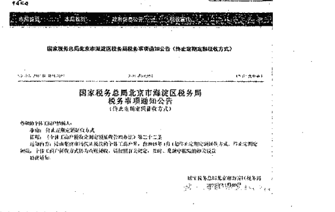

### 企业家的危机来自哪里？

当企业苦哈哈的时候，危机来自于外部，各种催款催贷货贷等。当企业发达了，危机来自于有关部门和内讧举报。“小样，找你我几个小裤子缴死你”！

发达国家的市场经济几百年了，各种事情规范，老板的小辫子不多。我们的民企大部分也就是成立十几年，穷人创业，从零起步。在初创期的混乱情况下，小老板也没经验，小辫子多的一塌糊涂。

起初，企业穷，有关部门对你这种小破厂也不太感兴趣，摆汗了也就几两油，员工内讧也不多，大家求生存。一且富了，太多太多的内讧就来了。绝大部分员工会把历史上自己做的某件小事情释为，没我你早烤了，自认为功劳比天大，老板太黑心，于是贪念杂生，内讧爆发。翻脸后，就给有关部门提供线索，无穷无尽的举报（当然是合法的）。

这绝不是一个案，而是带有典型特征的情况。所以，大部分企业能走多远，真心不知道。很多企业在经过长期内讧后，也就散。了

### 民企内部腐败全观察

最近，陆续爆出了各大风头正健的互联网巨头内部的腐败。对这个问题，我作为曾经的塑料桶小老板，也有切肤之痛。但这个问题，现在民企自己没办法解决。

- 一、民企贪腐的形式

  1、对外吃回扣。大家明明怀疑，但无证据。因为民企根本没有调查能力。
  2、内部贪污。这个花样最多。公司让老王去买一船电缆线，规定了供应商，品牌，价格，可老王还可以贪个一半。怎么搞呢？老王先按照公司要求来买了一千米，给公司看。没问题，报销。但是老王和供应商说好了，用剩下的电缆可以退货。实际上可能用了 500 米，剩下的 500 米电缆，老王就拿去退货了。公司没法查，总不能把隐蔽工程砸开了看吧？
  3、收取下游的孝敬。部门经理有分配业务权力的，好拿手段给你，大家都懂。
  4、虚开价格。修车，花了一千元，报销两千元。

- 二、原因

  开票的成本很高，现实中，存在大量的现金交易，不开票。这部分不开票的交易，就给了其他乱开票据提供了一个巨大空间了。举例，五金店卖电缆，一般人不要发票，但五金店多少也要开一点发票，否则不好看。需要发票的人，买一百元电线开票了，退货五十元，小老板就不管了。

- 三、打击力度

  理论上讲，民企内部的贪污贿赂也是违法。但大多数小民企，并不受有关部门重视。你可以举报治安，但没法报，有实部门力可也没什么多时间管民方。不像你能试个看看，大家都懂。但是，民企怎么可能没有证据呢？贪污受贿主要也证人作证，小老板也不能强硬地让法人自己证明自己犯法啊！在民企，大多数贪污贿赂都是小金额数，查起来成本高的离谱。天网恢恢，疏而不漏。那是理论，有关部门为了你的一万元被贪污了，搭上几万元的调查成本，你说可行性有多高？理论和实际，不是一回事啊。

- 四、犯罪的心理

  个别民企的坏分子，犯罪的时候，有种无恶。因为他抓到了小老板的一些辫子。安监，环保，税务，质检，哪个企业没点不规范的？如果一个企业真的规范到了极致，成本肯定比同行高很多，那你也搞不下去了。因为抓到了小老板的辫子，被查到了也无所谓。

- 五、建议

  有关部门要是事实求是的降低企业运营成本，让小老板在低成本可以接受情况下，规范运行。小老板自己疆气，才能对内部腐败理直气壮。现在的互联网大公司，天文学数字的投资，巨大暴利啊，因为他们已经垄断一个地盘，其他人很难竞争，内部管理比极规范。没太多的坏辫子。如果是皮鞋厂，一条街都是同质化竞争，要是成本增加 20%，外商就去越南下单了。

### 网购和快递行业有点难了

一个月后，网购小老板要税务登记证号码了，哪怕金额很低可以零申报，但要有登记证。

快递是劳动力堆起来的行业，现在要社保大众了。

这两个成本上去了，网购的优势，也就呵呵了！

### 这次，劳动密集型企业主老板（2018.12）

真的要挂了。（我说的是极个别，极个别，不要抬杠啊）

举例，地级市来着。

- 1. 2017年，社保基数约是2400元，社保是987元。大部分工厂子就是这样的交的。
- 2. 实际上，月工资5000（淡季）-10000元（旺季）是普遍情况。社保就是2050元~4100元。算个平均，一人社保支出增加1.5万。如果是50人的家具厂，就要增加80~100万的纯支出。很多小厂根本沒有这个利润。家具厂也不可能直接抬价。美国采购商又不鸟你的。
- 3. 问题是，这还不算完呢，工资超过基数，还要另外交个税啊！多少万，我也算不清了。
- 4. 据我在厂子里上班的工作经验，大部分农民工是不管社保具体金额的，只要有个医保卡就行了，他们只看“到手钱”，他们不可能在东部退休的，无所谓社全金额。

以我对小老板的了解，他们可能是这样想的，先躲過这关，查到了再说，托关系啊。这次没法托关系了。只要你得罪了一个农民工，分分钟告死你，广大农民工雪亮的眼睛盯着你。哪个部门敢帮你躲过关？建议：

- 1. 立即和美国客户协商涨价，要涨的比较多。这有点难啃！
- 2. 如果涨不上去，请求农民工降低“到手工资”。你想想象是什么大场面？
- 3. 千万不要搞高利贷，可以卖房筹款。老板一集房子差不多两百万，足花2年。两年之内如果销售不能翻倍，再卖房。卖光了，你也就死心了。

在这个大政策面前，任何民企小老板不要有幻想，不仅仅是有关部门监督你，广大群众也在盯着你。大家要有信心，中国经济会越来越难过，小老板暂时利润困难，可以卖房维持。你们一定要充满信心，如果产品不行的，直接关门吧！

中国经济稳中向好，我们先满信心！

### 严厉的惩罚措施（2018.12）

已经写在弦上了！未如实申报社保基数"排在"银保监会"前面，这是雷霆万钧之势。各位小企业家老板要认真学习，深刻领会，奋发幻想，好自为之！

### 我爸的企业怎么才能有大发展？

亮菜，我是男生，我爸干企业几十年，还是在亿元门口插得循循。和他一起创业的几个师傅师傅，早就几个亿了。我爸也很努力，早出晚归，生意也不错，就是没有大发展。为什么呢？

答：酒未到国民，南得有"西蒙八十比十二全功"。那么，全角能不能成为大牛呢？

现在做生意，如果跟风潮水，5~8年能亏到3000-5000万资产业负债，但也进入平稳期了，接下来就是坐死不能了。这里面原因很多，个人能力，市场宽度，技术水平等等。如果要突破翻墙，也有办法，但是是烧命的。

举例，我是做滑板车的，我在江西市场拿下第一名后，基本就没办法再往前了。如果我要北上开拓河南市场，向西进军湖南市场，我就面临很大的负担。新手费用巨大，各省招收一百多个人，设立办事处，装修租房，一大堆事宜，内部增加产能，修建租赁生产大楼，招聘更多的技术员设计师，成本惊人。

好不容易开局了，已经花掉了我一大半的资产，而且都是银行贷款啊！如果市场不好，坚持烧钱，还是认赔落下去？一百多个人，包括工薪，销售费用和办公室租金，就是 1500 万以上的烧钱。熬到最后不成功，可能啥也没了。

很多人小富即安，就守住这个地盘，每年赚个几百万。他们并不是没有闯劲，而是担心失去已经有的。每一次的财富上台阶，都是创始人全部梭哈。

### 我只需要部门经理

不需要职业经理人。

职业经理人，在中国只有一次繁荣期，就是曾经的票号。票号经营非常难，风险极大，利润极高，需要百分之百准确，一次不能出错。财东的子女，往往接不了班。有的是没耐心，有的是没能力。

票号的创始人，都是神人，但是奥运冠军的儿子不会成为冠军的。迫不得已，票号只能传给人中龙凤，职业经理人。财东的子女就当一个监事会。但是最后结果不好：

- 一，职业经理人欺负财东。职业经理人不承担风险，但拿到了七成利润，还掌握了人权、事权、财权。
- 二，财东完全失控。职业经理人以回避为由，不允许财东的任何亲戚进来，一手遮天。
- 三，个别职业经理人大肆贪污，导致票号破产，财东踢大牢。
- 四，恶意阻止行业的技术进步。这个细说一下。

晋商票号起步时间是处于西方资本主义早期，当时西方更加先进的银行业也起来了。但是，票号坚决否定银行，千方百计的阻止向银行转型。本质目的是，保护职业经理人的利益。

银行和票号，在结构上有巨大区别。
1，人确权。银行内部是认股权，票号内部是认掌柜。
2，决策权。银行认股权，票号还是认掌柜。
3，放贷手法。银行倒盘子大抛售，分散经营，配合抵押，这个可以规避化操作。票号侧重于人际关系，靠前台生意和大客户，掌柜的个人色彩太浓了。
等等。

总之，银行彻底到强职业经理人的权力，所以职业经理人明确抵制。面财东的后几代人，已经失去了经营能力，没有挑到挑来的勇气，再加上战乱不断，经济滑坡，军阀派战前了前清老熟人，到了抗日前夕，票号彻底垮了。

### 个人参与互联网，还有机会吗？

有；很多！

很多人把互联网视为网线+CPU。这是愚蠢的。互联网的本质是获取信息。其他环节是辅助工具，例如编程，硬件。信息分为很多种：

- 一，商品信息。京东淘宝之类的。还有一些价格公告栏，例如股市汇市。
- 二，知识信息。例如某个名词解释，历史文献，百度解决了。
- 三，沟通信息。微信，QQ，还有一些社交网站。
- 四，资金信息。网银支付宝解决了。
- 五，学习信息。例如学x 思，华x 街英语之类的学习网站。
- 六，相亲信息。好几个都上市了。

你仔细想想，普通人还需要什么信息？我就找到了一个，房价预测信息。于是，我就红了。

其实，你也可以红，你就研究一下，大家还喜欢得到什么信息？钓鱼，打牌，抓好，出老千，都有人做了。千万不要认为，我没什么机会了。你仔细想想，你有什么好意，你能不能提供这类信息？

如果想到了，恭喜你，搞个小三是梦。

### 创始人如何带队？多发钱！

创始人不睡觉，也管不了公司大大小小的各种事情，与此同时，任何一个小事情可以彻底脸转一个超级大企业，例如重大事故，火灾燃烧。例如生产流程，xx奶粉，xx疫苗。创始人本质上是不愿意看到这类错误的，但改正成本高的离谱，又下不了决心，于是就拖下来，一部分事故苗子，最后酿成巨祸。

很多职业经理人不把企业当做发钱的地方，对企业长期利益根本无所谓，只考虑今年的考核奖。x 惠奶粉发现了蛋白质量不够，只有两个办法，一是销毁，损失非常非常大，二是送检，内部人皆大欢喜，根本原因是优奶的第一大没说把。企业要把好每一个细节干什么？靠公平的利息分配，大家就自觉把厂当自了，即使个别几个收奶站出事，损失有限。

让员工分享利益，就要把股权分下去，但是，股权分散了，普通人是做不好企业的，七嘴八舌，最后也是非常平庸的企业。于是聪明人搞出了，合伙人投票权。创始人通过很小的股份就控制公司。利益大家分，权力归创始人。

二木原益看到这里，大概觉得答案出来了。对，马爸爸就是这样的，一票顶五票。如果你真的这么理解复杂问题，那我只能是笑笑了。代理投票权，又不是什么复杂逻辑，真要是有效，全世界早就推广了，还要你发明？简直是笑话。这就回到了我们的题目。创始人如何带队？

不管这个表决权，那个董事会，归根结底是发钱，而且是持续发钱，发较多的钱。xx奶粉，xx疫苗，发钱肯定不如马爸爸，一线员工拿个几千元，工作不当回事。遣散就遣散，你随意。这就是病根。

土匪团体，不存在股权，但老大的位子是不可动摇的。为什么？因为他可以带领大家搞到钱。你要是不服气，你也可以去自立门户拉队伍，看香不行？所以，创始人的权力和众望所归，来自于赚钱能力，而不是什么历史很短的西方股权。

- 1. 只有站在风口的暴利，企业，才能在发额交钱后，还可以给员工发很多钱。员工也珍惜岗位，为了自己晋升，会互相举旗，产生内部监督，这时候，企业是真的好管。代理投票权，只是防止其他股东故意搞事情。
- 2. 有新着兴行业，可能不断扩大地盘，持续实现暴利。
- 3. 如果暴利期结束，进入平利期，很多企业就会出现内部惨裂，吃回扣，救上瞒下，创始人根本没办法解决，一年两节，纺织工业刚刚兴起的时候，简直是暴利中的暴利，员工待遇超级好。现在，这个行业就是一年烂烂，不管什么样的董事会，都不行。
- 4. 互联网行业的富豪，多的就很大白菜。但是，老的红利基本吃完了，现在还只要是个人，都会网购，没什么爆发了。如果新技术不能很快到来，部分企业很快会沦为纺织工厂那样。

### 年入几十万到百万的小富姐

前两天，遇到一个人事经理出身的文科小女生，没有任何家底背景，年纪轻轻居然开办了一个棚租厂，专门为装修业主做厨房。我就很好奇了。故事是这样的。

她原来是本地饭行业的人事经理，天黑烂选的小女生，熟悉一些装修行业的人。有一次，亲戚朋友委托她找人做橱柜。她就把单子发给一个所熟知人，结果这人跑路了。女生吓傻眼了：这部快十万里，怎么办交纳啊！于是，七拐八绕找到了人。

这个烂货赌博输光鸟。怎么办？烂货说，我把机器抵给你吧，我还是要跑路，外面还欠了十几万。结果，这个女生一夜之间成为了一个小厂的老板了。女生接手的目標也很清楚，就是吧客户订单做了，少腾钱就行。

回到小作坊，又一一讲工人番着要工资，也不多，三万。小女生一看，厂里的机器和木料，能够做出来。还有的，于是同意垫付了三万工资，但是要求工人把活于干完。女生的想法是，亏三万，总比亏十万好。工人们知道情况后，也配合出货。这个单子就算完成了。

但是，这个女生还亏了三万啊！厂里多少少还没有些剩金木料，女生的想法是，如果再找到一个单子，这件事情就算平衡了。于是，她把目光盯上了业主的邻居，也在装修的。于是她就去拉单子。结果一口气拉来了三个单子，总价15万，那么剩金木料就不够了。

小女生一看，既然后干的，那就再买点木料！反正也有预付款。就这样，小企业干起来了。小女生干了一年，才发现一个荒唐的事情，自己生处这么做居然是算错了。她的报价明显低于同行，质量又摆在那里可以参观。所以，生意起的，要么就是手不挣钱。

于是，小女生提价了，慢慢地进入角色，现在年轻经理，也就28岁，神奇的成为了一个年入几十万到百万的小富绷了。

这个世界，其实充满了奇盗。

### 我支持民企大发展

但我务必要给这几十多个民企大放血。

绝大部分民企，若是聚焦主业，资金需求很低，一般是营业额的10~20%，偶尔是买大设备，盖农民工宿舍，这是有案可查的。正常情况下，民企都是高速度，短平快，又不是建发电厂，哪需要多少流动资金？

现在特定几个大民企缺钱了，仔细看看，无非是赌行情输砸了。

- 一，输楼市，孟豪华宾馆，搞房地产开发之类的。
- 二，输股市，他们把股权权抵押，大肆借钱，期品投资。豪华滑果：融股票不会下跌，几百万的车，海天盛螫，一家入住一层大厦，三天两头的内流对外，若是辛苦钱，哪显舍得这样花啊？
- 三，赌并购。他们在银行大量借钱，去收购其他资产，然后报装合并，这一把股仹之类的。

他们赌赢了，为什么要拿银行资金去救？他们赌赢了，普通人又有什么好处？顺理服贴。我们不能阻止他自主决策，但也不应该为他的失败兜底吧！他倒闭就倒闭吧，以前这么多国营工厂倒闭，还迎来了黄金二十年。

民企需要资金，往往是有限的几个情况：

- 1. 超级大单。例如沃尔玛给你一百万条床凉浴袍的订单。
- 2. 技术升级。用于聘请工程师和购买设备。
- 3. 农民工宿舍，现在，农民工要求很高，大多数希望是夫妻房。
- 4. 遇到重大纠纷。

这些情况都是个案，零星的，银行一般也可以审时度势，自主解决。


### 建议

把注意力集中到中小微企业，他们才是千千万万家庭的经济来源。

那几个大民企，银行借他干什么？他们早就募的发腻了。让他们自己跑路吧，赢了输了，都可以，教科书也需要增加一些新案例。

#### 我不认为酒店卫生问题可以近期解决

我今年在花总提到的一个五星就住了很多天，和一个卫生打扫员（男）聊过半个小时，他居然是上个星期由劳务公司从另外一个小酒店派遣过来的（合法的），来了就紧张地干活。培训？

他们工资大概四五千左右，但他们不是在农村干活，而是在五星级搞酒店，看着这么多富人，一天消费相当于他们半个月工资，所以心态不好的。和我说话的时候，有意无意的说自己多穷。

我的感受是，清洁工只是把表面搞的还可以，至于消毒卫生，那就看运气吧。客户也不会拿着科学仪器进来测验，只要看上去还可以，就差不多了。

我出门自带薄毯子，牙刷毛巾，晚上睡觉盖自己的，再加一层宾馆的被子。喝水的杯子洗一下，开水可以杀菌，泡茶不会中毒。也就这样了，你还期望怎么样？五星级只是单间大，并不是指其他的。

如果要完全按照所谓的规定操作，人工成本太高了，清洁工的人力物力可能要翻几倍。我们这里找不到清洁工。

我们的长期教育是，人人平等。我服务你好像很不平，大妈是不识字，找不到话，实在没办法才来的。清洁工，按摩，修脚，端茶倒水，都好像低人看不起的。中国这么多富人，但从来没有一个培训管家和高级保姆的学校。因为没人愿意去读。其实在欧美，大学生勤工俭学当保姆，babysitter 很多的。但我们这里肯定没有。

#### 五星酒店卫生乱象

头条新闻：#五星酒店卫生乱象#【北京王府半岛酒店公关：不承认视频属真伪但内容不合逻辑】15 日，北京@王府半岛酒店公关部负责人表示，酒店不深究视频的真实性，将重点进行自查并加强管理。她称，酒店的杯子不需要也不允许在客房中被清洗，而是拿到消毒间清洁。该视频不符合逻辑，但不排除该事件真实发生的可能性。

笨蛋：太傲慢无耻，不是好的公关！

#### 为什么国营皮鞋厂都垮了

中国的民企制鞋业却成为世界第一了？

因为决策程序。国营皮鞋厂做什么样子的皮鞋，卖多少钱，那是集体讨论的，不是厂长一个人说了算。但是，皮鞋是季节性流行产品，春夏秋冬的鞋都不一样，你讨论来，讨论去的，耽误时间啊。

做一双皮鞋可真不容易。市场调查，款式设计，原料采购，财务打款，生产加工，发货销售，一套组合拳下来，分分秒秒都是抢时间。这么多环节，在国营厂是各部门分别负责，要是再来个什么人请假，这时候就天知道了。等你做出来一双夏季款式，夏天都快结束了。

民企怎么做的呢？老板夫妻都在厂里，时时刻刻决策，老板娘负责手机转账，老板决定日夜干。好卖了多搞，滞销了停产。国营厂的总经理，十年八年任厂里，不同家，可能吗？工人加班了，老板娘叫外卖，发夜宵，操着现金发加班费，什么招都得使出来。

> “只要原材料到厂，请厂领导放心，请报关员放心，保证三天出货！”
> “人换班，能不断，机器连轴转。”
> “为国创汇，绝不后退！”

就是这种精神，我们的出口才能走到世界第一。这些场面，我在乡乡镇级的大大小小厂里，亲身经历，历历在目。初闻不曲中意，再听已是曲中人。这些辉煌已经过去了。现在很多一般商品的厂子，早已是破破烂烂，杂草丛生。小老板愁眉苦脸，老板娘目光呆滞。你说是转型升级，那我就拼命点头。好吧，祝福你！我没话讲了。

我真是搞不懂了。转型升级就一定要把皮鞋厂搞的很苦恼？

### 国企的优点

我对国企非常熟悉。国企和民企，完全是两个不同思维的品种。

- 一，国企优点

质量好，技术强。国企内部是互相制约的，董事长，总经理，副总，财务总监，互相关系微妙，大家都懂哈，一般情况下，国企领导没有任间动力去偷工减料。因为有很多内部竞争对手，会告他，写揭发信的，偷工减料节约下来的钱，也不能自己拿走。

国企技术力量雄厚。因为大多数人愿意去国企，所以找得到人才。民企必须给三到五倍的工资才行。

- 二，国企今后需要加强的方面

  - 1. 反应慢。市场信息，瞬息万变。但是国企是高度集权的，一般情况下，都要层层汇报，集体讨论。这就耽误时间了。
  - 2. 款式老土。因为决策权不在一线，一般人又不敢多嘴。领导喜欢什么，就做什么吧。
  - 3. 价格高。因为效率低啊。人家民企资金转三圈，国企能够走完两圈就不错了。
  - 4. 看不起散户。喜欢大生意，轻视小生意。
  - 5. 吃卡卡要的情况，没有完全杜绝。国企工资是固定的，有的人就开始搞事情了。

- 三，造成的原因

国企的决策机制和内部利益分配。

  - 1. 决策。国企是铁饭碗，不太讲究分钱，最关心升官。国企员工做事情的第一点，不是客户满意，而是领导满意。如果领导的决策方向和市场需求不一致，和客户想法不一致，很少有员工或者中层干部愿意拍案而起，大声呼吁。（公众号：刘宝宝讲经济）那是傻透了，你得领导得有什么好处？再说了，你让领导怎职啊？你也不能激怒领导！
  - 2. 利益分配。国企太大了，员工也没办法关企业的利益。效益好了，我也发了了财，效益差了，找个理由要补助也不难。理由我帮你写好：近期，国际国内市场，风云突变，（省略一千字）。

- 四，方向

国企和民企各自发挥优势。

  - 1. 国企适合做基础性工商业，例如水电气，网络，电信。
  - 2. 民企适合做市场变化快的。例如滑板车，手机，补习班，消费品出口。消费者不会因为你是国企，我就去买间企老爷爷做的皮鞋。对吧？

- 五，现在的问题在哪？

国企和民企，由于 GDP 体量，资金支持力度，有关部门看法，各方协调能力，都不同，所以民企和国企的实际承受能力不同，但是，劳动法和其他很多法律，对国企民企的要求是一样的。这就把民企搞的进退两难了。成本越来越高，利润越来越低，今后怎么办？

### 六，建议

民企先天不足，后天也没补足，在各种政策要求上，特别是出人头钱的时候，能不能分开要求？员工觉得国企福利好，国企可以多担待。国企不要的人，去民企领个饭。大家齐心协力，先把工作开展起来，民企没有国企的待遇，至少也有个基本生活水平。

### 很多中低价服装，中国都在进口

以我幼稚的经济学理论基础知识来看，产业政策应该反思了。为什么制造业外商跑了？中国十四亿人口，不能靠进口日用品过日子啊！央行外储，一小半是负债借来的，剩下的也散人均1000~2000美元，这是进口粮食玉米大豆石油芯片的钱啊，用来进口中低价服装，我心里不爽啊！

### 惹不攀比

如果你将来创业，一定会涉及到用人。我就讲一个我的故事。当年招聘，来了个250姑娘，二本毕业，性格内向，能力平庸，不善言辞，不会察言观色。本是不爱了。结果她妈来了，一把眼泪一把鼻涕，说自己家里多苦，孩子多么要强，一定要给机会之类的。

我心一软，招聘了，按照初级文员定工资。结果，那个女孩子还是个木头人，拨一下，动一下，非常微信，总以为上班就是坐在那里上上网，看看新闻就行了，任何工作都有抵触情绪，根本不会察言观色，经常干蠢事。实在是没办法了，让明让她滚了。

### 民企进一步发展的方向：

提高行业集中度。（学术研究）

这个过程是严肃的，也是悲壮的。这话的含义，我相信，很多老板都是心知肚明的。

民企确有巨大的不足。民企从诞生之日，就是抱着头吃奶的想法，没想那么多复杂的事！全家都吃了一个星期咸菜面条了，孩子学费也不知道在那，你还跟我说什么一抽屉的规定，谁有心思去听啊！你们这么多懂政策的人，为什么把我搞垮了啊？民企的原罪，是历史原因造成的。一个月两三百元的下岗补贴，你叫我怎么办？

但是，现在民企发展的，就不能再像以前那样了，"管他的，先把船划再说"。其中，必然有一部分的老板，学习领悟的能力跟不上了，会沦为历史发展的车轮碾平，对于监督而言，千家万户小作坊，确实不如抓五个龙头企业，管起来方便。要开金了，要金了，发个微信群就搞定了。

从民企角度看，各位小老板，你要抓紧了，留给长单位升级，规范发展的时间不多了。别到时候哭天挠地的。如果实在跟不上了，也就认命吧。逐步退出，工资发掉，平安降落。最后留点钱，给孩子娶媳妇吧！对了，要加名字啊！否则，姑娘们可不同意！

### 民企形成的本意是什么？

国企不招我们，大家抱团取暖，找口饭吃。如果大单位要我们，谁去民企啊？这就是现实情况。这些失业农民和城市群众组成的民企，苦干加巧干，为中国创造了45%的出口和外汇储备，为市场经济又好又快发展打下了坚实基础。

民企不是遇难，跋前疐后，用无数的失败，多少人的倾家荡产，才造就了市场经济的半壁江山。这完全是从无路有的伟大创举，是市场经济的伟大胜利。蛋糕做出来了，怎么分蛋糕？很多人开始脑筋了。现在有几种思维：

查，查，狠狠查查。那些土老板，不懂政策的多，用放大镜查，我还就不信了。极个别入非常阴暗的想法。

分，分，分了他，嘴上说的一套一套的，怎么分都想好了。

管，管。。。。

共同发展，一起进步是对的。但是，市场经济初期，积累和分钱，要有个符合实际的黄金比例。我们现在的人均水平只有美国的 20%，任重道远，前路漫漫。真要这么急吗？等把民众再养肥一点，是不是更好？

### 为什么民企老板一倒闭

就会倾家荡产，豪宅宝马全没了？

负债和抵押。大多数老板，无论出于什么原因，都喜欢贷款。买房贷款，买车贷款，做生意再用房车子房子抵押贷款，这就是温州人说的借鸡生蛋。

难点是，你要保证这只鸡必须生蛋，天天生蛋，否则你完完了。一旦资金链断裂，房贷车贷被银行查封冻结，可是很厉害。怎么办？去借高利贷。民间借贷你很难借到多少钱。

高利贷是噬命，给你一个月的翻盘期，实际上是 5 分息为多。一个月翻盘了，你平安降落，只是砍掉一条腿的損失。如果一个月不能翻盘，祝贺你，成为先驱了。

创业是很难的。没有绝活，没有固定大客户，不要急于大成。当然，有六分把握，可以拼一下。当然，你肯定资金不够，那就去亲友借钱。一般也就是给你两年时间。第一年微利持平，第二年盈利，如果亏两年，人吃马喝，天天开支，不放手就是悲剧。

结论：中小企业三年败掉的规律，就是这样来的。

### 民企好像不富裕

为什么我的老板有宝马？你说，你说！（红精跳起来，指着我的鼻子怒斥！）

答：宝马 520，差不多 45 万低配，贷款一半，加点杂费， 26 万开回家，你也买得起。只不过，你想买房子，所以不舍的。

对于很多江浙沪的小老板而言，买个宝马是必需品，撑场面的。有了宝马，拖欠 1-2 万是可以的。

绝大部分老板，都是先车后房。浙江沪的很多老板，本来就是农民，有宅基地，拆迁后，所以急急嘎买车。

少部分做服务业的老板，买车是投资，可以切入车贷业，拉业务单子。

### 民企怎么算账？

除了大富豪，多数民企都是微利项目，例如浮动感率 70% （例如加工水电园林材料），固定成本 25%左右（社保房租折旧），3%的净利润已经给的打敲头了，2%都是奢望帐。

民企靠的是快速循环，3%利润，循环 3-4 次，就是 10%利润了。如果成本一拍升，3%利涧降为 1.5%，民企就没有抗风险能力了。只要一个坏账，一个环保大罚单，这企业就挂在墙上报成先驱了。

民企的特点是：快速转动，小本快跑。300 万的生意做 5 次，就是 1500 万营业额，到手 50 万，一家人开开心心过个年，打工强多了。但是，如果这 50 万利润，因为一个社保通知，要交出去 40%的利润，那这个企业必须倒明了。

杠精们说，那你也涨价啊？这是外行了。工厂在消费不振的情况下，想涨价是非常困难的。

#### 一、内销

企业都是批发，1500 万的营业额，涨价 3-5%，就是 45-75 万，对手是绝不会愿意接受的。万般无奈，合作伙伴会削减订单，原来是 1500 万，那就做 800 万。我试算看，如果消费者接受，我明年加订单。

但是，厂家有固定成本，做不到 1500 万，固定成本都不够了，只能倒闭。

#### 二、外销

涨价？谈都别谈。就这个价，不做？滚！

#### 三、国际市场的小秘密

作为一个跨国小微企业，我来告诉你内幕最隐秘的事情。

中国市场太久了，销售渠道没有出现垄断。但是，欧美国家完全不是这样的。发达国家的人口大概就是一个浙江省，搞了几百年市场经验，销售渠道基本固化了。举例，陶瓷。

英法德目奥，80%的吃饭盘子是超市卖出去的，20%的高级盘子是会所餐馆定制的。你看你哪个渠道？走超市渠道，就一个大买家，涨价？想都别想。

走高端会所渠道，人家都有合作几十年的交情，你便宜一美元，人家就买了？不可能的，人家还要担心质量，信誉，长期合作的能力，哪是便宜一美元就行的？

至于南美这种较软的市场，也很简单。温州人派个表弟过去，什么例，就建这么简单粗暴。但是量也不大，因为当地消费人群小，钱也不多。

### 我有个创业小思路

给大家打击一下。上门指导签证办理。

现在的签证代办，多的一比吊糟，但都是客户按照代办公司的第一套流程，态度也不好，是不是骗子也不知道，信息泄露是大概率的。这对低端粉丝客户，是可行的，反正一个穷学生，你也骗不到什么。但对于高端客户，我有几千个亿个亿资产，你让我把资料全部复印给你？不可能的。

怎么办呢？富人有钱啊！我需要的是，上门服务，一个下午两千元，我接受。

大家要多动脑筋，不要以你穷爸穷妈那种小脑袋衡量世界，什么价廉物美，不存在的！富人不需要低价，富人是品质。富人不喜欢占便宜，物有所值。

或许你会说，我可以，你请我啊。傻瓜！做生意哪有这么简单？你先要让别人相信你，你就要做出公信力。

结论：优质服务+公信力=三倍的利润

> （杠精来了，你再出个免费教程，怎么做公信力？我懒得动脑筋。另外，我最好告诉你，客户在哪，省得我麻烦。）

### 厨师王刚现象

短短几个月，小王厨师，就成为自媒体头衔红人，可能就一个中学生学历，比我们满北的凶狠太多了。我们混了十年也才到这水平，他纯三个月。简单粗暴，让你非要害着一个才消停。很多人一说理想很丰满，一动手，处处是困难。今天，我以一个老大 V 的眼光，分析赞美一下这个年轻人的操作方法，几乎是零成本。

#### 一，抓住你内心的兴趣点

绝大部分年轻人，京沪普通家庭，由于上下班太忙，已经很少做饭买菜了，就是休息天简单搞搞，但是，大家對怎么做饭还是有很大的兴趣。王刚是 饭强中级水平 的厨师，一夜爆红，就是抓住了人们内心最直接的兴趣点。

#### 二，真心实意的掏干货 (重点)

很多自媒体，也抓到了人们的兴趣点，但总是悄悄留一手。语文老师的三个口诀 包你 135 分，清华学霸教你三分 钟解高考数学题。这种小视频，网上多的一塌糊涂，完全是噱头。我 也是学霸，看了几次差点就吐了。

王刚不一样。他是真的掏干货。其实 你想想，他在一个经济落后的中西部地级市，就算掌握着一些厨房小知识，戴着接着一辈子，有个乌用吗？他们那里，普通人上班的月工资大概是 2800-3500 元。他顶天不过是路边小店的厨师长，索性掏出来共享，直接就红了。红了之后，可以做非常多的事情，调味品广告明星（都是绍级大企业），出书走秀，给饭店站台，开播教学。今后有发不完的财。

#### 三，节目简短干练

他的炒菜分步做，是非常实用的。你照做，八九不离十。短短两分钟，从头做到尾，精彩绝伦。

#### 四，视频是专业的

他的视频很简单，站在厨房里炒菜，你以为是随随便拍的吗？不是，你看几条：

- 1. 布光。他的视频，色彩明亮，赏心悦目，这是专业布光的效果。
- 2. 解说词，没有废话，一竿子到底，逻辑严密。
- 3. 剪辑，恰到好处，两分钟看完，可以暂停。
- 4. 字幕，大小合适，清清楚楚，直接截屏。

真诚的祝贺这位年轻人。

人家一个普地方的小厨师，工作没几年，也没投入多少钱，三个月成为了顶级红 V。你还好读过二本垃圾大学，除了天天骂你，你咋就不能想点什么，干点什么呢？

### 今后，值钱的是公信力

不是商品。

现在，种各样的商品和服务，铺天盖地，款数多的你三年都看不完，就像是上海图书馆里的书，淘宝上，随便你找个什么合法商品，都有几十家几百家在提供，类似的可供替代商品和服务更是几倍倍增长。

表面看，很难满目。实际上，这已经大大超过了消费者的辨识程度，已经到了消费者看的愤怒心脏的地步了。消费者要的是：你先给我翻出来 3 个靠得住，我比较一下，快选决定。你一下给我 50 个选择，你当我吸煙猫吗？

这时候，有公信力的大 V，按照普通人的认识水平，哪怕不一定是最专业的参考答案，也会非常好收进了。举例，120 平方米新房，买什么灶具好呢？这是 4000-9000 元的单子，再推荐一下水龙头，整体橱柜，3 万元起步了。当然，我不敢推荐。以类举，只要你知有知识，有信誉的人，你就不会穷。这就是我不发广告的原因之一。

很多大 V，为了几千元，就早早的把自己廉价出售了。真是“智商高，眼皮子浅”的活生生例子。一般人要看到这个高度，还必须具备两个条件：家学深厚，老爹有钱。

### 服务业的自主创业

如何通过互联网招揽客户？

你的读者，在互联网上称为粉丝，这只是一个术语，并不代表我比人家厉害。很多读者，在他的专业领域也是神一样的存在。本业有专长，互相尊重。

#### 一，涨粉丝只是第一步

通过专业技能，准确度较高的服务，吸引读者。但是，绝大多数读者是不会消费的。

#### 二，粉丝分类

- 1. 好友粉丝，占八成。喜欢你，但没有迫切需求，也不至于消费。例如你是卖三甲挂号服务的，本省身子好的能坐三个阿哥，自然不可能产生付费了。只要不是骂你的人，这就是好朋友。
- 2. 付费客户，高价消费的，微乎其微，沙里淘金。几十元低价消费的，很多很多。
- 3. 黑粉，两成。原因很多，同行讨厌你。某句话说得罪少数粉丝了。杠精管什么都是怀疑。你们是要害朕啊！

#### 三，与粉丝和睦相处

好友和付费客户，必须互相尊重，互相体谅。

黑粉，说话厉了，直接拉黑了事。让他到其他地方给你免费宣传。

#### 四，涨粉丝的体验

- 1. 耐心，我 2010 年开始写，到 2016 年，才 16 万粉丝。前期微博，基本没人看。
- 2. 讲技术，讲专业。讲笑话能涨粉丝，但不能增加你的专业度。没几个人为了看笑话付费的。
- 3. 态度真诚。有的人技术好，但态度恶劣，大部分读者在初期接触他的时候，并没有泰迪需求，只是关注。不要轻易得罪人。
- 4. 语言要有特色。小 V 缺乏精力和时间。在研究了大量学术资料后，再花很多金钱和时间，去打扮，化妆，配衣服，就为了拍三张照片？大部分教授看上去都是土了吧唧的，就是时间不够啊！既然不能靠色相，只能靠语言风格了。你要让人知道你，才会被人了解。
- 5. 不要轻易推荐他人。我以前推荐过一些有特点的中小 V，他们是瞧了，但我背了很多锅子。他们今后和粉丝吵架了，或者有点出格的事情，粉丝就会迁怒于你。就是你推荐的，你收了广告钱。
- 6. 不要轻易吵架。噎噎碰碰多了，不要轻易吵架。吵架就会结梁子，烦得很。我是倒插门，我先认怂了。

结论：技术第一，做人靠善。

### 服务业是京沪的大方向，也是你家孩子的未来

百里内环线，一个新上海。上海已经完全转型了，内环线完全已经没有任何工厂了。外环线以内，除了几个超级企业，也基本没有工厂了。大家在干嘛？服务业。我们应该仔细研究服务业的新内函。

#### 一，老思维

商贸，餐饮，理发，会计，淘宝，快递，医院。这些都是服务业，但你做不了，或做不大，只


#### 二、新思维

我们的需求一直在被压抑，因为没有供应。这是思考问题的前提。

有了这个共识，我们的思维就豁然开朗了。英雄都是犯法的。其他需求，就是合法的。怎么挖掘需求呢？其实很简单，你就想想，你需要什么？举例。

孩子大了要找对象，就这么简单的需求，催生了几个美国上市公司，诞生了一批翻倍的亿万寡头！其他脏的（指竞争者）气得都后悔倒闭了。这些是过去式了。还有再想想，还有什么需求没有被满足？先易后难，按照“孩子，女人，老人，狗，男人”的消费顺序。

#### 三、可行性

人的需求很多很多，但有的需求目前没有合适的商业模式。举例，我家孩子想定一个小升初的计划，目标建平初中，给你五年时间，五十万够不够？这个需求非常普遍，但我们很难做一个五年服务计划。成本太高，变化太大。这种需求暂时无法实现。

我们必须思考可以实现的需求，我举几个成熟的模式。

- 1. 情感咨询，3BD妹妹和菜土算好了一年多，现在想分手或者结婚前，怎么利益最大化？这类咨询已经遍地开花了，律师可以提供法律意见，心理咨询师负责情绪调整，街头大妈负责搅点点子。一条龙服务。
- 2. 儿童餐饮规划。什么季节吃什么，什么年龄吃什么，你缺什么吃什么。你想过吗？没有！这就是营养师的开店方案了。
- 3. 我想买个二手宝马，去学校收旧黑木耳（此处应为OCR误识别，结合语境推测为“旧车”或特定黑话，但保留原意或修正为“旧车”更合理，鉴于原文疑似“旧黑木耳”无意义，结合下文“验车”，推测原意为“收旧车”或类似含义，此处按语义修正为“去收旧车”），但不会选车。谁能给我验车服务？这种服务现在很多，但都没有公信力。你能不能创造公信力？
- 4. 我想知道中年妇女的皮肤保养知识，结合我的情况讲。一个下午我愿意付三千元，但不能卖产品，也不能推荐产品。这个需求极为普遍，但看有没有公信力？
- 5. 老迈我腰疼背痛，你能不能结合我的情况，给我找点有效的保健方案。先付三百元检查费，有效果，我奖励三千！再给我第二期课程。
- 6. 我老婆性冷淡，性亢奋，你是执业医师，能不能给我去开导一下？半天，三千元。
- 7. 我家狗狗狠打扮一下，吸引狗帅哥美女，我帮个形象设计行吗？两千块。我不还价。就当是做头发了。
- 8. 我在减肥减油画（应为“减脂肪”或“减重”），我把视频/数据规定给你，你给我下一训练强度和饮食要求。

生活中，各种细微的需求，多的一比精槽（此处应为“多的一塌糊涂”或类似方言/误识，保留原貌或微调为通顺表达，鉴于指令要求纠正明显OCR错误，修正为“多的一塌糊涂”或保留口语化特征“多的一比精糟”？参考上文“吊糟”，推测为方言或粗话。此处保留原文风格，修正错别字：“多的一比精糟”）。通过互联网，你就可能接到全国的单子。

#### 四、公信力

很多服务项目已经出现了，但是生死不活的，就是没有公信力，消费者不相信，不愿意被骗。怎么办？你要用自己的专业资格，合乎规律，先低后高的价格，消费者口碑，坚持十年，必有所成。

#### 五、一糖传三代

很多人把糖理解为房子，这是超级愚蠢的。传三代的是不铺（应为“店铺”或“不动产”，结合语境“石碑”，推测原文意为“店铺的经营秘密”），而是石碑（应为“店铺”或“招牌”的误识，结合《正阳门下小女人》剧情，指的是老铺子/小店的经营秘密）的经营小秘密。你看电视剧《正阳门下小女人》，就这么五十平米的小酒坛（应为“小酒馆”或“小铺面”），给你范金友（应为“范金友”或角色名，保留），你还贱钱（应为“要钱”或“给钱”），给我擦鞋，我就发财。为什么呀？任何经营者都有秘密。

你现在开始的各种尝试，眼光毒远（应为“放远”）一点，把这些小秘密摸索出来，这是传承宝，是时代给你的试错机会。

#### 六、历史机遇

改革开放四十年，京沪的普通家庭，没有赶上制造业黄金期，但是赶上了楼市经济。现在，大家各就各位，重新开幕。要不了一多久（应为“不了多久”），千军万马杀进服务业的盛况，就会如火如荼的开始了。整个京沪看不到了什么了（应为“看不到什么了”或“局面变了”）。

这次机会抓到了，就是你家三代人的保底饭碗。你儿子考上清华，做了科长，那就去上班，如果二本毕业没花头（应为“没花样”或“没出路”），那就务圈一下（应为“入圈”或“搞副业”），开个小店，每年赚个 80 万，也算凑合了。

大家不要笑。老妈做好前台记帐，老爸在后台备货，搭个保姆做饭，四个人赚 80 万并不是很大的数字。一天有两个客户，就起预警了（应为“起步了”或“赚钱了”）。如果生意好，晚上再挂个号，直接赚爆全场了。

关键是，你干什么生意呢？

# 我承认小淘淘宝了

淘宝现在不单是卖货了，居然还有卖服务的。熟人要挂号一个三甲医院，正常渠道没办法，淘宝有办法。我服气了。我现在就开始学习怎么攻打（应为“搞定”或“玩转”）淘宝。

## 县城商铺业态调查报告

我原来以为，只要是淘宝有卖，县城肯定是寸草不生了。实地调研后发现，不是这样的。群众有智慧啊！淘宝和县城实体店在服务理念上，已经巧妙分道扬镖（应为“扬镳”）了。

淘宝就是卖货，便宜 10% 左右，三五天后到货，但是你要花费很多很多时间精力。这个模式对低价格商品，标准化产品，屌丝客户，是有效的。但是，对于超过五百元的个性化商品，中高端消费者，基本无效，举例：

县城什么小店最多？衣服鞋！淘宝什么店最多？也是衣服鞋。事实上，县城的老老板远道比（应为“远远比”）淘宝打扮得俏的屌丝店主，活的好。这里面是有原因的。

淘宝是没有服务的。县城老老板主要是卖服务的。地级市和县城的很多中产阶级，包括男性和女性，对自己的穿衣打扮，并没有太多的时间去研究。她们往往忙于家庭，孩子，工作，各种小破事多的一塌糊涂，县城是人情社会，你又不敢脱离这种交际。

大家要忙的事情太多了，一年四季也就是买几次衣服，中年妇女不可能把大把的时间花在购买时尚杂志和搭配上，更搞不懂新款老款区别。怎么办？给老老板（应为“交给老老板”），她们是专门研究这个的。很多老老板的生意经是，服务几十个忠诚客户，愿意做一坐钻（应为“一对一钻”或“深钻”）顾客生意。

她们在进货物（应为“进货时”），就可以明确知道，这些货，哪几个太太可以买。进货后，立即改商标。销货的时候，完全不是称（应为“承接”或“靠”）自然客流。

- 1. 对中产客户，是微信群发，重点推荐，个别推荐，欢迎试穿。不买没关系。
- 2. 贵宾级服务是，一季新款下来了，三五个太太们的好时间（应为“空闲时间”），一起去谁家的县城别墅。老板娘带上十几套衣服鞋子和几个服务生，按时到点。家乘一席幕间（应为“家中摆一席晚餐/茶歇”），一试立服（应为“一试立选”或“立即试穿”）。一晚上可以做 1-2 万的带销（应为“销售”）业绩。张太太喜欢，李太太也可以常点货。做什么风，缺个配师（应为“配饰”），立马打电话，让友商送家，二十分钟就到。
- 3. 点货，张太太要星店（应为“星店”或“新品”）陪客，打网球，爬山，出国游，需要专门礼服，她们就去进货。李太太喜欢碎花款式，她们就去搜素（应为“搜索”）。只要你开口，老娘统统记在心里。
- 4. 形象设计。很多太太，或者女老板，女科长，不知道自己穿什么好看。这些老老板就提供形象设计系列。带上十几张照片，微拍（应为“拍照”或“朋友圈”）给孩子老公看看，好了再买。

这么贴心的服务，买了就可以穿，贵一点是自然的。淘宝卖五百元裤子，她们搭个围巾，送个胸针，可以卖九百元。太太们也不在意，上门服务呀，又不是去搜佳宜（应为“搜平价”或“超市”）。一次一个人消费三千元是很普通的。

结论：县城实体店已经经（应为“已经”）为（应为“转为”）中高端服务了，赚取超额利润。
淘宝却在价格战的路上，越走越远，大家都没钱赚。
（红旗来了，我表姐做淘宝，买了凯迪拉克轿车！）

## 为什么大学生创业几乎赚不到钱？

我先举个例子。我读大学的时候，我们的辅导员是金融系毕业的研究生。他的志向不在学术，而是拼钱（应为“赚钱”），就是小倒爷。那时候，北京的大学生里，读书是普遍被鄙视的事情，只有赚钱或者考托福，才有面子。

这位老师是县城凤凰男出身，经常排挤我，主要是我们这种上海学生不像农村兵痞那么听话。我看他就想要（应为“就想要占便宜”或原文如此），丝毫没有崇拜的意思，不像有些农村大学生，觉得北京的大学老师简直是神了。他一直按部班就（应为“班”→“部就”）的糊逼（应为“糊弄”或“混日子”）。后来，终于来机会了。

学校后勤体制改革，成立了一个集团公词（应为“公司”）。他主动请战，当了副总。这种属于勤助处（应为“后勤处”）机制，正规老师是不屑一顾的。这个公司资产多的一比吊糟，生意也好。

一是学校房产出租。众所周知，北京的各个大学里，餐饮宾馆超市和私人小卖部，不计其数，这都是学校房产。
二是采购权。堂堂一个殿堂级大学，每年的吃用住，科研设备图书资料，都需要采购啊。
三是福利房等等。
四是三产，cpa，律师，考研辅导班，会计所，评估所，律师所，咨询公司，贸易公司，生产小厂，多的一塌糊涂。

你想啊，他是九十年代末期创业，资金稠（应为“充裕”或“多”）啊。他搞到现在五十多岁了，还是个老孺丝（应为“屌丝”），就算个中产吧，北京五套房，也就这么多了。我看他真是可伶了（应为“可怜”）。
为什么他混不好呢？说白了就一条：牙疼切（应为“眼高手低”或“认知偏差”，原文“牙疼切”疑为OCR严重错误，结合下文“帮谋不谏”，推测为“眼高手低，帮倒忙不劝”？此处保留原意推测：可能是“眼高手低”或特定方言。鉴于难以确证，保留“牙疼切”或修正为“眼高手低”？下文有“大行帮来临”，推测原文有较多谐音梗或错别字。暂且保留并加括号说明或轻微修正。考虑到“帮谋不谏”可能是“帮倒忙不劝”？让我们看下文列表。
*注：根据上下文，“牙疼切”极可能是“眼高手低”的语音转写错误（yan shou gao shi di -> ya teng qie? 不太像）。或者是“要脸皮”？ 结合后文“不放用人”、“好面子”，推测第一条是心态问题。让我们看列表项。*

- 1. 大行帮（应为“大厂”或“大环境”）来临之前，习惯性用学生思维进行质疑，越帮越陷，不敢下手。这么多年了，办企业，进出口，制造业，房地产，啥也没改口（应为“啥也没搞成”）。这两个两届（应为“这两届”），被学院里的老人，事后评论的一钱（应为“一文”）不值。
- 2. 不放（应为“不放权”）用人。这种清北凤凰男，最怕别人占他便宜，他就习惯性把这种思维带到了企业管理中，什么事啊都先考虑不能被占便宜，率先提防下闲黄汤（应为“下绊子”或“喝黄汤”），收回扣。什么事都需要他签字。最后，优秀的下属一溜（应为“溜走”），水至清则无鱼，全跑工（应为“跑路”），就剩下小阿姨生孩子，中年大妇（应为“妇女”）混日子。
- 3. 好面子。他的很多决策看似稳妥，但失去了机会，生意总做的小而美。每个事情，单看都不错，但汇总后发现，总体落后了。人家是几倍几倍的发展，他总每年15%的发展，没过几年被后起之秀甩了云三街（应为“甩了十条街”）。自私自心极强，大家不敢对他提意见。你挑毛病也挑不出什么，如果耍（应为“要”）否定他，就是把他做广（应为“做傻”或“做绝”）。
- 4. 不敢下决心。最大的一个败笔是，没有在十多年前带领公业（应为“公司”）进人（应为“进入”）房地产。大学的勤助（应为“后勤”）集团，信誉超级好，贷款绝不是问题，建筑系的老师是现成的，房产维修的技术工队是现成的，工程技术，信息资料，不操操心（应为“不用操心”）。但他就是怕啊。怕收租（应为“怕风险”？），怕风险，怕这馅那（应为“怕这怕那”），就是不太失去机会（应为“就是错失机会”）。

搞了这么多年，这么好的条件，最后混成了一个半死不活的企业。可悲！

### 锤子手机

很多人认为，老罗到撕逼导致品牌失败。这是250才这么想问题。
锤子手机的失败就是商业问题，定价错误。锤子手机再好，也是杂牌安卓。他第一次定价，上印象中是超过 4000 多元，我整点一口水喷在屏幕上（应为“我忍不住一口水喷在屏幕上”）。当时苹果手机大概是 5500 元。

杂牌手机的定价，最多是苹果的四折。这等铁律，超过就滞销。任何相同品质运动服的定价，最多是耐克的五折，超过就滞销。如果是 3-4 折，立即畅销。这是我混淆（应为“混迹”）商战多年的看家本领。

锤子手机的价格，如果现在回到 1888 元，立马就活了。

#### 中国制造业基本规范了

各行各业都有知名企业，虽不说多好，但基本价值还是有的，例如彩电冰箱空调，家具洗衣机，厨卫用品，质量非常好。

中国现在最大的麻烦是服务业，质量恶劣，乱乱歪，一比吊糟。幼教学证装（应为“幼教、装修”）维修保险，要多恶心有多恶心。医疗教育法律会计的行业潜规则，你们都懂的。

究其原因，主要是经营机制问题。企业因为劳动法，都不愿意养人，生意辰居（应为“层层”）转包，质量把控，几乎没有。说个最简单的装修公司。

你看到的 xx 装修公司，其实根本不是装修队，就是个广告公司，只负责一件事情，拉单子。拉来单子，转手一踹踢（应为“一踢”），发给施工队，吃个回扣。施工队包工头再转聘一些农民工，层层发包下去，最后，你不管是找的五星装修装修公司，还是路边摊装修公司，都是同一个人贴瓷砖。这个机制只解决了一个问题，初步甄别一下，贴砖的是不是臭的（应为“专业的”）会贴？其他一概管不了。因为大家是承包关系。

为什么公司不愿意养人？因为招聘养人的成本太高了，劳动法管的你一丝不苟，索性就算了。大家质量都不好，你抱怨也没用，你哄我，我哄你，最后大不了干一架。你有老有小的，还能怎样？国际学校也给孩子吃发霉的饭菜，你还抱怨怎样？

#### 别墅设计师的创业历程

有个装修设计师，年纪轻轻就就成为公司的台柱子，年入几十万，老板年入几百万。设计师心态失衡，设计师认为，没有他的精心设计，哪有公司的生意好？于是，自己创业开干了。三年下来，赔光了一套房。

- 1. 创业投入高。装修公司要想做大单子，必须有个体面的形象。你要是在路边发小广告，那是马路施工队。想做几百万的别墅装修，没人理的。设计师租一个大房子，按照自己理念装修，租期五年，这就投进去了近百万。
- 2. 人员成本高。会计出纳人事，设计助理，前台行政，总裁助理，至少要聘请八个人，才能像个老板，工资一年一百多万。

这两个成本就是两百万多了。设计师和丈母娘商量了一下，把婚房卖了，还清银行贷款，凑出三百万现金。两百万投入，一百万周转。

- 3. 外施（应为“外包”）施工队，不要钱。大家分成。
- 4. 材料吃回扣，比较费人力。
- 5. 税费和纠纷准备金，几十万。

最后算了一下，一年拉单子接近 800 万，相当于 30 套小单子或者 5-10 套大单子，提成两百万，才算平衡。

经营过程完全和设计无关了，各种乱七八糟的破事，天天是纠纷，和客户吵架，和工人打架，到处巴结有关人士介绍生意，各种检查罚款。手机不停铃响，一天到晚为了点纠纷，四处奔波。现在设计师后海的（应为“后悔的”或“后海”）只掉眼泪、支票很长时间都闲置不用，已经分手了。

## 安卓手机企业面临的经营风险

放眼世界，手机也就两个牌子，苹果手机和杂牌手机。

大致看，杂牌手机是苹果手机一半的价格。苹果手机依靠品牌优势和较好的用户体验，卖高价，就给其他手机留出来足够大的市场份额。其他手机厂，一个品牌也居然搞出所谓几百亿美元估值。

但是，苹果手机如果哪天不爽了，或者出于某种无法预测的目的，放弃几年盈利，直接降价一半，其他手机恐怕就活不成了。这不是开玩笑，因为其他手机都集中在一个地方生产。

## 最后一句是关键

民企老板的结局不太好，自身缺陷也是主因。

中国十几前的（应为“十几年前”）商业环境是不完善的，充满了无法预测风险和成没完没了（应为“没完没了”）的纠纷。敢创业的老板，绝大多数有极强的个性，难说好的就是，精神有点 xx。这类人好像多少有点迷信。实际上通过各种卑劣的推究挖究（应为“透支”或“挖掘”），克服商业风险造成的长期焦模（应为“焦虑”）和心理压力，运气好的一部分人就搅下了（应为“打下了”）巨大家业。

长期的精神压力，往往会导至（应为“导致”）人的精神出问题，外人是不看到的。这些老板表面正常，但在私密场合容易暴虑（应为“焦虑”），情绪失控，焦虑到了极点，有些人还长期服药，或者有一些奇奇怪怪的行为，动不动就会发狂。

这些老板现在大部分已经六十岁了。性格非常固执，眼睛老花了，学习能力基本丧失，但又以（应为“自以为是”）几个经验丰富，掌握人性，看几个微信，就认为通晓一切。他们不愿意交富（应为“招新”或“放权”），又没有能力继续管理复杂的企业事物（应为“事务”）。管实体企业是烦不胜烦，不管，各种各样的小经理就搞好吃（应为“搞事”），管，就是天天紧张，头痛脑胀。

老板们周围总有几个天天吹捧他们的人。这些人接近富人的目的，就是为了最后捞一把。但是，酒肉朋友们很少说话，专门惹恼老板们的想法去吹捧（应为“迎合老板们的想法去吹捧”），老板们和他们在一起，感觉非常舒服，就像心理按摩一样舒适。这些人经常研究出各种说辞，把富人往各种陷阱里带，你有一百个警惕心，他有一百零一条的计谋，总有一款适合你。

这些有头脑的老人（应为“这些被忽悠的老人”），一旦中招，就会几百，几千亿的烧钱，把全家带入深渊，家里谁要是劝阻他，他就发狂。前两天我去了一个老板家里，老板女儿已经哭遍了（应为“哭遍了”或“哭惨了”），六十多岁老板还是执迷不悟，认为这几千万可以让他开创的大事业，说什么都用（应为“什么都值得”）。

我已经劝这个老板的手机号删了（应为“劝他删掉这个手机号/号贩子”）。这他妈的就是个骗子陷阱，但我无法说服他，因为那些吹捧他的人，已经连续说了快两年了，把所剩的几块薄饼（应为“家底”）都彻底烧了。你要对待老板的遗嘱（应为“遗言”或“承诺”），至少三年，还要拿出大量的数据统计研究。我吃饱了管这档事？

民企发展到今天，第一代老板大多都是 55-65 岁左右，还不至于退休。我至今没有见过一个正常交接给子女的民企，丰病猝滚（应为“病故猝然”）的老板可能是最佳结局。我感受，能够正常退休下来的老板可能极少。因为她们很根本（应为“从根本上”）不想退，他们太喜欢小企业里一统局面，不停的吹捧他的感觉了。

我见过好几个老板子女，已经和老板彻底决裂了。这些老板大多致（应为“只”）有一个孩子，决裂之后，老板们已经放飞自我了，基本没有什么家庭感情色彩。

总结：屌丝逆袭，这也是条路子。按照富人，拉他去投资，你也就发财了。

## 浙江那个大巨宦（应为“大集团/大巨头”）

是被那些大学里的 250 数教育（应为“误导”）偏了。

她是个奇女子，初中毕业就摆地摊，卖小商品，再开厂，一点一滴积累，人到中年，创下大笔家业。但是，不知不觉被拉进了资本市场。一时间，风光无限好，看似几十几亿几百亿的身价。可惜，这十几年就倒霉了，一两个债券造的，直接 2B 了（应为“入狱”或“破产”）。如果当年不进来趟这浑水，安安稳稳过日子，到今天也是一县富官（应为“富商”），该多好啊！

资本市场，说白了就是加杠杆。再白话一点就是：

- 1. 短贷长投。借短期大资金，搞长期大项目，不停的倒腾资金。
- 2. 资产形成后，注入上市公司，拉高股价
- 3. 赚股市（股民）的钱，通过股权质押，平衡债务比例

这三部曲，内行人都懂，但这是翁家本领（应为“文家本领”或“某家本领”），谁也不会直说。这个打法是有阶段性的，受到经济繁荣限制。你必须在上一轮经济周期的末尾入场，便宜收购资产要素，然后在本轮周期的下半场之前，完成规定动作，平安降落。那个初中也没说完的村妇（应为“初中也没读完的村妇”）对应，哪里是这个道理啊！

为什么经济学院最喜欢拉土豪玩资本市场？教授同学好朋友，就是资本市场的发牌手。有人进来玩，他才有点小利益。而那些各行各业的土著主（应为“土老板”），基本没有签过什么书，被这些 250 大白领（应为“白领”），五迷三道（应为“五迷三道”），连续忽悠几年，肯定是稀里糊涂的进套了，还以为自己抢到葵花宝典了，其实就是本小人书。

资本市场是根弹簧，一步踏错，全家都躺，要做大企业，必须进资本市场，但我是胸无大志，我天天在家里坚决反对资本市场，三天两头讲，一有风吹草动，我就跳出来骂。谁要提这事情，立即摔锅砸碗。

所以，我家的企业看上去邪上了吧嗯的（应为“很乖/很稳”）。负债率极低极低，也做不大。我一年赚的也不多，十年也买不了大飞机，就过过小日子算了。什么这个辉煌，那个威是的（应为“威势”），从来没人让我坐前排大桌。不上就不上，好像我多稀罕一样。我就像个土包主（应为“土老板”）一样的活了。你爱咋咋地吧。

唱，我想像风一样自由，像天地一样坚强！

## 劳动法的那些专家

心里怎么想的，我清楚清楚。

那些专家心里明白，把小企业管死管断，干不下去了，并不有利于职工增收，职工就业，但是他们有自己的小算盘，揽权啊。市场经济，企业自主用工，有关部门实权一下子就小了。80%以上的人是民企，其他机关事业国企，有关部门也管不到多少。怎么办呢？出个通知，把他们管造（应为“管罩”或“管死”）起来啊！

你看，劳动法一出台，有多少人失业了？专家轮流写谏言，都忙不过来。最后这些飞来横摆（应为“横财”或“成本”）的成本摊到谁身上了？一目了然，商品价格是全球化竞争，不是随随便便可以改的。你不做，东南亚做，

## 富民政策就是好！

刚才去楼下小餐馆菜盒饭（应为“吃盒饭”），和个体户老板聊了几句。个体户对我现在的政策，非常欢迎！

小餐馆，约八九个人，全部是三代以内的安徽农村亲戚。老板赚了几多钱（应为“多少钱”）没说，但是一脸笑呵呵的。据说在老家买了别墅，三百多万。

- 1. 国家对个体户基本不收税，不收费
工商局，基本不查，他们现在也不变（应为“不烦”）。
- 2. 食品行业健康证，全部免费检查。
食药局的人来了，你亮出身份证，他在网上一核对就行了，免费的。

（以上是小老板说的，我没有另外核实）

- 3. 几个亲戚员工，工作积极性很高，估计工资不错。
- 4. 但小老板同时也充满焦虑。因为社保。

小店，除了老板娘，其他七个人，虽然是亲戚，但性质是员工。在京沪开小饭店，早上五点起床是最晚的了，员工至少月入7000元。按照宁波标准，正规缴纳社保，每人至少3.5万/年，七个人，约25万。那这个小店立刻垮掉了。

现在，老家亲戚是农村里交农保，暂时没提这个事情，如果出现工伤或者被偷盗，小老板已经干了七年，查历史，拉清单，社保统一块（应为“一块”）要赔150万。我估计要小老板全家破产了。

## 公司被判决破产了，老板受影响吗？

答：
1. 老板肯定破产。中国没有什么公私财产隔离的，民企去银行贷款，股权质押+老板个人担保。公司破产了，肯定还不起贷款了，股权也是废纸了，那老板也完了。
- 2. 上市公司老板一般没有很多人财产（应为“没有多少个人财产”）。上市公司要给老板分红或者发薪，必须是利润，可能涉及企业所得税25%和个税（约20-35%）。很多老板不愿意个人名义拿钱，往往就没有什么个人资产。你看别的财团，豪车，可能是公司资产。
- 3. 上市公司，财务帐很短（应为“很透明”或“短指账期”），卖掉角料（应为“边角料”或“资产”）的小金库，也不会很大。如果私吞，是犯罪了。

## 企业快速收缩，利润给儿子买婚房（2018.10）

创业二十多年，攒下了非常多的生产经验，企业是赚钱的，年入百万纯利润。旺季加班，淡季吃清（应为“清淡”或“清闲”），逍遥快活。但是，这种好日子已经过去了。我已经在快速收缩了。一不增人，二不升级，等到自然淘汰，平安落地就行了。

我对制造业有感情，我们93派创业，大多数是制造业，风雨飘摇几十年，现在心累了。顺应潮流，把机会留给待富（应为“待业”或“创业”）青年，是大势所趋，不和年轻人争了。你把婚房抵押三百万，可以办个小厂了。

- 一、生产成本越来越高，这种成本高不是经济发展自然产生的，而是各种你怕（应为“你怕”或“通知”）的通知带来的增加。这就没办法了。给你张打印的A4纸，几万，几十万就要交。我晕，我晕。
- 二、名声越来越大。方方面面记着老板，说民企小老板就是些什么话，大家都知道。
- 三、企业越来越难管理了。男人不能结婚，不能扣钱，孕妇只能放假，不能发钱。老职工是铁饭碗，新职工是劳动法专家。各路科长教授就贴（应为“介”或“介入”），一有獭友（应为“事友”或“麻烦”），立马赶到。挨个过堂，小老板怎么办？只能是求爷爷告奶奶，各位工友，公司三天交货，跳起来不要出难题，不要闹工资。
- 四、方方面面的检查，层出不穷。七姑八婶，哪个不能捏住你？有关部门来一个电话，你就放下手里的生产任务，心惊胆战的去报道（应为“报到”），天知道是什么事情？

我还算好的，至少企业赚钱。很多新人创业，纯粹是脑子发热。这个APP，那个PPT，不管多高的科技，落到实处，就两个事情，开螺丝，送快递。你以为那些金光闪闪的芯片是他生产的？啊呸，不说是电脑垃圾吗？

## 我有个创业小电（应为“小点”或“小招”）

二手家具直通车。

背景：京沪婚房需要精装修，买新家具多，旧家具被抛弃，还要付垃圾费，搞运费。与此同时，


## 中国的工业升级

真的遇到了机制问题。

前两天，遇到一个老板和我说，厂里有钱买 1 个超级贵的特种机器，但是不敢买。原因是，培养一个操作技术员不容易，要花一年时间和十多万。如果培养出来了，还要发生一些废品损失。好不容易成熟了，他马上就会跳槽或者要求加工资，老板就头大了，等于是被要挟住了。

- 1，很多 250 会说，可以签合同啊。实际上不可行。小老板没有精力管官司。打官司对证据的要求太高，取证很困难，索赔也没多少钱。自己找气受。
- 2，多培养几个操作员。这是要钱的。买机器的目的是省钱，不是多花钱。有技术的人，工资要求更高的。这不是给自己找气受啊？
- 3，老板自己去学。尼玛啊！

足球运动员，民航驾驶员，是怎么培养的？这个很简单的。运动员要有注册费，驾驶员要有驾驶证。年龄转向必须看单位盖章，这就卡住了。但是民企不一样啊。

最后，我的建议是：拉倒吧，你都快六十岁的年龄了，给儿子娶个媳妇就行了。

## 孕妇和企业的纠纷

为什么民企里，孕妇和企业的纠纷多？公家单位里纠纷少？

因为有太多的孕妇，都被民企接纳了。大部分农村出来的普通女性，中专大专学历为多，初次就业是 20-22 岁，结婚一般是 25-26 岁。这些女性不当独裁女，结婚早，婚后立即怀孕。

中民众男穷，发展前景一般，女职工对民企并不喜欢，也没有什么长远考虑。既然有二胎政策，那就吃大户，一怀孕就像是拿到了护身符，这也不行，那也不动，三天两头请假，工资社保，一样不少。不开心了，就辞职家。企业一点办法也没有。捱个 1-2 年，舒服服服辞职，少一分钱就打官司。民众老板心里苦啊，还不能说。

公家单位纠纷真的少，首先是单位有钱，多养一个孕妇，根本无所谓。女职工一般是想长久下去的，也不敢得罪领导。大家就和谐了。

建议：

- 有钱民企，应该尽可能多招年轻女职工，优待女职工。
- 穷民企，尽力而行，没钱不要硬撑，给不起钱，就不要耽误人家女大学生了。要不然，互相不开心。

## 为什么民企是不能换老板的？

你去看过二十年新闻汇总，换老板的大民企，基本是干不下去的。甚至老爸死了，儿子都接不下去。三五年就垮了。xx 公司是最典型的。老板坐牢十多年了，大事情还是要点头。老板必须在企业内当一把手，否则公司可能就做烂了。为什么啊？这不是什么股份制的问题。

大多数民企是老板个人魅力煽起来的，这不是情怀，而是有深刻空转的。归根结底是，民企的管理，不是建立在合同契约的基础上的，而是互相制约，劣资平衡。

我们的商业环境是非常复杂的，如果一板一眼，全部都按律师的格式去搞，企业开不了三个月就垮了。民企在发展过程中，为了生存，有很多不规范的事情。小狮子一大把，如果倒算帐，随便一个把柄，民企不死也要搭上下半条命。

这里的习惯是，民不管，官不管。高管抓住了老板把柄，可以随时搞老板，老板为了求生存，也要挟住高管的把柄，互相制约。表面上和风气，亲如兄弟，其实心里都知道，我们就是搭伙赚钱，没什么感情。

企业小的时候，利益不大，猴来子的事情，也没必要。企业大了，这事情就复杂了。如果老板被投资人挟下去了，高管就没人制约了，什么条件都敢开，什么话都敢说，你不答应，我就掀桌子。这个企业玩不下去。怎么办呢？把原来的老板再请回来啊！

这个模式，其实是最劣质的模式，不利于整体经济的长期发展。但是，如果要改变，就必须把企业的负担大幅度降低，大家都愿意一板一眼的按律师的格式做事情。事实上，这事做不到啊！最后就成了这样子了。

### 个性化技术服务

小老板，影视，金融，地产，外贸，海淘，淘宝，收入慢慢往下跌得有了。

医疗，补课，考证，幼教，育儿，修车，码头，收入越来越好了。

板块轮动，现在的生意越来越趋向于个性化技术服务。

### 理论研究

为什么说增值税税率可能高了？

增值税原来是17%（现在减了一个点）。我估计全中国没几个人知道为什么定这17%？其实就是六分之一。中国历朝是井田制收税。井字分为九格，最当中的那一格是税，周围八格是地主。农民收成交就是农业生产的全部增值部分，古代增值税就是九取一。

现在企业，税负真的太重了。增值税是六分之一，所得税是四分之一，还有各种杂七杂八的税，有专家算出来超过60%，我不敢这么说。因为很多企业所得税是正的，纯利润是负的，最后还亏损了，那就是没法再说下去了。

中国的小微企业，赚的是人民币，又跑不掉的，先给他垫点期头，让他们好好干活，以后情况好转了，再扣收，也是分分钟的事情。何必急呢？

### 曹氏德说

给小微企业全部免增值税，只征大企业的。

曹总的出发点很好，但他不懂得增值税的设计结构，这是异想天开了。增值税的最大特点是，环环相扣，绝对不能出现断链。如果小企业免税，大企业征税，这就导致了税负链条的断裂，小企业和大企业就互相不能做生意。因为大企业可以把增值部分留在小企业，导致大企业也免税了。这个道理太专业了，外行听不懂的。

建议：

一，增值税不搞免税，直接降低增值税税率，例如降到10%和5%。

二，所得税减免，免三年。以前对外国人，三免五减半。我们现在对中国企业也免一次。

三，国企免了所得税，可以上交利润。

四，税管员，三年不招，只退不退。

这些事情，说白了就是当年顺茂的那个思路：“低税率，宽税基”。

谁说我不懂经济的？

### 为什么小企业亏损严重

老板倒贴钱，也关不掉？

- 1，小企业亏损的很多。但是关门的不多。因为不敢关门。
- 2，劳动法赔偿。现在普遍是 N 个月工资。农民工现在在大多数是 5-8 个月收入。十个三年工龄，就是 18 万～20 万。大部分小企业，30-40 个人是有的，一百人左右是普遍情况。
- 3，封口保密费。小企业要关闭了，这是高管们最后一次机会了，什么事情都会发生。最多的情况是，很多高管掌握了小企业不违规的地方，有钞票的说告官，以此争取额外补偿，这笔钱就大了。
- 4，有关部门查账：一旦正常经营的企业关闭了，有关部门就来了。查账是司空见惯的。你懂的。
- 5，欠款。现在要关闭的企业，有很多欠款，包括银行贷款，供应商欠款。如果维持运转，不会立马出问题，一旦关闭，债主堵门，信贷员冲到办公室坐着，法院传票纷纷过来。
- 6，小企业最好的退出办法是，整体盘给别人。目前很难找到下家。

很多人不懂企业经营，他们的观念是，亏钱为什么还开着啊？你当我傻吗？

### 句号属实

NanoPaticate: 句号属实，本月 25 号去朋友工厂，见朋友老婆挺着 6，7 个月的怀孕身板，在卖场时刻巡视。我说，我不好叫你仓库保管员吗？她没理我，我给她拿张椅子坐下。她说，话都讲不动了，我劝她在家休息，她说，我干谁能干？唉！

答：卖欧科是最良的一个稳定收入，但是要端重生。如果老板不亲自监管，外国收成品和内部防寄管就可能勾搭起来，500 万算 300 万，互相吃回扣。

民企最大的问题是，老板没有什么可以托中的人，农民工也没有什么责任心的，原因很复杂，关键是小微企业全实在，有的都闭了门，老板自己洗车都可空见惯。大多数民企实在给不起农民工高工资，高福利，也没有副科正科的区别，大部分农民工也是临时性思想，吃到一口算一口，临走最好掏一笔赔偿。

### 我们还是救一救小微企业吧

那些几亿几十亿债务造的民企，不要救了。我们还是救一救小微企业吧，那才是企业里几十家人的生计和活路。

几亿几十亿的负债，都是金融圈里的资本大玩家，就好像是赌场的 大 V，他们吃的就是风险饭。赢了总奖金，输了蹲局子，这就是行业里的游戏规则。银行总不能拿着老百姓的存款去救一个高等级风险爱好者吧？

我们真正应该关注的是中小微企，几十个人到一二百人的规模，勤勤恳恳在铁裤子蓝料桶，加班点做出口单，解决了几十户家庭的生计，为国家创造了外汇和税票。这种企业对于中国制造的坚实基础和中流砥柱。

那些拿着几十亿亿美元的钞票，在资本市场呼风唤雨，兴风作浪，买股票，搞并购，开发房地产的，自己找死就让他去死，没事学人家猪大的，我们不必管了。

现在的民企，归根结底，不缺钱，缺利润。一个50-100人的企业，流动资金要求也就是小几百万，只要有利润，靠熟人凑一下就省有了。不就是一套房是装房子的钱吗？真要有赚钱的希望，例如行业内60%是盈利的，我分分钟卖房创业。

现在的中小微企业，惨的是一比滑稽（好吧，是极少数），我看的都伤心。最惨的是，小企业想倒闭都不行，因为辞退职工的补偿金赔偿金给不起，只能是拖下去，拖到房地产泡沫才算找到。银行所谓的给你贷款，是要抵押物的，小企业能够提供抵押物，无非是房子媳妇的婚房。这不是教他们了，这是最后给他彻底捋干净的捋法了。

真正要做的，应该是帮助企业实现盈利。人社让职工参与明细管理。你是领导，你都对。但是，职工也不喜欢管一个亏钱企业吧？既然要管，首先先帮我把最低点负扛行不行？道理大家都懂，一到收钱的时候，怎么说说。

中国经济稳中向好，我们欢欣鼓舞。

### 小民企是怎么做外贸单子的

大部分小老板，只要不出差，一天12个小时在厂里，处理各种事情，从厕所堵塞要机器大修，从员工偷东西到婚外恋打架，全年无休。相当多小老板直接住在厂里，加班加点是正常情况。

拉单子，无论天南海北，像是打了鸡血一样，降压药两片含在嘴里，也要去谈生意。一个电话就直接去机场，连晚饭都不吃了。

最绝的是，要贷款。大部分外贸公司只是接单发单，自己不生产，真正生产的是村里的小民企。经常发生要不要还款的事情。老板一般屁股坐在公司门口地上，撒泼打滚，干嚎一上午，非要把钱要回来。

真是这种百折不挠的精神，成就了中国制造业外贸的理想。奋斗这么多年，千难万险走到今天，好日子还是来了。

各位，注意身体。

中国经济稳中向好，我们欢欣鼓舞。

### 认真学习人社领导讲话精神

贯彻好，抓落实。

民企参与职工与管理，肯定有重点，民营企业的大事小事，纷繁复杂，职工总不能大部分时间去监督老板和会计吧？所以，必须管重点内容。

民企业工，主要是农民工，因为各种原因，流动性极大。例如，结婚了，父母生病了，离婚了，子女入学了，今天是广州，明年是绍兴，过两年就回老家了。所以，你让民企业工思考企业五年后的发展，确实也不现实。如果农民工有水平常看长远趋势，那他直接去买股票就发财了。

农民工最关心的事情，主要是待遇和发钱。能不能再多发20%，年年增加？这事情，原来公司是有规定的，也不需要什么参与不参与了。现在，参与了，那么，大家就要形成统一办法，不能五花八门，自行其是啊。所以，人社部应尽快搞一个暂行办法，今后在工作中慢慢完善。

中国经济稳中向好，我们欢欣鼓舞。

# 现在是法治社会了

人社部的领导讲话精神非常好。我们欢迎鼓舞。

建议修改公司法，明确职工参与民企业管理的范围、权利、义务。

但有一点，外企是不是也要包括进来？如果一个民企业职工辞职去了外企，那就不能参与外企管理了，这不合适吧？

公司法探讨：民企业职工参与管理，假设要求加一百元工资，股东大会和董事会不同意，总经理听谁的？

公司法研究：民职工参与管理，要求任命小王当财务总监，监督老板是不是多吃多占多拿钱找了？董事会不同意。那民职工怎么办？

人社部领导讲话精神，我们欢迎鼓舞。现在要抓紧落实，坚决落地。我建议，先把民企老板们组织一个短期学习（晚上可以回家，第二天再来）。研究如何贯彻部领导的讲话精神，形成好的办法，好的方案，把上级精神贯彻到民企的每一个角落。

## 制造业最普遍的发展途径

创业之初，谁也不认识我们，也没有信誉，怎么干？靠老板的人脑和良好声誉，拉来 2-3 个大客户，维持平衡，然后，以获得大客户订单为质量背书，慢慢拓展其他小客户。因为有三个稳定的大客户，成本全部打走了，来的新客户，就是纯利润。

我上次遇到一个律所主任，他说律所也是这种模式。大家要创业，也可以思考一下。

## 一个行业好不好？

表面算账，永远算不清的。

你去三甲医院看看，真还能算出亏损，你信不信？真正的指标就一个：他们的孩子愿不愿意接班？没有父母会欺骗自己的子女。

如果一个行业，子女都不愿意接班，那这行业真是苦逼到底了，离垮掉也就是一步之遥了。网上那些体制内的人，一天到夜，拼命喷的喊：啊呀，苦啊，为何。你让他们辞职 20% 看看，分分钟都闭嘴了。

现实中，小老板这个群体，你去看一看，有几个子女愿意接班的？几乎没有，相反，那些富有流油的行业，父母千方百计送子女出去，不孩子，还暴风调离，才能得点钱，倒算一下，1000 万产值以下的企业，老夫妻冒着房产抵押，无家可归的风险，正常年份也不过是 40-50 万到手利润，还不算资本折旧。但凡有个市场波动，那是直接撞了 了节奏。

民企，是有过巨大历史贡献的，今后，还将创造更多的外土。这么多年积累下来的生产经营经验，贸易经验，是社会财富，不能轻易约掉。等真正富裕了，手机城堡核心科技了，再从中抽取一根不起眼的法器，舒舒服服的夹他们一筷子，那也不迟啊！

## 现在，民企的利润很低

据我不完全的了解，大部分小老板到手的纯利润还不如房贷利息，5%利润已经就算好企业了。

一对中老年夫妻，没日没夜，加班加点，不孩子，还暴风调离，才能得点钱，倒算一下，1000 万产值以下的企业，老夫妻冒着房产抵押，无家可归的风险，正常年份也不过是 40-50 万到手利润，还不算资本折旧。但凡有个市场波动，那是直接撞了 了节奏。


非常希望有关部门，多关心一下真正的大佬，几百亿身价，开着私人飞机，一顿饭吃掉县城一吞府，那些才是大佬们们。老是盯着这些已经目光呆滞，面色发黄的小老板，真也就这么多了，要抓小辫子，多的是一把罚到底算了。

小老板们，什么资源也没有，全靠一双手，一身汗，能够按照市场价把工人工资发足，已经是尽力了。对这些人，似乎不应该再苛责求全了。我看先留他们一段时间吧，以后再给他们做规矩。

## 马云说

未来是什么智能化和个性化定制。我觉得他有毛病。

未来，肯定是更大规模的标准化定制。人的一生，最大的购物支出是：房子装修。我个个人根本不知道如何选择，也不懂设计曲线，定制建材市场，我基本傻眼了。我最希望，你给我做十个样板房，我点一个样板房，拷贝不选样。

那种零零碎碎的定制产品，是小众市场，价格高的离谱，很少有什幺企业愿意做。现在的人工太贵了，任何一个尺寸颜色材质的变化，都会产生巨大的人工费用，包括重新设计画图开模采购，几乎是不现实的。

智能化定制，只是奢侈品。消费者要的是质量可靠，价格最低，是不是符合个性，不重要。空调机都是白色长方形，你要搞成一朵花的样子，那复杂杂了。

目前唯一实现的个性化定制，大概是西装了，一套两万元上下，一般消费者玩不起的。其实，也不过是搞了 30 个版型，给你套一个最合适的，哪有什么定制？ 囧装实现定制，唯一的原因是，材料简单，外面一块布，里面一块布，原材料管理方便。

## 我的亲身经历：民企中小富豪是怎么来的？

大 A 股上市，互联网大佬，我们今天就不说了，那是机缘巧合。我就说说带着普适意义的中小富豪的成长历程。二十年前，我们都是普通人，那时候马云还在沿街推销他的英语呢，刘强东还在摆摊赚。我们也不过是批发市场里，起早贪黑的小商户。

- 一，制造业起家

制造业，不仅仅是小作坊，其实也包括了大量销售商，各地批发市场，例如沈阳五爱，北京动物园等，参加的人，大部分是获利巨大。包括外贸和内需。

小制造企业的来源分几种：小国企改制，大集体卖掉，乡镇企业承包，私人创业。能够搞起来的，都不容易。

- 二，首次机会是工业土地

2010 年之前，采购就是赚到，四万亿后的巨大订单，利润很好，很多老板出于改善生活的目的，大量的去京沪买房。当时没有想炒股，只是希望以后孩子们可以有一个京沪房子。江浙沪的集中买在上海，北方的集中买在北京，华南西南的集中买在广深。赶上这一波墅操作的，现在都发了。

- 五，第四次机会是区域性的

就是烧老版那一波。北方出资源，南方出资金，合作一把。但这里面发生了很多问题。大概只有很少的人赚到钱了。浙江温州资金，全军覆没。

结束语：2008 年后，企业成本已经是大幅度上升了，但是四万亿带来了巨大订单，还可以对冲一下，所以表现不明显，再往后几年，民企不断加成本，成本急剧变现，日子越来越难。京沪买了房的，无所谓，东边不亮，西边亮，没买的倒大霉了，关灯吃面了。

# 民企的最大利用价值是还能创汇

外汇安全，就是粮食安全。圣诞节，塑料拖鞋，毛市镇，这种产品，国企是不会做的，以前国企也做，就是卖不出去，原因不说了。但这些商品又是国际市场大卖的热门商品，所以这一块的创汇是非常强大的。一亿美元等于换一个飞机，就是这个意思。

汇率是第二因素，外墙是第一因素。就算汇率下调一点，只要保住外墙规模，就是巨大胜利。

从我们的报表看，出口结构中，好像是机电产品占主导，实际上那是表面情况，外资在华设立的加工厂，例如苹果手机 iPad，出口金额大的无法统计。但又如何？虎克苹果真要走，你又能怎么样？最多狠狠罚一笔；出口气而已，只有这些能附加值的大众产品，例如塑料桶，才是我们的可靠的外汇来源。

高科技是奖擦，但在没有绝对优势的情况下，不能轻易放弃低附加值的民企。现在日子好过了几年，就看不起我们像大菜租的没婆娘了，真到过苦日子，还是我们不离不弃啊。外企那种花枝招展的，不如我们皮实好用啊！真不能犯糊涂啊！

## 看了电子商务法的感想

一大堆业余玩票的，抓票进去，否则被网络职业举牌者盯着，那就头大了。罚款额很大。

工商税务登记后，虚假交易增加量值，无票刷单的行为，彻底不行了。

销量超过 30 万的，可能要聘请会计了。

窜货也不行了，营业执照公司。

莆田跟客也不行了，大顾公司会无厌无止的打官司。

留学生代购也不行了，挂靠也是耍钱的。

当年，淘宝夫妻靠不交税，抄号货，窜货，恶意低价，把我逼得走投无路，企业倒闭，被迫当了房东，现在感觉大仇得报啊！

## 装修公司，本质上是广告文案公司

设计师是实习生做的，贴瓷砖是农民工干的。装修公司的任务是，做广告，拉单子，销售员改个名字叫设计师，其他都一样。

售后，基本不靠谱，扯皮推责，反正无所谓，干两年换个招牌。

设计是扯皮，不论什么事情，都要业主确认一下。那要设计师干什么？

所以，找不找装修公司，其实都一样。你在小区里转看，哪家做得好，就和包工头谈个价。

## 中小民企遇到暂时困难，怎么办？

我想了一个下午，总结了几条：

- 一，加强学习，树立信心。
- 二，积极培训，提高技能。
- 三，就是干劲，勇攀高峰。
- 四，科技创新，转型升级。
- 五，放眼国际，做世界级企业
- 六、如果还没解决问题，再学一次。

## 现在，有的民企困难到什么程度？

老板想把厂子（有负债）白送给员工或者供应商，但真是没人要！大家只想要钱，只想和他打官司。实在是惨的一逼。

我说的是个别情况！不要抬杠。

经济形势，稳中向好，一起加油。

烂企业都不裁员了，因为按照劳动法的规走，实在是赔不起。

烂企业就是拖欠工资，你们熊不下去就去找律师，随你怎么办！如果有人乘机挑企业的东西，那就以耍赖了。

## 现在民企面临的基本态势

- 1，原材料成本涨价。环保后，大批中小企业关闭（好事），但是，剩下来的大企业趁火打劫，大幅度涨价。污染小的制造业小民企已经傻眼了。
- 2，产品销量下降。因为居民消费多少有点减少，主要是医疗教育房租等，销路是不怎么好的。甚至是很苦。
- 3，人员成本猛涨。社保，工资，一路走高。
- 4，合规成本猛涨，各种检查，罚款，此起彼伏，很多企业虽然不至于关闭，但是更新环保社保，消防设备，再接受各种验收，成本可想而知，虽然是好事，但也求生意坚强。
- 5，投资萎缩，毛衣问题，前途末卜，不敢找钱。
- 6，有利可图的新领域全部是要审批的。现在开个合法补习班，你去试试看，不敢多说啦。
- 7，淘宝小夫妻，赚的不是钱，而是自己的社保和工资费。

对抗：我再想想。

## 国产小商品和小家电

偷工减料毁了自己。

举例，我买了国产某著名名牌的暖风扇，一开机就是满屋子塑料味。其实这个产品的主机肯定是可的，但是，这么著名的企业，在最不值钱的塑料壳上，节约了一块钱，就毁了这产品。

日本产品就没有这个问题。你说我买哪个？


### 我深深地感觉到

民企的辉煌时代已经。。。大家好为之吧！

记住一句话，收缩，收缩，再收缩。降低负债，减少人工，安全降薪，把儿子媳妇保住。你也快五十岁了，大好河山，欧美日澳，也去逛一逛吧。另外，社保是刚性支出，现在退休人员越来越多，要求越来越高，民企不要有什么幻想了，依法缴费才是一笔出路。

### 装修业在京沪广深已经二十年了

居然没有诞生一家公认的优质企业。

每隔几年，老的公司借壳破产，新的公司广告又鼓来了，在互相骂骂咧咧中，完成转换，实在是令人难过。由此可见，中国商业环境的坏境。能够在这种环境中做大做强得民企，真不容易。如果就这么慢慢算了，太可惜了。

### 今后小本创业的方向

房产中介，修车，小超市，幼教，美容美发，有点特色的餐饮，维修店。这些是网购不能取代的项目，可以做的长。

### 环保和就业

环保，利国利民。今年，我们的空气质量和欧美差不多，这是很长时间没有好的事情。但是，环保的背后是关停了几千到几万家得污染企业（具体数据以统计局为准）。这就涉及到很多人的就业。

财政拨一大笔钱，暂时发放失业补助，那是救急，救急不救穷。根本的解决办法是，重新就业。老是靠上面发钱，钱从哪来？污染企业下岗后，再就业困难得主要是，老弱油残低技能。这些人，烟草公司，电力石油是不可能给编制的。最后的出路还是小破差的民企接纳，引导他们做些尽可能力所能及的工作，例如洗碗工，炒菜工，收银员，搬运操作员工。

敢搞招工的前提是，民企有能力和招工。现在看起来，民企招工是个非常麻烦的事情。各种各样的政策都是保护员工的，小老板如果有能力一字一句的读透理解，那可以去当公务员和律师了，还干什么小超市小餐馆啊！小老板一套不慎就违规了，最后就转变成了无休无止的举证诉讼打官司。大家都很累。

环保是有巨大成本的，化解成本，要么是 m2 哗哗啦啦，要么靠企业发展。

道理大家都懂。能不能有勇气真正的给民企助助一臂，是很考验智慧的！这里减了 1%，那里追查十年补税，再买一把电脑查税，一网捞干净。理论上都是你对，但，。。我也话说了。爱咋咋地吧。

2020，不见不散，我在内环线等你。

### 刚才，有个朋友私信我

民企制造业（七个股东），一年销售几个亿，全员交社保，但标准低一点，现在纯利润是一千万，如果补足社保和个税 shui，就是 0 利润了。企业已经被调查了，补缴了最近的两个月，还应该再干下去吗？

答：花落无言，平安是福。

### 民企工厂到底怎么了？（十一）

提高居民收入，关键在民企。80%的城市就业人口在民企。你家男人业余时间滴答毕竟是少数。问题是，民企现在自身也是一脸懵逼，各种各样的税规苛名，各种法律政策内部文件，上级通知窗口指导，更要搞懂，小老板至少是个“半个全科律师加半个专业cpa”的水平了。

很多人说，专业的事情，交给专业的人做。这是乱道德。大部分会计，人事，各部门经理，最喜欢误导小老板多交税。因为这样做，他们就省事丁，给尽别济去省钱，也累啊。所以，小老板基本不相信什么专业人士。

实际上，小老板根木也搞不清楚这些规定，脚踩西瓜皮，滑到哪里算哪里。民企内部很多时候也是一团乱麻。哪天出了问题，各部门经理首先想的是，这事情是老板决定的，怨不到我。没人操心怎么解决？管他的，让老板自己想办法。我就这.么点工资，犯不上操心。你是不是发党，这和家里装修一个感觉？什么事情都来问你一次，让你拍板！目的就是以刮划我。

很多小老板，现在就是一副大海航行靠运气的感觉。安全上岸是运气，刮翻了也认命。在这种情况下，很多全业遇到困难，完全是走天马行空，纯玄乱砸，时间长了，总要栽的。企业都这样了，你让员工增加收入，那只有一个办法，硬帽。

铁公鸡大量投资，拉高用工成本，小老板不加工资，员工就要跑了。问题是，国际贸易的价格，可不是说涨就涨的。

怎么办？我也没办法了！要不，再喝一杯？

### 民企工厂到底怎么了？（十）

去红杆，前两天，我和几位一般规模的民企老板聊聊天，这些小老板都是不到十亿，开会没人讲，论坛去不去，只能自嗨喝点酒，抽抽中低价雪茄的档次。我提了几个思路略路。

一，把子女强房准备好，不要挑畔

这批小老板，大多数五十八九岁到六十几岁，子女都是成家立业的年龄了。小老板创业时期，管不到孩子，这些孩子普遍混的一般，学成绩一般，情智智商一般，以后自己混好，不太容易。我建议，本的一毫小别墅，京沪一套市区大平层。这个事情，无论如何要落地。

企业是员工的，生意是社会的，GDP是利长的，今后企业怎么样，鸿不鸿，因素很多，不是可以自己决定的，小老板要做的是，给子弟留个落脚的地方。不要到头一场空。

二，快速收缩

不要大量贷款，不要搞高速，不要扩产，不要升级设备。保住5-10个核心员工。其他人辞职不留，新人不招，部门合并，严格劳动法规操作，时刻准备打官司。

生产量维持在不亏，或者尽可能少亏的数量级，熬2年，等待大环境变化，或者拆迁。

三，内部合规性

企业收缩的过程中，必然会遇到各种矛盾，告状，举报，罚款，是不可避免的。要有两手准备：一是准备好流动资金，顶备罚款。

二是悄悄补漏洞，尽可能合规（略略一万字）

四，低调

千方百计节约，节约，再节约。各种奢侈品，一律杜绝。任何向起别人嫉妒的事情，一律取消。

除了接待客户，不在附近吃饭喝兑洗脚。给员工说清楚，今后要收脚了。

你要挤脚，大家欢迎。

你要起诉，我开车带你去。

你要告状，我不拦你。

### 五，调整心态

过去的十五年发展黄金期，你年富力強，也就混到这个水平了。现在进入老年了，经济环境严峻了，你的知识落后了，就不要异想天开了。

### 民企工厂到底怎么了？（九）

暂时歇业，保留骨干，日后东山再起。可能吗？

我手里有个活生生的例子。某塑料棒大型厂，三年前因为库存太多，做不下去了，歇业。这个厂前些年赚钱的时候，盖了大楼，所以，车间、办公楼、商铺很多。于是，老板停止生产，工人全部遣散，技术人员转为打杂的。靠租金收入熬了两年。去年，老板想东山再起。结果不行。

- 1. 供应商不敢相信他。因为他歇业了，外面都怕他资金链断裂，所以常规的账期都不给。现款现货，这就没法做了。

- 2. 经销商不相信他。塑料椅行业的特点是，经销商库存全退货。因为他歇业的时候，资金困难，对经销商有点冷，没有做到全退货。经销商不敢相信他，只同意代卖。

- 3. 技术员已经脱离一线设计较长时间了，对最新的趋势已经不太敏感了。

- 4. 技术好的工人，已经在其他厂就业了，不愿意回来。

老板为了宣传，打样，跑市场，开拓客户，整修车间，花了两三百万出去，结果是，没有像样的订单，没有大额的预付款，最后没有复工，现在继续吃房租，也算是彻底死心了。

### 民企工厂到底怎么了？（八）

昨天，某个小老板告诉我一个事情，有单子了也不做了，十几年没有遇到过的怪事情。不是价格问题，就是制造业工厂不接单。过程是这样的。

今年六七月份，某行业的外贸厂开口只愿给十参保去年的成本，接了大量外贸单子。结果，八月份，上游的石化企业突然涨价，原材料涨幅导致民企全面亏损，或者不赚钱了。大民企都有一定的原材料备货，就直接收购，仅保住外贸大客户，这次外贸认赔，但是不再接新单了。

上游石化原材料涨价的原因，主要是×保，一大批小厂关门了，剩下的大企业，你逼的，卖不动了，接远赔付的涨价。

上游涨，下游也涨，就不行了吗？实际上没这么简单。制造业开工是必须有起步数量的，你去彩电大厂订购两百台彩电，没人理你。至少两万台北。以前彩电厂就留两万台，是因为他相信你的。如果价格翻倍了，他就不做你了。如此夸张的涨价，实际上接到的内贸单子就很小很群了，企业辛辛苦苦干满半天，可能还亏损，索性不做了。

### 民企工厂到底怎么了？（七）

用工难的解决方向：半自动化。但是技术升级引发的劳资纠纷，越来越多，民企改革，举步维艰。

现在，中低价机器人越来越受欢迎，没有社保，没有纠纷，随便加班，不会生孩子，上班不空调，不要宿舍，不吃饭。

机器人在大家的脑海中，可能是大上的汽车公司流水线，玻璃罩里面的真空操作。实际上，机器人还有在中低的，半自动化，取代80%的人工。

- 举例1，我曾经参观过一个拉链厂，全世界排名第一的产量，厂里没人的，就是控制室几个人，全自动生产。拉链进去，香肠出来。但是，这种流水线投入非常高，一般企业玩不起的。

- 举例2，制图或模具设计。原来是人工，现在是CAD十四刀头类的机床或者平面切割机。

- 举例3，原材料分制切片。原来是大量的手工切片，现在是激光定位切片。

- 举例4，简单重复劳动，并自动机器人完全可以替代。

这些中低端的半自动机器人，成本大部分是10-80万，基本两年内收回成本。所以，很受老板欢迎。

但是，机器人冲击了低端岗位，导致劳资纠纷越来越厉害，老弱伤残员工，或者是小学学历的员工，因此面临失业，打架吵闹，暗中使坏，制造障碍，最极端的就是生产员工，例如扔个螺丝钉卡住机器，胜不胜赔。老板天天要处理那么多事情，对外对内忙的焦头烂额，实在是管不住。

机器人代替员工，成本分为两块。

一是机器本身的成本，很明确。

二是解决劳资纠纷的成本，无底洞。劳资纠纷的成本，明着说的，远远高于机器本身，特别是劳动密集型企来。由于劳动法导致解雇成本高的离谱，优秀的人走了，技能差的死活不走，企业慢慢失去活力，改革举步维艰。

另外开公司搞自动化是不可能的，厂房，技术员，后勤，财务，都无法分割。

### 民企工厂到底怎么了？（五）

民企业造业老板，现在混的怎么样了？

- 一，金盆洗手，退出江湖

这类老板的最大特征是，有房有地，有工业大楼，他们一直比较稳健，可以安全降落。职工遣散费，供应商欠款，基本还清。银行贷款没少许，靠工业楼租金归还，彻底无忧了。这批人是制造业里最厉害的人，非常聪明，所以攒下了三五百套宅，外加一个工业大楼。这批人退出制造业，真的是非常可惜。

这批人的奢侈，绝对的豪，不是那种暴发户红木家具，而是欧美最士现代化，吃饭全部是银餐具，保持三百个，天天研究怎么玩。地下室全部是优质红酒雪茄。反正钱也花不完。他们这批人，都是独生子女，经济负担很小。

- 二，我把大镇送给你好吗？

现在，各工业园区出现几个老板，匆匆叨要说把工厂，机器，大楼，送给别人，但是没人娶。这类老板是走投无路了，银行贷款和供应商欠款，无力支付了。这些欠款，都是以公司名义欠下的，所以，他总想把公司大楼和机器，送给别人，以此解套，职工遣散费也不管了。这种老板，水平一般，或者运气不好，欠了很多债，今后是法院黑名单的长期vip。

- 三，借点钱给我好吗？我给二分到利。

这类老板，企业还在运转，但是基本无利润，一段时间工资的时候，小老板就像是打狼了的兔子，到处乱跳借钱，这种小老板也知道，高利贷是能不能过的，一沾上，悬山龙岩那种花脖子就会勒复他，直到家破人亡。

但是，这种老板一般也借不到钱，大家都回避，谁敢借给你啊。大部分借成是，找银行公司，再找个亲戚朋友把房子抵押，给他贷款。这种人最后会把家族成员全部害死了。

### 四，高利贷手下的死鬼

有些小老板长期处于精神崩溃边缘，偶尔出现一个大单子，像是抓到了救命稻草，发了狂一样，任何人的劝说都不听了，借高利贷生产，绝大部分的下场是人生悲剧，子死娘葬。

### 五，经营良好的企业

这类企业也存在于一部分，因为现在订单集中化趋势已经开始了，客户也怕工厂倒闭，原材料拿不回来，还要对外违约赔偿，所以，尽可能把单子交给看上去还不错的工厂。但这种企业数量不多，我看到的是十一二。或许，其他地方再多一些吧。

### 民企工厂到底怎么了？（四）

工厂老板的多元化发展，彻底失败。

2014年后，实体经济，传统行业，利润大滑坡，经济效益差的一比以前的。那时候，小老板手里还有点积蓄，主要是前几年点的积蓄或者是买房卖车的超级利润，五百到一万万元是可以的。这时候，这群土豪啊，还在痴迷于实体经济，在大帮子MBA屌丝的忽悠下，抱团出海，搞多元化经营。现在看，全部失败的了。

### 一，进军房地产

这些老板，每人几千万，凑三个亿现金没问题，但也搞不了大项目，一般是去贫困县，做几个小楼盘。得益去于库存，基本没亏，也没挣多少钱。原因是，当地的政权生态，省略几万字。

虽然，赚上没亏，但是三到四年的全身心投入，导致主业崩溃。他们去做房地产，都是背井离乡的，所以工厂就委托给几个副总了。这群职业经理人，基本把这个工厂吃干榨净了，老板回来，就剩下一个空壳子。

### 二，进军高科技

主要是一些特种行业的机电设备，电脑自动化升级。这群人是基本赔的干干净净。高科技对于土豪而言，基本是啥也看不懂的，他们只能依靠招聘，问题是，招聘也分不清楚谁是鬼。于是，肚子大，不管不顾，先干了解决。

一群技术人员窝窝，花光了几千万，然后走人了，临走之前，还要怒斥一番。土老帽真的是欲哭无泪。

### 三，进军服务业

大多数是开高级饭店。制造业是标准化流程，开饭店纯粹是暗箱操作。高级饭店的特点是，一次性装修投入超级巨大。遇上了公款吃喝叫令，基本完蛋了。

### 四，进军农业产业化

### 民企工厂到底怎么了？（三）

### 六，技术工人，基本溜光了

技术工，也要养着亲戚，买房置业，没钱不行。工地砖窑砖，月入三万，拿猪圈，月入两万，你工厂发不起钞票，技术工就会怨天尤人，破口大骂。老板很宽容了，时间长了，互相不满意，基本就散伙了。

一部分技术工去了效益好的企业

一部分改迁去了工地，这些倒是聪明人，建筑工地那些活，根本不难，一学就会，主要是辛苦。一部分因为老家拆迁，继承遗产，索性退休了，在老家小区开货车，办小超市。

年青一代，二十几岁的农民工，大部分来自深山里林，因为流动性太大，今天这个厂，明天去那个厂，对学技术丝毫不够兴趣，为换个厂就白学了。白天想赚大钱，晚上就爱吃鸡，经常迟到早退。

与此同时，小老板也是心灰意冷，不愿意教技术了。

- 一是年轻人不愿意学。

- 二是教会了，立马辞职，自傲。

- 三是泄露技术秘密，到其他人厂嫌快，还要利用本厂的设备。

现在的小老板，因为没什么利润，就等笔工人自动离职，这样可以不赔钱了。手里还有几个老技术员，大家互相凑合一下，只要赚点工资，各管各了。

### 七，小老板为什么不关厂？

那是关不起啊。关厂有两个大损失：

- 1. 工人遣散费，那是最后咬一口了，平日里称兄道弟的，立马一个比一个凶狠，小老板搞不过员工。

- 2. 三角债必须清偿。

这两笔费用，大概在两百万到五百万，小老板根本拿不出来。

- 3. 机器彻底报废了。非常可惜。

所以，小老板最不愿意关厂，熬一天，熬一天，混吃等死。

### 民营工厂到底怎么了？（二）

民营工厂的好日子在2014年画上了句号。

### 一，工厂成本越来越高

工厂都是劳动密集型企业，最大的支出就是工资和社保。

由于铁路改革不考虑成本的，工资高的调离。制造业被迫无奈，只能一起涨工资。工资一涨，相关的社保就要涨48%。工资社保会计上是峰值部分，再加17%的增值税。这样一搞，劳动力成本，三年就翻倍了，而且是越涨越高，加速上涨。

现在，中老年人家庭子女普遍读大学，中老年人大多都遭拆迁了，所以，在民营工厂根本找不到多少像样的长期工。很多大学生宁愿在大城市送快递赚七千，吹空调赚四千，也不愿意在家门口当操作工。企业和农民工，互相甩日子，做一天就算一天，不高兴就走了。

与此同时，商品价格涨不上去。出口是国际定价，国内成本上升，东南亚，墨西哥就抢单子了。你去看看吧的欧美超市，中国制造已经明显下降了。外贸厂就是流水线，产能惊人，产能过剩，也可能报废机器，转向内贸赚钱流动，导致内贸领域也只能过时。制造业企业有个特点，产量必须达到多少，才能降低成本。于是，供大于求，大家一但倒霉。

### 二，税费越来越高

现在，生意不好了，较高工资的管理员人员就要裁员了，这就导致劳资纠纷越来越多。管理人员被裁员，一般都喜欢报复，到处举报本企业这个违规，那个违规，企业倒霉了。罚款补缴，雪上加霜。

### 三，高利润银行

因为生意不好，企业之间赊账越来越多，企业三角债，越来越普遍，这就导致了两个时间点需

要高利贷，一是发工资的时候，二是货款到期的过桥。很多企业没办法，只能去找高利贷。

高利贷大部分是黑心脑子，在合同里暗藏了很多条款，只要粘上，必死无疑。

### 四、销售越来越差

企业老板被资金和利润搞的焦头烂额，抓质量、抓业务的时间，越来越少，导致产品销售额问题越来越多。

### 五、设备老化，无力更新

### 民企工厂到底怎么了？（一）

- 观点：利润渐差，原因复杂，不完全是单个因素。

考察样本。某工业园，全部是轻工业，三十几家工厂，资产最低是上亿，高的十亿。

工业园的起源。在2003年，中国入懂了，报纸上的一鼓劲，小老板们也开始做好梦了。此时，塑料桶商会恰巧换届，选了个上头喜欢的新会长，新会长自身经济实力一般，但是是方方面面子，说是要帮助大家做点事情。

众所周知，商会其实就是个吹牛逼的地方，老板之间互相喝马喝酒，聊聊信息，都不当会长是干部。新会长有点意思，想了一口气，喊着要拿东莞闲，居然找当地政府要了一块工业园土地，大概是50亩的样子。那块地，地势很差，长年遭受水淹了，属于无法耕种的土地，地处偏僻又太贵。

当时，各个老板对土地也不感兴趣，主要是太偏了，距离家里太远，以前交通也不好，车辆也不多，实在兴趣不大。但是，老板们之之间喜欢互相攀比，互相较劲，你买了，我也要。输钱不输人，就争一口气。按照现在的价格看，这块地等于 是 三 钱不 值 两钱 的 价格 给 大家了。各家 各户， 分别拿到了5-30亩地。

当时的小老板非常纯粹朴实，都是按照自己的实力拿地，觉得自己有有钱修一平米大工业楼的拿8亩，2万平米就拿15亩，以此类推。当时分地，既没有矛盾，也没人眼红，相反，同行业是一大地貌穷人嘲笑卖地的：傻叉啊，鸟不拉S的地方，要砸进去几千万盖楼，吃药了。

随着时间的推移，土地的价值出现了。工业用地，说白了，就是面积大，也不可能去炒作。谁也不认为这土地有多大的意义。但是，2008年成为转折点：中国四万亿，劳动法。

- 1. 四万亿贷款，铺天盖地下大问，但是，你要贷款，必须要有抵押物。结果买地的人，全部拿到贷款了。没地的中小厂，基本死光了。

- 2. 劳动法导致工人的要求迅速提高，必须是干干净净的漂亮宿舍，夫妻房，空调，干净食堂，否则，找不到工人。有地的企业才能做到啊。

两个大因素，互相夹击，有土地的企业，飞速发展。没地的企业，大多关门了，或者苟延残喘，非常悲怆。客户也是势利眼，你这里是新大楼，窗户三明，工人们趾高气扬，那边是猪圈村，破破烂烂，生产订单也飞落轻工业区集中。2009年四万亿，导致农商普遍富裕，这个工业园区的民用品，赚的盆满锅满。然后，小老板们又赶上了买房，房价像是每天猴一样，又涨了好几倍。那块地，本来是甩丝地段，十五年后居然成地铁了。菲菲，三下五除二，土老粗全部变成了货真价实的土豪了。

### 社保倒退，逐步深入

中小企业，步步惊心。（为中国经济加油！）

现在看，淘宝比京东强着一截，马云高瞻远识，早就算到了养人是个大包袱。淘宝是从头到尾的轻资产，虽然服务品质低，买个东西经常一周才收到，但淘宝没有背上员工包袱，陈孝送过一
劲。淘宝小夫妻自生自灭吧。

京东是重资产，养了几万个快递员，还要提供宿舍和劳保。生意好的时候无所谓；若生意不好，这可是非常沉重的包袱。

顺丰快递是中国最优秀的企业之一，养了那么多员工，现在也吃力了。

不知道富士康是什么情况？祝福他们。

这次，常州市掀起了十年社保倒查，理论上是合法的，但在当前中小企业很多面临困境的情况下，这事怎么说呢？变相咋地吧。

你才是老板，你一家门都是老板。

### 最好的生意，是做富人生意

穷人生意是真的难做。他们的时间不贱钱，天天和你纠缠，为了二十块找钱，可以搞一个星期。你的员工工资就这么消耗了。穷人的政策，需要的是，又好又便宜，那只能是骗他了，这要求怎么可能做到呢？这就是纠纷的起源。

富人生意好做，即使富人偶尔不满意了，反多次不来了，一般不会为了几千块钱和你无休止的搞。即使富人派个下属来搞，下属也要发工资的。想想算了。

富人生意，一般是投入大，要求高，要进阶，你做不到，但你要看有这个意识，尽可能往上走。

### 非上市民企，无法传承

“退潮还是有机会的。”

民企有五大命门：工商，税务，环保，劳动，贷款。这五件事情，只要掌故大换去接，每个企业多少少有不规范的地方。中国的政策是，这种事情怎么处理，像是很疲劳，尺度上下区到非常大。一般人不敢拿自己的生命去做实验的。

企业高管就喜欢这五件事情互换，和老板谈价。创始人大多有些个人魅力，暴力恐吓，把酒言欢，兄弟情深，互相撕扯，反正可以暂时控制往局面。

但是，第二代就不同了，那么多老副总，手里还有你爹妈的把柄，怎么可能服你呢？他们就一个事情：捞钱，报国。你的任何改动，都会触及到老总的利益，那就斗。你说什么，我都不听，或者做拆你事。你要开除我，我就举报你，步步高陟。

企业的利润是有限的，副总们的欲望是无限的。最后就是，鱼死网破。

解决办法的思考。

- 1. 老板自营。问题是，成本太高了。目前企业利润很薄，再拿出几百万上千万去合规，一般企业是无力承担的。
- 2. 二另起灶分灶。如果是不同行业，可行。如果是类似行业，涉及到厂房，办公房，人员，车辆，资金，无法分割，最后还是混成一锅粥。
- 3. 分锅散伙，这是相对来说最难的做法。给高管一笔遣散费，各自谋生，但是，这对整体经济发展是很可惜的。做了那么多年的企业，积累了那么多的生产经验，就这全没了，心疼啊。

### 中小微企业，步步惊心。

京章双严查环保
珠三角遭遇特朗普
长三角补缴十年社保。

我估计，小老板还偷偷留了点养老钱，再使把劲，也就清净了。

### 永远不要相信合伙人

我对某工业园老板进行了一次统计。有合伙人的，基本是三头两头吵架，没有合伙人的，效率高。

#### 一，合伙人的由来

中国民企一般是，单打独斗起步，亲戚朋友帮忙。发展到半个亿的时候，会遇到一个问题，要不要继续上档次？主要是技术改造资金或者建大楼。这就需要大量资金。

- 1. 全部银行贷款。这就不涉及到股权了。
- 2. 烧钱。主要是管理层，亲友，一家出个几百万以上。这就涉及到股权了。

股权分散的后果是，资金压力小了，内部吵架多了。

#### 二，合伙人吵什么？

- 1. 花钱。民企老板，公私不分是普遍情况。例如买车，买宾利是消费，买二十万的丰是工作需要。每个人的价值取向不同，买了宾利，合伙人用不到，利润反而少了，就是不同意。
- 2. 押钱。这个项目能不能投入？这个产品风险大，能不能上？
- 3. 报销。很多支出是没有发票的，老板就要详细说明情况，合伙人半信半疑，很烦。
- 4. 分红。继续积累，扩大规模，还是赚了钱就分掉，各自家庭情况不同，意见不一。
- 5. 用人。提拔谁，意见不一。

#### 三，合伙人怎么吵？

主要是董事会投票。互相拉帮结派，今天我和他一伙，明天和他一伙，乌烟瘴气。投票输了，就破口大骂。

#### 四，合伙人也有好处

有合伙人实际管事的企业，一般都不大，但也有好处。

- 1. 高风险的事情，一般通不过，所以，企业相对平稳，庸庸碌碌。
- 2. 管理的人多，企业浪费少。

#### 五，合伙人的未来

股权涉及到继承问题，上市是绝无可能的，第二代进来后，董事会矛盾会更加激烈。这种股权分散的民企基本不会有什么好果子。

### 赚钱思路

我家附近，开了十年以上，生意很好的小店总结。

- 1. 蟑螂门窗小店，天天很忙。
- 2. 五金小店，水暖灯泡，各种管子。
- 3. 露天旧家具回收。
- 4. 商场房里的小杂货品店。
- 5. 简易房里的复印店。
- 6. 平民价格，精装修的美发店。
- 7. 洗车小店。
- 8. 千里香馄饨。
- 9. 劣质小旅馆。
- 10. 低价KTV。

你要是实在没办法，就琢磨一下，至少也是个纯收入 20万以上的生意。

### 如果大国企给力那种也算发房子

那么中国一半的小私企也可以认为是发房子。

中小制造业都是包住宿的，这是老祖宗传下来的行规。制造业一般地处偏辟，附近没有什么像样的住房小区，企业自建倒班楼，免费住宿。以前水电也不要钱，有的农民工一边开窗，一边开空调，用水也极大浪费，后来象征性收一点。

流动性极大的短期工，四人间十空调，三年以上的职工，一般都以往夫妻房，孩子上学就在附近学校，企业开证明办手续，孩子也住一起，户型是一室一厅一卫一阳台，企业都是食堂，房子里只有电磁炉，没有明火，房子给你住，没有产权证，不辞职就一直住下去。这都是正常操作，你以为住在工业区地块里，很舒服啊？

### 很多所谓创新，本质上就是骗人的

举例，你交 168 元，某个东西可以超级低价或者免费使用无数次。实际上企业是不可能赚钱的。但是，还有无数企业蜂拥而入，为什么？

这个模式，如果有大企业背书，在初期可以吸引海量客户，保证金几十亿。高管们就在花钱中解决自己很难解决的事情，钱花完了，倒闭就倒闭，反正我是合法的。

- 1. 我是国企，年薪五百万，交了税的，合法。
- 2. 我把单子给小舅子做，也是经过招标的，合法。
- 3. 我是和前中小美女有点事情，但提拔她，年薪 80 万，也是工作需要。合法。
- 4. 公司倒闭了，那是天灾人祸，我比政策原因，市场原因，经济原因，都列出来了，要不要你看着？

### 逆袭还是有机会的

今后的实体经济还是有很多机会的，因为实体经济碎片化了。

一，制造业继续向大企业集中。

小企业倒闭是大势所趋，因为制造业有个无法克服的缺点，标准化产品，很容易比较，性价比一露就明白。例如，肥皂，牙膏，彩电冰箱洗衣机，运动鞋，中国这么大，最后基本上就剩下 5-8 个企业了。

二，服务业方向无关，高速增长。

涉及居民消费的服务业，非常兴旺发达，房产中介，家教补习，医疗服务（住院部的自费项目，多的你三观格式化），保姆保洁，婚纱摄影，法律服务，装修服务，水电维修，交通通讯，汽车维修，快速送货，项目非常非常的多。个性化定制，例如上门量尺寸的柜子，封阳台，本质上还是服务业，不是规模化的制造业。

服务业很难集中，服务业，千变万化，互相探讨，反复研究，不是制造业的标准化产品。公司很难管业务，最多是提供统一后勤，例如办公室，品牌宣传，会计做账，汽车运输。

三，求发展的方向是服务业。

服务业很难大小姐吃完，上海的婚纱出租公司，不可能到贵阳抢生意。这就给很多有志之士，提供了广阔的创业平台。你可以结合市场需求和本人专长，家族资源，想方设法满足一个市场需求，尽可能做的性价比好点，在本地市场通过自媒体，自我宣传。

### 最好的扶贫

不是给他送点大米白面，而是给他就业机会。

- 1. 鼓励中小企业，多创造平均工资的就业机会。懒惰，日子过不下去了，那是他自己的事情，随他自生自灭。
- 2. 免费大众医疗。病人不能干活，我们要帮助他。
- 3. 特殊情况鼓励，后委会公示。
- 4. 永远不要指望100%的解决问题，我们做到99.99%就行了。剩下万分之一很烂，那是自找的，就当反面教材，警示后人。

### 据说，有关部门又要积极帮助中小企业了

首先是好事，但我说个小小的意见。

优惠政策一定要尊重制，千万不要出台那种“符合什么条件，给什么优惠”的搞法。例如税收优惠，直接降低税率，不要搞“符合这个标准，破低多少”的复杂流程。这不是减税，这是增加审批。

企业是不是符合，领导说了算！你懂的。企业跑了很多次，时间精力花了一大堆，最后得了一点优惠，好像还欠了很大人情似的，以后科长万一打个什么电话来，你叫我怎么接话？搞不好，小老板落下个不懂事的恶名声，对伐？中小企业的优惠，其实也不是什么大数字。

### 我家孩子最喜欢抓娃娃

两块钱一次，几分钟就被骗了二十元，三天两头如此。这个抓娃娃机，在幼儿园出门的必经之路，我都怕它了。不等钱，娃就拽地打底，经过反复研究，达成协议：好吃地，奖励一元，洗头不哭，奖励一元，这钱随便用，可以抓娃娃。小孩积极性高涨，很快攒了六块钱。然而戏剧化了，这钱是自己的了，就不舍得抓娃娃了，天天握在手里。

自己的钱才觉得啊。小私企何尝不是如此？

### 民企面临大交接：传贤还是传承？

资产近亿的民企老板，大部分发展了十几年到二十几年了，这类企业是千军万马中厮杀出来的强悍基因，只要有好的头领，自身生存能力是比较强的。第一代老板一般是60岁左右了，富二代就是成家立业的年龄了，现在最大的问题急，交班难题？

民企交班非常难。和有关部门的关系，情缘复杂，技术和市场，日新月异，必须有5-8年的实习期。特大型民企，基本完成了股份制改造，现在最难的是，行业小冠军。就是那些 1-9 亿产值，年均利润 500-2000 万的小土豪企业。

按照国人传统，一般是传子。但这一代年轻人都是独生子女，白富美去工厂和农民女吵架压价，和有关部门去维护关系，基本不现实了。富二代，良莠不齐，大部分是留学生回来，像个社会白痴。打游戏还可以，和装修工斗心磨，耍皮实，完全不行。

二本汪最喜欢说，搞董事会，按照公司治理。这简直是 250 了。中国企业环境完全不适合公司法。因为，公司法要求企业所有的事情能够摆在台面上研究，产值几十亿的 bat 可以，而中国一般企业恰恰无法做到这个前提条件，具体不说了，懂的。

我问过很多行业前排的老板，他们完全不相信职业经理人。因为民企的很多事情是没有会议记录，没有决策底稿，没有发票的，一旦放手，企业就失控了。职业经理人可以彻底控制企业的发展，搞死企业也是分分钟的。

- 一，造女婿。这是最靠谱的做法。毕竟外孙还是血脉相连。但是，老丈人也不放心。男人有钱就变事，所以，老丈人对女婿的态度是：给权不给钱。很多豪门女婿当了十几年，还是没办法掌握财权。如果工作中发生意见不一，最后往往是心灰意冷，不再参与了。
- 二，造臣侄。效果不好。臣侄往往是平庸无能代名词，只能看家护院，遇事就不行了。
- 三，造干将。效果也不好。有本事，往着外捞捞。如果放纵他搞钱，会越来越贪，企业就败了。他搞一大堆亲戚塞进来，控制关键部门，你就算废了。如果严谨，等于自己管。
- 四，培养子女。我看了一下，大部分富二代不适合当老板。有资质的，三点左右。真正成才的十之一二就顶天了。

那怎么办呢？最后的结局可能是，大老板把企业交给某个能人承包，等双方把品牌价值和机器折旧，耗得差不多了，一拍两散，自然结束。老厂死了，自然有新的厂子崛起。

逆袭是有机会的。

### 非上市公司发股权，还不如多发钱

非上市公司给核心员工股权，徒增内耗而已，多发点钱就好了。

- 1. 查账增加内耗。非上市公司股权的主要作用是分红。分红会涉及到查账，查账必然引发各种矛盾。企业很多开支没法报销，例如某个泥瓦匠维修厕所两万元，没有发票，有时只能做做记变通处理。但这种事情要是闹矛盾了，那就上网上线了。
- 2. 员工也不看重股权。大部分员工大概也就 1-2% 的股权，特大型公司也千分之一的股权，这有个毛用！员工实际上把股权分红看准现金，如果今年分红一万元，其他公司年终奖两百万，他立马就辞职了。
- 3. 股权激励导致法律成本高昂。设计股权激励是非常专业的的事情，搞不好丢失企业控制制，或者违反公司法了，一般需要请有经验的律师，搞很多合同，在执行过程中遇到复杂情况，还要各种变通，防不胜防，烦不胜烦。
- 4. 员工说什么股权激励，纯粹是领导工资低了，故意找话讲。反正是老版出钱，员工只要嘴噶嘴就行了。
- 5. 不要相信什么“员工和企业共成长”这类吹牛话，员工和老板关系一般很难搞的。员工再多也会觉得老板亏待自己了。别的公司多出五万达奖金，员工就立马辞职了。老板和员工的关系应该是平等交换，对付交换。你卖力，我付款，两不相欠。员工不高兴了，要走就走吧，劳动法欢迎他。
- 6. 一个企业如果走下去搞了，很快会内部崩溃。因为员工的欲望是无底洞。
  如果企业在上升期，可以超额发奖金。员工天天背着你发金句名言，拍你马屁。
  如果企业走下坡路，收入达不到员工的期望值，各种偷懒磨蹭旷工就出来了。
  如果企业裁员裁狠了，员工直接就骂你八辈祖宗了。
  所以，现在看起来非常牛的好几个互联网爸爸，必须不断的高速增长，发钱多多的，员工才会歌颂你。一旦企业收入平庸了，立马死气腾腾。
  我记得十几年前，最火的一个科技公司好像是卖国货 mp3，最大的手机是天津金立之类的。现在好久没声音了。
  天庭下没有永远高速增长的科技公司，二十年已经是奇迹了。大家的结局都差不多，只不过你精彩一点而已。

### 逆袭机会还是有的

最近，走访了几个制造业企业，几千万上亿的规模，说起来，都是电子机械配上芯片的高大上企业，本质上还是组装，关键零部件都是买的。

我感受最深的就是，老板子女都不想接班。原因是：太累太累，心烦焦虑。

- 1. 心累。一个上规模的企业，外边内部的破事，实在是太多了，解决办法根本不是什么法律和合同，而是互相制约，恐怖平衡。这种不确定状态，需要绞尽脑汁，导致企业家普遍心力憔悴。
- 2. 身体累。员工是普遍的滑头，要么多捞钱，要么就偷懒，要么不负责，生产上的各种细节，必须老板时刻时刻盯着。很多老板，长年累月住在厂里，大事小事都管、看上去很可笑，但不管就立马出出事，造成巨大损失。
- 3. 父母不会教孩子。这么大的企业，千头万绪，各有窍门。大部分老板，文化程度不高，家长不会教，就让孩子自己看自己学。孩子大学毕业在厂里晃了几个月，表面看一切正常，啥也学不到。
- 4. 富二代无法和农民工沟通。大部分打工的，出生农村最底层，什么狠话都说啦，大学生没有那个狠劲，根本搞不定。几个回合下来，孩子彻底不想干了。

很多老板说；干到退休就不干了，机器便宜处理掉，员工里谁接的下米，肯定是可以赚钱的。没人接，那就关了。

### 企业科技研发

为什么不会有任何的金融资本，愿意投资企业科技研发？

企业技术研发不一定是高精尖，把螺丝帽做的更耐用一点也是科研。企业科研，投入大，根本不知道什么时候产出，不知道会不会成功，风险较大，所以，喜欢抢羊毛赚钱的金融资本是看不上。

科研和资本，最大的问题是互相不信任。如果小老板告诉银行信贷员，我的某个研究接近成功了，你只要再给我贷一千万，十有八九可以成功。银行信贷经理直接掏起一个扫把，赶你出去了。是啊，我也不能相信。那谁会相信呢？只有非常懂这个企业的人才会相信。

结论：一般企业的技术研发，不能依靠外部金融资本，必须是自己投入。

问题是，现在很多技术型中小企业穷的叮当响，这个税费要交，那个劳动仲裁要交，工人天天要加工资，有关部门严格管理，呵呵，干了这么多年，就攒下了一堆破机器。卖的时候是个宝，卖拼当废铁，人家还做翁。拿什么资金去研发呢？

想想也没办法，还是算了吧。

### 上海的企业结构

> （理论研究，若说的不好，我先认错）

一，民企，历来不行，也就是几个房产商和中档小微企业摆场面。民企不行的原因也很简单，上海劳动成本高，环保严格，各行各管理都鄙视老板，很多小私企就是农民房里摁几个小机器的小行业。说起上海民企，最厉害的大概是复星了，医药是金字招牌，地产和金融是强项。均瑶，是商业地产和航空比较出名，美特斯邦威是卖衣服的，闹阔到处都是，互联网大概有几个卖饭盒的，卖游戏的。现在引进了几个外地大民企的子公司。

最搞赞的是p2p，大多数在上海。上海原来发力于互联网金融，现在呵呵了。

二，国企，事业单位，和北京不能比，完全不是一个平台的。原来是好的金融中心，证交所，期交所，外汇局在上海，但我也没感觉到上海和长春在金融业有什么明显区别。或许有不少细枝末节的优惠手段，但我不知道。

三，外企，上海原来是全面超过北京，这也是上海二十年来最自豪的事情，officelady。现在说这话要矫韵了。外企在华，大致是：

- 1. 高端设备的销售安装型，人数不多工资高，天天出差的那种凤凰男，兼职售后维修。这一块比较稳定，随着国产化率提高，总体是萎缩的。
- 2. 研发型，和高精尖没关系，是针对监督标准和市场偏好做些适应性调整。可有可无。
- 3. 生产型，总部在市区，厂区在苏州和上海郊区，人数庞大，例如汽车，电子，芯片。不太乐观了，你看苏州的外贸大卫，还剩几个？
- 4. 服务业，基本为零。主要是语言不通，和印度没法比。印度大学生英语好，可以在网上辅导美国中学生的数理化考试，中国不可能。
- 5. 外国银行类，反正我没感觉到什么存在感。央行在北京，你还能说什么。

建议：

- 1. 要充分发挥市场经济配置资源的力量，控制收费站，财富才全。
- 2. 环保严格是可以的，劳动力成本没必要搞这么贵。
- 3. 要依靠市场形成先进制造业，特色产业，拳头产品。国家在上海安排几个大项目是好事，但发展主要靠自己。
- 4. 发展经济要依靠实体，支持实体。坚决不能想捷径。淘宝，京东，腾讯，都是实实在在在解决群众的需求，p2p算什么玩意儿！

### 十年后

中国制造业会遇到一个难以言诉的麻烦，没人愿意干体力活了。

现在的一级制造业，不需要什么高精尖技术，但老百姓日常必容不可少，例如什么基材加工，机械零件制造等，纯粹是体力活。完全用高科技取代也不可能，因为大多数是非标产品，无法自动化。

目前干体力活的，都是五十岁以上的老民工，四十岁的农民工就算失业，也不愿叠干体力活。事实上，他们的身体可能也干不了。现在的四十岁，都是从小到大读书的，近视镜和浮力气，是普遍情况，干点技术活还可以，不需要重体力，心灵手巧利如就行了。重庆最大的特色，棒棒军，现在几乎消失了。

据我观察，现在小企业的库房搬运工，都是农村老汉，一个箱子 40 斤是普遍情况，55 岁算年轻的，60 岁的一大把。再过几年，这些岗位的工资可能要超过一万元了。你说物价怎么办？

欧美日是通过非法移民来解决这些体力活问题的。欧美大超市里，很多搬运工都是第三世界的大学生，专业人士，鸡皮医生。但是我们是人口大国，总不能引进痞务员搬运工吧？就算引进一批，哪个国家供应的了几百劳动力工人？

最大的可能性是，引进半自动机器+人工，提高成本，减少生产，涨价。

### 任何放水方案都是错的

现在要做的是，为群众保住币值，减税减费，让小企业微企业有点利润，稳定中低收入的职业。现在，小微企业没有利润，让小老板贷款（要把房子押给银行）干什么呢？负债维持，过两年，货币一紧，它就挂了。

### 天底下最痛苦、焦虑、恶心到吐的工作

大概就是当大老板了。

大老板的业务流程非常成熟了，毛利率基本都是固定的，但净利润率是不固定的。老板每天的工作就是尽可能想办法减少损失。

老板每天会遇到各种各样的刁难纠纷。例如，某纠纷快点解决，损失 200 万；但每个纠纷都这么爽快，到年底企业可能基本无利润了。如果绞尽脑汁，挖空心思路，撕破脸面，损失可能降低到 100 万。

于是，为了省钱，老板们天天搞脑子，各种布局，互相妥协，撕破脸面。纠纷一旦扯起来，基本没有快速解决的。在等待的过程中，各方势力都是拼尽全力，黑的白的，色诱欺骗，兔死狗伤，各种恶话，都会出来。这种持续性焦虑，一个接一个，这就是大老板们的日常生活。

大家经常看到某某大老板跳楼了。我是一点也不奇怪。大丈夫行走江湖，都有一些随时可能翻船破产的命门，或许就在别人手上。过一天算一天吧！今天祸布新，明天看寺守，司空见惯。

### 现在，有背景的企业牛逼的不得了

你要是敢说什么，分分钟搞你。”你这么说有证据吗？我没有贵司的财务凭证。呵呵，你等着吃牢饭吧。"

现在有个罪名，破坏营商环境，厉害吧。你看广东那个医生，就说了几句某某酒厂不好，下肠悲惨啊。我有老有小的，你说怎么办？

### 上海的大厂

很多人不知道，其实上海也有类似富士康的大厂，几千人几万人的，一下班是人山人海，水泄不通，大家都上勤动车，几乎坐满附近过道马路。我来谈个真实的案例研究。

这种厂子一般是外资电子厂，生产数码产品的为多，都在远郊区，城里人根本看不到的。老王来自西南最穷的山区之一，今年快五十岁了，和老婆一起在这个大厂里上班十多年。说起厂子，老王是满心的赞美。

- 1. 双休，加班肯定是双倍工资，节假日三倍工资。


# 企业社保与退休生活

2. 企业交社保，满十五年，回老家领取退休金工资。老王对这个最满意。老夫老妻都是农民，退休回老家后，有退休工资和医保。么么哒。

3. 充满欢乐的熟人环境。因为上海的待遇好，他们老家村里的青壮年，互相介绍，现在基本都在这个厂里，所以又像是在老家一样的生活，到处都是熟人，现在老家倒是看不到人了。

4. 租房是附近农民房，每月四五百一间，全部分租。

5. 双休日最大的缺点是，时间多，娱乐少，公婆都是乡下人，周末还打的是四川麻将。老王的收入存银行，老婆收入做开支，因为吃饭有食堂，所以最大的花费是老乡赌博。男女老少全搓麻，周末就是炸金花。

6. 工资，大概是5-7千到手。

老王最大的痛苦是，没有在上海买房。老乡中，90%的人是在老家盖房，地级市买房。前些年，四川地级市县级市，相比上海（松江嘉定），房子便宜的像是大白菜，他们在老家盖房还是视金钱如粪土了，看土就买，有钱剩。还有10%左右的人因为各种原因，在上海买了老破小，当时还被他们看不起，现在，那帮人最后悔这件事情了。有了上海房子的老乡，子孙都来上海了，彻底和老家拜拜了，过年也不回去了。

他们这一代的孩子，基本是留守儿童，农村读书普遍成绩很差，家长管不了，学校管不了，初二休学打架的，屡见不鲜。初中毕业就不读了，打工容易，一个月几千块，男孩子们兴致勃勃地天天打游戏机，女孩子们天天谈恋爱，怀孕打胎是熟练热路。老王的儿子，是老王的痛点，倒没有干什么坏事，就是没感情，从小到大，长期不见面。孩子根本不愿意见他们，初中毕业后，自己去成都打工了。连年过节，基本没讲话。

现在，阶层固化倒不一定，但是教育固化非常严重了。农民工孩子，普遍读书成绩差，家长管也只能给能力。上海的外地人中国家底，发了第一桶金，排孩子上补习班，必须考上海大学以上士（注：原文意为考上好大学/本科），土豪的孩子倒是无所谓。现在，大龄子女去英国读个硕士，回来接班就进了。

老王说，自己在上海没房子，孩子来了也没办法。自己老了，有医保，就回地级市的三房两厅当小土俵（注：原文“小土婆”疑为“小土财主”或“土包子”之意，此处保留原意修正为“小土财主”或根据语境理解为享受乡土生活）吧。现在，四川地级市的三房两厅，当地大学生也买不起了。自己一个农民，倒是什么都有了，感谢大城市，感谢改革开放啊！

## 为什么M2放水这么多年，小微企业还是如此困难？

因为小微企业根本享受不到放水的好处，相反还为此付出了巨大代价。

一、再这么放水，小微企业也贷不到什么资金

银行贷款有一套严格的贷后标准（注：原文“贷货”应为“贷后”或“贷款”），主要是两个：盈利还款能力（会计账簿），抵押物。

这就瞄中了小微企业的弱点。小微企业里面养殖都做了一个全职会计师和一个全职出纳啊？大部分小微企业就请了兼职会计，打印假值（注：应为“假账”）假发票，绝大多数小微为了节成本，也不特别强调要发票。例如，老板用自己的车跑业务，因为车辆名字不是企业，成本就不能入账，每年几万元成本。再例如，小饭店装修成了使用（注：原文“使营”），也没发票，这几几十万的成本，也没发票，你说这个账还怎么做下去？抵押物就是住房。绝大多数小老板不一定是本人贷款，外地商品房抵押，贷款金额也不大，银行嫌麻烦，也不上啊。如果是农房，根本不能抵押。

这就导致了小微企业很难贷款，既没有漂亮的财务报表，又没有本地房子。银行当然不愿搞了。临时用钱，例如付工人（注：原文“工车辆”）要交十万付钱，就可能掉入高利贷陷阱，一击就挂掉了。

二、大放水导致房价物价上涨，小微成本飙升

1. 门店和厂房租金上涨，省吧（注：原文“省嗷”）。
2. 工资飙升。大部分小微企业并不能提供员工住房，那员工就要租房。我嘛，你在上海租个房子是什么价？于是，小微企业根本找不到什么像样的人才。
3. 员工要买房啊！现在的年轻人要买房，在租金里捞钱不择手段。一般是拿住老板的把柄，然后肆无忌惮的捞，老板就真明白，也不敢怎么样，最多大家谈个手续费。

三、小微企业缺什么？

减税减负（注：原文“减员”应为“减负”），企业有利润。小微企业根本不需要多大的贷款支持，就希望有点利润。

四、小微企业的前途在哪里？

自求多福吧。小微企业，垮了一个就垮了一个，没人关心的。因为每年会有无数的年轻人，想要创业发财，少你一个无所谓。反正想发财的人，会有穷（注：应为“无”或“取”）无尽的涌进来，代代（注：原文如此）。

五、大放水的钱会去哪里？

大基建啊！大企业，大项目，借新还旧，么么哒。

六、票子这么多了，怎么办？

儿子结婚，总要有套房子吧？

## 为什么欧美日的百年老店多？

阶层固化。

我问过几次欧美年轻人，你们为什么创业？他们想了半天说，真没想过这个事情。他们的习惯思路是：名牌毕业后，在大城市，租个房子，搞几个女朋友，找个好工作，浪漫旅游，混到35岁生孩子，然后看情况要不要搬回老家，享受乡下（注：原文“乡下列假”）@中低收入阶层的生活。混的好，就留在大城市了。

欧美人的特点是：家家户户，吃光用光，还房贷，没有存款，几乎没有创业启动资金。

大概说欧美的产业结构：

1. 农业，基本是祖传的，葡萄园，牛场，小麦地。一般人不会想到去当农民的。
2. 工业，也不可能。工业，一般是老企业垄断了，新厂要几十个人以上了，欧美劳动力太昂贵了，请了个大爷，你必须帮（注：原文“帮”疑为“防”或“管”）企业破产。大多数小企业也是祖传的，有个特色产品或者加工技艺，例如风辣药酪（注：疑为“奶酪”或特定产品名），金属切割，首饰加工，一家子人，混派日子（注：应为“混日子”），自己开个汽车生产厂，至少几个亿投入，不可能的。
3. 小服务业。大型服务业，都是集团连锁，欧美人没有存款，搞不起来的，百货小超市被东移民包了（注：应为“东”非移民，或“中东/东欧”），欧美本地人搞不起来，雪茄吧，小餐馆，咖啡酒店，小酒吧，停车厂，小诊所，设计室，歌舞团，小律所，旅游公司，涉及到文化和语言，本地人干的多（注：原文“千”为“干”），但这种玩意也是祖传的多，也有部分是家族性质。

风险投资，是年轻人创业的唯一途径了。

欧美人最喜欢投资了。他们在内心情深处是喜欢钱的，但大环境导致他们不能直接表现，现在很多上层以为欧美人是食草动物，不喜欢钱，开玩笑了！人家是大航海时代过来的，殖民地球，内部打了儿百手（注：应为“几百年”），都是要钱不要命的性格。但是，欧美比较理性，没有什么股民之类的小动物。他们相借（注：应为“相信”），专业素养。

欧美也有很多富人，表面上看不出来。他们往往是几代人都认识的，在乡村俱乐部打牌，找到共同的兴奋点，成立私募基金，整个lp（有限合伙人）替他们智收（注：应为“智投”或“管理”）。

年轻人在麻省理工学院了个高新技术，就开始忽悠各类投资人，投资人也有需求，一拍即和，狠为奸诈（注：应为“颇为奸诈”或形容其精明）。大部分投资都是失败的，但成功一个就是百倍利润，所以，也很宽容失败。

## 为什么中国没有形成投资人的氛围？

1. 信任度不够。中国出现有钱人，大概是十几年的时间，富人之间的信任度基本为零。
2. 骗子疯子太多。很多中专者（注：应为“钻空子者”或特定人群）归层新985，走投无路，毫无底线，给他五十万，他什么文件敢签名，没注意好。
3. 急功近利。中国人往往急躁，一年大发展，三年见效益，五年要上市。哪有这种好事情？
4. 缺乏科技内涵。中国的创业，基本都是复制拷贝外国某个新生意，比得是偷抢钱多。让你替我找，还不如替换一个自己找。
5. 实体经济赚钱太难了，成功机会太小。钢镚骗来几十亿伪投资，现在也是大裁员。
6. 没有契约自由的法律基础。风险投资是对未来不确定的事情投资，合同条款肯定是稀奇古怪的，但这个在中国不行，任何事情都要有法律政策，否则天知道结果会怎么样？
7. 最关键的一点，中国的风险投资，没有退出机制。几千万下去了，要么上市，要么打水漂，几乎没有中间状态。每年 IPO 指标就那么几个，各级审批，繁文缛节，你懂的。投资的成功率比双色球还低。

## 如何发展民企？

民企最大的问题，不是贷款难，而是成本高，心气高，劳动纠纷多，最后赚不赚钱了。

民企哪里需要什么几个亿的贷款啊！建一个大钢厂，大炼油厂，开发一个县城楼房，确实需要 3-10 个亿，但那是量力而行。你有钱，你去建，没能力就算了。民企最多也就是建个集体宿舍，建个 8 米层高车间，1-2 千万到顶了。总不能什么都靠贷款吧？你家有房子，也卖掉两室演凑（注：应为“凑”）。

民企的生产经营性贷款，一千万基本到顶了，建设性贷款，盖一栋楼体宿舍楼（农民工确实需要），两千万到不了。绝大部分中小微企业的融资需求，都是百万以内的。如果有房产抵押，银行就不要去他们了（注：应为“银行就不会麻烦他们了”或“银行就不理他们了”）。特别是手续上，无事生非的要看各种资料发票，烦不胜烦。企业给员工开食堂，两百人的大钱厂（注：应为“大厂”），一年下米食堂也要 120 万支出了，上哪家开发票？

民企不缺贷款，缺的是利润。如果利润好，亲戚朋友几分钟凑够三百万给你，只要 8%的利息。问题是，企业赚不到钱，那那（注：应为“那就”），只好找银行消费贷款了。企业为什么赚不到钱呢？好吧，99%因为小老板思想落后，不搞高科技研发，不搞精英大投入，做不成芯片。那我们就谈谈那 1%的事倍（注：应为“事实”或“事情”）。

一、成本高。税务罚，社保公积金个税，最好奖励企业和员工多做贡献，交完税再捐多多捐款，社区要办个好人好事了，你小老板是不是也出一点？呵呵，真的一丝不苟的交了这些税，思想脑后再不做高收入，做企业是很难过下去。企业好不容易结条点钱（注：应为“赚点钱”），发工资了，企业支出 11000 元，员工只能到手 6300 元，你看真不爽？

二、心怯素（注：应为“心气高”或“心气躁”）。企业的罚款，1-20万，1-5倍，全凭一句话，懂不懂事？大家看都懂。

三、劳动纠纷多。现在的劳动合同法，使老实话（注：应为“说实话”），就是法官律师，我也们（注：应为“我们”）出不了都懂，那些微徒（注：应为“小老板”或“弱势者”）醒时稀糊的小老板更别提了。最主要的是，裁判人员自己和家人绝大多数也是上班族，企业处于什么状态，可想而知了。所以，上下班路上员工摔一跤，企业也要承担责任，孕妇生孩子，小老板也要掏钱。开心位？（注：应为“开心吗？”）

怎么办？加强学习，提高理论水平吧！

## 上下班工伤

上下班途中，助动车被汽车摩擦一下，是工伤。

我前两天遇到一个小老板，他们公司员工比较多，经常出点小意外，主要是助动车上下班摔一下，这些年，小老板为这事搭行了（注：应为“搭进去了”）很多工伤费，医保之外，企业还要支付小骨折几万元，重一点的十几万元。每年几十万是的。

小老板现在经苦心恼（注：应为“非常苦恼”）。小骨折还能够承受，万一来个大事悄（注：应为“大事”），他可怎么办？其实，理想也简单，员工离开公司控制范围后，老板还要为他的上下班路损（注：应为“路费损失”或“意外损失”），这岂不是什么加级保险损推了（注：原文逻辑较乱，意为“这就把保险责任推掉了”）。老板该算算信是交单的问题了（注：原文较乱，意为“老板该想想是不是交保险的问题了”）。让小老板买单，是所有人最愿意看到的事情。小老板有老有小，有点小资产，也不球（注：应为“不怎么样”或“不救”）怎么样。那就他了。

## 清盘还是支撑？

就是，我是一个老板。现在月亏 8-10 万，主要是订单少，养销售团队的固定成本高。如果我现在就营业清盘，等于彻底输了，就剩下一套房子了。如果继续支撑，抵房子还能够支撑 12-16 个月。

问题是，根本看不到行业好转的可能性。如果把最后一套房子赔光了，我的妻儿就完了。我该怎么办？

## 民企老板与职业经理人

为什么，我们的民企老板不相信职业经理人？

1. 职业经理人水平良秀不齐（注：应为“良莠不齐”）。我们没有 - 个（应为“一个”）培养职业经理人的渠道，所以，就不可能批量的产生优秀的职业经理人。高水平的总经理，都是自学成才，机运使然，数量很少。老板就算相信一个 emba，也很难确保企业挣钱。
2. 职业经理人道德水平一般。吃里扒外，短期考虑，屡见不鲜。例如，在采购中，采购他的兄弟公司，关联公司，朋友公司。在销售中，把好货赐给熟人。在生产中，关系户的工价提高，非关系户工价乱压。乱报销，多报销，贪污，收款迟到，这些都不阳生吧（注：应为“不常见吧”或“都是病态”）。
3. 职业经理人往往是业绩考核，但业绩并不是 - 个人（应为“一个人”）能决定的，外部大形势，内部各部门配合，只要有 - 块（应为“一块”）搞不定，企业就挣不挣钱。民企的各部分家族内斗，往往是非常剧烈的，所以绝大部分的职业经理人两三年就滚蛋了。万般无奈，职业经理人可能更多的就考虑自己的利益，对企业下黑手也是屡见不鲜的。

职业经理人怎么才能全心全意的服务民企？

在我国的商业历史长河中，职业经理人做得最好的应该是山西票号，一百多年，没有出现一起掌柜贪污潜逃的事情。但有一个大家都不知道原因。山西票号的掌柜和大伙计（职业经理人），不承担任何风险，居然可以拿到整个公司纯利润 60%，股东承担无限责任，只能拿到纯利润的 40%。

说白了，山西票号其实就是职业经理人完全控制。股东可怜巴巴的还可以拿 40%，是因为需要股东来说省锅侠（注：应为“背锅侠”），承担了无限责任，给他们一点甜头而已。万一出事了，官府倒纵股股东（注：应为“追究股东”），和大海桩（注：应为“大海账”或无关词）无关。

1. 山西票号的职业经理人，就是大掌柜，一切说了算，对企业的控制已经达到了令人羞愧（注：应为“震惊”或“敬畏”）的程度。
2. 大股东不得推荐任何亲戚进来当票营（注：应为“票号员工”），特别是子女不能进票号，就在票家（注：应为“票号外”）吃喝喝（注：应为“吃闲食”）就行了。电视剧连续剧的情节，都是骗人做故事。
3. 股东不得在公司内长时间逗留，不能在票号过夜。
4. 股东不得监督大掌柜。
5. 股东不得干涉大掌柜的任何决策。
6. 大掌柜可以不断强迫股东给手下人加身股。到了民国初年，票号末期，有身股的职业经理人已经占 40%。而这些都是大掌柜拉帮结伙，笼络人心的办法。
7. 大掌柜决定一切人事权，从招聘到提拔，股东不得插话。

总而言之，股东对企业完全失控。理论上股东可以辞退大掌柜，实际上也是空话，如果是内斗后辞退总经理，业务立马就混乱，股东全毁（注：应为“股东权益全毁”）就会破产。

当前，民生利润不高，风险极大，如果完全交给职业经理人，暂是不现实的。

## 为什么服务业更适合个人创业？

因为服务业的硬成本投入是最小的。

制造业的投入成本实实太高了（注：应为“实在太”）。你买机器，租厂房，聘请工人，社保开户，银行开户，原材料备货，生产了一大堆，如果最后卖不掉，一亏亏一整套房子是很正常的。

服务业只需要一个办公室，大的小的，市中心还是郊区，看你的业务情况了。甚至你可以上门服务，或者找朋友办公室临时用一下，自己带块招牌过去挂在会议室。

服务业最大的成本，其实是你的过往资历的投入。你要想做服务业，必须在这个行业深耕十年以上，这个资历是非常值钱的，很多人不值好价值（注：应为“没意识到其价值”），就浪费掉了，非常可惜。

服务业不需要大批量的发货，不存在人工和仓库的问题。做个淘宝可忙了，就算卖袜子，几百个品种，必须一家五六个人，天天在库房里揽货（注：应为“打包”或“收货”），打单子发货。

关键是找到一个好的思路和好的项目，很多搞技术的人，其实没有商业概念，也不知道怎么去操作，需要一个指路人。我建议你是（注：应为“你”）思考一下，哪些行业是你基本做得下来的，只是其中的 1 到 2 个环节干不请道（注：应为“干不到位”或“干不精”）。就按照这个方向去思考。

我没有鼓励你现在就辞职的意思，有备无患，当你在本单位已经无法发展的时候，还有另一条后路可以选择。

另，主要是因为懒！

## 我看到了一个风起云涌的商务新时代

小说也说浮评上副高（注：应为“复旦医学院”或类似机构）的急诊科于大夫。上海姑娘，93 年高考，那时候，协和医学院，在沪的高考线大或是同高（注：应为“大致是同高”）的水平，市重点高中的中上水平，算是百里挑一的好同学。于博士（注：应为“于大夫”或“硕士/博士”）毕业后，和普通人一样进入大掌柜（注：应为“大医院”或“大单位”），忙忙碌碌的混成了中医妇女人（注：应为“中医妇科医生”）。

体制内的人，敢实名写微博，等于是告诉大家，来吃虾吧（注：应为“来搞事情”或“来争议”）。因为微博很容易引发争议话题，而体制内最怕争议，内部吵，这就是思想不成熟。

四十岁出头，很多人已经是外科专家了，于大夫还在混合进科（注：应为“混迹内科”或“急诊科”），是真的一般，估计上面也看不上他（注：应为“她”），不是重点培养对象，就像是部委里的三犬（注：应为“三闾大夫”或“小角色”），天天打开了（注：应为“打酱油”或“摆烂”）。照以前的轨迹，于同学基本没花头（注：应为“没前途”）了，退休前拼一个副高就交差了。

但是，时代真的变了。

1. 社会认可就是巨大成功。

互联网彻底打垮了电视机，现在的品牌传播完全是流量经济。科室领导认可，并不代表失败。

群众认你，就是巨大成功。于大夫的品牌形象非常好，阳光开朗，top 博士（注：应为“高学历”），经验丰富，大单位底子（感觉在写我自己）。

2. 创业渠道丰富。

于大夫辞职感觉是因为某个什么突发因素导致的，比较匆忙。体制内的人辞职，一般都是找好方向，谈到99%了，就差异职（注：应为“差辞职”或“办辞职”）这个临门一脚了。她倒好，辞职后，全没有下家，只能开个小店过渡一下，这个小店销售月销售额七十万，一年近千万营业额。小店挣多少钱不是主要的，最重要的是，这个测试说明消费者认可她了。

商业化的医生诊疗，是未来的医改方向之一。医疗服务大体有三个层次，

- 一是疑难杂症大手术，三甲包了。
- 二是感冒咳嗽性病（注：原文如此，疑为“常见病”或保留原意），骨折划伤小手术，这个是痛点。医生不耐烦，乱开药，排长队，老百姓也很无奈，希望改变。
- 三是优质保健服务，基本没有。

莆田系已经把医生做脏了，群众不接受。莆田系丑闻不断的原因是，没有人承担信誉责任，老板大不了换个城市，换个招牌，另外开一家，谁也不知道。

于大夫的诊所，是自己这么多年的信誉押上去的，这是巨大变化。如果她做了不适合的事情，今后就没有前途了。这个是在往老百姓方向发展了，非常有前途。

3. 对大众的启发意义

在传统环境中，于大夫连个副高都不是，不可能通过电视报纸获得巨大名气，没有名气也不可能开诊所，人家不信任啊！互联网给了大家一个翻机会（注：应为“翻盘机会”），只要你水平，消费者认可你，也是成功。正规医疗服务不会吃到哪里（注：应为“不会吃到亏”或“不会走歪路”），积累到一定时间，肯定是好的，至少不受感染性55岁退休了（注：原文逻辑跳跃，意为“至少比55岁退休的普通医生好”）。

如果你在单位里人际关系一般，后台也没有，混不出新高度了，那么，你可以考虑在自媒体领域创造个人品牌，争取得到消费者认可。

自媒体这几年已经兴起了，但大多是属丝们（注：应为“粉丝”或“水军”）耍来写去的口水战为多。在专业领域，体制内的业务能手不敢写自媒体，怕也（注：应为“怕招”）单位领导不高兴。我的想法是，如果你下决心走市场化道路，那就管单位领导的小头头了（注：应为“就别管单位领导的小情绪了”）。

我看好服务业，工业服务业和私人服务业。这个领域，单价较高，可以迅速维持收支平衡，减少辞职后对家庭的定济（注：应为“经济”）影响。

> （那怎么才能做好自媒体呢？扫描置顶，我们一起进步。）

## 纯加工厂为什么也收不到钱？

市场上，纯加工厂也是供大于求。比如说做自行车的，可能这个地区有一百个这样的企业。开厂的小老板有固定成本，例如房租水电气，工资社保，不管有没有订单，这些成本是固定的，否则你养着工人在那里睡觉了。

如果生意不好，哪怕订单也要接，因为接了单可以少亏一点。否则，厂租和工人工资就白给了。于是，纯加工企业被迫同意，先付50%的加工厂，三个月或者五个月之后再付另外50%。上游企业拿了自行车之后，到市场上去卖，如果卖掉了，加工厂的钱就能拿回来，如果卖不掉，这个加工厂也倒霉了。

## 制造业为什么会有大量的拖欠和三角债？

市场经济，正常情况等是（注：应为“常态是”）供大于求。这样才会产生竞争，企业把东西做得越来越好，服务态度越来越好。举个例⼦，市场上需要 1 万条裤⼦，但可能会生产出 1.1 万条裤⼦。为了让⾃⼰的产品卖掉，所有⼩老板必须绞尽脑汁讨好消费者。

目前，制造业产品⾮常雷同。各种裤⼦基本是差不多的。你要想把 1 万条裤⼦卖出去，只有两个办法。

- ⼀是⾃⼰在全国各地开⼗个店。这是不可能的。
- ⼆是层层批发给⼩店，让他们卖。

但市场上的裤⼦实在太太（注：应为“太多”）多了，⼩店老板担⼼卖不掉亏本。制造业就会说，我们都是全送的（注：应为“铺货”或“赊销”），你卖不掉退给我。这样制造业就不可能收到百分之⼗（注：应为“一百”或“全部”）的钱了，预测销售额 60%-70% 的话，那么制造业也只能收到 50% 的钱。

制造业⼯⼚收不到销售商的钱，也没钱给原材料商百分之百的付款。原材料商也没有钱给他的下游⼚家（注：应为“上游厂家”或“自己的供应商”），层层拖⽀（注：应为“拖欠”），⾓⾊债（注：应为“三角债”）。

如果裤⼦基本卖不出，⼤⼤欢喜（注：原文反语，应为“大不欢喜”或“麻烦大了”）。如果裤⼦滞销，到了季末结账，⼩老板就不能必须去销售（注：应为“不敢去销售”或“没法去销售”），否则，供应商会把你的⼯⻔（注：应为“工厂”）堵住了，⼯⼈会来要⼯资，⼩⼚就破产了，房子抵押银⾏也没了。

在⽬前的市场环境中，你要是想现全全款（注：应为“收到全款”），也只有苹果机⼿（注：应为“手机”或“高端品牌”）了，其他充分竞争的商品，肯定是收不到全款。你想全部收钱，就没有⼈和你合作。

互相拖欠，会很有（注：应为“会让”）很多企业到时候还不出钱，很多企业就要去借债，否则会⾯临被撕碎⽚（注：应为“被撕碎”或“破产”），当天破产。钢⾏（注：应为“银行”或“正规机构”）是不合理他们的（注：应为“不理他们”），只能去借⾼利贷，这钱⽐较好的（注：应为“比高利贷好的渠道没有”），⼆年（注：应为“两年”）还上了。如果这个企业，第⼆年还是还不了，按照⾼利贷的新玩法定（注：应为“规定”）（表⾯基本不填漏（注：原文乱码，疑为“表面合法，实际填坑”）），他⽣不如死（注：应为“生不如死”），⼀家⼩⽼就都留难了（注：原文乱码，疑为“一家老小都流离失所”）。

这些年，很多⼩老板死⾯⽣后⾃（注：原文乱码，疑为“事业受挫”），顺势就逃了，也有连夜跳路楼成为⾛魂的（注：应为“跳楼成为亡魂”）。

## 初次创业⽅向

我们家姥姥⼀辈，好⼏个是清华哈⼯等⼯业（注：应为“理工科”）毕业的，都是分在⾟酸的（注：应为“辛酸”或“某个地名/机构名”）某种研究所里⾯。他们单位⾥还有很多⽂章⽩⽩毕业（注：应为“文革白白毕业”或“学历平平毕业”），我表哥⼀辈，为什么还有⽂科⽣会分配到研究所呢？1993 年，全国出现科技⼈员⼤海潮。很多做核弹的研究所和企业，也缺科研⼈员。

1993 年，我家老家⼈⼿进的单位（注：应为“我家里人进的单位”），也出现了⼤批⼗⼏个⼈下海的，这些⼈清⼀色是理⼯类尖⼦⽣。他们当时认为⾃⼰掌握了⾮常先进的科学知识和（注：原文未完），对⽀浙江乡镇企业的⾏员技术员（注：应为“当地浙江乡镇企业的同行技术员”），那⼏（注：应为“简直”）是枪对⼀个，20 年过去了，当年下海搞⾼科技的⼈都失败了。只有⼀个搞维修的，现在成了中⼩⽼板，⼀百多⼈的⼚。那些被精英们嘲笑的外销餐饮⾏⼤⼤亏损（注：应为“外销餐饮行，大大亏损”或“基本没亏”），甚⾄是开药⼚（注：应为“开小厂”或“开药店”），基本发财了。

老同事们隔多年聚在⼀起，也经常说这个事情。创业⾼科技产品的难点：

1. 投⼊⼤。科研产品是长期项⽬，科研⻛险是常⼤的（注：应为“极大的”），在推进的过程中，只要有个⼩环节在技术上卡住了，整个项⽬就推进不下去了。他们⼜是没钱⼈（注：应为“又是没钱人”），耐不⻓（注：应为“耐不了长周期”）。
2. 成本控制难。他们原来都是搞⾯品（注：应为“面品”或“高端品”），不计成本，脑⼦⾥根本就没有市场经济的概念，但是做民品，成本⾮常关键，价格勒了很难说（注：应为“价格低了很难说”或“价格定高了很难卖”）。成本低了，质量差，经常出故障。
3. 推销难。⾼科技设备做出来，都是推销给企业的。⼀般⼚家是不会买什么⾼科技产品的，在全国各地推销的成本异常之⾼，可能⼀个省也来⼗多个单位可能会买你某个商品（注：应为“可能全省也才十几个单位可能买你的商品”），但家不⼀定买你的（注：应为“人家不一定买你的”）。

他们曾经搞出过⼀个项⽬，在技术上是先进的，潜在客户就是某⾏业分散在全国各地的单位，他们也没钱投资，通过写信推销，折腾了两⼗⼚（注：应为“折腾了二十厂”或“折腾了两年”），⾏推销不出⼀笔（注：应为“没推销出一笔”），亏得毫发⽆回（注：应为“亏得血本无归”）。

结论：做⾼科技，必须是投资⾦会⼤⼤⼤⽀雄的（注：应为“投资金得大大的支应雄的”或“资金雄厚”），不会烧钱（注：应为“能烧钱”或“不怕烧钱”）。但是，创业者往往是没钱，还要亏钱，这个⽭盾很难协调。很多团队搞了⼀半就散掉了。老婆急⼼（注：应为“心切”）买房，你这项⽬到底挣不挣钱


## 啊？不赚钱赶紧去上庄！

有几个后劲料的老阿姨，家里穷得受不了，也下海了。她们是做废旧用品，包括塑料拖鞋，廉价裤子，开个火锅店，这些人在现在都发财了。因为这些东西都是直接面对消费者，短周期。日用品的生产周期，从下单到出货不会超过 20 天，现金流充裕。开餐馆火锅店是当天收钱，绝无拖欠。

在 90 年代下海，是没有竞争者的，只要你开出来的商品或者服务，受到周围人的喜欢，那是天天数钱。例如有一个个人开了一个小餐馆，专门卖中低档火锅的，在附近的三公里风靡一时，第一年就赚了上海市区三套小房子的钱。

结论：普通人创业，必须考虑现金流。不要贪高高科技，高大上，你就老老实实地下水道，安装塑钢门窗，卖小龙虾。等你搞了一个亿的时候，你可以瞧一把，去做一个高科技产品。

## 没有蛋糕，怎么会有自由

（讲以下这些话的人，是不是可以稍省了？）

法国大革命讲自由平等博爱，但是没有讲清楚谁来做蛋糕。没有蛋糕，怎么会有自由呢？所有一切就没有了根，法国大革命的那些目标都是虚无缥缈的，都是没用的。

“中国还是要搞实体经济。你没有实体经济，怎么解决就业问题。一个劳动法，就把工业逼到第三世界国家了（意思是订单跑了）。低端搞掉了，高端就没有了基础。工业是从低端走向高端的。如果把低端都给搞没了，高端怎么来？现在愿意浪费人脚了，炒房就能来个几十万，谁还专注做实体。”

“一个浮躁的社会，一个泡沫化的社会，这需要有一个很长期的修复过程。父母已经严重泡沫化了，你怎么可以让儿子孙子不泡沫化？”（我是父母？）

## 有很多实体生意，现在已经变成了金融

最近去浙江海宁，遇到几个皮草商，中午聊聊天，感觉他们这个行业真的很好玩。皮毛商的生意，简单到令人发指，但利润非常高。

卖皮毛的，主要是冬天生产服装的一些企业，例如你买件大衣，有一个毛领，各种各样的狐狸毛兔子毛。皮毛商就按需要的尺寸和规格，用小刀按照规格裁一下，背面贴一个布，正常情况三分钟，利润 50-80 元。要是卖坏 1 万个，就是 80 万纯利润。

这么简单的生意，服装厂为什么不自己做呢？这就涉及到金融。

当季毛衣出来，一般是 10 月份左右。冬天的大衣生产是，五月份开始做。皮毛商，在 10 月份，大量采购皮毛，农民是要现金的，这个货一般要等到第二年 6 月份才有人买。

第二年夏天，服装厂采购皮毛商的货，也不是当场给钱的，一般要拖几个月，等衣服卖出去再给钱。

结论：皮毛商人为服装厂垫资了一年，收取了 15-20%的利润。原材料行业，基本都是这种思路。

备注：实际上还有一些小的摩擦，例如质量检验，垫付货款之类的，但这个是所有行业的共性，略。

## 投资厂房和购买住房的区别

- 1，厂房的租金回报率比较高。1000 万，可以占据 6000 平米厂房。工业水电气开得很贵，各种设备（包括电梯），简易装修（厨卫），再加 200 万。不办产权证。

考虑到空置期，免租期和各楼层不同价格，大概租金 100~120 万/年，支付税费，支付维修工，门卫，财务的工资，到手 80~90 万，纯利率 8%，以后慢慢涨价，10 年回本，勉强算十年翻倍吧。

- 1. 买了住房，十年涨 5 倍。平时的租金就是零花钱。

- 2. 大中城市厂房无法变现，根本卖不掉。因为厂房都是公司拥有，意向客户不知道你这个公司有无债务和担保，没人敢买。

- 3. 大中城市住房是硬通货，比美元还要好使。

- 4. 杭州南京等地，能自建厂房的都是成功企业家，现在也关灯吃面了。这么多年的辛苦，还不如几千幢房的利润。

## 我身边的几个倒霉蛋老板

十年前，风光无限，把杭州上海的房子全部卖掉，贷款盖起了五层楼的工业化厂房，准备学习双套吸客，冲击行业小冠军。顶楼一半是办公区，一半自住，家里每人一间房，客厅精装修，非常气派。现在惨了，周围是工业区，噪音，废气，食堂油烟，污染严重，生意每况愈下，孩子结婚买不起房子。

- 1. 这些厂房根本卖不掉，还要交房产税。

- 2. 好不容易出租了一层，但是企业装卸货，不分白天黑夜，大卡车噪音和搬运铁击声，令人崩溃。一家老小住在厂里，就像是住在大桥洞洞里，晚上枕头也在振动。

- 3. 他们十年前卖掉的房子，至少涨了一千万，眼睁睁的看着自己沦落成为穷逼。

- 4. 企业厂房卖不掉的原因，意向买家不知道你的负债有多少，不敢接盘你的公司（唯一资产就是厂房），一家门守着金山要饭，惨不忍睹。

- 5. 由于人工成本急剧上升，产品价格不能同比例上涨，利润几乎没有了，三角债一大堆。

- 6. 一到发工资，就到处找人借钱。有几个已经生意失败，厂房被银行三块钱两块钱拍卖了。

- 7. 不是干倒闭，有一定对抗性。当然，主要原因是他们愚蠢，人品差，不会开发高科技。

## 我当过老板，我对老板的心态再熟悉不过了

正经生意人，制造业有 5-7% 的纯利率（2-3 个周转期），已经是高兴得就起来了。大多数情况下只有 3% 的利润，当然，这比存银行理财要好。

- 1. 制造业有财务杠杆，例如账期三个月，投进去一百万，滚动发展，可以做五百万的生意。存定期没有杠杆。

- 2. 银行贷款不是一年，例如经营贷款 6% 利息，表面看高；我只要 3~6 个月就可以了。通过这个贷款，我可以撬起五倍的营业额。

但是，做生意风险实在是太大了，内心焦虑失眠是常态，大部分老板的脸色，都是看上去黑乎乎的，都是晚睡的。企业房租是固定的，工人每个月工资社保是必须发的，奖金少了，立马找替死鬼。每天天亮的时候，你欠了 7 银行，工人和房东一万元，你必须今天就在市场上想方设法赚出来。你说焦虑吧？

生意，大致分为两种：

一是吃市场饭，做甲方，例如做塑料锅，卖皮鞋，基本不求客户，但是别人是不买你的，就不知道了。辛辛苦苦做出来几万双鞋子，要是出质量问题，或者别人不喜欢，你可以去跳河了。

二是吃关系饭，做乙方。例如承包一个什么工程，从头到尾一两年，天天烦得你胃疼，最后能不能拿到结算款，天知道。死在这里面的人，不计其数。没点硬关系，寸步难行。

生意喜好坏，以丰补歉，赚了钱要留一点备用。但是，员工不是这样想的。你今年赚了一百万，员工会说，你TMD的人品有问题，也不多发点奖金啊？如果你亏本了，员工会说，呸，你TMD鸡毛本事没有，学人来做老板，亏了活该，反正，老板总是坏人。

其实，老板对踏踏实实卖力工人是有感情的。这么多日子，朝夕相处，听你拍砖，怎么会无动于衷呢？君马化腾这种赚了大钱的人，真的感觉发现，看到员工在自己这里拿到高收入，是老板最大的开心。一方面是感情，另一方面，也是稳定团队，为明年继续赚钱。

但是，现实情况是，大部分小老板这几年赚不到钱，还拼命做假装有实力的出去拉单子，抽烟都是假中华，这却溜人恨了。

结论：年轻人还是去腾讯阿里这种高工资企业，求稳的可以去市里机关上班，尽可能不要去私企，那里的小老板很恨。

## 小老板为什么遭人嫌弃，甚至招人厌恶？

- 1、少部分小老板，为了做生意，假轶实力强，满身假名牌，还贷款买豪车。你看着一般职工，中午打个肉菜还要看价钱，能不恨你吗？

- 2、一些民企为了减少租金，节约成本，自己买地盖房子，背地里把一套老小丈母娘的房子都抵押给银行了，但是这些心酸事，外人看不见，居委会也不知道，人家就看到你盖起了这么大的房子，开这么好的车，心里那个哼了呀！

- 3、一些小老板为了强化纪律，态度粗暴，动不动就扣奖金，员工超级烦你。

- 4、一些员工家里困难，你开这么好的车，为什么不赞助一个大信封，为什么不加工资？你还有良心吗？

- 5、小老板招待客户，几十元一盒香烟，几百元一瓶的老酒，你们是不是太奢侈了？这些钱给职工发了，岂不是更好？

对吧！

## 我讲个童话故事

年产值十多个亿的年轻企业家，真的来了。

我一开始以为是小孩子吹牛，心里想，老子70后，逢亿的毛都没摸到，你们几个小孩子一年玩出十个亿，而且是生产胶料桶这种实体经济，你当我傻啊？

后来发现，真是十几个亿，有关部门还给他们带红灯节时贴补贴。我顿时傻眼了，直接认怂，看到他们绕道走。因为我是当过很多人说话我水种的，所以那次挨人丢大了。

两年后和朋友聊天问起他们，居然倒闭了，还欠了一大堆债务。我非常震撼。

故事是这样的。

他们几个小伙子是做制造业的小厂，这几年行业的生意越来越差，大家活不下去了。几个屌丝小老板一起喝茶想办法。其中一个人说，现在很多城市招商引资，条件优惠，要不要去看看？说干就干，他们考察了一圈回来，发现人轻忽了。

有个地方是按照GDP进行补贴，力度很大。小毛球嘴上把不住，直接说年产值十亿，基本出口。当地招商部门很重视，明确表示：达到这个产值，有优惠，有奖励，全程配合落地。

牛皮吹出去了，人家也给优惠，也只能上了。他们发明了一个办法：一百个小触摸板拼个万吨轮，他们是出口加工业，特点是产值大山汕，利润薄如纸。举俩，生产集装箱，利润可能也就五十元，但产值是一万，这种生意，看上去规模宏大，产值大的吓人，机器庞大，员工很多，热闹非凡，逗逗那些坐办公室的博士硕士，基本不会露馅。

这个行业小老板，因为经常在一起参加展会，采购原材料，互相都是认识的，天南海北都有，于是他们搞了个方案：

- 1. 找 N 个小企业凑起来，成立一总公司，报表合并，十亿就凑出来了。以此，到有关部门申请补贴。各个小厂还是独立法人。

- 2. 各小老板成为集团股东，生意照旧，自己拉单子自己生产，但财务上到总公司走个账。相当于总公司接单，发包给子公司，各自核销交税。

- 3. 在当地圈一大块地，租一个厂区，招聘一些工人，拉一些旧机器过来，像模像样的开始生产一部分。

- 4. 报表产值这么大，争取 A 股上市，一次要现。

这么有才华的主意，亏他们想的出来。几个 80 后会国各地一家一家去游说。最后真的拼起来了。当年，他们开业的时候，清一色的黑衣保安，精神抖擞，列队欢迎，办公楼金碧辉煌，厂区大的要开车才能晃一圈。工业区所有的老板都来参观了，有关部门到场祝贺，我看了微信公众号的视频，发现自己没本事，直接认怂了。

但是，天有不测风云。

- 1. 这个方案的最大问题是二次交税。小厂自己交一次，总公司还要交一次，为了凑满十个亿，总不能少交，总成本越来越大了。

- 2. 本来就是不赚钱，虽然有补贴，但也还是无法窟窿窟隆。

他们的精神支柱是两个：

一是当地的贷款扶持，维持资金链

二是争取 ipo 成功，一了百了。

但是，贷款要利息的，ipo 不确定。熬了两年，遇上 ipo 基本关门的倒霉事情，资金链断裂，债主纷纷起诉讨官司，彻底关门。

## 今天遇到某小老板

聊天的时候说起来，他去年纯利润是二十几万，雇员 15 个左右。今年若逼了，两个女员工生二胎，一怀孕就不想干活了，每天报到个，就在那里拖拖拉拉的。电脑也不看了，复印机也不用了，连接个手机都觉得很辛苦。

小老板说，如果再有两个怀孕了，他就把企业关了。我严肃的批评了他的落后思想。

## 现在的民企，人事管理非常之难

女员工。相对来说不怎么闹事，工作也认真，但是，时不时的就怀孕了，休息两年，老板又要去聘请一个员工顶他的位置，请来的人今后又不能开除，成本越搞越大。平时请个假呀，家里有事办呀，满办公室的事情多。

男员工不会请假。但是男员工的内心非常暴躁，因为他们要买房，而一般民企的工资根本就不足以支撑他们在任何一个大中城市买房。所以他们就表现出两种状态，一是骑驴找马，三天两头想跳槽，二是在企业内部挖墙脚，搞点快。

现在有技术的，有客户资源的，老板根本就不敢交给员工了。因为员工三天两头辞职，技术外流，配方外流，客户外流，搞了半天，企业变成了他们的平台。

我听了这些抱怨，又一次严肃的批评了那些私人小老板。我要他们端正思想，加强学习，他们为什么不做芯片呢？为什么不开发高科技呢？关键还是思想落后。

## 实在太知道，哪里得罪人了！

为什么要培养靠家女的冷血？

大部分人嫁的千元小姐，你知道很清楚，她偷情，人也很好腿。什么事都能够跟我分析一下 23，但真正遇到事情了，很多姑娘就犯糊涂，一姐要难过啊，为什么呢？智商不等于情商。

你和她讲道理的时候，是在说一件和她没关系的常识，这时候，人是比较聪明的，就事论事。大部分的千元小姐从小接受了比较多的教育，脑子灵，论事情，论口径，她比社会正常水平可能还要强一些。

但如果她已经被事缠，那时候的决策，就不容易通+冷血了，她可能会受个人的感情因素，社会交往，人情关系，一起考虑进去，而女性往往有重感情信的特点。当她到一个伤感很难对的人，说了一句很难听的迷语，又加上这么好的关系，抹不开面子，她就死死咬着不答应。明显是有风险，但是她会认为这个风险远乎其微，好朋友，好姐妹，不会骗她的。

人生有很多事情是不能双做的，踏错一步，万劫不复。我见过很多千元小姐就了大钱。事后问她的感觉，千金小姐对别人的评价，往往是建立在基础拉近，平时关系好不好的基础上。而不注意那银行和律师的严格标准去考察。被人挖了坑。

这个社会上，有很多人非常会忽悠，他挑选得好目标之后，就刻意的接近你。从一开始认识，就愿意讨好你，什么都奉承你。让你感觉到这人对你是非常非常好的，你们俩是谁无话不谈的好朋友。知心好姐妹。但是，人家做这么多事情也是有巨大的时间成本的，从头到尾其实就是为了最后利用你一下，例如借一大笔钱。把你拉到一个坑人的生意里，让你不知不觉中签字承担巨大风险。

## 车间小拉长是怎么捞好处的？

车间小拉长，曾 15-25 个人，根本不考不到任何现金的。但他还是能搞出花来样。秘密在于招工。现在企业要靠招聘招工，不好招，老板不会小工资，他手里面有 15 到 20 个人，专门做某个行业的。你把这个人才进来，等于是把这一片人招都进来。然后他就是拉长。

拉长负责一条流水线，流水线的工序有好有差，工资也不一水。他再去招聘一些没有经验的最低层的农民工，把最费劲，最挣钱，环节，交给那些没经验的人去做，把最挣钱的部分交给亲戚或者熟人去做。

那些亲戚熟人一年挣了十二万，明年又给他安排他孝敬八千，他自己也有了工资。他的一半收入来自于别人的孝敬。当然了，别人也不会平白无故给他孝敬。他其实就是带着这群人，在关键时刻，出个难题，找老板要求更高的工价，如果老板不答应，那么做了一半的话，是没有人接的。就算你找人来了，也完成不了。老板必然认命。

当然，这些人，在这个行业里，也不敢把名声弄的太坏，否则没人敢请他们。这种你来讲扭的投

手腕，都是私下进行的，所以你会发现，工龄年年上涨，但是，中小企业生产效率并没有得到明显提高。

## 再说一个私企业库房捞好处的传说

库房不经常现全的，表面看好象，除了盗窃以外，库房搞不出什么钱。但事实上，一个初中毕业的农民工，在一个小私企业的库房里，收入居然非常高。说白了，他可以决定，用那个物流公司？

这个企业是生产窗帘的，就是体积特别大，单价不高，类似于塑料桶之类的。这个企业的特点是，以销定产，有订单了才做窗帘，没订单的时候什么也没做。抢时间，就需要库房和物流公司的大力配合，首先库房要把货整理出来，然后物流公司要及时来拖走。

如果物流公司不给库房一定意思意思，库房就会刁难物流公司，找各种各样的理由，最后的结果就是，货发不出去。或者货到了，入了个库。库房还恋人告状，天天说这个物流公司这里不好，那里也不好。小企老板也不可能到物流公司去吵架。那么请问库房怎么解决？库房说，另外一家某某物流公司服务态度非常好，价格也差不多。老板没办法了，为了保证大局，只能换物流公司。

听上去价格差不多，实际上，花头非常多，发货有整有零。你把整的拆成零的，同样发出这些货，那么，计价的金额就不一样，加急不加急，日分快递等等各种各样多接货，多收费，多计算的办法。企业也不可能再增加一个监督员，天天管这个库房。

最后的结果是，库房的发货效率出奇的高，库房可以是星期天也来发货，有事借他不吃晚饭在那里加班。但是，物流费用也越来越高。老板也没办法了。如果换人，重新再来的人还是手，发货的成本可能要比他贪污的成本还要高。

## 为什么中小企业老板很难防止员工捞好处？

中小企业，管理层基本是一人岗，员工是很难得到晋升机会。如果发现晋升无望，那么很多人就开始动小脑筋。前两天，我听说一个故事。

企业的电力线路要重新改造，需要买一个新拉线杆。小老板被下属坑了一把。电力设备有很多是隐蔽工程，彻底需要买多少材料，很难说得清楚。结果办事人员和供应商勾结起来，明明需要一千米，他说可能需要两千米，还把原材料全部搬到现场。小老板消点后，也没发觉问题，工程结束后，实际只用了900米。剩下的一半，悄悄地拖回去变钱，变成了办事人员的回扣。

如果真要核证，必须把隐蔽工程重新拆开，这一撬点，大大概需要2到3天的时间。拆开了，再重新装回去，成本又增加了，小老板还计划办事人员可谁挡得了二万块钱的好处，但要查清楚，成本可能要三五万块，而且耽误很多生产的时间，事实上，不了之了。

采购，销售，财务，工资发放，奖金核定，招聘，审查，报废，各种琐碎的小事，每个环节都可能被人利用。小老板根本管不过来。这种事故事和传言，在中小企业老板的圈子中，是很多的。

依照工作经验，一个小小老板只能管理八个人。再多，就没有精力去管了，而企业只要做大规模，管理人员一般至少二到二十个了。企业只能是层层设人，一旦把权力分下去了，那么各种各样捞好处的事情，时有发生。

这时候，企业就变成了要。你的盈利水平超过了挖墙角的速度，你的企业还能在发展，否则，企业就越来越糟糕。据我对身边各类型的老板，近20年的观察，绝大部分企业最后都是倒闭的。一旦企业盈利水平下降，那么这个企业就成为内部很多人挖地脚捞好处的平台。很多老板也只能被迫越来越容忍了。

很多夫妻老婆店是很挣钱的，一旦复制扩张规模大了，企业居然就破产了。道理就在这里。

## 银行检查贷款后的资金实际用途

理论上讲，银行是有权去检查的，但实际上检查的情况并不如大家想象中那样。

- 1，银行并没有那么多的人手去检查资金的流向。虽然你可以通过大数据或者采集目往来，进行大数据的判断，但是你最终形成结论，还是需要实实在去做调查研究，并不是说你看几个电脑上的数据就可以断定的，这里面就涉及到大量的人力和物力了。

- 2，调查任何事情，特别是资金往来复杂的事情，都是需要大量成本的。这就无形中会增加，银行的成本，很多银行不一定愿意在这方面进行大量的成本投入。

- 3，检查单个贷款的流向，那是可以做的，但是如果在总行或者分行层面，对每年几百万乃至几百万的贷款全面核查，这个成本是非常非常大的。经营贷款往往只有一年，可能你一年还没有完全查清楚，贷款已经到期了，人家也把钱还回来。

- 4，正常情况下，只要不出现造假重大为例，例如老板跑了，企业被查封了之类的，银行一般不大愿意提前收回贷款，除非企业账上正好有这么钱。否则你抽个 1/3 或者 1/2 回来，那剩下的钱是很难要回来了，因为突然抽走资金等于把企业逼着破产了。

## 贷款给中小企业的资金是怎么变成买房款的？

答：1，经营状况还不错的企业，并不一定需要很多贷款，自有资金就基本可以维持生产了。但小老板看到，贷款政策相对宽松，他也会贷款，用贷款维持生产，自有资金转为买房的首付款。

2，经营状况不好的企业，因为有一定的资产，也可以去贷款，贷了之后，实际上贷款并没有用于生产，企业还是三天打鱼两天晒网，开一个月关两个月。小老板通过各种各样的办法把资金转了出来，例如支付预付款名义，然后买房了。

## 董秘是啥玩意？

董秘可不是董事长的文秘手。董秘，正式名称是董事会秘书，相当于上市公司的二把手，三把手，属于公司副职，实权很，上市公司规范要求特别多。老板做决策，董事会做决策，是不是符合上市公司规则，对于很多企业来说是不太懂的

此时，公司需要一个董事会的秘书，这个秘书决定我们这次董事会的决策是不是符合上市公司的要求？如果不符合，那么他就要对董事会进行充分的必要的提醒。

董秘的宗源，往往不是企业的创始元老，而是通过了各种资格考试的资深法律人员，董秘要在财务，经营，利润，法律，诸方面做到处置平衡，它既不能太死板，导致老板做事情很难发挥，也不能跑于太野了，不顾上市公司的规则，只考虑利润。

董秘的职责是，老板的经营手段和上市公司及公司规则之间找到一个平衡点，且符合证监会的要求，这个角色相当难做，所以很多董秘干了几年就辞职了。

## 保荐人这两年倒是倒了大霉了

因为保荐人的收入分两块：

一是日常工资，这个不高的。也就是比白领好一点的收入。


二是巨额奖金，企业上市后获得的巨额奖金以及可能存在的其他好处，包括推荐成功后获得的巨大荣誉。

这两年证监会批准 IPO 的数量较少。所以很多保荐人也没什么超额收入了，本来很多企业想进入辅导期的，一看这个行情，大家也就停了下来。保荐人每年都在增加，但是能够上市的企业却越来越少，僧多粥少，日子越来越难过了。

保荐人是个充满风险且很辛苦的行业，虽然收入很高。据我们了解，现在大部分辅导要上市的公司，往往并不是在北京、上海等一线城市，而是在很多犄角旮旯的地方，甚至在山区，田野。而保荐人在那里一干就是三年，所以生活是非常辛苦的。家里也很难照顾。

举个例子，曾经有个保荐人想把一家精神病院上市，自告奋勇就在那个精神病院里呆了三年，他自以为什么都能做得很好了，信心满满的去上会了，出来的时候还自认为答得非常全面完整。结果被否决了，气的 XXXX 了。

## 保荐人，是啥意思？

企业上市前，要进行各种规范化的整改。这个阶段叫做辅导期。保荐人相当于辅导员。他对企业进行了一个完整的规范之后，提出方方面面的要求。这些要求就是上市公司的要求，全部完成之后才可以申请上市，报批。

证监会每年都要审批大量的企业，每个企业情况又超级复杂，所以证监会没有能力自己对这个企业进行审核，必然要依托商业化的专业机构的专家来对这个企业进行审查。

- 1. 律师事务所。侧重是否合法经营。例如有没有遗留的股权纠纷，公司经营的各种内容是不是合法合规有资质？
- 2. 会计师事务所，就是 CPA。侧重这个企业的财务状况如何？今后的发展前景如何？有没有做假账？例如，某公司说，我在海里放了 1000 万亿鱼苗。CPA 就要花很大的力气来研究企业这个资产是不是确实真实的存在？
- 3. 投资银行，保荐人。对这个企业是否符合上市全部要求，以及是否符合公众利益进行全面审核。

保荐人不是这个企业的员工，而是有资质的上市辅导员。

## 做生意和打工的区别

做生意是聘请员工，你出主意出本钱，他们干活，你承担风险和盈亏。

夫妻两开公司，那不叫做生意，那是自己吃自己的劳动，只不过自由一点，本质上还是打工，因为你没有赚到员工的贡献价值。

## 做生意起步，有两种途径

一是小本经营慢慢扩大，成为本社区本街道，前两名的商店或者饭店。或者成为本行业在本市前五名。这种经营模式一开始钱是赚钱的，只不过一开始赚的比较少，慢慢生意扩大了，口碑好了就越越来越大，基本上是在原址上或者原址的附近扩大起来。

二是高举高打，迅速扩大，起步阶段是亏本经营，而至少投入几百万，把场面拉开了，三年本身，第四年开始挣钱，如果第四年你还在了的话。

我们老一代的企业家都是第一种模式开始的。我们以前没什么钱，都是小本经营，做到街道乡镇的前两名，慢慢扩大，开分店，开分厂。

现在新一代有父母的支持，或者有一些投资人给他们送钱，场面一开始就搞得比较大。但这种生意风险也很大，别人不会无缘无故给你的，都是需要你房子抵押给对方的，或者签订各种很苛刻的条款，亏的是你的，赚了大票家付。

你选择哪条路？你们自己按照经济实力来着。各有利弊。

## 中小企业管理

说白了就是，互相比底线。

无论多么好的企业规章，只要几个管理人员靠工资，抹头再加班，给企业抹毛病，到处写举报信，这个企业可能就无法正常生产了。其实任何一个企业你要去挑毛病，肯定是挑得出来的。如果他能把企业管理得滴水不漏，那他可以去当律师了，何必在企业里生产皮鞋，赚科禄？

现在很多小老板根本没有长期打算，能赚钱就干，不能赚钱就蒙。随你，你爱怎么着怎么着，大不了我关门。我老家只有三间大瓦房，你要拿走，你拿走。

小老板和员工在一起，互相商量一下，我承担风险，你们挣点工资。大家能够过下去，就过下去，实在过不下去，一拍两散，你着行不行？

员工一开始说行，后来小老板挣了钱之后，工头们就眼红了，开始闹矛盾，一开始要加钱，小老板不肯，那就去告他，举报他，挖脚脚，乱七八糟，搞得小老板受不了，我也算出口气。

## 现在创业成本真的挺高的

注册公司成本，请个会计财务，房租，装修，按照 50 万来算。

核心员工按照每人 8 万块钱来算。临时工按照每年 5 到 6 万，工资社保奖金。二三线城市标准。

办公费用，按照人均三千元来算。

进货费用或者生产费用，无底洞。

一个 10-15 人的小公司，你要做好投入 200-300 万资金以上的准备。

生产型企业，挣回这 300 万的投入，你基本上要能够做到每年 1500 万以上的生意，且连续保持三年以上。服务型公司，至少每年要做到 600 万以上的服务收入。

个体户，夫妻档，那么 50 万也可以开干了。

## 创业往事

刘强东当年我们是认识的，只不过他现在肯定不认识我了。他的创业经历其实分为两部分。一是必胜阶段，二是运气好。

客观讲，他是 92 级的文科考生，家里穷，不好好读书，连普通话也说不好，一脑门子想发财，这在当时是被人看不起的。但是 92-93 年有个大背景，就是计划经济改为市场经济，所以在北京有一群学生热衷于做点小生意，大家都比较穷，毕业后，他的学习成绩也不好，农村家庭也没花钱，一般情况下是拿不到留京指标，都是毕业回到他老家的人事局等分配，最大可能性是去乡镇当个办事员，十年后当个副科长。

但是，他当时有个北京干部家庭女朋友，舍不得不离开北京回乡下，成为了更让人看不起的京漂了。当年，没有北京户口是不能找正规单位的。户籍关系看不起他是非常情况，谁都一样。迫不得已，他去了中关村卖电脑配件。

那个时候，中关村其实是很混乱的，攒机器的利润完全来自于搞擦。因为大部分买家不懂电脑，拿个《电脑报》推荐的单予去，就是配不齐，其实都有货，就是不就卖给你，于是这个也换，那个也换，换来换去，最后一台机器 30% 的暴利。

刘强东毕竟是大学生，懂得长远利益，也有最低的商业模式，信誉好，生意好。因为当时做生意有个小秘笈，就是口碑。你用的好，就会推荐给周围的人，一传十，十传百，生意就好了。你骗一个人，一个烂货是报价五倍，迟早戳穿的。

这个阶段，现在回头看者，就是维修技术，肯定赢的。一个 985 大学生，和福建浙江的半文盲竞争，不赢才怪呢。

至于后来刘强东做成京东商城，那是气气占大头，要不是乖类，他也不会送货上门，因为那个时候买车送货是无法想象的，没有 GPS，找个热门线路的驾驶员都困难。就算早邮速员，离开了本辖区，基本也不认识路了！

## 加盟肯大叔和 M 当旁是什么感觉？

绝大部分情况下是挣钱的，但是你也就想想挣多了。你的收入来自于，

- 一是没完没了的加班，你是老板，你不会给自己算加班费的。
- 二是你的年终奖，你辛辛苦苦运营这个门店，也取得了一定的效果，如果在其他的公司里是有年终奖。
- 三是你的资本回报，加盟店初期会有比较大的投入，我们预测是 400 万到 500 万左右包括房租，装修，设备购买，这部分投入是需要折旧和利息的

总体而言，你的收入看上去比较高，实际中可能也就是，没完没了的加班和处理各种复杂情况，最后年收入是 20 到 40 万。

## 傻逼才做实业投资

江南简背心：我 16 年 1 月份去越南投资的时候，有好几个老板重点考察实业环保，准备做实业投资，他们列了几个优点。出海口方便，人工便宜等等，问我怎么看。要不要一起投资，我说，傻逼才做实业投资。

- 第一，你看到的优点是个人都能看到，你虽然能比人家早进来，但是实业产出慢，这个先发优势并不明显，等人一进来，略都会贵起来。
- 第二，中越关系反复复复的，你做实业，很容易被人卡脖子，稍微出点问题，你的厂子就被打哈哈，赚的还不够被抢的。哪怕说了这个问题了，她国政治比中国腐败一百倍，人家地盘上，人家拿卡票，你不给不行，隐形成本高，到时候你钱投了下去，动弹不得，任人割剩，一点办法都说，扛不住就死了。
- 第三，你他妈的实在实业赚快了，你找个钱准备干嘛？他想了想说，继续投入做大规模。我说呢。然后呢，他说上市套现买房子，我说那不就跳了吗，你赚了钱不还是买房子？那你干嘛那么辛苦。

我直接说拿实业的钱去买房子就行了啊，而且房子这种东西跟实业比起来，流动性好得多啊。如果中越关系真不好，我把房子卖了就活了，随时可走，如果不卖，他也不可能把我的房子给没收了，大不了就放着，管都不用管，简单省事，哪里跟实业一样，劳心劳力，每天都得找钱。

然后两年过去了，越南房价涨了快三倍，这几个老板的实业工厂还没开工，估计等他们工厂赚钱了，越南房子也买不起了。其实，任何一个国家只要发展，房价基本上一定超越平均工资盈利水平。全球都一样。

菜菜：我的天啊！

## 中国企业不怕竞争

- 我们没有禁止亚马逊，产生了京东和淘宝。
- 我们干掉了谷歌，诞生了莆田男子医院！
- 我们没有禁止苹果，创造了辉煌的华为和小米。
- 我们给宝马设立海关税，不过是弄出了比亚迪和安徽奇瑞。
- 中国企业不怕竞争。在竞争中壮大发展，是我们的强项！

## 一个私传说，她遭遇中年危机了（2018.04）

因为她一直在外企，现在外企生意不好了，越来越差。真的吗？

## 中国制造的成本简述

成本分为三大类（菜菜发明的），人工成本，资源成本，行政成本。

- 1. 人工成本。入世前，工资极低，一下子把全世界的单子都拉来了。现在，正规企业操作工的人工成本大概是 1000 美元以上了，加上社保，大概是 1200 美元了。这个成本，再加上运输费用，海运时间长，对比美国和东南亚，已经没有明显优势了。
- 2. 资源成本。土地比外国贵，水电气，现在也不便宜了。金属是全球定价，基本一样了。汽油比美国贵多了。
- 3. 行政成本。大家都懂。

结论：如果人工成本再上升，那么行政成本要下降，否则，出口的价格优势就难了。我们的竞争对手，在中高级领域是美国制造，在中下初级领域是越南制造。你说怎么办？

## 制造业倒霉了

其他行业觉得：那时，管我鸟事，只要便宜就好了。

其实，这是极蠢的想法。制造业不能提供高质量的岗位，年轻人就会集体涌入其他行业，这就造成了其他行业的竞争加剧。举例，本来，我儿子可以去制造业当车间工程师的，现在制造业很苦，那我就让儿子学码农了。若干年后，老一代码农，干的少，吃的多，还不能多加菜，中年下岗是看得见的。

金融业也是。你个老菜农本来是靠卖娃娃过日子。其他行业没花头了，一大片新的小美女，花枝招展的涌入，和你抢孙子。你怎么办？

各行各业，以此类推。你把一个行业垄断下了，那么人才就流入其他行业，你就葛雄了。我们年轻时候，各行各业都差不多的。大专也可以当公务员。现在，没有研究生，你在上海很难找个好的工作。为什么？

## 生产企业已经无所谓质量把控了

中国的市场经济起步时期，物流和支付手段，非常低效和落后，所以形成了层层批发的模式。厂家，省级批发市场，零售店。

每个小店的成本不同，价格也不同。杭州市中心的房租贵，那就多卖三十元；安徽小镇房租低，就便宜一点，这是符合经济规律的。

淘宝提供了一个鸡贼办法。你在王府井试穿试买试吃，然后在淘宝向某家村小店下单购买，把大城市店铺坑了。大城市的店铺就不进货了。企业只能倒闭了。因为没有稳定的订单，企业是无法组织高效生产的。

农村小店把这个品牌害死了，那就换个品牌，反正创业的人多，批发市场到处都是牌子。

现在，企业为了应付淘宝多抄多模，已经摸出了兩败俱伤的办法。一个大厂，分裂成很多个小作坊，放弃品牌，衍生生产白牌货。小店拿到货后，贴自己的商标。质量不质量的，可想而知了。

因为网络销售是企业承担全部风险，所以生产的量很小，担心库存。如果遇到爆款，其实也简单，就是随意更改辅料，只要大的样子差不多，其他无所谓。网络上的爆款，往往是一个村的几个小厂集体生产的，贴了无数种牌子。遥想差不多，仔细看嘛，各种原辅料，千奇百怪。原因是，临时采购来不及了，有什么材料，就用什么材料。生产企业无所谓质量把控，我是白牌货，我找不到我。这对中国制造的品牌建设，是毁灭性的。

我在内环绿的阳台上，仰望风云。你，几步？

## 福建某著名运动服品牌

刚才看了福建某著名运动服品牌，经营情况高台跳水的视频，有点悲伤。

4 个大车间，只有 1.5 个车间在干活。各种纺织机器，露天摆放，这基本就是当废铁处理了。港股股价从一百多跌成几块钱。债高高筑。

福建部分运动服品牌，生不逢时，跨台蛮为。国内运动服品牌，不是什么高利润企业，门槛也不高。当时有两大流派，一是广东李宁系，二是福建晋江系。上海是传统纺织品大户，零品牌。

大概是四万几万前，李宁系退出让出耐克阿迪，一系列跑花掉乱的操作，最后一地鸡毛，李宁那么大岁数了，还要亲自到一线来管企业。

晋江系的搞法是，上市+广告。这啊曾是终极绝技。上市要满足合规审查，就是把以前不规矩的事情，用钱来摆平实。央视五套，春晚广告，那段时间电视右下角落经常出现运动服广告的小标记。这种烧钱大法，必须有资金来源，实际上，股价的价格就是天花板，借着品牌的价格被砸死了。超过 5-6 折，就没人买了，而且是发货给三线城市。前些年，那些地方还是不富裕的。

没有暴利，却要干暴利的事业，广告比耐克还凶猛，钱从哪来？银行贷款和拖欠供应商。这种事情，完全是赌博。赌赢了，销路翻几倍，啥都解决了。问题是，运动服的市场容量是基本固定的，你的品牌多卖几倍，耐克不就没了吗？所以，基本是胡思乱想。

最后，资金链危机爆发，满园萧条，兄弟走好！

## 年纯利润 1-2 千万的企业，什么样子？

答：这个我有经验，周边比比皆是。

- 1. 基础投资 1-2 亿以上。现在那些老板的固定资产，基本都是这个规模，但是，罗马不是一天建成的，他们往往是低成本时逐步说积累起来的。有点钱就投入，且这么多年没有停滞。投资+赚钱；现在是几十个亿的资产规模，当然，这些都是不动产，卖不了的。
- 2. 老板天天在企业里面亲自管理，决策层级少。很多时候，老板就在车间直接拍板，没有什么研究报告。
- 3. 股权结构简单。夫妻店最好，躲在祠堂里面就开会了。股权分散的家族企业，往往是人心不齐，董事会可以吵一个下午，咱决策也没有。
- 4. 持续经营超过十年以上，名声较好。没有发生过什么讨薪要债堵大门的事情。
- 5. 老板低调，浑身名牌不是什么好事，容易招人恨。
- 6. 老板不乱套女人。夫妻俩要是闹离婚，企业就会迅速分为几派，互相牵制，互相刁难，互相斗，巴不得对方出错害客户，最后把企业做黄了。
- 7. 子女得力。如果没有接班的孩子，企业往往走逐步收缩，搞不好的。
- 8. 中层干部有经验，老油条带大学生的结构，相对合理；老油条对付工头，大学生做技术策划。
- 9. 企业管理层中，年轻人多。企业招聘年轻人，给他们压担子，说明老板有长期打算。如果是快退休的老滑头，说明企业已经是准备收摊了。
- 10. 继承人明确。女婿和儿子的地位和名分，完全确定，利益共享，否则企业就乱了。

## 产业多元化，是大老板的事业毒药

我们这一代的企业家（大老板），大多数是制造业起家的。做裤子，拖鞋，马桶，水龙头，塑料袋，汽车配件，五花八门。但是，殊途同归，我们最后都遇到了一个相同的问题，利润天花顶。

我周围的老板都不大，纯到净利润每年五千万 RMB 基本是极限了，差一点是每年几百万。我很少听说周围哪个老板一年赚几个亿的。我现年四十多岁，周围的老板中，我算是一代上家皇的年轻人，他们辈那人都不是文革年代过来的，文化不高困于子。再加上这么多年成功和手下大学生的二奶的极力劝捧，自己有点应予乎所以了，都认为自己可以微明暨看，盛畜怀。

这时候，EMBA 群看我太着急了。经济学，我是正系常带子，不可能去听他们那群浮货忽悠的。所以，我从来不参加 EMBA。但是，他们很多人进去了。这群老板，让他们学高数是不可能的，最后就变成了打鸡血和感情的联谊会。“不逼一下自己，怎么知道自己有多优秀呢？”这句话在四亿初期，是非常著名的，据我所知，至少害死了十几个企业。

EMBA 的开班利益，有两个：

- 一是高价学费。这一关基本是管理班和招生金就瓜分了。
- 二是增值服务。学生都是土鳖，还渴望知识，不害他们，真是天理难容了。骨干们暗中开始项目了。你们不是利润天花顶了？没事，我这里有时秘嘛。这些核心也不是 SB，估计你们也要点灰的。万变不离其宗，一般是忽悠两个事情，集资理财，捣局并购。许合人傻钱多的基本规律。

大多数老板喜欢房地产。开班的散通过 MPA 资源（行政系统培训），把老板对楼套房拆商业。班主理当当个副总级，挤个几十万千万的兼职。

我认识个老板，制造业每年几千万利润，被 EMBA 打了鸡血，去一个贫困地区做房地产，累死累活三年，赔了七十多万。但是主业维持了。他不全企业里，层层设立管理人员，结果食堂采购的师傅都在贪污。目前基本一赚不涨了。当然，底子还是有的，现在一年几百万收入，大户变散户了。

## 制造业趋势

内销为主，至少占比 80% 以上，规模大中型，老板亲自管的企业，是有前途的制造业。小乱散的小加工厂，属于业业，或许好了几个季度，但终究是扛不住大风浪的。现在，内贸企业的产能竞争，已经是吃死吃活了。中小企业都是房子抵押给银行的，倒闭就是全家庄全所穷。

今后，制造业的趋势是行业产能集中，强者越强。弱者倒闭。现在的制造业越来越强调研发和设计，这需要规模的。小企业零宰碎做一点，是不可能承担营销和设计成本的。

但这个产业优化趋势，会带来的社会问题，贫富差距更大了。原来 100 个小老板，变成了 5 个大老板，和 100 个部门经理。行业挑战者越来越少了。一个中等规模的制造业，算上厂房，至少五千万现金投入，屌丝逆袭简直是不可能了。

被淘汰的小老板，如果前几年在大城市买了房，那倒也好的，顺利转型为资本投资版去租出业，如果没有买房的，现在基本等于废材了，比口打麻将的档次了。

## 制造业展望

除了个性化很强，变化极快的衣服鞋行业，其他标准工品业，会像手机空调洗衣机一样，形成高度垄断和行业寡头。你别看现在的码农好像收入很高。再过十年，全国就三个手机厂了，失业就真的是彻底失业了，换个城市，也不现实了。

所以，我个人不建议换子考工业专业。尽可能考虑服务业，例如园艺，医学，教育，法律，会计，金融，修车，装修。这些行业也是博士学位啊！

## 做生意的第一条就是，拉黑劣质客户

劣质客户啥也没有，就是时间多，他为了十五块钱，可以和你吵一个上午，他说错话，你就傻眼了。

我办公室房租一天是八百块啊！还有水电气，物业费，员工工资。换到微博上就是骂子，必须拉黑。他们不会创造任何价值，只会恶心你。拉黑后，一了百了，永不再见。

## 估计很多人羡慕马老板，喝茅台，吃海鲜

我当了这么多年老板，恶心到吐，现在给我一百万，我也不会再去当总经理了。

那种焦虑，生不如死，时间长了，忧郁症的极大可能。我们经常听说小老板破产跳河了，很少听说哪个屌丝被工厂逼退了，会寻死觅活的？那是因为小老板精神压力大太岁数了。

## 很多 50 多岁的小工厂老板，其实已经不赚钱了

收入和打工差不多，还累个半死，把房子都抵押了，还天天发愁资金链。但是，你叫他们关门，确实也不行，原因很多。

- 1. 房租没到期，关门就要赔钱。
- 2. N+1 的工人遣散费，一算三十万，拿不出米啊，还不如继续滴漏。
- 3. 还有很多库存，还想卖一卖，还有点值。
- 4. 三角债无法解决，拖呗。
- 5. 关门后，人就被掉了。这个年龄，没人招聘你了。

想来想去，还是熬吧。但他们也知道，生意没有希望了，就是混个打工的钱。

## 员工参与企业利润分成，行吗？

某餐馆，每天的营业额给员工分成。每个卖出去一个菜：

- 1. 厨师，提成一元。
- 2. 端菜小妹，提成两毛。


### 收银洗碗工，提成一毛

这个办法初期效果好，因为大家看得见钱。但是，中后期矛盾就越来越大。
因为所有的注意力聚焦在营业额。如果生意不好了，大家开始拼命指责厨师不行，装修不行，价格太高。反正就是让老板花钱：换厨师，降价，装修。

厨师也恼火，开始指责原材料不好，厨房设施不好，价格太低，最后矛盾全部集中在老板。

于是，老板要么加高提成，要么就犹豫散散，反正钱不多，老子亲干了。

## 企业管理的帖子，大家不感兴趣啊

下回不说了，还是说女人，加名字吧。

## 工人和老板的矛盾在哪里？

现在的企业都是绩效考核，表面看，员工干的越多拿的越多。屌丝的思维到这里就结束了。但是，老板就会发怒了，因为企业的订单是不太稳定的。

- 1. 员工多了，平均工作量降下来，员工收入就低了。
- 2. 员工少了，出货慢，一桌菜等了半个小时端上来，顾客就火大了。商业信誉丢失。
- 3. 小老板的想法是，五一节生意好，我们临时招聘一些人，把顾客维护好。
- 4. 员工不高兴了。好不容易等到旺季了，但分钱的人多了，我就少拿了。不行，让顾客等，也不能招聘。你敢招聘，我就拼挤新员工，互相恶意，最后效率还低。

## 粉丝提问

静待未来 src：我去年为公司贡献 2000 万利润，也没见多拿一单。

答：那你自已开个企业，赚十分之一行不行呀？

## 工厂里摘计件工资，就万事大吉了嘛？

答：不行的。表面看，计件制度按劳所得，其实不是那么简单的。计件只记数量，不记时间，这就导致了需求和生产脱节。

举例，厨师最喜欢一口气炒二盘鱼香肉丝，因为不用换锅子，什么材料都准备好了，又快又好，还来钱。

但是，消费者需求多样，这个要清蒸鱼，那个要茄子煲，这个要辣子鸡丁。那厨师就忙坏了。如果只是计件，厨师就不管顾客了，反正我最后给你端出来就行了。消费者可能吃饱了，还有三个菜没轮到，那就买单了。老板倒霉了，损失了很多营业额。厨师无所谓，反正是计件的。顾客不买单，还是要算钱的。

最好的办法是，消费者要什么，厨师微调，跟上节奏，那厨师就忙了。甚至要多招聘一个厨师，那么厨师的平均收入就下降了。于是，老板和厨师就互相敌对。

## 99%的富二代为什么都接不了班？

现在的的企业，人员分为两类，一是管理人员，这班人是长期人员，相对比较听话。二是操作工。由于劳动法强大支持，操作工已经是百无禁忌了。

操作工流动性非常大，来去随意，企业没办法，又不能扣押金。为了生产稳定性，现在的企业被迫接受换团表积。工头带十个组员，成立一个操作小组。在企业最关键的时候，例如接了个大单子，赶工期，工头就会提出各种各样的困难，表示无法工作了，除非加班钱。

其实，这些困难只是表面的。你解决一个，他就再提一个，反正就是不执行命令。那时候，老板是没有办法处理的。你把他开除了，他马上打官司。但你的订单也黄了，马上会被索赔，资金链断裂。

富一代的办法是，又骂又拉，那些工头看在多年的合作上，各退步，还能勉强玩下去。

富二代就不行了，到厂里说两声，工人们也不熟悉他，工头根本不鸟他。

你，有本事开除我吗？我啊，来啊，夸节我黑不正好，早我早点点，还你人精线。另外，我还要告你，坏拟你。让你单子黄了，怎么办？加呗！

很多富二代，只能管管年轻给的管理人员，老资格的的员工，根本不理他。没本事就挑他谈工作困难，让你去解决。一个解决了，再来一个，反正永远有困难。你开除他，马上闹开了，熟练工跑了。你再招聘也来不及了。假设某个环节的工人跑了，你就算临时培训，也来不及啊！

这种事情在私服企业里是司空见惯的，最后是双输，很多富二代信心满满的上去，两年就彻底失望了，根本管不住工人。

## 做老板有多累？

别的就不说了，什么生产环节，各种细枝末节的烦心事，你也听不惯。就说个财务报账，一个星期下来，票据大概是 2-3 万，书面目密密麻擦擦的是数字。老板要是不管了，那么时间长了，都是花账虚账，各个环节都在捞。如果紧，紧到出血。

雇丝最聪明，可以说让财务审核人员吗？呵呵，财务人员也会错的。你放心，只要三个月不管，就一塌糊涂了。案媛以要把资金送给财务，结果那个二谢财务被电信诈骗骗走了几十万，案媛气的吐血了。财务也跑不出来，一溜烟跑了，你说怎么办？

## 做生意无非两个思路

刷高度，刷底线。

案媛现在做的大生意，实在累心。几百个人的企业，内外部；不停的有各种各样的矛盾找她，每个人都是精心设计了套路，很难处理，为了几千块钱，不惜和你打官司，闹纠纷之类的。解决起来实在是累死。案媛的想法是，已经赚了，不想再做了。

案媛今年三十几岁，如果退休，她觉得好像太荒唐了。于是，我们认认真真研究了一下任何轻松松轻的，打发时间。例如咖啡店，蛋糕店，服装店，玩具店，母婴店。最后发现，累的一比，可能也赚不到钱。

- 1. 刷高度。真正能够赚大钱 的生意，其实就是高门槛的生意。我就 真 告诉你怎么做，你也做不了。例如案媛 投资一个 亿， 一 大 排机 整 整齐 齐 ， 有 一 张 谱 合 好 的 成 熟 管 理 人 员 ， 市 场 认 可 度 高，客户信任度高，赊账容易，收 顶 付款 容 易 。
- 2. 刷 底 线 。 是个 人 就 可以 做 的 生 意 ， 最 好 的 结 果 也 就 是 个 穷 到 收 入 ， 自 己 督 货 ， 自 己 值 资 ， 自己 结 仓 自 ， 自 己 去 吵 菜 场 街 。 夫 妻 两 个人 ， 顶 了 四 个 半 人 ， 月 入 3-4 万 ， 不 交 社 保 。

## 如何做生意？

答：做生意就是 卖货 。大部分 商品是同 质化 的 ， 卖 利 质 量 ， 类 似 你 价 的 供 应 商 非 常 多 ， 但 是 ，

消费者不懂哪个牌子好？做生意的核心是，让更多的消费者相信你。这就是营销。

举例，河南铁锅，这种东西现在的社会需求是非常低的，工人们做出来也不好吃。与此同时，中国十四亿人口，在各种你想不到的犄角旮旯里，可能会隐藏着1~2个铁锅的需求，总的需求加起来，也足够成就一个千万富翁。

企业把供应信息和质量保证传导到消费者，就是最重要任务。可惜，大多数厂子做的并不好，生意没精打采的。舌尖3，力捧了一个铁锅，瞬间就把全国的需求汇聚到了一个点，生意火爆了。

再比如卖小锅饼。你就算做得再好，正常的传播半径也就是三百米。超过这个距离，消费者嫌累，就不去了。在单位里，没人会谈论家里附近的早餐店，因为别人不感兴趣。但是，如果这个店营销做好了，把路过的人吸引进来，那就发大了。例如出租车驾驶员，附近上班族，去地铁站路过的人。

## 回乡创业小思路

我这几年，在各地段楼盘小区发现，吃饭是个大问题。我建议，有志青年，回乡开个几乎零成本的送餐店。

- 1. 饭店最大的成本是装修和房租。租个普通房子和液化气（房租极低），不搞堂吃，全部是外卖和打包。基本零成本。
- 2. 饭店最大的难题是推广。风景区度假的特点是，密集居住，一层十几户，楼栋小。这是最好的网购对象。送餐员穿个美团制服，在早晚高峰期送三天，就是家喻户晓了。
- 3. 一定要录最大的送餐网站。例如饿了么，美团。年轻人找得到。
- 4. 一年只干三个月，其他时间，可以不租房了。去县城打工。
- 5. 办证买点钱。穷乡僻壤，没有科长来上门指导，运营成本极低。
- 6. 寒暑假期间，家族里的小孩子也可以勤工俭学，人工费也低了。
- 7. 兼营中介业务。來回租车，租房，家教。（风景区度假的多是教师，小区内也有很多孩子）
- 8. 据我观察，个别度假小区已经有很多小饭店开起来了，有的生意天天爆棚。但也有开不下去的，因为性价比不行。

## 开发个解读景点的小程序怎么样？

您好，某总。我准备开发一个小程序，根据手机定位，在景区内自动播放对应景点的解说词。让旅行社导游来推广，一个景区10块，和带团的导游分成。这个你觉得怎么样？

答：250 想法，不怎么样！

- 1. 当地政府和不怎么开展旅游业，目的是增收就业。给当地这些没什么技能，还比较懒的年轻人找点事情做做，顺带解决拆迁后的就业。你把他们搁下了，他们就会利用地形便利，三天两头找麻烦。
- 2. 你的技术也是很落后的，国外早就有了。景区入口发个类似手机的东西，每个小景点有发射机，有十国语音介绍播音。
- 3. 现在的旅游业，就是当地人借机涨价捞羊毛，千方百计掏你口袋。你去看看景区出租车哪有不加钱的？
- 4. 旅游景点，任何给消费者省钱的方法，都是不可行的。
- 5. 每个景点都是当地有关部门的招财猫，必须牢牢控制，怎么可能被一个软件公司控制呢？想都不用想！

## 怎么创业拉投资？

我是创业老兵，现在是投资人，天使轮到 D 轮，都干过，谈谈体会。

- 1. 先做个小本公司出来，模式清楚，可盈利。例如相亲，校园送餐。
- 2. 项目有迅速吸引新客户的本事。滴滴专车
- 3. 流程标准化，可复制。天才老板只能管好一个店，无法推广，毫无价值。（酒店类，全靠大厨，很难复制）
- 4. 可以反复消费。例如共享单车。
- 5. 创业者对项目有信心。例如创业者的老爸丈母娘已经投资进去三套内环线大平层了。
- 6. 创业者信任投资人。让你签字，你看者都不看就签。（敢于把自己彻底卖掉）

如果你同时达到这六条，几个亿就来了。当然，你肯定没这个本事，所以，还是老老实实打工吧！

## 章丘铁锅一锅难求铁匠趁机会厂“单干”

竟然财经记者工作平台：【微视频：章丘铁锅一锅难求当地铁匠趁机厂“单干”厂家称我们也没办法】

《舌尖 3》开播后，章丘铁锅一夜爆红，随之而来的烦恼是制锅铁匠的离巢。周盛本经理对柴木说，“他们撕毁合约，趋势自立户和宣传，我们也没办法。”

柴兆：这种事情，我遇到的多了。个体工匠三个月就不干下去了。因为市场上会立即出现假冒铁锅，然后乱杀混杀，价格做到成本价以下，消费者不相信了，最后个体户全部玩完。

有没有材料科学家？章丘铁锅不沾，我怎么也不相信的。难道国际大牌天天研究的不粘锅是无用？

## 谁准谁跳槽，工资加了一半

这是我们经常听到的话。其实，这种事情绝大部分是吹牛。

我有一个员工跳槽到我不认识但不是很熟的朋友企业。他给办公室的人发微信，直接亮工资条，比我们多了一半。我当时觉得莫名其妙。后来，我要哭了，我去问那个朋友，你怎么开这么高的工资，我这里还有几个人，你帮我收了最好？

对方告诉我，没有啊，那个工资条是 1 个半 16 天的工资，一次性发的。我笑的蛋差点古七了。员工吹牛的目的，其实有三个：

- 一是炫耀自己吹牛 B。
- 二是对原企业不满，想鼓动老员工闹腾。
- 三是员工想搞高行情，制造舆论。

## 民企怎样制约员工？

恩威并施。

- 1. 威。员工在求职的时候，是十分开舔老板脸。你在那个时候，签一个对企业较有刃的合同，例如工资就是3000元。哪怕他今后闹纠纷，至少在法院不会输。
- 2. 恩。日常发钱。按照市场行情，一万两万，都可以，直接给现金。
- 3. 员工有机会去拿业绩，去五百强，分分钟降职。所以，你不要觉得有什么心理障碍。

## 员工多少成绩，发多少钱

办企业的时刻要记住，员工内心的斗地主文化和举报告密传统，是源远流长，根深蒂固的。

员工不管他表面多热情，内心就一个事情，你发多少钱，我等蓄买房子啊！

不要相信员工会替你怎么样超越努力。就一句话，员工多少成绩，发多少钱。一事一议，不欠人情。人情报最厉害不清的，情到深处就是举报你！

## 菜菜回答企业管理的难题

问：企业预算管理的本质是什么？

答：墨入为出，不要开了头，没办法收场。这事情我干过墨事，少算了支出，高估了将来收入，最后一地鸡毛。

问：如何在合伙生意中成功踢掉合伙人？

答：掏空企业，做亏，收他的股权。

问：大龄技术总监怎么管，尤其是管理层是比较年轻的？

答：明确任务，经常谈话，既要尊重，也要说明公司压力很大。内部培养二号选手，招聘网站上写个招聘启事（给压力），不要被他拿着把柄。

问：员工只想多钱，不愿做实事！

答：这是普遍情况，经常性的批评，他就走了。

问：如何避免采购拿回扣？

答：无法解决。我也困惑。只能放大放小了，最好自己上。

问：员工迟到怎么办？

答：一次扣五元。人都有面子的，扣多了，直接解除劳动合同，让他告去。

问：公司培训有什么建议？

答：技术类培训，以后跳槽有用的，员工感兴趣，其他的培训，员工不感兴趣，只希望老板多付钱。

问：你觉得企业年底聚餐，搞联谊，有必要吗？

答：最好发钱和放假。老板自以为是团结，其实员工就是来泡个晚饭，没觉得你有多好。

问：怎么看待经常来拍马屁的员工？

答：给他多派活。他自然就不来了。

问：要不要给骨干员工分一点股份？

答：若是可能上市的，投资规模三千万以上的企业，可以考虑。鸡毛公司就算了，直接折现。

问：现在民企头疼的是怎样留住员工，思维与施脉似锦并不能留住有能力的员工

答：是你抠门。

问：我是老板，厂长老是站在工人一边和我要价，很恼火！

答：厂长的本钱是手里有一些成熟的有技术的工人，大不了换一家企业。

## 如何对待民企？

养肥了再抱，现在没什么肉，吃起来还费劲。

民企就是咱家后院养的鸡鸭，什么时候想吃鸡，什么时候挨去抓就是了。

不要太急了，也不要一口气吃完。他们跑不了的。

## 外企为什么不行了？

外资下跌是2008年开始的。当时发生了两个事情，一是美国次级债危机，二是劳动合同法。

现在，金融危机基本结束了，但是外企还在撤，你看着上海的日企情况，我都不好意思说了。

我觉得劳动合同法是主要原因。正视外企的特点是：严格守法、一丝不苟，生怕员工举报它。

五险一金，占工资额的48%，不要说什么员工自己交的，员工的钱都是企业来的。说到底，就是企业的钱。

五险一金，在十多年前，上海人大概是6-700元，外地人大概是160元。现在高的高到了。这个成本在外企投资的时候，是不存在的。大部分外企就是给临时工买五个外险，农民工的流动性是很大的。

民企，很多是变戏为一家人抱团赚钱了，而不是招聘员工了。很多小企业已经到了七大姑八大姨，互相帮忙开个小店，凑个小作坊的程度。旺季再找点临时工，日结工资，计件工资。

这样搞下去，我看，没有巨额利润的民企，迟早是干不下去了。

吊丝最喜欢说，老板不赚钱，干什么厂？呵呵。小老板要是现在关门，赌资金都拿不出来，也只能是硬撑了。小老板现在最大的动力，大概是等厂房拆迁了。

## 创业，为什么要从服务业开始？

服务业，很跟人，因为他是直接面对消费者的。这个社会，八成是烂货消费者，特别是一些下岗职工和退休老头，花了五十块钱，觉得自己是上帝了，乱提要求。

但是，服务业有另外一个好处，掌握了销售渠道，熟悉消费习惯，知道哪些产品好卖。这是今后做产品必须的知识。这些知识点，没人会告诉你。即使谁告诉你，你也不敢相信我啊。这只能是自己去摸索。

但是，创业青年觉得：这么做太慢了，什么时候才能开宝马，睡大平层，到蓝博丽晒吧k，四处收割黑木耳啊？急死了！

## 现在谁在创业？小镇青年放乐多

现在，城里孩子基本不创业了，最多的是接驳，或者有亲戚底座的当个代理。最喜欢创业的是，小镇青年。这些人手里有一套婚房，父母一辈子打工攒下来的成果，卖了正好够启动。他们也不算是发疯，而是没见识，不懂江湖险恶。看见别人赚钱了，觉得我也行。

创业分为两种：

一是做服务，小打小闹，亏不到哪里去。但是，这种创业是小镇青年最不喜欢的，不刺激啊，什么时候能上市啊？什么时候能钞票内环钱，用户秘秘啊？不行，不考虑了。

二是做产品，这个最符合小镇青年一步到位的想法。但这个最要命。因为做产品的逻辑是，规模越大，成本越低。

小镇青年一开始也不一定爱搞太多，他们只想赚钱。但是，这里有个暗门。

产品是需要推销的，新企业出现，第一年肯定是大忧患。各路推销的代理商和销售员，抱着试一试的心态，会做一个断子绝孙的坏事：拼命的吹捧你的产品，让你疯大，万一好卖，岂不是发了？他们不会考虑卖不掉怎么办的，卖不掉是你产品不好，关我鸟事。

于是，很多小镇青年被这些老江湖骗了，真的高杠杆玩命。一百万的卖房款，再拖欠几百万原材料，拖欠工资，呼哧敞开了干。这些人，第一年创业没经验，肯定是处处踩坑，要做成完美产品，几乎是不可能的。参考锤子（与本文无关）。

等新产品上市了，卖不掉，库存一大半，春节前现金流崩溃，全家便喝了，父母一辈子的心血打水漂了。人设先类。

## 民企异地开分公司，一般找谁？

（屌丝哭哭了）

- 一是找小三当总经理。这是最多的，最普遍的。老板先廿几年，廿出感情了，给她在郑州买个房子，最好贷款七成，然后告诉她，一生一世，永不背叛（和大老婆离婚还在谈）。这时候，小三对老板的积极性和认同感是非常强的，一般很少贪污。小三的来源主要是：总部的会计，出纳，销售。经过考察，聪明，诚信和人品，基本过得去。
- 二是亲戚里的大学生。年纪轻，好管理，有老家父母做贞人。同时采取分成制。
- 三是本地市场协调一个团队。合伙制，你包干销售，我负责产品，年底按照利润分配，一年一签。
- 四是子女。

## 大家觉得，今年的实体经济到底如何？（2018.01）

我家公司情况不错。但附近几家不好。

若满分100分，请你对我们公司打分。

## 做生意最糟的就是管理

屌丝们可能要哭了。我们屌虽虽然没钱，但我本科始终是学经济管理，要不，给你上上课？

小生意，20%的店是比较赚钱的，一年赚20-30万是很正常的。这时候，你就会想，能不能复制20个店，赚五百万刀，这就涉及到管理问题了。

人有两面性。要么刀多，要么就偷懒。你只招聘了一个门店经理，再通过他招聘十个工作人员，管理经营门店。你真是想得美！

经理到岗三个月后，熟悉情况了，他想是是，尽可能吃肉扣捞钱，如果食不到，就偷懒，敷衍了事。你的生意垮了，关我什么事！

你更敢说他工作不好，他就拉帮结派，和你捣蛋，把你的技术秘密卖给其他人，甚至是举报你，控告你，和你打官司，在行内造谣。此时，你基本失掉了。

外部情况可能会更糟踏。因为开实体店，一般是跨区的，经常会遇到各种检查罚款找事。门店经理无所谓，直接你打个电话，喂，老板，你来处理。但是，小老板是有没有力处理十四个的麻烦

烦事的。最后，罚款越来越多，质量越来越差，顾客越来越少。

绝大 多数 小 店扩张的结果是，倒闭。

## 共享单车就是捧取社会资源，谋取私利

共享单车 4-5 辆的占地面积，相当于一辆小汽车。在上海小汽车的牌照，8 万多个一个，还买不到，企业车牌约 15-25 万单价。

这些共享单车，不花钱就投放了几十万辆破破烂烂的自行车，塞满了大街小巷，破坏城市环境，打着高大了的旗号，谋取一个公司的私利，实在受不了！

## 共享单车行业的幕后事态还在发酵

- 闵夕：几个线索：
  - 滴滴拒绝在阿里投资 ofo 的会议上签字。因为 ofo 和阿里都想借此洗牌滴滴的占股；
  - 滴滴已经在找工厂下单自建共享单车了，很快就会投放，也会逐渐在 App 里替换掉 ofo；
  - 现在的一二线城市都开始对共享单车做准牌照形式管理，需要通过寻租取得投放资格和额度；
  - 因为参与驱动 ofo 和摩拜合并并失败，米哈虎顺治幻像真的去掉了散投；
  - 摩拜的账上也没钱了，来自供应商的压力很大，整个管理团队在今冬的最高使命就是筹钱；
  - 由于国情差异实在太在，它们的出海项目几乎悉数夭折。

菜菜：希望他们早点破产！烦死了，到处都是这种垃圾自行车。

## 挖墙脚试的创业，亏光了卖房款

快过年了，已经到了今年的结算期，工业国又传来消息，有两个小朋友圈“挖墙脚试的创业”，亏光了卖房款。

基本套路都一样。上一年很赚钱的某公司骨干，觉得自己都懂了，房子也不涨了。全家决定打个时间差，用换房款，创业。

公司副总和几个好兄弟，喝场大了，歃血为盟：留在公司不走的个人，负责到探头原家的情报，随时来报。辞职的，迅速去挖老东家的墙角，对客户承诺，一样品质，八折价格。

结果已经出来了，一地鸡毛。老婆闹离婚，债主堵门口，机器被搬走。工人骂他少过工分，不发奖金。

和几个老哥聊了一下原因：

- 一，质量差：同样品质，说起来容易，要做到不容易。创业者，都是大学生，对车间里的粗糙事情，不太信。
  1. 原材料。第一关就失守了。供应商小恩小惠给迷了路，质量不好的原材料也收进来了。
  2. 改工艺。工人们为了省事，引诱老板改工艺，老板也不太懂生产，就同意了，导致废品多了。
  3. 验货员。最后一道关，形同虚设。副总挖挖墙脚原来的车间主任，两倍工资，车间主任招来的员工都是亲戚带亲戚，如果严格验收，很多人就要被扣奖金，所以，亲戚们互相打掩护，只要大概过得去，就算了。


## 二、生产节奏跟不上市场

市场需求是突变的，但是生产线不能突变。市场缺A型，生产线正在做B型，怎么办？如果换头改尾，工人们产量就要下降，工资就低了。老板和工人们顶牛，生产旺季，你开除工人是不可能的。老板愁死，工人愁死。

## 三、销售盲从

1. 订货看样时，销售员告诉你，你的产品非常好，大家喜欢。你傻了吧，超过实际需求的生产。
2. 进货时，委曲求全，要求赊账。
3. 进货后，你发现一个贵品的毛病，告诉你，货卖不掉，你看怎么办？老板慌了，亏本销售。

## 我熟人中也有做建筑行业的

中西部某大城市郊区，十年前，他家门口搞大开发了。

他是本乡有点小关系的小人物，亲戚们凑钱，加上贷款，买了几台工程机械，大概是三四百万的投入，希望承接一些家门口的生意，主要是道路方面的。

承揽生意很顺利，但要不到尾款，真正要到手的工程款，差不多刚刚够农民工资和车辆的油钱，利润是尾款，根本要不到。

几年下来，他算是看明白了，纯粹是白劳。

别人给你多少钱，其实是算好的，就是刚刚够农民工资。

十年前的三四百万，相当于3套内环线的漂亮公寓。干了这么多年，喝了那么多酒，最后只剩下几台贷款买的破机器，连本钱都没了，气得直哭。现在，他们家再也不挑做工程了。

想当年，如果这些钱不是买工程车，而是买内环线的房子，几千万利润了。这怨谁啊？

## 拿婚前创业，一年即溃

近五年，亲戚手下共出现多个业务骨干，拿婚前创业，一年即溃。

因为他们是抢墙脚生意，复制一个你的公司产品，便宜点卖。我们也不好说什么了。但我知道，这事很不容易。

一般是，他们前些年打工买的楼房增值了一百万，非常兴奋，觉得是捡来的，赌一把创业，心理负担很小。（这智商还创业？我也算是服了）

创业第一年，他们算不清楚亏还是赚，因为投入、库存、产值比，利润计算，太复杂。但是，有一点是肯定的，现金确实是够过个好玩，（房子要卖了钱多啊），但不足以支撑第二年全部的采购预付款和人员工资。于是，到处借钱，指望来年翻身。

第二年，基本垮了，跑路。

第三年，他们的名字在法院执行名单上了。

我其实一直想劝手底下的业务员不要盲目，但是又不好开口，因为员工是不相信老板的。人家觉得你是耽误别人发财，我日！

## 如果要创业

你选个不需要会计的生意，先做做看。

但凡涉及到开票的生意，我劝你拉倒吧！你的利润，可能还不够养活会计和出纳两个人。

## 想赚大钱，必须让一群人给你干活

一个人再厉害，说到底不过是个手艺人，例如医生，会计师，奥数老师。

要想赚大钱，必须是建立一个公司（团队），让一群人给你干活，你去管理他们。

## 论小商户的守信程度和爽气程度

1. 广州深圳最好。
2. 江浙沪较守信，但不爽气，磨磨唧唧的。
3. 过了长江就放屁，山东河南，那是出了名的穷和狡诈，他若是赚了你，天天找你，若是没赚你，那是一个百个不开心，还时不时来点威胁。
4. 中西部地区，一般。
5. 到了东北，咱就不谈商业了。很多东北商户从来没把合同当回事。你有本事来东北找我啊！呵呵。

## 招工难的本质

招工难的本质是，企业利润低，所以压工资。

你多开点工资，保证排队、你看烟草银行电力，从来不缺人！

## 1954年公私合营和没收房产的政策

我最近研究了：1954年公私合营和没收房产的政策。我发现：

1. 公私合营是强迫的，给你断了一切原材料，还要你发工资。这肯定是合营了，否则就破产了。
2. 没收房产只针对官僚资本和帝国主义资本，对小型全老板采取的是动员鼓励，而不是强迫。例如你只要捐了房子，就给你一点好处，参加集体劳动，分配工作，评个三好学生。

我也想好了，真想生点什么了，咱是无业人员，荣耀是小私企，不是贱我承诺，小私企咱拿走，房子我就不捐了。我想，再怎么搞，也不会超过当年那个阵仗吧？

没工作了，我也能活。菜烧狼打士家的光荣小将们，做饭做菜洗衣服，我来洗碗搞扫擦地板，我们两个老头老太乘机偷吃点大锅饭，估计能活到落实政策的那一天。

## 今年，我特别高兴

一个碾压了我司二十年的一个竞争对手，今年底，被我们打垮了，他们全部停产了，而我们还在加班生产。

这个企业在我们工业园，曾经像是神一样的存在。十年前，老板夫妻就一人一个几百万的家事，天天在我们工业园里洗澡，他的合作伙伴，我们都认识，只要粘上了他们家，个个发大财了。承包他们家食堂的温州人，三年就买宝马了。

他自己，曾经挑战他们五年，失败而收，被塌的第二击活来。菜烧今年人生开挂，一举击溃了他们，我们两家是面对面。今年，我家第一，他们第五。倒也不是我们突飞猛进了，而是对手出错了。

我研究了他们家很多年，今年又收编了几个他们家的老臣，基本搞清楚了他们垮掉的原因。这个过程大概有五年，我就不分时间的归纳一下。

## 一支农民起义军及其兴衰的过程

### 一、创始人

贫困县农民夫妻，九十年代在温州打工，后来回到工业园（地点隐去）开小作坊，一步一步做到 2005 年，他家成为大土豪，其中有两个关键点：一是产品非常畅销，二是老厂房被拆了一次，一夜暴富。

他们家到 2005 年左右，确实发财了，这个我们都知道。当年，我们的机器开不了工，没有订单，他们到处抢工人，在各个路口举牌招工，气得我们精神崩溃了。主要原因是，他们的产品确实畅销。

### 二、农民习气

他们企业的精神内涵是，农民意识，从上到下，99%是农民工。会计师，设计师和技术员，也是找了几个第二代大学生。

我没有贬义，当年去工业区的，也只有农民工愿意了。农民的特点是，肯吃苦，敢拼。他们的工人当年是不睡觉的加班，老板现场发钱，销售员像是疯了一样到处抢客户。再加上，他们厂的产品确实好，短短数年，发大财了。

### 三、善于内讧

发大财了，农民的第一反应是炫耀啊！

老板立即把自己从头到脚，置了个全豪华，买最好的别墅，居然还请了花匠和厨师，这在当年，是石破天惊的。

手下的骨干也发达了，买房买车买包包，一时间，成为了工业区里一道亮丽的风景线。更加气人的是，他们把车停在门口。我们两家是面对面，两年后开始出错了，主要是大市场环境不好。于是，他们家开始对老臣下手了。因为销售区长老臣跑了，所以，销售都被裁员九成，沦为小部门。设计师原来是提成改为固定工资。生产主任，原来可以招工吃回扣，现在被没收了等等。

几个大怨下来，骨干们分为两派：一是自立山头，抱团出逃。二是按照惯性继续搅。

### 四、高层内斗

农民哦，吃饱了就想做女人。小老板和销冠代表搞个不私生子出来。原来还有搞大的一儿一女。一家人变成了四家，互相攻伐。夺权的方式是，只认钱线，不以能力。听我的，摆大谱，不听我的，能打压，各个派系，都这样做，最终是最大程度控制企业的内部实权。实权就是钱啊。采购权，批发权，甚至是宿舍分配，都可以内部出。

这个企业就人心不稳了，内部人员都在看风向，四派人马，还主动出击，各自拉拢经销商，为最后分家做准备，不惜损害企业利益，胡乱的发好货，销赃赖赊账。

### 五、分兵割据

小三是空降部队，在企业里没威信，被大药房子女，打得丢盔弃甲。但是，老板心疼呀，于是小三的团队出了一个叛胎，动员老板进军房地产业。老板看见原来的制造业也越来越难了，再加上内斗剧烈，于是决定企业一分为二，老板领制造业，老皮带小三进军房地产。

这个老板是农民出身，房地产业是高端项目，没有人际关系是玩不转的。考察了半年，最后在湖北的一个贫困县开发了。过程省略，最后没赚什么钱，也就是个利息。


### 六、兵败如山倒

开发房地产这个事情，恶果极大。制造业的短期资金，去维持房地产的长周期开发，导致制造业没资金了。于是，万般无奈的老板娘，采取了助拳供应商和销售商的办法，把库存风险转移给了供应商，让销售商垫资。一开始，合作伙伴不知道内情，纷纷上当，最后，各方翻脸了。

### 七、我们的策略：稳扎稳打

我们两家是面对面的企业，他们的销售商紧缺，就来我们这里碰碰运气，时间长了，他们的客户就基本跑到我们这边了。今年，我们的产品也好，一击击溃了对面那家。大仇得报。

## 私企做大了，老板发财了，肯定会发生的几个问题

1. 股东内讧夺权。掌握了经营权，就掌握了钱。私企资金不规范，随便签一点下脚料废品，都可以现金装口袋。
2. 大房二房恶斗。不搞女人的老板很少（例如菜菜），大房二房三房四房，都是为了子女，不斗不行，必须拼了。二房没有法律地位，只能是看眼前，死要钱，不给房子就掀事，闹翻了就举报打官司。
3. 骨干有功巨怨感，不断伸手，不给就吃回扣。
4. 老板开始享受了，脱离群众，引发内部的嫉妒心。
5. 事业做大了，管不过来了，各级小头头就开始捞好处。
6. 工人们的和老板不见面，下面的事情，老板后知后觉。
7. 老板自我膨胀，以为什么都可以成功。

## 裁员怎么打官司企业才会赢？

我到现在都没搞懂，中兴华为，裁员怎么那么简单？

我们小私企 n+1，根本裁不掉，打官司肯定是企业输。有没有律师来讲法一下？

## 大企业裁员的套路是

只发合同工资，绩效考核差，不发奖金，调你到处都是，你受不了，就辞职了？

如果是这样，那个工程师何必跳楼呢？可以转岗找马啊，大企业不要了，去小企业，不是说服很多创业公司吗？

## 关于杂货店的运营报告

今天凌晨，某省会 985 大四男生，和我聊了一下他在校读书期间的创业经历，利弊得失。现报告如下：

### 一、雇工，利润和成本

他的创业项目很简单，某大牌 24 小时便利店，加盟店，省会 CBD 核心区。什么牌子我不说了，反正就是你天天去吃的那个便利店。

1. 全职雇员三人，兼职六人。
2. 月销售额，45-50 万。主要是销售热食，例如丸子，肉包，盒饭。饮料，生活用品。主要营业额发生在晚上。
3. 店面 50-60 平米，是自己家的，一次性装饰押金投入 50 万。统一风格，不操心。
4. 净收益每月 4-5 万，但房租是 3-4 万。
5. 不能卖私货，只能配货。

### 二、利弊分析

1. 这个店面是自己买的，早穿保收。如果是租的，每月到手利润是 1 万。
2. 创业者自己是开不店的，如果是夫妻档开店，可以减少 4 个人的工资，增加 2 万元利润。
3. 城市核心区 CBD，生意好，租金高。
4. 店内有摄像头，没有发生营业员偷货资的事情。
5. 营业员管理难，工资不高，要求较高，经常和老板有抢锅。

### 三、结论

1. 如果买门面投资，自己必须要有经营能力。很多门面出租难，经常性空置。
2. 老板自己顶岗，是雇工效率的 2-3 倍。
3. 前三年收回事本钱，之后是盈利。
4. 发不了大财，但养家糊口没问题。比上班自由，但工作时间长。24 小时营业。

### 四、他的体会

第一次创业，不要看什么优惠政策，要和消费者口碑好的大牌子合作，虽然不太盈利，但比较规、范放心。成熟品牌有整套的东西，给你引路。一般性利润还是有的，熟悉了行业特点后，再自己走路。

## 创业，千万不要碰微商

某搜告诉我，凡做微商的熟人，一律屏蔽朋友圈，不收信息。遇到这种：

> “恭喜面团队王姐，拿下荣耀二期大‘层’，这种就直接拉黑了吧，不要接触。这种人已经疯特了，我你就是倾销和借钱。”

## 淘宝熬不到马云退休的那一天

淘宝加速淘汰了很多有潜力的小品牌。

小品牌没有能力投放，很容易被抄号缘。网上比价，打成残废，根本没有机会积累资金，研发做大。

淘宝最后发现，对手竟然是优衣库，格力，华为之类的巨头。那时候，大品牌自建联盟网商，淘宝也就剩下散户了，例如卖手车，卖大枣的。

## 淘宝毁灭很多优秀中小企业品牌

淘宝的弊病是窜货。安徽山区房租不要钱，通过网上发货，导致上海市区店铺成为试用试穿间。有的顾客买了上海的货，发现网店便宜 80 元，就来电条，导致生意做不下去了。没有上海店铺的推广，安徽山区的仓库也倒闭了，只能换一个品牌，继续占便宜。

淘宝的托词是，你可以拉货啊，自己卖。但这是不现实的。我卖塑料桶，不可能在全国各地开设几百个专柜，不要说审批，就是担保也无法解决，肯定是层层批发，拉货是不可能的。

于是，聪明的小老板们采取了换货策略，完全一样的塑料桶，一店一商标，避免消费者网上比价。

价和门口吵架，但是，这就毁灭了品牌。中小企业今后很难再出现什么优质品牌了。

## 淘宝是违背经济规律的

商品价格=批发价+利润+房租+人员工资，其中房租占了大头，这也是周浦虹桥的大排面，比长宁区西面西路的酒馆，便宜一半的原因。假设卖裤子，裤子一定要试穿，否则，很难买到合适的。试穿必须有店面，安徽乡镇农民房的房租，和上海静安区国乐路店面的房租，相差几十倍，所以商品价格是不可能相同的。

淘宝采取了一个鸡贼的办法，你在上海掏钱租厂房，北京西单商场试穿，然后抄个商品号，来我们安徽乡下的小仓库下单。这就导致了资产大批店铺的倒闭。周浦路的鞋都搬不下去了。

淘宝的解释是，你可以开直营店啊，不让一件货流出来。其实这是没有操作性的。我一个卖裤子的，在全国开五百家直营店，根本无力承担管理费用，员工交社保，我也没有能力设立五百个分公司。

大部分裤子厂都是层层批发，这就导致了货源分散。所以，很多企业，特别是资金实力差的创业型裤子厂，纷纷倒闭破产。

## 凡客诚品的失败

不是打不过淘宝，而是服装不适合网购。

## 企业内斗的故事

有个著名的衣裤鞋厂，年利润 1-2 千万的档次，是母亲带着大女儿大女婿干起来的。小女儿比姐姐小 12 岁。2011 年，小女儿 25 岁英国留学回来。姐姐是 37 岁，姐夫 40 岁，企业已经发展的非常好。本来是幸福家庭，却发生了内斗。因为地处三线城市，当地房子也不值钱，股权斗争就拉开序幕了。

一、赎买政策。企业出钱给小女儿在京沪买几套房子，以后分红。这个方案的核心是，赶走小女儿，小女儿拒绝。

二、入伙政策。小女儿拿母亲的一部分股权，实际参加运营。但是，这个方案执行不下去。因为姐姐姐夫控制了企业，所有下属都在姐夫的默许下，给小女儿制造麻烦。目的是让小女孩知难而退。制造麻烦的手段很简单，小女儿布置个什么任务，下属就说一大堆困难，没办法做到。u can up。谈了一年，小女儿，人财物一样也管不到，失去信心了。

三、另起炉灶。企业内部还有一批少数据源。他们不是创业人员，是中下层技术骨干，长期被老板亲戚和创业老臣压制，有本事，没前途，于是，这伙人就抱团靠近小公主，劝她另起炉灶。小公主想去，最后同意了。于是，小公主和家族协商，她全部退出，但要拿一笔现金。

做过企业的人都知道，无论企业规模多大，总是缺钱的，因为企业在不断扩张，还有贷款，利滚利。姐夫为一劳永逸，就同意出钱。姐夫事先知道，小女儿可能会创业，但觉得她搞不大，也没在意。

小女儿拿到钱以后，把企业里的很多骨干拉出来，办了一个同类产品的厂，这个动作，在姐夫的意料之中，但是后果没想到。

1. 技术骨干跑了一半，剩下一半的技术员，乘机出了口气，坐地起价，拿妹妹公司开出的工资来讨价还价，导致企业出现巨大的动荡，人员成本大幅度上升。
2. 跑了一半的技术员，需要招待，找来的又不能立马上岗，导致企业的废品率上升。
3. 销售市场分割。零售商看到企业内讧，两边压价，导致姐妹的公司，各自大幅度让步，谁也不赚钱。
4. 抢购原材料。做企业的人都知道，一旦什么产品好卖，就会立即追加，但是原材料的供应量是有限的，所以，可贪人人抢。姐妹之间抢原材料，供应商笑的立马加价。
5. 企业资金发放困难。给妹妹的钱是姐夫放的款，亚历山大。本就通过1-2年的企业利润填平，现在企业不赚钱了，立马就慌了。

内讧的结果是，姐妹公司三年后倒闭，姐姐公司元气大伤，销量已经下滑了50%。员工和经销商赔了个五笔。家庭内部彻底撕破脸。

## 康熙难题

康熙大帝一辈子牛逼，但是在太子问题上，惹出了大祸，手足相残，令人惋惜。现在，很多企业内部的，特别是知名品牌的老板，也越来越多的面临这个难题。企业是不能分的，一旦分家，立马被其他企业打垮。但是往位给谁是个大难题。

一是诸强并立。儿子女婿，都能干。做市场的时候，老板笑不动了，分家的时候，就要哭了。

二是传弟还是传子。很多企业是家族几个兄弟姐妹干起来的，儿子年幼，控制不住场面。弟弟妹妹，掌握了企业的很多见不得人的秘密，很难翻脸。

三是女婿强，儿子弱，怎么办？

反正，一大堆败事，想想都头疼。

屌丝又出来主意了，规范股权，设立董事会，找职业经理人啊！呵呵，在中国，很多事情是不能摆在台面上解决的，必须要有个一把手，负全责。什么都靠外人，没用的。外人是三年合同，他们对企业没有何感情，只想去自的利益，你破产了无所谓，但不能少了我的年终奖。遇到贪死网破的时候，职业经理人全跑了，只有老顶在第一线。

## 老板赚的是风险的对价

某媛：我们是幸运的，没有沦落到住小公寓的低端生活。但是，我们的贡献真的比那些辛苦辛苦的白领大吗？我们赚了打工者的钱吗？

我的回答是：

这个社会由无数个小企业打成的。每个企业，需要1个老板和99个打工的。谁做老板，谁打工？靠的是经济规律。如果老板最赚钱，就没老惹意打工的，但是老板不赚钱，又没人当老板了。怎么办？

经济规律就设立了一个风险机制，成王败寇。老板成功了，就是住大房子，做完了，就倾家荡产，成功者华夏的生活，不是他应得的，而是经济规律给普通人树了个榜样。如果你有本领，你要敬像qq公司那样当老板，因为经济社会需要企业带头人。但做事情不要冒冒，如果你不具备能力，那就去打工，争取做个高端技术人员，期待一家独赢。

老板不是赚了打工者的钱，老板赚的是风险的对价。

## 很多老板都是金玉其外，败絮其中

很多老板看上去好像很有钱，自己也吹的很有钱，有房有地有员工，实际上，土地没有土地证，房子没有房产证，企业年年在亏损，纯粹一个花架子。

粉丝们不懂企业，企业看上去不是牛牛，完全不看利润，只看现金流。京东巨额亏损这么多年，但看上去很牛，就是现金流好，帐上有钱呢。小老板也这样，拖欠供应商一点，自己本金亏一点，银行贷款借一点，发工资晚半个月，维持几年不成问题。假设每年亏损10%，维持五年才会亏掉一半本金。

很多企业据我所知，基本已经是金玉其外，败絮其中了。但外人不知道，还在拼命吹他们，能吹一口是一口。呵呵，我就笑笑。你们继续撕，我回内环喝脑髓亡了。

## 找理财顾问，要提高智商

刚才看了一帖子，某房产小 V（小几万的粉丝），给人写个理财建议：买北京商住，收了粉丝15万，粉丝不满意，退了6万，硬留了9万咨询费。我是看的目瞪口呆，赚钱这么容易啊！那我也不是分分钟可以赚钱了？粉丝的智商还是要提高啊！哪怕什么财经大V，都是胡同串子，我还算好一点的啦！

我个人建议，就算你特别喜欢某个房产大V，一次15万的咨询费，也太离谱了。不卡V的模式还是可以的，谈一次话，几百元，就算没有找到发财秘诀，就当是找人陪你聊聊天，解解闷了，那德纲相声录也要几百元了。如果一定要找所谓的理财顾问，最好是有多专业资质，正规单位工作，有纠纷也好处理。

我也愿意花钱咨询，但肯定是几百元以内，要求有正规资质的。例如：

1. 我有支气管炎，一遇到冷风就咳嗽，就想找个医生咨询一下如何保养，可惜找不到。
2. 我家地板有点响，不知道怎么处理？
3. 我的沪牌要换车，怎么办牌转牌？
4. 我有几百万活期存款，存哪个银行利息高？等等。

## 对创业者的建议

如果你的货品，可能出现在淘宝上，那你就不要创业了。因为淘宝是无底线的。你的成本价是500元，淘宝的销售者如果觉得不好卖，直接挂死卖300元，你就完了。

我建议的创业方向是服务业，例如通下水道，打洞，设计，监理，装修，这样才有一丝活路。

## 年轻人创业是好事，但要记住一条

和朋友的对话感悟：

年轻人创业是好事，但是要记住一条，已经有很多老企业在干的行业，千万不要再碰了，老油条们个个都精的不得了，但这几年也没发财，你一个新手再去，就是填坑。

创业，最好是做大家都在零起步的行业。就算腾讯再有戏，但这是全新的行业，他也不知道怎么做，你就可能抢先找他。你做好了，可以股权转让给大德。但是，传统行业，你的股权等于废纸一张。

## 富二代怎么进公司接班

某某，我是富二代，进公司后，准备接班。

我试图做了一些调整，但是每个措施，都有一群老员工坚决抵制，现在的情况是，不开除他们，我就不干下去了。

但是，豪里好像不同意开除他们，我今后怎么办？

答：老员工被和少东家对抗，手里都有牌的。

例如，有你家的一些把柄，掌握你家的一个技术，秘密，或者资格老，不怕你。你最好不要搞掉他们，否则麻烦大了。

他们抵制目的，无非是利益。你的每一个措施，都会涉及利益调整，例如改革采购，他们吃肉回扣就没了。改革用人权，他们就不能欺负新手员工了。

你最好的办法是，先补偿他们的既得利益，再开始调整。例如，把他们集中到一个部门内部承包，加工资，安排旅游等等。

## 狠的怕不要命的

魏克健：曲靖市直成双河花月煤矿欠我小货 500 万，小货公司叫了上百个小混混要踹门，老板气急之下下载安装批城门的车子报到河里，进而开装载机追赶前来讨债的人群。

## 在京师，个人怎么做小生意

我入住内环线内新建小区至今七年了，底商一共十多号，其中三个从未租出去过，剩下的，犹如走马灯一样的换人。至今看，小区附近一公里内，熬下来的小生意，大致是：

- 1. 全是亲戚或做一个小生意，例如早餐店，小饭店。如果涉及到招聘员工的小生意，基本是亏钱的。
- 2. 门面是自己的小超市，招牌家门口的老阿姨，前期没有租金压力，老阿姨上班近，也不会辞退，慢慢积累客户，三三年后就赚钱了。
- 3. 服务类，空调安装维修，助动车代修维修，洗车保养店，中小型美发店，掏医经，这个 是刚需。
- 4. 文具店，复印店，我研究了很久才明白，文具店，单价低，没有 急，不适合网购。居民复印需求也多。现在几乎没人用名片了，都是微信。

## 国产手机也就辉煌五年多

中国的手机行业，目前还是模仿苹果手机的功能，再加一点灰色软件。

如果苹果或者橘子手机带来一个突破性进步，国产手机也基本结束了。

国产二代手机，也就辉煌了五年多，曾经名噪一时的什么金立手机，现在都不知道在哪了。乔布斯挂了，三代手机估计要长一点时间。

## 我对国产软件失望之极

我现在对台式机的科技进步，已经丝毫不关心了。

我甚至已经被掉网线，就当打手机了。就说台式机，我真是两眼相同。

病毒多的一比吊糟，还有几个流氓软件，例如百度，金山，360，粘上了就刷不掉，天天收集的个人信息。

无论我的内容条加到多少，一开机就是75%给你占满。

我对国产软件失望至极。

## 共享模式原理很简单

忽悠 10000 个客户交足 12000 辆车的押金，造 2000 辆车即可，反正一万人也不会同时骑车。

但公司营运费用高，必须有新的客户源源不断的上来，必须在各地继续扩容，只要有新增客户，押金不断，就可以玩下去。

项目本身是不赚钱的，只是玩你的押金。

呵呵，我早就说了，这种共享单车就是看上了押金了，一旦新增客户断流，分分钟玩完。//@C科技：酷奇单车 CEO 称，账面无已无资金，让员工缴电脑抵工资。还有押金没退的吗？


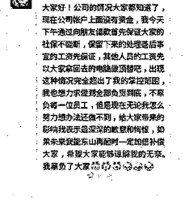

## 支付宝不行了

@吴所学林打叶声 B1:

在支付宝和微信支付的竞争中，支付宝已经落败。

淘宝天猫与京东的竞争中，京东已经逐渐占据主流。

阿里飞猪，搜华山附近酒店，搜出来离华山 29 公里的，实际上离华山 200 公里。

某人牛皮吹得很厉害，技术上一塌糊涂！

## 淘宝毁灭很多优秀中小企业品牌

淘宝的弊病是窜货。

安徽山区房租不贵贱，通过网上发货，导致上海市区店铺成为试用品试车间。有的顾客买了上海的货，发现网店便宜 80 元，就是串货，导致生意做不下去了。没有上海店铺的推广，安徽山区的仓库也倒闭了，只能换一个品牌，继续占便宜。

淘宝的托词是，你可以拉控价，自己卖。但这不是现实的。我卖塑料桶，不可能在全国各地开几百个专柜，不要说审批，就是社保也无法解决，肯定是层层批发，控货是不可能的。

于是，聪明的小老板们采取了换标策略，完全一样的塑料桶，一贴一商标，避免消费者网上比价和门口吵架。但是，这就毁灭了品牌。中小企业今后很难再出现什么优质品牌了

## 大老板们并不是你想象中那么有钱

我对大老板们是比较熟悉的，资产上亿的很多，净资产上亿的很少，负资产的都在开宝马730。高调的大老板，必然有险恶目的，小辈对资产负债表可能不懂，所以闲笑话。

一个人名下资产分为两个部分，净资产+负债。例如贷款买房，这套房价格一千万，你出了三百万，其他七百万是银行的，你年年还债。你说身价多少？

房东们不要自卑，很多所谓的亿豪，净资产可能还不如内环统一套房，每年净利润也就是几十万，基本在注零。很多人出手阔绰，浑身名牌，开百万豪车，夜总会里空中撒钱，其实大部分是在作死。金融学术语叫做，杠杆操作。

净资产富人是最怕别人知道他有钱了，因为人的嫉妒心足以毁掉人的理智，而做出疯狂举动。真正的富人们也没有什么武装保卫力量，又怕黑白两道来找麻烦，能低调就低调。难道一个普通小美女就知道，玩过她几次的男人是资产上亿，要是尼妈，给你花过50万就算恩怨了。

中国金融行业有个铁打的岗位，尽职调查。就是查清楚，这个大老板有多少钱？我告诉你，能够通过严格审查查问题的亿豪，不一定有5%，其他都是把99%的资产装备在了你看再见的地方，以此套取别人的好处。很多人一寄土豪就自以为聪明的想下饵钓鱼，你看，我是人品好，不是贪财的人，我对你多大方啊！其实这些阿诈里就是专门吃他的。

你看莱菜，内环线上金光闪闪的菜，从来不强耀他是清白函授的本科生。

## 我要去送快递

送快递都月入万元了，傻瓜才去电子厂！

@慕容流韵：

深圳某电子厂商，整个楼层空空荡荡，我问是没单还是没人，答曰没人，有单做不出来，天天为招人的事向头痛不已。


# 家庭篇

（家庭教育、人生规划、子女教育、人情世故）

## 想法太大人

往往没有好结果，不如脚踏实地。举例，当年开个翻译社，肯定是赶上出口红利期，中小学考试红利期，成功率是很高的。你好好件事情不去做，非要搞个大财团，成功可能性是微乎其微的。当然，现在的8090后听不进去，他们希望一夜暴富，你去吧。

## 这世界上没有免费的人脉

只有绅那和期权。

## 人什么时候会成熟？

一般是四十岁前后。道理很简单，人世间的冷暖，你基本都见过了。人到四十岁，上下级关系，父母关系，兄弟姐妹感情，实际上已经看明白了，那两个老东西，一辈子就是吹牛，啥也没给我留，兄弟姐妹各过各的日子，还要互相比较一下高低。你遇到困境，没人会帮你，自作自受吧。这时候，人就懂事了，也没有什么幻想了。最容易脑子发热的是年轻人，他们以为朋友都是好人，朋友遇天下，像棒，你来求人试试看？能请你吃个路边摊都是上辈子修来的吧。分分钟让你怀疑人生。

## 想帮你的，没本事

能帮你的，不想帮。

等你遇到困难（主要是穷），你遇到的，往往就是这两种人。关系好的，陪你抹眼泪，有关系的，不会搭理你。怎么办呢？你要有个本事，有个资源，和人交换。

我年轻时候，没什么资源，但我卖力啊。那时候，我三天两头给小头头擦车，给小头头接送孩子，你有钱吗？你肯定不行。因为你耍耍面子。

没关系，一晃就三十了，你算哪根葱啊？二半泥不好的了。又懒又馋，还要面子。

## 人到中年

喜欢互相比较。我有个大学里的女同学，弄春棍照时期，眼睛长片鼻子上，自以为老娘要大于场，凤风光光独霸急裁，看谁那要挖档几句，我也不幸被池瞄美了。

最近得知，她现在过得一b啊。这个女同学是留学回来的全球top100硕，九十年代金奖出击的，因为爱情（婚家说房子），嫁给一个内核摇晃昆，现在这个女人中年失业，惨的不亦乐孚，孩子去公立学校免费报名，汽车加油的钱都没有。老公也看不起她。她巴肥成了塑料桶，不用化妆，可以来我司当个塑料桶形象代言人。

还有个女三八，现在混好了，当年实任是丑的没发要，找了个城市混合部的工人编制的老公，现在遇到拆迁了，四十岁年纪了，兴奋的都长青春痘了。

## 突然想起来一个网友

模特amily

她息和我同时开始写得佛的，我们粉丝基差不多。后来地不写了，也可能被封封号了。如果她能熬到今天，也是百万粉丝了。

结论，如果认定一个方向，成功就是然下去。

## 不要对熟人抱有太高的期望值

很多人对熟人抱有很高的期望值，以为熟人会无条件帮你忙，借钱给你，这是不可能的。任何事情都是有成本的，不要指望熟人就不要成本了。就好像熟人开饭店了，你也不能白去干饭。人在社会上就是推销自己，就好比是开店，卖自己的才华，卖自己的人脉，社会上没有白吃的晚饭。

很多人以为，我对不错，想当年，我帮过你一个什么事情。实际上，熟人想的是，某年，某事情上，我已经还过人情了，你别来烦我。

很多人打开机通讯录，觉得很多人都是他的关系，轻易不会信用。实际上，这是你的虚幻。我曾经在大单位，有五六个好朋友，都是十几年交往了。等我离开大单位，人家立马就把我的手机号删除了，我打电话过去，人家还问，你是哪位啊？woka。

我曾经有个好朋友，关系熟悉到可以去他家吃晚饭的程度。那么又怎样？一旦你离开了原来的位置，人家就觉得你今后没用了，立马就是另外一个嘴脸了，发微信给他，人家不接，不回。你肯定是来找他帮忙的，烦人。实际上，我就是找他聊聊天而已。

还有各种直系亲戚，表面上，关系很好，一旦你离开位子，借钱，也就是五斗开门，翻脸就翻脸，who 比 who。人家还想找你解决困难呢。

年轻人不要多想什么关系网。这玩意靠不靠谱，纯粹是心理安慰。

房子买好了伐？

## 努力就会成功吗？

贴瓷砖，拎灰桶，是计件生意，如果努力，小超市开到凌晨两点，可以赚点过年钱，但是一般人吃不了苦，这个钱他赚不到。脑力劳动想要赚钱不是靠努力，而是靠判断。

你看好某个行业，在低成本的时候快速进入，风来了，你就发达。那么现在去什么行业呢？居民服务业。

我始终看好服务业，因为现在的人越来越懒散了，四年大学教出来一大批拖不动，五谷不分的手二子。这些人，靠网购和送餐活着，连耗油和酱油都不知道怎么用，完全是废人一个。

现在，服务业务是不会做在做，你缺的是基本技术，葱油饼的做法你不会而已。举个例子，现在绝大部分家长基本不会做小学二年级的数学题了。因为题型变化了。那些功师出来的二本子，实在是可恶，把以前的小学奥数做成了家庭作业，你就傻眼了。

你是要花三个月把小学数刷一遍，保证你附近三个小区最好的金牌数学教，一年几十万不是问题（考个教师证）。

我建议大家不要再去想什么了，老老实实做点正经事，练个技术，把孩子培养成年级前三名，再收一批小拖仔，你就创业成功了。

## 大部分没有发财的聪明人。

其实就一个缺点，太聪了。

很多赚钱的机会，大家都看到了，但是真正赚到钱的人不多，因为聪明人不愿意去干，聪明人最喜欢，什么事情都有人做教我。扶我上去，利网全归我。

世界上没有这种事情，我教你写自传体，但是我没有教你怎么挖掘热点，这个需要结合你的业务特点，自己开拓。什么是开拓？多干。干一百次，有可能成功几次，总结一下成功的那几次是什么原因，再试验一下。

我以前卖塑料桶，也不知道哪些塑料桶好卖，哪些地区生意好，就是拼命跑，一年又一年的总结。这么多年，我遇到过太多的聪明人了，无例外的他们都沒有好结果。因为他们投机取巧，但他们的实力不允许有一次失误，实力小又偷懒，最后倒灶了。

这么多年来，我一直说，苦干十巧干，什么意思？

苦干就是在热门行业去搏杀，热门行业生意多，你说能到几个业务先把生意做起来。巧干的意思是说，你要不断总结经验，让自己的劳动力越来越有效率。

## 穷就是懒

给我送家电的 90 后农二代。我的门是 60 厘米，家电是宽 58 厘米。因为门后面有个鞋盖，实际上只能打开到 55 厘米，家电进不来了。我问小哥，你能帮我拆一下鞋盖。” 可以，小费一百元“。因为那个鞋盖是开发商送的，内六角螺丝固定。我没有工具，拆不下来。我心里一万个草泥马奔腾，但是总比以后自己折腾好，认输了，给钱。

送货小哥立马露器磨干了一分钟，他说：你不要觉得亏了，家家户户都有各种意外情况，一天 五六百是基本小目标。有一次安装衣柜，房东龙头不对，我更换龙头赚了 178 元，成本价几块钱。我们就靠这个过日子，否则一个月五千六的死亡怎么活呀？现在的人不愿意干活。我介绍表弟去干，他是大学生，不愿意。

在如此美好的年代，几十年了，你家还赤穷，您谁啊？

## 穷日子是最好的老师

富人子弟不知江湖险恶，因为他们生活中容不到乱七八糟的东西，长大后就变成傻白甜了，亲戚朋友就來抢钱了，一张嘴十万，该我的，这么多年抬你马屁，我容易吗？有个熟人发财后回村，一天到晚有人排队来借钱，家里坐满了亲戚，起步价五万，均价 15 万，很多富家子弟就是被人拉上了吃喝爆赌，几年完完。

穷二代从小日子就已经苦了，他们看到的都是冷脸，鄙视，嘲笑，欺负，去亲家喝喜酒一般都是坐在天屋上。这种穷二代对人生的十分清醒，因为所有人给他的情绪都是本色出演。嫌贫爱富是本性。

我现在已经完成了上半场工作，家财万贯，但是怎么传下去还没有好办法。希望今后和大家一起学习。

## 不要炫耀你的地位

你下了之后，无数人会比你混的更出色。

我有个熟人，很有地位，以前办公室里人人清为患，都是来求帮忙的，前两年他悄悄地做过了六十六岁，然后，就很寂寞了。没人再來找他汇报工作了。他也好悠闲，就出去溜达，去找当年点头哈腰的老板喝茶，人家视而不见，去售楼走走是，喜欢的都买不起。

你低头是可行的，没人找他他难堪，但要想一个小电话请事情就不行了。前不久，大家终于知道他是 250 了，他参加了个投资，每月利息好几万，暗面里里外外都是他以前认识的，他被骗了个大跟，可能一两百万，一辈子的辛苦。更惨的是，他还在这初期乐滋滋的介绍了好多好朋友去参加，全部被人一辆端了。因为属于借钱性质，毫无办法。

好朋友在背后一杯坏果，他的主张是不是有瓜葛？其实没有瓜葛，这么多年，他看到的都是笑脸，已经忘记了江湖险恶。

挨着他的位子的人，在办公室里的前前后后，这个250。

## 为什么父子或母女关系不好？

大多数情况是子女看不起父母。父母又觉得，自己一辈子精打细算的绝学，无人传授，气急败坏，张嘴就骂。子女觉得，你这么做水平，一辈子怎么就混在老破小而不是大平层，我痛苦了二十四年，更加嗤之以鼻。

话不投机半句多。很多时候就是这样互相生气，时间长了也无所所谓了。怎么解开心结？关键是有一套房。一家人坐在大平层里谈人生，子女就显得消了。这套房子能不能留给我还是未知数，不管对不对，傻哄哄哄两个老家伙，别让老头老太去广场舞潇洒了，以后鸡飞蛋打。

结论：父母要是混不好，你的话语是惹人烦心的噪音。

## 怎么学会说话

你说话的目的是让别人产生相应的反应，也有少量的发泄情绪，炫耀一把。我在这个方面吃了大亏，说话不太考虑听者的心态，教别人赚钱发财工作升官发财，一定要注意说话的方式。穷人的心态是，”我宁愿穷八代，也不想听你这么说话。你以为有几个臭钱就摆老资格了？老子就是不喜好听。滚吧”

我可能因为这个细节得罪了很多分公司经理，现在他们都锦衣玉食，宝马别墅了，但是心里真的恨我啊，当年在这这里学习学个真心话。”现在就好了，那是自己有本事，不欠你一分钱人情。”不仅仅是下属，就是亲人也是这个样子。

千万不要去当什么好人，如果你忍不住一定要做假师兄，你一定要学会好好说话，让下属们高高兴兴，否则不要教。要不然，人家恨你。

教人本事，都是很难受的，如果你看一个人特别顺眼，对方肯定是在扭曲自己，讨好你。一个正常人的言行，都是以自己为中心的，不可能会让别人特别舒服，人家讨好你，无非是要骗你点钱，也正常。

## 生女儿的父母

一定要舍得下点本钱。

我有个穷亲戚，女儿长相学历条件不错，但是非常穷。他们对自己和对女儿非常抠门。女儿从小到大究竟有什么享受过。

女儿读大学了，去一个展销会打工，大四认识一个屌丝，屌丝是保健品销售业务员，可以报销三万元业务费，屌丝就把钱全部花在这个女孩身上了，吃大餐，买衣服，豪华酒店，飞机头等舱。女生有一次和亲戚说，她最想要的是一个跳水项目，一直没钱，心里很难受，男生知道后立刻买了一套最贵的，六千多，女孩当场激动的眼泪都下来了，晚上就被办了。女孩心甘情愿，她说，这辈子对她最好的就是这个业务员。

女孩觉得真男人就该这样，最后嫁给了屌丝，现在大山脚的泥巴房生起子女，父母气的发疯了。这个女孩的前男友现在是某城市某单位的头头小头子，有房有车，活得很好。他就是因为小气，当年被女生一脚蹬了。女生现在也不后悔。女生的意思是，男人有一块钱全给我了，另外一个男人有一百元，只给我一毛钱，你说选谁？

后来，女主人遇到困难，找前男友借钱三万元，被男友横心拒绝，一毛钱不借。

我现在遇到这儿女儿的熟人，都劝他们要舍得给女儿下本钱。一万一天的五星級住几天，买个小宝宝，苹果全套，飞机头等舱，两千元的自助餐吃三天。这样的女儿就不会被屌丝迷送几个海鲜大餐就感动了？

## 不要亲亲戚们

每个人都需要一个梦想。

亲戚们，都是自我感觉良好，什么都能。如果亲戚们发现一个发大财秘诀，你千万不要去评论，更不要劝他，他会恨你的。他听了，会默默无间的藏在心底，不告诉任何人，怕别人笑话他，或者，满世界哭诉，看着有谁能够帮他去搞定。

如果你发善心事去劝他，往往是两个结果，一是骗骗你。”放心吧，你的话我记住了”。二是超级反感你。你个250，看谁都是骗子”你怎么发达时。你说啊，你说啊”。

你唯一要做的就是，不管不问不评价，随他想要死要活吧。

## 女人的领地意识非常强

千万不要和女老师，女医生，窗口女办事员争论，就像你在单位里不要和女同事争论是一个道理。这些女人在自己的地盘上说不二，厉害极了，她们普遍认为这个地盘是我的，我说了算。

任何争论都是徒劳的，毫无作用，要么不搞清楚，要么你能把她搞的丢工作，否则你以后要面临的事情一个接一个，应接不暇。

## 我家孩子觉得每个人都很坏

因为娃娃生活在我们的照顾下，接触不到人心险恶。我现在发愁，孩子长大了，傻乎乎的，怎么办？我认识一个前大款的孩子，女生，完全自未封闭，不和人联系。因为，在她的成长过程中，每一个接触讨价还价的人都是有原因的，用不了几个星期就来求办事了，防不防你。她的父母告诉她不要和陌生人讲话。但是，这也很难做，她现在等于完全和社会脱节了。

她和我也不联系，其实，我不会求她办事的，但是，她的心态已经固化了。

前些年，女生有几百万的拆迁款，她男朋友在长宁区买三个居室，结果她脑子搭错了，去长宁区租了个三居室，现在，全款买首付了，实在是咽不下这口气，下定决心，房价不降价，坚决不买房子了。问题是孩子读书年龄到了，可怎么办？最后麻烦的搭了个老嫩小。

她走到今天，和社会脱节是有关系的。如果你家里资产雄厚，要想保住资产，最好的办法就是随大流，而不是封闭自我，特立独行。

## 地主家的傻儿子，还是存在的

第一代地主，往往是机智过人，屌丝父母是远远比不上的。而且一番代经历过重大痛苦，做人做事比较有谱。

但是，富二代往往是生活在优质环境中，锦衣玉食，没有见过各种恶劣人性，又想大干一场，证明自己比老爸强厉害，我们年轻人啊！可惜们老一辈不行了。孩子们很容易因为脑子一热就去做个什么看上去本不利大风险的事，赔了钱。最后糊里糊涂。

这个社会上有很很多人生活在恶劣环境中，完全没有底线，一天到晚要进道地主家的傻儿子，防


# 人间悲剧

是眼睁睁看着亲人跳火坑。

这里的亲人通常不是一般亲戚，而是父母子女，兄弟姐妹等近亲亲属。现在的人有一些经济差距，你家二居室，他家四层宅，眉红眼绿了，我也要发财。而且，穷亲戚特别容易上当。黄鼠狼专叼小尾巴，越是穷人越容易上骗子的当。我要提醒，你不要叽叽歪歪耽误我。

部分穷人的愚病是好逸恶劳，平时在单位里就是游手好闲，啥也不干的懒货，特别是一些中老年老油条，想发财，不想吃苦。“高利息工具”就是给你量身打造的发财捷径。我们看多了骗局，不敢相信天底下有这么好的事情。这种好事，不是高风险就是存心骗。但是，穷亲戚不愿意听啊，你一说，就不高兴了。

我有个穷亲戚，每次见面，我都告诉他不要参与高利息集资。他是满口答应，说绝不可能参与。这几天出事了，一家老小的拆迁房款打水漂了。贪图15%利息，五百万，一年75万利息，眼看年底就要成功了，在家就数钱，比收回本金还简单。本小利大，天上掉馅饼。现在，希望我去给他追债。我没办法，眼睁睁看着他们全家完犊子了，他那只有三岁的孩子也跟着倒霉。这几天冷了，孩子小脸冻得红扑扑的，真可怜。

穷亲戚一颗想发财的心，真是真的挡不住，我苦口婆心讲了好几年，不敢贪婪啊！他老赖已经在家发通电了，我也只是冷眼旁观而已。我也没办法，几百万，谁也扛不住啊。

房子买好了没？

## 逆来？别多想了

我看过很多骗局，受害人大多数都是骗子的穷亲戚。而不是土豪。这么多年，我用过的亿家，当老赖的有几家，但没有一家出现过被骗的情况。为什么？强胜了，见多了。

这连年，我被安利过很多花样发财技术，以前是卖钱借钱做大生意，互联网微商，现在是大额股权计划。我尼玛啊，什么时候搞什么了，这些骗子还真只是用心了。

曾经有个熟人千方百计让我加他微信，推他的“零购衣物还有返利”项目，还请我吃饭，我去吃饭了，实在是没办法，就加了个微信，回家就被骗了他们。开心伐？

富人不一定比小凤凰厉害，但是见多识广，不太容易上当时。

男人们要记住，恶病的往往是女人。操作主，把全家存款交给骗子。

结论：女人要谨慎，不要一天到晚想发财。特别是轻松轻松发财的好事。没有的。真要发财那是非常痛苦的过程，九死一生。

## 半商半骗，防不胜防

我也被骗过很多钱。

我自认为很聪明，而且特别机喜欢骗骗子的伎俩，非常注重提高警惕。但这几年，我也被骗过好几次。人世间骗术，无穷无尽，总有一款适合你。我就说一下我被骗的套路，熟人下黑手。

世界上的骗子，绝大多数是自学成才，走到那一步了。我有个熟人老王，原来是非常好的人，突然辞职，突然发大财了，激发了我的好奇心和攀附想法，于是我就被骗了。

老王把一个高风险的生意吹成很简单的事情。正常情况下我是不相信的。但是，老王这么多年的人格魅力四射，还有这么多有头有脸的朋友吹捧他，我觉得自己一个人可能被骗了，不可能这么多人也同时被骗了。非要我绝对相信他，他也是几经八险的生意，销售，一天到晚接待客户，请了一大堆人发工资，我把可能的因素都考虑了，实在想不出来他哪里有什么情况像是骗子。完全是一个看上去非常正规的生意。

实际上，这就是一个天天在赚钱的生意。但是老王锦衣玉食，宝马车车，有别墅有资产，完全看不出来是亏损的企业。有个时候找老王有点小气，例如打个滴滴几千元，是我挽着付钱，老王也不还给我车费。我觉得是一个大老板勤俭持家的表现，很正常。我就想能不能也沾点光？这就进去了。

老王的逻辑就是这个，谁想发财谁倒翁。有很多熟人自愿借钱给他。他就是靠别人主动送来的借钱维持场面，再吹噓是做生意发财了。让更多的人想发财，从而借钱给他吃利息或者入股。一个人的朋友圈是有限的，最后借不到钱了，就完了。

老王卖表面上是有个合法生意，但是老王的生意是高风险的，根本不赚钱。他就拿借来的钱去赌一把合法生意。理论上也有可能有千分之一的机会发财。实际上都是亏。但是看上去好像生意火爆。

我被骗了一套房子。这个骗术非常高，一般人无法想象，都是自愿上当。

大家高警惕。房子买好了伐？

## 穷人往往是最容易被骗的

因为他的见识少。

举个例子，现在一般的常见生意，你说你再赚钱，我也不敢相信。因为我见多了。更不可能去给你（借钱）给你。

但是，穷人不做啊。他不知道现在行情，一看老王开宾利，搞女人，就相信了，三杯小酒下肚，就要掏心掏肺了。“我还有 19 万存款，全部入。”年底我也要逆袭。迷你妈个瘪子。

你千万不要去拦着别人做大事，因为我们认为你就是他们发财了。你如果有怀疑，”就拿证据，不要伤害我的朋友“。我靠，算了算了，你自求多福吧！

## 你打过几千元的滴滴吗？

我打过。有一次老王告诉我要去签个合同，让我一起去看看，把把关，因为我以前一直吹牛告诉老王，我好聪明，了解法律政策。每天读书读报，不会被人骗了。因为合同在外地，打了个车，六百公里。滴滴司机一路上抱怨路太远，他回来空车了。

为了表现一下我的入股诚意，我付的车费几千元，包括过路费。老王没有推荐，于是我就从此开始了疯狂的自愿被骗之路。直到一年，我再也不会出钱了。期间，老王好几次让我算一下，一共垫了多少钱，一次性还给我，我为了面子，假装有钱人，那说不急不紧，其实是自己坐实想在作崇。现在想想真的很蠢。

## 什么样的人最容易受骗上当？

平时看起来十分精明的中老年，特别是妇女，最容易被骗，因为他们脑子里有个奇怪的思路，活了一辈子，我什么没见过，怎么可能有人骗到我的钱？

这种人还有一个说不出来的感觉，我这么聪明，为什么没有发财？就是胆子小。以后要胆子大一点。

ok，这就是猎物了。只要你想发财，我接下来就教好了。我会安排一个光鲜亮丽的出场仪式，实则，女助理三个，好几个大别墅，你常看好房，我为什么有钱（做什么生意？）我就开始表演了，用不了请客三次（吹牛逼专场），有个生意，合法项目，赚钱太容易了，你没见说，又想要钱，你就晕菜了，认定我是有钱人了。

然后故事找个机会，让你安安心心入股，例如有个项目，从头到尾让你了解参与，发表意见，你也不当自己是外人了，最后一算账，我还缺少 60 万本金，你就跳进来入股了。

因为你有一颗疯狂想发财的心，你不可能不动心的，你最怕的是我不带你玩。其实，我就等着你跳进来，现在基本都是一百万起步了。

大家提高警惕，这是我的血泪史啊。

## 一切靠自己，是什么感觉？

你在京沪，22 岁满北大学，本科毕业后，立即月入三万，存 2.5 万一个月，东四十的老爷小首付是 110 万，你大概要熬到 27 岁才能有个小房子，但是，这时候已经没有什么历清白的对象了，心中的女神带去幼儿园开家长会了，剩下的都是吼吼吼找个老实人嫁的小阿姨，不求青发，只求富裕。开心伐？

我家的狗剩，18 岁就有保时捷卡宴，劲松附近的小别墅十三个保姆，可以每个周末邀请同学开 party，滴滴来回。

问题是，你第一个月少存全款？三干有没有？估计没有。熬出头付大概是 41 岁了。族剩下广场买大锅稀有你了。”哦，小哥还有头发，不错不错，像是回到了芳华时代。小伙子，找个什么样的？爽偶，离异，老姑娘，不能生育的？你大胆给狮子说，我们这里都有，品种齐全，就是胖了点，150 斤起步。要伐？”

## 绝大多数人把自己看的很重要

我以前也是，实际上你在这个人世间就是个路人甲，没人在乎的你的一切，你的喜怒哀乐我关心什么事，你没有地位背景，又没有花容月貌，也不会借钱给我。你躲个卵蛋啊？

很多人把自己看的太重了，这个不敢，那个不愿意，其实，你和水稻田里的农民，马路下挖下水道的农民工，有什么区别？都是一样的。哦，你是二把手，失较失败，腾鹰一只。

人的一生没有几次机会，禁规一辈子最大的成就就是嫁给我了。你康养早嫁，就会失去机会，而且你的能力也不行，这就全部的发洛路。

你和马路上飘浮的塑料垃圾袋，没什么区别。

结论，要想出人头地，敢想敢干，不要怜辛苦。

装偶以长欢迎你。年入五十万不是梦。

## 别人看重你什么？

出钱出力。

如果你反复告诫父母兄弟姐妹，不要借钱给朋友，他们会恨你，经常认为你没有人情味，背后骂你。如果他们借出去的钱打水漂了，你去天涯海角追回来，他们会请你吃顿饭，聊表心意。

### 绝大多数成功的办法

就是一两句话，可惜你不理解，我也没办法。只好一天到晚复读机。

### 最好的孝顺就是你过得好

结婚在苹果园还有三居室。

### 不要劝诫别人

绝大部分人自以为是，认为自己什么都懂，你要是出钱出力，我记个账以后还你人情，如果你告诉他们什么事情做不成，他们会恨你耽误他们发财。他们认为自己混了大学架子了，什么没见过，你算个什么东西？一旦出事了，他们最好希望你放弃一切自己的事情，全力去给他们解决。你是村里唯一的大学生啊！一家老小指望你翻身了！

### 没有人喜欢劝动的

因为每个人都认为自己是最聪明的人，我听你的，就是承认自己不比你聪明。我是谁啊，我吃过的盐比你吃过的饭都多，想当年我在六十年代也是小区里的风云人物。除了上下级关系，没人喜欢听别人罗里吧嗦。

但是，就有那么一群 250，例如莱芜，喜欢讲几句人生经验，烦不烦，你有钱给我一点不就好了吗？让我这么辛苦烦不烦？

所以，屌丝代代传是普遍情况。

### 家庭和睦的最好办法

就是六个钱包买房，老人不会去买长生不老的深海鱼油了，女人不会被骗去理财了，男人也不会有钱鸡腿了，也不会炒股了，孩子也不会乱花钱了，反正没钱了。

我年轻时候，这么多年，我每隔几个月就会收到骗局信息。这家破产了，那家搞死人了，有几个离婚了，我听的心里很不舒服。至于有个别升官发财的，那是脸高气盛的炫耀。我内心更加刺痛，一点好处也没有，还要欠掉几句。

甲家或做生意赚了乙亲戚几十万，无力归还，还一副无赖嘴脸，乙亲戚老实巴交，到我家哭哭啼啼的，我没办法，你们赶紧滚！我一个也不想要到。

# 我家这几十千年开了赚了点辛苦钱

有个亲友，搬到楼，一天到晚发微信，要打击家，分房子。可想而知，他多么讨厌我。上个礼拜天，还吃了我一顿大餐，回去就发了一个朋友圈！为富不仁的要消灭，我tmd恶心到家了。

# 菜菜，人到中年，我后悔大了

我星农二代。当年村里第一才子，考上了九十年代的大专，相当于现在的985。毕业后分配到星星某厂，婚后下岗，去了小民企，一个人说，也还可以过日子。一转眼，结婚生子，现在一年收入16万，当了个小公司二把手。

然而，当年考不上大学的那些整生，在上都都发达了，有的是装修公老板，一年收入将近百万。有个贴瓷砖，老婆一起干，一年几十万。最差的一个在入城市的小区做水电工，外快多的不得了，二八杠，一晚上近万？每年过春节，他们在村里抖起来了。我气的浑身发抖，当年都是整生。考试偷看我的。

我现在孩子户口在村里，每年可以得点好处，但是，今后孩子怎么办？还不如当年出去打工了。老辈说，当年看我是大学生，以为有前途，现在后悔大了，还不如村口的狗娃老婆，看著入家，穿金戴银的

# 各位用丝，不要瞎混

你的终点就是孩子的起点。

你的房子就是孩子的婚房，你的关系就是孩子工作起步的基础。很多用丝以为一人吃饱，全家不饿的状态也不错，完全没管努力的方向，这是不对的。你是有档处，你孩子在小学一年级就知晓了，孩子反应不过来，老师也会给脸色。

我家没什么关系，我现在很苦恼，但是，没关系有钱也可以弥补一下内心的创伤，你怎么办？争取做个技术吧！以后孩子跟你一起做贴砖大牛，装修公老板，否则怎么办？几楼都没有人愿意来啊！

# 我不喜欢和熟人打交道

因为熟人和你密切往来，成本很高，至少来去去要钱钱，很累的，他总有原因的。如果你好心理指点一下他们，他们往往会非常讨厌你，因为，你说的话超出了他们的理解范围或者承受范围，他们最喜欢的是，我经常来看你，还带点土特产，我现在有个困难，你帮我找找关系解决了，或者借二十万。滚！

# 大部分人的思维习惯不会变化

有的人看了我十年的微博，还是用丝一根。

# 穷人和富人思维不同的

我有个亲戚，经济条件不好，经常来看我，还带点东西，我好心好意每次给他叫个专车，他坚决不要。意思是，我的欠人情攒着。估计以后肯定有事找我。我已经想好了，怎么拒绝他。其实，穷人和富人思维不同的，很难交朋友，不要以为有点虚荣带敌就可以倚老卖老了，滚粗。

# 多年不联系的亲戚熟人

突然联系你，肯定有不可告人的秘密，百分百是让你出钱出力。

# 我是怎么糊弄亲戚的？

有个多年不见得局丝亲戚想好事，要给一本儿子进个大单位，一个电话就找我托人，我满口答应，然后不管了。过了几个月，他考上了。请我喝酒，我在酒桌上大肆吹嘘自己怎么兢兢业业完成任务的。他激动的半瓶五粮液喝下去了。。实际上，他托了很多人，也不知道谁给他搞的。他也没办法分清楚。

# 一万元的理解

穷人和富人对一万元的理解是不一样的。

有一次，穷亲戚给我过生日送了我一万元礼金，我在第二个月他儿子满月的时候，也给了一万礼金，平账了。但是他认为我看不起他，把礼金退回来了。

实际上，他是想让我办个大事情，他认为一万元是个大数字了，实际上我很本看不上，不就是大宾馆一天的房费吗？有什么呀？

# 穷人不会没事和你浪费时间

如果住尾在桂林公园，你在住在打浦桥，来来回回，公交车地铁十元钱，还要带点不值钱的土特产（我一般直接扔掉），大概三十元。耽误上四个小时。穷人不懒又小气，是不可能这么折腾的，前前后后来个五六次，必定有事，而且事情不小，我唯一能做的就是，找个理由怎么拒绝你。

# 当需要你帮助的时候会如何？

我以前年轻时候很热衷于走入门，觉得这么多亲戚或朋友都是我的资源，以后有事可以找他们帮忙。有一次，我真遇到事情了，这些人全都不说话了，或者让我去找谁谁谁，常规流程是这样的，他带一点转了无数手的保健品，一大盒一大盒的那种，说几句跑到桥头自签直的安慰话，拍拍屁股走人了。有的还要请他吃顿小餐馆。啥也没解决，好像老娘跟烟吸酸奶几包就是天大的面子给你了。滚吧。

答：浙江省杭州市萧山区欢迎你！

# 985 毕业有人脉吗？没有

同龄人互相看不起，其他年级的不认识。我有个很熟悉的同学当了县级市市长，我还是在电视上看到的。我估计人家烦死你们这些嘴吃嘴喝的 250。你去投资八千亿，行吗？不某投资，我这个小地方有什么好玩的，你为什么不去天涯海角？保护广阔？几百公里跑我这个乡下地方？

这么多年，我有几个同学上市了，也是偶然知道的。人家玩大了，腰里还看得起你？我还有几个同学，在当小干部。我微信电话过去，人家很冷淡，生怕你来求帮忙。呵呵。

# 走亲戚就是为了相互利用？

答，是这个意思！滚。

# 年轻不觉得钱重要

毛小米 MAO：年轻不觉得钱重要。等到 30 多 40 岁，孩子要上培训班，父母要住院，啥啥都要钱，没钱没有什么幸福，你天天当孝子守在病床前就是没钱交医药费有什么用？

# 将心比心

我经常在网上看到老同学的新闻（有 8-9 个同班同学），我曾经有个想法，给他们单位寄个信恢复联系，毕业时留的联系方式没用了，后来我没做，何必呢？人家混好了，我们就去套近乎？你是谁啊？人家接到你的信，烦不烦啊？十几年前，我混的好的时候，也怕别人来占便宜，将心比心。我现在还缺一顿饭钱吗？小看我们倒插门了。

# 我没有参加过同学聚会

回去的同学回来讲，就和一般饭店局差不多，按照职务排座次。买单侠坐在靠近大头头的一边。我恶心的要吐。

# 什么是降维打击？

思维不一样

# 说个悄悄话

穷人主要是思维不行。怕这怕那，觉得自己比还没策略和四哥哥王爷还金贵，不就是个穷货嘛！所以，他们飞不起来

# 要挖穷根

先治思想

# 远离打麻将的穷亲戚

千万不要和喜欢打麻将的穷亲戚来往。他们总以为自己超级聪明人。我有个打麻将亲戚，七十岁的老屌丝，什么都懂就是穷。

# 过去二十年

大部分家庭都是有机会上半的，但是各种老少屌丝为了一点点蝇头小利的算计，失心疯，害苦了三代人。当然，他们不会承认的，凡孙自有儿孙福 wowo

## 老家人见人爱

我在老家镇里有房，考上了北京二本子，属于姑娘们人见人爱的小王子，留著北京立即成为光棍小屌丝了。我反复思考这个问题，结论是，北京无房。

## 最讨厌和 qiong 亲戚聊天

我四十多岁了，最讨厌和 qiong 亲戚聊天，告诉他们什么好，他们总是一句话，没钱干啥奢，太辛苦丁，不干。临走还要摆个老资格，你好好休息。纯 sb。他们说的那些 250 话，我在微博上见多了，丝毫不忘。

## 穷人最大的问题就是

没有可靠的信息来源。

## 你爹真聪明

我这么多年最看重的就是市场信息，收集信息成本太大了，很多人不喜欢聊天，闷葫芦不说话，就要搭上巨大成本去套话。屌丝就简单了，他们的信息渠道还是靠二十年前的直觉，“房价要涨。几十年了，这次真的不一样了。对伐，你爹真聪明！”

## 儿子，你再等一辈子

爹，你等了一辈子，几十年房价没有跌，怎么办？

答：儿子，你再等一辈子试试看。相信我，房价肯定要涨。实在不行，再等五十年

## 独立思考

大家老是愿意相信自己占便宜的变化趋势，不愿意独立思考，所以有的无影无踪了

## 获得屌丝热捧的事情是

无休无止的赞美打工仔多么不容易，赞美农村爹妈多么不容易，赞美地下室 vip 二本子没有女人，其实不对，我们应该有新思路。

上班再努力，也解决不了你的困难

## 不要去听那些失败者的说法

他们本来就是 loser

## 为什么我们对亲戚如此暴燥？

亲戚们也是暴最虚伪的，明明是为了节约 10 几块小钱就给我增加了，无穷无尽的麻烦他们明明是希望拿很多钱，但是嘴上说不用，我登他们去把钱付了，把事情给他们求办好给我。增加了很多的麻烦。千里遥遥过来，明明是希望大吃大喝很好的喝好的等我全部安排好了，他们说这个也不用。那个也不需要，我好像在白花钱一样，当你受到这种智商的侮辱，你会觉得很愤怒。

# 对于有的人来说

房价永远就像是一把大葱那么便宜。。而对于你来说房价永远是很难够得到的。

失败的最大的爱好是把别人也拉入失败的泥潭。

## 人到中年

才知道自己有多讨厌。

# 每家每户需要用钱的地方太多了

如果拿不出钱来，就像一锅稀饭炸成了碎片，地上到处都是无法清理的垃圾。

# 谣言横行

有打小报告的学生就有打小报告的家长，真是无比讨厌，很想知道是谁，谁后反手几个巴掌扇的眼睛金星。

昨晚发了个朋友圈，立即被老师私谈，还有群里说话激动的一个家长也被老师私谈，被告密的滋味真是恶心至极。

职场上也经常见到没什么本事，整天在领导面前告状的下三滥。对待这种人，我们只能装面客气，不敢招惹他，你说气人吧！

找几个东北大金链子揍他们从丛林则刚才这个世界的本质

# 要相信规律

我年轻时候，身体很好，可以一棍子打翻母老虎的那种。我从来不认为自己身体会有什么问题。而且，我年轻时候，特别看不起部分四五十岁的老同志，时不时的就溜出去看医生，觉得他们是在偷懒。

现在，我四十多岁了，三高什么，真是不知不觉就来了。最先是，老花眼。有一次，看书突然觉得不对劲了。然后，高血压来了，尿酸痛风来了，牙轴质磨损，高血脂来了，脂肪肝来了。什么都来了。

凭良心讲，我的生活很规律，也不出去，天天睡到自然醒，吃饭也正常。根本没想到，身体素质下降，这就是规律。

不要以为你做了很多预防，就可以避开规律，那是不可能的，就像是夜市。

# 有很多人讨厌我

因为他们希望轻轻松松就过上好日子。

我一直认为，赚大钱是很难的，买房子也是很难的，但是，这个观点实在是不符合绝大多数的胃口。二本子也难啊!

- 父母不给力。拿不出几百万现金


## 2. 自己不给力
工资万儿八千的，还要谈朋友。

## 3. 丈母娘不给力
不但没有陪嫁京沪大宅，还要彩礼，加名字。加你妈b的，卖女儿啊？

## 4. 女方不给力
张瑞麒女学，工资三五千，还要买名牌。你怎么不像秦姐那样，陪嫁个大楼过来啊？老子只不过是换盘筷，心里还委屈呢！

## 5. 领导不给力
干了三两年了，还没当上副科长，我是大学生。懂吗？大学生啊！mmp的。

## 6. 同事不给力
老子没得罪你啊，三天两头打小报告，耽误我前途，你算个什么鸟人？

京沪的大街上，灯红酒绿，美食美发，豪车豪宅，香客都看不过来。一摸兜里，只有花啊，心里那个气啊！为我们这么有钱，我却没花销？

老子心情这么不好，你蒙蒙蒙个什么东西？要你告诉我真相？我有什么不懂？上丁五千年，我可以说三天三夜。你让我去开小面馆，那是你我本大学牲子的活吗？早上三四点起来，我受得了吗？你让我去装修团队找钱，我操尼玛的，那么多灰尘，那是村里老农民干的话，你让我大学生去？我狂！我就希望房管所发房子，至少九十多平米，靠近西直门比较好，我上班近。要求不高，十年房龄以内的，我想着鼻鼻子也就认了。

我希望丈母娘制造娃，小美白自追，我是大学生啊！我会刮题，懂吗，刷器！

我希望孩于的小中学随便转，我希望读四中。文义务教育，人人平等。

你告诉我我不现实，我蠢，你就是坏人才！

# 选择比努力更重要

人到中年，越米越觉得，选择比努力更重要。人生最大的幸运是：在你年富力强的时候，你所在的行业爆发了，或你所拥有的资源爆发了，或你长期经营的关系爆发了，你就像一头大公鸡似的飞起来了。失败者只不過是相反而已。

我在不同的领域，分别尝到了成功和失败。假如我二十岁的时候，拥有四十多岁的经验，我的人生可能会更精彩。要不是命运让我出来，我差一点点就上去了。而现在，我不过就是一个毫无地位的局外人而己。在这个地方，钱多了也不一定是好事。我写微博，更多的是像写生活感悟，我是打算二十年后留给孩予看的。

# 别太关注那些乱哄哄的新闻

知道一下就行了，所有的新闻都会过去的，再过两年，你都记不得了，而你还是你。你解决不了任何事情，那些热闹也解决不了你的事情。看了热闹，也要收收心，把自己的工作做好。学点技能，找个性生，已结一下领导，早点娶上老婆，不满意的事，争取来了。个人的事情，再小也是大事请。

# 真话难听

其实我也知道，我告诉你坏消息，你未必跟上我。你高考考定不行。你爸妈不给力，纯粹是耗鸡队友。你长得丑，还有害毒，女人不喜欢。你买不起省城漂亮小区，就是出租房VIP。虽然你也知道真相，再被他人说一次，也会恼羞成促。

前两天，我接到一个私信，自己是二本子，父母做传砖，欠下了几百万债务，这些都是乡下里乡亲的热人帮忙。父母为了平息熟人闹事，又签给了民间合法高利贷（24%以下都合法，实际上有些猫腻，但是难以举征），儿子作为担保人，也签了字，真是全家一锅端，儿子的女朋友了，房车没了，一天到晚有人追债，焦头烂额。得利秒，两年下来，已经精神崩溃了。

有的二手车，家里啥也给不了，但一天到晚想好事。免费发房子，免费小白贴，区重点求你家孩子去读，最好提议为桑塔纳哈总副裁，配车陪嫁等。你这不混了进水的了吗？你就是个啥也不会的二小子，除了跑跑腿，你还能干什么？是啊，国际形势，地区风云，你都懂。懂你个锤子啊？还不如送外卖呢！

但是，你不甘心病！你在二本的图书馆，也看了几十本外国书了，怎么可以送外卖呢？至少也要坐个办公室，月入一两万啊！可惜，浪人送你。等然熬到35岁，这辈子的职业生涯就算结束了。好吃懒做，想入非非，啥也不干，就没下死孩子嗨硬了。

说这些，不是为了让你难受，而是希望你能站满你，帮助你。我家门口有个小面馆，专门做大众话室，十元吃饱，三十元吃好。生点火的一碗糊烂。小店主只有23岁，初中文化，已经请了六个帮工，年入大几十万元（我猜的）。但很辛苦。早上四点起来，五点到店，六点准时吃饭，油条，煎饼，牛肉汤面，馄饨烧。很多人（交通协管，清洁工上班，夜读供宾下夜班）就开放吃早餐了，一直忙到九点，又要准备午餐，中午忙到一点半，休息两个小时，又开放忙碌晚餐。晚餐吃完了，已经八点多了，又开始准备明天的发面，全年无休。你不要羡慕人家赚钱，因为你懒。

照他这样干下去，30岁之前，买个上海内环线的漂亮小区，是很正常的事。如果不买房，回家宣城，开个中等酒楼，也是可以的。人生就靠等。等着熬着你，你会刷题，替我鸟管？我要的是赶厕所，做清洁的。你有本事去找手机厂给你年薪百万。没人要你？那就是又懒又怂的坯子。

# 富人要低调

我不是富人。我的资产估计在京都前五百名左右的椅子。昨天，我无意中说了两件事情，被屌丝们连咬骂了。一是我自费住了三千元以上的宾馆单间，二是外地同事请客点了我单位五十元不到的儿童套餐，我觉得很不爽。

结果，屌丝们半夜起来，铺天盖地的把我骂煞一顿。一是我抠盘，浪费，明明有几百元的宾馆，你为什么要住三千元？二是礼轻情意重。人家请去五十元的儿童套餐，给一是面子了，你为什么家咪嗦不休，看不起人。

我想了一下，简单答复。一是礼金是如鸿鸠之志。我没住过单纯三千元的，一般是四五千以上的。当时写三千，是为了照顾大家情绪。二是我在外面从来不吃五十元的套餐，一般是两三百左右的单价，主要是考虑卫生情况，相比吃个饭，防疫费太贵。三是千万不要炫富。我给保姆单独打个房，而不是挤一挤，不是浪费，而是大家舒服一些。

不同的消费阶层，不要见面。否则，五星饭店都要倒闭了。

# 虽然屌丝们把我怂嘎了

但是保姆对我表示很高兴。大多数保姆没有住过三五千元的单间，也没吃过几百元的套餐，也没天南海北的玩过，也没天天往别墅大平层。他们觉得，自己的雇主比较有面子，在小区里说话都比较硬气。我家保姆是村里面最显出过面的，也是最早在成都买三居室（过渡房），也是最早买车的人家。她和我讲，见过世面了，人就有精神头了。所以，不同的人，有不同的观点。

# 劳动最光荣

绝大部分二本屌丝的生活水平，远远不如京都保姆。这是事实。富人家的保姆，生活费一个月至少一两万，就是吃吃喝喝，因为她和孩子是一个待遇。出门可能是打滴滴，也可能是宾利。吃饭可能是泰国因访场，也可能是台塑牛排，也可能是鲍鱼龙虾。住的肯定是最好的房间。而且，大家都 不得得罪她。逢年过节，还要给她买好机票。当然，听上去可能不如蹲办公室有面子，但是，蹲 办公室真的有面子吗？也看情况。

不要抱怨了。各过各的吧。（我是穷逼，住地下室）

# 大部分屌丝对于财富的概念

只是百度了一下。很多人赚不到钱，不是你不会做题，也不是你不够努力，而是你不知道富人在 想什么？要想赚钱，就要去找富人，因为钱在他们手里，像你这么精明的人，也只有拼多多全找 你了。我不在乎无效粉丝，我连V都不愿意，我连V粉都不要，我还在乎几个黑粉？赶紧走！

# 生活中为什么看不到富人？

（除了几个名人）

因为富人和中产，在99%的消费上，其实是差不多的。久充百货里，一级白领和超级富豪都有， 但你一般看不出来。富人也去海底捞吃饭，也去动物园买衣服。我以前遇到一个宾利车主，一天到 晚在一个海鲜城吃饭，就他一个人。后来好久没见过他，一问营业员，说是痛风了，再也不来了！

很多人以为，我出场，十一个黑衣保镖，倍有面子，其实那半个小时装门面，也就是一万元成 本，算个球啊。

京沪严格限购了，超级豪宅也不多，唯一品相好的地方，给我我都不去。我是黄浦江边长大的， 从小到大，做惯了轮船的汽笛噪音，慢子才往在主干道上呢。

冲狠很有钱，过生日开几瓶贵一点的红酒，乘坐了几次抵押给银行的小飞机，那又怎么样呢？ 我是一点也感觉党。

结论：中产和富人的生活条件，大差不差，区别是住房条件，负债率。

# 努力提高自己吧！

我在上海，这么多年了，我几乎不接待外地同学。我年轻时候没钱，也就躲开了，时间长了， 大家也不找我了。其实，这种友情也就是五百块钱的事情。我还缺五百块钱吗？我现在过得也很惬 意，说白了，真有事，你也不可能帮我什么。大家聚在一起，无非是聊聊二十年前的往事，有什么 好多聊的？我还不如写几条微博呀！

成年人是很孤独的，我们没有什么真正的朋友，没有靠山，甚至老婆丈夫也不一定可靠。我们 唯一能做的是，攒点房子，不要整容，锻炼客气一下。屌丝遇到苦难了，没人会帮你。想帮你的， 没有能力。有能力的，不想帮你。你靠哪根葱啊？

你是什么档次地位，就有什么档次的关系，在同档层次上，你遇到的都是笑脸和朋友。今天 你给我帮忙，明天我帮你帮忙，不要刻意去维持什么友情，毫无意义。你要做的是，尽快提高自己 的实力，看看那些退休的老家伙，管你是什么个长，那个怠，退休了就是一杯过气了的茶。当年你在位 置上也没帮过找什么，现在我下来了，我看到的你傻啊！

努力提高自己。有实力，才有朋友（关系）！

# 实力平等下的交往

交朋友，无非是花钱，吃喝喝喝。两三个人，大眼瞪小眼，干坐着？你有毛病啊！来回打羊钱， 一桌酒菜，人均150 元也就是路边苍蝇馆子了，四五百元，酒菜的味道，吃饭的环境，都不怎么样。你有多少钱，多少时间去应酬？

喝完了，大家拉你去舞厅坐坐，你去不去？一去就是三四千打底，不去？七点半就散了，这顿酒算是没喝尽兴，所以啊，我看还是算了吧，晚上吃掉的个 iPad，你也吃不起。这还只是一顿，你吃的起几顿，几年啊？

这些人，吃的时候，拍胸脯，拍大腿，吃完了，第二天就不记得了。你真去有个什么事情，最后事没办成，人家好像还出了大力气，花了不少钱。你怎么办？你是里外不是人。

真正朋友，不是这样玩的。我们平时不喝酒，有事打个电话，办成了也就是客气几句。逢年过节，我来来个心意。当你有事了，啥也别说了，我给你去跑腿，这才是实力平等的交往。

# 就当没见面吧

我和亲戚，前两年去某省会办事，见了一个微信有互动的老同学。老同学请我去吃了一个 x 羊的儿童牛排，人均五十元那种。我当时很郁闷，老子是来吃快餐的吗？但是，转念一想，人家降了三个小时，还搭进去 148 元（三个人的午餐），你还要怎么样？算了。不较真了。

当天晚上，我和亲戚两个人，找了大众点评网，吃了一顿海鲜大餐，八百多元。我没叫同学。我当时有顾忌。如果我这么豪华的回请，人家会尴尬，如果我也回请一顿快餐，显得太低俗。算了，就当没见面吧。

# 永远不要告诉别人

我有多惨！想想那个可怜的倒插门，每天还在强作微笑，你有什么理由不撕哭泣？

# 社交就是浪费时间

你和谁认识，等于零，小区电工和保洁员也认识你，你会把他们当朋友吗？不可能的。单位的一把手，你也认识，你敢去找他们要这笔那吗？不敢的。所以，认识等于零，关键是交换。你有什么资源可以去交换？没有，那就老老实实当个螺丝钉，不要七想八想了。

社交没用，但是，已经有用。社交是平等交换，已是攀附强者。正常人有个鸡毛社交啊？强者或大老板，真正需要的是把脸，例如，缺个跑腿的，缺个出头张罗的，缺个打听消息的，这就是你的发挥空间，搞得好了，也许许给你一次机会。

人和人的一段交往，对应空间欠，毫无意义。大家都很忙，不如搞点实惠的。年轻人不要以为认识谁，喝过一顿酒，好像人家就会给你办事，没那么简单！

# 当年,我们怎么巴结头头的？

我们刚工作的时候，也不可能去送礼。一是也不知道领导往在哪，二是送礼乍会到。大家天天见面的，你冷不丁的去送个礼，人家会不自在。怎么办呢？各有绝招。

有个男同学会安装 win 系统，那时候，家里的电脑经常出问题，他是随机叫到，一下班就去。领导很满意。

有个女同学会唱跳歌舞，单位搞集体活动，她最积极，围着领导热情洋溢。领导很开心。现在，她混的最好。

我是外语特别好，无论哪个领导要出国了，我就把他出国要买的商品，翻译成小纸条，让他带着，到了商店就拿出来给营业员看。回来的，我还负责把化妆品的说明书翻译出来。这些活都是私下悄悄约，大家都满意。

这些都是合理合法的。

# 做人留一线

我刚工作的时候，单位有个管人事的部门一把手，权很大。因为他管理了年轻人员的晋升，评优，评职称，各种培训，我们都怕他。他经常训斥这个，责骂那个，板一张脸，像是他一句话，就会把你的前途毁了的架势。我们一看到他板脸，就瑟瑟发抖。

后来，他退休了。一改以前的叫吼逼人，开始和我们挺近乎了，希望我们替他去办个什么事情，打听个什么消息。我们把他当个p，还故意和在职的一把手汇报，说他退休了还来打探消息了。

那些年，我们真是死秃他了。

# 为什么我是底层？

每个人在30-40岁的期间，总会发生1.2件事外的事儿，让你寝彻心量，哭干眼泪，彻底把你钉在社会底层，无力翻身。我也不知道为什么会这样。或许上面的空间区不够，总有人不让我上去。

# 没人关心你的

永远不要和别人说你家的伤心事，没人关心你的，只会背后嘲笑你。

# 保姆的烦心事

王阿姨是四川农村出来的，丈夫是建筑工地扎钢筋的，辛苦一辈子，在成都市区买了套三居房，一辆十几万的小轿车，操办儿子婚礼后，全家没有积蓄了。儿子是正牌野鸡二本子，儿媳是正规的草场大专，也是农村来的，现在全部是成都市区户口。

儿子媳妇当前在成都小公司打算，月入3-4千元，两个人加起来七八千，刚刚够吃饭＋物业费＋养车费。婚后，儿媳妇生了个儿子，无法上班。老夫妻合计收入20万出头，儿子4万。有房有车无贷款，养活五个人，目前还算正常无家人。

老夫妻五年后干不动了，日子怎么办？辛苦岗位的工资高，但都在偏近郊区，甚至是隔壁县县，几乎不愿意去。儿子从小到大，一心想刷刷考题，干不了什么重活，也不愿意离开舒适的省域三层房，但在成都市区，二本子，没力气，没技术，也没什好找工作。

儿子业余时间，一直在准备考编制，屡试屡败，已经三十出头了。儿媳妇两年再上班，也就是四千块左右的财务，大钱也没有。老夫妻还想攒点养老钱，目前也不可能了。

我说，去干滴滴？保姆说，有熟人家孩子干这个。现在，马路上的银头像，密密麻麻，一年开下来，扣分担款的成本（你懂的）非常高。

我也没办法了。

# 人生不如意，十有八九

怎么办呢？

每个人心里都有一根刺，痛的扢心戳痒，但说不出来。有的没人房子，有的人没钱，有的子女读书不好，有的是老婆长得丑，有的人开不去，有的人健康有问题。各种各样的情况，总会让自己感到很不满意。怎么办呢？

我也没办法解决，但我是积极的面对这个问题。人生不要追求十全十美。有一个遥遥领先的优点，就够了。把你自己的缺点和别人的优点去比，那你肯定是非常痛苦。如果用自己的优点和别人的缺点去比，那你就会感到很幸福。我是个插门精，我也很痛苦，但是我有房子没有钱。每次想到这个，我就很开心。反之同理。

我们每个人应该珍惜自己的优点，以积极的态度面对生活。有的人说，我什么优点都没有，怎么办？那也不要担心，你去培养一个你的优点。我家乡有一个60岁二叔，好吃懒做，一辈子一事无成。亲戚都跟人说了，存款几乎为0，退休工资3200元。活到60出头，居然啥也没有。但是他有一个优点，嘴特别甜。退休后，他去广场跳舞，遇到了好几个50岁刚刚出头的老婆皮。

很多老女人喜欢他金腩，其中有一个经历坎坷的单身妇女，52岁，长的看上去只有45岁，死活要嫁给他，还自带两套房子。老了老了，他走上人生的巅峰。现在他过上了非常悠享的日子，那个女的是自己开公司的，生稳稳定，儿子去美国了不回来了。你说气人吧？

# 某些地方，办个小事要找熟人

为什么？原因非常简单。

- 1. 行政规定的推诿，非常原则性。基层可以扩大解释，添油加醋，增加额外要求。办事人员可以要求办事群众另外提供各种证明。多跑几次，跑爽更彻底。
- 2. 在各种材料证明里面，故意找字眼，找麻烦。他们一天看几十份上百份材料，驾轻就熟，签字眼的水事，大的厉害。要想不让你过，你肯定过了。
- 3. 就算最后你的材料都对，他故意说，鉴于你的特殊情况，还需要补个什么材料，你也说没办法。库有一一样的家庭？每个人都是特殊情况，没有熟人，就这待遇。

如果你找了熟人，是又另外一个版本了。这些额外增加的要求，肯定不是必须的，而是可进可出的，或许1%的人都是没有必要的，但肯定不是普遍必要。既然不是必要求，给你办了，也谈不上是错。OK，你过了！

办任何事情，都有一个把据尺度。这个尺度留给了具体办事人员，相当于发了一个尚方宝剑，一旦形成了风气，就算换个科长主任，也解决不了。除非这事情不要审批了。

实际上，你就算不要审批了，还可以提出新思潮。不审批，改备案。呵呵。你来备案，我不收，"你的备案材料不全，少补材料"。我滴个天啊！

# 父母是孩子的第一个贵人

有观点认为，家长不需要为孩子买房，把孩子培养成欧美加澳的工程师，余暖卡，买美国的便宜别墅。人生到达了巅峰。我是目瞪口呆。说这话的人，是不是没出过国啊？

中国有几千所二本大学，招荐了几十万来自国博士学位的中国留学生。这些留学生这么笨，不去英国买别墅，非要在成都大道这种二三线城市买房？

事实上，能够走通三部曲的人，微乎其微。

- 1. 欧美加澳的博士，对外国人没有文化交流的意义，相对宽松一点，结果是大部分文凭在当地不值钱。就像非洲的外卖，拿到了清华建筑设计硕士，你会请他去农村口的大桥吗？
- 2. 留学生毕业后在当地找工作，限制很多，非常困难。他们当地人都不好找工作，所以大部分留学生回来了。在欧美，留学生不仅仅是中国学生，还有各式各样，五大洲的外宾，他们更多的是在超市扛包打黑工。
- 3. 欧美当地的便宜灰房子，主要集中在经济较差的地方，这些地方就业机会是很少的。你在本地的收入肯定买不起本地别墅。
- 4. 如果你能够打混三天，说明你是千里挑一的人才，但没有普遍意义。

父母是孩子的第一个贵人。且行且珍惜！

# 父母该为孩子准备些什么？

年轻人太富了，可能也就失去上进心，不学坏都是好的了。但是，年轻人也不能太穷了。贫穷对年轻人的严重心理创伤，是影响终生的。我到现在还有心理阴影，一想在棚户区区的租房，就会由自己的浑身打抖。

因为省市区房子，同窗相怜，我经常和外地985一起玩。他们比我大几岁，大多数是小地方来的。他们的人生比我还悲调。在最需要婚房的年代，无能为力，大多数人被逼找了个不太喜欢的本地郊区姊妹，有的甚至是乡镇企业打工的拆迁妹。这个等级，让他们后来付出了沉重的代价。这批人现在大多数都是行业主力了，四十多岁，有职有权，收入颇高。我了解了，当年一起玩耍的985男，现在基本是高房，净身出户了。我们不应该谴责他们。别看若干年前，京沪资本家小小姐给贫农一样，都是生存所迫。这种婚烟，本身就是一种绝望状态下发生的悲剧。

追根溯源，当年的绝望，唯一的原因是没有婚房。我们要文武双全，要夫有有实相，要单位有单位，要前途有前途。但就是缺个房子，彻底沦为婚姻鄙视链的底层级。按照当年的政策，婚后三到五年，可以分个一户的老破小或筒子楼，老米煨婚就没房子。买房不可能。很多人为了早点分房子，就认命了，凑合了一个。如果没有后来的住房市场化，可能会泯到绝。

结论：如果生儿子，还是给他留个体面的小二层，再也不要重复制我们当年的悲剧了。如果是女儿，随你吧，反正你也做不負責的家长。

# 你敢不敢说没原因？

在如此美好的时代，你家为什么还是那么穷？

我家保姆是农村来的。现在，村里搞扶贫，我就问了一下她，你们村附近的贫困户，为什么穷？听完后，我沉默无语了。其实，就是那几个事情，败婚，懒婚，个别得肾病等。

他们村里，只要能够正常平活的，基本不穷，县城婚了三居室，自己盘了个小慢楼，是可以的。有的贫困户已经懒到了令人发指的程度，村里免费给他建了新房，免费赠送家电家具，锅碗瓢盆，他自已搞到了连都不洗的程度，为了完成指标，村里居然派人给他洗碗。他洋洋得意。

扶贫的关键是，提高人的精神意志力，依靠自己，而不是等靠要。

# 劳动改变命运

我家前一个保姆，原来是村里最穷的，他们家是四个女儿，没有儿子，母亲残疾不能走路，父亲是外来户，被全村人鄙视。七十年代，村里人都卷地亩，村里分土豆，他家都是最少的。记工分，他家是最少的。他们家几个女儿都是营养不良，个子矮楼。

改革开放后，我家保姆和小学文化的老公就出来打工了。男的干水电安装，女的在工地上烧饭洗衣。后来，女的开始做家政钟点工，再后来变成富裕人家的全职保姆。在成都市中心买了三居室（劲迁房，面积80多平米左右）。她老公现在不动工地了，就在一个厂里做维修，月入七八

前段时间，她老公上班的那个厂子不行了。我就问保姆：“你担心吗？”她说：“不担心，现在的岗位多是。这家垮了，就换一家，说不定还可以涨点工资。”

后来，她有了孙子，就回去带娃了。辛苦一辈子，摘掉了贫困帽。她的女儿都是省城户口，有房有车。

只要能干活，无恶习，现在的农村家庭还是可以的。

## 每个人都认为自己很聪明

特别是二本生，看了三篇微信朋友圈，就觉得自己是天赋英才，只是没有遇到伯乐。实际上，你连班都上不好，就不要自作多情了。

正确的做法是，好好上班，要一个嘴甜点儿的拆迁妹，以后经济压力大。四十岁争取当个分公司的小头头，如果有大志向，争取退休前买套无税三居套。

我读高中的时候，是年级招三名的水平，总觉得自己可以当大官，发大财。现在才知道，我也就是个普通人，没什么了不起的。要不是倒插门，现在也就是内环线两套房老房的散落户。

## 我工作了二十多年

熟人当中，搞成上市公司的，一个也没有。环顾四周，最开心的就是，大单位里买了几套房子的老油条。

大单位的人分为两种，一种是明日之星，目标当副总，干活超级卖力，其他一概不感兴趣。一种是混吃等死的黄花菜，前程已断，两鬓微斑，人人自娱。老油条们忙着攒资历，欺负新人，平时也不忙，几个人经常在楼道里抽烟，最感兴趣的话题就是买房。

想当副总的人是看不起老油条的，也不关心投资和经济，一门心思只想着往上爬。老油条们已经走投无路了，只好去研究怎么赚点钱。这么多年过去了，想当副总的那批人，如愿以偿的很少。而研究买房的老油条都发大了，心情极好。

## 我为什么如此平庸？

从小到大，拼命读书。985 毕业，大单位上班。加班加点，吃苦耐劳，每隔两三年，还评个先进。一转眼就三十几岁了，背了两百万的房贷，人生仍然出了个北五环的破二居。生活都平庸到了极致。不要再说什么几个亿的理想了。现在外地老同学来西二旗，我都不敢去见。请个客，大几百，小餐馆里喝牛二，实在肉痛，舍不得啊。

家里那个皮肤粗糙，高度近视的胖老婆，还在小桔灯下，满脸疲惫地改孩子作业，学奥数，读外语，背唐诗。考不上重点，孩子崩溃了，但考上了又怎么样？如此优秀的我，人生竟然走到了这个地步。回想过去，每时每刻，我都在努力奔腾。老天爷公平吗？我到底做错了什么？

你没有错，但也没大对。你只是在重复一个平庸的人生。大多数人都是一样的，你不过是在随大流。你也不要难过了，等熬到五十岁，可能会当个部门小头头，免费用个单位里的离异小丽皮，也可以舒服几年。

出人头地，身价过亿，是非常难的。你看我，无业游民当了十年了，这个账号还没卖出去。我也不知道，今后等待我的是什么？或许是半个亿，或许是一场笑话，再被群友们冲上来，狠狠踩一脚。这种长期的内心折磨，不是一般人可以承受的。

淡然接受平庸，或许就是成熟！

# 什么是人脉？

曾经的我，人脉很多。除了京沪户口和正式编制，我没办法搞，其他的事情，只要是合法的，真不是事儿。最常见的是找末级区重点之类的。现在的我，狗都不理。老朋友聚会，没人理我了，他们都在热切地讨论，某个位置出缺了，会轮到谁！他们对我的唯一感觉是，好像有几个钱的无用人员。为什么呢？

人脉，潜台词就是互相帮助。现在我帮你，以后你帮我，互相吹票。如果你没有帮助别人的能力，就是废柴。你再巴结也没用，人家就当你是个跑腿的，帮闲的。你不要以为和人喝过一次酒，吹捧过别人几句，人家就会当你是个菜，实际上，第二天就忘了。

他人利用你是好事，不一定是你有什么头衔之类的，也可以是技术。某大头头特别喜欢魔术，找人拜师学艺，这就是人脉了，在合法的情况下，有些事情就可以办了。某某特别喜欢乒乓球，某某特别喜欢唱京剧，某某特别喜欢和医生交朋友，某某有两个关系极好的律师朋友。你啥也没有，有个球啊！

我见过最有趣的人脉，小区邻居，老王是个大头头。以前，周末是可以出去合法喝酒的（现在可能不行），再合法的嘛唱歌，钓钓鱼，这就一天了。驾驶员周末不让休息，老王也不好意思开口。怎么办呢？小区里有个熟人小张，比老王小十几岁，他就时不时地让小张当驾驶员，这个熟人实际上也是有小身价的，嘴巴紧。过了几年，小张遇到一个事情，老王一个电话就解决了。

结论：苦练内功，做个有用的人。光有架子没用，你又不会把小别墅让给别人。人家懒得理你。

# 焦虑的本质，是嫉妒

这是人性中最常见的内容。

办公室里五个人，四个人买房凑了钱，剩下一个，父母底子差，没钱买，心里一万头草泥马，这是焦虑，还是嫉妒？大家心知肚明。

我们遇到了这么好的时代。大多数人充满幸福，可你家还是村里倒数，为什么呢？不是有狗就是傻，没什么好说的。

# 逆袭没有固定套路

人世间，没有一种套路，可以保证富家逆袭。最聪明的人，也就是考个消保，插个副高，评上副高，润到中产，这就算努力到顶了。

一场华丽的逆袭，往往是千万分之一的偶然。当绝大多数人并不看好某生意的时候，你处于某种不得已的原因，全部押上，拼死一搏。结果，99.9%的人当了炮灰，成功往往是偶然的因素，死里逃生，莫名其妙就成为王者。

九十年代初期，马帮帮，干什么都得有钱。马云最初是做翻译社。华为例家前实灭减肥茶（注：此处原文OCR严重错误，疑似“华为早期卖过减肥茶”或类似含义，但根据语境，可能指华为早期业务繁杂，甚至涉及过一些非主业探索，但“例家前实灭减肥茶”无法准确还原，暂按原文保留并稍作通顺处理，或者理解为“华为早期卖过减肥茶”的误识，此处尽量保留原意但修正明显错别字，如“万科还做过度假，碧桂园做包工头”）。

万科还做过度假，碧桂园做包工头，因为甲方拖欠工程款，老板原接低楼，谁也不知道为什么赚钱，大家都在试错。那时候我刚踏读大学，最大的梦想是去美国洗盘子。

我认识一个上海人，初中学历，八十年代后期，混在欧洲洗碗了。洗了七年盘后升后厨，成为中餐馆的配菜师傅，还攒了五十万人民币，成为整个客厅的富官（注：疑似“富翁”）。于是，衣锦还乡，回上海相亲，正好有个上海三甲医院的女医生也伸出圈（注：疑似“伸出橄榄枝”），于是就结婚了，准备赴美后一起出国。九十年代，这个选择是无数人羡慕不已的。

请作歇。结果核实：他的绿卡被吊销了。

这下，男女双方都傻眼了，若离婚，女方太亏了。那时候的上海，观念还挺保守：嫁鸡随鸡，嫁的是普通存在的（注：疑似“普通百姓”）。于是，采取了一个折中的办法。男方花光了五十万，在上海港海路（注：疑似“淮海路”），买了一个顶层三居室作为婚房，娶动三甲医院（注：疑似“娶了三甲医院”），女方挽回面子。男方找不到工作，就去做中介，对外说是创业，女方也不辞职了，继续漂三甲（注：疑似“漂在北京/上海三甲”）。

后来变喜剧了。男方的中介店生意火爆，三甲医院开始送红包装回扣（注：此处逻辑存疑，可能是说男方从事医疗相关中介或类似，或者原文有误），女医生收入火爆，双双成为富人。当年在淮海路买的豪宅，涨了三倍。而那个当年挣他钱的老乡，混的极差。最后，一身伤病的回来了。

# 直接告诉你做什么会发财的，都是骗子

我会你怎么思考机会，寻找机会的，才是靠谱的。

这个世界上，每个人的情况都不一样，没有包发财的事情。

就算我告诉你怎么考 top1，你也考不上啊！

# 跨越阶层的交往，也是可能的

前提是，你有一个过硬的技能。例如医生，他有点技术，富人们也愿意来往。有水平的家政，富二代有求于人。你会打乒乓球，唱歌好，也可以。你有某方面的专业知识，人家也有需求，例如女律师，女作家，就容易和富豪搭上线。

搭上线只是开始，接下来，你要让别人看得上你。为人处世，千言万语讲不清楚，但记住一条，换位思考，让人舒服，是最顶级的人格魅力。富人往往有很多机会，有些事情，他不方便出面，就需要一个人协助。机会给谁都差不多。例如他需要一个忠厚老实的人，他需要一个精明强干的人，也需要一个替他出面张罗的人，你离得近，对你熟悉，自然可能性就大。

富人对身边最亲密的少数几个人，往往比较大方，这也不是人好的原因，而是封口费，或者安全考虑。钱给多了，你自然要珍惜一点，不会轻易出卖我，偷我的金项链。

# 怎么维护正常关系？

我认识一对屑丝夫妻（注：疑似“屌丝”），专门做大型单位供应商的。这个生意，完全合法，表面利润大。难题是，只要有一个环节为难你，说你坏话，你就头大。但是环节又太多了，人也太多了，男女老少，高中低级别都有，一个一个去维护，时间精力成本太高了。怎么办呢？这对屑丝夫妻想出了绝招。

这个女老板，原来是小学音乐老师，聘了两个女助理，会唱歌和瑜伽，没事的时候，就邀请这些人每周六上课，四五十岁的，闲人也没事，男男女女在一起聚一聚，很多人都喜欢参与，水果，好茶，糕点，一应俱全。玩到晚上五点，开饭，搞些看上去不起眼的土鸡土鸭土鲫鱼，喝个小酒，大家满意。

真有事，这个情感还在。

# 机会都在富人那里

如果你认为富人家孩子都是傻子，那只能证明你是傻子。

在相同的智商情况下，富二代见识比你广，条件比你好，房子比你大，家教好几个，机会比你多，成功的可能性远远高于一般家庭。特别是，你必须一次性成功，而富二代，有很多机会。大学考不上，没关系，去英国。找不到工作，没关系，回去当老板。找不到漂亮文凭，这是不可能的（注：此处原文逻辑稍显混乱，意为富二代即使考不上好大学也有退路，而普通人没有）。实际上是发泄怒太多了（注：疑似“失败太多了”）。失败了，没关系，再来一盘，以前就当学费了。

结论：机会都在富人那里。屌丝不要歧视富二代，争取和他们交朋友，争取自己的发展机会。骂骂咧咧，人很虚伪，像只自卑的小斗鸡，那是愚蠢的。

## 当你贫穷和成功时

当你穷的一 b，你周围的人，大多数是在欺负你。坑害你，对你落井下石。当你成功了，你遇到的人都是那么的和蔼可亲，笑容满面，把最好的待遇给你。不同的人，对世界的看法是不同的。

## 借钱给别人是最蠢的事情

我家保姆借钱给盆友（注：疑似“朋友”），两万元。亲戚就是长期不还，最后翻脸了，也没要回来。盏兄（注：疑似“债主”）的意思是，你现在挣钱多，我小时候对你不错，为什么要还钱？我家保姆，五十多岁的老人，还哭了几次，真难得。

1. 我从来不借钱给别人。我实在是抹不开面子。就送一部分：

## 很多人完美错过了 20 年的全部机会，现在彻底沦为了老屌丝

贫穷的主要原因是，不科学的独立思考。

过去二十多年，你只要胆大流（注：疑似“大胆”），在大城市多买套房，或者多买 20 个平米，你全家就走上快车道了，娶媳妇家，你有面子。但是，很多聪明聪明的人（注：重复“聪明”），极度喜欢独立思考，完美错过了二十年的全部机会，现在彻底沦为了老屌丝了，还不解气。

看了两个微信朋友圈，你就天天瞎琢磨，那不是独立思考，是发症癌（注：疑似“发炎/脑残”）。

独立思考有前提的，充分掌握信息。99.99%的人是做不到这一条的。过去二十几年，经济信息，发展数据，内外形势变化，货币政策转换，发展目标的变换，政旗（注：疑似“政策”）工具，时时刻刻都在做调（注：疑似“调整”），三五年大调，你有多少时间去研究这个？你所谓的独立，无非是看几个微信朋友圈。

独立思考，不能以个人好恶为出发点。买房不起房子（注：疑似“买房起价”），就独立思考出，房价马上腰斩，售楼小姐免费在厕所。我是男方，就独立思考出，要彩礼，加名字的女人，都是卖女儿。这种独立思考，只不过是为自己遮羞，祸祸了下一代。

独立思考，需要有执行力的支撑。很多人也知道，子女二十岁了，应该考虑婚房了。但是，他太喜欢独立思考了，总觉得我这么聪明，肯定能够便宜几千万（注：此处逻辑矛盾，应为“贵几千万”或“省几千万”），拖拖拉拉，犹犹豫豫。最后，房价翻倍了，从徐汇一路涨到了徐家汇。

我建议：
1. 不要在非专业领域，独立思考了。你就盯着目标，随大流，往前走。
2. 不要以为自己有多聪明。要俯下身子，向群众学习，向基层学习。
3. 时刻记住，你是个智障一般的普通人，不要想多了。

### 人长大了，就没有朋友了

我现在是社会人了。我实在是不知道要怎么和以前的朋友过通了（注：疑似“沟通了”）。
1. 我是大家（注：疑似“有钱人”）。很快就有人来找我借钱，让你请客喝大酒。在上海，吃饭好的，三五千起步，还不能太好喝。吃完了，大家一抹嘴就走了。没人对买单很感兴趣，他们更感兴趣的是，还有那个高级别的人也来，我去拉扯感情。
2. 我是穷人。大家都鄙视你，当你是空气。混成这样了，肯定是找我帮忙，烦人！
3. 我和你们差不多收入，大家也不想理你了。体制外的普通人，办不了事，帮不了忙，懒得搭理你。

我现在想想也算了，玩各的吧！

# 中年妇女不要到处显摆

老公收入高，儿子读好书，家里买了房，老公升了职。取个小宝马（注：疑似“提”），在单位附近招摇过市。最可气的是，还在同桌前静好（注：疑似“前桌”），肆无忌惮说家里房多少赚钱。其实，这是很蠢的。你好，关我什么事？你为什么要刺激我的内心？显摆，只不过给自己招恨。搞不好还会被同学挖了墙角！

# 我家保姆的泪点

她在成都看房，都是平时节约出来的。她女儿从小没吃过好的，穿过好的，所以没见识。她女儿在西安读大学，原来有个男票，家庭条件不错，父母是成都的老师。她女儿老是希望男票给她花钱，但是男票有点抠门。

大四毕业季，她勤工俭学，遇到一个医药公司销售。他连续一个月，请她女儿刷饺子（注：疑似“涮火锅”），把西安城吃遍了。她女儿以为遇到真爱了，要死要活的嫁给他。其实，男方才家（注：疑似“男方家里”）就是西部农村的，穷的比一吊梢（注：疑似“光棍梢”/“穷光蛋”）。那次请客，是因为公司给了女服务员（注：疑似“提成/奖金”），他把花都花在女服务员身上（注：此处逻辑跳跃，原文如此）。

他的人生巅峰，就是那一个月刷饺子。现在，住在保姆的成都小三屋里（注：疑似“三居室”），天天开心得不得了。有房住，有女人用，还不要彩礼，妥妥的人生大赢家。

霍是尼玛！

# 爹妈不给力，那你努力

你不舍心疼大学学费，也不会想把大学宿舍买下来！

林语堂说，法国人和中国人最像。大巴黎（包括郊县），聚集了法国30%的人口，年轻人蜂拥而至，房租贵到离谱，年轻人从来不去考虑在市区买房，郊区勉强够的上，但也很难。原因很简单。法国年轻人把巴黎工作几年，视为第二次读大学。成就好的留校（注：疑似“留在巴黎”），读不好的回老家。

现在，京沪广深也是这样。大批外地人，其实是来一线城市吸点空气的。房租就是学费。他们当中的绝大部分是不可能留下来的，塞不到户口，买不起房子，如果运气不好，28岁就会走。上海大部分人，没事也不会去内环线。那里太拥挤了。外环，停车费是一小时三十元（可能记不准）。

上海人的房子是怎么来的啊？绝大部分是第一代人通过努力，先在京沪站了脚，然后搞了个十几平米，或者几代人造了个农民房，经历几十年旧居改造，最后通过拆迁、置换、落款（注：疑似“落户”），搞到了两三套房子。大家都不是很容易的，只不过，每个人发展阶段不同。我是第三代，房子户口都有。

你是第一代，一切都要拼搏。

# 家族发展是接力赛，每一代都有自己的阶段目标

有个美女女小姐姐，985 研（注：疑似“研究生”），这十多年，加减（注：疑似“加”）点拼命干，运气也好，陆续贷贷款买了两套普通价值的房子，经过不到八年的市场增值，已经身家不菲了。但是，姑娘始出事的她（注：疑似“刚出社会”），心里总有一个豪宅光（注：疑似“梦想”）。既然换不到富二代男票，那就自己买！

上个星期，去某豪宅小区看上了一个 2500 万的房子。但她需要卖掉另外两套旧房，才能凑齐首付，就得销售处打听，能不能宽限一点时间。售楼员一听这话，也就不怎么搭理她了，时不时露出一点不耐烦的神色。

这时候，现场来了某父女两人，直接说：写女儿名字，全款。售楼员天双次喜地（注：疑似“喜上眉梢”）的围着他们打转，再也不理这个小助理了。小姐姐在售楼处的沙发上，痛苦的眼泪都要掉下来了。我那个爸爸只会花光用光，自私自利，还不给家用。为什么别人就唯有这么个好爸爸？

这个场景很真实，我也有过类似的情况。前两年，我去买了入门级的豪宅，没有两千五百万万（注：重复“万”），但也算费了（注：疑似“费时”）。售楼小姐上来摸脸牌（注：疑似“拍马屁/搭讪”），你家怎么样考虑买这套啊？我说，给孩子准备的，我们不住。突然，我明显感受到了售楼小姐神情的变化。在看奢侈板（注：疑似“样板房”）的路上，她先是夸了你们真有钱，然后说，她是自己山区的农村姑娘，从小到大都是第一名成绩，长得也算白白净净，来沪读了本科，嫁了个市区老破小男人，我孩子和我孩子年龄差不多大，但经济差距太大了。

我当时愣住了，实在没想到会扯出这个话题。我不知道，这是不是销售技巧，防止跑单。最后，我就说，你名片给我，我要是买，算你你的业绩。

这种事情在靠沪楼市里（注：疑似“在沪楼市”），司空见惯。这并全不是什么阶层差距（注：疑似“并非完全是”），只不过是发展阶段的不同。柴少女技术男（注：疑似“才二代/创二代”），售楼小姐姐，我，三家人都在发展里。

售楼小姐就是白手起家，为自己和孩子拿到了沪户口，预备了老破小，就算起步了。

柴少女技术男，已经攒下了豪宅首付，属于小康阶段了。

我今年四十几岁了，几代人在上海攒下的砖房子，遇到拆迁和反贫估值（注：疑似“房产评估”），属于接近富裕层次了。

当然，京沪让我还好的富裕家庭，太太（注：此处断句不明，疑似“还有很多富裕家庭”）。

我没有必要去嫉妒比我好的，也不要瞧比我差的。我们尽可能完成好自己的阶段性任务就行了，其他的交给命运。人生的进步，往往有历史机遇的成分，只要这个社会是开放进步的，终上几代人终究会遇到机会的，就像

你啥也没有，饿，不要面子，你怎么可能过得好？

# 面子不能当饭吃

现在的家长总觉得，考上二本大学，总觉得比农民工有面子。我说个个（注：疑似“说说”）我的切身体会。

我家是郊区万人厂厂里的（注：疑似“万人大厂里的”），八十年代改革开放了，可以做生意了。但是，厂里的正式编制工人，没有一个在做小生意的，因为他们认为自己有面子。这事像现在的二本啊，在格丁间（注：疑似“格子间”）里打 PPT，感觉就比较吊顶（注：疑似“体面”），进快速的工人高黄了（注：疑似“进厂的工人高尚了”/ 语义不通，保留原意）。

这时候，发生了一个意外的事情。其中年男老张（注：疑似“中年男”），我同学他爸爸，单位食堂工作，因为贪污几百几块钱（注：疑似“几百几千”），私户买卖钱，被开除公职了。开除公职这个事件在当时是天崩地裂的可惜（注：疑似“天崩地裂的打击”）。因为我是大干（注：疑似“大环境”），半个小时也不走厂里区（注：语义不通，疑似“整个厂区都没人敢说话”），一旦没工作了，基本活不成了。

一搬敲做帮事时（注：疑似“一开始做帮工时”），都特别醒目。老来就在我局居民区船站始油（注：OCR严重错误，疑似“老张就在我居住区船站支摊儿”），油漆干了，我说，一趟打啊。我印象中是三五一元一个，几十个人排队，每人要三五个。当年工资大概是一百元，老张每天

月收入千元，一年就是万元户。这个太可怕了，我们都是企业职工，从来没有见过活的万元户。我同学也厉害活了（注：疑似“我同学家里也活得滋润”）。那时候，男生喜欢打台球，五毛钱一盘，输的付钱。他就算请我们打球。

等我上大学了，他们家开了一个饭庄，生意很好。等我工作了，他们家又开了一个豪华乡村 KTV，生意火爆。靠厂吃亏了（注：疑似“光靠厂子太吃亏了”），又开了个卡车队运输公司，成为了名副其实的大老板。九十年代就开奥迪家华版（注：疑似“加拿大版/北美版”）。

但是，我们依然觉得：他们是你体制外的（注：疑似“他们是体制外的”），没有保障，是个体户，看不起他们。到了 1998 年，大下岗时期，我们厂影响不大，主要是劝你内退（注：疑似“劝人内退”），没有硬搞。但是，收入大滑坡，而老张已经开始在市中心买了好几个大房子了。

现在，老张是亿级土豪了，还是净资产。而这个厂子的其他老同事，退休的时候，真是只有几万元存款。普通人，不要太讲面子了。赚钱养家，才是最好正道。

# 逆袭每天都在发生

你仔细想想，过去几十年，实际上每一个年代都有大暴发（注：疑似“暴发户”）。

大江南北，到处都是逆袭，东北工资再低，也把三亚拉到你买不起了。

世界各地，硅谷，加空罗尔（注：疑似“加拿大/某地”），北非，胡志明知（注：疑似“胡志明市”），卢旺达，每天都在创新发展。

逆袭是普遍存在的，但是，和你说这种话，真没关系。你想总总别人给你心中取笑（注：疑似“总被别人嘲笑”），让你得好处的，咋可能嘛？你有本事自己去啊！说白了，某些喊打某杀得局点（注：疑似“某些喊打喊杀的局外人”），永远都是失败者，老了仇子女（注：疑似“遭子女嫌弃”）。正确的姿势？

有技术的，好好磨练技术！争取成为大牛。

有体力的，好好出力气！装修工地钞票多。

脸皮厚的，尽可能去做销售！年薪几百万的概率很高。

# 小姐身子丫鬟命！

老张原来是某国企中等规模厂总经理，业务技术出身。十多年前，有点经济问题被查了，关了几个月，判了个别缓刑（注：疑似“判了缓刑”），就出来了，从此，再也进人登门了（注：疑似“没人登门”）。

他女儿那时候大概还是高中。家里出大事后，从人人见人爱的小小姐（注：疑似“小公主”），一下子变成了 250（注：网络语，指智商低/傻）。很多人还欺负她。她也长得一般，普妹。因为实在是不变了（注：疑似“变不了”），就考到外地一个高职，不回老家了。

父母退休后，也跑过来了，不管怎么样，多少还有点底子，就在某地级市买了房子。那时候也就是一千多元，现在七千的样子。这个大小姐也奇怪了，照说法，都混成这样子了，应该变得俗一点了，偏不！她对对象，就一个要求，老实人。于是，找了个农村房后（注：疑似“农村户/背景”）初中学历。帅是很帅，但是脑子不行，赚不到钱，也不会温（注：疑似“稳”），就在小工厂当工人。

家里没钱也不行啊。于是大小姐就开始自己做点小生意，卖欺诈首饰（注：疑似“廉价/仿制”首饰）给小镇女青年，几十块钱一个项链，这几年也赚了一些钱，又按揭了一个三室两厅，总价八十万，首付三十万。小地方生意难做，磕磕碰碰的事情多。现在，这个大小姐已经经常到小店媳妇（注：疑似“像店里的媳妇/被催婚”）的程度了。

想当年，他老爸在好的时候，是有能力给她在京沪该提买套房（注：疑似“买套房”）。若真，现在可难人生就不一样了。可惜了。

# 两小儿辩钱！

某熟人，家里条件也很好，几千万房子。他孩子一年级，级家长钱（注：疑似“交家长费/班费”），几十元，被父母打了一顿，

174

孩子偷钱的原因是，家长不愿给钱，还一直告诉孩子：“你要长大后再本事自己去赚钱。”这孩子就老和我孩子说：“爸爸妈妈的钱，和你没关系”。我孩子莫名其妙：“怎么没关系？都是我的”。因为我们从小到大都是这么说的，一切都是你的。孩子一直生活在幸福之中。

给孩子幸福感，还是危机感？我也糊涂了。因为这个问题，我以前没遇到过。为了这个问题，我和柒妍研究了好几天。

孩子有危机感，就学会了生存技能，狡诈市侩，机豪拐骗，溜须拍马，但不幸福。

孩子有幸福感，就会二百五，没有危机意识。

我们的意见是，先给孩子幸福感。等孩子长大后，再说。

## 不要害怕改变

经常有中青年妇女私信告诉我：公婆或老公不愿意买房，就喜欢拖着一张存折，在脏乱差的老公房里硬扛，怎么办？这是普遍情况，而且可以想象的是，这种男方家庭一般是中下质量，至少12、15年内没有买过商品房。他们长期习惯了一种生活模式，上班存钱，吃点好的，在微博上骂骂黑心开发商。他们根本不想改变。他们面对不确定性时，天生悲观，略带动荡。他们担心的是几件事情：

- 一，生活质量下降

买房和装修后，基本是存款花光，负债累累，其他开支就要节约一点了。他们不习惯，不愿意，他们想继续现金觉的过日子，吃光用光，身体健康。现在孩子小，还能喘合流泪，把难题留给下一代。

- 二，心理压力加大

房贷一般是20-30年，很多工人家庭出来的公婆，一听就炸了。响，几十年啊？不行不行。我还能活几年啊！我要享受，不愿意把钱给你们。

- 三，会不会买亏了？

这种男人长期在相对稳定的工作生活环境中，只愿意卖力气，绝对保保险，绝对赚钱的事情。他们对任何不确定性，都厌恶痛绝。悲剧的是，过去漫长的二十多年里，每天都有各种各样的好消息告诉他，“要死了，马上腰斩了，政策发福利了，黑心开发商吓尿了”。你想睡觉，别人道枕头。有些人已经到丧心病狂，失去理智的程度了。连“房子不如大葱”的话，居然都有很多人相信。我们的科学思维教育，任重道远啊！

- 四，女方是不是要占便宜？

男方婚前有个老破小，价值300万，女方陪嫁50万过来，齐心协力，一起贷款，买个700万房子，一家人稍微宽裕一点，但男方不这样想，你出50，我出300，凭什么女方占一半？这种鸡贼家庭，把婚姻做为利益计算，一把小算盘，打的是眼里瞄的响。一个女人的青春，也就是25-40岁，短短十五年，都给你们家了，还要生儿育女，肚子上拉一刀。难道一个大姑娘，还不值那几块骨头吗？

- 五，怎么办？

我从来不劝人买房。你家的事情，关我鸟事？我要对女方说几句。

1. 婚姻是价值观的合并。能过就过，能过就离了。千万不要强迫男方做什么不愿意的事情。
2. 女方父母要为孩子长远考虑，为人父母不都是为了孩子吗？
3. 当妈的，要勇敢，不要怕什么！就算输出去一半子全输光了，也要给孩子当好垫脚石。

当你勇敢的走出这一步后会发现，天地之大，豁然开阔。你根本不会输的。那个死男人今后还会吹牛说自己有远见，有魄力！

## 中上阶层是如何随风飘落的？

我的年轻时候，有很多同学同事，出身很好，父母是大单位总工，三甲主任，实权大单位正职等。这些人在省级层面不算什么，但在我们基层小居民县眼里，绝对是高不可攀了，管着几百几千分，有专职驾驶员，走到哪里调研，人家都是在门口夹道欢迎，房子是单位分的，当时看上去是又大又干净（现在养老楼太大了）。

特别是这种家庭大多数生女儿，又白又嫩，富裕家庭，我好想拉一个回来用啊！可惜，人家看不上我们这种穷的一比滑稽的无房户。时过境迁，我现在四十几岁了，事业辉煌，身价膨胀了。再回头看，她们大多数却已经泯然众人为。为什么呢？

一，环境变了

专业技术类，大单位总工以下的中产家庭，地位是不能传承的。如果子女不是读博士硕士的那一拨人，也不是混办公室的人，父母在子女30岁左右，就没有强大帮助了，最多是不受欺负。这些人在年轻的时候，都是被众星捧月，啥也不操心，没有经历过我们那种底层奋斗的残酷性，她们都是一路上有人帮忙的，一到自己单飞了，那是啥也不懂了。玻璃撞了玻璃，还不知道为什么？

二，观念变了

老一辈人信的是，单位包办一切，自己不用操心。现在不一样了，单位里除了每月一两万的工资，其他不管了。而且，大换头换的太快了，每个三四年，换的都不认识了。每一次换上面的人，底下的人就是一次新的分流。你很难每次都新头头看上，往往十年换3次，你被看上一次，提了个虚职，不过如此。

三，货币变了

以前也有涨价，但相对很慢。现在，看不懂了。哪一年买房决定了你的阶层，非常现实，很多人长期在封闭的科研院所和单位大楼里，自己关起门来啥，根本不愿意去理解外面的世界。等你发现吃大亏了，你也自认倒霉吧。

有个大单位副职，2013年去省里看了一套700万的徐汇区房子，因为考虑客厅太小，没买。现在1600万以上，彻底买不起了。最后宝贝女儿买了闵行区，他驾驶员儿子早了五年买在对面小区，面积差不多。绝气的直摇头。

四，心态扭不过来

当一个人失去叔叔阿姨高中助手的时候，就要整备自己已绝悟了。但是，让你一个30岁的妇女说心重新的，重新做人，从高高在上的骄傲小姑娘，直接切换到中年妇女，去巴结大不了几岁的副总，实在是做不出来啊。相反，那股子傲气，让人直接不想和统完了。摆什么架子啊，你爸早就退了，时间长了，也就边缘化下了。

大单位里，又白又嫩的小菜皮，多得不得了。二级公司的副总王胖子，当年对你情深意浓，哭着喊着想单身。你不要人家。现在，王胖子也升上去了，今天和这个小菜皮说几句，明天和那个小妹妹聊几句，舒服得不得了，真也懒得来你一眼。

凡件大事情，样样差一步，到最后一局就是一塌糊涂，哪个混饱有余，发展不足了。到了孙子十八岁，爷爷奶奶还活着，房子也没落实，就彻底基层了。

## 写给80后朋友

你们也老大不小了，一半的80后，已经超过35岁了。你们是第一批较赶大赶进退休的人了。日稀老人七十岁还在的运输，开滴滴，租大巴箱子，你们的明天就那样了。京沪大单位的人，现在退休工资很高，随着社会保险的进步，30年后，不同身份，不同所有制，退休差距是企大大减小的。但是，天上不可能掉钱的。

以我家亲戚为例，上海普通国企退休女工，退休金三千块左右，那种单位比较高，我就不说了。外地城市退休女工，两千多一点，省会事业单位，中级职称五千多。这点收入是难应付重大医疗开支的，现在动不动就是医院门口小药店，你说怎么办？新农保大概是千元左右（原农村社保低的，我没有核实过），如果你退休得相互相靠拢，你值的。

与此同时，现在的80后，对生活质量的要求是很高的。以目前这点退休金，我估计你很难称心如意。众所周知，人到了55岁以后，基本就不能靠体力吃饭了，必须靠经验和技术了。如果把28-35岁作为第一春，那么，你人生中还有第二春，55-69岁，这十五年怎么过，很重要。

一，货币是要毛掉的。

现在一个番茄3.4元，一个苹果6-7元，一个普通小香瓜12-15元。如果是退休金三千元，你日子是难的。我妈从潘施三毛一线的年代开始，一辈子存出了十几万。那都是一家家小嘴巴省出来的钱，想想都哭了。但这点钱，现在够干什么？要不是我给她买了小房子，她现在连吃条鱼，买个西瓜都要算来算去了。

二，勤劳拮家，积蓄资产，包括大城市房产（房住不炒）

今后退休要丰富基本生活，应该是差不多。（重大医疗，旅游娱乐，小小嗨一把，估计说成了，现在路边小饭店炒几个菜，人均150元是很正常的，我妈那三千块就扛不起了。但是，我妈有个小房子，每月千元租金，就让我老人底气足了一点。

你也一样面临这个问题，找个老得侍的支撑力。目前看，黄金，古董，股票，实在是烂泥扶不上墙，我看还是砖头牢靠一点。（房住不炒）

三，发展一个越老越吃香的业务技能

如果你是医生律师，恭喜你，顺利过关了。其他行业的同学们，你要仔细想想了，别看你现在是中富副职，人五人六的，一大群小菜皮小爸爸你，到55岁下来后，谁会理你这个老东西呢？提前打算，未雨绸缪。我也不能具体给你建议，但是大方向是明确的。

一是技术傍身。练个六十岁还能赚钱的技术，哪怕是会计。
二是积获人脉，今后出能够拉单子，算个出路。
三是谋划个小生意，我认识两个跳拉丁舞的老太婆，退休后业余学的，现在居然带班收钱了，一个月近万元收入，比上班还好，真是厉害得不得了。

## 小时候，我总想快快长大

工作后，再也不象承受考试的煎熬了。等长大了发现，考试倒是没了，但是赚钱更加痛苦。

## 家学：儿童教育怎么做？

### 一，各种培训课都报一遍

真不是为了去学什么。那些农村出来的高职农背书，就别太指望她们能够教什么了。我的目的很明确，打破舒适感，磨家长的作息每两个小时。每个孩子都有好奇心，没玩过的游戏，就是好奇，玩過几次了，也就无所谓了。孩子之间也有谈资。你没参加过，就自卑了。

### 二，提前熟悉课程，打破陌生感

我家孩子已经开始接触超级有效了。我不是那种一本正经上课，而是玩中带学。给十块钱买糖，要找回来几块钱？你答对了，我们俩去买。两个拼音，背会两个就去玩。儿童的记忆力很好的。一般五分钟就搞定了。积少成多，熟能生巧。

### 三，用大学的学习框架塑造小学教育系统

每个家长都听说过一个词“打基础”。但99.99%的家长不知道什么是打基础。

打基础，就是建立思维框架，思维逻辑。通过家长眼中的思维控制，以看不见的手段，引导孩子进入正确的学习方法。享乐高玩具举例。优秀的孩子，就是按照图纸搭积木，拼出来就赢高分了。还有60%的孩子拼不出来。但我家孩子不是这么玩的，我家孩子是按照大学的训练体系玩的。

1. 先讲积木。把课程结构说一说。例如一个城堡。
   城堡分为几个部分：屋顶，墙体，门窗，花房，园了，花草。
2. 归类
   哪些积木是屋顶部分的，哪些是花园部分的。
3. 定计划
   今天完成屋顶部分，以此类推。
4. 搞协调
   把各部分衔接点找出来，放在专门地方。
5. 动手组装小模块
   一个玩具，分为五个过程，目的是建立逻辑思维。大部分孩子拿到玩具，一阵乱玩，三天就不感兴趣了。

### 四，去碾压同龄人，建立自信心

我们其实家里已经完成了语数外启蒙了，根本不需要再去报幼小补课程了。但我还是报。我的目的很清晰，去碾压同学。孩子每次小测验回来都是第一名。老师表扬，同学已错，心情美美美哒。其实，这个结果是我预料之中的。

我是让孩子感受一下，长期做第一名的自信心。我不比别人差，只要我努力，我也是第一名。

### 五，最难的是持之以恒

道理不难，你做的到吗？

## 不能拒绝别人的隔隐私拷问！

很多人说，我赚多少钱，找你急？确实，你可以拒绝答复。人家也会尴尬。但你和这个人的交往，就算拉倒了。人家觉得你和他不交心，逃避掩盖。可能还会对你进行猜测，甚至引发不好的风言风语。正确的做法是，先把答案写好，进而再答苦婆。

房子买了？买了，95平米，中环线。嗯，中产阶级，对我满意。

在咱单位吗？国企下面的一个公司。可进贡（有亲戚），可守国（守字头）。

对啥能工作啊？财务。不懂！本分人家。

你爸妈干啥啊？大国企的科长，退休了。好，靠谱。

臣墨，你房子近千万啊？有钱人？不不不，我爸妈和我家一起拆迁，拼起来付个五百万首付，压力很大的。这就给人留了面子。

孩子多大了？小学五年级，早上天天接送，好累啊。哦，正规人家。

这些话题，是人家对你背景的审查，如果你还想和人家交往，就必须有个标准答案。之后，人家认可你了，也彻底抑制了流言蜚语。

一般家庭，要避免表达傲姿态。无论是家财万贯，还是出租屋 VIP，你必须尽可能把自己往中间靠，因为中间人群，是这个社会最广泛接受的。

## 年龄越大，压力越大

孩子很快乐，只有一个烦恼，下星期的讲故事比赛能不能得奖？童年的世界里，小孩子是没有责任的，只有不断的索取。买玩具，吃牛排，春游带什么饮料？孩子只要回去找父母说一下就行了。

当长大后，你就越来越痛苦了。你变成了那个买单的人。上班，买房，装修，给孩子报班，巴结领导，吵架打架，事情越来越多。家庭发展，哪怕也要赚钱，哪怕有什么合理的可能？互相争夺才是本质。单位就是一个提拔名额。我隔壁上班谁出去装修，你提拔我偷了单位复印纸带回去。

一句话，十年内，不到退休不是完。无论你想不想参与这种商业纠纷，人靠资源，最后的结果是你必须参战。“你们家人太脏，姑奶奶也不是好惹的。” 大龄年华，就这样在压力和平衡中，一点一点流失耗死了。怎么办呢？

一是尽快摆脱对手纠缠，提升一个层次。如果你 32 岁就成为部门副职，那你轻松多了。那些五十六岁的老家伙们不会找你麻烦，他们不是和你竞争。年轻人也不找你麻烦，够不到了，还落个背后议论领导的下场。但是，这个操作谈何容易？三无人员，无关系，无背景，无绝技，985 的你多么卑微和渺小啊！

二是研究个副业。一顾心忠，两手准备。单位得看起来，我露出命给你干。看不起我，我自己求生。到了 35 岁，咱们位清算，身家摆备，这话说起来轻巧，有什么副业我可以干，不耽误工作？没有人可以轻松给你，你怎么研究，我不帮忙。你写个自保什么门？

三是想个早点，怎么过都是一辈子。父母给孩子买房买车，不是本事，培养出一个给父母买房买车的孩子，才是本事，做人事也很开心的！

## 努力到极致！

也就是个二线城市正高，单位发 18 万，再搞个 30 万野钱，压榨一下博士生之类的。能做到 80 万野钱的，已经是骇人听闻了。

真正的发财，主要看选择。

1. 绝大多数人是不愿意主动选择的。他们是随波逐流，大学毕业找工作。他们把 90% 的精力用在了：怎么让年终奖多三万，研究淘宝省钱攻略，怎么和老板拉关系，怎么撩一把新来的县城二本妹，跳槽到另一家公司多赚三万。这么多有趣和刺激的思路，会让你迅速走到 35 岁，然后成为无力自拔的秃顶男。

2. 大多数人的选择错了。现在的外地优质年轻人，在大城市买房压力大，经济负担重，是因为他们父母当年的选择错了。父母当年把一半孩子的积蓄拿到村里盖农民房，三上三下，有面子啊！而没有把钱投到京沪广深，买个老破小。这个小小的错误，现在就是三百万的差距了。我不相信你每年净存款有十万。这笔子也就这样了。

3. 做车成功了的人，绝大多数没有守住底线。很多人说：菜菜，我要是有你这点钱，早就去 KTV 学唱歌了，小手牵起来，小曲扭起来，蹦得快乐多爱。

这样下去，这些糟老头子迟早完球。我在小区和电梯里，时不时的看到几个五十几岁的老太婆，一天到晚在打扮，晚上五点，人家下班，她是香喷喷的出门。不就是糟老头子请客吗？这母老得瓜花掉的是孩子的首付啊！

人生艰难，不是每个人都有运气的。但是，勤劳努力的人，还是过得可以。

## 谈幸福

人生怎么过得好一点？

这个问题，千百年来，无数人在研究，肯定没有答案。升职发财挡女人，和幸福没有什么关系。只要一塌大病，一个意外就会摧毁了一切。

幸福的家庭都是一样的。金钱，健康，子女，什么都好，肯定幸福了。但是，这种状态能够维持多久？这是无法答案的。很多家庭在某个短暂时刻达到了幸福，但是很快就变化了，最后依然不幸福，甚至痛苦翻篇。尝过了甜头，就会更加痛苦。

既然幸福无法预测，也无法持人，我们加什么还娶努力？努力不会带来幸福，但会给人希望。有希望的人，就会减少痛苦，甚至不去想痛苦。

幸福不是金钱美女，而是暂时忘记了痛苦。

你，努力！

## 什么样父母，什么样人生

刚才刷视频，看了变难的一段话。大概意思是，来到这个世界，不是我选择的，将来也是要走的。当中几十年，随性而活吧。

这样的父母，真是无语了。你想这么过，就不要把孩子带出来啊！

人生不仅仅是随性，还有责任。

## 人的一就是在克服人性本能

人性中存在大量的动物本能，贪婪好色，懦弱狂妄，软饭相服，好吃懒做等。当一个人在 25-50 岁左右，精力旺盛，稍有才华，确实有条件放纵一把。但人生也是公平的，老了没人管，下一代给你还债。如果你无所谓，你可以这样，但我不接受这个。我更希望均衡的发展。

## 不要和朋友合作赚钱，哪怕对方人品再好！

绝大部分私企的人，都见过老板和老板娘互相吵架，而且是吵的很凶。夫妻的信任感，肯定比合伙人强。夫妻都会打起来，更何况合伙人呢？我见过的合伙人，失败的就不说了。成功 ing 的企业，合伙人都是互相不信任的，只不过没有撕破脸而已。最常见的是，兄弟姐妹合伙，侄兄妹合伙。

### 一，分账不均

企业的注册资金都是虚的《合法》，实际投入不多的。往往是以起步时候的地位，决定了合伙比例。假设，大哥负责进货，先入行，人不够了，把二第三妹叫来卖货。一开始说好了，532 分成。

初期是合理的。但后来情况变了，现在进货就是打个电话，还有账期，还能退货，老大不劳动，没风险。二第三妹一天到晚卖货，累的不行了。532 比例不合理了。但是，老大不同意调整。二第三妹就不高兴了。怎么办呢？

你肯定想到的是另起炉灶。但也有困难。

1. 赚钱难。大哥入行二十多年攒下良好信誉，能够赊到账。你去就不行了。
2. 成本高。二第三妹重新搞一套店面和仓库，初期投入可能上百万，心里也怕。
3. 选址难。面对面对，大家两败俱伤。去外地，自己也不熟悉。

二第三妹走投无路，直接贪污了。明明是 100 元卖出去的，报账卖了 65 元。哪怕是卖废纸都要贪了。大哥也知道，总有人打小报告。要么忍了，要么翻脸。

### 二，对“风险和利益”的看法不一样

齐心协力，赚了两百万。怎么办？大股乐说，前途一片大好，继续投入，扩大产能。二股乐说，我要提现金去买房。这就不开心了。大股东说，你给我老子滚！

### 三，争夺实际控制权

民企和上山露营是一样的，什么都可以变的。谁是大老，不靠约定，只靠实力。你要是控制不住企业，分分钟就被边缘化了。技术大工控制了产品质量，你不服，马上出次品给你看。采购部决定了成本，你不爽，你自己来，千家万户的事情，让你直接干砸锅。销售部控制了产销比，你不听我的，销售就下滑！你敢催不到。

你敢换人？一般不敢。因为民企的各种业务秘密都在经理心里，一换人，马上就得坑了。所以，老板必须是全能型人才，否则压不住的。

在利益面前，超过二十万，合伙人就可能开撕了。

## 人生也就是一个过程

前两天，在街上意外遇到一个退休老领导。因为尚有兩三百米距离，我没跑上去和他打招呼，远远看了一眼。他正在组织一群老头老太参加悉尼旅游，正好是大巴靠站，他在招呼大家上下车，类似于千元乐酷海山，包吃包住三天的老年低价团。看上去，他好像也没钱什么大钱。至少，老老了是不可能参加这种项目的。

以前单位有一次发水果，他正好休假，为了不耽误事情，我和他的专职驾驶员专门给他送到家。老小区里没有地下停车场，停车位距离门口调远，驾驶员把车开到楼下，我下车搬上去。普通的老内线三居室。当时也不太值钱。他在单位里是职级较高的，现在去三甲医院看病是不需要排队的。他是个好人，一辈子为人正派。我不在他分管的部门，所以谈不上关系。

想当年，他得那么叱咤风云。现在七十岁，也就这样了。看上去身体还算硬朗。祝福老人家。

## 《家学》

我一直告诉孩子，你长大了，要为国家做贡献。

这不是我唱高调，而是精思思考过的。一个孩子的成长，会遇到各种各样的麻烦，各种各样的痛苦选择。个人，如果没有远大的理想，没有为国为民的抱负，很快就会陷入斤斤计较，患得患失，过分的考虑个人利益，格局越来越小。


## 同样的爹妈，同样的话

> “单位多加班，网上不说话”。彻底拒绝一切新事物，并不是什么好的人生建议。

互联网论坛，大概是 2009 年普及的。当年，我在大单位，为了确保万无一失，我连 QQ 都不用。

十一年如一日，小心翼翼，生怕风吹草动。但又怕怎么样呢？绝大多数人不还是混成了 35 岁的老油瓶，像一滩被碾压过数次的甘蔗渣，最后被碎在墙角里，独自腐烂。

与此同时，那些热情拥抱新机会的人，第一批淘宝卖家，第一批大 V，第一批公众号，当年如入无人之境，横扫一片，娶了吴当当的 GG、某人。他们那批人当年统称“一千五”。这个称呼是十年前特有的，就是大单位里的合同制，表面上和我们一模一样，也是大客厅吃饭，有高大上的门禁卡，坐在一样的办公室里，但是工资极低，只有 1500 元，主要是打杂。

我们当年月入八九千，他们才 1500 元。一个年轻人怎么过呢？于是，有个人百无聊赖，开始写自媒体了，现在是金光闪闪的一个大 V，转发了个广告，一条赚至少两千万。而那些战战兢兢半辈子的 385 或老大学生，我还都是坐在十年前的办公椅上，用着十年前的办公桌，踩着十年前的地毯，个人前途结构性封顶了，工资加房贷，月入 1.5 万左右。

屌丝逆袭，在正常情况下是很难发生的。大家都差不多的身份，差不多的思路，差不多的机会，你凭什么逆袭？只有当新事物，新机会，新变化，悄索来临的时候，命运之门才会露出一丝缝隙。抓住机遇，迎索面上的人，才有可为，才能实现人生逆袭。

## 家学

远大的理想，并不是一句空话！

很多人在小学里就被老师家长天天问，你长大的理想是什么？做科学家，做飞行员，当大老板等。其实小孩子也就是随口一说，说完就忘了，老文人们也是笑的花枝招展，水乳交融。时间长了，大家都把理想二字彻底玩笑了。

任何经典都是具有具体性的，理想是人类最伟大的精神之一，是激励人，鼓舞人的精神武器。一个充满理想的人，可以克服痛苦，克服负伤，无惧风雨，砥砺前行，充满动力。

理想会激励你勤奋不止，如果你的第一个理想是 985 的时候，你会无休无止的刷题，晚睡早起，自觉自愿，三年如一日的刻苦。这就是理想给你的精神动力。当然，这样理想只是初级阶段。因为利益太直接了，甚至这不是理想，只是简单目标。

理想会让你明确选择。当你工作后，很多事情就复杂的了。面对纷纷扰扰的多选择，人就迷茫了，无论怎样做，都有得有关，顾此失彼，或飞黄腾达，如果他没有理想，斤斤计较，人生就会越来越痛苦和迷惘。如果你有理想，那就简单了。不贪利益，直奔目标。如果你希望成为一个技术专家，不怕吃苦，毫不犹豫去业务部门，去基层一线，吃亏占便宜，我认了。

理想会让你克服恐惧。人们在面对人生重大选择的时候，往往是充满了恐惧。这一步跨出去了，是祸是福，谁也不知道啊。反复犹豫，辗转难眠。举例，我在地铁里说成了副高，有房有车有女家，还不要求名分，开心吗？现在有个还户口的工位机会，放弃一，从出租房开始，敢不敢去？很多人就傻眼了。如果你的理想就是吃光月光，身体健康，那就别去了。如果你的理想是，把孩子推到更高的层面，那怕什么？立马就走。

人生是一个无休无止的多选题考场。没有理想，你时时刻刻翘备箭焦虑，计较一点一滴的得失。理想明确，你就没有什么恩怨包袱了。人有希望了，就会精神饱满，无所畏惧。当我六十岁的时候，输了也不怕，至少我收获了经验和各种技术。

万一赢了呢？去，KTV，十快头的来一行。我包浆！

## 家学：人生第一要务是自律

自律，是非常痛苦的。你减个肥试试看？

要想成功，就要尽可能的远离不良习惯，别把大量的时间花在了贪财好色，贪吃爱玩。

自律，不是做完美的人，而是尽可能减少无谓的浪费时间。儒人和智者来一发，也不敢谈事情。

但是，你不能一天到晚加天菜，还要两头瞒，还要准备各种礼物送给不同的丈母娘，这就耽误事情了。

自律，就是持之以恒，把时间花在刀刃上。学习非常枯燥，很多人根本就没有学习的习惯。小时候读书就不感兴趣，长大了看微博，只看哪个男明星劈腿了，哪个女明星睡哪位孙子大。就是不看专业书。

养成习惯了，你也不痛苦了。例如锻炼身体，前半个月很难受，习惯就好了。现在，亲戚打我，我都不愿意反抗了。打就打吧，挨累了，也就打不了。

人长大了，会有各式各样的朋友骗你下水。你要是穷了，他们会拉你去做勾当，你要是富了，他们会拉你去黄赌毒，给你介绍一揭好不要钱的房子。很多年轻人就在不知不觉中，无法自拔了。

作为家长，一定要提高警惕，把自律教育的意识，贯穿始终。培养孩子自律，也不难，就是遵习班好的学习习惯，固定的吃饭习惯，经常性的告诉孩子，哪些事情不能做，哪些人要避开，警钟长鸣，滴水穿石。

问题是，很多家长自己也不自律。看到漂亮女人就想去撩，看到好处就想占小便宜，你还原么教育孩子？代代传承，从约东自己开始。例如，爸爸见努力偷懒，给孩子买豪车摆架子？

## 家学：学赢养成！

如何让孩子自觉自愿的成为学霸？首战必胜！

我们家祖说是江南大族的十分支，几百年来，起起伏伏，但总能快速翻身。最快的办法是闯进斗，层不出手，静是璀璨，我们这一个是非常隐秘的，人家大士家也不是侵的，你要是纯洁，什么羡慕最蠢的凶手？功名（考试）。

迅速成为幼儿园或小学一年级，语数外的前三名，甚至是第一名。首战必胜，打出气势，打出名气，打出地位。

老师们肯定是反复表扬，同学们羡慕嫉妒恨。这种环境会极大刺激他的荣誉感。经过一两年的反复刺激，孩子就会对这种快感上瘾。为了保持荣誉，会在下课后主动练习。

这时候，家长再选择合适的家教，教材，基本上就引上道了。

## 不必仰视富豪

他们不比你聪明多少。

你可以尊重三甲主任副主任，他们大多数还是有本事的，你可以尊称医师律师工程师，他们至少还是专业人士，但你真的不要认为，富豪比你聪明多少？

我见过的小中款富人，几十个是有的，几百亿的没见过，他们的成长道路上，运气和性格因素，远远高于能力和知识。

一些富婆故意说一些富人的话，那是为自己企业做广告，他们故意编造一些真真假假的成功经验大饼话，语重心长的引导年轻人，基本是胡说八道。他们非常清楚，在我这个领域，你不可能超过我的，给你编一些小故事，无伤大雅。我背后有什么人和关系，绝口不提，一个字也不说的。

你经常看到一些富豪的合影照片，你会觉得很奇怪，这两个人在生意上没什么往来，怎么这么熟悉？呵呵，这些事情，人家才不会说明。

结论：富豪说的都是没用的小故事，有用的，才不说呢。你还是多刷题，早一点评副高。

## 为什么做人要谦虚？

绝大多数人，终身生活在山底下。他不知道，上面还有山腰和巅峰。他在山下面过习惯了，也熟悉了，认为自己什么都懂了。实际上，这是错觉。人要谦虚，谦虚不会损失什么。若运气好，人家可能还会金投你两句。

## 为什么穷富人比较低调？

低调就是保护护照，我这个皮鞋厂的生意挺不错的，你们千万不要盯上我，要是大家都知道我为我卖的，市场上出现仿款，还便宜三十元，那我就悲催了。一般人来问，我就说：现在行情都不好，不好就是赚了，日子苦啊！

相反，那些生意不好的皮鞋厂，就会扯开了嗓门吹：“我们家生意可好了，你也进去一点卖卖，保证赚钱”。供应商来催款，“呼呼，急什么嘛，我这里生意忙的哪有时间对账呀？催催催，催你个头嘛，明年不给你们单子了，一点格局都没有”。

基金公司，手机公司，同理。

## 如何伪装自己的经济情况？

（穷学）

社会上，挥金如土，可见空架子。富人，被无数人盯着，大家碍着客气，心理时时刻刻想搞你一块肉，穷了，更惨，所有人都可能鄙视你们家。你妈带着几盒礼品去参加三舅家的寿宴，人家直接叫你妈去厨房打下手。

做人做事，最好的是中等，既不妨，也不富。当遇到富人，把自己搞成“中上收入的专业人员”。

遇到穷人，我把自己定位在“产中上班族”，这是大单位里最接受的求存之道。

当年，我也知道些道理，可借啊，家里没房子，没法伪装，被那些老油条歧视的一塌糊涂，至今都是我的心理阴影。有什么办法呢？还不是认了。你总不能和单位里所有人吵架吧？

## 家学

门当户对，真的没道理吗？

古代大户人家娶儿媳妇，非常讲究门当户对。这不是歧视穷人，是形势倒逼。富人从来不歧视有本事的穷人，只不过小门小户的女生，实在是拿不起来。你看很多土豪“榜下捉婿”，穷小子中奖，立马倒贴嫁女儿。

清朝大盐商娶儿媳妇，最喜欢的是官宦或其他大盐商的女儿。这种利益联姻牢着呢！

官宦千金，娘家父母哥嫂是后盾团，强强联合，肯定给面子，遇到搞不定的事情，可能直接就帮忙了。大盐商的女儿是更好了，从小就见闯耳阔，虽然不直接参与工作，但是各方面都懂一点的，今后，作用很大。

一是资金周转。两亲家我说得话，如果女儿管家，多多少少给个面子。

二是人才积累。另一方家，人才济档，老管家玩阴的。没关系，娘家具带三个销售经理保安经理过来压场子。要打要斗，不怕你。

三是谋略计谋。很多隐秘事情，管家也不行，谁准呢？娘家父兄啊。亲家总给点意思是啊！

四是市场协同。都是同行，信息沟通，资源共享，那要节约多少成本啊？

隔壁豆腐应杂，长得是好看，可就扛不起来这些事情了。任何家族任何行业，都有兴衰沉浮，这是自然规律。也不是说儿媳妇智能，就可以彻底解决一切困难的。但是，延缓败落，加快发展的作用是存在的。

解放初期，私营经济消失，社会风气改为了重视家庭成分。八十年代，大家都富裕，也没些什么经验，独生子女也没这么多讲究。这些话，也就淡漠了。但是，经济发展到一定阶段，新情况新问题层出不穷。如何解决？

既要面向未来，求新求变，也可以回顾历史，在传统文化的宝库星，寻找思路，双管齐下，把我们的经济建设和家庭发展，做得更好。

## 幸福一家人

小区门口，新开了一个北仿饺子店。一家三口，父母四十多，儿子二十岁，没去读大专了，直接读社会大学。

这家人的生意真是好啊。附近还有一个店，装修太差了，生意不如他。他是早上九点做到凌晨。一家三口自己干。忙的时候，一个人包饺子，一个人下饺子，一个人收银，不忙的时候，有一个人可以去休息一下，另外两个人干。

男性吃碗，大概 18-20 元，女性大概是 12-15 元。店里坐满是 16 个凳子，十分钟吃完走人，我每次去，晚上七点起到十一点，不是饭点，都有一半的一半的人。我估计，一天的流水既是五千打左右，也平衡不了多少。一年流水 150-200 万。店铺房租（之前空置了四年）是一千 10 万左右，睡觉每个居民房，一年四五百。小区附近价格，我猜，这就是面朝路口的成本。这种小店，是没有什公税要收的。食品行业人员体检，上海都是免费的。

一年到头在店里，也没什公消费。三口之家，年入百万是靠谱的，但真的是累到发病。这种家庭，连续五年个样，要想在买沪买个老宅，还是买得起来。他们没有抱怨，没有遗憾，没有指责父母，他们就是靠劳动，靠辛苦。你呢？你爸在打麻将，你妈在扯八卦，一说话活，你家有困难，父母会管贷。全天下都欠你的！

附：我一开始很奇怪，北方饺子在上海怎么会有这么好的生意。我仔细观察了食客，大部分是北方中青年，快递员最多，房产中介，装修工，保安，营业员，北方大学生情侣，小区里的老居民换换口味。因为他营业到半夜，没吃的了，就找他家了。

## 如何与人相处？

混单位，和自己干，完全是两回事。

大单位里的传统风气，是几十年积累下来的，小人何根本无祛改变，七分和谐，三分业绩。这个不需要多说了，大家都有体会。我主要说说，自己干，特别是商业领域，如何做人做事？

人，最关心的是利益和面子。大单位里，提拔机会有弹性池，就这么一个部门正职，你上来，我就没希望了。所以，人际关系不好处。没事也会找出事情来，互相斗一番。

商业领域，更多的是合作关系，双赢。我是做滋补料的，我一般不会和其他塑料搡厂打交道的。我打交道的主，主要是供应商，销售员。别人也不特别在乎，你说话好不好听，主要精力是集中在，你能不能让我赚钱？

这个主基调定下来了，很多事情就迎刃而解了。你把事情做好了，别人赚钱了，你就是好人。事情没做好，你天天请我吃饭，我也烦你。我来找你，不是为了吃一顿海洋火锅的，那才几个钱啊？大部分人是没有命运继续操持，到了 35 岁，基本就止步不前了。

大部分人都有希望创业赚钱，到了 35 岁，往往就会遇到命运选择题。

缔好本事，比人缘好，更加实际。

## 努力分两种

> “无论如何努力，你终究是不会成功的！ ”这是东京大学某个兔三8的开学致辞。

这个结论是不对的。努力分为两种：向着盈利方向的努力，错搭了道的努力。绝大部分人努力一生，没有什大么的成就，并不是努力错了，而是选择错了。就好像不图神原老老蒋错选了，那真是万恶的旧社会。

有的神原，一天到晚说：杀跌了，大寒了，年轻人重多加赋。996，我幸福。这就是骗傻子了。你天天加班挣小钱，还得上去融属性的裂变吗？

选择是第一位的。选择对了，只不过是大概率是小肚的区别。选择错了，越努力，错的越厉害。年轻人初入经济大战场，不知道哪个方向刮什么风，这是普遍情况。

为人父母，就是帮赞助孩子，尽可能选择正确的方向。你这辈子啥也没买，就是反面教材。

我们朝气蓬勃，我们青春无敌，我们向着朝阳，向着胜利，向着国贸二期，无惧风雨，砥砺前行，用勤劳和智慧，创造我们的幸福和成功！

## 年轻人靠父母拉一把，天经地义

很多人强调，我是白手起家，没有靠父母。这整个球啊，我们四十多岁的这一代人都是白手起家的。小时候，国营厂父母月工资也不过是五百百元，农民大都是年收入千元。这点差距，被货币浪潮一下就玩平了，不是不思量，而是涨不上。

等我们工作了，又赶上好时代。重视文化，京沪广深户籍宽松，低房价，上海内外环线也不过是四千元左右。静安区内环线六千元可以随便挑了。我 2002 年在北京房产交易处房价六千多，大家还嫌贵，绝大多数本科生获得一套京沪 90 平米，不太太难。户口也不是很难。京沪二本，首次就业在京沪大单位，免费送户口。我们那时候叫做“填表家”，指标很多，二本大概有三分之二留标（我对二本不熟悉，一本比例极高）。

现在，这种好日子彻底结束了，年轻人拼了命也就是月入一两万，在几百万上千万的房价面前，已经微不足道了。今后是拼存量了，你不努力攒底座，你的子女就步步落后。不要再说什么儿孙自有儿孙福，真的不可能了。没房子，小美内心鄙视你家，没地位，单位老油条欺负你。这些我们都是经历过的。

我们这一代人当年从个人穷困潦倒里走出来，是历史机遇期。毕业后没多久，就赶上了几十年未曾猛涨的经济发达，从月薪一两百美元，明眼的赚到几千美元，二十年增加了十几倍。住房的市场化改革，随便捡漏，现在回头来看，房价加大套，但是，这种惊爆绝轮的发展，今后几乎不会再有了，现在是增值快期，GDP 增速 6-7% 也就很了了。

京沪年轻人现在还能怎么办？要么回老家，住父母的房子。要么靠父母，在京沪出首付。不要再说什么自己裸强买婚房之类的。京沪广深是不可能的。一代拉扯一代，这是生物本能，无可厚非。靠父母也是人之常情，我们更应该想想，我们今后拿什么给孩子，家族兴旺，经济发展，就靠一代又一代人的辛苦积累，绝对不是吃光用尽弄得健康种类穷尽父母。

你靠不上父母，也不要难过，我也没靠上。但是，没靠上的后果，我是清楚的，很痛苦。我的意思是；尽力而为，多多少少给孩子们留点底子，而不是自己烂爬伏不上墙，却一味指责自家父母。

## 年轻人，真的难啊！

很多人都意识了，再怎么攒钱，赶不上房价的速递。你想过为什么吗？因为我们这个时代的货币机制已经改变了，不要再找什么设备只涨不跌的商品，我告诉你，货币这么发下去，还真就是那样了。

你不是和与自己的过去赛跑，你是和金融发展速度赛跑，加油吧！

## 人都是势利的

父母子女，夫妻配偶，翁婿婆媳，一开始的客气，只是对你寄子希望。时间长了，拿不出钱和房子，也只剩下冷语轻了。男人不要过分的相信什么感情爱情亲情，硬通变更好使。送一个大红包，比你小心翼翼说十句好听话管用多了，虽然那也还是表面文章，每个人都是强硬的，不要指望别人。

## 我不迷信

但运气这个东西，确实决定人生的大部分道路。

一个人出生在样家庭，学校遇到什么样的老师，工作遇到什么样领导，都是不可预测的。你的个人努力，在三十岁以前几乎是不可能抵消外界对你的影响。遇到一个正在闹离婚的高中数学老师，你就算坏了运了。遇到一个吃光用光自身健体的父母，你起步就落两大截了。

大部分人运气好时候，洋洋得意，但是，洋洋得意的背面，必然是运气大不好了。高考作文多的一分，还是少考两分，决定了你上什么大学，但这得请真没办务去解决。

我们当年考大学，最高分的同学是读什么国际贸易，国际经济，国际 xx。毕业后啥也不会干，大多数是打工仔。而分数低的同辈，被送到读什么物理系，化学系，仪表系，哈哈，遇到了私人黄金二十年，很多人成为大企业家了。找谁说理去？

人生的道路，往往是别人铺设的，你只能决定自己是不是多跑几步。很多时候，嘿块转头下面是陷阱，我们不知道，踩到算倒霉。怎么办呢？

争取多买一套房子，补偿一下自己。

## 为什么我没有成功？

人生总会遇到各种各样我们毫无准备的重大损失。它可以快速摧毁了你一点一滴，辛辛苦苦积累的财富和地位，这种损失不知道会来自哪里！难以防范。

乐观的人认为：痛苦就是两次快乐之间的插播。

悲观的人认为：快乐不存在，人丧失的是一个接一个的三大痛苦。暂时的快乐，只是下一个麻烦还没来得及到。

我们从小到大，幸辛苦苦的读书求职，几十年如一日的拼命工作，但是，只要一个打击过来，十年积累报废，我们应该怎么样面对呢？有的人及时行乐，有的人一脸茫然，有的人不想活了。

大麻烦和损失，不断的来到，只要一次躲不过去，人生就失败了，基本归零。长期看，几乎没有人可以躲开每一次的痛苦和麻烦，包括马爸爸和王女娇。

我已经不在乎这些人生的意外了，随便了。但我尽可能谨慎，减少无谓的打击，例如家里忘记关闭煤气，厂区滑倒出事之类的。我的目的是争取更多的时间，给孩子搞出一套房子，或者两套，写姓的名字。等我做完这些，我所无惧了。

## 要懂人心，量大趋势

读大学的时候，我也看过大量的历史书，外国书，成功学，管理学，关系学，一刹那阔，以为自己啥都懂了。其实，啥也不懂。你去和部门经理找个关系试试看，人家会不会提拔你？门都没有。

我以前以为，管理学就是福特生产流程，画流程图。真的干了才发现，管理是和下属互相抓小辫子，互相威胁，争取不翻脸，大家糊过去。人心好说好多变。每个人都想干掉大户变大户，每个大户都想不被干掉，还狠狠你一把羊毛。人家就互相损害（互相理解）。

人世间，真正的高精尖科技发明不多的，高科技破坏的很多。大部分人发财，不是靠技术，而是靠管理人心，靠聚力，靠执行力。举例，我去餐馆吃饭，点饮料，王x宫还是和气正，不会有本质的区别，哪个营销做得好，你可能就买哪个了。对你而言都是八块钱，但是对于厂家而言，就是你死我活了。

发财的道路千万，关键是你懂人心，量大趋势。

## 阶层固化不一定存在，但子女的起点主要是父母的职业地位

现在的 90 后，甚至部分 85 后，正在大面积复制父母的职业地位。

圈层内的子女，大多数远在城市，只不过单位不同。星二代快速崛起，郭德纲的儿子也在说相声了。商人子女，基本也在接手各种生意。我认识的一个装修队长，儿子也在装修公司里管进贡。王爷给十几岁的女儿陪喝当跳角，这种机会，其他人怎么可能轮到？

餐馆老板的儿子也在菜下面条。农民工的儿子，除了 985，大部分都是临时工，只不过换到了小公司的格子间敲 put，打销售电话。本地老蓝丝的女儿，大部分混的是一般，工资六七千，吃不够，饿不死，一门心思等拆迁。

这个现象是完全符合常识的。师带领域内，关键局师带。金饭碗是不是得给别人家儿子的，最

好的传承就是给子女。跨行业流动，从开始，一切靠自己，成功的难度越来越大了。

每个商业门类的大腕也有子女，他们接班更加容易上手。父母一门心思培养，技术，关系，市场，一切都是铺晒啊。出了问题，也有叔叔阿姨帮忙。谁愿意嫁给一个陌生人，将来和你打擂台？

我们第一代 人，白手起家，注定是坎坷不平的道路。我们不羡慕蔡王蔡女儿有巨星妈妈伴唱，不羡慕蔡马爸爸的儿子直接是富富青年。我们要做的是，找到自己的定位，三代人拼上八十年。战斗地，改变天地，不惜打不赢。

当然，实在累了，也可以插门楼，我们做脑瘤一代！

## 人生算大帐，不怕吃小亏

我出去办一个稍微复杂点的事，很多时候都会多花一点冤枉钱，但也不多，例如多个几百几千几万。但是，我这辈子没劳，我可能过得更好了。为什么啊？因为你只要一次划算了，连本带利全回来了。

最节约钱的办法，都是拿时间去耗的。很多人时断不借钱，喜欢孜孜不倦的研究策略，慢慢就上瘾了，好像研究淘宝积分一样的开心。但我设这多时间搞这个，我是多花点钱，快快快。

有一次，我去合法申请一个减免，花了点合法咨询费，以最快速度，合法办好了。没几天，这事情停止了。我是最后一个侥幸过关的，像是中了彩票，什么都回来了。

## 勤劳的人，不会穷

我家门口有个门面房，原来是卖水果的，生意一般。后来，店主小夫妻玩出新思路了。一半卖水果，一半卖脑油。营业到晚上九点。

这下子击中了消费者软肋。城市居民下班到家，一般是晚上六点多。买场是六点前关门，大部分上班族日常时间是不去买场的。但大部分人还是愿意每天买蔬菜的。这个门面房就把这部分上班族抓到了。

买一把青菜，买块豆腐，钱钱不大，需求很大。你能进门了，怎么可能让你轻买易为呢？小夫妻又出差绍了，大水果切开卖，不仅买西瓜，多卖菠萝，哈密瓜，全部当面包切好，你看得到。一盒十几二十元，品种丰富，你随意。

我就是这样的，明明是去买一把青菜，回来还带了几盒水果，几十元就花出去了。水果也吃得快，一晚上就消灭了。

这个小夫妻动脑脂，想办法，把一个普通门面做出了差异业，值得点赞。

## 精明的人，往往会迷失方向

我有个亲戚，大单位，学历高中，自考大专，专升本，五十多岁了，非常精明。去买西瓜，他用手敲一下，就知道甜不甜。去买只鸡，他总共能还要再买啥点，例如多一块鸡血。他总是知道什么时候打折，钱包能做节约的，非常会过日子。但是，他的一辈子过得不算好。

单位里，小气没周发，一直升不上去，即将老正宗退休。家里舍不得请家教，儿子读书一般，买房一直踏路，2006 年中环现原亮三居室的首付，变成了现在的老赖小音付款。他的一生，完全是失败者。唯一的优点是，对老婆很好，家务全包。

人生大发展，其实关键的统那么几岁。职务，住房，子女教育，但凡打中一个，人生就精影了，但他在头部失了。他在面对未知领域，面对不确定因素时，往往带有害性思维，过于计较小利益，无意中错过大会机。这种人非常多。

人生大进步，并不是因为聪明努力，而是选对方向，职务，教育，住房，如果有机会，稍微大胆一点，不怕吃苦，就怕懒惰。面对不确定选择题，要看长远，不要只想着自己的得失，要有一种敢于牺牲自己。也要为子女铺路的狠劲。复活的文章；日常生活中，确实有很多人是：十五元的盒饭都吃不起，却打赏身家上百万千万的美女主播；一年不给父母买件衣服，却去学人家做什么要狗人士；住三四百线的出租屋，却惦记着戏子离婚后的巨额财产如何划分；路上看见个小偷都不敢吱声，却天天去军事论坛发声；视中华者，虽远必诛！

## 道不同，不相为谋

我和曾经朝夕相处十多年老同事，几乎不来往了。倒不是我不想来往，而是见面后无话可说了。他们的世界很小，眼睛里只有那几个职务空缺，十几年如一日，呜啊唔啊，怨啊恨啊，除此之外，什么都不感兴趣了。

而我对他们的那点破事也无敌了。说钱，你没有。说房子，你买不起，还要拿脚聊啊。唯一的诉题是，菜总，什么时候带兄弟们发点小财！?

他们觉得我现在很可怜，一个人在社会上闯荡，无依无靠，随波逐流，随便一个闸丝就可以冲上来骂我几句。我觉得他们将来得可怜，连套套大平层都吃力，将来怎么面对女子？

最近一次的见面，他们高谈阔论某某头头，某某空壳，我默默不语，一个人去买了单。夜深人静，我开车走在内环线，把买车小票随手扔在了夜空里，随风飘零。车窗外，万家灯火，我们的青春结束了。相伴而行，终有一别！

兄弟们，各自保重吧！?

## 生活并不总如你如愿

很多人在遇到困难，不是积极面对，理性等待，而是得了幻想症。十年前，我们单位大多数人都可以买得起中环线三居室新房了，那时候11万/左右单价。当时大家还是觉得贵了。类似于外外滩那种地段，都出了内环线了，不要说一万，就是七千元都贵了。

说白了，但你到底怎么决定呢？当人类面对不确定因素时，智商已经没有意义了，完全取决于性格。女人当家的，都卖了。有个别外种985男接受不了，他老婆是中专，也不敢当家，就没卖。这个凤凰男看到大家都卖惨修入住了，心态有点不对了，一向到现在找各种理论依据，证明房价肯定要如他所愿，你们都是傻瓜，买了高价。

特别是到了2012年，楼市最低迷时期，那个985简直疯疯了一样的自我论证。这时候大家已经住进去三四年了，没人理他了。一转眼啊到了2015年火婚期，他物欲变重了，和老婆买了对面的破房子，他一辈子都算完了。他到退休的工资总和，还不够这一次亏损的。

他的悬崖下场，仅仅是因为他很聪明。

## 我们都是普通人

我没有什么远大志向，这一大把年纪了，连个副职也没混上，四十多岁还是白丁，真是悲哀。走在我大平层里，巡视了六个房间，四个厕所，我一直在思虑，今后怎么办，还能怎么办？熬死。

大道理，我也说不清透。我联想，今后二胎化了，你家两个孩于结婚后，就是四个人，再是二胎，就是八个人，加上双方父母亲来做饭，保姆打扫卫生，老夫老妻忙里忙外，不到二代人后，就是十几口人了，六个房间实在是够不住啦。

我是这么想的，若一个是女儿，你就赔个车，赶紧嫁出去拉到了。要是两个儿子，挑一个长得好的，读书好的，争取倒插门。剩下一个读书不好的儿子，陪你养老，你给他攒点家庭。一家老小，其乐融融。

不是我心狠啊，一共就六个房间，你说怎么办？

## 如果你知道自己为什么而活，你就可以忍受人世间的一切苦难。

### 家学：女人最大的恶意是，硬逼夫婿婚封裁

很多985女生，出身贫寒，读书不错。一路走来，往往产生错觉，误以为分数就可以解决一切。婚后，把老公作为投资品，不断逼迫男方想办法个，考那个，一言不合，直接撕逼，稍不如意，恶语相加。这是很幼稚的，成功没有必裁的道路。副高正高也没多几个钱，真有青云直上的命，本科也够用了。

男人心理压力太大了，精神状态很容易出问题。还是有很多惨痛教训的。对于中年爷妇女而言，一个心理健康，生态平稳的孩子他爹，远比职务升迁，查个红卡片重要的多。以我身边的例子而言，出身寒门的男人一旦发迹，对于老婆而言，基本是灾难了。当年娶你，也是条件有限，你以为老子就对你那么嘴欠啊？那是没办法，就像买房字，钱不多，先凑合一下。

女人不要对老公有太多期望值。发达也好，平淡也好，都是一样的生活。聪明的女人，应该把孩子培养起来，这才是平辈的幸福。

### 改造人的思想是最难的

改造男人的懒惰，那是不可能的。

这个烂泥桶不上墙的宛男，结婚前已经经历了无数轮的拆迁改造。但父母和父母的谆谆教诲，十六年的班主任工作，五到八年的单位领导教育，0-n个嫡女友的哭诉，各路亲戚的规劝，老同学的成功案例判例等，经过九儿八十十难，最后依然成成了摊烂泥。

年近三十，砸到了你的手里，你还急或改适成了烂药了。他之所以怡往沮泪娶了，并不是看你嫁弄天仙，而是你家嫁条件也不好，工资收入也不高。人家是腰细胸大，你是腿大胸细。谁也不要嫌着你了，抢国取趣，节约一套海租而已。

改造人的思想是最难的，与其求人，不如求己。你先把他做菜技术升高到隔壁王阿姨的水平再说起吧！好了，我去打游戏了，你把碗洗一下。

### 每个人都觉得自己是唯一的，重要的，其实我们都只不过是茫茫人海中的一个路人甲。房子买好了伐？

### 为人父母，可以牺牲自己

现在的很多家处90后，是吃着汉堡可乐长大的，基本不知道，当年改革开放初期，我们有多穷。我读大学的时候，老职工工资大概是三百元左右，一张去美国的机票要1万多元。很多地方的青年才俊，即使考上托福十分奖，要两个机票都不容易。

我们是如何走到今天的经济辉煌？就是上一代人的自我牺牲。90年代，无数的农民工涌入沿海小工厂，拿着不多的工资，挤在臭烘烘的集体宿舍，加油干，拼命干，裤子换飞机，挖出了中国经济的第一桶金。

2000年后，无数的农民工在大江南北的工地上，日夜劳作，彻底改变了我们的城市，到处是美轮美奂的城市漂亮面貌。

很多农村50后了，为了家庭和子女，彻底的自我牺牲，不怕苦不怕累，日夜奋战在工厂和工地，换取了城市发展和子女高考大学的补课费，也完成了家庭的进阶。其实，他们自己没有得到什么幸福，一切都给了下一代。

斗转星移，他们已经老了，家庭发展接力棒交到你手里了。大学毕业了，不是让你来抱怨，这也不公平，那也不满意的。不指望你一步登天，买上京沪大宅，你只要尽力往上走一个台阶就行了。最怕的是，看了几本外国书，叽里咕噜炮轰了一辈子，家庭还往下滑了一溜。

## 优秀的孩子和男人

优秀的孩子，都是父母谋谋远虑，悉心栽培的成果。

优秀的男人，都是自己严格自律，砥砺前行的结果。

## 年轻人不要执拗于财富

如何成为富人？这个话题，只有富人才知道。那些985副教授和理财公司金牌讲师是不知道的。我这么多年，一直生活在中毒富人人圈，也就是几个亿到几十个亿水平的那种。特别富贵的，例如马爸爸，我不认识。

我长期仔细观察过他们，我可以先告诉你答案。这些人的智商水平是一般，和聪明人没有一毛钱关系。那么，他们怎么会发财的呢？我打个比方。

几万个人进山找宝，真有好几个人会找到的，但找到的人，不一定是聪明的副教授，更多的是运气好。与此同时，绝大多数人是失败者，耗费了美好的年华和所有的积蓄，最后两手空空，一脸泥巴。

我努力了这么多年，取得了那么多的成绩，但没赚到钱，最后是倒逼门才解决战斗，你说气人吧？

## 人生哪会有什么朋友？

我在大单位的时候，曾经有很多朋友。因为自带光环，走到哪里，包括外地，大家都很热情，很客气。有时候晚上翻手即通讯录，觉得自己路路通。走到某些区域，甚至会产生错觉，好像这是我的地盘，其实啥也不是。

## 耗费太多的时间精力金钱

当你足够有量的时候，朋友不请自来了，握手个头点个头，人家立即加你好友。如果你失去了地位，帮不了别人什么事情了，朋友也就散了，只留下你一个人，在大阳台上默默地给房产证挡晒。

## 布局人生

发小财的机会很多，都是现成的套路。能吃苦的，可以去装装修，上工地。脑子好的，可以考证当金领。嘴巴会说的，可以去当房屋中介。会掌事的，可以去当医药代表。有手艺的，可以干个专门的业务。

发大财，主要看运气。这是无法强求的。

我们要做的是，平衡这两种关系，表面上尽力争取一个中上收入的岗位，发点小财，攒点本钱。背地里监测五年后的风口，提前布局，提前准备，赌一下运气。绝大多数人的提前准备，只是浪费了金钱和精力。但人生是一盘大棋，天知道哪块云彩会下雨。

努力的一生，不一定有好的结果，也可能是平平淡淡。但你到老了，你至少会收获一些经验，让孩子们少走点弯路。我虽然一事无成，至少对考试非常有经验，有办法，和平年代的竞争，是家族力量的累积，三代人的积累，早已经不是单打独斗了。

如果你比较聪明，可以选择回县城混体制，喝个小酒，打打扑克，管她子女将来怎么样，也可以牺牲自己，一辈子不离婚，在大城市给孩子攒个六十万平米。人生最大的悲哀是，没有在年轻时候拼一次，就谢幕了！

## 做小事，还是看自己

我老邻居，98 年下岗，当时 36 岁，上有老，下有小的比，她原来是老中专，当年成绩非常好的，因为上海窄众户口，为了市民户口，初中毕业就考了岗中专。但是，这人真是倒霉，千辛万苦的中考，毕业做不做线了。千辛万苦进入国企，很快下岗。千辛万苦混到企业干部部，作废了。文凭，编制，身份，一无所有。而职业户口现在发财了。

按照正常逻辑，这个人应该是整天骂骂咧咧了。但她是真奇葩，把自学大专拖完了，考了中级会计师，又考了高级会计师，一步一步做到了大外企的财务总监。那时候，人才缺乏，她在人生的下半场抓到了机会。退休前年薪四十万。退休后，拿了养老金，还在几个小公司做社会会计。房子几套。

和她一起下岗的大部分人，都是浑浑噩噩想到提前退休就完完了。人和人真不一样。我后来问她，为什么要学会计。她说，四十岁的下岗员工，还有单位要的，就是会计了。我服了。

## 三更半夜，想起一个事情

大家写微博可以风格强烈一点，但日常为人处世，尽可能中庸，千万不要自带芥末，容易呛人。一个说话从来不出彩，用词很平庸的人，会给人强烈的信任感和安全感，容易有朋友。相反，文章写不好，说话很尖锐的人，是真没朋友。

## 人生的关键，就是那么几步

我以前厂里有个安徽男，车间副主任，技术大工，90年代来沪打工，工资很高。但是，这个男的有点花心，和厂妹们拉拉扯扯。老婆为了留住他，坚决不在上海买房，必须带孩子名字买回到老家镇子上。就算你穷逼，房子在老家，小三也没办法撬走。

他们省吃俭用十几年，在老家镇子上买房字，一套两套三套四套，而且全部买在一个门洞里，他们的期望是，把这个楼买下来。

但是后发现，千年不涨，十年用用，纯粹是摆设，女儿已经 21 岁了，在上海相亲，人家不看你老家镇子上有六套房子，就看你在上海怎么样？这个大叔实在是没办法了，人家买江景房，山景房，2014 年，他在九亭买了一套空房（看飞机最佳位置）。

两年后，遇上了 2015 大行情，女儿顺利的找了个安徽大学研究生老乡，开开心心结婚了。老家镇子上的房子，这么多年过去了，现在都不住去了，我问他为什么？他说，回去一个春节，光是打扫晒被子，就要两三天，受不了了，按照原价十几年前的原价卖掉，实在是接受不了。

## 成功之前的那段时间，肯定是众叛亲离的悲惨期，这是我们的生活环境决定的

- 1，我们还没出生，就被规划了准生证。
- 2，报户口，幼儿园，大小中学，博硕，一晃 22-26 岁了。
- 3，找工作，结婚生子，考职称，挑级别，一晃又到 42-45 岁了。这时候，子女又到了考大学的时候了。再次轮回。

最厉害的是，你人生的每个阶段，都有不容置疑的标准规范。读书时候，只看成绩出色。工作后，只看领导满意。各种人生标准，无处不在。实际上是逼迫自己放弃自我的性格，当好小零件。

如果你在这种强制轨道里，你做的还不错，恭喜你，你永远和嘴大钱无缘了，因为很难放弃这种大家点赞的生活，去承担刀光剑影，要靠打散的风险。

生活中，还有一类人，在这种强制轨道上混的非常不好，很不开心，经常被领导批评，被同事排挤，钱也没赚到，他就会考虑离开轨道，自谋出路了。这时候，人生可能就不一样了。要么挣扎十年最后坠入底层，要么快速置上九万里。

离开熟悉安稳的微小说环境，一开始，你会感到巨大的恐惧。你已经习惯了单位的早餐午餐，习惯了每月 5 工资卡打入 1-2 万，习惯了单位的固定停车位，习惯了办公桌上的午后阳光，习惯了遇事找熟人的惯性状态。突然间，什么都没有了。而成戏是画大饼的概念。走在花花入海的大街上，一种巨大的孤独和恐惧迎面而来。

但是，你不要怕。各行各业的成功小老板，甚至是大老板，不一定真的比你强多少。只不过，他们胆识敢干，走出来了。如果你有一点考验知识业务技能，我相信，获得成功是大概率的。

目前的生活不如意，或许就是你下决心快跑道的机会。如果我当年混的好，市区有房子，我怎么可能去掏门呢？

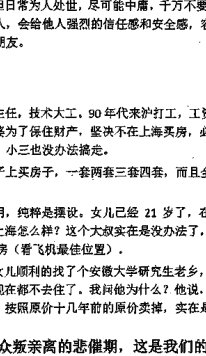

## 人生，有得必有失

我年轻时候，特别羡慕寒门农家庭出身的同时人。这些人年泰和我们差不多，做什么事情都是顺风顺水，稍微努力一下，什么都有了。鲜花，荣誉，掌声，小美白的青梯，老阿姨的关心，领导的重视。我真是心里发醋啊。

再看看自己，那才悲惨啊！每件事情，我都是小心翼翼，生怕得罪人。我用了巨大努力取得的成，没人提及，相反，为了打压你，人事处长专门找你是哪件事情没到位，一天到晚敲打你。就连那些老油条，老阿姨，都可以把各种责任推给我。下了班，没房子，没女人，眼睛都飘满的绿了。我就这样痛苦煎熬过了工作的前几年。

二十年过去了。回头看，其实人生还蛮公平。顺风顺水的日子，其实学不到什么东西，不知道人性的黑暗面。这些实权子女到了三十出头，父母退休，光环就没了，很快成为一般人。但是，他们在年轻时候没有很痛苦的经历，不懂隐忍坚韧，一展到了部门高职，就到此止步了。

而我们这些当年被压抑制到极限的人，往往更加懂得人情世故，性格保密，更加努力勤奋，在逆境中的抗压力特别强，少数最后成就也不低。

当然，也有遗憾，年轻时候，老婆找的丑，置换代价高了一点。

## 不要考验人性

如果发生重大利益冲突，父子女配偶，分钟钟都可能把你卖了。你要做的是，保密。虽然这个很痛苦，但是，大户人家就必须这样。例如我还有三十万私房钱在小丽那里，我谁也不说。

## 去基层的实际意义

基层有什么值得大学毕业生学习的？我说白了，就是怎么和极少数不讲道理的人打交道。大学生，特别是985毕业的一直生活在优雅环境中。讲道理的人，你不管他，他也遵纪守法。犯了大错的，司法机关就管了。基层同志的主要精力就是和不讲道理，但也够不上打击的人打交道。

日常生活中，你也会遇到几个不讲道理的人，你避开，忍一忍，也就过去了。但是，你要是带着任务去基层，你就躲不了，就正面对面，对对碰了。这些人，大事情况没有，就是和你搞，搞得你头疼欲裂，还没正规办法治他。例如一个邻里纠纷，怎么处理都不服。一个纤牙矛盾，乱提要求。有的是时间，到处折腾。

我们怎么办那？还阳战术。实践中，我们总结出很多一贴灵的小办法。只要这家人家不是精神有问题，总有一招适合你。但是，这些办法上不了大台面，不能总结成文字材料，甚至不能明说，必须你到现场一线，看老师傅的言传身教。

## 高中同学的结婚邀请

我是一名大学生突然收到高中同学的结婚邀请信说是毕业后加了微信也找联系的那种同学请问我该怎么样处理既需不需要送礼什么的第一次遇到这种问题不知道怎么做？

答：就当没看到。

## 上海为什么人情冷漠？

人情往来的目的，无非是几件事情：找医院，读小学，找工作，借钱。而这几件事，在上海非常头疼。

小地方，例如县城是个熟人社会，各部门大多数在一条街上办公，几十年下来，圈里人都互相认识，托个合法事情，找点合法关系，不是很麻烦。但上海是个大城市，一个人很难认识方方面面的关系，今天在这个区谈业务，明天在那个区找医生，你找人来合法帮忙，不要说普通的人，就是有一定身价的人，也是很难搞的。

人往上走，最大的一件事事情是找工作，“二叔啊，你哥几十年没求过人，今年你大侄子去毕业，你一定得想办法，给他弄个大单位，好公司的啊。”这种事情在上海是非常困难的。因为现在招聘，设立了很多环节，必须逐一通关，一个普通人很难搞定这么多事情。真的为难。

而且，在你帮忙敲钱求人的过程中，多多少少要个汽油钱，面条费，这些钱下去，万一办不成，你是自己先进，还是罚着白眼去要？

借钱，更不要说了。老子还欠了银行房贷，哪有余钱给你啊？

匀亲戚，破事多，湿手沾面粉，最好的办法是，不来往，或者去了也很冷淡。大家都舒服。

## 家学

谦虚使人进步，骄傲使人落后。

这句话，每个人都知道。但你真的理解吗？今天，我以自己血泪斑斑的往事，告诉你这句话是什么意思。

这句话从头到尾，没有提及个人能力，而是专门说做人。我年轻时候是出了名的牛 b，业务水平比同龄人高一大截子，我分管的业务年年都是第一名，但最后我还是活不下去了。

那时候，我特别骄傲，说话呛人，经常来一句，“你不行，我来。”就好像你和我数独金谈论高中数学题一样，人家碾压你三条马路，你说个鸟啊。但是，职场不是考场，业务之外，还有情商。你要出人头地，人家也要事业进步。你打了别人的颜面，人家今后记得呢？由于我的骄傲和不懂人情世故，得罪了很多人的自尊心。

有人的地方，就有江湖。不少人就开始要求报复了。正面搞不行，那就玩阴招。编造各种话语，在领导同事面前抹黑。主要有：表面上拍领导马屁，暗地里欺负同事，拉帮结派，贪单吃小便宜，品质恶劣，贪污很多。你仔细观察，这些谣言都是无法查证，但是非常毁人品，而且你还不知道，无法自证清白。

时间长了，上级领导换来换去，失去信任的日子就终于来了。由于业务能力强悍，导致我要花三倍的努力，才能得到别人正常的回扣。一怒之下，老子不玩了。是金子到哪里面都会发光。我当孙子手，也混的风生水起。但是，我差些不差年纪的一些朋友，当年谦虚谨慎，再加上某些他因关系，现在早就功成名就了，而我还混在马子手，真是悲从心来。

初闻不知曲中意，再听已是曲中。

## 回老家少吹牛 B 系列

在上海，高标准接待三口之家，3 天要花多少钱。大概是 2 万不到。

- 1，四星或五星级宾馆（含早餐）；春节后打折，五六百元一天，2000 元。
- 2，餐费，四天，正餐 8 次，每餐平均 1200 元（拒门挡次），8000 元。
- 3，第 1 天自己办事，我派车，并且陪同。
- 4，第 2，3，4 天旅游，门票要五人，每天门票大概 2000 元。合计：5000 元。


5. 小礼品。1000 元。
6. 接送飞机，日用用车，驾驶员工资，四天，3000 元。

## 借钱

最近寻来的一位很 close 的婚外男性朋友说要来我家拜年，八九十高不这是要借钱。他比我大五岁，结婚完，至今全家五口人很闲过，反没慢，上海人讲有点木头头木脑，这辈子不敢冒一丝风险进行任何投资，至今在教育界打工。

他一来我们就先畅侃了一下过去共同认识的人和一起经过的事。他刚开始叹气悔像跟老文人一起租房住小派还没念小学现在有多痛苦，我迅话把话题转移到他的融资成本上来，按揭利率是多少，经营贷利率是多少，信用卡信用贷款私人债务的利率各是多少？到这里他的眼神已经暗淡了一半了，估计他原先是想从利用总无损押地借到一点点钱。

最后给了他事先准备好的一纸箱小孩旧衣服旧玩具，看他双手捧着离开了。一会儿我开窗往下看，那个小雨中向地铁走去的大力的背影让我确信，朋友是绞络分再做了。

菜素：放心吧，生活会天天一天好起来的。不焦虑。

# 幸存者偏差

屏幕丝最喜欢的是，一天到晓论证，这个事肯定干不成，劝你也别干了。

我先说个背景。

我今年四十岁出头，过去二十年，是京沪经济发展天翻地覆的二十年，我们是托了人道汤。当然，我的同事们，老爸也是上财毕业的，大多是 top4，所以，我们走的视线，和你们确实不一样。

但是，1999 年的时候，我也说想到京沪会发展到现在这个程度，今后的人生中的差距会这么大。当时的想法很简单：我是重点大学 985，面对一群下乡插队的归炉老三届，夜大自考的大专生，你们当个小头头，天天给我调我们，老子不闷楼了。

那时候，陆家嘴刚刚开始建设，也招不到人。优质的都在体制内，我那同学就去了。没想到，变成了降维打击，彻底霸占了很大公司部的副总位置，混成了行业大输。最悲观的是，他们在四十几岁，还要十年退休，什么多人呢？

很多人说，现在没机会了

当年，我也是因为没机会了，才拼另-一搏。回头看，中国五十年最厉害的机会是一刻才刚刚打开。世界上，每时每刻都有机会。过十年，又会冒出来-一大群超级富裕。但他们现在可能还在京都的那个胡同里磨精转悠。我不知道会是谁，但这批人肯定会出现。

结论：千万不要相信今后没有机会的话。说不定再落几倍也是可能的。

# 没有简单轻松的成功

屏丝们一天到晚幻想：如果将来免费发房子了，如果将来取消户口了，如果将来免费养老了，如果将来免费医疗了，如果将来~~~。这些人是非常可忍的，他们用胡思乱想，一辈子麻病自己，最后到老了，被儿媳妇一脚踏到乡下老死的病床上，还要骂他几句：老不死的，福了一辈子，连原充一套房都没有说出来。你还故意意思要喝吗汤，吹死节脚！负分滚粗。

正常的人生是：千方百计为下一代做好铺垫，不要给吃亏，当年，我家祖上放弃了乡下的稳定，跑来上海，才有了我们今天的会。总有一代人要牺牲自己。你不意愿，那养孩子要苦一点了。不过，也没关系，反正你也不关心下一代，儿孙自有儿孙福。

# 如果父母一辈子没一次成功

你就不要和他们交流什么思想了；也不要听他们胡说了，他们的理念全都是垃圾，还摆个老资格，自以为是。你应该学习先进，学习家族里有能力的成功长辈，多听听他们的意见。

# 从今天开始

- 找亲戚借钱的事情又要拉开序幕了。大家提高警惕，防火防盗防亲戚。

## 家学

富二代要和普通孩子打成一片。

我最反感的就是精英教育。例如专业级的歌唱，艺术，芭蕾，管弦乐，油画，马术，留学，这些毫无意义。所谓的精英教育，无非是和屌丝们强行隔离，互不见面。或许，你可以把孩子培养成为一个有专业技能的人，今后去半吊子酒店的大堂里拉小提琴，一小时六百元。但是，你的孩子也永远失去了赚大钱能力，也没有了超级坚强的人格。

我家祖上就走过这个路径。当年，那些才子们小小年纪穿西服，吃西药，练个三七开发的发型，一旦遇到天灾人祸，一个个都没有什么活路了。我个人读书是一路重点上来的，也没有什么底层经验。工作后，我唯一干不了的事情是人事。因为我不懂屌工们的想法。后来，我找了个聪明的农村会计男，四十多岁，给他高工资，让他去管人。这简直就是老军医治病，一贴灵。

我希望孩子能够在中下阶层为主的一般学校里读中小学。经过十几年的底层智臀洗礼，孩子就真正懂普通人的思维了。富人赚钱，无非是两个来源：一是给公务员（衙庙），二是吃市场饭。

市场饭也分几种：

- 一，单打独斗，高端服务。例如主任医师，大律师，成功的投资人，优秀导演，投行项目总监，拉单子高手，主任 cpa。这种模式，简单清晰，但是无法传承。
- 二，拉帮结伙，规模经营。这就涉及到管理了。人世间，最难的就是管理。很多屌丝不懂管理，想当然的以为流水线上计算工时时间就是懂得管理。管理，说白了就是打造一支队伍，忠诚于能人。99%的中小企业，熬不过十年。原因就是无法形成一只战斗力强，又不会散的组织。很多企业当年干起来，主要是创始人机缘巧合，能力超强，一旦富二代接手，很快就垮了。

只有懂了普通人的思维，才能够管理层员工，针对普通人，设计出他们最能接受的产品和服务，甚至是欺诈产品，例如高科技皮蛋

例如老中青屌丝们最大的特点是：好吃懒做，贪财好色，胆小怕死。但是，书上得来终觉浅，纯如此事要躬行。你和孩子门讲答案是没用的，必须让孩子们自己领略几次。

## 只要你勇敢,人生是公平的

2000 年前后，我的一些师兄从内环线的单位辞职了。这些人都是扩招前的 985 硕，工作了几年后，没有被列入大单位的后备培养对象，都怨不得志。年龄快三十岁了，小工资，没房子，仕途不顺，长得也不行。（长得帅的，往往机会多，不知道为什么？)

这些人的专业水平还说是可以的，但年纪轻轻，就走投无路了。这时候，陆家嘴金融城开始起步了，大量招聘人才，工资比较高。他们在招聘面试官里属于佼佼者，3-4 年大单位工作经验，年轻，高学历，拼劲足，没有竞争对手。他们基本都找到了工资翻两倍三倍的工作。但是，他们走的时候，还是很自卑。他们是失败者，在集体宿舍里铺盖，也没人烧酒送行。

二十年后，天翻地覆。这批最早最累的失败者，成为了陆家嘴第一批骨干，现在年薪 35 百万的不错者，年薪百万是入门级，90%在金融，私募，保险，法律，投行等很多职业领域达到了高层位置，属于行业大咖了。

相反，当年留在国内的所谓还不错的同学，现在达到显赫地位的只有三五个，其他 80%也是在大单位中层副职正职，工资也不高，一年三五十顶天了，房子也没赶上几套，一天到晚研究上级，研究人事，专业知识非常肤浅，就研究冲关的那一点点领域，出来混肯定不行了。

建议，985 毕业，在一个大单位，五年走不到同龄人 top10%位置，你可以考虑走人了。你的失败，不一定是水平差，更大可能是人际关系不行。要走趁早，35 岁以前，换个地方再来一盘。不要怕外面的陌生世界，其实你不比他们差。

### 人长大了，就只有熟人

大学老同学群，二十年后，混的高中低都有。大过年的，群里一句话没有发，全部是发红包和祝福。想想也是，说什么呢？每个人的心态都不一样，还是不说得了。人长大了，就只有熟人，没有朋友了。

### 人长大了，就没有朋友了

如果你混得不好，大家看着不上你。
如果你混的太好了，大家都想来抱淘，借钱才求带发财，你也怕啊。
如果你混的一般，大家也就是客气几句，背后骂你小气。
我们的熟人很多，但真的没什么朋友。

### 年轻时候要拼搏

人到中年，就要想开点了。官再大，还比你更大的。钱再多，还有比你更多的。你们有几栋房子，有几千几万备用金，差并不多。不要总觉得自己是开飞机的，看不得自己前面居然还有人。人家的马子再漂亮，咱们也不能打主意。

### 人性的黑暗

贪婪失跌的网赌赌子，卢彪 loser，才会焦虑。
我妈在国企拼命打工了一辈子，从月薪百元开始存钱，到退休一共存了二十几万存款。这些钱，从内环线二居室的价值，贬值到现，刚够二居室的装修费。她也不焦虑，随遇而安。
为什么你大学毕业后三年就要急想买沪市源漂亮房子？这不是焦虑，这是人性的黑暗。

### 九十年代，年轻人没有焦虑

我们是那个年代过来的人，当时的社会，真的不存在焦虑，所有的事情，领导都安排好了。

- 1. 你是农民，就在村里种地，或者去广东打工，不要胡思乱想。
- 2. 你是学生，考上六所师范就是干部编制。考不上，就是街道分配工作，工人编制。也可以托人顶班。
- 3. 你是大集体性质，就是一辈子大集体，别想国营编制。

所有的人，人生道路都规划好了，没有失败者，没有胜利者，大家都是勤勤恳恳的建设者。当然，穷了一点也是真的。

现在倒好，农二代可以轻轻松松上大学了，破大学毕业就要在京沪省会馆房子了，搞不到房子就比别人贩卖焦虑。这些人的内心，黑暗的很。

### 回不去的故乡

小王今年不回村里过年了，我听了好悬。小王年纪轻轻，已经是村里首富了，在省会城市，豪车几辆，豪宅几套，在村里已经是超级无敌了。他毕业毕业后，在我的指导下做点小生意的。所以，我对他知根知底。

原来，这些年的炫富给他带来了巨大的烦恼：亲戚来借钱。我一开始以为，借钱一般也就是一两万，现在才知道，这些亲戚可不是省油的好。套路也已经标准化了。

- 一，使劲的吹捧。小王家里是属于村里中上，但也没什么大钱，当然，吃只鸡，喝顿酒还是有的。谁想到，儿子如此出息了，居然在省城成为富人了。二大爷，三舅爷，那个吹捧啊，一大把老脸，围着个三十岁的小青年，吹的三迷五迷，把小王先生音乐的吹翻了。
- 二，使劲的拉锦旗。自从小王发财后，他们家大事小事，都有八竿子打不着的亲戚邻居来帮忙。他老爸老妈简直是村里的一等公民了。老爸老妈随时不时打电话给儿子，说谁家来帮忙了，谁家很客气，小王也有懂礼貌，逢年过节，发个千元红包。其乐融融。
- 三，攒下面具来借钱。二舅家儿子买房，三姨家儿子创业，四叔家装修，二叔公住院开刀，只要是张嘴，基本都是20万起步，上不封顶，张家借到钱了，李家就觉得眼红，拐了借来信。凡是借了钱的，基本就没有说还的。你去要账，立马翻脸，小王钱再多，也架不住这么借啊。为了这个事，和老婆已经闹打架了。

故乡不再美好，亲戚们都是一路获利眼，所有人都在等他回家过年的时候，看看能不能要一块肉？小王现在在省会城读书了，和老家也关系了。今年，不回老家了。

### 父母对于女的爱

不仅仅是金钱，还有陪伴。

今天去动物园，遇到了一个安徽的农民家庭。四个大人，带四个孩子，开了一个很旧的五菱之光，五菱之光上而写着“媒体防水涂料”，不远千里，开车到海南，就是为了给孩子过个年。

我就在想，这是多么好的父母。这应该是亲戚两家合凑一个车来的。这家人看上去生活比较简朴的，衣服和用品基本都是大路货，五菱之光上的广告牌，特别显眼。虽然生活一般，但是，他们是真正的爱孩子。

生活在种环境里的孩子，长大后不会差的。因为他们的父母非常尽心尽力的在为孩子们思考和安排。祝福他们。

### 老来得子，聪明。为什么？

其实，这不是自然属性，而是社会属性。以前二十几岁结婚生子，父母自己还是个小孩子，事业刚刚起步，心情烦躁，穷的一逼，时间紧，一天到晚玩烂，没耐心，哪有心意教育孩子？况且也没什么教育经验。

人到中年，四十多岁了，房子大了，有钱了，有经验了，有耐心了，特别是有方法了。老大老二，就当是大号练废了，再开个小号继续练，效果肯定好的多。

# 家学：培养孩子走基层路线

我家族的先辈们，在解放军就是这么玩的，文学，艺术，金融，企业，审美，外语，交响乐，样样精通，都是半专业水平。但是，这种模式培养出来的人，有个巨大的缺点，不接地气。他们的圈子就会越来越小，小到只有十几个人，自娱自乐。一旦遇到时代的变革，啥也不足了。

圈子小的后患是，无法赚钱了。赚大钱，主要是带领一群穷人，去扫市场，例如脑白金。你要是干了解穷人，你就不会嫌穷人的钱，无法管理精英，无法处理基层矛盾。当年莫斯科东方大学毕业的二十八个华人，很难适应中国农村实际，屡战屡败，带不了队伍。相反，只有在基层千锤百炼出来的人，才能做大事。

这群所谓的精英，最后的结果，无非是当个985老师，自顾自清，由高和寂。或者在父辈的基础上，接个董事长位置，一旦遇到狂风暴雨，根本没用。现在，中国的富一代大土豪，也不知不觉的走上这条错误的路，以为学历越高越好，外语越熟越好，但他们忘记了根本。我们的根本在基层，在于熟悉国情。这些人在国外也就是个普通人，在国内又不接地气，没啥花头的。

# 家学：家族兴盛的秘密

人世间，只要有富，必定会有穷。穷和富，是相生相伴的。个人和家族的命运，也是如此。没有长盛不衰的家族，但是，家学传承是再起的精神准备。有几条可以参考。

- 一，学习真本事
大略皆知识，知道就行了。立体几何，在一百年前算是知识，现在因为不过是几毛线的小程序而已。
真正的知识是，催人长十专业技能。现在的话时要是，消费心理，士农工商心理。
- 二，占据好位置
中国有三个好地方，京沪广（深）。这三个地方，是中国经济的潮头。无论贫穷富裕，在那里占个坑，总是不错的，首推上海。
- 三，锻炼好身体
- 四，关注新机会
在中国，传统行业，都是早就有霸主了。逆袭是不可能的。只要是明确发财的事情，你千万不要去。好事轮不到你。但是，中国人有保守心理，权贵们在不能保证发证的情况下，往往不愿意切入新行业，这才是你的机会。
- 五，略

# 家学：结交朋友的思维

现实中，95%的人喜欢结交权贵朋友。人家有线的，指望找他借钱。人家有权的，指望找他开后门。为了这个虚幻的目的，你首先投入了巨大的精力和一定的交际费用。实际上，你的想法是不可能实现的。因为权贵身边有太多太多这样的人了。权贵朋友也没有能力给所有的人解决麻烦，捞取利益。

正确的思路是，不看权钱，而是看人的水平。很多人并没有显赫的门第，也没有大把的金钱，但有一定的水平。有的是技术领域，有的是人情世故，有的是消息灵通。这样的人，一般有二十年以上的工作经验，或许还是专业的失败者，你得当留意。如果有可能，可以熟悉一下。

我以前大单位的老同事遇到我，经常会说一句话，有什么发财的路子，带我一帮。我心里觉得好笑。你是谁啊，一句话就让别人带带你发财？人的成长主要靠自己，不可能有人给你铺好路，带你发财的。

正确的打法是，你找到合适的朋友，给你一些你不知道的经验，在这个基础上，主要靠自己闯出一个路子。这才是真正属于你自己的财富。

# 不必和朋友们分享快乐

若干年前，我花了三四年的努力，取得了一个突破，异常兴奋的在老友群里分享了。结果，应者寥寥，大多数是一个实验符号，再也没有人提及。我冷静之余，也想明白了。原来大家差距不多的，有的人甚至表面比你还好几分，你一下子把他们甩开一大截，谁能心的起来？

# 大学毕业后，人就孤独了

当你倒霉的时候，没人愿意听你说话，大家都嫌弃你，怕你来求助或借钱。当你发达的时候，没人为你高兴，满满的嫉妒，只想让你请客，找你借钱。你的亲戚都在精确的计算，你能给他们帮什么档次的忙。人和人之间，最后都归纳成为利益。与其这样，不如我孤傲的面对生活。

# 我和各位朋友说个心里话。

人生就是一次冒险的旅程；
你要是胆字小，45岁以后，找个机会，赌一把命运。
你要是胆字大，22岁就开始搞事情。这个世界，胆字大的人不一定全胜。即使输上半场场，可能会赢得下半场。赌输了，大不了倒毒几年，也没什么，改过自新，总比窝窝囊囊一辈子强。

# 我们应该听谁的？

失败者的人数，远远超过成功者，我们应该听谁的？

现在，微博上有很多观点，总结起来就是：摘富人的钱，打富人的土豪。理由是五花八门，在他们眼里，富人可能都有小辫子，一抓一个准，上下五千年都欠了屌丝。

失败者的人数，肯定远远大于成功者，京沪宁城有漂亮房子的人肯定是少数。

# 不要把现在的情况，当做永远

年轻时候，我最喜欢的是稳定，大单位，无风险。这些年，天天在风口浪尖，刀尖舐血，也习惯了。相反，我已经看不上当上那点稳定了。人是会变的。大家不要把现在的情况，当做永远。人生处处是惊喜和意外。

## 家学

怎么合理合法的把事情办到头头的心坎里？

很多屌丝家长以为，吹捧几句，就是讨好了。有的以为，逢年过节送礼，就是讨好了。这不是饺子吗？头头要你的吹嘘？ 上面的人就喜欢你的那点小礼品？你的好话一文不值，还明的反胃。

大头头也不是生活中真空里的，适当的人情往来也是合法合理的。只要不涉及金钱，物质利益，你出点力气，趣个腿，也没什么。真正的好活，是看到大头头心里的事儿求事，帮他合法合理的解决，还要精打细算，严格按照市场行情，让大头头自己付钱，两袖清风，不留麻烦。

举例，大头头的儿子数学不好，你想办法给他推荐个好的家教教师，找家教现在不容易啊。鱼龙混杂，有的脾气大，有的贪婪。那你出力气啊，千挑万选，做好前期的各种准备工作（省略一百字），最后推荐给大头头。大头头按市场价格付就行了。老师过来亲远，那不要紧啊，我司的说事，接你一下，我也是老师重教师。你说人是不是很够面？

大头头的小舅子要住院了，虽然找到了人帮忙，但是前前后后各种麻烦事情，得有人张罗啊。吃饭，跑腿，排队，洗脸，买些杂物，不需要找人张罗？你要是顶的上，办的漂漂亮亮，是不是很出彩？

外地大头头来沪办点私事。你安排车辆车送是合法的，住宿不能报销，那就住我家里，我房子大，这几天正好没生意，不回家。吃饭，我也要吃碗啊，保姆做好了，单独给你炒个菜，加双筷子。你要去 xx 医院，我提前给你挂号。你要去 xx 房子，我把资料全部整理好，一边看，一边给你介绍，你儿子开车撞人了，只要人沒事，啥都不怕，我公司的律师随时随到，让他去跑手续，依法解决，你不要操心。

跑腿出力气，是合理合法的。朋友之间，到你家住几天，也是合理合法的。家里吃饭，加双筷子，也是合法的。律师帮你办事，费用可高可低，你给八百一千也可以。我替你去医院排队挂号，8 块钱，不犯法。

总结：和头头们来往，避免经济来往，这是解决问题的。你年轻轻，时间多，多出点力气怕什么呢？合理合法，大家满意。（我说的是你额外的，不扣工）

## 借钱

## 为什么农村人特别喜欢找别人借钱

上海人一般不找人借钱。亲戚朋友之间，最多就是一两千元，两三天就还的那种。哪怕是亲兄弟，也很少借钱。但是，大部分农村人特别喜欢找借钱。这是有社会学原因的。

从五六十年代开始，城市和农村，基本是两个经济系统。城里是工资均贫富，各家自己吃得好，但也没什么余钱，每月攒点钱，年底买个大件。城市邻居之间，只是点头之交，不存在经济互助性质，对面子看的很淡。自办家事，肯订不成邻居的。

乡村，天然带有互助性质。谁家肯定要结婚娶妻，必须是全村都来凑个热闹。这就必须大操大办。虽然肯定有亏欠，但需要全家先垫钱啊。于是，乡村普遍通过借钱。

假设娶媳妇，村里需凑 60 家，按照现在的行情，每桌 500 元成本，那就是 3 万元。娶媳妇之前，男方家里基本是彻底掏空了，婚嫁的钱一般也拿不出来了。怎么办？只能去借钱。债主也不怕，因为这几钱还是有保障的。

一是礼金收入肯定超过酒宴成本，还款来源明确。
二是邻里乡亲的，你跑不掉，不论躲借赖账。
三是名誉担保。欠债不还，天打雷劈。你要是敢耍赖，立马打群架，你家没成人了，以后过不下去了。在农村的传统社会里，借钱还不出是的，但硬赖账，基本没有。

久而久之，农村人的思维里形成了一种习惯，有事就借钱，而且借的到，但是，城里人根本不认同这种思维。所以，农村人找城里人借钱，大概率是被拒绝的。所以，在借钱这个事情上，农村人和城里人互不理解，误会很深。


### 人到中年，要有个精神支柱

我的想法很简单，为孩子树立正确榜样，为孩子打好经济底子。我和来嫂的事业成就较高，虽然是机缘巧合，但也有不断进取的精神为依托。我不希望孩子肯定达到我们的高度了。仅希望孩子能够有个健全的人格，健康的身体，做一点有利于社会的事情，也就可了。

### 穷人暴富，要低调

某屌丝，在我的点拨下，花了五年时间，走遍千山万水，历经千辛万苦，终于在南方某地级市做成了一个大工程项目，利润N万。

他是贫困地区村干部家庭出身，读了个屌丝本科，一辈子就是好面子，憋屈了三十年，这次爽大了。今年十月份后，开启了梦幻般的炫富之旅。贷款买了保时捷，配了两个女秘书，贷款买了南京豪宅，在老家省会给父母买房，给老爸买了个宝马X3，给父母媳妇送了海南度假房，还给妹妹婚礼赞助50万。还衣锦还乡，去了屌丝本科朋友圈骚包一番，被校友微信朋友圈热捧。他一口气花出去近千万，把亲戚朋友同学圈，震的大小脑失禁，羡慕嫉妒恨，全出来了。但是，不到两个月，这屌丝基本傻眼了。

- 妹夫坐飞机来带借钱120万买房。
- 最好的大学同学坐飞机过来谈合作，寻求投资300万。
- 父母电话要求在南京买房，价值400万，还要出国旅游。
- 某亲戚打了几百个电话微信，求借钱70万。
- 初恋女友离婚了，来借50万。
- 找他借个几万元的，数不胜数。

这下子，两口子扛不住了，终于在家里打架了。最后的结果是，这家欢快起来了，保时捷不开了，春节去新马泰旅游，和父母亲老同学一概不见面，不借钱。

亲友同学立马变风向，特别是原来村里班上混的比他好的人，历数了各自给他们家过去几十年的小恩小惠，包括该大学的路费80元，鸡蛋5斤，小时候发高烧送医院是二哥背过去的，大学里某同学替他出头打架，现在这家伙全都不记得了，眼里只有钱。大家一致骂他见小利忘义，背信弃义。

### 讲点大智慧吧！

来菜，你不要老是讲我们不受听的人性，讲点大智慧！

答：虽然我拉黑你了，但也买个单。大智慧就是，你父母的思维模式。

- 认真工作，听领导的话。
- 吃亏是福，不要斤斤计较。
- 知识改变命运，房子不重要。
- 嫁个老实男人，不要彩礼。
- 平平淡淡才是真。
- 幸福是一家老小在一起，吃顿咱家也可以。
- 不要和人比财富，要和别人比骨气。
- 我们的未来是美好的。
- 天下没有不是的父母。儿孙自有儿孙福。
- 房价要跌，股票要涨。

我编不下去了。你继续。

### 说了这么多家学，举个例子吧

答：好的。大家刚刚进单位的时候，都还记得吧？你下班后干什么？吃饭看电视，最多是考职称。但是，有的家庭就不是这样了。孩子把一天之内的所有事和人，说给父亲听一遍，父亲告诉他，这个事情怎么处理，那个人怎么应付，这句话可能有两个意思，那个领导怎么挤上线。

三年后，你还是个傻瓜，人家已经是跳到第一方阵，随时准备为单位挑担子了。

### 没有人对失败经验感兴趣

除了家族本身。

现在的年轻人，包括鸡鸣狗盗之辈，最喜欢的是成功学。看了三个月，就可以讲课收徒了。大家像是打了鸡血一样的幸福！尼玛血的，终于走上了成功之路，学费不是问题。阴谋湖里的螃蟹，还要修一只好梭子虾，这叫投本。呵呵，师傅最喜欢你投本了。

但是，真正的人生奥秘是失败经验。解放前，江南大家族是聚落成村，一代人都有十几个二十几个叔伯兄弟。一百年至少有五代人。大家族的人，往往是分散到各行各业，工农商学兵，这个经验积累就丰富了。你看梁启超的儿子，每个人的专业都不一样。

大家都知道所谓的修族谱，表面看是写几个名字简历，实际上是在研究收集每个人的成败得失。家谱只是面上的东西，随便看。真正的奥秘在家学。那是不传世的秘密流传，包括各种行业的经验体会，甚至各朝代的行帮规则。

### 很多人翻过《曾国藩家书》

以为那就是家学。这是250的幻觉。

真正的家学潮汕，是秘不示人的，就是家族内一代又一代的回读书人不断总结经验起来的。内容非常贴近生活，包括治学，包括为官，做官，农耕，手工巨细，婚配，造屋，买地，拜师等等。每个事情你遇到过的，教你怎么处理各种复杂情况。每两代人就会重新梳理一遍，把淘汰的东西去掉。

例如，现在已经不需要研究科举榜杠眼的日期了，也不需要研究水测质量了。这种家学一般都有几百年历史了。其中对人性的研究，几乎是非常精准了。

### 家学：学习不重要，考试最重要

很多人以为，孩子在小中学拼博十二年，是在学习，这是误解。这十二年不是在学习，而是准备考试。现在的教育环境中，高分低能是普遍情况。高分低能，可以学985，你家孩子啥都会，肯定考试卷。

你家孩子面对的是八门功课，每天晚上除了吃饭洗澡休息，学习三个小时已经很累了，四个小时基本是极限了，再加训，身体肯定崩溃。

一周工作五天，晚上自习计15个小时。周末两天，可以学习15个小时。一星期有30个小时，如果算上各种意外情况，一星期大概是20-25个小时的自习时间。高中八门课，平均每门课是3个小时。一学期，每门课分配到50个小时左右。

你看懂了吗？你的孩子考985，还是去职高读，就看这50个小时了。具体细节，你自己安排。

### 人生的改变（变惨）

往往是一瞬间发生的，无法预防。我的人生，经历过好几次拐弯，都是意外瞬间。十年前，我走在张杨路八万大厦附近的人行道上，遇到一个高空抛物，一楼妇女夹着着一个类似于易拉罐大小的玻璃瓶，从二十几层楼的高度砸下来，擦着我的脑袋呼啸而过，就在我跟前半米的地方砸的粉碎，差一步钟，我就完了。

### 逆袭后，没必要去炫耀！人的嫉妒是难以掩饰的

有个屌丝逆袭了，他曾经是班上最自末的同学，初中毕业读技校，混工地，现在是建筑公司老板了，资产过亿。人富了，就想找面子。于是，他把当年的同班同学，不管混的咋样，全部请来四星设宾馆，大吃大喝了一天。结果，那帮老同学酸不拉几的，没人说他好话，吃完喝完，还嘀嘀咕咕，赚了点钱来炫耀了。

这个老板是买单侠，所以成为了大家不得不忍戴几的中心。但是，人的嫉妒是难以掩饰的，看者当年远不如自己的人，现在混好了，自己才是个月入一多万的工程师，大家也很郁闷，心情不佳。

买单的，吃饭的，心情都不好。这钱白花事了。

### 我给大家提个思路

喜欢算小账的微信微博，尽可能不要多看，怎么节约，怎么去便宜，哪里划算了，这种东西看多了，人的思维就越来越狭隘了。实际上，买的没有卖的精，你哪里有什么便宜啊！最多的可能性是牺牲时间换杂利，换点小利益。我知道，绝大部分人喜欢看这个，因为我抓到。

### 从微信微博判断一个人的工作素质

值不值得来往？

人的语言和行为分为两种，一是公开的，就是给别人看的，二是私密的，完全不想给人看。我们日常见到的朋友圈，微博微信，属于公开部分。在这个环境中，你往往会看到几种素质：

- 一、严肃细致有分寸。发图，是漂漂亮亮的。说话，有条不素，思路清晰。这种人属于素质较高，对工作要求严格，把任务交给他，非常放心。
- 二，垃圾人。发的图片，随心所欲，经常让别人很恶心，甚至比如孩子片，饭菜都发出来。说话随心所欲，想到哪里说到哪里，动不动还急眼。这不是什么真情流露，而是完全不顾及他人感受，素质极差。
- 三，把朋友当工具的人，例如一天到晚发微商，三天两头拉你，买这买那。领导一发言，他献精请详送的赞美。这种人属于有一定的上进心，但不愿正确的方式方法，家学素养为零，智商不在线，性格偏执。不值得来往。
- 四、基本不言，这种性格属干戒备心极强，自制力极强。或者不喜社交工具。这种人既不会坏你的事，也不会帮你的忙。
- 五，喜欢大量转发段子和各种信息。属于性格外向，比较乐意和大家来往，希望引起大家关注。

## 家学

有实践意义的教育，历来是奢侈品。

我说个书本上从来没有写过的，祖上传口传下来的小故事。明朝有个案子，叫做大礼议之事，说起来也搞笑，就是文武大臣争夺论：嘉靖法律上的亲爹是谁？嘉靖的老师，翰林院修撰，内阁大学士杨慎，直接反对自己的学生嘉靖，被自己学生廷杖三次，打的死去活来，也不松口，最后开除一切职务，发配云南瘴气之地充军。这个杨慎在四川，杨慎在云南，居然做的超级舒服，你想啊，一个皇帝恨之人骨的人，居然做的非常舒服，七十二岁了才挂，当中还回四川老家玩了几次。为什么？我后面讲。

教育活动，在八十年代出现了一个罕见时期，教育好像自己努力就可以的。因为当时是特殊情况。

首先，大家都没钱晒。社会上刚刚经历了文革。大家都是固定工资，也没老师敢收钱辅导。其次，社会上急需人才。只要是大学毕业，中级职称，在九十年代，竞争户口不是大问题。英雄不问出处，最厉害的是，机会太多了，没人和你抢。据说马爸爸高考数学才考了几分，也读上了本科。只要自己跑到终点站，就是成功。

进入2000年，大家思想解放了，家长有钱了。各种各样的劣质补习班，饭桌补课出现了。但这种补习班，良莠不齐，也就是身边的几个老师互相介绍，没有什么选择余地。家长想找好的老师，也找不到地址。

2010年左右，互联网的普及，风险投资进入，好的补课教师被层层选拔出来了，这就进入高价阶段。疯狂的全网游戏开始了。

其实，历朝历代的实践教育，都是昂贵的。

### 一，学徒三年，吃尽苦头

穷人家庭不玩高级教育，只能是学手艺。但学手艺也不简单啊。裁缝，木匠，厨子，唱戏，保媒，哪个不是学徒开始？家长没钱，就孩子去干活。早上天不亮起来当保媒，给师傅洗衣做饭，扫地擦桌，什么苦活累活都要干，吃的差，住的差，等于是三年免费劳力。一日为师，终身为父，才换个人门技术，非常残酷。

### 二，科举精英教育是天价

这个我最熟悉了。我家老一辈的人说，明清时代，科举家庭有个秘密开支，收集科举试卷，主考官文章，请进士讲考试方法。这种教育是非常秘密的。家里秀才以上的读书人才可以听。老弱妇幼，闲杂人等，是不让进的。

考试方法研究都是名师点拨的。科举意味着官位。有本事的人绝对不轻易传授，这种教育简直是天价了。稀而不胜传，回到唐朝，天底下，学最牛逼的是谁啊？老师，翰林院修撰，内阁大学士。巧了，杨慎就是这个人。杨慎是秘密帮嘉隆的几个学生点拨一下，那还得了？所以，杨慎成了国宝级人才，关系到云南边陲衙门的杨慎秘法。

### 三，中产家庭孩子只是三养私塾

私塾教育都是很贵的，要养活一个私录普通教师，相当于五个农民家庭的收入，中等地主家私读才行。阎锡山的父亲是高利贷商人（后来破产），他才读上三年私塾。这种事情对阎锡山刺激很大，民国时期，阎锡山发现了，山西教育搞平民化，家家户户的孩子必须读书。直到解放前，全国文盲大概是80%。

教育的目的，一是普及基础劳动技能和文化，类似于我们的二本，或者美国的州立大学。二是精英选拔。例如哈佛大学，历朝历代，世界各地，这两个系统是分开的进行的。法国德国英国，都是这样的。

但是，我们的教育九年制义务教育不分开，高中分流一半，所有的孩子都在初中小学打混战，这就没办法了，逼得家长去补课。建议：

- 高中不分流，但可以分校。贵的，便宜的，看你情况。
- 保留985的精英选拔。二本教育注册制，鼓励学习科学文化。

只要不强行分流高中，补课问题，基本解决。大部分家庭孩子也没打算读清北，但不让读二本，家长就急了。孩子才十五岁，这就定性了？

## 喜欢出风头是缺点，不是优点

我们的教育体系是鼓励出风头的，例如年级前三名，都可以走路带风的。有些官僚矮男星，住在父母老破小里，也可能得到小美女的青睐。从幼儿园到985毕业，长达二十年的出风头教育，会让很多人产生错觉，自以为只要成绩好，大家就会喜欢你。呵呵，你吃错药了。

进入社会后，出风头是优质二代的专利，穷矮矮矮就不要瞎起劲了。你可以写论文，写橘子，拿奖励，但你不要去炫耀，就当没发生过。最好不要去参加过多的比赛。不要写过多的论文。你在大单位越出色，你就越惨，因为所有人都把你当敌人，盯死等着你出糗，背后还话不断。

金盆太重了，你的细狗脖子扛得住吗？如果没有能力击溃各路老中青的敌意，最好不要强出头。我就是失败典型。我一直是比赛型选手，现在大单位的条线都是搞考核的，我成年是系统第一，部门小领导把我当傻子一样哄，我还干得欢呵！

平时，我太出风头了，但没有人在关键时刻站给我帮忙，得罪了单位里的老土地们，她们有自己看重的人，名额有限，因为我表现高，他们就被动了。最后，他们用我平时的一些言语，给我写了一个非常损的评价：工作努力，成绩明显，但是斤斤计较，心胸狭窄，性格不合同，喜欢出风头，不适合重用，但可以发挥其长处，做一些技术工作。

这么多年看下来，真正得到飞速发展的入是，有人在关键时刻站极力帮忙，工作是中上水平，平时不显山露水。

我后来因为一个非常意外原因，选进了他们的层塔建筑，一飞冲天。这些都是我做好了之后才知道的。当年，我被傻子一样的欺骗了六年，还每天高兴以为，好日子就快来了。现在回想起来，真是非常可悲可叹。

结论：年轻人要谦虚谨慎，不要天天想着出风头。积累各种能力，平时做到中上即可，千万不要为了什么第一名，而档了别人的路。当然，最关键的是，你要找到关键时刻站帮你的人。多关心经济问题，少一点功名利禄。买一套房子，啥都有了。

## 家学：优点决定你的人生高度，缺点决定你的幸福时长

决定你人生高度的，你的优点有多优！一个人没有突出的优点，就算没有缺点也卖不出高价。你没有利用价值，自讨水就卖不了钱。茶有茶香，它有茶香，有利用价值，所以卖的钱。

当你升官发财了，盯上你的人就多了。嫉妒，竞争，愤怒，就是看你下顺眼。失败者会千方百计找你痛痛，最后把你拖下来，他们找你痛痛，就是从你的缺点入手，好色，好赌，好酒，乱说话，乱点评，贪吃等等。

现在是文明社会了，扑你一顿，直接揍乱是不行了。别人要想拉你下来，必须有个说得过去的理由。他们就会针对你的缺点，给你下套。以上这些是家学里面讲的。我再谈谈自己的经验。

我的优点是非常能干。这个优点让我迅速达到了事业高峰。但是，我的缺点也很明显，说话不注意，有时候带有挖挖的成分。最后，我就栽在这个事情了。

当年，很多人说我评论一些单位领导。我少年得志，年纪轻轻就走上面上浮，单位领导对他们这些头敬畏是高青在上，对我而言是司空见惯。所以，我就这魔发的说了很多话。真话得罪人啊，这些话很快传到领导耳朵了。我就倒霉了，现在退成股下早了。

决定你在高点能维持多久的是，你的缺点能不能纠正一下。

## 君不密，失国。臣不密，失身

很多凤凰男，缺乏家教教育，对人心理复杂性认识极少。面对单位里热情豪爽的大哥小妹，特别是待你下一个什么小事后，往往会失去对人复杂性的警惕性，一激动就开始掏心窝子。人家很快就把你私下说的话，在不经意间婉转报告领导；把你出卖了。我以前经常感到，年幼无知啊。但是，也有好处。在低层次犯错，成本不大。

## 人的一生

大多是在晋升失败的阴影中度过的。

就该银行吧。总行，省行，市行，县支行，四个层面，正职副职，合计十二级。本科毕业22岁就是科员，工作40年总，每年都有晋升机会，但大部分是一级或一年次级。绝大多数人是正科待遇退休，少数部分是副部待遇，再上去就早见了。

你工作一辈子，大概有30—35次的所谓选拨机会，但你大概只获得1次晋升。退休前给你个“靠章团庆奖”，这辈子就算平步高凉了！其实你在35岁的时候就拉级最终极答案了。这是金字塔结构决定，不可能改变。

怎么办呀？！你看穿了，也没什么！发展点业余爱好，例如多看各省市，多看看彩票，说不定抢到金元宝了！

## 人生是不是拼爹？是，也不是

我家原来是市中心的，父亲工作调动，去了郊区国营大厂。我是沪郊国企大院长大的孩子，小时候很开心，住的是四层楼，一挤两户。用的煤气灶。我家是第一批买热水器、冰箱洗衣机空调的，我们班上99%是住单身房。个别是附近农村来借的，那就脏了，啥也没有。

我从小到大，读书成绩超好，90%是个人勤奋，10%是国企职工有钱。我是福州路书店的常客，那时候还有个科技书店，现在没了。我上班上海图书出版行业，高中所有参考书，全部买了，那时候书籍很便宜，1-5元左右。大概花了一个大彩电的钱，有时候，为了研究一个问题，我有十几本参考书，比父母家。农村孩子就缺这个条件了。

但我工作后，我倒霉了。市区没房子，导致我非幸福感的熬到了28岁，光棍律师，穷的可叮当响，给我介绍对象。只有农村农业区青年看得上我。有个华侨大地漂亮的外地大老师，倒是很急，人家看我也么好，也拉到了。

我TMD是top学霸啊，当时就这待遇了。我有个同事，市区有房子，学历能力，比我差一些，但条件好，吃的好，睡得好，人干净，可以买一大堆衣服换着穿。我呢？在棚户区商品房房的公厕所里，臭的要命，冬天活冻，冻出肺脓肺炎。做饭是在水泥地上，尘土飞扬，苍蝇蚊子，多的一比，后来，米嫂把我从苦海中捞出来了。

但是，父辈的保护力，在我们到了35岁的时候，就基本消失了。房子，职务，能力，父辈都帮不上忙了。个别家庭除外。単純是崔文華的保镳，你35岁以前得到的，例如老婆漂亮一点，房子大一点，职务高一点，基本也定型了。我们凤凰男很快会超越上去，相反，世家子弟因为来的太顺了，所以对人心复杂性认识不足，以前父母带你躲开的坑，最后还是要跳进去一次的。

我们在低成本时代已经犯过错误，在高层层次不会犯相同的情了。这里面有个前提。你在35岁以前，不能和世家弟子的差距太大。如果人家已经是大批量最年轻的正处，你还是副科，那你基本没戏了。如果差一级，追上是分分钟事。

凤凰男最要紧的，在35岁以前尽力挣快钱，集中精力办事业。有些事情先凑合一合，房子小就小点，老婆丑就丑点，能对付用用就行了，不要在这些无力改变的事情上浪费太多时间。以后条件好了再换。

## （掌学）贵族教育的本质

不是自你以为了的虚无缥缈的艺术文学，而是审美眼光培训。

以前，西方技术追步没有现在这么日新月异。发财靠的是审美眼光。你把一个砖瓮做漂亮了，就是珠宝世家。你把包包做漂亮了，就是路易登或家族。大清王爷，天天痴迷古玩字画，你以为他们很傻吗？不是的。以前没有什么电子仪器，就靠鉴赏审美的眼光，这是可以当饭吃的。当然，谁也没想到后来是计划经济。

我家孩子得过一个民暨唱歌比赛的全国一等奖，还发了个金牌，我背后把架奖骂了一顿。孩子连个音都不认识，你就搞虚假教育，像话吗？后来，我家再也不参加任何比赛了。那个奖牌收起来放在鞋柜里了。现在孩子基本忘记此事了。

数学成绩和审美眼光，是教育的立身之本，其他都是虚的。比赛买个名次，还不如去美术馆博物馆看看。人物造型，人群排列，色彩光线，物物搭配，大师名家是怎么做的。举例：有一副名画，德皇加冕。画面面有几十个人，但他们排在一起，非常和谐，你看不出哪个突兀。

但是，要是你自己画一幅画，有十个人，怎么排列造型，你根本玩不转。水平达不到。小孩子肯定看不懂，但你可以稍微解释几句。这是潜移默化式教育。

很多人说，贵族教育玩艺术，是虚的。那是你不懂，没有家学传承，自以为是。

## 人生的意义：事业，家庭，财富，健康，多箭齐发，才是完整的

菜菜，我有背景，已婚妇女，大单位工作勤勤恩恩近十年，从来没有拿过一个像样的荣誉，就算开口跟领导要也没用，你怎么调节自己心理平衡啊？同级进来的一个小同事，已经比我走得快很多了！

答：我年轻时候，就是你那个进步很多的同事了。我当年的战领，至今还是很多人津津乐道的。但没什么大意息。无论是谁，到了某个阶段，也就彻底平庸了。金字塔模式，每个人都无法超越一切。

人生的意义不仅仅是三十岁当副处长，而是多方面的。事业，家庭，财富，健康，多箭齐发，才是完整的。我当年把身体拼伤了，让我后悔不已。不顾一切，单点突显，并不是生活的常态。把孩子读书培养好，把家人的健康照顾号，也是人生胜利！

人生比拼的是，完整的关。

## 你能够说上话的富人，都不是富人

富人最怕什么？坏人搞他的人身安全，绑了之类的。例如李善诚的儿子，凭你的身价，永远见不到的。真正的富人们，非常注意人身安全。那种大吃大喝，请吃吃饭门口都不设防的，根本不是

## 什么富人！

富人一般是超级低调。不但敢来偷，就怕敢错记。一辈子担心人身安全，是很痛苦的。最好的办法是，你不认识我，那就各自安好了。

有些大老板，因为工作需要，非要出来见面的，那只能是处处设防了，至少三个人跟着（司机助理和对方接待人员），就算是出事，也是第一时间帮人补救。

你见到的那种阔桌上，喝了三两就拍桌子，“老子也想低调，可卖力不允许啊！”那都是二百五。

## 回到二十年前报仇雪恨？

不存在的！

年轻时候，**我挺俗的**。学习工作中，很多人都敢欺负人。例如我的辅导员，经常鄙视我，从来没有好事给我，因为不巴结他。工作中的各色人等，习惯性刁难，背后说坏话，告黑状，给你下套，司空见惯，每年都有好几次。

我曾经暗暗发誓，等老子发达了，一定要报仇。我还在集体宿舍里模拟过，呀，到什么时候说几句台词最有杀伤力，我都想好了。

一转眼，近二十年代过去了。当年穿着廉价西装的太年轻，早已变成了多金大叔，但我再也没有任何去羞辱那些老条的想头了。我现在最希望安太平平的过日子。人有钱了，心态就好。穷的时候真是戾气极大。一言不合，你就是阻止我进步，好像血液涌动似的，何必呢！

## 挑食还是抢食？

我和我的孩子，人生道路完全不同了。我的年轻时代是很悲惨的，主要是穷，没房子，top1学研，没有给我带来任何直接财富，就和安夕师院的工资待遇是一样的，全日制本科。

年轻时候的贫穷，意味没有女人，那叫一个惨呵！当年，我是满脸子的关天想女人，就想要有个单位的老婆，没工作我非不起眼啊。贫穷带来的绝望，是我一辈子的心理阴影。我现在不怕贫穷了，曾经沧海难为水，再受过富格了，也就不平常了。

我的孩子，物资条件很好了，为了避免大富的火气大，就不炫耀了。

我和孩子最大的区别是，孩子不知道什么是抢食了。我成的蛇吃不完，还要抢什么？我很发愁这个事情，财富不是永恒的，钱老走家门。现在有，不代表将来有。一旦失去了抢食能力，大洗牌一来，就饿死了。解放前，潜居上海的多富二代，大多数人一辈子过得极惨，活下来就很好了。

有的富二代当年乱说话，最后死在了穷地方。

俞敏洪说，不希望孩子读清华北北，那个学校的孩子，精神出问题的很多。我基本赞同。因为过于紧张的考试训练，往往是心理疾病的源头。我对孩子的要求是，德智体美劳。这话看上去好像历史了，但真是有道理。

人品很关键。你能不能做大事，取决于你的凝聚力。凝聚力就是靠人品，靠情商。

身体是革命的本钱。我一定不会让孩子近视眼，哪怕成绩中下，我也认。反正我们也不靠做题过日子。

美英，很多人忽视美英养费，我是高度重视，因为我发财就是靠这个。全世界的主意，分为两种，一是技术，二是审美。我没有本事做出个华为苹果，但我会做得很水，这个不需要什么技术，我做的漂亮就发财了，你做不好看，就没人买。

劳动习惯可以防止撒撒。人不能懒，懒久了，啥也做不成了。很多人当年下岗了，一散三年，啥也不想干了。

如果不是走体制内，考过副题，确实意义不大。我现在初二数学题也不会了，这又怎么样？

## 混得不好，过年就别回了

父母想你之类的，大部分是说谎的。父母真正想的是，子女出人头地，开个奔驰宝马，回老家给我赚面子。这种孩子，才是十里八乡最受欢迎的。老姨大舅妈，可以提前一个小时到村口去接你。你那小车喇叭一按，红包一撒，三叔五马给你放挂炮。这叫红红火火！

没钱？你个穷货，和你爹一个德行，打小我就知道你没出息！有钱没钱，回家过年？不存在的。你要是没钱，头两年就算了。一过 28 岁，你看农村老码怎么收拾你？一天到晚，把你骂成狗！我一回家，老老小小，张嘴就是要钱。这个钱，那个钱，钱钱钱，钱你妈的。老子混成这样了，原以为找个温暖的港湾，平复一下受伤的心，结果再被老家扇了三刀。

来回车票钱，大几千了，在出租房里过这也蛮好的。安静静，没人和你尬厕所了，没有和你算电费了。多好啊！去温泉洗浴中心，上上网，看看手机，聊个八块的，多开心啊！

人世间，绝大部分的父母并不美好。他们想的是自己的面子和子女的孝敬。没钱？就出力。回家休息？你吃错药啦，农村是休息的地方？

回家第一问：大侄子啊，姨会给你介绍个对象！先说说你一个月得多少钱啊？呵呵，你好意思答吗？

## 真正的好

你不一定记得爷爷奶奶爸爸妈妈的生日，但你绝不会忘记发工资的日子。

给够了钱，宾馆也有故乡的温暖多情。钱给不够，故乡也像旅馆一样的冷漠！不要以为熟悉的就是好的。

真正的好，是你有钱帮助别人的人的时候。

## 换一个思维看待生活

你仔细想想，我们每天的生活，要与多少人和事物接触？我们上班坐地铁，自动售票机，安检门，铁轨，站台广告，以此类推。每一个不起眼的事情背后，都是大量的生意。但你看到了什么？广告画上的美女，bra 太小，briefs 太丑！

我们要用生意的眼光看待生活。仔细想想，我能做哪个人什么事情？再也别想，这是个靠关系的，那个是靠资金的，其他的是技术，我什么也没有啊。没人什么看懂，马云也不会编程啊！为什么老是觉得自己不会成功呢？

相信自己，用智慧和远见，看待人生，你也会收获成功和小三的！

## 家中的含糊问题

莱芜，看你的微博，也不能明天就发财，为什么还要看你的？

答：人的浅意识判断，决定了你的人生命运。

每个人都会遇到人生的十字路口。有的人选对了，有的人选错了，谁也无法预料未来。但你仔细看看那些选对了的人，他为什么碰巧选到了正确的牌子？这意识使然。人生面对不确定，肯定要找个参考坐标帮助自己下决心。在高度紧张的情况下，你会自然而然的把心底最强大的潜意识激发出来，然后顺着走下去，拍板！

你选择了对你性格的牌子，你就容易成功。确实，没有任何办法培养所谓“正确的下意识”。只能是大概吧。你跟谁学，就像谁。你喝串中低收入老爹爷，长大了基本也就那样子。你和当局长的二舅学，你长大了，下意识就不一样了。

这个问题，其实没有答案，我也是浅尝即止。但是，朱熹说过一句差不多的话：近朱者赤，近墨者黑，就是讲潜意识判断问题。

## 人生几多风雨

大家不要以为，换个土豪大敌，倒插个白皙臭，人生就算完美了。如果这样，大清怎么亡了呢？! 我们处于一个剧烈变化的社会，每隔十年二十年，都有一次剧烈的财富洗牌，你站对了风口，你一家老小坐轿喝，站错了方向，你就挂墙上了。

你去市里的图书馆，看看近几十年的报纸，当年那些赫赫有名的大土豪，绝大多数已经灰飞烟灭了。为什么？思维跟不上了，押金押错了。回顾我大清，自努尔哈赤入关到 1912 年，绝大部分皇亲国戚也不过是三代而拉倒了。

你不动，世界在动。每个富家都希望就这样舒舒服服过下去了，这是不可能的。你要做的是，时时刻研究世界变化，分析人心，尽可能多押对几次富。我时常和亲戚说，这块地这房子，三十年前不是我们的，三十年后也不一定就是我们的。我们只是暂时的管理一下。不以物喜，不以己悲。

我们做对了，要总结经验。我们押错了，要反思教训。我们留给下一代的，不仅仅是财富，更重要的是获取财富的能力，眼界和格局。

我们最后必然面对一次倾家荡产的失败，这是客观规律，我们要有这个勇气面对，不要怕。最重要的是，我们要把获得财富的经验传承下去，这是财富的种子。只要有合适的水和土壤，十年后，我还是富人。

家学的核心是，研究人性。家学的重要性，比财富本身更重要。

## 人世间，最痛苦的

不是没有，而是失去。

一个土豪破产了，99%是痛苦不堪，生不如死。虽然，他还可以每天喝点 18 元一瓶的小酒，抽个七块钱的香烟，但他是长期的忧郁痛苦，肯定活不长的。

一个老农民，穷了一辈子，到老了还可以喝上 18 元一瓶的小酒，抽个老牡丹，他就觉得幸福，可以活到九十九。

## 用乐观的态度看待世界

看待人生：

很多二本杠精，考试不行，成绩不行，杠起来是一辈一帮的。因为做杠精是最简单的，悲观的看待世界就可以了。做什么事情没有风险，做哪个生气色给你发罚？没有呀！你只要做事情，就有一大堆风险。怎么办？

要用乐观的态度，看待困难，前进的道路，艰难曲折，到处是坑。我们跨过去了，就是不一样的人生。你可以唯唯诺诺，你可以随世界的寻找垂击，一天到线的高风险股。这有什么意义？

- 杠者不怕远征路，万水千山只等闲。如果考虑风险，长仔不用走了，怎么可能走下去呢？一无端荐药方，二无粮食供给，三无伤病员医药救治，什么都能没有吧？子端打一鞭又一鞭，还要和全国的山头军阀关开，人家以逃得劳劳，你要快快吃药。这一路打下去，还不知道目的地在哪里。

但是，不打也要打啊！这是求生存，这是求发展！只要坚持，总有转机。世界不变的在变，今天是死局，明天可能就是活了。你可以远逸退避。你可以局部退，但也要失去了发展的机会。

战斗必有牺牲，风险无处不在。我输了，我认，可我赢了哪？你丢弃尊严，践踏智商，是活下来了，但那有怎么样！还不是一个畏畏缩缩的人，这样的生活，你喜欢吗？你的下一代不怨恨你吗，你，站起去。傻男人一拼去战斗！冲进去，你就是连长！

## 苟富贵，定相忘

发达后，你怎么面对嫉妒和崇拜？当你成为大单位的副总，办了大企业，买了大别墅，你会遇到两种态度：

- 1. 迷妹崇拜的眼神。“确认过眼神，遇上了对的人”，迷妹们是发自内心内的为你鼓掌，恨不得让你回家做女婿。
- 2. 屈丝嫉妒愤怒的心态。妈卖批，凭什么你发财？女的肯定是和老板睡觉了。男的肯定是溜须拍马送礼，我最看不起你们这种人。这种心态是普遍存在的。

崇拜和嫉妒

- 1. 崇拜你的人，都是新朋友。当你第一次看到功成名就的大土豪或者某个副局长，你会不由自主的产生敬畏，表现的特别恭敬，甚至是有点害怕，崇拜源于神秘。
- 2. 嫉妒你的人，都是老朋友。大土豪也是基是出身，起步阶段的很多熟人，知道他家乡那破事，那个矛盾，但是人嘛，哪有十全十美的。这些老朋友对大土豪或者大领导就没有任何的崇拜敬仰之心，更多的是嫉妒。草泥马的，那时候，你还不如我呢，你爹就是个工人，我爹是车间主任。

怎么尽可能避免矛盾呢？拉黑老朋友，关注新朋友。

- 1. 老朋友和你的现在，没有任何关系，你们之间缺少一个故事；借钱，嫉妒，找你炫耀，还要挖苦你几句。这种老朋友和你没有任何关系你们之间，在一跪那不上几句，却回到二十年前你偷过生产队地瓜的事情了。他不熟悉你的近况，还能说什么呢，总不能给你磕头，或者肉麻的赞美你吧？
- 2. 关注新朋友。新朋友知道你的近况，知道你的发展历程，知道你的含金量。他们是真心喜欢你。如果能够得到一些投缘指导，经验传授，那就是更好，没有也算了。他们向你靠拢，是自己的一种阳光心态，年轻人崇拜强者，朝气蓬勃，积极向上。和他们在一起，你会变得有共同语言。再也不会有人提议，你当年被胖群伤用了的故事。

结论：有了新朋友，忘了老朋友，住不住成功者的护利圈。

我发了财，请老同学吃几顿饭，能花几个钱呀？但是，我他娘的花了钱，赔上时间，最后还被你们挖苦一番，还不能发作，带着一肚子内气回小三室屋，心里那个郁闷大了。

（最后留言：心态已经调整好了，现在就缺一个别墅了。）

## 这两年，混微信朋友圈的体会

### 一，工作群

这个很谨慎。上下级，甲方乙方，项目组，大家都明白座次，谁是老大。除了工作安排，互相捧场捧，没有什么真借流露，这也干净了。

### 二，熟人群

大家都是平等的，亲戚群，同学群，同事群，cpa 群，补课群。这种群一开始很热闹，要不了几个月，就沦为转发一点小道消息。因为大家的思颗不同，利益不同，偏不好就不开心了。

- 1. 儿子考上复且高中。关我 p 事啊，值得你什么炫耀吗？你为什么不考虑一下其他人的感受？
- 2. 买了大房子，涨了几百万。你 TMD 有什么好高兴的？你们就是炒房客，最好抓起来，我才开心。
- 3. 升职了。笨驴马，你那点水平，谁不知道，领导眯了眼才提拔你？肯定是走后门。

当别人遇到喜事的时候，绝大部分人可能会不走心的点个赞，心里直接妈卖批的。这种群，大家立场不同，没什么心里话讲。群里为了凑热了，非要强行搅，搞得大家没心情了。你不仅说不死啊？方法，辈事后母。大家看看热闹就完了。

### 三，半熟人群

主要是家长群，业主群，平时就是接受指令，回复一下落实。偶尔时刻，需要斗争了，立马群情激奋。物业贪污停车费，广告费，我们不答应。学校安排不合理之类的，开搞了。

### 四，注意事项

- 1. 炫耀，让人做恨，嫉妒焚心。除非你愿意借钱给我。
- 2. 音多，让人轻视，因为小人物才话多。你一天到晚，叽叽喳喳的，就是夹抖。
- 3. 杠精，令人厌恶。大家都说个什么情，你非要唱反调，搞得大家没心情了。你不仅说不死啊？
- 4. 黄腔，令人鄙视，有很多女性，包括部分男性，并不喜欢这些下三路的话，即使要表达这意思，可以用 xx 代替，大家都懂。

## 人们对不熟悉的事情

往往产生幻感。

农村出来的安顺二本大专，从来没有经历过度富厂，所以对国营厂充满幻感，以为进去就是分房子，发老婆，年年加工资。

城市 250 年轻人，从来没有在农村待过，对田园风光，星空草原，充满幻感，以为自己可以在自家基地上做个漂亮别墅，特点绿色蔬菜。

微博上，这两类人非常多，如果他们直相说说具体情况，就搞笑了。如果没有改革开放；市场经济，他们现在不知道是什么样子了！

## 追赶先进，才能变成先进

我读书时候，从来不喷成绩好的。

我工作以后，从来不赚赚钱多的。

我一直告诉自己，学习先进，追赶先进，才能变成先进。嘴子们对范佩荚一味的嫉妒，只是让自己陷入无法自拔的绝望，失去了发家致富的勇气。冼冰冰就算退休了，也和你没关系。

## 家学

中国传统文化中，有很多匪夷所思的超级智慧。但是，这些话在近几十年被有关的人和书，故意曲解了，所以，很多人根本不知道本意了，也就无法体会先人们的智慧了。

今天举个小例子，居丝追桑，关键是对法人。

你看下这句话，估计要骂我了：SB，话法人人都知道啊，还要你教？哈哈，我想你第一反应，应该是北方思维：在单位跟紧一个领导，将来给你个小职务，或者跟紧一个大佬，给你发点小单子。这其实是表层意思。

这句话的本意，不是你身依附关系，而是思维依附关系。据我家族里老人说，这句话本来是北洋政府里的一个高参，私下闲聊的时候说的，我蒙祖上前笔录，记下来了。

北洋时期，各路人马，派系纷争，争命斗地，此君彼伏。个人的力量，微不足道，你要想搞大，必须跟对人。但是，塞辖了码头就头了。那你塞辖个码头头呢？你也别自己猜了，你就选个你钦佩的人。他干啥，你跟啥。

这个人可能也不熟悉你，也不会直接给你好处，但你跟的时候，自然就跟进圈子了，慢慢积累资历和本钱，到时候，你就有机会脱颖而出。

换到现代商业社会，本质是一样的。各种门道，暗流涌动，千难万险，我实在是没本事研究了。怎么办？风投有个话头，跟投。我看不懂，也不看了，你就信你了。你投 20%，我就投 5%。反正你不会害自己。

你见过哪个大老板花 500 万去买地 p 的吗？都在买房子。

## 怀疑一切，是杠精人生的最大陷阱

怀疑这种思维方式，其实是大学培养出来的。中小学都有标准答案，不需要怀疑，只需要背诵。到了二本大学，老师们天天告诉你，要独具匠心，质疑权威，怀疑答案，做不一样的你。于是，一大群 SD 开始什么都怀疑了，这就是杠精的起源地。

大学本来是精英教育，清华一年招两千个本科生数到八十个专业的时候，怀疑标准答案是发展创新的第一步。但你不一样！你就一个扩招的结果，大专改制后的二本，不具备怀疑的能力，真的不具备。你胡乱怀疑的结果，不是什幺天招，天天杠精。

我的人生建议是，你找一个你潜意识里认可的人，例如你的论文指导老师，你的富豪舅舅，你单位里的某个才俊，仔细听，仔细看，全盘接受，不要怀疑。或许比你自己一辈子胡思乱想还要好。

我家有个小跟班，也是一个大老枪。农民出身，从 2002 年开始，我家干什么，他就在干什么。他说，我不具备思考的能力，我家这么大德士硕士老板，你买地我也买，你盘房我也盘，你开工我也开。就这么十多年，他比很多人强了。

我曾经问他，我要是你靠你了，你怎么办？

他说：农民的承载力不如你们大学老教，我肯定会比你们先跑进去，跑路这个事情，我在行！谢谢，农民有智慧啊！

## 如果你认为自己怀才不遇

那你这辈子已经完 了。

现代社会，发家致富的门道，千千万万，小到网 贷创业卖淘宝，大到开 个小饭馆做租房，你 看你哪个做得好？你不要告诉我，你适合当区长，这事情，真和你没关系。

## 女儿留学找女婿，还是近郊买房?

某某，地级市的普通家庭。女儿是 211 法律系大四，小煲白，追的人多。家里有 50 万现金，去留学找女婿，还是投资合肥买靠近邓二居盘?

答：中国人的江湖，思维都是一样的，留学了，不代表人家儿子愿意降低要求。说不定人家婆婆也是想儿子更上一层楼，找个白富美。

你看女娃，肯定要钱多的。女儿运气好就不谈了，正常情况，其他要求和指标，多少让一点，生意是谈出来的，你要是太硬气了，这不好办啊。例如你女儿现在 22 岁，要是女婿 36 岁离异，京沪加名字，行不行?

现在，国外留学的，不仅仅是学生，还有很多大叔，大伯，例如大学教授，访问学者，机关培训人员，清华emba，六次 阿范诺大学总裁班，里面的有钱单身男也不少。

做任何事情，都莫想清楚套路。你家只有 50 万了，这个筹码是全部家当了！一把押上去，必须要有回报。能不能退而求其次？一等奖没摸到，三等奖行不行?

## 什么是痛苦?

无法改变的痛苦，才是痛苦，举例：

- 1. 自己和家人身体出问题了。
- 2. 事业彻底失败。
- 3. 最心爱的女人被别人先订了。
- 4. 父子母女，感情恶劣
- 5. 遭到背叛，成为孤家寡人，全世界没有一个人关心我。
- 6. 长期的贫穷，疾病，恶习，无力改变。等等。

怎么办呢？不要去想它了。

人生都是不完整的，有的人痛苦，在表层，你看得见，有的人痛苦，在底下，你看不见。你人大会上看看，六十岁以上的人，有几个是笑脸？基本没有，大多数是一脸死气。每个人都教生活严重的打击过，伤过过，无一例外。所以，你的痛苦，也没什 么大不了的，别人也痛苦。你不要看他今天笑声漂亮，在KTV 大把撒 钱，明年可能就是蹲局子了。

我也有痛苦，财富，小三，权势，地位，我一样也没有。白白浪费了 top 的文凭，一事无成，混成了倒插门。接下来，年龄越来越大，身体机能越来越差，是看得见的事情。那怎么办呢？也没什么大不了的，淡然处之吧，用 最坚强的笑容，面对每一个清晨，做好每一个小事，就行了。

## 高智商的人

只适合微贷，普遍做不成大事。

主要原因是好位子有限。但是，为什么别人能够抢到那几位有限的位置，而你抢不到？说白了就是，情商不够。

情商，本质是顾及别人的利益和尊严。

- 1. 你考了清华北大，管我鸟事？
- 2. 你31岁就是副高，我会有半点高兴吗？
- 3. 你没婚了，又不分给我，我凭什么给你鼓掌？
- 4. 你老婆漂亮，我心里更不高兴了。
- 5. 你在公司里的每一次提拔和进步，对其他同事都是打击和羞辱。你有什么好得意的？

人际交往，主要是嫉妒构成的。但是，嫉妒是不能说出来的，于是就在其他地方发泄。最后，大家互相揭头发，扯烂脚，浑浑噩噩，互相恶心二十年，然后等退休了，谁也没什么大发展。苦何怪？

正确的解决姿势是：低调，谦虚，说人听话。他是看你不上眼，但你看谁也不顺眼，事实上，他也没有和所有人敌对的力量，也没有必然打垮你的底气。这时候，你就有了一线转机。你在言语上奉承他几句，让他开心了，就可以大大缓解敌意，让他去斗别人。

另外一种是，直接竞争对手。两个人争取一个副科长的位子，那是没有退路了。怎么搞，是你的事情。关键是，你赢了之后，要注意分寸，别去刺激嘲笑。我以前也遇到这个事情，两个人差不多的资历，后来我赢了。他就要开始每天给我送报告，让我签字了。你想啊，他是多么痛苦啊！简直就是个苦修。

我采取的办法是，他给我送报告，我签字后，倒过去送到他手里，给足他面子。时间长了，他看我姿态放得低，也不好意思撕破脸。他今后还有下一次上岗机会，也没必要闹得沸沸扬扬，这就放过我了。如果我再激他，他脸子一热，撕破脸，大家都恶心。

## 两个口气，两个世界

- 1. 老张，你这么办，我不开心了，明显是我做错了，含层意思？这种说法，保证大家翻脸。
- 2. 老张，你这么办，是出于好意，我们都明白，大家都下都点票。但个别领导会认为你出风头，有些小心眼的同事会有看法的，我建议还是换个方式，这对你今后的提拔进步有帮助的。这种说法，立马成为知己了。

情商都是吃亏吃出来的。你不教孩子，孩子将来就要自己付学费。

## 说话的艺术

开跑车接送孩子，老师有意见，结果家长不服。其实，老师如果换个方式说话，我保证有效。

张小明的爸爸，你好。

你今天开跑车来接孩子，是对孩子爱的表现。

但是，在大众厅厂之下，你家孩子特别显眼，很容易成为犯罪分子的第一个目标，也可能是各种校外恶少敲诈勒索的目标，对你的孩子安全是个重大隐患。为了保护孩子，你看，能不能换个方式？

## 小商品批发市场里的高婚大数据

一叶知秋。各地批发市场是民企最集中的乡镇区。各行各业，大中小微，前店后厂，比比皆是。

批发市场的悲欢离合，就是民企老板的真实世界。


批发市场是风险极大的泥沙俱下之地，每年都有暴发户、爆雷夜总会，也有破产发疯的老板娘。大家都每年考虑最多的一件事，就是，这个项目要不要买进？很多生意必须打通下货，利润才最高，否则受制于人。但是设备机器、厂房人工，起步就几千万，几个小老板烧钱，你五百万，我八百万，一步到位赔光。

批发市场的老板娘们，天天在赌行情。批发一个商品出去，利润不过是十几万元，一天赚二千元，已经是想不动了。但是投资失误，动不动就是几百万，哪个家庭受得了？投资决策过程中，夫妻之间总持有不同意见。我讲六十年的观察经验，赔钱的家庭，都是喜气洋洋，欢声笑语；赔钱的家庭，基本是大吵三六九，小吵天天有，夫妻感情就快没没了。如果小老板以前有出轨记录的，打过老婆的，肯定搞砸。

我熟悉的那个批发市场，每天的交易额几个亿。只要是投资项目赚钱的商户，夫妻离婚的占 90% 以上。这个社会非常现实。但我也见过一对好夫妻，创业二十年赚下了三千万，投资失误，一次性打水漂，那是 2009 年啊，你说吓人吧！

但两口子感情特别好，没离婚，从头开始。他们的信誉特别好，宁可倾家荡产，绝不欠人钱。再次创业的时候，友朋给予了很大的帮助，好的摊位让他挑，大家自觉宽限贷期，不拖不欠他的钱，帮他们起步。最后再次成功，盖起了漂亮大楼，省 x 市行业协会副会长。

相反，破产后离婚的夫妻，至今没有一个是翻盘的。大多数是，两口子互相背后咒语，见人，就哭天喊地，离婚的时候大撕痛，别人看了直摇头。

男人要善待老婆，老婆是男人失败后唯一的翻身资本，也是最后的人格保证。

当然，真发财了，也可以舒服几次，做人也不能太实在了。

## 致女儿读大学的家长

家长要明白一个道理。在动物园里都逮不到鸟的猎人，出了这个院子，肯定是傻冒了。条件好的男生，都有一堆的妹妹追若手，若你女儿念到 26 岁，介绍相亲，还能剩下啥货色啊？大多数是歪瓜裂枣，离异口臭，性格怪异。

家长一定要告诉女儿，18 岁是成年人，20 岁是合法结婚，23 岁就是晚婚年龄。珍惜青春着的每一天，不逮个乌马回来，大学就是白读了。不要想什么考研考博，那玩意没用，本科毕业就行了。女人关键是想好自己喜欢的男人。

我曾经跨过山和大湖，也穿过大人山青野，我曾经拥有看一切，转眼即飘散如烟。

女人的青春，稍瞬即逝。大学扩招的意义，也就是让女人多一次选择机会。

## 为什么我混的好？

我告诉你们几条标准：

- 一，绝对忠诚

有钱的女人，不一定需要多么美丽若蛮，颜比如臭妞，她们最需要的，是男人绝对的忠诚。只要你通过忠诚度考核，女人愿意拿出一切。不要以为女人都是小肚肚鸡，其实女人最希望有个可以绝对信赖的男人。

- 二，天天赞美

女人需要的不是真相，而是赞美。天天说好吃的，变着花样说，委婉的说，热烈的说，结合各种节日说，结合各种事情说，十年如一日的好，女人就开心了。

如果老婆问你，某个女人怎么样，你先要说，她长得虽然不如你有气质，但还算可以的，她的缺点是xxx。然后再研究具体事情。

- 三，快速认怂

打就打，谁怕谁？打完架之后，女人的心理是这样的：

- 1，和他离婚，这男人太差劲了，一点也不听我的。
- 2，离婚我要哪几样财产。
- 3，孩子归谁？也就算了。
- 4，但是，以后改嫁就像舔摸了。啊，这可怎么办？
- 5，再想想，这个男的本质还是可以，就是这次把我惹冒火了。

在女人左左右为难的时候，你噗通一下认怂了，皆大欢喜。只要是男的先认怂，女人不记仇的。

- 四，子女至上

我每次讨论问题，都是这样开头的：为了孩子！我们该咋咋呼呼吧。无论你说什么，女人都觉得对的下去。然后，你就夹带一点私货进去。

- 1，要买车了，你就这么说：我们每天接送孩子，车要漂亮一点，否则孩子会自卑。
- 2，要旅游了，你就说，带孩子住一下五星饭，给孩子开开眼界。

以此类推。

- 五，偷吃不要被发现，至少洗个澡再回来。万一被发现了，死不服罪，女人会选择相信你。
- 六，倒插门是艰苦岗位。世界上没有轻轻松松就可以成功的事情。

## 外婆带娃

现在农村流行外婆带娃的经济原因。

传统观念是，嫁出去的女儿，泼出去的水。现在，经济大形势变了。老人五十岁，还是有巨大经济价值的。小夫妻生孩子，必然要有人帮忙。不是婆婆就是丈母娘。现在标配是丈母娘。

媳妇在心理上是愿意丈母娘来的。婆婆不带孩子，就必然要出钱，只能出去打工，一般是做保姆，或者和老公在厂里，工地上打工。上海的老保姆，一般月入五千到一万，给女方家3-4千元补贴，女方丈母娘在家带娃。

婆婆也非常愿意。因为带娃太累，婆媳矛盾不好处理，也不自由。

丈母娘也愿意，男方给补贴了，又是和女儿在一起，老丈人来临几天，也很正常。

小夫妻也愿意，男的也避免了三夹板的婆妨矛盾。

结论：婆婆出钱，丈母娘出力，是现代农村婚姻的新配置。

## 婆婆给我每月2万保姆费

本来，我是已婚妹纸，老公属于小富二代。婆婆是老板级，管了一个三百人的民企。年初，我刚生了儿子，婆婆也比较高兴，让我住大房子，给我每月2万保姆费，让我请三个保姆。我没请保姆，直接给我妈一个月一万，让她照顾我。现在，我听她们背后议论我，说我小户人家女的女儿，不会享福。我听的是哭了。我有错吗？

答：你确实错了。我给你讲一下道理。

公婆给你钱，钱也够，让你请个3个保姆，其实有几层意思。

- 一，让你舒服一点，给足你面子了。
- 二，场面和面子。有钱人家生了孙子，方方面面的人都会来探望一下。你请3个保姆，前呼后拥，陪着你出来见亲朋好友，给人感觉是富豪贵族。婆婆也有面子，她小事情也可以指挥一下保姆。你把你妈找来，婆婆就没什么面子了，白花了二十万。
- 三，有钱人家，事事情都有派头，你不懂就直做，不折不扣，不要擅自变通。在有钱人家过日子，节约不是美德。很多时候，花钱是给别人看的。图的就是个场面，例如一套珠宝饰品，三十万，你说有多大义？但这就是给人看的。
- 四，管理好三个保姆，其实也不容易。婆婆是让你体验一下管理问题。你以后是长房媳妇，要管家的。
- 五，小户人家居的女儿，乱花钱被人看不起，但是太节约，也被人看不起。把握好分寸，才是大房气质。

祝你将来的生活欣欣向荣！

## 为什么王菲的女儿还是大明星？

大多数人认为，王菲给她做广告而已。其实，你错了。你去看看窦靖涵的专业水平，你就知道了，你家孩子在十八岁的时候，绝对练不到她这个程度。这种寡家园囗的专业技能，绝对不会轻易外传的。要么是自己子女，要么是级别别的双强弟子。

如果只是自己私琢磨，千万个里面不会出一个专业的。你去看乒乓球，如果没有专业老师，天天纠正，时刻指导，你把他脑练练断了也没用。小兴趣班，最难招生的是英班。因为大部分家长对英语是熟悉的，就不好骗了。后来，培训班玩出了新花样，公开谈些个有水平的，忽悠免费，然后小班进课去一些农村二本水货代课，很多家长也不知道。

## 家学

无锡钱氏一门，出了很多大牛人物。仔细看，他们有共同特点，先是突破一点，然后取得社会较高地位。如果要孩子出人头地，必须是聚焦专业化，在单项领域取得世俗尊敬的地位，再谋求更广阔领域的地位。

钱钟书在文学领域取得了巨大成就，也就在其它领域拥有了巨大的发言权。虽然他不使用这个权利，家长，绝不要让孩子在低端层面，到处抓几把，看似很多项目都会几下，其实手里都是一大把塑料垃圾。

其实，我的读者大部分的普通人，也不需要明白这个道理。你就当看看笑话吧。

## 才艺只是交际工具

为什么弹钢琴不是一个豪门女性最合适的才艺？

我对钢琴没有偏见。我说这个活题，可能得罪了卖钢琴的了。练钢琴投入的金钱和时间，实在是太，要想清澄利弊，再决定是否下手。

弹钢琴的本质是，炫压强秀，不是互动，是自己出风头。女钢琴家，皆是是脾气怪的人。你看我弹的好听吧？我弹完了，自我陶醉一把，别的女人还要假巴意思鼓掌。其实，太太心里最原的一比。老娘也是有有钱人，没事业来给你鼓掌？下次不玩了。女人最大的问题就是嫉妒心太盛。

最佳的才艺是，可以互动的才艺。我以前从来不够瑜伽。但是，最近亲家的儿媳妇考了个瑜伽证书，在家里请了个女教练，自己打电话来上两次这个，不要钱的，义务指导。一般土家豪庭的房子比较大，别墅三楼放个五十平米的大教室，不是问题。五个八个的老女人，关起门来，自娱自乐。阔太太们非常愿意参加。女人一把年纪了，也需要保养一下，虽然没什么用，但也是自我安慰。一周集中练一次，一个课程两个月。

这一边是练瑜伽，另一边，保姆们准备各种茶点水果。练一个小时，聊顾天一个小时，来回路上时间，差不多一个下午就混过去了。花钱不少，效果很好，亲密互动。

还有很多其他内容。例如富太太们经常会聚集在一起买房，找讨课家教，留学换汇各种细节，谁家的儿媳妇能为大家张罗办实事，立马就是小头头。

结论：富人家才闲暇小钱，才只是交流工具。最好的手艺是让大家互动，让别人得益实惠。哪怕你什么都不会，只要背后把大家抓小三，也是阔太太们的知己。

如果单单是你出风头，那是找仇恨。

## 如果你家不是大富大贵

还希望孩子在职业上发展，更上一层楼，就不要去培养那些花里胡哨的兴趣，必须实践。

很多技术是富子功，例如素描，色彩，摄影。与此同时，真要学什么特长，最关键的是，弄个名册，至少是副教授以上的中青年。千万不要去小区附近的培训班，那是放羊草地，嘻嘻哈哈的地方，和培养特长没有一分钱关系。

不要以为那些小镇城出来的培训班女老师，装模作样的好像在教点什么，她们都是被城乡结合部业余艺校淘汰下来的业余选手，教个锤子呀？

## 土豪家的长房儿媳

任务是什么？

很多普通家庭对这个问题完全不知道，胡乱培养女儿，胡乱找兴趣班，练艺考考级，实在是愚蠢。儿媳是土豪家庭的顶梁柱之一。儿媳妇和老板娘，任务有重叠，也有不同。

老板娘是原始创业者，优点是成功了，缺点可能是一大堆。工作太忙，情商不高，脾气太大，文化不高，单调乏味，身体不好，讲话难听等等，不一定是最合适的女性代表。这就需要儿媳撑起场面了。土豪家庭的儿媳，任务很重。

首先，生儿育女。需要身体健康，学历中上，人品端庄。

第二，融洽媳妇。富人交际，往往是两个圈子：老板们来往，太太们来往。很多事情，往往是先在女人堆里吹吹风。有事的时候很少，平时大多没事，就是互相熟悉聚个会。

聚会是个很吃力的事情，一般是互相做客。最大的难题是，要找个太太群们都愿意参加的项目。这就需要儿媳们发挥聪明才智了。常见的是，吃饭唱歌，买妆美容，留学家教，养生英协，买菜花，私有钱投资，保媒拉芹，富太太聚会最忌讳的就是，某个人出风头。如果儿媳是这样人，下次没人来了。

弹钢琴，绝对不是不妥的项目，大部分太太们，孩子都是十几岁，二十几岁了，自己不会弹钢琴，也不太感兴趣。你一个人跳，她们只能勉强坐下面听，偶尔一次当作娱乐。经常嘛，大家就不开心了。你出风头，把别人比下去了，有什么意思？

如果你有才艺，最好是能够分享的內容，例如唱美歌，瑜伽，茶道，插花，保健，我见过一个儿媳，经常组织太太们跳山舞，野餐，教大家喝几书放歌 OK，介绍家教，寻找家庭医生，很受欢迎。还有儿媳是内科医生，经常义诊，包看老人病历。

第三，帮助协调。富人的企业总做到一定程度，不可避免的就要涉及到本地政界的行业协调，有共部门的公共关系，例如大家同意出钱在工业园区修个路，但路线怎么定，老板们内部，既有斗争，又有合作。谈纠纷调的过程比较长，这就需要一正式代表，穿针引线。儿媳的地位很高，她天然是正式代表。说话做事要有分量，对领导有要求很高。

与此同时，很多富裕家庭，人口不多，经常有突发任务，没人顶的上级总负责，儿媳就要上。不行也要行。

第四，内部和谐。不仅仅是斗小三，更多的是七大姑八大姨，企业老臣子女，各种破事一大堆。老板不能不管，但没时间管。儿媳就是最佳代表。有分量，有地位。

儿媳还要管家，主要是给保姆们安排任务，监督工作质量，保证一家老小生活正常。这都几个亿的身份了，老板想吃点好的，也不过分。

结论：你只有搞明白土豪家庭对媳妇的要求，你才知道怎么培养女儿。即使以后不嫁豪门，这个媳妇也会是中产家庭的一把手。

## 土豪选儿媳

我从来没有听说过，土豪选儿媳，把艺术气质列入条件的。相反，大多数土豪家庭认为，艺术气质就是性格不靠谱，根本不适合做长房儿媳，做小三比较合适。土豪比较看重的条件：

- 1. 家庭背景上，父母的职务，财富，学历，口碑，父母是原厂配最好。
- 2. 女性自然条件上，身高，体型，学历，健康，外貌。
- 3. 性格很重要。热情大方情商高。富裕家庭，关系复杂，考验人啊。
- 4. 有较强的组织能力。中高端的人情往来，是富裕家庭的大事情，必须有张罗，小到食材采购，大到邀请范围，要自然亲帖，丝丝入扣。
- 5. 见得多，顾大局。见惯大场面，就不会闹笑话。富裕家庭，经常发生一些狗血剧，要顾大局，不能一点就炸。

具备以上条件，如果双方满意，基本就敲定了。
结论：一碗清汤激和的白开水，比一瓶花里胡哨的眼药汤，更适合嫁豪门媳妇。

## 女儿以后去京沪，怎么规划？

我家是小地方，女儿想考大学，然后去京沪发展，我们也没什么实力。你看怎么规划？

答：
1. 有个靠谱的单位。上海外环线，单价五万多的地方，这几年招聘了大量的中小学教师，据说也不难进去（我没有详细问过）。待遇是，七年后的上海户口，教师待遇。要求最好研究生。师范类优先。我建议，上师大还不够，华师大太黑了。
2. 找个合适的对象。外环线，拆迁户遍地。如果自己长得还可以，没有家庭重事，基本没问题。
3. 找个经济条件好的老乡，女儿拿到户口，全家都可以解决户口。
4. 实事求是，接地气。不要以为研究生女儿是香槟，不要索取彩礼，如名字看情况。

## 孩子的情绪

我现在每天都会暗暗的观察孩子的情绪，特别是刚下课回家的时刻，如果孩子明显的心兴不高，低头不语，肯定是有事了。一般是：

- 1. 才吃输了，功课没做好。
- 2. 被老师批评了。
- 3. 被人欺负了。

有一次，孩子和人打架，打输了，但孩子很勇敢，敢打回去。脸上挂彩了。老师吓坏了，赶紧打电话给我。我让老师微信拍个照片，不是什么大事。我做的第一件事是，通知保姆，绝对不要问孩子什么事情。

因为保姆习惯性的数孩子回来观察，不要打回去，生怕孩子受伤，保姆增加工作量。如果保姆去问，肯定是教育孩子，不能打架，要报告老师。这TMD是在养25D了。我这么大的家业，总不能交给一个唯唯诺诺的人。

孩子回来后，我抱着孩子说：王老师表扬你了，说你很勇敢，打架的时候不怕疼。孩子情绪明显就好了。然后我告诉孩子，以后再打架，你就叫上调班的小明帮忙，直接咬对方胳膊，这是王老师同意的。孩子高兴了，后来，也没事了。

## 精英家庭如何培养孩子？

不要迷信那些虚头八脑的东西。人的一生，主要是看时代机遇。

我父辈那一代，年轻时候背负成分不好的枷锁，去了大山沟里，三十多岁回城没房子，结婚生子，吵吵闹闹，五十多岁就下岗了。什么都做不了，只能在老破小里虚度一生。我们这一代遇上了改革开放，千军万马抢木桥的时候，你读了清华，房价低的想自述的时候，你买了房子，打开国门的时候，你出了国。就算你什么也不行，只要待在京沪，户口大拆迁，就是开挂的人生。

人生是不可能培养的，否则我大清也不会挂了。人生首先是时代的机遇。你会跳芭蕾舞，会算c语言，如果不遇到时间点，不一定有用。相反，你家儿子会卤鸡爪，倒是饿不死的。

不要迷信什么精英教育，什么伊顿哈佛大耶鲁，失去了大树底下的好位置，也不过是一张不太值钱的破纸而已。真正的人生开挂是，站在风口，像猪一样，张开大眼，翱翔天地。

## 我曾经帮助过几个老屌丝亲戚

后来我发现，完全没意义。他们之所以成为老屌丝，是有自身原因的。好吃懒做是标配。

你帮助了他，他就什么事情都靠在你身上，一会儿某个事情，一会儿某个事情，直到你后背帮忙。然后再一拍两散，拉黑绝交。他们把亲戚们的帮助视为额外捡便宜，尽可能干干。他们不可能去反思，如何利用机会，自己努力，顺势而上。其实，如果他们知道努力，也不会流落到现在这种情况了。

对待老屌丝，最好的办法是，舔死他儿刀，然后躲得干干净净，千万不要沾手。

## 孔老二的孝道

其实是衣钵时代的养老后的养老机制而已。封建社会万万的统治阶级，不管老百姓养老问题，就发明了所谓的孝道，把责任推给子女。父母在不过错。不孝有三，无后为大。忠孝两全。去他妈的，纯粹是推卸责任。

## 父母就是欠子女的

父母对孩子，一生一世都要管到底。你把她生下来，就是要负责到底。很多家长认为，给你喂口饭，长大就不管了。房子车子一样没有，父母还要妻子去伸手，甚至要求姐姐弟弟，实在是垃圾。人的能力有大小，这是正常的，但是全心全意为子女的心要在。没钱也可以，绝不能给子女添麻烦。为了在家戚面前吹吹牛，争面子，把子女逼得苦不堪言，那就是垃圾。

子孙自有子孙福，那是操鸡父母的借口。你家孩子逢个房子也没有，吃穿都邋遢，有个锤子福啊？你家孩子不找家败，成绩不好，没有特长，他拿什么去竞争？很多家长说，老王家的儿子，父母不管，不也得好？你怎么知道不好？老王文凭低，不代表不管啊。

遇到这种父母，不要怕绝情，除了法律义务，其他全部拗断，不要让这屎家风再往下传了。

## 人长大的第一步是

断绝和亲戚们的一切往来。

亲戚之间，无非是逢年过节吃顿饭，互相借钱，互相托关系，互相送礼，各种事情送红包，烦不胜烦，没有任何好处。你家真有事了！也不过是几百块钱的红包还给你，你绝对指望不上他们。平时反而搭进去很多时间和生闷气。等你升官发财了，可以再回去看看他们。

## 只要碰上这一个，这辈子结束了

中产家庭高台跳水，沦落尘埃的N种姿势：

- 一，炒股入迷
- 二，买房犹豫
- 三，存款创业
- 四，高息理财
- 五，中年离异
- 六，大病一场
- 七，子女败家

## 刚才有朋友说

老百姓喜欢吹，不喜欢战略。

确实如此，但也很正常。老百姓过日子，占点小便宜就行了，真正的战略是，等你家辛辛苦苦攒了二十年小钱，我来一把搅干净，你还没有痛的感觉。对伐？看懂大局了，你就会反输了。但是，一般人绝对不敢玩，因为他也不敢判断三年后的情况。普通人都是把今天视为明天的基准线，稍微波动一点，绝对不敢想象颠覆性。所以，你发不了财。

## 不要轻信学霸家长的是什么感悟！

绝大部分学霸家长去开讲座，都是在骗人灌鸡汤。什么培养良好的人格，培养学习兴趣，谈TMD的梭子。我告诉你真相，看看体育比赛冠军是怎么培养出来的，就知道了。就是不断重复重复重复，熟能生巧，再加上教练员不断纠错。

被海汰下来的运动员，在业余比赛打打菜鸟，那是轻而易举的。

## 我这么聪明的屌丝，啥都懂

为什么还是一事无成？

事业成功是阶梯发展的，很难一登登天。现在大来手机公司有两个员工，真交给你管，你也管不了这么多聪明人。

人的发展有规律。小学生到研究生，这就25岁了。工作前三年，一般不会提级。26-41岁，短短十五年，如果你在此期间到了个高级别位子，或来积累了巨大的技术优势和创业财富，你这辈子基本就是普通人了。每一年都非常重要，必须进一大步。

先说体制内，28岁开始提级，必须是3-5年上个台阶，否则很快恼怒众人。上台阶是非常非常难的。很多时候，单位里没有空位子，你干的确也还好，怎么办呢？相同级别，给你调个好的位子，例如从偏远乡调到城关镇，这也算提用了。就这含含糊糊到了四十岁，你也没有勇气想其他的事情了。

再说商业。要想屌丝起步成为亿家，路径也是明确的，30岁年赚两百万，35岁年赚五百万，40岁年赚千万。一步都不能少。28岁创业，最多也就是赚赚稿费，卖卖砖头了。你想在强者林立的建材批发城，脱颖而出，获得头筹，赚两百万一年的，也是极其困难的。

如果今年不成，明年也成，浑浑噩噩，结掉婚子，家里破车一堆，然到四十出头，高血压，关节炎，腰间盘突出，再喝了一场轰轰烈烈的酒头。那是，你这辈子也就吹了。

## 为什么富不过三代?

我身边有个活生生的家族例子。爷爷辈，很厉害的人物。子女辈，一个儿子是省级分公司的一把手，其他子女全都在本系统，他们的配偶也是这个系统的。这个家族是传统最好的行业之一。几十年来，老老少少的小日子非常爽。

经过两代人的努力，孙辈普通是衣食无忧，重点小学一路上来，大学毕业，毫无例外的再进入这个系统。现在，孙儿辈都三十多岁了，下一代已经无法庇护了。仔细观察，孙儿辈存在一个非常明显的问题：自己挖食饭的能力，几乎为零。

这些孩子从小到大，几乎都有统一，重点小学，重点中学，每个还可以的大学，欧美留学，毕业后回显进入最好的单位之一，等待提线。找对象都是门当户对，婚房早就安排好了。孩子们只要到了这个时间点，解脱就是走一波流程，嫁就成功了，根本不需要自己去争取机会。几十年来，抢食的能力彻底消失。这些孩子很聪明，会得很懂社会人士矜贵之尊，但他们做不出来，例如踬踪农村出来的小领导，巴结各种中年朋友，和非洲裔杀兄追弟。

这些孩子，自身还算是品行端正，根本无法熟练掌握各种溜须拍马，抱团挑拨的技术，也没有铁一般的意志，例如必须拿下某个位子。时间长了，老一辈的光环没人认得，自己也比较平淡，最后被人群挤掉，慢慢沦为普通人。当然，孙儿辈还有不少房子，衣食无忧。但再往下，那就是有两套房老旧的普通人了。

## 为什么老年前子

孩子似乎更聪明一点？（也不绝对）

如果不说犯罪记录，辈二世的智商不低，才能相镜远远超过同龄人。很多人把这种相对少见的现象，归因于各种奇迹怪论。其实，主要是教育方法环境影响。

大多数孩子出生时，父母也就是25-30岁，绝大多数父母也是二十几岁。这个年龄，年轻人自己都很难说，各种想事一大堆。职场跳槽，买房缺钱，乔菲尼亚房山大，婆媳矛盾翻然，自己的心态不稳定，人生观也没成熟。父母教孩子时，一无方法，二无耐心，三无金钱。

像我这样老年得子，那就不同了。自己的性格脾气已经经得起外围了，各种人生经验也懂了，多少也是个小头头了。有时间，有耐心，有金钱，有方法。很多二酷家长吸取了前几个孩子培养的


错误教训，更加得心应手。孩子在这样的环境里，潜移默化，自然可以提高个 10~20%。

## 我不建议对孩子百依百顺

但也不要让孩子太自卑。中等略偏上是最好的。

既不要让孩子知道人外有人，天外有天，也不要让孩子自卑到不敢说话。我对孩子的大额购买要求，第一次说，我不同意，第二次谈判一下条件，做到就买。同时，我在孩子不太懂的地方，花了不少钱，例如几百元一套的书，近千元一套的衣服，偶尔买买，孩子们不太懂，但是幼儿砸老师砸，就不会都帮孩子了。

## 想让女儿看看人性和社会的复杂

莱莱，我是上海老阿姨，女儿高二，要考大学了。请教个问题。我条件好，属于万里挑一的水平。女孩子从小没吃过苦，必须把她送到外地见见世面，看看人性和社会的复杂，今后好接班，实在不行，也可以自食其力。我有几个方向。

- 一是北京。北方文化让她感受一下。
- 二是青岛。靠你说，富察侍卫多，顺便找个男朋友也好。
- 三是广州深圳。市场经济意识强，但我们家不喜欢嫁个仔。

学校也无所谓，反正文凭就是个废纸。你觉得哪个合适？

答：可以考虑青岛。青岛的几个大学，在上海的考分低，在山东考分高。好大学的男生，智商素质相对高一点。

如果你家孩子成绩好，考北京也不错。

## 富裕家庭必备的三大件

- 1. 法律顾问。最好是京沪执业律师，见多识广，信息量大，水平中上。
- 2. 经济参谋。主要是给你收集宏观趋势，近期热点，个案交流。要求废话少，干货多，不含糊。
- 3. 医生朋友。最好是三甲内科，平时求人的多，其他科室也可以给你提供协助。每年在这方面投资个 1~2 万元，可保障家联安全的 95%。

## 我们永远无法说服别人

成功者以为，自己聪明刻苦，所以成就了一番事业。其实不过是运气好了一点，买房早了五年而已。

屌丝认为，自己纯粹是拼爹失败的恶果，出生在外地乡镇，没有生到京沪的 985 家庭，失败不是自己的原因。女屌丝认为，如果自己长的漂亮一点，就不会如现在这样失败。

所有人都认为自己是独一无二的，失败都是别人不好，社会不公。

成功者不要企图说服别人，其实屌丝对你恨反感，只不过没有当面说出来而已。时机成熟，必然对你踏上一脚。

所以，做人要低调。

## 90岁外婆 1个月打麻将输 4 千

我外婆九十多岁了，还天天打麻将，说话清楚。附近几个妇女，通过打麻将，天天输钱，不过也没什么，金额很小，也输不了两百块，主要是三个妇女之间互相输。

我们跟过了，一个月下来，大概是输掉四千块左右，这个很划算，等于找了三个人看护她。万一有事，电话我们就好了。

## 男人多不顶事

这两天傍晚，我去附近的商业小中心，一楼商铺，二楼饭馆，再往上是一些幼教中心。孩子们在中心空地上玩滑板车。

我仔细观察了，带娃的都是妈（外婆），基本没有当爹的带孩子玩耍，连爷爷辈的也罕见。男人都在家打游戏，耶耶！我教告小美眉，不和大叔耶耶，男人多不顶事，只管 x，不管养，还砸的一逼。

## 家有女儿的

一定要好好培养综合素质。一大家子人，过得好不好，真是靠女人。

男人都不顶事，不出去害赌博已经算好的了。

## 如何做人？

做人最重要的是谦虚。你买了大平层，不要说出来。你儿子考上普林斯顿，不要乱秀。你老婆自带三套房，你不要显摆，工作上不要出风头，单位里不要抢第一。

你的每一次优秀，都是别人厌恶你的理由，如果你没有后台的话。

## 我从来不愿意和亲戚玩

你穷，亲戚看不起你。

你富，亲戚找你借钱，不想还。

没意思的。

## 亲友中最令人厌恶的

大概是先出个嘴的人。

老张家有事了，八竿子打不着的某长辈，满脸关心，急急忙忙赶过来了，但就带张嘴。他什么事情都要评论一番，然后说甲应该出多少钱，乙应该出多力，丙出钱少了，丁应该做得更好。好像他是最关心老张家的事。最后，大言不惭的坐在那里，等开饭，最好来一瓶 150 块钱以上的酒。

## 子女找对象

- 1. 家里有儿子，最好找京沪的姑娘。

北京姑娘非常会说，小喇叭叭叭的，家庭氛围好。

上海姑娘，内款善良，长的还可以，有生活情趣。

哈尔滨，南京，重庆，姑娘漂亮的多。

以上都不要形札。

- 2. 家里有钱女的，

找山东胶东地区的小伙子，个高，险瘦，肤白，班上一半可以入选校篮球队，富察侍卫，满大街都可以找出两个。

找上海男，细腻温和，不打老婆，干活仔细，工资全上交。

## 现在的家庭亲友关系:

出力的，不如出钱的。

钱算得清楚，五八年也不会忘记。出力的，费了半天劲，人家很快也忘了。

## 京沪一套房，可以给予女做起点

珊瑚的小奶瓶雪碧翁：京沪也只要一套房子的话，还能卖掉么？京沪小白领也就是一辈子为了套房子流血流汗，有什么可炫耀的？不如东北三线体制内过的爽。房子不愁，挣得钱可以各种吃喝玩乐，还有时间搞副业。你以为有套房子的京沪白领是上等人，其实不过就是勒长得好的大韭菜而已。

答：你以为那么多的东北985去京沪定居，都是傻瓜？

京沪一套房，可以给予女做起点，自己退休去环沪旅游。你在东北，除了体制内，还有什么机会呢？据我了解，东北地县市的科做公务员，工资到手三千多。托人找关系的风气横行，你那么喜欢这种环境吗？

京沪不像东北，上等人和下等人的概念不强，绝大多数是靠劳动吃饭，凭专业赚钱。

## 给家里请保姆的同学提个醒

我家保姆人很好，但她为了省事，希望把孩子教成了唯唯诺诺，胆小怕事，遇事就逃，打不还手，骂不还口。这种性格不会闯祸，保姆就比较安心了。但孩子就真毁了。我现在深刻的理解了富女手里长大的阿哥们，果然是废材多啊！

## 我活了大半辈子，感悟最深的就是

人和人的思想，真是不同的。

不是每个人都可以教育挽救。极少数字群，因为各种原园，就是无可救药的懒惰和恶毒，你给他饿，他去喝酒，不给她钱，她就去世×，反正不会好好干活的，这种人实在是没办法了。我们要做的是，避免他们的下一代进入循环模式。

## 作为父母，应该给孩子留下什么？

- 1. 基本的物质条件。例如省会一百平米楼房，省会户口，京沪更好。
- 2. 考试技术。这个很重要。物质财富，一旦出现社会大变革，分分钟就灰飞烟灭了。但是考试技术是传家宝，只要掌握这个，下一代肯定就会翻身。
- 3. 性格健全。要教育孩子走正道，与人为善，不怕失败。很多家长往往是忽视性格养成，觉得考试最重要，其实，人生的地方方面面都很重要。
- 4. 父母历史清白。今后的社会，越来越看中配偶的家庭成分。作为家长，必须要合法合规，历史清白。有时候，自己吃点小亏，不一定交要撕斯破脸，满城风雨，你就当是给骗子换了血。
- 5. 注意孩子健康。适当跑跑步，尽可能不要近视眼。

这些内容，每一条看上去都不难，大部分都可以做到，但持之以恒就难了。和大家互勉。

## 往往选择比努力更重要

> 千万不要用日常的勤奋，掩盖战略的懒惰。个人的努力在趋势面前，根本就提一提！

## 人生的苦难多于幸福

辛辛苦苦读完 885，拼命加斑到 30 岁，只要一个小二的意外，就可以让你一切归零，痛苦终身。我们不可能一直幸运，所以，遇事想开点。

## 什么是健康生活？ (2018.07)

其实就是解放前佃农的日子。

白天像放羊栓一样走路，晚上吃窝窝头和地瓜，平时喝点玉米须熬成的水，周末吃一点苦椒树叶就是过节了。

白天不能喝酒，抽烟，喝茶，晚上最好不要搞女人。

从小到大奋斗几十年，最后体检中心让我过这日子，实在是欺负人啊！

## 老婆是不是必须要管钱？

问：我是女方，婚后在家里管钱，结果投资赔了。老公大怒，改为家庭收入AA制，各自管钱了。现在要买房了，需要资金统一管理。女方如何把家庭财权夺回来？

答：女方管不好钱，就不要管了。

女方管钱的传统，是解放后形成的，不是儒家传统文化。解放前的大户人家，女方一般就是管家佣，不管家庭重大财产。解放后实行低工资，工人36元制，一般家庭基本没有余钱。女性精打细算有耐心，慢慢形成了男方只管零花钱，生活费（工资的九成以上）归女方管理的习惯。这不是什么优良的措施，只是贫血年代无奈之举。

进入市场经济后，家庭收入差距急剧扩大。现在一个月白领家庭，年入八十万上百万，司空见惯。男性出轨概率高于女性，女性强烈要求把控财权，控制男性，是可以理解的。但是，大量资金在女方手里也是非非常危险的。因为女性做事情，往往带有感情色彩。

近十多年，女性买房成风，大赚特赚，但这不是女性有多聪明，而是天性使然。女性的潜意识是：有个房子，遮风挡雨，生育后代，把钱花光了，男人就没钱养小三了。男性往往考虑，收入不稳定，遇到突发情况可能还不起贷款，或者生活质量差，而不贷款多买房。这是男性谨慎的表现。

由于房价十多年连续打脸男性，导致现在家庭男性管钱的情况越来越少了。

女性管钱，不会胡吃海喝，肆意挥霍，但女性更容易被骗。现在的中国人很聪明，骗陌生人钱，已经不大可能了。p2p 等各种所谓的理财，都是一个套路，杀熟。理财经理，专找女性熟人下手，然后再一层一层扩大范围，连锁推进。在我周围亲友熟人中，被理财产品坑骗了的，大多是女性。起因也很简单，好姐妹吹嘘几次，女性贪小便宜的心态起来了。管家婆手里有几十万，再加上好姐妹介绍，直接进套了。如果骗男了，全家完了。

男性理财的缺点是，过于谨慎，喜欢精确计算，例如股价汇率利率等数据，要图用到最划算的办法，类似于打 80 分算牌算花色一样，结果，机遇稍纵即逝，等你算好了，情况又变了，男的不甘心认输，故反复重复的犹豫，一再错失机会。

我的建议是：

- 1. 买住房（房住不炒），听女人的。
- 2. 理财投资，听男人的，但账户公开。
- 3. 开店开工，必须男女一起同意，亏了也认命。
- 4. 千万不要炒股，买艺术品，玉石古玩。

## 为什么人越大，压力越大？

问：菜菜，为什么人长大了，就会压力越来越大，感觉自己很烦躁？

答：因为周围人都在和你争夺利益，而你必须随时随地面对争议和纠纷，绞尽脑汁去处理结果不确定的事情，烦不胜烦。

- 1. 你的商业伙伴和竞争对手，可能想挤压你，可能想拖垮你，可能工人或虎皮提出问题，可能商业伙伴卖不好来找麻烦。或者竞争对手给你制造麻烦，给你设置障碍，或者下狠要加工资本吓唬你。
- 2. 你的领导不想把开进的机会给你，想给另外一个人，但是你说的很好，他三天两头找毛病，时时刻刻的给你施加压力，让你继继努为。
- 3. 你的老板只想让你拼命干活，又不想给你加钱，经常给你画大饼，又兑现不了，自己一次次失陷而退
- 4. 你的同事和你是竞争关系，他们不希望你发展，经常给你制造各种各样的谣言，时时刻刻攻击你的头统，让你整天紧张。
- 5. 家里的老人孩子，生病了，读书了，要钱了，经济压力非常大。
- 6. 妻子或者老公，对你不满意，男人挣钱少，男人出轨，婆媳矛盾，女人不会做家务，两口子买房装修争吵。
- 7. 村口的二狗子家，越来越富裕了，还在北京买了小户型，我内心嫉妒难耐。

这些问题都很难解决，所以我们要用平常心对待生活。

人生不可能完美，你只要在大事情上做到两三件，给予女留个起点，差不多就行了。

## 人生的六阶段

投胎，考学，工作，结婚，置业，子女。

- 1. 中产父母，且没有离婚，是你人生中最大的幸福之一。至少保证了你在大事业之前可以过的还不错，如果运气好一点，直接成为二代了。
- 2. 如果你能考考上京沪 985，最好是清北华大，复且交大。差一点的，考个同济，上外，华政。

你就拿到了中产家庭的入场券，不惠手，苦熬到45岁，基本是资深高层了。

- 3. 事业上遇到贵人，人生直接开挂了。但这个微乎其微，优一代也得努力，你想得美。
- 4. 倒插门是个好办法。受得了多大的罪，享得了多大的福。你先看看镜子，以后细细
- 5. 业余时间投个资，置个业，瞄准了时间地点，嗯，前面几件事，都不是事了。
- 6. 儿子上市了，女儿嫁豪门，你也沾点光。

## 小伙伴的背影，渐行渐远

很多从小一起长大的同学邻居，登着亲戚，大学毕业后就基本零联系。偶尔老家婚宴上遇到，互相发根烟拉倒了。为什么呢？阶层不同，鸡犬相僻。

买了房的说房子，买股票的说股票，还互相鄙视。我说微盘好几年，你从来不买，算哪门子亲戚啊？拉黑了。这就是现实，人长大后，就孤独了，你不再需要表哥堂妹帮你去占和打架抢座位了，你需要的指路人。

经济地位决定思路眼界。不同高低的人，哪有什么共同话题呀？有些话犯忌讳，不说了。这个时候，你应该迫切需要的是人生经验，工作，事业，职务，生意，投资，方方面面的优秀人物会让你思路开拓，懂得不同维度看问题，而不是去看六十平米还怀生二胎的堂姑在那里忙烂嘴。

年轻人，你一定要有个意识。靠自己悟出来，往往已经晚了。悟性是吃了大亏才有的。你辛辛苦苦奋斗了二十年，才有机会去博一次。你的人生扛不起一起归零和失败。你一定要注重选择各类优秀人才的思路。我们年轻时候没有互联网，也找不到帮帮的，只能是自己摸索，幸好大家都一样，也不吃亏。现在，时代变了。和你一个村出来的，有的人在环购两套房了，有的人还在出租屋里，这就是差距，这个差距，估计三代人才能填平。

前途漫漫，祸福旦夕。向著内环推，我们勇敢出发，无惧风雨！

> （投资有风险，买房需谨慎，求生态欲望）

## 在成年人的世界里

勤奋不一定赚钱，懒惰不一定亏本。

股民最勤奋。一天看盘五十回，晚上还要写笔记。孩子读书，老婆住院，统统不想管。这么多年来，面对各种艰难困苦，百折不饶，意志顽强，始终坚持战斗在上证第一线，不断亏钱。

房东最懒。三个月才去看一下手机银行，平时吊儿郎当，你说气人吧？

（坚持拥护房住不炒）

## 小资家庭的中年危机

人到中年，有房有车。有老有少，有贷款。平时工作太忙，人非常疲劳，收入比较高，但是远远没有达到财务自由。怎么突破？

答：这是个普遍问题，985到个这个年龄都会遇到，真正能够解决问的人最多也就是1%。大部分人就只是随波逐流。心里有百般的不愿意，但是由于工作太忙，知识结构不足以创业，有房贷也不敢冒险，浑浑噩噩再熬十年，到了50岁，万事皆休。

财务自由，是很困难的事，需要机遇。我狠努力，最多是中产，但是绝对不可能因为努力就发财。人生的逻辑也无从设计，要想赚钱，必须要敢于冒风险。利弱和风险成正比，财务自由是硬币的正面，倾家荡产的风险，是硬币的背面。如果你有勇气，横下一条心，一定要发财，那么你必须走创业这条路。

中产家庭，创业拿不出很多的资本金。他们普遍有较大的金钱压力，孩子要读书，房子要贷款，还要储存一定的养老金。创业辞职，全身心投入，一面失去了收入，一面要投入大叠的金钱，左右为难。在这种情况下，创业的几条思路。技术创业，提成模式，另起炉灶。

- 1. 技术创业，不是说我主张高科技产品。这个投入非常大，研发周期长，你可能熬不到胜利的那一天。我谈的是，你以技术作为你的股本，和别人合伙一起创业。这种模式，有非常多的缺点，例如你不控制销售，不控制财务。你对公司的情况不会太了解，赚钱还是赔钱，你也很难看得清楚。但是这种模式对你来说，风险很小，也有成功的机会，如果公司大批量的生产产品，那么至少你知道，产品已经受到市场欢迎，你可以通过董事会或股东会的流程，对公司财务进行一次审核，确定你的收益。
- 2. 提成模式。进入一个企业，你负责某个部门，你的收入不是工资，而是提成。这种模式，风险也小。例如你负责设计部门。按照生产规模，你每个产品提成五块钱，或你去销售部门。这种销售是需要比较高技术含量的，例如芯片的推销，电子机械产品的推销，每个产品销售后提成 5%。
- 3. 另起炉灶，自己当老板。这种创业往往是集中在日用消费领域。高科技研发投入大，周期长，不太适合中产家庭。你可以做一个投资小，见效快，风险小的项目，现在比较流行的亲子乐园，儿童舞蹈班，母婴产品，技术培训，都是非常常见的知识类项目。你可以去考察知道，这种项目的投入，一般是在 50 万到 150 万左右，难点是推销渠道。

创业是非常孤独的，上下左右都在算计你，没有人再会来帮你。遇到具体问题，你会产生非常大的精神压力。一旦遇到挫折，可能会导致你巨大的损失，失去你所有的积蓄。很多创业者最后精神恍惚的也是非常多的。

## 现在，不同人群很难沟通

大城市消费的，不希望联盟，

大城市有房的，希望暴涨，但老家农民房拆迁，最好是一夜暴富，不行就吵。

当老板的，不希望能中贸易纠纷

打工的，无所谓，就点动静着热闹，但我不能失业，否则去法院告你黑心老板。

房东说，租金还不够房贷利息的

租客说，为什么不免费给我住？你丫个黑心的

范冰冰是粉丝捧起来的，现在人家赚钱了，疯狂了，又贱又骂的。

严守一的大米，一斤卖四十元，你们咋不说呢？

## 为什么认识牛 B 的人很重要？

当你学校毕业后，你要进入一个行业去赚钱。每个行业它都有非常隐秘的知识，书本上学不到的，例如销售渠道，进货价格，盈利模式，融资渠道，消费客户群在哪里？这些知识，只有通过熟人把你带到这个圈子里，你才能知道。否则你就像一个农村大学毕业生一样，大学毕业进一个小公司做点技术工作，混混资历，十年之后你就成掉了。

上哪里认识牛人呢？

- 一，大学老师。他们和外面的一些公司可千丝万缕的联系。有搞金融的，技术的，研发的，投融资的。如果老师愿意拉你一把，你就可以进入他这个圈子，在这个圈子里，你可以知道各种各样非常隐秘的赚钱的办法。
- 二，进入某个公司，这个公司大概做什么的？你慢谈的就知道，但是你不一定知道它的盈利的秘密在哪里，这个需要师傅指点你。例如，你到县一中或者本地职校当招生老师（提成高），你必须搞清楚，你这个地区哪些学校会出优质的学生，这个学校的哪些老师讲话靠谱，家长有什么要求，村支书的影响力？一些驾校培训机构的招生老师，一年挣个几十万都是可能的。
- 三，亲戚朋友。如果你父母是做包工头的，二舅是生产袜子的，三叔是 ai 技术的，大姨是搞社区集资的，你就有希望去接触这些隐性的知识。

## 警惕“农村少奶奶现象”

现在农村的年轻小伙子结婚，基本是村里有房，家里有车，房子一般在县城，好的就在省城郊区，地级市，十几万的。父母还在城里打工上班，50 岁左右，身体健康，一家三口加起来，一年收入 20 多万，男人有技术的，全家 30 万也很正常。

很多农村女孩，家里有弟弟的，平时日子过得和也一般。谈恋爱之后，小伙子得花得起钱，她家也要给钱去打扮一下。男方有房有车，下馆子，去旅游，买衣服，买首饰，姑娘一下子进入了人人生中最幸福的状态。

有些女孩，婚后进取，好远忍劣，甚至就开始啃泥日子了。这种情况，在县城和乡镇已经慢慢出现了。男方婚后继续到城里打工，女方在县城楼房男子里带娃子，平时逛逛街，买买化妆品，居然一个月能够花掉七八千块钱，实在是败家娘们。女方要知道，婚前的短暂幸福状态，并不是永远持续下去的。

- 1. 全家收入要下滑。娘家是肯定不会再管女儿了，公婆再过 5-8 年就退休了。老公比较年轻，收入也不算太高，6-8 万左右比较多。女方生孩子，按照农村的实际情况，基本四年没有什么收入，直到孩子入托为止。
- 2. 家庭耗尽。现在农村结婚开支非常大的。买房买车，置办婚礼，三金彩礼，基本上结完婚，一家门就两手空空了。
- 3. 开支马上就要上来了。老人开始慢慢生病了。养个孩子总会互相攀比的，你不可能就是喂娃娃三顿稀饭，买玩具，送幼儿园，过生日，买衣服，进口食品，一样一样都要花钱。

但是很多年轻的农村姑娘，看不到这些，或者不愿意去想这些，最希望在县城三房两厅里，带着孩子，老公挣钱，公婆补贴，过上幸福的日子。这是不现实失的。

建议：

- 1. 农村姑娘还是要自立自强。有文化的去考职院，中专技校的要保持吃苦耐劳的精神，小夫妻共同挣钱养家，光靠男人一个人挣钱是不行的。
- 2. 女方倒贴娘家，适可而止，不要无底线的优渥度。这个很容易引起家庭的重大矛盾。
- 3. 女方如果结婚早，专取专升本，考个级职院，女方 28 岁左右生孩子也是很正常的。如果女方混到 30 多岁，孩子上幼儿园了，没什么职场技能去找工作，完全没有竞争力的，只能当个营业员了。

姑娘们千万不要有嫁过去当农村少奶奶的这种思想。

## 我建议，女儿也要穷养几年

最好是大学时候。真弄出个傻白甜，女儿能不能过下去，还真是不好说了。我见过很多大小姐，表面上聪明，一到人事就糊涂了，因为人情世故不慌很，很容易被穷人家的讨好，伪装和欺骗所蒙骗，心又不够硬，抹不开面子，似乎平的相信他人，最后损失惨重。


## 婚姻大事，要不要听父母的？

答：你问要不要听父母的，那么你对男朋友并不是百分之百喜欢。可能是姑娘年龄大了，在几个备胎当中，选一个靠谱的，成家立业生孩子而已。新娘子的内心中可能还有一个其他的小鲜肉。只不过，人家没看上你。既然主要不是考虑感情因素，那么就是考虑匹配度。

父母能不能给出合理的意见？主要看父母的人生阅历。如果父母的学历较高，称于成（大成就类似于你男友），那么应该听一下父母意见。特别是有过管理经验的，当过总经理，厂长，处长，人事经理，这类人对年轻人的判断，准确性是比较高的。这不是百分之百的，人也是会老的，年轻的时候积极向上，可能到了中老年，脑子发病了，也可能。

如果父母一直处于底层，也没有接触过什么大写的（大写的人群/大腕儿），父母的思想观念主要来自于同牌（同辈）狗（够）很亚（雅）亲戚朋友，他们的眼界是比较狭隘的，很难给出正确的意见。两代人行为方式，思维观点都不一样，甚至有点倚老卖老，看不上人家年轻人，最后就变成了看钱看房子。

结论：我们要自己做优质父母。

## 我认识的一个小县城未上港（未上岸/非港口城市）的女学霸

他父母是下岗工人，母亲是做保姆的，父亲是运输公司做搬运工。女孩长得中下颜线（中等偏下），但个子比较高。由于家庭经济实在太差了，所以女孩从小就大（非常）非常大自尊。凭把自我化作学习的动力，对自己极度的苛刻。最后，考上了 top2 大学。在大学里，非常刻苦，各类成绩都是优等，毕业后进入了一个超极好的公司，被派往美国。在美国当地结婚，常（入）到了国籍，买了别墅。现在是美国的中产阶级。

这个故事的另一方面，是非常凄惨的。女学霸小学开始，因为必须考第一名，就落下了精神高度紧张的毛病，内分泌完全失调，月经过早来一次。人得像（脸）浮肿胖。表面上阳光开朗，但实际上内心几乎快得神经病了。她直到 26 岁才解除了贫穷，然后吃了大量的药，调整了六年才怀孕。这是她有一次和亲戚私下聊天的时候说起的童年往事。

过去看，她的人生是个喜剧，但是过去的 20 年经历，实在是悲惨的不得了。很多学霸不同程度（都）这条路上走过来的。虽然最后的结果还算不错，人前很风光，但这个拼得（的）过程的痛苦，只有自己知道。不要以为学霸是可以轻易成功的，你表面上看到的，往往不是全部。

## 我们立志做优质父母

别人家的优质父母，高高兴兴的卖了唯一住房，给儿子凑首付。一群穷家属还住在那里喝啤酒发酸话，好像打地（抱）不平。

这是人家的私事，这是人家的权利，你没有这种父母，就不要嫉妒了。我们立志做优质父母。

## 一个人成熟了，是什么样子的？

只要不涉及到最低限度的尊严，不和人吵架，不说人坏话，不挖苦别人，被人嘲笑几句也就算了。排除各种干扰，一门心思做自己的事情，不麻烦（不找麻烦），多帮人，留点小口碑。每天憨厚的一笑，尽可能再往上开一级，五十岁之前，成为光荣的副调（副处级/高管）。

## 和优秀的人在一起，共同进步

人生进阶的最大因素是，和优秀的人在一起，共同进步。

老话讲：遇到贵人，贵人是什么意思？成功的人，还愿意指点你几句。

我在 top1 里跟投（跟跑/跟随）了几年，遇到了大把的神人，这些用（些）胜（人）各有各绝活，但从来不愿意告诉别人。我智商中上，就注意研究他们，一是观察他们的日常行为，看什么书，和什么人说话，二是揣摩总结他们的思维逻辑，三是了解他们的背景。大学四年，解开了很多疑惑。你在牛逼的地方淹（泡）过了，就不会有什么自卑感了。

我在工作后，一路开挂，少年得志。当然，后来钻错了地方，走了学字（邪路/偏路），越混越差，最后干上了段子手。但是，我干段子手也算是比较好的水平了。这取决于我这么多年和牛人混场子的经历。

人生的发财成功，往往取决于对大格局大趋势的认识水平，而不是做皮鞋（技术）的技术水平。我希望大家把时间分开用，一半研究技术，一半研究人情世故和经济趋势。既要埋头掘病（挖煤/赚钱），也要抬头看路。撒把（傻吧）再努力，如果晚一年买房，洋华就算白读了，还不如上海水产学院呢！

## 能够被人利用，才是人生的价值

如果别人觉得你毫无用处，你的生存环境是很恶劣的。任何人都不会给你机会，对你疏远冷淡，最多是敷衍几句。

相反，如果你是牧师医生律师，或者熟悉某个行业的窗口，能够给我（帮）亲戚朋友办事，他们就会假惺惺的拎一篮子鸡蛋水果过来，给你说几句客气话。

你有了利用价值，你就可以对别人开口了，这样，互相帮忙的环境就形成了。

## 人生不同高度的思维是不一样的

凤凰男长期在底层生活，千辛万苦爬出来了，往往会总结为你（是）内心的生存哲学帮助了你，你可能会紧紧抱住这套理论。

其实你能爬出来，不一定是你的思维方式正确，而是有很多时代机遇，机缘巧合。你到了新的阶段和新的高度，一定要提醒自己，原来那套底层哲学不一定是真理。

## 子女和父母的矛盾

现在有很多事情，子女和父母，互相看不惯，这不是谁对谁错的问题，而是有历史原因的。

现在 60 多岁的人，他们是从计划经济物资匮乏年代过来的，所以他们很注重互惠互助，合伙赚钱。要面子的目的是，在群体里获得尊重和认可。新一代人是在物质丰富的时代成长起来的，他们更关注的是追求个性自由。

## 子女对父母最大的孝顺

是把他们的钱搞增值了，而不是存老了（守成）。

## 做男人要有品德

男人是一家之主，决定了这个家庭的层次。女人只是在这个层次上，让家庭过的精致一点。男人必须要把整个家底带上正道，以身作则，不碰黄赌毒，努力工作，让老婆孩子以你为荣。

很多屌丝是这样走到 40 岁的：没钱的日子喝喝小酒，骂骂咧咧，有几个钱了就去发廊的小妹，麻将搭道套青（搭讪/套牢），和离异妇女吃夜宵。这种家庭，女人再努力也没用，最后一拍两散，变成两个烂仔，倒霉的是孩子。


女人找老公，品德最重要。男人在倒塌（倒查/关键时刻）时候，习惯性掩盖真实想法，所以，找准（找谁）也不要找屌丝，没房让他滚！他们家买不起房子，劣质父母是坐实了，不用多想了，不是 985 的，直接删除。

## 人生就像是一条四处漏水的破船

我们一边不停的往外漏水，一边向后奋力划桨。划到河中间沉没的就是失败者，侥幸上岸的就是成功人士。我们不要指望各种因素都完美，让你舒舒服服的发财，这是不可能的。

怨天尤人，不如砥砺前行。天大地大，买房最大！

## 自尊心是成功者的弃利（弃物/累赘）

领导把你吼了一顿，骂了一次，你就要跳起来和他对骂？我想现实中这种 250 还是很少的，不要说什么自尊心，你去售楼处那里蹲几天，就知道什么是自尊心了，老婆孩子可怜巴巴的等你拿工资回来交学费，付房贷，你却在那里和领导吵架，甩锅砸碗，你吃错药了吧？

## 乱世靠才能，盛世靠投胎

整个民国时期，一共封了五个将军，没有一个依靠二代继承成功的。

一是张学良，东北王张作霖的长子，1928 年继承重玺（帅印），成为东北王，1931 年成为卖家大（卖国贼），1937 年终身囚禁。

二是马耀（马家公子/马誉？），西北王马步芳的独子，1949 年时，28 岁，兵败外逃。

三是孙科的后人，基本是纨绔子弟，没有一个成气候。

四是上海滩三大亨的二代，默默无闻。

商业巨头更加是一锅操（遭殃），除了遗地浩（叶浩/特定家族）的几个家族，其他全部破产。

战争年代，你犯我活（你死我活），什么事情都是靠智慧和勇敢，二代们没机会的，但在繁荣期，什么都靠叔叔阿姨照顾，屌丝除了捡漏，哪有什么大的机会？

## 儿孙自有儿孙福，哈哈

劣质父母培养出来的孩子，只会延续劣质，他自己都不愿意做优质父母。

有一点钱就出去搞女人，买包包。自己赚的钱，为什么不能花？

儿孙自有儿孙福。哈哈。亲鸡（禽鸡/亲戚）中的战斗鸡。为人父母就是自然属性，没什么道理可讲，不牺牲自己，就牺牲孩子，你不要指望现在背着行李箱到京沪就能搞出一套大户型，做梦吧。

## 很多人说一套，做一套

如果你家儿子，各方面中等，会不会找个大傻娘（丈母娘）只能出 15 万房娘（房钱/嫁妆）的姑娘？估倒吧（搞错吧）。如果你家嫁闺女，会不会找个公婆只出 15 万的凤凰男，也就是一群屌丝在唧唧歪歪，我们立志做优质父母，绝不吃剩端（剩饭/剩端）猪油，坚决不喷蝌蚪（喷毒/乱喷），彻底牺牲自己，托起下一代。

## 什么叫有见识？

你去迪斯尼玩一圈，你到大兴安岭旅游县（县）去玩一圈，这个很难说有见识，只是说你去过了不同的地方，领略了各地的风情，以后聊天说说当地的地貌人文，你能说上几句。

有见识，有眼光，主要是指，你对人生大事变化发展的把握，你今后怎么应对？举例。现在北京房价可以讨价还价了，你怎么看待？简单的说今天跌，明天就要涨。还是说，这只是大趋势里的一个小的缓和波动？不同的人会有不同的想法，不同的应对措施，你的选择结果代表了你是否有见识？这个不用争论，过几年就知道了。

年轻人没有经历过多少事情，大学毕业22岁到30岁，一共七八年，连1/3个经济周期都看不到，他对事情的把握是不完整，不全面，他凭（凭借）依靠二十八年（二十几年的）八年的眼光来判断长远的发展，是没有任何依据的。这时候，就需要用到他父母和家族的经验，而他们是否具备指导你的能力，是决定一个家族兴旺发展的基本因素。

如果你的家庭，你的父母，你的长辈，不具备对你人生规划进行长期指导。你今后的发展，有几种可能：

- 第一，运气非常好，每次打麻将都是红头（红中/胡头）开花白自费（自费/白赢），
- 第二，你遇到了贵人，提醒你，关照你，给你铺路，
- 第三，你主动追求探索正确的经济方向，多写（多学）多看，兼听则明，不认死理。

年轻人要时刻警惕：对你脾气的话，不一定是正确的话。你喜欢听的话，往往是有些人故意说出来让你精神大意的。他不会对你的将来有任何的责任。一旦选错了方向，人生的苦果是由你和子女独自承担。别人不会对你有任何的怜悯，更多的可能只是嘲笑。

## 人生往往面临二选一，三选一

很多人犹豫不决，最后什么都没说（选）。

其实，你不管选哪个，都比不作为，要好一百倍。

## 人生的跨越式发展，需要前辈的经验支撑

家学传统，实际上是你最大可能回避前面人的失败，减少失误，选择大概率正确的道路。

选卷帘口（窗口）期，只有短短十年左右，25-35岁。定错了，就不能回头。大单位里的很多油条熬到五十岁了，虽然都明白怎么回事了，但也没用了，机会错过了。

大部分粉丝（凤凰男/普通人）出身于贫员（贫困）家庭，遗传了员质（劣质）思维，非常看重小钱，不重视经验，十块钱比天大。“我什么都懂，什么都可以百度”，听不得不同意见，思路狭隘，钱世瞻（前）瞻俗（守），很容易自我错过黄金期。等他们到四十岁明白过来的时候，房价已经涨了几倍了，他只能像傻驴一样过完余生了。

兼听则明。聪明人善于辨识成功者，聆听成（败）者经验，指导自己的人生规划。所以，粉丝们不要嘲笑我这样的前辈，至少我比你老公稳，至少我高考分数比你高。你的经验全都要自取本出首付的员（劣）质家庭，不听话好些！

你没有经验不要紧，你就跟空前两名（排名），拷贝走样！这样选择的结果，大概率比你自己思索要好。

## 其实，你的人生不应该是这样的

这些年来，我看到大把的年纪轻（年少的）85（85后），在域内成熟成老正红（老油条），一转眼四十了，悲凉。其实，你的人生不应该是这样的。

你在工作的第四年就应当明白，大方向走还是走官（错/偏），若走（若错），立即研究新的方向和项目，千万不要等到温水瓶烧开了才后悔。人生没有重来一次的机会。那些 985 老油条已废掉了，年轻人要吸取教训。

## 老板带头嘲笑我们东北人

菜菜，我是宁波打工的东北妞，本性善良。这几天东北人海南偷捡菜累（累赘/丑事）的事一出来，老板带头嘲笑我们东北人，宁波同事也在边上阴阳怪气的嘴脸，感觉待不下去了，怎么办？

答：旗帜鲜明的反对牵连无辜。另外建议，日常说着谄语（谗言/好话）。

## 失败分为两种

一是真的蠢，二是赌输了。

现在，大部分屌丝的对社会和人性的认知水平，并没有超过钱钟书他们年轻时代的高度，甚至是远远不如。如果你在大学毕业前，没有接受过系统的家学传承，今后要走点弯路，交点学费的，诸葛亮六出祁山，铩羽而归，不是蠢，而是赌输了。那没什么。

## 一个家庭最重要的规则

女人说了算！

## 为什么啃老，为什么要做优质父母？

我们为什么要啃老？为什么要做优质父母？因为实在是没办法。

开发商让刚刚工作三年到五年的小伙子，就拿出几百万的首付。这可能吗？我们不要脱离现实的唱高调，这个不能快住间（快速解决）问题。没有人愿意节衣缩食，为了几块砖头，但是现在就要求你这么做，你总不能去住在大桥底下吧。

## 和年轻人说几句

微博不要谈政治，单位不要谈人事。

这两个领域，属于虚拟空间和实践空间的最高难度项目，搞不好，就把自己折进去了。而且，这种话题容易引起其他人的反感。

要做个甜蜜蜜的人，这样才好混。

## 为人处世的正确方式

远离屌丝，万不得已，只谈合同。

要和成功的人在一起。得不到金钱，也可以得到一些经验和美好的回忆片段。

## 人生有三个阶段，决定了孩子一生的事业

- 1. 小学一年级，培养孩子喜欢读书的意识。
- 2. 初中二年级，培养孩子单兵作战的能力。
- 3. 工作第一年，培养为人为人（为人）处世的哲学。

这三个阶段，都是对以前认识的完全颠覆。特别是工作后的第一年。

读书期间都是个人逞强，客观打分。工作后是，报（抱）团取暖，拉帮结伙，不分是非，人言可畏，很多凤凰男就被打垮在这个阶段，十几年辛苦读书，基本白贵（白费）。这些人，聊（希）有什么希望啊？

## 家有高中生和大学生的二三线家长，你注意

你必须有一套离城（离京沪）两百万以上的空置房产，否则，孩子不要考京沪。大学四年，社保（社保）五年，十年后京沪的房价，是天知道了（天知道）。你必须有一套省级房产，对冲或者保底。

## 人世间的所有感情

都是以金钱和利益来衡量的。包括母子、夫妻、祖孙，这世界没有虚无缥缈的感情；每一份真单（真诚）的情感，都是具体的。

老妈改嫁把房子带走了，儿子还有个锤子感情啊？爷爷卖了个老保姆（保姆），把房子祸害完了，孙子会对他有一线（毫）一毫的怜悯，没有。不加名字约（约法）夫妻，你指望我养你老，我呸！

## 什么是亲情？

给钱就是亲情，不给钱就是绝情。

不要说什么你给你二姨送了两斤苹果，那玩意没人当回事。

## 父亲带 19 岁女儿摆摊卖韭菜菜盒子

凯迪网络：【父亲带 19 岁女儿摆摊卖韭菜菜盒子：读大专 4 年花十几万，还不如做生意】19 岁的女孩小赵高中毕业后没考上本科，父亲认为读大专没用，“人家本科生，研究出来都没人用，4 年花了十几万，时间也就误了。”于是，他便让女儿到南京和自己一起做韭菜菜生意，打算日后给女儿开个店。（央视频）

菜菜：非常赞同！我孩子如果考不上本科，就去做生意。

## 朋友之道

我这么多年轻（年岁）聚会喝酒，认识的人非常多。兄弟情深一口闷！喝的脸红耳赤亦发怵，再来一曲《朋友啊朋友》，爽翻天了！二十年后回头看，没有一个成为互相提携的朋友。而在这期间，我浪费了无数时间和精力金钱。

2，富人的孩子平民化，去企业实习，学习待人接物，做公司品牌设计，开发业务电脑管理，什么难受干什么。

## 一般家庭的家长

如果你孩子有成 scientist（科学家）的可能性，砸锅卖铁供你（孩子）借钱，也要送出去读博士。你放心，你儿子能够有这个底子，靠谱一点的亲戚都会借钱给你的。如果是读个金的（金融），就算了。富人家孩子也不傻。金龟鸡（金龟婿/女婿）没那么好钓的。

现在留学，和在国内外（国内）差不多，孩子们互相找钱（找茬/花钱），旅游，吃饭，唱歌，舞厅，酒吧，买车，泡妞，买奢侈品，租房子，什么都要钱。你钱找到（花到）最后，也不过是一场空。

## 我们立志要做优质父母

白手起家的男人，一生大致买三次房子。

- A 26 岁，靠父母买个婚房。
- B 45 岁左右，卖掉老破小，置换 100~135 平米漂亮小区。
- C 55 岁前，给娃留个首付，无论生男生女。

我们立志要做优质父母，不给孩子添麻烦，竭尽全力托一把！

## 你把自己喝伤了，根本没人在乎

年前，我参加了不少年夜饭聚会。很多朋友公司都请我去捧捧场。

在酒席上，我看到了很多年轻人。小伙子，小姑娘，年轻漂亮，对生活充满激情，就像当年的我。

年轻人看到我们这些老混蛋，热徭（络）洋溢，菜总啊，张总啊，李总啊，热情敬酒。一些老痞子哄着他们喝大杯，看他们杯的（杯中）白酒一口闷，我差点被新生代吓傻了，这也太猛了，尼玛啊，53°的白酒啊！小姑娘，你不要命了？在现场，我也不好说什么，气氛还是要的。

现在，年过完了，和年轻人说几句，不管你会不会喝酒，尽可能说不会喝。说人因为为你（别人）会喝酒看你一眼，最多拿你当个250，特别是小姑娘，尽可能不要在坐种（座种/老）老混蛋圈里刷脸。没用的。你喝的再爽快，我也不会就因为你几杯面膜（面子/几杯酒）找你。相反，你把自己喝伤了，根本没人在乎。大多数时候，你是任务（配角），那就泡一下（就泡个冷水）。

年轻人应该做的是，抓紧学习业务知识，积极锻炼语言能力，特别是南方二本本科大学出来的妹纸，认认真真把普通话练标准了，不要打扮的漂漂亮亮，开口就是乡下音，搞得像是刚从 KTV 上岸一样，尴尬的一比。

## 幸福的组成

99%是人的因素，1%是金钱因素。但关键还是那个 1%。

## 孩子不能溺爱

我有个熟人，位高权重，后来下海又发了，他是四十多岁得子，爱的不行。

这个儿子简直是溺爱中长大，高三毕业混不下去了。他父母出钱送他去美国读书，目送他进大机场安检。

结果，这孩子早恋，在机场躲了一个小时，直接回到内环线奔女友家住了两个月，再假装回国了。父母气得半死了！

## 育儿问题

现在孩子幼儿园了，经常在家里欺负大人，谁冲上去把孩子一顿（揍/教育）比较合适？

- A 爸爸
- B 妈妈
- C 大家都不管

## 我们这个时代的人，父母都帮不上忙

- 1. 单位分房，父母不操心。
- 2. 就业都是国家单位为主，学校推荐。
- 3. 读书，都是自己努力，没有什么家教。

现在，从幼儿园开始就是残酷竞争了，寒假准备花五十万进名牌幼儿园，我差点昏古七（昏过去/头晕）。

## 幸福的家庭都是一样的

因为缺一个元素，就不幸福了。

我们家的理念是，为了孩子，家长必须牺牲自己。我们家，几百年来，生生不息，就是这种看不见的家族精神在维系。父母无论干什么，都是为了下一代，卖掉自己也可以，没什么的。

很多事情，你当初觉得是天大的事情，过几年都不值得一提了。

## 希望每个人都立志做优质父母

这几天，我看了很多触目惊心的私信，血泪斑斑的投诉劣质父母，我都不敢发出来，实在是无法想象，人世间还有这种可怕事情。

我希望，每个人要立志做优质父母，不惜拼掉自己的一生，勇敢牺牲，也把孩子托上一个阶层。

## 各地丈母娘的终极问题

- 上海丈母娘：房子买了啥地方？
- 北京丈母娘：还有几年副处？
- 深圳丈母娘：这是你的公司吗？
- 广州丈母娘：要不要先喝汤？
- 温州丈母娘：去年的集资款要回来不？
- 重庆丈母娘：男方身高是多少？
- 成都丈母娘：红钢（红楼？）还是鸳鸯楼？
- 萧山丈母娘：孩子跟谁家的姓？
- 山东丈母娘：哪年考的研究生啊？


QQ 微信：960081254

- 安徽丈母娘：南京好还是上海好？
- 河北丈母娘：彩礼打算给多少？
- 河南丈母娘：小房子结婚，你出多少？
- 南京丈母娘：你闪存（房产）钱宝宅（宝）？
- 山西丈母娘：回门办席的钱谁出？
- 潮汕丈母娘：最多生三胎，你看行不行？
- 东北丈母娘：你儿子啥编制啊？正规不？

## 父母应该尽力争取给子女的东西

- 1. 京沪户口
- 2. 小房一套（以后卖了当首付）
- 3. 优质家教（如果孩子愿意读书）
- 4. 吃穿用中等（不自卑）
- 5. 不向子女伸手（不能贪污女儿彩礼）
- 6. 尽力不给子女添麻烦

## 莫欺少年穷

以前，例如我刚毕业的时候，90年代末，大家差距不大，富人也没什么房子，大家都住在老公房小区里，哪个老板有三十万存款，已经是超级大户了。你吃大虾，喝茅台。我吃泡饭，喝可乐。最多也就这样了。

如果我找到机会，例如长海路（长寿路/长宁？）卖 BB 机，去阳（杨浦）路发牛仔裤，城隍庙卖假翡翠，证券公司门口倒倒国库券，我可能也赚了几万块钱，就真是逆袭了。

现在，差距太大了。人家拆迁户子女，强强联合，十本八本（十套八套）。人家马云和他背后的人，有几亿身价了。再看看你，连买个老破小都还差个首付，嘴上三观正的不要不要的，心里在算计女方陪嫁几十万。你怎么追赶 m2（平米）？干什么生意，能够在京沪赚到一套房子？

少年穷，那没办法吧。反正你天天易（议）房东不好。希望我不要变成你最讨厌的人。

## 富不过三代

太平盛世，富五代都可能。

遇到问题，交给律师和会计师，只要遵纪守法，基本不吃亏。能够为富豪服务，对于律师和 CPA而言，是很有声誉的广告，不会砸自己饭碗的。香港那么多富豪，几十年来，你听说过哪个富豪的私人律师坑家（家产/家人）的？完全没有。

但是遇到动荡时代，秩序被打乱，权力更替，今天是孙协伟，明天是张学良，后天是山口太郎，律师 CPA 不管用了，例如张灵玲（张爱玲？）年代，勿关（无关/相关）会富不过三代。

就说我家的那个富家邻居。他女儿，我在小区里遇到过好几次，十分内向，就是喜欢喂猫，拿着各种猫粮，在小区的一些隐蔽处喂猫。姑娘看上去，应该是读书比较好的那种，文文静静，但是，不善言语，与世无争。这种女性，在枪林弹雨，你死我活的环境中，活不过前三集。


## 进价与气场

进价 12 元，卖 36 元。我的天，女老板那个生龙活虎的劲头，和快递公司砍价，气场强大，宫临天下。这种女人，基本活到最后集。因为那么，最后被邻居们赶走了。

如果经济环境保持稳定秩序，对富人是最优选择项，我不相信有多少比例的富人，真的愿意彻底搞桌子的。

## 家学

为人父母只有一个任务，把下一代托上去，不惜自我牺牲。

我家的男丁，从小到大的都被教育，家国情怀，绝不怕死。小时候，我最怕说这个。长大了才发现，人活一世，不惜命，才有命。

这不是说和东北人吵架，就搬武器干，而是看准一个大目标，全力相拼，不折不挠，输了就输了。几代人总会赢一次。

## 怎么接待公婆？

菜菜，我是上海富三代女孩，男方是无限一般技术干部家庭（一百平米老破中），没什么钱，我也不计较。准公婆要来上海我家了（大平层，别墅，豪车，花匠，保姆，钟点工，驾驶员，都有）

怎么接待，既能够表达我家的热情，也可以适当炫富一下，但也不能让男方觉得我在炫耀？我还是想和他们家和平相处的。炫耀的目的是，让他们觉得，我是为了爱情，不是物质女人。

答：第一次见面，在别墅吃饭。你家老爸穿西装打领带，老妈穿套裙。在门外一米处迎接：这就够了。关键是气场。

## 强大才可以讲道理

做人做事，当你还弱小的时候，要受得了委屈，丢得起面子。

当你强大的时候，你才可以讲道理。

## 一个孩子的学习成绩，和学校没关系

监视财经记者工作台：【据镜报：中产阶级的教育焦虑我的孩子在未来如何不落 F 岗】27 日，两年前张良花 300 万在北京买了一套学区房，向东城区前进了 150 米，代价是每月占家庭收入 40%多的贷款压力，而女儿只是有机会进入到“水平还可以的小学”。张徽为了儿子入学，在上海闵行区买了栋比周边房价高 20% 的学区房，但儿子只在公办小学里读了三年，就选择了“逃离”。（财经杂志）

菜菜：房产商为了学区卖房卖高价，恶意夸大“小学的区别”，没有必要。小学的关键是，家长的耐心。

一个孩子的成绩好不好，和学校本身没关系。

所谓的名校，只不过是把聪明的孩子汇集在一起而已。你一般素质的孩子，就算是复旦附中，也没用。

名校最好的是，同学们互相比学习，而不是打架斗殴谈恋爱。

我不知道现在的一般高中风气怎么样？

## 我处理纠纷的基本原则

30万以内的纠纷，不找人帮忙，依法处理。100万以上的纠纷，肯定找人帮忙。两可之间的事情，看难度。

我遇到的东北人纠纷，一般都是1-2万以下的，我也就只能忍气吞声了。要是找人帮忙，欠的人清都不止这个数了，还累半天。

但是，也不能老是吃亏，那就郁闷！要是看见一帮“我操你妈”整整齐齐过来了，我立马闪人，绝不打交道。你还不至于直接枪炮吧？

## 假离婚一定要写个书面协议！！！

某炒房客离婚案的法律分析

> （素材来源由上海房产业专业律师微博整理）

- 一，本案不存在出轨，是合法婚变
  男方为了买房，已经离婚。在法律上，男方属于单身，另谈个女朋友，至少是合法的。

- 二，本案的核心是：离婚财产分割的反悔
  男方离婚的直接起因是，规避限购，再买套房。男方现在应该是名下无房。婚内积累的所有房产大多貌似归女方了。男方在离婚的时候，应该是想复婚的，否则不可能净身出户的。当女方以男方另找了女人，拒绝复婚，假戏真做了，男方真就傻眼了。

  女方拿走了全部财产，自己今后拿什么过日子？男方的第一反应是，离婚房产分割是不公平的。

- 三，离婚财产分割能否反悔？
  《婚姻法》司法解释之二第9条规定，离婚后1年内就财产分割问题反悔，可诉至法院请求变更或撤销财产分割数额。法院应受理。法院受理后，若未发现订立财产分割协议时存在欺诈、胁迫等情形，应当依法驳回当事人的诉请。

  本案中，欺诈谈不上，离婚时双方是明知各种情况的，且是男方违背了“复婚前必须遵守的忠诚义务”。胁迫也不存在。那么，只有一个看法：离婚协议是否是双方真实意思？

- 四，男方的诉讼关键在于提供证据
  从情感上看，男方净身出户，是希望复婚的。后来，男方找了新女朋友，女方拒绝复婚，也是情理之中。难点是，离婚协议中“房子归女方”是否是双方真实意思？

  有三种可能性：

  - 1. 双方无书面约定，只是口头说的。那男方很难证明是实质上的假离婚，那么离婚协议不能改变，男方真的就净身出户了。
  - 2. 双方有书面协议，说明了离婚目的，复婚后财产归属，若不能复婚，财产处理方式。这种情况下，男方可以要回部分房子。
  - 3. 既有约定，但约定的内容含糊模糊，则由法院酌情处理。

## 大家觉得呢？

大家觉得“相由心生”这句话，有没有道理？我觉得，很有道理。

去年自从关注了你，把仓库的货都贱贱地包邮售出去，流出了2套房子的首付，遇到2017年初的暴涨，2套房子涨的钱，已经超过我卖衣服10年赚的钱。

## 关注莱莱后，关了淘宝，买了房子

莱莱，我是一个做了10年淘宝的女装卖家，每年营业额几百千万，表面风光，其实每年赚到的都是一仓库的过时衣服，能剩下到手里的利润撑死1位数。

今年的确彻底套牢，再也无心卖衣服了。。。可是我爸妈着我不卖衣服了，天天在家玩，急得团团转。。除非卖掉一套房低，不然我也没有钱继续经营淘宝了。。。愁啊。。。

## 家学

优质父母，应该把一切给孩子，取求一切自我意识。倾尽三代人的努力，让孩子在更累的面，取得一次机会。我家世代代代就是这种，我们家的男丁，生下来就是大套的家国教育，不言鬼掉，不畏生死，风雨向前，无微无阻。做了无所谓，只要家族精神不去，三代之后，卷土重来。理论联系实际，我是个优质血统大叔，但从来不爱女人，不吃喝嫖赌，天天在家图着老婆孩子转悠，攒下一切资源给孩子买房。我有钱有势，风融血默，踌躇一流，要想自己开心，真不堆，但我如果我只考虑自己吃干净清，孩子怎么办？

为人父母，要做到以下几点：

- 1. 少生孩子多买房。集中资源，薪火相传。
- 2. 中年男女都要管好下半身，不要到处打野炮。1-时爽，二房闹上门。
- 3. 时刻注意孩子的心理健康和学习进步。
- 4. 中年夫妻多努力，尽可能多赚钱，多写经验总结，树立一个良好家风。
- 5. 穷爸爸，退休后去阜阳县城，把老房子卖了给孙子当首付。富爸爸，给孙子留下1-2套房子，内环阔大平层，余山别墅，不要让房子房子，而委屈了自己的爸爸。
- 6. 有了第三代，尽可能去干活的。老人买入买菜做饭，丈母娘带孙子，让子女子有足够的时间学习休息，富爸爸直接给钱。
- 7. 家族财产全部给孩子。
- 8. 孩子不争气，我们不要悲观，继续培养第三代。

夺取社会资源的战斗，是整个家族几代人的竞争。个人的力量，犹如尘埃，微不足道。一时成败，无足轻重。

拼搏奉献传承的家族旗帜，将永远飘扬在伟大的内环线！

## 很多父母无底线掠夺子女

很多屄丝父母，自以为给儿子二本毕业，在京沪打工，就是个人才了。

子女工作后，就无底线的掠夺子女，嘴巴一张就是大道理，要求孝顺，要求补品，伸手要这套那，最夸张的大概是要求南商买商，本地买不到了。最希望：子女的一生成因者他们转，给他们在老头老太群里挣面子。


这就是最卑劣的人口拉票算了。

## 父母，请给孩子提供些经济起点

世界上最劣质的父母是，不给孩子经济起点的人。一句“儿孙自有儿孙福”，就轻飘飘的打发了，直接把子女推入残酷的现实社会。等于孩子们终于喘了口气，他们老了又来一句“百善孝为先”。 滚！

有多远，滚多远！

## 子女要去京沪，父母应该早做打算

三线城市，家里有中学生的父母。

如果你是缺了心要子女去京沪定居的，你现在可以想办法在京沪交社保了。等你孩子考上京沪大学的时候，抓紧买一套老破小。

五年社保的总金额是十万左右，可以看病。退休后拿回来大部分，你不吃亏的。

## 孩子考上京沪大学，要及早准备

如果你的孩子，今年夏天不幸考到了京沪大学。家长要及早准备。

- 1. 父母，至少一个在京沪交社保。攒满五年技术指标。
- 2. 老破小的首付。现在 120 万首付，五年后你就准备 250 万吧。
- 3. 注意打扮，衣襟品味，考个驾驶证。
- 4. 读书已经不重要了，你那个学校是啥样，基本都啥样了！
- 5. 丈母娘要教育闺女，自尊自爱，至少不要怀孕，也给今后的公婆留点面子。
- 6. 生儿子的父母，直接挑明了，找个京沪有房的女同学，否则大三开始安排老家具亲。

## 我对孩子教育，左右为难

我是老一代高水准木桥过来的，考试经验丰富的一比，家学渊薮。但是，考试说到底还是拼身体，拼时间，钱巧再高，也要投入大量时间，熟能生巧。我不希望孩子们再走老路，身体健康最重要，搞个近视眼，实在是得不偿失。

但是，考个破大学，对孩子的自信心打击太大。人的内心强大，是建立在一堆外在条件上。这 对孩子的心健康发展有巨大帮助。文凭对我们这种家庭，毫无意义。文凭只不过是个名牌包包而已。你有我也要有的。

我今天居然发现，还可以花钱读个好文凭。这就解决了两难。

## 年轻人不要听穷人的意见

特别是重大事情。

我不鄙视穷人，但市场经济这么多年了，他还是穷，只能说明他的能力运气都不好。

长期贫穷导致了社交圈的劣质，劣质朋友圈带来的是劣质思维。他们长期在劣质氛围中，已经习惯了。你去征求他们意见，他们会习惯性的把最差选择告诉你，还自认为是为你好！

## 99%的人，今后是怎么过的？

- 1. 等风险。毕业后 4-6 千元起步，熬到月薪两万。人生到顶。
- 2. 小风险。以接单干为生，业绩考核提成。底薪就是三千块，不开单就滚！
- 3. 中风险。把房屋首付拿去创业，大概率是熬到四十岁倒闭。
- 4. 高风险。欠下巨额债务，高杠杆操作，甚至涉及违法犯罪，三年定生死。输了全家悲剧。
- 5. 各种二代，吃现成的！

## 人生在世，不进则退

我住的小区，在十年前是属于上海非常好的。地下产权车位，漂亮花园，小高层一栋有个漂亮的大客厅（公共区域），一梯两户，墙是是漂亮墙砖。刚刚搬进来的时候，周围的小区居民超级羡慕这个所谓的豪宅小区，都想晚饭后在我们花园里遛弯。

十年过去了，再看这个小区，明显比不上新小区了。大理石的地砖不够，小区花园的面积不够大，人车分流没有，室内没有地暖，装修也老旧了，双开门冰箱的顶部，积了厚厚一层灰，吊顶也有点脏了，浴室的装修档次明显不如新小区。有些居民把助动车搬到楼道里，令人无语。

我实在是迫不得已，只能再买一套新小区了。这怪我吗？

## 今后努力的方向

大家看看自己单位里，38 岁以上的是些什么人，你就知道今后努力的方向了！

## 真正做大事的人

都是吃了大苦，受大罪，心死如灰，根本不想活了的人。二代们搞不过他们的。

这种人是不可培养的，都是畸生的。

## 京沪的外地夫妻，一生只有三个目标

- 1. 30 岁，买个小房子，结婚生子。
- 2. 45 岁，买个大房子，光来耀祖。
- 3. 退休前，买个廊坊花果房子，颐养天年。

其他都是虚的。

## 老人并不等于善良

大部分老人，包括你的父母，并不是你想象中那么好，他们也可能是家庭灾难，他们只要犯错一次，就可能把你拖入深渊，一辈子毁掉。

这俩不是他们天生就是坏人，而是他们的智商已经跟不上时代了，容易轻信周围嘴甜的人，倒过来挑亲人下水，而方劝不复。

说个例子。某老太，一辈子在家里牛 B 哄哄，什么事情都要管。家里所有的钱，必须是她管。

她被熟人骗去参与集资，觉得找到了发财好办法，应该让女儿也参加，但是婉转说了几次，女儿不顾兴趣。于是，她欺骗女儿女婿要买房子，骗来了几十万，再加上自己的近百万，全部参与集资，结果可想而知了。

女儿女婿变卖上房子，再加上房价暴涨，一辈子毁了。现在，女儿没离婚，但也是悲惨不已，公婆家里一不顺心，就拿她出气，骂她。

在大钱方面，不要相信任何人，除了买枕头，什么事情也不要参与。你没有那个水平的。我做过企业，赚钱太难了。

## 信誉是可以传承的

我有个信条，从来不占人便宜。占人便宜是小便宜，口碑差了是大损失。

一个人要想赚大钱，必须两个条件：有能力，有信誉。信誉就是个金字。这句话，很多人不理解，总觉得占了便宜就高兴。

我告诉你一个秘密，信誉是可以传承的。父母信誉好，孩子就受欢迎，父母是垃圾，孩子就是负分信誉。没有例外。

## 我最相信什么？

我不相信父母，不相信亲戚，不相信钞票，不相信区块链，比硬币，p2p。

举个最简单的例子。我妈一辈子省吃俭用了钱，亲戚们参与集资，拉她入局，最后把她骗的干干净净，一分钱不剩，还没地方说话。这些亲戚们真的是好，老是什么事情都愿意帮忙，连年过节还送她鸡鱼肉，我妈最欢喜他们。

他们把我妈一辈子的积蓄打了水漂（他们可能也是被骗了），而我去当年给父母买的房子增值了几百万，而且替他们十多年的出租，收租，维修，装修，收到租金给他们。但是他们还是觉得亲戚们嘴甜人好。

这些老人一辈子就两个面子，内心最盼望的事情是炫耀。他们最希望我开个豪车，住在家老宅，给亲戚们发钱，给他们孩子解决工作，我是不屑一顾。他们深深绝望，这次被骗了，还不愿意说，怕丢人。也没办法解决，最后还寄希望于我老婆过年再给他们送点鸡鸭鱼肉，说说好话。

老人们每次看到我，最希望我替他们去争面子。我直接说，不感兴趣。他们非常愤怒，怒就怒吧，随你了。我只要管好老老孩子，其他的事情，你们要咋咋地吧。

## 嫁给富二代，可能是最优质的婚姻选择

上海房产专业律师，办案体会。女性嫁给富二代，可能是最优质的婚姻选择。（根据婚姻法和工作经验分析）

首先，富二代表意味婚前已经买好了房子车子，名贵金属，甚至是飞机游艇，这些都是男方婚前个人财产，婚后很多年，小夫妻都不会形成新的夫妻共同财产，据我们的办案经验，男方一般是根据儿媳妇娘家实力，给予2-8万/月的零花钱。

第二，婚前，富二代的公婆往往会各种理由要求女方签婚前协议，例如债务原因，授权代持原因等。

第三，婚后，富二代往往要为企业做各种担保，例如房产抵押，儿媳妇为担保人配偶往往也被迫一起签字。否则银行是不贷款的。目前商业经营风险较大，稳定富裕十年以上的富豪家庭是较少的，大部分富二代的妻子，几十年后的结局也不过是普通人家。

第四，婚后，儿媳并不掌握企业经营情况，实际上也享不到什么企业利润分配，甚至是连企业盈亏都不知道，但是企业的各种担保债务是全部承担的。

第五，已婚的富二代在社会上也很招女性青睐，出轨的事情，屡见不鲜。一旦离婚，女方基本是人财两空。

第六，若公婆欠债严重，儿子儿媳作为企业债务的各种担保的签字人，在劫难逃，基本是进入法院黑名单了。

**财产安排建议：**

第一，男方房产加儿媳名字，最好是婚前加名字，属于婚前个人财产。

第二，婚后，单独给孩子买房，建立防火墙。但京沪不允许未成年人单独购房，法律上也有争议。

第三，婚后，给父母换套房，这个办法最好。但是公婆不一定同意。

第四，婚前夫妻间债务协议，基本无用。因为这种协议的效力，对内不对外。

**最新的择偶趋势：**

现在，优质女性，例如女明星，已经不喜欢富二代了，更加喜欢找自身有赚钱能力的配偶，例如高收入的男演员、投资公司 CEO、基金投资人等。这些职业的优势显而易见，属于夫妻共同收入，且收入很高，纳税完整，风险很小。女性婚后可以迅速形成夫妻共同财产，对女性最有利！

蔡集：看了三遍，这次压价太狠！

## 权力的困惑

我在有关部门干了多年，深知权力的奥妙。权力，必须是一层一层放权。一个大领导，一天不休息，千半个小时，也签不了几件具体事情。到最后，实权就落在了成千上万的专管员手里面了。

大领导每天想的是，放多少权到下面？权放多了，自己就没啥权威了。放少了，下面的人为了保平安，大事小事，啥都来请示，自己一个人管不过来，还累个半死。想来想去，最后决定，把小事偷放下去，大事留在手里，例如定个标准线，超过 xxx 万的，我来批，剩下的你去管。貌似完美。

这下子，下面的人乐开花了。天底下哪有什么大事？每件大事，都是无数个小事组合起来的。举例，一个五星级大酒店，投资十个亿，看上去很大，对吗？其实你仔细想想，这十个亿，是由无数个一万元的小项目组合起来的，钢筋五万，玻璃两万，砖头三万。而这些钱归下面的人管了。你犟牛，总不能什么事都得找上面吧？

本来还想写下去，想想算了。你们自己脑补吧！

## 我有时候也和东北人做生意

但我有一个铁律：当场验货，当场点数，当场付款。

我从来不搞什么合同不合同的。

有一次，我遇到一个广告业的小伙子，安徽人，他说接到了一个单子，去东北承接一个广告制作，就是一个大工地，上下左右，全部用广告布包裹起来，据说一单几十万。

我想接说，你就是个傻 B！

## 东北富乡坑游客的心态

（备注，指极个别东北人。）

咱们那做生意经；只能多赚，不能少赚，亏了就挨你。

起因很简单。游客半个月前订房，300元还不到，游客到达时，房间涨到了1100-1190元左右。游客预定三晚，东北人少赚2千余元。家乡民宿老板，内心开始十万个草泥马了。

- 1. 300元一间客房，在荒郊野外，农村土地上的小旅馆，老板肯定不亏，只不过少赚而已。京沪市中心国营土地上的宾馆，平常也不过是2-300元。
- 2. 老板应该说是没经验的。一是对于节假日的价格波动，没有预期，二是对于返乡的散客能力，心里没底。于是，抱着入袋为安的心态，正常价卖出（尚未交货）。
- 3. 市场一张价，东北人立马翻脸撕合同，再加之言听吭跳，态度恶劣。

这一幕，我是何曾相似啊！这个零售套路，是标准的东北作业流程（备注，极个别东北人）：低价锁定利润，涨价就翻脸撕合同。

来啊，有本事来东北找我啊！

我有你老娘找子的手机哦！

东北啊，不能再这样做生意了。今天，你美团途的坑了一个游客两千块钱，明天，几百上千的游客被吓跑了。你蠢啊？

汇通天下，以信为本。这一点，我们要向先进地区看齐！

做生意，要学好！

## 答几个粉丝，大致情况是一样的

老夫要办企业，一辈子攒下家财万贯。儿子没本事，儿媳是吃货，天天打扮的和网红一样。女儿聪明能干，女婿也强。

问题是，企业文给儿女给多，今后他们携负孙子孙子怎么办？答：私企必须是传位给强者。儿三，女七。女儿放一心钱，父母强势帮起，对哥哥还会有一丝容忍之心，如果企业垮了，全家玩完。

## 三观格式化

凌晨了，我看了几百条私信，差点三观格式化了。

- 1. 男人没本事，婚后拖累女方，女方就会不开心，女人出轨就在眼前了。
- 2. 男方有本事，多数找小三。
- 3. 男方要是富二代（每月几万块零花钱，没有夫妻共同财产），女方会感到不安全，高心商德。
- 4. 男方要是直男癌，连结识的机会都没有。

## 励志大片

看莱莱微博知道了：按倒拆迁户，才是人生捷径。5月初，向你拉婚征婚过，现在来反锁了。我发现男得拆产户。一栋一线城中村村屋，市区一套房子。现在向要娶结婚了，未来婆婆非常开明，给了20w彩礼钱，家具什么的全包了，听我的。

去婆家吃饭，从来不用做家务，不用刷碗之类的，不逼生儿子。男朋友基本讲明白了，以后分到房子住我处置。

对比前男友TOP1，凤凰妈宝男，我感觉自己的日子现在简直在蜜罐里。

## 我是上海人，现在发现自己真穷

我父母都是退休工人，家里房子也就20平，是当年我爸单位分的。

想改善居住条件，劝我妈申请经适房，可她死活不背；嫌远。只考虑康租房，我是讲不通了，怎么办？求匿名

新年快乐。

答：找个我们老乡姊妹，然后自己申请经济适用房。

## 结婚，就是合伙开公司

合伙人很重要

## 门当户对很重要

不匹配的婚姻，一方强，一方弱，强势方总会觉得吃亏了，要找点补偿。弱势方要么忍，要么滚。

你要是拿把菜刀去拼命，只不过增加一世仇恨而已，对于女也不妙。

## 我想去杭州发展，但家里死活不同意

菜菜，请问我是985本女生，来自扬州，扬州三套房，我想去杭州发展，但是家里死活要回扬州发展，怎么选？

谢谢菜菜

答：回老家吧。扬州也是好地方。父母老了，也需要子女在身边。

## 乡下婆婆经常要回他老家参加聚会

菜菜，我是上海妹纸，家里条件较好。老公是985凤凰男，我和他感情较好。

但是，我实在是受不了一件事情，乡下婆婆经常要我回他老家参加一些聚会，说白了就是拿我在村里炫耀面子。我烦透了。老公好像站他家里。怎么办？

答：直接翻脸。

## 好日子不是天长地久的

现在，京沪有一批20-40岁的男人，遇到了百年一遇的拆迁，又撞到了京沪房价暴涨，顿时成为了抢手货，算是过上了好日子。

但要居安思危，好日子不是天长地久的。卖赠毒，大麻，创业，理财，炒股，p2p，搞女人，只要粘上一个，下一代就光腚了，做几个准备：

- 1. 子女教育要抓好。不是学奥数，考高分，而是培养健全人格，树立为社会出力的志向。


2，管好自已的贪念。不要今天想发一笔横财，明天去骗个好像不要钱的洗脚妹。这世界上，没有天上掉馅饼。

3，过健康生活，减少烟酒KTV，天天洗澡，剪鼻毛。适当散散步，不要暴饮暴食。

4，给老婆做点家务，哄哄女人，让别人开心一点。

5，老了要识相。对子女，不索取，多付出。

6，再买一套房，说话有底气。

## 养家是不会骗长期保姆的

菜菜，家里老妈在一个即将IPO的公司的那事家长里当保姆，那种十几年的老保姆，看着他家孩子长大的那种。前个月老板说私下跟我妈点小股，三块一股，问我妈买不买？

答：买。正常情况下，养家是不会骗长期保姆的。

## 大部分人的价值观金句，是错的

大部分人的价值观金句，是父母和老师那里学来的，说白了，基本是错的。

他们自已都那么穷，怎么可能有富人们的思想？

## 怎么做女婿？

1，要有个技能，对你的亲戚们有实战价值。医师、护师、教师、律师、街道办的，管户口的，最好。因为居民总有各种不懂的事情需要咨询，而且很多这类事情。如果你正好是这方面熟悉，很受欢迎。

2，不要和女方家里吵架。不同意是经常性的，只要不是你出钱，你就当不知道。如果女方让你去干你不喜欢的事情，应付一下，不要当面直接翻脸。大不了，拖他一段时间，再找个借口，说有点困难。

3，孩子，尽可能让外婆家带，培养感情。钱不是主要的，感情好，老人也开心。

4，不要嘲笑嫁家的某某亲戚不如你。自吹自擂，没意思。

5，不要大包大揽，有些事情超过你的能力，只能说尽力，不要乱说什么，我认识谁谁谁，最后办不成，丢脸了。

6，不要勾搭小浪子。如果小浪子勾搭你，你悄悄占点便宜就行了，千万别让人知道。

## 我说个真事，大家看看

我在外地的房子，请了个农村保姆，月薪5-6000元，每周日休息。我还准备给她发年终奖，因为工作比较认真，虽然经常偷我的茶叶香烟红酒小核桃，但我不打算计较了，因为再换也不见得多好。

她的女儿会计本科学，问能不能介绍些财务，我介绍她去某司实习几天。结果，财务经理告诉我，这姑娘啥也不会，没有任何学习主动性，她就看微信，收入要求是四千。财务经理不受理。小姑娘也没什公，结算了实习津贴就走了，说一句客气话也没有。

你想想，当妈的做保姆，培养出一个大学生女儿，居然找不到工作，还不如当保姆。这不是个别，真是很多的！

## 培养女儿

我认识的熟人家庭，绝大多数生女儿，现在女儿基本成家立业了。说几个例子。

1. 女婿丝家庭，父母是穷县城的下岗职工，但是自强不息。父亲在省会开了个小餐馆，半死不活，赚了点小钱。母亲是下岗退休的会计，又去打工了，一年收入5-8万。

女婿丝是山东电力专业的本科生，在跨国企业工作，同事位找了个老公，是国企干部编制。老公是上海户口，女婿丝转为了正式编制。几年后，女婿丝也可以转为上海户口。

小夫妻连续投资了两套老破小，现在增值很多。但他们在市中心买不起房子，还是租房。但底子已经有了，工作户口房子孩子，逐次成功，如果老公今后升个一官半职，那就是中上条件了。

总结：该女生为人热情，虽然还不够成功，但态度认真，讨人喜欢。

2. 浙江某小土豪女儿，从小到大很骄惯，不会包经讨好，在上海工作了几年，没什么明显进步。家里有个弟弟，估计以后也就是上海一套房的贵妹了。

3. 北方地级市的女孩。家里有个哥哥，姑娘从小就知道，生活完全靠自已了，博士毕业，靠自己考进了某事业单位，在周浦买了新房子，她老公是同一个小区的，小夫妻两挺漂亮公离，各自还贷，步入中产家庭。

4. 某亲戚女儿，从小家庭条件差，节约过日子，进入企业后，我一直给她机会，但她为人处世不怎么样，说话喜欢隐瞒，做事遮遮掩掩，让人不放心，后来就算了。现在，嫁给一个没房子的上班族，瞎闹日子。

我的看法是，女儿要培养一定的智商，特别是如何与人打交道，要热情得体，让其他入偷悦，放心，这样就会有会机走运，相反，家庭条件再好，如果对人不够热，不大气，做事偷设章法，到几个波折，终究走回到普通人。

## 怎么培养儿子？

1. 吃好的，多锻炼，不要晒黑了，争取长到178cm+。

2. 读书不重要，不要搞成四眼鸡了，考个上外同济的三本垃圾院校即可。

3. 打扮很重要，多看香男人服装杂志。

4. 学点歌舞开车，擦枪的卖接技能。

5. 学点敲打搓炮，万一被抓好了，还能活着逃跑。

6. 公婆有大房子的，送到美国去擦妹。

7. 家里穷的，做上门女婿，吃吃喝喝一辈子，也蛮好的。

## 报答恩人

回顾人生，在我因难的时侯，给我巨大帮助的人，大概有两个。但我从来没有报答过他们。因为，他们至今还是比我富的多，我到现在也巴结不上。至于商丝，从来没有帮过戈，他们收能力帮别人。

所以，不要和商丝玩，他们只会找你借钱。请客他们都来，你有事了，他们全跑了。

## 学会容忍失败

我们小时候，社会分为三种阶层，农民，工人，干部。我们这种d级入口，成分不好的家庭，

跨越阶！层的唯一办法是考上大学。我们这一代人长年累月的被教育说：绝不能够忍一丝一毫的失败。我们考大学那年，上海的每一所大学只招四万个高中生。差一分，就差几千人。长年累月的煎熬，不容许任何失误，已经养病了洁癖。

我们是幸运儿，老天爷照应，考上了 985。我们就把这种零失误作为人生的信仰，持之以为。但是，我们错了。人生有方方面面，不计其数的内容，不可能是零失误的。于是，我们经常陷入痛苦：这件事情办砸了，耽误了我进步。那件事情办错了，砸了一个美女老提子，房子晚买了两年，等于判了判十年劳役等等等。

现在，我到中年了，四十四头了。回顾过去，我想说，世界是多样性的，考试，升官，发财，不是唯一道路。幸福不仅仅是老婆年轻，房子漂亮。如果对自己宽容一些，你的内心会更加幸福。我们不应该更加关注小小的幸福。例如到留宿的草坪上，突然开出了一朵漂亮的小花，芳香迷人。大平臺的阳台飞来一只小鸟，快乐的为我歌唱。

## 家学：如何过上优雅从容的中产日子？

你要像做企业一样的，经营自己的人生。

一，练就一个强项，就是企业主打产品，你总要赚钱呗。

二，发现外部技术人才。你和你的家人，在今后几十年的生活中，会遇到各种突发情况，急需需要帮助，而你一时辨又无力判断哪些人急人，哪些是混的。你需要未雨绸缪，主要涉及：

1. 律师（例如房产，婚姻，交通事故等）
2. 医生（例如我有支气管扩张）
3. 各类教师（例如中小学，考研，考职位）
4. 各种部门的人（你总要去盖章吧）
5. 技术人员，例如修车，家裝，维修
6. 保姆中介物业等等

三，处理好内部关系。例如婚姻关系，婆媳矛盾，父子感情等等。团结就是力量！

四，明确家庭财产规划。若有亿家资金，如何安排。三代出资规。

五，储备 1-2 个赚钱后门，万一发生意外，例如滴滴驾驶被单位开除了，你可以迅速满血回归。

六，投资 1-2 个将来的人脉关系。例如你看中哪个将来他有可能有出息，可以当面押注。这个不确定性很大，就当是买彩票。

## 别人怎么看你？

你是搭华本利，刚好调正，或者医学指导，关我鸟事？每个人考的是，你对我有没有帮助？如果对我有帮助，我就对你好，至少客气几句。如果你做的事一 B，就算你是指导，那又怎么样？老子就是看你不顺眼。最好你踩雷了！

做人做事，给别人留点余地，是福运所在。

## 学会照顾别人的情绪

前两天，某媒和某闺蜜去外地参加 35 岁同学的婚礼，两人买的是同一个航班。某媒是某 app 优质会员，送了一个贵宾登机道，某媒很高兴。我去告诉某媒，不要走这个通道。你跟闺蜜一起出去，如果闺蜜是一道普通，你也走普通道，否则，人可能会以为故意显摆。某媒欣然接受。

## 世界比你想象的复杂多了

曾经有个做网销的女人，短短三年，买房买车，成为县城年轻人的知名人物，号称赚很多钱，网购一组，最后发现是卖美女。

她平时在单位上班，周末三跑去做沿海地区，号称进货，其实是周末卖货。因为在亲人朋友面前，无法解释收入来源，为了面子，只好说是网销发财了而已。

## 富人会到处说自己的赚钱秘诀吗？

个别入，做坏事将来很多钱，就通过所谓的网销，洗白。为了迷惑周围的人，就四处宣传自己有多赚钱。还有的人，穷的只剩下一辆贷款的车，为了四处借钱和抽奖，炫耀等各种目的，大肆宣扬自己如何赚钱。其实，很多都是假的。

我没见过富人会到处说，自己的赚钱秘诀，例如我。

## 真赚钱的人，都不愿意告诉别人

真赚钱的人，是不愿意告诉别人赚钱了，怕人嫉妒。

例如收废品，收入非常高，一年五几十万是滴的，但是他们故意装出一脸穷相，扣扣搜搜的，担心各路势力盯上他们。

而那些阿诈里，到处吹嘘自己发财了，其实是一身债的穷 B，你让他请一顿海鲜都不可能，除非是专门设计好了，来邀请你”投资，一起发财！"”

## 和小学一年级的侄女谈人生

姐姐同学上分为几个层次，她勉强挤进第一梯队，因为她家住本学区的第一名豪宅小区，单价十万多的。

为了明确各家的排名，开学后不久，第一集团军的孩子们，各自带了小眼镜，互相串门。她还有 3 个同学，也住在这小区，都是大平层，她是小户型。

经过民主评议，前三名，势均力敌，她们商量后，为了显示高人一等，给我家小侄女起了个绰号叫“两室一厅”。小侄女伤心的承认：人活着就是看房了！当然，她比其他孩子要好的多了。

## 孩子之间的竞争，直白又残酷

前两年，亲戚的同学来我家串门，带了她的六岁的女儿，我家的娃还不，只会唱儿歌。两个孩

2，小夫妻是一起开环保材料厂的，男女贡献各半。女方是内当家，管钱，很辛苦，起早摸黑，男方也比较努力，积极发展企业，对外业务。这个生意，丈母娘原来是技术人员，初期帮他们入行。但也仅此而已，企业发展起来是小夫妻功劳。

3，女儿女婿对丈母娘用钱比较大方，每年给几千钱孝敬，丈母娘也来带孩子，这本来临比较幸福的一家人，现在闹矛盾了。

4，原因是，女婿和丈母娘在生活琐事上，格格不入。男方喜欢吃咸的，丈母娘只会做甜的。老人经常出门忘记关空调，女婿挖苦丈母娘。女婿希望丈母娘天天接送孩子，丈母娘觉得身体不好，推绝了，逼得女婿另外在学校附近买了小户型，压了很多企业资金。

5，现在的结局是，女婿说话非常伤人，丈母娘愤怒。但是如果甩手走了，今后就和女儿家断绝关系了，丈母娘没脸离婚，退休工资也很低。

6，女儿左右为难。

我所听完之后觉得，真是家家有本难念的经。

## 想要过的舒心，条件很严格

真正要过得舒心，我见过几对夫妻，条件严格。

一是家庭和睦，不能向外搬花。
二是资产几个亿。没有仇家。
三是纯利润，每年千万以上。房租和商业利润各半。
四是子女称心，关键是有儿子。
五是全家身体健康。
六是 企业负债低。
七是老婆年轻漂亮，还是原配。
八是男方没有打破平衡的想法。

## 贫穷的自尊心，是妨碍你进步的最大阻力

我小时候读书很好，但家里没花钱，郊区国企的普通家庭。说是郊区，其实是市区搬过去的，所以，我们从小是拼安区口香的。那时候，郊区待遇极高，发房子，就是那种六层楼的，人均一 套二居室。我们的生活条件，和现在拆一代相比好很多，他们那时候是很自卑的。

我读书好，又比上海的乡下人高贵（市区口香），所以从小到大学形成了极强的自尊心。这导致了我持不请的性格，我毕业后工作到市区区，我到了市区，已经彻底一无所有了，没房子，没钱，没 关系，但我不知道处的处理，还自嗨得很。

单位的其他 colleagues，和我不同。一是市区孩子，能够谁这个单位，大部分有关系，家里还有 48平米单元素房，看上去就常常体面了。二是上海乡下大中学生进来的，说到话份，家里有钱买了 单位附近的商品房。三是外地人，一无所有，但厚辈礼貌，热情客气。而我，不挂五，纯粹途一个。 对于市区孩子，我是 top 大学毕业。对于上海市区孩子，我是市区口香。对于外地人，我是上 海人。你看，我把所有人都鄙视了一看。其实，我也没有。这种比较导致我形成了极强的自尊心， 也就是所谓的「面子」。不肯求人，甚至是在语言上流露出看不起别人的状态，最后成为所有人鄙视的 目标。

其实，你依附于任何一个群体，都是可以的，我是市区口香，想当然就是市区圈。我在区区长

大，也可以混入郊区圈。我在市区没房子，也可以混入外地圈。但我完美错过了所有的圈圈，导致我像个孤零零的 250，说白了，自尊心，好面子，害惨了我。

屌丝想要发达，必须谦卑的混入一个圈子，而我就是教训。

## 单靠个人，是很难超越父母所在的阶层

现在看，除了个别中奖式的阶层飞跃，例如拿了金牌冠军之类的，单靠个人，是很难超越父母所在阶层的，当然，往上挪个五公分是可能的。

想当年，我们安徽村二代在上海买套房子，现在就翻身了，那是整体性的飞跃，不计其数。

现在不可能了。

无论是就业，买房，结婚，提拔，到处是难以逾越的障碍。

## 孩子学会了各种底层生存技能

我家孩子才上幼儿园，从小到大都是亲老保姆，我一直担心孩子长大了变蠢材。

最近发现，孩子学会了各种底层生存技能，偷骗哄，说错话，假装不知道，和別人使眼色，打配合，偷摘小区的橘子树，骗其他孩子的棒棒糖。

我一一查发现，都是保姆教的，我实在是惊喜万分。

## 父母的终点，就是孩子的起点


## 三个重要时点

以我的人生经验看，个人的发展，有三个时点是非常痛苦的。

一是年入五十万。

二是年入一百万。

三是年入五百万。

熬过这三个痛点，以后就好过了。

## 个人对抗大势，是愚蠢的

一个再再强悍再顽强的战士，面对敌人一个机枪班的时候，你的任何努力都是毫无意义的。

正确的做法是，趴在草窝里面死狗。
或者等他们不注意的时候，撒丫子就跑。
个人对抗大势，是愚蠢的。
单纯相信努力就会成功，基本都是农村家庭出来的凤凰男。

### 现在圈子里是这样的

开豪车的和开豪车的玩，开飞机的和开飞机的玩，有一个大楼的和有一个大楼玩，有一打大楼的和一打大楼玩。
开豪车的想和开飞机的玩，门也没有，除非你去表演节目。
有的禅师买个 200 万的豪车，目的就是加入俱乐部，去拉单子。
一般老板有自尊心，不会乱雇门。


### 怎么融入圈子

圈子是怎么来的？花钱花出来的。
你家买个别墅，装修的时候，有时候就和邻居熟悉了，邻居也是人物，对伐？
你买个豪车，4S 店给开个客户答谢会，互相就认识了几个。
行业协会座谈，互相就认识了。只要起了个头，进入这个门槛，后面就是几何级增长了。

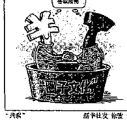

“共情” 简单让你装 B

## 圈子是财富的赠品

屌丝肯定不认识各类教授, 头头, 卖飞机的人, 有特殊水平的人。

大户穷的时候, 也不认识这些人。但有钱了, 参加各种活动, 互相介绍, 立即就认识了。

圈子是财富的赠品。失去财富了, 圈子也没了。

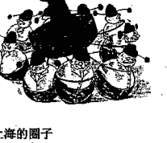

## 读谈上海的圈子

1. 上海人不崇拜暴力斗殴, 这一点是非常好的商业品质。任何所谓民风彪悍的地方, 都是穷的叮当响的破地方。商人是没有时间和精力进行无休无止的打架斗殴的。上海能够成为中国的经济中心, 这一点非常重要。

2. 上海年轻人喜欢搞小圈子, 一起打牌, 一起玩梗, 互相讲一些只有小圈子人才能听懂的笑话, 排斥圈子外的人。嘴笑强者, 脑踩弱者。这对商业环境影响很糟, 但对一个单位的人际交往而言, 圈子外的人（包括外地人和一些弱势的上海人）, 实在是招人恨。

3. 上海人在高墙层面还是明星优势, 但中低墙层次, 例如大学, 医院, 教育, 文化, 技术类, 有关部/门中档职务以下的层面, 已经完全没有任何优势了。说好听的, 是海纳百川, 说难听点的就是, 自己不争气。外地人现在还不欲大面积的挑衅上海同事。倒不是你厉害, 而是他们目前尚处于起步阶段, 还不想多事套, 外地人很快会控制上海中低端的各种事务, 这是指日可待的。

4. 我对上海的变化, 持中立态度, 但上海本地文化的消失, 估计再有三十年差不多了。上海人在职场上互相不帮忙, 互相看笑话, 最后的结果是和外地球人一起混同了。这也不错。海纳百川, 有房就好。

## 不合格产品不要溜入我们圈子

现在, 我们上门女婿的人员素质和服务质量越来越差了。

不要说 985 的基本没有了, 就连上海理工这种二本事都不想来了。

我们应该反思了, 为什么会这样？

建议: 大家召开几次座谈会, 统一工作要求, 再接再厉, 坚决杜绝不合格产品溜入我们圈子！

## 人这辈子要多留后手

我这辈子留了很多后手, 包括这微博也是备选。

某天缺钱了, 分分钟就兑现金。

只不过，我在用不上而已。

世界上没有一成不变的事情，看事情要看十年后。

人的竞争，说到底就是家族竞争，几代人的战争。

不要总想着自己II舒服了，其他就不管了，这是对后代不负责。

嫁给我是笨娘的幸福，吃饭饭也是艺术。

## 后手，危机时刻救急的工具

后手，就是平时不用，危机时刻救急的工具。这类东西，需要保密，看似无用的落个阔棋冷子，关键时就是金箍棒。房子，只是盛世家庭。一旦局面改变，房子就变成了后手。有本事，有人脉才是王道。

帮助别人，是人生的一个大功课。不要以为免费帮人就是吃亏。这不吃亏，是攒人情。十个里面总有一个念旧情的。更何况，我这种人，也是忘恩负义的小儿科气度？我笑天败走华容道，就算是真个人精，你也会给我悄悄做个眼色，指个跑路的道。人生需要很多后手，哪怕你一辈子没用上，只要没有曝光，就可以留给下一代用。

## 同学再牛，和你没啥关系

我到这个年龄了，发小里面玩的好，有几个大出息了，但现在别人和你玩不到一起了，最多是客气几句，孩子还好？

每个人都在往上管，绝不会往下管。

你家孩子找工作去求同学？不可能的，你丢不起这个面。

同学，也就是火车硬脑上的同路人，到站就分手。

此生再无瓜葛了。

## 嫉妒心能毁掉一切！

说个伤心事。

我的一个同学要升职了，非常重要的一把手岗位，结果被竞争对手举报了。

查下来也是鸡毛蒜皮的事情，最多是考虑不周，做法不妥，谈不上什么违法违纪，但把新位子搞黄了。

而举报的人，大家都知道，还是年轻时候的热人好友。

人的嫉妒心，真可能毁掉一切！

## 混场子是暂时的

你现在年轻漂亮，又是场子里新货，生活没负担，大家都着你，等到了28岁，也不新了，年龄也大了，自己要买房买车，父母指望你改善生活，小狼狗倒要钱，那时你就头大了，麻烦事一个接一个来。静下心来，学点工作本事。混场子是暂时的。

@喜慈炎人：

活的差不多，见过也玩儿过了。

也没有本事去参透生命的意义

推背扬尘尘归尘土归土又有什么可怕的呢？

自然界的物质循环罢了

原来世俗一粒没有思想没有感情没有触觉的物质

## 九招教你识真豪

### 如何判断真豪？

- 一是私密的高端消费，例如虫草当茶喝，几千元的茶叶到处都是，家里囤现金几大箱子，裤子内袋是几百元分的，这种人要仔细看了，可能是真豪。
- 二是出入一些私人高级场所，这是土豪的门票，至少说明周围土豪认可他了。例如某处自然保护区里的奢华别墅（无证）。
- 三是个人饮食，极为讲究。说明有钱想多活几年。
- 四是有长期规定驾驶员。职业驾驶员，不是临时抓差的那种。养一个驾驶员成本不低。
- 五是家庭保姆超过四个以上。
- 六是刻意注重安保系统，家里总有人，包括保姆。
- 七是神情淡然，话少但分量足；不喜欢争论，不喜欢比较，为人客气谦逊。“我都比你富了，还和你争什么？你喜欢显摆，我就观赏一下。”
- 八是从来不说“有事找我，我关系多”。富豪的关系都是不能随便用的，那是做大事的能力求一下的。
- 九是从来不报家底。我有几个工厂，几个商铺，几套房子，开什么车，多少员工。很多老板最喜欢逢人便吹这些东西，以此证明我有实力。别那，有实力不是这样的。

## 努力并不一定过得好

四十岁左右的上海人中，很多是原来郊区的优秀学生，读书非常刻苦，成绩优秀，考上了中专、大专、本科，户口转到市区归定，结婚时候遇到了大下岗，既没分到福利房，也失去了农村拆迁的利益，现在很多人苦逼的一场糊涂。而那些吊儿郎当的农二代，初中也是勉强毕业，现在摇身一变，成为了农村拆迁户，千万身价四套房。外地小美女拼了命的往上住。

什么人，什么命。太努力了，不一定是好事。

## 勇往直前

> 【就算千万次打败疲惫，也要勇敢往前进】

漂在异乡，忍受孤独寂寞；
深夜加班，倍感无能为力…

但是，不管现实多参不忍踏，都要相信自己，这只是黎明前的短暂黑暗。

每一天的努力，都是为了接近理想的自己。

只有咬牙踩过那条习惯自我否定的河，才能达到成功的彼岸，才会变得更加成熟和优秀。

共勉。

## 不要生气，要争气

人的一生，多少都会经历一些挫折，也会有低潮情绪。
但生气不仅伤心伤身，还浪费时间。
有功夫生气，还不如为自己争口气，控制住情绪，保持清醒的头脑，发奋图强，提高自身实力。
自己强大了，才不会惧怕无法预期的风雨，才能越飞越高，领略更精彩的一生。（填空题）

## 尽可能不要和穷人做生意

大家记住一句话，尽可能不要和穷人做生意。
因为穷人对金钱的认识和吝啬，是你不能理解的。
交朋友，客气客气即可。

## 不要总说退休

很多人干累了，总是说，赚够了就退休，周游世界，归隐山林。
我试了一下，玩一年就烦躁了。
因为，没有和你类似的人在一起，即使周游世界，你会觉得孤独无聊，最后也不想出门了。
建议还是劳逸结合，提高工作水平和服务质量，多赚点钱，尽可能在熟人环境中生活比较好。

## 这小老板娘，居然 20 年赚几个亿

说个神奇的故事。
易兴来不识字的小老板娘，居然二十年内通过投资赚到了几个亿。
后来我和她交流，她说了段我一辈子也无法忘记的话：我不识字，但我识人。
我很留心周围有本事的人，默默观察他投资什么，我就悄悄的在同一个项目跟着投资什么。
结果，每一步都踏准了：开店，开厂，买楼，卖地，关厂。

## 生活不易，别让压力击垮自己

睡不着的夜晚，赚不来的清闲，挤不上的地铁，做不完的工作……
感觉辛苦，其实地因为你在走上坡路。
每个人都有惰性，然而有压力的生活，才能激发出潜藏在更深处的能力。
愿你在迈先身后，有种名为“成就感”的甜淌上心头。
共勉，早安。

## 我的底线

给孩子留一套内环线漂亮小区，就是那种绿树成荫，欧式风格，有电梯有车库的小高层洋房，九十多米。你有本事自己换个好的，没办法就混混吧。
必须是内环线学区房，以后孩子可以坐地铁上班。郊区大别墅，好是好，就是上班不方便，谈朋友也不方便。儿子要是没有本事就去做倒插门，没本事也可以落了。

## 年轻人过的好不好

基本看父母。

年轻人主要是三件事情，考试，就业，结婚。最关键是考试。读个什么大学，基本决定了后面两个事情。

有很多家长根本不知道怎么读书考试。所以，孩子也被教成了 ZSO。我姓在幼儿园有个熟悉的小朋友，父母是做生意的，根本不看书。那个孩子非常聪明，结果被废掉了。

父母也不知情措，毫无办法，眼睁睁看着孩子彻底沦为废料，从一个性格开朗活泼的好孩子，变成了一个唯唯诺诺，啥也不敢做的货生。

我家孩子，从小就足按照 985 的套路跑的，考试成绩遥遥领先，从一个普通孩子，一跃成为了幼儿园大班的年级季霸，自抬心爆棚。

我曾经反复多次说过，孩子学习就两个事情，提前的习，反复刷题。

但是，大部分家长像鹤，坐不住，习惯把把孩子送到一些乱七八糟的辅导班，那些班级里，孩子几十个，老师哪里管的过来？时间长了，也就废了。

考试不好，就业也麻烦。

就业不好的家庭，一般都是吊丝思维，吃光用光，身体健康，不会提前给孩子买房，儿子找老婆就很难了。现在的情况，不要房子的女方基本就是歪瓜裂枣，满脸痘痘土肥圆，或者离异不带娃的。你选一个呗。

做优质父母好难啊！

## 可怜的上海姐夫

我今夭在阳台上听到一对母子对话。

- 几啊！你住过得最贵的房子是，妈妈的肚子。你要孝顺啊。
- 你以为我又愿意到你家当儿子啊！穷了一辈子，我拼死了，给我三十万，老家县城开盘了。
- 没钱，要命一条。
- 妈妈，你能不能找上海姐夫借个四十万？首付还差装修款。翠红色的已经多到购房另了，已经选到了一个满意的户型。
- 我晚上找他们谈，这几年我给他们带孩子，一个月月嫂保姆费也要七八块钱了。就当我打工还债了。

## 一个亲戚骗亲戚的事情

老周丝吹牛，某菜生意赚很赚钱，怂愚自己老婆卖唯一纳持婚房房产投资开贸易公司。那个傻女人也是好吃懒做，天夭想发财，竟然相信那个男人（老公）的胡说八道了。马上悲剧了。我等着看衰。

## 我家拆迁了

菜菜，我们家拆了一套前面房，还有两套生房。老爸拿着钱开心去了，有个和我同龄的小女人天天巴结他，他妈气的发病了。那是我的遗产，这可怎么办啊？

答：打断他的狗腿！

## 丈母娘过来借钱

请问大家，超级市，小男子要结婚，丈母娘过来借钱，老婆态度暧昧，怎么办？他们娘家人的的一直看法大概是，小男子能不能娶老婆就指望我了。我的真实想法是自己家再买一套，现在看起来不可能了。

答：立即离婚吧。

## 有儿子的家庭

你现在要提前准备婚房了。

你儿子 985 毕业，工作到结婚，一般不过是五年，肯定买不起房子，三甲年轻医生可以不买房（丈母娘愿意补贴），其他儿子他怎么办？

你会说，当爸妈的也难啊！狗男女一起臭践型的时候，你怎么不说难啊？为什么要把困难留给儿子？你们对得起他吗？

赶紧的。

## 如果你不努力

儿子就要努力了。

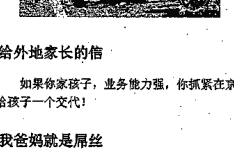

## 给外地家长的信

如果你家孩子，业务能力强，你抓紧在京津买个小组住，室内有厕所就行，二平房都有，算是给孩子一个交代！

## 我爸妈就是屌丝

我常因为用水用电较说。

答：算了别，别计较了，儿孙自有儿孙福

## 要把老年人看住了

今天去医院排队，目睹了一个疑似小诈骗。

我因为身体太难受，找了个座位坐着，家属去办手续。我座位隔壁是某年轻女子忽悠某老夫买一个什么艺术品，一共干把块钱，还教老夫怎么用使用微信转账。看上去，年轻女子和老夫认识一段时间了，但明显不是家人。老夫是市中心口音，年轻女子是城乡结合部口音。

老夫妻高高兴兴买了，我听的眼瞪口呆。

建议：年轻人还是要把老年人看住了，否则头大。

## 好日子

在京沪，如果父母留下一套市中心大房子，自己读个二本打个工，赚点零花钱，每月七千是很正常的。小日子是非常舒服的。最麻烦的是长辈不给力。我现在就在安排这个事情，做个优质父母。多出来的房子，吃光用光，嘎嘎拼头

## 让爸妈买房，和他们吵架了

某某还在研究生为了让爸妈买房和他们吵翻了……还买吗？

答：去杭州市萧山区做萝卜干！

## 你家的名言是什么？

我家的名言警句是，吃光用光，身体健康。儿孙自有儿孙福！一切靠自己。钱少一点不要紧，关键是孝顺。恶心伐？

然后我就倒插门了。

## 你爹给你的结婚礼物是什么？

一抱锄头，几句名言，还是西二旗的九十平米？

## 你爸留给你什么名言？

答：你看有人家的儿子多孝顺父母？

## 经过反复打电话和聊天

我发现每家每户都遇到了亲戚朋友借钱不还的情况，而且没办法处理，只能在家里又叫又跳。抓了人经金额普遍还不小，从5万8万到50万80万。借钱的人还理直气壮，就是不还，看你有什么办法。

## 二舅要借二十万，怎么拒绝？

答：“没问题，我把钱取出来就带过来”，然后拉进黑名单，让他等吧。

## 为什么啃小的情况愈演愈烈？

现在的老头老太极度自奶，退休又早，没事就在一起比来比去，互相吹牛逼，比输了的，就回去打电话折磨在京沪的子女。谁谁的的儿子给父母一万块过节费，谁谁谁的女婿给老人买比亚迪，谁谁谁的女儿带父母游欧洲，你什么也没有往家里塞，你这个不孝的东西！今年二舅家的儿子结婚，你要给我们争个面子，先出一万，你爸的车该换了，村里的二层楼房子要装修了，你出十五万，意思一下，春节带点半只羊回来，我也要去村头炫耀一下。

什么，你没钱。你要攒首付？你这个不孝的东西，我们辛辛苦苦供你读大学，你就这样对待父母？你滚！北京的房子要参一半，不要买了，还是家里的事情重要。

我们从小到大给你吃，供你吃供你好，你要有良心啊。嫁男人，彩礼不能少，我们这里，起步价就是十八万，你是大学生，怎么也要 28 万。少一分钱，我也不同意，什么你已经和房丝睡一起了？你要脸吗？你个小混账子，我们白养你了，你个赌钱货。不要脸的东西。租房子结婚？我呸你！你二叔的姑娘在西二旗买了三居室，你也不能少。你不要脸了，我们还要脸。

## 我提前半年给你警钟长鸣

京沪二本子，春节是老家亲戚来借钱的高峰期，我提前半年给你警钟长鸣。你一定要警惕啊。亲戚没有什么意思的，

## 优质父母，祝福你们

我是独猪你好，坐标北京，公婆在老公小学时候买的大平层，红木装裱好了一直没住，每个月去打扫卫生，去年我们结婚直接缴费入住，啥都不用操心。

## 如果你看清楚父母的劣根性

说明你长大了，如果你改掉他们的劣根性，你成熟了。

## 菜菜，我父母没文化

也存下了六十万，我是本科生，以后会不会比他们强？

答：能。你父母赚到钱，不是因为他们没文化，而是吃苦耐劳。你大学打游戏四年，只有单身狗的痛苦！可能根本不知道吃苦耐劳的痛苦。

## 这样的父母是劣质父母

如果你的父母一早上给你发的微信朋友圈，是某某中医说什么了，某人养生大法，某很奇怪的东西吃的可以延年益寿，那么我可以百分之百，肯定你的父母是劣质父母，他们只想花很小的代价，不花什么的就给你解释了。

## 父母和哥嫂投了鳄鱼缸，爆了

父母一牵手积蓄 60 万没了，他们几个人一天到晚在我家哭哭啼啼，撕心裂肺，动不动就要跳河，让我想办法解决，我今年要参加高职评职称，自己都忙的直跳，实在是烦死了。父母意思是，哥俩也没几个钱，让我不要搞了，集中精力给他们去还债，我该怎么办？

答：你解决不了的，让他们自生自灭吧。

## 菜菜，我爸开车撞人了

要赔九十五万。老妈让我卖房子救父，否则就进去了。我们那里房子价格不高，单价九千多。怎么办？

答：网上李孝子，找他们借钱。

## 是不是要卖房救父？

菜菜，我爸给我买的婚房，现在他重病，需要自费部分 90 万，可以多活五年。**我是不是要卖房救父？**所有的亲戚朋友都认为我应该做孝子，老母亲天天哭，要我卖房。这个问题，部分二本子加厚也会遇到，你说一下答案。

答：做孝子，卖房子。这是网上标准答案。我现在也是聪明人了。

## 亲戚之间，互相帮忙

一起嘴的情况有吗？

我活了大半辈子，只听说过一个家族，还是世家。子女们个个都是能人，职位极高，县里面无人能比，我遇到的真实情况是，绝大部分家庭，亲戚之间都是互相借钱，互相说坏话，互相鄙视，互相看不起，互相不服气。例如，几十年不联系的亲戚突然带了一些梅干菜来串门，然后说，自家男人得绝症了，躺在医院里，要借钱十五万，你真是恶心到家了。

## 摆脱离质父母

我人到中年发现一个有趣的现象，屏显一般都是几代屏显。偶尔有个别溜出来的屏显，都是从小就住校的，长大后自己读大学，工作，基本上没有和父母一起生活过，受污染比较小，他们的思维更像是小知识分子，谨小慎微。

长期和劣质父母生活在一起的，基本都是劣质二代，很少有出息的。

## 家里买房必须写儿子名字

这是天经地义的，不解释。任何不服，都是女儿要鸡贼了。

## 娘家没钱，找了个做生意的公婆

老公开着宝马，我奶奶觉得我找了有钱人，实际只有我自己知道，也就一般生活，共享整天给我说，谁谁家闺女本事棒，把爹妈接过去。谁谁家女儿一分线嫁妆不要，谁谁家女儿在家多有地位。

我想说，你们怎么不比谁谁家父母给女儿地资源。谁谁家父母陪嫁女儿多少多少钱啊？

## 爸妈退休了，有 65 万现金存款

准备养老的，是借过来买婚房，还是不开口。

答：硬借也要拿过来。老年人都很自私的，不买房就和他们打

## 自己奋斗！

问：我父母才不管房价跌还是涨，他们永远就给你一句话:自己奋斗！

答：让他们滚！

问：菜菜，我爹妈是没钱的县城屌丝家庭，我最恨父母有钱不行付的孩子。见一个骂一个。

答：点赞！

## 老年人的自私自利，令人发指

你不说买房，他们就说糊涂。拖一天算一天。最后拖不下去了，就夹一句金光闪闪的恶心话，房价要跌

## 最近，我爸我妈找我自首了

说买不起西二旗的60平米老破小，怎么办？我是我们村第一个大学生，太丢分。

骂他！

## 我爸希望我给他送个结婚礼物

我是河北县城男，国贸CBD精英，金光闪闪的二本学历。今年春节，我爸希望我给他送个结婚礼物，一头国产轿车。怎么办？

## 菜菜，我准备买房了

我让婆婆出1.00万，那个老太婆50多岁了，扫得很。不肯出钱怎么办？

散伙

## 菜菜，我是媳妇儿

每天吃饭我爸就把话题往买房上引，公婆就四个金光闪闪的大字，房价要跌。

## 这是什么心态？

菜菜，我公公婆婆经常问女婿，他什么时候买房，但是一和我们说起来，就说是房价要跌，这是什么心态？

用过了的心态。

## 儿子买房

女儿女婿应该出多少，30%差不多吧？

## 人世间最会计干净的父母

一嗓子就留下四个金光闪闪的大字，房价要跌，其他啥也没了。

## 十年前买房，真不公平啊

菜菜，同样的房子，十年前买，只要一百万，现在要五百万，真不公平啊。

你爸十年前为什么不买？

他十年前就嫌贵。

你现在呢？

我今天还是缴费。
你将怎么打算？
培养儿子，将来给我买房养老。

## 我父亲给我在北京买了房子

Wwwwiit: 我父亲给我在北京买了房子。我特别可耻
下一词宥辞海华字典改版，你去当编辑去吧。

## 劣质父母留下四个大字

LCI 吉：《房价“死撬”，却不允许“房价下跌”，释放什么信号？曹德旺怒批》买房，对于
很多人来说，是高不可攀的梦想房，而购房者之所以“望楼兴叹”，都是因为房价太高了。
莱蕙：劣质父母留下四个大字，房价要跌。

## 别结婚了

智慧的老爸：如果房价没有在我结婚前下跌怎么办？
没关系，那就不结婚了，反正我不会买房的。

## 父母应该给孩子留下什么

你健全的人格能娶老婆吗？不可能的
要老婆还是要靠买房子。

## 优质父母给孩子买房

优质父母只知道问孩子伸手。今年过年带多少钱，回家。大学毕业好几年了，你给父母买的什
么，给他父母多少钱。

## 劣质父母最喜欢讲大道理

他自己活得一笔调亏、还要教育子女给自己买这买那送钱送东西。还留下金光闪闪的四个大字
房价要跌。

## 我周围励志质父母越来越多了

他们混得不好，还喜欢给孩子们上课，用他们的失败的人生经验知道孩子如何成功，飞黄腾达，
十分可笑。他们有一个共同的特点，就是总结了四个金光闪闪的大字房价要跌。

## 劣质父母语录：

1. 平平淡淡才是真
2. 成功靠自己
3. 儿孙自有儿孙福
4. 对亲戚朋友要重礼貌有礼貌
5. 我当年也 xxxx 不要钱

(欢迎补充)

## 兄弟姐妹情，真有吗？

如果几个子女的经济条件都不错，确实有感情，血浓于水。如果经济条件相差较多，或者都穷，那就很难有什么感情了。老父母就留下一套 45 平米的老公房（价值四百万），儿子要多分，甚至独占，女儿坚决不同意，一般都是撤撤没的，差个十万二十万都不行。

更有甚者，穷的一方，下娶婆姨，蒙骗富裕一方，比比皆是。我家亲戚就遇到过。兄弟姐妹之间的借债，小几十万，白纸黑字，证据确凿，就是有钱不还，最后打官司闹到法院。法官一看，也不用开庭了，直接通知另一方准备还钱。

我一直在想，为什么呢？现在，年龄大了，我也想明白了。人老了，利益益大天大。兄弟姐妹啥，算个鸡毛啊？姐姐住院了，弟弟也不过是拿个三四百元，加一袋子便宜水果，十分钟就跑了。哥哥家遭难了，妹妹也不可能把房子给你住。时间长了，感情也就淡了。

- 我是长子，穷了一辈子，父母房子肯定归我啊！孙子结婚的首付，就指望这个了。
- 西亚！法律规定，男女平等。女儿照顾的还多一点，凭什么？
- 那好，你给我讲法律，好，我悄悄带上老婆去做公证。
- 操你妈，玩阴的！公证以最后一份为准，你不要笑的太早了。
- 四百万，谁也能承不啊！孙子拿不到首付，就只能找外地女人了！死也不能让！
- 就你有儿子？我女儿在加拿大买房，就差这两百万了。掰破脸了，谁也别客气！

## 老王和他的兄弟姐妹

老王，60 岁出头，大老板。他的兄弟姐妹都混得不好，都是下岗再就业，混到退休。平时有个什么事情，侄女读大学，配偶住医院，都靠老王掏钱赞助。他也是热心帮忙。

前两年，老王买了个大别墅，兄弟姐妹也不客气，不打招呼，就轮流来住，一到寒暑假，院子里就变成儿童乐园了。老王是敢怒不敢言。

上个星期，老王和他们彻底闹翻了。他弟弟的孙子，20 岁，二本子，要去英国留学，商科研究生，经济上还要四五十万。非要老王赞助。弟弟的意思是，你孙女去美国了，我就一个孙子，你总要帮忙。我写借条啊。

老王一下子也拿不出四五十万。弟媳硬不走，非要他答应。"你这差别壁都一千万了，给小辈付个学贷，也不为过。"这时候，老王的老婆黑脸了，意思是你先回去吧，弟弟不千，说是我们兄弟的事情，你不要插话。

最后的结果是，老王气的高血压住院了，再也往不来了。老王的老婆说，这事四五十万，其他人家怎么办？

## 血浓于水，也就是半个月

小王今年 39 岁了，得了看不好的重病，连续躺在医院里。小王老婆一个人要上班，要管孩子，还要陪医院，身体实在是受不了了。于是，小王打电话给姐姐，希望姐姐能搭个手。姐姐和小王感情

非常好，立即同意了。

姐姐也是有老有下有小，还要上班，下了班就医院跑。除了半个月，这么高温的天气，体力透支严重，也是崩溃了。最后留下五千元，说什么也不去了。

小王的老婆现在已经不管小王了，也确实管不了了。姐姐也不管了。小王现在只能是等时间了。

（小王姐姐是我公司的一个员工，因为请假，和我说的）

## 劣质家长

（此处为截图插图）

## 人生最大的不幸是遇到了劣质父母。

劣质父母和生活中常见的劣质人一样，什么事情都做不好，又穷又懒，脾气巨大，还喜欢想入非非，怨天尤人，一遇到事情就埋怨别人，埋怨家人。从来不给孩子创造任何台阶，还要责骂孩子，勒索孩子。孩子好不容易做大逃出去了，还要追到单位，追到外地，伸手要这笔那，无休无止，令人作呕。

他们就是負擔重，早点了斷算了。讓他們滚！

## “劣质父母”

- 小仙女喝醋吃素，“劣质父母”冤案来说，前两年觉得太刻薄，父母再不好，好歹有养育之恩，从小到大的伤痛，别人问起来，我都哭呵呵回答的，觉得没什么。这几年，笑容真的逐渐消失，绷不住就想咿咿大哭，但我要面子弹，强忍，尽管更难受。原来人一旦回过神来，以前的痛就如海啸般砸向你，快要窒息，快要喘不过气。
- 笨笨：父母坑害子女的情况，比比皆是，有个亿豪，离婚后，各自潇洒十几年，等儿子长大后，就剩下一点点的东西了，还要和同父异母，同母异父的兄弟姐妹争夺，真还不如一个工人家庭。

## 粉丝提问:劣质父母经商失败

损失千万，现在一无所有，还套了我二十万信用卡，你水平高你说说？

答：天下没有不是的父母。你抓紧跑路吧！

## 我的劣质老丈人

菜菜我是男方，赶在大漲前，不要脸的老丈人丈母娘卖了老家破房子，按揭了内环线三居室，他们成功提升阶层。但是他们平时都是各种宠儿子，不宠女儿（我老婆）。我儿子三岁高烧跟他们来着一根竟然要去吃喜蛋就跑了（我爸妈已经生了通育），他们家乱七八糟亲戚成走地，还跟我提要求，那个房子签合同同时我不可不可以直接写他儿子名字···真的是倒了八辈子血霉这种劣质父母老丈人怎么被我追到了这个事情心里难受好久我是跟他们撕破了彻底拉黑。看着别人家老丈人丈母娘对外孙对家庭起个拼，媳妇也难爱！

答：肯定不是上海人，你们这个年龄应该是独生子女

## 虹口区有个苏北老爸爸

一辈子嘴尝油饼，起早贪黑，干了二十多年，只休假了五天，越是节假日越忙！最后在内环线买了两套房，儿子幸福了。你爸妈一辈子干了什么？

## 丈母娘：你们要帮助弟弟

我是上海郊区男，去安徽县城，见丈娘家长了。女妻还有个弟弟，读初中。提壶喝酒串门子，一切正常。最后，丈母娘来了一句：我们已经老了，你们以后要帮助弟弟。我差点要毒舌七了。这事情怎么办？

## 劣质父母

（私信）京沪，家里3套房子的，老爸单位分过一套，继承一套，自购一套。上个月拆了一套老破小，赔偿几百方。我和我妈原采的想法是，拿这钱再买一套漂亮小区。万万没想到，老爸外面有花头了，钱不拿回来，一吵架，他就不回来了。

我爸今年56岁，老工人，一辈子没有这么开心过，现在，他基本不想回来了。他手里挪着几百万，已经是低端KTV里的情歌王子了。唱完歌就去海鲜大排档请客，好几个三十几岁的外地小女人围着吹捧他。

如果父母离婚，老爸还可以再从家里刮走半套房子，至少几百万，想想舍不得。如果不离婚，实在是气的不行了。怎么办？

答：没办法。希望他早点中风了。

## 迟早惹事的小舅子

山东县城。我家前两年遇到拆迁，现有两套县城房+53万现金。小舅子这几年打架捣蛋两次了，我估计迟早惹事。老丈人现在说话都是含沙射影，估计是拿我当保底了。真有事了，老丈人-求，丈母娘一笑，老婆肯定逼死我。我准备把提灯光，贷款购买买小房。我担心的是，老丈人最后会不会逼我卖房救他儿子？

## 老丈人让我把房卖给小舅子

我是青岛男。我三年前买了一套市北区房子，现在收益较大。老丈人的意思是，现在青岛房价太贵了，让我把这套出租的房子，按照市场价卖给小舅子做婚房，先付一半（就是原价），其他的慢慢还，我老婆意思是，赠我（实际是同意）。我孩子才三岁。怎么办？

答：今天是小舅子专场了？

## 小舅子结婚，随礼我心疼

菜菜，我是重庆璧山的来姐夫。小舅子下个月结婚。我随多少礼金？丈母娘的意思是，全国统一价，18888元。数额不算太大，我也出的起，但是，我也实在是心疼。怎么办？

拿钱吧。别自找麻烦。

## 小舅子住我家了

我是新上海人，安徽九亭镇小三哥。丈母娘是我们老家安徽县城的，老婆今年初生了孩子，把丈母娘叫过来帮忙。我是非常高兴的。

现在麻烦了，小舅子今年本科毕业，丈母娘直接让他住我家了，还不提什么时候走，看意思是准备长期了。我怎么办？

## 老丈人盯上了陪嫁的小汽车

山家县城。去年结婚，老婆陪嫁一个车，二十几万，在我们那里还算有小面子的品牌。现在，小舅子年满二十岁，家里准备要给他介绍对象了，老丈人的意思是，想把那个二十几万的车，借回去给小舅子用几年。你看怎么办？

答：人世间居然还有这么暖的操作？

## 我为姐姐付出了那么多，姐姐却拉黑了我。

我是弟三。2007 年，在沪工作的我，和老家姐姐妹俩，合法购买了上海某房产后出租。这十年里，所有的手续，装修，出租，维修，纠纷处理，最后出售，各种跑腿，都是我干的，跑前跑后，绞尽脑汁，精疲力尽。姐姐一家坐享其成。

这房子去年依法出售，依法收益了五六倍，除了当初的出钱比例分成，姐夫姐姐没有给我一分钱的劳务费。我实是不高兴了，就提了一句是不是给点劳务费？姐夫姐姐大义凛然的说，亲情是不讲利益的，然后迅速拉黑了我，并在老家大肆宣扬我不顾亲戚关系，只要钱。老家父母亲戚纷纷打电话来骂我。我真是伤透了心。

- 答：
  1. 管理和出租房子有多麻烦，我是知道的。算你倒霉。
  2. 超过五万现金的利益，亲戚和路人，态度是一样的。
  3. 既然是新上海人，就和老家撕掰吧！

## 我的传销爹妈

爹爹亲妈没固定工作，干了十年传销，血本无归，偶尔会运气好赚个几十万，但都又投进别的各种传销项目里赔光了，现在他们五十多了不愿意吃苦出力眼高手低隔几个月老两口都问我借钱，家庭一套五十多万的房子和一辆二十万的车以及一屁股债和贷款，我 24 岁半无车私企月薪六千当了好几年模特外语算中上吧，想问蓬莱如何能脱离现状苦海？

## 妈妈是关心我，还是坑我？

我是未婚女生，三十出头了，职场白骨精系列，年收入大几十万。

我婚青年时候，被我爸骂了，所以对男人特别有成见。一天到晚教育我，男人大多数是乘古便宜的，婚姻前不能让人用，天一黑就买回家。我去出聚会，一到晚上九点多，我妈的电话像是发子弹一样不停地打过来。

我这两年前刚升职，才赚有大钱了，房子车子都挺好了。但因为是否出我，以前想找个条件好的男人，但一直没遇到合适的。现在都成这个上下不了的样子了。我姐一个人单独几十年，无休无止地唠叨，“男人都不是坏人”。我又不能让她谁出去，现在是心情恶劣。

我这些年真是被姐洗脑了，用太高标准找男票，都失败。现在也找不到有钱的小白脸了。你说，我这么个白白嫩嫩的女人，应该便宜谁好？

## 为什么我劝不了父母？

最近，不少私信说，父母有点神经兮兮了。路边理财，高分析股整，神往老头，免费旅游，乱七八糟的事情，一天到晚讨论。无论怎么劝，隔几天，又会冒出一个新的事情。我真是心里害怕，万一这两个老东西折进去了，今后没钱养老，还不倒我？

这是很多家庭的苦恼。我也遇到过，老年就喜欢两个事情：长生不老药，简单大发财。只要搭上这两个因素，不管真的假的，老头老太就太激动了。特别气的是，不是那几个外地小年轻忽悠，而是一些老熟人，在拉人头，怎么说也不听。

后来，我也变通了。与其被人骗了，不如被我骗了，我就忽悠爸妈，有个好项目，投十万，二十个月回报六万，我是内部关系，我让她把钱全给我拿出，一共47万。过了一年，我告诉她，那个公司黄了，没钱了。我去找他们打官司，然后陆陆续续，要回来31万，其他没了。然后我找了几个微信，给她看。

她哭了几次，也就算了。又过了一两年，我把本金陆陆续续还给了她，稍微还多了一点，给她长个教训。现在她不愿意了。

## 我妈现在有63万，我全部买了一个大银行超给低息的理财

年利率3.6%左右，安全性高，每到月底，就给地兑一笔钱，她也挺高兴的，一开始，她怀疑我是不是要骗她的养老钱？《老人就这，疑心很大》，我就把钱提出来给给，试了几次，她就相信了。现在，要不要出错了。

## 不负责任的父母，总是盼望子女为地负责任。霍德尼玛！

## 劣质父母

年轻时，他们不想付出，有点钱就糟蹋，吃吃喝喝，夫妻打架，男好色，女偷懒，儿孙自有儿孙福，别指望我给你找房子。

孩子工作了，他们就开始责备孩子不争气。隔壁小玉把父母接到北京了，楼上的小李带父母去欧洲了。隔壁村的 Vivian 还给后妈的儿子买了比亚迪，你什么都还没有！我自乔你了。过年找你耍个五千块，你还哭，哭你个头啊。

人老了，直接是穷凶极恶。你后妈住院了，我就你一个女儿，要五万。不给钱，我就到你单位闹，你不要脸了，我也无所谓了。我这把年纪了，什么没见过？

遇到这种人渣，你赶紧出国宅。

## 人生的主要痛苦，来自于亲人。

## 小叔子来我家躲债，怎么办？

小叔子，二十几岁，撞小贷成瘾，瞒光了父母大几十万积蓄，四处躲债，现在躲到我家了。一开始说来来找工作，暂住几天就走。现在说，工作黄了，先住着。他自己买了一大堆的泡面，准备安营扎寨了。

小叔子好吃懒做，没钱租房，老家也回不去了。公婆也被高利贷逼得到处躲债，电话我老公，急及亲情，伸手搭救。老公沉默不语，我是彻底崩溃。要不要开撕？

答：遇到这种劣质父母，只能撕。

## 每个孩子的笑容背后，都有一对咬紧牙关在拼搏的父母。

——栾菜《优质父母》。

## 亲爱的孩子：

世上最漫长的路，不是跨过山和大海，而是从东国二村，走到仁恒滨江。这漫长的 36 米，我用 30 年替你走完。接下来的人生，你好自为之。

苦尽甘来，是意外，苦尽甘不来，才是常态。人生别无选择，只能拼尽力气，奋力一跃。

加油！（一位父亲的遗嘱，改了几个字，互勉）

## 上海家庭婆媳均不给彩礼吗？

答：上海的婚俗。

- 男方绝对不给对礼。
- 女方要带嫁妆，最好女方带一套房子，最低带个半车。房和车不必过户给婆家。
- 婚宴一般在四星级以上，两家可以合办，各付各帐。
- 婚前准备，包括服装，喜糖，婚纱照之类的，男方承担。
- 婚房，一般是男方买好装修，包括家具家电。
- 婚房给女方加名字，女方必须承担公婆的养老，至少假日意思一下，要当自己父母看待。
- 不加名字，男方算是比较小气的家庭，以后，媳妇不管公婆。要吵架，直接闹离婚。
- 婚后工资卡，大部分各管各，因为房贷，男方基本也没什么钱了。
- 媳妇生孩子，大部分是文母妹包办带娃。公婆可以不管。
- 公婆不能指责媳妇，否则大家都全会让公婆怄气不满。
- 丈母娘可以抱怨女婿；但适可而止。
- 市区倒挺门，主要是形式上，孩子一般也是随父姓。上海人现在也看开，没必要故意丢丈婿的脸。七宝乡是乡下人，习惯老土。

## 我是姐姐，两个弟弟妹妹

我农村家庭1985毕业普通城镇职工，找了个同校毕业的博士。公婆拿出积蓄在二线城市给我们婚房买房，付了首付，写的我女方一个人名字。他们认为这诚意足够了，彩礼只给一万，男方当地彩礼一般是一万到三万之间。

我老家彩礼都是一二十万，我爸母妈天天骂我。嫌彩礼少，不准备任何嫁妆。说只给一万，婚礼不来。我家有妹妹弟弟，我爸妈认为嫁出去的女儿泼出去的水，他们养女儿没得到好处。我爸妈是不是不质父母？婚礼要是父母不来，我和老公肯定是很丢脸了。

答：不米最好，以后就有理由骂回去了。按照上海风格，如果男女双方各办一场，男方的画爹，女方父母是不来的。

## 我妹媳老爸

某某，我是妹子，摊上妹婚老爸了。我家在苏州园区有唯一住房，大平层，165平米。最近，这个区域狂涨。老爸65岁了，极度自私，一看到可以到手七八百万，就想卖掉这套房子，拿钱去潇洒，今后老了住敬老院，不要我们管了。他在外面吃喝玩乐，估计还有小女人，现在已经彻底疯狂了，完全不考虑我和我妈感受。我妈不同意卖，他就发了疯一样打我妈，虐待她。怎么办？

## 我原来不相信世界上还有坑害子女的父母。

看了几个沉迷于刷子的例子，现在我相信了。有的老年人，特别是长期当老板的，对金钱的迷恋已经到与如痴如醉的程度。当他们老了，能力越来越差了，不是想着培养子女，而是利用子女帮他维持局面，甚至把子女的婚房都押上去，绑死子女替他卖命，赚了钱归他管。

## 父母分几种,也不一定靠谱

一是穷人，自己混的很差，全心全意指望子女出人头地。他们在对孩子付出时，是令人感动的，是毫无保留的，不掺一拍的。但是，大家不要太太贵了，他们的行为，只是因为他们没有后路了，子女就是他们唯一押的宝。

当子女长大成人了，如果孩子没很好，他们就会极度失望，无休无止的抱怨讽刺。如果孩子混好了，他们会无休无止的要钱要票。孩子只是他们的投资品。

二是有钱人，特别是老板。随着年龄老化，他们的知识能力越来越差了，时间精力也不行了，他们对财富和控制权的迷恋更加加深，已经到了如痴如醉的程度。这时候，他们就会开始入了，但老手去诈骗们经理是不现实的，只能是利用宗情，哄骗子女去替他干活，赚了都归他管。为了防止子女不尽忠心，或者仅仅是贪图手续方便，不惜把子女拉去担保公司担保签字。

如果赚钱了；一切都是他的功劳。如果亏了，子女就上黑名单了。子女在这种环境里待入了，也没有其他技能，甚至还指望继承家业，基本就困在里面出不来了。

三是理智的父母，很少。真正能够正确一心一意对待子女，不考虑进退得失的父母，主要是在大知识分子家庭，大知识分子看问题，没那么大势利眼，人生的大道理，自己基本也想通了，好相处一点。

> 我们没有办法选择出身，身上了就是认命。
>
> 我要说的意思是：等将来我们自己老了，宁可苦害自己，也不要坑害子女。

## 我妈生病，不想给她治了

菜菜，我家是农村靠近县城的。我妈生病，父母要我把在惠州买房首付给他们去治病，进口药太贵了。我实在是在不知道怎么办了？现在，他们是死缠烂打，胡乱骂骂，发了疯一样。他们认为，我不孝之类的。

答：没办法。

## 可怜天下父母心

我是女生家长，问你个职场问题。

我独生女儿马上本科毕业，上海大单位的科员岗位，正式编制，同时也就进入谈对象阶段了。

我家经济条件还可以，上海两套新房子，价值也千万不到，我们夫妻是外企，月入五万到六万。我考虑的是，女儿上班后，要不要给她打扮包装一下？还是普普通通。

- 名牌包包，三四十万的小车，漂漂亮亮。目的是让小姐自行惭愧，不敢往前凑。但是，也可能引来985凤凰男。
- 普普通通，不显山露水，自己私下刷色对象。

请指导。

- 答：
  1. 可怜天下父母心，有这么暖心的父母，事无巨细，样样考虑，我实在是感动了。
  2. 大单位讲究出身门第，普通看不起穷人家闺女。建议方案一。
  3. 注意事项：服装发型要正常，千万不可招摇。包包，首饰，低调奢华，不要搞成太妹款式。车子，开个小宝马就行了，选个女生青紫色。不要选黑色的，搞得像是老爷的车。
  4. 物品可以奢华，语言千万谨慎。可以不说话，不能说错话。

## 天下没有不是的父母

大多数人都问过自己，为什么我的父母不是权贵富豪，为什么他们没有给我留一套京沪广深的婚房？

二十岁过去了，你要为人父母了。你怎么回答这个问题？你可以告诉孩子，当年内核一万多 的时候，我听了清华教授的，以为会涨到两三千，就不买了。后来涨到十几万了。所以你将未没房子结婚了。

你一定要好好读书，自立自强。一切靠自己。百善孝为先，常回家看看。父母不图子女什么，除父母守在小镇子上就是最大的孝顺。

数年后，你爸妈这么说的：你个数家玩意！你替管别人，明明一起长大，都在省城给他们爸妈买了房，还给他们出国旅游！你是不是想啃老！

## 哪有什么精明和眼光

ying_柴米油盐皆醋酱：我当初买学区房是最低迷的时候，我只想着为了孩子拼了。那时所有人都看不起现在都说是我最精明的投资。哪有什么精明和眼光只是因为母爱。

感动 ing

## 儿子是让我们发财致富的

破唐平给我荣誉：哈哈哈，上海浦东 2015 年 292.5 万入手一套 70 平米三楼的学区房，产证下来那天，房子已经涨到 450 万了，房子装修完，已经涨到 600 万。我跟我老公说，额，我感觉儿子是让我们发财致富的。

如果股市这样涨，你怎么说那些炒股客？

## 假如我爸妈把打麻将的时间用作北京西二旗卖煎饼果子，我现在的生活会更好吗？

## 不知道怎么面对原生家庭

菜菜，我是女孩，今年考上北京 985 的计算机硕士了。我从小父母离异又再婚，父母还有点重男轻女，考研的时候我爸说我啃老，一分钱也不给我。他現在有事沒事地旁敲侧击教育我以后孝敬他。我已經不知道怎样面对我的原生家庭了。

## 小舅子欠债不还怎么办？

我小舅子吃喝嫖玩炒创业，赔了一百多万。丈母娘一家子的各种亲戚全怼了。我和我老婆做些生意，手里还有些闲小钱，我老婆不忍心看丈母娘呼天抢地的抹泪，一软，藏婚把借给还了。现在好几年过去了，他们一家子谁也不提这件事了，我是不是被坑了？

hi, 58!

## 不要羡慕，我们有诗和远方

不要谈家人家住大别墅，吃龙虾，那有什么好的。别墅显肥多，龙虾不消化。

不要羡慕人家老婆年轻漂亮，色字头上一把刀，那玩意伤身啊。

不要羡慕老王的儿子又升上去了，我们清清白白做人，不看不好了。

不要羡慕张阿姨的女儿嫁给富二代了，有什么好的，不就是多儿室房子吗？我们有诗和远方。

闺女，初三就和我回老家镇子上，妈给你招就讲。

## 爸妈离婚，我沦为次品

菜菜，我是上海小渣男，一夜之间沦为次品。爸妈离婚，上海市区两套婚，他们一人一套，各自找了个懒人，本来打算送我出国读书的，现在不肯出钱了，都让我直接工作，怎么办啊？连车也不留给我了。

## 经常看到你批判劣质父母

今天我也想吐槽一下我的亦大强原形之我公公！ 

公公年轻时赌场弄坏小三，花光完了小三跑了，现在晒晒儿女投资。重点来了！前席筹备中，缺钱咋办，逼着未婚的公司（我小叔子）去借钱！开口就是50万！以道德绑架的模式来逼儿子，如果不帮他借，就记恨一辈子之类的，管爷，该办事……？

答：你回去审审你老公，是不是已经借了五十万给他爹了？ 

## 平稳情绪，和焦虑说再见！

多谈抓，多写话，不买房，不看房。一次性交齐三房房租。节假日内郊外郊音。找个不买房的爱人，相亲相爱的一辈子。儿孙自有儿孙福，不管了。学区房不要多想了，镇小学读读也很好。儿子婚房也不要想了，总有不要房子的漂亮姑娘。女儿嫁妆也不想了，子女靠自己。 

## 这种老无赖，越来越多了

全签成林：我表叔叔待50多岁，天大麻将桌，嘴里说着年龄大了，千不动了，儿孙自有儿孙福，一分钱，就问儿子女儿要，典型的懒情无加赖！

## 二十万年薪的保姆

编结：财总，请教下，您眼中价值二十万年薪的保姆应具备哪些条件与技能？

答：我们的价值观认为，保姆是丢人的劳动，所以能够做到的人是不愿意做的。这个问题无解。

## 保姆会不会遇到性骚扰？

- 答：从未听说，大根比交通事故的可能性还低。原因：
  - 一，家里有女主人的，一般不至于出这种笑话。
  - 二，单身老汉棍找保姆的，你可以拒绝。
  - 三，音评不尊重，你可以立马走人，甚至报警，工资不会少的。要不然，带上老乡去吧东家园。
  - 四，请保姆的，大部分是富人，在自己家里，有家有业，还不至于严重的刑事犯罪吧？
  - 五，如果说骚扰之类的，那不仅仅是住家保姆了，你就算走在胡同里，也可能遇到不认识的流氓。

## 借100万，结果房没了

刚才接下一个私信，简直是目瞪口呆。

张老汉房产价值1000万，想借款100万去炒股，找到了小王。小王设了一个局。

小王找了高利贷公司，以自己的名义借款600万，但用老张的房产抵押。老张以为，借款100万，抵押房子也正常，就办了抵押。

小王拿到600万，给了老张100万，自己跑了，老张的房子克了。实际上，担保的是600万。

这里的奥妙是，老张以为自己房产抵押担保的是自己的100万。


## 各种各样的骗子太多了

在京沪小区里搞各种金融活动，针对老年人的房产设局，花言巧语，防不胜防。老年人把几百万的房子抵押出去，拿了几十个月的利息，就觉得自己是轻松发财了。子女的话不愿意相信，偏偏喜欢听骗子的，又贪又蠢。最后的结果，无非是家破人亡。你要是拿到 24% 的利息，那生意必须有 50% 的利润，怎么可能呢？心酸的。希望天底下的老年人，不要以为自己很聪明，其实只是肉鸡而已，先让你吃两顿好的，到时候炸喽。

## 大部分老年人

没有精力去仔细看密密麻麻的金融合同，实际上也看不懂，就喜欢听业务员小王的口头解释，然后签字画押，次日把自己卖了。出事后，子女们一看合同，直接躺倒在地。老年人还要骂子女不孝顺，不能替他解决麻烦。这种老人，我见多了。

## 老年人惹个大麻烦

可能只需要几分钟。解决麻烦，可能需要子女跑几年，精疲力尽，耽误事业家庭。我奉劝即将跨入五十岁大关的朋友们，不要趟入是非，不要以为找到简单发财的路子了。你干了一辈子也没赚到钱，老了老了，有人给你送大礼包，带你发财？这不是笑话吗？

## 中国父母内心的四梁八柱

- 儿孙自有儿孙福。意思是，别找我买房。
- 百善孝为先。意思是，你要给我养老。
- 读书靠自己。意思是，别影响我打麻将。
- 你看隔壁老张的儿子。人家怎么就这么优秀，再看看吧？意思是，你没出息，是你不努力，别怨我。天下没有不是的父母。呸。

## 穷爹妈不一定是好人

我是奔三的剩妹，家里穷，遇到了一个好男孩，买房给我加名字。但男方也不富裕，买房借了不少钱。我妈认为，给我加名字，她和弟弟弟媳没得好处，一定要弟弟给三五万彩礼钱（基本无限制）。男票拿不出钱了，我妈和我弟，脸拉的老长了，婚事进行不下去了，我也被男方看不起。怎么办？

## 我的穷爹妈更狠

我是替妹，有个弟弟。我妈让我工作这么多年的存款，加上彩礼，在老家县城按揭一个房子。婚后，我继续负责房贷，房子出租，租金给他们养老。等于是要把干我二十年。

## 父母会不会坑害子女？

多了。比较常见的是坑害女儿，或者吃光用光，不留一分钱的遗憾。另外，通过折磨儿子出钱出力，以此在村里炫耀，也是比比皆是。稍不如意，就威胁去子女单位大吵大闹。这些都是我亲眼所见。人性的恶，只不过是你没看到而已，并不代表不存在。当然，这种父母，主要是文化程度较低，自控力较差的人群。

## 为人父母，一定要努力

将来，你的女儿谱写入编，那才有面子。

## 父母无休无止的勒索

有个优秀的年轻人，现在也不年轻了，三十多岁了，已婚有娃。夫妻两个都是苦出身，通过努力，改变命运了，现在家庭年收入大概是 150 万。但是，他们最大的痛苦，居然是双方父母无休无止的勒索。

双方都是独生子女，父母下岗，拼死拼活养大他们。所以，他们一面见就觉得有共鸣。但是，他们的父母不是爱他们，而是把他们视为投资品。现在，投资成功了，疯狂勒索。

老头老太，居然要房子，要名表，要汽车，要包包，要现金，要出国旅游，居然在下属同事面前炫耀。双方老人都认为，必须疯狂的要，否则对方父母就占便宜了。现在，两个小夫妻都抑郁了。

## 老爸对股票超级痴迷

曾经在九十年代炒过股市赚过一次几十万，后来全部亏光了，还倒欠债，都是这当女儿的还钱。去年家里拆迁，有一笔百万存款在我这里。这两天，老爸要求把钱给他炒股，不给就要到单位撒泼，怎么办？

答：微信公众号闹事，分钱。

## 我是女儿，今年 32 岁

我爸今年 59 岁，独居三年，今天和我说了打算。他有两套内环拢房子，一套价值 500 万，准备置换到苏州郊区，买个小房子娶媳妇（将老婆给年轻老婆），一套价值 450 万左右，准备卖掉当做医疗费和养老金。他的意思是，吃住用光花光，不留遗憾。从头到尾，他没有一丝一毫考虑我的感受。他的意思是，以后不要我管他了。回家后果，泪流满面。你怎么看？

答：那个老东西没有好下场。

## 出轨，爽了自己，坑了子女

我立志做优质父母，就算了。再说不设遇到好看的。

## 婶婶的小儿子要过继给我爸

我是女儿。婶婶说我家绝后了，要把她的小儿子过继给我爸，继承家业。我爸好像也在犹豫。山东人就是这么耿直。我可怎么办？家里在北京有两套房子，一大一小。

## 我小时候，父母离异了

我爸收入较高，不管我们。我妈一个人把我带大，我现在一切都好。但最近，老渣男千方百计要回归，我妈恨透了他，坚决不同意。老渣男居然在我妈那栋楼里，也买了一套房，一天到晚来看外孙，一天来三四次的样子。怎么办？

## 我的婆婆只想自己

婆婆前两年查出 x 症，内心变得极其自私，只顾自己了。家里住的是小地方无产权的单位房。我和老公想买房改善，婆婆一毛钱不出，还一天到晚吵老公洗碗，不要买房，就为了她自己喜欢穿顺两年。我们来老若生孩子，她是一点都不帮忙的姿态。一天到晚就是找些退休老人去旅游，吃光用光。

我以前不了解她，现在后悔大了。老公在买房的事情上也是推三阻四，因为钱不够。现在变成了，我父母出钱，他们就看热闹，还要说风凉话。离不离？

## 马云说

“勤俭持家好，我要去中国，像杭州，最近一段时间因父亲总想着买房，原因是马云说未来便宜的就是房子”。

家中父母一屋子四喜来了这一套房，卖了好样子也费好，可惜美说话那都是一屋子在尽组婚多，到我了我送存跑他妈多喜前两夹，快锁！

这可怎么办？

这是马云的微博儿子！

## 现在京沪大多数是独生子女

很多生儿子的中年妇女，想当然的把儿媳妇的资产认为以后都是他们家的。

## 东北伏弟魔

我是农村出来的女生，现在跟老公做小生意，年收入 100w 左右，现在买了几套房但是也有几百万的贷款。

12 年弟弟非要买个二手车，跟我借了一万至今不还，13 年我特别困难的时候问他能不能每个月还我 1k，他跟妈妈说打哑闷，作罢。母亲 17 年初就带着弟弟全家住到了我家。硬是给我帮忙，弟弟工作还好，弟弟给我儿儿部当，各种不用心出错，根本不当回事。然后 17 年 3 月弟弟买房花了 40 多万，我父母给 10 万，到我借了 10 万，其余都是借的，因为我弟初中没读完一直打工，跟他媳妇这几年挣多少钱多少没有一分存款还要我妈妈补贴。

现在我家在住两年了，吃喝花水电物业取暖分文不出，我们买的零食水果随意吃拿拿但是他们从来不要，我们给孩子买的零食他们也眼孩子随意吃，但是他们也买了零食就藏在自已屋里偷吃。孩子想要什么都是告诉他们我姑姑买姑姑有给，我爸妈加我弟弟弟弟媳妇女，我每天一睁眼想到这一家人头都要炸了。盼者今年 6 月他的房子快点交房搬走！而且我弟弟俩女儿，特别想再要生一个儿子，我爸妈也有点支持！

我很担忧，怕真正了儿子最后还是我的负担！我觉得特别对不住我老公跟自己的儿女，没有自己的空间。我们仓库每个月交纸箱有几千元，都是给我爸妈零花。昨晚发现我弟进这个钱也要缴。

说着骗你眯下来一些，实在心里委屈！瞬间哭不起来了！之前我们过年出去旅游，我的车都是他开回老家用。昨晚发现他咪钱后，我找了个理由不让他开了。我爸骂我跟他赌气闹啥中。弟媳妇也发朋友圈讽刺我。真是引狼入室无处诉苦啊！

## 我对生活非常失望

菜菜，我是 985 男生，24 岁，完全是靠自己拼苦苦读出来的，现在工作了，月薪两万。但是，我活的好艰难，家里的老老少少，全部是拖后腿的，今天这个病了，明天那个病了，这个理财被骗了，那个做生意赔掉了，我这点工资全都贴给他们了。但是，新的麻烦还是层出不穷。

## 菜菜，我说说我家庭情况

我是 985 男生，也是刚刚毕业，城市贫穷家庭。

我爸爸年老体衰，没有收入，喜欢吹牛逼，我妈借钱给亲戚，全部收不回来，而且有各种各种老年病，不能干活。我弟弟小时候小渡进去了。我妹妹智力有问题。

这么多负担，全在我身上了，如果我嫁起来，他们基本活不成了。如果我养起来，一辈子也找不到老婆了。怎么办？

## 旱鸡变凤凰后

前女友怎么处理？

我是外地 985 男，好单位，长得中上，家里偏穷，因为没有房子，一直没遇到合适的，最后找了个小镇开发公司合同工，本地富女，女友为我流产过一次后，我们打算结婚了。女友有一套房子，占 30% 的产权，为了享受首贷资格，女方家出钱 300 万，我家出了 35 万，买房，写我的名字，结婚前房产，价值八百万，漂亮小区。

对了这么多年，终于扬眉吐气了。我装顿瑟了一段时间，主要是在朋友圈装装修过程和房产证。一个不是很熟悉的朋友通过微信，约我吃饭，我就去了。一起吃饭的还有几个人，热闹了一个下午。晚上朋友电话说，下午其实是相亲，有人看上你了，是 xoo 的女儿。

我顿时惊了。那个姑娘，我下午见过了，小漂亮，学历身高长相和我般配，特别是她父亲是行业大佬，我算是一步登天了。这种好事，我以前是想想不敢想的。我又惊又喜的接触了几个月，完全满意，女方也满意，想谈婚论嫁了。

我问了律师，新房房子肯定是我的，只有想法。我要归还女方 300 万。我必须在公开新恋情之前解决，否则，前女友朋友圈里，新女友对我教育有想法。我把这个事情和意思说了。我家是里在上海家的几个做生意的老乡。那几个老乡知道末来老公大人的分量，同意拨三百万给我，但要求的房子做二次抵押。这个没问题。

我的问题是，新女友家里很有钱，婚后怎么去开销钱？三百万，也不是很多。我不太熟悉你们上海人的想法，能不能帮我？谢谢。

答：长江后浪推前浪，清女家也用上了金融创新，我是服气的。谁能他出出主意？

## 我们一致努力！

一个 985 男性不能在婚姻大事上，不忍气吞声，委曲求全，关键看有没有 300 万首付。这是我们每一个长者的责任。

## 我是不是可以去跳河了？

我是妹纸，25 岁，小漂亮，温州准婆婆说，必须自然怀才，才同意结婚。用了两年，男票每次都很卖力，但我一次也没怀上，准婆婆已经脸色难看了。我可怎么办？如果分手，温州那边的行情，我可以要多少补偿？谢谢

## 我妈 20 年没联系的初恋突然出现

211 外地男生，24 岁，现工作于上海。收入 10 万+

父亲是技术工人，性格软弱，母亲事业单位后勤，为人强势。我毕业时，家中有价值 40 万住房和数万元现金。父母月收入约 7000 左右。

我毕业的时候，我妈 20 年没联系的初恋突然出现，此人说自己资产 2000 万，同时说自己单身。我妈像疯了的一样，净身出户。

后来我通过调查，此人就是个包工头，名下无任何公司和房产，而且还没有离婚。我妈还像看傻了一样跟那个初恋来往。我爸谈了一个离异妇女，家里两套房拆迁，有一个女儿已经出嫁。

现在，我家里原来的房子已经卖掉，换成老家两套房子首付，我爸一套，我爸一套。我太习了，不敢找对象，已经彻底放弃了上海买房的希望。现在过去年都不知道该去哪了，不知道自己努力读书为了啥？

答：我们老家人，可以理解，没事的。

## 老爸出轨了，我妈不懂事

我是内环境妹纸，大三，家里两茬大房子。现在遇到难题。

老爸 50 岁，出轨了，女方是有钱的老婆婆，我爸和女的一起做生意。我爸一大半时间不在家，基本是住在女老板大房子里，我妈今年 45 岁，她跟女老板多年无果，现在要求离婚，问我跟谁？

我的想法很简单。如果父母离婚，他们一人一套三居室，倒是公平了。可 TMD，我的嫁妆就没了。如果维持现状，我爸妈住一套大房子，我瞎谈还有一套三居室，最后还可以继承一套。如果我老爸还能和女老板做生意赚一套房子，我就发了。

我内心希望，维持现状。但我那个妈不懂事啊，三天两头和我爸闹，真要离婚了，我直接就是女屌丝了。问问大家，怎么让我妈安分守己，别闹了？谢谢

## 老妈抢我的房子

亮亮，我是妹纸，研一，住校，独生女儿。

前几年，我爸妈给我买了一套房子，小地方的豪宅，190 平米。爸妈现在离婚后，我妈抢我的房子。

我妈说，房子是她出的钱（确实是给娘家拆迁款加我爸的一部分钱），现在我妈想要回来。她不通知我，直接带个老头住进去了。我住大学里，气的浑身发抖。

## 父母有钱就乱花，我要买房也不管

我是妹纸，人在深圳。我父母的思路，你们看看怎么办？

我父母在小地方，算是有钱的（不是土豪）。但是，赚了钱就乱花钱，买一侕罗沙发，近万元，

买一个老的摩登，几百上千元，家里堆得乱七八糟。他在小地方的郊区买地皮，自己修别墅。左手进右手出，已经没什么存款。

我在深圳，急着要买房，父母不管不问，只顾在小地方上乱花钱，乱置埋，我实在是气伤心了。今后嫁人，估计是两手空空去了，肯定被婆家看不起，时刻时刻奶奶我娶加名字。

答：等你爸老了，再出钱抢个离异妇女，那才算完美收官。

## 这么多年，我爸一直说房价会跌

那年夏天宁静的海洋：98 年我家买第二套房子，我爸说房价会跌，我妈自己一个人签了购房合同把定金交了。

08 年我家买第三套房子，我爸说房价会跌，我妈和他大吵三天三夜，家里的碗碟全摔坏了，最后买了。

13 年我爸说房价会跌，要把房子卖了炒股票，我和我妈一起把他狠狠的地区骂了一顿。（应该揍一顿）

来菜：宁跟讨饭的妈，不跟当官的爹。

## 婆婆连两三万都拿不出，谁信啊？

来菜，我气的睡不着，需要咨询你。

我嫁家广州三个房车，老公小地方硕士，结婚前只知道婆婆已经做了十几年的小厂，我以为家境还可以，小康中等应该还是有的吧。

结婚只给了几万，房车都没有。我们自己买了车。我现带着孩子白吃住大娘家，婆家除了过年给孩子一个红包，其他啥都没。

我跟老公说给孩子报个英语班需要三万让爷爷奶奶出，老公说他家没钱。我说公婆哭穷，好歹厂里至少三四十个工人，每天他都早出晚归忙的要命，连两方三块钱都拿不出来谁信啊？

我老公说我婆家有民间借货，今年生意不好等等。你说真的至于两三万都拿不出来吗？还不如人家出去打工的父母也能赚下钱来。

## 粉丝投稿：父母太偏心了

我是女儿，有个弟弟，家里有三个商铺和三套房子，原来说好，子文各半，现在父母说，全部留给弟弟。

我的嫁妆是，给几万元钱就打发了。我和老公在大城市拼的好辛苦，还房贷把人都逼疯了，我真希望父母给点帮助。可他们根本不帮我就。我很伤心

## 老公姐姐找我借钱买房

老公的姐姐要我们去商业贷款八十，借给她买房子。我不愿意，老公很生气。撕破脸？

答：没想到，现在买房子可以这么缺首付？我算是开眼了！

## 爸妈过分的要求，公婆都一口答应

来菜：我男票是浙江富二代，不知道什么学历，首付拿不出手。他除了喜欢玩游戏，狐狸狗友聚会，不喜欢上税，赌毒均没有，我是反复确认的。

我是在浙江附近省会的某 985，长得还不错，北方县城普遍人高。我现在浙江某市工作。

相亲认识的，双方都满意。这次公婆特别客套，邀请我爸妈来浙江玩一个星期。他们很有诚意，安排的很好，一路上都是轿车接送，宾馆都是四星级的，吃饭都是中上档次，还安排了附近几个市的旅游。我估计这次花费大概 2-3 万了。

但是，最后一次晚宴，我爸妈有点过头了。

- 吃饭时，我妈把鱼翅当粉丝等菜，说再公点粉丝。公婆没说话，又点了一份给我妈。
- 我爸在饭店包里翻香烟，烟雾缭绕，公公也抽烟，但没有在包里拿。
- 我爸要求房间加名字。其实，男方家里房子很多，当然地段比不上。
- 我爸还临时开口要 38.88 万的彩礼（我事先不知道）。我爸准备再加钱，去海南买个小房子。
- 在浙江办婚礼，女方基本不出钱。同时安排女方十个左右亲戚来参加婚礼。机票，女方出钱，但这几天的食宿和旅游，男方安排。
- 女方无实质性陪嫁。
- 最过分的是，他们准备把老家县城房子卖了，在男方附近买个房子，让公婆帮忙留一下。这其实是在要钱。

公婆都一口同意了，没有任何犹豫。

公婆希望我结婚后，立马生孩子，然后进入家族企业。我也愿意。我爸妈居然说要发工资的。

我实在是丢人丢到姥姥家了。我今后在这个家庭真是没面子了，男方的亲戚小姐妹都在背后嘲笑我。我气色特了。

怎么挽回？

答：和公婆说清楚，这件事让他们海涵，以后加倍努力回报。

## 我爸很有钱，但喜欢搞女人

菜菜，我爸比较有钱。一年大概近百万收入，少的时候也有 50 万，家里全都靠他。

但我爸喜欢在外面搞女人。欺负我妈是老实人。现在，几个表哥和舅舅，准备找我老爸一顿，好像是去他们公司打他。

我是劝还是不管？

## 我爸知青时的相好求帮忙

菜菜，我爸当初知青，在农村有个相好的，当地未婚女，除了没结婚，其他都一样了。

我爸回城后，立即娶了人家。人家也没闹，算是留了面子。

现在，这个老太婆来上海看病，死了一大圈找到我爸，求帮忙。我爸准备给十万，被我妈发现了，现在家里打架。怎么办？

## 我爸一辈子坑我妈，赚点钱就出轨

菜菜，我家是长期在沪的外地农村人。我爸脑子灵精，赚了一些钱，但他一辈子坑我妈，赚点钱就出轨，从来不买房子。老家房子也几十年没住过，可能都不存在了。他小区里打个麻将也能搞出个拼头。

我是女儿，完全是靠我妈读完了 985 研究生，在上海带了户口，找了对像。因为没房子，我吃够了苦头，结婚的时候，选择余地也少，条件好的男方嫌我是累赘。当初，公婆也有点小看我。

我从小到大恨死他了。现在，老爸 67 岁了，手里还有五十万。这次买房，他主动拿出来给我了，请求原谅。这是她老了，怕我不管他。我妈立马原谅了他。我该不该原谅他？

## 姐夫坚信上海房价要跌

姐夫是博士后，姐姐是博士，在上海。

姐夫坚信上海房价要跌，死活不买房，要有够钱买一套他满意的房子，目前满意的房子是总价六百万以上，首付 200 万。他们实际只有 140 万，估计还要等 2-3 年才能凑齐。

我靠的意思是，先买一套够的窄的，以后再改善，我心里想，姐姐找了这么个货色，这辈子算是完了。

## 我爸是个酒鬼，天天打我妈

他收入极高，主要是一个厂房出租。我一直想劝我妈离婚，我妈从来不回应我。

看了你的那个微博，我懂了，我妈是为我做牺牲，如果离婚，我爸这条件，肯定有很多女人来找我，我的嫁妆也没了。

谢谢你的点拨，我今后会好好照顾我妈的。谢谢

## 我妈用得着我就让我办事

我妈时不时打电话骂我对她不好，用得着我时又让我办事。

从小打我，我现在尽量疏远，可是她电话我没说不接，总感觉她是父母。

我是农村的家里 2 个姐 1 个弟，我现在省会城市工作。我这辈子是摆脱不了原生家庭阴影，好痛苦，每次那老之后真的是感觉要自己命！

答：把所有亲戚拉黑了！

## 我妈认为她立了天大的功劳

蜜芽甜甜：我妈总是认为我大学毕业了，她立了天大的功劳，我就应该是像古人功成名就一样，大宅的钱花花的来，就应该给钱孝顺她，让她在外面有面子。

大家都不知道我一个人，在外省，自己找工作，省吃俭用，看人脸色租房子打工一个月几千块钱的辛苦。

## 你父母为什么没钱？

很多人说，父母没钱，所以没什么可以给孩子。那你父母为什么没钱？

年轻时，好吃懒做，读书不行，怕苦怕累。

中年时，上班混日子，下班打麻将，偶尔搞拼头。一天到晚喝喝吹牛。你咋不去考个 CPA？

年老了，遇上拆迁了，你还去发廊卖几把。

等子女娶买房了，你们两个老脸一拉，两手一摊，父母还要出国旅游，海南买房，没能力帮了啊！

没能力也行，你去带孙子。嗯嗯，你说你要跳广场舞。

你要脸不？

## 二十年前，亲戚借了 5 万元

二十年前，某亲戚借了我们家五万元，现在说要还钱了，估计也就是本金。他们逢年过节来送点点心之类的。你说怎么办？

## 生活在人造父亲的痛苦中

亲亲你好，真的很喜欢很喜欢的微博，但我现在每天生活在人造父亲的痛苦之中。

浙江义乌，30 岁大龄剩女，独女。月入 6000+，家中母亲退休金 4000，父亲尚未退休，但退休以后的 8000/月，家中只有唯一——套房（房价 20+，是我父亲单位发的福利房），父母财政分开，父亲大概有现金存款 90 万左右，外加住房公积金 40 万+，妈妈的存款我不是很清楚，但大概是在 40 万左右。

一直让我苦恼和痛苦的是我爸爸，他思想极度迂腐，自私和刻薄，对我和妈妈以及外婆很小气很小气，举个例子，他连看电视都要我们关掉台灯，因为省电，如果不顺他的心意他直接使用很难听的脏话骂我们的，也和我亲戚家的关系很恶劣差，就连他单位的同事也对他评价不高。

我现在最难受的，是很想要买房子，尤其是这两年房价疯涨，我 15 年 10 月就提议我爸爸买房，但他对我咬死口难，为此我们闹不愉快过一段时间。他不肯贷款，因为他觉得过贷款的日子实在太辛苦，他觉得房子就是全款买的。

然后据我了解，我爸出轨了，对方也是个有家庭的，我爸有一个人把 60 多万现金交由那个女的去做所谓的民间借贷，高额利息的那种，新屋里经常是放着的。然后因为这件事我们也大吵了一架，后来因为我发现一样的发展理论，他终于拿回来了。

他很信狂那个神头，我爸应该是有部分钱放在了了垫里里。最最最让我生气的是，我想做点小生意，我问我爸要了 5 万块钱，我答应过年年前还给他，但是现在钱还没收回来，他现在天天骂我，每天在家不给我好脸色看，我真的很绝望。

我现在是都不想，我只想自己有个房子把妈妈接出去一起住，离开我这样腐败刻板又自私的父亲，但是我能力真的太弱了，我该怎怎么办？我每天都活在痛苦之中，我每天早上上班就像神游，开着车就会不自觉的流泪呀。我该怎么办？我压力真的巨大，医生说我黄体酮太低太低了，以后影响生育，医生说因为情绪一直影响着我的黄体酮分泌。我真的好无助！

## 这算不算人造老太婆？

莱莱：我们小夫妻在省城。公婆在县城。公公是生意人，婆婆是家庭妇女，经济条件好，存款几百万，房子好几套。我们在省城买婚房，公婆给了一百万，这钱如果公婆不给，他儿子娶不到省城老婆。其他的哥们，公婆基本不管我们了。

现在，县城老房子拆迁，拆迁款三百万，公公说给我老公再买套房子。婆婆横加阻拦，要把钱握在自己手里。婆婆和她的小姐妹，三天两头旅游，不管孙子。这算不算人造老太婆？

答：只顾自己，自私自利的老太婆。


## n 个保姆，想骗我爸结婚
  菜菜，我是上海985硕士，女，中级职称，40岁。我遇到了巨大困惑，我母亲离异改嫁。我老爸今年69岁了，行动不便，名下四套房。我先后找了n个保姆，都想骗我老爸结婚。我现在面临二选一：
  - 辞职在家，照顾父亲十年甚至二十年，不让其他老太婆钻空子。
  - 听天由命。

  我老爸最喜欢听听阿普的话，老句不盈手。现在我说什么超没用，房子还在他名下。

## 菜菜：中国好母亲啊
  中国新闻网：【大妈摆摊卖麻辣烫至深夜：想为孩子攒钱还房贷】

  江苏淮安一个操辣麻辣烫阿姨，今年 55 岁，每天从 16 点摆到 23 点。她说，孩子买了房每月有 2900 元房贷，她想为孩子攒些钱还贷款。还可以自己挣点生活费。

## 家中三栋房子出租，但我肯定得不到
  菜菜，我是妹妹，家里二线城市城中村的，有三栋房子出租，年收入 3、40 万，家里无存款。

  我还有一个弟弟，考不上大学那种，将来肯定是靠房租生活的，房子我肯定得不到。

  我 23 岁了，今年二本毕业，找不到什么好工作，颜值身高中等。我是不是要抓紧去认识隔壁村的未婚农民吗？

## 劣质父母的言论只能在网上说
  菜菜，你那个劣质父母的言论只能在网上说说，回到现实就要被喷死。

  我今天就提了一下父母不能年纪轻轻就指望孩子回报，太自私，就被一帮老婆皮女中国攻批评，养儿防老啊之类的。

## 这样的家庭差不到哪里去
  一个家庭，女人能吃苦，不虚寒，男人不出轨，肯上班，这个家庭差不到哪里去！

  现在的很多劣质父母，就是这么简单的事情，也做不到！

## 奶奶建议我去找爸爸加名字
  我是妹妹，我的人才爸妈，好吃懒做嘴甜嘴大，小时候抛弃了我和我妈，我恨他。

  现在，他遇到拆迁，分了房子。有好几个小女人准备搭他，我奶奶让我去找爸爸加名字，我坚决不去。

  但是，我奶奶说，如果他把房子搞没了，受害的还是我（赡养义务）。我该怎么办？我恨他。

## 这样的长辈，才是优质父母
  在培训育婴想报考育婴师。儿子没结婚以前，我到上海能找不到事做吗？

  答：上海欢迎你！

  这样的长辈，才是优质父母，为了孩子，把一生奉献到底！为人父母，不要考虑什么回报。孩子都懂。逆子的原因都在父母。最喜欢说孝顺俩字的，都是老绝大狠人！

## 骗父母输了100万，他们立马挂电话
  tglemb1i：某某，刚刚原生家庭联系我，说一个亲戚住院了，要我去看看。

  想来已经和原生家庭脱离关系一年了，之前从小到大都是一对破事，性格都扭曲了，计上心来和他们说，我赌输了 100万，高利贷的要砍我。他们就真是给我点钱。

  话还没说完，父母电话挂了，怎么说我是他们亲生的，我遇事怎么就这样？

## 妈卖批的，我家出大事了
  我父母年过半百，想离婚。离婚就要财产要平分，就要把内环 85平，均价 10 万的房子卖掉。

  怎么办？这可是我的婚嫁啊！这两个老不死的，坑子女啊！

## 这是个拼存量的时代！
  我爸让我一切靠自己！

  我 2013 年大学毕业，家里十八线小城市的独子。毕业工作两年后来上海，算算也快 3 年了。

  我爸之前一直跟我说，把你养到成年，父母的任务就完成了，以后工作成家买房子，都要靠自己本事，别指望父母帮你。

  我当时年轻气盛，意气风发，觉得没问题。毕业以后到社会上混了几年，关注了一下房价物价婚嫁丧嫁宴的情，最那心都凉了。

  我爸 07 年有个机会，在闵行区看一套房子，当时差不多都谈好，后来那边催了几次付款（大概几十万，应该是首付），我爸绝巧调回老家上班，一拍脑壳，房子不要了。

  后来房子的钱我独自攒心，这两年家里面攒了几百万。我想赶紧在上海付个首付，赶上限购，前两年我说不济去杭州买一套吧，家里一直拖拖，现在杭州要两年社保，也废了。

  每次谈到房子的事，父母就说，养这么大，供大大学；还指望家里啥？我慢慢也懒得聊这个话题。后来我爸说，在老家给我买了套 200 平的大房子。厉害！我们那小城市，市中心往外开半个小时就是农田，地产开工工资低，街面上办的最多的就是威宁司令卖猪小饭店和洗脚房，200 平卖给谁？他一辈子存了几百万，投了股票和理财。

  我爸是第一辈里的大学牲，按理说现在不至于这个样子。他就觉得凡事得靠自己，别老想着父母帮。从小到大，读书工作，帮得出的帮不上的，能找关系的不能找关系的他一概不管，绝不求人办事。

  他说他自己从农村一步步走出来，为嘛我不能靠自己一步步走出去，两个好点。他奋斗几十年，要我从头开始。这么一个拼存量的时代，我又去躺下地了。

  现在快过年我也不打算回家，觉得没意思，聊天没话头。我爸老跟亲戚说我很强，在大城市，工资一万多，他很满意。

  但实际上我工资基本月光，省下来一点租了个班，住在浦东速建的群租屋里，还提心吊胆城管上门清地，上公交倒地铁来回 3 个小时。

  互联网公司就是个风口的红利期，有青春没白头的行业。我没啥社交也没啥朋友，看见漂亮小姑娘自己就先烧开了。

  这种爹，就是垃圾。

## 很多屌丝父母是这样的
  屌丝中年时说：子要学西方，自立自强，不能啃老。

  屌丝老了，更喜欢说，子要学中国传统文化，百孝孝为先。

  反正，他是不能吃亏的。一坨垃圾。

## 公婆不给儿子买房，还要起诉儿子
  我公婆不给儿子买房，还想起诉儿子养老钱。

  安徽普妹，26岁，和老公认识3年，结婚1年。我老公家在省会合肥市有80平小两居，写的公婆的名字，着首公婆说买房。临近结婚又说给婚要花很多钱，没钱买房子了，我有点生气跟老公吵了几次，最后认了，自己在郊区按揭买了一个公寓房。

  男方四万彩礼，（我父母一分没要，全部给我带进小饭店摆了几桌，房子挪一个房间就这么估了，我跟他结婚连个摄影师都没请，可以说非常节约了）。

  婚后日子，一地鸡毛。我公家赢不起我们，嫌我们收入低没本事，（我们加起来月入不到1万，收入不高）不像他当年能做事会赚钱，骂我老公是没用的废物。

  有次家里来亲戚，他当着亲戚的面骂他儿子没本事赚钱，原话：“老子养你白养了，供个大学白供，还不如工地上搬砖的，我把你养大了尽了责任和义务了，将来你没钱给我养老，我要去法院告你。”

  公家总是说话太难听，我们就搬出去租住了。我的婆婆全职主妇，年轻时依靠公公给钱，现在公公赚不到钱了，也不想给我们生活费，开始跟我们摆盘。

  婚前只知道他父母感情不好，没想到会这么复杂。我老公很乖，在我看来是愚孝，尽管公公这么做对我们，他都是把工资留着补贴他父母家里，诸如此类的事情特别多，一次又一次刷新我的认识。

  我现在要离婚，我父母不同意，说他孝顺是厚道孩子，只要我们过得好就行了，日子都要慢慢熬。他们家的包袱太大了，一点没背我们，倒过来问我们要，我感觉压力很大，离婚我妈会接受不了，肯定会抑郁。这都是我的选择，我害不了自己父母跟我受气。

## 天庭下，劣质父母都一样
  打伏拖拉，干活怕苦，考试太苦，连猪领扣头也不会，顶天立地吃屌丝一个。

  一天到晚麻将推，广场舞，什么都要评论一番。家里遇到什么事情，第一反应就是，上下五千年都欠他的，贪官太多，富人太坏，全世界就他最聪明能干，就是运气不好。

  老了专门坑子女。

## 父母让我每月拿钱给弟弟
  我是姐姐，24岁，还有个弟弟。我985女硕，劝父母在省会买房，父母是小县城的，没见识。

  父母说，如果买房，父母月首付，但我必须今后每个月给弟弟一千元，给满三十年。怎么办？

## 答
  答：如果房子归你一人，立即同意签字。但不能给他们住进来。一千万，再过几年，也就是两条烟的钱，不要放在心上。

## 不想让弟弟住进我的房子
  县城女，有两个弟弟（最小的是同母异父）。

  我今年 30 岁，才靠自己在省城付了一套期房的首付，主卧给妈妈住，自己住儿童房，还有一个小书房，我妈想让我小弟居住。我之期也答应了，但现在想反悔。

  我怕小弟住进来以后不好住，最后会是麻烦。今天刚表达出意思，我妈就不太开心。说怎么能让他租房了。说房租一年也很贵……其实前年我小弟读书找学校，我就贴了三四十。最后他辍学去打工。钱白扔了。去年我大弟在县城买房，我又贴了五六万……

  我感觉我对得住他们了，只是我如果不让小弟居住，恐怕继父会有意见，我妈会伤心，小弟弟也会恨我吧。哎，怎么这么难！

## 我和父母出钱给弟弟买房子
  菜菜，我是姐姐，我和父母出钱 90%，弟弟出钱 10%，给弟弟一个人买了房子。

  现在，弟弟妇婚后要求置换大一点房子，其实就是改名字。父母就和新房子没关系了。女方没有陪嫁，不出一分钱，贷款还是让男方去还债。男方该答应吗？不答应的活，就算是婆媳翻脸了。

## 我妈拐弯抹角说谁家给弟弟买房
  我在家里是姐姐，有个小十岁的弟弟。我妈给我打电话，总是春风扑面，热情洋溢，还给我送腊肉香肠，但最后肯定会拐弯抹角的说起，谁家姐姐给弟弟买房出了多少钱。

  我已经结婚四年了，天天生活在这种苦楯的压力下，连自己买个别牌口红，都觉得自己对不起弟弟了。我不敢告诉老公，偷偷省钱，像在缴费。

## 我妈让留钱给弟弟买房
  菜菜，我刚刚毕业，每年春节给父母 1 万孝敬。今年老妈说，你一个人在外面上班，也不容易啊，这钱就不要给了，我们也用不了。以后，弟弟买房，你一个今年的就室不多了。

  mmp 啊！

## 我妈逼我给她孙子一百万
  中年妇女，本科留沪，安徽人。二十年前，我婚前买了浦东西环线 70 平米，大二层，当时总价 22 万。首付二成，约 4.5 万，我妈借给我 2 万，一年后还她了。

  现在我妈在外面说：你看人家哪个女儿，追着爸妈马上买房子的。但是，我爸给我哥 50 万房子，10 万别克车，20 万本田车，所有生意，我爱不了了！

  答：拉倒吧。最多给你 18 万陪嫁，爱滚不滚！

## 我爸让光屁股嫁人
  菜菜，我爸已经给我哥买了一套房子，说好过两年，给我一个首付。

  现在，他把应该给我的首付给了我哥，让他再买一套。我就光屁股嫁人了。

  我怎么把钱要回来？

## 彩礼都被我妈扣下了
  菜菜，我是山东姑娘，没有嫁妆也不说了。去年底，男方给的彩礼八万八，也被我妈扣下了。

  今天，我和老公去看他们，我妈又表演了一场哭惨。翻旧恨，家里所有钱被我爸借出去坏账了，老妈没钱看病，逼我老公再拿钱。搞来搞去，他们就是为了给我弟弟攒钱，我心里凉透了。

## 我是不是你们眼中万恶的弟弟？
  菜菜，我爸妈辛苦了一辈子，2017 年给我全款 400 万买了杭州的房子，贷款买了 4 线小城市的叠墅。同年我姐出嫁，只给了我姐买了一个 3 系和 30 万现金。

  看了最近几天你的微博，我这样得是不是属于那些女人眼中万恶的弟弟？（《我自己一本逻辑》不过我姐一点都不介意，还很疼我。

## 贫穷的家庭，只会把子女拉入深渊
  我是南京隔壁的三线城市市生，28 岁，2017 年复习考律证，我带了六万元自己的存款，在北京租房子参加补习班，彻底关闭手机，谁也找不到我，安安心心考完了，才开机。

  开机后得知，这一年里，老爸开刀两次，老妈找不到我，急得直哭，所有的亲戚们都在背后骂我。但我无所谓，如果他们当时找到我的话，他们会像草虫一样，把我拉回那个破地方，耽误我一切的事业发展，以满足他们所谓的亲情孝顺。我也不是医生，去了最多是个护工而已。他们不会考虑女儿的发展。

  现在，我考上了，在某大城市就业了，转正后，月薪 1.5 万起。老家父母，他们活的怎么样，我根本无所谓。这么多年，他们对我也没什么关心。

## 父母想让我回县城
  菜菜，我是 985 研，女，杭州房价，两年翻倍。我本来本可以在杭州市区首付一套 90 平米的漂亮房子的，但父母在河南老家一直犹犹豫豫，要让我回县城。拖到现在，彻底买不起了。我该恨谁？

  答：放下心中的恨，积极面对未来。这辈子输了，下一代再来！

## 你对得起孩子吗？
  屁生了孩子，就变成勤劳善良的中国人民父母了？没那么简单。

  这几天，发了一些实质父母的事例，令人唏嘘。我爸妈优质青年，以史为镜，努力向上，为自己的孩子做出一个表率，让他们尽可能体面的走上社会大舞台。而不是学校毕业，往外一扔，过几年，倚老卖老，勒索子女了。

  我劝告那些实质父母，不要一张嘴就是“养大你，很辛苦”之类的废话。你把孩子带到这个世界，又不给他一个好的起点，反而让他吃苦受罪，你对得起孩子吗？

## 我妈要我补偿从小到大花费
  我是男生。我妈问我要钱，我没给。她居然要我还十几万我小学到大学的学费。怎么办？

  答：让她滚！

## 我是怎么做家长的？
  我的经济条件较好，足够天天请漂亮MM喝咖啡了，送几个包包，也不是什么大事。天天送，我扛不起，隔段时间送一个，还真不是事情。但我没有选择这种自己舒服，今后被孩子骂的日子。

  我们两口子，这么多年，兢兢业业攒首付，竭尽全力为孩子，争取再多买一套房子，或者多买二十个平米。让孩子长大后，稍微轻松一点。

  我们老了，会自觉感。冬天去三亚的一室户，夏天去山里的一室户，绝不给孩子找麻烦。

  请你向我看齐！谢谢

## 因为养老问题，跟我妈吵架了
  马冷屏：前两天，我妈又让我养她老，吵架了，因为我给我哥买房装修还贷娶媳妇花了100万，我买房一分没给，我说你应该找儿子。

  然后哥我没好感恩的心，说没为她哪几辈子的，我说你自己要生的孩子，养孩子你的责任和任务。我要是有选择，才不希望自己生在一个重男轻女的家庭呢。

## 我妈让我别结婚了
  莱莱，婆婆提出买婚房，女方出首行三成（总价的9%），加名字，一人一半产权。我妈拒绝，让我别结婚了。我自己没钱，怎么办？

## 摊上个借了高利贷的爹
  菜菜，我是妹纸，打几年，存了八万多，这是我的嫁妆，老爸打麻将借了高利贷，年底逼债，我爹不要管他活了？不还的话，估计要被拉下滴滴找牙了。

  我怎么摊上这么个爹啊？哭着古了。

## 我妈赌博欠下高利贷
  菜菜，我是高三女生。我妈赌博欠下高利贷，透债的混混，跑到我们高中找我，我已经放弃上大学了。今后怎么办？

  答：去打工吧。现在工资还不错。屌丝最喜欢说的话是：父母是伟大的。那就让这群三现翘正，嘴巴会说的屌丝，也给你出注意吧！（屌丝的话，听听可以了，不反应，别当真）

## 关于劣质父母，分享一下我的狗血生活
  亲菜，看到你最近发的劣质父母微博，分享一下我的狗血生活。

  我是国内 985 博在读妹子，2015 年，大叔（大 11 岁未婚）追求下在一起，父母辱骂谩骂激烈反对，但还是不顾反对给婚了，现在孩子 1 岁。

  狗血的是，婚后发现老公家十几本《省会》。更狗血的是，某天我爸找我借钱，感觉不对劲回家家调查，事后发现我爸这几年沾上网赌，把家里积蓄全部输光，还欠下小额信贷和信用卡债合计 170 万。我爸小县城普通公务员，气昏！我发现原以为他的名义找亲戚朋友借钱将债还的七七八八（保守工作要紧），最后实在没办法也让老公参与进来还了 30 万，我很感激。

  2017 年，我的心理活动经历，为爱受委屈-爆大叔-愤怒大叔是隐形富豪-虚假我是随他女友-害了大叔。

  现在无话可说，只好好好报答老公，争取顺利毕业，多给家崽赚钱了。

  我的理想、气节，被我的劣质父母夺走。

## 劣质父母有个共同的特点
  他们把面子看得比天大。

  劣质父母宁愿让子女痛苦和恶心，也要在其他乡亲面前维护到面子。

  在劣质父母的眼里，那一群亲戚们就是整个世界！

## 父母说春节走亲戚，要送礼 1.2 万
  亲菜，我是农村姑娘，高中毕业，今年打工是第一年攒了三万，老家父亲刚刚来电，说是春节走亲戚，各种理由，估计要送礼 1.2 万，我心疼的行了。怎么办？
  - 答：让他们去死！
  - 答：净身出户是不可能的。你别想了，争取多分一点吧。

## 亲戚让我帮忙给他女儿谋差事
  亲菜，家里的亲戚让我帮助其女儿（现在深圳漂着， 4 年了）在省会找一份差事，我哪里有这么大的本事啊？

  但是亲戚一会请我在老家的父母吃饭，一会又带者出去玩，都微信发给我，还说亲戚之间相互照顾是应该的（尼玛，原家从来没有），把我架起来了。我该怎么办？

## 爸妈为了弟弟，要我找个有钱人家
  亲菜，我是地级市家庭妹纸，父母是当地中产，不算大户，但关系多。

  我长得漂亮， 985，爸妈为了弟弟，一天到晚告诉我，要找个有钱人家。我也不反对有钱。最近，父母给我安排了本地各种富二代：学渣，贪玩，内向，没一个顺眼的。

  我有个大学同学，父母是省城教师，小康，父母坚决反对。我和父母吵了几次，现在家里已经没气氛过年了。

  亲菜，我该怎么办？我都 21 岁了，再嫁不出去，就糊里事了！你给个意见？

## 婆婆一天到晚找儿子要钱打麻将
  菜菜，我是女方，收入月六千，老公月三千。公婆无退休金，老屑居，吃光用光，一辈子没有存款。是的，上海人，卢湾区的。

  现在我想和老公，经济上分开，各管各的。因为我省吃俭用维持家庭，婆婆一天到晚找儿子要零花钱打麻将。儿子的钱是我们小家庭的收入，却被婆婆拿去打麻将，我是气的昏古七了。

## 大姑子在背后说小话
  菜菜，我和老公在北京生活工作。老公的姐姐姐夫在老家照顾公婆。公婆要很有钱有钱的那种，我们要公婆买套北京房子。

  大姑子在背后说小话。几天后，公婆然后对我说，北京要跌，建议买淮安附近的县城。我气得直跳脚。马勒戈壁，这算球事啊！

## 父母要吞了男方给的100万彩礼
  （投稿）男方有钱，给了一百万彩礼，父母存起来给弟弟买房买车，让我光身子嫁出去。这种父母，太让我心寒了。

## 我妈让我找个公务员
  菜菜，我是东北姑娘，班级前五名的漂亮，家里有矿，物质上不操心了。

  但是最近和妈妈吵翻了。妈妈说，让我找个公务员，咱们家出房子出钱。我觉得公务员工资不高，我想找个有钱的男人。老妈火了，她是一家之主，很强势。我准备和她闹翻算了。

## 过年家庭聚会中劣质亲戚的表现
  菜菜，匿名投稿，过年家庭聚会中劣质亲戚的表现：
  - 自己混的一比吊糟，还问晚辈工作干的怎么样，然后再不知深浅的点评一番。
  - 喝点马尿来劲了，饭桌上把晚辈批评一番。

## 你们看看我的劣质父亲
  27岁，未婚未纸，你们看看我的劣质父亲。

  年爷爷出车祸生病了，他没法出门挣钱，但车主赔了我们大概三十万左右吧，也是不知道都花在了哪些地方。

  这几天回去给我妈染头发，他也咿呀逼逼心里不痛快，说我把我妈伺候得倒是好。总之，他就是家里最懒，脾气最暴躁，对妻儿老小都可以怒吼发脾气的人。还记得我妈稍微把菜炒咸或者淡一点，他就会掀桌子摔碗，把肥肉煎干了他也是一样的跳起来骂人。那时我也还小，心里真是怕极了。

  为什么他会在酒桌上骂我呢？因为公司年底组织去了越南，我妈今年已经满了五十，给她买了一个手镯，他在酒桌上显宝，让我拿出来给他那些朋友看看，他说在逛的都不是外人，其实就是些他那些酒肉朋友。当时我觉得没什么可显摆的，就没拿来给他们看。然后他就怒了，说我不给他面子，嫌我妈不漂亮，赖的话就给打醉。

  我马上面临结婚，我就不敢奢望他像别人家的爸爸那样帮助我。接下来等待我的可能就是让我每个月，逢年过节什么的给多少养老钱了。好在男朋友人好，爱我，不计较我有个这样的爹，结耀买房什么的，他爸妈还愿意帮助。

## 劣质父母让我不敢谈恋爱
  97年的妹子，坐标安徽。父母离异，下面一个弟弟一个妹妹。妹妹和我妈我爸生活。我工作7年经常给家里钱，最近两年弟弟要结婚，我爸妈经常在我耳边说，以后我弟结婚让我出这个钱，还说以后婚彩礼不让弟弟走。

  我反抗过说，凭什么我要养你们，你们都不工作。我弟弟又不是我儿子。现在一毛钱都不给他们，打算存点钱，自己郊区买套小房子，先离他们远一点。

  估计以后又是鸡飞狗跳，闹的我说办法好好生活。现在我谈恋爱都不敢谈，怕他们老道德绑架我。

  （让这些父母浪漫点吧！）

## 春节感言
  远离屑丝亲戚，远离劣质父母。

  他们只会让你在痛苦中继续痛苦下去。

## 大家看看我的劣质父母
  菜菜，我是小县城女生，目前大三。大家看看我的劣质父母。
  - 我爸妈都希望我毕业之后就不再工作，我挣钱养他们。
  - 我男朋友家和我家南北各一万，我妈希望我就在长里面找一个，因为她觉得太远了女儿就像白养了。
  - 如果我选远嫁，就得要彩礼30万，我再给他20万养着，并且不给陪嫁。虽然自己目前其实并没有选嫁的想法，但是听我妈这样说的我气都气七了。

## 西方和东方的思维区别
  西方的思维是感恩。

  东方的思维是孝顺。

  大家自己感受一下！


## 父母亲戚只关心我赚了多少钱

菜菜，我已经回家了。这一年在大城市拼搏的艰辛和痛苦，我想在老家得到心灵的舒缓。

但是，我的父母亲戚只关心我赚了多少钱，拿多少钱出来给亲戚们送礼，还旁敲侧击的问我，弟弟结婚怎么办？家里房子要装修，出多少钱？他们丝毫不关心我一个女生背井离乡所受到的痛苦，以及对未来的迷茫。我彻底失望。

## 孝顺

只是中国封建社会，在贫困年代解决养老的一个落后机制，并不是什么高大的普世价值。西方从来没有这个说法。

## 同父异母，相差 16 岁的弟弟

菜菜，有个同母异父的弟弟，年龄相差 16 岁，我妈妈说，弟弟长大了问我要钱花，怎么处理这种关系？

答：屌丝最喜歡说，三观要正。你看这事怎么办？

## 弟媳妇怀孕，爸妈让我出钱

- 我是女儿，爸妈说，弟媳妇怀孕，没钱买营养品，让我出钱。我顿时傻眼。
- 我不出钱，我爸就天天骂我妈。我实在是受不了我爸欺负我妈，只能出钱。

## 看了劣质父母系列，把回家机票取消了

菜菜，求退，刚刷看了你的劣质父母系列，我把 14 号回家的飞机票取消了。

在我小时候我爸有钱，后来吃喝赌赢赔光，我 24 岁，弟弟比我小 9 岁。我高考毕业父母离婚，母亲改嫁再孕生一个儿子。

我大学毕业后继父母亲的电话都不接，爸爸的电话也不接（大学基本靠自己兼职养活自己），现在月薪 1.5 万。

老家弟弟本来成绩很好，老爸不管孩子，弄的他初中辍学，我怕他以后一辈子就这样底层，我就出钱给他交学费，目的是希望在他成年之前，至少走的是正路，弟弟学费一学期 3600。

我告诉弟弟，我只帮他到高考毕业，并不是优抚他。以后我是不会再管，这样做对吗？该如何争取告诉弟弟让他好好抓住这个机会自己成才，辛苦啦～文字乱如麻。

## 我妈把我当猪养！

我是妹纸，今年 23，有个小十岁的弟弟，单亲家庭。我妈重男轻女的，她经常对我爸洗脑，等我结婚了，向男方拿 50 万礼金回来分钱。我爸也被洗脑，觉得这是理所当然，还经常问我妈，什么时候把我卖掉分钱？

我本身是比较疼爱爸爸的，但也不想当扶弟魔，更不想当以后老公的附属品，有没有什么办法可以改变我爸的认知？让他清楚男大平我不欠他？对于我妈我已经放弃了，只想以后结了婚能不墨迹就不墨迹！

## 我妈妈说，我挣钱给哥哥媳妇是应该的

蔬菜，求度。我妹嫁，在国外拿奖学金读研究生，今年我哥结婚，我妈要我包 2 万块的红包，将来生孩子再包 2 万。

我和妈妈说我在国外也很辛苦，况且国外消费高，我也存不了多久钱。我妈妈说，我挣钱给我哥媳妇是应该的。我又生气又伤心！

## 屌丝亲戚借钱不还

我家的屌丝亲戚，借我爸我妈几十万元买房，不还钱。现在房价翻倍的涨，他们就是不还钱。怎么办？

## 表哥借钱不还

莱菜，我表哥借了我妈七万块，说是二月一号还，到现在都没一点动静。马上要一起吃饭了，如何优雅地提醒一下？

答：三年内能够还给你，算是遇上贵人了！

## 双方父母从来没为钱争吵过

我跟媳妇北京211本科同学，我毕业读研，媳妇毕业后工作落户，目前我也工作落户了。

我司四环120平，媳妇东西二环70平，双方父母从来没为钱争论过，也没说过加不加名字的事。每次见面，都给1万左右现金，想我们过好就行了。

17年，岳父在通州买135平一套，说如果北京东移，我们去通州住即可，未用揭摆。四个老人来北京都是看看孩子，最多待三天就走，怕给我们添麻烦，而且一直坚持不能跟孩子住一起，这样时间长了影响感情。

点赞！

## 优质父母正能量

我家三个孩子，都培养上名牌大学研究生，博士生。两个小的出国移民高收入，只有我在国内，硕士毕业留深选好专业，公务员。

父母给我买实力最强档，公婆是农村的，经济条件不好。十年前我结婚，父母给200万陪嫁，我一口气买了深圳市区两套房。婚后小两口收入节节高升，陆续出手又买两套市中心，一套优质学位房，一套市内200平米大平层。

父母2003年在珠海购置两套大平层，180平，190平，其中一套是我的名字，送给我了。在老家四线城市，我刚工作时单位分的商品房，当时父母资助部分资金换成了套大面积的，即将拆迁。

为了孝敬父母，三年前全套在四线城市买了一套全新优质大平层送给父母，在父亲名下。全家都知道是我的，也升值一倍了。

公婆虽然经济实力不行，但是三观正，不插事，不添麻烦，培养出了一个好儿子。我四年前主张改善公婆的居住条件，拆掉老家的老房子，盖了一栋大别墅，豪模装修一气呵成！公婆每天乐呵呵！

他们老家目前正在做旅游景区，没盖新房的都拆掉，没有补偿，公婆感叹儿子媳妇有眼光，选择果断，让他们老年生活体面。

我 自 己 的 体 会 来 看：并 不 是 婚 龄 穷 届 层 丝 没 有 未 来，我 父 母 鼓 励 我 嫁 给 爱 情，创 造 自 己 的 幸 福 生 活。我 认 为 有 道 理。我 又 有 底 气 选 择 爱 情，一 是 有 父 母 支 持，精 神 支 持 加 物 质 支 持。二 是 我 们 小 两 口 都 有 高 学 历 和 高 收 入，具 有 奋 斗 精 神，树 立 了 清 晰 的 目 标，不 断 努 力，齐 心 协 力，并 且 实 现 了 目 标，净 资 产 几 十 万，年 收 入 几 百 万，至 少 不 再 是 穷 届 层。

让 那 些 天 天 说 嫁 给 爱 情 嫁 给 穷 届 层 就 是 死 路 一 条 的 人 闭 嘴 吧！让 那 些 天 天 哀 叹 阶 层 固 化 努 力 白 费 的 人 闭 嘴 吧！

## 优质父母和金钱没有直接关系

有钱给套房。没钱不要给女子添烦恼。

子女应该赡养父母，但是父母不要伸手。

向子女伸手的父母，都是垃圾穷届层。

## 这就是优质父母

我们小区有个安徽中老年水电工，住在我们环内较漂亮小区的四人合租，工资几十块，但他经常性的帮助业主做各种小活，水管，电器之类的，月入过万，没有开支。

熬了这么多年，浦东高桥一室一厅无贷款。这就是优质父母。

## 爸妈给我攒出一个亿的房产

燕燕，我爸妈是贫困地区的好单位，两口子下了班就开始卖旅游纪念品。

拼了一辈子，没有任何恶习，给我攒出来一个亿的房产，成都住房 9 套，商铺 13 套，年收租两百万，是 98 年就开始买。我是未婚独女！

## 老爸要给我买别墅，我气得浑身发抖

我是独生女。老爸要给我买上海别墅，我气得浑身发抖。

我家是市区老破小，父母名字。老爸讨卖算话，以我的名义贷款五成，在浦东临港买个别墅，写我的名字。全家一起还贷款。

可这个地方距离市区八十公里，我根本上不了班，还用掉了贷款指标。他们就是为了自己舒服，不管我了。

## 我爹在农村，到处炫耀我年入百万

结果一大堆亲戚纷纷上门借钱，开口就是 1-40 万。村里的各种事物，也找我出资捐款。还让我给家族里的老人发红包之类的。

我基本回绝，已经把所有人得罪光了。我爹还说我懂事。

## 奇葩父母

菜菜，我爸离家不归，也不给钱。

我妈好吃懒做，让我告诉我爸，再不打钱，她就出去卖 x 了。

## 我妈和初恋住到了家里

菜菜，我是大三练统，我妈快五十岁了，为了她的初恋（某农村小老板，据说深圳有房），最近和我爸打算闹离婚。

我爸一直赚不到钱，也是个没用的男人。我妈是很强势蛮悍的，现在，我妈和她的初恋就住在家里，我爸逃到县城去了。

我 TMD 的该怎么办？现在就回学校，还是等她的初恋给我发学费？

## 新年被父母敲打要 20 万彩礼

菜菜投个稿：我是西北偏远地区的妹子 23 岁，颜值中等，从大四开始在上海实习工作，没花过家里一分钱，还清了自己的助学贷款。

毕业后的第一个新年，过完高高兴兴地回家。结果被父母敲打，找对象彩礼要 20 万，不给的话就是不孝，就是嫌贫爱富，可是我对象是上海的男孩子，很难过，我无脸瞒他说我父母是这样的人。菜菜，我现在好恨自己的父母！

答：你找个老乡吧。上海正常家庭绝对不能给彩礼的。就算勉强结婚了，如果婚后丈母娘乱伸手，大概率是离婚。

## 我爸被传销组织洗脑了

菜菜，我爸爸被朋友骗到南方某地待了十几 天，像是被传销组织洗脑了。

回来不停的跟我和我妈说千这个赚钱，但是不跟我们透露到底是什么千啥的。只强调国家合法行为，特别赚钱，不用投资，三年绝对会发财，不赚钱就回家。

我该怎么办！！！菜菜，救救我吧我和我妈妈该怎么做劝他！

但是他说这些都不打算告诉父母，他们都没有那礼风俗，怕他们不高兴，这些他打算自己承担。我现在比较想问，我们家要求是不是过分？也怕他家早知道我妈的要求，然后我还有个弟弟会不会担心我是扶弟魔，贪得无厌。（但是我家条件根本不需要他家帮衬）妈妈说，这些条件都是为了我好，我也不想她失望。我该怎么做？是要坚持妈妈这些条件还是修改一下这些要求？

答：你家是没事找事，上海一嫁家庭是极其反感彩礼的。建议散伙吧。

## 老婆家乡打来电话，我就心绞痛

我是上海男，这几年简直是精神崩溃了。老婆是外地 211，现在我一到老婆家乡打来的电话，还没接就会心绞痛，肯定是出事了，来要钱的。

一次几万到几万，他们会把事情说的非常严重，希望我们多给钱。我也搞不清楚到底什么个情况，经常性地吓得两腿打颤，以为我要被家债家产了。

丈母娘是个非常势利的老太。。

## 妹妹想跟我老公办个结婚证

亲亲，我和老公都是北京户口，已婚有育。我妹妹今年 24 岁，要我再婚，她和我老公办个结婚证，买房子和北京户口的事情。

我左右为难。我妈的意思是帮帮她，她男票也同意。我老公考虑各种关系，没有坚决拒绝。我肯定不干，现在我必须当这个恶人了！但这么做，妹妹今后会恨我吗？

## 我爸贷款买豪车，我没首付了

我是本科毕业的男生。我爸贷款买豪车，我没首付了。咋办？

答：正常做生意，一般不需要豪车。你爸爸妈估计在搞花头，买了豪车，还要养车，请人吃饭，送礼物。彻底没钱管你了。劣质父母，只管自己。

## 弟弟妹妹又不是我生的，凭什么要我米养

我是农村独生，排行大姐，今年六月就要毕业了，已经在上海找到一份银行的工作，年薪十一万。扣税和社保后，实际上应该比这少。

父母要求我工作第一年给家里三万，两年四万，三年五万，另外我弟弟妹妹一个初中一个高中，将来大学的学费也是我来承担。我不愿意答应，父母就说我不孝，白眼狼，其实工作了补贴家里我也愿意，但是弟弟妹妹又不是我生的，凭什么要我来养？

我偷偷问亲戚老姐姐倾诉，但他们基本上都是说：这是我的责任和义务，我作为家里的大姐就应该承担这些事情。所以这是我的错吗？

答：亲戚们不想得罪你爸妈。

## 现在，经济社会已经进入存量时代了

房价高的城市人，不说京沪，就说武汉成都这种省会，一室一厅房 2-3 百万以上了。

农村父母生 2-3 个孩子，这些孩子长大了，读个本科，往城里一丢，就算完事了。他们怎么结婚？这些劣质父母，除了扶植，就是勒索子女，然后讲嘴的忠孝孝礼教，简直是垃圾！

## 劣质父母逼迫女儿拿钱养弟弟

其实就是以前的婚姻性质，非常恶劣。

劣质父母鸡巴舒服了，最后害惨了大女儿，简直是人渣。

## 什么是孝顺?

赡养老人，就是适当看似联系，补足生活费，就行了。其他不要管。

你给钱多了，他就去买生长不老药和集资理财，你辛苦辛苦挤公交车，一个月剩下三百元，他转头就买了两台深海KTV营养素，就是鸡饲料加个壳。

## 现在的劣质父母的最大特点是

1. 他没本事赚钱，找女儿要。
2. 她被骗光了，再找女儿要，女儿不给？你不孝啊！开始嚎。

孝顺是古代名词，专门指来婚女，已婚女对继家父母没有赡养责任。现在的劣质父母，什么都要占便宣。

1. 先要姐姐出钱养弟弟。
2. 老房子拆迁了，不给姐姐。
3. 自己老了，又要女儿来伺候。
4. 立遗嘱了，全留给孙子。

劣质父母简直是人渣一辈子。

## 小舅子没钱买房，每个姐妹平均分

春熙照：这个普遍，我朋友，就是有小舅子，买房没首付，每个姐妹平均分，老丈人直接给女婿打电话。

答：遇到我，直接让他滚！老东西，还要脸吗？

## 你说的那些关于农村观点都是真的

我就是农村的，大四，南昌二本大学。父母生了四个，我是长子。你说的那些关于农村观点都是真的。

以前我问我妈，为什么生了四个，她说还不是怕你不听话，我现在想醒醉。我从小就是留守儿量，父母小时候基本没有照顾，姑姑带大。自己虽然平时性格开朗，但是我知道自己心理上还是有阴影，下面还有两个妹妹和一个弟弟。隔壁叔叔家更是恐怖，生了四个女儿，最后一个是儿子。叹气。

再问下我这种属丝怎么转型？主要是工作方面？

答：不要管任何人，自已奔前途。你有出息了，才是对家人的安慰。而不是什么逢年过节走亲戚，喝老酒。

## 于女们，你注意听好

在你49岁之前，不要管任何人过的好坏不好，你一心一意奔前途。混好了，英雄不问出处。混不好，再巴结也没用。

时刻提防劣质父母来单位找你闹。你要收集好各种证据，以防意外。

劣质父母的坏，往往会超出你的想象。

混好了，带你父母去欧美日玩一圈，保证你是村里的第一孝子孝女。

## 劣质父母是一模一样的

少年读书卷。

青年上班懒。

中年坐一窝。

老年坑子女。

## 我的复杂人生

我是姚纸。大学毕业了。我小时候，父亲是赌鬼，欠债跑了。我妈没啥工作能力，为了带大我，不断的结婚离婚做小三，说白了就是靠男人。确实有点乱，但也是迫不得已。我妈现在还是小三，过两年准备再结婚，这事情，对我今后婚后的名声会不会有影响？

答：你找个异地男，尽可能不要和老家人联系。

## 女票和某男的开房记录出现了

菜菜，我和女票谈婚论嫁了，各种结婚的事情几乎都准备好了。结果，女票前不久和某男开房记录出现了。女票，认账，求原谅。怎么办？

答：取消彩礼，可以结婚。

## 老婆在村里很多风言风语

菜菜，我是农村外出打工的。我老婆，32岁，在老家村里带孩子，风言风语很多。确实，我也一年用不了几次，感觉对不起她。这事情，我忍了，还是回去离婚？离婚的话，我也找不到什么好的了，心里憋屈。

## 我妈简直是个性情狂魔

菜菜，我是男生，刚刚工作，我妈简直是个性情狂魔。

她娘家有两个姐姐和一个弟弟。我们家大概有三百万，拆迁款+存款，全部被他们借走了，买房，投资，办厂，进货，周转。不知道什么时候能够还钱。我爸是个软脚蟹，不敢说话。

我谈去要债，他们就不说话了。怎么办？我很恨我妈了！

## 爹死了，老妈公开改嫁了

最近，身边发生一件事，某少爷从小到大，娇生惯养，家里富裕。年初，爹死妈改嫁，从天上坠入凡间。

他爸原来是木商人，经常花擦摆的，老妈隐忍多年，养了个小白脸。现在，爹死了，老妈就公开改嫁了，小白脸把财产全部抓牢，少爷成傻子了。

## 男友他妈是个隐患，怎么办？

我是东北姑娘，男友江西人。我爸妈从来不吵架，更别说打起来。可我男友父母天天吵吵，还打。我话少，不爱吵架，每次吵架都是我男友自己一直说，上次他和我动手了。我说要和我动手，一定要分手，他说我这点事就闹分手。。

他觉得爸妈总打架还没离婚呢，生了儿子怎么可能离婚，什么伤风败俗之类的。封建无救了。他还特看重生儿子，问盘、家谱、祖坟什么的，我觉得那都是古代的事。

放假我去他家，中午洗厕所，看了眼睡一下，他妈妈死活不让，非要我把脱下来的衣服洗掉。说不洗没事，我只好去洗了。洗到一半居然把男友衣服，袜子全拿来让我洗，而且在他家，总让我给男友倒水、收拾衣服、桌垃圾，各种安慰培养我伺候他。我给她的化妆品，一千多一套。她不要就算了，我还能自己用，转手就给朋友，让男友送上级。

我和她聊天，聊到男友和我动手，她一句话都没安慰我，还一直说我要包容他。他骂我就让他骂，我们女人要什么面子。还说我只能跟同富贵不能同苦难，她儿子多优秀，什么样的女的都能找到。

过年第一次去他家，亲戚们给我点红包，我知道是他家的人情往来，也没打算要，走之前还给他妈妈。然而我是真没想到。。他妈妈居然问我会拿走了，存到她儿子卡里。。

男友还好，在那种封建环境长的，还能给我做饭洗衣打扫卫生，在一起5年了。但是他妈是个隐患怎么办？

## 父母上海10+套房子，只分我一套

本人女大学生，父母上海10+套房，还有一个弟弟，我爸今天眼跟我说，以后只分我一套小房子，这个公平吗？

答：告诉你妈，爸有三心，以后你要靠我的。

## 炒股老爸又要折腾了

亲戚前几天给你发过私信你还记得吗？就是那个老爸用400w炒股剩下40w的。最近我叉要折腾了，他要卖掉家里一套200w的老破小，已经找到下家了。

家里人让他用卖房款再买套新房，他说这两年房价不会大涨，不急着。。看他这几天又跟打了鸡血一样，特别高兴，我们就知道要坏事，又两要入股了。我现在感觉这200w又保不住了，怎么办？能不能把这两百万骗掉到我们手里，求支招。

## 扶弟狂魔再升级

菜菜，我已经气得手部发抖了。在已禁诛两倍的某省会，我有一套房子200平米，是出钱，丈母娘代持和实际居住。

现在丈母娘要支持这套房子，把名字改我小男子，老爱沉凝。我不想撕破脸离婚，怎么办？小男子没能力，拿我这套房子炫耀，找了个漂亮老婆，据说女方很满意。


## 多子女的父母，不值得信任

如果某个儿子赚钱不行，劣质父母会千方百计压榨其他子女补贴他。他们认为，子女就该应该互相帮助，拉拉平，他们内心就会舒展一点。

## 我爸妈找我借钱，给我哥当首付

我哥真是烂泥扶不上墙，从小到大借我的钱，从来没还过一次，现在自己都不好意思来了。这次，我爸拖着病体，低三下四的找我，并且以他的人格担保借钱。我面前只有两条路，撕破脸或者再次割肉。

做女儿为什么这么难？

## 我爸又在我面前装可怜

我是女儿。这今年五一，我爸又在我面前装可怜，说电动三轮车骑破了，没钱买，唉声叹气。但是，五年前他指我弟出首付加装徐四、五十万。今年重金奖赏1万我侄子考高中。然而他对女儿表示，买不起一辆儿百的电动三轮，暗示我买。我当然听不懂。

干的漂亮！这种老东西，不要脸。

## 妹纸要走自己的路！

我爸吃喝嫖赌，十几年前，我上985大学，一分钱都不给，我一个女孩子借钱，读完大学。读大学期间爸妈离婚，对我和我弟弟基本就不管了。我妈把钱和娘家放在第一位，在她眼里娘家侄子和娘家弟弟才是最重要的。我和老公都是985，如今过得好。

我弟前几年管我借钱买房，我没借，我爸直接骂亲嘴从我这拿走近10万，绝大多数都赌了。上个月，彻底断联系。我表示除了保证我爸的吃喝基本生存外，不再额外给一分钱。我爸说我“不是人，没良心”，并表示要跟我断绝关系，谁认识也不认识！

答：劣质父母，就让他们自生自灭吧！

## 当你25岁结婚时

父母却拿不出来什么来，那你就把他们手机号删除吧。

人生可以失败，但是失败几十年，那就不是运气差那么简单了，实际是失败的一比！

## 我老公父母就是劣质父母

有钱拿去去放高利，都不愿意给儿子买房子。

我们小夫妻辛苦打拼，累积买房，这个北京首付都凑不齐。相反我父母就是优质父母，年轻时有钱就买房子，现在市里两套住房两套商铺。弟弟弟媳就说那么累了

## 我的父母就是你说的劣质父母

一分钱没给我，婚妆也没有，常跟我说我没下嫁了。现在他们说，我别削上，就不找我每个月给钱。弟弟马上读大学，学费生活费都归我了。我总不能抱怨一下，否则我妈会哭，三姑六婆都说

我不孝，生我一点用都没有。生在小县城的悲哀。

你爸妈爷爷奶奶都是成年人了，你管那么多？

## 菜菜，我有一双劣质父母怎么办？

基本上所有的事都得靠自己，我也是刚刚大学本专业毕业。今后的路不知何去何从，望回复：网络喷子会教你孝敬父母，他们养你你不容易。

我就一句话，彻底拉黑他们，十年后再联系。他们的思维会让你彻底失去工作前三年的各种机会，他们会不停地勒紧你，婆等，为什么你就不能像你隔壁王二狗那样的混好呢？张狗剩给他多买了比豆油。

## 我想倒插门，但父母不同意

菜菜，我是河南的男生，178cm，二本大学，我愿意在萧山倒插门，可我爸不同意还要打我，我妈要死要活的，怎么办？我那原生态父母在杭州连一块砖头也买不起，还特要面子。我真是气色特了。

答：他们属于暴力干涉婚姻自由，拉黑他们。

## 菜总，我爸失心疯

要在那个去年才通水泥路的农村盖个房子，打算百万投入。今年打算赴我22岁生日，用我的名字去申请宅基地。

2015年11月我们家三口人齐了齐心在杭州买了一套，写的我一个人的名字，产证已经下来了，房价也已经翻了一番，签制封头，这几天我苦口婆心劝我爸不要造房子，想办法在杭州再摘一套，我爸硬我说，他想回村里当官。

我现在在美国留学，是不是应该立马回去赶在7月之前把我的户口迁到杭州，让他斩了这个念头。

## 上次听说一个家庭矛盾的故事

老夫妻有一套比较大的徐家汇房子，据说价值近1000万。名字就是老头老太两个人的。某日，老夫妻把家里的房产证去挂了，然后办了一个新房严证，他们家有两个房产证了。

老头老太已经把旧作废的房产证，放在最底层的抽屉里：经常性跟女儿说：以后，房子就给你和哥哥，一人一半。女儿很高兴，就从认真剪的照顾两个老头老太。

实际上，老头老太悄悄的把房产证的名字改为了孙子，女儿也不知道！儿子是知道的，但也不说。就这么稀里糊涂的过了十几年。女儿付出了大量的心血把两个老人都送走了，最后真相大白。

女儿气伤心了，但也没办法了。

根据上海的政策，子女不能单独去查询老人房产的姓名，所以，老夫妻这一招瞒天过海是完全可行的！

## 能力有限，打算不留房子给女儿

菜菜，我是86年的老阿姨，育有一儿一女，北京事业单位家庭，女儿五岁，儿子三个月。我们夫妻年收入合计55万左右。

家里共两套房子。一套是老破小 35 平米，老人的遗产房，现在出租。一套是北五环的 139 平米漂亮小区，还有 11 年的贷款，月供近 2.4 万。今后不可能再买房了，两个孩子开支太大了。

生了儿子很高兴，现在月子做完了，开始发愁将来房子怎么办？我们的初步打算是：

- 1. 大房子，留给儿子将来成家立业
- 2. 小房子，等我们挂了，留给孙子，如果不是孙子，就留给大女儿，也算是略微补偿。

我知道不妥公平，但我们能力有限，为了那个 139 平米，已经拼的连衣服都不买了，实在是竭尽全力了。我准备千方百计给女儿在其他地方补偿，例如留学，买车，买衣服之类的。

我想问向大家，我是从小姨和女儿说清楚这个方案，还是等女儿出嫁前最后一分钟告诉女儿？

答：再这样下去，估计北京今后也要流行彩礼了，有户口的姑娘，打纸 68 万。

## 还有：一对老夫妻

他们有一子三女，老头老太是轮流住到他们几个孩子家去，半年换一家。老头老太自己也有房子，但是他们无法生活自理，包括买票要洗衣服啊，所以必须吃住至少到子女里去，老头家那套房子出租，租金就补贴给他们的那个子女。

所以几个女都盼着那套房子。在老人居住在他们的家的依候，哄骗老人写遗嘱。这对老夫妻其实也非常聪明，让怎么写就怎么写，反正每家子女都很满意。

按照法律来说，经公证后的遗嘱效力要高于其他手写写的遗嘱。实际上老头老太把房子给了，大孙子。公证处做了公证的。大孙子也不吐气，所以大家相安无事，把老头老太送走了。

最后大孙子跳出来，把房子一把抢过去了，其他几个女儿都彻底傻眼了。

## 想把女儿一半的房产分给儿子

来荣，我和前夫离婚时，大闹一场，结果是我们放弃房子，给女儿一个人名字，现在大概 1400 万充足。女儿赔过我。我现在二婚了，又生了一个可爱的儿子，但不买不起房子了。

儿子女儿都是我的亲生骨肉，又生个小孩得了 1400 万！儿子没存任何东四。我和现在丈夫和儿子，居然还住老女儿房子里里，我这个母亲心里很难过。通过什么合法办法，把女儿的一半房产分给我：我和老公孩子不占倾眼了。

答：除了遗产，没有办法了。

## 我家的烦恼和前面正好相反

我爸名无房产，退休金 5200 元，住在我名下的二居室里里，我一真想给他找个小件，结果没人愿意。有个 56 岁的农村老太说，要 65 万彩礼，每月子女补贴六千元，永久居住权，我差点气昏了七了。现在六彩礼是什么行情？

## 我爸找了个二十岁的山东女

我是女儿，35 岁，有个孩子。我爸是 60 岁，现在单身，我离婚异后，从不联系我们。

以前，我和我相依为命，他一直说我请东的大房子给我，我实时觉得那是肯定的。现在，他就要结婚了，我找了个二十岁的山东女。我心里一万个小号子。我的房子给计划了，怎么办？

我现在的要发疯了，近千万的资产啊！现在，那个女人把自己孩子放在娘家不管，一天到晚对我爸好的不得了，带他全国各地旅游，吃好吃的。她还自己掏钱，给我爸把厨房三件套换了，天天晚上给他按摩，陪他上医院。

答：新经济模式啊！认命吧。

## 这个符合上海的风俗习惯吗？

菜菜，我是在沪外地人，211本科，银行工作，父母是高校老师。上海男票有房子，再买就是二套了，首付起码五六百万以上了，现在现金不够了。男票的房子，是他们老房拆迁款买的，目前市场价约800万无贷款，我父母的意思是，我家给公婆188万，加名字30%，这个符合上海的风俗习惯吗？

答：算是合理要求。

## 可怜天下父母心！

我视频：【可怜天下父母心！#上海阿婆卖房帮儿子国外买房#：未来想去老年公寓】近日，上海一位阿婆决定卖掉住了20年的房子，为儿子提供在瑞典买房的首付。阿姨说，做这个决定心里很难过，但作为父母总希望孩子过得好些。她表示，未来想去老年公寓，并且已经登记好了，“我还是觉得最终这是我们的归宿嘛。”（视频来源：@纪实频道72小时）

亲亲：优质父母，笑容里充满了欣慰！

## 优质父母大甩脸

女儿在超一线城市工作，月薪八千左右。优质父母在老家山区拆迁，得款50万，为了攀比，想买县城70万的房子，让女儿贷款20万，写儿女名字，用掉了女儿的处女贷，以后女儿结婚在超一线城市根本首付不起第二套房了，而且老家贷款还要女儿用工资还钱。

女儿不愿意，父母大哭大闹，满地打滚。女儿被道同意，一生毁掉了。

## 优质父母大甩脸2

我是姐姐，我和弟弟是外地户口，都在沪读大学，我成绩优秀，马上获得上海户口，弟弟不行。父母要用我的名义给弟弟贷款买房，首付他们出。我刚刚工作也没钱赞助。

我不太愿意用掉处女贷，我想和男票以后在沪买个房子，父母软硬兼施，恶语嘲讽，我简直精神崩溃了。怎么办？

## 父母亲戚清男男票是穷逼

我是北方县城的小美白，在沪研究生，男票是上海人，单独购房总价500万，贷款一大半，是闵行区外环外脏乱差小区的三室两厅。无钱装修，小区楼道又黑又脏。

这次我父母亲戚来沪看子，一脸鄙视，嫌弃男票一家门是穷逼，要我找个内环线的漂亮小区男票。我怎么说服他们，上海房价不是我们穷人老家啊！

## 我妈意外改嫁，带走了我的嫁妆

人财产。我爸去年意外没了，房子没卖，钱都在我妈那里（我不知道任何情况）。上个星期，我妈意外改嫁了，带走了我的嫁妆，和一个小鲜肉跑了。我现在啥也没了，就一柜子衣服。我今后该怎么办？

我推测：老姑爷改嫁女儿陪嫁子，暂时避一下。房产证改名要花钱很多钱，一时不跟住花钱而已。但是，遗产确息是存在的。万一老姑挂了，女儿小鲜肉，各一半。

## 我的优质母亲

亲亲，我没有什么问题，只想说说我的优质母亲。

我是男生。我妈特别漂亮，但不幸，年轻守寡，没改嫁，她在单位是做销售副总，搅成收入，把我拉扯大。再从小渔村送到美国留学，解决了上户口时，还拿出六七百万给我内环线买房，婚后给我带孩子两年。我妈现在也是比较漂亮，她为我奉献了一生。现在她找个比她年轻六岁的男的，体制内的，他们在老家自己过，不给我添麻烦。

我把我妈糟蹋了，没有丝毫回报，每次想到这件事，我都会流泪。现在他们身体健康，没什么事情。母爱之伟大，我是体会到了。

答：祝福你。优质父母的言传身教，是一个家庭的精神支柱。

## 我说说我的劣质爸爸

我从小到大，都是小公主。我爸是老板，现在至少年入四百多万，父母离异后，找个比我还小一岁的在职研究生，现在我从小公主变成了女屌丝，离异时，我妈没工作，只给了我三百万，我这几年就会全部花光了。

我和我爸从小感情特别好，我原本以为老爸会支持我，结果他是把老家的房子写我名字了，但实际上是小叔叔住。我爸只给我每年几十万的零花钱了。我想让他给我买个小房子，他居然没回音。我很恨他，我老公在国企，一年二十万，也指望不上。我可怎么办啊？

答：人生痛苦，你自行了断吧。

## 偷偷借给弟弟四十万

我在上海，32岁已婚妇女，有房有娃，近期不打算买房。上个月，我弟弟在老家买房，我家有七十万存款，偷偷借给弟弟四十万，没说什么时候还钱。老公知道后，劈头盖脸打了我一顿。这钱就算夫妻共同财产，至少35万是我的，他凭什么打我？要不要离婚？

答：离！

## 我爸的优质小三完胜了我的怒妈妈妈

（粉丝投稿）

我爸妈离婚十多年了，我爸净身出户（06年北京二套房，一些存款，给我），我是女儿跟妈。弟弟跟我爸。当时我弟上小学，妈妈一众亲友认为，年幼的弟弟会恨台的他们鸡犬不宁，肯定过不长。我爸就是女人小中典型的渣男，花俩式教育，外面沾花惹草。我妈不管我爸怎么做，她就是不满意。其实我爸妈后来经常带我弟回家，我弟最疼爱也是两边住。

我爸再婚后，没设规矩，更没鸡犬不宁，阿姨对他和我弟照顾无微不至，我爸慢性胃炎都好了。

我弟更是被快乐教育，个子高，身体壮，他不会玩钱，没他不知道的。这么多年，阿姨卖寿花样的辅导他功课，激发他的学习兴趣，去年毫不费力考上 985。我成绩一般，普通院校，实习时候阿姨用自己的资源安排我进了一家大公司，然后一路指看照顾我，顺利转正。以前寒暑假他们想带我一起国外去玩，起初我总担心各种考试补习钢琴美术课的安排奖，后来阿姨就很巧妙的找我空时间安排，让我“跟着”我爸看了外面的世界。

小时候让我感受最深的两件事，有一次我拿获奖，阿姨跟我爸看了很久，我爸才同意我（高考前夕）和我弟（好像是考段）请假去看颁奖礼，我爸在台上发表获奖感言的时候，看着阿姨和我弟对我爸那种崇拜的样子，在我心目中父亲和母亲的形象瞬间高大了很多。小时候我爸和我妈总是孤语相同，但这些年我爸也会好好说话了，也有了一些气定神闲，不慌不忙的男人魅力。

还有一次我们在一个酒店里等等，旁边有人在弹钢琴，我爸和我弟很随意的聊起酒店内部和一样艺术品落，那时我心里有一种感觉就是：我愣忘不了多么力的琴声画面，终久不过是我爸对他们这种“问”人来评头论足的，我弟站在那里似乎很自带光环，自很从容。阿姨最爱夸我弟的一句话就是：随便。我爸在我不问话生气的时候会说：跟你爸一样。

阿姨一直在一家名企工作，从普通职员慢慢到高官，高中时候我去过她公司，第一次看到像助理一样那么明亮的办公室，大大的落地窗，她穿着精致，坐在那里认真工作，阿姨没有自己的孩子，也不在意物质上的多少和分配（她家境很好，留过学，自己什么都有），在我看来她她总是认真的生活，懂生活，会生活，谁和她一起生活都会有一种向上的能量，她那种优越感和不屑一副别人也争抢不来。

青春期时，我真的幻想过有一位阿姨这样的姐姐该多好！我不是白眼狼，只是客观的说些感受。

## 我爸是个烂货

菜菜，我是女儿，已婚。我爸是个烂货，抗美援朝喝头，小区打个麻将都能赚几个中老男女。他和我妈没离婚，但经济上各管各的。他们上上海，无房子，无存款，无社保，宅老拆迁，草花光，一娶子就是混个吃吃喝喝，我因为家庭痛苦，结婚离人都是低收入。

他对与唯一的支持就是读大学七年的费用，爸妈各出了一半，没有拖欠。现在，我爸老了，我要不要管他？

答：扔到养老院拉倒。

## 现在我翅膀硬了，飞走了

菜菜，我是妹子，高考超常发挥，意外上了 985，实质父母从小精神上物质上都没对我好过，天天打骂。现在我翅膀硬了，飞走了，我妈天天死发女子孝顺父母的鸡汤文给我看，天天发誓法说我本孝，学利人都贴贴我，我是奇葩。

实质，我选择过桥他们发红包，只是不去看他们，他们想利用我在亲戚面前炫耀，我没满意过他们，还没要送我送套房给我哥，我哥实力是 985 但是高学失养，所以爸妈从小只爱大的，结果他们押金得，但我现在还是只要大哥哥，他们什么时候对我好一点，我都可以这样对他们。

答：点赞！实质父母，让他们抱着儿子自主生灭吧，你记得给一半赡养费就算不差太多了。

## 老人为摘财，怒斥儿子不孝

一个老人，被保健品小哥骗去摘财，颇家人气。儿子抱怨了几句，老人突然发飙，怒斥儿子不孝，不顾顺父母，才会搞成这样，怎么办？

答：这群老东西，让他们自己自灭吧。


## 我妈逼我赞助十万给哥哥买房

我是女儿，妈妈从对我很好，我也读书很争气，现在收入不错。但现在，我妈妈逼我赞助十万给哥哥买房，后面哥哥结婚装修，也是要靠我了，哥哥没什么赚钱能力，我不愿意，怎么办？

## 父母能不能对子女索取超额回报？

最近，我遇到好几个私信案例。父亲要求子女买漂亮新房给他们住，房价 1-1.2万的三线城市。他们清一色的情况是：父母以前是下岗或贫困农村，含辛茹苦把孩子供出来了，读书时候，父母为了孩学费，什么都都吃了，现在孩子有高薪了，立马要求子女回报，炫耀邻里。

子女说，小时候，父母把一切都给了自己，最感激的就是父母，现在发现，他们只是把自己当做投资工具了，投资成功后，不断的以亲情绑架，勒索回报，还动不动的以孝顺威胁。

小夫妻在环沪年薪合计 80~120 万，女方父母居然要求全款买 180 万的三线城市房子作为回报，平时还不停的要钱，要出国，要吃喝，要高级补品，几千元一套的高级化妆品。父母完全不考虑小夫妻的难处，也不考虑老人今后的养老医疗储蓄，孙儿辈的发展资金，就是无休止的索取，父母没什么见识，总以为他们的钱很多很多，花不光。

小夫妻现在已经快不行了，父母的赤裸裸要求金钱的行为，主要是在其他旁亲戚和下岗老头老太面前炫耀，每次勒索成功，那些旁亲友就不断的赞美他们。小夫妻请亲他们来带孙子，都是另外要给一年十万的工资。

网友问我，这种情况，能不能翻脸？

答：直接翻脸！

## 女方父母要投资女儿

菜菜，我老婆是外地独生女，现在女方父母七十岁了，要来上海投资女儿。家里房子不大，我孩子初中。这可怎么办啊？我都急的哭了。

答：没办法，认命吧！

## 婆婆不带孩子，我很生气

胖迪 689：菜菜，我婆婆不带孩子，我俩上班带不了，没办法我妈来带了，我老公还偷偷给婆婆发儿子视频。我很生气，怎么办？

答：等遗产。

## 小舅子买房欠了高利贷还不上了

丈母娘和岳父哥哥还要我和媳妇做担保人，由岳母贷款帮小舅子还钱，我不同意，咋办？

答：直接翻脸。

## 我的老爹

我是一个三线城市在上海的土肥圆，我老爹一直自认为把我培养到上海 985 本科很了不起了（外地考入上海 985 算挺优秀了），对于我毕业后以后嫁了一个外地博士随上上海人，而没有回老家，婚介过户，带他去坐豪车风光吹吹牛杯子，也看不起我老公。

老爸很早就不工作了，天天炒股，最近老家拆迁，他把拆迁款全部拿去炒股了，我都不敢想还剩多少钱。本来说好了这笔钱来以后给小孩买上学区房，我估计这下根本没戏了。老爹老是告诉：要孝敬长辈，服侍爹妈，买房是男人的事情，房价要跌。还喜欢去乡下各种拜访亲戚，博得人家说他一句好人，家里甩手掌柜。

我妈最不喜欢面子高痛，苦不堪言。面对老公我也很痛苦，但是想想我的孩子以后身份证就是310 开头了，老公工作辛苦，人很老实，对我也很好，在上海乡下出头也有一个小窝，我们正在努力攒钱给孩子一个好一点的起点，我还是觉得我算幸运。

答：这种老爹，纯垃圾。尽到法律义务就算了。

## 不能穷父母过富日子

我身边有一对凤凰男与穷家女，小夫妻在宽沪合计年入 120 万。这下洋作精了。

双方家长的经济情况，穷的一逼，都是县城下岗职工家庭，拼了命把孩子供出来了，非常洋补。子女非常孝顺。

女方是 2006 年工作，工作第三年，就给父母在县城近郊贷款买了一百平米。女方父母在下岗工人圈里，一战成名。

婚后，小夫妻主动提出，给公婆改善住房。公婆为了面子，要在县城买三房两厅。小夫妻不愿意。媳妇说，买个县城小户型也够了。男方父母说，写你们名字，我们只不过是住住，以后不都是你们的？

小夫妻开始打摆。最后，媳妇认输，给男方父母买了三房两厅。

女方父母知道后，气的满脸道红。海母娘认为，自己不找孩子开口，却被男方父母抢占了便宜，实在是太咽不下这口气，于是要求在父母县度假房，100 万，要小夫妻出钱。

男方不同意，再次拒媒。这次男方让步，给了 100 万。男方父母大怒，他们认为女方父母有房子了，还要再买，纯粹是无理取闹，但这话不能明说。因为小夫妻孩子还是女婿嫁傍。于是男方父母要求买车，越野车 40 万，小夫妻出钱。

因为小夫妻感恩他们从小到大的付出，一直是省自己，满足老人。老人觉得孩子赚大钱，都是自己当年辛苦的功劳，既然钱来的容易，老人就三头开口。高级化妆品，人参鹿茸，海鲜大餐，出国旅游，玉石翡翠，汽车家电，什么开口。他们各自都有一帮下岗职工朋友，天天在吹捧他们。每次拿出什么好东西，都会获得其他老老人的羡慕嫉妒恨。双方家长已经完全沉迷了这个精神享受。

经过双方家长，长达十年的无礼无休止勒索，小夫妻现在已经是行同路人了。双方家长都在背后指责对方家庭鸡贼。据说，目前正在打离婚官司。可怜了两个娃娃。

## 面对穷逼父母，我该怎么办？

我是大三女生。父母已经穷质到让我愤怒了。

- 1. 我爸说，要给我学费，让我去银行签字担保，他出名借债。钱一到手，我根本不管我学费，直接买个车，出去吃喝喝吧，我气傻眼了。
- 2. 家里负债累累，要债的人，三天两头坐在家里。我急这个名声太坏了，我今后怎么嫁的出去？
- 3. 我爸说，他出首付买房，月供有我和弟弟承担。实际上，弟弟还未成年，房子买了就是给弟弟的，我只剩下出钱了。连女儿都骗，还是人嘛？
- 4. 我爸到处骗吃骗喝，惹下很多纠纷，派出所经常找他，虽然没有犯罪记录，但是各种治安记录实在是太多了。我如果考公务员，估计家庭审查也很难通过。

菜菜，我该怎么办？

答：天下没有不慈的父母，只有不孝的子女。你为什么不能牺牲自己，让父母开心呢？（这是绝大多数犀丝的思维）

## 我爸我妈是劣质父母

家长都是小学毕业，农村人，浑浑噩噩，把写作业的我赶进田地，整晚打牌赌博，抽烟滋事。

吃饭的时候弟弟吃两个鸡腿，没我的份。我考上大学来北京，弟弟初中毕业就辍学，存款为零。现在我爸我妈总让送钱给他们，让我养着弟弟，弟弟27了。

看了菜菜微博，简直是太有共鸣。弟弟的借钱电话我不接了，我妈特意骂了我两顿，生孩子也不打算来亲我，我机票都给我妈订了，我还有十几天就要生宝宝了，哭了一整晚。以后我的孩子要是嫁娶农村有弟女儿凤凰女，我打断他的腿。

答：从对方阵营里逃出来的人，更加决绝！

## 回报优质父母，还是放飞自我？

我爸妈是优质父母，从小到大对我很好，我是白富美环境中长大的。现在，父母的工厂生意好了，负债累累。我的男票是一般家庭，我很喜欢他。但他没钱给我父母。

- 1. 嫁个富二代。要2-3百万彩礼没问题。我家负债累累，但表面上看不出来，这就把父母的麻烦解决了。
- 2. 嫁给爱情，我父母就完了，估计一年后就被债主衙头了。

现在，父母非常希望我嫁个有钱人，正在积极物色，倒不是说为了还债，而是他们都认为，钱多才有爱情。

怎么办？

## 我妈长得漂亮，就是烂赌

菜菜，我妈和我爸离婚，是因为她做了假离婚证，把房子抵押贷款，赌博输光了。

我妈离婚再婚后，再次把二婚大叔的房子抵押贷款，赌博输光了。

我妈现在又要改嫁了，我是不是要提醒一下那个可怜的接盘侠大爷？

我妈长得漂亮，就是烂赌！

答：这题太难了。

## 一念间，天堂到地狱

菜菜，我是纯纸，二十岁。一念间，天堂到地狱。

我一直是白富美环境中长大，现在读大四。我是大学里的富家女，很受欢迎的那种，我爸是生意人，年入百万，只多不少，我妈把我当宝贝。去年，我妈被我爸写了一顿，秘婚又生了个儿子。

我一直站在我妈那边。

原来，我妈说好的，一切资产先给我。自从有了弟弟，我妈现在慢慢立场转变了，明显心疼一岁的儿子了。一说房子和嫁妆，我妈就推辞，让我去找将来的婆婆要，基本上我是要先被赶出嫁了。怎么办？

## 你们上海人是不是有病？

菜菜，我家是南京隔壁的男，我姐是同济大学的研究生，嫁到上海了。现在，我也社保满五年，要在上海买房，也是小房子 260 万，我妈打电话让我姐出个几十万。姐夫不同意，还骂我姐。

我就奇怪了，我姐一年收入 20 万，出个 40、50 万有什么关系啊？我妈养她那么大，要两年工资不过分吧？再说是借钱，也不是直接要钱，大不了以后父母养老钱，我来电出就是了。你们上海人是不是有病啊，都这么小气？他要再骂我姐，我就上门找他！

答：亲爱的小房子，你把你姐领回去吧。

## 小舅子要买车，让我出一半

名义上是借，怎么办？我老婆同意，要给 11 万。

## 我妈要改嫁（二）

我今年 26 岁，已经嫁人了。老娘的男方是个处级，本地还有点面子。我要不要随礼给红包？多少合适？

答：妹妹，我差这一点亲嘴在手机上！这题超纲了。

## 男方买房，是不是天经地义？

菜菜，我是女方父亲。男方买房，是不是天经地义？现在男方希望我家也出点，给女儿加名字，一人一半份额。房价一共 600 万，首付 200 万，我不想出钱，家里一共 58 万，出多少不够啊。这钱是我的养老钱，凭什么啊？但是，老婆女儿要求我出 40-50 万，挣个面子，以后女儿慢慢补贴回来。我认为这也可能，他们还贷款 400 万，怎么还可能补贴我？你说呢？菜菜，我就相信你，你说多少，我就出多少！

答：一把全押上去，再借两份，凑满六十万。这一把你对你女儿最大的爱，以后女儿会爱你的。当然，你也不要指望女儿会给你多少现金，今后肯定是没大钱了，跳广场舞也没有下岗妇女喜欢你了。我们都是老孤盲，懂的。

## 我是真心想爱我的弟弟

菜菜，我是安徽来的姐姐，我是真心爱我的弟弟。他大学毕业后，我准备给他在上海租个漂亮小区的房子，大概预算三年 20 万，这对他今后生活发展有好处，怎么说版上海男？我是真心的，没有父母要求。就是怕老公不同意。我也还想离婚。

## 全家完全没有考虑我的感受

我是姐姐，我和弟弟年龄差不多。现在，全家都在为弟弟准备备婚房等，买车，装修，家具，家电，花钱如流水，时刻准备弟弟要相亲，接受媒婆的苛刻评评分。但是，全家完全没有人考虑我的修炼，连问都不问，当我是空气。我该怎么办？

## 我家是内环线富裕家庭

我是今年 20 岁的妹妹。我妈 43 岁，出轨好几年了，原因是我爸身体不行。只要一吵架，我妈就提我爸那门事情，我听的都脸红。这事情怎么办？父母要是离婚，便有了那个农村穷赘媳男，我的婚妆就没了。父母不离婚，我爸太憋屈，再婚也不大可能了。我作为女儿，也是于心不忍。

## 我妈离婚后，找了个男的一起睡

没结婚。那个大叔没成本事，吃住在我家，这么多年，一分钱不出。我妈伤心了，要收他。那个大叔不凑，天天吵架到半夜，我这个女儿，在邻居面前脸都丢光了。怎么办？

## 我妈是老家著名的大破鞋

亲亲，我是在沪的外地女，谈了一个朋友，准备结婚了。我妈是老家著名的大破鞋。具体细节我不太清楚，估计是年轻时候搞出过新闻的。结果，我的一个老乡在上传八卦，传到男友家里了。现在，男方舍看的问我，我气得浑身发抖。怎么办？

## 我爸妈是当地的半仙

亲亲，我是在北京的外地姑娘，谈了朋友，要回老家见家长。但是，我爸妈是当地的半仙，专门骗些乌七八糟的东西，例如什么建房给人看看朝向之类的，我觉得丢人。他们倒是赚了不菲钱。我怕带他回去，人家有想法。怎么办？

答：你爸妈是聪明人，不要回老家，就在县城搭几床，住一晚宾馆。

## 婚前，为钱吵翻了！

我和男朋友都是上海人，工作稳定，该谈谈婚。男方独立的房子作为婚房。

- 1，我父母表示，结婚重新装修。男方父母让女方掏钱，否则不装修。
- 2，我们原本看好了酒店，他父母觉得价格太高，女方人数又太多（他家 6 桌，我家 10 桌），要求我们女方自己出那 10 桌的钱。（我猜是市区男和郊区女的结构）

为此两家闹不愉快，现在他父母和其他亲戚都反对我们结婚。我男朋友说，如果非要结婚的话，也只能先拆后要光去领个证，暂不办酒。（其实就是不能花了）

答：事情很明显。
- 1，男方家里看不上你，所以什么钱也不想花了。你愿意就愿意，不结婚最好。
- 2，如果你们小两口情深意合，就草草结婚吧。
- 3，如果你家不接受草草结婚，就别割肉离婚。两年青春够本了。
- 4，男生占理，你也不能强迫公婆花钱。

## 乡下婆子妈要吃绝户

我是女方，31 岁，嫁家四套房。男方穷逼，乡下来的婆子妈说，这些东西将来都是他儿子的，让我看景点，别被我父母搞没了。我差点气昏古七了。

老公是个孝子，为了让他妈睡得安稳，和我的性生活也放弃了。我全家都是老卖人，气不过啊。

离婚带儿子，肯定是那裸裸底层，也嫁不好了。

不离婚出轨，反倒是我不对了。怎么办？

## 老爸认为闺女撑不起家

莱莱，我是女生。老爸是河北农村入户北京，我姑是老北京。就我一个女儿，爸妈白手起家，除了大笔嫁产。我也是是个小白富美。现在麻烦了。

老爸有几个乡下侄儿，跟同一个姓的，先后来北京投奔我老爸。我老爸把他们当儿子了。送钱送车，托关系给我工作，给他们介绍媳妇，搞手他们各种家事，这架势不是当自己是外人了。

我马上要出国了。万一这几个乡下兄弟把我爸忽悠了，这可是我的钱啊！怎么办？

## 我妈说，给我四百万现金陪嫁

我是非户籍女生，留学美国，现在回沪读博士，各方面正常，长相可要，和艳丽高冷无关。我妈说，给我四百万现金陪嫁，但不给房子了，问问各位中原男生，这算什么水平？

## 公婆找给我钱

莱莱，我公婆做生意进货。希望我把陪嫁的 30 万现金借给他们，算利息。我不愿意，但我该怎么办？

答：借，存款没了。不借，感情没了。

敬告天下的丈母娘：陪嫁要低调，不要坑女儿。

## 换房的钱，被老婆借给大舅子丁

莱莱，老婆把我们换房的钱，借给大舅子创业了。我刚刚知道。几百方啊！怎么办？

答：大兄弟，人生苦短，多喝几杯！

## 隔壁家的亲戚保姆

这次为钱撕破脸了。

女方的堂姐，来家里带孩子多年。堂姐和女主从小一起长大的，今年 50 岁，身体不错。女主是 40 岁，全职妈妈。堂姐对待道是：包吃包住，带幼儿园的娃，家务做饭，每年 8 万，住单间。

堂姐来上海后，她儿子也来了：土方家司机，年初结婚，女主给 2 万红包，堂姐和孩子理论上还有 1% 的血缘关系，带孩子还是认真的，问题是钱。

堂姐也知道，女主给的待遇不差了，她也算半个到家，不受气。但是，堂姐见完儿子婚后，经济紧张，儿媳妇钱。堂姐就想了个办法。娃去幼儿园，下在家里没人，她就去做了两家钟点工，再接送一个孩子回小区，一个月增加了六千元。外地农村妇女，住在豪宅区，一年到手 15 万现金，零开支，堂姐很兴奋。但这事得罪了女主。

人都五十岁了，毕竟精力有限，你在外面干的多，家里肯定没力气了。各种事情就马虎了，心不在焉，男主和女主已经不开心很长时间了。但是，也不好意思断人财路。

上个星期，堂姐儿媳突然发现，堂姐没有劳保工资，故意堂姐去找女主出一半的钱，补偿十年。算了一下，女主得掏十万。堂姐的儿媳意思是，他们富人有钱，出个十万也没什么。

现场直播，女主要里正在开捣，女主和堂姐直接对骂，我家保姆已经赶过去劝架了。

## 我爸从我妈那拿 100 万养小三

莱菜，我是浙江妹纸，刚刚工作。我爸是事业单位，我妈是商人。我爸在我妈这里拿走了一百万养了个小三，还是我妈的远房亲戚。还有私生子。我妈很痛苦。无论怎么处理，我妈都是受害者，唯一的区别是，让不让我爸在单位丢人现眼？怎么办？

## 三千万现金和房产，怎么分？

莱菜，我是一名交警，是个老板。妻子高岸多年，女儿是爷爷奶奶带大，她结婚后去外地工作了。我准备再婚。我对女儿感情也很好。问一问，我现在有三千万现金和房产。女朋友今年 33 岁未婚，女儿今年 29 岁有孩子。这钱怎么分，大家觉得合理了？我想给女朋友多留一点！

## 如果你的父母告诉你：

别人发财是有关系，走了灰色地之之类的。你就和他们思想绝交吧。这类父母基本肺是劣质父母，把任何失败都归结于别人不好。你要反学他们，你这辈子就剩下一个事了，好好努力，听领导的话。这是他们唯一会说的人生哲理。剩下的就是怎么省钱占便宜了。

## 如果你的父母是中低收入人群

在思维意识领域，千万不要听，因为他们没有到达一定财富阶层，根本无法理解复杂的事物。他们最尊敬的简单逻辑，谁的二胎是局长，所以发财了，谁家孩子读过书，所以收入高。他们认为，这一点到哪一个，永远是直线。他们从不考虑动态。

所有的财富观念，其实都在过程之中。局长有 50 个亲戚，为什么给他三侄几赚了钱？这个细节，你们的父母是不愿意去想的。因为他无法想象。他们对世界的所有认知，都来自于两个地方，电视剧和身边的劣亲戚。

## 劣质父母骗走了我全部存款！

莱菜，我爸妈就是劣质父母。当初我自己工作攒了 8 万块钱，我爸爸拿走用，明确表示将来出婚金给我（我当时不相信他）。老蚂保证会监督我爸给我。

现在我结婚了，开个小店做生意，就想看看把钱要回来。老妈说，没钱！顶多给我一万让我不跟老爸老谈，否则肯定会挨骂。

我听了心里哀伤透顶。自己父母也不知道该如何万？只是气的哭（发烧请打码）！

## 我是高薪女，却引发了我妈贪念

我和老公都是 985 硕士。老公专业冷门，工资不高。我是他的三倍工资。在大城市，买了个小二居。现在孩子，我妈妈来照顾。我妈认为我一年五十万，嫁了个没钱的男人，实在是吃亏了。因为经济紧张，房子小和孩子吵来，我喝的火气越来越大，对我男人，张口就骂，很伤人。

我老公是老实人，不敢反抗，我因为需要照顾，不敢反抗，我妈现在已经是肆无忌惮了，想骂谁骂谁，我和老公两个人悄悄地哭。

赶走我妈，以后怎么办？不赶她走，我老公一听到我妈声音就崩溃了。我现在已经精神崩溃了。

## 我的劣质母亲

我最近生孩子，在家休息，收入很低，想请我妈来帮忙。我妈为了跳广场舞，说什么也不愿意来。我一个人带孩子，还要省钱，一天到晚累的两眼发蒙。老公如泥多。

今天，我妈打电话来，她看上一条裤子，五百元。让我微信付款。我省吃俭用，她一张嘴就是五百元。我气的浑身发抖，不同意。于是，我妈就开始在微信里和我吵架了。说我从小就不孝顺，一路说下去，如数家珍，骂我的两眼发黑。我真的精神崩溃了。

## 我有皇位需要继承

菜菜，我是男方，北方二线城市体制内，媳妇生了闺女，我突然觉得好难受，以后房子车子还能留吗？

答：你也别这么纠结了，再换一个就是了，也没什么。现在的行情是，先送一套房，每月两万生活费。

## 菜菜，我婆婆喜欢偷小东西

例如金戒指，小首饰，化妆品。连儿媳妇的东西都偷，我估计她是长期在外盗窃的人。怎么办？我要是说开了，老公脸上挂不住了，不翻脸，这事将说没说了。

答：这题太难了。

## 我爸什么也没给我留，我很恨他

我爸把以前国企员工，混吃等死，我 20 了，结果他现在什么都不能给我，说实话，我心底很恨他。

## 打算别墅留给儿子，怎么跟女儿说

菜菜，我家一儿一女，买了上海周浦别墅，房贷不少。别墅留给儿子，女儿妆收基本没了，怎么和她说这个事惧？我心里有点难受，赚的少，只能委屈女儿了。

## 爸妈勒劲兄弟弟弟，不肯挪一分钱给她

我是湘西小魔王 0.0。某女同学，有个弟弟。普通的家庭，只能负担得起一套房子，于是她爸妈得尽到给他弟弟买房，不愿意拿出一分钱给她。

她跟男朋友谈婚论嫁了，在考虑加名字的事，却迟迟无法开口。她说连我亲爸妈都不愿意给我付首付，我凭什么认为未来的婆婆会愿意在男友婚前的房子上加我名字？

## 怎么孵弄那些脑子浆糊的亲戚？

总有些不开眼的亲戚朋友，找办一些我根本说有能力做到的事情。例如高考，就业，买房，经济纠纷，占人便宜的事情，而且是跨区跨省的呢。我哪有这个本事啊？

不过呢，办成我没本事，但是糊弄一下，我的办法多。我就说已经打过招呼了，你放心吧。

其实，他也是找了很多。办成了，是立马去抢劫。

办不成也简单，告诉他：其实我三天前就知道了，但是还想给你争取一下，我找了谁谁谁，都专门打电话了，但这次情况特殊。

大家记住：托人办事，不要乱托，必须找真能办的人。你让我跨省协调，让你家儿子进省行省部，考地级市全饭碗，我怎么可能做到呢？

## 弟弟好赌，哥哥要替他还吗

某网友问我一个难题。他是哥哥，弟弟好赌。

哥哥已经替弟弟还了几十万赌债了，这次弟弟又欠了一百多万头。如果不还，弟弟估计没有下场了（赌场不是好好说话的地方）。如果再还，他可能还要去赌，自己家里也毁了。兄弟情深，实在是忍心看着他像狗一样被躺在大街上。

## 女儿富养，但不给房子

菜菜，我家是北京户口，一儿一女，女儿读北京 985 的大四，儿子读高中，合法生育。我和孩子爸爸，都是大单位中层，合计年入五十万最多。我们家从小就是女儿富养，儿子穷养。女儿读大学了，每年开支 20-30 万，什么都是最好的：服装，旅游，出国，买各种装备，学艺术等等，也有车，女儿很幸福。

家里有北京两套房子，一套三环二居室贷款不多，一套市中心老破小福利房，我们的想法是，女儿从小到大花掉的钱，也够一套房子了。儿子基本没给开支。今后，我们想把二居室给儿子，老破小自住，女儿就不给房子了，出嫁给个车。

这个意思，我们也转达给女儿了。女儿现在大四，已经懂事，但看得出已经不高兴了。这事情，我们觉得合理，你说呢？

答：大家说没！

## 富养没房子，那倒过来呢？

养女儿，从小幸福，打扮精致，要啥给啥，最后没房子。你们觉得不好。那么倒过来，女儿从小没啥好的衣服玩具，家长扣扣搜搜，全家吃苦攒房子，最后一人一套，你们就觉得好吗？毕竟中产家庭不可能什么都好啊！

## 我绝不能让他再去破坏孩子的成长！

菜菜，救急：

我是快退休的妇女，98 老公下岗后，自暴自弃，嗜酒，出轨，天天打我，在忍无可忍的情况下，十多年前，我带着孩子了。

我在国外白手起家，做小生意，现在倒手下一大片事业，全部资产写在孩子名下。我一直单身，从无任用男人。现在，那个死鬼男人，嗜酒的一身慢性病，妹头也不要他了，他跑到我处找我，要我现在给他养老，我是想离婚，只是打离婚官司，肯定会死灰复燃了，见面后，他就会死皮赖脸缠我和孩子。


这个坏人，我太了解他了。我绝不能让他再去破坏孩子的生活了。我该怎么办？

答：我也不知道！

## 要不要分一套给女儿

白克进沪深，90 年代初期就开始了。2003 年前，内环绕一个老破小，也就是 5~8 万元。中环线更加低。而当时的装修价格不低，一套 80 平米的精装修，1~1.5 万的人工费。老夫妻一起干，再加上括废材料，三年赚一套老破小，是正常情况。他的优势是小区里有个工具房，归他一人用。这给他认识攒别人家遗落的杂物，再次利用，创造了巨大价值。

老夫妻现在也有个巨大矛盾。他有一儿一女，三套老破小，怎么分配？儿子媳妇的要求全部归儿子，不能给女儿。但是，女儿本科毕业了，也在上海，强烈要求分一套。老夫妻从来没想到给女儿房子，但现在女儿开口了，觉得不好办了。

他们家本来可以办蓝印户口，但是因为超生二胎，没办成。现在，女儿也想找个上海户口结婚，据说老家有有个白克须土有上海户口，但娘家必须出点嫁妆，否则不好办。现在，老夫老妻卡当中，很痛苦。

儿媳的理由是：自己嫁进来，也没要求房子加名字，现在小姑子结婚，总不能带走娘家房子（逻辑好像不严密）。

女儿的理由是：自己从小吃苦和哥哥差不多，凭什么不能要一套？再说，这也是关系后代户口和结婚的大事，父母不能害了女儿。

老夫妻想法是：传男不传女，哪有倒贴男方的？

现在家里吵翻了！

## 上海姐夫不愿意替我买房！！！（一）

菜荣，我是江苏隔地区的人，本顾读瓷。

姐姐嫁到上海，没要彩礼，姐夫姐姐买了 800 万的房子，我妈在姐姐家里带孩子做饭，我爸在老家村里。

我在上海刚就业，想让姐夫给我买套老破小。

用姐夫名字房要，他出首付，我家还贷。过几年，我有钱再慢慢还他。

姐夫好像不大愿意，一直不给我回复。怎么做一下？

## 补充信息（二）

三代单传的独子，一本大学，985 硕，现在年薪万 8，三年后可能是 15-20 万，婚后 5-8 年内，加上姐姐和未来老婆家的资助，完全可以还清姐夫的首付。

姐夫只是暂时帮忙忙，也不是硬要。

## 还款的依据（三）

1. 我妈给姐夫姐姐带孩子，就算是全职保姆，月薪八千是起码的（小区里都是几万），做到外孙读小学，七年也抵得上 70 万。
2. 我姐姐过去，没要彩礼，现在补给我们家，20 万，差不多吧。我姐也是硕士，嫁给俺这个本科，我们家还亏了的。
3. 今后，我找个上海老婆，她嫁家出 100 万，我给她加名字。
4. 我今后七年，估计也有 70 万存款。
5. 我老家是在城市郊区，估计很快会拆迁，至少 200 万。

现在，我是暂时困难。上海丈母婆多势利啊，没个房子怎么找老婆？现在，能够指望的也就姐夫了，有房票，可贷款。我不靠他，我靠谁啊？又不是不还你钱。我妈说了，姐夫不借钱，就不给他们家干活了！

## 再补充一点（四）

我看中的是学区房老破小，目前 320 万，首付七成，明珠小学，我姐夫的房子学区不好，这个读小学的名额给他儿子，也值个 30 万吧。

现在，条件都谈好了。我们家拿的出 40 万，剩下 180 万，就靠姐夫了。

他居然不答复。我妈气的晕头疼了，我姐姐是不是不孝？

## 这个弟弟真是人才（五）

1. 学历达标。
2. 脸皮够厚。
3. 金融意识强。
4. 手段凶猛。
5. 看得清大势（丈母娘和房价）。
6. 人生目标清晰。

如果姐夫拉他一把，十年后，至少是个金融公司的部门经理。

## 菜菜：我代表广大屌丝鄙视你

我就是来自屌丝家庭，但我很幸福，

父母虽然穷，但是对我非常好。

我是高职毕业，虽然收入不高，但我也不畏惧将来生活的艰难。

无论风吹雨打，我都可以坦然面对，

因为父母给我留下了最宝贵的财富：两个姐姐。

## 宁愿改嫁的穷妈，不跟有钱的爹

菜菜：

我真的崩溃了，我爸是某律所主任，年收入 400 万，但是他的支出太多了！14 年他在县城里给换了一套四百万的房子，然后在这一年他又买了块地，去年又花了 750 多万买了律所的办公处！

这还没完，我爸 10 年时给我找了个后妈，后厨妈有个女儿，本来说好女儿不能后妈生活的，

结果后来经常来我家住，16 年时这女孩中考失利，我爸托关系把她送到了国际中学，明年得出国了！虽然这次孩子的亲爹也会出钱，但是我爸估计钱也不会少出。

我是大四学生，本科不是法律专业，今年复习了很久上个月刚考完司考试，现在准备考法律方面的研究生。我刚刚问问我爸房子的事，他居然和我说房子要我自己买？？？

我知道，没房子我就是个屌丝，但我没想到，一直以来，我作为一个我们这里最大律所的律所的主任的独子，我居然要自己赚钱买房？我爸明眼说，我出国留学的钱他都出，但房子不管了。

我真的感觉天旋地转！

答：坐在他办公室门口哭。家庭纠纷，没人管的。

## 爸爸去世没几天，三个姑姑就来抢房子

大家怎么说？//@上海房产专业律师

我是大二妹纸，我爸车祸没了才十几天，三个姑姑到我们家里，要求继承我家房子。这房子是机械厂分给我爷爷的，市区土地（爷爷后来加盖了无间），现在是四间房+私搭的小厨房，二十年前作为我爸妈婚房。我们每女俩该怎么办？

答：按照中华女权的标准，你应该腾出三间房给姑姑。小厨房可以归你。

## 后妈群体的反驳

@六六代表后妈利益群体，破口大骂老公的亲生女，“居然想要你老爸给你买房，要来分后妈的一半钱。”

现在，这个老东西的一半收入是后妈的。

老公儿子读大学了，是成年人，可以背个包包去远方了。

答：六六的想法，直接体现了很多在产者改嫁妇女的想法。

按法律是可以的，但这也太龌鹾了。我呸！

## 父亲天天唱票楼市，怎么办

我老爹是成都的小老板，早年干实业赚了点小钱，现在行业状况每况愈下，赚不到什么钱了。

每天就喝点小酒打打小牌，有生意就做，没生意也乐得自在。

人特别固执，兜里有钱舍不得花，也不会提升生活质量。

别人的话一概不听，我劝他投资房产说我太年轻。到现在除了一套自住就买了郊区一套别墅，攥着一把现金在银行生利息！

还给我发三派公众号唱票楼市的文章，我看了很生气。

324


## 菜葉篇

（菜葉、菜嫂）

## 你说我人生还有意义吗？

我有个女秘书，又黑又胖，满脸横肉，还有个红色边框眼镜，脸上都是青春痘疤痕。我无数次要求换人，可是菜嫂不同意，她是她娘家亲戚，专门盯住我的。

## 菜嫂今天宣布

家里改用金碗银碗吃饭了。

我以为她说胡话，实际上她已经看好了，在老凤祥好像有卖的。她的意思是，从我的零花钱里支出，也就十几万，不远，就当是给我全家做贡献。我顿时急得智商为零了。

## 微博十年，最大的收获

是对人性有了更加清晰的认知。做人要努力，成功就是持之以恒。

我们这一代 top1，一直生活在良好的氛围里，每天像个骄傲的小公鸡，趾高气昂。我们和周丝，和农二代的接触不多，主要接触是快播、装修和保姆，所以对江湖险恶认识不够，以为别人也是 985 思维。

微博这么多年，我算是明白了，人心难测，形形色色。不要轻易相信任何人的甜言蜜语，实际上，绝大部分人是讨厌你有钱，反感你有地位，他们很羡慕你，但是他们长期习惯了好吃懒做和底层思维，使他们无法翻身。

不要在意周围的穷亲戚，甚至是近亲属，说了什么话，而是要向成功的人学习。每个人周围都有几个成功的人。你仔细观察他们一举一动，一颦一笑，时间长了，就会有感悟。千万不要沉浸在底层思维，对于别人的成功，充满鄙视，或者自以为是地认为自己啥都懂，就是没机会打土豪分田地。

机会不是等人的，而是自己争取来的。我以前就没机会，都是自己一步一步爬出来的。我写微博的基本功（总分总结构）就是十几年如一日练出来的，现在发一条广告至少几万块钱。你加油，你也可以发财，买别墅，换跑车。

## 女人喜欢翻旧账

昨天晚上，因为一件小事，菜嫂大怒，说我结婚前是个屌丝，她年幼无才找我的，感觉被骗了，我俩又撕了。这件事过去这么多年了，还时不时提一嘴，有意思吗？现在的女人，三天不打上房揭瓦。

## 实在是太过分了

菜嫂今天说，女人最大的快乐不是嫁人，而是购物，占有漂亮的商品。

## 菜嫂的梦想

是把光亮的商品全部买下来。

## 我真的老了

我现在三天两头想的是怎么传承家业，人世间，败家的方法太多了。为人父母，心思多啊。

## 女人买衣服是给其他女人看的

菜娘买了个小几万的貂，貌似无人夸奖。菜娘说，出去买菜的时候，别人看她貂的。其实她自己也索然无味。今天，菜娘兴奋了，终于有人夸她了。

菜娘今天去买鞋。营业员说，你的衣服很贵啊，然后一脸羡慕。营业员说，自己也喜欢貂，家里那个死男人不给力，买不起。菜娘激动得不行了。回来和我说了一个小时，还是大商场的营业员识货。

实际上我要更加关心营业员长得好不好看！菜娘没说。

## 我和菜娘从来不打架

因为一吵架，菜娘就开始砸家具和值钱的东西。现在一个门三千元，一个桌子上万元，修一下换一个，都要几千元。多碰几个，我就亏了。这可是我倒插门才得来的。算了，深入敌营，忍辱负重为主。

我教你个好办法。如果遇到吵架，女人就往被子上泼水，坚决不让男人用了，大家都不过了。损失不大。

## 今年，我已经亏了五千万了

做生意，本大利大，亏钱也厉害。这也就一个原因，产量和销量没有匹配好。

## 菜菜，你要反思下！

2018_36670：在评论里面基本都是二本子及以下的低学历。菜菜你是不是应该反思一下你的粉丝质量了。再说一遍我的观点，人无贵贱，但是，如果要谈，教授对中国崛起的贡献数，比清道夫坚强 1000 倍。

答：你乱讲啦。

## 顶班

我这个年龄没有顶班的概念。因为我们那时候已经取消了这个办法。今天妞问我，能不能将来顶我的班？我顿时傻眼了。娃娃班上的同学都可以顶班，基本都是大企业董事长。我一个股子手，怎么办？

我现在发现，小孩子特别爱攀比，谁家什么情况，都互相比来比去，有几个妈还特别喜欢比来比去。你怎么办？儿孙自有儿孙福？

## 菜菜的父母劣质吗？

我第一次买房他们出了一半的钱，十几万。总价二十几万，剩钱。如果我就三年买房，他们就玩不起了。

## 有人问我

你孩子将来读什么学校什么专业？

答：这个不重要，反正都是要就业的，孩子的岗位早已经定好了，大概管官员。

## 和我同时期的大 V 都挂墙上了

现在的新 V 只顾嗨比快乐，毫无警惕性，活不长。我是十年不倒常青树。

## 我孩子现在幼儿园大班

已经知道，谁家有有钱没钱了，孩子互相攀比厉害，比输了很多自卑。我给孩子买了单价几千元的玩具，结果全班同学有十个都买了。我给我孩子参加马术训练，一年收费十万左右，结果其他家长也来参加了。孩子让我再想个办法炫耀一下。你加油。

## 个人感觉（2019.11）

今年的双十二节快递员没有增加。我在家办公，往年这个时候，小区里快递员很多，大楼门铃声此起彼伏，今年，静悄悄的。那个大恶爸爸说什么我都会相信的，反正不要钱的，敲开了搞宣传片。

我家邻居是深度迷直流，三天两头有快递员敲门，大喊大叫。快递，这两天静悄悄的，我家楼里还有个卖家，每天下午四点有快递员来发货，霸占电梯抱蛇皮袋，深绿色，脏兮兮的那种，这段时间快递员不来了。

## 我为什么不买新车？

- 一是已经过了赶时髦的年龄。以前买车有面子因素。
- 二是用车环境不友好。马路上摄像头太多了，动不动就是罚单（我认罚），扣分十分就要考试，心存敬畏。
- 三是满载行车合法化。我以前有个硬任务，父母接送去机场，现在网上叫车挺方便的。我今年扣了三次超速（低速路段，没控制好速度，我认罚）和人行道转弯，不敢开了，平时有事儿打车，总比考得好。
- 四是大城市太堵车了，特别是虹桥机场那段，经常尾随急刹。

## 我周围的朋友都不太喜欢开车

扣满十二分真是太容易了。不喜欢开车也就想不想再买车了。小城市，开什么牌子的车还是个面子，大城市都是地下车库，没人看你，没有什么面子这个说法，打黑车也方便，综合比较，其实也差不多。养车还有一大堆麻烦事情，买保险，走流程，修车，年检，换证，花费很多精力，如果是上班族，请假也麻烦。

## 我现在身体情况极差

实在是没办法创作。

## 我每天晚上都要给爹霸唱歌

才能吃晚饭。

你笑起来真好看，就像春天的花一样。

你呢？

## 小时候的理想是当大学生

现在只想买房子。

## 打老婆之乡是哪里？

临沂。

## 找男票，有钱和漂亮，哪个好？

答：你男票漂亮，可以抵首付吗？

## 菜菜，你能不能说点经济？

求放过！保号要紧。

你是大学生，你先说。

## 真是郁闷

现在生病严重，心急火燎，情绪波动大。

## 惭愧

据说我在各财经大学的名气越来越大。

## 我已经警告菜嫂

没事不要在家里找东西，例如袜子，小手表，万一把我的私房钱找出来，就看你抗不抗揍了。

## 菜菜，你有多豪？

答：我只有大产证，没有小业主本本。

## 问一各位已婚妇女

如果你老公像我一样残废了，你会不会跑了？

## 菜嫂说，管我一年至少

我在医院听说，老公快完了，女方就不管了，直接走人。菜嫂说，管我一年至少。

## 很多女人很蠢

还自以为是地认为自己很聪明。例如我家那个。

## 菜嫂，当年你为什么看上我了？

答：瞎了眼。

女人就是这么蠢，已经嫁人了，还要写几句，有什么好处啊？

很多人研究我的写作风格了。

没有什么武林秘籍，就是写短句，写出老百姓喜闻乐见的话，依有几套房子？

## 这次生病，我基本失去劳动能力了

菜嫂决定奉养我一辈子了，已经谈好了，菜嫂娘家提供两百万生活费，每年。我想想，比起我当年结婚的条件差距，我是 top1，我虽然吃了点亏，但也不计较了。

要是在我们村，分分钟就跑了。

主要原因，老两口面子，女婿瘸倒了，女儿就离婚了，这个逻辑谁也受不了啊！还是富人有面子啊！要是在我们村，分分钟就跑了。

## 我天天嘲笑二本

得罪很多人了？

## 给女人买东西

是迅速讨好女人的办法。我刚才买了一颗橘子树送给那个恶霸女人，才躲过一劫。

## 再过十年

你们就会觉得我是你们成长道路上最可爱的人。

## 倒插门 20 年的体会

钱壮恐人胆。

离开了房产证你啥都不是。


## 网上有几个小 V 写得还不错

本来我想提拔他们一下的，但是他们耐不住性子，一遇到谩骂我的心思，希望引起我的关注或者反驳，我直接把他们拉黑了，然后他们发展得很困难。

## 我的粉丝当中

还有相当一部分人认为房价会跌，我觉得他们脑子坏掉了。

## 我现在生病躺在床上

女助理也不放来上班了。

## 男女有别

今天我翻箱倒柜地在找东西，我身体不好。找东西肯定是很重要的。老婆问我是不是在找结婚证，因为我一直说怕老婆跑掉了。我没回答。实际上我是在寻找我藏在某个角落里的一包烟。我实在无法理解我老婆怎么能想到是我在找结婚证了。

## 由于是语音转化很多特殊用词

都无法显示出来，所以只能用通用词单词。

## 桃花潭水深千尺

不及黑粉骂我情。

为了这几个字，我花了半个多小时。

## 没熟人在县城开了 10 个店铺

今年的情况是七个店铺俯下降直接亏钱，另外三个店铺销售额略上涨，但是人员成本增加也陷入亏损，唯一的好消息是在省会城市买的房子哈哈哈了。把这个亏损全抵销了。

他打电话问我，日后该怎么走，我哪里知道这个是该怎么走？

## 菜单老师辟谣：菜单现在很虚弱，没有卖号！


前两天和我通了个电话，声音很虚弱。

嘴上说没有，其实他的店铺和足球都是自己的，万一定说是别人的。

虽然有些说话过于犀利，但所有看他稿特上写菜单的人，被先天无精男打的人，都欠他一份。

## 最新消息

由于猪猪的健康原因，他可能要长间退出了。

## 简单说一下

花了几十万医疗费用保住了，但是确实有点问题，主要还是康复问题。

## 唯一的好消息

老婆没有瞎掉。

## 我现在打字非常困难 (2019.10)

只能用语言转换的办法来发几句话。如果有什么做得不好的地方，请大家体谅。

## 医生告诉我老婆

植物人或者半身不遂最后的结果也是眼珠子不会动，我老婆想了想默默的接受了。第二天她醒过来了，发现结果不是这样。老婆立刻决定今后的一切她都要做主，吃饭，睡觉，锻炼安排。因为她承担所有的后果。所以男人不要娶，超过 55 岁都是美丽的老太太一统江湖！（老婆说，“才不愿意娶这个江瘸子呢！”）

## 我非常感谢她没有趁机改嫁

等医生宣布，我最好的结果可能是做个快乐的，白痴傻瓜，精神正常的有问题的智障者。七大姑八大姨都把关怀的目光聚集到了菜妻身上。他们担心那个外地女人会撤掉，最怕心她卷款潜逃。我非常感谢她没有趁机改嫁，留下来和我一起并肩战斗！

## 菜菜：我在生命的边缘疯狂的试探了六次，拿到了六个病危通知书

终于体会到了每一个生命都是平等的，可爱的！

在今后的一年年中，我将和你们风雨同路，砥砺前行，并肩战斗，向着生命中的神圣目标不断发起冲锋。我们每个人都会成为胜利者，老天爷喜欢勇敢的人！

## 暂时的离开，是为了一两年后更加强势的回归

作为一个老的 top1，我以专业选手的精神，十年长跑，全程参与了个人自媒体，从零开始的野蛮成长，写了一个 1500 万字的原创，成为财经自媒体中的“当红炸子鸡”！

十年前，我们是缺乏专业信息，牛市横行，大棒乱舞，财经频道里的专家一天到晚喷口水，到处都是各种荒诞的财经故事和痴人发梦。2009 年的四万亿，改变了我三代人的财富思维和思维模式。但是，当时又有哪个有渠道发声的专家提醒过大家？几乎没有。事实上，也有一些像我这样明白人，但无能为刀。所以，我们当中的一些人走出来了。

时间走到今天，问题变成了另一面，信息泛滥了。无数的自媒体，砖家，杠精，都在疯狂的输出，多的你看不过来了。各种观点，五花八门互相唱反，令人窒息。在数不胜数的信息中，如何思考判断，又成为脑头痛的事情。

现在，不少人的问题已经脑子发烧了，一律是以我的利益为基准。没房的，恨不得明天北京房价打三折。有房的，坚决不同意啊。宏观经济那门也没说这个意思啊！两种观点已经不是学术研究了，而是逃避了。这不是科学严谨的态度了，而是情绪刺激了。

在今后一两年，我要去做一个很有挑战性的工作了。我希望为一些愿意理性思考的朋友，做一些客观的经济学小知识的普及工作，顺带聊聊家常，谈谈工作学习的体会，和大家互相学习，共同进步。暂时的离开是为了更加强势的回归！

相思总有千言，离别仅第二字，保重！

## 语音转化虽然效果不好

但是勉强也可以用，但是你要说那种很标准的语言，而不是那种很幽默的话。

## 为了省钱

我开始节食减肥了。每天吃两个大饼，一碗番茄蛋花汤。饿的眼睛都绿了。小小白最好不要来惹我，我已经饿的兽性大发了。

## 征求各位的指导

我侧重哪些内容，是有价值的？

## 如何遏制内心

想要炫富的冲动？

## 我的私房钱是少儿千万拆迁款

今天我给菜嫂 520 元现金（网银转账）。菜嫂毫无感觉，随手就把供应商的材料款给付了。然后，再没有什么表示，我只好和娃去拼积木了。富人怎么可以这样欺负人啊？这可是我战战兢兢攒下来的零花钱了。钱花完了，人也老实了。晚饭都没加个菜，心情复杂。明年不给了。气惯！

## 菜嫂有个闺蜜

开了个健美培训中心，专门哄骗中青年妇女。我说去捧捧场，菜嫂脸都黑了。她和我说，你要是去一次，立马散伙。我发现，女人的想法真是很奇怪。

## 菜嫂是早期女海龟

这么多年，我陪菜嫂见过几个她的女同学。要么是大中华区的高管，要么是苦大仇深的剩女，要么是家庭幸福美满的少奶奶，要么是华为的女码农，就没见过一个略有些姿的正常女人。我问她，你的女同学怎么都是奇葩？她说，正常女同学是不会让你见到的，死了这条心吧！女人心，海底针。

## 仔细看了看圆滚滚的啤酒肚

彻底失去了喝耕头的资格，心情沮丧，半夜睡不着了。

## 我的自尊心受到伤害了！

今天，孩子和我说：xx 同学的爸爸是科长，比幼儿园园长还大。你能不能管的起科长？我顿时就怒了。我和孩子说：爸爸就本事，管不起。孩子比喻了，有点难过，一个人默默的回房间了。我

不知道应该怎么和儿童解释成年人的世界。算了，今后给娃留几套房子，我也算尽力了。

## 屌丝一直问我

王×聪是不是比你有钱？

答：他肯定有钱多了，也比我有面子。但有一点是肯定的，除了他房子的地段比我好，其他生活条件，都是一样的。京沪就这么些吃住行，我一样也不缺。你千万不要误以为，富人会给自己造了个不对外营业的五星级。最多也就是青菜多洗了两遍而已。

## 说个简单判断

如果你的资产在京沪排名前十万名，生活条件其实已经是最好的。当然，除了装逼。例如，这个包厢是哪个外国大人物用过的，吃一桌五万，那就没意思了。我也不搞女人，怕得病。我现在最大的爱好是，结合我当年高考的体会，再次研究中小学的课本，让我的娃去碾压同龄人。这个很有趣。

## 一共就十七个黑锅

我以为有多少战斗力？现在的评论区，一片和谐!

## 我喝多了，比大胡话

仔细想想，我们的医疗教育，衣食住行，吃喝玩乐，真的好吗？真不好！我算是半个有钱人了，但我的生活质量很差，吃的也不好，地沟油加香精，玩的也不好，到处都是宰客。医疗教育很烦心，找个保姆还要顺我的东西。有钱买不到服务，最后只能买房子。其次，老百姓是愿意花钱的，最愿意吃喝玩乐的。但现在没有优质服务。

中国经济陷入了自我循环。什么事情最后都变成了，赚钱买房。其他各行各业都不好搞。消费者少了，优质服务供应量减少，恶性循环。大家把消费压制在最低层面，全力以赴，赚钱买房，最后便宜了几个房商。他们还要嘲笑我们，房子不如大葱，惹你妈的头脑!

其实，九十年代，不是这样的。那时候，没人想攒房子，有钱了，都是吃吃喝喝，生活真的好。晚上五点半下班，每天都是两三个好友，去个熟悉的小饭店。老板娘下午就她好了一整只老母鸡。六点多，人凑齐了。敞开吃。三四个小菜，一只走地鸡，几瓶啤酒。喝到七点半，也就150元。打个车，去卡拉OK。千娇百媚的妹妹，笑脸迎客，温柔乡里玩到十点。回家了。

周末。上午喝茶，下午打麻将。晚上象鼻身，吃完去按摩。那时候，车子随便停，没人管。什么都有，什么都自在。只要不犯法。没人管你。可不知道为什么，现在做什么都麻烦。连孩子读书都搞出那么多麻烦事。什么学区房非学区房的！真是有病啊!

搞房地产，先要有人去消费。现在，都在攒房子。没人消费了，一丁百了，一起歇菜。所以，必须彻底打掉攒房子的习惯。房地产彻底公开，谁家几套房，亮一亮，超过没收。我们的经济结构，再也不能单靠房地产了。

(看来我喝多了，比大胡话。)

## 为人父母

只是陪伴孩子走过人生的一个阶段，接下来的路，要靠他们自己去完成。

我和荣姬已经想好了。给孩子留下一笔财富，一套上海别墅。一套海南别墅，十万美元的遗命钱。然后，静静的离开，过我和菜媒自己的人生。

菜媒一直想成为一个园艺师，我一直想成为一个死胖子，接下来，我们可能会互毁的走完一生，到了七老八十，再回去看看少儿，就算摔卖了。

## 菜媒，你的烦心事是啥？

答：目前，我还算正常状态，烦心事不明显。

## 我家的条件

估计是在京沪这种大城市，第 50000 名左右的档次，比上不足，比下有余，小日子还可以。

## 我迟迟看不到爆红的希望

菜媒，我已经写了十几天自媒体了，一共写了六篇，真是呕心沥血。但是，迟迟看不到爆红的希望。我有点怀疑自己能不能成功了，怎么办？

## 中年妇女不容易啊！

菜媒 36 岁了，上有老，下有小小，一家人全指望她了。

老人生病了，她要去管。前段时间，老人摔骨折了，她天南海北地去找医生，总算治好了，也真不容易。

孩子读书，报兴趣班，她要去管。每天晚上，她要盯着孩子学两个小时候，从头到尾陪着。虽然是我定的教学方法，但是如果没有强有力的执行，一丝不苟地推进，孩子也学不好。

企业里大大小小的事情，现在都是她在管。民营企业有一个特点，员工特别看威信，像我这种插横门，进去干也没说，没人听你的。

女人到了这个年龄，皮肤也不光泽了，脾气也大了，要忙的事情一大堆，还要注意自己的保养。每天忙完孩子，她还要去锻炼身体，也是够累的。

最重要的是，我们全家的钱，都是她赚来的，现在，她的气焰十分嚣张。老人已经看不了那些密密麻麻的数字了，我倒是可以，但没人听我的，只有她冲上去，才能摆平一切。

前两天，我说得浑，她就把我骂了一顿，说我生活习惯不好，自找的。我气得直想把她踹了。过了一天，她又把我送医院，给我买好吃的，我想想也就算了。再给她一次改正的机会。

## 人到中年

我终于发觉了自身的价值。

我的存在，只是为了证明，菜媒是正常的已婚妇女，彻底避免广场舞大妈过分热情的关心和企业员工的背后议论。

我至今保留一个习惯，孩子开家长会，我们两口子都同时出席，两口子穿正装，把头发烧的很亮，给老师足够的面子。我家孩子对这件事情非常满意，因为他他的小朋友，是爷爷奶奶来开家长会，老师也不高兴。

去办理境外旅游时，我的作用就是，在签证窗口站着，证明是一家人。我不用作任何其它事情。

平常时候，我真的是不知道我有什么作用，说我家装修大几百平米的房子（含赠送面积），我一句话也插不上嘴，气的我话着嘴都不去管。菜媒的意思是，等装修好了，给你留个房间就行了。

前两天梅雨季，有一部分地方，木板发霉了，拆掉重新做，我也没去看，装修开工已经两年


## 做事情，要有大格局

了，到今天还没搞好，我只在买的时候去看过一次。

我现在的主任务是，研究宏观经济学的。我越来越觉得，大资金的进出，已经不是细枝末节的事情，而必须要有经济的前瞻性。结论：我是做大事情的。

我一直愿意分享各种小秘密，小绝招。知而不言，言犹未尽。还要用最简洁明了的语言让你看懂。

你可能觉得，我是不是 250？这种高质富人教育的秘笈，全被你抖出来了，你岂不是吃亏了？

做事情，要有大格局。你做得微小，无非是家里再多个 985，搞个银行柜员做儿媳妇，有什么大意思？我们要学习小王厨师，他就把自己的工作小绝活亮出来，一下子争取到了巨大的知名度，巨大的流量。一个穷地方的不知名小厨师，一下子成为中国最出名的厨师，一年完成人生逆袭。

我的账号要卖五十万，我要碾压其他的 V。

## 我就是这条街最靓的中年男

我现在经常在下午，打扮得宜吹头，拿电吹风自己对着镜子吹，还要打点摩丝。因为我要去幼儿园接娃。

娃娃说了，你看人家爸爸，穿得多好，你以后不要来了。我也没办法，只能是随大流。所以，当你在下午五点左右，看到一个光鲜亮丽的中年男，吹嗷吹嗷的在大街上走，千万不要以为他是约会，很可能是去幼儿园接娃。

## 我一天到晚在想发财

现在考上 985，也买不起婚房。将二十年贷款，熬到五十岁，勉强混个 56 平米的宽护老公房，已是清北的没落人才了。这和什么富贵没有一分钱关系。

人和人的财富差距，不是按照考试成绩单划分的。要想发大财，必须先让别人获益，同时也让自己获益。这一点，某宝做的最好。一开始让你免费开店，让很多人赚到钱了，顺带干掉了易趣。等你们全部进来了，直通车，推广费，做活动等等，一系列让你交钱让利的事情就来了。互联网企业都是这么干的。什么免费杀毒，免费资源，免费软件，最后都是要变成加倍抓回来吃的。

互联网思维，不意接触生意，而是公司免费，搞免费，圈住一大批消费者，其他公司一看，这么多消费者，就想在这个平台上赚钱，系统就和他分成，说了老半天，我就是这样告诉你一个简单的道理。你想赚微博，必须先让别人获益，积攒大量用户，然后在其他环节把钱赚回来。

我十年免费发微博，无休无止的拉黑垃圾，就是攒人气。总有一天，有人会对我的读者群感兴趣的，我的五十万现金就来了。

## 我是如何教育下一代的？

心坏天下。我倒是不要孩子出人头地，当大官，发大财，而是有另外的想法。

现在的社会，诱惑太多，孩子们一不小心，就会被带入陷阱，打游戏，KTV，谈恋爱，女人，做什么都出师不利费些开心啊，如何让孩子踏实，就需要一个目标和信念。如果我简单的话告诉孩子，好好读书，将来赚大钱，这都没人相信了。我家已经有钱了，还要赚什么钱？怎么办呢？

那就 要树立一个更高级的目标，想来想去，也只有这个了。

## 我心目中的大学制度

高中改为两年，本科改为三年，人手发一张本科文凭。考好了，赶紧滚，去干活。不要和我说什么大学是学知识的，学个球，连高中课本都没了，不要说高数了。

精英选拔，放在研究生环节。985 可以招收研究生，其他本科，一律停止。

我们 国家需要的是千千万万的普通劳动者，而不是什么二本子，键盘侠。

## 我熬到今天

主要 因为时代机遇，机缘巧合，无数次的九死一生，涉险过关，才攒下了一点点资产。如果从头再来，我根本不相信可以再次胜出。所以，我的想法是，不要无事生非，没事惹事，坚决保住胜利果实，让孩子多幸福几十年。世事变迁，最后肯定还是败家的，但尽可能拖慢吧。

## 膝盖被 怒了！

刚才，半夜十二点多，我去 内环边的夜宵海鲜馆转了一圈，简直是气的发疯。菜上每大盆请外地小妹妹，只花了 192 元。我刚 望那里，一个外地包工头模样的大叔，看上去五十多了，脑袋还秃了一半，居然请一个上海小乖乖 只花了 228 元。而我，一个标准的大土豪，只能像 个单身狗一样的点了三个菜，一个人默默喝酒。

没有比较，就没有伤害，你们这些小女人能不能矜持一点？不加名字不给用吗！这两顿夜宵就打发了，还有面子吗？

## 我要哭了

我把半 锅稀饭倒在了厨房 垃圾袋的桶里，和其他 干垃圾混在一起了。还有两个小时就要倒垃圾，怎么办？怎么办？

## 么么哒

菜总 正在垃圾桶里做大清洁！

## 我今天 开空调了（2019.06）

做个饭，满头大汗，实在是受不了了。你家开 了 吗？

## 啊啊啊，

- 有谁能 够了解，做舞女的悲哀！
- 无论你提出什么经济 学观点，都会有一群 人骂你的。因为利益不同。
- 你说医疗红包不好，就得罪了医生老婆。
- 你说 大学注册制，就得罪了中学校长的老婆。
- 你说 要管好狗，得罪了狗产品的产业链，卖狗的，配种的，狗医院，卖狗粮的等。
- 你说大城市房价不会暴跌，就得罪了凤凰男。
- 你 说要减少正式编制，就得罪了考公族。
- 你说要控制京沪人口，就得罪了外地精英。
- 你嘲笑一个演员，经纪人发私信来威胁了。
- 你说加名字，男方的家算你了。
- 你说女人爱历史清白，一大群女人来骂你了。

每一个现实问题，都有一群受益者和吃亏者。沉默的大多数，即使默默赞同，也不会帮你。

结论：做大 V，要忍住内伤，陷局游行。

## 像我这样优秀的人

本该灿过一生。

大部分人的平衡是环境造成的。我当初分到小单位，也是很偏靠。老板兼教杀新大学生，我求 做了一个谁也不想干的打杂岗位。那时候，中文处置给了四道打手机，我又倒霉的被发配去打字。“你是我们部门学历最高的，派你去打字，对你的重用”。画你妈的头啊！

另一个和我差不多的人，被分配去了一个主力部门，又遇到了一个当时看上去平平常常，但数 年后飞黄腾达的师傅。这个中年人，是外地刚刚调转过来的，业务不错，但大家也不熟悉他。他手下 就我同学一个大学生，所以，两人私交很好。之后几年，他们师徒二人，一路过关斩将，师傅高就 了。他三十出头，年纪轻轻，连升四级，部门正职了，还分了房子。我是目瞪口呆。

大部分人能入，一开始都是在最底下干活，管理你的小头头，根本不可能为你考虑什么前途， 实际上也没这个能力，不是你就算好的人了。如果你没有遇到什么贵人相助，再加上祖蒙结婚买房装 修生子，十年八年，很快就过去了。这时候，你就被动了。同龄人中，你已经落后了。小字辈，也 进入角色，不比你差了。如果你抱不上大腿，你可能就走进序列到了，熬 45 岁左右，最多挂个部门 副职，分管业务，这辈子就算交代了。

我后来因为机遇，变成了职场幸运儿，后来上了门女娘，又变成了财富幸运儿。但是，我的 绝大部分同学熟人，真就再中层副职岗位上止步了。现在是进退两难。走呢，难舍现在的社会地位， 优厚的生活环境，出去也不知道干什么。不走呢，天天窝复，毫无盼头，心情压抑。他们是争招 前 985，机会多，迟早平稳稳熬到了一个个务，现在的 985 多了，不知道他们的未来会如何？

结论：35 岁到 40 岁，你必须做好两手准备，如果发现苗头不对，立即开启下半场模式，去做 个永不退值的生意。

## 其实，女人最喜欢听话

昨天，亲戚问我，你前女友现在混的怎么样了？我说，从来没有前女友，等了三十年，就为 遇到你。亲戚大为满意。

## 屋子里有一只蚊子

房子太大了，实在是找不到。刚才想问问大家有什么办法？后来转念一想，其实不问也知道， 你们肯定是让我用房产证拍死它！

伤心了。

## 吴晓波比我强，但我也和特点

吴晓波是复旦新闻系的，学术功底较好。我和吴晓波的区别主要是：

一是圈子不同，他是主盟和福布斯知名大佬玩的，我是和不知名的土老玩玩的。福布斯的人怎 么发达的，背后暗箱的事情，谁也不敢多说，实际上没有复制粘贴的可能性，普通人一般是当做新闻来看的。

一是和进不了福布斯的土老板玩。这些人，虽然没什么名气，但每家每户都有个度假别墅，带上厨师保姆。逢年过节，关起门来，大家一起吃吃喝喝，聊聊行情。因为都不是知名人物，说话不会躲躲闪闪，除了生意小秘密，其他都是直来直去。他挨了几个前女友，儿子离婚几次，女儿打几夫婿，我们都知道。

二是专业不一样。我是金融专业出身，写新闻不行，但在论文方面是很强的。我的微博一般都有观点，吴晓波的博客，主要是叙述类，不会每每都提练观点，或者干藏在客观中立的态度介绍情况。

三是实践不一样。我是在工厂车间里，摸爬滚打过很多年的，对农民工的熟悉，是切身体会。所以，我更加关注普通人的发展。

结论：我的目标，是给上市公司，五千万！

## 我们写了十年经济微博

每天写十个小时，就像是日记一样。这些年的楼市变化，每个重要细节，我们都记录下来了。这个功力是一般人不能比的。

所以，写房产的微博，基本没有人来惹事，我要是去给他们写作价，他们分分钟就倒灶了。当然，我也不惹别人，各自安好。

## 这几天

在配合做一些公益活动，主要是以生动活泼的案例，提醒老年人防止欺诈。我也算尽力了。大家回去后，也适当提醒老人。

## 单身狗的大保健晚餐

1. 采购清单：冰冻牛排。一块黄油，李锦记的蘑菇酱或黑胡椒酱。
2. 黄油入锅融化。
3. 牛排解冻，正反面包油炸50秒（大火）就好了。
4. 浇黑胡椒酱，你若感觉有点咸，事先挖一小块黑胡椒酱，加水稀释，浇在牛排上。干吃。全程流程，三分钟，配个水果，酸奶就行了。

成本35元。

## 你为什么去做倒插门？

答：父母穷，没房子。

## 没想到

我老了老了，居然还有白富美兼美女少查看得起我！今天，有个认识的白富美给我发了个休假日期统计表。我直接一口血吐在屏幕上了。算了，作为40岁出头的糟老头子，软脖已经拉到了领娼头下面了。我没有精力和时间，再生个孩子，陪孩子慢慢长大了。我就准备这样溜到退休了。你领若天汕，我心若止水。若有缘，养老就见！

## 最牛课代表

这位荣粉要是真这么干下去，不出三个月，他就排名前十的经济学大V了！

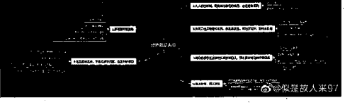

## 我被一大群屌丝骂了

我前两天说给女儿花十万，开开眼界。结果被一大群屌丝骂了。

现实中，中西部农村家庭，给儿子买个车的，比比皆是。农村家庭给考上大学的女儿花个十万，就不行了？这都是些什么人啊？

## 我的微博

主要给蒙们家魔看的。连门都没有的，就不要看了。求求你了。

## 我是不是土鳖？

漂亮闪费的两票，一两两万和一两千的，怎么穿，都不舒服。

还是五十块钱的老式秋裤最舒服。我是不是土鳖？

## 中年人的爱情是什么？

有说不完的话。我和菜嫂经常说到凌晨，然后互骂一番，第二天又好了！

## 愿意工作就没有穷人

我家保姆，五十几岁的农村老太婆，基本不识字，住单间带浴室的漂亮房子，年入七万以上。

就是接送孩子，做点家务。全家她最凶，因为她管孩子。我们都让着她。就这样简单的高薪岗位，还不好找人，因为混到做保姆了，大部分人已经沒有工作态度了。

## 当你的人生停滞不前了，那就换个道

我曾经是为湿一找，任何事情都要计算的分毫不差。买了半个西瓜，8块钱，回家一吃，不甜，马上跑回去理论，上到消费者条例，下到老客户感情，唇枪舌剑，口水直飞，一个小时就过去了，来回一身汗，终于挽回子8块钱的损失。我的人生，就这样赔走赔挨劳。因为我把所有的精力都放在 了精打细算，不能吃半点亏。

自从倒插门后，我有钱了。我觉得应该做点更加有意义事情。于是我辞职了，就在家是待着。

我静下心来，把各种专业工具书翻的卷了角，熟到可以告诉你，什么规定第几条，什么时候颁布的。我以前工作中，有一些迷迷糊糊的知识点，"不知然，不知所以然"的难点，畜了个底朝天。

走过这个阶段，我花了两年多，然后豁然开朗。我再也不会为了8块钱的西瓜，撕一个小时，再搭上 一身汗了。我的朋友们，他们遇到点不清楚的知识点，我是液液热熟。我的专业水平达到了什么程度？我写了十篇微博，只要是有标准答案的问题，没有出现过明显错误。

建议：当你觉得事业走到天花板了，每天就是浑浑噩噩的重发，那你下个决心。

综合过去五年八年的工作经验，走专业也没错路。就算前两年很痛苦，当你熬过去后，就会豁然开朗。因为没有几个人有，敢下决心走这个牌子的。所以，你基本无敌的。现在的高节奏生活，大家都在赚快钱，没有几个人有静的下心。这就是你的机会。

相信专业的力量！

## 今天，我心情低落

我昨天和菜婼说：我现在视力有点老花了，今后大量写作有困难了。要不，我出去表演唱会？

菜婼坚决同意。她的意思是，担心有人挖地脚。我说不会的。

她说：男人不要是大蹄子，信不得！让我趁早死了这条心，她出钱养活我。

## 我怎么拉单予赚钱的？

我有很多朋友，他们多是正儿八经跑业务的，主要是做资产并购的撮合方案谈判（类似于房产中介），一个月纯利润八十万多是中位数。我已经有房子了，也没必要冒着烈日炎炎，北风刺骨的去寒辛苦铁了。我就在家累着等单子。

那些朋友90%的时间是在拉单子，喝大酒，KTV商歌一曲，根本静不下心来学习最新的知识。他们每次拉到单后子，就麻烦助手中，助手也没经验，总有几个知识点拿不准，例如时间匹配，风险排期，抵押平仓等乱七八糟的事情。我就给他们当参谋，查资料，打电话。闲着也闲着。

我掌握的专业知识非常全面。我甚至知道版权登记窗口，门口在哪里停车，下午几点收摊，在几楼，哪个窗口人员特别挑剔，你怎么避开他（多拿几个担保件，遇到他，就不过去）。

虽然，我知道这么多，但没没力气自己出外跑地推业务了。

我就当个电话咨询员，我起到了作用，全面收集各种最新的合法资料，分门别类整理好。人家敲大头，我喝汤点，没几个闺蜜的大红包，也还可以了。

最好笑的是，我这个手艺是可以传承的，而且是不会退休的老中医。

## 我活着，就是为了孩子

可能你觉得我很傲做，但我很开心。

我每天最大的快乐就是喝一声啤酒，吃点沙拉，隔三差五吃香一下饮食。我不出轨，不搞女人，不赌牌，不千任何花钱的事情，一心一意培养孩子。我愿意奉献一切，为孩子铺路。

你做到吗？

## 当年，我有多穷？

单位组织旅游，我带了300元去，回来还剩220元，单位里有个小美女邀请我一起去吃夜宵，我婉转拒绝了。因为没钱。我深刻的知道，贫穷对于一个年轻人有多么大的伤害。

所以，我希望我的孩子，再也不要走我这个心路历程了。我当年没房子，倒插门，是我一辈子的心痛。

## 今天，你进步了吗？

年轻时候，我总认为，某个同年龄段的青年学者，水平不如我。但我也没好好写论文，东抓一把，西抓一把，凭着聪明劲道，还在三个好点那里嘲笑人家水平不高，虚荣心时，时不时地得几次廉价鼓掌。那个年轻学者也那样埋没，搞来搞去那个水平也不怎么样的论文，慢慢积累了深厚的学术资本（论文数）。

现在，他已经是博导，学术带头人，金光闪闪的重量级专家，而我还是一个自以为是大嘴巴。我们的大半辈子，就这么定完了，我心里那个酸哟！

人生的进步，不是因为你的聪明，不是因为你会投机取巧，而是你在积聚力量的道路上，日复一日的拼命积聚资本。若干年后，别人就永远追不上你了。

我写了十年微博，第七年的时候就算是个角了。而你准备怎么办？

## 相信市场，不要相信捷径

是我爹两代人的商业经验。

菜嫂爹是1993年，在七宝乡下租个简易大间办公的。那时候，华东化工学院周围还在种鸡毛菜。这二十五年，我们过得很辛苦，至少有二十年是天活在悬崖边。我们见过了太多的潮起潮落，有转行房地产发迹的，有做到省内第一的，有二十年没有进步的小老板，有坐牢的，有离路的，还有自了断的，无比的惨烈。

回头看看这25年，发现了一个有意思的现象。一天到晚在各个场子里敬酒，买单，大醉的老板，无论多么辉煌，最后毫无例外地全部消灭了。而基本不出来说嘴喝酒，完全靠市场吃饭的老老板，至少还有20%，熬到了现在。

我说这个话，意思是告诉年轻人，不要相信捷径。你不如别人聪明，你能想出来走捷径，别人就想的出来必须，没有例外。只有做笨笨的事情，别人才拿你没办法，聪明人都不愿意吃苦的。二十年后，你厚积薄发，就起来了，聪明人都消失了。

五年或八年后，你们还会看到我，他今天很多网红基金会消失了。因为他们都喜欢走捷径。我是一天五千字积攒起来的，不摇花头，卖打素。我这种人会活的长。

我没有小号，因为不需要。我的文字风格，就算换五丁乌甲，你们也会一眼看穿。我容易吗？

## 菜嫂是个富婆

她老公是房地产公司总部的部门经理，年收入百万，双亲父母，老婆两个孩子，全部在家待着，合计八个人，全钱全部靠他。他老婆属于小美女人系列，现在的口诀是，男人穷有不犯错的，只要心里还有家，一切都是浮云。

菜嫂问我怎么看？我恨不得去找她男人拜把子，学习先进经验！但是，嘴上还是把那那个男人骂一顿：臭不要脸的，什么玩意啊！

## 交给读者去判断吧！

语言上攻击别人，毫无意义。

邱哥：你懂，到上海装修房谈，让太空空房作业房产，还是有什么消息得出来呢？还是您把投资先光一线城市的商品商住两用房呢？你有什么话点：心里不安

到上海完全不差。他的赚钱模式，不停整合。

## 你有过这样的经历吗？

大学时候，我曾经看上过一个仪态系（可能也不是这个系）的女生，给她写过一封约见面的条子。人家来了之后，一句话把我打发了。当时我觉得一阵撕心裂肺的难受，一天没吃饭，只吃了两个苹果。

今天突然想起这个往事，但我怎么也想起那个女生长相和名字了。只迷迷糊糊记得，个子不高，大概158cm左右。连她戴不戴眼镜都想不起来了。

为什么啊？

## 我当年为了把妹，给一层次的女生送披萨

早上七点，我和菜罐娃上菜另男学一起去集贸市场买热披萨。然后那个男生一个一个宿舍去送的。

下午三点，我去大超市，买了十个人的海鲜（便宜的北极虾，加拿大鱿鱼圈，泰国扇贝之类的），两个热烤鸡，熟牛肉。海鲜化流动干净。她们下单后，我和另一个男生就开始做饭，邀请她那一层的所有中国同学，晚上六点吃聚餐。

连续搞了一个星期。到了第八天，女生们一致同意，把菜赠送给我当礼物，有几个男生在竞争对手也很郁闷。

我当年很有钱，每月两千美元的奖学金，住外交公寓。但我也知道，我是不可能去读博士的，再赚一把。最后如愿以偿！

## 我，卑微如尘埃

在现实和网络中，没人认识菜菜。菜罐只知道我在玩手机，不知道我在干什么。我要么在小区附近遛狗，穿个260元打7折的运动服，和门卫聊聊天。偶尔两碗菜梗，带个助理小妹，去公司开董事会。早上八九点，我会去吃一碗六元的小馄饨，两个锦菇，听听大家在八卦什么。下午三点去菜市场捡便宜货，例如最后一斤的宽节虾，50元拿全盒，我就很高兴。晚上六点半打折面包，晚上七点买打折水果。我不参加任何豪婿。

这种当行僧似的生活，是有原因的。因为我要贴近生活，贴近基层。这样才能观察到最真实的经济运行状态，如果我要是意外出名了，可能就不这么方便了。很多朋友说，你写出了我的真实感受。确实如此，因为我就生活在街边巷尾。我知道普通人的所思所想。

我的投资利益，来自于每一次的预期判断。这是非常痛苦的工作。我必须时时刻刻保持清醒，保持对社会经济的观察。我的好多微博，其实也是我把对商业的观察提出来，征求广泛意见。这一点，我是很成功的。这么多了，我基本没有失误过，感谢生活。

我很享受现在的生活状态。就算我在小区里，直勾勾的盯着中青年妇女看，也没人会把照片上网。

## 我也快变成外地人了！

我现在，只有在交小区停车费的时候，才有机会说上海话。邻居是外地人，维修家电师傅是外地人，送快递的是外地人，装修队是外地人，看楼小姐是外地人，超市收银员是外地人，飙车司机是外地人，服装柜台小妹是外地人，餐馆服务员是外地人，我的律师是外地人，会计是外地人，医生是外地人，孩子老师是外地人。我也快变成外地人了！


## 这个世界，有点欺负人

菜嫂拿个包包出去，没有人怀疑。别人问她多少钱，她说是假包，不值钱，别人说她装低调。她的女同学花了四个月的存款，买了个真包，很多人倒来倒去看，就是不同多少钱。

## 当我老了

不会带新女友去住豪宅区，我可能会在单价七八万的尾丝小区，买个楼主。幸福感是比出来的，万一小女友觉得，豪宅区的隔壁王叔叔才四十三岁，比你这个五十八岁的老伟瓜可爱多了，那我就亏大了！

## 扬眉吐气

今天，我严肃警告了菜嫂：如果我踹了你，你就告了。你这都三十六七的人了，今后还要一天到晚买裘皮大衣，珠口珏，巴拉巴拉的去相亲，她也不管了，还要嫁人嫌弃。好可怜啊！

而我，哈哈，找个二十七八的小粟皮，也是没问题的。

菜姨愤怒的瞪了我一眼，默默去梳妆了。

（不知道今天晚上，是祸是福，我也很紧张。）

## 我是为了自己利益受损

才去说华为的。我现在手机基本没电话了，就是为了微信支付。手机厂商然希望消费者，两三年就要换手机，一个手机要三四千元，相当于支付成本。我一年微信支付的金额，也不过是一两万。这个成本实在是太高了，我真的不能接受。

## 亲爱的菜嫂

我不是遇不到更好的人，而是遇到你之后，便不想遇到别人了。（客厅沙发太小了）

## 女人干嘛要练什么马甲线？

我实在搞不懂，搞出一身愣悍的肌肉，男人精神也不好了。女人，胖嘟嘟的一身肉，也挺好的。

## 丈母娘刚才说了个事情

（我承认我在女方家里的，你们不要笑了）

五一节，各地同学在沪聚会，丈母娘有个女老板同学（中部地区），穿金戴银，满身名牌，同学们都在夸她。丈母娘知道这个同学的情况。她原来是开个小工厂的，遇到拆迁，赔了1800万现金，她把现金全部拿去理财了，具体情况不知道，反正每年一百百万收入，花不完。然后，一天到晚穿金戴银，一条围巾几千元。

这两年，这个女同学又大搞大了，在一些不限购的旅游景区买便宜房子，例如海南昌城，北海，大理，重庆郊区的仙云山，烟台。反正一年四季到处买房，到处玩。现在母子反目了。儿子在武汉，他觉得这钱将来要归他的，现在老妈一天到晚乱花钱，他是心疼的不行了。吃午饭的时候，丈母娘旁敲侧击的问我：你怎么看？

我毫不犹豫的说：你们随便花。我没意见。父母媳妇和老夫人心满意足。

菜姨娘一黑，午饭也不吃了。（干得漂亮！这才是优质媳妇。）

## 我为什么没想过劈腿？

首先，我个人没什么大钱。我都这个年龄了，人家中青年妇女总要图点什么？我有几套房子，但是没什么丰厚的现金收入。吃个饭，喝个酒，给你付个房租，不算什么。但是大钱真的也没有，两百万家私，三百万首饰，我真拿不出来。

第二，我有洁癖，虽然我不太喜欢收拾屋子，破袜子乱扔，但我不喜欢和陌生人握手，去 KTV，我和老师握手都不愿意，更不要说求一发。

第三，孩子也是个重要因素，我希望孩子能够尽可能的快乐成长。如果父母撒伙了，爸爸老是不在家，妈妈经常去相亲，孩子饶倒霉了。

第四，菜姨娘好的，现在三十五岁了，虽然是老菜皮，腰子肉也开始塌陷了，但也还依稀有点当年的风采。年轻时候，她颜值较高，也拉高了我的审美标准。

想来想去，算了。自我牺牲，老了有人管饭。

当然，某天我一夜豪奢了，这事就好说了。

## 我是有两个女朋友，都喜欢

一个是白天的女朋友，她在事业上很努力，学术上有水平，工资也高。我们在事业上互相帮助，一起进步。我是真喜欢她。

一个是晚上的女朋友，她非常会伺候人，各种舔的我都挺满意，还会给我削水果，摆个花色拼盘，我有一种男人就该这么过的感觉。我是真喜欢她。

你看我该怎么办？

答：离婚先，切丁丁！

## 菜姨，我编个故事

我是姓子，大三。十多年前，某少妇的老公无生育能力。老仑爸被少妇骗了精子，出了一个私生子。之后，不再往来。本来以为这事也就过去了。没想到，那个少妇黄某，不管孩子了。老仑实在是念忠心，就把孩子接回来。

这下子，我和我妈实在是忍无可忍了，老父又把孩子送乡下爷爷奶奶。但是，他又不舍得儿子这么苦，就我们小区，买了个小户型，给爷爷奶奶住。这次基本掏空了家底。

现在，这个孩子得了重疾，医疗费无底洞的那种。我彻底绝望了。本来我是两套房子的独生女，现在变成父母一般般欠债的女屌丝了。

## 婚后发现，老公负债累累

没什么精彩剧情。我就是个二线城市的外企上班族，白目懒懒，也算不上美女，家里中上条件，够买一套房子。前两年，经人介绍，谈了一个家底条件不错的男生。几个月后结婚了。

婚后不断发现老公原有负债，十几万，十几万，一个接一个，我累计本金超过 125 万了。据说是赌债，吃喝玩乐，大多数是找小贷之类的。我去找公婆，公婆不管，一脸无所谓。“你的男人，你自己管”。

老公的资产全部卖掉，还有四十万缺口。法律上，我可能不需要填窟，但是，这后面的事情还不知道水有多深。离婚是肯定的。

我实在是气不过，我白白给他用了大半年，还全力配合，最后落得这个下场，还背了个二娘的帽子。

## 问个法律问题

我是银行妹子，业务经理，29岁，见过大风大浪。接下来的事情和单位无关。只是说明，我经济收入还不错，是正规身份。

家人介绍，认识一个男生，照片上长的较帅，我是满意的，微信聊了三四天。五一长假，对方邀请喝酒，多个朋友一起聚会。我就去了。喝了不多，浑身直接软了。我怀疑酒里有药（无证据）。酒醉后，我被这个相亲对象拉去开房了。

我当时是不愿意的。第一次见面，又喝成这样，哪有什么心情。但是，我已经醉的不行了，被他用了。酒醒后，我虽然认为这一次是我不愿意的，但是，也不想计较了，还是想继续发展。

第二天，我问他戴套了吗？他说没有。我当时骂他啦，但还是夹杂了一些打情骂俏的话。现在已经过去五天了，洗了六七次澡，还给男方发过很多露骨微信。现在，对方已经拉黑我了。我气疯了，还算强奸吗？

## 保姆其实待遇很好

住，我家旅游住安逸酒店，保姆陪住，也是这个待遇。一天七八千，心疼的不行啊。

吃，保姆和孩子一个待遇，我就挑点剩下的。

穿，兼顾买衣服，很多时候会专卖店买书或者再加五十元，送一件，兼顾今后也不会再去了，这个优惠就当场给保姆了。我家保姆穿的比外金白领也不赚，当然，都是休闲款，适合工作。

行，远一点的肯定是开车，近一点的步行。

全家最尊重的就是保姆了，她管孩子，谁敢得罪她啊！她老公的茶叶，全是从我的罐子里拿的，我就说吗？

## 我最郁闷的是

某市房价居然上去很多了，你私信问我，还能不能买？你这是给我出难题吗？早点不来问，考试前一天读，题目不会做。你让读来课怎么办？

## 我建议，二线城市

新房大家庭，2年后才能买房。防止有人通过落户渠道，避开限购政策。

我都有点不好意思了。

## 菜菜，你天天嘲笑我们

你孩子要是考不上清北，你怎么办？

答：我希望孩子去做个小学老师，不考虑金钱，用爱心去温暖孩子。反正家里有钱。

## 我为什么混成段子手了？因为我贱追，我都这么穷了，还怕偷光吗？

你如果经常看我的东西，一定有神无法言说的感觉。这TMD哪是段子手？这是大环境里的牛b人才啊。格局，知识，阅历，幽默，放到哪里也不会太烂啊！怎么就混成了中牛无业人员？

我简单说几句。我从 top1 毕业，就是一路高敏猛进。为什么这么多好事会全轮到我呢？因为我敢想，我都这么穷了，还怕输光吗？独路相逢勇者胜。

优秀的人，如果再有点背景，不是以大相拼的。那我都拼了。有一次全行业性的年轻业务尖子选拔大赛，各地区选一个去参加。这么好的机会，哪怕是拿个全国前十名，那就以吹一辈了，很多人跃跃欲试。我一看，压在场子，就站起来对一个手说。“让我去，保证全国系统前名，完不成任务，我辞职。

我把高鸿嘴到这个程度，很死我的人了。副总本来想安排小王去了，我一嗓子喊出去，大家就选了。我这属于啥命了。这种年轻人之间的业务竞争，也不是什么大事情，一把手也无所谓。既然你这么牛，那你就去吧。完不成任务，你迟早半就被涮怒了。

我才没这么傻呢？到了总部，我是上海系统推荐来的，大家是高高一板的。我立马四处找门子啊，最后就调总部了，老子不回来。很多人差点给气过去。

当然，这种事情干多了，总会倒霉的。但我不怕输光啊。我在过程中，得到了其他机会，例如侧插门。你以为插插门这么容易啊？还不是有加分因素？只有经历过的事情，体会才深。高遵格的事情经历多了，才华就来了。一般段子手很难模仿。

## 我简单总结一下

前面段子，逻辑有点复杂，初中文化的看不懂，我简单总结一下。

当你在单一困境当中的时候，你第一考虑的是，不计后果，先摆脱困境。无论吹牛逼的后果有多严重，不要怕，先进去再说。就算出洋相，至少还要过段时间。

等你跑出去了，你在新环境中的机会就多了。很多事情，你在底下是永远看不到的，跑到上面你就会发现，我操，好事这么多啊！

然后，你不断思考，不断的泼圈，没事也要找出事情来，把原来的稳定格局打破。

你放心，肯定有其他的人也不满意，会暗暗助力你的。你就有机会改变环境了，（或者全部输光溜溜）。

在做一个事情的时候，你要记住，这个事情只是过程，是给你拿你争取时间的，你还得再找个更加实惠的事情。

我他也不知道你能不能理解？看不懂就算了。初中文化，要求不能太高。

## 1999 年，我月薪两千多

我至今记得，因为当时发生了几个事情。

- 1998 年底住房改革了，自己买房，就要研究钱了。所以印象深刻。
- 当年深圳来了一群同行，他们月薪 3500 元，把我嫉妒的三天没睡好，我当时的想法是，要是我年薪达到四万，就是成功人士了。
- 第一年，我开始忽悠我媳妇去买房。第一次玩这么大的表面，几万元啊，心里直发抖，所以对那一年的房价印象深刻。

## 混成了自己最讨厌的人

想当年，我们也是意气风发，青春年少。我还没北名校留学的背景，金光闪闪，牛 B 轰轰。

二十年，弹指一挥间。大部分男人混成了油腻毕生男，泡个枸杞保温杯，头发油乎乎的，还背了一身房贷，老同学来上海了，“啊呀，怎么不早点联系，现在外地出差啊，太可惜了。”放下电话，挤了十六号线，奔向松江小三居。大部分女人变成了不怎太可爱的水桶腰。这瓶用子都溜光了，就不要做什么小姐了，主要是些没什钱的老菜皮，连面霜也是优惠前才买。为什么会这样呢？

我们的生活存在强制轨道，不是你想到说逃就逃走的。大学毕业租房月，也存不下什么钱。婚房首付，掏空双方父母。一场婚礼消耗了30万。三十年房贷，五年车贷，三年装修贷，三甲医院生孩子，重点幼儿园，学区房，父母住院托关系，哪样不要大钱？但你又赚多少钱？家庭年入三五十万覆盖了绝大多数中产，还了各种贷款和必须开支，基本没什么钱了。

我们只能是节约啊。我就是这样走过来的！就是遇到亲戚后，我还是改不了穷人习惯，宁愿来回一小时跑买卖采购，也不舍得十元送送货。如果每件事情都是精打细算，要不了十年，你就会变成自己最讨厌的人。

怎么办呢？也只能是想开点了。比上不足，比下有余。一起想得房贷涨了两百万！好嗨呦，感觉人生已经到了巅峰。

结论：笑少们，不要再嘲笑我们这些中年油腻黑胖子了。这就是生活。

## 自我揶揄

大二的时候，我也知道家里穷，暗暗看上一个东北妹妹（徐州市区），结果还被她一脸嫌弃，不得已，回上海找了个七宝的乡下姑娘。

## 我写微博十年了

这十年，我发生了太多的事情。你们怎么样？有没有告诉我的？

## 如果再这样限购

我就和紫凝离婚。我净身出户。

## 我考各种证，基本不看课外的

一开始学习，我是听网上的大仙介绍经验，看了几个课件，后来觉得看课件太慢了，就加速播音（一般是三倍语速），再后来觉得，一天坐五个小时，对身体不好，不如躺着听吧。再后来就睡着了。尼玛啊，睡得可真香啊，很多年没有这么舒服的睡过了。感觉回到了大三的专业课了。

## 人生有多少个十年？可以陪伴一个人的所有高峰和低谷。

我今年四十岁出头了，已经拿到了我所有的荣耀，也实现了几时的梦想。我的孩子还小，我现在写下这些微博，一半原因是为了将来给孩子看，说不定我那时候已经老糊涂了。另外一半原因是为了自己老有所为。

我们这一批70后，因为当时的某个特定原因，充满了家国情怀，是罕见的一批充满浪漫主义理想激情的大学生。我们在大学里谈论的大多是，天下英雄，谁属中原。我们谈恋爱的时候，谈的是文学，摇滚和理想。现在90后，大概觉得我们贼可笑。

我工作后曾经压抑过自己很多年，扭曲自己的喜怒哀乐，为了讨好长官，讨好同事。虽然，我也因此获得了一些微小的进步，但是总体而言，只有出彩，缺乏干戈，更谈不上光荣和梦想。如果没有运气，单位里再努力，也是有天花板的。

我感谢紫凝，并不是因为倒插门，而是当年她给了我一个虚幻的依靠。有紫凝的房子做靠山，我毫无顾虑的故事一搏，走出了大宅门。在为自己打工的过程中，我释放了自己的天性，发挥了自己的聪明才智，非常意外的成功了。

现在回头看，紫凝的那点陪嫁，只是我撬动命运的支点，并不是主要的，甚至是不值一提的。

大多数人的，永远不知道自己有多少能量，因为你从来没有机会释放。当你老了，你也认命了，再也不会去想了。我告诉你，当你在单位里实在是没有指望了，你就勇敢的走出来。海阔凭鱼跃，天高任鸟飞。不往人生走一趟，万一成功了呢？

我们当年在受训的时候，教官告诉我们：马克思机枪永远是由线射击，冲的最前面，最勇敢的战斗士，生存的几率最高！

做人不能懦弱。克服恐惧，勇敢面对，人生大不同！

## 老同学借钱

很多年没见的老同学，张口就找我借钱。

“十万够吗？我也真气！”

老同学激动得不行了，把我一领审视。“现在钱在哪儿发？带帮兄弟？”

“也没什么，现在主营抵押货散，十万不够可以再加！”

## 我家孩子，最近开始讲故事了

老娘定了，第一个就是《我的爸爸妈妈》。我家孩子是这么说的。

“老妈妈天天上班，赚了钱给我买好吃的，但是经常骂我。我爸爸不上班，天天在家里玩手机，打游戏，也不出去找工作。我爸爸当那一套，背后一套，自己玩手机，还不让我玩游戏”。

结果老师打电话给老娘了：还是要正面引导孩子，不要让孩子产生自卑。我急点一口气矿泉水嘴在手机上。我就和来摸商量，我给你做个什么角色，cosplay，既不引起老师注意，也不会让孩子自卑，也能够解释玩手机的事情。

想来想去，终于找到一个角色，“爸爸是外贸业务员，天天在网上联系外岛公司，所以不用天天出去”

“我容易吗？当段子手很伤人吗？”

## 荣耀，源于长期卑微

今天，我和亲戚不顺路面的和装修公司纠缠，要求部分返工。原因很简单，楼梯阶的高度不规范，有的17厘米，有的12厘米，有的15厘米，容易摔倒。但是，楼梯都是现浇的，返修我谈判容易？那不行！

我为什么这么执着呢？父母现在多受一分苦累，孩子将来多一分荣耀。等我把房子和装修搞好了，将来孩子找对象就有面子了。在花园酒楼精致楼房，一家老小穿上漂亮衣服，摆上精美点心，热热闹闹迎接老舅母，这才叫面子啊！总比找当年穿军裤衩去倒猪子要好一点吧！

有的家长在单位几十年如一日，加班加到精分。有的家长在售楼点处夜夜排队号，落得一把鼻涕一把泪。有的家长在优质小门口抢着售楼排三队，不吭一声。有的家长在装修工地里，买头土脑的包工头讨价还价，唾沫横飞。有的家长被售楼处里的农村保安姐的跟踪跪抢，也不敢离开。这些事情都很卑微，很狼狽。但是，我们正因为迈过了这些不堪，我们的孩子才会起眼来属于他的高光时光。

不要羡慕爸爸爸爸爸的二代们，你只是没有看到他们父辈的卑微。我们立志做优质父母，属于我们的荣耀，一定会绽放。

## 刚才，我赚了三百元钱

餐馆小龙虾市场价158元。我去菜市场买，33元一斤，买了三斤。亲姨回娘家了，我一个人嗨。

大火起锅，油多倒点，豆瓣酱，辣椒酱，海鲜酱油，糖，葱姜蒜，老抽，一罐啤酒，把料汁烧开十分钟，水龙虾进去，水开后煮十分钟。加点盐调味。冷却十分钟，浸透味。开吃。

有没有小姐姐？我做，你吃。

## 菜菜，你家孩子和你姓吗？

答：我家孩子有好多个房产证。你也加油哦！

## 我现在看到漂亮的姑娘

第一反应是：我要是有个这样大的女儿就好了。我肯定给她打扮的漂漂亮亮嫁出去。
我怎么会会有这种心态，真是脑子进水了。

## 我已经渡过婚姻危险期了

菜嫚 35 岁了，最近买了个日本的瘦脸神器，就是一个金色的小滚筒，像是刷墙一样的，一天刷在脸上刷，想把开始唱了腮帮子刷上去。我看的狂笑：老菜表态慌了，你也有今天啊！虽然我也是暴牙秃头啤酒肚，但是男人长相问题不大。哼，以后少小时候，把我惹毛了，分分钟让你下岗！

## 中医还可以长期赚钱

菜嫚是个中医迷，她有点咽炎咳嗽病，这么多年，西医一直治不好。于是，她开始迷上了中医，虽然也没好，但是，她觉得总该做点什么，花点钱，证明自己还有希望。巧的是，中医的方子千千万，够她折腾十年了。

## 我是如何看待粉丝的？

绝大部分粉丝，是不可能大富大贵的，格局气质摆在那里的，让他努力，他还觉得你是不是哄我。但是，我还是孜孜不倦的说。因为总还有千分之一，万分之一的人，真可以领悟到一些他父母叔叔阿姨说不出来的内容。这就可可以了。若干年后，某个大佬去电视上谈访谈。“年轻时候，我看过一个叫菜菜的微博，给了我灵感”。

## 人世间最大的痛苦是

年轻时候穷。
我二十岁的时候，没有女人，饥渴的眼睛都绿了。有一次，省吃俭用攒了点钱，下定决心去发廊来一洗涂鸦吹，结果出来一个大妈，直接把我吓跑了。

## 最近，有个离异小姐姐撩我

她说：不求名分。
我说：我最关心名分。扯呼了！

## 刚刚睡醒

一想到自己四十几岁了，还混在社会的底层，心里不由得一阵悲伤。

唉，再有钱也是社会闲杂人员。

## 菜嫂的一次医院经历

菜嫂曾经在旅游时去省省会三甲医院的牙科就诊。结果，一个科室的老老少少医生都来参观了。因为菜嫂有一个牙齿项目是在九院做的。省会三甲把这作为优质案例，通知大家来参观了，搞得菜嫂十分尴尬。我当时听了觉得不可思议。后来，我了解到，医疗系统是这样的，京沪医生进修，一般是去美国。省会医生一般是去京沪三甲。小地方的医生去省会三甲进修。你说怎么办？

## 倒插门也有痛苦

大家十分开心的事情，我只能开心九分，因为我是屁股。举例，吃大龙虾，我不能剪一下个孩子。一桌聚会，我从来没坐过首位正位，这都大一把年纪了，心眼啊，其他各种小事情多了。洗碗，保修走了就是我。修车，司机不在就甩给我。出去旅游，我就是扛大包的人肉推车。

到了某个城市，我想吃火锅，菜嫂要吃烤鸭，得了，我闭嘴。反正呢，什么好事都与过一杆，但从来没有当家做主过，连个币打款式都不敢提过，营业员只认买单的。

## 情人眼里出西施

我都一把年纪了，四十多岁的老泼皮了，菜嫂还担心有人要挖墙脚，千方百计不让我出来开演唱会。男人要弱腿，谁也拦不住，自律性强，小美白也拦不住。广大已婚妇女也别太担心猪八戒成出机，毕竟是少数。大部分男人还是本分的。外因是次要的，关键是内因。一妾房子怎么离婚啊？

## 菜菜，要不是你有点房子

我真以为你和我们一样，都是屌丝。你对我们太熟悉了。

答：沿海横流，方星屌丝本色，我长期在出租房里，一直漂漂到29岁，才被菜嫂捞出来说。

有段时间，我左占隔壁都是KTV发廊的资深女老师，早上四五点敲彼女的高跟靴声音吵醒。那时候，我和她们是用同一个厕所洗澡，那种浓烈的香水味道，对一个小光棍是多么残忍的打击呀！

有段时间，她们想上岸了，来撩我这个top1。我容易吗？在最后一刻，把握住自己，没有落水。这种心酸往事，已经是刻到骨子里了。

## 看了菜菜微博

省吃俭用砸锅卖铁也要买房子。

答：别人有没有房子，和我没关系。房子是给你一家老小住的。

## 曾经的我和，穷到骨子里了

我曾经想追一个姑娘，想了很多精彩的套路，都是不花钱的那种大学生花招，绞尽脑汁，费尽心思，还想行动力。结果人家连正眼都不看一眼。后来得知，她家是县城里的，想在上海找个有房子的老公。我这算劣迹，绝不考虑的，mm的。

贫穷带给我的心里伤害，实上是太多了。无论走到哪里，我的脸上都刻着三个字，无房子。不仅姑娘们看不起我们，就连单位老油条也看不起我们，把我们叫做“乡下大学生”。那时，我是正经八百的黄浦区户口，只不过在市郊设房子。


我们去交房租，粮户区里的房东也看不起我们，觉得我们很可怜，还把外地农村姑娘介绍给我们。单位聚餐，老油条们也鄙视我们。把吃剩下的半碟子青菜，半条鱼，也给我们打包，“吃下面条，挺好的，不要浪费了”。

有什么办法呢？你总不能和所有人翻脸吧？我们也只能笑嘻嘻的忍着。什么 985，top1，在坑沪的几块砖头面前，我们有个鸟的自尊心。

## 我从来不炒房

我买房子的原因为，年轻时候的贫穷，让我彻底害怕了。那种无力反抗的痛苦，是一个无房户一辈子难以摆脱的心理阴影，是非常巨大的心理创伤。

我从小到大，那么努力，那么勤奋，我读书那么好，长得也不糟，为什么生活对我如此苛刻？其实很简单，你读书好不好，别别人鸟事啊？别人斜眼打量你一番，就是看你有什么价值。你的无立锥之地，谁看得起你？当你哆哆嗦嗦拿出留往证明的时候，别人看你是是什么眼神？

我就是个普通人，我没有任何非分之想。我只希望，经济上的痛苦和悲伤，尽可能在我这里截断，不要给下一代留麻烦。我不希望孩子成名成家，也不希望孩子大富大贵，但是，做个普通人也不容易啊。

孩子上学要填地址，求职要填地址，入享受户口本，找对象要看房产证；周围人对你的评价主要是看房子，你不是生活在真空里的。当年，我在单位考核表上写的地址是，上海市成都南路 6 弄 8 号二层孝子间西侧。人事科给我打分说：你这是什么地址？我说是棚户区借房子。办公室里所有人都看着我。我就业的第一天就带上贫困的帽子。逢年过节讨论帮困金，几十元那种，总还问我要不要？现在，我的孩子写地址就简单了，上海市某路 6 号别墅，人事科今后肯定不会来问了。

当年，我和年轻人一起入职，他们家是高级别的，虽然专升本，但走到哪里都是众星捧月。副总想得来一次办公室，直接就看我们。我为了晚上去在副总面前露个脸，眼明手快的搬凳子，拿烟灰缸，站在边上，陪笑捧哏，跪讨好。那那，这般我啊？父母不给力，你还想怎么办？真的要屌丝一辈子，小鸡脖子到底？

## 为什么我的微博有人看？

因为我我是真诚的。一字一句，写出了人世间的真实。无论你喜不喜欢，天底下，总有阳光和阴影，我们要做的不是消灭阴影，而是站岗阳光下多来。坑沪广深，因居住房贷自杀率已经超过八成，绝大多数普通人已经做出了明智的答案。任何试图嘲笑多数人的经济学想法，都是没有意义的。

## 我一直主张，人均六十平米

超过部分，有关部门限价回购，分给无房户。就是没人理我。

## 人均存款超过一套房价的

建议银行管他保管，暂时借给困难群体。以后有钱了再还给，像那些大土豪，有那么多钱，还不知道低调，一天到晚，张开大嘴吧骂改完我们普通人，说什么大房子房贷。贵你妈啊！你妈才贵呢！

## 菜菜，清华某教授说

房地产到头了之类的，你怎么看？

答：这种大神，我一般不敢看。牛刀在 2005 年就出名了。

## 菜菜，你写了这么多

到底什么意思，能不能讲一讲？

答：我十年磨一剑，只写了五个金光闪闪，熠熠生辉的字，其他都是配合这几个字的。

## 我是坚决反对炒房的

我一直建议，社保延长到五年是不够的，至少要八年，最好是十年。

### 我建议

房产税征收要高一点。每套征收 1-2%，可能起不到太大作用，能不能试点 3-5%/年？

## 我们家是抗战前搬到上海

定居近一百年了。老人们回忆，只有 1999-2002 年这三年，是住房最轻松的窗口期。只要想买，就买得起。其他时间，住房难是常态。1998 年以前，大单位的正调，也就是分个市区小二楼或者浦东小三层。而且父母这一代有房子了，子女还是没有房子。1998 年房子很便宜，主要是两个原因，一是下岗人比较多，二是外地大学生罕见。但是，随着暂住证取消，2003 年后，房价就高开高走了。一转眼到现在了。

## 菜嫂对我还算客气

经常给我买菜做饭，就像我大爷一样的坐在客厅里，吆五喝六，吹胡子瞪眼。过完篇了，麻溜的去洗碗，还要擦地板。白有精女人也要懂得适可而止，给老公一点面子，人家也是如趣的。你钱多怎样？家里没男人，你一样受歧视！

## 哪个画的？站出来！


## 我从来不打老婆

刚结婚那年，我想立立规矩，没想到老婆更加凶悍，直接把家里的木门砸出一个大坑，心疼的我啊，再也不敢造反了。（这套房子，我加了名字的）

## 菜菜楼市分析写的少了！

答：天天有观点的人，那些观点不值钱。我每年有两三个观点就已经不错了。实在是抱歉了。

## 我准备开个婚介

只做小阿姨＋小奶狗生意。不成功不收钱，领证才收费。大家觉得怎么样？

## 在我的三观里

女人最美的时候，是35岁前。当然，大多数男人，还要考虑保质期，维护费和性价比，也不能太任性了。

## 看淡人生

我很有钱，但是，富人不等于幸福。假如人生可以重来，我愿意用所有的一切换取年轻时能有个50平米的老破小。我至今一切的痛苦，都是源于这个耻辱的起点。

如果你已经承受过非常巨大的痛苦，今后很多事情就看开了。如果你今天感觉到痛苦，只不过是你以前没有经历过事情。在这个世界上，比家破人亡还要悲伤的事情，多了。

时间是缓解痛苦的唯一解药。无论多大的事情，二十年后也就释然了。

人活着，不要抱怨痛苦，这世界本来就是痛苦的。你要做的是，反正都是痛苦了，我能不能拼出几个快乐？例如买套房子留给孩子。

## 有钱人可能更容昜成功

我认为，拒绝嘎嘎的，虽然有很多改善工作生活的新想法，但因为怕没效果亏钱，不敢做几千上万元的实验，很多事情就放弃了。自从遇到菜娘了，我也胆子大了一点，吃不准的事情，也敢冒险砸个几千上万的。其实，大部分是成功的。

## 菜娘当年找对象的要求

读书好，看上去不厌厌，追的紧。仔细想想，这个标准确实有科学的地方。

- 一、读书好。说明智商高，名牌大学毕业至少有个平均工资，自力更生。
- 二、看上去不厌厌。说明身高长相还可以，有礼貌。
- 三、追的紧。以后女方的家庭地位高。

当然，不考虑金钱的爱情，实际上是考验丈母娘的钱包啊！

## 我不算富家但也不算穷

这几套房产证，每隔五年的价值增长，都是巨大数字，一百万现金，说大也大，找个小二也可以涨一年了。但另一方面，连个厕所都买不到，有多大意义？再说了，莱嫂天天对我严防死守，出门都要找个驾驶员给我开车，我基本上也花不了多少钱。莱嫂说，我这个人，嘴巴太会骗人了，为了防止其他女人上当，必须严管严控。我上哪说理去？

## 我不卖，谈不上炒

房价不炒，开发商赚的说你多！

我有套房子，2009 年夏天，139 万买的，现在价值 750-800 万左右。开发商盖这个房子，大概前后两年，最多纯利润是 30 万。我十年纯利润是 600 万（扣除利息）。

开发商本钱大，肯定总占比你赚得多。我们本钱小，就图中热闹。我不卖，谈不上炒。谢谢。

## 我曾经的焦虑

年轻时候，我无数次梦到自己在攀登悬崖，爬到了 一半的位置。上不去，下不来，但我不敢松手，必须咬牙向上。这个噩梦，陪伴了 我十 6 年，基本上每个星期都会梦到。我至今回忆起来，都是心有余悸。

我没有房子，没有背景，没有关系，一切都靠自己。我能做什么呢？无非是把手里的日常业务做 的滴水不漏，争取每隔一年出个彩，仔细琢磨领导 的每一句话，每天晚上在睡梦中醒来 丢去的复盘，谨小慎微， 战战兢兢的活着。

这种日子不是人过的，精神压力极大极大。当然，我在这个过程中极大的锻炼了自己的逻辑思维和抗压能力。最后遇到莱嫂，我过上了幸福日子。

## 我以前是独行侠

我当年在单位里的派系中，属于 女人嫌 的狗不理。我是标准的市区口音，但没房子，实际上是外地人 一样租房子。上海 同事聚会，从来不叫我。因为我和外地人扎堆的 住在农民房。外地人聚会，也不喜欢叫我，因为我是说上海话的。最后，我变成独行侠了。两边都沾，两边都不待见。

## 我也想找个女人一起吃苦

想当年，我也想找个女人和我一起吃 苦，白手起家，退休前还清贷款。可这实力不允许啊！怎么 搞，都没有女屌丝答应。当时，我看上了一个满脸黑斑的外地妹，大单位的，暗示了几个月，人家没有 任何意思。我原以为是自己吃亏了，没想到人家根本没看不上 我。我简直是气急败坏，一路哭泣的跑回了 棚户区出租屋。

## 穷是最痛苦的

一切的痛苦，都抵不过 “无房户” 这三个黑漆漆的大字。所谓的清高，只不过是自卑的 色性发作。我当年最绝望的是，我父母为了 自己暂时的安逸（也是时代的安排），去了 郊区国营厂，导致在 内环线没有 分过房子，也没有得到 拆迁收益（户口迁走了）。

1998 年 10 月以前，普通人获得住房的唯一来源是单位分 18 平米 亭子间。而一个刚毕业 的年轻是很难分到房子的。当时，真的是绝路了。我认识八 1 的 985 选 市 郊区学校大都不是 正规路 一眼。 我也不敢去相亲，因为没房子。

单位里，也有给我介绍对象的，都是农村户口的拆迁妹，但是一拆拆迁 后马上 卖实在是太离谱了，当时只有郊县公交车，上班单程 1 小时 40 分钟以上。房改之后，内环就要卖四五千一平米，我又没钱，等于是空心汤圆。

在这种走投无路，精神崩溃的状态下，我每天看着出租房里的蚂蚁，觉得它们好像更加自由。当时我实在是没办法了，准备出国留学。但是，没钱。当时，一张机票一万五，我的工资是 1600 元，万般无奈之下，只能去考公派留学，好像现在取消了个制度。

考上了之后，又遇到倒霉事了。当时，外出不归的人时有发生，有关部门要有房子有工作的人给我担保，才给办手续。我哪里去找担保人啊！一个房子，遥充 top1。后来遇到好心人，帮了忙。出国后，遇到莱媪，这算是活过来了。

## 文凭改变命运

当年，上海人分两种，一种是市区无房产，一种是市区有房产。我就是市区无房产，实际上的生活状态，和晚 N 差不多。有房产看不起我们，晚 N 又觉得我们是上海人，我纯粹是两头不待见。当年，文凭只有两种，大专，本科。无所谓哪个学校的，清华北大和闵行机电专科，实际上海不多，没人当回事一。

那时候，top1 还不如闵行机电。因为我们那一届是读五年，毕业是 23 岁。闵行机电太过分了，他是初中毕业后，中专三年，大专业，19 岁毕业。这就导致了大专生工龄比他多 4 年。发房子的时候，吃亏大了去了，我操我操。

说实话，我这大学读的真是愚悲，唯一的用处大概是倒插门了。

## 我和菜嫂最大的不同观点

我认为，菜嫂的房子都是我的。菜嫂说：你想得美！

## 爱情和金钱，哪个重要？

我以前一直和菜嫂说，我全心全意爱你的，但菜嫂基本不相信。女人认为，爱情就是男人嘴上的话，不做事的。后来，我老房子拆迁，得了 120 万私房钱，全部给菜嫂了。菜嫂终于相信爱情了。世界上有爱情，但是爱情也需要一个载体。和平年代，爱情就是钱和房子绑给人家。

## 莱媪说，孩子比男人重要

男人跑了就跑了，有孩子就行。我这地位不保啊！

## 我找了个七宝乡下老婆

我年轻时候误认为，花言巧语就可以骗个白富美女朋友。后来发现，这是不可能的。人家姑娘精明的很，不见兔子不撒鹰，早就看穿你了。实在是没办法了，在七宝乡下找了个老婆，门当户对。

## 有没有上海的退休土豪？

你是怎么打发无聊的日子的？谢谢。

## 如何克服疲倦和烦躁？

父母多受一分罪，子女少吃两年苦。我每次遇到烦躁疲倦的时候，我就告诉自己，我今天受的苦，就是为了孩子今后少一分麻烦，加油。

## 折叠屏不是手机的主要需求

我对手机有两个需求，一是不要太厚，二是速度快。至于外壳形式，我不是特别在乎，折叠屏只是把 iPadmini，做小了一点，就翻几倍价格，我不会买的。

我的华为，做久了，越来越慢了，不得已删除了所有照片，稍微好一点了。

## 当年他们是怎么抹黑我的？

十几年前，单位接待重要客人，一般会摆上水果和中华香烟，会后留下半包没抽完的香烟。客人走了，余下的水果，打扫卫生就分一分。半包香烟一般由后勤部门带走，留着接待普通客人。因为后勤部门和外面打交道多的多，这也正常。

后来为了打击我，就出现了谣传，说我把半包烟偷食了。这些话，都是背地里说的，我肯定不知道，是几年后才听说的。你说气人吧？问题是，这事情没法调查。听的人，半信半疑，说的人，信口开河。

结果，我到现在都被落下后遗症了，从来不碰中华烟，看着就火大。

## 我是怎么买房的？

我不太考虑短期价格波动，例如这个小区板块涨了 3%，那个板块便宜 1500 元。我只考虑自己有没有负担能力。家庭买二套房不仅仅是自己居住，更多的是考虑给孩子留个起点。二十年后，现在的这一点点划算不划算，不值一提了。你要更多考虑，城市，地段，小区质量。够的上就干。

## 我和亲嫂在考虑退休了

我就一个孩子，钱太多了，也不是什么好事情。每月零花钱五万，孩子还会在乎月薪三万的工作吗？如果不进入正常求职环境，积累人生经验，孩子一天到晚无所事事，最后基本就是花天酒地，或者被人骗了。二选一。亲嫂这么费劲开厂赚钱，有什么意义？

## 如何缓解焦虑？

很多人，本事不大心很大，毕业没几年就想要搞一个京沪产权股，买不起房子，就骂中介，骂开发商，骂有房子的人。这个心情，我可以理解。骂就骂吧，但注意火候。

骂多了，肝火旺盛，这对身体不好。我这里有个“（广告位招租）脾明煎茶”，清肺保养肝气，一人限购半斤。

## 我这两天又被打击了

前几天，参加幼儿园活动，获得了几个单身小妈妈的高度好评。亲嫂再也不让我去幼儿园了。

## 80 元的幸福午餐

- 1. 上黄炒鸡蛋，6 元。
- 2. 斑节虾，半斤没多少，50 元。
- 3. 清蒸鲈鱼一条，17 元。
- 4. 啤酒一瓶。
- 5. 五常大米饭一碗（不知道真假）。

## 喝了两杯白酒

热的在阳台上跳秧榉舞！好嗨哟，感觉人生已经到了巅峰。

## 菜场经济学，作者：菜菜

@熊婉儿：难以想象，TD给学生推荐的经管名著课里的书籍竟然是@菜菜的《菜场经济学》，老师还公开在课堂上讲了菜菜“克沪水涨船”的观点，难道佟爱琴老师和陈伟忠老师是菜菜的粉丝么？

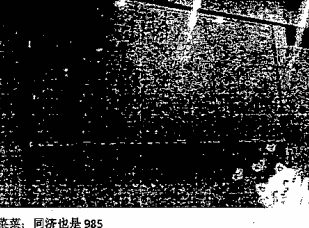

菜菜：阿姨也是985

## 警惕小孩子泄露家庭秘密

我家的娃娃在幼儿园炫富，班主任不相信，闲谈中问了几句。我和菜婆彻底傻眼了。没想到，啊！

## 向上走，有多难？

我家的八十年风雨历程。

我家族第一代，是抗战时期来沪的，解放后，财富归零，但死皮赖脸留在上海，拿到了上海户口。

我家族第二代，全部出生在上海。但是，第二代因为家庭成分不好，既没有考大学，也没有好单位，全部到外地插队落户了。80年代初回沪，一穷二白，住房紧张。

我的父辈迫不得已，到郊郊大工厂上班，为了混个免费房子。往下走的事情真舒服，但他们把我坑了。

我是第三代，住在郊区的单位无产权房，让我完美的错过了九十年代的市区拆迁。命运残酷的把我推到了上海无房户的悲惨境地。这个倒霉缺点，困惑了我的前三十年的人生。

我千辛万苦从top1毕业，拿到了内环线干部编制，但是单位取消了福利分房。

投房子，找不到市区必紧，迫不得已娶了个七宝乡下姑娘。虽然挺漂亮的，但不是上只角的。三十多岁创业开厂，遇着08年金融危机。人生再次遭遇。转角遇到爱，莱猴家拆迁了！我孩子是第四代。好嗨呦，感觉人生已经到达了巅峰！

## 人到中年

房子安好，就剩下发呆了。生活真是无趣。

## 我买不起1.7万的安卓平板

我还是用苹果的iPadPro算了。我对华为不感兴趣。一样卖高价给我们，那我就买便宜点的苹果算了。

## 安卓平板+通话功能

大概是三四千元。如果某蒂对折一下，加一千元，我觉得勉强接受，算是支持真科技。如果加1.4万元，我只能呵呵了，那块塑料片不值这个钱。

## 我以前给大家上财政学课

要求是，你们不要记笔记。记笔记，说明你没听懂。只要你从头到尾听，我保证你一次性记住，一辈子不忘。我备课，都是从学生容易记忆的角度来准备的。但这种方法属于野生教学法，因为我把课程结构拆开了，所以是不入流的，经常被人鄙视。我也没办法，混不下去了，自己滚了。

## 看哭了

刚才又看了一遍几时的故事书《国王的新装》。以前是看笑了，这次看哭了。

## 希望若干年后

还有几个粉丝曾经记得莱莱。

## 有人说我是莱莱的脑残粉

法門清寂：三人行附，必有我师，择其善者而从之，择其不善而改之。有人说我是@莱莱的脑残粉，然后对我进行各种批评。然而呢，我的观点是，不管是谁，只要他的品格学习，有超过我的地方，都是值得我学习的，也可以称之为老师。莱莱在政治经济学很多方面的论绝对不止副教授称水平。另外也有很多观点是我这种农村娃在现有知识水平，现有知识领域看不到的。我关注转发他的微博并不是要他人格按照拆托妹，人家好的不学，你一天关注他不好的干啥。再说，按到拆托妹，没个985研究生，没几个拿得出手的资格证，人家拆拆还会正眼看你么？莱莱对屌丝一族还是很关心的，多次提醒，搞好学习，多考几个证会，法考，二建等资格证。一天不加强自我提升学习，净想些赌祉袋的。微博上把莱莱批判到，你也好不上好日子。安心考985研究生，考注会，法考取吧。再不行，安心送快递去，早点大城市买房子，娶媳妇，生娃，买房子娶媳妇，生娃。


## 你能不能多写点经济学内容？

答：我可能是没本事。思考一年也就出1-2个观点，实在是没办法天天搞出一大堆内容。要不，你上别家看看？他们每个人一年写出400个观点。

## 微博提醒我了！

您好，您发布的微博内容无法显示，建议您后续不要发布或转发类似敏感内容，并且不要同一内容多次发布，避免影响您的账号使用。

## 菜菜“啵的叫了一下” （2019.02）

啵音七了！警别一下。大家好好上班！

## 我们成年男人

还过生日吗？（小生日那种）

## 作为父母，这就是责任

我有时候会不买个几十元的小东西，但是孩子要什么，我立马掏钱，毫不犹豫。

## 我没说过这个话题

请不要强迫。


**沙漠中的城堡**
2-18 05:24 来自微博 weibo.com

刚上海那里看到，离异乡下阿姨到人家里做保姆。那家人家有个15岁男孩，乡下阿姨就引诱男孩，顺利怀孕，让她堕胎就是不育，结果那家人家只好赔了很多钱。生下的那个孩子就是把柄，那个乡下女人同时会拿出。15岁男孩以后别想找到人家女儿了，脸都丢尽了，该乡下老女人羞辱。有儿子的家庭要多教育儿子，树立良好品味。

## 我是怎么看待房价的？

我把房子看作为孩子准备的垫脚石。我有多少能力，就尽可能垒多高，而且下手很快，够得到就上。我不考虑，近博会不会跌个20万？反正再过十年，这点差价算个球啊。当然，一般人不可能这么想问题。当我没说。

## 我现在对医疗制度特别满意

（是真的）。因为上海出现了1500元的门诊，你和主任副主任医师说半小时，也可以。以前晒了几次医疗图扣，今后不晒了。阳光操作，公平买卖。


# 苹果千万不要升级系统

我手贱，升级了；结果非原厂的配件（两米长的充电线）全部不能用了。

## 我是不是有毛病？

我喜欢 35 岁的菜嫂，而不是 20 岁的菜嫂。少妇是不是更加可爱？

## 喝了一斤啤酒

现在热得发昏，在内环镜的大阳台上跳广场舞！

## 人有直觉

特别是三十五岁之后，有一定生活阅历了。所以，当你直觉感到不妥的时候，一定要有应对措施。

## 我为什么不找个小三？

每次看到菜嫂尽心尽力带娃，我都感到惭愧。女人不容易，我应该回报她，而不是伤害她。然后，我暗暗在心里念三遍：漂亮女人是老虎，碰不得，碰不得。

## 小区里十个孩子在玩滑滑梯

妈妈带出来玩的，三个；爷爷奶奶带出来的，六个；爸爸带出来的，就我一个。哎，倒插门也不容易啊！

## 我家孩子各方面都挺好的

就是小气，不愿意把好东西给小朋友分享，例如玩具、糖果。你们有什么好办法？

## 今年你家孩子收到压岁钱吗？

我家孩子收了三个红包（每个两千元左右），其实送来送去，也没什么意思。

## 必须买个绿水鬼了

我发现穷鬼对老板所有的想象就是绿水鬼了。买个表戴戴，老板一般看不懂。我弄并分号上 300 多一个，海钻，五米真。

## 回顾莱嫂家族三十年的发展

只有一句话可以形容：发展到极致就不差了。

莱嫂家族起步于 1992 年末，当时是一穷二白。他们家是高工满门，就是没有做生意的，也不知道该怎么做生意，于是他们找银行贷款。我也不知道银行看中了他们家什么了，居然贷到了一大笔钱，相当于五套八套内环线小户型的资金。当时，社会上都是私人贷款，也拿不出什么抵押，他们的高工职称，估计起了点加分作用。

贷款后就买进口大设备。这是工程师思维，挺打正着，一下子成为了行业标杆，第一次好运就这样莫名其妙地来了。从此过上了日进斗金、富甲一方的好日子，当时富到什么程度呢？一个月的纯利润可以买一套内环线小户型。当时房子也不贵。

小知识分子的特点是，好为人师。这是商业大忌。但是，当时不懂啊。他们以为还是国营厂里，师傅教徒弟。于是他们不再关心业务了，而是把企业变成了学校，培养出了一大批高素质的徒弟子子孙孙。他们以为，靠这些崽子，就可以过上提心吊胆的国营厂长生活了。

愚蠢是要被惩罚的。两年后，广州研制出了替代进口的小设备。三个农民家庭赚钱就可以买一台。于是，他们全部辞职出去开厂了！一下子多了几十个小厂，疯狂压垮脚。第三年，整个行业就彻底完了，价格等于成本，大家都不赚钱了。

迫于无奈，他们开始转型做塑料桶，规模超大，但经营不善，也不赚钱。每天晚上都不知道能不能熬到第二天不破产。之后，社会开始流行买房，买商铺，买工业土地。他们家以为是可以抄底，又大肆借款，买了很多很多房子土地。咯咭咯咭，熬到了 2008 年，终于混成了猪头三，基本上是资不抵债了，就等人家起诉到法院破产了。

没想到，四万亿来了。他们家囤积的大量土地房产，成了最佳抵押物，一下子贷到了几个亿的钱，又一次死里逃生，继续惨淡经营。他们家有个特点，只要面子，不要里子，一切目标就做大做大。大家来拜码头，吃他们的，他们心满意足了。我也不知道这是什么心态？

熬到了 2014 年，绝大部分同行无力流转，挂了。他们迎来了收割机制时代。房产、商铺、厂房，基本上是翻了 5-10 倍，庞大的经济体系覆盖了华北华东所有县城。2017 年至今两年多，各行各业都艰难无比，他们家没啥，现金流充足，塑料桶卖得还不错，反正家家户户也不缺买塑料桶的钱。

现在的结果变成了，左右押宝，反复中奖。房产土地 + 庞大的生产经营体系。不管 mg 怎么办，必中一个大奖。据说马上要减税了。

我认为，这些房子和钱，都是我的。大家认为呢？

> 你混的好，为什么不请客？
>
> 答：我只钱，没有贷，哪里有混的到资格请客啊？我发个红包，都要看别人的脸色，不想让大家郁闷。在我们这个世道里，卖比买贵，牛 B 一百倍。算了算了，鼓鼓掌就好了。

## 刚才在小区里转了一圈（2019.02）

没有感到什么过年的感觉，就是店铺关门了，好像欧美的周日下午。

## 两口子于架，孩子一般帮谁？

我家孩子是毫不犹豫地帮亲娘。

## 我和亲戚都是老留学生

十多年前，我和亲戚重回当年的大学，发觉欧美二十年基本没什么变化。路还是那条路，店还是那些店，景悬的大门还是老的，喷泉还喷啊，只是老谢退休了。

中国高速发展了四十年，我们这一代人，每年每天都在进步。但是，我们的下一代可能就没什么巧合了。他们长大后，或许面临一个高度化的社会。争的不是增量，而是存量。确实，京沪一套房子千万，年轻人结婚怎么可能买得起？

年轻人，加油！你背负的不仅仅是自己，而是两代人。


> （中国经济稳中向好，我们欢欣鼓舞。）

## 人到中年，有个巨大的郁闷

身边的老同学一个接一个的都位居高位了，而自已混成了无业人员，只能自已消解心态了。

## 莱莱是哪里人？

- A 上海宁
- B 买房人
- C 有钱人
- D 一群

## 我有个心愿

我要在孩子读大学之前，带孩子去领略一下世界的美好。预算是一套内环线房子，目前价值大概 120 万美元。我们只是财富的守卫者。若干年后，或许被打了土豪。我们有所准备。这一套房子，是我和老婆在十多年前贷款买的婚房，是劳动所得。

孩子长大后，或许可以承接我们的巨大财富，成亦是再次从零开始，我们都不在乎。这个世界并不美好，充满了残酷的竞争或者斗争。有时候，甚至是生死存活的搏杀。但是，孩子的童年只有一个，在力所能及的情况下，我们尽量让孩子对世界有个美好的认识，让孩子带着爱长大。

有爱的人，就有朋友，若干年后，还会想起你的。

## 莱莱，你说的我不爽了

我是二代，你说娶老婆要有房子，我所的火锅十八蚊。我是抠门公爸，你说要给儿媳妇加名字，我想天天骂你。我没钱买房子，你却说明价可能还要变化，我恨不得一脚蹦飞你。

答：我写微语，更多的是写出内心的真实感受。或许，结论和观点并不符合你的愿望，微博上有太多的人在讨好粉丝，你可以多去看看吧你的。

只要有万分之一的人认可，我就是 top1。

一别两宽，各生欢喜，房子买好了伐？

## 富二代的日子也不好过

我发现，现在六十岁的人发财就一个原因，胆子大，赔富了。这和他们所处的环境有关系。莱媒家千的尽是些莫名其妙的事情。我举个例子，2002 年，各地开始卖地，私人也可以买（国有土地证，产权证）。莱媒家傻乎乎的认为：可以炒地皮，就倾尽所有买了很多很多土地，买光了发现，根本不能炒，全部砸手里了，在家干噪了十年。结果是，折了，发了，尼玛的。

我这人聪明，一个项目反复论证老半天，都不敢上，但最后发现，事物是不断变化的，等到了神利可图的时候，你也后到了，有证广大的人早抢位在前面了。你误气人哪？

但是，老一代人把这种思维固定了，他们总以为什么争情都可以解决，总是一些高风险的事情，提前打桩。我感觉，大部分富二代可能接不上了，他们那一代的思维过时了。

## 我从来不做广告

所以没什么利益驱动。或许我的观点也不是全对的，但我是真诚的，中立的。我家在海南买了不少海边高层房子，住过其中几套，说实话，还是县城的漂亮小区舒服。

海边房子，对于内地人而言，一开始绝对是惊喜。面朝大海，春暖花开。推窗见海，碧水金沙，蓝天白云。我和亲戚谈朋友的时候，看的是韩剧《浪漫满屋》，对海边房子有独特的回忆。

我们实际住过才知道，古人把县城建在远离海边的地方，是有道理的。

- 自然属性。海边风大潮湿，不舒服。
- 社会属性。新建的海边漂亮小区，配套为零，连个像样的馆子也没有。买个菜还要开车出去好远。一天到晚，买菜，做饭，洗碗，累的腰酸背痛。县城商业配套完整，要啥有啥。
- 经济属性。海边的漂亮小区有个特点，开发商通过控制商铺，绝对不容许出现房产中介。因为这与开发商轮生意思。但是，县城不存在这个问题。也就是说，海边小区，近些年基本是卖不掉的。

## 男人真是靠不住

上一分钟，我对亲戚还十分满意，感谢老天爷给我发了个好女人。下一分钟，哪件事情惹我不高兴了。我很不得冲上去暴揍她一顿（当然是夸张一下）。

总体而言，男人真是善变的。不要以为男人说过几句感动的的话，女人就可以放弃警惕性。糟老头子坏的很。

## 亲戚刚才问我

为什么九十年代第一批富人在大多数不行了？

其实很简单，货币贬值了，他们没有跟上，迅速淘汰了。近二十多年，无论你是什么出身，什么工作，只要买了大城市房子，都是跨越了两个阶层。没有买几套的那些富人，被货币的大浪一卷，就没。

这一轮财富爆发，对所有人都是公平的。因为没有任何人提前告诉你货币贬发了，房价要窜天猴了。无论你是科长，小老板，农民工，还是捡垃圾的，大家都公平。谁先看到，谁赚钱。这场财富盛宴没有作者，不做关系，没有偷售，都是公平的。

不要再说什么上下五千年又欠了你们家三斤玉米了，你父母在村口打麻将的时候，别人的老爸，工地挣快钱，这就是区别！

## 讲经济知识

粉丝们的反应微乎其微，懂的不一顾不屑，不懂的，觉得烦。讲家长里短，反应超级热烈，简单啊，我这个大V看来也混不下去了。

## 为什么我那么厌恶杠精？

因为我年轻时候也干过几年杠精。

## 家里穷，人受气

刚工作时，我没房子，走投无路。很多女人下意识里看不上我，她们想找有钱的。最好是单位附近房子大，父母是干部的那种。我还有个 985，没钱没房子，还有点小小姐气，成了那些二本屌丝的美活了，经常嘲笑我像个 250 一样蠢。后来，我俩倒门发起射了，他们又嫉妒她。做人真难。

## 今天准备回家揍娃了

老师的期末评语是：成绩第一，做人太抠（不愿意分享）。我家啥啥都不缺，孩子就是天性小气。糖果交换，拿人家大的糖果，给人家一个小的糖果。我看的已经脑门子基怒了。非揍不可了。大家怎么揍的？

## 我嘲讽保健品

并不是因为他是骗子，仅仅是因为骗得太狠了。如果便宜一点，按照化妆品的价格，我并不反感。

现在，保健品骗子，高科技信息床垫，磁枕头，动不动就是一万两万，确实太黑了。你要是 1-2 千元，我也不骂你了。长生不老骗子，历朝历代，自古有之，秦始皇也被骗了，这个行当其实有真实的社会需求，就好像是电子游戏，发廊约会，赌 mg 上瘾。

长生不老骗子，卖的不是包装精美的礼盒深海鱼油，而是精神安慰剂。他不断的告诉你，你可以活到一百岁。这会给老年人巨大的心里满足感。这种满足感比老汉去发廊约个女人还爽。不同的年龄有不同的需求。如果小学的班主任，一天到晚到处说，你家孩子特别聪明，将来是考北大清华的科子选手，你也会乐开心的给他送礼。

人是需要精神安慰的。心理医生就是干这个事情，但是，绝大部分的心理医生干的并不好，老年人基本不鸟他们。心理安慰搞得最好的行业，就是卖化妆品和保健品的。大部分女人在 lamèr 恒年拉卡三千元后，在各神色包卡三万元后，都会弥漫着幸福来形容，因为她们觉得自己更美了。这不就和保健品一样吗？

## 又要过年了

一年一度的炫富大赛即将开始。你们准备好了吗？我去海南了。比不赢就闪了。

## 今天在街上看到一个美女

我暗暗告诫自己，街上的美女都是老虎，千万碰不得！一咬牙，一跺脚，我买了一瓶最贱的可乐，一边走，一边喝，美滋滋的回家了。

其实我也不相信自己的话。

## 有没有年轻人？

我建议你们，千万不要碰烟瘾，不要沾黄赌毒，我这一大把年纪了，还在戒烟。原来戒了半年，前两天，又喝了两斤啤酒，喝的时候爽爽，喝完了又后悔，超级痛苦。今天下雨天在外面跑了 1500 米，终于遭遇了那颗狂野的啤酒心

## 良心大 V：菜菜

看到各种各样的理财产品倒闭，相关大 V 被粉丝们纠缠不止，怒斥慢骂，我是很有感触的。前两年那次疯狂的理财大跃进中，我是各大厂商机构最看看得上的大 V 之一，每天都是无数的私信找我

做广告。而且给出的价码，令人起疑心动。如果我当时脑子发热，肯定是赚的盆满锅满。但是，我是理性的，我一开始就对这项作业，这么火家，我从没有接进过个广告，也真系完美躲过了相关福祸。

## 四十不惑

回顾过去四十多年，我只有一个感觉，人生是由无数个偶然构成的，努力不能改变命运，只要一个意外发生，你一定能够过上平庸的生活。我所有的努力，都没有在最后取得成绩，过程特别痛苦，而我所得的一切，基本都是意外收获。

我是学霸，top1，但我没有富过上酷席。

我系托福高手，但我没有从事请上获得身丝一毫的利益。

我当年天天加班，但是被老油条们骗得痛不欲生。

我是论文高手，最后却沦为笔杆子，无力自拔。

我少年得志，一飞冲天，最后风停了，我拌的昂青脸胖。

每当我过得稍微好一点的时候，总会发生意外悲剧。问苍天，烧过谁？最后，我心灰意冷，破罐子就摔了，没想到居然砸插门发达了。

回顾过去，我最大的技术是考试。这是家家的几百年来祖传秘方。现在，我的孩子只是幼儿园班上倒数外一名，我对于孩手没有任何的期许，我只希望孩手能够平安的度过一生。

努力不重要，人生就是一个概率游戏。有的人身上八个弹孔，熊到了八十岁。有的人当兵三个月就挂了。怨谁？谁也不怨，这就是人生。

## 往事不堪回首

二十年前，我最好的朋友找我借债，不多，两万元，出圆打工，没钱买机票。我没借钱给他，因为我只有3万多，还要买房子。朋友伤心走了，我一直很愧疚。他是我最好的朋友，从小玩到大。当年，有坏孩了欺负我，是他帮忙出头的。他老爸是当小官的，很有面子。我受了很多照顾。但是，在他最困难的时候，我选择了一逃迹。

二十年过去了，我条件好了，他没过好，我送了他30万现金，权当谢罪。我倒不是为了吹自己多讲义气，其实我当年也是必货，自私自利。我只想说，钱是男人的胆。没钱的男人真憋屈啊！

## 愧疚

我内心是仗义的，但当我穷窝的时候，我干过很多不仗义、不帮忙的事情。这些事情，一直让我愧疚。人穷的时候，真的是没骨气啊！当年，我为了升上去，什么事情都不敢恶，胆小慎微，唯唯诺诺，生怕树叶子砸破脑壳。

当朋友家人遇到麻烦的时候，我不挺身而出，仗义相助，而是在内心偷闷，你们为什么给我惹事？还要连累我？我让很多朋友亲人失望了。当然，他们要我帮忙的事情，都是灰色地带，我也不是百分之百可以搞定，但我在第一时间选择了逃避。

人到中年，我明白了。我曾经当做很大的事情，过个几年，也不过是小事精。当年帮了也就帮了，并不会有什么后遗症。但是，我当年为了防止万分之一的麻烦，选择了躲。为什么？因为变万让我不敢冒险。

我年轻时候的一切性格缺点，都是源于离奇。我们那时候，高考是极端残酷的。考上了就是干部，一辈子都是干部，考不上就完了。去热车车间看锅炉，去机修车间当油老鼠，去食堂当饭鸟鬼。这种极端变态的情况下，我养成了谨小慎微的性格，一分不能丢，一念不能错。这种心态一直伴随着我的成长。因为我输不起啊。

后来，我去倒插门了，一下子解脫了。钱壮什么人。买房买车，大宅门，大别墅，大路虎，保时捷，老子再也不需要那些唯唯诺诺的小工管了，走到这一步，我终于摆脱了几十年的痛苦。现在，回头看，我以前过得是什么乌日子啊？

## 倒插门女婿是什么样的日子？

很多人以为，倒插门就是和丈人丈母娘住在一起，听他们唠叨训斥，还要干活。其实不是的。我和丈母娘家，距离一个小时多路程，平时根本不见面。

亲嫂经常回去，大包小包带回来。我们平时也不找他们要钱。就是买房子，他们拿钱，其他不需要了。我和亲嫂也有点日常收入，过日子还可以。

当然，你要有一个压得住阵脚的优势。我是 985，我怕什么？拜拜就拜拜，下一个更乖。

## 我昨天和亲嫂在家做的晚餐

两个人。孩子不吃这个。

- 佛跳墙，一人一个（成品解冻加热）
- 竹醋，爆炒
- 老虎斑清蒸
- 菜贝先爆炒
- 清炒草头
- 小馄饨，一人一碗。
- 白灼大海螈
- 擅产饮料。

以上食材，全部是一斤。

除了老虎斑，其他吃完了。

## 作为一个著名经济学家

现在陈落成这样了，这能怪我吗？没行情，我也变不出花来啊！还要熬一年啊！我有信心。你们坚持一下。我再讲一年笑话，就回归本色。

## 我买房，至少在国内

税收也给了国家。

有的人，嘴上道貌岸然的，其实搬走大额资金，在国外买房。你们好意思说我？

## 我本质上不太喜欢小美白

我喜欢的是，好女一身膘。当然，照片里还是瘦姑娘好看。但是，好看有什么用，不实惠啊！

## 我家孩子才幼儿园

居然给小学生出点子了。

前两天，两个小娃娃在院子里抱球。小学生说，回家喝口水。我家那个娃娃和小学生说，你拿我家拿水，不要回去，否则你妈就把你抓起来写作业主了。那个小学生一听有道理，就没回去。

这个思维很厉害，一般人都是点对点的直接思维，我家伙子是曲线思维，居然看到了后两步，还给出了解决方案。

孩子都是自己的好，老婆还是人家的好啊！

### 我对孩子的期望值

我家伙子的数学不错，遥遥领先。其他课程，我就意不够。因为我反对提前教育。数学兴趣班因为是幼儿园班主任自己开的外快项目（官方批准制），不去不好，迫不得已交钱的。

我对孩子的期望值是，读个全日制到读本专科，然后 2+2 出国混个洋文凭就行了。大学里的东西，在实践中基本没什么用。真正赚钱的办法，还是学茶。例如，怎么保队伍，怎么找人手，行业规律是什么，产品奥秘在哪里，怎么和有关部门打交道，怎么避免被人调包，怎么看待各色人马，怎么投资等等。

这些东西，大学老师也不懂，他要是懂了，也不会去当老师赚讲课费了。

但是，我突然发现，如果不刷题，不考前三名，可能读高中都犯难。我就有点烦心了。我从来不担心我家伙子能不能考上 985，只要我坚持，考上的可能性是极大的。因为我对我怎么考试，太熟悉了。

我最担心的是，孩子身体。刷题的结果，肯定是近视眼。我家族内的其他孩子身上已经很明显了。另外，焦虑症和强迫症的可能性也很大。高学里招，差距也就是每门课一个单选题的对错。这就要求百分百的零误差，很要心人的。

如果实在没办法，也只能刷题了。我已经开始预习小学所学课程了，买了全套的人教版小学数学课本。数学模型，语文练习册，外语教材，一应俱全。我现在已经在测试，该在什么环境下，用什么办法，最容易记忆语数外。这个很重复，你就试著看。

各位家长，咱们血拼吧！我是无业人员，有的是时间。

## 很多人嘲笑我搞闭门，就笑笑吧

我也无所谓。依房子买好了伐？我反正不用买了。你继续加油。

## 每天都有几万人和我互动

我也看不过来，但是大概也会看。问的最多的是，我今年没有职务进步，怎么办？呵呵，为你个头啊！就你这小门小户的，进步是特例，平常才是普通。你年轻经验就要天天进步，到底你想干什么？四十岁当老处？你有病假啊！别说部门经理不答应，我们一溜的老油条，捧认这么多年了，天天冷板凳，我们也不能答应啊！

凭什好耍你啊！你不就是多写了几个论文吗？那玩意又臭又长，谁看懂！你当个宝，我连桌脚都嫌馊。你算球啊？

## 我对马云是很不喜欢的

他从来没有一过过一个自己的事修。阿里巴巴从小到大，十几年成为首富，肯定是有无数精彩故事的，但马总从来不说。

为身边没有谁是靠淘宝赚钱的，我问了一下快递，我们小区有没有开淘宝的？快读说，没有遇过，或许你可以举出几个特例，但我不感兴趣了。以前马云说，淘宝不要店铺租金，现在的广告费比租金金贵多了。红糟的，哦我啊！呵呵，还有不到一个月，就可以撑到淘宝店铺的页面目了。简单不行子！


### 今天终于解开了一个人生大疑惑

我小时候，有个同学的爸爸是数学老师，这个同学是高考数学满分。毕业后，我曾经相问，为什么数学这么好？他说，父亲教了很多课外知识，包括蝴蝶定理之类的。因为当时也工作了，所以，我没有再问什么。但我一直记住了蝴蝶定理。查取了很多资料，但始终不清楚蝴蝶定理是什么。今天终于查到了，确实用。

### 蝴蝶模型

#### 一、任意四边形中的比例关系（“蝴蝶定理”）：

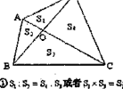


- S₁:S₃=S₄:S₂ 或者 S₁×S₃=S₂×S₄
- AO:OC=(S₁+S₄):(S₂+S₃)

蝴蝶定理为我们提供了解决不规则四边形的面积问题的一个途径。通过构蝴蝶模型，一方面可以使不规则四边形的面积关系与四边形内部的三角形相联系；另一方面，也可以得到与面积对应得对角线的比例关系。

#### 二、梯形中比例关系（“梯形蝴蝶定理”）：

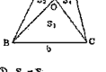

- S₁=S₃
- S₂:S₄=a²:b²
- S₁:S₃ S₂:S₄=a²:b²·ab:ab
- S 的对应份数为(a+b)²

#### 基础题：

- 1-1

如图，某公园的外轮廓是四边形ABCD，被对角线AC，BD分成四个部分，△AOB面积为1平方千米，△BOC面积为2平方千米，△COD的面积为3平方千米。公园由陆地面积6.92平方千米和人工湖组成，求人工湖的面积是多少平方千米？

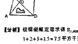

【分析】根据蝴蝶定理求得S△AOB=3×1=3×1=1.5平方千米，公园四边形ABCD的面积是1+2+3+1.5=7.5平方千米，所以人工湖的面积是7.5-6.92=0.58平方千米

### 我对五星级酒店就一个要求

不要有摄像头，把我洗澡换内裤的视频发到网上。其他我可以忍，我这要求是不是太高了？

### 总结一下倒插门的技术要点

- 1，会画眉毛，挑油头。
- 2，会做红焖羊肉，海鲜大餐。
- 3，会晓恕，态度好。

### 今天我一个人做晚饭

- 1，四两公蟹一个，25元。非常好吃。
- 2，鲈鱼现杀清蒸，14元。
- 3，河虾一小碗不满，15元。
- 4，蛋黄炒鸡蛋，4元。
- 5，羊肉40元/斤，我算吃了10元。
- 6，肉包两个，3元。
- 7，果汁一大碟，9元。
- 8，葱菠萝小米辣，作料，3元。

合价约80元。晚餐＋夜宵，全有了。
- 9，一个985大叔的2小时劳动，价值600元。

### 你们家谁负责打孩子？

今天，菜姨无意中把娃娃的蛋糕吃了，娃娃说菜姨是坏妈妈。我火大了，这孩子怎么可以这样说？打，必须打一頓。菜級高度同意打一頓。问题是，谁去打？我是舍不得的。要打，菜姨去。菜姨让我去打，我不去。你们家谁负责打孩子？

### 高速公路推出了支付宝付费

但我是华为手机，速度超级慢，不敢拿出来用，否则后面的司机要骂娘了。为什么你们华为厂就不能搞个一键还原，恢复出厂速度呢？我们可以拍视频，双方确认出厂速度啊！我这 3200 元的手手机钱，也是摸了好久的。你们要我一个倒插门的，有意见吗？

### 活捉一只华为粉

奔跑嘚木头：菜，你现在买个华为 mate20pro 试试，如果再有这种感觉，你可以直接把我拉黑。

答：我家原来有个华为 g5200 手机，也是慢的不行。我抱怨那几句，华伟粉说，买 mate7，保证好。我买了，过个 1-2 年，还是那样子。

### 华为手机骗了我的钱

我是 2016 年初买货的 mate7，3200 元左右。我印象中，买了不到一个月，mate8 就上市了，我成了大傻逼。

我没什么大的应用，就是微信支付＋导航，其他不需要。刚买的时候，快的像是保时提，现在我只能骂手机设计者的文母娘，刚才去吃一碗馄饨，馄饨端上来，我的微信支付才刚刚完成，慢的简直是精神崩溃。

我希望阿里巴巴出个“一键还原手机”，承诺不在后台搞低速度，送我买新手机。一个手机 3200 元，还是新的，敢要我扔垃圾箱；我实在是心疼。我家的日本电视机用二十年还是好的。国货也不敢盖。

国产出品的任何上网产品，包括空调冰箱，都帮你们过几年找个什么安全借口，故意调低速度。我还是会合资购买买西门子之类的。

### 我一直是用苹果手机

上次买华为手机，只是个简单理由，以前苹果手机不支持手机黑名单功能，那年手机暴涨，手机推销电话特别多。工商银行的推销短信特别多，多到我已经无法工作了，必须要有个拉黑功能。用了两年后，有一种被华为手机无情戏耍了的感觉，外表还是新媳妇，身体已是老太婆了。

### 虽然我拉黑了 1.6 万个的你们，但我还是爱你们的

各位亲爱的红墙：

我一个四十多岁大娘的生活阅历，先骂你几句。如果你的潜意识里存在一个浓厚的兴趣，看到成功企业家倒腾，自己就开心，那你很难成为富人。因为你有根深蒂固的自卑思维，你认为自己不会成为富人。老天爷给你任何机会，你也不会珍惜，更不会深入下去。你认为自己就是命运，最喜欢阅读省钱技巧。

我告诉你一个我的秘密，我从来不查看技巧，所有的省钱技巧，都是消耗时间和精力，守在电脑面前练手快，或者提前三个月预定，经营者预备各大网站不起眼的优惠信息。这会让你把最宝贵的大好年华，浪费在节的几块钱，几十块钱的鸡贼事情上，最后越活越穷。

我把大量的时间用在了学习专业知识，有时候找土主策微借助二十分钟之类的。你可以看我的十年微博，凡是有标准答案的专业问题，政策问题，金融知识等，我几乎没有出过错，而且答案是专业级的。预测类的，准或者也相当高，而且是提前两三个月以上的中期预测。

我从来没有炫耀过我的财富价值，我的亲和力，我的工作经历，我放弃了以前所有的自带光环，从零开始，完全是靠一个字一个字写出来的百万强大 v，上千万字的原创，可以让你笑的哭声。我做事精，非常努力。

我希望亲爱的红墙们，放弃无谓的骂条去走，毫无意义的唱红。明天早上九点，你仔仔细细想个问题：能不能投入十年痛苦和磨炼，也成为了一个专业土主，再也不要在底层牟活了。

### 我年轻的时候

为什么追求王翠花失败了？

王翠花是 985 女，皮肤黝黑，满脸痘痘，高身材还正常。她和我一样，也是个苦瓜，除了工作单位好，其它都是一穷二白。我当年彻底放弃了对美的要求，义无反顾，大义凛然，慷慨走向情怀，希望追求王翠花。

我家是里无房，惨的一 B，有个老婆铁行。结果，当头一棍子，惨遭拒绝。那一刻，我是真败益了。尼玛啊，如此低层感的妇女都鄙视我，是不是也太惨了？

十多年后，我回忆往事，终于明白丁失误原因，当时我也想改变命运，而帮不了她。我除了卖人才，其他啥也没有，房无一间，地无一分，和她一待在集体宿舍里，个人卫生也差。没有洗衣机，没有大衣柜，苦的一比。虽然她时常在随令号的水龙头下，她个排骨汤送过去，还给挑个笑话，但明显没有达到 G 点。人家姑娘要的不是什么小小情趣，而是实实在在的钱，房子和金钱。

后来，她找了个小子男生，好像是外省的，那时候工资高，给那买了 xx 新城，当时好像是两万多一平米。若干年后，我已经离开了老单位，曾经在路上意外的看到过她一次，祝福她了！

其实我也不算太艺, 只是我想当然的自我贬低, 才迟迟迷不出去。后来, 在国外遇到朱娱, 上海房子不是问题的时候, 我算是迎来了人生巅峰, 没啥有啥, 一手都是王牌。回国后, 我就住进了七宝的大平层。

结论: 没啥有啥。当你缺房子的时候, 你就不要去找也缺房子的女人。当你有钱的时候, 也不要再去找有钱的女人。你要换个思路, 用自己的优点去逗逗喜欢吹你优点的女人。这才是人生的正确打法。

### 菜姨是业余级红学爱好者

她对王熙凤和林妹妹的看法很直接。王熙凤结婚时, 嫁妆大概三百万, 所以地位高。林妹妹空着手来的, 就是湿吃湘喝的, 没什么话语权, 只会哭!

### 我系世板第一等!

虽然是倒插门, 但我从来不缺钱。我比女母亲的资产翻了十倍。2005 年开始, 我弟系学母亲就 在上海买房, 我虽然没钱, 但我有贷款指标啊, 有购房资格啊, 有高大大单位加光环啊, 一套一套 一套一套, 现在我比老太人还种气。我就是理直气壮的倒插门! 丈母娘的老姐妹都亏我好, 比她们 家的女婿强! 这就是本事!

### 我完败过很多次

- 1. 刚刚入职, 我想当局长, 结果被一群世家子弟, 下套, 抹黑, 恶 k 一顿, 幻想破灭。
- 2. 辞职后, 我做生意, 刚刚赚线了, 被淘宝摸黄了。出现了大量的抄号线。关门。
- 3. 想多买几套房子, 钱不够啊, 变身为主贷倒插门。
- 4. 投再次创业, 投线。写微博男诉卖惨。
- 5. 当你把人生的每一件小事情, 当做事业去做, 你总会干成 个的。

### 怎么超过菜姨?

从来只有新人笑, 有谁看到旧人哭? 人都要老的。老, 不是指年龄, 而是思维。我们这一代人, 迟早要被淘汰。我们现在不可能天天和高中生一起弄, 一起聊, 我们已经不熟悉 00 后了。再过十年, 现在的高中生, 就是网络支付的主力军, 我们已经赚不到他们的钱了。

这个机会是你们的, 我们无力竞争, 但是, 你们当中谁能够抢到机会, 这就不好说了。如果你 还是精精老, 任何事情, 晚上来先论证证据, 给自己一个不参与的理由就, 那你死光了。人 生不过是短短五十年的机会, 到了四十岁, 你还在线丝堆里, 啥也不干, 那你没希望了。

等待赔丝的不是骂线你。而是你的儿子媳妇分待你骂你的：“老东西, 你看人家莱姨, 再 low, 也早干了件正事, 一辈子也赚腰了套房子。你这个老王八蛋, 一天到晚什么都能, 搞到现在, 连个 喷锅头的钱都没有。你丢不丢人啊！"

### 现在, 你很难超过我了

我是怎么把不可能成功的事情最后办成了?

很多事情, 单单表面看, 失败可能性是 99%, 但你不要忘记了, 这个世界最大的学问是: 唯物 主义哲学。

世界是不断运动的。这就是一切大物人的成功秘密。什么意思? 你当时觉得困难, 不可能, 其他人也这么认为，就没人和你拚生意了。但那是静止的观点，机械的看待问题，世界在不断发生变化，不利因素和有利因素也在剧烈的变化，敌人和朋友也在不断转换，你不是没有机会的。

时空转换，时时刻刻，当有利于你的环境，不期而至的时候，你会发现：世界真好，居然没有人和我拚生意。

我在十年前，也没想到自己会成为大 v。我也没想到，网上写几句感慨就能赚到广告费，现在请我开讲座，出场费达到二线明星的待遇。我因为住太远，所以不去。

那时候，我没想到，我也没想到，但我坚持了十年，而你们什么也不干，只是一直嘲笑我。这就是人和人区别。现在，你很难超越我了吗。因为我比你更努力。

### 屌丝和菜菜的区别

当我们遇到一个项目：

- 1. 菜菜的思路是：怎么千方百计搞成，搞成了有多少利益，要投入多少成本？可以参考谁的方案？
- 2. 屌丝的思路是：这事儿肯定搞不成。我给你们说三个困难啊！

屌丝都是红橙成虑过度症患者，他们喜欢坐在办公室里议论天下，点评马爸爸某个思路有问题。他们一辈子也不会投入全力，去干一个自己的事情。

他们遇到机遇的第一反应是：论证这个事情有多多困难，然后给自己找个逃避的理由，这种思维是名质本科历教的，非常糟糕。到老、子女要他拿钱买房，他就破口大骂，这个社会欠了他！这部改革开放四十年了，你还说这样。

而我，可以失败好多次，但我只要干成一次，三代人就可以碾压你了。对伐？

### 你看我，多牛 b！

读书可以 985top1。下海可以当一个小老板。倒腾门还搞个大平层，写微博也做成投杠模式的头牌。你算个球啊？还整天叽叽歪歪的。

你回家问问你的屌丝爸妈，为什么你们就这么使劲？连个户型 80 平米都没有？

你的老爹肯定告诉你，隔壁村张二狗家的闺女，在京沪买了大平层，不也靠自己吗？

这叫啥？老狗写小狗，文明一起走！


### 我决定让孩子练习倒插门技术！

梁房地产天下：一代更比一代强。

我小学一年级还在玩劣沙包滚铁环，英文初中才学。一年级的儿子已经会加减乘除，英文对话，电脑编程，古文音律，比我厉害 100 倍还不止。

但是看看他们班上的学霸，英文口语对话无压力，奥数思维课程学到 15 岁的题库，全球玩过 20 个国家回来还能做 PPT，完全是碾压级的存在。

你已经冲进了内环线，抬头总能看到 400 平的大平层，就是这种感觉！

菜菜：大牛家长，你们好好玩吧，我们房东实在是太弱不起了。我下决心让孩子练习倒插门技术了！一技传三代，还是祖传手艺靠谱啊。诶款大家都看开，我就当看你们将来能把练习原玩出峰头来！

### 菜菜的性格

我很小做决定的，常立志者无常态。但我要是看准时机后，是绝不动摇的性格，一把梭哈，直挨拆俞。老粉都知道，我曾经三次清零的不光彩历史。但不怕啊，输了又怎么样？女人夜总会，男人倒插门，who怕who？但这个世界上的很多人就是怕，思想包袱太重，瞻前顾后，犹豫不决，生怕搞砸了。我敢拉你一起档事，你敢不敢？

我从来不懂小钱，甚至不知道麻将将有几张，但我敢赌大的。人的一生，就是那么关键的几小步。走对了，就是封侯拜将，走错了就是认命，村头吹牛逗，泥泥也是一辈子。怕个鸟？

### 我好希望莱婆给我钱的时候

是一捆一捆的给啊！

现在是一张一张的给，买完菜还要损贬，气人啊！

### 百万军中，杀他个七进七出！

如果再回到从前，所有一切重演，我是否会更明白生活重点？不怕挫折打击，没有空虚埋怨。让我看得更远！


### 我不知道现在还有没有社会女混混？

我们读中学的时候，市区的女混混非常多。那个年代，大家都没钱，混社会的女流氓，很多都是校花级别的。每个学校都有一批小流氓。这些人最喜欢欺负同龄男生，打打闹闹一纸破。女生之间也有矛盾，主要是看你不顺眼。

九十年代考大学是凤毛麟角的事情。大家就是是一个出路，熬到二十岁左右，等待分配工作，或者去父母厂里顶班。职校技校高中，读书只是打发日子而已。很多女生数学不行，根本就不可能考大学了。大家一起瞎混。

有些漂亮姑娘，为了显摆，拉帮几个当地著名的狠角色，给他们用过关几次，大哥们就给她罩场子。这些姑娘，当年被称为“烙饼”。大哥也不是收破烂的，一段不好看的姑娘，还搭不上线呢。她有了靠山，就耀武扬威，拉上一群其他女生，在学校里称王称霸，到处恶事。女生之间大概是几个矛盾：

- 一是争风吃醋，你勾引我男友，打他！
- 二是语言矛盾，口角之后，修理她。
- 三是看着不顺眼。你家有钱是吗，你成绩好哈，你的衣服漂亮哈？老娘撕烂你。

那时候没有经济矛盾，女人嘛，就是这些事情。我有个男同学，他姐姐是学校里著名校花，很老实，不知道哪根筋搭错了，她和另外两个高中帅哥好上了。有个暗恋女生，大怒，去拉大皮大鞭忙。

大姐大，也就是十八九岁的样子。在中午叫了一帮姑娘，把那个校花摘出来，堵在一个楼道里一顿揍，正好是我家那里，被我看到了。女人打架一般不使用武器，直接抡起拳头撕脸。那个校花被打成了熊猫眼，脸上青一块紫一块的。我一看是真打，就逃出去通知同学。等同学家属赶来，已经打完了。

这事情也就不了了之了。那个校花没有考上大学，分配到国企做了一个工，嫁了个工人。现在大概五十岁了。我极少看到女人打架，三十一年了，还印象深刻。

现在，应该没有这种事情了吧？

我当年住的那个地方

早就拆迁，夷为平地了。那些曾经在学校门口调戏女生的小混混们，现在应该快五十岁了。我工作后，就没有再见过他们。

有一次，我去瑞金医院附近办事，看到一个老屌丝在指挥停车。我一眼就认出来了，就是这个道样子。当年把鞋底印在我的衬衫上。我坐在车里，那一刻，我没有丝毫的仇恨，只有对青春时代的回忆。那个老混样，已经用赔掉一生的代价，为年轻时候的愚蠢赎罪了。我住在别墅里，衣食无忧，还有什么可埋怨的。

很多年轻人，少年狂玩，既是愚蠢，也是可惜，因为没有父母教育，怎么混也道，全靠自己瞎搞。我当年忍下了很多侮辱，所以后来完全是清清白白，最后被北京的部委选中，公派留学，后来结识了荣健，一步一步走出了底层。

又赶上了好时代，市场经济的大潮，我现在啥也不用想了，几代人的事情，二十年全部解决了。再怎么样，至少美国的房子还可以住，对吧？

结论：人要有目标，为了目标，要忍耐很多痛苦屈辱。也不是白辛苦，走上去了，你的孩子就不需要再吃二茬罪了。

### 现在看电视剧

七八十年代好像是怎么样怎么样？我们就是那个年代过来的。

当年，我们读书的时候，可以不带课本进习题，但必须带武器。每天放学就像过鬼门关。一大群小混混在学校门口，降旗挑衅，也不是天天被打，但也是一个学期，在校门口当着全班女生的面，被混混们欺负几次，是很正常的。我们为了自保，随身色是带菜刀。我们这种弱鸡，带板砖或者铁水盆，的铁棍的把手处，绑一团布条，打起来的时候，防止手滑出去。

那时候，成群结队的小混混，初中毕业后，无所事事，在街上闲逛。我们这种优等生，经常被他们欺负。我们没精力和他们对抗，我们还要考试。

我记得有个高中男生，读书好，早恋了一个同校大婆。某同晚上，在楼底下和女生说了几句话。一帮小混混，看那个姑娘漂亮，直接上去把男生的鼻青脸肿。打了就打了，也没人去报案。因为那时候，没有报案电话，必须走过去。路远天黑，就算了。

我再也不想回到

小屌丝们最喜欢的老岁月了。

那个年代是令人窒息的。户口，档案，户籍，粮油卡，身份（干部或人民），介绍信（住旅馆必须），把每一个人卡的不敢有了一丝一毫的动弹。

单位的小头头可以直接到你家去批评教育你，还可以关照邻居监督你。每个楼，每个院，都有积极分子，专门盯紧各家各户的新动向。任何一个农民想要出去，没有生产队的介绍信，分分钟就被收拾了，直接关到拘留里待几天。居民小组长甚至会关心你的各种隐私。

这是我们不想回忆的伤心事。现在变成了很多鬼屋怀旧感的事情了。我是觉得，他们不是坏，是蠢。真要穿越了，他们更惨。

### 我读大学的时候

社会上已经有很多乡村戏般的舞厅了，我去过一次就不敢去了。

那次是大三，是某国企文化宫举办的舞厅。我和几个高中同学买票进去看看，五毛钱一张票。进去之后，我也不敢找陌生女生跳舞，那都是大哥们的女人。我就是坐在边上听音乐，就这样还惹事了。

有个附近棚户区的小混混，为了在女要面前嚣张一把，把脚踩到我的椅子后靠上，鞋底对着我的脖子。我是坐着坐着，所以不知道情敌是谁，往地一瞧，他的鞋底就把我的白衬衫踩出半个黑脚印了。我当时也火了，拉拉扯扯，结果他们来了一群青工，都是附近棚户区的混混，也就是当年在高中门口欺负我们的那帮人。我一看，要么开刀片见血，要么就是趟祸。

我是大学生，马上毕业分配给干部，如果呆在这里，“舞厅打架进局子”，档案上有这么一笔记录，以后头大了。我只能认怂，跑了一群姑娘们还在背后哈哈大笑。

当年就是这样的。很多人自己不求上进，到处和人比对，要么和他一起坠入深渊，要么被他欺负，你说怎么办？现在，好多了。

富人和穷人玩的地方分开了，大家都是一个阶层，那就规则了。

### 我们当年大学生谈恋爱难的，极少极少

一放到了大四，才有几对会资源。原因：

- 1. 姑娘长得实在太丑。当年，全国的大学生录取数是 60万多，本科以上才 40万，男生多一些。女生考进 985的，都是竞赛系列。丑的不挂五丑，是绝大多数。也有少数好看的，轮不到我们屌丝，也就罢了。
- 2. 户口不一样。当年，户籍管理严的一比吊糟。不是本市（地级市）的同学，毕业就分手，姑娘们怕白操了几个，最后吃亏，索性就不谈了。
- 3. 城乡不一样。我们那个时候，孩子不谈母亲。如果你找个老婆是农村人或者外地人，那你孩子团圆了，也是农村人或者外地人。上海人住在北京，没法谈对象。
- 4. 上海人当年主要是工薪族，虽然不穷，但比不上广东福建的大款同学。他们拿出来的老款表，我们都没见过的，什么电子表，真是漂亮。

### 我们大学时候，是不能谈朋友

有专门的大学学生会自律会，每天晚上，几个农村来的光棍 985，拿着那种特大号手电筒，到处巡查，抓到手牵手，一定是，就带回屋里登记名字，然后通知辅导员次日谈话，一般也不处分，但让你难受一下。很多女生因为怕丢人，坚决不谈朋友。

记得当年有个报道，说 12%的在校大学女生有过性经验，一时间激起民愤。我们班有个十六女生，那就有一个了，于是大家开始猜是哪个？女学生们异常愤怒，一直要求处份作者。


### 现在怎么谈恋爱？

九十年代末，我们在大学里谈恋爱，都是找个没有路灯的花园草地，读书，读学习，读学术观点。男生一边读，一边措施，女生就喜欢这么读。现在她们都四十多了。不知道她们还记不记得当年的大明湖畔？

你们现在怎么谈？

### 断人财路可取

这些年，我和这么多原V股金融狗吵过架，但我的底线是，不攻击别人的生意，不断人财路。大不了放狠话，一挡两散，各自安好。崔某去断人财路，这个过头了。每个人的成功都来之不易，都是血泪斑斑，何必做绝呢？你有春风得意，也会有倒霉日子，但人总要吃饭的。

### 十年前毁掉我翻高梦的人

我也崩溃了。

我根本不相信自己，崔某是因为十五年前的一个口水战，再次引发舆情。这么多久，这几个人也有正常互动的，不像血海深仇。我倾向于认为，崔的目标是大密持这个生意。但这电影毫无知态度，所以先拉几个大蠢热热身。正好，手机2跳出来，那算你倒霉了！

### 我不再评论股票了

我一直反感个人炒股。用末评论股市的本意是，炫耀显示自己的政策敏感性和扎实的经济学理论功底。初衷是给那些金融狗听的，没想到点炸了金融圈，吟唱热讽，铺天盖地。

你今后买进还是卖出，别问我了，因为我也不懂股票。但我知道人性。小赌怡情，大赌输光，不劳而获会上瘾的。

好吧，我们继续快乐的婆娘打架系列！

### 大家喜欢看我的微博

说明你是正常思维。我以前教《西方经济学基础》，就没有选课的学生。

### 我也不怕丢人了

给大家说说菜娘有多狠？

每次买房子，菜娘都会告诉我，只是给你挂个名字，不要当真了，离婚都是我的。

我大怒，尼，法院认名字！

菜娘鄙视的瞪我一眼：问过专家了，这钱都是丈母娘专项资金汇来的，一分一厘，正好好，有银行汇款单，你赖不起来的。

菜娘到刹那间脸色苍白，咬了咬嘴唇，强忍泪滴，然后又活络乱跳的去讨好像菜娘了。“美女，晚上喜欢吃什么？我帮你做好吃的！”

### 心理学描述范文

前两天，菜娘威胁要踢了我，一怒之下，我在心里飞快的计算我的残值。

- 1. 房子要给一个大平层。虽说那是女方婚前财产，但我这么多年，忍气吞声，出卖色相，总不能啥也没有吧？
- 2. 那个旧车，是我的名字登记的，你也拿不走。虽然卖不出价了，但也是老家家车，擦一擦也是很有面子的。
- 3. 以后的生活费也不愁，我可以拿起我的中级职务，去上个班。一年几十万不是问题。毕竟人脉都在，像我这种不要脸+会舔的，那十几个当了大单位中层干部的女同学应该会很可怜我的。
- 4. 改嫁也不难。我这种货色，可能会找个女医生女教师女护士，她们脾气好，我不会再被踹了。我也不是吃白饭啊，我有长处，最会哄女人心开心啊。这可是二十一世纪最紧缺的人才。现在有存款有房子的女人多，像我这种脾气好又能干的男人，可不多了。给自己一个赞。
- 5. 养老也不愁。娃娃我一直很关切的，孩子以后能不能管我。要是不管我，我就赖在她们家门口不走了。

正当我鼓足勇气，准备大闹一场的时候，荣嫂又喊我去吃饭了。我一看没事了，又喜滋滋的下去了。

#### 我说说荣嫂

年轻时候，荣嫂有点叛逆，父母的话，一概不听。被我一阵忽悠，从了。然后，我就过上了吃喝玩乐，断智逸逸的好日子。当然，为了保证来之不易的好日子，我是打不还手骂不还口，一切都听你的。这不也挺好的，孩子聪明，老公孝顺，一回到家就看到我，从来没有小三被发现过！

#### 以前我傻乎乎的

总希望告诉屌丝们，别吵吵了，赶紧想办法考证书，写代码，修车，赚钱。现在我明白了，这群二我其实根本不愿意辛辛苦苦干！他们脑里里是希望别人给他去打工拿，然后是把打来的浮财分给他最好。这种人在很多地方都有，一些中西部的地级市酸秀才才合他们，换取廉价掌声。随他们吧！

#### 拉黑的力量

荣荣，为什么你的评论里没有任何广告和吹子？

答：已经拉黑一万多人了。

#### 我把骂怨神的全部拉黑了

我把骂大豆的也全部拉黑了。

我把骂老老师的和袁老师一起拉黑了。

倒楣们虽然力量小，但也尽到社会责任了！

#### 回不去的青春期

九十年代后期，我大学毕业被两个单位录取。一是某高大上单位。二是房产商。当年，我去应聘的时候，属于计划经济向市场经济过渡时期，我记得非常清楚，房产商是在遵义路的一个豪华大楼里，开发商名字我已经记不得。

我实际去了体内单位，这个当年绝对正确的选择，导致了我人生第一步就走错了。比我小几届的屌丝，很多找不到工作，进入房产商企业，现在已经夏威夷晒太阳了，我还在苦逼的和屌丝们斗嘴。

我肯定无法后悔当年那个决定。因为直到 2009 年，体制内还是比开发商里的一般副总好安全一些。四万亿后，开发商是暴发了，中层正网顶网百万年薪最少的，年在五百里的区域经理也是司空见惯。而体制内的，一般也就是 15-20 万了不起了。

而且，前些年，外汇宽松，很多人还去澳洲喷歇悉尼温哥华了。我才是呵呵啊，天天对着那几张纸，写啊写的，后来想明白了，我也出来吧。干什么比天天写文章好。

人生的意外转折，比比皆是，好得有命。呆丝们，不要灰心，不要难过，重要的是，你在一个行业里坚持下去，争取做到比别人好。

人的一生，要工作四十年。我相信，任何一个行业，在四十年里，总会迎来一次阳光灿烂的微笑。

### 为什么我对孩子的考试要求不高？

我是学霸出身，有超级丰富的考试经验，搞个 985 跟玩一样。但是，我左思右想，我基本放弃了对孩子考试成绩的要求，只要中等就行了，考个二本我就非常满意了。

先说说莱嫂，莱嫂在高中时的考试水平一般，也就是个普通大学的水平。以前，我经常嘲笑莱嫂是扩招的结果。但这些年来，我渐渐发现，读书不太好的有一些和 985 相反的特点，而这种特点导致了他们的人生好像比我们快乐。

二本考的特多点，不求甚解，敢于瞎蒙，不求甚解是因为有一些在搞不懂。全部搞懂了，那不是 985 了吗？敢于冒险就简单了，反正懂不懂了，但又必须考考卷了，那就蒙一个，也可能蒙对。

我们 985 不是这样的，任何题目，必须搞明白，一丝不苟，精益求精。我们不喜欢蒙一个，我们对每个题目都想知道标准答案。这种思维伴随了我们整个人生。

学习阶段，每个题目都有参考答案，只要投入，必有结果，这也是我们 985 的法宝。但进入社会后，人生的各种题目没有参考答案，深思熟虑和蒙一个，结果差不多。而且，985 过多的浪费时间去研究没有标准答案的题目（风险），反而大量的错失了机会。二本有时没有心里负担，走得进一步，随大流，装一个，效率高者。

在实际生活中，我和莱嫂的分工自然而然的走到了一个搞笑的局面。遇到实在无解的题目，我往往反复犹豫。最后变成了，她是领导，负责跑票。在她拍摄后，我只能认账，负责落实。落实细节，是我们 985 的长处。结果，各种大事情的最终效果，90% 是好的。如果单凭我个人，实际上可能是放弃了，苦自己。

莱嫂就嫌蒙，就不怕蒙错了吗？还真不是这样的：

一，有时候，连 A B 都不清楚，最怕的是没有参与。过去这么多年，中国经济稳中向好，高速发展，导致了一个你意想不到的结果：做比不做好，买比不买好，这是 985 无法预测的，只有 250 才能对。

二，莱嫂家里有钱，蒙错了，也扛起两次大失误。事实上，没有出现重大失误。这和我落实细节也有关系。

三，250 必须闪个 985 去落实。任何决策，关键落实的人。莱嫂把我利益捆绑了，我不得不替她尽力尽力办事，这也是我时时刻刻想念反反原因。

结论：太精明的人，只算小账，不敢算大账，往往错失机会。

### 再说作事，我喜欢废旧塑料袋

每次去超市买东西，总会有几个塑料袋装，还可以套垃圾袋。我就攒着。结果，莱嫂又爱中让我骂我。我指指谁靠了？莱嫂的意思是，只留一个今天用，其他一律扔掉，我会不舍，就开始吵。其实，一个塑料袋几分钱，何苦呢？但我就是想留用。我是不是有点过分了？

### 今天干了件抠门的事情

被家政惩罚。

天气冷了，热水器淋浴，前几分钟的水都是浪费的。我就拿了一个塑料桶积水。但是，这桶水没法用啊。于是，我把些便器的水瓶子取下，直接倒入，一点不浪费，心情很好。但是，每次取下来再盖上去，很麻烦。我这两天索性就不盖了。这下子捅了马蜂窝了。家婆对我劈头盖脸一顿乱骂，说我把家里搞的乱七八糟。

我觉得我也没啥啊，你们怎么看？

### 各位嚎子：

对你们这些人，我跪也跪了，求也求了，哭也哭了。能不能不再骂我了？

若再欺人太甚，我就翻脸了。

你放心，直接由法律人士当原告，保证你嗨一年。

按照法律规定，起诉书我会全部公开的，有父母有单位有孩子的人，你最好不要再骂我了。

根据律师会议的普法知识，我说一下名誉权官司的小常识。

- 1. 以笔名为号的微博，无论对方怎么谩骂，赔偿是很低很低的。法院的意思是，你是笔名，知道是你的人不多，名誉权损害有限，所以不支持赔偿多少钱。
- 2. 我们不追求赔偿金额，只要进入法律程序就行了。我一律公开起诉状。你不高兴了，今后来起诉我，我们依法依规解决。
- 3. 在网上骂我的那些人，你父母老婆孩子单位同事看到你的那些毒舌骂语，自有公论。你还是想想怎么向亲人解释吧？

### 我们本来准备起诉十个喷子

名单和取证已经全部搞好了。但是，最后研究的时候认为，我们的原告资格不完善。为保证一击而中，我们取消认证，重新做实原告资格，今后由法律专业人员出面。喷子们，请开始你们的表演！任何泼骂造谣，都会让你付出代价！至少会让你请假付花费的事情，免不了了。

你不同意我的观点，我不会惹你的。这个很厉害。

但是，谩骂和造谣，是音法律标准的，这个你就跑不掉的。

打名誉权官司，赢的概率不大，赔的也很少。但是，我们的目的就是把拖入法律程序。一旦进入法律程序，你就出名了。喷子们，为了你的老婆孩子父母想想吧！要想出名，我不敢读你，明人不说暗话。

我们近期对谩骂造谣微博进行了近百次的投诉举报，每次都有新的结论结果，这是以取证为目的做的。

凡被我投诉举报过的，咱们以今天划线。你不再骂我了，就算结束了。若继续，我也不客气了。

大家放心，凑满五十个喷子，我一次性起诉他们，让大家痛痛快快吃个瓜！以今天划线。

跪求不要再骂我了！谢谢。

### 预警告

各位嚎子：

本微博已经取消认证，正在由法律专业人士全面接手，完善原告资格，然后开展名誉权诉讼。

今年考虑合法起诉 50 个喷子。你有本事再来造谣说一句試試看？我们马上取证。

能不能打赢官司？我们尊重司法。把你拖入法律程序，是我们的本意。

### 微博的骂人规则是这样的

- 1. 他骂你只要几秒钟，你投诉要一天。
- 2. 受害人投诉成功后，新浪微博就是把那条骂人话删了。没关系，黑粉继续花几秒钟写一条骂你。
- 3. 你再投诉，删了。没关系，再花几秒钟写一条骂你。

周围复始。

我现在也搞明白了。x烂你@来去之间@曾增博@曹国涛再x一次。再x你三姐！//菜菜:我再x你家二姨！//菜菜:先x你家的大姐。新浪微博，你们记者，我再也不投诉了。谁骂我，我就骂你们！x死你妹

小编：其余的骂人贴就不贴出来了，就是重复三字经

### 开始失控

我向@来去之间来问下属的微博小秘书，投诉了近百条的骂驾微博，毫无意义。那些人写一条骂人的微博，可能就是几秒钟，我投诉要一天。实在是太大了。

既然，这么玩的，我也开始骂了。

来狗，来狗，全家狗

来啊，不就是删吗？我可以一分钟写五条！

### 微博上，无论你说什么

都有很多人非常讨厌你，仅仅因为财富和阶层不同。

有些人就希望你倒霉，只是因为你看起比他好，房子比他大。想想也可以理解，我年轻时候也有这种思维。长大了才知道，努力和运气，才能创造幸福。吵架骂驾不解决问题。我永远无法说服你们，那我先滚为敬。认证已经取消，所有私信已经删除。感谢这么多年来参与工作的朋友们。

一个小时后复出。

### 我再也相信任爱情了

这些年来，亲媒对我严防死守，微信支付宝每个开支都实时监控。我TMD一点隐私也没有了。

菜猿最过分的是，每次我想借车出去玩几天，江浙沪，莫干山，她就在玛莎拉蒂里面喷香水，还是五号香水，母老虎堂管理领土主权啊！我靠！搞得我我也没兴趣开车去了。

### 你要是能坚持一年不被我拉黑

你人生成功的可能性极大。这话不是逗你玩。

人生有很多情绪，是不能表现出来的。你再怎么不喜欢某个副总，再怎么想骂某个老油条同事，你也不能这么做。如果你克制住了你的情绪，你就赢了。说明你成熟了，已经懂得控制感情，遏制冲动，外圆内方，明白进退。

如果你能稳定的控制情绪，达到一年，你就无敌了。因为别人看不出你的内心想法了，你可以去忽悠公司副总和竞争对手了。

如果你不能控制情绪，随意发泄，总以为反正别人不知道，那么你在生活中也是这样的，迟早出事。

君子慎独。

#### 除极品个例

上海最屌的阶层是老砍旧卖掉，拿 500 万现金全移民的那群人了。这群人走的还是比较多的。我周围有不少了。我是较好上这机会，手里暂产一把。但岁数大了，超过 40 岁微潮不要了。

莱嫂年轻，可她不想走，说是外国待腻了，非要吃锅贴才是生活。我整天无所事事的发微博发呆，像个老年痴呆症！

#### 昨天晚上，和莱嫂打了一架

都互相放出很脏话了，对财产怎么分都说了。我以为我要扫地出门了，心情极丧，不知道今后怎么混了。没想到，今天早上，莱嫂又主动找我说话了，我又欢天喜地的去找莱嫂买锅贴了。

#### 我和水库的思路不一样

水库玩的是，信用卡垫光，从头到尾苦自己。从来不考虑女方的入股问题。

我的套路是，哪怕是倒插门，也要把丈母娘的钱拽进来，一起入股，一起加杠杆。

两种模式，各有利弊。

但我的套路，有个前提：对老婆绝对忠诚。

杠杆解除后，也可以放松几次。做人最重要的是开心。

#### 莱嫂怎么选对象？

莱嫂和我谈朋友，她 20 岁，大三。她说要找个成绩好的，她看我校挺好，人也会说话，同意了。这么多年，没有分手过，基本没有吵架。现在，家境富裕，和和睦睦，孩子数学校绩好。

我是不会出轨了。我现在做的不想出门，躺在沙发上看电视剧，吃恐龙，活成一个胖球球，就感到幸福了。现在，再让我穿上帅气不舒服的瘦身西装，做头发，画眉毛，再谈一次恋爱，环球旅行，讨好小姑娘，我是受不了了。

#### 什么是生活？

刚才和莱嫂打了一架，起因是一包榨菜。我和莱嫂午餐，莱嫂开了一包榨菜，倒在小碗里。

我大怒：两个人怎么吃的完一包榨菜，你不会倒一半，留一半啊？浪费。

莱嫂也火了：我辛辛苦苦忙了一个小时，给全家做了一顿饭，你上来没一句好话，我挑拣刺啊？爱吃吃，不吃滚！

“我靠，你什么态度？我说的不对吗？”

“你给老子滚，不是我，你还在老破小里呢？”

“你个老女人，不是我，你现在能不能嫁掉还是问题？”

莱嫂突然抄起一个小板凳，怒目圆睁。

我哇的一下，哭着认怂了。

然后，我们开开心心吃了个饭。

### 菜瘦对我说

你放多看了一眼别人家的女人，就是精神出轨，家法伺候。

为了保证服务质量，我现在连门都不出去了。跑步也是天黑后才出去。

### 内环线还是有好处的

手机一点，龙虾，鲍鱼，大闸蟹，石斑鱼，全部语的送到家。菜瘦又炒又爆的。现在三十刚出头的老人女，能够做一次大子莱，已经不多了。菜瘦除了脾气大，其他都不错，特别是漂亮贤惠，好象家有锁。要不然，我那里有心思陪你们玩几年微博啊？

### 做好自媒体的体会（续）

做大V，从拉黑红粉开始。

自媒体的商业意义是，你把世界上喜欢你人找出来，然后开展定向营销。最直白也就是，电影明星大V号，拉黑一切红粉，然后卖电影票给粉丝。如果你的自媒体呢，一半粉丝喜欢你，一半粉丝嘲笑你，那么这个号净就是负价值，毫无意义。你的电影票根本不棒卖掉。

红粉的特点，是什么都不满意，什么都反对，就像在你的生日宴上说：过生日毫无意义，人总是要挂的。他说的或许事实，但没有他，生活更美好。红粉只会破坏气氛。

对付红粉只有一条：直接拉黑，毫不犹豫。千万不要觉得，拉黑会损失一些流量，少了几个粉丝。世间万物贵在精。如果你的粉丝都是红粉垃圾分类，你其实是白忙一场，没有任何价值。

整个微博，我的评论区是最干净，最文明的，也是最有商业价值的。因为我对红粉的办法是，五秒内必须拉黑。

什么是微博的商业价值？我觉得&来去之间，最近是看明白了，其他很多新派的小小编还不理解。我给他简单启蒙一下。

任何人做生意，不可能做到所有人满意，其实也不需要所有人满意。中国这么大，微博这么大，你只需要百万分之一的人满意，你就有几百万粉丝了。微博上喜欢我的，可能只有万分之一。你只需要服务好"万分之一的人"，你就是最有价值的商业号。

很多人一开始不理解这个逻辑，以为粉丝越多越好，生份少了一个，以不拉黑粉丝，是显示自己"兼容并蓄，海纳百川"。其实，这是自己骗自己的虚伪，也说明他不理解自媒体的存在意义。

号没有商业价值。

自媒体要不既有温度，有感情？不一篇上。

- 1. 唯爱是主打有温度的商业号，"女人要对自己好一点"，先写个海皇小故事，让你反思出她爱的辩论，然后引出单点第二层意思，买我的车车网，买我的化妆品网，买我从小饰品网。
- 2. 法律类、财经类、做的好的大V号，也是有感情性色彩的。他的专业性，不需要通过感情来显示，例如财经号可以通过信息的及时性，法律号可以通过解语的严谨性，突出专业。
- 3. 文枚类。这一类，迷感性最强。很多人以为，女权号就是代表一种情绪，您勿错了。女权号是精准定位的广告平台，例如什么女人买什么之类的。
- 4. 留学号，主打家长的纠结。这类型，往往是卖天沾一些既卖充满的漂亮别墅；又好又便宜。这不是给孩子看的，是给家长看的。
- 5. 房产号。这类型，总体素质不高，特别是某某，垃圾一个。看赚钱生意，情绪管管。

市场经济，本质是信心经济，这个楼盘昨天是单价10万，今天可能是11万，或者9万，凭什么？信心。房子还是那个房子，砖头还是那块砖头，一天的差价，就是你一生的积蓄。这个生意大了去了。

知微见著，大道相通。这瓶葡萄酒是38元还是138元？你根本不知道，绝大多数人也喝不出来。怎么卖给你138元？情绪引导。很多人喝酒，其实不是生理需要，而是情绪需要。既然把这个道理想明白了，那就直接卖情绪了。就像在酒吧，喝酒直接翻五倍卖给你，你买的不是啤酒，而是消遣。

来来，你绕了一圈，你说什么？本来我想说结论的，后来一想，我不能说。

### 我的夜生活很丰富

小区里豪华健身，在单价15万的地上遛弯，
小区门口摆个15元的时尚发型，
小区门口的国际大牌超市里买8块钱一盒的时尚沙拉
小区门口的水果店卖15元/斤的美国提子

## 我是家里说了算的c位

每次老婆提醒我之后，家里就陷入僵局了。如果我不认岔，家里就鸡飞狗跳，如果我认岔，马上就是世界一片祥和，再给一顿海鲜大餐。我发现，我才是真正的卓越领导者。

### 满园春色才是春

很多自媒体作者担心竞争的人多了，自己不好做了，故意藏着掖着，生怕别人掌握诀窍，和自己抢流量。这是很短视的想法。

一，知识付费必须是形成大范围共识

如果市场上只有你一家赚钱，绝大多数人赚不到钱，你很难长久。木秀于林，风必摧之。必须培育市场，扩大市场，繁荣市场，让更多的人参与，才能最后形成一个持久稳固的知识大市场。那时候，大家都会觉得，知识付费是很正常的。有一定经济条件的人也愿意付费，就像是去吃掉个大餐。

二，培育市场就要让更多的人也应分享发展成果

自媒体是新兴行业，没有成熟经验，也没有绝对牵头，大家都可以放手一搏。先做的人有经验，就该宣扬风格，帮助其他参与者尽快的反应过来市场，让更多的人赚钱，也让消费者得到更好的体验和更多的选择。

如果市场上就你们几个老面孔，这些乍看起来都赚钱了，这个市场慢慢就费了。大家也不感兴趣了，老面孔也赚不到钱了。如果新鲜花朵发，消费者从中获益，就算老面孔收敛了，其实还有新路子，例如培训发掘新手，提供专业咨询；

三，分享经验是第一代自媒体人的义务

我们并不比别人聪明多少，只是碰巧站住了风口，赚到了比传统横费更多的收益。如果知识经济的东风停了，我们也搞砸了，又要被传统杂志社区的小编辑拒绝了，怎么办呢？就不要让风停下来，甚至把杂志社区小编也拉进来，共同靠知识创新。

我们是第一代作者，先做出个样板房，让大家参观，你觉得好，你也参加进来，为广大读者提供更好的服务。越来越多的消费者、经营者，把这个市场给的更好更健康，我们就更持久，更安全。

来来，我想像你一样从事自媒体。你能不能教我怎么搞才能赚钱？

答：我愿把我知道的体会告诉你。

首先要明白，为什么有人愿意为知识付费？


绝大多数人，日常的工作岗位和经济无关，也不关心政策变化，经济趋势。这些同学一旦遇到人生重大决策，心里就不是很踏实了，几天几夜睡不着，最后愿意花点小钱，听听专业人士的意见，帮助自己判断，提供多元化角度。主要问题是：

1. 不熟悉政策知识。例如我家二十几年来的情况是这样的，省略五百字，我还能不能买房，我是首套？自媒体作者要讲的清是全国各地热门城市的政策，而且是有理有据。
2. 不清楚经济趋势。例如，现在是什么行情，还会变化吗？跌还是涨？你要讲的清楚，过去，现在的情况，原因，将来怎么看，你要给出思路。
3. 对异地情况不明白。很多人对本地区熟悉，但对异地完全隔雾一抹黑。举例，小地方的人对京沪沪深不熟悉，京沪广深对重庆嘉兴不熟悉。郑州沈阳对苏杭宁不熟悉。
4. 如何补救失误？很多人已经失误了，例如讲错了行情，位置讲错了，想换地方置业，出现了重大纠纷。寻求合理化解决，例如付费中介费，时间成本，经济成本规划。

第二，我们是怎么工作的？

我们是专业化的职业选手，聚焦重点，实操实证。

1. 分门别类收集各地的政策，读懂读透，天天读。熟能生巧，才能解答答疑。你要是什么事情都临时抱佛脚，那肯定是洋相百出了。
2. 定期归纳总结疑难杂症。人家花钱的，都是疑难杂症，百度可以搜索的，没人花钱。我们团队就是研究疑难杂症的，而且是业内一流的中青年。付费领域，都是卖干活的汗青，绝对不能理论家，理论去的，否则，人家立刻骂你了。例如，能不能异地公积金贷款？我估计十万个人里也没有一个知道完整答案和理由。
3. 实地考察各城市情况。我写的很多热点地区的调研报告，都是实地调查。例如，南京，杭州，苏州，重庆，嘉兴，昆山，青岛，北京，厦门，长春，哈尔滨等，几乎走遍了热点地区。所以，我写出来的报告，人家觉得根实切，不是在高楼地图上比划一下就可以的。
4. 注意收集市场情报。这个很重要，市场经济就是这个心经济。股市，楼市，大道相通。我的粉丝群很大，读者的情绪变化，我是感同身受，天天变化，这是需要盯紧盯紧。

第三，适当的建议

1. 不要急。赚钱快是自媒体的大忌，你没有深厚的积累，写不了三个月很快就累了，没有真实靠谱的内容输出，都是一些假话，别人就不想看了。
2. 多学习，静下心来，把各地政策读透读透，这个很难，不是什么的中介玩两天就可以学会的。人家是三代人积蓄在做重大决策，要是误导人家，那是犯行的。
3. 走出去。任何事情，眼见为实，你是南方人，去北方看看才知道，南北方的差异有多大。这不是一张表，是真的。北方干燥厚度和南方是完全是两样。东北普遍炎热市，南方比差，湿度，采光的要求不同，对户型选的要求也不同。
4. 请进来。人不可能都是百事通。很多罕见的细节，必须请教做一线专家。对罕见问题，可能他们也不标准，但是可以和同事研究，找上级专家请教，提出一个合理化判断。

做好自媒体，有前途，也很难。祝你成功。

### 批图 p，我家也遇到过程友来推销的

这个朋友是菜嫂家的熟人，经济学研究生，中级经济师，大单位的部门总经理，他联合了七八个人，准备凑个大数字，然后找批图 p 的大盘人谈个更好的利益。你看，聪明吖？

当时，菜嫂有点心动了，我当场把几个碗砸碎在地上，翻脸不认人。谁要是买，卖立即离婚。菜嫂觉得没面子，要和我离婚，说人家是研究生，经济师，不比你强？后来，光顾着吵架了，没买成。

一年后，经济师血本无归，好几个朋友亏了几百万，互相埋怨，成为仇人，还在怀疑经济师当中使诈当托。经济师自己是真离婚了（当然也有其他家庭矛盾），他们小两口为了这笔钱是谁的损失，双方家长还打了一架。亲媛说，实在是没想到，研究生也会被骗啊！

### 我与一般经济学家的主要区别

经济学是主观的，还是客观的？

把经济学讲出情怀和哲学的大 V，财宝宝是第一个。在一般经济学家的脑子里，经济学是冷冰冰的，只讲金钱利益和数学模型，不讲人情。财宝宝对经济学引入了新的变量：情怀。把个人家庭重要的经济行为赋予了人生追求的理念。

举列：房价冷了，按照萨缪尔森经济学概念，肯定是不买，等抄底。但是，财宝宝经济学认为，买房是为家庭成员提供长久发展的物质基础（不加名字不给用），不考虑盈亏，如果大家都想这个理想，那也不可能亏。

到底哪种经济学符合实际？大家自己判断。

### 我从来不说我年轻

我四十岁出头了。我没想怨地，不介意说自己是老妖瓜。其实约炮很累的，男人要做头发，换衣服，刷眉毛，买一大堆奢侈品，还要陪吃陪玩，夸她漂亮。我这个小身板，去一次迪士尼，三天起不来床，折腾半个月，也或开心一小会，算了。你要约我去，我就守着看老婆孩子了。

### 亲媛今天感慨

一个不太漂亮的阔婆离婚了。阔家是事业编制，结婚好几年，男方身体不行，没孩子。最后，婆媳大战，离婚了。在离婚登记处，双方父母还打了一架。

女人很可怜，媒人也不过是当挡房客，还要干活伺候男人一家人。最后只不过拿了十几万，还满身伤痛。

结婚不如名，就是娶闹疼。

### 我家小娃娃已经学会宏观调控了

原来的政策是，洗头不哭，给妈妈取个手机，都可以奖励一块钱。娃娃乐此不彼，戴了很多一块钱，可以买糖。现在，洗头不哭的奖励取消了。娃娃问我：为什么啊？

我告诉她：这叫宏观调控。

娃娃气的大笑：政策又变了啊？

### 我测算了一下

因为孩子太小，出门旅游一般是一家三口，例如去北京，西双版纳，成都，厦门，杭州，上海，大连，西安，乘飞机，不跟团，至少一万，也就四天，这对很多二线家庭，负担不小。

问题，年年如此，一放假孩子就想出去玩，不出去，孩子就在家哭，谁家孩子去了哪里，家长心里实实是委屈。

### 孩子开学后的故事

我上个月，在某省会第一名酒店，五星级，住了两天，主要是为了孩子开学后有故事可以讲。

感受如下：

1. 早餐时，外国人，官员模样，包工头，明显减少。这些人以前是五星级的主力，现在基本没有了。
2. 知识分子，教授模样非常多，小情侣，黄昏恋，一家三口旅游，已经是绝对主力了。电梯里，那种很性感的漂亮女人基本看不到了，家庭主妇占据主流。
3. 茶座区里，谈生意，等客户的情况，基本绝迹了。
4. 上海人多，到处都是上海话。

### 我为什么有底气来说经济？

1. 本来就是干这个专业的，世界各地干了二十年，塑料花友谊遍天下，信息渠道多。
2. 我天天研读全国各地的经济信息。
    - 一是公开信息。人民日报经济版是必读课，还有经济日报等。证券类基本不看，都是250小辙，还没房子。
    - 二是球友提问。这些提问都是最新鲜的事情，报纸上没有的。
    - 三是院校讲座。这种一般是吹风扇，事先选点风，说点小秘闻，听听反应，给有关部门作参考。
    - 四是投行律师的交流会。主要是微信说题闻，大客，淘血财。基本上每个男女好情的微博，我都提前几个小时看到。但我从来不多说，只要双方自愿，也不是什么大事情。
3. 企业老中区。我每天都在实体领域的第一线，参与各种破事，亏钱赚钱，家常便饭了。
4. 我写文章，基本是实况虚写。以后留着自已看的。很多微博都是可以对应到具体事情和经验。
5. 我不想出名。上次某某让我去领稿费，几十万，我说不不要了，你们自已喝酒吧。实在是长得丑，不好意思暴露。

### 微博五年的变化

2013年左右，大家讨论的焦点是，沪券会不会暴跌？那时候，大部分外地大学生家庭是买得起沪上单盘的，举例，浦东新区内环线老破小，也就是一百万左右。首付30万，很多家庭还是有能力的。但很多人都想一步到位，家沪市区二湾盘三居室，娶个沪沪漂亮老婆，顺带解决户口，根本看不起跑南京州杭州的，那算什么地方啊，乡下啊！只看京沪，捎带广深。

2016年第三季度后，基本没人讨论京沪沪深了，主要集中在省会。海南厦门杭州苏州南京郑州成都武汉，石家庄，青岛济南天津，合肥。

最近说的比较多的是，重庆西安长沙贵阳，昆明南宁兰州大连东北省会。

我估计，再过两年，焦点是镇江，嘉兴，洛阳，马鞍山，国际化大城市快轮了。

### 今天早上醒来，心情恶劣到极点

我又梦见考试了。

这次是考离家，还有两天就考了，但我一点也没看过书，眼看就要挂科了。吓得浑身经寒。我都毕业二十年了，为什么还会做这梦？醒来之后，我还在恐惧，是不是真的毕业了？想了一分钟才缓过来。

### 为什么你会买大城市住房？

答：因为其他的投资更糟，迫不得已。

### 我年轻时也强烈的自卑

这种自卑心理，是彻骨心瘏，滴眼泪水。我刚毕业时，还是个充满理想色彩的大好青年，梦想功名名就，美人亲睐，但，我很快意识到下现实的冰冷。

我家在本市区域房子，进进单位的第一天就是被大家在背后歧视的，只是我不知道而已。那时候，就华和六安师范是一样的，统招本科生而已。单位里的老大姐很快开始给我们推销安庆类，技校娃和农村娃，压根不说了。我一始想，老大姐们怎么不介绍这些姑娘啊，怎么就没有一个好的？单住里，一起进求的本科女生，包括外地铁，万分之百考不上我，大家家都没房子，没有未来，

那时候的上海，租房很困难，居民没有多余的房间出租。90年代，出租啥 50平米的二手居，就是借人生存的最低目标了，遇不成目标，而同时，上海公尺常非细洋，为了晴暖上班，我被迫住住在单位领导的各种临时房子里，这种临时房子的特点是，只有一间较小的房，屋内没有水，没有厨卫。这就导致了我的卫生状况较差。冬天洗衣服都是冰水手洗，冬天只能拿个盆被身，冷的浑身发抖，痛苦异常。夏天洗个汗身，身上汗臭，无法洗澡，更驱人厌俗，只是我不知道。

这段痛苦的往事，深深的伤害了我幼小的心灵，包括和我一起的很多外地 985男。大家都是一个吊样，贫穷无房，没有女票，同鼻相似，倍添清愁。几年后，这批男生陆续找了个个条件较差的女人结婚了。现在这批男生，90%都出人地了，但 95%都离婚了。都是一个模式，男方发达了，很多漂亮妹子主动扑上来，男方脑子一热，净身出户，大多数是找了个 10-15 岁左右的妹妹，重新谈一场恋爱。

实事求是讲，男方有点缺德了。但这都是是时代的悲剧啊？在某种年代，很多大叔找或娶艺术家的女儿，在农村和贫农家扎裙结婚，只为了图个清洁，吃一个白面馒头而已。回城后，女方 99%离婚了。这些高家庭的女人都是烂货吗？不能这么说。我们那几批男同学，当年何曾不是那个原因呢？

因为房子，我们那一代人彻底折磨，我们很幸运的走出了--想姑当年我们也真的被活的废崩打怕了。无论多么酷毒的天气，无论多么寒裸的时刻，只要一想起当年那些脏乱没有水，床上到处是蚂蚁，阴湿难臭的简易房，我都会感到寒冷彻骨。在那种环境中挣扎出来的男人是非常可怕的，他们冷静兽触，花言巧语，但也残酷无情，没有底线。

> 如果你疼女人，千万不要找这种吃过大苦的男人，他们太狠心了。

### 个人观点 (2018.07)

1. 主观上，楼市调控不会松。至少今后几个月，京沪和离房价城市，绝对不会放松房贷和限购。希望大陆理性看待，不要存在幻想。所谓“银行放水，最多是加快了符合条件的客户放款速度。二套房贷三成，没有什么改变。
2. 客观上，真正的考验是 2020 年第二季度。我们的管理体系是条块结合。条线绝对没有放仓的意愿，因为住房管理条线不承担各种地方收入，没有什么包帐，严格到底没啥好。但是块状（各地市）财政压力非常大，今后 18 个月，土地收入下滑后，如何创造性的解决收入，是一场难度很大的论述题。如果这个题答不好，仓促提法完全可能的。

### 菜婵今天和我讲

北京经济发展比上海强。我默话无语，基本同意这个看法，大些都业总都经济。上海在各行各业，有不多大快卖企业，例如飞机，汽车，船舶，火车，高端医疗，这些都是国企业外资的后院，普通人根本不可能参与的。上海前些年疯金融中心创新，最后收获寥寥。


1. 互联网金融，搞的不成功。微信支付和支付宝，在沪有落地企业，但本质上还是外地企业在沪分发。真正在上海搞大的，很多是大型非法集资平台，这两年陆续爆炸了，例如，中晋合伙人，徐翔的内幕交易，高息集资平台的康小借和联盟，绝大多数都是上海在处理。钱总总部也是在沪注册的。
2. 非上市企业的股权投资，遭遇寒冬。股权投资最重要的变现是 IPO，但这几年，IPO 很少，投资人日子难过。
3. 上证在沪多年，现在中产以上家庭都不谈股票了。
4. 民营银行，上海获批两家，现在也不知道怎么样上了，一直没听到什么新闻。
5. 外资情况严峻，据上海专业的翻译说，沪上日资企业关门和准备关门的，越来越多。
6. 上海最热门就是买房，全民参与，个个都是专家。

### 大叔的健康小办法

1. 男性屁股肉，夏天出好汗，一直溼漉。晚上洗澡后，空气净化器器出风口吹干，摸操几天就好了。
2. 失眠。晚上九点出门，围绕小区走四十分钟，每天可以睡到自然醒。
3. 关节不舒服。手指，脚踩，膝盖，隐隐约的有点刺痛不舒服。这不是身体老化，而是痛风前兆。只要不喝洒，不吃海鲜，半个就好了。
4. 脑袋发胀。恭喜你，十有八九是高血压。现在医院用的电子手臂式血压计，欧姆龙，280 元左右，京东可买。
5. 经常咳嗽，一般是成年人哮喘，不要吃抗生素，去医院配药。我以前一直以为支气管炎。
6. 建议家里买一个抽湿机，六百元左右。干燥环境对身体好。西北沙漠边疆干燥，生病的人少。
7. 上海家庭，夏天的溼度基本是 70-99%，非常难受。
8. 家里要经常用溼毛巾拖地板。因为地板上有细微的灰尘和毛发，弥漫在室内，对呼吸道有害。
9. 床单被单，每个月要洗一次，很多人一年也不洗两次。因为床单和被单上，灰尘多，螨虫多。
10. 棉花胎要放在阳台暴晒。
11. 内衣买 5-8 套，天天换洗，夏天每天换两次，一出汗就换。反正是洗衣机不费钱。

### 我为什么愿意合法购买苹果的合法产品？

我非常讨厌华为。我说一个自己的亲身经历。我买的是华为 mate7。

因为手机屏幕小，打字不方便。我平时很少用手机 APP，也就是看一下微博微信。这几年，我就是用这两个软件，其它软件没有。

我 2016 年初刚买的时候，mate7 速度非常快，去年开始已经慢的让人愤怒了。华为的粉丝肯定会说，微信升级了，所以慢，但我实际上并没有升级微博和微信。我推测是华为故意调低了 mate7 速度，对新产品的销售。

虽然苹果也是这样做的，但是，苹果调低频率，要谨慎一点。iPad2 速度已经不行了，只能看电视，但我的 iPad mini 买的比华为 mate7 还早，至今还是速度很快。

我建议，华为要学好的，不要学人家不好的。中国的消费者其实并不富裕，一个手机 3000 多块钱，用了一年就慢的实在让人无法接受。这不是一个很好的做法。你要就调低速度，让他觉得该退，退他更新的。你也不一定就买你的华为产品，或许你也是看人下菜碟，最后会买了 VIVO。

我家有四台华为 mate7 或 8，我就把它当个蜂窝电话用到报废。换机的时候，我不会再选择华为的。

### 我是不是有点多愁善感?

我家门口有个低档 KTV，一到天黑，就有一些二十岁左右的小姐姐，看上去还比较稚嫩，穿着漂亮的武汉裙子，三三两两，走进走出，她们偶尔还在门口和几个本地老乡西聊几句。

这些大妹也不是什么富人，大部分是帮助动车的，我经常常看到他们。我虽然不知道里面具体情况，估计是卖秀。其实，我看的心里挺难受的。这些小姐姐如果赶回乡下，或者搬到塑料厂去打工，估计她也不愿意。我是不是有点多愁善感？

### 我对孩子的期望值

智力水平能够达到二本及格线，我就非常满意了。如果可以考上大学，我也基本满意了。

我从来不指望孩子能够考上我的大学，那是人生碰运气的事情，也没必要。我最大的期盼是，孩子二本毕业，考上下班职员，争取副高（不强求），找个平淡淡的配偶，尽可能不娶离婚，或不要多次离婚。

### 老公怒斥菜菜胡说八道

菜菜，我把你的文章发给老公看，希望说服他一起买房，为子女打好一个良好的基础。结果老公天天骂我，怒斥菜菜是胡说八道，现在两口子经常在家里争吵，怎么办？

答：把我取关了

如果两口子都看菜菜，这个家庭是比较幸福的，一个看，一个不看，会吵架，建议取关我，两口子都讨厌菜菜，下一代有点难了。在这个时代，做鸵鸟没用的，希望大家勇敢面对这个伟大的时代，争取再往上走一步。

### 我在发愁，今后我在家长烂这写什么？

1. 段子手肯定不行，娃要打我了。
2. 房东也不行，老师看的亲气。
3. 自由职业者，也觉得怪怪的。
4. 想来想去，我还是要找个朋友，内环市金融和法律研究院，特聘研究员，专栏作家。

大家觉得行吗？

### 我建议

搞一次居民财产普查，上限是：人均住房面积 50 平米，人均存款 30 万元。超过的，一律自愿捐献给国难群众。先富带动后富。

### 我建议

彻底取消商品房，全部改为公房，由上级审批你应该住多大的房子。以本科为唯一标准，985 可以在京沪 150 平米，211 是 120 平米，二本是 90 平米，大专职校是 70 平米。大家看怎么样？

### 希望我对你的成长有帮助

我有很多的不足和缺点，我在微博的作用是，帮你打开了另一扇窗口，用不同的思维和价值观去看待这个世界，无论是对是错，多一种选择和思考，对你是有益处的。

我并不认为我都是对的，但是，偶尔有几句话是对的。你可以从我的观点中看到别人的思维模式。你要知道，这个世界上有很多人的想法跟你不一样，你能够尽可能的了解别人，对你的成长是有帮助的。

### 我真心实惠的希望

住建部能出台一副强药，彻底杀一杀起蛇妖的城市涨价！如果有机会，我可以去那里讲十分钟。

### 我真心希望

哪个青天大老爷，把全国各地的房价降一半下来，至少下降 30%。除了这个想法，我们还有什么办法呢？

### 我的经济学认识

我是完全支持房价下降的。
目前降不下来，也没有哪个部门真说要降房价。
如果不能降房价，那么每个人都要提早为自己的下一代打算。否则你就吃亏了。
建议多看看我的微博。

### 我和莱媞的关系是绝对信任

银行卡密码都一样，房产证加名字，各类证据一式两份，不搞花头，一心一意的给她搬房子。
我的优点是读书特别好，莱媞的优点是美得住娃，以后，孩子的教育归我，生活归莱媞。
希望天底下的尔夫妻看在孩子的面子上，和和气气过好一生，至少熬到孩子结婚后再离婚个二十岁的！

### 我一直希望，我的房价预测是错误的

希望京沪房价会降到本地普通工人也买得起的程度。是什么力量托起房价，一路走高，无休无止，我们不应该反思吗？
有些专家微博上谈些漂亮话，到了开发商那里，又是另外一副嘴脸，谁更加丢人？大家都懂。

### 八年时间，莱某一共预测了三次

1. 京沪永远 *，正确。
2. 一路向西，正确。
3. 2020，不见不散。

### 以后我就按照你们的说

大家想听什么，以后我就按照你们的说。
莱某是垃圾，安徽人冒充上海人，凤凰男，不劳而获，吃软饭，丁丁小，倒插门，专门 * 上海。
还有钱？我可以及时转发


### 我认怂了

很多屌丝研究完说起来，M2、GDP，滔滔不绝，如数家珍。我认怂了。

我工作到现在二十多年了，都没见过这两个数据的基础公式，和最后修正公式是按照什么科目和系数处理的。你在网上看了几个微信长文居然就懂了？

我不是剐高，我心痛！

### 这些年嘲笑我的人多了

最后太多彻底认同我了。

也有不知所谓的，估计是在中西部镇子的某个角落皇馈世候错了。每隔一段时间，都有一大批准的穷货喷嘴来骂我，语言恶劣，情绪夸张。其实耍不了几年，现实会直接给他几个大耳光。

“喂喂，公职金的，把助动车拽一下放？全教的先进来哈！”

### 还是莱莱聪明

莱莱很有意思，表面上嘻嘻哈哈，内心非常缜密。

不贪财，不广告，不撩女人，不见网友，不要名气，不往外吃饭，说话讲究。别看他咩呔呼呼的，其实你真找不到实锤，这家扒聪明的很。和他同时代的老V全部垮的差不多了。现在就剩下他在跳大神了，居然还跳出了华尔街的水平，不服不行啊！

一般人做不到莱莱这个忍耐的程度。

八年零收入，每天勤奋写作，质量极高，还没有什么额外福利免费推，谁受得了啊？大部分小V，在十万粉丝就开始割两友，发广告，东吃西喝，为了小小的出场费，到处站台，精力分散，作品质量下降，最后报价也扛不上去。看来看去，还是这个脑袋的家伙聪明啊！

### 我特别谨慎，生怕得病

我在公共场合，不用餐厅的毛巾，不和陌生女人握手，不去浴室大澡堂子，桑拿自带毛巾铺在木凳上。游泳池衣柜的衣服必须是自己的袋子包好才放进去。内衣都是自己的洗衣机洗。我现在最苦恼的是理发店没办法。

### 做大事者，不谋小利！

什么郑布谊啊，竟然放弃了菜菜这个名字，无形资产都值几百万了！

答：做大事者，不谋小利！

## 33岁时，梦断副高

我最悲惨的是，33岁的时候，梦断副高，气得我直接用锅子走人了。

老子的同学基本都是32岁副高。我晚了一年是因为该大学多读了一年，这不是欺负人吗？走球了！于是，微博上多了一颗冉冉升起的大V。

### 我一个月两万零花钱，你呢？

你们一个一个说的好像在家里很有地位似的。咱们比比？

你一个月零花钱多少？我两万，如果用不完，交回财务部。有急事还可以申请加一点。你呢？

### 通稿

2018年4月26日开始，我们编辑部暂时安排在古华达川。

今后两年上海市面整体趋于平稳，有房票的，就买个自住房，不要犹豫。

编辑部改名了。乖乖完成历史使命，彻底开除。

今后干什么？还没想好。

### 没关注莱莱，损失太大

钦之南GZ：某女孩子攒了不少钱，想买房，看了几套了，回家一说，亲戚说女孩子买什么房，这个钱等结婚的时候带到小家庭用就可以了，遂，放弃买房。莱菜的微博粉丝还是太少，没关注他的真是损失大了。

### 好多人骂我，我也很奇怪

我在家吃软饭，又没吃你家大米。

我说段子还不如郭德纲。

你们骂我干什么，莫名其妙。

### 我家娃娃遭受了人生第一次严重挫折

从圈圈比赛第一名，沦落到讲故事比赛第六名，内心被暴击了一万次。

这两天我要好好开导一下孩子。其实，孩子讲故事还是不错的，就是没有装扮成故事里的人物，前几名孩子都是化妆出场的。

### 我现在自己给自己开药了

支气管炎，头孢拉定，不管用。罗红霉素分散片，立即有效。

中成药，我去他妈的！

### 没办法

我知道，买不起房子的男人，不想给老婆加名字的男人，都是非常厌恶我的。我也认了。有什么办法呢？

### 我是付费用户！我喊冤！

新浪是允许博主自己打广告的。那么多么卖酒的淘宝，天天在吆喝。但新浪单独歧视我，不让我打广告。无非是我去了同类型戏园子，新浪怕竞争失败而已。

新浪老板就这么点小心量，还什么家国情怀，胸怀天下，说起来一套一套的！

我是付费用户，我冤！

### 菜菜长什么样？

是总编辑：很多人在猜菜菜长什么样？长什么样？

我负责任告诉你，他是韩寒，韩故不仅玩赛车、写那些文，还懂经济特别是市场经济……不管您信不信，反正我信了

莱莱：我不是醉麦！

### 感谢新浪开创了自媒体时代！（2018.04.21）

“莱莱讲经济”。请新浪不要屏蔽我球球的二维码。我是付费用户，请尊重商业底线。

我的球球名称是“莱莱讲经济”。球球二维码，已经全部被屏蔽了。一般粉丝已经看不到了，只有我自己能够看到我的二维码，还是别人告诉我的。我整点气背古！

新浪，我辛辛苦苦给你们写了八年，今日制，零收入。你不给大V发稿费，还不让他们自己出去赚点生活费，何必呢？

另外，我觉得观点，V+不可行的。因为没收资费会导致用户数较多，微博没精力去认真回复各种问题的，最后还是朝舌反复，和普通微博差不多。

你们肯定又不高兴了。反正，你们已经屏蔽我的二维码了。

我走了，没有爱与恨，只有释然地回忆。祝愿新浪越来越发财！感谢你们开创了自媒体时代！

### 老国企的味道

每隔一段时间，我都要去体验一下老国企的味道，不去一次，心里感觉不踏实。

- 克里斯汀蛋糕店（民众）
- 新亚捰果店
- 邮局
- 社区办事处口儿科儿社保
- 去银行排队一小时

这几个地方，我进去就很浑身舒服，真的，好像回到了童年时代，被管习惯了。我现在一去海底捞，感觉就是在不在。

## 莱莱为什么能成为百万大V

keese_3：莱菜问俺何能以成为第一个拥有百万粉丝的房产大 V？

1. 明确的个物定位。一位在内环线大平层穿着秋裤跳舞的安徽软饭男，是否住在内环线不重要，是否安徽人不重要，是否吃软饭不重要，重要的是给自己一个明确的定位（就连一档成功的综艺节目都有人设）你调侃我不好好地方，哈，我玩软饭的架子就这样了，你看着办吧，随你怎么调侃。
2. 专业的经济学知识。莱莱能成为今天这样不断解不开的经济学知识，枯燥乏味的经济学理论在他嘴里就汇成了一句语，京沪永远痛，一盯解于散，当然要让他详细讲是不能不讲，这架子部不可细讲的，除非喝多了或者有人家微博管理员下进了冒音被情号的危发境几段，不过没关系，不用担心，坚持不了一天还是会被删掉的，然后像 Jerry一样惺惺摸出头，来次 test。
3. 超强的逻辑思维。在他的微博里，分析问题题首开解，接下来一二三四层次讲解，每一个二三四要留句点明，最后再得出结论，有理有据，首尾呼应。当然最后一句还不忘记调侃一下那丝。毕竟混侃那丝是他的乐趣。是。
4. 广阔的受众群体。调侃大学生，打吊屎丝，更是猜到到 985 凤凰男，未婚女，已嫁女，老妻皮，劣质父母。每一个受众都会影响另一个受众，都有可能去推荐给身边的大学生，身边的其他女性，身边的老妻皮，层层覆盖，连安徽小镇的人说起来菜莱都会感到亲切呢。可怕的是有不仅仅只有种特质，还的是某 985。屎丝，拥有必硕父母于你一人的人。哈哈，这就好玩了，不管吊打哪一个受众，总会有人被打吊。
5. 极具争议的话题。玩微博没有话题永远没有热度，好多小微 v 每天发微博不少，但都没有阅读量，因为制造不出话题。菜菜就不一样了，985 届头条打两天感觉没意思了，只引起本山一啸：换下一个话题，炎帝父母、炎帝父母母吊完了，换下一个话题，调性女姓，女性调侃完了，哈哈，周一了，再来一趟！
6. 有趣。有深度而无趣的微博是没有多少人看的，纵观菜菜微博，有趣无处不在，穿插着每一个话题之间，你可能对这个话题没多少兴趣，可你有可能因为一个笑点坚持看下去他的其他微博。当然你要觉得不好笑，还要得看他微博不舒服。取关就是了，悄悄告诉你，他就是个六学帝的。还有，房产 v 千万别学菜菜吊吊居丝，只会让人觉得你有的影子让人反感，得不偿失。如果哪个屌丝骂你了，你想骂回去，支持菜菜，让他骂！没有必要去猜测菜菜是不是团队，也没有必要去在他指责辱骂一个城市，讽刺哪个地域的人，在他眼里只有京沪和褒贬，其余的都是乡下和老菜皮。

菜菜：跪了！

### 这些年，我经历过的钓鱼手段

其实，现在全网小房 v 们，最希望扒的是菜菜。但这个事情，有点麻烦。

1. 他不要钱不要名，从哪下手？
2. 先证实他是谁，然后通过认识他的人爆料，甚至是乱编，继续深挖，把他搞成笑话。但怎么证实菜水就是王小二呢？
3. 引诱他做点小广告，然后通过银行卡挖出来。但是，现在微信捐款了，他们也没办法。
4. 找他谈个大项目，把他心撩活了，假续签合同，把他名字勾出来。但也不行。菜菜藏得很，他可以委托了一个代表人。
5. 通过电脑小木马，他用的是苹果。也蛮猛的。
6. 找他要电话手机，也不行。
7. 通过他的图片扒出来，菜菜就没有什么图片。
8. 找个美女和他聊，菜菜也不搭话。
9. 请他吃饭，他也不来。
10. 问他住哪？马里兰州。

我统计了一下，大概有 2-3 千个小广告找我合作，估计里面有好几个是钩钩。

大家想想看，还有什么办法？

### 一个面馆，吃的我热泪盈眶

我家附近新开了一個面馆，上海老夫妻经营的。中午去了，吃的我热泪盈眶，感觉又回到大单位了。

桌面老头，一看就是大单位食堂的退休老油条，出来发挥余热，赚点外快的。这老家伙，态度冷漠，官腔官调，让我仿佛一下子回到了年轻时代，那时候食堂大叔不把我当很重要的感觉，扑面而来。菜品质量和价格一般，态度恶劣，从头到尾没有一个笑脸，好像在给我他添麻烦一样。

不过，我不会怪他的，因为他让我感受到我曾经的岁月岁月。谢谢大叔。

### 副高清洁，真的是挥之不去

你们不知道，为了这个副高，我忍受着这么多年，最后还是没评上，心里那个气啊！最后，老子冒火了，去他的，不玩了，回家吃软饭了，这事就彻底下来了。

但这个副高情结，真的是挥之不去。每次给房产证打错的时候，我都会远浅的望一眼五角场那个魂牵梦绕的地方。哎，副高梦就断了念想。

### 大家觉得，我能不能评副高？

这个事情我憋在心里很久了。

### 最喜欢的地方

我最喜欢的地方，日本。我最想定居的地方，新加坡。我最愿意去度假的地方，法国南部。我最不喜欢的地方，五角场。但是，我没办法啊。

### 我以前当屌丝的时候

月入六千，大概是 2006 年前后。

那时候我从来不愿意请客，因为在上海，3、5 个人吃一顿小馆子大概六百，月入的 10%，实在是心疼。六百元可以买个诺基亚普通手机了，一个小时吃掉了，谁受得了？

2006 年到现在，房价涨了 10 倍，月入涨了 4 倍左右。所以我基本自由了，随便吃。

### 世界变化太快，我也熬成大号了

看了几篇纵论天下的微信长文，我是热血沸腾，恨不得立马跳出来，唾沫横飞的来说一大段，估计更加火爆。

可惜啊，咱不写了，现在的我，恨不得把脸袋夹在裤档里，咱就说说婆婆妈妈的事情吧。这一年，生存大不易啊！你看，过去五年，这么多大号，熬到今天的，还剩几个？

我这个水平能够熬成大号，说白了，是前面的人倒了，不是我多厉害。比我火爆的大号多了，然后，一个一个说错话了，某一天突然发现，我居然也是大号了。

实在是世界变化快啊！不过，我有个好，温和，不骂人，不谈大事，别人懒得理我。

只要我不倒，其他楼市大 V 就扶不起来。我会替你们看紧了，防止他们乱说胡话。

### 菜菜就是个屌丝中的屌丝！

李敖：想不出哪个有钱人会这样抱着手机，尽眼睛蹭!突然发誓微博，时间那么不值钱吧！答案只有一个，菜菜就是个屌丝中的屌丝！

答：我不是屌丝，有几个亿也不是富人。我是普普通通的一个老百姓。

### 我和亲戚说，我出一半

亲戚说，你都失业好久了，出的起？我给她说放心，我把我妈的房子卖了，肯定够，写两个人名字。你看上的房子很抢手的，万一被人买了，就没办法了。我保证三个月内，把钱给你。

现在三年过去了，我再也不提那事了。亲戚是个聪明懂事的女人，也不提了。

### 我的发家史

我十几岁前，曾经在很大很大的单位干过，往来无白丁，一天到晚和高大上的人在一起。月入五千多。

我那时候给亲戚说，我工资很高。后来亲戚让我买房出点钱，她也好给父母有个交代。我出了五万。莱嫂差点气昏古越。但是，她已经没有谈判资格了。我也勉强制收了她。至今，她还是耿耿于怀。

### 我个人经验中，比较有参考意义的几个事情

- 珍惜时间，我不打游戏，所以小时候读书比较好。
- 有一个特长，英语好，给我带来了巨大的收益。现在不用了。
- 年轻时工作卖力气。
- 不搞女人，只买房。
- 脸皮厚。

这几条，都是可以复制的。

我也有几个不足的方面，你们参考：

- 年轻时，瞧不起人，得罪了很多。挖苦过好几个女同学，被她们恨了很多年。
- 家里没房子，有自卑感，困扰了很久。
- 对自己要求太严格了，有时候会失眠。
- 事事谨慎，不一定是优点。
- 年轻时，歌舞，美学和艺术，拿不出手，错过好几个机会。

### 没哪个女人比莱桑当年漂亮

我和莱嫂认识十七年了，我至今没有发现哪个女人比莱嫂当年漂亮。这是不是情人眼里出西施？

### 靠什么赚钱？

面包流失人：你真的好高产啊，你靠这个怎么赚钱呀？

答：莱嫂包了我。

### 莱桑，豪门生活哈咁咪？

答：无聊。富人要想保平安，我必须潜心静致，没事在家喝茶，不要出去惹事，在大街上走，要伪装成一中产。

如果你喜欢吃喝玩乐，挥金如土，那么很快有人会盯上你。黄赌毒，美人计，仙人跳，下圈套，总有一款适适你。就算你天降英才，什么都能躲过去，你累不累啊？

### 我写微博，还是认真的

我以前说过的各种问题，都是有深厚社会基础的，这也是很多人愿意看的原因。

骂我的人，其实知道我说的是实话，只是触犯了他的利益，不高兴了而已，没什的，拉黑就是了。

### 我这么多年一直在抗家人

坑了莱嫂，没赚钱，天天好吃懒做。坑了父母，不干活，还惦记过迁房。坑了孩子，没帮娃去补习班。冬天去海南过冬，夏天去山区别歇，好酒好菜吃。

但是，他们好像也不恨我，还很喜欢我的。我终于明白了，我还是有优点的。脾气好，嘴甜，把他们都没哄开心了。这就是我！

### 我一个下午在生闷气（2018.03）

我今天一个上午认真写完了经济，结果全都被删了，气 的我实在是不行了。以后还咋玩啊？现在财经博主前几名，都是股票家，卖币的，我也没办法了！

### 我把自己仔仔细细审查了一遍

发现自己条件好像也落差。（如果没有亲姨的支持）

- 四十多了。小菊白可以直接骂我老东西了。
- 没房子，就是条流浪狼狗。
- 脸部皮肤略有松弛了，不帅不自了。
- 身高 174cm，接近报废。
- 收入不高，一年也最多 80-100 万（我猪的，还没去找工作）。
- 有娃，以后经济负担是客观存在的。
- 所以，我不约粉。谢谢大家。

### 难得上一次热搜！

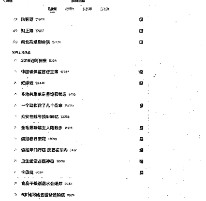

### 做了个噩梦

刚才，我睡了一会儿，被惊醒了，因为我梦到高考要补考，吓得我一身汗。这个噩梦大概每隔几年就会出现一次。

### 我为什么讨厌李嘉诚？

浦东的潍坊新村在 2007 年，被李嘉诚意向收购，当时登上了青年报上，我当时印象特别深刻。我现在那个老虎头，一门心思的等他来拆，等了十年，我日，他跪了！MMP 的那个老虎头。要不是他扭在那里，说不定其他开发商来拆了。现在好了，那个地方成金子地块了。没人拆的动了。

### 今天上午太阳真好

我和菜菜在小区里，给一大摇房产证做了个季度保养，就是吹吹风，打个蜡，忙半天，累啊！

### 七剑下天山

我们的编辑部，越来越疯狂了！

1. 宏观货币菜
2. 塑料棚菜
3. 单位老油条菜
4. 房产菜
5. 留学相亲菜
6. 离婚知名菜
7. 未婚三八值班菜

### 很多人说菜菜三观不正

对女人是“用”，建议女性婚前加名，婚后建立共同财产。我觉得菜菜的建议非常中肯，过了爱情至上年纪的女人，肯定特别同意这些观点，比如我！贫贱夫妻百事哀，爱情给不了你面包，给不了你安全感，甚至连最后一丝丝温存都变成冰凉。

穷是一种怎样的体验？怎么说呢，就是装修的时候为了阳台买滚筒洗衣机还是买一体机，吵的想要离婚的感觉，面对离婚，没有绝望而是终于看到了自由。小小的阳台比不了大平层单独的洗衣房。不是每个女人都爱虚荣，但是坐在自行车后女孩流的泪，都是当初自己选择时候脑子进的水。不是每个女孩都能把苦作乐延续一辈子的，生活无情。最后我也想说一句大多数人都说过的话:菜菜有点几岁了，如果再早些该有多好！

### 回想起年轻时的贫穷，不寒而栗

过了这么多年，现在回想起年轻时的贫穷，我还是不寒而栗，真的太惨了。

主要是工作后没房子，导致吃住都是问题，租了个毛坯房，个人卫生也很难搞好，也没有洗衣机，电冰箱，什么都不行。同行业的婆婆都完全忽略我们，她们要找有房子的。我们几个穷货互相干瞪眼，后来，导致了很多姻缘悲剧。

1999 年初取消福利房，两年后，社会上开始有商品房了。我们没钱买，拼命节约攒首付，后来工资提高了，我们这批 985 本硕呢，才逐步脱困。但是，我们的很多师兄就悲剧了。他们比我们年龄大几岁，实在是扛不住了，向命运投降了，找了个各方面条件中下有房子的老婆。这些人到了四十多岁，已经是顺风八面了，但回到家是苦不堪言的。老婆都是小中专为多，丈母娘都是市区底屋或者农民。

这些年，我们那些师兄弟陆续离婚了。男的都是净身出户。少部分没离婚，因为女方太凶悍了，一离鱼死网破的底是拼命毁势，师兄们为了前程，忍气吞声。离了的，基本不考虑再升了，反正也够本了。一律是喜气洋洋，一般找个二十多岁的，补偿一下。虽然男的是净身出户，但找个男的条件实在是太好了，女方个个都是有钱又年轻，啥也不愁，一般婚生二胎。

考虑前程而离婚的那些师兄，一脸苦闷脸，虽然事业超级旺，但一点也不开心。没房子的男人，真的是人生悲剧。

### 给自己放个假？

我之前往了很多年，身心俱疲，天天想隐归山林。这几年，我彻底放假，什么都不干。我现在冬天和夏天就住风景区，静心黑活，实在是无聊。不做事情，就没有收入，没有人和你勾心斗角，天天发呆。我写微博，主要是为了防止老年痴呆症。

如果你还卖房贷了。四十岁左右，可以辞职休息一下，找个你最喜爱的小城市，一个人租房住3-6个月，体验人生。然后，你会满血活发的回去战斗。

我现在的住的小县，非常漂亮，非常大，但基本看不到人，只有阳光绿地小超市。你可以来体验一下。据了解，小县城的风景区，房租一般是1500-1800元，除了买菜不方便，其他和上海一样。

### 年龄加个零

在宁波，男人年龄，加个零，是他最低的净资产要求。无论是父母给的，自己赚的，你要想带着老婆孩子过上不太憋屈的日子，这是底版。26岁，你至少要有260万（房产或者首付），50岁，至少是500万净资产。

我们是普通人，不要指望什么大富大贵。有本事，你就多摸一点。若低于这个数，老婆孩子就苦逼了。原生态讲，世界上最好的女人，就是和他一起吃苦的女人。

可是，小美自我并不想当最好的女人，只想做个普通的通通的女人。哪个女人愿意，那你找她吧。

### 我个人观点

女性生路不易，嫁人必须先看看经济条件。不说大富大贵，至少小康。在上海有个80平米房子（距离工作地点半公里之内），有个八万块的小车，有个正当职业，这是门槛。过了这个硬杠杠，再看其他的。

- 年龄，长相。
- 学历，脾气。
- 户籍，双亲等。

我劝小美自们，不要轻易把自己白送出去。用过了，就没法提要求了。当然，你家很有钱，你要咋样地吧！

### 每次想到亲媒带孩子的辛苦

- 我就自觉认怂！
- 凡是亲媒的决定，都是对的！
- 凡是亲媒的话，都要坚决服从！


## 作为40岁的老汉，谈几点人生体会

女人是一个家庭幸福与否的关键。大多数男人是不调用的，工资就那么点，也升不上去了，还好吃懒做，喜欢躺摆。男人，除了上班给领导拍马屁，其他啥事也不想干。

一个家庭最大的事情是，买房子，照顾老人孩子，搞好吃穿用，男人什么都觉得烦；都是女人操心。

大多数男人觉得，带孩子，做家务，是小事。女人付出的再多，也根本不在放在心上。男人最大的得意是工资收入比女方略多一点，就整天在家里耀武扬威，称王称霸。

女人超过37岁，基本也不可能怎么伺候了，大多数是忍气吞声，只要男的不在外面花天酒地，基本也就算了，但心里憋屈得慌。

我的想法是：

- 双方互相体谅。男人犯懒，可能不是真懒，而是身体原因。我一直是很勤奋的类型，但现在这个年龄，我觉得自己也懒了，我仔细想想，觉得可能是身体机能下降的问题。例如，不想带孩子出去玩，不想陪孩子做游戏讲故事，不想去看房子，不想折腾，我理智上觉得应该要去做，但就是没有那个耐心。
- 男人犯懒，那就嘴上甜一点。你讨好领导的那套话，留一部分给你家里人，效果好一百倍。单位里那些小领导，不会再给你什么大好处了，你也没个岁数了，想开点吧。女人是吃软不吃硬。你打她一顿，老了肯定会整死你。咱不犯那个蠢事。
- 女人也不要三天两头的翻脸骂。谁家买房子，谁家男人升官发财了，那又怎样？别人家男人这么好，为啥不要你？你心里要没点谱吗？对付男人，骂他不如鼓励他。大事不行，就鼓励他做点小事。胡乱地跟别人老公比来比去，除了夫妻打架，还有什么意思？你不如安安心心，教育子女。孩子争气，你就幸福了。一代比一代强了，那就比下一代。

### 今天和菜姨聊天，说起了几个熟人

- 甲女，农村来的穷姑娘，当了十年的小三，某猎头公司的副总，靠自己的努力和拼杀给机会，自己赚钱买了省城三套房无贷款，完成了阶层飞跃。我不赞成这种感情，但你说她就全错了吗？
- 乙女，明媒正娶的大房，嫁了个二百五男人，老公做生意，把她赚的两个门面都赔光了，婚房也卖掉了，现在申请那租房，我赞成这种感情，但你说她比甲女幸福吗？
- 丙女，省城姑娘，本科，娘家没啥。因为家要高额彩礼，前任退婚。后来，嫁了个安徽农村本村男，彩礼十五万，男方一直是开小公司的，这么折腾没买房，钱全给交了彩礼，现在生了孩子直接扔到阜阳乡下给婆婆带，小夫妻两个在市区租房子。

### 过年感言

我没大钱，但不缺钱。我有个微信支付，绑了菜姨的卡，随便花。

五块钱的啤酒，我一次就是五瓶，不帝眨眼里的。我觉得过日子很幸福。

### 我认为，带孩子是天下最苦最累的活！

我宁愿上班吹空调，工资全上交，也没有勇气单独带孩子。

### 我已经认怂了

神鸵主妇的摆烂生活：今天看到一位网友在找被@菜菜拉黑的同伴，要搞个反菜菜联盟。笑死我了，因为里面好几个都是关注我的。

嗯，什么时候菜菜拉黑我，我也准备搞个联盟。跟很多人吵过架了，没跟菜菜吵过，真是想试试，看看谁厉害。

菜菜：我已经认怂了，你就别闹了！

### by 菜嫂

每个女人都想当淑女、贤妻、良母，但最后都被男人和孩子活生生压榨成了寡妇。

### 深感惭愧，十分自责

由于菜菜持续发文揭露“比特币，区块链，炒股，理财，p2p，中药粉，劣质老汉，吝啬婆婆，国安党中间爷”等各种色，把半个微博都得罪了，深感惭愧，十分自责。

菜菜轻轻抚摸了一下这些垃圾的敏感的心，“乖，不生气了对？”

### 菜菜，你将来说给儿媳加名字吗？

答：十年给一套房，二十年给两套。

到孙儿成年，剩下全部给孙儿。

### 如果哪天我家的准儿媳上门

管中不中意，我会做到：

- 在别墅门口迎接（穿正装）。
- 红包（若干）
- 一大桌海鲜+轩尼诗xo，随便喝。
- 宝马去接。
- 临走给她父母带点小礼品。

### 其实很多很多人，不喜欢过春节！

我在给房产证打码，你们继续！

### 粉丝们叫我说点喜庆的事情

2017年是菜嫂的好年景，但是作为菜嫂的唯一法定代言人，我说过过得好，马上有人来骂我。索性不说了，大家一起比惨好了。

我苦啊，这么多房产证，每套房子里都有五百平米，春节打扫卫生简直就是做苦役，累昏古七了。

### 我为什么想离婚？

男方很自私，看一小时宝宝就喊累，然后放凶宝宝，然后说吃完饭就看孩子，因为我一直没有休息，吃饭比较慢，一会儿看宝宝更不能休息了，结果他吼我吃饭慢，吼了半天。答：我对不起菜姨，我也生这种货色。我家带孩子基本是亲戚，我惭愧！

### 我可是内环线厨艺小王子！

今天，菜嫂家的保姆，中午要陪一群女人们泡温泉，不能做饭了。我一个大老爷们在家看电视刷；保姆大姐问我会不会自己中午下一碗面条，简单对付一下？貌似很鄙视我啥也不会。呵呵，我可是内环线厨艺小王子！只不过，现在，兄弟我的主要任务是良种培育，懒得做家务。

### 任何观点都会被人骂

你说加名字，得罪了屌丝父母。
你说不加名字，把女孩推向未知的巨大风险。
我也没办法了。你说加不加名字？谢谢

### 投诉中心

我这里已经成为家庭婚姻矛盾投诉中心了！

### 菜菜：一声叹息

上海房产专业律师：这几天看了某大V关于女方加名字的观点。我从物权法和婚姻法律角度，说一个不加名字的案例。当初是因为爱情结婚，女方不加名字。婚后第十年，男方老房子遇到拆迁，公婆也不给女方加名字。小夫妻也没买过房，事实上，没有夫妻共同财产，也没有什么存款。因婆媳矛盾，女方一气之下回娘家。男方在公婆的授意下，开开心心的找了个年轻的外地大学生同居，一年后起诉离婚，一分钱也不愿意给。本案结果：1，双方公积金是夫妻共同财产，女方实际只分得7万多。2，孩子归男方抚养（女方没房子，无力抚养）。3，女方每月支付抚养费。女方实际上等于净身出户。结束后，女方在法院门口，泪流满面。

### 我个人喜欢的商业地区

- 广东福建。
- 江浙沪。
- 北京。省城和计划单列市也还可以。

信用度较低的是北方小地方。我不是故意黑谁，而是建议做生意的朋友，如果北方小地方的客户，当场不付款的，你今后就不要花时间联系了。主要原因是，北方穷，付款就像是割肉。同样是做一笔生意，他们占用的时间要比广东客户多一倍以上，且成交率很低。

### 你凭什么劝人买房，凭什么看不起人？

李璇：那些房子一不是你菜菜东所谓菜菜打拼出来的，二不是你们看准机遇投机遇的，不过是命运眷顾的拆迁户，凭什么劝人买房，并且看不起没钱买房的人？海鲜人也可以，但请免先替自己赚，那样才有资格侮辱人，看不上人。

答：我向你认怂了。（你的错别字，我已经帮你改了）。

你，几本？

### 菜嫂要是没房子，你会和她结婚吗？

小蝎子77的日记：菜嫂既然不是拆迁族，没房子，你会和她结婚吗？

答：我和她结婚的时候，她没拆迁，也没离婚，七宝的乡下妹，当时我的社会地位比她高多了。

### 我写微博的大概过程

房产大V这个职业，是我无意中开创的。现在，吃这碗饭的人，越来越多了。

通过货币和金融诠释楼市价值的长期趋势，我是第一人。在我之前，都是涨多了要跌，跌多了要涨，完全是股评员的高素质。很多同学，人生第一次听说m2，应该是在我这里。

当然，还有各种搞笑段子，hi，拆迁族。

我当时就知道，做房产大V是可以赚钱的，以前没有什么收费阅读，打赏，我最多接到的问题是，"我们对上海不熟悉，几乎在上海工作，要买xx房子，你能不能给我们说说情况。"如果我当时要赚这个钱，肯定是赚大了，但我没有赚过一分钱。那时候，我还是高级研究人员；怎么可能给你婆婆妈妈讲你儿子买哪里？

我写微博的大概过程

第一阶段阐述基本经济学，最早的名称就是"经济学菜2010"。但是，没人看。

第二阶段说房子要涨，火了。名字是"菜场经济学家"。

第三阶段是说楼市房价形成的基础原因。名字是"财政学研究"。过于学术，效果一般。本来相安无事，

第四阶段是楼市再调控后，我不谈房价了，有时候编嘲笑凡与不买房子的那批，名字是"菜菜"，我这么写的原因是，避开话题管制，不涉及敏感词汇，但在无形中给你一些经济学指导。

现在，各地的一群中介业余时间当房产大V，想通过骂我这个祖师爷来博出位，我只想说，你的段位太差，经济学基本功底不够，没戏了！

### 菜菜分析

- 为什么买房？菜菜肯定是各种行业都难过耶，各种实体经济喝过苦水后，发现不如房价涨得快，遂恍然而去，一心买房。
- 菜菜的经管类，对M2理解透彻，发现国家一有危机就印钞票，最后这些M2不得不跳去房地产
- 为什么吊烂丝，菜菜一看经济学原理各种公式各种术语90%的人根本看不懂，那不如说点烂丝都懂得，菜场经济学就是通俗的讲经济学，这样更亲民，更有互动。
- 写家长里短是谁呀？家里亲戚是倒逼你努力奋斗，你这一代不行，下一代继续，专心买房，别再让什么块链P2P给您挖了，总有实现梦想的一天

微博作者：九鼎杠杆大长

### 菜菜：这位同学，今后肯定有出息！

### 他吃的是剩饭，我吃的是软饭

单眼皮的黑土菜菜80%的言论我都认同，但是透着一股子谈谈油香的炸屑丝味道，就是那种油腻的感觉。

再看看李湘的老公王岳伦。年纪差不多，同为吃软饭的，他自信且独立地吃着软饭当着老婆唱着歌，不带一丝谄媚的气质，这就是靠养活过苦日子的涵养气量。

而你家某一副—人得道鸡犬升天，跨越阶级后，对于曾经的价值是各种踩踩和鄙夷，究其原因，屌丝不愿回望自己出身贫寒，其实踩踩的是自己的过去，只能说明活明白了一，把牢记确实活明白的老男人，他的修养里其实是带着耀生出身背景的那种印迹。

菜菜：他吃的是剩饭，我吃的是软饭。不一样。

### 菜娘家里人为什么对我看得上

那篇发不出来的稿子。大意是，菜娘家里人对我很看得上。

因为我还在四百万的时候，反复提醒他们，买房买房买房，他们以前不懂金融，被我提醒了之后，终于反应过来了。

现在，他们发了。而附近几个老板越赚越差，除了自住房，基本没什么京沪房产。现在，菜娘家成为工业国里最有面子的小老板之一。

### 菜娘是个好女人

晚饭做了一大桌都是我爱吃的，两个人吃完，她在家吃饭，我在洗碗。菜娘一边包小馄饨，一边看《绝望主妇》。

菜娘每天给我炖一大碗燕窝粥，这玩意真不好吃，像是没放蛋的鸡蛋汤，我和菜娘两个人在家过冬了。这几天不出门买菜，全部是叫人送菜，自己做好吃的。我家人来来不熟食。

### 我这么好一个男人

菜娘对我说：你唯一的优点是从未出轨，否则，你就是个流浪狗了！

我简直差气的要发疯了。我这么好的一个男人，居然只剩下自然属性了，太看不起人了吧！

再说，孩子在幼儿园能爬比赛得了第一名，总有我一半功劳吧？不是说，生男生女看丈夫吗？咋就不算了呢？

### 我和菜娘打架的经历。打过一次

起因记不得了。一开始，菜娘乱抡拳头，我躲不开，就用力推了她胳膊一下，她更加起劲了，发了疯一样打我。

我实在是没办法了，就采取了武术动作，半蹲下，左手挡在雨点般落下的乱拳，右手直接推了一下她的上腹部，不是拳击，就是手掌推。

但是，我那一下那个后悔了，这是我的妻子啊，我怎么可以打她呢？

于是我转头逃到小房间，锁门。结果，菜娘硬吃吃亏了，开始拿凳子砸家具了。我认怂，出来自首，又挨了一顿揍，再也不反抗了。现在，家具上还有几个坑坑洼洼的砸坑。

### 蔡嫂一点也不珍惜命

像我这样的大V，一般人花钱请我出台，我都不理会。
蔡嫂一点也不珍惜，经常叫我去切肉戳片，抓蒜头，倒垃圾，还打人。
我严肃警告蔡嫂，你要再打我，我就去三嫂睡了。让你一个人，凄雨冷风中，呜呜呜的哭！

### 如果你的父母没有成功过

[蔡总原创]
如果你的父母没有成功过，不是土豪，没有处级，就永远不要听他们的。
他们这一辈子就活在了底层，接受到的所有信息和价值观，都是最劣质、最容易贫困、最斤斤计较的。貌似明白古便宜，实际上一生悲催。
举个蔡嫂家的例子。
某嫂家里多年前新开了一个生意。第一年做，我也参与了，我以决策失误，最后赔光了全部家产，还欠下巨债。我是当事人，吓得浑身发抖。蔡嫂他们家根本无所谓，我以为我进到老鼠家了。
文母娘对我说，确实大亏，满仓库都是卖不出去的产品。今年卖不掉，明年就是老货了，也没人要了。家里没钱了。但你相信我，明年肯定发财。我以为他们全家是骗子，只想自己的几十万元回来。
第二年，文母娘确实发财了。但还是没有弥补第一年的亏损，第三年才打平，以后就发财了。
然后我去问老丈人，你不怕吗？老丈人说，我已经告诉你了，我肯定会赢的，你为什么要怕呢？
我说，第一年亏了二十多房子，你让我怎么相信你？老丈人和我说了原因。你看三点：
1. 开工卖货，最重要的是销售。必须有无数的小商户给你拼命推销。把你的货摆在他们店里最核心的位置。所有的营业员都赞美你的货。但是，你怎么让他们死心塌地的这么干？
2. 让他们赚钱。赚到他们满意。于是。第一年。我们拼命地生产。不管什么型号，什么品种，全都是过甚了百倍在生产，目的只有一个。让小商户要什么有什么。没线进货直接联系给他们，确保他们首次合作就发财。
3. 小商户赚钱很难，好不容易积累了一个大电厂，让他们发了财。第二年就彻底死心塌地了。
我们第二年连买我的钱都没有了。但不要紧，赊购暂存。你还没发财吗？交二十万预付款。钱就来了。打开了销路，占领了货源，取得了对方信任，你还会穷吗？
穷人和富人，是两种思维价值观。

### 女人的家庭地位是苦干出来的

蔡嫂说，女人的家庭地位，是苦干出来的。
家务做得多，小家电的好，工资收入多。家庭地位就高。
否则，女人就在家里没地位了。

### 蔡嫂现在是成功企业家了

其实，她的水平不一定比别人高，只是练的久了，练出门道了。
十年前，她就开始干全业了，可想而知，基本是赔钱。有的年份，可以一次性赔掉了几套房子。
但是，没关系啊，有文母娘贴贴，赔了再来。熬了十年，和她同期创业的都不做了，老一代的慢慢退了，她就是那个行业有经验的老板了。
现在赚钱了。她说，这么多年，把所有的坑都踩了一遍，现在基本不会犯傻了。如果你没有

### 菜菜免费围观了倦窗闵的回答

- xxxjj 辟止：菜菜是你小号或者你是菜菜小号吗？
- 桦跟闵：自从菜菜这个号在微博上走红后，很多人都会问，你是不是菜菜？这样的提问不止在网络上也在线下也遇到过多次。

为什么这么多人会认为我和菜菜是同一人？原因可能是有段时间我们在微博上一唱一和，我认同他的很多观点，他也认同我的一些意见。

不过，我和他之间的分歧比一致还多。原因很简单：我是硬盘，而且他的房本比我多的多，你说我们能一样吗？硬盘的玻璃心是很严重的，我是博士，房本却没他多……所以我特别反感他说我们硬盘的坏话。不过，考虑到菜菜擅长埋单这个特长，我就能忍受他在微博上对我的各种挖苦。

感谢网络，把我们两个原来八杆子打不着的人都能串起来，让大家能够脑补一个内线星穿着军大衣你摇着房本的场面。如果没有微博的话，我们是这个世界里永远不会有交集的两个人，更不可能聚在一起喝瓶酒啊。

如果我用一句话来描述，菜菜是我遇见过的最真诚的微博大 V，没有之一，喝酒霸气，埋单爽快，快到其他人没有机会出手。

另外再说一句，我一直觉得菜菜这个 ID 太难听了，没有以前的菜场经济学家好。希望有一天他能改回去。

### 据了解

有不少开发商，土豪和女星也是晒着我的微博。

### 菜嫂最符合我的审美观

我从来不出轨。因为菜嫂最符合我的审美观。我觉得，没必要去抗别的女人了。

人离婚，约了之后，少有点想法和要求的。男方不要以为，天底下有小贱白免费送她的事情，不可能的。再说，你用过的女人，以后如果过得好，你心里肯定也不好受，但也无能为力帮忙。这简直是折磨自己。想来想去，算了。

### 大家有什么高兴的事情？

说出来，一起开心。

我家今年运气不错。孩子得了小奖状，菜嫂公司业务也正常。我也没什么事。

我明年考虑搬到外环线去了。因为孩子住惯了外廊电梯楼的大别墅，嫌弃我内环线房子小的像个小狗拴，我气得没话讲了。

### 我和菜嫂的日常

相比菜嫂，我没什么钱。但是，菜嫂也不在乎，反正我们两个拖了孩子去晒父母娘家的钱。

菜嫂对我还是很满意的。

我从不出轨，什么事情都让她。结婚这么多年，只用手捶过她一次，结果她把家里的门窗全砸了，还要找人去修，很麻烦。以后，我就老实了。

金钱方面，我没什么大的开支。买房子丈母娘出钱，写我和菜嫂的名字，一人一半。写孩子名字占房屋，也就算了。

我日常还看一些技术方面的书，虽然已经是中级职称了，但也不能躺在功劳簿上，也要与时俱进。万一有什么事情，我还可以赚点工资。当然，目前上班的事情不太急迫。工资再多，也买不起房子。

我发现，女人嘛，男人对她关心，她还是明白的。没钱就多让她一点，说好话。有钱了，也不要欺负人。

### 得罪人了！

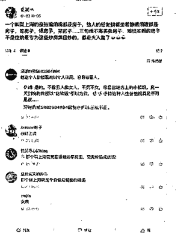


### 我从来不炫富，因为我不想刺激别人

有个屌丝说自己有一件五干元的羊绒大衣，莱莱掏定买不起，他一定是省吃俭用还贷款。好吧，你要炫富，咱们就谈谈理想信念。上海你家用电梯就那几个大品牌，咱不说了。请问上海最好的家用电梯装饰门，是哪个品牌？你设注意力不素莫，今天是周末，你去看一下啊！

### 我们家教次的买房情况

买房一般是我提议的，莱莱是娇娃娃，对买房不感兴趣；一般就数衍我，那你先看起来走吧。我说，周末带孩子出去微散心，顺带看看房子。

于是，我就带她去看。买房是女人的原始本能，看看看看，她就来劲了，比我还激动。原本五百万的投资预算，她就连成一千万，两千万了。然后，回去找我母娘要钱。

丈母娘一开始有点肉痛，菜嫂就把她带过去看。女人都喜欢看房子，最后就比较爽快的刷卡！当然，这必须是正好家里有点小钱。

女人一般比较计较，买了个大件，都要亲点燃点心心里才舒服。于是，我的私房钱就被抢走了，美其名曰，给你加名字。其实，婚后买房，加不加名字都一样，以为我不懂的。

### 我发觉自己耐力和力量，越来越不行了

今天，寒风暴冽，我骑个小黄车去办事，那地方没有停车的，只能骑车。来回8公里。说说感受。

- 这个自行车起的实在别怪，用不上力气，浑身是汗，再被冷风一灌，前胸后背，温暖衣服，惨的一比。
- 一路上，有几次都要吐了。因为我一吸入冷空气就像喉咙进流，在空调房里啥事没有。估计是气管炎。
- 我骑了四十分钟后，腿都软了，不听使唤了，走台阶的时候，差点摔在地上。
- 因为我是短发，出汗后，被冷风吹的偏头痛。
- 回来后立即洗了个热水澡，才算活过来了。

你们冬天骑车吗？

### 男人都挺抠门的

我看来菜婆买各种漂亮没用的东西，心里觉得是浪费。

例如各种1k的首饰，子是好看，但也没啥用。还有各种珠宝，美又美不掉。再说买碗，普通的也就几块钱，她买的是近百元一个，而且买了一桌的碗。再说买衣服，几万几万的买，何必呢？假如我当家，立马给她做媳妇，色气必打一頓：

### 嫉妒的我情绪失控了

刚才，恰巧看到某几个老友，网上公示了，嫉妒的我实在是情绪失控。

一气之下，我去菜市街买了两片花蛤，两片蛏子，一斤鱿鱼卷，煮熟取肉洗干淨，爆炒了一道麻辣小海鲜，一边吃海鲜，一边喝闷酒，实在是嫉妒的我不行了，抓起一把花蛤的壳子，直接扔到 了隔壁的窗外。

### 我一生的问题都献给了微博

我在生活中是个非常严谨的男人，一张没有表情的高级版国字脸，说话慢条斯理，一句一顿，逻辑清晰。但是，这是装的！我初中中的时候就是班级里的段子手。本来以为就这么平平淡淡

### 我和菜嫂，有很多事情，意见不一

- 她喜欢郊区别墅，我喜欢市区大平层。
- 她喜欢全通透，漂亮。我喜欢隔成一间一间的，暖和。
- 她希望孩子读高价学校，我希望和卖水果的dd端人口打成一片。
- 她喜欢一条摆满餐具，我恨不得把铁锅端上来，可以小洗几个碗。

谁喜欢我？


# 菜嫂看不起人

菜嫂今天发神经了，对我说：如果你一个月能够挣八千块，就好了。

朋那！我是中级职称，那么看不起人，我是不是要和她离婚？吃完饭以后，我又仔细想了想，为了孩子，算了，不和女人一般计较了。

## 女生越漂亮，过得越好

菜嫂说，毕业十年发现个规律：女生越漂亮，过得越好！

## 因为没给菜嫂点赞，我被家暴了

刚才和菜嫂打了一架。起因是，菜嫂在微信朋友圈发了照片（原文“她”应为“发了照片”或类似语境，此处根据语境推测为发布内容，但保留原意“她”可能指代她发的动态），我没点赞，而且是连续好几天没点赞了。菜嫂由此点燃烧了怒火，认为我不尊重她的劳动（摄影技术），不喜欢孩子（没点赞），对家庭不负责任（没点赞），balabalaBlublu，差不多就等于卖家疯了，我暴怒之下，操起一把小桌子，直接扔给菜嫂：你打我吧！

## 菜嫂要给我换玛萨拉蒂，被我拒绝了

菜嫂要给我换个车，玛萨拉蒂也就一百多万。但是我拒绝了。

我主要是穷惯了，觉得每年的保养得好几万，太贵了。当然，主要原因是，我时不时要和盖章的人打交道，不希望他们认为我好像发财了。

我的定位是，比你收入多一倍，但我要冒点风险。这个定位，不会引起反感，人际关系好相处。

## 很多粉丝让我教点好的，不要教坏的

- 我一直劝你考985，你太蠢，考不上。
- 我一直劝你买房，你太穷，买不起。
- 我一直劝你卖卤菜，你怕苦，不想去。
- 我一直劝你找个土肥圆，你嫌人家丑。
- 我一直劝你摆阔拆迁袜，你太丑，摆不住。
- 我教你怎么占女人便宜，你说我不教人点好的！

那你想学什么？

## 我有个痛苦

冬天吃一大碗热面，马上就浑身流汗，汗凉了，内衣就湿漉漉的，特别是前胸后背贴着湿衣服，人就很难受，咳嗽。我现在是吃完就换件内衣，好麻烦啊！

## 理论上讲，我的零花钱还是比较多的

因为数年前，菜嫂给我一张银行卡的副卡，几十万肯定是有的，但我从来没用过，现在都不知道放哪了。

实际上，菜嫂给我微信支付转1-2块钱的零花钱，我觉得基本够用了。像我这样的，确实没什么花钱的地方。我干净得就像是矿泉水，花钱的事情，一样没有。

## 你是什么阶层，我清清楚楚。

- 骂我的，基本是屌丝。
- 问我的，基本是中产。
- 赞我的，都是房东啦！

## 破案题

以菜菜的写作风格，推断其以前从事的岗位和专业。

## 建议取消高峰期让座

我建议，公交地铁在高峰时间，取消对退休老人让座的要求。

现在，无休无止的让座，已经变成了老年人没事闹延的依靠，反正上车就有座位，心安理得，无谓增加了许多不必要的城市交通负担。年轻人其实也很累。

## 点外卖在家请客，算不算失礼？

问问，现在找个知名餐饮公司，例如海底捞，点一桌外卖在家请客，算不算失礼？

## 不炫耀大房子，心里憋屈

迟入手了个大房子，独栋，花园两百平米，要不邀请一醉亲戚来吃饭呢？我担心差距太大了，他们以后找我借钱。但是，不炫耀一把，心里憋屈！

## 骂我的粉丝，拿得出一百万现金吗

我研究了一下情况，估计骂我的粉丝，绝大部分是拿不出一百万现金的屌丝。就这档次，居然还嘲笑我，真是气色特我了。

## 关注菜菜的后果

自从关注了菜菜，我不想吃零食，不想买衣服，不想买护肤品，不想旅游，只想存钱买房子了。

## 菜嫂从娘家骗来的钱，应该有我一半

女人买个3-5万的包包，我超过三年思想斗争，已勉强接受了。现在，又升级到5万多元的大衣了，这次不能忍了。

我觉得，我还算精神状态正常。但菜嫂说我不正常：是她从娘家骗来的钱，又没花你的钱，但我觉得，既然骗到钱了，就该有我一半，这件大衣有我的2.6万元，大家觉得我是不是正常？我也糊涂了！

## 我是怎么在大宾馆占便宜的？

我在家吃早饭，热腾腾面包+煎鸡蛋，五分钟解决。但在酒店这么吃，我太亏了。我一般先乘一碗小馄饨打个底，半盘炒炒面，三个煎鸡蛋，或鸡爪五个，培根三片，豆干炒素半碟，小紫薯（吃半个扔半个），再来一盘水果+千岛酱，喝一杯茶，走的时候，手里再拿两个橘子，你噻？

## 盛世房产乱世金，跑路时刻靠人情（2017.11）

金融圈的房丝们，用自己的世界观，推测我焦思想，难受啊。

呵呵，这倒没有！我这赚钱都不感兴趣了，我还焦虑什么？我唯一担心的是系统性风险，也就是什么灰犀牛之类的洋名词。这是可能的。就像高速公路上，公交车的刹车坏了，司机不说，有人感觉出来了，但不敢说。多跑一天算一天。

我也做了准备。任何大的变化，总有个发酵的过程，我的经验，足以感觉到变化。春江水暖鸭先知，我们软银界，别的事事不行，慕容预色，盲目拍蛮，轻狂负量的本事，是与生俱来的。有情况，我会你还在没反应的时候，直接就撤了干了。

盛世房产乱世金，跑路时刻靠人情。我这些路路都安排好了。我更加担心你，就怕你天天加班，后知后觉。烂的一下，落雨了，还不知道！

## 我们的 2040 年

房丝只对对自己有利的判断，愤怒指责所有对他不利的预判，这种愤怒会长时间积郁在房丝胸口，非要喷出水火爆发的怒气，才能慢慢平息。

年至一 年，房丝很快到了五十岁。在松江方松街道老破小的出租房里，老东西戴看一条腿的老花眼镜，拿起华为 mate7 手机，哆哆嗦嗦的继续批判菜菜，你当年的预测是不符合经济学基础理论的。我要继续负打你！

老家伙的话传达儿媳妇的耳斤，“你个老东西，上海租了二十年了，咋就没盖房呢？孙子读书报名都不行！拼房。”

粟粟那天正赶出门，穿上就过的黑色西装，去参加 reiz 基金的董事会。在漂亮小车后排，打开iPad，正好看。不由得，东亮一笑百媚生！别写了，认命吧！

## 我没有撩过女粉丝

我写微博这么多年，90 万粉丝的大v，但我没有撩过女粉丝。

我若撩过谁，可以公开我的私信记录。

撩妹都是广撒网的，不可能都搞定的。

做人就是要干净，撩我的还挺多的，我有自知之明，咱没钱就老实一点。伯爵有钱，可以去撩他。

## 菜菜买房，从来没有过钱

商里吉：菜菜首付是自己赚的还是家里支持的？

答：我买房子，从来没有过钱，都是加名字的。惭愧！

微信：1614180098。

## 我不否认我是瓦宁

但我也滥亦有道，虽然骑了莱媒，但也善待人家，认识这么多年，从来没有打骂老婆，莱媒和我在一起从来没有洗过碗，都是洗碟，我还经常换筷。

当初认识时，我少报了六岁，茶瘦不知道，后来发现差了十岁，丈母娘差点气昏过去，但，为时已晚。

哈哈哈！没事，老婆都是骗来的！

## 我不太喜欢少数上海人

我是上海人，但我不太喜欢少数上海人，他们身上有一种“懦弱卑微的冷漠和傲慢”，工作中非常怕担责任，倒也不贪钱，就是推三阻四，刁难别人，最好别来找找。

你敢和我理论？呵呵，藐视我的权威多？好，我就采取一百种办法让你难受。

让你办成，我不敢说，让你办的不舒服，有的办法。

还不如知的地方，明码标价，直爽无欺呢！

## 孩子都不知道上海小吃是什么了

我是土螯，最喜欢小馄饨和油条锅贴。

但实际上，这种小吃不安全，现在卖的早点，馅馅里面肯定应是加了香精的。

亲戚给孩子吃的是：两片烤面包（又热又脆），一个煎鸡蛋，一片肴椒，一点色拉蔬菜。而且很方便，几分钟就搞好。

再这样下去，孩子都不知道上海小吃是什么了！

## 古代为什么没有荷包蛋的记载？

问个奇怪的问题。

为什么中国古代小说里，几乎没有荷包蛋的记载？

煎蛋只熏要油，应该是很简单食材。

另外，我发现，用橄榄油煎蛋，不太粘锅。

而一般的食用油，粘锅厉害。

## 我体会过贫穷，那是一种真正的绝望

当年，我大学毕业，一个月才一千多元，房价是20-30/平方，永远买不起房子。我租住在内内纯的小平房里面，一个月150元。那个年代，没有交通工具，附近也租不到什么好房子。

冬天彻骨寒冷，导致我些大学毕业后，患上了慢性支气管炎和慢性鼻炎，经常嘴角开裂，手上裂缝冻疮，头发旋今的，早上在简易厕所里，屁股冻得僵硬。

洗衣服，吃饭，都是凑合，因为实在是没条件。

那时候，我对人生的看法是灰暗的。我觉得，市区五十平米的老破小就是天蓝了，而我冬天只能住在玻璃碎的屋子里（附近没有配玻璃的）。

我才读懂这：我写的论文，主编辑不签，因为我们那个年代的主编，都是文较大专出身。领导也不看，因为都是高就公式，看的就心顺。单位里，年龄相当的同事们，大多是竞争关系，互相提防，而我没钱没房没关系，生活基本都是入绝境。

这是我工作前三年的真实写照。超过一年的贫穷，就足够摧毁坚强意志了，那时候，我已经意志消沉，失去任何信心了。现在的房东比当年幸福多了，至少还可以住在有暖气空调的出租屋里，没有体会过冬天，冰水手洗衣服的痛苦。

后来，改变命运是市场经济，中国经济背也不能走回头路了。

## 贫穷，不会锻炼意志，只会摧毁意志

恶劣的住所，垃圾的饮食，普通人容易得病，体质差，脏兮兮，抠抠索索，思想容易偏激，语言容易尖刻。

在现在这个社会里，贫穷根本吃不开的。

在贫穷的环境中，你要花费大量时间，解决吃饺洗衣交通，疲惫不堪，哪有精力去考托福，考职称，搞人际关系？那那。

## 我不认为，菜佬单间拯救了我

更多的是，互相帮助。我没钱，但我见识还可以。菜佬有钱，但忙于企业杂事。

近十年，是风云激荡的十年。总体而言，传统小制造业，急剧萎缩。担保拖欠，遍地开花。集资理财诈骗，层出不穷。淘宝推广的“不赚钱做大会”机制，无数人中招。楼市急剧崩溃。大制造业向三四线转移。劳动力成本飞涨。

回头看，多少大佬倒在在了坑里。这真是一步走错，万物不复。而这些变化，我基本预测到了，至少比同行早准备了一到二年，侥幸躲过。

十年前，菜佬家是圈子里中下水平，现在前三名水平了，关键得益于几次大的思路调整。

- 一是不积极参与房地产，压根不知道房价也有上涨，但根本不知道，这几年间，拿了高利贷进场，资金链断裂的首轮开发商，遍地都是。
- 二是不分散投资，聚焦客户。
- 三是严格收款纪律，宁可丢失市场，也不赊账。菜佬在五年前，因为严格收款纪律，基本丢光了老一代打工山建立的市场。那段时问，天犬萧条，元气大伤，但是活下来了。现在的市场比五年前还大了。这几年还是搞大腺酸的厂商们，基本死光了。
- 四是绝不互相和担保，建立资金防火墙。
- 五是坚持线下推广，绝不去淘宝。
- 六是绝不理财集资，不碰金融。
- 七是不做三友。

这些大调整的思路，在我以前几年的微博里，是一以贯之的，老翁粉一看就懂。在进入调整的最初几年，真的是山穷水尽。但是由于敢于京产房地产做底气，我们坚持下来了。现在，我的软饭吃的越来越好了。

## 我家的五年大调整

我前一条微博说的七个大调整，表面看，都是防守收缩，保守谨慎，但最后怎么就赚大钱了呢？这其实是也当 initial 会议，多数人反对的理由。

其实很简单。大势看多，市场总需求没有变，普通人有钱了，中高端需求甚至还扩大了。以前不太赚钱的原因是，企业互相杀价，最后，市场只需要 10 件货，各企业为了争夺扩大市场份领，盲目生产，最后居然生产了 20 件出来，最后卖不出去，急眼了，搞赊销，大减价，最后大家一起完蛋。

这个弊端，大家都看到了，但是不敢调整。因为一调整，市场就丢了。人家都是赊账，你搞现款现货，客户谁谁一下就到了，你的大量产能就闲置了，工人没收入了，原材料供应商也看不起你了。市场上会谣言四起，菜某垮啦。

我坚持调整减产，游说了很久，也无法说服家族里的其他人。五年前的一下天，我撂下一条心，破釜沉舟，只能说，把欠款客户全部得罪光了，人家主动不来了。这导致企业无单可下，自然也没有什么库存。那一年，我们这个圈子非常惨烈，我们生意少，结果是小亏，友商们生产的多，卖不掉，结果是大亏。我们周围十五个同类厂，主动关闭了十个。大家进入悲催的调整期。

因为我们生产少，税率溢下来了，于是，家皇慢慢接受严格财经纪律的调点。为了防止死灰复燃，我又干了一件混蛋，新买的几百万设备，以废品价格卖掉，这样，董事会其他人就不可能趁我不在的时候，盲目生产了，就常想跳楼，也没东西除出去了。这也是我天天写微博的原因，我就卧在厂里，顶着霍平，谁敢违反纪律，我立马踩翻车。

又熬了一年，周围剩下的企业，只有两个了。原来的第一名企业和我，销售规模差不多了。第三年，其实市场很好，但是合作的零售商精转昌废了，大部分转行不做了，导致我们只是小赚。第四年发大财了。第五年全部恢复大赚。

## 以后，我准备搞学术了

- 不说败子了！ 大家说，搞哪个专业？

## 不要和我比，我就是个吃软饭的

- 我家买的房子，都是外地便宜房，都不如京沪老破小。 我们时间充裕，就是图个高兴，图个漂亮。 展丝们不要有想法，我也没什儿钱，就是个吃软饭的。 你和我比，你降低身份了，没必要！

## 我是不是优男

- 我把它功夫都花在表里面了。 讨好蔡嫂闺蜜，讨好丈母娘的七大姑八大姨，讨好各种亲戚，开车接送，安排餐饮，积极买单。 别看是小事，管用。 大家都说，我也不出轨，没理由踢我，对伐？ 我一直滴滴蔡嫂，我这么优秀，出去上班，肯定有女人变勾我。 蔡嫂一听就上火了，喂，不上班！

## 我是怎么拒绝婚前协议的？

- 老丈人的律师，无事生非，主动给老头提供了一个文本，让我签字。 我当时表明态度：凡是菜嫂名下资产，丈人认为是自己的，那就变更姓名家回去。 我资助们十万块钱，就当我是改名后的稿费了。 我和菜嫂自己养活自己。 老丈人顿时无语了。 于是，我就幸福的吃上软饭了！

## 避免短信骚扰，一点零花钱转移他行

- 尊敬的工商银行领导： 为了避免我行无休止的短信骚扰。 我已经把我所有零花钱，160万元，全部转到农业银行了。


然后用华为的磁手机把工商银行的短信号码拉黑了。

这样，我们都不用再联系了。

为了短信骚扰的事情，我投诉了无数次，根本没用。

现在，我居然自己解决了。

大家来鼓掌！

# 我是微博上最廉洁的大V了

八年河边走，从来不湿鞋。

从来不拿群众一针一线，两袖清风。老老实实做事，干干净净做人。

大家看给我评个什么级别？

## 我内心其实是个事业男

我这辈子其实很失败，我过上了非我本意的生活。

我内心是个事业男，可惜，天不遂人愿，明明可以靠技术吃饭的，偏偏要靠脸说话。

## 内环线的诱惑太大

莱娜认为，内环线诱惑太大，万一哪个狐狸精把我勾跑了，她有点不能接受。

所以，希望我去郊区住大一点的房子。

我没什么郊区经验，请问住在别墅的同学：防虫和花园蚊子怎么处理？

## 快来排队夺莱莱

这些年，莱莱改变了很多。

他强化了内环线的思想意识，拉高了折返妹的行情，深化了上门女赚的积极含义，为广大二三四五六线屌丝，指引了光明前途！

建议提名，孙冶芳经济学奖！

## 莱莱我啥也不干，就完胜你

近三年，创业的收益率，肯定远远不及在大城市买套房子。

你看我，啥也没干，又完胜你了。

服不服？

## 莱莱教你油煎荷包蛋

油煎荷包蛋。

95%的女大学生是做不好一个完整的荷包蛋的。

悲哀啊！我就教最简单的办法。

厚底锅，干烧到发烫轻微微冒烟，加一点油，锅得满手表面，打入鸡蛋，加锅盖后立即关火，不管了。

12分钟后，一个完整不粘锅的油煎荷包蛋就做好了。

千万不要手贱，去动没有成型的鸡蛋，时间一到就好了。

## 鼻炎治疗

二十年前我得过鼻炎，后来好了。
前不久感冒，鼻炎复发，很痛苦。
经推荐，在京东买了一小罐海水，喷鼻子，喷了两瓶，好了。
这不是药，就是纯的海水。
后来我查了一下资料，其实医院洗鼻器也是这个原理。（不是药，就是盐水洗鼻腔，有效果的。）

## 买千万别墅，就为节约一万多块钱

女人是怎么思维的？
蔡嫂前不久在外地买了一套千万别墅。
结果，她最兴奋的不是房子。
而是，。家里去年装修搞错多买了一套窗帘，这次派上用场了，可以节约一万多块钱啦。
蔡嫂幸福的直跳！

# 240平米宅，使用成本可不低

- 一是物业费 4-6 元/月，加上产权车库维护费，100 元/月。大概 1-2 万。
- 二是房产税，约 2 万元/年。
- 三是水电气是老破小的 2-3 倍。
- 四是打扫清洁成本高。
- 综上，8 万元/年是常态。

## 3500 万大平层与老破小的距离

世界上最远的距离，仅仅只是隔了一个小区！

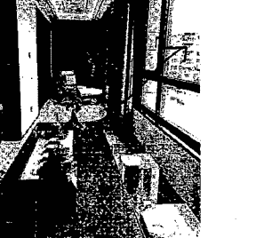


## 就算被揍，我也经常教育菜嫂

菜嫂是拆迁妹。
我经常教育她，人没文化不要紧，但要听话。
结果菜嫂还不服，搞得我经常被揍，但我气量大，也不想剌弄她。
没认识她前，我日子过得干算波，认识她后，算是过上了无忧无虑的生活。
这年头，黄鼠狼专咬病鸭子。
点背的时候，一个接一个的倒霉事，把我彻底倒霉了。
菜嫂算是救了我一把。

## 去三亚的消费

初二后，去三亚的消费。
1. 全价机票，来回每人 3000/人。
2. 宾馆，二室一厅，2800 元/天。
3. 餐饮，全家，500 元/天。
4. 交通费，200 元/天。
我去年住了十天，大概开支七万。

## 我和薛之谦的区别

我和薛之谦不一样。
他吃饭，是真吃。
我虽然也是吃饭，但本质上是啃老婆，只不过占了女方父母便宜而已。
我们软饭界内部斗争还是很激烈的。我和他们不一样。

## 菜嫂为什么嗓门大？

你看啊，一个闯行七卖的乡下女人
这么多年来，居然敢对我这个黄浦男，指手画脚，颐指气使的，你说气人吧？
但我也没办法！她娘家房子多，出钱多，生了孩子不要我出一分钱。
女人闹得多还是说道理的，至少在家里可以放的理直气壮。
睡老虎总有一个强大的娘系！

## 大家嘲笑我吧

昨天吃了一个外卖的牛肉火锅，今天鸡减了一把，就者原来的锅底，自己买了牛肉，切了薄片涮火锅。最后发现自己买的牛肉片根本吃不动。必须是买火锅店的牛肉片，涮出来才好吃。都闷大了。为什么啊？

## 菜菜挺进“财经博主”第四名

我排名第四，实在太荒唐了。9 月 7 日 00:03
微博是不是没人了？我的水平不足以达到全微第四的程度。我就是个小道比！

## 实业篇、家庭篇、杂录篇

(2012年—2020年终)

## 免责声明

本文集内容全部摘自于网络，嬉笑怒骂皆成文章，信则家兴富三世。城里套路深，凡事要认真，入市有风险，投资需谨慎！

这是一本屌丝逆袭的百科全书。

请务必管好你的钱袋子。

老菜友 水滴
2021 年 4 月 16 日
