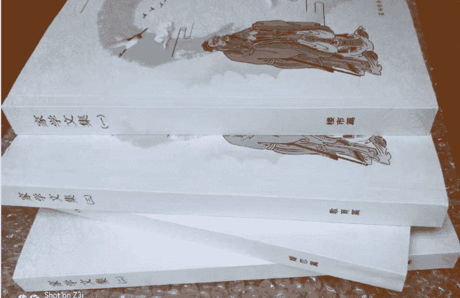
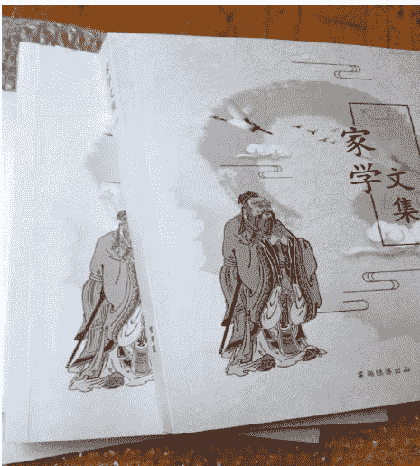

# 水库家学知识启蒙特辑

## 家学知识启蒙篇

### 家学

就是家里传男不传女的那些技能。49 年后长期臭臭政策，近三十年文凭决定一切，导致几千年的家学传统，彻底丢失。家学一般有两种，一是罕见技能，例如某个小语种，螳螂拳，烤鱼秘方；二是为人处事原则。现在我慢慢看到，很多富裕阶层已有意识在恢复了。好事。

**中国有一种学问：家学。** 这是口口相传，秘而不宣，真实存在的。就是祖上世代代代对人生的经验体会，涉及方方面面，包括如何做学问，如何安身立命，对外怎么说话，对内如何管家，如何选择机会，如何对上对下。一般人都不承认这个事情，但你可以看到，很多家族不管朝代更替，真的就是人才辈出，没办法了。

**家学文化心理，几百年没变化。** 你看明清小说对人性的表述，三国，水浒，官场现形记，看张爱玲对老上海人的内心独白，看蒋介石的日记，看钱钟书的围城，和现在的人心，就是一模一样。最苦的就是农二代，种地的家学用不上了。屌丝总认为别人和他差不多，精英就是运气好。如果你真有这个想法，你真完了。

家学遇到的事多了，37 年抗战，一切归零。52 年公私合营，一切归零。老运动员了，经验丰富。保命办法多：一是细细的金币环留几十个，没钱了就卖一个。二是家学要传承，三是认总耍快。四是打死不咬别人。

**【家学传授】** 包罗万象。为人处事，工作学习，生活婚姻，餐饮养生，购房买地等。你在走廊上看到一把手，怎么打招呼。你和各色人等，如何相处。如何面对危机，如何摆脱嫉妒到仇恨的人。如何营建房产。如何保育幼儿。各家的体质适合什么样的生活规律。如何考试。如何安排休息时间。现在这些知识都没了。

**【家学】。** 近代普及了大学制，私塾传授断绝。学校优点是低价快速标准，适合技术部门。但对人对事的研究和看法，被彻底删除了，只剩下高大上了。单纯灌输环境中出来孩子，很难适应社会真实一面。大学生进单位第一年表现，就决定了人们对你的看法，今后很难改变。很多没有家学传授的孩子，吃了大亏。

现在的所谓周末私塾，我很反感，穿个中装，装神弄鬼。家学传承，绝不是背三字经，是类似于举例教学的东西。父辈按照孩子的年龄，有计划的补全孩子各个方面的短板。小时候，是性格养成，营养健康。中学时代，是学习方法，身体锻炼，情绪控制。大学时代，为人处事。工作后，分析人心，寻找财富渠道。

家学。两个孩子站一起，你一眼就可以分辨出，工人家庭，暴发户还是良好家庭的孩子。气质是长期养成教育的结果。有的屌丝父母把孩子当猪养，吃饱穿暖就好了。优质家庭，把孩子当璞玉来打磨，每个细节，反复操练，起笔，铺子，落子，横竖点捺，处处讲究，不露痕迹。无论时代变迁，这种孩子翻身最快。

中国近代史翻云覆雨，权力和财富，无法传承。清末民国的高知家庭，自发研究家学传承。

这东西是口口相传，不断丰富。无形的部分，被传下来了。但数十年来也删掉非常多。文革时期，祸从口出，多数家长只敢不说。海外华人，文化环境变化而断代。现在，高考决定一切。但这学问不完全是糟粕，大家思考。

前面说的都是大道理，其实不管用。真正的家学，是针对每一个特殊场景，险中求胜。这不是几句能够说的清楚的了。但有一句话，你可以体会。成功的家族，更懂怎么成功。他们看多了自己和竞争者的伎俩，就算是过年去送茶叶，你送不出去，他就能送出去。你有啥办法？你根本不懂怎么去做茶叶。对伐？

屌丝好像很喜好听秘闻。其实也没啥的。无论啥段位的人，除了办公室和大楼的档次不一样，其他思维方式，基本接近。只不过，高段位的人考虑得远一点，顾虑多一点。一般人想问题，基本是现开销，也不考虑别人的感受。高段位的人，往往是先考虑上上下下，今后一年的影响，经常委屈自己，保持平衡。

说个直白的干货。你为啥送茶叶送不出去？因为第一次去，必须有人带着去，你可能想不到吧。你硬生生过去，十有八九是不行的。除非本来就在对方的很满意，想拉你一把，但这种情况是极罕见的。（这算是隐性知识点了）

秘闻，我在家学中看到的，现在已经没有意义了。一百年前没有味精，餐馆如何炒菜提鲜？一是便宜办法。蛏洗干净，晒成干，磨粉，当味精用。二是海鲜提味。例如瑶柱，小鱼干，晒干，捣碎，当味精用。没有开过餐馆的经历，只是作为传闻记录。

**【家学，如何处关系？】** 人在社会谋生，上下左右的人，需要相处好关系。你要经常琢磨对方的需求在哪里？就往这个方向上着力。一般情况下，你部能直接帮对方解决，但可以通过语言，小礼物，去赞美奉承对方。与你没利害关系的人，可以适当地场合，为他小小的造势，但要注意，不要得罪他的竞争对手。

两个年轻技术人，甲是水平高过乙，但斤斤计较，非要价格满意才干。乙是一般水平，不太计较，小赚点就行了。前三年，两人收入差不多，甲比较闹，乙比较苦。三年后，甲越混越差，乙发大财了。因为新客户一看，乙做过那么多项目，自然就服了。甲的项目较少，新客户不信任，生意比较冷清。你说这是哪啊？

如何赚钱？你先让别人赚到钱了，别人就会不知不觉中使劲帮你赚钱。

（一代为一代，这就是家学传承。为人父母，就要自我牺牲，勇于牺牲。）

厨艺也是家学的重要部分。家族健康，孩子成长，功不可没。现在很多女人只会考试+画眉毛，不会做菜，到了大户家庭，是混不开的。做菜不难。保姆课培训 3-5 天，保证是入门级厨师的水平。小美自不要去做什么木艺陶艺，瑜伽美甲线了，学学做菜吧，收益极大。有的懒婆娘告诉女儿：好好考文凭，千万不要学做菜，学会了就是你一辈子做。这种女人都是底层劳动妇女，没见识的。照顾自己男人和孩子，还斤斤计较，垃圾。我老婆的厨艺，非常好。有时候，家庭聚会，就是我老婆下厨，大家都表扬。我老婆做饭，讲究颜色搭配和味道兼顾，特别是做水产品，很有方法。

家学渊源。中国近代史，纷乱频繁，物质财富和权势地位的传承，每隔一段时间就完全中断。真正有可能传承是家学。家学不是虚幻的东西，而是实践经验。举例。书香门第往往“一门三举人”，这不是什么天生聪明，而是掌握了学习方法。清华复旦毕业的本科生基本具备了卓越的学习方法，这种玩意传承下去的意义是很大的。只要给点机会，下一代立马又是一个人上人。很多家庭看中学历，也是有道理的。

家学之练字。我没练过，字写的不好看，一般是清晰。以前老辈人都练字，从小就是童子功，只练颂体，读书出功名，是要去做官的，要正气。字如其人，考官第一眼看的就是字，字好看了，立马加分。现在，第一眼看的是颜值，我天天练蒸汽美白，那册，也是蛮辛苦的。我家里的人饿不死的，总可以混个活法。

### 【家学，交朋友为了什么？】

很多人不知道交朋友的目的，只知道一起玩，一起吃，说说八卦话。这是很愚蠢的。交朋友的目的，事先考察掌握对方的能力，人品和各种信息。人的发展机遇和商业机会，往往是朋友熟人带来的，但这类信息真虚假报，扑朔迷离，需要自己去判断，去伪存真，果断决策。判断的依据是：先确认信息来源。这个消息是你朋友带来的。你的这个朋友靠谱吗？这可不是临时想的明白的，必须是有一段时间的研究和熟悉。这就是交朋友的起始目的。

决策之后，需要大家去落实，一个人可能干不了这么多事情。不同的岗位，需要不同的能力。你在前期对朋友的熟悉理解，就可以判断出，什么人适合办什么事。你可以迅速联系相关的人，合作相关的事情。

遇到利益极其复杂的事情，你需要的是人品靠谱。遇到技术难题，你需要的是技术过硬。这些事情一 旦来了，就是火烧眉毛，风险巨大，容不得过多思考。那么，你前期交朋友的铺垫，就是现在立即决策的依据。

你对人真诚，人也会对你客气。别琢磨一般的队友，是日常交朋友的唯一目的。

### 【家学，人世间最贵财的财富是风险评估方法】

你家要想发财赚大钱，就必须冒险。但是不能胡乱冒险，至少要有六七成把握。怎么判断风险，就是你的人生必修课了。要学会看人品，出身，学识，经验，经历，现实状态。风险投资家是最精明的人，银行信贷科是照猫画虎，但也有一定的技术积累。

规划。用两代人三代人的自我牺牲和无私铺垫，让孩子有机会在高级平台上搏一次。失败了也没什，五十年后再来。赢了，那一代也不过是享受几十年。这世界没有常胜将军。但是，家学经验就是这么一辈辈攒下来的。

## 家学：如何过上优雅从容的中产日子？

你要像做企业一样的，经营自己的人生。

- 一，练就一个强项。就是企业主打产品，你总要赚钱吧。
- 二，发现外部技术人才。你和你的家人，在今后几十年的生活中，会遇到各种突发情况，紧急需要帮助，而你一瞬间又无力判断哪些人是人才，哪些是混的。你需要未雨绸缪，主要涉及：
    - 1，律师（例如房产，婚姻，交通事故等）
    - 2，医生（例如有支气管炎）
    - 3，各类教师（例如中小学，考研，考职称）
    - 4，各种部门的人（你总要去盖章吧）
    - 5，技术人员，例如修车，家装，维修
    - 6，保姆中介报业等等
- 三，处理好内部关系。例如婚姻关系，婆媳矛盾，父子感情等等。团结就是力量！
- 四，明确家庭财务规划。若有结余资金，如何安排。三代出贵族。
- 五，储备 1-2 个赚钱后手，万一发生意外，例如酒驾媳妇被单位开除了，你可以迅速满血回归。
- 六，投资 1-2 个将来的人脉关系。例如你看哪个人将来可能小有出息，可以适当帮忙。这个不确定性很大，就当是买彩票。

### 【家学，人生的隐形战场】

穷人家的孩子，无论清华北大还是洛陌师专，在工作初期，大多数做事不行。因为他们的屌丝父母没有教过如何为人处事，孩子自身也只会考试。举个最简单的例子，你遇到利益分配，如何去争，既要达到预期，又不要露痕迹，还要言行得体。穷人家的孩子，基本不懂这些门道。有的过于自卑，有的假装傲气，有的硬扯大旗。这些人在起初工资不高，工作还经常出错办砸，自尊心特强，说他三句，他就甩脸子了。（小干部家庭的孩子比较乖巧）如果经常批评这些年轻人，年轻人会对你产生敌对情绪。你为他好，他还恨你。如果不管他，让他到处吃瘪形亏，他工作前十年基本就完了，最后这辈子也就那样了。我不知道该怎么，当然年轻人也不愿意听你的。我曾经遇到一个外地小姑娘，top 大学毕业，干活卖力，颜值中略偏下，可塑之才，本来想婉转指点她几句，如何开展工作，结果撞上女 250 了，过于敏感的自尊心，不愿意接受任何提醒，甚至还要嘲笑你：你 out 了，你过时了，现在不是这个潮流了。

人情世故，无非是做人做事，本质都是一样的。你现在看看大清朝的官宦笔记，也是完全适用。这些孩子们，大多数是可塑之才，由于家庭出身卑微，自身性格倔强，不懂人情世故，就这走走进了玻璃房，前途光明，到处碰壁，实在可惜了。我一般只会在不经意的时候，委婉的说一次，如果自己不留情，那就结束了。

穷人家的孩子要成功，真的很难很难。

【为人仗义，好不好？】做大事或富人，没有一个是不闷葫芦的性格。热情助人，善于言辞，是成功的必要要素。但初入职场的你，在涉及复杂关系时，绝不能太仗义了。你的实力不够，搞不好被对方势力认为，丫的，来捣乱啊。你能做的，就是假客气，私下安慰几句，做点耗费时间，但也不得罪对方势力的事情。

【如何选择办公室的决战对象？】你在一个大单位，必有看不惯你的人，有欺负你的人。你在单位的口碑名气，必是通过一次略有影响的事件树立。对你而言，这就是荣誉决斗。你的优势是，你可以选对手，既树立品牌，也不至于打击一片，选好决战对象，至关重要。较优的自我反击对象是，一个大家都讨厌的人。

为人父母，一定要有为子女牺牲的精神。我就这样，一辈子就这个目标，为了孩子。你也要这样。等你老了，你的孩子会感谢你的。

技术人也要讲人情世故。技术要有人买，才是技术。90%技术工作，都是一般性事务，会的人多了。技术大咖，也有很多竞争者。举例，同样是在上海的德语口译，水平各有千秋，有

的生意极好，有的都是啃硬骨头。你说为什么？因为你不会做人，一条利益链上的人，都要分一点，才有生意。吃独食，没前途。

【贵人相助】很重要。你再有本事，你要买家啊，没人给机会，五年也就荒废了。星辉国际里的公主妹纸，随便拉几个出去，配上大牌导演+豪华制作，演几年电影，80%可以成名。但没人给你机会，公主也只能就在那里陪笑脸，喝点小酒，一晚上赚个几千元而已。你说怎么办？

优质父母，应该把一切给到子女，毁灭一切自我意识。倾尽三代人的努力，让孩子在更高的层面上，取得一次机会。我家世代代代就是这样。我们家的男丁，生下来就是大套的家国教育，不言鬼神，不畏生死，风雨向前，无愧先祖。败了无所谓，只要家族精神不丢，三代之后，卷土重来。理论联系实际。我是个优质油腻大叔，但从来不搞女人，不吃喝嫖赌，天天在家看着老婆孩子转悠，攒下一切资源给孩子买房。我有钱有貌，风趣幽默，舔舔一流，要想自己开心，真不难。但如果我只考虑自己吃干抹净，孩子怎么办？

## 为人父母，要做到几条：

- 1，少生孩子多买房。集中资源，薪火相传。
- 2，中年男女都要管好下半身，不要到处打野炮。J 一时爽，二房闹上门。
- 3，时刻注意孩子的心理健康和学习进步。
- 4，中年夫妻多努力，尽可能多赚钱，多写经验总结，树立一个良好家风
- 5，穷爸爸，退休后去阜阳盐城，把京沪房子卖了给孩子当首付。富爸爸，给孩子留下 1-2 套房子，内环线大平层，佘山别墅。不要让孩子为房子，而委屈自己的婚姻。
- 6，有了第三代，尽可能去干活。老丈人买菜做饭，丈母娘带孙儿。让子女们有足够的时间学习休息。富爸爸直接给钱。
- 7，家族资产全部给孩子。
- 8，孩子不争气，我们不要悲观，继续培养第三代。夺取社会资源的战斗，是整个家族几代人的竞争。个人的力量，犹如尘埃，微不足道。一时成败，无足轻重。

家学。有实战意义的教育，历来是奢侈品。

我说个书本上从来没有写过的，祖上口述传下来的小故事。明朝有个大 an 子，叫做大礼议之争。说起来也搞笑，就是文武大臣争论，嘉靖法律上的亲爹是谁？嘉靖的老师，翰林院陕撰，内阁大学士杨慎，直接反对自己的学生嘉靖，被自己学生廷杖三次，打的死去活来，也不松口，最后开除一切职务，发配云南瘴气之地充军。这个事情的奥妙在于，杨慎在云南，居然活的超级舒服。你想啊，一个皇帝恨之入骨的人，居然混的非常舒服，七十二岁了才挂，当上还回四川老家玩了几次。为什么？我后面讲。教育活动，在八十年代出现了一个罕见时期，教育好像自己努力就可以的。因为当时是特殊情况。

首先，大家都没钱砸。社会上刚刚经历了学 ge，大家都是固定工资，也没老师敢收钱辅导。其次，社会上急需人才。只要是大学毕业，中级职称，在九十年代，京沪户口不是大问题。英雄不问出处。最最主要的是，机会太多了，没人和你抢。据说马爸爸高考数学才考了几分，也读上了本科。只要自己跑到终点站，就是成功。进入 2000 年，大家思想开放了，家长有钱了。各种各样的优质补习班，饭桌课课出现了。

但这种补习班，良莠不齐，也就是身边的几个老师互相介绍，没有什么选择余地。家长想找好的老师，也找不到地址。

2010 年左右，互联网的普及，风险投资进入，好的补课教师被层层选拔出来了，这就进入高收费阶段。疯狂的金钱游戏开始了。

其实，历朝历代的实战教育，都是昂贵的。

学校教育，往往是不全面的教育。很多孩子被养废了，自己还不知道！老师对学生说的每一句话，不一定是对的，而只是最符合老师的利益和学校的利益。我们举个例子。一个孩子打了另外一个孩子。按照正常的逻辑是应该是当场打回去，这叫正当防卫。但是孩子打来打去，有可能会打伤了，学校就头疼了。如果一个孩子被打了，不敢吭气儿，那是学校最愿意看到的事情了。所以学校老师千方百计的引导受害者，不要打回去，报告老师就行了。报告老师又怎么样？无非是去说两句而已，不解决任何问题。相反，那个受害的孩子才长期得到心理阴影。

又比如大学生，如何为人处事，如何正确对待上级下级？老师是不会教你的，相反会用一套放之四海皆准的大道理，把孩子教的傻乎乎的。大学生真正走向社会后，会为此承担代价。

青春很宝贵，刚工作的前三年，基本就决定了你大半辈子的情况。

我曾在一个大单位工作过好几年。进单位前前二年，被大小领导看上的，经过20年后，他们就是佼佼者。而其他人很难翻身。而这些日后飞黄腾达的大学生，往往来自于中上阶级的家庭。他们的为人处事非常聪明和有经验，这都是家里教的，而来自农村的或者是贫穷家庭的平民孩子，往往就表现得很傻乎乎的，不懂潜规则，往往是碰得头破血流。到了30岁才基本明白，但那个时候他们已经没有希望了。

## 大单位里的农村娃，主要有四种。

一是农村精英家庭的子女，主要是村长，村会计，乡里包工头。这群孩子的战斗力爆表。最大的表现是，媚上踩下。农村是靠实力说话的地方，能够成为方圆五里地的顶尖家庭，都是有一套非常实战的生存哲学。对上面，舔起来是感天动地。对待同类，往往是冷血无情，见死不救。这种人，要百倍当心，可以“利益联盟”，互相提防。

二是老农民家里飞出了金凤凰。这种孩子苦出身，因为天赋极高，考上985，但人情世故不懂，满脑子孝敬父母，非黑即白。这种人往往在单位里尖酸刻薄，心胸狭隘，好出风头，典型的秀劣才。他们坏心不大，但是容易乱说话。你多多吹捧他，技术厉害能力强，不要得罪他。可以“技术联盟”，点到为止。

三是各方面一般的农村娃，往往是有个在系统里当大头目的亲弟弟。他们往往不知不觉中沦为了探子，专门收集单位各种人的言论表现。你别看平平淡淡的，历害的很。

四是老实人。是真老实，每天勤勤恳恳搬砖，就想多赚点，从来不敢惹事。这种人多接触。

人生有三个阶段，决定了孩子一生的事业。

1. 小学一年级，培养孩子喜欢读书的意识。
2. 初中二年级，培养孩子单兵作战的能力。
3. 工作第一年，培养孩子为人处世的哲学。

这三个阶段，都是对以前认识的完全颠覆。特别是工作后的第一年。

读书期间都是个人逻辑，客观分析。工作后是，报团取暖，拉帮结伙，不分是非，人言可畏。

很多凤凰男就被打垮在这个阶段，十几年辛苦读书，基本白费。这些人，哪有什么希望啊？

逆袭：屌丝的情况是：做人做事没人教，买房买车没有钱，说话做事很刻薄，争强好胜惹人嫌。你拿什么逆袭？

女儿也要穷养几年。最好是大学时候。真养出个傻白甜，女儿能不能过不去，还真是不好说了。我见过很多大小姐，表面上聪明，一到大事就糊涂了，因为人情世故不懂，很容易被穷人家的讨好，伪装和欺瞒所蒙混，心又不够坚硬，抹不开面子，傻乎乎的相信他人，最后损失惨重。

大家不要以为，嫁个土豪大叔，倒插个白富美，人生就算完美了。如果这样，大清怎么会亡了呢？我们处于一个剧烈变化的社会，每隔十年二十年，都有一次剧烈的财富洗牌，你站对了风口，你一家老小继续嗨，站错了方向，你就挂墙上了。

你去市里的图书馆，看看近几十年的报纸，当年那些赫赫有名的大土豪，绝大多数已经灰飞烟灭了。为什么？思维跟不上，分析人心，尽可能多押几次宝。回顾我大清，自努尔哈赤入关到 1912 年，绝大部分皇亲国戚也不过是三代就拉倒了。

你不动，世界在动。每个富豪都希望就这样舒舒服服下去了。这是不可能的。你要做的是，时时刻刻研究世界变化，分析人心，尽可能多押几次宝。我当时常和茉媛说，这块地这房子，三十年前不是我们的，三十年后也不一定是我们的。我们只是暂时的管理一下。不以物喜，不以己悲。

我们做对了，要总结经验。我们押错了，要反思教训。我们留给下一代人的，不仅仅是财富，更重要的是获取财富的能力，眼界和格局。

我们最后必然会面对一次倾家荡产的失败。这是客观规律，我们要有这个勇气面对，不怕。最重要的是，我们要把获得财富的经验传承下去，这是财富的种子。只要有合适的水和土壤，十年后，我还是富人。

家学的核心是，研究人性。家学的重要性，比财富本身更重要。

## 君不密，失国。臣不密，失身。

很多凤凰男，缺乏家学教育，对人心复杂性认识极少。面对单位里热情豪爽的大哥小妹，特别是帮了你一个什么小事后，往往会失去对人心复杂的警惕性，一激动就开始掏心窝子。

人家很快就把你私下说的话，在不经意间向婉转报告给领导，把你出卖了。我以前经常遇到，年幼无知晓。但是，也有好处。在底层犯过错，成本不大。

### （家学）孩子面对的不是学习，而是时间管理。

学习不重要，考试最重要。很多人以为，孩子在中小学拼博十二年，是在学习，这是误解。这十二年不是在学习，而是准备考试。现在的教育环境中，高分低能是普遍情况。高分低能，可以读 985，你家孩子啥都会，肯定考试高。

你家孩子面对的是八门课程，每天晚上除了吃饭洗澡休息，学习三个小时已经很累了，一个小时基本是极限了，再加码，身体肯定崩溃。

一周工作五天，晚上自习合计 15 个小时。周末两天，可以学习 15 个小时。一星期有 30 个小时，如果算上各种意外情况，一星期大概是 20-25 个小时的自习时间。高中八门课，平均每门课是 3 个小时。一学期，每门课分配到 50 个小时左右。

你看懂了吗？你的孩子考 985，还是去职高混，就看这 50 个小时了。具体细节，你自己安排。

很多人翻过《曾国藩家书》，以为那就是家学。这是 250 的幻觉。真正的家学渊源，是秘不

示人的，就是家族内一代又一代的读书人不断总结发展起来的。内容非常贴近生活。包括治学，考试，做官，农耕，手工匠人，婚配，造屋，买地，识人，拜师等等。每件事情你都会遇到的，教你怎么处理各种复杂情况。

每两代人就会重新梳理一遍，把淘汰的东西去掉。例如，现在已经不需要研究春耕播种的日期了，也不需要研究水源质量了。这种家学一般都有几百年历史了。其中对人性的研究，几乎是非常精准了。

据说湖畔大学成立的初衷是研究大败局。我和湖畔大学没有一毛钱关系。但我当时听到这个消息，犹如电击一般的震惊。因为家学里非常重要的一个内容就是，总结失败教训，拓展到逆境中如何苟活，在时代变化来临时，家庭成员怎么分工等等。又听说，湖畔大学最后变成了成功经验的演讲比赛。我就放心了。

## 家学，能不能举个例子？

答：好的。大家刚刚进单位的时候，都还记得吧？你下班后干什么？吃饭看电视，最多是考职称。但是，有的家庭就不是这样了。孩子把一天之内的所有事和人，说给父亲听一遍，父亲告诉你，这个事情怎么处理，那个人怎么应付。这句话可能有两个意思，那个领导怎么搭上线。三年后，你还是个傻瓜，人家已经是跑到第一方阵，随时准备为单位挑担子了。

## 现在的高考知识点，都是清朝的知识。

教育系统的传承，大概是中国历史最规范的技术传承了。无论风云变幻，老师还是那些老师，教材还是那些教材，思路方法代代传。那都是十九世纪的老古董知识，能改到哪里去啊？我感觉很多老师的潜在思路甚至可以追溯到清末科举时代。

省重点市重点，在尖子生培训的过程中，确实有很多不为人知的商业秘密，就是如何选拔人才和培训人才。我看现在京沪有几个著名校长，当年就是我们那种打法的培训老师。可能他们后来走了大运，遇上了几个大怪孩子，省略几百字。

大家常见的开学摸底考之类的，就是最简单的识别尖子生的方法。很多劣质中学的摸底考，只知形式，不知内涵。我们当年的摸底考，根本不是考题目的，而是考体系。就是通过不同题型组合，考察你对这个学科的体系认识。分数不重要，重要的是你逻辑是不是流畅。

还有个常见的是，高三分班。现在已经异化了。当年我是高二就分班。我是化学班小班。我的智商，拿不到物理奥赛名次，只能被当做次品，送去化学小班。当然，这是省市级名次，不是班级名次。到正常班级，我们都是那种战神一般的学生。老师从来不找我们麻烦。说了半天，什么意思呢？高考的知识点没有改变，高考的基本试卷没有改变，老一套的培训方法，其实还有巨大现实意义。如果你们要找超级补课教师，最好去找区重点校长给你推荐。他们很多人当年是奥赛培训班老师出身。

## 现在的教育，真的有点跟不上现实了。

高中毕业，放在五十年前是中等知识分子了。现在不要说什么知识分子了，连个最简单的工作都不会做。为什么？因为，学校只教你做怪题，刷题。我们是在同一个教育体系中混出来的，为什么有的孩子工作后迅速改变形象，立即进入角色？有的孩子傻乎乎的错过了工作前五年的黄金期，慢慢沦落到底层，看不到任何翻身机会？主要是两个原因：一是家里。父母都是高级砖墙，来往的都是大行长，大主任，大老板，你在旁边端茶倒水，听个一年两年，也懂个七七八八了。随便哪个叔叔阿姨给你个机会，你就上去了。

而很多富二代，几十年都没机会和大头头说上几句话，更不要说什么指点了。五年后，还不是差到十万八千里了。

二是家学。很多时候，我看到的只是一个个人的成长结果，没人会告诉你他的培养成长过程。这就需要家学溯源了。小到说话，大到站队，事事皆学问。单位里，也都不都是领导亲戚子弟，总要有几个精明强干的心腹。你能不能进入圈子，就看你懂不懂事，有没有眼水了。这种事情，只可意会，不可言传。领导总不能说，我家老人住院了，你给我找个优秀保姆来。怎么办呢？想在头，记在心里，办在实处。

## （家学）结交朋友的思维。

现实中，95%的人喜欢结交权贵朋友。人家有钱的，指望找他借钱。人家有权的，指望找他开后门。为了这个虚幻的目的，你首先投入了巨大的精力和一定的交际费用。实际上，你的想法是不可能实现的。因为权贵身边有太多这样多的人。权贵朋友也没有能力给所有的人解决麻烦，捞取利益。

正确的思路是，不看钱权，而是看人的水平。很多人并没有显赫的门第，也没有大把的金钱，但有一定的水平。有的是技术领域，有的是人情世故，有的是消息灵通。这样的人，一般有二十年以上的工作经验，或许还是事业的失败者。你适当留意。如果有能，可以熟悉一下。

我以前大单位的老同事遇到我，经常会说一句话，有什么发财的路子，带我一程。我心里觉得好笑。你是谁啊，一句话就让别人带你发财？人的成长主要靠自己，不可能有人给你铺好路，带你发财的。

正确的打法是，你找到合适的朋友，给你一些你不知道的经验，在这个基础上，主要靠自己闯出一个路子。这才是真正属于你自己的财富。

## （家学）怎么培养孩子走基层路线？

我家族的先辈们，在解放前也是这么玩的，文学，艺术，金融，企业，审美，外语，交响乐，样样精通，都是半专业水平。但是，这种模式培养出来的人，有个巨大的缺点，不接地气。他们的圈子就会越来越小，小到只有十几个人，自娱自乐。一旦遇到时代的变革，啥也不是了。

圈子小的后果是，无法赚钱了。赚大钱，主要是带领一帮穷人，去打市场。例如脑白金。你要是了解下穷人，你就不会赚穷人的钱，无法管理员工，无法处理基层矛盾。当年莫斯科东方大学毕业的二个半人，很难适应中国农村实际，屡战屡败，带不了队伍。相反，只有在基层千锤百炼出来的人，才能做大事。这群所谓的精英，最后的结果，无非是当个985老师，自顾自怜，曲高和寡。或者在父辈的基础上，接个董重长位置，一旦遇到狂风暴雨，根本没用。现在，中国的高一代大富豪，也不知不觉的走上这条错误的路，以为学历越高越好，外语越熟越好，但他们忘记了根本。我们的根本在基层，在于熟悉国情。这些人在国外也就是个普通人，在国内又不接地气，没啥头头的。

## （家学）家族兴盛的秘密。

人世间，只要有富，必定会有穷。穷和富，是相生相伴的。个人和家族的命运，也是如此。没有长盛不衰的家族，但是，家学传承是再起的精神准备。有几条可以参考。

- 一，学习真本事
大略货知识，知道就行了。立体几何，在一百年前算是知识，现在因为不过是几毛线的小程序而已。
真正的知识是，懂人心十专业技能。在的时髦话是，消费心理，士农工商心理。

- 二，占据好位置
中国有三个好地方，京沪广（深）。这三个地方，是中国经济的源头。无论贫穷富裕，在那里占个坑，总是不错的。首推上海。

- 三，锻炼好身体

- 四，关注新机会
在中国，传统行业，都是早就有霸主了。逆袭是不可能的。只要是明确发财的事情，你千万不要去。好事情轮不到你。但是，中国人有保守心理，权贵们在不能保证发财的情况下，往往不愿意切入新行业。这才是你的机会。

- 五，略

## 家学，怎么合理合法的把事情办到头头的心坎里？

很多届丝家长以为，吹捧几句，就是讨好了。有的以为，逢年过节送礼，就是讨好了。这不是傻子吗！头头要你吹捧？上面的人就喜欢你的那点小礼品？你的好话一文不值，还听的反感。

大头头也不是生活中真空里的，适当的人情往来也是合法合理的。只要不涉及金钱，物质利益，你出点力气，跑个腿，也没什么。真正的讨好，是看到头头心里的麻烦事，替他合法合理的解决，还要精打细算，严格按照市场价，让头头自己付钱，两袖清风，不留麻烦。举例，头头家的儿子数学不好，你想办法给他推荐个好的家教啊。找家教现在不容易啊。鱼龙混杂，有的脾气大，有的贪钱。那你出力气啊，千挑万选，做好前期的各种准备工作（省略一百字），最后推荐给大头头。大头头按市场价付费就行了。老师过来路远，那不要紧啊，我闲的没事，接你一下，我也是尊师重教啊。你说人家是不是很舒服？大头头的小房子要住院了，虽然找到人帮忙，但是前前后后各种麻烦事事情，得有人张罗啊，吃饭，跑腿，排队，洗漱，买些杂物，都不需要人张罗？你要是顶的上去，办的漂漂亮亮，不是很出彩？

外地大头头来沪办点私事。你安排接车送是合法的。住宿不能报销，那就住我家里，我房子大，这几天正好谈生意，不回家。吃饭，我也要吃饭啊，保姆做好了，弟妹给你炒个菜，加双筷子。你要去 xx 医院，我提前给你挂号。你要去看 xx 房子，我把资料全部整理好，一边看，一边给你介绍。你儿子开车撞人了，只要人没事，咱都不怕，我公司的律师随叫随到，让他去跑手续，依法解决。你不要操心。跑腿出力气，是合法合理的。朋友之间，到你家住几天，也是合理合法的。家里吃饭，加双筷子，也是合法的。律师帮你办事，费用可高可低，你给八百一千也可以。我替你去医院排队挂号，8 块钱，不违法。

总结：和头头们来往，避免经济来往，这是要出问题的。你年轻轻，时间多，多出点力气怕什么哩？合理合法，大家满意。（我说的是体制外的，不抬杠）

## （家学）富二代要和普通孩子打成一片。

我最反感的就是精英化教育。例如专业级的歌唱，艺术，芭蕾，管弦乐，油画，马术，留学，这些毫无意义。所谓的精英教育，无非是和届丝们强行隔离，互不见面。或许，你可以把孩子培养成为一个有专业技能的人，今后去半岛酒店的大堂里拉小提琴，一小时六百元。但是，你的孩子也永远失去了赚大钱能力，也没有了超级坚强的品格。

我家祖上就走过这个弯路。当年，那些孩子们小小年纪穿西装，吃西餐，梳个三七分的发型，一旦遇到天灾人祸，一个个都没有什么活路了。我个人读书是一路重点上来的，也没有什么底层经验。工作后，我唯一干不了的事情是工事，因为我不懂员工们的想法。后来，我找了一个聪明的农村会计帮我，四十多岁，给他高工资，让他去管人，这简直是老军医治病，一贴灵。我希望孩子能够在中下阶层为主的一般学校里读中小学。经过十几年的底层智慧洗礼，孩子就真正懂的普通人思维了。富人赚钱，无非是两个来源：一是对公务条（省略）。二是吃市场饭。

市场份额分几种：

一，单打独斗，高端服务。例如主任医师，大牌律师，成功的保荐人，优秀导演，投行项目经理，拉单子高手，主任 cpa。这种模式，简单清晰，但是无法传承。

二，拉帮结伙，规模经营。这就涉及到管理了。人世间，最难的就是管理。很多屌丝不懂管理，想当然的以为流水线上计算工序时间就是福特管理法。管理，说白了就是打造一支队伍，忠诚＋能干。99%的中小企业，熬不过十年。原因就是无法形成一只战斗力强，又不会散的队伍。很多企业当年干起来，主要是创始人机缘巧合，能力超强，一旦富二代接手，很快就垮了。

只有懂了普通人的思维，才能够管理员工。针对普通人，设计出他们最能够接受的产品和服务，甚至是欺诈产品，例如高科技床垫。例如老中青屌丝们最大的特点是：好吃懒做，贪财好色，胆小怕死。但是，书上得来终觉浅，绝知此事要躬行。你和孩子们讲答案是没用的，必须让孩子们自己领略几次。

## （家学）谦虚使人进步，骄傲使人落后。

这句话，每个人都知道。但你真的理解吗？今天，我以自己血泪斑斑的往事，告诉你这句话是什么意思。

这句话从头到尾，没有提及个人能力，而是专门说做人。我年轻时候是出了名的牛 b，业务水平比同龄人高一大截子，我分管的业务年年都是第一名，但最后我还是混不下去了。

那时候，我特别骄傲，说话呛人，经常来一句，“你不行，我来”。就好像你和奥数金牌讨论高中数学题一样，人家碾压你三条马路，你说个鸟啊。但是，职场不是考场，业务之外，还有情商。你要出人头地，人家也要事业进步。你打了别人的颜面，人家今后这么混？由于我的骄傲和不懂人情世故，得罪了很多人的自尊心。

有人的地方，就有江湖。不少人就开始要报复了。正面怼不行，那就玩阴招。编造各种话语，在领导同事面前抹黑。主要有：表面上拍领导马屁，暗地里欺负同事，拉帮结派，贪单位小便宜，品质恶劣，素质很差。你仔细观察，这些谣言都是无法查证，但是非常毁人品，而且你还不知道，无法自证清白。

时间长了，上级领导换头换去，失去信任的日子就终于来了。由于业务能力很强，导致我要花三倍的努力，才能得到别人正常的回报。一怒之下，老子走人了。是金子到哪里都会发光。我当段子手，也混的风生水起。但是，和我差不多年龄的一些朋友，当年谦虚谨慎，再加上点其他因素，现在早就功成名就了，而我还在写段子，真是悲从心来。

初闻不知曲中意，再听已是曲中人。

## （家学）门当户对，真的没道理吗？

古代大户人家娶儿媳妇，非常讲究门当户对。这不是歧视穷人，是形势倒逼。富人从来不歧视有本事的穷人，只不过小门小户的女生，实在是拿不起来。你看很多土豪“榜下捉婿”，穷小子中举，立马倒贴嫁女儿。

清朝大盐商娶儿媳妇，最喜欢的是官宦或其他大盐商的女儿。这种利益联姻长着呢！

官宦千金，娘家父母哥嫂是后援团，强强联合，肯定给面子，遇到搞不定的事情，可能直接就帮忙了。大盐商的女儿是更好了，从小就耳闻目瞻，虽然不直接参与工作，但是方方面面都懂一点的。今后，作用很大。

一是资金周转。两亲家毕竟说得上话，如果女儿管家，多多少少给个面子。

二是人才积累。男方家，人才断档，老管家玩阴的。没关系，娘家带三个销售经理保安经理过去压场子。要打要斗，不怕你。

三是谋划参谋。很多隐秘事情，管家也不行，找谁呢？娘家父兄啊。亲妈总要给点意见啊！

四是市场协同。都是同行，信息沟通，资源共享，那要节约多少成本啊？

隔壁豆腐西施，长得是好看，但就扛不起来这些事情了。任何家族任何行业，都有兴衰沉浮，这是自然规律。也不是说儿媳妇能干，就可以彻底解决一切困难的。但是，延缓败落，快速发展的作用是存在的。

解放初期，私营经济消失，社会风气改为了重视家庭成分。八十年代，大家都不富裕，也没什么经验，独生子女也没这么多讲究。这些老话，也就淡漠了。但是，经济达到一定阶段，新情况新问题层出不穷。如何解决矛盾？

既要面向未来，求新求变，也可以回顾历史，在传统文化的宝库中，寻找思路。双管齐下，把我们的经济建设和家庭发展，做得更好。

更多阅读，加微信：960081254

## 《家学文集》：荣某推出的第一款家学文集，世间少有，臻品！

此套家学文集涵盖了生活的方方面面的实用知识，世间少有：

- 1）楼市房产投资（含各大城市和学区房，城市分析、外国）
- 2）经济类（含金融，货币，建设，拆迁）
- 3）人生类（包人生规划与抉择、子女教育、家庭教育、人情世故、为人处事）
- 4）实业类（含制造类工厂、开店、创业、应付工商税务办法）
- 5）生活类（含感情、相亲、婚恋、泡妞、加名字）
- 6）社会类（包含医疗、社保、养老、户口类、二胎）
- 7）读书类（含读书（幼儿园、小学、中、高考、大学）、教育现状、教育体制、教育改革）
- 8）就业，职场
- 9）家庭类（含优劣质父母、亲戚）
- 10）各色人分析（含形形色色的人、明星、名人、其他）
- 11）历史趣事
- 12）作者一路过来的成功要诀。
