# 水库欧神文集_2_楼市

## 欧成炫简介：

水库教主，中国房产投资体系开山鼻祖，人称欧神。博览群书，通晓古今。网络常用名 yevon_ou。

## 一笑加一笑简介：

自由意志主义者，奥地利经济学爱好者，自由市场经济支持者。2013 年，加入水库。

爱好：房地产投资和证券低风险投资。

微信号(同 QQ 号)：150500211，邮箱：Shuiku@qq.com，此文集每月一更新。联系一笑加一笑，获取最新版本文集。

以文会友，加微信，入水库微信群，共同学习房产投资知识。验证语：水库群。

如果哪天水库失联，请联系 QQ 或邮箱，告诉大家大部队在哪儿。

水库论坛公众号自 2015 年 2 月 18 首发文章，至 2020 年 9 月 25 日关闭。此电子文集为终极版，包含所有这段时间内：不外发文章、隐匿文章、被删除文章

《楼市黄金十年》系列，写自于 2003.6.9-至 2015.2.18 之间。很多文章并没有流传于世间，故不提供电子版本。若需要，请私聊一笑加一笑。

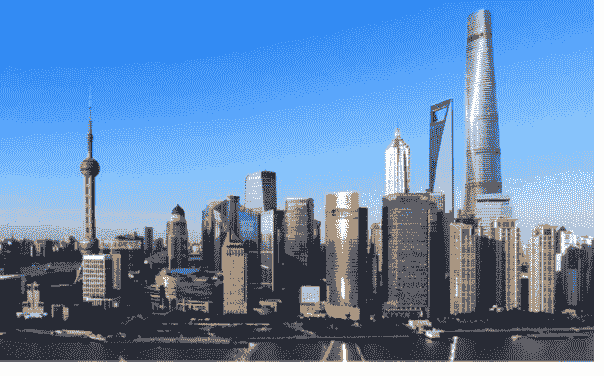


# 职业炒家篇

### 职业炒家（一）#130

2015-05-19 yevon_ou 水库论坛


**水库论坛**

**欧神文集 (纸质版)**

#### 职业炒家（一） #130

职业炒家有多少人，1万人还是10万人。

职业炒家全中国不会超过1000人。

一）听说过，没见过

扯了这么久的准备工作。今天我们说一些大家比较感兴趣的话题。更接近这一行的内幕。

很久很久以前，结识了一个朋友。我让他猜我的工作。

给出的提示是：“所有人都听说过，从来没有人见到过”。

然后让对方猜。

对方想了很久，从航天技术员，到火山爆发专家，甚至到盗墓的。最后实在猜不出来。

然后我说，我是炒楼的。职业的，职业炒家。

对方大失所望。说“哎，我为什么（是）高档的工种呢。炒楼的还不是满大街都是”。

哦，满大街都是么。你举几个例子。

许多人会回答说，闻名遐耳的“温州炒房团”。

打开电视，CCTV2 播的“炒房内幕”。

再不济，满大街的中介店，中介比米铺多了。这不是炒楼么。

这些话，恰恰说明了职业炒家的稀少。

炒楼是一个被极大误解，甚至完全“不是那么回事”的一个行业。

为此，我们不得不花好几篇的篇幅，详细把这件事说清楚。

二）平庸

如果你是一个出租车司机，那么你的收入相差会非常大。

因为一个出租车司机每天工作10~12个小时。而前八个小时，都是份子钱。你是为出租车公司再打工。


司机每天能否赚钱，就看剩下这最后 2 小时。如果拉几次肚子，撞个车，堵个空驶，那一天的收入就泡汤。

这告诉我们一个道理。每一个行业，都有他的“平均利润”。而卓越于平均的，才是你的超额利润。

就像马克思主义说，行业利润率趋向平均。如果你赚“平均利润”，那也就是个苦力钱。你才能发大财？超越平均，追求卓越。

你要比平均水准，做得好得多。超出平均的，才是你阶层上升血脉。

房地产是一个非常好的行业，黄金行业，“正和游戏”。

但是许许多多人在房地产中，却并没有赚到“传说中的一桶金”。

他们或许赚了点钱，当年 300W 买的联洋，现在涨到了 500W。可是就其金额和倍数而言，远远达不到“暴利”。更达不到传说中的高度。

为什么呢，因为他们赚取的是“平均利润”。虽然在这房地产这个黄金市场中，平均利润也意味着三五百万的 RMB，2~3 倍的增值。超过白领一辈子的工资。

可是，这和“专业选手”是不同的。

专业选手的赢利，远远超乎你的想象。

职业炒家存在的意义，在于把事情做好。就好比一个优秀的木匠，一个优秀的网球手，一个优秀的基金经理。

在某个行业做到极致。

### 三）专业

什么才叫专业。三百六十行，行行有规，术有专攻。

你把炒楼看作是一个行业。则其中的诀窍与技巧，浩瀚如烟海，叹为观止。

我们已经听到了，见到了，经历过了无数次，常见于“炒股票者”对炒楼的蔑视；“炒楼是什么，不就是买进卖出么。一点没有技术含量”。哪像股票高大上。

那你炒股是什么，不也是买进卖出么。

码农学了二手 Python，Java，自以为精英了，被人耻笑。

而炒股的满嘴二个 CPM、CPI、PMI，你以为你很棒。其实你是 SB。

傲慢与无知，是你陷入贫穷的直接原因。

买房本身就是一种学问，一门很大的学问。等你意识并承认这一点，才是脱离傻空房奴，转身成为扑克族房东的起点。

那么，为什么从来没有过人和你说过“炒楼学”呢。

因为这一行你学不到。学校里不教。心灵鸡汤的书店里也买不到。当你找到水库论坛之前，你或许都不知道这事可以归纳成篇。

一个原因，“炒楼学”的书籍在中国注定无法出版。政府不喜欢。

另一个原因，则是“职业炒家”的稀少。因为职业炒家人数太为稀少，所以没有人可以总结出经验。因为人数稀少，所以更没有人出书。

### 四）职业炒家

前一阵子，一个非常熟的中介，喝茶聊天时说，认识你这样的客户真是三生有幸。

为什么呢，因为中介这个行业，有一个很重要的特征：“没有回头客”。

营销学上说，越是回头客多的地方，越是热情周到。譬如每周必去的沃尔玛。

而越是流动性大游客多的地方，一次性服务态度越差。譬如火车站，旅游景点。
许许多多人投诉中介，绝大多数的人对中介印象都不大好。

因为中介是一个完全“没有回头客”的行业。

尤其是在房屋买卖这一块，谁会“过了三个月”又回头找你再买一套呢。
对于绝大多数的人来说，“买卖房屋”这种事，是以“代”为计算的。
一个家庭，往往整一代人，才会买一次住宅。
你的父母买一次，你们小二代买一次。
很少有人意识到，这其中资源的丧失。
因为买卖房屋，本身是会增加“经验值”的。
你想买房，去哪里找的房源。一手开发商还是二手中介。
国家的政策法规如何，限购和限贷有什么要求。
房型哪一种好，地段哪个有升值潜力。
中介有什么猫腻，有什么骗术。
交易流程需要哪些手续，注意哪些资料。
这些事情一件件做起来，每件事都要折腾掉你不少精力。等你把整个流程走完，四处询问发帖解答，你也差不多成了半个专家。
可是，然后，然后呢。
然后所有的经验，全部都被废弃了！

马放南山。当你买完这套房子，下一套住宅的购买，可能要10年，甚至20年以后。到时候大环境小环境，办事的人和联络条线，全都改换掉了。
也就是说，经验没有积累。经验也没有升华。
当你刚开始买房时，你是一个菜鸟。当你买完第一套房时，你还是一个菜鸟。
菜鸟没什么战斗力。
而职业炒家和普通人有什么区别呢。
职业炒家，他买的不是第一套房，而是第10套房，第N套房。
和一般人想象的不同，“买房”里面其实大有诀窍，经验是可以积累的。
而当你经验积累以后，“成本”可以下降20%，“速度”上升20%，敏捷上升20%，内力上升20%，回血速度上升20%。
各项指标提升，战斗力自然大大提高。
于是就形成了良性循环。
职业炒家和普通人的区别，并不在于房子的多少。而在于运作的**效率**。
有一些温州富二代，买房也是十套八套地买的。可她们并不是职业炒家。
CCTV中报导了许多楼市现象，可那些人也不是职业炒家。事实上，CCTV根本不知道真正的楼市运作是怎样的。媒体人半错不懂。

### 五）职业炒家的悖论

上次那个中介继续笑眯眯地和我谈，他入行了这么久，为什么就没多见着几个“职业”的呢。
每人每年固定给他开单做生意，他就算半顿铁饭碗撑着。
而我和他说，“职业炒家”是很很难很难见到的。其稀缺的程度，和大马路上撞见一个亿万富翁A9概率差不多。

首先，一个职业炒家，他至少要有 5000W 的资产。小城市可以稍微放开一点。但底子始终在那。

为什么。因为如果你要成为一个职业炒家，你至少需要 “买卖” 过 10 套房。
有人说，做中介的，每年经手许多套。算不算。
不算。隔行如隔山。中介和炒家其实是完全不沾透的二个行业，甚至没有任何共同处。

这里还牵涉到一个广泛谬误。我从未见过任何一个优秀的中介，同时也是优秀的炒家。当你说到家里人做中介时，别人肯定会搭口 “哦，那他对房产一定很熟”。甚至会进一步讨教你买房买房的诀窍。

大错。中介是中介，炒家是炒家。中介完全不懂楼市。其距离之遥远以光年计。就好比银行做柜台的，完全不懂金融。
因为中介学的是交易。他所做的所有事情，都是促成交易。中介不预测涨跌。
而炒家关心的是价格。你只有实地实战了，只有拿自己钱，拿 5000W 押在上面，才能感受到心跳的感觉。
才能成长为优秀的交易手。

所以，职业炒家都是很有钱的人。你在马路上见到的概率，绝对不会比普通 A9 更多。
职业炒家的人数也很少。最早的时候，我们估计全上海大概有 1000 人。全中国有 1 万人。
可综合最近的一些信息线索。我们认为 “职业炒家” 的人数比预想中的还要少得多。全中国可能不足 1000 人。

这里的 “职业” 指的是手法，精悍而老练。
另外，我们想说一下职业炒家的悖论。
为什么职业炒家人数这么少，因为他不符合逻辑。
一个人要成为职业炒家，那么他至少要买卖过 10 套房子。拥有约 5000W 的资产（小城市 3000W）。
可是，如果一个人拥有 5000W 资产。那么他早干嘛去了。或者说，他怎么会有 5000W 的？
答案是，之前靠工厂，或者靠实业赚的。
问题就出在这里了。如果一个人靠工厂实业，赚到了第一个 5000W。那他在这一个行业，一定已经做得很资深了。少说也混了十几年，手下有 200~300 个工人。上下游熟悉的经销商。
这就形成了 “路径依赖”。一个人是很难抛弃掉 35 岁之前的一切，抛弃 300 个员工和上下游人际关系。重新开始另一个工种的。
另一种情况（二）。可不可以他一开始是 500W 净资产，靠升值升成 5000W 房产的。
理论上是可行的。
但实际，这个人在 500W 的阶段，买第一第二套房时，经验不足，很有可能是夭折。很大几率就卡在第一关了。
如果你完业没有师傅，完业没有人带领，纯粹靠自己摸索。一步一步探讨出今天炒楼的诸多几十种手法。那么你必须要有的；

1. 极好的运气
2. 极坚定的信念
3. 善于归纳总结
4. 没从事其他行业

这事左看右看也是极稀有的。所以我们认为“野生”的职业炒家人数不会很多。最多不会超过 1000 个。

第三种情况（三），则是一个年轻人。拿着 500W 初出茅芦。

可是他一出来，就有人带领，有人开拓，有人聚团讨论，有人共享资源。

前面的路全部都有人走过了。你只要跟着学就可以了。

哎哟。这种人叫 90 后。

下篇继续。

（yevon_ou@163.com，2015 年 5 月 19 日晨）

## 职业炒家（二）------ 实业之殇 #140

2015-05-21 yevon_ou 水库论坛


## 职业炒家（二）------实业之殇 #140

名与利不可兼得。

### 一）小微企业

每年的春季，照例是支持小微企业/实体经济的时刻。

譬如今年，首辅大人又是定向降准，微刺激，产业支持，政策关心，十八般招式用了不少。

组合拳的效果，往往不佳。否则也不需要年年关心。

年复一年，“实体不赚钱”几乎已经成了一种共识。几乎每个人都在谈论着实体经济利润微薄，惨淡经营，成本高昂，销售困难，增长乏力，熬白了头发。

实体不赚钱，只有投机倒把才赚钱。服务业赚钱超过制造业，而越是虚拟的服务业金融贸易炒楼，赚钱又超过具体服务业。

实业主命奄奄一息。做一年工厂赚几百万。企业业主们一边咒骂着泡沫经济，一边熬白了头发苦苦支撑。

按照圣母公狗小清新的说法，我们的国家，已到了最危险的边缘。道德沦丧。拨乱反正，纠正社会的乱相。尊重实业，提高实业的利润。你是否也支持此类说法？

### 二）实业之荣光

什么叫实业之荣光。

如果你是一个内地省份教出来的，热血有志青年。满怀着民族复兴，报国就业的激情，你会怎么做？

从小到大，我们受的“爱国 主义 教育”，讲的是“实业救国”。

几乎每一本教科书，都会和你说到旧社会金融的投机倒把。都会和你说到“一穷二白”。都会讲“洋枪大炮”。

然后你心里热乎乎的，觉得踏踏实实做工业，炼钢铁做螺仔，才是报效祖国的最好办法。

当一个内地省份的大学生，毕业踏上社会。如果他有幸拥有一定的社会基础，父辈传给他金钱，权势和人脉关系；

那么，开一个工厂，召几百个工人，制造和生产各种轻工业品。是

“**最正当，最光荣，最道德高尚**”的职业了。

你也可以扪心自问想一想，在你的内心，是否也持有同样的想法。

每一个人的内心，都住着一个愤青。

这愤青虽然平时不说话，但一到关键时刻，譬如美国轰炸南使馆，9·18 重播抗战大屠杀；愤青就会从你的脑海里蹦出来，热血沸腾。

然后你会呼吁“实业救国”。你会希望造更多的矿山和工厂。会尊重做实业的人，把他们称为“国之栋梁”。

只有极少数的人，三观才是被洗过的。才不是这样想的。

这些极少数的人，我们称之为“铅笔社”。

首辅大人在关心实业艰难的问题。

有时候我不无讽刺地想，他到底是不是北大经济学系。是不是历大人教出来的。

### 三）实业之殇

为什么会有实业之殇。实业之殇和实业之荣光，是彻底联系在一起的一体二面，宛如道家之阴阳。

有荣光必有殇。

你仔细想一想，老师们传授最基本的道理：

“一个行业如果太赚钱，就会吸引新的资本进入。增加供给，拉低利润”。

任何一个行业，无论是钢铁，煤矿，造纸，化工，航运，高速公路。任何一个行业，归根到底其利润率，和高科技无关。而仅仅和“竞争对手”有关。

竞争对手止步的利润率，才是你最终的利润率

实业为什么利润稀薄，因为太多的人做实业。

炒楼为什么利润丰厚，因为太少的人在炒楼！

实业的利润率会在什么时候止步。

负数的时候也不止步。年轻人还在往里冲。因为光荣。

当每一个年轻人踏上社会，他想做“实业”。他受的教育是“实业光荣”。招几百个工人做厂长，走到哪都有人叫你“老板”。

多光荣，多体面，多有范。内心受到了极大的满足。老板老板老板。

当你的父母，向旁人介绍儿子时，又是多么地骄傲。

“我儿子开厂的。我们这个国家，归根到底实业才是栋梁”。

你出去相亲，也是有有范儿。

回报的总体，是“名+利”。

名利相加，才是总收获。而这个收益率在各行各业是平均守恒的。

一个行业，如果赚取了太多的“名”。那么他的“利”就一定不高。
因为有荣誉，有名誉，吸引了“超出平衡”的人来从事这一个行业。其必然拉低回报，竞争激列，毛利率低。辛苦一年白干活。

而只有那些“名”很低，甚至政府调控的行业。参与的人数较少。才会保持很高的利润。全中国只有 1000 名不到的职业炒家。这才是炒楼业获取高额利润速成富翁的基础。
回到了我们首辅的问题。为什么实业利润率低，不赚钱，艰苦支撑。

“因为荣誉”

“鼓励实业，提倡实业，会拉高实业利润率么”。
“不会。只会让实业更加亏损。因为更大的荣誉”。
经济学是一门很复杂的学科。是一门高度专业化的学科。
专业的分析，和普通人的感观，几乎是彻底完全相反的。

如果你想摧毁炒楼业。你要做的绝对不是喊打喊杀，恨不得游街杀头。
相反的，你应该给炒楼客挂大红花，评选为“三红旗手”“新长征突击手”。
鲜车怒马，游街接受欢呼人民英雄。
高中里要开设炒楼课，每年培养 30 万个炒家。业外还有 Bluefly 之类专业学校。
到那一天，炒楼才是垮了。沦为民工行业。每月只赚几千元体力活钱。
到那时，我们可以考虑去干实业。

### 四）职业炒家的痛苦

首先，插播一段广告，某情圣的故事。
本故事纯属虚构，八卦新闻概不负责。
话说某人啊，咳咳咳。有一天花了 17w，贷款借了 150w，买了一套九城湖滨。
六年后的今天，他把房子卖了，448w。净到手 300 万。
17->300，六年。
这不是重点。略过。

话说买房的那天晚上，全部手续搞完已经快 19:00 多了。某情圣没吃晚饭，饥寒交迫。然后再开了十几公里的车到女友家去。
一到了女友家，整桌菜已经吃得差不多了。只剩下一些残羹剩汁。他未来的岳丈正啃着一只鸡爪，抬起头说，“你来啦啊，卫生间的马桶有一点漏水，你先去修一修”。
于是某情圣没吃饭饿肚子，便先去修马桶。照例是橡胶圈老化，难不倒理工男。
总算洗了手出来，想吃一点冷饭。岳丈又说了，“厨房煤气灶打火不亮，你去看看”。
交大高才愣了一愣，“这多半是煤气灶电池没电了，换电池就好。等你等我吃完再弄好么，快 20:00 了，饭菜都凉了”。
未来岳丈挥舞着鸭脖子说，“你反正整天晃来晃去的，又不上班。叫你干活还不快去。这房子不是你屁颠屁颠地非要买了送给我女儿，再帮我女儿装修的么”。
于是某情圣忍辱负重再去修煤气，回来的时候连鱼骨头都没有了。只剩下点鱼汤，拌饭。
他回到自己家里，关了灯，煮上一碗面。眼泪哗啦啦啦啦往下掉。
这个故事告诉我们道理是：善待你那数千身家的准女婿，否则你女儿就会成为 EX。

### 五）核心骨

职业炒家是一个行业，是一门工作。和其他所有的工种没有任何不同。

我们的社会，有人朝九晚五上班，有人开公司，当老板，有人当Free lance。

还有人当艺术家。

既然这样，职业炒家和其他任何职业并无不同。也是三百六十行之一。

他们理应受人尊重。

可现实情况是，职业炒家收获的是金钱，而丧失的却是全部，其中也包括家人的尊重。

家里人会让你去打酱油，取干洗衣服，淘宝退货，积分卡补登，为了30元钱和客服扯皮。

整天扔过来的全都是一堆破事，庶务。100个30元我给你好了。扯什么电话。

在丈母娘的眼里，你完全受不到尊重。老人家标准的言论是“我看你反正也没什么事做”。

错了，错了，全错了！

假设一个家庭里二个人，一人赚了2000W，另一个拿着20W的年薪。

请问谁才是家庭主心骨。谁才是家族的核心。

答案绝对一定肯定，是那个2000W 的人。

整个家庭的构成，应该以那位赚了2000W 的人为核心。所有的人围绕着炒楼师转。所有的人

把所有的庶务全部做完。辅助他，协助他，分担他。

让他腾出手来，净净心心想一想，还有什么高增值的事情可以做。因为他多做一张单子，就

是“几百万”的利润进账。

遗憾的是，我们整个社会的氛围。还处于极原始的“前工业时代”。

这样的社会态度，一方面既是炒家的利润来源，使得做实业人太多，炒家极少。

另一方面，家人也让炒家很灰心。

（veyon_ou@163.com，2015年5月21日午）

## 职业炒家（三）--- 正义感 #150

2015-05-23yevon_ou水库论坛


职业炒家（三）---正义感#150

## 炒楼是降低房价的！

### 一）乱世

炒楼赚了很多钱。

- 对于这很多钱，圣母b的评价是：“你们是赚到了钱。可你们有没有想过，你们的赢利，是建筑在多少多少家庭的苦难之上。是建筑在全社会高成本的负担上”。

- 公妈们会说：“炒楼可以赚钱，意味着我们国家的制度有漏洞。应该强化住宅的消费品属性，打压投资品属性。要知道，房子是拿来住的，不是拿来炒的”。

对于圣母和公妈的责难，你应该如何回答。

是否该说：“我上有80老母，下有3岁小娃，俺也要养家糊口”。

是否该说：“我准备去做慈善，造桥铺路，回馈社会”。

No，No，no，no，no.

面对圣母和公妈的责难，你应该冲上去，一巴掌把他们撕到在地，狠狠地踹上二脚，跺断他们的肋骨，虐上十七八遍。再吐口唾沫。逼着女公妈学狗叫。

“炒楼是降低房价的，SB”！

炒楼客观降低了全中国的房价。这不是一句口号，是科学，是事实。是无可辩驳的真理。侠之大者，为国炒楼，降低房价。

好了，圣母你现在可以爬过来趴在地上，跪着叫主人了。

### 二）商人

炒楼是降低房价的。

这是大是大非的问题。无从逃避。也不可以简单地以“慈善，社会责任”打马虎眼混过去。

炒楼是降低房价的。

炒楼是一件崇高，伟大，高尚的行为。

有罪和无罪一定要说清楚。炒楼是人民英雄。

别拿什么原罪盖炒客头上，一记耳光反抽母公狗懂么。

几乎在任何一个初中生的课本上，我们都学到了这样一句话。

> “商人通过贸易和流通，降低了制造成本。商人并不是社会的蛀虫，而是巨大的财富制造者”。

这是一个很简单，很基本的道理。

那么，为什么在“房产商人”这一个环节上，你脑子就转不过弯，就僵住了呢。

炒房子和炒大米本身并无区别。都是买进卖出。

为什么你在炒大米上，能通过期末毕业考试。

在炒房子上，就被人忽悠进了呢。

炒楼这件事很简单，向 A 买进，向 B 卖出。

那为什么 A 不能直接卖给 B 呢。

答案是 A 可以直接卖给 B。大约占 95%。

我们之所以要写“职业炒家”这一个系列，是为了澄清一个误解。

在整个市场上，职业炒家的人数是极少的。全中国不到 1000 人。

很多人动辄开口闭口“炒楼”，好像全市场上交易者都是炒家，这是不对的。

在所有交易中，95%以上的交易，是直接由卖家卖给买家。A 卖给 B 的。

所以每当国家有调控房地产市场，《国五条》《国九条》出台，傻们激动万分地分析，对市场的冲击，房价要大跌。江湖要风云震动。

这是不对的。

在整个市场中，炒家最多也不会达到 5%，甚至远远不到 5%。

这么小的比例，哪怕你再怎么调控，也不会影响到房地产市场的根本走势。

所谓调控，无非是骗骗民心罢了。

房价是有坚实基础的。是由买家买上去的。

举个数字，以上海市房地产中心的交易数据来看。2000 年之后的新建住宅，在过去的十五年中。

- 90%的房产，被二手交易 0 次
- 8%的房产，被二手交易 1 次
- <2%房产，被二手交易 2 次。

如果有炒家，那么一个完整的周期“买进卖出”至少需要交易 2 次。可见，炒家占整个市场的比例，甚至连 2%都不到。

如果你要举北京的数据，大概是每 33 年换一次房子。[[1]]

### 三）缓冲器

扯得远了。我们回到炒楼的话题。

炒楼这件事，向 A 买进，向 B 卖出。

在至少 95%的情况下，A 可以直接卖给 B。

但也有少数，极偶然的情况下，A 和 B 无法达成交易。


例如：

- A 找不到 B
- B 被限购
- B 未来前途无量，但目前还是个学生
- A 急售，三周内要拿到钱
- A 的价值，暂时不为 B 接受。典型的如上海康城。

在这些情况下，炒家 C 的介入，对 A 和 B 都有好处。

举一个现实中的例子。目前三四线城市，普遍存在的“新城”空城问题。建新城或许是必要的。能实现产业转移，和住宅升级。

但新城同时是痛苦的。人口的填入，至少需要十几年的时间。离乡背井，人口的迁徙，是一个缓慢的过程。最终消费者 B 不能马上出现。

但开发商 A 是痛苦的。如果要坚持十几年，就意味着要填进去十几年的现金。这对于任何一个机构都是天文数字，难以承受的。

这些问题累加起来，也就是今天的地方债+鬼城+银行坏账。

其实这件事，完全是 no zuo no die 死。

商业自有其规律。有困难就会有商机。

如果有炒家 C 存在，炒家可以从政府 A 手里买下房产。静待持有十几年，一直等最终的人口 B 出现。

天底下没有卖不出去的房子，只有卖不出去的价格。只要回报合理，炒家完全可以帮你垫付十几年。

而香刹打掉了炒家，严格禁止了房产“炒楼”。于是鬼城出现了，地方债傻眼了，银行要危险了，GDP 下降了，报表不好看了，大伙一起掩面而过汗……

尊重商人，才是万善之源。

而炒楼只是商人的一种，炒的是房子降的是房价。商人越多价格越低。2005 年房价大涨，明明是滥发纸币的后果。

可香刹非一口咬定是温州人炒房子。硕士生怕？把人民英雄，污蔑成了人民罪人。全国 31 个省，甚至青海甘回之类的地区房价上涨，你都好意思推在温州人头上。你丫怎么不去金鹿广场下跪认罪。

### 四）虚拟供给

中国是一个神奇国度。其具体表现为对商人的恶意，以及学术界趋炎附势狗叫般的习性。过去的十几年中，一个崭新的名词被创造出来。在全世界所有的学术文献中前闻所未闻，却被反复引用以至于大热：“虚拟需求”。

我们一直小心翼翼地关注着这个词的使用频率。凡是认同信奉，在文章引用到“虚拟需求”的，一律拉入 SB 大列表。

目前，这个名单有叶檀，易宽容，谢国忠，杨红旭，马红漫，水皮，牛刀，巴曙松，哈继铭，薛涌。很遗憾，2003 年美敬雄也大谈“虚拟需求”，所以只能把他也添进去了。

“虚拟需求”是一种理论。其大致的意思，是说现在某些人买房并不是为了自住，而纯粹是为了投资赢利赚钱。这样就增加了买房的人数，增加了“虚拟需求”。总需求上涨，炒房使得房价上涨。

说这话的人，缺乏最基本的经济素养。
为什么。因为炒家在买入的同时，他们也在卖出。在创造“虚拟需求”的同时。他们也在创造着“虚拟供给”。
抛出，抛出，抛出在哪里。为什么就被人选择性的忽视了。为什么从来无人谈“虚拟供给”呢。
有公式为证：

```
“虚拟需求” - “虚拟供给” = 炒家的库存 ≡ 0
虚拟需求和虚拟供给是恒等的。
```

“炒家”对于供求关系的影响是中立的。是不会影响最终价格的。
炒家只是加速价格回归的过程。
优化资源配置，改善整体效率。
朋友们，让我们再回想回味一下政府公报。有二句至关重要的话：
“尽快让房价回归合理的价格”。
“切实将过高的房价降下来”。

同学们啊，中国语文博大精深。你们还是没有将语文的精髓学到家啊。这二句话的意思是：
“尽快让房价回归合理的价格” -------- 合理价格是多少，15W/m²，房价赶快大涨。
“切实将过高的房价降下来” -------- 我们这里的房价不过高，所以不用降下来。

### 五）最可爱的人

过高的房价地价，不利于经济发展。
这是所有人的共识。不仅仅空军屌丝们如此认为。拥有 NN 套房子的大多军，同样如此认为。
所不同的是，傻空开出来的药方，是“打击炒楼”。
而多军开出来的药方，是“鼓励炒楼，全民炒楼”。
在我们这个世界，科学和原子弹，远远要比义和团的气功咒语更有用。当年轻人发泄他们的愤怒时，他们应该多学一学。哪些才是真正帮助他们的，哪些才是敌人。多学习科学。

在所有的楼市元素中，炒楼，政府调控，加营业税，限购房贷，迫害开发商，土地控制，惩罚空置…………
在所有的元素中，只有炒楼是真正降低房价的。只有炒楼是屌丝唯一的朋友，是唯一对人民有利的力量。
可惜的是，屌丝们往往认不清这一点。却把亲人当仇人，仇人当亲人，天天叫嚷着加税抑制炒楼。

有时候我们在想，谁是最可爱的人。千百年后，当历史回卷至 2015 年，谁会被给予最高的评价，谁对共和国的贡献最大。
炒房远比实业更高尚。从根本上讲，应该是炒房的看不起做实业的。远远优越的道德感、正义感，把那些“高尚职业”踩在脚下。
众人皆醉。只有当千百年后，历史回卷，才能以科学的眼光，而不是今天的世俗与愤怒，来好好评价 2015 年。
经济学是一门很复杂的科学。经济学和普罗大众的直观感受，往往是截然不同乃至相反的。
什么才是我们这个国家最需要的人才。什么才是贡献最大的人才。

在经济学中，有着明确的解答：“价格”决定一切。

价格是稀缺度的衡量。一个工种，其工资越高，越是说明贡献高应聘少无可替代。

一个行业，越是利润丰厚。越是说明国家急需，社会急需。

如果炒房很赚钱，超过其他所有行业的赚钱。

那只能说明炒房对国家的贡献很大，是目前社会最急需的事，是最可爱的人。

炒房远远比实业更高尚。

炒房远远比实业的贡献更大。

中国有句古话，“天知地知你知我知”。一个人哪怕一辈子说着言不由衷的话，但他不能欺骗自己的内心。

在你的内心深处，你是清楚地知道：“炒房才是正义的”。

（yeyon_ou@163.com，2015年5月23日子夜）

[1]《北京人均价33年换一次房子》http://www.bjsinau.net.com/bysw/2015-05/17/c_1115308187.htm

一笑加一笑（微信号：150500211）邀您加入水库交流群。群内文集每月一更新……

## 职业炒家（四） ----- 买进 #160

2015-05-24yevon_ou水库论坛

水库论坛

欧神文集（纸质版）


水库论坛Shuiku.net 交流群

## 职业炒家（四）-----买进 #160

“有筹码么” “没有”。

那叫什么升值。

### 一）干贷

说了很多《职业炒家》理论上的事。有人要求写点干贷。譬如说说具体如何赚钱。俺清清喉咙。炒楼赚钱这个事啊。主要经过三个步骤：

- 买进
- 等它升值
- 卖出

许多人或许笑得眼泪都出来了，笑得满地打滚。“你这也叫干贷，谁不知道呀”。哦，你真的知道么。你真想清楚了么。

杨过看黄裳和霍都王子对打。看得目眩神迷，“真经上简简单单一句话，竟可以幻变如此多的变化”。

大道至简。很多事，并不如你想象中的简单。

许多最基本的概念，深入思考下去，其内的道理大得吓死人。凡世几篇也讲不完。好比这张五常经年累月整天地思索，反复就几个单词。成本、供求关系、价格。

“买进”这个词真正地意味着什么。你想清楚了么。没有。

### 二）旭日初升

一笑加一笑（微信号：150500211）邀您加入水库交流群。群内文集每月一更新……

如果说上海楼市，目前我最看好的“潜力地段”是什么。那肯定不是自贸区，也不是热得发烫的唐镇。

我最最看好的地段，其一，是浦东大道沿线。

其二，是东大名路

其三，是奉贤滨江

譬如说浦东大道，你如果问现在的价格是多少。拉两个狗屁不懂的沪飘小白领，联洋镇旗贷民窟的首流们，他们会回答 5~6W。

如果问比较懂行的老上海人。人家比较谨慎，或许会给你一个 7~8W 的估值。

如果我说，浦东大道昌邑路，（主要是昌邑路，靠近北滨江的一线），未来的价格是 250000/㎡，廿五万每平米；

北滨江未来肯定是比南滨江贵的。

陆家嘴的江岸线，分南北二线。滨江大道（南）和滨江大道（北）。

目前为人熟知的豪宅群，主要集中在南线。以汤臣一品领衔，依次鹏利海景，财富海景，盛大金磐，滨江凯旋门，仁恒滨江，世滨滨江，汇豪国际，家化滨江……………构成了整个陆家嘴住宅板块。

可是，相比之下，北线是完全被人忽略的。也是市政府彻底藏起来，作为私人物品的。

目前你去北线看一下，北滨江绿化大道已经建成。大块大块的空地已经平整完毕。在这里，随时可以开 6~8 个顶级豪宅小区。

这些小区，若无腐败，一开就是天价。

你想象一下，未来上海将是全球五大 CBD 之一。

在全世界最好的 CBD，你开车五分钟，就可以进入陆家嘴办公楼集群。两分钟就可以到达跳舞楼。

而这样的住宅，却是矗立在自然景观，大江大河的江边。

每当旭日清晨，第一道阳光洒向江面。你住在顶楼复式。开着 SCC 轻松奔向公司。

这是什么，这就是尊贵。这就是豪奢。

就是电影中拍的境界。

这样的房子，是给屌丝住的么。

这样的房子，是给普通白领跕跕脚就能够得着的么。

开什么玩笑。

从北滨江进入小陆，大约只需要二分钟的驾驶时间。当然更 1B 的做法是“跑步上班”。

在华尔街 President，或者 CEO 级别的人，都喜欢跑步上班。因为这至少意味着三件事：

1) 你住得很近

2) 你不用拎包

3) 你够胆吸引全公司的注意力

这其中的任何一条，都是男权至高无上的象征。[1]

扯得远了，小陆北滨江沿线。是我们目前最看好的地段。该地段尽早能到 25W/㎡，南线的 150% 价格。

同样的道理，也适合另一个选择。

- 河对面的东大名路沿线，前途无量。

- 奉贤滨江

### 三) 筹码

好了，你这么看好。你赶快去买呀。

前面既然已经说了， " 市价" 只有 6^8W，而你心理目标是 25W。

那你还不去快去买进。赚三倍呢。

傻空嘴婊们愤愤不平地说。

这就牵涉到一个至关重要的悖论。你 " 无货可买"。

你看好浦东大道北滨江。大把握翻倍升值。

可是他现在是什么。是一片空地。

方圆三公里，没有任何建筑。没有任何可出售建筑！

你想分享地段与房价的升值，可是，How?

这是一个至关重要的悖论。不仅仅浦东大道沿线，而且东大名路沿线。而且奉贤滨江沿线，

都是几乎完全没有任何筹码。完全不带你玩的。

很多人张嘴闭嘴 " 房产升值"。可是他们没提到，房产升值的重要一个前提是什么。

前提是你要有筹码。有筹码你才可以 " 跟随升值"，才可以分享收益。

如果没有筹码，而该地区大涨特涨，那叫什么，叫白宰。

### 四) 三级市场

在此，我们要向各位普及一个 " 三级市场" 的概念。老大吃剩的才有老二吃，老二吃剩的才有老三吃。

什么叫三级市场。政府，政府是第一级的市场。是高踞于云端之上的。

只有政府，才可以决定一个地区，一个城市的兴衰。才可以从 " 大地图" 规划一切。

譬如，仅仅 40 年前， " 深圳" 这个城市甚至还不存在！

目前深圳的土地寸土寸金。可是仅仅 40 年前，连深圳的概念都是不存在的。若不是伟人在南海边画了一个圈。今天也不会有深圳。这个圈完全可以画在惠州，东莞之类的。那虎门长安，就成了地价最贵的地方。

只有政府，才可以规划一个城市。可以划出一个开发区，可以搞港口建设，可以搞六大支柱产业，可以搞浦东开发，可以搞几百万人填进去。

这是一张大图线。政府 " 创造" 土地。土地市场，我们称之为一级市场。

当政府确定了大的开发方向，确定了产业布局。譬如拉了一条深南大道，又或者建了地铁二号线。

然后，政府就开始拍卖地铁沿线二边的土地。这时候，才轮到开发商 KFS 出场。

KFS 赢利的关键，在于对土地的精确细作。譬如说，同样一块土地，在港资手里，和在国企官僚的手里，其运作效率就完全不-一样。

无论是写字楼，酒店，造出来的档次都要差好几个数量级。哪怕造住宅，品质也能差很多。

房地产的开发，是所谓的二级市场。KFS 的超额利润，来自于 " 一级市场对土地利用率的开发不足或者错配"。

老大吃剩了才有老二饭食。政府不可能把土地价值利用到尽，才有了 KFS 赢利。

然后，房子造出来了。在终端市场上销售。

买卖房产，是三级市场。
或者说，“一级市场发生了错配，将土地廉价卖给KFS。二级市场再接着发生错配，把造好的房子廉价卖给消费者”。

90%的利润被老大吃尽，剩下9%利润留给老二，牙齿缝隙的1%才有老三食物。

炒家或许能预见到许多商机。可是，其中绝大多数90%商机，溢价只有政府才能吃到。

9%机会被KFS吃掉。

1%的楼盘才有并购空间。

所以，职业炒家的人数必然是极其稀少的。占比2%不到。

### 五) 实战

理论联系实际。说回我们北滨江的例子。

首先，陆家嘴南线已经被炒起来了。目前10~12W单价的样子，已经获得了“共识”，获得市场认可。这个价格站得很稳的。

在这个基础上，北线一旦集中开发。时间更晚，起点更高。映照比较，政府再出一点新闻媒体攻势。很容易就可以站稳在18~25W的价位。

这相当于“造势”。而这个势，只有政府可以造。其他任何的机构，商圈，都没有这个实力和影响力。

势造起来了以后，政府就可以从中获取巨大的收益。以18~25W的单价预期，每一块土地的出让金，都可以上达百亿。

北滨江整个板块何时启动，如何启动。天时地利人和的选择，这些都是市政府手里的牌。

政府可以选择最恰当的时机，卖最高的利益。而哪怕再大的KFS，哪怕你未来穿越回来，明知道北滨江前途无量，你看看空空如也的地块，看着空空土地待售列表，你也只能干瞪眼。

等哪天政府真的抛出一块地块来拍卖了，肯定又是无数家KFS抢破头。

而一个炒家想要赚钱，他至少需要祈祷；

1) 该地块没有拍成天价。
2) 辛苦斩获该地块的KFS，房子不要卖天价。

这两件事情，发生的概率都不高。而要同时发生，希望更是渺茫。所以你多半没没希望成为尊贵的“CBD二分钟顶楼复式江景大宅”业主了。

【注2】

### 六）结语

炒楼想要赚钱，你至少需要完整地经过三个阶段；

- 买进
- 等它升值
- 卖出

我们见过无数的键盘族，嘴炮族，一个个说起来豪情万丈。似乎仅差一步之遥就可以成为亿万富翁。

例如篱笆上的典型言论：

- “NN年前看好唐镇的走势，可惜没买进”
- “某某某买进唐镇的房子，翻了十几倍”
- “浦东房价涨得快”

这些都不是事实。因为在真正有实战的人眼里，他才会知道“买进”这事有多难。绝大多数大有潜力的板块，都是“有价无市”的。也就是说，根本不给你建仓。KFS 根本不能从土地市场上建仓。不能买今天地价很便宜，未来有前途的园地。炒家根本不能从零售市场建仓，不能买到今天烂泥地，明天 CBD 的筹码。如果你不能拿到筹码，不能搭顺风车，那所谓的“大涨”对你有什么意义呢。唐镇涨了四倍，再让你欢呼么。

那不是房价涨了，是你成本高！

对于真正的职业炒家来说，他们是谨慎的，严肃的，踏实的。

当我们讨论一个板块，讨论一个开发区未来前途无量时。我们关心的甚至不是他的涨幅，不是他能涨多高。

而是，“有筹码么”。

有能够分享收益，随风上涨的筹码么。若有，则哪怕涨幅低一点也无所谓。你知道那是一块烂泥地，你知道那里未来会成为 CBD。可惜，那没有一幢小洋楼，让你买了等升值。

（vevon_ou@163.com, 2015 年 5 月 24 日募）

- [1] 推荐一部电影，甚好李保田的《魔鬼代言人》

- [2] 或许有的人会问，该板块现有的项目可否买。则外万科翡翠滨江。需要注意的是，1）一期开盘是不看江景与路二期，堪称整个项目中最后的狗路。2）二期已确定 8~12W

## 职业炒家（五）---- 升值 #170


## 职业炒家（五）---- 升值 #170

不要购买任何附加值。

### 一）升值

炒楼要赚钱，大致经过三个阶段。

- 买进
- 等他升值
- 卖出

你要知道，当你买进与卖出时，你交易的都是“市场价”。谁也不可能金手指，买到五年前的价格。

你要赚钱，就是“市场价”移动了。从普遍的 3000 元/平米，涨到了 10000 元/平米。

这说起来容易，可是做起来，却是一团迷惘的。

每一次亲友聚会，照例关于房价的讨论都是大篇幅的。亲戚们少不了吹嘘当年买了二套，投资眼光如何英明。又或者是当年错失了二套，悔得肠子都青了。

可是，为什么房价会从 3000->10000，绝大多数人都是答不上来的。

哪怕那些吹嘘的“投资高手”，说起细节轶事能吹二个小时。可是讲到原理，多半还是迷惘。只能归结为“运气”。

如果你答不上“为什么升值”，“哪些会升值”。那你也称不上职业炒家，最多只能算个好运者。

### 二）原理

房地产不是制造业，房地产是金融业。

真正懂房地产的，真正的炒家，全部都是金融大师。比目前最好的宏观经济学家，还要更懂经济。比目前最好的投行基金经理，更懂金融。

我们的国家，大致有三个数据：

- 货币+24%/每年
- 实物+9%
- 通胀+14%

也就是说，滥发纸币的速度，远远超过实物。造成了全社会的通胀。
纸币通胀，才是房价上涨的唯一动力。

房地产本身是有折旧的。不快不慢，大约每年1%

任何认为房地产本身会“升值”的概念，都是荒谬的，愚蠢的。房产不会升值，是货币在贬值。

房地产其实不是制造业，是金融业。他对冲的是全社会的滥发纸币。

所以房价每年涨13%，每月1%，雷打不动。

如果你想买房子，然后保值增值。那你就最好想一想。你手里买的是什么，究竟能否对抗通胀。

### 三）折骨法

前一阵子，在某婚礼晚宴上，隔壁坐着一个女生。
当我们扯起职业炒家时，她眼神里泛着光。

“职业的啊，哇塞”。

“那你一定拥有最好的房子。最好的小区，最顶尖的品牌开发商。花园泳池会所，空调地暖新风，精装修拿钥匙。学区房，只有学区房才最保值增值”。

我看了看他黝黑的皮肤，焦黄的牙齿，最终确认他的确是一个女人。

只有女人才会说岀这么没头脑的话。

为什么呢。我们举个例子。假设某板块，某开发商，新建一手楼盘，他卖你55000/平米。精装修品牌营销一手开发商热气烘托。

而旁边普通的一个平庸小区，二手旧楼卖30000/m。

请问，差异在哪里。

凭什么B卖30000，A卖55000。差异在哪里，你为哪些“因素”支付了溢价。

这是一个尖锐的问题。绕不过去。

可惜的是，绝大多数人都含糊应答。不思辨析。

事实上，我们可以用“折骨法”。

譬如同一个小区。同一幢楼里。A的30楼和3楼，售价就不同。

30楼如果卖58000的话，3楼可能只有48000。这其中近20%的差异，属于“楼层差价”。

同样的30楼，朝南朝北又不同。

这是朝向溢价。

你将楼层，朝向修正系数都剥掉了，A还是比B贵。那么，你可以这样说，A的55000/m售价中，其中包含以下因素：

- 基础盘，30000/m
- 精装修，10000/m


楼龄三年，2000/m
绿化与会所，2000/m
房型差异，1000/m
楼层差异，-3000/m
地铁便利，-5000/m
品牌溢价，8000/m
初房情结，10000/m

合计： 55000/m

我们仔细看这张表，脉络就清晰得多。

凭什么旁边的二手楼盘 30000/m，而你却花了 55000/m 买 A。其中，楼层，地铁等打分，还都是负数。说明 A 的品质比 B 还要差。但你最终是支付了高得多的溢价。因为你还购买了别的货品。主要是精装修+品牌+初房情结。

好了，现在问题来了。哪些因素能帮助你保值增值？

三五年后，尘埃落定，A 和 B 的哪个表现更好。

### 四）增值能力

当你花 55000/m 买房时，其实你只有 30000/m 是买了具体的砖头水泥。还有的 25000/m，你买的是各种各样的“附加值”。

但是，如果你要升值的话。所有的因素，并不是普世升值的。

当你掏出去的钱中，只有一部分会升值。其他的并不会升值。

只有一部分能对冲货币。

只有一部分是硬货。

在所有的资本支出中，“装修”是最不保值的。目前上海精装修一手楼盘，装修一般是二个标准。10000/平米和 15000/平米。

业内的行规，大概是四倍。

也就是说，他卖你 10000/㎡的净装修房。你自己找个工人干干，实际成本是 2500/m。

所以炒家们有一条铁律。那就是绝不碰“精装修房”。

每一个炒家都是装修大师。建材市场我们比任何人都熟。炒家们倾向于买毛坯房，然后自己装修。利润就出来了。

如果有谁和你说“品牌开发商精装修楼盘”。那他一定不懂炒楼。

职业炒家的第二条铁律，就是绝不碰“品牌开发商”。我们绝对不为品牌支付任何溢价，绝不，绝不！

万科的房子，一般比同地段其他 KFS 贵 40%左右。仁恒的房子更离谱，一般比同地段一手楼盘贵 60%。

我们遇到过很多仁恒粉。谈起仁恒眼睛就成了 1080 度。@@@三个圈。

有些人喜欢仁恒，和米粉水果粉一样毫无道理。自住就是喜欢。

但是作为投资，我们绝不碰万科，仁恒。

为什么，当你今天花了多出 60%的溢价，买入仁恒。

等你某一天想要抛售时，你必须得拿回这 60%溢价。

## 你得再去找一个仨仨粉。

你得再去找一个下家。并说服他“仨恒的尊贵血统”。并说服他多掏60%的钱。这个难度可不是一般的高。

货比货得扔。人家看看你的小区，看不出任何尊贵之处。当年你买得贵，那是你的成本高。

对于职业炒家的第二条守则，就是绝对不为“品牌”支付溢价。

今天我们买入时支付了溢价，你卖出时，该“溢价”如何套现。该溢价如何保值增值。

我们信奉的只有品质。栋距，进深，面宽，用料用材，层高。除了品质之外，我们一无倚靠。

职业炒家必需是冷酷无情之人。我们绝不是什么品牌的粉丝。

我们抓在手里的，只有那些冷冰冰实际的数据。你的层高3.1米，他的层高2.9米，他的层高2.7。好的，那我就愿意为3.1米支付溢价。

职业炒家的第三条纪律守则，是“初房情结”。

但是这个话题太大了，值得好好用二篇，甚至三篇文章仔细阐述。所以我们留到后面详细展开。

### 五）学区房

职业炒家的第四条原则，是学区房。

在水库论坛上，有一个链接《我为什么不买学区房》，很长。建议看看。

http://www.shuiku.net/forum.php?mod=viewthread&tid=3543

我们听过无数篱笆鸟在那里呱噪。

“买房就买学区房”。

“房价会跌，学区房一定不会跌的”

“升值最快的一定是学区房”。

就我个人名下，一套也没有学区房。或许有几套，因为我房子实在太多了，自己也搞不清楚。

但我从来未过任何“学区房”。

为什么呢。假设同一个地段，有二套房子。C不是学区，卖500万/套。D是学区房，卖650万。

很多人没搞懂其中的道理。这究竟意味着什么。

意味着你花650W买D，其实你是买了二样东西。

500万的房子+150万的学票。

未来五年，如果要升值。翻一翻成为1300万。

则：1300W=1000W的房子+300W的学票

2600W=2000W的房子+600W的学票

5200W=4000W的房子+1200W的学票

现在问题就变成了，你同时投资于二样东西，“房子”+“学票”。

过去十五年，房子是涨得极快的东西。筑造了房地产的神话。

未来十五年，学票能涨得和房子一样快么？

在《我为什么不买学区房》那篇文章中，我们提出了几种疑问：

1. 学区房制度会不会改革
2. 地段班会不会被兑水
3. 走后门
4. 何必要买大房子，一套老公房足矣

这其中的任何一条，都足以对“学票”的价值，造成致命的摧毁。

那你问我，“学票”的价格是涨是跌，涨幅多少。

我的回答是：“不知道”。

我们是职业炒家。是只炒房地产的。我们只关注于房地产，并对价值有深入精微的研究。

但我们不是职业炒“学票”的。那是另外一个行业。隔行如隔山。

我们对学票的态度，是“不碰”。

我不愿意为此支付溢价。同样二套房予 C 和 D，麻烦你给我便宜的那套 C。

如果一定要说的话，我对“学票”的价值持以很悲观的态度。

后门和窟窿很大。“学票”的价值，完全就是一群无根无据外地人之间击鼓传花的游戏。

而且社会制度本身也在变革。“学区制”不可持续。甚至有一天，象 uber，滴滴颠覆出租车市场一样。价值 200 多万的出租车牌照，一夜之间归零！

反正我是不会扔大筹码在“学票”上的。

### 六）职业炒家的痛苦

突然发现篇幅有点超支。接下来的“温州炒房团”和 CEO 盘，可能要单独再列一个篇幅论述。

先在这里，我们继续以某情圣的悲缘爱情故事作为结尾。

上一次，某婚宴上有人和我说：“你们职业炒家是不是都买，最好的小区最顶尖的品牌开发商花园泳池会所空调地暖新风精装修拿钥匙学区房”。

答案不是的。

真正的职业炒家，手里没有好房子。以我的流派为例，我的偏好是：“二线盘”。

上海的新开楼盘，90%以上都是毫无入场价值的。职业炒家在总人群的购买比例中，少之又少，最多不超过 5%

对于所有“品牌”开发商，我们都是不碰的。仁恒，绿地，万科，中海，保利……更可悲的是，近年来这些 Tycoon 的市场份额还在不断扩大。留给买笋盘的空间越来越少。

最理想的开发商，其实是“区属企业”。譬如朝阳区建委，黄浦区建委。

因为土地本身是他的，土地成本很低。

国营企业，质量过硬。建筑材料都选高标号的用。不赶工期。

最后销售的时候，却只要订一个“良心价”。反正只要给政府打工，不亏钱就算立功。国营老总老酒喝喝，何必迫害消费者呢。

国企造的房子，往往会比较土，硬指标却是一流。关键的关键，他往往只有品牌 KFS 一半的价钱。

“八成品质，十成土建，五成价格”，所以是炒家最爱。大爱，如果你能卖出 90% 的价格的话，那就是巨额套利空间。

炒家最喜欢的是二线盘。绝不是一线盘，更不是超一线盘（CEO 盘）[1] 扯得远了。说回某情圣。某情圣更惨，因为他的流派是“老破小”。

老破小的意思，就是专买最旧，最破，最小面积的老公房。

那些三四十年楼龄的老公房，地上污水四溢，小区里大妈大伯乘凉，有时候你捂着鼻子甚至都走不进去。

但是这样的盘，却是真正回报率高的盘。真正的赚钱利器。因为竞争对手少。

一笑加一笑 (微信号: 150500211) 邀您加入水库交流群。群内文集每月一更新……

问题在于，某情圣到了谈婚论嫁的年龄。他 EX 眼睛里冒着星星@@，渴望这个很 NB 的“职业”房产高手，带给她一套花园洋房泳池会所英式管家品牌开发商新风地暖空调精装修 ArtDeco大理石贴面奢华豪宅。

某人皱着眉头，想了很久。最终带到一套 1990 年建造 60 平米无电梯的多层老公房。

“什么，你说你有钱。结果你就让我看这”。

“单套不值钱，可是我有 NN 套啊”。

“我要豪宅！我要大房子，好房子，又大又好的房子”。

“你女人懂个锤子。CEO 盘不赚钱”。

这个故事告诉我们的道理是，为什么某人的未来岳父，会挥舞着鸭脖子。。。。

（yevon_ou@163. com，2015 年 5 月 26 日中午）

[1] 区域建造。最终也有几个成以成了一只无题，于是便不再伤害物品，譬如户何区建造，最终润化成了“水业集团”，徐川区建造，润化成了“绿城集团”。

一笑加一笑（微信号：150500211）邀您加入水库交流群。群内文集每月一更新……

## 温州炒房团 #180

2015-05-29 yeyon_ou 水库论坛


## 温州炒房团 _180

1] 所谓的 CEO 盘，就是跪着求你买房子。

CEO 盘+师奶团=温州炒房团

##### 一）贵妇

当一套房子，各项附加值做到了极致，他就成了 CEO 盘。

CEO 盘，主要是跪着求你买的意思。

在我的圈子里，我认识很多名媛阔太。她们许多都是官太太，年龄在 45-55 岁之间。珠光宝气，闲得发慌。

官太太有几个特点，其主要是：

- 她们都很有钱
- 她们都很闲
- 她们都超级骄傲

从某些角度而言，（中国）官太太可能是这个星球上最幸福的人群。因为她们充分满足了几个需求，数之不尽的金线，数之不尽的休闲，唯一的工作是玩。

官太太并不一定是精英。这是很重要的一个大前提，影响到以后的结论。

许多阔太，她们只是运气好。或许当年生产插队的时候，搭班了同队的一个小年青。结果人家就当上了部长，厅长，局长。或者是几十亿大公司的董事长。

一个巨有钱，巨有闲，巨有自信心，巨快乐无比的群体。

这构成了“名媛阔太”的主体。然后深刻地影响到了投资圈。

名媛阔太是一个超有钱的团体，而且她们的**自我感觉非常非常非常好**。现象导致一个结果，阔太手里通常都有一笔钱，阔太们想要“投资”。

金融圈经常有些瞠目结舌的事情发生。譬如某人饭桌上听推荐，一下子就买了 1000W 人民币的贵金属基金。

汇丰银行高级私人理财部门，金砖基金一笔卖个八佰万一千万。几乎整个私募管理财业，就靠贵妇们撑起来了。

在房地产市场，同样有贵妇的故事。

### 二）CEO 盘

贵妇们的钱实在太多了，在买了鞋子，包包，珠宝，基金，开美容院，私募股权融资之后，还是没把她们的资金消耗完。

和所有人一样，贵妇也想买房子。

贵妇买房子，一方面是出于对房产本身的喜爱。几乎每一个女人都喜欢房子。

另一方面，房地产大火，身为女主人，为家里理财分忧，也是应有之意。何况还能赚钱呢。

贵妇买房子，有几个要求。

首先，贵妇绝对不排队。几百号人冲击售楼处，排三天三夜队伍抢个号等，这一类的事情，贵妇是绝对不会参与的想也不用要想。

其次，贵妇不惹麻烦。凡是有产权纠纷手尾药单清场雷锋，凡是和“药单”概念有关的。贵妇碰也不碰。事实上，贵妇几乎不买二手盘。

第三，贵妇是视觉动物。微信上有一篇《男人和女人买房的区别》[2]，其中有一张图是非常正确的。

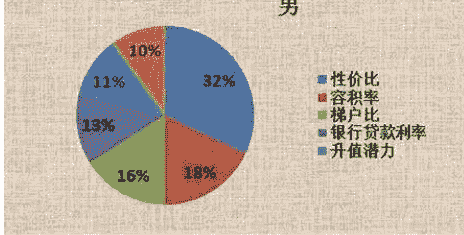

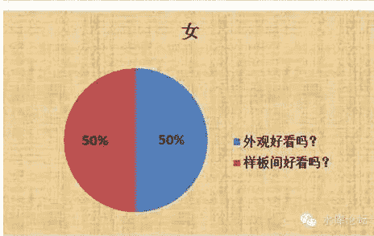

女人买房，基本只看装修。完全完全彻底不考虑性价比，反正是男人付钱！对于穷人屌丝，一套房就是一套命。需要几代人拼搏所有的积蓄凑起来生死纠关的大事。对于职业炒家来说，买房是工作。需要谨慎严肃认真避免所有赘肉溢价。可是对于贵妇来说，买房是因为今天下午做头发的师傅没有来。所以就顺路去隔壁售楼处看看。反正她对自己的投资眼光自信得紧。这些因素拼凑起来是什么呢。是CEO盘。

### 三）CEO 盘的含义

CEO 盘的特征是什么呢。譬如附近普通的地段均价是 30000/m，你卖 40000/m，那不叫 CEO 盘。只能叫高品质溢价盘。

CEO 盘，你要卖 80000.

在八万的基础上，普通人基本不会关心了，当笑话看了。那你售楼处也不会拥挤。大可以高档香薰泡二杯金骏眉，请贵妇慢慢赏鉴。

当一个楼盘达到了“市场价二倍”以后，他最紧需的是 IB 格。性价比可以很低，但是 B 格一定要高。

这里我们再贴一个链接给各位：如图中他所说的所有小玩意，加在一起花不了 2000 元/m²，可对女性购买者来说就是毒药。

《万科发布陆家嘴江景房最新顶配精装，好多新鲜玩意儿，你绝对没见过……》[3] 当一个楼盘达到了别人 200~250% 价格以后，他的销售就很长滞很困难。至少他不能在 Mass Market，不能大众市场上卖。因为根本卖不动。

这个时候，这些“豪宅”就要有针对性的，专门针对这些“细分高端市场”推送广告。譬如说，在一些贵妃才看的杂志，在 Club，或者和 Vertu 手机售后交换名单。当贵妃接到开盘的消息，只要你感兴趣，就会有西装领带的一男一女销售精英，跪着捧着楼书，送到您家里去。

你没看错，是送到你家里去。是跪着求你买楼。 贵妃买楼不用排队。你只要签个字就可以了。也不走去交易中心受热气蒸寒气熏，公证委托即可。所有的手续我们全都帮你办完，要多贴心有多贴心，要方便有多方便。 你想参观我们楼盘，奔驰车全程接送。不买不要紧，请下月来参加佘山高尔夫的酒会。1997 年香港何文田看楼时，钟镇涛是坐着直升机去浏览的。然后二个月后楼市就崩盘了。 有时候我不无讽刺地想着，贵妃们如果知道仅仅她们的电话号码，就能卖 5000 元/个。不知会怎么想。

### 四）CEO 盘的升值

CEO 盘怎么升值呢。CEO 盘就是把“各项附加值”全都做到极致的。把用户体验做到极致的，把品质规格做到极致的。同时也把价格做到极致的。CEO 盘不升值。

贵妃们啊，你们要知道。在整个生态链上，你们是处于最末一环的。

我们这个世界，黑暗血腥宛如水夜森林，而不是纯洁的白雪公主小白兔。 厮杀与争夺，阴谋和轨迹，才是我们这个社会的主旋律。

买房是一场战争，是各方利益的角斗场。政府费尽心机将土地卖最高价，开发商费尽心机，榨尽最后一滴黑油。

屌丝们则上演着打砸售楼处的闹剧，小编一手构造了 CC4V2 的假新闻。 这是战场，是屠戮场。不是童话王国呵。

每一个都在交锋，在玩击鼓传花。生产者交给批发者，批发者交给零售者，零售者卖给消费者，消费者卖给收藏者。

好比您脖子里戴的珠宝，到你的手，这就是最后一棒。再也找不出任何出价更高的其它买家了。

贵妃们做什么投资，无论做什么投资，你都是最后一棒。

股票基金到了你手里，就是最后一棒。贵金属、金银币到你手里，是最后一棒。

当贵妃们仪态优雅地翻阅着订购杂志时，你的智商还不如一只猫。 珠宝首饰，艺术品收藏，你是最后一棒。你是最后最高一个出价，不会再有下一个买家。 CEO 盘到你手里，也是最后一棒。

阿媪啊，你知不知道店家为了找到你，为了将商品卖给你，他们花费了多大气力。 你手里的货色，至少 1/3 是广告费。

### 五）异地销售

CEO 盘的特征，是跪着求着卖给你。

一般而言，我们对那些“异地销售”的楼盘，都心存疑虑。

一个楼盘，你要 CEO 成什么样子，才能使本地消费者完全不买账呢。

走在马路上，你经常可以看见“澳洲房产销售”“美国房产销售”“加拿大房产销售”之类的广告。

通常会有一些代理公司，将异地或者外国的房产，拿到中国来卖。据我所知的行规，大约是贵 30%

55W 美金的房子，他一般要卖到你 70W 美金左右。这也是很符合商业原理的。

楼盘在本地销售，你只需要很少量的广告费就可以了。

消费者可以在附近活动，走过来就能看到你的广告，进而看到你的商品。

而海外销售，涉及到大量的成本。仅仅是老板飞二次美国，达成协议框架，机票就能用去上 万美金。

一般来说，只有该项目在当地完全卖不动。或者是他要加一个可观的溢价 30%左右，才会有异地销售之类的行动力。

跪着卖的都不是好货。

### 五）温州炒房团

异地销售，加上 CEO 盘，二者合体，就造成了温州炒房团。

99.9% 的人对温州炒房团有误解。你以为“温州炒房团”是炒房么，是职业炒家么。哈哈哈哈哈， 别开玩笑笑了。

2000 年时，上海房地产市场低迷。有一些盘本地根本卖不动，KFS 又很懂营销。于是那么怎么办。

他开了几辆大卡车，到温州去拉人。开进温高“企业家协会”，条幅一拉，blablabla 我们 这是超一流品质的顶级豪宅，豪华精装修。中国加入 WTO，未来升值潜力无限。国际学校英 式管家，高层住所黄浦江景观。

温州的特产是什么，是企业家协会“贵妇们”啊！

贵妇们一激动，大卡车就几厢几厢地拉回来了。“温州贵妇们”给你看印刷最精美的楼书， 帮您代办一切手续。销售说得天花乱坠，保证您怒升值潜力无限。您还等什么，您只要刷卡 就行了。出门财务室左转啊。

“CEO 盘+异地销售”，共同构成了温州炒房团。

这是什么炒房团，这是送礼童子团啊。是雷锋团，是菩萨团啊。

2002 年时，大卡车集裹箱一般，载了几车虎的“温州贵妇”去到童话中的城堡[4]，当时我去 看“童话中的城堡”，然后专车开到了黄浦江另一边对称的轴线。

我指着城堡说，“唔唔，浦东滨江目前卖 20000/m，浦西滨江目前卖 5200/im”。

“未来他们的价差，肯定达不到 1:4，浦东张杨肯定跑输浦西”。

目前大约是 1:1

### 六）温州人的下场

在我浸润楼市漫长的岁月里，我从未见过任何一个温州籍的“职业”炒家。相反的，99.99% 几乎全都是贵妇。而且常住在温州，一二年才来一次上海。

温州人是一个很奇葩的群体。他们买进时是最贵的，卖出时是最便宜的。

好比 2002 年时，他们就大量买入 CEO 盘。平均每一套的沉入成本高达 600~700W 元。而且基本上是全现金。

这是 2002 年啊！资本贵如油的时代。

这六七百万元，放到十三 Jahre 后的今天，无论您投什幺项目。迄今都有六七倍的回报。四五千了。而温州人几乎只赚皮毛。

真正得意的，是卖房给温州人的房东。他们在极早的年代，就可以获得极珍贵的数百万资本。从而获得火箭助推。

2002 年时，你和温州企业主几乎是上百倍的财富差距，而今天已不足十倍。“温州炒房团”是在送钱给你。

另一方面，温州人在“卖房”这件事上，虽然不如买房声名卓著，可是更为奇葩。

典型的例如 2014 年，政府紧缩银根。钢贸互联网互保局爆煲，商人大量破产。

好友 R 就在那时候买的温州人抛盘。品质绝佳，如果按照我们估值，二手市场应该可以值得卖 120000/㎡左右。

可是温州人卖给他的价格是：40000/㎡。

温州人是一个儒雅的老先生。没办法，卖了一千多万，拿回去救厂。我们和他聊了起来。

“没办法，十年前就 23000/㎡买的”。

“我能和你说，这期间上海楼市涨了 12 倍么？”

“这些年，也没赚什幺钱。反正不亏就行”

“我们平时也不来上海，最近二年都没来过。反正看报纸上说，政府打压房价，那房价一定是跌了”。

中介踢踢脚尖，“哥，我帮你赚了一辆超跑”。

我回踢中介脚尖，“是五辆超跑”。

“我们都订人民日报的，也上搜房网，Anjuke 查查。四万这个价格，很合理了。”

R 实在听不下去了，摘下了手上的佛珠给老先生戴上。

“给您祈福了，先生。我都快给您说哭了”。

就我本人所接触的几笔单子，温州人买进时，一般是市场价的 130% 至少。卖出时，顶天是市场价的 70% 最多。

而他们平均五年买卖一次。上海楼市涨了五倍多，对温州人来说也即是 50% 的涨幅。

温州人最奇葩的是，是他们几乎不来上海。然后纯粹看新闻联播上的报导，来确信房价的走势。

每一次即便来，也就是待二三天，匆匆忙忙完成了交易就走。

所以温州人在业界，具有至高无上的口碑与地位。每一个人都知道，找到温州人，那就是找到财神爷了。何止是财神，简直就是无主金元宝，人形提款机啊。

我提议，将沿海高速改名为“沪温友好大道”。再找几个小朋友挥舞者丝巾，高喊“欢迎，欢迎，热烈欢迎”。非如此，实在不能表达我们对温州雷锋的喜爱与崇拜之情。

当然，每月再进口点“温州特产”就更好了。

温州人的购买高潮，大致在 2002~2003 年达到顶峰。此后固然有山西煤矿的分流作用，但主要还是因为“温州”本身的衰弱。


上届，连续清洗温州的开明官僚。塞了几个新的地委书记去“整顿经济”。于是就把温州经济给活生生搞垮了。

作为上海房地产从业人员，大伙纷纷表示极大的悲痛。并且给菩萨加上一炷香。

另一方面，当年温州人买入的“抛盘”却持续存在，细水长流。构成了今时今日上海市场笋盘的主流。也将某些楼盘的价格，压制得始终抬不起头来。

温州人从来不是职业炒家，她们只是师奶群。

真正的职业炒家赚钱很容易：和温州人做生意，赚温州人的钱。

每当经济动荡银根紧缩，你去守在上海几个钢材贸易城门口就行了。

(yevon_ou@163.com，2015年5月29日午)

1) 本文上接《职业炒家五---升值值得》

2) 《男人和女人买房的区别》

http://mp.weixin.qq.com/s?__biz=MzA4NjQ2NTMwMw==&mid=2000407381&idx=1&sn=1b2jb7e2481b8d1994b0c287c53ab0a&scene=18&key=c466864b92d2b2e20b61dfc815fb871395a8c25b2b01481e832cb262b7ba77a6ac1781c6b4678bda8570749e655ac&ascene=1&uin=NDlyMjJGOTM1M&devicetype=webwx&version=70000001&pass_ticket=two3YPNAGf0%2BUOW%Iq8QCbhhOqxNlUTFoxU5PTd3OwunpQn3dIap%2FLPe0H%2fqWYf

3) 《万市发布啦：温州房价最新源数据配置，好多新鲜玩意儿，你还讨厌没看过……》

http://mp.weixin.qq.com/s?__biz=MjM5OTIxNjM44Mw==&mid=213036673&idx=2&sn=76eeaca19d319he7034d84a51222b867f2&scene=18&key=c466684b92d2b2e20b61dfc82asac78b062bbd9f98d688c86056a153665d2275d5f78a42e74742b550e11d58167ad0bc42&ascene=1&uin=NDlyMjJGOTM1M&devicetype=webwx&version=70000001&pass_ticket=two3YPNAGf0%2BUOW%Iq8QCbhhOqxNlUTFoxU5PTd3OwunpQn3dIap%2FLPe0H%2fqWYf

4) 知者不凡

一笑加一笑（微信号：150500211）邀您加入水库交流群。群内文集每月一更新……

## 职业炒家（六）---- 卖出 #190

2015-06-01 yevon_ou 水库论坛


俗话说，炒楼要赚钱，至少经过三个阶段：

- 买进
- 持有升值
- 卖出

之前两篇，我们已经谈过了买进与升值的话题。那么，本篇是否应该谈卖出呢。

很遗憾，没有。没有卖出。因为我们要谈的是“砖本位”。

### 一）落袋为安

几乎我认识的每一个人，都坚信炒家是一定要“出货”的。

这件事如此被确信，乃至成为一种信仰。我甚至可以听到冷嘲热讽的各种说法：

“升值有什么用，不卖掉都是假的”。

“卖不掉的”

“落袋为安才是安全的”。

“大家联合起来，三个月都不要买。饿死那群炒楼客，让他们资金链断裂”。

“我就是不买，死也不买。捏紧钞票，炒家赚不到我的钱”。

当这种嗡嗡嗡传自于你的家人时，就成了一种痛苦。有时候你甚至不得被迫“卖”掉一套房子，以呈祝众人你是“真”赚了。其结果自然是悲剧性的，卖掉的房子又涨了四倍，你少赚了几百万。

“落袋为安”这件事最最令人痛苦的，是你落袋之后，它又涨了四倍。使你不得深入思考一下，落袋为安究竟是怎么回事。这么做到底值不值得。

### 二）落袋不安

我们几乎从小就被教育“落袋为安”，你的父母长辈如是教育你，你的好友亲朋这样教育你。

你去地摊上买二本理财书，它也这样教育你。

可是有没有人和你说过，为什么要“落袋为安”。原理究竟是什么。

根据我的总结，“落袋为安”这种说法，主要因为长辈们99%都是混中国股市走来的。

在国际上，基本没有“落袋为安”主体思想的。

以烂大街的 Warren Buffett 为例，他的再保险公司，可口可乐，吉列刀片，P&G 股份都持有了几十年，也没见老头子乐呵呵“落袋”的欲望。未来十几年似乎也没这需求。

亚洲首富李嘉诚，其核心资产是长实与和黄，似乎也没落袋的企图。

倒是新首富李河君，汉能股份如舰腰斩折倬。他倒是很想“落袋”的，恨不得换成几百亿现金。

所以“落袋”不落袋，关键看你是否物有所值。

中国股市长期高估，平均高估 500%以上。大伙买来卖去都是投机。老庄股扯高了诱骗人入局，自然是渴望“落袋为安”的，因为你是垃圾换黄金。[1]

而真正的核心资产，长安大厦和黄玛头亚洲电讯，他们都是很扎实资产，又没有高估，大股东自然没兴趣去落袋。

落袋这件事，归根到底还是看你手里是泡沫，还是真金。

### 三）分道扬镳

回头说到房地产市场，我们可以将房产与纸币，想象成二根铁轨。

一根偏东，一根偏西。

房产每年升值 14%，其主要的动力是滥发纸币，钞票要“融”了。

纸币每年贬值，越来越没有购买力。

这二根铁轨，一根向东，一根向西。选择“买房”或者“持币”的人，就象行车在二根铁轨上面，越来越远。直至再也不能遥望分离，成为二个世界的人。

这样的情况下，请问你是要成为“持房”还是“持币”的人。

答策当时是持房。

哪怕是蹦蹦跳跳跳火车，哪怕冲破头打破血，你也要跳到“持房”的这列火车上来。因为你知道，未来的差距会越来越远。你只有搭上房产快车，才能保护你的财富。

我们正在尽力，将每一分现金都转换成房产，“落房为安”。

如果现在有人和你说，“落袋为安”，赶紧把房产都换成现钞。你会怎么说。

你会哈哈大笑。

变成现钞？变成现钞再如何，忍受每年 14%的贬值？

别开玩笑了。当你售房后，你第一时间要做的事，就是把他再变回房子。

### 四）砖本位

在多年砖的世界里，我们信奉的是“砖本位”。

所谓砖本位，就是一切财富，以平方米 $m^2$ 计算。其他财富，只要没变成砖头，统统都是伪财富。

你出去相亲，问你有多少财富，回答 600 平米。

你和初中同学比试成功，你有 600 平米，他有 1200 万现金，请问谁更有钱。

冷冷一笑，只要没有变成砖头，分分钟把你贬成首付。

“落房为安”，砖本位。

房产没有泡沫，纸币才有泡沫。一切现金只有兑换成了房子，才算是安全的，保值的，增值的。

当然，“砖本位”不是让你每次在外就餐吃饭，吃完饭切0.001平米的房产证来支付餐费。砖本位的意思，排除了生活必需流动资金，其他的大头以砖头方式存储。譬如98%的资产是房产，2%的资产是日常现金。

### 五）砖本位的实际应用

“砖本位”还是“纸本位”，在实际应用中会有很大不同。三观也影响到了日常行为。举个例子，2005年迄今，政府对于二手房交易，征收总计约10%的税。对于傻空，他们相信的是“纸本位”，相信一切财富，最终都需要兑换成现金。所以傻空们的心理价位，就是85%。傻空们振振有词，“任何房子，最终总是要出售的。所以你应该承担10%的税收。至于85%，因为流动性变差了。你的房子应该扣税之后再贬值”。

而多军们的报价，则是120%。多军们的理由是：“110卖给你，我到手只有100。之所以要开价120，因为你还得给我回程的车马费”。房子才是真正的财富。我120卖给你，到手110。然后我还要买进，所以120才是成本线。你看，85vs120，这事就没法谈了。没法谈怎么办。分道扬镳呀。人是不能被说服的，只能被摘耳光。多军和空军，宛如坐在二根分道扬镳的铁轨上，距离越来越远，越来越远。20000/m的时候你嫌贵，没有买。然后就是25000/m然后就是30000/m然后就是35000/m然后就是40000/m等到40000/m的时候，你终于想起来了。想去看一看，多军上家和你说，“对不起，40000+20%”你气得脸都要歪了。“凭什么加+20%”。不凭什么，因为多军信奉“砖本位”，而你信奉“纸本位”。48000/m，是给你一个上车的机会。如果你不抓住这个机会。那明年的价格还要涨。明年就是50000+20%后年是60000+20%70000+20%80000+20%

多军和空军，是二条分道扬镳的铁轨。这20%，就是你的上车成本。你可以不满意，可以咒骂。

你翻身的唯一机会，是中国哪一天不滥发纸币了。通货膨胀没有14%了，现金不再变橘子皮了。你不用冒险大输翻越铁轨了。

可惜的是，这种事的可能性…………您还不如降了吧。

### 六）万世不移的财富

我们所做的一切，都有一个清晰无比的目标：

> “为我们及我们的子孙积攒尽可能多的财富”。

这其中，对财富的理解及三观的不同，决定了我们最终能拥有多少财富。

你不理解财富，它怎么肯理你。

之前一篇《万世不移的财富 1128》中，我们曾经说过，世界上的财富，分很多种。

- 现金，储蓄，理财产品，股票，基金，外汇，信托，贵金属，艺术品，PE投资，海外资产，房产，土地……

但是，虽然都是财富，他们的走势却是不同的。有些升值很快，有些升值很慢。

“未业遥之，主业守之”。你先靠一个自己熟悉的领域，譬如股票，譬如期货，赚到一大笔钱。

然后，守业和创业是完全不同的二回事。守业讲究的是持久稳定，你要持续地将赚来的钱，换成“最佳”那种资产。并沉淀下来。

目前看来，房产是最强的资产，所以我们是“砖本位”。

我们将一切手段赚来的钱，尽可能地兑换成砖头。这样才能长久保护我们的财富。纸币并不是一种很坚挺的资产，所以“纸币本位”是极大错误的。

如果有一天，我们能找到更好的资产。譬如玄幻小说中写的“蓝晶”，产量有限，用途广泛，易于隐藏不会被政府抢劫。那么我们一定会毫不犹豫地将所有资产转换成蓝晶，并坚持“蓝晶本位”。

很可惜，目前并不存在“万世不移的资产”，所以我们只能尽力勉强选择房产作为不错的本位“砖本位”。

生活在这个国度，必须清醒地认识到，我们这个国家对富人并不友好。

国家并不喜欢大资产阶级，因为这意味着一股对抗的力量。唯一可成为大富的人群，只有他们自己及他们的盟友。

我们的国家，在时刻削弱着富裕阶级的力量。一个人如果有很多钱，TG就用每年14%的通胀来削弱他。

如果你试图用房产来对抗通胀，国家就会困扰你这方面的能力。用“限购”“限贷”来削弱你能购买的面积。

这当然也是符合天理的。如果每个人都能逃避政府的剥削。

如果这世上没有了羊，那狼吃什么，虎吃什么。

[2]

（yevon_ou@163.com, 2015年6月1日晚）

1.  神创版每0.085元净资产就能够换回1元，5月28日。
2.  《职业炒家》并没有写完，后面还有（七）（八）（九）。但我们对这一个话题感到厌倦，所以下一篇起，我们会换个话题。

## 炒楼市的忌讳 #192

2015-09-02 yevon_ou 水库论坛


360 行，每一行都有他自己的规矩和忌讳。

等你形成行规了，你就是职业的。

### 一）忌口

360 行，每一行都有自己的规矩。

内河航运的，船娘们最忌讳的字是“翻”。所以在福建很多地方，你哪怕叫别人“捞板”，都是遭驱逐的。

做马贼土匪的，最忌讳的是“败”。败和白同音，所以马贼们一律玄衣大袢，没事没人穿白衫。

炒楼同样也是一个行业。有一些忌讳，许多忌讳并没有特殊的原因。或者是隐藏在重重心理学之后。

但行业之所以成为一个行业，行有行规，等你许多规矩竖起来了，这个行业才算是职业的了。对于炒楼这一行来说，有几件事是犯忌讳的：数钱，回忆录，休假。

### 二）数钱

首先第一条大忌：不能数钱。

炒楼业不数钱。连带着一条行生道理，就是不数产证。

不数钱的意思，不是说饭店吃饭之后，不看找零钱的多少。

不数钱的意思，是不能仔细点数自己身边的资产有多少。

我们知道有很多很琐的小男人，整天拿着个计算器扶着眼镜框。算房贷还剩多少，储蓄还剩多少，股票市值多少，基金市值多少。还款利息表能列到 12 个月之后。

然后这些猥琐的小男人，会把身上每一分现金叠好，从大到小排序。你如果问他净资产净现金，他可以精确到十位数。

真正的炒房客，绝对不是这样的。

真正的炒房客，现金在钱箱里放了一匣。他知道大致的钱数范围，但永远不会去点数。

真正的炒房客，对于自己的资产一定是模糊的。他知道自己有哪几个投资账户，但绝不会知道七六位数的精确金额。能管好每月还卡就不错了。

还有一个衍生定理。真正的炒房客，不会知道自己有多少平米。境界更高一点的，根本不知道自己有几本产证。

因为数产证也是犯忌讳的。这件事最好处于模糊地带。最好连大致的套数也不要想起。不过一般人很难达到如此境界。

或许有人问，你不是有 Excel 全表么。难道看不到总表么。

话是没有错。可你既然是聪明的人，难道不知道“永远只更新一半最新”么。

为什么要这样呢。因为投资界有一句古话：“账算得越细，钱输得越多”。

钱财忌讳算得精细，越是算到小数点后二位的人，他把头垂得太低，以致于抬不起来。

一个人过多纠缠之于细节，他就没有勇气思考大的图景。如果你连 10 元，20 元的小钱也都要赚尽，你多半不能集中精力去赚 100W，200W。

所以炒股业的第一条忌讳：不数钱。

这已经几乎形成一种迷信，一种信仰。大佬们刻意地不数钱，不去看统计数字，从而使自己处于某一种特殊精神状态。

这颗心只去看前方有什么商机，不需要知道自己已经赚了多少钱。

### 三）回忆

炒股业第二天忌讳，是不能写回忆录。

在多军历史上，有许多笔传奇式的交易。类似于 50W 赚 2000W 之类的。

普通人只要沾着一条，就可以脱胎换骨。由 A6 飞跃至 A8，福泽子孙至少二三代之内，都可以老娘舅家产分。

但是这样的交易，多军有很多很多。可是一条都不能写出来。

“不写回忆录”，也是一条基本原则。在零碎的回帖贴天中，提到一二句，有的。可是系统地回忆，整理，编辑，没有绝对没有。

在很多情况下，我们要保持一种精神状态，刻意把当年腾飞的几场战役，尘封起来，沉埋在记忆最深处。不遗忘但也翻出来，“封印”。

为什么要这样呢？因为回忆其实是一种怯懦的表现。

只有不再进步的人，才会提过去的辉煌。只有不再流行的歌手，才会唱他过去大红的歌。

多军们其实都还很年轻，普遍的还有那么一点点战斗力。所以“回忆”在多军中还不是占主流。

“好汉不提当年勇”，如果你看见聚会中某个人大提当年的战绩如何。那他多半已经堕落腐朽。

### 四）休假

炒股这一行第三个忌讳，是不可以停。

我们经常听见别人建议，包括亲友长辈，也包括朋友的。亲朋好友的建议总是说：“既然这样辛苦，何不停下来休息一年。生命是漫长的”。

这个建议从哲学上说很有道理。可是他忘了炒楼这一行的特殊性。

炒楼这一行是什么，是一个“一鼓作气”的行业。

也就是说，你给自己打气。你要每年 2N，你要努力努力再努力。你要做到负债金，负债金流，

你要爬上 A7A8A9。

这些目标定下之后，你就去拼命。打滚，融资，办卡，借钱，看 200 套房子，整个人感觉就像奔腾的芯片在燃烧。

这和你平时上班打工混日子的过程很大不同。上班打工，老板是按照普通人平均承受能力分配工作的，说实在劳动强度不大。

而你一旦开始炒楼，劳动强度极大。而且天诛后期越来越大。

对于炒楼这种事，其实你就是憋足一口气枪林弹雨往前冲。能冲多少年，就看你能忍受多少年。“心有多高，你就能飞翔多高”。

而你一旦停下来呢，无论你在 2N 的哪一个阶段停下来。你会发现自己身处一个四面漏水的烂船板。

身边几乎每一套房子都是租金小于按揭，没几套能自我造血。不仅远没有“每个账户三个月活期备房贷”，而且欠了一屁股债。卡债，私人债，全都需要归还。

这个时候，一旦你停下来。转为弥补前提扩张太快，劲修内政补内功。那你可能就永远无法复起。

一旦你停下来，一丈水至少退到八尺。而我们的目标，原本是今年增长 20%至一丈二。

多军不能停。一场大病，一次出差，一次长期离开上海，都会使你离开这个氛围。而你一旦停下来，你永远无法复起。

在多军内圈的实例和结果来看，我们迄今没看见任何一个多军，“休息六个月”，然后之后还能回归多军队伍的。

因为心力亏空，过去十几年，年年亏空。一旦沉溺，再不复起。

最终，停下来后，你只能开始写回忆录。开始数钱算账。泯然众人矣。

至于我自己，一旦我停下来，毫无疑问肯定会大病一场。大病六个月。六个月之后，重新振作，太平苦太痛苦，恐怕我也没有斗志重返。

财富与高度，就此停格于那一刻。

（yevon_ou@163.com，2015 年 9 月 2 日午）

## 天下岂有此等炒房团 #1560

原创 2017-11-08 yevon_ou 水库论坛


学界耻辱，斯文败类。

### 一）知乎贴

今天某地产类自媒体中 V，在知乎发了一篇长帖。直接把我给看吐了。

来来回回，反反复复看了二三遍，只有八字评语：

> 学界耻辱，斯文败类

基于 “同行不互撕” 的原则，我就不点名了。

使用最小最小号的字体，把链接放在注脚：【1】

事情的起源，来自于知乎上一个帖子 《炒房团是怎么炒房的？》

一笑加一笑 (微信号: 150500211) 邀您加入水库交流群。群内文集每月一更新……

我们知道，知乎的定位，是低收入人群，社会中底层。

所以哥哥默默关注，但在知乎上，却是从来不发一言的。

不是我不懂，是读者不懂。智商的巨大镇扎：“下士闻道，大笑之，不笑不足以为道”

可是今天刷着刷着，莫名其妙就刷到地产圈某人的回帖了。

俺看了真心无语。

您如果确信是本人发的，没有盗号，也没有醉酒，也不是真心话大冒险。

您销号吧。

不用丢脸了。

### 二）炒房团

请各位先看完原帖，我们再来解释。

作者用他的原创笔锋，多处**加黑**，着重描述了“炒房团”的操作链。

- KFS 需要现金流，而不是涨价。
- 串谋炒房团，写高房价到 120%，实际价格 90%
- 炒房团首付 6%，贷款 84%
- 一年以后退房，获得 120%全款
- 伪装成工程抵扣款，获取避税

作者说，整个楼盘中，51%的房源，是由“炒房团”控制的。

而且炒房团要把价格拉高到 120%，剩下的慢慢卖。

说有 500 套房源，一次性的退房。

一笑加一笑（微信号：150500211）邀您加入水库交流群。群内文集每月一更新……


### 二）写高

还说投资 6 万元，获利 36 万。

我只想问三句：

## 大哥，您干过 KFS 财务么

## 大哥，您写过玄幻小说么

## 大哥，您高考及格么

小说都不敢这样写啊!! 您是不是被盗号了。

我们知道，在二手房市场，的确是存在“写高”现象的。

譬如一套 100W 的房子，你写成 120W，贷款 84W。

首付 16%，实际就贷了八成五。

但是，在一手房市场，从来从来没有人写高的。

因为一手房市场，纳税金额，是按照成交金额交的。

写高的部分，税率高得难以承受。

一直有人问我，“KFS 拍了一块地，楼面价 3W，最终售价会到多少”。

我一般回答是“2.2~2.4 倍。”

这个数字怎么来的，土建又没那么多钱。为什么要翻 2.2 倍。

其实主要是“重复计税”。

譬如说，假设你房屋售价是 100%，二点二倍，则土地成本占 45%。

而 KFS 卖掉一套房子，到手的只有 85%。

- 营业税 5%
- 营业税附加 1%
- 预征所得税 5%
- 预征土地增值税 3%
- 预征个人所得税 1%

以上合计 15%。房地产业的税务，是全中国最特别的。他各种税都是“预征”的。而不是按标准会计准则，留到几年以后清算。

潘石屹对此有专门的吐槽长文，有兴趣可以自己去搜。

85% - 45% = 40%

在这 40% 里面，你要含二年（1.5 年）的资金成本。资金成本和地价成正比。

- 购买土地时契税 3%
- 销售费用 3%
- 土建成本，￥3000~4000，这是唯一以 RMB 而不是%计价的。
- 捐给政府的保障性住房
- 精装修成本
- 剩下的是利润。

可见，KFS 的腾挪空间是很有限的。

> 指望 “团购” “砍价师” 狠狠砍个八折是不现实的。

KFS 每卖 100W 的房子，到手只有 85W。

如果 KFS 把价格 Mark Up 到 120W，那么他就要付 18W 的税。

这钱谁给，你来给啊

而且这还是没有触发 LVAT 的情况下。

一般情况，写高 20%，肯定触发第一档 LVAT。那更是要哭晕在厕所了。

我们知道，“写高”这种事，一般都发生在三四线管理不完善的小城市。

北京，上海，从来只有写低，没有写高的。

为什么，因为不划算！

北京上海，5.55% 的营业税基本逃不掉。外加 3% 契税 + 2% 所得税。

写高 100W，只能多借 65W 贷款。但是却要付 11W 的前置税。

业内行话，叫做“借五还六”。所以完全不会有人去做。

您这个例子里，“写高”的代价是“借三还四”。

啧啧，体育老师都不敢教您数学了。得医务室老师。

### 三）限购

第二个 bug，是限购。

银行可以发放“消费者个人购房按揭贷款”的前提，是你要签订网签合同。

网签合同的前提，是你要符合“限购”“限贷”的国家政策。

在作者的笔下，500 个山西人，跑到上海，旅行社戴帽子挥挥手，咣全部都有“购房资格”了。

限购啊，大哥，你懂不懂。

您这辈子亲身买过房么。

六十三个月社保不用交啦。

上海的限购，是全世界最严格的。外地人单身还不能买房。还需要 63 个月几乎不间断的社保。

您 500 个山西人，打飞的，噗噗噗飞到上海，买了 500 套房。飞到北京，买了 500 套房。飞到深圳，又买了 500 套房。

你以为京沪深是临汾啊。

京沪深，是国际性大都市。

规格很高的，您懂不懂啊。

上次有个香港人，牛皮哄哄到上海来见丈母娘。丈母娘一问，上海没房子，直接赶出去。

香港人感到不服气，扔出 2000W 港币。丈母娘问他，“上海房票有伐，一年社保记录有么”。香港人瞠目结舌，照样赶出去。

这个香港人，名叫郭富城。[2]


更糟糕的是，作者还挺什么“一年之后退房，原款退回”。

我都懒得想要提醒您，“现房销售”您知道么。

“期房贷款合同”，俺都已经很多年没有见到了。

您还指望拖啊。

上海市从 2006 年开始，就严格关注“网签撤销”数字。任何大型楼盘，只要“撤销率”超过 2%，立刻会受到建委严厉批评。甚至要写说明书。

这样的做法，主要是为了抑制“KFS 内部更名”。

防止有人买了一手房，加价更名，过二个月抛售转让套利。

可是作者嘴巴一涨，51% 的“退房率”。

汗，汗，汗，玄幻小说也不敢这样写啊。您起点看多了吧。

你倒是告诉我，全上海哪一个楼盘，有 51% 的山西购买身份证，有 51% 的退房率。

候当全上海的媒体监督吃素嘎。

更何况，我还要告诉你，“处女座”是一件极其珍贵的东西。目前这个市场上，“处女座”甚至比张柏芝还值钱。

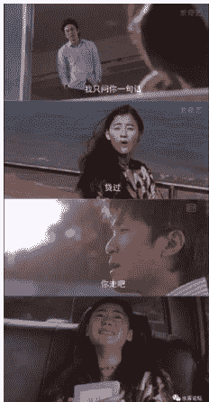

上海北京深圳都是“认房又认贷”的城市，只要你用过一次贷款。你就永远也无法享受高杠杆的优惠。

“处女贷”您这样 500 个，500 个的大批量生产，快赶上某教徒了。

### 四）工程抵扣款

作者的第三个问题是，逻辑和数量级混乱。

生编捏造的故事，编到最后逻辑不通了。

搞了一个什么 “工程抵扣款” 避税的事情。

首先，施工都要二级，三级资质的。

搞个建筑施工公司，闻所未闻。光牌照敲章就凭死你了。

其次，大哥，“工程抵扣款” 是要审计的。

“土地增值税” 以及所有的 KFS 应缴税款，都是要经过审计的。

你以为想避就避啊。

的确，目前在 KFS 财务的实操中，各方都尽量取上限。塞进成本。

但是上限，也就卡到 4500 元/平米的土建成本。

难道您还能写成 8000 元土建，10000 元土建。

哪家财务敢让你过？

目前上海的内环线房价，马马虎虎算是 90000 元/平米吧。

4500 元占多少呢，5%

这 5% 的黄沙水泥款，你能变出多少花样来。

4300 和 4500 又有什么区别。

至于说 “工程抵扣款” 就更为搞笑了。什么年代了，您生活在上世纪 90 年代么。

香港建筑界，从来没有“烂尾楼”的说法，您知道为什么么。[3]

因为“地价”和“土建”费用实在不成比例。**一家公司只要付得起土地款，他就一定付得起建筑承包费。**

同样道理，一个小区，算 500 套房子。

全部的“建设工程款”，一共才多少呢，500*5%=25 套。

你施工队分文不取，只要房子，也就拿二三十套。[4]

您一张口 51%。

您以为工商税务局的审计署，是吃干饭的。

您以为施工费用，占房价多少百分比。

您自己到马路上看看，是不是满大街 51% 的“工程抵用房”？

### 五）虚幻的敌人

那位不成器的地产自媒体中 V，其他的错谈还有很多。例如；

- “完全没有销售，整个模型，从头到尾没有卖出过一套房子”。
- “KFS 需要资金，不到国际市场上发债。7% 的永续债，许首富都嫌心疼。却花 600% 回报，向炒家融资”。
- “银行评估，内控根本通不过”。

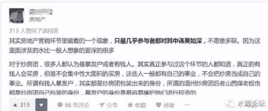

真正令我感到震惊的，是这样的一篇垃圾回复，居然有 313 个赞，66 个评论。

而且下面的评论里面，清一色的叫好，跺脚，鼓掌。

这是怎么了，我们的社会到底怎么了，我们的大学教育出了什么问题。

怎么会教出这样一批学生！

全国国民，如果都像知乎 er 一样素质，中国就完蛋了。

我们知道，“宏观调控”已经持续了十几年，房价也因此上涨了十几年。

随着房价越来越高，人民群众生活压力越来越大，负担越来越苦。

为什么宏观调控持续得不到效果。

因为你在和一个虚幻的目标做斗争。

整个“山西炒房团”“温州炒房团”，就是由这样不负责任，谎话连篇的 V，

闭门造车，自说自话，纯粹凭借自己的幻想和想象，虚构出来的。

知乎 er 素质低下，不问是非。没有一丝一毫判断产业的能力。

你听信这样的西贝货，义愤填膺，奋力呐喊。

# 挺着长矛，冲向空气中不存在的巨人。

你可能打倒“炒房团”么。自然是永远也打不倒的。

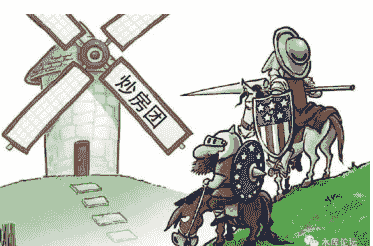

最后，不要问我真正的炒房团，长什么样子的。

（yevon_ou@163.com，2017 年 11 月 8 日于夜）

1. 《炒房团是怎么炒房的？》
https://www.zhihu.com/question/20497059/answer/256254205
2. 御天王和丈母娘的段子。 https://www.douban.com/group/topic/81912325
3. 全香港 60 年房地产开发历史，一共只发生过一次烂尾事件。是 2003 年新界。
4. 在目前上海市场，“工程抵扣款”房源不会超过 0.1%，重庆大概不超过 1%

## 被遗弃，被抛弃的 B2C #1600

原创 2017-12-08 yevon_ou 水库论坛水库论坛


## 被遗弃，被抛弃的 B2C #1600

### V2C

#### 一）新浪微博


本周没有更新，因为大家都知道，俺被拉去参加“新浪微博 2017 影响力大会”了。

一笑加一笑（微信号：150500211）邀您加入水库交流群。群内文集每月一更新……

承业内朋友盛情，拉我坐了主桌。

通常，水库论坛以微信为主。微信是一个很封闭体系。

因为行业的“特殊性”。微博我很少玩。

微博实在太 Open 了，容易“转转转转转”，很多言论，一旦被转发太多，转失控了，就不太好。weibo.com/yevon1ou

因此这次聚会，见到了许多微博上的大 V，也很令人高兴。例如孟祥远老师，“阿拉上海人”的卢鸿伯爵，帅得一台糊涂的南京“阳光”，雅房的顾洪波，黄芳则是早就认识的。

中国古代的数学，在明末有了突飞猛进般的发展。主要是因为“西学东渐”，有了利玛窦，汤若望等传教士。带来了欧洲天文历法，几何学，微分等多种学科。刺激了独立的中国体系打开了新的视野。

嗯，这次聚会，让我知道了很多新的捞钱手法。

#### 二）捞钱手法

捞钱手法。这次新浪开了三天会，“来去之间”CEO 滔滔不绝，峰会鼓吹新浪的大 V 们，“一个绚丽美好的前景”。

只要你坚持跟着新浪混，“钱景”是太大地良好的。

https://weibo.com/1853047530/PftqexEVg

一直以来，我对新浪小有抵触。

为什么抵触，我觉得他崇洋媚外。

譬如说，新浪的“付费问答”收费体制，是唯一的“抽三”体制。

客户花 666 元，提问一个问题。

得看客户用什么手机。

如果是苹果手机，大 V 到手就只有七成。666*70%=466

只有用 Android 手机，大 V 到手才是 666.

这就让我非常地不爽。苹果是什么东西，排不上号的 2G RAM 低端手机。

苹果有什么贡献，凭什么分掉 30%

俺好不容易新浪也加了一个 V，乐得小脚丫子乱蹬。干嘛要分 30% 给 APPLE。

客户用什么手机，关我屁事。

但是新浪非常非常地弱，在和美国公司的谈判中，处于绝对的弱势。

哥哥很不爽，当然出于 Marketing 管培生的职业习惯，文案是绝不能这样写的。

如果让我写文案，我会写成：

- 提问原价 1000。
- 外国手机不打折（苹果）
- 国产手机打 7 折，爱护国货（华为，小米，锤子，OPPO...）

哥哥心里这个小九九打得开心顺畅，自以为掌握了“中华数学”的精髓。

然后我拿去了“新浪大 V”们交流，俺的表情是这样的。

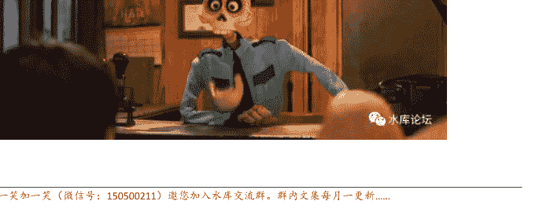

代差啊，代差啊！同志们。

挨面啊，挨面啊！同志们。

大家都昰想赚点奶粉钱，为什么档次就差那么多呢。

“微博 V”关心的是什么。

- 消费者的城市分布
- 消费者的收入分布
- 消费者的口味细分
- 消费者对于 299, 599, 3000 元产品的承受能力
- 消费者中，“首套房”和“二套房”的购买比重。
- 水库咨询客户，复购率多少
- 美誉度，口碑传播有几重
- 每天几点发文，阅读量最高？

同志们啊，妥妥的上述分析，**以上全错**。

北京 V 关心，且只关心一个问题。

**今天张老板去哪里吃饭。**

#### 三） B 端

我知道业态不佳，世风日下。

人心不古，非蒜韭贵。

可是我真心不知道，整个业态，已经败坏成如此地步了。

对于西半球的“数学”来说，他们只关心“李老板去哪里吃饭了”。

因为 V 们变现的渠道高度受压，他们基本上只有二三条路。

一笑加一笑（微信号：**150500211**）邀您加入水库交流群。群内文集每月一更新......

- 1) 广告
- 2) 讲座
- 3) 开发商返佣

其中，“讲座”不是每个人都可以搞的。最好是有一个“官方”体制内的身份。例如某大学某教授。天生就在“讲座”方面，具有巨大的优势。

在整个“微博房产”生态中，最大的大号是“财上海”。大约有 91W 微博粉丝。

可是业界讲起“菜菜”来，却是不屑一顾。

因为菜菜属于“隐身号”，出于种种原因，财上海永远不肯走到台前。永远是菜场买汰烧。

这在保护“京沪永远涨”咖啡御免的同时，也造成非常糟的结果。

财上海永远不可能靠“讲座”赚钱。

譬如以菜菜的知名度，讲一场定价 999 元，应该能卖几百张场。

扣除成本，一场也有几十万的收入。

可是他执意做“隐身人”，四个菜就失去了这最大头的一块收入。

其次是“广告”。

微博广告的“阅读数”，水分远远超过微信。大约是 1:10 的关系。

广告因人而异，视流量大小。此处略过不提。

而大 V 们最大的一块收入，则是“返佣”。

介绍你去的任何一个楼盘，都是有返佣的。KFS 雇佣了你大 V 站台，就一定有利益分成。

譬如说，今天中午，哥哥在望京某 Mall 吃饭。它摆在商场大堂里的售楼。

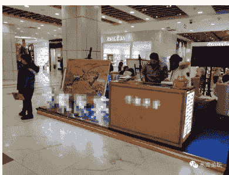

象这样的“返郊”楼盘，他就是有返点的。

一般以 35000 的单价，120 平米，420W 一套。

返点可以给到 3%

你“拉过去”一个客户，返佣可以给到 15W。

象哥哥这种北京 40000 读者的 KOL，登高一呼，动辄拉过去就是几十人啊。

算算钱，好几百万啊！！

昨天接了一篇青浦“玉兰花园”的广告，他们问我，收了多少钱。

哥哥老老实实地回答说 3W，而且后台留言，被骂成翔。

哈哈哈哈哈

哈哈哈

哥哥的良心，受到了 10000 点的伤害。

然后我再看看，随便推荐一个“环京”的项目。

提成动辄 300W。

不行了，俺的良心又受到了 20000 点的伤害。

不行了，赶快给我嵌 82 年的雪碧，冰冻俺这纯洁无比的真心伤痕。

以后接广告，各位可真别骂了。俺快成业界良心化石了。

- 你只要肯背书，分分钟赚提成几百万，一个楼盘。
- 你死破不背书，赚 3W

水库概不背书！

目前这个业态，已经恶化到什么程度了呢。

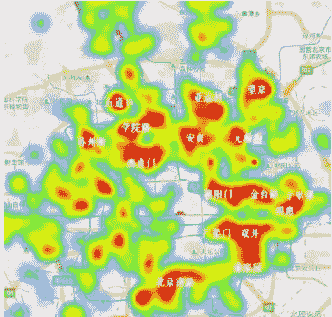

在这次的新浪“影响力”大会上，有人贴了这样一张图。

这张图，不是“北京板块分析”。

这张图，是北京“KFS 分析”。

就是说，业内的分析，已经不去想“怎样给消费者提供更好的房子”。哪儿板块涨得更好一点，哪里的房子是洼地，涨幅更有潜力。

他们的思路，完全是倒过来的。“哪里有 KFS”。

然后我去找 KFS，我来帮你倒过来写文案。

你房子造在门口沟，你想卖 5W，6W，还是 7W。

没问题啊，我来帮你凑“推荐词”。反正优点总是可以发掘出来的。

北京那么大，用力吆喝，总有傻瓜上钩的。

# 我觉得这样做是不对的

前一阵子，发生了著名的“风格纯粹”事件。

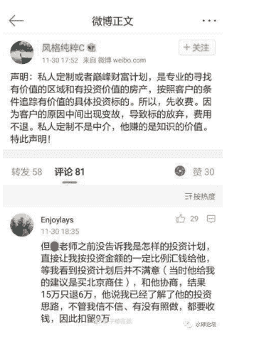

鉴于“同行不互撕”的传统智慧，我就不披露这个号的背后，具体是哪位赫赫有名的网络大佬了。

具体的事件，大概是这样的。他的一个学员，砸锅卖铁卖掉了全部的身家。四线城市小地方，拼凑了 50W 元祖传资产。然后向他“咨询”该如何投资。

结果某老师开口一说，就推荐一个天价北京超贵的“CEO 商住”。

某学员左思右想觉得不对。虽然没进过紫禁城，但也知道“北京商住”目前正是调控的风口浪尖，KFS 想要卖房子，恐怕是千难万难。

于是学员说不想做了，想把咨询费讨回来。

没想到某老师一开口，“15W 只能退 6W”。

舆论哗然。

理由是“知识付费是一种秘密”，秘密说出了就要收 9W。哪怕没执行。

唉，知识付费没你这种同行。

重点不是这个，重点是晚上饭局时。俺这“中国数学”纯洁的小心灵，还没有看懂里面的勾勾。

经高人指点，才知道，为什么要推荐“北京商住”呢。

因为北京四环之内，基本上没有新盘了。就算有寥寥二三个新盘，那也是万众瞩目，千万宠爱，根本不愁卖。

但是整个房产“大 V”意见领袖的收入，高度集中在 B 端。

他们主要靠返点，暴利为生。

如果四环内房子不愁卖，那还有哪里的 KFS 愿意给费用呢。

1) 远郊

2) 环京

3) 商住

某人推荐商住，纯粹是一种“职业习惯”。吃二头。

吃完了咨询客户，再去吃 KFS 的返点。

只不过吃相实在太难看了点，搞得客户都毛了。小地方人也知道“CEO 商住”买不得。

于是被捕了篓子。

#### 四）C 端

哥哥总结了一下，水库属于“叫花子流”。

他们问我收多少钱。俺老老实实地回答，“分答付费社群”收 399，回答屌丝无限长的问题，老客户还有八折。

哈哈哈哈哈

哈哈哈

叫花子流痛苦地扭向一边去。穿白袜子也是人权嘛，只要保暖就好。

不管怎么说，我始终认为这套体系是不对的。

在整个系统中，唯一没有的，就是对消费者的保护。

所有人都是为 KFS 说话的。“KFS 返佣”，成了意见领袖最大，甚至唯一的收入。

再也没有人研究板块轮动。

再也没有人研究购房洼地。

再也没有人研究信贷技巧。

再也没有人帮消费者税务筹划。

所有人，都排队等在大 KFS 门口。等着大老板翻你的牌子。

KFS 是唯一的付费源头，所有人都围绕着 KFS 说话

一笑加一笑（微信号：150500211）邀您加入水库交流群。群内文集每月一更新……


然而这是不对的。整个市场上，需要 C2C 的关怀。

每一个消费者，都是小小的个体。需要服务和帮助。

虽然消费者可能只出 399 元，3000 元，来咨询你一些很琐碎的问题。

虽然无数的，大量的，细水长磨的工作，折磨得你疲惫不堪。

但是这个市场，*需要有人服务于消费者*。你需要一个买方经纪人。

不可以把消费者当小老鼠一样卖弄，不可以买卖流量。

需要有人站在消费者的立场，告诉消费者的利益。

需要有人为“砸锅卖铁”的小镇青年，增加一道防护。

需要有人低买高卖，纠正价格的不合理错配。

需要有人克制邪恶的“返郊精装一手房妇流 CEO 盘”。

俺还是赚俺老老实实的“不背书”3W 元吧。

我始终相信一点：

在这个市场想要走得远，“信誉”才是你真正的立身之本。

（yevon_ou@163.com，2017 年 12 月 8 日）

此处应有水库“知识”二维码。

有效期到 2018.04.19，因此只收 5/12 的费用。4.20 需要续费。

## 粉耳朵 #1650

原创 2018-01-04 yevon_ou 水库论坛


根据水库论坛 2014.06.08 旧文《粉耳朵》改写 [1]

只和法师吟唱的时间有关

### 一）粉耳朵

*我真的烦透了某些人。*

*在我看来，某些人的立场，当且仅当法师在他耳边吟唱的时间有关。*

不知道各位有没有玩过《帝国时代》，很老的游戏。

在帝国时代里面，有一个特殊的兵种：巫师。

巫师本身并没有太强的战斗力。但是他可以“吟唱”。

*洗脸歌曲，唱啊唱着，*

对方阵营一台投石车，突然由红变蓝。亲友变成敌人。然后开始攻击身边友军。

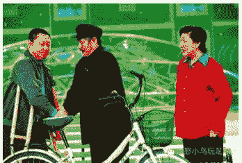

旁边的剑士们一看不对，三下五除二，把投石车给砍了。

老头继续“吟唱”。剑士中又有一 个人“叛变”。肤色由红变蓝，剑士开始攻击剑士。

如果放在房地产市场，则是这样的一群人，我们可以称之为“**粉耳朵**”。

你要说他们是空头，还是多头呢。

看空吧，还是看多吧。

咳咳，这事纯粹只和他们听了多少次“讲座”有关。

譬如说，你拉着他，连听十场“大空头”。

杨红旭，郎成平，大白的讲座。听着听着，他变得义愤填膺。

挥舞手臂，铁杆死空。房价马上就要崩盘，腰斩膝斩跌到脚趾头。

然后你，再把他拉回来。听十场“水俣论坛”。

他痴迷入迷，开口闭口“买买买”。一刀流半刀流。

“构建以房贷为核心的资产包”“2N”“贷到就是赚到”。

再听十场“空头论坛”，又叛变了。

这其中的转变，行云流水，比 iOS 还流畅。

以至于你根本不知道变色龙本来的肤色，是什么颜色的。

“Yes, Majesty”他本人，是没有任何立场的。

### 二）真理

昨天水库知识星球，有人问了这样一个问题。

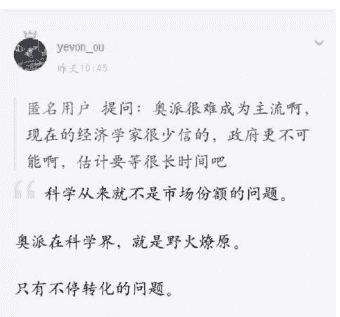

科学，必然是一元的。

$\pi$，必然是 3.1415926535897……，这个数字是精确的。绝对不会有任何歧义。

**科学不是民主投票。**

科学不是粉耳朵。不是说一会甲方影响你，一会乙方影响你。看影响力的大小，立场不断摇摆。

**水库论坛，致力于传播科学。**

在真理普照之下，对就是对，错就是错。

如果你一会对，一会错，那只能说明你还“没入门”。

为此，我们需要解释一下，为什么会出现“粉耳朵”，为什么会有这样的现象，为什么会有这样的人。

**粉耳朵现象的本质，是只懂“定性分析”，不懂“定量分析”。**

好比我外公以前炒股票。每次我见到他，永远都是紧缩眉头，愁眉不展。

他说的最多一句话，永远都是“不确定因素太多”。

你跟他说中国经济长远看好，企业盈利增长迅速，居民收入每过十年加零。

他永远说“这些事情都很好，可是也有乌云啊”。

例如某些机构说，中国产业结构不合理，环保清查，损害了生产力。国际油价上涨，能源价格高昂。美联储加息，印度发生了地震，南太平洋香蕉欠收。

如果美联储加一次息，或者小川龙王表示收紧水龙头。

那简直就要吓破了他的命。他永远生活在“惶惶”迟疑之中，没过这一天好日子。

粉耳朵的症状，其本质是只懂“定性分析”，不懂“定量分析”。

“定性分析”的结果，就是只能比大小，不能相加。

譬如说，100 件利好，那是毫无疑问的利好，赶快买入。

可是哪怕 99 件利好，1 件利空，因为没有定量分析，顿是有机死机了。

水库论坛，致力于科学的普及。

你看全中国所有的“地产公众号”，只有水库论坛，是告诉你“加息对地产的定量”。

几乎所有的人，都知道 “加息对地产是不利的” 。不利，可是有多少不利呢。是不是如谢国忠唱的 “上海下跌 50%，北京下跌 30%” 。

对于某些只懂粗浅 “定量” 的粉耳朵。加一次息，他的心理就崩溃了。你和他说再多的 “宏观经济分析” 都没用。

可是水库论坛，可以告诉你，大约是 1:5 的关系。加一次息，房价下跌 5 倍。

加息 0.50%，房价大约下跌 2.5%。

只有二点五，四十分之一哦。皮毛不痒。一涨就涨三四成。

具体的算法，见《利率与房价的精算法》#2270.

### 三）尚舒坊

近期，深圳有一个机构，惹了水库几句话。

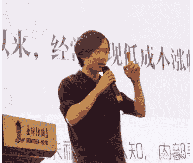

链接在这里《众生喧哗，听大白如何先声夺人？》

他提出二个观点；

- 1）并不存在洼地
- 2）房贷创造通胀

然后，就有一堆的“粉耳朵”被他忽悠去了。

哥哥一听就乐了，就跳舞了，就羞挥拳拍手了。

你说这是什么。这不就是水库精神么。

水库开篇，总是号召小白去“看房 200 套”。

为什么要看房 200 套。200 套就是为了让你“构建”世界观，构建对这个市场的基本理解，构建内心的框架。

有些人，你哪怕把他仍在盆地里，他还会问你“哪里是洼地”。

因为他们无从分辨，内心没有比较的基础。

见识太少，就无从分辨。

他们总是说“便宜总有便宜的道理”，“现在有利空消息”

“2KM 外有高压电线，会不会折价”

“小区门口有中国移动基站，要不要打八折”。


要不要八折，要不要八折，你倒是说呀

但是，如果你“看房200套”，你心里就有谱了。

千奇百怪，千人千面，所有的人群你都看过了。

然后你就知道，临近高架不折价，临近大马路不折价，临近高压线不折价，视野有遮挡不折价，中移动不折价，18层楼不折价。

你以为“小心肝哎哟哟”的事情，全部都只有 2~3%的影响力。

你要是因为加息了，去找房东砍价。

房东直接大扫把把你砸出去。

洼地是存在的。只有踏实实干的人，才能分辨洼地。

“粉耳朵”心中没有一杆秤，他们永远分辨不了笋盘。

### 四）房贷

有一种论调，认为“通货膨胀是房贷造成的”。

他们振振有词地说，因为房贷，市场上的钱变多了。

钱多了，通胀了。

所以“房价上涨”，是通胀的因，而不是通胀的果。

说这种话的人，缺乏最基本的金融常识。

房贷是怎么产生的，房贷占用的是“工商业贷款”。

当基础货币产生之后，“货币供应量”总是恒定的，M2 的倍数，一般是基础 3.0~3.5 倍左右。

这个数字，是“存款准备金率”的倒数。

银行拿到存款之后，总是要千方百计地把贷款放出去。

不管以任何名义，但总之最后银行手里是“不捏”现金的。钱总是要尽量地放出去，买国债，同业存款，创造贷款利润。

在最初的时候，银行只有“工商类”企业，这一种贷款。

众所周知，放贷给工商业的风险是很大的。中国的银行系统，从 1990 年到 2000 年，二次因为坏账而崩溃。

而到了 2000 年之后，银行也开始发放“个人住房贷款”，“信用卡消费类贷款”。

你分 36 期，买一个 iPhone X 手机，其实也是银行贷款。

而这些针对“个人”的贷款，性价比要好得多。给银行贡献了大量的利润。坏账却几乎为零。

房贷，事实上是拯救了整个的银行系统。

“货币供应量”只和基础货币有关，大致是3.0~3.5倍，是“存款准备金率”的一个倒数。

无论有没有房贷，“滥发纸币”之后，通胀会随之而来。

认为房贷促进通胀的人。

缺乏最基本的金融常识。

### 五）严谨的楼学

今天，我看到这样一条微博。

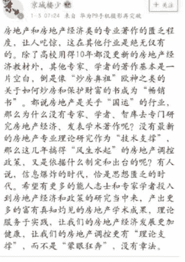

我们一直看到有一种评论，认为楼市是“蒙”的。

以为你能猜中前十几次 的对错，连续十七年，把把押多，纯粹是因为“运气”。

我们知道，肤浅来自于无知。

有些人，坐在盆里里，却不知道“洼地”。

坐在一触即发的火药桶里，却妄谈“没有行情”。

这些事情的原因，是因为他们没有“看房 200 套”。

粉耳朵，是因为小白的知识太少。越是无知的人，越容易摇摆观点。

而深入深刻了解水库的人，就会知道“楼市学”是一棵复杂的科技树。

浩瀚，芜杂，庞大，各种知识闪光点，无穷无尽。

你了解水库越深。越会赞叹，“这是科学”。

楼市，靠的是科学。计算出来的，而不是蒙的。

有些兵种，是不受“巫法师”吟唱影响的。例如圣堂骑士。

最后，也是最重要的一句话。

**水库小密圈，每天仅需 15 元。才是真正的物超所值。**

链接在菜单—最新—小密圈中。

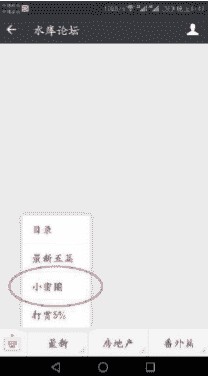

当然，真正的“粉耳朵”。一定翻来覆去付二边的费。

那我也不反对，哈哈哈。

（yevon_ou@163.com，2018 年 1 月 3 日）

[1] 【拎楼秘籍】节选 --- 粉耳朵. http://shuiku.net/forum.php?mod=viewthread&tid=22880

## Marketing 篇

### 市场营销入门 #210

2015-06-03 yevon_ou 水库论坛


**市场营销入门** <sub>#210</sub>

“职业炒家”这个话题并没有说完，后面还有789。

只不过我们对 Hard Sale 感到厌倦。从今天起，我们换个话题。

首先，让我们看一张图表。假设市场上有男人、女人、老人、孩子四类人群。有 A、B、C、D 四种商品。请问哪种商品最佳。

| 得分 | 男人 | 女人 | 老人 | 小孩 |
|:---:|:---:|:---:|:---:|:---:|
| A | 10 | 2 | 2 | 2 |
| B | 2 | 10 | 2 | 2 |
| C | 9 | 9 | 9 | 4 |
| D | 4 | 4 | 9 |  |

**一）胜组**

这个问题的答案，是 B > A > D > C

这道题我问过很多人，一般最常见的回答，多数人选 C 最佳。

因为你简单加一加，A 的总分是 10+2+2+2=16 分

B 是 16 分

C 是 31 分

D 是 21 分

很多人立即会以为，C 具有全方位最佳的“性价比”。在客店内更受欢迎，能卖出更好的销量。产品可以更加成功。

这个就是市场营销学和普通人的区别。也是欧美公司，可以在中国市场称雄肆虐的原因。

科学家会成功，神仙也挡不住。

你看，假设有一个男人，在商店里待了 5 分钟。他出来的时候，手里拿着什么。拿的是货物 A。

再来了一个女人，逛商店 5 分钟，她买的是货物 B。

再来一个老人，他买的是 C 或 D。

再来一个小孩，他买的是 C 或 D。

再来一个男人，他买 A。

来个女人，买 B

来个老人，C 或 D

来个小孩，C 或 D

一天下来，假设来了“男女老少”各 100 人。则 400 人最终的购物商品是：

A：100 件

B：100 件

C：100 件

D：100 件

**二) 问题之症结**

你发现问题之所在了么。

当一个男人跳进商店，他根本不会考虑别人的想法。根本不会考虑女人们的价值观。他选的是自己喜欢的商品。

| 得分 | 男人 |
| :---: | :---: |
| A | 10 |
| B | 2 |
| C | 9 |
| D | 4 |

也就是这棵决策树中，他是竖着长的。

在男人眼里，他就是选择 ABCD，他就是选最好的。所以他会买 A 回家。

同样道理。女人购物，她就会选 B 回家。

而商品 C，虽然他在男人女人的眼里，得分都是 9 分。可是 9 分没有用。和忽悠没有区别。

一般而言，成年人的市场，是老人和小孩的 10 倍。[1]

而其中，女人市场又比男人市场重要。

所以 B 是最大的赢家。B > A

然后我们来看 C 和 D 二样商品。

在成年人，男人女人的市场中，C 和 D 都是完败。

但在老人小孩的细分市场中，他们还有一线转机。

| 得分 | 老人 | 小孩 |
| :---: | :---: | :---: |
| A | 2 | 2 |
| B | 2 | 2 |
| C | 9 | 4 |
| D | 9 | 4 |

这其中，D 又比 C 好。

为什么。当一个老人或者一个儿童，走进商店的时候，他们面临的 C 和 D 打分几乎是完全一样的。

可是你别忘了，C 的综合评分比 D 高。

C 是 9+9+9+4，综合评分高达 31 分。

而 D 的累积评分，只有 21 分。

“更高的品质往往意味着更高的成本”，即使 C 和 D 的销量一样。但 C 的成本往往要高一大截。

所以 D > C

总评分是 B > A > D > C，C 是最差的选择。

**三）市场营销学的选择**

中国人并不是一个整体，不是蚂蚁。[2] 

每一个人，都是独立的个体。都有他们的喜怒哀乐。都有他们的习惯和偏好。

上周大象工会一篇《什么样的外星人可以直接打死》中，大象写道，传统意义上，国企老总把中国人理解成“中山装，红袖章，清一色面孔的人”。

而在西方社会，每一个人是鲜活的人。

中国的企业家，传统上总是梦想做一件“最好的商品”。想用一件商品来满足十亿中国人。

这是一个巨大的工程。呕心沥血，最终“工程师治国”老总说出来的，可能是一件“9，9，9，9”的商品。

各方面指数都接近完美。要让所有人都满意，不容易呵。

而西方的 500 强企业，早早地就把中国消费者分成了“中国男人”“中国女人”“中国老人”“中国小孩”。

他们设计 4 种产品。

成本更低，研发更快。反应链更敏捷，潮流更时尚。三个月就可以上市，成本只有你一半。

“无论哪个消费者走到店里，购买的都是我的（某一样）商品”。

西方500强奉行的是“10，1，1，1”商品指数。

并无情地把你“9，9，9，9”销量贬低到零。

这个细分，还可以更进一步分下去。譬如中国男人，还可以进一步分为北京男人，上海男人，广东男人，四川男人，东北男人…………

如果你在男装市场陷入了泥沼，你可以试图进一步思考广东男人和东北男人有什么不同。从而获得细分优势。

你这商品可能狗Shit都不如，但在四川男人眼中，它是最棒的。这就够了。四千万消费者足够养活你了。

“细细分”是支脉话题，就不展开了。

**四) 价值观的颠覆**

“市场营销学”的价值观是什么。价值观就是“没有 (hexin) 价值观”。

请你把中国人视为一个个的人，而不是一个巨人。

中国应该有十万万个价值观，而不是一个价值观。

在营销学上，一直有一句著名的谚语：一个高级副总裁，可能会为他的定制男装感到骄傲。并在办公室里炫耀。而在他18岁读大学的女儿眼里，却会被贬得老土一文不如”。

这就是Marketing中的一条铁律：“甲之美酒，乙之砒霜”。

你永远不可能让所有的人满意。同一件商品不可能覆盖所有消费者。许多人的审美观，是互相矛盾，甚至相互冲突的。

一个45岁的高级副总裁，和他18岁的女儿，其审美观必然是不同的。让他们同去选购西装，肯定是无法达成共识的。

所以Marketing思想的背后，其实是西方社会光辉灿烂的“多元文化”主体论。尊重每一个人的想法，用不同的商品适合不同的消费者。在每一个市场都做到第一。

只要你付钱。

另外说一句题外话。除了某些技术类的公司，譬如Windows 桌面操作系统，高通的 CDMA 电信标准：

一般的消费品，很难做到市场第一。甚至百分之20~30%的份额都属不易。

因为市场是多元化的。消费者的口味是互相冲突，自相矛盾的。

喜欢甜的，和不喜欢甜的。

喜欢蓝色的，和不喜欢蓝色的。

喜欢苹果味的，和不喜欢苹果味的。

所以单一产品无法满足所有消费者，无法占领100%的市场份额。

而如果一家公司旗下有多个子品牌系列，交叉火力，能否覆盖占领整个市场呢。中国销量排名六的洗发水，有五家都是P&G 旗下的。

答案还是不能。因为你同一家公司旗下诸多资源品牌，你就会加以“整合”。共同渠道销售，广告商誉，品牌 Logo 等资源。

而这一切，都会让消费者厌倦。许多消费者选购 SLEK 舒蕾，纯粹是因为不想看见那个“宝洁蓝”。

同一商标能占领的市场份额也是有限的。你不可能通过并购来扩大市场份额。除非并购了之后从来不整合。

**五）与楼市的关系**

微信号：“水库论坛”是一个讲楼市的订阅号。在此我们突然改弦易辙，大讲市场营销 Marketing 干什么。


因为我们的楼市，本身是一个高度割裂的市场。

在大而化之的“职业炒家”系列文章之后，你要深入了解这个市场，就一定要阅读细分结构。

上海楼市，至少分割成三种截然不同的市场，三类完全迥异的人群。

这三类人，彼此对方的价值观，地段评级，都看不顺眼。

互相擦肩走过，冷冷地看了对方一眼，一起吐出一句：“SB”。

我们常常说，中国没有研究“房地产”的专家。中国只有研究“房地产泡沫”的专家。

我们每天只听见砖家坐而论道，大而化之地说：“房地产要崩盘，要跌 50%”。

可是房地产内部结构如何，上海分割成哪三个市场。从来没有一个“房地产专家”谈过过这事。能答得上来。

堪称国耻，一群卖大力丸的。

好了。第一节篇幅到此，下集再说。

（vevon_ou@163.com, 2015 年 6 月 3 日）

+ 1. 这里要重新介绍下，假设每个年龄段人口一样，儿童是0~6岁，成年人7~60岁，老年人61~70岁。则尾龄约 54 年。
+ 2. 参考文献《什么样的外家人可以直接打死｜天答公会》

http://mp.weixin.qq.com/s/2__biz=MjM5NzQwNjcyMw==&mid=214571189&idx=1&sn=1f50799c9464d5bc51bc6faH386d2482a&scene=1&key=c6f6884b042932bd2ce1d3a10f6f928b7b0acd4d40aba7abd26b27691c5e9ac34bc991878aae0627d62990ed7aae21c1c6b5&ascene=1&uin=NdiygMj2OTM11B&xvctype=web&wx02&version=70000001&pass_ticket=1tWl.%2FpLLakiq%2F21uDi8ikwDv9JdfF1Ek3q%MQ4ou%2FYHDVfO9jPk68iOxBlh549G2n


## Re-Sale 为什么这么难 #220

2015-06-08 yevon_ou 水库论坛


随着营销的深入，市场割裂越来越严重。

### 一）闻所未闻

北京是一个很干燥的城市。前两天我在洗手间摸来摸去，想要找一瓶护肤霜。

“那瓶 9500，碰了剩你手”。俺 LP 冷冷地说道。

我吓了一跳，拿起这瓶晚霜看看。50ml 九五百港币（La Prairie），这是什么玩意。

对于一个护肤知识还停留在美加净，欧莱雅年代的化石古董，我表示从未听说过这个品牌。

不明白它的精妙高科技之处，也不明白女人抹一次脸五百元。

但是看俺 LP 的态度，似乎视之若然。这个品牌就像吃饭喝水一样根植在她的生活之中。对于品牌的忠诚度和认知度是如此地契合入微，以至于她办了张 VIP 卡。[1]

“La Prairie 至少比 LAMER 好，因为 LAMER 我所听说过”。我眯着眼瞎想。

### 二）四位一体

随着营销的深入，市场割裂正变得越来越严重。

在前面一篇《市场营销入门 #210》中，我们说到，假如你把市场分为男人，女人，老人，小孩。则女性专用用品，完全不必考虑男人的想法。

在我的生活中，我根本接触不到 La Prairie 这个品牌。

我每天开车出门，在大食代吃早餐，看财经杂志，购买科幻及历史类的书刊杂志。逛商场只逛 B1 层的 Citysuper 和 6F 的餐饮层。

我基本不看电视只看 DVD，上微博关注宇文若尘和 G 油渣，微信关注的是冬川豆和布尔费墨。线下联系的是多军群和御用中介。在我的生活中，几乎接触不到 La Prairie。

而俺 LP 的生活和我很不一样。她坐飞机头等舱，视频广告里就在放 La Prairie，拿过一本机中杂志，杂志上广告是 La Prairie。去美容院做个 SPA，美容院刊物上是 La Prairie，宣传小卡片上是 La Prairie，技师和她聊起来是 La Prairie。

她逛商场，只逛 1F 化妆品和 2F，3F 女装区。恒隆国金之中，La Prairie 专柜无所不在。她刷微信朋友圈，关注的大 V 推荐 La Prairie。看看优酷土豆，推送的短片是 La Prairie，联系二个闺蜜喝茶，大家谈论的是 La Prairie。

让我数数多少个 La Prairie，十几个了吧。似乎无处不在，La Prairie 将她包围。那你说，你买不买呢。

这个被叫做“四位一体”。

在营销学上，有所谓的 4P：Product, Price, Promotion, Place。产品价格促销货架。

这四样东西，要全部针对性的聚焦在一点上。不仅仅产品是“10,1,1,1”的打分设计。而且广告，促销，货架专柜，全都是“10,1,1,1”的摆放布局。

如果总资源有限，那就要高度精微聚焦到一个针尖上。

真正专业的做法，你是个男人，我就让你一辈子见不到 La Prairie 这个品牌。你根本不知道它是啥玩意。

你是个女人，而且是高收入女人。我就让你生活在 La Prairie 的海洋中。抬头走到哪里见到哪，到处都是 La Prairie 广告。

### 三）广告费

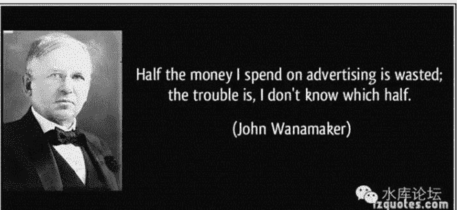

你去找摊上买二本广告学的书，看得头昏脑胀，到最后也没搞懂是在说些什么。其实现代广告学的核心就一句话，“购买尽可能少的广告”。

为什么，因为 Media 非常非常地贵，超级超级的贵，不可想象的贵。

你一个机构，分公司运作一月。可能也就几百万的营业额。整家公司运作一年，N 个分公司累加，可能也就几亿销售，几千万利润。放 A 股都算主板公司了。

可是 Media 的成本是以秒计算的。最顶级的媒体，一秒就可以上百万。

哪怕很渣的媒体，30 秒六次，每个 Round 二周，烧几十上百万也是正常。

一个产品，一年多打二个 Round，今年利润就算是废掉了。

一个产品，一年多打四个 Round，财务报表彻底没法看了。你想办法和总部解释吧。

因为 Media 超级超级地贵，所以每一个产品经理都挖空心思。想尽一切的办法省钱。在满足需求情况下，买得越少越好。

这其中一个主要技巧，就是市场分类。

广告一般是按照用户收费的。计价单位是 CPM（千人成本）。也就是说，有多少人家看见了，我就问你收多少钱。

这里面，广告的选购，就有大学问。

譬如说，地铁广告是一个很好的媒体。受众量大，人流更新率快。

地铁的主要对象，是屌丝们。如果你想推广一个 App，或者给好声音/达人秀做广告，地铁无疑是极佳选择。

地铁的问题是，他的受众是男人女人各 50%的。

如果我是卖洗发水的。我就绝不会选择地铁做广告。

因为超市购物，只有女人才会买洗发水。家庭妇男少之又少。

而地铁广告是按“全人口”收费的。也就是收了二倍的费。是有 50%经费被浪费了。

对于卖洗发水，洗衣粉，衣物柔顺剂之类的，女性杂志才是更好的选择。

同样道理，CCAV 是全国性最大的媒体。但你很少看见 LV, GUCCI 等超级大牌在上面做广告。

最多只有一些产业链最最低级低端的品牌，譬如 Lux 香皂。

因为 CCAV 虽然覆盖面广。但他的受众，主要是 8 亿农民。

而如果你卖的是奢侈品。8 亿人口中可能只有 0.01%才是你的客户。但 CCAV 却要为全部的 8 亿观众收费。

这自然是得不偿失的。头等舱机载杂志，才是更好的选择。

### 四）题外话

插播一句题外话。在整间公司中，油水最足的是哪个职位；

其实是媒体经理。

众所周知，油水来自于“采购”。花钱的是大爷。采购部一向被认为升职无望捞钱最快的部门。

公司采购最多的是什么，是文具么。不是，那是骗小孩的。

是大宗原材料么。也不是，因为太多的人眼睛盯着。而且有 KPI 指标考核，操作余地也不大。

公司真正单一标的采购最大的，其实是媒体。

一间公司，动辄有一二亿的媒体预算。而整个市场部下辖媒体组，可能也就二三个人。

媒体同时又是一个价格极其不透明的行业。

同样一段卫视广告，灯箱广告，刊物广告，报价究竟是 6000 万，还是 5500W，没有任何人知道。谁也不能计算得这么仔细。

就我接触过的案例。媒体的折扣是很深很深，乃至于惊人的。

我接触过的最深的一个例子，是一折。报价 500W 的广告费用，其实最后 50W 就可以拿下来。

这是惊人的空间。

在这个领域里，媒体经理具有巨大的权限。他可以选择采购哪家媒体，用什么费用，采购多少媒体。

在公司架构中，媒体是唯一的奇异的一条线。他虽然是中层经理，却是唯一和 Director 级一样，直接向总经理汇报的。

因为媒体实在太重要，金额太庞大。所有媒体行为都需要总经理本人签。

但你以为总经理分得清 6000W 和 5500W，真懂某项媒体计划的真实成本是多少吗？

不张扬的位子才是真赚钱的位子。

### 五）和楼市的关系

水库论坛是一个专讲楼市的订阅号。今天我们又花费了大量的篇幅，来讲营销定位，四位一体，这是什么意思么。


我们解释的，其实是驾色网友常见的一个疑惑：“当年我一眼就看中，超级喜欢的房子。为什么现在想卖却卖不掉”。

因为随着营销的深入，市场已高度割裂。

好像我举 La Prairie 的例子。它是卖给女人的，所以只针对着女人做广告。在我太太的生活社交圈内，它无所不在。

而在我的生活社交圈内，它根本不见踪影。

这样做最大程度节省了广告费。也是我说 La Prairie 比 LAMER 好的原因。你可千万别看反了。

名气越大，其实越不好。说明他品牌定位失败，广告预算浪费。

“不必在意别人的想法”。只要最终掏钱者喜欢，那就赢了。

至于她老公的看法，完全可以无视。

回到房地产的市场，你以为平平无奇的一件事。其实 KFS 在 N 年前就开始准备了。

从 KFS 拍地之前，他心里就有了计划。这样一个地块，以后造什么形状的房子。

我是内环，中环，还是外环。将来造出来是豪宅，高档住宅，还是经济适用房。

对应于我的住宅档次，我应该开发 70 m²，90 m²，120 m²，140 m²，还是 200 m² 住宅。

对应这个住宅档次，是否应该精装修，洁具应该选哪个品牌。

景观，会所，该如何设计。物业费定在哪个档次。

当我土建基本完工，开始销售。我应该在哪些媒体投放广告。

价格定位如何。开盘当日，有哪些促销活动。

售楼员的说辞如何。我的楼盘卖点是什么。竞争对手是哪家。

朋友，当你来到售楼处，买下一套房子的时候。

你以为是纯“偶然”的么。是随便随便逛街进来的么。

不，那是 KFS 几年前就布下的一个局。专为你这样的身份地位、家庭人口、口味偏好，量身定制的产品。且刻意投放在你会阅读到的媒体。

你能够走进售楼处买房子，这简直就得称你幸运啊。

好了，现在你准备卖房了。准备“保值升值”。

你去中介那一挂，然后自认为客户就会“扑通扑通”地跳进来。

朋友，你想“卖给”的那个人，他是怎样的客户。

收入多少，年龄多少，家庭人口多少。喜好什么，阅读怎样的杂志，你如何把售房信息推送给他。

你对此一无所知。你甚至都从来没考虑过这个问题。你几乎是二眼一抹黑地“挂牌”，自认为就可以卖房了。

KFS 在整个流程链上投入了巨大的心力，并且在设计、营销、广告上花费大量的金钱。你以为这些都是白扔的么。

而你倚靠的，仅仅是极度不可靠的“中介”。你以为中介能干些什么，尤其是上海的中介。

发广告市场定位寻找客户？我呸，上海的中介只会吹牛。

更为糟糕的，买一手和买二手，通常是二批人。二批完全不同的客户。天差地远。

每一个楼盘，当 KFS 卖给你时，都精心调整至“最佳”状态。宛如俺 LP 被 La Prairie 重重包围。

而当你想“卖出”，想保值增值的时候。你往往面对的是另一群客户，一群完全不同的二手房偏好客户。

之前所做的每一项专属优化，针对广告，现在都不适用。

好比你举着一瓶二手 La Prairie，想卖给我这个男人。

然后满怀疑惑地问，当年这么大热大卖的东西。为什么现在无人问津。为什么我这个男人，表示从未听说过这个品牌，也根本不感兴趣。

Re-Sale 是一件极难的事，请仔细深入想一想。只有职业炒家才会告诉你真相。

### 六）某情圣的故事

最后，让我们再讲一个悲惨的故事，来作为本篇结尾。

话说某人啊，另一个情圣：他 LP 是日本人。小时候是大日本帝国驻缅甸大使的女儿。

稍微知道一点缅甸独立史的朋友，自然就会明白这个职位的意义。

大使虽然没什么金钱收入，但女儿却是从小像公主一样养大的。去总统总理府踢毽子，都是随身带三十几个保镖的。

女儿长大了以后，要嫁人了。钱虽然不多，但眼界自然是极高的。

他们去到了 Chaumet 买戒指。全球三大顶级品牌之一，皇室御用品牌。

最后挑了一枚 1 克拉的钻戒。花了 250 万 HKD。

据说等他们离开商店之后，店员立刻就拉下了门闸，今天就不营业了。然后里面开了香槟，放起摇滚乐，店员们跳上桌子开始狂欢。

据后来人的说法，整家店一个月的任务是卖出一件商品。只要卖出一件，整个月都够吃穿用度了。

这个故事告诉我们的是，“附加值”有时候可以在商品中占到怎样夸张离谱的地步。以至于商品本身完全不保值。1 克拉钻戒通常市场价格在 1 万元 RMB 左右。

（yevon_ou@163.com，2015 年 6 月 8 日午）

[1] 不管她买什么，买的都是我的卡。

## 如何运营一家企业 #230

2015-09-03 yevon_ou 水库论坛

水库论坛

欧神文集(纸质版)


水库论坛 Shuku.net 长按或截屏


“水库论坛”的订阅号停更了差不多二个月，因为我们浪费了大量时间，不务正业去写了《论儒·法·禅宗·基督自治和道教的复兴 #F10》。

煌煌矣，仅此一篇，即可成一代宗师。

接下来，我们回到了正常的编号序列。可惜的是，#230，#240 这两篇，仍然和炒楼无关。属于岔开来的话题。

但是，这些东西，是我（前半生）心血所聚。加塞二篇。纯属废话。

### 一）经营企业

每一次俺 LP 带我出去，我要做的事就是眼观鼻鼻观心。

当她和她那班同事聊得热火朝天的时候，我冷静地剥着花生。

“我刚买了 A 公司 20%股份”。

“我刚收购了 B 公司 15%股份”。

“你觉得 C 公司怎么样，可惜要拆掉 VIE 结构。还是发 CB 比较好”。

“D 公司应该更有潜力。可惜管理层要留住。无法进行外科手术式改造。毕竟，我们都只懂并购，谁也不懂企业经营”。

于是诸投行精英一起叹气。谁也不懂经营，他们就是专职买卖公司的。

这个时候，我眼睛亮了。经营公司，这事我懂啊。我可以试试。

看什么看，哥哥可是正派 MT (Management Trainee) 出生，市场部高等人才好不好。

只不过时运窘迫，才会沦落到钱眼里去。

要谈企业运营，自然有一套规律。全套手法。

有人或许说，LZ 从来没有本人掌控过一家十亿级的公司。你没有这个从业经历，所以也没什么说服力。

但是今天，俺们也不是 HR 面试，不是冯唐求职董事总经理对不对。

今天，我们是看水库微信订阅精华文章。大致地讲讲“企业运营”是怎么回事。

你是学习，我是分享。我就说说，你就看看，别太挑剔。

### 二）管理秘笈

几乎每一个中国人，都听过标准的段子：“他经营企业，管理有方，获得了巨大的成功，并积累了财富”。

可是怎样才能“管理”呢？

你如果去新华书店，看看“企业管理”方面的书，大概可以装满二个集装箱。数不胜数。

而不知你试过没有。如果你真的拿一本回来，打开仔细阅读一番。从头到尾 300 页。读完以后你绞绞牛。

“没有”，什么也没有。

你会发现这么大一本企管书，里面什么都没有，完全没有任何干货。

就像 TG 领导人讲话一样，每一次都是“重要讲话”，会议动辄二三个小时。可是真正核心干货呢。讲完之后你还是一团雾水。

在几乎所有的企管书籍里面，他都会让你“加强销售管理”“加强成本管理”“加强库存管理”。

道理我们都懂，可是怎样销售管理呢？你倒是说一个方法，让我下季度的销售额增长+50% 答案是都没有。无论你翻遍二集装箱任何一本书，他们的深度是相同的，也就是同样的幼稚。

作者本人都不懂什么叫做企业管理。

当 1990 年，西方五百强各大公司进入中国的时候，他们在中国市场基本是横扫的。哪怕是同等科技含量的产品，例如牙膏，牙刷，洗发水，国军也是一败涂地。

这里面的战力，主要是营销学中的巨大差异。

而随着西方公司在中国录取本地员工，MNG 的一套操作手法，才逐渐被中国的五百强员工学去。

等到这批人自己在市场上成立公司，所谓第二批浪潮。这些新型公司才获得了足够的竞争力，并最终将外资的上市公司全都赶出中国。

这些是前言，也是《市场营销入门 #210》一篇中写的。

### 三）公司开始

营销，英文叫做 Marketing。

Marketing 是一家公司最核心的部门，类似于总参谋部。

Marketing 是一家公司最核心的部门。有时候他非常地小，小到只有老板加二三个人的地步。

但整个功能和流程依然是不变的。

闲话少说。好了，现在给你一家公司，一笔钱，你要开始创业了。请问，你该怎么做。

首先，你要定位。

定位这件事十分简单。简单到网络中的小白，随手就给你画了一条 X-Y 轴象限图。

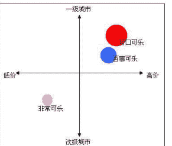

我 LP 每周要看 20 份企业介绍。其中看到的“定位图”不计其数。按照我的看法，95% 的企业，第一轮就可以筛掉。

为什么，因为他们的定位图画得不对。

中国人的粗疏大叶，在这一刻显露无遗。绝大多数“定位图”，我最恨的那种，他甚至连都不标明 X 轴代表什么，Y 轴代表什么。都没有二个轴的名字。

少数情况，如上表那张。它已经算画得不错了。但问题来了，为什么你要选择“价格-城市”作为你的 X-Y 轴。

真正的干货，要师傅带着你，才能迅速学会。没有带入门，往往会画虎不成反类犬。

对于 Marketing 来说，真正的内传弟子才知道，这个 X-Y 轴不是随便选的。

在做这个定位图中，你首先要做一个市场调查。问消费者，“您最关心的因素是什么，请按优先顺序排序”。

然后下面给你选，譬如：“口感，香味，疗效，时尚，包装，便利，促销，价格”

价格通常是重要的，但不一定是最重要的。

然后选最重要的 No. 1，No. 2 作为 X-Y 轴！

只有消费者对此最关心的 No. 1, No. 2 才可以作为 X-Y 轴。你选一些无关紧要的参数做图有什么用。这样去定位，只会死得很惨。

比较考究的，甚至还会把 X-Y 图中涂色。以表示重要程度。譬如 45% 的消费者集中在 10~12 元的价位，23% 消费者集中在 12~15 元的价位。

然后你再看看，这张图中有什么没填满的地方。

这个区域才是你的创业突破口。

同样道理，当 No. 1, No. 2 这二个参数定下来后。可以看在选择这二段的消费者中，他们最关心的参数是什么，有没有空格。

从而将 No. 3, No. 4 参数定下来。

所谓“进一步细分”。

### 四）品牌战略

好的定位，是成功的 1/3。当你决定了拳头产品的基本定位之后，你还需要对这个行业，有一个初步的了解。

首先，这一行，（现代商品经济）的基本面是什么。

99%的中国人在这问题上，犯了极大的错误。现代商品经济的基本框架，是高毛利。极大的毛利。什么生产成本加合理利润，统统见鬼去吧。什么叫高毛利，以我以前经验，大概是300~400%。

也就是说，一件终端售价8元的商品，出厂价大约是7元，而成本是2元。看清楚，出厂价7元的商品，成本价是2元。不是6元也不是5元。当年我们最基本的商品，一般都是300%毛利。最极端的一款，成本大约是8%，十二倍毛利。也就是10元的东西，成本0.8元。外企的毛利非常非常地高。高到什么程度，买一送一50%off，他还有足够的利润。有时候甚至还有200%的利润。

这是一个大框架，外企从一开始就走上了“高毛利——高溢价——高品牌”的道路。以广告品牌为支撑，一开价就是翻四倍。

心比炒房客还黑。

以上适合于品牌销售类产品，如化妆品，生活品，日用品。不适用于功能性产品，如煤炭钢铁。

那么消费者会不会买账呢。答案是会的。因为消费者其实搞不懂“品牌”中真正含有的价值是多少。而且中国消费者有一个很不好的习惯，以价格定性能。

长期的计划经济思维，使得中国消费者相信“贵的一定是好的”，“贵总有贵的道理”“一分钱一分钱”。

这使得品牌战略有了足够的空间。在初期定位时，尽量定位在高端。

以高毛利促动了高利润，高利润投放广告，从而达成良性循环。

中国的乡村企业家，习惯以130%的价格销售商品。这使得他们永远积累不起毛利。而且消费者反而以为他们的产品价低质次，不投广告。

做生意要有想象力。谁说1W的房子不能涨成5W。

Marketing教会你。

### 五）促销

| | 外企 | 民企 | 国企 |
| :--- | :---: | :---: | :---: |
| 产品销售： | 100% | 100% | 100% |
| 成本 | -33% | -33% | -75% |
| 广告 | -10% | -10% | 5% |
| 促销 | -10% | -10% | 0% |
| 管理成本 | -25% | -10% | -10% |
| 利润： | 22% | 37% | 10% |
| 税后净利润： | 17% | 28% | 7% |

以一个典型的 AP (Advertising & Promotion) 表为例。在这样的表格中，企业恒定地划出 15~20%销售额，作为广告和促销费用。其中，波动比较大的是广告费。而促销费是非常非常之恒定的。一般 N 年都是 10%销售额。这个 Promotion 费是什么意思呢。可不可以省下来呢。

答案是省不下来的。相当于产品九折。

你不信邪，你提价 1.1 倍好了。

那为什么要有 Promotion 费用，而不是直接打九折呢。

因为 P 费用的存在，主要是做以下二方面用途：

- 1）微调
- 2) 制造新闻

产品的定位，No. 12345 性能的设计，是一个企业最核心的事情。有说法 80%的成败在设计那一刻已经决定。这是大方向，难以改变。

但是，市场是千变万化的。

在 January 的某一个时刻，可能福建地区竞争对手势头很猛，市场份额急剧扩大。

那你怎么办，再有针对性设计一款低价产品，显然时间上来不及。

这时候，最好的策略，是给福建的出厂价，给一个 10%的折扣。为期二个月。

在这二个月内，降价会刺激销量急剧上升。从而狙击了竞争对手。

促销是一种 “微调” 手段。当你大的产品，几种款式都已经定下来以后。促销可以使你有计划，有时段性的调整拉低某一个价格。从而更针对性的适应一个个地方市场。

促销的另一个作用，是制造 “News”。

肯德基麦当劳有从麦辣鸡到巨无霸到板烧鸡腿堡的全套产品。

可是他们不降价。

周一：麦辣鸡打八折
周二：巨无霸八折
周三：鲔鱼堡八折
……
……
周日：培根牛肉堡八折

那你为什么要这样设计呢。众所周知，消费品的毛利是非常高的。哪怕我全体八折，只要你来买，我还是有 300%毛利。

这样做的原因，是给你脑子里塞进去信息，“今天有促销信息”。

哪怕我有总体销售额 10%的预算，可我就是不肯好好地弄，不肯每件商品全线九折。

我就是喜欢高高低低。今天扯高这个，明天扯高那个。有时候还要搞个游戏，弄的很复杂才能获得优惠。

把这 10%预算花得复杂无比。其实，当消费者研究“今天哪一款有折扣”时，你这个品牌在消费者脑海中，停留的时间就比平时长。

如果你闭着眼睛跑到店里买个汉堡，你大脑只需要运转 5 秒钟。

可如果你要研究清楚整个促销，你大脑里就要 “麦、麦、麦，麦，麦……” 跳跃 30 秒。

这就是商家的全部用意。通过制造 News，制造复杂，让品牌形象在你脑中留下更深刻的记忆。

顺便说一句题外话。外企最终被民企击败，是因为他们的管理成本太高。尤其是 F-Team 的人费用过高。

有过一次我们收购一个全球第一的扬州工厂，派了二个 F 高管过去。
后来算了一下，计入这两个高管费用之后，该公司毛利下降 20%。是销售额的 20%。

### 六）经销商的利益

经销商也是一家企业，他们只关心自己的利润

当我离开公司时，接我的是一个北大硕士小妹。
老板并没有挽留，我也就草草交接了一下。反正您都不在意。
当时，公司里最大的问题是，经销商纷纷抱怨毛利率过低不赚钱。经销商队伍不稳，这直接影响了公司整个销售网络的紊乱。
那北大小妹 NB 咿咿地说，“我们目前的毛利仍有 65%，出厂价 10 元，成本只有 3.5 元”。
“既然这样，为何不降利 5%，出厂价调到 9.5 元”。
“据说经销商那帮土鳖利润只有 0.5%，一下子让利 5%，他们都要臭翻掉了。我真是个天才，哈哈大笑”。
我悲哀地看着这个接班人，公司的人力资源瓦解几乎是全面的土崩溃的。
北大的女硕士，还真是牛人啊。
为什么呢，因为降价 5%，对于经销商是完全没有用的。
对于我同期的那些 Sales 手足，如果你问公司顽瘤在哪里，他们都会说：“不知道 Sales 是做销售的，还是做贸易的”。
为什么，因为划给你一块地盘，譬如汕头，譬如惠州。
你辛辛苦苦把毛细血管铺下去了，销售网络铺到了每一层村镇。可是真正的收益人呢，往往不是你。
因为销售是一个完全讲利润的场所。哪怕整个毛细血管是你一手逐步开拓搭建的。
可是卖货的那些超市小店，只要看见价格低 0.01 元钱，就会毫不犹豫从别人手里进货。虽然也是进货。
而这个别人呢，往往是佛山的“销售经理”。
那佛山的销售经理，他哪来的“低价货”呢。
因为他到总部去哭穷。
“这个月销售任务完不成啊”“竞争对手比较强啊”
“再给我 10W 元支持，我一定保证 1000W 销售额”。
当佛山的销售经理，拿了 10W 元的销售补助。他并不是致力于开拓佛山的销售毛细血管。
而是直接把货拿到惠州去销售。鸠占鹊巢。
广东省内的公路交通，十分发达。只要微不足道的 0.01 元差价，马上会有大量的货物，随时在各区域划拨。
久而久之，经销商们都不会傻得自己去开拓下线市场了。而只是挖空了心思向总部要补助，然后互相倾销。
显然，象这样的框架下，经销商之间的竞争，注定是剎刀见血的。注定是价格战打死的。
最终 0.5%毛利率都无法保证。能不亏钱就不错了。

培训宝典

而如果你们总部降价呢。降价的结果，就是所有的经销商，全部都降价5%，利润率还是0.5%，一切都沒有改变。

我悲哀地看着北大硕士。就让这种蠢货菜鸟来接我么。

为了遏制“窜货”，公司想了无数的办法。从最早的严控总部优惠，到期末抽奖式返佣，到强制性境外旅游。全都以无效告终。

极端的时候，公司甚至额外雇人手，在每一卡车出场货品上，特意敲上“赣”“豫”“湘”“鄂”的章。毫无疑问，他们一离开 NDC 就被摘毁。

要克服低毛利的方法，一个是经销商数目足够的少。每人管一大片，这样冲穿窜货才会大大减少。

但公司十分贪婪。采取的多经销商制，这样才能覆盖尽可能多的区域。到末期，全国已经有 2000 个以上一级经销商。显然，价格战是不可控制的。

销售这件事，和教科书上的不同。早就不是提着货物满大街叫卖的年代了。

销售主要是经销商队伍的开拓与维护。哪怕在电商时代也是一样的。

### 七）结语

水库论坛是一个专门讲炒房的论坛。因为对上海楼市的分析中，会用到 Markeing 的分类概念。

所以我们依次写了四篇：

- 《市场营销入门 #210》
- 《Re-Sale 为什么这么难 #220》
- 《如何运营一家企业 #230》
- 《无中生有的高阶 #240》

后二篇其实和炒楼没什么关系。而且篇幅所限，也不可能将 Marketing 说得太全面。

只不过经销和营销，是一家公司的核心，是大脑总参谋部。这一类知识十分重要，远远比什么工程机械学科更重要。

长久以来，中国根本没人在懂市场营销。这使得中国企业吃了不少的亏。而且现代的“创业者”几乎无法成功。

3~4 二篇不过 10000 来字。只能打下一个基础。但对于启蒙者来说，哪怕说上几句框架，也是人生宝贵了。

(yevon_ou@163.com，2015年9月2日晚)

## 无中生有的高阶 #240

2015-09-04 yevon_ou 水库论坛

## 水库论坛

## 欧神文集 (纸质版)


## 无中生有的高阶 #240

怎样才能赢。
这句话有语病。

### 一）赢家

每个人都想发财。
可你知道，一个人最终能赚多少，不是看你的工作有多么地“高科技”。而是看你的竞争对手有多厉害。
竞争对手的优秀，决定了你的成本线。而你超过竞争对手的部分，才是超额利润。
简单点说，就是你要赢。
赢了才能致富。赢了才能拥有一切。
可是，怎样才能够赢呢。有没有一种成功学，能够教你赢呢。
答案是：逻辑死机。
如果“赢”是一种学说的话，那别人也能学啊。
别人也能赢啊。大家彼此是对等的。
这本身就是逻辑悖论。
所以赢这件事，真的要说说的话，就一定是旁门左道。

### 二）MIP

在我们这一个行业，如何能赢。
之前一篇《如何运营一家企业 #230》，已经说道了企业运转基础。定位，促销，销售等架构如何运作。
可是这些事，你能够做，别人也能够做。

一笑加一笑（微信号：150500211）邀您加入水库交流群。群内文集每月一更新……

如果你还想赢，你就需要一些高阶技巧。无中生有的利润。
这些利润中，比较典型的，先说一个 MIP。
MIP 的全称是 Margin ImprovementProject（毛利提升计划）。
一个产品，什么时候性价比最高？
让一个市场营销从业人员告诉你内幕：刚上市的时候。
新产品上市，我们永远是给她最好的配方，最好的包装，最优质的原材料。
然后呢，然后会发生什么？
然后我们会偷偷地修改配方。你没看错，真的是修改配方。
我们会偷偷地以次一级的原材料，替换掉最好的原材料。时间一般发生在“新产品”上市六个月以后。
MIP 是一个漫长的过程。通常会进行 20~30 次。
逐步地，緩慢地，将每一个配料都換成更更更次一级的原料或工艺。
每一次 MIP，都是一件严肃的事情。事前事后会做消费者调查。一般而言，消费者会察觉品质的细微不同。但通常而言，只有小部分的消费者会放弃购买。
如果放弃的人群在 1%之内，就可认为是成功的。
MIP 的原理是什么呢，原理是人类的消费心理学。
人类在第一次购买时，戒备警告是最严重的。术语叫做 New User。
第一次购买是最谨慎的。因为品质可能很糟糕，甚至完全值不回票价。消费者有非常大的戒心。
为了应付“第一次购买障碍”，商家往往要做出非常大的促销。譬如力度很大的折扣，捆绑销售，甚至免费赠送小样样品。
而第二，第三次购买，消费者的戒心要小得多得多。
因为他们已经有了使用体验，知道品质的大致情况。再坏也坏不到哪里去。损失可能是 1~2%，而不会是全部的 100%本金。
换句话说，人在第二次购买时，决策链条短得多。
所以在 Marketing 内部人员的眼里，产品严格地分为“新产品”和“老产品”。
任何一个新产品上市时，它的品质一定是最初的。
我们会竭尽全力，去吸引消费者，去触发初次购买。去克服心理障碍。
而消费者只要购买过一次之后，他的戒心就会去除。
这样，六个月之后，我们就会渐渐地开始做 MIP 项目。有计划地，一件一件地把品质越弄越低。
我们公司曾经上市过一种牙膏。刚上市的时候，四面都是镭射烫金盒子，光彩四射，在货架上就能刺得你睁不开眼。
据说这个盒子值 0.85 元。比骨头三分之一成本还贵。
而三个月之后，我们的 Marketing 市场部同事，很聪明地将他缩减成了“二面镭射”。即陈列的正面和顶面是镭射。反正底下的你看不见么。呵呵。
今时今日，该款货物已经完全没有什么镭射包装。
你吃过“双汇火腿肠”就知道。火腿肠是猪肉和面粉的混合。

而劣质的火腿肠，猪肉成分极少，面粉成分极多。

最严重的情况下，当你剥开火腿肠外皮，其面粉甚至象石灰粉一样，扑哧扑哧往下掉。过半分钟你的火腿肠就只剩半根了。

洗衣界的巨头，是著名的“碧浪”和“汰渍”。

这二家老兄一样玩得太过。你买洗衣粉时，还会精挑细选品牌？。

不会，于是这二家老兄的洗衣粉，也搞得像面粉差不多了。

有时候这玩意实在搞得太过分了。Marketing品牌经理只好再搞一次Revitalization。Revitalization，中文叫做复兴。

“全新，新一代改良配方。效果比以前好三倍”。

你以为这是全新的高科技么。不是的。他或许就是五年前刚上市时用的配方。哈哈哈哈哈。

超市里的货物，除了名称和条形码没变，其实每年每一批次的货物都不同。质量是在持续下降的。

所有有经验的Marketing老人，绝对不买任何老品牌。尤其是十几年以上的SKU。

### 三）降价狂潮

Walmart 希望你降价。

经销商希望你降价，消费者希望你降价。甚至就连政府都希望 你降价，这样他们的CPI指数才可以好看一点。

众所周知，我们生活在一个通胀年代。员工的工资，能源，地租，原材料，交通运输成本，每一样都在急剧上升中。

在这上升通道，你还希望我Exf降价。你让我如何做到。

幸运的是，人民群众的智慧是无穷的。

假设我们有同一类15件商品。你可以想象成15款形状不同的牙刷。

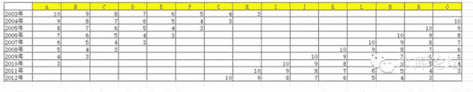

如图，2003年的时候，我们总共有A, B, C, D, E, F, G, H 这八款商品是在销售的。价格分别是3~10元。

而 2004 年的时候：

- 所有商品减 1 元。
- 低于 3 元的退出市场
- 我们推出一个新产品 O，售价 10 元

请问，我们这个 是降价么。

答案肯定是 的。而且从任何一个统计口径，我们都是确确实实的真实降价。譬如A 就从 10 元降到了 9 元。

Walmart 满意，经销商满意，政府满意，所有人都满意。

同样道理，2005 年的时候：

- 所有商品减 1 元。
- 低于 3 元的退出市场
- 我们推出一个新产品 N，售价 10 元

同样的道理，我们渡过了 2006 年，2007 年，2008 年…………….

你仔细观察这个表格，你发现问题所在了？？？

到了 2011 年的时候，经过了连续 8 年的降价。

我们终于隆重地，万众瞩目地，盛大光荣地，推出了新产品 H，售价 10 元。

等等等等等，H 不是以前就在卖的么。而且 2003 年的时候，只要 3 元就可以买到。

对呀，是的，没错。

可是，还有谁，能记得 8 年前超市里的一款消费品呢？

更何況，我们也能做一些小改动。譬如增加一点珠光，换一点旋风刷毛，起一个好听点的名字。然后就算是华丽上市了。

然后你又问，消费者分不出商品档次么。

答案是分不出。如果你仔细观察的话，你应该发现，A-H 其实是同质同款的商品。是等价对你的。

而消费者在任何一个个年代，为他们支付的是 3~10 元不等。自愿的。

这正印证了一句老话，消费者支付的不是商品本身，而是商品对应的阶级认同身份感。

真实的世界，会比这个模型略有复杂。在每一个年代，我们会对商品本身做些细小的优化，从而使他与上一代产品不完全相同。同时技术本身也在进步，锻造和加工精度始终在更美化。

但是，整个事件的这道逻辑，是严格地不变的。我们每年都在降价，按任何统计口径 CPI 都在下降。

而降价的实质，就是这么一个螺旋桩。

做 Marketing，做这些魔鬼设计师，是一件毁人不倦的事。难以想象哥哥第一次看见这个表格，内心几乎是崩溃的。呕血灌满整个小黑板。

最后的结果，是哥哥再也不买任何品牌货（女士例外）。

### 四）自我假货

〔本段故事，纯属虚构。若有雷同，实属巧合〕

我们公司自 1991 年进入中国市场。在最初的 15 个月内，换了六任销售总监。

因为销售一直做不来，缺乏一款拳头产品。所以每个总监都做不长。

到最后，终于让整个公司神过翻身的。是第七任总监的神来一笔。

当时，公司面临二大问题：

1）产品美誉度很高。但价格太贵，市场始终不大。
2）假货横行

第七任总监看了以后，说问：“这些假货可以赢利么”。

“既然可以盈利，为什么不我们自己生产”。

于是我们自己生产了一批“假货”。用了几乎 85%相同的包装，只卖以前 30%的价格。而且可以通过正规渠道销售。〔1〕

更卑鄙的是，前一分钟电视台里还在播放“10 元一支高档货”。一转眼，你就能在超市里看见 3 元的。

于是市场一下子就沸腾了。广东乡下人不识货，还以为捡到宝，赚了大便宜。

我们的市场份额，以每个月 0.1% 的速度在增长。这是一个恐怖的数据，业内人士都知道啥概念。全国排名第 10，可能还不到 2% 份额。

此后这个增长持续了十几年，一直增长到全国的 24%，全公司基本就靠这一款拳头产品吃饭。连带着别人也会捎带式消费别的产品。

iPhone6G 据说遭到了彻底的失败。其实苹果公司不懂营销。他那个 6C 的系列手机，就不该弄红黄蓝白黑这么 Cheap 的塑料颜色。

iPhone6C，就应该直接上土豪金。外壳做得 95% 的一模一样。然后只卖 40% 的价格。

这样一来，保证你大卖。各路屌丝趋之若鹜。反正你 6S 自有办法凸显不同。

### 五）如何赢

神通可一不可再。我们公司算是把 Marketing 研究得分十深刻的公司了，但也没办法引爆天赐另一款拳头产品。

对于竞争这种事，你要说赢，那可真的是没有办法。

你能做的，别人也能做。

- 告诉你几条高阶玩法，竞争对手不知道。那你就赢了。
- 如果对方也是高阶，那就只能祈祷运气。

当我刚进公司的时候，我老板和我说，我们公司的净毛利 Net Margin，比竞争对手高 20%。

我大为吃惊，这可是一个天与地，高度赢利和盈亏平衡的距离。

“这是怎么办 的”，我赶紧问老板，“我们公司赢纽的秘密杀手是什么”。

“没有秘诀” 老板说。

我们在 Marketing 初始定位的时候，比对方做得好，好 1%

我们的化学配方，比对方好 1%

我们的 MET[2]，比对方好 1%

我们的库存存量，比对方少 1%

我们的物流运输，比对方优化 1%

我们的广告投放，比对方节省 1%

我们的销售精英，比对方卖力 1%

我们的财务成本，比对方低 1%

其中，每一项的比拼都是 1%，其优势差距之微小，不涉及任何保密级的彗星新科技。

可就是凭着管理有方，无数个战场，无数个部门，无数同事累积起来，我们比对方毛利高 20%。

这是一个巨大的优势，巨大到你甚至不敢去挑战它。

毛选中旬话：“凡事就怕认真”。

一个企业，一场竞争，哪怕你完全没有利制胜的特殊武器，双方平等。

可是你只要认真，比对方更认真，花心思去做，你就可以赢。

因为这个世界上，认认真真的人实在太少了。

(yevon_ou@163.com, 2015 年 9 月 2 日晚。“市场营销” 四卷算是写完了，接下来可以继续说楼市)。

[1]这款 30%价格商品，仍然拥有惊人的 60%毛利。即成本 1.2 元。
[2] MET（Manufacturing Efficient Technology），指生产制造中的特殊工艺。例如锅炉煅烧，由 15 分钟一炉，改造成 12 分钟一炉之类的。MET 是生产部减成本主要方法。

## 夏洛特烦恼 ｜精准营销的胜利 #F240

2015-11-19 yeyon_ou 水库论坛


# 夏洛特烦恼|精准营销的胜利 #F240

得屌丝者得天下

### 一）校园

昨天去看“夏洛特烦恼”，被震撼住了。

这部小制作电影，票房据说要冲20亿。我们且不说其背后的大股东万达集团赚得盆满钵满，股价可期。就说作为一个 Marketing 专业人员，从“夏洛特”中，我们看到的是震撼，会心一笑。

夏洛特的成功，堪称“精准营销学”的成功。

得屌丝者得天下，让我们一条条分析，在电影发行的背后，究竟发生了些什么。

首先，第一个元素是：“校园”。

如果你熟悉玄幻的话，你就会知道，起点中文网上1/3的题材发生在校园里。什么《最强校园骑士》《最强美女老师》《世界第一学校》，全国四大美女居然有三个在同一所初中。为什么会这样呢，因为起点的消费层次在这里。

起点的主要读者和业余写手，都是18~25岁的年轻人。对于他们来说，身边的履历和经历就是校园与同学。

你让他们写段子，无非是参加各种竞技大奖拿将次，YY的对象一般是美女女老师。我凡是看到开篇讲校园生活的小说，一般就不看下去了，作者太 Low。

电影和唱片是高度重合的消费群体。几乎整个娱乐业，就是18~25岁之间的年轻人撑起来的。追星，演唱会，流行歌曲。


### 二) 逆袭

18 岁之前，高中生通常没有钱。25 岁之后，大家忙着结婚生子买房。和旧生活划钱告一段落。

屌丝得天下。屌丝这一个群体，通指大学毕业没几年，棱角还没有打磨好。所以也是 18~25 岁。

“校园”这一个因素，就是他们最熟悉，最贴切，最喜爱的因素。近年来的青春片，凡是涉及到校园的都卖得不错。

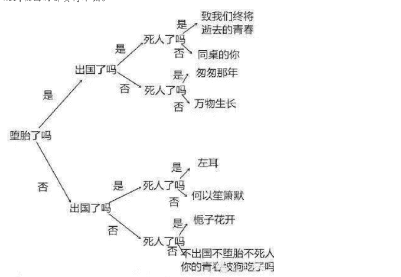

其次，第二个元素，是逆袭。

夏洛混得并不好。严格地说是无业游民。毕业之后就没赚过一分金钱。靠马冬梅踩三轮养活他。

而他，整天拨弄着电吉他，做文艺青年的梦，妄想一夜成名。

这是什么，这就是最广大的 99% 屌丝落魄写照。

现实生活中的落魄也是这样的。毕业数年，一事无成，可还做着出人头地的梦。

夏洛在开篇中受的气，简直就和他们在现实生活中受的气一模一样。感同身受。

然后，然后夏洛逆袭了。

通过重生穿越到 1997 年，夏洛抄袭了朴树、许巍、周董的歌，一跃成为了大明星。

在电影中，出现了“屌丝梦”所具有的一切元素。例如游艇，别墅，高雅的妻子，跟班，海天五女子，法拉利和挥金如土。

这就是屌丝们最喜欢的梦。如果你是一个屌丝，天天踩着三轮卖杂货。你看了夏洛特深受感动，你会不会推荐身边好友大春也看电影？答案是肯定的。于是票房就上去了。

### 三) 亲切

夏洛特中第三个元素是亲切。这也是最难学的。

非屌丝不足以学其精髓。如果你渐渐成为一个成功人士，一个高雅的有品味的人，你也就写不出最“亲切”的剧本。

电影开场 5 分钟，夏洛刚刚进教室的时候，刘老师说了一句，“看什么看，你妈又结婚了么”。

听到这句台词时，我心里猛然地一紧。许多人不道这句台词的分量，但其实非同小可。

有兴趣的朋友可以去看第四部《悲伤逆流成河》中的华凤凤。

贫穷是全方位的。贫穷并不仅仅是金钱上的贫穷，贫穷往往意味着各方面的粗劣。

在电影中，夏洛是一个单身家庭。

而他的身边好友，譬如马冬梅也是单亲。王婳的家庭关系也很混乱。

在英国的贫民窟，大约有 10% 的孩子不知道自己的父亲 (韦小宝)，40% 的孩子是别人的种，而几乎 90% 的孩子没有父亲抚养成人。

贫穷绝不意味着道德高尚。相反的，在贫民窟里抛妻弃子，勾三搭四。越是贫穷的地方性生活越是混乱。

夏洛特这部电影，连最后的遮羞布都不要了。

最终，当夏洛的母亲因为有了大笔的金钱和营养品，不但没死，而且延年益寿 60 岁都不显老时。她找了夏洛的同学兼跟班张扬做情人。

这是一个巨大的讽刺，任何一个神经正常的编剧，都写不出这样的剧本。象我这种心底善良的人，最多写到夏母因为大量金钱，而成长成了一个贵妇。

但编剧就是这样写了，而且这样拍了。

这就在屌丝中产生了巨大的共鸣。屌丝们知道，即使他们发了财时赚了几亿几千万。

他们的家庭，他们的亲人，还是会这样过的，100% 不会变为贵妇。

这样的剧本，我写不出来。

不管是陈勋的地痞流氓，还是大春的愣子形象，撞货车之后的逃逸，双截棍之后的得奖颁礼，破旧的港区平房，对老师潜意识的敬畏 (武林高手)，小树林的丁账方式；这些都是内地小城独有的，会对那些内地小城奋斗出身，校园毕业凤凰男屌丝进城拉扳车的夏洛们，产生强烈的熟悉感，共鸣感，代入感。

这其中的细微区别，身在北京上海长大的我们，是写不出这么好的剧本的。

### 四) 音乐

夏洛这个人，志大才疏。

你穿越回 1997 年，你还搞什么音乐呢。

搞 QQ，搞淘宝，搞微信啊。这才是真正发财快的事。至不济，你跑到深圳去，和小马哥住同一幢公寓楼。厚着脸皮和他交朋友，帮帮手，入个原始股总行了吧。

而哪怕这些事做起来太频。2001 年股市见顶 2186，2007 年股市见顶 6124，这两个历史关键时刻你总知道吧。

再不济，你既然知道房价大涨。砸锅卖铁借高利贷买房子总行了吧。

我还没有冒昧地问一句，德甲意甲欧洲杯，每一次联赛冠军您还记得么。

你知道这世界上，有一件事叫做“赌球”么。

而这些事夏洛都没做。在电影里面他嘲笑大春，2700 买的房子 2900 就抛了，只赚了芝麻小利。

可是你当个华语乐坛天王又能赚多少块钱，周董现在全副身家才多少钱。不也是芝麻。你赶紧去买腾讯 10% 原始股才是正题啊！

可是你这个电影，你就不能这么拍。

如果夏洛这么聪明，穿越回去懂得抓住每一次商机。最后奋斗成亿万富翁。这电影反而没人看了。

因为夏洛就只是一个屌丝，他最高的成就，就是背诵最炫民族风，成为华语音乐教父。

如果你再强一点，你就超出屌丝想象了。你就没有“代入感”。屌丝反而不喜欢你这电影了。看见没有。这就是屌丝电影难拍之处。其要求编剧导演，本身先得是个屌丝，有屌丝思维。

### 五) 片尾

结局呢。结局夏洛梦醒，又穿越回了现代。

这一次，夏洛紧紧搂住了马冬梅。死也不松手。好好依赖天天缠在一起。

我不知道有多少人是被这一幕感动得热泪盈眶的。如果您被感动了，恭喜您，您一定是个屌丝。

为什么，因为一切都没有改变。

夏洛还是没有工作。夏洛还是没有出去找工作。

夏洛还是没有立志，该如何可以去好好工作。

影片的结局，和屌丝的现状一模一样。屌丝们被感动得热泪盈眶。可是明天太阳升起，一切都没有改变。

- 您和那姐合作了这么久，好歹知道一些那姐的习性喜好。以后再在饭店“偶遇”，拍马屁缠上去当个贴心跟班，就那么难么。
- 你在娱乐圈混这么久，各大佬刘德华的手机总背得出吧。你知道那些信息值多少钱。
- 你在娱乐圈混那么久，丑闻内幕你总知道点吧。你拿这些去要挟艺人……

如果我来拍电影，好歹拍几个夏洛觉醒后奋斗工作，穿西装打拼。

最不清济，穿西装明天就去工作应征保镖啊。

恭喜你，如果你这样拍，毫无疑问你的票房会下降 10%。

因为屌丝不喜欢看这样的电影。屌丝就喜欢哭过累过，然后第二天什么事也不做。要去奋斗印名片什么的太累，不符合他们的智商。

### 六) 屌丝时代

在上一篇《屌丝时代》中，我们曾经说道：

> “未来是屌丝的时代。得屌丝者得天下。”

一个人要贴近屌丝，熟悉屌丝，象屌丝一样思考，吃小碟多拿二盘花生来。他才能写出屌丝喜欢的作品。才能赚大钱。

可是一旦他赚了钱，养移气，他就会渐渐成为精英。一个高尚的人，一个脱离了低级趣味的人。

他反而会远离屌丝，再也写不出屌丝喜欢的作品。会失去力量。这真是一个悲哀的悖论”。

我不是屌丝，夏洛特这电影，估计豆瓣上的小清新会骂得狗血喷头。评论说简洁点就是一场东北二人转。

但是这一切，都不妨碍他赚大钱，票房冲上 20 亿。

徐峥拍完“屌爆了”“屌炸了”的心花怒放，他成了成功人士。港囧顿时冲击力就弱了。

开心麻花真心不知道他们能走多远。只要他们越成功，他们就远离屌丝。

“夏洛特”是一场精确制导。是 Marketing 的伟大胜利。整部电影从头到尾，就是为屌丝设计，拍给屌丝看，为屌丝度身定制的。[1]

这部电影唯一需要改进的，只有一个小小的缺点。

因为主角的艺名，实在太难记了。他不要取这么平凡无奇的双字名字，这样没法红。我几乎 baidu 了三次，才勉强记起了女主角的名字。

“王智”，她真不应该叫王智。实在太难记啦! 建议改名为王靖雯。

妹妹妹妹纸王智，“夏洛特”这部电影，至少有 40% 的票房来自于王智。因为王智实在是太漂亮啦！！


（yevon_ou@163.com，2015 年 10 月 12 日）

[1] 参考，上一次见到这么“Marketing 教科书”级的电影，是 Nicole Kidman 拍的“完美主妇”。

## 美国大片加速走向屌丝化 #F1030

原创 2017-04-24 yevon_ou 水库论坛


水库论坛

欧神文集 (纸质版)

## 美国大片加速走向屌丝化 #F1030

楼市调控风声高压，我们继续讲风花雪月

续《每逢佳节倍孤单》#F220

你看的是电影，我看的是 Marketing。

### 一）铜臭

一个像我这样的人，活着真心没什么乐趣。

前两天去看了《速 8》，电影院里砰砰砰，我在那里忍受弱智剧情。

你看的是飞车特技。而我看的，却是背后 marketing 企划点子。

觉得十分有趣，不如写一篇。

一个像我这样的人，活着真心没什么乐趣。

很多事情一旦看清了底层。雪蛤就变成了输卵管，兴奋就变成了多巴胺。[1]

《电影工业》的实质是什么。你以为文艺，大错特错。

电影工业的实质，是商业。

电影被誉为“第七艺术”。名字上叫艺术，其实却是投资上亿美金，耗资巨大的一门生意。一个人打赏 $2 给路边乞丐，可以叫艺术。可是利益大到上亿美金，就一定是生意了。

按照 Marketing 的原理，任何一部电影开拍之前，一定要解决几件事。

- 1) 拍给谁看。谁是目标票房，人数有多少，购买力有多少
- 2) 他们喜欢怎样的故事
- 3) 因而喜欢哪个明星 [2]

好莱坞是一门大生意，从市场调研，到主题确定，到筹款融资，1/3 的活在影片开拍之前就已经做完。

当剧本最终确定时，影片的命运已经有了框架。导演反而关系不大。

就好比现代战争，总参谋部会把一切都算计好。战场上团长，师长的发挥。反而是不可依靠的。

（电影《太空旅客》的剧本，可以堆满一堵墙）

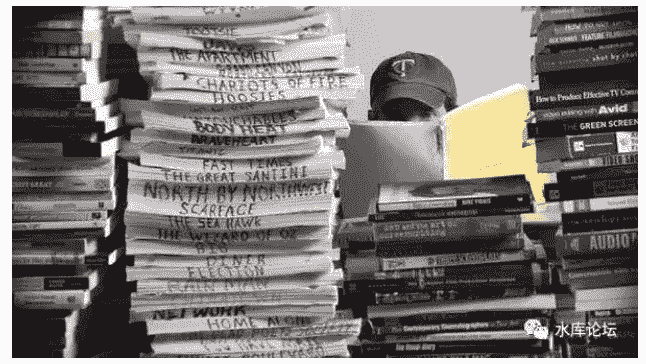

作为一种“逆向工程”，Marketing 的专业人员，可以从影片的拍摄，反向推算出导演的意图。

毕竟，天下熙熙皆为利往。任何一个举措，都是为了利润最大化。反常则必有妖。

好比如媒婆上门，给你女儿介绍男朋友。
如果媒婆说小伙很帅，则他必然没有房子！

一笑加一笑（微信号：150500211）邀您加入水库交流群。群内文集每月一更新……

如果媒婆不说小伙很帅，且慢，这不意味他有房子 => 意味着他既没有房子，长得又很丑!

### 二）黑骑士

别人看的是电影，我看的是 Marketing

—————— yevon_ou

最近几年的电影，第一次让我震惊的是《星球大战 7: 原力觉醒》

俺看了足足半个小时，一直没有看懂。

等到我看懂了，直接从沙发上跌摔下来。


《星球大战 7》的特点，它的主角是一个黑人。

不仅仅是黑人，而且是一个黑人小混混。

俺在电影院里看电影，一直都没看明白。

眼看这个黑人的戏份越来越多，越来越多。

故事都围绕着他发展，到最后练级成长。

俺看了半天，猛然明白，“哎呀，这个黑人不是配角，他就是男主角”。

一下子从凳子上摔跌了下来。

好莱坞居然选了一个黑人做“星战”男主角，真奇真的快完了。

整个 1970 年代，美国最辉煌的年纪。“星战片”主角都是白人，男性。

黑人即使有角色，往往也是配角。引出故事的主线轴，篇幅不会太大。

而芬思戏份超过半小时以后，俺猛然醒悟《星球大战 7》的主角是一个黑人！

最后还要 Kiss 白人女主角的。

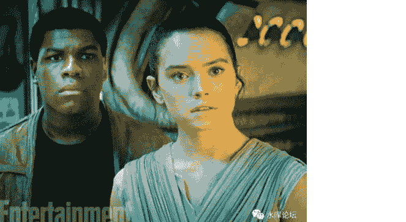

制片公司为什么 would 选用一个黑人，而且还是很丑的黑人做男主角呢。

这绝对不可能是“你等会”之类的笑话误差。

制片公司如此主角级的转变。其背后是观众的转变，是美国人口的转变。

有怎样的观众，就有怎样的电影主角。

### 电影其实是一面镜子。它反射出了观众的人口口味。

你如果看南非的电视频道。

南非的“爱情连续剧”无一例外，都是白女爱上黑男。

而且爱得死去活来，爱得放弃自尊。爱得倒追又犯贱，简直哈巴狗如韩剧“欧巴”倒追花店小妹可比。

每次我看到电视机里，黑人小哥问白女：

“你爱我么”

“你是真的爱我么”。

俺就忍不住想吐。


同样道理，《星球大战 7》为什么要造一个厚嘴唇的黑人做男一号。

而且故事的设定，芬恩最初是一个底层小兵，怯懦逃避的小逃兵。无意被“历史的车轮”推到了英雄的位置。

因为观众喜欢这样的调调。

电影，是一面镜子。它其实反映的观众的内心。

你想看怎样的故事，就会有什么样的电影。

电影并不是第九艺术，电影就是票房。

> 在全世界所有的电影之中，永远都是富家女爱上穷小子。《泰坦尼克》才会有 10 亿票房。
在所有的韩剧之中，永远都是欧巴爱上“前台小妹”———因为 MBC 的收视率目标就是底层白领女性。只有她们才有时间一天看 6 小时电视剧。

> 哪怕你骂，老掉牙的套路。
再过 10 年还得这样拍。

### 三）速 8

同样道理，我们来看《速 8》的故事情节。

> 《速 8》不仅仅是屌丝电影，而且还是低幼龄屌丝电影。
20 岁的《喜羊羊和灰太狼》

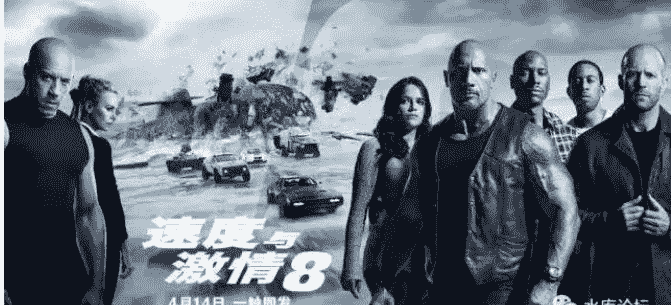

整部电影概括下来，可以称为：

> “一群不愿意工作没有收入的社会边缘份子，幻想成为大盗通缉犯获得特赦一夜之间成为拯救地球人类的大英雄”。

#### 主角是观众的内心投影

所有的起点 YY 文，写的都是作者自己。

主角是观众的内心投影。观众会不知不觉把自己内心代入，并且在看电影的过程中，获得人生圆满，功成名就，美人爱情。

用 Marketing 的眼光看《速 8》，速 8 的定位和最匹配的观影人群，他们应该是：

- 1）懒散，厌恶工作

在哈瓦那岛上，多布毫不犹豫拒绝了塞弗的邀请。台词堪称经典：

> “工作，我不工作”
“谁也别想要求我工作”

考虑到《速 8》的主要观众是黑人裔和拉丁裔的底层。这句话简直说到他们心里去了。他们要的，就是这种游手好闲，又感觉很“酷”的古惑仔风度。

- 2）游手好闲，惹事生非

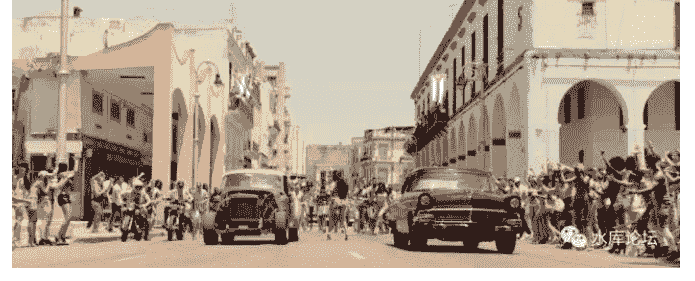

单单地说你“混混”，无疑是一件很伤人，很羞辱的事情。
观影屌丝们也获得 High 感。

于是导演又设计了一场戏。在“量身定做”的场景，让多珀成为英雄，排除万难。

多珀会什么呢，他只会飙车。除了飙车什么也不能。
于是导演设计了一场戏。有了冲突，冲突对方的黑老大，非得要求以“飙车决胜负”。⁽⁴⁾

飙车的过程，自然是惊险万分的。什么喷火，逆行。
男主角最后一定是无恙的。接受群众的眼球，欢呼，万众拥护。

场景的合理性呢。
你一辈子能遇上一次“飙车解决”的事件就不错了。
你还是没有收入。

#### 3）哥们义气

穿插了一段古惑仔最喜欢的“背叛”和“哥们义气”，按下不表。

#### 4）屌丝心态

屌丝心态的第三个问题，是把一切看都太容易。
编故事编不圆。逻辑链断得如小孩子过家家。

每一个“前台少女”心中都怀着憧憬的梦。都梦想王思聪，大公司继承人超帅欧巴会看上你，
而且被你各种虐。

你的心目中，充斥着不切实际的“**浪漫**”期盼。
对于怎样**实现浪漫**，却是**一无所知**。

影片放映到一个小时，僵尸车队出现时，我终于确定自己看的是一部“科幻片”了。
而不是“文艺片”。更不是“动作片”。
拜托，请不要这样侮辱观众智商好么。

在电影中，“僵尸车队”的整齐洪流很有创意。特效也做得不错。
但问题是，4S 店里，根本没有 WiFi 信号呀。

你破密码如家常便饭，我忍了。

“自动驾驶”根本没到实用阶段，我也忍了。

这么多车队横冲直撞，居然没撞死小狗小猫，我还是忍了。

可是 4S 店里没有 Wifi 啊。停车场也没有 Wifi 啊。

你连信号都没有，你怎么操纵的车队。

#### 5）屌丝心态 II

如果说，操纵 4S 车位，还算是初步夸大的话。

最后一场核潜艇的戏，直接把我看吐了。

各位，你们见过 “不需要维护，不需要预热，一个远程指令就可以启动” 的核潜艇么。

一般典型的 6000 吨位舰艇，需要的人力资源，二战时期要 500 人，此后一路不断自动化。到今天还需要 150 人。

真的不能再少了。每个人力的砍掉，都意味着战斗力的巨大提升。

您如果真的可以造出 “零” 人驾驶，不需要大副二副三副维护的潜艇。

您怎么不把它停到北冰洋去，直接威胁美洲。

更搞笑的，是多珀开启电磁枪，直接冲进海军基地的场景。

您见过不需要人下车，在驾驶途中就可以全程完成的任务么。

您以为是跑酷捡金币么。

你看著多珀按一下电磁枪，大门放下。然后有一根建设非常好的高速车道，没有任何障碍物。

只要你急速开车就行。

这里跨过一个路障，那里甩开二辆跟车。

背后水泥桥梁哗啦啦地跨下来。

是不是有一种似曾相似的感觉。好熟悉啊。

没错，我硬盘里就有一个。

赛车游戏啊！

您是不是把电影当成电竞来拍了。最后一段基地追逐之夸张，之不合理，简直和高度简化版的任天堂游戏一样。

当当当，吃几个金币。

当当当，坐在车上就可以拯救世界。

我想吐槽的，不是这部弱智的电影。
我想吐槽的，是弱智的美洲观众。

《速 8》在中国口碑不佳，中国观众纷纷抱怨，侮辱智商。
但好莱坞导演不是笨蛋。这部电影，是专门针对最大的市场，也就是北美市场，进行专门优化的。
Marketing 永远是最贴近观众口味的。

我想问的是，北美市场，已经堕落成这样了么。
已经从智商 85，堕落到观众平均智商 65 了么。

《星球大战 7：原力觉醒》里面，男主角是一个黑人。
因为北美的人口趋势已经倾斜。尤其是 15~20 岁最重要的电影观众人群中，拉美裔和黑人的比例大幅增加。

他们喜欢男主角是黑人。最好智商也不太高，学习成绩也不好，是个底层小混混逆袭。
这样才最有成就感。

《速度与激情 8》里面，天平进一步倾斜。
不仅仅《速 8》几个主角，都是黑人拉美裔。无工作，游手好闲，通缉枉法。

而且最后一段“潜艇戏”，突破了下限。
反向解析工程，让人感觉北美观众们不仅“渣”，而且“弱”。
智商介于蜥蜴和鲫鱼之间。

当然，你可以说“看电影人口”仅仅是国土人口一个子集。
电影工业表现出来的社会衰败气象，不代表美利坚的全部。
“见微知著”误差极大。Bla blabla…………
但你还是不能否认。“好莱坞”开始全面拉美化。

### 四）结语

最后，贴一段视频。

这是 2016 年大年夜 “超级碗” 晚会，碧昂斯、火星哥和酷玩乐队三大巨星一起登台。

那一年的春晚特别难看。被誉为“史上最表忠心的春晚”。
豆瓣评论 0.9 分（满分 10 分）

恰好美国“超级碗”也是决赛，于是微博上就爆了。
无数的大 V，交口盛赞“中美文化差距”。碧昂斯热舞，跺脚几乎把地面都跺烂了。

但其实以 Markeing 的观点看，这段“超级碗”的视频。是问题极大的。
槽点太多，我就不分析了。
您可以试着看一下。

（yevon_ou@163.com，2017 年 4 月 23 日午）

- [1] 因为实在受不了电影工业，所以我自己写了剧本《拜金女郎》
- [2] 影院学生一窝蜂去学“男主角，女主角”也是不对的，他们不如仔细分析影片需要哪些角色，有哪些特色脸谱人物。细分市场或许更容易获得出境。
- [3] 有人嘲笑李登辉怎么会上台了。痴了个段子说问蒋经国“谁来做接班人”。经国说“你等会”，于是就咽气了。
- [4] 让我想起了某些给舞蹈团屡经写的 YY 文。任何江湖冲突，都以炫舞来对决。
- [5] 《为什么《速 8》在中国火了，在北美却大幅退步？》 https://www.huxiu.com/article/191098.html
- 注：这并不影响《速 8》《速 7》是专门为北美市场优化的事实。
- [5] 看《泰坦尼克号》感动的，男的都是屌丝。女的都是富货（纯理论上讲）。

一笑加一笑 (微信号：150500211) 邀您加入水库交流群。群内文集每月一更新……


## 老婆喊我组装自行车 #F390

2016-05-06 yevon_ou 水库论坛


今天晚上本来要写文的，可是 LP 要我组装自行车。小孩子大了，买了辆童车。反正这事逃避总是要被抓捕镇压的，没有办法。装就装吧。

大伙都知道我以前是做 Marketing 产品经理的。现在就让我们来看看，整件事有多么地不靠谱。

首先，是零件。我已经不记得自己有多少年没有买过散件了。像电视机这么高精尖的东西，也是直接放在壁柜上，通了电源就能看。这部自行车，他，分为四个部件。

我真心不明白，21 世纪卖产品，为什么你还要 DIY。如果说有篮子，踏板之类突出部件，特别占地方也就算了，占运输空间。可是你车上的铃铛，握手，挡泥板，这些小动物你都不装。都要客户一个个看说明书装。你以为客户是来晚自习的么。

装着装着，更加是友邦诧异了。DIY 的事情我也做过，比较有代表性的，例如 IKEA 的家具。说明书绝大多数人都看过。

> 有 A 部件，形状如图，X2
> 有 B 部件，形状如图，X3
> 将 A 部件插入 B 部件小孔，插入后形状如图。

如果你安装 IKEA 的家具，或者安装 LEGO 的玩具，看说明书本身就是一种享受。
他的说明书，一般会有 40~60 页。每一页都只讲一个步骤。
步骤⑩，需要哪些零件，三维立体图如何。写得清清楚楚。
好了，我们这辆自行车呢。他的说明书是怎样的。

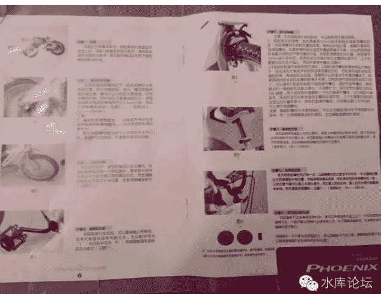

它一共就一页纸！
它一共就一页纸！
它一共就一页纸！

这还不是最重要的，如果我们细看一下他的文字的话：
“步骤二：先将后轴二侧螺母拧下，白色的限位卡保持原位置，然后将辅助轮，垫片，螺母按顺序套在轴左侧，螺母拧上几扣但不要紧固。右侧步骤同左侧，然后将车子垂直地面立正；调整辅助轮与地面距离”

### 辅助轮的安装

好了，现在请你告诉我，什么叫做“辅助轮”。
我承认，当时一看到这个字眼，我整个人就懵了。

这种专业术语，在工厂的老师傅眼里，或许就和三岁蒙童一样不言而喻。可是我们用户不懂啊。即便懂，我们也不敢试。你100%确认不会把硬盘格式化么。

即使你连蒙带猜，把“辅助轮”给猜出来了。可是第二句：“限位卡”。

苍天啊！大地啊！
这个限位卡又是什么东西。
臣真不知道啊。

我们继续往后翻，看后面的更难：

“步骤 5：刹车的调整
注意：左边刹把用于制动后轮，右边刹把用于制动前轮。
1. 钳形刹车的调整，首先需要用10mm扳手将刹车线紧固螺丝拧松，然后调整刹车皮和车圈的距离。再将刹车线拉紧，接着拧紧刹车紧固螺丝。如果二侧的刹车皮和车圈的距离不平衡，可以把钳形刹车装置中间的对中调节螺丝拧紧。再把刹车调整到对中位置，再将调节10mm扳手拧松后，将刹车皮方向调节到与车圈刹车面平行。上下位置要压在车圈平面上，然后拧紧调节螺丝（见图 4）”

请问：

- 制动前轮
- 制动后轮
- 钳形刹车
- 刹车线紧固螺丝
- 刹车皮
- 对中调节螺丝

这些玩意又是什么东西！我是真心不知道啊。你让我拿着说明书，翻来覆去再看上20遍。我也不知道你指的什么。
还如图4呢，4你妈个鬼啊。你自己看看那图，上面什么也没有。

这些东西，对于几十年车厂里的老师傅，或许就如空气喝水一样熟悉。
可是客户真的不懂呀。
你张口闭口都是专业术语。什么车架立管，前轮轴，前叉槽。您不可以这样写说明书的您懂么。

朋友们都知道我以前是做产品经理的。在我看来，整件事情就充满了一股“前工业时代”的味道。
首先您就不应该让客户组装。熟练工或许几分钟的事，但是客户第一次装，就要半小时甚至二小时。
客户购买的是你的服务，节省的是客户的小时。可想而知购买体验非常糟糕。

产品的设计，应该以尽量的人性化为主。
哪怕因为运输尺寸不得不分割。也应尽量做成完全制成品的几大块。
哪怕你不得不用一个折叠式的篮子，也比拿螺丝洋钉让客户自己装篮子好。
所有的拼接接口，应该有明显的颜色标记。或者特殊形状指示。

写说明书，应尽量做到“白居易”。老太太都看得懂。
印刷成本如此低廉的今天，说明书只有一页纸。那唯一的解释，就是你根本没有用心去改。
自行车厂的说明书，或许还是50年前的版本。我甚至怀疑50年都没变过。
现在已不是1950年代，青年人拥有一辆自行车是了不起的得意，自然会津津有味于每一个部件的名称。就如同EVA机动高达。
现在自行车就是纯消费品。谁有耐心学你的“刹车线紧固螺丝”。

说明书需要整本重新编写，重新安排。示例：
A: 辅助轮

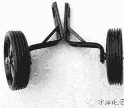

B：限位卡

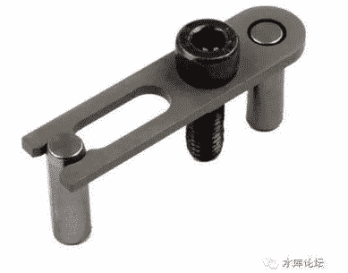

将 A 插入 B 中，并用螺丝拧紧。诸如此类的说法。

中国货在国际市场上卖不到高端，Marketing 缺乏指引是最主要的原因。你这种档次的说明书拿到美国市场去，“价格足够低”恐怕只能是你唯一的卖点了。

你需要将所有的零件拆散了，重新拍照。拍一本约 40 页左右的完全“安装手册”。这虽然会多一些手续，但却是一劳永逸的。

言归正传，话说哥哥以大无畏的探索精神和必应搜索，经过了一个小时的艰苦奋战之后，终于把“安装手册”中左右的术语都弄懂了。自行车也站起来了。然后，稍后，且慢。危险，这车不能开！

幸好哥哥还有一点机械常识，属于 1% 那种装好了自行车不摔入坑里的人。为什么，因为你还要调试刹车！

这件事是如此之重要。重要到生命生死攸关。可是在“安装手册”中提示了没有。没有！如果你在美国售卖，你早就被人控告到倾家荡产了!!

朋友们，这辆车，他寄给我的四大组件，彻底全部安装之后。默认的状态，刹车是坏的！安装的时候我就隐隐觉得不安。等全部装完了以后，再检查一遍，才想起前刹车根本无法并拢。

后刹车有轻微阻力，但也不强。

那怎么办呢，再搜索厂家网站。搜微信公众号，然后看里面的教学视频。根据教学视频的指导，和那本说明书做得一样烂，技师安装的时候手是被遮住的。然后，你调整收紧刹车线。

对此，我非常非常地不满。
为什么要客户自己调整刹车线。难道我买个电视回家，还要自己焊二个三极管么？

客户们需要的是一个“成品”。是买回家就能用的东西。
而不是厂家提供的半成品。你已经耗费了我无数的时间和精力了。

如果你说，因为自行车的规则和设计。他注定了不可以在出厂时就把刹车调好。
那么你为什么不改设计？

目前自行车上采用的，是一种叫做“钳形刹车”的构造。其原理，有二根线连在把手上。拖着二条鱼须一般又丑又易坏的线，一直到轮子上，实现机械开关。这个设计是有很大问题的。

1) 人手的刹车，是一个信号。只有在前十工业时代，纯机械时代，才需要以机械传动，将信号传到轮子上去。
2) 有二根很长的刹车线，很不美观。而且有安全隐患
3) 刹车的动力纯粹依靠牵线传递，人手需要很大的力量
4) 整个系统十分复杂，易坏。

如果让我讲一句很不客气的话。自行车的设计，在过去 50 年内，就没有任何改动。1950 年时是怎样的框架结构，2016 年还是怎样的框架结构。唯一的区别，材料换成合成塑料。更轻便一些。

而我们知道，西方发达国家，绝对不是这样的。
以笔者科班出生的 500 强 Marketing 而言，讲究的是 Continuous Improvement. 中文译为持续改进。
产品经理的责任，就是不断对产品加以改良。重新设计，使得产品本身越来越好。

任何一个产品，其背后都有持续的科技投入。每一代的产品都是不同的。5 年，10 年前的产品。和今天设计肯定有代差。R&D 投入
更不要说 50 年前的产品。

总体来说，产品设计沿袭着以下几条路线。

#### 1) 简化结构，减少零件。

当产品刚出现时，也是象现在的自行车，瓶瓶罐罐，电线缠绕的。

但是，**500** 强会让产品不断演化。结构越来越精简，越来越倾向整体铸造一体件。就好比说 BMW 的车门，一开始是 250 个零件，后来是 150 个，最后是 97 个。

#### 2) 统一规格，增加复用性

尽量在不同的产品上用相同的配件。这事勿用赘言。

#### 3) 用户友善性

将接口尽量外移。使每一个部件都非常容易拆卸，非常容易安装。预留了充分空间考虑操作者友善性。

据说 **BMW** 的一个目标，是整辆汽车可以完全靠螺丝刀+手撕分解为可降解材料。从一开始人家就帮你把撕车门的角度给考虑好了。

目前自行车的钳式结构，是 50 年代的产品。典型的“前工业时代”技术。结构非常复杂，零件众多，鲁棒性极差。

“好了，别闹情绪了，继续干活”。太君有指示。

然后，拧了，失败。

又失败。

再失败。

刹车居然安装不上去。他的刹车螺丝是坏的。

这一刻，俺的怒气再也无法压抑，终于彻底爆发了。

“什么垃圾破车，设计师都是猪头么”。

“这么重要的一个零部件，居然是螺丝刀卡在背后，伸不进去的位置”。

“而且你用旋转螺帽干什么，知道螺帽有多难拧么”。

“这个固定螺帽，根本固定不了啊。拆也拆不开，修也没法修”。

这车没法装。他最关键一个位置，刹车闭合度的调整，涉及到一个螺帽。

这个螺帽躲在二根铁杆后面，而且表面是完全光滑的。只能靠拧圆周转动。

螺帽卡不紧，刹车修不好。

这么重要的一个开关，每个人注定都会碰到的开关。

居然是不是放在显眼，开放，易于操作的位置上。

所以就是修不好。
修不好还能怎么办，天猫退货咯。我从来没见过这么差的产品，这么烂的产品，这么渣的产品。

从头到脚，设计就是一团渣。管理就是一团渣。丝毫没有用户友善度。整个设计还停留在上世纪 50 年代，我怀疑五十年来就没有任何改进过。难怪有人忍无可忍，要搞小米自行车。

“退货，退货，差评，差评”。

“坚决搞个差评。快递再麻烦我也要把这车运回去”。

“耗了我二个小时，写文章的心情彻底没有了”。

“这是什么狗屁牌子，怎么会买这种垃圾货”。

“凤凰啊，上海名牌啊”。

“凤凰牌自行车，几十年的名牌，最好的牌子，上海的骄傲啊。我还特意选了最贵一款”。
我无语，“你不知道凤凰是个国企么”。

国企啊，真的搞不好了。

（yevon_ou@163.com，2016 年 5 月 6 日晚）

## 从包粽子机说起 #F1120

原创 2017-05-31 yevon_ou 水库论坛


## 从包粽子机说起 #F1120

你有神功，我有科学

### 一）前言

睡眠不佳，昨天深夜翻知乎，发现一个帖子《如何评价今年端午五芳斋花 1000 万征集裹粽机器人？》[1] 

最精彩的回复是这段：

**James Ding**
智能制造/毒辣粉/业余写作/倒扒狼/德扑ATM

**缸里拉出个电缆** 等 435 人赞同了该回答

这个问题简直interesting，我想从技术层面来分析一下。

先讲个自己的经历，我们教研室的老板曾经受邀考察宜宾的五粮液总厂，厂方也是向全国征集全自动拌料机的解决方案。

五粮液的拌料极其复杂，每半个小时一次，连续48小时以上，手法也很复杂，抽，翻，抹等一系列动作，工作环境也极其糟糕，拌料室长期维持50度的高温。

在听完厂方兴致勃勃的介绍后，我们老板就问了两个问题：

1. 拌料的复杂工艺是否都是有效的？哪些步骤可以省略？比如能不能把这些工序简化成横向抖几下再翻面？
2. 拌料的效果是否允许性状与手工拌料的效果有所差别？比如颗粒大小，产出的酒料密度等？如果可以，允许多大的差别？

> 当时厂方代表就愣了，在他们看来，拌料工艺是古法传承，一步都不能省，省了不知道会有什么影响，产出的酒料也必须和手工产出的-致，因为后续加工流程都是依照的原有标准设计的。这个项目我们最终没有接下来。

职业病又犯了，见到 Marketing 手痒，不如我来展开一下。

按照序列的话，本篇归类 Marketing，属于企业管理。排在《老婆喊我组装自行车》#F390 后面。

- 水库系列编号，分二大组
  1) #数字，楼市知识
  2) #F，番外篇。

番外篇最初是一些随笔，生活中的杂文。

所以#F 惯例是不推选的。 [2]

很多人留言问，《Smartpass 的赢利模式》这种文章和楼市有什么关系。亲，那是#F 编号。

天南海北，随笔杂文。心绪偶得，想到哪里写哪里。

不过最近几个月，#F 群发的越来越频繁了。
其背后，还是商业力量在推动。

这么好的文章，没人看太可惜了。

咳咳咳，其实我是说，目前广告多得接不过来。打开眼球都是钱啊~~~

### 二）茅台

言归正传，我们来讲机器的事情。

前二天，有人在小密圈问了我一个茅台的问题。

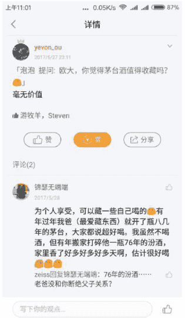

我的观点极为明确：垃圾
没有任何价值。

我不是说茅台的股票是垃圾，我是说，茅台酒作为瓶装酒本身。垃圾，没有任何价值。

为什么，因为茅台其实是一件“70年没有改进”的商品。

茅台今天还能卖，无非是一些情结。
一些遗老遗少的品牌还没有死光掉。
作为产品本身，茅台是没有任何竞争力的。

茅台迄今，到 2017 的所有生产工艺，生产流程，依然几乎和 1949 年没有太大差别。
选料，发酵，酿制，勾兑，冷链，都没有太大的进步。

众所周知，中国有一瓶著名的饮料，叫做“崂山白花蛇草水”。

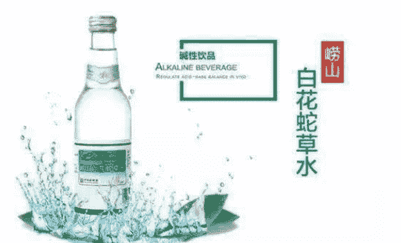

这瓶水之所以如此有名，被列为“五毒计”第一名。因为它被发明于上世纪 60 年代。
在那个时代，中国极端贫穷，极端落后，物资都很贫乏。商业文明更是无从谈起。
所以产品也难喝得要命。

比蛇草水还要再早 20 年。茅台由“公私合营”成文，荣和，恒兴三家酒厂合并而来。
穷乡僻壤，有什么商业文明，有什么锦衣玉食，有什么针对消费者的优化？

高鹗续写红楼梦，四十四回不换雪水。惹人耻笑。
茅台酒何德何能，能知道现代贵族的喜好？

一个极度贫穷的省份，一群没出过村镇的农民，一群没见过世面的作坊。凭什么你就相信“匠人精神”呢。凭什么你就相信“绝顶高手”呢。

大象工会有一篇文章《哪里才是产出工匠精神的最佳环境》[3]建议看看。奥派推荐一篇《工匠精神不如市场经济》[4]，你更应该去看一看。

### 三) 你有科学，我有神功

让我们再看一下，卷初的主题：

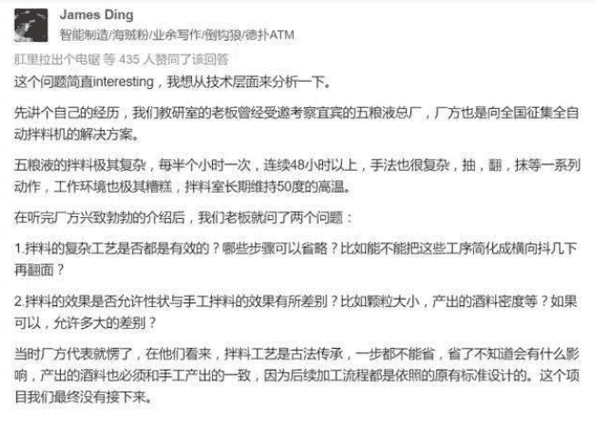

大家都知道，我是Marketing 科班出身身的。
中国人一件T恤，只能卖1美金。法国人一件T恤，可以卖100美金。
中国再怎么努力，只能在产业链的“低端”挣扎。
这其中的核心竞争力差异，其实是“营销”。

框架胜于勤奋。

框架和模式的不対，就是碾压性的降维攻击。就是马克沁重机枪，对刀枪骑兵。[6]

对于“茅台制酒”这个话题，让我从一个科班生的角度讲一讲。

如果你是西方国家的 Marketing，那你会《怎样经营一家公司》。

- 白酒的香味，主要是：醇类、酯类、酸类、醛酮类化合物、缩醛类、芳香族化合物、含氮化合物和呋喃化合物等。
- 醇类除乙醇外，最主要的是异戊醇、异丁醇和正丙醇。
- 酸类主要是乳酸、乙酸、丁酸和己酸。
- 醛酮类化合物包括乙醛、2、3-丁二酮和 3-羟基丁酮等。缩醛类 乙缩醛含量最多。4-乙基愈创木酚、苯甲醛、香草醛和醇等芳香族化合物

- 但是，万变不离其宗。人类加工物质世界的物理化学方法，无非就是：蒸溜，萃取，过滤，蒸发，冷凝，冷轧…………
- 许许多多的手法，看似复杂。其实完成的都是最基础的物理工作。
- 譬如将拌料混合，其实就是把味道混在一起。
- 翻料，让更多接触空气，日光。
- 抹：增加表面积，增加干湿度。

目前餐饮界最流行的，是把零下-196 度的液氮机搬到厨房。
天呐，那是什么东西。中餐师傅问？

- 中国古人的千百年“劳动实践”中，他们逐渐总结出一套酿酒的办法。
- 但是这些“土”办法，未必科学。
- 很多技法，在搞清楚了其科学原理之后，完全可以机器操作。
- 很多技法，在搞清楚了核心物料之后。完全可以只添加一位主料，而避免杂质污染。

在电影《红高粱》里面，酿酒厂怎么也酿不出好酒。于是姜文就在酒里撒尿，意外地酒味大增。
但是学了高中化学之后，大家都知道，这是需要添加“凝固剂”。

今时今日，难道你还希望买到喝“**含尿**”的酒吗。

还是说某些“祖传秘方”。蜘蛛，蟾蜍，都敢往里面加。

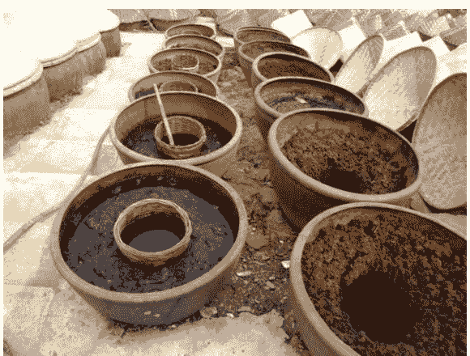

著名的“**厦门古法酱油**”事件 <sup>[6]</sup>。

CCAV《舌尖上的中国 2》。

- 一群“国学党”坚持以 200 年前的古老工艺“古法”酿制酱油。
  - 但其实，这种露天暴晒的方法，会积累很多灰尘，鸟类、苍蝇的寄生虫卵繁殖。
    - 不建议食用。

对于西方现代化的酒厂来说，他们首先要做的是“逆向工程”。

红酒的主要成分是**丹宁**。则消费者喜欢怎样的丹宁，“高中浅”三个市场比例各多少，是市场调研部门要做的事。

在这个基础上，逆向倒推，生产工艺要如何展开，才能保留“尽量多”“均衡”“清淡”的丹宁含量。并选择工艺路径。

在这个基础上，再进一步倒推：

- “能否用机器取代人力”
- “能否加快速率，并发流程，使得供货周期缩短”。
- “能否复用 SKU，中间产品，削减库存成本”。

一笑加一笑（微信号：150500211）邀您加入水库交流群。群内文集每月一更新……

这其中的每一步，都是微不足道的一小步。但是每一步都在削减着成本，提高效率。一间现代化的酒厂，看似岁月无毁。其实在 Marketing 的操刀之下，他每一天都在进步。每一天都在改良机械手，每一天都在研发新配方。

靠蒙是不行的。对于“我们正做什么”，“我们为什么要这样做”，一定要有清晰的想法。整个产品，一定是掌握在你手心的。而不是祖宗黑匣子。[2]

而茅台呢，茅台在干什么。

* “为什么需要燕”
* “不知道”
* “为什么需要抹”
* “不知道”
* “为什么需要抽，翻，晒”
* “不知道”

* “那你们知道什么”。
* “我们只知道，这配方是祖宗传下来的。名牌啊”。
* “配方一寸都不能改”
* “过去 70 年，我们是这样做的。未来 70 年，我们还是这样做”。

茅台是一家没有“Marketing”的公司。所谓“行尸走肉”，百年老店就是国营官僚化的代名词。科学是管理的前提。如果“研磨”的原理解决不了，你凭什么把 50 度的高温车间降下来。“减员减效，以人为本”都是一句空话。没有科学，你学习再多精神也是白浪费的。

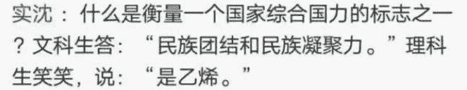

中华民族曾经是一个很 NB 的民族，“尼布楚”战役，康熙皇帝用刀马骑射，和俄国人的火枪打了平手。


### 四）结语

世界是向前进步的。

当前美国股票市场，市值最大的是 Google，Apple。
最热门的是 Alpha Go，AR，VR。

回到中国市场，你和我说最高估值倍数的是 “贵州茅台”。
深以为耻，深以为耻！

茅台是什么，在我看来就是一家老朽臃肿的 “国营酒厂”。
他的产品，已经高度落后于时代。无论香味，口感，杀菌，健康，包装，都属粗糙简陋。
拿到国际市场上，那是一点竞争力也没有。

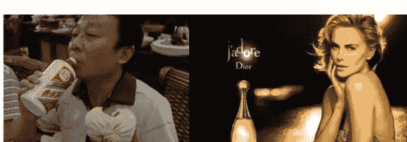

现代综合格斗 MMA 经过几十年的不断改良，战斗力越来越强。科学方法论，从每一个环节，一点一滴地提升着训练效果。

而太极拳茅台这种东西，就象是巫术。几十年时间，没有竞争，没有改良。大家互相吹捧，一起说是武林宗师。一旦对决，被人啪啪啪揍得脸象猪头。

我不想中国再来一次鸦片战争。不想再来一次天朝大国。长枪大刀对抗飞机坦克。

所以我在这里要喊一句：

## 快改革吧，都腐烂透了

（最后祝大家粽子节快乐）


(yevon_ou@163.com, 2017年5月31日午) [8]

+ [1]《如何评价今年端午五花肉1000万征集裹粽机器人？》https://www.zhihu.com/question/58809930/answer/163191937
+ [2]按微信规则，不曾推送的文章，没有URL链接。因为在“目录”中很多文章是灰色的。回复#编号，可获取文章。例如#F129，跳出《三代之治》。
+ [3]《哪里是产出工匠精神的最佳环境》http://mt.sohu.com/20170426/n490726802.shtml
+ [4]《工匠精神不知市场经济》http://finance.ifeng.com/a/20170515/51375811_0.shtml
+ [5]《人类现代武装力量所构筑的防线对大量丧尸种群是否有效？》https://www.zhihu.com/question/58472303/answer/157647160
+ [6]《耄红82岁“守缸人”60年“酱”心坚持以古法酿造酱油》http://mt.sohu.com/20160515/n449537576.shtml
+ [7]中国人实发动机，也一定要“逆向破解”。把所有的原理和工序都吃透，这样才可以国产化，并进一步改良产品。
+ [8] http://shuiku.net 近期不断受 GFW 干扰，请大家把书签栏改为: http://115.159.211.105

一爰如一爰(微信号: 150500211)邀您加入水库交流群。群内文章每月一更新……

---

## 怎样把品牌做死掉 #F1180

原创 2017-06-24 yevon_ou [水库论坛](#) 水库论坛


## 怎样把品牌做死掉 #F1180

讲一下“品牌延伸线”的道理。

### 一） 断更

看了一下，六月份一共只“推送”了二篇文章。汗涔涔啊。

不更新就不涨粉，广告收入也少了。哥哥也不想的。

其实写文的篇幅不算少。写了《没有买卖，就有杀戮》
《社保划算，还是商业保险划算》
《正本清源说奥派》1~4更。

只不过这些文章都没有推送。因为近期“气氛”实不好。风声鹤唳。

一笑加一笑（微信号：150500211）邀您加入水库交流群。群内文集每月一更新……

继上周大规模封号之后，昨天早上又有一个兄弟号被封。

在这个战火纷飞的岁月里，还能坚持和各位打个招呼。就算敬业的了。

想一想，楼市是万万不敢写。咖啡太苦，您点菜，我也不敢写啊。

“历史”其实也不能写，禁讳太多。

要不我写“科幻”吧，硭物理哥哥也是好手。但是《一千万个幸运》还是不能发表。

思来想去，本篇我们写 Marketing。

### 二） 保时捷

前二天，一条新闻吸引了我的注意。

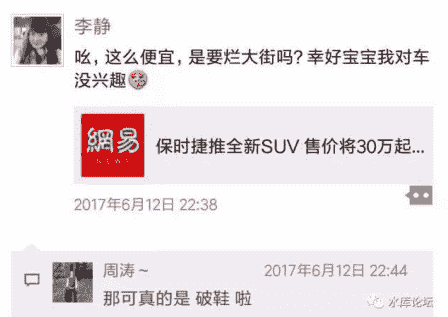

学 marketing 的人，真心人生毫无乐趣。

看个电影吧，还能联想到《美国大片加速走向原丝化》[F1030]

看了这条新闻，懂企业管理的人都心知肚明。保时捷要搞 Line Extension 了。

简称 LE。

什么叫 Line Extension 呢。我们先讲个故事。

话说 2013 年 4 月份的时候，有位叫 Robert Galbreith 的作者，写了一本新书《The Cuckoo's Calling》

这本书在英国的网站上，被评为 4 星。成绩也不算太差。二个月卖了 1500 本。

眼看惨淡，出版社坐不住了。有一个员工 “意外” 地泄露了，罗伯特是一个笔名。真正的作者，却是大名鼎鼎的 J.K. 罗琳。

当周末，这本书的销量，已经翻了 150000%倍。

涨到 225000 本，位列 Amazon 第一位。

这是一个非常有趣的故事。它告诉了我们，怎样能“成功”。

为什么同样的商品，小说。

冠以无名作家 Robert 时就卖不动，署 J.K. 罗琳名字，立刻就疯狂大卖呢。

- 因为消费者吃品牌。
- 消费者吃 J.K. 罗琳的品牌。

如果你出差商旅，你常常会看见 “长得出奇” 的酒店名字。

- 重庆万达 艾美酒店
- 北京海淀 永泰 福朋 喜来登酒店
- 漳州 [融创] [皇冠假日酒店]

双拼还算好了。甚至有[三拼]，四拼。

从学术上来讲，这被称为“子品牌”策略。

卖的是喜来登，可是又和万达合作。融创则是地方财团，一般是持固定资产的大房东。

### 三）Line Extension

“子品牌”有非常大的好处。一个显而易见的优点，子品牌很容易[活下来]。

J.K.罗琳 ----> 哈利·波特
J.K.罗琳 ----> 杜鹃呼唤

“哈利·波特”是一个非常成功的产品。连带着，J.K.罗琳也是一个非常成功的品牌。

[用 AB 带 AC]，“杜鹃呼唤”因此也可以卖几百万本。

许多人对商场的“残酷性”没有概念。以为创业如[温室里的花朵]。

目前在中国市场，如果你想创造出一个“知名”品牌，无论任何品牌，只要你说得出[名字]。


任何一款产品，哪怕象“浪奇”“小熊猫”这样你完全没有美誉度，也绝对不可能去购买的品牌。

只要十亿人民币都喊得出名字，他的成本就是：¥5亿元

能让消费者，在 Walmart 数以千计的货架上，留下记忆的任何个品牌。

它的成本，就是 5 亿元。

广告投放，至少要达到 5 亿元的数量级。

广告这玩意，就是一麻袋一麻袋钞，钞票当火烧。

你做一个 App，指望全中国的人都知道。光这个“名气”，你就得拿 5 亿去烧。

为了节约“品牌”名气，所有的厂商，都绞尽脑汁降低着成本。

一个最常见的做法，就是以“母品牌---子品牌”，大带小的方式去推广。

好比说，“四川长虹”是以电视机起家的。长虹TV口碑不错。

但是上京东搜一下，长虹空调，长虹冰箱，长虹洗衣机，长虹电风扇，甚至还有长虹手机……

在欧美几个大牌中，LV以包出名，Dior主要做繁饰，Chanel香水，Hermes皮制品。

可是Dior现在也出香水，LV做女装，Hermes甚至卖家居。

大家的产品线，都是“彩电+冰箱+洗衣机+空调”，白色家电齐全。

奢侈品大牌，也是特色混淆。再看不清主营业务。

为什么？

原因就是，你首先要有一个很成功的品牌。第一个成功是最难的，而且要靠运气。

但是在原有的品牌基础上，你再搞一个LineExtension，子品牌延伸，就会容易很多。[2]

- Dior香水
- Dior唇膏
- Dior腕表
- Dior珠宝
- Dior手袋

### 四）LE 的好处和坏处

Line Extension 的好处和坏处一样明显。

好处是：极易赚钱，几乎就是棵摇钱树。

坏处是：损害核心品牌。

香港的侃匡当年被誉为“白字天书”。意思是，因为为《卫斯理》系列的巨大成功。粉丝们衷心拥护。

哪怕侃匡的下一部作品是白纸，照样都会全城热销。

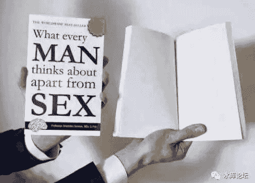

听起来很伟大。侃匡也的确这么干的。

为了赚钱，他以光速般的写作速度，又出了《原振侠系列》《花木兰系列》。

大烂书，连我都看不下去。倪匡的名誉也砸了。

同样道理，“哈利波特”是一部巨大的成功作品。国拢起了庞大的粉丝群。死忠骨灰粉丝，衍生了无数周边。

这保证 了 J.K.罗琳 的名誉。和她下一部作品的热销。

但是 J.K.罗琳 ----> 杜鹃呼唤，并不是一部很成功的作品。

在收获了 250 万册销量及金钱版税的同时，也在消耗着自己的粉丝基础。

让我们看 Porsche。

保时捷无疑在中国车迷心目中，拥有非常崇高的地位。极高的美誉度。

Porsche 如果出 30 万元“低端”的入门级产品；

一定可以大卖，为集团赚一大笔钱。

但是会损害到保时捷“尊贵体面”的核心商誉。（3）

懂 Marketing 的人一看到这新闻，顿时心知肚明。

公司里一定是 CFO 压倒了 CEO，又或者某些基金公司插手。

KPI 变成了主要考核指标。

### 五）市场营销中 LE 的地位

“市场部”是整间公司的大脑。对于市场部，我们通常会画这样一张表格。

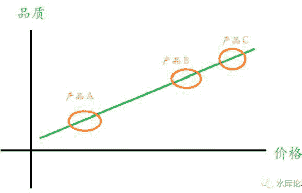

横轴表示“价格”，竖轴表示“品质”。

绿线依次由低到高。

通常情况下，任何企业都不可能靠一款“产品”，来覆盖全部的市场。

譬如汽车市场，A，B，C，E，S 就是不同汽车等级。

100W 和 10W，绝对不是同一款车

此外，资本家都是很贪婪的。

华尔街都是很残酷的。对业绩的索取，分秒都不会停止。

时间久了，Line Extension 不可避免。公司迟早要把所有的“细分市场”都填满。[4]

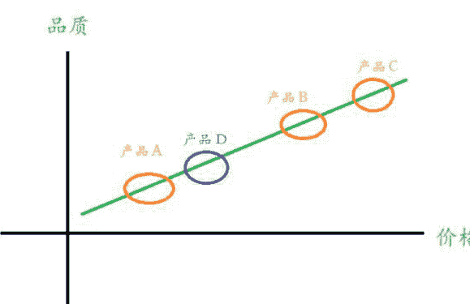

对于市场部而言，他唯一真正头疼的，是 Line Extension 要不要用母公司的名字。

我们知道，小米手机雷军在刚刚起步的时候，小米的卖点是“超高性价比”。

1499 元的定位，但是小米手机可以做到“低价高配”。性价比远远抛出竞争对手一个时代。

这个巨大的创意，带给小米公司惊人的成功，海量的销售额和利润。以及一大群 Geek 级别的粉丝拥趸者。

可是此后“小米”又成立了一整打的事业部，进入了一系列新的行业领域。甚至诞生了所谓“小米全家桶”，包括但不限于； [5] 

净水器，空气净化器，台灯，电视机，电灯泡，插线板，乳胶弹簧床垫，沙发，枕头，袜子，电动牙刷，滤水壶，咖啡机，儿童手表，加湿器，投影仪，小冰箱，无人机…………


这些东西，都属于典型的 Line Extension。

当一个“平平凡凡”的代工品牌，贴上“小米”的招牌，再加一个 Wifi 芯片，顿时可以卖出几倍的毛利。

所有的外围“毛利”。都靠母品牌拉动。

弄砸了就吸母品牌的血。

我相信，当一个品牌经理，看到“咖啡壶”“热水器”事业部。也过来要求使用“小米咖啡壶”“小米热水器”品牌名。

心里一定是翻江倒海，恨不得砍人的。

这些平庸无奇的产品，严重伤害了“小米”的品牌价值。

但是却提升了集团的总利润。

### 六）公司的态度


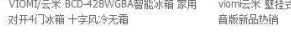


许许多多之前，当我作为 Marketing 的培训生，在上企业级的 Training 培训课时。教官就提了一个问题：

- Windows 基本是被鲍尔默玩死掉的。他在 Windows 上捆绑了太多的目标，为了带动微软其他产品线。
- QQ 基本是被腾讯玩死掉的。为了带动“腾讯全家桶”，QQ 才变得如此臃肿不堪。
- 支付宝是给马云玩死掉的，可怜的支付宝社交。
- 只有微信，因为张小龙的一再坚持。还能保持简练。

**教官问：“对核心品牌的伤害，和 LE 扩展利润之间，企业应该选哪一个”。**

长期利益，和短期利润之间，应该选择哪一个。

作为一个中国人，我几乎不假思索地，立刻按照东方文化给出了答案：

“各有千秋。如果一定要选择的话，捍卫长期利益”。

嗯，因此我就毫不客气地，被吃了一个叉 **X**。

请记住教官的教导。这个问题的正确答案是：

# 把品牌做死掉！

当我第一次知道这个答案时，俺直接从凳子上摔了下来。太过于震惊，以至于十几年后记忆犹新。

教官对此的解释是，“品牌”并不是真正的财富，品牌并不是美金。

就好比上次去爱国国朋友家。朋友有一块光绪二十六年的普洱茶饼。价值 200W 人民币。

这么珍贵的茶饼，你是否应该捧着跪着，好好奉献在保险箱里供着呢。

不是的。我去了以后，李先生把茶饼掰碎了喝茶，请大家喝茶。

这样连续喝了二十几天，渐渐地也喝光了。

对此，李先生的解释是：“茶饼并不是真正的财富，茶才是”。

把大块的茶饼，以最合理的热水，最典雅的茶具，和朋友们一起喝光，这才是对“老茶”的最大化利用。

而如果你把茶饼跪着奉着，锁在保险箱里。则你的生活水平并没有任何提高。

- 这才是东方思维和西方思维的核心差异。
- 饥饿民族和商业民族的三观迥异啊。

同样道理，对于“品牌”这样东西。如果你细心维护，Bigger 格很高，则他并不能带给你很高的利润。

就象“茶饼”一样。你要把茶饼掰碎了，一点一点泡茶喝到肚子里。茶饼最终消失殆尽，这才是消费最大化的做法。[6]

对于品牌运作，要一点点抽母品牌的血。有序地，精致地，把无形品牌卖成有形金钱，最终把品牌做死掉。这样才是利益最大化的做法。

今天诸位喜爱的 LV，Prada，Gucci 等诸大品牌。

终有一点，也会沦为街货烂大街，没有任何品牌价值。

如果在公司倒闭之前[^1]，品牌没有卖到零。这才是对公司最大的不負責任。

### 七）彩蛋时间

鋪墊了这么久，真辛苦了。其实我们只想说一句话：

各位，水库要搞一个轻微的 Line Extension。

薪火相传，部分也是因为微信太危险，太容易封号。

具体是什么东西，下篇再讲。谢谢各位。

(yeyon_ou@163.com, 2017 年 6 月 23 日晚)

一笑加一笑（微信号：150500211）邀您加入水库交流群。群内文集每月一更新……

---

## 广告学入门（上） #1640

yevon_ou [水库论坛](https://shuiku.net)


# 广告学入门（一） #1640

### 一）前言

前二天“磨铁出版社”向我索要稿子。他们说，

“欧大，您去年出版的《[中产阶级如何保护自己的财富](http://www.shuiku.net/viewthread.php?tid=16276)》，在财经类榜遥遥领先。可只甩开了第二名2倍不到”。

太丢脸，太 Shame 了。

因此，您今年出版《[什么才是真正的财富](http://www.shuiku.net/viewthread.php?tid=16274)》，您必须给我们出版社，免费，独家，特供，写三篇文章。


我想了半天，要不我再给你们写点 Marketing 吧。

Marketing 的精要，属于五百强的不传之谜。

中国企业，在 1980 年代，历来以老实巴交出名。

中国吉林省的老山参，出口到韩国，论箱算的。封箱前，往往还要再塞二条进去。生怕数得不够饱满。

可是人参到了韩国之后呢，韩国人把每一支人参单独称重，检测重金属含量，分门别类甄别等级，附上一张倍有范的证书。

价格加个零，论支卖，再出口回中国。

“经销和营销”是高附加值活动。我们经常叹息，中国企业操白粉的心，赚白菜的钱，几亿条裤子换不回一架飞机。这其中，“品牌”和“营销”占了很大一块。

国货想要崛起，固然要靠科技和质量，但是“营销”同样重要。

遗憾的是，因为商业文明的长期缺失。资本主义手艺的断层，在 1980 年代，中国国内关于“Marketing”的知识并不多。

乡镇企业家，还停留在“点子大师”，骗子狂人的年代。

1990 年代，外资 500 强开始进入中国。P&G, Unilever, Cola-Cola, Danone 等一系列世界一流的品牌，落地生根。

虽然中国籍的员工，始终存在“玻璃天花板”现象，升职慢薪水低，饱受歧视。但是 Marketing 的心法，外资企业怎样经营品牌和诀窍，却也渐渐地流传开来。

当 90 年代初，MNC 刚刚进入中国时。他们面对本土品牌，几乎是“横扫”的态势。

外资品牌不断侵蚀市场份额，国有品牌一败涂地。

每一年开会，一个市场份额 2%的公司，面对另一个 3%的外资公司。高层指示，“这是我们的主要竞争对手”。

另外 95%的 Local 公司，华丽丽地被无视的。

这样的一个局面，一直到 2005 年之后，才开始有所转机。

第一轮，在外资席卷狂潮下的“原国营”企业，是一败涂地。割地三尺。

第二轮，击败外企的，却并不是另一批国企。

而是当年如小虾米一样，蝼蚁一般弱小的民营品牌。

真功夫，味千拉面，永和大王，黄焖鸡米饭，面对肯德基麦当劳，已经毫不逊色。

这些“民营”民族品牌的兴起，恰恰很多都是当年外企的“弃徒”。

他们从外资企业离开，就带走了全套手艺。

哥哥在外企待的年份不长，最大的遗憾，只接触到了“经理”级的套路和手法。

而对于“总裁”级的企业秘籍，一无所知。

今天我写一点 Marketing“秘术”出来，贻笑大方。

在真正的高手眼里，实在丢人。板砖务必轻饶。

只不过，“新华出版”的毛细网络，深及内地三四线城市。

对于很多内地“地级市”的年轻人来说，他们一辈子也接触不到这些知识。

不传之秘，你无法在任何现有的刊物上找到。

我不算高手，讲得很浅。只能讲一个框架。

但是“框架”就足够了。框架才是最宝贵的财富。指明了方向，细节你可以自己填充。

### 二）广告

广告学第一定律是什么：**“购买尽可能少的广告”！**

现代商业的发展，“广告”逐渐成了必不可少的一项成本。

虽然会计上仍有争议，财务部门，有说法把广告列为“成本”，也有人列为“投资”。

但广告是必须的。这点几乎没有异议。不投广告，任何商品都卖不多。

但是，如果你是一个三四线地级市出来的年轻人，雄心勃勃，想要出人头地。

你老爸花了半辈子的工资，供你上大学。

可是你的“大学”，并没有教育你如何做生意。完全没教。

譬如说，你准备创业。第一年的目标，希望做 6000 万销售。

非常非常高的目标了，你爸爸的腿都要发抖。

如果税后净毛利能有 10% 的话，一年可以赚 600W。

这种创业书，绝大多数学生要笑醒。

然后你手贱，想打广告。你也别说 CCTV 了，上海电视台，柏万青阿姨节目《老娘舅》。

吃完晚饭 19:30，十五秒的广告。你妈可能在洗碗，15 秒只够洗一个碗。

你投一个星期，七次，15 秒*7 次，合计七个碗的时间。

你猜猜多少钱。

你猜猜多少钱。[1]

| 播出时间 | 栏目名称 | 15秒 | 30秒 |
| --- | --- | --- | --- |
| 约06:00-17:00 | 白天节目(特别定价节目除外) | 11,400 | 19,000 |
| 约07:00-09:00 | 上海早晨中 | 27,000 | 45,000 |
| 约12:15 | 午间新闻连连看中 | 23,400 | 39,000 |
| 约16:00-17:00 | 都市生活类专题节目 | 21,000 | 35,000 |
| 约12:45/17:15 | 媒体大搜索中(2次) | 48,000 | 80,000 |
| 约17:30 | 新闻访前 | 25,200 | 42,000 |
| 约17:30-18:00 | 新闻访A中 | 45,000 | 75,000 |
| 约18:00-18:30 | 新闻访B中 | 81,000 | 135,000 |
| 约18:25 | 新闻报道前 | 87,000 | 145,000 |
| | \*新闻报道中-国际新闻前 | 178,800 | 298,000 |
| | \*新闻报道中-新闻速递前 | 178,800 | 298,000 |
| | \*新闻报道中-观众中来前 | 172,800 | 288,000 |
| | \*新闻报道中-天气预报前 | 172,800 | 288,000 |
| 约19:20 | 法制栏目前(一~六)/1/7前(日) | 96,000 | 160,000 |
| 约19:30 | 法制栏目中(一~六)/1/7中(日) | 88,800 | 148,000 |
| 约19:45 | 电视剧A1片前(一~日) | 60,000 | 100,000 |
| 约20:35 | 电视剧A2片前(除周六外) | 40,800 | 68,000 |
| 约20:30-21:20 | 季播节目(周六) | 40,800 | 68,000 |
| 约21:20 | 新闻夜线抢先看前 | 39,000 | 65,000 |
| 约21:45-22:25 | 新闻夜线中1 | 52,800 | 88,000 |
| 约21:45-22:25 | 新闻夜线中2 | 39,000 | 65,000 |
| 约21:45-22:25 | 新闻夜线中3 | 30,000 | 50,000 |
| 约22:30 | 都市生活类专题节目前 | 21,000 | 35,000 |
| 约22:35-23:30 | 都市生活类专题节目中 | 19,200 | 32,000 |

# 华丽丽的人民币 88800 元

88800 一次，15 秒曝光。

你插一个星期，就是 60 万。

然后你想一想，天底下有几家公司，能有 6000W 的销售额。

能有 600W 的利润。

播放一轮（一周），就烧掉了 1/10 的净利润。

十分之一啊！你忙一年 600W，你舍得拿 60W 出来烧么。

只有七次，15 秒的广告。砸在水里，都听不见水花响。

“圈外人”对广告最大的误解，就是他们并不知道“广告”如此之贵。

广告之贵，超乎想象。

广告的售价，是以“集团总利润”为数量级的。

- 基本是一个 15 秒：1%
- 第二个 15 秒：2%
- 第三天 15 秒：3%
- 每多播一次 15 秒，集团老总心如刀割。

广告多投 1.5 个月，就能烧光集团的全年全部利润。

### 三）节约广告

广告学第一定律是什么：“购买尽可能少的广告”！

广告实在太贵了。因此现代“广告学”的全部精髓，就围绕在如何购买“最少”的广告。

# 广告是必须的，但是是最少的必须。

# 在达到广告目的的前提下，尽量最少买。

公司每一年都要采购很多原料，例如铁矿石对于钢厂，煤炭对于发电厂。

铁矿石是如此地重要，以至于钢铁厂的 CEO，全年最主要的工作，就是把控好矿石的采购价。

同样道理，一家大型的商业企业。矗立在陆家嘴 CBD。

你以为他最大的成本，最大的开支，最大的单项采购是什么。

是原料么，是配方么，是珍稀材料么。

# 不，是广告。

广告甚至可以比 “日用品公司 ~ 整个原材料总成本” 还要高。

Media Manager 媒体经理，是唯一一个中层经理，跳过二层总监，直接汇报给 CEO 的。

因为媒体太重要，媒体才是最大的 “采购腐败大坑” 。

一家年销售额 10 亿的公司，拿 2 亿预算出来买广告，是非常非常常见的。

因为金额实在太过于庞大，所以需要精打细算。

公司削减成本，一定要从广告做起。

因此现代广告学是非常矛盾的。

又要马儿快快跑，又要马儿不吃草。

“ 精算 ”是 现代“ 广告业 ”的核心。

### 四）广告学入门

## 广告营销界的“哥德巴赫猜想”

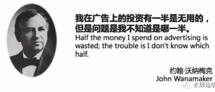

广告营销界的圣经，是“约翰·沃纳梅克”

他提出了一条非常著名的定理，“精准营销”。也就是说；

有系列的手法，可以将广告支出，削减到原先 30%左右的水平。

并依然维持近 90%的效果。

在我们之后的章节，我们将逐条展开这些方法：

- 一） 镂空法
- 二） 整体驱动
- 三） 广告制作
- 四） 预算骗局
- 五） 精准投放
- 六） 数字化
- 七） 小 V 拼凑

（未完待续）

（yevon_ou@163.com，2018 年 1 月 22 日暮）

## 广告学入门（中） #1641

原创： yevonlou 水库论坛

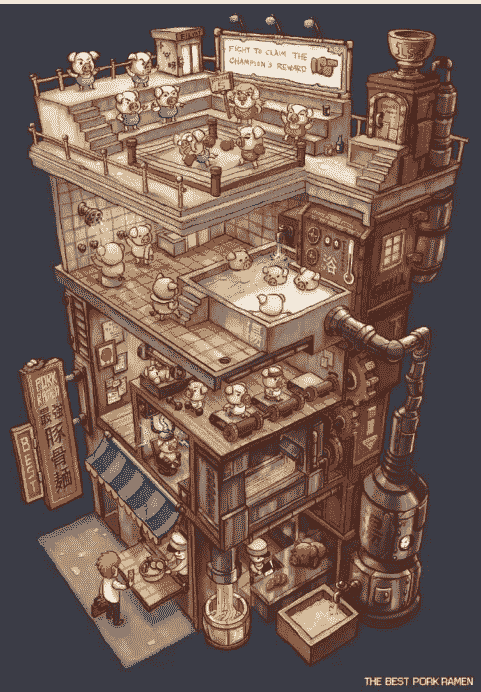

## 广告学入门（二） #1641

### 一）镂空法

> 一笑加一笑（微信号：150500211）邀您加入水库交流群。群内文集每月一更新……

我们来看这个表格；

| 1 | 2 | 3 | 4 | 5 | 6 | 7 | 8 | 9 | 10 | 11 | 12 | 13 | 14 | 15 | 16 | 17 | 18 | 19 | 20 | 21 | 22 | 23 | 24 | 25 | 26 | 27 | 28 | 29 | 30 | 31 |
|-|-|-|-|-|-|-|-|-|-|-|-|-|-|-|-|-|-|-|-|-|-|-|-|-|-|-|-|-|-|
|||||||||||||||||||||||||||||||||

这是一张典型的“广告投放图”。

意思是，1~31日，每天都投放广告。

这也是最实诚，最没心眼，乡下孩子刚到大城市的老实企业家做法。

几乎任何一个“专业”人员，看到了这张表。他都给你撕了。

毫不费力，换成了下表。

| 1 | 2 | 3 | 4 | 5 | 6 | 7 | 8 | 9 | 10 | 11 | 12 | 13 | 14 | 15 | 16 | 17 | 18 | 19 | 20 | 21 | 22 | 23 | 24 | 25 | 26 | 27 | 28 | 29 | 30 | 31 |
|-|-|-|-|-|-|-|-|-|-|-|-|-|-|-|-|-|-|-|-|-|-|-|-|-|-|-|-|-|-|
||||||| | | | | | | | | | | | | | | | | | | | | | | | | | | | | | | |

这个表格的意思，是每周“只放”三天。例如周一二三。

另外的四天，省钱，喝粥。

如果你是一个土豪，是一个实诚的企业家，你会问“哎呦呦不行”

“我是真心诚意，想把企业办好”

“广告不嫌多”。

这时候，媒体经理会告诉你，这种“镂空法”广告投放，是有“心理学”依据的。

每一种动物，大脑结构不同。

人类这种动物，就是“延续性”记忆特别强。

一件事情，你不用反复刷。你妈提醒你买火车票，不用每天强调十几遍。

等有空了，你自然会去阿里飞猪。

反复刷“提醒”，令人陡生厌恶，效果也不好。

知道了广告投放，分析基于“心理学”。

聪明的人，马上想出了 Ver 2.0 的版本。

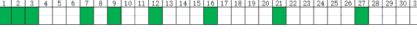

这是一种更巧妙的方法。从123号“狂轰滥炸”开始。

到7号开始提醒。

9号（隔2天），再提醒。

12号（隔3天），再提醒。

然后 16（隔4天）, 21,27号再提醒。

因为人类的大脑，有一种非常奇异的“功能”。

有一件事，发生在 1 月。你在 9 月提醒他，许多人都已经忘记，难以记起。

但是，如果你在 4 月，“不经意”提到这一次。则到 9 月的时候，会有大概率的人记得。

若你在 4 月，7 月，各“提醒”一次。则年初的事情，记忆甚至可以延到圣诞。

# 社会热点，需要不断地被提醒。才能被长久记忆

广告学学到最后，全部都是心理大师。

媒体经理每天盯着表格看，左思右想，能不能再抽掉一格。每一格就是几百万啊。

尽可能地调动人类大脑“提醒”功能。节约投放。

你以为这样就完了么，不，还有 Ver 3.0 版本。

| 1 | 2 | 3 | 4 | 5 | 6 | 7 | 8 | 9 | 10 | 11 | 12 | 13 | 14 | 15 | 16 | 17 | 18 | 19 | 20 | 21 | 22 | 23 | 24 | 25 | 26 | 27 | 28 | 29 | 30 | 31 |
| :--- | :--- | :--- | :--- | :--- | :--- | :--- | :--- | :--- | :--- | :--- | :--- | :--- | :--- | :--- | :--- | :--- | :--- | :--- | :--- | :--- | :--- | :--- | :--- | :--- | :--- | :--- | :--- | :--- | :--- | :--- | :--- |

1 到 31 的表格，其中 1, 2, 3, 6, 8, 11, 14, 17, 21, 23, 25, 28, 31 列下方为绿色填充。

聪明的读者，肯定记得我们之前贴过一张上海电视台“广告报价”。

电视广告的产品，主要分为 15 秒，30 秒二种。

价格，15 秒≈30 秒*60%

电视媒体，已经约定俗成。几乎只有四种“标准时长”。

15 秒，30 秒，27+3 秒，5 秒*3

其中，30 秒广告，是给你讲“一个完整的故事”的。

譬如说，这二天俺小区电梯里，天天都在放。

AngelaBaby 大花痴，又要法国旅游，又要每天吃三顿大餐，又要便宜不贵。

偷偷摸出一个黑影，手里拿块板砖。

30 秒视频在这里：

http://www.iqiyi.com/v_19rr8wma44.html


而 15 秒广告，是给你一个“精简过的故事”。

同样杨幂美团，15 秒广告在这里：

前文说过，人的大脑，具有“记忆----提醒”功能。

既然这样，你干嘛要用 30 秒的广告去提醒呢。

**用 15 秒，岂不是更省钱。**

我们再看回原表：


在这个表格中，其实分为 4 个阶段。

- 1）公示期，第 123 日，通过密集大量的广告，推广品牌形象。
- 2）Pulse1，第 4~20 天，形成余波荡漾。
- 3）复苏期，第 21 天，再投 30 秒。
- 4）Pulse2，第 22~31 天

一般企业年度“媒体计划”中，这个表格不一定是 31 期的，很可能是 365 期的。

企业大致有一个计划，每年的 3~4 月，例如新产品推广时，举行一波大型的广告攻势。

然后“余波荡漾”，都是用 15 秒的广告，节省成本。荡啊荡啊，冬眠四五个月。

到 Sep~Oct 金秋，再拿 1/3 的广告预算出来。投 30 秒一波小的“复苏”。

然后再荡啊~荡啊，一直荡到明年。

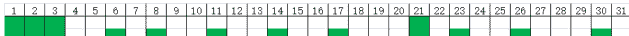

媒体经理，要对着这个表格，看啊看啊，看无数遍。

把绿色的柱子，“削减”到少得不能再少。

毕竟每一笔 Media 支出，都是数百万元的大数字。

# 广告学的精髓，在于少投广告。

### 二）整体驱动

假如你销售额 1 亿，你拿 2000W 去投广告，那就是营业额的 20%。不可想象，不可承受。

假设你销售额 5 亿，同样还是 2000W 去投广告。那就是 4%，完全可以承受了。

广告实在太贵，1 秒钟一万。

为了捡回这个成本，第二个办法，是“整体驱动”。

也就是说，广告带动的生意，要尽可能多。

广告带动的产品线，要尽可能多。

譬如说， xiaomi 小米的主打产品是手机。但其实小米也做空气净化器，平衡车，路由器，加湿器，甚至油烟机。

为小产品单独打广告，推广平衡车，是一件很得不偿失的事。

如果你的销售额不到一定程度。

许多产品，可能一辈子也没有广告机会。

小米公司，投放的是“小米”手机广告。

给消费者塑造一种“价廉物美，性价比很高”的感觉。

只要消费者记住你这个“产品形象”，他们自然会被“公司整体品牌”带动。

也会购买你的其他产品。

因此“小米手机”的广告费，其实是由所有产品线均摊的。

另外一种技巧，则是 27+3.

譬如你卖手机的，你把广告抽掉几帧。变成 27 秒。

最后多出来 3 秒，你可以再吼一句：

- “小米笔记本，全新上市”
- “小米互联网电视，精彩新视界”
- “第二代 VR 眼镜，全新上市”

### 三）广告的制作

广告的制作，大致经过了三个阶段：

- 1) 宣扬产品的性能
- 2) 营造一种情怀
- 3) 消费者能记得你就不不错了

最早，最正统的概念，广告是用于“宣扬产品的优质”

我家的洗发水，可以去屑。

我家的洗衣机，可以变频，低电压也能启动。

我家的冰箱，超级省电，一天只用一度电。

但是，随着商业竞争的加剧，产品上的“技术隔代”越来越困难。

譬如说，今天在机场习以为常的拉杆箱，其实是 1991 年才发明的。四个轮子的，甚至晚到 2005 年才发明。

而今天已经全球普及几亿只，覆盖每一个国家。

技术的传播，比我们想象更快。[2]

广告是一笔巨大的投资，一家公司 2 亿广告预算，往往是“单一最大宗采购”。为了尽可能优化广告效果，公司退而求其次，“营造氛围”。譬如 Nescafe 当年家喻户晓“味道好极了”。一下子打开了 1980 年中国人渴望中产生活的心。

DHL 的广告，是一架倒飞的飞机。

UPS 的广告，永远都是二个駕駛司机，在密林里迷路。然后“我们比你更了解当地市场”。

Lux 的广告，永远都是当红的女明星。甩来甩去“国际巨星的头发”。

Durex 永远在蹭热点，古惑和鬼马

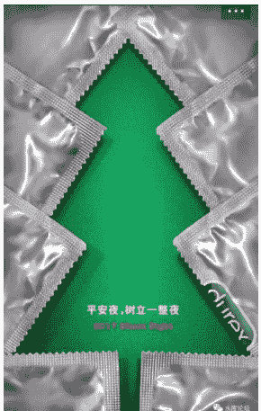


## 广告学入门（下）#1642

原创：yevon_ou 水库论坛

这些在产品上并没有“特别优势”。

他们贩卖给你的，其实是一种“亲切感”。

广告可以换版本，但是框架套路永远不变。

每一版新的广告，可以借助消费者原有记忆，“重复记忆”降低成本。

甚至消费者只要听到叮叮当几个音符，就会下意识回想起这个品牌。

以“播放二周后消费者印象率”指标来考核，“系列片”的效果非常好。

第三个层次，有时候“卖情怀”都不太好用了。

例如美国四大快递公司，UPS，DHL，FedEx，TNT，谁能说得 出他们的细微区别。

如果你要卖情怀，家家户户都在卖情怀。

这样情况下，CEOs 更加退而求其次，我们不要求你记得 “我们的好”。

不要求你记得“我们的雅”。

在信息泛滥的今天，你能记得“我”就不错了。

或许人们还记得，几年前的“恒源祥”事件。

恒源祥包揽了电视版面，然后播“猴猴猴，恒源祥”“羊羊羊，恒源祥”“狗狗狗，恒源祥”。

这是典型的 5 秒*3 广告类型，反反复复轰炸般来回播。搞得你不厌其烦。


有许多的人，甚至打电话去电视台投诉。连新闻办都惊动了。

而且这个广告，绝对没有半点“正面影响”的意思，毁誉如潮。

但是在“广告学”上，这个例子却是完全正确的。

因为羊绒衫厂家已经如此之多，你再也不奢望能做出任何的优胜。

你只冀望消费者能记住“恒源祥”这个牌子。有万分之一的印象。

以后买衣服的时候，有印象的大品牌，本身就胜了一大半。

能被消费者记住，就是硬实力。

相似的例子，美国曾经发生过一次登峰造极的。

一家互联网宽带 ISP 公司，他们的广告，是一只猴子在尖叫，极高的 120 分贝，从头到尾，尖叫 30 秒。响得你恨不得劈了电视机。

人们至今仍在传颂。

讲完了“广告制作”三部曲，有心人会意识到，这里面并没有牵涉到“明星代言”。

而明星代言，是中国商家最最最关心的。数百万，上千万广告费，屡见不鲜。

事实上，在整个广告市场中，“明星代言”的份额是非常非常小的。可能连 1% 的片子都没有。

广告界的霸主，是绝对的“BBC”，Beauty，Baby，Cat。

“女人，小孩，宠物”这是绝对的政治正确。

只要一出现萌萌哒的baby，许多人心就化了，谁也不会说半个不好。

广告的制作成本，和播放成本，有一定的比例，一般在 1/5 左右。

（未完待续）

（yevon_ou@163.com，2018 年 1 月 22 日午）

写在前面的话：

《广告学入门 2》发出了以后，有**细中理**，*chaos*等网友留言，大意是“现代的精准投放，不再需要广告业精算”。

这种留言，除了揭示“理工男”狂傲无知，素质低下，知乎一群 SB，水世不得翻身。也告诉了人们，什么样的 SB 会“失败”，为什么有些渣滓一辈子一事无成：华夏“工业”党，马哲处于鄙视链的底层。

因为我们谈论的是“体用”，他说的是“术”。

对于广告业，广告业的核心思路，就是“**投放尽可能少**”的广告。这其中的算法思路，和桥梁力学，用最轻的材料建筑最坚固的大桥，其实是差不多的。

拱形结构和空心砖，才是真正的智慧。

无论科技怎样进步，无论钢材怎样演化，这个“**节约**”的思路，是不会改变的。

节约，是战略级的。是全局性的。是指挥官思考的问题。即所谓“套路”。

然后，数字媒体，长尾理论，实时摄像头反馈，只不过“术”的外围。无非投放渠道的一种。

外部的力量，不能帮助你的企业成功。

中国有超过 10000 家洗发水，但是最终能上广告的，不会超过 50 家。

这是一种“竞争”的关系。最能付费的 50 家上广告。

假设“数字媒体”，“精准定位”。则广告的价格就会上升，“精准”会是“不精准”的三到五倍价格。

最终还是 50 家洗发水，才能上广告。消费者和消费者者竞争。

只有广告 Schedule 的内部精算，才是你公司的“核心竞争力”。才是核心算法。

妄图靠数字媒体业革命，靠外部力量，你是打不败竞争对手的。宝洁不可能取胜夏士莲。

通透一点的人更知道，“精准投放”有利的是“流量主”。而不是“广告主”。它相当于流量主的产能翻倍了。

好比“水库论坛”，曾经接过好几次“贷款中介”的广告。但是这种广告是不精准的。

水库有 50W 粉丝，但是上海 9W，广东 8W，北京 6W。

如果你刊登一个“北京贷款中介”“北京管家公司”的广告。他的有效受众是“6/50”，是非常非常不划算的。

我们也一直很希望，微信后台推送时，能给我们切分“省份”。

好比同样一篇文章，可以分成“北京版”“上海版”“广深版”“内陆版”。

主文部分是一样的。广告部分是不同的。

一笑加一笑（微信号：150500211）邀您加入水库交流群。群内文集每月一更新……

这样的话，一次推文，我就可以收 4 次广告费。

可见，“精准推送”其实有利于流量主。这也是互联网公司估值高过电视台的地方。

但是对于买广告的人，北京有三五家贷款中介竞争。最终的广告报价，还是以他们中最贵的为准。

最后说一句，透视“事物背后的规则”，是一种强大的力量。也是技术型员工，和中层干部的分界岭。

看文章：要直接看到精华，吃透规则。凡是我骂 SB 的那几个人，这辈子注定也就是 LowB 了。

# 广告学第一定律：“购买尽可能少的广告”！

### 一）镂空与重叠

广告学的核心原则，是“保证大致效果的情况下，尽可能削减广告预算”。

而采取的技巧，主要是“镂空法”。

镂空法，也可以称为精准投放。

前文，我们讲了一个时间上的“镂空”。你不需要每一天都烧预算。

而是靠人类大脑的“记忆延迟”功能，一遍又一遍地刷新提醒。

最后给出的广告计划书，是这样一个个表格：

| 1 | 2 | 3 | 4 | 5 | 6 | 7 | 8 | 9 | 10 | 11 | 12 | 13 | 14 | 15 | 16 | 17 | 18 | 19 | 20 | 21 | 22 | 23 | 24 | 25 | 26 | 27 | 28 | 29 | 30 | 31 |
| :---: | :---: | :---: | :---: | :---: | :---: | :---: | :---: | :---: | :---: | :---: | :---: | :---: | :---: | :---: | :---: | :---: | :---: | :---: | :---: | :---: | :---: | :---: | :---: | :---: | :---: | :---: | :---: | :---: | :---: | :---: |

这篇，我们要讲“空间”上的镂空。

首先，我们要问一下，什么样的人，会在 CCAV 投放广告。

譬如这里有一家“长隆水上乐园”，又或者是“王宝和大酒店”。

请问，这样的商家，会在 CCAV 投广告么。

答案是，不会。

哪怕企业有这个资金实力，也不会。

不是不能，而是不值。

因为“水上乐园”和“大酒店”，都是地域性非常强的企业。

水上乐园，可能仅仅就覆盖一个城市。

大酒店，甚至只覆盖一个区。地铁交通的前后几站路。

但是 CCAV1，是一个“全国性”的媒体。覆盖了中国几亿人口。

CCAV 一旦发布广告，顿时就是“全国性”的影响。

外行们或许会以为，“出名”没什么不好啊。

让一个青海人，西藏人，也知道你珠三角水上乐园的名声。

正应了以前中国企业的老话，“誉满中华，走向世界”。

但是，在内行人眼里，广告学整个逻辑是倒过来的。

出名是很好，免费的出名很好。

但是付费的出名，就很不好了。

CCAV1 可以覆盖到全国市场，因此他的收费，也是全国级的。

CCAV 可以覆盖到几亿观众，因此 CCAV 的收费，也是以“亿”为数量级的。

上海电视台 CCTV 的 15 秒，是 10 万数量级。

CCAV 的 15 秒，就是 100W 数量级。

但是对于商家来说，他的利益并非重叠。

远方的客人，并没有太大价值。哪怕一个新疆人听到了你的广告，他也没什么兴趣，买张机票飞过来，就为了吃你一碗 30 元的干炒牛河。

商家讲究“精准”。对面小区的夫妇，出 10 元/人的广告费都愿意。

隔了几百公里的消费者，出 0.1 元/人的广告费都不愿意。

与其上 CCAV 投放广告，还不如买路口二个灯箱，5000 元/月就够了。

一笑加一笑（微信号：150500211）邀您加入水库交流群。群内文集每月一更新……

因此我们看 CCAV，CCAV 这种史前怪兽，既庞大可怕，也不堪一击。

CCAV 虽然有几亿用户，有最庞大的收视率。

但是“适合”CCAV 的品牌商家并不多。

前几年是白酒，洗发水，洗护类消费品牌。这二年汽车，保健品，金融类增加。

但总而言之，“商家面”还是狭窄的。

你挑商家，商家也挑你。

“广告学”，他的整个逻辑是倒过来的。

“广告”并不是购买得越多越好，而是购买得越少越好。

因为“媒体公司”一般是按照流量收费的。越大的渠道越贵。

现代广告学的要求，是“精准”。也可以称为“重叠”。

最好我的消费群，和你的读者群，高度重合。

譬如说，我一个卖摄像机镜头的，最理想的投放杂志是《摄影之友》。

这种“小众”杂志，根本没什么人看。相应的插页报价，也不会很贵。

而和我的产品，完全精准匹配。才能卖干货高价。


同样道理，你一家卖帐篷的，卖冲锋衣的，最适合的杂志是《驴友友》《户外生存指南》

如果去《国家地理杂志》投放广告，效果也不错，但终究有一点偏了。

每一位媒体经理，都要高度勾勒自己公司的“消费者”众生相。

然后拿去和各家媒体一一 对比。

找出“重合度”最高的一家。

饭店就买下街口二个灯箱。

这样一项算筹，业内称之为 TARPS， 即“精准客户到达率”。

你投放任何一个媒体渠道，都要打折的。客户“重叠率” 永远不会是 100%

一笑加一笑（微信号：150500211）邀您加入水库交流群。群内文集每月一更新……

tarps 到 80%，就已经非常高了。

### 二）媒体业的水分

和 tarps 相关联的，还有一个数据，外行人绝难以理解掉坑，斑斑学费泪。

“媒体业的谎报”。

学院派和实战派一个区别，学院派往往搞出来一个很漂亮报告，PPT 闪亮。

说：“我们公司的产品，和《汽车大戶》杂志最为匹配。tarps 重叠率高达 90%，建议购买该杂志扉页广告”。

而实战派老总拿过来一看，几万元预算，总觉得不对。

这份杂志听也没有听说过，真的有这么好效果么？

如果你完全遵循“学院派”白面书生的指引，他们会精心编制一个“媒体播放计划”。选择好几个投放渠道。

但中国是一个很神奇的国度，中国有很多游戏规则，和西方完全不同，和理论不同。

主要表现在：

- 1）几乎所有的媒体，都在谎报流量
- 2）算法过时

目前，最大的重灾区，是“报纸广告”。

业内惥行人的笑话，叫“最大的废纸回收站”，砍掉一个零。

一些宣称四五十万发行量的大刊，实际能到流通阅读者手中的，连 4~5W 都不到。

大量的报纸，经过发行站中转一下，连书报亭都进不了。

带着油墨香，直接扔给了废纸公司。

同理，目前上海的杂志市场，一本周刊的存活线，大概是 5000 册发行量。

但是对外宣称，全都是 20000~30000 册。

如果你看某杂志快撑活不下去了，那它的发行就是 5000。

你再拿“业内”宣称的发行量来对比，就知道水分有多大了。

第二个问题，是“算法”过时。

目前媒体界“沿袭”的算法，基本还处于 1980 年代水平。

以报纸为例，报社堂而皇之的口径，是 1.2*2.3。

意思是说，一张报纸，到了百姓的手中，读者会反复看。平均每篇文章，阅读 1.2 遍。

同时，一份报纸，会被二三个人抢着看，抢着传播，平均是 2.3 人设。

然后报社，理直气壮地按照：发行量*1.2*2.3 来收钱。

我们可以发现，这个公式是极其不靠谱的。

或许曾存在过，但一定是 1930 年代， “无问东西”的新青年时代。

今时今日，谁还把一份报纸看 1.2 遍啊。

什么报纸，还会有 2.3 人抢着看啊。

以俺做自媒体的实际体验，“纸媒业”的掺水量，大概在 10 倍左右吧。

市场并不愚蠢。你通过各大 “媒体中介” 购买广告，都有很深的折扣。

“广告采购”，从来都是水深水深，专业性极强的一个领域。

不要迷信报价，狠狠砍价。“乱拳打死老师傅” 或许比学院派更强。

### 三）精准投放

中国的广电系统，花费了大量的力气，终于把广播电视，全部都改造成为了 IPTV，也就是所谓的数字电视。

数字电视在广告学上，是一场彻底的革命。

一方面，有电视以来第一次，电视台有了 “精确”的收视率数字。甚至可以精确到每一分钟，电视剧中女主角每一个镜头表情。

足球射门，进攻，围攻时的收视率变化。

而传统的“盖洛普”收视率调查，依靠 3000 个人上门填表，很不精确，成本很高，也不细化。

另一方面，更革命的，则是终于可以“差异性”投放广告了。

前文说到，CCAV1 这种恐龙，属于史前怪兽。

看似庞大无比，其实不堪一击。

因为 CCAV 虽然流量很大，但却是“铁板一块”的。

只有一些全国性的品牌，例如酒类，洗发水，脑白金，才需要在全国台投放“一模一样的广告”。

这二年招商银行网点多了点，否则 CMB 也不会挨 6:59:55 的五秒广告。

但是，在电视“数字化”之后，媒体公司，第一次可以在同一时间，投放不同的广告内容。

例如 19:30，放完了“新闻联播”正文，连续剧尚未开始。

30 秒的黄金时段，上海观众是“老庙黄金”

北京观众是“五棵松足球赛”预售票

广州观众是“长隆水上乐园”

深圳观众是“华润银行最新基金”

你哪怕看同一个电视频道，收听到的广告内容却是不同的。

我们常说，“广告预算中有 1/2 是被浪费掉的”。

有了数字化定制，大型媒体就可以获得更好的收益。

“定制广告”是多赢之举。

以“水库论坛”为例，截止到发稿之日，水库大约 362000 微信订阅粉。其中：

- 上海 77000
- 北京 45000
- 深圳 28000
- 广州 16000

前两天有一位“北京专业贷款”代理宋先生，第二次投放我的广告。

我虽然收了他的广告费，但是心里很不安。

因为我知道，他的广告费，只有 45000/360000=12% 是真正有用的。

其他的，上海深圳广州客户，谁看你啊。

如果腾讯的微信后台支持，我宁可换一种模式。

一篇文章发出，末尾略有不同。

分别搭载北京，上海，广州，深圳，四个不同的广告主。

每人哪怕我给他们 50% 折扣，我的总收入还是 200% 翻倍。

- 目前淘宝，京东，头条等视频网站，算法更为复杂。甚至可以根据你的消费习惯，实时调整广告出现。“大数据”是一个深入的话题。

### 四）账号连接

大号依然比小号更有价值。

如果看“微信广告”市场。目前基本有四段。

- 阅读量 5000 以下，1000 元/篇
- 阅读量 5000~10000，每个阅读 0.5 元
- 阅读量 10000~100000，每个阅读 1 元
- 阅读量高篇 100000+，每个阅读 2 元

从这个报价，和市场区间，我们可以明显地看出，“账号越大越值钱”。

为什么会发生这种情况，还是和广告学原理有关。

二个小号，是拼不成一个大号的。

好比说，你想投放一个广告，想达到 10 万人的阅读量。

你有二个选择：

- 1）10W 粉的大号
- 2）二个 5W 粉的中号

而事实结果是，二个 5W 粉，并不能达到 10W 的散播。最终可能仅仅是 7.5W。

因为粉丝之间是会交叉的，会重叠的，会无效的。

对广告公司而言，这往往就意味着“浪费”。

同一个消费者被重复告知二次，意义不大。

更糟糕的是，随着“传播点”的增加，20 个 5000 粉的小 V 叠加，他们的效果就更更差了。

因为你没法计算，20 个 V 之间的粉丝交叉情况怎样，客户深度怎样，广度怎样，再提醒怎样。

到最后简直一笔糊涂账，即使你想补救，追加广告预算，也很难有针对性地，精确执行计算。

1995 年“泰池”央视标王之后，有志之士眼红，于是搞了“地方台联盟”。

把全国 31 个省台，串成一个套餐。观众人数也有几亿。

购买相同时段广告，同步播出。

然并卵，最后是无声无息，暗淡收场。

一个 100000+ 大 V, 其广告效果, 是远远好于 20 个 5000 的。

他提供了一个平坦而干净的市场。

有助于进一步的商业计划和开拓。

但是 V 也不能太大。太大了, 就缺乏了“重叠”。

找不到和你完美匹配的广告商。

控制规模, 精选粉丝, 都是生意。

根据会投广告的厂商, 反推, 你需要设计怎样的粉丝部落。

### 五） 结语

广告这一行, 浩瀚如烟海。班门弄虎, 实在汗颜。

任何一个业内人士来写, 一定比我更好。

只能说, 我给了各位一个“框架”。

在辽远的黑暗中, 给你一支烛光, 照亮了铁轨。并告诉你几条支路科技树。

中国人, 是极其聪明的民族。

框架搭好了, 剩下的路, 您自己探寻吧。

（yevon_ou@163.com，2018年1月22日暮）

- [1] 资料来自百度：http://www.allchina.cn/Adpage/Shanghai/Html/2004-12-14/20041214175832.html
  通过媒体中介批发，一般都会有很大折扣

- [2] 《拉杆箱何时发明？又是何时进入中国的呢？》https://www.zhihu.com/question/28896277
  新一轮正在开发蓝牙定位，AI 自动跟随主人的拉杆箱。

- [3] 封面图片说明：在鱼生的竞赛中，失败者被杀死，做成生鱼片。但是在猪的拳击赛，胜者半夜被杀，做生瘦肉面。当然还有第三张图，不输不赢什么事也没错，照样被绞成血肉。

一笑加一笑（微信号：150500211）邀您加入水库交流群。群内文集每月一更新......

## 水库赚钱之道 #F1190

2017-07-03 yevon_ou 水库论坛


## 水库赚钱之道 #F1190

水库论坛怎样赢利

首先，给大家看一个网络传言。只转不评，不负责鉴别真假。

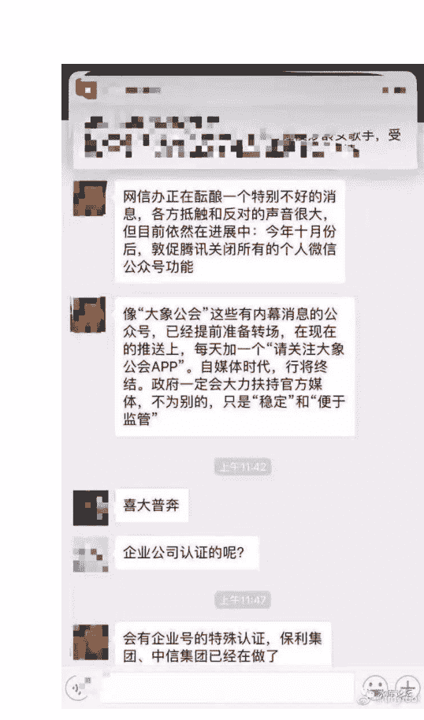

因为六月的“封号风波”，我们已尽量克制。整个六月一共只推送了三篇文章。

目前，水库拼命地扩充产品线，添加备份号。也是为了防失联。


说不定哪一天网络上的人，熟悉的角落，就再也找不到了。

望切记！

### 一）小龙虾

话说这二天好吃懒做，晚上跑到甜水围吃小龙虾。1.5两/个嚼起来美味。

吃完之后买单，店员再三殷勤地要求我“加会员”，说是有考核指标。

我看了一下，吃了500元的小龙虾。

- 30元：会员价九折
- 60元：首次注册优惠券
- 410元：实际支付

也就是说，店家为了获取一个“会员”。成本已经飙升至不可思议的90元。

而店家的收益呢，仅仅是一个“微信号码+手机号码”罢了。

回来的路上，俺不由得感慨。“移动互联网”野蛮生长时代真的已经过去了。

手机越来越饱和，流量越来越昂贵。

人们最终不需要一大堆的订阅号，人们只需要最棒的几个号就可以了。

### 二）产品线

一笑加一笑（微信号：150500211）邀您加入水库交流群。群内文集每月一更新……

“水库论坛”是房地产领域的绝对大号。从任何一个方面看，都肯定进全国前三。

如果，假设，咳咳，出于某种财务目的。

我们想要 P2P (Path to profit)，请问应该如何处理。

方法无非二个：

## 拓展用户基数 * 扩大单个消费

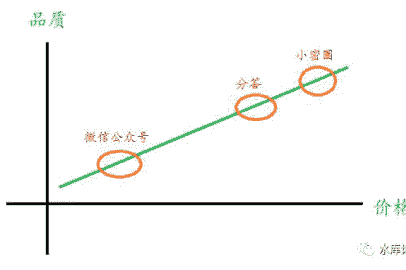

如图。我们来看一下“水库”的产品线。

水库的基础，是一个“微信公众号”。目前大约有 22W 用户。但是打开率非常高，平均有近 6W 阅读。

微信的公众号，是完全免费的。65% 的订阅者来自于“北上广深”一线城市。

但是，“公众号”其实是一门不赚钱的生意。众多想在微信中掘金的群主，最终都以惨淡收场。

微信最核心的“打赏”功能，惨淡到什么程度呢。

象水库这么“蒸蒸日上”，而且有一群核心粉丝的拥趸。

我们一年 1700 万次阅读。打赏一共只有：140000 元。

每次阅读 0.01 元都不到。

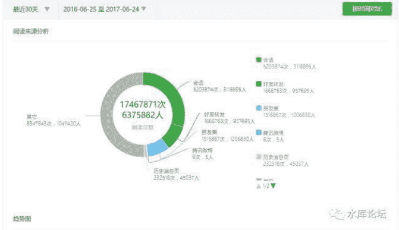

在奥派的好友中，有一位“冯学荣”老师。他的《冯学荣读史》也是赫赫有名的经典。书都

出了好几本。

可是冯老师痛苦的是，“微信名望”和现实生活中的金钱，完全不能挂钩。

无论冯老师的阅读量再高，“微信名望”并不能轻易转换成 RMB。

学历史固然是好东西，可是又有谁会花钱去听“历史”呢。

### 三） 房地产

幸运的是，水库的行业，是“房地产”。

在奥派聚会几个人之中，搞“学术”都挺清贫的。只有庸俗的房地产最赚钱。

一直有人问，“水库”教了那么多的东西。

而且都是真经，保证都是真话。毫无保留的全套心法。

你把技巧都教完了，你拿什么赚钱。

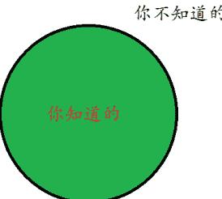

其实不用担心。

学问之道，就象这个圈。

你知道的越多，你不知道的越多。

圈的面积越大。“不知道”的接触，周长反而更大。

就以“房产”为例。

一个从来没有接触过水库的人，幼稚会说：“房产，最没有科技含量了。跑到售楼处买一套即可”。

而你接触了水库之后，你才知道有“板块轮动”。现在热门的板块，未来未必再热门。甚至有可能买在最热最高位。

又譬如说，户型价位段如何选择。“品牌”开发商涨得快，还是CEO坑盘。

本地人/外地人/外国人，消费购买人群的划分。

贷款的应用。

筹款的方法。

你越是接触得多，你越是发现，里面学问无穷。

到后来简直浩瀚如烟海，每一寸每一个角落都可以优化。

“贷款办不下来，信贷员突然说85折升为95折，该如何应对”。

“广佛地区，哪家评估最高”。

“建行放款要晚三个月，房东快要爆炸。该如何哭晕认怂”。

### 你知道的越多，你不知道的越多。

在这个基础上，才有了水库第二，和第三个产品。

即“分答”和“小密圈”。


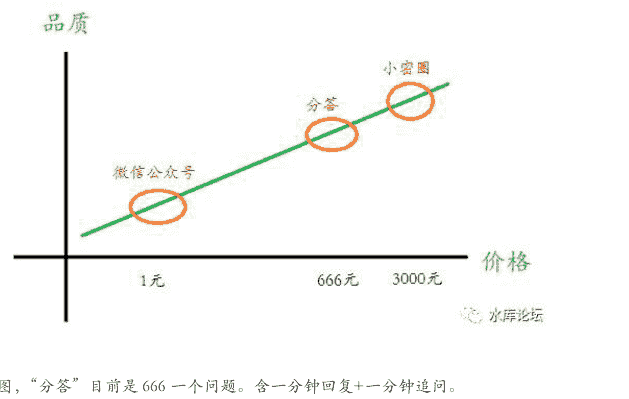

如图，“分答”目前是 666 一个问题。含一分钟回复+一分钟追问。

去年一年，回答了 1000 个问题，700000 偷听。

收入远远超过“微信打赏”N 倍。

“小密圈”则是另一个产品。相当于“微信收费群”。

目前群费是 3000 元/年，排名遥遥领先。

### 四）产品线的缺陷

+ “微信公众号” + “分答” + “小密圈”。
+ 免费+666 一个问题+3000 包年

这样的产品线，缺点是什么呢。

对的，明眼人一眼就看岀：太贵!

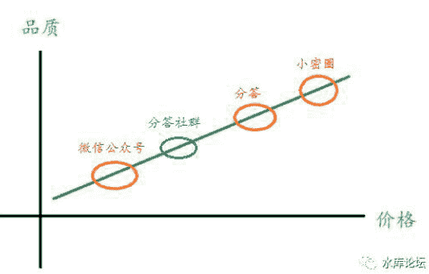

如图，我们其实缺之一个“低端”产品，来覆盖299元/半年的市场。

一直都有人问我：

“老师，你们的水库论坛很好。我也很多问题想要学习”。

“但是3000元/年的费用实在太贵了。我还是个学生，消费不起”。

最简单的说，“知乎”上面的人，就肯定一个都不是目标客户。

能花3000元入“虚拟社区”的人，自然是社会有钱有闲阶层。

目前水库核心小密圈，A8.5~A9满天飞，妖魔鬼怪。

前天“金融八卦女”还转了一个年薪400W的帖子。

出于某些特殊的原因，水库近期想开拓“低端”市场。

覆盖尽可能多的弱势群体。

+ 居住在三四线城市为主
+ 从未接触 A8 以上异形
+ 对房地产彻底一无所知
+ 年薪 80000 以下

### 五） 十动然拒

“分答”上一个产品“小讲”,并不是很成功的产品。

姬十三突围之余，也想搞小密圈一样的**付费社群**。

分答的小妹妹找到我，画图加解释，详细描述了水库“产品线”的缺陷。苦口婆心要求我开 299/半年初级班。

**哥哥十分动心，然后拒绝了她。**

{暖暖照片}

哥哥拒绝的理由十分简单；

**Line Extension 第一条准则：LE 绝不可以损伤到现有产品。**

哥哥目前在小密圈的日子很滋润，每天也有好几笔粉丝入会收入。

躺着数钱，肥肠满脑。

**无论如何，我也不想得罪掉小密圈的客户。**

小密圈才是核心。才是尊贵金属。VIP 尊享待遇无可撼动。

再说我答小密圈也很累了。

哪怕再开第二个圈，都没有精力。哥哥人工很贵的，让我伺候屌丝，没门！

分答回去想了很久，小妹妹妹皱着眉头给我提了第二条建议：

## 让你徒弟教！

哥哥从椅子上摔了下来。

就好比你去“少林寺”武术班学习的话，真正的大师是不出面的。

虽然挂了一个名头。

教拳，只让大师兄教。

《分答付费房产社区》遵循同样的道理。

我们知道，“水库微信群”里，一直有这样一个组织，叫做“共读社”。

阿懒，杨蓓，海川诸人，每当有一篇新的“水库文章”发表。他们就会聚集在一起，互相讨论；

“这个案例我也经历过”。

“原来还可以这样”。

“那下一次我们可以…………”

这样一个组织，相当于一个“读后感”的组织。

一笑加一笑（微信号：150500211）邀您加入水库交流群。群内文集每月一更新……

因为水库所有的文章，都已经是公开的。

你如果想再卖一遍，就只能卖读后感。

### 六）分答付费社区

各位：

《分答付费社群》目前定下来的架构是：

+ 1) 收费 299 元/半年。
+ 2) 以 yevon_ou 挂名，并承诺时常来看看。
+ 3) 承诺有专门为“分答”写的原创文章。
+ 4) 由阿懒（朱业胜）老师主笔，负责主要管理
+ 5) 面对三四线小白，从第一课讲起。
+ 6) 原课程公开。卖点是“读后感”和“理论结合实际”。帮助初学者更好的理解。
+ 7) 我们会另邀请二位重量级的嘉宾，常驻驻场。

可见，这是一款和“小密圈”完全隔离的产品。我最最最注重的，就是不要得罪小密圈的 VIP 们。

Line Extension 从来不是一件好事。

任何一件 LE 的背后，收获了商业的“金钱费”。却遭来一堆骂名，以及其他产品线的不满意。

小心翼翼地跨出了这一小步。因为我真的很想，把奥派传进三四线小城市。

分答第一轮，一共五个圈子：Papi，科学家种太阳，水库，诸明宇，孙圈圈。

6 月 26 日公测，7 月 3 日上线。

{分答二维码，前 500 名有补贴}


（小窗圈用户不要点，有 VIP 专用 1 元链接）

(yevon_ou@163.com，2017 年 6 月 25 日晚)[2]

+ [1] 其实还有个 BBS 是 ShuiKu.net，但 BBS 流量很小。基本忽略。
+ [2] 封面图片是一张没有 PS 的照片。它看似四宫格，但却是同一张照片。参见：
https://www.zhihu.com/question/51233589/answer/188168324

意喻水库产品线四象限位，其实是一体。

一笑加一笑（微信号：150500211）邀您加入水库交流群。群内文集每月一更新......

## 中产就是接盘侠 #F1750

原创：yevon_ou 水库论坛 5 月 23 日


## 中产就是接盘侠 #F1750

中产转身慢

### 一） 海河计划

这二天，看了天津《海河计划》的方案，还有芸姨写的《时尚荟萃》，若有所悟，突然想到了一些道理。

在我们这个世界，其实发生着一个怪圈。头尾相衔。

中产阶级，在努力地模仿着上流社会的一切。从衣着，到饮食，到兴趣爱好的一切。

而上流社会，则努力在“摆脱”模仿。进一步，退一步。一进一步，退一步。

（扑克牌中的大小怪，典型法国贵族的船鞋。目的就是绝不会有农夫穿它）

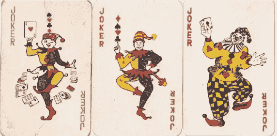

现代工业社会，生产力极度发达。这就导致普通的消费品，乃至于钢琴，骑马，登山，这些昂贵嗜好，都不再有消费门槛。白领咬咬牙一样能学。

LV包包前台人手一个。

米其林三星，花钱预订即可

为了摆脱中产，“潮流”变更的速度在加快。从太阳王时期的一代人一变，到现在的一年半载就变。

## 但是另一方面，我们知道中产和富人是有差距的。

无论眼界，毅力，人脉，可以调用的资源，信息网络，智慧。**穷人的弱，是全面的弱。**

富人的碾压，是全面的碾轧。

所以呢，这里面肯定是有点问题的。

并不是简单的“追逐—逃避”游戏这么纯白。

### 二） 知其然

#### 精英了解更深规律

#### 中产只能模仿，拷贝，皮相

每个人知识点不一样，每个人生命长度，行动牌数都不一样。

精英要比中产强一截。这一节在于；

- 精英是“知其然，知其所以然”。
- 而中产是“知其然，不知其所以然”。

精英知道一件事。是知道它的来龙去脉。知道它的前置后置条件，知道它的应用场合。

譬如说，法国的“法式大餐”，享誉海外，全球 1/3 的米其林餐厅，位于法国。

但其实，法国的“大餐”地位，因为法国是西欧国家中，最早完成城市化，工业化的。

当时，英国工人还在雾霾煤矿中，每周工作 7 天。吃炒豆子拌鱼骨屑。

而法国却早已进化出了宫廷，贵族社会，无止尽的假发舞会。

至于德国，德意志不存在的。

> 英国菜：《“大象”的舌尖之四：从美食之邦到黑暗料理》

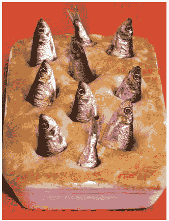

但是，到了400 年后的今天，法国“大餐”的地位，早已不如从前了。

吃过米其林的人都知道，“不怎么样”。

你今天还以蔚蓝海岸法餐高脂肪高奶油为荣，很Low的。

近年来，以澳洲，南非，美国为首的 New World 葡萄酒攻城掠地，法国意大利 Old World 葡萄酒香水一败涂地。

大家都是蒸馏产品，有什么难学的。澳洲阳光更充沛。

再譬如说，你翻出19 世纪的国际文献，几乎所有的外交协议，都是用法语签的。

俺语文课老师讲到此节时，解释是“法语是非常精确的语言，用于国际文书减少歧义”。

狗屁，你看看21cn 的联合国档案，几乎所有的重大外交合同，都是用“粗鲁的”英语签的。

英语取代法语，其背后的实质，是美国世界霸主的地位。和法语国家相对的实力下降。

参阅：《中美《联合声明》一出，法国如丧屁地哭了》

近期朋友小孩读上外，法德日俄，四大语种选修一门。

传统意义上，欧美学生的“第二外语”都是首选法语。

我说别了，您修德语吧。

德语好啊，未来的30年中，欧盟主导者肯定是德国。德国是强盛的上升轨，法国是下降轨。

而中国精通德语的人口，特别少。至少远远低于中法交流。

未来如果中德贸易，技术进口，甚至考个德国合规证，律师证。在国内绝对就是稀缺资源。

参考阅读《德国为什么一直苦苦支撑着欧元？》

```
www.zhihu.com/question/28667070/answer/397934829
```

这些例子告诉我们什么呢。

- 富人知其然，可以抓住历史变化。
- 平庸的中产阶级，只会继续吃法餐。

### 三） 出国留学

前二天我朋友圈转了篇文章《 赌博网站的骰，闪瞎了我的腰。。 》

这其实是个“套中套”套路。因为我又转了一次，所以它又多了几千阅读。

而Casino的名字，依然可以从文中拼、搜出来的。

真让我觉得有趣的，是其中这段文字。

为什么，为什么三线城市依然把“出国深造”当成一条光明的前途呢。

> “这样的好学生原本有机会出国深造，前程一片大好，可他却不经意触碰了刑法，走上违法犯罪的道路，断送了自己的大好前程。”

我们来看一下，一个“中产阶级”家庭的典型套路。

1. 学区房
2. 读本科，硕士，博士
3. 出国深造
4. 学习钢琴，小提琴，芭蕾
5. 进大公司做白领，以工薪收入为荣
6. 买世界名牌，武装自己
7. 大爱无疆，不生孩子

## 这一切所有的模仿，全部都是坑

一架钢琴，至少需要 2200 个零件。在 19 世纪，是一件超级昂贵的东西，同时也是富家小姐的象征。

可是在 21cn，钢琴已经是中产阶级都能负担的小资物件。钢琴谈得好有什么价值，你想在火锅店门口伴奏么。

同样道理，1979 年“高考”恢复的时候，大学生直接就是国家预备干部。存量稀少。

在粮食匮乏的年代，大学生不仅每月可以领到免费的米和油，而且很容易被提拔到县长镇长。

但是 1999 年“大学扩招”之后，大学生就不值钱了。

今天，硕士，博士，博士后更不值钱。

你父母一心一意让你读学历，也是一个无底深坑。


## 我们今天的新村经验，全部都基于父母一辈。

一个人从懵懂到 20 岁，他是没有时间刷“经验包”的。

他的所有谋生技能，所有世界观，路径依赖，都是传授予他的父母。而你父母国企打工一辈子，坐井观天。

作为一个中产阶级，你永远都只可以“窥见”上流社会的生活方式。你其实并不明白，上流社会是怎样运转的。

- 根据你父母的观察，当年的国企领导都是大学生。
- 根据你父母的观察，80 年代“洋人”贵贵无比。“假洋人”跟着沾光。
- 根据你父母的观察，贵族小姐都是谈钢琴的。
- 根据你父母的观察，外国人都靠炒股票发财。

## 中产阶级只擅长模仿，并不了解事务本质。

## 他们的技能点数，仅止于此。

### 四） 接盘侠

好了，若我们的文章只写到这里，那还仅仅是对中产阶级的吐槽。和浓浓的“精英一屌丝”鄙视感。

我们想说的是，在某些设计下，中产可以成为“自然而然”的接盘侠。

举个例子，比如说“邮票”。

邮币卡市场，已经完全崩溃。不仅成交量稀少，而且 SOV (Share of Voice) 在主流媒体上也不见踪影。

按照水库专业术语的说法，叫做“IP已经过时”。

不管你曾经猴票，一张是卖 100 元，500 元，1000 元。

现在不是价格的问题，是根本出了不了货。除非几个庄家对倒。否则整版整版的猴票，谁会花 100 万元买你一些纸片。

但是如果你把时针拔回十年，十五年。在“散货”阶段的，的确是有大量中产阶级“接盘侠”的。

有的中年眼镜男，工厂里的师傅，留下给孩子，铁饭盒二盒邮票。都是省吃俭用攒下来的。

同样的例子，还有红木，茅台，鼻烟壶，蜜蜡，甚至钻石。

> 昨天 16:27
> 匿名用户 提问：这些年，茅台售价从800暴涨到现在售价1600左右，我每年买个两箱，若干年以年份酒的形式再出售，是不是也是一条投资的路子
> IP过时

然后你再想想，争夺了一辈子，国营厂里的科长职位，文征明的字画，乡镇中心的老房子……………

当一个时代改变时，中产并未改变。

他们依然拙劣地模仿着旧贵族的生活，于是就成了接盘侠。

当他们终于买得起贵族用的“身份品”时，他们就成了接盘侠。

贵族们已经撤了，把土地田契留给你。


Samsung 的市值，第一次超过 SONY 时，你不应该说，“三星是什么东西，索尼帝国如日中天时，他还是个棒子”。

中产阶级的惯性，使你延读了昔日的尊卑秩序，并接盘 SONY 股票。

今天，三星的市值，已超过 SONY 五倍。

和田玉价格崩盘时，你千万不要说，“哇，以前是贵族用品哎”。

你冲进去，几万元买块玉。现在就是接盘侠。

当然，价格崩盘最严重的，还是这位老兄。据说 4.5 元/斤，肉食价值丰富。


### 五) 收割中产

我们研究整个投资游戏的收割规律，有点象小时候玩的游戏，“老鹰捉小鸡”。

老鹰捉小鸡，大家还记得怎么玩么。关键是甩尾。

先向左边跑，跑跑跑，形成一个@圈。

再猛地向右边跑，@尾巴后几个小朋友，来不及转头，于是就被抓住。

在我们真实的世界，中产学富人，中产抄富人。

富人买什么，中产就买什么。富人投资什么，中产就投资什么。


赚钱的秘诀，是“猛转身”。

时代变了，红木一文不值，钻石一文不值，迈克尔·乔丹的签名一文不值。

当精英阶层抛弃某一类 Taste 时，中产阶层只会模仿。

来不及变轨，猝不及防，模仿者就成了接盘侠。

- “这块和田玉，以前卖 30W 的，我特价 8W 就买到了”。
- “哎呀，Coach 打对折，赶快去抢呀”。
- “哎呀，天津户口，高考不要太划算哟”。
- “茅台是瓶好酒，以后可以传一辈子的”。

“惯性”和模仿，使得中产阶层是理想的对手盘。

中产天生就是接盘侠。

(yevon_ou@163.com，2018 年 5 月 22 日午)

## 怎样判断最后一棒 #F1760

原创：yevon_ou 水库论坛 5月25日


怎样判断最后一棒 #F1760

（股市段子）我还真不明白，一抛就涨，一买就跌。

那么多股市大鳄，国际基金，你们盯着我手里三五万元干什么呀。

### 一、攻守

前天写了一篇焦虑文《中产就是接盘侠》，因为偶然获得一点心得：富人掌握潮流，中产只够模仿。

因此就形成了“接盘”现象。当潮流急剧变化时，中产是来不及转向的。是理想的最后一棒。

留言中，愤怒的“接盘中产”骂声一片，群众们纷纷反映：“说出了现象，没解决方案”。

如果仅仅吐槽中产的话，近年来的酸文还少么。

按照顺序，周五的这篇，应该是写“怎样避免成为接盘侠”。会教你一些消费方法，避开商家的营销陷阱，高溢价坑。

你以为水库会这样写么。

错了，大错特错，以上全错。

这样写就 Low 了。关于省钱，掀桌子的一代人，早在“IP 系列”，已经写得很清楚了。

比特币和IP：

- 正本清源比特币 #1250
- 掀桌子的一代人 #F1260
- 黄金已死，有事烧纸 #F1270

教你省钱，始终是一种“守”。哪怕你吝啬到一分钱也不花，绝不让商家赚任何便宜。

浑身淘百货，没有任何挥霍。

这样朴素的人生，活着又有什么意义。

当水库意识到“接盘侠”时，我们脑海中闪出的第一个念头，是“怎样赚他们钱”。怎样利用接盘效应，牟取利润。

换言之，想到的是“攻”。

只有想办法赚钱，才能成为 A8A9。

### 二、品牌

为了让大家了解这套逻辑，我先举个例子。

大家都知道，哥哥当年是 Marketing 出身。MKT 的正牌，是品牌经理。

负责一整个品牌的开发，维护，退出过程。

对于品牌来说，它是每年都需要“广告费”的。

无论再庞大的品牌，再 IB 的科技，酒香还是怕巷子深。

“可口可乐”算 NB 了吧，家喻户晓。可乐要请周杰伦拍广告，电视轰炸，雪碧晶晶亮 透心凉。

Apple 大牌公司吧，高科技企业。iPhone X 如果不投铺天盖地投广告，他敢上街卖么。不怕第一天来个冷场吗。

一笑加一笑（微信号：150500211）邀您加入水库交流群。群内文集每月一更新……


哪怕某些“天生”卖流量的公司，他也需要买流量。例如 Baidu。

2016 年，百度在电视媒体和写字楼电梯的广告投放，超过 120 亿。

#### 品牌是需要维护的

不管你的商誉多大，多有名，多大牌。

你还是需要持续地“维护”。

人类的大脑，天生存在一种“遗忘”淡忘功能。广告需要刷存在感。

同时，人口的更迭，20 岁生~70 岁死，每年也要替换 2%

仅仅是想“维持”住你现有的知名度。你也需要投放大量的广告+新闻。

中国人从计划经济走来。传统的“计划经济”思维模式，重硬件而轻软件。

重购买而轻维护。

中国人是不明白，哪怕不为了开拓市场，仅仅为了“维持”+刷新，你也需要投放广告。

- 这一段的详细解释，在《广告学原理》#1610

不过这篇没有电子版。是磨铁出版，为了卖新书《如何获得真正的财富》专供的。item.jd.com/12348516.html

一般来说，企业的品牌策略，分“进取”“维护”“退出”三种。

如果你是一个成熟品牌，仅仅想维持的话，这笔钱不用很多。销售额的2~3%即可。

每年搞一二场活动，制造一二个热点。

有趣的事，甚至对于某些品牌，你的战略是“退出”。逐渐把品牌做死掉，把剩余价值全部收割（常见于被收购品牌）。

这个时候，你依然需要做广告。部分时候，甚至还要“打反击”。

因为你完全不投广告的话，品牌的销量，会呈现“断崖式下跌”。

如果你一分钱广告也不出，只想捞钱和收割，同时也不搞促销和新闻。最多二三年，消费者就会彻底把你忘记。

而如果你适当地加以小幅投入，“有秩序地撤退”。你可以把“品牌的榨干”延长到十几年。收益最大化。

品牌的建设和榨干，是一件很专业的事。需要十几年的时间，才能精雕细琢。

### 三、小业主

我们讲的第二个道理，“小业主”是绝对不会出品牌“维护费用”的。

近年来上海房价暴涨。很多楼盘，从 100W 暴涨到 1100W，房东净赚 1000W。

你赚了这么多钱，您做一点首谋远虑的事吧。

很多“千万豪宅”，连 5 元/m的物业费都收不齐。

你跟物业说一声，花点钱，把外墙刷一下。破损的理石台阶，稍微修补一下。电梯换新玻璃，新灯。

这些事情都不贵。每幢楼就十几万元。摊到涨幅九牛一毛。

而只要你 Renew，就会极大地提高你的房屋品质。一跃成为“高档小区”，对于房价估值的提升，何止百万。

一笑加一笑 (微信号: 150500211) 邀您加入水库交流群。群内文章每月一更新……

业委会会干嘛。如果你和物业经理建议此事，他估计胆都吓破了。

“维修基金”任何超过 10000 元的费用，使用都阻力重重。

有一群愚蠢的老人，霸占了业委会。甚至还会得意洋洋地说“帮你省钱”了。而这样的人群中，可能包括你妈。

好了，你再进一步。你要求每家每户，每年掏出 10W 元钱。占房价 1%

不是买硬件，不是物业费，也不是维修基金。

而是拿了这笔钱，到市场上“宣传”本小区。

说本小区地段高档，环境优雅，交通便利，尊享豪荣。没事刊二期“新民晚报”全屏，庆祝交房 500 周天。

雇一堆的网络水军，刷屏点赞编故事。歌颂俺们高档典雅，是上海数一数二的小区，论豪宅必榜上有名。

你说，这样“户均 10W 元/年”的议案提出来，有没有可能执行。

别人是当你疯子呢，还是当你傻子。

#### 品牌维护只有 KFS 能做，散户不能做。

这就是我们提出的第二个bug：

- 产品到了小业主手里，就会停止品牌的维护。

品牌一旦停止维护，商誉就会断崖式下跌。

“汤臣一品”为什么现在还在刷屏。因为它还没有卖完呢。

### 四、资产的实质

我们再看第三个领悟点：“资产是什么”。

我们今天买的一切“资产”。归根到底，都可以拆解成：实用价值+IP。

例如：

- 红木=椅子+红木信仰
- 燕窝=粉丝+燕窝信仰
- 房子=土屋+地段信仰
- Birken=蛇皮袋+包包信仰

如果刨开最基本的“实用需求”，今天我们花出去的钱，我们所购买的资产，很大一块都是“IP 溢价”。

钻石，如果没有杂七杂八套在上面的“附加值”，它就是一块石头。而且还太小，不便使用。唯一的用途是划玻璃。

出国留学，University 别称“由你玩四年”。英澳大学也学不到什么真材实料。最主要收获是一张“文凭”。海龟值多少钱，见仁见智。

当我们进行投资，当我们支出金钱，并祈求升值回报。

对于那种买进卖出博差价的东西，原理十分简单，它蕴含的 IP 是否增加了。

你可以把 IP 想象成“品牌管理”，这二者之间的道理，其实是相通的！

- 品牌一定要有人维护，否则就贬值。
- 资产一定要有“庄”，否则就走下坡路。

当你去买房子时，“开盘”那一天，是件大事。彩旗飘扬，锣鼓喧天。请二个韩国女团在门口跳舞。规格高一点的，甚至会有范冰冰。

这些是要钱的。很多钱。

一住房开盘疯抢，当你把这些房子买回家以后。你会惊讶地发现，KFS 所谓“稀缺地段，万众瞩目”，开盘时的千人疯抢，猛地都不见踪影了。

二住房市场高高举杠铃。无人问津。

为什么。

- 大业主才会维护 IP
- 小业主绝不掏钱
- 因此二手房，永远卖不出一手的疯抢

有 500 套房子待售，人家才会卖力地搞一场“开盘”大型活动。

从你入住那天，整个小区的“商誉”，就开始走下坡路。

小业主各位，有花过一分一毫，维护小区的品牌么。

百事可乐如果裁撤“市场部”。他还会是最受欢迎的饮料么。

百事 的销量和知名度，可以死撑多少年？

### 五、资产升值

虽然我们举了一个“一 手房 开盘”的例子，但是道理都是相通的。你也可以推演出去，扩散到各种资产类别。

包括但不限于：

- 子女学弹钢琴
- 海龟文凭
- 国企铁饭碗
- 书法，字画，唱歌等能力
- 钻石，红木，黄金
- 古董
- 限量版手办
- 手表
- 砗䵴
- 乔丹的签名

“钢琴”这项才艺，如果要能升值，需要一个一个人，不遗余力地在中央电视台，各大新闻媒体，再三推销强调“钢琴是贵族的代言品，论学钢琴的重要性”。

在流量如此昂贵的今天，谁肯出流量费，保你女儿矜贵，这是一个大问题。

“海贼王”的限量版手办，能不能升值。关键看“海贼王”的漫画电视，在中国能不能放映。会不会极大增加粉丝基础。

在眼球争夺激烈的今天，很难。

至于什么“奥运纪念金银币”“航天纪念币”。人家造出来，就是为了卖的。卖了以后，跑得比兔子还快。

指望以后有后续的“宣传”“推广”，使得纪念币知名度大增，让你手中货物出名升值。

想也不要想啊。

也是有免费流量的。下周五水库会免费为“饭统戴老板”写一篇软文，度身定做。

起因么，哥哥打斗地主连输八把，脸上纸条都快贴满了。戴老板鞭技厉害。

### 六、结语

只有极少数的资产，当产权转为你，商家还会再提供“宣传”“推广”。

这简直就是为你抬轿子，活雷锋。

这种资产，要极度小心，精挑细选，偶尔才能遇到。

绝大多数资产，当你买进时，就是最后一棒。

这就回答了地产界，知乎上的一个千古难题：房价何时会跌

答：房子在 KFS 手中时，它永远涨。当它转入你名下，就开始跌了。

（yevon_ou@163.com，2018 年 5 月 25 日丑）

我知道你们一定会追问，现在房子算不算“最后一棒”。

周日来参加北京功夫财经的财智会，我告诉你啊。

## 几类投资市场的分析 #F1770

原创：yevon_ou 水库论坛 5月29日


## 几类投资市场的分析 #F1770

根据 2018.05.27《楼市名利场·巅峰紫禁城》演讲稿改写。

约 4400 字。有删减。

### 一、投资市场大类

延续《中产就是接盘侠》#F1750

《怎样判断最后一棒》#F1760

上周刷了两篇 100000+，讲了一个“IP”的道理。

我们买卖资产，绝大多数时期，都是“超出”使用价值的。例如你掏几百万元买一张古画，其欣赏价值，或许还不如色彩斑斓的仿制品。

在这样的情况下，你希望你的“附加值”能够保值升值，你就必需要使得艺术品的“名气”越来越大。

例如，单纯以艺术成就论，明代的画家，唐寅或许还不如沈周，仇英。

*“唐伯虎”之所以如此出名，和评书传记《唐伯虎点秋香》在民间流传，是分不开的。*

*1993周星驰作品《唐伯虎点秋香》，则更将这个IP推向了一个高潮。影响了整整一代人。*

只要我们这代人，还没有死去。“唐伯虎”始终是一个金字招牌。


等我们死绝了，没有我们“文化”的继承人。相应我们喜欢的纪念，我们珍藏的艺术品，也都没有了价值。

多年以后，还有谁记得“詹姆斯·迪恩”一个签名，竟要卖 1.8 万英镑呢。

今天我们非常有幸，有几百位观众来到《功夫财经》的现场，听俺们磕叨。

在门口，有 yevon_ou 签名版的新书，供各位抽奖。

在将来的岁月中，如果 yevon_ou 越来越有名，渐渐成了大师。

则各位手里的“签名本”也会保值增值，溢价上涨。

所以，各位一定要多多宣传、推广“水库论坛”哦。

言归正传，我们来讲讲，有哪几个“资产类”市场，资产的名气是长青的。是有人抬轿子的。

- 钻石
- 红木
- 蜜蜡，手串，沉香
- 地段
- 学历
- 公务员的身份
- 属羊

### 二、大力水手和科学怪人


在欧美市场，曾经有一些非常“流行”的时尚元素。

典型如弗兰肯斯坦在 1818 年写的《科学怪人》，讲的是一个“碎肉”拼起来的生物，被科学家赋予了生命。

这个 IP 是此地受欢迎。以至于它和吸血鬼、狼人、科学怪人，一起构成了“三大魔幻”。甚至有人专门拍了驱魔人电影《范海辛》。


但是，1818 年的“著作权”，早已过期。

现在的大企业，迪斯尼和漫威，还有兴趣继续推广“科学怪人”么。没有。他们宁可推自己的“复仇者联盟”。

哪怕拍“吸血鬼电影”，也要打造自己的英雄IP“范海辛”。是范阿姨，不是所有的吸血鬼。

如果没有大型主力，仅靠民间自发。是不会产生持续的IP繁荣的。

更典型的例子，是这个。


作为最早的“风靡全球”电子游戏，PACMAC是如此地成功，如此地深入人心。

几乎每个乡村俱乐部，都有一台游戏街机。

它的粉丝，自发地组成了“全美游戏联盟”“全美 PACMAC 巡回赛”。赛事情续了三十几年。

哪怕有数百万人口，深入人心的喜悦。

纪念品会升值么，衍生品会升值么。

PACMAC 世界冠军，会象 F1 拿数亿奖金么。

不会。

- 组织才是力量。
没有组织，就没有力量。
离开了组织，就是一盘散沙。

商业是严格的组织化。要以 Marketing 为核心，有针对性地运营。

几万溃兵，打不过建制二个团。

### 三、佛系比特币

好了，现在我们来讲第一个实战案例：BTC


比特币一冒出来。有过 Marketing 经验，市场部品牌经理，立刻就觉得不对了“这玩意 绝对无法成功”。

经营一个 IP，和经营一个品牌，原理是一样的。

哪怕神仙水，八星八剑，小罐茶，你要 Buy In 一个概念，一定是需要宣传的。

你想让全国人民，都不买象牙制品。

你就一定要在地铁火车站，铺天盖地地投李冰冰的广告。


(水库严格反对环保广告，文化侵略。见#F1150)

做市场营销的，最重要是 Marketing/Sales 两个方面。

- Marketing 是总部层面的。
- Sales 是落地分销。

例如知乎上的小白，纷纷总是说“小米”是世界上最好的手机，跑分遥遥领先，性价比高。

而 OPPO/Vivo 高价低配，落后好几个身位，大学生颇为不屑。

但事实情况是，2017 年科技界 一件大事 ，Oppo/Vivo 销量远超过小米。不仅销量超过，每台单机利润，更是暴利/微利。

段永平才是“手机业”大佬，才是真正的经营之神。


那么，O/V 赢在哪里呢。

赢在“地铺”。

不管是三四五六七线，一个个城市铺过去，一家家步行街铺过去。

到每一个娄底，思茅，个旧，这些你完全叫不出名字的城市，

招商，找当地经销商。找铺子，谈租约。找师傅装修专卖店，然后还要派巡视专员，定期考核服务品质。

一笑加一笑（微信号：150500211）邀您加入水库交流群。群内文章每月一更新……

这些细水磨含的工作，都是加在“手机售价”之外的。

你买手机的时候，是绝对不会想到，还付了商铺店租的。

好了，现在问题来了。BTC 面市的时候，中本聪的理想，是构建一个“去中心化”，完全用户平摊，没得所有人的制度。

在这样的“去中心化”，谁来付市场推广费用呢。

- 谁来包下地铁广告，请李冰冰做代言
- 谁在 CCAV 竞标标王，承担电视广告。
- 谁搞无数次“研讨会”，请专家教授纽，专程去海南度假呢。

马云爸爸刚开始推“支付宝”“微信支付”时，力度不可谓不大。

滴滴促销全免费，都搞了几轮。

支付宝买单，动辄满 99 减 50，优惠券派到手软。“请杭州人民卡拉 OK”都喊出来了。

“第三方支付”能有这么大的市场份额。和前期天价海量的推广费用，是分不开的。

光“接单”促销员，就招收了几万名。连煎饼果子的大妈，摊口都有一个“打印”平整的收款二维码。特制胶皮，防水，防晒，你注意到没有。

一笑加一笑（微信号：150500211）邀您加入水库交流群。群内文集每月一更新……

“桌边付”量身定做，铺了几万家餐饮店。

这些都是靠“阿里小哥”一家家谈过去的。背个蓝色小包，手把手教会老板娘使用收款码。一张张贴纸，手牌，还有繁琐的客服。


而你“BTC pay”什么时候才会成熟。

我们悲观地认为，不会有商家接受比特币作为货币。BTC 永远不会触及几千万人。

搞个几十家店，都算新闻了。

因为“市场推广”这笔费用，是没有人支付的。

大家都是小股东，何苦为别人做嫁衣。


比特币注定不会有电视广告，培训研讨会，接地推。

也就是区块链，以及一切的“去中心化”货币，注定是失败的。


昨天“博鳌区块链事件”搞得轩然大波。

但是大家仔细观察，现在所有的“业内份子”，讲的都是区块链了。再也没人讲“比特币”了。

为什么，我不想给你抬轿子啊。

搞这样一场区块链大会，成本高昂。又是租借场地，又是迎送接待。到场一千人，人均五千成本都打不住。

既然这样，“研讨会”到最后，肯定是卖自己的“山寨币”。

怎么可能卖你的币呢。

每一个展示位都是钱好不好。

你又不会斗地主连输八把

## 比特币是注定完蛋的。没有人会帮你抬轿子。

连佛门，都开始搞“佛系区块链”。

### 四）楼市

第二个例子，我们举楼市。

各位付费来听《功夫财经》的课，当然是希望我们讲房子的。

对于房地产市场，天天有人问，“房子在 KFS 手里不跌，屌丝买了就跌”。

一笑如一笑（微信号：150500211）邀您加入水库交流群。群内文集每月一更新……

那现在算不算最后一棒呢，楼市怎样判断。

www.zhihu.com/question/276591262/answer/400281815

很简单，我们看一下目前的政策与导向：

- 租售并举
- 共有产权房
- 二次房改

中国从 1995 年中期，开始“房改”化进程。大规模地商品化。

可是“商品化”搞了几十年，有人觉得吃亏了。

“通货膨胀”就是从全社会抢钱，所有用纸币计价的资产，无差别贬值。

偏有人靠着“不动产”，躲过了通胀的洗劫。居然有人想逃。

有关部门看见民间财富增长，“房子”升值几十倍，眼睛都绿了。

现在的政策指向呢，“土地是好东西，我不卖”。

像土财主一样，裹得严严实实的。恨不得你完全去租，那就是 0% 的产权。

要不就是“共有产权”，你拿一半 50%。

以“雄安新区”为例。雄安出台之夜，不是清理“过时”的管制法规，创造“创新”法制的自由社会。

“雄安”的第一条命令，居然是冻结一切房地产交易。

哎呀我的地主老财啊。

“雄安”是不是想要永久性的放弃房地产？绝不是。

正好相反，雄安是非常非常乐意“土地财政”的。

只不过，要等雄安的 CBD 都建成，各项配套炒作宣传到位。

等他一开盘时，第一手就是 100000+/m²。

吃尽了所有剩余价值之后，再卖给你。


## 做投资，要看大势。

现在的大势，是不是 ZF 已经把所有的土地都卖完。然后急着剥夺土地上的附加价值，剥夺学籍和户籍特权么。

不，正好相反。

## 现在处于紧缩供地，ZF 拼命收回筹码的阶段。

这种阶段，怎么还会有人看不清。

- 大涨前夜
- 大庄家吸筹，洗筹，拉升。

哥哥洗杯子去了。下面是“水库思维”备份号。各位一定要多关注备份号。防失联哦。

本文篇幅较长，估计约 4400 字。

大家可以先看一段视频。休息一下。

`v.qq.com/iframe/player.html?vid=t06676udwe8`

### 五） 学区房

> “始妾事其父，时为将，身所奉饭饮而进食者以十数①，所友者以百数，大王及宗室所赏赐者尽以予军吏士大夫，受命之日，不问家事。今括一旦为将，东向而朝，军吏无敢仰视之者，王所赐金帛，归藏于家，而日视便利田宅可买者买之。王以为何如其父？父子异心，愿王勿遣。”

这段话，是讲“长平之战”赵括的。

当时，赵王听了秦王的反间计。派赵括为大将。

赵括他 Mum 听了，连忙去皇宫找赵王，说“赵括不可为将”。

理由是，以前 Father 赵奢当大将时，爱兵如子。朝廷有什么赏赐，都是尽量分给将士，自己留下很少。所以将士齐心。

而“赵括”这个人，是个小气鬼。喜欢“独吞”。王赏赐的金银，一个人藏回家，吃独食。怎么可能不失败呢。

（赵王不允，但赐赵母免株连，免死）


我们这个世界，我了解得越多，越觉得时事艰辛。

一家店铺，绝不是你小菜烧得好，餐饮就可以赚钱的。

工商，税务，卫生，消防，环保，街道警察，一定得方方面面都摆平了。生意才能做下去。

做任何事情，一定要记得“将士共享”。

利益均沾的事情，才会有人帮你抬轿。襟越是宽广，生意才能做得越大。

## 买了学区房，妄图它长期升值，是极端愚蠢的人

如果你在北京西城区，30 m² 1200w，买了一套“知名”学区房。

你指望学区房继续升值，1000，1200，1500，1800，躺在那里睡大觉，有人乖乖奉上劳动血汗，供你升值。

你独吞了所有的利益。

老师，学校，教委，城建，甚至税收交易所，其他人分到钱了没有。

没有。

你独吞了所有的利益。

老师辛辛苦苦提高“教学质量”，爱生如子。把一班顽劣不堪的孩子，培养成好苗子。把中产孩子培养出眼界。

老师赚钱了没有，加工资了没有。没有。

学校赚钱了没有，涨学费了没有。没有。

教委赚钱了没有。卖掉校名额了没有。没有。

你象美国人一样，交高额的“学区税”，养地方城建了没有。没有。

甚至连频繁的交易性税收，营业税+契税，也没有。

你连物业费都没交。

教师+学校+教委+工商城建+税收财政，所有人都没有拿到好处。

那注定是什么结果呢。大家一起來掀桌子。

IP 没有庄家，别说抬轿子的人，就连“看守”轿子的人都不足。

三岁小娃，持百金行走于市。结果会怎样，会有人“抢”你。

- 今年，北京西城区“重新划片”呼声出来了。
- 海淀区西二旗“码农子女”崛起了。硬生生把一个平民小区，升级刷到了重点小学。
- 对于有钱人，他们更喜欢读国际学校，私立民办。也没什么兴趣接盘“1200w，30 平”

就“学区房”小业主们本身，他们的组织呼声也是分散的。

甚至都不愿意每年拿出1%的资产，组成游说，组成行业协会集团。

势如累卵，势如累卵啊。

## 怎么看，都象是最后一棒

只要“学区”政策稍微一调整。不再和户籍，学籍挂钩。又或者民管办学更放松一点。

甚至哪怕什么都不做，“西二旗”码农再多几年时间。

西城区的学区房，分分钟崩溃。下跌无底啊。

象这种 30 ㎡，1200w 的房子。如果刨去了“学区”的概念，谁会去住污水臭虫旧破房子，盲流民工么。

单纯卖“房子”，北京瓦房老破小，能值多少钱。50W，还是100W。

学区房有跌去90%的风险。

上升下跌，风险完全不对称。

- 本人不持有任何北京学区房。子女就读国际学校。

### 六） 结语

今天逻辑有点难，篇幅有点长。

感谢各位陪我听到现在。感谢《功夫财经》，感谢主办方。感谢祖国，感谢领导，感谢人民。谢谢。

（yevon_ou@163.com，2018 年 5 月 28 日晚）

## 团结起来，反抗邪恶的头条 #F1780

原创：yevon_ou 水库论坛 5 月 31 日


## 团结起来，反抗邪恶的头条 #F1780

- 抖音的小姐姐，可以赚钱么
- 《今日头条》会成为高质量发布平台么
- 媒体平台，价值都是平等的么。

基因决定命运，平台并不相同。

### 一） 署名权

世间熙熙，皆为利来，世间攘攘，皆为利往 ---- 《孟子》

首先，我给大家举个例。

假设你是一名青年作家。写了一篇短篇小说，给出版社投稿。

- 一家出版社 A 说，“稿费 3000，署你的名字”。
- 一家出版社 B 说，“稿费 3000，不可以署名”。

请问，身为“青年作家”，你会选择哪家出版社。

很显然，除非你脑子被枪打了。否则 99%的正常人，都会选择 A。无论如何，要把自己的名字写上去。

为什么，因为“名”就是利。名气大了，利润也会高。

出版社给你的回报，其实是二部分：“名”+“利”。

- 金钱的回报，是 3000 元。
- 名气的回报，是署名权。

只要你不断地在杂志上发表刊物，你就会渐渐地变得更“有名”。

一笑加一笑 (微信号：150500211) 邀您加入水库交流群。群内文集每月一更新......

不仅家乡父老，会认识你，扬眉吐气。而且在学校评职称，提干部，也是大大好处。

“名气”大了以后，甚至稿费都会水涨船高。例如象王蒙，铁凝这样的作家。一篇文章，就可以卖很多很多钱。

如此浅显的道理，如果把“水”稍微搅浑一点。许多人就不认识了。

来源：画生的八字空间


“头条系”是个帝国。

- 你以为你有署名权。
- 其实你并没有署名权。
- 一切的流量，都在老板张一鸣手里。

### 二） 饭统戴老板

饭统戴老板 2016-11-1 12:13 来自微博 weibo.com

中午在休息室吃盒饭，新入职的美女凑过来一起吃，问为何我敢重仓某股。我正手忙脚乱地拆盒饭，随口回了句因为MACD金叉，同事们大笑，小姑娘脸色绯红。我放下筷子，去办公桌上拿了叠材料，上面有该股所在行业产能、供需、格局，以及未来6个月可能的核查、停产、提价、弹性等详细数据，扔给美女。小姑娘看了眼睛大亮，夸我研究功底深厚，入木三分。我愕然道，饭盒油多，你垫一下。

> 如果你去青岛撸串，你千万要关注饭店老板。

> 在他微疏的地中海顶下，藏着或是深不可测，扫地僧的实力。

> 戴老板姓代，祠堂里丁甲却是“戴”。老人也说不清楚哪个 Dai

> 他曾想注册“军舰戴老板”。

> 大智慧却改成了“饭统戴老板”。


一笑加一笑(微信号：150500211)邀您加入水库交流群。群内文集每月一更新......

戴老板是一个作家。薪水很高。在他的巅峰时期，粉丝数甚至达到了前无古人的：

9 人。

因为戴老板的本职工作，是基金公司研究员。

而任何一份《行业研究报告》，阅读数都不可能超过二位数的。

> （有钱人的世界，你永远都不会懂）


有一次，戴老板和人打赌。

对方羞辱他，说他一辈子的阅读数，都不可能超过碗里的米。

戴老板火了，**是时候展现真正的技术了。**

于是他写了篇 《*内存的战争*》

从 3000 粉丝的 “冷启动” 状态，一口气刷了 200000+ 阅读。

0 大，你第一个 2W 粉，用了多少时间。

0 大，你第一篇 100000+，用了多少时间。

yevon_ou 冷漠不语，默默往脸上贴了一张纸条。


此后，戴老板一发不可收拾，一口气写到了 #38

卅八篇文章，卅八篇 100000+

一笑加一笑 (微信号：150500211) 邀您加入水库交流群。群内文集每月一更新……

他在 2017-10-21 才开的新号，不到半年，就冲入中国一百强。篇篇精华，篇篇刷屏。

《悍匪与巨富：香港风云四十年》

《砖家防打脸指南》

《漫威英雄的复印者联盟》

有一次戴老板，拉着哥哥去“佛系撸串”。

上到小番茄（圣女果）时，戴老板和哥哥都哭了。

“拿下，拿下，这堂堂日月，朗朗乾坤，怎么还要吃人参果呢---阿弥陀佛”。

- 消息
- 留言 +2条
- 赞赏 +50461.90元
- 通知

这件事，懂的自㯕懂。

一笑加一笑 (微信号: 150500211) 邀您加入水库交流群。群内文集每月一更新......

做自媒体的，如今最怕就是这个小红点子。戴老板平均每隔十分钟，要看一下手机。神经质到脖子都拧了。

你知道，“包邮区”的兽爷么。

“知道啊，怎么了”。

“唉，别提了，心脏病发。抢救”。

“什么情况”。

“说是有一个小 V，不知道发什么神经。把每一篇文章，都给兽爷开白名单。求转发”。

“于是兽爷的系统通知，就不停地闪”。

“前前后后，一共闪了 254 次”

## 象“饭统戴老板”这样账号，精才绝艳，放在“头条系”，却是要被割剧虐死的。

### 三） 头条系

粉丝喜欢一个作者，是因为作者优秀。

粉丝追随优秀的作者，可以节约搜索时间，获取优质内容，降低噪音成本。

为什么要“署名”。“署名”相当于一种商标。

“饭统戴老板出品，必属精品”。

“认准这个胖子，他一定很有才”。

我们设想一下，假如一个出版社，完全“禁止”作者署名。

不管你再好的文章，只能留“出版社”的名字。

就好比博导、教授剥削研究生，手下的人拼命地干活。但最终的论文，全部都是老教授的名字。

- 你让我写署名文章，3000 元够了。
- 你让我写不署名文章，10000 元才够。

出版社剥削了作者，把“名气”，由“追随作者”改成了“追随出版社”。

名就是利。在这个江湖上，控制了名，就控制了利。

“今日头条”这个生态，用户们是冲着“头条”去的。

每一天，头条推送的质量，会有起伏。有可能推送的，并不是“第一流”的作品，而仅仅是“第二流”的。

用户会有感受么。会有的。

但这个感受的降成，会很轻微。大致就是 100 分，降到 90 分的样子。

忍一忍，还是可以过的。

但是另一面，《今日头条》的老太婆，就可以用高八度的音调，指着戴老板的鼻子说：

"你凭什么要 10 万/月的酬劳，学其他屌丝，拿 2000 元/月稿费知足吧"。

如果你当年没有追逐“名”。

一个无名人士，当然只能接受无名人士的待遇。

“今日头条”回报，是所有平台中最低的。每一万阅读只有十几元，有道理的。

### 四）	大怪兽沃尔玛

我们举一个美国的例子。“今日头条”的市场模式，在美国早已 有之。Marketing 出身人士一看便知，这玩意不能碰。

在美国，和《今日头条》最类似的，是 Walmart。

Walmart 是零售业，销售额巅峰期，占美国零售总额的 1/3，超市遍布美国大小城市。

超市这一行，有一个特征。

当用户冲进超市，他是来买“洗衣粉”的。洗衣粉是一个很 强的冲动，否则就没法洗衣服了。

但是，客户买哪个牌子，哪种型号的洗衣粉。差别并不大。

美宝莲和夏士莲，不都是这么。

不管哪个牌子，最终都是卖了 2 公升。

超市业不在乎，可是对于制造商，就是生与死的区别。

你把超市里所有的雕牌，一夜之间换成纳爱斯。超市利润最多差几万元。但肥皂“区域 总”，公司几百号人，就可以去跳楼了。

也就是“超市业”是绝对甲方。他想让谁上，就让谁上。

想让谁完蛋，就让谁破产。

Walmart 随便来一个底层科员，他们“全球副总裁”都要到电梯口迎接的。

因为 Walmart 掌握了流量，掌握了绝对入口。

Walmart 对于制造商的压迫，也是十分惊人的。

它每天虐你千百遍，动不动就是撤柜。搞到最后，整个轻工业“制造业”，净利润无限 接近于零。

甚至美国人喊出了“放弃制造业”“制造不如流通”的口号。

是 Walmart，榨干了美国轻工业最后一滴血。

《抖音盛宴：收割一个新流量帝国 ｜深氪》

《95 后美女经纪揭秘网红江湖，真的有人月入百万！》

同样道理，“抖音”中的小姐姐，别看你现在增粉捞钱，折腾很欢。

这是因为 “抖音”急剧成长期，野蛮生长，跑马圈地。

等到太平冷静时，看不提死你。

因为 “抖音” 的模式，和 Walmart 高度类似，“一切流量归于平台”。

等到张一鸣腾出手来，收拾你时，一众大 V，是完全没有抵抗能力的。

哪怕彭十六 clf 名气再大，老板一个指令，保证你再也刷不出来，如泡沫一般消失。

而你的反抗，甚至不能使系统运行，降低一点点。

这个时候，请问收入的分成。

您认为是 70：30%合理呢

还是 10：90%合理呢

一笑加一笑（微信号：150500211）邀您加入水库交流群，群内文章每月一更新......

### 五) 业界的反抗

美国业界对 Walmart 的反抗，主要提现在二点：

- 1) 扶植其他的平台卖场对抗。例如 Carrefour，Amazon
- 2) 开设专卖店

换算成中国的语态，总算“微信自媒体”还活着。

如果微信不要整天 no zuo no die 乱删帖的话。戴老板的脖子都扭了。

中国所有的家电零售企业中，只有格力 GREE 坚持走“专卖店”模式，不愿意过度依赖大卖场。还有小米。

按照董大姐的说法，别看现在省省事力，小心到时候拉清单。

当一个品牌过度依赖国美，京东时，它的末日也就到了。

### 六) 结语

我想很多号，低估了“头条号”的真实代价。

如果你不能控制“流量”，不能控制“时间线”，那么相当于你没有署名权。

目前头条的稿酬，是不值得你去卖命的。

分别为 6 亿和 500 亿。“这两项指标的完成度都在很大程度上依赖于抖音的表现。”

回顾微博商业化的历程，在最初流量鼎盛期，微博自己并没有挣到钱，反而是草根大号和段子手的狂欢。花了好几年，微博才把赚钱的控制权掌握在自己手里：摸索自己怎么在大 V 楼的广告贴中切一刀，并最终把自己变成了最大的广告中介；张晚才自己去掌控流量分发，插入广告，不再让 feed 流呈现仅依赖性关注关系。

而抖音在怎么赚钱上不仅明白，而且强势：它掌控着流量分发，掌控着广告主，也掌控着红人。

> “整个头条系产品的商业化都做的

越来越多的 App，例如微博、知乎，他们都放弃了“时间线”。而采取“干扰算法”。

这意味着这些公司，都要从“流量排序”中赚钱。出版社盖过了作者。

以“微信自媒体”和“今日头条”为二端。整个业态中，偏向“干扰算法”企业控制的越来越多。

意味着“内容创作者”处境，越来越不利。

或许，是时候期冀新的平台，或者开个专卖店了。

（yevon_ou@163.com，2018 年 5 月 31 日丑）

## 恶的土壤，结不出善的头条 #F1790

原创： yevon_ou 水库论坛 6 月 4 日


恶的土壤，结不出善的头条 #F1790

| 中产就是接盘侠 #F1750 | 团结起来，反抗邪恶的头条 #F1780 |
| :------------------------- | :---------------------------------- |
| 怎样判断最后一棒 #F1760 | 恶的土壤，结不出善的头条 #F1790 |
| 几类投资市场的分析 #F1770 |  |

连写五篇 Marketing，写完整消停一阵了。

### 一） 手法

有些事，我们一开始不明白。

但是，哥哥是做 Marketing 出身的。又是极聪明的人。

有些事，当我们一旦想明白了。顿时如怒火中烧，再也无法遏止。

一笑加一笑（微信号：150500211）邀你加入水库交流群。群内文章每月一更新……


#### 流量干扰

上图，是国内几家最著名互联网平台的“流量干扰”图。

其中，微信最干净，是 0%（或许 5%），感谢张小龙，感谢其高尚情操。提供了几亿中国人一个平台。

头条最不干净，是 100%

另外一些平台，诸如微博，知乎，介于二者之间。

微博一直在堕落。出于“赢利”和华尔街的压力。

微博从刚面世的时候 0%，逐渐堕落到今天的约 60%

回顾微博商业化的历程，在最初的流量鼎盛期，微博自己并没有挣到钱，反而是草根大号段子手的狂欢。花了好几年，微博才把赚钱的控制权掌控在自己手里：摸索自己怎么在大 V 接的广告贴中切一刀，并最终把自己变成了最大的广告中介；很快就自己去掌控流量分发，插入广告，不再让 feed 流呈现仅依赖性关注关系。

如果一个用户，打开手机，想随便看东西。

如果它看到的东西，全部都是“真实”的。全都是自由的，自己关注的。我们把“污染度”称为 0%

如果它看到的东西，全部都是“机器算法”。全部都是系统想好的，硬塞给你。类似于电视机，单向接受。北朝鲜甚至锁死了，只有十几个频道。

则我们称它的污染度为“100%”。

普通用户或许不明白这其中的道理。那我们举一个最最直观的例子：


(百度发布声明称，传闻为谣言，已向公安机关报案。据悉，百度找的是网上排名第一的警局，目前案件已经进行到了给主警官汇款的阶段)

这个是什么，这个是大名鼎鼎的“莆田系”。

大家都知道，在百度上面搜索“看病”“就诊”“疑难杂症”，那是万万不可的。

同样的，搜索“买保险”“买理财”“买基金”，也全部都是李鬼骗子。

就连“搬家公司”，前三页甚至没一个官网。

而百度的赢利模式，就来自于“流量干扰”。

具体来说，是搜索排名。谁给的钱多，谁的排名就在前面。

消费者根本找不到自己想要的东西。

“第一代互联网”以 1994 年的 Yahoo！为例。

Yahoo 的赢利模式，主要是广告。杨致远被誉为天才。有了流量，就有了眼球。

可是“第一代互联网”，混得并不如意。

2000 年中国“门户网站”三巨头，新浪，网易，搜狐，惨淡登陆 Nasdaq。虽然有一点流量和广告收入。但是远远养不活成百上千的编辑。

而第二代互联网，赢利模式以 Google 为例。

Google 不卖广告，其主页异常地干净。和 Sina.com 形成鲜明对比。

Google 卖的是“搜索排名”。

或者说，是流量扭曲，流量干扰。

这一个战术，极其极其成功。为 Google 奠定了天价的利润和声誉。

Google 六大事业部，五个严重亏损。纯靠“付费排名”的利润，才支撑起谷歌小资情怀的各种科幻实验。

这一招，阿里后来也学会了。

Taobao.com，如果你上去注册一个 C 店，是完全不要钱的。

马云爸爸，购买了那么多服务器，简直就是活雷锋为你卖命的。

淘宝印钞机，它是怎么为 Jack 赚钱的。

靠“流量干扰”。你如果不付钱的话，消费者是无论如何，接触不到你小店的。

搜索的时候，每一个“关键字”，每一个展示位，都是要钱的。

不客气地说，不给钱，连“低价排名”都未必轮得到你。

有了这些基础知识，你再回过头去看：

# 今日头条，微博，知乎，目前正在做的事；

# 他们就在复制 Google 排名啊。

#### 广告机

在所有的公司中，Google 是比较有“节操”的。做事也比较有底线。

Baidu 是比较没有节操的。为了钱，可以出卖很多东西。

这也是 Baidu 比较挨骂的原因。

作为用户，消费者肯定希望更好，更精准的服务。

消费者最希望的是，我搜什么，就跳出来最最精准的结果。一点点商家的广告都不要有。

污染度最好为 0%

百度之所以挨骂，是因为他捞钱，捞得有点过了。

你能想象搜索看了前三屏，全部都是广告，标注“官网”的其实是骗子。真正的官网，因为没续费，所以根本搜不出来么。

（顺便说一下，有一个李鬼网站，叫做“水库 luntan”。它就是靠买断了“百度推广”，付了大量广告费。百度同流合污）

那么，我们看回“今日头条”。今日头条能给我们高风亮节，给我们足够的信赖和信心么？没信心啊，亲。

##### 今日头条被质疑用麦克风窃用户隐私

时间：18 年 1 月 3 日

近日，有关今日头条窃取用户隐私的截图在网上流传。有网友反映，在和朋友讨论西餐厅哪家好时，今日头条会马上推送与西餐相关的广告和资讯，重要的是，他此前从未在其它 APP 或者浏览器上做任何搜索！

还有网友称，之前曾问朋友元旦去的哪个温泉，结果今日头条马上推荐温泉酒店。

##### 今日头条虚假广告专攻二三线城市，欺骗消费者。

时间：2018 年 3 月 29 日

3 月 29 日，央视财经《经济半小时》栏目报道称，今日头条虚假广告避开一线城市，通过“智能”推荐的方式专攻二三线城市，欺骗消费者。

我打心底里不喜欢“流量干扰”的模式。

随着一个个 App，越来越因为商业利益驱动，人为扭曲“给你看什么”。

这些平台，也就失去了“自媒体”的本意。

一笑加一笑（微信号：150500211）邀您加入水库交流群。群内文集每月一更新……

丧失了平台本身的价值。

这种 Syndicate 的模式发展到极致，当张老板捞钱捞到极致，你打开“今日头条”，简直就像一个从头到尾的广告机。

然后再发一道文，禁止 google 进入中国，只允许使用 Baidu 一家机构。

不寒而栗，不寒而栗啊。


#### 劣质化


头条的第三个问题，是“头条”注定锁死了自身，注定是一个“三四线底层”，是屌丝&民工使用的 App。这辈子也无法翻身。

何出此言？

我们还是未关注“头条系”对应的商业参照物，美国的 Walmart。

Sam Walton 是一个伟人。就好像张一鸣也是一个伟人。这一点毋庸置疑。

Walmart 刚出现时，是以“奇迹爆发”式的速度增长。沃尔玛几乎每周开一家店。把所有的“传统”业态，打得溃不成军。

业界极度恐慌。

但幸好是，Walmart 的市场份额升得虽然快，但终究也是有尽头的。

不算汽车等耐用消费品，Walmart 占到了全美零售额 20%，但此后，就停在了这个位置。开始放缓。

因为很简单的问题，你想买一个 LV。

你去 Walmart 大卖场，去找 LV。你找得到么，你永远也找不到。

不仅仅没有 Gucc Gucci, Prada Prada, 稍微有一点名气的，卖小资情调的。诸如 L'Occitane, BodyShop，无印良品，在 Walmart 店内，一样也找不到。

Walmart 卖的，永远都是“皮直，厚实”，经久耐用。虽然没什么品牌。但一看就是质量保证，结实耐操的商品。

为什么。

我曾经看过几部 Sam Walton 的访谈录，还有国内一些书籍分析，归因于 Sam Walton 的基督教信仰，WASP 的朴素情怀。

大错特错了。

Walmark 卖的东西，侧重于“皮厚，实用”，而非“新潮，创意”。

因为 Walmart 本身就是一个“流量主”。它是控制着供货商生死的。

见上一篇《团结起来，反抗邪恶的头条》#F1780

消费者跑到店里面买“洗衣粉”。洗衣粉这个需求是强烈的。而“洗衣粉品牌”这个需求是不强烈的。

无论碧浪，汰渍，货架上有哪种货，消费者就买哪种货。干扰能力巨大。

- 推介碧浪，还是汰渍，对 Walmart 的影响，不会差到 1%
- 而对于商家，就是生与死的区别。

这种情况下，Walmart 一定会尽量压榨供应商。并且把供应商的毛利，压迫到接近于零。

“生态”是一个复杂的系统。“博弈和反抗”是一个二阶反馈。

这句话反过来说，**供应商不愿意为 Walmart 打造优质，有品牌的商品与服务。**

举个例子，假设你组建一个 100 人的公司。立志做 “最有质量” 的大场面视频。飞车爆炸，特技明星。

大制作，大成本，拉斯维加斯直升机航拍。

这样的 “精品视频”，在 Youtube 上就是爆款。

但是拿到 “抖音” 上呢。

万一头条不给你推介怎么办。万一算法给你过滤怎么办。万一 “头条系” 问你索取高昂的通道费怎么办。

你有了先期广告投入，大资本，大成本，你就是上了 “贼船” 了。

LV 拿到 Walmart 卖，万一沃尔玛问你要几个亿展示费。你是撤柜呢，还是撤柜呢，还是不撤柜呢。

LV 是一定要建设自己的“专卖店”的。

任何一类商品，只要有了品牌，有了附加值，有了高毛利，他就一定不能在头条/Walmart 卖的。

“抖音”永远只能做短视频，这辈子都做不成长视频的。

##### 从经济学角度讲，“露脸权”其实也是一种产权。

只有在完善“产权保护”的地方，繁荣才得以发展。

象腾讯“自媒体”，公众号就是公众号。号写得好，流量就是你的。

在“产权保护”的前提下，经营者才有动力，把质量做好，把品质提高，追加投入。目前的“精品”原创文章，几乎全都集中在微信平台。

因为微信的“露脸权”，有产权保护。内容创造者，可以拿到他们的回报。

你千万别以为“原创”是很便宜的事。目前一个标准“公众号”，每月维护至少要二十万，四个人的团队。见《自媒体那些小事 #F1610》

平均每篇“原创”爆款，成本至少要五六万。


而对于“今日头条”系列平台，流量全部被系统掠走，权益都归了张老板。这样的生态，怎么养得出“精品”作品呢。

只有低成本制作的视频，和胡拼乱凑的洗稿文，才能承受每篇文章 20 元吧。

Walmart 几乎一辈子卖低档品，逐渐沦为了穷人超市。

而“今日头条”的血统，决定了他只能刊登低成本，甚至负成本的文章。

那是什么。

“养生三策”重要知识，最后推荐你去买脑白金啊。


(yevon_ou@163.com，2018 年 6 月 3 日暮)

## 买房子是消费降级么 #1880

原创：yevon_ou 水库论坛


### 玩不过商家

#### 一）消费降级

在水库封号的一个月里，一个所谓的“消费降级”概念，红遍大江南北。

##### 《还没来得及消费升级，中国青年就已经开始降级了》

“消费降级”的背后，是社会经济结构决定的“买不起”。市场化导致的生活成本增加、雇佣制度变化……相似的结构性背景使得中国的年轻人开始追求“佛系”，而日本年轻人则已经进入“拈花微笑”的低欲望状态。不幸成为消费主义镰刀下的“韭菜”的我们，除了“老僧入定”以外，还有别的方法摆脱“被收割”的命运吗？


据说中国“白领”的人生，惨不忍睹。

买衣服只能买 Uniqlo。

吃午餐只能呷哺呷哺。

三亿人民拼多多，拼多多。

##### 老百姓已经勒紧裤腰带啦

##### 你说是不是，翠花

哥哥一边看，一边冷笑。

心痒难熬，小脚丫子乱颤。

此中老道，正是 marketing 的操刀。话唠憋了整整一个月，终于有机会让我说出来。

##### 正品不买，全国人民一起拼多多，是消费降级么？

#### 二）消费降级

媒体所谈论的“消费降级”，其实是消费升级 ------ yevon_ou

Porsche 最近出了乞丐版 Macan，最最便宜的裸配，提车价还不到 60W。

这无疑让很多躺在车盖上抱怨冷气的女孩子，感到了一定的失望。

请问，从 Porsche 到 Macan，是“消费降级”了么。答案绝对不是。

100%的商家，削尖了脑袋插“粉丝升级”，他怎么舍得让你少掏钱。

VW 集团肯定经过了精心的研究。在 Macan 的购买者群体中，原 Porsche 业主一定少之又少。

若替代率超过了 25%，整个项目就可以说失败。

那么 Macan 的目标客户是谁呢。是原先的 BBA 车主。

在中国，BBA 的主流车型，大约是 40W 元 RMB。

现在您只要再加 20W，宝马就可以换成保时捷！

请问您动心么，请问您眼晕么。

Macan 哪怕是打折品，哪怕是乞丐版。

可是他抢的是 BBA 的客户。请问这是消费降级，还是升级。

##### 你不要看一件商品的价格。

##### 还要看他的销售数量，销售数量更重要。

优衣库日本，一年可以卖出 10 亿件，许多人哀叹，一亿人民 10 亿优衣。简直成了国民 服装，泯灭性格。

日本人狂买优衣库，是降低了“个性张扬”么。不见得啊。日本依然是 LVMH 最大的 奢侈品市场。日本女孩子买起包包，眼睛不眨。

事情的真相，你要去问日本的年轻人，“优衣库是你最好的一件衣服，还是最差的一件 衣服”。

如果他们回答“最好的衣服”，则说明他们以前是农民，或者是肥前山中小村庄里出来 的。

任何一项产品，譬如知乎，刚出现时，一定是大咖云集。水平也是很高的。

但随着他的客户群，从 50W 人，到 500W 人，再到 5000W 人口。

客户“平均素质”降低不可避免。

看上去人群和产品的劣质化，不代表“消费降级”。

有可能是泥腿子上岸，以前山区里混得更惨。

以三亿人口的“拼多多”为例。难道这些人，以前是国贸、陆家嘴的精英人群么。

拼多多绝大多数用户，集中在四五线城市。

“拼多多”出现之前，他们对这么洋气小资的产品，甚至从未接触过。

#### 三）消费平级

消费者以为的“消费升级”，其实是消费平级。

如果我们只看第二节，那也无非老生常谈。朱红之泪写《从不存在的消费降级#S390》《零储蓄时代#S380》珠玉在前。

但我要告诉你，骗术是套中带套，境外带坑。

想得更深一层，才是 marketing 玩法。

在朱红的文章里，他举了一个“奶茶类”的例子。从最早的街边 3 元奶茶，到 8 元的快乐柠檬，再到 15 元的 Coco，再到 30 元的喜茶贡茶。

白领小资女，持之以恒地提升着她们的生活品质。努力让自己拥有更优质的生活，模仿上流社会的消费痕迹。


请问，你从 Coco，到“四云奶盖贡茶”，再到 Lady M，你的消费升级了么。

##### 正确答案是：没有

“水库论坛”有一些早期文章。部分因为太早期了，甚至没多少阅读。

2005 年，为了引入 marketing 概念，我们最早时写了四篇：

- 市场营销入门 #210
- Re-Sale 为什么这么难 #220
- 如何运营一家企业 #230
- 无中生有的高阶 #240

在《无中生有的高阶》#240 一文中，我们画了一张图。

| (元) | A | B | C | D | E | F | G | H | I | J |
|---|---|---|---|---|---|---|---|---|---|---|
| 2000年 | 10 | 9 | 8 | 7 | 6 | | | | | |
| 2001年 | | 9 | 8 | 7 | 6 | | | | | 10 |
| 2002年 | | 8 | 7 | 6 | | | | | 10 | 9 |
| 2003年 | | 7 | 6 | | | | | 10 | 9 | 8 |
| 2004年 | | 6 | | | | | 10 | 9 | 8 | 7 |
| 2005年 | | | | | | 10 | 9 | 8 | 7 | 6 |
| 2006年 | | | | | 10 | 9 | 8 | 7 | 6 | |
| 2007年 | | | | 10 | 9 | 8 | 7 | 6 | | |
| 2008年 | | | 10 | 9 | 8 | 7 | 6 | | | |
| 2009年 | | 10 | 9 | 8 | 7 | 6 | | | | |
| 2010年 | 10 | 9 | 8 | 7 | 6 | | | | | |

假设我手里有 ABCDEFGHIJ 十种产品。

- 每年除夕，所有产品降价 1 元。
- 如果价格低于 5 元，则自动出清。停止销售。
- 再引入一个新产品 J，定价 10 元。

我们看第一年 2000，市场上在售的，是 ABCDE 五种产品。标价是 10，9，8，7，6 元。

第二年 2001，所有商品降价 1 元，消费者觉得赚到了大便宜。市场上掀起了促销狂潮。

国家也挺满意，统计局无论从任何一个指标，CPI 都是下降的。切实符合降低民负。

2001 年，在售 ABCD 四件产品，售价 9，8，7，6 元。

再引入一件新产品 J，定价 10 元。

J 销售少没关系，先当标杆放着。

然后第三年，2002 年，ABCD+J 这五件商品，再同时降价 1 元。

D 低于 5 元，退出销售。

新引入品种 I，定价 10 元。

你看懂这个“循环滚轴”的奥秘了么。

A=B=C=D=E=F=G=H=I=J，十个品牌，其实是完全相同的商品，完全没有差异的。

（只要广告堆上去，任何商品 J，我都可以让它定价卖 10 元）

我永远都在降价，却在螺旋涨价。

品牌商把你玩弄在鼓掌之间。消费者觉得自己每次都占了便宜，物价每年下跌 $10\%$ 。

可是兔兔转转十几年，你还是 在原地。你只不过笼子中的小白鼠。


回到“奶茶”这个行业。其实精明的 Marketing，早就竖立一个标杆，一个贵得吓死人的品牌，例如 Cova，例如 Godiva，遥遥地等在那里。

他店铺并不多，也不在乎亏损。他只是要告诉你一个信息：

“这个品牌，就是卖 50 元一粒巧克力”。

您买不起，买不起不要紧啊，您可以 Windows Shopping，站在门口流口水看看。

然后他等你收入一点点上来，等着你“消费升级”。

等你不满足 E，想买 D，想买 C，想买 B，想升级 A。

升级这条路，类似于打“网游”，是永远没有尽头的。

哪怕你可以把 Cova 巧克力当饭吃了，品牌商一定会迅速地研究出一款 Avoc 巧克力。定价 2000 元/粒。

您买不起不要紧，您可以先在橱窗看着。

我可以慢慢地静等你收入上来。

什么，您说品质和口感。

你以为那些买喜茶，贡茶，Lady M 的女士们，她们真的吃得出口感？

她们只是在负担得起范围内，买她们最贵的一款茶点要了。

目前媒体所谈论的“消费升级”，目前小资白领女得意洋洋的“消费升级”，姐姐每天变更高贵一点。

其实是一场巨大的骗局。

事情的真相是，白领到手的工资，扣除杂七杂八的房租，衣食住行，教育医疗，已经不剩多少了。

白领根本没有能力，进行“消费升级”的大件购买。

她们每月留出工资的2%预算，作为奶茶的消费。

因为这钱太少，不足以撬动房子，再怎么也是“绝望性消费”。

因此这2%就不用省了。全部扔到奶茶上。

但为了显示小资的“细节高人一等”。买最贵，最高品牌的奢侈品。

其本质，和前台女背一个LV，没有什么不同。

都属于无法再升阶。

而这 2% 的预算，注定是要被品牌 marketing 剥削和没收掉的。

品牌经理，永远会设计一个“轻奢”，正好达到你购买力的上限。

你以为你光彩照人，其实不过笼子里受人摆弄的小白鼠。

## 四）真正的消费升级

真正的消费升级是什么呢。真正的消费升级是：

- 可以触摸更高档次的一个大类。而不是同类打转。
- 获得切实的物资回报
- 自己掌握喜好

就好比有同事甲乙二个人。

甲：每天买最高档的奶茶。可是从来不奢求能攒出京沪首付

乙：不是很在意奶茶的品牌，但是可以攒出京沪首付

很显然，乙的收入，远远高于甲。

而且社会地位，也远远高于甲。房产证的炫耀，才是真炫耀。

对于真正的消费升级，它一定涉及到一些硬指标的变化。例如人均卡路里摄入，人均钢消耗量，人均电消耗量。

当你进入一个全新的大类。以前喝奶茶的，现在买摩托。

以前玩摩托的，现在买房子。

以前有房子的，现在买游艇。

那 we 才叫这是“消费升级”。

如果你以前没房子的，现在买房子。顺便把奶茶和衬衫，换回最便宜的牌子。

那我们当然理直气壮地说：“这是消费升级”。

(veyon_ou@163.com, 2018 年 7 月 24 日)

一笑加一笑（微信号：150500211）邀您加入水库交流群。群内文集每月一更新……

## 当营销遇上山寨 #1900

原创： yevon1ou 水库论坛


当营销遇上山寨 #1900

参考阅读：《拼夕夕的上市让历史倒退了二十年》

《谁买走了拼多多的山寨电器？》

《拼多多的隐秘后院》

在正统的 Marketing 学说中，是怎样看待“山寨”盗版。

前方预警，本文是广告。

### 一）山寨

市场上出现了大量的假冒仿造商品，肯德基，七匹狼，小米新品。

这些仿造山寨品，不但损害了正品的口碑和商誉，而且很容易有质量隐患。甚至是陷阱和骗局，使不明群众损失了金钱。

在正统的 Marketing 中，企业是怎样 “斗山寨” 的？

中国的脑残的大学生们的，一般诉诸于 “知识产权” 。上一例《我不是药神》吸引无数眼球。

品德更下贱者，则要求 “政府管一管” 。希望无所不在的警察，以后就没有假货了。

首先警察做不到，其次警权过度扩张，只能导致 25%股权是警察局长的。

在真正的 Marketing 中，显然是 “以上全错” 。

持有商标的大企业，哪怕挥舞着 “知识产权” “打假剿假”，八成也是心不在焉的。

有什么样的土壤，就有什么样的山寨。

土壤没有剿灭，野草怎么拔得光。

### 二） 往事

我以前就职的外企，大约于 1990 年进入中国市场。并在当年同期，推出第一款同名产品。

但是那一支牙膏，卖得非常差。非常非常差。

公司砸了海量的广告费下去，也就只在“广州~珠三角”地区，有约 5% 的市场份额。

离公司的野心勃勃，还差得很远。

在最初的岁月，中国区成立的最初三年之中，三年换了 9 任销售总监。

第四年，在销售惨淡的状态下，屋漏又逢连夜雨。

珠三角凭借其强大的山寨能力，市场上出现了一款“高仿”品。

当时，外资企业凭借其一贯的傲娇，以及国际市场的相对定价。

在中国本土牙膏，中华，美加净，都仅仅只卖 1.2 元的情况下。

这款外资牙膏，定价高达 10 元。

相当于 1990 年代中国人，一天的工资。

即使经过了各种乱七八糟的折扣和促销，最后实际零售价，还要高达 6~7 元。

而“高仿”山寨牙膏呢，售价：0.8 元

这个时候，是否应该发动“知识产权”，倚重法律部。

敦促中国警力，去乡下“拉网式”排查，打掉制假窝点呢？

就在这个关键转折时刻，公司换上了第 10 位销售总监。

销售总监盯着“0.8 元山寨”看了很久，说了一句镌刻入史册的话。

“他们卖这 0.8 元，可以赚钱么”。

销售总监叹了一口气说，“我不是很懂你们生产部的工作，也不知道市场部的想法”。

“但别人既然可以卖 0.8 元依然赚钱，我们卖 8 元，显然是过了”。

一笑加一笑（微信号：150500211）邀您加入水库交流群。群内文章每月一更新……

如果别人可以卖 0.8 元，依然赚钱。那不就是一条他赚钱之道么。

为什么我们不可以自己卖 0.8 元。

我们有更先进的生产线。

我们有更先进的生产工艺，管理流程。科技遥遥领先。

我们是正品，我们可以在电视媒体投广告。“山寨品”永远不能见光。

我们可以对接 Carrefour，Walmart 等大型超市。“山寨”永远进不了主流分销渠道。

我们可以用法律武器，对付对手。

事实情况是，虽然各国际大牌，对于“山寨”高仿都喊得很响。

但任何快消品，“山寨”的份额，随便哪一个时期，都不可能超过 2%

因为现代商品社会，重要的并不是“产品”，而是“分销”。

重要的不是价格，而是广告+流量+货架。

这是一个“合法”与“非法”的区别。

任何山寨品，就注定了它不可能进入一切“主流”散播渠道。无论是电视，灯箱，平面广告。

而且也不能进入“主流批发”和“主流卖场”。

越是有价值的市场，越是“依赖渠道”。

一笑加一笑（微信号：150500211）邀您加入水库交流群。群内文集每月一更新……

好比北京、上海这样富得流油的市场。在上海 Kiost/Grocery，俗称的“胭脂店”。数以千万计的游离监管之外的杂货小店，已经荡然无存了。

现在北京上海，买东西就是大型的超市，大卖场。要不就是网店，京东，一号店。

对于这些“现代渠道”。都是没有假货的生存空间的。

没有渠道，你就是 2%

正品相对于“假货”，拥有无可比拟的竞争优势。

我们具有规模优势。

我们可以切入现代渠道，有广告，超市。

我们可以让工商打掉它。任何一个节点，只要销量高到一定程度，必然不复存在。

因此销售总监极其“专业”地说了一句：

“别人卖 0.8 元都可以赚钱，凭什么我们不能自己卖 0.8 元”。

凭什么我们不能自己仿自己!

### 三） 自仿

会议的结果，最终公司管理层决定，出一支自产的“高仿品”。

出于外资无可救药的腐败，最终这支“低端产品”的定价，定在了 3 元。而不是 0.8 元。内部代号 LPP。

LPP 一经出现，立刻获得了炫目的，无可争议的巨大胜利。

大概仅仅花了一年的时间，它的销量，就超过了它的父亲：卖 8 元那支。

此后再过了十年，翻到了 1000% 的数量级。

整个公司，就凭借这一支“拳头产品”，销售额从 1 亿，3 亿，5 亿，10 亿，15 亿。最终占据了全中国三成份额，而光 LPP 一款，全国份额 22%

几乎每一个 LPP 的消费者，都觉得自己赚了便宜。

不乏有老乡说，“这款高档牙膏啊，我在城里见过的，要卖 8 元呢”。

现在打折促销，只要 2.99 元。

放在任何组合包里，都让人皆大欢喜。

而对于商家，他无所谓谓的。

买 3 元 LPP 的人，反正也不会来买 8 元的。我这是“消费升级”，抢的是中华，美加净，蓝天六必治的客源。

而且 8 元，3 元，包装还是有细微差异的。仔细看还是不同的。这就符合了“高端客户”追求尊崇的选择。

尤其值得一提的，自从 3 元 LPP 出台之后，市场上的“山寨版”就绝迹了。

> 你要知道，山寨版的存在，并不是因为商人造假货。而是因为消费者需要假货。

消费者需要一款 1~3 元的，能够预防蛀牙，坚固牙齿，清新口气的多功能牙膏。

他们负担不起，花 1 天的工资，8 元来买一支“高档”牙膏。

这个需求是坚实存在的。不以“打假”而转移的。

打掉了一个山寨厂商，很快又会冒出来另一个假货厂商。春风吹又生。

灭绝山寨的唯一方法，是“满足需求”。

出一款 1~2 元，廉价低质的，能满足消费者的基本需求。

当然穷人可以舍弃一些华丽花哨的功能，“简易版”即可。

而且因为公司强大的营销能力，最终的定价，并不是 1 元，而是 3 元。

毛利率依然高得晃眼。

### 四）知识付费

水库是一个“知识产出”的地方。目前互联网上问房产，头牌就是水库，别无第二家大咖。

水库体系分二条线：

- 微信公众号
- 问答

其中微信公众号是“文章”。一篇又一篇 3000 字的文章，前前后后近 200w 字著作。

把房地产“体，用，术”整个体系和大厦，基本都介绍清楚了。

“水库论坛”是免费的。

哪怕贫家之子，也可以无偿获得水库所有科技树。

熟悉教育的朋友都知道。“牛顿三力学”是免费的，牛顿力学经过三百年千锤百炼，讲述的方法，已经尽可能简单易懂。至少比中世纪 Issac Newton 的英文手稿，容易懂多了。

神州大地，不乏有靠“自学”。看书一遍，就能掌握初中物理的孩子。

但是，你家孩子，难道不上补习班的？

能够完全靠“自学”的孩子，毕竟还是少的。

普通人看一遍“水库”，总是有一点不够通透理解，存疑新鲜见解的。

如果你在“课堂”上，你会怎么做。你会举手提问。

“老师”这种角色，每家学校都请了很多个。

“老师”干嘛用的，难道是站在讲台上念课文？

老师是给你“传道、授业、解惑”的。课本中有不够融会贯通之处，你可以咨询老师。

对于水库体系，“问答”也起到了一样的效果。

知识是免费的，服务是收费的！

随着“水库科技树”的散播，“问答”的需求随之而来。体系再详尽，多多少少大家总有一些边角料的问题。“水库星球”目前已经累计九万多条问题，还在不断增加。

问得完么，问不完的。


一笑加一笑（微信号：150500211）邀您加入水库交流群。群内文集每月一更新……

这就构成了“水库”的主要收入来源：问答。

就“问答”这项功能，我们目前主要有二个产品。

1) 知识星球

水库知识星球： [https://t.zsxq.com/cEUfqfFU](https://t.zsxq.com/cEUfqfFU)


知识星球


不要点，看下去能打折

水库知识星球，目前收费为 5500/期。

注：水库星球已封，联系水库请访问我们如下星球：


采取固定年费制，截至至 2019-04-18。也就是说，你现在加入，还有九个月有效期。费用也是 5500.

但是，我们提供几个折扣：

- a) 问助理 ZM 要个折扣，85 折：4675 元
- b) 老用户续费，额外再 85 折：3973 元。

# 2）分答付费社群

分答相当于一个“低配”版的知识星球。

分答目前规矩是，我每周驻场半天（周六），仅限于周六 12:00~24:00 接受提问。

“分答付费社区”目前有效期还剩四个月，截至到 2018.12.31，定价是 249 元。

目前几乎可以确定，分答不会再续费。

因此 2018.12.31 之后，各位就再找不到这么廉价的渠道，可以询问房产类问题了。

初步的设想，我们会设计一条新的产品线，来取代“分答付费社区”。

这就是酝酿中的“水库小 V”。

水库小V也是一个“知识星球”，定价估计在399元左右。等到分答结束，设想在2018.12.01上线。其规则如下：

- 1) 星主 yevon_ou，但不接受免费提问。提问请付费+288元以上。
- 2) 会邀请各个城市，约十几位小V作为嘉宾。
- 3) 向小V提问，不用付费。

我会按照每一个问题xx元，和小V结算佣金。

如果某个问题太复杂，小V也可能拒绝回答。

因此整个生态，还是很自洽的。

### 五）水库围观

我们知道，长期以来，存在二股“李鬼”组织。通过山寨和盗版水库资料，牟取利益，赚取粉丝金钱。

一笑加一笑（微信号：150500211）邀你加入水库交流群。群内文集每月一更新……

对此，我们采取了一定反制方法。

例如“知识星球”中，提问数明显虚高，会被警告为“代问”客户。并导致拉黑。

我们也附加了“水印”。如果谁整天贩卖“欧神小密圈”，通过水印，就可以查出盗版源头。

但是这些“打假”举措。依然有局限性。

就好比我们在第一段所写的。为什么有人付费订阅“欧神小密圈”，是因为有这个需求。

5500 的定价，依然不是一笔很低的数字。很可能是某些三四线城市，一个月的工资。

同时，某些人未必有提问的刚需。他只是想看看，却不想付太高费用。

这些需求合在一起，就构成了“水库围观”。

最初的时候，我想让知识星球增加这样一种功能：

- 卖 国 观 景。 在 星 球 中 ， 只 能 看 ， 不 能 发 言 。
- 卖 短 期 发 言 票 。 包 括 3 条 提 问 ， 3 条 回 复 。
- 提 供 “ 囤 观 ” 到 “ 正 票 ” 的 升 级 套 餐 。

> （ 老 板 太 会 搞 钱 了 ， 膜 拜 ）

但是知识星球，依然是一个产品开发很慢的公司。尤其这种“体系”级别的迭代，慎之又慎。短期之内开发不出来。

而这个时候，微博伸过来了橄榄枝。

我在微博上有130000粉丝。已经赶入了第二梯队。

微博希望我去那，开一个“V + 社区”。

“V + 社区”的定位，就是山寨版知识星球，就是“水库囤观”。

每一天，都会有助理，定期把“欧神小密圈”的问题，整理过滤，精选筛查。

然后打包，做成微博格式，扔在微博“V + 社区”。

如果你不想花5500进知识星球，你只要花少得多的钱，就可以囤现到“每日更新”。

内容更全，图片更齐。而且有更广的宣传渠道。

给消费者提供“替代品”，才是杀死山寨的最好方法。

weibo.com/yevon1ou (微博扫码)


微博也已被封，请关注我们微博：


### 六) 微信群

> 一笑加一笑（微信号：150500211）邀您加入水库交流群。群内文集每月一更新.....

除此之外，另一个“山寨”李鬼的重灾区，是微信群。

众所周知，市场上一直有“李鬼”微信群。入群收 30 元，A8 群，A8.5 群收费更高不等。

这些山寨群，打着水库的旗号。又不能提供给粉丝有价值的信息。纯属诈骗，导致了很大的纠纷。

因此水库开始提供官方的微信群了。

等一位新同事：ZM1，到位就可以开张。

1) 所有官方#Q 群，**永久免费**。凡是要收费的#Q 群都是骗子。望互相告知。

2) 水库不负责群的内容。纯免费，纯给大家一个玩的地方。

3) 不定期会往群里扔一些废稿。


微信群可以联系我们：


### 七) 菜单栏

最后一个产品线，<font color="red">是水库的“菜单栏”。</font>

随着微信改版的事尘埃落定，菜单栏智获死缓。我们也希望更多发挥菜单栏的作用。

大家都知道，水库是讲房地产的。

可是你们讲了这么多科技树，一旦遇上“实操”；

- 我想办抵押贷款，哪里去找靠谱的贷款中介。有什么优惠产品。
- 哪里有9%以下利率信用货。
- 信用卡大白金，只接受邀请。跪银行门在哪里。
- 婚票和户籍，找谁？

## 金融超市


目录（旧版）#0

- * 房产抵押
- * 信用贷
- * 信用卡
- * 户籍


### 【上海】抵押贷款中介

上海地区最新热门产品


### 【深圳】抵押贷款中介

抵押产品

## 金融超市

- * 目录
- * 最新五篇
- * 目录
- * 房地产
- * 番外篇

在“菜单—金融超市”中，水库打造了“抵押，信用贷，信用卡，户籍”四大板块。

这个菜单最大的价值是：“水库是轻徽背书的”。

凡是在“金融超市”合作的机构，都是和水库有长期来往，互相了解的。

这些机构，可能存在收费贵，办事能力弱等问题。

但他绝不会坑你。

对于这些机构的人品方面，水库是比较信任的。

（yevon_ou@163.com，2018 年 7 月 27 日晚）

## 炼金之术 #F1930

原创：yevon1ou 水库论坛 8 月 27 日


高晓松举着扇子，“哈哈哈，北大清华的学子，如果一辈子就为了一套房子，那无疑是可悲的”。

水库：“疯狂鼓掌，支持”！

高晓松把扇子一收：“你说”。

水库：“北大清华学子，如果一辈子为买一套房子，无疑是可悲的”。

“可如果他们买 100 套房子，那就成了艺术。刀锋上的艺术！”

### 一、画生

今天这篇文章，是写给一个小朋友“画生”的。

画生是水库 90 后中的佼佼者。著有公众号：《画生的吐槽空间》

但是最近的几篇，画生渐渐陷入了迷惘。在独立破阶的道路上越走越远。甚至哀叹起了“人生出头困难”。例如最新的这篇：《148: 庸俗》


在文章中，画生哀叹乔布斯在车库中改变世界。只要你有“火焰和梦想”，最终可以进化全人类。

而我们呢，我们只发明了拼多多和抢红色。这是何等令人沮丧的局面啊。

一笑加一笑（微信号：150500211）邀你加入水库交流群。群内文集每月一更新……

### 二、手机

技术，技术，技术你懂么。

奇妙的，弹跳的代码，构建了 iPhone。科技使得人类可以远隔万里通讯，可以用云存储照片和音频。

相比中国人在二件八折，59 元包邮之中打转。境界相差何其巨大。

人家是艺术，我们就是庸俗啊。

我想告诉画生，他所知道的一切，全部都不是事实。

俺从 2003 年开始用 Dopod S1，一直到 2007 年第一次接触 iPhone 3。

当我看到 iPhone 时，我整个人都惊呆了。

我不能想象，怎么会有人使用这么落后，这么愚蠢，这么丑陋难看的手机。

> iPhone 上所使用的一切，全都不是新的技术。

当 99.9% 的人口，还在使用 Nokia 双屏，带着笨拙的键盘。命令行式的输入。

Dopod 系列，早就是触摸屏了。

触摸屏，可视化按钮，手写输入，无数 App，自由下载和安装，而且还是六寸屏。

除了唯一没有“缩放”功能。iPhone 没有给我任何新的体验。

相反，对于当时哥哥的两大主流需求：淘房产 BBS 和看碟。iPhone 显得都十分笨拙。

它不仅仅只有狭小的 4.5 寸屏幕，拍照音频也毫不占优。

当哥哥的一些朋友，从海外带回 iPhone 手机时，哥哥的第一个反应：“这是个骗子”。

因为 Jobs 使用的所有技术，全部都是已有的，哥哥接触熟悉四五年，老掉牙的东西。

我不能想象，有什么样的穷人，会使用这样一台技术落后，形状丑陋的手机。即使是厚度和纤巧，iPhone 3 也不占优。

一直到有一天，哥哥不小心把手机屏幕敲坏了。于是我就去换屏。在当时，液晶屏还是一个稀罕玩意。换屏修理费，大概花了一台 iPhone。

于是哥哥明白了，“低端细分市场”还是有客户的嘛。

iPhone 从来不是“技术先进”的手机，甚至说，乔帮主推出 iPhone 的时候，使用的全部都是“市场上”现有的框架。

他真正创新之处，是把成本控制在了 600 美金！

市场上有贵东西，好东西，但是穷人用不起。

当“智能机”降价到 600 美金以后，这个市场才能爆发式的增长。才能引发全球几亿台出货量。

你以为 Jobs 是一个技术天才，其实他不是。

他是一个经营管理，Marketing 的天才。

十年以后，中国出了一个雷布斯。

雷布斯跑到香港去上市，提出的口号是“估值对齐苹果”，引发小粉红的一阵讪笑。

但真正内行人士都知道，苹果的杀手锏是供应链。小米的杀手锏也是供应链。

雷布斯是第一个做出“千元机”智能手机的。使用的，也全部都是市场上已有的技术。

你要说什么 iOS，生态圈。

抱歉，我只用微信，抖音。

iOS 多久没出爆款应用杀手了？

### 三、折枝

一笑加一笑（微信号：150500211）邀你加入水库交流群。群内文集每月一更新……

古龙写“浣花洗剑录”。日本剑客踏浪而来，五战五捷。最终挑战武林盟主白三空。

在白家山庄门口，白衣人挥剑，切下一段树枝。交给门客。

白三空盯着树枝苦冥思想五个时辰，静静写下遗书，叮嘱五色帆船主人前来营救。

那么你想，一段树枝，有什么好看的。值得盯着五个时辰。

你自己拿一把小刀，切段树枝，你就知道了。

因为树枝本身是有韧性的。刀刃在空中，如果时间过长，你就切不断树枝。

而树木本身又是有纹理的。就如同找牛排一般。横切毫不费力，竖切损伤刀具。横竖纹路不一样。

如果你递进去一截树枝，一挥刀之间，瞬间能让纹路形成一个“白”字。你想想，这是什么功力。

这叫什么，叫内行看门道，外行看热闹。

同样的道理，在地产这个领域。如果一个人说，他有 100 套房子。

我们拿过来一看，发现全部都是全款。其中不乏 CEO 盘。甚至还有旅游地产，包租商铺，五六线县城的房子。

不由得心生鄙视。土豪钱多。

水库“知识星球”，经常有人拿陕西河南 150 套房子的“房叔”来问。

在水库回复，不是迎来“前辈”高人评语。而是奉送二字套餐。

相反的，如果某人说，“小弟不才，小有建仓，大神们请勿见笑”。

我们拿过来一看，限购限价城市并发起首付规划好民宿出租无敌景观赠送露台花园地下室不溢价双地铁超低价笋盘。

不由得倒吸一口凉气。这是什么，这是艺术啊！

这其中的区别，关键在于你懂不懂行，能不能“内行看门道”。

你手持一截树枝，去见武林盟主。如果换一个庸仆保安，或许就直接扔了。拿去炕下生火。

高晓松扇着扇子，大喊“买房就是庸俗”。

这里而，关键看他懂不懂买房的诀窍。知不知道在“限购限价”城市，发起低首付三套，这种事有多难。

便如同绝世棋手，绝代画家。

一步步棋，看得人目眩神迷，如痴如醉。绕梁三日，回音不绝。

### 四、真正的技术

人世间的一切美好，都是技术。而你却只懂得其中 1%

------ yevon_ou

画生看乔布斯，觉得 iMac 非常地高科技。“拼多多”非常地 Low。

这是不对的。

在 Marketing 从业人员的眼里。“拼多多”简直就是一场圣殿，而 iMac 才是不值一提的。

即使经过很多年，中国人渐渐知道了“酒香也怕巷子深”。

不再是 1980 年，“只要产品好，绝不打广告”。

但是，“遗毒”并没有扫清。思想并没有净化。

依然有人认为，“生产”中的技术，是真正的技术。而“销售”中的技术，根本就不是技术。

一笑加一笑（微信号：150500211）邀您加入水库交流群。群内文集每月一更新……

你把显示屏，从 1024*768 提高到 1920*1280，一群的人顶礼膜拜。说你是“大师”。高级工程师。

可是你想出“在线销售”，想出“按需生产”。先有拼单后有下单。如此天才绝伦的惊艳，居然没有人说你是“技术”。

市场经济，任何东西都不是免费的。企业的竞争，是全方面的竞争。一切毛利提升计划，都是技术。

- “信息”不是免费的。《“信息不对称”是伪科学》#F750
- “收费模式”不是天生的。同样需攀爬科技树。见《经济学中的‘搭便车’行为》。

### 五、原创保护

“销售”中也有技术，道理似乎很简单。许多人在点头，是不是。

经济学是“很难”的。我只要举一个例子，就可以考倒很多人。

前二天，桃军师写了一篇《甄嫿的永生》#X61，引发了铺天盖地的骂声。

在留言中，论文笔或许还有对女孩子的宽容。

但是“洗稿”这件事，几乎是一面倒地指责，一面倒地批评。纷纷认为桃军师错了。

“洗稿”可以洗么。洗稿其实是没法洗的。根本不存在洗稿业。

> 桃军师全文的文眼是：“为什么原创只有几千阅读，洗稿却能有 100000+”。

这句话才是全文题眼。

题眼不抓住，你是没法回答的。

那么，为什么“洗稿者”能洗出 100000+ 呢。

因为洗稿者才提供了消费者“真正需要”的东西。而你原创并没有。

| 后高如簌饰 流淑懿 2013<br>体 用 书 兼善 | 元载宫词 潭景颐 2008<br>体 用 书 古体 |
| :--- | :--- |
| 这一夜本是宫中夜宴，皇帝陪着太后与诸位<br>王公、嫔妃临游西湖之上。亲贵们自然是携<br>带福音，相随而行，后妃们着是华衫彩服、<br>瑰玺摇臭，更不时有阵阵桥声软语传开。 | |
| 夜沉沉水色越来越浓，数十艘朱栏雕饰<br>的大画舫泛在水中，妃子们着是华衫彩服、<br>璎珞报臭，更不时有阵阵桥声软语传开。一片<br>热闹非凡的场面下，上皇帝和贵妃共乘的<br>双龙画舫最为华美，上下两层的船身雕画精<br>美、扎灯结彩，船首平台约有半丈宽，以供<br>视野开阔的观赏歌舞。余者十来艘画舫分就<br>宫各妃处，除却宝妃因小产未能前来，其余<br>宫妃悉数到齐，一片流光翠带的旖旎风光。 | |
| 彼时皓月当空，湖上流光澎湃，有三五宫<br>妾伏坐于湖上画舫之中，或素手抚琴，或朱<br>唇启唇。笛声顺着和煦的微风飘来，细长有<br>如山泉溪水，醇和好似玉露琼浆，丝丝绕绕<br>宛若轻香的轻烟柔波，在耳畔萦绕不绝。湖<br>边彩灯画舫，悉数投影在脉凉如镜的湖水中，<br>让人仿似身处旭灿星河之中。 | |
| 此时宫人们纷纷画舫彩灯点上，星悬点<br>点、零零落落，悉数投影在清春微凉的湖水<br>里，让人仿似身处一条旭灿星河之中。帝妃<br>二人坐在画舫前极板正中，其余画舫呈扇形分<br>列左右，随着多接一声唱诺，灯火通明的湖<br>面渐渐安静下来。在极轻极细的夜风中，有<br>轻柔柔续的女子歌声传来。一艘青漆雕十小<br>舟轻轻驶近，舫前坐着四名宫装姬媵，或素<br>手抚琴，或朱唇启唇，轻吟软语让人醉心沉醉<br>的音律。 | |
| 玉册托腮欣赏，手指上累累的宝石戒指发出<br>炫目的光。只见一叶墨色扁舟不知何时已经<br>驶到了漫天虹如虹的绸缎之下，一名着宝色<br>澜湿纱衫的女子倚立当中，手着一抹盛开的<br>红梅和韵轻语起薄。她的衣衽上边缘镶银线梅<br>花，上面缀满银丝米珠，轻盈一动，便有无限<br>浅淡的银光流转，仿若星星尘蒙线周身。画<br>舫上的粉灯将湖映得透亮，连夜空也有几分<br>透亮，照得那女子眉目如画，顾盼生情，<br>更兼大月光清冷如寒，玉人容色柔美，如<br>浅润星月光芒中，温柔翩动，人咫尺可见。<br>更有身后青衫乐部相衬，几乎要让人以为身<br>处蓬莱仙岛之境。 | |
| 一名月白色轻绫纱女子倚立当中，正<br>在粉唇起落时，微风扬得身上的轻纱越旋<br>越转，勾勒出她纤细曼妙的翩翩身姿。画舫<br>上的粉灯将湖映得透亮，连夜空也有几分<br>透亮，照得那女子眉目如画，温软动人。更<br>有身后青衫乐部相衬，让人几乎要以为身处<br>蓬莱仙岛之境。 | |

许多人认为，文章中的抄袭部分是“华衫彩服”“灿灿星河”“眉目如画，顾盼生情”。

其实这是不对的。

这些根本不是读者关心的事

写小说这种事，同样分为“体、用、书”。

- 体：金庸构建了一整个武侠世界。侠义的伦理规则。
- 用：郭靖东奔西跑，逐渐成长的故事。
- 术：霓裳羽衣曲，山河地理裙

“术”是没有价值的。你把鎏金银铜马，换成玉双龙首瑛。洗稿者瞬间可以把男女主角的衣服、名字、武功都换了。绝不会影响故事情节半分。

这种程度的洗稿，占了目前市场上的 99%

而这样的洗稿，对“原创作者”一点威胁都没有。

真正麻烦的，是“用”。

故事怎样逐次推进，郭靖出蒙古后，怎么寻找仇人报仇。

故事情节的展开，便如同高山流水。顺着水流，完全没有空隙。

> 也就是说，一旦你的文章，形成了一个系列。首尾呼应，环环相扣，则是根本无法洗稿的。

短篇可以洗，中篇没法洗。

因为你已经成了一个系列。有头尾呼应。而一个链条中，更改一环，就是错误。

金庸写鲁有脚死了，耶律齐继任帮主。

一笑加一笑（微信号：150500211）邀您加入水库交流群。群内文集每月一更新……

而你傻乎乎地写鲁有脚继续活着。那二章以后，情节就对不上了。洗稿者就没法看了。

《射雕英雄传》只能等金庸完全写完了。别人才可以开始洗他的稿。

而整个故事框架，已经完全定死了。你最多写写同人。

同人写得再多，都是为他人添 IP。

> <span style='color:blue'>“手撕洗稿者”时，所有原创者的重点都错了。  <br>撇着鸡毛蒜皮抄袭字句，标榜归属是你，证明那点微薄可怜才华，有什么意义。</span>

如果你的稿子，轻轻易易被人洗了。那就说明你只有“木”，没有“用”。

然后别人再用更通俗的语气，更精美的排版，更完善的细节击败你。阅读量是你 10 倍。

而你只要稍微“深入”思想，写成前后篇呼应，<span style='color:red'>立体架构</span>。则“洗稿者”是根本没法洗你稿的。

别以为文笔锦簇是一门“技术”。写文章的挖坑，更是一门“技术”。你对此一无所知。

### 六、结语

我们的大学里，从来不教育“真正的技术”。

许许多多的大学生毕业，他们以为可以写很复杂的代码，可以算 DES128 的加密哈希，他们把这些误以为是“技术”。

顺便还误以为自己是“牛人”。

而真正的技术呢，是在批发市场控制各经销商如何不“窜货”。

是发货到内地，如何确保“应收账款”和追债讨账。

是在香精提高 1 个等级，和成本上升 0.02 美元之间，痛苦的抉择。

是信用卡和信用贷科技树。

而这些东西，学校里是“从来不教”的。

世界上最可怕的事情，是你“不知道自己不知道”。

水库希望告诉年轻人，你不知道的不知道，才是大雅！

能在菜市场看出经济学，网游中看出心理学，二百套看出笋盘学，才是真正的艺术之旅。

(yevon_ou@163.com，2018 年 8 月 27 日丑)

一笑加一笑（微信号：150500211）邀您加入水库交流群。群内文集每月一更新……

## Marketing 涨价急先锋 #F1960

原创：yevon_ou 水库论坛


### 一、涨价

在上一篇#F1950 中，我们说道“全社会所有企业，社保成本 +20%”

“那么物价就会 +20%”

好了，现在问题来了，怎么涨，用什么方式涨？

用一个最简单的例子，好比门口卖“生煎包”的。

十元一两，一两四个。

请问，涨价的意思，是不是修改价格到 12 元/两。

答案是：不可能。

古往今来，从来没有这样的涨法。

我们之前留言，痛斥的“中二病”学生，

- “涨价是不可能的。竞争这么激烈，哪家企业敢涨价”。
- “涨价了，客户就跑光光了”。

这两句话其实是“对”的。

你直接把价格提升到 12 元，消费者是很“反感”的。而且也会导致抵触和口碑奸商的。

更为严重的是，某些时刻，社会上还存在一种生物，叫做“圣母”“公物”。

圣母妹会站出来说：

- “企业，应该有社会责任感到。不可以把企业的负担，转嫁给消费者”。
- “遏制不合理涨价行为，政府要管一管”。

在这种情况下，甚至会发生“价格管制”。政府强行把价格，锁定在 10 元 / 生煎上。饿到你手软。

### 二、涨价

二叶虫没有神经。没有中枢血管，也没有内分泌系统。

生命从远古走来，最初是一个单细胞，后来慢慢变成多细胞，最终演化成无比复杂，光大脑就 120 亿脑细胞的人类。

> 生命的进化，其实是一个不停复杂，不停细化的过程。

marketing 思想的精髓，其实就是“雕花”。在硅原子晶片上，蚀刻出 CPU。

你只有复杂化了，才可以形成“套路”。

一杯奶茶加一个汉堡，就成了“套餐”。而套餐之后，就有无穷无尽的变化。

我们来想象一下，产品的“双轨制”。

一笑加一笑 (微信号: 150500211) 邀您加入水库交流群。群内文集每月一更新……

假设你有二个产品线：

A：15元的虾肉生煎

B：10元的普通生煎

在平时，这二条产品线是“并行”关系。虽然号称“虾肉”，但其实也没有多少虾。

标价15元，也就适应某些“土豪”，偶尔不差钱的消费。

象这种奢侈炫耀性消费，我们可以假设份额是：90% vs 10%

但是，除了“虾肉”本身的产品区别之外，“marketing”所谓的市场营销，它是全方位的。包括但不限于：

- 店铺的开屏Banner
- 店内海报
- 菜单插页厨师推介
- 收银台的产品排序
- “本日特价”产品促销
- Coupon 礼券促销等

这些东西，我们统称为“展示资源”。

我们知道，“淘宝直通车”中的“搜索排名”，价值是巨大的。基本上排前五的囊括了主要销量，三屏之后，差强就没什么买家了。

同样道理，在店内展销时，“近期主打”的效力是巨大的。

资源倾斜给哪个产品，哪个产品销量就会上升。

### 三、高级管理

AB 二款产品，仅仅是非常入门级的“营销手法”。

事到临头，再想起开发“高级”SKU，更是外行人的小白。

对于真正的 500 强大公司，他们一般都是维系着“高中低”全套产品线的。

这里面的系列，并不是 AB 款。而是可能有 5~6 种 ABCDEFG。

每一年，公司都会排定“整体营销计划”。

因为人口是在变迁的，消费也在升级降级。纺锤形，金字塔型等等。

每一年，公司都会判断“中产主流”“低价寒冬”“豪门饕餮”，然后确定本季的“主打”策略。

这意味着什么。意味着一旦社保 +20%，公司要调整中高档优先，是非常迅速的。而且也是隐蔽的，不为人知的。

这是公司内部的经营管理，任何圣母也不能多插嘴的。

进一步，公司还可以人为地“淘汰”、“抑制”低端产品线的销售。尽量的把客户都 Upgrade 到中高端产品线。

譬如说，你跑到面馆，“老板，给我一碗 5 元的杂酱面”。

“亲，30 元的松茸花胶面要不要尝试一下，当季新款。还送价值 128 元的折扣券大礼包”。

“不要，我就要 5 元的杂酱面”。

然后你翻菜单啊，要翻到 三级菜单 的第八页下面，才有一行小字。

如果不是老顾客，你根本不知道货架的角落里，居然还有 5 元的杂酱面。

除了“隐藏菜单”“削弱展示”之外，商家还可以采取“降低质量”“削减份量”等方式，逼着你走。

- 譬如说，面馆里的面，是不是份量越来越少了。
- 快餐汉堡，二个汉堡才吃得饱。
- 牛肉面里，再也没有牛肉了。都是土豆粒。

如果以上大杀招均无效，客户象跟屁虫一样，非要跟着你买 5 元的杂酱面。那就只有最终武器了：

“对不起，今天调酱的师傅病了。没有杂酱面”。

综上所述，一些大型的企业，其实一直都有 ABCDEFG 等六七条产品线。

在普通的时候，EFG 等“高档”产品线，销售额是很小的。仅仅作为宣传展示使用。

但是当商家，收到外部的社保，成本等冲击；商家就可以迅速地调整产品线。

主推中高档产品，压制低档 AB 类产品的销售。实现销售额的提升。

从法理上讲，我卖的还是 CDE 等原来已有的商品。

因此圣母是没有任何办法挑剔的。

我甚至还可以给你一个 99 折。

对外宣传访谈时，我可以宣称“专注于高附加值产品，大力发展先进制造业，先进服务业，实现产业升级”。

那真的是一点问题都没有的。皆大欢喜。

### 四、商业竞争

那么，这么好的事，为什么以前不做呢。

如果仅仅把顾客，驱赶到“中高端”产品，就可以增加销售额。那你之前怎么不这样做呢。

## 最主要的问题，源于竞争。

我们来看这个表格：

| 售价 | 3 | 4 | 5 | 6 | 7 | 8 | 9 |
|:-----|:--|:--|:--|:--|:--|:--|:--|
| 产品 | A | B | C | D | E | F | G |
| 对手 | a | b | c | d | e | f | g |

所有的企业，打拳都是“套路”。

也就是用 ABCDEFG 商品，覆盖 3~9 元的市场。

同时，所有的商家，又都是差不多的。

也就是你的竞争对手，也开发 abcdefg 商品，也是卖 3~9 元。

这个时候，假设你想“异动”。

取消 C 产品，把原先 3 元买 C 产品的客户，统统 3.8 元赶去买 D 产品。

这个时候，你的竞争对手，突然 c 降价，c 卖 2.8 元怎么办。


你无缘无故地涨价，就是给“细密织网”的产品线，制造了一个漏洞。

从 2 元~3.8 元，这一段“市场”是空的。

如果你的竞争对手，抓住这个机遇。搞“加量不加价”。小 c 不仅不涨价，反而降价-10%，你怎么办。

c 卖 2.8 元的话，等于附近这一段的空问，所有的购买力，市场份额，全部被对方吸走。

狠狠一记左勾拳，直接打在你无遮挡腹部肋骨上。黄疸都吐出来了。


## 为什么企业家，一定要等到加成成本时，才能搞 “提价升级” 战略。

因为这个时候，竞争对手不能卖 c=2.8 元了。

成本已经上去了，成本不是 c=3，而是 c=3.3。

他卖 2.8 元，每支就亏五角。卖得越多亏得越多。而且这个亏损，是不能靠销量弥补回来的。

这个时候，我的阵法就没有破绽。就不怕你右勾拳了。


有很多的中二青年，保有不切实际的“仇富”思想。

他们设想中的“加税加社保”：

- 企业家先死撑。用利润填补费用。价格战被牢牢锁死。
- 部分资本家亏损到破产。
- 破产出清退出市场。
- 价格上涨，重新达到平衡。

这整个周期，可能维持 2~3 年。而且在初期，消费者是“看不到”物价上涨的。

屌丝们觉得这一个模型，很贴切心意。反正暂时物价也不会涨，而且可以看到有钱人纷纷跳楼，岂不是大快人心。

## 亲，真不是这样运转的。

穷人的弱，是全面的弱。“黄宗羲定律”教导我们，无论怎么改，都必然是穷人更吃亏。

因为你弱，因此越波动，你亏得越多。

真实的世界呢，商家手里，普遍都是六七条产品线的。

商家对于 Upgrade 消费者，也是不遗余力的。

每一天都想掏空你口袋。鼓励你买“限量纪念版”。

只不过商家之间有竞争。谁都想“品质相差无几，价格打 6 折”，刷出一个爆款。

一旦你“升级”过度。就很容易被竞争对手打爆肋骨。

## 确认过眼神，你遇上对的人。

而一旦加税加费，成本发生了无可逆的上升。商家只要对视一个眼神，“产品经理”马上可以确认，“对方不会和我发动价格战”。

这种情况下，你还等什么呀。明天就可以把价格调上去。

涨价是第一波的，商家的反应是最先烈的。等到反应为穷人的收入，才是最后一波。

很快的，我们身边的小店，就会发生一波“升级潮”。

生煎馒头，会飞快地全面升级为“虾肉生煎”。

顺便说一下，哥哥 6 岁的时候，上海生煎包是 0.04 元一两。

此后大壶春就玩：生煎--虾肉生煎（涨价）--没虾--没肉--虾肉生煎（涨价）的游戏。

一直玩到了今天 10 元/两。

（yevon_ou@163.com，2018 年 9 月 11 日暮）

## 销售和营销和剩女 #F2010

原创： yevonlou 水库论坛 10月26日


### 销售和营销

#### 一）捞妹飞行

这一周我一直都在西港出差，日程排满。没有时间写文章。

可是广告商不等人，该更还是得更。

没办法，只能从稿箱里翻出二篇旧稿。就是周一《崇祯是怎么死的》。

周二吴剑雄《舆论战指南》。

ZM汇报之后，哥哥越越越觉得咖啡浓。

水原逡逡翻了一个白眼，扔过来一篇《如何成为豪门的猎物？》

那个号才 45000 粉丝，都战战兢兢地转情感类八卦号。

哥哥越发感觉，不写上十八篇依萍和书桓，简直都不能解毒。

我们研究一下，要不要写捞妹三部曲。

#### 二）内需不振

不知道从什么时候起，我们国家菜民，喜欢喊“内需不振”。

塑料铅桶厂长，闭着眼睛生产铅桶，一个营销人员也没有。终于有一天卖不动了，不反思技巧升级，却喊着政府救市。

“营销剩女生产工厂”xx 名校，一口气向市场抛掷几千个大圣。不去好好反省自己的产品出了什么问题，却抱怨中国男人不识货。

大约 1950 年代，美国诞生了“营销”科技树。

### 什么是营销

这个概念一点都不难，一点即透。但是却缺这一层纸，在外企没有传授科技树之前，中国人不知道吃了多少亏。

绝大多数的公司里，都存在有“销售部”。

你哪怕可以没有财务部，没有人事部。但你一定不能没有销售部。

因为“销售”是你的饭碗。是你所有订单的来源。

公司管理混乱可以活下去，但是没有销售，一定活不下去。

销售部，通常是第一大部。地位崇高。

但是绝大多数中国公司里，都没有“市场部”，或者称为“营销部” MKT。

美国人打完二战的时候，人均 GDP 是 3000 美金。二战，也是美国最终走出“大萧条”，经济恢复正常化的标志。

此后十年，美国经济发展非常快，被誉为黄金十年。

1955年，人均GDP已超过了USD4500美金。

如果你懂得横向比较的话，则美国的USD 4500美金，质量和今天的“中国经济”档次差不多。

中国人正在踩的坑，美国人当年全都踩过。

50年代的美国人，也是一样。一开始闷头大生产，造多少卖多少。

然后猛地抬头，突然发现市场“饱和”了。

- 还有愚蠢的白痴写了篇，发达资本主义国家争夺殖民地倾销市场，否则就会内需不足。丫完全不懂西方经济。

你翻中国教科书，几乎每一本教科书，都会提到福特的T型车。亨利·福特发明的流水线，使得生产力提高了几百几千倍，大规模低成本生产变成可能。

但是美国最大的汽车公司，却不是福特。而是通用。

教科书没有提到的是，二战之后，福特公司遭遇了困难。当消费者都买得起汽车以后，消费者就不再喜欢“单调，丑陋”的单一款式汽车。

全国男女都穿同一款式的衬衫，多么可怕的事情。

当“有和没有”被满足以后，消费者迅速地升级口味。他们需要的是千奇百怪的车，个性张扬的车。

通用汽车公司，有超过100种车型。虽然每一款批量都更小一点，牺牲了大生产的效率。但是消费者愿意为款式付溢价，综合下来利润反而更高。

大概以1955年为分水岭，美国的市场开始饱和。纯粹地闭着眼睛生产“塑料铅桶”，那是脑残，活该他“内需不振”。这不是困难，而是懒。

正确的做法，应该在铅桶上面“雕花”。例如刻个米老鼠印上去。

又或者是，完全放弃铅桶产业，开始研究娱乐歌舞。例如1954年发明电视机，其震撼意义，绝不亚于今天发明互联网。

随着美国市场，由“单一大批量”拼价格和成本。转变为“多款，小批量”。

女装拼创意和款式。

女人永远缺一件衣服，只要你能设计出梦幻装。

整个市场逻辑也升级了，由“销售”变为了“营销”。

#### 三）销售和营销

什么叫 Sales 和 marketing。

- Sales: 销售。业内也称为 PUSH。
- Marketing: 营销。业内也称为 Pull。

销售的意思，是先有产品，再找客户。

譬如说福特 T 型车。你千万别以为 T 型车是个褒义词。

其实在美国，以至于整个汽车史，“T 型车”是非常令人作呕的一个词。


福特从1908年开始生产T型车，此后这个型号就没有改变过。一口气卖了1500万辆。全美国也不过3000W家庭。

无论你卖多少辆。T型车的款式，是“永远不变”的。

因为你只有固定的车模，固定的底盘，固定的流水线，你才可以最大程度降低成本。尽享大工业的好处。

但是这同一款车，一口气卖了20年左右。消费者真的要吐了。

大家不喜欢这个老式过气的长鼻子，同时也觉得后座不够宽敞。

尤其发动机技术的突飞猛进，整个车架都要升级去新的平台，否则难以适应新的高速。

但是福特“销售”不为所动，他们继续吆喝T型车。

## 先有产品，后找客户，这是“销售学”的特点。

销售学的核心原理，简单粗暴。通俗点讲就是“流量”。流量为王。

- 所谓销售，就是派人在马路上发小广告。
- 派销售人员，挨家挨户敲门。
- 打几百万个Cold Call，按黄页一户户打电话。
- 包下所有电视频道，狂轰滥炸脑白金。

大概从1955年开始，全体美国人开始培养起“电话鄙视”的文化。

- 听见陌生人打过来，卖保险，卖理财，卖基金，一律挂掉。
- 再热情的美国人，遇销售员上门敲门，多半也是闭门羹。
- 马路上的传单，随手塞进垃圾桶。
- 看见水库全集，登二个广告。垃圾粉就说你掉格。

因为人们实在已经受够了“商业推销”。我为什么要买你桐乡皮革城小商铺呢。你这不是害我么。你没安好心。

为了赚自己的一点佣金，把陌生人当韭菜一样割。

消费者不介意广告。消费者需要对他们好的广告，需要甄别出有益的信息。

顺着这个思路发散下去，就是 marketing“营销”的思维。

marketing 整个逻辑，都是倒过来的。

- 不是先生产产品，再试图推销给消费者。
- 而是先问消费者需要什么，再生产相应的商品。

在 marketing的逻辑下，“市场调研”成了第一步。

- 他会先问你，你家有几口人。
- 买汽车，是为了上班，家庭出游，还是野外旅行。
- 是需要房车，跑车，还是 SUV。
- 年轻人掏钱注重引擎，还是老年人掏钱注重内饰。

根据你这些需求，大致确认出一个“细分市场”有多少容量。

这个容量，再扣除竞争对手，来确认竞争强度。

最后，根据目标客户群，精准地寻找广告媒介投放接触。这段见诸《广告学入门》。

通常而言，我们把 HARD SALE “强制销售”，称之为 PUSH。

而把“市场营销”，软销售称之为 Pull。

最好是客户看了电视广告，按图索骥，主动找上门来。“我看了你们有这种产品，很感兴趣。想了解一下”。

当然，在真实经营中，还是 Push+Pull 结合。“电视广告教育+地推轰炸货架”才是效果最好的方法。

#### 四）扮女的飞行降落

我们花了近一千字的篇幅来讲学术，当然不是为了普及 marketing 的。

理论联系实际。正好水哥哥写了《如何成为豪门的猎物？》，我觉得十分应景。完美地阐述了 Sales 和 marketing 的区别。

一笑加一笑（微信号：150500211）邀您加入水库交流群。群内文集每月一更新……

水原文中，把“想嫁入豪门”的女性，分为了二种。

- 捞女动机单纯，只奔财富权力而来，把自己打扮得花枝招展，或者时尚酷炫，热衷参加各种 party，不遗余力地寻找豪门或者富二代。
- 另一种女人，容貌并不是绝顶，家世未必显贵，智力不差但未必展露锋芒。楚楚可怜像小白兔。然后不知怎地，一口把大灰狼给吞了。

怎样嫁给霸道总裁小奶狗，很多女性自以为是地认为，“我要成为高级优秀女性”。

无论是成为啥耶普博士，外企高管，年薪 50W，精通各种 Celine 化妆品，钢琴芭蕾舞普拉提。

这些事有帮助么，其实是没有任何帮助的。

当你学芭蕾时，你心中是没有挂记你男朋友的。

没有任何一个男人，喜欢女友跳芭蕾的。

这就是典型的“先有产品”，然后找消费者。

先是闭门造车，把自己堆积成一个高成本商品。

卖不出去怎么办，卖不出去就“疯狂地推”。

- 在路边散发小传单 
- 相亲网站 
- 挨家挨户敲门 
- 参加豪门宴会 
- 打电话 Cold Call 
- 朋友媒婆介绍 
- 包下所有的展示位 
- 深 V 战装 


这种就叫做 HARD Sale，你是注定失败的。

你营造的，并不是符合“豪门需求”的产品。而你的出场方式，又让豪门充满了警惕。

嫁豪门的关键，不是 Push，而是 Pull。

现在的女生蠢到，花点心思做个局都不肯。

推销自己最好的方式，不是凑上去说，“Hi，我叫尔晴”。

而是让全场的女生都在说，“唉，今天尔晴怎么没来”。

“如果尔晴来了，就会不一样”。

“这样的场合，尔晴总有办法”。

在你想要推销自己之前，先要设法把你的名字，在“目标猎物”心中，至少刷三遍。

让他对你“闻名久仰”，形成广告效应，才可以出场啊。

也就是说，你先要把目标客户研究透了，“精准营销”。而不是大街散传单这样广撒网。

根据“目标猎物”的口味，增补自己的人设。然后再包装自己，再把信息传递给霸道总裁。

等最后你小白兔楚楚可怜出场的时候，其实陷阱早已挖好。

就等大灰熊纵身一跃，轰隆隆跳进米深的坑里。

(未完待续)

(yevon_ou@163.com，2018年9月25日丑)

## 上海楼市三分天下篇

### 上海楼市的三分天下 #250

2015-09-22 yevon_ou 水库论坛


上海的房地产市场，是严格地分割割裂成三个独立的，互相矛盾的市场。彼此的口味喜好，价值体系，完全不同。

当二波人擦肩而过时，互相看了一眼对方的房子，‘垃圾’。

#### 一） 血脉与文明

上海的房地产市场，是严格地分割割裂成三个市场的。它们是：“本地人，外地人，外国人”。

在本篇#250之前，我们用了大量的篇幅，来介绍 Marketing（210~240）。

那是因为，只有具备了 Marketing 的基础概念，你才能更好的看懂看明白这个章节。

“绝对价值”这东西并不存在，1000 个人眼中有 1000 个哈姆雷特。一件艺术品之所以值钱，并不是它本身的画法笔锋多么牛强。而是因为有人喜欢它，并愿意为之付费。

在 Calgary Museum 中，讲到印第安文明时，引用了一句话：“我们只会捍卫那些我们钟爱的，我们只会钟爱那些我们了解的，我们只会了解那些我们熟悉的”。

一个太阳神的雕像，在印第安部落中可能是无价之宝。而在欧洲白人眼中，只不过是一块木头。

当欧洲人把印第安人杀光，当再没有一个继承人。太阳神雕像的价值一落千丈，随随便便就扔在博物馆遗址里。

中华民族曾经创造了灿烂辉煌的文明。可我们文明的价值，流淌在华夏儿女的血脉之中。

“清明上河图” “春江花月夜”，一旦中国人被杀光，这些文明的价值就再也没有人懂得欣赏。而只能流落到考古学者的故纸纪念堆里。

中国政府一直没让国民知道的事，在很长的时间内，中国的艺术品，中国画根本不值钱。很多名家的作品，甚至明清的真迹，在欧美市场只能拍卖出 200 美金。

而在最近的十几年内，中国艺术品价值扶摇直上。由西洋油画的几百分之一，上升到几分之一。

其背后，是中国国民的崛起，以及中国买家的钱包的实力。

扯得远了，回到我们最初的话题。所谓“价值”，这其实是一件很主观的事情。而不是马克思主义所谓的客观的内蕴的价值。

一套房子值多少钱，关键看它背后喜欢它的那个人。以及这个族群的实力和兴丧。

很不幸，目前的上海房地产市场，真实是分割裂裂成三批人，三种价值观。

三股势力此消彼长。

#### 二）大城市的特殊性

上海的房地产市场，严格地分割成三个独立市场，“本地人，外地人，外国人”。

凡是不涉及这一点的房地产分析，那么他大体上就是错的。

真正令我惊讶的，是我们见多了天马行空的“大师论道”，动不动跌 30~50%的，可就是没一个人说过楼市的微观结构。

“本地人，外地人，外国人”这样的三维结构，是只有特大城市才有的。

严格地说，全国只有 2.5 个城市，是真正具有三维结构的。

只有北京和上海，才具有规模的“外国人”影响力。其中北京是首都，上海是经济中心。

只有在省会城市，或者副省级计划单列市，才会有“外地人”这回事，二维。

到了内地三四线城市，它只有“本地人”一个类别。

看似很简单的道理。可是在实务分析中，却会遇到非常大的麻烦。

譬如说“房租”。

目前所有对租金回报比的分析，基本上都是错误的。只有“外国人”存在的地方，才有高房租。月租 30000~50000RMB 以上阶层，客户几乎全是外国人。

所以你去同样很高大上的一个地方，例如南京，南京星河湾一套房子 1000 多万，你再要找租客，租金回报就完全不能和上海比了。

因为只有“上海北京”，才有外国人这个消费群体。你同样 GDP 的城市，同样高档的房屋，客户群可能 1/10 都不到。

而本地人呢，本地人不租房。

你只有本地人的城市，譬如上饶。你再好的房子，都是没有租金收益的。因为本地人不需要租房。

你个城市没有外国人。就只有 Low End 的一些民工信舍可以做做。

对于房地产市场，Marketing 分类这是一个巨大的话题。我们可能要花费十章以上的篇幅，才能把整个道理讲清楚。

本篇仅仅是一个总纲，先启一个介绍开头。

#### 三）实力的此消彼长

大约在 2003 年时，全上海最贵的板块，最贵的房子是哪一处。

这个问题大概已经很少有人答得出，猜得出。

答案是镇宁路板块。

其大致的位罝，是在静安与长宁的交界处。标志性楼盘是东方剑桥，东方雅苑，嘉里华庭等等。

在 2003 年时，南卢湾房价基本都在 6000 以下，大热点的徐家汇剛剛冲向 10000，浦东联洋根本不入流.4000~5000。川沙唐镇是无人群。

而镇宁路的房价是 14000。

十几年以后，今天镇宁路的房价大约是 70000~90000/m，他虽然仍然是高档奢华之处，但已绝对不是遥遥在上。

为什么会发生这种情况呢。

因为镇宁路的主要买家，主要客户目标群，是“海外老华侨”。

而老华侨是怎样一批人呢，是昨日黄花，日暮西山，逐漸被扫进历史的尘埃堆中去。

在过去 15 年中，中国 CHINA 才是全球发展最快的经济体。按数字 GDP 增长三十倍左右。

土著们的收入都上去了，所以土著聚集地闸北，普陀可以涨。

而以老华侨为主要目标，主要客户群的板快则增长乏力。

这个道理同样可以解释古北、碧云的前世今生。我们会在之后的篇幅中逐步展开解释。

#### 四）存量与增量

外来人口是这样一种角色，他们在质量上超过上海的普通市民，在数量上超过上海的本土精英

——————yeyon_ou

外地人 < 上海人 < 外来精英 < 上海精英

如果我们要列一个不等式，大致可以得出以上顺序。

上海是全国最繁荣发达的一个省。就总体素质而言，上海人超过内陆的任何一一个省份。

可是你要把“上海人”和“外来人口”放在一起看，又不能看了。

因为能源洋过海，到异国他乡做移民第一代的，无一不是最优秀的人。

只有在整个村庄，整个县城，整个内陆省份最棒的那些人，才会外出打工，才会人口移动，才会来大城市定居。

等于这群人是“外省精英”。

他们在平均素质上，超过了上海本地人。

而在数量上，超过了上海精英。

“上海精英”其实是很恐怖的一群人，他们不仅比移民有更好的组织资源，而且有时候智慧和疯狂都不遑多让。他们唯一的缺点，是人数太少了。

毕竟 1000 个人产生一个精英。上海一千万人中产生的精英，实在无力与内陆 18 省庞大的人口基数抗衡。

按照官方的人口统计数据，上海目前大约有 1400W 土著和 900W 外来移民。

可是，你别忘了，外来移民基本上都是 18~60 岁之间的适龄劳动人口。而土著还要包含老弱残幼。

在工作岗位领域，劳动力人口早已经是 50%:50% 比例。在新增婴儿人口，土著或许还要输掉 49%。

言归正传，说回房地产市场。

土著的人口虽然众多，但土著是不需要买房子的！

或者说，土著只有十分微弱，每年约+t1 平米的“改善需求”。

而外来人口，则有赤裸裸的每人 35 平米的“居住需求”。


外来人口虽然仍在人数上居于劣势，可是，在购房的需求上，他们是绝对的大头，占了75%的需求以上。

所以，在新开盘楼盘设计中，必须充分考虑到VP们的想法。甚至整个设计就是围绕着VP们做的。以致在房地产市场，VP的呼声占了绝对大多。让人以为地球就是围绕着他们的审美观运转的。

而一旦房子售出，成为二手房，你就进入了存量市场。

上海的存量市场，一般认为有7亿平方米。每年2000万新增供应，宛如一滴小水滴。

在存量市场，你就是和这7亿平方米进行着博弈。

游戏规则则完全不同。甚至你就成了小众群体。

增量和存量，这是完全不同的二套玩法。本篇是纲目，之后会有详细的篇幅展开。

#### 五）市场的进一步细分

市场还可以进一步细分，至少可以再分出六个小类。

| | 外国人 | | 本地人 | 外地人 | | |
| :--- | :--- | :--- | :--- | :--- | :--- | :--- |
| **楼市客户：** | 欧美 | 港澳台 | 本地人 | 土豪 | 屌丝 | 民工 |

对于外地人，在其内部至少还可以细分出：

- 土豪，温州商人
- 屌丝，大学生白领
- 民工，初中以下文化

在外地人共同的特性之下，这三种人群，又再有很大的不同。

根据各个群体重要性的不同，我们会逐步展开分析。

当然，下二篇我们首先会分析最重要，也是我们最熟悉的群体：

- 屌丝 小白领

（yevon_ou@163.com，2015年9月21日夜）

## 屌丝时代（上） #260

2015-09-23 yevon_ou 水库论坛


## 屌丝时代（上） #260

我们整天说的“中产阶级”社会，其实这是一个翻译错误。中产阶级的正确翻译，应该是“屌丝时代”。

### 一）农业国

我们研究宏观大图像，一定要对整个时代的大格局，有一个清晰的认识。

在长久的几乎贯穿整个20世纪后廿年，我们听到的最多的是什么：“中国是个农业国家”。农民，构成了我们这个国家的大多数。从最早的12亿农民，到后来10亿，8亿农民。

因为农民构成了我们这个国家的绝对主体。所以春晚要放农民口味的小品相声，CCTV黄金时段，播放的是乡村爱情故事，抗日手撕鬼子片。

而庙堂之上，政治的屡次格局，也无非是宫廷变动和帝王权术。

有什么样的国民，就有什么样的国家。有什么样的消费者，有什么样的商品。这是铁律。[1]

而当这个8亿，成为一个基数，开始移动的时候。这股势力，就是排山倒海，势不可挡。任何一个礁石在巨浪面前只会被击得粉碎。

### 二）升级路径

农民 -> 屌丝 -> 小市民 -> 市民

这是大致的升级路径。

所谓小市民，你可以将“1950-1990年的上海户籍”，视为一个近似的例子。对于他们的精明，小气，鸡皮，已经有了足够的文学作品加以讽刺。不用赘述。

如果你还没有感性认识的话，可以看看每天晚上18:30拍万青的“老娘舅”节目。连看几集，包你脑洞大开，印象深刻。

一笑加一笑（微信号：150500211）邀您加入水库交流群。群内文集每月一更新......

今日的香港，韩国，新加坡等一些城市，TVB连续剧中所反应的香港生活片，则他们都是“市民”。

市民已经拥有了非常现代化的工作职业，例如飞机空姐，律师，会计师，枪械0记，地产经纪，保险，文员，夜店，设计师，动漫，新经济IT创业者。

市民们的心态，文化，人际交往价值观，都和“小市民”有很大不同。任何熟读TVB连续剧的人，都可以立即清晰地分辨陈豪与柏青。

可是，我们为什么要“屌丝”单独地分列一类呢。

因为“屌丝”是这样的人，身已经进了城市，可心还是留在农村的。或者说，他虽然已经开始了城里人的生活。但凤凰男的思维方式，宗教信仰，为人处世，还是农民式的思维。

农民狡诈，怯懦，贪图小利而不顾大义。

这些事全都在屌丝身上反映得一千二净。

“屌丝”是一种不稳定的状态，或者说是一代人的状态。

只有刚进城的农民，或者说凤凰男的第一代，才能够称之为屌丝。

他们的孩子，会成为“小市民”。从此与农村的乡村生活决绝。

中国目前的宏观大图像，就是8亿农民，升级成8亿屌丝的过程。也是这8亿人口，“城市化”的过程。

### 三）不服气

虽然大家都是穷人，但屌丝们和小市民，乃至城里的中下贫民，还是有很大不同的。

最简单有几点：其一，小市民认命，DS不认命。

如果你现在看“老娘舅”节目，甚至看TVB电视连续剧，TVB中的人物，他们是认命的。

《溏心风暴》《冲上云霄》在TVB的电视剧中，虽然大家嘴上也嚷着要当李嘉诚，可却是没什么人当真的。

大伙上班的上班，拍拖的拍拖，忙着赚钱和过自己的小日子。“理想主义”占据的份额实在很小。

可是屌丝不认命。

也许是传统的马列主义教育，或许是毛泽东思想在内地生根发芽。在内地屌丝的心目中，他们都是要干“大事业”的。

在农村屌丝心目中，毛泽东才是他们的偶像。个个都要指点江山，改朝换代的。玄幻小说为什么受欢迎，因为个个YY自己就是“千年一遇”的奇才，历史的车轮在等待着你去拉磨。

哪怕做不了伟人，马云已经是最低最低的奋斗目标底线了。

一般来说，小孩子的13~23岁被认为是“叛逆期”。在这段时间内，小孩子开始获得了一定的自主权，但他们又没有获得足够的辨别经验，来做出精细的选择。

所谓“青春热血”，什么早恋，离家出走，诗和远方，革命圣地，都发生在这个年龄阶段。

屌丝也是同样的心理。农村村委会中的教育，暴烈粗犷。

城里人其实已经接近“认命”了。他们知道终其一生，和父辈所处的社会阶层相差不很大。小爬一阶已经算是幸奋奋斗不错。

可屌丝是狂暴的，是“王侯将相宁有种乎”，他们怀揣的是梦，追求的是梦。并且遭受99.9999%失败也在所不惜。

是不是绕得有点荤。这些东西和买房有什么关系？

屌丝们为什么会喜欢买一手房，为什么要“初房情结”，并为此支付了高昂的溢价和费用。

因为屌丝们的心是精致而又脆弱的。他们怀揣的是一个“梦”。他们理想中的家是完美无缺的。既不可以楼道中停满了自行车，也不能小区的花草稀稀落落。

所以他们只能买“期房”，只能买期房，只能买期房，重要的事情说三遍！

因为只有“幻想”中的房子才是完美无缺的。只有还在建设中水泥地的房子才是完美无缺的。只有售楼处处书中精美的房子才是完美无缺的。

所以屌丝小白脸喜欢买期房。哪怕你一手房期房熬成了现房，反而会不好卖！

本局先讲人文基础，具体的“术”用展开要到后局再详细论述。

### 四）平衡

人类追求“真、善、美”的脚步是无法遏制的。

在城市中，随着资讯的发达，越来越多的事实真相被挖掘，启蒙运动和民智渐开，几乎是无可阻挡的。

所以，“左翼进城化”也是不可阻挡的。

假设全城市人口，以每年1%的速度正在逐步地向右转。而当局为了保持“左右平衡”，他最好的策略就是每年放1%的人口成为“新市民”。

内地省份年轻人，几乎100%都是极端左翼分子。以氽为崇拜偶像。那是因为他们几乎没受过别的教育。

为了抵御城市内部的“右倾化”，当局必须每年放1%以上的人口进城。左右平衡，才能维持统治的继续。

而这些进城的年轻人，随着在打工，经商，警讯中的种种经历，逐渐意识到了政策的不对，意识到现代人文精神和法治。逐步被城市“同化”又成了城里人。

这一节的意思，是说“屌丝进城”是一项基本国策。多半不会停止。这也是一个大趋势。按目前城镇化率52%，每年加1%，还有很多年。

所以我们对屌丝的诸多分析，屌丝们的买房需求，在未来N年都是成立的。

鉴于众所周知的原因，我们就不展开了。有兴趣的自己深入领悟。

### 五）邪恶

假如你是一个中国人，第一次移民登陆美国，你最希望的是什么，你愿意放弃的是什么。

答案是毫无争议的：“站稳脚跟”。

你最希望的，是站稳脚跟，在美国获取一个“落脚点”。其扩展开的含义，包括一个最基本的住宿，一份工作，有保障的食物，养老金，医疗保险和子女教育。

这几乎就是整个美国福利史的翻版。对于美国整个福利社会，人民争取的是“住房保障”“失业保障”“医疗保障”和“公立教育”。

这些东西的质量可能无所谓。但首先要有的，保证你能在美国大陆活下去。站稳了脚跟之后，再如何奋斗往上爬是以后慢慢的事。

而你最愿意放弃的呢，是“正义”。

正义是什么东西，去他妈滚蛋。老子只要保障自己活下去吃饱，正义这么高档的东西暂时还不在考虑范围。

同样的道理，对于新移民刚到京沪，也是逻辑相同的。

幸好中国目前仍然是专制社会，没有民主压力。如果你打交熟悉那些外来移民的话，你会知道他们最呼吁的，皆是“住房保障”“劳动法”“医疗保障”“公立教育”。

而正义呢，正义不在考虑的范围。为了己的私利，他们不在乎有任何东西都可以出卖。

假设政府明天号召去抢了资本家的工厂，来换取新移民们的福利。毫不犹豫，他们一定会去做的。一定会把灵魂卖给魔鬼。

这是一件非常糟糕的事情，流氓无产者是没有底线的。

我们可以看到，历届“宏观调控”中呼声最大的，包括5.5%营业税，针对业主们的房产税，甚至有人呼吁空置房要免费没收；

这些都是“灵魂卖给魔鬼”的无产者喊的。为了他们自己可以站稳脚跟，他们不惜砸碎一切美好的东西。

（静待下集）

（yevon_ou@163.com，2015年9月23日子夜）

[1] 参考文献《大象工会·为什么国货的设计这么烂》

http://mp.weixin.qq.com/s?__biz=MjM5NzQwNjc1MQ==&mid=21173844&idx=1&sn=c5328318063b3453238680e530c08fa7#rd

虽然大象绝大多数的文章都是精品，但本篇是彻头彻尾错误的。有什么样的消费者，就有什么样的商品。你不需要做最有品味的，而要做最受消费者喜欢的。中国的设计不是最烂的，反而是最好的。其具体的特征就是洋货节节败退，国货节节胜利。

## 屌丝时代（下） #270

2015-09-25 yevon_ou 水库论坛

屌丝的行为模式，是非常地有迹可循的。

### 一）平庸

1999年时，我看一部日本记录片，讲《K乐团》在日本的崛起。

当时，K乐团是一支披着假发长发的乐队。他们唱什么歌并不重要，重要的是，音乐一旦响起，大家就开始甩头。

包括台下的千千万万日本女高中生观众，也一起甩头。从左侧脸仰角，甩到右侧脸仰角，足足有180度。

其战术的要点，是将一米长的假发甩起来。“咚，咚、咚，咚”，你自己想象一下这个效果。

片幕中的解释，是随着日本经济泡沫的破灭，大公司不再以迅猛的速度扩张。从而也不再那么多提拔的岗位，和上升空间。

而日本的年轻人渴望出人头地，渴望 Distinguishable（可辩别的）。

这一个词：Distinguishable 用得极好。

奇装异服，是一种 Distinguishable，在公司里搞出一点动静让老板看到，也是一种 Distinguishable。

你有一项特殊的兴趣爱好，你有某些特殊的成就，是人际交往中的 Distinguishable。

其归根到底，都是想让自己出人头地。

对于年轻人来说，谁也不想庸庸碌碌地渡过一生。而且近年来“琼瑶阿姨”“花千骨”之类的连续剧危害实在太大。谁都希望自己是“几千年来世间最后一个神”，身边十几个世间最奇葩美男子围绕。

而公主梦做得太多的结果，影响到了现实的生活。

### 二）IB逼格

水库论坛，之前有一篇文章《屌丝的伟大，和伟大的屌丝》[1][2]。

其中讲到了，为什么会有驴客，为什么会有骑行，为什么会有女文青进藏，为什么会有“熄灯一小时”，为什么会有义工，为什么会有小米。

他们其实也知道，自己做的事情毫无意义。

但是，一个屌丝去爬山，去露营，呼叫直升机救援，他其实向四周发出的讯息是：“我与众不同”。 Distinguishable。

这可以帮助他更好地把到妹子，在求偶期有巨大的生存优势。

你按照这条逻辑，屌丝们的许多行为都可以得到解释。

屌丝们为什么要买水果手机，为什么会读《尤利西斯》，为什么要看话剧，为什么要听黑胶，屌丝文青们也许是全时代最注重 IB 的人群了。

着什么都看，你回头想想你自己的行为准则。你有多少条是为了 Distinguishable 的。

### 三）不甚求解

屌丝们的第六个性格，是“不甚求解”。

屌丝们的特性，是这样一群人：

“他们几乎没有原始资本，却渴望王侯将相，罔顾正义破坏秩序，大多数人并没有特殊才能，IB 毕而不安”

以及第六个特点：“完全不知道具体步骤”。[3]

我们也可以简单概括为：“贫穷，野心，破坏，平庸，IB，粗疏”。

粗疏这件事，在《拜金女郎》一役显露无疑。

《拜金女郎》是我呕心沥血的作品。“上海房地产观”shinehigh 给面子，给了一期封推。当时起的题目是“一个亿万富翁写的如何嫁给亿万富翁”。


二维码转帖引来了一些读者，于是就有了下面的评论。

网友嗳一嗳：“一点也不好看。翻了一翻，不知道讲些什么东西，都没有精彩刺激的内容”。

我太怒，回复了二字套餐：“SB”。

嗳一嗳：“你看看，这是什么素质。先不说你文章写得怎样，这样的素质 b lab l ab la……”。

这就是一个非常典型的例子。目前在网络上最红，拥趸着最多的流派是什么，是“玛丽苏”。

玛丽苏是什么，以其典型的作品《霸道总裁爱上我》~~“我忐忑不安地走在宾馆走廊上，敲开总裁的门，哎呀，真是羞死人了”。

按照萧如瑟的统计，同一时期，至少有 16 篇小说讲的都是“醉酒总裁爱上我”“蜜橙总裁爱上我”，其开篇，无一例外都是女猪脚走错了总裁的房间，阴差阳错上了床。萧郡主因此而叹息说，总裁你该有多忙啊。

其实这就是网络人群的现状，“见面三 分钟就上床”，200 字内非如此不能吸引读者。

而“机车女”的内 心呢，只要上过一次床，此后这位年少多金温柔体贴会五十八门外语的总裁，就会疯狂地无可自拔地爱上你。

哪怕在之后的情节发展，该女主演显得又小气，又任性，又弱智，简直就是贱人的翻版。可霸道总裁还是会无怨无悔自动找上来。

对于屌丝女来说，所谓的“奋斗”，就是二腿一张。她自以为已经突破“社限”了。而且只要十五分钟的机会哼哼，此后她就应该获取一切，享有一切，永不失去一切。

对于屌丝女来说，所谓的“奋斗”，就是突破道德底线的短时间无技术难度无痛苦的偏方。所谓偏方信仰，成功就是有个偏方能水印出双色球的号码。

我写的《拜金女郎》，可以说是无价宝典。并且一再惋惜对第一第二章描述得还不够，这才是狐狸精秘笈的核心要点之处。

可是屌丝女的眼中，哪怕仅仅五分钟的阅读时间都显得太长了，你连这点辛苦劳作都不肯付，谈什么职业成仙。你这辈子给我滚回猪圈去吧，滚：@

屌丝们渴望富贵，渴望成为富人，目标订得高得不切实际。

他们一方面资本和知识都严重不足，另一方面却又重度缺乏成为富人的那些必备品格，例如勤奋、严谨、反省，创新，浪漫，勇气等等。

但是大逆转的，屌丝们最终会成为赢家，并成为你的Boss顶头上司。

### 四）屌丝的威力

真正让人痛哭流涕的，屌丝虽然有那么多缺点，那么Low让人厌恶，可未来一定是屌丝的。

未来的中国首富，未来的大富翁，上流社会阶层，包括你的上司Boss，都一定是今天的屌丝变成的。

因为DS们的真正威力，不在于他们的质量，而在于他们的数量。

目前我们这个大时代，整个波澜壮阔的大图景，是8亿农民要升级成8亿屌丝。80000000，这是一个惊人的恐怖的数字。

所谓千人为倭，万人为杰。

哪怕屌丝的平均质量很差，或许也就和富士康那些驻马店杀马特差不多。可是你千里挑一，万里挑一，这样竞争出来的胜者，就是人中龙凤。

按照万里挑一的概率，中国还能剩下80000个“屌丝出生的企业家”。

未来的风云人物，叱咤商界政坛，大概率就在这80000人之中。概率论是全世界最恐怖的事，只要你有足够大的数字，终究无敌于天下。

在水库论坛上，另有一篇《迎接一个波澜壮阔的大时代 #280》[4]，讲的就是屌丝数量级的轰炸。推荐阅读一看。

### 五）超越屌丝

无论如何，我仍然是一个很草根化的人。

我也一直在坐地铁，习惯20元的理发店，虽然坐地铁的次第已经越来越少，这也是一个无可抗拒的趋势。

但我以一个过来人的身份告诉各位：
“终有一天，你会脱离屌丝”。

这实在是一件很讽刺的事情。在《迎接一个波澜壮阔的大时代》中说得很清楚，未来是屌丝的，屌丝们拥有最庞大的人口，当8亿人从0变成800000000消费者，其对行业对产业的撼动是无限的。

任何一个人，拥抱了屌丝时代，就可以成为亿万富翁。如果你忽视抗拒屌丝时代，你就会成为Old Money，被埋葬到历史的故纸堆里去。

可是，如何拥抱屌丝时代，如何保证你的电影有最多的屌丝欣赏呢。那你就必须有“屌丝心态”，必须保持和屌丝们一样的想法，一样的喜好，一样的多拿免费的花生。

这样你拍出来的电影，设计出来的产品，才会受屌丝欢迎大卖畅销。

白百合和王珞丹几乎是同时代的演员，二人的相貌也有诸多相似之处。

可是“捉妖记”与“宅女才探桂香”“破风”的票房表现，几乎不可同日言语，是几十倍的差异。

其背后，就是对屌丝口味细微的，极其精分的辨别差异。

而同时这是一个悖论。

如果一个人精通屌丝，思维屌丝，吃花生多拿了二碟免费小菜。那他会赚大钱，最终成为大富人。

“养稚体唇移气”，富贵的结果，是会改变你的人生。出入有机车接，你再也不会坐地铁，不会半夜爬起来吃烤串，不会指责某产品性价比超低，你会觉得街上的人全部都是SB。

这个时候，你就成了一个高尚的人，一个脱离了低级趣味的人。

而你反而失去了力量。

从今以后，你喜欢的房型，再也不是屌丝们喜欢的房型。你拍的电影，不是屌丝们喜欢的电影。

你钟意的文学艺术作品，不是屌丝们热情传阅的作品。

大鹏如果再去拍“屌丝男士”第二集，他未必能有《煎饼侠》这么好的票房。即使一二年富贵不足以改变他，时间久了总是会。

你越是成为精英，你就离屌丝越远。[5]

这真是一个悲哀的悖论。

你只有靠近屌丝，你才可以赚很多很多钱。而当你赚了很多钱，你就会远离屌丝。

当你喜欢大户型低单价时，其实你已经离屌丝很远了。

（yeyon_ou@163.com，2015年9月23日子夜）

在本篇中，我们总结了屌丝的六个特性：“贫穷，野心，破坏，平庸，IB，粗疏”。

下篇讲述这六大性格对屌丝选房的影响。

- [1] 《屌丝的伟大，和伟大的留恋》 http://www.shuiku.net/forum.php?mod=viewthread&tid=19719
- [2] 参考文源《文艺是屌丝最后的庇护所》 http://www.shuiku.net/forum.php?mod=viewthread&tid=2016
- [3] 电影《盗徒配格方法》中有一句非常非常拽的台词：“你小子就限于贼逼的缘样，看事只看了前八页”。
- [4] 《迎接一个波澜壮阔的大时代》，微信订阅号，文章编号：**280**
- [5] .推荐阅读《每逢佳节倍孤单**F220）** http://www.shuiku.net/forum.php?mod=viewthread&tid=3378


## 迎接一个波澜壮阔的大时代 #280

2015-11-17 yevon_ou 水库论坛

“心花怒放”是我近年来看过的最屌丝的电影。

知道我们的广电总局只审 zz 不审庸俗。但还是没想到这么低劣、粗鄙、下流、肮脏、猥琐、弱智的电影，刷新了无底线的下限。污染了大银幕。

截止 2014 年 10 月 18 日，“心花怒放”票房超 10.5 亿。成为中国历史上最最最高票房纪录。最终票房，有可能冲高到 14 亿左右。成为电影史上不可抹灭的丰碑。

### 一）联赛

俺 LP 最近准备执行收购欧洲一项赛事转播权。

她的逻辑是这样的。“同样的类似赛事，目前有 100 亿的商业收入。而该赛事的关注程度，不到 1 亿欧元”。

她挥舞着拳头，“如果我们招二个中国人球员。年轻，英俊，形象阳光正面”。

就象 NBA 一样，NBA 挖空心思一定要录取姚明。

因为 YAO 去了 NBA 之后，NBA 在中国的受关注程度大大提高。闲谈话里，也不免捎二句休斯顿火箭队目前胜况如何。

对于 F1 大赛车，目前国际车联最最朝思暮想的，就是“天才车手”中赶快出一个中国人，一个印度人，一个阿拉伯人。

你说 110 米跨栏，要不是刘翔，谁会去看啊！

你能说得出之前几届 110 米的冠军是谁么。

俺 LP 憧憬着，要是中国再出几个李娜，丁俊晖，韩寒，那可真是“发了，发了，发了”。

傻妞说着她的发财梦想，我却是心不在焉。一颗心漂到了“心花怒放”上去了。

### 二）人口基数

目前，很明显的一个状况。就是一项活动，很容易达到数亿数十亿的营业额。

用 Marketing 的术语来说，“中国已经成长成一个海量的巨大市场”。

一部电影，如果有人看，立刻就会有几千万人次的观影量。十几亿的票房。

一项运动，譬如篮球，如果引人关注，立刻会有几千万的观众。NBA 的转播权，就可以涨到几千万美金。

一些本来很小，很忽视的市场。如果突然冒出一个“中国冠军”，立刻就会成长成百亿规模。

你想想一下，明年的网球冠军，不再是纳豆。变成了一个中国帅哥，又健康又阳光，秀秀古铜色的肌肉。那会有多轰动！

金矿，矿矿，源源不断的滚滚财源啊。

熟悉现代商业结构的人都知道，美国为什么强大，美国为什么拥有全世界最多的 500 强公司，美国为什么是任何一个 MNC 不可忽视的市场？

因为美国拥有一个巨大的“人口基数”。

1999 年时我看过一份报告，认为美国是 3 亿的人口基数。

日本是 1 亿。德国 9000 万，英法国各 6000 万，这些都是和人口数相等的。

而中国的 “人口基数”，是 3000 万人。

也就是说，中国虽然账面上有 10 亿人口。但是真正会买 L'Oreal 化妆品，Comfort 柔顺剂，Philips 剃须刀的。却仅仅有京沪等少量人口。

中国是一个很小的市场。所以做什么生意营业额都很小。也赚不到钱，也毫不重要。在国际上也没有地位。

今天，中国有一个 3 亿的 “市场”了。

买得起 iPhone6 的是全球最大市场了。

### 三）市场

在美国发财的人很容易。

全国 3 亿人口，你只要有一项畅销的产品。每人买你 1 美金，你立刻成为 3 亿美金的巨大富豪。

譬如 J. K. Rollin 的哈利波特，鼬鼠滑板车，超大手电筒，麦当劳和 Facebook。

因为你面对的是一个巨大的市场。基数是 3 亿。

一项东西只要畅销，顿时就乘以三亿，就成了巨富。

Two and half man 中男主角，一辈子只写了一首知名的歌。然后他就可以躺着吃源源不断的版权。神仙般日子，天天弹钢琴和泡女朋友。

而中国目前的状况，我觉得 2010~2020 年的中国，也意味着一个 “全国性的巨大市场”在唤醒，在出现。

譬如说电影市场，大约仅仅在 15 年前，全中国电影市场仅有 10 亿人民币。

每年上映 100 部电影，加在一起只有 10 亿。

也就是说，今天一部电影，超过了 2000 年全年票房收入。

再譬如说体育市场。

中国目前的体育市场，仍处于未开发的状态。

按 “全球体育赛事商业价值” 排名，中超近年复兴，排名第 35 位左右。而 CBA 排正好第 50 位。

从长远来看，中超和 CBA 都是百亿刀拉的大市场。

也就是增长五十倍。

可以说，一个全国性的市场正在形成。中国正逐步凝聚成一个庞大的基数。

未来的年代；

中国即将进入一个 “做什么事都巨富” 的年代。

### 四）心花怒放

心花怒放这部片子为什么会成功。因为他定位精确，这就是彻彻底底一部屌丝片。

整部电影都一些什么元素呢，泡妞，419，百合，直男，杀马特，买春，伪枪，大理，脱单。

从徐峥上车的那一刻起，他就说得很清楚这是一趟稍艳之旅。

这部片子给谁看呢。 “得屌丝者得天下”。

康小雨其实并不如片中清纯样子。从果汁的体型寿命来看，耿浩和她的婚姻并没有维持几年。而她就很快为钱另接新欢。

东东就更不说了，你觉得这会是什么。找什么样的人，映射出你自己的档次。

东东在马路边找到一个路过男人，就象捞到救命稻草死追不放。那么她自身的档次和品味，社会地位，也就可想而知了。

这样的电影拍出来。“文人雅士”是肯定看不上，看不顺眼的了。可是，谁会看，谁爱看，谁将《心花怒放》票房推上有史以来 No.1？得屌丝者得天下。

社会分析家一直说美国是一个中产阶级社会。中产阶级构成了美国的极大主体。由于翻译的原因，我觉得我们应该改一下译名。中产阶级更好的翻译，应该是“屌丝”。不要怀疑，“中产阶级”其实就是“屌丝社会”。

未来中国形成 9 亿有消费实力的人口。其主要构成，并不是 A8A9，水库用户这样有品味的人。未来 9 亿中产，9 亿的主力，就是屌丝，就是“屌丝社会”。

全社会 90%的人，注定将是屌丝，而不是精英。

对于屌丝来说，他们看《心花怒放》很有共鸣。东东，或者周冬雨所处的阶级，就是他们现在所处的阶级。杀马特的发型和乱交，就是他们现在的发型和乱交。

对于都市屌丝来说。“耿浩”就是他们的写照。

工作金钱彻底失败，开二手音响店。老婆被有钱人搞了。标配 LOSER。

但是又自鸣不凡，写二首音乐觉得自己是个著名的歌人。

向下，他们可以标配东东/周冬雨这样的社会底层女士。还有余力。平时，可以泡泡酒吧 KTV 招妓。生活也过得乐无边。

偶尔去趟大理，路途加段艳遇，流氓添份刺激，屌丝觉得自己的人生很精彩。

“心花怒放”就是屌丝们看的电影。和屌丝们产生了强烈的共鸣。我不怀疑内地有人看完电影，泪流满面走出影院的。

如果上豆瓣等小清新网站寻寻，肯定有人评级“心花怒放”为他这辈子看过的最好的电影。

你是什么，你就喜欢什么。你就赞美什么。得屌丝者得天下。

### 五）平民时代的来临

我们正站在一个波澜壮阔大时代的入口。

1840 年英国人初次来到中国，寻求东方的贸易。祈望和四百万人口做贸易。他们失望了。

因为中国根本没有四百万人口的大市场。

但是，今天我们将迎来一个 9 亿人口。融会贯通的大市场。

这无疑会对我们的经济，社会，政治，人文，都产生翻天覆地的影响。 平民时代即将来临。 或曰“中产阶级时代”即将来临。 具体会产生哪些影响。这是一个很大的题目，每一篇都足以独立成文。所以我们只写一个标 题：

- 1）新富会变得更容易。 赚第一个10亿会变得更容易。从零开始的“富一代”会更多。
- 2）一夜暴富会变得更容易。 在某些行业。譬如电影，体育，休闲娱乐行业。其增速会远远超过社会平均。 譬如，未来10年之内，很可能就会出现赛车，拳击，橄榄球等百亿行业。而这些行业，目前 规模还接近于零。 这些行业会诞生一夜暴富。
- 3）政治上追求民主化 在全球的政治史上，市民社会一旦形成，追求政治上的权力，或曰“民主”，几乎是一项不 可逆的潮流。 这一项太敏感。不展开。 但要说明的是，铅笔社是旗帜鲜明的“反民主”的。民主是大恶。
- 4）城市文化开始诞生 文学，影视，音乐，将全面转向以城市生活描述为主。具体可参见法国。
- 5）中产阶级议题开始流行 环保，慈善，宠物等问题将更多大关注。具体可参见任一发达国家。
- 6）左倾开始 当中产阶级获得主体时，政治上谋取特权，将更多社会福利向他们倾斜，将是不可逆转的事。 掠夺富人的财产，更多的进行社会分配。“寡头时代”结束。 第六点是我们最关注的事情。也是我们写本篇文章的目的。

（yevon_ou@163.com，2014年10月21日）

## 新城不是希望 #290

2015-09-27 yevon_ou 水库论坛


很多事是一环扣着一环的。

新人，新钱，新城，为什么外地人喜欢买浦东。

### 一）新城

“新城恐怕是本世纪最大的浪费”——————政府公报

在历史上，城池的岁月往往很久。纷纷扰扰几千年，首都还是长安、洛阳。

长安城并不是一成不变的。

其中，刘邦兴建了一次长安城，所谓“汉长安”。

杨坚兴建了一次长安城，所谓“隋长安”。

这二者都是在原先的古城旁，新造的城池。除此之外，长安千年不变，秦风唐韵的古城墙今天还矗立在陕南。

那么，人类为什么不热衷于“造新城”，长安城为什么不象长脚的一样，每隔几十年就向东搬动几公里。最终一路逃避象千足呢。

又或者说，为什么不像“盘庚六迁”，天天把首都迁来迁去。以求降低“房价物价”呢。

因为“造新城”不划算。从经济上说，是非常低回报甚至负回报的。

在哪个时代，“基础建设”都是极其昂贵的。土地需要平整，道路需要铺设，大城市还要地铁和高速立交。

此外，政府还要建配套的医院和学校，这都不是便宜的事。

当然，TG拥有可怕的建设能力，可怕的土木工程施工能力。据说在南海，连“息壤”这种神物都被发明出来了。[1]。

但是，凡事都要讲个“性价比效应”。在宏观层面，经济规律还是有效的。也就是说，TG可以集中力量打造一座城市。但是不能打造每座城市。

### 二）土地财政

新城有多么不划算，有一个词可以解释清楚：“土地财政”。

首先，水库论坛已经有一篇文献《从来不存在土地财政 #82》，有兴趣者可直接去做微信公众号中获取。

土地财政指的是这样一种逻辑：

- 1）我先圈一大块乌不拉屎的土地。
- 2）投入一定的基建，找二个财团作为牵头开发者
- 3）土地升值，卖地
- 4）以卖地的钱继续投入基建，土地继续升值

可见，整个流程是一个“卖地—基建”的正循环。这个循环要维持下去的关键：新城回报率收益必须是正数。

对于新城，政府的支出部分是七通一平，公路，地铁/轨交，警察，消防，医院，学校，环卫，绿化…………

对于收入，主要是“卖地”。

在任何一个行政区，大约只有 37%的土地是用于盖房子的。其余的是湖泊，道路，绿化，港口，机场，大型广场。

在“建筑用地”指标中，大约 33%是住宅。

（所谓的）土地财政要持续下去，关键“卖地—基建”这个环节要赚钱。或者哪怕是持平，或者小亏点钱。那也是不得了的政绩了，“奇迹般崛起座座金山”。

可惜的是，“卖地——基建”这个循环是亏钱的。造新城这事在任何时候都是一件很不划算的事情。而且亏钱亏得很厉害，搞出了地方债这种天文数字。

从来不存在土地财政，新城恐怕是本世纪最大的浪费。

### 三）巴西的地缘政治

有一篇文章，叫做《巴西地缘政治：一个新兴大国与地理条件的角力》[2],写得很不错。建议推荐看看。

文中说，南美洲发展不起来，和它的地理条件有很大的关系。

整个亚马逊丛林，还有 Brazil 国土，其实是一块巨大无比的高原。

而巴西最先接触文明世界的，是沿海岸线浅薄的一层平原地带。Grand Escarpment,从沿海到腹地，一下子就升高了近千米的海拔。这就给巴西极为艰难的二个选择：

- 1）要么就挤在极为狭小的沿海平原。形成象 Rio, San Polo 这样闻之色变的贫民窟。
- 2）花费极为高昂的代价修建通往高原内陆的铁路。

请不要小看“基础设施”的昂贵程度。健全国师小白领二嘴一磕，动辄就是新城新区。

按照中国 2015 年的物价，任何一个新城新区，如郑州新区，武汉新区这种规模，都是万亿以上的投资。而你想想，四万亿对你是什么冲击。

你必须想尽一切办法省钱，你必须想尽一切办法提高效率。这样你才能赢。

在文中，作者提到世界六大都市圈，全都是建立在平坦的冲击平原出海口。彼此之间可以共享资源。

一条沪宁高速可以让苏锡常所有的卡车在上面跑。从而极大地降低了成本。

地缘政治到今天，仍然是生命线。

贵州云南之所以穷，你不能轻飘飘说人家笨。

### 四）浦东奇迹

如果你熟读内部文献的话，你应该知道，有“浦东奇迹”这个提法。

所谓浦东奇迹，简直就是（伪）土地财政的翻版。

大家一直说，浦东从一片烂泥滩之上崛起。变成了一座座金山。每年贡献多少 GDP 和税收。

目前的卖地都够收回成本了。

因为浦东的“成功”，导致了全国的“学浦东热”，才搞得到处都是新城。到处都是开发区。

事实上，与其说浦东耀眼的成功，不如说浦东耀眼的“失败”。

因为别人不会告诉你的是，一直到约 2005 年，开发足足十五年后，浦东都无法“自我维持”。

陆家嘴的办公大楼空空荡荡，住宅大量空置虽然售出几乎没有住人。杨高路二端木路宽阔，可是却没有任何车辆。

官方媒体不会告诉你的是，浦东开发之初，中央投了近 1500 亿（1990 年物价）。正是有亲爹不计成本的投入，才有了金茂大厦，才有了陆家嘴 CBD 建筑群。

而这些投资，几乎是完全沉没掉的。[3]

官方媒体不会告诉你的是，当年勒令所有的金融企业一律迁入陆家嘴，所有兄弟省份每省要在陆家嘴有一项投资 [4]

当年政府几乎是约谈级别，一家家把浦西的 500 强企业迁入浦东。不惜因此拖累了浦西的经济。

所以，浦东新城能够成功，要靠：

- 1）党爸开小灶
- 2）浦西的牺牲

这两点都是不可复制的。在之后若干个开发区中，再没有成功。

### 五）浦东的末日

任何一个贴近市场的人都知道，浦东明显地慢下来了。

2007 年深圳曾搞过一个“全面深化改革”。规格搞得很大。号称是二次创业。要在改革开放三十年的基础上，第二次腾飞，再次做到全国的领头羊。

热并购，这么高规格的文件，没有激起任何水花。过几天就拿去擦桌子扔废纸篓里了。

为什么，1978 年深圳的崛起，并不是靠深圳本身的崛起。而是全国所有的资源汇聚而成。

不论黄金，人力，政策，别人不能搞的事情只有你深圳开一口子。于是飞冲天。

这是中央的力量，不是你深圳本身自己的力量。

而你到了卅年后再喊“二次创业”。有中央呼应么，没呼应就是热并购。

浦东的道理也是一样，2007 年浦东搞了一个试验区，2013 年搞了自贸区，三套套餐俺就不说了。明宽人自己擦亮眼睛。

“浦东开发”是在极其偶然 的特殊历史条件下发生的。过去的事，不能被认为未来还会发生。99% 的新城会死的。你不能认为浦东未来仍会一座座 CBD 竖起来。而新境界的开发，也会大大减慢。

譬如说，滴水湖港区我就完全不看好。仅凭上海的力量，不知道猴年马月才能修到 60KM 外的郊区。

### 六）结语

99%的新城会失败，以鬼城收场。

我对新城的房地产市场并不看好。

浦东是个特例。但如果你更严谨的话，你应该说是 1990-2010 年的浦东。

2010 年之后，浦东并没有小灶吃。整个游戏规则也就完全不同。

就目前的宏观大环境，“开发浦东”中央肯定是不感兴趣了。扔历史的故纸堆中。

上海市政府本身，正热火朝天开发“北四区”，资源大量集中。如果按轮流坐庄的规矩，浦东也不受宠，不知道哪轮了。

这意味着，未来的年份，浦东获得的资源和固定资产投资并不会太多。

对于许多已经习惯了“中央速度”的人，再让他们切换到“上海速度”，“冷板凳速度”。他们会作出很多误判。

我不建议沾手浦东远郊的房产。他们会变成阳光照射不到的地方，若干年后才被人想起。

浦东已经城市化的地区，可以参与。长远来看，浦东终将泯为上海普通的一个区，别无二样。

（yevon_ou@163.com，2015 年 9 月 26 日夜）

- [1]《不沉的航空母舰：中国东南沿海的第二角堡垒机场群等建成》 http://weibo.com/p/100160388793165845081
- [2]《巴西地理政治：一个新的大国与他国条件相角力》 http://www.360doc.com/content/15/0520/20146925_47202977.shtml
- [3]有经典可以看金茂财务报表。50 亿投资，建成后可用于 100W，内部引用实在太多。不胜列举。
- [4]所以才有了“开、发、浦、东”、“繁、荣、昌、盛”。黄金山大酒店

## 屌丝购房手册（一） #300

2015-09-28 yevon_ou 水库论坛


当一个移一代来到陌生的大城市；除了闯劲之外他一无所有。
最符合他利益的做法是什么，那就是**不承认任何现有价值体系！**

### 一）贫穷

屌丝兼 几方面的特性，例如“贫穷，野心，破坏，平庸，1B，粗疏”。

屌丝的行为，并非不可琢磨，相反很容易猜透。

利益是一切的根本。当屌丝们发出他们的呼声时，他们并非善恶，而是为了利益。

当屌丝呼吁奔跑时，他们并非为了理想，而是为了利益。

当一个陌生的屌丝，刚来到大城市，22 岁，大学文凭，一贫如洗，又穷又酸。那么，他们最容易发出的呼声是什么。那就是“**不承认任何地段价值**”。

因为任何地段价值，对他们都是一种压迫。

2004 年时，曾有一个凯迪帖子，小年轻号召任何的地段价值，不应该“超过出租车的车资”。

作者声称，如果打车回家 25 元，每个月打 40 次。每年 12000 元。

那么 A 地一套房子，最多比 B 地高 12 万元。

最好的地段，和最差的地段，价格差不应该超过 120 元/平米。

他这个说法，当然遭到了一致的耻笑。但却是有道理的。其背后，蕴藏着深刻的哲学道理，也就是屌丝不愿意为“地段”付费。

我们只会捍卫那些我们钟爱的，我们只会钟爱那些我们熟悉的。

YP 屌丝，对上海毫无了解，当然更谈不上历史和喜爱。

对他们来说，房子就是一张床，拿来住的地方。甚至连生活社交活动都十分地有限。


## 屌丝购房手册（二）----以力破巧 #310

### 一、内向

这种情况下，他们为何要为“地段”付费。

而且，大城市的房价已经要如此之贵。动辄一套房子几百万元，而读大学收费（屌丝骂到五毒俱全）米裕基短寿也不过三五万元。

你说，屌丝怎么会不恨房价，怎么会不希望房价降下来。

所以屌丝们的第一个呼声，就是对任何的“地段体系”不承认。

最好所有的好好都均一化，同样价钱。或者说和最差的矿部同样价钱。

其背后真实的哲学思想，是贫穷。

为了掩盖自己的贫穷，屌丝们想出了一整套手段为自己张目。

一个最典型的方法，是将对方贬得一文不值，将自己说得花好月圆。

譬如说，篱笆屌丝说起满内的内环，大基调一定是这样定的：

“拥堵，尾气，倒马桶，贫民窟，涨不动，老破小”，不是爷爷买不起，而是爷爷看不上你。

而当他们说起自已住的用浦航头，则是“时尚，宽敞，环境，绿化，绝对没有化工厂，绝对没有高压线，垃圾焚烧厂纯属最无耻的谣言。”

有过一次，我和一个浦东都吵架。对方问我：“你认为老南市的房子，哪一天可以改进赶上联洋”。

我白白眼晴，“黄浦任何一套房子，都比联洋好”。

对方大吃一惊，“你说那些外墙斑斑湖湖的房子，也比联洋好？好在哪里”。

我说，“好在不象 VDDR 的家乡”。

中国有 640 个城市。如果论自然风光，上海恐怕是垫底。

因为上海是冲击平原。既没有山，也没有海。市内连一个像样的名胜古迹都没有。

如果你要看“马路宽广”“绿化成荫”“山清水秀”，那你随便找一个江西，湖南的小镇，保证自然景观胜上海十倍。

没有污染，天天吃有机食品，没有交通堵塞，你根本不用来上海。

而为什么小城镇的地方卖 2000 元/平米，上海卖 80000/平米呢。

因为上海是城市，是都市文化。

你来上海看的是什么，看的是人，是层叠叠叠，密密麻麻的人人人人人人人人人人人人 人人人人人人人人人人人人人人人人人人人人人人人人人人人人 人人人人人人人人人人人人人人人人人人。

只有人多的地方，才会产生商业。只有人口密度达到千人公里以上，才会诞生复杂服务业。

只有 500W 人口以上的大城市，才会诞生纸醉金迷。

我要的是纸醉金迷的生活，我要你山清水秀干什么。

上海最美丽的景观是“人”，是人山人海。

每一次我站在熙熙攘攘的人群中，我就感到兴奋，手心发热。因为我知道，这才是我的主场，只有在统计大数的入口中，我才能发财，经济学才能变成人民币。

全世界风景秀美的地方多了。但是大城市却有限。

大城市中心，才是唯一稀缺的地方。

只有在大都市，才有商战和风云，才有狂欢和爱恨情仇。

我又不是你们那种低级别 Low 的人，我要的是精彩的生活。五颜六色的一生。

只有在弯弯曲曲的小巷内，你才会接触形形色色的人。才会接触社会各个阶层。整个城市必须充分地多元化，你才能每一天都过得精彩而不同。

而郊区那些沉闷的，方块盒子状的，整整齐齐一块又一块的街区，萧瑟无边的落陌。[1]

那是怎样枯燥而又单调的人生啊。

日出日落，千篇一律，二点一线上班和公司。往前走五个街区，往后走五个街区，景色完全一样。这样的日子我一天也过不下去。

上海是魅力之都。他的精彩在于他像怪物巨兽城市的那一部分。而不是像外地县城“风景优美冰凉寂寂”的部分。

最后，我掐着对方的脸要说：“知道为什么你没什么钱，而哥哥比你有钱得多么”。

“因为你太内向了。你只想过那种下了班赶快逃回家，然后躲在房间里死宅死宅的生活”。

“因为你向往孤寂，所以你赚不了钱。阿宅”

### 二、屌丝造房

人的童年生活，会对人的一生造成非常大的影响。

我们从小就生活在都市之中，所以我们对城市的大街小巷非常熟悉。对于逛商场，趴公车，办年货非常地熟悉。这都是日常生活的一部分。

我们可以接受老公房。我们倾向于住在市区，因为我们知道生活的滋味是怎样的。

可是屌丝是那种一只脚踏入城市，心却还在农村的人群。

他们对于城市生活，内心是有一种恐惧与隔离的。都市人的人潮与社交，让乡下娃子非常地不适应。他们宁可躲到郊区冷冰冰的水泥盒子里去，技术男死宅。

屌丝心中还有梦，屌丝是按“家乡县城加强版”在规划着自己的人生。而不是都市版。

屌丝买房子，第一点是贫穷。所以他們要去郊区买，地段是首先被牺牲掉的。

第二是梦想。屌丝要买板楼。打死也不买老公房。

因为买了老公房，你就一辈子住老公房了。这对屌丝们的“出人头地梦”是一种否定。

而买板楼，“画虎不成反类犬”好歹也混个形似。谁知哪一天会旺起来呢。

其三是YY。屌丝特别喜欢买期房。幻想中的房子才是完美无缺的。现实中的任何一套房子都无法承受屌丝们的地命海心。

其四是颠覆。屌丝们创造了无数新理论。来论证自己买的不是垃圾地段，反而是浦西人眼无珠看不清大势。

第五是IB。凤凰男是家乡父老的期望。所以面子上的体面是一定要有的。屌丝男打死要买板楼，要买带小区的。他们要有面子的，而不是最实惠的。要买万科，仁恒。这让屌丝亏了不少钱。

第六是粗暴。屌丝不承认对他们的批评。

这些因素累加，答案就只有一个：“超远郊新城品牌开发商一手期房精装修小户型现代生活派”。

至于这种房子赚不赚钱，那是另一篇文章需要讨论的事情。

### 三、颠覆之颠覆

颠覆这种事在历史上很常见。欧洲向来以宫廷油画为美，形成了非常严谨的画风。

可是 1960~1970 年代，随着越战反战嬉皮士一代的兴起。年轻人大力疾呼“印象派画家”。把传统油画贬得一文不值。

印象派水平画风真的比殿堂派高么。恐怕也不见得。

这件事，你不是要听他们说什么。而是要看背后的暗线是什么。

暗线就是，年轻人不承认任何现有价值体系！

既表现有的名画都在 Old Money 手中，那就不随不接盘，把你贬得一文不值。

加州的地产市场，向来是以 Beverly Hill 比弗利山为高贵。

可是硅谷那些 IT 新贵崛起了以后，New Money 并没有向 Old Money 买房子。

相反，New Money 自己找了块地。各大年轻 IT 精英们自己聚在一块，并宣称这是最好的地段。

凡事要看暗线。

暗线就是，既然所有 Beverly Hill 的好宅子都掌握在 Old Money 手里，我干嘛要向你买呢。

不承认任何现有价值体系！才是最有利 的做法。

年轻人的颠覆是到处都有的。只要旧势力板结得太严重，就一定有人重建价值体系，另起炉灶。

只不过输赢很难说。至少目前在欧洲，印象派已经退潮。陷入“有价无市”，甚至根本没人肯买的境地。

另一场革命 SCI 统计分数，基本已经失败。

比弗利山时间还短。再看看结果。

当 2003 年联洋崛起的时候，他采取的是一种“否认一切”的态度。

联洋帮姿态之高，之趾高气扬，简直要踩到你脸上去。

“市中心一切地段都不足为道，联洋才是宇宙中心”。

他们的评估依据是，“老一派的价值体系已经过时了，上海的中心应该是依到世纪公园的距离”。

“绿化率是评价楼盘的唯一标准。联洋最佳，浦西最差。什么，崇明，呃，给我赶出去”。

“股市向好，住在联洋的基金经理是最大受益群体”。

“呃，联洋哪有基金经理，你是说基金公司里管茶水间的么”。哥哥掏掏耳朵说。

这就是外地人论坛发生的典型故事。过去十年，吵了无数架。上海人外地人外国人，真的是生活在三个星球上的人，不吵也罢。

所以，在这里，我不准备讨论联洋是不是三流屌丝穷鬼贫民窟涨不动垃圾地段的问题。

我想回答的是另一个问题：

@傅蔚冈：“为什么 2015 年唐镇猛涨，而联洋不涨”。

答：“唐镇为什么要卖你面子”。

想当年，联洋以“颠覆者”的形象崛起。否定一切，打倒一切。不承认任何市区现有的地段价值。反正你只要粉丝足够多，光靠粉丝也能撑得起你。

可是，你既然是颠覆者，你就难免被颠覆。

唐镇崛起时，他为什么要卖你面子。联洋能把几千年文化底蕴的浦西都说得一文不值。唐镇干嘛要把才几年“底蕴”的联洋叫你哥。你联洋算什么东西。

当年高喊地段不可法，现在想起重审地段草率了，你精神分裂啊。

“下克上”从来没有善终者。颠覆者终将被颠覆。

此后浦东新开发的地块还有很多。孙桥，六里，娄路，赵行，哪一个都不会把你放在眼里。

（未完待续）

（yevon_ou@163. com, 2015 年 9 月 28 日子夜）

[1] 注：北京扫街青年协会

一笑加一笑（微信号：150500211）邀您加入水库交流群。群内文集每月一更新……

## 屌丝购房手册（二）----以力破巧 #310

2015-09-29 yevon_ou 水库论坛


英国最伟大的传奇君王——亚瑟王，却不是现代英国人的祖先。

亚瑟王是 Celts 凯尔特人，5 世纪古罗马帝国崩溃之后，日耳曼大移民。他依托长城防线，击退了一波又一波 Saxon 部落向不列颠岛的移民。（有据说是七次）

可是，无论亚瑟王如何英勇，武技高超，他最终无法抵挡滚滚而来的移民潮。在历史中陨落，今天的英国人是盎格鲁撒克逊人 Anglo-Saxon 后裔。

### 一）买贵货

虽然我们并不同意“成本决定价格”，但我们要说的是，成本对价格还是有影响力的。

在国务院文件中，“城市化”每一个农民的估价是 15W 人民币。而在东部沿海大城市，这个标准要远远更高。

一般 1 个 100W 人口规划的新区，耗资至少 5000 亿以上。还不算“超支”部分。[1] 当政府花费了这么高昂的成本去建新城。等他拍卖土地的时候，“售价贵”，也就不足为奇的了。

但是，售价贵，不代表他卖得也贵。很多情况下，太贵了就根本卖不动了。于是新城就成了鬼城。[2]

在某些的情况下，偏贵的东西也能卖。这就成了上海浦东。

上海每年有约 58W 人口涌入，十五年内净增加了 900W。人多了就要盖房子，城区要扩展，这是客观规律的事情。无可改变。

但是，政府选择了“非饱和供地”，也就是新供应~~我只卖给你浦东的土地。

一笑加一笑（微信号：150500211）邀您加入水库交流群。群内文集每月一更新……

- 连带着屌丝的“一手情结”。
- 连带着屌丝的“不服，颠复”。

环环相扣，连锁反应，一起产生了“卖贵货”的现象。新移民们用了高于公允合理价格，买了一块郊区没开发的土地。

### 二）涨幅

浦东涨不动。

时至今日，我不明白为什么还有人喊：“浦东涨幅快”（“浦东涨幅远超浦西”“LZ 错失大牛市”）。

过去的十五年中，涨幅最高的，或许是桃浦万里板块。许多人不知道这个地方，在上海铁路西站附近。紧贴着铁路线以北，是上海著名的脏乱差地方。也完全没有任何小白领屌丝涌入。

万里的涨幅，大致是 1999->36000，十五年涨了 18 倍左右。

此外，奉贤的西渡，1300->23000，十七倍。

- 宝山天馨 2200->33000，十五倍
- 莘庄闵富 2100->36000，十七倍
- 九亭 1800->28000，十六倍
- 芦湾斜土路 4500->55000，十二倍
- 联洋 5000->55000，十一倍
- 源深 6000->72000，十二倍
- 碧云 14000->50000，三倍
- 小陆滨江 18000->90000，五倍

这张清单可以列出很长。我们无意和你争论数字的细节，但有一点是非常明显的。“浦东既不是最强的，也不是平均强的，甚至是偏弱的”。

为什么，因为浦东的起价太贵。

“浦东起价太贵”这是一件非常致命的问题。以致于到今天都没有解决。浦东以新房为主，作为职业炒家，LZ 在上海各个区都有大量房产。可唯独浦东的物业很少，和浦东占全市的份额完全不成比例。原因就是浦东太贵，一直找不到低价入手点。

很多人都误解了“价格”的意义。你们所谓的涨价，并不是涨价。而是你的成本高。请看下图：


这是一张纯属虚构的示意图。其中板块一，板块二，板块三…………板块八，你可以理解为完全类似的地段。譬如绕中环等半径的一圈。

在最初的时侯，大家都是差不多水平。如图中绿色柱子。

而到了2015年，部分地段已经涨得非常高清。如图中的蓝色柱子表示。

这时候，一些新入行的小白会激动万分，“你看，你看，浦东涨得快”。赶快入场。

这是涨得快么，不，这是你的成本高。

因为真正有意义的，是图中的红色部分。也就是他最终可以涨到多少。红色部分才是你的差价利润。

对于绝大多数的“同半径”板块，其实他们最终2020年，2030年的价格是差不多的。

因为建筑的工艺是有限的。甚至越晚开发的板块建筑越好。所以从来不存在“地段的逆袭”。

联洋帮最初气焰嚣张滔天，狂妻说：“联洋是超一流地段，大宁是三四流地段”。可真的等大宁开发起来，远远把联洋踩在脚下。耳光三四个扇上去，还要踩上一只脚。

所以，如果最终“2020年价格”大家都是差不多的话，那么，蓝色部分越小越好。

任何付出都是成本，在侵蚀着你的利润。如果你起价太高，你就完全没有利润。

按照浦东目前的规划，道路，土地容积率等软硬件因素，我们不认为浦东未来会会有任何特殊之处。

浦东目前的起步价太高，就严重侵蚀掉了“投资浦东”所可能的利润。

当你荒郊野岭，秋风瑟瑟的一块小区，要卖到繁华已成熟完善市区的价格。何必呢。然后你和我说“涨得快”。你脑子有病，那是别人抢你的钱抢得快。

### 三）一手房的陷阱

浦东的另一个致命缺陷，绝大多数的人都没有提及；

让我们再回顾一下小白领的购房需求：“超远郊新城品牌开发商一二手房精装修小户型现代生活派”。

请注意其中的“一手期房”四个字。这是非常非常重要的。

小白领喜欢买一手期房，这是我们都知道的。

可是这句话的反面呢，反面则是“他们买的房子，非常非常地不保值”。

为什么，让我们再想想上海楼市的“三分天下”。当你卖出的时候：

- 外国人是肯定不买浦东远郊的。
- 上海土著看不起浦东远郊，“垃圾地段”不值这个价。
- 只剩外地人喜欢浦东远郊，可是外地人喜欢什么，喜欢“一手”房！

那么，谁来买你的浦东远郊二手房呢？逻辑性论啊。

你这房子，卖给谁去呢。如何保值呢。

这是非常现实的问题。事实上，流动性性真正不好的，是森兰，滴水湖，周康杭头那些远郊房。甚至包括张唐川。

篱笆上的小白领，天天都在喊“老公房根本卖不掉”“老公房没有流动性”。

“郊区新房才有流动性”“我喜欢的房子别人才会喜欢”。

这充分反应了一个论坛，可能整体的全面的舆论都是错的。

实战多军的真相是:老公房才是三天必走的高流动性产品。郊区新房才是一买就套，套了出不来的赔钱货。

而谁在买老公房呢。那是一个屌丝们看不见，也看不起的庞大群体：“民工”。

一旦你以很不低的价格 KFS 处买入一手，谁来接你的盘呢，你倒是说说。

外地人连市中心 5W 的盘都不肯接，他为什么要接你外环外 5W 的盘？外地人买一手盘的。

我对卖给小白领的“精致”远郊房完全没信心。我只对卖给“民工”穷人郊房有信心。

### 三）人口比例

外来人口和土著的关系，一般有三种模式：

- 1）外地人力量和人数都十分少。

这一般符合“改革开放”之前，在计划经济下，只有少量的干部和技术人员可以改变城市。

这种情况下，新人口会被土著们“同化”。所谓入乡随俗，新移入人口，必须接受土著们的喜好和价值观。按照土著社会的游戏规则行事，否则他们就会处处碰壁。

一般情况下，我们可以认为这个速度是 1%。也就是每年可以同化土著人口 1% 的新人口。

- 2）外来人口，远远超过原住民。

这种情况下，外来人口占 80~99%，本地原住民成为少数。

其典型的例子，例如改革开放之后的东莞，深圳，珠海。

在这种情况下，土著无法同化外来人口。

而外来人口，会按照自己的喜好，建立起这座城市的地段估价体系。具体的模型很难说，视移民原人口是湖南四川江西安徽，表现为千奇百怪。

而土著则被边缘化，也没有人关心土著的原有喜好偏爱。

- 3）土著和外来人口势均力敌

这种城市，原本规模就已经很大。土著不可能占 5~10% 的绝对少数。

而外来人口同样庞大，甚至达到每年 50~60W 人的规模。

更为严重的是，外来人口的涌入是持续的。每一年 50W，十年五百万，廿年 1000 万。市场份额不断增加。

这种城市，呈现出更加错综复杂的局面。

其典型的代表是北京、上海。

过江龙丧失30%战斗力，过海龙丧失70%战斗力。

我们用了整整三篇的篇幅，来描述外地人初到上海犯的错误，买贵货，屌丝们的肤浅不耐和草率。

可是，在这场新区和旧区的较量，屌丝和本地人的角力中，究竟谁会是赢家呢。

答案是毫无疑问的：肯定是外地屌丝。

北京上海最终也会“沦陷”。

### 四）屌丝无敌

世界是你们的，也是我们的，但归根到底还是屌丝的。

我们都不知道屌丝犯了很多错误，他们买贵货，糟蹋钱，很多大学生高受薪人士，一辈子的收入五六百万，或许最后就换了一套廿五公里远的二室一厅。

可是，你要看清楚屌丝们的力量来源。屌丝的力量，来自于他们的劳动与工资。这是绝对的“增量性”力量。

工资就是力量。哪怕他使用不当，打了个折扣，可力量还是力量。

如果一个人乱花钱，可只要他每个月还有工资进来。他最终是无敌的。

目前，本土户籍的人口增长率接近停滞。而屌丝移民还在不断增长中。

总有一天，上海人口比例，会由现在的1500W:900W变成1500:3500，上海成长成为一个五千万人口的大城市。

而这其中，七成是新增移民。整个城市的地段，喜好，价值体系，也将由屌丝们说了算。

只要屌丝们在劳动有工资，他们就掌握了“钱的入口”。最终世界将强迫着围绕他们转。

因为你无论多大的智慧，多巧的技巧，你仍然无法和每个月一千亿，每个月一千亿的工资相抗衡。

所谓“以力破巧”，在绝对力量面前，任何谋略都是无用的。

许多人没搞清楚“崛起”与“赚钱”之间的区别。屌丝们可以让烂泥湾变成陆家嘴，北蔡镇变成世纪公园，川沙变成迪斯尼。这个叫崛起。

可是整个过程中，屌丝们没赚到钱。这个叫赚钱。

今天很多回帖关心的都是崛起，而我真正关心的是赚钱。

屌丝投资不赚钱，和屌丝最终统治世界，这根本就是二回事。不矛盾。

作为一个清西主著，我眼睁睁看着外地小白领着很高的工资，撒花银子般的投入到坑子项目。宛如飞蛾扑火燃烧自己，点亮浦东。

我能为自己赚取更高投资回报；

却无力对抗大势。

（yevon_ou@163.com，2015年9月28日晚）

[1] 任何大型公募基础设施，譬如水坝，铁路，机场，都有“组父”的潜规则。也就是，如果一开始你报上这样的预算，议会根本通不过。5000亿的工程你只能先报2000亿，等开始施工了，再不停喊意外追加预算。这已是现代政治博弈的你懂的。中国三峡大坝的最终费用，是立项时的20倍。

[2] 参考水师论坛回帖，http://www.shikua.net/forum.php?mod=redirect&goto=findpost&ptid=32498&pid=634638


## 屌丝购房手册（三） #320

2015-10-07 yevon_ou 水库论坛

# 水库论坛

# 欧神文集（纸质版）


## 屌丝购房手册（三） #320

说了很多宏观的话，今天我们来说说微观选房。

在屌丝的世界观内，房型，楼层，朝向，品质，社区，交通，各有哪些喜好。

### 一、打七折

开始分析屌丝之前，先让我们来着个帖子：

《非学区沿街无电梯六楼的房子，大概这辈子也卖不出去了罢，哭～》[1]

这是篱笆上一个帖子，帖子很长，有 285 楼。

如果你想起逃避归纳一下重点的话，大致是说，有一个 LZ 想卖房子，然后一群篱笆男就在那里起哄（“打七折，打七折，打七折”）。

打七折的原因是什么呢。因为 LZ 的是六楼的房子，所以“群众”的意见，你至少要比五楼便宜 30%才行。

就这么十六阶楼梯，3 米势能，但到了傻空的嘴里就是打七折。

如果你仔细看这个帖子，污言秽语，诅咒攻击。总之你这个房子是烂得不能再烂了。完全没有希望的。尽快七折跪才能出手。

事实的真相呢，如果你拿到市场上去卖，大概 95 折就能卖掉。

这只是事情的一个侧面。如果你像我一样每天看 200 条篱笆帖子，坚持十几年，你最终会发现篱笆舆论的共同点：

- 6F 的房子，打七折
- 沿街的房子，打七折
- 有高架高压线，打七折
- 附近有菜场，打七折
- 朝北向，打七折
- 卫生间无窗，打七折
- 墙壁有弹斑，打七折

随着事情越来越琐碎，最终你卫生间没有窗，墙壁上有一条裂缝。到了屌丝的嘴里，也是大得不得了的罪孽。他们一致的反应，就是“打七折”。

这意味着什么呢。2006 年时，搜房网异想天开，想要搞“房产团购”。正值政治极左，全民公讨房产商“不道德的暴利”之时，舆论每天关注度也很高，CBN 派了摄像队全程跟踪。电视播放。

当时第一站选定的是闵行桥梯幸福小镇，房产商也很重视。派了大队人马接待。是生意谁不想做，团购大单子大家都想接的。

事情的结局，却是落得不欢而散。有媒体资源的朋友，还可以找出当年的影像来看看。为什么，因为房产商答应给消费者的最终“团购折扣”，是 3%，也就是 97% 折。而消费者要求的是什么呢，你看电视里采访的红黑脸胖子，一股浓浓的白壳落地味，他要求的是 70%，七折！

70%，这是一个非常重要的数字。其具体的形成原因，牵涉到心理学，宗教文化道德传统，是一件很复杂的事。但在这里，我们第一次给出的精确答案：“屌丝的心理价位是市场价的 70%”。

无论市场怎么变化，这个比例几乎是恒定不变的。2005 年时，我们嘲笑一个人，无论他去看任何楼盘，心理价位永远落后实际 3000~5000 元。其实这就是 70%。如果换算成涨幅的话，大约是一年半的涨幅。也就是屌丝的心理价位落后市场 18 个月。[2]

### 二、真心话

说的话和想的事，并不是同一个概念。当我们见过太多的屌丝言论之后，我们应该剥开的，其实是内里真实的想法。真实的想法是什么呢。屌丝三个字：“我没钱”。

为什么屌丝对户型，楼层，朝向，环境，绿化，通风这么挑剔。任何一套房子，永远都可以挑出毛病来。世上没有完美的房子，喜静和喜动完全就是嘴皮一翻。

因为屌丝的下一句话，一定是“打七折”。

说话要听真实的想法，屌丝真实的想法，其实是希望你便宜一点。

屌丝真正喜欢是什么类型的房子呢？真正答案是：户型，楼层，朝向，环境，绿化，通风……统统都不重要。

屌丝内里真正的想法，是“在保证最基本的生活体面情况下，所有因素能省则省”。所以屌丝选房子的真正喜好：

- 楼层，除了 123 特殊楼层不考虑。其他楼层越底越好，省钱。所以整栋楼里，往往上海人住中高层，屌丝住低层。
- 朝向。屌丝其实完全不在乎朝向，朝北只要便宜他们乐意接受。只不过现在上海纯垃圾户型很少。
- 景观。谢绝任何景观溢价，谢谢。顺便把景观溢价贬得一文不值。
- 靠马洛或楼王。完全不在乎，便宜就好。
- 厅大卧小还是卧大厅小。二个都小，谢谢。
- 层高。不重视。
- 卫生间。一个。
- 菜场摆摊大排挡。完全不在乎，但谈论时要鄙视。
- 品牌，重视。
- 得房率，重视。
- 会所。重视，但不办会员卡。
- 学区，重视。
- 交通，2KM 内有轨交即可。具体站数不重视。

> 在《世界上最好的房型》一文中，有一句话叫做：“你只要比隔壁内个至少 5 个平米多半个房间就行。”

这句话，实在再精确不过地揣摩到了屌丝的心态。

屌丝喜欢的口味，就是在保证“功能”齐全的基础上，尽可能地降低成本。所以一切有 Taste 的东西都不要增加，你就纹尽脑汁少 5 个平米好了。

房屋的指标，分为硬指标和软指标：

- 屌丝选房，不愿意在硬指标上花钱，能省则省。（地段，楼层，朝向，景观，层高，水泥用料……）
- 而却在软指标上浪费了很多钱(品牌，精装修，广告，IB 格，初房情节……)

这是屌丝特有的情怀。并最终报应他们的投资回报率上。

### 三、次新房，老公房，老大楼

外地移民屌丝的另一个特点，是极其地看不起老公房，老大楼。

我们知道，老公房，老大楼，主要是 1980~1990 年代的产物。而大部分集中在市区，由上海土著居民持有。

屌丝小白领主要以购买郊区新房为主，他们的肤浅与浅薄，在这一刻表露无疑。

因为他们从来不接触老公房，老大楼，所以他们对“异己”之物贬斥得一塌糊涂。谈起来也恨不得以县城估价的记忆去套。

屌丝们对老公房，老大楼的印象，估值，流动性评判，和实际情况有非常大的差距。

常看 Liba.com 的人应谨记区别，免得被误导。

详细分析要到后面的细目再展开。

### 四、屌丝房的升值潜力

上海是大鳄潜伏之地，有的是冒险家的乐园，白相人的世界。

屌丝拿着抠抠换来的工资，要进入这个名利场中。无异于二手空空的菜鸟战士上战场。

在买房这场格斗中，很难想象老牌的巨鳄精英没有看上你那点地段，而让小小白们吃到荤菜。

所以屌丝移民买的房子，通常都是不太划算的，被 Mark Up 涨幅不大的。

然后屌丝们用数量堆死精英，这是后话。

现在我们要说的是，屌丝们买的房子，屌丝们钟意口味的房子，能不能涨。

答案是比较麻烦。

在《世界上最好的房型》[3] 一文中，我们说到：

- 假设你 2015 年买入，2025 年抛出。
- 2015 年你遵循的是 2015 年喜好价格体系。2025 年你遵循的是 2025 年喜好价格体系。
- 利润来自于二者之差


如图，假设我们以“离圆心的距离”代表热度的话，则二者并不重合。

2015 年的大热门，或许 2025 年已经是冷门。

譬如板块 2，在 2015~2025 年中就是受害者。

譬如板块 5，在 2015~2025 年中，则是从无人问津变成大热门。

当屌丝们买房子时，他们考虑的是今天，“在功能齐全下，尽可能的便宜”。

而老手们买房子，考虑的是明天，“2025 抛售时，尽可能受欢迎”。

二者的出发点完全不同。屌丝很容易在总价恒定的情况下，买入超远郊区的超小户型。

这些房子其实并不适合居住。无论是未来消费升级换代，还是屌丝本身的家庭人口增加，都显得非常地不实用。

而要抛出的话，更是找不到对手盘。

### 五、屌丝的上限

在周星驰电影“武状元苏乞儿”中，洪日庆教苏灿降龙十八掌。并说他日后会贵不可言，成为丐中之王，丐中之霸。

苏灿问：“那是什么”。

洪七公传人：“还是乞丐”。


如果说“丐中之王”，我们不妨花一点时间，继续黑一黑我们极其厌恶的“仁恒河滨花园”。如果说说 RHHB，那简直就是小白领心目中的圣地。他坐落在屌丝之颠：联洋，充分满足了“四房 188 平米”的紧凑感。

他有很多灯光投影，可装修全是最差料的榫木。

全联洋只有一家粉土般的大拇指广场，5KM 之内没有任何商业。可是售卖的东西价廉物美，星巴克大娘水饺一应俱全，深度贴合屌丝消费档次口味。

2009 年我在陆家嘴滨江找房子，因为连续二套的房东跳票，最后中介试图着向我推荐“陆家嘴内陆”10KM，也有一家仁恒河滨号称是豪宅。

我冷冷地说，“我不买中低档房产的”。

中介一脸不解地疑问，“我觉得挺好的呀”。

我说：“我若是住在联洋，朋友圈一定以为我生意失败。以后让我还怎么混啊”。

此后的轨迹，完全符合我的预期。仁恒河滨花园，从 2009–2015，上海楼市涨了 250% 的绝对大牛市之中，一点都没有上涨。

譬如可参考这篇：《不是我不明白，这市场变太快！仁恒是在太疯狂！！！》[4]

六年前的价格，和今天是完全一模一样的。

仁恒为什么涨不动，因为他的定位不对。

仁恒的定位，是“屌丝之王”，“屌丝之霸”，屌丝中的王者。

仁恒的房子，小白领一看喜欢赞叹不已。因为这就是他们理想梦想中的房子，一切按照“农民想象中的皇帝”来建造。

可是在有钱人眼里呢，仁恒一文不值。

有钱人首先就不会住联洋。不是不会，是根本不考虑。一个小白领屌丝聚集区，是不可能出现豪宅的。

其次仁恒不符合有钱人的口味，“不是把公寓造到极致就能叫豪宅的”。

豪宅有豪宅的骨架，骨架决定档次，乞丐终身是乞丐。

仁恒的 188 是四房，而在小陆家嘴，这面积最多只能做二房。

在真正的豪宅，188 平米只能做一房。

他的整个小区，集中在平均面积 100 平米，紧凑型二房，以总价的控制来拉高单价承受力，这是歪门邪道。

住户全都是小白领紧裤绷腰带，工龄强加按揭。

这绝对不可能是豪宅，只能是屌丝中的战斗机。啊呜卯冒完全刚钻。

不是豪宅的结果是什么呢，就是他涨不动。

你如果把市场分为“高、中、低”的话，他就是中游顶峰。永远不可能上游。

仁恒就是一些比较有钱的小白领在买，永远不入富人的法眼。那么他的单价，总价上限，就非常地有限的了。

你购买房子，要尽量避开“中游的上限”，因为中产阶级这—个区间，潜力已经挖尽。将来你的位置，只能在“中上、中中、中下”择—。而无论哪个结果，都比昨天低。


(yevon_ou@163.com, 2015 年 10 月 6 日 暮)

[1] [非学区沿街无电梯六楼的房子，大概这辈子也卖不出去了把，哭—] http://www.libabclub.com/t_108_9002104_1.htm
[2] 前二天在微信上看了一个段子，说若有人在“任何事”上都喜欢讨价还价，那这个人多半一辈子贫穷。因为他根本就对价值没有信念。
[3]《世界上最好的房型》 http://www.shuiku.net/forum.php?mod=viewthread&tid=26220
[4]《不是我不明白，这市场变太快！仁恒是在太疯狂！！》 http://www.libaclub.com/t_113_5782674_1.htm

## 处房情结（一） #330

2015-10-08 yevon_ou 水库论坛

# 水库论坛

# 欧神文集(纸质版)


## 处房情结（一） #330

房地产市场和炒房市场，根本就是二回事。

### 一、处房情结

处房情结是一件大事，天大的事，用任何形容词描述都不为过。

处房对整个楼市，中国经济，产生了致命的，深刻的，深远的，深渊的影响。

处房情结严格地作一个定义，可以称之为：

> “处房情结指某些人只买一手房，或者在价差极大的情况下仍坚持买一手房”

处房情结造成了一系列的混乱。譬如我们常常听说“房地产支柱产业”，“房地产带动上下游家电装修”。

“某些地方房价又涨了”。

“某楼盘热销疯涨”。

“必须遏制炒楼”。

“炒房客把房价炒高，抢走了人民的房子”。

必须指出，以上各种说法，全部都是错误的。

### 二、二个市场

房地产市场，是严格地分为二个市场的。一手房市场，和二手房市场。

所谓“一手房市场”，新房市场。是指 KFS 拿地，拍卖，建房，消耗钢筋水泥，新增人口入住。带动下游家电，家具，装修消费。最终城市外扩，建成区越来越大的结果。

中国的 GDP 考核，沿袭一贯苏联计划经济的思想。也就是“重量不重质”。

一笑加一笑（微信号：150500211）邀您加入水库交流群。群内文集每月一更新……

所以中国的 GDP +% 增长速度，是按照你钢铁水泥的生产数量来决定。你去年生产了 10000 吨，今年就一定要生产 11000 吨，这样增长率就是 10%。

众所周知，2015 年今年的经济形势并不好。房地产作为一个“夜壶”行业，又被政府提了出来。

而按照一贯的“计划经济”思路。房地产业要拉动 GDP 增长，就是要盖更多的房子，建更多的鬼城，增加更多的新建一手房。

可见，政府所谓的“振兴房地产”市场，和我们理解的是**不一样的**。

政府每天在公报上说的，专家们所建议的，和我们考虑的并不一样。

而第二个市场，是“二手房”市场。所谓 Re·house 市场。这是绝对的服务业。

二手房市场，主要是指“存量房”买来卖去，价格有升有跌。

在 GDP 算法中，一般认为该次交易所产生的全部费用：中介佣金+税费，为该服务业产生的 GDP。

你在股票二级市场高抛低吸，和 ipo 一级市场规矩自然是**不一样的**。

二级市场股东，其利益和 ipo 自然也是不一样的。

二级市场股民，最痛恨 IPO。恨不得永远不要新股发行。

道理都是相通的。

同样道理，对于“炒楼”，职业炒家，他们主要聚集在二级市场。靠价格起伏买卖赢利维生。

一级市场，对他们来说并不是好事。政府如果号召“振兴房地产市场”，再大肆盖新房，**振兴**反而是件坏事。

真正令我震惊的，是无数社科院和电视媒体砖家，在分析时的概念不清。他们往往把这个市场混淆为一体。一听到振兴就认为炒家会赚大利润，一听到热销就认为能赚钱。

让我嗅到了祸国殃民的味道。

### 三、盲目的大多数

在传统的经济学上，大学里的书呆子认为“一手房市场”“二手房市场”是打通的。买什么不是买，一手房二手房价格是连在一起的。

可是在中国，由于特殊的“处男情结”，这两个市场是割裂的。高度的分离。

再重申一下，处男情结指的是某些人**只买**一手房。

而且这个“某些”比例很大。不是 1~2%，而是 80%。

这些人只买一手房。二手供应对他们无意义，这辈子就不想踏入中介店。

为什么说 80% 呢。以上海最例，上海是全国最市场化的地方，也是全国一二手房交易比例最高的地方。

2014 年去年的标准，各卖了 2000 万平米。比例是 50%:50%

而且，你还要考虑几个额外因素：

1）二手房的挂牌数，远远高于一手。

假设你认为任何一手房，6 个月内必定卖掉。则一手房的“可售”数目，和成交量基本上是 100% 关系。

可是二手房，10 套挂牌房源，并不代表一定全卖掉。能卖掉其中三分之一就不错了。“可售”数目是 300% 倍数。

2）买不到一手房，内环无供应。才去买二手房。

3）一手房太贵，才买二手房。

考虑到以上三点，上海人的喜好中，“一手”“二手”的比例就不是 50%:50 了，可能有 75% 的人首选一手房。只有在显著折价情况下才会买二手。

就我个人接触感觉，真正“完全不在乎”一手二手区别，只看房子本身品质的人，比例比 25% 还低，或许只有 10%

而如果你去了内地省会城市呢，一手二手成交比例可能是 60%:40%，70%:30%

在极限的几个省会，是 80%:20%

如果你到了地县级四线城市，这个比例能达到惊人的 99%:1%

也就是在这些小城市，大家最多对新建房子感点兴趣。而根本不会有人考虑你的旧房子。甚至就连二手交易市场都不存在。

你设想一下，湖南醴陵那些山坡上的农家宅子，除了分家产时要算县金额。平时还有什么资产属性呢。

别说这些乡村，县城，地级市；我们有一个资深老乡是西安人，他说起西安楼市来也是眼泪汪汪。

西安就是典型的那种 80%:20%；西安人是根本**不考虑**二手房。他们的字典里，完全没有二手房这个概念。

什么，买房子买别人住过的。天方夜谭。房子就该是政府分配，或者是公司内部调剂的。只有穷人和外来户才会自己掏钱买旧房。

在内地城市，“处房情结”的观点者是 90~95%

### 四、割裂的市场

当“处房情结”观点持有人比例如此之高，这就是一个重大的现象，绝对不可以忽略。

其最直接的第一个影响，是“房地产指数”之类参数，和职业炒家完全没有关系了。

我 LP 很无聊的，整天会给我传递一点“房地产大势分析”“戴德梁行分析报告”。

对于这些报告，我向来是不看的。

为什么，因为“房地产指数”，和炒房毫无关系。

无论你说今年新开工多少，销售多少，哪个片区多卖，哪个片区库存，哪个片区价格上涨，哪个片区鬼城…………

这些统统和炒房没有关系。

这些全都是“一级市场”，讲的都是-级市场 KFS 拿地造房子卖给初房情结的狂爱者。

他们根本不是你的客户。这辈子都不会来买你手中的二手房，这辈子和你都没有关系。

“炒房”其实是一件很悲哀的事。我也不知道中国人脑子里是怎么涨的，我也不知道中国人脑子里是哪儿跌。

同样的商品，从 KFS 手里卖出来，就叫“一手房”。从小业主手里卖出来，就叫“二手房”。

哪怕你一天也没有住过；

哪怕你是毛坯纯钢筋水泥；

哪怕你期房直接转让，房子还是期房，甚至还没有建成；

哪怕你直接在 KFS 处做更名。

可客户就死认你是“二手房”。同样的商品，仅仅因为销售渠道的不同，客户就死认这理。非得让你降价，非得让你降价 30% 以上。不管你买的是二手，你卖出时都是二手。炒家只能奋斗在二手市场。哪怕房子毛坯空关，你一天都没用过。

炒家只能奋斗在二手市场。而二手市场是一个比“一手市场”小得多的市场。

如同本片开首所说，房地产市场和炒房市场，根本就是二回事。

### 五、落地打七折

真正的二手市场是怎样的呢。真正的二手市场，是一个很小的市场。而且和 GDP 不成比例。如同我前文所说的，西安武汉成都，他们的 GDP，人口，房地产开发量，可能和上海是在同一个数量级的。

可是在二手市场，他们是绝对对不是同一个数量级的。

上海的二手市场，是总市场容量的 50%，到了内地，或许只有 10%。内地的二手市场非常小，而且集中在民工中低端，流通量和客户接受度都很低。

这才是内地房地产炒不上去的真正原因。

在过去 N 年，我们真的是受够了无耻砖家们的胡说八道。

胡说八道，胡说八道，胡说八道，重要的事情讲三遍。

每个人都在讨论着炒楼赚钱的故事，每个人都会说“我朋友，我同学，我同事”，买了套房子，过三个月就有人哭着跳着翻倍抢的故事。

放你妈的狗屁！

水库是一个讲真神的地方，我们不喜讲虚构故事。

事情的真实情况，“买房”是一件亏损的事情。绝大多数人一买就亏。

说实话，你看看你自己，看看你身边。传说中“赚钱”这么多的一个市场，你自己赚了多少，你接触的人赚了多少。是不是远远低于理论涨幅。

真实的情况呢，房子其实和汽车差不多。是一个“落地打七折”的东西。

汽车这玩意，大家都知道。新车是新车市场，旧车是旧车的市场。

你一辆新车 45W，或许还买不到，要加价买，这个价格是真实可靠的。

可是你一旦买下来，哪怕完全没有开过，行驶 0 公里。你直接想把它卖了。

对不起，打 7 折。100W 的车辆直插 70W。

您还别不服气。这就是规矩，旧车就是旧车的市场。这是二个充分割裂的市场。

看清楚了没有，消费者的心态，到哪里都一样。

房地产市场，和汽车市场，是完全一样玩法。一手的就是一手，二手的就是二手。

你买汽车能赚钱么，不能。

你买房子能赚钱么，不能。

那些内地售楼处，宣扬的“保值升值”，未来潜力无限。是怎么个逻辑呢。

“姐，我去年买了套房子，1000W，今年升值了。小蓝再买隔壁那套，得出 1300W”

“哇，真是太棒的了。你赶紧抛掉呀”。

“抛掉的话，只能卖 800W”


在《温州炒房团 #180》一文中，我们说到了，“师奶”在任何情况下，都是最后一棒。都是整个食物链最后接筹的。

90% 的家庭妇女，那些大妈，她们买房根本不可能赚钱。买入即套，落地打七折。

房子和汽车一样，是一种“一手情结”极其严重的商品。差价在 30% 左右。

那么，怎么破。

下节再讲。

（yevon_ou@163.com，2015 年 10 月 7 日）

## 处房情结（二）#340

2015-10-09 yevon_ou 水库论坛

欧神文集 (纸质版)


买房其实和买车一样，是一件落地打七折的事情。如何破。

### 一）Car Dealer

我们不可能靠“买车”赚钱，汽车是一种落地打七折的商品。几乎没有可以从汽车价格波动中获利。

可是，这个世界上还是有一种职业叫做 Car Dealer，人家照样混得风生水起。21岁时就赚到了自己的第一个 100W 现金。[1]

那么 Car Dealer 是怎么赚钱的呢。说穿了一文不值：

> “二手进，二手出”。

因为处房情结的惩罚一次性的。你新车买来 100W，哪怕 1KM 都没有开过，直接挂牌出售就是 70W 了。

可是这个 30W，是一次性收取的。

你以后再交易，不会 70W 变成 49W。

所以 Car Dealer 的策略十分简单。我就只买二手车。

70W 买进，或许过二月此款车型热销，升值到 75W，不就是赚了么。

对于职业炒家，道理也是一样。

**我们只在二手市场之内泷了。** 虽然这个市场比真正的房地产市场小很多，但养活几个人还是没问题的。

职业炒家的任务，就是**只买进二手**，或者那些几乎没有处房溢价的一手房。（即那些媒体宣称一二手倒挂的房产）。然后，卖出二手。

这样，就规避了处房情结的损失。

### 二）市场的畸变

如果说，我们的回答就是“二手进，二手出”。那么我们的回复是很水的，骗稿费，低层次的。

我们想要进一步告诉你的，市场在这时候发生了“畸变”。

为什么，因为这就是 Marketing 专业人士和普通人思维方式的不同。

市场是多维的，复杂的，有机的。

对于普通人来说，规模缩小 300%，或者扩大 300%，他们以为就是简单的加减乘除。

可是对于 Marketing 专业训练人来，他立刻就知道不对。市场是不会同比例尺度缩小的。

我们知道，“二手市场”是“一手市场”的约 30%，以上海为例，会买二手房人群占比是总人口的 30%。

但市场缩小至三成，我们把客户分为外国人，本地人，外地人三类。其客户群并不是等比例缩小的。

首先我们会有表一：

**(一手房)**

| | 外国人 | 本地人 | 外地人 |
|---|---|---|---|
| | 欧美 | 港澳台 | 本地人 | 土豪 | 屌丝 | 民工 |
| 亿元别墅 | | √ | | √ | | | |
| 高档别墅 | | √ | | √ | | | |
| 联排别墅 | √ | √ | √ | | √ | | |
| 浦西高档公寓 | √ | √ | √ | √ | | | |
| 浦西中档公寓 | | √ | √ | | | | |
| 浦西低档公寓 | | | √ | | √ | √ | |
| 酒店式公寓 | | √ | √ | | √ | | |
| 老大楼 | | | √ | | | | |
| 浦西老公房 | | | √ | | | √ | |
| 浦东高档公寓 | √ | √ | √ | √ | | | |
| 浦东中档公寓 | | √ | √ | | √ | | |
| 浦东低档公寓 | | | | | √ | √ | |
| 外环以外民工区 | | | √ | | √ | √ | |

其中打勾代表购买。譬如亿元别墅的主要客户群是：港澳台籍和各地土豪。

要说明的是，这是一张大致示意的表格。请勿精确追踪。

譬如港澳台对酒店式公寓，本地土豪对浦东中档楼盘，这两条兴趣均只能说一般，勉强 51%。

我们对十三种房产的分类也不是太精确，本地人也没有细分富中贫。总之这是一张粗略示意的图表。请勿过度解读。

然后，我们会有表二：

**(二手/居)**

| | 外国人 | 本地人 | 外地人 |
| :---: | :---: | :---: | :---: |
| | 欧美 | 港澳台 | 本地人 | 土豪 | 屌丝 | 民工 |
| 亿元别墅 | | √ | | | | | |
| 高档别墅 | | √ | | | | | |
| 联排别墅 | | √ | √ | | | | |
| 浦西高档公寓 | √ | √ | √ | | | | |
| 浦西中档公寓 | | √ | √ | | | | |
| 浦西低档公寓 | | | √ | | | √ | |
| 酒店式公寓 | | √ | √ | | √ | | |
| 老大楼 | | | √ | | | | |
| 浦西老公房 | | | √ | | | √ | |
| 浦东高档公寓 | √ | √ | √ | | | | |
| 浦东中档公寓 | | √ | √ | | | | |
| 浦东低档公寓 | | | | | | | |
| 外环以外民工区 | | | √ | | √ | | |

表格的意思，是这些打勾的部分，会不会买二手房。其中；

- 绿色，完全不在意。或者愿意买二手的客户，仍然有 50% 以上。
- 黄色，部分在意。20~50%
- 红色，非常在意。20% 以下

如果我们观察这张图表，大致可以得出以下结论；

1. 有三个类别完全不在意一手二手区别的。他们是外国人和民工。
2. 低档房产、老公房和民工区，不在意一二手区别。[2]
3. 重灾区主要是外地人，其中土豪区全灭，屌丝接近全红

这张图意味着什么呢。意味着地雷阵。

### 三）地雷阵

地雷是什么，地雷就是红色区域。
红色代表着一二手不匹配。在一手或许是一个很大的市场，有很旺盛的购买力。可是到了二手，就完全没有买。
红色区域意味着，一旦你买进“落地”就要打折，而且打很深的折扣才能出来。所以完全不保值。
以重灾区：浦东中档，浦东低档房产为例。
他本来的客户群就很少。沿二号线从科技馆，世纪公园，龙阳路，张江，唐镇，川沙。最前面的一段能接一些港澳台住客。M2 地铁最后面一段能接一些民工的购买力。
但整个中间部分，几乎全部都是“屌丝”撑起来的。密密麻麻，一个又一个社区，一个又一个板块，住的全都是“心比天高”的高学历小白领。
但是这些人，是“处房情结”最厉害的一批人群。
浦东的开发，明显的呈现开发一片，成熟一片，再开发一片。每一次都是把某地块炒热，价格充分地炒到喉咙口。
然后呢，然后热度不维持了！政府开始炒下一个板块，丝毫没留给你业主继续热热闹闹升值的余地。

### 四）炒家的地雷阵

身为职业炒家，你只能在绿色的格子上生存。
也就是说，你只能做某几类的房产，针对某几类的客户。并准备相应的英文，人脉，社交网络。

对于某些红色部分，其起价太高。接盘者寥寥。甚至有可能象 “土豪买房子” 一样——任何土豪都是不买二手房的，所以任何土豪买的房子都不保值。
在我们之前一篇文章《上海楼市的三分天下》中，我们说过了只有在北京上海这两个超城市，才有外籍实力。

只有在省会级大城市，才会有外来人口实力。
其实你回过头看表二，表二是上海的，这几乎是你能看到 “最绿的” 一张表了。哪怕北京都没有这么绿。因为北京土著不如上海土著贪财务实。
如果你出了上海北京，首先 “外国人” 这一列巨大的绿色就不见了。
其次，如前文所说，外地省城居民，远远不如上海友善。譬如西安土著，他们就是不买二手房的。
所以你依照规格，做一张 “郑州，武汉，长沙，西安” 的表二。
那简直没法看了。
整张表格，会呈现巨大的红色。几乎处处都是红色。（除了最低端民工房一点点绿色）。
那意味着什么，意味着处处不能炒。
如果你去到了郑州西安，当地人不喜欢二手房。同一个地段，一手新房能卖 11000，二手房最多卖 5500 还要卖很久。
你说还怎么炒房。
所以，炒房这个职业，只有在特大城市的很少数几个 City 才能存在。
即使在北京上海，你还要精挑细选，精选在绿色板块。免踩地雷。
职业炒家只占 10% 城市的 10% 楼盘的 5% 购买人群，真正的职业炒家人数是非常非常少的。

### 五）房价不估算

2011 年时，我遇见 Hankook 的一个新加坡高管。对方用极其倨傲的神态和我说：“你认为上海楼市何时崩溃”。
我瞄了他一眼，说：“不仅不崩溃，还要涨三倍”。
为什么，我举了三个观点：
1. 房型太大。二房普遍都是 120 平米，而不是 70 平米
2. 处房情结
3. 杠杆率太低。银行贷款平均只有楼盘总售价的 28%
其中，二房 120 平米是 2003~2009 年的主流房型配置。在我和新加坡人吃饭时，其实房型已经开始缩小。2011 年的真实情况，主流在 102 平米左右。
而之后几年，这个趋势更是明显。
到了 2013 年，主流房型降到了二房 90 平米
到了 2015 年，主流房型降到了 70 平米，各位津津乐道的是 89 平米三房。
房型的大小意味着什么呢，意味着 “行有余力”。

也就是说，你还有余力，去追逐舒适度，品味，体验，或者搞个吧台书房之类。
当房价实在太高，高出人民的负担能力之时。人们会保留最基础的“功能”，而将其他一切可抛去的都放弃掉。通俗点说，“能放张床就行”。
所以香港的户型越做越小。从二房 600 尺（55 平米），渐渐地做到现在的 40 平米，30 平米，甚至 25 平米。
当这个时候，才是民不聊生。真的竭尽全力负担不起。
而上海有这个趋势。离峰顶却还有很长距离。
同样道理，“处房情结”也是一个很好的指标。
一个人可以挑挑拣拣，说明你购买力没到底。“一手房”和“二手房”，仅仅是销售渠道的不同，而价格居然可以差 30%。
你如果为这个差价付钱，说明你根本就没有精打细算，根本不是“一辈子的负担”。那些臭不要脸小白领向政府哭诉，TNND 滚一边去。
对付屌丝，不要看他说什么，而要看他做什么。
只要“处房情结”还存在，我们就认为房价是偏低的。而且是极度偏低的。小白领愿意为“处房情结”支付的幅度，代表着房价被低估的程度。
以及我们要提价的幅度。

* 哦，顺便说一句，有人问我怎样才能克服处房情结。商城不受“处房情结”影响。
（yevon_ou@163.com，2015 年 10 月 7 日）

> [1] 水库网友 MrHua 的故事。参见：《如何白手起家挣到一百万？》http://www.zhihu.com/question/22590902/answer/55182189。他的个人主页是：huastory.com
> [2] 相应的，产生了多军二大流派。“老公房”流派和“低单价大面积”流派。多军没有豪宅流。

## 处房情结（三）----增量和存量 #350

2015-10-14 yevon_ou 水库论坛


你所见到的，不一定就是事实。

### 一）考古

如果 2115 年，有一个鲁莽的房地产考古专家，他翻开层层累叠的历史文堆，回写起 2015 年的上海楼市。

他肯定会用如下笔吻：

“大宁是绝对的宇宙中心，全上海人都以居住在大宁为荣。市场趋势是 90 平米的二房，而且越建越小。大宁不仅是涨幅最高，而且是全市售价最高的板块”。

生活在 2015 年现代人，当然知道这些话哪一句都不对。

但我们只不说 2115 考古中可能会发生的错误。就好比今天小白去阐述 2005 年楼市发生的事，仅仅依靠 google，baidu “日人民报” 新闻，也已经偏离事实得一塌糊涂。[1]

那么，问题出在哪里呢。

问题答案是，目前所有关于 “房地产” 市场的分析，分析的全部都是 “一手市场”。

就好比 我们说市场的趋势是 “户型越做越小”。二房是主力房型，户型由 130m，120m，102m，90m，85m，70m，一路变小，越做越小。

这都是有精确的年度报表和统计数据的，难道事实的真相不是这样么。

不是这样的。

事情的真相互，是人民的居住面积越来越大。90 平米卖了，换 120 平米。50 平米的老公房卖了，换二层 90 平米。

“换楼客” 永远是存在的，而每一次换楼。总归是面积越换越大。

那么分析的错误发生在哪里。

*一笑加一笑（微信号：150500211）邀你加入水库交流群。群内文集每月一更新……*

绝大多数人的“概念”并没有整理干净。他们分析的房地产市场，主要是“一手市场”。而二手市场更规模，更庞大。但是他们看不见。二手缺乏清晰明确的统计资料。一手房在建资料清晰无误地显示，户型越做越小。而在真实市场，全市统计，人均居住面积可能在扩大。

再说说**热点板块**的问题。

大宁是幸运的。因为他只需要面对 10 个竞争对手。

也就是说，同一时间，市场上可能只有 15 个新开楼盘。其中和你地段档次接近有替代竞争效应的，或许只有 10 个楼盘。

而一手房 KFS 是幸运的。他只需要在这 **10** 个楼盘中竞争就可以了。优胜就能卖掉。所以一手房可以卖一个很高的溢价。

**因为有些人只买一手，只考虑一手，眼睛只盯着一手。**

而一旦你进入二手市场呢。你就要面临千千万万的竞争。残酷得多的数之不尽对手。这就解释了一个疑问：

> **为什么有些盘有些板块，刚开盘时火爆热销几百人抢一个号，价格热销疯涨。而一旦成了二手盘就沉寂冷静，好几年都没有涨幅。**

上海号称有 7 亿存量房产。而每年新增一手面积约 2000W 平方米。

当你是一手时，你是在这 2000W 平方米内做竞争。可能显得热卖畅销，全世界的目光都注视着你。

而一旦你进入二手市场，你是 在 7.0000 亿平米之内做竞争做挑选。你就成了沧海一粟。

所以“处房情结”是一件非常严重的事。他把市场严重割裂成了一手房市场和二手房市场。

**处房情结的含义，是有些人打死也不买二手房。**

市场割裂之后：

- 一手房热点板块，就全市 7 亿平米，未必然是热点板块。
- 一手房热点潮流，就全市 7 亿平米，未必然是热点潮流。
- 一手房炒高追捧，就全市 7 亿平米，未必能 Re-Sale 到这个价钱。

你所见到的，不一定是真相。

### 二）SOV

**Marketing** 有两个重要份额：

SOM, Share of Market，中文翻译“市场份额”。重要性不用赘述。

SOV, Share of Voice

SOV, 嗓门的份额。一般情况下代表“广告费”的市场份额。譬如全行业广告预算十亿，你扔了一亿，你的 SOV 就是 10%。

在这里我们借用一下 SOV 的概念，是为了告诉各位，SOV 并不一定代表真相。

就在前天，一个极为倔强的水库新人发帖子问：“上海什么时候开始大房小厅变成小房大厅的？[2]“厅小卧大的，应该折价多少”

我倒是奇怪了，上海什么时候“变成”厅大卧小的。

上海人向来有“卧室生活”的传统。7:30 晚饭吃完，往被窝里的钻。看报纸看电视，全部都在卧室内进行。

上海的天气阴冷潮湿，客厅里被湿气包裹着很不舒服。所以上海人从来喜欢钻被窝，汤婆子或者电热毯开着才算暖和。

哪个白痴告诉你“厅大卧小”好的，你那是 YP 思维。

厅大卧小才是垃圾房型，才需要贬值好么，新人。

可是如果你打开各大房产 BBS 网站，例如篱笆，搜房，天涯房观。你就会发现，在这些网络舆论媒体口中，的确是“厅大卧小”是主流。而且 YP 们也的确以厅大卧小为美。

为什么会这样，说到底还是客户群不重合。

网络上发言的人，并不是真正的房东。甚至是最没有房子的一群人，真正 35~40 岁中年老男人是不上网的。

网络上发言的人，是未来一手房购买的主力军。他们的喜好，撑起了未来一手房“设计院”设计的方向。而庞大的二手房存量市场，根本不为其所动。

当我们听见 SOV 时，我们必须清晰地意识到，“你所见到的，并不一定是真相”。

今天的舆论喜好评介模式，只代表了今天没有房这一批人 2015 年进城 60W 人口的偏爱喜好。

2016 年人口喜好，和庞大的市区 7 亿存量房喜好，和 2017~2018 年喜好都不相同。

也就是说，如果你按照“2015 年最热门”的热点去买了一手房，放回到全市 7 亿存量房中进行二手 Re-Sale 竞争；

- 他并不一定是最热门的，也不一定是保值的。

SOV 并不意味真相。还有庞大的沉默的存量人群，你根本没听见他们的声音。

别以为喊得凶就是事实的真相，别以为小白领就是购房的主力军，别以为浦东才是开发的乐土。

我们平时所说的“浦东最热门”“张唐川最热门”“迪斯尼房产大热”“联洋碧云是宇宙中心”…………这些统统是 Bullshit.

事实的真相是，90% 的上海人甚至都不能从地图上找到联洋在哪。

**上海的地段划分，根本和你在屌丝论坛听见的不一樣。**

### 三）品质为王

我只买过很有限的几次一手房。

每次买一手房，我都很小心翼翼地，问售楼小姐额外要几本楼书。也就是那种印刷精美，光鉴照人豪华高档散发着书香味的宣传资料。

然而卵。当我再次出售时，无论我如何小心翼翼地翻出当年的楼书，印刷资料如数年前一样崭新全新。

但是我仍然无法复刻售楼时的气氛场景。

每一个去过售楼大厅，一手售楼现场的人，都会清楚地知道。那金碧辉煌的大厅，彬彬有礼的售楼小姐，热闹非凡的人流，堆满了食物和饮料的酒吧。

这一切都是不可复制的。

这意味着什么呢，意味着当你 Re-Sale 时，你无可依靠。

职业炒家是庞大而又脆弱的。粗看上去，炒家们拥有大量的财富。可你仔细问呢，他们拥有的只不过几十套房子。
这些房子值多少钱？品质是他们最后的依赖。
当他们 Re-Sale 时，不会有人回想起当年售楼时的辉煌场景，不会有人想起当年热炒时的气 象与冲动。
你向客户推介房子，讲起了 K 线图。“这套房子我五年前买入时，CEO 盘就已经四五百万了。 现在售价六百万，真的不赚钱”。
客户会在意你的 K 线图么。会在意你当年买入多少钱么（除了税）。客户不在乎。至少我看不 出客户有任何矜龄的潜力。
对于 Re-Sale 来说，你唯一依靠的，只有你房屋的品质。
这是我为何再三强调“处房情结”“品牌溢价”“软指标溢价”等因素回避的原因。
对于职业炒家，你是脆弱的。你唯一可以依靠的，只有你手中房子的品质。
你必须是好货，而不能说我“K 线图曾经卖得很贵”。
你必须是价值投资，而不是价格投资。
我见过了太多的人，总是拿橱窗里“昨天卖多少，今天卖多少”来加以分析。可从来没人潜 下心来来说，面宽层高进深，那是不是好房子。
你一无所有。
（yevon_ou@163.com，2015 年 10 月 14 日午）

- [1] 参见《上海楼市的真实走势》 http://www.libabub.com/v1_113_5085153_1.htm
- [2] 《上海什么时间开始大房价变成小房价大行情》 http/www.shuhiku.net/forum.php?mod=viewthread&tid=32785


## 新城之莘庄模式 #360

2015-10-15 yevon_ou 水库论坛


在上海900万外来人口中，只有不到20%拥有大学文凭。

白领对楼市的全部印象，几乎全是错的。

### 一、大学生

大学生占总人口多少比例。

如果按照1978年刚刚恢复高考，则每年录取20万人。总存量不会超过500万人。

占全部人口的0.5%。

当时的大学生是国家干部，一毕业就可以拿干部津贴的。

如果按照1990年代初的话，大约全国每年100万人。

1995年之后，开始了大规模的“扩招”。先是扩招到300万，继而到今天的约600万/年。

按照这个数量级估算，全国的大学生存量，也不会超过1亿人。占总人口比例，不会超过7%。外来人口到北漂沪漂的，是整个内陆的精英。在他们之中，大学生比例也不可能高诸高。20%顶天了。

这还仅仅是有大学文凭的，如果要985，211，我们所谓的“凤凰”。

可能900万移民中，只有3%。

### 二、外来人口之分类

上海楼市分为三类客户：本地人，外地人，外国人。

| 类别 | 外国人 | 本地人 | 外地人 |
| :--- | :--- | :--- | :--- |
| 细分 | 欧美 | 港澳台、本地人、土豪 | 土豪、屌丝、民工 |

*注：原文表格结构较乱，根据语境修正为对应关系。原文行1列4-7内容分散，此处根据上下文逻辑整理。*

实际上，根据原文描述：
上海楼市分为三类客户：本地人，外地人，外国人。
其中本地人包括：港澳台、本地人、土豪。
外地人包括：土豪、屌丝、民工。
外国人包括：欧美等。

（更准确的还原原文意图列表）：
- 外国人：欧美
- 本地人：港澳台、本地人、土豪
- 外地人：土豪、屌丝、民工

一笑加一笑（微信号：150500211）邀您加入水库交流群。群内文集每月一更新……

在外地人中，我们进一步细分为：土豪，屌丝，民工。

之前有一些读者抱怨我们的概念混乱。这里特别澄清一下，所谓的“屌丝/民工”分类，主要是指“蓝领/白领”。

当你童子刚入学，儒师牵著你的手，教你《大学》《中庸》时，他说的第一句话，通常是“万般皆下品，唯有读书高”。

无论传统的家庭教育，还是国人的意识共识，“读书好，吃斯文饭”绝对是体面之举，甚至是唯一体面之途。

对于绝大多数品学兼优的好学生，他大致的路径是以优异的成绩读完高中，以优异的成绩进入知名的大学。

然后毕业后在高收入的外企工作，或者垄断性国企吃喝玩乐，或者当公务员。

这些职位的共同特点是什么。是“白领”。

也就是你坐在办公室里面，体面地做着PPT。说着流利的英文，以工薪性收入和投资收入为主。

而被我们忽视的另一类人群。恰恰是那80%“没有大学文凭”的人。

他们可能是马路口开一家小餐馆，可能是足浴店老板，可能是送快递的，可能是送水站的，可能是图文打印，可能是黄焖鸡，可能是物业保洁，可能是牙医，可能是幼儿园教师……

这些人是被我们忽视掉的，他们走的不是“正途”。

老老实实读书，考全班第一名。进名校，进外企的人，自然是看不上这一条路的。

只不过360行，各有各的活法。

人家其实活得也很滋润的。论净收入，未必就比你白领低多少。

所以我们这个分类法中，所谓的“屌丝/民工”。其实是按“白领/蓝领”来划分的。

民工的收入并不一定就比白领低。

民工中“小老板”级别的，包括但不限于开餐馆的，卖建材的，倒爷物流的，人事民教的，一年几十万的大有人在。税后。

其收入超过白领。

这个分类法的主要思考点，是因为在楼市购买观上，“小老板/屌丝”有明显的不同。

- 民工认命，白领不认命
- 白领有“处房情结”，民工没有处房情结
- 白领不会买无电梯顶楼，小老板会买
- 白领不会买老小区大户型，小老板会
- 白领不会买老大楼，小老板会
- 白领主要聚集在浦东，民工主要聚集在浦西
- ……

### 三、新城之莘庄模式

在我们之前一篇《新城不是希望 #290》中，我们说道“新城多半是什么坏下场的，大半成为鬼城”。

可是这句话，是有bug的。

文明从蛮荒中走来，任何城市都是平地上崛起。

城市化是不可阻挡的趋势。人类文明总体来说是城区越建越多，城市越来越大，市民人数超过农民人数。

如果“新城”是不划算的。那那么多城池哪来的。

答案是，城市的“生长”，也是分模式的。

我们之前痛斥了浦东的模式，但不能忽视莘庄的模式。

新城其实是**可以赚钱的**。代表生命力的方向。

可是他的发展方式呢，绝不是凭空拉一条线。然后大手笔几千亿。

新城的正确手法，是沿着老城的边缘，一圈圈扩出去。

每一步都需要精密计算，每一个仓库，每一个厂房外迁，都需要民营企业的精算。

当城市需要生长时，他开发的是身边的土地。

像上海的开发，先到徐家汇，然后南站，然后南方商城，最后莘庄，他是一站站扩出去的。

每往外走一步，他都是仅仅贴着“旧城”的边缘。这样他可以充分利用旧城的资源。

卫星城的人口，可以去市区上班。医院学校商场等基础设施，可以被共享，进而降低成本。

使得新城低成本外扩。

如果以纯投资而言，市府对莘庄的投资几乎为零。仅仅是拉了一条一号线。

而莘庄获得了巨大的成功。这个昔日偏僻无人的小镇，目前聚集了超过50万人口。而且遍布就业机会，商业繁荣，配套齐全宜居宜人。

以商场娱乐和生活舒适度而言，莘庄基本可以取联洋秒成渣的。

莘庄不是规划出来的。莘庄是自发地生长出来的。作为“沪杭高速”的终点，莘庄是江浙人口入沪的大门。

他们来到上海，在最近最便宜的镇住下，并带给了莘庄无数的繁荣。

外来人口还有一种模式，则是替换。

譬如内环线也不乏开小店的，开餐馆的，柜台营业员。

可随着时间推移，你慢慢发现，这些体力活底层的活，通下水道的，全都不知不觉中慢慢换成了外地人。

这些人也是在城市落地生根的。只不过他们没有建新镇，而是把市中心原有的人口替换了出去。

### 四、市场经济

如果你熟悉奥地利学派，熟悉市场经济的话，你就会知道，为什么我们对“浦东模式”如此厌恶。而对莘庄模式赞不绝口了。

因为“浦东模式”是巨大的资源浪费，是计划经济恶毒。

领导大手一挥，几千亿就花出去了。资源既没有得到良好配置，回报也就像不忍睹。

“地方债”几乎成了中国经济的毒瘤。

而“莘庄模式”就很大不同。他几乎是市场自发的。也就是他每一步走来，都是资源合理配置，都是生产力提高。都是民营企业创造财富。

一个地方人多，自然房租就会渐渐上去。土著就会把房子都租出去，自己搬到遥远的地方去住。

一个莘庄镇人多，渐渐地自然就有商业价值。自然有龙之梦、仲盛来投资开ShoppingMall。

既不占用国家的投资，事后也不会象无底洞一样不停亏损。

一个地区人多了，自然基础建设就有回报。造地铁，造高速公路，就能够从卖地中收回投资。有了需求才会有人造路，这个才叫资本主义。

如果要说模式的话，莘庄模式就是市场经济，投入小产出大。

浦东模式就是计划经济，投入大产出小。长久以来宛如鬼城。[1]你要和我说浦东模式好浦东有前途，那是简直要推翻整个经济学模型。难以令人信服。

### 五、莘庄模式对地段的影响

再说一句令浦东帮不愉快的话，“莘庄模式”的结果，其实对地段是顺从而不是颠覆。

“浦东帮”向来就是以一种颠覆的姿态出现的。他们一上手就把“市中心传统地段”贬得一文不值。花好稻好都是浦东的空旷无人最好。

可是“莘庄模式”，那些扎根新移民绝对不是这样说的。

“莘庄模式”是城市的自然扩展，沿着城市边缘一圈一圈发展。同时，大量的外来人口住进了中环，替换掉原有的低效人口。

整个模式是自然而且有机的。是互补提升生产效率的。

在这个过程中，“莘庄帮”自然会意识到，越是靠近市区，越是有更多的商业和就业机会。越是靠近市中心，越是有高档的业态和消费能力。

浦东的就业形态，有一点象苏州工业园区。也就是无数的码农，一批批被关在车间里，源源不断向外输送代码。

而“民工/小老板”的就业形态，则更多是一个城市的自我维持。是消费型业态。是五花八门浮生百态的都市生活。

所以“莘庄帮”对于地段，是溶入者，而不是颠覆者。

他们虽然会堆高某几个区域地价，例如徐家汇。但总体而言，“莘庄帮”是价格的顺从者，是赞同并巩固现有秩序的。

从某些意义上讲，“民工/小老板”这个群体，是土著的延续体。他们的消费喜好，生活态度，和上海本地人是非常类似的。几乎是同类人。

因为大家都要在同样的大排档活下来。

### 六、外来人口比例

## 2013年上海各区县外来人口占常住人口比重排名


很多人都认为，外来人口的主要聚集地在浦东。浦东代表着外来人口的喜好。

但事实并不是这样。

如图，按照最新的2013年五普人口普査结果，外来人口比例最高的是松江青浦嘉定奉贤闵行，这五个你绝对想不到的区。

具体来说，就是西五区全线沦丧。全部被江浙二省移民淹没。

因为去“土豪 / 屌丝 / 民工”三分类，我们有理由认为，小白领主要落脚浦东。

而对于广大的蓝领阶层，900万新移民中至少有750万是没有大学文凭的。

则闵行 / 九亭 / 南翔，才是他们的最佳落脚点。

这是一个完全被忽略，被忽视的群体。

当我们谈论着浦东的新次新房，张江公寓，滨江豪宅之际，我们往往没有想到。住浦东的可能只有20%人口。20%有大学学历的人口。

而另外的80%，是沉默的大多数。当王老板骑着三轮小摩托风驰电鸣送货时，他赚得其实比白领还多。

但是没有人考虑他的喜好，没有人重视他的购买力。

### 七、看不见

电影《伊莎贝拉》曾获2006年柏林电影节，曼谷电影节，香港电影节三项大奖。

在影片中，梁洛施哭问杜汶泽，当年她母亲怀孕时，为什么要去抢银行。并最终入狱，导致她们母女二人流落街头。

杜汶泽说，“为了买一只手表。劳力士金表”。

“在我们那个年代，如果手上没有大金表，道上混的兄弟，别人不是看不起你”。

“是看不见你”。

当我们讨论到楼市原动力时，所遇到的问题类似。

SOM和SOV并不重合。

“民工+小老板”才是购房的主力，他们占据了人口的80%，而且高中低端购买力并不逊色。但是“民工+小老板”的呼声，被“看不见”。被人为地忽略了。如果我们观察论坛，观察BBS，观察各大新闻媒体上的呼声。则官方媒体很大程度被“文科生小编”把持，并不能反映真实的声音。[2]而网络和自媒体，主要是上网并愿意码字的小白领。越是愤青屌丝，越是骂娘最多。你说听见的，你所看见的，并不是事实。你所以为的，你所信奉的，篱笆上讨论的等级地段，天涯上讨论的大势研判，晚报上讨论的民心向背。这些都不是事实。没有人记得那沉默的750万小老板民工们。（yevon_ou@163.com，2015年10月14日晚）

1. 今天的滴水湖还是鬼城。
2. 参考阅读《抱怨的媒体 #80》

## 劳动人民购房手册 #370

2015-10-16 yevon_ou


小白领所挑剔的，对于劳动人民，那都不算事。
小白领太傲慢了，看不见那些营销碌碌的人们。

### 一、老公房

老公房大概是流动性最好的品种。
老公房大概是唯一可以等同于现金的房产品种。
老公房谁在买。

这个问题，篱笆上那一群“高学历低素质”的白，大概一辈子也搞不清楚。
如果你通读篱笆诸多帖子的话，则主流的舆论“共识”是这样的：

- 老公房是绝对没有人要的。
- 老公房完全没有流动性
- 除了学区房，老公房完全没可能涨价
- 老公房今年没涨价。

有时候，你真的想剖开YP小白领的脑子，看看里面都是些什么浆糊。都是怎么教育长大的。
猪一样的脑浆智商和人品。
老公房谁在买，那些你“看不见”的人。
如果我们把市场上的房产，分为ABCDEFGHI，A最差，I最好。

| 年份 | 客户一 | 客户二 | 客户三 | 客户四 | 客户五 | 客户六 | 客户七 | 客户八 |
| :--- | :--- | :--- | :--- | :--- | :--- | :--- | :--- | :--- |
| 2015年 | A | B | C | D | E | F | G | H |
| 2020年 | B | C | D | E | F | G | H | I |

五年之后，各个客户都升级更换了房子。譬如“客户一”，由A换成了B。

“客户四”，由D换成了E。

那么问题来了，A哪去了？

也就是整个食物链中，最差最破最小的房子A，卖给谁谁会呢。

答案十分简单；

| 年份 | 新移民 | 客户一 | 客户二 | 客户三 | 客户四 | 客户五 | 客户六 | 客户七 | 客户八 |
| :--- | :--- | :--- | :--- | :--- | :--- | :--- | :--- | :--- | :--- |
| 2015年 | | A | B | C | D | E | F | G | H |
| 2020年 | A | B | C | D | E | F | G | H | I |

这个时候，必须要有一个“新移民”加入。

这个新移民必需是最穷的，没有任何房产，从零开始，在大城市落脚打拼。他会居住A，无论是买卖或租赁。

这就是“老公房谁会买”的答案。

> 只有源源不断的新增低层外来人口，才撑起了老公房市场的繁荣。

而从目前情况看，这个市场很繁荣，非常繁荣。

上海的“老公房市场”从来都很旺。无论买卖或者租赁。

某人的大本营，“世纪大道”地铁站附近老公房集群，已经提过了几轮租金。前后涨幅不止250%，而房价也是赚得盆满钵满。

其租户的主力客源，都是陆家嘴上班的新晋白领。31平米可以租到3500~3800。[1]

这样的客户永远不愁卖。几乎每次退房都是秒满，空置期往往是负数。

这个市场的老公房，真正可以做到“现金等价物”。不和谐的挂牌三天必走。几户人抢一套房源。

### 二、低端市场

严格地说，世纪大道老公房，还不能算最差的A。

因为更差的A-，应该是临沂上南的中环线老公房。

更更差的A--，则是外环外老公房。

再往下，还有崇明农场，乃至于外地的农场。

我们必须清楚地知道，“并不是每一套房子都保值的”。

只有在特大城市，才有“本地人外地人外国人”三类人口。只有在省会城市，才会有“本地人外地人”二类。

所以如果你在二线城市，秉承着“世纪大道老公房”的炒房思路，有可能会遭遇到麻烦。

首先，你不能在任何人口流出的区域，买最差的A。因为这样换房的结果，就是最差的A完全没有人要。其价格有可能跌向为零。

典型的例子，如同内地山村的农民寨子，又或者是日本村和县中已遭废弃的房屋。

其次，哪怕是同一个城市，金山崇明的老公房，其表现又要比“内环内”的老公房差。

因为“换房客”，房子总是越换越好。而金山崇明老公房，其实离“最差”不远。顶多是个B。

我们必须密切关注新增低层外来人口走向。否则最差那批房产，其价格将是“断崖式”下跌。

### 三、实惠和Bigger

统一回复一下：

IB = InstatllB = 敖逼

Bigger = 逼格

而小白领还有梦。

而那些风里来，浪里去的劳动人民。跑三轮的和菜场杀鱼的，他们没有痴梦，他们很现实。所以我们产生差别。对于小白领，比较容易推销“溢价”。

对于小白领，你只要给他一个概念，给他一个梦，告诉他这未来是高档社区，未来有迪斯尼，未来有码农：

小白领就愿意支付高价，愿意付二倍的价钱。愿意付“出房情结”，愿意倒插垃圾站给5w。

我们一直说，一手房的价格是虚高的。一手的价格并不代表市场真实的价格。

“落地打七折”，二手实际可以交易的，远低于一手价格。

在房地产市场，一直有人大惊小怪地问，“六楼没电梯的大复式是不是一定不能买？”[2]

“非学区沿街无电梯六楼的房子，大概这辈子也卖不出去了吧，哭～”[3]

“六楼的老公房真的那么难卖吗？”[4]

对于屌丝论坛，小白们的一致共识，大致认为6F是卖不掉的。绝对没有人要。6F的大复式更是不会有人考虑，谁会要住呢。

谁会要住呢。民工+小老板呀。

多跑一层楼梯，有什么了不起的。说得那么煽情似的。你知道俺每天要扛多少货么。

您知道以前还有7F么。广东还有9F么。

如果又有人要问，在一个很普通很平庸的工薪族小区，特大的大户型卖给谁去呢。谁家有这么多人口呢。

一家九口的你见过没有。

250m²六房户型，照样很好销。你见过没有。

是什么人在购买，小老板呀。

人家搬进来沪，一家子小作坊全都来了。小舅子大姨子，全都在店里帮忙。一户人家八口九口很稀奇么。

小白领的问题，永远是太自以为是。把自己想象成宇宙中心。而对整个市场上90%的劳动人民，劳动人口视而不见。

平民级大户型自有其市场。只不过你不了解这群人罢了。你那是“看不见”。

### 四、老大楼

再譬如说，还有一个被口诛笔伐，贬得一文不值的物业类型，“老大楼”。

在浦东帮和篱笆傻空的嘴里，90年代蝶式老大楼，最多只能卖40%的价钱。

也就是旁边板式新房8w，老大楼3w都不值。

事实是这样的么。你难以理解“上海人”土著对老大楼的喜爱。

上海人最初的时候，都是居住在极小户型中的。15平米住4~5口人比比皆是。而如果你能搬到田林十八村，曹杨新村，住上40平米的老公房。那绝对算是改善住所了。

而到90年代“老大楼”出现时，绝对是高档洋气上档次。那感觉，和我们今天看华山夏都（Chateau Pinnacle）差不多。有了完整的电梯，卫生间，剪力墙结构。

单位里面，用老公房顶换“升级”成老大楼，那是要排队别打破头的。


所以“老大楼”，在上海人的心目中绝对不是什么贬义词。和“板楼”的美誉度，说实话也就在10~20%左右。

外籍人士也不在乎“老大楼”。外销房几乎全部都是碟式结构。而直到今天2015年，香港籍的KFS造的一手房，仍有不少是碟式结构。他们照样卖得很贵。

你说，按照浦东帮屌丝穷酸白领会的估值，那些房子该卖多少钱呢。

最简单一条，您知不知道，“嘉里华庭”就是碟式结构么。

我们说，屌丝和“民工+小老板”最大的区别，在于屌丝有梦，有诗和远方。

而民工风里来雨里去，早就认清了现实，只要“实惠”，不要bigger。

谁会买老大楼。小老板会买。

小老板，土著，还有外销房针对港澳台会买。

这些人购买力并不弱。他们只不过不喜欢支付溢价。

| （愿意支付的价格） | 一手板楼 | 二手板楼 | 一手老大楼 | 二手老大楼 |
| :--- | :--- | :--- | :--- | :--- |
| 土著+小老板 | | | | 4W |
| 小白领 | 8W | 5W | | 4W |

*注：原文表格头识别有误，根据语境“老大楼”及下文“市区二手市场”、“新房8W”推断修正表头。原文“·手板楼”等识别为乱码，此处根据逻辑补全为“一手/二手”。*

如上图，其实在市区二手市场，塔楼板楼价差并不多。

小白领所欢呼的“新房8W”，仅仅是他们多付了3W“处房情结”溢价，多付钱罢了。

顺便贴一个实盘。

2009.12，购普陀“环球港”旁三房，131m，149W+税。

贷款138W

老大楼一楼。

目前中介建议挂牌40000/m，争取年内售吉。

### 五、商住楼

小白领另一个难以忍受，口诛笔伐的物业类型，是（纯住宅产权）“商住楼”。

如果你天天泡篱笆的话，你就会发现，只要一幢大楼内出现了“商业办公”，顿时就被篱笆小白喷成筛，恨不得打五折。

当然，小白们平时看见一个暗卫也要求打七折的，七折是口头禅。

而五折是七折的七折，可见这个问题有多严重。

一幢楼，一个小区，一个电梯内，只要发现办公的，篱笆小白们就象患了重感冒，就是不通畅，浑身不舒服。

因为房子在他们心目中，是承载着梦想，是“纯洁”的，是完美无瑕的。

你要听真话么。作为一个土著，其实我不在乎。

只要开公司的不影响到我日常生活，他们关起门来干什么，我一点都不在乎。

这种事我们从小司空见惯。

别那么洁癖好不好。

还有谁不在乎呢。小老板其实也不在乎。

小老板讲究的是实惠，不是bigger。如果开公司的不影响生活，那就是一点影响都没有。

如果他们抢用电梯了，那只要房价便宜一点点就行。

说句更彻底的话，开公司的，不就是小老板自己么………

1. 31平米可以租到3500~3800。
2. “六楼没电梯的大复式是不是一定不能买？”
3. “非学区沿街无电梯六楼的房子，大概这辈子也卖不出去了吧，哭～”
4. “六楼的老公房真的那么难卖吗？”


对于这一种物业类型，土著+小老板是真不怎么反感的。如果你们都不买，那正好我们买。买得又便宜又高兴。

| (愿意支付的价格) | 一手板楼 | 二手板楼 | 一手商住 | 二手商住 | 土著+小老板 | 小白领 |
| :--- | :--- | :--- | :--- | :--- | :--- | :--- |
| 5W | 4W | 8W | 4W | | | |

这个表格，和上一个是完全一样的。

市区的老大楼（往往有办公），自有其客户。因为实惠，大家买得兴高采烈。

我不是要和您抢 8W 的仟恒啊，我是根本“看不见”你那 8W 的仟恒。

既然有 4W，干嘛要去买 8W 的呢。

在劳动人民眼里，这二个房子都是完全一样的。要实惠不要 bigger。

### 六）地沟鼠

在《初房情节（二） #340》中，我们画了一张表格。哪些房子可以炒，哪些房子不可以炒。

在《职业炒家(五)#170》一文中，也说了“你女人懂个锤子”的典故。

职业炒家赚了很多钱，很多人以为他们过着一种高大上的生活。其实并不是。就总体而言，职业炒家，并不是一光衣着光鲜的职业。

我们也希望天天炒作的都是“名牌”楼盘，在一处显眼人的售房大厅，在高档豪华的小区会所。希望炒的都是“汤臣一品”，接触的都是社会名流，生活中充满上流社会元素，香车名马，想想就醉了。

可惜的是，最赚钱的，最好炒的，以及最“安全”具有防守性的，

是二线盘。

我们再强调，不要买一手盘，不要追求品质，不要追求品牌，不要追求光鲜的附加值。而导致的结果呢，就是我们跑进一个破破烂烂的小区，买了一套破破烂烂的房子，拿出去镇不住 GF 和 ZMN。

对，就是老大楼的一楼。

可是这样的房子赚钱啊，重要的是差价和涨幅啊。

你女人懂个锤子呀。

然后，你的人生，泡在怎样的氛围之中呢。

你所接触的，是小老板，是开餐馆的，是开摩托的，是菜场杀鱼的，是倒爷混混。

你从这些人手中买进房子，又转手卖给这些人房子。

你说，你整天和这些人接触在一起。你怎么开心得起来。身上也都是鱼贩子的味道。

说好的高大上生活呢！

我们基本上不碰高档 CEO 盘，近年来我甚至连板楼都做得少了。主要的接触都是“民工+小老板”群体。弄得身上都是脏脏灰灰的。因为只有他们会买二手盘。

这个细分市场，才是炒家的主场。

（yevon_ou@163.com，2015 年 10 月 15 日晚）

- [1] 新观庭最行情 4300, http://www.shukuku.net/forum.php?mod=redirect&goto=firstpost&pid=32906&pid=646156&fromuid=3
- [2] “六楼没电梯的大复式是不是一定不能买？” http://www.ilaculab.com/v1_113_8918285_1.htm
- [3] 非学区房别买无电梯六楼的房子，大意这案子也走不出去呀，哭～ http://www.ilaculab.com/v1_108_9002104_1.htm
- [4] “六楼的老公房真的那么难吗？” http://www.ilaculab.com/v1_113_8864289_1.htm

## 外国人购房手册 #380

2015-10-17 yevon_ou 水库论坛

水库论坛

欧申文集(纸质版)


外国人存在的主要作用，是“扭曲”了租赁市场。

### 一）欧美类外国人

在《上海楼市的三分天下》中，我们说外国人分为“欧美”和“港台”二类。这二类的区分，主要是“欧美”不买房。“港台”类买一点房。本篇主要先讨论“欧美”类。

有人问，“日韩”应该如何归类。日本韩国，虽然和我们同是“同文同种”的民族；可日本人韩国人在上海也不买房。所以他们应该被归入“欧美”类。

对于“欧美”类外国人，他主要具有以下特性：

- 1）欧美人不买房。因为他们多半待十五年就足。
- 2）欧美高管有租房补贴，可以多足 35000~70000/月
- 3）外国人喜欢抱团，只会存在于有限的区域
- 4）收入增长有限
- 5）他们的人数很少。大约是欧美外籍 2%+港台外籍 5%

对于第三点，我们要特别说一下。假如你入 Toronto，你会不会住到“小印度”或者“小墨西哥”。身陷于一批咖喱猴子周围。

不会的。90%的中国留学生去了海外，还是喜欢住在唐人街沿线。或者是华人聚集区。

华人在海外留学也是抱团的，中人喜欢集中住几个社区。这样不仅更安全，交更多的朋友，而且有我的生活气息。

老外同理。外国人落地，是自有讲究的。外国人考虑的并非全是性价比，而是熟悉和抱团。

一笑加一笑（微信号：150500211）邀您加入水库交流群。群内文集每月一更新……

以中国之大，外国人落脚的其实就二个半城市。

而在北京上海城市之中，也就发展出了几个外国人落脚点。外籍人士喜欢集中居住。喜欢一眼看去全是酒吧街和英文比萨。

这些地点，大伙都知道是哪几个。

### 二）点石成金

“欧美”类外国人最主要的一个特性，是“大额预租金补贴，却不买房子”。

他们对楼市的影响，是以 2% 的人口比例，影响了 80% 人的租金印象。

凡是有外国人聚集点的半径圆，房租就会暴涨。而且是远远抛出正常水平的租金水平。

譬如以古北的地理位置，在上海中环以外。远离市区，和西郊动物园相差不多。

在上海改革开放之前，古北是根本彻底没有人居住的。

本地人也不会去。房价和房租都很低。边缘地段。

可是外国人来了以后呢，其租金是市中心的 5 倍！

在这里，我们要花点篇幅讲讲“租金幻觉”的事。

假设给你一套 1000W 的房子，其合理的租金应该是多少呢。

6%，8%，还是 10%

当我们接触房地产市场时，我们第一课就上错了。

因为人总是喜欢听好消息的，所以教导我们炒楼的，总是讲一个最棒的租金。这就是古北。

于是我们听到的是：“租金是房价的 6~8%”。

这第一课，就是把你错带到沟里去的。

事情的真相呢，除了古北，我们再也找不到如此高的租金。

1000W 的房价，是远远租不到 5W 房租的。普遍的惯例是根本没有 6% 回报。

哪怕 2~3%，1000W 房子租 25000 都算不错了。

我们用了很长一个弯子，才发现里面的谬误，这就是没有名师带路的结果。

为什么呢，你想一想，谁会来租房子。

在《上海楼市的三分天下》中，我们把楼市客户分为“外国人，外地人，本地人”三种。

你要注意，本地人是不租房的。

外地人，通常喜欢租最低最便宜的子。

真正租房子的，只有外国人。

高端租赁几乎完全是外国人撑起来的。30000/月以上的租赁，几乎 95% 都是外国人。

在没有外国人的二线城市，无论你房子值多少钱，你都租不出高价。

1000W 的房子有很多种，但并不是每一种都适合租赁。

真正能租高价的，只有位落于“外国人居住区”半径圆，做外国人生意才行。

土著传统好地段大户型，能租好价格么，不能。

郑州长沙西安，哪怕你再好的房子，1000W 豪宅能租出大价钱么，不能。

上弦的别墅，有买卖客源。可是有谁会去租呢？

我们在售楼处，听罢售楼小姐推介时，往往会说一个预估租金。可这 99% 是售楼谎言。

真实的情况是，只要你不在“外国人居住圈”。你的租金就是 2% 左右。2% 才是常态，而不是百分之六十。

### 三）租金扭曲

当有外国人介入，将某板块租金扭到不合理高时候。该板块该如何估价？

在这个问题上，我们的先烈们，古北的早期炒家付出了惨痛的教训。

| | 1997 年 | 2015 年 |
| :--- | :--- | :--- |
| （单价/㎡） | | |
| 古北 | 17000 | 60000 |
| 卢湾 | 4500 | 60000 |
| 老公房 | 2500 | 45000 |

大概在 1997 年，金融风暴的前一年，古北的房价就是$2000 二千美金。

古北的单价，是卢湾区的四倍。一套古北可以换 4 套南卢湾。

古北的单价，是中环线老公房的 7 倍。

可时至今日，古北和卢湾的价格已经拉平。几乎接近于 1：1。

也就是在漫长的廿年时间中，**古北跑输大市 400%**，古北是全市最差板块。古北业主们哭晕在厕所。

为什么，主要是针对房租的预期错误。

| （房租） | 2015 年 | 2016 年 | 2017 年 | 2018 年 | 2019 年 | 2020 年 | 2021 年 | 2022 年 | 2023 年 | 2024 年 | 2025 年 | 2026 年 |
| :--- | :--- | :--- | :--- | :--- | :--- | :--- | :--- | :--- | :--- | :--- | :--- | :--- |
| 斯里兰卡 | 8000 | 8000 | 8000 | 8000 | 8000 | 8000 | 8000 | 8000 | 8000 | 8000 | 8000 | 8000 |
| 欧元箱 | 28000 | 28000 | 28000 | 28000 | 28000 | 28000 | 28000 | 28000 | 28000 | 28000 | 28000 | 28000 |

如上图。这是一个虚构示意图。指东南亚某城市，例如科伦坡，Decca，班加罗尔，或者西贡。

而下图，则是上海北京。

| | 2015 年 | 2016 年 | 2017 年 | 2018 年 | 2019 年 | 2020 年 | 2021 年 | 2022 年 | 2023 年 | 2024 年 | 2025 年 | 2026 年 |
| :--- | :--- | :--- | :--- | :--- | :--- | :--- | :--- | :--- | :--- | :--- | :--- | :--- |
| 粗估中国人 | 8000 | 9000 | 10000 | 11500 | 13000 | 14500 | 16000 | 18000 | 20000 | 22500 | 25000 | 28000 |
| 外国人 | 28000 | 28000 | 28000 | 28000 | 28000 | 28000 | 28000 | 28000 | 28000 | 28000 | 28000 | 28000 |
| 差价 | 20000 | 19000 | 18000 | 16500 | 15000 | 13500 | 12000 | 10000 | 8000 | 5500 | 3000 | 0 |

我们可以清晰地看见，这二张表格的区别。简单点说，就是大国崛起。

中国人一直在变强。过去二十年，中国是世界发展最快的城市。

过去二十年，上海北京深圳，是中国发展最快的城市。

所以土著本地人的收入财富实力，是以指数翻倍般上涨的。

二十年前，“欧美”外籍人宛如神仙，港澳台是发达国家地区。

二十年后，“欧美”是白皮瘪三，港澳台是正常朋友。

在表一中，外籍人士对东南亚人的优势是压倒性的，而且长期不变的。始终是 28000:8000

所以外销外国人房子可以贵三倍。

但是在表二中，随着中国人的崛起，中国人的实力是不断增长的，中国人的支付能力越是不断增长的。

所以卢湾涨，古北不涨。

外国人最初对华人有巨大优势，而**外籍人士工资增长有限**，外国人和华人的房租实力会逐渐拉平。最终甚至有可能外国人被赶到郊区去。

### 四）定量计算

外国人对楼市的影响，应该理解为一笔一次性的“房租红包”

因为增长率的不同，不能简单地说“古北房价就该是内环三倍”。

如果要设定量计算，还是以这张虚拟的表格：

| | 2015 年 | 2016 年 | 2017 年 | 2018 年 | 2019 年 | 2020 年 | 2021 年 | 2022 年 | 2023 年 | 2024 年 | 2025 年 | 2026 年 |
| :--- | :--- | :--- | :--- | :--- | :--- | :--- | :--- | :--- | :--- | :--- | :--- | :--- |
| 租给中国人 | 8000 | 9000 | 10000 | 11500 | 13000 | 14500 | 16000 | 18000 | 20000 | 22500 | 25000 | 28000 |
| 外国人 | 28000 | 28000 | 28000 | 28000 | 28000 | 28000 | 28000 | 28000 | 28000 | 28000 | 28000 | 28000 |
| 差价 | 20000 | 19000 | 18000 | 16500 | 15000 | 13500 | 12000 | 10000 | 8000 | 5500 | 3000 | 0 |

在十年中，房租一共多收了约 170W。而最终在 2026 年，租给中国人和租给老外租金完全相等。这张表没有继续做下去的必要。

所以对比古北和同质量“非涉外租赁”房。古北的溢价就应该是 170~200W 左右。[1]

数字不精确，但大致的数量级如此。

这也回答了一个问题。假如有 A，B 二套房屋。

A：售价 600W，租金 5000 元

B：售价 500W，租金 10000 元

请问二者谁更有升值潜力，谁是价值投资，谁有泡沫。

答案可能是令你意外的：A 好，B 坑子。

这就是卢湾和古北的区别。

### 五）高端涉外租赁

我从来不碰“高端涉外租赁”市场。虽然这是一个高大上的市场，是光鲜体面的市场。

“高端涉外租赁”指月租金 30000 以上的租赁。其主要发生在古北，新天地，碧云。

我见过很多人，无知而且傲慢。我们做的这些“土拨鼠”生意，在人家眼里简直不值一哂。

人家做的是什么，是老外，是董事，是亚太区 CEO。动辄数万元租金，房子也是高大上豪宅。

甚至算算租金回报率，人家也并不低，还比你高了。

只不过这些人，通常都没有什么好下场。

“高端涉外租赁”的楼盘，涨得极慢。极慢极慢极慢。古北，碧云，乃至翠湖，都是房价涨幅的重灾区。

租金是没有用的。在过去二十年中，卢湾的房子从 4500 涨到了 60000/m，几十万赚几百万，赚得盆满钵满。

而你在“高端涉外租赁”这个市场上，赚的再多的租金。和房价相比，也就是个“余额定”吧。

很多人在当年犯了错误。他们身陷于一个毫无增长的市场，宁可和老外为伍，不和中国人作为伍。

咎由自取。

### 六）碧云的末日

古北的明天是什么。

古北的明天，是本地化。

老外的平均净资产，一般不超过$100W 美金。如果是总裁，亚太区 CEO 级别的老外，其净资产也往往不超过$500W 美金。

在今天，上海丈母娘已经很少把女儿嫁外国人。就如同@财上海说的，如果嫁了老外，一家人还买不起房子住棚户区，那不是把脸丢到家了。

再往后发展，如果国运昌盛，中华幸运，还能连续发展 20 年的话。

届时，中国将发展到无法想象的地步。

老外在中国的形象，会渐渐沦落到“巴基斯坦”人的集体印象。

至少 90% 的老外会变异化。而这两年你接触多的话，老外穷屌丝已经非常 LowB 泛了。

届时，古北就会改造。

从高大上的“外国神仙”聚集区，沦落到“小巴基斯坦”“小墨西哥”。

但他不会无限下滑，他有保底线。

古北的保底线，就是把外国人统统赶出去，替换出去。

它至少还能作为一个上海的“中环边”地区而存在。享受中环的地段档次，住进去中环市民层次的客户。

只不过这个时候，古北的房价，有可能比金沙江路低。

如果说上海几大板块中，最悲催的其实是碧云。

碧云生不逢时。当碧云大开发，2004 年开始规划建设时，其实当时整个历史大框架已经非常明显了。

“外国人终将没落”，上著和外国人的实力在不断拉近。外国人外籍华丧失光环，无论购买力还是净资产，都不占优势。

而外资企业，也是处于一个整体的溃败期。外企远远不再是最理想雇主。

这个时候，碧云完全顾规现实，继续规划定位为“外籍人士国际社区”。

偏偏他还出奇地贵。2002 年世茂湖滨开盘 14000，乍一看这个价格还以为是世界滨江。

2005 年时碧云一系列新盘，已经全部都挂 25000/m 了。即使以古北的同期价格，他也透支了好几步。[2]

结果呢，结果就是碧云完全炒不起来。

他是如其所愿建设成了一个“国际社区”，可是人气惨淡。在诸大媒体和人口记忆中，碧云几乎一个被人遗忘，完全不存在的社区。

因为太贵，无增长，没有人气，碧云的房价也完全无法增长。

今时今日，碧云不能说是鬼城。但“被人遗忘”不再谈论，这个评语是无论如何逃不掉的。

碧未来的前途是什么呢。是“本地化”。当 N 年以后，本地人外地人发现这个地块位置也不错，离环线也近，至少比唐镇川沙好多了。

于是，华人又会重新涌入。把这个地区重新华人化。

只不过，碧云的规划实在是太差了。里面有许多的设施，根本就不符合中国人的喜好。

譬如说，那座教堂就很不顺眼。

要不，我们把教堂炸了。改建“大雄宝殿”可好。

（yevon_ou@163.com, 2015年10月16日晚）

[1] 在实操操作中，老外对于第一第二年楼龄的房源特别热衷。而一旦楼龄保持增长，老外会飞快地走：要注意！

[2] 参考文献《又一个简直跟天神村的辣闻里区》http://www.ilibaba.com/1_113_6797207_1.htm. 当时落里一个很著名的ID. 中午说那有楼了100套，说那是引用口入位很准。云云。于是就立刻被指有楼位。碧云无滚帐。

## 小众市场 #390

2015-10-28 yevon_ou


台湾人为什么要买古北。

台湾人买古北会产生什么后果。

台湾人买古北可以赚钱么。

### 一）小众市场

假如你手里有一个花瓶。你说它值一亿。

这毫无疑问是个笑话。所有人都笑得前俯后仰，把你当傻子看。

假设这时候跑过来一个人，花 1 亿把这个花瓶买下来了么。

那么，请问，这花瓶是不是还值 1 亿？

如果这个“买家”，和你完全不认识，完全不谋韩，纯粹是个陌生人。

请问，这个花瓶现在是否值 1 亿。

我把这个花瓶 9000W 卖给你，你要不要？

这就是“小众市场”的概念。而对于受马列教育的中国学生，是很难理解的。

马克恩主义的传统教科书，认为事物是有内在“价值”的，是无差别劳动的凝聚。换言之，任何东西都是有一个“精确”的估值的。

这并不符合事实。

正确的世界观，1000 个人有 1000 个哈姆雷特。对于同样一样东西，不同的人估价是不同的。

根本不存在“绝对的价值”。

一件高级副总裁非常喜欢并为之炫耀的定制西装，在他 18 岁女儿的眼里，可能土得掉渣一文不值。

西装本身的价值并没有问题，只不过 1000 个人有 1000 种喜好。多元化而非独裁一元化。这才是 Marketing 的精神。

说回我们“小众市场”的话题。

假如 10000 个客户，看待古北的问题。9700 人认为古北的合理价值应该是 6000 元/平米。300 人认为古北应该值 16000/平米。

请问，古北最终如何估值。

这是 1999 年实际发生的问题。

### 二）台湾人在上海

外国人分二种，欧美人和港台籍。

其主要的区别，在于法德鬼佬可以出到很高的租金，但是从不买房。

港澳台胞实力稍逊，但他们买房子，并影响到了买卖市场。

外国人的共同点，则是不遵循“传统地段”分布。

外国人有外国人的聚集点和喜好。和土著不兼容。

这些板块的涨跌，主要看外国人实力的涨跌。而不是中国的国运崛起。

在很长的一段时间内，港澳台胞购房的“地段”，局限在非常可数的几个地方。典型的譬如古北，仙霞，虹梅。

这就造成了“小众市场”。

古北并不是“没有交易”。相反的，古北的交易非常旺盛。

古北$2000 美金的房价，并不是“有价无市”。反而是“有价有市”的。论流通性，换手率，易出售程度，甚至比市区房子还好一点。

至少，香港人台湾人“处房情结”较少。二套房可以反复买卖。

但是，古北是不折不扣的“小众市场”。

10000 个用户中，9700 个用户是不承认他的。只有 300 个用户承认$2000 美金的价值。

当你指着一个花瓶，说这是你精心烧制的艺术品，值得 1 亿艺术价值。

- 如果你 1 个人这样说，你会被认为是疯子。受所有人的耻笑。
- 如果有 3 个人同意 1 亿，花瓶开始可以流通。别人会说，“那是三个疯子”
- 如果有 300 个人同意 1 亿，花瓶 300 人之间流通。别人至少不会说，“那是 300 疯子”。
- 如果有 300000 个人同意 1 亿，古北的房子可以在 30W 台湾人互相之间流通。这就形成了一个“市场”。甚至我们可以说这房子值$2000，有价有市。小众市场。
- 如果有 3000000000 人同意你的估值，那你就成了“大 众市场”。成了不折不扣的硬通货。等同于美金。

### 三）小众市场的结果

绝大多数的人，并没有意识到“小众市场”的影响。

古北后来的下场又如何呢。

当古北以$2000/m 在交易的时候，一切都显得那么地美好。房子的确是有价有市。换手率和自住率都很健康。从任何一个银行指标分析，这都健康得不能再再健康。

可银行毕竟不是**职业炒家**。金融业对房地产的理解，有时候简直就是一个笑话。

**1998 年，金融风暴。大批台湾人南返。**


金融风暴对整个古北产生了毁灭性的打击，无数的中小台企破产，无数的老板急需卖房子回去拯救他们自己的工厂、企业。

可是，这个时候呢，古北的楼市是“刚性断裂”的。

刚性断裂的意思，你原本 $2000 的房子，降到 $1900 是没有人接盘的。降到 $1800 也没人要。$1600 也没人要。$1500 也没人要。$1200 也没人要。$1000 也没人要。

那要降到哪一个位置呢，USD2000 大概跌到 USD800，也就是人民币 6000~7000/m 的样子。

这时候本地的，土著买家开始进场。这些人觉得六七千还值。

也就是说，“小众市场”10000 个客户，9700 个认为你六七千价值，300 人认为一万六。

当这 300 人被“打爆”之后，价格会产生“断崖式”下跌。下面是没有承接盘的。

这就导致了我们对“小众市场”的最主要论断：

## 小舢板是不能抗风浪的

生活中有很多“小众市场”，一个最典型的例子是股票市场。

“老庄股”就是典型的小众市场。汉能国际，暴风影音，都曾到过数千亿市值，300 元股价的高位。

在这个价位，300 元股票也是有交易的。甚至有非关联中小股东买入。

可是你说李河君是否就有 3000 亿资产呢。不是的。

因为在 300 元的价位，股票是极端的“小众市场”。只有极少数的人才接受这个价格。而你不能抛。只要你抛售额一超过阈值，股价就会断崖式下跌。甚至发生过抛售 0.6 亿股票，市值下跌 1700 亿的事件。

另一个例子，则是艺术品市场。

艺术品基本上是“不保值”的。如果不是铁血战士，建议外行慎入，最好别碰。

我有一个同学是吴昌硕的长孙嫡裔，她们家里继承了吴昌硕几乎所有的书画，扇面。

按照目前市场价，一幅扇面 RMB250,000 元，真实成交。她有近千幅扇面，几乎是一笔巨款。

可是她无法套现。生活还是十分贫苦简朴。

因为你无法抛售。艺术品本身的买家就十分稀少。寻觅一个客户，需要大量的时间。即使大幅降价，也不可能迅速抛售。

而这个市场非常非常之脆弱。供应一多，价格就会崩溃。

艺术品不是大米。大米拥有着几乎无穷无尽的“市场深度”。而艺术品仅仅是一个小众市场。有的人，或许会为他买了艺术品，短时间升值三倍，而炫耀得意不已。又或者是买了暴风科技，科技股一天一个涨停。

可是对于真正的财富层面，艺术品和 10 万斤大米，绝对不是一个档次的物质财富。

### 四) 楼市中的小众市场

楼市中也有小众市场，就好比我們说的，1000 个人有 1000 个哈姆雷特。

楼市是分裂的。三大族群各有不同的喜好。或许 120 人喜欢 A，340 人喜欢 B，560 人喜欢 C，780 人喜欢 D。

在同样的价格和回报率下，我们要回避小众市场。

譬如说，万科仁恒房子有溢价。万科粉只占总人口很小一个比例，5%不到。当你卖出房子时，你若想拿回“溢价”，你就必须卖给另一个万科粉丝。而这就把你的卖家，限制在了5%之中，硬是从大众市场变成了小众市场。所以买房要回避名牌。

又譬如说，新兴的炒作社区，张江、唐镇、川沙。

这些区域肯接受他们价值的人，有，但是不多。也是 5~10%人口的数量级。

你买这些地段，未来转手，就是局限于一个“小众市场”。会导致转手再卖的困难。而且一旦金融风暴来，会死得很惨。

学区房目前如日中天，但学区房也是“小众市场”。主要是外地移民无门路大学生妈妈在买。外国人聚集区，“小众市场”。

森林外高桥，滴水湖港务区，“小众市场”。

我们常常谈论市中心，传统核心老地段的“文化底蕴”。许多外地移民，屌丝小年轻，一跑进来就骂，“狗屁文化底蕴，几颗梧桐树有什么好看得”。其实“文化底蕴”和梧桐树无关。你哪怕把树砍光了，他还是文化底蕴。

所谓“文化底蕴”，其真正的含义，是“大家公认的好地段”。

这是什么，这就是“大众市场”。${}^{[1][2]}$

(yevon_ou@163.com, 2015 年 10 月 27 日)

- [1] 可口可乐花销了无数的广告费，构筑“广告堡垒”。他收获了什么，他没有收获任何有形资产。他唯一收获的是消费者脑中的印象。和其他饮料品牌作出护城河式的甄别。无形资产=文化底座
- [2] 随着人口变迁，每年会淘汰 1% 的 81 岁人口，增加 1% 的 16 岁人口。所以，洗牌在持续。

编者推荐大家关注一下公众号：水库思维，微信号：Niche-thinking。专注于赚钱技理和术的公众号。

## 沉默的上海人 #400

2015-10-31 yevon_ou 水库论坛


## 沉默的上海人 #400

直到今天，上海土著仍拥有着 66% 的人口，50%的收入，和 75% 的财富。

但是在房地产的所有购买研究中，似乎已经把这个群体遗忘了。

### 一) 有多穷

首先，我们要说一些关于土著的事情。

有一件事情许多人 都没有搞清楚。在过去 25 年中（1990-2015），增长最迅速的群体是哪一个。

许多人会回答，是“新移民”。

这个回答也是显而易见的。900W 新移民蜂拥而入，填满了浦东到闵行的每一寸郊区。

而且新移民作风泼辣，挥金如土，买起 6W/平米的房子眼睛都不眨。代表了旺盛勃勃的生机。

但是这个回答，却是错误的。过去二十五年，实力增长最快，面貌改天换地，反而是很多人以为“垂垂老幕”的浦西土著。

为什么，也没觉得浦西人现在多富呀。都没几个土豪。

这样说法，关键是你没意识到 1990 年之前上海人有多穷。

和绝大多数人的印象不一样，1990 年之前的上海，其实是一个“贫穷落后”的城市。而远远不是所谓“远东第一大都市”。

当时的上海，和现在上饶，临沂档次差不多。远远比周边的常熟，上虞要穷得多。每年有很多的上海女孩子嫁到江浙，因为浙江人更富，要抢着嫁。

上海人谈论的，是去广州深圳打工，深深地艳羡那里二三倍的高工资。烦恼的，是要不要放弃国企铁饭碗身份。

今天大家都在骂，闸北火车站导致了脏乱差，把整个地段价值全都拉低了。还造成了南北交通的大堵塞。

而事实的情况呢，周润发“上海滩”中的火车站，原本是“老北站”。是在七浦路苏州河北。

1987年时，是闸北区政府哭着喊着，满地打滚哀求着市政府，把火车站搬到闸北去的，救救闸北。

火车站搬闸北之后，立刻对当地的经济产生了立竿见影的拉动效果。

闸北区居民，长期以来叫做“滚地龙”区民。滚地龙什么意思，就是裹张草席，往马路上一躺。

意思就是“这户人家完全没有固定资产”。是彻彻底底的无产阶级。什么彩电冰箱，连个热水瓶都没有的。

而火车站一搬闸北，整个闸北经济就活了。你躲在路边卖个凉皮，开个小旅馆，十几万人就有了收入，有了生计，告别无产阶级。

说这个例子，告诉你的不是上海人有多富，而是当年有多穷。

### 二) 大赢家

如果我们以 2000 年为地产开发分界线的话，则 2000 年之前上海的住宅存量，在 4.5 亿平米左右。

基本可以认为，这些房子全部在“土著”手里。

时至 2015 年，这些房子，平均升值都在 4w 元以上。也就是以前 3000 元平米的房子，现在 43000 元/平米。

这是什么概念呢。4.5 亿 * 40000 元 = 18 万亿。

这 18 万亿，是平均分配给 1400W 土著居民的。也就是每人 130 万元！

三口之家，户均 400 万。

这个 18 万亿是什么概念呢。

截至到 2015 年，上海市 GDP（预）是 25500 亿元。

一般情况下，国家税收要拿掉 30%，企业收入 35%，能分给居民发工资的不会高于 35%。

也就是工资 8500 亿左右。

这还是 2015 年的数字。前两年的 GDP 更低。

这说明什么呢，“人赚钱难，钱赚钱易”。

在过去十五年内，哪怕你全部的工资累计，一分钱不动。总数可能 8 万亿都不到。

而上海居民的资产升值是 18 万亿！

这同时也回答了一个问题，“土著和高薪大学生哪个更有实力”。

在 8500 亿工资中，假设外来劳动人口占 50%，一年工薪收入约 4000 亿。

你累计十年，也不过数万亿的规模。

而土著手里的 5 亿平米，每年涨 2000 元/平米，一年就是 1 万亿。

而上海楼市的涨幅，远远不止每年两千。

土著和外地小白领的实力增长，大约是 400~500% : 1 的样子。

莱总说“二本外地狗，撂倒拆迁妹”，实在是宇宙不破的真理。

### 三) 幸运

我们要心存感激，要铭记幸运。今天所有的幸福，不是靠你劳动所得，不是靠上海人的勤劳与智慧，而拥有如此财富。

我们是幸运的，当年中央选择了“上海开发”，而不是“无锡开发”。

如果当年开发的重点放在了无锡，无锡房价 43000/m，而上海核心区的房价，则如蠡湖大街一样 8000 元/平米。

这里面就是 18 万亿的财富差异。户均 400 万元的财富差异。每个上海家庭少了四百万，立刻和堰三差不多了。

没有外地人涌入，没有城市开发，上海人就是滚地龙堰三。

我们一定要用最大的热情，欢迎外地人涌入，支持外地人涌入，打造最热情好客的城市。

今天我们所拥有的一切，全缘由“是上海，不是蠡湖”。

### 四) 剥削

现在我们来谈一谈，“外地人”创造的财富，是怎样落到“土著”本地人手中的。

你这 400 万元/户，是怎么来的。

这主要通过“宏观剥削”。

香港人曾经有过一个笑话，玩具大王，电动马达大王，龙虾大王，无论你赚了多少钱，最终你都是为“房产商”打工。

上海的逻辑，与此类似。他通过几个管道，吸干外地人的血：

- 以极高的价格，将浦东土地售予外地小白领
- 将市中心豪宅卖给温州土豪
- 55 平米限制，售出老公房
- 交易税费

其中 1, 2 我们之前已经有所阐述。而 3 会在下一篇讲。

### 五) 官僚

- 2015 年房地产业销售 6.4 万亿元；
- 缴纳契税 2874 亿元；
- 房产税 1372 亿元；
- 营业税 4051 亿元；
- 土地增值税 2719 亿元；
- 缴税合计约 1.1 万亿元；
- 银行房贷余额 12 万亿元；
- 获 8400 亿元利息；
- 土地收入 28517 亿元；
- 政府和银行从房地产获得收入 47917 亿元；
- 占 6.4 万亿元收入的 75%。

在房地产开发中，一般认为 75% 的金额被政府拿走。

而政府是什么。政府“广而泛”的名词，归根到底政府还是“人”组成的。

在生态位中，外来的大学生白领精英（简称白骨精），虽然他们占据了工蚁和黄牛的位置；

可是就“政府”而言，几乎 95% 的职位，都是被本地人土著垄断的。

虽然我们时常谈论着上海“书记、市长”等顶级官吏，往往由中组部指定。外省的官员居多。可是你看到中层官僚，厅局处科四级，几乎全部都是本地的土著上海人。

上海有多少名处长。

正确的数字大概是 50000 名处长。其中每一个人都有 40~50W 的年收入。不亚于一个金领白领。

别看外地小白领自以为“高薪精英”，可是在“官场”这一个生态位的竞争之上，他们几乎全军覆没。浦西才占据着上海的权力中心。

官员有什么用呢。政府拍了一块地，有上百亿的收入。

可是这些收入，他还得花出去。简单点有中建一二三局，要兴建道路水电和高架。

比较复杂点，还有绿化养护，交通火警。

然后还有社会养老，慈善统筹，政府运作。

而这一些钱，几乎全部都落入了不显山不露水的“官场中人”手中去了。

最简单的一点，外环线绿化养护工程，你知道其利润和成本是多少么。

上海人这些年是明显滋润起来了。不仅国企效益很好，而且公务员也不再是紧巴巴。

各个国营系统，因为有政府支持，也不再是清水衙门。

也就是说，上海人不仅仅在房子上占优，而且在工薪性收入上也不落后。

普通的国企混个副处，一年也有几十万收入。丝毫不比高科技码农少。

如果你不讲房子值多少。单单比存款的话，上海人也绝对不少，殷足。

大赢家。

以个人财富而言，上海土著才是过去十五年增长最迅速的人群。虽然外地人“数量”增长更占优。

或许有人会问，唐镇 50000/m 的房子，500W 房子 400W 税。

地价和税，是上海市政府拿走没错。滋养得上海本地人滋润万分。

可我这房子还是价值 500W 呵。

是资产我也没亏。

问题是，500W 的唐镇房子，和 500W 现金，这绝对不是同一概念的事。

用回我们上一篇的标题：《小众市场》

（未完待续）

（yevon_ou@163.com，2015年10月30日暮）

## 沉默的上海人（二）#410

2015-11-04 yevon_ou 水库论坛


## 沉默的上海人（二）#410

当功率输出只有 15% 负荷时，表现特征为完全无法预料。

### 一) 温和的上海人

大约 150W 有着大专以上文凭的人，第一代移民初始净资产几乎为零。

但就是这些小白领，撑起了偌大的浦东房地产市场。引来了风光和喧闹无数。财富盛宴，风起云涌，爱恨情仇。

请问，150W 土著撑起了浦西，人均净资产超过 100W 元，垄断着几乎所有官场势力和人脉资源。

请问，他们做了什么。

答案是：几乎什么也没做。

这真是一个奇怪的悖论。一个掌握着“66%人口，50%收入，75%存量财富”的最庞大群体，在整个市场上，却差不多是失声的。

换言之，SOV 和 SOM 并不对等。

关于这个现象，我们试图找几个解释。

第一个解释，土著虽然有 18 万亿资产。但这些钱，几乎是“平均分配”的。

上海可能是全中国，全世界，乃至全人类有历史以来，“贫富分化”最小的一个城市。

为什么，因为工薪性收入。你可以差得很远，月薪 1000 元和月薪 100000 元。最穷的人还在每天菜场收摊后去捡菜叶。上海台有专题报道。

但是，如果你给每户人家，叠上一个 400W 呢。

10W 和 1000W，这是巨大的贫富差异。是巨大的阶级水平。

一笑加一笑 (微信号：150500211) 邀您加入水庫交流群。群内文集每月一更新……

可是 410W 和 1400W 呢？

在过去十五年的“本地房价”暴涨浪潮下，其实每户人家都发了 400W。“贫富分化”被大大均富了。

| 项目 | 2008 | 2009 | 2010 |
| :--- | :--- | :--- | :--- |
| 每百户城市居民家庭房屋产权构成（%） | | | |
| 租赁公房 | 17.40% | 16.30% | 16.40% |
| 原有私房 | 0.70% | 0.70% | 0.70% |
| 房改私房 | 37.80% | 37.20% | 37.40% |
| 商品房 | 39.10% | 41.30% | 41.10% |
| 租赁私房 | 4.20% | 3.70% | 3.50% |
| 其他 | 0.80% | 0.80% | 0.90% |

*注：数据来源于上海统计年鉴 2010 年度*

如上表，在所有的房地产市场。“自有”住房占绝对多数约 95%，而“租赁关系”份额非常小，一般仅在 5% 规模。

很多人不明白这个表的关系，其实 租赁+空置=第二套房 数目。 ${}^{[1]}$

我们没有精确数字；

但一般统计口径认为，上海拥有第二套住房，占总家庭数的 5%，拥有第三套住房，占总家庭数的 1%

如果一个城市，拥有 18 万亿财产。

- 如果这些钱分配在 1000 个人手里。人均 180 亿。那是沙特王子。

  豪宅，跑车，棕榈泉别墅。辛巴达式不可思议的巨富。

  王子可以投资几十亿改变一整条产业链的模式。让每个人天天谈论马云。

- 如果这些钱分配在 100,000 人手里。则人均 1.8 亿。

  这是内地一些城市常见的“企业主—工人”关系。也就是一个车间里上千个工人，没日没夜给老板干活。

  这种社会形态，表现为“土豪”。煤老板会让北京人震撼其洞金能力。

- 如果这些钱分配在 450W 个家庭手里，则每户家庭 400W。

  在这个情况下，社会总量最富裕。消费能力，购买能力，文教娱乐全面繁荣。

  但是你感觉不到“威力”和气氛。

  不会有王子和土豪们一掷千金，一期期头条新闻令你震撼。

只有从第二套房开始，你的“买入/抛出”才会对市场有所影响。

如果全部都是唯一自住房，数量虽大，影响力却是极度温和的。

### 二) 偶露峥嵘

上海人最好的比喻，是 H₂O 白开水。

如果你是 NaOH+HCl，烧碱加盐酸。

如果是 800W 上海人有二套房子，800W 上海人没有房子。那这二伙人凑在一起，肯定要产生严重的化学反应。发光发热打得不可开交。

但是上海人的情况，是 NaOH+HCl=H₂O+NaCl

烧碱和盐酸都反应完了。只剩下水和盐水。

当外地白领还在为房价每二年跳涨 50%，楼市是涨是跌被折磨得死去活来，呕心沥血的时候；上海的土著本地人，其实并不怎么关心楼市。

房子自住一套已经有了。存款二三百万，再买也可以，有一点累。但如果不买的话，也能够活得下去。

有这个工夫，不如吃吃喝喝，欧洲旅游。

说句残酷点的话，房价 10000/m 和 100000/m，对上海本地人其实是一模一样的。生活还得继续过。

上海人就象反应完毕的 H₂O，绝大多数时候温润如水。

但也在极少数时刻，爆发出强大的能量。

譬如说 2015 年 3Q，比较大的热点，就是大宁板块的热炒金茂府。

和瑞虹六期强势开盘。

这些地块，都属于传统的土著居住地块。

我们始终不忘忘记 2009 年时，联洋帮谈论起大宁时的趾高气扬。联洋是要做宇宙中心的，他们谈论的，是超越大宁 200% 单价，还是 300% 单价。

可事实情况呢，大宁一旦起来，狠狠地把联洋踩在地下，并踏上一只脚。

大宁，瑞虹，其购买者偏向于浦西本地土著。尤其是以前就住在附近的街坊。

长期以来，这些国企老油条的购买都被忽视，这些中年干部的能量都被浦东小白领们轻视遗忘。

但人家只不过是乐得吃吃喝喝喝欧洲游。

一旦这些“土著中年老男人”决定要购房，他们的能量是巨大的。完全可以爆击掉一个板块。而且毫不费力。

土著如水，偶露峥嵘。

### 三) 不可预料

土著市场的最大特性，是“不可预料”。

对，你没看错。真的是“不可预料”。

虽然我们自己就是土著，是生于斯长于斯的老上海人。但是在“本地人，外地人，外国人”三大群体中，真正研究不深，完全不可捉摸，完全不可预料的，反而是本地土著的心态。

如果一辆夏利 A 级车，最高引擎 60 公里/小时，现在已经开到 50KM/h。那我们可以说这辆车潜力已经挖尽了。他在前面路口左拐右拐都是这个速度。

可一辆迈巴赫，400 马力最高时速 300 公里/小时，现在开到了 50KM/h。下一时刻这车辆的位置是无法预测的。人家油门一踩，就冲出去了。

当土著只用了引擎动力 15% 之时，他们的下一步行为，是无法预测的。

在这里，我们要讲很重要很重要很重要一个观点：房价在很大一个范围，都是可以维持的。

你譬如上海内环线现在是差不多是 80000/m 的标准水平。但是，另一个时空，他的房价是 30000/m 或者 15W/m，社会也是能照常运转的。

人口既不会因为某地区房价（物价）高而停止涌入，人口也不大会因为某地房价低而大肆涌入。

中国的学生们，受马克思主义教育毒害太深。总是相信事物均有一个内在的“价值”。相信价格围绕价值上下。


## 房价预测与混沌

根本没那么多回事。坦白简单和你说，3W-8W-15W，每一个价格都可以维持的。

为什么，你看看成都重庆，看看苏州无锡。这些城市的人均 GDP 和上海北京相差不远，人口涌入也很厉害。成都的收入虽然比上海低，可一半还是有的。

凭什么成都重庆房价只卖 8000！

如果成都房价卖 50000/㎡，这个城市可以维持么？

答案是可以维持的。本地人基本上 99%都已经有了房。而剩下的新移民小白领，买一点慢慢供么……

一个城市房价 8000/㎡ 时，我也没见所有人拼命去抢房。一个城市房价 50000/㎡ 时，成都也一样可以运转得下去。房价不会崩溃。

那么，是什么决定成都的房价 8000/㎡ 还是 50000/㎡ 呢？

答案是“混沌”。

这是一个巨大的迷。台北的房价，是高雄的十倍。东京的房价，是大阪的三倍。

香港的经济，被新加坡一路超越。搞得猪头不认识。可是香港房价一路走高。San Francisco 房价远远超过周边城市。

房价其实是一个混沌方程式，其中有太多的未解之谜。

这个时候，一个喜好，一个社会风俗，就会引发价格的巨大波动。而这些宏观变迁，是完全无法预测，也无法抵挡的。

本地人 90%的状态下，是属于“坐电梯”。随着大涨落，随着大市跌。涨涨跌跌手里的房子从几十万到几百万。他们可以不买房，可以买房，可以买很多房。人均面积增加 5 平米，10 平米，15 平米，都会引发巨大的震动。

但是，消费者的心理，是非常难以预测。完全无法预测的。

“土家烧饼”“水煮鱼”“香辣蟹”一夜之间又红了，又火了，又不红了。

我们试图解释一二，包括“只有大城市，才有房地产”等结论。但我们必须坦诚，在市场规律中，还有相当多的未知区域。敬畏未知，敬畏自己的局限。

我们写这一节的意思，绝对不是说房价不涨，也绝不是看空未来几年房价。从有限预测来说，后几年还是大涨年。

我们只不过要说，“富贵如浮云，万古无长青”。

### 四）婚姻

沉默的上海人，力量庞大，偶露峥嵘，无法预测。

看本篇幅有多，我们再讲一个话题。一股暗地里的力量，改天换日，极为庞大，却被人忽视。

这就是婚姻。

完全被人忽视的婚姻背后的经济力量。

婚姻有多少，很多很多很多。

2010 年统计数据，上海土著每三对婚姻之中，就有一对是和外地人结婚。即 AA，AA，AB。

外地人虽然仍只有 900W 人口，可是他们中的适龄男女特别多。青年适婚适孕人口特别多。

你要赚一个人的钱，那是千难万难。

菜市场你买一把葱，还要讨价还价。电商价格贵了几元，立刻考虑换一家。

政府虽然有再分配，但也是蚍蜉撼树。

你想赚一个人几万，几十万元，那是要费尽心机。提供无数无数服务才行。

可是婚姻不同。

婚姻是最简单获取一个人全部财富的方法。

尤其是上海目前 421 结构，祖父父母母，几乎 7 个人的财富，最终会汇集到一个手中。

也就是汇集到你，媳妇儿手里。

婚姻是获取 7 个上海人全部财富的最好方法。

随着“涉外（地）婚姻”，这个比例还在不断提高，土著上海人和 18 万亿财富，正在不知不觉地发生着转移。

当一个大宁男，和一个联洋女，擦身而过的时候，互相看了一眼对方房子，都充满了不屑，“哗，垃圾”。

可如果一个大宁男娶了联洋女，结果会是怎样？

这画面实在太美，我不敢想象。

随着涉外（地）婚姻，财富决策话语权也在发生着转移。

- 譬如结婚后，小舅子要来上海。该不该买房，买哪里房子，听谁的主意谁出钱。
- 夫妻俩买第二套房，或者改善换大房子，买哪里，交通线如何规划。
- 农村家乡父母，要不要来上海。买哪里房子，谁来决策谁来出钱。

这些都是很现成的例子。但我们不再展开研究了。

（yevon_ou@163.com，2015年11月3日晚）

> [1] 一般认为，在业主层面，“完全宁可空置，也不去嫌取租金”这个比例非常之小。绝对不会超过总业主的20%，也就是租赁关系5%的话，空置最多1%，合计6%

## 老公房之政治特权 #420

2015-11-05 yevon_ou 水库论坛

### 一）老公房之政治特权

大约在 2004 年的时候，卢湾区的老公房和次新房，是同样价钱的。

2004 年时，斜土路沿线次新房 7000，蒙自路老公房也是 7000/㎡。

2005 年时，斜土路沿线次新房 10000，蒙自路老公房也是 10000/㎡。

这是一个十分奇特的现象。放着高档宽敞明亮的好房子不住，为什么要去买老公房呢。而且价钱还非常非常之贵，在极少数时刻，甚至老公房单价比次新房还高。

这么做的原因。来自于“总价约束”。更深一层的原因，来自于“55 平米限制线”。

所谓的“总价约束”，指的是我明明知道大资金有更好的回报，大资金有更优的性价比。可我只能凑出这么点钱，只能在红海刻苦厮杀。[1]

譬如说，2004 年时，7000 元/平米，一套正常二室一厅 125 平米，总价在 80 万元左右。而对于老公房购买人群，他们的预算就是 30W。甚至 28W。多一万都不行，多五千都不行。哪怕 28W 也是一家一当全部拼凑上来了。

那么，在 28W 元的“总价约束”下，他们唯一的选择，就是 40 平米*7000 元/平米的老公房。哪怕这房子又破又旧，哪怕这是 25 年楼龄的老公房。但至少居住是第一需求。先把住的问题解决再说。

于是，就发生了小户型因为“总价约束”，而获得单价优势。暴击了一个远远惊人单价的可能。

那么，老公房有没有竞争对手呢。答案是有的。

市中心老公房，主要面对的竞争对手有二个。

1. 郊区次新房。譬如这时候你可以买入嘉定桃浦远郊房，3500 元/平米，100 平米左右的户型总价勉強也可以接受。
   但这时候，你就面临一个“时间还是金钱”的问题。毕竟远郊的交通是一个大问题。
2. 市区新建小户型。市场有这个需求，有“总价约束”用户们的需求。既然这样，KFS 就应该尽力建造一批迷你户型。又是新质量大好，保证畅销。

问题，恰恰出在 2 上面。由于市政府管制，禁止民间新建 55 平米以下住宅！

大约在 2000 千禧年，政府就颁布禁令。在新建住宅中一律禁止出现 55 平米以下户型。这条禁令很少有人关注，但是同志们啊，每一条条文，都有其深不可测的新闻联播内涵啊。

“55 平米禁令”的直接后果，就是扼杀掉了老公房的所有竞争对手。

你预算有限，钱震羞涩。

你不想住到 20KM 以外，过暗无天日的人生。上班不见太阳，下班不见太阳。

上海人民欢迎你，请你购买老公房吧。

这条禁令目的是什么，其实是帮助上海人民出货的。

1992-1995 年的房改，上海人大致以一二万元的价格，从政府手里买下了自有产权。

但是要注意的是，由于长期计划经济的贫困。上海人虽然房改，可拿到手里的，很多都是“质次价廉”的老公房。

如果你关心二三线城市的活，你就会知道，老公房其实不怎么值钱的。其价格也和新楼矮宇相差不大。

而如果你下到一些县域小城市的活，破破旧旧的多层苏式砖房，甚至是废弃的完全没有人的。

而上海市政府控制了“供应”。

在很长一时间内，几乎接近十年的时间。上海完全没有“55 平米以下”板小户的建设。

完全没有竞争对手。[2]

政府给了你这一段时间。让你干什么。

让你跑啊！

在这十年的窗口期，政府给了你足够的时间。让你可以高价抛售“老破小”。然后几乎以一样的单价，抛掉 50 平米，自己钩 50 平米，就可以住上 100 平米新房子。

上海市政府对上海土著人民的关心，那可是全方位的。

### 二） 2015 年之老公房

1997 年，中国移动（China Mobile）在香港上市时，中国政府几乎给到了一切能想到的优惠政策。

所有的负面报道，统统不许发表。什么月底流量不清零之类的挑刺，全部让去喝咖啡。

于是中移动花好稻好，在境外受投资者热捧。

等到公司上市，股权逐渐抛售，让外国大基金接盘之后。政府逐渐变脸，开始要求“惠民工程”。一会要求电信业降费，一会要求求承担偏远地区普适义务，一会塞个科研 3G 项目给你。

这在香港证券市场被称为“触礁风险”。意思就是经济权力”和政治权利必须匹配。同一样资产，在不同政治背景的人手里，就会有不同的估值。

从 2000 年开始，上海人持续不断抛售手中旧有的老公房，逐渐被“民工”级外地务工人员或者各业小老板接盘。业主比例不断发生变化。

随着“政治背景”的不同。经济背景自然也不同。

**2010 年的限购限贷，对老公房是致命性的打击。**如果房贷有限，自然是房子往大里买。

就好像车牌拍卖 15W，大家都倾向于买 BBA 以上级别好车了。

另一方面，这些年“蚁族聚集区”呼声不断上涨。

所谓蚁族聚集区，是指在地铁沿线，或者操乘车站，开建几幢大型的蜂巢式建筑。

每一套单元 25 平米，一栋大楼 1000 个单元。

高密度沿过去可以几十栋大楼聚集成群。

“高租金”对一个城市的竞争力有害无益。因为人为的“**55 平米限制**”，使得许多初到上海的年轻人，无法获得廉价的落脚之地。也无法度过创业初期的艰难岁月。

倘若建设大型的“蚁族聚集地”，可以在九亭泗泾等地廉价地提供大型的居住基地。无疑将极大地降低全市生活成本。

随着老公房越来越多地落到外地人手里，市府就越发地不用考虑和保护老公房们的利益。

### 三）拆迁

拆迁可能是史上最荒唐，最明目张胆地送钱了。这是赤裸裸的**政治特权团体**。

一样东西值多少钱，且不论产权，不论拆迁户是否真的对脚下这块土地拥有物权。我们就简单地问一下，你这茅棚扁屋值多少钱。

答案是非常容易回答的，任何一个经济学入门大学生都可以回答你。“商业上有利润的价格，就是合理价格”。

譬如某一个大型地产商，他花 100 亿买下你这个地块。转手建个豪宅卖出 200 亿。

算算年限和回报，他觉得是合理的。则这个地块 100 亿，拆迁户拿 100 亿是合理的。

好了，现在你告诉我，“负”的地价是怎么回事？

啥叫负地价。就是这整块土地的价格是负数。

上海市政府的大型土地储备中心，“投 200 个亿，你帮我把这整个地块拆完了。耗时五年。我也不求什么投资回报利息之类的。200 亿能拿回 150 亿就可以了”。

200 亿下去，历时五年，拿回 150 亿。天底下有这样做生意的么。

投 90 亿，拿 150 亿，都算是五年回报少的了。

那还有 200-90=110 亿呢。实质就是政府送钱给拆迁户了。

上海的拆迁赔偿，**远远高于应有合理价值**。这是一个所有人都知道，包括政府，拆迁户，开发商，炒家。唯独除了*圣诞春天科生媒体*小编不知道的冰冷事实。

拆迁是什么，拆迁就是彩影中大奖。

拆迁是什么，老百姓盼拆迁就如同盼解放军进城。

2009 年时，黄浦区的地价是负-1800W/亩。看清楚，是大大的负数。

也就是政府把这块地拆了，土地平整，盖房子卖得还没有赔拆迁户的钱多。负一千八百万人民币每亩。

那可能有人要问，既然是亏本买卖，为什么还要做呢。

因为我们是人民政府，不是商业机构。

上海市政府对上海人民的关怀，是全方位的！

一笑加一笑（微信号：150500211）邀您加入水库交流群。群内文集每月一更新……

对于上海人中的弱者，政府抬高了老公房的价格。给了他足够长的窗口期，可以出货，可以换筹。

对于弱者中的弱者，住棚户真正一穷二白的滚地龙。市政府直接入场，花 300W 把你那棚户给收了！

这是什么，这就是派钱，这就是派糖，青天大老爷啊！

读书破万卷，不敌折二代。

最后，说一个笑话结束本文。

话说秀相形象一向糟糕。2003 年时，秀相突发奇想，下令全国“土地出让金”之 10%一律划拨中央。

这本来是严重违反中央/地方分权法案，违反政治伦理契约之举。

最后这事也没成，没成的版本中有一个说法：

话说秀相召集全国各省土地干部开会：

“从今天起，各省土地出让金一律上缴 10%给中央”。

台下哗然一片。

只有上海的同志高兴坏了，乐颠颠地举起手，“报告首长，土地出让金为负数的，怎么办！”

（yevon_ou@163.com，2015 年 11 月 3 日夜）

> [1] 据一句题外话，2015.11 上海楼市的红海大约是 500~600W 区间。超过这个总价，性价比顿时急剧提高。
>
> [2] 同时时代还有一个很奇葩的物业，就是酒店式公寓。酒店式公寓最初的卖点，也是“小面积，低总价”。因为住宅限制，有很多项目只能以酒店式公寓方式立项。然后向市场提供 30~40 平米户型。
>
> 酒店式公寓在 2003~2005 年卖得非常贵。烂尾楼改建的小户型，其单价要超过水业，逼近静安枫景。

## 炒房客流派篇

### 炒房客的血派 #460

2015-11-09 yevon_ou 水庫论坛

从顺序上讲，这段还轮不到讲血派。因为我们要引用一个很重要的参数：《交易成本有多高》。答案是单次交易，房价的 20% 左右。这是一个性命相关的数据，交易成本的大小，严重影向到了炒房客大血派的存活性。并最终改变了整个产业的运转方式。

但是，水庫论坛首先是一个商业号。

作为商业号，我们首先要活下去，要吸引粉丝，要吸引眼球。

所以我们不能跟随沉闷的学术节奏，时不时要说一些吸引人的话题，来赚二段高彩爆人话头。

所以，我们从#460 开始讲血派。但是会引用一个关键性的数据：“交易成本 20%”。关于这个数据，纯引用，不解释。

#### 一) 血派是什么

血派是什么。我打 COC（部落冲突）[1]的时候，一般会造 2 石盾，8 法师，10 女巫，双跳墙双冰冻一狂暴。

遇打仗时，双跳墙先在对方中心制造大片通道。然后石头顶在前面，漫山遍野的女巫海是作战主力。

这些东西，是连在一起的。就好比西欧中世纪打仗，弓弩手重骑兵轻骑兵长枪兵，各兵种是互相搭配配合的。有固定的比例。

如果我遇到一个特别弱的对手。你让我投一半兵行不行。

答案是不行。因为二个跳墙可以达到核心。一个跳墙就不够。

二个肉盾挡在前面，可以掩护女巫。一个肉盾就不够。

一笑加一笑 (微信号: 150500211) 邀你加入水庫交流群。群内文集每月一更新……

所以归根到底，你还是要全部投入进去的。

所谓流派，流派是一个系列。当你开始打这个流派，你的“购买标的，融资方式，周转频率，退出方式”它们是浑然一体的。

不可能说你买了大宅流，明天就让你落袋为安。不可能你是走法租流，然后追逐热点。

流派是一个整体。步兵弩兵枪兵骑兵工兵互相配合。讲流派之时，一定要记住我们是一整套套玩法。

#### 二）切入点

流派的切入点是什么。关于这事，99%的外行又理解错了。

对于炒房客，他们最关心，最在意的是什么。整个流派“围绕设计”的是什么。

关于这事，99%的人又估计错了。

炒家们最关心的，是“万一上海楼市彻底崩溃，我该怎么做”。

上海以前出了一个人物，叫“谢三千”。

所谓谢三千，蔡九千，就是说谢国忠从房价 3000 元/㎡ 的时候开始看空上海楼市，并预言房价三千要彻底崩溃。

而蔡为民是 9000 元歇斯底里喊崩盘。

我们曾经嘲笑地说，幸好谢国忠是一个“经济学家”。

他如果是炒家，他早已经跳楼了。

他如果是基金经理，他已经被炒鱿鱼了。

因为他是经济学家，所以他还能坐在那里胡说八道。

对于“房价崩溃”这件事，任何一个职业炒家，都比谢国忠了解得深。水平都远远超过大摩首席中金，不差差一个二个数量级。

为什么，因为你只是在嘴皮子翻翻，最多是一份工粮。

而我们是用身家性命在博，博输了就跳楼。

当你的头寸上升到了 4000W 以后，股市如果每天波动 1%，那输赢就是 50W。

这样的每日涨幅，已经超过了你一年的工资。

财产性收入，才占到了你人生的绝对大头。

这时候，如何对待财富，如何对待投资，就成了你的人生头等大事。

远远比你的工作，远远比经理升大区经理要重要。

“兵者，死地也。吾每临兵事，必战战惊惊”

对于炒家来说，深入骨髓的。带着娘胎烙印的，反而是“如何不破产”。

假设上海楼市彻底崩溃，跌得象香港 97 一样，你该怎么办。

把这个问题想清了。你再来炒楼。

流派之道，千变万化。但有一点是共同的。

“一个好的流派，必然浑然天成，不容易被击败。要把它打穿打爆，那是极难极难的”。

那些电视里的“经济学家”，你丫的什么东西。你给真正的行家提鞋都不配。

因为我们无数次从午夜中惊醒。

而你只是评论家。

#### 三）流派路径

炒房的流派，就我们目前多军这个圈子，大致已经可以列出：

- 1) 大面积低单价
- 2) 老破小流
- 3) 低总价流
- 4) 法租/民宿流
- 5) 药单法拍银主流
- 6) 疯魔流
- 7) 装修流
- 8) 使用权流
- 9) 二房东流
- 10) 其他失败的流派

首先，要说明的是LZ所用的流派是“低单价大面积”，所以对这个流派的描述会更多一些。对于你会归属哪个门派：流派不是一件事。是一系列的事。

教师的儿子更容易当教师，商人的儿子更容易当商人，传承是有路径依赖的。

教师的儿子更容易当教师，商人的儿子更容易当商人，传承是有路径依赖的。

流派也是一样。流派的一个特性，就是流派和你本身“你是谁”有关。

你有怎样的背景资源，你就会走上怎样的流派道路。

- 在最初起的阶段，你有多少钱？
- 你的奋斗目标是赚多少。
- 你能够承受多大的风险。
- 你身处哪个城市？

位置决定路径。很多人并非错造，而是身不由己。所以我把所有的流派都介绍一遍。最终你会走上哪条流派，由你自身禀赋决定。

另外说明一下，各大流派之间，并不是平等的。武功心法分好坏。

#### 四）大面积低单价

赢利=（卖出价－买入价）＊持有面积＊周转

这是一个颠扑不破的绝对真理。无论你怎么绕圈。这个公式总是绕不过去的。

大面积低单价，在其中占到了二条。即“买入价低，面积大”。

在一般情况下，“大面积低单价”可以获得极为惊人的暴利。这个流派也是最容易产生千万富翁的。

譬如说，按照目前上海楼市的平均行情，每平米大概赚4万。

```
(45000-7000)*200=750W
(55000-15000)*200=800W
```

在这个流派下，一张单子赚七八百万是很容易的，三张单子九零后赚到2000W也挺容易的。

这对于实体经济，已经是一个可望而不可及的天文数字。

同时，离财务自由也仅差一步之遥。

你要做到的是：

- 1) 找一个相对低估的房源
- 2) 尽可能买较大的面积
- 3) 耐心持有


一般而言，1 和 2 是有一定的相通点的。就 2000～2015 年的上海楼市轨迹而言，卖得最好最贵的是二房。二房单价，远远比四房或者复式要贵，一般要贵 10～15%。

大面积本身就显得便宜。

而在这个流派下，我对此不在乎。我就买四房。然后我有足够的耐心，一直等到四房比二房贵的那天。就好比“世界上最好的房型 #430”一文中所说的一样。

同样一个小区，四房可以赚到远远比二房多的赢利。因为你的面积比它大，而你的“卖出价－买入价”差价拉开得也比二房远。

可见，这个流派赚取的是纸面财富。推后延迟，乃至完全不考虑未来抛售的困难。

但是，世上哪得十全十美的事。

我就是要赚钱，就是要尽快达到 A8，2000W，3000W，4000W。

先把净资产做高，至于抛售套现的事，那是以后的事，以后再说。

# 先发财，比什么都重要！

那么这个流派的缺点是什么呢？缺点是：

- 1）没有流动性
- 2）没有租金

大面积低单价，尤其是我们还特别喜欢买一些很特殊的户型，一些很“妖”的房子，火箭外挂助推器，以获取更大的超额利润。

但另一方面，则是我们完全丧失了流动性。

当你买入时，别人都不看好。譬如居民区的无电梯顶复，又或者是通河八村改造的超大户型职工宿舍。

当你买入时，别人都不看好，这种东西怎么会有人买呢。

的确是没人要，所以价格也这么低啊。我只要你“买入价”低就可以了。

然后等要卖出时，我需要等待漫长的岁月，等待时代逐渐变迁，等待沧海变桑田。上海发展那么快，一切都会变的。人口，环境，地铁，人口比例构成，凡事都会改变。

如果我能够等待足够漫长的岁月。总是会有一二次找到机会。而“买入价”低，则确保了我立于不败之地。

我买入之时，已经是“最差最差的垃圾”，那未来就只能变好。

我买入之时，已经是“极品美人 CEO 盘”，那未来地位就只能变差。

这是道教上“否极泰来”的道理。

“大面积低单价”这个流派，从来不追逐热点，从来不会一夜暴富。

因为今天的缺点，明天还是缺点。一直要到 N 年之后才不是缺点。

所以你是不会短炒的。任何的“新闻热点”对你毫无意义。甚至你都不用看媒体杂志。

你要做的，就是寻找价值。就是找一处未来十五年可以持续不断升值的。因为你知道未来十年之内肯定不会抛。

你一定买的是价值，一定买的是蓝筹。一定买的是沙里的黄金。

“大面积低单价”这个流派，在最初的二三年，是看不见利润的。不接受这现实的，别入这一行。

此外，大面积低单价流派，在“租金”上也是非常吃亏的。此项每年大约要吞掉 1%的利润。税费也是吃亏的。

#### 五）对抗风险

我们曾经讲过，对于炒房事业，最重要的是什么。最最最重要的，是“一旦上海楼市彻底崩溃，我该怎办”。

“大面积低单价”流派，从骨子里流淌着这样的血液。

“非笋勿入，笋盘七折”。

也就是大面积低单价这个流派，特别特别特别地重视“单价面积”。

我入货的时候，单价一定要足够足够足够低。

如果旁边的小区卖 6W，那我最多只肯出到 4W。甚至理想是 35000。这么低的单价，可能么，做梦么。让我告诉你：可能的！

这就是我们做单子十分地“慢”，一年中大部分的时间都在闲逛。

但我们是职业炒家，看房 200 套，最终总能找到笋盘。

平均下来我们一年也能做二三单。的的确确是可以找到“平均价 6W，成交价 3.5W”。市场上的是确有傻子的。

* 价格已经过楼盘朝向品质等各项调整

在这样的基础上，赚钱就是大概率事件。当然，你的 3.5W 多多少少总是要吃点亏的。大概率会有暗伤。譬如“上海康城”的恶名气。

你要把这货抛出去，就得把名声洗干净。这是一个漫长的岁月。

但我们这个流派的特点，就是特别注重“买入价”，对于“卖出”不是核心重视。难卖就难卖了。我只要有漫长，足够漫长的岁月，一切都可以克服的。

这个流派的优点是什么呢。不要忘了我们再三强调的特点：“风险”。

假如上海楼市彻底崩溃，你该怎办。不怎么办，凉拌。

我买入的时候，本身价格就低。价格低就是我的防线。

如果我们真的认认真真研究过日本香港的房地产“崩盘经验”，而不是泛泛之谈。则他们的下跌，一般要经过三个平台。

- 1）第一个平台，100%->70%，风暴初期，只用一两个月时间
- 2）第二个平台，70%->49%，喘息期，大约是 T+1.5 年左右
- 3）第三个平台，49%->35%，筑底期，大约是 T+5 年左右。

可见，房价要崩盘，也不是一夜之间崩盘的。不可能一夜之间 6W 跌倒 1.5W。

股票跌下来还要好几个月呢。

当一个房地产市场，他处于泡沫末期时，他的第一个“崩盘”，跌三成，跌去的是去年以来的全部涨幅。

第二个“$ -30\%$”，则是市场信心不足，从 $ 70\% \rightarrow 49\% $，跌到前一个平台。而等到第三跌，一般可以筑底并反弹。历史上一般下跌极限就是 $ 33\% $左右。

“大面积低单价”，我的防线就是我的成本足够低。

首先，你要回避掉“热点地区”和“CEO盘”，那你就回避掉了第一个 $ 30\% $。

其次，第二跌是市场整体下跌。信心萧条，但我本身成本就低，买入就是七折。

第三跌实在逃不掉。但你看看时间，Tier2是 T+1.5 年，Tier 3是 T+5 年。

也就是说，第二跌平均发生在 18 个月左右。第三跌要用漫漫的五年阴跌，才能跌去 $ 30\% $。在这段 $ 时间 $ 内，如果你足够 Smart，18 个月足够你逃离的了！

成本低就是我的防线。上海康城的平均入货价不到 5000 元/平米。

哪怕上海楼市彻底崩盘，你也打不死我。

在水库文献中，有一篇《套利与套险 #3126》。

在绝对安全的情况下，你才敢建立大头寸，并用头寸上的规模，克服掉毛利的不足。很可惜，这甚至是阅读量最小的一篇文章。

#### 六）手腕和戏法

对于流派而言，如果你仅仅知道了流派的“定位，特性和抗风险”，那相当于只掌握了外门武功。

真正的内家心法是什么呢，是“资金的运作”。

因为说起来容易，做起来难。

200 平米每平米赚 4W，可是你上哪凑钱去买 200 平米。知道这是多大的一个总价概念么。

即使你买得起这些平方，你如何负担首付。要知道“大面积低单价”流派是一个长期的流派。

绝不是你负担一年二年就可以脱手，而很可能要背十年八年的。那又如何背得动。

资金如何筹措，财务内功心法如何。

没有，没啦？

答案是有的。但不在这里。

在所有流派中，只有“大面积低单价”流派的介绍是半截的。只介绍了外门心法。

因为内功心法要放到“明悟”卷中再讲。

（未完待续）

(yevon\_ou@163.com，2015 年 11 月 8 日晚)

[1] Clash of Clans. 部落冲突，全球第一手游

一笑加一笑（微信号：150500211）邀你加入水库交流群。群内文集每月一更新……

### 炒房客の流派（二） #470

2015-11-10 yevon_ou 水庫论坛


老破小是最适合初学者的流派。

#### 一）老破小流派

多军有两个最主要的流派：“大面积低单价”和“老破小”。老破小的盟主，就是梁情圣了。

从逻辑上讲，这二个流派是互相矛盾的。

不仅互相矛盾，而且是相互冲突。甚至完全对立的。

每次讲起对方的择房眼光，都离不开三个字：“哞，垃圾”。

再顺手灌对方一勺羊肉。

我们讲到，任何一个流派，核心考虑的必然是“风险”，考虑的“如果上海楼市彻底崩溃，我该怎幺办”。

老破小流派，基于这幺一个思想：“我就是有每年5%的租金回报，你能拿我怎幺样”。

所谓的老破小流派，并不是指专门就特别喜歡买又老又破又小的房子。

所谓老破小流派，指的是一种思想：“房租/房价，百分比最大化”。

我就是有长线稳定高租金收，楼市崩盘，又能拿我奈何。

老破小流派追求的是租金回报率。最好是5%，但目前上海房价涨得太快已经很难找了。

那退一步4%也行，最差最差3.5%也行。

但老破小流派一般不接受3%以下租金房源，看都不会去看。

更不用说次新房租金普遍低于2%，大面积户型甚至还要低。

二批人擦肩而过，互相看了一眼对方房子，“哞，垃圾”。

#### 二）小房子

老破小流派并不是一定要买小房子，而是在目前市场上，形势很明显。你要获得“%”高的租金回报，唯一仅有的方式就是面积尽量地小。

因为人，首先人是有一个“基本生活需求”的。然后才是进一步的愉悦和舒适。

譬如对于一个外地来上海打工的人，又或者是刚踏上社会的大学生；

他们对于住房的唯一要求，就仅仅“有一张床”，有一个梳洗的地方。

这是非常非常强大的“刚需效应”。其力量如此之强大，千锤百炼。

在租赁市场上，面积到了35平米以下。租金就不再变化。

也就是说，35平米和32平米，29平米，26平米，23平米，其房租都是一样的。

视地段而论，譬如世纪大道地铁站附近，<35平米，他的房租都是3000。少一分钱都不行。

而对于买卖，买卖是按平方算的！

26平米就是26平米*50000，三十五平米就是30*50000，这绝对是一平米一金砖钱。

所以，如果你要追求“房租/房价”租售比最大化，倒不如说你在寻找“最小户型”。

按照某情圣的经验，33平米以上的，一般他就不看了。

如果能挖到28平米，那是值得晚上请客羊蝎子火锅的。

26平米户型有一些，罕见。

23平米一房，那是神器。据说历史上有且仅有出现过一套，至今仍是饭桌上的吹嘘和传说。

在极小户型情况下，租金可以做到4.4~4.6%。

#### 三）老破小的利益

“买卖是买卖，租赁是租赁”。

老破小流派的问题，是他赢得了租赁，却错过了买卖。

市场并不会因为你有着更高的租售回报比，而给你更高的估值。

相反，起决定性力量的，是盈利=（卖出价-买入价）*面积，是这个公式。

从公式角度讲，老公房先天不足。

因为《老公房之政治特权$^{4420}$》一文中说，在2004年时，老公房和次新房，可以卖到1：1的价格。

而此后二者价格渐渐拉开。今时今日，没涨上去的老公房还有大把。

也就是老公房的“卖出价”略低，“买入价”略高。而面积又很小。

所以盈利=（卖出价-买入价）*面积，论单套赢利，老公房平均只有几十万，或许是50~60W的数量级。

而我们知道，“低单价大面积”流派最大的特点，就是赚得动。

二百八十平米，每平米赚三万，一下子就是900万利润。

按照某多军今年七月买绿城顶复的经验，也就是三个月的时间。

所以“老破小”流派从赚钱的角度而言，是极其吃亏的。

ps. 备注一下，限购限贷对老破小流派有打击。

ps2. 有人问，高周转率能否挽回老破小的赢利率，此局要在装修流“凤姐变冰冰”中再讲。

#### 四）低总价流派

低总价流派是老破小流派的一个变异。其核心思想是“在某一个区域内，寻找**总价**最低的房源”。

他和老破小流派有非常大的相似点：

- 老破小流派：同一区域，租金有下限。下限无法压缩。
- 低总价流派：同一区域，房价有下限。下限无法压缩。

其具体的做法，是圈定一块区域。譬如“**世纪大道**”地铁站附近 2KM，又或者是任何 15 分钟之内达到小陆家嘴的交通方式。

然后将所有“**可购**”房源，按总价排序。

按某情圣的说法，他已经把 **70W** 的房源全部扫掉。

**75W** 的房源全部扫掉。

**80W** 的房源全部扫掉。

**85W** 的房源全部扫掉。

目前最低的有产权的房子 MS 售价在 **88W** 左右。

这是同样的策略。如果有的人不得不在陆家嘴金融区旁边租房，他就会以租房为刚需，而抛弃掉其他一切参数。

同样道理，如果某人一定要在陆家嘴“**买房**”，则低总价流派就是刚需和首选。

低总价流派几乎是稳赢的，**永不亏钱**。

这一个特性非常非常重要。因为任何投资，如果你能做到“保本稳赢”，本身已经是五星级的神级加持。用任何形容词赞美都不为过。

就整个城市而言，我们可以看见一个城市，一个区域，一个板块的“最低总价”一直在上升。

而且上升的速度还不慢。

如果我坚持买某个区域的“最低总价”。那我就是上升无限，下跌有限。甚至可以说“保本保息，上有无下”。

低总价流派“选筹”的方式和老破小非常相似。主要是靠面积小。

只有面积小的房子，总价才会小。

同样，低总价流派的赢利局限，弱点，也和老破小一样类似。赚不大。

从事“**低总价模式**”要注意：

- 1) 一定要选人流稠密区。最好是市中心 CBD。人山人海处。
  有一些内地小县城，那不是房子破房子便宜，那是真的没人住。
- 2) 死守内环内。
- 3) **最低总价学区房**，也是一种战法。

#### 五）菜鸟行

为什么老破小流派如此重要。他虽然赚钱不多，每单可能 50~60W。

可是你想想另一个侧面，假如你是刚刚踏出社会的大学生呢。

假如你是刚刚开始炒股这一行的菜鸟呢。

老破小流派有几大好处：

- 1) 入门门槛低。
  老破小几乎是门槛最低的一个流派。以目前二三线城市低端老公房80W一套为例，则首付只需要24W，甚至更低（写高）。
- 2) 租金比率高
  房租和月供几乎可以相冲，后续无压力。
- 3) 没有空置期
- 4) 拆迁概念
- 5) 出租房东不付佣金
- 6) 风险有限，便于练手

还有几点别人很少注意，但其实很重要的事：

- 7) 老公房没有“处房情结”。
  老公房不存在落地打七折的现象。事实上，他几乎永远不折旧。光这一点就是巨大的神器。
- 8) 老公房没有“带看回避”。[1]
  老公房是唯一的在有租客情况下，也能看房子的房屋类型。略差，但不大。都住老公房了，大部分人并不怎么挑剔。
- 9) 老公房交易成本极低。
  交易成本分显性成本和隐性成本二笔。
  因为上海市政府的偏袒，老公房的税费成本极低。是唯一可以做到接近于零的。
  隐性交易成本，主要是“压价”。老公房的价格极为透明，压价幅度超低。
  这二者合力，使得老公房在 2007 年之前可以频繁快炒。
- 10) 流动性
  老公房可以象现金一样使用。弥补资产组合包不足。

#### 六）投笔从戎

最后，我们讲一个某人“第一桶金”的故事。
话说某人啊，父母都是高级知识分子。电力系统的高级工程师。
某人在父母的“殷切”期望之下，不负众望，考进了上海交大。成了高材生。
毕业之后，家学渊源，进了电力设计院。这可是拿笔杆子的铁饭碗。
某人在设计院足足做了三年，每天很苦楚地画图绘图。终于有一天，不知道是被雷电劈中，还是修真真气侧泄，突然把笔重重一扔：“大丈夫当纵横四海，安能久事笔砚乎？”
可是某人找到院领导，说要下海辞职。
院领导语重心长地说，“小 Y 啊，你知道我们设计院从有史以来，从新中国成立以来，有过多少人辞职么”。
“算上你……………一共是 1 个。铁饭碗啊，多好的单位啊”。
可是某人主意已定。投笔从戎。拿着他这三年来的全部积蓄——3 万 RMB 大洋，毅然地投入了茫茫无涯的上海炒房事业。
他做的第一个单子，用了六个月，2.5W 变成了 25W。
从此以后一发不可收拾，路径依赖，把梅园竹园潍坊新村所有的房型都摸了一遍。他采取的是“老破小”快进快出流派。每套房子赚十几万。整个八倍伴地区，没有中介不认识他的。

不出三年时间，至迟到 2007 年，已经赚到了上千万现金。
这个故事告诉我们的是，“限购限贷营业税，高昂的交易成本”
“这是如何摧毁掉一个有志青年非常良好的赢利模型的”。
(yevon_ou@163.com, 2015 年 11 月 9 日子夜)

> **[1]**注：看房时：最好卧室空置，保持品相洁净。

### 炒房客流派（三）---法租民宿流 #480


> ****** 因法租流反对，本文为割节版。完整版请在永库隐匿版找 ******

优雅地赚钱。

#### 一）鱼和熊掌

职业炒家的第三个流派，是法租/民宿流。

在之前的文章中，我们说道“大面积低单价”流派防止破产的最后防线是“成本足够地低”，买来就是七折。

而老破小流派不注重资本利得。却特别地注重“租金%”，只要持续地有5%现金回报，长线收租天塌下来也不怕。

好了，现在有一个流派，他兼得二派优势。比二派都强。

当老破小流派绞尽脑汁，谋求“3.5~4.0%”租金回报标的时，有一个流派，他的纯租金回报

可以做到 8~10%

而且这个流派，他还不耽搁你赚钱。在资本利得方面一样很强，壮牛狂奔。

这个流派，就是法租/民宿流。

#### 二）法租派

我们说过，要获取高额租金%，有二种方式：

- 1) 最最最低端。以至于基本生活需求无法压缩。最最极小面积户型。
- 2) 做外国人生意

法租流，其实做的是外国人生意。

做外国人生意，有专门只做外国人生意的地域板块。譬如古北，虹梅，碧云，主打的都是国际社区。

如果你的房子买在了古北，碧云，那么很不幸，你的房子，可能是过去十五年涨幅最低的房子。古北从 1997 年$2000 美金，到今天就没涨几倍。

炒古北不是流派。因为死亡的从来不是多军流派。

多军流派，都是指赚钱的流派。

所谓的“法租派”，主要是指买湖南路，天平路，武康路，衡山路一带，传统法租界，绿树成荫的地方。

这几乎是上海最好的地区。康办也在这里。

而法租派之所以可以胜出，则是他在获取高额租金的同时，控制了成本。

就总体而言，法租派的内功心法，可以归结为以下几条：

- 1) 选择湖南天平街道，传统法租界地区。但是购入房价又很低，是跟土著价走，而不是外销房走。
- 2) 进行极为专业的改建和整修
- 3) 出租给老外。
- 4) 或出售

因为法租界并没有古北那种成片，成规模的名都城外销房小区。在法租界选聘，主要是：

- 50~60 平米老公房
- 新里
- 独院小洋房（之部分）

“法租派”这一系列的领航人物是网友□□□□□□□□□□，譬如他在 2013 年分享的一个经典案例：

- 47 平米老公房，原 2500 租金。
- 经过改造之后，月租 10000。

看清楚，是 47 平米租 10000！

房子在□□□□□□□□，□□□□□年老公房□/□□F，实在是普通得不能再普通。（本处删除 NNN 字）

在水库论坛（Shuiku.net）当年转载了他的文章：

文字版：

《□□□□□□□，□□□□□》

```
http://www.shuiku.net/forum.php?mod=viewthread&tid=□□□□□□
```

图片版：

《□□□□□□□□□□□□□□□》

```
http://www.shuiku.net/forum.php?mod=viewthread&tid=□□□□□□
```


为了搞定这套房子，水库论坛专门组织了一次规模上百人的大型考察团。专门去了一次实地观摩考察。

学习下来的总结，只有五个字：“魔鬼在细节”。

这里面的门道太多，就是你毫不在意的一二个细节，打动了老外的心，一下子俘获了欧美人的审美观。

再强调一次，Marketing 是分类的，一千个人有一千个哈姆雷特。你觉得不喜欢不重要，关键是打动“目标客户”的心。

真正的内功心法不传之秘，LZ 是隔壁门派的，俺也一如半解。

请自行找“法租派”高人学艺拜师。

##### 三）法租派的升值

当你 2500->10000 房租翻四倍，法租派在“租金回报”上就已经超过了老破小流派，甚至达到 8~10% 的境界。

可是你以为法租派只擅长赚租金么，你又错了。2015 年，某人又一次分享了他在买卖上的巨大斩获。

2015.04 买入“某路/某路” 42 平米一楼老公房，价格 130W

破限购 15W

装修 10W, 税费 5W

2015.09 出租 9000

2015.10 售出 230W

也就是短短六个月之间, 130W→230W。

闲话少说, 直接上图:


这张装修前的照片，才是重点中的重点！
也就是目前我们这个社会，我们这个民族，我们这些国民；
你扑上去第一眼看见的，就是这么破破烂烂的房子，然后你“哼，垃圾”。
你不善于挖掘事物背后的价值，你看到一些很肤浅表面的东西。
如果你想要精致，优雅的生活，你并不懂得如何去创造。

你只会**硬扛**。花六万，八万单价，去买别人包装设计好的精装一手品牌 CEO，然后再哭诉抱怨房价怎么这么贵。

而我们，则是那个设计好六万八万，然后再卖给你的人。

巧劲之道，借力打力。

攻城最下。

现在，让我告诉你一个真正秘诀中的秘诀。

你回看照片“未装修的状态”，其隔壁那套，还仍处于这种破破烂烂的状态。

而且，也还是卖 130W 小加。

上士问道：勤而行之。现在你知道该怎么办了。

#### 四）法租流的局限性

法租流拥有非常好的租金，而且投入也很低。远远不到专业外销房的一个零头。

法租流拥有良好的升值能力，在极短时间内，房价就能涨 60%\~80%

那么，法租流是不是集所有的优点于一身。他是不是无敌的呢。

从某种意义上来讲，法租流的确是无敌，无懈可击的存在。

法租流唯一的问题，是他始终做不大。

法租的生存范围十分有限，基本就局限于湖南，天平二个街道。

47 平米租 10000 元的客户有，但你绝不可以认为满大街都是。

这只有在极少数城市极少数区域的极少数房源的环境下，才有法租流的生存市场。

他是最典型的“小众市场”。

法租流是优雅的流派，是绅士的流派。是少而精的贵族流派。

他和大众市场是分开的。适合豪门贵胄公子玩二套排遣寂寞。而如果你拿了几十套几百套想做大，那就没可能了。

最后，分享一段视频：

```
http://video.weibo.com/show?fid=1034:5af135868630f3b92bfeeb303b973327
```

这段视频告诉我们的是，像我们这样一个国家，需要多少家“牙签厂”。

这样一个圆筒木，短短一截木头，可以制造多少人用的牙签。

答案是 2100W 套。

#### 五）民宿流

随着法租流的描述，我们要讲另外一个流派：“民宿流”。

民宿流可以视为法租流的“全面加强版”，它在各个指数方面都要胜过法租流。

曾经有人说，奋斗的真谛就是：“ 35 岁之前拼命地压榨自己，35 岁之后享受人生，35 周岁整退休”。

这句话到了没心没肺的某多军口里，就变成了：“既然有人可以 35 岁退休，为什么不可以 28 岁退休”。

28 岁退休，很 NB 么。

不，我们还是低估了中国 90 后的威力。这句话到了某 90 后的嘴里，又变成了“既然可以 28 岁退休，为什么不可以 23 岁就退休”。

于是某人一毕业，毕业第一年就退休了。

她退休的主要方法，是搞“民宿”。
民宿是什么，没见过猪你至少知道国外 Top 20 中有一个 Airbnb 网站，国内有蚂蚁（mayi.com），小猪（xiaozhu.com）等山寨跟风。
民宿就是短租。其主要特色，是把房间装修成非常有特色温馨之所。
然后在空间上分割：出租一个卧室，提供早餐。
在时间上分割：提供 1~3 天的短租。
民宿的主要竞争对手是酒店和长租，但是：

- 1) 虽然民宿和住酒店都是 800 元/晚，并不便宜。但是酒店标房一般只有 25 平米，行政套 37 平米。
而 800 元住民宿，可以住到 80~120 平米的二房。几乎比酒店总统套房更宽敞。
- 2) 虽然酒店有更标准化的洁净服务，但民宿一般可以通过房东的温馨，聊天，导游指引，提供 更 Face to face 的人性化体验。
- 3) 虽然民宿比月租要贵，一般贵三倍左右。但是民宿灵活。可以提供 1~3 天的超短租赁。也 能提供一个卧室，甚至一个储藏室的超廉价产品。
- 4) 如果形成 Hostel 类似群体，则在民宿中可以结识新的朋友。

民宿一般租得很贵。如果按照房间数*天数，则它的总租金，可以租到整租月租的 300%左右。
也就是你普通月租 6000 的三房；
如果搞民宿，则是 800 一天。
可是，这是非常高高的利润。也很容易赚钱。

论租金，民宿甚至比专门做外国人生意的“法租派”还要高。
论升值，鉴于“出售时品相一定要好”理论，民宿和法租派都极佳流派。民宿甚至更好一点。
因为软装花园锦簇。
论适应性，法租派严格地被局限在法租界以内。浦东和郊环都根本沒有这种生态。而民宿派则相对宽松得多。最佳民宿虽然仍是在 Downtown，但其他区域也是有移植活下去的可能。
民宿相当于“法租派”的全面加强版。

#### 六）民宿派的缺点

民宿派的弱点是什么。
在悲观主义者的眼里，他们几乎想也不想就列出来了：

- 1) 持牌旅馆的灰色地带，警察的骚扰
- 2) 如家七天等经济型酒店的竞争
- 3) 门槛低，同业新对手竞争

但我们要说，这几个问题都是麻烦，会削弱我的利润率。但绝对不是灾难。
民宿有其市场定位，在五星级酒店/经济型酒店/普通住宅之间，的确能划出这么一片细分 市场。
他兼有五星级酒店的高 bigger，经济型酒店的价位，和民间住宅的宽敞。
从细分市场而言，这一下划分是有效的。所以民宿市场，是可以活下去的。
至于竞争，天下哪片没有竞争。只要仍处于灰色角落，竞争没有刺刀见血打价格战就可以 了。

那么“民宿流”的真正瓶颈和缺陷在哪里呢。

在于“心力”。

你如果真的管过这事就知道了。假设一个房子有三个房间，一个月 30 天，理论上最多有 90 批客人。

实际算个对折 45 批吧。这 45 批人的 Check In, CheckOut, 来之前会在网上问你一堆的问题，这房子好不好。

来之中会打电话和你说我找不着路，接飞机的人没赶上。

走之后每个人要结算看看有没有损坏，没施要重新添补维修。

这些事都不难。就是破。一堆破事。

眼睛一睁，就是一堆破事。一直到你眼睛闭上，梦里还是破事。

这还仅仅是一个场子的例子。如果你有 4 个场子，8 个场子呢。

这事，也就只有精力充沛的小姑娘折腾得动。90 后折腾得动。

象我们这种半截入土的大叔，即使知道分租出租赚钱，花簇软装赚钱。可是我们每天睡醒 10:45，成功击败全国 99.999% 网友，想想再躲回被窝睡回笼觉。折腾不动啊。

大叔们的时间，是要用来打游戏和睡懒觉的。

“民宿流”对心力消耗太大。

想想就觉得犯愁。还不如交给助理和手下干吧。助理其实还得要你看着，能省一部分心，但绝对对不是不操心。

所以，这钱我们赚不动。留给斗志昂扬的 90 后赚吧。哥哥睡觉去了。

（yevon_ou@163.com, 2015 年 11 月 11 日亲手节）

### 炒房客的主流（四）-----药单流 #490

2015-11-13 yevon_ou 水库论坛

当讲完“法租/民宿流”，对于租金的压榨几乎已到极致，再也无法提升了。

现在我们要问，“回报”能不能再高一点。

答案是有：

“药单流”

药单流大约能以六至七折的价格买入房产，并进一步提高租售比。

#### 一）药单是什么

参考文献 [1]

在传统的“学院派”著作里，你是找不到“药单”概念的。

只有在水库论坛，只有在职业炒家的世界里，才会告诉你“药单”。

才会告诉你实践的世界和象牙塔有多大的不同。

药单是什么。我本人处理过一笔药单，金额不大，也就约100W元。

房子标的不错，质量没有问题。市场价至少可以卖到140~150W元。

这么好的单子，怎么会轮到卖给你呢。为什么没给市场捡漏呢。

原来，这张产证上，一共有16个业主。

老太太原本有8个孩子，老太太去世了以后，八房子孙外加上一些夫妻和第三代联名。

于是一张产证上就有了16个业主。

这样的房子，你敢买么？

假如你付了三成首付，那三成首付付给谁。

等到你交房的时候，假如 16 个业主有一户死赖着不走，你怎么办。

若你一旦陷入交易纠纷，16 个业主七嘴八舌，每个人都有想法，都有自己的委屈和主张。你有这个恒心毅力一户户调解么？

一般的人，看到这样的“产权”状况，往往就放弃了。

美国的“印第安人保护区”为什么发展不起来。因为印第安人采取“产权无限细划”的方式。一英亩的土地上，甚至可能有 10000 个业主！

建路造房挖个水管都不行，于是这块土地永远也发展不起来。

所谓药单，并不是指房子本身的质量有问题。

所谓药单，是指房子本身的股权结构有问题，产权有问题。从而导致交易困难。

公司运营良好，是董事会会有问题。

再举一些延伸性的例子。譬如房子良好，上家是吸毒的，刚从监狱放出来。一般人看见这样的纹身汉，直接就绕着走了。

有几个 人有胆子和他做生意。

如果他收了你的首付，转手买洗夜粉 了。然后和你说交易不过户，你怎么办。

但这样的房子便宜么，那是真便宜。

再举一个例子。产权人的父亲户口在这屋子里。

父子不和。虽然卖房子手续清晰业主同意，但是父亲的户口迁不走。

便宜二十万，你接么？

再譬如说，一套房子，上面有五个抵押。这种已经属于最基本的小药单。但是足以市场上绝大多数数的谦谦君子退缩了。

你退缩了，价格就下来了。利润就上来了，我买了就赚了。

#### 二）解药

和药单同样重要的，是“解药”。

药单，就象是无数有毒的高压电线，层层缠绕在你的未来房产证上。

解药，就是细心耐心 地一层层把这些线裁开，最后还你一个干净的产权过户。

“解药”绝对是无差别的人类体力劳动。

好比一个房子上面，有五次抵押。累计抵押值高达 90%，远远超出银行贷款的部分。

这样你就要用你的“首付款”去堵。得先借给上家几十上百万，帮他把周围一圈债务清了，无抵押干净证才能进交易中心。

而这段流程，居然还有时差。

中国的“房地产交易中心”，可能是全世界最吃 卡 要 的祸害中心。对交易设的障碍堪称世界第一。

而另一方面，交易中心的服务却是全球最差，对客户的保护程度 全球最差。他甚 至都不提供：

```text
Start Transaction
Action1
Action2
End Transaction
```

知道这段代码的含义么。这是数据库编程中用的。意思是一旦进入了 Transaction 括号，则其中的 Action12345 要么一起完成，要么一起不完成。

好比 ATM 吐钞 500 元，银行卡余额减少 500 元。

这个二个步骤绝不可以只完成一个。

而在中国的交易中心：

```
Start Transaction 解除抵押 交易过户 End Transaction
```

交易中心是不提供类似的服务的。你一旦垫资，交易中心需要七天的工作时间。这段时间内完全可能有变数，房东再次被法院查封。

药单怎么解，药单还是可以解药的。

但其中，绝对牵涉到庞大的人力物力，尤其是买主的“心力消耗”。

你必须非常谨慎，长期失眠。承受巨大的精神压力。

在交易的这几天，风吹草动，每一点细微的变数都会让你肾上腺素紧张三思。

在解药的这段时间内，你必须非常的小心。

由于药单多种多样，所以解药也多种多样。说不出一个统一的流程方式。

但这绝对是人力心力的消耗。

不是“钱”的问题，不是起步资金的事情。是战战兢兢做好每一步的问题。这不是体力消耗，但绝对是高强度的人类精神脑力消耗。

解药单实在太苦了，没几个人受得了这份罪。要赚钱，哪里不能赚，何必呢。

有趣的是，药单的成功率其实很高。几乎达到 90%以上。我们做到今天，真正意义上败阵的单子只有一二单，而且挽回损失后消耗金额也不大。

很多望而生畏的事，真正去做了，别人也是讲道理的。

药单真实成功率有 90%以上，考虑到药单平均只有市场价的 60~70%，这意味着巨大的获利空间。而且稳赚不赔，药单和牛熊市无关。

无论是 16 个老太业主，还是吸毒父子，还是户口不能迁出，还是 5 次抵押。

理论上，任何药单都是可以解的。

解药途中，会有风险。但将风险折算成利益，利益仍然巨大。

问题是消耗的是心力。心，不是。

#### 三）粪青的大学生

曾经有人问，刚踏上社会的年轻人大学生，满腔热血。想奋斗，想拼搏，想干一番大事业。想赚几千万，想买宝马住别墅。

请问怎么办。

然后一群人又开始象知乎一样很恶心地吐槽“穷人需要为自身的贫穷负多大责任？” [2] 一群恶心的 SB 又要开始哀叹上升渠道堵塞，寒门再难出贵子。

你冷眼瞅着他们瞅二眼，随身扔过去一本任务单。

“都闲着是么，都给我解药去”。

药单流是真心不需要什么启动资金的，药单流是各大流派中，启动资金要求最小。而回报利润率最高的一种流派。

更重要的是，药单流只要解药成功，几乎肯定赚钱。而和牛熊市无关。

也就是说，你是游离于房地产市场，游离于房地产市场崩溃之外的。

面上有得是药单，甚至产生了专门只做药单的“药王中介”。张张药单，做都做不过来。问题是，问题是你

做药单对于人的折磨，简直就是行走地狱。想象一下高考最后三个月，而做药单的日子，天天都是高考。

做一张药单，剥一层皮。宛如高考。你很不快乐，很不快乐，很不快乐。

抗战的时候，大学生一个个热情高涨。喊着打倒鬼子，好像全世界他最爱国。

常凯申到联大，扔下二把步枪。“想报国的明天就入伍，老子给你一个排长干起”。

于是学生们全都不发言了。全场居然没一个人拿枪。

现在的社会上，大学生也是一群口头炮党。豪情壮志骗骗同样的女屌丝女大学生，奋斗口号喊得响。

什么“上升堵塞”，“翻身困难”。

我现在就告诉你，直接告诉你一条发财路子。

“药单流”，药单流是不需要任何启动资金的。药单流有着极高的毛利，药单流几乎稳赚不赔。

只要你肯**踏踏实实**去做。宛如揭开麻线团一样，一缕一缕把千丝万缕的关系理清楚。头绪一寸一寸地整理干净。

最终整张单子，终究是可以做的。

唯一的缺点是累，真累。呕心沥血。

你不是喊能力超群么，不是喊满腔热血么，你不是斗志十足么，不是喊社会不公有才华没出头么。

现在给你机会，只要你去劳动，二年内可以赚 100W，五年之内可以赚 1000W。

你做不做。

SB，垃圾渣滓你本来就是废材生。一个个全是缩货。

#### 四）法拍银主流

药单流有一个固定的子类。就是“法拍房”。

如果你关心法院拍卖的话，则定期都会有法律纠纷房子放出来。其价格一般从市场价 7 折起拍。运气好的话可以捡漏。

法拍有很多好处，最主要是可以“破限购”。法院强制执行书效力高于地方政府政令。

缺点则是要求一次性付清。而且通常法拍房并不挣。内幕不言。

对于职业炒家，当然是要一些更为干货的知道。

更干货的，则是“银主盘”。

所谓“银主盘”，是指压在银行信贷部门手里的房子。银行分前中后台四道部门，最后一道就是“不良资产处置”部门。

如果有发生房客断供，抵押催收等事件，发展到最后，房子都会转移到不良资产部门手里，再进行进一步处置。

这时候，该房源还没有进入法拍程序。

所谓的“银主盘”，是指你和银行部门有着良好的合作关系。在这一步就可以截下来。

你可以定期地看见银行不良资产列表。然后和银行以协商的方式，直接将银主盘啃下。

“银主盘”其实是法拍的一个变种。但利润和灵活率远远要好得多。甚至还可以和银行做一笔“肯定能批”的贷款，达成一条龙服务。

所需要的，仅仅是多动一点点脑筋和一点点的人脉。

如果你觉得以上这段还是太高级，以你的能力还是难以做到。

近些年，P2P 大为盛行，高利贷地下钱庄横行于世。

产业链是一整条的。

聪明的人，已经找到了钱庄们的大管事的，偷偷塞上了名片。“我们负责帮你处理秃鹫”。

（yevon_ou@163.com, 2015 年 11 月 11 日夜）[3]

- 1.  《穷单是什么》http://www.shuiku.net/forum.php?mod=viewthread&tid=7022
- 2.  《穷人需要为自身的贫穷负多大责任？》http://www.zhihu.com/question/24936740
- 3.  你爱为什么不需要启动资金，你想过没有，因为启动资金本身就是种“药”。

### 炒房客的分派（五）----周轱流 #500

在流派系列中，我们说道了“法祖民宿流”，可以使得租金提高 200~300%

“药单流”可以降低买入价至 60~70%

现在我们要问，可不可以，可不可以回报再高一点？

答案是：高周转率。

#### 一）周轱流

有一个流派，被称为“凤姐变冰冰”。

其核心的思想，是装修再出售。

手法是，你先在市场上找一套最破最破，但是骨架框子还不错房子。好比避难潮中找一个黑炭泥面的黄丫头，但仔细一看，还算是个美人胚子。然后你教她琴棋书画，等到太平年份，丫鬟娶个好价钱。

我们一直惊讶不能理解的一件事，“怎么会有人把家搞得像狗窝一样的”。

一套房子要出售，最重要的是什么：“品相，品相，品相”。

但是偏偏就有人把屋子弄得像狗窝一样，而且狗窝都不收拾一下，就直接这么出售。

于是怎样，于是你只能卖一个很低的价格。

“凤姐变冰冰”这个流派，有以下几个步骤：

- 1) 找一套最破最破的房子。最好是因為破，导致折价的房子。

因为你反正要敲到“原始社会”然后再重新装修，那么那些本身装修得不好不坏的房子，才是最為幽怨的。


##### 2）进行装修

很多人有一个误解，认为“装修”可以给房子带来附加值。

这种说法是绝对错误的。精装修房是要绝对回避的，譬如臭名昭著的仁恒。

如果你买二套温州上老板的房子，你有可能被里面“金碧辉煌”的底色吓倒。这种纯土豪金的风格，还有黑胡桃木的家具，非常地耗钱。动辄几十万。

而这样的“高档”装修，在真正的 Re-Sale 市场，并不能卖出价钱。装修投资，绝不是材料越高档越费钱越好。

职业炒家所做的装修，是一种被称为“专为出售所做的装修”。

这种装修很怪，很怪异，内行几乎一眼就看得出来。啊，原来对面也是同行，哈。

“专为出售所做的装修”有一些基本元素：

- a) 通常是极简风格，或者北欧 Cyberpunk 风格。因为相对于繁复法欧，极简无疑省钱。
- b) 用料并不高档，但足以吸引眼球。

你花 200,000 元买一个 GROHE 的花洒，并不能使你的房子升值。

相反，500 元买一个可以 360°向上喷水（洗脸）的水龙头，则非常地有逼格。


- c) 材料质量不重要，关键是要新

这里面一个诀窍：大规模地使用玻璃，塑料面。

真正有经验的装修师傅都知道，玻璃做的样板房，看上去晶莹剔透，美艳不可方物。

可是时间久了，玻璃表面会氧化。最终所有的玻璃都会钝化，而变得像老光镜一样混浑浊地非常难看。

可是，全新的玻璃，厨房塑料面板，在短时间内能给人非常大的视觉冲击。形成一种“很新很新很新—全新”的概念，从而极大抬高售价。

- d) 灯光一定要亮，超亮。绝不能有一种暮气沉沉的感觉。暗=旧

总体而言，这样一种装修风格，是完全围绕“为卖而装修”的。

如果你是自住，一定不会这样装修。会选一些更经久耐用但看上去很上的材质。

本篇不是谈装修的，就不展开了。

##### 3）第三步，转手出售

#### 二）赢利的基础

周转流为什么可以赚钱。“风姐变冰冰”赢利的基础是什么？

其基础，来自于房地产估值模式不同。

我们之前有一篇文章可以参考：《炒楼的回报有多高》[1]

|  | 买入年 | 第二年 | 第三年 | 第四年 | 第五年 | 第六年 |
| :--- | :--- | :--- | :--- | :--- | :--- | :--- |
| 房屋价值 | 75 | 115 | 131 | 150 | 175 | 200 |

可见，如果我买入的第二年就抛售的话，那利润率是 115 ÷ 75=153%。

而此后第三，第四年出售的话，131 ÷ 115≈115%。

也就是第一年有近 50%的毛利，此后每一年就只有 15%。

为什么会这样呢？因为炒家的利润，其实分为两个部分。

- 1) 资产性收益。手中所有的“库存”跟随大势上涨。这个速度大约是每年 15%。
- 2) 交易性收益。因为人的运作，发现笋盘或者解药药单之类的，获得 50% 增值。

笋盘是什么？笋盘就是你以 75W 的价格，买到了价值 100W 的房子。

但是这样的收入，是一次性的，仅在第一年存在。

此后每年还是 15% 的大盘平均速度。

“风姐变冰冰”的流派思路，就是停驻于“第一年”。

既然第一年有 50% 收益，以后每年 15%，那我永远第一年好了。

75 买进，115 卖出。

再 75 买进，115 卖出。

一套房子拿到手～～装修，从很破很破，变到身光颈靓。

然后你就卖出，拿到+50% 的盈利，再投入下一笔交易。

循环往复，盈利岂不是更高？

#### 三）生存的土壤

“周转流”能不能活下去？未来这个流派是会壮大，还是消亡？

答案是壮大。

这块土壤很肥沃，耕之不尽。

我们必须注意到，“90 后”和 70 后是完全不同的二种人群。

当我们这些苦憋的 70 后存于市场，当 2000 年我刚刚踏入这行时，装修是完全卖不出价钱的。

上海人的意见很明确，很务实。无论你什么样的装修，哪怕你 40W 房子再扔 20W 豪装上去，你还是只能卖 40W 价钱。

装修不能卖价，装修只能白送。“装修房=毛坯房价格”。我还不喜欢你的装修风格呢，缺什么我自己改。

但是到了 80 后，到了 2005~2010 年的房地产市场，事情已经明显发生了变化。

装修是可以卖钱的。市场承认装修的增值。

装修与毛坯之间，出现和明显的差价。几乎可以覆盖装修款八成。

到了 90 后的年代，到了 2011~2015 年的（上海）房地产市场，事情更发生了进一步的变化。

在这个 90 后为主要买家的时代中。装修是可以卖钱的，装修甚至可以卖出溢价，只要你装得有品味，对准了“目标客户”的口味。

装修-毛坯的差价=2倍装修款。

时代为什么会如此变迁呢？因为 70 后和 90 后，是完全不同的二个时代二个背景的人。70 后都是苦哈哈。如果装修花了 25W，你收我 20W 我都不愿意。俺还想着自己跑跑建材市场，说不定能更省钱呢。

70 后能吃苦，能用劳力来换取金钱。艰苦朴素。

而 90 后不同。90 后从小生长在蜜糖之中，既没有经历过匮乏，也不能承受痛苦。

装修是一件极其“痛苦”的事情。哪怕非常优胜的老鸟，连续跑二个月建材市场，也会黑瘦一圈。更别提装修中各种心力消耗，各种做梦。

而 90 后不能吃苦。他们不能跑建材市场。

相对来说，90 后没有经历过匮乏。他们不知道“节俭”二字代表的含义。如果有人花 20W 装修得现代摩登，再按照 60W 的差价卖给他们，他们会觉得“合理的附加值”，并愿意为此付费。

我无意谴责 90 后，我只想说一个事实，“通常一个王朝经历十几代堕落化，2010 后，2030 后，2050 后，2xxx 后”，整个国家也就完了。

综上所述，承平日久。90 后的“享乐化”是一件不可阻挡的趋势。

也就是说，有越来越多的人，哪怕稍微妆扮就能卖贵一点。“凤姐”也会折价出售。哪怕明知道你装修成本没多少钱，“冰冰”也会有人高价接盘。因为他们就是懒得动。

#### 四）周转

当流派讲到“法租民宿流”，租金基本已经挖到了尽头。

当流派讲到“药单法拍流”，成本基本已经挖到了尽头。

“周转流”讲的是周转。

高周转率，如果四个月一次，甚至三个月一次，每次+50%的利润。则一年下来利润更为可观，赚得更多。

这就是深圳著名 ID“业余套利”讲的创业故事。

但我们要说的是，他是在撒谎！

“周转流”只有理论上的价值，但是在现实生活中是不可行的。

为什么要单独挑“周转流”来作为一个流派？是说这种快速换手的模式，在其他岁月可行。可作为备用。

但是在 2015 年，却是不可能的。

为什么？还是因为交易成本太高。

交易成本实在太高了！这使得任何的“短炒”都不可能。或者是，可以短炒，但利润都被政府拿走，为国家打工。

交易成本有多高？按照 2015.11.14 的法律，大约是在 20% 左右。

有人问，为什么这么高？按照国家明文法律，不都是营业税，所得税，没有多少。而且还有很多惠民的政策豁免。

这种人多半是无耻的学院派，完全听不到民间疾苦的。

其一，你看文献不仔细。更不知实战之中的痛苦。

- 如果快速换手的话，营业税 5.65% 是逃不掉的。
- 买入方 3% 的契税也是逃不掉的。如果你炒小户型，则人力成本无法摊销。
- 个人所得税 2%。当你成为了一个“流浪”，那你手里房子必然足够多。这笔钱也是逃不掉的。所谓“唯一”，是穷人家户的想法。

以上三项累计，明的税费成本是 10%+1% 中介费。

其二，真正干扰“高周转率”的，是“买卖时的压价”。

对于这件事，不是职业炒家，根本无法体会。

很多人炒股炒房炒昏了。编起了房产故事，直接把股市经验拿过来吹牛。改头换姓就冒充楼神。

而房产交易，和股票有很大不同。

股票散户是 50000 元的数量级，楼市散户是 500W 元的数量级。完全二个世界。

股票你抛售 1000 股，你按照大屏幕上的“买一”价格，对着电脑敲就可以了。上下不会超过一二分钱。

而房产不同。如果你想抛售房产，明天你找个买家试试？

房产交易，是一个漫长的过程。这是任何一本入门教科书说的。

如果你想快速交易，你就在门口挂一个“For Sale”的牌子。但这时候你的房子就不能按原价卖了。

按照美国的经验，如果你房子想“迅速”出售（一个月内），那价格是多少呢？通常是八折起，向下起。

而在中国，因为限购限贷二手房交易困难，这个数字更夸张。更低。

目前堪称“人类有史以来交易最困难”时期。市场流动性接近枯竭。

每年的二手房成交价位中位数是 220W 元。这意味着什么？意味着 80% 的交易是老公房。

也就是说，只有老公房还是唯一交易流畅，能以接近不折价的速度（轻微折价 95%），在短时期内抛掉。

而 120 平米以上的板楼，次新房，几乎完全被冰冻。每年每小区的换手率不足 2%。按照“业余套利”吹牛的模型。他每年要交易 30~35 套。这么高的换手频率，他唯一的可能性，是交易老公房。

但是，蚊子肉太小。这又限制了他的总获利。

更何况，如果你详细看他的复述记录的话，破绽更多。

一个人交易 3 套房子，是有可能真实的。交易 34 套，绝对不真实。

吹牛是个系统工程。

当一个工厂，吹嘘他的营业额增长十倍，各项财务数据加上一个 0。但是，如果你深入细想一步。吞吐量增加十倍，仅仅门口运货的卡车，就会造成彻底的交通堵塞。一个厂门甚至都来不及卸货。

炒楼的故事同理。

如果你把 3 套交易吹嘘成 34 套的话，会产生许多额外的问题。交通堵塞和厂门口卸货。

地球上任何事物都不是“线性增长”的。业务量增长十倍，会发生许多新的瓶颈，新的业务模式，甚至组织架构重组。

在内行人眼里，一看就知道破绽实在太多了。你根本就不知道一年“交易 34 套”是怎样的业务模型。[2] 就像穷人幻想富人每天吃 200 个馒头。

#### 五）后门

或许还会有一些人问，能否有一些旁门左道的方法，能规避节省掉交易成本。而使得“高周转率”可行。譬如：

- 1）公证

这是华南地区常见的行为。即上家不过户，仅仅做全权委托公证。

二个月装修，四个月周转。在四个月时间内，尽快地找到下家，直接节省了一次税费成本。

相信吹牛党“业余套利”等，也会以这理由辩解吧。

且不说整个流程中存在的道德风险，上家的人品以及交易流程控制。仅仅以这个模式而言，也是不可行的。

因为你“削弱”了你的客户受众面。

“公证”是可以做，但你的受众就少了。一些最老脾，最守旧的人，就不愿意和你交易。

从某些意义上讲，你这就变成了“小药单”。产权有轻微瑕疵的单子。

药单的结果，不仅仅是受众更少。而且剥下来的买家，也会要求更高的回报率。这会分走你的利润。

因为“小药单”而导致的压价损失，甚至会超过 8%，超过你所节省的税费。而变得毫无意义。

- 2）企业产权

用公司的名义购买。同理，严重削弱了目标受众群体。

- 3）一手房更名

同理，削弱了受众面。

### 六）结语

利润 = （卖出价-买入价）* 面积 * 周转率

我们都知道“周转率”的重要性。可是在我们整个研究树中，对周转率的展开并不多，甚至默认他为 1。

理论的背后，则是冰冷的事实。因为“税费和限购”，交易成本实在太高。以至于任何增加周转率的行径都不可行。还不如拿住死捂。

我们知道有一些人在吹嘘号召“高周转率”，但我们在仔细研究了他们的文献发言之后，认为他们更有可能是在吹牛。

譬如剥皮的这篇：《傻空写作指南》 http://www.shuiqu.net/forum.php?mod=viewthread&tid=28079

环境决定物种。或许环境变化之后，此流派可以复苏。

但就目前而论，提高周转率的努力不存在。

（veyon_ou@163.com，2015 年 11 月 14 日晚）

[1]《炒楼的回报有多高》 http://www.shuiqu.net/forum.php?mod=viewthread&tid=6380

[2] 蚂蚁体重如果增加 1000 倍的话，并不会变成大象。它的体重会立刻把它的细腿压垮。肺的呼吸系统无法承受血液动力。必须进行彻底的生物学者器官重组。有兴趣可读读这篇文章献很多。

### 炒房客の流派（六七） ---- 疯魔流和转租流 #510

原创 2015-11-18 yevon_ou 水库存坛


### 炒房客の流派（六七） ---- 疯魔流和转租流 #510

在之前的文献中我们说到了，想要获取更高的回报：

- “法租民宿流”可以将租金提高 200~300%
- 药单流可以将房价降低至 60~70%
- 周转流专注于提高周转率

现在问题来了，我们能否将回报再提高一点，赚得更多一点？

答案是可能的：疯魔流

#### 一）疯魔流

疯魔流是什么？疯魔流就是你的“行动点数”。

玩过《三国志》游戏的朋友都知道，行动点数是什么。好比你这个月的“总行动力”是 37 点，灌溉农田是 4 点，训练士兵是 5 点，挖掘人才是 6 点，锻造武器是 10 点。

这样几个指令一加，你这 37 点就用完了。每个月只能灌溉几块农田。

所谓“行动点数”，就是指你的主观能动能力。

好了，现在如果给你 74 点的行动力，请问会怎样？

答案是刘备的势力，会像打了鸡血一样急剧膨胀，攻占 54 座城池通关。

“疯魔流”指的是一种精神。一种每天有 48 小时的精神。

很喜欢负能量的一句名言，“绝大多数人努力程度之低，根本谈不上拼天赋”。

对于我们这个社会 99% 的人，命运中的所有奋斗，大概从“高考放榜”那一天之后就已经结束。

从此之后，他们再也不学习，再也不进步。

绝大多数人口，尤其是北方人，东北人，他们的理想就是进了国企，进了铁饭碗，然后在一个“年复一年”不断重复的工作中，永远也不要动脑筋。

譬如会计，譬如 HR 培训师，譬如 R&R[1]，譬如机关里的资料审核员。

如果你和他们讲刘强东挖空心思卖光盘，求伯君几次创业换方向，褚时健八十岁卖橙子——————他们是不能理解的。

在他们的脑海中，大脑已经生锈，血管已经堵塞，18 岁之后激情就再没有燃烧过。

这样的人，就是一群“行动点数”只有 10 点的人。

#### 二）神啊，再赐我一点时间

对于真正想进步的人，时间是永远不够的。

不知道多少人还有这种体会，当你打第一份工时，向苍天呼喊说“神啊，请再多给我一点时间”。

一天 24 个小时是绝对不够的。尤其是吃饭睡觉又占用了一大块。

当一个新的领域，新的天地向你打开。

当你做了第一笔单子了赚 20W，一个全新的赚钱模式向你开放。

当你只要去做，你能赚 N 个 20W。

这时候，时间是绝对不够的，每一天最好能有 48 小时。

你只觉得浑身的血液都在燃烧，每一天都在奔跑，新的知识新的养分新的商机新的钞票，尽情地大口吞噬。

所以“疯魔流”不如说是一个鸡血流派。

只要你开始对自己高要求，发光发亮。

别人二年炒一套房子，你一年可以做 4 套单子。能拼能冲能干，“心力”爆棚。

#### 三）疯魔流之邪途

疯魔流有一个邪路，我们希望各位不要算在水库头上。

譬如深圳有一个流派，可以称之为“邪恶疯魔流”。

这个流派的做法是什么呢？他们基于一个原理：“既然炒房是赚钱的，我们就拼命炒”。

在之后的文献中，我们会说到，炒楼这一行，平均年化回报 24%大还是有的。

但是在“邪恶疯魔流”手中呢，就变成了“只要 36%以下的资金我都敢借”。

只要月息 3%以下资金都敢借。

如果你想扩大规模，别人买 1 套房子，你买 2 套房子，未来买 4 套 8 套房子。

则你需要的“本金”也增加一倍。

“邪恶疯魔流”就是高利贷借本金去炒楼的一种流派。

最有趣的事，从理论上，这个流派还是完全正确的。

因为过去十五年，乃至未来二三年的实际情况，炒楼的确是是有 24%的回报。

考虑到利息加权，你最终边际利率借到 36%，你仍然是有钱赚的。

也就是在“大牛市”中：

这种不惜一切，不顾一切，拼命所有能借到的钱，亡命一样地扩张模式，反而是最赚钱的。

是所有流派中回报率最高的一种。

但是，做人做事做生意，毕竟不可以玩命。

“水库论坛”的创始人基本都是上海多军。沪派江浙，和广东人的风格还是很大不同的。

那什么样的几率可以博呢？按照期货标准交易守则“赢三博一”，也就是胜率：负率是 3:1 的时候，才可以下单。

所以上海多军能接受的加权资金利率是 8%，上海人始终是很保守的。

“邪恶疯魔流”指的是一种完全不顾成本，不顾风险，用命去博，疯狂扩张的流派。

在大牛市中，这个流派赚得最多。

但我们还是希望和他们划清界限。真的有一天，你们别说是“水库传人”出来的。您还是说金朝阳学生吧。

#### 四）善良的疯魔流

我们所鼓励，所提倡的疯魔流是什么昵。

指的是“不额外增加风险的情况下，通过增加勤奋，而获得更多回报”。

这个世界，绝大多数人是不勤奋的。

哪怕你把炒股秘籍全部都告诉他们，许多人可能也懒洋洋只有 10 点行动力。二年才买一套，而且功课还做得不足。

而如果你足够勤奋，可以后生可畏，后来居上。

但是我们不提倡因为疯魔流，而增加额外风险。

不提倡高利贷融资。

华北，华东，华南，差距真远。

#### 五）转租流

当使用到了“法租+药草+周转+疯魔”层层加持，一步步把投资回报逼上去之后。

请问，还有没有办法，进一步提高利润？

答案居然还是有的：轻资产

轻资产是什么？轻资产大概是整个 21cm 美国资本市场最热门的话题。

“买房子收租子”，会计角度你的利润就是房租。

可是这个房租，回报率是很低的。你通常要买到 500W 的房产，才能获得 8000 元的月租。

可是，如果现在有人告诉你，你只要 20W 元的资产，同样也可以获得 8000 元/月的房租。

请问，你这个投资回报率怎么算？

投资人会不会要发疯，资本市场要不要发疯，美国的金融市场要不要发疯。

整个 1990~2015 年，基本就是美国的工商业界卖资产的故事。

在华尔街，投行的前辈们有一句口耳相传的经验：“绝对不要持有任何 Factory”。

华尔街对所有的“重资产”避而远之，无论是机器，煤矿，铁路，轮船，卫星，摩天大厦，电力设施，海底光缆。

他们只希望你签二纸薄薄的合同，通过金融或者贸易，把所有的利润全都拿到手。华尔街喜欢虚拟资产。

#### 六）二房东

五年前我遇见一个人，我问他有几套房子在出租。

“756 套”，俺不由得吃了一惊。

[1] R&R 指 Random Control，即随机控制，此处原文可能为 OCR 误识，保留原样。


“为了这事，我专门请了 3 个人全职收房租，8 个人打扫卫生，2 个修马桶，还有 2 个人专职负责交水电费……总计一共是养了一个 22 人的团队”。
“…………”


但其实呢，他的资产并没有你想象中那么高。

因为他虽然有 756 套收租物业，但他是“二房东”。

规模做得特别大的水底怪兽。

如果你单纯地要说“业务回报”的话，则“轻资产”模式才是真正做到了尽头。
二房东的资金投入，相对于大房东来说，不到 1/10。
而在租金的分配上，一个装饰良好，能抓住客户欢心的二房东，完全可以将租金溢价 1:1。这样一个模式，如果你做成 App，放到移动互联概念上。网上订房。

有良好的赢利模型，无穷无尽的市场深度，强悍之极的财务数据，高得吓死人的增长速度……

哇塞，秒杀掉市场上 90% 的 O2O，应该不成问题。我们是一家赢利公司，而且一开始就赢利的极高速增长轻资产公司。
估值不估个三十亿，五十亿，都不好意思出去见人。你投个 1000W，只能给你 A 轮 1% 股份。
可惜的是，证监会规定房地产类公司不许上市。洗洗睡吧。
(vevon_ou@163.com, 2015 年 11 月 18 日子时)

声明一下：
从 2015.11.17 起，水蛭论坛获得了微信平台“原创/评论”功能。
该功能原本说有任一篇文章获得 10000 点以上阅读，才能收到邀请。
迄今我们最多的一篇，阅读量是 7800。
不管怎样说，这始终是一个惊喜。从此读者可以写评论了，也可以给以前的文章加评论。
此致

[1] Reward & Recognition，前厨师

一笑加一笑（微信号：150500211）邀您加入水蛭交流群。群内文集每月一更新……

### 炒房客流派（八）----失败者 #520

原创 2015-11-19 yevon_ou 水库论坛


#### Q：为什么没有豪宅别墅流。

A：亏钱有流派么？

##### 一）贵妇

前二天，一个贵妇追着我满世界的骂。

如果 Singlish 不是太退化的话，她的意思大致是这样的：

“我朋友房子海德公园，那是富丽堂皇 Royal 气派，你哪比得上”。
“我买房子一定汤匙一品，No.1 才是高大上”。
“呸，你那些贫民窟老破小。姐姐根本踏足不进去。一口水喷在屏幕上”。

我冷冷地看了她三秒钟，“你是媳妇么”。

你是媳妇么。你这辈子赚过钱么。

不知道是你老爸牛还是你老公牛，你本人这辈子赚过钱么。

你这辈子除了花钱，你懂得怎么赚钱么。

这个姐姐的本事，就是劈着又跨着腰，指着那里骂：“姐姐的房子比你好”。

花钱的事谁不会。

我们是在比谁的房子更好么。大小脾气谁不会。

我们是在比谁的房子“能升值”。

在过去五年，英镑的汇率跌了有近 40%，而海德公园的房子还涨不到 40%。

你去买，那不是豪宅。那是耻辱。

你不是贵妇，你是婊妓。

一笑加一笑（微信号：150500211）邀您加入水库交流群。群内文集每月一更新……

天底下“亏钱”的方式千千万，你随心所欲去做一件事情，99.999% 的概率是亏钱。
而要赚钱的事情，则是千难万难。
你要经过精密的计算，耐心的等待，吃别人几倍的苦，还要一点点运气，才能赚一二百万的钱。
所以我们要经手赚一套房子，那是百折千难。要千锤百炼精密计算，还要运气很好抢到笋盘，最后还被政府的税收割一层皮。
只有最无知的蠢女人，才会觉得自己最聪明。无知者最自信。
**贵妇在任何时候都是接最后一棒。**

#### 二）贵妇流

为什么我们说了炒楼的好几个流派，可是从来没有人说过“豪宅别墅流”，甚至也没有“仁恒万科流”。
因为这些流派不赚钱，买别墅不赚钱，买豪宅不赚钱，买仁恒倒赔要亏钱。
凡是说到“香港房地产”泡沫时，很多人喜欢举一个“阿 B 哥”钟镇涛的故事。
文科生小编媒体，一而再，再而三地喜欢用钟镇涛的故事，吓阻警告各位：

- 房产是要大跌的，
- 炒楼是要破产的，
- 阿 B 哥是要讨饭的。

可是，这反映了中国文科生小编的不严谨，浮躁，游于表面。
阿 B 哥究竟是怎么破产的。这故事要读下去才有续集。
严格地说，阿 B 哥一共只买了 4 套房子。花了 1.5 亿。而此后六个月就跌掉了一半。
他本人几乎没付什么首付，于是立即被打成负资产。
四套中有二套是别墅，全部都是一手豪宅 CEO 盘。
问题的关键，你本来是一个唱歌的，你来炒什么楼呢。
而且还玩得这么大，冒冒失失一头 300 斤的大肥猪冲进来。
他是“贵妇流”典型牺牲者。
而这一切的背后，则是他的老婆：章小蕙
和所有的贵妇一样，他买的是“最贵的房子”，而不是“最升值的房子”。
这二者是有巨大区别的：
最升值的房子，往往是破破烂烂被低估可改造的房子。
最贵的房子，通常是一手精装品牌 CEO 豪宅别墅，食人草专门吞咽贵妇的。
如果阿 B 哥是一个严谨有经验的炒房客，他根本不会这么惨。甚至说，只要他是几大流派之一，即使香港楼市崩溃，都损伤不了他太深。
如果阿 B 哥买的是老公房，四百呎买民窟。
底层低端的房产，几乎没有价格下跌的空间。即使房价跌，他仍然可以收租，靠 5% 的租金维持回报。
如果阿 B 哥买的是“二手笋盘”，他也不会破产。楼市跌掉三年，则他刚划成本。
而钟镇涛买的是什么，是“一手豪宅 CEO 别墅”，半亿别墅。
这样的别墅物业，本身价值就极度虚高。高毛利产品，像 Hermes 包包一样，卖掉一个店里都要开庆功宴。

一笑加一笑（微信号：150500211）邀您加入水库交流群。群内文集每月一更新……

他又是一个完全不懂炒房的外行，当他买入之时，价格或许就远远“高于”平均行情。至少肯定是远远“高于”同地段二手房一大截。

而这一切的背后，则是女人：章小蕙。

在这个世界上，从来不存在“贵妇流”。

炒楼是一种工作，是一个职业。是一门高深学识，勤奋，勇敢和狡诈并存的行业。

炒楼，让女人走开。

#### 三）其他失败的流派

- a）仁恒滨江的价格，今天已经和联洋丽晶盘天安园差不多。

“仁恒万科流”不能碰，仁恒出品，必属垃圾。

包括最近开盘的仁恒公园世纪，坑死一大堆人。

- b）“旅游地产”不能碰。

任何的旅游地产都不能碰。包括国内的，美国的，三亚的，湾区的，大堡礁的，百慕大的，马尔代夫
滑雪场，度假村，温泉屋，散售酒店，海滨别墅
任何旅游地产都不能碰。哪怕他们看上去如此美丽，如此景色动人。

因为旅游地产，几乎是*完全没有二手市场*。

无论你买来多么精致，多么昂贵，他们几乎永远是卖不出去的。没有买家。

为什么；

只有大城市，才有房地产。

在旅游地产门口，根本没有晃来晃去的潜在客户。也没有存活下来的中介店。

这是一项死资产。

- c）分割商铺不能碰。

房地产市场，向来有“金银铜铁”的说法。

其中*金*是商铺，*银*是写字楼，*铜*是住宅，*铁*是厂房。

但是，金商铺，绝对不意味着投资商铺的回报率*高*。很多人是被这一句话坑到死的，以为金子就一定比黄铜值钱。以为“买商铺才是高手”。

金商铺，铜住宅，只不过说二者的玩法和逻辑不同罢了。

就中国的实际情况而言，商铺的回报率远远低于住宅。我们甚至都没听说过几个买商铺而赚钱的例子。

而商铺之中，“分割式小商铺”又是坑中之坑。

*上海市政府从 2004 年之后，规定禁止“55 平米以下”小商铺立项，免得坑死人。*

如果说独立商铺还有三分活路，则分割小商铺是 100% 死路。

- d）军产房不能碰。

*理论上，军产房不能买卖。*

*实务上，如果你买了，房价跌了->买卖有效。房价涨了->买卖无效。*

- e）农村小产权

同上。比军人略好。

#### 四）流派终结者

我们用了八篇的篇幅，来讲炒楼多军的 various 流派。

某一些经验丰富的热心小白，已经在不停点头了，“学习了” “长知识啊” “谢谢啊”。而一些更富有总结精神的小白，则是提出了问句：

“按照你的说法，最有效率的炒楼模式，应该是：

- 以较低的药单价格买入房子
- 立刻改装修成法租民宿流出租，获取尽可能大的租金回报
- 以高的租金和颜值为估价基础，将物业套现，回笼资金扩大规模
- 引入 A 轮，B 轮天使投资者，扩大规模争取上市

这样滚动操作，5 万变 10 万，10 万变 20 万，20 万变 100 万，100 万变 500 万。三年做出 2000 万利润。
然后以 200 倍估值“创业板”上市。顺便念念佛经，给自己打打鸡血，以疯魔流激励人生。
Nasdaq 敲钟，十亿富豪。这就是铺就的大道奋斗人生。对不对：-D
呃，我们花了这么多心血，写了这么多的流派。
你看到我们写“干货”了么。
真正的干货，是法租流如何在细腻的角落，瞬间打动老外。让他们有家乡的感觉。
真正的干货，是民宿流如何吸引客源，尽量满租。
真正的干货，是药单流如何解药。五重抵押证怎样解开。
真正的干货，是二房东如何获取低价房源，这才是利润保证。
你看到我们写了“干货”了么。
“炒房客 的流派”，虽然写了八篇，但其实都是泛泛而谈。每一篇仅一二千字，最多介绍了一下流派的大致概貌，运行轨迹。对于内功心法只字未提，对于如何“追逐优秀”也是只字未提。
我们写这八篇泛泛而谈的“流派”，仅谈介绍而不谈细节，其实，只是为了引出下面这一句话：

“各位，以上诸多流派，
全部都是错误的！”

（下篇再讲）
(veyon_ou@163.com, 2015 年 11 月 19 日子夜)

### 流派终结者 #530

原创 2015-11-22 yevon_ou 水库论坛


#### 一）流派终结者

“如果上海楼市彻底崩溃，你会破产么”。

“我不会”。

“恭喜你，你出局了，Over”

在前面的文献中，我们说道了炒房客的八种流派。如果将他们分类一下的话，请问你会分几类：

| 资产流 | 人力流 |
| :--- | :--- |
| 大面积低单价 | 老破小，最低总价流 |
| | 法租流，民宿流 |
| | 药单，法拍，银主流 |
| | 周转流 |
| | 使用权，小产权流 |
| | 癫癫流 |
| | 转租流 |
| | 贵妇流 |

答案是二类。他并不是 4+5 的分配，而是 1+8 的分配。

为什么，因为我们首先要问你一个至关重要的问题：

“假如上海楼市彻底崩溃，你会破产么”。

#### 二）中立

“假如上海楼市彻底崩溃，你会破产么”。

很多人立刻会沾沾自喜地说：“不会”。

如果我们看回“流浪”的诸多文章，会发现许多流派都宣扬自己“牛熊中立性”。包括药单流，民宿流，周转流…………

药单流，他赚的是解药的钱。周转流，他赚的是“凤姐变冰冰”的钱。

这些流派，都是和牛熊市无关的。无论行情好，行情坏，他们照样赚钱。

“周转流”，平均一套单子在手只持有四个月。这短短时间内，大市再如何波动也涨跌不了多少。

而“民宿流”“老破小流”注重的则是租金，赚的是房租。其实也不关心房价的涨跌。

“牛熊中立性”是一件好事。意味着你避免了房价的大跌。譬如药单流，就号称永不亏损。

可是，真正的高人，应该想深入一步。假如房价并没有如你“所愿”大跌了，反而是大涨了，你会怎么办？

**风险的另一面剑刃，是收益。**

**没有风险的另一面剑刃，是没有收益。**

当“八大流派”不约而同地规避了风险的同时，他们也失去了收益。

意思就是，当房价涨五倍，十倍，其实你并没有赚多少。

#### 三）狂赚

如果你是一个金融金领，你可以赚多少。

30W，50W，80W，150W，500W，还是更多…………

而如果你业余炒股票，你可以赚多少。

假设 500W 投在股市里面，一个涨停，顿时就 30W~50W 的利润。

这一轮行情下来，很多人已经有了 200W 的利润，远远地超出他们平均工资。

哦，是否~大家都别上班了，热热闹闹地去炒股票好么。赚得多啊。

话也不是这么说，因为“股市有风险”。有可能涨，也有可能跌。

在每季度赚 200W 的背后，也有可能亏 200W。

那么，你就面临两种模式的选择。

- A. 老老实实上班，赚 30W 一年
- B. 炒股票。可能赚 200W，也可能亏 200W

朋友们，你们要知道，在这个世界上，赚得最多的是哪一个行业。

赚得最多的，是“担风险”的行业。

在古代，是杀官造反当皇帝。

在现代，是投靠站队分派系。

在公司里，在官场上，每个人都可以选择，是做“技术性老黄牛”，还是做“政治性站队者”。

其中，技术性老黄牛论资排辈。拿 30W 一年，既饿不死，也吃不饱。你的一生就这样忙忙碌碌过去。老来时拿三分饱的工资退休。

而“站队”这种事，九死一生。站稳了，青云直上，一步登天。哪怕是在公司里，跟上一个特别旺的老板，你也能连升三级。

而如果在官场上，25 年前在厦门工作，今天你祖上就烧高香了。

而如果一但站错呢。则是身败名裂。

都不说康熙大老虎了，这二年反腐抓了这么多局级干部。每一个大佬的倒台，其实都意味着条线下面无数小弟的倒霉。

#### 四）流浪的意义

我们把流浪分为二大类：资产类和人力类。

其根本的意思，是讲二派赚钱的侧重点完全不同。

对于人力类“八大流浪”，其实他们还是靠自己的双手在赚钱。

无论他们的创意如何辉煌，如何精巧，归根到底，他们是靠自己的劳动力在赚钱。

房子，只不过是他们途中经过的一个载体。

你哪怕开个咖啡馆，东湖区搞个服装小店，“法拍民宿流”中的思想仍然是有效的。

绝大多数的中国学生，如果你是正经经大学毕业的。你肯定认为“读书——上班——进外企或公务员”，是一条再正当不错的职途了。

而对于低层劳动人口，他们所谓的“做生意”，则大多是初高中毕业，开个小面馆，足浴店，快递转运站之类的。

其实在二者之间，仍然有一条路可以走。只不过很少有人知道。

这就是等你有了二三百万启动资金，做房子诸流浪的事。

这条路并不妨碍你读大学。体面的高才生外企白领，一样可以做“法租流”。

这条路也兼和了“做生意”的优点，使得你有了可伸缩的收入，而不仅仅是死工资。只要你“行动点数”足够高，每年是可以做 N 单的。

人力类“八大流浪”，其实是把房产作为了⼀种⽣产资料，围绕着房产做衍生生意。

你需要二三百万启动资金，可以让你买第一套房子。要真是赤贫农村乡下来到城市，那哥也帮不了你。

有了二三百万以后，你可以试着买一套很破很破的房子，“凤姐变冰冰”装修得身光颈靓然后再卖出去。

赚几十万，一张单子赚几十万。一年可以做 2~3 个来回，这可比你的“拼万年薪”赚得多多了。

同样道理，你也可以尝试“法租民宿流”或者“药单流”。这些都是和你本职工作不冲突的。

你完全可以做一个优秀的，体面的，称职的外企高管白领同时，炒股“八大流浪”。

我们身边也的确是大量的人这样做的。

而且，因为这一行做的人少，门槛又有点。利润真心不薄。围绕着房子买卖卖出做短差，一年 100~200W 是比较容易做的。相对于职场工资，这已经是天文数字了。

可是，这一切，仍然不能称之为“炒房”。

哪怕最初级的炒家头衔，你也没资格拿。

#### 五）钱赚钱

> “人捂钱难，钱捂钱易”———— 梁凤仪

我们将九家流浪，分为 1+8，其中只有一家是资产类。其他八家全部都是人力类。

资产类“一大”流浪的侧重点是什么呢，侧重点就是完全“押住”在房价上涨。

或者说，另外八家流派，完全是靠“人力”干活，装修或者解药，来获取利润。哪怕你利润很高，每一单 50W，但归根到底你也只是一门“高薪”的工作。

可是“大面积低单价”流派不同。这一派流派，是完全躺着睡觉的。

躺着睡觉或许说法不妥。但这一个流派的侧重点，完全不在于“人力”的投入。

这一派的侧重点，完全在于“房价是涨是跌”。

好比另外八派，全都是公司里的技术员。有搞卫星，有搞火箭，也有搞激光芯片的，都是高科技职位。

可是这一个流派不同。这一个 是“政治站队派”，学术水平一般，赌的是 A 领导而非 B 领导高升。

天天跟在 A 领导屁股后面做马屁虫小弟。

如果最后 B 领导高升，他就死无葬身之地。

“资产类”大面积低单价流派，是真正担风险的。也就是房价一旦暴跌，他是受损失最严重的。

同理，如果房价在过去十五年涨了 10 倍。这个流派才是赚钱最多的。

所以，大面积低单价流派，他思考的不是我这一套房子赚多少钱。而是以下三个问题：

- 房价会涨还是会跌
- 哪些房子会涨，Marketing 精细结构如何
- 如何囤积 mmmmm 平米

“资产类”和“人力类”一开始考虑的问题就不同，一开始就分道扬镳。哪怕最基础的资产业学员，都和人力类大师不是一路人。

当然，“大面积低单价”并不是资产类中的唯一一派。

我们一直很希望找到“同道中人”，他们押注的是楼价的上涨，并有一整套的手法，来规避风险分析市场创建头寸。

可惜的是，因为“三体”星球的堵塞，至今我们仍未接到外星信号。在我们的身边有几个赌房价上涨的，但他们都是浑浑噩噩，并没有上升到完整的流派，一整套的操作手法。

外星人请联系我。

#### 六）压倒性优势

在过去十五年，什么人赚得最多。

赚得最多的，其实是看准了整个走势，并押下重注的人。

譬如说我们嘲笑“业余套利”，他号称周转流的高手，今年在深圳市场赚了 39%，净资产收益率还不止。

可是如果你是“资产类”，哪怕仅仅是学徒级新手，你买一套房子，付 30% 首付，房子涨了五成，你的回报率就是 2.7 倍。

任何“资产类”的学徒，都秒杀“人力类”的大师。

业余套利完全吃不准房价的涨跌，二眼一抹黑。他也不敢担任何的风险，他只敢保持“市场中立”。所以他赚不了钱。

如果你要对过去十五年做一个总结的话，那么是：

“如果你不买房，无论你从事任何职业赚多少钱，你都是输家”。

这是一件非常残酷的事情。房价涨了将近十倍，创造千万级富翁。任何工资都贬为零头。

那么你要注意，“人力类”的八大流派，几乎全都是采取的“牛熊中立”。中立意味着没有头寸，没有头寸意味着没有享受到楼市上涨带来的增值。

他们赚得再多，这也不过一份高高高高薪的工资。

所以他们也是被“秒杀”的。

八大流派，一样都是输家。

#### 七）资产类的科技树

当你从“人力类”转为“资产类”时，你要思考的问题完全不同。

人力类是动手，资产类是动脑。

当你开始“博”房产升值时，其实你开始做的是“投机”生意。连开了十五把大，第十六把是“大”还是“小”。

是飞黄腾达，还是倾家荡产。

投机生意和劳动动力的生意，完全完全不同。

当然，在回报方面，差异也是巨大的。

人类回报最丰厚的是“担风险”的事情。发财最快的，是你担了风险，并且押对了方向。

如果你仅仅是想每单赚 50W，一年做三单。请改入人力类门下，不用再看下去了。

对于资产类的科技树，他最关心的，是“房价是涨还是跌”。

- “套利和套险”
- “精算”
- “头寸的建立”
- “细分结构”
- “人口趋势”
- “货币经济学”

可见，“资产类”炒房者的科技树，和“人力类”完全不一样。

我们用了约 50 章的篇幅，从《职业炒家》系列，写到《上海楼市的三分天下》系列，写到《炒房客的大大流派》系列。

之所以在这里提到八大流派，描述框架却不深入细说。

是因为我们要表达的，这八大流派都是支路。

科技树是长歪掉的，是长到分枝路上去了。宛如人类的进化拐成了三文鱼。

而我们之后的篇幅，是顺着“购房特派”这条路走上去的。

下面几乎所有的篇幅，都是沿着“购房一赌大小”这条树干道讲下去的。

八大流派既然是岔路，所以就放在这里较前的位置。

草草介绍，算交代了一个进化方向。以后分道扬镳了。

(yevon_ou@163.com，2015年11月22日子夜）


### 列兵和阶层 #540

原创 2015-11-27 yevon_ou 水库论坛

欧神文集（纸质版）


拿破仑说：“不想当元帅的士兵，不是好兵”。

好了，现在问题来了。你见过士兵当元帅的么？

#### 一）列兵

有一次，我看南京军区的专业科目表。里面有一科叫做“蛙人科”。

这一科培训出来的，都是“水下特种作战”战士。能够在水底潜伏很长的时间，泅渡较远距离，执行复杂的作战任务。

训练极其艰苦，因为海盐，战士们个个晒得像黑炭一样。

好了，假设你是一个热心上进的青年，一心想出人头地，向上爬。

别人训练八个小时，你就付出二倍，三倍的努力。

最终你成为蛙人之霸，成为整支队伍中最精锐，最出色的战士。

请问你的前途会怎样。

答案是，你会成为蛙人小队长，中队长，大队长。对应职位排长，连长，营长。

可是，你做到蛙人大队长之后，你的职业基本上也就到头了。

军区以陆军为主，以炮兵和机械化步兵为主。要产生师长，也只会在兵种中产生。

你不可能以一个蛙人队长身份，去率领三个师的。

最优秀的列兵，并不一定可以当元帅。

#### 二）列兵和阶层

那么，你这个故事，和炒楼又有什么关系呢。

我们要说的是，你的世界观不对。

传统的世界观，以为人生就是一个“打怪升级”的路线。譬如你最初的时候，经验值是 50 点。

升到 1W 点时，可以给你个科长干干。

生到 10W 点时，可以给你个处长干干。

升到 100W 点时，可以给你个局长干干。

所以大伙老老实实努力去工作上班当老黄牛，评“三八红旗手”争先进吧。

而事实上，我们这个真实世界的世界观，是如下图的：

| | 排长 | 连长 | 营长 | 团长 | 旅长 | 师长 | 军长 | 司令 |
| :--- | :---: | :---: | :---: | :---: | :---: | :---: | :---: | :---: |
| 列兵的能力 | 射击 | ✓ | | | | | | |
| | 跑步 | ✓ | | | | | | |
| | 负重 | ✓ | | | | | | |
| 尉官的能力 | 列队 | | ✓ | | | | | |
| | 贯彻 | | ✓ | ✓ | | | | |
| | 冲锋 | | | | ✓ | | | |
| 校官的能力 | 地形选择 | | | | ✓ | | | |
| | 火力搭配 | | | | | ✓ | | |
| | 后勤布置 | | | | | ✓ | ✓ | |
| 将军的能力 | 威压 | | | | | | ✓ | ✓ |
| | 派系 | | | | | | ✓ | ✓ |
| | 服从 | | | | | | | ✓ |
| 元帅的能力 | 战略 | | | | | | | ✓ |
| | 预算 | | | | | | | ✓ |
| | 政治 | | | | | | | ✓ |

这是一张完全不精确，纯粹示意性的图表。但意思是明确的。

对于跑步，射击，负重投弹等技能。其实只对列兵有效。

对于高级将领，实话你是完全不需要枪法的。你找张又侠，问他徒手格斗能力如何。肯定还不如一个 20 岁毛头小伙愣头兵。

这完全不是“官越大武功越强”的思路。

正相反，官越大，职位反映的是什么呢。

反映的是你管的事情不同。

对于列兵一等兵二等兵，你考核核心的指标，主要是“单兵作战能力”。

对于尉官，主要是“列队”和贯彻指令。

对于校官，主要是火力搭配，战术级的技巧。

对于将军，主要是队伍的服从，派系的哥哥尊称。

对于元帅，则无论如何和宫廷扯不开关系。

你单兵作战能力再好，枪法再好，你注定就当个连长。再也升不上去了。

因为升团营，主要看你的管理能力。

如果你不从专业性人才，转为管理型人才。则提干终身无望。

#### 三）想当元帅的士兵

如果你是一个二等兵。刚从农村乡下被募兵加入军队，你心怀大志，把人生的目标定在了“元帅”上面。

那你要做到些什么呢。

首先，你要是一个优秀的列兵。你必须枪法非常非常好，你才能在“列兵”的竞争中脱颖而出，当上排连。

其次，你必须是一个优秀的连长。当进入战术展开，要迅速地占领一个山头阵地。你必须比其他人更快地判断地形高低，判断火力点位置。具有“战术”才能。这样你才能升营团。

第三次，到了团级。你必须表现出具备非常的“领导力”才能。身上王霸之气侧漏，让身边的桀骜不驯的军人们都服从你，奉你为大哥。大伙江湖义气~~水里来火里去。这样你才有资格升“将军”，做到师军级。

最后，到了帅军级，你必须“讲政治”。你必须在文官政府中，找到一个常委做主人。而且主人官运事通步步高升。同时你的治国理念，鹰派或者鸽派还要符合文官政府的本届当前需求。这样你才会被升到元帅。元帅最主要的工作，不是军事，而是“宫廷”。

可见，在不同的阶段，你需要不同的才能。

**你不是打一份工，你是打四份工。**

在每一个阶段，你都要脱胎换骨。从拼枪法切换到拼地形切换到拼酒量，完全不同的生态环境。

别人过一生，你是过四辈子。

当你还是排连的时候，你吹嘘自己很能带兵，比韩信还厉害。那是没有用的。

你首要的工作是枪法和 **40kg 拉练**。否则，仅仅“排连”阶段选拔，就把你给灭了。

> 插播一句题外话：
>
> 完全的纯粹彻底的“从士兵到元帅”，历史上是非常少的。
>
> 但也有很多“士官生”，他们从陆军军事学校毕业。一毕业就是少尉副连，然后可以几乎无阻力地升到正管副团。
>
> 和大头兵相比，他们相当于少走了一段“**排班连**”的路。农民兵要修炼四辈子，士官生只要修炼三辈子就够了。
>
> 同样道理，还有更高一级的“**Red 二代**”。他们可能一开始就是营团级，然后直升师军级。别人修炼四世，他们修炼二世，具备二种面目技能就够了。
>
> 因为真正拥有“**四种力量**”枪法管理军队和政治，四条线都做得好的人非常非常少，几乎像怪胎一样少。毫无疑问，“Red2”具有巨大优势。
>
> 这就是魏晋士族门阀的原因。

#### 四) 楼市模式

吹牛扯得远了，我们还是说回正题。本文始终是一个**炒楼 id**。

我们要说的是，“**人生其实是分模式的**”。

**“决定你上升的，不是你本职工作的勤奋程度。而是你的框架模式”**。

一个枪法百环的神枪手，和一个枪法巨烂的陆军学校士官生，后者更容易升营长。

在之前的《**流浪终结者 #530**》中，我们说炒楼九个流派，其实是 1:8 的分类。

| 流派 | 规格 |
| --- | --- |
| 大面积低单价 | A9 |
| 老破小，最低总价流 | A8 |
| 法粗流，民宿流 | |
| 药单，法拍，银主流 | |
| 周转流 | |
| 使用权，小产权流 | |
| 疯魔流 | |
| 转租流 | |

#### 贵妇流

赚钱这种事，和当兵吃粮很类似。

- 赚钱分A6，A7，A8，A9，A10
- 当兵分连长，营长，团长，师长，军长。

你想赚A6 怎么办。很容易，初中毕业就缀学。跟你妈到菜市场卖鱼，划鳝丝去。

你想赚A7 怎么办，读到大学毕业，老老实实外企上班。赚工资做白领。

你想赚A8 怎么办，八大流派。

你想赚A9 怎么办，固房资产流。

你想赚A10 怎么办，□□□□□□□□□□□□

#### 五）A8 流

我们一直说，多军是一个团体。是一个互换资源的网络。

可是你仔细观察多军内部的话，就会发现一个非常有趣的现象。

以 2000~5000W 资产为一条线。在这条线内，聚集了众多的多军网友。

可是再往上呢，在 7000~8000 范围，发生了“大断层”。大 A8 和小 A9 是不存在的。

再往上 A9.2~9.3，又开始有了不少人。

为什么会这样呢。因为你们对炒楼的“赚钱速度”没概念。

炒楼这一行，以最简单入手的“凤姐变冰冰”为例。他大概是 150W→200W 的数量级。


150W 进，200W 出，耗时三个半月。

扣除税费大概净赚 25~30W 左右，一年周转三次。

对于这样一个流派，每年赢利可以稳定在 70~80W 之间。如果复流水线，则效率还要高。

而普通的白领，上班可以赚多少呢。“年薪三十万”，已经算是一个职场精英白领了。

“冰冰+本职工作”当你年收入百万之后，复利+积累，1000 万身家对你来说已经不是遥远的事。

一笑加一笑（微信号：150500211）邀您加入水库交流群。群内文集每月一更新......

纵观多军八大流派，无论钓单流派租流还是老破小流，基本都可以维持“ 几十万一张单 ”的赢利水平。

按照这个赢利水平去套。普通人奋斗个六七年，在“八大流派”第一线，基本都有一二千万身家。

可是你想一想，如果你想赚 A9，把人生目标定在一亿。

按照你这样“每单40W”的速度，你一想，你需要多少年才能赚到一亿。

数字是很现实的。

40W->10000W，大约是 250 笔。

如果给你十年浸润时间，则完成度最多只有 20~30%，即 2000W~3000W 总身家。

这就是 A8 多，A9 少。

你根据“八大流派”，赚 A8 是很容易很快的。

可是赚 A9 几乎无望。

7000~8000W 之间身家的多军网友，是“大断层”。

#### 六）转职

假设你是一个三四线城市，在菜市场卖鱼划鳝丝的小贩。例如湖北孝感，天门，随州等没听说过的地级市。

你辛辛苦苦，攒了 60W 元。然后你和母亲羡慕地说，“妈，我也要像隔壁二狗一样，有 500~600W”。

隔壁家二狗，当年是你的初中同学。可区别是，你初二没毕业就跟着了父母在菜市场里卖鱼。划鳝丝。

二狗含辛茹苦，坚持读完了北邮大学。目前在全鹤做码农。买了北京房子，拿几十万一年。在人生最初的 15 岁~22 岁岁月里，你的收入远远高于二狗。二狗还是负支出。

可是等二狗踏上工作岗位，渐渐收入反超。这二年更是远远把你抛在脑后。

你还想追上二狗，可以么。

答案是“没法做”。

无论你划鳝丝多么勤劳，哪怕你每天加班工作时间延长一倍。可是收入的差距是无法你补的。三四线城市菜场卖鱼，永远就只是 A6 档次。几乎没指望升阶。

如果你想像二狗一样收入。首先你得去读个大学，其次你得离开湖北，到北上深去打拼。最后还需要年龄岁月履历，总之是无法回头的。

这就是模式之残酷性。

模式的残酷之处在于，他不是一件事，而是一整套事。

“大学文凭+北京打拼+北京定居”，这几件事是环环相扣的。绝不是你解开一个锁扣就行。

我们经常会讲一个故事，一个“弯道超车”的故事。

一般而言，大学里的班长学霸，都不是混得最好的人。

毕业之后，那些“起薪”最高的人，通常也不是混得最好的人。

毕业三五年之后，第一次聚会，那些收入最高行业最火热的同学们，八成也属于炮灰。真正的竞争，要到三十岁以后。三十岁后才有第一批崛起着。

而整个长跑，可以一直维持到 30~45 岁左右。在整段岁月内，突然就有一个同学“弯道超车”，突然就有一个同学发了，突然就有一个同学当了大官。

最终全班 40 个人，谁是赢家谁是输家，毕业照片里是绝对看不出来的。

为什么会这样，关键还是一个“模式”的问题。

譬如上班最早的一二年，收入最高的明星，往往是进外企或者 BAT，工资高。而终其一生，他们的角色就是一个打工仔。

而到了三十岁之后，做生意的，创业的，炒房子的，那些有望成为 A8 的人，才会冒出来。

到了四十五岁以后，做实业的，混官场的，搞人脉的，那些 A9 的模式人才会冒出来。

模式决定了人的最终高度。 *别看人家前几年不发财，那是在做准备！*

#### 七）炒楼的模式

炒楼这件事，关键是模式。

如果你一辈子只想 A6，那你初中辍学去卖鱼划鳝丝。

如果你一辈子想要 A7，那你大学毕业进外企做白领拿工资。

如果你一辈子想要 A8，那么八大流派。

如果你一辈子想要 A9，那么资产流。

如果你一辈子想要 A10，那么□□□□□□□□

当你从一个模式切换到另一阶模式时，你要注意：

- 1）虽然收入翻 10 倍，可劳动量并不增加 10 倍
- 2）辅助资源增加约 1.5 倍
- 3）复杂度增加 1.5 倍

你要是以为，收入翻 10 倍，劳动量翻 10 倍。靠增加人手，或者多开分店来完成。那就大错特错了！

如果你人手增 10 倍，这正说明你做错了。而且一定会破产。 [1]

收入增加 10 倍。关键是靠“升阶”来完成。

同时，各位对“升阶”也要有足够的准备和了解。

*升阶之后，辅助资源的需求会增多，业务的复杂度会增加。* 尽管不是 10 倍增加。

你在湖北孝感菜场卖鱼划鳝丝，那你只需要一片刀片就行了。

而如果你做 Python 码农，你就需要大学文凭。而且你只有投奔北上深，那里才有互联网公司。

如果你炒楼，你需要房屋贷款资格首付月供能力银行流水周转筹措措施修打滚兑换盘鱼。

如果你家现在那些“A10 玩家”，一亿一亿地赚钱，十亿百亿的身家。

则他们主要依靠资本市场。

你需要做实体，或者做科技股，VC，O2O，买流量，IPO 上市………

这套流程走下来环节就更多了。

> **赚钱这种事，关键看模式。**
>
> **框架比勤奋更重要。**

（yevon_ou@163.com，2015 年 11 月 26 日夜）

[1] 如果你的模式不变，单纯靠分店数量增加。则边际收益递减，毛利率一定会下降。最终会搞到你破产。人生，归根到底还是要靠创新驱动。

# 手法和技巧篇

## 楼市的季节性现象 #630

原创 2015-12-19 yevon_ou 水库论坛

水库论坛

欧神文集(纸质版)


楼市的走势，呈现明显的季节性波动。

- 一）波动

楼市的走势（尤其是上海），呈现明显的季节性波动。

真正让我们惊诧的，是为什么没有学者，没有任何官方媒体，分析到这一点。

我们一直说，中国只有研究“房地产泡沫”的砖家。没有研究“房地产”的专家。

一说到楼价，动辄就是要跌30%，50%。

可是楼市如何细分，细分成哪六个子市场，哪个会涨哪个抗跌。楼市在季节间如何波动。则完全缺乏细致谨慎的研究。

一年之中，哪一个月份最重要？

绝大多数媒体小编会告诉你“金九银十”。甚至每到九月份，网络傻空就会有人发起号召“团结不买房，狙击金九银十”。

一年之中最重要的月份是哪一个，是三月四月。

- 二）年度红包

纵观历史，廿一世纪之后，上海楼市涨得比较好的是2001年，2003，2005，2007，2009，2013，2015年。

平均每一个“大年”的涨幅约40%左右。

此事是历史事实，完全没有任何争论的余地。

然后我们再仔细观察每一个“奇数”年份，其中的涨幅，绝大多数集中在“春季”。

一般的情况，以2005或者2007为例，是从春节过后开始涨。

2月，3月，4月，5月，6月，每一个月 5%的涨幅！

基本在 Jun 30之前，整个楼市可以累计约 30%的涨幅。

此后节奏逐渐放缓，在 7~8~9 月仍然有零星的涨幅。最终一年下来，总涨幅在 40%左右。

要注意，涨幅从来不在“九~十月”产生。

- 第一我们要尊重事实。事实不可辩驳。
- 第二我们要研究原理。原理推测未来。
- 涨幅背后的原理，主要是“春节红包”。Annual Bonus。

如果你熟悉 2000 年前后“上海国企”的运作规律，你就会知道，“年尾花红”在全年收入中的比重非常大。

上海的一些公务员，体制内的人员，他们名义上的工资可能并不高。处长应税收工资可能只有八千元。

可是他们真正的收入，远不止这个数。除了一部分灰色收入之外，主要就是“年终奖”。

按照上海的传统，年终奖非常非常之高。国企高于甚至可以达到 12~24 个月工资。普通人发了半年等值工资也是常事。

这和“外企” 1~2 个月的 Bonus 数量级完全不同。

这样的情况下，相当于“工薪性收入”，有一半左右，在春节前发下来。在收入曲线上，体现为一个洪峰。

每年过完春节，房价就开始暴涨。

- 三）再看月度

按照中国人的传统，“春节之前不买房”。

每一年的春节，都是一年的总结。年夜饭上，家人团聚总结过去展望未来。

所以通常惯例，中华练习习俗，春节之前一个月（元旦 1月 1日~农历除夕），是不会做任何大宗资产买卖决策的。

春节之后，初八上班。忙碌到元宵，年终奖也发下来了。

差不多到农历正月廿日左右，市场就开始蠢蠢欲动。

因为过年的气氛已经消散，手里又有了一笔钱。买家踩楼就开始了。中国人总喜欢量为出，手里有钱才会追逐售楼处。

对于个体来说，他们是完全懵懂潜意识行动的。可是在职业炒家眼里，他们的行为是如此地大数据清晰，以至于可以狙击。

从元月廿日开始的 90 天，也就是完整的三四五月份。楼市开始暴涨。

基本上可以保持三月 10%，四月 5%，五月 5%，甚至六月 5%的速度。

然后动力逐渐消散，力量逐渐衰竭。

也就是说，一旦暴击，楼市会呈现“四个月 30%”涨幅。

此后，六七八月本身就是炎夏，天气极热 36° 没人看房。缓慢零星增长。
到了九月，因为是秋季。六七八月压抑的购买力会重新去看房。
但你切记，九月是“小阳春”。或许有 5%的涨幅，或许不死不活。但绝不是大火场。
全年的决战从来不在“金九银十”。对于炒家来说，九月十月基本是被忽略掉的。
我们始终不明白媒体小编极力鼓吹“金九银十”目的何在。一有可能是他们蠢，二有可能对新房产销售较重要。政府关心税收，炒家关心价格。
最后，最后迟滞到了十一月，十二月。
进入十二月，租房市场基本上是完蛋了。因为外国人都要回去过圣诞节。
而我们有一个“反向思维”，一年中最重要的月份，其实是十二月/一月。
为什么，因为十二月/一月，是一年中最淡最淡最淡的淡季。基本上是没有人买房的。
外国人都回去过耶稣了，而中国人无心买房。中国人的传统，是春节前不买房子。大年除夕夜之前，不做任何重大的人生决策。
同时，年末银根紧缩。
这样，就造成了一个绝对的“市场真空”。
因为抛盘永远存在，永远会有需要卖掉房子筹钱急用的人群。而一到 Dec/Jan，市场上根本没有普通买房者了，价格就会降低。
如果你“反向操作”的话，Dec/Jan 是最容易买到笋盘的。
本身 Dec/Jan 价格就会比平时低 10% 左右。“年末不卖房，年末只买房”是我们的原则。
更重要，年末会猛然冲出“笋盘”，而笋盘可以活一段时间，不被人扫走直到被人扫到。
当别人都在红红火火过年的时候，你要做那个唯一的“在大年夜买房的人”。
买房一定要在除夕前，市场极淡的时候下场。下死定金，锁死价格。
无论如何不能因为偷闲、闲暇、或者家人团聚之美理由，拖到春节后。
无论如何不能因为“年终奖没发下来”，“等钱筹齐了再看房子”之类理由，拖到春节后。
春节后大家都拿到年终奖了，价格就上来了。
除夕前二周，别人都在挂春联，你在扫楼。
炒房，本身就是一件刻苦刻俭的修行。

- 四) 双年制

进入 21cn 之后，上海楼市的“大年”主要暴涨年份是：2001, 2003, 2005, 2007, 2009, 2013, 2015
相比而言，“双数年”是比较平稳和缓的年份。
也就是整个楼市波动，呈现清晰的“单年涨，双年平”现象。
其背后，当然有货币政策整体宏观经济等等宏而大的字眼解释。但我们不想做摘费小偷，纯从楼市角度，谈谈“双年制”波动。
通常而言，政府会炒热一个板块。


如图。“季节性”波动 Bonus 红包制度，和政府的“板块轮动”是高度耦合在一起的。因为你拿了年终奖想要买房，小白领绝大多数是“处房情结”。而初房同一个时段政府集中供应只有那几个楼盘。你想买新房，你就只能去大宁。

当购买力和“板块轮动”凑合在一起的时候，表现为某一个板块急剧拉升。短短的上半年，就可以有40~50%涨幅。

之前我们说 2001，2003，2005，2007，2009，2013，2015，每一年都有近 40%的涨幅。

可是细心的读者计算一下，上海楼市从 2000~2015，十五年累计也就十四五倍的涨幅。或者是八个 40%

如果你这样涨法，岂不是这几年就超过总涨幅了？

其实他们的理解不对。在他们的概念里，没有理解到“细分”的意义。

上海楼市不是一个楼盘，是 3000 个楼盘。涨 40%不是一个楼盘，是三千个楼盘。

你炒过股票的人都知道，如果大盘涨 40%，那肯定不是股票 40%。

如果大盘涨 40%，则涨幅最大的几个盘，或许要+80%多了。

反之，如果盘面有 1000 只股票涨停，看上去简直气势如虹了。可实际大盘指数也就涨 5~6%左右。因为还有很多停牌股和 ST 股。

在楼市上面，道理也是一样的。

如果“单数年”你感觉中，市场非常非常地热，每一天附近小黑板，房产中介，舆论篱笆，都在刷新着你的视听底线。告诉你房价天天都在创着新高。

可是你以为的 40%涨幅，或许并不是 40%涨幅。

因为涨的都是“明星股”，都是龙头板块。都是那些被关注被熟知的楼盘。

可是上海那么大，除了“板块轮炒”明星，还有很多默默无闻的区域。还有很多默默无闻的物业类型。

譬如航华，中原，岚皋，昌里，凉城，淞南，那些默默无闻的地方，你甚至都不知道他们在哪里。可是最终涨幅也不低。甚至和“明星板块”都是拉平的，都是14~15倍。

还有老公房，老大楼，浦西市区，新静安区，极低价物业，极高价物业，这些你不关注的物业类型，真实涨幅也不低。老公房绝对跑赢 CEO 盘的。

这意味着什么呢，“单数年”其实是领涨，“双数年”其实是补涨。

单数年告诉你一个标杆，告诉你 5/3/2，8/5/3，以后跟着这个标准走了。

双数年夯实基础。

单数年拉起了一个标杆。譬如各位一看大宁金茂府卖到 80000/㎡ 了。

然后群里小本本，大伙就热烈讨论，隔壁灵石路，万荣路，平型关路，这些地方的楼盘，一墙之隔，实在是太便宜了。

绝对的“洼地”啊。你卖 8W，人家才卖 35000，实在太不合理了。至少 55000 可以看到吧。而事实也是这样走的。每当“板块轮动”热炒一个区域之后，他周边的房价就会慢慢起来。慢慢被托起着补涨。

他就是“单数年”负责洗刷三观，卧槽，一夜之间万荣街道 8W/㎡ 了。

然后许多人不信邪，不接受。你这不是抢钱么，房产一定有泡沫。

“双数年”就在怀疑和泡沫中进行。因为不信邪，因为货比货，所以再有了补涨，再有了全市再平衡，价格体系重新构筑。全面夯实基础的行为。

屌丝的耐心，一般只有二年。

等到下一个单数年 2009，“疯狂”的 2007 楼价早已成为记忆，廿四个月后屌丝也已承认接受现实。接受这个“疯狂暴涨”后的房价是合理的。

好，那就再涨 50%

五）其他城市

“季节性”的背后，是春节红包。是因为传统国企 50% 的全年收入，是在二月份这一个月内发下来的。于是造成了购买力洪潮。

随着外资进入，国企反腐，以及最重要的“红包制度改革”，该效应近年来有所减弱。

北京市场，据说是三拍制。也就是“涨平平，涨平平”。以三年为一个周期。

对于北京不是很熟悉，不敢妄言。

深圳市场，内地市场，如果收入结构不同。不能简单地套用“季节效应”。要具体问题具体分析。

但是，总而言之，有一句话你要记住：

> “在双数年的 Dec/Jan 年末一定要入场，涨涨涨涨涨，到单数年的 10~11 月份一轮行情结束。吃饭睡觉”。

（yeyon_ou@163. com，2015 年 12 月 19 日晚）


## 三重项 #640

原创 2015-12-20 yeyon_ou_水库论坛


天时，地利，人和

### 一) 三重项

在之前的篇幅中，我们用了大量地序章，讲述了楼市市场中几种力量的起伏。

- 人口。本地人/外地人/外国人，各人群势力的消弱，户型的变迁
- 板块轮动
- 季节性

现在让我们来看一个高度简化的数学模型：


一笑加一笑 (微信号：150500211) 邀您加入水库交流群。群内文集每月一更新……

这是一张非常典型的“正弦曲线”。其波动的频率是二年。譬如说，你可以把他理解为“市场热度”。热了一段时间，又冷了一段时间。其次，我们有这样一张图。


这是一个三年的起伏。


这是一个五年的起伏。好了，现在我们将 A+B+C，看看三种波叠在一起。会产生什么样的效果。我们有下图：


D= (A+B+C) *3

### 二） 波的解读

我们仔细看这张图表。发现哪些问题。

原本很普通的“二年”“三年”“五年”正弦起伏，当他们互相凑在一起时，形成了一个更复杂得多的波图（绿线）。

当几股力量交叉影响时，会产生一些低点，如 a，b
但另一方面，他也会形成一个绝对的高峰。如图中的 c 点。
如我们看 c 点的话，他其实是“三重顶”。也就是红线，蓝线，橙线，三股力量正好都处于
“最顶峰”。

三者叠加，瞬间将楼板价炒到了极高的顶点。然后就会急剧下滑。
如果换算成楼市语，比较象人话的地球语，则是：

> “在市场最狂热的月份，在最热门的板块，销售最畅销的房型”。

### 三）三重顶和三重底

天时，地利，人和。三者同时凑在一起的机会并不多。
大部分情况下，你可能会凑齐其中的二项。譬如在单数年的春季，持有一个非热点的小区。
或者热门的板块，热门的小户型。但是恰好遇见限购限贷加息加准宏观调控。
只有在极少数的情况下，你才有机会见到“三重顶”。例如 2005 年三月时的徐家汇。或者
2009 年秋的仁恒河滨城北岸。
在“三重顶”的时候，物业会刨出极高的价格。这样的价格，之前没有见过，之后也要很久
未见。简直成为了传奇。
许许多多年后你回过头来想，还要惊异当年怎么会这么疯狂，就买了 2000 倍 PE 三百元一
股的科技股。
三重顶的时间并不长。因为天时，地利，人和都在移动，要三股力量同时吉星高照照耀在
你的上空，这样的神眷时刻自然不久。
绝大多数的屌丝三观有问题，他们的缺陷，对于“价格”的理解不对。
在屌丝的侏脳容量中，他们总是以为价格对应于“最后一次交易的数值”。
这样的理解是绝对错误的。价格是三维的，是一个曲线，不是一个点。
“三重顶”时成交的价格。往往是很长一段历史时段最高的价格了。
不幸的是，这个“三重顶”Price，往往是贵如流，理工科屌丝最有可能充当“买家”的时候。
于是他们就被狠狠宰了一刀。就像 300 元接盘科技股。此后价格一路下泄。热点不再，关
注不再。
价格绝不等同于价值。你买的货，不值那个价。
与“三重顶”相对应的，还有一个概念，则是“三重底”。
三重底的意思，则是在某一个阶段，“时间，板块，人观”全都对某个物业不利。
但这个时候，该物业是被低估的。“剥到底”的状态。
而投资客该做的呢。简直已经不言而喻了。

> “尽可能地选择三重底买入，至三重顶抛出”。

一般而言，要选择绝对的完美主义，三底三顶抛出是不太现实的。
能在二重底买入，二重顶抛出，已经算是不错的操作了。

### 四）力量趋势

在实际操作中，“三重顶”这样纯学术的概念是很难落实的。曲线图线也不好看。

但是我们可以心里有底，支持楼市的几股力量大致如何：

- 金融，货币增发还是紧缩
- 人口，人口流入城市还是流出
- 板块，板块热炒初期还是末期
- 物业，物业类型与寿命初期还是末期

每一个人心中都有一个大小本。各股力量的正负兴亡，大致还是猜得出来的。当四股力量全部为正，而且楼价已经涨了很多一截。而且各个热点隐隐有转换落幕之意味时：你基本就可以判断，目前正处于“三重顶”的状态。眼下是该物业峰值。如果可能的话，可以考虑换筹（在交易成本可控下），换成看好的被极度低估表到尽的“三重底”物业。

没有一股力量是永恒持久的。除了纸币之外，其他任何指标，都可以认为是在一个大周期内起伏。而不会无限上涨。

# 沧海桑田

### 五）炒楼业的基础

炒楼是一门手艺，一门很本分的手艺。

炒楼这一行，讲究的是楼市的买卖。高抛低吸，估值价格。其本质，和大豆交易员，小麦交易员，贱金属交易员，并无任何不同。你在郑州商品交易所，每天都有无数的交易员，无数的电话，在研究着华北平原的降雨情况，在研究着巴西大豆的病虫害发展。在研究着化肥，农药，汽油运输等上下游的价格。那么多的研究，最终只是为了在 CZCE 下单买卖大豆小麦。所有的研判，只是为了对商品价格的估计更准确一些。

炒楼业同理，炒楼只是普通的商人。和门口卖水果的小贩并无任何不同。商人想要生存下去，商业想要对这个社会有所贡献。关键是要研判“波动一起伏”，研究价格背后的规律。

我们首先要知道，价格是由几股力量合力组成的。金融+人口+板块+小区在此基础上，再作“细分”。

- 将楼市的消费者群体细分成六个类型。其各自的喜好兴衰如何。
- 将板块细分成轮炒，踏板节奏如何。
- 将季节细分成春夏秋冬。
- ......

随着研究的深入，我们对各大影响因素的理解还会更深入。

你越是深入，越是能理解楼市的波动频率。楼价是“有逻辑的”，不是无逻辑的。不是小白领不能理解的疯狂诡异井瞪口呆看不懂的。

炒楼本身是一门手艺，是一个行业，是一类商人。

只要大豆存在，大豆交易员就永远存在。

只要住房存在，炒楼业就永远存在。

这是一门手艺，可以予子孙孙传给后来人的。也可以著书立作传给外人的。

炒楼就是商人，没什么神秘之处，也没什么可抹黑污蔑的。

研究波动曲线，高抛低吸。像绣花针一样地精心判断每一件权重。

这就是我们的工作。

《1942》片尾张国立对栓柱说，“成为富人的法子我知道，只要活着到陕西，给我十年，爷还是地主”

只要大众一直仇视敌视炒楼业，用一种扭曲的宣传环境看待炒楼。则再过十年，爷还是地主。

### 六）道火不熄，炒楼不灭

在炒楼业的眼中，市场是一个曲线。高抛低吸，三重底到三重顶。这就是我们生存的基础。

可是什么时候，市场会形成一条“直线”。如图中的红线，完全没有套利的基础。

没有起伏，也就完全没有炒楼这个行业生存的基础。


这个答案是难，很难，非常难。

如果市场从 2000 年~2015 年，完全是一条直线（扣除通胀因素）。

则意味着市场是“高度有效”的。

所有的人，都具有“高瞻远瞩”的目光。都知道目前大热的板块，过几年会不再热。

都知道目前热捧的户型，过几年会不再捧。

都知道目前炒热的概念，过几年不算是概念。

都知道处房情结。

都知道折算法与折旧。

都知道并理解人口趋势。

都精算回报率。

这些要素全部都满足。几乎是不可能的。

经典的经济学科科书理论，也仅仅是写“当市场上炒家足够多，炒家之间的竞争会扯平套利利润”。

可是如果我们深入想一想，一个“完全有效”，彻底没有起伏的市场，意味着什么。

意味着今天热捧的区域，他价格不能高。

今天冷门的区域，他价格不能低。

月租金 10W 的商铺，和月租金 1W 的商铺，其售价可能是一样的都是 500W。

一个月租金 3W 的热门住宅，和月租金 3000 的荒郊野岭，其售价应该是一样的。

这几乎是不可能的。当前热门的区域，其价格必然会高。当前冷门的区域，其价格必然低。

要热点不高，冷点不低，则前提是“至少 50%的买家是投资客”。

*消费讲究的是当前，投资讲究的是未来。*

*投资本来就是基于未来的判断，未来和现在必然是不重合的。*

所以，每当我们听见住建部高层大喊：“要提高住房的自住属性，削弱投资属性”。我们就忍不住想笑。你真的懂经济学么。

提高**自住属性**，必然使得价格*只反映现在，不反映未来。*

你越是强调一个楼盘 99% 自住，则价格必然越扭曲。波动必然更大，获利空间更强。炒楼更昌盛。

这种做法，就好像强迫所有的股票上市都是 15 倍 PE。然后宣布价值投资，打击炒作。

公司的赢利发展方向本就不同，怎可强制统一 15 倍估值。

你越是强调自住，市场越是投资空间巨大。

这就是经济学。

（yevon_ou@163.com，2015 年 12 月 20 日午）

## 售出清单 #650

原创2015-12-21 yevon_ou 水库论坛


“你的售出清单是什么样子的”。
“什么是售出清单”

### 一）Mature

当你买入一项物业，青涩无比。它可能具有巨大的升值潜力，可是金子从来不是一天之内发光的。

所以你需要等，需要时间的灌溉。需要给它时间，让他慢慢成长，配套设施不断完善，人气美誉不断积聚。发光发热，最终带给你好几倍楼价升值的回报。

在这个时候，你需要一个单词：Mature
英文是“成熟，成长，到期”的意思。
Mature 的意思，是你的物业，已经由幼苗长成大树，各项指标完善。出落得楚楚可人，可以出去见人了。

Mature的另外一层意思，女人过了Mature，就要开始老了。

对于物业市场，有着相同的道理。

我们买的，都是有“潜力”的标的。随着时间的发展，这些优质潜力物业会发酵，会升值，所有的优点都会一一显现出来。

可是，凡事都会有一个巅峰。

当物业达到巅峰状态，他各项都会变得完美。估值也会变得完美。可是到了“巅峰”以后，物业光辉就会开始走下坡路。至少升值的速度会放缓。

Mature之后，价值到顶，潜力到底。

### 二）售出清单

每一个职业炒家手里，都有一个“售出清单”。

我们一直很奇怪，以讹传讹，市场传言逐渐偏离事实。市场上怎么会盛传我们“只买不卖”的。

我们什么时候说过“只进不出”。卖，房子当然卖的。只不过要利益最大化。

卖房，你不能偏离市场价。但是我们有“三重顶”理论。每一个职业炒家心中，都有一杆秤。你默默地回顾一遍手里的物业，有二房的，有三房的，有四房和一房的。有市区，有郊区，有品质名牌，也有过道鬼牌。

你列一张清单，将所有物业都列进去。

- 每一套物业，处于什么样的阶段。初生，潜力，还是 Mature。
- 每一套物业，处于什么样的阶段。板块轮动刚炒过，即将炒、不确定。
- 每一套物业，处于什么样的阶段。今年巅峰，明年巅峰，后年巅峰……

然后，你的心里面，有着清晰的概念。你可以列出一张“售房清单”。

- 接下来，优先处理的第一套是什么单元。哪一年是它的巅峰
- 如果卖不掉，备用方案是什么。第二处理的单元是哪套
- 如果错过巅峰，后面走势会如何。如果有人讨价还价，你愿意承受几个点。
- 税费
- 整体的现金流量管理

“出售清单”管理，是一件非常现实，非常重要，非常核心的事情。也是任何一位高阶职业炒家，所必备的文档。

我每天收到很多信件，无非是网络小白，其大致的格式如下：

> “女神，我在朋友圈看见水车的文章。非常钦佩。
>
> 我想请你给我出出主意，我家的情况该如何理财，如何买房，如何赚钱。
>
> 我家的收入和房产状况如下：
>
> B/ab/lab/a…………”

对于这样的信件，我们一般是不回的。水车的规矩，天空中飘来五个字：“桥洞无人权”。

水车积分没到 600 分之前，任何提问我们都不会回答的。

但我们可以说的是，看过了那么多的信件，从来没有看到过任何一封信：

“请问，我家的抛售顺序应该如何”。

卖出和买入一样重要。我们并不是说房价不涨。但是大盘之外，个股仍然存在“三重顶，三重底”的现象。

当一个楼盘达到三重顶之际，他的涨幅自然就会被削弱。

即使明年大盘涨幅有 15%，可是 Mature 盘顶部跌落，本身的衰退可能就要 -10%。

或者说，热点不再热的楼盘。会有一段比较长的不应期。

如果交易成本不是高得吓死人的话，还是换筹好。

所以，开始筹备你的“售出清单”吧。

接下来哪一年，重点卖哪一套。如果发生意外该如何备用方案。

卖出和买入一样重要。很多事都是一环扣一环的。

### 三）绣花

炒房如绣花。

炒房其实是一件很精细的活，一针一线，每个角落计算清晰。当别人大大咧咧地跑到售楼处，‘来，给大爷一套房’。而你则要躲在角落里，计算板块轮动，计算处房情结，大年除夕冒着寒风去哨笋盘。当别人大大咧咧地跑进链家中介，‘来，帮大爷把房卖了’。而你则要兢兢业业，小心地计算三重顶，排列售出清单。再把现金流煲平衡接得稳稳当当。我们用了很长的篇幅来介绍‘职业炒家’这一个职业；是希望外界对‘炒房’不要有误解。商人是生产财富，降低物价的。是英雄。

炒房客是降低物价的。不要把滥发纸币，房价飞涨的污名扣到我们头上来。可是，炒房如绣花。这一行业赚钱赢利的空间，其实是十分小的。之前我写《新城不是希望》，浦东帮和浦西帮的撕 B 之战，就引发了很多人不满。这篇文章也并不为浦东帮所接受。当你研究板块，研究热点，研究人群时，其实你的胜算并不大。Marketing 本身就是一门混沌科学，建立在统计大规律上。并不是精确科学。这个世界又总充满了不确定性。

哪怕你潜心研究，功课细致，你也不能保证说你的判断一定就是对的，理论就可以解释一切。所以炒楼的利润是十分微薄的。你以为你可以‘跑赢大市’。你以为你可以‘挖掘笋盘’。但事实上你并不能保证稳赚 30% 以上。如果一个人在‘选举’上面，差了 30% 的距离。那是非常大的差异了。简直就是明显第一眼就可以看出，远远超出平均价格。拿到冲头了。而房产买卖，纯粹的‘一买一卖’。你要通过价值挖掘，挖掘出 30% 的升值，也是极限运动。根据我个人估计，正常情况下，你能买到 85% 折扣就不错了。扣除一些损耗，最终净利润在 10~12% 之间。

炒楼是一门传统手艺，和绸缎米大米行别无二致。是一门可以传给予孙后代的手艺。兢兢业业，战战兢兢，精打细算，省吃俭用。可以供几代人上百年炒下去的一门寒碜手艺。我们用了巨大的篇幅，写炒楼如绣花，写炒楼是对‘价格体系不均衡’的一种修正。是一门正当而又微利的行业。正经本分的生意人，怒吼出：

> “可是，一场巨大的洪水，把这一切都毁了”。

### 四）洪水

一场巨大的洪水，把这一切都毁了。都毁了都毁了都毁了

中国从 2003 年开始‘宏观调控’。至 2005 年，不知道秀秀相听了哪个坏人鼓说，对于房地产交易征收 5.65% 的营业税。再加上后来出台的‘个人所得税’，契税，以及一些外围费用，此后房地产交易成本，始终维持在 10% 左右。不要说什么‘特殊情况也可以减免’，人渣，别打岔！


这个 10% 的交易成本从 2005.06.01 开始，此后历经多次口径收紧放松，但是“交易成本”这一项，从来没有任何改动。

这意味着什么，意味着“纯正善良派”炒楼人的彻底覆灭！

因为炒楼业根本无法负担如此高额的税赋成本。

我们是流通行业，不是生产行业。

请高抬贵手。全世界任何一个流通行业，都不能承受每次 10% 交易成本。

一个苹果换一个梨，物质并没有增加。只不过“优化配置”。

商人有所增值，可是这个增值是微薄的，微弱的。实物还是 1 苹果 + 1 梨。

如果你政府宣布，每一次的交易，交易后变成 1 苹果 + 0.9 个梨。

那么只要经过几次交易，全社会的财富都到政府手里去了。

流通性企业根本无法承受这样的税赋。全世界流通批发类公司的税率都是 0.5%，这才是我们活下去的基础。

只有在 0.5% 的交易成本下，才有人因为“低估”而买卖房产，将房子当作大豆一样交易。修正价格，纠正错误，配置社会资源。

当税率仅仅高一点，哪怕高到 3~5%，纯粹地因为“低估”，而买进/抛出房产，进行再配置的人就不再有了。折腾的还不够车马费。

当税率高到 10%，也就是今天这个水准。整个（短炒）炒楼行业都不复存在！

再次呼吁，请将炒楼的交易税赋降到 1% 以下。

这样“纯正善良派”匠人精神才会回来。

这一篇《售出清单》的编号是#650，连同其他系列的一些文章，也就是写了将近一百篇左右文章。

我们介绍了炒楼的各种手法，炒家的九大流派，板块轮动和炒房情结。其实这是一个巨大的坑。

在这之前介绍的所有炒楼手法，所有炒楼技巧，都是用不上的。

在宏观调控的大环境下，所有“优化修正”的事情都不能干了。整个价格体系乱七八糟，乱七八糟吧。

环境决定生态。在新的生态位下，能活下去的，就只有“邪恶炒楼客”了。

整个游戏规则，发生了翻天覆地般的改变。

由“合理估值，频繁买卖”为主；

转型为“不买还涨，恶性逼空”。

由此，作为本篇系列的结束。并开始一个新的大章：“宏观调控卷”。

（yevon_ou@163.com，2015 年 12 月 20 日晚）

> [1]《浅谈现金管理入门》 http://www.shuikuu.net/forum.php?mod=viewthread&tid=5621

## 学区房的大风险 #1130

原创 2016-07-22 yevon_ou 水库论坛


水库论坛


欧神文集 (纸质版)

## 学区房的大风险 #1130

相比收益，我们更关心：断崖式的归零风险。

### 一）学区房

2013 年水库有个旧贴《我为什么不买学区房》

http://www.shuiku.net/forum.php?mod=viewthread&tid=3543

这是一个很奇特的帖子，有 400 多个回复。其特点是，主贴是空的。因为哥哥起了个头，就去砸瓜子了。

回来一看，回复极其热烈。于是就开始回回帖，接着就开始吵架。吵架吵了 400 多楼，道理基本都说清楚了。主贴也不用写了。

今天有空，回头继续写#1130，讲讲学区房的未来龙去脉。

### 二）学区房是什么

学区房是什么。在很多人的理解中，学区房意味着：“房子，顺便还能读好学校”。

上次和几个北京人聊天，他们觉得北京人的态度，就是一辈子钱赚二辈子活。凡事都要“多功能”。仿佛多功能就是赚到似的。

而事实上这个观点是错误的。世界上的事情，无非是“一分价钱一分货”，从来没有白吃的午餐。你如果具有二份功能，你就付了二份的钱。市场是有效的，不会白送白给。

而学区房真正的意义呢。学区房=“房子+学票”。

好比一个地区，普通的二房是 300 万/套。而带学区的房子要贵一点，要 500 万/套。那么，你买一套学区房。其实就是“300W 房子 + 200W 学票”。

### 三）学票有多贵

学票有多贵。这个问题一下子没法反应。很多人说价值混杂在一起，无法拆分。

但是我们可以举几个特例。如图。


对口师大附中，实验一小前门分校学区，过道

| 售价 | 房型 | 面积 |
| :---: | :---: | :---: |
| 150万 | 0室1厅 | 10.9m² |

特点：学区房、地铁房

单价：137615 元/m² 房贷计算器

关注 分享 咨询经纪人

这张图，就是著名的“过道学区房”。

在这个例子中，我们可以假设房屋的价值为“零”。

因为他本身没有任何居住，出租，使用价值。

他就是一个学区入场券，就是一张学票。


通过这些北京的信息，我们可以看出，“学票”是有定价的。

因为对口的小学不同，学票的定价，有 150W，300W，450W 等各档。

这也同时解答了一个问题。

"学区房要买小"。

因为学区房的价值，无非是一张学票。

- 你 150W 的学票，平摊到 50 平米，每平米可以因此涨价 30000 元/m。
- 可是如果你是 100 平米二居，摊下来仅 15000 元/m
- 如果你是 500 平米别墅，差异仅 3000 元/m

有些 KFS 打着 "学区房" 的招牌，大户型比周边楼盘贵 2~3W，那就是坑了。

再比如说下例。


和 6 平米 300W 的房子相比，这户老奶奶多了 7 个平米。

可是你多出来的 7 平米，也要按照 ¥450,000/m 来卖二百多万。

这就不合理了。

你当别人傻瓜了。

### 四）投资

我们可以按照“拆骨法”，把学区房的价值拆成“房子 + 学票”。

其中，学票的价值是固定的。

不会随室内面积大小而变化。

北京是一个比较学区房崇拜的城市，北京的“学票”，经过拆骨法折算后，价值大约在 300 万元/张左右。

上海浦东是 200 万/张。

浦西人看不起学票。

现在就回到了我们的话题，《我为什么不买学区房》

众所周知，水库是炒房子的。房地产是我们的主业，对于房产的研究伴随我们朝夕生活，每天想上十七八次。

但是，职业炒家为什么不买学区房呢。

因为当你买学区房，其实你并不是在投资“房子”。

当你花 500W 买了一套学区房。其实你是花了 300W 买了房子 + 200W 学票。

然后，你要祈祷投资升值。

投资升值怎么办，例如 500W 的房子涨到 1000W 了。

这个时候，你再用拆骨法去看。600W 房产 + 400W 学票。

不仅房价要翻倍，而且学票价格也需要翻倍。

好了，现在问题来了：

- 到底是房产涨得快，还是学票涨得快
- 学票长线保值增值么
- 你对学票有研究么

我们的回答，是三个“No，No，No”

首先，我们是职业炒家，不是教育局干部。

我们恪守着“隔行如隔山，不熟不做”的铁律。

你说学票 blablabla，很好，我听着。可是这行我们不碰。隔行如隔山，跨界 的成本代价是非常非常高的。

我们宁可不作。你就给我 “非学区” 房产够了。

我们喜欢非学区房产，不要任何溢价，就如同我们喜欢非品牌 KFS 一样。

蠢女人买房子，总是买最好的房子。总以为 “职业炒家” 手中都是顶级豪宅，总以为买好房子才是 NB 的人。

不是的。在《职业炒家》一文中，我们说得清楚。我们买最易升值的房子，而不是最好的房子。

很大情况下是老破小。

蠢女人总是以为，买房就要买最 NB 的房子。学区房就是一种最强功能的房子。

不是的。在职业炒家的眼里，只有升得快不快。风险和潜力。

你这一样是贵妇病。

要做减法，而不是加法。

然后，如果一定让我对学区房投资说二句的话。谨慎跨界的嘀咕：

我对 “学票” 的价值走势完全不好看。

### 五）学票的软肋

从 “价值” 的角度说，所谓 “学区房” 无非是父母的一个梦。

在父母心目中，它的描述是这样的：

“读了名牌幼儿园，才能读名牌小学，才能读重点中学，才能读重点高中，才能读重点大学。才能以优异的成绩毕业，进外企当白领，做机关做公务员，光宗耀祖”。

- 1) 我对口的是好学校
- 2) 进了好学校就有好教育
- 3) 有了好教育就有好工作

我们需要指出的是，这 “三段论” 逻辑。哪一段都不对。

我们现在看待学区房，就好比沙滩上的泥足巨人。

有人说，“唉，这几年学区房不是涨的么”。

“哪怕如你发帖 2013 年，迄今学区房仍然是涨的。甚至涨幅比非学区还要高”。

但是这些是没用的。

你无法从价值上说服我。

你无法从价值上说服我。给我一个**可信的，可靠的，可预期**的合乎逻辑的推论。

你无法让我信服，我买的东西是真有价值的。而不是“庞氏”。不是类似于 P2P 一样击鼓传花的东西。

因为我们的头寸实在太大。转身不易。

一套二套的小老鼠，你可以买学区房。抽身快。尤其是赤贫的年轻人，人生难得几回搏。

“神州泰岳”只要二十个涨停板，你也会敢死队一样冲进去。反正捞现钞就是正义。

但是我们不同。我们的“头寸”太大了。

在做每一件事之前，首先考虑的是风险。上限多少无所谓，下限一定不能跌。尤其是不能**断崖式的下跌**。

而学区房的问题呢。 <span style="color: red; font-weight: bold; text-decoration: underline">学区房面临断崖式的下跌</span>。

他的价值，很有可能归 0 的。

我们不赌博，从来不赌博。

我们不投机，从来不投机。

我们买入一项资产的理由，永远不会是：“它去年涨了”。

### 六）教师

学区房的第一个问题，他的“激励机制”是不对的。

好比我是一个厨师，我有一道拿手菜“水晶虾仁”。

当年静安宾馆凭这道菜征服了上海上流社会。宾客如云。饭店赚到了大把的钱。

老板给厨师涨工资。

好比我是一个导演。连续几部戏票房大卖。

随着我水平越来越高超高，导演的声望越来越高。明收入，潜收入，各项好处肥脓得天上人间。

这些都是“正激励”。

正激励的意思，是“做得好，加工资”。一个人可以拿到他的勤劳报酬。

而在“学区房”制度下呢。

**学区房的受益者是房东！**

好比我是一个特级教师。为了班里几个顽劣，而且愚钝的学生，那是耗费了心神。如慈母般的关怀，好不容易让小朋友乖乖学习，天天向上。

杨千桦电影《可爱的你》

而结果呢；

结果你这成了名校。最美校长的名誉传遍了新界北区。

你周边附近的房子都成了“学区房”。房价纷纷升值。

房东发了大财。

而学校呢，老师呢，辛勤付出的老师呢。

没有，什么也没有，一分钱回报也没有。

所以他这个“激励机制”是不对的。

公立学校的老师，并没有激励，去关心学生，去培育学生，去营造自己的口碑。

钱都被房东赚了。

在西方社会，或者中国的私立学校。

校长赢利的主要手段是“收费”。好的私立学校要几十万一年，但是家长还愿意付这钱。

“高收费”的基础上，校长就有能力给教师发高工资。监督校工服务，改善学校设施。

可是在“公有制”制度下，学校是不收费的。

**“好老师”的价值外溢到了房地产上面。**

许多家长，对着清单目录，绞尽脑汁进了排名靠前的小学。

你以为你买定“学区房”，从此松了一口气，小孩子就能受到良好教育了？

不是的。你买的那一年，是该学校“教学质量”最好的一年。此后一路走下坡路。哪一年都比今年差。

因为老师没有激励。

公立学校，肯定是越办越差的。

### 七）教育局

接着你又问，“从整体而言，公立学校并不差。也能和私立平起平坐”。

这个说法是对的。你看国企也不差，也能和私企平起平坐。

这二年，国企甚至比私企混得更好。

可是这件事的背后是什么，是“资源投入”。

就好比国企 vs 私企。国企是肯定搞不好的，效率低下，人事腐败。

可是每过十年，中央突然就给你发了 20 亿。

鸟枪换炮，国企统统搬入了最好的政府办公大楼。

领导的奔驰，奥迪，纷纷买起来。

小兵们加几十级工资。

一夜之间抵得上你十年奋斗。

而这些钱哪来的，这钱可不是靠国企自己“赢利”赚来的。

是靠央行妈妈，亲妈注资的。

每过个十年左右任期，央妈就给你“增资扩股”。从 90 年代的 1000W，到后来的一亿，十亿，百亿。

混国企系统的人都知道。

对于教育系统，他的原理是一样的。

“公立教育”肯定是吃蛋的。里面的人事斗争，政工倾扎，编制内人员有 1/3 是老师就不错了。

可是每过十年，区教育局就会给你一笔大钱。让你鸟枪换炮，该修的全部修修，该换的全部世界一流水准。

在《城市规划导论》一文中，我们说道，政府最喜欢开发什么样的地区。最喜欢兴建什么样的地铁。

答案是：政府持有空地最多的地区。

同样道理，政府会扶植怎样的学校。

答案是：新学校。

如果你花了大价钱，买入最昂贵最优质的“学区房”。并指望着自己的“名校”永葆青春。

你会失望地发现，小业主手里的学区房，越来越走下坡路。一直到十年之后的破破烂烂不堪。

而教育局拨重资，扶植打造郊区的新校。

因为地皮都在他手里。他可以“卖地”。

你手中的公立教育学区房，注定会一天天烂下去。

《我为什么不买学区房》。我不是看不起学区房，我是<font color='blue'>不愿意趟这个浑水</font>。

从任何一个角度看，你都难以说服我这是长期保值的资产。

### 八）教育局的黑暗

作为一个世世代代混教育系统的家族来说，俺还要补充一句：

- 教育局，脏，真脏
- 教育系统，黑，真黑

（当然，由于哥哥这一系太铜臭味。快被开除书香名单了）

教育系统可以说是中国各部委中，最脏，最王八坑子的一个系统。

为什么，因为教育系统特别地“穷”。

穷，再加上一堆的知识分子。小鸡肚肠的事有多少，可想而知了。

在中国各大部委，受人爱气绝不是相同的。

最开明，最舒畅的，肯定是和“钱”打交道的。无论是招商引资，还是外经贸，商务部。

凡是“做生意”的部委，日子都很滋润。人际关系也比较和谐，反正财帛花不完。

而最脏的，就是那些“又穷”“又酸”的部委。

小鸡肚肠，王八绿豆眼，畜生嘴脸。

你“学区房”赚了那么多的钱，教育部那帮家伙眼睛都快绿了。

中国的规矩是，一旦你赚了钱，权责就要跳出来“改规则”。

你如果学区房能升值大几百万的话。

教育部如能按捺得住，打死我都不信。

他肯定会跳出来，用种种方法，把审批权抓到手里。

把“学区”“学区房”的溢价，抓到教育部的手里。这是多大的一块肥肉啊。

虽然我不确定具体会发生些什么。

但是我对 xxx 的人品是确信无疑的。

### 九）有利益的地方，就有犯规

学费一文不值。

出 xxxx 钱，包进。联系电话：139xxxxxxxx

（本节略）

### 十）教育的贬值

我们回顾三大逻辑。

- 1) 我对口的是好学校
- 2) 进了好学校就有好教育
- 3) 有了好教育就有好工作

一般来说，“地段生”是很受歧视的。

哪怕你进了名校，你和“条子生”也是分班的。会单独分配给你老师。而且老师往往很不给力。

毕竟学校没有收你好处，他凭什么用心教你。

“进个好学校，就有好教育”。这句话是要打个很深的购物折扣的。

进一步讲，“有了好教育，就有好工作”这话也不对。

简单点说，教育在贬值。

目前台北考大学的录取分数线是 0.5 分，满分 650 分。

按照马政府规定，写一个名字 1 分。

也就是你只要能写自己的名字“猪三弟”，你就能上湾湾的大学。

出现这种情况，一方面是台湾的招拓。大学的产能急剧增加。

另一方面则是人口数减少，baby 数减少。

类似的情况，在中国，在上海，同样也在发生。或许都不用下代人 20 年。

因为“教育”其实是一种产业。和饭店没有什么区别。

你只要资源投下去，“教育”的产能是可以不停扩张的。

一笑加一笑（微信号：150500211）邀您加入水库交流群。群内文集每月一更新……

而《一夫一妻制多妻制》，人口的形势不乐观。

虽然官方不说，但“大学生”的含金量不停贬**值**。而且贬得一塌糊涂。

1979 年恢复高考时，大学生是“国家干部”。

只要你有大学文凭，直接就给个县长科长之类的干起。

每个月国家还发粮油。上了吏部名单。

可是粮油早就不见了。2016 年今年今日，上海的一本率早就超过了 20%，大学生卖猪肉都上不了新闻了。

哪怕你不仅仅读大学，你还读“名校”。

可是复旦，交大，一样在扩招。复旦和交大的文凭，一样在注水。

更可怕的是连研究生，博士生都不值钱。

记得 2004 年，早在 2004 年，在 ehome 上和人吵架。

对方说：“读最好的幼儿园，最好的小学，最好的中学，最好的大学”。

哥哥冷冷冲了一句，“然后和你一样，做毕业 3000/月的屌丝小白领”。

“利出一孔”，但是这个渠已经塌了。

“万般皆下品，唯有读书高”的进士联盟已经崩塌了。

现代社会的竞争，已经越来越不是“文凭”之间的竞争。随着红二代和社会板结化，未来“东京大学”毕业的学员，只配去日资公司做个小职员。

我们知道，“学区房”是很贵的。

如果你单指单价的话，北京的“学区/非学区”可以贵到 180%

上海的浦东“学区/非学区”可以贵到 160%

许许多多的人都在骂房价贵。

可是他们再掏 80% 的钱出来买“学票”，却是完全政治正确。

你买一套房子，需要一生的积累，需要几代人的凑钱。能让你骂娘骂上几年。掀起滔天的民意巨潮。

可是你又怎么不骂学票贵。

你有没有想过，你花那么多钱买来的学票。真的值 400 万么。

- 你想过这 400 万投下去，最终只能培养一个月薪 3000 元的小职员么。
- 你想过这 400 万投下去，成本效益比完全不成收获么。
- 你想过这 400 万投下去，就是买了个假古董么。

我们对于“学票”的恐惧，在于学票本身不停的贬值趋势。

竞争的主战场不在这里。

“荫”字几种写法，“之子者也”越来越不重要。复旦毕业不如科长小舅。

而且这个趋势目前还无可逆转。

（我甚至都没有说道：毒教育）

### 十一）收费站

插播一条广告；

“你去买学区房，好好读书。我在前方的收费站等着你”。

欲知收费站是什么，请关注水库论坛。

### 十二）伪学区

如果说前述几年，还仅仅是对“学区房”的批判，对学区房价值的不放心。

则下面一节，真的让人哭笑不得了。

> “浦东成功地以 10% 的学校，创造了全市 90% 学区房”

这是上海地区独有的现象。北京也没有这种美料的。

你去浦东，找浦东的中介，你会发现无一处不是“学区”。

浦东遍地都是学区房，区重点第二第三排，到了中介嘴里，也能成为“一流学区”。

拜托，浦东连学校都没有。哪来的学区房。

浦东仅有的二所高中，进才建平，在上海也是不入流。

有些妈妈打着“为了孩子，不惜一切”的旗号。


### 十三） 结语

如果一套房子，既能给你舒适的生活享受，又能让你进一所不错的小学。
这无疑是一件好事。

我们真正关心的，是“溢价”。学区房相对于非学区的溢价；

- 到底是 500W 和 300W，溢价 200W
- 还是 330W 和 300W，溢价 30W

我们并不反对学区房，我们只反对：“溢价过高”。
万事均有价，万物均有合理估值。

目前学区房的市场，主要由一些湖北，湖南的“高分低能”妈妈所主导。
她们掏出了自己的血汗工资，不惜血本堆砌在学区房上。并把价格砸高。

但是我们从功能，趋势，风险等各方面分析下去。我们认为“学票=房价 80%”目前的估值，
是站不住的。
按照这趋势再下去，“学票=京沪房价 100%”，这可真需要非常非常大的想象力……

学区房这玩意，连 20 年寿命都活不到。悲观一点的，乃认为 10 年就顶天了。这段时间，只够你塞二个小朋友。

世人总是说房价有泡沫，可其实房价 N 年都没泡沫。
世人总是说学区房无泡沫，学区房涨得快，要跌也不会跌学区的。可其实学区房才是
一个断崖式大泡沫。

我们不买学区房。是非之地，君子戒足。
你始终无法说服我学票的“真实价值”何在。
谁爱买谁买，自有冒险家的乐园。你爱你去。

**我们更担心的是学区房背后深不可测瞬间归零风险。**

(yevon_ou@163.com， 2016 年 7 月 20 日午)

* 最后利益披露一下。本人小孩就读于国际学校。

补充一下：
如果你有 5000W 净资产，组成部分是 1000 平米房子。则你晚上是睡得着觉的。
如果你有 5000W 净资产，但是是 1000 条最新款 HERMES 丝巾。你晚上是睡不着觉的。

假设你有 5000W 净资产，是十套北京房子。你晚上是睡得着觉的。
假设你有 5000W 净资产，但是十套“过道学区房”。你晚上是睡不着觉的。

这就是“资产质量”的区别。致某人。

## ABC单 #1210

原创 2017-02-22 yevon_ou 水库论坛


## 我还以为全世界都知道这事呢

一）小讲

今天是水库分答“小讲”上线的日子。效果不算很满意，只勉强刷到了全网第一（没甩开第二名）。

但我看留言，惊异地发现，网友们居然集中在都在问：“ABC单”是什么。

天呐，难道 ABC单不是生下来就懂的，地球人都懂的。 至少整个多军圈子都懂的。

# 小讲


**Razor**
举手提问：关于abc单，付定金是房东a
和投资客b签的，最后成交是a和c签合
同，这中间需要房东的配合吧？而且b转
手就卖出高价，哪怕多个十几二十万，
房东也会眼红，会不会在原价上少加一...

展开
4小时前
1

**FLY**：同样有这种疑问。

**欧成效（主讲）**：看来要普及小讲的标准
回复: 请订阅下期小讲
查看3条讨论 >


**孟强**
应该详细地讲ABC单的具体步骤以及如
何控制风险，这是非常重要的术，非常
重要，没有术一切都无从谈起！！

我以为这事极为简单，简单普及和多军拖贷款一样基础常识。没想到看网友回复，大多数人如同发现了新大陆。

好吧，看在“小讲”开张大吉的份上，俺单独列一篇。讲讲什么是“ABC 单”。

# 二）基础

- 对于 ABC 单。首先，要有一个房东 A。
你是投资客，炒家 B
寻找消费者，接盘侠 C

ABC 单的第一步，这房子要便宜，A 的要价远远低于市场价。

然后 B 出场。

B 向 A“购买”房产。

- 第一种做法，签订正式的网签合同。
- 第二种做法，不网签也可以。仅签中介合同，定金签字画押。

然后，ABC 单有一个非常重要的关键词：“时间”。

在合同中，你一定要约定时间。时间拖越长越好，一般是四个月以上。

有了四个月喘息时间，你要在市场上寻找 C。

这里面的主要区别，A->B 和 B->C，价格是不一样的。

譬如说，房东卖给你，是绝对的笋盘。中环线三房 500W。

而你在市场上寻找 C，并不是五百万。

- 550W
- 600?
- 700?

无论多么进取的目标都可以。反正限你四个月的时间。

这里面，是极其考定眼光和选举的。

- 首先，你要买到笋盘。笋得越厉害，利润越多。
- 其次，你要判断“速销”。大面积低单价是不行的。最理想是“主流户型”。例如一室户，小二房

但是，“热销”户型本身和“笋盘”又是矛盾的。
凡是热得发烫，三天必走，众人疯抢的户型。通常是没有争笋盘的。
这是一对矛盾。需要高超的手腕权衡。

# 三）交易

ABC 单的难点，在于寻找 C。
真的找到 C，“交易”是较容易的。

当真的交易之时，合同上显示为“ A 卖给 C”。
B 是隐形的。

> 无论政策如何打压房产，对于“ABC 单”它是无能为力的。
> 光看报表，你永远也不知道交易中有多少套其实是 ABC。“抑制炒房”原本就是大炮打蚊子。

然后，我们回答第一个技术问题：价格是写 500，还是 600.
假设 A->B，卖了 500W。
B->C，卖了 600W。
最后进交易中心的那份 A->C 合同，价格写多少？

我们的答案是：写 500.
原因你自己想。

第二个技术问题，如何做单。
这时候，B 要扮演“二面派”。

对于 A 来说，B 要解释为“自己的叔叔”来购买你这套房产。反正都是一家亲。换个背景，您一定要见谅！
对于 C 来说，B 要扮演为“卖房的侄子”，代替 A 来出面谈妥所有条款。

# 四）差价

其中的重中之重，是**A 和 C 绝对不要见面**。

所有的事，都隔离在单独的小房间里谈。双方永远不要接触。【4】

即使坚持，你遇见的也是“房东的侄子”“买家的叔叔”。
代理人把一切都谈妥了。说亲戚事情忙走不开。

从理论上来讲，A 和 C 见面的机会只有一次的。
即交易中心过户，大约 **30 秒**的时间。
至少目前华东区的中介已经十分敬业。绝对可以做到“打断，岔话，站位”保证你没有交流机会。

那么，如果你真的搞“砸”掉了。让 A 和 C 见面了会如何。
答案也没咋样。
最多砸二个杯子，砸二个瓶子，发几小时的火。

多一点麻烦手尾，费心费力。到最后**总能抹平搞定的**。

第三个技术问题，差价如何体现。
500W 进，600W 出，当中的一百万如何出账。

答案十分简单。参见“房价写低”的案例。

“做低房价”在现代京沪是十分常见的事。
差价部分，一般是**进交易中心当天，以现金支付**。

每 100 万元人民币净重 23 斤。
你让 C 预先准备好。装一个小孩子的书包就足够了。
交给你这个“房东的侄子”。

部分极顶真的买家，会坚持汇给上家账户。
这事也不难。你可以控制上家一张借记卡。参见我们“贷控”的部分。

* 或者让他们款打到中介公司

# 五) ABC 单的好处

ABC 单有什么好处呢。最大的好处，是：赚钱极快。

以一套 500W 的房子，“变幻”成 600W 为例。你以为你本金多少。

是出 600W，100/600=16%么。

错了，大错特错。

你的本金，是定金的 50W!

一般的行规，都是这样写的：

- 收定金：50W
- 签合同：100W（一个月）
- 进交易：180W（四个月）

如果你做“极短期”ABC 单，一个月就找到下家那种。你只要出 20~50W 的“定金”就够了。

20W 可以赚到 100W。

五倍的利润，一个月！

如果你拖得比较久，那么你需要补点“定金”，安抚一下房东脆弱的心灵。

但也就补到 20%左右，共计 100W 够了。

100W 赚 100W，四个月。年化多少倍………

可见，ABC 单是真正的：“绿色环保高杠杆”。

它不限购，不限贷，没有二次交易的税收损耗。

B 者付出的资金本金极少。

翘动杠杆倍数极大。一般可到 1:10 以上。

# 六) ABC 单的缺点

同样，ABC 单有缺点。最大的死穴是“时间”。

# 七) 接盘侠

ABC 单只有四个月的生命周期。

无论如何，你必须要是在四个月内找到下家 C。否则你会面临极大的麻烦。


而 C 好不好找呢？

# 八) 不好找

尤其是目前在京沪这样的城市，买一套二手房，简直比考大学还难。你要破限购，限贷，营业税，所得税，房产税，五年社保………市场买气极度涣散。平均每家链家门店，一个月成交 1 套二手房。

就事实而言，“ABC 单”这个流派；近年是趋向没落的。

### （九）香港楼市往事

在这里，我们插一段香江往事。1996.12.14，几乎全香港的财经界人士，都在注视着“中华发展”董事局主席：郭应泉。[1]

郭当年做了一件轰动香江的大事。他找到英资麦嘉理广场，愿意出 22 亿港币买下大厦。这件事轰动之处，在于这幢 “大厦” 原本不值这么多钱。一般估计在 19 亿港元之间。因此郭应泉的行为，属于 “贵买”。

而地产圈的人都懂得 “贵买” 意味着什么。每一次地王拍卖，大宁周浦或者滴水湖卖岀八万，SPI 就会大肆报导。然后全城都象打丁鸡血。同样道理，你小区哪天成交了一笔天价单价，则所有的在售房源都会涨价。大家盯 “最新行情”。

郭应泉的特点，是他买 22 亿的物业。他一共只付了 500W 的定金。

- 第一期货：港币 500W 元
- 第二期货：港币 1 亿，一个月内支付

当时，全香港的地产经纪，股票经纪，全部都凝息静气。等待郭应泉在 12 月 14 日的 “最后截止日”

因为他第一批款只付了 HKD500，其实不算大钱的。这生意也没有完全敲定。如果再付 1 亿港元，“搞定”的风险就微乎其微了。

- 如果郭应泉付得出。则地产股会大涨。恒生指数期货也会大涨。
- 如果郭应泉付不出。则地产股会大跌。恒生指数期货也会大跌。

事情的结果呢，郭应泉付不出！！

市场哗然，美丽的童话破灭了，地产股大跌。

业内后来复盘，整个故事的情节是这样的。

郭做的是典型的 “ABC 单”，空手套白狼的买卖。

他报给麦嘉理广场的价格是 22 亿。但他其实暗地里在和别人谈，谈的价格 23 亿。

如果他可以谈成，就是 500W 赚 1 亿，一个月的时间，财富传奇。

背后那个财团王买家，不知道为什么没有谈成。

于是郭应泉的 “地产投机” 生意，才仅仅一个月就破产了。[2]

这个人一辈子一事无成。霉是霉得要命。

到 99 年甚至还没破产了，公司负债累累，亏损清盘。靠他的老婆打工还钱。

### 十) 存照

为什么要提郭应泉呢。先上照片。

老照片，新照片，立此存照

第828期


### 八）ABC 单的诡道

我们是专业人士。

如果我们先提 “ABC 单”，那么分答小讲就只能卖 4.9 元。

凡事比别人做得好。

加上下面二个技巧。“分答小讲” 才能卖 19 元。

1）埋雷流

ABC 单的致命缺点，在于 “时间”。

你只有四个月生命周期，如果你四个月找不到 C，你就玩完。

这时候一个重要手法，是在 “A 卖给 B” 的那张合同内 “埋雷”。

把解约的成本，降到尽可能低。

一般 Default 合同，“解约”惩罚一赔一。下定 50W 元，50W 定金扣光。

你一定要把这条条款划掉。

改为：

- 如果 B 贷款办不出，则赔偿 5W 元，合同自动解决。
- 如果 B 不符合学区资格，赔偿 5W 元，合同自动解决。
- 如果 B 生病了，赔偿 5W 元，合同自动解决。
- 如果 B 调换工作了，赔偿 5W 元，合同自动解决。

千奇百怪，反正你就想个名目。给自己留条后路。[13] 违约金是一定要有有的。完全不赔钱。上家要怒的。

该流派相当于以“5W 元，四个月”博数百万的涨幅。值博率还是很高的。

2) 毁约流

如果你实在找不到接盘侠 C，而你又想赚钱。怎么办。

让房东来毁约你！

为了做到这点，你需要几个前提：

1) 你处于一个大涨的上升期。
2) 你下的定金比较少，以 20~30W 元为限。
3) 你有一个得力中介。

房地产分“大年”“小年”。季节性效应明显。遇见大年，五个月内就会有 40%的涨幅。

而这个时候，如果你没钱，又没有房票。你还是可以放心大胆地去做 ABC 单。

四个月内，如果你实在找不到 C。意外地砸在手里。你只要能一个能干的中介。让这个中介在房东耳朵边吹风：“你 1 月份卖的房子，卖亏了”

“当时 500W 的房子，现在 600W 了”
“隔壁刚刚 600W 抛了一套”。

房东被你说动了，心痒痒的。于是：

让房东来毁约你。

这个流派的限制，完全不能下得太多。太多，房东就舍不得了。

象这种手法，也有人干。甚至专门形成了一个流派；
“毁约流”

### 九）长期的 ABC

ABC 单，一般都是超短期的炒作。
4 个月时间。如果到了合同期，仍然没有客户 C。那就尽可能地轻微赔偿解约。或者让房东来“解约”你。

只有在极少情况下，ABC 单会成为一种长期行为。这无疑是一场悲剧。
所谓人生三大傻“炒股炒成股东，炒房炒成房东，泡菜泡成老公”。
你必需全款付清。而不能杠杆。

2003 年时，温州地区非常流行“公证书交易法”。
当时的房产买卖，完全不经过交易中心。

- 张三卖给李四。房产证不过户，还是张三名字。
- 张三去公证处，办“大授权委托书”。全权委托李四
- 李四卖给王五
- 王五卖给郑六

这样换了 N 道手，最后传到茅十八手里。户主还是张三。茅十八持有“公证书”。
显然，这是一种风险极大的交易方式。
其中最大的风险，是“张三”突然又跳出来，并且宣称这套房子是张三的。

温州是“首善”之地。商业文明发达。知乡知土。如果有违背契约的行为出现，同乡人就会骂死他。

但是到了北京，情况就不一样了。

北京的798艺术中心，所谓的“小产权房”，其实质就是另一种ABC单。从农民到画家，到艺术家，雕塑家，音乐家，当中不知道换了NN道手。

然后农民就跑出来，说“这房子是俺的，当年卖亏了”要求索回。打官司烦死你，气死你。ABC单不适合于长期持有资产。否则后患和纠纷无穷。

（yevon_ou@163.com，2017年2月21日晚）

[1] 年代久远，月份和物业地址可能搞错。
[2] 其实是郭应泉和一个马来西亚香港人过江龙一起搞的。
[3] 一个最无耻的做法，是在小字备注中写上“第10条作废”。
[4] 经lyang_bb提醒，还有一种ABC单是“A知道B赚差价”，很配合B。但这时候B类似于经销商的角色，毛利率应该不大。

广告不背书。风变冰或居家装修，微信号：12582455。


## xyz 单 #1270


## xyz 单 #1270

今天我们介绍一种特殊类型的“ABC 单”。在某些城市，也被称为“公证交易”。

### 一）ABC 单

首先，让我们回忆一下，在《ABC 单》#1210 中，对于 ABC 单的描述。

- ABC 单适用于**极短期**的撮合式操作
- ABC 单本金极少，杠杆率极大
- A 一般不知道 C
- 后手是埋雷流和毁约流

但是，ABC 单还有一个变种：“操刀”的时间极长，甚至长持。杠杆率也很大，专注于贷款，而不是接盘侠 C。

1) 房东是 x，房子价值 1000W，还含有 550W 贷款
2) 你是 y

这时候，你去和房东谈，y 把 x 的房子买下来。但是：

3）不过户，节约税费
4）不提前还贷。而是由 Y 来代还
5）给房东 450W 现金
6）做 450W 抵押证，锁死房子

形似而神不似，虽然看起来 ABC 单和 XYZ 单很像，但其实却是完全不同的东西。尤其是内里的思路和逻辑，南辕北辙。

| | ABC | XYZ |
| --- | --- | --- |
| 节约税费 | √ | √ |
| 不受限购 | √ | √ |
| 放大杠杆 | √ | √ |
| 时间： | 超短期 | 长期 |
| 策略： | 挖笋 | 大势 |
| 赢利点： | 接盘侠 C | 贷款额 |
| 短板： | 脱档 | 房东变卦 |
| 案例： | 很多 | 很少 |

首先，和 ABC 单一样。XYZ 单也是不用过户的。这样就不受 5.55% 增值税+所得税+契税，不受政府的层层盘剥。可以完全独享利润。

其次，和 ABC 单一样，XYZ 单也是不受“限购限贷”限制的。无论你已经买了多少套，无论政府的“限制”如何苛刻。它都是管不了你的。你依然可以拼命地买。无限量买。


那么，ABC 和 XYZ 的区别是什么呢。
区别是，ABC 是没有“能力”啃下这整幢物业的。

一笑加一笑（微信号：150500211）邀您加入水库交流群。群内文集每月一更新......

好比我们在《ABC单xyz10》中，举了一个郭应泉 22 亿大厦的故事。但其实他并不是一个十亿富豪。这个人甚至连 A9 都不到。ABC 单只能立足于快速出货“空手套白狼”。一旦卡死，立刻就是设定清盘的惨状。

但是 XYZ 单，他是立足于“长持”的。Y 是有能力啃下这整幢物业的。甚至可以说，XYZ 单只不过工整的说法。Z 不存在也行，只要 XY 就可以成单。

### 二） XYZ单

那么，XYZ 单的手法策略是什么呢。XYZ 单，主要是冲着“X 手里的贷款”去的。

五天前，北京出 3.17 新政。二套首付八成。昨天晚上，燕郊廊坊宣布限购。今天早上，抵押又有新闻：


“全款抵押”这条路又被堵上了。资金从出产证，又要再等三个月。也就是一共要六个月左右。

对于“过桥”来说，六个月是几乎不能忍受的。

我们知道，“三个月”和六个月，不是同等数量级的概念。

三个月时间，光信用卡免息周期就有 56 天。你找二百万的信用卡刷一下，在“信用卡假期”就把过桥事给办了。

但是“六个月”已经是中期的概念。需要寻觅中长期资金。

不仅利率成本大大上升，来源也少很多了。

哥哥昨天打游戏到 3:30，今早十二点刷牙的时候，我就在想，要不要写一篇《我的亲爱的，我的贷款在哪里》。

我们知道，真正赚钱的是房贷，房产只不过载体。

但是在今天“调控”的大环境下，贷款越来越难以获得。政府层层围墙，贷款才是真的难。

早上我想写一篇《贷款在哪里》。列举十个小技巧，在每一个角落做好 1%。积少成多就凝聚成了专业化。

- 卖房子，优先卖没有贷款的
- 离婚析产做首套
- 第一套一定要贷足
- 年限比利率更重要
- 等额本息比等额本金更好
- 优先用掉瑕疵房票
- 贷款时保持多核，核心洁净
- 拒绝短视置换
- 适度做到负现金流
- 跨城市破除首套

这些东西，如果你找“UG 震惊部”起一个标题，例如：

《震惊！十个技巧帮你省下百万》

《震惊！一个女性和 108 次离婚的故事》

（震惊：女人只要有钱有房子，管你是不是禽兽……）


起个“爆款”标题，分分钟就是网络爆文。
于是写了 2000 字，哥哥把文件删掉了。

为啥呢，因为太低级。从头到尾全部都是已知的科技树。
整理“限购目录表”之这类琐事，交给瓜田这种公众号就行了。
水库存干货。

水库的文章成体系的。成体系的就不能用“震惊”。
水库标题三言二语，《ABC 单》《XYZ 单》《对敲》《截断再抓抓》。
三言二语都是精华。

言归正传，ABC 单和 XYZ 单的区别。在于二者的出发思路就是不同的。
ABC 单的本质是“套利”。归类可归入“药单流”一种。
ABC 单是独立于大市的。不赌大势涨跌，套利七折笋。

而 XYZ 单的本质是“长持”。是属于“大面积低单价”囤房流派。
目标是通过尽可能少的资金来控制房子。着眼点依然是“贷款”。

XYZ 单操作时，一方面要考察房屋本身的品质。考察房屋升值潜力。
另一方面则要问清：

- “还剩多少贷款”
- “七折的还是八五折的”
- “房东愿意配合我加按么”
- “太棒了”！

和深圳某些流派类似。深圳的“公证交易”十分流行，常常有长持三五年，换六七个主人，不换房本的。
但是，“形似而神不似”。

深圳的“公证书交易”，通常是全款的。追逐利润的着眼点，也往往放在“升值”“热点”，放在了房子身上。
对于雅房这种低科技植树行为，俺们痛心疾首。暴殄天物！

买楼还珠，买楼还珠，买楼还珠！

### 三） 缺点和风险

和 ABC 单一样，XYZ 单也有自己的忌讳和风险。

我们知道，ABC 单的定位是“短炒”。利润来源是“笋盘套利”
所以 ABC 单高度忌讳“玩脱手”，空手套白狼招数越精妙，出差池的几率越大。
由此演化出了埋雷流和毁约流。

XYZ 单有两个缺点。
1）稀少
2）房东人品

XYZ 单少，极少，非常少。
如果说 ABC 单已经属于冷门货，一般人不接触的领域。则 XYZ 单的数量，比 ABC 还少 1:10
对于 ABC 单，B 是职业炒家。A 是普通人。
而对于 XYZ 单，通常 X 和 Y 都是职业炒家。这就决定了此类交易的非常少见。
因为这么复杂的逻辑关系，只有职业炒家的脑子才能搞得明白。
而且视房子如玩具，如筹码。彼此买来买去。普通人心脏病都要吓出来了。
对于普通人来说，“一套房子就是一辈子”。
一辈子能攒一套房子就不错了，北京能落脚就不错了。你和他谈 XYZ，他肯定吓得夜夜失眠。

只有你们 2N 房产证打扑克的人，才是同类。

XYZ 单主要常见于多军内部的互相交易。

因为每个人都会有流动性缺口，间隙性缺钱。银行还要隔夜拆借呢。

而多军之间买卖很容易。

大家都是聪明人。

三言二语几段微信，就敲定了几百万的往来。普通社会上，要找 X 的货源，可真心不容易。

第二个缺点，任何产证不在自己的名下，终究是有麻烦的。

XYZ 单再怎么说，也是占用了 X 的房票和名字。

我们知道，ABC 单往往是很短期的。四至六个月分出胜负。

而 XYZ 单虽然可以长期，3~5 年没有问题。但终究还是要把手尾清掉的。

### 四） 高阶用法

照例，我们写一下 XYZ 流的高阶用法。

第一个用法，是反过来问“对方”借钱。

好比说，房子 1000W，含有贷款 550W。房东 X 应得 450W。

可是你手里连 450 都没有，你只有 100W。

### 100W 可不可以买 1000W 的房子，答案是可以的：

1) 房子由 X 卖给 Y
2) 原有贷款 550W，由 Y 继承，每个月月供由 Y 付
3) X 再借 350W 给 Y，算作借款。

Y 应付的是 450W，但是他只有 100W，他可以向 X 透支 350W。算利息。

4) Y 首付 100W
5) Y 支付 550W 按揭月供 28000+350W 私人借款月供 35000=63000
6) Y 获得了一千万的房产

这样，Y 只用 100W，就撬动了一千万的房产。

而月供按揭，可以拉平成为一个不太重的细水长流负担。杠杆十倍。

### 你完美继承了原先几百万八五折的贷款

### 不用交税，避开限购

### 还有十倍杠杆。流水负担也不重。

第二个用法，是“再抵押”。

等你过了几年，1000W 的房子涨到 2000W 了。百万本金翻十倍了。

你跑过去恳求房东，“做个二按再抵押”吧。

这个时候的二按，用的是房东的征信。

从银行里再借五六百万出来。各项借款还清，窟窿填掉。

美不动了。

第三个用法，是“回购条款”

部分 XYZ 单，X 会提供“回购承诺”。譬如五年后原价回购，或者五年后+30% 回购。

也是一门好生意。

### 五） 结语

在政府管制不到之处，我们见证了自由市场之魅力和强大。dT>O (yevon_ou@163.com，2017年3月22日午)

我 3.25 去南方躲雾霾，顺道被布老师拉去为“慕道社”做嘉宾。

准备考察一下长沙，郑州市场。预期断更一周。

有事上分答找我，付费问答。

## 慢节奏和快节奏 #1360

原创 2017-05-01 yevon_ou 水库论坛


## 慢节奏和快节奏 #1360

最近进入了倦怠期，没精力写大部文章。

本文原是“分答小讲”第二讲。因“小讲”目前正处于大幅改版和重新定位。因此拿出来发掉。

大家好。今天，我们继续讲“分答”小讲的第二讲。

还是讲人的故事，还是小李的故事。

我们看“知乎”，经常会有人问道。

“我看中一套房子，很满意”。

“可是价格能不能再降点。有什么谈判技巧，能让房东再让步 5000 元”。

“有什么砍价秘诀”。

我们今天讲的，是多军的一个小妹。

也是圈内人，信基督教的。天天和你说耶稣教导。

可是买起房子来，一样很贪。

恨不得把房价榨出汁来。石头榨出油来，一定要把房价砍到最低。

2007 年的某一天，小妹妹看中遵义路的一套房子。

当时房价还很便宜，50 几平米的房子，也就 88 万。
一直到晚上十点。小妹妹打电话给我，“不行了，赶过来救急”。

我开车到中介店里一看，我们这一方，坐了三个。
对方卖房子的，是一对小夫妻。

房子已经看中了，基本上谈得差不多。现在双方唯一的分歧，是 88.5 万。
对方要求 88.5 万。
小妹妹坚持要求 88 万。
双方差距只差了 5000 元，可就是坚持不下。

我一看，你三更半夜地把我叫过来救场，就是为了这事。
怎么办，四字真言“哭晕，认怂”。

一般遇到这种情况，最佳的办法是哭晕。
女性购房者，哭晕在大叔上家怀里。
男性购房者，哭晕在大妈怀里。

“我上有老，下有少，我凄惨啊”。
“小时候三个月只吃榨菜，凑了钱上学。现在买一套房子，妈妈把裤脚管里封的折新拿给了我”。

一般我们遇见“砍价”这种情况。初级技巧就是哭晕，扮惨。
《中国好声音》看过没有。要进入复赛的核心秘诀，就是扮惨。把家里说得越凄惨越好，筹款越狗血越好。
煽情煽得评委们感动了，你就可以进复赛。

可是这一次，这个技巧似乎不太管用。
最主要，对方上家是一对年轻人。戴着黑枝无框眼镜，透露着一阵精明气息。
如果是他们父母来谈判，就好办多了。

- 我上去试了几次：“88 万”
- “88.5 万”
- “88 万”
- “88.5 万”
- “88 万，一口价，做完大家就成交了。黑灯瞎火的，也可以早点回家”。
- “我们不急，多晚我都陪你。通宵也可以”。

我跑了回来，擦擦汗，“今天恐怕遇到麻烦了”
“对方意志坚定。如果你非要赚这 5000 元，那只能使用 ‘慢节奏’ 技巧，拖字诀了”。

正巧，我们这个小妹妹，是一个彻底的财迷。
于是，一场大战，就开始了。

具体的做法，是在中介店里，找一个最最最里面的办公室。没有窗户。
然后这里有一个核心技巧，“偷偷把暖气开到最大”。
暖气越大，人越容易烦躁。

然后大家坐在会议室里，就是耐力和毅力的比拼。
“88”
“88.5”
“88”
“88.5”

话讲到这个份上，所有的措辞都已经讲光了。所有的道理都已经说过了。
剩下的，就只有毅力的比拼。
没有新话，就是来来回回重复老辞。

这一场战役，最终我们拼了五个小时。
一直到第二天的凌晨三点。对方女方终于坚持不住，投降。
然后大伙高高兴兴去吃了麻辣烫。

这件事情告诉我们的是什么呢。
在真正意义上，“谈判技巧”其实是不存在的。

因为技巧是双向的。
如果你说，你可以问“砍价技巧”。
那对于房东，他也可以学“涨价技巧”。
你不可能二个人都赢的。不可能二个都有独门秘籍。

那具体怎么办呢，如果你一定想要这套房子，对方也诚意卖。
双方就价格谈不拢。
那么搞到最后，就只能是毅力马拉松。

这是一件非常辛苦的事情。也就是我们所谓的“慢节奏”。
你可能要花五六个小时，甚至七八个小时，才能从谈判中获胜。
谁更有毅力，谁就是赢家。

最后再提醒你一句，把空调开到最大，然后偷偷脱掉毛衣。

讲完了慢节奏，我们再来讲“快节奏”。
还是这个小妹妹。还有第一讲中的小李。

话说有一次，这个小妹妹的御用中介推荐，给她找了一套高科西路的笋盘。单价一万多。时间大概是 2008 年。

那个信基督的小妹妹，无疑是一个极贪心的人。
中介给她的价格已经非常好了，可是她还不满足，还想再砍下一万二万。

那天上班早上 8:35，她在地铁里，用手机在 BBS 发了一条贴子。
她说：
“我昨天夜里看了一套房子，是高科西路 123.45 平米，八楼望园景。总价大约 xxx 万”。
“请大家帮我参谋一下，便宜不便宜”
“房价会不会继续跌”
“能不能再砍掉二三万”。

请注意，在这个帖子里，她既没有提小区名称，也没有中介联系号码。
更没有房间门牌号。

半个小时以后，9:05 分。等她下地铁的时候。
群里的一帮人还在起哄，“这价钱不错，但还需要再等等”。
“再砍掉二三万”
“我也感兴趣的，LZ 能不能留个联系方式”。

这个时候小李，也就是我们“分答”小讲第一讲中的小李。冷不丁上来插了一句话：
“洗洗睡吧，都散了吧”
“都不用去了，三分钟前我买下了”。

就这么半个小时时间，从 BBS 发帖，刚刚看到这个房源信息。
一直到你下了地铁，前后 30 分钟时间。

小李已经开车到了现场，找到御用中介。
拉着房东签了买卖协议。并且付了五万定金现金。

事后，我拉着小李，问他“你是怎么办到的”。
这么传奇的交易，你是怎样做到的。

小李回答说，“它这个房子真是笋啊”。
“比市场价格便宜了 20% 左右”。
“那一中片我很熟悉。这个精确面积一出来，我就知道是哪个楼盘。知道估值”。
“她又说客厅朝园景，我马上就知道是哪个门牌号哪幢楼了”。
这些都需要平时的积累。

然后小李花了 15 分钟，开车开了过去。
一到小区楼下，顿时知道坏了。密密麻麻的，十几队人。
各个中介带队，象抢一样。人头攒动都在打手机。

“那你是怎么抢到的呢”。
“我没看房子啊”。

因为房东从别的地方赶过来开门。
别的客户，都在等着房东开门。你上百万的交易，至少要多看一眼吧。

“我没看房子啊”，小李说。
“我跟御用中介说，直接拿五万给房东下定金。房子不用看了”。

这里面，就体现了“职业炒家”和普通人的巨大差异了。
普通人买房子，仔仔细细看，那是最重要的基本功。
不仅仅自己看，还要家人看，老公看，丈母娘看。恨不得全家老小十七八口人，每个人都看一遍。

按照正统的，某些新闻媒体的说法：不仅要看房子，而且要“验房师”。
带一把小榔头小锤子，东敲敲西打打。
哪里有一条裂缝，都要作为和房东砍价压价的筹码。

一笑加一笑(微信号：150500211)邀您加入水库交流群。群内文集每月一更新……

买房子是大事，需要群策群力，大家一起都给意见。
三姑六婆一致通过说便宜都说好。给足信心，你心里才算安定一点。不怕买亏了。

然后你跑过去一看，黄花菜都凉了。房子不见了。
真正的笋盘，三天必走。
根本轮不到你看十七八遍。

而职业炒家，他的综合素质能力是非常非常强的。
首先，他决策很快。300W 的单子，只要 15 秒就可以下决心。输了赢了都像一个汉子，绝对不是娘娘。

其次，他要有非常强的行动能力。你本来在吃早餐，吃到一半，扔下碗就跑。
而且蛛丝马迹，要能推断出几弄几号。

第三，你要愿意承担风险。
我们扪心自问，有几个人，可以在“不看房间”的情况下，仅凭外墙望望，就买下一套房子呢。

在我们职业炒家的群里中，几乎每一个人，都有过“不看房子”的经历。
真正的最高境界，是“三无”：没看过室内房子，不知道楼盘在哪里，甚至都忘了自己有几张房产证。
一般不建议小白们模仿。

言归正传，其实室内好坏的情况，对房屋价值的影响是非常轻微的。你完全可以“凤变冰”。
尤其是有一条裂缝，碎了几块玻璃，坏了几块木板。这些根本就不用放在心上。

你真正要维修，要翻新。也就是一二万。
或者三五万的事情。

可是我们抢笋盘，一套房子便宜 20%，那就是一二百万，甚至二三百万的大数字。
所以人要分清轻重缓急，要学会残缺和损失。
人生道路比拼，都是综合素质比拼。

好了，今天我们讲了二个例子。一个是“慢节奏”，用最慢最慢的节奏拖死对手。
一个是“快节奏”，风雷不及掩耳抢下一套房子。

这些都是同一批人，同一批弄潮儿的财富神话。
如果你想听更多楼市技巧的话，请继续收听下一期的“分答”小讲。
下一期讲定金的技巧。

（yevon_ou@163.com，2017年2月14日子夜）

## 合伙买房手册 #1380

原创 2017-05-12 水文库论坛

## 合伙买房手册 #1380

合伙买房，合约应该如何设计。利益如何分配。

### 一） 案例

请问，二年前楼主 A 和小伙伴 B 合伙买了一套房子。房价 100W，首付 30W，贷款 70W。

首付 30W，税费 4W 是 A 付的。

月供 3510 元，每个月都是 B 付的。

收房装修了一下，花了 11W。

装修是 A 主导的。花了很多心思，也做得很累。出力不少。

从第 6 个月开始，房子租了出去。

租金 2000 元/月。前三个月是 A 收的，此后都是 B 收的。

因为限购限贷的问题。这套房子是挂在 B 名下的。

A 出钱，B 出房票。

用了 B 的购房资格，和贷款优惠。


好了，现在这套房子以 200W/套的价格顺利出售。请问 A/B 利益应该如何分配？

这是一个非常典型，小密圈提问的“合作买房”事例。数字和时间已作匿名调整。

传统上，我们见到的“合作买房”。几乎全都是 50%：50% 也就是说，二个人合伙。任何出钱出力的事情，都是完全平等，对称。你出 15W 首付，我也出 15W 首付。每个月你出 1755 元月供，我也出 1755 元月供。

为什么，因为合作买房的“利益计算”，始终是个难题。你多出了点力，到最后分钱，应该怎么分呢。因此，都是“完全对称”。

在本案例中，A 和 B 的责任义务，如此地混淆不清。简直就是一笔糊涂帐。没法算啊。

一般小伙伴遇到这种情况，都是“人情解决”。也就是我估个数，分你 40W 利润。你看合适不合适。分多了还是分少了，对方拿到后，心里是满意还是欲壑难填。搞不好连朋友都没得做了。

### 二） 算法

现在，水库告诉你，这一切都是可以精算的。精确到小数点后二位，明确地划分股东和红利。让我们逐步从科学的角度来看。

首先，我们假设还存在一个人 C。C 和 A / B 都是没有关联的。纯粹是一个路人甲，纯属路过。

你可以把 C 想象成一个钱庄。铁面无私，做的纯粹就是银钱借贷生意。A 其实没投钱。所有钱都是 C 投的。投钱拿利息，款清拍屁股走人。


B 其实没投钱。所有钱都是 D 投的。投钱拿利息，款清拍屁股走人。

（假设年率 9%，月息 0.75%）

| 月份 | C 借出 | D 借出 |
| :--- | :--- | :--- |
| 第一个月 | 340000 | |
| 第二个月 | | 3510 |
| 第三个月 | | 3510 |
| 第四个月 | 110000 | 3510 |
| 第五个月 | | 3510 |
| 第六个月 | -2000 | 3510 |
| 第七个月 | -2000 | 3510 |
| 第八个月 | -2000 | 3510 |
| 第九个月 | | 1510 |
| 第十个月 | | 1510 |
| 第十一个月 | | 1510 |
| 第十二个月 | | 1510 |
| 第十三个月 | | 1510 |
| 第十四个月 | | 1510 |
| 第十五个月 | | 1510 |
| 第十六个月 | | 1510 |
| 第十七个月 | | 1510 |
| 第十八个月 | | 1510 |
| 第十九个月 | | 1510 |
| 第二个月 | | 1510 |
| 第二十一个月 | | 1510 |
| 第二十二个月 | | 1510 |
| 第二十三个月 | | 1510 |
| 第二十四个月 | | 1510 |
| **总计：【1】** | **¥524,669.92** | **¥53,888.82** |

这张表格中，将楼主的全部现金支出，记在 **C** 的账户下。

把朋友的全部现金支出，记录在 **D** 的账户下。

你说你给了本金，给了装修，如何如何辛苦。其实你的贡献，就是 524669.92 元。

你说你付了二年月供，如何辛苦。其实你的贡献，就是 53888.82 元。

### 三）确认利润

第三个步骤，是确认利润。

100W 的房子，涨到 200W。其实你并没有赚到 100W。因为你是借银行的，有银行货款。自然就给银行盘剥了一道。

我们检查一下银行对账单，700000 元等额本息货款，还款 24 个月之后，还剩下 677555.90 元。

| 项目 | 金额 |
| :--- | :--- |
| 售房获得 | 2000000 |
| 银行货款 | -677556 |
| 实得现金 | 1322444 |
| 归还 C | -524670 |
| 归还 D | -53875 |
| 剩余现金 | 743899 |

于是问题进一步简化为:

## 二个小伙伴, 谁也没出钱。天上掉下来 743899 元。请问该如何分配。

其次, 二个小伙伴出力的部分为:

- A: 负责装修
- B: 负责提供房票

和一般人想象的不同。“负责装修”这一块, 其实价值不高的。虽然装修被公认为“脱层皮”的辛苦活。而且装修的确有几个 SKU 需要采购。但是从根本上的，“管理装修”并不是一件很值钱的事。

假设我们之前装修费为 11 万元。则“管理装修”最多再算 20% 价值二万元。

另一方面，“提供房票/贷票”却是一项非常值钱的服务。[^1]
按照业内规则，一般是 10~15%的净利润。再加一个保底金额。
以本例为论，假设是 15% 的净利润；

743899 * 15% = 111584.80 元。

| 项目 | 金额 |
| :--- | :--- |
| 售房获得： | 2000000 |
| 银行货款： | -677556 |
| 实得现金： | 1322444 |
| 归还 C： | -524,670 |
| 归还 D: | -53,889 |
| 剩余现金： | 743899 |
| 装修佣金： | -20000 |
| 房票佣金： | -111585 |
| 净利润： | 612314 |

好了，剩下的 612314 元，才是真正的“净利润”。净利润该如何分配。以二个人事先约定为准。50% : 50% 也可，40% : 60% 也行。高承担风险高收益，低风险低收益。

假设 50% : 50%，则每人分配 306157.02 元。

| 项目 | 楼主 | 朋友 |
| :--- | :--- | :--- |
| 垫资 | 524669.92 | 53875.32 |
| 劳务 | 20000.00 | |
| 房票 | | 111584.83 |
| 分红 | 306157.02 | 306157.02 |
| 合计 (132.24%) | 850826.93 | 471617.16 |

### 四) 合作买房手册

理论上，一切“合作买房”都可以以上述框架精算清晰。

- 1) 所有的现金投入，都以9%年利率单独列开，取出。
- 2) 装修劳务算费用
- 3) 房票算15%净利润
- 4) 剩余收益，双方按比例分。

但是我们要提醒各位的是：

一笑加一笑（微信号：150500211) 邀您加入水库交流群。群内文集每月一更新......

## **不要合伙买房，不要合伙买房，不要合伙买房！**

原则上，尽量不要合伙买房。尽量以“债权融资”的方式合作。闹明了我就是问你借笔钱，9%，10%，12%年利率均可以。尽量不要以“股权融资”方式合作。到最后朋友都没得做。

为什么，因为没有经历过的人不明白。“合伙买房”真正的软肋，在于“**决策仲裁流程**。

譬如说，一套 100W 买进的房子，涨到 200W 了，要不要抛。一个股东希望落袋为安，一个股东坚决看好后市。请问谁说了算。

譬如说，一套价值 200W 元的房子，挂牌很久了。合伙人都想卖掉。现在来了一个买家，开价 185W 元。请问你卖，还是不卖。

譬如说，去和买家谈判。结果谈回来一个 188W 的价格。大家一致觉得太低。但是李四坚持要卖。你心中狐疑，李四是不是收了红包？

譬如说，房地产市场萧条。大家一直决定，进行“凤姐变冰冰”。这样，不仅平时可以多收房租。等出售时也可以卖出溢价。问题是，“凤变冰”用多少预算。谁来负责凤变冰工程。如果项目不符预期，谁来承担责任。搞得不好，连买水龙头是什么形状，窗帘什么颜色，都可以吵上很久。

再譬如说，政府的政策调整。导致“房票”的价值，含金量有所变化。税费有所增加。各个小伙伴之间，利益分配如何继续调整。如何商议。

中国的房地产，是一路向上。可是我见过有些城市，房价有过过山车走势。高低起伏。当时六七个合伙的股东互骂，其场面之血腥，刷三观惨烈。

> 一笑加一笑（微信号：150500211）邀您加入水库交流群。群内文集每月一更新……

“合作买房”这种事，乃至于几个好伙伴，合伙**创业**办公司。凡是一个团体活动，就一定要解决“**决策仲裁流程**”。

决策仲裁流程，是一件非常非常复杂的事。绝对不是 51：49%，那仅仅适用于非常大型的公司。如果你看过《公司法》，就知道小型合伙人企业，这个满意度必须是 100%。只能 100%，否则的话，二个合伙人联起手来，就可以欺负第三个合伙人。66%:33%必胜。

“合伙买房”真正的困难，并不是第一节所述“利益的计算”。**利益的计算很简单**，我只用 1500 字就写明白了。**真正困难的，是“利益的分配”。**

### 五）决策流程

从多军内部实践来看，这么多年来，“合伙买房”主要有如下几种决策方式：

- 1) 完全委托式
  由大神 A 牵头。**BCDE 入股**。什么时候卖，什么价格卖，如何卖。完全由 A 说了算。**BCDE 完全没有意见。**
  这种模式，卖的纯粹就是 A 的信誉。各位相信 A 绝对不会骗人。以 A 的招牌担保，全心全意依赖 A

- 2) 强制收购模式
  假设 AB 二个人合作。有一个买家，**出到 200W 想买房子了**。A 同意，B 死活不肯卖，说太便宜了。A 说，好的。**你用 100W（或者 90W），把我手里的份额买下来。**
  这个模式的缺点是，它只解决了“要不要卖”。而没有解决“要不要装修”“要不要出租”等一系列更复杂的问题。

- 3) 到价必卖
  这是另一个模式。我们在《众筹买房》一文中曾经说到。意思是，设立一个目标价。譬如 300W。
  100W 的房子，任何第一个肯出 300W 买价的买家，到价就卖。绝不含糊。无论牛市，熊市。政府调控，放松。
  无论任何事情，谁先出到 300W。就卖给谁。你嘀嘀咕咕卖便宜了。那你找我小舅子来买呀。
  这个模式的好处是，规则十分清晰。缺点是，也没解决“要不要装修”“要不要委托代售”“要不要挑租客”等问题。

### 3）和稀泥，民主制

这也是目前最常见，最多的一种方法。意思是，什么都没有约定好。

“利益”的如何分配，事先没约定。“调控”的意外出炉，事中没约定。“好朋友”闹翻了，事后也没约定。

一切都到时候再说嘛。反正大家都相信友谊天长地久。

（yevon_ou@163.com，2017 年 5 月 11 日暮）[3]

[1]最后一栏的算法，是第一个月金额 ^24 个月复利 + 第二个月 ^23 个月复利 + 第三个月 ^22 个月复利 ………
[2]京沪土著，光户口的价格，就超过 100W
[3]有人问代替，代替其实就是 100%：0% 的合伙。

## 家乡的毒药酒 #1470

2017-07-09yevon_ou 水库论坛水库论坛


## 家乡的毒药酒 #1470

总有一款收割你

### 一）写在前面的话

首先，和各位说一下。这篇文章写完，7月估计又要停更很久。

就在一小时之前，水库连吃二份“警告”。《水库文章目录》也被删掉了。

因此我们回去加强学习，深刻领悟文件精神。培养核心价值观。

学习期间，就少推送了。

最近，我们拼命地在做“多平台”工作。

眼看微信自媒体大船要沉，我们也建了备份微信号。扩展产品线至分答、小密圈，谨防失联。

7月3日上线了《分答付费社群》，效果很不错。短短三天，用户已突破5000+人。暂时在分答遥遥领先。

《分答付费社群》的二维码如下。各位可以在社群内“答疑”各种楼市问题。

此外，水库的原创文章，也会有一段时间只发分答。而完全停止“微信公众号”的更新。

我也不想的。我的230000粉丝们。

### 二）家乡

你们在观察我，我也在观察你。

在《分答付费社群》里，用户结构和“水库订阅”有很大的不同。

水库大约有65%的读者，来自于“北上广深”。以白领为主。我怀疑收入中位数，甚至不止>20W元。

而“分答”因为客户群广，对外号称1200W用户。

你这么多的用户，就不可能全部都是“北上广深”。你想一想，金融街，陆家嘴，精英一共才多少人。

事实上，市面上的“大号”，譬如罗辑思维号称3000W用户，吴晓波微信350W订阅。

用户数大到了如此程度，就一定是在三四线城市。

头轻脚重，京沪深占20%，内地小城市占80%

哥哥很少发言，哥哥很喜欢看。类似玩Texas Holders，第一个小时你应该纯观察，不做出任何大举动。

哥哥也喜欢看，看《分答付费社区》用户的发言，有许多平时我们接触不到的问题，意想不到的人生故事。

譬如说，某人从小出生于富贵家庭。

她的外祖父，号称叫做“C半街”。在他们整个县城里，不仅仅是首富，而且财力势力之大，足足可以买下半条街。

她们家是怎样破败的呢。

一切因头，只源于她外公，倾家荡产，合并了所有的财富。

买了一间县城里的“顶级好铺”。

当时是 1991 年，看清楚那个年份。因为 1992 年，M2 的增长率就有+50%了。

在 1991 年的时候，该间铺子的月租金是：￥2000 元。

￥2000 元，大概相当于十个大学生的工资。

相当于今天月房租 20W 元。

今天一间月收租 20W 的商铺，该卖多少钱？

然后，这一切，就是不幸的开始。

时至 26 年后的今天，这间商铺的租金呢…………还是 2000 元。

迄今今日，她们家族依然在收到房租。依然按照市场价在出租，可是房租，按市价就是 2000。

今时今日的这个女孩，已经一点一滴都没有“天之娇女”的角色。

她来上海，一样租漏水的老公房住。

一样吃 10 元的盒饭。

你能联想一下，假如你家有一件月收租 ￥200000 元的商铺，你会过上怎样的生活？

### 三）商铺

那么，针对这家人，针对这个商铺，都发生了些什么事呢。

既没有天灾人祸，也没有战乱和平。

万贯家财，怎么突然就“凝没”了呢。人家还是买不动产保值的。

因为她外公买的是“铺王”。

小地方，小县城，可能就“十”字纵横二条主路。

在最繁华热闹的街口，最多人流和商业的至尊位。他外公拾兑资产，倾家荡产买下了这个商铺。

商铺本身并没有质量问题，租客也很稳定。租客也一样能做生意。

一个月可以交2000元的房租。

可是几年之后，县政府开始搞了“新区”。

新区造起了百货商店。


原先你再好的铺子，你也是砖瓦结构。

一笑加一笑（微信号：150500211）邀您加入水库交流群。群内文集每月一更新......

你比得过别人电梯电灯，冷气空调？

而且“新区”造起来了以后，人气难免就有转移。

小县城本来就少，“重心”转移之后，立刻整个城市格局就发生了改变。

老街几乎没人了。

哥哥拍拍肩膀，“凡事要想好的一面，例如，当时还没有万达广场呢”。

### 四）铺王

铺子还是铺子。但商铺是一种高度“易受攻击”的资产。

商业业态的轻微变化，电商的崛起，消费者口味的癖好。甚至仅仅是公交车站改动了 200 米…………

原本相隔 50 米的商铺，一家门口有长花坛，那就是死铺。估值相差三倍都不止。

可是美团外卖兴起了以后，

就彻底抹平了商铺“地形”上的一切差异。

回归炒菜口味的竞争。

对于商铺，尤其是 1x0000 元/㎡ 的“高附加值”商铺。他是极其极其容易遭受攻击的。

价值非常非常容易被毁灭。

上海在 1990 年代，也有类似的例子。

当时上海最值钱的商铺，是“黄河路小吃街”。

黄河路在哪里，现在大多数的新上海人都不知道。更不可能去这条破破烂烂的小街去吃饭。

一笑加一笑（微信号：150500211）邀您加入水库交流群。群内文集每月一更新……

但是黄河路商铺，在 1990 年代就卖出过天价。顶峰的时候，甚至冒出过 120000 元/m 的成交。一些餐饮老板，买间铺子二十多万元。相当于今天一间商场。

对于当时的“餐饮”老板来说，这是一笔划得来的交易。

因为的确房租就有 8%，不买的话，你租户子成本也有那么多。

而且铺子非常旺，每天晚上翻十几次台。

老上海人或许还记得“黄河路一把勺”，二位著名的大菜师傅的恩怨故事。

**商铺的问题在于，商铺是一种极易受攻击，极度脆弱的资产。**

**对于商铺的估值模型，应按照兴旺周期。不能看峰值租金。**

**用传统的 25 倍“住宅模型”去买商铺，是要吃大亏的。**

无论是分答社群还是小圈，当用户咨询到老家商铺时。

原则上我们不建议持有。按照合理的价格，_有秩序地尽量退出来_。

估值过高，太容易遭受风浪风险。

### 五）家乡的毒药

当我们接触了更多的“三四线”用户，以及他们提出的问题。

我们渐渐地发现，“老家买商铺”并不是一二个人的问题，而是非常普遍的问题。

如果我们思索其中的“关联性”，朱红之泪一番分析或许用得上。

**“小地方的人，一旦发了财。吃穿用度早已满足”。**

**“或许买辆豪车，或许海淘 LV”）**

**“住房股票又不保值，这钱是真真心花不掉的”。**

你设想一下，在三四线城市，可以掏几百万出来“投资”商铺的。无一不是当地的体面人物。

住宅价格不过五六千，一套住宅才几十万。

钱真心花不完啊。

而且“小地方”的商铺还有一个特色，就是单价特别特别的高。

你如果和他们说“上海”的商铺价格，他们肯定会跌破下巴。

Q: “老师，您们来重庆，怎么不买重庆的商铺呢。投资客都是最喜欢商铺的”。

A: “重庆的住宅 8000，商铺 36000”。

“上海的住宅 100000，你猜商铺多少钱”。“也是 36000”。


（投资客一个劲地问商铺，本身就是傻白甜的表现）

如果我们观察三四线的小城市，扬中，莱芜这样的地方。他们的商铺也要30000~40000，基本看不见四位数的铺。

商铺和住宅的比价，很有可能是 10：1

这种铺子，就是药丸啊。

一间铺子定向消灭一个缙绅。

他帮你度身定做算好了，数百万元正好是你所能支付的上限。

而租金回报远远达不到预期。

升值更是遥遥无期。

武汉万达公馆楼下 2000W 元的商铺。到今天的命运依然是：

# 空置

### 六）生态群

随着再进一步的深入了解，我们发现“三四线上豪收割器”，还不止卖商铺这么简单。

在水库文章《浅谈澳门博彩业框架》#F460里，我们说道了一个专门的职业。赌场里面的“叠码仔”。

叠码仔，看似英雄好汉义薄云天，一个个酷帅似英雄本色。

但叠码仔的真实工作，却是结交内地富二代，并且把他们引进赌场。

作为大型联合收割机，每月都要消灭1000名以上“纨绔子弟”。

大约七八年前，我有一次遇见郑涵 W。

作为“微诊”界开山鼻祖类的人物，郑已经做到了十亿级的销售额。

“微诊”是一种非常有意思的业态。它最大的特点是“有效”。

在你脸上打一针，你可以立竿见影地看见肤色变白，饱满又健康。

问题是，微诊只覆盖几毫米的范围。当一个贵妇被效果惊艳，她真心想要打针的话。则脸上打的数量，是60~100针。

哪怕每针收你5000，这也是一笔惊人的“客单价”。

而她怎么做生意的呢，说起来真是简单无比。

全中国那么多四线城市。她每到一个地方，找当地的企业家协会搞联谊。

找二个女孩子在台上跳跳，宣扬一下美容。贵妇们就象发疯了一样掏钱。

商铺，赌博，美容，买LV包包，送儿子去美国做富二代，开GTR。

仔细数数，真的有无数“商家”盯着你手里的财富。

花不掉怕什么。

有的是别人想好了坑帮你挖。

### 七）财商

人的能力分二块。一种是创造财富的能力。创业，开厂，专利，机遇，都是崛起赚钱的方法。

另一种能力，是守住财富，我们也称之为“财商”。

生态系统，真的是再奇怪不过的东西。

任何一个物种，都有“天敌”。你钱赚得再多，总有一款收割你。

你以为你开厂赚了几百万，专利卖了几千万，股权分了几个亿。

且慢，且慢，那仅仅是“过路财神”。


钱在你手里过一道手，没有财商的人，还是守不住的。

沿海城市的人，见得多，眼界开得大。

上海从 1930 年代开始，就有“拆白党”“皮包党”。

看见卖保健品，卖气功仁波切的，未免哈哈大笑。

可是吾日三省，我再转篇文章给你，看了再说；

《曾经的对冲基金小镇为什么变成了“鬼城”》[1]

文中讲了一个故事，纽约旁边一个 60000 人的小镇，目前却有 1200 套在挂牌出售。

最要命的也都是豪宅，动辄 3000W 美金。根本销不动。

它们的主人，是全美国最擅长算计，也是智商最高的人：

# 华尔街的对冲基金经理们。

哪怕对于这些年终奖 100W 美金的人来说，$3000 万美金也不是什么小数目。

往往就是一辈子的积蓄。

这篇文章看了以后，就给我们很大的震撼。

居安思危，你以为看不起四线城市土豪。眼界智商居于“大城市”顶端。

可是和华尔街最 Top 的对冲基金经理相比，你又算什么呢。

3000W 美金房子，100W 年终奖，你有这个数量级么。

这些最 Top 的对冲基金经理们，一样在食物链上被人吞食。

或许在某些“百家姓”的眼里，你今天辛苦经营的一切，也不过是某天的一次收割吧。

想到此处，哥哥整个人都不好了。

唉，赶快生儿子去。

（yevon_ou@163.com，2017年7月8日晚）

**[1]**《曾经的对冲基金小镇为什么变成了“鬼城”》

http://master.10jqka.com.cn/20170613/c598849117.shtml

即将停更一段时间。请移步《分答付费社群》继续小圈子订阅。共同维护网络环境，谢谢。


## 代持操作手册 #1610

原创 2017-12-11 yevon_ou 水库论坛: 水库论坛


代持操作手册 #1610

近期问 DC 的人实在太多，不胜其烦。想想还是整理总结，归纳写一篇的更好。

### 一）什么是代持

首先我们问的第一个问题，代持合法么。

答案是：100% 合法。

在水库文章《你的产证，不是你的房子》#1390 中，我们解释过这个问题。

法律的精神，叫做“以事实为依据，以法律为准绳”。

中国从来没有过任何一条法律，禁止公民拥有二套或者二套以上住宅。

国务院的限购，是以“政府法规”形式颁布的。其效用要低一级。

“限购”从严格地字面上解释，应该是：

**“拥有超过一套的，交易中心不予以登记”**

国务院是不可以规定“公民不许买房”的。但是他可以管自己的下属，可以管行政机构。

可以强迫房产交易中心“不予登记”。

不予登记的话，意味着银行也不能贷款。而不能贷款，就卡住了 99% 的买家。

但是“代持”，从法律上来讲，是完全合法的。

你是 A，代持方是 B。

A 的房产，登记在 B 的名下，是完全合法的。如同商场“寄售”一样合法。

### 二）代持的法律风险

好了，你说“代持”完全合法。那么，代持有没有风险呢。

西贝货，总是感觉缺一个角的。

# “代持”最大的法律风险，来自于 B 的反悔。

这个世界上，无论其他任何人，CDEFGHIJ，他们来和你争房子，都是争不过你的。

最怕的，是 B 突然变心，B 突然来和你争。

中国的法律规定，不动产以“登记”为准。

产权有争议的，以房产证为主。

当 A 和 B 有争议时，法院会立刻判物业主是 B。

如果 B 要卖房子的话，B 跑到交易中心，立刻就能签字过户。

A 是拦不住的。

中国的法律规定，B 卖给 C，房子永远就是 C 的了。

B 获得了一笔卖房款。

A 和 B 有什么争议，A 找 B 从“卖房款”里扣。

我们知道，在中国的信用体系下，“抵押品”是可信的，债权债务是靠不住的。

房子在那里，没走掉，资产就迟早可以追回来。

变成了现金，分分钟 B 都可以转移隐匿。

追回概率极低，索赔极难。

因此代持的主要风险是：**B 的突然变心**

用人不疑，疑人不用。

赤贫负债者不可代持，愤世嫉俗者不可代持。

自私自利者不可代持，婆娘吹风者不可代持。

单身待婚者不可代持，痴迷信教者不可代持。

代持，最怕的是愤世嫉俗穷酸失意，好像全世界都欠他的人。

代持，最佳的是 30 岁离异单身，带娃女性最好。

### 三）代持的具体操作

代持应该如何具体操作。

答案十分简单。和 B“本人去买房子”一模一样，没有区别。

- B 签订购房合同
- B 支付 30% 首付款
- B 申请银行贷款
- B 审购房资格，审税
- B 到交易中心过户
- B 收房，支付月供

整个流程，就和“B 本人购房”完全一模一样。

你今天去交易中心，熙熙攘攘的大量人头。你是察觉不出里面有几个人“代持”的。

代持从监管角度，是完全无从分辨的。

顺便说一下公证的事。

目前以上海市场为例，交易十分繁琐。买主需要到交易中心 4 次，卖房需要去 2 次。

前前后后，要签 20 几种各类文件。

一般，万事不求人，B 既然帮你代持了。你也不太好意思，总是让人家请假配合你。

因此，许多人办“代理公证”。

就购买人一方而言，因为是付钱的。代理公证管得比较宽，基本什么人都可以委托。

一笑加一笑（微信号：150500211）邀您加入水库交流群。群内文集每月一更新……

在以上——二三四五各项操作中，只有一项，是 B 必须本人亲自到场的。

- B 申请银行贷款

这一栏，必须当着信贷员的面签，并且拍照留念。所以 B 至少得到场一次。

### 四）出售公证

目前的法律，对于“出售公证”管得比较严。

出售，只能委托给“直系亲属”。而且有效期二年。

因此俺就不展开了，只贴图。

一笑加一笑（微信号：150500211）邀您加入水库交流群。群内文集每月一更新……


### 五）利益的控制

代持最大的风险，是“B 的突然变心”。突然把房子卖了，资产转移，再和你扯皮不断。

追索售房款项，几乎没有赢的可能。

风险的控制，最主要是三点。

1. 降低背叛的利益
2. 增加维权成功率
3. 识人

首先讲第一点。俗话说，“忠诚，是因为背叛的利益不够”。

# 永远不要去试图考验一个人。

- 为了 5W 元他不会背叛你。
- 为了 50W 元呢。
- 为了 500W 元呢。
- 为了 5000W 元呢？

防止 B 背叛的最佳方法，就是别让他经受 500W 元的“考验”。

我知道利益上去了，你总会变成蒲志高。

为了你好我好大家好，干脆就不要给你机会。

怎么办。

# A) 叠债务
# B) 叠租约
# C) 实际控制

### 六）叠债务

首先是叠债务。

譬如说，一套价值 500W 元的房子，挂在 B 名下。他偷偷拿去卖了，B 就可以获利 500W 元。

很少有人能经受住这样的考验。

但是，如果房子带有 350W 元的贷款呢。

首付才 150W，贷款七成。

“背叛”的实际利益，缩水到一百五十万，就安全很多了。

更进一步地想，如果“债务”不是 350W。而是 450W，甚至 550W 呢。

那么这套房子的权益，就是 0，乃至负数。

房票就更没动力去“背叛”了。

很多人会问，500W 的房子，怎么会有 550W 的债务呢。

这就需要脑洞大开。主要是几种方式。

- i) 零首付，高评估
- ii) 民间借贷
- iii) 加按揭

零首付，涉及到一些“不合规”。我们此处不展开。

民间借贷，它是没有底的。只要肯签文书，500W 的房子，抵押追加到 800W 都没有问题。这就意味着房票没有一丝一毫可能背板，高度安全。

叠民间债务，有几种方法。

- a) 抵押证
- b) 借产证，做抵押证
- c) 非登记渠道。

最理想的 a，肯定是办抵押证。

例如在上海，任何人，甲方乙方，携身份证+房产证，就可以去房产交易中心申请一张“抵押证”。

耗时大约 2 个小时，费用 40 元。


有了抵押证，规则是“抵押撤销之前”房产不能买卖。

哪怕你抵押证仅仅 1 元，锁在抽屉里。

B 要偷偷卖之前，他必须把这“1 元”给还了。他就不能不告知你。

房子没卖，房子还在。

你被告知了，就好控制了。

值得注意的是，近期上海各银行流行“最高额抵押”。

最高额的意思，不允许再叠加“任何抵押证”。这个方法就没用了。

b，全国范围看，提供“抵押证”的城市，反而是少数。

绝大多数城市，例如北京，深圳，重庆，他的房产证是被“没收”走的。

那些动辄秀几十张房产证的，只能是上海大咖。

（图片来自微群）


对于北京，深圳等城市，一旦你申请了“银行贷款”。产证是押在银行的。

没有房产证，就无法制作额外的“私人抵押证”。

好消息是，一般经过了三个月，六个月。

你可以和银行商量“借出来”。

许多银行，房产证是可以“借出来”还给业主的。

无论长期的，或者短期借一周，给你办实事。都是可以的。

c，至于某些“产证”扣押，不能做抵押证的城市。

还是有江湖人士，可以做出全套的借款证明。

具体的流程我也不是很清楚。

可能是让你签一堆的文件。再让无数人作证，拍照录像。

这个在法律上，不象抵押证一样可以“挡住你妻妾”。

但还是有一定证据效果的。

### 七）风险的控制


我们回到这张图，逻辑实在是有点复杂。

在做完债务叠加，把“残值”压迫到零之后。你要控制代持人 B，还嫌不够。

因为房地产有一个特性。它是不停“涨”的。

好比你一套 500W 的房子，先是借了 350W 的银行贷款。接着又做了一个 300W 的“私人抵押证”。

你算算，负债 650W，“代持人”反而倒欠你 150W。

你感到心满意足，敬酒三杯。

可是你浑浑噩噩，过了几年，毫不关心。

眼睛一眨，或许这房子升值到 1000W 了。

代持人小算盘打打，卖了 1000W，扣除 650W 债务，获利还有 350W。

他依然有背叛的风险。

而你要做的，是不停关注房产价格。维护，然后“追加债务”。

从银行系统走，可以追叠加一个“二押”。

从私人借款走，可以新办一个“抵押证”叠上去。再新欠 300W。

代持方 B，怎么会签如此丧权辱国的协议。

借条标明，只要房子卖出，本借条自动作废。

除了叠债务之外，另一个控制的方法，是“叠租约”。

众所周知，含有“超长期”租约的房子，很难很难卖的。

许多老赖，哪怕房子抵债了。他和朋友签一个长租约，赶也赶不走。还要赔钱送神。

因此代持的房子，你可以和代持人 B 签一个“长期租约”。

中国的法律规定，租约最长 20 年。

其实绝大多数人不知道，租约最长是 20 年+20 年。其中 20 年收费+20 年免费。

租金，写 500~1000 元/月就够了。

可以写租金已一次性付清，需要高额赔偿金。

当地税务不高的话，最好到街道里做一个登记。买几张印花税。

按照中国法律规定，

- 有登记，优先对抗无登记。
- 先登记，对抗后登记。

登记租约，再交一点税。可以极大增强你合同的真实性。

第三个方法，则是实际控制。

千万不要让代持人，住在房子里！

让他离得越远越好。把所有的月供，银行对账单，电话联系人，统统改到你的名下。

让他忘记了这套房子最好。

理论上，“买入”过程中，代持人除了银行签贷款，只需要出现一次。

因此理想境界是，让“代持人”根本不记得地址。

整件事，把他处理成局外人最好。

实际控制可以降低风险。

最怕代持人铁兄弟，他靠得住。可是有一个不停吹枕边风的婆娘。

再下面一个技巧，是“增加证明”。

你需要保留全套文档，每一笔代支付的首付款，都让代持人另外签一份“代持声明书”。并且拍照录像。

中国目前法律规定，公证处不得参与此类行为。

但是在法律实践上，有“五名自然人”见证参与，法律可信度就非常高了。

因此找五名网友见证签名。并签上“目睹此事为真，x年x月x日”。

如果一旦代持人翻脸，不承认你是房子真正的主人。

凭借着全套“首付 + 月供 + 代持承诺书”，并且有五个自然人见证。而且房子没有卖掉。你可以起诉。

法院会以事实为依据，判决这套房子真属于你的名下。而且也有这样的判例。

只不过银行知晓后，大概率会让你“提前还款”。

本人 B 特此声明，A 为 xxxx 房产实际所有人。收益权和处置权均归 A 所有。本人仅负责代为保管和登记之义务。见证人 DEFGH。

### 八）利益的分配

代持，对于代持人 B 来说，是有损的。

具体来说，只要贷过一次款，有过贷款记录，哪怕还清，也算“二套”。

在许多城市，只要买过房子，就不再享有“经济适用房”资格。

代持，一定是有损的。这点需要和代持人说清楚。

经常有许多网友问，之前是让亲弟弟代持的。现在弟弟也要买房子，请问如何处理。

回答是，没法处理。“代持”就一定是受损的。这点要事先讲清楚。生息往来。

因为“受损”，所以代持会分给“代持人”一定的利润。

- 房票 0~5%
- 贷票 5~10%

房票和贷票，是二个概念。

某些城市，限贷而不限购。因而只需要支付贷票的费用，付一笔就够了。

干多少活收多少钱。

市场“供需”关系平衡的结果，在京沪等大城市，二票总计约利润的 10~15%

- 利润的 10~15%
- 加一个保底，例如 20W
- 加一个保时，分五年，每年除夕预付 4W 费用。

“贷票”本身的资质，也有一定的区别。

如果你是一个厨师，你只有 5000 元/月的工资。则你贷不了很大的房子。

“极品贷票”是超级金领。年薪 100W 以上。

这样的贷票，可以承受 2000W 以上的房子买卖。但是非常难遇到。

最佳最理想的代持人，是“一心一意想出国”的原金领。

### 九）结语

代持是合法的。

代持的主要风险，是 B 的背叛。

代持最最悲惨的下场，是房价涨了 200W。然后你表弟的弟媳妇，开口说：“这套房子我们决定自己买下来，要不你打个折让给我们吧”。

遇到这种情况，一定要毫不犹豫地说，“亲，我也是代持的”。

（yevon_ou@163.com，2017 年 12 月 10 日晚）

## 代持分支科技树 #1615

原创 2017-12-12 eyevon_ou 水库论坛 水库论坛


代持分支科技树 #1615

昨天发了《代持操作手册》，后来怡空给我打了电话。并给了一定的补充意见。

“根据目前最新政策和实践更新”，有一些分支科技树。

### 一）上产证

控制“代持”的上上之策，是你自己也上产证，直接控制。

目前部分城市，例如重庆，它是不限购的。

不限购的意思，大业主 A，和代持人 B，可以一起上房产证。

并且可以约定份额。

可惜的是，目前绝大多数银行，对于“贷款申请人”有一定的份额要求。

A 占 99%，B 占 1%，这样是没法贷款的。

最小的要求，似乎是 A 占 70%，B 占 30%

（银行对 A 的征信没有要求）

“自己上产证”是极大降低代持风险的釜底抽薪之计。

### 二）买卖合同

“代持控制”第二件大事，也是上篇疏漏没写的。

是叠“买卖合同”。

具体说，B 代持物业之后，立刻再和你签一个“买卖合同”。

B 按照原价 100W 元，再将房子卖给 A。

这样，房子就有很大的安全性。

网签之后，房屋立刻就被锁定。

如后台留言，有无数无数人问，“万一代持人挂了怎么办”。

你这么关心代持人，要么就给他买一份人寿保险。

要么就干脆叠一个“买卖”上去。


买卖的原理是这样的：

1. 任何纸质合同，在法律上都是有效的。
2. 网签合同，每三个月都需要“续签”一次。

和房产证的原理一样，“网签”可以对抗第三人，可以防止一房多卖，可以避优惠税率。因此你有能力，还是建议网签掉。

网签“续约”在中介处就可以操作。上下家业主都不需要到场。

只不过，一份持续五年“不断续约”的合同。又迟迟不过户。

在监控系统里看起来，始终都是怪怪的。

网签合同，还有一个缺点。

既然是网签，就要求“购买方”具备限购资格。

本身就是矛盾的。我能过限购，还让你代持干什么。

因此网签只能签给你的父母 G。这也是“叠买卖”不常见的原因。

经恰空提醒，此处还需补充一点技巧。

- 所有的“代持”文书，无论是付款，代持，出售。一切文书都需要“代持人配偶”签名。以免争议。
- 买卖合同，因涉及“代持人挂了”考虑。还需要代持人的父母，子女，各关联继承人签字无异议。

### 三）信用卡

控制“代持人”的第三个方法，是以 B 的名义，办大量的信用卡，信用贷。

装修贷，月供贷，税费贷等等。

当你需要购买燕窝的时候，自己不要付。让 B“代刷卡”。把 B 的卡内额度刷空。B 就欠了银行几万元。

叠加信用卡，信用贷，是追加债务轻巧有效的办法。

轻易可以做到 “ 负权益 ” 。

### 四）借记卡

你必须要控制代持人 B 一张借记卡。

经恰空提醒，目前上海“非直系亲属”，可以代办跑腿，代办审视，过户，但是“非直系”有两件事是不能做的。

1. 网签购买
2. 收款

目前的资金监管非常严格。无论是买房，还是卖房，或者银行发放贷款，只能直接汇入 “房”B 的借记卡。

在这种情况下，你必须控制 B 的一张借记卡，包括但不限于：卡片、密码、网银 U 盾、注册手机……

本段信息，在《网签和贷控》#2310 一文已有展开。不再赘述。

### 五）利益的分配

在前文中，我们说到“代持”会损伤到代持人的首房，首贷资格。契税也有损失，因此需要赔偿。

赔偿的规则，通常是：

- 现金利润的 10~15%
- 有一个保底
- 有一个保时

经沟通，绝大多数的业内人士，倡议“按月付费”。

理论上，“卖出时”结算利润 20W。

实际上，最好你每个月，给代持人 4000 元。好消息要高频小幅激励。

而且，最终当你房子卖掉，利润结算的时候。

应给予代持方，略高于约定的报酬。意外和惊喜。

做任何事，都要控制“期望值”。并且最后略高于“期望值”。

给客户一个惊喜，他才不会事后嫉恨。也不会很多年以后再翻出来，再找你麻烦。


## 代持的时间

说一下“代持”的时间。

代持周期一般不超过五年。

五年，一方面是因为“增值税”，满五或者不满五，税费可以差很多。

另外一方面，“五年”也是一个阈值。

房价始终是在涨的，虽然我们科技树中说，可以不断追加“加按揭”。

可是追加抵押这种事，是有极限的。

到了后期，不仅繁琐不堪，而且很伤兄弟和气。

一方面，人是不停会变的。

你仔细想一想，五年之前，形影不离的好友，现在还有几个紧密联系。

闺蜜天各一方，同学高度分化。

泡在“楼市”的人，他的财富是急剧增长的。

财富增长的一个副作用，是你每隔五年，就会换一批朋友。A8彼此谈得来。

旧伙伴疏远了，再继续代持也不合适。

因此代持一般满了五年，就要考虑抛出，换筹，利益结算，告一段落。

昨天留言，有大量的网友担心，“30 年按揭，万一房票挂了怎么办”。

他们这都是“用家”的角度，好比文学小说，总是写 30 年房奴不敢消费，不敢饱腹。

真正的业内人士，不是这样考虑的。

我们都很清楚。代持“截断”周期，一般也就五年，健康长寿。

### 六）转代持

上一篇文章，最后一句话是：“亲，其实我也是代持的”。

这就牵涉到了一个“转代持”的问题。

**转代持是一个巨大无比的市场。**

譬如说，有一个人 B，他买了一套房子 1000W，内含 700W 贷款，账面价值 300W。

这样一个“300W”的资产包，其实是可以不停转手的。

- A 完全可以以 400W 的价格卖给 C
- C 以 500W 的价格卖给 D
- D 以 600W 的价格卖给 E……

在这样整个“交易流程”中，它实现了几件事：

1. 完全没有交易税费
2. 完全没有限购限贷，而且也有一定的杠杆
3. 高频流动，一个月可以交易数次
4. 可以衍生更复杂的金融结构

例如，A 花了 300W 的首付，让 B 代持，构建了这样一个“资产包”。

A 转手 400W 卖给了 C。

然后 C 说，“我连 400W 都拿不出”。

C：“要不这样吧，我给你 150W 现金，我再欠你 250W，按 1%月息计息。然后 B 的月供我来接。”

A 想一想，同意了。

**这是一个奇妙无比的金融结构啊！**

充分展现了自由经济，奥派交易的互惠思想，实现伟大的 dT>0。

- A 收回了一半投资，并锁定利润和 1%利息
- C 实现了低首付，高杠杆
- B 老老实实继续拿它的劳务费

经营权和所有权的分离。

我们看多军内部交流，常常有“今年 2N”，但是既不离婚，也不含辛茹苦地抵押。

因为多军的内部，有大量这样的“代持单”。

大家都是同一个生态圈，都是同一大脑和频率。

很多事，很容易沟通。往往只要晚上九点半，打个电话就行了。

“我最近很缺钱，我那套湖滨，你觉得怎么样”。

“还不错，贷款少了点”。

“要不你拿去吧，自己人交易，还省点契税”

“首付怎么办”

“先付 200，剩下 200，你一年之内给我”。

“OK，成交。但是我一年之后要做加按揭。到时候你得配合我”。

“没问题，借了银行，还付 200 呢。咕嘎嘎”

“明天秘书做份文件，你签一下”

象这样的交易，是高度地顺畅的。

几百万，上千万的买卖，打个电话就行了。

既不用付 2% 的中介费，更不用付近 10% 的税收给税官。

而且不受限购，限贷，限售，限价等诸多限制。

暗潮涌动之下，你又多了几千平米。

### 七）错误和勘正

此外，恰空指出了我昨天文章《代持操作手册》中的几个小错误。

1. 抵押证目前收费 80 元，而不是 40 元。涨价了
2. 北京是“不没收”产证的。过几个月就可以取回家。
3. 最高额抵押，不是“不可再抵押”。这是二个概念。
4. 遗嘱也是需要补的。

5. 银行目前有“债权论”的说法。哪怕你证明你是房屋权益的真正所有者，也不可以直接将房屋划拨到你的名下。如果B不配合，就只能进行拍卖，然后拍卖款项划你名下。
6. 抵押证的格式换了。

### 八）结语

恰空最后给了一句：“以上全错”。

有更简便的方法，可以绕过“代持”，完全转到你的名下。费用低，安全高，限制少。

我当然知道他讲的是什么。

只不过那种方法，资金效率不高。尤其对于长期受资金困扰，注重成本的人不适合。

如果感兴趣，可以咨询“平米资讯”。

次文贴了一篇“恰空情史”。作为报复。

（yevon_ou@163.com，2017年12月12日暮）

## 拖延流 #1620


“你为什么不和我结婚”，我指重地扔在 xingu 鼻梁上。

“年龄没到啊”

“人家廿四了”

“不满三”么

### 一）拖延流

前二天，知乎上看到一个帖子。黯淡不提。

https://www.zhihu.com/question/20946994/answer/231508617

今天，我们要讲的是另一个故事。房地产领域的“拖延流”。

首先，什么是“拖延流”。

拖延流是一种技巧。

指的是：尽可能拉长交易周期，来缓解融资和筹首付压力。

那么，为什么要“拖延”呢。

很多人是完全不能理解这其中概念的。

对于许多人来说，他们觉得买房子，就是“拿钱去售楼处”排队抢号。手里有多少钱，就买多大的房子。别说“买房技巧”，连贷款都不怎么用。爷全款。

这些“菜鸟”进一步的，则是有基础的理财概念。知道“构建以房贷为核心的资产结构”。他们往往会算一算。譬如我手里有 350W，留一点钱付契税，则可以买 1000W 的房子。

比这批人更进一步的，则是“连首付都没有，也想要买房子”。你手里只有一成，或者一成半的资金。

剩下的资金在途。

但是笋盘已经出现。

或者市场启动在即。

你心头热火燃烧，知道这是一个博命的单子。咬咬牙冲了，抢到就是几百万的利润。

那怎么办。事情能做，靠一点点的技巧。

### 二）远期合同

“拖延流”的第一个技巧，是远期合同。

远期合同：指的是在今天签订，但一直到八个月以后才执行的合同。

一直有人问我，例如很看好明年“春季”的行情，也的确可以体感到市场蠢蠢欲动，贴近第一线的脉搏。问题是，“购买资格”还没有。

例如说，仍然迁户口中。还需要好几个月走流程。又或者是，社保满五，还差几个月。又或者是，业主产证一年八个月，面临高额增值税。

这时候，你的解决方案，最理想的是“远期合同”。今天就把这事定下来，拖到九个月以后再过户。

**Q1：远期合同合法么。**

A：完全合法。中国任何法律，都不限制合同的交割期限。

**Q2：远期合同可以网签么。**

A：不可以网签。因为你没有购房资格。

仅可以签订中介格式“三联单”。这种合同也可以淘宝买，20 元/十套。

**Q3：远期合同有风险么。**

A：有轻微风险。主要是在这九个月内，房东继续把房子卖给第三人了。“一房多卖”。

克服的方法是，你既然下了 20W 定金，约定了 40W 元赔偿。

如果房东真的“违约”。你就索性和他打官司。赢的概率 99%。

投入 20W，九个月时赚 20W，这样的投资回报率，生意可以做做的。

标的小，房东一般都有钱追赔的。

**Q4：远期合同执行中，需要注意哪些方面。**

A：远期合同最大的麻烦，是在这九个月内房价大幅上涨。

从合同本身来说，买卖合同，哪怕房价大涨，也不影响执行。

但在实际操作中，就会发生房东“一百分不配合”。而且你也无法再做进一步的 gpgd，abc 之类操作。

因此，如果九个月内房价超级大涨。一般得“追加”补点利益给房东，提价五万十万，还是你的损失。

**Q5：远期合同最长可以拖到多久。**

A：理论上，是没有上限的。

在实战操作中，因为中国的政策，变化非常地快。哪怕你签了合同，多拖一年半载，“限购限贷限售限价”一连串炸弹就扔上来了。往往你就不符合限贷政策，不能够享受优惠成数了。

因此实战操作中，我们见过最长案例 xingu 的：20 个月。

那真是把房东家的门槛都跪穿了。

### 三）合同的拟定

对于合同的拟定，也需要花一番心思。原则上来说，我们建议采取 3+3+3 方式。

譬如说，正常的房产交易流程，是付定金—网签—审限购—审贷—办贷款—过户—银行放款—交房，整个流程，大约持续三个月左右。

你要直接去和房东说，“亲，这笔交易我想拖到九个月”。

有可能成功么，绝对没有任何成功的机会。

你要做的是，首先，让中介去和卖方说“我的客户，是一个非常小心谨慎的人”。

“他很怕交易流程有什么意外，造成违约”。

“因此，客户希望，把流程写得尽量宽松一点”。

传统的房产交易，“审题购，审税，办贷款”，一般是预留2个月时间。

你可以要求到4个月的时间。

在付款的资金途中，譬如300W首付。

你可以拆成先付100W，过半个月付50，再过半个月付50……

光付清首付就拖了二个月，银行又要等首付资金齐全，才可以“开始审核”贷款。

这样就有理由，把“合法”的交易流程，拖延到4~5个月。

有人问，房东又不是傻瓜，房东会接受么。

答案是，房东大部分情况下，是会接受的。

因为“买家”是职业的，而房东并不是。房东绝大多数时候，只有有限的一二次售房经历。

只要你放下身段，苦苦哀求，将心比心。

将普通的交易流程，由2.5个月，拖长到4.5个月，一般还是“合理”容忍范围之内。

合同的第二步，和很多人想法不同，是“违约”。

第二步，是有损的。

也就是说，你一开始就想好了，要赔一笔“违约金”给房东。

中国人，经历的商业文明洗礼太少。不明白“合同就是合同”。

“合同的每一条条款，都是不可分割的一部分”。

“撕毁条款，赔偿条款，都是天然权利的一部分”。

最初的时候，我们和人讲述“商业文明”时，甚至有传统洗脑的学生，对于“退出条款”大发雷霆。

质问合同都签了，怎么可以不执行。

我们耐心地解释，只要约定了赔偿，就可以不执行。

否则全世界的期货市场，权证市场，都没有存在的可能了。

同样道理，关于“拖延流”这件事，他最主要的“拖延点”在哪里呢。

他主要是二条；

1. 截止 x 年 x 月 x 日，首付资金必须到位 xxx 万。否则按利息赔偿
2. 截止 x 年 x 月 x 日，交易过户。滞纳金最多 60 天。

这里面最核心的，是这个“60 天”的约定。

你去拿现在任何一本“官方版”的房地产交易合同来看。里面写的全是 60 天。

- 意思就是，“拖延”了 60 天，属于轻微违约。购买方只要赔利息和违约金就可以了。
- 而拖延了 61 天，就犯大错了。业主可以没收你 20% 的购房款，把合同取消。惩罚十分严重。

这句话反过来的意思，则是你可以合法地违约 60 天。

**以金钱换时间。**

如果配合违约金写低，风味更佳。

目前网签的标准合同，赔偿金额是 0.04%/天，折合年利率约 14.6%。

这样的一个“利率”依然是太高了。

当你和“卖方”谈判合同时，你可以不经意地，随手指出一个合同细节。

例如“哎呀呀，违约金万多四，太可怕了。能不能写成万二”。

这个时候，要看“卖方”是不是十分顶认真之人。

如果卖方好说话，又或者是，整个签约谈判流程，已经持续了四个小时。所有人马筋疲力尽。

则你有非常大的概率蒙混过关。

设想一下，你把“滞纳金”改为 0.02% 每天，年利率 7.3%。

运气好的话，甚至可以把“宽限期”改为 90 天。

拖二个月，大概多付了 1% 的房款作为利息。

这是一笔非常划算的生意。

最后结算时，你一定要极度诚恳地，亲手将这几万元“滞纳利息”交给房东。

并且对一路上贷款的不顺利，银行的多刁难，深表歉意。

对于房东来说，7.3% 也算一个很高的利息了。

而且又实打实地有现金拿。房东也会很高兴，他不会为难你的。

拉长交易周期+赔偿滞纳金，双管齐下，可以将交易流程拖长到七个月左右。

最后一个关节，是“延迟放款”。

“银行放款”是可以人为控制的。目前上海的房产市场，租金回报不超过 1.5%，而“银行贷款”一旦发放，就要付利息供楼。利率 6.5% 每月填几万月供。

部门“抠门小气”的人，会在“银行放款”上面做手脚。和信贷员很熟的话，把你的名字，拖到最后一个放款。房东千等万等，贷款就是不下来。又拖一二个月。

我们说过，“拖延流”最主要的目的，是喘口气让你流血筹款。笋盘来临之际，一口咬下。以后再慢慢补巨额窟窿。

因此“拖延放款”意义不大。而且也太伤阴德。能吃到前三段，拖延足七个月不错了。

### 四）拖延流的价值

你费尽心机，“拖延”七八个月完成交易，有什么好处。能赚多少钱呢。问这种问题，主要是对房地产“现金流”模型理解不足。

买房子的钱，不是赚的，而是筹的。来来往往，在我们眼里，不过一个“现金流游戏”。

笋盘来了，就要抓住。行情来了，就要抓住。把 4 月的价格，锁死到 12 月再进行交易。

今年四月的重庆，成都，武汉，杭州，郑州，南京，石家庄，无论任何一个城市，你四月买了，12 月都赚了很多。房地产，是一个“和时间赛跑”的游戏。

资金是可以“筹款”的。严格说来，无非一个“代价”的问题。蛇吞象，也无非一个刀锋的问题。

友情提示，技巧越复杂，风险相应越高。锤法请谨慎。

（yevon_ou@163.com, 2017 年 12 月 12 日晚）

## 众筹买房手册#1670

原创2018-01-31 eyvon_ou 水库论坛 水库论坛


根据 2016-05-31 水库隐匿版《众筹买房计划》#Z01 改写

- 参考文献 [合作买房手册](#) #1380
- 《代持操作手册》#1610

起因，方法，利益，发展，目标。

### 一）众筹

什么是众筹，为什么要众筹，众筹的区别和要点是什么。

原文《众筹买房手册》#Z01，写于一年半前，仅限于水库极小圈子流传。

为什么要众筹，在已有《合作买房手册》的基础上，进一步众筹，理由是什么。

答案是：

- 合作买房：2~3 人
- 众筹买房：20~30 人

这两件事，最核心，最根本的区别在于，“人数”的不同。

“人数”的不同，造成了整条链条上，“逻辑”的不同。

譬如说，在《合作买房手册》一文中，我们耗费了漫长的篇幅，对各种“贡献”进行了精算。

- 有人贡献了首付
- 有人贡献了月供
- 有人贡献了房票，贷票
- 有人贡献了跑腿，选筹，装修，管理和卖出

对于《合作买房手册》一文而言，最主要的侧重点，是精算各方面的付出。

每一个人的贡献，可以精确到 0.01 元。

然后再分配利润。

而在《合作买房手册》的末尾，只用了一节的篇幅，来讲述“决策”的流程。

当我真心想卖要卖出时：

二个小伙伴，A 想卖，B 不肯卖，请问应该如何决策仲裁流程。

在原文中，我们提到了权威法，收购法，民主制，到价法等几种模式。

草草一笔带过。

### 二）众筹的软肋

但是在“众筹”的模式下，往往会有 20~30 个参与者，搭建一个项目。

国家法律允许的上限，甚至可以达到 199 人。

在众筹模式下，最大的瓶颈是什么。

稍微懂一点点人情世故，管理经验的人都知道：“**众口难调”。**

一件事，如果只有 2 个人参与。两个人要都满意，是容易的。

- 一件事，如果有 5 个人参与。5 个人全部都满意，是困难，但还可以勉强可能做到的。
- 一件事，如果有 50 个人参与。50 个人全部都满意。这是绝对绝对不可能的！

很多人有一个误解。他们对商业的要求，是“低质量”的。

50 个人如何聚集在一起，很多人第一反应：“股份制”啊！

譬如大伙众筹，每人出 200W，合计凑了 5000W，搞了一个大项目。

最后大项目的运营，成本，出清，完全是靠“股权投票”，51%压倒 49%。

但是这样一种“低水平”的做人做事要求，是不符合“众筹”档次的。

**我们的要求是：100%的满意率。**

50 个人合伙，最终办事的结果，必将使得 50 个人都满意。

49 个人都不行。

公平，公正，公开，心悦诚服。才能叫山东宋公明。

各位，民主的含义，并不仅仅是 51%的人满意。别忘了还有 49%的人不满意。

你设想一下，“不满意的人”会怎样冷嘲热讽吧。

假设大家“众筹”买了一套 5000W 的不动产。

过几年涨到 1 亿了。董事会按股份开会，公开表决要不要“落袋为安”。

- 51%的人表示满意，接受。
- 10%的人表示价格太低，至少看 1.2 亿
- 10%的人表示价格可以接受，但是交税，不如继续持有物业。
- 10%的人表示你 TMD 买家就是你小舅子，这里面有贪污。四处贴海报，嘲笑你内外勾结，里面做事不干净。

这时候你怎么办，你无言以对，百口莫辩！

“众筹”并不是一件新鲜事。至少十几年之前 2005 年，就已经有人喊出。“地产既然这么赚钱，为什么不大家合伙干”。

### 三）100%满意率

问题是“地产”这一行，演化了几十年，始终演化不出“合伙人”的模式。

“内外勾结，贪污腐败”这是一个百口莫辩的例子。

而且说句良心话，地产也很容易贪污腐败的。

你真的众筹了一个项目，只要有51%的股份，甚至30%的股份，在一个大股东手里。

他就可以翻云覆雨。

当别人出1.1亿前来购买时，他可以索取1000W元的回扣，并汇报给董事会1亿报价。

当别人出1.2亿报价时，他可以强行否决，就说时机不合适。最新宏观政策后市看涨。

这里面的操作空间太大了!

制度不解决完善，“搞到最后朋友都没得做”是无法避免的现象。

想要设计《众筹买房手册》，关键要从流程制度上改进。

目标是100%的人都满意。看清楚，是100%

每一个人都心悦诚服。都觉得是公平合理的，没有小舅子偷偷买九折盘。

不会有喷子贴大字报。


### 三）众筹的设计

50 个人，都彻底的公平满意。

这在“管理学”上，几乎是不可完成的任务。

众口难调，管理，人心，是最最最困难的事。

整件事，一直到 2016.05.28，有一次无意中和 SPI 闲聊。

他讲了一句话，闪电霹雳般，照亮了十四五年的难题。

#### 为什么不锁定收益呢！

举个例子，假设 25 个人，每人出 200W，大家合伙买了一套 5000W 的房子。

物业总会升值。但是“什么时候抛，哪个价位抛，抛给谁”就是一个很大的问题。稍一不慎，“内部交易”的指责，铺天盖地而来。

解决的方法，是把“契约”重新设计。

彻底取消“管委会”的任何权力，改为被动投资。

#### 契约：当到手价达到 15000 万时，无脑抛出

意思就是，这个物业，咱们不选时间，不选政策，也不判断多空。

不管哪个人，手持 15000W 过来，我们就无脑卖给他。

哪怕是一条狗，哪怕是你小舅子。哪怕是某一个股东本人。

只要你出 15000W，我们一定卖给你。

这样一来，就省却了“指责”的过程。

我们必然保证了，抛出时，绝对是“有史以来最高价”。

你 1.5E 的报价，从来没有刷出来过。第一个刷出这个价的买家，我们就卖了。

如果你说小叔子，说你同学，说介绍过来的人还抽了佣金。嘴炮啊！

You can u up,

对于股东来说，他们依然是“有史以来最高价”卖出。股东们是无可指责的。

投资有三元素：“买进价，卖出价，时间”。

在一般的理财产品设计中，锁定的都是买入价+时间。

常规众筹一个项目，十年之后一定要清盘。回报以届时的清盘价计算。

但是这样的“模式”，对于“地产”这一行，非常地不合适。

地产之道，首在于“囤”。

地产就是要长持的，要贷款贷足，长持到天荒地老。和你斗货币的贬值，最好斗到大排量 100 元/碗。

而且地产又有非常重的税。某些情况下，税收甚至可以占到总价的 30%。

你拿在手里是 1 个亿，你抛出“套现”就只剩 7000W 了。

这样情况下，强迫一个“众筹”的地产基金，十年必须要变现，套现，以现金结算股东利益，是非常不公平的。

地产第三个问题，是难以“估值”。

你说你这房子，2W 元买进的，现在都涨到 7~8W 了。

你父亲马上在旁边阴阳怪气地嘟了一句，“你说涨了，你抛掉呀”。

你心里吃了一万匹的草泥马，不满五抛了有近 10% 的税，而且限购限贷，卖了就买不回来了。

我搞那么大动静，交易一次上百万的税费损失。

就为了给父母证明“真赚到钱”吗。

500 m²，祸害皆父母啊。

投资有三要素：“买进价，卖出价，时间”。

传统的买进价+时间模式，非常地不适合地产行业。

众口难调，你无论哪个价位卖了，“股东”中一定有人骂你卖国。

《众筹合作手册》的设计思路，应该是倒过来的。

锁定“买入价，卖出价”。

大家在基金成立之初，就商议好了协定。

- 现在有一处笋盘，愿加入的人一致看好。现价5000W，大有升值潜力。
- 目标15000W，到价抛出。强制服从。

这二个“基本条款”，可以在成立之初就约定。你同意了，你再加入。

因此股东是100%满意的。

然后，整个基金的唯一不确定性，是“时间”。

你有可能几个月就抛出。也有可能几年才抛出。

甚至有可能十几年，才能最终抛出。

时间拖得越久，回报越低。

绝对回报锁死，相对回报不确定。

因为中国的货币，总体而言总是贬值的。

1979年改革开放刚开始时，36 元/月工资。1 元钱可以买一天的伙食。

今天，万元户甚至不够一个月的生活费。

从长远来看，“众筹基金”总能达成目标。说不定哪天，一个股东就把它买下了。

这样一种“被动管理”型的基金，运行费用也非常低廉。

请一个小妹，每年固定给各位寄账单就行了。

### 四）众筹的场合

我们可以看到，在整篇《众筹买房手册》中，最核心的思想，是“买入价，卖出价，时间”。

- 锁死：买入价+卖出价
- 而不是：买入价+时间

在这个创意性的大框架下。其实我们并没有涉及：

- 境内还是境外
- 挂在个人名下，还是基金名下
- 房票贷票，项目发起者等诸项费用
- 其他合规性

也就是说，《众筹合作手册》是一个应用性非常广泛的模式。

什么都可以装进去。

譬如说，如果在中国境内，大家众筹了 2000W，挂在一个 A 名下，并消耗了 A 的房票贷票。

则 A 可以按照《代持操作手册》，提取劳务费。并和整个“众筹”集体隔离。

扣掉劳务费后，众筹达到预期值，触发出售契约。

我知道很多人，肯定会问“法律，合规，细节”等一大堆的问题。

但我写的仅仅是锁定：买入价+卖出价。

其他就不负责回答了。

(yeyon_ou@163.com, 2018年 1 月 30 日慕)

## 鹰鸽转换 #1890

原创：yevon_ou 水库论坛


鹰鸽转换 #1890

RMB 和 G W Y

sina 新浪财经 > 正文

### 人民日报：去杠杆初见成效 我国进入稳杠杆阶段

2018年07月23日 06:46  人民日报     新浪财经APP

### 2018年07月23日 星期一 18:38

财联社7月23日讯，央广：国务院常务会议提出支持扩内需。

一笑加一笑（微信号：150500211）邀您加入水库交流群。群内文集每月一更新……

### 一） 什么是鹰派，什么是鸽派

鉴于众所周知的原因，本文将呈现跳跃式，破裂式，以及没头没尾式。

凡是看不懂的热者，请自行脑补缺失的环节。祥瑞御免。

在真正的经济学中，那些致使企业破产，全民下岗的政策，并非是坏事。

甚至可以说，那些戮力于制造“下岗潮”，拉下脸做恶人的，才是真正的大政治家。全心全意为人民服务的。

因为绝大部分人只知道“经济萧条”，不知道“经济过热”的危害。

好比你妈是卖地瓜的。农田 0.1 元/个，拿到了北京街头，变成烤红薯，就是 5 元/个。毛利五十倍。

你妈高兴坏了，回家就进了十万斤红薯，一千个烤炉。

你可被吓傻掉了，一整个集装箱的红薯，肯定得砸手里。

“母亲啊，这生意可不能做”。

但你母亲是一个固执的人。你要怎么劝她呢。你要在 1000 斤红薯的时候，就让她破产一次。

她吃过亏了，有了教训。就断然不会把错误犯到 10000 斤这么大，拖累了家里村里，不好收场。

近期有很多 p2p 雷潮，一个好的 p2p 应该具备怎样的特质呢。一个好的 p2p，应该是平时 “小雷” 不断。

不断地有旗下理财计划无法兑付，但平台仅仅是撮合作用，概不背书。

如果你观察一个 p2p，该 p2p 的信用 “极度” 良好。每年都可以提供 10% 的回报，而且从未坏账。

则这个 p2p，多半是庞氏骗局了。因为他的风险始终无法释放，最终只能总爆炸。

说回国民经济，国民经济也存在这种 “定期出清” 的机制。

一家公司，如果亏损 10 个亿，就一定要让它破产。

千万不可以让财政给它输血，腐朽垂死到亏损 100 亿，财政一起也会被它拖死。

凡是这种干 “脏活” 的，统统称之为鹰派。

鹰派希望加息；加准备金率，严格监管，让混蛋们去死一批。

### 二）笼中之鹰

在中国现代史上，从未发生过真正的“鹰派到底”。

因为鹰派的所作所为，在经济上虽然 100% 符合良心，但在政治上，却是完全推行不下去的。

你设想一下，某个地区合计 1.3 亿人口。但却有 2000W 下岗的。这是什么概念。

整个社会架构，都快要崩裂了。

所谓“政治经济学”，不仅有经济，而且还有政治。

政治的本质，就是抢劫。当没有饭吃的时候，就会发出政治上的呼声，要大锅。

所以我们常常发现，搞了半天，又会闹出“振兴计划”。

彻底严酷的紧缩计划，是执行不下去的。只要发生了最初一批倒霉蛋，搞几轮下岗，搞几个吞炭自灭，搞几场人伦惨剧。

于是社会舆论哗然。作为“执政”的本质，也会使得紧缩政策中止。

### 三) 房地产

众所周知，过去的二年多，对于房地产而言，是一段颇不友善的岁月。

作为“去杠杆，去产能”的重点关照对象，鹰派人士，早就对房地产的造金能力心怀不满了。

房价有没有泡沫啊，身家有没有过高啊。

正好借“1000斤红薯”试验，捶打一遍。你捶得过去，才说明生命力强。

所谓“铁打的泡沫”。本轮鹰派三年，有不少政策是直接冲着房地产来的。

例如限购限贷限价限售，高得吓死人的交易税费，加息和定向加息，还有奇怪的驱赶租客。

房地产，就象是白雪公主地妈养大的孩子，天天喂吃毒苹果。

虐待了二年半，凭借着自身优秀的毅力，交出了满意答卷：

- 四小虎，底价区板块，获得理想回报
- 京沪深，也没跌。继续扛住。

市场不缺乏资金，从100000+的楼盘热销即可看出。

市场阴跌，仅仅是因为强制限制，有钱⼈都不许买罢了。

对于这种 bid price，⼈⼼不服。那⼤家就儘管着好了。


⼤家讨论的，是哪天限购限贷竟可以放松，⼈民可以拿到 Fair price.

⼀笑加⼀笑（微信号：150500211）邀您加⼊⽔库交流群。群内⽂集每⽉⼀更新……

讨论的，是横有多长，竖有多高。购买力一直都在积蓄，现在到哪一级的了。


然后大家抬起头一看，我擦，安泰西亚和崔西里亚撑不住了


### 四) 鹰鸽转换

历史上历次的房地产调控，从来不是因为房地产泡沫。而是灰姑娘的二个姐姐，撑不住了而告终。

天天喊“泡沫”的房地产，被打压十七八次，依然顽强的购买踊跃。

而被誉为“价值投资，无限低估”的<font color="#ff0000">股市</font>，却先撑不住了。

七月份的金融形势，先由股市大跌-20%拉开序幕，其次是上百家p2p，按照每天2.6家的速度在暴雷。宛如一场小型的“金融风暴”。

### 无力维权。。天台见。。

转自 Mushrooms 朋友圈

贝龄 6185656 | 浏览量:1006 | 2018-07-20

雷了一大片。。心凉凉。透心凉。不知道怎么维权才好了。


于是，才发生了篇首的新闻。

（跳跃式，破裂式，没头没尾式省略数百字）

鹰鸽转换最重要一个特点是，它是一个“分水岭”。

意味着“紧缩”政策，到此为止。再也不会层层加码了。

逆风变顺风了，利空变利多多了。

对于投资的影响和选择，不言而喻。

### 五）微观

如果仅仅写到这里，本文还仅仅是一篇科普文，口水文，对不起水库的水准。

我们要说的是：“等等，看埋仗”！


在投资界的凤水中，有“逢8必灾”的说法。

大家可以回想一下，2008 美国次贷危机，1998 亚洲金融危机，再之前也不提了。

我们必需看到，2018年的金融环境，和前两场，还是有很大不同的。

迄今为止，仍然没有决定性的“超级大灾难”。

没有舆论媒体，海内海外，广泛报导的“美帝家又出事了”。

**因此，本次的“鸽派抬头”是不稳固的。**

你固然可以说倒闭了很多工厂，经济下滑，股崩，p2p接近连锁反应。

但是这些，仍然不是“实锤”。

去杠杆，当然是要付出代价的。而你，就是那个“代价”。

我们看待“鹰鸽转换”这件事，就好比远方的水管，咕隆隆地传来水响声。但是手里的水盆，还没有接到。

为了防止系统**忽悠你**，以及真正做到精确和量化。**水库需要更多微观上的迹象。**

1）银行签发的产品，实际利率的变化

2）信贷员有没有主动联系你，告知有更多的业务

- 3) 银行各类新贷款产品的变化
- 4) 金融合规性。流水，接力贷，实际控制人，收入鉴定的要求。
- 5) 虽然市场价格没有波动，可是笋盘明显消失
- 6) 市场流动性恢复，《压价效应》轻微
- 7) 开始出现小幅跳价，追价的行为
- 8) 市内地王，一手盘开出热点行情
- 9) 限购限贷限价限售等政策，出现实质性松动。
- 10) 舆论口开始对房地产有利
- 11) 朋友圈开始对房地产有利
- 12) 开始赚钱效应

# 魔鬼在细节！

你不要和我讲什么“鹰鸽转换”的大道理。这些都是没用的，都是以上全错。

我们关心的，仅仅是现实这个水喉。看看自来水管里，有没有洪水来。

换言之，你不需要关心宏观经济。

宏观经济的“转化率”落地，也完全不可测。

九重天到人问，有太多的打折。宏观分析都是在跳大神。

你所要做的，仅仅是关注“微观”。学会微观说话，才是实锤，才是真正的实战家。

你只需要关注那水管，有一丝丝的泥躁味。你就知道，山上的管道接通了，这是温泉的味道。

别人还在懵懂懵懂，木知木觉。你以快打慢，行动快上几个月，足够盆满钵满。


像我们举例的这 12 条微观例子。前 8 条，房价都没有“改变”。

至少在统计数据上，是没有任何变化的。

你的债空老爸，也依然信誓旦旦说你看牢。

但在内行专业人士眼里，尤其是第一线 Frontline，天天厮杀搏击的人眼里，信号是非常明显的。


其中的 123 条，若有确认，则说明“拉动内需”切实执行。鸽派抬头信号确认。

4 若能确认，是大放水的信号。

很多业内都知道，567 是楼市“即将启动”，牛苏醒时的微微信号。

而 8 则是牛奔，一下子跑起来的导火索。

如果仅仅只有 1~8，那还仅仅是一场小级别的，吃饭行情的复苏。

这也是我对本轮“小鸽子”的判断。

因为美帝没有发生大型金融危机，因此鸽派的翅膀，也不会太大。

真正“波澜壮阔”的大行情，还需要 9，10 的配合。所谓“天时地利人和”。

而到了 11，12，事实上牛市已经启动，拦也拦不住了。

房地产行情不是靠猜的。

而是靠前线无数的微观征兆，计算推演的。

(yeyon_ou@163.com，2018 年 7 月 26 日寅)

## 储蓄平方米 #1920

原创： yevon_ou 水库论坛


## 储蓄平方米 #1920

根据天涯旧贴改写

### 一）提问

8.26我作为嘉宾，参加《功夫财经·炼金之夜》活动。

下午彩排的时候，来了二个财经媒体的小妹，向我提问了一些采访稿。

其中有一个问题，很有意思（大意）：

### 现今北上深的房价越来越贵，未来是否会出现年轻人无法上车。从而造成阶级固化？

哥哥瞄了她一眼。水库，从来都不会给她期望中的答案的。

水库最常见的答案，是“以上全错”。

因此哥哥给她的回答是：

“不会啊，我觉得任何人都可以买得起北上深的房子。年轻人只要努力一点，30 岁左右都可以供楼的”。

呵呵，呵呵呵。小姑娘脸上，泛起了一个鄙视和不信的脸色。

你如果换一个傻一点的论坛，例如知乎，集思录，在那种社区，你问“30 岁能不能买北上深的房子”。

那肯定说不能啦。

> 参考阅读：jisilu.cn/question/267547

一笑加一笑（微信号：150500211）邀您加入水库交流群。群内文集每月一更新……

北上深这种城市，一套像样的二房要 700W，像样的三房要 1000W。

而且首付还特别地高，加税费都要 40%左右。

30 岁的年轻人，不吃不喝，也攒不出 400W 首付。

付完首付，也供不起月供啊。

那个鄙夷的眼神深深地刺痛了我，于是哥哥又再加码说“他们可能都是 985，211 的优秀大学生”。

“只可惜他们的财商不足。不懂得理财。光靠智商，是买不起一线的房子”。

“至于财商，就要购买《功夫财经 App · 地产的秘密》我的课程啦……”

小妹妹狠狠地竖起了一支圆珠笔，顶着我的领带说：

“别玩虚的，你说，要怎样才能买得起北京的房子”。

很简单，小白领上班，假设男方 25W+女方 15W，国贸白领合年四十万不差吧。

- 你存一半 20W，买一套沈阳的房子。用房租部分抵扣月供。
- 第二年，你再存一笔钱，再买一套。以租养贷，稍微贴点。
- 第三年，再买一套
- ………
- 第八年，买第八套。

你从 22 岁开始，一直到 30 岁。坚持每年“贷款买楼”一套房子。

八年积攒八套房子。

等到第八年，你把八套都抛了。你认为八套沈阳，能不能换回一套北京？

财经小妹若信若疑，半信半疑。

女人的数学，向来不好。挖坑是容易的，卖猪仔也是容易的。

且不说“限购限贷代持”等技术性难点。我们就问一句，这样的模型，理论上可不可行？

### 二）追逐

和大多数人印象相反。这个模型，理论上是可行的。

这并不是㭠句戏言，反而是欧美常见的金融范式。

它另有一个名字，叫做：REITS

我们来解释一下。

假设一对年轻人，从 22 岁开始，平均后收入在 40W / 年左右。

那么，等到 30 岁，他是无论如何买不起房子的。

这么多年，历届调控，类似的悲剧屡见不鲜。

“年初不买房，一年又白忙”，收入的积蓄，是无论如何赶不上房价涨幅的。


绝大多数的年轻人，都有这样的记忆。

不敢买衣服，不敢买单反，几乎砍掉所有生活开销。一年赚 40W，储蓄率 60%，已经接近极限。毕竟人还要吃饭。

也就是省 25W 左右。

但是一年下来，房价的涨幅，绝对不止 25W。1000W 的房子，大概率是 1100W。

+25W VS +100W，距离反而越来越远。永远也追不上。

而且人类还有一个“口是心非”的习惯。“八年之后”房价价多少。

- 1. 所有人口**嘴上都喊泡沫**，泡沫腰斩 500W。
- 2. 所有人心里都想会涨，说不定价格 1500W。
- 3. 真要对赌，可能是 2000W。

大家嘴上都喜欢喊“房地产泡沫”。

房地产泡沫，那你腰斩啊。给你八年的时间，看你“铁打的泡沫”破不破。

一旦破灭，跌到 500W，岂不是买来毫无压力。

真金白银，落子无悔。

你让它“真枪”时，一个个都露出本色了。大伙共识也都知知道，八年后远不止 1000W。

小夫妻追 1000W，已经追不上了。

你让他追 1500W，怒值卧槽满槽。

# 这样一种“追赶问题”

真正的 bug，在于它的算法是错误的！


你用“货币”去追逐“房产”，注定是追逐不到的。

真正的财商，真正的数学。应该是“房产”追逐“房产”。

- 这个月工资，攒了1.2平米。
- 下个月奖金，攒了1.3平米。
- 发季度奖了，攒了2.4平米。

这样一点点“攒砖头”，才能渐渐攒出100平米。

### 三、攒砖头

那么，怎样才可以“攒砖头”呢？

在中国，我们依然采取一种极其低效而且繁琐的方法：“个人投资者”。

众所周知，水库的精神，可谓“和时间赛跑”。

在《焚城烈火征粮队》一文中，我们说，赚钱的主要方法，是和通胀“套利”。

货币的贬值，是永恒的趋势。明天的物价，一定比今天的贵。

你想要赚钱，就一定要把今天的钱，换成明天的物。

而且时间越紧凑越好。

在“知识星球”问答中，整天有人问。某一项计划，等一年户口迁入可好，等一年资金到位可好，等一年公积金符合资格可好。

我们的回答总是：“楼市不能等一年”。

楼市的行情，是以“季度”计算的。在一个踩准节拍的城市，差一年或许就差 20%。

存五六年定期，再去买房子，这简直是不可想象的事情。

因此我们奉行“2N”理论，每六个月，就要把手中的现金全部打光。换成筹码。

流派的总体手法，也决定了我们没有长时间蓄水。

六个月蓄力有限，以“低单价，低端城市，低端楼盘”为主。

用更学术点的语言说，我们的“颗粒化”是六个月。

六个月当然比五年有效，也比三年有效，也比一年有效。

但是“尽快建仓”，能不能把资金空转更压缩一点。例如压缩到：

#### 1 天？

在知乎上，有一个很热的帖子《为什么中国人喜欢炒房、购房。而欧美，日等发达国家的人主要选择租房？》

研究到最后的结果，却反而是：

#### 谁说美国人没人炒房。美国人全民炒房。

#### 商业的基因，已经深入到骨髓之中。

因为美国人主要的金融工具，其实是 REITS。

所有的人，都在疯狂地买卖 REITS，起伏涨跌。

玩得太开心了。以至于不需要个人成团。


所谓的 REITS，指拿出一整个社区。

例如 600 套房子，70000 平米。然后分割成 100W 分。则每一份就是 0.07 平米。

他们以“手”为单位。只要一点点钱，就可以买卖几手。

- REITS 相当于 ETF
- 当房地产市场上涨时，REITS 也会涨。
- 当房地产市场下跌时，REITS 也会跌。

一般来说，抛掉 100 平米 REITS，也可以换回 100 平米同地段住宅了。

REITS 出现以后，整个“地产”的游戏规则就不同了。

因为你可以锁死“平方米m2”存款。

价格是在波动的。价格的涨跌，无法预测。看你是“纸本位”还是“砖本位”。

- 传统的“定存”。锁死的是 RMB 数量。以 RMB 计价不会亏。但换成砖头，可能买不了厕所。
- REITS 的“定存”。锁死的是m2数量。以m2计量永远在增长。但换成 RMB，有可能跌价。

但问题是，傻空不是整天在喊“自住刚需”，不是整天喊“民生”问题，居者有其屋么。

那我就满足你“自助刚需”啊。为什么你都住到房子，再阴险地透露其实你想要升值“赚钱”？

金融的创新，并不能无中生有变出财富。

但是可以满足“大义”的名分。堵住你的嘴。

### 四、购房券

象恒大，万达，万科，保利之类的大发展商。完全可以发行自己的“购房券”。

券面分为 A, B, C, D, E, F, G 等各种等级。

好比你持有 100 张 D，就可以在二线省会城市，中环线附近，兑换恒大集团的 100 平米房款。

这样做的好处，KFS 可以 ICO，提前回笼、聚集资金。

购房者可以分享几年楼价上涨的红利。

证券化交易，有利于价格发现，评估套利，分散风险。

更何况，一项资产只要可以“证券化”，你就可以“融资融券”。

你完全可以只付 30%的首付，加三倍杠杆，然后银行借你 6%利息。

何苦要“破限购，破限价”。美国人就是全面买卖 REITS。也是说全民炒楼，天塌不下来。

如果动动手指就可以“押多”。又是何等美好的时代。

### 五、结语

泰国是一个十分贫穷落后的国家，泰国有大量的 REITS。

越南是一个远逊于中等收入的国家，越南更有大量的 REITS。

全世界，只有中国把“房产价值买卖”视为洪水猛兽，严追死打。

其实房产的频繁交易，真心天塌不下来。

某些种种的私心杂欲，反而阻挡了中国的现代化进程。

（yevon_ou@163.com，2018 年 8 月 31 日 丑）

## 应激反应 #1930

原创：yevon_ou 水库论坛 8月29日


### 一、长平之战

今天看到一篇非常好的文章。叹为观止。

《赵括真是无能之辈吗？》

zhihu.com/question/36082697/answer/454120423

故事讲的是“长平之战”。整个历史，包括四个部分：

1. 韩国献出上党。赵国吞下
2. 廉颇应战，不利
3. 赵国求和，不成
4. 赵括应战，失败

这就是成语中“纸上谈兵”的由来。

“长平之战”这个话题，很早前我就写过《战国兵数万之谜》。前前后后的史料，自信也看过十七八遍了。

然后作者说了四个字：“以上全错”。

作者说，“纸上谈兵”指的并不是赵括，而是“赵王”。

为什么，因为“赵国”的整个逻辑，是有问题的。

对于秦国来说，秦国的“战略目标”，是非常非常清晰的。

那就是摧毁赵国的野战军主力。

从始至终，秦国就这一个目标。为了这个目标，秦国可以榨干国内的粮食潜力。秦国可以放弃上党。

诸国均以为“长平之战”是为了争夺上党。其实不是的。

“长平之战”后，秦国本身的损耗也很严重。秦军甚至完全退出了上党郡。直到二年之后再回来。

秦国不是为了争夺土地。

秦国就是想要消灭“赵国的野战军主力”。


可是，和清晰的秦国相比，赵国呢。

赵孝成王的战略，是什么呢。

答案是：赵孝成王根本就没有战略。

一笑加一笑（微信号：150500211）邀您加入水库交流群。群内文集每月一更新……

- 第一阶段：赵国贪图土地
- 第二阶段：赵国想固守
- 第三阶段：赵国想议和（固守粮食不足）
- 第四阶段：赵国想进攻（议和失败）

从头到尾，赵王并没有“整体战略”。

赵王是“走一步，看一步”。Plan A 失败，Plan B 试试。始终都在修修补补之中。

作者用了一句话形容，这叫什么叫“应激反应”。

❁ 你再想想石原崇尔和常凯申的评论。

点题点到了这个份上，后面的逻辑就很顺畅了。

作者认为，秦国的庙堂“总参谋部”是要超越赵国好几个等级的。

猪圈里的猪，是没有前途的。

当你想要砍它的时候，猪会哼哼啊啊逃走。甚至可以用很大的力气挣破囚笼。

但是你只要拿二颗大白菜引诱它，“亲，肚子饿了没有”。

猪就会哼哼啊啊地再跑回来，然后被你狠狠地关进笼子里。

无论是自然界，还是商场。“应激反应”的例子，也屡见不鲜。

在草原上，只要几只狼狗，就可以把一整群的羚羊，吃得干干净净。

因为鼠狗捕食时，羚羊只会吃惊般地躲开。蹦蹦跳跳地秀它们的弹跳技巧。

留下二只倒霉鬼，跑得最慢的，受害者作为鼠狗的食物。

而整个“羚羊”族群呢。他们是绝对不会团结起来。用头上的顶角，排成阵型，冲击鼠狗。甚至摆成前锋侧翼的阵型。

你是羊，你就一辈子被鼠狗吃。


同样道理，商场上某些品牌被蚕食时，老朽臃肿的企业。也只会如水牛般耸耸肩，蹬蹬腿。

“飘柔”市场份额下降，那就飘柔降价。

“海飞丝”卖不动，那就增加广告。

> 一笑加一笑（微信号：150500211）邀您加入水库交流群。群内文集每月一更新……

但是“联想集团”永远不会大刀阔斧地修改产品线，拥抱移动互联网。专心打造新型手持终端。浴火重生成新一个 TNT 水果。

企业面对“外部侵扰”时，它的表现像一个僵尸。头痛医头，脚痛医脚，膝盖疼了就膝盖跳一下。这就叫“应激反应”。

### 二、房产专家

商场上什么样的企业最可怕。

很多年前我外企上班的时候，公司全国份额 3%。

每次开会，老板指着另一家外企说，“这是我们主要竞争对手，要密切关注”。

这个竞争对手，市场份额 2%。

除此之外，中国传统的“本土企业”，中华牙膏份额 27%，美加净份额 9%，蓝天六必治 5%；

占据最大份额的巨无霸，竟然被视而无物。土鸡瓦狗，待人宰割一般。

**进攻性和规模，是没有直接关系的。**

为什么，因为“国营企业”真心是没有一点点进取心的。

“中华牙膏”既没有市场部，也没有研发部。

他们便如同“应激反应”一般。等你在郑州开设分公司，他们就让降价。

如果你广告攻势削弱，他们也不会主动出击。

欧洲人当年倚仗海军，在非洲大陆横行无忌。

只有他们深入内地，捕猎黑奴。非洲人从来没能力追杀到海上。

“不对称战斗”经验久了，深入骨髓了吧。

同样道理，今天水库“知识星球”有人问了一个问题。


我的回答也是，土鸡木狗，尸位素餐。

因为绝大多数的房地产专家，经济大帅，宏观经济分析员，他们也是“应激反应”。

这些人，只不过因缘际会，会采取一些行动。

没一个，是具有长远规划，和战略眼光的。

你去看市场上的“房地产分析”文章。尤其是“证券类”的，由证券公司研究部颁发的。

他们的主要套路是这样的：“因为出了xx政策，导致xx影响，所以房价xx”。

所以呢，他们的分析报告，也几乎从没准过，对过。

他们也是“应激反应”。市场上99%的平凡普通人，都是“应激反应”。

绝大多数的人，是被时代裹挟着走的。身不由己，随波逐流。

他们看待问题的方式，也都是在“面对外界的刺激，做出反应”。

看见二条新利空政策，就高喊要崩溃了。

亲爱的，你有没有想过，你本身就坐在一列急速高驰的列车上。

哪怕你什么都不做，你一年也亏损了12%。

当你研究某项政策，会影响1~2%之时。你对“坐地日行八万里”毫所不知。

v.qq.com/x/page/r0504h4sc40.html

### 三、旧版调控

把“应激反应”这个概念，再延伸一下。你会发现 2003~2013 年的“宏观调控”，也颇为符合这个特征。

我们曾经写过，秀帕的“十年调控”，大致可以切分三个阶段。

- 第一阶段：想敛财，试图增加税收收入
- 第二阶段：想斗气，脸面无光
- 第三阶段：惊惶错，破罐破摔

对于 2003~2013 年的“宏观调控”，它其实也没有“战略目标”的。

它是“走一步，看一步”的。

站在 2003 年的关口，是绝对料想不到，2013 年会层层加码~调控成这样的。

相应的，2003~2013 年的“旧版调控”，其政策目标是相互冲突的。

杀伤力是孱弱的。

态度是摇摆的。

### 四、新版调控

与 2003~2013 调控对应的，2013 年之后的“新版调控”。

便如同糊涂的水牛，和精锐的狮子，区别一样巨大。

“新版调控”的战略十分之清晰：

#### 切断地产的一切投资属性。

“房主不炒”。你不可以从房地产中赚钱。

房价或许可以涨。毕竟通货膨胀是无可阻挡的经济规律。

- 但是你限购。
- 限售
- 限价
- 限制购买资格
- 非常非常非常高的交易税
- 共有产权房
- 政府优先回购。


事情怎么会发展成这样。

他不是追求房价降下来。他是追求让你赚不到钱。

一笑加一笑（微信号：150500211）邀您加入水库交流群。群内文集每月更新......

水库曾经写过一篇《世上再无商品房》。

各位可以设想一个“可怕的局面”。

假设彻底取消C2C交易，只保留G2C。

任何人，张三不可以卖给李四。

想卖房。张三只能够卖给政府。价格由政府说了算。

李四再向政府购买。

干脆把“交易所”关了。

这种事，如果“计划经济”发展到顶峰。也是完全做得出来的。

今日的共有产权房，不过一个预演。

### 五、错误的战略

（整战略，咖啡御免）

参阅《大秦崩溃于无仗可打，美国当年也面临过类似的困境》

### 六、结语

年轻的小朋友要择偶，怎样的“青年才俊”是有前途的。怎样的A货，看起来是普林斯顿毕业，其实却是绣花枕头一包草。

答案是，你要看他的“人生观”。

他对待世界的态度，是自省充满理想，试图改变这个世界。

还是应激反应，随波逐流，得过且过。

商场竞争，应该防范哪一类公司。看市场份额，还是看现金储备。

答案是看“理念”。有些清晰想法的公司，远远比老大帝国更可怕。

- 危险的不是Yahoo，Microsoft
- 危险的是今日头条，子弹短信。
- 

国家竞争，哪一些虽然是小国，但却前途无量。

答案是，目前所有的民珠国家，统统完蛋。

当一个国家开始轮替式民珠，他就必然失去力量。

（yevon_ou@163.com，2018年8月29日子）

# 人物与八卦篇

## 我想要不平凡的人生（上） #F1230

原创 2017-07-28 yevon_ou 水库论坛

三个条件：

1. 出生于 1990.01.01 之后
2. 去年净赚 10000000 以上
3. 女性未婚，男性未育

### 一、前言

首先，让我们看一段日前网上很火的文章。

《我的那个她，你在哪里啊？》[1]

35 岁 你因为身体越来越差

加班越来越少

晋升的速度也越来越缓慢

那天下班，媳妇告诉你

孩子要上幼儿园了

双语的 一个月 3000

你皱了皱眉头，那边就已经不耐烦了

“四单元的老王家孩子，一个月 6000”

“你已经这样了，你想让孩子也输？”

你没说话，回屋给她妇转了 6000 块钱

这笔钱，你原本打算给自己过个生日，买个新电脑

38 岁，孩子上了一年级

老师说一年级最关键，打好基础很重要

你笑着说，是是是，老师您多照顾

新生接待的老师看着你不明事理的脸

给你指了一条明路

“课外辅导班，一个月 2200”

40 岁的时候，孩子上了三年级

老师说，三年级，最关键，承上启下很重要

你笑着说：是是是，正打算再报个补习班

44 岁，孩子上了初中

有一天回到家，她对你说

爸爸，我想学钢琴

你没什么犹豫的

你以为这些年，你已经习惯了

但那句 “爸爸现在买不起” 你始终说不出口

好在孩子比较懂事

她说：爸爸没事，要不我先学陶笛也可以

你看着这么懂事的孩子，却开心不起来

46 岁，孩子上了一个不好不差的高中

有一天你在开会，接到了老师的电话

电话里说你的孩子在学校打架了

叫你去一趟

你唯唯诺诺的

和那个比你还小 5 岁的领导请了个假

到学校又被老师训了一通

无非台词就是那一句

你们做家长的就知道工作，能不能陪陪孩子

你看着这个老师，有点可笑

好像当时说：

家长在外辛苦点

多赚点钱让孩子多补补课的和他不是一个人

50 岁，孩子上了大学

很争气，是一个一本

他学的专业你有点看不懂

你只知道工作不一定好找

而且学费还死贵

你和他深夜想聊聊

准备了半斤白酒，一碟花生米

你说着那些曾经你最讨厌的话

还是要为以后工作着想

挑个热门的专业

活着比热爱重要

你们从交流变成了争吵

你发现，你老了

老到可能都打不过这个 18 岁的孩子

你说不过他，只能说一句：我是你爸爸！

孩子看着你，知道再怎么争辩都没用

这场确立你最后威严的酒局不欢而散

你听的不真切

在孩子回自己屋的路上好像叨叨了一句

“我不想活的像你一样”

怎么就哭了呢？50 岁的人了

一定是酒太辣了，对不对

一定是酒太辣了

55 岁，孩子工作了，似乎有一点理解你了

但你却反了过来，你说不要妥协

56 岁，孩子也结婚了

你问他喜欢那个姑娘么

他愣了愣说：喜欢吧

60 岁，辛苦了一辈子，想出去走走

身边的那个人过了 30 年

你依旧分不清到底喜不喜欢

你们开始规划旅游路线

这么多年了

你们还是存在分歧，还是在争吵

某个瞬间，你觉得

这样可能也挺好

一切都准备好了

儿子说：爸妈，我工作太忙了

可以帮我照顾一下孩子么

你们退了机票，又回到了 30 年前

今天们想讲一个话题，本名叫做《水库的 90 后》。要列入这个榜单，至少要满足几个条件；

1. 出生于 1990.01.01 之后
2. 过去一年，净赚 1000W 人民币以上。
3. 没有爹可拼
4. 女性未婚，男性未育
5. 从事水库周边衍生产品。

#### 我想要怒放的生命

#### 想要不平凡的人生

### 二、罗尼

罗尼妹妹是 90 年的。家庭起步财富，估计在 A7.5~A8 之间，不详。

2013 年注册水库 id

一笑加一笑（微信号：150500211）邀您加入水库交流群。群内文集每月一更新......

水库的标准流派，叫做“大面积，低单价”。

这是一种流派，**完全放弃所有的流动性，完全放弃所有的逃命可能**。

我就是和你死磕上了，就是豪赌房价连涨十年，一直涨到天上去。

象“老破大”这种物业，除非楼价从 1 万猛升到 5 万。

否则是很难击穿“矫情”的新房癌。让眼高于顶的凤凰白领，意识到“回归居住功能”才是本质。

但是反过来说，如果楼市真的如我们所料 的“特大牛市”。

大面积低单价，又是赚得最多的流派。

罗尼当年初入水库，新手村，举着一把菜刀铸剑。

买了一套老破大，没了，子弹都打光了。

租也不好租，卖也不好卖。接下来怎么办？

按照我们老手的做法，自然是稳坐钓鱼台。凭借着手中“护航舰队”，成熟期互相错开，以体系规模的优势换回流动性。

可是罗尼只有一套房子，而且她是一个 90 后。

罗尼想的是，“有没有额外的科技树，可以提升房租呢”。

水库之前有一篇文章，叫做《买卖是买卖，租赁是租赁》#450。

一笑加一笑（微信号：150500211）邀您加入水库交流群。群内文集每月一更新……


说的是在中国，由于特殊的文化、习惯、传统等力量，“买房”和“租房”其实是两种截然不同的商品。

- 中国人认为，“结婚之前”生活可以尽量节省，哪怕住老破小以节省租金。
- “结婚之后”，就一定要安顿下来。买体面的自住房子，拖家带口租房是不可想象的。

相应的，反应在楼市上，就有一个“二房”的分水岭：

- 50 平米以下，主要是拿来出租的，租金回报很高。
- 150 平米以上（除非面向鬼佬）几乎没有出租市场。
- 50~150 平米，介于二者之间。

中国的老百姓，不愿意为租金花钱。

租金被认为是“消费”，是泼出去的钱。

租房时的选择，要比“买卖”时挑选的婚房，低好几个档次，哪怕收入一样。

### 二） 空间分割

想要提升房租，最主要的手法，是“空间分割”和“时间分割”。

所谓空间分割，就是按房间出租。

想象一下，你一套四房老破大，内环想要租 18000 元/月，则你的客户对象是非常非常狭小的。

有多少人拖家带口，一家 4~5 个人，依然寻求租屋住呢？

如果租给核心小家庭，又有哪些中国文化允许人奢侈到租房租个书房呢？

这个消费群体是非常小的。

既不好租，租金也上不去。

但是，你可以“空间分割”。

四房，干脆租给四个人，每人一个房间：4000+4500+5000+5500（主卧）。

很轻松就破了租金上限，而且不怕断租。

当然，我们不涉及“群租”市场。群租也不适宜在内环搞，因为租金上不去。

目前在北京/上海，执行的法令是 N+1。

四房一厅，最多可以住 5 个人[2]。如果把客厅改成房间的话。

为了保证品质，我们常常就放 N。就四个人，把客厅留给公共空间。

前二年有一部很红火的电视连续剧《爱情公寓》。

片中就是六户青年，来自不同的地方，最后结为非常好的朋友伙伴。

### 四） 时间分割

如果说“空间分割”只是一种工具，基本保护了你“大面积低单价”，能和小房子租到一样的价格。

“时间分割”则是真正的大神器，使你走上了发财经富之路。

譬如“空间分割”，一套四房，割成四个房间。

则每个房租，月租金 4500 元/月就够了。

150 元/日。

但是你可以问，能不能租到 300 元/日呢？答案是可以的。

能不能租到 500 元/日呢？“罗尼”做到了。

能不能租到 800 元/日呢？呃，我也不知道。

这里面涉及的，就是一个“短租”市场。

短租，指的是到上海来短暂商务、旅游的人群。住宿时间通常是 2~3 天，7~10 天。

那么，有人问，短租为什么不“住酒店”呢？

小朋友啊，这说明你钱还不够多。住五星级酒店还不够家常便饭。

我就问你一句话，五星级酒店的“标间”面积是多大？“行政房”面积是多大？

答案是：标间 25 m²，行政套房 45 m²（套内）。

但是民宿，动辄给你一套二房 120 平米。

价钱一样。你说住酒店，还是住民宿？

对于“民宿”这门生意，最初级的就是 300 元/天。

直接的竞争对象，是 Motel 268 之类的经济型酒店。提供更宽敞的空间，和更佳的地理位置。

“高端民宿”，可以做到 500 元/天。

直接的竞争对象，是五星级喜来登之类的大酒店。但这一端民宿，往往都有自己独特的“卖点”。

庭院深深，法租情怀，仿古阁楼，日木枯山水，茶道，旅游，时尚介绍，和逗趣的房主。

对于很多想要“探索城市的奥秘”，体验多元文化的味道，住民宿无疑是一个非常好的选择。几乎每个民宿，都是一段故事。

因此“时间分割”，短租市场，是一个非常有潜力的市场。

而你一旦进入“短租”市场，整个商业模式就爆炸。

### 五） 发财

**发财要趁早，最好 30 岁之前**

——yevon_ou

“短租”民宿派，是一个非常惊人的市场。

你想一下，我们最初的模型，是 18000/四房，4500/房间，150 元/天。

假设你可以租到 300 元，那你的一个月总收入该是多少。

```
300*30*4=36000
```

实际上没这么多，因为“民宿”不可能是满租的。一个月算 20 天好了。而且你还有一些成本。

300*20*4=24000

但是我们接着想，假设有一个小疯子，她特别特别的能干。特别特别的挖空心思。

水库精神，叫做“每一个环节比你做好 1%，累积就是 20%”。

这一个小疯子，每个房间可以租到 500，一个月可以满租到 25 天以上。则她的总收入是多少：

500*25*4=50000

一套正常的四房，在市场上 18000 都租不掉。算上空置，中介费，来回扯皮。一年净收房租也就 15W 左右。

而罗尼可以做到 60W/套。

这个家伙抬头想到，“咦，好像也不错嘛”。

水库早期文献，《炒房客的流派（3）----法租民宿派》#485，其中的女掌门，就是罗尼。

各位，“时间分割”使得你的收入暴增 2~3 倍。

这个 2 倍，不仅仅是财务上的多赚十几万元。

它意味着一件更重要的事：“盈亏平衡点”。

好比你家饭店，月销售额 80W，和月销售额 120W。

这绝对不是个概念。这意味着你跨越了“盈亏平衡点”。

一个是负毛利-20%，越办越亏。

一个是正毛利+20%，以战养战。

过了这个点，你就可以指数扩张。发财要趁早，最好 30 岁以前，时不我待。

轰隆隆，工业革命。不到几年，罗尼爆发式地逼近千顺。


前二天放《我的前半生》，8 万元的鞋子，30W 定做衣服。罗尼看着目不转睛，说“买买买买买”。

助理提示问：“宝宝，买哪个牌子”

罗尼说：“买什么衣服，买特斯拉吧”

特斯拉成就 +1

解锁任务：富二代派对

话说罗尼一套房子，租给了三个富二代。开轰趴轰趴。

闹得过了，隔壁 02 室住了一个法国大叔。难免过来投诉。

罗尼开着 Tesla 上门催帐，“法国人，摆平他”。别给姐姐添乱。

于是富二代说：“尊敬的绅士，我们这里有一些法兰西荣誉特产。不知您愿不愿意笑纳”。

法国大叔臭烘烘的脸：“你们懂法国艺术么”

给过一看，一个原装的 HERMES 包包。

## 为什么有些人的人生。

## 深度，广度，就可以阔好几倍。

前二天罗尼在群里喊，太颓废了，要减肥了。学习罗子君省吃俭用。

俺凑上去问，“后悔买特斯拉了吧”

“不是，买房子”

“是一月那套，后悔”

“不是”

“二月那套”

“也不是”

“是上上周，上周，还是昨天买的那套后悔了”

“讨厌啦，房你要跌到脚趾头的。捡菜叶了”


未完待续，下篇再讲。

进度已严重超标，计划写三个人的。

(yeyon_ou@163.com, 2017 年 7 月 27 日午)

[1] 还有一半，未转载。全文在：《我的那个她，你在哪里啊？》https://tieba.baidu.com/p/5237625947
[2] 事实上，租客往往是一对情侣。分摊 4500 元房租，就不显得贵了。
[3] 参见《乡军手顺择偶观》#F1040

## 我想要不平凡的人生（修） #F1240

原创 2017-08-02 yevon_ou 水库论坛 水库论坛


## 我想要不平凡的人生（下） #F1240

因为一个很狗血的原因，我们删掉了一点资料。

得罪女人真是麻烦。

### 一）罗尼来信

昨天的“罗尼民宿”文章发出去以后，哥哥收到了一封读者来信，附带赠送一吨板砖。

鉴于原信“猪头”语较多，俺改写了一个水库用语版。附件如下：

欧大：

看了你昨天的文章，我敢说你对我们这个行业一无所知。充满了狂妄自大，自以为是。

虽然你在房地产领域见识广博，可是隔行如隔山。在每一个细分领域，如果你要赚到大钱，关键靠专业化，专业化，专业人士！

你懂个 P 啊。三瓜烂枣，肤浅庸俗。如果按照你的方法来搞民宿，结果只有一个，损手烂脚，亏到彻底破产。

如果用一个词形容，那就是：

# 以上全错

idRonnie

这封来信，激发了我极大的好奇。

于是在俺一顿麻辣烫，三斤小龙虾的孝敬下。大小姐同意再指点一二。

### 二） 流派

罗尼说，她根本不是“空间分割+时间分割”流派。这个流派是一条死路，而且也是竞争激烈的红海。

无数人做二房东，拼得你死我活，黯然离场。

“空间分割+时间分割”流派以“业务重”闻名。人力，铺件，开支无数。

因为你 4*30 间，一个月就要接待 120 批客人。

每批客人，都要往来确认，接送逢迎。

偶尔之间，客人间还会有纠纷，还需要房东调停。

此外，120 批客人，意味着 120 批床褥和被单。卫生清洁，水电消耗，破损折旧，都是偏重支出。看似生意做得红红火火，到年终结算一下助理工资，真心没赚几个钱。

# 而罗尼的流派呢，叫做“艺术品时间分割”。

仅仅纯做时间分割。一套 200 平米的四房，直接出租 2000 元/天。

一套 300 平米的六房，直接出租 3000 元/天，9W 一个月。

这个把哥哥吓傻了，“天啊，这样的流派，有客源么”。

仅仅只做“时间分割”，有几个好处。

首先，罗尼的民宿，是经过了精心的“凤变冰”处理的。每一套都是艺术品。

而艺术品，是整体的，不可分割切碎。

你设想一下，你点了焚香隐竹，背景音乐~梵音禅唱。

客户感受挺好，可是隔壁住了一个抠脚大汉。那还有意思吗？

因此罗尼的民宿生意，从来都是“整租”。

要租就租一套。我给你 200 平米的四房，等价于总统套房。

我收你 2000 元/晚，而五星级酒店收你 20000 元/晚。

艺术品不可分割。

其次，“整租”市场，极大地降低了“罗尼团队”的运营成本。

如果你要接待 3*40=120 批客人，你就需要 120 次人力成本。

而整租，仅仅需要 30 天。

此外，客人之间会有冲突，会互相干扰。有床褥卫生用具等消耗。

在“整租”市场，成本也大大下降。

罗尼团队只需要小得多的助理规模，就可以管理几十套房子。

# 果然高端市场最赚钱啊。

上次刘雯姐姐来，带上自己的化妆师造型师助理厨师……一整个私人团队，你收 3000/天，服侍满意妥帖，住的比酒店舒服自在多了。

### 三） 客源

好了，现在问题只剩一个。令人抓狂。

客源，客源呢！

世界上哪有 6~8 个，包三个晚上，来租你客房的。

罗尼鄙视地不屑一顾。“井蛙”

360 行，各有各的活法。

来来来，先上图；


嘉定南翔金地森林公馆 拍摄《欢乐颂 2》 内含信息量巨大 您懂了吗？

- 这人是谁，关雎尔和静妃娘娘啊。
- 《欢乐颂 2》在哪拍的，罗尼家啊。

哥哥落荒而逃……

来来来，再看一个超级大美女。

（图片来源：刘奕微博）


因为罗尼本身有媒体背景。曾为第一财经 CBN 提供电视节目，做了几期高收视节目编导。

因此罗尼创业之后，她手里的“娱乐媒体”资源极端丰富。

而“娱乐媒体”，是这种豪宅 CEO“样板房级”大 HOUSE 的最主要租客。

几乎所有的国产电视连续剧，樊胜美都住 200 平米的大豪宅。

目前，罗尼手里的导演和制片人，已经超过 200 个。

上海制作圈子手上，基本人手一份：“罗尼民宿”资源指南。

华东地区，稳居第一。

相应的，也带来源源不断的财源，和数之不尽的档期。


# 已合作品牌


我问她，“你接待这么多摄制组，有没有好玩的故事”。

她说，“有啊，娱乐圈其实远远没有地产界有钱”。

“尤其一些草台班子，真心悦挺抠的”。

“有过一次我们接待了一个剧组”。

“过了几天，他们要拍一个镜头”。

“但是忽悠我们说是来开会的，打算偷偷地潜进去，瞒着我们偷拍”。

“因为姐姐向来得懒，连密码锁都全自动化。俺都不去现场。可是，既然全自动化……姐姐在公共区域不可描述之处，是有摄像头的啊”。

“他们进场前，还反复和我们确认：绝对绝对绝对不拍”。

“结果，被我助理拉着马达冲了过去，逮个现行”。

“你说设备都铺开了，又不能不拍”。

“场地费贵，能贵得过导演和演员嘛”。

“除了本来该收的费用，额外再收了 A5 的罚款，一个月月供到手啦”。


“除了团客，有没有散客”？

“出差的也很多啊”。

“出差不住酒店，傻啊”。

“哥哥哎”

“你要是个项目公司，创业公司，一整个团队来出差……你是租酒店再加会议室呢，会议室多贵啊！”

“不租会议室，您绕着床沿开会么”。

“还有，晚上想打双扣，斗地主呢”。

“您不租民宿，您是不是傻啊”。

罗尼又举了几条例子，条条惊掉哥哥下巴。

比如，富二代的“轰趴”也是一个巨大的市场。

“那你顺便也去轰趴接待下？”

“不，我们有密码锁加摄像头，我从来是不去的。明星来也没见我去了，合影都是让助理去拍”。

### 四） 市场对接

所以呢，“这门生意其实只有你可以做，水库中的学徒哪怕知道了心法，也学不象”。

“对的”，小狐狸笑得象偷吃鸡似的。

“人脉关系”本身是一种门槛，200 个媒体组不是一朝一夕可以培养起来的。

而如果你冒冒失进入“大面积整租”市场，初期的流量不足以养活你的模式，前期一定亏得非常厉害。

罗尼 N 完房缺钱的时候，也会得得瑟瑟开民宿课，场场爆满。

“你比交大还贵几倍”。

“有干货，不值得么”。

“俺打开网页，寻找市场上的竞争对手”。

“按销量第一名，罗尼”

“第二名，罗尼”

“第三名，罗尼”

“第四名，罗尼徒弟”

“第五名，罗尼前前前助理”。

财政崩溃的时候去旁堂课，居然开成了桃李满天下……

业精于勤。同样是买房子，水库可以从选时，选筹，贷款，装修，代持，再融资，信用卡中累积无数经验。一点一滴积攒“专业优势”。

对于民宿市场，原理是一样的。

“不过你也可以委托托管”，罗尼补充道。

“内环线以内的大房子，老破大，底子好，我可以帮你托管”。

“只不过利润的大头，在你手里”。

“对的”，小狐狸笑得象刚偷吃了鸡腿。“但比你空关，长租好呀”。

“在我这儿托管灵活的很。哪天想卖房了，随时下架，空出来 Open House”。

“按风变冰流出售，无缝切换”。

“对投资来说，决胜在买卖。正现金流只是赠品，好卖，才是正餐”。

### 五） 评语

上一次水库 A8.5 群迎新，罗尼没有参加。

她虽然赚钱，现金流赚得哗哗，但从净资产来说，未必是最强最快的。

水库在很早的《炒房客的流浪》系列中就说过，八大流派全部都是错的。

你折腾大户型，每天赚 2000 元，一年赚了 60W。

数钱数到手抽筋，每天晚上抱钱入睡，看起来是很爽的。

但其实算算利润，你未必有“大户型固房流”赚得多。

水库的主要流派，还是在“买入——持有”。买很多很多的平米，然后赌房价的上涨。

贷尽可能多的款，挖空心思赚杠杆放大的钱。

对于水库老人来说，“心力”是有限的。

2013 年和罗尼同一批进水库的，其他人也有。例如 xingu，主持融融业务。85 年的，他去年赚了 1500W。

年龄超标了，所以不写他的故事。

哼哼哼，你懂什么，罗大小姐说。

“上次你写《我们的盟军》，说罗尼月入 20W……不，俺现在月净入破 30W 了”。

“更早更早，2014 年，俺在论坛发了帖《何谓难》，差点被你气死。你说你就没见过雌性动物坚毅不拔！可你看我搬砖这几年，又稳又快吧！上周一口气 3N，服不服”。

俺现在是：

- 大面积，低单价，固房流
- 法租民宿流升级版
- 组合起来，就是大面积，低单价，高杠杆，正现金流！体系内以战养战，自成循环。

姐姐不去和设计师比文艺，比的就掌握精准的成本控制和回报暴击。我不做全行业第一，但坚持为你做的好事。

哥哥看得目瞪口呆，不出王炸是不行了。

“你有那么多客户资源，怎么还没嫁掉……”。

“哪路青年俊才，来屠龙啊”。

求哪位镇得住的，把她领走。


计划写三个90后的。

另二位只能另起标题了。待续

( yevon_ou@163.com, 2017年7月29日午 )

- [1] 实是周六全台收视率第一
- [2] 为了搜集西班牙移民资料，而接触水库。shuiku.net/forum.php?mod=viewthread&tid=9786

## 格调（上） #F870

原创 2017-02-11 yevon_ou 水库论坛

水库论坛

欧神文集（纸质版）


格调（上） #F870

所有的生物，都在竭尽所能，以最高的效率活下去。

### 一）包厢

- 假设一个人，晚餐开了一瓶红酒 2700 元。
- 抽的烟 1000 元/包。
- 加上吃饭和包厢，三人餐花了五六千元。

等到他回到家里，住的是 40 平米的老公房。

月收入不过八十万。父母都是下岗工人，社会底层。

那么，他就有麻烦了。

（图片来源，你懂的）


你一顿饭吃掉了半个月的工资；

而你还有其他的“生活必需”需要开支。

譬如说，你要买房子么。

上海的房子那么贵，动辄五六百万。所有的人都在勒紧裤腰带存首付还月供。

譬如说，你要生孩子么。

要存养老金么。

要准备医疗开支么。

要应付通货膨胀么。

假设你在“开支”上疏忽大意，你就会遭遇麻烦。

会为你未来的买房，养老，生育，医疗等一系列的人生带来大麻烦。

所以呢，我们得出一个简单之极的结论：

月薪八千一万的人，不会一个晚上挥霍五六千。

### 二）小开

每一个生物活在这个星球，都在竭尽全力地活下去。

46 亿年的竞争，残酷无比。每一个生物，都被压榨出了最后一份潜力。

我们必须清楚地意识到，生存资源，对任何人都是非常紧迫的。

八千一万的小白领，仅能够刚刚维持温饱。

年薪 50~60W 的高收入金领，在房价面前也被虐得不轻。

哪怕年薪赚 500～600W 的钻石领，他们依然面临通货膨胀和社会阶层洗牌的威胁。

再往上，百亿级富豪，也要躲酒店。

“竞争，紧迫，钱不够用”导致的结果是什么呢。

结果是每一个人，都必须非常高效打他们手中的牌。

为什么会有上流社会，为什么会有奢侈品品牌。

- 上流社会，有上流社会的花钱模式。手法三观。
- 中产阶级，有中产阶级的花钱模式。手法三观。
- 下流社会，有下流社会的花钱模式。手法三观。

好比说，弄堂里的老奶奶。会把每一个收集到的废弃玻璃瓶，全部都堆积起来。直到把家里塞得满满当当。脑积不堪。

是她们的“品味”差么。不是的。

这是她们的“生存技巧”。

因为对于老奶奶来说，她们几乎没有其他的收入来源。收集废旧玻璃瓶是她唯一的外快。

老奶奶把废弃用品堆积如山，其实是一种生存策略。是物资和收入极度稀缺下的生存技巧。

只有攒废物越多的老太，才能够活得下来。

和非洲森林里的蜗牛没什么二样。

而同样的年龄，对于上流社会的贵妇。就绝对不会如此处理。

贵妇会“断离舍”。

把房间收拾得干净宽敞有品味。

# 社会阶层决定品味。

# 假如你让一个贵妇破产，彻底没钱。不到十年，要不去死，要不她也会搜集玻璃瓶的。

再譬如说，中产阶级的一个很经典印记，是 Coupon。

饭店吃饭之前，先查查优惠券。例如大众点评满 100 减 12 元。

某信用卡可以九折。

去吃康师傅牛肉面，每次都能从皮夹里掏出会员卡。

这些的行为，都是典型“中产阶级标签”。

因为你的时间不值钱。

如果你是在吃饭前，花上 5 分钟研究一下优惠券，可以省下 20 元。何乐而不为呢。

同样的行为，在 A8A9 富人身上，就比较难以体现。

你想吃什么，直接走进去了。

关键是吃得**畅爽真意**。

为了下午茶优惠，门口蹲十五分钟等 14:00 开门，是愚不可及的行为。

### 三）社会阶层的判断

社会上大致 90% 的人，是严格按照“上流，中产，下流”的行为模式，来指导自己的人生的。

我们往往可以观察一个人的“格调、品味”，就可以判断他的社会阶级。

例如说，周杰伦和昆凌结婚之前，签了一份巨长的“婚前协议”。

对此哥哥的评价是：“如果你 35 岁结婚后能赚的钱，是 35 岁之前的 20 倍。那你需要婚前协议何用”。

“只有事业走下坡路，未来收入可堪的过气歌星，才需要保护自己的婚前财富”。


再譬如说，巴菲特和你，都喜爱吃垃圾食品。

超级油腻的双层汉堡，食物本身是没有区别的。

但是，你见过在 KFC **点餐五分钟**的妇女么。想砸死她的心都有。

如果一个人为了套餐，礼券，支付宝折扣精竭再三。必属**屌丝无疑**。


王思聪爱吃火锅，人均也就一百多。

有时候中国人的阶层升得太快，喜好是没几十年改不过来的。

真正的奥秘，在他喝的矿泉水。财富出自于细节。

上次在新天地王思聪办公室拿了一瓶。如图。

矿泉水不是透明的，是黑色的。[1]


### 四) 阶层之伪装

社会上 90% 的人口，是精确地按照自己的“阶层”在生活的。

- 上流就该有上流的生活，省事省力
- 中产就该有中产的生活，追求性价比
- 底层就该有底层的生活，省钱第一

但是，还有 9%的人群，不采取如此规则。而是尽量使得自己的阶层，看起来“不同”。

主要是**伪装得更高一阶**。

我们必须清楚地划出重点：

# 伪装阶层，本身是不经济的！

你本来是一个中产阶级。可偏偏要伪装模仿上流社会的生活方式。

你本来是个月薪 3000 元/月的前台，偏偏省吃俭用买个 LV 包包。

你本是个民工，卖肾去买一个 iphone7.

皆是乱阶。

为什么，为什么会这样。

因为你想想，**人类社会的游戏规则，其实和动物世界生存竞争没什么二样**。

如《二性关系原理》# 770 一文所说的，有堂堂正正积累资源的。也有偷袭，匮生，伪装。

以正合，以奇胜。

通过伪装更高阶的生活方式，混入更高阶层的社交圈。获得利益，婚姻和金钱好处。

月薪菲薄的女前台，最喜欢买 LV 包包。

姿色平平的女白领，最喜欢化妆品涂到脖子。

> 我喜欢你——为你洗头吹了发型，喷了迪奥的香水用了ysl 明彩笔口红，蜜粉也换成 chanel 用了 nars 还打了 pk107，带了日抛隐形，为了见你还用了化妆品涂到脖子的这种高级礼节，我已经不是我了，这时候我是个会呼吸的人民币。

当她们以“这么高成本”出街的时候，干嘛去了。

当然是约会呀！

人在特殊的场景时刻，会刻意地伪装。使用远超于平时生活水准的配置。

女白领全身武装，去参加富二代的约会。

你的司机，家里穷揭不开锅了。每天同一身西装，浆得笔挺，准时上班。

有一些小老板，生意没做多少。一定要买辆豪车。

一笑加一笑 (微信号：150500211) 邀您加入水库交流群。群内文集每月一更新......

香港金像奖电影《伊莎贝拉》，杜汶泽解释当年抛弃梁洛施母女时说：

“当年我们出来行，一定要戴一只大金表”。

“如果你没有金表，别人不是看不起你，是看不见你”。[2]


这些，都是**强行拔高**社会阶层的例子。

### 五）伪装之后果

我们需要重点指出的是，“拔高”是非效率的。

你本身是中产阶级，非要模仿上流社会，或者中上阶级的生活，会对你生活造成非常大的支出负担。

你本身是月薪 5000 元的白领。非要象月薪 50000 一样生活，买她们穿的衣服，拿她们拎的包包。其代价，也只能餐餐泡面了。

总而言之，“伪装”是一种<u>无效率</u>的行为。全社会<u>90%</u>的人，依照效率最大化“本阶层”的生活方式活着。仅少数人口，伪装地活着。

# 《史记·高祖本纪》

单父人吕公善沛令，避仇从之客，因家沛焉。沛中豪桀吏闻令有重客，皆往贺。萧何为主吏，主进，令诸大夫曰：“进不满千钱，坐之堂下。”高祖为亭长，素易诸吏，乃给为谒曰“贺钱万”，实不持一钱。谒入，吕公大惊，起，迎之门。

说吕公有天摆宴，别人都送 1000 元的礼金。刘邦双手空空地跑了过来，大喊一声“礼金一万”。

门卫们不敢怠慢。把他当 VIP 贵宾迎了进来。坐上首席，大摇大摆骗吃骗喝。

吕公知道这件事情之后，反应也十分奇特。他不是生气发火，而是非得把自己期望甚高的女儿“吕雉”嫁给刘邦。就是后来的吕皇后。

这段故事的解释，其实是“豪杰气”。

当诈骗犯也是需要优秀人杰的。你这种废材你做得到来。

一分钱没带，敢大喝“礼金一万”面不改色。

这样 的人，遇到了乱世，自然会脱颖而出。

和老实巴交的农民不一样。[3]


同样道理，虽然没有高祖的伟颜。同样二个 3000 元月薪的女孩；

- 一个省吃俭用，和家乡来的农民工男友，尽快结婚。住出租屋。

- 一个放手一搏，买包包化妆品美瞳，争取嫁一个月薪三万的正式员工。或许失败。

同样二个月薪 30000 元的女白领；

- 一个女汉子存余額宝做理財，找个程序猿男朋友按部就班过一生。

- 一个ysl，chanel，狐狸精。争取嫁给月薪 $30$ 万 更高阶钻石领。或许失败。

以正合，以奇胜。  这二种人生态度，生活方式，哪一种更好更先进。  还真不好说。  （未完待续）

（vevon_ou@163.com，2017年2月11日午）

[1] 也不贵，大约 40 元/瓶。关键是一般人不知道。

[2] 他后来去抢银行，因而坐了好几年牢。

[3] 参考阅读，极佳的一篇文章《为什么总是河南、安徽、苏北人被歧视丨大象公会》http://mt.sohu.com/20161220/n476466408.shtml

一笑加一笑（微信号：150500211）邀您加入水库交流群。群内文集每月一更新......

# 格调（下）#F890

原创2017-02-14yevon_ou 水库论坛


# 格调（下）#F890

上一篇中，我们讲了“上流，中产，底层”不同社会阶层，对待品味，格调，价值观取舍之不同。这一篇，我们继续讲“同一阶层”之中，不同职业行业，对审美的不同。

### 一）着装

首先，让我们花几分钟时间，看一篇文章。

> 《张小龙晒出的一张照片，暴露了程序员的审美》

```
http://news.zol.com.cn/621/6217273.html
```

文中以“无药可救”的心态，对程序员的着装和品味，做了最痛痛地晚期哀悼。[掩面] [掩面] [掩面]

比如说，身价上亿的大神，“微信之父”他的着装是这样的。

(这个款式感觉是中老年男士的最爱。重点在于将拉最随意地拉倒底端 1/3 处，让领子不经意地褪起，张小龙和他的同事都是这样穿的。）

一笑加一笑（微信号：150500211）邀您加入水库交流群。群内文集每月一更新......


改变了六亿中国人生活状态，手机不离身。微信的开发团队，他们长得是这样的：


作者吐槽不断。在他心目中，“男神”的模样应该是这样的。


或者是这样的：


总而言之，你这程序员的着装，又不酷，又不型，又不浪。

眼看情人节快到了。要不要教你怎么穿衣服。

### 二）丑陋

好了，现在我们直接说重点。

在上述着装中，“哪一个才是真正对的，哪一个才是错的无品味的”。


答案：

- 张小龙是对的。有品位的，高雅的。

- 男模特是错的。丑陋的，粗俗的。

# 这就是人家比你有钱 20 倍的原因。

为什么，为什么这样说。

难道她摊上卖的杂志，那些极力推销的“价值观”。所谓 ELLE，世界时装之都，MarieClaire，这些杂志难道都是胡说八道的么。

对的，他们都是在胡说八道。

媒体杂志小编，根本没有接触到上流社会。

一句话形容，“几个月薪 8000 的人，在教每月薪 3000 的人月薪 300000 的人应该如何生活”。

那么，真相究竟应该如何。

### 三）男权社会

在整个男权社会中，我们要知道最重要的一条游戏规则：“竞争”。

对于整个服装产业，虽然也有当季流行，有时尚和潮流。但整体而言，服装的打分是一条线的：

美 < ----------------------> 丑

吸引眼球 < ------------------------> 丑得不想看


象这种“帅气”小鲜肉的照片。你看了还想看。

看了第一眼，还想看第二眼。忍不住目不转睛。

然后你再翻上去看看“张小龙”的照片，哎哟，一阵颤抖。

整一个河南的农民。

看了就没第二眼了。

而在“男权社会”中，会导致什么样的结果呢。

“鹿晗”会粉身碎骨。

“河南农民”才会活下来。

在古龙小说《铁血大旗盟》中，云峰上岛，第一次见到“日后”。

当时，岛上有几十个妇女。或立或站，姿势不一。也并没有众星拱月。

可云峰就是第一眼就认出了“日后”。这么多的人，他第一眼就认了出来。

你别以为这是小说家戏言。

你真的搞一个“公司秋游”团拜活动。整个部门，整个公司 40~50 个人一起出行。然后你找一个不认识的农民来辨认。

40~50 个人中，哪一个是公司领导。哪一个是公司正职 No.1

他也不用花费太多时间。十几秒就可以辨认出来。而且正确率 99%。

为什么，领导脸上画花了没有。没有。

真正的游戏规则，40~50 个人去秋游，去团拜活动。

看似杂乱无章的“走位”，但其中中国人官本位无所不在。潜规则人人都懂。

最简单的一条，“不要抢了领导的风头”。

领导所在之处，众人是以“众星拱月”的姿态，环绕着领导的。

不一定是严格的半球型，但每一个人的“侧身”，视线，脚步行进的角度。都是紧紧跟着领导的。

任何人都不会遮挡了领导的正面。

而外界的注意力，全部都得“贡献”给领导。下层的人不可以抢风头。

王健林开新闻发布会，老王站当中。聚光灯哗哗。

如果新闻记者拍到二房的“总裁”“副总裁”时，你要故意地低下头。不配合采访的样子。

总之就是不配合拍照。不能抢了领导的风头，把所有的“注意力”都集中到老大身上。

按照美国现代政治的说法，“注意力”才是最稀缺宝贵的资源。

远远比金钱，知识，甚至时间更宝贵。

因为“注意力”如此之宝贵，所以“众星拱月”的位置只能留给出 Boss。

谁要是和老板抢出镜率，那一定死得很惨。

如果老大兴高采烈，拉开架势，刚准备发言。

跳出来一个鹿晗，摆个V剪刀手Pose。台下中年妇女一阵尖叫。女同胞们眼神游离，再也无法集中精神。

你猜大老板会怎么想。

“你这个小黄毛，明天调去洗厕所”。

好了，知道男权世界“稀缺，竞争，抢夺，撕咬”的基本规则之后。

再去看“服装”，就不难理解了。

服装的最基本功能是“保暖”。在满足了保暖需求之后，其实你怎么穿都是可以的。

而这时候对“服装”的选择，就是从“美<---->丑”。

从“吸引眼球<---->不吸引眼球”。

在<u>其中选一个</u>位置。

# ## 基层男性员工，是故意在选择丑的衣服穿。

为什么要选择冲锋衣，滑雪衫。

为什么要衣领拉高，脸色发黄，又老又土。

这是男性竞争者，在整个社团中，传递着一股清晰无比的信号：

> “我<font color='blue'>无意参与老大的竞争，我无意争当头衔，我只想当一个兵，请放过我吧</font>”。

所谓“万草丛中一点红”，你就应该当绿叶。和其他员工一样，穿同样的颜色，同样的基调。

**心甘情愿当人肉背景墙**。

唯一的“红色”<mark>亮点</mark>，只能留给老大。让全场的焦点聚焦老大。这才是“政治”。

韩装为什么好看，韩剧里面都是“欧巴”。

但你要搞清楚，韩剧的欧巴，90%都是大公司的继承人。连续剧的男主角。

还有10%呢，是“隐藏身份”的大公司继承人。

或者“亲生老爸”暂未找到失散的继承人。

这些又酷又型的西装，<font color='blue'>不是给你穿的</font>。

你没有资格在公司里“吸引眼球”。如果你不想死的话。


### 四）保守党

以英法为代表，西方上流社会着装的游戏规则是：

- 女士可以争奇斗妍，戴最古怪花俏的帽子

- 男性只有西装

女性可以换1000套不同的衣服。而男性只有西装。


为什么，因为“议会政治”已经发展到如此地步。以至于在下议院“吸引眼球”被认为是不正当的。

恶意竞争，会打破恐怖均衡。倒不如大家都只穿西装。

奇装异服，本身传递的信号是：Attention

请你多看我一眼。

因此社会上“奇装异服”的人士，主要是娱乐圈人士。或者社会底层“边缘化”人群。他们需要用粗暴的打断来吸引别人注意。

而在议会中，如果使用“奇装异服”。无异于僵抢过来别人的话筒。

对方如果反击，则会形成军备竞赛。

双方制衡的结果，即大家同意，都只穿西服。避免服装上的竞争。

议员平等。除了皇室可以例外。

在《二性规则梳理》#770 一文中我们说道，男性和女性的游戏规则，是极为不同的。

这个世界，本质上是由“男性竞争”。男性拼杀屠戮夺取资源和胜利。


然后“女性分配”。

男人征服世界，女人征服男人。女人分配战利品。

女性与胜利者~最强壮的男性交配。半被迫和半主动的。

因此反映到“服装”上，女性争奇斗艳，穿着绚丽。女性越吸引眼球越好。女装的销售市场，至少是男装的十倍。

这是合理的。

女性本身也是待售的战利品之一。

而对于男性服饰，它从属于“办公室政治”的一部分。和男性整体竞争，争取生存优势，烘托老大，判断忠诚等因素均有关。

男性服装，并不是“越吸引眼球”“越美丽”越好。

相反，男性服装，在绝大多数情况下应该是越低调越好。

穿得极漂亮，浑身光芒闪耀的男性。一般只有二种可能：

- 要么是（工厂，办公室，企业）皇帝
- 要么是男妓

### 五）结语

在格调（上）中，我们说全社会有90%的人，依据他的社会阶层而生活。有多大碗吃多少饭。有9%的人口，会故意伪装得比真实阶层高一阶。

但有细心读者问，那还有1%的人口呢。

还有1%的人口，自然是伪装得“比真实阶层低一点”。

例如，某ABAA泛滥的炒房业。

在真正的经济学素养中，真正的经济学，是没有“格调”这个词的。经济学家眼中，只有“消费者偏好”。

任何一个人的选择，都是最精明的选择。都是“本阶层”最有利的选择。不需要你来教导。别人如何生活得“更有品味”。农民比你还精。

东北二人转，绝对不比意大利歌剧更粗俗。
西餐松草，绝对不比麻辣烫更有格调。

每个人都在自己能力范围之内，竭尽可能地活着。

程序员就应该穿冲锋衣。你在公司里活着，就该把自己打扮得又老又土。

一笑加一笑（微信号：150500211）邀您加入水库交流群。群内文集每月一更新……

带点乡土味，把年龄拔高几岁。说不定反而更容易提拔。

至于《时尚芭莎》《Vogue》《嘉人》之类东西。女性版可以留着。男性版就直接拿来擦靴子吧。

（yevon_ou@163.com，2017年2月14日午）

- 保持一天一篇的速度，连续更了五篇（部分未推送）
- 再过二天开始写炒饭学文章哦，亲

## 多军手顺择偶观 #F1040

2017-05-01 yevon_ou 水库论坛

水库论坛

欧神文集（纸质版）


### 一） 前言

鉴于咖啡热销。今天我们坚持不懈地只聊八卦。

提一个许多人都关心的问题。“手顺大神，会喜欢怎样的女性”。

手顺：下限是 **2345678910JQKA（十三套房子）**
上限是 **52套**。

众所周知，目前的婚恋市场，是一个绝对倾斜的市场。

在京沪深等大城市里，烦恼相亲的，基本都是女性。

尤其是 28~38 岁的白领职场精英。

每次俺 LP 扔过来长长长的 Waiting List，俺就眼前一黑。

俺 LP 大怒，“你总是吹嘘你朋友圈，**青年才俊**如何如何地多”。
“我这不是同事小妹妹么，让你拉几个十三套都面露难色”。

姊姊，你真是了解行情。
现在女多男少，供求比例几乎是 10:1
尤其是**甲女丁男**。几乎所有的白骨精都是盯着“全套”的。一个男性要提供身高帅值买单拎包买房买车学历职场潘驴邓小闲等全套服务。

象这样的“AAAA”男，真心少啊。
又要长得帅，又要知情知趣。30 岁之前净资产不低于 1500W，还要肯放下身段三生三世只等你。
韩剧欧巴哪找啊。

一笑加一笑（微信号：150500211）邀请您加入水库交流群。群内文集每月一更新……

yevon_ou 2017/4/13 00:03

#相亲# 跟大家汇报一下啊:

这阵子忙完了，准备搞一个50:5相亲活动。

其游戏规则是，目前相亲市场上，剩女剩男比例是10:1，尤其是一把房产证，优质帅雅男士更是稀缺。

因此准备搞50:5。五十位女士，每位收入费用1000元/位。

水库会发公众号，公开征求A8男士。只要坚持参与一下午活动。就可以获取6000元/位报酬。

其余作为管理费。

活动初步预计为“跳舞”。50位女士和5位男士，一起在健身房学跳para para舞蹈。跳半个小时，休息10分钟，擦汗交谈。再跳半小时，休息10分钟，擦汗交流。

50:5，请男士们坚持。

目前正进行前期考察阶段，在找舞蹈教室和舞蹈老师。

👍温开海-启星，低调潜行，hotrainman，我是宅男，医匠之心，水蓝色，jackie，与梦同行，杜典，吴空不空，光辉岁月等67人觉得很赞

“你以为我是来找你讲道理，听你谈困难的么”，老LF斜着眼瞥我。

我本事再大，也不能凭空变几个未婚A8.5出来啊。

不过我可以讲讲故事。

讲讲我们地产圈内，那些有着“手顺”十三套。30岁之前资产5000W，看琼瑶剧长大笃信纯粹的爱。

那些优质男，是怎样找的老婆。被怎样的女性征服。

### 二）某情圣

按照好脾气排序，八卦总从某情圣开始。

某人许许多多年前就黑桃顺红桃顺了。象他这样的人，会找怎样的配偶标准。

外企白领，职位是要做到经理，还是总监。

年薪20W级，40W，还是80W。

公务员股级，科级，处级，还是更高？

都不用。某人最终找的小妹，是一个月薪2500元的小白领。

颜值…………咳咳，十分具有岭南人特色。

2009年的时候，小妹妹一个人拎着一个皮箱。来到上海打拼。

举目无亲。学历，职位，都算很低。

小妹妹第一站来到了浦东八佰伴地区。找了一套“老破小”老公房租赁。

Bingo！猜对了。

房东就是某情圣。

房客和房东之间，当然是有故事可以讲的。

要么就是灯泡爆了，觉得害怕。

要么就是马桶漏水，需要修理。

一来二往，发现咳对方人品不错啊。

当时，某情圣正关灯吃面，被他的“鸭脖仔”惨虐。[1]

因为处于严重的情感低谷期，因此他对于感情十分十分的谨慎。

那一次，买了 Avatar 和 3D iMax 票，这事就算是搞定了。但是某情圣十分谨慎。他对于小妹的宣传是：
“我是一个收入 6000/月的小白领，收入十分菲薄”
“这是我仅有的一套老公房，父母传下来的”。
“我还在租房子”。

总之是，要多惨有多惨。要多穷有多穷。
且慢且慢，可是，不对呀。您还有辆车啊。
“那辆飞度，不是你借给我的么”。
“我”？？
“对啊。我对她宣称，这辆车是你的。你自己不开，把车给我开”。

好吧。这辆锅我背。俺忍了。
可是，可是过了半年以后。某情圣忍不住了，他又看上了一辆 BMW 5 系，四十几万。

这下子，你再也掩盖不住了吧。
你要是把这辆宝马开回去，你再宣称只有 6000 元月薪的小白领。装，我让你装。

某情圣翻翻白眼。“跟你说件事啊”。
“我把这 BMW 开回去，对小妹宣称说，车是 yevon_ou 的”。
“噗”，我一口水喷在屏幕上。
“yevon_ou 新买的 BMW，一天也没开过。自己不开，给你开”？
“对呀”。
“你以为有人会信么”。
“她既然相信我只有一套房子，为什么不相信 BMW”。

好吧，你强你 NB。俺无话可说。
过了三个月。情圣终于把小妹带出来了。带到俺那小二房来打牌（276 ㎡）俺定睛一看，黑黑瘦瘦的，一个小不点。

八十分打了二圈，悟性和配合还不错，也是个挺聪明的人。
酒过三巡，眼观四下无人。小妹偷偷地和我谈。
“哥，你是个好人。我有件事想请教你”。
“我总觉得他在骗我”。
“他，应该是不足 1 套房子的”。
“哦，那你觉得情圣哥有几套呀”。

小妹犹豫了很久，犹豫了很久。最后终于鼓足了勇气，用一个最大的信心来说：“我觉得，他至少应该有 3 套”。

“碰”，哥哥直接从凳子上摔了下来。

好了，情圣和小妹修成正果了。一个四线来的，月薪 2500 元的皮肤黝黝黑的举目无亲毫无任何努力的小女孩。
就把我们一把黑桃，一把红桃的手顺给吞了。
都说房东给房客安装灯泡不含好心。
这事，还真不知谁才是大尾巴狼。谁把谁吞了呢，老板娘。

前两天，孩子都生了。我拜喜一看，情圣笑得象朵花似的。
“想要第二胎么，过些时候”。
“想要啊，等 LP 身体恢复一点”。
“她说生孩子太累了。要求补偿，要求我给点私房钱”。
“要多少”。
情圣伸出了一只手指头。

“1000W”
情圣摇摇头。俺大惊，“难道是 1000W 美金”。
“不是啦，100W 人民币”。
“这么容易”！
我看着情圣，情圣露出牙齿。两个人笑得象刚偷吃了八只鸡的黄鼠狼。

### 三) 蓝色水库

“水库论坛”的名字，源自于我们创站元老“蓝色水库”。
2012.10 在浦东八佰伴新梅餐厅蛰神大会吃烧鹅时，大家一致同意，蓝色水库的“水库”二字最为典雅。

嘴哥这个人，个性呢，呃，有点抽。
这个词怎么解释呢。譬如说，有一次嘴哥和他的父亲闹翻了。他父亲坚持认为 2004 年的上海楼市是要崩溃的。房价要跌到脚趾头的。
当时他父亲义愤填膺地对他说，“你要是敢再买房子，我就从这窗口跳下去”。
嘴哥有气无力地说：“爸爸，我们家住 104 号么。这是一楼”。
于是嘴哥的父亲说，“你要是敢再买房子，我就从新房子的窗口跳下去”。

这事怎么解决呢。

嘴哥接着连买了六套一楼。

一个这么“轴”的人，婚恋观是怎样的呢。嘴哥号称叫“三车一体”。车+车位+车牌，三样东西都要配上。保值增值。
车停哪呢。
当然得再送套房子，给 GF 停车。婚前女方独立产证。

嘴哥来粉店的事也不说了。话说嘴哥没结婚之前，有一次牵了他的女博士来我家打牌。俺打开门，没心眼地朝里喊了一声：“媳妇，嘴哥和他的现女友来了”。
嘴哥的脸色顿时变了。
全屋子的脸色都变了。
现女友眼里冒着火光。

后来这事最哥跪了多久 CPU 不得而知。据说嘴哥又买房子了。
给他的未来 ZMN 买了一套。
给他的未来小舅子买了一套。
没结婚之前的。

### 四）dittojeff

第三个故事，是我们 dittojeff 哥哥。
地图又搞公众号，又搞演唱会。据说图粉不少了。
dittojeff 是文艺青年，18 岁时又画画，又搞乐团，还会写情书。

在大学里，dittojeff 注意到了隔壁班的一个女生。人又文静，打扮也洁白朴素，关键还会唱歌。歌咏比赛得了奖。
dittojeff 快把吉他琴弦弹断了，终于把 MM 追到了手。就是他现在的太太。

直到结过婚以后，dittojeff 发现，生活中多了一丝诡异气味……

“三代做官，才懂吃穿”。
当你开始穿卓丹奴，人家已经在穿 GUCCI。
当你开始用妮维雅。人家正在用 CPB。
dittojeff 有次买了个 Nokia，女生手机已经酷似外星人。

dittojeff 买了别墅。
女孩子从小在别墅长大，警卫员司机接送。

dittojeff大吃一惊，指着墙上的照片。
“这人怎么这么眼熟”。
“粟裕啊”。
“身边那人怎么更眼熟”。
“我爷爷啊”。
“爷爷在军区担任什么职务”。
“司令”。

### 五）顶复空

最后一个故事，是一个痛苦的，贫穷的，绝望的屌丝故事。
“恰空”，也是传说中的顶复空公子。据说扫掉了黄浦江畔一打顶复。

六年前的某一天，顶复空的eex离开了他。
原因十分简单，当时恰空在四大做小弟。一年十几万的收入。
他的eex拿到了美国大学Offer，准备留学渡海，开始新的人生。

在最后一次交谈中，eex说：“你人很好，你是一个好人”。
“但是我希望，找一个更有前途的男人。有更高收入的伴侣”。
“例如说，年薪50W”。

许许多年以后，当讲到这个故事，哄堂大笑。
俺内心灰暗地想，“你是做了多少铺垫，才等到这一句高潮迸发般的快感啊”。

顶复空是南京富二代。家里面单幢物业，价值就超过A9.2。
“XXXX城”，整座商场都是他们家的。

而空公子一出手，连扫黄浦江畔十几套顶复物业。“恰空”的小窗圈一开业，粉丝就不止50W。
你说，一个人心理要变态到什么程度。才会伪装成外企小白领，试探女友的态度。[2]

（yevon_ou@163.com，2017年4月24日晚）

[1]参见《职业卧室2》#140
[2]恰空现已婚

一笑加一笑（微信号：150500211）邀您加入水库交流群。群内文集每月一更新……

## 对不起，我不会 #F1360

原创 2017-10-29 yevon_ou 水库论坛


### 一) 我不会

为什么你每次都是赢。

然后一败涂地。

当哥哥睡到 11:00am 起床时，整个朋友圈已经被刷屏了。

就是这篇《人到中年，职场半坡 | 深意》

哥哥返魂的大脑死机了半天，翻身继续睡。

迷迷糊糊，却想许多年前的事。

在俺有限的职场生涯中，一共只对老板说过一次“不”。

“No，这件事，我不会。您另请高明吧”。

那是很青涩弱小的岁月了，在南国一个燥热的城市。以凉茶和煲汤出名。

那一年，公司要上 SAP 系统。

为了这个大型企业管理系统，技术部门极度扩充，一下子增加到了 9 个人手。

可是等 SAP 弄好了，正式上线了。部门就不太需要那么多的人。

按照大领导的意思，3 个。Head Count 就是三人。

为了保护我，有一天下午，我们部门的经理，神秘兮兮地拉我去二楼后楼。

掏出一大串钥匙，打开了一道小门。掉开了里面重重灰尘，如挖掘武林宝藏一般，

穿过重重陷阱和网线，他郑重其事地介绍对我说。

“你看好了，这就是全公司的程控交换机”。

What，你这是在逗我么。你刚才和我说什么。

“程控交换机”？


一笑加一笑（微信号：150500211）邀您加入水库交流群。群内文集每月一更新……

“对的，全公司的电话系统。全部都在这里了”。

“离开了电话，公司一天都运作不了”。

现在你跟着我，来念口诀“三六一十五，四九二十八”。

“这一些是经线，那一堆是纬线”。

“如果你想要重新布线的话，例如把总经理的电话，转接到内务部”。

经理喋喋哝哝操作了一会，然后抬起头来看着我。

“我刚才的跳线操作，你学会了没有”。

俺昂起头，目光凝视，眼神清澈。

# “没有！Sir”

经理吃了一惊。但还是压制下去了。

“没学会不要紧，看我再操作一遍”。

“三出路，四路进。根据口诀，找到连接点的位置。三八二十一”。

“学会了没有”。

# “完全不懂，Sir”

经理的目光，火球术在眼眶中蔓延，渐渐增加到八级魔法的强度。

“我再教你一遍，你认真跟我学”。

# “我学不会，Sir”

从二楼楼梯走下来时，大家都心照不宣。

老板知道我是一个聪明人，但他不知道我这么聪明。

经理是一个好人，我也知道他是好人。

今天所有的举动，经理其实是在“保护我”。

只要我学会了这门“中央程控机”的手艺，俺就永远不会被炒鱿鱼。

公司里，永远需要养这样一个人存在。

第一候选人是我，我很感激。

面对着数千股电话线，网络线。还有至少三重网络协议。

难么，有点难。

可是哥哥是智商 170 的怪物哎。我如果真的狠下心，搬半箱可口可乐进机房。狠狠泡上三五天。有什么解决不了的。保管帮你梳得整整齐齐。

可是哥哥是智商不止 170 的怪物咳。

我如果接了这个“中央程控机”的单子，我这一辈子就完了。

完了，彻底地完蛋了。

在公司里，你永远不乏见到穿着劳动服，戴着鸭舌帽，还有一副黑框眼镜。

这些令人尊敬的“师傅”，蜗居在机房里，盘踞在车库里，修电脑修汽车，做着我们看不见的维护工作。

可是他们有地位么，没有。

有收入么，没有。

有前途么，没有。

能转行么，去死。

我只要沾过一天 “程控交换机”，我的人生就完了。

只要碰过一根网线，从今以后，你的人生，再也抹不去 “技术人员” 的污点。

只要别人认定你是 Geek，你就完了。

我是 Top 4 的名校管培生，不是来给你管电话的。

我知道，当我说出 “我学不会，Sir” 那一刻起，俺和经理的关系就爆炸了。

他此后回去，必然给我一个大大的差评。下一次考核，俺肯定最低最低垫底。

可是我不在乎。

我宁可得罪老板，我也不进步。

相比之下，我宁愿你给我一个 “这个专业知识一塌糊涂，但是却擅长人际关系和管理”。

专业知识越差越好。

只有明显没有专业技能的人，才能走上管理岗。

这不是正义，这是游戏规则。

### 二）进退

今天突然联想起这段往事，是因为我想讲一个 “进退” 的道理。

很多人并不知道 “进+退”。

包括《人到中年，职场半坡 | 深氪》文中四个中年人。

举个例子，“读书”这件事。

小学学历，农民工，基本算盲流。

初中比小学好，高中比中专好。

“扩招”之前，家里面能出一个大学生。那就算枝头上凤凰了。

而进一步呢，大学后面，还有硕士，博士，博士后。

现在问题来了，要不要读博士。

对于很多上海小市民家庭，许多“学区房”情结的妈妈。湖南，湖北，高考翻身的凤凰。

他们的回答，是毫不犹豫的：“Yes”。

硕士多光荣啊，是不是就是当年的举人。

博士呢，是不是等同于进士。

读了博士，你会不会有一个光明的未来？

答案显然不是。社会上无数例子，无数“读博”的学姐们，斑斑血泪告诉你。博士，就是一个无底深坑。

“硕博”，是一件回报率非常低的行为。许多人博士毕业，已经 30 岁了，半生贫苦，在实验室洗试管。

毕业之后，薪酬也并没有明显的增长。或许还在大学同学的手下，做实习生。

这就是一个不知“进退”的例子。

# 只知进，不知退。

好像学历读得越高，就越能光宗耀祖。

# 一直等到博士毕业买不起房，才恍然大悟。

原来你努力争取的，只是别人抛弃的垃圾。

昨天我读《人到中年，职场半坡 | 滞氪》，感受同样强烈。

里面的职场人，血泪诉讼，一地悲剧。

人到中年，职场财场家庭，全面滑坡。二手空空，一无所有。

- 丢职，老板恶狠狠地把你炒掉。
- 失业，八个月找不到工作。
- 贫穷，还不出每个月2W元房贷
- 失独，没有时间陪伴家人孩子，小孩子缺乏教育。

对于那几位“蜜汁自信”的高德地图总监。

我其实只想问他们一句，“幼儿园小红花魔，你们这一辈子，有没有想过进退”。

小孩子才把幼儿园老师的指示，奉为圣旨。

巨婴们才认为，圆满完成领导安排的任务，就会有光明的未来。

都多大了，还在吸tittytainment.

“地图导航”市场早已饱和，创新放缓。

在一个饱和孤立的市场，让你带一个团队。就是坑人。

“迁徙力”，过度专精于细分领域。反而因《穷爸爸富爸爸》失去了翻身的能力。

看见你的同事了么，他们举杯向你庆祝。

当年我们离开大学时，有一群同学“硕博连读”光荣直升。我们也举杯向他们祝福。

我们是真心羡慕他们么。不，我是在心里骂“SB”。

你的同事们，为什么向你庆祝。

因为“地图总监”那个职位，根本不值钱。夕阳行业，落日冰山。

庄子说，飞鹰看过腐肉，根本就不会停留。


你拿到了“明星经理人”，年度最佳团队奖，开年会时，老板公开向你庆祝。

你感到洋洋得意，觉得自己NB得要命。是不是。

觉得全公司你最强，是不是。

当年我们做博士论文那帮老兄，也是这样想的。SB

（NF320）

譬如说，“去吃屎”。则任何人都不会去吃的。

而如果你说，“大家比赛去吃屎，勇夺第一名”。则 80% 的人会被套进去。他们只会觉得抢第一是好的，而不去想后面的必要性。这个例子解释了很多读研考博的蠢材的悲惨命运。

但是，更复杂的说法，是“有助于你在吃屎大赛中勇夺第一名的 50 个 python 函数库”。

看到这个标题，知乎男基本都被绕进去了。没有一个爬得出来。这才叫一个个吃得欢。

所谓骗术，就是圈套之外还有圈套。坑外有坑，这样才能坑得你醒不过来。


真正 NB 的，是你的那群同事。

是那些没有拿到“年度最佳团队”的那群人。

因为人家心底早在暗暗盘算。地图的大船要沉了，各自避难。各自进修。动作快的，连救生艇都准备好了。

一笑加一笑（微信号：150500211）邀您加入水库交流群。群内文集每月一更新……

## 2018届互联网校招高薪清单

| 公司 | 岗位 | 年薪（人民币） |
| :--- | :--- | :--- |
| 谷歌中国 | 人工智能（ssp） | 56w |
| 微软 | 算法工程师 | 51w |
| google | 算法工程师 | 50w |
| 腾讯 | 基础应用研究（ssp） | 45-50W |
| 腾讯 | 腾讯云后台研发工程师 | 32.4w |
| 大疆 | 算法工程师 | 30w-40w |
| 海康 | 算法工程师 | 30w |
| 华为 | 研发工程师（硕士 ssp） | 30w+ |
| Works Applications | 软件工程师 | 36w |
| 网易游戏 | 游戏研发工程师 | 32.8w |
| 网易游戏 | 算法工程师（sp） | 36w+ |
| 阿里巴巴 | 算法工程师 | 38.4 |
| 美团 | 研发工程师（sp） | 30w |
| 大疆 | 后台开发工程师 | 30-40w |
| OPPO | AI 视觉（sp） | 31~32w |
| 滴滴 | 算法工程师（新锐） | 30.4w- 37.5W |
| 51 信用卡 | Java 工程师（sp） | 30w |
| 好未来 | 数据挖掘工程师 | 35w |
| 百度 | 算法工程师 | 32W |
| 今日头条 | 算法工程师（博士 sp） | 33w |
| 28 所 | 论证设计师 | 32W+11W 安家费 |
| 京东 | 算法工程师（ssp） | 31w |
| 亚马逊 | 软件工程师SDE | 31w 加股票 |
| 深信服 | 软件研发（ssp） | 30w |

数据来源于校招薪水公众号，转载请注明出转行啊，大哥，尽早转。永远都要踩在“上风口”。

你仔细看这张图。这 TMD 是“大学生起薪”图！

随随便便，就可以拿三四十万一年。

你一个 40 岁男人，薪酬和专业 知识，还比不过大学毕业生。你不感觉到羞愧么。

框架永远比努力重要。

战略永远比战术重要。

你不可以以战术上的优秀，来掩盖你战略上的懒惰。

《人到中年，职场半坡 | 深氪》里面几个中年老男人，按我的看法，他们根本就没思考过战略。

人生该如何规划，职场该如何规划。

“业界”会如何演化，下一个风口在哪里。

这些问题，不仅仅是CEO该思考的问题。你一个职业经理人，你也该思考这些问题。

否则你老板跳槽的话，他不随身带着你，岂不是死啦死啦。

### 三）结语

我从来没有后悔过，当年对老板说了句，“完全不懂，学不会”。

从此以后，我的天地一片开阔。

从那一天起，我才明白，我可以离开这个公司。甚至离开这个行业。

新地图打开。从此以后，都是坦途。

不知“退”者，终身营营碌碌。

学校里的“三好学生”，今天或许还在留校助教，青年教师。

十万年前，我们在非洲打架。有一群黑背雄腰的，他们总是赢，总是赢。

抢走了最多的香蕉，霸占了最肥美的森林，

把失败者，全部都赶出了非洲大草原。

万年以后，卧槽，还有这种玩法。

远亲们又回来了。还带着了机关枪和大炮。

（yevon_ou@163.com，2017年10月29日午）

和大家说明一下，2017.11.11，我在清华有一个讲座。

具体的介绍，放在次文里面了。

不是卖票，不是卖票！

你们听我解释。

前二天一直在打游戏，没有推送文章。

《人文经济讲座》卖票的信息，随手就发了条朋友圈。

哥哥朋友圈向来不加人，也就500多个好友。

然后票子“卖~光~啦”！

500000元的销售额，就发了条朋友圈，一天全部都卖完了。

或许还有些站票，问黄牛了。

所以次文的“讲座介绍”，不是来卖票的。

就是告诉你，有这么回事。

感谢捧场，下次吧。

## 男人是张信用卡 #F1470

原创 2018-01-18 8:15:00 evon_ou 水库论坛 水库论坛


## 男人是张信用卡 #F1470


我们相信，人与人都是平等的。

一个自由人，如果哪一天他结婚了，一定是为了追求更大的幸福。

因此当某个傻瓜结婚后，他彻底地懵圈了。

雪片般飞来的，是无穷无尽的账单。消费者的权益，却细微到几乎没有。

我想“女权”分子们，或许搞错了一个问题。

男人不是取款机，不是ATM，也不是吸血宿主。

男人是一张信用卡。

信用卡的意思，你刷了要还的。

男人不是提款机，信用卡是记账的。

你可以肆无忌惮地消费，肆无忌惮地挥霍男人心力，肆无忌惮地排泄负能量。

但“信用卡”是记账的。一笔一笔记在账上。

到了一定时间，他就给你寄封账单。

信用卡是有“免息期”和“透支额度”的。

在免息期内，你觉得信用卡可能是全世界最好的东西。可以买下任何你要的奢侈品，肆意挥霍，没有反噬，不用考虑辛勤劳动。

但任何“免息期”，终究不是无限的。

免息期到了，信用卡公司就给你寄封账单。列明了您近期的消费，每一笔都有，请记住及时还款。


一笑加一笑 (微信号：150500211) 邀您加入水库交流群。群内文集每月一更新……

如果您“全额”还了。很好，没有任何后患，还能攒点积分。

如果您还不清，也行。您可以还“最小还款额”。

当你欠了钱，而没有还清。“信用卡”就开始计利息。

而且是很高的利息。

下一次你想“全额还清”，就得付更多的本息。

你以为这是个悲剧，其实还早。

信用卡从开始“背负”利息，一直到最终封卡，期间还有无数光年距离。

车太贤电影《悲伤故事》中，讲述了一个青年。

在超市购物的时候，连续换了八张卡，最终都刷不出来。

因为每一张卡都已经利滚利，负债把授信额度全占光。

只有卡“爆”了，才会真正停卡。

当你不能“全额还款”，你的情感账户就开始产生利息。

但你的男朋友，往往是一张“巨额白金卡”。

在某些情况下，甚至是一张“天价黑金卡”。

“免息期”和“高额度”，给了你一种错觉。

让你幻以为，“刷卡”是不用还的。

让你幻以为，卡是永远不会“爆”的。

无论你怎样的肆意荒唐，银行总纵容着你。有求必应，只有快乐，没有悲伤。

# 可是您，千万不能连“最小还款额”都不还呀

请保持良好优秀的用卡习惯。

虽不能避免竭泽而渔，可您这样做，就是把一世的福报，十年全烧花完了。

再大的额度，也不是无限。

再大的透支，终究也有尽头。

终有一天，信用卡公司会通知你，已经触及了最高授信。再也不能“利滚利”了，封卡，请您还清卡债并支付高额利息。

你茫然四顾，才发现已经“透支”了这么高的天文数字。

我们相信，人与人是平等的。

任何人，都不是老爷，巴依，奴隶主……前来奴役剥削你的人。

自由人结婚，图的是更幸福的生活。

平等的三观，才是正确的三观。

男人是一张信用卡，<span style="color: red">信用卡“余额”天生为零。</span>

不是奴隶，不是贱民。刷了请记得按时还款。

女人通常缺乏智慧，“女权”主义毒害尤其恶劣。

当花子纵情享乐，岁月静好，她们没有注意到，她们丈夫的怨气。

男人有免息期，可男人不蠢。

在北京这座国际化大都市，有多少人意识到。

<span style="color: blue">**情感账户**</span>早已是巨大的赤字。

<span style="color: blue">放弃共有：京沪 35 套，6300 m²</span>

<span style="color: blue">代偿：4550W 房贷</span>

<span style="color: blue">1000W 现金</span>

获得：二个孩子

福建人重感情，算和平封卡吧。告诉大家这些什么意思呢，意思是：

<span style="color: red">一笑加一笑（微信号：150500211）</span>邀您加入水库交流群。群内文集每月一更新......

这次捅了一个巨大无比的财政窟窿

接下来，恐怕要更加肆无忌惮，毫无底线地接广告了。

大家原谅我吧。

次文是广告。重中水库广告原则：

- a) 一字不改，给钱就刊
- b) 批评留言统统不放，赞美留言统统放出。水军留言一律置顶。

童叟无欺，信誉可靠。欢迎广大商家投放。

（yevon_ou@163.com, 2018 年 1 月 17 日晚）

## 亲爹啊，我尽孝了 #F1490

原创 2018-01-29 yevon_ou 水库论坛 水库论坛


亲爹啊，我尽孝了 #F1490

一笑加一笑（微信号：150500211）邀您加入水库交流群。群内文集每月一更新……

## 详情

匿名用户 提问：发出来是为了告诉大家，不要相信任何人，就算是父母，也不要相信。不要依靠他人。人生本就孤独。

我借我爸的名字全款购房了500平，然后抵押，每月月供我都是打到他名下专门的银行卡自动还款。几年前他还没退休，一切都说的好好的，只是借他的名字。

我爸去年十二月退休，一辈子便签，虽说是个央企干部，但房子也只有单位分的一套。然后就在昨天，我惊闻他把500平全部出售按市价8折，他的某个友人帮他垫资全部解压，然后打包买了。

他拿着这笔钱全款买了x5和一堆乐视的股票。

我妈昨昨晚给我打了电话我才知道。我问他为什么，他说他是在拯救我，房子靠不住，他可以用这笔钱做伟大的事。

一夜未眠，如何止损？

！！！！！！！

送给你爸算了，你还年轻，还能从头来过。

天行健，长猪的翅膀


评论(26)

暴

1小时

默哀

2018努力

1小时

侧耳、倾听

1小时

一晌贪欢

1小时

写下你的观点

### 一）惊变

代持的事很多。代持的事，爆出三千万窟窿，这是第一单。

而且爆破的方位，唉，怎么说呢。

通常，代持有着“全套规范手法”。

从抵押证，租约，欠款借条，原始合同，转账凭证，录音录像，防备不算不密，考虑不算不周。

通常说，会犯错误的地方，都是没有严格执行规章制度。

在这个世界上，只有三种人，是没有严格执行《代持操作手册》的。

- 父母
- 子女
- 配偶

天下没有不是的父母。遇见这种事，应该如何安慰。

### 二）大祸

今天网友贴出这样一个贴，刷爆水库。并向我咨询，该怎么办。

遇见这种事，你首先要想的。

- 钱重要，还是感情重要

### 三）

哥哥觉得，其实还是感情重要。

钱损失了，还可以再赚的。

父母就只有一套。

今天下午，我把这帖子发在微博上了，想看看群众反应。引发了骂声一片：

```
https://weibo.com/1853047530/G0mTfuKiu
```

微博上的质疑，主要集中在这个帖子是“假的”。这个故事是编的。

我想，微博上那帮屌丝，这辈子都没有见过 500 平米。

更是对有钱人的世界，缺乏想象力。

一般而言，微信粉的质量，远远高于微博。

因为微信更封闭。在微信世界中，能找到“水库”，本身就是一场很不容易的能力。

就 LZ 个人而言，我们要注意一个关键词。

楼主不是被卖了 500 平米，LZ 是“有 500 平米被卖了，而不知情”。

那你想一想，什么样的情况下，损失了 500 平米，还毫不知情呢。

假设你只有一套房子，每个月要靠该房租吃饭。

那房租就是天大的事，提前十几天，就开始盘算收租日了。

每一笔入账记得清清楚楚，甚至能回溯三年。

能够“遗忘”500 平米，甚至 500 平米的房子被人卖了，过几个月才知道。

平时和租客也不联系，断租几个月了，也才刚知道。

这种情况，哥哥再熟悉不过了。

…………搂主，至少有 1500 平米。

你一定是本人名下的 500 平米，妻子名下的 500 平米，全部都塞满了。

然后才会考虑，老父名下再塞 500 平米。

这次的 500 平米，按六折卖了，实际损失是 200 平米。

如果你有 1500 平米，损失了 200，占比 13%

算一件坏事么，算的。

算大灾难么，不算。

事实情况是，有 1500 平米的人，再赚 200 平米，速度是很快的快的。

一般的水库多军，也都是以这种速度在扩张着。

你只不过损失了一年的涨幅。

哎哎呀，接受损失吧。

从另一方面看，父母却是严重“稀缺”的。

任何人，一辈子只有一对父母。

而且老人过了 60 岁以后，身体一天不如一天，“子欲养而亲不待”。

往更深入的层面想，你可以假设父母生了一场疾病。

无论是心血管，还是神经类的大病。

一旦父母“有恙”，你肯定心急如焚。四处求神拜佛，哪怕损失掉 200 平米，只要老人身体健康就行了。

好了，现在你父母的身体完全健康。彻底康复。身上连开刀的口子都没有。

而且精神状态异常红润亢奋，简直重振了人生的第二春。

如此神医效果，即使烧掉 200 平米又如何。

更过分，你再想想，这么大的事，你母亲不可能不知情的。

她肯定参与到最后一步的。

这样算来，就是二个老人。人均开刀才 100 平米。超值啊！

忍忍算了。

从好的方面想，在以前，你的父母肯定很强势，不把你放在眼里。

你想做什么事情，诸多掣肘，丝毫没有人权和边际感。

经过了今天这个事件，你父亲的名誉算是彻底毁了。

从此以后，家庭会议上，他再也不能发号施令。凡事都要绕着你走。

这也是巨大的收获。家人同心，其利断金。

既然有 1500 平米打底，往后更勤力一点，200 平米很快补回来的。

### 三）补救

第三个层面，是“补救”。

出了这样的事情，悔恨扯皮无济于事。我们要想办法，怎样挽回损失，把亏损控制在最小。

首先第一件事，也是可以全盘“翻盘”的做法。

立刻找一家医院，给你父亲开“间隙性精神失常”证明。

只要你能证明，立约人在签订文书时，神志并不清晰。不具备独立民事能力。

一笑加一笑（微信号：150500211）邀您加入水库交流群。群内文集每月一更新……

则你可以向法庭申请，宣告买卖无效。撤回合约。

这一条路子，需要你父亲配合。还要医院证明。

虽然成功率低，但还是有希望的。

成交价仅仅六折，这是“显失公平”。法院有一定机会支持你胜诉的。

第二个方法，是立即“补签”二十年的租约。并且去税务局备案。

在所有房子拖成老赖，恶心死对手。

第三个方法，对方显然是有组织，有预谋的“拆白党”。

既然是老犯，手脚肯定不会干净的。去检查对方的过往记录，看看有什么把柄，能否以诈骗罪起诉。

第四个方法，是找一帮小兄弟，打断那孙子的腿。

### 四) 制度

第四个层面，要改善制度。亡羊补牢，尤未晚矣。

对于这一类事情的控制，最关键是一“一元抵押证”。

叠一个抵押证上去，金额只要1元，不用多。

抵押证的意思，中国法律规定：

在全部抵押证清掉之前，房产不得买卖。

你叠一个抵押证上去，哪怕只有一元，抵押人是你。

你父母在没有“通知”你的情况下，**就不可能再偷偷卖掉此处房产**。

而金额设在1元，是为了亲人之间免伤和气。

哪怕给ZMN没抵押，也是1元，善意好说话。


补锅的第二个层面，是加强和父母的沟通。

身为“国企干部”，本身肯定受谢国忠，马宪容傻空言论蛊惑。

全公司上上下下，充满了“调控要坚持五年”“房产税腰斩”“美国金融大作战”等言论。

在平时，我们太忙于赚钱，而忽略了对父母的教导和民智。

父母，配偶，终究不是100%安全。

尤其当他们不尊重你的时候。

父亲把房子6折卖了，还洋洋得意“拯救你，房子要大崩溃”。

那就是侮辱儿子的智商了。

即使崩溃也跌不到六折啊。

再说也轮不到你操心啊。

太祖曾教导我们，“思想工作要时时抓”。一刻松懈不得。

回到家，也不是港湾。还得继续承担宣传工作。

真是累死人啊！

好消息是，经过本次事件，我们更清晰了社会某一类人的性格。

以及下一步收割韭菜的方向。

### 五）脑洞

脑洞也有。

或许这一切，都不存在，都是你母亲编出来骗你的呢。

你常年工作在外不回家，工作又太辛苦。耽搁了人生大事。

你母亲这次把你骗回家，帮你找好了相亲对象。

就等着“捆绑成亲”呢。


# 详情

匿名用户 提问：没想到欧大居然置顶了。感谢欧大，感谢大家。

我正在机场等飞机，准备赶到事发现场。

500平方说多也多，说少也少。房子没了可以再买，钱没了可以再赚，人心死了该怎么办？我不像做孤儿却没料到命运这般捉弄。

我个人觉得是设局，已联系律师，也在疏通关系了解情况，必要时会采取法律手段。

事发到现在，我爸已拒绝和我沟通，所以尚不清楚具体原因。我妈说他情绪稳定，吃喝正常。我也怕在情绪上刺激他，上了年纪，人出事了怎么办。

那个抵押证当时真没放在心上，想着毕竟是亲爸。

家门不幸，让各位见笑了。

没有时间矫情了，也没有力气伤心了。大不了重新来过。

（水库知识星球，链接在菜单里）

### 六）全错

好吧，我承认我编不下去了。

以上各种言论，都是“诡辩”。都是胡说八道。

唠唠叨叨这么久，四个大字：“以上全错”。

本文写了这么久，归根到底一件事。

当你遇到困难时，周边的人，会怎样尽说一些没用的话。

- 你以为他们在安慰你，其实不是的。
- 你以为他们在安慰你，其实全是废话。除了多扰你烦心，一点用处都没有。

以上说的所有分析，所有建议，都是废话。

一点建设性屁用没有。

陈腔滥调，令人恶心。

让人恨不得把电话机，砸在他脸上。

水库不需要这些“婆婆妈妈”的安慰词。

作者的全部精神，在第三行字就已经写得很清楚了：

不要依靠他人，人生本就孤独。


行走于这颗星球之上，我们生而孤独。

没有任何人可以依靠。

辛勤劳作，哺育他人。

无论父母怎样不是，我养你。

(yevon_ou@163.com，2018年1月28日子)

## 眼界那些小事 #F1580

2018-03-08 yevon_ou 水库论坛 水库论坛

水库论坛

欧神文集（纸质版）


## 眼界那些小事 #F1580

天地之间，其犹橛（tuó）籥（yuè）乎？

### 一）乡陋

后台有些朋友问我，为什么最近都是##F 系列。

你傻呀，“会会”两个字怎么念。俺还准备多写几篇##F 呢。

所以，今天我们从一个秃头开始。


一千个人，有一千个哈姆雷特。

《张杨导演，我爱你》别人看，关注的是108颗佛珠，进藏女文青。

哥哥关注的，是“这造型怎么这么丑”。

唉，真是没品位啊。丑得污染视觉。

另一个极丑的女文青，则是著名的龅牙：三毛。

尤其当崔睿说出，“你是荷西转世，我是三毛转世”。

内嫩外焦，哥哥被惊吓出一身鸡皮疙瘩。

顺延出去，大概二个月之前，公众们或许已经忘记，另一个惊悚女主角：盈科张晴。

https://weibo.com/1853047530/FGGnhfZXM


z__q
16-4-10 来自iPhone SE

昨夜的梦，与十几岁的皇上大婚，婚礼前晕倒，被太上皇接住抱至大殿，我本能地用力抓紧他的肩，贪恋他的胸膛，但又怕被他发现我没有晕，故作无力的垂下双手。内忧外患，大婚是重整权力的必须，皇上虽年幼单薄，但也正因他年幼我可皇权在手平定天下。皇上等在殿堂上，各国使臣候在殿外，进一步则天下。


小姑娘惹人耻笑的原因，是她们很Low。

这辈子没见过世面，什么iPhone SE手机，卡地亚手表，都成了炫耀的工具。

女文青脑子里没什么文化。道藏，佛珠，转世，冈仁波齐，就成了她全部的知识体系。

### 若是有人指点带领，品味断不至于如此

“眼界低=惹人耻笑”，这是第一层的道理。

但是你若往深处想，去哪里找贵人，会指点带领你呢？

### 二）贵人

张晴几乎成了整个一月份，朋友圈的笑点。

但是你仔细想下去，小姑娘却是非常无辜的。

因为你生下来，的确是没人教育你，带领你这些知识的。

你若出生在江西，湘西这种地方。一无所有。

奋斗到北大的函授生，律所底层女员工。月薪二万三，穿得起 18888 的 Burberry.

在乡亲们面前，绝对算“力求上进”了。

“一花一世界”，在她的世界里，她真是已经努力做到了最好。

真正的社会底层的人，你不是嘲笑她。

而是根本看不见她。

**不是张晴，崔睿不努力。而是她们输在了起跑线上。**

“眼界”这玩意，就和金钱一样。

对于贵族和寒门，*起点从来就不是相同的*。


98年电影《泰坦尼克》中，露丝的妈妈，无论如何也不肯露丝嫁给杰克。而非得让她嫁贵族未婚夫。

因为露丝妈妈心里非常清楚，“你那死鬼老爸除了一個贵族头衔，没有多少财产留给我们”。

在这一刻，“露丝的妈妈”其实处于一个非常危险的位置。

她们依然保持着贵族的身份，和生活印记。也可以轻易地出入上流社会。

但她们母女依然可能因为缺乏养分，缺乏收入，而迅速枯萎。

露丝妈妈拼命反对杰克，因为她们此刻已经一无所有。而唯一保留着“眼界”。

复兴还是有希望的。

而露丝一旦嫁给杰克，跟着杰克搬到贫民窟住上几十年。

则她所有的“眼界”和习气，都会烟消云散。大概率也没有能力再传给下一代。

她的外孙，真的要社会阶层下滑了。

中国的近代史上，曾发生长达卅年的“太祖动荡”。

但到 1979 年改革开放，以及随后的数十年竞争。

我们渐渐地发现，在“改革开放”中冒头头的，很大比率，依然是当年的“书香门第”簪缨世家。

因为卅年，是“一代人”的时光。在这么短的时光内，老人还没有死光。

哪怕儿子全被打乱去当工人，体力活，卡车司机。

可是老人依然有机会教育孙辈。把“眼界”灌输给他们，关于整个世界运转，更底层的规律。

- 刘慈欣《白垩纪往事》末尾，也有类似描写。

“家学”从来就是不平等的。哪怕强行抹断，几十年后也会不平等。

再过十年，我还是你的东家。老爷还是老爷。


### 三） 开拓和耕耘

人老了容易胡思乱想，从女网红的丑八卦，想到乡俗鄙陋。

从眼界的不平等，想到家传渊源。

再进一步的想下去，有些人很成功，但其实他并不成功。

有些人很强大。但其实没什么能力。

有些人最开始顺风顺水，但一旦遭遇挫折，则一败涂地。


最典型的例子，是父母“传功”给你的眼界。

有些人，譬如你爸是林业局的干部。你一毕业，他就让你去环保局上班。

你爸爸已经经营三四十年的企业，你毕业了就去接班。

对于这种“富二代”“官二代”人们一般是抱以羡慕和仰视的目光。


人，或者整个家族，或者整个社群。

生活在这莽莽荒原，危机四伏的杀场，其实有一点类似于游戏中的“开地图”。

已经的区域是亮的，未知的区域是黑的。

每个人都有自己的 一亩三分地。

都有生活熟悉 的范围，主场是掌控的。

好比你父亲传给你一个杂货铺。去哪里进货，去哪里批发，给哪个城管大哥敬烟，交警大队长手机多少，这些都是不传之秘。

他把这些“眼界”传授给你了，你的地图就是明的。

爹越大，只不过“明地图”越大罢了。

在明地图之内做事，毫无压力。

跨出了地图一步，就是黑暗边界。需要自己开拓。

我这二周领悟了一个道理，即人的能力，其实分二种。

一种是“耕耘”，一种是“开拓”。

每一个人，都有一盘现成的业务。你如果能在“舒适区”反复反复做，看起来收益也很高，赚钱也很多。但其实你的业务模式，属于“耕耘”。

而某些人，若出于某些原因，不得不踏入“开拓”荒原。这就是拔擢新练了。

一笑加一笑（微信号：150500211）邀您加入水库交流群。群内文集每月一更新......

哪怕开辟一个外地分公司，新开一条产品线。这些都需要十倍的努力。

Setup 十倍辛苦，才能换取 Maintenance 坐着的收入。

#### 归根到底，我爹又没传大公司给我。

### 四） 开拓的鸡汤

开拓很难。只要踏入荒原一步，就是十倍的辛苦。

有些人，在老巢大本营，如鱼得水，过得象地头蛇一样。可是只要一旦脱离主场，马上陷入人生地不熟，水土不服的境界。

我们做生意的，一定要分清楚“耕耘”和“开拓”的区别。二者的含金量是完全不同的。

只有不断地开拓，地盘才可以一块一块打下来。业务线才能越来越长。

好比张晴，崔睿这样的女孩子，正是在众人一次又一次的耻笑之中，她们见识了更广阔的世界。从而换取了自身的生长。

一笑加一笑（微信号：150500211）邀您加入水库交流群。群内文集每月一更新......

你年轻的时候不拼，难道让你儿子再拼么。

你年轻的时候，不迁徙到大城市。难道让你儿子再迁么。

你年轻的时候，整天混日子。五点半下班，二斤黄酒吃饱，醉得浑浑噩噩。

你是待在“舒适区”没错。

你家的隔壁老王，还在一心一意啃 MBA，混了一个硕士文凭落户上海。省吃俭用参与各种投资“开拓区”。

你嘲笑他“走出去”也没赚多少钱么。

可等大祸临头，才知道危机么。

### 五） 马尔萨斯陷阱

在电影《暴雪将至》中，段奕宏扮演一个东北小城市的钢铁厂职工。

可是不知不觉地，钢厂就混倒闭了，他就被下岗了。

我们知道 “耕耘” 和 “开拓” 是二条道路。

开拓的艰辛，远远超过 “舒适区” 耕耘十倍。而初期回报却差不多。

为什么我们还要进入新市场，拓展新产品线。

因为 “耕耘” 具备马尔萨斯陷阱。

#### 几乎任何一个传统产业，最终都会做死掉。

如果农田不增加，而农夫无限增加。最终就是马尔萨斯陷阱。

你迟早得下岗。

传统产业，基本都是马尔萨斯陷阱。

在这个世界上，行尸走肉，“人生宛如梦游”，一辈子不动脑的人口，是占绝对多数的。

99.9% 的人，是寻求在现有的疆域，深耕更肥沃的土地。

肯走出蛮荒，九死一生创新的人，不到 0.01%。

钢铁，煤炭，电力，交通，任何一个产业，一旦成熟，无一不是供大于求。

他们的毛利率，全都是往下走的。最终也都不发财的。

一吨钢铁，比一吨白菜还要更便宜。


### 六) 结语

大哥，你这篇，每一句话我都认识。可是通篇就没看懂。总觉得话里有话，你想表达什么意思啊。

哦，其实我想说的是，有一个 24 岁的小妹妹，刚刚花了 3 亿现金，全款买了一套房子。

我有点酸，仅此而已。

(yevon_ou@163.com，2018 年 3 月 7 日晚)

## 自媒体那些小事 #F1610

原创 2018-03-17 evon_ou 水库论坛 水库论坛

水库论坛


欧神文集 (纸质版)


## 自媒体那些小事 #F1610

招聘启事，第一则

### 一） 自媒体

上篇《社会平均工资》读者留言：

一笑加一笑（微信号：150500211）邀您加入水库交流群。群内文集每月一更新……

qbr 22

欧神已接近雷区，排雷能力已接近个人边缘。
6小时前

作者回复 21

明天再写八卦去
6小时前

封号这种事，哥哥最怕了。咖啡御免。

**#F1590** 骂的其实不是知乎，但写得太隐晦了，大家都看不懂。

反正全会期间，没什么可聊的。今天也懒得写楼市，我们写几行《自媒体》。

- 自媒体是什么
- 怎样写好自媒体
- 如何靠自媒体赚钱

“自媒体”行业和水库正文“楼市”关联不大。但也是一条生财之路。

适合青年创业。或者捞点现金，贴补家用。

### 二）自媒体行业

自媒体，我们以“微信公众号”为例。

你以为它是一个账号。其实他是一整个团队。

自媒体的江湖，大致可以分三档。

- Lv1: 月收入200W 以上
- Lv2: 月收入20W
- Lv3: 月收入<2W

这里面，最主要的是“内容的产出”和制作能力不同。

譬如以“直播”行业举例。

- 你打开直播，99%是一个女孩子，发愣呆呆对着一个镜头唱歌。
- 0.9%是小制作。四五个人，演绎一段内涵段子，冷笑话视频。
- 0.1%是大制作。类似跑男，亚洲歌王。

如果你要说“收视率”，或者吸金程度，肯定是有诸多明星，采访讲座等大事件，观众人数才会多。

但是“直播小妹”不是不想搞大型综艺，而是她真的没有这个实力。

对于“自媒体”行业，规则也是如此。

你根本不知道这是一个快速迭代，竞争已经如此惨烈的行业。

流量高度向头部集中，最终必将寡头垄断。

如今，你在“朋友圈”能看到的文章，和三四年前，随随便便是条狗，就能写公众号，已经大不相同。

平庸的号，难以生存。No. 3,4 注定淘汰。

如果你是一个细心人，你数一下，最近你打开的微信文章。它们已经越来越多地聚集在了二个区间；

- 1) 80000~100000+阅读。这是头部大V
- 2) 10000~25000，这是细分专业。

相对应的，自媒体已经“公司化”。

### 三）公司化

咪蒙的团队，大概每个月收入300~500W。

月收入过二百的，就我接触的，至少还有《功夫财经》《果壳网》《吴晓波频道》等。

他们共同的特点，在这一个单薄的公众号背后，其实是一支巨大无比的团队。

- 咪蒙35人
- 功夫财经60人
- 果壳+在行+在行一点120人

“宁南山”团队，没有50个人，我看根本下不来。

从选题，组织原始资料，写稿，润色，排版，后期推广，客服，有一个庞大而复杂的体系。

有严谨而森严的等级控制。

这么大的一个机构，动辄上百人的组织，他们的运作，其实已经类似于“报社”。

内部的组织流程，和一份报纸的“选材---编辑”没什么二样。

也就是说，这种大型的“自媒体”机构。其实最不像互联网媒体，而是象传统媒体。

只不过少了“发行”这一个步骤。

而互联网的特点，应该是互动而交互。再小的个体，都有自己的品牌。

这种“臃肿”的公司，就存在了被颠覆的可能。


“自媒体江湖”第二个等级，是那种阅读量在10000~25000之间的号。山野草根号。

这种账号，往往是在一个“亚社群”。在一个细分领域，有着自己的粉丝基础。

相应的，其人手，也简配十倍。

目前业内的标配是：

- 二位主笔，月薪 35000~50000。
- 一个编辑
- 一个商务

主笔要二人的原因，是因为一个人写不动。

假设每周 2 更，每个人写一篇。

即使这样的频率，对很多大 V，老头子，也是无法承受的。

因此他们还需要“编辑”。也就是大 V 写一个框架。有时候甚至就仅仅是选题和主要观点。

然后“编辑”再去百度，搜集资料，润色框架，把骨肉一点点填进去。

商务是揽客，接广告的。

“自媒体”世界的第三重蚁民，是这群月收入<10000的屌丝们。

例如，知乎有一个大热贴：《做自媒体月入上万是什么样的感受？》 zhihu.com/question/52656569

2017年11月，张一鸣宣布“千人大V”计划。

号称“今日头条”要从知乎挖1000个V，力争给到10000元/月以上，打垮知乎的流量。

哥哥看到小丑乱舞，只能说“呵呵”。

### 四） 尾部效应

如果你观察“公众号”的江湖，你会发现一个奇特的效应。那就是“大家都没赚到什么钱”。

屌丝蚁民市场，那就不提了。其中绝大多数人，根本就没有任何收入。

99%的公众号作者，一年连3W元收入都没有。

而你观察“中端”市场呢。四个人一个团队。

一般这样“中型”的自媒体团队，一个月收入20W元左右。

但其实你扣一下四个人工资，办公场地，行政开支，税费，到最后也没剩多少钱。

老板为主笔打工。

真正赚钱的，是那些“大型”账户，以及头部账户。例如说，咪蒙就肯定是大赚猛赚的。

但是这件事，又有点倒因为果。因为“头部”账户，是因为他们优秀，所以才会成为头部的。

你本身就是竞争的胜利者。

更何况，你现在养了这么多人，固定成本高昂。一旦风吹草动，只有亏得更惨。大有大的坏处。

综上所述，整个世道赚钱不易。

这也符合我们前几天写的“尾部效应”。因为一个市场，总有新的用户进来。一直等到最嫩的菜手赚不到钱了，市场才会均衡。

你能赚多少钱，不在于你从事哪个行业。而在于你领先竞争多少。

除非你一个人，干完了一整个团队的活，才能赚大钱。

世界上，还真是有这样的怪物。那就是“水库”。

一笑加一笑（微信号：150500211）邀您加入水库交流群。群内文集每月一更新……

### 五） 水库

2017.11.20，我们写了《水库微信号分析 2017 版》#1590，庆祝水库微信粉丝订阅阅超过 300000.

今天是 2018.03.16，我们逼近
400000.


在过去的一年中，我们横扫了几乎所有的“地产公众号”。目前水库是地产界的超级大号，遥遥领先。

截至 3 月 16 日，水库的每一篇“正文”，基本都有 80000 阅读。

最迟到 6 月 30 日，我们有信心，正文可以做到篇篇 100000+

（注：这个标准是包括次文的。水库做不到）


#### 1.7 席位轮转！五大账号跻身全“100000+”榜单

全“100000+”阵营增加3席，总席位共计12席，分别为：“人民日报”、“十点读书”、“冷笑话精选”、“冷兔”、“大爱猫咪控”、“王者荣耀”、“新闻哥”、“黎贝卡的异想世界”、“石榴婆报告”、“咪蒙”、“夜听”、“招财大牛猫”。

在过去一年中，水库势不可挡。维持着高增长，高黏度，和极高的口碑度。

你“二位主笔”，20W 一个月行政维持费用，没用，被我们虐趴下。

你一整个团队，十几个人做地产公众号。没用，照样被我们虐趴下。

几乎做到了全国第一。一个人干完一整个团队的话，那么“水库团队”一共有多少人呢。

整个微信公众号，只有 yevon_ou 一个人。

一笑加一笑（微信号：150500211）邀您加入水库交流群。群内文集每月一更新……


所以水库很赚钱。辛苦钱。

### 六）水库的隐患

水库的隐患，是我太累了。我实在太累了。

每一篇“微信”文章，保证质量，消耗的时间就是 6~8 小时。

而我同时还要维护知识星球，还有分答社区。知识星球也是每天 6 小时。

这意味着俺每天一“发文”，当天就要工作 12~14 个小时。

而这样的工作强度，每隔二三天就要发一篇。全年无休。

可哥哥是一个很有钱的人呀。我又不是 20 岁刚毕业的大学生，极度指望这钱改变命运，也不用拼命来爬职场。

我的人生，难道不应该是躺在马尔代夫沙滩椅上发呆么。

随着俺越来越有钱，驱使哥哥拼命的成本也越来越高昂。

因此哥哥决定：水库要招一个助理。

划重点，划重点，原来本篇看了这么久，居然是一篇招聘帖来的。

要求也不高，和彭蛋蛋一样能干，吃得比她少 20 倍就行了。


这么大的二箱子看见没有，这不是给她一年，不是给她一月，是给她一周吃的。简直就是一个肉零食粉碎机。

无论是果壳类的，还是甲壳类的，还是隐蔽宝箱类的。

一笑加一笑（微信号：150500211）邀您加入水库交流群。群内文集每月一更新……

虽然彭蛋蛋做事靠谱，找卢盆用心，写文章生动又有趣（范文见次文），但实在是太能吃了。

公司养不起，只能嫁到深圳去了。


言归正传，水库目前有两个空缺：

1. “双主笔”中的另一位，但估计这种人招不到，不提也罢。
2. 文字助理。需要：
   - 有灵感，能想到话题
   - 有笔力，给出框架能写出血肉
   - 有耐心，核稿和排版

全职兼职均可，我甚至不需要知道你的年龄性别学历。纯线上隐匿 id 即可。

薪酬方面，水库只能提供非常没有竞争力的低薪酬待遇。

不过水库赚钱，不靠工资的。稍微指点一下，你懂的。

水库网友优先，能精通水库全套体系，木语者优先。小城市残疾人均可。

## 设置备注和标签

：欧神您好，我是一个残疾人，因为身体限制就业，希望能请教您几个问题，如见谅打扰，感激不尽

：欧神，您好，久闻大名，能否求助您一些事情？谢谢

回复

## 具体的报名方法是：

发送一篇 500 字，任何题材的文字，到：yevon_ou@163.com，最有趣者最佳。

有意者会回复，没回复就别等了。

（yevon_ou@163.com，2018 年 3 月 17 日子）

## 天才语文 #F1630

原创 2018-04-04 yevon_ou 水库论坛


## 天才语文 #F1630

关于“水库招人”那些小事。

### 一）初级班

| 新消息 | 新增人数 | 总用户数 |
| :--- | :--- | :--- |
| 5 | 3625 | 400807 |

“水库论坛”有 400000 订阅粉丝。平均每篇文章，有 80000 铁粉保底阅读。

一笑加一笑 (微信号: 150500211) 邀您加入水库交流群。群内文集每月一更新……

《自媒体那些小事》发出后，收到了400封应稿来信。

而我只想招一个人。

哥哥的脑海里，常年有二个小人打架。一个勤奋小人，一个懒惰小鬼。

勤奋小人整天揪着俺的领子摇晃：“房贷，房贷，下周一三五日要付房贷”。

懒惰小鬼则撒谎安慰我，“别怕别怕，就快找到助理了，就可以偷懒了”。

你问我，400封“应稿信”看完之后，心情怎样。

==> 懒惰小人被打死了。


前天吃饭时，我难得给泡泡公主加了一个皮蛋。

一笑加一笑（微信号：150500211）邀您加入水库交流群。群内文集每月一更新...

她眨着大眼睛看着我，“没事献殷勤，非奸即盗”。

“爸比觉得，你可以上清华”。

“那爸比呢”

“我要是哪天失业了，我觉得可以改行当畅销书作家。写爱情小说”。


为什么，见识了社会平均语文水平。全靠同行衬托啊


当哥哥贴出“招贤榜”时，我预计的是，接到一篇篇的小故事。其中，不乏原创的段子，也有可能令会心一笑。

譬如说，近期流行的“我去买 动”。

> 一笑如一笑（微信号：150500211）邀您加入水库交流群。群内文集每月一更新……

又譬如说，水库中人会心一笑的，“我孩子都打完了”。


在英国，曾举行过类似的比赛。要求在一个短句中，同时出现“王室，宗教，性和神秘”。

得奖者是一名初二女生：“女王怀孕了，Oh！my God，谁干的？”

哥哥满怀喜悦，打开了邮箱。

我会收获什么惊喜呢。

真是老大的惊喜啊，[俺的懒惰小人被打死了](0.3, 0.57, 0.48, 0.59)


### 二）中级班

哥哥接到的文稿，是这样子的。

热力学里有一个“熵增理论”，说的是在一个封闭的系统里，熵总是增大的，体系总是向着更加“混乱”的方向发展。人类社会暂时的平静是否是假象？我们的世界是不是也在向更加“无序”的状态演变呢？当然，社会发展是个复杂体系，复杂体系影响因素无穷多，我们在分析单因素作用力的结果时，很可能得到错误的结果，因素与因素之间相互影响，相互作用，共同作用，无法结论。就像薛定谔的猫，就像女人的心情……当然，我们可以总结复杂体系中多因素合力作用下的表征现象——“周期”。不过貌似研究周期有滥露天机之嫌。

孔为余起叙：县考童生，当十四名；府考七十一名，提学考第九名。明年赴考，三处名数皆合。复为卜终身体验，言：某年考第几名，某年当补廪，某年当贡，贡后某年，当选四川一大尹，在任三年半，即宣扬归。五十三岁八月十四日丑时，当终于正寝，惜无子。余备案而谨记之。

做题不审题 有框 X3 写什么科技才是第一生产力 放过你的键盘吧 王大锤都能明白的道理不必写了因为你就是王大锤

放过我的键盘吧，我觉得我生活在一颗假的蓝色星球上。

亲，是不是我描述得不够清楚。

亲，是不是哥哥的语文成绩有问题 。

一笑加一笑（微信号：150500211）邀您加入水库交流群。群内文集每月一更新……

我不需要知道你的年龄性别学历残疾人；

来稿 500 字，最有趣者最佳

我以为会引来一轮强者对决。至少原创火花。

结果绝大多数人努力之低，根本轮不到拼天赋。

（优秀范文）

“等我学会了拼音，我就上网骂你”——— 郭德纲，13 字

“童鞋，待售，未穿过”—— 海明威，6 个词

For sale: baby shoes, never worn


前二天，和一个业内人士聊天。

他和我说，在高考试卷的“大数据分析”中，数学最后一道大题，和语文压轴作文的分数，是高度成正比的。

虽然说语文大题的评分，有很大的随机性。甚至完全依赖阅卷老师的心情。

但我们这个世界的真相是，绝大多数的人，连“完整地说话”都做不到，及格都拿不到。

语文是主课之首，绝大多数人，并没有意识到“语文”有多难。

985/211 这么容易考的么。

你出去问 100 个中国人，至少有 99 个人，认为自己的“语文”是母语，棒棒哒。

可实际情况是，在 249/三个月的在行一点屌丝社群中。我们可以看到有些人，有些样本，就“说话都讲不利索”。

- 不知道自己想要表达什么东西
- 不知道如何组织语言
- 不知道有针对性的，适应对方身份，情绪，场合调整（高阶）

我让你写段子，你就老老实实写一个 Joke 段子。

我让你写个笑话，你灌那么多乱七八糟的东西来。

干什么，千什么，千什么啊！


连审题都不审好。你这样高考能高分么。

能放心拿业务，和你对接么。

400 封邮件，筛选剩下不到 40 封。

哥哥手心出汗，在这么低的转化率中，还有最难一道关，难以难以突破。

感谢：（因隐私保护，已略去姓）

| | | | | | | |
|---|---|---|---|---|---|---|
| fires | Yesong | zyy | jing_hi | 建极 | | dongjia |
| 刘雄 | 小冬 | hany | Wei | | 冷云 | zzx |
| 不二 | Jason | 思达 | Daniel | hyq | ycga | |

### 三）高阶

金庸的文学水平高，还是古龙的文学水平高，还是罗森的文学水平高。

答案是：金庸的水平最高。

因为金庸写的是“长篇小说”。

《天龙八部》约 120 万字，《笑傲江湖》约 120 万字，《鹿鼎记》约 150 万字。

外行看热闹，只觉得场面气势宏大。

内行看门道，捧在手里，手都是发抖的。

因为“长篇小说”和“中篇小说”，根本就不是一回事。天差地远。二个世界的难度。

再要和“短篇杂文”相比，又是二个世界的难度。

#### 字数长 2 倍，难度大 4 倍

500~800 字的，被称为短篇。

短篇写得好，只代表你的文字和笔力好。在一个战术小环节上，表现不错。

而中篇小说，25000 字左右篇幅，讲的是 一个“故事”。

最典型莫如我写的《拜金女郎》，环环紧扣，各有算计。浑然天成，拆除一个细节都不行。

而长篇小说，讲的是 一个“世界”。

金庸一部 120 万字的作品，讲的是 一个“江湖”。虚构了一个宏伟的世界。

草蛇灰线，人物命运各有交织。

有许多伏笔和心路，甚至要埋到十几章之前，便有端倪。

而命运的层层累积汇聚，人物和情节的发展。每一步迈进，都要符合逻辑。《战争与和平》。

甚至有人说，到最后，是“主角推动着作者”。故事的情节，是自动发展的，人物都是活的。

斯巴达克斯就一定是悲剧，安娜·卡列尼娜就一定要跳火车。

恢宏控盘能力，才是“大师”的分野。

出门一天，隐形眼镜都不用换。

出门一个月，全副生活的家当都得备上。

而出门一年呢？

《红楼梦》80 章节，《红学》强大之处，他是浑然一体的，大观园讲的是同一个故事。

现在一些“网络小说”作家，动辄也灌 200W 字。但是你仔细看，他们的故事情节，是断裂分离成 N 段的。

不外乎主角在某一个时空，打怪升级，挖掘草药，一直到等级升满，破开虚空，进入下一个世界。如此往复。

他们其实写的是“中篇小说”*20，而不是长篇小说。

我自信“水平”也就在中篇小说级。或许到廿年以后，且不怎么忙了，可以静下心写一篇长篇。

这次“水库 500 字”招聘，俺留了一个心眼。500 字只是引语，我指望在这 500 字中，看见“中阶”水平的端倪。

一个人不仅仅要能写段子，他还要能“讲故事”。

起承转合，把优点缺点都讲清楚，把来龙去脉都讲清楚。

他必须要显示出“组织能力”，不仅有幽默感，还要有全局观。

有了全局观，他才能做枪手。才能代我写“水库主文”，哥哥才能高高兴兴匟了，偷偷躲出去度半月。

在这剩下的 40 封邮件中，有没有这样的“天才写手”呢。她的水平怎么样呢。


非常幸运，我找到了，在如此稀缺的概率下，**有一位我完全无法抗拒的优质人才，一定要好好加她的工资。**

至于她是谁，能写什么东西。

亲，难道你看到现在，还没有分辨出来。今天这篇篇#F1630，都是芸姨写的。本篇从头到尾，


都是她的抢文啊！学得像不像？


(yevon_ou@163.com，水库芸姨，2018 年 4 月 2 日午)

## 霍官泰和他的楼花 #1771


#Y06 还缺九千阅读，麻烦多多捧场。

### 一、楼王

香港大亨霍官泰，很多人只知道，他是霍启刚的爷爷。

其实霍官泰产业多元，他曾经智能地客串地产商，一度做到香港第一把交椅。

在他短短五年地产生涯中，天才地发明了二项制度。

这二项制度，后来影响了数十万亿的市场。

宏大一点说，影响了全世界全人类。

一个是：楼花。

一个是：分层产权制度。

什么是楼花，楼花就是期房。

因为如果你看大众媒体地产频道，屌丝们对地产商恨之入骨。

口诛笔伐，纷纷认为“期房预售”给了地产商“空手套白狼”的机会。地产大亨十倍杠杆，迅速暴富。

这项制度的源头，其实是 1953 年霍官泰发明的。

二战之后，香港百废待兴。四九年之后，大量的人口南下涌人香港，增加了住房紧张。

如果以房租/房价比，当时是非常高的。大约有 10%左右。

在这么高的房租之下，租房还颇不容易。想要租房的人，不仅要预支二年的房租，而且还要支付大量的“押金”。

再加上中间人和政府税金，租赁一次房子，总支出可能要房价的 30%的左右。

这笔费用是如此之昂贵，甚至连“租房”都负担不起了。

得由专门的二房东出面，凑钱把整幢大楼租下来。然后再拆散分租给散客。

### 二、分层产权制度

或许有人问，“租售比”如此高昂，租房又付了 30%。

这么高回报，那你不自己造房子呢。

答案是，造不起。壁垒高昂。

香港沿袭了英国的法律制度。

如果你坐“英法海底隧道”，从法国去英国，那么火车露出地面一刻，区别是非常非常明显的。

如果你用无人机航拍，在高空中看中国和英国鸟瞰，区别就更明显。


中国人五千年传承，传统上叫做“田野阡陌”。

中国人的土地，是不停分家的。到了你爷爷这一代，可能就剩一亩三分薄田。

每家每户，都在田边兴建了土路。界限十分明显。

而英国的土地，是“不分割”的。

英国的土地，是永远不分割的。英国人信奉“财产不可分割”。认为一旦割小，就失去了神圣性。

英国奉行的是“长子继承制”，家里长子继承爵位和整个庄园。次子们，统统赶出家去。

这些人，构成了后来的十字军。资本主义时代来临之后，则是城市艺术家，知识分子的主要来源。

英国的乡村土地，是大片大片连续，完全没有“阡陌”的。

和法国形成了鲜明对比。

言归正传，1950年香港地产制度，沿袭了英国的法律。整幢物业必需“整体拥有”，动辄造一幢大厦。这就涉及了巨大力财力。

当年的霍官泰，是著名的“海沙船王”，手里跨境贸易做得红火。可这样，让他在铜锣湾黄金地段，白手起一幢大厦，他也是拿不出钱的。

> 部分资料引述自：《时局的生意:霍英东自述》

史说，有一次霍官泰心血来潮，想要进军地产界。便扛了整整一麻袋的钱，去见希慎的少东家。

小少爷笑着和他说，你为什么不使用“金融工具”呢。

小少爷的本意，是让他存入银行，带一张银行本票去谈生意。

可是霍官泰会错了意。

英雄豪杰，容易天马行空。

霍官泰左思右想，想出了 “分层产权制度”。

英法加澳新，全世界所有的 Anglo-Saxon 国家，都没有这样的例子。

美国的地产，不是 House，就是 Co-op.

只有霍官泰，在香港搞出了 “分层产权制度”。

也就是说，我们现在熟悉的，一套房子一张房产证，一幢房子 100 多张房产证。

这样的法律制度，在国际上绝对是少数，非主流。

距离发明的时间，还不到 65 年。

“分层产权制度”一经发明，香港的葛量洪爵士就坐不住了。

他跑过来问，同一块土地上面，30 层楼，就有 30 个投影业主。

如果产生纠纷怎么办，要求重建怎么办，要求拆迁怎么办。物业维修，意见不统一怎么办。

这些事，在法律上是无法解决的。

霍官泰的回答也非常干脆，三个字：“不知道”。

管杀不管埋。再说了，现在是住房紧张，民生疾苦。还是纠缠你的法律细节重要。


葛量洪说不过他，叹了口气，“祸害子孙，后患无穷”。

“分层产权制度”的缺点，是非常非常明显的。一个最典型的例子，是“拆迁”。

楼上楼下九户人家都迁了，就你一个不肯搬。

一开口，30平米要3000w赔偿金。

你说，这事情还怎么办。拆迁还执行不执行。哪怕装部电梯都不行。

旧城的改建，被极大放缓了。

随着亚洲大量房屋进入翻新年龄，定时器正在爆炸。

如果你是“独立”一个业主，事实上你是没有拆迁难题的。

也没有不交物业费，维修管理协调等种种问题。

“分层产权制度”的好处，同样显而易见的。

它极大地降低了房屋的总价，使得任何人都买得起房子。

### 三、预售制度

霍官泰的第二个发明，便是“楼花制度”。

新人进入房地产市场，天才不是被困难吓倒，而是掀桌子，把整个棋局彻底掀翻。

霍官泰率先搞出了“分层产权制度”。把一幢楼分割成了 100 户产权。

然后他再搞“预售”。

每一个散户，只要认购一个单元，预付 30~40% 的资金。

霍官泰拿了这笔钱，加上他自有的本金，加上原有的利润，就可以撑起一整幢楼的开发成本。

香港市民，第一次在历史上，有了“拥有自己的房子”的可能。

以前要买就是一整幢帝国大厦，谁敢想啊。

霍氏地产开张的时候，引发了全城轰动。排队一直排到湾仔。

霍官泰从门外汉，一跃成为全行业 No.1

而香港的地产界，也发生了巨大的变化。

在最初的时候，只有英资，和一些大班买办，有实力兴建房子。香港住房极度紧缺，居住条件非常差。

霍官泰首创向散户“吸收预付款”之后，KFS 门槛一下子变得非常低。


## 霍家与澳门

和黄、新世界、恒地、新世界，四大地产家族，都在这个时期兴起。并最终战胜了英资太古，怡和，嘉道理。

对于房价方面，竞争激烈之后，房价/房租急剧下滑。香港人住上了好得多的房子。

直到香港政府开始卖地。

而霍官泰本人呢，他并没心思做地产生意。

他后来去了澳门，开了一家赌场，叫做葡京。

澳娱霍官泰才是第一大股东，占 27.7%，远超何鸿燊。

因为种种人事斗争，澳娱的实际控制权，一直掌握在何鸿燊手里。

以霍家的势力，也夺不回掌控权。

霍官泰临死时，把澳娱的股份，送给了一个机构……

<这段是我编的>

第二天，何鸿燊一上班，只看见一个白边戴厚镜框的胖子坐在他办公室，松松垮垮的肚子，衣领上还有早上喝的皮蛋瘦肉粥渍渍。

赌王暗想，“何方神圣，能打不能打啊”。

胖子站起来，夹着公文包，清清嗓子“我是澳门政府资管办派来的……”

### 四）期货制度的意义

2018年的中国，有一群“文青”，极度仇恨“预售制度”。

在他们看来，期货会有质量风险，KFS跑路风险，白白多支付了二年利息，用你的血汗养活了KFS再赚你钱。

当然，最主要还是：使得KFS能使用杠杆。红眼病

这群“文青”白左，日夜梦寐以来，是使中国退回到1952年HK制度之前的岁月。

| 期货 | 现房 |
| :--- | :--- |
| 和图纸不符，质量问题 | |
| 漫长时间等待 | |
| 提前支付利息 | |
| KFS跑路风险 | 房价贵 |
| KFS赚了钱 | |

而现房的缺点呢，只有三个字：“房价贵”。


你用大腿想，都能明白：

一套现房，一套期房，放在一起，你选哪一套。

既然期房有这样那样，货不对板的质量风险，多付二年利息。

你肯定选现房的。

那么期房要胜出，就一定会比现房便宜。

比你贴上了二年利息之后，贴上所有风险溢价，还要便宜。

那些鼓吹“打压期房”的叫兽，全都是躲在象牙塔里，不需要买房，站着说话不腰疼的群体。不知民间疾苦。

对于真正需要自己掏腰包的老百姓，肯定是期房好了。

最好是房子造到±0，甚至只有图纸，纯吆喝时，你卖我最好。只要价格便宜，房价能降下来。

象于凌罡这种不靠谱的十八线野模，都有大批人追随。

中国人对于“更高风险，更低房价”的需求是巨大的。

奥派经济学，讲究的是dT>0，多一种选择，多一重自由，就一定是好事。

中国不应该收紧期房政策，最好是放松。

最好能放松到“众筹建房”，给予凌罡一条生路，才是最便宜。

(yevon_ou@163.com，2018年5月3日 子)

## 家里在一二线城市有很多套房是怎么的一种体验？ #1870

原创：yevon_ou 水庫论坛


家里在一二线城市有很多套房是怎么的一种体验？ #1870

这个标题不是我起的。是知乎一篇大热的帖子。

足足有 520 9832 次阅读。

www.zhihu.com/question/32315601/answer/419896928

### 一）制谣

在《邪不压正》中，姜文说，办成一个计划，关键是“时间，地点，人物”。


有时候我在想，如果你想撒一个“弥天大谎”。你需要怎样的“时间，地点，人物”事情。

首先，我们定义一下，什么叫做“弥天大谎”。

弥天大谎的意思，当然不是 100000+，

那怎么说，也得上百万阅读了吧。最好是三百万阅读，哦，五百万次阅读。

从 Marketing“市场营销”的角度，如果一件产品，你想卖 50 万份，500 万份，5000 万份，那么它的逻辑，是很大不同的。

- 卖 50 万份，你可以只在精英群体中卖。深邃而精致。
- 卖 500 万份，你必须深入到“屌丝白领”阶层。说他们喜欢的热点话题。
- 卖 5000 万份，你就一定要迎合农民。

中国其实从 2010 年开始，就没什么好电影了。因为那一年，中国市场，发生了一件大事：全国电影票房市场超过 100 亿元人民币。

叫好叫座的电影，开始冲击 10 亿票房。

以 20 元一张票估算，差不多就需要 5000 万观众人次。

如果你为都市上层的 500W 人口精英拍部电影，你可以拍《肖申克的救赎》。

但如果你想卖 5000 万张票，那么流行的，就一定是《港囧》《泰囧》。

当一个导演开始追求票房，他就会失去初心。

同样道理，在房地产市场，我认为俺再怎么 写，也刷不出 5000000+的阅读。因为我写的是“房价要涨”。

“商人降低房价”。

“背负 30 年的房贷去买 房”。

这些都是反人性的。反人性的东西，别人耐着性 子看完，已经很给面子了。

而你要刷出 500 0000+阅读，你就一定要“唱跌”。

反正屌丝都是没房的。房价大跌，工资飞涨，富家女爱上穷小子，才更符合穷人口味。

### 二）屌丝

“制造 500W 级阅读谣言”计划的第一步，是确定了目标受众：“无房屌丝”。得屌丝者得天下。

计划的第二步，是“卖怎样的产品”。屌丝喜欢怎样的心灵鸡汤。

什么样的人可以看空房地产：首先，你要有房子。

- 只有清华学子，才可以看不起清华北大。
- 只有学裔，才可以蔑视学历无用论。
- 罗玉凤不可以说范冰冰美貌无用。
- 没房子的人，没资格鼓吹“房子无用，诗和远方”。

因此如果你想喂一篇 500W+阅读的文章，你首先要表示的是：我有很多套房子。

- 我有很多房子，可我还偏偏不稀罕。
- 我有很多房子，可爷还看不起房地产。
- 房子这玩意太 Low，欧美的高等人种，都在追求诗和远方。

我们看回原文。原帖在：

www.zhihu.com/question/32315601/answer/419896928


原文作者大约写了 5000 字。其中真正涉及他背景资料的，就只有第一段：“我爸妈以前在成都有 10 来套房，包括商铺、普通住宅和酒店式公寓，后来在美国也买了 house”。

这段文字，一共只有 39 个字。

但是就仅仅这 39 个字，构成了他整篇文章的立论基础。包括后面的指点江山，损褒贬铭，9.2K 个点赞。

下面一堆的人叩拜，“大神，富人。膜拜，真房豪……”

但你真的看下去，这段文字是很有问题的。逻辑很糟的。作者的真实身份，可能并不是一线城市十几套房子，追求“精神生活”富二代。

反而是纽约桥洞下，吃盒饭，买将过期食品的生物男。

因为，他介绍的方法不对。

一般正常人，介绍自己有十几套房子。总是说：“一套我妈住，一套我姥姥住，一套我妈和我姥姥一起住”。

“还有二套家里的老房子，当年分配下的。樱色的爬山藤，已经涨了几十年，回忆起童年生活，可美呢”。


人对于自己的物业，总是有感情的。如果你家富贵很早，N 套物业伴随你从小一起长大，那定然如数家珍。说得出很多情感故事。

如果这些房子，都是近年买的。则你参与了“家族资产”的构建过程，每一套房产证的获取，皆堪称斑斑血泪。

水库的朋友都知道，斗房东，跪银行，撕中介，一惊三乍。尤其限购的环境中，更是肝肠寸断，说钱做泪。每一 N 的建设，简直是一本惊险小说。

但是这些东西，在这位跳大神的嘴里，全部都没有。他嘴巴轻飘飘“有一些商铺，住宅，酒店式公寓，加起来十几套”。

如果真有，你怎么会印象如此浅薄呢。

按照我们的估算，贴主的实力，恐怕也就仅仅是“有”。数量最多不超过 3+2+1 套。

嘴皮一翻，轻松吹牛数目翻翻。

然后你再想想，他的 Base 是在成都。

别人讨论 “一二线城市十几套房”，您成都 CHENGDUER 凑什么热闹呢。瓜娃子不知道天多高，地多厚。

你成都 3 套住宅，2 套商铺，1 套酒店式公寓加起来，可能都没有北京 1 套三房贵。

而且你还要把这些物业抛掉，才能力换回美国一套 House。

美国的 House，以最贵的加州和新泽西为例，也不过 80W 美金一套。

假设你卖一半身家，你的净资产都不会超过 A8.1

就你那小丑样，“一二线十几套什么体验”，您也敢出来教训人。真是恬不知耻。

你如果往下细翻，该贴主还有很多不入流之处。例如：

- 股票账户 3 万元，父亲特意指导如何操作。
- 想找个 211 的女朋友。

这些都是中底层社会生态的象怔。

更糟糕的是，这个帖子发出来以后，在知乎上刷出了 520W 阅读，成为了当季热帖。

此后，被微信公众号不断转发。累计转发了 437 个公众号。

作者感到十分愤怒，因此他贴了 72 张图片，花了几十页屏幕，把这些“侵权转载”的账号，全部都贴在了下面。


这种贱到爆的“二商”（智商，情商），如果你还看不出他是一个底层 LOSER 二本狗，眼光是真是差到衰了。

好了，现在问题来了，为什么会有 437 家机构，转载这个帖子，并在互联网上，形成一浪又一浪热潮？

连哥哥的朋友圈，都被刷屏了。

### 三）抉择

有人问，如果你可以穿越回 1888 年，最想做什么。

答案是找到阿道夫·希特勒他爸爸，塞给他一个套子。

但其实，如果你稍微有历史正史经验，你就会知道，以上纯属胡说。小儿呓语。

是第三帝国选择了希特勒。

而不是希特勒缔造了第三帝国。


抖音上冒出来一个温婉小姐姐，一夜斩获了 1200W 粉丝。成为超级大 $V$，创造人类所有社交媒体奇迹。

后来抖音把“温婉”给封了。但马上又冒出了一个“嘟嘟姐”，一夜之间又是 500W 粉丝。

平台又把“嘟嘟姐”给封了。

你以为这事就天下太平了么。全错。

告诉你，用不了多久，马上又会再冒出来“xx 姐”，又再是几百万公粉影响力。

# 决定气候的，是这片土壤。

# 而不是网红。

在《一二线城市有很多套房是怎么的一种体验？》这个事件中，为什么会有 437 家媒体普遍转发。

难道你以为各家媒体的编辑，小编，全部都是文盲。

这么明显的骗局，这么明显的穷鬼，这么明显的 LOSER 赔编捏故事。小编会看不出来？

你错了。如果你从文学思考问题，就流于肤浅了。

没看到问题的实质。

人们只会转，人们想要表达的意见。

和是否事实真相无关。

人们只会转，那些他们想要转的帖子。人民只会转“喜闻乐见”的帖子。

借别人的口，表达自己的意思。

不是作者写出了答案。

而是人民找到了作者。

有一个说法，自从文宣禁掉了韩式韩风韩流小鲜肉天团。

吴亦凡就开始爆红。

### 四）结语

有些人只看见了树木，却没有看见森林。

有些人只看见了以日计算的起起伏伏，却没有看见以月计算的浮云苍狗。

如果有人写出了一篇爆款，抖音剃那几百万粉丝。

你要不要去签下他。

不一定。有可能爆红的，并不是“才华”，而是“题材”。

因为群众喜欢这一类题材，喜欢这个话题，喜欢往这方面演绎，喜欢这样的解释看跌。

所以易宪容可以成为网红。所以谢国忠的文章，没有打开，就先点赞。

（写得像狗屎）

一笑加一笑（微信号：150500211）邀您加入水库交流群。群内文集每月一更新……

而人民又是永远不可能被打倒的。这才是“无可匹敌的力量”。

相关议题，在《即将到来的中产阶级社会#F1390》一文已经写过。今日不过旧事重提。


我们写这么多，其实想表达的是：

（这段文字图像较淡，模糊无法识别）

（这段文字图像较淡，模糊无法识别）

（这段文字图像较淡，模糊无法识别）

(yevon_ou@163.com，2018 年 7 月 19 日子)

## 真正的铁饭碗 #F1870

yevon_ou 水库论坛


真正的铁饭碗 #F1870

本篇弯弯绕绕，其实是情感。

### 一）失业现象

公元 1380 年，洪武十三年，大明朝的“宰相们”发现他们失业了。

这一年，朱元璋发布宣言，废除持续二千多年的“宰相”制度。

从今以后，朱元璋直接面对六部百官。没有中间人赚差价。

大明朝的宰相们，有没有惴惴不安。有没有伸冤上坊，好像也没有。

大明朝的宰相们撇撇嘴，“you can u up”。

没有了宰相们的预审，朱元璋每天工作14个小时。

朱棣勉强还撑了一撑。到了第三代就不行了。

明朝偷偷恢复了宰相制度。只不过不叫“丞相”，叫“内阁大学士”。权力比以前更大。

“宰相制度”不能废除的原因，是因为每天工作14小时。

皇帝负担不起（俺是来当皇帝的，不是来当牲畜的）

总得要请个助理。于是便一定要有宰相制度。

换言之，“宰相存在的土壤”是文牍繁重。

只要土壤存在，就一定会产出宰相。

### 二) 草原

中华文明二千年，一直在和草原游牧民族搏斗。

匈奴，柔然，突厥，回鹘，契丹，室韦，女真……中原王朝取得了无数胜利，燕然碣石， 亡腘脂山都好几回。

可是始终无法将游牧民族根除。


因为中原／匈奴的势力分界线，物理上就是 400ml 降水线。

也是农耕与牧区的分界线。

出了张家口，就是草原。无法耕作，养不活农民。人口自然习惯骑马生活。

生产力不改善，中原王朝是不会对草原有向心力的。

而后来的故事呢，后来很简单。鸦片战争一声炮响，给中国送来了工业革命。

1900 年有了铁路科技后，铁路可以一直造到库伦（而且造了）。

有了铁路做经纬网，草原上再也没有任何威胁。

是游牧民族不如祖先猛勇么，不是的。

是时代变了，草原轻骑兵的土壤，不复存在。

你不需要废除单于，单于也自动地从历史长河中消失了。

1840 年时，另有一股势力大得吓死人。足足有几十万人，而且素质精良，组织严密。不亚太平天国。

这就是滑帮。


满清政府，也对漕帮极为忌惮。几次三番想要瓦解，控制。

有效果么，真的是一点效果都没有。

漕帮还是那么多的人，而且自发而成，围绕着几个“龙头”形成紧密堂口。

哪怕朝廷控制上层人物，下层却是控制不了的。

死忠粉永远跟着几个包工头走。小番主才是 KOL。

但是这么大的组织，到了 1870 年之后，居然完全烟消云散。

昔日无论如何斩杀不尽的八歧大蛇，一夜之间，失去了所有的鲜血。灰飞烟灭。

发生了什么事。技术发展，“大轮船”发明了。

从江南到北京，走海运，更省钱。

“京杭大运河”一经荒废，便不能再复起。

运河都没了，漕帮自然也就散了。

一笑加一笑（微信号：150500211）邀您加入水库交流群。群内文集每月一更新……

### 三）司空

世人对于力量，往往缺乏真正的了解。

“虚名”和“实利”分辨不清。

“宰相头衔”和“构成宰相的力量”分辨不清。

“宰相”无非一句虚衔。封谁做宰相，也仅仅是皇帝的一句话。

宰相也完全可能被架空。有时候一些很高很高的职位，却有可能一点权力都没有。

如太傅，太师，司空。

如北洋政府封冯玉祥为“检阅使”。

另外一方面，宰相又有可能是非常强势的。

曾国藩只身入北京。功高而不震主，六十一岁善终。这背后，不是慈禧的心慈手软，而是因为有个整个“湘军”集团。

湘军既然没解散，谁敢动曾半根毫毛。还要分七八个巡抚给湖南人做。

在政治游戏规则中，每一个省，每一类人群，都要给你固定份额的官僚。

即使某次高层全部落马，也要加速提拔中层干部，保证其人口做官比例。

当宰相代表是他身后的势力，则宰相就是无敌的。

台面人物可以换。但土壤是永恒的，树大根深。

### 四） 真正的铁饭碗

你以为本篇是写历史和政治么，那你就错了。

封号啊，拽然而至。

小有小打，本篇讲的是“职场和情感”。

什么是“铁饭碗”。

很多人把“铁饭碗”理解为文凭和职位，这其实是一个很大误解。

譬如说，你家里的老派父母，一定会教育你。最理想的人生，肯定是：

- 读个大学，拿一个不错的文凭。
- 找一家承认你文凭的公司，找一个好工作
- 公司里混个头衔，社会有面子
- 在公司里拉帮结伙，人事斗争，尽量把根扎下去

如果把你们父母作为“原型”，观察他们人生轨迹的话。则父母一代的“办公室政治”，

已经到了十分可怕的地步。

一个眼神，一个语速，都可以研究十七八次。

人老成精。你父母在单位里，真的是“树大根深”。

再好的名医，都难以把他们这些“精致的利己主义者”剔除出去。

# 然后呢，然后他们就下岗了。

公司就倒闭了，就下岗了，就象《小人物》#F1540 一样，明天通知你不用上班了。

他们扎根宿主一辈子的寄生虫囊，整间工厂，被人一锅端了。


那是怎么回事呢，因为他们混淆了一个概念。

他们追求的是“宰相的名头”，而不是“宰相背后的力量”。

无源之水，无本之木。

他们费尽心机，花了一辈子追求的“科长，副处长，办公室主任”。

这种“抬头”，其实是没有力量的。

当然，他们也瞎空了房价。

真正的力量是什么，真正的力量，某人早就说过了：


长期的计划经济，掩盖了一个事实。甚至整整一代人，同顾这个事实：

> 我们生存在一个剧烈竞争的环境中。

竞争无所不在，只不过被掩盖了 27 年。

改革开放之后，竞争就再也没有停过。

因为竞争，所以所有的系统，都要竭尽全力增加产出，削减成本，诱发创新。

整条 Supply Chain 上面，每一个环节，都需要打磨，打磨，再打磨。

因为对效率的追求，使得对链条上每一个“臃肿腐败”的环节，都不可以忍受。

德不配位，是不可以接受的。


### 一、40岁裁员与职业价值

1990 年代，外资企业进入中国。

在外资公司手里，搞出了一个惊天动地的“40 岁裁员”。中国人随之震惊。

什么，你辛辛苦苦熬了十几年，好不容易凭资历混到了中级经理。

接下来，不是让你无所事事，混吃混喝欺负女同事。

反倒是 35-40 岁，一纸裁令。请您到市场上另找工作吧。

外资企业奉行 Up or Out，除了少数高管，几乎很少见到 35 岁以上的员工。

“科长，部门经理”绝不是一个令人羡慕的目标。

甚至不是让人停下，歇歇脚的凉亭。

怎么会这样呢，是因为你搞错了“宰相的名位”和“宰相背后的力量”。

- 你的一切价值，来自于你是一个高素质人才。
- 你可以为公司创造价值，而且持续地创造越来越多的价值。
- 这才是你可以领取工资，获取高薪，升职加薪的原因。
- 而不是因为你是总监。

### 二、能力才是铁饭碗

有了草原，才有草于。

有了乡党，才有晋帮。

“虚名”一文不值，土壤才是力量。

只有一个人，或者一群人，能持续地赚到钱，这才是铁饭碗。

#### 你有挣钱的能力，这才是铁饭碗

因此，真正的“铁饭碗”，是你要找到一个位置，一个角度。

在这个位置上，你可以持续地为公司提供产出。

你的土壤“基本盘”越不容易受攻击，则你的台前，也越不容易受攻击。

例如：

- 专门负责和税局打交道的人
- 专门负责和监管打交道的人
- 专门负责和难缠大客户打交道的人
- 地级市的区域经理

我以前见过几个中层销售经理，无论公司“政治斗争”如何变化，他自如闲庭漫步。日子也过得不错。

其秘诀，就在于他是“韶关”的销售经理。

韶关，湛江，梅州这种地方，销售经理都是固定的。总部再怎么内斗，也不会派轮岗来这种地方。

安家落户，娶妻买房。轮岗不易。

显然，在公司的“生态位”中，他就占据了一个非常有有利的位置。

（历史国体不能写，文章是越写越小了）

### 三、结语

明天桃军师会发一篇《[捞妹的飞行坠落](#)》#X57，讲女性如何捆住男人。

- 某些花神炒的粉丝捞女，把全部希望寄托在一纸“婚书”。期冀男人只要下定，就一辈子吸你血。
- 水库说，这样是不对的。

男人真正需要的，是情感需求，生活需求，服务需求。这些都是细水长流的事。

但是在捞女眼里，却成了一锤子买卖的“契约”。

一旦你上了贼船，就不让你下船。否则就骂你渣男。

这种“一锤子钓鱼”，然后完全没有后续服务，叫什么呢。

叫《男人是张信用卡》#F1470

我看了以后，说军师文章挺好，但是写得太难了。超出了屌丝的理解力。

要不，我写一篇帮你铺垫一下吧。

（yevon_ou@163.com，2018 年 8 月 1 日 丑）

## A9 消费观 #F1890

原创： yevon_ou 水库论坛 8 月 9 日


### 杂文、根据水库内部培训文档《什么才是 A9 生活观》#A10 改写

### 一） 电脑

前两天把电脑砸了，于是又买了一部新电脑。

一个象哥哥这样的人，从事每篇 80000+ 阅读的重要写作。我会买一部怎样的电脑？

对于“月薪 8000 的小编教导月薪 3000 的穷人月薪 30000 的金领该如何生活”。在文科生小编的脑海里，哥哥应该买怎么样的电脑。


上次我看见一个女孩子，她买的是三面屏幕，曲面屏的显示器。近 50 寸，足足撑满了一张书桌。而键盘则是 Cherry 的，泛着五颜六色的光芒。敲打上去会噼噼啪啪作响。

哥哥买的，是这一款。


天宝 (T-bao) 笔记本电脑 15.6 英寸窄… 数量: 1 颜色: 2G 内存 32G 硬盘 (配粉色贴膜… ¥869.00 加购物车

嗯，你没有看错秦。只要 869 元，积分还抵扣了 10 元。

没有怪兽级巨无霸，没有吃鸡的显卡。仅仅只有 2G 内存，32G 硬盘。

32G 硬盘什么概念，MS Windows 本身，就要占用 10~15G。

也就是这都电脑， 不仅不能装任何游戏。甚至连大一点的软件，它都装上。

它只有 2G 的内存，几乎不能运行任何大型的 App。

嗯，很好。因为它完美地符合了我的需求:“只要能用 Word”。

许多人会说，哪怕你主要用 Word 写文章。您也可以买一部好一点的电脑啊，哥哥你这么有钱，花 1 万元，2 万元，哦，3 万元，买部顶配超级本么。

前二天不是有人看见你，在西九龙 101F，一顿饭就吃了一万二么。

嗯，提这种问题的人，并没有抓住核心。

### 二） 专注

我要买“超级低配”电脑的原因，就是因为它只有 2G 内存。

除了码码字，其他什么事情都做不了。

也不能吃鸡。也不能玩“冰气时代”。

因为我们都有这样的经历，极大的恐惧。

当你写作写到一半的时候，你脑子里空了。抓狂了，疯了。突然之间卡壳了，什么也写不出。

这个时候，你会干什么呢。

症状轻一点的人，会起来泡杯咖啡，泡杯茶。

症状重一点的人，会摸出手机，打二盘“王者荣耀”。或者“盖达尔传说”吧。

要不，刷刷知乎，刷刷微博，刷刷抖音。

抬起头一看，二个小时过去了。你还是一个字没有写出来。

这个一个极其可怕的症状。这些“时间碎片”折磨得你疲惫不堪，精神也完全没有恢复。

而你，完全没有生产力。对自己充满了自哀自怨。

我买电脑，只有一个要求：“这部电脑，只能码字”。

除了码字，它连大一点的软件，都安装不上。最好内存再小一点，多开二个 Chrome 窗口就卡得要命。

这样，我才能集中精力。一心一意只做好本行。

### 三） 拗相公

北宋熙宁二年，出了一名“超级宰相”，也就是著名的“王安石”变法。

王安石，不仅留下了争议极大的青苗法，均输法，保马法；

而且在他身后，留下了长达百年的“新党/旧党”之争。

此后几任宰相：吕惠卿，曾布，蔡京，都是他的门生。

这样一位“宗师级”的人物，吃什么东西，穿什么品牌的衣服？

答案是“富贵≠品牌”，拗相公做到了一品大员，观文殿大学士，司空太傅。

可是他的吃穿，或许还没有一个七品县令好。

当县官们争破了头，往往还要祖宗烧高香，才能小升一级。

县官们有没有想过，他们的上上上上级，其实也就是每天吃酱萝卜。

拗相公有一次和下属吃饭，摆在他面前的是一盆鹿肉。于是拗相公专心吃肉，竟然把一整盆鹿肉，吃得干干净净。

下属看在眼里，喜在心里，“原来王丞相喜欢吃鹿”。

揣摩上意，大拜张罗，四处寻找鹿食。

消息传到王安石太太耳里，一品诰命夫人笑着说，“他哪懂什么鹿肉，他只是专心吃眼前一盆菜罢了。你便是摆一盆酱萝卜在他跟前，照样吃得清光”

穷人对于富人，有很多误解。

就如同《西虹市首富》中，富人的标志，刻画为手里捧着一个大龙虾，天天啃龙虾肉。

这里面的误解，简直和“皇帝吃 100 个馒头”无异。

真正的富人，过的是什么生活呢。

- 说富人天天吃龙虾，固然是误解。
- 说富人吃青菜白粥，也完全是曲解。
- 真正的富人，应该是“不关心”。

就好比拗相公，你摆一盆鹿肉在他面前，吃光。你摆一盆鱼翅，吃光。你摆一盆酱萝卜，照样还是吃光。

王安石只吃眼前第一盆菜。

你以为他在吃饭，其实他并没有在吃饭。

他虽然看似在吃饭，嘴巴在嚼动。但其实他的心思，早不知飞哪里去了。

拗相公想的是：

- 青苗法执行效果，不知反馈。
- 政敌御史大夫，今早上了奏折攻击。
- 皇帝下朝早走了，不知是否身体欠恙。
- 小一辈中，提拔曾布还是蔡珠做三司使。
- 今年的秋粮，不知道收成怎样。

这其中的每一件事，都比你的鹿肉，珍贵百倍。

哪怕你面前摆的是一盆珍珠肉，也不见得能使拗相公分心。

（如果你不理解，想想小时候你爸妈叫你吃饭，而你却挂记着屋里的游戏。排位赛五缺一）

我们的现代社会，有很多广告。包括“有气质的男人”。

一个男人喝什么咖啡，穿什么衣服，能否识别 07 年的限量版，都成了“精致”的象征。

其实从本意上说，娘娘就已经很 Low 了。

这样的男人，充其量只能到 A8，或者是一个富二代，纨绔子弟。

电视剧里的花样美男，在真正的上流社会，完全是不入流的角色。

（少年娘则国家娘）


因为真正的有钱人，他们都很“忙”。

有钱人都忙于争权夺利。哪怕像马云&马化腾这样的超级富豪，Ali 和 Tencent 还打得死去活来。几乎在每一个战场，都割刀见红，充满了正面交锋。

马爸爸每一天都殚思竭虑，为了支付宝的流量少一个百分点，足以几天睡不好觉。

你说，他有什么理由，关注领带是什么牌子？

Montblanc 一粒纽扣 2500 元，香港的“时尚杂志”花了大量的篇幅，长达二十几年的消费者教育：

> “青花几千元买件衬衫，不算是有钱人。青花二千元补一粒纽扣，才是对生活讲究到极致”。

好了，那么你告诉我，每天花一个小时，在玻璃镜前扭来扭去，欣赏自己的样子骚不骚。这样的男人，算不算成功人士。算不算商界精英。

在真正的人杰面前，他们算个屁啊。

### 四） 钱包

我有一个钱包。


几乎所有人看到这个钱包，第一反应就是，这一定是你“妈妈/女友/前女友”送的。为什么，因为实在太破了。整个四周，已经全磨皮了。这里面一定蕴含着一段悲伤而久远的故事，使得你不忍舍弃，光这个钱包，就可以写一部书。

而事实的真相呢，这个钱包，就是淘宝货买来的。原价 17 元。

一模一样的，我一共买了 4 个。另外三个，依然在库房的某一个角落里睡大觉，待找出来。

在俺的手中，也不乏“名牌”数千元 的 皮夹。类似 Armani, Zegna, miumiu，我只要上三楼的纸箱中，把它们拆出来就行了。

可俺就是懒得做。

我就是懒得懒得，花上十分钟，去三楼找东西。

如果阿姨帮我换好了，俺也就随手用。

如果没有，就这样一直破钱包用下去。俺也不在乎。

因为我实实在在在“太忙了”。

一个居于行业顶峰的人，他一定是“全神贯注”的。他一定是把他全部的热情，心力，赌注，都倾注于做得更好，做成第一。

众生平等，竞争无处不在。挑战者这么多，你只有超级努力，才能看起来毫不努力。

而对于“专注”伤害最大的，莫过于“分心”。

如果我现在放下手头的工作，放弃写到一半的文章，放弃打电话跟进的三笔单子，悠闲奢侈地跑到楼上库房去挑选钱包。

这是何等的懒散啊！

一个人在“紧张”和“懒散”之间切换，他是注定做不好事的。

也就是说，如果你花心思在“挑选钱包”。你也就是个二流人物了。

注定做不到极度精锐。

哪怕分心几分钟，你也负担不起。

### 五） 结语

写了这么多，想说明什么呢。

拗相公如果没有人管着，多半会因为营养不良而饿死。

A9 如果没有狐狸精，生活质量想必惨不忍睹。

富二代实在太忙了。忙到了没有办法“精致地生活”。

因此女孩子需要深入了解“A9 消费观”。

然后帮 A9 花钱去。Over

(yevon_ou@163.com, 2018 年 8 月 9 日 丑)

## 清北学生在哈耶普面前有没有自卑感 #F1940

原创：yevon_ou 水库论坛


## 清北学生在哈耶普面前有没有自卑感 #F1940

zhihu.com/question/285871141

清华大学 北京大学 耶鲁大学 (Yale University) 普林斯顿大学 (Princeton University)

#### 本科清北的学生在本科哈耶普的学生面前有没有自卑感？

如题，时常听说本科清北的同学对于本科不如自己硕士才来清北的同学有优越感。

那么对于本科就比自己好的同学，有没有自卑感？

呃，你要说完全没“自卑”吧，那肯定是不可能的。

毕竟彼此之间“身份地位”差那么远，一个只配去前台当文秘。

虽然学历低点，档次贱点。未来也没什么出路，很可能去环卫局扫马路。

但是对弱者要怜悯，表面上还要礼仪容气。屈尊纡贵，谈笑风生。

“来，前程广大的同学，请上座”

哈耶普的同学，屁颠屁颠凑上来了。抽你娘的耳刮子，十七八个耳光打下去。

v.qq.com/x/page/c0752gmw5ug.html

我们说的“请上座”，指的是清华北大的学生。

哈佛，耶鲁，普林斯顿什么三流技校，赶到佣人房去。

### 一） 名校

“知乎”是一个屌丝三校生聚集地。看问题，无疑也和农民皇帝金锄头一样幼稚。

对于底层人口，他们对于世界的认知，大致是：

- 博士生 > 大学生 > 中学生 > 小学生
- 省重点 > 市重点 > 区重点 > 非重点

就像水库整天嘲笑“学区房”一样。湖南湖北的妈妈，绞尽脑汁，把孩子送进重点幼儿园--重点小学--重点初中--重点高中，以为这样就能有“美好的前程”。

中国的大学制度，最底层是 211。

稍高一层是 985。

再高一层，是 Top 8，或者 Top 4，北清复交人科南浙。

在整个学术链最顶层，是 Top 2：“清华北大”。

比“北大清华”更好的学校有没有。

很多农村人凝思苦想，翻开“世界名校排名”。咦，“北清”只有 100 名左右嘛。连新德里大学，都比我们排名强。

| 排名 | 学校名称 | 学校英文名 | 国家地区 |
|---|---|---|---|
| 1 | 麻省理工学院 | Massachusetts Institute of Technology (MIT) | 美国 |
| 2 | 斯坦福大学 | Stanford University | 美国 |
| 3 | 哈佛大学 | Harvard University | 美国 |
| 4 | 加州理工学院 | California Institute of Technology (Caltech) | 美国 |
| 5 | 牛津大学 | University of Oxford | 英国 |
| 6 | 剑桥大学 | University of Cambridge | 英国 |
| 7 | 苏黎世联邦理工学院 | ETH Zurich - Swiss Federal Institute of Technology | 瑞士 |
| 8 | 帝国理工学院 | Imperial College London | 英国 |
| 9 | 芝加哥大学 | University of Chicago | 美国 |
| 10 | 伦敦大学学院 | UCL (University College London) | 英国 |
| 11 | 新加坡国立大学 | National University of Singapore (NUS) | 新加坡 |
| 12 | 南洋理工大学 | Nanyang Technological University, Singapore (NTU) | 新加坡 |
| 13 | 普林斯顿大学 | Princeton University | 美国 |
| 14 | 康奈尔大学 | Cornell University | 美国 |
| 15 | 耶鲁大学 | Yale University | 美国 |

那么，“世界排名”前三的学校如何。是不是就比“中国前三”的强啊。

顺着这个思路，才问出“清北学生在哈耶普面前，要不要自卑感”。

下面居然还有 389 个回答的。还有一堆人叫好。

### 统统都是 SB，以上全错。

你能赞同这种问题，本身就说明你是“下等人”，“技校生”。

其中 99% 的，不可能是北清学生。

素质一塌糊涂，根本就不配上大学。

### 二） 分值

为什么，因为绝大多数“社会底层”，他们看待人才和指标，是“一维”的。

好比吕布武力值 100，关羽 99，赵云 97，黄忠 92。

吕布遇上关羽，就一定可以武力值战胜。

若是不胜，他们要大惊小怪“系统出了问题，不公平”。

对于“读书”这件事，他们默认“天下名校”是排名的。打分就像“武力值”，有 100 分，99 分，97 分，92 分…………一级还可以压一级的。

这种“单细胞生物”的脑容量，三观印象，作为一个底层装配线员工，是有资格的。

哪怕读个高中，技校，马马虎虎也放水过去。

可是要对于“大学素质”教育，这样一维世界观，是完全不够资格的。

换言之，凡是提问，支持，点赞的人，他们根本就没有资格上大学。

纵观中国的教育，从小学一年级，到高三年级。十二年间，我们可以称为“通才”教育。

通才教育：用的是普适的课本。完全互换的通用件。

全国几亿学生，内容是一样的。

但是，到了高三末期，尤其大学开始，是要“分专业”的。

众所周知，高中要分“文理班”。

大学要分冶金专业，地质专业，通讯工程，电子工程，国际贸易，管理会计，金融证券，医学生命，工民建筑，汽车机械………

到了大学以后，你就是“专用件”了。

一名“通讯工程”的学生，和一名“汽车机械”的学生。你要说哪个更优秀，那是非常难判断的。

2000 年代，“中国移动”是全港股最赚钱的公司。电讯巨头如日中天。

可是如今，“通讯大船”已沉。反而是新能源汽车，电动蔚来汽车，迎来了又一春。

你把“专用件”拿来比试大小，本身就是愚蠢的。


# 专用件只有适者生存。

### 三) 北清专用件

那么， "清北" 的专用件是什么。专业对口是什么。

这事问问你的父母，几乎老一辈人都知道。他们会神神秘秘地对你说：

# 做官

不要看俞敏洪逐出体制，一代移民教父。也不要看王牧笛创建了 "功夫财经"。

这些都是北大的二流份子。

真正清华北大中的菁英呢： "做官"。

清华简直就是当官，当大官，当顶级大官的唯一通道。

在日本政界，长期存在 "东京大学" 现象。

日本的内阁，厅房长官，首相，普遍都是 "东京大学" 校友。

只有东大本科，才能升职迅速，而且顶峰不可限量。

在日本历史上，只出过少数几任“早稻田”大学的首相，也因此从政界吃不开。施政处处受阻。

例如石桥湛山（55任），海部俊树（76任），小渊惠三（84任）等。

如果你看中国的“京官”圈子。则“清华当官，北大经商”基本已经成为共识。

- 重点培养的“明日之星”多数出自清华。
- 李彦宏，李国庆，丁健，王志东，“北大毕业”是迅速积累互联网名望和人脉的最好方法。

师兄弟互相提携，北大人几乎垄断了证券业，垄断了互联网创业圈。

### 四）哈耶普的作用

好了，我们现在来看，“哈耶普”有什么用。

你以为进了哈佛，耶鲁，普林斯顿，是去“读学问”的么。

如果你这样想，你也太 Naive 了，低级幼稚。甚至不配作为一个成年人，直接淘汰。

成绩和学习，当然也是重要的。

不过没那么重要。

哈佛不招高分华裔，有道理的。

“哈耶普”主要是一场筛选。筛选出三种用途：

- 1）美国上流社会的入场券。
- 2）殖民地附庸的高官子女
- 3）外资企业高管

“哈耶普”学历的第一个用途，是美国上流社会的入场券。

好比“清华，北大”能让你在国有企业，被火箭提拔一样。

“哈耶普”学历，也让你在美国政界，商界，军界，大有裨益。“耶鲁同学会”就是金字招牌。

英国自从 1848 年征服印度，英国人就特别热衷，把印度土司王公的小孩，送到伦敦进行“英式教育”。

这些人，此后又被派回殖民地。并纷纷担任土著中的高官。

通过“英式教育”，伦敦当局不仅拉拢了大量的亲英派，给他们灌输了英式价值观。

而且稳固了殖民地的统治，同化了殖民地的上层。

第三种用途，是随着大量的外资企业，**来华做高管，做买办**。

在外金的眼里，一张“宾夕法尼亚州立”文凭，无疑比“同济”更值钱。

# **可问题是，目前这三大用途，都不匹配！**

# **五）哈耶普的悲剧**

学历从大学开始，就已经不是单纯的“考分”问题了。

**学历的规划，是你人生规划的一部分**。伴随着你整个人的整体战略，牵一发动全身。

既然大学都是“专用件”。你就一定要想好，一个萝卜一个坑。

挖错了坑，再好的萝卜，也安装不下。

“哈耶普”是帝国学历。伴随着**美帝帝国的全球扩张**，熠熠生光。

可是如果萝卜和坑不匹配，就很鸡肋了。

在目前中国国内的“**经济环境**”下，这三大用途，恰恰是一个也用不到的。完全错配。

- 用途一：加入美国上流社会

这在 80，90 年代“出国潮”时，是一个很诱人的出路。

在 USA 洗盘子，积攒学费读名校，出来几年别墅豪车都有了。

可是随着中国国力的增长，“移民美国”渐渐地褪色光芒。

“过海龙”战斗力打三折。二等公民永远是不同的。

你可以想象一个巴基斯坦人，哪怕他读了北大文凭。终究也不被“北大 人”看作是自己人的。

一个华人，想在白人的社会出人头地。艰险困难重重。

更糟糕的是，目前 有大量的妈妈津津乐道“藤校”。

藤校是坑中之坑，给你也别读！

（有空展开）

- 用途二：控制殖民地高层

中国早就不是半封建半殖民地社会了。

中国目前也不存在一个“崇洋媚外”的高层。

想在国外读一个学历，回来就做高官。

1920 年代或许可能。今天绝无可能。

再说，你也没爹。

- 用途三： 外资企业高管

最近的十年，是外资企业在中国全面溃败的十年。

不仅市场份额大幅丧失，而且毛利率急剧降低。产品没有竞争力，这才是最大衰败死穴。

目前的外企内部，纷纷裁员。公司资深“冗员”太多，抢座位不够。

再想“海归”进入外企。恐怕不是好的出路。


甲：你是哪个学校的？

乙：理工。

甲：哦，理工啊，我在北大！

乙：你好厉害哦。

甲：哈哈哈，还行，理工也很不错了，对了，你哪个理工大学啊？

乙：麻省。

甲：……

除了“哈耶普”三大用途完全无效之外，还有一个致命死穴。

# 国家不信任你，终身做大官无望。

“忠诚”远远比能力更重要。社团用人，最讲究的“根正苗红”。

“清华北大”的学生，稍微苗子好一点，一进大学，辅导员就盯住了。

此后反复观察，反复考察。用下来都是自己人，子弟郎，放心。

你在国外读的大学。大学四周年早就不知道被“渗透”成什么样子了。

亡我之心不死，被打成筛子一样。

这种人，国家怎么敢用。怎么敢给你大官，实权。

一辈子都不可能重用的。你这辈子完蛋了。

### 六）结语

1949年以后，全中国只有五所大学，是美国人全世界承认学历的。

上海人曾经牛皮烘烘，对外号称“Top 4”。

北清复交。复旦也是一所烂学校，烂得一塌糊涂，可就是“参”不倒。

一笑加一笑（微信号：150500211）邀您加入水库交流群。群内文集每月一更新……

南大，浙大，无论他们宣传学术上有多强。新发了多少 SCI 论文。

Top 4 就是 F4，人家根本正眼都不瞧你一下。

可是时至 2000 年以后，复旦的地位急剧下降。今天上海人寻找出路，复旦可能还不如“财大”。

为什么，因为国家突然不给复旦“官”做了。

“综合性大学”之所以矜贵，之所以牛强，是因为对接着“吏部”科举。

你一旦不给官做，复旦物理系有屁用。哪头傻子会来读理论物理，量子色动力学。

倒八辈子血霉。

真要论出路，不给官做，复旦可能还不如“财大”。

至少上海证券公司里的人，全部都是财大出来的。还占据了银行部分。

不仅找工作容易，上下游都是师兄师姐。辞职搞搞银行中介，油水外快。

后门进出，都是以前上下铺，打篮球，一起盒饭的同学战友。

“哈耶普”的道理，于此类似。

哈耶普的学生，要么你就在美国发展。赌美国国运胜过中国。

回国竞争的话，你和“清华北大”学子， 根本不是一条起跑线上的。

人家上手可以进部委做实习生。

您河北临时工吧。

连个人脉师兄弟都没有。

Top 10之后的美国名校，在国内根本没有知名度，没有 IP。

没有老板卖你账。没听说过。

俺说句真心话， 麻省理工或许还不如华东理工。

（yevon_ou@163.com， 2018 年 9 月 3 日晚）

## 嫁豪门的忌讳 #F2020

原创： yevonlou 水库论坛

10 月 28 日


## 嫁豪门的忌讳 #F2020

延续上篇《销售和营销和利女》#F2010

### 一）豪门的忌讳


上一篇我们讲了市场永远不会“内宽不足”。

因为 marketing 的链条，它是反过来的。

挖掘消费者的需求--生产商品--精准广告。而消费者的“需求”是永远挖掘不尽的。

因此“内宽”永远不会不足。只不过你生产的塑料铅桶不对路罢了。

接着，我们把 marketing 的理论，套用到“拐卖嫁豪门”。

如何嫁给出元富人，为什么霸总总裁，会爱上前台小妹。

“嫁豪门”的逻辑，如果倒过来算，应该也是三步曲。

- 1）有钱人喜欢怎样的女性
- 2）我需要补足哪些参数
- 3）精准捕捉

但是我们写到“有钱人喜欢怎样的女性”时，卡住了。

嗯，卡了很久，无从落笔。

因为有钱人的“嗜好”都很怪。频率赫兹完全不共振。

严格说，根本不存在“口味的共识”。

哥哥想了很久，最终我想到了，可以写“有钱人不喜欢什么”。

有哪几件事，是几乎所有的有钱人都痛恨的。

女人只要沾上一点，这辈子嫁豪门，终身无望。

堪称“豪门的忌讳”。

### 二）控制欲

我们来列个表，有钱人最“最不能接受”的是什么：

| | | |
| :---: | :---: | :---: |
| 丑陋 | 身高 | 艳照 |
| 贫穷 | 生理疾病 | 性史 |
| 家族拖累 | 乡巴佬 | 婚史 |
| 低学历 | 职位 | 生育史 |
| 低等宗教 | 朋友圈 | 黑历史 |

答案是显而易见的。

熟悉水库的人都知道：以上全错。

有钱人真正绝对不能忍受的，有且仅有一样东西：

一笑加一笑（微信号：150500211）邀您加入水库交流群。群内文集每月一更新……

# 控制欲！

zhihu.com/question/27520782/answer/492943762

# 王思聪成熟吗？

4,509 人赞同了该回答

先不说王思聪，就说说我们身边的普通人：

假如一个男的，月薪四五千，下班打游戏，偶尔买手办，周末宅家里，是不是会觉得这个人没什么上进心，这么大的人了还要玩游戏？

假如一个男的，年入百万，下班打游戏，偶尔买手办，周末宅家里，是不是会觉得这个人爱好简单，无不良嗜好，是可以托付终身的好男人？

所以，有钱的情况下的幼稚那是有童心，没钱的情况下幼稚就是不成熟，这就是现实。

我们先来看一个知乎帖子。

假设有一个“男人”。他每天宅在家里，碗也不洗，衣来伸手。整天就知道打“荒野求生”。

闲来爱好是买一堆的手办。

别人都在加班谈生意，他懒洋洋地佛系青年。连你让他打颗酱油也不肯。

如果家里的 Audi A4 磕撞了一下，男人也不闻不管，你几乎感觉天都要塌下来了。

对于这样的“死肥宅”，很多女权都要破口大骂了。

可是，如果他是王思聪呢。

一笑加一笑 (微信号：150500211) 邀您加入水库交流群。群内文集每月一更新......

# 王思聪为什么要陪你去修车？

几乎每一个女孩子，家里都受过“妈妈的教育”。即使没有妈妈的教育，那也会有闺蜜的教育。

在传统的女性教育中，她们会教你一套“御夫之法”。

包括但不限于：

- 管好他的手机，别让陌陌聊骚。
- 每天晚上汇报行踪，过了十点就要发嗔。
- 切断和他他母亲的联系，婆婆住进门是很可怕的。
- 变着法子，磨着他逐渐删去手机中所有女性联系人。
- 切断他和狐朋狗党的联络，每次出去都闹，总之表示不愉快。
- 孤立他的社交圈，把男人锁在家里。离开视线就闹。
- 扔掉他的手办，抹杀他的爱好。让他有全部的时间陪你。
- 逐步降低男朋友“道歉”的门槛。
- 逐渐加码“不愉快”的程度，男方不主动想起纪念日，就是大罪。

这一整套的手法，被称为“御夫之术”。其根本的目的，和《不要和陌生人说话》中的梅婷一样。


冯远征老师演的《不要和陌生人说话》，和今日流行的 pua 学类似。

- 其基本套路，首先切断女方和外界的联系。把她从社交上孤立。
- 然后限制女方的财务和行动自由，使她失去独立生存。
- 最后为家暴，虐待，财务勒索奠定了基础。

这一套“吸血”手法，其实换过来也一样。

对于女性的心机，她们同样在不动声色地切断你一切“外界联络”。

- 首先是你的女友，前女友。
- 其次是你妈，婆婆，亲戚往来。
- 再其次是你的狐朋狗党。任何不满意的社交她就发脾气。
- 最终达到把你彻底孤立，一步步沦为女生宿主吸血的傀儡。

在“妈妈的教育”，或者闺蜜的教育中，一切都是心照不宣的游戏规则。

当然她们会说得很婉转 “女性还是要 把命运掌握在自己手里”。

但归根到底，实质是一样的，就是“控制”。

女生必需要全控场，通过撒娇打发发脾气等种种办法，逼迫男生让步。并且在“奴隶和将军”选择题中，占据优势位置。

中产阶级的家族资源是有限的。通过尔虞我诈的争夺，把尽可能多的捏在手里，才能保证你的存活率。

你看底层人民的生活，电视台《上海老娘舅》节目。七八口人为了一套二百万的房子，打得反目成仇，兄弟相残。

你看得哈哈大笑。站在一个“更高”的阶级，你觉得 200W 元小意思。这时候，居高临下，你是看得很清楚 的。

# 肥喵Thomas
昨天 19:07 来自 三星 GALAXY Note8

男方全款买了200萬的婚房，讓女方出20萬
裝修，這個在知乎田園女權人士看來居然是
女方「吃虧」了，看起來大家都是還沒結婚
就想着如何在散夥分家產時自己能多拿一
份，而不是想着怎麼把小家庭經營好，這種
邏輯真是傷不起

- 41 评论 26 点赞 3

> 但是中产阶级的家庭，何尝又不是修罗场。女人在家里面爱“管事”，喜欢作，喜欢浪费男人的时间而毫无收获。
>
> 其背后，依然是生存竞争，依然是锁死男人。依然是优先分配权。
>
> 在更高阶层人眼里，这些小伎俩一览无遗。

### 三）豪门

如果你学会了这套中产阶级下等人的做派，你这辈子就和豪门无缘了。

使小性子，作，色拉米香肠，一点一点侵蚀男人的自由。

在中产阶级“所向披靡”的这套手法。拿到豪门，就是死罪。

你永远需要正能量，开朗，快乐。婆婆比你更聪明，她知道你的一切心机婊。

# 在豪门中，最难听的话，是忍不住“露出寒酸气息”。

- 中产阶级的价值观，是不适合豪门的。这也是广大捞女，纷纷落马的原因。她们生长于中产阶级，也只懂妈妈的教诲。而这一套，完全不适应上流社会的。
- 只有极少数“纯真”女性，因为保留着淳朴的天性，而被白马喜爱。但这也仅仅是运气。
- 真正要懂得豪门的口味，豪门游戏规则，除非你祖上就是局中人。

# 豪门的小公子们，可能是世界上最快乐的人了。

他们年纪轻轻，又有别墅，又有跑车。还有父母的信用卡，刷不完的钱。二间上市公司，几百号手下，“霸道总裁”等着他去继承。

豪门公子，生活乐无边。

你说他有什幺理由要结婚？

阿里斯托芬说，结婚是二个独立过得很幸福的人，在结婚以后过得更幸福。

豪门公子结婚，是因为他本身已经过得很幸福了，但他想过得更幸福。

他娶你回来，是为了过得更幸福。

# 他娶你回来，不是为了多个祖宗。

不要作。

不要你训诫他，“整天玩手机，玩物丧志，我都帮你都扔了”。

不需要你教训他，“重油重盐，整天吃海底捞。要健康吃英国蔬菜”。他把整盆色拉扣你脸上。

不需要你教训他，“客厅里玩飞镖，砸到电视机多不好”。你妹啊，砸了电视机，就再买一个咯。

能和他上气不接下气，一起砸电视的，才是灵魂伴侣。

要你省钱，要你吼。

# 有钱人不喜欢被控制

# 你不要管我的事

虽然有钱人的癖好，各有各不同。

但 100%的有钱人，都不喜欢被控制。

要花钱你自己花，别过来烦我。

生活已经够幸福了，没必要娶个班主任放家里。

你是帮助他，过得更开心的。而不是来炫耀女方学历的。


# 不要下达指令，不要下达指意，不要下达命令！

有钱人可以喜欢前台小妹，可以为她的美丽倾倒。

但前台小妹千万别试图“限制，命令，指导”霸道总裁，否则立即出局。

总裁的本质是霸道。

### 四) 道歉那件事

前二天我坐飞机回香港，在路上，大家拉开了桌子斗地主。

聊着聊着，谈到了 East 哥的事。

这件事十分有趣，因为在网路上，尤其一些中低档社区，你会看到：

- “甜饮料会不会原谅东哥”。
- “甜饮料会不会对东哥表示失望”。

整件事总结下来，就是东哥要不要道歉，甜饮料要不要原谅。

但是我们打牌几个老男人，一手 78910JQ，一把顺子一个王。

大家眼神交错，心照不宣。

“甜饮料怎么还没发表团结声明”。

“太没有礼貌了”。

在坐飞机这群人的逻辑里，东哥是不需要道歉的。

甜饮料根本就没有资格管东哥。

甜饮料的一切一切，都是东哥给的。

东哥本来是世界上最快乐的男人之一，他又有钱，又年轻，还健康。

他为什么要结婚，他完全可以不结婚的。

仅仅是出于“爱情”，或许还有一丝怜悯。他才答应了甜饮料的婚约。

如此不对等的关系，凭什么东哥要降低他的生活水准，削弱他的自由。凭什么他要被甜饮料管，甚至还要道歉。

东哥啊，您不结婚，不是更划算么。

### 五）结语

> 一笑加一笑 (微信号：150500211) 邀您加入水库交流群。群内文集每月一更新……

有部分女权份子表示，她们从来没准备嫁人。天生生下来，就准备要当尼姑的。

所以上篇篇，当我白说。

（yeyon_ou@163.com， 2018年9月27 日午）

## 水库相亲 #1000

原创：yevon_ou 水库论坛

10 月 14 日


## 水库相亲 #1000

> 一笑加一笑（微信号：150500211）邀您加入水库交流群。群内文集每月一更新……

# 媒婆业的辉煌事务

### 一、) 垃圾粉

“水库论坛”社群，是一个矛盾混合体。

一方面，无数无数广告商吐槽过，水库“垃圾粉”没有购买力。

哥哥天天被金主吊起来打。十篇投诉十次。

- p2p卖不动，俺就不说了。
- 股票课也卖不动
- 英国旅游卖不动。
- 卖海参也不行。
- 卖红酒也不行。
- 唯一一场“大卖”，是卖米。足足获得了20倍广告费的销售额。
- 大米商高兴坏了。推荐了隔壁的枸杞。枸杞好啊，补肾。

结果呢，水库垃圾粉，连“枸杞”都卖不动。

一群米奴，超出了基本生活需求，什么都卖不好。

但是另一方面呢，水库又可能是全中国“净值”第二高的社群。

水库有钱人铺天盖地，简称“A8.5满天飞，A8.1多如狗”。

你想，水库研究的是房地产。而且不是第一套房子，是第五，第六，第七、第八套房子。

房子这玩意多贵啊，动辄几百万。

能一把“手顺”♦AKQJ1098765432配齐的，去到任何一个战场，都是第一流的人物。


天底下做生意，无非：

一笑加一笑（微信号：150500211）邀您加入水库交流群。群内文集每月一更新……

- 低价高频
- 高价低频
- 低价低频
- 高价高频

四种模式。


你看京东多 NB。可是京东递交给 “美国 SEC” 的报告，一共只有 2000W 个有效客户。估值 320 亿美金。

也就是说，你坚持每月上京东买 200 元东西，就算 “高价低频” 了。

在华尔街的眼里，你这个 “客户” 就价值 1600 美金=RMB 10000

（您价值 1w 么）


而另一种公司，它的“客单价”非常低。

最典型的，如 Mobike，摩拜单车。

每次骑摩拜，收费只有 0.5~1 元。

但是摩拜基数大，它有 1 亿注册。每天有 100W 次打开。

因此摩拜的账面估值，也有 28 亿美金。

移动应用APP分类排行榜

| 排名 | 共享单车 | 活跃用户(万人) | 户均月流量(MB) | 排名变化 |
|:---:|:---:|:---:|:---:|:---:|
| 1 | ofo | 2719 | 7.03 | — |
| 2 | 摩拜单车 | 1485 | 3.32 | — |
| 3 | 永安行 | 84 | 0.23 | — |
| 4 | 优拜单车 | 75 | 0.14 | — |
| 5 | 哈罗单车 | 64 | 1.03 | |

但是，天底下从来都没有“高价高频”。

“客单价”几百万元，吃豆子一般，每年不停地买。

这样的商业模式，从来都没有出现过。米缺索。

一旦出现，哪怕你象“京东”，做一个通道商。提供一些中间服务。

那也是了不得的钱景。

汇聚菁英，“水库”是一个非常有“价值”的社群。

按照我们内部的愿景，全中国大概可以排到第二。

第一名 No. 1 谁呢，是“SCG 超跑俱乐部”。

水库是蕴涵着巨大价值的，质朴的金矿。

我们要做的，则是把水库的“广告价值”挖掘出来。

之前我们做的，卖枸杞，卖大米，卖洗发水，卖海参，细说全部都是错误的。

我们真正应该做的，应该是：

## 卖人

#### 二）男性粉

上次我和“贪心记”的晴予聊天，谈起水库读者的构成。我说是：

- 67%男性
- 33%女性


晴予惋惜地，摇了摇头。“男性粉不如狗”。

女人 ＞ 小孩 ＞ 老人 ＞ 狗 ＞ 男人

许多年后我才明白，自媒体的定位中，是存在“歧视链”的。

男性粉丝，默认价值为零的。

甚至有很多自媒体开会。大家互相盘仙，只回答“女粉丝”的数量。

男粉，默认是狗剩的。

水库到了聚会场合，就只能上报：“粉丝 16.8W，其中一半是女孩子”。


身为药渣，粮渣，豆粕渣，哥哥对此表示异议。

男人怎么了，男人具有更高等的智慧，更坚强的毅力。

男人胸怀宽广，如草原上的雄鹰。

天下大事业，全都是男人做出来的。

白手起家，骑马砍足地赚到 1000W。水库核心心法，只有男粉才承受得住如此苦难深重的砥砺前行。

漫天黄沙掠过

走遍每个角落

行走在无尽的苍茫星河

白天黑夜交错

如此妖娆婀娜

蹉跎着岁月又蹉跎了自我

当然，赚了钱……最终替你花的，还是女人。

当你嘲笑“中年油腻”时，铁汉子正在不声不响地，为你赚取生活费。

地表上最强动物，只是待你好，才穿一件潦倒的皮夹克。

更何况水库的男粉，还不是“恐怖直立猿”这么简单。

哥哥仔细算了一下，具备三个优点。

说“男粉”不值钱，是你没有找到正确的打开方式。

#### 三）剩斗士

#### 21世纪什么东西最稀缺

花好月圆，哥哥一手的 Waiting List.


“这么多女孩子，都是未婚的么”。

“对呀，你不知道，现在京沪深的女生有多稀缺！”

我真的是脱离这个市场太久了。

从来不知道，我们的社会，已经发展到如此地步了。

在“北京，上海，深圳”等城市，未婚女性：未婚男性比例；

- 不是 1：1
- 不是 3：1
- 不是 5：1
- 而是 10：1

当然，天底下不缺男人。缺的是王俊凯。

90%的男人，都是王大锤。剩下 10%是王一博。


在“白领，骨干，精英”女性眼中，她们显然是不会嫁给王大锤的。

无论任何条件，都不会嫁的。

韩国政府为了刺激生育，补贴开得象锦鲤清单一样长。

你就算补贴十万，也是没用的。

# 打死也不会嫁给王大锤的。

这怎么啃得下去嘛。


在“白骨精”眼中，她们只看得见 Top 的男性。

“百合网”，“世纪佳缘”，“珍爱网”搞了好几次“高端”“高尚高端”“高崇高崇高富豪端”相亲聚会。

- 相亲网站高端，定义是：年薪 20W
- 高高高端，定义是：20W+有车
- 高高高高高富豪端，定义是：净资产 500W。

为了这样一场 “500W 净资产男士见面会”，她收取你高额门票。

邮票，门票，最高级别甚至可以达到 30000 元/次。

> 《我只嫁有 5000 万资产的富二代，不然我的灵魂就被毁了……》

哥哥大手一挥，A7.5 什么玩意，开除开除。

水库圣阶多如狗。

7.5 都不好意思见人。

水库变现，最适合搞的，是 “相亲节目”。

我们这里密度最高的，是 “高净值帅哥男粉”。

#### 四）最佳女婿

- 男性
- A8
- 年轻，发财足够早，足够快
- 老实诚恳可靠

哥哥掰着指头数。

“水库男粉”的优点，可真数也数不清。

天底下的“有钱人”很多。你到三四线去，多的是膀大腰圆，戴金链子摘串唆蒜的“土豪”。

但是大部分的“胖子”，而且非常可憎。

有钱了以后，他就吃喝玩乐，花天酒地。

哪怕不赶夜场，至少也是狂妄傲慢，空虚肤浅。

可是“水库男粉”不同。水库男粉不仅有玩，而且劝劝恳恳。

人生的唯一爱好，不停地往家里撤房产证。

每天的主要工作，任劳任怨攒钱还房贷。

水库男粉不仅是“有钱人”，而且是“好男人”。老老实实走正道的。

勤奋，储蓄，刻苦。无形中把“富人”又筛了一遍。

含金量更为突出。

其次，发财这种事，发财要趁早。

一般的民营企业家，等你赚到了 1000W。至少得要 35~40 岁。少年都老了。

对于 30 岁的人口，奋斗的目标不是 1000W，而是 200W。

若真的嫁一个“老头子”，那也没什么趣味。

但是“发财早”的男士，哪里去找，无形中又提高了好几个难度数量级。

而“水库心法”，发财极快。常常有 2016~2017 二轮，就能赚 1000W 的。

在充满青春的岁月中，早有了钱，才是人生幸福呀。


如果这二点还不能说服你的话。让我们来想一下，“财上海”的核心诉求是什么：

## 加名字

- 全上海，有几个人肯给你加名字。
- 净资产 1000W 的人，肯不肯给你加名字。
- 你要热到几岁，才能加名字。

但是在“水库粉”这里，我们的回答是：

加名字，当然是不能加的。

婚前买一套，只写女方一个人名字！

台下惊叫一片。贵妇们，淑女们，疯狂地抖打着折扇。

好几位名媛昏厥。

水库男儿继续宣布：

表现好的，婚前买二套

丈母娘们越过人群，踩着女儿的头纱和围裙，凌空飞跃，扑向大猪蹄子。

快抢啊。


水库男，继续宣布第三条：

**极品S级，丈母娘也赠送一套！**

场面已经完全无法控制了。

水壶都要烧开了。

见《丈母娘问他三个房产问题》#C09

#### 五）水库相亲

为了广大旷男怨女的福祉，顺便也赚点小钱，“水库相亲”产品线，轰隆隆地上线了。

我们不卖枸杞，我们卖人。

2019 市面上最高端，最精华，年轻富人密度最高的相亲活动，华丽丽地冷启动了。

鉴于哥哥一贯的“marketing 臭脾气”。俺们还要定二条规矩，以区别于市面上“普通相亲”的不同。

丑话说在前头，您先看看，接受得了否。若是伤了圣母的“玻璃心”，您就别来了。

1) 对女性收费
2) N:1 形式

“对女性收费”，是我们一条基石级的，不可改变的原则。

我知道，女性已经习惯了“优待”。

在许多夜场酒吧，都有 Lady's Night，女性免费，携女友半价。

一笑加一笑（微信号：150500211）邀您加入水库交流群。群内文集每月一更新……

相亲约会，女性连AA制都不肯。有大量的4分女，要求男人出所有的费用。

女人是貔貅，只进不出。

但“水库相亲”，我们的基石原则，是<font color="#0000ff">女性付费</font>。

您要是“情感上”难以接受，您干脆就别来了。女权娘就是来了，也不会是水库男心目中的“好女人”。

因为市场上的“供需关系”，就是女多男少。

既然你供大于求，你是弱势一方，为什么不是你付费呢。

事实就是事实！

蒙上眼睛，否认事实，是没有任何意义的。

正视现实，才是“幸福人生”的开始。

“水库相亲”第一条核心逻辑，就是女方付费。

我们会发放“好感卡”，每张价值50元。每位女士赠送二张。

女士赠送给心仪的男嘉宾。

男嘉宾兑换车马费。

“水库相亲”活动，将会是“**女士打赏，男宾收钱**。

以充分显示，目前市场上艰苦的供求矛盾。

维护男性的尊严。

水库相亲的第二条基石，是**N:1**

我们计划组织一场**55 人**规模的活动。但是我们的女:男比例。

- 不是 27: 28
- 而是 50: 5

# 每 10 个女人，对应一个男生。

# 50 个女生，围绕 5 个男生，莺莺燕燕。

看到这里，“女权愤斗份子”又要拍案而起了。污言秽语地，什么泼妇脏话都骂出来。

你这不是侮辱女性么，你这不是大男子主义么。

我又怎么侮辱女性了。我阐述的是事实。

是事实！

是事实！

事实就是，这个市场，严重地“女多于男”。

白骨精市场，大约 10:1 的剩女比例。

若把男性门槛放到 A8，很可能是 30:1 的供需。

# 事实高于一切!

既然是事实，为什么你不尊重科学呢。

殷鉴传统的 1:1 活动，注定守旧失败。

哪怕 A8 精英男，每个女生聊 5 分钟。30 人也得排一个下午。有趣的灵魂无法展示。

而我们的活动，会尽量安排 N:1，许多人可以一起参加的“集体竞赛”。

1. 例如跳舞。
2. 抖音舞
3. 踩气球
4. 烘焙品尝

我们的业务模式是：

女性能票 599 元*50 人

男嘉宾返利

-2000 元*5 人

酒水场地：

-10000 元

人员耗材：

-5000

我们不贩卖“成功率”。

我们只贩卖“希望”

给你一次“机会”。你，就是主角。

#### 六）报名

我们对男嘉宾的要求是：

1) 未婚
2) 净资产 A8（1000W RMB）

所有想报名的男士，请联系相亲大主管：“喵喵喵”。

水库会要求，男士提供 A8“实力证明”。一般是房产证，定存证明，证券公司版股票明细。

水库尽能力核查资料的准确性，但不做出保证。

女方若有心仪男士，可付费购买“资料副本”。自行核实。

男方同意资料泄露的风险。

我们对女方的要求是：

- 没有要求

付费的就是大爷。女方不需要提供任何资料。

正常活动，会由 13:30 进行到 17:00。

水库不管 17:00 之后的事情。男女情爱各耍心机。

我们只是简单的一个：“舞蹈爱好者俱乐部”。

# 第一场活动，会在上海举行。

时间：2018. 11. 04 下午，13:30~17:00

地点：上海市长宁区遵义路 122 弄 66 号 2-L108，（南丰城）音乐餐厅

关于活动的细节，晚会还会再发一篇《水库相亲细则》。请持续关注。

加微信 150500211 入水库交流群。

一笑加一笑（微信号：150500211）邀您加入水库交流群。群内文集每月一更新……

## 你的眼中写着怯懦 #1960

yevon_ou 水库论坛_4 天前


## 你的眼中写着怯懦 #1960

大家都知道，水库最近在卖西港的项目。

为了这个项目，我每天都要面谈十几个客户。迄今已见了二百多个意向。

人见多了，真的是千奇百怪。

苦难便如同石雕上的裂缝，会泄露出心的颜色。

寥寥几秒，仿佛可以看见茧子的过去，现在，和未来。

今天我们举几个特别典型的例子。

### 一）追问姐

“追问姐”姓S，姑且叫她S女士。

S女士是咨询界的大灾难。

因为S姐总是持续不断地想出新的问题。

你回答了一个，又提出三个。

你回答了三个，又提出十个。

在追问姐的世界里，我们整个项目，永远都有风险。

而你的回答，怎样也无法使她放心。

譬如说，在我们整个项目描述中，有这样一段话：

- 地块内部的道路建设，用户自己负责。
- 地块之间的道路建设，由大业主负责。
- 地块和外界的公路建设，由政府负责，但可能向地主摊派。

S 妞皱着眉头看了半响，问道：

“我们这个土地下面，会不会有大型的地质裂缝”。

哐当，哥哥直接从凳子上摔了下去。

“姐姐啊，我们造的是公路。公路知不知道，就象鸡蛋壳薄薄的一层”。

“又不是建巨人大厦 88 楼，你关心浴岩、地缝干什么呀”。

S 妞苦思凝想了半响，又继续问，“那么，会不会有地雷呢”。

哐当。哥哥好不容易爬上桌子。脚一软，不争气地又摔了下去。

“地雷很贵的，卖废铁比你地皮还贵呢”。


S 姐拜了一会话，突然又问，“会不会海啸和地震，把我们的道路冲垮呢”。

“大姐，我们隔壁是座山。山的隔壁是机场”。

“您见过海啸选址，把机场淹掉的么”

S 大姐继续想了想，“公共区域是大业主负责建的吧”。

“万一老师您出门，被车撞死了呢”


哥哥忍不住恶向胆边生，卷起袖子，露出拳头。

“你想干嘛”

“来来来，要不要再抽二管血，验一下我身体很健康”。

S 女士这种人，在咨询界，称为“糜鹿”。也是韭菜的一种。

她们虽然质疑，疑问很多。其实却是最好对付，最容易被割的那种。

因为她们的“疑问”虽然很多，但漫无边际，完全抓不住重点。既不能犀利地切中要害，连技术性约束合同细节，都做不到。

她们只能“泛泛”而谈，长篇累牍地提出问题。

而这些问题，与其说是“问题”，倒不如说是一种心安。显示我对这个项目已经“反复盘查”，买自己一个安慰。

其本质，好比虎妈为子女，买了很多超昂贵的补习班。

自以为已经给了“最好的教育”。但子女往往不会因此而成才。

在 S 女士身上，我们依稀可以看见她的过去，现在，未来。

- 她这一辈子，肯定没有当过官。连小组长都没当过。
- 生活对她而言，充满了琐碎和苦难。
- 没有太多朋友
- 过往的投资成绩，不尽如人意。

又过了几天，我有机会加到了他先生的微信。

说起了 S 女士的情况。俺隐隐表示担忧。

以 S 女士的个性，她如果不是碰见水库，去哪都继续被人骗，被固收收割的概率极大。

S 女士需要有人关心和呵护。

S 先生沉默了半晌，说“她是个好人，就是不安全感强了一点”。

### 二）挑剔的 A 小姐

第二位女士姓 A，简称为 A 小姐。

A 小姐是一位“锱铢必较”的女性。

我们一共准备了 150 份完全一模一样的标准合同。合同对于每一个人，都是平等的。

只有 A 小姐，皱着眉头看了二遍，皱着眉头看了四遍。无论如何，要从合同里榨出一点“额外价值”来。

于是 A 小姐要求，“回购合同”除了签字，还得打指模。

149 份合同，就从她开始，唯一提出这个要求。

第二天，A 小姐又来了。要求带走法人的身份证复印件。

第三天，A 小姐又来了，要求观看护照原件，带走护照复印件。

第四天，A 小姐又来了。助理小妹已经不想见她了。

A 小姐提出，定金收据，除了签字，也得打指模。

小妹都发飙了，“三联单打指模，您是古往今来第一人”。

第五天，A 小姐又来了。

这次 A 小姐提出的是，合同盖章回寄，不能用公司群发的邮政。得用她自己叫的顺丰，上门取件……

那你要说，我从 A 小姐身上看出了什么。

我觉得是挺不幸的。

有一句俗话说，“男人不冲，才需要女人冲在前面”。

譬如我们家的小公主吧，还有大公主，都是宠着爱着呵护在掌心。我是绝不舍得让欧买菜去冲锋陷阵的。

一个女人，如果要养成“锱铢必较”的性格，为了这么一点点，甚至称不上“利益”的事情愫气斗气。那么至少说明：

1. 她很闲，她的时间不值钱。精力也不值钱。
2. 她几乎没可能做出任何大的事业。
3. 她没有男人可以依靠
4. 她活得不快乐

是真心不快乐。一个人如果整天算计这些鸡毛蒜皮的小事，务求把每一件事做到完美。

那只能说明她的世界太小，商机太少。内卷化才值得优化。

她的世界，或许是那种九口人争夺 50 m²老房子，当年装修多买一个沙发，也要吵上“老娘舅”节目溯权的。

当我们法务小妹发飙的时候，我说，满足她的一切要求。

希望 A 小姐可以快乐一些。

### 三）颤抖的 R 小姐

第三位 R 小姐，是给我印象最深刻的一个人。

不是因为她 380 度的镜片，而是因为她在发抖。

北京的室内并不冷，但 R 小姐时刻不停在发抖。

R 小姐是中原省来的公务员，三十多岁四十出头。

当你不动如渊的时候，R 小姐从眉毛，眼角，肩耸，到指稍，分秒不停轻微地在颤抖着，畏缩着。


这样的颤态，只有在一些老会计，门岗，教工，上山下乡的“50 后”身上看得见了。

我之所以熟悉，是因为一个至亲。

一声叹息，你几乎可以立刻还原出：

- 童年有一个严厉而训斥的父亲。
- 职场整天挨老板训，卑贱得宛如一条狗
- 铁饭碗一呆就是一辈子。
- 人生没有盼头。

R 女士象一个惊弓之鸟，唯唯诺诺。她永远低着头，不敢正视你的目光。不敢驳斥你的讲话，甚至不敢插嘴。

R 女士说，“我什么投资也不会，请你帮帮我”。

哥哥的心碎了。

这么多人，信赖水库的项目。

希望我们有一个好的钱景，或许能改变你的人生。让你扬眉吐气。

### 四）犹豫的V女士

第四位V女士，在办公室坐了三个半小时。

威哥几乎是逃一样地转交给我，“我搞不定，这客户太可怕了”。

因为这位姐姐很纠结，超级纠结。

- 纠结，柔肠百结。
- 犹豫，百转千回。

她几乎把所有的推介，听了三遍。

问问题也问了三遍，熟得不能再熟。

可就是做不了决断。


V小姐发梢中掺着银丝，岁月已留下了痕迹。她看着我，“水库招不招徒弟”。

“你可不可以带带我”。

“我真的不敢做决定，纠结得快发疯了”。

我坐下来，看着她的眼睛。她的眼睛清澈而明亮，年轻时一定是个美人。

“我在你的眼中，看到了怯懦”

对于 V 小姐，她显然属于那种“不需要判断”的人。天生好命。

年轻的时候有老爸罩着，长大了以后有 LG 罩着。

美人迟暮，她应该许多许多年，都不需要自己动手的。

因此当她人生转折，一生中少数几次需要自己拍板重大决策时，她显得手足无措。毫无经验。

惊慌地求助，也依然是强者依附的模式。

我把 V 小姐送到电梯口，她加了我微信。

微信发了个红包，请我给她建议。

我叹了口气，唉，真脱离社会啊。

### 五）结语


什么是勇敢。

在很多人印象中，勇敢依然是穿着铠甲，举着大盾，吼啦啦地冲向敌阵。

其实“商人”很勇敢。

最被你鄙视忽视的商人，勇敢远远胜过杂牌武士。

投资是人性的考验。

任何人性的黑暗面，在“投资”中会无限放大，并最终影响你的收益。

怯懦，自私，偏听，顽固，推卸责任，盲目无知，这些都会导致你的投资失败。

任何伪装都没有用。

# 性格决定命运

这些天我见了很多奇葩，S，A，R，V，我几乎可以猜出她们的人生和结局。

希望以上只是我的热昏。

希望我的猜测，离谱万里。

希望她们幸福。

（yevon_ou@163.com，2018 年 12 月 19 日子夜。有艺术夸大）

一笑加一笑（微信号：150500211）邀您加入水库交流群。群内文集每月一更新……

# 城市规划导论篇

## 从来不存在 “土地财政” #82

2015-09-11yevon_ou水库论坛

# 水库论坛

# 欧神文集（纸质版）


# 从来不存在“土地财政”#82

前二天，网上盛传一篇赵燕菁写的《中国土地财政的历史、逻辑与抉择》$^{[1]}$ 我们的态度极为明确，凡是点赞，同意，转发此篇文章的，全部都是 SB。直接拉入 SB 大列表。

从来不存在“土地财政”，过去，现在，未来。

- 一）土地财政

开篇明义，原文第二行“这个来路不清、没人负责、甚至没有严格定义的‘土地财政’………”

为什么学术界没有“土地财政”这个说法，为什么只有叶檀之类的业余人士，在口口声声讨伐土地财政。

因为它不存在。无论从任何一个角度，学术界都找不出“土地财政”这套逻辑，都找不出民粹主义的运动基础。

什么叫“土地财政”，按照一些 Low 逼的说法，好像是政府把土地卖了很多钱。

土地卖了很多钱，于是房价也贵了。

北京一套房子于 600W，屌丝们揭完义愤怒。于是只好口诛笔伐房价地价之责，民粹叶檀给他们灌输二个“土地财政”靶，屌丝们就好像找到帝国主义罪魁祸首了，非要狠狠打倒。

为什么“土地财政”在正规的学术界没有地位，在正规的学术界没有人谈论。

因为根本不存在土地财政，根本没那回事。

- 二）卖地

难道说，土地就不该拍卖，就该白送免费地分给人民么。

一大群屌丝在台下留着口水，“要的，要的，好的，好的”。

好，那我问你，凭什么工商银行国有股上市，IPO 还要大伙掏钱去买呢。

一笑如一笑 (微信号: 150500211) 邀你加入水库交流群。群内文集每月一更新……

ICBC 从理论上讲，不是最典型的国有企业么。

国企应该是全国人民共有的。

那工商银行上市的时候，股票就应该免费分给全体国民每人 3000 股，凭什么大伙还要掏钱去买呢。

哦，原来工商银行的收益权，是按照每股红利计算的。股东才有，非股东没有。

国家把 ICBC 上市，圈了几千亿。拿去造铁路大桥。

这钱是统筹统配的，纳入财政预算的。所以 ICBC 就不能免费 IPO 分给十三亿国民了。

同样道理，海淀区的一块土地拍卖。你说是不是该“地价为零”呢。

这块土地最多造 300 户房子，受益的是 300 个业主。

理论上是 13 亿人民共共享的国有土地，给 300 个业主用。你说公平么。

公平的方法，当然是土地拍卖。

然后拍卖款存入国库，纳入 2015 年财政预算。这样才能用到全国人民头上。

所以土地拍卖不为零。

### 三）地价

关于“土地财政”的第二个妖魔化诬蔑，是土地拍卖极大地推高了地价。

基于某些阴谋论的说法，因为“土地财政”，所以地方政府有动力把土地拍出尽可能的高价。

甚至有可能饥渴性供地，所谓“经营城市”，把居住成本弄得居高不下。

好了，俺是青海省玉树市康巴镇康定乡半家村的村长。

俺现在邀请你们这些“大才”，不论是叶檀，赵燕菁，还是哪个 SB 的。

你们赶快来俺们村“经营城市”吧。

我不管你们用什么方法，总之你把俺们村的土地炒上去。

俺们全村一年的 GDP 才几百万元。你要是把村前的土地卖十亿八亿的，就是要把村长家拆了我也没意见。

你能炒得起来么，你炒不起来。

翻遍任何一本经济学教科书，翻遍任何一篇经济学著作，你也找不出“炒地价”之类的说法。

炒作不是一个行业，你不可能通过炒作永久性的改变任何一个商品的价格。学术界只有“供求关系”的地位，没有“炒作”的地位。

要智商低到何种程度，才会相信房价是“炒”上去的。

要智商低到何种程度，才会相信政府有能力通过“经营城市”炒高地价。才会相信政府有意愿炒高地价。

### 四）财富的根源

为什么土地可以值钱，什么样的土地才值钱。

在这里，赵燕菁又犯了一个致命性的错误。他认为土地值钱的原因，是因为有“投资”。

并进一步引申为土地是一种债权，是一种质押，是国际大鳄冲击金融秩序云云。

简直是乱七八糟一塌糊涂。SB

他完全犯了因果倒置的问题。为什么会有投资，是因为土地值钱！！

当 1840 年时，上海的租界纯粹是一片烂地，是滩涂。没有任何农业商业价值。

可是，之后的 100 年，各国的资本包括国际的和国内的，发狂一样地投资于这 50KM 土地之内。

并使得这里成为全中国地价最昂贵的地方。

一街之隔，租金和华界的地价可以差 10 倍。更不要说和中国其他城市，和内地农村相比，那简直就是千万倍的距离。

那么，是先有投资，还是先有地价呢。

都不是，是先有“制度”。

为什么内地的城市发展不起来，为什么内地的农村发展不起来，是投资不足，是交通不便，是缺乏人才物质。

都不是。重要的事情要说三遍，“法治成本，法治成本，法治成本”。内地最高的成本差异，是法治成本过高。

你钱再多，你也经不起抢。亏损的时候没人关心，一旦开始赚钱，村干部村委书记全都挤过来了。

招商引资的时候说得好好的。一旦固定投资下去，确定你不能走了，各级官僚的嘴脸都出来了。不吃死你吃谁。

所以内地发展不起来，关键不是缺乏道路，也不是缺乏投资，而是缺乏法治。

政治才是一切的根本。上海能从海边渔村，烂泥滩涂一样的租界，发展成全中国地价最贵的地方。

绝对不是因为他“已有”的投资。

而是因为笼罩在这片土地之上的法治气氛。有了法，一切都会有，投资自然会来的。

天津的塘沽，曾经以每年 10000 亿的投资速度，连续砸了很多年钱下去。

可是今天天津曹妃局的土地值钱么。一文不值。

所以，地价的高，绝对不是一个城市的耻辱。相反，这是一个城市的光荣。

一个城市的治理水平，决定了这个城市的地价上限。

地价就像钻石，炒作不能使他升值，唯有纯净~越纯净的钻石越值钱。

地价就是财富。你不可能通过炒作获得他，只能通过治理获得他。

从这一点说，赵燕菁的文章简直错得一塌糊涂。他的第五六七八章都是没法看的。

请在朋友圈里再筛一遍，凡是转发赵燕菁并点赞的都是 SB，纯种的。

### 五）土地的收费模式

土地是政府的宝贵财富，必需小心翼翼守护不能贱卖以防国有资产流失。

土地的收费方式，至少有以下三种：

- 1) 一次性买断
- 2) 付一部分出让金，并每年支付租金
- 3) 每年付租金

近期关于房产税的讨论，主要是研究哪一种方式，政府可以获取更大的总利益。

政府之内，其实并非全部庸才。至少在地方政府层面，他们心里是很清楚的。无论哪一种收费模式，123 其实他们的总收益是相同的。

为什么呢，因为鸡永远是那只鸡，鸡不可能变成鸭子。

如果你按照“土地出让金+年付费”的模式，看似你是收了二次，重复二笔钱。

但稍通经济学原理的人都知道：

在这样的情况下，“出让金”就会比正常的情况下少。最终收益还是均衡的。

无论（伪）学术界吵得如何热烈。地方政府对于房产税的兴趣冷淡。因为他们清楚的知道，房产税并不能增加政府收入。一分钱都不能。

而且，因为交易成本增加，向千千万万人征税的行政成本，要远远大于房产商一次性付款。

所以，“土地纯拍卖”制度，才是税收收入最多的。

那么，还会有人问，能不能先卖出去的土地，然后再**背信弃义**地重复征收房产税，获取第二道收入呢。

这事不归我管，归内务部国安组的同志们管。

“来呀，抓起来”。关入双规指定地点。你有没有收小日本帝国的贿赂，是不是日本人潜伏在我们组织内部的好细？！

引用一句很时髦的话，“使吾帝失尽民心者，皆此缘故”。

你这样做，是赤裸裸地将 TG 的执政基础全部都得罪掉，用最小的获益损害最大大人民的利益。

妥妥的叛徒内奸，组织的出卖者啊。

（yevon_ou@163. com，2015 年 9 月 11 日晚）

> **[1]**《【吵架 99% 经济学家】赵惊涛：中保土地制度的历史、逻辑与抉择》
http://card.weibo.com/article/card?from=timeline&disappeinstalled=1&wid=1001603884542300692563&from=1054093010&wm=3333_2001&pid=111.167.48.185

## 城市规划导论 #580

原创 2015-12-07 yevon_ou 水库论坛


## 城市规划导论 #580

商业区和住宅区应该如何分立。

机场和码头对经济的拉动效应如何。

交通堵塞如何打通节点。

### 一）城市规划导论

千我们这一行的人，如果完全没有看过《城市规划导论》。反而才是不正常的了。

自从入了这一行，我们就开始苦恼：无数次晚上，我们从深夜惊醒，然后再摸摸反省，是否已经被时代淘汰。

因为城市发展实在是太快了。板块轮动，热点起伏。

政府是一个大怪兽，他可以摧毁一片价值，也可以拔起一片价值。所谓“南海边划个圈，崛起了座座金山”。深圳的 GDP 总量接近超过香港。

而长安洛阳，已经化为了灰烬。

所以我们对“城市规划”充满了兴趣。市府的内部文件，究竟是怎样的。

那些搞“开发规划”的人，其思维思维如何。

如果你能提早预测到热点，提前埋伏，自然赚得盆满钵满。

最差最差，也能作为拆迁指引。

对于城市规划这件事，我们一直想问：

- 哪些开发区成功了，成功的原因是什么。
- 成功之后导致地价的房价的变化是什么。
- 失败的原因是什么。
- 失败之后投资的断尾逃生生路是什么。
- 政府下一个开发区，会圈选在哪里。
- CBD 和 CLD 的比例是什么。
- 如何估算 CLD 的房价，最终能达到什么位置。
- 辐射半径衰减有多快。
- CLD 的形状是什么，条状块状还是辐射
- 楼市的“马太效应”是否存在。
- 人口密度和交通堵塞
- 商铺和住宅物业的换算比例。

复旦有“城市规划系”。但我们既不是这一系的学生，又没有老师教。

炒楼这一行如果你要跨步前行，那便只能自己学。

所以，俺上当当去把“城市规划”相关的书籍都买 N 本，外加《美国大城市的生与死》也就不足为奇了。

### 二）移民团

首先要说的是，《城市规划导论》那本书我并没有看完。那天晚上只看了 140 页。后半夜实在太昏昏欲睡，于是便看《量子力学》去了。

此后我要看的书实在太多，便没有复看第二遍。

所以本文全部的阐述，仅限于这前 140 页。

若有“城市规划”系的师兄，或者其他大牛大师，切请手下留情。

可能有人会问，为何你“治学”如此不懂慎呢。看书只看了前一百多页，简直和小书差不了多少了。

让我们再回想一下，在“城市规划导论”这本书里面，它都说了些什么。

“假设有一个小镇，他有 5000 个人口。则他最初的形状可能是圆形的”。


你没看错。的确 是 5000 人。尼玛五千人啊。

书上接着说，如果这个城市要发展，要扩张，则它的形状很有可能是“线性”的。如图二：


也有可能是“扇形”的。线形和扇形是最有可能的发展方式。如图三：


看到这里，哥哥已经凌乱 了。北京，上海，你见过哪一个城市如“图三”的布局风貌。

接着书上又说，还有一个形状，如图四：


哥哥痛苦地把书合上扉页。我还是去看“量子力学”吧。

### 三）发展之逻辑

《城市规划导论》讲是什么。他其实讲的是：非常非常小 Town 级别的小镇。而五十万人以上称为 City。上海北京纽约东京伦敦，这种二千五百万人的巨无霸，英文要称之为 Metropolitan，即国际性大都市。

整本书，以及我能找到的手里的资料，他们基本上都是讲 Town 的。

因为全世界主流都是 Town，有几千万个。每一个 Town 都需要自来水，供电，煤气和垃圾处理场。

研究这些，规划系的师兄弟们能找到工作。

而上海北京这样魔都级的城市，全世界也不超过十个。教科书以谨慎为原则，一般讲的都是二十年之前的例子。

所以你是找不到“魔都规划经验”的。同理也找不到千万人口巨型城市的规划文献。至少在已有的出版物内找不到。

我一直很想学习这方面的内部资料，若哪位师兄有文件。请电邮我，见文末 email。

由于我在现有出版物中，找不到“魔帝都部级”的城市规划营养学识，所以剩下只是我一点粗浅领悟了。错误和谬误可能比较多，各位别打脸。

或许 Simcity 之类游戏也能提供很多知识点。但那个游戏我也不擅长。

首先我们看思路。对于 Town 来说，它的图一，意味着修了一条公路：


如图，本来山脚下的小镇。等你公路修通了以后，新的住户就可以沿着公路一路延伸开去。

沿路而居。

同样道理，如图三：


他其实也是公路。只不过这个公路呈一个“辐射带”的形状。公路两边的人都尽量向主干道赶。争取上主路。

你如果在上海远郊，建一条通往青浦，南汇，金山的地铁线。则地铁线沿线的人口居民，也会呈辐射面分布。如图 5。


辐射半径大约是 3KM。再远就不是地铁房了。而对于第三个例子：


这个例子相当于“建厂”。好比镇子里本来只有一个木材厂，所有的人都围绕着木材厂生活工作。而现在，在离开镇子 2KM 的地方，又兴建了一个采石场。于是小镇就变成了“双中心”。

### 四）土地的进一步思考

对于双中心的城市来说，一开始他是如图 4 的：


可是时间久了。整个城市的面貌，很有可能变成如图 6。蓝色表示有人居住的区域。


为什么呢。答案很简单。因为生活在中央这块“长方形区域”。生活很方便。在这个地理位置，无论你是去木材，还是采石厂。距离都很近。因为人不可能一辈子不换工作的。又或者是同一个家庭里面，夫妻双方一个伐木一个采石。又如幼儿园，医院，学校，戏院。将各种各样公共设施放在中间，地理上都很方便。

举个现实的例子，在中国国土上，有一个非常典型的双城。那就是银川市。银川分新城，老城。当中隔约 20 分钟的公交车程。当二十年前银川新城开始建设的时候，“老城---新城”之间几乎是没有任何建筑的。新城完全是政府行为。不计成本所有新的公共设施都放在新城，逐步打造出来。而二十年后，如果我们看回地图，惊讶地发现新老城“之间”的区域已经被逐步填满。

而二端则还是一片空白。

再大一点的例子，三个点怎么样。这个镇上有三个厂。伐木，采石，纺织。


如图 7。在这个图中，到三个工厂都比较近的位置，是图中三角形。

而 A 点，又比 BCD 点位置要好。即我们所谓的“市中心”。

### 五）市中心

好了，现在我们来看一张比较接近“现代都市”的图。譬如这样的六角蜂巢。图 8


这个中等城市有六家工厂。我们特意用连线，将他们二二相连起来。来看看这个城市的交通情况如何。

如果这幅图还看不出什么感觉。我们来看一个更大的。十八格蜂巢。图 9


这个图其实已经非常接近上海的实际了。你完全可以把其中一个点，想象成一个商业中心。譬如徐家汇。

如果我要把这张图“二二相连”。从每一个点到每一个点，画一个连线图呢。

密集恐惧症患者勿入。图 10。

真是一张漂亮的图形。

纯粹理工男用 VBA 画的。

### 六）都市的逻辑

如果我们仔细观察图 10，我们能得出什么结论呢。

1）市中心到每一个点都很方便，郊区距离较远

这是符合常识的，不用解释。

2）市中心交通线高度密集，容易形成堵车。

这是大都市的必然结论。如果你把“18 格蜂巢”画大一圈，问题还要更严重。

只要是大型都市，则你内核必然堵车。这是几何原理决定的。

解决的方案，一般是沿内环修一圈高架。

3）都市是有边界的。

我们看到，如果你在外环线以内，虽然总体而言偏处郊区。可还是有几个目标点，你是有优势的。是最近上班。如图中 A 点。

可是如果你到了外环线以外，你就有可能到所有的商业点都显得更遥远。如图中 B 点。

### 七）都市发展的思考

当一个人类定居点打下木桩，第一个移民团可能仅 5000 人口。他是一个 Town 小镇。

绝大多数的小镇，这辈子终身也就是一个小镇了。只有不到 0.0001% 的定居点可以发展成为大都市。

当一个小镇开始成长，最开始他的形状，永远都是奇形怪状的。宛如引力没有驯服行星。

当镇越长越大，逐渐出现第二第三个“就业点”，则在地理环境“距离最短”的区域，比较容易发展出商业和定居点。

这一切的背后，都是经济学和降低成本提高效率。

当一个小镇继续长大，如果没有山川阻隔，则人类大数数的城市，形状都是圆形的。

因为同等周长，圆形面积最大。

都市成长成圆形，是因为经济上的原因。自发的，市场会逐渐把都市边界拉圆。

所以，我对北京南城不是那么悲观。

如果一个地段，到国贸，金融街，三元桥，三里屯，二环各大部委，都只需要很短的时间，转瞬就到。

则这个地段，一定是大有前途的。好好拆迁一下，环境弄弄干净，马上就是豪宅区。

例如双井，广渠门，崇文门，前门，都是非常好的地方。


也有天生的反例。譬如象深圳。

深圳本身的地势就是怪怪的。他不是平原城市，而是二山峡谷城市。[1] 东西方近 100 公里，南北仅 10 公里。

深圳的地理你不能用环线套。但基础原理还是一样的。

你先把深圳重要的 CBD，机场，商场，医院剧场，值得一去的地方，用红笔都圈出来。有必要的活还可以加上权重。

然后你计算每一个点，看看深圳地图上，每一个点到那些目的地的距离和时间。加权一下，就知道各地段的便利度。

另外补充一下，现代都市都是“立体交通”，除了地面车流，还有高架高速和地铁轻轨。

计算生活便利度时，要把这些都考虑进去。

三亚地形图。亚龙湾和三亚市区，是不连在一起的。

整个城市呈一个“牛”字型。

### 八）被动的规划

便利度非常重要。我们来到北京上海，是为了享受丰富的多彩人生。而不是为了看树看海看电视。

所以尽揽三环内的繁华，远远要比六环外吃大娘水饺更重要。

影响一个地段档次的有很多因素。例如历史人文，绿化，景观，居民人口，化工污染。但是无论如何，“便利”是一个很重要的指标。

你到所有的 CBD 都很近，你生活在灯红酒绿的市中心，那你就是好地段。

那么，很多人是不是以为这就领悟到地段好坏，时政变迁的奥义了呢。

当然不是，我们再看回十八蜂巢图：


重要的关键，是这 18 格子的“CBD”在哪里。这才是真正要命的事。

有了 CBD，才有 CLD [2]

要命的是，我们完全不知道 CBD 下一步在哪里。政府的下一步产业规划，就业岗位在哪里。

这才是真正的城市规划奥义。

（未完待续）

(yevon_ou@163.com, 2015年12月7日丑时)

1. 同理还有青岛
2. CLD，Central Living District. 中央居住区

## 城市规划导论（二）-------不可预测 #590

原创 2015-12-08 yevon_ou 水库论坛

水库论坛

欧神文集 (纸质版)


## 城市规划导论（二）-------不可预测 #590

政府拥有强大而可怕的力量。

最可怕的是，这股力量还不可预测。

### 一）城市生长

中国和外国房地产市场最主要的不同，在于中国的增长率非常快。

中国的 GDP 年均复合在 8% 左右。按照这样的速度，实体国力每九年翻一番。

因为城市和建筑本身就是实体财富的一种。中国速度，部分意味着中国的城市和城镇建成区，每八九年翻一翻。

如果各位熟悉上海历史的话，就会知道二十年前，1995 年，上海所谓“郊区”的边缘是什么。

是徐家汇！

是中山公园。是浦东南路。

而到了金桥，已经全部都是养鸡养鸭的农田了。

如果是北京老土著的话，则对于北京修三环，尘土飞扬记忆尤深。过了三环，一般都是荒郊野岭可以飙车的地方了。

大约十年之前，上海的边界扩展到了莘庄。到了 2015 年，莘庄已经成了不折不扣的市中心。

郊区的概念，成了泗泾，松江。

我们常常说笑话，某移一代给家里寄家书。说是已经在上海落脚，住进了市中心。家人问，“市中心哪里啊”。

“黄金地段，宝山大华”。

我们举这个例子，主要是告诉各位，中国正处于急剧的“城镇化”过程中。

一笑加一笑（微信号：150500211）邀您加入水库交流群。群内文集每月一更新……

所有的中国大中型城市，都在飞速地成长。作为城市定义的无论“人口”还是“建成区”，这两项指标都在飞速发展。城市每隔十年就扩大一倍。

### 二）政府的力量

政府具有强大的力量。通过中央金融，政府每年可以取走全社会 10% 左右的财富。再加上税费，垄断牌照，舆论和媒体机器。政府力量强到如 Levidian 一样大怪兽。政府力量有多强。一句话可以形容：“花十年时间，政府可以把中国所有城市全部部都打造一遍”。

因为中国的国力，每过八九年就翻一翻。城市每过八九年就大一倍。你给政府八、九年的时间，政府的力量甚至可以大到打造一个新的郑州！

在上一篇中，我们说到了十八蜂巢图：


然后我们“煞有其事”地分析，在各大 CBD 确定的情况下，哪些一些地理位置到各大商圈距离最短。哪些一些地理位置对于固定行业（如 IT，航运，宝钢）来说，生活半径最短。但其实这些分析，都是酸臭腐儒，盲人摸象。因为社会变迁实在太快了。等你分析了半天，抬头一看，全社会的商圈可能已经变成了如图：


那你还玩什么呀，赶紧洗洗干净，往东奔吧。

当时代剧烈变迁时，重要的不是现有资源的优化。

而是尽量抓住变迁的节奏。

### 三）三面临水

政府的力量实在太庞大了，宛如大象闯进了瓷器店。

他完全可以平地打造一个深圳，而把千年华南中心城市广州，贬为一个副手。

他也可以打造重庆，目前重庆 GDP 已接近成都 1.8 倍。西南核心早已易主。

但是，真正令炒房客畏惧的，不是这股力量之庞大。而是这股力量之不可预测。

有一件事你一定要清楚知道，“政府做决策，绝不是最经济最有效率的”。

如果政府做事，是“聪明”的。有效率，有理智的。

那政府的“下一步”是可以预测。智者可以推算的。

如果政府做事是低效率，愚蠢，烧钱的。

那神仙也猜不到他下一步会做什么。

举个例子，1990 年的“浦东开发”，上海人就想破头也想不到，他究竟要干什么。

熟悉那段历史的人一定都知道，当年上海旅行社还有一个旅游节目：“二龙戏珠”。

专门带外地人来参观南浦大桥 + 杨浦大桥 + 东方明珠。

说是 1991 年投资 8.2 亿。南浦大桥是全世界排名第二的叠加梁斜拉桥。技术难度领先，工艺复杂。如何如何雄伟云云。

上海人就想不懂了。你如果真的要搞一个“xx 开发”，你为什么不放在松江？

松江四面八方是陆地。你要去松江，拉二条高速公路很容易。

何必搞跨江大桥这么麻烦。

你觉得“二龙戏珠”如何宏伟，如何工程复杂。其实经济学上都是浪费。

陆家嘴本身是一个半岛地形。几乎三面临水，进出陆家嘴极不方便。

当“开发陆家嘴”之后，剩下的事几乎全都是在给它打补丁。

进出延安路隧道，每天都堵塞得快死人。为了缓解陆家嘴交通难题，才陆续修了复兴路隧道，人民路隧道，新建路隧道。

这些隧道，再加上彼此之间的换乘和并轨，把陆家嘴搞得象个大迷宫。没导航几乎不能开车。可即使这样，陆家嘴还是交通死地。他本身的半岛地形，就决定了交通绝不可能方便。根本不适合做大型 CBD。[1]

在此以后，浦东陆续拉了十九条过江通道，消耗了无数无数银两。

“开发浦东”的珍贵投资，就这样全浪费在大桥隧道上了。

其实浦东根本就不应该开发。你开发松江多好。建设成本绝对大大省钱。

如果你按照“效率”原则。你是绝对猜不到政府会开发哪里的。

因为开发浦东的资金，不是上海市政府的。是中央给的。领导觉得陆家嘴风水很好，颇有王霸之气，于是就圈了一圈。这叫考虑重点不一样。

### 四）不可预测

如果一个城市的规划是“有效率”的，那么他大致是可以预测的。

譬如说，一般认为，较有效率的是“摊大饼”模式。


如图，新城绕着老城的边缘，一圈圈建设出去。

这样的方式，可以最有效的利用老城的资源。成本很低。

同时，每一个决策尽量由“民营企业”来做。尽量让个人选择成本最低的地方。则市场自然会 根据交通成本，来配置合理位置。

另外一种模型，则是认为应该大力发展卫星城。然后靠高速通道和市中心交通。

例如：


这其中的每一个卫星城，都可以尽可能地在内部实现“工作——生活——沟通”。而不用赶往事区。减轻交通压力。

这个模型的缺点是，一般能活下去的卫星城，都是“功能单一”的产业。例如宝山钢铁，金山石化，外高桥电厂。一个宝钢就是一个小城市，自然不用往返市区。但是真正的现代 Metropolitan，往往是一个复杂的创新综合体。他体现在复杂性，而不是单一性。

只有在数千万人的市中心，才能产生伟大的文学，艺术，创意，新产业，VC，宗教思想，理想和勇气。而卫星城，简直和农村差不多。

所以大城市的核心还是要靠“母体”。还是要靠当中那个圈尽可能地大。堵车还是不可避免。复杂生态才能产生高等文明。

以上都是正常城市。可是在中国，我们还能发现“2B 城市”。

2B 城市的含义，是领导突然一拍脑袋。在无数“规划系高才生”师兄的抗议反对声中，非要搞新区，非要搞上千亿的大工程。

按照官场标准的说法，“规划就是一张擦纸”。

市场导致的城市扩张模型：


2B 领导导致的城市扩张模型：


我们知道下一种模型是没有效率的。可是领导喜欢啊。

“全新规划，彻底平整，多漂亮啊”。

“上千亿的工程，投资不怕大，投资只怕不大。原因你懂的”。

市场的力量是微弱的，缓慢的。

我们说“银川新城”，双子城之间会被缓慢填满，因为效率。

可是这个效率，是精打细算，是一分一毫，是润物无声的。

而政府的力量是“爆裂”的。高层官员一挥手就是千亿投资。平底盘上可以兴起一座座百米大厦。一拉就是几平方公里的新城。

亏损，亏损怕什么。政府最怕的就是亏损。

最关键的是，他还拥有大量力量。力量大到了每过八九年就可以重建一套老城区。

又有钱，又任性。

超级超级有钱，超级超级任性。

既然这样，你还精打细算研究什么地段啊。

大家费尽心机猜“政府的下一步”不是更好。

如果我们能看到政府内部文件，这其实并非完全保密的。

如果我们能预先料到下面的投资重点，岂不是可以赚大钱。

在人民广场市政府边上，在这寸土寸金的地方，却有一座“上海城市规划馆”。

炒楼客可能是全上海最早一批参观，也是最认真一批，而且去了二次三次。

各区内部门定期有“十三五”规划白皮书。

房地产业的同行，例如“上海房地产观察”可以拿到未来 6 个月的土地拍卖计划。

可是这一切有帮助么。

下篇再说。

（yevon_ou@163.com，2015 年 12 月 7 日晚）

[1] 其实小橘溜江底 CLD，世纪公园护犊犊 CBD，效率可能还更高一点。

一笑如一笑（微信号： 150500211） 邀您加入水库交流群。群内文集每月一更新......

## 城市规划导论（三）----- 可以预测 #600

原创 2015-12-09 yevon_ou 水库论坛

# 水库论坛


# 欧神文集（纸质版）


## 城市规划导论（三）----- 可以预测 #600

真相只有一个

### 一）国家级新区

中国国家级新区一览表

| 新区名称 | 批复时间 | 涉及地区 | 规划面积 |
| :--- | :--- | :--- | :--- |
| 浦东新区 | 1992 年 10 月 11 日 | 上海 | 1210.41 |
| 滨海新区 | 2006 年 05 月 26 日 | 天津 | 2270 |
| 两江新区 | 2010 年 05 月 05 日 | 重庆 | 1200 |
| 舟山群岛新区 | 2011 年 06 月 30 日 | 舟山 | 陆地 1440，海域 20800 |
| 兰州新区 | 2012 年 08 月 20 日 | 兰州 | 1700 |
| 南沙新区 | 2012 年 09 月 06 日 | 广州 | 803 |
| 西咸新区 | 2014 年 01 月 06 日 | 西安、咸阳 | 882 |
| 贵安新区 | 2014 年 01 月 06 日 | 贵阳、安顺 | 2451 |
| 西海岸新区 | 2014 年 06 月 03 日 | 青岛 | 陆地 2096，海域 5000 |
| 金普新区 | 2014 年 06 月 23 日 | 大连 | 2299 |
| 天府新区 | 2014 年 10 月 02 日 | 成都、眉山、资阳 | 1578 |
| 湘江新区 | 2015 年 04 月 08 日 | 长沙 | 490 |
| 江北新区 | 2015 年 06 月 27 日 | 南京 | 2451 |

以上，仅仅是中国的“国家”级新区。

当然，如果你仔细阅读表格的话，里面还是有很大的玄虚的。最明显的是“时间”。

第一个是上海（浦东新区），时间是 1992 年。

浦东新区的开发，引发了巨大的反响。暗地里也争破了头，所以一直到 2006 年，十四年后，天津才如愿拿到了第二个“滨海新区”。

但此后就一发不可收拾。第三个只隔了 4 年。你再后面四五六号；内行人仅仅看看时间，就能读出许多“含金量”了。

### 二）市级新区

政府拥有强大的力量，任性的脾气，这是事实。任何人也绕不过去的。

揣摩政府的脾气，揣摩政府的举动，就成了非常非常重要的事。这也是必须承认的。

有过一段时间，我们取了大量大量的资料来看。阅读的结果，只能使我们越来越糊涂。

基本上，每一个区都有自己的“五年规划”。每一个区都有自己的开发建设远景。

你再往下看，则几乎每个区都有自己的“CBD”。普陀搞了长风商务园区，长宁搞了虹桥，杨浦有了五角场。还没算莘庄川沙紫竹。

我们知道，CBD 关键是这个 C=Central。外国的城市，可不是这个样的。

（加拿大石油城 Calgary）


如果按照每一个区的规划，如果前滩，后滩，长风，虹桥，新江湾，浦江，世博，临港等各大规划区都能做出来的话。那么：

- 全球 500 强，恐怕要在上海设立 5000 多个总部
- 中国 500 强，全部要缩在一个区内办公。
- 每平方公里税收过千亿，上海要有 N 个。

这显然是不可能的。

迷惑的进 - 步，我们看看政府之前说的那些，都完成了么。

- 陆家嘴堪称核心名片，是不是成为金融中心了。
- 老牌的金桥商务区，古北商务区，大柏树商务区，现况状态怎么样。
- 世博有世博效应么
- 北虹口国际航运中心，游艇码头中心，军工路复兴岛开发，有眉目了么。

这个名单还可以列出很长很长。

如果我们还不死心，我们再往前翻。我们翻了 1986 年的上海城市规划。

《上海城市总体规划图 1986》

http://www.supdri.com/2040/index.php?c=channel&moIds=oper&id=4

当时的总体规划思路，是一轴二翼。 “有步骤地向杭州湾北岸和长江口南岸两翼展开”

也就是说，城市发展的重心，是向宝山移民住满长江沿线，向金山移民住满杭州湾沿线。

如果你信了 1986 年的规划，搬到了金山枫泾投资居住。今天会不会哭着上厕所？

那么，我们看了这么多的规划，这么多的资料，最后得出的结论是什么呢。

真相只有一个：

# 任何规划都无效。

### 三）醉汉漫步

为什么规划无效呢。因为市府没有钱。

在我们之前写的《从来不存在 “土地财政” #82》《新城不是希望 #290》等文章中说到，

土地财政是亏钱的。

新城其实是一种效率很低的东西。亏钱，亏得很厉害。

你可以亏空，可以每一代人金融破产一次。但亏空终究不是好事情吧。

目前每一个农民进城，开销在 10~15W 元左右。一个 30 万人的卫星城，需要 400~500 亿人民币。

每平方公里 3000 人密度。占地大约 100 平方公里。

其道路，水电，消防警力，医院学校，各种公共设施开销都是天文数字。

地方政府 - 般没有财力大操的兴建新城。

他们造一个是可以的。亏空挪用。

造三个，达到 100W 人口规模，就显得很吃力，类似于郑州新城。亏空有上限。

而像京沪深广渝，近年都吸纳了 500W 以上 “新增人口”，这绝对不是轻飘飘一句 “烧钱” 就可以解决的。

如果你是一个地级市，你是一个小镇。

类似于奉化，溪口这样的小城，地委书记去搞了笔钱，圈了 5 平方公里土地搞 “开发”，你是完全无法预计生们是怎么想的。

而到了几十万人规模，象银川、郑州、呼和浩特这样的城市，他们搞新城建设，就会遇见“预算软约束”不再是无迹可寻了。

象上海北京这种超大型城市，他要容纳 **1000W 左右** 的外来人口。每 **30W** 一个新板块，则新增板块数日要达到 **30~50 个**。

这样，就会明显地显露 “规律”。

好比数学上，有一个著名的 “醉汉走路” 故事。

醉汉从原点出发，走一步路，向东南西北方向无法预料。

可是醉汉如果走 **100 步，1000 步**，则随机的事请就会逐渐显现 “统计规律”。到最后甚至可以精确地计算出布朗运动，概率分布，醉汉落脚点位置。

这是一道高中生都会解的概率题，当 N 非常大的时候，醉汉第 N 步离开原点的距离是根号(N)。

### 四）大都市的概率

从 1995 年户籍壁垒打破，外地人开始大规模进入上海，迄今约 20 年。

因为数量实在太大，哪怕是领导的 “任性”。也任性出一定规律，至少是统计规律。

如果我们看过去 20 年的上海发展轨迹，至少有几条总结是可以得出的。

1）任何规划都没有 100% 完成。

缩水的原困，新城本来是一件亏钱买卖。自然做不到头。

2）什么样的板块最得到发展。政府拥有最多土地的板块。

其背后依然还是预算不足。

关于第二点我们要专门说明一下。什么样的土地会得到 “重点开发”。

譬如说政府宣布兴建一条地铁，再扔二个研发中心过去。又给优惠政策，要打造世界航运中心。

我们知道，地铁是一种高度 “外部性” 的东西，地铁所经之处，沿途所有的房产都会升值涨价。

同样道理，大型的商场，公园，文化中心，优质医学院校，也是加分的选项。这些公共性设施，都会提高地段价值。

而政府会怎样配置这些 “公共品” 的位置呢。很多人认为政府会出于全社会的考虑，又或者基于效率的通盘统筹等。

我们认为不是的。

我们认为，政府规划公共品时，有且唯一而且最重要的考虑内容，“政府在哪个方向上土地储备最多”。

因为地铁是一个严重的 “外部性” 商品，地铁拉过，沿途土地都升值。

而地铁又是一个很昂贵的东西。

如果地铁从 “已出售” 区域拉过，万众欢腾，沿途的百姓纷纷庆祝自己投资眼光正确。

而对于政府来说，他是没有利益的。

政府最喜欢的，是地铁从 “未出售” 区域拉过，然后沿途的土地升值都落到政府手里。

政府这么做也是无奈的。因为 “土地财政” 是亏钱的，亏得实在太厉害。修地铁，基础建设道桥路隧，这些都是天文数字。远运不是 3 元/张的地铁票可以赚回来的。

精打细算，政府只是想少亏一点。政府也是 “自利人”。

3）如果一个板块地被卖完了，则后续的承诺就会缩水。


## 城市规划导论（四）----板块轮动 #610

我们越来越觉得我们的政府，是在“经营城市”。所做的一切，都是为了卖出土地。

当一块土地开始做规划时，政府首先考虑的是，“我在那有没有筹码”。

只有政府手里掌控最多空地，大把筹码在手的板块，才最容易得到发展。

当发展的时候，政府会不断把“利好”叠加上去。

譬如地铁，商场，学校，医院，创意中心，国际 xx 中心，文化艺术中心。

同时，政府手里掌控着非常大的“舆论媒体”资源。在这一阶段，会把该板块炒热，炒成“万众关注”的状态。

而此后，开发了一小段，政府就开始卖地。

卖地之时，必然是该板块炒得最热的时候。把所有的媒体资源都叠上，力争卖一个最好的价钱。

卖地之后，形势逆转。

土地只有在政府手里，才会是政治宠儿。等到了你手里，您自求多福吧。

政府在该板块拥有的筹码越少，政府越不愿意投真钱。

如果全是吃骨头不吐肉，类似市中心拆迁。那得要中央三令五申才做呢。

省政府手里的牌是有限的。媒体资源也不能天天帮你唱赞歌，还有很多板块需要唱呢。

当拍地之后，对该区域该板块的支持就会逐渐缩小。答应说好的“商务中心”会因为种种原因没有建成。而舆论媒体的支持与善意，更是镜花水月。

这也就是许多板块一下子很热，你买了，接下来长期冷的原因。

以上是我们对整个游戏规则粗糙的揣测。

未完待续。

(veyon_ou@163.com，2015 年 12 月 8 日午)

## 城市规划导论（四）----板块轮动 #610

上海楼市呈现清晰的“板块轮动”现象。

### 一）起承转合

中国人写八股文，讲完“起承转合”。意思是做一件事，你要有铺垫，有炒作，有高潮，有收尾。

凡事要一步一步来，打拳要打全套。

所以炒作一个板块，通常需要3~4年的时间。而绝不可能一触即就。

在过去的十五年内，上海楼市大致轮动炒作了15~20个板块。其彼此之间会有重叠，但是高潮部分绝不撞衫。


这是一个大致的示意图，并不精确。请勿苛责。

我们仔细观察这张图表，能得出几个结论：

- 1) 一个板块的炒作时间，约是3~4年。
- 2) 最前面的一年造势最后面的一年退潮，高潮在中间2年。
- 3) 当一个板块达到高潮时，舆论媒体宣传报道，会极大关注。同时开盘卖地等事盛行。但是高潮过后，就会逐渐沉寂。
- 4) 同一时间段，高潮并不重叠。以免发生二个板块打架。

### 二）半成品

严格地说，我们对宣传炒作并不反感。

卖商品总要吆喝，商场开幕要剪彩，电影首映要典礼。你卖几百亿的一个楼盘，吆喝吆喝，本属正常之常。

我们真正烦恼的，是“价格”。

为什么。因为如果你是宇宙中心的话，你是宇宙中心的价格。

如果你是半成品的话，你是半成品的价格。

如果你是失败品的话，你是失败品的价格。

最怕的，就是明明失败品，却卖了一个宇宙中心的价格。

我们对政府开发新区，开垦新土地的行为并不反感。这本来就是人家的权力，竞争无所不在，土地的竞争也无所不在。

竞争，新地段对旧地段的挑战，本来就是人权。

真正令我们烦恼和困惑的，是“价格”。

那些新开发的区域，通常都是“鸟不拉屎”的地方。而且时间短，投入少，即使有些规划，也多处于纸上谈兵的阶段。

但是这些新区，却卖得非常贵，非常贵。

用平移对比的话，大约比他们“20年后”发展成熟状态的那些地段，卖得还要贵。

你譬如说张江吧，张江现在炒得那么高。

可是你知道孙桥么，孙桥离张江只有 2KM。房价才二万出头。

政府过二年在孙桥炒作一下，扔二个“学区”分校。炒作点概念还不容易。

那你张江又有什么稀缺性呢。你本来就是一个荒郊野岭的地方。既没有生活设施也没有娱乐设施。

你所谓的“学区房”，成立只有一二年。只有 SB 才相信那是名校。

如果现在持有张江五六万的二手房。你给我个理由，凭什么晚上我能睡得着。凭什么我看不见孙桥。

今年的 IT Bubble，程序员都很滋润，自信心极大鼓舞，觉得程序员无所不能。

但是从全社会角度看，码农并不是一个很高生态位的物种。

码农聚集地，也没什么指望成为“宇宙中心”。

业这样产业高度单一，消费群体高度单一的社区，万一遭遇 Bubble Burst……后果不堪设想。

然而，那些花了 500~600W 买市区 20KM 远二房的码农，傲慢地对我说，“俺们新区就是涨得快”。

@北京大土豆 骨子里就是一个傻空，而且这人最要命的是完全没有任何实战经验。

朋友，那不是涨幅大，那是成本高。

什么叫涨幅，你买进 1W，卖出 6W，这个叫涨幅。

而什么叫鑫货呢？你买进价 6W。

新区从来就很贵，政府一块块板块炒过去。在二三年的时间之内，达到极盛。

最终我只看见你们为数不多的工资，都到了 ZF 手中去。

从没看见任何一个新区规划建设完成。

### 三）如何赚钱

即使我们能看穿“板块轮番炒作”的真相，可是我们如何从中赚钱呢。

有三件事至关重要：

- 1) 你手中的板块，政府不会炒
- 2) 涨的是一手份，不是二手份，“处房情结”
- 3) 可怕的交易成本

如果你观测我们目前“中国股市”的话，你就知道事情早已乱糟糟了。

股市之中，股价和业绩，其实已经关系不大。

虽然每一个人都说：“价值决定价格”。可是今日股市，真正决定股价的，绝对不是业绩。

决定股价的，主要是有没有“座”，有没有力量拉拉它。

在楼市中，游戏规则也是一样。

我们常常看见某些板块如凤凰穿天般的拉升，短短数月之间可以涨一倍。原本杂乱破败以为

毫无希望的建材市场，莘庄一拍地就是 7.5W。

> 混白一句啊，“炒作”这种事，绝对不是炒实干的。
>
> 虽然政府一直试图把“帽子”扣在炒家的头上，嘿嘿，真相大家都懂的。

所以，你手里的货色，哪怕货再好，没轮到你这个板块动，也是不会大涨的。

那我们接着问，“追逐热点，追涨杀跌”可以么。

首先，你不一定能猜中热点。

其次，和所有的“坐庄”一样。拉升这种事，意味着 80%的筹码在政府手中。

有时候你可能很看好一些板块，譬如前滩，后滩，东大名路，徐汇滨江。

可是你根本没有筹码！

那些地方，根本就是一片空地，要么是厂房，或者农民房。

你根本找不到切入点筹码。

在《职业炒家（四）---买进》中深刻地讲到了这个问题。

最后，哪怕真的是蒙中了你这个板块，你又正好“捡漏”在旁边有套前几年的板式楼，品质

很好，和新的一样。又或者是你买了某个板块“刚开盘”的第一期。

这时候，你还面临二个问题：

- 1) 高得可怕的交易税收。
- 2) 处房情结

价格需要发酵，板块需要时间。如果你再二年之内抛售，税收会非常非常高。而如果你在二

年之后再抛售，该板块可能又不热了。

### 四）未来板块

未来 24 个月，最有可能被热炒的是：

- A 级选择：大场，江桥
- B 级选择：南桥，青浦新城，平凉，周浦，新桥

一般根据拍地记录，可以部分预测 “下一轮爆炒” 之区域。同时，拿地是哪一类开发商也严重影响风格。

然而，提前 “预测” 到下一个热点在哪里，真实对你的利润并没有太大的帮助。最多多一点饭桌上吹嘘的英明罢了。

当然，你可以试误。毕竟里面还有很多利益和玩法。[1]

### 五） 理论上限

炒股的人，绝大多数跑不赢大盘。
因为庄家只会拉升自己手里的筹码。所以你的选股，必然落后大势。
同样道理，炒楼这一行，99%达不到理论涨幅。
哪怕你是一个从 2035 年穿越回来的人，哪怕你掌握了上海楼市的所有涨幅细节，你也是达不到 “理论涨幅” 的。

因为楼市的上涨，并不是 A->A，而是 A->B

|  | 2000 年 | 2015 年 |
| :--- | :--- | :--- |
| 幻想 | A=1 | A=15 |
| 实际 | A=1 | B=15 |

或许这张表更明确一点：

|  | 2000 年 | 2012 年 | 2015 年 |
| :--- | :--- | :--- | :--- |
| 幻想 | A=1 | A=12 | A=15 |
| 实际 | A=1 | A=10  B=12 | A=12  B=15 |

幻想中，人们以为楼市有 15 倍的涨幅。
而实际中，楼市只有 12 倍的涨幅。无论你穿越回来再聪明也没用。
而如果你追逐热点呢，光税就把你交死。
提这张表有什么意义呢。
因为有很多 “冒充” 楼神的大神，譬如 zjizsb，业余套利，或者我同学我朋友我所说。
拜托，请不要动辄说我在楼市赚了一百倍，也不要象写小说一样，翻个三十倍很容易。
楼市和所有行业一样。赚钱不易。你不要看到 B=15，可能人家最便宜时就是 12。
你也不要以为 A=15，可能 A 最高就能到 10。
现实生活永远比理论中的更困难，发动机功率永远比图纸上的要低。认识到这一点，才是你人格长大的开始。
目前市场上 “吹嘘” 的楼市传奇小说，绝大多数在职业炒家眼中一看就是个坑。吹牛是件系统工程。

（未完待续）

(vevon_ou@163.com, 2015 年 12 月 10 日晚) [2]

[1]感谢 X 提供数据

[2] 2003 年我第一篇被广泛阅读的文章是《用板块的眼光看楼市》

## 城市规划导论（五）\----重心 #620

假如一个板块持续地强，每一次都跑赢大市。那他会成为宇宙中心。

所以，楼市无板块。

### 一）板块问答

关于城市的“板块轮炒”，我们有一系列问题；

1）“板块轮炒”会停止么。有没有结束的时候。

答：如果人口不再流入，就不会再有新的板块开发。整个城市将形成凝滞的状态。当城市凝滞，地段的优劣就会固化。而且随着时间的推移，这种“草率”优势会显得强化。有钱人会尽量向“上只角”迁移，哪怕不是为了舒适，而是为了体面。

而当城市剧烈成长时，这个效应不明显。

1949~1980 年之间的北京上海，是这样的例子。因为长时间的户籍锁死，人口不再流动新区不再增加。

所以老北京，老上海，有贯穿几十年生命烙印的“地段鄙视”情节。欧洲的一些城市，百年老城，这种情节也非常严重。

2）北京上海的人口流入，会停止么。或者说大城市人口有没有上限。

答：我们首先要看限制人口上限的原因是什么。

在古代，主要是粮食。譬如长安，洛阳，鼎盛时期大约是 100 万人口。有详细数据明文记载的都城，主要是开封，也是一百万人口。

而地区性市，如华东第一大城商业中心：苏州，大约在 30 万人口左右。其背后，主要是运粮困难。

开封的汴河水运，在历史上是一个大故事。相关研究汗牛充栋。在农业国家，倾国之力维持一个 100 万人人口的非耕作区已经是极限。

若考虑成本，**30 万人城市是极限**。

现代性的大都市，从铁路开始。

譬如上海有近 3000 万人口$ ^{[1]} $，刘慈欣的“超新星爆发”一文中考证说，上海需要十二根铁轨，日夜不停地给上海送粮食。

这是大动脉生命线，绝对不可以切断的。否则上海分分钟饿死。

但是总体而言，现代性的“国际性大都市”，限制都市规模的，主要是政治因素，而非经济因素。

12 根铁轨并非极限，大工业时代，再修建 36 条都不是问题。

淡水也不是问题。目前海淡的成本是 8 元/吨。而各位的家庭水费，早已达到了 1.81 元/上下水。海淡项目只要踏踏脚，还是可以够得到的。

真正的阻力，来自于政治呼声。

1970~1990 年代欧美历史早已先验，当外地人大量涌入时，反对声最大的是当地土著。

土著们会抗议外地人抢走了工作岗位，抢走医疗资源，抢走教育资源，住房，交通，治安，卫生，奶粉，风俗等全面冲突。

伦敦人为了反对人口增长，修建了超宽车道 Hwy 把伦敦包起来。以便得新区和伦敦完全不可能靠步行来往。

保护伦敦市区的面积不再增加。其背后，其实是房东和土著们的利益。

巴黎的扩张，受到了越来越严厉的环境保护和“历史文化”压力。使得任何郊区化的大规模开发都不可能实现。其背后，依然是房东和土著的压力。

在现有的技术上，一个城市容纳 5000W 人口是没有太大的瓶颈的。上限可能是江浙皖赣人口的 1/3，也就是一亿左右。

可实际能成长成多少，关键看政治形势和土著们的政治游说能力。

3) 这里面利益差别大么。

答：非常大。

房地产是一种极“刚需”的产品。自住房盘盘又多。其价格随“供需比”变化非常大。从 101:100，到 95:100，再到 90:100，

其价格可能可以差 10 倍。

举个例子，休斯顿是美国第四大城市，人口超过 650W。绝对举足轻重。

休斯顿是美国航空航天中心，全球第六（美国第一）港口。近年主要致力于发展癌症晚期治疗和尖端医疗，代表未来美国最有希望的产业方向。

德州又是石油州。

可是休斯顿房价呢，大约仅只有 7~9W 美金一幢。150 m 建筑面积独立小别墅。

与此相比，纽约岛房子均价 75W 美金。旧金山湾区等地都要 60~70W 美金。

其背后的逻辑呢，这绝对不能用“房价/收入比”之类异端邪说来解释的。

唯一的解释，休斯顿是美国最 Liberty 的城市，Texas 是美国最 Liberty 的州。

休斯顿是没有城市“规划”的。也就是只要我愿意，郊外的荒地你可以无限制地将城市延伸出去。低成本乃至无成本地降低房价。

而纽约，旧金山，San Jose 等地房价，关键是政府有严格地“Zone Control”，土地改性十分不易。

制度差异，就差了十倍房价。

- 4) 你的意思，是不是应关注“土地控制”。强势政府，土地严控的城市涨得快，甚至比 GDP 等经济指标更重要。

答：是的。

- 5) 上海楼市的下一个板块轮动会怎么走。

答：从目前看，上海北京深圳成长成“巨型城市”的道路仍未停止。若没有太大突变的话，则 5000W 人口之前阻力不大。

以上海每年流入 60W 人口计，这个趋势还能维持 30 年。

2016~2018 上海的开发步骤明显放在北四区（虹口，闸北，杨浦，宝山）。再往后不好说。

- 6) 北四区的房价被高估了还是低估了。

答：这个问题不好说。

首先我们看一个模型，假设 N 年以后，上海所有的中环线板块，都被犁地一般“开发”了一遍。

则整个中环线等距，他们的价格应该是差不多的。

但是这个过程，是一个极其漫长十几，二十年的过程。于是你就有了“先开发，后开发”的问题。

当一个板块出于热点开发中时，当地的居民洋洋得意，房价飞涨，热点关注，莘庄甚至一度涨得和卢湾差不多价钱。

可是等一个板块热点炒完，接下来就是好几年的沉寂，死水微澜，增长缓慢。不知不觉中，你又把平均涨幅给还回去了。

所以当“北四区”热点开发时，其涨幅是很快的。

但是没有涨的中环各块也别着急，风水轮流转。很快就是他慢你快了。

- 7) 我能否象炒股票一样，追逐热点，高抛低吸。把每一轮的涨幅都吃尽。

答：难，很难。即便你看穿预料未来也一样。

因为可怕的交易成本。

当然你可以试试。

- 8) 会不会有某个板块强，很强，一直强，在每一个阶段都超强。

答：如果由这样的板块存在，就代表他的“累计涨幅”要比别人大一大截。

楼市和股市不一样。股市虽然有“大盘指数”，可是各股和大盘是很分化的。

好比医药股和电信股，走势就可以完全不同。

大盘仅仅代表宏观经济面。

可是楼市不是。楼市如果有 3000 个小区，他其实代表的是同一个城市。

也就是这 3000 个小区，是同进同退，同涨同落的。

内环永远比中环贵，中环永远比外环贵。

假如你某一个板块，持续走强。譬如莘庄，如果莘庄涨到 10W，15W，20W 一平米，而普闻虹杨还是卖 5W。

这意味着着你莘庄周边的板块，卖八万。再递减，卖六万。

也就是市中心撤到莘庄去了。

这种情况若有可能发生。那就是整个城市的 “重心转移”。

#### 9）什么叫 “重心转移”

重心转移就是整个城市永久性，不可逆地发生了移动。

好比千百年以来，宋代以后，上海的重心一直是在 “松江织造府”。并产生了醉白池，方塔园等名胜古迹。

而 “上海” 这个名词，古代是不存在的。黄浦江畔属于天涯海角的蛮荒地方。

1840 年英国人来了以后，他们非常需要找到一条水道，可以通往当时华东最大的城市商业中心：苏州。英国人在苏州河畔打下木桩。外滩成为了上海建城的开始。

✱ 当然后来发现苏州河其实并不通苏州，外国入地理都是体育老师教的。而随后太平军起义又占领苏州，苏州士绅尽数逃入上海。于是上海崛起。

如果你站在一个松江土著 “醉白池” 的眼里看来，当然认为黄浦区卢湾区的崛起不可思议。可是这两个板块越走越强，越走越强，最终远远把松江抛在后面。这背后，是城市重心永久性的转移。

#### 10）上海的重心会转移么。

长期以来，我们对地理条件的恐惧，主要来自 “地倾西南”。

这是一个非常明显的现象，也是完全无法阻挡的现象。


上海每年递增 60W 人口，其主要来自于江浙皖。

因为地理的原因，上海僻处东方，东朝大海，所以新来的人口，全部都集中于西区，尤其是西五区。

浦东虽然号称是YP之家，可是在全部900W人口中，浦东才分到了200W小数。

“地倾西南”的结果，就是上海整个城市的中心，不停向西去，向西去。

很快，要找上海的地理中心，将不再以人民广场为起点。而是以“徐家汇”为起点。

四通八达最方便的“市中心”，将不再是人民广场，而是徐家汇。徐汇才是经商效率最高的地方。

浦东的“开发”，部分缓解这个问题。

好比如一个极西的秤砣上，加了一个向东的砝码。

因为浦东开发，把城市的重心拉回来了一点。而且浦东重“质”，他虽然只有200/900，可是浦东大学生比例远远高于西四区[2]，收入和Bigger话语权都要更高一点。

从长远看，上海的市中心仍然将处于“西斜”的状态。浦东虽然高薪职位众多，可是薪水再高也挡不住九亭白完人多。

人是一切的基础，只要有人，其他都会起来的。

设想一下，假设松江新城聚集了2500W人口，成为第一大人口行政区。

则上海的CBD，CLD必然又再迁回松江。

外滩，陆家嘴将贬为“天涯海角”般偏远的蛮荒之地。

#### 11) 城市有边界么

答：一套房子，一个地段，最重要的升值发生在“由城乡结合部转为市区”的一瞬间。

譬如说，最近某学院流派教授号召大家去投资团购“固安”。

固安在什么地方，天安门南60KM。

我们要分清楚一个问题，“谁在买固安”。固安的主要消费者群体是谁。

- 河北的农村房子 5000~6000一平米。如果你的消费者群体是河北农民的话，则他们只有五六万的年收入，只能够承受五六千的房价。
- 国贸燕莎上班的小白领月薪2~3W元。年薪三十万，他们能承受50000~60000/m的房价。
- “城乡结合部转为市区”最主要一个关键节点，是你的消费群体变了。
- 好比你20KM远郊房，以前一直是卖给本地农民的，又土又穷。无论“互联网经济”如何红火，你的房子始终是升值缓慢，一点也涨不起来。
- 可是有一天，突然之间，你的领地上来了一批拿着iPhone/iPod的奇形怪兽。他们拿着几百万的购房款，看见什么房子都说“便宜，便宜”。

这其中的契机，有可能是修了一条地铁，有可能是修了一条hwy，但更多的情况，是城市的自然扩张。

小白领其实是被越赶越远的，小白领能够居住的极限，就是城市的边界。

城市的市中心，房价可能已经涨到了极为恐怖的地步。譬如十几万每平米，上KW一套。

因为无法承受，小白领往外挪。可是中环也被填满了，于是他们再往外挪，外环也被填满，于是到了最远的边界。

郊区土地升值的大头，当且仅当“城乡结合部转为市区的一瞬间”。

这个涨幅可能是惊人的。往住会是5000/m到20000/m的瞬间跳涨。可是之前三年，和之后三年，都仅仅是平均涨幅。


当 1995 年上海开始户籍松动时，上海的“郊区”边界是徐家汇，离人民广场 7.5KM 左右。

到了 2005 年，上海的边界是莘庄，离人广 15KM。

到了 2015 年，上海的边界大约是泗泾、南翔、浦江、航头、杨行，离人广 22KM。

按照这个速度，到 2025 年，上海边界可能达到 30KM 左右。

到 2035 年，或许可达到 35KM。

超过 35KM 半径的房产，没有必要购买，因为它们可能永远也没有机会融入上海。

22～35KM 之间的房产，可以购买，它们在未来的十五年中会有一个突变。

22KM 之内的房产，只会有平均涨幅。


# 未完待续

最近 CQC 出 11 本了，所以更新会少点。

（veyon_ou@163.com，2015 年 12 月 13 日晚）

[1]上海有 1400W 户籍人口，900W 外来人口，还有 900W “短期路过人口”。指逗留时间不超过六个月的候鸟式人群。但是粮食消耗是按严格地按 3000W 走的。

[2]浦东大学生涨低于闵行

## 职业炒家会杀向雄安么 #1290

2017-04-02 yevon_ou 水库论坛


民生证券房地产团队到容安雄三县进行了深入的调研，调研下来我们认为三个县里面，安新离白洋淀最近（301 医院要在此设疗养院），容城交通最便捷（南边是高速，北边是通往天津和保定的高铁），雄县基础设施最好，路最宽。目前三个县都已经冻结全部房产过户，本地人外地人都不能买了。北京的限购比起容（城）安（新）雄（县）来简直是小巫见大巫。在安新调研之后我们发现这边商品房一律停售，二手房中介全部关停。在建的房子一律停工，农民也不允许自建房屋，村口设卡禁止建材入村。建材商也不允许在辖区内做生意。

### 一）威尼斯

一笑加一笑（微信号：150500211）邀您加入水库交流群。群内文集每月一更新……

在分析雄安之前，首先我们要讲一个故事。一个关于水城“威尼斯”的故事。[1]


AD476年，西罗马灭亡。
但是中国人不知道的。罗马人并没有全部死光。

在罗马的东北部，有一支非常小的难民团在逃难。他们的处境非常恶劣。因为其北面，是匈人的劫掠骑兵。骑兵移动力极高，一旦被追上，所有的罗马绅士都会被售卖为奴隶。

他们也不能向南逃。

南边是另一支蛮族军队，汪达尔人。挥舞着黑粗的鼻毛。

被 Vandalism 追上，下场只有更惨。

眼看两支追兵越追越近。残存的罗马人慌乱之余，他们向大海的方向奔去。
没错，就是大海。那茫茫的大海。

这个时候，神迹发生了！

残存的罗马人，幸运地发现，这一片海的深度很浅。而且又处于退潮时期。因此他们在海中走了很远。渡过片片沼泽。直到找到一个潟湖（读：xì）。

潟湖是什么东西。来来，我们上一张图。


Oh, sorry，图拿错了。这张是中华人民共和国神圣不可分割的国土：“黄岩岛”。据说目前整个潟湖，已经从水下走上了水面。整个岛屿，已经被中国人息壤成了一个巨大的工地。连机场都造起来了。

这张才是威尼斯的地图：


以及威尼斯在意大利的位置。东北角紫色的。

一笑加一笑（微信号：150500211）邀您加入水库交流群。群内文集每月一更新……


此后的故事，大家也都知道了。
经过了近1000年的繁衍生息。威尼斯逐渐成为重要的城邦。

而其特殊的地理位置，商业文化，血脉和精神。
威尼斯成了14世纪最强大的国家。鼎盛时期，垄断了整个地中海的海军。是不折不扣的强权。

威尼斯对文化和文明的保存。
使得14世纪“文艺复兴”首发于“佛罗伦萨——威尼斯”一带。
为西方文明的复兴，打下了根基。

### 二）初民

我们讲这个故事的目的何在。在于引出一段话：

### 在初民看到奇迹的地方
### 末人只看到虚无

纵观史书，我们常常感到疑惑和迷惘。
兴亡，衰败，如何轮接。
罗马兴起时天下无敌。到末期空有大量领地，却连几千蛮族都打不过。

英伦三岛，地理上是“天涯海角般”遥远农业落后的小岛。
却爆发出“工业革命”，最终成长为日不落帝国。

西班牙以残暴出名。皮萨罗征服印加帝国，科尔特斯征服 Aztec；
随着新大陆三大帝国全面沦丧，西班牙获得了海量一般的金银，国力急剧上升。

当时，英国人还没有击败“无敌舰队”。
因为害怕西班牙势力。英国的“美洲殖民者”只能尽量往北走。最终在极为寒冷的北美登陆。（现在纽约附近）
而不是流淌着奶和蜜，遍地是黄金和白银和香蕉的中南美洲。

事实的结果呢，500 年之后，建立在北美的 United States 成为了全世界最富裕，最繁荣，最强大的国家。
而空有资源富饶的墨西哥，却弄得天天要偷渡，做佣人。

我们看了那么多的史书，最终只想问一个问题：

### 一个城市，一个民族，一个文明，他想要发展起来。
### 最终依靠的是什么。

幸运的是，对于这个问题。我们并不是简单地抛出一个问号就撇了。我们是有答案的。
答案很简单，只有一个字：

一笑加一笑 (微信号: 150500211) 邀您加入水库交流群。群内文集每月一更新……

#### 德

### 三）何谓德

德，道德品德。或曰信仰。

什么叫做道德。

凡是从事伟大的事业，必定先有伟大的理想。

Baptist 清教徒来到美洲大陆，他们不是为了管营碌碌唱二人转。他们是为了“伟大的理想”。当时，在清教徒看来，欧洲大陆有很多事是做不得对的，是邪恶的，是违背了道德的。

但是他们也无力推翻国王。

因此他们逃到 New World，试图在新世界建造一个没有压迫的天堂。

相应的，他们把欧洲世界称之为 Old World。

假如你不能理解这段话，那么你想象一下，欧洲大陆现在在是“白左上台”。

- 彪形大汉可以进女厕所。
- 穆斯林可以强奸瑞典幼女。
- 任何人不许骂绿教。
- LGBT，黑命贵泛滥。
- 圣母婊，环保婊，猫狗怜悯党泛滥

你如果生活在欧洲，你也会逃出来。

我们再回想一下，“深圳”当年崛起时的样子。
史诗中唱道：“一九七九年那是一个春天，有一位老人在中国的南海边画了一个圈”

当深圳崛起时，中国的口号是“改革开放”。
“开放”，我们已经领悟是什么含义了。
“改革”，需要 30 岁以上的人生阅历才能参透。

“改革”甚至比“开放”更重要。

体制之痛，痛彻透骨。

当深圳刚刚开始“改开”的时候，深圳的土地是几乎白送给港商的。

当时对“港商”的要求：

- 我可以不要你的土地出让金
- 只要你带来最先进的文化
- 最先进的技术
- 最先进的企业管理理念
- 国际贸易的窗口
- 学习与国际交流的窗口

当深圳刚刚开始“改革开放”时，他的德是非常非常高的。

或者说，当时的领导人，他的理念是非常非常高的。

领导人是站在一个非常非常高的高度上，以大历史的眼光看待国门开放。
气势宏伟，布局深远，不计较一亩一地的得失。
融入全球贸易分工产业链，WTO承接发达国家技术转移，逐步升级。这个才是真正的国力生产力。

好了，现在让我们看看“雄安新区”

目前三个县都已经冻结全部房产过户，本地人外地人都不能买了。商品房一律停售，二手房中介全部关停。在建的房子一律停工，农民也不允许自建房屋，村口设卡禁止建材入村。建材商也不允许在辖区内做生意。


### 四）雄安

如果你让我经营“雄安新区”。我会如何安排。

我想，我可能会先争取“自由贸易权”。在这片土地买卖一定是自由的，dT>0是奥派最最在意，财富的源泉。

其次，我希望一些“免于调控权”。

不要让国家各部委枉事潦乱的政策，伤害到劳动和创新。

白洋淀本是一片水塘，没什么可失去的。您放手不管，也没有税务损失。

《劳动合同法》最好也不要管到雄安来。

哪里有自由，哪里就有繁荣。

当年深圳从一片“国营经济”中杀出重围，只有深圳可以自由办企业，自由创业，甚至创下了四天一层楼的“深圳速度”。

对于新区开发，原理是一样的。我并不需要你￥10000 00000000元的投资。

你只要给我自由。“部委”管得少一点。

不尚贤，使民不争。为无为，则无不治。

而我们现在看看，“雄安新区”都干了些什么。

- 在“雄安”政策宣布之前的二个月，当地政府就冻结了一切的户口流入。
- 停止一切“一手房/二手房”买卖。
- 合法的中介店勒令关店。
- 建材商禁止把建材运进雄安，在关卡设置路障。

当地管制全心全意的全部心思，都放在防止“炒房”上了。

对于雄安官员的三观理解，“发展经济”或许就等同于炒房吧。

河北人才是骨子里的炒房客呀。 [2]

### 五) 商人

如果你要问我对“雄安”的态度，那就是毫无兴趣。

你要说，“雄安新政”的核心，是沒有限购限贷，沒有营业税，堅固保証私有財産。保护处置和变卖权。

那我对雄安有兴趣。

如果你说，雄安的卖点，是投资了 10000 亿。然后当地的官员，就象土财主一样，牢牢把宝贝攥在手里。

那么我一点兴趣都沒有！

都説“投资不過山海关”，东北振兴还投了 1.4 万亿呢。怎么没人高兴去东北。 [3]

如果要說“單位面积投资最大”的話，則中国最大是汶川。
弹丸之地重建投资 1 万亿。
然并卵。 [4]

想当年热捧“西部大开发”时，东南沿海的商人去西部洽淡投资。
西部官员説，“你来我们县，保证咱們县只有你这啤洒能卖。其他所有牌子，统统都打出去”。

东部商人一听，头也不回，扭头就走。
为什么，因为这是“理念”的差距，代际的差距。
“地方保护主义”就是你贫穷的根源。现代商业法治就是你致富的秘方。
这是整整一代的思想逆差。

如果雄安的官员表示他们尊重“自由贸易”，尊重“私人产权”。
能刹得住政府那只乱摸的手，让商业和交易自由进行。
则雄安自然可以雄起。平地上崛起座座金山。

如果雄安的官员满脑子“小农思想”。
目无法治，见利忘义。有利益而无规则，有蛮横而无道义。
则你这块土地，注定是失败的。
中国的“国家级新区”，难道还少么。[5]

### 六）职业炒家

很多人都误解了“职业炒家”。
在河北农民级的官员心中，他的思想还是活在上个世纪的。

他认为的“三观”，或许是：

- 房价是炒家炒起来的。
- 雄安变新区了，就要藏着掖着不能让炒家赚到了便宜。

这种人，是经济学上的文盲。

事情的真相是：

- 从来不存在炒家，只有价值的发掘者。是商品本身“物超所值”
- 没有希望的城市，没有炒家。
- 你越是朝令夕改，你越是没有希望。
- 穷山恶水出刁民。不懂得商业文明，却只想着把雄安的土地卖最大化。
- 逮着蛤蟆攥出浆。
- 河北人民嘴脸如此不堪。你请我去，我还没兴趣呢。

而雄安是首都副中心。第三个全国意义上的新区。重要性不可同日而语。

根据新华社通稿，早在2月23日的新闻联播已经传达了充分信号，而白洋淀地区房价从过去两年不到3000跳涨到6800再跳涨到目前的1万2/平，充分反映了市场的预期。调控已经先下手了。

（yeyon_ou@163.com，2017年4月1日晚）

[1]《水城威尼斯的木桩地基，为什么在千年后不腐烂，反而愈久愈坚呢？》https://www.zhihu.com/question/20014361/answer/150437977
[2]《惊！白洋淀神话升温？破灭？》
https://mp.weixin.qq.com/s?__biz=MzI3NDQ0MjktMg==&mid=2247484374&idx=1&sn=aeb8b67e7736a406139d6e6733710005&chksm=eb12bc0ddc65351bd03b231844f22358a90b495d5e24efaf6710df6db50e16cbf428fa021e14&rmpshare=1&srscene=0&001cbFob68Z4wmv5dumtgHq#rd
[3]《用（明）克（pa）的沈阳人买房指南》https://www.douban.com/note/612416511/
[4]一星糊涂账
[5]目前一共有17个，见《城市规划导论（三）》#600

> 一笑加一笑（微信号：150500211）邀请您加入水库交流群。群内文集每月一更新……

## 999 年 358 天 #1300

原创 2017-04-03 yevon_ou 水库论坛


我们用一周时间走完行情。
剩下的 999 年 358 天仰望星空。

### 一）前言

昨天写完了《职业炒家会杀向雄安么》#1290，大家可以注意到这篇文章没有推送。[1] 研究了半天，雀巢香浓还是麦斯威尔，都太苦。
最后决定，只发了下朋友圈。于是：

搞不好会是水库第二篇“朋友圈 10000+”的文章。
我也很无奈啊。

再次重申一下，水库爱国爱党，紧密团结在老大周围。

不叫外卖，不查水表，谢绝送温暖行动。

气候不对，凡是批评的文章，俺们一律不推送。

成功，肯定成功，从一个成功走向另一个成功！

因此我们今天就不看淡了。我们批评一个另可以批评的群体：“愚蠢的老百姓”应该问题不大。

阿弥陀佛。

### 二）抢房子

“雄安新区”的新闻一公布，北京通往西南的高速，立刻被堵塞得水泄不通。


一笑加一笑（微信号：150500211）邀你加入水库交流群。群内文集每月一更新……

在这二天二夜的“雄安”事件刷屏之中，最令人印象深刻的，可能就是“炒房团”的报道了。

- 雄安可有铁路，航运通过
- 最近的机场在哪里
- 附近可有大型矿藏
- 大学院校，人才储备如何
- 免税政策怎样

这些，都是发展“实业”，让一个城市崛起必不可少的要素。
一个港口，一条铁路。昔日让二个城市争得不可开交的，或许仅仅是铁路区局的划分。

可是奇葩“雄安”呢。
对不起，不知道。
不关心，没人关心，为什么要关心。

对于雄安的全部报导，媒体的全部眼球，几乎全集中在“雄县限购”“一二手不许开盘”
“约谈 KFS 和中介开会”
“疯抢白沟”
“雄县县委书记落马，华夏幸福集团宣布无条件退还土地”


而和罗玉明一样看到消息的，还有何红玉一家。

在东北国企上班的他们，也算衣食无忧。

看到新闻后，却让他们坐立不安。

“我们错过了无数波红利，这一波，无论如何都不可错过，”他们带着7岁的儿子，连夜开车赶到这里。


### 三) 愚蠢的老百姓

看到这里，如果你以为水库也象流氓媒体一样，断然批判“炒房客”，断然批判财迷的无耻和贪婪，断然批判浮世绘众生相。那你就大错特错了。

事实上，水库对于“连夜驱车赶到”，是一点意见都没有。我们反而认为，这就是中华民族的伟大之处。是中华民族优秀血脉的证明。神之眷恋，注定成为人上之人的优选民。

想当年，加利福尼亚发现金矿。结果引起了全世界疯狂的人流“淘金潮”。原本太平洋东部是没有人的，因为“淘金潮”，奠定了美洲西海岸几个大城市。旧金山，西雅图，温哥华，都是淘金潮的产物。

目前环太平洋的GDP，已经超过了环大西洋的GDP。世界重心转移，亚太超过欧洲。(AP+日本+美国西海岸 > 美国东海岸+欧洲)

当一个商机，一个金矿，一个淘金热潮涌现时，你开车几天几夜冲过去，这是再正常不过的了。想当年硅谷多热，无数人开着大篷车汇聚。Amazon 就是在敞篷车上构思的。

水库真正反对的，不是人民追逐金钱的心，而是人民追逐金钱的技巧。很少有人注意到这样几段话：

### 金羊毛工作坊

而雄安是首都副中心。第三个全国意义上的新区。重要性不可同日耳语。

根据新华社通稿，早在2月23日的新闻联播已经传达了充分信号，而白洋淀地区房价从过去两年不到3000跳涨到6800再跳涨到目前的1万2/平，充分反映了市场的预期。调控已经先下手了。


[3]

雄县的白洋淀区域是另一幅场景，是这一片区规划高端的别墅楼盘。一改县城中“乡士”风格，洋气的联排和独栋，还有物业执勤岗哨。售楼人员就站在门口，“抱歉不能看房，会打扰业主。我们这里的均价是4万以上，而且现在也买不到了，可能有二期，但什么时候出售不清楚。”面对动辄数千万的白洋淀别墅，人群渐渐散去。“这开盘的时候5000块，我没买，后悔啊！”只听到周围人群传出这样一句话。

（十一个小时，3000 涨到 18000！刷新人类历史光速）

一路上，我继续被中介们“刷屏”：白沟一夜涨了一万，现在均价18000元，不卖！白沟全面封盘！霸州楼盘15000元，业主急需钱，今天就签约！……后来我屏蔽掉所有中介的朋友圈。当我踏进熟悉的北京二环路，中介小金又发来微信问到：高碑店的房，你要么？

我稍微梳理一下：

- 白洋淀正常的房价是 2300
- 目前的房价是 17000
- 别墅的价格是 40000

我的意思非常地明确。

### 买贵了

雄安不值这个价，目前被严重高估。处于重度泡沫期。
那么，“您觉得雄安值多少钱”。
“呃…………4000/m 吧？”


“不是啦，我是说别墅 4000/m”
“也就是打一折的样子”。

### 四）估值

你这个 4000/m 的估值，是怎样出来的？

首先，可以一定肯定确定的：“雄安新区”核心，一定不在雄县、安新、容城，不在任何一个县县城内。

也就是说，你目前买的一切物业，全部都是无效的！

我们要知道，CBD 开发的一个要点是什么。绝不和老城区混杂。
尤其是京城干部带来的“国家级”雄安新区，级别这么高，绝不会把你几个县丞放在眼里。
拿来当“民工宿舍”，人家都觉得脏。

一笑加一笑（微信号：150500211）邀您加入水库交流群。群内文集每月一更新……


## 一）雄安的悲观论

“雄安”新区未来的核心位置，一定是远离“雄”“安”“容”三大县城的。人家才不要和土著住在一起呢。恨不得把你们全都拆迁了，赶得远远的才好。

“雄安”未来的核心，地标性建筑在哪里。我不知道。但有一点确定的，现在的市场上所有物业，全部都是土著区。全部都是一文不值的。

其次，是雄安的高度。

雄安最终能达到怎样的高度。我指 15~20 年以后，经过了极度漫长的净亏损和忍耐之后。雄安最终能有多棒。

我对这件事，感到极度的悲观。

雄安本身的地理位置就不行。它既不是港口城市，也没有二条大河交汇，空港，特殊矿藏。甚至连旅游资源都不多。

雄安的“人文”也不行。

天底下的事情，要发展起来，最注重一个“德”。

你要让别人发财，你才可以自己发财。

利益要分给别人，生意才可以越做越大。

像雄安这种县一级的“农民”心态。脑子都没有一撇，光赶紧藏着掖着，生怕“不明真相”的房产商把房子低价卖给了外地客。

一个不想让别人赚钱的地方，一个看见别人赚钱就眼红的地方，怎么说来着：

### 投资环境极差

当你投资环境极差，你做事就会事倍功半。而不是事半功倍。

你最终会成为一个烧钱的玩意，而不是产出的奶牛。

烧钱的肿瘤，又可以养多大呢。

这二天刷屏的《鬼影曹妃甸的凋敝之影》⁽⁴⁾，难道不是民心的反映么。

对于雄安的未来发展潜力，我感到极度悲观。产经和人文都不支持。它有四种结局：

- 浦东
- 天津
- 保定
- 曹妃甸

关于第一第二种，我觉得概率几乎为零。
介于第三种之下，没沦为第四种就不错了。

归根到底，基于“大战略”。
我认为雄安的本质还是分散北京人口，不惜一切降低北京人口。
不要追问。

第三个原因，是“风险贴现”。
大伙都知道，yevon_ou不喜欢买新区，一向看淡新区。
在浦东帮和浦西帮的争执中，我是坚定的浦西帮。

其实并不是我对新区有成见。
当浦东帮振振有词“十大投资项目”都在浦东，大型巨型基建都在浦东。发展潜力更大，发展速度更快。
这些我是承认的。

我对新区的全部反对，唯一只有一点“起价太贵”。
这不仅仅是上海的问题，你操作深圳，天津，南京，成都，郑州，道理都是一样的。

新区太贵，一开盘就太贵。太贵太贵。
在离市中心二十公里的地方，你造一个新城。鸟都不见一个，一切都是地图画饼。
然后你说“十大基建”，未来会如何如何磅礴。
价钱卖得比市区还贵：@ :@

这种事情，我真心没有兴趣。真心没有胃口。
当年和浦东帮争执时，讲的最多的一句话，“我知道你这一切都很好”。
“浦东建设到了顶峰，就成了浦西”。

当你把地铁，商场，步行街，人均 300 的西餐厅，这些东西全部都建成以后。可能耗时十几年。
等你全部建成后，你的舒适度也仅和内中环差不多。
你现在一片荒地，已经卖 80000/m² 了。鬼都懒得理你。

2000 年美国“科网股”泡沫时，科技股的卖点也是“未来+成长”。

每个人都说，IT 公司将颠覆世界。

可是你成立六个月的公司，直接已经“千亿美元”市值了，超过很多老牌公司。你还要怎么炒。

你已经把未来一切的利好都兑现了。

后来，果然科技泡沫“破裂”。大量贩卖美好前景的公司，跌得一文不值。

其实，目前在国内“独角兽”公司的风险一样存在。滴滴，摩拜单车，严格地说都不赢利。

“新美大”奄奄一息。

有兴趣可参阅这篇《客人您好，Uber 股票要不？》 $ ^{[5]} $

如果你要我买入一顶“未来”很好，或者“开发区”概念的资产。

则我要求一定的“风险溢价”是必须的。

谁知道领导会不会换走，最终能不能建成。搞成曹妃甸怎么办。

在香港市场，这个溢价一般是+10~13%，每一年。

对于一项“十年建设”，高度不确定的资产。要求四倍溢价是正常的。

综上所述，我对“雄安”资产的估值不会太高。估计也就 4000 元/平米。

一套如图 250m² 的别墅，售价 100W。那么勉勉强强圈一套扔在那里。

离雄安 CBD 15KM。猜未必赚钱啊~~

（以上建立在可贷款的前提下）


### 五）炮灰炒家

好了，你有理，你聪明，你说得都对。您伟大论证了“雄安房产只值 4000 元/m²）。


那么现在冲到雄安的几万人算什么，他们都是傻瓜么。市场难道不就是靠“成交价”堆起来的么。

嗯嗯，这帮人其实不能算“炒房”的。
他们只能叫“炮灰炒家”。

职业炒家全中国不会超过 1000 人。
市场上 90% 的房源是不能买的，你必须勤勒克俭，极少数情况才能有获利机会。

------《职业炒家（一）》#130

世人对炒房业的误解，主要来自于媒体小编的误导。
无知群众，误以为买房就是炒房。

他们只要看见有人大手笔买房，就拼命地喊“炒房团来了”。

这是极端错误的。
跑过去“买买买买买”的，这些不是炒房团。不能贷款的资产没有价值。
她们是阔太贵妇团。

真正的“职业炒家”，是极为严谨科学的一门学科。
体系庞大，知识博杂，几乎每一个职业炒家，都是高知高素质人群。

“职业炒家”的职责，是“衡量价值”的高低。
房价偏低就买进，房价偏高就抛出。职业炒家是楼市的温度计。

你学习 “黑色金属冶炼” 业，拿了一个工业温度计。在炼钢炉旁边看了又算。而 “炒家” 其实也是温度计。
这和生物化学，石油化工，精密药品调配。原理都是一样的。超出临界点了就加一点微量元素，炼钢炼到特种钢材需要极其精微的细调。

今天跑到 “雄安” 的那群人，无论是带了满厢现金的东北财主，还是山西山东的扫墓群众，还是北京的小资白领。
他们都不是职业炒家。
他们的命运和下场，也都是极其悲惨的。
以后媒体小编写他们的墓志铭，请不要写 “炒房赔钱”。

我们有一句话送给炮灰炒家们；

“你们用一周时间，跑完了全部涨幅”
“剩下的 999 年 358 天，抬头仰望救星” 。

（yeyon_ou@163. com，2017 年 4 月 3 日午）

[1] 可在水库微信号，回复#1290 获取。
[2] 《雄安地房记：7200 万拿下 8 层楼》 https://finance.sina.cn/china/gncj/2017-04-03/detail-ifycwymx3488026.d.html?HTTPs=1
[3] 《保定雄县、白洋淀周末重大事项调查纪要》
http://note.youdao.com/share/index.html?fid=860f86fc7af563565f3dbc34483ca5fb&type=note&from=timeline&isappinstalled=0#/ 
[4] 《鬼影青妃甸的离般之影》 https://www.ishuuo.cn/doc/umdionqf.html
[5] 《客人您好，Uber 股票贵不？》
https://zhuanlan.zhihu.com/p/20549998?from=timeline&%3Bisappinstalled=0&columnSlug=sparkspread

# 房地产市场的二朵乌云（上）#2520

原创2016-09-22yevon_ou 水库论坛

水库论坛

欧神文集 (纸质版)


# 房地产市场的二朵乌云（上）#2520

未来是算出来的，而不是蒙出来的。

### 一）理工科

复旦的学生，无疑是极其看不起同济的。[1]

《临高启明》拿起来续看了三四次，终究还是没有办法看下去。强忍着恶心实在受不了。整本书泛滥着一股浓浓的下贱之气。焕发着肮脏臭味。

为什么，因为在理科学生的视野中。整个世界应该是高度“严谨”的。牛顿力学是高度精确的，星辰的运行，差一丝一毫都不行。每一个物理学常量，哪怕精确到小数点后十七八位。能量守恒定律永远成立。

撞懂物理学大厦，哪怕只要你能找出一个bug，一个不能自圆其说的地方，一个违背实验结果的地方。则整幢物理学大厦，都会轰然倒塌。你就会成为爱因斯坦，会拿诺奖，会立刻尊封为神。

19 世纪末期，有所谓的“物理学的二朵乌云”。
这小小的二朵乌云，和理论不符。最终就摧毁了整个牛顿体系。
创立了现代的相对论和量子力学。

所以复旦的学生，看待同济，是极端看不起的。
因为他们的“世界观”有问题。

学理科的学生，高度重视“乌云”。理科生心中的世界观，是一个完整的体系。
而工科生………………让我吐一会槽先；
你确认工科生不是三校生么。

工科生的“世界观”。他们是连不成一个“体系”的。
是东一榔头，西一榔头。造座大桥，搭台机器，单个个项目都是内行。
但是他们的知识，是建立在“小范围”。
最多不超过一座大桥那点距离。只见树木，不见森林。

《临高启明》那本书的错误在于。单看一个项目，无论是书中的建一个钢厂，一个硫酸厂，一个柠檬糖厂。
他们都干得很好。也很专业。

但是整个临高集团的主线，是高度没有框架的。而且是互相矛盾的。而且是缺乏思辨哲学体系的。
所谓“工程师治国”，之所以被人骂得这么不堪，骂得如此低贱。现在看有道理的。

呢，您可不可以说人话。我不是太明白你的意思。
我的意思就是说；
工科生，知乎，码农，屌丝傻空。
在房产的判断上一错再错。
是因为他们只见树木，不见森林。

### 二）房产的世界观

研究房地产市场，有二种方法。
一种是事件驱动法；
* “卧槽，这个盘上月卖 12000 的，这个月就卖 18000”了。
* “抢钱么，眼睛一眨就涨了一百万”。

一笑加一笑（微信号：150500211）邀您加入水库交流群。群内文集每月一更新……

* “我父母毕生积蓄才一百万”
* “钢筋水泥，值几个钱呢”
* “每天打车上班，外环线租房，才花几个钱呢。才不值呢”
* “世上没有只涨不跌的市场”

这个就叫“事件驱动法”。他用的是一套房子和“上个月”相比。
往前回溯，最长不超过一年。
向后展望，最长不超过三个月。

然后你发现有+50%的涨幅。顿时就“卧槽”，有泡沫了。
工科生，知乎男，临高粉，马前卒，屌丝码农，归入这一类类型。

而另一种视角，是“模型建模法”。
你看一个小乒乓球弹来弹去。工科生会教你怎样学习“打乒乓”。
他们会告诉你高球如何拦，低球如何挡，扣杀如何接。
捏乒乓球拍的正确的姿势。

而一个“理科生”不是这样想的。理科生眼中，不是弹来弹去的乒乓球。而是**更为底层的 F=ma**
所谓刚体运行，更本源是牛顿三定律啊。

你只要知道了速度，动量，角动量。你就可以用牛顿力学，推算出球的落点。
使用高速摄像机，能在 0.01 秒之内判断出乒乓球的物理参数。
日本人因此研究出了“乒乓机器人”。
秒杀一切奥运冠军。

在过去十六年中，我们连押了十六把大。每一把都猜中了。
在匡扶了社会正义的同时，也为自己赚取了巨额财富。

和很多人抖抖索索的不同。他们的每一把“大与小”，都是赌博，都是 50%概率。都是生与死的拼命。

但是我们不同。当我们在下注，下全注，Show hand 的同时，我们心里是有底的。
明年的房价，一定是涨的。
这不是猜的。这是“算出来”的。
就好比“乒乓机器人”。我和你打比赛，那是一定赢的。

### 三）建模

工科生浑浑噩噩。整天只知道之末细节。只见树木，不见森林。对于造大桥修机器很在乎，码农抠定很在行。而丝毫不懂社会的宏观规则。永远吐血“卧槽，又涨了”。

对于理科生来说，他眼中的房地产市场，从来不是“涨了涨了长了”、“跌了跌了跌了”“又没猜中又没猜中又没猜中”。

对于理科生来说，他首先要做的第一件事是“建模”。建筑一个模型，来描绘我们的现实世界。这是一个庞大的工程，99.999%的人迈不出这一步。他们也没能力迈出这一步。

到底是什么原因，导致了房价连续十几年的连续十几倍的疯涨。我们的答案是：“货币”。

抓住了货币这条主线，你就有了钥匙在手。以后再看看各地市场，耳清目明。顺理成章。这一切从来都不是“发疯”，“疯涨”，“泡沫”。而是命中注定之事。

就好像我们一直很喜欢的图片。


“树三观，获新生”。

从 T-1 更底层的，从 F=ma 反推乒乓球的落点。

但是“建模”并不是一件很容易的事。

每一次研讨会，都会有人站起来，“谈谈我的看法”。

昨天听了一段 463M 的深圳炒房群发言。讲了足足一个多小时。

这些人，也对整个房地产市场，有着自己一套“成体系”的看法。

不幸的是。却是彻底完全绝对错误的。

并不是每一个人的世界观，都叫做特仑苏。

真正能称为“科学”的世界观，其要求非非常高。至少有以下二点：

1. 能解释一切现象
2. 不能有任何错误

### 四）模型的演化

最核心一点，我们认为“房价的涨幅来自于货币的增发”。

这一定律极强。估计没有太大的错误。

多军们，也是靠着这一条定律，渡过了一个又一个+50%

每当房地产市场疯涨 50%，只有多军们坚信着“还有十七个+50%”。

别人都当我们是神经病。

只有多军相信，完全可以多印几个零。


但是，长远的几十年后，吃顿饭一万円。

小伙伴们野心不止于此，他们还要你解释“更微观”的东西。

更微观的东西，你就不能以“几十年”尺度为单位。 
而只能以“几年”尺度为单位。

以“几年”尺度算的话，我们发现“房价”的涨跌并不均匀。 
好比北京上海房价都已经涨了几轮，而沈阳、长春的房价纹丝不动。

哪怕一些比较市场经济，城市也颇有活力，例如常州，无锡，其房价也是万年不动。 
如果你纯粹以“货币滥发”，这种“微观现象”就没法解释。

所以我们要再加一个解释条款，“水滴现象”。 
其意思说，远迹亲疏，货币如水。


这一次，东北复苏开发。投资 1.6 万亿。 
“国开行”发行 16000 亿债券，并且让央行包销。 
“国家开发银行”，就可以拿着这笔钱，去东北投资很多很多项目。

目前中国“三大政策性银行”都在北京。这三行不为世人所知，潜伏在水底。 
而实际情况，三大行的资产规模，已经超过了整个英国的GDP。 
对于这些“印钞机”的钱，它是“诞生”于北京的。

请注意，“诞生”这两个字。再联系一下上图“水滴滴水”的照片。

* 帝都是第一圈。
* 上海，深圳，政治特权城市是第二圈
* 天津，广州，南京，杭州，武汉，成渝是第三圈。
* 地级市第四圈
* 县域乡第五圈

其中“内圈”城市不仅获得资金的时间更早，而且力度也最足。
等水波逐渐散波到外圈，力度也小了很多。

因此“京沪深”可以获得额外的加成。所谓的“只有大城市，才有房地产”。
其实这个大城市，更重要指政治“特权”城市。能优先从中央拿钱的城市。

“货币滥发”＋“特权城市”，能解释很大范围内的房产现象。
可是小伙伴们还不满意。他们希望“更短期，更微观”。
请注意，“模型”的要求是解释一切现象，没有任何错误。
一朵乌云就可以击倒整座大厦。

第三步阶段，有人提出质疑。“哪怕算上了货币增发，哪怕等待了六七年时间”。
可有些地方就是万年不涨。

具体的譬如开封，驻马店，随州，通辽，怀化，吉首，南阳，吴忠………
甚至还有常州，无锡。

这些城市，经济未必差。人均收入也不低。
可它的房价就是万年不涨，也分享不到“财产性收益”。

于是，理论修正又加了一环，“人口迁徙”。

* “货币滥发”＋“特权城市”＋“人口迁徙”。

房地产是一种“边际效应”很强的市场。
一个城市100套房子，90个用户和110个用户，其结局完全不同。
租金可以差几倍。售价可以差十几倍。

所以，当“人口流出”，导致本地需求完全过剩之后。对于房地产，就是“致命性”打击。
哪怕你物价再翻几倍，也抵不上人口消失对不动产的伤害。

用了三层修正，总算勉勉强强解释了北京的“老破小”要比岳阳的“大别墅”还贵的问题。

> 一笑加一笑（微信号：150500211）邀您加入水库交流群。群内文集每月一更新……

### 五) 小结

此后，在微观层面。不同类型的物业，不同地段，不同新旧，会导致房产价格不同。

这些也是需要解释的。

请记住，一个“科学”的理论，是“解释一切现象，没有任何错误”。这是一个非常非常非常高的要求。

为了解释市场的“微观现象”，我们绞尽脑汁又想出了：

* 《上海楼市的三分天下》
* 《世界上最好的房型》
* 《处房情结》

所希冀的，就是希望把一切都包含在“理论”之中。

**凡事都可以解释，凡事才都可以预测。**

如果发生了“理论”不能解释的事情，就意味着我们无法“推算”，也无法“预测”未来。

这样，我们在下注下一把“押大押小”的时候，就纯粹是赌博了。纯粹 50% 概率。

这种感觉，很不好。宛如除去了内装甲，行走在非洲危机四伏的大草原。

涉及到数千万资产的输赢。

我们高度关注于“乌云”和理论破绽。因为身家性命，理论就是我们的武器，就是我们的铠甲。

可惜的是，房地产市场始终存在着“二朵乌云”。

这二朵乌云费尽心机也无法用理论解释。

如果这个麻烦不解决，会导致整幢大厦的崩塌。

你看，以上都是引言。写着写着，也已经 3500 字了。

咱们下篇再说。

（yevon_ou@163.com，2016 年 9 月 21 日午）

[1] 鉴于某些同济朋友的反对，本处可改为“君不起马前卒”。

# 房地产市场的二朵乌云（下）#2530

原创 2016-09-23 yevon_ou 水库论坛


# 房地产市场的二朵乌云（下）#2530

* 第一朵乌云，是一线城市过度上涨。
* 第二朵乌云，是一二手不匹配。

### 一）泡沫现象

房地产市场的第一朵乌云，是“一线城市过度上涨”。

* 从某些意义上讲，炒房完全是一种“京沪现象”。
* 又或者说，在过去十年，房地产很好，房价涨了很多。
* 可是你真正靠“炒房”赚钱的。只有京沪深等寥寥几个城市。

* 上海的房子，在十六年内大约有十七倍的涨幅。北京深圳也差不多。
* 可是哪怕你拿广州，天津，涨得都没有这么多。

除了“涨幅”之外，更严重的是“赚钱”。
涨幅和赚钱毕竟还是二个概念。A 是 A，B 是 B，这在严谨的理科生眼中，是分得非常清晰的。

如果说“赚钱”的话，则能赚钱的城市更少。
有一些城市，城市很漂亮，经济很发达。生活也很宜居。
哪怕如广州，青岛，苏州，甚至杭州。

你房价涨了，可是你“抛不掉”。一出京沪深，你就完全没有任何二手房市场。
或者二手房市场要遭遇非常大的折扣。
或者板块轮动。每一次涨的都是新板块，老板块永远不涨。

按照“货币如水”的理论。2001年券商上台，M2 大概在 11 万亿左右。
截至 2016 年 6 月末，M2 数字已经开始造假。但是“金融业总资产”大约也在 250 万亿。
货币注水在 6 倍左右。

但是如果你观察三四线城市。它的房价是没有 6 倍涨幅的。
甚至有些小城市，当年 1500~2000，现在也就 3000~4000。几乎没有任何的涨幅。

2005 年时我们提出“2N”理论，在货币滥发的情况下，你的任务就是尽可能地买入资产。
哪怕天涯海角，砖头永远比纸币保值。

但是 2016 年我们回过头来看，发现我们的财富之中，有“Lucky”的成分存在。
因为水库多军基本都生活在京沪，哪怕喊着要“砖本位”，但是归根到底，我们的资产以京沪等超大城市为主。

这就使得我们获得了“超额收益”。赚到了很多很多钱。
同期的时候，水库还有一个很 NB 的多军叫做 cerevisiae，执行力/刚毅果断丝毫都不逊色。
但是他是石家庄人，他就很惨。

水库 2012 年成立，过了几年之后，一直到 2015 年。
他眼泪汪汪地上坛来问，“各位老师，为什么石家庄永远都不涨”。
“我听你们的话，倾尽全力信用卡信用贷互相拼借满地打滚，搞了一大把满仓的仓位”。
“可是石家庄房价三年都没有任何涨幅，媳妇都快把我骂死了”。

同样类似遭遇的，还有宁波的一个 id: ptzerg

这就让我们有一种“兔死狐悲”的感觉。
因为我们认为 Key 核心思想是：“货币超发”。

货币超发的意思，应该是全国“普惠”的。所有用人民币的地方，物价都应该上涨。而到最后，却变成了北京上海深圳拼命上涨。哪怕 200KM 开外的河北就一点也不涨。

如果“事实”是这样的话，你的理论就应该修正为“政治特权”。以后你瞪大着眼睛看政治特权城市，看哪一个是国家重点开发城市。而对于“货币政策”都不用关心了。

如果货币因素是 No. 2 的话。

这就是房地产市场的第一朵乌云。一朵长期困扰我们夜不能寐的乌云。当京沪房价 100000 元/平米，而河北的房价只有 8000 元/平米。我们算一算，手里一套房子就要上千万。过去三个月就赚了上百万。

这个时候，“严谨”的理科生感觉到的不是欣喜，而是恐惧。

“吾日三省吾身”

我能获得这些财富，究竟是我学问好，一切算无遗策。还是仅仅靠我的运气好？

我是不是一个大笨蛋。长期以来自以为是的聪明？靠运气的话，这一切就如同建筑在沙滩上的城堡。是极其极其危险的。下一把，2017~2018 年你还敢不敢继续赌大。

如果河北长期维持在 8000 元/平米的价位。而你北京房价 100000 元/平米。然后你还要博，还要博北京房价再涨一倍。涨到 200000 元/平米。你到底是不是疯了？

## 故事的结尾

故事的结尾，这件事以一种“传奇而搞笑”的方式。获得了圆满的句号。

从 2016 年夏季开始，尤其是 6 月之后。“全国房价”开始了疯涨。合肥房子，号称一年之内翻了三位。从 1W~2W~3W。

福州房价，半年一倍。

苏州金鸡湖，号称去年 9~11 月。三个月就翻翻。

武汉楼市，不知不觉也3W多了。

更可怕的是，接着衍生了“第二梯队”。

南京+天津，这二个城市居然都已经不知不觉地站在了5/3/2。

如果说上海房价，上海房价一直到今天，或许也仅不过8/5/3.

这还是经过了无数次的“上涨”，无数次+50%的剧烈大行情，被砖家骂昏头，无数次的疯狂

突破极限想象力的结果。

而南京，天津，居然也不声不响地悄悄地5/3/2了。

难怪说第一个400米跑45秒是巨大挑战，而后来人学习就快得多了。

水库上的天津三剑客，手里一把扑克牌合伙打双扣。

北京房价涨到100000元/平米。可是天津还是2*3W。四五年了都没有“脱离成本区”。

三剑客心灰意懒，背负巨大，本来都已经开始“怀疑人生”了。

好了，今年一涨。顿时满血满魔原地复活。

去天津摆了满满一桌的海鲜大宴。

红光满面，“一年赚了前半生的钱”。

石家庄也发来贺电，现在也涨到12000~15000了。LP也不闹了，ZMN也不冷嘲热讽了。

总之都是好事，喜乐融融。

“二三线城市”的夸张之处，就在于四五年不涨。

一涨，它们就是翻二倍，三倍的涨法。

10000的房子，直接涨到了20000，不歇气，然后再到30000.

于是呢，“第一朵”乌云暂时算是解决了。

暂时不用怀疑人生了。

### 二）一二手价差

房地产理论的第二朵乌云，是“一二手价差”。

在之前的文章《泡沫分水岭》中，我们曾经画过一个“孤峰”的图。


意思是，每个人都说“房子贵”，都说房地产有泡沫。

- 但其实房子不贵。真正说房子贵的，他要加大堆的定语：
  - 房子贵。仅限于北京的房子贵。石家庄的房子不贵。
  - 北京房子贵，仅限于一手楼盘贵。二手三环内不贵。
  - 住宅贵，仅限于住宅贵。酒店式公寓也不贵。

所谓的“房子贵”。其实是专宰码农屌丝小白领。
只有屌丝小白领特别喜欢的“五环外品牌KFS新盘”，才卖得特别贵。
只要你除了这个类型。其他都不贵。

如果你要画图纸。他表现为一个“孤峰”。
只有一个尖尖的山顶。向南跨二步，向西跨二步。房价都会急剧地降下来。
这是一个极陡峭很孤例的市场。房地产总体并不贵。

所以当时 [多军估算自己的资产](#)。都是要打一个深深的折扣的。
因为“孤峰不长”。木秀于林风必摧之。
你仅仅是一个《[小众市场](#)》，要符合《[三维价格](#)》。所以你实际没那么富。

就好比手里有几万股“暴风科技”。但你未必就是千万富翁。

在“孤峰”的基础上，我们引出了房地产的第一朵乌云。也即是“北京和石家庄”的房价差异。

随着 2016 年的二线省会城市大涨。这个坑目前看渐渐被填上了。

“10 万/m”不再是一个孤峰，而是一片山坡。

但是，这样还是不够的。一片山坡，还不是一块平地。

价格还是没有夯实的。

第二朵乌云，是“周浦 8W”和“小陆 8W”之间的巨大鸿沟，依然没有填满。

一手房和二手房，热度之间的巨大裂痕。

### 2016 年的市场，没有想象中的那么热！

你如果关注 SPI（上海房地产观察）的公众号，你一定认为 2016 年上海地产已经热疯了。

地王频出。平均 260%以上的溢价。也就是一个板块目前卖 30000 元/m，拍出来的地王就是要卖 8000/m 以上。

随着地王拍卖，则是一手房疯抢。

什么大宁 75000，那是去年的新闻。

大宁 95000，这是上个月的新闻。抢光。

大宁 110000，这才是下个季度的新闻。您等着吧。

距离人民广场 75KM 的滴水湖万科，近期 30000 元/平米被抢空。

而这个距离，要从苏州开往上海。开了 15KM，进入昆山地界。

连昆山人民都看不起你。昆山才 62KM。

如果你看“一级市场”土地市场，“二级市场”KFS 一手。2016.09 那是真心热得不得不得了。

可是“三级市场”二手房市场，至少要差摄氏 30 度。

呃，意思就是 39°度夏伏天，和 9°度秋冬季的区别。

虽然从链家网以及 fangdi.com 数据来看，“二手市场”也不错。库存一直在消化中，可售房源持续减少。

但是我们奋战在第一线的 Front line 多军，对于市场是心知肚明的。

市场并没有传说中的这么好。

1500~2000W 的区段，早就是重灾区。小企业老板纷纷破产，而小老板破产最先想到做的，是“卖房救厂”。

所以豪宅市场，是绝对的重灾区。笋盘似乎永远也扫不光。

我们吃掉了一些。以非常优异的性价比建仓，但依然无法阻挡大势颓废。

“小陆 8W” <-> “周浦 8W”

而目前好畅销的，库存节节下降的，依然是“老公房”市场。

成交最旺盛永远是 60 平米，300W 以下。无电梯的老公房房子。几乎可以当现金使用。上海二手房平均成交面积不到 70 平米。

而对于次新房，市场也是运转艰难。

一套市区 100 平米二房，单价 8W，加上税收就要接近 900~1000W。

一千万买你一套二手房，依然有巨大的心理抵触。实践过的我们都知道，出货不易！挂牌价虽然一跳再跳，但市场的属性，似乎仍属于“逼空式上涨”。

目前市场的狂热，貌似严重集中在“一手房市场”。

每个人都知道要买房子，橘子皮要涌出来了。

但是老百姓买房子的第一选择，依然是“一手房”市场。

只要一手有房源供应，哪怕再远，哪怕再没有性价比。他们依然会优先地选一手。

滴水湖 3W，马陆 5W，江桥 7W。

按照一手的地段，这算是亏到家了。套到猴年马月也出不来。

有的人问，你唠唠叨叨讲这么久，是不是想推销二手房呀。

是不是想找人接盘，是不是房子卖不掉。

不是的。

请注意，我是一个无 无可救药怀疑论者重度绝望末期。

第二朵乌云，我主要担心的是：“房地产，究竟值钱的是什么”。

究竟卖点是什么，究竟吸引消费者，能让他们掏钱的是什么。

很多人从出生的那一刻，就被人教育“地段，地段，地段”。

后来浦东帮则是喊：“绿化，绿化，绿化”。

深圳帮则喊：“规划，规划，规划”。

我告诉你，如果按照目前的上海房地产市场。则房子值钱，房子价值的核心要素是：“**房龄，房龄，房龄！**”

是不是很讽刺，听着简直像笑话一样。

可是你仔细想想，还真是那么一回事。

如果房龄=0，那就是一手新盘。

一手新盘，几乎随便你开。任何一个价位都能卖掉。

如果房龄=3，则是新房子。

同一个板块，同一个地段，相同的 KFS 水平。

A 楼盘比 B 楼盘晚三年，他就可以卖贵+50%价格！

这算什么意思，黑色幽默呀！

开得越晚越值钱，建造越晚，越是能卖高价。

什么地段品质房型绿化 KFS 素质，统统都不重要。

我要想秒杀你，根本不需要什么“精雕细琢”。我只要比你晚开盘二年就可以了。消费者就吃这套。

如果你观察目前的重庆、成都市场，你会感到绝望的。

因为在重庆，任何一套楼龄>5 的房子，都卖不出价钱。

哪怕你是当年的一等豪宅，排队疯抢贴钱拿号。可是等你房龄>5，在市场上就是卖不出价钱，就是没人要。

一线江景品质豪宅，五千多的大把。

目前小陆家嘴豪宅楼龄>10，除了汤臣一品是作为“一手房”处理，持续按照一手房渠道在卖。

其他的二手表现，真是让人伤心。

哪怕你再好的房子，一旦楼龄>10，你就是卖不出价钱。

别人宁愿买周浦 8W，也不买浦东 CBD 的小陆八万。把浦东帮脸都打肿了。消费者吃“楼龄”。

浦东帮和浦西帮吵了这么多年，到最后发现全部都是空话。

因为市场上真正卖点，并不是“新区”和“旧区”。而是房龄。等到嘉定青浦开始造新城了，就把浦东碾在脚下。

大陆 的房地产市场，一直是存在“处房情结”的。从理论上来说，房子就是货物。价值应该是 100%:100%

长期以来，“处房情结”就像新车。 “落地打七折”。一手房=二手房价 130% 但是今年特别厉害。你如果看 2016 年各区销售，这个比值是 230%

- 一手房卖 11W 的地方，二手 6W 都卖不掉。
- 一手房卖 7W 的地方，二手 3W 都卖不掉
- 一手房卖 3W 的地方，二手 1.5W 都卖不掉。

我们高度关注这一个现象。2016 年的“房价暴涨”，其实非常非常大的程度，是由一手房，以及一手房狂热者拉起来的。 决战在二手。 如果二手没涨的话，等于我们没赚钱。这一波行情也就是热闹。

如果一手房 70000，转眼二手只能抛出去 35000.  这其实不是房价涨了。而是你缴“智商税”。

我们为什么要高度关注这件事。因为我们需要判断房地产的“真实价值”所在。你抓不到价值核心，晚上睡觉也睡不踏实的。我最怕的是，房子的 50% 价值，来源于“房龄”。而房龄是一种高度不保值的东西。

最怕的是， 90 后，00 后的品味，与众不同。  如果他们宁愿花 230% 的价格去买“房龄=0”的产品，而不买你地段品质上乘的小陆家嘴。

那么， 就没有水库了。 也没有“炒楼学”这整幢大厦。大厦崩塌了。 如果房龄取代地段，成为“万世不移的财富”。那哥哥就回家卖红薯去。

### 三）逻辑之重要

“二朵乌云”为什么重要。

因为这是严谨的科学素养。
我们对房价的判断，是“算”出来的。而不是豪出来的。

只要有一丝一毫裂缝，这幢幢大厦就会轰然倒塌。
只要一个 bug，你就不再是“模型”和算法。

2005 年时，我写了一篇文章，叫做《我站在房地产的法庭上》 [2]

> 我梦见站在法庭上，戴着假发，穿着法袍。
>
> 在我的右手，是一个著名的惯罪犯。他曾经有二次抢劫的记录，浑身流淌着脓血。多次伪造文书，造假酒造假烟，卖假货做传销，进行诈骗和老鼠会，曾蹲过三次大狱。二次作伪证，卖淫吸毒走私犯，越狱袭警爱滋病。
>
> 在我的左手，是一个声名正洁无私的绅士。他有着大学学历，诚诚恳恳的做着白领工作。他抢救落水少年，拯救火场员工。他做义工，帮助失学儿童。他曾经参与长江抗洪，曾经去可可西里保护藏羚羊，去云南贵州保护红杉木。他奋不顾身，保护国有资产，和抢银行的罪犯进行殊死搏斗。
>
> 尊敬的法官大人，亲爱的陪审团；如果你是陪审团，你会怎样决断，你会相信哪一个的供词？

逻辑是一整套的体系。当谢国忠 2003 年“预测”错误时，他就已经身败名裂了。
根本等不到 2004 年他第二次预测。
根本等不到 2005 年他第三次预测。

- 当 2004 年谢国忠那个 SB 再要开口时，你上去就是一个耳刮子。
  - “先把你 2003 年的历史问题交代清楚”。

谢安迪，2003 年你毫无疑问是预测错误了。
请问你有没有反省过，你有没有恩辨过，你在 2003 年论文中，是哪一句话出了错误。

没有，从来没有。
Andy Xie 从来没有做过这样的赔礼道歉。媒体和小编也从来没有过这样的追根问底。

这并不是科学的态度。
2003 年预测错误，说明谢国忠的“模型”是有问题的。
但你一个模型出现乌云，出现问题，和现实不符合。
你第一件事情要做的，是反省自己的模型。

谢国忠完全应该闭门思过，好好读书。认真反省“2003 预测”是哪一个环节出了bug。
找出错误，修改错误。再和事实对照。这才是科学的态度。
而不是这个SB在2004年又跳出来放屁。

在一个理科生眼中，这种人渣简直就是MIT的耻辱。
如果你是一个物理学教授，发表物理学论文。
那直接就把你院士/教授的头衔摘掉，一路贬值为副教授，助教，教工，研究员…………最后贬为厕所门口扫垃圾的。

因为“乌云”是科学态度。只要有一朵乌云，只要有一个bug和现代物理学不兼容。则你整个理论大厦都要推倒重来。这事是没有商量余地的。

“理科生”和“工科生”的区别在于什么。
在于理科生撞了南墙会回头。工科生撞了南墙不回头。
“因为宏观调控，所以房价飞涨”。
当你第一次调控，房价并没有“如你预料”般的下跌，反而越调控越涨。
在那一天，你就应该反思自己的三观，反省自己的模型了。
你的人生观正不正。

而马前卒之类的“工科生”。他们只能造造大桥，造台发动机，负责单个的项目。
“工科生”容许误差的存在。

当“第一次宏观调控”并不如预期，反而房价越调控越涨。
“工科生”错判，被自己习惯性的忽略了。熟悉机器器出了故障。
人生观毫无触动。
丝毫不觉得“乌云”是大事。

眼看调控了十七八次，房价依然在涨。你还傻傻地坚信“调控是降房价的”。
有时候，我真恨不得把几百个小瘪三出来，排成一列，跪在地上。

从左边一路扇耳光到右边，再从右边一路扇耳光到左边。

“乌云，懂不懂”！

“科学精神，懂不懂”！

“只要有一次预判失误，你就该开始怀疑人生”。

象谢国忠这样的人，2004 年就应该身败名裂。在他检讨 “2003 为什么错” ，彻底反省之前，他没有资格说任何话。

而现实是，谢国忠一直在招摇撞骗。没有因为他的误差，受到任何惩罚。

而民众，选择无视安迪谢的 2003 年 “不含逻辑” 。我们的社会没有一丝一毫探索到底的精神。

“大巧不工” ，社会因此而分层。也真是罪有应得。

（yevon\_ou@163.com，2016 年 9 月 22 日午） [3]

1. 仔细想想处房情结其实香港也有，日本也有。全世界哪一个国家都有。
2. 《我站在房地产的法庭上》 http://bbs.tianya.cn/post-house-7302-1.shtml
3. 最后吐槽一下上一篇留言，说 “宏观调控” 和 “房产税” 的，我们用了 40 几篇稿稿来写 [坚固的枷锁：房产税] ，难道你从来不看目录的。

## 支离破碎的北京市场 #2540

### 宏观强劲，微观无序

### 一）微观无序

在《房地产市场的二朵乌云（上）》一文中，我把诸多网友的留言留在了下面。

你细看这些评论，他们对于“二朵乌云”的猜测，集中于“美联储加息”“政府宏观调控”“资本外流”“房产税”之奏云云。

房产税我就不吐槽了，纯粹智商和人渣都有问题。详见《帝国的批霜——房产税》。

回过头来讲“资本外流”“政府调控”之流；

显然，他们都误解了“乌云”的含义。

乌云，指的是“理论体系”内部的不自洽。好比牛顿力学算好了乒乓球要落在这个位置。而实际上没到位。

而很多人说的“资本外流”“美联储加息”。这个其实是“风险”，而不是“乌云”。

你指的是，外部环境变化，而导致的房价下跌。

这个风险我们是不在乎的。因为所有已感知的事，都可以纳入计算。
“美国加息”之类的风险，早已经被包括进去了。哪怕耶伦未来五年狠狠加几次息，我们也毫不在意。

而“乌云”之所以重要，因为它反映了一种哲学精神。整体世界“井井有条”的精神。
好比你出去相亲，对面来一个男的。180cm的身高，阳光健康。
会讲四国外语，月入30K。有房有车无贷，父母双亡性取向正常。
怎么看，都象是一个蒸蒸日上的有为青年。

可是你“咔嚓”一刀，把他的脑袋切下来。
把他的肚皮剖开。
然后你发现他的“内脏”完全是颠倒着长的。左心房直接连到胃包上面，食道通往胰腺，肺包连接十二指肠。最要命的是浑身没有淋巴系统，血液是蓝颜色的。
“妈呀，鬼啊”！
恐怕你要尖叫着跳起来，不知道什么外星怪物。这样的男人绝对不能嫁。

有人说，老师啊，您又在旁里唠叨讲废话了，云里雾里的前言就写了六百字。
其实我想说的是“北京”。
北京就是这样一个市场，“宏观强劲，微观无序”。

从宏观上看，北京的市场好得不能再好了。
北京不仅仅是全中国房价最高的市场，同时也是总市值最高，增长最快，购买力最扎实，上升空间最无穷的市场。

但是微观上呢，你拿把刀，把它“开膛破肚”地切开。
微观上看，北京这个市场简直没法看。头重脚轻，十二指肠接在肺泡上面。
整一个E.T. 外星人。

### 二）北京市场

中国第一大都市是哪个。

上海？远东第一大都市。长期以来中国人口No.1，GDP No.1的东方明珠。
您早Out了。最多再要三五年，不仅仅GDP第一的位置保不住。恐怕连人口No.1也保不住。

深圳？免提。


香港？严格说香港也排不上号。香港吃亏在只有700W人口，从曾荫权提出要“不惜一切增加人口”，力保国际都会开始。由于香港本土阶层的层层抵抗，HK的人口一直增加很缓慢。人口从670W花了十年，才到700W。人口不足，使得香港GDP产出已经被深圳超越。在中国总体城市排行更是遥遥无望。

中国的第一大都市，必然、注定、只能是“帝都”北京。长期以来，北京一直是一个“贫穷落后”的城市。其人口仅有上海的2/3。更惨的是，人均GDP只有上海的2/3，当上海9000美金时，北京只有6000多美金。可见其“城市发展水平”落后一线城市一大截。

这个现象，从未相退休，秀相上台，开始发生急剧的变化。时至今日，北京在人口，总量，人均等各项指标都已经追上。进一步反超，也就是瞬息之事。

最极端的是，2010年北京银行谋求上市。做上市前最后的pre-ipo准备。当时去谈了一次，北京银行表示“在过去的一年中，各项存款指标+50%”。考虑到北京银行基本上是一家总部在北京的银行。他的“吸储”能力主要是北京居民的存款。四万亿及其带来的后果，从北京银行令人震惊的增长速度可见一斑。

言归正传，如果我们观察北京。北京这个城市：楼矮，路宽，户型大。由于紫禁城严格的限高。北京二环以内，民宅基本都是八九层的最高。而到了外圈，三环边上，开始出现一些“高层住宅”。但也不是“特高层”。一般也就三十几楼为限。几乎很少见四十至六十层的超高住宅。

另一方面，北京“大气，路宽”。长安街就不说了。普通的100米宽大马路也修得不少。而且北京的建筑，还有一个很奇怪的现象。喜欢“后缩”。

每一个商场Shopping Mall的门口，都往内缩进20米。留出了偌大的一块空地平台。十分适合跳广场舞。象铜锣湾SOGO这样一贴马路就是大门。在北京从未见过。帝都企业大气，土地都象是不要钱似的。

这几件事的合力是什么呢。就是“宽街无闹市”。

一场繁华的，喧嚣的，摩肩擦踵的“吃喝玩乐，声色犬马”，是集中在一定的人口密度上的。人口密度不足，则商业无法存活。又或者退化为郊区一个又一个巨大的“停车销品茂”。

（如图，中世纪支撑一种职业需要的最少人口SV）

| Business | SV | Business | SV |
| :--- | :--- | :--- | :--- |
| Shoemakers | 150 | Butchers | 1,200 |
| Furriers | 250 | Fishmongers | 1,200 |
| Maidservants | 250 | Beer-Sellers | 1,400 |
| Tailors | 250 | Buckle Makers | 1,400 |
| Barbers | 350 | Plasterers | 1,400 |
| Jewelers | 400 | Spice Merchants | 1,400 |
| Taverns/Restaurants | 400 | Blacksmiths | 1,500 |
| Old-Clothes | 400 | Painters | 1,500 |
| Pastrycooks | 500 | Doctors | 1,700* |
| Masons | 500 | Roofers | 1,800 |
| Carpenters | 550 | Locksmiths | 1,900 |
| Weavers | 600 | Bathers | 1,900 |
| Chandlers | 700 | Ropemakers | 1,900 |
| Merchers | 700 | Inns | 2,000 |
| Coopers | 700 | Tanners | 2,000 |
| Bakers | 800 | Copyists | 2,000 |
| Watercarriers | 850 | Sculptors | 2,000 |
| Scabbardmakers | 850 | Ragnmakers | 2,000 |
| Wine-Sellers | 900 | Harness-Makers | 2,000 |
| Hatmakers | 950 | Bleachers | 2,100 |
| Saddlers | 1,000 | Hay Merchants | 2,300 |
| Chicken Butchers | 1,000 | Cutlers | 2,300 |
| Purse makers | 1,100 | Glovemakers | 2,400 |
| Woodsellers | 2,400 | Woodcarvers | 2,400 |
| Magic-Shops | 2,800 | Booksellers | 6,300 |
| Bookbinders | 3,000 | Illuminators | 3,900 |

*These are licensed doctors. Total doctor SV is 350.

北京本身的建筑高度很低。楼矮人就少，商铺就不值钱。然后北京的马路道路很宽，车多人少路障前后。使得步行驶走二个Block变得毫不可行。得绕几次街角。

而且北京很冷，冬天狂风暴雨积雪三尺。你若观察广州，广州的夜生活很丰富。半夜一一点还有大把人在路边吃宵夜吃排档。而到了上海，这种现象就少了一半。到了北京，宵夜传统就绝迹了。神经病才半夜跑出来吃烤串。

你以为北京人不喜欢享受。其实是气温决定了一切。冬天广州30度，上海15度，北京0度。你以为演韩剧啊，没事出来眼泪汪汪喝烧酒。

综上所述，就是北京的“社区商业”极不发达。

北京也缺乏那种雅致的“步行文化”。在绿树成荫的秋天午后，逛着长乐路襄阳路湖南路，二房精致的韩装，饰品店，隐蔽的米其林餐厅。

### 北京的特点是：

- 你要出门你就开车
- 既然开车了，就不在乎多开远一点
- 最终每个人都是去到郊区的，千篇一律的销品茂。

### 三）级差地租

上海是有明确的地段的。因为上海很“高”。有明确的摩天大厦和CBD。

上海是世界“摩天大厦”最多的城市，有超过10000幢30层以上的高楼。最多的上海市民，生活在半空中。

如果你去SWFC观光厅，遥望远处，你会看见无穷无尽的高楼，无穷无尽的云海玉弓缘，直到尽头。

千万别去拍东方明珠，老傻的。你要拍就拍“高楼直到云海尽头”，这才是全世界唯一难得一见的景观。


直到视线尽头，云海落幕，于是建筑高度逐渐低矮下去。到了青浦几乎没有高楼。于是你知道，“去上海”。

“去上海”，这是一个明确的动词。在长江的尽头，有这一座拔地而起的城市。他和广袤的农村截然不同。和沿途的小乡镇截然不同。如果你去苏州市里看看，也都是二三层的旧街，旧楼。只有到了上海，才是Skyscraper。

而北京呢。北京只想让你哭。“去北京”作为一个动词，名词，形容词。他都是不成立的。北京就是一个大农村。

一路上，你从河北溯流而上。河北是破破烂烂的一个大农村，四五层的砖瓦房。偶尔郊区一个巨大无比的停车场Shopping Mall。而当你进了北京，你所看到的，还是四五层的砖瓦房。

人民贫困，墙角肮脏。垃圾遍地都是。还是同样的，一个郊区的Shopping Mall，生活平淡乏味。

你甚至都不知道自己已经换了一个“行政区”了。已经从河北进入到了北京的六环，五环，四环，三环。

严格地说，北京甚至都没有一个Skyscraper的天际线。让你知道北京的“核心”中心在哪里。北京也没有特别热闹，热闹值得一逛的核心商圈。肩膀擦踵连手帕都捡不起的体验。没有核心，如何追随。

绝大多数“北漂”的人，就是买了张火车票，到北京站出来。随便找个点落脚，就算扎根了。北京没有核心，也就不存在一代代持续努力，向内环线挤。

### 四）北京的地段

随着文化和面貌之不同，反映到房地产市场，则是北京的地段原则。

几乎每一个北京朋友都会和你说，“北京虽然是按照环线造的，但是北京的地段，并不遵循环线原则”。

譬如说，二环以内，老北京胡同。各大部委基本都在二环。衙门的石狮子威严耸立。但是二环以内的“地段”价值并不高。也没有什么成型的富人区。

因为北京的“二环内”基本遵循“不开发”原则。拆迁的阻力太大，政府也没那个兴趣。成片开发楼层不能造得太高，塞条子拿房子的人也太多。KFS没利润。

所以二环内基本是“贫民化”。全部都是破烂肮脏的十元小店。吃着沙县小吃吉祥馄饨，老北京炒干。住着容积率不到1.0的四合院。

好吧，你说二环是一个孤例。咱们先忽视二环。北京的好地方，好东西，基本都集中在三环沿线。

从双井，国贸，亮马桥，三元桥，太阳宫，望京，奥体，中关村，金融街，复兴门。既然二环无法开发，则政府把所有的好东西都建造在了三环。

> （如图，日光初醒的CBD早晨。几乎所有的北京都市生活片，开场白都是东三环的高架路拍）


如果你说所有的国家部委，全部都在二环。

豪奢商业设施，都在三环沿线。

出去了到了四环五环，则只有“满足基本生活需求”的销品茂。提供大碗水饺味千拉面Uniqlo冲锋衣等等屌丝标配。

如果你说“北京楼市”是这么一个等级流程。那么我捏着鼻子也认了。

二环内算特例，剐了一个同心圆。忽略。

以三环为核心。向外辐射。越是远的地方，配套越差，档次越低，低端货横行。房价更贱更便宜。

放射型。

可是北京的楼市，它根本不是这么一个玩法！

全北京最好的地段，就业岗位最集中，收入最高端，商业最丰富，配套最完善，最适合人类居住，享受现代都市人情味。

可能就是东三环“国贸”附近这一带。北不过三元桥，西不过工体。

可是这一带的房子，一点都不贵！

北京真正贵的，是海淀。

海淀的房价，远远超过朝阳。

若你真的去海淀看看，海淀可以说是“一片残破”。

譬如说，如图这样的房子，你给它估价多少。


我如果不告诉你，你根本不会知道这是哪里的房子。

眼看“加州李先生牛肉面”，“儿童摄影请上18楼”，整一个破破烂烂的高住。

这种物业，如果放在山西小县城，就是4000~5000/m的样子。而且四五千还没人要。整个城市，呈现着一种破败而萧条的样子。

但这里是海淀。如果你联网查一下价格，链家报价差不多在90000元/m，一千多万一套。10000000，您还别嫌贵，你还别还价。

煞并卯，一到秋冬季，整个街道还是呈现出一片萧条而破败的味道。

居民的消费，只享受得起李先生牛肉面。

走道里贴满了小纸条，电梯破破烂烂。高住进进出出。

“老公，你不是答应让我住千万豪宅么”。

“我们做到了”

“今天早上见到房东，他说这房子升值，要一千多万了”。

这样的房子，如果放在山西县城。就是4000~5000的档次。

破破烂烂，低端低档，没有丝毫豪宅的味道。

按照某些YP的说法，“送给我也不要”。

可是这里是北京，在北京，它就是90000/m。

我不是吐槽北京贵。正好比我们“宏观”上讲，北京是一个很贵的城市，是中国第一都市。

既然北京贵，比山西贵20倍也是合理的。

我是吐槽“海淀贵”。

你要知道，在国贸，在CBD，在朝阳区东三东四，非常好的豪宅也只有80000元/平米啊！

前阵子在东大桥看房子，非常好的全豪宅格局。顶级地段，附近什么都有全配。

房价只要60000/m.

东大桥几乎是我最喜欢地段了。

我是吐槽北京在“微观”上的不均衡。

海淀价格远远超过朝阳。

破破烂烂萧瑟贬旧的社区，价格远远超过CBD顶级豪宅。远远超过工作岗位金额聚集区。

有人说，“海淀”有学区。北京好的学校基本都集中在海淀。

好吧，假设你“贵”的理由是学区。

那么我们拿支笔来计算一下，北京海淀的物业，整体要有数万亿的市值。

如果你的涨价是建立在“学区”的基础上的话，则增值的原因，是那么几百个老师。

哎呀妈呀，吓死我了。赶紧先买份人寿保险压压惊。

这样算下来，岂不是—个老师价值百亿？

老师呀，您出门可千万别被车撞呀。

冬川豆近期有一篇文章，讲大学教育。 [1]

# 問

: 您如何看待中国高等教育体系？如何评价中国学历的价值？

阿捷：中国的高等教育就是一个预备公务员制度，你通过高考以后拥有的身份就是一个预备公务员，这就是它的价值所在，所以等到高考扩招以后，大学生失去了预备公务员的地位以后，它实际上已经一文不值了。但是老百姓总是反应迟钝的，否则就不叫老百姓了，反应迟钝是他们吃亏的主要原因。但是信息流通的时间差正是统治阶级维持统治的主要法宝。老百姓总是根据上一代人的经验来看待问题，他们以为在他们那一代，高等教育能够通向统治阶级，就没有想到二十年以后的规则已经不一样了，他们继续按照上一代人的规则办事，使得现在的高校仍然有钱可赚。但实际上这种赚钱的方式跟骗骗差不多，实际上就是你收了顾客钱，但是已经不可能把顾客想要的货物交给顾客，而且这一点你在收钱的时候就已经是知道的。

中国是没有能力搞什么博雅教育的，而且博雅教育从根本上来讲也不靠学校。它不能给人带来直接的好处，只是能够带来综合判断能力的好处。也就是说，只有对阶级地位比较高的人才才有实际价值，也只有他们能够用无形的方式体现和领会这些事情；对于普通的中等阶级甚至无产阶级来说，博雅教育本来就是不存在的。中国既没有博雅教育，又没有专业教育，所以它只能搞官僚制补人员的养成教育。但是它的官僚组织又不像科举时代的官僚组织那样可以向全民展开，由平民阶级的贫寒子弟来产生，而是像一个堕落腐化的列宁党那样，越来越多地由原有的、不断繁衍的党的子弟来填充。它从根本上讲是根本不需要平民的。

俗话说，“政治正确无所不在”。

在买房这件事上，你当然也需要顾忌“政治正确”。顾忌社会上的共识，舆论正导向。

譬如说，你花掉了全部的毕生积蓄，再贷款三十年，背几百万房贷。买了一套1000W，70平米，二十年楼龄的无电梯老公房。

亲戚们一定都以为你疯了，以为你SB。花大好的人生买房子不值得。

可是，如果你说，那房子是“学区房”。一切都是为了孩子，一切都是为了教育。则“孩子”“教育”顿时就是“政治正确”。

亲戚们一下子全被打哑了失声。

然后他们还要反过来恭喜你“学区房总是涨的”，“学区房有升值潜力”。

这就是政治正确，你买普通房子，亲戚们会嘲笑你跌评论你SB。

你花1.5倍价钱买学区房，顿时就是“大爱无疆”。

而至于学区房是否真能通往“国家干部”的全光大道，这笔投资是不是赔了。旧式科举会不会在一夜之间废除。

亲戚们才不管这些呢。他们在恭维你的同时，又不会真心关心你。对于很多亲戚来说，他们最渴望恨不得看你破产。

本质上，我是极度看淡“学区房”的。学区房在价值上“一文不值”。

相应的，海淀区的房价一文不值。

整个几万亿市值，全部都是沙滩上的泡沫。

### 五）尊卑贵贱

如果将北京楼市比作一个人的话，那么他是一个“180cm的阳光男孩，身材高大，笑容甜美”。

“月入50K，有房有车无贷，父母双亡很乖”。

从宏观上看，北京楼市好得不能再好。房价很高，涨得很快。后续购买力也充足。

但是从微观上看，北京楼市一塌糊涂。简直就是气管接在食管，大肠接着血泵。

“海淀贵过朝阳，县城房卖9W”仅仅是最初的印象。你继续看下去，越是深入了解，越是不可理喻。

从原则上讲，北京可以“在任何一个地段，新造10W元/m的房子”。

北京的“地段扁平化”早已不是什么秘密。六环外的房子，完全可以比三环更贵。

而这事发展到极端，则是“10W+随便建”。

目前北京的市场，基本只要KFS肯用心。把软装做上去，则任何一个地段，都可以开出豪宅。无论是三环，四环，五环，六环，七环。东西南北通。

而另一方面，“开出十万”，不意味着你房子的涨价。好比您一个小区，左手是十万，右手是十万。您呢，您还是五万。

往大里说，北京任何一个光彩夺目的社区，800米之内，必有“城中村”之类的建筑。有人说，广州是中国最大的城中村。其实完全污蔑伟大首都。北京才是全中国最大的城中村。

(SK P 附近的光辉里，污水四溢。商铺背后是个垃圾处理站)

一笑加一笑（微信号：150500211）邀您加入水库交流群。群内文集每月一更新……


在北京，不存在“地段，比较，级差”之类说法。

二块很好地段之间的地块，上海人很可能想办法把它“改建”。拆空，重建。

可是北京几乎完全没有“改建”。政府也没什么兴趣“重组”。

北京那么大，建成面积是上海的三倍。绝大部分区域都没有得到“充分优化”。

按照任志强的说法，“遍地是黄金”。

而目前，北京的市场依然以“摊大饼”的方式向外外延。以新区卖地的方式向外外延。

这使得北京任何一个区域都没有得到“充分开发”。

在二个极端昂贵的大型社区之间，往往是废弃的空地，荒无人烟的仓库。贫民窟和毫无价值的土坯房子。

让人对地产彻底丧失信心。

上一次我去丰台“总部基地”。

如果你经常坐飞机的话，则航班杂志上的广告铺天盖地。

总部基地号称在五六年前的2010就开盘，当时就要卖五六万。

今天按照不亏钱的升值速度，少说也得卖七八万才够本。

但是我沿着丰葆路一路往南开。


然后我就看见了一块空地。

然后我又看见了一块空地。

然后我又看见了一整块完全晾晒的空地。

然后我又看见了3*5块完全晾晒的空地。

\*\*\*\*\*\*\*\*

我忍不住叹息说，真心想不到，"总部基地出来500米，就已经荒凉如此"。

彻底荒芜，完全没有人烟。

按照目前的房价和地价，8W一平米倒推。你相应的这每一块土地，都要拍卖到100亿以上。

而你知道100亿，对于工商业来说，是一个什么概念么。

华夏银行的市值才一千亿。

这一路过去，我掰着指头数着。一块，二块，三块，四块……

手指头不够用，脚趾头也不够用。

真的有那么多的企业来填满么？

这无穷无尽的荒地，北京市大兴区的荒地值几千亿资产么。

还有一次，我跑到前门去看一个酒店。

前门大街，在老北京的地位，想必不用说也知道。商业街首选，北京的一张名片。

当然改造后是一落千丈。

一家酒店，配无边游泳池。单卖拆散房间。

它房间卖得不贵，折合单价才1W多点。

温泉入户，地层千米硫磺温泉。


一笑加一笑（微信号：150500211）邀您加入水库交流群。群内文集每月一更新……


在谈论中，那小姑娘说，“你若是真有钱，就出 3 亿现金。200 多间客房一起拿去”。

我一口血吐在海报上，“前门边上的完整酒店，就卖 3 亿”。
“那你老板为什么要卖呢”。

销售经理叹了口气，“生意不好，没人住”。“每天晚上要 370 元/晚，太贵了消费不起”。

哥哥吐血快吐血红烧凉茶了。当然我也拿不出这么多现金。就是感慨想做窝公。

北京楼市给人整体的感觉，是“洼地”实在太多了。 到处都是洼地，到处都是套利机会。

但是当你破绽到了无穷大时，你又变成了“没有破绽”。 因为当你有 1001 个破绽时，你填补了一个。但是这一个并不能变成利润。

“套利”不能马上产生利润。 后来者还有 999 个“洼地”可以填。他们何必接你盘呢。 只有市场完全健康。套利机会会完全抹平。 这时候你发现一个“洼地”，才是赚钱的机会。

### 六）北京的新房市场

当支离破碎的北京楼市，和码农屌丝的“处房情结”结合在一起，事情发生了更恶劣的变化。

凤凰，尤其是老家乡村算混得比较出头的凤凰，他们是“自视颇高”的。 对于凤凰来说，有一点铁的原则，就是“只买一手房”。

房子偏一点，远一点，交通不便。这些都不重要。 房子贵一点，坑一点，满是概念。被坑了也乐意。 屌丝于是哭诉着“房价太高，穷无立锥之地”。一边花着几倍的性价比，买着五环六环外的“豪宅”。

目前北京房价严重倒挂，三环并不贵。某人刚还在亮马桥找到五万华远的房子。也不是大户型。 可是五环外很贵，六环也很贵。 只要是屌丝买的，郊环都很贵。

更为恶劣的，是连“环京”都涨了。

屌丝们一边抹着眼泪，一边对北京市内无数无数的“洼地”视而不见。一边非打破头去买一手房。

不值得同情。

（燕郊，香河，大厂如图。地图尺寸是5KM）


最为搞笑的，是通州搞“限购”。

通州本来是一个 20000 元/m 都不到的市场。

“新北京”规划一出来，立刻把自己提高到 50000 元/平米。

而且吊得要命。“史上最严格限购”，要在通州的工作社保，才有资格购买一套。

好像生怕炒房客提早知道了新京的消息，赚走了资产上涨的好处。

我有时候在想，你那破会兄，二万的时候我都看不上眼。五万真有人抢么。

除非“处房情结”到了晚期末期，山沟沟里来的凤凰屌丝。否则我不会在北京城里买么。你住“新北京”，我住“新首都”。

以后通州成为新北京，把市政府的人马都迁过去。而北京成为“首都特别市”，四环以内改名学叫“ShouDu”好了。咱们留守首都。

### 七) 套利的无力

北京是一个支离破碎的市场。

- 该贵的不贵
- 该便宜的不对劲
- 好的卖不出价钱
- 品质无人欣赏
- 学区充满风险
- 处房屌丝疯抢
- 市内洼地连连
- 十万土豪随意

一般按照“正统”的经济学理论。在这样情况下，会发生“套利”行为。好比我把周浦八万的房子卖了，换回小陆八万。哪怕贴点钱，咬咬牙，付个按揭月供也能凑定。

北京市场的特点，在于北京“套利”行为完全无法进行。北京是迄今唯一“严格征收”20%差价个人所得税的城市。

如果你一套房子，买得早，当年 100W 入手。经过了十年，房价涨了十倍。现在 1000W。则你在交 5.55%营业税，九百万大约 45W 之余。你还要交 900*20%=180W 的个人所得税。

显然，这个接近 200W 的税收是完全无法承受的。屌丝们别轻飘飘的说“赚了 1000 吐 200 也正常”，换你自己身上，你试试愿意么？

在北京你想买一套房子，想完成一次房产交易，可能是全中国最困难，最复杂的。作为买方，买房必须“破限购”。可能牵涉到离婚，五年社保等等一系列的麻烦事。

北京市场的特殊之处，在于“卖方”也得离婚。
离婚，单身出户。名下只保留一套房产。
然后你再等五年。
等到满五年之后，符合“满五唯一不用交所得税”的这条政策。
谁没事离了婚等你五年啊！

所以北京市场的二手房交易极为困难，大约 **98%** 的筹码被严格锁定。
每一年北京市民眼看“供不应求”，买家一房难觅。手里的物业又升值了。

可是升值了你也不舍得卖。
卖了就是 **20%** 的税。

对于炒家来说，“北京”几乎是炒房的地狱。
因为税收过于严格，市场上能寻觅的笋盘很少。
哪怕卖主给你很笋，经过了“税收拔毛”也变得不笋了。

再加上极端苛刻的“破限购”条件。
一般炒家是懒得出手。何必呢，何苦呢，同样炒房子，深圳上海要赚钱容易多了。至少省心力。

另外有点篇幅，不妨要吐槽一下北京的中介业。
北京的中介差，极差，极度差！

北京的中介收费，是全中国一线城市中最高的，平均要到 **2.7%**，折后大约 **2.2%**
我南方随便找一个仅收 **0.5%** 的中介公司，就能彻底秒杀你。

不仅仅是秒杀，而是横扫。彻底把你扫到垃圾堆里。
南方和北方的服务业，其差距以光年计算。至少差好几个世代。

北京的服务业，和国营餐馆拇指扣在碗汤里的大妈差不多。他们根本不知道什么叫做“服务”。
北京的中介产业，只要把你带到楼下。指了指门牌号。其他什么事都不管。
而不象南方提供“过五关斩六将”的一龙龙服务。

如何破限购，如何破限贷，如何做银行流水，贷款贷不出怎么办，流水银行不认怎么办，资金跟不上要延后三个月怎么办，上家是药单怎么办，上家想抵赖怎么办…………
如果不是解药，我要你中介干什么 :@:@

北京的中介，几乎什么事也做不了。他们也不帮你动脑筋想办法，不会帮你解决任何问题。懒到只要伸手指一下房源，就想收十几万中介费。

如果能确信北京市场没什么“衙内”插手的话。
则你从南方搬任何中介公司过去，都能彻底秒杀，横扫。
南方任何一家仅收 0.5% 的中介公司，都比北京 2.7% 好得多。
让北方人见识一下什么叫做服务业。

### 八) 结语

北京是全中国最大的城市，最大的房地产市值，最大的房地产市场。
从宏观上看，北京是最好的城市。

但是从微观上看，北京支离破碎。
我们很讨厌那些“大而化之”的砖家，一开口就是“北京，美国，汇率资本……”
“北京跌 30%，上海跌 50%”
“货币战争，汇率战争，外汇协定”最近朋友圈刷屏。

我们深受严谨的 Marketing 训练。凡事喜欢切碎了来看。
*Break Down*，宏观有序的东西，必须微观有序。否则就是气管接到食道上的外星怪物。

很可惜的是，北京就是这么一个“外星怪物”。
北京的市场支离破碎。好的不卖贵价，坏的不卖贱价。说到底，你都不知道它的价格体系是如何制定的。

有的时候，我不怀恶意地想，北京楼市就是一个“土豪市场”。
有一个土豪来到北京，他可以在任何地段，只要他看得顺眼，就可以一掷千金花个 3000W 买房子。
所以北京市场*没有规律可循*。因为你无法预测土豪的心血来潮。

另一方面，北京的“整体风险”极大。
北京并不像上海这样，有一个整体崛起的 CBD。又或者，建筑物的高度线。
北京从整体上来说，就是一个破破烂烂的山西县城大农村。

以北京的建筑质量，生活氛围，配套设施。
<sub>from级差地租来讲，如果北京不是首都。他的房子就像山西一个县城，最多卖太原的价。</sub>

北京的“建成面积”，比上海大三倍。
其人口却差不多。
也就是说北京的“人口密度”要比上海稀疏三倍。

从大地图上看，北京几乎每一寸土地，都没有被充分开发。
北京的房价是被“硬拉”上去的。
对于这样一个平原城市，几乎可以无穷无尽的扩张。你凭什么卖这么贵。难道只凭不饱和供地。
从丰台“总部基地”出来，就被无穷无尽的华北荒野给吓破了胆。[2] 

炒房这一种，赚的是别人的钱。重在“囤积居奇”。
好比我看见一样好东西，抢先购买在手。等到需求起来了，价钱翻了几番，我再卖给你。

可是北京的土地市场，让我感觉根本不存在“囤积居奇”的土壤。
最有钱，最有权势的是赵家人。
你想赚赵家人的钱么。赵家人根本不需要买房子。土地都是他们的。他们想要哪块地，用笔一勾就行。

而各大部委呢。部委的干部们收入也很高，难保就是隐形富豪。
可是部委干部也不需要买房子。几乎每一个部，都有自己保留一亩三分地。部属土地，到时候拿出来运作一下，大家分了即可。
四环以内，有得是空地好地。

而北京土著们呢，北京土著也不缺房子。
北京向来以“户型大”著称。当上海 2001 年造 120 平米房子时，北京造的都是 180 平米二房，还是经济适用房！

北京人不缺房子，北京土著不缺房子。人家笑眯眯地等着房产升值，升到 10 万元后卖给你呢。
坦白说，除了学区房。我就没见过北京土著砸锅卖铁买房子。

那么这一个一个的“买家”都排除了。最终你赚什么钱呢。
最终赚的，就是全国各地赶过来的“土豪”。

您有钱是吧，在家乡开小锰矿厂的。现在送孩子来北京读书，落地生根。
行呀，这套二居室 1200W，就卖给您吧。

咱北京人就等着靠这笔钱发财呢。

总体北京市场，感觉“住房面积”并不稀缺。“居住品质”也并不优越。
并不是一千万的房子，能买出豪宅范，享受灯红酒绿的。级差地租极低。
而是每一个人，从赵家，各部委，土著，炒房客，每一方都是“净卖出”方。
都想赚土豪的钱。

在上海，如果是 **6:4**，六个既得利益者赚4个新移民的钱。
则在北京，就是 **9:1**，九个人齐心协力瓜分一个买家土豪。

如果你居住在北京，则北京的房子， <u>你先需要买一套</u> 。
如果你一套都没有，你就变成了“刚需”。刚需很容易被“打爆”。
打爆的意思，是你非买不可，无论对方开多少价格，弄到急时你都必须接受。

但是“投资”，尤其是大头寸的建仓位，那就免了吧。
因为北京的 <sub>房子</sub> ，实在是很“混乱”。
都在瞎砍。

北京的市场，越看越是心惊。
越看越是迷惘。
我始终无法解释“价值”之所在。北土城卖你一套房子十万，请问价值如何盘算。用哪个公式计算出来十万。

水库的玩法，与别人不同。
别人是看见“涨了”，于是赶紧跟进去。追涨杀跌。反正是赚钱了，你问那么多问题干嘛。

而我们是冷眼旁观，非得把整件事情想得清清楚楚。再也没有半点乌云，“了如指掌”。然后我们才开始大规模建仓。
一旦我们开始入局，判断就绝对不会出错。今后的三年五年走势，都是算出来的，而不是猜出来的。

北京市场，始终无法“算”。
太混乱了，太不市场化了，太缺乏套利了，太没有逻辑了。支离破碎完全就是瞎猜。

## 这种感觉，很不好。

好比令狐冲学会了“独孤九剑”，天下武功，无一不是破绽。剑法天下无双。

可是等他被林平之，左冷禅关在漆黑山洞时，黯淡无光，他的剑法也无从施展。

所有的人都是闭着眼睛挥舞刀剑瞎砍。
无论多强的武林高手，和一个莽夫无异。
这种感觉，很不好。

（yevon_ou@163. com， 2016 年 9 月 27 日午）

[1] 《刘仲敬谈中国高等教育 | 冬川君》
http://mp.weixin.qq.com/s?__biz=MzI4MjA3MTg2OA==&mid=2652506702&idx=2&sn=e7ff4e3a565031b8ea50485cb 4209e18&chksm=f0712c1dc706a50b0c6f664d55751c0d83c2c0e4e796a815117e41b53a92b2e9cf3df7df5319&scene=1&srcid=0923ojzlxua6hal5GMuQRHa#rd
[2]知乎上有一篇文章《再造一个新成都，折射出中国房地产现状》，可以推荐一看。https://zhuanlan.zhihu.com/p/22484065

## 中国楼市的 Hard 模式 #1400


本篇极为浅显，严格说来没有任何营养。

只不过近来在“分答”“小密圈”，连续不断有人问我类似问题。
而我，又不好意思反反复复收你同样的钱。
只好整理出来。做一个系统的回答。


### 一）Hard 模式

- 深圳是 Normal 模式
- 上海是 Hard 模式
- 重庆是 Easy 模式
- 北京是 Hell 模式

我们有如下表格：

|  | 房票 |  |  | 资金 |  |  |
| :--- | :--- | :--- | :--- | :--- | :--- | :--- |
|  | 限购 | 贷票 | 二套 | 营业税 | 所得税 | 价格混乱 |
| 深圳Normal |  |  |  |  |  |  |
| 上海Hard |  |  |  |  |  |  |
| 重庆Easy |  |  |  |  |  |  |
| 北京Hell |  |  |  |  |  |  |

买房子这种事，在中国历年调控。折腾到现在，商品房不商品。最终剩下了二条主线：

- 房票
- 钞票

别人在小密圈问我， “能否去大城市配置资产”。
我一般第一句话反问：“房票有么”。

高宗搞出来的 “商品房” 。商品房作为一种商品，而不是组织分房。其最基本的本意：
商品，拿钱就可以买。

也就是说，市场经 济，只认钞票。
可是搞到今天，已经完全变了味了。大城市的土著，就是特权群体。土著有房票可以买。
外地来的土财，单身没结婚还不能买。
仅一个大城市的户籍身份，就可以价值几十万上百万。

对于房票+钞票这个组合，还可以加上十几个细化参数。
但是就总体而言，房票+贷票+二套，营业税+所得税+价格体系。
我们列出了六个最主要参数。并且按照绿灯，黄灯，红灯进行打分。

|  | 房票 |  |  | 资金 |  |  |
| :--- | :--- | :--- | :--- | :--- | :--- | :--- |
|  | 限购 | 贷票 | 二套 | 营业税 | 所得税 | 价格混乱 |
| 深圳Normal |  |  |  |  |  |  |
| 上海Hard |  |  |  |  |  |  |
| 重庆Easy |  |  |  |  |  |  |
| 北京Hell |  |  |  |  |  |  |

一看到这个表格，我们顿时被北京一连串的 “红灯” 晃花了眼睛。

但今天想讲的不是这个。
我们想说，买房，是分“模式”的。

### 二）Easy 模式

重庆的房子，就是 Easy 模式。
对于新手来说，简直就是天堂。

首先，重庆不“限购”。
很多新手来说，没有“60 个月社保”，JSCH，就已经免除了最难的一关。

其次，重庆“限贷”也很温和。
二套四成，利率上浮 10%。不“认房又认贷”。很容易获得 30 年期，高成数低利率房贷。

第三，重庆“价格体系有序”。
这个也是非常重要的。对于北京、深圳的市场，我们真心灰心，乌云遍地。
地段靠蒙，潜力靠猜。这是我们不喜欢的。

北京的房地产市场，他是“点状”的。
好比一块大饼，零零碎碎洒了芝麻。
有芝麻的地方，就是平地蹄起一个个 100000+的楼盘。
可是周边大块空地呢。对不起，没你的份。北京是不存在“地段”的。北京纯粹是一个“点”状市场。

北京地产逻辑，简直可以说“土豪驱动”。
土豪看中最一块地方，霄云路八号，直接几千万砸下去。买房也就是买个大玩具。
不需要考虑横比，竖比，性价比。
北京有钱人，不是身家几千万的人群，而是零用钱几千万的人群。

某一个地块，一旦堀起一家互联网风口期公司。顿时鸡犬升天。
股票，PE 估值千百倍的增长。
公司一夜之间多出来几个营的千万富翁。
把附近楼盘全部买空。

而过了几年，风口过去。一切又回归平静。

西二旗的互联网公司，渐渐竞争不过望京。
整个土地地段估值也瞬间转移。

所以在北京，“地产”是非常非常难做的。
它根本没有“地段”的概念。
你不知道土拨下一秒会青睐哪个位置。
也不知道互联网哪家公司会崛起。

同样道理。深圳整个城市，基本是“带状”分布。政府一路向西，开发新区。
前二天去了看了华侨城，心都凉了。
深圳最早的地标性顶级豪宅，整个城市的名片标杆。富家云集，万金买邻之地。
20年来，保值了没有？
现在价格才 8W 不到。

深圳因为是“带状”城市，政府一路往西。
从最初的罗湖，香蜜湖，南山，到深圳湾，前海，后海，宝安，宝中。
政府永远在开发新区。
老地段永远都没有情结。
任何一套二手都被套在手里。
这也是“投资”的地狱。

相对来说，重庆就是“Easy”模式。
重庆依然保持着完整的“市区--郊区”结构。市中心就是比郊区贵。人口也是远远密集。

尤其是南滨路，北滨路一带，由于有着不可替代的“大江大河”自然景观。更显地标墙的恒
久。[1]


在重庆，我们可以说是“三容易”：

- 买房容易，没有限购。
- 贷款容易，首付很低。
- 选筹容易，不会大错。

各位，我们要知道一个基本结论：

房地产市场，大概率是上涨的。

只有买贵，没有买错。

尤其是那种一万，八千的房子。贴近成本线也不远。又是 1000W 以上人口的大都市核心区中心。

亏钱的概率微乎其微。

对于重庆，简直就是一个金矿。

只要你涉足，轻易就可以掘金。

（重庆很多时候是让你去练练手，或者用老人边练货票）

### 三）上海和深圳

相对而言：

- 深圳可以说 Normal 模式
- 上海可以说 Hard 模式

深圳破限购，主要是“移民入户”。

在中国目前所有一线城市中，深圳是唯一没关上户籍大门的。

不仅没关上，而且很欢迎。大学生入户，深圳甚至还有补贴。

深圳目前对人才基本只有二个要求。

1）大学生
2）45 岁以下

可见，要获得深圳户口是非常容易的。作为一线城市，这也是我在分答上一再推荐的。

如果你是内陆省份，无论如何，你至少移“一个亲人”去深圳。


### 四）Hell 模式

我们讲了 Easy，Normal，Hard 和 Hell 模式。想要表达什么意思呢。  
是不是 Easy 模式的城市，更容易赚钱呢。  
抱歉，并不是这个意思。

Easy 和 Hard 模式，都不不过是打怪通关的一种。  
你见过有人因为 Easy 模式，就不玩 Hard 模式了么。  
Easy 模式，难道真的比 Hard 模式好玩么。  
道理绝不是这样的。

如果我们看真实的世界的话。  
在小地方赚了钱，最终是要向大城市走的。  
在外省赚了钱，最终是要向首都走的。  
京沪的房子，始终要比重庆武汉体面的。  
在 Easy 模式赚了钱，最终是要向 Hard 模式走的。  
为什么？

这里有几个原因。一个最直观，也是最浅显的原因：池子。  
重庆的池子非常小。在 A6 数量级。

一般一套重庆的房子，建面 12000/m 已经算很好品质。哪怕买小三房，总价不超过 150W 元人民币。

这是什么概念，在京沪买个厕所都不够。

北京、上海人一过去，顿时就看傻了。

首付三成，每建仓一套 CQ 房子，才消耗现金 40W。

在小密圈里，经常有人问我，“手握 700W 现金，请问如何配置”。

对于这种问题，我只有苦笑道，“大象只能待在京沪”。

（当然，还有人问我，“手握 1 亿现金，请问如何配置”。回答在小密圈里找）

因为重庆是一个很小的池子，仅适合新手练手。

大象清进浴缸，水就漫出来了。

700W 现金，足足可以购买 16~17 套重庆房产。

无论如何，银行也不会批这么多笔贷款给你的。你也找不到这么多贷票。

因此你只能待在京沪。只能耐心地和 Hard 模式格斗。

另一方面，谁告诉你 Hard 模式赚得比 Easy 模式少的。

不仅仅是体量问题。

哪怕单套也不惶多让好么。

在《炒楼业黄金时代》#930 及前后的二三篇文章中，我们详细说道了：

“宏观调控之后，炒家利润率急剧升高”的结论。

美国“禁酒令”颁布之后，才是酒贩子赚钱的黄金时代。卖卖沐浴露之类的。$^{[2]}$

如果真的哪天不调控了，炒家反而全都死绝了。

经济是一件很玄妙，很复杂的事情。和大部分人的直觉完全不同。

炒楼从来没有这么赚钱过，尤其是 2012~2015 卡得最死，最严的时段。最赚钱。

一笑加一笑（微信号：150500211）邀您加入水库交流群。群内文集每月一更新……

Hard 模式的背后，其实是竞争对手的极大削减。在广袤无垠的大草原上，只有孤零零几只孤狼。

青霉素杀死了 99.9999%，却让 0.0001%独享美食。 [3]市场上的炒家越少，则笋盘必然越多。

Hard 模式，只不过意味着赚钱方式的转变。
AK47 用完了，开始用狙击枪了。
世上没有难赚的钱，只有不思进取的人。

要说赚钱，北京其实才是最好的市场。哪怕北京杠杆率最低，限购最难，板块最混乱。北京是 Hell 模式。
可是北京钱多啊。
你在钱多的地方，容易赚到钱。
还是钱少的地方，容易赚到钱。
进化，进阶。

（yevon_ou@163.com，2017 年 5 月 23 日晚）

（POS 机分大机和小机，花点钱，买个大机，值得的）
[1]感谢“重庆楼”文章《重庆江景价值分析》https://mp.weixin.qq.com/s/n7a0BEqYD1Top5z4gJyX7Q
[2]《除了喝冰浴液俄罗斯人还喝什么？》http://mt.sohu.com/20161223/n476773168.shtml。因为俄罗斯对酒精征收高得吓死人的酒税，因此大家都是喝洗发水的。
[3]《世纪末和乱纪元》#F840

信用卡养卡换现金的问题，可以咨询水库信用卡高手 leakage。可以通过微信：leakage16。找到他。二维码如下：


一笑加一笑（微信号：150500211）邀您加入水库交流群。群内文集每月一更新……

## 降维攻击 #1310

原创2017-04-05yevon_ou水库论坛

# 水库论坛


# 欧神文集(纸质版)


## 降维攻击 #1310

谨以此文，献给朱红之泪《过往之事，再无新奇》系列

### 一) 前言

上周我在长沙吃宵夜小龙虾，一边冰饮一边刷贴。无意中刷到朱红之泪写的《过往之事，再无新奇》（上），不由得拍案叫绝。

他这一篇写得很好。俺对长沙的分析也不用写了，珠玉在前。


但是，我又觉得他话讲得不透。

至少可以从另一个角度再阐述一下的。于是我耐心等他（上中下）三篇写完，到今天再开始写《降维攻击》。

# 什么叫降维攻击。如图：

请问，一个身处 $A$ 点的人，如何进到 $B$ 处去？


答案非常简单简单：“跳进去”。
从原地跳起来，一个虎跃，跳进去。

这个问题的答案，就在于把“二维”的问题，转换成“三维思路”。
在二维情况下，问题是无解的。$A$ 永远到不了 $B$，有一圈红色的护城河挡着。
可是三维的情况下，$A$ 轻松跃过。

在北京待得久了，染上了北京 PE/VC 圈的一些坏脾气。
互联网思维帮帮人，最喜欢讲的就是“降维攻击”。
你是一个老牌知名度很高的牌子，卖可乐我永远卖不过可口可乐。但是我卖喜茶呀，喜茶卖完卖丧茶。丧茶卖完了可以卖“丝袜奶茶”。


淘宝干翻了全国零售业，京东靠补贴干翻了全国电商业，滴滴干翻了全国出租车业。靠的就是“不和你一个维度竞争”。

我们卖的是替代产品。

三维产品。

### 二）降维攻击

为什么突然想起来讲这个话题呢。

因为房地产行业，它其实是一个典型的“降维攻击”行业。

最简单一点，假设你站在懵懵懂懂的 2005 年关头。

我问你“房价是涨，还是跌”。

一笑加一笑（微信号：150500211）邀你加入水库交流群。群内文集每月一更新......

“现在要不要砸锅卖铁，去买房子”。

你或许会二眼一抹黑地说：“**什么是买房子**”。

“妈妈关照我的事，最重要的是读大学”。

“出国留洋，海外文凭”

“找个好工作，积蓄买余额宝”。

对于当年懵懂的你，或许不知道人类历史上“最大”的一次发财机会，就在你身边偷偷溜走。在那些年代里，哪怕别人告诉你。你也不知道，也听不进去。

但是，在 2005 年，有一个特殊人群。他们是懂的。他们是知道房地产全部规律的。 **哪怕房价已经涨了3倍，房价还可以再涨5倍，合计15倍！** 什么人如此大胆，胆敢说出如此惊天预言。

哦，说穿了毫不稀奇。“**经历过了”的香港人，台湾人。** 也包括部分对香港楼市极为熟悉，香港历史极为熟悉的大陆人士。例如哥哥。

对于香港人，台湾人，他们从人均 GDP3000 美金~12500 美金的历程中，所发生的一切，全部都经历过了。“日光之下，并无新事”。

对于香港人，他们很清楚地知道，GDP3000 美金时，现代零售业，超市业开始逐渐起步。GDP5000 美金时，“吃”已经不是主要问题。家电消费成了热潮。GDP7500 美金时，房地产开始起步。而且雪球漫长。

在香港，有所谓的“**楼价学**”之说。楼价学，并不存在于任何殿堂学院。中文大学系不会有教授传授。“楼价学”纯粹是民间智慧。市井口耳传说。

其中很有名的一条，叫做“**升完伸可以再升**”。哪怕五浪衰竭，专家信誓旦旦一切利好尽。楼市专治各种不服。无风无浪帮你再拉一波狂潮大涨起来。

香港楼市，从 1960 年开始起飞。前前后后一共涨了约 200 倍。你看到楼市涨了 3 倍，千万别尖叫。千万别说“泡沫”。后面还有 67 倍。

同样的道理，当香港人来到大陆，看见大陆的房价涨了三倍。大陆人纷纷叫嚷，“泡沫，要崩盘了”。

香港人，台北人，会感到很疑惑。
“真的会崩盘么”。
“按照 HK 的经验，好像不会呀”。
“按照台北的经验，好像还要涨三倍呀”。

### 三）二线城市

同样的道理。今天我们来吹嘘，不是来嘲笑过往傻空的。
我们是说，当上海人来到二线城市，我们感受同样的降准预期。

我曾经有句话，上海就象 20 年前香港。
重庆就象 20 年前的上海。

日光之下，并无新事。
各个城市的走势，乃至于各个国家的产业升级次序。都是极度相似的。
游戏规则就这么几条，玩法套路也就这么几套。

- 上海从 2000 年开始启动的楼市行情。高度类似于香港 1984 年。
- 重庆从 2016 年开始启动的楼市行情。高度类似于上海 2001 年。

因为有历史和经验，使得我们对楼市的分析，有了极大的裨益。
2000 年开始的上海楼市大涨，起因，阶段，结果。旁人看得若云里雾里，我们看得脉络清晰无比。
当年香港怎么走，香港人怎么呐喊，香港人怎么傻空。二个城市几乎完全一样的，重蹈覆辙。
从 2016 年开始，由于上海严格的限购。以及上海房价已经非常非常昂贵，和内地渐渐形成了 10:1 的价差碾压优势。
上海人逐渐走出上海，跨入全国各地。
一个普通的上海市民，卖掉一套老破中获得五百万。
跑去内地省会城市，就是不折不扣的王老五。土豪+金主。
这是俺吃小龙虾时的体会。
内地省会城市的生活，有个几百万现金。真的很滋润啊。
滋润得就象香港人当年进大陆，个个都被当作富家。

### 四）二线城市的碾压行情

相应的，上海人接触迈入二线城市。若稍许花点心思，应该可以比“内陆土鳖”获得多得多 的信息预判。 降维攻击，碾压优势。

当我2016.08开始写《重庆卷》时，后台留言就从来不乏“重庆中介”的冷嘲热讽。 归纳他们的发言，不外乎：

- 你们外地人不懂我们重庆的楼市啦。
- 重庆库存这么高，涨不起来的啦
- 重庆特有的地票制度，领导英明，永远只会8000/m啦。
- 你们外地人怎么专买南滨路，北滨路。重庆人不喜欢啦。
- 重庆人喜欢买渝北新区，喜欢买商铺。

哥哥冷眼旁观，暗自写下二宇评语：“SB”

当京沪资深炒家来到重庆时；

他们相对于当地土著的见识，几乎是全方位碾压。

什么“万年不涨”，你懂个屁。涨起来让你妈都不认识。

什么8000涨到10000，就急着要抛，落袋为安。赚十几万小钱就捏不住。你懂个屁。真涨起 来的涨幅，让你妈都不认识。

什么购买力最多承接到20000，你懂个屁。过二年玩个80000/m的房子给你看，你信不信。 什么涨了一年就喊风险，你懂个屁。你知道大牛市可以捏多久。

- 限购限贷之后，房价会涨还是跌。
- 营业税之后，房价会涨还是跌。
- 加息之后，房价会涨还是跌。

这些问题，内地小白们都不知道。或者会给出错误的答案。而大城市来的高阶用户们，却开 了全手指都知道。

# 贷款要贷到尽！！

每一次判断，你都会惶恐，都会输。每一次判断，我都有经验，都会稳。以先知对无知，就是碾压，就是屠杀。我毫不怀疑重庆土著中介未来还有无数次怀疑人生，每次涨了+50%他就要心脏病发作，紧张痉挛是不是得赶紧抛落袋为安楼市快崩盘了。朋友，见过 Money 么。

日光之下，并无新事。对于人口 1000W 以上的特大规模城市而言，我们相信“运行”的规律都是类似的，至少是脉络类似的。当你握着“20 年上海楼市经验”，来看待 CopyCat 内陆楼市。自然会占尽信息和技巧上的优势。

### 五）长沙和雄安

同样道理，朱红之泪花了三篇的篇幅，来写长沙，成都和雄安。他取的题目是《过往之事，再无新奇》，而我想说叫《降维攻击》。

对于长沙，成都，雄安这些市政府的玩法。其实套路都是一样的。都是学上海浦东的，并没有太多的创新和革新见解。

具体的做法，都是“造新区，建新城”。所谓的新区五部曲：湖光山色，政府大楼、图书博物、规划展览、工业园区。[1]

而从“炒楼学”上讲，新区一般都很贵。新区政府，才是真正“炒房子”的。骨子里的炒楼客。

新区一开盘，KFS 就把价格提到了脖子口。鸟不拉屎的地方，和 N 年后建成的市中心一样价钱。但是 KFS 也没赚钱，因为拍地贵。真正赚钱的，只有土地一级市场。

当长沙，成都，雄安等地“规划区”一公布。

自然会有一群“新房癌”，连夜开车赶往这一片“希望的田野上”。

土豪的钱好像是烧不光的。

韭菜的数量似乎永远也收割不光。东北，山东，山西，源源不断贡献着盲目的买家。

雄安居然已经有人高看5W的了。祝福，走好。

# 你炫耀的始终是你的成本，而不是你的涨幅。

### 六）结语

炒楼是科学，
科学
科学！
重要的事情讲三遍。

在我们这一行，赚钱既很容易，又很不容易。

容易的是，只要你认认真真去做。“已有之事，后必再行”，地方政府可选的套路是极其有限的。

历史的分岔路，也是极其有限的。

如果你有“一线城市”的记忆。

“二线城市”大概率会复制一线城市的走势。只不过时间拖后十几年罢了。

预知未来，赚钱不难。
碾压土著，降维攻击。

但是，炒楼是一门严肃的，专业的活。和工业工程师并无二致。

那些头脑发昏，只知道买买买 CEO 盘。烧现金全款的土豪，他们仅仅是“贵妃流”。

我唯一头疼的，是三五年之后，雄安鬼城。无知小编又要写“炒楼客魂断折戟”。

亲，他们和我们真的不是一路人。


(yeyon_ou@163.com, 2017 年 4 月 4 日晚) [3] [4]

- [1]朱红之泪原创。
https://mp.weixin.qq.com/s?__biz=MzU1MTAxODc4OA==&mid=2247483845&idx=1&sn=b4703fc5cb4186d7c38367ec31f8a6f5&chksm=fb96898ece10098493c61c7a5b39cd04cd42eeeee41227eff8af2d505fbd027ac9762ef0b73&#mpshare=1&scene=1&srcid=04047UOomGgb1t7n9enoLk7S&pass_ticket=Xh8wtArjMZWCPiPiBAA6G73pZ4R74vBGYsc3O6oWH1KpUVp2TYD7iiF3ifAa724P#rd
- [2]《雄县居民相信“五万一年不是梦”有卖主开始违约》 http://news.jstv.com/a/20170404/1491287119912.shtml
- [3]雄安 CBD 的位置好像出来了，见《雄安新区规划图出炉，堪比超级故宫！！》 http://www.suilengxa.com/show/xabndxav1.html
- [4]下一篇真的开始写 #F 了，不蹦明楼市了。避免风头。

广告不背书。专业人做专业的事。上海、深圳、重庆有专业的淘笋团队。微信号：85503940。


## 楼市的生命周期（上） #1440

2017-07-07yevon_ou 水库论坛水库论坛

## 楼市的生命周期（上） #1440

分答的系统坏了，昨天的129定价一直没改过来……

生，老，病，死

### 一）火车头

大约在一个月前，有人在分答上问了我这样一个问题：

http://fd.zaih.com/question/90000035953766463416


我觉得这个话题很有意思，可以展开好好阐述一下。

佛家说，世间万物都有“生，老，病，死”，都有生和灭的过程。

对于一个城市，乃至于一个国家的房地产市场。其实与此类似。

对于很多小白，大脑浆糊，他们喜欢以波段论形容楼市。

以为价格围绕着价值上下起伏。此大错特错。

楼市的演化阶段，其实很像是一个“人”。有幼年，壮年和老年阶段。

而且这些演化，是不可逆的。

同样也是没有轮回的。

一笑加一笑（微信号： 150500211）邀您加入水库交流群。群内文集每月一更新……

- 懵懂阶段
- 启动阶段
- 成长阶段
- 泡沫阶段
- 衰老阶段

### 二）懵懂阶段

楼市的第一个阶段，是懵懂阶段。

谈论楼市，有一个话题，是无论如何也绕不过去的，“谁睡在马路 上”。

你看，人人都有房。

整个大城市，并不缺房子。没有任何一个人睡在马路上。甚至说清洁工也有三套房。

从来不存在“刚需”，没一个人日子过不去。

房子不是水，食物。

不是每天都要消耗的必需品。老房子稍微凑凑，继续住住行了。

《全国各大城市人均住房面积，来源：重庆楼》


在这样一个“不缺房子”的大前提下，就养成了三四线城市（渝蓉）人口的一种观念：

- 要买房子干嘛
- 房子本身是不值钱的。
- 一点点折旧就不要了。
- 坚决不买二手房。
- 老破大没人要
- 买房不如买车

2016 年重庆人民看待房产，如果用两个字形容他们当时心态，那么应该是：

# 绝望

绝望，真心绝望。

房子怎么可能涨得起来呢。那要多大的购买力，多大的拉力啊。

2016年你和重庆本地人讨论房子，土著那些所谓“高手”。

他们会真心劝阻你；

- 重庆这个市场，你们外地人不惿。
- 重庆的房子太多了，永远不会涨。
- 重庆人不缺房子，人人都有房子。
- 重庆因为其特殊的xx制度，xx制度，xx制度，决定了房价绝对不会涨的。

另一方面，成都的“朱红之泪”，则长篇累牍地控诉成都人“处女屋”。


让我想想一般成都长沙等二线城市楼盘维权的内容：

- 人车不分流，有地面车位
- 学区没有兑现
- 过道不贴砖
- 外墙石材少
- 外墙刷涂料
- 入户大堂不够气派
- 小区大门不够豪华
- 绿化都是小树苗
- 人行道的砖是外面马路人行道的砖
- 底商开餐饮
- 会所外包
- 小区排水排烟管道有碍观瞻
- 室内管线外露
- 雕塑太丑
- 没有游泳馆
- 没有网球场
- 没有塑胶跑道
- 喷水池不够大
- 车位要涨价

总结一句话：黑心开发商，秒变安置房。

我只想说：

既然你这么不满意，我原价加银行定存利息卖给我好了。

谢谢。


因为房子太便宜，所以消费者都被侍候成了大爷。

人行道的砖，是马路上人行道的砖。

喷水池不够大。

车位要涨价。

诸如此类的问题，都值得矿工一天跑过来维权。在京沪消费者眼中看来，这日子也过得太惬意了。

甚至水源怒喝一声：

> “渝川人，配过这样的好日子么”。

### 三）启动阶段

楼市的第二个阶段，是“启动阶段”。

其具体的特征，是部分楼盘已经有了翻倍的涨幅，但并不是全部的楼盘。

火车头轰鸣，但时速还不高。

在启动阶段，主要的特征是“怀疑和野望并存”。

一方面，肯定有人啃了一口大葱，喝了一罐啤酒，吐了一口唾沫，狠狠地骂道：

“泡沫，肯定是泡沫”。

“怎么样上去，怎么样下来”

“有得好人跳楼去了”。

“全都是外地人炒房客在买，一群巴子不领行情”。

另一方面，肯定有人买买买买买。

例如武汉，一口气爆了114个“日光盘”。一直到旭辉御府，才因为性价比实在太渣。没有连续爆出第 115 个日光。

行情在犹豫和争议中产生。

启动阶段的特征，人群开始分化。分为二种，“觉醒者”和“傻空者”。

我们会发现，市场上存在一股非常强大的力量。

几乎要扫空一切货仓的力量。

市场上有一股“新力量”，哪怕把价格节节推高。从 8000 高买到 11000，12000，14000，也在所不惜。

18000 仍然买买买。价格翻翻仍然买买买。

而另外一种人，他们的人生观和十年前一样。

太阳照常升起，认为往昔熟悉的生活永远不会打破。一切规则都会和昨天一样。

只要任何新的，他们看不懂的东西。

他们就惊慌失措“泡沫，泡沫”。

#### 四）启动阶段的重要影响

在楼市五个阶段中，“启动阶段”是最最最最重要的。

因为“启动阶段”，几乎是唯一可以踩刹车的阶段。

急病下猛药，狠狠一棍子，敲得重了，直接打晕。一定要重。

滴墨战术，就打不死。

逐次添油的调控政策，什么下场，大家也看到了。因为宏观调控，所以房价飞涨。

我们曾经把房价比做“火车头”。

火车这东西，如果你想让一辆5000吨的火车启动，那是千难万难。需要极大的锅炉和压力。

而火车一旦启动，运行在铁轨之上，需要的能量却又不是太多。

等到你想刹车了。

火车刹车也不是件容易的事，动辄需要二三十米的长度来让火车慢慢减速。

这千万吨的庞然大物，想把速度降下来。也是吓死人的动能。

楼市的道理也是一样。

对于楼市，让一个3亿平方米存量的超级大城市楼市启动，那是千难万难。天时地利人和，缺一不可。

你听着这个庞然大兽嘶吼着，挣扎着，甩去身上的枷锁。

甩动抖掉碎石和铁链，一点一点尝试着爬行，慢慢加快了速度。

目前，整个重庆楼市，只能算是“小涨”。

表现最靓丽最耀眼的，是南滨路，北滨路。尤其是拥有一线无敌江景的，所谓“婆罗门”区域。


在过去约一年的时间内，“婆罗门”区域从 8000 单价，一口气涨到 18000 单价。部分楼盘一期报价已高达 22000.

| 区域 | 组团 | 项目 | 业态 | 推出卖数 | 本周认购情况 | | |
| :---: | :---: | :---: | :---: | :---: | :---: | :---: | :---: |
| | | | | | 成交套数 | 套内均价 | |
| 北部新区 | 九曲河 | 远洋九公子 | 洋房 | 130 | 130 | 15731 | |
| 北部新区 | 照母山 | 龙湖舜山府 | 独栋 | 30 | 27 | 31230 | |
| 北部新区 | 中央公园 | 鹏润悦秀上东 | 洋房 | 20 | 17 | 15257 | |
| 江北区 | 江北嘴 | 紫御江山 | 精装高层 | 262 | 241 | 22183 | |
| 江北区 | 大石坝 | 保利江上明珠 | 洋房 | 76 | 54 | 16827 | |
| 江北区 | 江北农场 | 华美翡翠山 | | 32 | 25 | 13215 | |
| 渝北区 | 新牌坊 | 碧桂园嘉誉 | 公寓 | 680 | 644 | 17328 | |
| 沙坪坝区 | 双碑 | 融创滨江壹号 | 洋房 | 38 | 38 | 16553 | |
| 南岸区 | 茶园 | 金隅大成时代都会 | 高层 | 293 | 95 | 12481 | |
| 巴南区 | 龙洲湾 | 中交锦悦 | 高层 | 176 | 170 | 9459 | |
| 巴南区 | 李家沱 | 珠江城 | 洋房 | 66 | 18 | 10352 | |
| 合计 | | | | 1779 | 1480 | 16419 | |

但是，在这一片 “猜对走势” 的庆祝声中，我们还要看到，整个市场，清楚地仍然存在 “乌云”。


对于整个市场来说，依然存在 “没涨上去” 的物业类型。

这就是渝中区的老破大。

没涨上去的原因，依然是因为 “启动阶段”。

启动阶段，一股强大的力量，扫光了 “南滨路北滨路” 所有的江景豪宅。

一笑加一笑（微信号：150500211）邀您加入水库交流群。群内文集每月一更新……


但是“土著”是迟钝的。

对于老重庆人，住了十几二十年的人，他们觉得太阳照常升起。丝毫也没有紧迫感。

丝毫也没有想要买房子的意思。

针对他们的物业类型，或者他们抛出的物业类型，价格就上不去。

你设想一下，160 平米四房，单价只要 6000 元/平米，总价仅仅才 100W。

一百万元，在未来楼市，意味着什么。

- 14500 * 70 平米，稍微像样点的房子，只能买二房。
- 22000 * 45 平米，有名有姓的豪宅，只能买一房。
- 25000 * 80 平米，楼市再涨上去，只能买厕所。

你现在四房只卖 100 万，显然是极其不合理的。[1]

### 五）成长阶段

楼市的第三个阶段，是“成长阶段”。

如果说，房价从 8000 涨到 16000，是启动。依然唤不醒“沉睡的人”。

则楼市再翻一个跟头，16000->32000 是成长阶段。

再再翻一个跟头，32000->64000 也是成长阶段。

目前重庆处于“启动阶段”的话，武汉处于“成长阶段”。

成长阶段有二个特征；

- 1）楼市开始有赚钱效应
- 2）开始有人买不起房子

重庆人的收入，大约是上海人 1/2 左右。

但是 2016 年八月，重庆房价只有上海房价的 1/10。

比例完全不对等。

“骂房价贵”虽然已经成为了酒桌上的一句口头禅。

“口是心非”，重庆人买房子，其实一点压力也没有的。

一套房子 80~100W，小夫妻一年也有二三十万。

因为生活太安逸，所以是不买房。是买得起而不买。

但是，当楼市从 8000--->16000--->32000 的过程中，他就逐渐产生了“财富效应”。

你 8K 买进，16K 卖出，每一套房子，就有了“近百万”元的利润。

哪怕以 20W 的小夫妻年收入，这也相当于五年工资。


而如果楼价能有幸从 16000 涨到 32000，

则很多人有幸，一套房子就价值三四百万。

比毕生积蓄，所有的工资储蓄还要多。

### 财富效应

这就产生了“财富效应”

按照伊香武的说法，叫做“金融属性”。

一旦产生了财富效应，那就非同小可，非同小可。

中国古话，杀头的的事情有人做，亏本的事情没人做。

A股，君子兰，比特币，一项投资哪怕再无情，再糟糕。只要它能赚钱，则勤劳勇敢的中国老百姓，如别夹了脑袋沙丁鱼，怎么堵都堵不住。

如果你的楼市，能真金白银让人看见，赚了几百万。

整个民间顿时就“爆炸”了。怎么拦也拦不住。

1990年，深圳卖认购证。排三天三夜的队。

对了防止插队和抢购问题。每一个人，都紧紧抱着前面一个人的腰。

不管你前面是大老爷们，还是妙龄少女。陌生人，就这样贴身抱着腰，一连抱了三天。

在生长阶段，势头是无可阻挡的。只要你一旦过了第一个 200%，第一个 300%，有了赚钱效应；

则你一定会快速狂奔，16000--->32000--->64000，这段涨幅是确定的。

在成长阶段，调控是无效的。

火车头一旦启动起来，就肯定奋力狂奔。

楼市只要可以赚钱，就一定有人前仆后继冲进来。

哪怕你把交易完全锁死掉，

TNND 人家自住的，再不买就买不起了。

（未完待续）

（yevon_ou@163.com，2017年7月2日晚）

[1]有人谈论昆山，嘉兴房产。从字面上讲，嘉兴去年也涨了一位。

但其实你们对于重庆“吹毛求疵”，若按同样的标准，嘉兴简直处处毛病。

嘉兴的涨幅，严重集中在二手房。嘉兴的老大楼，嘉兴楼市的整体二手，**90%**的存量房都没有涨幅。

六月因为封号风波，一共只推送了三篇文章。

七月更新会更勤快一点。

框内是“广告”，专做深圳**复杂交易**。感谢各位热心的朋友。

**[1]**有人谈论昆山，嘉兴房产。从字面上讲，嘉兴去年也涨了一倍。

但其实你们对于重庆“吹毛求疵”，若按同样的标准，嘉兴简直处处毛病。

嘉兴的涨幅，严重集中在二手房。嘉兴的老大楼，嘉兴楼市的整体二手，**90%**的存量房都没有涨幅。

六月因为封号风波，一共只推送了三篇文章。

七月更新会更勤快一点。

## 楼市的生命周期（下） #1450

原创 2017-07-06yevon_ou水库论坛 水库论坛


## 楼市的生命周期（下） #1450

（续上篇）

### 一) 成长阶段的受益者

在成长阶段，真正受益最大的，是“老破大”。

因为你开始会“买不起”，只有当你真正买不起时，你才会收起那么多的挑剔，那么多的矫情病。

一笑加一笑 (微信号：150500211) 邀您加入水库交流群。群内文集每月一更新......

你想一想，假设房价 50000 元/平米。

20 平米的主卫（套内 15），价值就要 100 万元。

对于绝大多数的工薪阶层，100 万元已经是好几年的工作积蓄。

对于你的父辈来说，农村中人，可能一辈子都没有积攒过 100 万元。

中国依然是一个“新房癌”极其严重的国家。

所谓“口是心非”，不要看一个人说什么，而要看一个人做什么。

#### 新房癌严重，就是房价还不够高。

你还有那么多的挑挑拣拣，疙疙瘩瘩。说明房价就是不够高，还没有高到绝望。


（香港红磡。就这阳台还住上下下二人。其中一人逃生，一人吊悬）[1]

随着房价越来越高，越来越高。人们逐渐感到“吃力”。

买套房子，再也不是闲庭漫步式轻松。而是集中力量，一生能供完一套就不错了。

随着房价的上涨，人们逐渐会放弃“挑剔”，而转向“实惠”。

关起门以后，老破大住得和新房没有区别。

得房率和水泥标号，甚至更好。

我们看到，重庆目前市中心，江景豪宅 20000 vs 老破大 6000

大约是 1:3 的价差。这是极度不正常的。

在上海市中心，如果一手豪宅卖 100000+的话。

则同地段的老破大，老大楼，也要卖到 60000~70000 的样子。

最初的时候，外地“移一代”也是看不起老破大。甚至有外地 IT 白领，用不屑的口吻说：“谁会住这样的房子”。

润物细无声，老破大不声不响也涨到了六七万的样子。涨幅傲然卓立。

你买浦东一手新房，还没有这个涨幅。联洋，碧云，倍数都是渣。

### 二）泡沫阶段

楼市的第四个阶段，是泡沫阶段。

在《[泡沫分水岭](#链接)》#1080 一文中，我们曾经说过。

- 我们并不认为 100000+的房价是合理的。而认为是有泡沫的。
- 有泡沫不代表不涨。
- 2000~2013 是上半场，2013~2026 是下半场。

如果楼市产生了“赚钱效应”。老百姓前仆后继地涌进去。

今天不买，明天就再也买不起了。

别和我说调控，我买来自住得。

别和我说睡大街，你有汤臣一品么，你有别墅么，你有好房子么。那“改善”需求还很大。

问题问，这样一股热潮，到什么时候终止。

答案是：当人民再也买不动的时候。

象目前的上海市场，就有一点“涨不动”的味道。

因为房价真的已经很高了。

大宁金茂府，四方锅炉厂，传统上很中环的位置。

它开出 120000 元/平米，80 平米 1000 万元人民币。

那真的是很贵了。在内地城市，足以买下一间中型工厂。

在泡沫阶段，如果还想房价维持，那就需要逆调控。

每当房价摇摇欲坠的时候，就需要发动限售，把供应全部都打掉。

“泡沫阶段”最主要的一个特点，“供应”一定少。

不仅每一年的供地，只有少得可怜的几十公顷。而且所有供地，还都在非常偏远的远郊区。

这就保护了市区的 100000+房价市场，使之不至于崩溃。

然而，仅仅控制了“一手”市场，还是不够的。

因为业主们的手中，还有“二手”在抛售出来。

如果真的是西城区老破小可以卖 1200W，很多人不介意把学区房卖了。

然后移居到四川，再生七八个儿子。

一笑加一笑（微信号：150500211）邀您加入水库交流群。群内文集每月一更新……

因此“泡沫阶段”还要设置非常苛刻的律令。把二手供应也打掉。

一开始，是高额且不合理的税负。

到后来，则干脆五年限售。

【ZI】图片来源：杭州问

- 1.一手新房产权证办出五年内不能上市交易
- 2.二手房买进产证需办出后满二年才能上市交易
- 3.社保二改三
- 下周一出新政(杭)

### 三）死亡阶段

楼市的最后一个阶段，是死亡阶段。

如果说，香港的高房价，高地租，已经严重影响到了香港的工商业，损害到了香港经济的发展。同时带给香港市民非常大的痛苦。

CYL 看到了这一点，他想要改变这一点。

可是在他的任期内，无论他怎么推动。哪怕政府开闸，多建公屋，供应量始终就上不去。

症结出在哪里，是万恶的六大地产商么。当然不是，商人是降低物价的。

问题的症结，出在立法会。

每当 CY 想推一块土地，立法会就发言了；

“环保通过了没有，环保工作小组先评估三五年吧”。

“预算在哪里，预算工作小组，再评估三五年吧”。

“遇到拆迁工作，拆迁是件大事。一定要圆满解决，不惜三五年”。

“哎呀，坏了。渠务署说他们没有现成的水管连接。供水供电工程，那就慢得很了，得先开会出方案。您回家等着吧”。

当 CY 想推几块土地供应时，**他发现他在和整个公务员系统做斗争**。

几乎所有的人，都是不支持他的。衙门自有衙门的生存之道，只要每个人做事都慢上个三五十拍，公文往来，就足以使大 Boss 的任何计划都完不成。

这次选举，本来 CY 想谋求连任的。

摸底调查了一下，得票连 20%都不到。赶紧灰溜溜地下台了。

为什么，为什么哪怕连“明君”都办不了事情。

因为他得罪的，是**整个有产阶级**。

一笑加一笑（微信号：150500211）邀您加入水库交流群。群内文集每月一更新……

房价过高，你别以为“屌丝叫得欢”。你别以为屌丝代表了人民群众。

对于 HK 来说，更有份量的，是一二百万已经买了房子的中产阶级。

香港房子这么贵，一套房子动辄上千万港币。

人家祖孙三代身家性命，都压在上面了。

下到梁署的技术员小官，上到立法会的大牌议员，每一个人都关心房价，每一个人都利益纠关。

真正不肯增加供应的，是立法会。其背后，站着整个香港的中产阶级。

一个城市走到这样的地步，就算是走到死亡状态，就算是“死锁”了。

美国有白左和圣母婊，祸国殃民。吸干了纳税人的金钱，去供养难民。

而香港同样有中产阶级，有庞大的房东阶层。为了自己阶层的利益，不惜牺牲掉整个香港的大局。

一个城市玩成这样，就算是死锁了。

在可预见的将来，香港的楼价还会继续升。

因为立法会收紧了供应，去年一年，偌大的一个城市，新增住宅只有 10000 套。

这是什么概念，还不如北京一个小区。

还不如上海半个月销量。

如果楼市还不升的话，立法会完全可以再削减供应，削减到 5000 套。

他们做不出来。

而香港楼价财富的上升，其背后却是整体工商业的沉沦。城市竞争力的沉沦。

香港最终会沦为珠江口一个毫不重要的小城市。甚至是深圳的一个区。

而且这个过程是不可逆的。

### 四）生命周期

我们说，楼市的生命周期，并不是象某些小白想的，价格围绕价值波动涨涨跌跌。

楼市的生命周期，其实是一件“不可逆”的过程。

这里面一条贯穿主线，是“认知”。

老百姓从完全不懂“楼市=财富”，到完全懂得。

一笑加一笑（微信号：150500211）邀您加入水库交流群。群内文集每月一更新......

就好比小孩子长成老人，其知识和经验，其对社会的理解，都是日益增加的。

你绝不可能塞回娘胎里，再抹去所有的记忆。

- 在最初的时候，田园秋歌，民不知有饥，鼓腹而歌。
- 其后，滥发纸币，通货膨胀。降维攻击者，冲进楼市，寻求保值。
- 第三步，财富效应呈现，金融属性人人皆知
- 第四步，楼市超过合理范围，靠调控防大跌[2]
- 第五步，所有人的所有财富都房子上，大家绑着一起死。

整个周期，有可能长达 30~40 年。

许许多多人终其一生，可能也就是其中过客，而不能跳出棋局。

至于解法，它确切的说，没有解法。

如果哪一天，上海房价涨到 50W/平米，然后因为“日益高涨”的中产阶级势力，没有官员敢减调控谁倒霉。[3]

那就抱团一起死。

在长江的北侧，启东，或南通，或泰兴。

有可能崛起一座“新上海”。拥有宽松的土地政策，拥有宽松的自由经济。然后再造一座奇迹之城。


老人不会变年轻，返老还童。老人只会死去。

城市也不会变年轻，锐意改革。城市亦会死去。

浮云苍狗，沧海桑田

(yevon_ou@163.com, 2017年7月2日晚)

- [1]《红磡塌露台 男险连床登街》
  http://www.takungpao.com.hk/hongkong/text/2017/0622/91214.html
- [2] 参见《假设调控取消》#1100
- [3] 参见《减调控》#940

广告不背书。一二线城市户口大门已经悉数关闭，除了深圳。深户咨询，微信号：ljg118。


## 漳州炒房团，请不要再造谣了 #1320

原创 2017-04-06 yevon_ou 水库论坛


“哥，发财了”
“咋了”
“今天早上我在村口拿了一筐地瓜 3 元/斤，去县里面赶集。”
“你猜咋的”
“在县城里，这地瓜卖 5 元/斤”

每斤净赚 2 元啊。哈哈哈哈。
卖 10 斤地瓜净赚 20 元。
卖 10 吨地瓜净赚 20000 元。
卖 10 万吨地瓜净赚 200,000,000 元。
2 亿元啊，发大财了。哈哈哈。

俺冷冷地瞅着他，“你准备让全县城人民天天吃地瓜？”

### 一、漳州炒房团

今天早上，被一篇文章刷屏了《我是怎么在 9 个月把房价炒高两三倍的》[1]

文中，说一个甫出道只有一年的菜鸟，带了 1 亿现金去到一个四线城市漳州，然后就可以把房价炒高三倍。并获利 200% 带现金走的故事。

这篇文章最大的特点，它是彻头彻尾捏造的！

整篇文章完全都是虚构瞎编出来，不要脸的小编狂造谣言源。

当我们回首“微博辟谣”事件时，众多博主都感到苦涩。因为“造谣”和“辟谣”花费的精力完全是不对等的。

造谣“嘴皮子一翻。”

辟谣累死全家。

造谣只要标题取得好，耸人听闻。动辄会几千个网站转发，印象深刻。

而“辟谣”拨丝抽茧，层展推理。要有一定智商基础人群才能看懂。素质筛选严格。

### 二、数学模型

我们一步步来看。首先是数学模型。

“文中”讲有一位魏广华，买了 500 套房子。差不多基本面都是一样的。

| 楼盘 | 冠城国际 |
| :--- | :--- |
| 面积 | 60~80 m² |
| 买入单价 | 10000 元/m² |
| 动用现金 | 24W/套 |
| 买入时间 | 2016.06 月 |

| 总赢利 | 2 亿 |
| :--- | :--- |
| 每套赢利 | 40W |
| 每平米赢利 | 6000 元/m² |
| 卖出单价 | 16000 元/m² |
| 卖出时间 | 2017.03 月 |

你仔细看这一套“模型”，我的结论是问题不大。

其中，楼市九个月涨了+60%，在巅峰牛市，应该是可能的。

单套房子 70W，动用现金 24W。相当于 35%。

考虑到契税，中介费，杂费，这样的杠杆比例也是合理的。

**拿 24W 投下去，九个月赚 40W，完全是可行的！**

### 三、五百倍

那么，问题出在哪里呢。出在文科小编不懂数数。

在《发财的数量级》#2010 一文中曾经说过，把一只蚂蚁放大 1000 倍。蚂蚁会变成大象么？绝对不会。

蚂蚁纤细的四肢，会立即被它自己的体重压扁。昆虫没有肺，呼吸基于皮肤渗透。会立即窒息死。

像《金刚》这样的大猩猩，真实世界是不可能存在的。不可简单放大。

**有些事，做一套是可以的。做 500 套是不行的。**

蠢货小编的标准套路，是道听途说一二段发财故事。然后闭着眼睛乘以 500 倍。

- 没有管理成本。
- 没有运营成本。
- 没有库存。
- 没有不可测药单
- 银行贷款无限放大
- 身份证无限放大

《回报率真相》#90，回报并不是简单的资金翻倍，而是你所有的资源都要加倍。

回到这个简单的 X 500 例子中。

1. 楼市每扫掉 5% 的货源，价格都会上升。

业主远远比你更聪明。街坊邻居家之间，随时都在传递着最新的“房价”情报。谁家上午卖掉房子，下午整幢楼都会知道“最新房价”。

尤其若业界疯传，“来了一个大户，在中介店堆了 20 封现金扫货源”。

在漳州人际关系紧密的小城市，恐怕会传疯了吧。

当你买 500 套时，你是不可能从容建仓的。成本至少会涨+20% 好了。这件事我先不和你计较。放你一马。

### 2、贷款之不可能

买一套房子 70W，首付 21W，贷款 49W。可能么。可以。

买了 500 套房子，首付 1.2 亿，贷款 2.5 亿，可能么。不可能。贷款 2.5 亿，意味着月供 130 万人民币。没有人开得这样的收入证明。

有人说，换 500 个身份证。理论上是可以。但是，500 个身份证也并不是件简单容易的事情。

按照银监会要求，任何“房贷”必须有“信贷员+贷款申请人”的双人合照。或许你可以找 500 个民工。但估计你没什么兴趣。负担 500 人往返漳州，并且住一晚的交通和食宿。

再其次，哪怕银行对“收入证明”审核不是那么严格，对借记卡的流水，也有违规疏忽之处。但是“信贷员”会害怕的呀。

天知地知，你知我知。别人不知道，可是信贷员知道的呀。信贷员知道发放了 2.5 亿的贷款给你。知道 500 张身份证的幕后操纵人物，都是你一个人。

信贷员害怕的呀。他和你非亲非故。哪怕贷 2500W 给你虚构收入，都会吓得夜不能寐。信贷“终身追索制”听说过没有。

好了，你说银行是你家开的。信贷员是你爸爸。当我没说，这节我也不和你计较。

### 3、价格之不可能

真正的不可能，发生在价格之不可能。

一笑加一笑（微信号：150500211）邀您加入水库交流群。群内文集每月一更新……

这也是文科生小编永远都不能理解。只有行规/业内人士才知道的一个梗。

十五年前，大宁的房价是 4000，现在最新开的“大宁金茂府”是 100000/m²。请问，大宁的房价涨幅是多少倍。

很多人眼皮都不眨，毫不犹豫回答了：25 倍。

错了，大错特错。

因为十年前卖的“产品 A”，和今天卖的“产品 B”，并不是同样的产品。1999 年建造的十几号楼龄老大楼，并卖不到 100000 元/m²。

| (元/m²) | 2000 年 | 2012 年 | 2017 年 |
| :--- | :--- | :--- | :--- |
| 普通人以为的 | 4000 | 50000 | 100000 |
| 实际情况: A | 4000 | 35000 | 70000 |
| B | (不存在) | 50000 | 100000 |

如图，在实际情况中：

- A = 老大楼
- B = 金茂府

实际情况中，楼市的涨幅只有 17.5 倍左右。远远没有达到“25 倍”理论值。

这就是为什么楼市“造筹”总有问题。几乎没有任何一个人，能达到“吹嘘中的”10~20 倍涨幅。

然后我们来看“漳州”这个例子。

文科生小编显然把“一手新盘”的价格，当成了“二手出货”的价格。

在文中，大量地引用“市区房价从六七千元起步，向 1.5 万元、2 万元、2.5 万元、2.8 万元进发”。

真正的楼市专家，如果你经历过实战滚刀肉。

那你就就会知道，这个所谓的“一手房 2.8W”，对你是一点帮助也没有的。

一手房是一手房，二手房是二手房。

“新房砸”现象是普遍存在的。尤其是漳州这种地方，我怀疑根本没有人从二手房东手里接盘。

### 一二手房交易比例，或许是 5:1

对于漳州市场而言，想要出货是极其艰难的。

哪怕你看 KFS 风生水起，一个月涨四五次价钱。可是二手房调价缓慢。

买二手房的主，大多数是对价格斤斤计较的主。

而不是贵妇。

如原文中，九个月时间，漳州“一二手房市场”从 6000~7000，一口气涨到了 28000.

短短九个月，涨幅 400%

朋友们，这可是 “千年难遇” 的超级大牛市啊。

在这种情况下，原文举例中的“学区房”，从 10000 元/㎡，涨到了 16000 元/㎡ 最终出手价。

马马虎虎，勉勉强强还符合逻辑。

这段话告诉我们的是，如果你不遇上一段 “千年难遇” 的超级大行情。

像魏广华这样玩法，就是找死。

你换一个其他的省会城市，哪怕“一二手房”涨一倍，算牛市了。“二手房”买卖算上税费，

也就勉强保本。

如果赶上滞涨，“四五年”毫无涨幅。那您就等着哭去吧。蚀到尽。

### 4、媒体能量

好了，现在说“魏广华”很 NB。除了从银行套出 500 套贷款，无损交易之外。

人家还可以“操纵媒体”，还可以编造出一幅全城热卖的现象。

哈哈哈哈哈哈，你以为媒体不要钱的么。

让我用北京的互联网思维告诉你，21CN 最贵的是什么：不是人才，是流量。

流量实在太太太贵了，贵到了彻底买不起。

绝大多数创业 App 公司，都是“我有一个好点子，只要全世界都来用我，我就可以发财”。

问题是，别人干嘛要来关注你。你知道现在争夺眼球有多难。

做自媒体的人都知道，出一篇 100000+的文章，往往是各大公司文宣部门的梦魇。

出于公司对外宣传的要求，老板要求搞一个公众号。公众号考核的标准，到了年底得有 10000 个粉丝。

光这 **10000** 粉丝。就成了不可完成的任务。北京人哭晕。

同样道理，给你一个城市，哪怕像漳州这样一个 **700,000** 人口的四线城市。要撬动一个热点，你知道有多难。

要全市人民知道你，**您居然一分钱都没有广告预算**！

要让全市人民知道您，您居然没有一分钱广告预算。
有这通天彻地之能，我劝您也别干“炒楼”这么低收益的事了。
你去给大商场，大饭店“导流”。

凡是有商场，饭店开业。您去吆喝一声。
要求不高，带来 **1000** 个用户。我还送你九折券。只求你“开门红”把桌台塞得满满的。你猜，身为大商场。我愿意给您多少钱？

### 5、库存

楼下有一个小妹，已经迫不及待举手要发言了。

据说武汉有几个“有为青年”。凑了 **3000W**，**问 KFS 包销下一整幢楼**。趁着 2016 年武汉楼市**大牛大涨。也赚了二三千万**。

这个模式，称之为“包销”。
也是地产的一行。属于以小博大，遇见杠杆牛市，自然可以赚到不少。

可是，“包销”也有缺点。真正的阴暗面，你也没见到。
“包销”真正赚的是什么，**是库存**！

因为一个楼盘，总有鸡头鸡脚。房地产卖楼，业内常常有 **50%**，**70%**，**90%**，**95%** 的说法。

- **50% 是死亡线**。卖不出 50% 就死亡
- **70% 是成本线**。卖出 70% 基本就保本。
- **90% 是清场线**。卖出 90% 整个项目组结束。
- **95% 是清盘线**。永远会有 5% 的尾盘卖不掉。

至于 **5%** 鸡头鸡脚卖不掉的原因，那就千奇百怪，不一而足了。

而“包销”这一行，看似 **3000W** 赚到了 **3000W**。

但其实赚的都是库存。
就好比很多开淘宝店的，看似账目上赚钱，但其实赚的都是库存。

你把 90% 的货卖掉，和 KFS 结算一下。账面有赢利。
其实 “现金结余量” 为零的。只不过额外赚了十套房子。

而 “魏广华” 的操作呢。
他买进 500 个上家。
卖出 500 个下家。
1000 个 “交易对手”，居然没有任何药单，没有任何纠纷，没有任何尾盘，没有任何库存。

这是什么，这是神迹啊！
你这辈子见过什么生意，九个月卖得干干净净。能把 “压舱烂货” 都卖掉，一分钱库存不剩的。

我不知道漳州的 “人口死亡率” 是多少。九个月够死多少人。
1000 个 “交易对手” 之中，有没有一二个突然挂墙的。

但我们实践过的人都知道，在实战中，“药单” 是层出不穷的。
正常交易，至少会有 10% 的单子，出意外岔子。
专门的药单流就更不提了。

- 如果你真的去漳州。真的去买进 500 套，卖出 500 套房子。那我几乎一定肯定地可以和你说明：
  1) 至少 20 套房子，会发生药单
  2) 至少 30 套房子，因为种种原因无法过户。
  3) 至少 40 套房子，哪怕大涨之后，也无法沽清。

真正等你把这 “500 套” 全部卖完，会是一个漫长无比的过程。
你得专门留一个人在那里，专门处理遗留库存。还得好几年。

譬如说，你淘宝店不想开了。想关门走人。
你剩下的 “库存” 要全部卖完，还得多少时间。
哪怕你搞几轮 “清仓大甩卖”，你试试看有多少效果。

这辈子我还从没没见过没库存的实业。

### 四、结语

这种事情我们总结起来，答案就只有一句：

骗，你使劲骗


魏广华的故事，你买一套二套可以，买三套五套，也能碰碰运气。

十套以上，这样的“玩法套路”肯定是玩不转的。肯定遭遇无数无数瓶颈，成本呈指数上升。

无耻的文科生小编，无非是知道了一二例案例。然后把事实无限扩大，自动 X 500 上去。

而“造谣”的结果，对我们整个社会的危害是非常大的：

- 1) 在民众中，传播了恐慌情绪
- 2) 在民众中，传播了仇恨情绪
- 3) 在民众中，传播了弱智故事
- 4) 在民众中，传播了浮躁心态

作为政府持牌机构，拥有官方营业执照的媒体。如此信口雌黄，谎编捏造，未免道德扫地。

哦，经提醒，信息的源头是《中国证券报》，由证券报首发。

那也不足为奇了。

在 2006，2008，2012 年《中国证券报》都做过同样的事情。

（yevon_ou@163.com， 2017 年 4 月 5 日 晚）

- [1] 《炒房者自述：我是怎么在 9 个月把房价炒高两三倍的》
  http://finance.qq.com/a/20170405/0038335.htm
- [2] 提示，第一搭封面照片是在哪

一笑加一笑（微信号：150500211）邀您加入水库交流群。群内文集每月一更新……


## 农村土地有投资价值么 #1660

原创 2018-01-22 yevon_ou 水库论坛


开始干活了，开始写正文

### 一、多渠道供应

这两天，地产新闻，基本被国土资源部长这段话刷屏了。


知识星球内，大约一共有 11 次，读者提问问我，“这事对地产有影响么”。

“楼市会不会崩溃”

“大转折近在眼前吗”。

“拆你妹！”这么多年来，多军老人，早已经被无数次“重磅突发”折磨到神经衰弱。你说有影响么。

新人 1000 次希望有影响，每一次楼市“新政”，新人都希望迅速变天。

新人的耐心很短，煎熬往往只能承受十二个月。

但是“老牌多军”从业经历太过悠长。

悠长到什么事情都经历过了。悠长到可以给每一项政策打分。

这样一条政策，其实归根到底，是“小产权可以租赁了”。

咦，小产权不是早就可以租赁么。旧事重提何解。

一个大方向，大前提，

目前国家对于“调控房价”渐渐灰心和失望了，也认为是不可完成的任务。

因此调整方向，“调控租赁”，希望把租赁搞上去，也算是对广大无房户的一个交代。

租赁，怎样扩大租赁市场，怎样扩大租赁资源，怎样扩大各方助力，齐心建设租赁供给。

因此本次政策的**题眼**是：“小产权租赁入市”。

“小产权房”古已有之。不说深圳，广州，哪怕在华东，华北，也有大量的农村集体用地。

北京著名的 798 艺术社区，宋庄，本质就是小产权房。

本次政策的特色，是鼓励“**企业化**大规模入驻”。

也就是说，以前的“小产权房”，是小打小闹，由村民门自己兴建，自己出租，分散管理。

这导致几个缺点：

1. 房屋品质没有保证。达不到现在高档住所要求，很多没有现代卫浴和现代厨房。

2. 租赁品质无法保证。村民违约，加价，反悔现象，层出不穷。常常有艺术家花巨资装修之后，村民要求收回。消费者体验很差。

3. 缺乏中介和对接渠道。因为“散，乱，差”，因此第三方中介服务也做得很差。

而这次政策的题眼，关键是“企业化”三个字。

也就是全国性，百亿级的巨无霸企业，也要入驻到村委会。再过几个月，你很可能发现恒大，万达，首富满脸笑容和<mark>村书记握手</mark>签约的照片。

企业化，大规模生产，高品质入驻，可以在不突破村宅基地容积率的情况下，做到：

1. 成片大型高档社区开发
2. 企业化租赁，现代配套服务
3. 全国联网，网上预订

你设想一下，当你跑到“李家村牛家寨”的时候，脚下踩的不是泥泞土路。

- 而是一尘不染的停车场。
- 密码锁和声纹门禁。
- 小区内有网球场，健身房，瑜伽室，甚至锻炼后淋浴。
- 洗衣店，永和豆浆
- 高科技 WiFi 和智能家居

请问这样的农村民宿，您有没有兴趣住呢。

### 二、真实的小产权

理想很美好，现实很骨感。

当描绘了“小产权，大企业”美好未来之后，我们要反过来问一个问题。

某首富，某首富，难道是傻子么。

这么好的事情，为什么之前不做。

答案是，这套思路，其实是违反“经济学原理”的。

非不为也，乃不能也。

农村的土地，通常都离开市区很远。

798 已成绝响。“水贝村”也渐渐拆迁了。

目前的大城市中心，并没有太多的“城中村”。尤其没有“未开发”的城中村。

如果深圳有小产权房，也早已不便宜。

目前仍然可以说“成片”，“待开发”，“有用地指标”的农村宅基地。一般都要远到 30KM 以上。上海的奉贤新城附近，还有一些。您自己数数地图。

在这么遥远的“远郊”基础上，对于“小白领”的租赁需求，就不会很大。

或许您也可以亲自去“奉贤新城”附近的小产权房看看。

并没有你希望中的“健美式男”。

绝大多数的租客，都是身上带泥，脚上带灰，卖建材，卖五金，开小餐馆，运活鸡活鸭现杀，做附近工地生意的。

打开二家租客的房门，人家根本不爱惜“租赁装修”。

尖锐的铁器工具，随手放在地上。戳坏地板。

> 一笑加一笑（微信号：150500211）邀您加入水库交流群。群内文集每月一更新……


拉过一条板凳，踞在上面吃饭。丝绒的沙发，三个月就露出海绵。

这种“远郊”的租赁市场，注定是底层和低价的。

毛坯出租，农民式装修，才是最适合的生存方式。

就算某首富满脸笑容地和村支书握手，投资兴建几个样板工程。

心里面哭得伤心，肚明这项目是赔钱的。

### 三）不切实际的长租

另一方面，“长线收租”这个概念，本身也是错误的。

我们知道，欧美国家的“房屋自有率”非常低，美国平均 63%，曼哈顿甚至不到 50%。

也就是有近一半的美国人，是居住在租来的房子里的。

有人归咎于美国的“汽车文化”，也有人总结美国人职业变动自由，迁徙市场化程度高。

但其实在这些事的背后，还有一个重要原因，“金融支持”。

一个最简单的问题，美国最大的“房东”是谁。

那些长租公寓，那些 co-op 背后的持有人是谁。

是超级大富翁，还是个人炒家。

答案都不是，绝大多数的房东，都是“共同基金”。

而基金投资者是哪些人，REITs 最重要的投资人，主要是“养老基金”“教育基金”“行业协会基金”。

“低风险，低成本”资金，对回报率要求非常低。

低息债券，才撑起了美国的租金市场。

当一家 KFS 造完了房子，KFS 可以长租，可以长期持有，不散卖。

但是 KFS 一定是把房子打包成了 ABS，以“资产组合包”的形式，转手卖给基金公司。

KFS 最多保留一些物业管理，维护的任务。赚取微薄手续费。

而养老资金，保险资金，可以承受非常低的资金利率。

这些资金才是“物业”长持最后一棒。

在目前的中国，并没有类似土壤。

“诸神圈剿绿城”那一年，绿城集团的融资成本是 28%，掘地三尺，都挖不出资金来。

市面上的大量信托，理财计划，KFS 也是主要宿主。这些资金按 8~9% 的成本募集而来，再加上银行的抽头，最终贷款给 KFS 的时候，利率都超过了 15%

KFS 的资金成本这么高，你搞什么“长租长持”么。

住建部一提出“租售并举”，下面掌声一片。

然后实际执行下去，很快就发现不对了。任何一个 KFS 项目，长持都是亏本。

吓得住建部赶快搞 “租房贷款”。定向补贴低息资金。

但也是治标不治本之举。

金融业没有发达，所谓 “多主体供应，多渠道保障” 无非是一句空话。

除非能嫁接到低成本资金，

否则，是不会有人去开发 “乡村租赁” 这块贫瘠的肉骨头的。

### 四）农村土地价值

第三个话题，“农村土地有价钱么”。

我们的回答，至为清晰：“没有”。

大约只有某些大城市的边缘，“集体小产权”土地是有价值的。有拆迁概念。

或者南方广深，城中村土地，有租赁价值。

目前有一种非常不好的风气，经过秀相一朝，不断地倾斜和洗脑。

渐渐有人为，“农村户口比城镇户口更值钱”。

简单的例子，水贝村拆迁，每个男丁，人均赔了上千万。

工作再好，也不如投胎好。村口保安胜过清华苦读。

但是，这是一个“孤例”。

孤例的危害，就象炒数字货币能赚钱一样，祸害更大。

就全国的范围内，农村土地一文不值。

虽然也有各种各样的文件利好，“小产权租赁”也搞起来，首富下乡和村长县长握手。

但是就总体而言，中国所有的农业土地，除了靠近大城市那一批，其他都是没有价值的。

中国人恋乡重土，怀念当年老地主，“家有良田百亩”何等的风光体面。

买土地的梦想，根植到了每一个中国人的血脉中。

本朝以土地革命起家，“土地”一事，关联太大。牵涉利益太重，zz太敏感。

各方利益纠缠，想要变革，几乎毫无可能。

因此，不要把你的“痴恋”和梦想，变成一种怪疮。

不要因为贪恋土地，进而错估了土地的价值。一听到“土地”就很激动，影响做出了错误的判断。

如果你真的喜欢土地，其实，去东南亚买吧。

不限购，不限贷，更不需要花费流血的代价，还被千夫所指。

上等的水稻良田，100 亩，也才一千多万 RMB。

在国际市场上，土地，并不是一种很稀缺的产品。

(yevon_ou@163.com, 2018 年 1 月 21 日午)

## 螳螂捕蝉的朝鲜楼市

原创 [水库论坛](http://shuiku.net) 2018-04-27


螳螂捕蝉的朝鲜楼市 #1760

上一篇 [次文](http://shuiku.net)，创造了水库最高阅读 “转化” 记录。我自已都买了 20 斤。

现在是投资朝鲜最好的时机么。

不是

### 一）赚钱天堂

这两天的一个热点新闻，算是《朝鲜宣布改革开放》。

哪怕像“地球知识局”这样的大号，都搞了篇《朝鲜买房指南》，真是斯文扫地啊。

水库的口号，从来是“比斯文更斯文，比扫地更扫地”。

我们才是地产权第一专业的。

因此这事，得让水库来说：现在是投资朝鲜的最佳时机么？

NO，不是

为了解释这个概念，我首先要问大家一个问题。

- 目前全世界最理想赚钱天堂，是哪个国家
- 全中国最容易赚钱的城市，是哪一个。北上深，还是大凉山？

这个问题的答案，国际公认是“美国”。

美国虽然有这样那样的缺点，弊端丛生。近年来优势也有所拉近。

但在全世界“投资者”的心目中，最佳的赚钱天堂，依然是美国。

只有美国，才拥有最庞大最厚实的“资本市场”。无论广度和深度，都是无可取代的。

同样道理，中国最赚钱的城市，是大凉山，还是北上深。

> 答案，肯定是北上深。从人口流动，产业扎堆的数据，人往高处走。

> 大凉山虽然极度贫困，各项物价都非常低。却竞争不过物价沸腾的“一线城市”。

里面，投资牵涉到一个“财富增量”的问题。

**（对于大资金）重要的是绝对增长，而不是相对增长。**

北朝鲜的人均 GDP，按照官方数字，目前是$665 美金。

我们假设它可以按照一个非常快的数字，每年增长+10%

则十年之后，它的人均 GDP 是$1665.

这是什么概念呢，就是每人增长$1000 美金。

相比之下，我们看看北京。

- 2015 年，人均 GDP $16827
- 2016 年，人均 GDP $18676

北京只花了半年的时间，人均 GDP 就增长了 1000 美金。

### 人类新增财富，主要还是在美国，欧洲，北京，上海等地方产出。

只有在发达地区，才在剧烈地，迅猛地，产生“新增财富”。

在中国，高速公路，电厂，地铁，购物中心，石油炼化厂，一个接一个地拔地而起。

而北朝鲜呢，你说发展很快吧，人家也引以为骄傲的。

우리오빠花了 3 年的时间，兴建了一个炼钢厂。GDP 增长+300%

河北人不屑一顾。“俺们每年造十几个呢”。

### 二）绝对回报

投资这种事，分为“绝对回报”和“相对回报”。

穷乡僻壤，第三世界的国家，其特点是“相对回报”非常高。造二个化肥厂，洗煤厂，很快可以刷 GDP。

但是“绝对回报”是不高的。

我们做地产的，常常会説“大资金去深圳，小资金去 CQ”。

你要说“投资回报比”，西部城市，8000/m 的城市，肯定增长更快，回报更强劲。

可是网友们有 500W，1000W 现金，我们就劝你留在深圳，别去远都了。

为什么，“池子太小，装不下”。

重庆沈阳贵阳昆明等城市，一样存在“限购限贷”政策。

资金到了 1000W 层面，你是根本无法建仓的。不可能买上十几套，几十套，并贷款。

大资金，就只能留在京沪。只能留在发达市场。

同样道理，北朝鲜也是“池子”太小。

忙死忙活，赚几十万。

从这个国家，赚出 10W 斤大米，真心不容易。

**将军赶路，不打小兔。**

北朝鲜现在基本没有大型的投资项目，都是小打小闹几十万。哪怕给你赚一倍，又有多少钱呢。

可是如果你调度大笔资金，例如 1000W 美金去朝鲜。

然后你想一想，北朝鲜去年的全国 GDP，一共只有 200 亿美金。

外汇储备，在 10 亿美金数量级。

你投 1000W，就占去了 1%

安全么，靠得住么，不怕抢么。

单纯从投资上讲，朝鲜可能还不如吉林。无论 GDP 增长绝对值，相对值，都是完爆。

都说 “投资不过山海关”，

谥论 “投资不过鸭绿江” 呢。

如果我们回溯中国 “改革开放”的历史。

1980 年代的时候，欧美华尔街的 “大亨”，是根本不投资中国的。

最早一批进入大陆的，都是港资，台资。身家数百万的小老板。

一直要到十几年之后，90 年代中后期，中国人均 GDP 突破$1000 美金（当时物价）

然后才是世界 “500 强”蜂拥进入中国的工业化时代。

### 三）产业拐点

第二个原因，则是 “产业拐点”。

传统的教科书式 “经济学”，太文明，太老实，流于空想。

我们真实的世界运行， “财富学” 绝不是这样构成的。

传统的经济学，虚构了一个叫做 “复利” 的东西。

传统经济学告诉我们，社会好像是<u>线性</u>发展的。

你今天经营一个纺织厂，毛线，棉锭，就按每年+15%的速度增长。经过三十几年，复利乘法，规模是现在的 100 倍。你成了大企业家富人。

现实世界是怎样的呢。

你勤勤恳恳，埋头研发塑料铅桶。复利增加产量。

突然有一天，塑料桶卖不动了。

房价飞涨，一套房子比整个工厂还贵。

你坚守实业。破产，倒闭，扫马路。

我们整个社会的真相，是存在“产业升级”的。

简直像打 AOE，分为“石器时代，青铜时代，铁器时代”。

一个新的时代来临，旧的产品，全部都要归零。要清盘重写的。

> “三十年辛苦劳动，五年一把收割”。

最早进入北朝鲜的那批人，他们是非常苦的。

北朝鲜的生产力非常低下，虽然增长很快，但是绝对生活还是很苦。

初期，还要承担很多很多不可测的政策风险。

而当你辛苦奋斗三十年，整个社会财富积累到一定阶段时。

你是被人“一把拐”的。

社会一定不是平滑发展的，一定不是线型发展的，一定不是理性增长的。

- 有可能是房地产，一把刮去你几十年的积蓄。
- 有可能一些后生晚辈，搞出来 ICO。几个空气币，就号称换你工厂。
- 有可能马斯克吹技术突破，电动汽车颠覆燃油汽车。
- 有可能消费者口味改变，健身教练，瑜伽，素食减肥，获得巨大流行。


如图。斜线部分表示“增长”额。

任何一个国家，一个经济体，刚兴起的时候，他一定是“轻工业”主导的。

出口导向型经济，一亿件衬衫换一架飞机。

最初的时候，生产一些纺织品，运动鞋，儿童玩具，塑料纸花。

到了第二个阶段，开始“重工业化”。

生产力到了一定基础，汽车，通信，造船，石化等大型产业会兴起。

GDP 增长，靠“资本密集型”产业拉动。

第三个阶段，所谓“后工业时代”。

当汽车，钢铁，电子机器人也充分饱和。类似于美国的“汽车坟场”。

人类物质极大满足，就会开始追求一些精神上的愉悦。医疗，健康，直播，冲浪和度假。


小老板们容易犯的错误，他们在“最初十年”，克勤克俭，塑料铅桶厂支撑起了整个国家的经济增长。

而小老板们以为，这样的日子是“持续到永远”。

其实不会的。

“塑料铅桶”的市场会饱和。

而下一级的经济增长点，和你无关。

经济增长点，不是靠把100亿件衬衫，提高到1000亿件。

而是靠开始造汽车。

**根本不存在“产业转型”。**

**你做衬衫的人，没法改行做汽车的。**

**做汽车是另外一批人。**


如果我们仔细看这个图表，在最初十年，几乎所有的“增长”，都是靠蓝色柱子。

但是之后的20年，30年，蓝色柱子增长是不大的。

经济不是靠你拉动的，财富也不在你的手里。

因此正确的战略是什么，是“收割”。

你不需要介入最初十年的“辛勤开垦”。耕手砥足非常苦难，而且初期政策风险也高。

不需要和朝鲜人，一起经历改革开放的最初十年。

你瞅着机会，等待“转型”那一刻。

在转型时，一些新产业，会在短短几年内，以10倍，100倍的速度增长。


**你不需要去做财富的创造者，你只需要去做财富的搬运工。**

社会的发展，一定不是线型的。

朝鲜即使会改革开放，也一定经过二三次波折。

而在“产业转型”时，青铜时代升级到铁器时代，意味着原有的装备归零，小老板财富归零。

全社会财富剧烈再分配。

对于“社会转型”宏大历史的判断：哪些行业会兴起、哪些行业会没落，哪些行业可以致财暴富。已走过的路，并不会消失。日光之下，并无新事。

“降维攻击”，凭借中国的经验，足以让你抢先半步。

时辰未到

先让他积累十年财富好了。


### 四）结语

在一个饭都吃不饱的世道里，是不会有人关心房地产的。

- 食品，面粉加工业
- 纺织业
- 家用电器
- 摩托车，交通工具
- 电信
- 重化工，能源工业
- 金融，地产和对赌
- 生命，长寿和情感

大致这个顺序

越南早就改革开放了，难道南宁经济/房价，便起来了么。

朝鲜之路，时辰未到。

（yevon_ou@163.com，2018 年 4 月 26 日暮）

水库芸姨凑过头来看了一眼，“你的意思说，30 年以后，你辛苦积攒的几十套房子，在你孙子眼里，还不如明星的一个戒指么”。

呃，周六芸姨发“选秀中的八卦”。

## 一个月睡醒来 #1860

原创：yevon1ou 水库论坛 7月19日


## 一个月睡醒来 #1860

趟过树木，森林没变

### 一）浮云

林肯演过一部大烂片，叫《当王子睡醒来》。俺现在的感觉，也象是被人钉进棺材板里，终于放出来了。

6.18~7.18 水库因为一篇渣广告，莫名其妙被禁言一个月。在这一个月内，读者固然少了很多 yevon_ou 文章可以看。俺也少了很多收入。

几个徒弟持续更新。如果你想看这一个月内遗遍文章的话，可以关注备份号。

因排版+外链等原因，知识星球的内容更全一点。


星球已封，可以关注编者星球：


自从做了自媒体，我有近三年没有休过假了。

这次被强制 “放假” 一个月。走南闯北，正好去看看名山大川，浮云苍狗。

一个月的时间，足以发生很多事。

因此当助理ZM找到我的时候，他的手都是发抖的。

“老板老板，你看，发生了那么多的新闻，该怎么办啊”。

在过去一个月内，至少有：

- A股股崩
- p2p爆雷
- 毛衣占
- 棚改取消
- 七部委会议
- 个税改革
- 长沙调控
- 药神，动物世界，邪不压正，阿修罗，影评无数。
- 法国夺冠世界杯

我指着筒子河边的白云对他说，“你看，天空蓝不蓝”。他点点头。

我再拿了二串羊肉串，一盒臭豆腐。味道好不好，他又点点头。

你有没有觉得，生命中被抽走一个月。楼市一切都没有发生过。宛如昨天。

噗地一声，zm吓得把腰子扔了。


### 二）浮云苍狗

有些事重要么，如果你陷在其中，是很重要。

有些事不重要么，如果你跳开去，一点都不重要。

我们的财经，每天都给我们推送 Breaking News，无非是特朗普又被弹劾了，大豆船赶时间扑港口。

当你是当事人，一惊一乍。每一天都觉得要地震了地陷了。

- 房地产登记联网，就是开征房产税前兆
- 股市，外贸，p2p 连环炸雷。
- “棚改叫停”房地产要崩盘了。

可是有时候你得“跳”出去，你看不是 7 天前的新闻，而是 30 天前的新闻，甚至更早。

然后你去北京的皇城根下，喝上一碗豆汁。

你突然发现，*太阳照常升起*，一切都没有改变。

**当天下午觉得手发抖的新闻，一个星期之后居然完全没有人讨论。**

太阳改变了么，一个月之前，北京的房价 100000+，

一个月之后，北京的房价还是 100000+

一个月之前，北京市场既没有恐慌，也没有抢购。

一个月之后，北京市场既没有恐慌，也没有抢购。

有的时候，你会产生一种幻觉。以为皇城根千年不变。

这一个月就这样凭空蒸发了。你从地堡中醒来，毫无障碍，把日历改一下就可以继续生活。

棚改货币化安置的意思，是给你现金。否则就是给房子。

给你现金，让你去市场上买。这是“去库存”。

给你房子，一般经济适用房都是额外建造的。这是“增库存”。

棚改货币化叫停之后，相当于流入房地产市场的 Cash 减少了，对房价不利。

也反映高层认为“去库存”已略告段落了。

以“棚改安置化”议题为例。水库封号这一个月内，网上讨论几乎传疯掉了。

诸大 V 众口一词：“利空”，房价要崩盘。

利空没有问题。我只想问一句话：大约二三年前，“货币安置化”刚刚起来的时候，

怎么没有大 V 上串下跳，以同等的力度大力吆喝，“利多”，房价要暴涨！

不变的预测，才是真正的预测。自洽的逻辑，才是理性的逻辑。

你当年不说它“特大利好”，今天急不可待跳出来“重大利空”。

中国每年的房地产销售，超过13万亿元。

棚改十年1万亿，又多在三四线城市。哪抵得起什么风浪了。

夸夸其谈的背后，因为你的粉丝都是“傻空”群体。

他们并不需要理性的分析，他们只喜欢唱跌的论调，只喜欢情感发泄，便如同喝醉酒一般。

同样道理，股市，p2p，还有其他一些资产市场，虽然产生了波动。

可是放到历史的长河之中，A股3500到2700的跌幅，

真心P 也不是。

都排不进前10。

你要说海南限购，长沙限购，严查茶水费的事。那我送你一碗豆汁。

你喝完豆汁，递给对面铺的老大爷。


他满脸笑容，“承惠，连您同伴，一共 6 元”。

“礼失求诸野”，你如果放下心去，看看千千万万市民。

太平盛世啊！每个人都幸福快乐，什刹海遍地都是抖音音乐。


答案：杨坤; 郭采洁 · 《今夜二十岁》

“可是，可是，老板平时也写很多篇啊”。

“五月也没大事，四月也没大事。你看你也洋洋洒洒，坚持周更，上串下跳可勤呢”。

俺大怒，你说我这么热心工作，是为了什么？

| 选项 | 内容 |
| :--- | :--- |
| A. | 对自媒体事业的热爱 |
| B. | 对房地产的热爱 |
| C. | 对腾讯的热爱 |
| D. | 对祖国和人民的爱 |

知乎网友 zm 毫不犹豫地竖起了一根中指：E. 那当然是对广告爷爷，“对金主的热爱”。

Bingo，全中。

日更的文章，绝大多数是垃圾。蹭食罢了。

### 三、快速彩票

北京的天真蓝，云真白。

我有时候在想，不同的文体，真的对应不同的受众。你看他想问题的方法，就知道他的档次了。

凡是“速胜论”、“阴谋论”，做人做事以日为计算，恨不得出一个政策就掀桌子 Reboot 的，这种人有一个统称：

**穷人**。

## 穷人是“反转理论”的坚实受众。

穷人最喜欢，一个延绵十几年的大行情，到你手里，突然就“反转”了。

你抛，就要抛在万年珠峰位。

你买，就要买在马里亚纳海沟位。

人家霸道总裁的父母，辛辛苦苦吃鱼翅养了二十几年。

一下被你拗歪了口味，喜欢杂酱面小妹了。

房地产从 3000 元，涨到 100000/m²，用了十八年。

对于房地产的分析，一直有两个流派。

一派是速胜论，就盼什么政策，最快不用这个月底，房价腰斩膝盖斩。

一派是“永恒论”。无论出任何政策，中药慢调理，药效总是缓慢的。

无论涨跌，穷人总是坚定地站在“速胜派”的。好像延续十八年的行情，到了这个月就会“急转”，而且是断崖式闪退。

而富人，一般都是“永恒派”。我真心地觉得，哪怕时光机抽掉一个月，也是无所谓的。

哪怕你把八月、九月再抽掉，未来二个月，我不需要知道任何新闻，无论你出什么政策。历史，依然会按照原有的轨道走下去。

世界潮流，浩浩荡荡，川流不息，无可阻挡。

众人都知道，巴菲特的办公室里，没有终端机。股神老爷爷，不看 K 线图。

他甚至可能有好几个月，都不知道股价走势。所谓华尔街的 Breaking News，对他更是毫不萦怀。

高手投资，更类似于一种“配置”的概念。更像是围棋，圈地占势。谋而定算。

而不像乒乓球，精神高度紧张。数板之间决定胜负。输了就再来一把。

### 四、冬眠

讲了这么久，讲一点干货吧。

如果我真的“冬眠”了，被钉到德古拉棺材里。几年都不能苏醒。

又或者哪一天水库真的“失联”了。读者们再也找不到分析和指引。

（失联是不可能失联的，请多关注镜像小号）

落子无悔，做哪些事，可以使得我在未来的岁月里，既不能修正，也不能干预，但依然可以获得不错的回报？

在我看来，有一些力量如同山岳般，亘古恒久。不受短期或者长期政策调控。

| 现象 | 寓意 |
| :--- | :--- |
| 1）中国国力持续上升，有可能进入为期 50 年的全盛期。欧美国家，深陷在内民珠泥潭 | 选择中国，而非外国 |
| 2）纸币时代，赤字通胀永恒 | 持有资产，累积债务 |
| 3）生产力利于大城市化 | 聚焦 1000W 以上人口城市 |
| 4）目前调控，侧重于增加交易成本，而非增加供应 | 大盘不会崩溃 |
| 5）管家公司深化 | 工具得心应手 |
| 6）产业老化 | 政府管制，抽水越来越重 |
| 7）年轻人搬桌子 | 保持研究，预埋下一个路口 |

有一句谚语说，一个人的境遇和际遇，绝大部分是由他三年前的“举动”所决定的。

昔日有什么因，今日就有什么果。

对于房地产市场，原理也是一样。16 年牛以后很类似于“围棋”，讲究的是圈子，占地。

你今日种下的小树，栽上几颗幼苗，要等时间岁月，浮云苍狗，才能成长成参天大树。

一笑加一笑（微信号：150500211）邀您加入水库交流群。群内文章每月一更新……

我们一般的期望值是三年。在部分极端情况下，一年多也可以见到效果了。贪心是一种罪。

但是，正正经经，符合自然规律的，至少也需要一年。

不可以再少了，再少都是投机。都不可能是价值投资。

当我栽下小树，不管它蓝天白云，晴空万里，还是暴风雨。

一个月岁月可以抽走。我不需要日惊夜惊。


(照片摄于沈阳刘老板，活动可关注小号: #G20)

(yevon_ou@163.com，2018 年 7 月 17 日晚)

# 装修和租赁篇

## 世界上最好的房型 #430

2015-11-18 yeyon_ou 水库论坛

# 水庫论坛

# 欧神文集（纸质版）


### 世界上最好的房型

今天突然想到了聊房型的话题，因为看到一篇写得很好的文章。

《宋家泰：这个户型为啥没人用？》

http://www.twootiao.com/a/692239.html

同时，也因为篱笆网见到了一句很雷人的话。

### 一、老公房的争论

上午闲逛篱笆网，继续那个很奇葩的帖子《市区 4、5 十平的老公房买来以后很难脱手的》，看着看着，突然某人跑上来大吼一句：

> “老公房为什么不值钱，因为他的房型设计不合理”，房型老旧。

顿时被雷得内嫩外焦。吐血三升。倒地不起，呕血成河。

篱笆网的组成份子，基本以一群 90 后无脑盲流为主。其具体表现为低学历，低收入，低见识。本身那个老公房的帖子，就已经是很奇葩的帖子。但居然会有人跳出来说“老公房，房型不合理”，又一次刷新了智商的下限。

在某些人眼里看来，房型是一种很 High Tech 的东西。随着时间的推移，他会升级成 1.0, 2.0, 3.0, 4.0，每一代 Windows XP 都远远超过前辈。

那么我们倒要问你。“女人的裙子，哪一款最为先进”。

女人的裙子，每一年都要出新。每一年都会有春夏秋冬装，Spring New Arrival

那么，女装“进化”到今天，哪一款才是终极科技款，才是最最最先进时髦的款式，美中最美的极美？

答案是沒有。

一笑加一笑（微信号：**150500211**）邀您加入水库交流群。群内文集每月一更新……

女装其实并不是一个“换代”的产品。女装仅仅是口味的不同。

今年流行格子衫，明天流行长条。

后年流行星星，再下一年流行繁花。

其实你想一想就知道，一共就这些三维尺寸。这么多年，这么多时装设计师，所有能变的花样都变过了。

Fashion Design 本身并不是一件很高科技的活。只不过每一季的潮流口味在变罢了。

同样道理，画图纸呢。

一室一厅的房子，你还能有多少变化？

今天的老公房，略带已经是最好的房型。他各方面的精简已经做到了极致。

### 二、宋家泰的房型

接着我们看到了宋家泰的这篇文章。这篇文章很长，估计大概有 12000 字左右。我把他放在了 2F。建议大家都先看下，看完了再继续看分析。

这篇文章的大致内容，是说虎哥设计了一个房型。

然后宋家泰拿去给 8 个朋友看，八个都说个不行。所以这文案就被秒杀了，宋本人也是持否定意见。

说实在的，我挺喜欢这个房型的（白色虎哥这个）。因为它满足了我的几个需求：

- 1) 主卧占到总面积 40% 以上
- 2) 弱化客厅
- 3) 弱化次卧
- 4) 进一步强化主卧（带书房，带衣帽间，带小阳台）

而后宋本人手绘一张，黄色那张，却是很屌丝的。

“主卧占总面积 40% 以上”，这是一种新奇的提法。让人整体眼前一亮。

我觉得这个提法非常好，甚至可以作为以后豪宅的标准。

譬如某人住的房子，主卧有二层楼。上次邀请篱笆美女版主 KEKEJJ 来做客。

KK 姐姐酸溜溜地说：“小二房多大啊，十几个人聚会别挤不下”。

答：“不大，300 平米不到”。

KEKEJJ 吃了一惊，顿时就不说话了。但的确是没说谎呀，楼上二层就一个卧室。

再譬如某人视租的房子。有一条半长的过道。

然后再穿过一个长长的过道。宽 2 米，长要接近 6 米。几乎就像酒店长廊一样，要穿过整个完整的长廊，才能到达主卧室。

这一块的面积，如果换算成房价，价值 200W 元以上。

而这块面积是完全没有作用的。就是走道，而且是特别宽的走道。宽度达 2 米的走道。

这样的设计，家里人都说好。包括 60 岁的奶奶都说好，赞不绝口。家里人喜欢就行了。

而这样的房型，几乎肯定一定绝对不会在 Mass Market 大众市场出现。千夫所指，骂都骂死了。

你 KFS 不是脑残么。

我们翻翻世面上“主流”的房型设计。他讲究的是什么。

讲究的是“动线”。（百度搜：动线）

其具体定义是，从每一个房门到每一个房门，连线越密集，房型越合理，房型越上佳。

“动线”背后的经济学意义是什么呢。就是交通密集，就是“省面积”呀！

毫无疑问，我们接触到的妖魔鬼怪的房子，按照“主流”设计师的说法，是非常咋怪的。

而市面上卖的泛泛房子，俺又看不上眼。

这是怎么回事呢。

### 三、屌丝的世界

得屌丝者得天下。

屌丝占我们社会人口比例，如果不是 99.99%，至少也是 99%。

Marketing 上有一条很重要的原则，“什么样的产品，卖给什么样的人”。

你卖松露牛排，自然不能和黄焖鸡烧饭一样的规则。

你想卖松露牛排，就得选个五星级饭店。用光鲜亮的鸽子，装特别小的份量。然后在碟子没冷之前端上桌。

而如果你卖黄焖鸡饭，只要大口大口饭就够了。最好咖喱多加点。

同样的道理，虎哥的那个设计图，其实是卖给富人阶级。

富人不需要“大客厅小卧室”，简直是放屁。

富人不需要在客厅里招待客人。客厅没有社交功能。

如果你一定要设计客厅，那也得三个六米。**六米宽、六米深、六米高。**

相反的，富人需要巨大的自我空间。

因为生活到了这个档次，“自我满足”而不是服侍他人，已经到了极高的需求。

所以主卧会非常大。甚至大到门一关，里面就是另一个天地，有**十七八间**的地步。

你想象一下都教授那个书房吧。

次卧会很小。没有任何客人有资格留宿在家。如果有，那也仅仅是保姆阿姨。

厨房不需要考虑合并分开，你完全可以做二个厨房。

虎哥那个设计图，其实他已经站到了“富人房”的边缘。隐隐约约有那么一点模糊的概念。但是又没全通透。

他最终设计的尺寸是 160 平米。这是一个很尴尬的定位。也是他失败的原因。豪宅是什么，豪宅就是二房 260 平米。

而相对来说，宋家泰的定位就非常清晰。“屌丝”递给屌丝，卖给 DS。

所以他不希望产品有大的变动，不希望有新的品味。工业化流水线最好。120 平米做三房，89 平米做四房，“动线”越密集越好。

宋是对的。他也是最务实，最有希望活下来的。因为这个社会，本来就是 99% 的屌丝。

### 四、时代之变迁

什么是最美的衣裳。这个问题不好答。

因为对于不同的女人。它有不同的回答。

对于公司高层高管，最好深蓝黑色，显得稳重沉闷。

对于中级干部，可以裁剪得体，但一定不能抢了老板的风头。

只有底层员工，和完全没有工作的小姑娘，才能够穿得花花绿绿的。

另外，工作日和休息日，外出远足和喜宴聚会，着装要求又各不相同。概括来说：“不同的衣服适合不同的场合”。

同样的道理，也适合房型。

什么样的房型才是好房型。

不同的人，贫富差异作息差异，其钟爱的房型完全不同。

穷人又要面子又撑场子。钟意要“大客厅小卧室”。尽量显得自己房间很大。而一切能节省面积的地方，则尽可能的节省。得房率高高高。

对于中产白领，120 二房 135 三房，中规中矩即可。

对于“虎哥”，我猜想他可能是不上班的自由人士。所以特别看重卧室。宅男整天待在家里的时间也比较多。

对于某些变态人士，咳咳，我就不展开了。

所以开发商不会犯错误。

商人冷酷，但却实际。“虎哥”的图纸永远也不会变成现实。但宋家泰的会。

KFS 造一幢楼时，三房多少套，二房多少套，边套中间套各多少。总价单价在哪个区间，这都是经过严格的市场调研的。

KFS 卖给你的，一定是你最喜欢最适合的房型。不一定是最美的，但肯定是你会掏钱的。

房型无好坏，只有适合。

### 五、炒楼客的房型

KFS 不会犯错。他们卖给你的，永远是当季最对路最畅销的户型。针对当年的市场需求而开发。

但是“买家”会犯错。

2003 年 SARS 之后，香港楼市开始复苏。

但是复苏的步伐，很不均衡。

在 2003~2014 年这十年复苏步伐中，涨得最快的，是大面积豪宅。尤其是 2000 尺以上大户型。几乎翻了 10 倍。

涨幅其次的，是三房。4 倍平均涨幅。

而较慢的，是二房。3 倍不到。

涨得最慢的，是 400 尺以下旧楼。最差的甚至不到一倍。

而是 1995~1997 楼市狂潮之中，这行情几乎是反过来的。

1995~1997 当时最好卖的，是二房。也就是“夫妻+小孩”刚需盘。

三房远远比二房交易清淡。而且单价也低。

至于大宅豪宅，热度就更少了。

造成这种差异的原因，在于“动力”不同。

1995~1997 那一波，买房的主要是“刚需”。俗称上车客。他们最急需的是有套房子。小点窄点不要紧。

而 2003~2014 那一波，香港买房是“换房客” + 大陆买房“豪宅”。

对于香港人来说，2003~2014 他们是换房子。抛掉了二房改三房。

于是他们推高了三房价格。

还压低了二房价格。

KFS 不会犯错。KFS 卖房子是一次性的。他卖给了你，就转移到你的手中了。

但是“买家”会犯错。

你买的时候，是“二房”最热的时候。你为此房型付出了最高的单价。

你卖的时候，是“二房”最冷的时候。大家都在抛售，价格抛压最沉重的时候。

房型如时装。

随着时代的变迁，对房型的评价和品味也会不断改变。

好房型会变差房型，差房型会变好房型。

及早准备，预见与分析，才是炒楼客生存的基础。

(yevon_ou@163.com，2014 年 11 月 12 日晨)

## 世界上最好的房型（2） #440

2015-11-18 yeyon_ou 水库论坛


### 世界上最好的房型（2）

昨天写了《世界上最好的房型》，朋友们纷纷表示不满意。

他们说，我们不要宏观上的分析。我们要微观上浴室，厨房，玄门怎么布置。要细节，要微调，要干货。

好。我们继续这个话题。

### 一、定位

谈论世界上最好的房型。首先要明白定位。

就如（1）中所说的，房型没有最好的，只有最合适的。

对于不同的阶层的人，有着不同的审美癖好。一个在“工薪族”眼里完美无缺的房型，在豪宅业主看来就是垃圾。

同样道理，豪宅族的鹿肉大餐，也不是小老百姓所能消费得起的。

所以这个话题，要从“定位”说起。

KFS 拿到一块地。他首先要做的第一件事是“定位”。

粗略的划分，目前市场上分七级：

- A. 300~330 平米，董事长级
- B. 250~270 平米，总裁级
- C. 180~200 平米，总监级
- D. 130~150 平米，经理级
- E. 90~120 平米，白领级
- F. 60~80 平米（二房），屌丝级
- G. 40~50 平米，单身级

其实在 A 之上，还有一个 S 级。也就是 1000 平米以上豪宅。只不过这个市场非常小，有空再说。

对于“总裁级”，这里要特别说一下。

所谓总裁，就是打工到顶。“一人之下，万人之上”。公司的总经理。但他毕竟不是老板。收入和社会层级，还是要逊色很多的。

典型的譬如新闻路“远中风华园”。廿番小联排，250000/m²，但他的房型是 220 平米的。

当时在业内就引起了非议。这叫“错配”。

业内人士质疑，你这个单价是“董事长级”的，而面积却是“总裁级”的。你让销售怎么卖。

当然地块限制，KFS 也是有苦衷的。这是后话。

对于产品的设计，你一定要“配套”。地段，面积，规格，三位一体，缺一不可。

譬如你在静安区丽都这样的地段，你要做公寓，就是 100000/m² 的单价。你就应该设计 120~160 平米。针对的客户是总监高管。

如果你做 250000/m² 的联排，那么买得起的就是董事长。董事长住 220 平米，他会觉得太小，住得不舒服。所以 350 平米合适。

同样道理，如果你在远郊地铁房。拿一块屌丝地。周边医院学校超市配套什么也没有。

那么你的房型设计，就应该以 70/90 为主。二房尽量紧凑。针对的客户，是刚踏入职场的上班族小白领。

远郊除了别墅，则是很少看到大面积好房子的。因为“地段，面积，规格”三位一体。

在什么样的地段，就要造什么样的规格。再确定什么样的面积。

千万别相信什么“市区小房子”和“郊区大房子”之类的选择。那是屌丝们的想法。

有钱人的含义就是，“面积也比你大，单价也比你高”。

### 二、中流

知道了面积的定位。我们继续来看宋家泰的案例。

在他的文章中，他研究的是一个 160 的房型。

这样的阶段，相当于企业中层干部。年收入在 40~50W，或者 60W~70W（夫妻）。

个人净资产在 800W 左右。买第二套房，年龄 35~38 岁。

你首先确定了 160 m² 是 D 类型，然后再来讨论内部分配。

“虎哥”是一个挺有想法的人，他不满足于现有的生活。

所以他合适的“社会阶层”应该是 130~150 平米，而他画出来的，却是一个 160 m² 的房型。

所以宋家泰一看，就皱眉了。“你这个是不是太浪费”了。其实，作为一个比他高一阶的社会阶层，譬如 C 类总监级。总监绝不会说这样的话，反而会 说“160 是不是小了 点”。

在 160 这个房型设计图中。虎哥喊出了他的心声。

他要求是主卧要大点，客厅得小点，次卧更小点。而厨房则变得可有可无，甚至是开放式的。

我们首先要明白，160 是一个硬约束。

和豪宅设计不同，豪宅几乎没有面积约束。你想要这个大，那个大都可以。

而对于工薪住宅，他是有“总面积约束”的。

在这个例子中，如果 160 是总量的话。那么你这个大，那个就得小。变成了一种取舍问题。

虎哥的设计方案，是“取卧室，舍客厅”。宋国泰惊呼不可，一定要“保客厅，弃卧室”。

对于豪宅就没有这样的问题，你完全可以“大卧室，大客厅”。

天下武功，唯快不破。

天下房型，唯大不破。

继续虎哥的话题。虎哥画出了他朝思梦想的房型。然后宋国泰拿去找八个朋友看，八个朋友都说行。为什么不行呢，我们逐个逐个分析。

首先，你这个客户群太小。

得屌丝者得天下。虽然我知道你这个概念很好，你很有品味。但是你的客户群太少了。

在之后的对话中，宋国泰是这样描述虎哥的：

> *老虎作为一个顶尖设计公司的老板之一，每天早上起床还打扫干净就赶着到圣安东尼奥上班了，晚上回家的时候已经是后半夜了。哪里还需要什么客厅？！主卧室要大，那是因为他回家时老婆已经关灯睡觉了，不敢开灯又不能假装看书，卧室太小早晚会被发现。内个小书房、小冰箱、宵夜不都是这种生活方式的体现吗？*

可想而知，什么样的人不需要客厅，而要求卧室大大。“天黑上班，天黑下班”的人群啊！

因为你丫整天不在家，所以你才需要一张舒适的大床。

而问题是，你这样的人有多少。是主流么？

凡是俺 LP 喜欢的餐厅都会倒闭。

凡是她喜欢的餐厅，都会第一时间倒闭。破产，关门大吉。

越是喜欢越是倒闭。她越是赞不绝口的店，越是死得快。有时候甚至 SWFC 我停车到楼下，上楼它就已经倒闭了。

为什么，我只能安慰她说：“不是你的品味有问题。Niche Market 你实在太小众市场了”。

作为一个设计师，你可以小众，可以品味，可以特立独行。

可是对于 KFS，他敢么。

> *大户型真不敢多做，卖不出去咋办？我拿什么还总包的账？我拿什么还基金的钱？卖的慢怎么办？我 IRR 怎么办？我 ROE 怎么办？富人进还是多少？中小城市进中产阶级都没几个！我还是要紧抱着有中产卖！*

这是虎哥设计图被砍的第一个原因。我们接下来再看看后面“八仙”的分析。

到了第二段，他说道：

> *这个户型前面要 13 米，对于一个 150-160 平方米的户型而言，略显奢侈。*  
> *开发商都是要进深大的，这样出面积。*  
> *你是开发商你懂得*

他这里讲到了一个“进深”的概念。并且说 160 平米，但却有 13 米的光照面，这是不可以接受的。为什么呢。

为此，我画了一个图：


## 一) 阳光与户型设计


凡是房子，都会造成影子。

日照是一种稀缺资源。并不是一个小区的每一套房子，每一套房子的每一个房间，都可以晒到阳光的。

那么，阳光应该如何计算呢？

你看上图中的图例。这是假设当太阳成 45° 角的时候的样子。

在这个时候，房子在地面上造成的阴影，其面积正好等于房子表面积。

也就是说，你把房子全部推成“楼倒倒”，一块块平铺在大地。

你把整个小区铺满。小区一共有 100 亩地，则能晒到太阳的一共也是 66666 平米窗户。

可见，无论你怎样设计，整个小区能晒到阳光的房间，其总量是恒定的。1:1 就是你占地总面积。

那么，KFS（开发商）要卖面积，要卖尽量高的总价。他的设计，就一定要“深深进”。

譬如世茂滨江的房型，他的主要核心卖点，是江景看黄浦江。

可是江岸线就这么长，整个地块也不过数百米的距离。

世茂集团为了尽量多地卖“江景房”，他们设计出了甚至有 30 米进深的骇人听闻的房型。

整个套内，面对江的可能就二个房间，7 米宽幅。

可是房间深深进，后面一直延伸出去，足足有三十米深。是一个长筒型。

据说香港最贵的房子，既不是南湾半岛，也不是山顶豪宅。

而是沙田跑马场的房子。尤其是面对跑马场，可以坐在家里看赌马的房子，更是赌佬的最爱。

可是因为正对着跑马场的视野有限。一共就这么点距离。于是就出现一些匪夷所思的房型。

譬如一种典型的“扇形”房型。他每一个套内，开间只有 1 米。你没错，只有 1 米，有的甚至一米都不到。而后面扇面很深，总面积也有 400~500 尺。这一米乃至半米的窗户，正好够你伸一架望远镜出去。每到跑马日，无数的长筒短筒就纷纷从窗户中伸出去。赌徒们大呼“甜战”（注：此处原文疑为“太惨”或“过瘾”，保留原文语义倾向，但根据语境“甜战”极可能是OCR误识别，结合后文“全香港最贵”，此处应为表达刺激或快感，但保留原字“甜战”或修正为合理推断？根据OCR纠正原则，若形近字混淆需纠正。‘甜’与‘太’形不近，‘甜’与‘惨’声母相近。考虑到赌马语境，‘大呼过瘾’或‘大呼太爽’更通顺。但原文写作‘甜战’，可能是‘太惨’（损失惨重）的反讽，或者是‘太赚’？看后文说‘以单价而论，这反而是全香港最贵的房子’，说明这是暴利。赌徒欢呼的是‘赢’。‘甜战’可能是‘太爽’的误写，或者‘太赚’。‘战’与‘赚’谐音。考虑到赌马，‘太赚’最合理。但为了保留信息，我将保留‘太赚’或‘太爽’的修正，或者保留原貌？题目要求纠正明显OCR错误。‘甜战’极大概率是‘太赚’或‘太爽’。此处暂作‘太爽’或保留‘甜战’？再看‘甜’字，可能是‘太’的误识（繁体太? 不像）。可能是‘太惨’？不，是赢家。可能是‘太赚’。鉴于不确定性，保留原词但加注？不，直接输出文本。这里‘甜战’可能是‘太爽’的方言或误写。我将修正为‘太爽’或保留‘甜战’？根据‘纠正明显OCR错误’，若无法确定，保留原词。但若‘甜战’明显不通，‘太赚’更合理。赌马赢了才欢呼。‘太赚’。或者‘太酷’？‘甜’与‘太’字形差异大。可能是‘太爽’。算了，保留‘太爽’作为合理推测，或者保留‘甜战’以免误改。鉴于OCR任务通常保留原词除非极明显，这里‘甜战’可能是‘太爽’或‘太赚’的音近误转。我将写‘太爽’。不，最安全的是保留‘甜战’如果我不确定。但‘甜战’无意义。‘太惨’？不，他们是大呼。‘太爽’。

*自我修正*：实际上‘甜战’极可能是‘太爽’或者‘太赚’。考虑到这是博客文章，语气随意。‘太爽’更贴切。但‘甜’和‘太’字形不像。‘甜’可能是‘太’的乱码？不。‘甜’可能是‘赚’的音近（zuan/tian? 不）。‘战’可能是‘赚’。‘太赚’。赌徒欢呼‘太赚’。合理。

**最终决定**：修正为“太爽”或保留？参考类似OCR案例，通常保留原文除非明显错别字。这里“甜战”生造词，疑似“太爽”或“太赚”。我将使用“太爽”以符合语境，或保留“甜战”并视为专有名词/误写。为了严谨，保留“甜战”可能导致读者困惑。考虑到“纠正明显的OCR错误”，“甜战”不是标准词，很可能是“太爽”或“太赚”的误识。我选择“太爽”。

*再次检查*：原文是“大呼甜战”。可能是“大呼太惨”？不，那是输家。那是赢家？“无数的长筒...升出去”，望远镜伸出窗外看赛马，肯定是赢家或围观者。如果是赢，欢呼“太赚/太爽”。如果是输，欢呼“太惨/太爽”（自嘲）。考虑到这是“最贵的房子”，是暴利来源，所以是“太赚”。

好吧，为了不引入过多主观猜测，我将保留“甜战”或者改为“太爽”。让我们看看上下文：“赌徒们大呼...”。如果是赢了，欢呼。如果是看了热闹，欢呼。改为“太爽”。

### 户型配套问题

户型的第三个问题是，他无法配套。

观看户型图和设计户型图，这是二个概念。很多人犯的一个错误，他只看了“小地图”，而没有看“大地图”。

什么叫小地图，虎哥画的那张，宋国泰画的那张，就叫小地图。

什么叫大地图，一整个楼层的全体平面图，叫大地图。

在之前几个批评中，有人说虎哥的图纸凹凸太多。既增加了建筑成本，也不节能。其实虎哥最大的问题，反而出在大地图上。

作为大地图，你要考虑更多的事。现在基本都是板式楼层，一梯二户。那么电梯如何安置，楼梯如何安置，回廊如何安置？

上海目前的产品进化，螺旋塔楼基本淘汰，全是以板楼为主了。板楼者，无非一梯二户，或者二梯四户。

而目前的建筑规范，无法做到一梯二户一幢楼。

1T2H，2T4H 其实没区别。基本都是一幢房子四套 ABCD。

这样就引发了一个问题。即中间套的问题。

很多人画房型，天马行空，他们把自己最喜欢的东西都画上，房型可以画得很靓丽。

可问题是，A 和 D 没有问题，BC 夹在中间怎么办？

边套和中间套有很大区别。售价也差至少 5%。最简单的说，边套是三面墙的，无论通风和采光都要远远好于中套。

在“大地图”中，你要考虑的是，边套和中套是共用一个电梯，共用一个电梯厅的。

如果你开门在这个位置，那么中套该如何设计。

边套可以凹凹凸凸，那中套只能凸凸凹凹了。反正和你拼成一个正方形。

我甚至见网友画过一个房型，他是 G 字型。其中大门入口在正中那点上。那我也只能苦笑了。

你让邻居家如何设计？

请问中套如何设计？

中套既不能面积太小，拉低整个小区的档次。也不能贫富太悬殊。一个住局长，一个住苦力。


### 三) 红尘中人

设计师是讲快感的。而 KFS 则要讲金钱。

你画出来小地图爽了，大地图该如何配套。开发商算总账的。

忙忙碌碌，我们都是红尘中人。

正如宋国泰文中所说的，小的创新是可以接受的，大的颠覆是不可以接受的。

在八个人对虎房的批评之中，有一些小的批评是可以改的，也无足痛痒。譬如面牛淋浴房的尺寸，洁具的位置。

有一些中型的错误的确是虎房没想周全。譬如大地图中套如何设计。

但在大的框架上，一个 160 平米的房子，却要设计出“财务自由”那批人的喜好，却是不可能的。

“阶层与礼教”，每一个阶级都有他们的生活方式。不可能跳出红尘五丈之外。最多也夜里想想，白天梦就醒了。

在开发商容忍的范围，给你设计师一些个人才华的空间。但你要逾礼，就毫不犹豫把你抛弃。

那么，我们这个行业还要不要创新，还要不要梦想进取和动力？

当然需要。你看世茂滨江的 30 米进深，跑马地 1 米宽的“扇形”“锥形”住宅，不就是创新么。

只不过这些创新，并不是基于设计师个人的喜好。而是基于消费者的驱动，有什么样的消费者，才有什么样的产品。

消费者才是王者。市场的需求，才是王者。

真正的创新，应该是站在市场的最前沿。不停地嗅取消费者的“最新喜好”。每一期造出的房子，都是当期最畅销最适合的房型。

这样的工作，很枯燥，很重复，很无聊。远远不能和设计师的才华横溢相比。

但是，这才是真正“高尚”的工作。

那些造出来让你骂娘，土得让你掉渣的设计师，才是真正天才的设计师。

（yeyon_ou@163.com，2014 年 11 月 12 日午）

最后还有一点高蹈，他再聊聊 S 级的房型设计。

所谓 S 级，这是 1000 平方米以上。

（吃饭，未完待续）

## 买卖是买卖，租赁是租赁 #450

2015-11-06 yevon_ou 水库论坛

# 水库论坛

# 欧神文集 (纸质版)


### 一）泡沫

因为文化和风俗的原因，买卖和租赁实际上是二种商品。

假如有 A 和 B 二处房产。

A 价值 600W，月租 5000 元。

B 价值 500W，月租 10000 元。

请问 A 和 B 二处房产，哪一处会继续涨，哪一处是价值投资。

这是我们之前一篇《外国人购房手册 #380》中，提出的卢湾和古北的例子。

可是有人会问，你这个不对，你违背了最基本的经济常理。

经济学定义告诉我们：“价值，等于未来全部的现金流贴现”。

如果 B 的租金比 A 高。

而且在可预见的未来里，B 比 A 高。

那么 B 的价格，应该 B>A

请问，你是不是违背了经济学常理？

### 二）买卖和租赁

有趣的是，这二种说法都是正确的。

也就是说，古北的确租金比卢湾高，而卢湾地段和价值都比古北高，而且还违反经济学原理。

为什么，因为在这时候，消费者心理是断层的。他们其实买的是二种商品。

因为文化和风俗等原因，中国人，汉族人，对待“购买”和“租赁”的态度是截然不同的。

你如果去问一个 25 岁大学生，月薪 2 万，你问他肯花多少钱去租房。

他可能回答说是“4000”。租赁首选老公房，再狭陋窄一点也行。钱都要存下来“买”房子。

而你接着问他想买什么房子。他说 350W 的板式新房，贷款 250W。一个月月供 15000 元。其中 10000 元是利息。

可见，当一个中国人面临“房子”问题时，他的态度是有巨大不同的。

租房，他会去租最老破小的房子。一个月三四十都心疼得要命，恨不得再旧再小一点节省成本。

而买房，他愿意负担每个月一两万的支出。净资产成本一二万。

中国的传统文化中，对买房和租房的态度是有宗教歧视的。

**传统观念，租房是“支出”。** 钱是花出去的，财富总是越花越少。长辈和亲朋对于**大额租金**的看法是“斥责”的。败家子在整个家族抬不起头。

**传统观念，买房是“储蓄”。** 肉是烂在锅子里的。钱没有减少，财富有所增加。无论你花多少钱买房。别人只会羡慕和尊重。

这就造成了“**买卖市场**”和“**租赁市场**”的**严重割裂**。

人们只愿花小几千去租房。而愿意花好几万来供楼。

这二者对消费者心理的影响如此不同，差异巨大。以至于**可认为是二种商品**。

### 三）二种商品

当买卖和租赁分裂成二种商品时，便能够解释市场的现状。

买卖是买卖，租赁是租赁。

买卖战斗在买卖市场，租赁战斗在租赁市场。

古北几乎是全上海租金最贵的地段。在租赁这一场战斗中，他是毫无疑问的王者。

然并购（注：原文“然并购”疑为“然而”，保留原意或修正？“然并购”不通，应为“然而”或“但”。结合上下文，“古北...是王者。然而，租赁市场的表现，并不会扩散...”。“并购”可能是“而”的误识+“购”的误植？或者“但是”？“然并购”极可能是“然而”或“但是”的OCR错误。修正为“然而”。）租赁市场的表现，并不会扩散影响到买卖市场。

买卖市场拼的是“拥有”，一种家的感觉。适合居住心旷神怡的感觉。垄断稀缺江景豪宅的感觉，儿时记忆生长熟悉拥有的感觉。

你娶的是老婆，不论次的。

买卖是另一个战场，在这个战场中“黄户静态”（注：原文“黄户静态”疑为“住户静态”或“户主静态”？结合语境，“买家”是静态的持有者？或者是“大户”？“黄户”可能是“大户”或“户头”。保留“黄户静态”或修正为“大户静态”？OCR中“黄”与“大”形不近。可能是“住户”？“户”与“黄”音近。可能是“户头静态”？或者“持有静态”？根据前文“消费者消耗的是另一种商品”，这里指买卖市场中的买家。买家是“大户”？或者“黄户”是“户主”？暂保留“黄户静态”以避免过度解读，但“黄户”极可能是“大户”或“户主”的误写。鉴于“纠正明显OCR错误”，“黄户”无明显形近字对应“大户”（黄/大）。可能是“户头”？“黄”与“户”形近。修正为“户头静态”。）才是赢家。

消费者消耗的是另一种商品。

### 四）炒家眼中的租赁观

买卖是买卖，租赁是租赁。

**当你入货一套房子前，你先要想清楚，你图的是租金，还是差价**。

好租的房子未必好卖。很多租金堂皇的王者，未必很升值。譬如某些极小（平米）户型。

好卖的房子未必好租。有些升值涨得最快的房产，可能租金并不佳。甚至完全没有租金。譬如远郊房产。

简单地用租金来判断房价是愚蠢的。

根据一套房子租金回报%比另一套好，来判断决策，也是愚蠢的。

为了谋取多赚几百元房租，而决定几十几百房产的买卖，是极大的愚蠢。

在《炒房客的流浪》一文中，我们会详细展开。

### 五）群租的自然消亡

在房地产市场中，我们有可能专门针对群租做“特别优化”。

群租曾经在上海市市场造成了巨大的麻烦。令市政府头疼不已，三令五申几度扫荡，可还是无法根治清除。

但是，市场、商业的本身，却已经令“群租”渐渐消亡。群租这个行业，不用政府干预，它本身就已经撑不下去了。最终会褪色成为历史中曾有的一个标记。

为什么，因为群租在商业上是不划算的。

前一天水面上有一个帖于（注：原文“于”疑为“子”或“子”，“帖子”。“于”是“子”的误写。修正为“帖子”）《装修小创新，75 平分割成 2 套公寓》[1]，很热，一百多个回复。管理员特意加了亮高（注：原文“亮高”疑为“亮”或“高亮”。“加亮高”不通，应为“加亮”或“高亮”。修正为“高亮”或“加亮”。此处取“高亮”或“置顶高亮”？原文“加亮高”可能是“加亮/高亮”。修正为“高亮”）。

其中 LZ 说她通过巧妙地装修隔断，在 75 平米公寓中，分割出两个独门独户套间。从而可以租给二户家庭。获得了 2700+2400=5100 的房租。远远超过普通一般水平。

这个帖子很热，下面大量赞美膜拜之辞。还有不少跟风拜师之徒。

但我们要说的，这件事，在财务上是毫无意义的。甚至是亏钱的。

为什么，因为“买卖是买卖，租赁是租赁”。

这件事，的确是可以让你多获得租金。但是你又能够获得多少呢。

假设原本的价格是 3000（现在半间 2700），你一个月也就多赚 2100。

一年 25000，四年 10 万。

但是，你在出售的时候，会遇到巨大的吃亏。

因为“买卖是买卖，租赁是租赁”。别人不会因为你这套房子租金高，而给你更高的估价。

相反的，他们会借口你这套房子是“群租”的，而大幅压价！！！！

市场上的买家主要有三类：

1) 买来自己用，自己住。

2) 买来投资争取加价转售。

3) 买来长线收租，以收取租金为主。

对于前二类客户，你这个“房屋状况”都是巨大的减分。对方几乎要把你的装修全部敲掉，全部重做。

而第三类客户呢，第三类客户极少。限购下几乎不存在。

当你贪图了这细微的蝇头，一个月 2000，一年 25000，四年 100000。

而在最主要的一个战场“买卖战场”你输掉的绝对不止十万。群租状态下的房子，被压价绝对不止十万，可能是 20 万，30 万，50 万！

虽然你可以解释群租不伤固体结构，但市场绝大多数时候是恶意压价，尤其是有一个压价的名头。

所以“群租”房东一般的商业模式：

- 买下房子，群租装修
- 租赁 N 年
- 敲掉群租，恢复成普通装修，然后再出售

在这个流程中，你需要装修二次，然后平摊到 N 年中去。

哪怕对于“超长期”的持有，N=10 年左右，这也是一笔不小的分摊。甚至完全吞噬掉你的“额外租金”。

而如果再一旦你的 N=5，甚至持有期只有三年或者更短，那你几乎铁定就是亏损的。更没算人力和心力的损耗。

### 六）最佳租金

获取房租利益最大化的方式是什么，答案是“空置”。

这是一个出乎绝大多数人意料的答案。

为什么，以目前上海房地产市场为例，房租的回报率大约是 2%，也就是说你空置一年差 2%，空置半年差 1%。

很多人不明白，影响一套房子卖出价卖出速度的最主要原因是什么，

品相，品相，品相。

重要的事情说三遍都不够。

商场里面卖人参，用一个玻璃盒子装着，放在一个灯光柔和照射的柜子里，旁边还要加上小纸片说明书。

80 年代改革开放初期，吉林的人参是以一木箱一木箱出口到香港的。然后香港人再把他们分类包检，配上玻璃盒子和说明书后，以 20 倍的价格卖还给大陆人。

这个故事告诉我们，商品经济的关键，不仅仅是你的货有多好。亦重要的是“包装”。

买房子，尤其是女人买房子，她看中的是什么。

你以为地段，楼层，性价比，甚至是学区？别开玩笑了，女人买房子，看且仅看一样东西：装修。

卖房子之前，一定要把租客赶走。

把所有能扔的东西都扔（藏）掉，一直扔到象五星级酒店一样的简洁程度。

软装尤其重要，弄一些塑料花长毛绒玩具流苏台灯墙贴，贴在墙上萌萌的软软的梦梦的，就象是家一样。

这样，不仅你的房子能比别人更快的卖掉，而且可以卖出“远超”小区均价的价格。一般可以超出 10~15%左右。通常是多卖 50W 利润。

空置半年的成本是 1%，每个月几千元。

租金最大化的方法是：空置。

当你准备卖房子时，你就要开始准备空置了。一般来说，老房不是随时随地可以卖的。而是只有单数年的特定月份，才是较好的“时间窗口”。

算好时间，提前几个月你就要赶租客走。不肯走的话，必须用强。不能耽搁你的大生意。

因为“卖出”是一个巨大的话题，之后我们会有专题展开再讲。

或许有人会问。带租约出售如何。

你想象一下，当意向客户来看房子时，桌子上堆满了吃了一半的碗筷，沙发上扔着奶嘴和尿布，厨房晾着一排内裤。

在这样情况下，还是有可能会有客户买你的房子的。恭喜你，“这样的理工男都会买你房子，那你价格一定没到顶”！

（yevon_ou@163.com，2015 年 11 月 6 日晚）

一笑加一笑（微信号：150500211）邀你加入水库交流群。群内文章每月一更新……

## 装修基础知识概念 #2550

原创 2016-10-10 yevon_ou **水库论坛**

水库论坛 欧神文集（纸质版）


水库论坛 shuiiku.net

### 停更了一段时间，今天我们继续顺原大纲讲下去。

这篇本来叫做《风变冰基础知识》，讲的是老破小如何包浆，如何装修，最后做出冰冰一样的效果。

只不过装修这一行，我也并不能算顶级高手。最多只能算二流。而且我疏懒已久，已经有一段时间没跑装修了。很多事有点遗忘。所以简单地谈一点框架原则。

### 一）基础知识

装修分二种，小于 40 平米的装修，和大于 250 平米的装修。

这二种装修天差地远，截然不同。几乎可以说是完全不同的工作。

其流程，经验，材料，工期，各大概念完全不同。甚至都没有了交流的必要。

一笑加一笑（微信号：150500211）邀您加入水库交流群。群内文集每月一更新……

在本文中，我们主要介绍的都是“小于 40 平米”的装修。集中于一室，一室半，二居之类的。

上限不超过 60 平米。


香港自由行加加 🏃
10-8 09:55 · 来自 iPhone 6

香港的 latest 楼盘，面积 55 平方，价格约 820 万人民币的单位，竟然可以是四房！！！两卫！！！ #香港自由行#


相关推荐


一笑加一笑（微信号：150500211）邀您加入水库交流群。群内文集每月一更新……

因为“凤变冰”面积是很重要的一个因素，最理想是 30 平米以下极小户型。这样的话租金比例回报最高。

其次是 50 平米二层，厅完全不需要。可以住二个家庭。相对于底层消费市场，任何一点舒适性都是浪费。你多 5 个平米，买来都是价钱，但是并不能显著推高租金。

而一般女性读者会比较关心“标准二房”。

也就是 90~100 平米的 2/2/1。

这一类的设计该如何处理。

这一类的设计，您找设计师啊。

我们教授的是炒楼赚钱的技巧，不会关心你文青婆妈妈的自住需求。

想要“温馨家的体验”，把大小姐脾气发在设计师的身上了。

### 二）开始入手

装修的第一件事，是找个团队。

找装修团队有二种方法，一种是找著名的装修公司。

譬如上海有荣欣、波涛、申远空间。

还有百安居，土巴兔，888 元/平米的小米装修。

- 如果你用百安居装修团队的话，则他们往往会强制你只用 B&Q 的建材。

搜装修队千万别用百度。

选择大型“装修公司”的主要缺点，一个是贵。

任何账务，只要通过“装修公司”走帐，7%的营业税是逃不掉的。

装修师傅是绝对的政治强势固体（注：原文“政治强势固体”疑为“政治强势个体”或“强势个体”。“固体”与“个体”形近。修正为“个体”）。你什么时候见过装修师傅个人交税嘛。

但包进企业，就要交税。

装修公司，一般会额外收你一个 5%的“监理费用”。表示他们为你进行了质量监控。再加上指定购买材料，行政费用和利润。

一般找装修公司，总体费用要贵 20~25%以上。

而另一个方面，则是装修公司“品质并无保证”。

装修这一行，严格地说一个团队就只有 4 个人。一个木工，一个泥水匠，一个总装，一个工头。

所以市场上的装修队以小型的“家庭式作坊”为主。

即使是装修公司，其实他也是一个个无数小团队“挂靠”的。

其核心还是四人团队小作坊。无非额外收一层管理手续费。

因此，对于职业多军（注：原文“多军”疑为“多金”或“多忙”？结合上下文“职业...”，可能是“职业多金人士”或“职业炒家”。原文为“多军”，可能是“多金”的误写。修正为“多金”），他们更多的是选择“御用装修队”。

御用装修队就是说，你先装一二次。

觉得效果，服务，态度都不错。以后你就把工头的名片留下来。

下次再要装修的话，直接找工头。

这样不用通过“装修公司”中转，节省至少 20% 的费用。

而且更灵活。小修小补也能弄。

甚至每次租客退房，或准备售房之前，都是需要“保养”维护弄一下的。

多金们的量很大。

以一支典型的装修队为例，流水线滚动操作。一年可以接 12~15 单。

但是多金内部，派给他的单，每年可能就有 6~8 单。

因此多金和“御用装修队”的关系是非常牢固的。太熟了，他们也就不会坑你。彼此沟通也更默契。

几乎可以说，半支队伍都是我们养起来的。

### 三）装修步骤

装修主要分四个步骤：

1) 水电隐蔽工程
2) 木工
3) 泥水匠
4) 总装

其中，最令人烦恼的，和技术含量最高的，是第一步：“隐蔽工程”。


## 装修中的“隐蔽工程”与材料费用

和许多人预想的不一样，普通人总以为装修中最难的是什么。是繁复的吊顶、射灯、灯光、配饰，大吊灯、电视柜等等高大上的东西？

都不是，这些东西，甚至可以说是“毫无难度”的。因为他们都是“表层”的东西。如果用手来比拟，是骨骼、筋络、肌肉，一直到了最外层的表皮。在手上涂涂画画，那是最简单的事，洗个手就没了。大吊灯、电视墙，这些都属于“表层”类的东西，随时可以拆下、搬走。不客气地说，像侦探片里拍的，给我 168 个小时，我可以把你家改造得你们进门不认识。

而真正困难的，是“隐蔽工程”。因为现代文明社会，人人爱美，再排明线走管，是绝对不能忍受的事情。所以一切都是暗线。暗线意味着，当你这个房子还是毛坯的时候，哪里是电视、哪里是冰箱、哪里是床头柜；哪里手机可以充电、哪里 Hi-Fi 可以连线、空调挂壁在墙上开哪个位置洞，这些都是六个月之前就要想好的事。

你好比 Dolby 5.1 音效吧，它是两个喇叭在前方（电视机旁），五个喇叭在后方（沙发环绕）。则你布线，要预先从地板下面穿过，二路线在地面，二路线在天花板。而且音响线还特别讲究。当你还没有开始装修时，你就想好了，这里是放 Hi-Fi 的，沙发是什么形状的，甚至换个 Cybertech 款沙发都不行。

但是我们的社会，是一个剧烈变动的社会。每一天、每一刻，不停地有新科技出现，不停地有新材**料。好比 Wifi 的出现，就使得原先每个房间预留的网线不再重要；AirPlay 的出现，使得原本预留的视听媒体中心不再重要，AV 转接线形如废物。技术不仅有好处，也有坏处。你以为你全部都预留到了，但是你楼上楼下的 Wifi 需要桥接，而楼梯口没有电源插座怎么办？无数无数的问题。

这就是“大房子装修”和小房子的区别。随着你面积的增长，你的“深谋远虑”难度是呈指数复杂增加的。而且大房子的装修周期很长。随着装修的深入，你 LP、你老妈、你 ZMN，无可避免地会来“视察”。领导的每一次视察，都会带来新的“最高指示”。

- 转角可以做个吧台
- 厨房门可以换个方向开
- 洗衣机的位置不喜欢
- 床的背后增加二大排衣柜

妈咪呀，你知不知道洗衣机换个位置，是要做下排水的。“隐蔽工程”做好了以后，这一切都是无法更改的。而每一个“合理化”意见，其背后都要非常巨大的工作量，艰苦卓绝的返工。斑斑血泪。

前些年，某人买了一套世茂滨江，精装豪装，原本是拎包入住的。可是世茂是老牌豪宅，造年份太早，室内没有地暖。老太太一句话，要地暖，那怎么办？把所有的豪装腾空 60cm，海拔 60cm 以下的区域，全部铲掉。把整个地板彻底翘开，不可避免的全部水管气管重铺。然后安装地暖，然后再重新覆盖上去。然后再想想那墙纸…… 60cm 腾空铲掉，复原后再把墙纸继续上，修旧如旧，颜色一模一样，这又是怎样的难度。整个工程，耗时八个月，花掉 60 几万。而地暖本身的成本，不过十几万。

再一次，某个做企业装修发了财的亿万富少，买了套房自己装。真心是被他老婆弄烦了，发下了狠话：“设计图纸怎样的，一个字都不能改。”哪怕费得土，哪怕没效率，哪怕水龙头装反了，我就是不能让你改，一个字都不能改。否则不停地返工，这事就没底了。

大少向来以孝顺出名。“老娘，您要是想提合理化意见，我把隔壁那套又买下来了，一模一样的户型，咱再装一次不就得了么？”

扯得远了，哥哥做大房子，那是斑斑血泪刻骨铭心。“老破小”流不是我的主战风格，最多只能算略懂二流高手。老破小的装修，要简单得多。40 平米的房子，和 240 平米的房子，装修难度绝对不是相差六倍，而有可能是十六倍。对于老破小来说，它一共就只有这么点面积，变化不大，都已经形成了固定套路，无脑照搬即可。整体工期，可以压缩在 45 天以内。而且因为老婆、老娘、ZMN 通常都对“老破小”兴趣不大，也很少到工地视察，给出最高指示，简直是幸福完美。

### 四）材料和费用

关于装修，小白们最喜欢问的另一个问题：“去哪里买才省钱？去哪里买质量有保障、价格便宜，有没有推荐的御用？”我们回答只有两个字：“淘宝”。

很多人忽略了一件事，材料的费用，在今时今日，已经越来越不重要了。2007 年我装修一套 51 平米的房子，一共花了 30000 元，其中：

- 装修费：22000 元
- 人工费：8000 元

折算下来，大约是 75%:25%，而人力费用在 160 元/平米。

而今时今日，前天拿到装修师傅关于闵行一套房子报价：

- 材料费：550 元/平米
- 人力费：370 元/平米

可见，物料成本在近十年并没有明显的升幅，家电费用还在下降，而人力成本几乎翻了一倍，占 40%。未来甚至可能人力占 50% 以上。

而在总体的“物料成本”中，你又可以用 ABC 分析法。ABC 分析法指工厂企业、仓库管理常用的一种方法，其中：

- A 类商品：20% 商品占了 80% 价值
- B 类：打酱油的
- C 类商品：80% 商品占了 20% 价值

对于装修成本来说，厨房、卫浴、地板、油漆，这些 A 类占据了 80% 以上的货值。剩下的五金件、腻子，一共才 20% 价值不到，合计不会超过一万元。你把四五个大件控制好，剩下一万元何必斤斤计较。由于整个话题很大，我们后面的篇幅再慢慢细讲。

(yevon_ou@163.com，2016 年 10 月 9 日晨)

## 凤变冰入门 #2560

### 一）凤变冰

“凤姐变冰冰”这件事，关键是凤姐，不是冰冰。凤姐占 70% 因素，冰冰占 30%。因为买东西是甲方，卖东西是乙方。你再好的东西，想要卖出去，终究是求人，买家稀少，赚钱都是跪着的。所以我们利润的来源，70% 来自于“凤姐”。

最好的要求，是上手上家的房子“彻底的破，彻底的便宜”。最好是走道里堆满了杂物，地上全部都是煤灰，简直没有落脚之处。走进去一看，房间里一股恶臭味，灯光昏暗无光。房间狭小，木制腐朽，铁窗铁锈漏风。门窗、铰链、玻璃都坏了，热水器打不亮，房东也是看得灰心丧气。这些都不重要，重要关键的是，你把价格降下来。因为你是凤姐，所以你把价格降下来，降到标准市场价的八折、七折、六折。“您说您是不是挂了很久呀？”“坦白说吧，除了我，根本没有别的买家。”于是呢，您再便宜点吧。

我们的利润，70% 出自古姐。你必需“买入”时就远远低于市场价。所有的利润，在买入的一刻就已经产生。此后，只不过是价值的恢复。毕竟，体验“冰冰”，愿意为冰冰买单的人，只有 30%，远远的少，而且不是我们所可以控制的。

### 二）原始社会

凤变冰，拿到了产证。移交交接入户之后，第一件件事你要做的是什么？敲，敲成原始社会。

对一套“凤姐”的老破小，原则上是把一切都扔光，任何的东西都不要留。新手们容易犯的一个错误，是愿意保留一下“有用”的东西，以节省再装修成本。例如埋墙电线、水管，可以复用；厨房卫生有两个脱排油烟机，刚买的，连包装纸都没有拆呢。错，全扔，全部都扔掉。哪怕是没开封的也扔掉。“断离舍”，否则他会干扰你的设计思路。我们的要求是，彻底敲成原始社会，恢复到石器时代。整个房屋，最后就只剩下一个光凸凸的水泥骨架、四边框架。

问：厨房东打了许多“吊柜”，密密麻麻的，从天花板上一路下来，可以放许许多多的衣服。请问要不要敲？
答：敲，敲光。彻底打成原始社会，水泥框架。

再问，房东有隔断，原本的一室户隔成了一室半，多了一个小房间。请问要不要敲？
答：敲，敲光。彻底打成原始社会，水泥框架。

那么，为什么要做得如此彻底，如此绝情呢？其中一个很重要的原因，是“材质”。你要知道，凡是卖给你的“凤姐”，大多数都已经装修了有十几年岁月了，最早的甚至可能是 80 年代装修的。而“装修建材”，在这些年有了很大的进步。为什么“老破小”给人看起来，总有一种单薄破旧的感觉？其很重要的一点，是 80 年代用的建材不行。当时，材料是预制板，木材是三夹板，而且普遍质地疏松。哪怕较好的材料，经过十几年的时间，也早就被蛀空了。

最为严重一次，有一次操刀老公房，等敲成“原始社会”，装修师傅都哭了。因为他的整堵墙，卧室的整堵墙，并不是用水泥做的，而是用黄泥做的！就是黄土高原上的那种黄泥，拿一点抹平了涂在墙壁上。在上海买套老房子，居然还住进了黄土窑洞去了。所以你干脆全部敲光，彻底恢复到最基本的水泥架子。我们并不要求你“七成新”“五成新”的房子，反正我们也是要全部敲光的。我们干脆就要你最丑最丑最丑的房子，你把价格降下来，反正我们也要敲光。赢利关键在凤姐，凤姐一定要便宜。

然后呢，在“石器时代”的基础上，我们做第一次加固。类似于 80 年代的建筑质量，整个阳台都可以塌陷，水泥外墙上一条条裂缝。而现在我们用高质量水泥全部都帮它补上，固本培元，良心实业。

### 三）江湖规矩

讲几条潜规则。

1. 如果你的小区，不是 90 年代“彻底不管”那种新村，则你需要到物业办一个登记装修手续。物业会告诉你夜晚不许开工不许扰民，节假日要休息云云。同时问你收 300~400 元的“装修管理费”。这笔钱属于募捐，但一般建议你认怂，强行争执并没有太多的意义。

2. 一旦你开始敲墙，你会产生惊人的建筑垃圾。俗话说“2000 个麻袋”。这些水泥碎石，因为数量太大，已经不能简单地堆放在小区垃圾桶。一般物业会给你推荐一个附近的垃圾场，也或者有专业收建材的。总之会产生一笔费用，有心理准备支付。

3. 在某些物业小区，“敲墙”这个行业甚至是被白完省人垄断的。也就是你在这小区装修，敲墙只能由“物业指定”施工队。他们的收费会比外面高 150~200%，原因你懂的。具体的对策，建议认怂，或者坚持自己弄，但塞点金帝。

4. 一旦装修开始，装修师傅会塞给你一张单子。要求买 20 吨黄沙，20 吨水泥。此后还有。价格不贵。每一包也就是几十元的意恩。这里面的潜规则是，黄沙水泥的用量，是完全无法统计的。业主也不可能站在旁边看师傅花几小时搅拌水泥。所以“黄沙水泥单”一般就意味着师傅的小费和外快。这笔钱业主一般是认了，打入总工资，羊毛出在羊身上。只有最愚蠢的书呆子才会斤斤计算。

以前曾把御用装修师傅，介绍给安家群的一个小妹。过了一个月，师傅打电话过来哭诉：“你那个学妹，她神经病的”。“我用了几卷电线，她用卷尺一个个房间量的。最后算数出来说我多用了 200 米”。我冷静地吸了一口气，“镇静，镇静，这就是她迄今嫁不出去的原因”。

### 四）水和电

敲完了原始社会之后，接下来的工作是排线。根据俺这么多年的惨痛经验教训，我的建议是：“任何一段墙壁，都必须有电源插座”。任何一段，而不是任何一面。

这是一个典型的房间。有一个柜子和一扇门。则你在 A、B、C 三个点，都必须留出电源插座。这就是“一段”的意思。

最近比较幸运的是，Wifi 技术的进步。以往是“四类插头”：

- 电源
- 网线
- 电话线
- 有线电视

以前的布线原则，要比现在麻烦得多。而现在只有电源是必须的，每一段都要。如图，象这样的户型，则 ABCDEFGH 都至少要有一个电源插头。

对于水源，我们的建议是，“凡是有下水的地方，都要装上水”。如图，这是一种很典型的“一室户”户型结构。在阳台上有一个下水，原本是给你放洗衣机的。但是你设计的时候，很可能洗衣机改在厨房/卫生间里了。这样的情况下，你仍然应该“预留”冷热水管道，一直通到阳台上。哪怕暂时不用，以后改建成一个洗手台，也是非常具有小资情调的，香薰 SPA。

对于别墅类装修，则是应该记住：“任何一个露台，都要预留冷热水龙头”。任何一个二楼三楼露台，都要预留上水。我之前还犯了错误，只留了冷水。后来终有一天，我把阿姨赶到了露台上去洗衣服，再给她建了一个洗衣台。于是阿姨抱怨没有热水，后悔莫及。

水电隐蔽工程是最难改的。应该预留尽量大的余量。每一“段”墙壁都至少有一个电插头。每一个阳台都连接了冷热水。

### 五）卫生间

如果给我一次机会改户型的话，我会把厨房卫生改大。因为卧室再怎么说也有 16 平米，16 平米其实和 14 平米，居住体验相差不是很大。但是老公房普遍的厨房卫生小，6 平米改成 8 平米，感觉就好很多了。我宁愿把墙往卧室方向推一米。

对于卫生间，“凤变冰”几乎所有的套路，都取消了浴缸。因为浴缸占地方，而且 1.5 米的浴缸非常丑，大浴缸你又用不起。在传统意义上，“浴缸”主要是家里的老人使用。甚至有一些髙髙老人完全无法站立，而是要坐在浴缸里，由小保姆浇，浑身冲淋。但是你想，“租房子”的都是些什么人。租房子的从来没有七旬老人，以年轻人和大学生为主。因此“凤变冰”流派，全面取消浴缸。

淋浴房具体的设计，要看室内户型。一般 90cm 的尺寸是下限，120cm 就已经很舒适了。另外说一句，250 元/米的淋浴房，和 800 元/米的进口货，在使用上没有任何差异。

对于面斗和马桶，如果你要省地方的话，你可以做成墙排水。不过墙排水要预先理管，一旦定下了，就不可以改为直排。

如果你真的卫生间非常非常小，还有一个办法：可以把马桶放在淋浴房的里面。极限情况，我计算过，只要 2 平方米。淋浴房+马桶+面斗，放置三件套。

卫生间另一个元素，则是镜子。如上图那镜子，不推荐。太小。镜子要尽可能大，半身镜。镶一圈镜框可以极大增加 IB 格。当然，哥哥的变态是有限的。我还没有做到在淋浴房里面装镜子。

### 六）厨房

任何一个有过装修经验的人都知道，那些所谓的“大面积视觉”，例如地板和油漆，其实都是不耗钱的。烧钱的地方，主要是厨房和卫生。多一个卫生间，就是上万元。

厨房主要是台面贵。算法是（上柜+下柜+台面）*米数。一般每米在 2000~8000 元之间。这一方面的成本，哥哥水平低，我也想不出办法省降下来。然后厨房也是三件套。煤气灶+脱排油烟机+消毒柜。我的建议是，把消毒柜取消，换成洗碗机。虽然贵了一千多元，但这笔投资是非常非常值得的。

厨房装修中一个诀窍是，某些时候你需要移动煤气管。按照正规的法律，煤气管是不可以动的。但是你可以申请让煤气公司派一个技工上门，然后你懂的。

某些极简风格倾向于做“开放式厨房+电磁炉”。对此，俺持保留态度。中式炒菜封闭房间还是需要的。哪怕不为租客着想，也要考虑哪一天你再出售。

### 七）吊柜

好了，现在我们进入到了房间里面。前面说过，把旧房东的所有吊柜，所有悬挂在天花板上，密密麻麻的掉漆木柜全部都砸掉。但我们是否还需要重建呢？

答案是不需要。因为吊柜主要是储放衣服。进一步则是被子和冬衣。在以前，你的上一手业主手里，他们都是“自住”。自住，尤其是老人自住，老人的生活物品就会越来越多，越来越多。“断离舍”哪一件也不肯扔，哪一件大衣也不肯扔。最终东西只能越来越多，越来越存放不下，相应的则是一个个的悬空柜子。老人们甚至还抱怨柜子不够用。这些是她们的性命根子。

但是，你站在“凤变冰”的角度上想。凤姐变冰的主要对象是什么，是租客。租客会不会带了二大集装箱的东西入住？不会。最多就是一个手提箱。所以租客不需要你密密麻麻的“悬空柜子”。这绝对是视觉污染，而且对生理、心理，造成了非常不好的压抑感觉。我们的建议是，全部敲掉，不再恢复。

同样道理，还有六门大橱。大橱存在的理由，同样也是放衣服。如果你让你妈妈设计户型图，布置房间，则她优先第一位，首先想到就是大橱。大橱甚至比女人的床更重要。没有大橱，她们就活不下去。然而在“凤变冰”的大前提下，大橱应该被坚决的淘汰掉。

首先，租客不大会会有这么多的衣服。他就是一个皮箱。其次，即使租客有，房东也没有责任义务要帮你买大橱。进一步考虑目前的租赁市场，大学生的情侣合租现象越来越普遍。对于大学生来说，他们甚至连长衫都没有，连一件像样的西装都没有。要什么大橱。因此，最多配一个二门衣柜就够了，也不用占用耗材整整一面墙，塞在角落里就够了。

我们并没有能力“点石成金”。没可能 35 平米装修出 70 平米的效果来。关键是取舍。你把密密麻麻满天悬空的柜子都敲碎，把大橱的地方空出来。整个房间就显得大了。

### 八）卧室

鉴于目前的家庭关系结构，我不是很喜欢“一室半”的户型设计。如图，这和图 3 有点象，只不过是把房间中间隔断断了。加了一堵墙，就变成二间了。一个主卧，一个次卧。

在“自住”需求中，次卧一般是家里有 80 岁的老人。又或者是 18 岁以下，还没有考大学住校的小孩。这样的分割，多了一个房间，但是次卧的采光非常差，黑灯瞎火。主卧的面积也小了很多，感觉很不舒服。

在“凤变冰”的做法中，你要想到：

- 首先，一对夫妻带着 80 岁老母亲来租房子，这样的租客是不存在的。
- 其次，一对夫妻带着 17 岁大孩子来租房子，这样租客也很少见。

就算是外来人口苦哈哈夫妻，小孩子也往往是五六岁。年龄还小。真的要孩子十七了，还没有买房子，混得这么差的非常非常少见。


所以，我宁可恢复成图 3 这样的户型。


这样的户型，你一推开门，直接可以看到日光和外景。哇的一下，心情感觉很舒畅。另一方面，卧室的面积显得大了很多。你这房子很有性价比。

还有一个好处。有很多次是“二男”“二女”同学关系，合租一套房屋。分摊租金。这样的情况下，他们喜欢“标房”，放二张床。


这个市场也很大。至少比一室半大。

### 九）整体视觉空间

走出了精致小巧的厨房和卫生间，讲讲我们的卧室大空间。

虽然厨房和卫生间是最耗钱的。但是能不能顺利出租，能不能租出一个好价钱，关键还是看“视觉大空间”。

前面已经说过了，为了视觉上的好看，我们不惜放弃一室半，而追求光照大空间。除此之外，你还有许多事情可做。

#### 1）追求视觉大空间

原则上，我们应该“毛坯交房”。即在房屋装修完，保洁做完。最后招租的时候，房间里应该是没有任何家具的。

你放了任何家具，感觉上都比没有家具屋子要小。
你最多用手比划比划，这里放个床，那里帮你买个茶几。
甚至茶几也可以让租客自己上淘宝买二手。临退房时带走。

房间里干干净净，不要有拖鞋，茶杯，毛巾，纸箱，这是最基本的要求。
老人们管理房屋，很容易犯的一个错误，就是喜欢把毛巾乱扔。

他们不知道天平处女座的强迫症，要的就是“完全没有任何杂物”。

#### 2）乳胶漆

现代化的油漆，远远比80年代的建材要好。
尤其是一些油漆，号称“宽景”。特点是墙面特别光滑，使得视线无法聚焦，眼神游离，而觉得空间更大一点。

采取一色纯色的墙壁背景，能显得你的房子又干净又宽敞。

基色一般是乳白，象牙白。选择蓝色天花板或者绿色一面墙需要很大的勇气。

#### 3）大色块

尽量采取大色块的底色背景。

反面典型是80年代的拼花地板。


小碎木拼花地板，它表面几乎永远都是凹凸不平的。对于光线反射，明暗不一。哪怕是刚装修的房子，看起来象旧的一样。而且还积灰。

80 年代时，工业能力薄弱。只有一些边角碎料拿过来作地板。而今时今日，除了一些怀旧的土财主。在主流出租市场用旧木头就是自杀。

小碎木不如长条的整木地板。我个人喜欢，实木地板不如玻化砖（后面讲）

#### 4）光源

**亮点，亮点，再亮点！**

对于光源，没什么好说的。只有一个字：“亮”

我们要知道，来租你房子的，租 40 平米老公房的。绝大多数都是穷人，要么就是青春痘大学生。

对于他们来说，烛光如织的欧式酒吧情调，是没有意义的。

对于很多穷人，他们上一套房子可能还是住在一室半的“次卧”。或者北间地下室，受够了阴暗潮湿的味道。

对于整体光源设计，象我们这种简单粗暴没有艺术细胞的流派。就只有一个字：“亮”。你必须很亮，足够的流明。亮到照射每一个角落。

而且亮和白光会显得你的房间更大。越是亮的反光，越是显得房间大。这和镜子是同样的原理。


我们观察户型。有时候对于这种长条形的户型。我们甚至会做二组顶灯。

这种完全违背设计美学的做法，其实是为了给房间每个方位充足的照明。用最廉价的方案，将流明塞入每一个角落。

吸顶灯不贵。买一个 OPPLE 也不过一百多元。而其他的花俏的吊顶，射灯，牛眼灯，雾灯，全部没有应有的效果。客户来看房时，你甚至都没有机会打开。

### 十）地板的选择

对于我来说，我的作风风格（当然不被其他多军认可）。在于哥哥非常地喜欢用**玻化砖**作地板。

只用砖。完全彻底不用实木地板。哪怕你在卧室里，脚底下也是砖。一寸木头都没有。

*一笑加一笑（微信号：150500211）邀您加入水库交流群，群内文集每月一更新……*


为什么，卧室用地板，不是拜年主流么。 几乎每一户每一个人都觉得，卧室地板，天经地义。

我们来比较一下：

| | 地板 | 玻化砖 |
|---|---|---|
| 春 | 无所谓 | 无所谓 |
| 夏 | | 优胜 |
| 秋 | 无所谓 | 无所谓 |
| 冬 | 优胜 | |

上海的夏天，十分炎热。一旦到了36°，更是热得你走投无路。 而在这个时候，玻化砖有着非常大的优势。

想象一下，赤脚走在石头上的感觉。 现在很多年轻人Party喜欢腻坐在地板上，看电视打Wii，这个时候玻化砖都很舒服。

事情的反面，是冬天。  冬天地板要比玻化砖更缓和一点。

但是我们反过来想，你是怎样的居住情况。  “人均面积狭小，人口密度很大”。  在40平米范围内，很有可能要住3~5口人。

人本身就是一个巨大的发热体。三五百人挤在一起，本身就已经热得让你难受。  而且真的等你住进来。这么小的房子，连家具带行李，地面上铺得满满的。“投影面积”空地应该不多。可能也就留几条走路的缝。  这样的情况下，你几步一跨，跳到床上。又有什么怕冷。

而且在老破小的大前提下，玻化砖有几个好处。

#### 1）千年不腐不朽

80年代的老破小为什么可怕。你刚买入手的时候，为什么人类无法踏足。  主要是木头烂了。

木头是无法经受岁月的侵蚀的。随着时间推移，木品质会越来越颓废，越来越衰败。除非你全部黄花梨。

你受够了木头的摇摇欲坠。所以你改石材。过了十年，你这地面还是如新的一样。  还不长白蚁。

#### 2）美观

80*80的大面积玻化砖。其美观远远超过长条木地板，更远远超过拼花地板。  大块大面积的均色，能给人极强的视觉冲击。  现代工业对传统农业的胜利。

#### 3）易于清洗

#### 4）不怕渗水

对于老破小房屋。哪天屋顶暴雨了，或者隔壁邻居的漏水渗过来，是常有的事。  更何况还有白蚁蛀虫和由甲。

根据我自己的实战，玻化砖替代地板的效果还不错。无论租金和转售价都创了新高。不过多军内部就我一人喜欢用砖。诸人一致反对板砖无数。

顺便说一下，劣质廉价的瓷砖主要是四角不平。

### 十一） 梦想改造家

前二天，微信上有一篇文章刷爆了屏。

《那些被爆改过的房子曾连续刷爆朋友圈，然而他们的后续惨状却是...》[^1]

对于梦想改造家，俺莫名其妙却想引用“科罗廖夫”老师文章；
《歪门邪道终非正途：昙花一现的天狗航空母舰》[^2]

文章中的最后一句话：

天狗航母就像搜房网那里推荐的 30 平方米的小蜗居也能装修出 100 平使用空间的那些装修方案，只适合忽悠没住过更大房子的。

为什么这么说呢。因为“梦想改造家”他整部片子就是错的。根本就不是那么回事。
在真正的内行人眼中，是可笑的。乃至是可耻的。

“梦想改造家”其具体套路，和我们说的“凤变冰”其实是一脉相承的。
其主要思想，也是把房间撤空。
本来乱糟糟的东西，全撤空，统一色调（统一橘糊术），自然就显得好看了。

但是，那些被抛弃的衣服被子瓶瓶罐罐，并没有“断离舍”而消失。
等摄影师一走，老人们自然又重新捡回来，把房间塞得乱七八糟。
其境界，甚至还不如水库细分自住市场和出租。

另一方面，“梦想改造家”值得被人诟病的，是他大量地使用“折叠件”。
譬如翻起来是个柜子，翻下来就是床。
叠起来是张桌子，晚上吃饭还是床。

在我们所有的设计方案中， **绝对不要使用折叠件**！

在任何一个方案中，绝对不要使用折叠件。这是没良心的做法。

为什么，因为非常容易损坏。
任何一个稍有装修常识的人，都知道移门比拉门省地方。尤其是小型 **40平米** 房型，更可以省 **2平米** 开门位置。

可是几乎所有人都使用拉门，甚少移门。为什么。
因为移门很容易坏。其导轨，悬空，被小孩熊孩子蹬二下就坏掉了。

同样的道理，翻叠的床从单别林“摩登时代”开始，就仅仅在电影作品中存在。
实际生活中非常少，几乎没有任何一个建材市场卖这种产品。

为什么，因为很容易坏。
你 **150斤** 的重量压上去，每天翻转三四次。只有非常傻大黑粗的铰链才承受得住。而铰链受得住，木材受不住。
连接口会裂。
再有你想想，床有时候还会摇。

象“梦想改造家”这样的设计方案，本身就是不靠谱的。
本身设计师就是博眼球，没有做的长期居住打算。

哪怕我找一个女文青住进去，而不是老阿婆。最多二三年，它的设施还是会一件件坏过去的。
至门邪道是没有用的。只有市场上千淬百练的传统做法才能活得下去。

还是那句话：只适合忽悠没住过更大房子的。

### 十二） 风格与亮点

前面的 1~10 节，我们介绍了“凤姐变冰冰”的一些基本套路和做法。
还有这第 **12** 节，按照惯例，四个大字：“以上全错”。

凤姐变冰冰是有固定套路的。基本上拿到 **40平米** 的一居，一室半，翻来覆去就这几种户型。
我们拿到了手里，也都象是梦游一样。敲光，然后埋水电管。然后做地板和油漆。

有时候领用装修师傅已经如此熟悉。他甚至不用你指令，自己就会知道该如何开始干活实料了。

但是，光有这些是不够的。你还需要“做个效果”。
好比一大片白色廷绵的墙中，突然升起了一朵嫣红的玫瑰。


千篇一律的作品令人厌倦，同时租客也缺乏热点。
所以我们在 90%的基调工业化完成的同时，还要花 10%的精力，来“做个效果图”。

效果的定义，十分广泛。有很多种选择。
如上图。它马桶的背后挂了一幅画，这就是一个“效果”。花砖腰带，都是“效果”。
相代替的，你可以在淘宝买几十个欧式镜框。做一组“镜框墙”。
又或者是拉二条木板横档，散乱堆几本书在上面。
找瓶花，有条叶子，垂下来。

再譬如说，你看它的屋顶，有个吊顶。垂了一个水晶灯下来。
做个吊顶，也是“效果”。

我们装修房子，追求“极简主义”。
极简的另一个曾用名，咳咳“最省钱”。
一般情况下，我们不做吊顶。甚至连屋角四框的边也不勾。
不勾也能出租么，何必浪费钱。

但是你连续操作十套房子，有一套做了画框，有一套做了镜框，有一套做了横杠书架。
有一套做个镜子，聚拢一束光。从圆环中射进来。

本套也不好做个吊顶啊。挂盏灯，挂盏稀奇古怪的灯。
至于吊顶式样，更是随便画了。师傅基本上石膏板都能做出来。


再譬如说，你看它左边的这扇门。鎏金堂皇，煞是漂亮。
出租屋自然不会用鎏金资金门，不过磨砂玻璃，也能变很多戏法的。

你可以喷塑，做背景墙。
甚至可以把电视机装在天花板上。

还有人在软装上动脑筋。找一些有机关的家具。
角落里放个酒柜，放个壁炉。
自动连接 Wifi，连接手机 App 的门锁。不交租就滚蛋。

玩法人人会变，各看想象力不同。

一般来说，我们的任何一套“凤变冰”房屋，都会绞尽脑汁做 1~2 个“效果”。

效果不多用，真的做了三个五个，那也没人看。

但一二个“效果”是必须的。每一套房屋都是独一无二的。都是特别匠心。都有特殊的风格在里面。

这样，租客住得舒心。
你也会一辈子记住这个小猪仔。

（veyon_ou@163. com，2016 年 10 月 10 日暮）

+   [1]人性最灰暗一点，就是那些房主明明知道养一下几万元，就可以光亮许多。
可是他们就不愿意弄。

+   [2]《那些被爆改过的房子曾连续刷爆朋友圈，然而他们的后续惨状却是...》
http://mp.weixin.qq.com/s?__biz=MzI1ODAyNjc4Mw==&mid=2651717523&idx=1&sn=81201a4bcd8340d81837e86a99fce15f8&chksm=f1f72225c680ab33cb7e959111c52eca4cb893496350fab27ff87173ebf9d46d8f&bccc02014a&mpshare=1&scene=1&srcid=0927e3IJXRgyelihP86p1r5o#rd

+   [3]《歪门邪道终非正途：昙花一现的天钩航空母舰》http://www.toutiao.com/a5231994971

## 租售同权，租售同艰难 #F1210

原创 2017-07-19 yevon_ou 水库论坛


希望在远方

### 一）租售同权

昨天楼市的眼球焦点，毫无疑问是广州“租售同权”。

哥哥统计了一下，大概被问了 20 次。其中《分答付费社群》8 次，小密圈 8 次，隔壁邻居的小密圈 4 次。微信群杂七杂八的就不算了。

通常而言，哥哥的回答还是很质朴的。充满了乡村田园气息。例如隔壁圈里，哥哥做嘉宾时：

* * *

**# 一亩瓜田**

- 发表
- 提问
- 精华 10

yevon_ou
4分钟前
「George Yuan 提问: 欧神，广州出台租售同权，我不认为是学区房灰飞烟灭。感觉可能进一步加快了学区资源的合理配置（流动方向从买向租转变），虽然知道您对学区房相对感冒，但还是想请教下您怎么看？」
问的快刷屏了。

先观察，看看租客是不是二等公民，排队实践吃亏么。

yevon_ou
42分钟前
「匿名用户 提问: 请问欧神，广州学区房租赁新政，对房价和租赁价有什么影响？」
文件用语和实际精神是差很远的。

先观察一阵子实际玩法再说。

今天中午我在剥碧粑果，一边剥一边想。
猛的一拍大腿，“哎呀，全错了”。

我知道我错在哪里了，也知道热心的网友，为什么不惜叨扰问 20 次了。

也知道痛点错在哪里。

如果不纠正的话，肯定还会再问第 21 次。

因为俺实在太质朴少年了，网友们真正问的，其实是：

**有没有可能，**
**用 3000 元的租赁价格，**
**解决 800W 元的学区房问题？**

### 二）学区房

北京什么最贵。是国贸 CBD 的黄金地段，还是金融街，码农的发财之地。

还是藏在深山密林里的别墅，霄云路 8 号。

都不是。

北京最贵的，是“学区房”。

甚至有 30 平米 1200W 的天价成交，论单价远远秒杀一切 CBD。论总价也差不多。

学区房不仅仅仅贵，而且是“刚需”。

天子脚下，如果你找不到门路，你就只能千军万马走公立。

北京民管教育特别的少，莱小又是妈妈圈一致口碑不佳，华北的妈妈们又特别迷信官本位。

如果你想在北京待下去，您就乖乖地总买学区房吧。

在北京，有一个说法，“任何生物均有天敌”。

譬如码农投行，滴滴，阿里，ofo 单车。

靠风口你是可以赚很多钱，甚至一些 IT 公司，批量制造产生“千万级富人”。

可是没用的。别以为那钱是你的。你只不过一个过路财神。

这钱归根到底是房东的。

你终身奋斗，好运加创业，历经幸存者偏差。最终，按揭+首付，买了望京一套房子。

你的全部财产，你的全部奋斗，你在地球上的一切成绩：

最终结算为：望京一套房子。

另一方面，绝大讽刺的，“房租”从来都不贵。

从资产回报比来说，“房租”简直低得下死人。

譬如万柳一套学区房吧，按 120000/m 单价，怎么说也得 1000W 总价。

房租呢，能收 10000 就不错了。

年租金回报不到 1%，住房是压力，房租远远不是压力。

因为房租始终便宜，房价始终还不是太大的民生问题。

所以，哥哥写了 500 字的废话，网友们问的其实是：

> “可不可以以廉价的房租形式，解决房价捆绑的教育，医疗，养老金等大城市福利”。

可不可以就付 3000 元，你把这些“大城市的福利”全部都给我打包兜售了。

- 孩子上学学区，租售同权
- 社保养老金，租售同权
- 顶级医疗，租售同权。

俺内陆人来到你大北京，付 3000 元包吃包住包医疗。您把我所有的终身福利都给负责了。

这个才是提问人的核心诉求！

然后你再看哥哥文初“回答”的问题。

那都是回答什么个鬼啊！

难怪网友们不满意，难怪网友们问了一遍又一遍。

他们不就是指望从你嘴中听到一个“Yes”么。

### 三）人生苦难

好吧，我们再来看水库小密圈昨天一个长贴；

**详情**

yevon_ou

昨天12:17

「匿名用户 提问：我感觉很多人最大的扭曲是道德，我们的道德有多少是不参杂奴役的成分的。和生存相违背的。

多少是：道德优先于理智的。

真的觉得很羡慕一些未被污染的人：爱自己爱的人，爱对自己好的人，随心所欲，对其他人莫不关心。

我个人感觉，大量女性的拥有这种随心所欲的能力。我认为是在这种男权思想浓重的文化气候里面，女性虽然不被重视但也少被打扰。

所以她们的爱恨都纯粹与自己的欲求相关。是个体的。

男性价值观就感觉被社会巨大乌云所影响，找不到自己方向的太多了。。。因为他们只有输赢，生存，否则就是垃圾。。活死人。。

当年读大学时，有一个假段子。

万隆会议有人问周董：“为什么中国人都低着头走路”。

周：“因为我们在走上坡路”。

人活在这世上，谁都不容易。

香港几乎没有什么税收。但是香港的“地价”很高。明眼人都知道，这是一种“隐性税收”。维持了政府的运作。

中国的房价运行规律，与此类似。普通人如果吃吃喝喝，那肯定卡路里过剩。

天天晒美食，晒旅行，生活美滋滋好似文青。

唯独在“买房”这一关上被卡住了。

也是政府一种“隐性税收”。

既然是税收，最多能漏网几只小鱼小虾，大部分必要被卡住的。你不扛枪，我不扛枪，谁保卫咱妈妈，谁保护国家。

因此愿望是美好的，现实是残酷的。

指望“租售同权”卸掉你头上的房价压力，幼稚版痴人说梦，这钱省不了。

从技术的角度来说，北京的“学区房”，其实是可以租的。

目前的行情，中关村一小二小，学区每 6 年产生一次。

则 6 年的“租赁”，大约是人民币 100 万元左右。

你付上一百万，总有种种操作手法。让你享受“学区房”的名额。

但房东也象人参果一样，三千年一开花，三千年一结果。熬六年结一枚果实。

回复到广州“租售同权”的政策。如果“租赁”真的有效，而且没有任何的歧视。

相当于把北京学区房 “六年人参果”公开售卖了。

我们知道，北京的“天价过道学区房”，其实是没什么 “使用价值” 的。

学区房 = 房屋价值 + 学票价值。

房屋价值接近于零，你要租此房，一二千就可以了。


实验二小本部学区房 不限购 平房 临地铁

| 售价 | 房型 | 面积 |
|---|---|---|
| 380万 | 1室0厅 | 6㎡ |

但是，一旦 “租售同权”，就意味着 “学票的出租价值”。

学区房租金 = 房屋租金 + 学票租金

按照六年 100W 的学票行情，再加上公开交易，总有溢价：


## 这 6 m²的房子，您看，租金 2W 行不行啊？

（一次性预收六年，中途不退款）

### 四、公允价值之移动

另外分析一下“买卖/租赁”之间的关系。

假设政府管制，或者收取很重的税收，导致“租赁”很不流畅甚至违法。

则购买力会涌入“买卖市场”，推高买卖价格，降低租赁价格。

反之，如果租赁取消“管制”。则买卖价格会下降，租赁价格会上升，“买卖/租赁比”会回归均衡利率。

因此，如果“租售同权”，彻底贯彻执行的话：

- 学区房中“学票”的溢价会降低。学区房更贴近普通住宅价格。
- 租赁费会上升。由每六年 100W 升到每六年 150W

### 五、实践之关注

见我最初在“一亩瓜田”的回复。

中国的事情，文件是文件，实操是实操。文件精神和基层实践还有很大不同。

对于“租售同权”这种事，还需要问一下：

究竟是真同权，还是假同权。

执法部门的一丝丝摇摆，都会涉及到学区房的估值，都会涉及到资产价格的变动。

譬如说，业内一直都心知肚明。哪怕在北京算“入学资格”，他实际也是排队的。

第一等：人户合一

第二等：人户不合

第三等：工作居住证

第四等：租赁关系

北京根本不谈什么“租售同权”，北京早就是租售同权了。租客享有同等的法律定义。

只不过在实际操作中，分为 1、2、3、4 等。

而大家都知道，3 等 4 等，您就不用等了。

如果我们拉一条线的话。

(房东有权，租客没地位) <———> (绝对的租售同权)
学区房贵，租金很低 <———> 学区房便宜，租金高

实际的执行，应该介于二者之间。是 0~100% 间的一个数字。

这也是我在小密圈说，要先观察一下。看看具体“登基”的本意。

### 六、屌丝翻身

最后还有一些篇幅，我们讲讲“屌丝翻身”的常见问题。

例如昨天，前天的小密圈提问：

「匿名用户 提问：这次开会过后，一线城市的房地产是不是暴利时代结束了？接下来不会有大的涨幅了？」

这话你都信，十年调控不如一场会议？

👍 reyes，科学尚未普及，Funfancy，青山，欢哥，泽旸东洲，Melanie，Aila，Miss Yu，Sherry HUANG 等 13 人觉得很赞

赞 赏 分享
1 人已赞赏

一笑加一笑（微信号：150500211）邀您加入水库交流群。群内文集每月一更新……

「匿名用户 提问：请教欧大，传闻 9 月大事，之后房地产与否出现根本性黑天鹅呢？近期有的地都只租不卖了。」

还黑天鹅呢。

### 妄想一把翻身的，都是 SB

我们要说的是，这个世界上的事，99% 都是“细水长流”的事情。

若你从 2003 年开始看空房产，连错了 14 把。

若你从 2008 年开始看空地产，就是连错了 10 把。

如果你错了 14 把，那是很难很难追的。

你妄想“一把翻身”，一把抵 14 把，这是很难实现。而且也不公平的。

人家家里是十几代的老牌贵族，“四世三公”。

而你妄想一把就王侯将相，宁有种乎。

这是不现实的，而且也是对累世积累的不公平。

> 我们从来不奢望任何黑天鹅事件。

房地产问题，可以用四个字来形容“积重难返”。

种种弊端，是十几年累积调控，不断削弱自由，而累积起来的。

市场割裂，交易缺失，杀死信使。病去如抽丝，需慢慢调养。

别的不说，“新增供应”难道是一朝一夕的事么。

你知道 CY 梁想要多造几套房子，有多难么。

我们对于“断崖论”向来嗤之以鼻。

什么“北京下跌 30%，上海下跌 50%”，坏人骗子骗傻子。

宏观调控既然已经持续了十年，那么任何让房价“速跌”的方法都已经失效。

任何一个政策，都只会有轻微的渐进式的效果。

压在你头上的养老房价医疗负担，你千万别想逃。速效都是骗子。

人生哪有这么容易。

（yevon_ou@163.com, 2017 年 7 月 19 日暮）

## 买卖贵，还是租赁贵 #1510

原创 2017-08-29 yevon_ou 水库论坛


“十三五”期间，通过收购、租赁、改建等方式收储不低于 100 万套（间）村民自建房或村集体自有物业，经质量检测、消防验收等程序后，统一租赁经营、规范管理。

### 一、隔离墙

近期，发生了很多事。

第一件事，是北京的西宸原著和玉璞家园。

（图片来源：二环十三套）


这二个小区，原本是同一个地块。

KFS 拍下来了以后，在当中起了一堵墙。

一边是豪宅商品房，卖 120000/m²

一边是政府规定的限价回购房，卖 22000/m²

我们知道“白左”的一个特点，就是他特别能闹。

按闹分配，没事搞事情。

于是这帮人吃了政府的肉汁，还要给政府添乱。跑到妈妈那投诉：

“凭什么我付了 3 元物业费，享受不到隔壁 10 元物业费的花园绿化”。


这件事的是非对错，法律权责，不在我的讨论范围。

水库也不感兴趣。

我们想问的，是另外一回事。

假设，政府高官已有公论。墙非拆不可。

请问，会对楼市造成什么影响。

这个问题，很少有人真正想过。长篇累牍的分析，也没有人写到。

但是用经济学原理，dT>0，却很容易解释。

你设想一下，如果你是一个“汽缸发动机”厂商。专为奔驰轿车，设计 4L 以上高容量高科技内燃机。

“发动机”向来是汽车行业的核心技术。欧美厂商拥有非常大的技术优势。每一点点功率的提升，都是迭代的技术难题。需要经过无数无数的风洞实验。

好了，现在来了一个“官僚”。他强制要求：“你那个发动机啊，必须装一个隔板”。分为 2.5 升和 1.5 升二个舱室。

设计师们大破眼镜。这样做的结果，“燃烧”效率肯定大大降低。热机性能跌一个数量级。汽车工业倒退十年。

这就是“dT>0”

当一个工程师，拥有完全的自由，拥有完全施展空间时。

他才能做出最好的产品。发挥最大的性能。

而每一层约束，每一个限制条件，每一块非猪油，都会减低发动机的功率。最终退回石器时代。

好了，现在来看“北京隔板”事件。

当 KFS 拥有“自由”，他才能设计出更符合“消费者”口味的产品。

因为“隔板”的存在，才有小桥流水，才有仙鹤花园。

如果“广场舞”大妈入侵“大观园”，则一切文明和礼貌都将不复存在。

满地都是痰渍。


强制拆除隔板，会降低社会的总财富。

以前 KFS 可以用 100 亿来拍一块地块，以后该地块就只值 80 亿了。

因为生产不出价值。

“水晶之夜”显示为整个北京市政府的减收。

生产力的损失，财富的损失，无中生有的成本。

当然，zz 上的考虑，就是另外一个话题了。

### 二、不可售

一笑加一笑（微信号：150500211）邀您加入水库交流群。群内文集每月一更新……

第二个故事，参见新闻《超级重磅：上海再推 6 幅黄金地段 100% 不可售住宅用地！距离黄浦江仅仅一个路口！》


黄浦区是上海 No.1 的地段。绝对的大区领袖。

旁边的耀江花园，目前二手房在 110000～120000/ m² 之间。这一个地块，若拿去拍卖，至少是百亿以上数量级。

这么大的一块土地，如今却拿去做了“租赁住房”。

租赁需要装修，装修需要折旧。

算上国有企业的低效率。整个装修折旧～租金，几乎相互抵消。

上海市政府，净损失了 100 亿。

据说，这样做的原因，是为了“抑制造价，降低住房负担”。

算上周拍的四块“只租不售”郊区地块，上海市政府，在土地市场的减收，已达到了 600 亿之巨。

**上海本周将出让 6 幅纯宅地！宝山 奉贤 嘉定 青浦 沿 G1501 楼板价全线 2w+！今日下午，宝山就将拍出其中 2 幅纯宅地！**


**具体地块基本情况及出让时间**

国家政策如何，我们不予置评。万寿无疆万岁。

我们就从经济学上讲一讲：

**只租不售，能否降低住房负担？**

答案是否定的。房价将大涨。

### 三、租赁贵，还是买房贵

逻辑十分简单，一个公式：dT>0

生产的方式和组合，是否减少了。消费者的选择，是否减少了。

买房子贵，还是租房子贵？

关于这个问题，99.99% 的人都回答错了。或者说，身体更诚实。

目前中国大城市的房租，已经跌得了一眼不忍睹。

北京上海，大约在 1.2%/ 年左右。

省会城市，在 2~3% 左右。

四线城市，在 4~5% 左右。

越超大的城市，租金回报率越低。

目前的“超大城市”房租，已经跌到了如此地步。以至于房产以 70 年计的话，不算复利，70 年的总房租租都不到 100%

一些键盘傻空，知乎大 V，立即得出了“租房更便宜”的结论。

你把钱存在银行，或者余额宝。卖了房子去做理财。

每月付完房租还有剩余。

岂不乐哉。

这 99.99% 的人，都没有受过正规的“经济学”素质训练。

经济学的精义，不要看一个人说什么，而要看一个人做什么。

如果大家嘴上都骂房价高，最终售楼达几千个人抢一套房子，售楼处挤塌掉，那房价就是不高。

真实的“市场”是怎么样的呢。

真实的市场，“买卖”占据绝对大头。人群份额在 90% 以上。

选择“租赁”的人群，连 10% 都不到。而且其中很大一块是买不起，在攒首付。

一旦攒够了，还是要毫不犹豫地去冲去买。

嘴上说不要，身体却是诚实的。

真相只有一个：

**买房比租房更便宜！**

市场经济是一场很玄妙的事。“市场”永不犯错。

如果市场错了，那么多半是你的三观错了。

虽然大家都在喊，“房租回报率”只有 1.2%，哪怕再涨几倍房租，都难以覆盖财务成本。

但事实的真相就是，“听其言观其行”，所有人的内心深处，还是深深相信“买比租划算”。

真正铁定了心肠和你死磕三十年的，一个都没有。

为什么，因为这里面不可测的，主要是一个“失控”风险。

你在房产上的头寸，是 - 1 套（负一套）

你迟早要买的。看空的最大收益是 100%。

而“踏空”风险 10000%，上限是天空。

房租的确很低。

房租过去几年的增长率也很低。

房租未来几年的增长率也很低。

任何财务模型计算，租房都便宜。

可是，万一“失控”，万一房租涨 10 倍呢。

[ 以下□□□□□□□违者，删除 200 字]

现代战争的支出，大概是每天 1 万亿。

打四天，就是四万亿。

打三个月呢？

“市场”是聪明的。市场永不犯错。

**买房比租 70 年更便宜。**

### 四、租赁房

说回“只租不售”房源的话题。

从经济学上讲，存在三种档次的效率：

- 最高效率：KFS 可以选择出售，出租，甚至干脆捂地。
- 中等效率：KFS 建房出售
- 最低效率：KFS 只出租

最高效率的时候，“房价”最低。

和一般人直觉的相反，经济学是支持“捂地”的。KFS 可以自由捂地的时候，房价最低。

dT>0，同样一块猪肉，又能做糖醋小排，又能做鱼香肉丝，则饭店的收入最高。食客也最幸福。

dT>0，同样一块土地，KFS 可以选择建房出售，可以选择建房出租，可以选择捂地。可以选择合作，合伙，拍卖，上市融资。则这时候“生产力”最高，社会最富裕，购房负担最轻。

如果政府限制了“只租不售”，其实是“效率和选择的损失”。

对消费者来说，租赁比买卖更贵。

你如果强制屌丝们，只能付 70 年的房租。则他们最终的总支出，会超过房价 N 倍。

### 五、租赁狂潮

从一年前开始拐弯，中国目前总体的“房地产调控”思路，可以说是“租赁狂潮”。

自最初的“雄安新区”建设，所有不动产买卖一律停止。雄安所有房产只租不售，想建立一个“地上的天国”。

大力发展租赁，被视为一个杀手铜。调控破局的思路。

知乎的“工业党”工程师们，完全没有经济学，金融学的复利常识。

键盘打打，自以为“租金便宜”。因此想要大力发展租赁市场。

妄想以 3000 元的房租，解决 800W 元的学区房困难。

**【知乎】：在所有亲戚当中，丈母娘一定是最关心你买房计划的那位。如果你对买房这件事情已经厌倦，那么当丈母娘再次给你提到买房的事情时，你就可用这四个字怼回去：“租售同权”。**

被这些“工程师治国”鼓吹出来的“租赁狂潮”，其实是一场灾难。

你迟早会发现，租赁比买卖更贵。

当你心安理得，花 3000 元租了好几年之后。

房东（政府）会突然找到你，要求你付 60000 元/月的房租。

然后你会狠狠给自己一个耳括子，后悔当年哪怕 800W 买套房子，也比现在划算。

您还别嫌贵，难保一碗面 600 元呢。

从来没有任何人，保障你租金不会“失控”式上涨。

就象没有任何人，保证你的退休金，可以扛得过通货膨胀。通胀的倍数，一定是出乎意料的。

一块猪肉，既要做糖醋肉丝，又能做尖椒小炒肉，才算是物尽其用。

“租赁狂潮”这一场反智运动。我并没有怜悯。

反正说了你们也不信。最终报应还是屌丝们自己扛。

请记住：

**70 年房租的总支出，将远远超过房价！**

（yevon_ou@163.com，2017 年 8 月 29 日午）

## 不再卖房的未来 #1520

原创 2017-08-31 yevon_ou 水库论坛


**不再卖房的未来 #1520**

【ZT】1 商品房 市场价买进 拿到产权证后 随时可以交易 2 自住房 市场价 7 折买进 五年内不允许交易 3 共有产权房 7 折买进 7 成股份，五年不许交易，五年后只能市场价转让 7 折股份。看懂的点赞吧！（史维臣）

### 一、万世不易的财富

我想，关于“卖地”这种事，有关部门的某些人，悔得肠子都青了吧。

1992 年之前，中国卖的是“永久”使用权。

中国最早的一批房产证，叫做“房改房”。对于房改房来说，是没有“使用期限”的。

你如果翻鞍山新村，杨浦新村一些老房子的产证。上面是没有“有效期至 xx 年”这项的。

这些房子，默许是无限年的。

因为众人众所周知的“70 年使用期限”，并不是亘古已有的。

在 1992 年之前，中国所有的房子，默认都是“无限期”。

1992 年之后，才开始拍地。才开始有市场化的土地供应，才搞出了“70 年批租”。

对于工人阶级手里的“房改房”，你自然不好意思再去追上去，敲一个戳。

因此上海默认的潜规则，是这些房子“交易一次”。

只要你交易一次，出新产证了。就从新产证的日期算，重新给你 70 年时间。

想当年 1992 时，这个“70 年土地批租”，不知道遭了多少口水，多少口诛笔伐。

老百姓出钱买的东西，居然还有年限。还不能天长地久。

习惯了“做主人”的工人阶级，不知道骂了多少次。

没想到时移世易，到了今天，连带着“70 年使用”期限。

有关部门也悔得肠子青了。

为什么后悔，因为升值了。

最早的时候，上海拍卖闵行莘庄的地皮。要价不过 150W 一亩。

随着十几年的沧海桑回，这些土地，早就千百倍升值。先是 1000W 一亩，再是 5000W/亩。

现如今，连带着周浦地王这种垃圾地段，都能拍 5000W/亩了。

和“土地升值”相对应的，则是房产的千百倍升值。

莘庄的房价，从 3500 元/m²，涨到 10000 元/m²，再涨到今天的约 60000 元/m²。

连带着房产升值，带动一大批人“发财”。

看见发财二字，有关部门又坐不住了。

### 二、拍地

从新世纪初，就一直有砖家跳出来说：“地卖贱了”。

经书卖得贱了，只收了三斗三升米粒黄金，让后代儿孙没钱使用。

地方政府卖地，按照标准的说法，是为了“筹措建设资金”。

每一个城市的发展，道桥路隧市政绿化，耗费的资金都是天文数字。

想要尽快地大发展，仅依靠工商业的税收，肯定是不够的。

通过一次性“预收”70 年土地使用权费用，显然是一种很好的方法。

但是地方政府很快地发现，“地卖贱了”。

地卖贱了？象周浦罗店这种鸟不拉稀的农田，卖到 5000 万/亩，保本价房价 80000/平米，难道还是卖贱了？

答案是，还是卖贱了。

因为从 1993 年开始的各地“土地出让”市场。包括地方政府在内，都没有算计到“四万亿”。

他们没有想到，在未来的时代里，货币 M2 可以增长得这么快。

物价可以加一个零。

加二个零。

因此“土地拍卖”在当时，即算是一笔很好的买卖。可是把时间拉长到十年，二十年。Dfzf 们惊讶地发现，他们把黄金卖了白菜价。

**土地，是对抗通胀最好的利器！**

### 三、贪心

从来没有干净的赌局，哪里有利益，哪里就有犯规。

赌输了，就要掀桌子。

古今中外，莫不如此。

巨大的利益面前，上万亿的利益面前，又怎会让它平白溜走。

“地卖贱了”，调整和对策，随之而来。

第一个做法，是急刹“缩紧土地口子”。卖地指标被严加控制，绝不许把下任的地也卖了。

第二个做法，是“严打二级市场”。建立土地统一调配中心，禁止 KFS 之间私下土地买卖。

曾经有一段时间，政府内部有人提出“房产税”。

房产税就其字面本意，房产收益的 12% 归政府（哪怕自住）。

这意味着政府平白没收 12% 产权。

后来，政府内部的人都觉得，这事实在 TMD 太不要脸，太无耻。

把 D 的伟光正都晒光了。

因此也搞不下去。

有一个很简单的检测方法，你身边有哪个念念不忘“房产税”。

分析问题动辄以房产税出发。

必属“人渣”无疑。

对于 dfzf 来说，他们的“诉求”很简单。

地卖贱了，哪怕现在卖的“天价”。五千万一亩，周浦八万。

从长远看，依然是亏了。

货币可以加二个零。

那么，应该这么办。

### 四、入股

聪明人都想到了，“入股”。

对于入股地产来说，第一个产品是“经济适用房”。

经济适用房在第一次出售时，必须交 10% 的房价给税务部门。

从会计上讲，这就是“入股”。

政府占了 10% 的股份。

比经济适用房更进一步的，北京之后又搞出了无数的新名目。

自住房，共有产权房，廉租房，限价房……

他们的共有特点是什么呢，是“有限产权”。


## 保障性住房

| | 廉租房 | 公租房 | 经济适用住房 | 限价房 (限套数) |
| :--- | :--- | :--- | :--- | :--- |
| **供应对象** | 本地户籍低收入住房困难家庭 | 中等收入偏下住房困难家庭;新就业无房职工;稳定就业外来务工人员 | 本地户籍的中低收入家庭 | 本地户籍买不起商品房又高于经适房购买条件的“夹心层” |
| **价格** | 租金很便宜 | 租金低于市场价,不超过同地段房租60% | 小户型比较便宜 | 中小户型比经适房贵一些 |
| **产权** | 无产权,产权归政府所有 | 无产权,产权归政府所有 | 有限产权 | 有限产权 |
| **可否交易** | X | X | ✔ | ✔ |
| **交易条件** | | 部分房源租够5年可“先租后买” | 满5年可按市场价出售,需缴纳一定的土地收益等价款 | 满5年可出售,需缴纳一定的土地收益等价款 |

如图，自住房的定义，是五年内不许交易。

共有产权房的定义，百姓仅占70%股份。还有30%是政府的。

我们完全可以想象，“共有产权房”再进一步，就是七折的七折，百姓占49%股份。

甚至七折的七折的七折。

### 五）租赁时代

事情的高潮，要从“雄安时代”开始。

雄安规划从一开始，就宣布“只租不售”。整个雄安新区，土地和产权完全握在新区手里。

一点都不会和你分享。

当然，我很不愿意贴这条新闻。和本文无关；


其实近期还有一条“热点”新闻。所谓的“农地小产权”租赁入市。被各大媒体爆炒：

《楼市最大杀招出炉？！以后房子或许能打到二至三折了！》

《国家又发文了，调控思路发生重大转变！》

《楼市王牌！两部委联手放大招，关乎7亿人！》

我说你们啊，是图森破。

看问题只看表面，丝毫不体悟更深层次的道理。

“农地小产权”入市，会对房地产市场造成什么影响。

难道是从农村的交通距离，村长红包，建筑质量等因素来分析么。

身前一只尺，鼠目寸光。

“农地小产权”租赁入市，意味着一个新的时代。

“租赁时代”的来临。

土地是抗通胀最好的利器。某些部门再也不想卖给你了。

在不遥远的未来，整个中国房地产市场，将再没有“出售”的产权。

卖给你的，从 100% 产权，到 70%，到 49%，到 35%，最后到 0%

您就去租吧。

而租金，是完全不能抵抗通胀的。

租房 70 年的开支，将远远超过买房。《买卖贵，还是租赁贵》。

傻空已陷入绝境。

### 六）通胀时代

中国的国家体制，和美利坚有很大区别。

美国是一个以“私有限”为主体的国家，农场，矿山，湖泊，甚至名山大川，多是从属于个人的。

而中国是一个“公有制”的国家。农田，矿山，鱼塘，绝大多数在政府手里。旅游景点，商厦寺庙，也从来没有承包给个人。

你捏在手里的，只有 RMB。

这意味着什么，意味当通胀来临时，你无处可逃。

可供“销售”的，可供老百姓购买的，没有任何一件保值的东西。

长久以来，房地产/土地做为唯一的“逃命口子”。

在过去十几年，不动产完美地对冲了货币。持有不动产，使得“滥发纸币”无法割剥到你。

这么多人的逃命口子，就是因为地方政府为了“筹措建设资金”，而拍的几块地。

“租赁时代”，这个口子，正在逐渐地关闭。越来越小了。

大网已经撤开，围剿已经开始收拢。

你纵观近年来主推的政策，无论“租售同权”“小产权租赁入市”“只租不售”“共有产权”……

这些事，指向同一个终点：把你往租赁里赶。

我们可以想象，未来的时代，是一个不再卖房的时代。

从限购开始，就已经不允许你使用“实物”，保护你的劳动积蓄了。

民无立锥之地，何苦。

“通货膨胀”是非常非常可怕的。大排面从5元/碗，到现在30元/碗。也不过用了几年。

未来大排面600円/碗，房租涨到60000/月，也是顺理成章的事。

### 租赁时代，屌丝真的是没生路了！

调控是选择的减少，dT<0，表现为全社会净财富的减少。

网已经撒好，后路已经包围。

面对如此不利的局面，屌丝社区却是一片狂欢。动辄“租售同权”“房价跌到二三折”“七亿人大事件”。载歌载舞。

> 【知乎】：在所有亲戚当中，丈母娘一定是最关心你买房计划的那位。如果你对买房这件事情已经厌倦，那么当丈母娘再次给你提到买房的事情时，你就可用这四个字怼回去：“租售同权”。

水库论坛

1840年，英军屯兵珠江口岸，鸦片战争一触即发。

在大战的前一夜，英国统帅和中国提督，同样的辗转难眠。

这是人类军事史上的奇事，因为双方指挥官，思考的是同一件事：

**“对方，他怎么就不害怕呢！”**

无药可救啊。

（yevon_ou@163.com，2017年8月31日午）

## 匪夷所思的房租贷款 #1580

原创 2017-11-16 yevon_ou 水库论坛 水库论坛


### 贷款的本质是分期付款

### 一）Ramdrive

象哥哥这种日漸入土的老头子，讲的段子，很多年轻人都不知道了。

话说啊，很多很多年以前，清脆可口，哥哥上大学的时候。

我不是计算机系的，但是俺的计算机水平已经非常高了。复旦每年出二个“系统分析员”，一个是计算机系的，一个是非计算机系的。

非系统内那人就是我。[1]

当时，哥哥拿走一本《Windows 优化使用技巧》。书里会介绍一个核心技巧。

你有 4M 的内存，你拿 2M 出来。Ramdrive 做一个“虚拟硬盘”。

虚拟硬盘，干什么用呢。

一笑加一笑（微信号：150500211）邀您加入水库交流群。群内文集每月一更新......

E盘，拿来给Windows做虚拟内存。因为Windows会产生很多“页面映射”临时文件。放在硬盘上，远远不如放在虚拟盘上速度更快。

##### 我当时就懵逼了

哥哥当时就抓狂了，暴走了，拿头撞墙了。

而且不是仅一本书。你跑到新华书店里，这是“主流”。你翻过二十本，三十本，几乎所有的“Windows优化”，都堂而皇之地有这一个章节。

后来我想了又想，觉得“虚拟的虚拟的虚拟”源头应该是一个人写的。

天下文章一大抄，中国庞大的“计算机普及”出版业，就靠一份原始稿件。然后你抄我，我抄你。几十家出版社一道乱抄。

看来当作家，也是个混浊不堪的职业。自媒体才是业界良心啊。

为什么呢，你用大腿想啊。

- 内存不够，用硬盘虚拟内存
- 硬盘太慢，用内存虚拟硬盘
- 结论：用内存虚拟内存

微软工程师哭晕在厕所。

你搞那么复杂，直接让Windows管理4M内存，不就行了么。

得智商低到什么程度，才能相信Ramdrive可以优化Windows。而且还堂而皇之出版刊行，全中国出版社跟进，影响了整整一代人！

好了，以上是烟幕弹。

是为了掩护第二节：降低喝咖啡的风险。

### 二）租房贷款

如果你想买房子，你就去买房子。

如果你没钱买房子，你就分期付款。

看问题，要看本质。

“分期付款”的实质，是把一笔：一次性的 大额，分拆成 N 个月支付，在时间上拆散。

- 贷款 100 万元
- 月供 6076.11 元
- 供 360 期

天底下的贷款，千变万化。

但万变不离其宗，贷款的精神，就是“时间分割”。

KFS 要求拿 500W 现金出来，买房子。

工薪阶层，难以承受。没有这么多的储蓄积累。

但是一对白领大学生夫妇，收入稳定，信用评级高。

每个月月供 3W，是没有问题的。

同样道理，租房是什么。租房也是“时间分割”。

你让我买一套 500W 的房子，我买不起。可能不是一辈子待在这个城市。

但是我出 20000 元/月的租金，租房子，我付得起。

分割成时间片，我付得起。

好了，现在你回答我，“房租贷款”是个什么东西。

- 房租，是每个月付一次的。
- 贷款，也是每个月付一次的。
- 1:1 的东西，为什么我还要贷款！

既然你不能达到“时间—分割”360 个月分期付款的效果。我要你贷款何用！

按照我们目前现有，已披露的文档来说。“房租贷款”描述了这样一个画面。

- 某租客去找房东，他提出，“房租不要一个月支付，一次性付十年”。
- 某租客无力负担十年尾缴
- 某租客向银行贷款

哥哥左看右看，上看下看，对面的女孩看过来。

##### 你傻呀！

你吃饱了撑着，发什么神经，去和房东谈“十年一付”。

你直接谈“押二付一”，不就是什么事也没有了。

多付了一笔利息给银行，锁死了自己十年合约不宜迁移城市，增加名义负债毁坏征信，俺真心看不懂逻辑何在。

“贷款”的实质，就是分期付款。

一月期的转换成多年期再转化成一月期再付银行利息。

你这个和“内存虚拟硬盘虚拟内存”有什么区别。

### 三）田骨权和田皮权

“租户贷款”话题出来以后，前二天有一篇文章《租户贷款会将房子拆分成房骨和房皮》比较火，刷屏了。

文章用了很长的篇幅，介绍了“田骨权”和“田皮权”。重点描红了“田皮权几乎和田骨权”等价。

给人描述了一幅远景，“租赁权”也是很值钱的。“长期租赁”也能升值。

> 「张华考上了北京大学；李萍进了中等技术学校；我在百货公司当售货员：我们都有光明的前途」

这种文章，写得云里雾里，给人的误导多过洗脑。

形象举例，最最典型的，是美国“帝国大厦”的租约。


帝国大厦，是美国的骄傲，也是纽约的象征。

1896年，李鸿章访问美国。当时的纽约，整个市容市貌，已经和今天相差无几。

而中国的内陆和北京城，还停留在中古时代。

二者的差异巨大，几乎来到了二个星球。[2]


帝国大厦的前身，Waldorf 酒店，也是在 1896 年建成。

1929 年，华尔德夫酒店被拆掉，并在原址兴建了“帝国大厦”。高 103 层。

“摩天大楼”的本质，是钢筋混凝土。美国强横的钢铁业实力，尤其是建筑特种钢的突破，使得建造超高层摩天大楼成为可能。

1929 年，五大财团倾尽全力，不惜工本。在世界普遍建筑水准，仅 30 层的水准下，一口气造了 103 层。

全球轰动。

美利坚合众国，露出了他的爪牙。美国雄厚的国力和技术，西方列强无人能敌。

中国一直到 70 年后，才造了金茂大厦。显示中国建筑业进步。

1929 年，在美国历史上，是一个非常特殊的年份。

“帝国大厦”生不逢时，他虽然是美国的骄傲，纽约的地标，可是在财务上，却是完全失败的。

因为金融风暴越演越烈，“帝国大厦”管理层，在 1932 年，犯了一个致命的错误。

他们签了一笔 30 年的“长期租约”。

并在 1962 年，续签了一笔长达 114 年的“长长长长期”合同。

租金锁死，区区每年 190W 美金。

这在当时，不一定是笔坏交易。帝国大厦的建造成本，在 4400W 美金左右。

金融风暴之后，大量的写字楼空置。

一次性包租 30 年，对业主未必算坏事。

“帝国大厦”持有人唯一没有想到的是，1973 年，尼克松居然会废除“金本位”。

布雷顿森林崩溃之后，美元急剧贬值。然后就是长达 50 年的“通货膨胀”。

到了今天，190W 美元/年的租金，别说买大楼。

买块广告牌都不够。

1991 年，帝国大厦作价 4200W 美金，卖给了日本商人横井英树。

横井英树的主要财产，是在东京皇宫旁的一座小旅馆。

规格和档次，和今天的“如家”“七天”差不多。

这样一个小人物，居然收购了全世界的地标，美国的面子和骄傲。

你知道 IP 的话，光这样一个“面子”知名度，他就赚回了本钱。列入百度词条。[3]

横井英树什么有能力收购“帝国大厦”。你一个开小招待所的，凭什么收购曼哈顿大楼。

因为帝国大厦身上，还绑着 114 年“长期租约”。

所有的牛奶和血，都被“二房东”赚走了。二房东很滋润，一年白赚几亿房租。

当横井英树表示要收购“帝国大厦”时，美国人笑不动了。

美国人重实利，帝国大厦估值才 2900W。横井英树一开口 4200W 美金，美国人乐开了花。

美国人还很绅士地挽留了一下， “不明白横井先生，为什么要收购这样一项低回报资产”。

哪怕买永续债，回报都不止这个数。宰了日本大冲头。

这里面的诀窍。就是 “大房东” 和 “二房东” 的利益分离。

除了帝国大厦，今天你想拥有曼哈顿任何一幢大楼，都是 Billion 美金的数量级。

至于中国媒体写的 “日本财团买下美国，亏损三分之一损手烂脚”，已经完全偏离事实了。

我们可以看出， “租赁权” 的价值来源， “田皮权” 的价值来源：

### 来自于签订长期，低价租约对大房东的压榨

二个关键字：长期，低价。

首先要长期。只有时间足够长，业主才会低估 “通货膨胀”。才会傻乎乎地和你签一个二十年前的价格。

别的不说，哪怕如上海租赁市场这么萧条。2000~2017，四五倍租金涨幅还是有的。（500 元 ~2000 元）

其次你要低价。链家自如找上门来，开口就是 “我长租五年，您打个折行吗”。

这种西装败类，你操起扫帚，直接就打出去。

骗老阿姨租金，骗到同行头上来啦。

租金最多给你锁定两三年，每年都要涨 8%，否则房东就是白斩鸡。

中国古代的 “田骨，田皮” 制度，来源于骨皮分离， “合约” 多签在灾荒年份。

荒年 “大房东”，地主要求上交的粮食很低。每亩才 150~200 斤。

一笑加一笑 (微信号: 150500211) 邀您加入水库交流群。群内文集每月一更新……

到了风调雨顺的年份，亩产量大大增加。

这块“增产”，都被二房东吞了，“田皮”自然值钱。⁴

否则的话，你写个“年例租金”每亩 1000 斤大米。

你去吼吼看，这个“田皮权”还值钱么。

说回到“租赁带来美好生活”的话题。

假设你幻想“租赁权”也能值钱，也能带给你幸福人生，甚至保值增值的话。

你最好去找一个房东。和他商量，按照目前 3000 元/月的房租价格，锁定锁死，一口气签 100 年的合同。

你能找到这样的房东么，找到的话，丈母娘不打扫帚赶你出门。

（yevon_ou@163.com，2017 年 11 月 15 日晚）

- [1]哥哥特长是汇编。专精破解密码。当时市面上有儿个游戏，盗版密码都是我破解的。
- [2]《李鸿章对话纽约时报:美国的一切我都喜欢》
  http://www.sohu.com/a/19592949_171730
- [3]《史密斯建造第一高楼日本富豪收购帝国大厦秘史》
  http://news.163.com/2004w03/12491/2004w03_1079225353693.html
- [4] “田皮权”的另一个经济学原理，是因为农业土地需要不停地施肥，才能逐渐从荒地变成良田。这和经营者的持续大类投入是分不开的。也是“皮”字的来源。

# 宏观调控篇

## 宏观调控卷 - -----序章 #660

原创2015-12-24yevon_ou水库论坛


## 宏观调控卷 - -----序章 #660

输了，就要掀桌子

### 一）生产和抢劫

水库论坛，最早的几篇微信号是总纲。

虽然我们有心想做一个商业号，庸俗不堪教人如何抄袭发财的账号。将所有的学术性的东西剥离，在“体、用、术”中只讲“用”，不讲“体”。

但是有些东西是绕不过去的。在我们最初的三篇之中，还是讲到了这个世界“三观”是什么样子的。

水库论坛，读者是呈指数增长的。目前大约有12000个订阅者，每篇文献的阅读量是4000，也就是三分之一。

一般微信号订阅号的行为是1/10阅读。相比之下，我们的干货是非常非常干的。

但是，对于我们最早的几篇“大纲”级文献，成立之初只有约1000个用户，阅读量不超过700，所以很多知识，后来人是不知道的。

我们这个世界，主要是“生产和抢劫”二条主线。

### 二）政治学第一定律

人类生物要在地球上住下去，要获得衣食住行金钱食物，方法无非是二种：“生产和抢劫”。

你每天按时上班，做遵纪守法的好公民。工人农民护士码农，那你从事的是生产。

抢劫的事情稍微复杂一点。当大官的人，那是第一等抢劫。而如果你是一个普通的老百姓，“一等公民”和“二等公民”之间，还是有所剖区划。譬如城里人和农民，就是巨大的不平等。

而帝都公民又比普通市民再高一点。

太平盛世，皇权兽照，在前日这个时代，纯粹的拦路打劫“此路是我开”已经不多见了。

抢劫，更多地反映为要求政府立法。竖立对自己有利的法律法规。譬如说，今年六月，法国政府刚刚通过了法令。禁止 Amazon.com 在法国落地。其理由是“捍卫法国传统的街边书店文化”。

而这么做背后的实质，就是抢劫了法国购书者，让他们支付更高的价格，来购买实体书店。保护了落后生产力。

再举个例子，今天寄开发票。但是顺丰说不能寄。因为中国《邮政法》明文规定，所有的票据文件不能通过民营公司寄，只能用中国邮政EMS。

这其实就是抢劫，又贵又差的 EMS 在抢劫我。

抢劫的结果，构成了 EMS 高层干部的茅台和法拉利。

了解了“生产与抢劫”的实质，才能够理解宏观调控。

宏观调控，就其本质而言，就是一场抢劫。

就是政治呼声。有政治影响力的人群，要求政府实现倾向于他们有利的立法。

### 三）有利益的地方，就有犯规

### 从来没有干净的赌场。

从来没有干净的赌场。赌场的游戏规则到了最后，归根到底，输了钱就要掀桌子。90年代香港“赌片”鼎盛的时候，无论是《赌神》《赌神 2》《赌圣》《赌侠》，你仔细看这些周润发周星驰的电影，就会发现，赌博到了最后，终究还是要掀桌子的。

电影中，主角可能靠智慧或者谋略，光明正大赌赢了牌桌上的钱。可是结果一定是大反派从桌子底下抽出一把枪，又或者挟持人质，门外暗藏枪手。主角一定要再打散“威”的这一场，二场全胜。才能捞得美人归。[1] 

各位，香港的电影圈本身就是黑帮出身。他们拍黑社会，那是拍自己的老本行，再真实不过了。

所以电影中的桥段，都是有真实生活现实的。框架逻辑都在那里。

上海楼市大致从 2000 年开始启动。如果你最早的上“上海热线”ehome 或者 ehome day.com，那么网友的言论轨迹是非常清晰可辨的。

最早，2001~2002 年时的网友典型言论，是：

“让它涨好了。市场的力量是坚实有效的，涨上去还会跌下来。只要放手让市场决定房价，房地产泡沫自然就会破灭。等着上海楼价跌破 3000”。

当 2001 年你站在楼市抉择的关口，左手看跌，右手看涨，你该如何选择。

当时的网友心态，是一种赌博。生死各安天命。有人选择了住宅，有人选择了铁多。

这一段时间，可以称为短暂的“市场派”。

可是最迟到 2003~2004 年，整个网络舆论舆情已经全然变了。天涯的“房产观澜”大约是在 2004 年上线，之前一直是经济论坛子版块。如果你现在回去翻天涯，可能是现在唯一还活着考证寻古的活化石。

在 2003~2004 年时，网友们的主流舆论腔调是：

“房价这么高，政府一定要出手管了”。


## 房价再涨上去，就要 Victor Chen, Broad Wu 了

我们可以看到，2004 年时“傻空”们的舆论心态，和 2001 年时有了巨大的不同。简直是划时代的割裂。

如果 2001 年时，空军们还寄希望于“市场”，能自发地“涨上去再跌下来”。

可是到了 2004 年，房价普遍地比 2001 年已经涨了 200~250%。

一个这么大比例的涨幅，你再要幻想他“跌回原价”，哪怕当时谢国忠暴跌论精神偶像，但实际上空军已经绝望。

# 从来没有干净的赌场

当你输了钱以后，你就开始掀桌子。

2001 年，当一个人手持着金钱，无论是历年积蓄，还是动迁补偿款；

买房子，还是不买房子，这是一个抉择。

看空，看多，这是一个抉择。

成年人做出判断，并且对自己的判断负责。赢了赚钱，输了亏钱，愿赌服输，很公平。

但是正人君子以外的世界，不是这样的。

### 四、邪恶

对于谦谦君子，正直而又高尚的人，他的想法很简单：“让市场决定房价”。

该是什么价，就是什么价。

如果房价不值 10000 元/平米，那自然有市场的力量，把他打下来。看多的人输到倾家荡产，看多跳楼也合理。愿赌服输。

将游戏规则维持现状，是最合理的。

但是这个世界上，不仅仅有君子，还有小人。

小人的意思，输了棋就把棋盘拂乱。输了麻将，就把桌子掀翻。落子有悔，要么说这局不算，要么说没看清楚重来。

对于小人来说，他的政治诉求就是“重来”。

掀翻桌子，最好檎价回到 2001 年的时候。人生给他一次 Save/Load 的机会。

不知道从小有人生没人养，还是生儿子没 PY 切割小级别梅毒大疮男盗女娼死全家。

所以，我们在 2003~2004 年的时候，看到巨大的政治呼声。

其核心要素，就是“改规则”。

这就是宏观调控会发生的深层政治原因。

### 五、羊，狼，虎

我们这个社会，大致来讲，可以分为三股势力：屌丝，精英，政府。

- 屌丝占据了人口的 98.9%
- 精英 1%
- 政府 0.1%

他们之间，大致是羊、狼、虎的关系。

其中，屌丝占据了人口的绝大多数，他们的累加，总和数也是绝对大数。超过了 500 的总财富。

但是，屌丝是非常没用的一个群体。

为什么，因为屌丝没有脑子。

你设想一下，1349999999 个爬虫类一样的东西，聚集在一起，能发挥什么作用。

屌丝最大的问题，是他们没有脑子。

哪怕你身体再强壮，没有大脑，你就是肉猪。

屌丝们或许不服气，吼吼说：“俺有大脑，俺有大脑，我会 Python”。

屌丝们的大脑表现在什么地方呢。为了“降”房价，为了让屌丝们买得起房。屌丝们一手推动了以下政策，包括但不限于：

- 营业税 5.55%
- 个人所得税
- 土地增值税
- 契税加倍
- 房产税
- 营业税二改五
- 对 KFS 限制贷款
- 严厉打击 KFS 囤地
- 房地产类企业禁止上市
- 取消预售
- 推行专款专用
- 禁止期房转让
- 禁止买房退税
- 反对 REITS
- 要求兴建经济适用房
- 要求兴建廉租房
- 要求兴建保障性住房
- 积极报导“房价下跌”
- 捏造“房价下跌”假新闻
- 合作建房
- 团购降房价
- 加息
- 加存款准备金率
- 第二套房上浮
- 第二套房首付 40%
- 第二套房首付 50%
- 第二套房首付 60%
- 第二套房首付 70%
- 限购
- 第二次限购
- 第三极限购
- 限贷
- 第二级限贷
- 第三级限贷
- 吊打任志强
- 吹捧谢国忠，易宪容，国世平
- 道德的血液
- 对售价进行价格管制
- 限价地
- 严格土地管理

我们必须告诉各位，*以上所有政策，只会让房价更高*

<mark>因为宏观调控，所以房价飞涨</mark>

<mark>因为宏观调控，所以房价飞涨</mark>

<mark>因为宏观调控，所以房价飞涨</mark>

重要的事情说三遍。宏观调控是促涨的，而不是促跌的。你最好把这句话抄下来，贴在床头。因为之后我们还要反复重复很多次。

你都蠢到了步步推进自杀性政策，你还有什么大脑。

或许有屌丝表示反对，表示不服。

我知道你没看懂。世界观颠覆太严重了。这是正常的。

你看懂了，你就是精英 1% 了。就脱离屌丝群众了。

所以剩下的屌丝群体，还是永远没脑子。

### 六、反宏观调控

我们为什么要反对宏观调控。

2001~2002 房价上涨之后，2003~2004 屌丝纷纷要求“改规则”，要求推翻重来。

我们必需要提醒各位的，2001 年高宗传下来的房产制度，是最好的制度！

2001 年高宗传下来的房产制度，自由买卖，自由交易，自由贷款，自由建房，自由售房，这才是最良好的制度。

*在高宗制度下，房价最低！*

屌丝们试图掀桌子，试图改游戏规则。但只能使得制度越来越败坏，房价越调越高。

<mark>如果没有宏观调控，房价是万万不会涨到今天十一万一平米的。</mark>

<mark>因为宏观调控，所以房价飞涨</mark>

你一定要洗清楚大脑，你一定要洗清楚大脑，宏观调控是促涨的。在整个游戏中：

- 屌丝：大亏
- 炒房客：有好处有坏处，总体小亏
- 政府：小亏

*也就是宏观调控这件事，所有人都是输家。*

没有任何人获利，宏观调控尽早取消为妙。取消得越早越好。

至于道理为什么，以后会分成许多篇幅逐条一一讲过来。为什么各大政策，营业税所得税限购限贷保障房，最终都是使得房价大涨。这是经济学。

此为总纲。

(yevon_ou@163.com，2015年12月23日晚)

## 中二病 #670

原创 2016-01-09 yevon_ou 水库论坛


你 TMD 是不是中二病又犯了。王子病公主病，以为世界绕着你转啊。

### 一、伟大的舵手

中国人有一句老话：“伟大的导师，伟大的舵手”。在鼎盛时期，大约有 20 亿人在齐声欢呼着这句口号。

为什么要用“舵手”这个称号，和导师统帅领袖并列呢。

因为治理大国，有时候的确就和舵手差不多。

你就像是驾驶员。开着一辆汽车，有时候需要加油油门，有时候需要踩下刹车。转弯或者上下坡要特别处理。

当然铅笔社认为政府最好“完全不要干预”经济。这是另外一个话题。在此处，我们仅仅是说，政府对经济的影响是巨大的。

十年调控，其实就是政府在开车，刹车和踩油门。

### 二、七月一日

研究房地产“宏观调控”，有一个关键性的节点日子，是无论如何也绕不过去的。我们很奇怪诸多史学研究怎么会忽略这个日子。或许社科院都是猪费小偷。

2003 年 7 月 1 日，香港爆发了 50 万人“沉默大游行”。大约相当于总人口的 8%。

七月一日这一天，秀相正好在香港。

这甚至是上位之后的第一次外交访问，第一站外出访问。秀相去了香港，庆祝回归日，然后他就遇上了五十万人大游耶。

那一天，铺天盖地丧尸般的人群，占领了中环广场。他们口戴口罩，一言不发。其人数和规模都创了香港记录。

更要命的，这些人还不是底层贫民，外来人口，偷渡客之类社会底层。

这五十万人，基本上全部都是香港的中产阶级。也就是整个社会的核心。是执政的基础。

中产阶级的诉求很简单，非常清晰，只有一条。

“我要房价涨上去，楼价不能再跌了！”

那一天，董建华站在城楼上，面如土色。

那一天，秀相访问香港。就站在董身边。

2003 年 7 月 2 日，董建华宣布因身体原因。婉辞香港 SARS 特首职务。

这是一个决定性的日子。用多少词语强调它的重要性都不够。所谓“节点-路径”，这就是节点。

遗憾的是，中国国内的普通小白领，傻空，楼市“分析家”。几乎没有任何一个人注意到了这件事。

他们唯一能获得的外媒资讯，也无外乎“七月一日香港爆发欢庆游行”。

“游行是在欢快热烈的气氛中进行的”。

“进行了友好热烈的对话”。

资讯上的距离，从一开始就注定了某些人的输局。

### 三、做官的人

对于做官的人，他最重要的行为准则，甚至全部的核心利益，概括起来就是：“把这官当下去”

疑官丢乌纱帽，才是当官人最害怕的事。除此之外，其他皆可抛。

2003 年 7 月 1 日，董站在城楼上，面如土色。

湿就站在他的身边，兔死狐悲。

对于秀相而言，从那天起，他就订下了一条原则，这也是未来十年房产调控主线轴：

> “绝不让董建华的故事在他身上重演”。

这个才是理解整个历史故事的核心。所谓“正三观”，你只有先把三观洗干净了，后面的分析才能继续。

源头，线头找到了，整条线索才可以依次剥开。

我们说，对于大国的领导。他其实像个舵手，像个驾驶员。当动力衰竭时，他就加一点油门。当速度太快时，他就踩一点刹车。

2003.07.01 事件的后果。就是秀相特别喜欢踩油门。他无论如何也不肯踩刹车。

### 四、只涨不跌

秀相的心，在 2003.07.01 就已经定型。而智者，早在 2003 年时就已经把他看得死死，无论如何翻不出手掌心。

秀相的心思是什么，“不能跌”。

房价维持现状，那自然是最好的。天下太平，上上大吉。

可如果房价一定要波动，有起伏，那怎么办。

那只能往上走，绝对不能往下跌。

- 房价上涨的风险是可以接受的。
- 房价下跌的风险是不可以接受的。

因为房价上涨，最多是老百姓不满，老百姓骂娘。骂娘就骂吧，虽然也不是好事。

但如果房价**下跌**。那就是五十万人上街，就是和董伯伯喝下午茶去，两个人一起做退休工人了。

对于一个官员来说，他看中的政治生命。做官，做大官，继续做官，才是他的核心利益。

骂娘总比下台好。

所以房价可以平，可以涨，但就是不能下跌。尤其不能大跌。

好了，现在问题来了。房价有 50% 概率上涨，50% 概率下跌，请问你该如何决断？踩刹车还是踩油门。

香相绝大多数情况下，面临的是<u>如此选择</u>。

我们常常说“<u>政令不出中 nan 海</u>”。但同时也说“天子久居九重之中，不知民间疾苦”。

对于皇帝来说，其实他受的蒙蔽也很厉害的。

我们常常开玩笑说，<u>连最高级别领导，也不知道经济运行的实际情况</u>。

因为你看到的数据，都是下面基层层层报上来的。不知道经过了多少层加工，多少层注水。

你想要试探查访一些民情，不知道经过了多少重安排，遇见的人都是事先排定好的。

所以天子其实并不知道民间的的真实情况。

对于香相来说，他面临的情况<u>很类似</u>。

香相并不知道市场的真实情况。当他要做决策，做舵手的时候，一样面临抉择。

譬如说，香相拿到一份报导，是叶檀，牛刀，或者易宪容写的。

上面说中国的房地产大量积压，投资客纷纷跳楼，秋后的蚂蚱没几天了。房地产市场濒临崩溃。北京楼价要跌 50%。

香相一看，那个急啊。跌 50% 还得了了。岂不是和董伯伯喝下午茶去了。

于是赶紧出政策，收紧土地供应，收紧 KFS 贷款，<u>紧守 18 亿亩红线</u>。这就是“国五条”啊。

“国五条”的意思是什么，意思就是减少供应，让房价大涨。

而事实的真相呢，<u>2005 年的时候，房地产一点都不冷。一点都没有崩盘的危险。一点都没有“北京跌 50%，上海跌 70%”</u>。谢国忠纯粹就是一个 SB。

而香相在抉择之中，再踩了油门，再添了一把火。于是<u>楼价就飙上去了</u>。<sup>[1]</sup>

也就是说，同样在油门与刹车的选择之中，<u>香相更倾向于选择油门</u>。

同样在上涨的谣言，和下跌的谣言之中；<u>香相更倾向于相信下跌的谣言</u>。

这在心理学上称为选择偏好。当年张伯伦就是这样相信希特勒的。

而香相，对于“房价大跌，濒临崩溃”的谣言特别敏感。特别容易相信。动不动就要出个政策减少供应。

而市场呢，却是大旺。于是踩了油门干脆就爆涨了。

### 五、邪恶的媒体

水库论坛，在很早的编号 #80 时，就写到了《<u>邪恶的媒体 #80</u>》。

为什么要特殊提取媒体鞭打二句，为什么要在总纲的位置就写道“邪恶的媒体”。因为这一事的确很重要。

媒体的职责，<u>有且仅有一个，就是报导事实</u>。

中国的媒体小编们，一方面受“抗日青年”剧毒害太深。一方面又受欧美法律伦理体系的教育太少。

中国的媒体小编们，对于“报导事实”这件事，职业操守实在不高。而另一方面，媒体小编对于“伸张正义”。却有着不符合其身份的热情，为此不惜捏造偏袒谄制新闻。

在媒体小编们的眼里，那些接近于文盲的文科生，他们当然认为“房价上涨”是不对的，是邪恶的。是需要打倒的。

而对于他们捏造假新闻的事，却是自我感觉“崇高的，伟大的，正义的”。

自 2003 年开始，我们就没有在正常的官方媒体上，看到过任何中立的楼市报导。

我还真奇怪了，一场连续十几年的超级大牛市，累计涨幅十四五倍。

平均每个月上涨 1%。

半年涨幅超过 50% 的，至少五六次。

这么大的一个特特特特大牛市，到了媒体小编的嘴里，怎么就变成了“楼市大跌”呢。

你去看看媒体报道。从 2000 年到 2003 年，从 2003 年到 2016 年。

哪一个月份，哪一篇报道，哪一份新闻，不是“楼市大跌”“楼市萧条”“炒房客跳楼”。

你这个选择性报道，已经选择性到了无耻无脸的地步。一个特特特特特大牛市，居然能被你宣传成每一个月都是下跌的，每一个月都是负面新闻。

更为恶劣的，除了倾向性报导。你还制造“假新闻”。

包括 CCTV2《经济半小时》，其重磅专题报道中，有多次大规模造假行为。外行人文科生编出来的故事，在内行人眼里破绽百出。

职业炒家一看就知道你整个故事都是虚构的。以后章节会细说。

冬川豆说，“所有的恶行，在神的面前都会遭到惩罚”。而报应来的是极快的。


文科生小编捏造事实，谎报新闻。而他们的报应非常非常之快。

对于秀相来说，他是高度高度关注“下跌”的。

房价上涨虽然是一个坏消息，会导致民怨愤怒，但至少不是立即致命的事件。

但一旦听到说“房价摇摇欲坠”的消息，秀相立刻睡不着觉了。要找董伯伯喝下午茶去了。

所以新闻媒体 CCAV 上越是报道“房价大跌”“炒房客跳楼”；

对于中央层面的政策，越是要暖风频吹，尽一切的努力，再把这个房价托上去。

你以为“国五条”“国七条”“国九条”“国九条新”是降房价的么。

拜托，麻烦你再仔细看一看法律文本，一条一条地仔细地看，掰开来认真用经济学算算。

他其中的每一条，都是烘托房价的。

所以这形成了一个循环。

- 越是楼价上涨，文科生小编喊得越是凶
- 网上充斥着房价即将崩溃的新闻，到处都是假新闻炒客跳楼，KFS 破产
- 秀相一看 KFS 破产，赶紧出救市政策
- 房价继续涨

道德是一切的基础！新闻从业者有且仅有一个任务，就是报道事实真相。

不需要你们去“申张正义”。经济太复杂，政治太复杂，这些事你们搞不懂。你们所主张的，或许反过来伤害了你自己的。

造谣，本身就是违反道德的事。你们因此而买不起房，乃是天谴。

在一个真正的有品德，有知识，有正义感的人眼里；

他对于这个“新闻——下跌——阻止下跌”的循环，是看得极为清楚的。从一开始他就摸清了秀相的全部心理。

所以过去十年，职业炒家全部估中了所有上涨，傻空和文科生们全部踏空了所有涨幅。这是有道理的。

归根到底是知识和品德的代差。

### 六、中二病

水库论坛，从一开始就说《毁三观，暨新生》。

三观十分重要，因为这是你认识世界的基础。你先认清了 F=ma，然后再求牛顿力学。事物的运动轨迹就清清楚楚。

而如果你是中世纪地心论，方程式就一塌糊涂。

对于宏观调控这件事，最基础的就是你要认清“羊，狼，虎”的定位。

傻空为什么会踏空，因为他们的“三观”错误。

我一直很困惑，为什么有人会以为“宏观调控是降房价”的呢。

为什么有人会以为，政府是 REN MIN 政府呢。

为什么有人会以为，当官的都是父母官。当皇帝的，爹亲娘亲比不上 m 主席更亲呢。

因为宏观调控，所以房价飞涨。

因为宏观调控，所以房价飞涨。

因为宏观调控，所以房价飞涨。

重要的事情请说三遍。

作为一个沿海省份，当我们接触到内地省份漂一世代时，这个差距就更为明显。

对于内地大学生来说，“当官的”就是父母官，就是青天大老爷，就是 100% 为民服务的。

对于这样的观念，简直是根植内心，天经地义的。甚至从来没反思过。

所以一听秀相宣布要“宏观调控”时，所有内陆省份大学生，（99% 是傻空），不约而同立刻解读为“政府要帮忙降房价”。

一笑加一笑（微信号：150500211）邀您加入水库交流群。群内文集每月一更新……

对于这个逻辑，他们是如此地顺畅，如此地平滑过渡。直接毫不眨眼就跳过去了。

我还真奇怪了，谁告诉你“虎”是你的朋友。

财上海置顶微博中有所谓“家学”。家学通常是父母老人，口耳相传，不传之秘。

有了家学传世，哪怕 wenge 把你家产敲光。不出几代人，有钱人还是有钱人，书香门第还是书香门第。泾渭依然分明。

在我看来，我们这个家族虽然没流传下来什么木匠手艺，也没有中医药方。但有一句话是祖传流下来的：“娃啊，明天你就要去上小学了”。

# “你要记得，课堂里说的一切的话，都是骗你的！”

当学校里教授着 m 主席万岁之时，家学却在传授着“三年自然灾害”时的悲惨场景。传授着 1966 年资本家跳楼，统一战线的背信弃义。很多事并不如“官方教育”中的伟光正。

家学的作用，是我们从一开始，就对“宏观调控”存疑的。

我们从任何时候，从来就没相信过宏观调控是为了降房价，从来没相信过政府是人民的亲娘。这里面是有巨大的逻辑断层的。

谁告诉你政府官员都是焦裕禄<sup>[2]</sup>，一心一意为民办事的。

谁告诉你县长就是父母官，比父母还要亲。

谁告诉你老虎是不吃羊的，是绵羊的亲戚，是羊最亲最亲的公仆。

你 TMD 是不是中二病又犯了，王子病公主病，以为世界为你好绕着你转啊。

> (yeyon_ou@163.com, 2016 年 1 月 9 日墓)<sup>[3][4]</sup>

* [1]. 秀相没有做过大省书记，原因霍莫咖啡。
* [2]. 焦裕禄事迹有巨大水分。此为准。
* [3]. 参考阅读：《十年调控主旋律》 http://www.shiiku.net/forum.php?mod=viewthread&tid=25268
* [4]. 《有利益的地方，就有犯提 #F260》已发布

一笑加一笑（微信号：150500211）邀您加入水库交流群。群内文集每月一更新……

## 第一次宏观调控（上） #680

原创 2016-01-10 yevon_ou 水库论坛


一箭三雕，作茧自缚。

### 一、宏观调控

粗略地说，我们可以划分出九次宏观调控：

- a. 营业税
- b. 所得税和土增税
- c. 针对 KFS 的土地和信贷收紧
- d. 7090 及差异化信贷
- e. 经济适用房和保障房
- f. 加息加准
- g. 限贷
- h. 限购
- i. 房产税

如果要说影响力和重要性的话，最重要是第 1, 8, 9 条。


吴恩《潜规则》说，京杭大运河旁，竖着六块历任总督的石碑，再三强调不许贪渎。

吴恩叹息说道，如果石碑有用的话，一块就够了。又何必再要六块。

针对房地产调控，他其实是同样的道理。上面的人，其实不知道哪一条政策重要，哪一条不重要。

正因为调控无效，所以才调了一轮又一轮。

现在我们告诉你，最重要的是第1、8、9轮。尤其是第一轮，它的深远影响，直接造成了房价暴涨。以及今天所有的不良后果。

第一轮是什么，5.55%营业税！

### 二）营业税的历史

首先回顾一下历史，在1997年之前，中国人卖房子，是要交营业税的。

中国的税法规定，企业出售不动产，视为营业行为，一定要交5.55%营业税。而个人呢，“暂无”规定。这是一块空白区域。

所以当年海南“房地产泡沫”。到最后大量的房地产，都变成了不动产，砸在了银行手里。

而银行处理这些房产，非常非常地麻烦。首先银行要把它们转入银行的名下，房产公司交营业税。

银行一般出售给资产处理公司，银行再交营业税。

资产处理公司最终卖给散户或者另一家公司，交第三次营业税。

按照1993年海南处理资产的经验，几次买卖后税赋要占到房价的40%左右。银行叫苦不迭，一致认为这是恶法。

到了搞朝晚期，情况有了变化。朝廷大力减免不动产交易的税赋，一口气砍掉了营业税，所得税，减免契税。

如果你找出2000年的文献的话，当年是作为一项大大的“德政”，高调宣传的。

2000年~2003年，上海楼市已经开始启动。迟至2003年，迫于上峰的压力，上海先是取消了“买房退税”，“贷款贴息”的政策。最后在2003年，被迫宣布Ver 1.0版本的营业税。

“不满一年的卖出，需要交差价的5.55%作为营业税”，地方规定。

### 三）第一次宏观调控

以上均为历史。真正的营业税全国铺开，始于2005年6月1日。

当时，以State Council的意志，宣布了全国性的营业税版本。其大致意思为：

- 将房产分为普通住房和非普通住房
- 普通住房五年内差额5.55%，满五免征
- 非普通住房五年内全额5.55%，满五差额5.55%

让我们全面分析一下这条政策出台的前因，后果，事实和不良后果。

首先，是原因。

原因如我们在《宏观调控卷一序章》中所讲的。从来没有公平的赌局。经济权力之外，还有政治权力。

输了你就去抢。

输了你就掀桌子。

从2000年至2005年春节，上海楼市累计涨幅已经达到250%左右。也就是4000的房子涨成10000。

如此巨大的涨幅，自然对社会人文造成了冲击。有人眼红，有人眼绿。

等你输钱了，你自然希望换规则。

换规则的意思，不是你10000再杀进去，再赌能不能涨到20000。这是勇士们的做法。

而对于懦夫，他们要么要求这局不算（经济适用房）。要么要求改规则。

在2005年，改规则的主要呼声是“禁止炒作”。

因为我们教育部的原因，中国人长期受的教育，是Marx主义政治经济学。而不是正统西方的“西方经济学”。

从某些角度讲，简直和义和团没有区别。

不知道从哪一天起，市场上传言“房价这么高，是温州炒房团炒高的”。

而心怀歹意的XX，也暗中推波助澜这一个说法。

或许是炒股票炒昏了头，看任何东西都喜欢在上面加一个“炒”字。

房地产市场原本是一个低低频交易的市场，居然也能被人形容成“炒楼”。真是愚蠢了头。

所以在义和团般的民众，计划经济的投机倒把氛围之下，社会舆论共识就变成了“房价这么高，是温州炒房团炒高的”。

你看看天涯知乎，居然还有无数的大学生文凭理工男在赞同。

俺们都是什么国民啊。

从另一个角度，秀相的角度。则他面临三个问题：

1. 房价太高，涨得太快。民众有怨言
2. 增税敛财的先天动力
3. 无知

几件事情一凑合，秀相乐开了花。

1. 你不是说房价是炒作超高的么
2. 我面对交易征税，既抑制了房价，又增加了税收。还收获个人名誉。岂不是一举三得
3. 无知，无知。

同志们啊，如果我们看看隔壁的北韩。其不仅仅是民众们麻木愚昧，如蝼蚁一样。

北韩的高层干部，哪怕是宰辅级的高层干部，一样是无知愚蠢，眼光暗昧，和世界水准不能比。

这是体制本身决定的。

当2005年秀相推出“第一次宏观调控”，征收5.55%营业税时，他是非常雀跃兴奋的。晚上吃饭一定要加个菜。

因为在他看来，这是一举三得的好事。连消带打，打得一手好牌。

而2005年，虽然是温州商帮鼎盛的时期。但温州人本身没什么政治影响力，温州籍的大官，在庙堂上也数不出几个。

要是换成了“高贵的山东人”，你看谁敢把屎盆子扣山东官员头上试试。

于是2005年，这个“温州炒房团”的罪名就算是落实了。一顶大大的污名帽子，哪怕青海贵州宁夏等边缘的房价上涨，也都算在了温州人头上。

而秀相，把交易成本由1%一口气提高到了6.5%，接下来就等着数钱去了。

这下子可以多收多少钱呢。一百亿，三百亿，五百亿，简直想想就流口水啊。

### 四）Aftermath

Aftermath 在英文中是后果，余波，不幸的后果………之类意思

当然绝大多数人接触这个单词，是因为红警有一版就叫 Aftermath。

在 5.55%营业税这件事上，秀相犯了几个错误。

1. 房价不是炒上去的。
2. 抑制了炒楼，于是房价大涨
3. 加倍地涨。

首先，我们不是很确定秀相上的是什么学，读的是哪一种经济学理论。

作为一个政治家，他有敏锐的嗅觉。可是作为一个经济学家，他是彻底的逆天行事。

其一，房价不是炒上去的。

房价不是炒上去的，所以你加 5.55%的营业税就一点用处也没有。营业税根本不可能降房价。当最初的狂热过后，百姓郁闷地发现房价一点都没有降低。所以他们还要闹，还会要你出更多的政策。

你往温州人头上扣黑盒子，除了激怒浙江人之外，一点用处都没有。

其二，5.55%营业税并不能增收

按照秀相的如意算盘，既然房价是炒上去的（据说又很赚钱）。你们赚了那么多钱，那么分一点给我也是应当。

譬如房价涨了 300%，我收你一成。你生意还是要做。

但事实并不是这样。

我们可以清楚地看出，秀相完全不懂房地产。他身边的智囊团，也全部都是一群蠢虫小人。一个能打的都没有。

房价不是炒上去的。房价上涨，也完全不靠“频繁反复交易”。

不需要对敲，不需要拉高股价。和股市里面坐庄完全不同。

你是不是炒股炒傻了。整天用“炒”“股”术语来套。

楼市上涨最重要的原动力，来自于你秀相滥发纸币。

哪怕你完全不做交易。大白馒头由 0.50 元一个涨到 2.50 元一个，这房价也是非涨不可。

所以在 5.55%营业税宣布之后，你看官方喉舌，他失望地宣布“税务部门并没有征收到预想中的税款”。

在秀相营业税之前，上海的交易成本是仅仅 0.75%的契税。考虑到中介费，总共也就是 1.5%的数量级。

当秀相额外增收 5.55%的营业税，总交易成本一下子暴涨到了 7%，每一个单程来回。

而在 7%的税负负担之下，交易量并不是维持在期望的 100%，也不是尚可接受的减幅 80%，而是直接降到了 10%！

甚至可以说，**完全没有交易！！**

你税率增加了四倍，而交易量减少了十倍。

加税率的结果，不仅仅没有增收。反而是连库房都减少了。政府都是输家！

无数的人向秀相介绍“拉弗曲线”，可是无知与傲娇让他听不进任何意见。

历史故事，已经被埋入了旧纸堆中。

营业税第一年，上海不仅没有实现增收。反而房地产契税，交易类总税收，减收了 60 亿元! 2005 年的 60 亿元，这是什么概念。

作为一个优秀的，精英的，对党对人民负责的技术官僚。婉转地向共产党人的优良传统提出了批评和自我批评。

C 后面的故事，大家也都知道了。不用细说。

直到今天，营业税的逆政，仍然恶劣地，卑鄙地，掐住喉咙地，伤害着中华民族每一寸产业，伤害着中华民族每一个人民。

我们是流通性企业，不是生产性企业。

A 房子卖给 B，实体财富并没有增长。不可能承受高达 11%的税务成本。

一个房子，我估价 100W，你估价 102W，这样双方才有交易。卖给你 101W，双方都满意都有钱赚。

可是，当 11% 的税赋成本存在时。一套房子，你估值 100W，我要估值 88W 以下，交易才会发生。

试问，怎么可能产生这么巨大的估值差异呢？

“契税”起于周礼。在商周时期，契税就产生于土地交易。

其本意，是国土交易而缴纳的税费

既然有了契税，又何必税上加税，再层层叠上去营业税，个人所得税，土地增值税。

千年以来，历朝历代征收的总“契税”，都是在 1%~1.5% 左右。

中国法定的契税是 3~4%，各省可以自己取上下限。从五千年华夏文明史而言，这样的税率本身已属偏高。

在 3% 的基础上，你还要税上叠税，最终把“交易一次”的成本搞到 10~11%。

这样丧心病狂的税率，简直是无知而且无耻。

无一点历史文明，做人良心都被狗吃了。

（未完待续）

（yevon_ou@163.com，2016 年 1 月 9 日晚）

## 第一次宏观调控（下） #690

原创 2016-01-11 yevon_ou 水库论坛

宏观调控之后，房价开始飞涨。

### 一）房价飞涨

2005.06.01，秀相进行了第一次宏观调控。其意义之深远，影响之恶劣，远远超过了其后八次。

虽然当事人并无察觉。

第一次宏观调控，以5.55%营业税为代表。产生了一系列不良后果。

其第一个后果，是没有人买卖了。

买卖存在的基础，是双方对物品估价不同。这个苹果你认为值3.9元，我认为值4.1元。那你就卖给我。

但既然大家都是地球人，都是中国人，都是上海人；彼此之间的估价，不可能差得非常远。

一般对于不动产交易市场，“契税”能承受的范围就在3~4%以内。最好是1%

也就是画曲线的话，超过4%之后，交易急剧减少。

秀相先把交易税率提高到5.55%+3%=8.55%

此后又逐渐提高到5.55%+3%+2%=11%

其实这么高的税率毫无意义。因为超过了5%之后，事实上就没有什么交易。

上海号称每月成交3万套住宅。可是你仔细观察的话，平均面积只有80平米。前几年甚至只有60平米。

也就是全市所有的交易，主要都集中在“老公房”。尤其是普通住宅。

真正的120平米以上，“次新房”白领们关心的板式住宅。基本是进去了就出不来，99%不在二级市场交易的。

### 二）市场劣化

上海的次新房市场，普遍地实行“到手价”。

也就是价值1000W的房子，我是愿意卖的。但是卖的也要“到手价”1000W。其他税收什么都

是下家负担。

否则的话，否则就不卖呗。持房总比持有现金好。

业主们不愿意交易，不愿意换房子，不愿意随着工作生活而不停更换住宅。这仅仅是受影响的

第一面。

更重要的，是“市场劣化”。

好比说在一个普通均价5W的板块。旁边突然来了一个一手新盘。

4FS一开盘，直接就是8W。

8W相对于5W，那是涨了60%了。品质和设计也没有什么出众之处。

如果在“宏观调控”之前，会发生什么情况呢。

情况就是二手盘大量的抛售。拼命吆喝。“隔壁8W，这里只卖55000啊”。

而消费者们，也乐意买55000的二手盘。

这就相当于形成了一种“牵制”。

传统的重农轻商思维，总是对商人加以蔑视。幻想说商人炒高了物价。甚至有吴敬琏之类的老糊涂，大谈什么“虚拟需求”。

其实商人在创造“虚拟需求”的同时，也在创造着“虚拟供给”。

如果一个区域，一个板块，价格被炒得非常高。炒房客就会拼命地抛出，把资金调拨他处。于是就平抑了物价。

可是在“营业税宏观调控”之后，这样的现象基本不存在。

按2016年目前上海市场的现状，一套500户入的居民小区，真正诚意挂牌向外抛售的房源，连5套都不到。也就是1%。

在这样的情况下，二手市场不能对一手市场形成任何牵制作用。二手抛盘几乎不存在。抛到手只有九成，而且还有限购限贷之类麻烦。

在这种情况下，一手KFS事实上获得了“任意定价权”。

原本4W的地段，他敢开7W。

原本5W的地段，他敢开8W。

原本6W的地段，他敢开10W。

为什么不，反正没有人竞争。KFS只要顾忌另几个区的KFS，不要集中月份开盘。方圆五公里之内，他几乎是没有敌手的。

### 三）螺旋式上涨

市场劣化的进一步演化，则是“螺旋式上涨”。

任何一个买一手房的客户，绕不过去的一个难题，就是“他抛售时怎么办”。

好比一个原本5W的板块，新来的KFS一开盘就是8W。

客户没什么选择，方圆五公里就这一个卖家。几百套房子一夜之间排队抢空。

可是之后呢，然后呢。

你8W买进的一手房，总有一二十个人需要卖出。而且交房第一年是挂牌密集区。

你8W买进的一手，你卖出想挂多少钱？

绝大多数的中国人，是不愿意接受“亏本买卖”的。

成本虽然并不决定价格，但成本绝对是一个重要的心理因素。

一手买进的8W，挂牌待抛售肯定也是8.1W起步。中国人的民族性格摆在那里。

好了，上个月你买卖的时候算是一手房市场。

现在呢，现在你是二手挂8.1W。

如果说隔壁的小区，隔壁花园小区地铁商场设计品质游泳池都比你好小区，之前卖5W。

你说他们现在该卖多少。

业主心里会不会活动。

“一手溢价”不会消失，他表现为二手价的上升。

很快整个区域，二手盘都挂牌8W。

然后，然后呢。

然后再来一个KFS，他在原先“均价8W”的区域。一开盘至少11W要把。

再来一轮的话，恐怕就是15W了。

5W—8W—11W—15W，这就叫“螺旋式上升”。一手拉二手，二手拉一手，二者轮流上升。

最后房价涨到天上去。

### 四）虚火大旺

随着“螺旋式上升”，继续而来的，则是“虚火上旺”。
我们说的5W—8W—11W—15W，字面上讲，这一场巨大的牛市房价急剧上涨。
但是从严格上讲，这样的涨幅是不踏实的。是没有夯实的地基。

什么叫夯实：充分交易，充分换手。
想要的随时卖得出，想买的随时买得进。

可是我们看5W—8W—11W—15W这条轨迹，他是没有经过充分换手的。
价格之所以急剧上升，是随着挂牌量减少，买卖稀少，而硬拉上去的。
这样的逻辑，和股市老庄股一样，是令人不安的。

我们需要真实的价值，我们不需要人为政策，导致交易稀少之后，人为拉上去的价格。
价格是三维的。当没有Price Depth做支撑，价格毫无意义。财富也毫无意义。

换句话说，“营业税宏观调控”之前，交易成本非常低廉。所以房价不停地买进卖出，充分换手。

这样的价格是实在的。是有切实支撑的。没有泡沫的，也不容易发生“突然的金融崩溃”的。
而营业税之后，因为交易成本过高，许多人“干脆不交易”。
干脆不交易，不挂牌，无论价格多高都不挂牌。

1000W的房子卖掉到手里只有900W。你或许可以说900W也偏高了，但你怎么不说有人肯花1000W来买，1000W都偏低了。

这里面的逻辑，就很哲学化了。没什么人下得了决心在“1000换900”的情况下卖楼。
而这样的市场，是不健康，不正常，不安全的。
北京安定征收20%的交易税之后，整个区域供应量急剧减少。房价一飞冲天。
但是这样的市场，不是我们喜欢的。我们形象地形容为“吃毒药涨内力”。
也蕴含了一夜之间刚性崩裂的危险。

谁说炒房客不爱国。炒房客才是最爱国的。也是最关心我们的宏观经济的。

### 五）加倍上涨

2005.06.01 香樟征收5.55%营业税，加上之后陆续出台的个人所得税，土增税，附加税，契税优惠减免。最终单次交易，政府的总税收上升到了房屋总价的10~11%

对于内陆省份的屌丝，他们有非常严重的“中二病”。
或许是家里的独生子女日子过久了，或许是大学生天之骄子家里的关心给久了。
所以他们以为，整个世界全都是围绕着他们在转。
所有的人，都像唠唠叨叨的母亲一样。虽然表面上横眉冷目，但内心深处，把你当成整个地球上最重要的人。
所有的人都是好人。都是小白兔，生活在温暖的世界。
至于县长，科长，局长，市长，那一定是好人，好人中的好人。
宰相一定是全世界最善良的人。全心全意就是为人民服务的。每一个夜里鞠躬尽瘁熬出了胃病。
这是病，中二病，得治！
你丫的就是一个肉猪。

所以当营业税5.55%“宏观调控”政策出台时，屌丝毫毫不犹豫地就欢呼，并一口咬定，这个政策是帮他们的，是降房价的。

猪

SB

肉猪，人渣

猪一样的累死多军的猪队友！

营业税5.55%这个政策，说实在真不是降房价的。如果你不幸学的文科，或者同济工民建的话，建议你买二本经济学入门书籍看看。免得像个文盲一样被人拿去做花肥。

经济学中的“拉姆齐法则”。度娘一下亦可。

任何税收都是加重价格的。从来没听说过税收有利于消费者的说法。

除非你太蠢，被人收智商税。

5.55%营业税100%就是拉升房价的。秀相从一开始，就没存着为民服务的心思。他主要是一箭三雕的想法：

- 秀相真相信房价是被炒上去的。他没当过大省书记。
- 秀相想加税增加朝廷收入
- 为人捞取名望

但经济学规律不容玩弄。对抗经济学的结果是灾难性的。

连续的政治失误，使得目前的单次交易总成本，高达房价的10~11%。政府库房反而减税。

在这样的交易成本下，房价会上涨。而且涨的不止10~11%。远远超过拉姆齐法则的说法。

其主要原因，在于“市场劣化”。市场结构的被破坏。

一个成熟的，流通的，多层次的交易市场被破坏。

我们之前花了无数篇幅，“三重顶”“消费群体三分天下”“屌丝心里分析”种种理论都没用了。

KFS获得了肆意定价权。

市场进入“螺旋式上涨”。

蕴藏“刚性崩裂”风险。

当你征收了10~11%的交易成本，房价不是涨11%，而是要涨33%左右。

神说，所有的不道德都必须蒙受代价。

（yevon_ou@163.com，2016年1月9日晚）

## 营业税的外围世界 #700

原创 2016-01-12 yevon_ou 水库论坛


## 营业税的外围世界 #700

道德沦丧，丑态百出

### 一) 众生百态

在房地产历次调控中，第 1, 8, 9 次是最重要的。而营业税对价格体系的摧残，又排在第一。

时代大变迁之下，看看身边人的反应，也是一件很有趣的事。

朱镕基总理五年，在他的任期内，最为人称道的，就是留下了一群“技术性官僚”。

“技术性官僚”是一个特定含义名词，其对应反面，则是“政工性官僚”。

也就是干活的人，和不干活的人。

当营业税刚出来的时，最高领导还存三分理智。不忘了问下面一声，“交易笔数可有减少”

回答的是官方媒体文科生小编，他们红着脖子，大声回复了一声：“报告首长，交易暴增”。

如果你翻回 2005 年的史料记录的话，这实在是一场闹剧。

为什么，因为政策宣布的时候，是 2005.05.20，而生效是六月一日。

也就是当中，还有近十天的空隙。

于是群情激涌。大伙一起骂娘。一方面骂着生儿子没 PY，一方面把交易中心挤得水泄不通。

谁都要加紧流程，哪怕是拼凑借钱，一定要赶在 2005.05.31 之前把交易完成掉。这样可以免

税。

而文科生小编发给高层领导的图片，就是拍摄于 2005.05 月尾。交易大厅里面人山人海，挤

满了人堆满了烟头。公务员甚至不得不加班到晚上八点，连续十天才可以把交易塞进办完。

文科生小编向最高领导汇报：“全国人民喜迎交税，交易量蜂拥翻倍”。

中堂一听不由大喜。


而事实的真相呢，真相是 2005.06.01 当天的交易量为零。简直比熔断机制的证券公司下班还早。上班直接下班。整个大厅里面一个人也没有。

此后呢，6 月 2 日也没人，6 月 3 日也没人。6 月 5 日也没人。一直持续了约 12 天，一个交易过户的人都没有。从第 13 天开始，才零零星星地有客户交易。此后交易量也一直都没有恢复。

而高层领导的耐心是有限的。问过了一次“成交量如何”。也不可能天天盯着问第二次。这就是欺上瞒下的典型。

### 二）中介的脊梁

5. 55% 营业税之后，受伤害最严重的人是谁？是房东么？房东最多不卖。我不卖还不行么，要卖就是“到手价”。买家的利益是受损的。但这是长远的事。加倍惩罚的事情还在后面。

真正受影响最严重的，是中介。对于中介来说，从 1% 的交易成本，上升到 7% 的交易成本。这简直直接是灭顶之灾。别忘了，2005 年夏季，全上海可是有 150000 名中介从业人员的。这个数字，甚至超过了十年后城市扩张狂的今天。

高昂的交易成本，对于买家卖家都是损失。可是对于中间人，那就是灭顶之灾了。当时按照我的估计，全上海经纪人会萎缩到 50000 人左右。虽然可以靠租赁和老公房交易养活一批。但十万人失业是不可避免的。

100000 个工作岗位，这是多么严重的事情。在欧美政坛又会引发多大的震动。事实的发展也的确是如同所料。2005.6 之后，中介公司的次新房交易接近于零。原本依托于板楼小区，裙楼沿街的布局，完全不适合新形势。要大规模地重组和关店。虽然可以靠租赁和开拓老公房市场艰辛生存一阵子，但日子难过是难免的。

于是我想听听中介行业怎么说，这个受伤害最大的行业怎么说。当时市场份额最大的是中原地产，其中国区总经理，Y 还是个香港人；“加营业税实在太好了，中国实在太需要这个政策了，全体中介喜迎交易成本翻升六倍”。就为了这件事，从此以后十万中介就算是讨饭，你也不用怜惜他们。

### 三）普通住房

应该说，2005 年第一轮宏观调控时，政府还是有一点理性的。所谓“技术性官僚”也没有全部被排挤出岗位。当第一轮宏观调控时，留下了“普通住房”和“非普通住房”。并留下了一个“六个月调整”的承诺。这里虽然还有 bug，但也算是尽力了。

可是以后的风云突变（此处删去 N 字）。最后的结果，就是“普通住房”标准，永远也不调整。有一个笑话，叫做“我们都是外星人”。为什么，因为你非普啊。我也非普，他也非普。大家都是非普通类型。那我们是什么，不是地球人，是外星人么？

“普通住房”政策，是典型的恶政。到最后的结果，就是整个市场内 90% 都是“非普”。所有的人都是非普，你几乎找不到普通住房。这里面导致非常严重的后果。因为最高层领导，一开始并不想“赶尽杀绝”。他的“普通/非普”“满五/不满五”，其中本来有不少生门可走的。

但正所谓中国的事情，“经是好的，被下面的和尚念坏了”。最高领导本意并不恶劣，但是此后政治风向越来越紧。底下人做事的风格，就是宁紧不能宽。凡事皆往左边靠。所以“普通住房”的标准，就是迟迟得不到调整。最终整个市场 90% 都是非普通住房。小白领着看得上眼的房子，几乎 100% 都是非普。

我们为什么不喜欢和傻空争论，因为他们没脑子。看事物只能看到眼前三寸，而丝毫没有大局观。就好像这篇《营业税 5.55%》的文章，一定会有傻空跳出来说，“等等等等，还有特殊的税务豁免情况，在某些某些例子下面，税率可以定得很低”。

你如果想去写博士论文，自然可以面面俱到。将每一种情况都分析到。写上几万字，混一个博士论文。但炒楼是很踏实的事，我们喜欢玩实的。动辄就几百万真金白银的利润。都是真钱。我们不喜欢玩虚的。

真实就是，关于“普通住房”的所有讨论，基本上都可以删掉。凡是我们看得上眼的房子，99% 都是非普通住房。基本深耕多赚的资深炒家，都不是首套住房。研究这些屌丝优惠政策对我们毫无意义。

如果我们关注于“非普通住房”的话。还能得出一个很重要的结论。“交易成本从未降低过”。水库论坛有一篇很老的文章，《回忆那些楼市成交的黄金岁月》[1]，可以参考看看。他讲的就是，这么些年，政府的口子从收紧到放松，再收紧再放松。可是有一点从未改变：“非普通住房的交易税种”。无论你营业税从二年调到五年，差额的 5.55% 还是全额的 5.55%。

只有一点从未改变，“非普通住房”从来没有免税过。仅此一点，政府的调控政策，就必然是失败的。

### 四) 逆势上涨

营业税的另一个笑点，是普罗大众。我有一套房子，2005 营业税之前，本来挂牌 20000 元/平米。营业税之后，挂牌 28000/平米。大约 2005.10 的时候，中介打电话来，说有一个客户，原本看过的。现在想再回头看。挺有意向。于是就接进来。是一个 40 来岁的教师模样知识分子。客户一开口，就是 16000，也就是八折。我说不行，要 28000。

客户大为困扰，说你这就奇了。你是“逆势涨价”。现在这样世道，你怎么会涨价呢。我还真奇怪了。我为什么要降价呢。营业税，明明是从涨价房价的呀。客户摇头说不是，营业税是降价的好嘛。而且我尝试了一下，客户大脑三观自成体系，水泼不进，完全不能矫正过来。

不能矫正，那怎么办呢。那就撒油娜拉。让市场走出来，让残酷的现实来教育你好了。如果你醒悟，识途途之未远。如果你不醒悟，你就继续被屠杀。一直被屠杀到社会最底层去。这就是“知识改变命运”。更准确地说：“毒教育不改变命运，真知识改变命运”。

在我十几年的职业炒家生涯中，对整个大市最有信心，判断最准确，套现套利，最有把握把全部身家全部都押下去，甚至不惜把杠杆放到最大；这样的机会，一共只出现过二次。
- 一次是 2005.12
- 一次是 2009.02

05 年是第一次宏观调控，也是给中国人上的第一堂课。在这堂教训中，有着正确的世界观，有着奥地利经济学派知识，有着奥派功底的人；和愚昧无知，信奉青天大老爷，马克思主义教育培训出来的人；第一次拉开了巨大的距离！

2005 年底，所有人都说是要跌。都说宏观调控，房价大跌。只有我一个人说要涨，要大涨，要几倍地涨。5.55% 要变成 15.55% 加几倍地惩罚。因为这涉及到信仰，坚定不移的经济学信仰。对科学的信仰。2005 年底，是赚钱最确定的时刻，是最好的时刻。正谓黄金岁月。

（yevon ou@163.com, 2016 年 1 月 9 日 子夜）

[1]《回忆那些楼市成交的黄金岁月》http://www.shuiku.net/forum.php?mod=viewthread&tid=1474

一笑加一笑（微信号：150500211）邀您加入水库交流群。群内文集每月一更新……

# **所得税和土增税 #710**

在搞破坏方面，政府的能力是无限的。

### 一）所得税

按照目前的政策，卖房要交 2% 的所得税。当然有一些减免政策，但我们不愿意纠缠于屌丝心态。你反正记住，轮到你的时候，就是 2% 逃不掉。这样，交易一次房屋，总成本大约是 5.55%+3%+2%=10.55%，再加若干中介费。

那么，我们为什么要把“所得税”单独作为一项调控政策呢？这就涉及到三观的不同，因为庸人和智者，看待这个社会的思维角度是不同的。对于庸人来说，“营业税”和“所得税”是完全不同的两样东西。营业税是 5.55%，相对于普通/非普通住房，满五/不满五，有四种算法。而所得税相对于普通/非普通，满五唯一，又有三种算法。

如果你按照这个思路去思考问题。鸿篇巨著《专业性分析》房地产市场；恭喜你，你一辈子是一个穷鬼。为什么呢？因为“所得税”和“营业税”其实是同一个税种。一个税率 7.55% 的税种。你直接按照 7.55% 的“理解方式”去思考，所得税和营业税是高度相同的。你干脆直接把营业税的税率设成 7.55%，岂不是极大简化了么。

那么“所得税”真实面目是个什么东西呢？所得税是一场大杀器。

### 二）大杀器

什么叫大杀器。所得税的真正威力，在于他理论上还可以按照“差价的 20%”来征收。朋友们，上海楼市从 2000 年~2016 年，累计涨幅接近 15 倍。也就是原始成本 6%，也就是差价=总价的 94%。

在一般情况下，“差价的 20%”等同于总价的 20%，“差价的 5.55%”等同于总价的 5.55%。斩肉没区别。在一般情况下，20% 我们都是直接拿来就用的。意味着什么呢？意味着你 2000 年买入的一套房产，捂到 2016 年抛售：你需要缴纳的税费是总价的 20%+3%+5.55%=28.55%，加中介费后 30%。

30%，交易一次！单次的手续费成本 30%！！！这个才是大杀器，才是吓死人的东西。你股票交易一次 0.1% 印花税，你加到 11%，加到 30% 试试，看看要死多少人。

好比北京很多学区房，譬如万柳吧，你当年 80W 买的房子，现在涨到十万平米，1000 万一套。你要抛售的话，给政府交 300 万的税，净到手 700 万。你如果真的的话，家里老人恐怕是要哭死。“败家子啊，吃鸦片的速度啊，眼睛一眨交了 300 万的税，我一头撞死算了”。

我们说过，我们是贸易流通环节，不是生产制造环节。30% 的交易成本是完全完全不可能承受的。除了家里生病死人，被逼到绝处了。否则不可能有人在这个税率下卖房，卖房的都是血泪。

### 三）计划经济

我们说过，2005.06.01 秀相第一次宏观调控的时候，他根本没安好心。营业税根本不可能降低房价，反而使得一手盘螺旋式上升。等到 2006~2007，回头来一看，房价已经比二年前高出了一大截。在这样的情况下，就要“**深化调控**”。

而错误的思维会依然错误，愚昧的官吏会继续愚昧。任何人都不可能在二年之内变聪明。对于 2006~2007 年的舆论市场，谢易曹时组成的智囊圈，他们认为：
- 房价是炒楼团炒上去的。
- 房价还在继续涨，是因为税率还不够高。

其典型的言论，就是当年 CCAV 播出的“要剥离房产的投资属性，强化居住属性”。炒楼是降低房价的。炒楼是降低房价的。炒楼是降低房价的。重要的事情讲三遍。你打击炒楼之后，房价开始暴涨。

朋友们啊，从这个角落，我们可以清楚地看出，和唐朝和高宗朝的重大区别。市场经济和计划经济的重大区别。
- 对于计划经济官僚，他们认为不愿意让你买楼。就试图把税率上调。最好把所得税加到 100%。这样你买楼毫无任何利润。以为你就会不买了。
- 对于市场经济，用铭基思考的方式，“房价为什么会涨”。明明就是你丫滥发纸币，楼涨即使是常凯申也压不住的。

这里面是“计划经济”和“市场经济”的重大区别。对于计划经济官僚，他是从来不反思“房价为什么会涨的”。他只会用控制扭曲的方式，强制拐向经济。而从来不反省自己的“滥发纸币行为”。

### 四）地方政府

2% 所得税并不是 5.55% 的加强版。并不是 7.55% 加强版和 5.55% 普通版的区别。所得税的真正威力，在于他以“20% 税率”实际征收时，这就形成了大杀器。我们要说的是，所得税“20% 税率”真正实施的时间，其实没几天。因为他遭到了地方政府的强烈反抗。

世人评论 Dictator 体制，总是说集中容易犯错误。而地方分散为三十一个省，整体犯错误的几率就小得多。秀相有可能犯糊涂。但省级大员清醒得很。懂经济学的，也不乏其人。

地方政府清楚地知道，5.55% 营业税加了以后，库房的收入，并不是随税率增高的。相反是严重减收。税率增加四倍，交易减少十倍。如果你真的实施 5.55%+20%+3%=30% 的税率，那唯一的结果只能是鱼死网破。在 30% 的真税率环境下，是不可能有任何交易的。即使有交易，那也是人家癌症生绝症要救命的时候。这时候征税也是不道德的。

所以地方政府是非常非常反抗这个 20% 的“所得税”税率的。尽一切可能将其软化。软化成 2% 如果我们看 2005~2008 年的历史，他就是一个中央发文强调，地方申请反抗。中央再强调，地方再反抗；这样来回拉锯的一个过程。

内陆省份的大学生们先别急着别喷。按照政治伦理来说，实施细则本属于地方政府管辖范围。所以这事理亏的还是秀相。

### 五）土增税

土增税是“所得税”的一个加强版。其具体的税率更高，最高可以达到 60%。

| 赢利比例 | 税率 |
| :------- | :------- |
| 0~50% | 30% |
| 50%~100% | 40% |
| 100%~200% | 50% |
| 200%以上 | 60% |

他相当于另一种“企业所得税”。纯粹是计划经济的残留。中国在 1984 年时有所谓的“投资方向调节税”。意思就是国家计委，特别不喜欢某一个产业得到发展。也不愿意对整体资源合理配置。计委看见一个不顺眼的产业，就对他征收“投资方向调节税”。直到把它搞死为止。

“投资方向调节税”在 2000 年被废止征收。但是“土地增值税”是 1994 年为了抑制海南房地产炒作而临时设出来的一个税种。因为种种原因，后来就忘记了废除。这个税种很小众。征收的范围也不大。但是对产业却造成了非常大的影响。以后讲 KFS 的时候会有专门的篇幅。

和“营业税”一样，“土地增值税”最初只明文规定了对企业征收。而个人要不要交土地增值税，这是一片空白。2007 年“加税抑制炒楼”恐怖与论最顶峰的时候，有人提出了土地增值税。并得意洋洋地宣布“政策储备是丰富的，炒家不要心存侥幸”。

我这里列出一张图表，各位可以看看。我的评价只有两个字：

# “国耻”


土地增值税征收过一段时间，按 0.5% 收取。后来在地方政府的强烈抗议中免收。

### 六）国耻

按照官方的说法，如果实打实，你将所有的税种全部都交足。上海楼市从 2000 年~2016 年，翻了大约 15 倍。40 万的房子涨到 600 万。则你需要交：
- 营业税 28 万
- 附加税 3.08 万
- 土地增值税 302.2 万
- 个人所得税 44.96 万

以上合计 420 万。卖掉 600W 的房子，交税 70%，净到手 180 万！！

### 七）暴政

2005 年的宏观调控，如果你去翻阅当时的舆论媒体，几乎是一面倒的赞扬欢呼声。如果你去屌丝穷人访问，几乎是 100% 的明君青天声。但是在知识分子，在士大夫的眼里，在那些懂事物背后本质的人的眼里，看到的是深深的厌恶。

秀相充分地显示了“对人的不尊重”。回顾他的执政口号，还真是讽刺得紧。你居然可以对一个商业征收 70% 的税率。这和强盗土匪有什么区别。就因为你不喜欢一个行业，你可以肆无忌惮地加到 70% 税率。

更糟糕的是，房子可能完全没增值。这房子还是房子，十几年来唯有更破旧。真正让 40W 涨到 600W 的功力，是滥发纸币。如果换算成肉包子的话，购买力并没有丝毫变化。这样情况下 600W 房子卖掉，到手只有 180W，良心简直都被狗吃了。

对“虚拟收入”征税，你这不是卖房子，是卖命！哪怕日本人来了，都没有这样的吃相。而秀相如此的行事风格，充分地证明了他不尊重别人，不尊重经济，不尊重规律。唯我独尊，肆无忌惮，无法无天。

房地产只是中国众多行业中的一行，我们比较熟悉的一行。在其他我们不知道的行业，更不知道还有多少苛捐杂税，苛划规定，苛政猛于虎。难怪有人说，中国离彻底崩溃，永远只留一步。

(yevon_ou@163.com, 2016 年 1 月 10 日晚)

# # 杀死商铺 #720

原创 2016-01-18 yevon_ou 水库论坛

# ## 水库论坛
# ## 欧神文集（纸质版）


# # 杀死商铺 #720

你是不用交土地增值税。可是有些人要交。

### 一）受害者

上一篇中，我们讲到了高达“总价 70%”的土地增值税。你这是交易环节，买卖一次羊，只剩羊毛带回家。这么高的税率，在人类文明史上也是可数的。将来可以钉在柱子上的，考古学家千年耻笑的。

但是，还有人会说，“土地增值税不是没按实征收”么。对的，目前“个人住宅”买卖，的确是一片空白。但你不征，有人征啊。

目前征收“土地增值税”的物业类型，主要是：
- 商业。商铺+写字楼+厂房
- 一手开发商

### 二）商铺

上海这样一个 2500W 人口的国际化大都市。
- 2015 年住宅销售 1800 万平米，商业销售 300 万平米。
- 2015 年住宅二手交易 34 万套，商业二手交易 0.6 万套

从这个数字上看，我们可以看见全市“住宅/商业”的比例，大致是 6：1。可是一旦进入了二手房市场呢。他们的“再交易”比例是 60：1。也就是商业的交易比住宅少十倍。

我们知道，目前上海的住宅交易已经属于非常非常“稀少”了。一个 500 户居民的小区，诚意卖的可能还不足 5 套。也就是 1%。目前上海的二手交易，平均每套面积仅 80 平米。也就是 2/3 以上集中在“老公房”交易。老公房才是流动性如水随时可以变现的品种。而次新房几乎是没有人抛出没有交易的。这事实的背后，“交易成本”起到了很大的作用。

因为“普通住房”基本上只有二三十年楼龄的老公房才能满足。而次新房几乎 100% 没有可能普通。如果你是“非普通住房”，则 10% 的交易税收是逃不掉的。800W 的房子卖了交 80W 的税。你没事交五年的工资当国税，你脑子有病啊。

但即使是这样的败局，相对于“商铺”市场，地狱之下还有地狱。上海这样一个 2500W 人口的国际化大都市，“商铺”交易已经扭曲到匪夷所思的地步。上海目前每个月的“工商铺”交易仅仅只有 500 套左右。考虑到上海有十区十县，20 个交易中心，则这样平摊下来：每个区每天交易一单！

商铺交易之稀疏，之冷淡，已经到了匪夷所思甚至是闹新闻的地步。一旦某个交易中心有商铺交易，则工作人员都要围上来围观，啧啧称奇，说好久都没有见过呢。商铺交易为什么稀少。因为商铺交易是严格地按照“土增税”来征收的。

## 个人出售非居住用房税款申报(计算)表

电脑编号：

出房人姓名：(甲) (乙) (丙)
身份证号：(甲) (乙) (丙)
房产出售合同序号：
出房产屋用途(办公用房、商业用房、生产用房、其他)
填报日期：
税务所日期：

| 项次 | 项目 | 计算公式 | 收入、费用或税款 |
| :--- | :--- | :--- | :--- |
| 1 | 房产出售总收入 | | |
| 2 | 房产购入原价 | | |
| 3 | 差价 | 1-2 | |
| 4 | 营业税(5%) | 3×5% | |
| 5 | 城建税(7%)、教育费附加(3%)、应充回税费(1%) | 4×11% | |
| 6 | 房产购入已交契税 | | |
| 7 | 房产买卖时费用合计 | | |
| | 其中：印花税 | | |
| | 交易费用 | 交易手续费、登记费、测绘费 | |
| | 其他费用 | 拍卖佣金 | |
| 8 | 土地增值税扣除项目 | 2+4+5+6+7 | |
| 9 | 增值额 | 1-8 | |
| 10 | 增值率 | (9/8)×100% | |
| 11 | 应纳土地增值税额 | 9×土地增值税税率-8×速算扣除系数 | |
| 12 | 个人所得税应纳税所得额 | 3-4-5-6-7-11 | |
| 13 | 应纳个人所得税 | 12×20% | |
| 14 | 应纳税总额 | 4+5+12+13 | |

备注：
1、第 8 项中，-8 为土地增值税扣除系数。
2、第 11 项中，10≤50%时，土地增值税税率=30%，速算扣除系数=0; 50%<10≤100%时，土地增值税税率=40%，速算扣除系数=5%; 100%<10≤200%时，土地增值税税率=50%，速算扣除系数=15%; 10≤200%时，土地增值税税率=60%，速算扣除系数=35%。
3、本表一式三份。

填报人签名（盖章） 日期：
审核人签名 日期：

我们知道，过去十年，商铺其实并没有多大涨幅的。

一笑加一笑（微信号：150500211）邀您加入水库交流群。群内文集每月一更新……


### 三）垂死的商铺市场

名义上，你这个铺子价值从 100W 涨到了 1000W。但其实这是幻想。事实的真相，是馒头包子由 0.3 元一个，涨到了 3 元一个。全社会普遍的滥发纸币，通货膨胀。真的耍论购买力，你这商铺并没有多换几个包子。可是当你去到税务局，开始进行税务交易核算的时候。刀笔小吏，苛刻税吏，就会拿出榜样文件。实打实耍你按照“文件精神”来交税。这个税率是多少呢。我们之前算过，1000W 的商铺，交税 700W。实掉到手仅有 300 万！这导致什么样的结果呢。导致就是根本＋完全＋彻底＋绝对，没有交易！任何一个 90 年代的商铺，都不可能参与交易。都不可能进入市场。

目前商铺市场的实际现状如何呢。

- 能交易的，都是 2000 年以后，KFS“虚高”坑人的铺子。譬如买进价 4W，挨了十年，咬咬牙 5W 卖了。仅拿回成本。老铺子不交易。仅收“顶费”。所谓顶费，相当于“租赁权转让”。譬如说你盘下一个餐饮小店，每个月固定交 3000 元给大房东，但是一次性拿出 20W 给上一个租客。这个 20W 就是顶费。而租约通常是漫长的还剩十几二十年的。对于商铺市场来说，他的“产权”几乎永远不交易。而换来挨去，全都是“顶费”交易。出几十万，买下租赁权，挨掉上一手租客。可见，这样的商业模式，是非常之不安全的。
- 首先，顶费不能贷款
- 其次，顶费缺乏法律保障。大房东／二房东之间的利益划分，类似于小产权。
- 第三，无法对房屋改建。

商铺不能交易，导致了一系列的恶果。我们知道，经济学第一定律“dT>0”．财富产生于交易。交易越多，财富越多。交易越少，财富越少。政府征收匪夷所思不可理喻的高额税率。其导致的结果就是所有人都是输家。譬如说，你本来在云山路有一个餐饮铺子。可是老夫要年岁渐老，子女不想接班。要出国读书。那最好的办法，就是把商铺卖了。把经费拿去当学费。可是在现有的政策下，你的子女还是只能开大排档。又譬如，一整条街道上，小店普遍档次不高。但是人流还可以。这时候比较有利的做法，是把沿街几间铺子都买下来。进行整体改造“凤姐变冰冰”。可是在现有的政策税率之下。这事没法制。最后，一些大型的商业扩张计划需要拥有完全产权的商铺。可是“顶费”不能贷款。你要是盘个会所，盘幢小洋楼改建私房菜，你就得“全款”买下顶费。

这使得许多商业计划无法执行。

如果我们放眼全上海的整体商业，我们可以清晰地看见。他们呈现一个逐步“腐坏”的情况。也就是一条商业街，一条美食街；当他们的业主不再擅于经营，烧出的菜馆不再好吃；这个时候，该商铺并不是被收购。并不是Revitalizing。相反，反而是逐步地“腐坏”。无声的腐坏。许多商业街，商业区，就是这样一步一步腐烂下去。最终烂成渣的。而事实上，如果他们可以交易。可以充分换手，换更好的主人。资源是可以更好配置的。

### 四）价格与投资

首先说一下对商业市场的看法。很多人认为“酒店式公寓”万年不涨。高昂的交易成本阻断了他的炒风。我不同意这种看法。你们要知道，“商业产权”他其实是存在二种市场的。

- 一种是卖20000元的业主。因为税实在太高，又等钱用。干脆平进平出，尽快卖掉。认赔算了。
- 一种是卖70000的业主。而且还是到手价。因为税收实在太高。我又不缺钱。怎么肯平卖。

当税率实在太高，交易实在太少。全市约200,000,000平方米商业存量，你每月500套的成交量：不代表任何意义，不传递任何信号。当量太少的时候，你这个价格是没有意义的。价格是“三维”的，这是基本常识。我们一直所说的“酒店式公寓”涨不动，商业涨不动。因为他的交易量实在太少，价格高度失真。一二套成交量往往就会以偏概全。人们往往只看见了一二套20000元/平米的抛盘。而忽视了他背后199,999,999平米的庞大业主心理。

你跑到IFC四季汇里，出二万向他们收购。看看会不会被赶出来。和几乎所有的市场一样，“吃吃亏，咬咬牙，逃出来算了”这一类的心态。几乎全部都是浙江人温州人。这个容量是很浅的。一旦这薄薄一层“认裁”盘被扫光。后面的走势是谁也不知道的。

### 五）对政府的建议

商铺市场，是典型的“政府失灵”一个例子。政府规定了一个高得吓死人，完全不科学，完全无理性的税率：“70%”。交易一次，收总价的70%，秀相脑子有病。按照70%的税率，收到的税，是不是1%税率的七十倍呢。答案当然不是的。不仅仅没收到七十倍。甚至连一倍都没有。甚至比1%税率时收到的钱还要少。我们给政府的建议，是你按照上图“个人出售非居住用房税款申报表”，逐项汇总计算所有税收之后：打一折！乘以10%这样，哪怕你理论算法税赋的上限是70%，打完一折之后，你实际征收的就是7%。如果要说说最合理的税率，应该是：

- 统计所有应收税款，然后打一折。
- 不满一年再次交易的，上限 1%
- 不满二年再次交易的，上限 2%
- 不满三年再次交易的，上限 3%
- 不满四年再次交易的，上限 4%
- 第五年及之后交易的，上限 5%

交易的税收，应该和持有的时间成正比。
持有时间越长，税收越高。
而上限保护是 5%。
有些人或许会奇怪了，“咦，你这不是鼓励炒楼么”。
对的。炒楼降低房价。如果你真的想通了其中的理由。你才算是入门了。
文言治国，才是治世。
（yevon_ou@163.com，2016 年 1 月 17 日午）

要值得注意的，这数字仍需细分。其实主要是一二个“坑爹”楼盘交易密集。并非平均分布。

如浦东洋泾名门世家（单月 19 套）。闸北不夜城（半年 50 套）。

| 商圈类型 | 1月 | 2月 | 3月 | 4月 | 5月 | 6月 | 7月 | 8月 | 9月 | 10月 | 11月 | 12月 |
|---|---|---|---|---|---|---|---|---|---|---|---|---|
| 成交套数（套） | 215 | 92 | 214 | 234 | 272 | 256 | 626 | 288 | 301 | 354 | 538 | 655 |
| 成交面积（方） | 31902 | 13878 | 42949 | 38839 | 59999 | 52298 | 53937 | 56394 | 61671 | 59159 | 158794 | 126620 |
| 成交面积（㎡） | 25099 | 9532 | 26781 | 25548 | 36649 | 29070 | 42029 | 30389 | 40797 | 37368 | 127688 | 104211 |
| 成交均价（元） | 15977 | 15787 | 15318 | 17739 | 19026 | 18661 | 12913 | 14401 | 16157 | 17587 | 10681 | 18251 |
| 成交均价（万元） | 15.977 | 15.787 | 15.318 | 17.739 | 19.026 | 18.661 | 12.913 | 14.401 | 16.157 | 17.587 | 10.681 | 18.251 |
| 签约面积（㎡） | 118 | 150 | 200 | 152 | 218 | 204 | 94 | 195 | 294 | 16 | 274 | 158 |

涣渚大国，全上海二月份商铺成交一共只有 92 套。

## 土增税对工商业的破坏（上） #730

原创 2016-01-19


计划经济的颠邦，毁掉了全中国的 KFS.

### 一）问答

首先回答上一篇的问题。许多人问我，为什么倡议这样的税收结构。

- 不满一年再次交易的，上限 1%
- 不满二年再次交易的，上限 2%
- 不满三年再次交易的，上限 3%
- 不满四年再次交易的，上限 4%
- 第五年及之后交易的，上限 5%

我们要知道，“交易的源头，来自于资源配置的不合理”。因为时间变了，外部环境变了。工作家庭口味变了，所以才需要重新配置，才需要交易。假设你交易的当天 T+0 是非常满意合理的。随着时间的推移，过了 T+1 年有了小幅不合理，过了 T+2 年有更多不合理。

…………随着时间 T+5，“再配置”的需求会更大。所以适用于更高的税收。而“再配置”的效果是有上限的。错配也有上限的。五年以后 5%不宜再增长。现在的中国税制设计，基本是基于“阶级斗争”。看谁不顺眼，就对谁的税收更重一点。这是不合理的。

真正的税收，应该是“服务型”的。税收和服务是一一匹配的。拔最多的鸭毛而不让鸭叫。

### 二）开发商

在现行的税制下，只有二种实体需要缴纳“土地增值税”。

- 商铺
- 一手 KFS

毫无例外，这两个行业都遭受了土增税的严重摧残。

首先，我们要讲一个事实，“过去十年，KFS 赚得还没有炒房客多”。

这是一个业内圈内，心知肚明的事晴。

但却是被外界极大误解，甚至友邦惊诧的事情。如果被文科生小编知道了，更不知道又要编出多少故事来了。

在过去的 2000~2015 年十五年间，房价本身涨了 14 倍左右。如果算上杠杆，则一般最高能做到 3000%~4000%的回报。

而 KFS 的 ROE，是没有这么高的。无论你看任何一份财务报表。

设想一下，假设你穿越回去，一直回到 2000 年。

一套市中心挺不错的板式公寓，类似于卢湾复复兴佳苑，卢湾城市花园之类的。

KFS 先完成了拆迁，土地拍卖，土建，绿化，配套，宣传。

一整套全的事情办完，卖给你 5000 元/平米。

这其中 KFS 的利润，可能还不足 1000 元/平米。甚至更少。

别扯什么 KFS 还有“财务杠杆”之类瞎话。那都是文科生小编编出来骗你的。彻底的智商税。

你找万科的财务报表过来看看。普通的中小型房產商，还借不到他那个数量。

好了，现在这套房子在你手裡。你捂上几年，捂上十年，捂上十五年。

这房子由 5000 元/平米，一路上涨到了 50000 元/平米。

你赚了 45000 元/平米。这还没算你三成首付翘动。

可见，在整个房产“升值”中，炒家拿走了大头。

而 KFS 的利润几乎是微不足道的。无论 KFS 再怎么奋斗，也没赚多少钱。

从净资产回报率，几乎是秒杀的。

### 三）题外话

插播一句题外话。我们之前说到，粗略地可以划分出九次“宏观调控”

- a) 营业税
- b) 所得税和土增税
- c) 针对 KFS 的土地和信贷收紧
- d) 7090 及差异化信贷
- e) 经济适用房和保障房
- f) 加息加准
- g) 限贷
- h) 限购
- i) 房产税

但是，反抗是多方位的。除了寄希望于官方的“宏观调控”之外，民间自发地也进行了多次组织和抵抗运动。

其比较典型的。譬如于凌罡的“合作建房”运动。当然，此后还有“不买房运动”“众筹买房”等等。

于凌罡的“合作建房”乃是基于以下一种理念。

- 房子的成本就是钢筋水泥，2000 元/平米。
- KFS 卖你 20000 元/平米，那是暴利。
- 大家联合起来，合作建房，绕开 KFS 暴利
- 合作建房之所以失败，是因为 KFS 的阻扰，“阴谋论”。

看到于凌罡和他身边闹哄哄的五百人大团。我们只有微笑。

中国的毒教育，洗脑教育，培育出了一群能解微积分的理工男。可是其人文知识，这一科是不教的。

人文知识几乎为零，理工男就是肉猪，榨汁了拿去填花肥的。

于凌罡的假设，假设“建房”这个环节是“无效率”的。是高毛利的。

因为他认为 KFS“无效率”，所以才提出要绕开 KFS。形成短链。

而他一但入手，自己去做，就是完败。

屌丝们绝望地发现 KFS 其实是“高度效率”的，是极低成本的。完全无法被颠覆。就象电商最后一公里一样。

于凌罡一搞“合作建房”。最后搞出来的成本，甚至比 KFS 直接卖给你还要高。

成本限制，才是他失败的最主要原因。

其实，你想一想，用屁股想想用大腿想。

于凌罡当年的目标，不过是凑足 200 个人，每一个人 30W 元的款项。

合计 6000W 元启动资金。

六千万并不是很大的资金。你真的跑到“水库 A8 群”，找二三个人凑一凑就出来了。只要二三个人。

你想一想，200 人的沟通成本是怎么个概念，只要有一二个人小肚鸡肠，疑讧计较，心眼比针眼还小，你要如何答疑解惑。

200 人的沟通成本，和二三个人的沟通成本，这绝对不是一个数量级上的。

二三个人就可以凑出六千万，可也没见 A8 们纷纷组团去当 KFS。

二三个人都无法成事，你们 200 屌丝搞个鬼啊。

于凌罡真正的错误，在于他错以为 KFS 是个“高毛利”的行业。完全没有任何生活经验。

KFS 赚得没有炒家多。正因为毛利率差异，大伙才宁可滞留炒楼业。不愿意去当 KFS。

自从 2003 年来，我就不停地听见亲友，小白，雏儿，故作惊讶地说，“炒楼赚了钱，你怎么不转行去当 KFS”。

对于这种蠢货言论，我们只有微笑。否则朋友都没得做了。

### 四）金融业

接着我们要说一说，为什么“炒楼赚钱，KFS不赚钱”。因为其本质的骨子里不同。

看问题要看实质，大道所向，直指根本。

目前我们这个时代，赚钱最多，工资最高，批量制造高收入人群的，主要是哪个行业。

千万不要说造原子弹的，也不是卖茶叶蛋的。更不是电气工程师，机械工程师，码农程序员。

在我们这个时代，赚钱最多的，主要是金融业。

在普通的制造业，一般的“实体”企业之中，你拿到年薪20W，就算一个不错的中层小组长了。哪怕是颇有科技含量，技术含量的岗位也一样。

可是在金融行业，20W年薪仅仅是起点。一般的中层干部，是50~60W元年收入。即使过了百万，也仅仅是泫然众人。

“金融业”的收入远超过一般企业。至少到目前为止，这个趋势还没有大的改变。

而金融业的内在逻辑，他既不是“体力劳动”，也不是“脑力劳动”。

金融业主要是“风险劳动”。

你买入一只股票，你要说的全部话痨，仅仅是二个宇：“涨”还是“跌”。

你猜中了涨跌，就是数之不尽的金银。一天的收入可以比你一年工资还要高。

但是相对应的，风险也是一样的。

开春17天，2016.01.01~17股票跌的钱，足以比你十年工资还多。

所以，“金融业”的行为，主要表现为你承担风险。

以KFS买地造房子为例，你花了4500元/平米成本，最后卖出去5000元/平米。利润500。

在这里面，你的利润是10%。这是“制造业”的平均利润。低于这个利润，别人不会来和你竞争。

KFS这一行，和扛钢筋灌水泥一样，没什么区别。都是卖苦力的活。其10%的利润是稳的。是旱涝保收的，是没有风险的。

“低风险，低收益”。

而炒楼这一行呢。5000元买进，最后涨到了50000元/平米。

听起来似乎很美妙。

很美妙，你去炒好不好？

今天北京深圳100000元/平米的房价，你再冲进去，赌他涨到800000元/平米好不好。

你怕不怕他再跌到5000元/平米，倾家荡产？

所以说，承担多少风险，获取多少收益。“高风险，高收益”。

你如果不愿意承担风险，你就老老实实获取制造业“10%”的体力回报好了。

### 五）对话

贴一段上一篇《所得税和土增税#710》中的读者留言和回复：

Q：不收重税才是国耻。炒房和拆迁造就的巨富更是国耻。房屋的增值部分有多少是业主的功劳？就因为投胎到北上广，或眼光独到增值的部分就要独吞？难道房屋增值的主因不是因为数以千亿的市政投入造就了稀缺的环境？我也炒房，可没你这样理直气壮，你这是贪天之功。

A：不是，谢谢。100%纯粹是因为炒房客个人的勇气和智慧。

Q：何以见得，房屋增值“100%纯粹是因为炒房客个人的勇气和智慧。”

A：任何指责炒房暴利的说法，都有一个绕不过去的问题，“炒楼这么好赚，你自己怎么不去赚”。

如果你认为这个行业存在无风险的，纯易赚的净利润。那你为什么不倾家荡产砸锅卖铁，你也去炒楼呢。说“炒楼暴利”的人，本质上是口是心非。从素质上讲就是人渣，SB，渣滓垃圾。

在《职业炒家（三）———— 正义感 #150》一文中我们说到：

> “我们绝不接受任何道德勒索，炒楼是降低房价的。崇高伟大高尚，炒楼不欠任何道德赤字。相反的，我们是整个社会最可爱的人”。

我们见到了人渣，左翼，文青，张口闭口就是“你欠社会的”。

好像非把你身上挖下一块肉才肯罢休。

我们不接受任何道德勒索。炒楼业赚到的利润，100%是因为我们自身的道德，勇气，智慧。

如果你认为有“白捡的钱”，那你也去炒啊 :@:@

归根到底，承担风险，就有资格获取利益。

（未完待续）

（yevon_ou@163.com, 2016 年 1 月 17 日晚）

## 土增税对工商业的破坏（下） #740

土增税的作用，就是把地产权由金融业改成了制造业。

### 一）时间限制

#730 东拉西扯，花了三千字篇幅，似乎没讲到和土增税有什么关联。

土地增值税存在的作用，就是成功地使“A股上市地产公司”，由一支金融股，变成了制造业股。

首先我们来看“土增税”的计算方式，他是严格地和时间排斥的。

好比我有一笔资金，譬如10亿，投资做一笔生意。我要求10%的年回报，按照目前的无风险利率和市场环境，应该说不过分的。

你哪怕做一些理财产品，也有这个回报。

可是，当你的生意，并不是一年之内完成。而是要二年，三年，五年收获呢。

这也容易，110%的^2，^3，^5好了。

以下是有“土地增值税”是的情况。

| | 回报率 | 扣25%所得税 | 土地增值税 |
|---|---|---|---|
| 一年 | 10% | 13% | 19% |
| 二年 | 21% | 28% | 40% |
| 三年 | 33% | 44% | 73% |
| 五年 | 61% | 81% | 133% |

如图表。如果你整个项目运行二年，年化10%回报。

则你二年共需要121%的回报。也就是40000成本的项目，卖到48400元/平米左右。

按照中国税法，企业交25%的所得税，所以你实际需要28%的“毛利润”。

40000成本的项目，拖上二年，企业要卖51200元/平米。

可是你接着算上“土地增值税”。这事就没底了。

| | 土地增值税 |
|---|---|
| 一年 | 19% |
| 二年 | 40% |
| 三年 | 73% |
| 五年 | 133% |

在“土地增值税”情况下，价钱要去掉很大一截。

很大很大一截

很大很大很大一截

很大很大大大大大大大一截

### 二）土增税的分析

土地增值税对“时间”是极度不友好的。
也不知道哪个马克思主义官僚想出来的算法，假如你整个项目拖了五年，按照每年10%，你合理要求共计161%的回报。
可是土地增值税呢，他直接就认定你“暴利”了。
在暴利的情况下，他直接就启动了惩罚性税率。60%的赢利全拿走了。
在“土地增值税”算法下，假设企业要获取161%的收益，他最终必须把房子卖到成本价的233%房价翻了2.3倍，不是KFS黑心，是被爹相政府的“土地增值税”搞上去的。

### 三、土增税的适用对象
上海北京两个城市的“个人所得税”，大约占到了全国“个人所得税”的一半。
湖南这么大的省份，只有30000人申报个税。
这并不是说湖南人收入低，达不到“纳税的光荣”。而是说内地省份的法律和我们有些不同。税是征不到的。
2015年全国房地产销售额约80000亿，土地增值税交了约4000亿。
在实际操作中，税务一般会按1%，2%，3%的税率进行“预征”。然后等完税时再进行总体清算。

香港人评论李嘉诚的“长江实业”。总是嘲讽地说，他还有一家公司“长江基建”（1038.HK）。这是一家市值2000亿的企业，一度也是恒指成分股之一。
由于“长江实业”大部分的建筑工程，都由“长江基建”承揽。
所以香港的证券分析师们，常常嘲讽地说，李嘉诚的股票没法分析。
为什么，因为他可以“转移利润”。
每一个基建工程，合同稍微倾斜一点。利润就由地产商滑入了承建商手里。
合同稍微倾斜一点，利润就由承建商转入了地产商手里。
你想操纵哪只股票都行。

同样的道理，也发生在内地房地产行业之中。
因为“土地增值税”是一种非常不合理的税种。全国所有的各行各业，都是25%的企业所得税。只有房地产行业，还需要额外施加一个“土地增值税”。
既然税法无情，那就只能利润转移了。
具体的算法，我在承建造房子的时候，多申报二包黄沙水泥。于是成本就上去了。而哪怕你赤脚去工地，水泥消耗量审计也审不出来。

每次我遇见一个KFS的董事长（生活）秘书。谈说起来，讲“精装修是大势所趋”。几乎每一个KFS都热衷于做。
我对于他的外行心态不屑一顾。每平米10000元的“精装修费用”。你丫还在我面前叫嚣精装修省钱，批量采购省钱。
SB，精装修的唯一目的，是为了LVAT。

对于内陆的房地产企业，LVAT其实你是征收不到的。他们有多种方法，可以转移利润。最终把房产企业的利润控制在薄利，微利的状态。象征性交一点，大家都好。
可是只有一类企业，他们的LVAT是逃不掉的。
不仅逃不掉，还要严加审计。

这就是A股上市地产公司。

### 四、A股上市

对于A股上市地产股，且不说他们要经过正规得多的审计。
仅仅是你这只股票要在市场上生存，要讲故事，谋发展。
哪怕为了你的股价着想，你就必须做大利润，必须毛利率厚。
可是我们看万科的财务报表，他并不是一家“毛利率”很高的企业。平均也就在销售额的7~8%之间。基本没能上10%的。

为什么呢，因为他采取的是另一种策略，“快销快卖”。
对于房地产，我们熟知有二种套路。
- 一种是3000元/平米的地价买进，捂上十年，一直到50000元的时候抛出。看上去毛利非常高。
- 一种是3000元/平米买地，4000卖出。然后5000买地，6000卖出。每一个项目毛利都不高。但是追求周转率。

有些人或许会说，这二种做法差别不大。教科书也会告诉你，各种做法平等。
但我们会告诉你，这就是“金融业”和“制造业”的区别。
其最终利润，则是“炒房客”赚的和“KFS”赚的区别。
如果企业选后者路线，他其实是赚不到钱的。因为：
- 每次你辛辛苦苦卖完房子，面粉比面包更贵。*你甚至全部的销售款，还不够采购原材料*。
- 毛利率无法提升。
- 你增长的唯一方法，仅仅是数量增长，规模增长。而万一遇到经济萧条，周期逆转怎么办。

因为“土地增值税”的存在。A股“公开上市”企业事实上无法选择前一种方法。税法台面上无法交代。
而当他们选择“快销批决”模式时，本质上他们就堕落了。由高贵的“金融类股”沦为傻大黑粗的“制造业”。

所以中国股市的“地产股”，名义上叫地产股，其实根本不是地产股。*你绝对不可以以海外分析地产股的方法，来分析中国A股*。

哦，你要问，为什么你以前不知道。

因为中国的A股“地产行业分析师”，必然是不懂房地产的。
一个懂房地产的人，怎么可能去炒股票。下九流，不入流！

### 五、危害

“3000买地，4000卖房，5000买地，6000卖房”这种模式，产生了很多危害。

一个首要的危害，是KFS质量差了。

万科的房子，为什么发生那么多的排水泄露，同层排水，垃圾焚烧站，高压电线，配电所，游行上街。
因为他过度地追求“周转率”。

“土地增值税”对时间是极度地不友好的。一个项目你最多做一年半，无论如何不能超过一年半。否则综合税率就会急剧上升。

为了赶工期，为了赶进度。万科过度地追求周转率。
这样就会导致他的很多“前期工作”做得不好，做得不细。施工设计图纸户型小区也绝对不是“慢工出细活”。

另外一方面，各大 KFS 越来越“杀熟”。
目前市场的主流，就是掠夺性开发。短期之内把价格拉到最高，把所有粉丝收割完毕。
因为“土地增值税”。每一个项目都是 1.5~2.5 年的寿命。再长税太高。
所以 KFS 不愿意做长期耕耘，不愿意做持续投入，不愿意做低开高走。

我们现在买到的，是越来越差的质量，和越来越疯狂的炒作。就像 KFC“速成鸡翅”一样。

土地增值税的第三个危害，则是各大开发商在“经济周期”面前的无语。
对于那种“3000 元买入，囤十五年，50000 元卖出”的资深 KFS 来说，其实他是可以控制调节节奏的。
对于“囤地流”，囤地和炒房一样高尚，都是降低价格，抑制波动，化解风险的。
当市场上充斥着“囤地”的开发商时，他们可以有判断地，在狂热时期增加开发，在冷清时期减少开发。
但是 LVAT 存在的情况下，上市公司没有“囤地流”了，只有“快销流”。
他们对于经济周期是完全没有抵抗能力的。
在 LVAT 存在的前提下，无论经济好不好。你都必须“今年”开发完。最迟不超过 2.5 年。否则持续增加的税收，就足以将你压垮。

“土地增值税”对中国宏观经济造成的影响，就是三四线城市明明已经供过于求了。可是 KFS 还在不停开发。
因为他不能停啊。你说他空地囤着，捂五年，等周期过去再开发。
付不起那个税啊！

最终用一句话来总结土地增值税的话，则是“更差的房屋质量，更高的价格，更危险的宏观经济”。
拜托政府，LVAT 这么中古主义的税收就不要征了。如果你需要 Money 的话，还不如营业税拔高二个点。
单一税制。

（yevon_ou@163.com, 2016 年 1 月 17 日晚）

## 第三轮宏观调控（上） #750

原创 2016-01-23 yevon_ou 水库论坛


第三轮宏观调控：
形式：表现为对KFS的迫害
结果：房价大涨

### 一、第三轮宏观调控
第三轮宏观调控，主要是对KFS的调控。包括但不限于；
- 切断对KFS的银行信贷
- 切断股市，信托，理财产品等各渠道向KFS的输血
- 更苛刻的盖章审批流程
- 收紧18亿亩红线
- 严打土地二年囤积
- 严加KFS税费稽查
- 监管预售资金，提高预售资格
- 舆论上对KFS破产的不利宣传

这些事的结果有且仅有一个：房价大涨

### 二、决策
我们再三强调，看问题要看实质。对于秀来说，他全部的利益，就在于董伯伯的悲剧不能在他身上重演。
保住个人的官位，是超过一切的需求。

当2004年时，秀相被一帮无耻小人包围。
他本人的品味就不行。众所周知，经过60年代m的清洗，中国的学术界其实是很“弱”的。外电批评中国缺乏一个健康的学术市场。而现在留在清华北大中科院社科院的教授们，不是被吓了不敢出声，就是老朽昏庸。像易宽容一样当个SB。
迫害学术界的结果，则是“宰相”身边也没人才。把领导自身给坑了。

2004年时，秀相读报告的感觉，是“房地产快要完蛋了”。充满了泡沫；价格虚高。2000元建安成本的房子，卖到了20000元/平米。民怨沸腾，于凌野都要打倒KFS了。
炒风炽烈，到处都是温哥华炒房团。房价完全是炒房团炒上去的，据说。

你设想一下，假如市场恢复“理性”。房价大跌。KFS纷纷亏损。
而且KFS又是无效率的暴利商人，在20000元/时也就赚10%。假设房价跌个“北京30%，上海50%”。
那么KFS全行业会不会几万亿的坏账，会不会拖累国民经济？

当2004年时，秀相面临的就是这么一个情况。当他通过他自己挑选的那些“智囊”，谢国忠叶檀刀具基本就是这样和他阐述房地产市场的。
而秀相最关心的是什么呢。“做什么也不能触动他的官位”。

许多人对2003年的社会大环境或许已经没有了概念。90后尤其没有记忆。
其实2003年，整个中国政坛，乃至于整个国际舆论，最关心的是一件事“中国崩溃论”。更确切地说“中国金融体系的总崩溃”。

以2003年的实际现状而言。当时普遍认为，工建中农四大国有银行，已全面破产。中国的金融体系。充斥了坏账。整个银行业资不抵债。
而“银行业”被称为百业的脊梁。是主干道。是枢纽行业。

在“稳定压倒一切”的时代，2003 年主要考虑的是金融业不能垮。金融业一定要用全力维持住。然后其他行业可以慢慢想办法。
其后的故事，大家也知道了。信达东方等四大资产管理公司成立，剥离了 1.4 万亿不良资产。
然后 M2 货币供应量增加了 20 倍。银行业又纷纷上市。
最终这场危机是以印钞机的方式解决的。
（虽然 2016 年金融危机又快来了）

回到我们的话题，在 2003 年，秀相决策时，“第三轮宏观调控”看似他做了很多事。
但其实千变万化，万变不离其宗，归根到底秀相只做了一件事“**切断房产和金融业 的联系**”。

### 三、胜与负
2004 年时，秀相的行为目的其实非常非常的明确。明眼人看他的行径，就像看手手掌纹一样落入彀中。
秀相全部的目的，就是“**切断房产和金融业 的联系**”。
当时以秀相身边智囊团的分析，房地产简直无法无天，到了“快崩溃的边缘”。房价即将从 9000 元/平米跌到 3000 元/平米。
而秀相最担心的，是房地产业一旦产生数万亿的坏账，会不会传递传导到银行金融体系。
正值此金融业改革重生的关键关头，秀相是绝对绝对绝对不允许再有几万亿坏账，冲击正在准备上市的四大国有银行的。
所以怎么办呢，“**拒绝给 KFS 们贷款**”。
这个才是第三次宏观调控的大图景背景。

我实在不能理解，傻空小白文青们，怎么能把“宏观调控”联想成“中央降房价”的。
你 TMD 是不是中二病又犯了。以为自己是王子，以为秀相是你家公仆，以为政府里的如狼似虎都为你谋福利青天大老爷。
你丫就是羊。政府是虎。

### 四、抉择
2004 年时，秀相面临二个选择。
A） 切断房地产与金融业的联系。坚持不给 KFS 一分钱贷款。其结果是房价可能会暴涨。供应减少，成本增高。
B） 继续给房地产贷款。万一“楼市泡沫爆裂”，产生几万亿坏账。金融业崩溃。秀相下台。

这 A 和 B 之间选择。就非常考验领导人的功力了。
我们总结出至少有三点。
错误的情报+愚蠢的领导+暗地里私心=决策错误

- ● 秀相身边全是一群人。给了他错误的信息。当然，“技术性官僚”是你自己排斥的，小人是你自己选的。物以类聚，没法怨别人。
- ● 秀相没做大省书记。经验水平不行。
- ● 秀相“董伯伯”严重倾向性选择。

凡事均有权衡。当 A 和 B 二个选择时，首先你不知道其各自的概率是多少。情况恶化到哪一步。
这牵涉到情报系统和媒体舆论。中国的学术圈和媒体圈，都 xxxxx.
其次，当你综合手的情报，做决策时。考验的是领导人本身的能力。这点秀相也是不及格。
最后，秀相本身有严重的“倾向性”。当“可能涨”与“可能跌”二个选择摆在面前。秀相无论如何不肯选择“可能跌”的。绝不和董伯伯喝下午茶。
这三个缺陷同时发力。秀相选择 A，是必然的，是注定的，逻辑上高度确定的。

### 五、房价大涨
当秀相切断给 KFS 的银行业贷款，房价大涨。供应减少，成本增加。价格大涨。
我们说过，在几个历史关头，秀相都选择了“踩油门”而不是“踩刹车”。
> 因为宏观调控，所以房价飞涨。
> 因为宏观调控，所以房价飞涨。
> 因为宏观调控，所以房价飞涨。

你如提没有 2004 年开始对 KFS 的一系列迫害。
如果搞个房字公司开发楼盘，鲁海尔、格力、长虹、美的新增加一条流水线一样简单。
那房价一定可以家电一样便宜。

### 六、政策细则
我们仔细分析第三轮房产调控的具体细则。

#### a) 切断银行业对 KFS 的贷款
答：KFS 大幅减少。KFS 建房大幅减少。
供应减少，成本增加，房价大涨。
时至 2016 年的今天，“房地产开发贷款”仍然处于银行分类系统的黑名单。属于限制型类别。
这使得 KFS 取得贷款的能力大幅削弱，并且要支付更高的利率和隐形成本。
同时 KFS 门槛大大提高，中小开发商几乎不可能冒起。
只有极大巨头，甚至具有“政治影响力”的 KFS 们才能继续获得贷款。知名不具。

#### b) 切断股市，信托，理财产品等向 KFS 的输血
答：生命是多样性的。当你切断了“银行贷款”这一个主要血管渠道。KFS 们就会转向次选，备用的管道。
在这方面，最初秀相政府的反应是迟钝的。这也就是 2006–2008 年信托业爆发式增长，房产信托满世界飞奔的原因。
可是此后秀相政府反应过来。并认为：
“信托业虽然不是银行业，可是搞大了橘子也不好”。
于是秀相针对 KFS 的管制，从银行业。逐渐扩散到银行，证券，信托，其他金融。包括但不仅限于：
- 所有的房地产类企业不许上市
- 房产类不许借壳
- 不许增发，配股，融资
- 信托业整顿
- 信托业大警告
- 严控信用卡刷房产类。降额，停用，销卡。
- （工行）信用卡房产类不许分期

整个事件，以“绿城国剿战”达到了最高潮。
最惨的时候，绿城实在是被逼得走投无路。他在海外发的债券给出了 28%的年利率，真的是为筹款流尽了最后一滴血。
其实，绿城是一家很经营不错的企业。有点门道，有点花巧。“创造附加值”，将郊区不值钱的土地卖出了很好的价钱。
但是，绿城被卡断了脖子。针对其自有资金太少，展开了一场国剿战。
因为绿城资金不足，他要融资发债。因为银根抽紧，他要给出很高的利率。因为给出很高的利率，侵蚀了财务报表，他就显得更为黯淡。
因为盈利能力下降，下一轮融资就必须给出更高的债券利率…………这就形成了恶性循环。
当秀芳政府整体的银根收紧。像绿城这样的集团，是最受打击的。
因为他融不到钱，10%，15%，20%，28%，一步一步的资金成本，就把他给逐步绞死。
而与此同时，北京有一个知名 KFS。名气很大，却几乎没有过任何成功的销售案例，几乎没有什么大型的销售回款。
在这个“银根最艰难”的岁月，一下子就获得了几百亿的银行贷款，以低到不可思议的利率。
然后他就在市场上大肆扩张，别人都没钱和他抢估值很低。他从容容地拿着钱四处收购，一下子吃得盆满钵满。
不说了，说多了都是雀巢咖啡。
但是事情也是有转机的。所谓“德隆垮台，股市大涨”。
“绿城垮台，楼市大涨”。
8 胖子你是一个没主人的人。当这场国剿战结束，尘埃落定。赵家人自然就允许松银楼市大涨了。

（未完待续）

（veyon_ou@163. com，2016 年 1 月 23 日午）
一笑加一笑（微信号：150500211）邀您加入水库交流群。群内文集每月一更新……

## 第三轮宏观调控（下） #760

原创 2016-01-24 yevon_ou 水库论坛
水库论坛
欧神文集（纸质版）


水库信箱Shuiku.net  8倍阅读

### （续）六、政策细则

#### c) 十八亿亩红线
答：熟知十年“调控故事”的人都知道，秀相再三强调的观点中，就有一条“十八亿亩红线”。
其具体的说法，是中国的工商业用地已经非常大[1]。农业用地剩下不到 18.2 亿亩。在未来的二十年中，中国要严守 18 亿亩基本农田红线。保障农业是国民基础云云。
此后，这条规则不断细化。甚至细化到省，市，区。
目前每一个省份，每一个地级市，每一个开发区，都有“用地指标”。由国土资源部掌控。
象北京上海这样的大城市，如果你开车兜一圈，名义上闲置的土地还有很多。甚至北京三环之内，还有纯种菜的农业地。
可是如果你去找北京市长，他会二手一摊。“完全没有土地”。他这个做市长的，的确找不出土地来卖给你。
不是没有物理意义上的土地。而是“国土资源部”限制。基本农田有份额。

*   括摘一句题外话。在全中国所有的大城市中，上海是唯一还有“用地指标”增长的。因为上海是长江出海口。而长江是淤积平原，就是在崇明岛的东部，滩涂不断地变成实坝。并且不断向联合国申请为中国正式领土。在此基础上，上海可以“区内调剂”。也就是崇明岛每年新增100亩农田，上海就可以申请给徐泾区划出100亩“工商住宅”用地。

“18 亿亩农地红线”有害无益。有百害而无一益。为此，铅笔社已经有了无数文献批判。茅子城也有不少文章。从理论到实践都已经批判得体无完肤。
退一步讲，“基本农田”目前主要是一个成本问题。目前青海有足够大量的无穷无尽戈壁沙漠。若是不惜成本，完全可以采取微滴灌+有机土壤的种植技术。再加一条铁路，运输也不是难事。
像上海北京这样的城市，三环以内地价已经高到了 5000 万元/亩。这么高的价值，任何无土栽培都可以搞得出来。你哪怕规定 1:10 的比例。我每消灭一块北京三环内的农地，保证帮你青海种植 10 亩高产果园。这也绝对不是难题。
可是，铅笔社的那些批评，全部都是书生意思。没有说到点子上。“你永远无法叫醒一个装睡的人”。
18 亿亩红线，有害无益。对中国没有任何好处。粮食安全，也根本不靠红线。现有的氮肥科技几乎可以无穷无尽地增加粮食产量。可是你以为秀相再三强调“十八亿亩红线”，真的是为了粮食安全么。别傻了。图样图森破。“十八亿亩红线”，主要是为了托高大城市土地成本。
“减少供应，价格大涨”。这是基本的经济学逻辑。对于这点学识，秀相也是心知肚明的。秀相所有举动的核心，是切断“房地产与金融的联系”。这一点是大事，金融不容动荡。可是金融之后，房价跌下来，脸面也不好看。即使金融坏账没拖累，搞个“五十万中产”上街，那也是脸面扫地。离董伯伯下午茶不远了。


## 所以耪相一定要规定“十八亿亩红线”

尤其是在北京、上海、深圳这样特大型城市，超高高地价城市，硬是搞什么“用地控制”。

其背后的目的，不是为了农业安全，而是为了托高房价。

#### d) 盖章和稽查

中国仍然是一个吏治国家，和几千年封建传统隔离不远。

吏治国家，中央说个“一”，到省市就传为“二”，到基层就传为“五”。

耪相表现了对房地产的不满意，于是基层吏治立刻变本加厉。

宏观调控之后，基层的“敲章”科长通过率急剧下降。房地产行业的行政手续成本翻倍增加。

你设想一下，在所有的GDP报表中，只有“房地产业”的大发展，会导致中央的脸色难看。你房地产的GDP越高，领袖不是鼓励，反而是嫌你、批评你。在这种氛围下，下面的人就不用活了。

对于房地产的审批，肯定是能多仔细就多仔细。对于预售证、土地证、规划红线等等科长掌控的领域，肯定是能多苛刻就多苛刻。

“上有所好，下必效焉”。刀笔小吏都是增加成本的。而这些成本，最终都是由消费者支付的。

#### e) 预售的收紧

由于中国是一个文盲大国，对于房地产的谬论和笑料甚多。其中一条，是“由于KFS可以预售制度，导致房价大涨”。

预售相当于预付款，乃是降低成本、增加流通的重要手段。哪个白痴告诉你，“预售”和涨价扯在一起的？

在房地产调控的“荒唐”岁月里，有一条政策就是对于KFS预售款的严加监管。其具体的措施，譬如要求KFS把预售款（期房销售款）放在银行里不许动用；又或者是制定一个很高很高的预售标准，类比建筑物达到2/3高度或结构封顶（上海）。

最离谱的是，这样的民粹主张，居然还被接受了，还被秀相政府正式提高了预售标准。其实你不用腿想一想，逻辑是一脉相承的：“切断房地产和金融业的联系”。

秀相的大脑，始终处于叶擅灌输的谬误，“房地产业随时可能会崩溃”。而他做得一切努力，就是切断与金融业的联系，最好你不要借债。

“期房预售”相当于KFS向市民们的一笔借债。如果你房子造到一半破产了，市民们上市政府哭诉，你要相爷们怎么办？

所以“期房预售”的收紧，对预售款的加强监管，对预售条价提高，归根到底都是为了“收紧银根，避免风险”。

#### 而所有对 KFS 的迫害，最终只能使得房价更高

> 房价最低的方法，应该是一开始就可以预售，门槛为零，拿着图纸就可以预售。

什么，“拿着图纸预售是不道德的”？于凌里当年就是拿着图纸集资建房的事。事到临头的时候你就不说了，你这个“双标狗”。

#### f) 舆论上对 KFS 的负面报导

KFS 不仅借不到钱，而且舆论上要把他们打倒，斗私批臭。

当银根最“抽紧”，KFS 最困难的那段时间，不仅仅在政府政策层面不放贷款，而且各大媒体舆论，也普遍地对 KFS 不利。这使得他们在民间私有无融，更加难借到款。

在《邪恶的媒体 №₁₀》和《中二病 №₂₀》二篇中，我们说到，中国的媒体文科小编，扮演了非常恶劣的角色。

媒体忽视了他们最基本的职业操守“传播事实”。相反，媒体有了自己的思想，总是传播文科小编们喜欢听的话，鼓吹或者影响他们渴望的趋势。神话，一切不道德都将受到惩罚。

而报应也来得非常快，因为 KFS 筹不到钱，结果是房价更高。


#### g) 二年囤积限制

这是最莫名其妙的一条。即秀才政府用了不少的力气，再三三令五申“严打二年囤地”。

如果说秀才别的行为，无论是自私的、邪恶的，那至少是有目的的，是可以用逻辑来分析出来的。那么“二年囤地”这条，是逻辑分析不出的。唯一的解释是愚蠢。

为什么？因为这条政策是毫无意义的。你囤地不卖，无非就是“乙未”年和“丙申”年的区别。

你现在强硬逼着 KFS 把存货拿出来卖。今年的供应是增加了，那明年的供应就减少了。那明年不还是一样你当宰相么？

所以这条政策是毫无意义的。KFS 自己会调节节奏，归根到底所有库存都会拿出来卖的。而且因为土增税的存在，本身 A 股上市公司就不喜欢囤地了，不用你催。

现在企业很多，农民工都嗷嗷待哺等着开工。完全不缺 KFS 资源。全都市的总开发量，只和“土地拍卖”成正比，催 KFS 无意义。

花费巨额的行政资源，三令五申重申“严打二年囤地”。实在不明白秀才政府的目的何在。还是真的比较笨？

(yevan_ou@163.com，2016 年 1 月 23 日幕)

## 二阶经济学 #770

原创 2016-01-25 yevon_ou 水库论坛


## 二阶经济学 #770

死了张屠夫，不吃带毛猪

### 一）迫害 KFS

早在 2004 年，“宏观调控”初露苗头，对 KFS 越发苛刻的时候，我就对诸位网友说：“待 KFS 好一点，KFS 是降低房价的”。

呃，当时还没有水库 BBS，主要是在天涯上面。可想而知，结果是灾难性的。

网友们的回复，呈现一面倒的“帝吧出征”气势：

- “死了张屠夫，不吃带毛猪”。
- “KFS 这么暴利，早死早超生”。
- “嫌生意不好做，你别干 KFS 啊”。
- “0.5 元拿好，回家死一本”
- “打倒任志强”

- “一块土地楼板价15000元，可是你可以盖30层，实际成本就500元/平米。太黑了”。
- “一块土地楼板价500元，可是你可以盖30层。实际成本就17元/平米。太黑了”
- “一块土地楼板价17元/平米。可是你可以盖30层。实际成本就五角七分一平米。卖二万太黑了”！

哥哥痛苦地把脸扭到一边。默默地贴上了一张图。


有时候我想，房价涨到八万，十万，的确是公平、正义的。

让某些人住不起房，一辈子背个蜗牛。的确符合了天道的惩罚，活该罪有应得。

因为这些人不讲理。

你老老实实跟他们讲道理，讲人类的“公平，正义，邪行与恶果”。他们不愿意听，并肆意地大笑。

所以神罚是正义的。


### 二）讲理

好了，如果你现在是一个讲理的人，愿意基于理性的基础，大家好好坐下来，讲一讲。以事实为准绳，以逻辑为纲领。那我们讲下去。

在 KFS 的嘲讽之中，我们听得最多的，是以下这句话：

“死了张屠夫，不吃带毛猪”

这句话是严重逻辑错误的。他好像说“杀了 KFS，再换一个人上来，房子一样卖”。但事实上不是的。事实是换人就要涨价。

譬如说以“张屠夫”为例。张屠夫能干屠夫这行，是因为他手艺更巧，成本更低。他卖出来的猪肉，比别人都更便宜。

假设你把张屠夫杀了，换了“李师傅”上台。李既平时是个面包匠，宰猪肉他是备用人选，则一定意味着他的“成本”比老张高。换言之，换人就要涨价。

许多人在骂任志强。但你们要深刻地知道，任志强作为一个民营企业家，

“他能在市场上活下来，他卖的房子一定是全北京最便宜”！

华远地产能在北京市场活下来，有且仅有一个原因。他卖得比别人都便宜！

消费者会去选择买华远的房子，有且仅有一个原因，“任志强比其他任何人都更有良心，更有道德，卖的价钱更低”。

你只有兜了一圈，最后还发现任志强最良心，你才会去买任志强的房子。

假设民科份子看任志强大嘴巴不顺眼，把任大良心给枪毙了。你接上一个张强，李强之类的，唯一的结果，就是他们的售价比“华远地产”卖得更贵。

所以KFS是迫害不得的。你对KFS的任何伤害，最终只能导致房价更高。

### 三）二阶经济学

看上去有点拗口对不对。

如果你是初级的大脑，一时半伙会理解不了。

因为你从小到大，小学，中学，大学，在中国马克思主义“毒教育”体系中教育出来的。你学的其实是“一阶经济学”。

“一阶经济学”有一点象“阶级斗争”的学问。好比我来看某人不顺眼，我就重重地抽他的税。

譬如我是一个茧寨。每个月固定的有汉人商人来我们寨子推销食盐。

可是汉人商人的心也成黑了。一只山羊只给换二袋盐。奸商实在让人恨得牙痒痒的。

革命小将军“小兵张嘎”一样眼中燃烧着熊熊的火焰。

那怎么办呢。在上班的途中挖一个土坑陷阱。当商人路过时就把他狠狠地打一頓。岂不是人心人大快。

看见没有，这就叫“一阶经济学”。一阶经济学讲的是从“我”的视角：

我要，我要…………

我想，我希望，我考虑…………

从总体上讲，一阶经济学是一种“中二病”的体现。是幼稚，粗糙，愚昧的表现。是大脑不健全，发育不完整。

又或者是只接触过“毒教育”。除了马克思主义课堂完全没接触过水库的后果。

那么“二阶经济学”是怎样呢。

二阶经济学是考虑“我这样做了以后，你会怎么做”。充分考虑到了对手的**反应**，然后再看这件事的总效果。

譬如说，如果你在公路上挖个坑，再把盐商高颉暴打一顿。

接下来的结果呢，结果是未来三个月，寨子里再也没有任何的商人来访了。

寨子彻底断了食盐，很多人都生了病。

然后你好不容易，逮着盐商的微信，加了号码。发了笑脸过去。

“亲，最近怎么不来我们寨子贩盐了”。

“哎哟妈妈，这路太不好走了。沿途九个寨子被打了九回。最近到你们寨门口又被打了，合计十回”。

“赚的钱都赔医药费了。不如不来了”。

看见没有，如果算进对方的反应（不来了），那你打人的效果就是负的。是愚蠢事。

你只有陪着笑脸，奉为上宾。而且沿途的其他寨子也不打人打劫。你的盐价才会降下来。

### 四）二阶经济学在楼市

说回了在楼市的分析。

所谓二阶经济学，就是不仅要控制你自己的愤怒，还要想想，“别人是怎么反击的”。

譬如说以**20%**的交易成本举例如吧。

很多人对于“炒房客赚钱”充满了厌恶。

你当年 **150W** 买进的房子，一转手卖给我就是 **500W**。这其中 **350W** 就是你的赢利差价。

我们供楼已经够辛苦了，**500W** 全都喂饱了你这群血腥狼喽。

你说我恨不恨你，恨不得你倾家荡产？

所以对于小白领傻空的“一阶”经济学，他们会立刻想到让你的“利润”交税。

你赚了 **350W**，那你交 **20%** 的税出来。交 **70W** 给政府。

这样的钱虽然到不了小白领自己手里。但至少气也平了。中国人不是向来幸灾乐祸的么。引进政府这只大老虎，那也是没办法的事。

这就是小白领的逻辑思维。对不对，再顺畅不过了。

可是另一方面，你如果想想“二阶经济学”。情况就完全不同了。二阶经济学，关键要想到“对方的反击”。

中国人有句老话，“哪里有压迫，哪里就有反抗”。你千万别以为这句话只对小白领有用。对房东也是有用的。

当政府征收 20% 差价所得税时，房东就会犯嘀咕。“卖还是不要”呢，他要修正出售策略了。如果卖房能净得 500W，他是乐意的。如果卖房净得 430W，房东不愿意卖。

可见，你这个政策，会立刻导致“房源减少，价格上升”。搞不好就变成了“到手价”。价格也上去了一大截。

如果你学习的是真经，学习的是“二阶经济学”。你就会知道，房东和买家之间，最好是什么税都没有。

最好连契税都没有，1% 以下。因为任何税收，都是双方博弈后均付的。往往还是买家付大头。

一个人如果学会了“二阶经济学”，他就不会支持政府的“宏观调控”。不会幻想宏观调控是降低房价的。当千千万人都获得“启蒙”，就能改变我们现在这个社会。

### 五）二阶经济学对 KFS

对 KFS 来说，原理也是一样。很多人花 20000 元/平米，200W 总价向开发商手里买了一套房子。心中充满了仇恨。这下简直是三辈子人的积蓄都投资进去了。

于是，这个社会上对 KFS 的仇视，仇恨，想要吊打任志强的人也不少了。这些都是一阶经济学。

可是你深入地想一想，“对方的反击”是什么。假如 KFS 向银行申请贷款很麻烦，假如 KFS 要跪着求科长盖一百多个章，假如 KFS 天天有人在工地闹劳动。

那肯去造房子的人，肯定更少。

造房子的人少，供应更少，成本更高，房价更贵。

死了张屠夫，房价涨涨涨。

铅笔笔有一句非常非常著名的话，我建议你抄下来，挂在床头。

虽然你现在肯定无法领悟，但你日看夜看每天看，多看了多思索。总有一天会有领悟：

> “消费者和消费者竞争，生产者和生产者竞争。生产者和消费者从不竞争”。

KFS 和你不是敌人，炒房客和你不是敌人。

KFS 和KFS 是敌人，炒房客和炒房客是敌人。

另一个同行的小白领买家，哪怕是要好的同事，也是敌人。

忘记马列主义经济学。那是“一阶”经济学，早已被历史淘汰。

中国的官方教育，始终没有给国民以正确的经济学课本。也就是“二阶”经济学。

萨缪尔森的《宏观经济学》是每一个现代人必看的科目。如果你实在没有时间，只看前30页也可以。会改变你的一生。

物理学是自然学科的核心。经济学是人文科学的核心。我一直呼吁经济学的基本素养，是一个现代人必不可少的生存技能。也是不做花肥的前提条件。

普适地，让每一个人学到“二阶经济学”，是中国大国崛起的必要条件。

(yevon_ou@163.com, 2016 年 1 月 23 日晚)

## 内陆军心的正义 #775

原创 2018-03-28 yevon_ou 水库论坛


### 内陆军心的正义 775

贫穷是贸易保护主义。

### 一）前言

近期十分烦恼。

一方面,被删了八篇文章,而且是“责令处理”。搞得哥哥风声鹤唳,搞不懂方向和尺寸了。

另一方面,新启的“萱家系列”阅读量十分低迷,一群小白不识好人心。

坦白说，哥哥实在已经厌倦了“口水文”系列。

象写个“为什么滨州那么穷，为什么香港那么富”。因为带了滨州的字眼，吸引了三四线网友的注意力，阅读量马上100000+了。

但我真心不喜欢这些文章，我还是喜欢写“干货”。关于整个楼市体系，“体用”范畴的话题。

于是，开二篇“管家公司”卷吧。惨败。

其实这真是大卷。按照攻略做下去，是可以做到“月薪100W”的。也就是我们所谓的，水库内部“年入1000W现金俱乐部”（不计算资产增值）。

若放在以往，水库肯定不理不顾，屌得要死写下去。

可现在水库越来越依赖广告收入，我们要对金主负责。

阅读量太低，观众不感兴趣。《管家卷》估计还有（三），后面就不发了。

近期情绪不佳，一直到我看见这个视频。

### 二）重庆人民

“作为一名爱重庆的人”，

我们观察到这位阿姨，录抖音时，脸上是泛着“华彩”的。

这意味着她对自己有信心，相信自己做的是一件“正义而健康”的事。

天底下的事，最重要的是“大义的名分”。

如果你大义有亏，则无论你赚多少钱，也会人人喊打。而且极易受到不公正的抢劫。

因此我想要和这位阿姨把事情说清楚：

- 你无权，要求外地人离开重庆。
- 外地人，是降低房价的。
- 我是正义，你是邪恶。

首先是第一点，我们来归纳一下这位“土著阿姨”的观点：

- 外地人不要再进入重庆了，房价都被你们买起来了。
- 我快买不起了。
- 火锅从 100 元涨到了 300 元

我们知道， “中产阶级” 心里都存在一个梦。梦想叫做 “降价” 。

- 房子降价，汽车降价，汽车牌照降价
- 衣服降价，唇膏降价
- 教育降价，钟点工降价，保姆降价。
- 医疗降价，最好看病不要钱。

梦另一方面，则是 “加工资”。最好每年加二级工资，而物价不停降。这样的生活，实在是美妙无边。

哥哥看完了以后，只问了一句话：“那医生要不要加工资”。

### 你付的物价，就是另一个人的收入

经济学，是一门无比严肃的科学。

科学就是科学，天地不仁以万物为刍狗。

在《正本清源话通胀》#F1175 一文中，我们说到，真正的经济学中，其实是不存在“价格”这个因素的。

所谓价格，无非劳动的比价。你的劳动，换他人的劳动。

如果房子降价，女装降价，保姆降价，猪肉降价，教育降价，医疗降价。

就剩你不停地加工资，就你矜贵，涨价。

那你是什么，古语叫做“公主”。现代韩剧语叫做“公主病”！

天底下的每一个人，都在尽情追求着幸福，追求对家人的照顾。

火锅店老板，如果做外地人生意，可以收到300元/人。

你非得要求政府立法，规定火锅店老板只能做你病公主的生意，收费不得超过100元/人。

那火锅店老板算什么。奴隶，你家的奴才。永世不得追求幸福的农奴？

《红色娘子军》中，南霸天把红莲吊起来，用鞭子抽打。

“这狗奴才本来挺乖的。来了外人，和外人勾结，不肯安详做奴才了”。

这位“土著女士”的问题，因为她是典型的“白领霸权”视角。

身为白领消费者，肯定希望一切的消费越便宜越好。至于公平正义，不考虑，不存在的！

只看见消费者的人权，没看见生产者的人权。生产者也是人，小老板也是人。

和当年《老虎吃人，专家更吃人》#3500一样。

而事实上呢，一套房子的生产，涉及到土地规划，七通，建筑商，设计院，开发商，园林绿化，装修，按揭，中介等等。前前后后几十万人靠这个吃饭。

您的意思，是不是要让几十万人少收点钱，换取您本身的舒适。

**关于价格的一切干预，都是邪恶的。本质上都是抢劫。**

该什么价，就什么价。生产者也是人，也是中国公民。

### 三）贸易获利

我们观点的第二层，您不仅没有权力呼吁排挤外地人民。

相反的，你还要感激外地人。狼心狗肺不知福。

我们举一个“宏观”的例子。

1980年，中国几乎没什么“外贸”。和国际社会的联系，几乎为零。当然也不存在愚民喊“外国人抢我们的大闸蟹”。

1980年之后，改革开放，洋商纷纷涌入。

美国商人来到中国，买走了衬衫，皮鞋，玩具，塑料手电筒，电风扇，木材，焦炭，钢铁，大米，石油……

要知道，在1980年时，中国还是一个非常贫穷的国家。

当时中国，很多人还吃不饱饭，没衣服穿。轻工业产品，更是匮乏得要命。

美国人这么几千几万吨往太平洋搬，会不会把中国都买空了。导致中国老百姓没衣服穿“难以生存哦”。

当然不会。事后的结果，大家都知道了。

美国人来了以后，“改革开放”之后，中国急剧暴富。生产力飞跃式发展，改开的40年，成了地球上发展最快的经济体。

“净出口”有没有把中国买穷了。没有。

（旧社会贫儿饥苦，以大闸蟹充饥）


以前大闸蟹不值钱，几分钱一斤。

1981 年“港澳台”人士来了以后，香港人特别喜欢吃这玩意。巨量的买单，几乎把螃蟹买空了。

价格直线上升到，半个月工资买“一只”。

按照九斤老太太的说法，她是不是也要抱怨“这也不好，那也不好”。

“搞得连大闸蟹也吃不起了”。

当然不是。历史真相是，江浙人民高高兴兴把整个阳澄湖的螃蟹，送到了香港。

随之而来的外汇，换回了大量的彩电，冰箱流水线。

毕竟，相对来说，还是在烈日炎炎的夏日。

吃冰淇淋更爽呀。

*《经济学的精髓》*#F116# 就是放弃。放弃一样，换取另一样。

这个“放弃”一定要痛，一定要不可逆。否则就是假放弃。

但还是值得的。因为禁闭一种商品的同时，你获得了99种商品。

重庆山城人民，哪怕把房子全部都卖给外来人口，自己去住窑洞。

但是你想，你的“售房款”干嘛去了。

如果你是拿去了买兰博基尼，或者抗癌药物。

在你的心目中，就是交换的价值更有意义。dT > 0

1980 年时，美国人来和你“做生意”。中国领导人是聪明的，中国人从此发了大财。

2018 年时，外地人涌入重庆。重庆人一定是受益的。财富的增长，来自于选择面的增多。


### 四) 关于正义

weibo.com/1817960700/G80Y9DlFY


“贸易保护主义”，在全世界都有市场。

其支持者，主要是教育水平低，思维直线，或者凯恩斯主义者。

在真正的经济学家眼中，不值一哂。

真正的经济学，是dT>0，**贸易永远受益**。

只要是贸易，一定就是好的。一定增加财富。没有例外。

一个国家，如果面临对方贸易战，最好的方式，是完全不加理会。也不要报复。

次佳的方式，是虚张恐吓，要求对方撤销关税。但也不予回击。

这些观点，在“经济学界”基本是没有争议的。

重庆都市，人文和眼界，要落后沿海整整一代。 [巴国人民还不懂]，所以需要我们普及科学。

- 不要试图通过特权，来抢劫劳动
- 欢迎外地人来买房子，增加商贸才能降低供款。
- 经济学是博弈的。

### 五） 特朗普贸易战

好吧，好吧，我知道最后你们一定会问“特朗普贸易战”。

我想说的是，迄今为止，你们在主流媒体，阅读到的一切关于“贸易战”的分析，全部[都是错误的]。

“特朗普贸易战”，其实是一条巨大的橄榄枝。

意味着中美关系的缓和，锻造出友谊和合作基础。

其源泉，甚至可以上溯到上次故宫太和殿拜访。

“特朗普贸易战”是善意的，中方是笑纳的。

具体展开，真心不用写了。近期咖啡高浓。

更私密的问题，请进“知识星球”问。

链接见：“菜单---小密圈”。

知识星球刚过了续费期。目前费用是 5500 元/13 个月，有效期至 2019-04-18.

（yevon_ou@163.com，2018 年 3 月 27 日晚）

## “不给钱”的经济适用房 #780

原创 2016-01-27 yevon_ou 水库论坛


## “不给钱”的经济适用房 #780

经济适用房的最主要问题，是秀相不给钱。

### 一）大背景

首先我们回顾一下大背景。

自 2003~2005 年秀相趾高气扬的“宏观调控”之后，他基本上是失败了。

第一波次宏观调控主要集中于三点：

- 加税，敛财
- 获取个人声誉
- 切断房地产与金融业的联系

从后来的实践看，第 1，2 个目标都没有完成。相反的，“因为宏观调控，所以房价飞涨”。自从秀相一搞营业税，全国房价都飞起来了。而且屌丝们是喂不饱的。自从你承诺做屌丝们的大救星，屌丝骂得更凶了。

在这个情况下，就要开始搞第二波次的宏观调控。这时候，秀相和2003年“得意洋洋”的心态略有不同。

开始比较正式地考虑房地产的规建了，而不是轻松地加营业税敛财了。

那第二波次的宏观调控怎么弄。按照我D一贯的优良传统，计算库里能拿出存货：“有保有压”。

有保有压的意思是，是指将市场分为二个别，分而治之。在这个思路下，开始了第四轮和第五轮宏观调控：

- 经济适用房和廉租房：上帝的归上帝，凯撒的归凯撒。商品房的同时，将社会保障另行分立。
- 7090和差异化信贷政策。在微观购房者群体上，加以区别对待。

### 二）不给钱

保障房不是件坏事。总体而言，补贴是降低房价的。

就好比前苏联的农业补贴是如此之犀利，以至于农民用面包喂牛，比用小麦喂更便宜。

我们必须切实地承认为到：“补贴是降低房价的”。

有补贴的经济适用房，是可以降低全市房价的。这个是真理。凡是不承认这一点的，都是马略经济学家。

秀相真正的问题，是他不给钱。

譬如说，我们假设虚拟一段对话。

（以下文字纯属键盘失灵自动弹出，本人概不负责）

> “同志们，朋友们，大家好”。
> “最近一段时间房价大涨，可苦了老百姓了”。
>
> 台下鼓掌。
>
> “针对这种情况，我宣布，要兴建1000万套经济适用房”
> “在北京三环，上海内环，真正的市中心”。
>
> 台下鼓掌，拍桌子，跺脚，疯狂地挥舞着双手。
>
> “每平米的售价不超过5000”。
>
> 台下尖叫，撒花，少男少女欢呼着领袖领袖我爱你。
>
> “不经过腐败的KFS。而会由政府部门，分派给穷人和老百姓”。
>
> 台下爆发出山崩海裂般的欢呼声。气球，鲜花，漫天飞舞的彩带。锣鼓齐鸣，喇叭冲天。很多人激动地昏了过去。

“但是，这些项目我不给钱”。

“层层摊牌，把这项日分摊至31个省。31个省委书记去干活，你们自己想办法筹款等经费”。

“办完了以后，政绩算我的。伟大领袖我来当”。

“什么，不给钱”，台下有人问道。

“你知不知道这家伙祖坟在哪”。

“你要干什么”。

“我肚子疼，要解手”。

当你不给钱时，这件事就变得非常非常之邪恶。

### 三）不给钱下的生态

你要是给钱，和不给钱，这是截然不同的完全二件事情。

当你给钱时，这是德政。

譬如你划出20亿，造400000㎡的经济适用房。每平米成本5000。

在这个情况下，能“分到轮”的县，等于白捡了一批物资。

县里的百姓，会因而更富裕。消费能力更强。不满情绪更少。而且始终是一场德政，父母官官声也更得人心。

若是能带动县里的装修，家电，建材运输等行业。那就更好了。

甚至可以指望掉下来一点面包屑，官员们也笑不动了。

所以当你听到“伟大领袖”要兴建1000W套经济适用房时，台下是鼓掌，跺脚，支持，欢呼，把你当成大圣人的。

人民是要吃人的。偶像崇拜是要吃领袖肉的。您可千万别会错意。

可是呢，当秀相笔锋一转，说道“这1000W套我不出钱，让你们底下的人去办事，做好了功劳算我的”。

那么整件事，就彻底变味道了。

首先，基层干部是“完全没有力量”兴建经济适用房的。

为什么，因为廉价住房，既是德政，又是官声，还是领导的期望。关系到升官发财考核。

如果可以做的活，早做了。

每一个官员上任的时候，都希望在自己任期之内**招商引资，造桥铺路，市容整洁，关爱幼幼**。这样，不仅对得起儒家官僚的良心。而且考核也容易升官。

问题是，**做不到呀**。这么多的战线，每一条都是要花钱的。市政市容市貌，跨境高速公路，交通马路和污水，老年与小孩的抚养；这些目标本来就是互相矛盾的。都在争夺“总预算”。

任何一个有基本政治学常识的人，都知道有一个词叫“**预算软约束**”。意思就是知府总想多出政绩的，总想考核 AAA 升官。但实在没钱修市政广场了。能挖空的每一条余处都挖尽了。能想到的每一角角落都想到了。在谋求“升职”方面，官员们所能迸发出的智慧。绝对是高于你的。

所以你看《天下粮仓》之类的半叙事半纪录片。常平仓全部是空的。任何一个县衙门，你走进去都是空的。为什么，他必须是亏空。

任何一个知府走的时候，他必然是把衙门掏空的。修建一个市民广场，修建一条高速公路。总之，把自己任期内的“政绩”做到最大化。

向过去借力量，向未来借力量。他留给下一任的必然是“亏空”[2]。否则，哪怕持平，也是好得不能再好的菩萨级善人了。

而下任接手是个亏空。前二年肯定都在补窟隆，做不出成绩来的。那下任怎么办呢。他继续亏空，“亏进亏出”，并把这个窟隆留给下下任。

### 四）众怒

扯得远了。我们还是回到经济适用房的话题上。

秀相当，“我不给钱。或者给一点点钱。你们去把事办了，算成是我的功劳”。伟大领袖。这一干下，可就犯了众怒。

因为任何一个县级，知府（地级市），省府，其实都没有钱的。都没有余粮。你空口白话要大家造经济适用房。那是造不出来的。

而且就算是要造，那恐怕得让市委书记求爷爷告奶奶，就象“小镇练兵”一样。层层摊派，费了无数的力气和技巧，才能凑得一点预算。

你秀相一开口“算我的功劳”，TNNd的手纸在哪里。我要屑屑去。

你这样的做法，是严重地违反官场伦理道德，严重地违反官场生态位的。

所以经济适用房这事，是根本推行不下去的。

俗话说，“皇帝不差饿兵”。皇帝还不差饿兵呢。

你要我干活，你就得发粮发饷。

你让我地里变出经济适用房，你就得给我经费预算。

没经费的话，对不起，“本县地瘠民穷”，财力耗竭，我们造不动。

你要硬逼下去，那我县官只能上吊跳楼了。

凡事都要讲一个“理”字。我们小小的农业县，全县30万非农人口。

你一下子摊牌了10万平米经济适用房建造任务，你让我上哪找经费去？

如果硬逼有用的话，你怎么不让我帮你造一支航母编队，50个装甲师团，3000架飞机？

朝廷催促得紧，那我县官只能抹脖子上吊跳楼去了。

秀相后来逼得急了，大骂下面的人不给力。还编出了一个“中央zf体恤民情，地方政府百般阻扰”的说法。把脏水都泼在诸省身上。

难道全国31个省，31个省委书记，全部都是坏人。就你一个是好人？

别逗了。你骗智商为零的小白领肉猪啊。

秀相把脏水泼到“诸省”的身上，人为地制造出了一种“地方政府抗命”舆论。那就更违反了政治道德。

政治是大家玩的游戏，你不遵守游戏规则。后遗症就非常严重了。

我们另外有一篇《谁在抹黑地方债 #F270》讲的就是这事。

事权和财权必须对等。

你给手下人安排多少事，你就得给他们留下多少经费。

秀相一个劲地给地方政府安排事情任务，但是他不给钱。那就是非常非常邪恶的事。遭到了所有人员的反对。

## **五）结语**

美国总统是全世界权力最大的人，他的主要工作是什么。是发动战争，还是维持法制，还是发展经济？

都不是，从 1970 年代开始，美国总统 almost 有且仅有一项职责。每年有 200 天以上的时间花在上面：“编制预算”。美国国会预算，几乎成了美国总统唯一要做的事情。

因为预算是一大笔钱。大约有两万亿美金之巨。这笔钱怎么花。其实并不仅仅是美国总统说了算的。在美国有二大党派，五十个州，各大政治团体，还有农民协会，能源协会，纺织业协会，牛肉业协会…………

每一个利益团体，都在尽可能地争取到尽可能多的预算。尽量让政策向自己这个团体倾斜。这是一场巨大的博弈。也是刺刀不见血的你死我活的斗争。牵涉到方方面面各种利益的协调。每一笔都是天文数字。

所以美国预算 CBO 是件大事，每年都要吵得不可开交。甚至闹到政府关门都有好几次。每一分钱都是有用的。天下不存在没被瓜分过的角落。

而如果你细化到市政厅，当一个州长，议员，政务官，一开口“我有一个梦想……”下面的人毫不犹豫回的第一句话：“Where is the budget”。Budget 就是一切。没有 Budget 就什么事儿也做不了。天下不存在不花钱，而能办到的政绩。

只有在中国，这是一个奇迹，有一位影帝，一开口“I have a Dream……”

现代的文官政府，根本不存在“我想，我要，我带给人民…………”那是蒙童话语。不是骗子就是傻子。

现代的文官政府，流程主要是这样的：

- 你找到一个流程不合理之处，或者不适应目前生产力新科技。类似于邮政系统改革，出租车改革。
- 你改了这个顽瘤，解放了生产力。从而获得一笔钱。
- 你用这笔钱，去办你想办的事。

所谓伟人，并不是金手指。可以平空帮你变出几个 A, 几个 K。

所谓伟人，是抓了一手烂牌。然后把牌打好。

（yevon_ou@163.com, 2016 年 1 月 26 日晚）[3]

- [1] “轻佻”二字，对于当官的来说，是最严重的评语。见阿越的《新宋》。
- [2] 譬如说一个形象的比喻，就是在自己的任期内，发行大量的国债。
- [3] 会写一篇《王冠的奥秘 #f280》，本篇不外传。

## 绝望的县官 #790

原创 2016-02-19 yevon_ou 水库论坛


## 绝望的县官 #790

当领导不给钱，却要求你变出许多房子。县官就快绝望了。

小人物的自保术有四。

### 一）绝望的县官

秀相一开口，就是 1000 万套经济适用房。换算成物资，大约是 3 万亿的财富。可是他给钱。扭扭捏捏地说给个 2000 亿，剩下 28000 亿你们自筹。

这样的情况下，县官基本就是被逼到绝境了。领导一句话，下面人可是要具体干实事的。

只不过中国人民的智慧是无穷的。历朝历代，这样的“政治笑料”也不是第一次。最近的一次，离我们也不不过是 58 年的时间。

所以地方官员，在对付处理这类折腾，有着丰富的经验。从封建王朝，到大炼钢铁，到今天，古代的传统智慧依然有效。具体来说，无非以下几种方法：

- 横征暴敛
- 亏空挪用
- 形象工程
- 内部消化

### 二） 横征暴敛

在封建王朝，一般遇到朝廷“摊派”下来。无论是修大运河，修长城，还是这饷海纳。县官们逼到急了。一般只有横征暴敛。

具体的做法，就是派征粮队下乡。敲开老百姓的屋子，预征“民国 88 年”的田税。现代社会，当然文明一点。征粮队这么臭名昭著的事是不做了。俺们最多派一些“税务稽查”小组，下去看看工商业企业有没有偷税漏税。

各位，不要以为县官都是坏人。什么“丁割地”“王刮地”之类的。其实横征暴敛，是一件成本很高的事情。从长远来看，伤害了整个地区工商业的发展潜力。削弱了未来税收。

横征暴敛来的钱，又不进官员自己手里。细水长流的事，每个人都懂。而且还白白坏了官声。官员都是渴望升职的，哪怕不能升职，留下一个“青天”的好名声也是乡愿。

“税务稽查”小组征来的钱，是进国库的。又不是落到你县长自己手里。白白还得罪人，落个“刮地三尺”的坏名声。所以横征暴敛，并不是常用方法。也请各位体谅县官。

### 三） 挪用亏空

如果不想刮地三尺。那建经济适用房 的经费，就只能挪用亏空了。再强调一句话，“圣人在上面空口白话，底下人要干实事的”。

干实事的人，就要研究 What，How。你说要建 1000 万套经济适用房。经费从哪里来，款项从哪里凑。

有支出就必须有财源。当你产生新增支出，你就必须削减或者砍掉一些旧的项目。

而砍哪一个好呢。是教师的工资，还是医院报销保险费用？

我们看“民国”时期的电影电视连续剧，你就会发现里面特别容易“拖欠教师工资”。例如电影《1942》，教育局六个月没发工资了，教师和大学生们的补助全都饿着。

为什么，因为当时民国是一个“小政府”。他的政府职能十分有限。预算很小。支出也很少。

那么可以“挪用”的空间也很少。主要的开支就是国民教育开支。能拖欠的只有教师工资。

难道你还能拖欠动物园老虎口粮。那时候没有动物园。

还是回到我们今天经济适用房的话题。

如果秀相不给钱，而强迫县官们造几十万套经济适用房。

那县官唯一能做的，就是从其他地方挪用抽调钱款。

无论是拖欠六个月教师工资，还是降低医疗保险报销，还是晚上没有路灯，下雨没有排水管道；科教文卫，又或者县大爷那辆奔驰车。

砍哪一项预算，你说吧。

### 四）形象工程

当横征暴敛，挪用亏空这二条路都走不通的时候。

有点良心的官员，就只能搞形象工程了。

*典型的譬如说，领导您看，这是 100 户新建的小区。*

*花园绿化，植树成荫。配套齐全，水泥过硬。品质是一流的。*

*这样的小区，保证只卖你 3000 元/平米。让所有屌丝都满意。*

领导一看，嗯，不错不错。的确是花园小区。为民尽心地好官。

而其他的呢。

其他的，领导啊，依照这个样板工程。还有 900 户在建。

另外还有 9000 户正在筹款融资………

您看，这样合着算起来，不就是 10000 套房子了么。

高级领导一看，心情大悦。只要大领导给过一个“好”字。有了正面定调，以后吏部的人也不会找你麻烦。

而此后呢。秘诀就出在 100+900+9000 上面。

这 100 套是真金白银优质工程，不假。

后面的 900 套，在建工程，正在建设。等大领导走了，档次规模自然不如从前。

而再往后 9000 套呢，谁也不知道在哪里了…………

按照这个思路，你也就不难理解，为什么河南会造出只有一堵墙的经济适用房了。譬如象这个报导：《中国最牛“门面房”，绝对雷到你！》

http://bbs.tianya.cn/post-free-1613241-1.shtml


他说的是河南某地的经济适用房，只有一堵墙。正对着省道公路。领导汽车开过的时候，远看去漂亮气派。可是其背后，还是破旧土墙。

“形象工程”，几乎是不加赋，不挪用情况下，最好的解决方法了。但是这件事，在中国的环境下也是做不了的。

为什么，因为中国养了一群“文科生小编”。而当记者们发现这种“一堵墙”经济适用房时，就掀起了轩然大波。

新闻，以野草般的速度扩散。人民群众说起这件事来，恨得牙痒痒的。在文科生小编可怜的脑容量看来，仿佛“经济适用房”是圣天子拨下来的。因为手下人的贪官污吏们贪污，贪污掉了他的经济适用房，才害得他没房子住的。

你可以想象20~30岁年轻人，那一群人是如何阅读此则新闻的。你可以想象他们杀死人的目光。你可以想象他们胸中熊熊燃烧的怒火。他们以为县官贪污了“他们的”房子。如果这时候有人登高一呼，杀死贪官的话。毫不怀疑，绝对是一个接一个枪毙的。

然而这并不符合正义，也不符合事实。事实是，县官其实是帮你的。“形象工程”几乎是最好的应对方法。有良心的做法。否则的话，你是想要横征暴敛，导致企业破产。小白领失去工作。

还是亏空挪用。拖欠教师工资，拖欠医院医药费呢。

所以说，“文科生小编”其实并不知道自己在做什么。正义感爆棚的“北大青年”也不知道新闻的后果是什么。

政治太复杂，经济太复杂。记者无力分辨。他们甚至不知道假新闻会涨，还是真新闻会涨。

所以对媒体人来说，最明智的做法，应该是仅仅迅速报导事实。仅此而已。

### 五）税收输出性行业

绝望的县官只有几条路可以走。

- 横征暴敛（加税）
- 亏空挪用
- 形象工程（欺上瞒下）
- 内部消化

在目前的时政下，前三条路都走不通。剩下的，只有第四条路了。


“内部消化”的本意，民意呼声认为房地产有“高额利润”。

秀相和其幕僚的想法，也是认为 KFS 是“不道德”的。KFS 和炒家赚走了大量利润。

既然这样，我们把这些体系内的“蠹虫”剥离。由政府直接造房子卖给人民，岂不是省掉了奸商环节。

秀相的智商和教育，是有一点问题的。这点必须要认清。否则他也不会蠢到搞什么“农超对接”了。

但是，“内部消化”是一个大问题。我们要等到下一篇，用一整章完整的篇幅来说。

在本篇的最后一点篇幅内，我们想说一下“税收输出型行业”和“税收输入型行业”。

什么叫“税收输出型”行业，就是拿钱走的行业。

譬如房地产，钢铁，汽车，化工，煤炭，纺织，乃至于所有传统行业。

相反的，国家持续性投入资源，如电商般不断亏损的。

则是“税收输入型”行业。

1949 年以后，实行残酷的“剪刀差”。把农产品的价格压得很低很低，把农民逼得很苦很苦。而国家，则从农业中提取了巨大的财富。转而反哺起工业。

据说建立起了“门类齐全”的工业体系。

这时候，农业就是典型的“输出型”行业。工业就是典型的“输入型”行业。

一般来说，一个行业如果是“税收输入型”行业，他就能获得“超常规”的发展。会有大量政策和资金，不计成本的投入。整个行业发展很快，产品价格也更低，以获得出口竞争力。

而如果一个行业是“税收输出型”行业，则政府不停地在这个行业身上吸血。只有产出没有投入，持续地把黄金拿走。

整个行业反应为奄奄一息。而他的产品和销量，也绝对不可能便宜。

“十年调控”为什么始终搞不好。因为秀相始终是把房地产作为一个“税收输出型”行业。无论嘴上喊得多么好心，为国为民。秀相内心里想的，始终是从房地产行业“拿钱走”。

他搞经济适用房，为什么失败。因为他是“拿钱走”。

他不仅仅不给一分钱，相反他还要拿钱走。要抽营业税，所得税，土地增值税。

那老百姓肯定是更苦，更惨，更买不起房的。

因为宏观调控，所以房价飞涨

因为宏观调控，所以房价飞涨

因为宏观调控，所以房价飞涨

那么，什么是秀相心目中的“税收输入型”行业呢。

我们可以发现在他的任期后期，他投入非常大的金额，数以千亿万亿计，投入到光伏，风电，新能源。

而这些钱，基本是被烧掉的。联合骗贷，上下游合谋骗取掉的。

几千亿投下去，到今天我们也没有光伏革命。

而如果这些钱用于房地产市场，则早就几百万套真正的“经济适用房”。

人的童年，会对人的一生造成非常大的影响。就象有一首儿歌唱的。

“小燕子，穿花衣，年年岁岁来这里”

“旁边盖起了大工厂……”

对于昀相来说，他的童年沉浸在计划经济的田园牧歌之中。

他心目中的理想社会，或者说他有权力以后，调节设计“输入输出”可以人为设计的理想世界；

“是一个光伏新能源新科技勃勃生机的社会，投机倒把炒房客全部除草”

我们必须指出，这样的“理想”，是完全不符合经济学的。“农超对接”是完全不符合经济学的。

其结果，必然是社会的大灾难。

也就是更高的房价！

（yevon_ou@163. com，2015年2月5日晚）

## 免费的才是最贵的 #800

原创 2016-02-18 yevon_ou 水库论坛


## 免费的才是最贵的 #800

2006年时，发生了一件节点级的大事。但却是没有在市场上留下任何涟漪。

这是什么。“成立五大有国有开发商集团”。

### 一）内瘾


如上图：当秀相不给钱，而却要地方政府变出一千万套经济适用房，那县官就快要绝望了。

中国古代有一个皇帝，听到这种地方反应之后，回复了一句千古流传的名言：“何不食肉糜”。当秀相听见地方的反对声音之后，他也回复了同样一句话，“何不食肉糜”。

当地方哭穷艰难崩溃纷纷表示事情不可行之际，秀相心里其实是非常有把握的。他想是：“你们傻啊，KFS不是有暴利的么。炒房团不是有暴利的么。我们直接把中间环节跳掉，搞农超对接。空间不就是省出来了么”。

秀相想，手下的人智商就是笨。不能和他高层领导相比。

秀相相信谢国忠，易宪容，叶檀的说法，相信开发商是有暴利的，相信房价是被炒上去的。相信“农超对接”是可以降低物价的。

那他采取的办法是什么。

商人既然是黑心的，那我搞“国有开发商集团”。

2006年，人民日报宣布，将对房地产行业进行大规模改组。并将长远目标定为合并成“五大国有”开发商集团。以国营KFS为开发主体。

### 二）内部挖潜

“五大国有”巨型舢板还没有下水，仅试了一下水温。顿时就分崩离析了。

为什么，因为秀相错了。全错了。

“房地产开发”并不是一个暴利的行业，而是一个刺刀见红的行业。

房商并非一个奸商的行业，而是充满效率的行业。

“合作建房”于凌罡必死。

中国古代的孔孟之道，儒教伦理道德还有“不与民争利”之说。

而在秀相这里，是完全没有这个羞耻感底线的。

真正讽刺的，是他准备要来“争利”了。结果反被打脸。

中央直属的国营企业试了一下水温，顿时知道不对了。面粉价格还高过面包。

如果让国营企业来开发的话，不仅赚不到“暴利”的钱，反而是亏钱的。成本就比面包贵。

### 三）税费减免


我们看回这张图。

可见，这张图内，全部都是红色的X。

通篇只有一条生路，一个绿色的出路√，就是圣人明君万万岁。

秀才当年夸下海口，要做人民的大救星，要造一千万套经济适用房。

可是他不给钱。

不给钱的话，你就全部都是X，全部都是死路一条。

这是符合“能量守恒定律”的。

秀才一开始听叶橙等人的蛊惑，“何不食肉糜”，以为房地产开发是暴利。那干脆以国营KFS取代“奸商”。

可当他听手下人说，国营开发商根本做不了，面粉还比面包贵。

这下子秀相就被打脸了。牛皮吹爆了。

可下面的人，还等着你发经济适用房呢。几千万的大学生屌丝，还在欢呼“什锦八宝饭”呢。

那怎么办，又有人提出了一个建议：“**税费减免**”。

税费减免的意思，就是经济适用房。你土地出让金就不要收了。又或者是减收。税费方面，经济适用房一路大开绿灯。“**利率3%以下**”，所得税增值税就免了。

朋友们啊，税费减免意味着什么。**税费减免=国有资产流失**。

对于这件事情，地方政府是一百个不愿意。

“土地出让金”免收或者减收，轻飘飘的一句话。你以为是eBay卖二手闲置物品啊。

土地出让金是什么，这是<u>早已纳入预算</u>的命根子。土地还没有拍卖，钱款的用途早就安排好了。教师医院退休养老**<u>护路绿化</u>**，不知道多少个部门排队等在后面了。

不仅仅这块土地出让金，早已经被预算完毕。

就连下块土地；

下下块，下下下块土地，也早已经被瓜分完毕。排队早就排好了。

所以**<u>靠你们给秀贡献的这一条计策</u>**，“土地减免”“税费减免”。也是走不通的。根本推行不下去的。

### 四）题外话

插播一句题外话。有内地来的屌丝问：

“土地是公有国有，为什么人民住房土地，还要收土地出让金”。

这个问题问得真有道理。那我还想问你，“工<u>商银行上市IPO</u>，凭什么还要花钱买呢”。

论无限分割，股票还比土地好操作一点。这样的<sup>1</sup>话，工行上市，凭啥还要IPO掏钱。凭啥不是十亿国民，每人分个300股呢。

哦，原来你说全中国有股票账户的不过5000W人口。而分享红利的也是这5000W人。

股票有分红，能享受ICBC的利润。所以IPO你得花钱买，谁掏钱谁受益。然后股票IPO募集到的钱集中存入国库。

对于土地市场，也是一样的道理。

东三环朝阳<sup>1</sup>区出让一块土地，可以建造500户住宅。

那土地出让金要不要收呢。

十三亿人民的共同财产，凭什么让你 500 户居民入住。我还想住国贸 CBD 呢，谁去住青海，贵州？

所以公平的方法，土地出让金一分不可减少。而拍卖款入国库即可。

### 五）捆绑销售

当你不给钱，你就要受“能量守恒定律”约束。步步红 X，每一条都是死路。天不会免费馅饼。

最后，我们说一说，高压政策之下，地方政府扭曲生存，整个行业被迫应付，最终演化的结果。

目前，相对于全国的“经济适用房”政策。各地政府主要是采取“捆绑销售”方式来应对。所谓捆绑销售：

- 土地出让金还是 40 亿，一分钱不能少。否则地方政府喝西北风去。
- 总建设 1000 套。其中商品房 70%，经济适用房 30%
- 经济房免费赠送给政府

“上有政策，下有对策”。基层干部们的创新能力是无限的。58 年“大跃进”也挺过来了。你既不给钱，又要造 1000W 套经济适用房。基层干部充分发挥主观能动性，这不是帮你设计出来了。哈哈。

你仔细观察这套“捆绑销售”的逻辑。你就会发现，经济适用房是个毒瘤。

经济适用房造得越多，商品房越贵。

如剥丝抽茧，一层一层，我们终于把这个道理讲清楚了。

那或许还会有屌丝问，“我反正也买不起商品房，万一撞大运呢”。

这句话在北京是成立的。

因为在北京，政府收取了 30%的经济适用房。然后是拿出来摇号。只要你运气足够好，车牌总是能摇到的。

人还是要有一点幻想，否则和咸鱼有什么区别呢。

只不过我的建议是这么麻烦干什么。还不如门口买 2 元的彩票。

或许今天晚上开奖，直接就有 500W 了呢。

而对于上海深圳这样的城市，连这个“摇号”的诱惑事实上都没有了。

对于我们来说，这个 30%其实是保护政府“内部人”的。

因为“体制内”还有许多手心手背自己人。房价飞涨，总不能逼到局长处长去住棚户。

所以这个 30%是保护 GMY 的。老百姓就别多问了。偶尔也是会摇号的，您就回去等吧。

而无论北京上海深圳广州南京杭州成都重庆。

“捆绑销售”，经济适用房都是推高商品房房价的。

经济适用房造得越多，房价越贵。“能量守恒”。

### 六）你怎么就不害怕

当《绝望的县官 #790》一文发文后，有人在水库论坛下面跟帖：

国家马上就要提供免费的住房和学区了。你怕不怕。

国家马上就要提供 3000 元/平米的内环线房子了，你怕不怕。

好啊，我害怕啊，我吓得要命。

国家要造 3000 元/平米的内环线房子，那你造啊！你放马过来。

如果“五大国営开发商”能比任志强更省钱，那你来呀。

如果你可怜的颅容量中有“能量守恒定律”，你就不会说这样的胡话。

政府并不能创造物质。首相不可能给你“免费住房”。

能量守恒，丫的又不是发电厂！

正相反，因为目前普遍采取的“捆绑销售”模式。你每多建设一套经济适用房，就意味着少一套商品房。

而且商品房要平摊经济适用的费用。

这最终演化成“1 张彩票+更贵的房价”模式。

免费的才是最贵的。

我怕，我吓得要命。我怕房价涨到天上 去。

政府一喊“经济适用房”，房价就要大涨。

经济适用房造得越多，房价越贵。你越是鼓吹免费，房价越是暴涨。傻空在等房价暴跌，多军在趁这个消息拼命买进。

1840 年发生在珠江口的鸦片战争，在整个人类战争史上，也是非常奇葩的案例。

- 一方是天朝上国。
- 一方是洋枪大炮。
- 双方都对自己的胜利，怀着毫不犹豫“必胜”的信心。

战争爆发的前一夜晚上，双方指挥官辗转反侧。但难得想的考虑的都是同一件事：

“对方，他怎么就不害怕呢！”

(yevon_ou@163.com，2016 年 2 月 18 日暴)

## 7090 理想世界 #810


## 7090 理想世界 #810

你所主张的，反映了你的内心世界。

### 一）临高启明

首先解释一下，从#790 到#800，期间停更了二周。

主要原因当然是陪LP了。另外，花了大量的时间，看《临高启明》也消耗了巨量的资源。[1]

《临高启明》是一部**囧字**剧。也就是一整伙人，有充裕的时间做准备，大概可以装满一艘5000吨船的库存。集体穿越回1629年崇祯元年。

假设你可以带整整一艘船设备，机床铣床锅炉蒸汽机子弹步枪机关枪，对了，别忘了带青霉素。

你会带哪些东西。又如何从原地建设起完整套工业体系？

这是一个很有趣的话题。脑洞大开，煤化工工业也有许多我不知道的知识，看得津津有味。

但是举这个例子，并不是说《临高启明》写得有多好。相反的，令人惊异的，是这本书写得有多差。

> 一笑加一笑（微信号：150500211）邀您加入水库交流群。群内文集每月一更新……

这本书的主要作者，是海南一个BBS。临高本是海南地名，基地建设也围绕着琼岛展开。或许是西凤东渐。上海/北京作为国际性大都市，已经接触到现代文明的最前沿。而在海南的作家群中，我们仍感受到浓浓的落后。以及整体素质不足。

因为这么大的一群人，带上了全部的21cn装备，穿越回到17世纪。最后却建设出了一个北朝鲜。或许连北朝鲜都不如。

在临高的基地组织，实行的是计划经济。最重要的部委是“临高计委”。而对于农村农业的现代化改造，他们使用的“一抓就灵”方法是土改。简直无语。

文中，用了大量的篇幅树立起的正面人物，杜雯，是一个马列大妞。张嘴闭嘴就是“早学习，晚汇报”。王八之气是mzd诗词。您不知道m诗其实是违反押韵律的么。

《临高启明》有600万字。我花了十天的时间看了51%，实在是看不下去了。你心中是什么，你建立起的“理想世界”就是什么。

海南，海口，临高县，仍然是中国土壤中比较落后的省份地级市。临高的知识分子，仍然停留在“计划经济”的马列大妞水平档次。

所以临高人写出的“囧宋”小说，就按照他们心目中的规则逻辑，来建设他们心目中的“理想天国”。因为你的理想不正确，你的天国也不正确。最后只能是人间地狱。

《临高启明》再发展下去，会成什么局面呢。结局就是今天的北朝鲜。因为整部小说中，他们实施的政策，几乎和今天的北朝鲜一模一样。包括但不限于：洗脑教育/计划经济/先军政治/土地革命/打击错绅/特殊统治/党管家院/新闻管制。

虽然小说中信誓旦旦，临高是绝对没有腐败的，个个都像雷锋。但在现实生活中，你这样搞下去，整个穿越集团不迅速堕落才怪呢。你看看隔壁的北朝鲜，人家科技树还比你高点呢。

### 二）7090

言归正传，说回地产调控。

在众多的地产调控政策中，7090 是比较奇葩的一条。因为这条政策，真心没什么用。

所谓“面积小于 90 平米的开发量，不得少于 70%”。唯一的现实联系，可能对银行信贷有益。因为同一个人的购买力是固定的。他买的房子越小，越负担得起。7090，银行坏账率就降低了。符合秀相一贯的“金融体系不出纰漏”隔离墙政策。

可是在现实生活中，这条政策一点意义都没有。我们始终不明白，为什么自从 2003 年秀相上台之后，政府公报刊就始终有一条：“此外，供应结构不合理。大户型供应过多，而中小户型供应不足”。

我们不明白，这样的研究报告，是谁写的。是谁交给枢府的，是怎样形成决策的，是怎样写入政府公报的。因为他完全地不符合逻辑。

为什么，因为在市场经济的环境中，你是完全“不需要”告诉商人该生产些什么的。商人才是生产的决策者，市场是对错的角斗场。商人永远生产最适销对路的产品。如果商人决策错了，他就要亏损，破产，结业倒闭。这才是市场经济的精髓。

而市场是否真的“结构不合理，大户型供应过多，中小户型太少”呢。我看未必。因为这事已经 N 年了。你用大腿想，如果市场真的“需要”中小户型。产销对路，那自然有更高的利润率。自然有商人会去生产。

如果 KFS 完全不顾 W 政府的三令五申，仍然执意要生产 120~130 的大户型。那只说明市场需要大二房。而不是小二房。

甚至当 7090 政策强行公布之后，仍有一些 KFS 挖空心思想建造 90+90 户型。二套相邻可以打通。如此心思，除了说明“市场需要大户型”。别无解释。

### 三) 小户型过剩

正好相反，如果政府以行政法规，强行规定“7090”，那会发生什么情况呢。那只能是小户型过剩。人为地生产了市场不需要的产品。

一笑加一笑（微信号：150500211）邀您加入水库交流群。群内文集每月一更新……

我们每次听市场公报，凡听到“增加中小户型供应”，作为一个奥派，我们都忧心忡忡。凡是政府提倡的，多半是个坑。结果是，远郊建设了大量没人要的小户型、鬼城。既浪费生产力又浪费时机。

结合实际，去看一下各省各地的实际情况。

中国并不是一个缺乏土地的国家。平原面积也不少。

可以说，除了北京/上海，这二个BT的十万元城市。在中国绝大多数二三四线城市，住房并不贵。负担并不重，面积并不小。

也就是说，除了北京/上海，中国最选销的都是120，甚至150的住房面积。

而远不是秀相提倡的90平米。

严格地说，便连北京都不是“小户型”爱好者。

真正的小户型爱好者，只剩下上海。近年的确是户型越做越小，主流房型由130->120->105->90->85->75

这反映了房价过高。购买力接近枯竭。并不是一个很好的现象。

### 四)心中的理想

言归正传，秀相为什么要推出“7090”政策，并给予一定的财税引导刺激呢。

象《临高启明》一样，每一个人心目中，都有一个“理想世界”。

只不过临高的土鳖作家，只能挖空心思想写团穿小说。

而对于一个身居高位的政治人物，就可以利用手中的权柄，“建设理想世界”。

好比希特勒的理想，是一个没有犹太人的世界。

斯大林的理想，是一个全盘控制的世界。

罗斯福的理想，是一个福利社会世界。

秀相也有他自己的理想。我们之前的文献中说过，秀相内心深处的田园梦，或许是：

“光伏新能源新科技勃勃生机的社会，投机倒把炒房客全部除草”

也就是秀相从小受的教育，信奉的理想。他的梦想，和mzd教育差不多的。

“压缩消费，发展科技”。

住房属于一种消费。当年m在台的时候三十年不造房子。省下资源发展工业。


秀相的理想和m教育差不多的。他从心底里就认为，中国人不应该住得太好。有这么多的钢铁水泥，能源土地，为什么要给人民消费呢。改光伏企业多好。

所以秀相是刻意地“减少”房地产开发量。7090 政策压缩了消费，增加了余力投资。“中二病”千万别以为秀相是帮你的。

这条短命政策完全和降房价无关。若说有什么关系，那也是涨房价的。因为供应更少。

(yevon_ou@163.com, 2016 年 2 月 18 日晚)

## 差异化信贷 #820

原创 2016-02-21 yevon_ou 水库论坛

差异化信贷，最终却被搞得牛头不对马嘴。

### 一、差异化信贷

衙门办事，有一定固定的套路。

我 D 流传下来的优良套路，一套就是“组合拳”。通过税收，信贷，规划，宣传等一系列的手段，“组合拳”出击。以免单一方式药剂过重造成偏激。

另外一个套路，则是“有保有压”。具体的做法，和 Marketing 差不多。把市场细分，细分成 2~3 类。然后再有保有压，有鼓励有抑制。免得单方向用力。

第一轮基于税收的“不道德”营业税基本上是失败了。


面对全社会铺天盖地房价过高的指责。幕僚们给秀才开出了第二轮调控方案。其主要的思路就是“有保有压”：

- 7090
- 差异化信贷

“有保有压”的确是一门很不错的思路。“市场细分”更是一门伟大的科学。我们唯一没想到的，经书能被念得这么坏。

### 二、信用

如果我们学习西方经验，把商品分为高档，中档，低档。则高档需要豪华的包装，在华丽的厅堂发售，卖给上层人士。中档需要关注性价比。低档需要廉价。这是正常国家。

而在 2B 国家呢。秀才把信贷市场划分成了“第一套”和“第二套”。然后他说“第二套利率上浮 40%”。

这事就十分奇怪了。因为他做这个决策，绝不是基于经济考虑，绝不是基于风险考虑。而纯粹就是领导一拍脑门子。而对于实际情况呢，“第二套”的人信用往往远远要比“第一套”好得多。

什么样的人最容易违约。穷人最容易违约。那些拼拼凑凑积攒了十几年，把所有钱填进去拼一个首付。这样的家庭最容易违约。因为他们别无“余力”。力劳智竭，收入就只有这么点。

而对于一个“第二套”的贷款人。他距离购买第一套住房，往往已经过了二三年。在这段时间内，房价已经有了可观增幅。原本的贷款比例，已经降到了 50%，30% 以下。而他有能力，有意愿购买第二套住房。真说明他是有实力的，有办法增加积蓄。这样的人，应该是信用远远更好于第一套房。远好于“刚买房”的穷人。

### 三、政府干预

但是在秀才的“理想”，在秀才的三观之下。事情完全不是这样发展。

秀相基本是基于自己的“喜好”和政治，人为了规定了一个政府利率：

- 第一套房 70% 最低折扣。
- 第二套房 110% 基准利率。

这其中就是 40% 的利率差异。并导致了一系列的不良问题。

首先是银行不愿意放贷。对于“第一套房”，虽然秀相再三关照要“支持自住”。可是银行考虑的是风险和定价。房贷利率很低，再要打七折给一帮滚地龙，那就太不靠谱了。

而另一方面呢。“第二套房”简直成了银行的财神爷。因为“第二套房”的人基本没风险。他们又有了好几年的信贷记录。银行可以摸清还款人品。这样的优质客户，本索要 90 折，85 折抢客户的。现在政府强行规定 110%，岂不是摔财神爷。

但这仅仅是一个方面。对于客户，客户不满意了。客户盘算盘算，利率这么高。一有钱就提前还款了。尽量地不久高息利息。所以“第二套房”的业务很少。银行没生意，客户也不满意。

这就是“政府管制”而导致失败的一个典型例子。道理很简单。小学生一看就懂。

### 四、全面差异化

在第二轮宏观调控中，秀相搞了许许多多差异化政策。包括对第一第二套房的歧视，包括对小户型大户型的税收，包括营业税二年五年再改二年。

这么多的差异化，有一个共同点。他们全都不是基于市场的合理配置的。不是按高中低档，“高风险高收益”来设置的。

秀相虽然把市场细分为 ABCDE 好几类。但他对于每一类的处置，纯粹是凭他个人喜好，观念和理想来进行设置的：

- 风险高的，给低利率。
- 风险低的，给高利率。
- 贡献大的，收高税率。
- 贡献小的，收低税率。

这是一种病。帝国垂暮行政僵化的“老年病”。行政失灵是一个端倪，等弥漫到全身，帝国就完了。

错误的政策，对整体生产力造成了损坏。每当广播里播放“抑制投资需求，鼓励自住需求”“为中低收入人群建造住宅”“首套优惠”；那你就得小心了，因为这些行为，全都会使得房价更高。

### 五、危害度估计

我们说过，在全部的九轮调控中，危害最大的是第 1，8，9 轮。也就是营业税，限购，房产税。其他参插捣的调控也有“危害”，但是危害没这么大。为什么，因为规模小。

譬如说 7090 政策，从推出到消亡只不过二三年时间，坚持不下去。相应的，对生产力破坏，也就二三年。

[1] （如图。90 平米以下，一般交易量只占 30% 左右。如果你非要规定 7090，那存粹是脑残。）

而“差异化信贷”，虽然是件恶政。但其实对中国人伤害也很小。换算成房价，或许也就是多涨 500 元/平米的数量级。为什么呢，因为申请贷款的人极少。

我问一个数字，许多人或许不相信。假设有一个楼盘，大门门做生意，销售一空，卖了 100 亿。请问，这 100 亿销售额中，银行的新增贷款有多少。

很多人可能会说“投机炒作”。整个房地产市场全都是泡沫吹起来的。高度依赖银行贷款。贷款总数有 90 亿，80 亿？别开玩笑。贷款的上限是七成，也就是 70 亿。

那么，许多人再猜，60 亿，50 亿。再往下就不能一口咬定“房地产泡沫”了。我手里没有精确的数字。但政府最后一次公开是 2004 年，当时的数据是 28%。卖 100 亿销售额，仅申请 28 亿贷款。是不是令你很震撼！

也就是说这个市场中绝大多数的土豪，是一次性付款的。72%是一次性付款的。

如果你还不信，我这一条更新一点的数据。

http://shanghai.pbc.gov.cn/fzhshanghai/113571/3005323/index.html

《中国人民银行 上海总部》 2016-01-15 16:08:03

（五）个人消费贷款高速增长，对内需拉动作用凸显。当年全市新增本外币个人消费贷款 2029.7 亿元，同比多增 1088.8 亿元，占全市各项贷款增量的 41.6%，比重同比提升 17.5 个百分点。从贷款种类看，当年全市新增本外币个人住房贷款 1539.7 亿元，同比多增 942.1 亿元，其中下半年新增 1077.3 亿元，同比多增 857.3 亿元；12 月份新增本外币个人住房贷款 206.4 亿元，同比多增 136.2 亿元。当年全市本外币个人汽车消费贷款增加 345.5 亿元，同比多增 99.6 亿元；本外币个人其他消费贷款增加 144.8 亿元，同比多增 46 亿元。

我们再看另一个数据。上海一年交易 66 万套房子，总金额是 14400 亿。

交易 14400 亿，新产生 1540 亿房贷。这个比例是 11%，非常逆天的数字。

当然，这个数字是“新增”，不是“新申请”。还要扣掉每年消散的房贷。一般银行“贷款池”每年失去 1/6 的贷款余额。

所以这些数字加起来，上海人申请“房贷”的比例。大概是 20%。上海任一套房产买卖。平均首付八成，贷款二成！

而“第二套房”房贷比例呢。由于我们拿不到统计局内部资料，就更无法细算。但一般和银行内部信贷员接触结果，“第一套房”“第二套房”比例至少在 1：20 以上。平均每办 20 笔房贷，才会遇到 1 笔“二套”。

“第二套房”应该享受更优惠利率，可是在秀相的个人偏好之下，却变成了 110%。这是生产力的扭曲。只不过贷款的人极少，凤毛麟角，所以对我们全社会的危害还不是太大。

先圭(1538) 曾经说过“勿以恶小而为之，勿以善小而不为”。虽然危害不是很大，但终究是件作恶。道理还是要讲清楚的。

### 六、忽悠

前两天有人在东北吃了条鱼，于是就有人出来洗地《天价菜单贵族鱼》。[2]我们看了不禁摇头。鱼翅燕窝只会在五星级饭店，而大排挡不会提供，因为没有消费者。下岗城市，一家路边摊摆着原材料几万元的鱼，忽悠忽悠呀。

对于东北出来的老干部，忽悠就成了必不可少的技能。当秀相《国五条》《国六条》《国八条》《国九条》，宏观调控搞了 N 轮，房价反而越调越高。民意汹涌，屌丝群情愤慨。脸上就有点挂不住了。

在这种情况下，秀相就必须“做点什么”。关键不是成绩，而是态度。显得我依然在辛勤努力地。于是不大地上，就发生了极为诡异的事情：

- “第二套房首付不得低于40%”
- “第二套房首付不得低于50%”
- “第二套房首付不得低于60%”
- “第二套房首付不得低于70%”

这事搞到最后，甚至连马路上开出租的司机都发现端倪了。你说这事有效果么，把“二套”的首付由60%加到70%，你说真的有效果么。

答案是完全没有任何效果。因为申请“第二套房”歧视贷款利率的人非常少。可能连总人群的1%都不到。对于这么小的亚群，无论你怎么压迫。对于99%的房地产市场来说，都是没有任何涟漪的。无论你是50%，60%，70%首付。根本就没有人申请二套贷。其道理，和秀相征收70%的商铺“土地增值税”差不多。一分钱也收不到。

“人生如戏，全靠演技”。本来是国计民生的严肃房产大事，硬生生被您搞成了荒诞喜剧。您在台上国王的新衣，我们在台下拼命鼓掌还不行么。

> 因为宏观调控，所以房价飞涨
> 因为宏观调控，所以房价飞涨
> 因为宏观调控，所以房价飞涨

(yevon_ou@163.com, 2016年2月19日子时)

[1] 资料来自于《上海：全球最大的房地产卖场》
https://mp.weixin.qq.com/s?__biz=MjM5MTAwMTM44Ng==&mid=401950586&idx=1&sn=Bc1f8fca53a76fcfb50bef584e2b146012&scene=1&srcid=021807qvHimVXaYIAFEP1xCXAOBpass_ticket=P9a9wW6XYpIpbDirJRlinnk2fn1f4gpy78d5m1srz%2B%48%2F4RDNl779h9i2fucSS%2B2Beueoxrzd

[2]《买房实景老版块》
http://media.weibo.cn/article?id=23094039424517491380&location=35&from=timeline&isappinstalled=1

## 准备金率和地下钱庄 #830

原创 2016-02-22 yevon_ou 水库论坛

水库论坛

欧神文集(纸质版)


准备金率和地下钱庄 #830

存款准备金率必然导致地下钱庄。这几乎是同义词。

### 一、金融系统

衙门办事，有一定套路。譬如说，人民日报很喜欢用的一个词是“组合拳”。组合拳：用税费，信贷，规划，宣传等一系列手段全面出击。金融系统作为极重要的一环，在房地产“宏观调控”中当仁不让。

秀相的宏观调控中，涉及到金融的，主要是“加息”和“加准备金率”。

纵观 2006~2008 年的历史，我们有印象的，基本就是一轮又一轮的“双加”。这几乎已成为月经事件了。每 28 天必来一次。

刚开始的时候，市场很兴奋。准备金率第一次启动，从朱镕基时代 7%提到 7.5%时，媒体专题做了一个报导。形容这是调节市场的“巨斧”。只不过巨斧似乎并没有牙签有用。一次又一次“双加”之后，药效基本为零。

一直到最后一次，20%加到21%，这时候，就连出租车司机都看出端倪了。司机贩夫保安之流不由要问，20%到21%，对市场真的有作用么？您是不是在忽悠我。

### 二、准备金率

在序言中，我们说水库微信这是一个商业号。所有的“货币经济学”学术性的文章全部剥离。只不过这二章纯粹是“金融政策”调控分析。所以我们还是得写一点货币的原理。

首先我们要解释一下“存款准备金”的原理。他到底是不是调节货币供应量/通货膨胀的一枚“巨斧”。答案不是的。目前你所接触的，教科书上所有关于“存款准备金率”的描述，基本全是错误的。

存款准备金是什么，存款准备金就是息差。

存款准备金是作用于“银行系统”的。用来控制银行放贷金额的数量。假设银行吸纳储户的利率是3%，银行本身的运营成本是2亿。则我们有以下表格：

| | 银行 | | |
| :--- | :--- | :---: | :---: |
| 吸收存款: | 100亿 | | |
| 利率: | 3% | | |
| 存款成本: | 3亿 | | |
| 运营成本: | 2亿 | | |
| 发放贷款: | 100亿 | | |
| 贷款利率: | 5% | | |

可见，银行发放给贷款用户。他签出的贷款利率就是5%

好了，让我们再看看，有存款准备金的情况下。银行就不能发放100亿贷款了，他只能发79亿。全部的利润，必须靠这79亿贷款赚出来。

| | | 准备金 |
| :--- | :--- | :--- |
| 吸收存款: | 100亿 | 100亿 |
| 利率: | 3% | 3% |
| 存款成本： | 3 亿 | 3 亿 |
| 运营成本： | 2 亿 | 2 亿 |
| 发放贷款： | 100 亿 | 79 亿 |
| 贷款利率： | 5% | 6.33% |

可见，当你有“准备金”的时候，银行的“息差”就变大了。他 3% 吸纳存款，至少要以 6.33% 放出去。

在中国的实际中，由于四大银行内部的腐败和奢靡，高昂的行政费用。政策铁公鸡贷款安排，以及数不完的坏账。中国的银行业“息差”，要远远比理论值更大。

### 三、资金中介的角色

当我们倔强地，高傲地，高高在上的宣布要“调控”银行业货币体系时。我们似乎忘了一个更根本的问题：“银行是什么”。

银行并不是一个高大上的角色。和钢铁业，煤碳业相比，也丝毫并不是一个更特殊的行业。银行业，如果归根到底从学术上讲，他是被称之为“资金中介”的角色。

好比 A 有多余的钱想储蓄，B 有贷款的需求想借钱。而 A 不认识 B。所以才产生了银行。A 以 3% 存在银行，B 以 6% 从银行贷出来。中间的差价则是银行的利润。

从这一点讲，银行和链家中原美联麦田之流别无二样。都是一个“中介”角色。我去买房子，上家收到 300W，下家要出 306W。其中的 2% 差价，就是链家的中介费。

好了，现在我问你，假设链家的中介费不是 2%，而是涨到了 5%，8%，10%，你会怎么做。答案毫不犹豫。当然是跳中介。

当中介费实在太高，“手拉手”交易就会盛行。互助卖房，58 同城，赶集网，互联网卖房之类行为就会兴盛。高中介费的店家，如同远古恐龙一般倒下。

### 四、地下钱庄

p2p 小额贷款, 地下钱庄, 温州抬会, 以及数不清的民间拆解, 怎么来的。因为你正规的金融渠道缺乏效率, 所以才会有杂草泛起。

商业银行盛起于 15 世纪的威尼斯, 因为当时的犹太高利贷商人缺乏效率。“商业银行”才以更低的利率, 企业化的操作, 全面击败了犹太高利贷商人。几百年以后, 傲慢的官僚们, 逐渐忘记了商业银行的本质。

经过了几十年的计划经济, 尤其是最近十年“银监会”警竹难书, 警竹难书, 警竹难书的各项各项合规要求: 目前中国的商业银行, 已经非常非常地缺乏效率。

商业银行, 仅仅是一个“中间人”的角色。A 借给 B, 需要你来服务一下。假设我进银行的时候, 先要搜身, 然后饿肚子排一天的队, 最后还要跪着和师爷签订文书, 还要被割割一大笔费用。那我为什么 A 不直接去找 B 呢?

你本身是提供服务的一个企业。你为什么把自己当成大老爷呢。你什么时候见过链家, 中原, 我爱我家, 用这样的态度对待客户呢。“50 岁以上的客户不接”。“脸上有麻子的客户不接待”。“英超联赛期间不开门”。“店长痛经期间不开门”。

### 五、准备金和地产调控

房子是由 A 卖给 B, 一般通过地产中介带看交易提供居间服务。我如果单单“调控”链家地产, 能不能降房价?

譬如说, 每一个时刻之内, 链家公司必须有 21% 的员工, 不许上班。集体到街道办公室学习马列主义。链家中介只剩 79% 的人手, 请问房价会不会降下来?

当然不会, 因为房价的价格, 关键是看 A 和 B 的“供求关系”。而你对中间人服务的破坏, 只能导致生产力降低, 全社会产能破坏。

服务业得不到服务。

另一方面，假如所有的“实体店”中介公司都必须派21%的员工，参加街道办马列主义学习研讨会。则“互联网公司”就会兴起。一些体制外的，不需要缴纳存款准备金的“金融中介”，就会获得更大的生存空间。

所以“高存款准备金率=地下钱庄”，这简直是一体二面。划等号的事情。从秀相无限附加高存款准备金那一天起，我们就预言了“地下钱庄”的产生。

存款准备金率就应该7%，巴塞尔协议规定的银行安全底线。超过这个数字，毫无意义。

*ps. 说句题外话。我认为小川行长，未必不懂这个道理。只不过我们要结合大环境看。大环境是什么。2003年来缩基一下台，朱的整套班底，几乎所有的“技术性官僚”，统统都喜进站了。而被八室版“政工系”的人马代替。“政工系”是一个术语，意思就是干活的和不干活的。人家虽然业务狗屁不懂，可“官年”却是天敌技能点加满档的。小冢若不是红二身份，恐怕都保不住他的花翎。

在这样的环境下，操作是你，你也会毫不犹豫“加准备金率”的。效果如何并不重要。关键是要显示团结友达，紧贴着中央调控的方向。“跟D走”。至于疗效，呷了一口。“你丫不是政工系么，就算给你上点眼药，你看得懂么”。

所以我们加了一次又一次的存款准备金率。最终把“银行”这一个服务型行业逼得奄奄一息。“人生如戏，全靠演技”。

### 六、准备金率和物价

所谓“准备金率降低M2，通胀降低”。这样的说法，毫无意义。因为物价降低了，你的工资也降低了。二者是抵消的。

而“21%的链家员工天天去街道办马列学习”，其实是破坏生产力的。破坏了服务业的产出。所以整体社会是亏的。

外行纠缠于货币经济学原理，搞不清楚。你只要代入“dT>0”，一眼就看清楚了。


(yevon_ou@163.com, 2016年2月19日晚)

[1]《存款准备金率, 可以回收多少流动性》

天涯经济论坛: http://bbs.tianya.cn/post-develop-137774-1.shtml

天涯房产观澜: http://bbs.tianya.cn/post-house-81696-1.shtml

《央行短视化, 将导致更严重通货膨胀》

天涯经济论坛: http://bbs.tianya.cn/post-develop-741156-1.shtml

天涯房产观澜: http://bbs.tianya.cn/post-house-318366-1.shtml

一笑加一笑（微信号：150500211）邀您加入水库交流群。群内文集每月一更新……

## 加息岂能降房价 #840

原创 2016-02-23 yevon_ou 水库论坛


“我已经想尽一切办法，可是房地产调控总是失败。房价总是压不住”。

“宰相勿慌，我有一条计策。一条就足以把房价打下来”。

“快快道来”。

“每一个新建花园小区，门口矗立二个巨大的垃圾箱”！

### 一）地铁房

2002.11 深夜，上海申办“2010 世博会”成功。

消息传来，外滩的工宣队走上街头，整片荣幕顿时成了欢快的海洋。

电视台的记者，这时候采访路边几个观众。

“上海申博成功了。你感到开心么，你最关心的是什么”。

“我感到很担心啊，房价是不是又要涨了”

“…………”

第二天房地产时报，文科生小编用很悲情的笔吻写道：“申博成功后，市民们最关心的却是房价问题。3000 元/平米，这座城市房价已不堪重负地太高”。

这就牵涉到一个问题，“申办世博会”当地是好事还是坏事。

坏事是，对于某些人来说，房价又要涨了。

好事是，城市建设会加快。

我们知道，“世博”这件事，无论是官方态度，还是学术圈态度，还是民间实感，一般都认为对上海有益的。

北京申奥，上海世博，深圳亚运会，广州全运会。一座城市一旦办大型展会，就有理由向中央“截留”几千亿资金地方建设。

等于中央派了一个大礼包，于是地铁高架拆迁翻新等事宜大大加快。

如果你用“地铁”来举例的话。

- 凡是修通了地铁的地方，房价都是涨的。
- 地铁房更受欢迎
- 性价比提高

这里，其实就是一个性价比的问题。

你不能单看“价格”，你也要看“价值”的。

修完了地铁以后，“价值”提高了。整体的性价比甚至更好。

所以人们宁可要地铁，“地铁房”更受欢迎。

### 二）贷款制度

道理非常地浅显。

可是牵用到“贷款”上来，很多人就纠缠不清了。

从2003年开始，一直不断有**民粹**脑残份子，口诛笔伐地喷“贷款买房”。在他们看来，贷款买房放大了购买力。因而推高了房价。

如果你不惜一切地只想把“价格”降下来。很多人就号**召集**贷款。

彻底地，禁止，废除房贷这一2001年新鲜物品。

假如今天2016.02.20，你突然宣布把全北京的地铁站全部炸掉。会怎么样。

地铁口全部封闭。从今起北京就没有地铁了。

那北京房价会不会降下来。

当然会，“地铁房”变成了大灾难。海淀朝阳的群众就没法上班了。

北京房价大跌。

可是这样的“降价”，是不是你希望的呢。

当然不是，任何神经正常的人，都不会有这样的想法。这是“价值”的摧毁。

就好像“高档小区门口建二个巨型垃圾桶”一样不靠谱。

“贷款”是一种工具。就好像化肥之于农业，广告之于商业，地铁之于地产。

你不能认为贷款推高了房价。

应该是算上了“便利性”，你整体还是赚的。地铁房总是比非地铁房更方便，是好事。

### 三）加息调控之逻辑

不知道从什么时候起，学术界有一个谬论：“加息是抑制房价的”。

学术这东西，是自然界最为奥妙的。他的特点是，“多一个字也不行，少一个字也不行”。

一条定理，你只能照抄。绝不可以改动其中任何一个字。

象中国文科生小编大大咧咧地改编抄写，那就是通往谬误的道路。改一个字就是谬误。

这条定理的正确说法，应该是：“利率上升对房价不利”。

好比现在新发明了铁路，新发明了汽车。

于是全社会资本都拼命地建铁路去了。再没人关心房子。房价就跌下来了。

但是，你绝对不可以反过来理解，“加息是抑制房价的”。

“加息能让房价下跌”。

“加息以后，你可以更轻松地买到房子了”。

以上全错。

设想一下，脑洞大开。假设现在政府把利率提高到 1000%.

或者是，干脆取消掉了“房贷”。直接把这个金融工具关掉。

其效果，就好比炸掉全北京所有的地铁站。

请问房价是涨的，还是跌的。

#### 名义价格下跌，实际购房难度大大上升。

把全北京地铁站炸了，然后宣布“地铁房”降价。这种效果，是你要的么。

在全世界范围内，“购房贷款”都是政府鼓励的。甚至是大大补贴的。

正常的房贷，应该是利率很低的。甚至是政府贴钱的。

一笑加一笑（微信号：150500211）邀您加入水库交流群。群内文集每月一更新……

譬如全世界的房贷，利率基本都在 2~3% 左右。象美国 30 年期固定房贷利率是 3.83%^[1]，日本是 1.48%^[2]，香港大约是 2.6% 左右。

房贷利率越低，居民购房越容易。

只有在 2B 国家，房贷利率收取的是 6~7% 利息（秀相时代），信用更好的第二套房贷款利率甚至更高。

然后一旁的圣君贤相还在和你说：“我这全都是为你好”！

你为了名义上的降价一点点，你连骨子都不要了。

你用大腿想一想，我如果给你 30 年期 0% 的零利率。

和 30 年期 8% 的高额利率。

哪一种情况下购房更容易，压力更轻。

哪怕算上房价因此的涨幅情况下……

### 四）房贷周边的利益众生相

话虽这么说。但如果我们把“市场细分”。用放大镜继续把购房人群细分为 ABCDE 几类。则对于各类人群的利弊还是不一样的。

“房贷加息”，对于全体消费者肯定是不利的。“实际总成本”肯定是购房更困难的。

但是，消费者中，有一类人群是受益的。

那就是“全款客户”。

假设你把市场分为：

- A：完全不贷款
- B：贷 10%
- C：贷 20%
- D：贷 30%
- E：贷 40%
- F：贷 50%
- G：贷 60%
- H：贷 70%

如果“房贷利率”很高很高很高。则 A 类客户是最大的收益者。

因为你的竞争对手都死光了。F，G，H类客户都买不起了。
而你的购买力完全不受影响。
所以你是大赢家。

因此“加息抑制房价”虽然是一个很脑残的政策，在逻辑上也解释不通。
但他的确是有一定的支持者的。
至于谁是那些A类客户。买几百万房子完全不用贷款；我也不知道。

其二，银行为什么要高喊“房地产泡沫”。
2003年的时候，有个蠢货叫做易宪容。他写了一篇文章，“房地产绑架中国经济”。

其中说，全中国50%的经济活动，是以房产和土地作为抵押物的。（另外50%是政府信誉）
所以房价绝对不可以跌。不允许跌，一跌整个经济体系就完蛋了。

这篇文章有巨大的逻辑漏洞。因为不是“房产**绑架**中国经济”，而是“房产**拯救**中国经济”。
因为不是我绑你，而是你求我。是你贴上来的。

在中国的经济环境中，只有房产土地能作为抵押物，优质资产有资格作为抵押物。
你如果拿股票去抵押，300元一股的暴风科技，人家不认啊！
所以不是房产**绑架**中国经济，而是房产**拯救**中国经济。没有了房地产，你的上下游赊账经济活动更加无法展开。

言归正传。易宪容的“绑架”文章一出来。各大银行一起高喊“房地产泡沫”。喊房价泡沫，
银行似乎比所有的人更热心。
政治太复杂，经济太复杂。这不是小编所能理解的事。

#### 银行为什么要喊房贷泡沫。因为房贷没有泡沫！

银行的心里很清楚，当时2003年他收取5.65%的房贷利率。这个利率是完全站不住脚的。

利率的本质是“高风险，高收益”“低风险，低收益”。
房贷的风险非常非常低，历经了十几年的运行，目前坏账率不超过0.5%。考虑到回收残值，
银行几乎没有亏过钱。
如果你只有0.5%的坏账率，你就应该收Shibor+0.5%的利率，也就是2.4%左右。

但银行实际收的是5.65%，这里面是巨大的息差。利益大得简直让马克思眼红。
我们知道，任何暴利都是不可能持久的。

银行一方面，通过垄断牌照。使得银行业才有营运资格，维持着“全亚洲第一赚钱公司”的赢利巨龙。

另一方面，他必须在“宣传口径”上拿回这一个阵地。显示我并没有暴利。所以银行是最热衷于宣传“房贷泡沫”论的。哪怕没有泡沫，我也要唱高泡沫。吃进去的肉，就不吐出来。

秀相时代末期，连续搞了很多次“压力测试”。

压力测试的意思，就是假设房地产崩溃。房价大跌30%，40%，50%之后，对银行金融系统的冲击。

因为秀相十分关心他的帽子，切断金融系统和房地产的联系。绝不和董伯伯喝下午茶。

可是他本身又完全不懂房地产。只能听身边谢国忠，叶檀，李稻葵之流忽悠。别人和他说房地产泡沫泡沫，危险危险。

终有一天，秀相想起来了。既然你们说危险。那你们去“压力测试”呀。俺也关心的。

第一次压力测试，是按照-30%来做的。这已经算大型崩溃，雪崩没六至十二个月根本不可能发生。

压力测试的结果，秀相大跌眼镜。什么，“坏账率增加 0.1%”，您忽悠我是不是。

不行，那肯定是电脑坏了。IBM 的 AS400 机器坏了。让他们重算一次。

第二次压力测试，按照-40%来做，结果依然是“坏账率 0.x%”CCAV 的小编们都等在门口呢，就等着你出黑新闻，赶快去爆料。这下你让记者们怎么写稿嘛。

第三第四第五次测试，是按照房价大跌-50%，-60%，-70%做的。最后一次测试，据说是按-80%做的。

答案的结果，到现在也没公布出来。我们只知道：

- CCAV 的小编，始终没有拿到喷房地产的黑资料。
- 即使压力测试显示没风险，中国的银行也不愿意把房贷利率降下来。降到无风险利率 2.4% 左右。

### 五）资金成本

最后还剩一点烦恼。我们来解释一下银行业的资金成本。
许多人都在说，银行的“三年期定存”是 2.75%，上浮若干。

在这样的基础上，你怎样提供“2.4% 的房贷”，贷款利率甚至比存款利率还低。这其实理解错了银行业运行的方法。

一笑了笑（微信号：150500211）邀您加入水库交流群。群内文集每月一更新……

工商银行，如果你去找他 A 股上市的年报。诸多财经数据里面都有。工行的“加权总资金成本”，大约在 0.8% 左右。过去 N 年从来就没有超过 1%。

因为“定期存款”仅仅是一个方面。而银行的资金来源，从来不是全靠定存的。在整个银行系统中，50% 的储蓄是“企业存款”。剩下 50%“居民存款”中，又有一大半是“活期存款”。

企业存款类似于支票，电汇，票据托收。这种情况下，银行可以吃你一二天头寸，而完全不用支付利息。香港汇丰银行（0005. HK） 几乎完全是靠此起家的。所以银行的总体资金成本并不高。0.8% 他还是很大息差可以赚的。

更深入一点，银行是多生态。有各种生存在方法。在香像有一类银行，他们甚至完全都没有“拒面服务”。也就是你在名单上知道有这银行，可是你完全找不到他的分行营业部。这类银行，大规模依靠“Hibor 融资”。

他们完全不设立分行。仅仅是靠从“同业拆借”中获取资金。然后再放贷给客户。柜面服务，仅剩下“中农工建”等大型国有综合性银行。

而这些细分市场的小银行，也能活下来。而且活得很好。如果真正拼到“剥刀见红”，则目前 85 折，7 折的银行贷款，仍然不是政府的恩悉。仍然是暴利行为。

真正合理的房贷，应该是 5 折。年利率 2.5% 左右。减息才能降房价。

(yevon_ou@163.com, 2016 年 2 月 20 日午)

> [1] 《美国上周 MBA30 年期固定抵押贷款利率(2016.02.12)》
>
> http://finance.sina.com.cn/money/forex/datafx/2016-02-17/doc-ixfprucp9342640.shtml
>
> [2] 《日本房贷利率有多低？》http://news.stcn.com/2016/0203/12574602.shtml

## 从来不存在四万亿 #850

原创 2016-02-24 yevon_ou 水库论坛


从任何一个数字来看，2009 年都不是很特殊的年份。

### 一）逻辑难题

和傻空辩论讲道理，是一件很困难的事。因为他们的逻辑断层太多，多到了难以批改作业的程度。

譬如一篇典型的傻空作文。写到了“因为 A，所以 H”的分析。

他是这样写的：A->B->C->D->E->F->G->H

但是你 和他说，A->B 是错的。加营业税并不能抑制房价，反而会使房价更高。B->C 也是错的。房价更高并不会使国际热线加快流入，反而会使投资流出。

所以 A-“Not B”-C，
也就是 A 到 C 的逻辑反而是顺畅的。贞贞得正。
唉，这都什么事啊。

一笑加一笑（微信号：150500211）邀您加入水库交流群。群内文集每月一更新……

对于“四万亿”，他是同样一个例子。傻空的 ABCDEFGH，他们是这样写的。

- 2008 年 KFS 已经快撑不住了。
- 宏观调控是降房价的。只可惜，在最后的决战前夕，突然遇见了四万亿。
- 房价因此掉头上涨。
- 痛骂四万亿

我们要说的是，他的 A->B，B->C，C->D，D->E 全部都是错误的。
上面的逻辑链，哪一条都不成立。
错误实在太多，以至于甚至都完全无法批改。

### 二）四万亿

2009 年房价的确是涨得很多。

可是，正如我们之前《楼市的季节性效应》一文中说的，从廿一世纪迄今，房价大涨的年份还有很多。
累计：2001 年，2003 年，2005，2007，2009，2013，2015 这些都是大涨年。

如果以涨幅而论，2009 年也不是最高的。其中 2003/2005 都有 50%以上的春季涨幅。
纯粹以涨幅论，2009 最多排第三第四。

也就是说，以年份序列而言。2009 本来就“应该是”大涨年。他既没有显示出特别的涨幅，也没有显示出特别的板块特性。

那么，以“信贷”而言，40000 亿是不是值得津津乐道呢。
2010 年的信贷总量，超过 4.5 万亿，你知道么。
2011 年，超过 6 万亿。
2012 年，超过 7 万亿。
2015 年，超过 11 万亿。
这些事情你知道么。

事实上，因为中国是一个“纸币爆炸”的国家。中国的 M2 以及货币，都在以+20%的速度飞速增长。
所以你 2009 年的信贷，肯定是比 2008 年大的。
2010 年的信贷，肯定是比 2009 年大的。

您坐稳了，别趴下。2016 年的总信贷投放，很有可能超过 14 万亿。仅仅刚过去的春节元旦，一二月信贷就有望 > 4 万亿。您吓趴下了么。

也就是说，中国的信贷投放，本身就是以“指数”增长的。在整体逐年图表上，2009 并不是一个特别尖锐的突起。甚至也不是值得一提的年份。

我们的意见非常明确，从来就不存在四万亿。

2009 年并不是一个特殊的年份。从任何一个统计数字来看，都和之前之后没什么区别。

秀相说“信心比黄金更宝贵”。

为什么我们要大张旗鼓宣传四万亿呢。因为这其实是“香炉灰”安慰药。

秀相执政，还是有一点底线的。

他虽然宣称是“四万亿”。但其实印钞并不多。

口号大于实质。主要还是靠忽悠，把底下人热情给煽动起来了。信心比黄金更重要。不水的。

### 三）四万亿和房产调控

为什么舆论媒体要反复提“四万亿”，为什么傻空小白领提到“四万亿”要痛哭失声哀彻。因为他们被打脸。

作为一个奥派经济学，我们深刻地知道：“因为宏观调控，所以房价飞涨”。加营业税，所得税，土增税，并不能降低房价，反而会使得房价更高。而且恶果会发酵，06 年的政策，危害会二三年后显现。

但是傻空们不是这样想的。他们认为的是，中二病“宏观调控是专为屌丝降价的”。当调控变成空调，继而变成鼓风炉。屌丝们慌了。

他们需要一个借口，需要一个解释，需要一个精神寄托。于是故事就变成了：

- 宏观调控是降价的
- KFS 已经快撑不住了。
- 在 2008 崩溃的前夕，突然迎来了四万亿。于是 KFS 绝处逢生。

这个故事纯粹是编出来的。纯粹是鸦片性质的。纯粹是傻空自己骗自己。

而对于多军来说，“2009 年上涨”是按照季节性概率，早就推算出来的。2009 年这一年也并没有发生过特别的事。

筹码，建仓，我们早已把口袋备好。然后钱果然如预料“嗡嗡呷咪咪呷”

> All money go my home.

### 四）四万亿的苦果

结下来讲 C->D 逻辑中的逆转。

傻空痛哭四万亿，痛骂四万亿，认为四万亿救了 KFS 的命。

他们是善恶不分。

你喂他们吃补药，他们还以为是砒霜。

虽然秀相对房地产一百个看不顺眼，但“四万亿”阶段，房产调控的确是宽松的。包括但不限於：

- 1）营业税五年改二年
- 2）普通住房调整
- 3）降息
- 4）降准
- 5）给 KFS 更宽松贷款
- 6）银行贷款“资格”的放松

这些政策，对屌丝们有利还是不利。答案是：有利的。

我们用了巨大的篇幅，再三解释“宏观调控”的邪恶之处。因为宏观调控，所以房价飞涨。

我们就是要正本清源。告诉你哪些才是砒霜，哪些才是人参。

而屌丝们的逻辑，是极度混乱的。他们认为“打击炒房”是对他们好。

认为“四万亿”是历史转折。

认为“放松调控”，是对他们的不好。为此咒骂痛骂，恨不得批斗游街。

屌丝啊，你让我怎样拯救你。

### 五）货币政策之诅咒

#### “未来应该是确定的，而不该是赌博” ------- yevon_ou

2003 年之后开始的房价上涨，很多人视之为一场赌博。
对他们来说，“明天”房价会涨还是会跌。他们是无法确定的。各自 50%vs50%概率。
如果搏中了，他们就认为自己英明神武。富有投资眼光。
如果搏错了，不幸做了傻空。他们就骂娘：“谁知道突然冒出来一个四万亿，本来俺是完全估中的，房价快要崩盘了………”

政府会不会滥发纸币，会不会以 20%以上速度供应纸币。
这并不应该是一场赌博与猜测，而应该是理想，逻辑和推理。

正是因为我们早已算定了这一切会发生。我们才会去买房，建仓，等待。
这一切都是理性确定的，而不是赌博。

为什么，这一切都该从曼谷开始。
泰国 2003 年上台，我们就开始观察他。政治人物因为曝光率实在太强，积累了大量原始数据。

泰国的问题，是他要搞“福利”。想要收买人心，想要搞以人为本。
这是一件非常非常糟糕的事情。

另一方面，则是泰国缺乏能力。这从“铁木冤案”和“SARS”表现得很清楚。当然，不是人民日报写的分析三观。
具体不展开。

“想要搞福利”和“不懂经济”这两件事撞在一起。
几乎立即可以得出“大放水”滥发纸币的结论。
虽然不知道哪一年。但迟点早点总会来的。

为什么，因为政府首先是一家“企业”。他和企业的资产负债表，逻辑并没有什么二样。
一方面，是你的收入。财税收入。这一项和你的能力成正比。越是懂经济，搞市场经济的总理，“政府收入”就越高。
另一端，是你的支出。支出无非是二项，军费或者福利支出。

而泰国呢，他二项都是低分。


这个打分是我们偷偷躲在地下室，用小黑板打的。而不是 CCAV 上的公开评分。如果是公开的场合，那肯定是十分。
我们对他打分之恶劣，几乎和八宝饭造神运动同步的。

秀才不尊重市场经济，他收入必然少。
秀才想要搞福利收买人心，他支出必然多。
这其中，就是财政赤字缺口。

你有了赤字缺口，你就必然滥发纸币。
不要相信什么“国债理论”。也不要相信央行一大堆 SLF、SLO 玄之又玄的专业术语。
赤字到了最后，就一个字，“___”。参见财上海的口径。

所以秀才的命运，从他上台那一天就决定了。你最多观察他一年，到 2004 也看得很清楚了。因为看得清楚，所以你才敢博房价上涨。而不是当他“圣人明君降房价”。
这一切都是算出来的，而不是博出来的。

多和空的命运，从你“信仰”那一刻，就已经决定。

对于我们来说，每过三五年，突然来一次“如图”。这事是预料中的，而不是措手不及的。


至于有人问，今后几年呢。
咳咳咳，呵呵呵，这咖啡好好喝呀。

您不会自己躲在角落，用小黑板打个分么。

(yevon_ou@163.com, 2016年2月20日暮)

## 限贷的危害 #860

限贷毁了二三线城市

### 一）大框架

秀才的十年调控，大致上分为三个批次。

- 第一轮，营业税，所得税，KFS 障碍
- 第二轮，保障房，差异化，加息加准
- 第三轮，限贷，限购，房产税。

其中，第一轮的标准是骄傲狂妄，颛顼自大。甚至妄想“加税搜刮民脂民膏”。发生时间在 2003~2006 年。

第二个阶段，是认真对待。打脸想把房价降下来，但因为“智商太低”而失败。发生在 2006~2008 年。以新旧“国五条”“国八条”“国九条”等作为代表。

第三波调控，则是 2009 年之后。它的特点是“歇斯底里”。
在这个时候秀才已经失去了理智。他知道用尽任何办法都无法使得房价降下来。病急甚至用上了偏方。

第三波次的宏观调控，是在秀才“名誉扫地”的情况下发生的。当时，秀才站台已有七年，房价从 3000 涨到了 30000，万民唾弃骂声一片。
秀才按照教科书上讲的“保障房二条线”“遏制投机”“加息加准”。
凡是计划经济专家推荐的方子都用过了。完全不见效，反而火上浇油。
自从宏观调控，房价就开始飞涨。

在秀才任职的最后二三年，他换了一批幕僚团。包括被称为“学界败类，斯文扫地”的几位。这批人，给秀才献了几条至计。当然对于“降房价”是一点用处没有的。但却使得整个政治更加败坏。

在《一个马基雅弗利主义者和自由主义的决裂》一文中，我们说道：当一个民族老是输，老是遭遇失败。
他就容易变得偏激，喜欢采取偏方。希望偏方可以弯道超车。

譬如今天中东地区的 ISIS。为什么伊斯兰内部分歧，“原教旨派”永远战胜温和派。激进派永远战胜中间派。
因为你要看清中东的“大环境”。

中东的大环境，它本来是一块古老文明之地，人类的新月发源地。
可是工业文明起源于英吉利，OECD 主要是西欧人的国家。
20 世纪之后，整个人类能够学习和崛起的，也就日本和中国。以及几个城邦国家。

在这样的情况下，Iran、Iraq，就发生了深深的“身份焦虑”。
他们焦虑的是，为什么伊斯兰世界不能实现“现代化”。
为什么欧洲爬出中古时代了，中国也爬出起飞坑了，可是阿拉伯世界混乱迟钝，迟迟站不起来。

1945-2015，当又一个 70 年荒废掉之后，阿拉伯的年轻人坐不住了。
越是被失败的民族，越容易采取偏方。
偏方是什么，偏方就是神的旨意。

所以温和派和极端派的斗争中，一定是输的。
温和派是什么，温和派就是花上几十年的时间。先做纺织业，再做轻工业，再发展重工业，最后是高科技。
沿着科技树一步一步爬上去。花上几十年的时间，虽然见效缓慢。但中国亚洲都是这样过来的。

可是极端派不满意。如果你这样做的话，要到猴年马月啊。
如果你从纺织业，轻工业开始爬科技树的话，你注定是“欧美西方”的小弟。若再遇见点贪污腐败中等收入陷阱，那更是遥遥无期熬几代人。

极端派认为，他们要“弯道超车”。就是不找寻常路。你一定不能顺着欧美走过的路子再走一遍，那你永远跟在别人后面小弟。
弯道超车是什么呢，就是真主，就是真理，就是 ISIS。

“原教旨主义”为什么要信奉古兰经一个字都不能改，为什么要做那么多中古野蛮的事。因为他们必须显得“极端”，越出界外。尝试极端的方式，或许能打开一个大宝箱呢？

那么，ISIS 的结局会如何。

一般而言，如果 [偏激的原因是失败]，那么它很难靠自身的力量停下来。只会形成恶性循环。

在历史上，一般都是靠外族入侵，摧枯拉朽把这帮没生产力的家伙一扫而光结束的。例如同红色高棉，或者（看得见的）北韩。

但是，如果有《联合国宪章》约束，侵略中亚是不可行的；

那么，他们闹够了一代人。象中国“建国二十七年”一样，自己也会停下来。

扯得远了。说回正题。

秀才的最后一段日子，就是在“失败——偏激”的循环中打转。

值得庆幸的，他的任期，只剩下了最后三年。

### 二）限贷

从理论上，假如我把利率加到 60%/年，借一百万每年利息 60 万。

则也没有人贷款了。

“加息和限贷”，本质上效果是一样的。

我们之前有过一篇文章《加息能降房价》。靠切断工具降低房价，这事就和“高档小区门口建二个垃圾桶”一样毫不靠谱。

既然加息是错的，那么限贷也是错的。“限贷的危害性”这篇文章直接就不用写了。

我们写这篇文章的目的，主要是指限贷的另外三个附加性效应。

- 限贷对老公房的伤害
- 限贷对二三线城市的伤害
- 限贷对交易成本的伤害。

### 三）限贷和老公房

这一段不用写。放到“限购”的时候再写。

一般大城市比较头疼的是破限购。限购破了，限贷直接也破了。所以不用写。

### 四）限贷和旅游城市

如我们前文批评营业税时说，“10%的交易成本，不是使房价上涨 10%，而是因为整体市场环境被破坏。房价要上涨 30%左右”

对于限贷，它是同样的道理。
从大局讲，限贷和“贷款利率 60%”是等效的。可是从细节讲，限贷还有几个额外的破坏作用。

第一个非常不合理之处，限贷不是看你“还款能力 50%”，而是看你“贷了几次”。

如果你说加息吧，利率加得很高很高，自然贷款的人少。
可是限贷比加息更恶劣。买套小房子，可能只占你月收入的 5%，但你也不能买个 6~8 套的。
因为它限死了你“只能够贷一次”。

可能有人会说，“上海北京房价那么贵，怎么可能月供只占 5%”。
这句话第一反应是对的。但它忽略了一个很重要的例外，“跨区购买”。

前二天见了富力集团的一个老爷爷 A11，向我推销海口红树林的度假屋。
他定位做得很精确，上下二层的小复式。一共只有一百多平米。小而精致。充分满足了我在沙湾海边拥有一座小木屋游泳的文艺梦想。

我叹了口气说“可惜，不能贷款”。
销售经理赶忙拍马说，“可以可以，我们产证可以贷款的呀”。
我说，“你以为我会把如此珍贵的一次贷款机会，浪费在海南这么一百万多的小房子上么”。

这房子真心不贵，假设我首付四五十万，剩下的慢慢供，一个月还个几千元。那也就是一顿西餐的钱。
可是你让我砸一百八十万下去，全款现金。未免就犯嘀咕了。毕竟开厂的，你资产再多，谁的现金也不会太充裕。

“限贷”不是看你月还款 50%，而是看你只要贷了二次，哪怕月还款只有工资的 15%也统统枪毙。
这个政策导致的结果是什么呢。就是“旅游地产”统统都完蛋了。
进一步说，三四线风景秀丽，回乡养老的地产也统统完蛋了。

因为你只有一次贷款机会。你要么全款，要么就固守老巢。
对于绝大多数“金领”来说老巢是什么呢。一般就是北上深-特大城市。

一笑加一笑（微信号：150500211）邀您加入水库交流群。群内文集每月一更新……

于是，资金就被“锁死”在北上深了。

那些富裕者或中上阶级，有点闲钱，想要海南山东，大理大连，灵鹫宫无量山统统都买上一套的闲心思。现在是不用想了。

虽然这股人群不大。但终究是推波助澜一线城市的一把火一耙力。

- 以后会有一篇介绍重庆。我们一个战略构想，就是在重庆每套房子贷款二三十万，一口气买 20-30 套。

### 五）限购和交易成本

限购的另外一个问题，则是“认房又认贷”。

有过一段时间，限贷从严。哪怕你贷款还清了，只要你名下出现过贷款，也算你是二套。甚至都不贷给你。

这导致什么情况，导致贷款日益成为一种“资产”。

打个比方，譬如著名的“丈母娘难题”。有 A 男和 B 男。

| | A 男 | B 男 |
| --- | --- | --- |
| 房产 | 500W | 500W |
| 存款 | 50W | 350W |
| 贷款 | 0 | -300W |

这是相亲节目经常遇到的一个难题。请问 A 和 B 哪个更有钱。

很多人会计算说，A=B，二者财富相同都是 550W。

但其实不是的，B>A。

因为我们一般做估值，贷款是按照 50%计算的。也就是-300W 的长期三十年七折房贷；打对折。-300W 房贷=-150W 负债。

所以这样算下来，B 男的净资产是 700W 人民币。B>A

具体的算法和理由你先别着急。我们会到 Section 2 中详细讲。

当“认房又认贷”“贷款还清还算二套”“贷款还清借不出来”等情况存在下，这使得交易成本进一步高昂。

假设我卖一套 400W 的房子，明面上我要交契税 3%+所得税 2%+营业税=40W.

但实际上，我这 400W 房子里面，还有 150W 的七折二十六年期贷款。
而且我这笔贷款还掉，就很难再借出来。甚至永远借不出来了。或者借出来也成就很少利率很高。

那我这 150W 贷款本身也是有价值的。价值很高。
就算 1/3 吧，也有值 50W。
则总交易成本，顿时变成了 40+50=90W

早在 2003 年时，上海老爷报老阿姨上来砍价，往往会说“你这房子有贷款，一定很急着抛”。十几年下来，现在老百姓也懂行了。你若去买房子，中介会和你说：“这房子里还有巨额房贷，房东恐怕没什么兴趣抛”。反而难压价。

目前事实的真相是，整个小区里抛盘的人越来越少，越来越少。
因为贷款是件“稀罕事”。只有初次购房才能申请。一旦我赚个 10% 短差，抛掉之后，我也拿不到这么便宜的利率条款。
所以贷款不可抛。

### 六）结语

在整体市场中，贷款是小头。大概仅有 28% 的房款由银行支持，72% 的平均首付。所以限贷虽然有害，但是危害有限。是小平台上的有限发挥。
整个房地产九轮调控，危害最大的是第一、八、九次。
也就是营业税，限购，房产税。

（yevon_ou@163.com，2016 年 3 月 12 日晚）

一笑加一笑（微信号：150500211）邀您加入水库交流群。群内文集每月一更新……

## 车匪路霸话限购 #870

一件事如果不符合正义，它必然会导致生产力损失。一件事如果导致生产力损失，它必然不符合正义。

“公平”和“效率”本来就是同义词。

### 一) 菜农李大爷

清晨四点，晨雾蔼蔼。菜农李大爷推着一辆板车进城。

板车上是他这周的收获，400 斤大白菜。李大爷希望能以 2 元/斤的价格出售这些白菜。这样他才能换回足够的金钱去购买大米，柴火，生活必需品。

“嗖嗖嗖”，桥面上突然闪过几个黑影。李大爷抬头一看，几位彪形大汉站在了路口。

“你，这些白菜，大爷要了”。

“唔”

“0.5 元/斤，这里是贰百元。你回去吧”。

“大老爷大，俺这个是口粮生活费的。家里等着开锅呢”。

“你这菜已经被钦点为卧牛山黑风寨的专用食品，这是 0.5 元/斤，你拿去把”。

“启禀太岁，0.5 元/斤真的不能卖。全家老小几十张口，指着这些菜吃饭呢”。

“嘭”地一脚，菜农李大爷被踢飞了起来。在空中旋了一个圈，喷出三口鲜血，吐出五颗牙齿。

“这些白菜，不许推到城里去销售。只许在路口卖给我们黑风寨好汉懂么”。

“不许卖给城里人 2 元/斤，只许卖给黑风寨 0.5 元/斤，这叫降低强盗生活成本懂么”。

李大爷颤颤巍巍地伸出一根手指，“你们，你们这是车匪路霸”。

黑风寨的好汉咂地抽出一张皇榜。得意洋洋地说：

“看，我们有文本的。我们这叫限购”！

### 二) 抢劫

限购从本质上而言，就是**抢劫**。

我一套房子，本来已经和李四说好了。400W 元卖给李四。
可是政府偏偏不让我卖，“剥夺”李四的购买资格。只有村口的泼皮没落户王五才有资格买。

王五出价，最多最多出到 250W。
那是什么，那就是我“损失”了一百五十万。

很多人关注于“限购”的购买端，整天分析限购会削减多少多少的购买力。
可你们有没有想过“菜农李大爷”的感受！
我本来可以卖 400W 的房子，凭什么让我 250W 卖给无赖泼皮王五？
凭什么黑风寨的好汉，0.5 元/斤就可以买卖李大爷的白菜。

你这不是车匪路霸是什么。你这不是拦路抢劫是什么。

你要说限购，你首先从“法理”一栏就说不过去。严重违反了“社会主义先进性法制”。
我买下的是商品房，产权自由，买卖自由。我卖给谁就应该就是我的权力。
我有权卖给“出价最高”的那个人，而不是黑风寨强盗无赖。这才叫文明法制。

- 如果你说“限购”，首先你就不应该限商品房。
- 任何商品房，都不应该受限购规定
- 任何已拍卖在建土地，都不应该受限购规定。
- 限购应仅适用于“经济适用房”。
- 限购应仅适用于“未拍卖土地”。

李四的末期，是一个“失败——偏激”循环。他做了很多违反法纪的事情。
限购本身就是抢劫。是小白领输了谋求特权，掀桌子。
任何事情，只要违背了正义，它就只能使得房价更高。

### 三) 限购的危害

“车匪路霸”的危害，是谁都知道的。
小学生都明白，仅仅靠做强盗做山大王，是不会使得一个地区富裕的。强盗越多，国家越贫穷。

“限购”的道理是完全一模一样的。
限购，相当于“禁止了高收入人群的购买资格，只剩下低收入人群”。

为了解释限购的逻辑。我们先举一个澳派耳熟能详的例子：

90 年代弗里德曼（Milton Friedman）来中国考察经济；
他惊讶地发现，工人们在挖运河，但是却没有重型机械。
旁边的计划经济官员解释说：“我们尽量使用人力，同等情况下优先使用雇员。这样可以创造就业”。
弗里德曼说：“太棒了，那他们也别用铁铲了。用调羹吧”。

这样的逻辑，套用在“限购”上面，依然适用。
限购的逻辑是：“有钱人把房子都买光了。为了遏止有钱人买房，必需实行限购”。

譬如说，如果你对有 Money 人的定义是月薪 20000/月的话。
那么，限制月薪 20000/月以上的都不许买房。俺们小白领，屌丝，毕业大学生，是不是就可以有房子了。

这个问题的答案是：“如果限购如此有效，为什么不把标准定在 3000 元/月”呢。
如果限购可以降房价，为什么不把标准订得再低一点，3000 元/月以上的月薪，都不许买房子呢。

这样情况下，只剩下农民工，乞丐，残疾人才可以买房子。这些人的支付能力不会超过 6 万元/套。
那房价岂不是就跌到 600 元/平米了。岂不是更高尚伟大？

### 四) 羊毛

让我们设想一下，如果限购规定到“月薪 3000 以上都不许买房”。那么残疾人，民工，乞丐，是否能买到房子。
房价会不会降到 600 元/平米。

首先，在这样的情况下，KFS 根本就不会去盖房子。
目前的土建成本，香港澳门大概是 30000 元人民币/平米。上海北京大约是 4000 元人民币/平米。内地四五线城市最低大概是 1500 元/平米（品质稍差）。

这个土建成本，是无法再压缩的。一套房子造起来，也要二三十万。
如果你规定“月薪 3000 以上都不许买房”。那么结论只有一个，就是没有任何 KFS 造房子。因为造不起啊。

同样道理，如果你规定“月薪 20000 以上不许买房”。只剩下小乡绅，屌丝，穷酸们有购房资格。

则你算一算，如果房价 15000 元/平米，一百五十万一套。名义上扣除“土建”还是有得剩的。

但是地方政府不高兴了。作为最大的“菜农李大爷”。地方政府才是最大的地主。你在正常情况下，一块土地可以拍卖到 70 亿。地价 70000 元/平米。可是你“仅限屌丝”的情况下，一块土地只能卖到 15 亿。地价 15000 元/平米。当中缺口 55 亿，你赔我啊 :@::@::@

在“不给钱的经济适用房 #780”一文中，我们说道了秀才最大的问题，是他不给钱。不给钱而要搞“限购”。就是地方政府亏损 55 亿元。地方政府说，“对不起，恕不奉陪”。

### 五) 吗啡枪

2010 年，秀才换智囊团。新的三人组上台。其特点，是更加“江湖班子”，更加野路子。某“学派耻辱，斯文败类”上手第一张牌，就是限购。

限购一出，天下震动。因为之前的 2003~2010 年，房价年涨，天涨。无论想尽了多少种方法，都压不下去。菜水稻一上来，打出一张“限购”牌。富有人群统统不许买房。全国房价戛然而止。简直就是一针见效，大杀器。在那一刻，草台班子一定是洋洋得意，智珠在握的。

而事实的真相呢，某败类并不是大师，反而象巫师。限购也根本不能降房价，反而是一针“吗啡枪”。

吗啡枪这种东西，刚上去很爽，但是三五年之后就痛得你死去活来了。因为限购的真正意义，是“价格管制”。而价格管制的结果，是减少了“未来供应”。

任何有点经济学常识的人，都会知道，价格管制的结果，是“需求增加，供应减少”。你规定只有屌丝才可以买房。房子就卖不出价钱。房子卖不出价钱，土地就卖不出价钱。土地卖不出价钱，政府就没钱修地铁拆迁造新城绿化城市。

我们把中国分为二元世界。北京上海深圳+内陆城市。

在内陆城市，限购减少了供应。土地拍不出去。造成了“地方债”等等坏账。最终扔给了中国政府。只不过这个潜伏炸弹要3年后才爆，到时候秀才已经下台了。
有人问，减少供应，为什么“内陆不涨”。
一方面，省会其实也涨的。只不过没有京沪涨得那么夸张。
另一方面，“卖地---基建---卖地”这个循环被打断。缺乏卖地收入的同时，城市基建和就业机会也减少了。相当于“价值”减少。

而对于北京上海，北京上海最主要的“核心竞争力”是有中央拨款。妥妥的政治特权城市。
当有中央拨款时，卖地款减少不是问题。于是限购表现为“供应净减少”。

早在2012年，任志强就提出严厉警告。说2013的开工率非常非常的低。低到了甚至只有以往的60%左右。

我们知道，2014~2015，新开发量甚至比2013还要低。

这些东西的合力是什么，合力就是“京沪无房可卖”。

很多人对于2016年春节的涨幅感到迷惘。这一季度的涨幅，补回了之前四年的所有缺口。
也就是2010~2016放宽到一个长周期来看，他的年均复合涨幅，甚至比“不限购”之前还要高。

这个为什么，这个固在几年前就已经定下来了。车匪路霸怎么可能降房价呢，不正义的行径，怎么可能降房价呢。
因为“限购”，所以KFS大规模地削减了新开工数量。你不是说只能卖给屌丝么，我们就按屌丝的购买力做预算。KFS又不能亏损。
价格管制必然导致供应减少。限购就是一针吗啡枪，只有最初的两三年很爽。但之后要还的，而且还得更多。

- 车匪路霸-->进城卖菜的李大爷减少-->菜价更高
- 富人限购-->KFS新建房更少-->无房可卖

### 六) 请将我遗忘

一笑加一笑（微信号：150500211）邀您加入水库交流群。群内文章每月一更新……


## 熟悉台湾政坛的人

熟悉台湾政坛的人，都知道陈水扁的评价，“用完祖宗的钱，用完子孙的钱”。这个指陈水扁上台之后，用完了 GMD 留下的大量财政盈余国有资产(祖宗钱)。然后阿扁大量发债，又用完了后任的钱。

“限购”是一针吗啡枪，他在地方上造成了“地方债”和赤字亏空，在京沪造成了“2016 暴涨”。但这些都是三年后的。是下任的。对于秀相 2010 年的任期，房价“涨幅”无疑是被压制住了。

秀相上台的时候，老领导对他是非常非常爱护的。特意留了一手“农业税”好牌给他。几乎就是扶着上位的。

农业税这税种，征收一共才几百亿款。但是得罪了七八亿农民。堪称“减税性价比”最高的王牌。

而且你想，农业税这种东西，牵涉到数百万基层工作人员。人事怎样安排，基层如何裁撤。这些庶务都牵涉到方方面面的安排。可行性报告至少在三五年前就开始做，当中不知道深入分析了多少次。绝不可能你上台第一年就宣布的。

一般不负责任的领导，总喜欢把“福利”留在卸任的最后二个月做。好名声自己捞，至于财政缺口就让下任去烦心好了。而秀相是幸运的。老人特意留了一张皇牌给他，故意让他涨名声值。扶助上位的。

秀相下台时呢。他拍拍屁股，留了一个定时炸弹。

（yevon_ou@163.com，2016 年 3 月 13 日午）

[1]几年前的文章《房产限购令，就是车尾菜霸》http://bbs.tianya.cn/post-house-293536-1.shtml

一笑加一笑（微信号：150500211）邀您加入水库交流群。群内文集每月一更新……

---

## 限购的毒药 #880


**限购的毒药 #880**

限购之后，资金逃回北上深。

### 一、受害者

我一套房子，谈好了 400W 元，卖给绅士李四。但是政府偏偏不让我卖。偏偏非得只有村口的泼皮无赖王五有“购房资格”，而王五只给出 250W 元。

这就形成了一场“抢劫”。在强盗路霸面前，主要有三类受害者：

- 房东
- 在建工程，KFS
- 土地拥有者（地方政府）

我们接下来说这三类人，面对“强盗抢劫”时的反应，以及对生产力的破坏，以及最终推高房价。

### 二、二手房房东

对于二手房房东来说，“限购”其实进一步加大了交易成本。

首先你要搞清楚，二个基本前提。

- 我们是流通性行业。不是生产性行业。卖不掉最多不卖。
- 房产是有真实基础的。不需要靠反复换手，美化 K 线图。

假设无赖当道。我 400W 的房子只能卖给无赖王五，不能卖给绅士李四。

那我最多不卖咯。耗呗。

耗个二年三年，五年，十年，Who 怕 Who 啊。时间是站在我们一边的。因为纸币是以光速在滥发的。不买房，恐慌的是持币人。而不是持货人。

另一方面，“限购”的另一个交易成本，则是“卖出就不能再买进”。

目前的限购，主要都是针对第一，第二套房，还有一点空间。

假设一个人有 4~5 套房。那他对于“卖出”，就真的要咬牙仔细掂量了。

当你只有 1~2 套房时，房票还不是问题。还能循环往复。

可是如果你有 5~6 套房。基本就意味着“卖出就不能再买进”。

有人形容京沪楼市是一辆轰轰隆隆的列车，错过了车，就被越抛越远。

同样道理，对于几套房子的人来说，每卖一套，都是削弱了实力。他可能会被减速。

限购不仅减少了买家的数量，他也减少了卖家的数量。

限购这种事，他对于“供求关系”毫无影响。

他既不能使得你更快地建造房子，也不能使大城市人口减少一半。

他只是在“分配”环节予以变化，妄图抢劫房东的全钱。

所以限购不会影响最终的“均衡价格”。

你可以简单地理解为一种“交易成本”。

交易成本的越来越高，会极大的扭曲整个市场。并会泛滥很多微观现象。这个我们后面专开一篇来讲。这里就不展开了。

### 三、对于开发商

对于开发商，他其实是认赔的。

因为 KFS 不是流通性企业，他是生产型企业。我产品生产出来，就是成品。若不能销售，就是库存。

对于生产型企业，“库存”的压力是非常非常大的。在中国特色的 LVAT 下，这个压力就显得更大。囤一天亏一天。所以 KFS 是认赔的。
<font color="red">在这个市场，屌丝是抢到钱的。</font>

但是，你光抢到钱是没用的。想当年，打土豪分田地，屌丝也能去地主家里搀回二个红木矮凳。可是后来呢，抢一次就没有第二次了。接下来就是整体的贫穷。

对于 KFS 也是一样，KFS 一开始猝不及防。被你抢走了 300 套房子。被迫以打七折出售，亏损了几个亿。可是之后呢？

之后就更不会有人从事地产行业，就更不会有人来给你造房子。这个行业的“行业风险”会升得非常之高。KFS 会要求额外的毛利率来弥补风险的上升。也就是今后几十年，“没抢到 300 套”的学弟学妹们，会面临更少的供应和更高的房价。当然，屌丝若不短视。也不能称为屌丝了。

> 有一个相关延伸阅读《高速公路路免费是极恶之事 w320》

### 四、收缩战线

任何一个受过 Marketing 专业训练的人，都喜欢用“细分”思考问题。好比一个行业增长 20%，或者衰退 20%。但是，他绝不是“男女老少高中低端”每一个细分市场同步涨跌的。肯定有某些“细分市场”涨幅大于 20%，某些小于 20%。

对于“限购”政策也是一样。KFS 在限购吃了一个大亏，于是开始收缩战线。收缩战线的结果，则是资金越来越集中于超大城市。

为什么，你设想一下，假设我是一个南京的开发商。

我在长江边拿了一块地，建设 300 平米的大户型。精装修，巴洛克风格，ArtDeco，物业费千元，每平米 65000 元。二千万一套。

我整个的定位，是南京的高高端市场。是欧美 500 强企业高管。或者是米课老板。

好了，你现在突然和我说“限购”。我所有的目标富人大客户群，全都没有房屋购买权了。

你和我说什么“以人为本”，要照顾中低收入人群。要照顾工薪阶层。你这不是开玩笑么！！！

我这 2000W 的房子，在南京哪怕再打折，你让我打几折，南京工薪阶层才能买得起？

哪怕他们买下，物业费都付不起。

我拍地的时候是商品房，是付足了 100%的全款的。你凭什么要求我卖的时候，只能够卖给 50% 的中国人？

在南京，除了 500 强名额那一些高收入人群。根本就没有“后备客户”。

你这不是逼我跳楼么。

在《市场营销入门 R210》一文中，我们说到：“随着生产力的发展，产品越来越针对化。越来越锁定于特定人群”。

人类的产品，越来越接近于专用件，而不是通用件。

- 地段，面积，户型三位一体。
- 价格，广告，渠道三位一体。

一切都是为了目标客户量身定做的。一定都是针对着最优化的“专用件”。

现在你和我说“目标客户”不允许卖了，你难道和我开玩笑么！

我建筑在江边的巴洛克大户型豪宅，难道富人们“限购”了。穷人就要买的起了么？

市场是分立的一个个“专用件”。而不是 SB 领导秀相世界观中 500 万平米一模一样的“通用件”。

限购之后，南京的“豪宅”KFS 基本上就要跳楼了。因为他没有备选客户。

痛定思痛，这一个轮次之后，还能够活下来的 KFS，就决定进入北京上海市场。

为什么，因为北京上海市场“大”。

在北京，不仅仅有 500 强高管，还有山西煤老板，还有东北官太太。甚至还有外国领事。来几个黑叔叔，看似佳 DRC，没准人家就是肯尼亚酋长王子。

除此之外，还有 IT 产业，影视明星，新三板富豪，科技股大亨。BAT，证监会贪官，还有无数无数不知名字的 VC/PE。

北京的这个市场很“大”，很“杂”。

你哪怕突然再出个啥政策，富人阶级不许买房子。我换个花样包装包装，改个营销渠道目标客户。略有损失，但至少我还能卖。

在 IT 容错性上，叫做“降序运行”。也就是说，当风险偏好上升到无法承受的地步，资金就会聚拢到风险最低的市场。

你在南京杭州开发项目，一有风吹草动你就被 TG 玩死了。而在北京上海，降序运行，你还能活下去。

突然袭击的“限购”之后，KFS 被吓破了胆。

分分钟不可测的商业风险，随时把一个很好的项目弄破产。那家伙还是待在风险较低（流动性较好）的一线市场吧。

包括 KFS，也包括投资性资金，在“完全不合法”的限购推出之后，都不愿意去外地了。大伙都扎堆北上深算了。

### 五、地方政府的对策

限购之后，二线城市地方省会的收入急剧减少。

你不允许有钱人买楼，土地就不值钱。dT>0，交易减少，就是全社会财富的损失。

地方政府的对策，是极大地减少了土地出让数量。以“量的减少”，换取了价格的不变。

至于总收入减少呢，地方政府不动声色，抛了一个“地方债”的大包送给券商。反正诸省都亏空，你也不能骂我。

忽悠出来的事，您自己接着吧。

而等到限购一取消，首付二成，二线城市可以免营业税。这些城市的房价立刻就“反弹”了。具体的如 XX，XX，XX，如雷贯耳，如雷贯耳。

伏笔都是为早先的“减少供应”。

但是也有奇葩城市。奇葩城市就是，无论你地价如何的便宜。便宜到只要150W一亩，连成本价都远远不够。

可他就是拼命供地，哪怕是亏本生意，也要把地房价价给压下去。

这样的城市，具有二个特点。

- 他亏得起。卖地越多亏越多。显然你不可能靠地方财政自己赔本。非得要中央财政补贴吃小灶
- 他终有一天亏不起。

“补贴”，中央实打实的给钱，才是降房价的唯一办法。唯一符合经济学的办法。

这是一个很奇葩的城市。我们继续观察。

(yevon_ou@163.com, 2016 年 3 月 13 日暮)

---

## 交易成本有多高（上） #900

原创2016-03-29yevon_ou水库论坛


**交易成本有多高（上） #900**

单次交易成本 25%

### 一、抓重点

《宏观调控卷》至此已经写了八轮。今天我们要做个总结。“交易成本有多高”？关于交易成本的分析，要下下篇再写。我们仅仅想简简单单问个问题，“交易成本有多高”。

答案是 25%，每一次！

三流的跑江湖卖艺经济学家，总喜欢混淆事实。好比他们写一篇“交易成本”的分析文章，非把方方面面各个情况都描述到了。篇幅又臭又长七八千字，最后说在某些不可思议的“特殊情况”下，你也可以享受税务优惠。例如满二满五之类的。

我们说，写文章要关注重点。重点就是主流。就是80%的情况下，你会遭遇到的状态。精锐如同匕首，直指核心。至于各种例外和税务豁免，列入下面的小字备注即可。反正和买彩票概率差不多。

那么，主流是什么。

主流就是：“你是一对30岁左右的大学生白领小夫妻，希望在通勤合理的地区买 100平米左右的二居室。适当考虑贷款和逐级改善”。

在这样一个“主流”的简化模型下。他最主要的特征，是没有“普通住房”了。

我们看回上海“普通住房”的标准：内环 450W/环间 310W/外环 230W

你再套上 8/5/4 的价格格局，则对应可以购买：内环 55m/环间 60m/外环 55m

在《老公房之政治特权 #420》一文中，我们说道，“上海是不允许建造 55 平米以下住宅的”。最近的十五年内，55m 以下住宅新建为零。

也就是说，如果你想买“普通住房”的话，除了 20 楼龄以上老公房，别无选择。

### 二、交易成本

研究问题，你要抓住重点。重点是什么，我们买的一定是“非普通住房”。重点抓住了，其他都是可以忽略细节。

在“非普通住房”这个大前提下。我们看看交易成本有多高。他主要由以下四大部分组成：

税费+限贷+限购+压价效应。

1. 税费
   - 营业税 3.3%
   - 所得税 2%
   - 契税 3%
   - 其他 0.5%

这里需要说明一下的，是营业税。绝大多数的“砖家”，其水平之低。已经到了令人发指的程度。

满五（旧政策）会减少营业税么？今天是 2016 年初，你想想一下，五六年前，2010.3 月上海楼市是什么价格。虽然没有精确的数字，但是 250~300%的涨幅是有的。

今天售价 1000W 的房子，五年前可能就是 350~400W 的样子。

如果你要算“差额”营业税的话，就是全额的六折。

许多人，包括许多资深的中介，张口闭口直接就喷“若能拖到满五，则税费就少了很多”。这句话是绝对错误的！它可能适合你们老家的县城。但绝对不适合上海/北京这样大城市。

上海是什么情况，上海16年翻了16倍。正好每4年翻一倍。每年19%

- 五年至少涨了 250%

400→1000，我们做预算时，直接就是按照“六折”计算的。营业税是 5.55% 的税率，差额就是 3.33%，直接写入可行性分析。

### 三、进一步精算营业税

前二月某个混蛋卖了一套房子。买家也是嘴贱。乖乖的合同都签了，忍不住再问一句“你 2004 买进多少钱”

某混蛋欲言又止，憋了半天，脸涨得通红。“您知道契税么”。

在这个例子中，他当年的买进价就是现在的契税，也就是3%左右。整个房子涨了 32 倍。u3

这只是一个特别火冒的“职业炒家”的例子。在普通的例子中，如果你是一个本本分分的上海人，你是在 2000~2004 前半年买入的房产。则到今天，基本都升值 10 倍以上。

也就是你的成本不到 9%

如果要计算差额的话，就是 91%要交税。在这种情况下，“全额”和“差额”真心是没有区别的。

营业税从来不存在优惠政策！

我们说过，秀相期间，大致划分出了九轮“宏观调控”。其中危害最大的，是第一、八、九轮。也就是营业税，限购，房产税。

以前写过一篇《回忆那些楼市成交的黄金岁月 wfs5》，有空可以参阅一下。

营业税的麻烦，营业税在任何时候都是无法规避的。也就是说，营业税在任何时候，从来没有降下来。都要 5% 左右。从来没有减免。

- 你如果没满五，你交全额。
- 你如果满五，房价涨了十倍。全额和差额也没什么区别了。

我们做数字，营业税就是 3.33%，直接就拿“ 5.55% 的六折”做预算。不要再听什么中介满五省税费瞎扯了。

>>> 什么，你说你的房子满五年了。可是增值也没有多少。几乎没涨没差价。哥哥痛苦地把脸扭向一边 ··············

我们是职业炒家，职业炒家族。我们怎么可能不赚钱。每一套都是赚大钱的。五年三倍都不止。你以为贵妇 CEO 失败流啊。

### 四、满二的算法

好了，现在又有人问，“改政策了，现在不是满五，是满二”了。

满二，满五，在算法意义上有很大的不同。上海楼市，16 年涨了 16 倍。这样算下来正好是 2 4 次方。每年 19% 涨幅。

如果满二的话，则平均一套房子只涨了 38%。这时候，你不可以再说“全额和差额营业税差不多”。甚至还有人天真地想，“我平进平出，把差价做平了就没有税了”。

这个想法没有错，但他们没有拿出纸笔，仔细定量地计算一下。定量计算的话，满二的税费更贵！

满二的税费：

- 营业税 1.4% [2]
- 所得税 2%
- 契税 3%
- 其他 0.5%


以上合计约 7%的交易税费，算上中介费的话，大约是 8%。而之前五年期是 3. 5%+2%+3%+0. 5%+1%=10%

但是，你正确的算法，应该是：

- 满二 8%，平摊到每一年，4%
- 满五 10%，平摊到每一年，2%

你每二年交易一次，花掉了 8%的手续费。可是这些涨幅，你必须在“二年”内赚回来的。好比房价每年涨 15%，如果你扣除掉 4%的费用，实际涨幅就只有 11%

你翻开任何一本金融交易书。类似“股票投资入门”。任何一个大师，第一卷就会和你说“节约交易成本”。

频繁交易，在任何一个市场都是死路一条。尤其象房产这么“交易成本沉重”的市场。

哪怕是满二营业税轻一点，但是你的契税+所得税+中介费，并没有同比例降低。满二的情况下，你让我交易，我还不肯交易呢。来回报都是车马费。

如果有更多闲情逸致的同学，可以做一些表。将年限由 1~15 年，如果交易的话，以“交易成本/年数”画一条曲线。

短炒成本是非常非常高昂的。考虑到后面几项限贷，限购，压价费的话，1~3 年内的短炒，可能要吞嚥掉你每年 7%涨幅。这是一笔非常大的数字。如果“资金成本”再稍一失控的话，直接就是亏损。

### 五、贷款的价值

言归正传，我们继续算下去。税费+限贷+限购+压价效应，接下来第二步成本，是“贷款”的价值。

贷款是有价值的。

- 一个 500W 房子，100W 现金的甲。
- 一个 500W 房子，400W 现金，300W 房贷的乙

如果要丈母娘做比较的话，肯定是乙更超值一点。贷款的价值，大约是 “一半” 。~300W 贷款等值于 ~150W 现金。乙的总身家 750W 。具体的算法，我们 Section 2 再讲。

现在我们来计算 “贷款” 的价值。对于房东来说，尤其是资深房东，他面临几个问题：

1. 7 折的贷款还掉了，再借不出来。只有 85/90 折扣
2. 对于部分房东，第二第三套限贷

那么，这一部分的损失到底是多少呢。我们需要两个数值：

1. “待出售” 的房屋，平均贷款 % 是多少
2. 该笔贷款损失多少

对于第一个数值，我们认为可以估计为 15~25% 左右。也就是抛售一套价值 600W 的房产，平均还有 135W 贷款。

设想一下，假如你当年买了一套 200W 的二房。贷款取上限 140W 。经过了 2010~2016 年的满五岁月，该房产升值到了 600W 。而贷款轻微还掉一部分，还剩 135W 。则贷款利率 22.5%

一般而言，我们都会选择手头 “贷款数最少” 的房产优先抛售。则待售房屋，“剩余贷款/房价” 达不到上限。认为 15~25%，是一个比较合理的估计区间。

其次，我们来算这笔贷款损失了多少。我们有几种情况。

1. 失去这笔贷款，下次再申请变成 1.1 倍利率
2. 失去这笔贷款，永远也申请不出来

按照 1.1 倍计算，损失是 ~21%，每一百万损失 21 万。按照借不出计算，损失是 ~50%。这里面的具体计算比较复杂。要到 Section 2 再讲。

总之我们直接说结论，假设一套房子抛售，有占房屋总价值的15%的贷款，会遭受-21%的损失

==> 则你的损失在 15%*20%=3%左右。

“限贷”造成的交易成本是3% [3]

### 六、限购的费用

“限购”造成的市场交易费用，是5%

这个数字不是我算出来的，是市场自己“走”出来的。

众所周知，限购是可以“破”的。具体的方法我们不展开，免得喝咖啡。

“房票”本身已经变成了一种票据，该票据是可以买的，而且有市场价格。

获得房票的方法，八仙过海各显神通。但无一例外都会牵涉到一定的成本。包括“资产更名” “贷款重置”“身份证支票”等等。这些事务累加在一起，又促成了一个“房票交易市场”。也就是我可以帮你用票，目前报酬大约是房价的5% [4]

### 七、总结

交易的成本一共有四样：税费+限贷+限购+压价成本。

其中前三样的金额是：税费9%+限贷3%+限购5%+中介费1%=18%

因篇幅所限。“压价成本”我们下篇再讲。

(yevon_ou@163.com，2016年3月29日午) [5]

[1]没有计算杠杆
[2] 38%的涨幅，意味着75W涨到100W，差额是全额的1/4。
[3]如果提前还款，部分银行还有“首年3%，次年2%，三年1%”的提前还款惩罚费。
[4]以中户型为例。
[5]参考阅读《交易成本有多高》http://bbs.tianya.cn/post-house-275442-1.shtml。因限贷政策修改，“限贷”损失有所收敛。


## 交易成本有多高（下）------- 压价效应 #910


一个简单的，残酷的，完全正确的事实是：
当你卖出时，你一定是全小区（全地区）最便宜的。

### 一）卖便宜了

这是一个事实。凡是有实战经验的多军，都清楚地切身体会：“卖便宜了”。

任何一套房子，哪怕你已经卖了五年，已经有过十几次跳价，已经多次修正价格涨了二倍都不止。

但一旦只要这套房子卖掉，过二个月你去办理过户流程；
毫无例外，你唯一的感觉一定是 “卖便宜了”。

我有许多次卖房的经验，几乎每一次售吉。都是创了小区“有史以来”最高价。
不仅仅是最高价，甚至是刷新了想象力，被认为绝无可能的价格。
甚至无电梯七楼，卖得比三四层更贵。
但是到了过户的那天，仍然是极其明显毫无疑问的“卖便宜了”。

为什么，让我们来看一个模型。

假设一个住宅小区，有500套房子。其中有10套在挂牌出售，2%这是一个很正常的数字。该十套房子的要价是：

- 最便宜一套：920W
- 第二至第九套：1000W
- 第十套：1080W

以上价格，已经过楼层朝向微调调整。

这是一个非常典型的例子。任何一个小区，他一定是符合“二八分布”，或者正态几率分布的。

去掉一个最高分，去掉一个最低分。

有一个业主卖得特别贱，只要920W。
有一个业主卖得特别贵，他要1080W。
其他的80%的业主，则是随大流的人群。大家都是挂1000W，普通青年。

### 二）贱中之贱

现在，我要问你，该小区的“房价”是多少。

这非常容易，任何一个小学生都可以回答道：1000W/套。

因为1000这个数字，不仅仅是上下平均，而且也是80%的普通人的要价。

我们接中介电话，常常听见中介一些“匪夷所思”的逻辑。
好比这个例子，中介有可能会和你说，“全小区80%的业主都是挂1000W，但是有一个业主挂920W”
“建议你挂910W，比最便宜的业主还要更便宜。这样我们可以赚到佣金”。

对于中介这样的说法，我们一般是“友邦惊诧”。
“你姓贱么，你既不姓福也不姓焦，你姓贱”。
“贱人的贱”
“死中介，你丫的比最贱的贱货还要贱，还要便宜10W”。
“好好的人不学，你跟白痴学去干什么”。

凡是中介建议业主挂910W，一般都会被业主棍棒打出来的。因为你比最低的一个报价还要贱10W。

一般情况下，我们的回答是：“房价就是1000W，920W 他便宜他先走咯， 俺们不抢跑道”。

在**99.9%**以及绝大多数情况下，上海人“房东”不抢跑道。
因为我们是正经人家，不是赌场输赌了欠大耳光要利钱。
所以上海人对于“贱中之贱”兴趣是不大的。如果整个小区非得有一套 **920W** 的抛盘：那你先走好了。
反正你走了以后，“[三维价格](#)” 剩下的一套就是 **999W**。

### 三）压价效应

以上适合于宏观的状态。
但我们还得要考虑一下微观的状态。

微观的意思是，“*当你真正卖房子时，您还真的是贱中之贱*”。

因为现金相对于资产而言，他具有一个极大的优势：现金是长脚的。
现金是具有流动性的。他可以走来走去。这个板块看看，那个板块看看。
板块ABCDE都看看。

所以 一个典型的上海人买房子，他是会“四处看看”。
大致在地图上划定了 3KM 的一个圆。但是地铁前三站，后三站，全都是可以看的。

我们一定要记住一条简单的，残酷的，完全正确的事实是：
当你卖出时，你一定是全小区（全地区）最便宜的

你如果问，有10套卖家。其中一号是 920W，二号至九号是1000W，十号1080W。
请问你这房子能卖多少钱。
这个问题是毫无意义的。
<span style="color:blue">你真能卖的，就是 920W。就是最低的“卖一”是实际成交价。</span>后面的九九个数字是毫无意义的。

### 四）间隙

如果你定义：房价=全小区 10 套平均报价

定义：最低价=最低那套售价

压价：最低价/房价

则对于目前的上海市场，这个数字大约是 8%，最低价≈平均价 92%

“压价效应”这个词，在任何正规的教科书学术书中，他都是不会出现的。在正规的教科书学术书中，这个数字就应该是 0%

因为“压价效应”的存在，意味着永远有一群房东“脑子不正常”。明明是一千万的房子。他偏偏要 920W 抛。明明是 999 个业主都挂的 1000W 报价，但偏偏就是一个奇葩业主挂 920W。

在正规的教科书中，这样的“蠢货”房东是不存在的。这等于送钱效应和 bug。如果一定要存在，则教科书会告诉你，会出现“套利”行为。把这个 8% 的差价给吃光。具体的说法，即是“我为何不 920W 买进，转手 1000W 卖出”。

问题就出在了这里。问题就在于，你不能“920W 买进，1000W 卖出”！因为教科书没有考虑过这种情况，因为税费+贷款+限购的存在，买卖一次的交易裸成本，接近了 18%这么高的“交易成本”，在以往的非中国的教科书中，从来没有发生过。也从来没有西方学者研究。他们不认识伟大的秀相。

在秀相的“高压调控”之下，整个市场的“交易频率”达到了匪夷所思*低*得不能再低，简直就是拒绝交易。整个小区，挂牌量不超过 1%是常见的事。许多小区三五年都没有一套成交。

所以，在“极低低低低低地频”交易市场中，就出现了 8% “压价效应”的奇异现象。你卖楼只能按照“最低价”未卖，不能按照“市场价”未卖。最低价=市场价 92%这个只有*活学活用*经济学的人才会理解。熟读书的蠢虫是不明白的。

### 五）压价效应下的卖楼

当有“压价效应”存在时，整个“售楼过程”变得很麻烦。

因为绝大多数的业主，大家都是 1000W 的报价。你横比竖比，和隔壁前后楼盘比较，心中也认可了这个 1000W 的价值。

可如果一旦你到市场上去卖，前面有一个 SB 的业主（大概率是温州人），他非得要挂 920W.

那你怎么办呢。你如果想抢跑道。你就得比他更便宜，你得挂 919W 元。
如果你不抢跑道，你就需要时间。需要时间把它消化。

其实，你可以这样想。“压价效应”和“笋盘”这二个概念。是完全相辅相成一一对应的。水库论坛，一直都在说“笋盘七折，非笋勿入”。

但是如果你换一个角度想呢，假设市场上全部都是“水库网友”。
每一个人都确定了“非笋勿入原则”。除非是市场上的七折，否则绝不买入。
每一个人。
那么，对于业主来说，他又如何才能抛售自己的房产呢。“压价效应”岂不是变成了-30%。

### 六）好日子和旺季

如果定义：房价=全小区 10 套平均报价
定义：最低价=最低那套售价
压价：最低价/房价

当你卖出时，你一定是全小区（乃至全地区）最便宜的一套。

- 对于地标性知名楼盘，“最低/平均”的差距较小。
- 当套利者/炒家存在时，“最低/平均”的差距较小。
- 在旺季中，“最低/平均”的差距较小。

好比如果你去郑州商品交易所兜售小麦，同时可能有 10000 个农场主在抛售粮食。
在这个时候，“售价最低/平均价”这个比值就会非常接近 99.9999999%.
如果有哪个农民比別人便宜 0.02 元，他就飞快地在几秒钟内被人扫掉。

而相反的道理，当旁想把“交易成本”加到了 18%。则相应的，衍生的“压价效应”也会

被放大。

会扩张到 7~8% 的比值。你抛售时，绝对抛不到市场价。一定得比市场价显著低才行。

前二年京沪楼市的买家，跑到市场上看一下，如果是“市价盘”，基本上就懒得出手了。成交如此清淡。只有你显著低于周边正常市场价。才会吸引购买。

这也就是我们为什么要写“三重顶”。为什么特别强调，在旺季一定要抓住那几个月，甚至不惜把租客赶走，一定要保持品相靓丽加紧靠楼。

因为在旺季中，“最低价/平均价”也会不断趋近于1。那些显著低于市场价的盘会被扫掉。

旺季中，你终于可以按照“市场价”来抛售你的房产。

### 七）市场价的意义

傻空是一群脑垂体发育不太完全，当然人品 RP 也非常恶劣的群体。

你跟他说了“最低价/平均价”的道理。傻空想象的，不是指责秀相 18% 的交易成本恶政。相反，他们会幸灾乐祸的说，“为什么你不认为，你的房价本来就是 920W 呢”。

傻空们振振有词，既然你这房子只能够按照 920W 卖掉。那么你的“价格”就是 920W。一千万从来没有实现过。

那么，这个 1000W 还有什么意思呢。

答：市场的平均价，80%最主流的报价，意味着“一定可以实现的价格”。

我们要告诉傻空的是，这个 1000W 的意思，就是“一定可以实现”。

当一个市场上出现了 1000W 的报价，当 80%以上的业主都认同接受了这个价格。当这个是“主流”价格。

那么他就一定会实现。

判断“未来”是最困难的事。谁也说不清楚明天的涨跌。金融市场的看多和看空，是最最折磨人的事。

但我们可以告诉你的事，一旦“主流”出到了 1000。则这个 1000W 就一定会出现在时空的长河之中。

相当于你预测了未来。

如果你真正熟读《三维价格》，你应该知道，价格是一座山，而不是一个点。

真正山岳般宏伟，不可撼动的，是“山”本身的移动。好比 80%的业主，花了几年的时间逐步逐步从 1000 提价到 1350W。

而傻空看不见这座山，傻空的眼中只有两个“点”。你永远只看见最低的那套挂牌，只要还有 920W 的抛盘在，你就永远以为这房子只值 920W。

因此傻空理解不了 2016. 02 的 50%涨幅 [1]，对他们来说是完全“突兀”的，突如其来的洪水灭顶之灾。920W 涨到了 1350W。

但真实的情况是，“山”早就移动了。早就默默地每月 1%，花二三年的时间涨到 1350W 了。

2016 年涨幅真不大，10%，真的。

真正炫你耳目的，是“压价效应”。在淡季之中，“最低价/平均价”= 920/1350 = 60%，达到了匪夷所思的低位。

这其实就靠二个 SB 业主，920W 的低价抛盘在撑着。旺季一来：

扫光了，就涨了。

波澜壮阔的大涨幅，这一切都是预料中的。而该不是预料外的。[1]3

（veyon_ou@163. com, 2016 年 3 月 30 日晚）

[1]1 其实严格地说，“压价效应”应该为零。因为你卖出便宜，买入也便宜。当你买入时，你就更容易找到“笋盘”。非笋勿入，从而补回损失。但是，对于“净卖出”的人，他就是损失了 25%

[1]2 参考阅读《最近上海房价疯长预示着楼市又将繁荣还是崩盘的开始？》 https://www.zhihu.com/question/40920376

[1]3 顺便回答了#890 中，为什么说本轮涨幅 50%，动力释放了就该消停了。

一笑加一笑（微信号：150500211）邀您加入水库交流群。群内文集每月一更新……

## 重压之下，生存之道 #920

原创2016-04-01yeyon_ou水库论坛


环境决定流派。

1. 普通青年

上一篇写道了“交易成本有多高”。现在我们来看一个典型例子。

假设你是一个典型的外企白领。年龄 30~35 岁，夫妻两有大学本科文凭。月收入可以达到 20000/月。按十五薪，这样全家年收入就有 60W。

你们有 250~350W 的积蓄。分散投资在股票，基金，余额宝和理财产品中。平均回报率一般。

前二年结婚时买了一套较差地段的二室户。目前行情在 90 平米*55000 元=500W 左右。贷款月供四五千。目前你们主要计划，是改善住房，或者为孩子读书考虑。希望按照“合理压力”梯次改善住房，或者纯粹再多买一套小房子，用于投资。

应该说，这样的设定是非常具有典型意义和普遍意义的。

好了，现在让我们看看，秀相为这样的白领小夫妻，设定了怎样的**重重障碍**。

1）假设我把这套 500W 的房子卖了。根据“压价效应”，你卖不到 500W。你只能够卖 500*92%=460W.

2）按照这对小夫妻的年龄，假设这套“二室户”是他们六七年前结婚时买的。现在翻了四倍。则当年他们买的时候房价 120W 左右。贷款 84W。这些贷款还了几年后还剩 80。则他们“现金”净到手 380W。

3）按照税法，小夫妻要交“营业税”，差额的 5.65%=21.5W

所得税 2%，10 万

中介费假设打折，3.5W

以上合计 35 万。则“现金”还剩 345W。

4）现在他们再买进一套。

为了简化简化模型。我们干脆就假设他买进的，就是同一小区同一幢楼楼上的“Same One”。买进价也是 500W。

假设他放大用尽杠杆，首付三成 150W，余下银行贷款。则他的现金支出，是：

首付 150W+契税 15W+中介费 3.5W+其他 0.5W=169W。

则他的现金，还剩 176W。

5）现在我们到了最关键的一步。他们可以用剩下的 176W，再买一套房子。

这套房子，因为是“二套”，所以你首付要 40%，契税 3%，中介费和杂费 1%。

0.44X=176W

X=400W

因此我们立即算出。“放大杠杆”之后，再买的一套小房子是总价 400W。

贷款 240W，1.1 倍利率

首付 160W

契税 12W

中介费 3.5W，杂费 0.5W

于是我们有了如下表格：

| | 之前 | 之后 | | 差额 |
| --- | --- | --- | --- | --- |
| 房子 | 500 | 500 | 400 | 400 |
| 贷款 | -80 | -350 | -240 | -510 |
| 条件 | 30年7折 | 30年1.1倍 | 30年1.1倍 | |
| 月供 | ¥3, 561 | ¥19, 632 | ¥13, 462 | ¥29, 532 |

以上还没有算“破限购”的成本。

### 二）表格分析

看这张表格，我们分析出一些什么呢。

我以前是一套500W 的房子，现在是二套 500+400W 的房子。也就是说，你实际增加了 400W 的房产。

这张表格的意思就是，你以 510W 的净债务，换取了 400W 的房子。

当然，你现在是零首付了。您只要月供多 3W 元，供上 30 年，也可以把这套 400W 的房子拿回家。

至于“3W30 年”是不是划算，那就是见仁见智了。仔细算算利率也不太高。也就相当于上浮上浮上浮了~~几下罢了。

### 三）篱笆女

你买一套 500W 的房子，肯不肯掏 100W 出来，作为中介的“好处费”。

我想肯这么干的人，肯定是凤毛菱角，人中之绝。

经过了秀姐的层层加码，目前的“交易成本”大概是单次 25% 左右。这个数字是绝对无法承受的。失去理性的。

沉重的“交易成本”导致的直接后果，就是最主流的“小夫妻换房客”消失了。

你要知道，普通人，永远占据了我们这个社会的 99%，主流中的主流的主流。

对于普通人“小夫妻”，他们目前真实的情况，是几乎无法换房。稍微做一下财务预算，恶劣的数字能让人昏眩。

| | 之前 | 之后 | 差额 |
| --- | --- | --- | --- |
| 贷款 | -80 | -590 | -510 |
| 月供 | ¥3,561 | ¥33,093 | ¥29,532 |

你看一下这张 Excel 表格。原先这对夫妻仅有 80W 元的贷款，月供仅微不足道的三千五。

可是折腾一下，“贷款”猛地增长到了 590W。月供要三万三。 伍佰玖拾萬啊，您难道就真的不害怕么。不觉得生活有压力么。不觉得生活质量直线下降么。

前几年 06~07 你看篱笆网的话，最出名的是“篱笆女”。 篱笆女和孔雀女和凤凰男，简直是绝配。

篱笆女最乐衷做的，则是“换房”。把二房贴点钱换成三房，把小三房贴点钱换成大三房。但是篱笆女此类 的行为，在近年来却是大大地收敛了。

为什么，因为你算算成本。按照上海房子 6W 一平米，你新增加 25 平米的话，就是 150 万。但是，现在的情况是，你换一次房，增加一个房间，增加几平方米。你所牵扯到的费用，并不是 150W。而是 300W，450W。

为什么，因为“交易费用”实 在太高。你哪怕平地蹦跶一下，25%就没有了，就被国家收走了。你要是多花 150W，LG 或许还惯着你。可是如果你一烧钱，烧掉 300W，450W，男人也要皱着眉头仔细深想了。 这个败家娘们是不是玩得太厉害了，毕竟才多几个平米，却多数万月供让整个家庭很痛苦。

### 四）重压之下，生存之道

前两天有小女孩问我，“3.25 新政之后，你们的大面积低单价 流浪受影响最小。你又押对了”。我眼皮都不抬地回答说，“你彻底把因果搞反了。正因为预期到交易成本这么高，我们才会选择‘大面积低单价’流浪”。

我们曾经说，炒房这一行，有很多个流派。诸如法租，民宿，药单，凤姐，周转，老破小，大面积低总价 派等等。

当你整个市场存在 25%的交易成本时，绝大多数流派，事实上已经歇菜了。

也就是说，最为主流的“小夫妻 30 岁有点闲钱想手痒”，这一个流派这一个阶层已不复存在。

那剩下的还有什幺呢。适者生存，能在 25%这么高的交易成本下活下来的，事实上只剩下了二个流派。

- 老破小流
- 大面积低单价，园房流

对于“老破小流”，他是一个特殊的存在。
因为“交易成本”这张大网中，还是有一点疏眼存在。

- 好比如果你是“都市贫民”，你是首房首贷。
- 而你买卖的，全部都是 55 平米以下的房子。在目前的情况下，还能做成普通住房。
- 你快递快出，二年换一次手。把涨幅做平。绝不让手里的筹码翻十几倍。
- 某些特殊个城市，有特殊政策，可以“避税”。

在这样种种因素合力之下，“老破小”流派还是有一个窗口。这个窗口可以把你的“交易成本”降低。降到 1~3% 还算 是比较正常合理的范围。

但是，这样一个流派。其局限也是非常明显的。
其局限就是“做不大”。

老破小流派，装修后增值凤姐变冰弟并迅速出售，这样一个流派它做不大。
因为你首先要限定死了“首房首贷”。
而且你要“快递换手”。

当你的资金大到一定规模，小池子就容不下了。
这套流派，非常适合“入门者”有 100~300W 以内的资金。快递快出，每个季度赚几十万。

但是，一但你“赚到了钱”，你的资金量变大。老破小流派就无法持续。你终究是不能持有几十套同时做流水线的。

### 五）永远不卖

那么，我们还剩下什幺流派呢。剩下的就是“永远不卖流”。

对的，我们买进之后，永远都不想卖出。别叫我们“炒”房，请叫我们雷锋。

“永远不卖”流最多交一次买进税，然后我就长期持有。持有个十几二十年，把税费“平摊”到一个非常小的数字。

因为我做好了长期抗战的准备，我甚至可以“等”。

我甚至可以等到你政府换届了。可以等到你秀相下台，可以等到你“减调控”。如果我有足够的耐心，我甚至可以等第二届第三局第四届686786886。从长远看，一切都可能发生。

这就叫做“斗长命”。只进不出流和你斗的是谁的命长，一直等到政策宽松了再出手。

要做一个尽纪律的“只进不出”流，你必须做到以下几点。
1) 你必须是“价值投资”。

这意味着你应该基于房屋本身的价值。地段品质交通。而不是房屋今天的“价格”，一些概念热炒之类的。

因为卖出要损失25%，热炒对你是没意义的。哪怕名义涨幅很高，扣除税费损失之后“实际回报”也不高。所以我们不追逐热点，更厌恶各项概念营销。

我们希望的是“长期优质”。希望这套房在未来的5年，10年，15年，能够*长期~持续升值*。该地区的长远利好发展才是最重要的。

2) 你必须有足够长的雪坡

简单地计算一下，假如你要求每年15%的房价“涨幅”。这并不是一个很夸张的数字。可是你把这个数字复利10年，15年呢。115%~10=4倍。115%~15=8倍

也就是说，如果你这套房子准备“持有”十年的话，他就至少有4倍涨幅。否则你的年均回报就不够高。
15%许不是一个吸引眼球的数字，可是400%却是非常难以达到的。

我们要知道，如果你回顾过去十年的话，很多“明星”资产都没有达到400%的涨幅。包括但不限于黄金，石油，A股，道琼斯，沃伦巴菲特，以及美加英澳港任何一国房产。


## 复利与楼市

“复利”是一位令人生畏，力量庞大的神灵。虽然每一个小白都嘲笑“复利”，并相信他们天生就是股神。

可是在时间面前，轻侮者无一不被扁得像猪头。

如果你还不明白的话，我们举个例子。

上海浦东目前一些垃圾板块，动辄 6W，8W，9W。如果四倍的话，2026 年他们就该卖 360000/平米。

上海某楼盘之前还有 10000 多。四倍的话 2026 年仅要五六万。

你自己说哪一个更容易达到。

### 楼市无波段

选择了“只进不出”流派，你就等于丧失了很多机会。

某些小编无良小说，总是喜欢吹嘘自己 07 年进入股市，08 年大跌前全部抛售转成房子，09 年房子大涨，然后 10 年限购前又全部转成股票……

这样的说法，是毫无意义的。如果有人如此吹嘘自己的业绩或者发财史，那除了假新闻就是智商税。

楼市无波段，楼市在任何时候，都无法进行“高抛低吸”的。

因为从 2005.05 开始，秀就就开始推“营业税”了。此后一线城市的交易成本，始终维持在 11% 以上。从来都没有宽减过。

无论几次放松收紧，加税减税，二改五五改二，“交易成本”从未跌过。

所以楼市无波段。一个波段，你至少要 15%才可以赚钱。而楼市的任何时候，回调都没有超过 10%。

妄谈什么“先抛掉了，等跌下来再吸”。幅度都不够你交的税。

对于我们“只进不出”流派。我们有一笔现金，就买一套房子。

此后别的板块有什么新闻和暴涨暴跌，我们也看看，纯属看看。

因为你不能参与，不能入场。你也不能换筹了。

俺就看看，纯属看看。再大的新闻，也都是前几年早就布下的局。

(yevon_ou@163.com，2016 年 3 月 31 日晚)

一笑加一笑（微信号：150500211）邀您加入水库交流群。群内文集每月一更新……

---

## 炒股业黄金时代 #930

原创 2016-04-02 yevon_ou 水库论坛

## 水库论坛

## 欧神文集（纸质版）


## 炒股业黄金时代 #930

2009 年我认识了一个红衫资本的 MD，到 2012 年再见面时，他颇为同情地说：“这二年政府限购限贷，管制最严，炒股业的日子不好过吧”。我惊异地说，“没有啊，2010-2013 是炒股业最好赚的日子。堪称黄金时代”。

### 一）禁酒令

铅笔盒有一系列的文章，关于美国 1920 年代的“禁酒令”[1]。当时，出于一些宗教信仰，女权，反德意志等原因，各基督教团体联合推出了“禁酒令”法规。禁止 USA 酒类的制造，贩卖，出售等等。

禁酒令完美地达到了以下效果：
- 1) 喝酒的人更多了
- 2) 喝出病的人更多了
- 3) 酒商酒贩赚到了更多的钱
- 4) 黑帮泛滥

这件事乍一看，颇为令人困惑。但如果我详加阅读“禁酒”系列文章的话，你应该学会从“二阶经济学”的角度去思考。

一项政策的效果如何，并不是看他字面上的初阶演绎。而是要深入地考虑到对方“反应”，考虑“反击和后续”，所谓的二阶经济学。

“禁酒令”的结果，他把所有老实人都禁了。而所有“不老实”的人都禁不了了。

最后市场份额大量集中于 Outlaws，卖啤酒花的人赚了大钱。

“禁酒令”是如此地臭名昭著，如此炫目的失败，以至于他在美国是一件耳熟能详的事。任何一个对美国历史人文有了解的人，任何一本 20 世纪美国历史书，都会提到此事。

我们希望的是，若干年后史记翻到 21cn 初中国的“宏观调控”，也会如此记载。

### 二) 竞争者

水库论坛有一位元老 Greatzhao [2]，他讲了一句非常有价值非常有意义的话。

> - “什么样的生意赚钱。交税多的生意最赚钱。越交税越赚钱”
> - “不交税的生意千万别去做，赔死你，亏死你”。

这句话显露的智慧和实战经验，绝对是五星级的。

可是它和屌丝们的直觉，和人的第一感觉，却是截然相反的。

“什么，交税越多越赚钱”。

“交税了，我的钱不是都被政府收走了么”。

“不交税才是天堂啊”。

那么，这句话的意义是什么呢？意义在于，**决定你利润率的，并不是你的经营环境。而是你的竞争对手。**

决定你盈利的，并不是你的生意有多“高科技”。并不是说复杂的生物工程，IT 网络工程，又或者激光镭射，微电子芯片，你就一定能赚钱。

决定你生意的，**关键是你的“竞争对手”。**

好比你是马路边卖云吞的。一两云吞成本 3 元，煮熟了卖 5 元，净赚 2 元。

可是如果旁边有沙县小吃，黄焖鸡米饭，竞争激烈，你的云吞只能卖 3.1 元。那你就亏死。

如果你的店开在旅游景点里面，方圆 3KM 没有任何其他饭店，则你每两云吞卖 10 元。三两云吞一碗 30 元。赚到盆满钵满。

赚钱这种事，真心和科技含量没多大关系。关键看你的竞争对手有多少。

而 Greatzhao 这段话“交税的生意才去做，不交税的生意绝对不可以做”。意味着什么呢。

“交税”往往就意味着壁垒。凡是中国交税多的行业，往往都有行政审批，有行业牌照。政府围起了大堤坝保护你这个税收金牛。

而“不交税”的生意千万别去做。你到马路边摆摊，看见城管就跑。可是真正“吞噬”掉你利润的，不是城管的野蛮，而是旁边另一个小贩，小贩的压价。

“马路摆摊”的毛利微薄之极。因为竞争太激烈，往往一个晚上只能卖掉二三件商品，还不能卖高价。到最后折算下来，赚的也就是劳动力民钱。

这第二点告诉我们的是，“利润”主要和竞争对手有关。而和行业环境无关。

### 三）产量

对于“炒楼”这个喊法，很多人都有误解。

虽然我们再三抗议，不应当用这个“炒”字。你见过长期持有十年，从来不交易的“炒”么。

但是，显然没有人关心我们这些“真正”的炒家，没有人关心第一线的真战士。

媒体的狂欢，还是喜欢用“炒楼”“房虫”之类污蔑性的语言。

“炒”字这个字很不好。因为他是“主动性”的。

发挥主观能动性。好像你赚钱的关键，在于挥舞了胳膊和锅铲去“炒”。翻来覆去翻锅再煎焗。

“炒”这个字有很大的误解。“炒楼”这个行业，更类似于被动态，类似于采摘业。而产量是固定的。

散户就像韭菜，是一茬一茬地长的。每过几年，就长出一批。

商业的历史，几乎和制造业一样古老。

从人类生产出第二件产品开始，商业就诞生了。商业的源泉，在于 dT>0，有物资就有交易，有物资就有配置。

也就是说，我们这个市场，能够获利的空间是恒定的。总利润=人数*时间*系数。

你有 100 亿的工业产值，你就必然有 15 亿的商业套利空间。

而你哪怕再增加炒家人手，15 亿后也不可能有第 16 亿利润。

炒楼这一行，更类似于“采摘业”。果实就在那里，只要你去采。 你去的人再多，地里还是只有这些草莓。大家摊薄收益。 你采摘的人越少，果实就烂在地里。果实也不会减少。

好比“雅典卖艺术品到伊斯坦布尔，伊斯坦布尔卖油毡回雅典”这条航线。

- 整条商路的利润是有上限的。
- 如果没有了商人。雅典人买不到油毡，土耳其人买不到艺术品，这也是白白的生产力损失。

### 四）黄金时代

好了，现在让我们回来。说说“限购限贷营业税”之后，市场发生了什么。


如果我们从 0~100 拉一条线的话，按照社会资源能力打分。 则排在社会最底层，是普通人。

- 普通人： 0~60%
- 小白领： 61~99%
- 职业炒家： 99~99.9%
- 赵家人： 99.9~100%

这里面的原理，和美国“禁酒令”是完全一模一样的。

一旦政府管制发生，对于最底层的 0~60%，他们是不受影响的。中专生阿姨反正一辈子也买不起房。

对于最上层的 99.9~100%的赵家人，他们也是不受影响的。任何政策都影响不到他们。

那么，一旦“禁令”开始实行，受影响的是哪些人群呢。 受影响的，只有小白+炒家。 真正受影响的，是小白。

在我们上一篇《**重压之下，生存之道 #920**》，我们曾经分析过一个中产阶级家庭，老老实实上班的“正经”人家。小夫妻俩如果想要换房，他们将面临多大的压力。

我们的社会，其实呈一条“筛带状”分布。在前期早段的，主要由菜鸟们组成。 占人口绝绝大多数的，是“有点闲钱，寻找投资机会”。 屌丝就其战斗力而言，虽然在精英面前不值一提。但是就数量而言，却是漫山遍野铺天盖地压倒性的。

如果我们真的要分析“禁令”的效用，他和 1920 年分析美国“禁酒令”逻辑是一模一样的。
- **能被筛掉的，都是菜鸟。**
- **造成了麻烦，但是“竞争对手”消减得更快。利润大幅增加。**

让我们设想一下，假设“交易成本”为零。完全没有任何税收和滞碍。
- **如果市场上充满了“吃饱了没事干”的师奶，每天下午 3:30 下班后就四处看楼。拿出菜场买菜的劲头来砍笋盘。**

每套房子赚个三万五万，就值得师奶们跑一个来回。

你设想一下，在这样得市场下，哪里还有笋盘。哪里还有职业炒家的利润。 如果炒楼容易到和摆地摊一样，那么炒楼这一行也就只剩下摆地摊民工同样工资。

“炒家”是什么，炒家是精锐的，武装成牙齿的。好比我们内部流传的一些技艺手法。你可以破限购，破限贷，融到资金，解决 2N 难题。但是这些都属于“屠龙之技”，平时是用不到的。

如果交易成本为 0，那就是约定大家互不使用热武器。炒家和“师奶”是站在同一起跑线上的。交易越复杂，限购限贷约多。“师奶”就被筛下了，而炒家的“武装”才开始在重型对战场发挥作用。

最简单的一个例子，“离婚”获取房票。光这一条就筛掉了 90% 的普通家庭。“老老实实过日子不好么，家里又不缺这点折腾”。这一条仅对炒家造成了微不足道的麻烦，但却是筛选掉了 90% 的竞争者。

“宏观调控”发生之后，的确是对炒楼造成了一些困难，造成了一些额外的成本。

但是“菜鸟们消灭更快”。你每多增加一点困难，菜鸟就缩减 2/3。象指数雪崩一样，几轮回合后菜鸟们全不见了。

我们说过，房地产市场是“采摘型”的。而不是“炒菜型”的。利润就在那里，只等你弯腰去捡。并不是靠你个人的工作和勤奋。

现在“采果子”的人减少了九成，你说结果怎么样。当然是笋盘吃到满嘴流油。

### 五）快乐的海洋

- 2005 年时，我们对笋盘的定义是九折。
- 2008 年时，我们对笋盘的定义是八折。譬如 KGG 战役。
- 而到了 2010 年时，我们对笋盘的定义是六折。你没错，六折，市场价的 60%。甚至连六折都多了。吃不完。

当时的上海市市场呈现怎样一种规则呢，感觉就是遍地黄金。他存在着明显的“错配”。应该单价 50000 楼盘，可还是有业主 35000 在挂牌。甚至有 28000，甚至更低。

你只要把网撒得大一点，“不合理之处”比比皆是。有的房子，2010 年还在卖 2005 年的价格。据说是长期出国，从不在国内。

- 有的房东，迷信 Anjuke，挂的是中介“推荐”给你的售价。
- 有的房东，心态极差。因为流动性极差，挂了几个月见没挂掉，什么价都敢劈。
- 还有温州老板生意失败，抛售的。
- 还有钢贸城生意失败，抛售的。

…………………

这一些的错配，都是“地里自动长出来的”。只要你还有几百万人口的大城市存在，过一段时间，地里总会长笋盘出来。就象是种萝卜。这是客观规律，不以行政命令为转移的。

而现在“萝卜没人收割”。满大街满大街的傻子，炒家不够用啊！！！

在 2010-2014 “宏观调控” 尾声的这段日子里，你唯一要做的事情就是筹钱。因为市场不缺单子。你随便到外面兜一圈，半天功夫就好几个 “神经病 SB 卖价”。

而这些盘，都是 2012 年的六折。拿到今天来看，都是令人炫目的利润。堪称：“黄金时代”。

(yevon_ou@163.com，2016 年 4 月 1 日晚)

[1] 譬如象这篇《美国“禁酒令”时期，到底发生了什么？》http://chihe.sohu.com/20140526/n400038354.shtml
还有《“善恶”禁酒令种下的恶果》https://www.douban.com/note/342759836/
《美国上世纪三十年禁酒令的未来龙去脉是怎样的？禁酒令给美国社会的法律、政治、经济等方面带来了哪些影响？对当今社会有何启迪？》https://www.zhihu.com/question/19745989
《米尔顿·弗里德曼：禁酒与毒品》http://fxt.uc.cn/4_D4c

[2] 2005 年《理财周刊》杂志有过一期 “十大理财大师” 的专题，门槛 KW 以上。Greatzhao 和 mouse 都在其中。

一笑加一笑 (微信号：150500211) 邀您加入水库交流群。群内文集每月一更新……

---

## 回忆那些楼市成交的黄金岁月 #F350

2016-03-29 yevon_ou 水库论坛


## 【原创】回忆那些楼市成交的黄金岁月 #F350

今天是我财政崩溃的间隙期，宁静的午后，似乎众人都被股票的惨烈下跌震破了胆，没人发言。

看着窗外鸟语，想起这些年的点点滴滴。俗话说，回忆是老人的特征。最让我想展开的一个话题，是前几天有人问道，“楼市的最大成交出现在哪一年”。

我的答案是：2005 年

### 一）岁轮

每个人心中都有伊甸园，我们最喜欢的年代，是 2005 年。而不是上涨最快的 2007 年，2009 年。

当很多很多年之后回想，下一辈的人看报纸历史不会明白，下一代的人看流传记录不会明白，其实楼市真正的转折点，是发生在 2005 年。而不是之后调控炽盛的 2007 年，2009 年，2010 年。

只有亲身经历其中，实战多军从那个时代走来，才会明白 2005 年是一个多么巨大的区别。多大的分水岭。才能告诉后辈们，留给人间一个真实的历史。

**2005 年时发生了什么事呢：交易成本剧增**

直至今日，我们一直厌恶那些文科生的小编，以及毫无知识基础的中介。包括篱笆网上那个跳大神的 R9，简直狗屁不懂。

对于楼市的分析，小白们开口第一句就是：“满 5 年了没有，满五之后税费会少很多”。这句话是彻彻底尾的谎言，凡是说这句话的，可以直接鉴定为智商<60。其弱智严重程度，和股市里谈 PEG 的人群差不多。

### 二）营业税

真正的分析是什么呢，真正的分析是，自从 2005 年之后，交易成本就没有低于过 7%

对楼市败坏最大的，最核心一条是营业税。

营业税自从 2005 年起征，之后经过多次变化，从“普通住房满 2 免征，非普通住房满 2 差额税”；

- 到 “普通住房满 5 免征，非普通住房满 5 差额税”
- 再到 “普通住房满 5 差额，非普通住房一律全额”；
- 再到 “普通住房满 5 免征，非普通住房满 5 差额”。

可见，自从 2005 年之后，虽然经过多次调整，但有一点是持续不变的，“非普通住房”至少要交 5.5% 的差额税。无论你持有多少年，此项税款从未减免。

在专家的数据库中，有这样的统计，上海的普通住房占比 95% 以上。此后随房价上涨，不断下跌。

但 2008 年调整普通住房标准，普通住房由此又比例大幅上升，再次从 66% 上升到 90%。

这完全不符合我们的日常经验，常识。

因为我们要买的是什么，是次新房，是三室两厅，是好房子。

目前的普通住房标准，内环 330W，外环内 200W，外环外 160W。

各位可以打开房地局自己的网站统计：http://www.fangdi.com.cn/CircleChartselect.asp 目前内环新盘的平均成交价是 56720 元/m，外环内是 25000 元/m，外环外 12000 元/m。

也就是说，内环你只要买一套 58 平米的房子，就是非普通住房。基本上任何一个想在内环好好过日子，一家三口和睦愉快的人，都是非普通住房。任何一个普通老百姓，都是非普通住房。

中国的“普通住房标准”，根本就是一个骗局，95%的房子是非普通住房，仅有 5%的房子是普通住房。

### 三）交易成本

由于你想买的，我想买的，大家都想买的，我们想买的都是次新房。无论我们讨论盛世年华，锦绣华城，水岸蓝桥，大华清水湾，无论任何一个我们关心的，喜爱的，想给家人构筑爱巢的，全部都是“非普通住房”。事实上，除了老公房，上海就没有什么普通住房。

对于非普通住房，自 2005 年之后，无论政策历经几次调整，有一点是始终未变的。即非普通住房哪怕满了五年，至少也得要交 5.55%的营业税。很多人不明白，篱笆上那些没有实战经验的小白中介们不明白，5.55%差额税意味着什么。

因为上海的楼市，五年就是一个世纪。无论是 2012->2007，2010->2005，2008->2003，你可以惊异地发现，对于任何一个时间段，往前推五年，房价至少涨了三倍。对，上海“非普通满五”的另一个潜台词，就是 2012->2007，房价至少涨了三倍。如果你持有时间稍长，达到六年七年，跨过了 05，07 上涨潮，那涨幅更是惊人，动辄就是五倍。

对于三倍五倍的涨幅，“差额”5.55 和全额 5.55%，其实已经没有多大区别了。譬如你是翻了五倍，那么你的成本就是 20%。“差额”的 5.55% 就是 5.55%\*80%=4.44% 如果你翻了七倍，那么你的成本是 33%。差额 5.55% 税=5.55%\*66%=3.70%。

也就是说，对于非普通住房，在 2005 年之后的任何时段，你的交易成本至少都要 3.70% 营业税+1%个人所得税+3%契税=7.7% 从未低于这个数字。

### 四）楼市转折点

要说转折点，楼市真正的转折点，其实发生在 2005 年。

很多人不明白，8%的交易成本意味着什么。包括我们政府中，那些蠢如猪头，又贪如猪头的高官们。

2005 年，当楼市成交火爆，而且平民中从楼市中，赚到第一桶金的时候。我们一贯坐寇的政府闲不住了。这是多大的一块肥肉啊。

在政府的幻想中，既然房价是炒上去的，那么正好向房屋交易征收大量的税。8%的税率，就可以比 1%的税率，征收多八倍的税。

政府既可以在楼市盛宴中分一杯羹，又可以向傻空们说为人民服务，岂不是一举二得。

事情的结果，超出所有政府官员的意外。

当税率从 1%提高到 8%的时候，税收并没有如预期增长 8 倍。甚至连 2 倍也没有。甚至连平衡都没有，税收反而比 1%还降了。

这是政府官员们万万没料到的事情。因为他们仅仅是从强盗的角度想问题，没有从服务的角度想问题。

8%的交易成本意味着什么，意味着没有交易。

什么是交易，交易是甲方乙方的估值不同。好比一个苹果，我喜欢香蕉，而你喜欢苹果。所以我和你交换，二相得宜。

房产交易，是因为有人需要，有人不需要。有人要无房买一房，有人要二房换三房，有人要三房换别墅，有人要抛了别墅出国。

而当税率太高之时，交易就变得毫无意义。一套房子，你要出 250 万来买，我到手还不到 200 万。

那贰佰万我干嘛还要卖呢。

楼市真正的转折点，发生在 2005 年。其中影响力最大的，是营业税政策。

自从 2005 年之后，楼市一跃从 1.5%的“低交易成本”环境，跃升为 8%以上的“高交易成本”环境。此后再无改善。

当然，随着 8%的税率没有征到预想中的税，丧心病狂的政府一再加税，目前楼市的总交易成本已经超过了 20%。（5%营业税+2%所得税+3%契税+1%中介费+7%贷款损失+4%房票价值）。但是，更高的交易成本，对我们的分析并无影响。因为无论 8%还是 16%的交易成本，其结果都是一样的，那就是：毫无交易。


### 五）重税下的生存之道

在《侏罗纪公园》中，有一句很有名的台词：“Life find it's way”。也就是说，经济是活的，人是活的。随着环境的变化，人会调整自己的策略，来适应这个环境。

当 2005 年之前，楼市交易的氛围其实是这样的。譬如我手里有一套房子，我对他的估值是 10000 元/m。假如周边的房价，突然间猛涨到了 10500/m，那么我就把这套房子抛出。如果周边的房价，突然间跌倒了 9500/m。我就认为这个价格是不合理的，我就再补仓一套。

看见没有，05 年之前的楼市交易，其实十分类似于“价值投资”。我们秉承并坚信着合理估值，每个人心中都对楼盘有一本谱。

我们买进，卖出，高抛低吸。为的是让价格向 10000/m 的这个“合理估值”靠拢。炒楼客是市场的发现器。

因为职业的，纯逐利的，高频的交易，使得市场兼具了合理，润滑，价格发现的功能。

2005 年之前，我们的市场是正常的，健康的，平滑的，套利性的。我们不用担心价格虚高，也不用担心有价无市。

因为这时候有一批“炒楼客”给我们时时刻刻修正着价格，是的每一套房子的价格，都离合理价不会太远。

我们也不用担心“有价无市”，不用担心傻蛋们天天嚷的“刚性迸裂”。因为市场具备弹性，你只要简单地低于市场价 5%，就可以很快地被人买走。

可是，这一切，随着 2005 年交易成本由 1.5% 猛增到 8%，一切都改变了。

在高交易成本之下，如果我看见价格背离。譬如本来应该值 10000/m 的地段，被炒到了 10500，我不会出手。

因为卖了房子以后，我实际到手只有 9200，得不偿失。

哪怕价格偏离到了 10800/m，其实我也是还不会抛售套利的。因为扣 8 个点后，当我拿到 10000 元，我还要考虑再次购买的时侯的税费问题。我必须要把二次的车马费都赚回来。

于是，在**高交易成本**之下，交易模式发生了很大的变化。当政府收取单程 8%的交易税收，我其实要把**价格调高成 16%**

当我卖掉房子，扣除税收，净到手 108 元。我要保证“**下一次的交易成本**”。因为如果交易不成功的话，**持币不如持房**，净持币会死得很惨。

但是，另一方面，**买家是不接受的**。

买家反过来会想，100 元的出价，扣除了政府收的税收，**实际房价最多只能有 92%**，买家也并不想多出价，或者受资金实力所限。

这个时候，就产生了矛盾，**卖方叫价 116%**，**买方叫价 92%**。那么，由谁来支付交易成本呢。

### 六）逼空

答案是：**谁也不付**。

**116%**和 **92%**的对比，而众所周知，**傻空并不是一个智商很醒目，很理解道理的人群**。在这样的情况下，最大的可能性，就是**无法交易**。

傻空是不肯投降的，无论理论，还是事实的教训，傻空们都显然不是一个理性思考的群体。而且，哪怕多军一切说得都对，傻空们还是不肯投降，因为还有一个原因：**为了男人的尊严**！

所以，事实上，自从 2005 年之后，二手房的交易量，就急剧下缩。按目前每年 650W 平米的交易量，和当年 2000W 平米相比，只有 1/3。如果**扣除**掉二手房中的大量老公房交易，仅仅是市区次新房，正经小区交易，则“**非普通住房**”仅有 2005 年之前交易量的 1/10。许许多多小区，总计只有 3~5 套挂牌，一年都成交不了一套。

当 **92%**和 **116%**对峙，高交易成本之后，整个楼市的成交模式，发生了很大的变化。最具体而言，就是“**逼空**”。

具体的解释，好比我一开始挂牌卖 11600 元/m。傻空们不接受，非得发帖说只值 9200 元/m。但时间是站在多军一边的。过了二年，M2 增加了 50%。于是多军们说，现在这房子要 16000 元/m。傻空们还是不接受，说你这房子，最多只能值 13000 元/m。但其实，13000 元/m 已经远远高于二年前多军的喊价 11600 元/m 了。

又再过了二年，M2 又滋发了 50%
于是多军们说，这房子现在要 23200 元/m。傻空们则回应 18400 元/m。
再过二年，多军要价 34800 元/m。傻空们回应 27600 元/m。
再过了许多许多年，多军们要价 116000 元/m，傻空们回应 92000 元/m。

可见，在这十年又十年中，发生了什么？
十年中发生的事，是房子始终未成交。但房价一涨再涨，远远超出傻空当初的心理价位 9200 元。但傻空们仍然认为房东在乱喊价，仍然认为现在的价格是庞大的泡沫。

05 年之后的房产交易模式是什么，是逼空。

### 七）逼空的模式

以下是 05 之后逼空模式的典型对话：

中介： “先生，请问你康城的房子还卖么” 。
答：“20000 到手” 。
中介： “您开玩笑吧，康城现在的房价。。。。也不过 12000~13000 左右” 、
（全上海哪还有 12000 的房价，中介真是猪）

答：“不讲价，一分钱不讲” 。
中介： “您这个价格，市场不接受的啊” 。
答：“没钱买什么房子，买不起滚” 。
中介：“那我看你要卖很久了” 。
答：“不会很久的，过了春节就不是 20000 了。22000 到手” 。
中介：（倒吸一口凉气）
答：“房子不是卖给屌丝的，不买还涨” 。挂机

这一段对话，很好地形容了楼市中的 “逼空” 游戏规则。

一般而言，傻空或者屌丝的心理价位是极其低的。而且是极其不讲道理的。在重重的调控之下，傻空的低额脑容量，总以为调控会使得房价降低。而不是更高。
所以对于傻空开出的价格（12000），房东是绝对不可能接受的。

而对于房东来说，其实房东的报价是合理的。合乎逻辑的。

一个距离莘庄地铁站四个红绿灯的地方，而且门口有大量的商业和生活设施，报 20000/m 只能说是一个公平，合理，厚道的价格。

如果在善意的合理价格之下，傻空不肯接受。那么没有办法，只能是大家的损失。

随着时间的推移，中环之内新房全面消灭 40000，外环之内新房全面消灭 30000，清林涨跃上 20000。

那么，各板块的房价只能水涨船高。今年不买，明年就是 22000，再过一阵就是 24000。

我们不知道这个房子，什么时候才可以卖得出去。

我们只知道“不买不涨”。傻空始终不接受 20000/m 这么低得可怜的报价，于是他们只能眼看着房东报价变成 22000, 24000, 30000, 40000, 60000。

最后，他们在 60000 的时候以一个相对低廉的 59900 接了盘。

多军中曾经有一个老手，说“我的房子卖了五年，终于不再涨价，卖掉了”。对于这句话，很多空军是许多年后都不明白的。

### 八）追忆黄金岁月

05 调控之后，产生了很多后遗症。政府并没有如愿征收到 8% 八倍的税收，而房价却开始了更猛烈的新一轮上涨。

其中，“高交易成本”导致的房价上涨，主要有三方面，一个是 116% 效应，一个是螺旋式估价，一个是跳空式上涨。

限于本文篇幅限制，已经写了八节。我们就不展开了。我们只是想回忆一下，2005 年之前的楼市黄金岁月。

很多空军总以为，房价上涨，是多军最喜欢的事。

这是一个巨大的误解。只不过傻空这个群体，脑残脑瘫的事情实在太多。再也解释不过来。

多军其实并不喜欢目前的调控。虽然调控是促涨的，调控之后，房价就开始飙升。

但相对而言，其实我们更喜欢 2005 年之前平和的环境。自由，理智，公平。

其实我们并不喜欢囤积大量房产，然后 07 上涨，09 上涨，都是超过 50% 的单段涨幅。整个过去七年的房产史，就是一部逼空史。

但就整体而言，多军其实并不喜欢这种暴发户式的，火箭般上涨感觉。调控促使房价大涨，但并没有一个多军喜欢调控。
我们喜欢细水长流式的，喜欢合理而健康的模式。喜欢高抛低吸，喜欢纠正市场的错位。

我们只是想安安稳稳地套利。所以 2005 年之前的日子，才是真正的楼市黄金岁月，才是侠的岁月。
三代之治，不复见矣。

（yevon_ou@yahoo.com，2012 年 11 月 28 日晚）

## 减调控 #940

原创 2016-04-03 yevon_ou 水库论坛


## 减调控 #940

只有减调控，才能降房价

**一）利益**

昨天那篇《炒楼业黄金时代》发出以后，有一封读者来信。

阿密：

前一篇文章大骂 ZF、秀相，认为 25%的交易成本太高让炒房的大都歇菜了。这片文章又在高呼税越多利润越高，竞争对手都死了就能到处捡便宜，这逻辑我也是醉了，整个一屁股决定脑袋！

对于这种网友质问，我们只有气无力地回骂一句：“你是单细胞生物么”。

你是单细胞生物么，智商低于 50？

一笑加一笑（微信号：150500211）邀您加入水库交流群。群内文集每月一更新……

哪个白痴告诉你，炒家喜欢房价上涨。哪个白痴告诉你，房价涨了对炒家是好事。

> > SB 以为天经地义的事，其实根本不是。

蠢，猪。

对于房东来说，价格上涨并不一定是好事。原因有三：

- 1) 增加税费。虽然价格上涨，可是“税后”净到手反而低了。
- 2) 降低了周转率
- 3) 心劳

如果要用一句话来形容炒家对“宏观调控”的态度，那就是“吃毒药涨内力”。

### 二）宏观调控表格

我们有如下表格。

其中第一栏是买家“名义价格”，你写给交易中心的价格。

第二栏是买家“隐性支出”。

1980 年时，全中国最受欢迎的产品是 9 寸电视机。出于宣传社会主义“伟大”优越性的原因，政府将金星彩电限定了价格 999 元 RMB 不许超过。

预买卖的情况呢。当时你花 999 元是根本买不到电视机的。你还需要一张“电视机采购票”。这张票据当时要 1000 多元。也就是机器+票据，一共得 2000 多元。

第三栏是买家“实际成本”。你可以理解为 A+B，第一拦加第二拦。

最后一栏是“卖家净到手”。

| | 政策 | 名义价格 | 隐性支出 | 实际成本 | 卖家到手 | |
| --- | --- | --- | --- | --- | --- | --- |
| 1 | 卖方6.55%营业税 | ↑ |  | ↑ | ↓ |  |
| 2 | 卖方2%所得税 | ↑ |  | ↑ | ↓ |  |
| 3 | 卖方20%所得税 | ↑ |  | ↑ | ↓ |  |
| 4 | 卖方土地增值税 | ↑ |  | ↑ | ↓ |  |
| 5 | 买方契税 | ↓ |  | ↑ | ↓ |  |
| 6 | 营业税二改五 | ↑ |  | ↑ | ↓ |  |
| 7 | 关闭二手市场 | ↑ |  | ↑ | ↓ |  |
| 8 | 对KFS的刁难 | ↑ |  | ↑ | ↑ |  |
| 9 | 严打KFS囤地 | ↑ |  | ↑ | ↑ |  |
| 10 | 禁止房产企业上市 | ↑ |  | ↑ | ↑ |  |
| 11 | 反对REITS | ↑ |  | ↑ | ↑ |  |
| 12 | 取消预售 | ↑ |  | ↑ | ↑ |  |
| 13 | 推行专款专用 | ↑ |  | ↑ | ↑ |  |
| 14 | 禁止期房转让 | ↑ |  | ↑ | ↑ |  |
| 15 | 取消买房退税 | ↓ | ↑ | ↑ | ↓ |  |
| 16 | 要求经济适用房 | ↓ | ↑ | ↑ | ↑ |  |
| 17 | 要求兴建廉租房 | ↓ | ↑ | ↑ | ↑ |  |
| 18 | 要求保障房/保价房 | ↓ | ↑ | ↑ | ↑ |  |
| 19 | 媒体唱舌“房价下跌” | ↑ |  | ↑ | ↑ |  |
| 20 | 合作建房 | ↑ |  | ↑ | ↑ |  |
| 21 | 7090 | ↑ | ↑ | ↑ | ↑ |  |
| 22 | 加息 | ↓ | ↑ | ↑ | ↓ |  |
| 23 | 加准备金 | ↓ | ↑ | ↑ | ↓ |  |
| 24 | 二套首付上浮 | ↓ | ↑ | ↑ | ↓ |  |
| 25 | 二套房首付70% | ↓ | ↑ | ↑ | ↓ |  |
| 26 | 限购 | ↓ | ↑ | ↑ | ↓ |  |
| 27 | 加强限购 | ↓ | ↑ | ↑ | ↓ |  |
| 28 | 限贷 | ↓ | ↑ | ↑ | ↓ |  |
| 29 | 加强限贷 | ↓ | ↑ | ↑ | ↓ |  |
| 30 | 吹垮易先容 | ↑ |  | ↑ | ↑ |  |
| 31 | 不发预售证 | ↓ | ↑ | ↑ | ↑ |  |
| 32 | 价格管制 | ↓ | ↑ | ↑ | ↑ |  |
| 33 | 最严格土地管制 | ↑ | ↑ | ↑ | ↑ |  |

回到“炒家欢迎房价上涨”这个话题。我们仔细看“第一栏”和“第四栏”。
其实二者并不对等。

“房价上涨”和“炒家获利”并不是同一回事。

某些宏观调控举措，使得名义价格上升，可“炒家到手”反而是下降的。
最典型的譬如北京市迄今强征的“20%个人所得税”。不可减免。

原本房东卖100W的房子，因为20%的税收存在；
有可能变成：房价110W，房东到手90W。
这种情况下，名义上“名义价格”是上升了，可是房东实际到手是减少了。税费由双方分摊。

### 三）吃毒药涨内力

接下来我们观察第四栏。炒家的利益这一栏。
就总体而言，红绿参半。

- 凡是对 KFS 的迫害，对炒家基本是好事
- 凡是对交易的限制，对炒家基本是坏事。

这也符合我们一开始就说的，在《宏观调控卷----引言》中提到；

**宏观调控这件事，属丝大亏，炒家小亏，政府小亏。所有人都是输家。**

**宏观调控取消越早越好。**

你要具体展开“宏观调控对炒家的影响”这个话题。他至少牵涉到三方面；

1) 目前的价格，有很大的隐患。我们形容为“吃毒药长内力”。

但是这个话题很大。我们要单独开一篇来讲。

2) “黄金时代”之后，单笔交易的利润增加了许多。可是“周转率”下降了。

他牵涉到一个“角质化”的问题。开盘的收益是一次性的，而周转率的影响是长期的。

你给我一套六折的盘，我当然很高兴。可是如果持有周期被拖到八年十年，利润率又摊薄了。

这一段要到 Section 2 精算时再讲。

3) 整个系统中，有一个元素是配不平的。

也就是全部的方程式，有一个值是不守恒的。

就是这个不守恒的值，带来了无穷无尽的痛苦。以及对秀相无穷无尽的怨恨。

也要到 Section 2 再讲。

### 四）减调控

我们继续观察这张表格，还能发现一个很奇异的现象。

他的第三栏，“实际购房成本”是全红的。

33 个箭头，每一个都是

这是一个非常非常重要的结论。也是所有的理论之本。

“因为宏观调控，所以房价飞涨”。

你的各种各样政策组合，咏春拳上下左右乱打。政策可以千变万化。但我们有一个结论是恒定的，购房者的“实际成本”只会增加。

无论政府推出任何措施，只会使你更加买不起房。

这句话听起来似乎比较笑料。譬如有一次我们和傻空对话。

- “政府即将对大户型征税”；
“房价大涨”
“政府即将对小户型征税”。
“房价大涨”
“政府即将鼓励小户型开发，7090”。
“房价大涨”
“政府即将鼓励大户型开发，3090”。
“房价大涨”。
“政府即将加息”
“房价大涨”
“政府即将减息”
“房价大涨”

傻空怒不可遏，冲过来对着蒋眼睏就是一样的，“左也是涨，右也是涨，你玩我们！”

对啊，事实就是如此。哥哥哈哈一笑，甩出一张图纸；


高中一年级的微积分，你还没有扔掉吧。

凡事存在一个最高点。在最高点 f'(x)=0

超过了这个位置，无论向左还是向右，y 值都会降低。

经济的规律，和图表类似。

# 自由经济，市场经济，是生产力效率最大的经济。

而你对自由的任何**偏离**，无论是鼓励大户型，还是鼓励小户型，无论对货币的任何操纵，都会导致效率的损失。

市场的事情，留给市场。

高宗给我们留下的，是最好的制度。**不需要你任何调控。**

秀相对市场施加的任何“管制”，都偏离了 f'(x)=0 的最佳状态。都会导致民生凋敝，房价上涨。

在 2012 年秀担任期的末期，“宏观调控”的频率几乎是每个月一次。大姨妈般月月加息加速，每三个月一次《国 N 条》新政。

当时有朋友问我，你对接下来的局面怎么看，接下来的房价怎么走。

我头也不抬，眼皮也不抬。直接就回答说：“涨”。

朋友们大惊，“政策要下个月出来，你连下个月会出什么政策都不知道。你怎么能一言断定‘必涨’”

简直难以理解啊。

我回答说，“我的确是不知道秀相下一步会出什么样的政策，也不知道季稻葵无底性能出什么花样”。

但是，无论他出怎样的政策，有一点是不会变的。那就是“**加**调控”。

他的方向，一定是朝向更多的管制，更多的税费，更多的限制交易。

(否则，官场上岂不是打自己的脸)

而你只要加调控，破坏了自由和市场经济，就一定是房价“涨”的。(实际价格第三栏一定**↑**)

- 因为宏观调控，所以房价飞涨
- 因为宏观调控，所以房价飞涨
- 因为宏观调控，所以房价飞涨

你只要是加调控，其结果一定是房价更猛烈上涨。管得越多，房价越高。

你只有“减调控”，你才可以降房价。

你只有减调控，你只有取消了限购，限贷，营业税，所得税，土增税，7090，经济适用房，保障房，KFS 融资限制，KFS 上市限制……

> 一笑加一笑（微信号：**150500211**）邀您加入水军交流群。群内文集每月一更新……

你只有把 2003 年之后， 秀才搞出来的乱七八糟政策全部撤销掉。你才可能把房价降下来。

秀才一手炒高全国房价:

# 我们认为，通过宏观调控把全国房价扯得这么高，是一件很不道德的事！

(yevon_ou@163.com, 2016 年 4 月 2 日)

## 吃药涨内力 #950

原创 2016-04-06yevon_ou水库论坛

水库论坛


欧神文集（纸质版）


## 吃药涨内力 #950

当前的价格，是有问题的。
大概虚高了 40%

一）利息资本化

某一些非常特殊的国企，又或者是国家的亲儿子，可以享受一条特殊的政策：“利息资本化”。譬如铁道部，长江电力等等。

具体的说法，例如铁道部要修一条铁路。耗资 1000 亿。
这一千个亿，铁道部肯定不能靠卖票赚来的。所以他就要银行贷款。
银行贷款，要付利息。铁路修了三年，等修完之后银行利息剩就是 1200 亿。

好了，现在铁道部在账簿上记账，这条铁路的“固定资产”是 1200 亿。
有人会问了，喂，你这不是投资 1000 亿下去么。又没有营运，怎么资产会变成 1200 亿呢。
会计上这就叫做“利息资本化”。意思是说，大型项目，我是肯定要借款的。利息本身也是不可回避的一部分。所以我这条铁路就是值 1200 亿。


### 二）吃毒药涨内力

为什么要讲这个故事呢。因为我们目前存在很严重的“税费资产化”。

我们目前看见的一套房子，价值1000W。可是这个一千万，并不是因为房子的建造成本贵。也不是因为高科技，象摩天大厦那样防抖防震。

也不是因为采取了珍贵的材料，整幢房子全都是用珍珠玛瑙古董制成。房子这么贵，纯粹是因为“税”。

好比你去中国加油加一加仑的中石化汽油，国际原油价格已经跌到了惨不忍睹。可是中国的汽油还是那么贵。油价再跌汽油也不能跌，因为里面只剩下税了！

中国的房地产，你说 80000 元/平米。一套内环的二房上千万。外地刚来的小青年，他们看不懂呀。你说普通的基建，大约 3500 元/平米就可以造豪宅了。那剩下的 76500 元/平米，你都买都了点啥。

朋友，那买到的都是税呀！

多军为什么不喜欢“宏观调控”。宏观调控是促涨房价的，可是多军职业炒家，似乎没一个人喜欢宏观调控。

# 因为我们觉得这事恶心！

自从宏观调控之后，房价一涨再涨。可是房子的“涨价”，并不是因为造房子需要更复杂科技的工艺，也不是因为采用了更昂贵高档的材料。甚至不是因为房子周边其他设施，例如地铁商场的兴建。

宏观调控之后，房价的涨幅，纯粹因为税，税，税。贱民们加着 5 元/升的汽油，然后“全国人民喜迎油价上涨”。6 元，7 元，8 元，10 元。

你打着小算盘，自己家里屯的二个压力罐里的汽油又“升值”了。账面财富又涨了多少多少。可是，这样有意义么。这样是财富么？我们只是觉得恶心！

要知道，我们同时兼具二个角色。

- 一个是在市场上高抛低吸，不停买卖获取差价的交易商。
- 一个是长线持有。作为资产配置，养老储蓄“万世不移的财富”。

而对于“长线价值型”持有者来说，一件商品属性没有增加，纯粹是因为“含税额”增加，而导致的“税费资产化”。
这样的资产，是没资格不配作为核心资产的。

在古代王朝，“食盐”的价格非常非常之贵。堪比黄金。
在古代，盐本身有一点稀缺性。但是盐价之贵，主要是因为“税”。
早在桑弘羊时代，汉武帝就实行了“盐铁专卖”制度。在盐的身上层层叠码加了无数无数的税，盐税成了中央政府最主要的财政来源。
有兴趣的可以去看看关于“黄巢 私盐贩子”的分析。

但是，你想，如果你是清末的大盐商。
你家的主要财产，是囤积了无数无数的盐。满满几个山洞。藏在深山老林里。
一旦到了新社会，你这笔财富还值钱么？

答案是不值钱。因为税制改革。
现代工业发展之后，本身“制盐”就变成了不太难的事。更可怕的是，政府的税制改革，使得工商业增值税而不是烟草糖盐专卖税收作为主导。
今天的盐价2.5 元/500g，超市里敞开供应。盐再也不是财富。

在大刘的《三体》中曾经写到，地球人躲进了地下掩体。开发以矿石为主体的经济循环。这是完全可能的。
因为房价中，仅仅只有 3500 元/平米是建筑成本。大约一二万的土地成本（待议），其他全部是税费成本。
一旦经济秩序发生转变，整个基于房地产的土地财富，是可以一夜之间被推翻得干干净净的。

如果从今天起，政府对上海市每一套新上市的一套房，额外征收 100 万元“门牌号码”税。
则毫无疑问，全上海的房价，立即普涨 100 万元一套。
但是这个有意义么。这个并不是生产力的上升，反而是生产力的伤害。

多军反对宏观调控，我们并不喜欢“税费资产化”。
我们反对因税费成本上升，而导致的资产价格上升。也不认为这是真正的财富。

一笑加一笑（微信号：150500211）邀您加入水库交流群。群内文集每月一更新……

### 三) 毒药的副作用

在武侠小说中，你可以吃“千年人参”增长一甲子功力。例如修地铁商场。
你也可以“吃毒药涨内力”。但是这样的内力，往往根基不稳，隐患重重。

通过增加税费，而硬拉上去的房价，就是属于“吃毒药涨内力”。他有很多坏处。

- 1) 税费未必代表到手价

好比北京 20%的所得税。原本 100W 售价的房子，一下子变成了 110W 售价，90W 到手。
在这种情况下，“名义”房价是涨的，你到手反而还少了。

- 2) 税费导致了交易困难

要“硬拉”房价，你就必须减少供应。你必须惩罚卖出。
所以你对卖出者征收 5.55%的税。又或者是规定满五才能卖出。

这样情况下，虽然“名义”房价是涨了。可是交易遇到很多障碍。你要花费大量的时间，才能寻找一个客户。才能完成一笔交易。
一方面你的流动性放缓了。另一方面，交易少也意味着更大的风险。

- 3) 毒药削弱了未来发展空间

有一个天赋奇高的少年，你知道他很有潜力，未来一定可以成为一流高手。
可是在这少年 13 岁的时候，你给他吃一贴毒药，一下子把内力拉到了 20 岁出师的水平。但毒药侵蚀了少年的经脉，使得他进一步研修上乘内力无望。终身成就止步于此。这算什么事嘛！

上海一定会成长为国际大都市的。
“北京、上海、深圳”，未来全球前五大国际大都市，中国一定会占二席。
未来前十大国际都市，中国一定会占三席。
随着中华民族的伟大复兴，这一天一定会来的。北京会成为世界之都。对于这一点，我们从来都不怀疑。

而“宏观调控”这件事，事实上在摧毁着城市的长远竞争力。

你限制供地，一夜之间房价由 5W 涨到了 8W，群氓在欢呼。底层屌丝本几通庆祝自己的房子又涨 了多少钱。

但是，这件事是毫无意义的。 “骨骼清奇” 的少年，你的价值一定可以从 5W 涨到 30W/平米的。

你何迫不及待的要求这一年的涨幅，你这是揠苗助长。

而 “宏观调控” 这种事，事实上削弱了你的长远发展空间。削弱了你的未来发展上限。

象我们这种早早囤了房子，誓与城市共存亡。我们等于在 “骨骼清奇” 少年身上下了重注。 突然之间，我们看见他为 几年功力，吃下劣质毒药，从而沦为二流高手。你知道我们的内 心有多伤痛么。

我们希望的是你以机场酒店商场地铁为主的，现代化高生活质量带来的 “价值”。

而不是 “税费资本化”，汽油里只制税了，纯粹税费撑起来的 “价格”。

这是吃劣质毒药长内力，不入流！

### 四）定量计算

京沪楼市，今天的价格是有问题的。

若没有宏观调控，房价断然不会这么高。

虚高的比例，大约是 40%。1000W 的房子实际价值 600W

- 今春之前，56000->80000
- 今春之后，60000->100000

众所周知，上海楼市在 2015.10~2016.02 之间，又迎来了一轮巨大的涨幅。

之前，我们传统上估计约有 30% 的房价，是 “税费资本化” 带来的。

70->100，若没有宏观调控，房价一定便宜 七 折。

大涨之后，我们认为目前的 “虚高” 比例大约是 40%，六 折。

这个数字怎么算出来的呢。主要是看交易成本。之前《营业税》一文分析中曾说 道， “5.55% 的营业税，因为破坏了交易生态，它实际将使房价上涨 15% 左右”。

本段分析同理。但篇幅所限，下章再讲。

因为宏观调控，所以房价飞涨。

若没有宏观调控，房价断断不会这么高的。

(yevon_ou@163.com，2016年4月6日午)

## 既得利益集团 #960

原创 2016-04-07 yevon_ou水库论坛


> “恶意做空股市者”
“交公安部处理”

### 一） 泡沫

上一章我们写道：“京沪楼市的真实价值，只有目前的60%”
“大家买到的，仅仅是税费资产化，并不是真正的财富”。

看到了这一段话，空军们兴奋啊，雀跃啊，欢呼不已。
“泡沫，泡沫，你自己都承认泡沫了吧”。
“房价有泡沫，房价终于可以大跌了么”。

对不起，“有泡沫”和“看跌”是二个概念。
象我们这种专业理工科训练的（奥数），特别讲究概念。A 就是 A，B 就是 B，差一个字都不行。

“有泡沫”和“看跌”绝对是二回事。

我们一方面认为房价已经虚高，大量的躯干是“税费资产化”。可是另一方面，战术上我们仍然看涨。

因为我们対整个“国策”非常地悲观。只有“撤捐”宏观调控，才能把这 40% 降下来。

可目前的情况是，我们看不到一丝一毫的“减调控”，更有概率的反而是“加深调控”。

### 二）近跌远涨

有一句俗话叫做：“调控一时爽，全家火葬场”。

宏观调控为什么在民间受欢迎，尤其是在中底层民众之间，拥有压倒性的绝对受欢迎程度。

因为“宏观调控”这种事，在短期之内，是有看得见的利益的。

好比你突然宣布“限购”，规定 KFS 正经生意全价拍下的土地，不许卖给富豪。只许卖给穷鬼。

政策刚宣布的时候，KFS 结构封顶楼书都做好了。那怎么办，只能打折卖，然后含着泪去跳楼咯。

这种事，和当年“打土豪，分田地”逻辑是完全一模一样的。在短期之内，底层民众屌丝是拿到好处的。

但是长远来看呢，长远来看 KFS 就更加没人拿地，没有人愿意开发建房子。没有新增楼宇供应。

导致房价更大程度的上涨。

这里面逻辑，和“打土豪，分田地”之后导致的普遍贫穷，又是完全一模一样的。

任何一种宏观调控，都是吗啡枪。都是短期之内给你看得见的利益，但是在中长期，导致房价更高。

但是人民是愚蠢的，愚昧的，短视的。

对于人民来说，他们只看得见眼前短视的利益。他们只看得见如火如荼的市场，秀相一个“5.55%营改税”顿时全熄火了。

于是屌丝开始欢呼，开始狂欢，开始“中二病”。

启蒙民众永远是困难的。人民永远是愚蠢的。“二阶经济学”永远不如“一阶经济学”简单易懂。

我们不可否认的一点，“宏观调控”在底层屌丝中，拥有绝对性的压倒性的 99.9999%支持率。

你跟他说加征 5.55% 的交易税，他兴奋不已。三呼明君。

你加征 20% 的差价税，屌丝们简直就要跪下了。眼泪鼻涕地说“这下终于买得起房子了”。

你跟他说取消 5.55%营业税，屌丝们第一个跳起来，“共济会的阴谋”。
你和他说取消限购，屌丝的天都快要塌下来了。感觉人生没希望，感觉政府和他不是一家人。
屌丝这种畜生，你就是要剥皮割肉虐他，把他最后的血肉剥光。给他一粒糖衣，他还说你是圣人。
屌丝这种畜生，你要要好好对他为他好。他还忘恩负义，以为你要害他。

所以我们认为“宏观调控”是不可能被取消的。这在政治上通不过。
2016. 03 时，本来只差一步。“无限购城市”已经做到了“无限购+无营业税+20%首付”。只要再抓紧一步，把上海从名单中删除，这个 40%“税费溢价”就可以降下来。房价就可以打六折。

可是“一步之遥”，一转眼间，政治风向大变。
无可否认，0325 之后，目前的总体风气是“加调控”。你再想要取消限购+取消营业税+低首付，那是遥遥无期了。

“取消调控”房价可以降下来。可是谁来取消，哪个领导来干一件吃力不讨好，万夫唾骂的事。
所以，房价还要涨！

### 三）国民性

中国人的国民性，想象力不足，而坚毅不拔。

好比“百人斩”kaikle 讲过一个段子。有一次他去签约，房东临时要求跳价 5W。
他说，“没问题”。
于是房东洋洋得意地吹嘘自己多会做生意，这房子撑死还有 15%的涨幅。120W 最多。
事实结果呢，Kaikle 接手后又涨了 600%

这个故事说明什么呢，说明中国人的国民性中，想象力不足。
100W 的房子，他所谓的“精明”就是临时跳价 5W。他所谓的“视野”就是最高上限看到 120W。
他从来没有想到内环三房可以涨到 800W, 1000W, 2000W。

而另一方面，中国人还有一个国民性。也是极其著名。非常显著特色的。那就是中国人特别能“熬”。

好比一只股票，5元拉上去到100元。股民们在旁边看着。冷嘲热讽。你100元跌到80元，弹跳二次。股民们就坐不住了，实惠啊，抢便宜啊八折啊。80元纷纷抢进去。

而之后呢，从80元到60元，40元，20元，10元。

中国股民的特色，是他们特别能“忍”。80元的股票，他们能熬到60元不抛，40元不抛，20元不抛，10元不抛，再涨到20不抛，再涨到30不抛…………

中国股民的特色，是他们特别能忍能熬。一个价钱只要到过。他们就耗得起。反正存款利率那么低。

我反正就和你耗着，不到80元，不到“解套”价格我始终都不出来。十年八年我和你耗下去。反正割肉是万万不做的。

这事反映到房地产市场上，是怎么个逻辑呢。那就是楼市的“易涨难跌”。

中国人对于价格是没有想象力的。他们无论如何想不到100W的房子可以涨到1000W。

可是房子一旦涨到了1000W以后呢，那没有一千万我无论如何不肯“贱卖”的。990W也不卖。

我们知道，供求关系讲的是“万一价格过高之后，挂盘量大增，而需求不足”。

但供求关系和“国民性”一结合之后，就变成了“卖不掉，也不降价”。

抛盘太多，卖不掉。可我就是不降价。

死也不降价。

990W也不行。俺和你耗着慢慢卖。

秀相通过宏观调控“刷”出了一个远高于正常价的“曾经”房价。

根据我们历年对二手市场的观察。一个价钱只要被“刷”出来。

它就再也不会回去。

### 四）既得利益集团

在《宏观调控卷——序章》一文中，我们说道，哪里有干净的赌局。


输急了就要赖，赌输了就掀桌子。文的不行就来武的，这才是社会运行的真实之道。

在过去的“宏观调控”十年中，我们已经看到了屌丝群体无数的作弊偷牌。
涨跌猜错了，就要求政府给他们经济适用房，保障性住房。
涨跌猜错了，就要求政府收交易税。收赢家的所得税。
涨跌猜错了，就要求限购，限制只有他们才有交易资格。
涨跌猜错了，就要求迫害 KFS，抢 KFS 的钱。

但是，凡事均有代价，政府又不是你家开的。
当屌丝群体再三要求“政府干预”的同时，他们也埋下了恶果。将在以后偿还。
那就是“房价下跌时”政府也会干预。

我们政府目前的执政思路，基本上是“不顾正义”的。
作为 tg 政府，秀相的思路更接近于“锄强扶弱”。也就是二伙人对手盘，永远帮助赌输的那帮。

当房价疯狂上涨时，城市中产阶级无疑是受益群体。一个个动辄跻身 A8 序列。而屌丝们受损。
所以秀才倾听屌丝的声音。虽然出的都是蠢计歪策。
可是你想一想，当房价“下跌”时呢？

这在历史上曾经发生过的旧事，也就是我们开卷明义指出的《房价唯一不能接受的走势就是大跌》。

2003 年 7 月 1 日，童伯佑站在中环城楼，面如土色。秀才就在他身边。

我们必须清楚地看到，经过了十六年的上涨，目前房产已经成为财富的大头。已经牵涉到了京沪千万户的家庭。
这些人，是中产阶级，是主流人群，是干部和老干部。他们的政治能量和影响力，绝对不是屌丝阶层所能比拟的。

当房价上涨时，秀相对屌丝出的政策，你可以称之为“人文关怀”。毕竟秀才和屌丝是没有血缘关系的。纯粹是帮助社会（伪）“弱势”群体。
可是，一旦房价下跌。这时候围绕着你身边进行游说的。就不再是屌丝底层“社会边缘人”。
围绕着你身边游说的，是你的大舅子，小姨子，导师恩师，老领导，对口其他部门干部，老土地，老邻居，发小…………

一笑加一笑（微信号：150500211）邀您加入水库交流群。群内文集每月一更新……

您想要什么样的政策。您说吧。

首先是取消限购限贷，其次取消营业税，再不济买房退税。

土地供应一律停止，买房首付 5%，政府再贴息五年。五年内不用付利息。

什么，还不够。那再设立“去库存基金”，买一套房子赠送契税，再额外赠送 30W 元现金。

如果还搞不定，那就只能请公安部的同志出场了。查一查有什么人在“恶意做空”。

凡是没有房子的，一律判为“流氓罪”。到提篮桥喝喝咖啡。凡是没有房子的，一律不发工作证。一律不允许子女上学。

不要挑战公安部的耐心，我们的政策储备是很足的嘛………

关于房价，已经形成了一个巨大的“既得利益集团”。

如果真的房价下跌，该集团成为了受害者。

则立即打开了金手指作弊模式。他们有足够的能量发布“利好”政策。

不要挑战这个团体的能量，政策储备是很足的…………他们才是当家人。

### 五) 结语

目前的房价，价值大概只有 60%，还有 40%是“税费资本化”。

但是，虽然是泡沫和物非所值。可我们并不认为价格会下跌。因为：

- 1) “减调控”在政治上是不可行的。为屌丝好的事反而会遭屌丝唾骂。
- 2) “国民性”卖不掉就慢慢耗。
- 3) “既得利益集团”开金手指出利好。

基于以上情况，我们对“房价下跌”采取极度悲观的态度。病来如山倒，病去如抽丝。

(yevon_ou@163.com, 2016 年 4 月 6 日暮)

## 逼空式上涨 #1040

原创2016-04-25yevon_ou水库论坛


假如你是一个 2050 年穿越回来的人。

你深刻明确地知道，2050 年房价是 ￥5000000 元/平米。

今天你要卖什么价？

### 一) 游戏规则

房价=大盘指数+板块强弱+自身优良

房价赢利，大致有二种模式：

1) 高抛低吸。通过对价值的深度挖掘，在各阶段分辨强弱。

2) 跟随大势上涨

之前我们用了巨量的篇幅，试图解释房价是怎么一会事；

- 我们写了 Marketing 的基本原理。
- 我们用“外国人/外地人/本地人”，三分法来看待楼市。
- 我们分析三类客户的强弱兴衰，和购房口味。
- 我们解释了流派和侧重点。
- 三重顶。

对于这种模式，炒房是一类类似于“绣花”的精细活。你需要非常小心翼翼地，精准地分辨每一寸溢价。

如同手工艺人一般，捏寿司也能捏出“寿司之神”。切三文鱼也有刀艺。

可是秀相的“宏观调控”，把这一切都毁了。

“评估优劣”是一项非常精细的活。人口，偏好，新潮，等因素加在一起，也不过五六个百分点。

可是秀相一开口，就是“11%的显性交易税收”。

在这么高的税务成本之下，你是没有“绣花式炒楼”的。或者说，你看见旁边一套房子被低估了-10%，九折笋。

九折笋你是眼皮都不会抬一下的，市场不均衡就不均衡吧。垃圾卖黄金价，黄金卖垃圾价。

这些事关我鬼事。这是秀相搞出来的事，就让民众去挨痛吧。

随着“宏观调控”及随之而来的高交易成本。

目前存活下来的，主要是第二条路：跟随大市上涨。

### 二）300W 事件

一旦市场进入“观望期”，房东就开始跳价。

乍一看，这是一件非常没有道理的事。完全违反了直觉。

譬如说，不日之前，多军群里发生了“300W 事件”。

某多军大神，在 20160325“新政”出台之后，突然自己的房子降价 300W 元，重新挂牌。

此言一出，多军群里哗然。

“你是不是看空房价，准备跑路了”。

“不是呀”。

“那降 300W 干什么”。

“0325 之后，完全没有看房的客户。你说我小心翼翼空置，保洁，软饰，把房屋调整到最佳的状态。如果完全没有客户来看，我岂不是太亏了”。

“所以我降价 300W，先让他们来看”

“等客户看中了，大可以再跳价 300W 么”。


## 卖房子这种事，大致要经过一个 “1000/100/10/1” 的过程。

也就是你现在在 58 同城，赶集，豆瓣之类的网站挂牌。然后你要接到 1000 个电话，询问你房屋信息的细节。

- 100 批预约来看房子的中介。[1]
- 10 批来现场的，但却是拍照的。
- 1 个诚意客户。

某大神 “直降 300W” 之后，效果是有的。当天联洋的中介们都疯了，一圈圈电话打出去。

“先生，联洋 xx 苑刚出来一套超性价比的房子，只要 xxx 万。您要不过来看看”。

“谢谢，这套是我表弟的”。

而事情的结果呢，结果就是 1000/100/10/1，喧嚣了一阵子，联洋中介鸡血沸腾了几十下翅膀。最后渐渐没消息了。

卖掉了没有，没有。有看楼，没成交。

在 “观望期”，降价是无效的。你哪怕降 300W，也不能促成成交。

### 三）逼空式上涨

一旦市场进入 “观望期”，房东就开始跳价。

譬如你 1000W 的房子，一旦进入了 “观望期”。哪怕你降价到 700W，你接 1000 个中介电话。诚意客户还是没得。

（炒家呢？哥哥看不起联洋，谢谢）

在这种情况下，房东一般采取的策略，是加价到 1020W。

什么，加价？没搞错吧，1000W 都卖不掉，你还加价。

对的，就是加价。因为市场上没有诚意买家。（以下信息来自于网络，不负责甄别真假）

屌丝们想问题，惯于 “一阶经济学”。老是只想自己要怎样怎样，而丝毫不顾及对方的感受，不顾及博弈的感受。

市场上没有诚意买家，屌丝不诚意；双刃剑的另一个方面，“这阶段也没有诚意卖家”。房东也逗你玩。反正没交易会跳楼的只有中介。

因为降价无效，那我干脆把价格挂高。

价格挂高，有几个好处：

- 1）在市场上形成：“2 年前就卖 50000/㎡”的印象，美化 K 线图。“xx 楼盘一直比隔壁贵”。
- 2）在市场上制造 New news
- 3）告诉对方房东的乐观心态

中国的大学里，不教商业。“毒教育”

这让中国的学生，非常地“淳朴”，非常地拿衣服。简单说就是蠢。

譬如说，中国学生看待“价格”。是幼稚到极点的。他们认为价格就是价格。

好比一件衣服卖 3000 元，他们就认为该衣服值 3000 元。如果明天标 5000，他们就认为衣服涨价了。

可能那衣服就一件，竖在门口建立高档形象的。

其实价格是个超级复杂的事情，有多种含义。多种玩法，无数陷阱。原价/现价/促销/套餐/标杆/返奖，Marketing 的事，说也说不完。

如果你粗懂 Bridge 桥牌的话，刚开始大家是喊牌。

你喊 3 黑桃，他喊 4 方块，对家喊 4 红心。

喊牌之间，有固定的套路。透过喊牌向队友传递了大量的信息。

喊牌不仅仅是争夺坐庄权，另一方面也是沟通与回复。里面信息量极大。

同样道理，你如果看见业主之前挂 1000W，第二天挂 1020W，接着挂 1025W。

这并不意味着业主就是认为，这房子一定要 1025W 才能卖。

业主也是在传递一些信息。这始终仅仅是口头报价。

### 四）Make new news

当市场一旦进入“观望期”，多空僵持。至少有 12 个月交易清淡。

这段时间内，房东最容易采取的策略。是小幅提价到 1100W。但不是直接提上去，而是分好几次提。1020，1040，1060，1080，1100

为什么要这样呢。

哪怕 1000W 你也卖不掉。“诚意”买家都等栈在 650W 以下呢。

而你要调价到 1020，接着 1040，这样做的用意何在。

因为你在“<u>人工置顶</u>”。

Marketing 中有一种叫做“Make new news”，指的是你没事要在市场上制造点新闻，刷存在感，刷个脸熟。

哪怕你的产品完全没有任何改良，没有新的配方。你换个包装，搞个抽奖活动，搞个“百事红罐节日装”，也是必要的。

> 在房地产市场，这相当于“人工置顶”，顶贴，顶。
>
> 因为你的讯息，在中介数据库里会沉淀的。一套房源，放了一二三个月，就会沉到小本本最后一页。从此中介很少关注，有客户也不再推介，基本属于打入冷宫的状态。

那你就需要“顶”。一般在市场中，刚出来 7 天之内的房源，是中介花力气推得最多的。中介也知道房子不好卖。所以“新”房源就意味着希望，“新”状态就意味着希望。（譬如你和中介说<u>全新翻修</u>，其实就新买了个洗衣机）。

我们是诚心想卖，所以我们会小幅加价。加价的幅度不多，象征性的 1000 到 1020，而绝对不会是 1000 到 1300.

但我们会小幅加很多次。

- 一方面，增加“顶贴”的次数。增加被售出的几率。
- 一方面，显示房东非常有信心。大力看好。还不停地在加价。
- 一方面，给傻空增加心理压力。“二个月不见，又涨了 20W”。

### 五）逼空之路

楼市呈现非常明显的“季节性现象”。

一般而言，是几个步骤：

- 1）单数年春节后开涨，三四个月内+50%涨幅
- 2）政府出调控政策。
- 3）<mark>因为宏观调控，所以房价飞涨。</mark>宏观调控托实涨幅，使下跌不可能。
- 4）市场因为“心理原因”，而不是实际原因进入观望期。
- 5）冰冻 6~12 个月。
- 6）双数年一般是补涨，落后洼地追平。
- 7）休息足够，买方积蓄，迎接下一轮暴涨

中国的房地产市场，*已经扭曲扭曲扭曲*到了骇人听闻的境地。

以至于他清楚地划分为“观望期”和“窗口期”。时间大致是 20 个月+4 个月。

在正常交易的资本主义国家，是没有这回事的。

学院派的分析研究报告，是永远不会和你说这些事的。

只有第一线的炒家，才能教你。

在漫长的“观望期”中，你几乎是不可能按照“市场价”成交的。或者在图形中，不可能按照蓝线成交。

他只有非常短暂的几个点，蓝线和红线是相交的。也就是**傻空洗面革新，终于肯承认接受多军是估值正确的**。

这几段“窗口期”非常之短。一般也就 3~4 个月左右。因为政府闲不住，看得见的手总喜欢乱摸。

一调控，实质内容不重要。关键是傻空“心理”又变成了再坚持一下。然后又是漫漫观望。

宏观调控搞了十年，上海楼市涨了十年。但其实它是在“没有充分换手”的基础上上涨的。

任何一个价位都没有夯实。

房东在“清淡期”加价。在“窗口期”反而不怎么加价。因为房东对价格的估计是准确的，已经基本到位。傻空的心理才大起大落。

只不过，以前傻空看见 1150W 的价位，会破口大骂，“神经病，800W 我也嫌多”。

而在窗口期，**傻空的心理会发生“一夜之间暴涨+50%”**，瞬间睡醒并承认你这个 1250W 是合理的。

## 先跌后涨


在窗口期，你一定要：坚持卖房。

风来了，猪都可以飞起来。但风不是每天都有的。在漫长的观望期，成交十分稀少。而且很可能面临压价效应。

错过了这一波风口，下一波可能就要等二年了。

真心厌恶调控。

（yevon_ou@163. com，2016 年 4 月 24 日晚）

* ps. “窗口期”和“三重顶”。

[1] 现在的中介非常恶心，因为他们无法判断 5 8 上面挂掉的是房东，还是另一个中介。所以中介会和你说，“今天晚上 20:30 过来看房子”。然后你守了一夜。然后中介纯粹是做你弟子的。他就是为了确认你是自然人房东。

## 京沪楼市何时见顶（上） #1050

原创 2016-04-26 yevon_ou 水库论坛

# 水库论坛


## 京沪楼市何时见顶（上） #1050

再好的市场，也抵抗不过贪婪。

### 一）天空

写完了《上海楼市的真实走势》数篇后，我们知道，京沪楼市，他其实是一个 “只涨不跌” 的走势。

（示意图。不精确）

一笑加一笑 (微信号：150500211) 邀您加入水库交流群。群内文章每月一更新……


在过去的十六年中，楼市大概涨了 16 倍。或者说，平均 4 年翻翻。再结合《yevon_ou 对 2016 楼市的判断》：

### yevon_ou对2016楼市的判断（2016/4/18）

- 1）最迟在2020年之前，上海楼市将完成 12 / 8 / 5。
- 2）因为宏观调控，所以房价飞涨。
- 3）现在已不是多空分歧的阶段，而仅仅是对空头的单方面屠杀。

立此存照：http://www.shuiku.net/forum.php?mod=viewthread&tid=36979

于是就有了如下的回复：

> CG 2016-2020年均涨幅有点低
> yevon_ou对2016楼市的判... 2016-04-23 11:25:36

对于多军而言，尤其是新晋多军，急着掘入门的第一桶金。他们希望的是“楼市涨得越快越好”。下个四年至少也要涨一倍。甚至更多。

而对于空军，还有诸多观望者，他们其实想要问的另一个问题。
“何时才是尽头，天空才是尽头”？

### 二）涨幅

我们要说的是，以上二者的说法都不对。
为什么，因为京沪楼市有“隐惠”。


如示意图 2.

“房价”为何会上涨。这是从 2003 年第一次大涨之后，多空讨论不休十几年的事。当时的空军领袖说，“看来看去，除了滥发纸币一条，其余都不支持房价上涨”。

社会的生产力肯定是不断进步的。任何一件物品的制造成本，现在肯定比五年前低。科技更先进，机器更大型，材料更密致，施工更合理。科技本身就在导致成本不断降低。

而一件商品，从“制成后”还能够不断地“升值”。甚至升上几倍，几十倍。

那除了货币注水，没有别的解释了。

毕竟，价格=房子/人民币含金量

但是，我们看回示意图 2。在图中蓝线代表“物价”。物价涨得并没有房价高。

在过去 16 年，房价涨了 16 倍。

但是物价指数，基本上是“改革开放迄今，36 年涨了 64 倍”。

- 每一届 12 年 4 倍
- 每 6 年翻翻
- 每年 12%

你对比一下的话，（京沪）房价是每 4 年翻翻。每年 19%

而物价是每六年翻翻，每年 12%

这其中就有一个缺口。

按照正常的比值，假如房价跟随物价上涨，纯粹是一个货币现象。

- 房价十六年应该涨了 6 倍
- 6 倍，而不是 16 倍。那么，这额外多出来的倍数去哪里了呢。

我们想了很久，绞尽脑汁，用了各种理由和借口，去圆这个“理论漏洞”。


如示意图 3。

在过去的 2000~2016 年，正常的物价涨幅应该是 6 倍。

但是，房价的涨幅是 16 倍。

在 16 倍中，正常的涨幅应该是 10 倍。还有额外的 60%是因为秀相的“宏观调控”。

因为宏观调控，所以房价飞涨。宏观调控导致了额外的+60%涨幅。这件事，我们在之前的《吃毒药涨内力 4650》中已经说过了。

但是，你还有一块是不能解释的。就是图中的红色部分。红色部分，还有+60%的涨幅。这一段的解释，或许是“大城市化”。也就是过去于六年中，由于秀相的“国进民退”，全国资源大量集中于政治特权性城市。

所以导致了中心城市人口，资金，产业，投资的高度密集。四线城市萧条，地级市失血，省会半梦半醒，而一线城市狂飙。

### 三）安全区域

在所有的涨幅中，只有“货币增发”原始的这一6倍是可靠的。其余都会遭受攻击。

很多人都在问，“房价何时下跌”。其实这是一个伪命题。因为他包含了二个部分；1）房价永不下跌 2）涨得过分了，就会下跌。

譬如说，我们继续看示意图 4


其中蓝色的区域。指的是跟随物价 12%年速度上涨。你可以理解为“安全区”。

理论上，房价也是物价。房价一定是随着物价，一起和 RMB 通胀的。假设门口的包子，从 2 元/个，涨到 3 元，再涨到 5 元，那房价没有可能不涨的。不可能发生 1 个包子换 1 套房子的。我们观察图形。你可以认为，红线永远在“蓝色区域”上方。

但是，房价是可能下跌的。什么时候下跌，就是房价远远超过了物价的涨幅。譬如物价涨了 6 倍，而房价涨了 16 倍。这个时候，房价曲线出现一个向下的缺口。是完全可能的。

你再好的产品，把价格拉高 5 倍，再跌 20%，也是完全可能的。你再大的牛市，买了 CEO 盘，然后下跌 20%，也是完全可以的。说到底，再好的市场，也抵不过无尽的贪婪。

### 四）贪婪率

香港人有句老话。叫做“输时间不输金钱”。意思是在漫长的 1950~2016 整整三代人的寿命中，甚至是香港整个城市的生命中。“你持有资产，只会输时间，不会输金钱”。这句话乍一看，是十分嚣张的。和财上海的“京沪永远涨”一样，完全不讲道理。但是我们换一个角度讲，假设“这届人民不行”。接下来的 36 年内，我们还一直保持着人民不行的样子。

在之前的改革开放 36 年，1980~2016，中国的物价一共是涨了 64 倍左右。之后的 36 年，如果再涨 64 倍。房价会到什么位置。答案是 8*64 = 500 0000 元/平米左右。

注 1：目前韩国的房价，就是 500 0000 WON/平米。大韩民国 68 年。注 2：会不会如下图。请参见《从来不存在四万亿》#850。


假如 2050 年的房价是 5000000 元/平米的话，那么无论你今天买的是 5W，8W，12W 单价，谈贵贱都是毫无意义的。

无论你哪个价位买的，都还能翻 NN 倍。

那么，我们为什么还要谈论“京沪楼市何时见顶”呢。

因为目标是 500 万元/平米，但当中会有反复。

如果你短时间冲太高了。就会有回落。

好了，现在问题来了。

- 到哪一个价位会回落
- 会回落多少

为了解释这个情况，我们引进一个叫做“贪婪率”的指标。

其具体定义，是“红线/蓝线”。

好比 2000 年末，朱锦基执政末期。那是最健康的时代。房租回报有约 6~7%，实业强劲，刚加入 WTO。

我们认为，当时的“价格/价值”是 1，是完全没有泡沫的。

此后，“房价”升了 16 倍，“物价”升了 6 倍。

到 2016 年初，这个比值大概是：$16 / 6 = 2.66$

在一个年涨幅 12% 的市场中，你要沽空，那是风险非常大的事情。轻度泡沫是不会破的。

你一定要泡沫足够丰厚，才值得你一试。或者象某些人绝望地说“我这辈子再也看不见 5500 点了”。

请问，“贪婪率”到多少时，市场会发生大幅波动。京沪楼市会见顶？

### 五）估算

我认为是 4~5 倍。

这是基于几种估算看法。

首先，中国的资产价格，普遍都“严重高估”。

中国可用于民间投资的机会特别特别地稀少，相对而言，中国的资产特别地“昂贵”。远远和欧美国家估值体系不同。

中国的股市，是全世界 P/E 最贵的。

中国的 VC，也是全世界最疯狂的。

如果按最本源的“现金流贴现法”，中国股市的估值大约是 600 点，市净率 PB=0.3~0.5。[1]

长期以来，中国股市都维持着五倍以上的虚高估值。

中国的股市，最高曾到过 6124 点。最近则长期维持在 2900 点左右。

从股市的泡沫看，中国资产可以最高冲到 10 倍泡沫，而长期维持着 5 倍左右泡沫。

其次，我们用第二种估算法。即时间估算法。

中国的纸币泛涨速度，大约是每 12 年四倍。

谈“输时间不输金钱”，其实我们可以把泡沫换算成时间。

假设你买入一项资产，虚高了 30~40%。

换算成时间，这就是“二年”。曾经以为蠢不可及的 CEO 盘，买入也就套二年。

二年之后，你这价就是市价。

四年之后，你获利 30~40%

一笑加一笑 (微信号：150500211) 邀您加入水库交流群。群内文集每月一更新……

可见，哪怕你买入一项非常糟糕的资产。在通货膨胀的大环境下，也能秒杀现金。
如果你草率地仅是输了二年时间，99%人完全都扛得住。

那么，如果你这些资产“非常非常非常”糟糕。糟糕到哪怕连你都输时间输不起了。它得有多糟糕呢。
我们草率地估算，大约是12年。

12年，是香港楼市套牢的跨度。


如果你看回香港房东的话，大约“浪费”了十二年的时间，十二年的人生，十二年的青春。
12年之后，房价终于脱离了蟹货。

如果以“12年耐心”为估算的话，则十二年的通胀一共是400%
也就是市场可以接受比价值高400%的泡沫。

### 六）战术

上海房子其实不值那么多钱，不值100000/平米。
对于这件事，多军都心知肚明。无论房租，同类，细分，跨省，新区，等等诸多指标都显示背离。以后我们会讲到。

但是，“虚高”和“会不会”涨，绝对是二个概念。
按照欧美同类对比，A股大概只值600点。但他今天扔在上串下跳。每天还在讨论涨停板赚钱。

在过去的十六年，我们连续押了16把大。赚到盆满钵满。
如果你要问2017，2018年，估计我们仍然是押大。
“虚高”和“涨不涨”绝对是二码事。

京沪楼市的唯一问题，是涨得太快。透支了几年涨幅。
但这绝不意味着明年就不涨了。从各种具体细微之处可见，明年仍是大涨年。

因为除了战略判断之外，你还有战术判断。
楼市如果真的到顶，崩溃之前会有大量战术迹象，会有各种细节端倪。

战术是什么。京沪到底可以涨到哪一个价位见顶。
下篇再讲。

(vevon_ou@163.com, 2016 年 4 月 25 日晚)

## 京沪楼市何时见顶（下）#1060

原创 2016-05-02 yevon_ou 水库论坛

# 水库论坛

# 欧神文集（纸质版）


## 京沪楼市何时见顶（下） #1060

250000

### 一) 廿五万

上一篇《京沪楼市何时见顶（上）》写完之后，立刻有人列出了如下表格：

| | 2000年 | 2005年 | 2010年 | 2015年 | 2020年 | 2025年 |
| :--- | :--- | :--- | :--- | :--- | :--- | :--- |
| 房价+19% | 3000 | 7159 | 17084 | 40769 | 97288 | 232164 |
| 物价+12% | 3000 | 5287 | 9318 | 16421 | 28939 | 51000 |
| 比例： | 1 | 1.4 | 1.8 | 2.5 | 3.4 | 4.6 |

接价和物价不可能无限偏离。按照目前的度，2026年（十年后）上海楼市将涨到约25W/平米。

同时物价比2000年翻了17倍。如果以当年一碗牛肉面8元计算，则一碗面的价格在130元左右。

按比例，2025年的平均工资是2015年的三倍。则普通蓝领在15000元/月左右。

普通的白领夫妻，今天是25000+15000 * 15薪=60万家庭/年。


2025 年是十五万每月。

一套普通的房子，假设 80 平米，按 250000 元/平米，总价 2000 万元。

- 首付 600W
- 按揭 1400W，月供 74300 元。

按照当时月薪，600W 积蓄大约是五年税后工资。看似夸张，其实还是拿得出来的。哪怕今天你让许多家庭，600W 也是拿得出来的。

一般首付会略超三成。月供则相应不到 74300。再扣除公积金和父母补贴，月供五六万勉勉强强也是能活下来的。毕竟生活品涨得不多。

这个模型要能活下来。它至少要符合二点：
1）主流户型变小
2）购房年龄变晚

我们仔细想一想，房价/物价“泡沫率”，从今天的 2.5 倍升到 2026 年的 5 倍。
看似房子贵了 200%
但其实你也可以反过来，如果户型“缩小” 50%，则也没有压力了。

当 2000~2001 年上海楼市刚开局时，主流的户型大约是“二房 120”平米。在北京这个指标更大，甚至要 140，乃至 180 平米。帝都大气。

而你仔细观察近年的市场，一个显著趋势就是“户型越做越小”。120 二房早就踢出市场。
想也不用想。
目前的“畅销”户型是 75 平米二房，或者 90 平米三房。

俗话说，香港房地产，分为四种房型：
1）卧床一面靠墙的
2）卧床二面靠墙的
3）卧床三面靠墙的
4）卧床四面靠墙的

上海目前还没有到“三面靠墙”爬行进屋的地步。但是如果你深入想一想，假设“调控加深”：

则“千尺豪宅”，“55平米精致三房”，也并不是不可能的事情。

如果主流户型能缩小到40~50平米三房。即相当于房价“总价减半”，房地产商也是不愁卖的。

另一个方向，则是“首次购房年龄”变晚。

发达国家基本没有35岁之前购房的，40岁购房都很勉强。

我们看回模型，250000单价*80平米，首付需要600W。
即便按照男性65000+女性45000的期望月薪。六百万也是整整五年税后收入。
扣除生活日常消费，至少翻倍，需要十年时间。
首次购房年龄，将由现在的28岁，普遍延迟到35岁左右。

这二个故事告诉我们的是什么呢。告诉我们“这个模型是可行的”。
在北京上海这样的城市，250000/平米单价的房价，是完全可行的。最多就是惨一点，熬一点，苦一点。“一辈子图一套房子”。

理论可这个高度，那么实际呢。
实际也是可行的。因为这就是香港的模型。

香港“体面”的房子，就是25000HKD/英尺。“千尺”就算好房子。
夫妻俩50000HKD+35000HKD只能算中人之姿，年薪百万的双职家庭在HK比比皆是。
香港人的痛苦，由上海人继承下去。

当然，京沪楼市会不会香港化，那要看“宏观调控”会不会深入下去。若实行彻底的市场经济，民生断不会疾苦到这种地步。
因为宏观调控，所以房价飞涨
因为宏观调控，所以房价飞涨
因为宏观调控，所以房价飞涨

### 二）轨迹

我们再“虚构”幻想一下，楼市崩盘的轨迹。

从中国人的国民性上看，中国人可以长期承受500%的泡沫。极限时冲到1000%的泡沫。

上海楼市的基本面，我觉得价值就是 5/3/2，或许还不到一点 4/3/2 [1]

如果翻 500% 的话，则上海楼市 类似于香港 1995 年的阶段点，应该是 250000/平米。然后猛冲到 500000/㎡，这个价位站不住，跌下来。发生楼市风暴。

具体的下跌步骤，按照 “三个 70%” 的秩序下跌。最终跌穿 250000，底谷在 170000~180000/平米左右。

然后在下跌过程中，“房东们” 作为一个巨型政治势力登场。负资产获得绝对的“政治正确”性。

房东们会要求政府干预，要求政府救市，要求政府成立平准基金。要求国家队进场，要求政府加价回购。房东就是政治怪兽。

在整个过程中，会发生 “孙九招” 长期不供地。收紧土地口子。会发生房产土地和工作挂钩。没有房子就不许上学，没有房子就不许上班，没固定住所就不许创业。参见法国以前 “游民证”。

再进一步，有了限购，自然还可以有 “限售”。

只有在京缴税记录满五年，才可以抛售一套房子。三八红旗手，先进劳动模范，才可以获得一张 “售房票”。

若遇 “恶意抛售”，可以让公安部得同志查一查嘛。咖啡。

手法千奇百怪，再大的幻想力，也想不出政府可以出哪些牌。唯一值得确信的，张张都是王牌。

“房价会从 200000 元的平台起攻，最高冲到 500000 平米。

下跌回落至 200000 以下，最终维持在 250000 元/平米站稳”。

如果我们照抄 《香港楼市崩盘始末 #970》 的话，大致就是这样一个流程。日光之下，并无新事。

房地产市场，大概每 4~5 年换一轮辈份。

也就是说今天入场的新人，还能看到徒弟的徒弟。然后在有生之年，经历一次血雨腥风的 “暴跌”。

### 三) 细节

预测未来，是最危险的事。

绝大多数的专家，不喜欢把话说死。砖家们喜欢用的词是“大概，可能，或许”。
“有 70% 的几率”下跌。真是见鬼了，鬼知道这个概率怎么算。只能掷一次骰子。

水库论坛，不喜欢装神弄鬼。
所以我们冒了一个很大的风险，说了一个确切的数字：250000。
这个数字是要冒巨大风险的。一不小心就是身败名裂。

数字仅仅是野望。毕竟这是一场豪赌。
在实际操作中，我们也是“走一步，看一步”的。

随着房价涨得比物价快，风险是不断积累的。但哪一天真的爆了，这也是谁都说不清的事。
我们只能说，在“爆炸”之前，会有一些战术上明显的迹象。

#### 1）急跌必须要急升

纸币永远在贬值。哪怕是庞大的泡沫，过了两三年，也会缩小一圈。
所以—个没爆炸的炸弹，Maybe 就永远不炸了。

急跌必须要急升。只有在急升的基础上，半年（甚至单季）涨幅超过 +50%，这才埋下了急跌的种子。

大跌之前，必须要有暴涨。如走势平稳的 2016 夏 ~ 2017，我们认为暴跌的可能微乎其微。

#### 2）暴跌之日，肯定是宇宙中心

许多人问我，日本房价崩溃和香港房价崩溃的共同点。
这还用问么，他们暴跌之日，都是全球第一高价 $ ^ { [ 2 ] } $

京沪房价暴跌之日，他们一定是全球第一高价。
什么东京银座，纽约曼哈顿，伦敦海德公园，统统不放在脚下。一套老破小换一套海德。

当京沪房价比这些世界—流城市还有不少距离时。不用妄谈大跌。

#### 3）新手入场

美国 1929 年股市崩盘，主要是因为经济好，有大量的“新手菜鸟”入场。

这些新手们，不愿意遵守老手们约定俗成的行规和价格体系。
他们喜欢在咖啡馆交 5% 的意向金，就锁定一笔交易。然后转手几天一周就赚短差抛出。

新手们什么价格都敢接。什么规矩都不守。还嘲笑老手们因循守旧。
价格因此升得非常快。而 5% 保证金跌的时候也跌得十分吓人。

一个市场要“急升崩溃”，新手的大量入市，几乎是一场充分必要条件。
而新手们的“不遵守规则，不遵守体系”，也是充分必要条件。

因为“新手”是一个比较难以量化的指标。
可参考另一个指标，“合伙买房”。

#### 4）政治动荡

但凡市场出现崩溃，有很大的几率是因为“政治变化”。
譬如上了一个铁腕的总理，又或者是剧烈的房地产政策变化。

有人说，“好呀，好呀，美国要加息了，楼市马上要崩盘了”。
这话纯粹是胡说八道。货币经济学没学好。
“利率”是不重要的。重要的是货币供应量。M2 增加 20%，远远比加息 2.5% 重要重要多。

另一方面，根据我们的理解，“利空不能击溃市场，利好才能击溃市场”。
无论什么样的利空，都能熬过去的。中国人的忍耐能力是无限的。完全可以 从牙缝缝里挤出来加息月供。

真正能令市场崩溃的，是“利好”，是狂热，尤其是新手的狂热。
再多的利好，也架不住价格跳空 +50%。最怕是无限的贪婪。欲壑难填。

具体的事件触发，谁也说不清将来。有可能是军事胜利。

### 四）结语

2002 年 Andy Xie 预言上海房地产崩溃，他给出的理由是：

“随着国力的增长，国内会消费更多的蛋白质。但中国人显然是不配吃蛋白质的，这一定会耗尽其国力，导致财尽崩溃”。

我们对这嗤之以鼻。谢国忠为什么被人看不起，不是因为他的立场和断言。而是因为丫根本就没有逻辑！

中国人吃不吃得起肉呢，我看只有香蕉人不配吃肉。

我个人预言上海楼市还有十年牛市，顶峰可能发生在 2025 年左右，价格大约在 250000 元/平米。

冲高之后会有反复。套牢者会失去十二年的时间。但最终也是可以解套的。

很多人会对 250000 元/平米这个价格感到困惑。我需要提醒各位的是：

2015 年上海房价还低于 1995 年香港楼价。还低于廿年前的香港价格。

瞎嘀咕个啥。全世界的货币锚基，在过去廿年中贬了多少倍呢。

京沪注定会成为伟大的城市，远超香港。而“黄皮白心”只配作为城市垃圾。

接着又有人问我，“yeyon_ou 老师不再看多了，开始预警京沪房价有泡沫了。开始看跌了”。

“我手里的房子，要不要抛掉一点啊”。

“房价跌了，我该干什么去呀”。

“移民美国好不好”。

我就问问这群低智商儿童，“看顶峰到哪个位置”。

“250000”。

“今天什么价”。

“8/5/3”。

那你还问我该怎么办！

那你还问我该怎么办！

那你还问我该怎么办！


（yeyon_ou@163.com，2016 年 5 月 2 日晚）

[1] 4/3/2 理由何在，另外开一篇说。
[2] Monaco 这种变态的小城市不算。

## 上海楼市的实际价值 #1070

原创 2016-05-18 15evon_ou 水库论坛

水库论坛

欧神文集（纸质版）


## 上海楼市的实际价值 #1070

上海房子的内在价值，或许就是 5/3/2。五万三万二万。可能还不到。

但是， “价值”和 “涨跌”，绝对是二个概念。

### 一）背离

上海楼市的实际价值，按我们估计，可能也就仅值 5/3/2。五万三万二万。或许还不到点，应该是 4/3/2。 （这个数学以每年 13%的速度持续增长，非恒定值）

为什么这样说，因为诸多细节，揭示着楼价与价值的背离。

- 1）租售比
- 2）住宅/商住比
- 3）购买欲
- 4）成本

一笑加一笑（微信号：150500211）邀您加入水库交流群。群内文集每月一更新……

我们依次来解释一下这些现象。最后再得出一个很无耻的结论，“泡沫和涨不涨，完全是二个概念”。

### 二）租售比

首先我们来看租售比。假如你一套 600W 的房子，你应该每个月收多少租金？

有很多彻底没文化的人，他们一开口就是 10%。
他们的理由是，“房租”就是你的利润。“房价/房租比”，就是你股票的市盈率 PE。
象现在中国股市，你要求 10% 的回报，所以房租=10%

这样的想法，是彻底的无知识，文盲。
炒股的人，之所以一直踏空房子，主要是因为无脑。没文化不看书。
房租代表的是什么呢。代表的是“市红率”。具体算法=“分红/股价”。
我们如果看市红率的话，则中国股市普遍在 0.5% 以下。

在水库微信号的第一篇文章，总纲级的《水库羊羊贺词---------- 毁三观，竖新生 #1》。文中说道：

“楼市/股市”的最终关系，很可能是在拉大十倍的基础上，再拉大十倍。达到 100:1
楼市 200000/m²，股市二千点。炒股的人再被屠杀一回。
如果说 2015 年除夕夜的今天，则目前比例是 13:1

朋友们啊，你们想一想。是什么样的观点，要放到“总纲”中说呢。
既然是“总纲”，又是一个“精确的”数字。那么这个该有多重要啊。

如果说，2015 年的除夕夜，当时的“楼价/股价”比例，大约是 13:1
2016.5 夏季的今天，房价 60000 股票 2800 11，二者的比例是 20:1
炒股的和炒楼的，又拉开了 50% 的距离。

我们为什么要说“100 倍”呀一百倍。
这个数字并不是无中生有的。而是计算出来的。是 2000 年的时候，房地产市场的“干净”程度，大约比股票干净 100 倍。

当 2002 年房价刚刚始涨了第一个 50%，几乎所有的舆论媒体，几乎所有的宣传基调，全部都是“泡沫，炒作，危机”。

一笑加一笑 (微信号：150500211) 邀您加入水库交流群。群内文集每月一更新……

对此，我们感到深深的诧异。

房地产泡沫？您开什么玩笑。2002 年的时候房地产再健康不过，京沪 3000 元/平米，那就是低估，低估，低估！

我们诧异于媒体怎可以如此地颠倒黑白。放着彻底泡沫化的股市不说，居然好意思黑化楼市“泡沫炒作”。

象我们这种不拿黑钱不写黑文的良心号。如果让我们计算的话，则“楼市/股市”的泡沫程度，就是 100:1。股市比楼市虚高估一百倍。

- 时至 2009 年，楼市 28000 元，股票 2800 点，当时他们说：还有十倍。
- 到了 2016 年，楼市 60000 元，股票 2800 点。二十倍了，还有 5 倍。
- 到了 2026 年，楼市 250000 元，股票 2500 点。Over，故事结束。

为什么说房价 250000 元，股票 2500 点，故事结束？

因为那个时候，房子的“市红率”也会跌到 0.5%以下。从而进入彻底的泡沫区间。

因为房子涨得快，而房租涨得没那么快，“房租/房价比”是一直在跌的。

我并不是说房子涨到 250000 元/平米后，他就不再涨了。

而是说 250000 元/㎡的房价，就和 2500 点的股市，泡沫程度差不多。以后的路，要换条新探路方法。

那么，正常的“估值”应该是多少？

象英美这样成熟的有口碑的市场，市红率在 2%左右。如果是新兴市场，市红率至少要 3~4%。

一个“没有泡沫”的房地产市场，我相信 3~4%的房租收益是必需的。相对应的，房价是 4/3/2。

如果周浦的房价卖到 80000 元/平米，他的租金很可能会跌破 0.5%，这就是典型的泡沫区。

### 三）商住背离

上一节我们讲了房租背离。哪怕计入通货膨胀，房租也应该占到房价 4%左右。而上海目前仅有 1.5~2%

所以这是泡沫中阶。有泡沫，但还没到破。

接着我们讲第二个现象。说明市场，并不是因为对住房的需求而驱动上去的。而是掺杂了稀奇古怪的东西。

大约三年之前，有一个85年的小妹妹。在恒隆上班，也没有男朋友，于是她决定买套房子。研究了半天，她选定了恒隆东北角的一个楼盘。
一房，全款，650W。

她来找我咨询。我知道后大吃一惊，“那你为什么不买丽都皇品呢”。
丽都皇品，就是她同一个小区，角落里那幢白色酒店。而且品质远远好于Ladoll.

丽都皇品是真正的高档居住。永远铺着大红的地毯，洗刷一新。大堂里弥漫着香水味道。而笔挺制服的干练小妹，守在前台，保证了私密性和熟谌。
而且酒店式公寓可以给你提供大量的服务。尤其象你这样单身的女孩子，酒店物业可以每天帮你打扫房间，清洁衣物，甚至连夜床都帮你开好。上面还洒着花瓣。
这才是享受人生呀。

78平米的房子，一室一厅含衣帽间。房型大气合理。向北的户型可以看苏州河，向东可以看雕塑公园大绿地，向南则是璀璨的南京西路CBD。而Ladoll几乎是没景观的。

“最关键中的关键，只要210W。单价28000”！

不错，你没看错。只要你1/3的价钱。同样的一房，你这可以买三套。
你没去过住宅么。再好的住宅小区，物业始终不能和酒店相比。
舒适度更是破破烂烂，差得远了。

我给她的推荐，就是你买丽都皇品。同样的650W，你可以买三套。而且舒适度大大提高。
至于升值潜力呢。我和你一样的商品（甚至更好），你一套我三套。稳赢的。

这个小姑娘呢，高智商钻石领。她痛苦地思考了很久。
最后，她下了一个决定：
“我还有点年终奖。把对门那套住宅一房再啃下来。又是650W，全款”！！[12]

在我们这个市场上，目前关于“商住二用楼”“酒店式公寓”，所有的偏见几乎全是错误的。
一般人说起酒店式公寓，无非就是：
1) 商水商电，费用较高
2) 批地年限短
3) 交易税费高

但问题是，当房价已经涨到数百万的今天，哪还有人在乎几百元的水电费呢。这根本就是一个借口，而不是理由。

租地期限。中国目前尚没有 40 年续租的例子。几十年后的事，谁也说不清。就算真的有费用，也不会太高。绝对不值得你今天付出 200% 的代价。

真正的理由。可能就剩下最后一条了：“交易税费高”。而这是很没有道理的。你不是抱着“自住”的需求去的么？

如果市场上每一个人都是“自住”的。那你就根本不需要考虑卖出税费的问题。
如果你真的是“自住”，你就应该选择酒店式公寓，郊区小产权房。因为他们的价格更低。
你不需要交易。

## 从残酷事实上讲，目前每一个买住宅的人都是投机。

因为你并不缺房子，并不是为了追求更好的生活，更好的环境，更好的体贴入微的服务。
你宁可花 3 倍价钱，去买大堂楼道维护远远不如皇马的 Ladoll 住宅。归根到底你還是想要“赚钱”。

## 酒店式公寓的价格，才是上海真正的房价。

才是上海人愿意为“居住”支付的价格。
而住宅，则是包含着“升值投机”的成分在内。
无论你承认不承认，事实就是这样。

市场并不缺房子，并不是因为你要蜗大街了，你过来买房子。
任何一个支付“溢价”的人，本质上还是想着“买楼升值”。

这股力量是个隐患。也代表着上海楼价高于“实际使用价值”。[3]

### 四) 成本

限购的危害非常大。限购之后，政府若还想维持这个房价。政府就必须大大减少拍地数量。
你必须人为地制造稀缺，才能把价格维持在“均衡水准”之上。

上海楼市的内合合理价值。我估计就是 5/3/2，可能还不到一点，在 4/3/2 左右。
也就是说，以目前的生产力水平；
如果你想再造一个繁华的人民广场 CBD，淮海路商业街，豫园商场，八条地铁，翠湖新天地。
则“黄浦众鑫城”这样的高档楼盘。至少也要 50000/m 成本。否则复制不出来。

一笑加一笑 (微信号：150500211) 邀您加入水库交流群。群内文集每月一更新......

而对于郊区一些垃圾楼盘，周边配套设施接近于零。满目荒芜，罗山路上土地无穷无尽供应。象“仁恒河滨城”这样的垃圾盘，大约 20000 元/m 的成本就可以无限复制了。郊区盘不值钱。

而现在的情况呢，我们知道，今天上午周浦刚拍了块地。楼板价已经到了 79000 元/m。这块土地其实是不值 54.5 亿的。周浦的房子也不值 8 万/平米。

从这个地块开始，一直向东。类似的已平整土地，还有 7 块。如果说“潜在”的农地供应，那简直是无穷无尽。要多少有多少。

如果按照正常的农地行情，一亩地农业产出大约 20000 元/年。回购的话 30W 肯定够了。104 亩地，这块土地的价格应该是 0.3 亿。相差 150 倍。如果是彻底的市场经济，应该有 500 元/平米的土地源源不断入市。并把周浦房价彻底地锁死在 5000 元/平米的极低水准线。就像三线城市一样。

2006 年时有人问 P11，“房价有没有泡沫”。老滑头的回答一贯是泥鳅的。他回答说：“房子没有泡沫，土地有泡沫”。

明明 3000W 成本的地块，现在拍卖到了 54.5 亿。好了，你告诉我，怎么解释这个现象？怎么圆这个谎。

周浦土地都能卖 54.5 亿，关键是政府“控制供应”。一年只卖一块地，或者几块地，人为制造稀缺，周浦才能卖 54.5 亿。而不是市场经济，让土地无限量供应。

我们都知道，这样的模式，这样的状态下，形成的价格，他是有缺陷的。而且这些年，上海的供地越来越少，越来越少。价值规律是难以违背的。随着上海楼价以 19% 的速度越涨越快，政府就必须以更大的力度，减少供地。

等到终有一天，哪怕你供地量减到 0，这个价格也站不住。那市场就彻底崩溃了。

### 五）结语


综合各方面的现象，我们认为上海楼市是有泡沫的。已经超出了“均衡价格”。
均衡价格是 4/3/2，指的是市场经济可以自由无限量供地下形成的价格。

但是，“有泡沫”和“会跌”绝对二个概念。
我们维持我们的判断：“因为 有泡沫，所以对上海楼市不是 很有好。最多 涨到 250000 元/平米 就差不多了”。[4]

(yevon_ou@163.com，2016 年 5 月 18 日)

- [1] 这里的房价 60000 其实还是给面子的。六万不止。
- [2] 没有男朋友，亲，青年才俊可留言求电话。
- [3] 插播一句题外话，我们观察着“地下室/住宅”价格比。因为地下室意味着“真实居住需求”。当地地下室面积/地面面积，价格越接近 100%时，说明市场真缺房子。反之，就是投机。
- [4] 想来想去，需要对“负利率”的资产模型写一篇文章。但冗长不列入文章了。《负利率下的资产模型 #F450》

一笑加一笑（微信号：150500211）邀您加入水库交流群。群内文章每月一更新……

## 泡沫分水岭 #1080

原创 2016-05-19 yevon_ou 水库论坛


## 泡沫分水岭 #1080

十万之后，玩法不同。

### 一）市场情绪

做股票的人，永远也搞不懂一个问题：“加5.55%营业税，为什么房价会涨”？这个问题，他们是割掉屁股也想不明白的。

做股票的人，都知道“印花税事件”。印花税从0.1%加到0.2%，那是超级大利空。历史上的所谓“半夜鸡叫”。印花税从0.1%加到0.3%，利空空空空空。很多人要跳楼了。印花税从0.1%加到0.5%，股市就崩盘了。直接跌到1000点。

这是十几年炒股的 血汗教训，做股票的人印象深刻。所以当旁相第一次提出“5.55%营业税”，几乎99.9999%股市经验第一反应就是“要大跌了”。只有yevon_ou坚持不懈地大喊：“要涨，暴涨”。为什么？

为什么，因为他们搞错了一个阶段。“泡沫前”和“泡沫后”阶段不同。

好比你去收购一家公司，按照 PE=6 和 PE=8，这当中差 30% 的估值。
你要深刻认真地计算融资财务成本，合并税务成本，削减分支机构及合并产能所产生的协同效应。政府加息或者补贴的定量计算。

但是，如果你收购的是一家 PE=600 的公司呢？
负责任的和你说，以上所有的定量计算，全都算不过来了。因为他的计算就是负值。一家亏损的公司，估值 300 亿，你怎么算投资回报率？

在这个时候，唯一重要的，或许就是“市场情绪”了。
没错。就是市场情绪，当你 100 倍 PE 买进时，你可以转手卖给 200 倍的，再卖给 300 倍的。最后卖给 3000 倍“市梦率”的最后一棒。
只要这个游戏可以玩下去。“暴风影音”任何一个价格都是合理的。

做股票的人永远不明白一点。他们手中的股票，只值 600 点。


中国股市从 1989 年诞生的第一天起，就是 500% 的泡沫。而且在其整个生命周期中，泡沫从未消减过。
其延续三十年，时间之长，长到人类已经忘记什么才是“正常”的估值。
正常的估值，象中国这样的 Emerge Market，就是 PB=0.3, PE=6

### 你买进股票的唯一目的，就是卖出

任何一个倡导“股市价值投资”的人，都不能否认这一点。几乎没有任何人，拿股票是吃红利的。全都是靠涨跌资本利得。
这样的情况下，股市“基本面”已经不重要了。涨跌最重要是看“市场情绪”，而不是你又开了多少分店。
印花税自然跌。

但是相对而言，2006 年的房价是没有泡沫的。京沪大约 12000 元/平米的样子，那就是低估，低估，低估。

所以房东的底气是很足的。你加 5%的营业税，那你就出 105%的“到手价”来买。爱买不买，不买还涨。持有房产的唯一目的，不是卖出。

### 二）泡沫分水岭

如果以 2000~2026 的这廿六年做一个分界。则中线划在 2013 年。

- 我们可以认为 2000~2013 是没有泡沫的，是“价值回归”。
- 2013~2026 是有泡沫的。但是还没有破。

为什么要特意这样地写，这样分类呢。
因为在在“泡沫前”和“泡沫后”，游戏玩法不同。

在泡沫前，京沪楼市不到一万的时候，我们是坚定的“价值投资”。誓与北京共存亡。你无论加多少的税，接价都是打不下去的。我反正是 10000 到手，税费你付，爱买不买。

但是，当郑环楼价突破 8W，当政府只能靠“严控供地”来维持这个市场时。我们相信这个市场是博傻的。周浦 8W 买进的唯一目的，是指望有一个傻瓜出 9W。你是不愿意出 800W 买一套房子，并且在周浦那个地方住一辈子的。你知道 800W 在内地省份，可以买多少生活用品么。

当房价涨了 100 倍，涨到 250000 元/平米，涨到年房租仅有 0.5%，涨到和 A 股股市一样泡沫时。届时政府再出什么乱七八糟的政策，风吹草动，市场就有可能崩溃。因为你是投机，不是自住需求。

“泡沫”本身不是一个贬义词。“泡沫”更不代表不涨。2017~2018 有极大的概率，仍是一个看涨年。

我们只想告诉各位，在“泡沫后”时代，游戏规则是不同的。当PE=6，和PE=600时，游戏规则是不一样的。

2013~2026和2000~2013的游戏规则是不一样的。

切不可刻舟求剑。

我们毫不怀疑，在某一任市长的手里。他一定可以把房价控制住的。当房价3000元/平米的时候，无论出怎样的政策，房价就是涨涨涨，怎么也压不住。可是到了某一年，终有一年。还是这几招，房价大跌。

并不是市长变了。而是房价变了。

### 三）以点带面

“泡沫时代”的游戏规则如何，我直接回答你说：“不知道”。

好比股市中，明天哪个版块会涨。光伏，新经济，物联网，哪一类军工概念股会受益？我直接和你说，“不知道”。

因为股票已经脱离了基本面。无论你的赢利多少，你也支撑不起50倍的PE。这时候，你要说哪支涨，哪支跌，那有且仅有一个因素：“庄家的想法”。

在楼市中，道理也是一样的。正常的物价涨幅，是每年12%，十六年六倍。京沪深楼市的涨幅，是每年19%，十六年十六倍。

上海楼市涨到今天，各种细节揭露的“不健康”，已经比比皆是。完全遮掩不住。楼市目前的格局，你可以用“帐篷式”价格体系来描述。


如图的这个价格顶点，就是“周浦”8W。

横向的，你如果用其他物业：酒店式公寓，商铺，写字楼，工业厂房和住宅做比较。你会发现，上海除了“住宅”特别贵。其他东西都不贵。“住宅市场”几乎是一个孤峰。

纵向上的，如果你用一手和二手做比较，新区和旧区做比较，板式和蝶式做比较。你会发现除了“新区的一手的品牌KFS新建板楼”，其他也都不贵。

“帐篷式”价格体系，反映在图表中。就是一柱孤峰。你会发现，除了这一块地皮，**几乎其他任何资产都不太贵。**

中国人有一句老话，“木秀于林，风必摧之”。

任何一个价格的“孤峰”，你都是不持久的。都是很大危险的。

那么“孤峰”是怎样出来的呢。

你问我，股市中300元的股票，“暴风影音”是怎么出来的；

答案是一个兴风作浪的庄家。和一群跟风的散户，才能搞得出来。

楼市中也是一样。周浦8W，是一个无良的庄家，和一群特别喜欢买“一手盘”。非处不入。处房情结“智商税”交得血淋林的蚂农白领在支付的。

楼市如果在“市场经济”合理阶段，无泡沫阶段，他的整个价格体系应该是“平”的。彻底平坦的。就如每一个纯市场经济理论都告诉你，股市应该是没有套利空间的。

随着泡沫的深入，“孤峰”会越来越多。当股市越是泡沫，老庄股越多。而 “孤峰”会 从哪个板块冒出来，这是完全无法预料的。在股市中，你无法预测庄家喜欢操作哪支股票。

**2013~2026 是“后泡沫”时代。**后泡沫时代的玩法截然不同。整个楼市，会越来越接近股市游戏规则。而不是价值投资规则。
以投机和博傻为主。

当年“科网股”泡沫时，一些毫无价值的. Com 公司卖到了数百亿美金。这相当于“无中生有”的财富，任何一个投资科网股的美国人都赚得盆满钵满。并进而嘲笑那些蓝筹股的老古董。

这其实是极无奈的事情。今天我们依然坚持以这样的眼光看楼市。
整个浦东一文不值。出了小陆以外的地区，全部都是鸟不拉屎，不适合人类居住。

但既然有人愿意 **8W 买周浦**，并住在一望无际的田野中。并指望看周浦 **8W 再涨到 16W**。那你还能说什么。

“泡沫时代”就是群魔乱舞。反正都高估五倍了，具体炒哪支股票，主要看庄家的喜好。而不是盈利的基本面。
无趣，无趣。

### 四) 为什么写这些

水库微信号，从 2015 年除夕夜开始连载。

从我们写第一篇文章开始，就不停地有读者留言：“为什么写这些”。
在任何一个市场，“赚钱秘诀”都是不传之秘，核心干货。
父传子，传子不传女，秘学渊源惯例是不外传的。

写水库这个微信号，一个原因是渊博的太多，理解的人太少。
你空负纬地之才，整天带娃奶瓶。别人也不知道你俯視云霄。

另一方面，炒楼这一行，主要考“心力”。
哪怕我把秘诀告诉你，你也完不成的。不怕多一个竞争对手。

截至 2016.5.19 今天上午，“水库”微信订阅号终于突破了 30175 人。

一笑加一笑 (微信号：150500211) 邀您加入水库交流群。群内文集每月一更新.....


每一篇文章，基本维持在 10000 以上阅读。其中核心用户，大约 4000 人。

也就是我们最多只有 4000 个追随者。其中能做事实干的，1/10 都不到。

京沪那么大，市场那么大。不怕多二个竞争者。

“大众化”就不行了。

最后一个原因，是楼市明显进入 “下半场” 了。

如果说 2000~2013 是 “价值投资”。物有所值，无论调控和你死磕。

则 2013~2026，逐步进入了 “投机下半场”。

古典时代已经结束。

下半场是泡沫场。

“炒楼的”和 “炒股的”距离最终将拉开 100 倍以上。只不过在最后的倍数，楼市也是泡沫。

但泡沫不代表不涨。进入 “泡沫年代” 之后，楼市还能涨很多年。纯以投机和博傻驱动，还能创很多很多新高。

我只是觉得恶心。

为什么我要玩这么脏的游戏。

（yevon_ou@163.com， 2016 年 5 月 19 日午）

> 一笑加一笑 (微信号: 150500211) 邀您加入水库交流群。群内文集每月一更新......

## 赔率胜负手 #1090

原创 2016-05-22 yevon_ou 水库论坛

水库论坛


欧神文集（纸质版）


## 赔率胜负手 #1090

凡是不考虑房东想法的分析，都是要流氓。

### 一）中二病

纯虚构，假设我们空想一下场景：“取消限购，取消限贷，取消营业税，取消所得税，取消土地限制”。

也就是把交易成本，降低到2%左右。那会发生什么事。

不要以为这是痴人做梦。当年高宗末期，就是这样的政策环境。

所谓黄金时代。

从网络上屌丝们的反映来看，他们的分析义愤填膺；

- 1) 房价肯定要大涨
- 2) 穷人会买不起房
- 3) 政府的税收会减少
- 4) 会导致民怨，政府出于拉GDP的意愿而罔顾民意

总而言之：“房价要大涨”。

所以，以上全错。屌丝们分析了屌丝心态“一旦调控取消”。以及政府的利益。最后得出了结论：“房价要大涨”。
哥哥一句话就踢回去了：

**凡是不涉及房东的分析，全部都是耍流氓**

你的分析肯定是错的。为什么，因为三方参与者：“屌丝，政府，房东”。
你“中二病”又犯了。只考虑自己不考虑别人。

在“营业税”的分析中，屌丝犯了巨大的错误。他们只看见屌丝的快速痛仇，只看见政府提高税率。
可是他们丝毫没有顾及“房东”的感受。直来直去，不懂二阶经济学。
“营业税”之后，房价开始暴涨。
同样道理，“取消营业税”。房价应该是暴跌，而不是涨。

### 二）房东决策模型

2005.6月营业税之后，有人劝哥哥赶紧卖房子。
理由是“虽然你交了税，100W卖掉到手只剩90W”。
“可是，万一或许房价跌到比90W更低呢”。

哥哥侧着脸，回答道：“当你卖出时，还有一个人正在以100W的价格买进”。
“对于这个人来说，他是否认为未来价格会比100W还高呢”？

这句话就是一刀斩，一下子就砍得对方无言以答了。
我们来看图 1：


这张图是网上搜来的。大学生都十分熟悉：“正态几率分布”。

经济学理论说，当一个房价在那里，无论是100W，500W，还是1000W/套。
他“向上向下”的几率是一样的。

市场在任何一个时间，任何一个点位，任何一类商品。
“看涨”和“看跌”的力量永远是对等的。这才叫有效市场理论。

即使某些时候，舆论和媒体会很不对等。“看跌论”铺天盖地。
但身体是诚实的。真金白银拿钱去下注。看他做什么，而不是说什么。

好了，我们现在加一个变量。政府加10%的税收。你看看会怎样。


如图2。我们加了一条红线。红线是“胜负点”。
红线以左，你是赚的。红线以右，你是亏的。

未来是怎么样，谁也不知道的。未来可能会跌，但也有同样可能会涨。
如果你预测未来，你可以画“正态几率分布”。
图1中的红线，左右是50%：50%

但是如果存在10%的“税收”。则你的胜负手是如图2。
图2中，“红线以左”是15.8%，“红线以右”是84.2%
相当于1:5的赔率。

我们接着看图3：


人世间最悲哀的，是你1000W的房子卖了，到手800W。一转眼房子1300W了。真是亏到吐血。

图3 是有“20%税率”存在的情况下。
你只有房价大跌，暴跌 25%，30%以上，你才有赢利。才值得博。
而这个概率分布呢，是 2%：98%
**也就是 1：50 的赔率。**

这句话什么意思呢。也就是 20%的交易成本存在下。
你和别人说，“赶紧八折卖了，难保还要跌剩六折呢”。
那你是会被人当作神经病打出来的。

这种事情的概率微乎其微。而且即使发生，其“风险回报比”也不值得你一博。
先付 20%的税，再搏房价跌 25%，这胜率是 1:50.
有这个概率，我还不如赌韩国队夺得世界杯呢，奖金还多点。

### 三）泡沫与卖房

什么时候卖房。

现在的房东，其实是知道房价有泡沫的。也知道房价是高估的。
So What，“泡沫”和“涨不涨”绝对是二个概念。
中国股票人人都知道是垃圾，可大家依然天天看红线绿线，不亦乐乎。

很多人以为泡沫意味着“持房”和“持币”之间的选择。其实不是的。
干扰房东决策树的，其实主要是“卖房”和“不卖还涨”之间的选择。

- 只要这房价可以一直涨下去，我就没理由抛房。
- 只要股价可以涨上去，我就没理由抛股票。

这才是道理。

而现在的游戏规则，对房东空决策非常非常地不利。
在10%显性税收的状态下，“抛房待跌”的胜率大概是 1: 5。
那一定要**非常非常坚定的“空头”**。对楼市**极度看空**，才能承受 1: 5 的赔率。
毕竟你赢就赢粒糖，输就输间厂。

而目前楼市“丧心病狂”的交易成本，交易成本大约是 20%。
按概率图表。你就是 1:50 的赔率。
这哪怕最最最丧心病狂的铁空，他也不敢赌啊。你真的那么确信“会跌”么。
拿你一辆奔驰，赌一辆自行车。你肯么。

更何況，楼市还存在“既得利益集团”。
一旦下跌超出 30%，房东集体作为一个庞大的官僚中产阶级怪兽，浮出水面。修改规则，甚至不要脸地印钞票托市。
我都不信最强烈的大跌能过-30%。

我们认为楼价是高估的。但是“不卖待涨”显然是更好的博弈策略。

### 四）住建部

有一点是毫无疑问的。住建部的领导，完全不懂房地产。

住建部整天以为“天一大”的事是什么呢。营业税二改五年，接着又五年改二年。
住建部一看，咦，没什么效果嘛。
接着又是限购放松一点，限购收紧一点。一看，咦，又没什么效果嘛。
契稅从 3% 调到 1.5%，还有 1%。咦，看看还是没效果嘛。

其实，住建部那帮老头子，根本不懂房地产。什么也不懂。
建设部以为的“重中之重”营业税五改二，二改五。
住建部以为是调控市场的大杀器。根本被市场忽略。完全忽略。

为什么。因为交易成本是“总体”的。
分水岭就二个，5%以下，和5%以上。

目前京沪深广的房产交易成本，算上“营业税+所得税+契税+中介费+限购+限贷+压价效应”。
总计就在20%左右。
你如果仅仅是降契税，把交易成本降到18.5%，有用么。完全没用。

你再降营业税，过二年说不定又把契税调回去了。
可是你调来调去，交易成本始终就在15%~18%~20%的区间内波动。
你会有效么。完全无效。

住建部-的同志们无比郁闷，甚至都要写报告了，“调整营业税对市场无效，不建议调整营
业税”。
我说你们就是SB。
税当然是有效的。关键你不能勺水冲马桶。

税收的分水岭就是5%，市场能承受的交易成本上限就是5%。
“营业税+所得税+契税+中介费+限购+限贷+压价效应”加在一起5%。
5%是分水岭。
然后再往下，4%，3%，2%，每降一个百分点交易增加一倍。


我们看回曲线。深蓝部分34.1%假设是十格。
则2%占面积34.1% * 20% = 7%
“胜负率”是43:57

这个情况下，赔率其实已经很亏。
毕竟，澳门最黑心的赌场，赔率也不过49：51[1]

### 五）赔率胜负手

房东如果要卖房子，有二个原因。

- 1) 生活需要。卖房吃喝玩乐
- 2) 看跌

一般情况下，由于中国人特殊的宗教历史文化。“卖房子”是非常被人看不起的。
卖房子，通常被视为败坏祖宗家业。
卖掉资产去奢侈享受，是败家子，二世祖，抽鸦片的。

另一方面，京沪各大城市，储蓄超过10万亿元。北京人均都有50万元存款。
本身存款就已经花不完了。不需要卖房子渡日子。
于是，真正卖房 的理由。就只剩下一条“看跌”。
一旦看跌，那么多少的抛盘都接不住的。

在最初写营业税的文章《第一次宏观调控（上）#680》，我们说道，高昂的交易成本，导致了市场“螺旋式上升”。
你加5.55%的营业税，最终市场可能上涨15~20%左右。

为什么。你看“赔率胜负手”就很容易理解。
一般人谈论的“看涨/看跌”，是基于1:1的对等收益的。

假如我和你说，“看涨/看跌”，开出了2:1的赔率。
你猜对了，只能赢1元。猜错了，就要输2元。
请问，你在哪一个价位，如此“肯定确信一定”房价会下跌。

如果说1:1赔率时，我在40000/m²元时就敢看跌。
则1:2赔率时，我在100000元/m³也不敢做空。看空，但是不做空。

更进一步，1:50赔率呢？
如果你猜对了，你赢10000元的购物红包。
如果你猜错了，你赔一辆500000元的奔驰给我。
请问，房价涨到哪一个价格。你敢开始和我赌。


以中国人的保守性格。到了哪一个价位我不敢和你赌。

哪怕房价涨到了 2xxxxx 元/平米，你让我先割让 20%税费成本，再博它跌幅超过 21%，你也不敢呀。

(yevon_ou@163.com, 2016 年 5 月 22 日午)

- [1] 参见《澳门博彩业框架 #F460》 http://www.shuiku.net/forum.php?mod=viewthread&tid=29125
- [2] 最后说明一下。本来本文叫做《假如调控取消》，但写着写着跑题了。所以下一篇是《假如调控取消 #1100》，即将结束宏观经济调控卷的最后一篇。

## 假设调控取消 #1100

原创 2016-05-23 yevon_ou 水库论坛


如果没有宏观调控，则房价应该呈现螺旋式下跌走势。

> (续上篇《赔率胜负手, #1090》)

### 一）螺旋式下跌

假设明天政府彻底地取消“宏观调控”，限购限贷营业税什么乱七八糟的事都不要搞。契税直接降到 0.75%，再加上不到一个点的中介费，回到 2003 高宗晚年标准。那么，房价最有可能的走势，是“螺旋式下跌”。

绝大多数屌丝对于“放开调控”的理解。屌丝们普遍认为“放开调控”是利好，会引来一波抢购热潮。

抢购会带来价格上涨，涨幅估计在 15~20% 左右。

他们是对的。对于屌丝心理的估计，完全正确。

屌丝们唯一没想到的，他们永远也学不会去体谅的“房东的感受”。

一笑加一笑 (微信号: 150500211) 邀您加入水库交流群。群内文集每月一更新……

更高的价格，必然会带来更多的供应。而“取消营业税”这件事，带来的是数倍的房东供应。

北京上海一年的开发量，大约是存量的 3%。只要存量态度的轻微变动，海啸就足以将供求关系淹没。

### 二）贫穷的房东

屌丝的问题，永远是目中无人。他们自以为是天之骄子，平时又是独生子女。眼睛里根本没有别人，也根本学不会将心比心。站在别人的角度想问题。

你譬如北京的房价吧。北京一套天价学区房，动辄 400W 的总价。


可是，有一个问题。你有没有想过。

### 这户房子的户主，是怎么样的人？

你如果看照片中的钢碗瓢勺，还有主人的生活质量和品味。那破损的水泥窗，国空酱油瓶子。结论只有一个：海淀区群众大妈。

这样的房子主人，可能生于 1950~1960 年，现在已经有 60~70 岁高龄。正在领退休工资。她们可能在社会底层度过了一生。纺织女工保安大叔。榨菜咸菜，是她们省钱主要的早餐。

在她们的一辈子，工资都没有超过 3500 元/月的希望。每一次“退休工人加工资”，为了加 28 元还是 32 元，可以吵上几个来回。她们一辈子的积蓄，不可能超过 30W 元人民币。省吃俭用，缝缝补补又三年。

对于小辈，拉扯成人已属不易。反目成仇是常有的事，缘由可能就是多吃了二筷子鱼。典型的都市贫民一个样本。

好了，我现在就问你一句话，“她们为什么不卖房”。你一套 400W 的学区房，哪怕要交掉 20% 的税，到手还有 320W。

你知道对于这辈子没见过 30W 存款的老太，320W 是多大的一笔巨款么？

拿着这 320W，她可以在内地山清水秀的小城市，类似于蓬莱，威海，钦州，北海。花 50W 买一套房子。花 5W 元请一个保姆。拿 100W 给小辈们分了花花。

她可以过上“村里首富”，类似于“王侯”般的生活。她吃了一辈子的苦，现在可以山珍海味，温泉酒店。假设一年 30W 的话，每天就是 1000 元。足够花得老太幸福得晕过去。

更糟糕的是，该老太可能还没有子女！如果你说学区房是为了小孩子读书的话，老太的子女可能都已经成年了。又或者不在小学年龄段。学区房对她完全没有自用价值的。俺是从来不相信财上话什么胡说八道的。

请问，你给我一个理由，为什么老太不卖房！

幸福生活再招手，幸福生活就在眼前。你苦了一辈子，存款不过 30W。只要把房子卖了，你就能有 320W。为什么不卖！

难道房子对你的价值，对你的意义，就那么重要么。难道区区 6 平米的房子，对你情感上的拘磨，比花园海滨温泉个人贵妇人老佛爷更重要么。

答案肯定是否定的。

老太太不肯卖房子，有且仅有一个原因。“明天卖，赚更多”。

海淀区那么多的房子，纯粹是因为抛盘少。它才能维持那么高的价格。论总市值，肯定是不值的。

卖房要交 80W 的税。我没事去交 80W 的税干什么。

你要这样想，我不卖，我就是 400W 的资产在手里。而且明天还可能升值，可能是按 400W 10% 的速度在升值。

“赔率胜负手”已经分析过。在“高税率”下卖房。是一件高度风险的事。

人生最悲惨的，就是 1000W 的房子卖了，到手 800W。转眼房子 1300W 了。

### 文华胡同 1 室


实验二小本校学区，业主诚心出售

| 售价 | 户型 | 面积 |
| :---: | :---: | :---: |
| 600万 | 1室0厅 | 13平米 |

- 特点： [学区] [地铁房] [独家]
- 单价：451128 元/平米
- 首付：180万
- 月供：22291 元

### 三）解锁

为什么要说“降息”，解开宏观调控的枷锁呢。

因为当“取消调控”后的最初三月，价格是不可能涨 15~20% 的。挤压中冲出来的购买力。但是，这个 120% 的价格，可能就是顶点了。在非常长的一段时间内，他都是最高点。有货赶紧抛。

任何分析，如果你不考虑房东的感受，那你就是要流氓。当“卖出无税”的环境下，房东就会卖出。这个是净卖出。在你之前所有一切一的一切的分析中，全部都没有净卖出。所以你的分析都是错误的。

什么叫净卖出。净卖出就是一个北京老奶奶，她卖了房子，她住到山东去了。一个卖家，卖了房子，永久性地搬到别的城市。老人，穷人，社会底层，永久性地离开北京。净供应。净卖出就是你把三房卖了，换二房住。

只有净卖出才可以抑制房价。其他调来调去的都是太极拳。

目前房地产市场的现实，是“物非所值”。本身价格已经贵过价值。仅仅因为宏观调控，所以房价飞涨。在 1:50 的赔率下，大家都锁死了，谁也不救抛。囚徒困境。

但如果你“卖出无税”，则会有大量的供应，大量的抛盘。你没理由不抛啊。上海一套房子，动辄 100W 单价，1000W 单套。你知道 1000W，如果拿来花，对人的人生有多大改变么。

- 你知道 1000W，意味着多少春暖花开，面朝大海。
- 你知道 1000W，意味着多少花开花散，水落桃源。
- 你知道 1000W，意味着多少琴棋书画，闲情遥致。

你没有理由不抛啊。尤其是当你有二套以上房子。哪怕对于一个白领，“享受人生”这也是一个巨大的诱惑。

你今天不抛的唯一原因，是 1000W 房子卖了，交 200W 的税。你不想交这税，想看看还有没有更好的机会。Over.

好了，让我们来看看“螺旋式下跌”的路径。价值规律是永远有效的。房价其实不值得 10W 一平米，一套房子也不值得你用 1000W 的欢笑来换。

因为宏观调控，所以房价飞涨。

“假设取消调控”，价值规律是非常非常强大有效的。

- 最初的三个月，房价涨 15%，因为屌丝的愚蠢狂热。
- 第四个月开始，房价下跌，因为房东的抛盘。任何不涉及房东的分析都是耍流氓。
- 第六七八个月，房价继续下跌。房东的套现抛盘是止不住的。
- 第二年，房价继续下跌。
- 第三年，房价继续下跌。
- ……………

房东目前是“囚徒困境”。在 1:50 的赔率下，谁也不敢抛。我也我不敢抛。

因为宏观调控，所以房价飞涨。

### 四）经济学家

我大概花了整整四年的时间，来炒 200 倍杠杆“外汇保证金”。到最后得出一个结论，“俺完全不擅长这事”。

是的，不擅长。尽管我是少数几个 4 年后还活着的人。但我清楚地认识到，“不擅长”。观察 K 线图，预测走势，这事我没灵感。不擅长，没天分。

此后的岁月，你怎么赚钱呢。答案至为简单：“做你擅长的事”。

俺擅长什么，擅长经济学。尤其擅长奥地利自由主义经济学。这对其他学系，都造成了碾轧式的代差优势。

当秀相开始“宏观调控”时，几乎所有人都在喊“看跌，看跌”。只有我一个人在喊：

因为宏观调控，所以房价飞涨。

因为宏观调控，所以房价飞涨。

因为宏观调控，所以房价飞涨。

结果呢。房价连续涨了十几年。赚得盆满钵满。为什么，关键就在于别人不懂“经济学”。而你懂。这才是核心优势。相信真理必有回报。

而如果房地产政策完全回复到 2003 年“高宗末期”时代，没有那么多*扭曲~扭曲~扭曲*的话。

你的财富，绝不会如今天这么多。因为在K线图的战斗中，你并不比别人多优势。

为什么会有贫富分化，那些试图“抑制”贫富分化的政策，才在制造贫富分化。

### 五）结语

从《*宏观调控卷————序章 #660*》到本篇《假设调控取消 #1100》，从篇幅上讲，一共是 45 篇。

我们详详细细地分析了宏观调控的：

- 起因
- 方法
- 灾难后果
- 泡沫
- 宿命

里里外外，几乎把这个话题说烂了。

*宏观调控，对所有的人都是不利的。尽快取消最好。*

科学尚未普及。

同时，我们对于“宏观调控”这个话题，也有感到厌倦。不仅是写的人厌倦，读者也感到厌倦。

我们期望尽快开始下面篇章。

第一卷并没有写完。下面至少还有三个大的主题：

- 《历史和轶事》卷
- 《下一站·天后》
- 《卖出》

但是，我们不准备磨了。几篇之后，就准备跳开写 Section 2，一个全新的领域。

另一方面，Section 1 写到最后的篇章，实在是很累的。任何学科都是这样，先易后难。

你如果看#1xx 字头的文章，很明显最初几篇非常浅，非常浅显易懂。而越到后面，涉及的卷帙场景越大。内容逐渐深奥，写起来也耗费心力。

作者也需要休息。所以我们先写 Section 2。Section 2 前几篇，将会非常浅显易懂。你们看得也容易，我写得也容易。一挥而就，二三个小时就能写一篇。楼主不缺钱，不求粉。甚至也不屑写阅读量很高的新闻。

哦，最后有人问，为什么要说“几篇之后，开写 Section2”。因为按照惯例，肯定还有一篇。把整个“宏观调控卷”，全部都颠覆掉。

（yevon_ou@163.com，2016 年 5 月 23 日慕）

## 帝国的砒霜---房产税 #1110

原创 2016-05-27 yevon_ou 水库论坛


房产税这种东西，一开始是智商税。到最后却变成了寿命税。

### 一）砒霜

本文是《宏观调控卷》的最后一篇。在此之前，我们用了 45 篇的篇幅，详细分析了宏观调控的起源，方法，危害，恶果，及取消之后。

粗略来说，我们一共划分出了九轮宏观调控：

- 营业税，所得税和土增税
- 针对KFS的土地和信贷收紧
- 7090及差异化信贷
- 经济适用房和保障房
- 加息加准，限贷，限购
- 房产税

细心地读者已经发现，我们详细分析了八轮调控的危害。以及因为宏观调控，所以房价飞涨。可是我们始终没有提第九轮调控：房产税的政策。

为什么呢，因为房产税的危害，比前八轮调控加在一起还要大！

我宁可哪怕你把“营业税”的税率加到 50%，也不愿意看见房产税。

我宁可银行把利率加到 10%，第二套房房贷 30%，也不愿意看见房产税。

**使吾主失尽人心者，皆此獠也。**

### 二）房产税是什么

政府卖地，4S 店卖汽车，二手房卖房子。

“卖土地”他有三种会计方法：

1. 一次性收取“土地出让金”。
2. 每个月收租金
3. 以上二种方法混合。先收一笔出让金，再每个月交租。

你去 4S 店买辆车，你既可以大方地“刷卡”提车走。你也可以参加“汽车贷款金融计划”，先付一笔首期，然后每个月 3000~5000 慢慢供。

这三种方法哪个好。或者说 4S 店哪一种方法赚得多。

答案是一样的。

这无非是一种“朝三暮四”。早上三个桃子，晚上四个桃子的把戏。

- 你收了月租，地价就拍不到那么高。
- 你要求附属医院学校，地价就拍不到那么高。
- 你要求搭健康租房经济适用房，地价就拍不到那么高。

看似多了一个名目搞钱，但其实总蛋糕是一定的。

大约从 2003 年开始，房地产市场就有呼声。要进行“物业税改革”。

物业税的本意是什么呢。就是地方政府觉得，土地卖便宜了。

政府出让一块土地，2003 年时不过 150W/亩。折合楼板价 1000 元/平米。

KFS 造好了以后，按照 5000 元/平米售房。

老百姓买下，过二年升值到了 20000 元/平米。

对于上海市民，你可能觉得好事呀。藏富于民，老百姓穷苦太久了。可是地方政府不这么想。2016 年，周浦拍地可是要 5000 万元/亩的！地价三十倍。

地方政府们认为，按照方式 1，一次性卖地的方式。他们太亏了。土地可是好东西，溢价落到了老百姓的手里。

接着你问，方式 2 呢。

方式 2 也行不通。因为方式 2 就相当于“永久租赁权”。

这是 mao 从 1949 年开始搞了几十年，完蛋了。搞不下去。

因为在“永久租赁权”下，老百姓没有动力改善房屋质量。也没有人造房建房。

因为你反正是租的，随时会被赶走。

全世界的国家都是这样。凡是公租房，廉租房，“租金管制”房屋。他们的维修保养都一塌糊涂。

你看到有人在楼梯厅里撒尿。任何一个住宅小区，都肯定有业主跳出来制止的。

可在英国，他就是满楼道尿渍。

因为“公租房”你不过是一个租客。没有产权，业主就没有动力去保护公有财产。

那怎么办吧，那还有一条路 3。

也就是我卖你一部分的产权，再保留一部分的业权。“分享”土地升值的收益。

好比 100W 的土地，我现在收你 70W，再规定每年 10000 租费。这个万元随着通胀不断上涨。

相当于“政府/民间”做了一个 70/30 的产权划分。

业主仍有非常大的动力，去维护自己的不动产整洁美观。而政府也可以“捞”回一点升值收益。岂不美哉。

以上，就是“物业税”改革出台的大框架。

我们仔细梳理这个框架，他有一定的合理之处。也可以试运行。

方案 1 和方案 3，哪一个更好。本身是一件很学术的事，并没有政治治理上的分歧。

### 三）第四种方案

现在好了，在TG手里，他搞出了第四种方案：

1. 一次性收取 “土地出让金”。
2. 每个月固定收取租金
3. 以上二种方法混合。先收一笔出让金，再每个月交租。
4. 先按照1拍卖。再背书弃文，要求付月租。

这样做的效果。相当于100W+1W。先拍卖了100W的价格，再让你每年付1W。

民情哗然！

我们知道，方案123是等价的。一鸭三吃，但政府到手都是100W元。你不可能BMW卖出Ferrari的价钱。

但是方案4呢，方案4是不一样的。他是让你吃饱买单之后，再掏一次服务费。说好的青岛大虾，吃完饭再告诉你按来粒算的。

**操你妈的十八代祖宗！**

如果你说好了，每月要交1W的“房产税”。那你这块地根本拍不到100W，拍到70W最多了。

你先卖地，再要说收税，你不是诈骗是什么。

诈骗的东西，能作为稳定财源么？你骗了第一次，还能骗第二次么。诈骗的负作用你知道么。

### 四）寿命税

“物业税”这种东西。一开始是智商税，到最后却变成了“寿命税”。

2003年最初提出了“物业税改革”。对于方式1转为3，我们是支持的。毕竟有一定的合理之处。可以尝试，可以看看运转效果。

但是，接着以讹传讹。到了文科生小编的嘴里，就变成“已买入的房子，也要交房产税”。对于这件事，我们就笑笑。因为有稍许法学常识的人，就知道“不可能”！

一笑加一笑 (微信号: 150500211) 邀请您加入水库交流群。群内文集每月一更新......

一鸭不能三吃。

已经掏钱买下的东西，你不可以让他掏第二遍钱。

无论《合同法》《民法通则》，你想违背，你就得把这些大法统统都踩在脚下。

对于太平年侂，完全得不偿失。

当 2003 年刚开始讨论“物业税”时，我们是当“智商税”来看的。

此事完全不可行。纯粹是因为傻空相信了，他们不敢买了。于是把机会让出留给了多军。

物业税完全没有一丝一毫的可能性。最大的概率，是以后房产证增加“红色，蓝色，绿色证”。

- 绿色证就是现在的交过“完全”土地出让金的。不需要交物业税。
- 蓝色证是付了“六七成”土地出让金。以后每年要交地价的 1%
- 红色证“不付”土地出让金。每年要交地价的 3%

这样才符合法律法制的做法。

傻空天天在盼“物业税”。因为物业税预期，03，05，07，09 都没有买进房子。

我们称之为“智商税”。

我们不信，我们每年都在买进。

2008 年时开人大，首次出现“研究物业税”之类字样。

傻空欢呼雀跃，认为立法靠谱。

我们继续冷眼，法盲一个，“智商税”。

此后 2011 年，上海重庆“房产税”正式出台。

知道这个新闻时，哥哥从床上跌了下来。再三无法确认，CCAV 是不是假频道。

我料中了过去十六年的十六把大，唯一没料到的，就是“房产税”居然真的能出台。

**卧槽**

这下真的连舌头也吞掉了。原本智猪在握的“智商税”。一下子变成了“寿命”税。

谁的寿命？敏感词敏感词敏感词。

### 五）L 型下跌

2011 年上海重庆开征房产税。

房产税的意义，全国大概只有 0.1% 的人口明白。

0.1% 的人口愤怒，99.9% 的屌丝欢呼。

不幸的是，就是这 0.1% 的人口，创造了中国约 51% 的 GDP。

你没看错，就是 51%。

极少数企业家创造了中国 51% 的财富，如果不是 91% 的话。

从 2011 年开始，中国经济陷入 L 型的直线下跌之中。


为什么，因为企业家要逃命。

你这个国家的“法律风险”已经高到了无法无法忍受。再也没有人搞生产。

虽然只有 0.1% 的人口看懂。但正是这 0.1% 的企业家创造了绝大多数财富。

“存量”“增量”是一道红线。一道底线，一道生死线。

中国的环境，政策多变。经商已属不易。但大家默守的一个潜规则，政府调控的是“增量”。

你可以加营业税，加所得税。做生意吃拿卡要。

但这些都是“增量”。最多赚多赚少的问题。

可是你不能搞“公私合营”。这是要我命的事，哪怕 0.01 元企业家都赶紧逃。

“房产税”为什么特殊。因为他动的是“存量”。

所以房产税的金额并不大，对房地产市场的影响也很轻微。

但是他对中国经济的震动，却是致命的。

你今天可以征“房产税”；

明天可不可以征“工厂税”“企业税”“股票税”。


我毕生心血打造的工厂，你政府是不是可以每年没收 1%的股份呢？

对于“公私合营”的恐惧，那就没底了。
2011 年发生了很多事，“房产税出台”是其中一环。但总而言之其他的事，所有的人都发现：
==> 在秀相面前：


撒油娜拉，再见拜拜。
房产税搜刮不过一二亿：

# 用最少的收入，得罪了最广大的人民群众

（yevon_ou@163.com，2016 年 5 月 26 日晚）

[1]我们要指出的是，按照方案 3，他仍然是搞不下去的，因为收税涉及到一个非常庞大的“行政成本”。包括评估，收缴，催缴，减免，抗税等等手笔。从行政“成本”上看，远远不如方案 1，一次性拍卖。这也是“房产税改革”最终失败的内在原因，可参见《十问物业税》
http://bbs.tianya.cn/post-develop-39761-1.shtml
[2]非常抱歉各位，篇幅无法整理。所以还要抽出再列一篇《不征房产税，凭什么为什么》

一笑如一笑（微信号：150500211）邀您加入水库交流群。群内文集每月一更新……

## 不征房产税，凭什么为什么 #1120

原创 2016-05-28 yevon_ou 水库论坛

水库论坛

欧神文集（纸质版）


## 不征房产税，凭什么为什么 #1120

### 错误的舆论：

- “土地不是私有的”
- “要开人大了，改法律土地私有。然后就可以开征物业税了”。
- “虽然要征物业税，但是土地变私有了。我想房东也是乐意的”。

### 正确的逻辑：

- 世界上根本不存在“财产税”。
- 没有土地才需要交税，有了土地才不用交税。“正向”资产。
- 能保护你的，是宪法。而不是投机取巧。

### 一）社会契约论

18 世纪，卢梭提出了“社会契约论”。

之前的二千多年，都是农业社会。实行的是“绝对君主制”。皇帝拥有无限的权力。到了工业革命之后，需要一种新的社会组织方式，以及生产力理论基础。

“社会契约论”是现代社会的运转基石。几乎所有的现代化文明国家，都依赖于此。

“社会契约论”讲的是，全社会依靠一系列的“契约”而运行。

- 无代表权不纳税，国王不可以随便征税。
- “风能进，雨能进，国王不能进”
- 三权分立。五族共和。
- 罗伯特议事法则。

这里面，对每一类人群都进行了约束。无论是国王，贵族，人民。
你一同茅草屋，再卑贱的贱民；
但是“风能进，雨能进，国王不能进”。

### 二）产权

随着“社会契约论”而来的，是“产权”。

因为你要签订契约，你首先要界定“你我”。
哪些是你的，哪些是我的。
有了“你我”，就有了“产权”。

虽然经济学的各大流派不同。但有一点大家是共识的。“产权”永远是第一位的。
人只有为自己争取利益时，才有最大的激励能动性。
凡是大锅饭，一定偷懒的。

产权是现代化一切分工合作的基础。有了清晰的产权，才能签订合同，才能结算分帐。
工业和商业社会，千千万万数不胜数的上下游采购销售，人力劳务。其背后都是“合同”，
都是产权，都是契约。
离开了合同，现代社会一天也活不下去。

没有了“合同”，则一切工商业活动都无法展开。
整个社会的生产力，会徘徊在非常低的水平。
类似于北朝鲜或者非洲黑叔叔饥饿贫穷。

### 三）财产税

好了，现在我们可以立即推导出，所谓的“财产税”不存在。

- 世界上不存在“因为你拥有财产而需要交税”的说法。
- 世界上只有“根据财产金额而计算税”的说法。

中国的文科生小编，非常地文盲。
他们既没有学过任何真正的知识，类似于白痴一样。
却又忍不住指点江山，对什么都要评论。

世界上根本不存在“拥有财产而要交税”的说法。
因为财产本身是“产权”。
你的，我的，划分得清清楚楚。
政府的，民间的，划分得清清楚楚。

如果你说“财产交税”的话，这就等于侵犯了产权。
我就无法界定，哪些才是“我真正拥有的”。

“产权”制度混乱了以后。整个社会就无法运行。
首先就没有人干活了。如果你可以抢劫我的话，中国会迅速地沦为北朝鲜。

其次整个社会都没法签订上下游合同了。我不知道你会不会价外加价，谁敢和你做生意。
好比你在饭店里吃了一碗饭，付了20元。
你刚想离开，被店员拉住了。“客官，请再付20”。
你又付了20，“客官，请再付40”。
你又付了40，“客官，请再付80”。
……………这事是没完没底的。

什么叫做合同。合同就是执行完了之后，权利义务划分清楚。二不相欠。
“财产税”本身是和“产权”概念冲突的。无法存在于现代社会。

“付了20，再付20，再付20，再付20”。
“财产税”就其自身而言，也是根本逻辑不自洽的。

### 四）契税前税

接着有人问，“不对呀，生活中有买了再付费的例子”。
你买了房子，还要付物业管理费。
你买了汽车，还要付“车船使用税”。


上世纪九十年代，装电话需要先交20块的安装费，装完后使用每月还有20块的月租费，每次打电话还有每分钟1毛的通话费。

这些人的诸多提法，只能说明他们全部都是“法盲”。
为什么，因为他们提的全部都是“契前税”。

我和你签订一笔合同。

在签订合同之前，你和我说，先付一笔首期，逐月还有维护开支。

OK，没有问题。我权衡考虑之后，觉得可以接受。

所以这是一份双方有益的合约。是一份“公平”的合约。

而秀相政府在 2011 年推行的是什么呢。是“契后税”。

也就是合同已经签定了。拎着货物走了。民事行为已经结束。

秀相突然追了上去，让你加钱。

那就是非常邪恶，青岛大虾，哈尔滨鲱鱼，天下大乱了。

你说电话当年有初装费，以后每个月还有月费。

OK，没有问题。我愿意装，是我已经充分考虑了收益风险。

可是你不能搞“契后税”。这不是苛捐杂税，也不是税率的问题。

*契后税*哪怕搞 0.01 元，也是越界。

也是天下大乱。

你要问“天下大乱”定量地意味多大风险溢价。

银行门口，卖理财的，有“保本”和“不保本”二种。

二者利率差多少倍。

购买人群差多少倍。

江湖地位差多少倍。

你自己看看就知道了。

这是一条红线，底线，生死线。

### 五）利益和实质

理论上，全英国所有的土地，全部都是英女王的。Real Estate 本意是 Royal Estate。

可是，这个有影响么。完全没有任何影响。
英国土地居民，需要交税给英女王么。哪怕每人交 1 英镑，也比她现在总收入 4300W 英镑要高。
答案是，不需要交钱。

所以这是完全没有任何意义的。管你土地是谁的，俺不在乎。
俺只在乎俺这房产证，转手能卖 BOW 英镑。

对于中国，道理也是相同的。
名义只是虚相。利益才是实质。

文盲现象无处不在。譬如下面这个回帖。


我完全不明白，为什么中国有一群弱智弱障儿童，不知道什么时候开始流行以下说法：

- “土地不是私有的”
- “要开人大了，改法律土地私有。然后就可以开征物业费了”。
- “虽然要征物业费，但是土地变私有的了。我想房东也是乐意的”。

关于财产税的说法，你完全说反了。

类似于中国香港地区：

- 私人土地，不需要交地租税
- 政府土地，需要交地租税
- 产权不清，不需要交地租税

土地不是你的，你才需要交税！

只有能带来“正向”收益的，才能被称之为“资产”。才值得你掏钱去买。

否则的话，你设想一下，假设有一个国度；

- “私家土地”，需要交税。
- “不含土地”，不需要交税。

yevon_ou走进了商店。
“老板，给我二打不含土地的房子”
“带地权的80W套，不带地权的100W/套”。
“不含土地的，谢谢”。
“私家土地的就是垃圾，呸，谁要啊”。

名称只是虚相，利益才是根本。
谁在乎“土地主人”究竟是谁。
我们只在乎“该项物业”能带来多少收益。出租自住转让，三大利益。

你说“土地主人”。
对不起，我不要呀。
你送给我，我还不肯接受呢。
你要你拿去好了，爱交税你去。
虚名毫无意义，利益之争才是血淋杀戮战场。

在中国和美国“土地制度”区别上。

- 中国才是“完全产权”，私有土地。因为中国房东可以100%拥有收益。
- 美国是“残缺产权”，地权不完整。美国房东每年要交$3000 给联邦政府。

中国房子就应该比美国贵 133%以上。
美国房地产，呸，垃圾。

更进一步说，17 世纪，法兰西征收“人头税”。
但是有钱人，可以买一张“免税卡”。价格相当于20 年的税收，你买了之后，就不需要再交税。

请问，这种“免税卡”是不是财产。是不是SB 嘴中的“财产税”。
究竟是拥有卡的人，应该交税。
还是没有卡的人，应该交税？

### 六）宪法

**错误的舆论：**

- “土地不是私有的”
- “要开人大了，改法律土地私有。然后就可以开征物业税了”。
- “虽然要征物业税，但是土地变私有的了。我想房东也是乐意的”。

**正确的逻辑：**

- 世界上根本不存在“财产税”。
- 没有土地才需要交税，有了土地就不用交税。“正向”资产。
- 能保护你的，是宪法。而不是投机取巧。

哥哥每天看四五个小时楼市信息。不停地看见文盲法盲们辩论：

“因为土地不是私有的，所以不能征物业税”。

SB，房产证总是你的吧。

我开征“房产证持有税”好了，每年1w。

什么，房产证遗失了。那还有“房产证中央电脑登记税”。不要挑战毛杆子的能力好么。

之前社会上对于“房产税”的分析，几乎全登都是错误的。

**关于目标，方法，困难，全部都是错的。**

逻辑层层反。几乎读不下去。

这所有谬误的集大成者，是《南方周末》在2010年发表的一篇《征收房产税·凭什么为什么》[[1]]

这篇文章，因为《财经》等杂志转载。获得了极大的阅读量。

但是他整篇都是错误的。

文中说了屌丝如何苦，屌丝如何穷，屌丝买不起房子。

最后得出的结论，问房东征物业税。

技术难题是，土地非私有。

实在是看不下去，整篇文章从立论，到方法，到困难，几乎所有的分析都是错误的。

- 土地非私有，完全可以开征“房产证持有税”。
- 错误的错误，在于“持有税”的说法不存在。
- 错误的错误的错误，房东没责任付钱养活你。

从《南方周末》《财经》等邪恶媒体，我们完全可以 看到左翼文革是如何毒害这个国家的。 幸好中国没有搞民主制度。否则这股流毒害死了欧洲，害死了美国，害死了美丽岛。蠢蠢又想害中国。

为什么不能开征房产税。

因为房东不是你爹，房东没义务养活你。

因为按劳分配。你想要更好的生活，你就应该去劳动。

因为宪法！

因为宪政和法制，保障着善良人不受屌丝的侵害，不受抢劫的侵害。

因为宪政和法制。

因为善良，正义，光辉！

南方周末，你这个不要脸的寄生虫！

（yevon_ou@163.com，2016年5月27日午，《宏观调控卷》完）[2]

> [1]南方周末《征收房产税·凭什么为什么》http://club.kdsnet.net/dispbbs.asp?boardid=38id=3460400

> [2]这篇因为叶橙的逻辑实在乱，要反驳她，连我自己都自都都不好整理了。写得杂乱不满意，会补一篇《外露的奥妙》#F470

一笑加一笑（微信号：150500211）邀您加入水库交流群。群内文集每月一更新……

## 我也很绝望啊 #1280

原创 2017-04-01 yevon_ou 水库论坛


我也很绝望啊 #1280

Q: 欧大，新一轮限购升级，破解越来越困难。应该如何配置。

A: 我也很绝望啊…………

### 一）新政

2017.03.17 我们写了《北京调控政策分析》#1260

日光之下，并无新事。调控的所有“前因•后果”都已经被分析清楚。市场有充分的抗药性。

任何人，包括甲方乙方，都清楚地知道，调控不可能使房价降低。

不许买卖，您就多住几个月地下室。等生了小孩总是要买的。

可是我们没想到的是，政策的后劲是很足的。“3.17 调控”不是一般政策，而是连续的“十天九政”。


# 北京商业办公立医院，不得出售个人

据昨日，北京市政府《关于进一步加快医...个人...

# 北京市教委发文规定北京学校住房，高中小学不得与非学历培训机构合作办学

北京市教委发布通知，2017年...小学...合作...

# “幼升小” 将通过扩大 本区 校划片，将通过随机派号方式确定超区学校的学位

...扩大...一所学校...学位的，...随机...

# 北京将统一考试申请加入外国国籍，先收入大学实施高校二学位实行

...申请加入...大学...二学位...

# 北京市办非协会将启动登记办法，过渡年内住校不予入学

...登记...过渡...不予入学...

# 北京将发放夜宵：房子将实施一个价一档

...夜宵...一个价一档...

# 北京市将严格认产、认户籍等细则与4年或18个月

...认产...认户籍...4年或18个月...

# 北京10家银行将首提低息贷款优惠服务30家

...银行...低息贷款...优惠服务...

# 北京二套房首付比例降至30%，认房又认贷

...二套房...首付比例...30%...

看到了这么多政策出台。北京的咨询者急“常规”的“招数”不灵了。

Q：“离婚购房”大法不行了，怎么办。

A：破，可以破。

Q：购房资格连续 60 个月，怎么办

A：破，可以破。

Q：史上最严“高住限购”怎么办

A：破，可以破。

咨询的人两眼放光，泛着白花花的泪光。

“原来都可以破，那您赶快教我们啊”

“对不起，不教不教。这次真的不能教了”。无论付费私密，任何情况下都不能再教了。

不能再继续往下教，是因为我感到很“厌倦”。

之前的“离婚单身”，理论上可以辟路。但实际操作中，整个流程十分繁琐。中介小夫甚至要和 70 岁老太结婚。[^1]

想想都累死人。

经过了“十天九政”调控升级，目前的政策，仍然可以破。

或者你可以说，“人类历史亘古至今”，你见过没有漏洞的制度么？

但是，我真心感到厌倦。

“破限购”这种事，变得越来越复杂，越来越漫长。整个流程走完，仿佛过掉了大半人生。

对于最后一批上船的群众，拯救他们真的值得么。必要么。


从另一个角度讲，也有可能是我“没能力”再教下去了。

# 我们怀疑多军内部出了叛徒。

水库原本是一个极度小众的社群。属于“听说过，没见过”。

社会的主流，多的是年薪 20~30W 的小白。

水库这种动辄 A8 的社群，玛丽苏都不敢写呀。

可是，“科学尚未普及”，随着水库名气越来越大，二五仔终于也混进来了。

我可不想让洞全堵光。


一笑加一笑（微信号：150500211）邀您加入水库交流群。群内文集每月一更新......

燕郊限购的那一天，俺随口说了廊坊办户籍不难。过了一周，三河就开始整履历类中介。[^2]

唉，无趣无趣。

爱党爱国，紧密团结在党中央周围。

听政府的话，跟着中央走。

没事就别给老大添乱了嘛。乖一点不好么。

### 二）上船者

绝大多数人，都没有搞清楚“京沪房产”的本质。

我们生活在一个剧烈“通货膨胀”的年代。

从1979年改革开放迄今，货币已经贬值了200倍以上。

哪怕2000年迄今，货币也贬值近5倍。

大约是每年12%的速度。

如果一个人很“勤奋”，很“节俭”。

类似于各位父母的那辈，他们一辈子省吃俭用，不舍得吃不舍得穿。

36元/月的工资，咬牙缝里还能储蓄15元。

可是这样一笔“血汗钱”。在30年后，回过头来看是如何呢。

没有了，消失了。

被通胀洗得干干净净。

你爷爷奶奶，终身的积蓄5W元。你二个月工资就赚到了。

你父母一辈，终身的积蓄100W元。你三四年就赚到了。

而这个时候，“房地产”扮演的是怎样一种角色呢。

房地产是“保值增值”。

纸币会不断贬值，而砖头不会贬值。或者说，砖头贬值的速度很慢，远远慢于纸币崩坏。

如果你父母年代，存钱不是存“定期”，而是存“砖头”。

每一个月末发粮，把工资换成0.1平米的房子。

则他们毕生的积蓄，今天可能价值500W～1000W。

每一个勤俭节约的人，都应该得到奖赏，而不是被抢劫。

对于“买房”这种事，买的其实是“保值增值”。
当你的纸币换成“京沪”房产那一刻，他就不受印钞机的威胁。
很多人毕生积蓄换一套房子。其实就是保护了**毕生的储蓄**。

这件事情，还可以再“继续一步”。
你除了把“当年”之前的毕生积蓄，全部都兑换成砖头。你还可以“贷款”。
好比你一个家庭，月收入 5W，月消费 2W，结余 3W。
房贷上限 3W。

贷款的逻辑是什么呢。<font color='red'>它不仅把你“过去”的收入保值了，它还把你“未来收入”保值了。</font>

如果你的月供是 3W，则意味着物价无限上涨，而你的“月供”基本锁定。
你的未来三十年，未来的泰半人生，<font color='blue'>你的积蓄是有保障的</font>。<font color='blue'>积蓄是不受通胀威胁的</font>。
用一句话形容，可以说是“胜利大逃亡”。

我们这个社会，肯定是不断“通胀”的。
从人类有“纸币”这个怪物开始，通胀就从来没停过，**没有任何一个政府，可以保持控制良好的财政声誉**。
一旦风吹草动，国际变幻。则纸币贬值更快，甚至有可能是今天 10 倍。

我们知道，**<font color='red'>“通胀”肯定是要有受害者的</font>**。
通胀相当于一种隐性税收。是民间的财富被搜刮到印钞机，搜刮到中央银行。

《财富运转秘诀》


## 清华紫光再次获得 1500 亿元政府注资：国企清华紫光再次获得了 1500 亿元政府注资，用于资助收购以及帮助升级中国的半导体产业。清华紫光将获得中国国家开发银行的 1000 亿元人民币，以及国家集成电路产业投资基金的 500 亿元。
网页链接

我们知道，“通胀”肯定是要有受害者的。

哪里有压迫，哪里就有反抗。

最聪明的那群人，逃得最快。

可是你也逃了，他也逃了。

谁来当受害者呢。

“限购”“限贷”的本质，就是不让你保值。既不让你保护过去的劳动财产，也不让你保护未来的劳动财产。

这个口子一定要开得很小。绝大多数的人得“圈下来”。如果中产都顺逆逃走了，则底层（人均）负担就会加重。就和 1949 年时，绝不允许你兑换金条。原理是一样的。

如果我们把多军加以分类的话，则多军内部也是分成好几批的。

- 1. 第一批是元老早期多军，早于 2009 年（限购限贷前）已建好仓，不仅打光手里的纸钞。而且建好贷款计划，把未来的收入也打了双保险。
- 2. 第二批是新进多军。时间是 2012~2016 之间。在这段时间内，已经有限购限贷，但仍属宽松。花点心思，花点努力，还是可以保护你的过去~未来收入。
- 3. 第三批是新手多军。时间是 2017 年以后才接触房地产的。尤其是“3.17”之后，对于他们来说，**开局形势已极度恶劣**。
- 4. 而如果从政府的层面，政府的态度也是极其明确的。
  - 1. 首房首贷不受影响。
  - 2. 或者说，任何人都有一次机会。一个人一辈子“仅有”的一次机会。“首房首贷”，你可以最大化，放大你的杠杆。尽全力保护你的资产。

当然，如果有做空手里握着首房首贷的资格，却依然看空房地产。政府已经尽全力帮你了，你却还祈望房价能再降一点点。那我也没办法了。

对于泟混普罗大众来说，未来整个社会的格局，或许就是；

- • 每个人可以保留一套房子左右的资产，其他统统通胀拿走。

### 三）粮票的惩罚

如果我们脑洞大开，把事情想得彻底一点。将会怎么样。

假设“限购限贷”执行到这样一个地步，你没有任何漏洞可钻。而通货膨胀又是如此惨烈，每隔三五年加个零（委内瑞拉）。

到了这种时候，整个国家会呈现怎样一种面貌呢。答案是：完全没有任何人肯工作，大家抱着团死。

你设想一下，假设给你 30000 元/月的工资。但是社会上什么物资也买不到。买布要布票，买米要米票，买彩电要彩电票。

当“票证”制度发展到了极限。也就意味着纸币制度的崩溃。每多一种限购，纸币的购买力就被削弱一层。

如果生活中绝大多数物资都需要“票证”，则赚钱变得毫无意义。赚钱不能改善生活。没有人愿意好好工作，没有人愿意奋斗。没有人愿意商业创新，没有人愿意冒险和梦想。计划经济，极度的贫穷。

任何的限购，都在削弱北京这座城市的吸引力。如果我做了一个很成功的 App，或者是非常优秀的软件工程师。可是你千军万马商战获胜赚到了钱，却不能买北京的房子。不能享受和消费。那你还奋斗干什么。

当中国肆无忌惮地为城市加上一圈又一圈的“限购”。那些颟顸官员在狂笑的同时，也在损伤着中国经济的活力。

## 全国限购地图


3.26 成都的孤独谁懂？

水原论坛

## 3月以来限购开启或升级的城市一览

| 城市 | 时间 | 限购 | 限贷 |
| :--- | :--- | :--- | :--- |
| | | 本市户籍 | 非本市户籍 | 首套房 | 二套房 |
| 广州(南沙) | 3月26日 | 3套及以上 (在售)，暂不销售 | 2套以上任意取得有售 (含3年及以上取得有3套个(非限购区域)，可买一套 | | |
| 广东佛山水 | 3月25日 | | 购买两套，任意取得有售 1套(18)以上，或持有任 证(有1套，或持有证，取得有3 或1套(已登记) | | |
| 厦门 | 3月24日 | 单身限购一套 | | | 普通住房(含)及商业住宅(含，商(非住宅区及商业住房) |
| 成都 | 03月23日 | 拥有限购区内住房，限购3套 | 在限购区域内住房或商业月 住房(不可购买)1 3套或 3套2个户以上 | | |
| 河北沧州 | 03月23日 | 主城区区不可购买第二套 | 在主城区不可购买第二套 | 首付30% | 二套房首付最低60%；第 13套二套住房按首付 |
| 河北沧州 | 03月21日 | 现有三套 | 可购买户：首付1 20%，2户首)：首 付50%； | 可买户籍：首付50%； 三套以上，暂停贷款 | | |
| 江苏句容 | 03月21日 | 在本区、家中现有三 套 | 首付50% | | |
| 保定 | 03月19日 | 拥有至33套 及以上，不允 购买(非限购 (住房 | 有购买3套以上，不 可购买住房 | | | 普通住房贷款首付 35%；非普通住二套 首付40% |
| 长沙 | 3月18日 | 家庭限购1套 | 首付30% | | |
| 北京 | 3月17日 | 单身家庭1套， 家庭限购2套 | 限购2套，认定购房夫妻 5年 | 普通住宅首付3%，非 普通住宅首(40% | 普通住宅贷款 满2年80% |
| 广州 | 3月17日 | 最多限购1套 | 社保满半年或3年，30%、 最多限购1 | 最高首付(70%满两年 的，首付30% | 二套房(非本地住房 的，首付70% |
| 郑州 | 3月17日 | 补缴社保不再有效 | | |
| 石家庄 | 3月17日 | 家庭限购1套 | | |
| 南京 | 3月15日 | 单身限购1套， 家庭两1套 | 现购1套，第三方小条离 两年社保，不限小套 | 无首首付30% 1年(首住房商贷)首 50% | 普通住房 首付 50%，首商贷 首付90%， 满2年80% |
| 三亚 | 3月11日 | 主城区购满一 套 | 主城区购一套，需要 有318以上社保险明 售 | 首付30% | 首付50% |
| 赣州市 | 3月15日 | 限购一套 | 现购1套，住房需满足月 低住房满2年，不首付 售) | 首付50% | 首付50% |
| 宜昌 | 3月15日 | 现购1套，购房两年离满 1个月社保，不限套数 | 首付50% | 首付40% | |
| 襄阳 | 3月13日 | 全市仅房限购一套住房 | | |
| 滁州 | 3月12日 | | 首付50% | 首付40% |
| 德阳 | 3月8日 | 市区发展区购1 套(限购) | 现购1套，第三方小条离 两年社保，不限小套 | 首付30% | 有房贷款功能商住房 满2年首付90%；有 贷，未成满95% |
| 攀枝花 | 3月8日 | 单身限购一 套，家庭限购 套售 | 限购一套住房1套 | 首付50% | 普通首付90%；非普 通住房90% |
| 杭州 | 3月3日 | 限购两套 | 现购1套，第三方小条满 两年社保，不限小套 | 首付30% | 第一次贷款满20% 40%，未成(满50% |
| 淮北市 | 3月2日 | 现有二套 | 首付30% | 首付50% |
| 湖州市 | 3月1日 | 现购二套商住宅，主 城首(需一年社保) | 首付30% | 首付50% |

### 四）结语

多军基本可以分三批。

- 已经上船的
- 部分建完仓的
- 刚到岸边的

“限购限贷”的本质，是交易成本。和营业税类似。

当“交易成本”无限大时，已上船和未上船，就成了二个世界。阶级在这一天固化。

从此以后，“有产阶级”和“桥洞阶层”各奔东西。越离越远，再没有见面的机会。

从纸币的角度看，还是有产阶级更稳妥一些。“货币供应量”很可能再加一个零，看大历史的概率走向。

最后一班船即将启航。没有上船的人，请自求多福。

对于我们来说，人有远近亲疏。

第一批多军，都是老朋友。第二批多军，都是好朋友。

而你是一个 2017 年的新朋友。

面对越来越深，几乎不可跨越的“壁立鸿沟”。你问我如何保护你去/将来的财富。

如何成为 A8，或者 A8.5，如何复制前辈，跨越阶层。

我也很绝望呀。

战略高于战术。一个好的将军，不会被逼到恶劣的地形进行战斗。

今时今日困兽犹斗，这本身就已经输了。

您早干嘛去了。

我也很绝望啊。我帮不了你。

（yevon_ou@163.com，2017 年 3 月 31 日晚）

**公告：**

因上海公安指示（小人举报？），Shuiku.net 将重新进行登记报备手续。

水库精神，一向是爱国爱党，紧密团结在红心周围。中华民族利益高于一切。

希望 Shuiku.net 恢复服务之后，大家珍惜大好局面。多谈风月，少谈楼市，不要给领导们添乱。

本公众号亦会转变风格。预计先更几篇 #f 小说类，经济原理类。低调低调。

[1] 《中介乱象：为卖房中介小伙和客户结婚4次包括70岁老太》http://tv.people.com.cn/n1/2017/0329/c39805-29177329.html

[2] 《严禁炒房，散布谣言！廊坊一家中介被河北住建局约谈通报》

```
https://view.inews.qq.com/a/20170330A09G0H00?cv=0x70000001&dt=6&lang=zh_CN&pass_ticket=8FFq1J5yPLCpIXnU5ujFaOLRtIU4Ols4uHXF4ajvRUmR%2FCjuKp95n%2BsdXdaOPw
```

## 全款的请向里走 #F1290

原创 2017-09-20 yevon_ou 水库论坛 水库论坛


全款的请向里走 #F1290

吴晓波频道至 Yevon_ou 老师采访函：

打扰了，我是吴晓波频道的编辑李梦清。想采访您一个关于房产的问题，不知道是否，十分感谢！

近来，杭州、成都、武汉、广州、无锡等城市买房难，甚至形成了所谓的买房“鄙视链”，有人编成了一个段子：

“全款买房的往里走，按揭的不要堵门口，公积金贷款请把共享单车挪一挪。”

- 1. 一个很奇怪的现象是，开发商的要求很高，许多楼盘需要全款才能买到，但开盘后依旧分秒售罄，这是为什么？（买方：哪来这么多付全款的？刚需多是投资客多？卖方：房源太少？政府限价？急着回款，要求全款者优先买房甚至直接要求全款才能买，这样的做法合理吗？是否违反规定？）
- 2. 在这样的局势之下，再加上另一个背景：全国首套房贷平均利率升破 5%，为连续第 8 个月上升，这对于真正的刚需来说非常不利。那么，刚需在当前状况下，到底该怎么办？
- 3. 相比前几年，今年的形势是不是不太利于房产投资客？投资客该怎么走？
- 4. 您的其他观点。

一笑加一友（微信号：150500211）邀请您加入水库交流群。群内文集每月一更新……

最近一周更新得很少，主要是在看书。看一些“心灵控制”与操纵方面的书。

吴晓波频道这个问题，非常容易解答。主要就两个字：

## 限价


### 一）全款

按照一般普通的买房流程。在“下定”之日，支付 20~50W 不等的定金。

约定三个月过户。过户之日付足 30%首期。

贷款 70%

对于 KFS 来说，他的资金成本是有利息的。而且很高。

中国的房地产市场，普遍“资金成本”都在二位数以上。

“诸神国割绿城”那年，宋胖子掘地三尺，最低的资金也要 28%

十面埋伏，走投无路。

当时就是联手做局，非得要趁你病拿你控股权。

历来，关于 KFS“高利贷”的传闻不绝于耳。傻空小白一直指望着“付利息”能压垮无良奸商。

简单点，我们就取 12% 的资金成本，或者月率 1%

以一套 500w 元的房产为例。

第 0 个月，付定金 50w

第 2 个月，首付付清 100w，少得利息 2w

第 4 个月，贷款结清 350w，少得利息 3.5w*4=14w

可见，如果消费者以“贷款”方式买房。资金晚到。

**相对于“全款拍在桌子上”的土豪行径，KFS 是少赚钱的。**

这个数字，从金额上讲，是 16w/500w=3.2%

我们出门买房子，常常喜欢讨价还价。拉着售楼处经理，“小弟啊，我全款付，可不可以便宜点”。

一笑加一笑（微信号：150500211）邀您加入水库交流群。群内文集每月一更新……

这其中的原理，就在于“全款拍在桌子上”，KFS 可以提早拿到钱。节省利息。

相应的，销售经理也会故作肉痛状。再让利 1~2%

我们出去买卖二手房，也喜欢问“付款方式好的话，能不能再便宜一点”。

只不过“民间”利率一般远远低于 12%，余额宝不过四、几点几。

因此民间“全款”和“贷款”，房东砍价余地不大。

### 二）限价

上文说到了，在 T+0 日，就一口气“几百万扣在桌子上”，相对于 KFS 节省了利息。大概是 3.2%的样子。

接下来第二个现象，就是“限价”。

限价是政府制定一个“最高”指导价。譬如武汉汉江这种地方，只许卖 28000 元/m，再高就不发预售证。

限价这事，其实是很没有道理的。在水库文章《车库路霸话限购》#870 中已有说明。

限价的本质，其实是“抢劫”。对国家商业秩序危害巨大。

- 我明明可以卖 500W 的房子，答应卖给李四。您情我愿。
- 你非得限制我只能 300W，卖给村口的泼皮王五。这不是抢钱是什么。

价格管制是一件非常非常邪恶的事。1970 年代美国“白左”们搞出来的事情。

美利坚因此而衰弱，逐渐失去了世界第一大国的位置。

政客们为了一时短期的选举利益，损害长远的国力。

我们不要学他们。

言归正传，假设一定要“限价”。那 KFS 就不乐意了。

你们这个地方“投资环境”这么差。以后商来都不来了。

而在短期之内，已建成/在建项目，则要想办法脱身。

第一种办法，是“不卖了”。300W卖给溃波玉五，我不卖还不行么。


哎呀呀，你看，预售证这么严肃的事，居然让临时工给弄丢了。

按照工商管理条例，预售证补办需要半年的时间。而且作为“惩罚”，工商局半年内都不会再让卖了。

**通知：售楼部停电，售楼部停电，售楼部停电！顺便说一声97的样板间对外开放！**


第二个办法，是收“茶水费”。


譬如说，9 月 5 日的时候，爆出了武汉“长江凯旋城”：

### 77 万的房子，首付 88 万

为什么会有这样神奇的事呢。因为 77 万总价的房子，首付 23.1W。

需要捆绑 2000 元/㎡的 KFS 精装修

需要捆绑 25 万元的“品牌家具”

需要捆绑 7W 元的“俱乐部会籍”。

他其实是一套 127W 的房子，被强行限价到 77W。

购房者满怀雀跃地去买 77W 房子，结果发现除了“少贷款”。他们什么也没捞到。

一笑加一笑（微信号：150500211）邀您加入水库交流群。群内文集每月一更新……


当然，在政府一而再的“严厉执法”重拳扫荡之下。

“茶水费”现象已大为收敛。

第三种：

- 最惨的某一类 KFS。
- 他们既不是国企。民企毛利就是身家性命
- 他们资金链也不雄厚。耗不起，一定得开盘。
- 想收茶水费，被严打。
- 跪在关二爷跟前，“俺下次再买高价地做 KFS，我是你孙子”。

对于这类 KFS，他们就是“实打实”地损失了。

就是真掏心掏肺“打土豪，被分田”了。

当然，在这最后的战役中，KFS 还是可以想一点办法，挽回 3.2%损失的。

您也知道是什么了。

> “全款买房的往里走，按揭的不要堵门口，公积金贷款 的请把共享单车挪一挪”。

一笑加一笑（微信号：150500211）邀您加入水库交流群。群内文集每月一更新……

### 三）刚氪

Q：要求全款者优先买房甚至直接要求全款才能买，这样的做法合理吗？是否违反规定？

Q：全国首套房贷平均利率升破 5%，为连续第 8 个月上升，这对于真正的刚需来说非常不利。到底该怎么办？

对于某些文科生小编来说，他们总以为全世界都是欠他的。

当别人辛辛苦苦啃白馒头凉开水，读《高等数学》挂在树上时。他们出去浪浪漫和买新衣服。

当别人踏踏实实认真工作攒月供时，他们在“诗和远方”。转眼还嘲笑你土。

玩了十几年，现在快 30 了。

抬起头来一看，差距大得不得了。

别人都开始买第二套房子了。你的存款还没有超过五位数。

买不起房子怎么办。学“白左”啊。抱着了白左们“精神领袖”宝宝的大腿哭。

宝宝再寡廉鲜耻地喂养寄生虫。

对于某些“诗和远方”的文艺青年来说，自己不勤奋工作，然后去政府吼“房价太高”。

政府已经很尽力帮他们了。连“限价”这种反噬力很强的政策都出来了（破坏投资环境）。

他们还哭诉“抢不到”。

按照白左寄生虫的逻辑链：

```
首付少 ==->穷人 ==-> 应该帮助，是不是这样的思路？
```

遗憾的事，经济学是一门“反直观”的科学。经济学原理，和人类的第一反应并不相同。

经济学认为，一个人肯出 500W，一个人只肯出 150W。请问哪个人对房子的“需求”更为强烈。谁没房子就活不了。

- 一笑加一笑（微信号：150500211）邀您加入水库交流群。群内文集每月一更新……


答案是：500W 那个。

经济学的逻辑在于，“**这 500W 并不是从天上掉下来的，而是牺牲别的换来的**”。

你有多大的需求，关键不是看你喊得有多响，而是看你为此付出多少牺牲。

为了这 500W，你每天要上班 8 个小时。

你的顶头主管是一个混蛋。不仅愚蠢透顶，而且还有口臭。

每天看着主管大放厥词，放屁狗狗放屁放狗屁。对你是一种巨大的折磨。

可是这一切*你都忍了*。因为你需要这 20000/月的工资。你要养家糊口，你要攒钱买房子。

而另一方面呢，小文青每天睡到 11:00 起。

去街道工厂打工三天，借口说太累，不肯去了。

天天宅家里打“王者荣耀”。

存款永远不超过五位数。看见一支 YSL 的唇膏，就忍不住买下来。

这种人嘴上喊得响，**拍个访谈痛哭流涕，其实都是演技**。

就好比说女孩子如果要选配偶。

你绝不能看凤凰男嘴上吹得天花乱坠，*爱*到海枯石烂。

你老老实实地教育他，给你买 100 天的早餐。每天早起，风里来雨里去。

看看他能否坚持再说。

因此买房这种事，“肯出 500W”就是比你“肯出 150W”要*真心*。

人家才是*急需*这房子，为此不惜大学格斗高等代数，职场忍受蠢猪领导。

## 拿 500W 抢房子的，才是真刚需！

“限价”是一种扭曲，是白左对我们国家的残害。

“预售证遗失”“茶水费”，都是对限价的反应。哪里有压迫，哪里有就有反抗。

因为你开始了一条扭曲，你就必须再叠加 100 条扭曲。就象漏水的气球。

如果我们不能阻止“限价”。至少我们不应该赞赏“第 101 条管制”。

$dT>0$，市场化在任何角落，都是好事。

(最后附一条官方对此事的看法。尽管他和我们谈的，并不是同一回事)。


### 四）投资客

Q。相比前几年，今年的形势是不是不不利于房产投资客？投资客该怎么走？

答：限价其实加大了利差。意味着只要你能绕过“抢购”，你就可以获得丰厚得多的回报。

这在《炒楼市黄金时代》P90中已有阐述。

在人山人海的排队潮中，如何开后门拿到内部房源，这一向是专业人士更擅长的事。

不说了，因为我要加强学习去了。今天不喝茶，再见。


愿：国运昌祚

（yevon_ou@163.com，2017 年 9 月 20 日）

## 什么样的人，会去炒丹东 #1820

原创：yevon_ou 水库论坛 6月1日


### 侏人

一） 吉林

有些事，真的是难以理解。

譬如说，今天明明是“六一”。为什么还要加更一篇。难道遇见你过节，阅读量就会高一点点。

象我们这种猝死狗，难道便没有人权么。

## 急求懂房地产法律的

2018-05-24 23:03:00 访问来源

刚看到抢友提示（特朗普宣布取消与金正恩会晤），上个星期去辽宁丹东市买了房，房产证还在办理中，是不是可以退房，付了全款的，如果要退房会不会钱没了，明天准备打电话叫他们不要给我办房产证，房产证办了就完了，2年内不能卖，投资东北真的风险太大，亏死了，明天不知房价会跌多少，我是买了江边最贵的房8000多一平，准备6500元平方当地有没有人收，这次浙江人最起码好几亿钱套住了，东北人太聪明了，浙江人根本玩不过。

同样道理，我也很难理解，什么样的人，会去买“丹东”的。

整个朝鲜人民共和国，总人口只有 2500W。

这个数字，和隔壁的吉林 2700W，是同等的。

2017 年，吉林全省，人均 GDP 8500 美金。在中国诸省排第 11 位。这绝不是一个数字。

朝鲜人民共和国，人均 GDP 只有$583 美金。

吉林有着成套的，完整的工业体系。讲中文，语言沟通完全没有任何障碍。

吉林有大量的资源，和接触资源的铁路。只要投资投下去，矿藏，农产，就可以源源不断地运出来。

朝鲜什么也没有。连电也没有。

吉林属于“内贸”。不需要经过海关，没有繁琐的法律和国际汇兑成本。

去吉林，有京东滴滴和美团。

朝鲜执行严格的“黑市汇率”。黑市汇率，10000KPW=1.3USD，官方汇率10000KPW=130USD，差百倍。

“黑市汇率”的意思是，是这个国家的任何出口工业，都不可能生存。

你赚到的所有外汇，都必需按照 100：1 的比率，被鑫胖没收。

吉林唯一比较差的，是东三省的“投资环境”口碑。

俗话说，投资不过山海关。

可是吉林的“口碑”，万一和鑫胖相提并论，那简直就如同“圣人”一般高洁贤尚。

投资不过山海关 VS 投资不过鸭绿江，完胜。

“水库线下”正在团的，沈阳一手精装品牌 KFS 房子，也不过 5900/m²。

长春不如沈阳，丹东不如长春。

全世界的边境城市，没一个长成重量级城市的。二连，满洲里，喀什都不行。

## 我一点都不明白，什么样的人，去抢着会买丹东 8000。

二） 丹东

一个楼盘的某一次报价涨了，而且仅仅是一手售价，二手完全没谱，也不知道“处房情结”能打几折。

可是到了文科生小编手里，顿时就变成了“房价暴涨+53%”。

紧接着，马上又是“丹东全市，所有的房子，一夜之间都涨+53%”。

再接着，朋友圈的祝福和嘲讽都来了。

祝福的人会说“恭喜，东北的房子又涨了”。

嘲讽的人会说“丹东的行情，你怎么没抓住”。

弱智的人会问“请教老师，沈阳丹东吉林该怎么排序。丹东会改变东三省经济重心么”

所有人，一直一定肯定，有一件事是共识的：丹东涨了，一夜之间涨了+53%。

再过一天，“全国炒房团奔赴丹东”新闻横空出台。

天上飞的，地上开的，水里游的。全国数十万“炒房团”，纷纷从古墓派爬出来，开着最先进的摩托艇，抽着雪茄烟，准备投十个亿。

“那国急，中恐输”自媒体已经准备撰文，鞭策中国人的国民性了。

文科生小编唯一没有提到的：

这二天飞丹东，机票涨了么。没有。

酒店涨了么，没有。

售楼处被挤塌掉了么，没有。

哥哥看在眼里，凉在心里。

但是，你们肯定猜不准。我在凉什么。

### 三）赌局

2007 年，北大有个教授，名叫徐滇庆。脑子烧坏掉了，想去撕一个流氓，名叫“牛刀”。

其结果，自然是先被人把道德情操，拉到地痞流氓的数量级。然后再用丰富的经验击败你。


当时，徐滇庆和牛刀的赌局，是 2007 年 7 月 11 日，打赌一年之后，深圳的房价涨还是跌。

这个赌局，因为首发给在“天涯”上，引起了年轻人的广泛关注。并成为了一个现象级的话题。

赌局的结果，自然是徐滇庆输了。2008.07.11 的深圳房价，跌了大概 20 元钱。次日一早，徐教授就在《南方都市报》刊登 1700 字的道歉信。足足用去了 A3 版面。

但是，报纸没有告诉你的是；

- 7 月 10 日，12 日。深圳均价，都比 7.11 高。至少高 +20%。
- 平时，深圳均价都是上午 8:00 发布的。但是 7.11 当天，经过网友再三催促，均价拖至 16:30 才公布。
- 7.11 当天的价格，深圳最贵的二个区，福田，南山，价格大幅下滑。甚至比龙华，龙岗还要低。

如果你翻出当年的历史资料的话，平时福田，南山，都是 21000 的均价。

7 月 11 日当天，均价只有 11000，全市总价因此下跌。

十年了。十年以后，回过头看，“徐滇庆 VS 牛刀”赌局，无疑是一个笑话。

2007 年到现在，“深圳房价”肯定是涨的。而且是大幅上涨。

2007～2008 这十二个月，也是涨的，累计涨幅有+20%。

徐滇庆坐在研究室里。用数据推算。

可是他推算不过，人心魉魉。


### 四） 真相

一个名不见经传的小记者，写的一篇报导。

十万万老百姓，几乎分分钟，秒接受了“丹东暴涨+53%”。

完全罔顾事实的“全国炒房团杀向丹东”，却被写入了正史。

哥哥坐在那里，悚悚发抖。

做媒体的，都知道，想要写一篇100000+有多难。

想要引发全社会的**注意力**。想要制造“现象级”事件有多难。

别说鑫胖若有若无的宣布了。就算他真的大张旗鼓搞开发区，也不见得有人想去丹东投资。投资不过山海关嘛。

可是这事就是发生了。成千上万的网站，发疯一样地转载“丹东炒房团”。

几乎所有的主流媒体，审稿典型的“以讹传讹”，视若不见。

哥哥坐在那里，簌簌发抖。

历史未必就是真相。

“蔡伦造纸”，千百年来，都说纸是蔡伦发明的。

可是蔡伦是一个“权宦”。位高权重，做到了“执笔太监”，是刘公公的角色。

蔡伦一生热衷于权术，先后扳倒了一个皇后，一个太后。

这样的人，你说他 “发明纸张”，我是真不信。

你如果去科技馆，自己压制过纸浆水，就会知道，这是一个多么 “脏” 的话。现场的办公环境，恐怕龙亭侯根本就踏不进来。

而且造纸，采用原料树皮，破麻木，旧渔网。这些都是劳动人民，随手可取之处。

蔡常侍富贵已久，他如果做什么 “化学实验”，拿的恐怕更多是珍珠，绸缎。

整个故事，与其说 “蔡伦造纸”。不如说 “研究院所长” 类重大发现。

真正的苦主，不知道哪个工匠，或许连尸骨都无存了吧。

对于 “房地产调控” 这件事，现在毕竟时间还短，年岁还轻。

经历过的人，现在还活着。有许多老人，当年冷眼旁观了 “徐滇庆 VS 牛刀” 赌局。

现在还能把这事说出来，真相不至于湮灭。

但是千年之后，只有 “正史” 才能获得最大限度流传。

后人们翻阅我们今天历史，一定会看见 “牛刀大破徐滇庆”，“戊戌年炒家云集丹东，房价一夜暴涨 +53%” 。

善恶被颠倒，正义被误解。

真正的苦主，尸骨无存。


### 五） 剧本

我们社会的剧本，是被设计好的。

房价暴涨，怨气沸腾。目前给出的苦主，是“炒房团”。

- 一切坏事，都是炒房团干的。
- 打击炒房，房价就会降下来。

可问题是，世上并没有“炒房团”啊。

“温州炒房团”名声最臭的时候，全国31个省，房价上涨，锅都扣在温州人的头上。

直到后来，天涯举行了一次“回乡见闻”大奖赛。吃瓜群众纷纷反映，老家三四线城市，根本没有温州人。房价照样猛涨。难道温州人还有兴趣去娄底，邵阳？

但是不管，这锅必需得你背。

你不背难道我背？

因为我们今天所有的政策，都是立足于“打击炒房”。

因此，你就一定得造几个炒房团“例子”出来。时不时得有一个。

动辄故事千客云集，万众驱车。断羽套牢。

前一阵子，“雄安”新区出来算一场，丹东算一场。

海南马马虎虎算半场。

至于大家问，为什么炒房团的故事，都是“天涯海角”。这些边陲小镇，人影都没几个。你真相信“炒房团”会去么。

> 韩非子对齐王说，“画画这种事，画鬼魅妖怪最容易。画人最难”----《韩非子·外储说上》

因为山精树魅，谁也没有见过。随便你怎么画。

而画牛，马，人，你天天见。尤其熟悉的人，眉目一丝异样，都可以看出端倪。

这些年来 “炒房团” 的故事，多发生在丹东，雄安，漳州。

因为这些地方，根本没有人去。随便你怎么吹牛都行。


南京河西 “十盘齐开”。数万人连夜排队，1000W 富人裹着被子，就睡在马路上。

这样的热闹场面，可也没有小编胆敢写 “炒房团杀入南京”。

为什么，大家太熟悉了！

大家知道，身边的每一个人，都是自己的亲戚朋友。都是普通人，小白领。哪里有什么聊斋志异，还不都是朗朗乾坤。

哥哥翻看历史，簌簌发抖。

（yevon_ou@163.com，2018年6月1日丑）

## # 世上再无商品房 #1830

原创：yevon_ou 水库论坛

根据 6 月 9 日观澜天津的演讲稿整理。因讲座与公众号尺度不同，有大量删减。

原讲座分为“补贴”和“商品”二个部分。本文仅包含“补贴”。

各位朋友，大家好：

非常感谢大家今天到天津，来参加我们的讲座。

大概仅仅十天之前。4.27 我在《功夫财经》刚做了一场演讲。俺这个人，比较良心，所以俺每一次演讲的内容，都是现场原创的。每讲不同，保证值回票价。

但缺点就是，ppt 做得比较丑，来不及优化，各位请原谅。

今天茅老是第一讲，他开了一个头。

茅老是学界前辈，江湖地位崇高。他也比较敢讲。既然茅老把基调定高了，今天我们就可以多讲一些。脱出大纲。

### 一）可售公房

一笑加一笑（微信号：150500211）邀您加入水库交流群。群内文集每月一更新……

许许多多年以后，我们再回过头来看。我们会发现，“商品房” 这真的是一件了不起得事啊！

为什么这么说呢，众所周知，在 1995 年代，中国经历了一次重要的改革。即我们所谓的“房改”。将大量的住房： 商品化。

在 1995 年前，整个中国大地上，也是有几亿套房子的。

只不过这些房子，很“怪”。

按照中国宪法的规定，土地首先分为国有土地/农村集体土地。

其中国有土地，是不可以买卖的。只能够批租，这就是 70 年租赁权的来由。

农村土地，只能在本村之间买卖。你脱离了农村户口，你也不能买了。这就是“小产权” 的来由。

在国有土地的名义下，1995 年的房地产市场，他又是支离破碎的。

譬如说，绝大多数的房产，它是属于“单位”的。而不是属于“个人”的。

当时我们所谓的“工厂大院”。辽宁典型的一个矿站。可能在山沟野外，有个煤矿。

一个煤矿，就是一个城市。几十万人。整座城市，都是属于这个煤炭集团公司的。

而“职工宿舍”，都不能叫“成套住宅”。他是由工矿企业建设，分配给职工居住。

职工在煤矿上班，他可以住。如果你哪天换工作，调离辽宁了。你这套房子，要还给组织上的。

如果不幸矿难了，家属亲人能不能继续住呢。可以，也不可以。配偶是可以继续住的，但传给予孙侄子，就有困难。

同样道理，1995年，如果看回上海房地产市场。上海的房地产市场，也是完全没有“市场化”的。

企业里的人，他们的房子是“职工宿舍”。而市区街道里的人，他们的房子是“白卡”。或者说，今天称呼为“使用权房”。

使用权房的性质更为奇怪。名义上，你是租户，你可以使用。

但实际上，你可以将这房子继承遗产给亲人，转租出去。甚至还可以买卖。

## 可售公房不可售

## 不可售公房可售。

这句话的意思，能懂的人就更少了。

这是指 1995 年市场上，政府搞了一批“可售公房”想要商业化买卖，可是被左派阻扰，迟迟割不掉资本主义的尾巴。

而另一批，市场上本来是“不可售公房”，却已经暗箱交易，几千几万套。拦都拦不住。

春雨欲来，黎明已在眼前。

### 二) 房改

在这样局面下，1995 年，发生了开天辟地的政策“房改”。

在房改之前，市场上有廉租房，经租房，保障房，经济适用房，政策性住房，共有产权房，限价房，可售公房，使用权房，非成套住宅……

在房改之后，市场上只剩一种房产：商品房。

一笑加一笑(微信号：150500211) 邀您加入水库交流群。群内文集每月一更新……

这是一个改天划地的举措。1995 年房改的总思路，就是不管你之前“性质”有多残缺，补一点钱，就把你洗成 100% 的产权。

用经济学术语，叫做“确权化”。

> “房改”之后，住房就成为了一种商品。

> 而商品的唯一尺度，是货币。

$dT > 0$，交易产生财富。

很多人的父母，或许还有印象，1995 年的某一天，父母回家脸色凝重。

商量着凑出 1 万多元钱，把“产权”给转了。虽然以前都算职工宿舍，心照不宣一辈子给你住。“房产证”这玩意，也不知道办了什么用。

但是犹豫纠结再三，最后还是花了一万多元，办了这个“没什么用”的房产证。

## 亲，有了产证，才能买卖。

## （合法买卖，才能贷款呀）

一般认为，在 1995 年，一套“老公房”价值在 8~9W 元之间（97 年二手价倒猜）

政府卖给市民的，每套只收了 1.5~2W。是亏钱的。

这当然是一种福利。其背后是你父母的 30 年工龄。一次性国家送钱给你。

## 1995~2018 年，“房改”之后的事。也不用我赘述了。

### 三) 计划经济

| 他改变了美国 | 他又改了回来 |
| :--- | :--- |
| Obama | Trump |
| 2015.12.12 巴黎气候协定 | 2017.6 退出巴黎气候协定 |
| 2010 Obama Care 全民医保 | 2017.5.4 废除 Obama Care |
| 2015 签订伊朗核问题协议 | 2018.5.7 单方面撕毁 |
| 2015 奥巴马加入 TPP | 2017.1.23 正式退出 TPP |

历史，总是在一次又一次地循环中。

“房改”之后 20 年，我们渐渐地发现，“房改”又改回去了。

曾几何时，我们的房地产市场，是非常纯净的“商品房”。市场上只有一种产证。

房子象彩电一样敞开供应，拿了钱就可以买“商品”。

而现在呢，以北京为例。我们有；

| 廉租房 | 公有产权房 | 商品房 |  | (普通/非普) |  |
| :--- | :--- | :--- | :--- | :--- | :--- |
| 公租房 | 限价房 | 小产权房 |  |  |  |
| 经济适用房 | 限价房价限地价房 | 只租不售房 |  |  |  |
| 人才住房 |  |  |  |  |  |

名目繁多，不胜列举。我们有所知的类型，唯独没有“商品房”。

## # 商品房去哪里了？

既有限购限贷限价限售，房产不再是一件商品。

那么，我们就要想，政策改了半夭，又改回去了。

回到了1980年房改之前。

## # 1980年是不是乾坤盛世，万寿无疆呢。

### 四）思潮

我们知道，在目前社会上，的确是存在着一股“思潮”。

- 这股思潮，凡是老的，旧的，都是好的。
- 凡是改革开放，都是不好的。

这股思潮，只顾人民群众的幸福生活，只顾生产力的百倍提高，中国跻身世界大国之列。

这股思潮，只顾自己的小九九。因为自己的懒惰和愚蠢，而拼命鼓吹大锅饭。

在一群“吃福利”份子的眼里，1980 年的社会，简直就是“天堂”。

- 房子是免费的，你不用自己花钱买房子。光这一点，就足够屏丝跪舔。
- 教育是免费的，只要考上清华，就没有学费。
- 医疗是免费的。人参杜冷丁是免费的。
- 工作是包分配的。绝不会有失业烦恼。
- 物价是受监控的，绝不会有生存压力。

在 LOSER 的眼里，1980 年代简直就是“天堂”。

在他们幻想出来的这个世界里，一切都不要钱。

唯一的缺点是，他们从未在 1980 年代生活过。


相应的这股思潮呢，就是想要废除“房改”。

住房，是肯定不能“商品化”的。商品化了以后，北京的房子就要 1000W 一套了，那还怎么得了。

90% 的城市有产阶级，阶层中流砥柱他们看不见。

地球仅应该围绕着 10% 买不起房的屌丝转。

因为屌丝买不起房，所以房产就要“去商品化”。

- 一开始，是“经济适用房”，试图降低质量。
- 其后，是“共有产权房”，试图降低份额。
- 再其次，是“限价房”，试图刮低 KFS 油水。
- 然后，是“租售并举”。买房您这辈子也别指望了。
- 再最后，是兜底“廉租房”。

如果我们看近期政策的总思路，总思路就是“去商品化”。

# 世上再无商品房。

通过各种杂七杂八的政策属性，剥离房产中的商品因素。补贴屌丝，让屌丝们别嚷。

那么，搞得下去么？？？

### 五）为什么要房改

> “如果天底下真有不干活而掉馅饼，那我一定拥护这个制度”
>
> -----yevon_ou

成年人和巨婴的区别，是成年人得为国与家负责。

这个世界真正的勇气，是看清了世界的真相，依然热爱地活下去。

如果真能“住房不要钱”“教育不要钱”“医疗不要钱”。那我一定拥护这个制度，绝对是利国利民的大好事。问题是；

- 精英清楚地知道，这一套玩不下去的。
- 屌丝们愚蠢的巨婴，以为有人会守护他们。


1995 年为什么要房改。1997 年大学为什么要“收费”。

这么得罪人的活，哪个铁血宰相，不想搏个“影帝”的好名声。

# 改革，是因为真的做不下去了。

中国人搞了四十年的“计划经济”，政府包办生老病死。

到最后，有没有造出丰衣足食？

你去问问你的父母，他们为工厂工作 40 年，苦苦等待“经济适用房”，苦苦等待“摇号选房”。最后占到了多少便宜。

三代同堂，四代同堂，五代同堂。

在工厂里，小组长让你扫厕所，你就得扫厕所。

小组长让你学狗叫，你就得唾面自干。

委曲求全，勾心斗角。跪一辈子的奴才，最终获得的利益，也就是 8~9W 元。

你想撸政府的福利。

最终，你既撸不到福利，也得不到自由。

从“财政学”角度讲，如果政府完全不干预任何价格，仅仅收税，则政府每年都会有一笔收入。

理论上，政府可以将任何一项民生价格，压到零。

但是会消耗“行动点数”。

举个例子，苏联的粮食出了名的便宜。极限时，农民去商店里买面包，用面包喂牛比用小麦更便宜。

因为苏联的口号是“工农联盟”，社会主义吃饭不要钱。因此苏联需要讨好人民，拼命地压低零售粮食价格。

但是，“社会主义优越性”意味着巨大的财政压力。

1970 年代，苏联财政收入的 1/3，用于“粮食补贴”。

这一部分支出，不仅超过了苏联政府自身开支，甚至超过了 USSR 的全部军费。超过了所有的航母，潜艇，战略轰炸机和数百万红军。

前几天国家某官员（不能写名字）来到成都天府新区的“鸟巢”开会，我也有幸参加了这个会议。

会后总结：国家已经彻底得放弃了房地产作为经济支柱的功能，而当前的国税和地税合并也是在想办法优化地方经济结构。

目前一线城市房子的市场流动性已经基本搞残，待二线城市圈地完毕。

国家极有可能祭出终极武器：产权分割制（中国人的脑袋确实厉害）

什么意思呢？就是比如北京房子 10 万一平米，很多人买不起是吧？那国家就让你花 2 万一平米的价格买 20% 的产权，一样有国土证和 70 年产权证，房子你也可以装修和出租随便便，但是要卖房子的话，就要补齐剩下的 8 万（即 80% 的产权），这样房子才能卖。

简而言之，房子的金融属性消失，真正变成了刚需，低收入人群也可以买了。而原有房价又不会崩盘。

不得不佩服中央的一些措施，都是可以改写房产和金融教科书的案例。

同样道理，整个 1949~1995，“百姓住房”对于政府来说，是一个巨大的“财政包袱”。

百姓从来不为住房掏钱，或者掏一点点钱，等待政府白送。

试问，哪一个政府，能承受得起呢。

（每人每天多吃一顿肯德基，就足以吃光政府）

1995 年房改，房改一共有二个核心功能：

1. 补贴。取消补贴，您掏钱吧。
2. 市场。dT>0，交易产生财富

“房改”之后，房地产市场由无底深坑，一跃成为现金红牛。

迄今仍是地方政府最主要的财政收入，拍地占钱钱 1/2 以上。

如果我们取消“房改”，退回 1980 年之前，百姓不掏钱，或者掏几分钱。

- 这意味着数万亿的财政收入，化为乌有。
- 房地产重新成为无底黑洞。
- 资源配置，极大浪费。

你想象一下，一块价值 300 亿的土地。

- 拍卖商品房，获得 300 亿。
- 拍卖经济适用房，获得 150 亿。
- 拍卖“只租不售”房，获得 0 亿。

你看到屌丝在欢呼，在狂欢。

屌丝的脑容量比较低，他们只是要改变，要“掀桌子”。反正是弱势，任何天下大乱都欢迎的。

而地方政府，心里在滴血。足足少了 300 亿收入，国家政务还怎么推行。

你来补，你来补，你来补啊！

# 房地产行业的民粹逆行，全国减收数万亿，亏不起。

而目前推行“回到过去”那群人呢。崽卖爷田。

他们正在摧毁共和国的财政基础。

### 六）结语

我们的财政支柱，正一条一条被敲断。

你犯一个错误不要紧，你犯二个错误不要紧。你犯 N 个错误，就要紧。

中国的股市，本来是很有希望的。可是因为太多的管制，目前正奄奄一息，打吊滴。

- 广播电视，把几亿观众逼离了屏幕。
- 网络金融受限
- 出生率不足

有些事，你看不惯它。便不要这个行业。

美国人追求“白左”，为了圣母心中的正义，搞得差点亡了国。

励精图治，克勤克俭。干嘛把腿打断呢。民粹误国。

（yevon_ou@163.com，2018 年 6 月 11 日寅）

## 商品化和强国之路 #1840

原创: yevon_ou 水库论坛


## 商品化和强国之路 #1840

我实在太累了，下面休息几天。

### 一）商品化

在美利坚合众国的《宪法》中，宪法赋予“联邦政府”的唯一合法权力，是“协调各州之间的贸易”

这个功能是如此之重要，以至于美国的“国父”们，为此不惜搞出了一个联邦政府。

当然，在 1783 年之际，谁也不曾想到“联邦政府”居然会占据 GDP 的 20%，拥有全世界最庞大的官僚机构，以及全世界权力最大的人——美国总统。

不管怎么说，至少有一点是清晰无比的。“州际”贸易，无比重要，远远比总统宰相更重要。

1851 年，金田起义爆发。短短半年时间，太平军打下南京，席卷东南半壁江山。

咸丰帝主要的收入来源，来自于江南的财富。天京陷落后，皇城连锅都揭不开。更谈不上调动百万大军围剿。

窘迫之下，咸丰帝只能下了一条命令。允许各地“团练”，自行募兵抗击长毛。而为了给“团练”们融资，巡抚总督获得了一项特权，可以征收“厘金”。

所谓“厘金”，指的是省际贸易。湖南的货物，卖给安徽。

而当货物离开边界时，可以征收一笔“关税”。金额通常是 1~2%

就靠着这笔厘金，养活了湘军，淮军。湘军八营十万大军，靠湖南的农税，肯定是撑不起的。

没有关税和商税，就没有曾胡李左。

听起来是不是很美妙的一个主意。可是 1949 新中国成立了以后，第一件事情，就是全国取消“厘金”。

哦，说错了。应该是全国取消“收费站”。

从广州运一车货去到北京，那是一分钱也不用收的。

唯一的“关税”，仅存在于国际贸易。而国内贸易的一切货物流动，分文不收。

“厘金”是一笔巨大的利益。甚至可以养活十万湘军，地方武装。

不收厘金，全国范围，货物无障碍流动。是不是少赚了许多钱。

不是的。

因为在中央政府眼里，他算的是另外一笔大账：“全国统一市场”。

$$
dT>0
$$

### 二) 地方保护主义

最早的时候，我们的商业，称为“地方保护主义”。

> 鄂货，皖货，晋货，每一个地方，画地为牢
>
> 自己的品牌，百般呵护。外地的品牌，则设置重重关卡。最严重之时，甚至地级市，县，镇，都有自己的“地方保护主义”。外来商品，万难进入。

这样的秩序，是不是好事呢。不是。

人们渐渐地发现，生产力是一个“平方”关系。贸易连线，是一个“平方关系”。

- 1+1+1+1=4
- 4*4=16

如表。四个 1 万人的市场，绝对比不过一个 4W 人的市场。

因为随着市场越来越大，它会产生“规模效应”。使得价格急剧下降。

而且“统一市场”后，意味着每个城市，都能享受到最先进 No.1 的服务。

邓丽君出了碟片，就可以全国播放，而不用听乡村歌手。

微信出台以后，可以用一个软件，覆盖全国 9 亿人口。

而不是每一个省，都设计一个 IM 软件。大家彼此之间还不能沟通。今天欧盟有十几种平台。

“统一市场”的好处，是如此之大。

以至于人类不满足于“国内”的无关卡贸易。还要把“自由贸易区”的概念，扩展到国际。

WTO，TPP，欧盟欧共体，这些都是“国际贸易”的典范。

一笑加一笑（微信号：150500211）邀您加入水库交流群。群内文集每月一更新......

欧盟十二国，拆除了国与国之间贸易的障碍。连“关税”都不收了。

人类如果是共同体的话，不收关税更有利。

这些都是老生常谈了。好了，我们再谈下去。

### 三）贫富

“自由贸易”会不会导致贫富分化，会不会让穷人，过上非常悲惨的日子。

答案是：不会

正好相反，自由贸易，是对穷人最有利的制度。

dT>0，在真正的经济学上，如果有一个“大资本家”想要购买你的农田土地。

你卖不卖，生活会不会变得更悲惨。

真正的经济学家会问你：如果农田对你来说，如此重要。

### 那他用什么东西，拿来交换呢。

我们是商人，不是土匪。

商人的意思是，等价交换。而且更是“有益”交换，有得赚才换。

你如果“放眼看世界”，稍微接触一点美国的历史。

你会发现，中国教科书炒得火热的“土地兼并”，在美国历史上，根本就是一个笑话。狗屁。SB。

美国从来都是“不抑兼并”。什么防土地兼并，黄宗羲周期，统统 TMD 都是伪科学，不存在的。

西方经济学，根本没有任何课程，认为土地兼并错误。历史上的实践，也证实不需要注视土地兼并。

恰恰因为“不抑兼并”，美国才成为了全世界最强大的国家。

因为对于美国人来说，逻辑是非常清晰的。

万物皆有价。土地不过是一种寻常商品，为什么不能买卖呢。

如果你想卖了农地，你拿了钱去干嘛呢。

美国从 19 世纪开始工业化。“卖了农田”的人，绝大多数是要涌入城市。成为了一名工人，又或者做个小企业作坊主。

“买下农田”的人，则成为更大的地主。

从美国的现状看，没有任何理由，认为“工人”过得比“农民”差。

事实是，城市居民的收入，远远超过农场主。而人类的财富与幸福，也全部都集中在城市。

## 20 万年前，人类把全部的香蕉，留给了非洲的兼井猩猩。

那些最大的地主，哪怕图积了几百公顷。

难道农场主，便是美国的大亨或者富豪了么。

“全国统一市场”的结果，原本遍布各村各镇的啤酒厂，小磨坊。

当“工业化”大生产涌入时，小城镇的产品，根本没有竞争力，纷纷破产。

乡镇企业，无以为继。

但是地是死的，人是活的。

随着“乡镇企业”纷纷破产同时，伴随着是剧烈的“城市化”。

数千万人口，涌入到城市居住，并最终把“城镇化率”维系在 95% 的水准。

这些涌入城市的人口，成了“产业工人”。成了白领，会计师，码农，电信工程师，售后客服，VC 投资者，网络文学作家……

大公司摧毁乡镇企业的同时，大企业本身，又提供了数以百万计的岗位。

城市触发了更多的“新兴行业”。

烘焙店，网红店，甚至比以前更缺人手。

“全国性统一市场”的形成，使得原本平坦化，村落密布的国家图景。

变成了少数十几个“核心大城市”。以及城市周围，广袤的农场主，工矿基地。见《[大城市的生生死死](#)》

贫困并没有发生。

财富和生活品质，比农业时代，有千百倍提升。

写到这里，你依然懒洋洋地说，“老生常谈，这些事我都知道了”。

### 四）商品房

好了，我们继续。1995 年时，有一个伟人。当时的市场上，有：

在房改之前，市场上有廉租房，经租房，保障房，经济适用房，政策性住房，共产权房，限价房，可售公房，使用权房，非成套住宅………

在房改之后，市场上只剩一种房产：商品房。

很多人或许不明白，“房改”包括二个层面。

- 一个是“取消补贴”。
- 一个是“商品化”。

当时市场上，存在着十几种“不同属性”的房屋产权。

你何必，何苦，费力，非要把十几种属性，统统“格式化”成商品房。

房子还是那个房子。并没有多一寸面积。

如此吃力不讨好的事情。大费周章，“苦口婆心”有什么意义。

小规模流通不好么。

经过我们的层层铺垫，你应该就可以看懂了。

*廉租房，经租房，保障房，经济适用房，政策性住房，共有产权房，限价房，可售公房，使用权房，非成套住宅*……这些就好比“北美十三州”。

可是离一个统一的“USA”还是有巨大距离的。

*如果使用权房，只能在使用权房系统内交易。*

如果北京人的房子，只能卖给北京人。河北人的房子，只能卖给河北人。

*经济适用房，只能满五年之后交易。类似于“不得离开产地 50KM”，那么统一化的“大市场”，还能形成么。*

*为商品加上重重限制，规定产地，销售半径，准入门槛。*

*这和“地方保护主义”还有什么区别。*

河北的优质人才，难道便不可以在北京创业扎根了么。

*在伟人的心目中，他是看得极其清楚的。*

他不惜大费周章，打破牢笼。把十几种“不同产权”的欧盟商品，统一格式化，扔到一个“单一市场”中去。

民不加赋而国用足。物资虽然没有增加；通过“市场化”改革。可以让所有人获得更多，更好的选择。

站在 20 年后的今天，我们回过头来看，不禁会赞叹感慨。

# 商品房，实在是一件再伟大不过的创举。

# 这是何等的胸襟气度。

※ 衔接上篇《世上再无商品房》

（yevon_ou@163.com，2018 年 6 月 13 日晚）


# 文集购买渠道：


(包含 2003. 6. 19-2020. 9. 25，共 17 年的全部文章)

含不外传的文章、隐匿的文章、被删除的文章。

# 书库 | 有房

星主：一笑加一笑-购房


知识星球

# 有房知识星球
