# Reservoir European God Essays Volume 5: Miscellaneous Essays II


# 欧神简介

水库教主，中国房产投资体系开山鼻祖，人称欧神。博览群书，通晓古今。

网络常用名yevon_ou。

# 一笑加一笑简介

自由意志主义者，奥地利经济学爱好者，自由市场经济支持者。2013年，加入水库。

爱好：房地产投资和证券低风险投资。

微信号(同QQ号)：150500211，邮箱：Shuikuuer@qq.com，此文集每月一更新。联系一笑加一笑，获取最新作文集。

以文会友，加微信，入水库微信群，共同学习房产投资知识。验证语：水库群。

如果哪天水库失联，请联系QQ或邮箱，告诉大家大部队在哪儿。

水库论坛公众号自2015年2月18日首发文章，至2020年9月25日关闭。此电子文集为终极版，包含所有这段时间内：不外发文章、隐匿文章、被删除文章。

《楼市黄金十年》系列，写自于2003.6.9至2015.2.18之间。很多文章并没有流传于世间，故不提供电子版本。若需要，请私聊一笑加一笑。

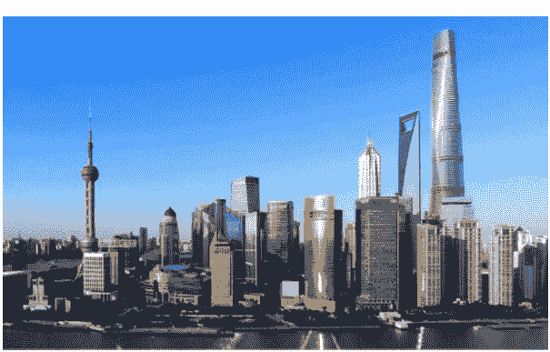


## 关于美元二币的畅想 #F2380

yevon_ou


## 一、非效率

2009 年时，我在天涯论坛发了一篇文章《关于人民二币的畅想》。

《关于人民二币的畅想》
club.tianya.cn/dispbbs.asp?id=2990123

那还是十年前，俺的名气没这么大。又是发在 tianya 这种屌丝地方。能看懂的人，估计不多。

写“人民二币”的想法，主要是“RMB 系统”需要改良。

RMB 并不是一种自由兑换的货币。

而 RMB 的本身，又存在诸多“管制”。典型如“利率管制”“汇率管制”。

任何人都知道，RMB 的存款利率是不合理的。

所谓“存款立行”，一个储蓄所中，拉存款的人，是跪破膝盖的。客户是上帝，甚至不乏陪吃陪酒陪喝。

这说明什么，*存款利率偏低了*。

另一方面，RMB 的贷款利率，也是不合理的。

业内的行话，又叫“跪银行”，贷到就是赚到。银行放贷时，客户也是跪着的。

这说明什么，*贷款利率偏低了*。

这些都不是正常完备的商业状态。

正常的“商业”是怎样。你客客气气，我也客客气气。

因为一切供求，都已经反映在价格里了。谁也不用再出卖自尊。

除了利率之外，RMB 的汇率也是不合理的。存款准备金率也是不合理的，汇款管制不合理，用途管制更不合理。

- 每一年，总行都会定下“各行业贷款目标”：
  - 急需行业贷不到款
  - 过剩行业太多贷款
  - 民营企业贷不到款
  - 国企坏账不还贷款

这种种问题，在“奥派经济学”理论中，都清晰无比，指向同一个箭头：

# 管制

市场永远不出错，市场只会解决问题。

如果市场显得错误，那一定是*存在管制*。

最有活力，最有创造能力的民营企业贷不到款。

拉动最多经济，就业，人口的小微企业，贷不到款。

从“民营银行”无法成立那天，就种下恶果。

## 二、改良

有人说，“奥派经济学”理论煌煌，那你去做啊。

书生意气，读了二本破书，自以为掌握“宇宙真理”。嘴上无毛，还不得摘砸了大乱。

老子说，“治大国如烹小鲜”。

真的让你面对这一场困局，你会发现，其实是“没法改”的。

人民币的整体架构，牵一发而动全身。

大刀阔斧的全面改革，恐怕会引发太多震荡。

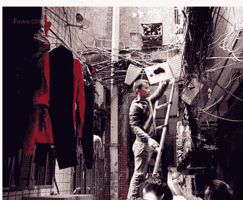

譬如说，谁都知道“贷款利率”偏低。尤其是借给国企的3~4%利率贷款，更是低得可笑。

可是，谁敢给国企停掉贷款呢。

许多国企，本身已经在破产边缘。财务报表非常难看。

你把贷款利率+2%，

你猜他们是加强管理，牙齿缝里省钱。还是干脆捆摊子一甩，坐地耍流氓吃你救济了？

又譬如说，利率和汇率市场，银行之间存在大量“掉期交易”，大量对赌头寸。

你高喊这“货币市场化”，必然会引发债券，外汇，金融市场的**大幅波动**。

别的不说，股票跌掉 1000 点，

引发的愤怒讨伐，巨浪洪水，就足够把你淹死。

因此，这个问题是“无解”。

**RMB**，和套在人民币上的重重管制，积重难返。是绝对不可能在一夜之间“**金融自由化**”的。

几代人持之以恒地“渐进式改革”，努力不触发风暴，也得花二三十年，才能稍微捋顺。

使价格信号正常。

那么，有没有更快一点的办法呢。

解开束缚，尽快地享受到金融科技的生产力。

## 三、最快的方法，就是人民二币

## 四、二号币

所谓的二号币，是在A货币之外，再发行一种B货币。

- A货币不能做的事：
- B货币全部都可以做，B生来就是自由的。

诸如开银行，吸纳存款，发放贷款，汇款转账，贩卖理财产品，集资众筹，发行信托，发行保险，基金证券，体育博彩……

如果B货币的一家银行，倒闭了怎么办？

倒闭了就倒闭了呗

投资人血本无归，毕生储蓄的宝石化为乌有。玩家们伤心欲绝。

等等等等等，你在说什么，宝石，蓝晶？

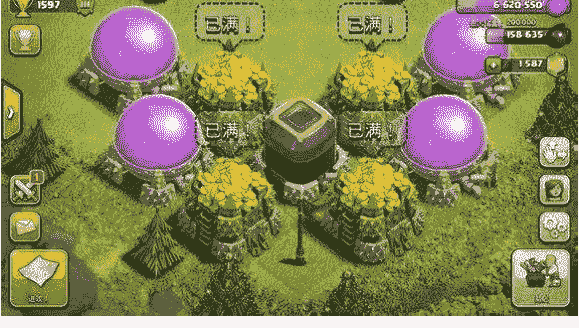

对的，我说的就是宝石。这第二种货币B，可以称为“宝石币”。

这难道不是一场大型真人在线联网游戏么？

因为你的本币还是 RMB，你的主币还是 RMB。

你的日常工资，生活需求，储蓄房贷，还都是以 RMB 的形式存在着。

根基未动。

你只不过是多了一个“电子钱包”。而电子钱包里的数字，增增减减。

增加：固然使你快乐

减少：也不会让你破产。

因为“人民二币”是一种辅助性副币种，不危及社稷的根本运转。对它的监管，可以放得非常之松。

任何人，都可以获得基于 B 货币的任何金融牌照，也可以创设一起金融创新。

大型网游真人游戏

## 五、副币的用途

最开始，国家可以给每个“中国公民”，人均发 3000 元 B 币。缩短贫富差距。

无论男女老幼，一出生就发 3000 枚。

死亡不用收回。

这样一来，就获得了“人人发钱”的美誉和赞扬。

但发的又是空气，不用承认任何成本。

（想一想，谁是最大的受益者。答案见文尾）

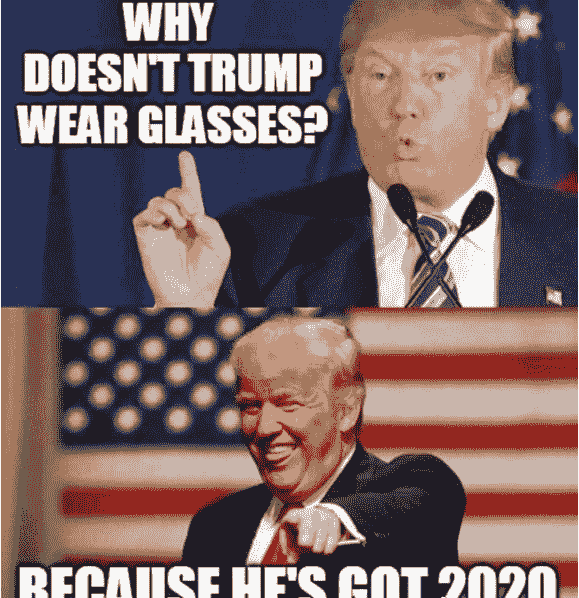

在渡过了最初的惊慌之后，很快，“RMB/宝币”就会形成市场上的汇率。

这个价格有可能很高，有可能很低。

有可能被庄家大幅操纵，也可能一文不值。

但无论如何，至少不会是零。

每个人都分到钱了，每个人都感激你。

“二号币”一开始只能买些糖果，贴花，优酷会员等等。

一笑加一笑（微信号：150500211）邀您加入水库欧神交流群。群内文集每月一更新...

但随着时间的推移，接受的场所，会越来越广。

毕竟，都是扫码支付了，实时兑换。

底层扣哪种货币，并不重要。

狂想的话，我们甚至可以冀望，一代人之间，B 货币使用量，便占到“全社会零售总额”的20%

但 B 货币进不了大宗金融市场。

最终的清算考核量，可能还占不到 1%，对 RMB 不构成任何威胁。

无论如何，一种“自由无监管”的 B 货币的存在，

使得我们可以搭建真正的银行，保险，证券交易所，期货，外汇，信托，衍生品………等等复杂的，现代化的金融鼎品。

不仅揭示真正的价格指数，风险定价，而且可以培养大批的金融专业人才。

从这个角度讲，无论“人民二币”最终占得份额多少，都是很有价值的。

## 六、Libra 天秤座

言归正传，其实上述的“人民二币”种种，最大的受益人，并不是中国，而是美国。

扎克伯格+特朗普，才是黄金组合。

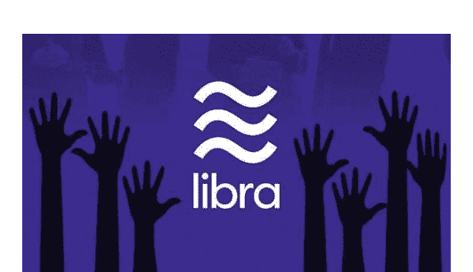

全世界所有的监管，一大半的 Compliance “合规性”。

全都是从美利坚，发展起来的。

我们只看到美国的“实业”白左。但却少有几个人，慧眼看到美国的“金融业”也在白左化。

在 USA，想要调度一笔资金，从来没有这么困难过。

因为 USA 有所谓的“健康投资指导”，一切的投资，必须是符合白左规范的，让环保份子顺眼的，让华尔街满意的。

美国人禁止的客户，你不可以和他做生意。哪怕客户的客户也不行。

而这份名单，依然无限延长中。

白左圣母们不喜欢的产业，你不可以去投资。

想收购改建一家农场也不行。

美国人可以随意地罚 HSBC 一百亿元，可以把 Deutsche Bank 罚到直接破产。可以禁止日本人抛售美国国债（恶意抛售法 Act）

资金如美女，要不是全球结算中心在美利坚，谁肯待在这种地方？

美国人目前的规矩，每一笔资金调度，必须“合规”。

必须是合乎“道德”的。必须是符合价值观的，必须能经过“合规”审查。否则罚罚罚。

什么是地狱，这就是地狱。

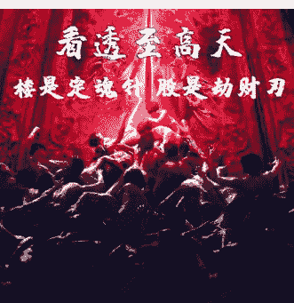

说起扎克伯格的“Libra”，很多人说是犹太人的阴谋。

全世界一百多个中小国家，要摧毁弱国的货币体系。

扯了吧，光 G20 这二十个国家，就占去全世界 80%的贸易，90%的 GDP.

剩下一百多个国家，加一起，也没有一个日本重要。

Libra 真正的意义，是美国啊。

这是妥妥的“美元二币”啊。逆天改命恢复国力。

我要是特朗普，就全力支持 Libra

美国的金融体系，更加地病入膏肓，积重难返。

（yeyon_ou@163.com，2019年6月24日慕）

## 请给我打一颗星 #F2390

水库论坛

欧神文集(纸质版)


## 一、前言

哈喽大家好，欢迎来到“情感婚恋”大号中，最会写房地产的：水库论坛。

说起水库论坛，大家都会联想到“房地产”。
按照一般地产V的逻辑，本周~今时今日，最应该写的，无疑肯定是“经济工作会议”。
重申“房住不炒”，楼市会否凉凉？

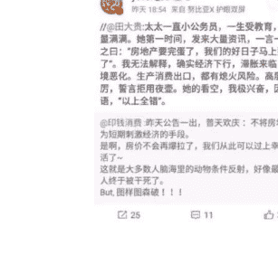

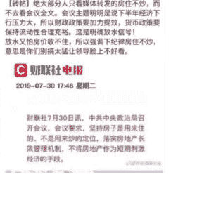

一笑加一笑（微信号：150500211）邀您加入水库欧神交流群。群内文集每月一更新……

抱歉，真不是。水库一直是一个“特立独行”的地产号。

妄议朝廷，可是要杀头的。

我们既然并不想歌功颂德，那就干脆不说。

如果一定有着者死记追问的话，记得去年7月，水库也是不谨慎，写文章“凡傻”稍微大了一点。然后就被关了一个月小黑屋。

等哥哥从狗洞里爬出来，还了篇《一个月睡醒来》，意思是：什么都没改变。

庸者才研究细节。

大棒不计波澜。

你想不到一个月前都发生了些什么，这些都是“过眼云烟”。

“房住不炒”，过去20年，哪一年不是高喊打压。后来的结果呢，还不是股市一路让你伤心，楼市一路让你“伤不完”的心。

“房住不炒”，不是小行星撞地球。历史并未改变，一切仍在轨道上。哥哥甚至都懒得为此涟漪，写半篇文章。能写个标题，已经是我最大的勇气。

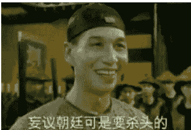

## 二、yelp

今天，我们谈另一个话题。早上，我在微博转了一贴帖子。


“给我们餐厅打一星差评，我就给你的披萨打折。” 餐厅老板Cerretini 为了反抗Yelp的敲诈勒索，用最激烈的方式成为了“#全世界最差餐厅#”，也收获了一大批忠实粉丝......


可能你在外吃饭时遇到过这样的场景：

> 如果你愿意在点评软件上为餐厅打五星，我们愿意赠送你一份甜品，或给你打个折扣。

谁都明白这个举动背后的含义。点评软件的分数越高，慕名而来的顾客就会越多。有很多人在决定去哪里吃饭的时候，都会按照评分做选择。


国内如此，国外亦然。

在美国，最常用的点评软件就是Yelp。作为点评软件的鼻祖，它的影响力巨大，几乎是每个人手机里的必备app。哪怕只有半星的差距，也会让餐厅高峰时段人流量相差19%。

因此，绞尽脑汁的提高Yelp评分，几乎是每一个餐厅老板都必须做的事情。

但……不是Cerretini。


2014年，Cerretini在自己的餐厅宣布了一个永远改变命运的决定：

> 在Yelp上给我的餐厅打一星评价的顾客，可以享受披萨5折优惠！

——对，你没看错，最低评价“一星”。


故事，还要从很久以前说起。

Davide Cerretini出生于意大利的一个葡萄园农场主家庭，从小享受美食，也热爱美食。长大后，也没有继承家业，而是移民到美国，成为一名厨师。

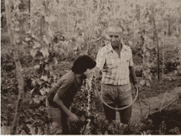

在后厨干了几年后，他凭借自己的“意大利魅力”，吸引到了一票忠实顾客，便自己出来单干，开了第一家餐厅。

然而，这家餐厅没撑过2008年的经济危机，倒闭了。

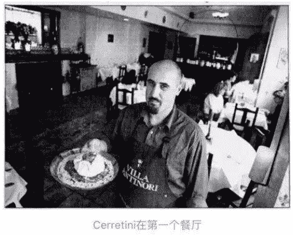

第二年，他痛定思痛，进行了深刻反思后，重新找到了一个地方，再次将餐厅开了起来。

这一次，一切都非常OK。

他这次的餐厅名为Botto Bistro。

——朴实无华，面向大众，提供便宜又好吃的食物。

餐厅开业的头几个月，Cerretini就收到了Yelp销售人员的几十个电话，希望他购买“推荐位”。

但Cerretini没在意，每次遇到，他直接挂断了。

然而，渐渐他发现……

每次拒绝推销之后的24小时内，就会有几条新发布的五星评论，被删掉了？？？

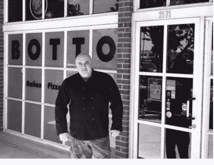

——有没有搞错，这不就是意大利黑手党敲诈勒索的手段？

作为意大利人，Cerretini立刻就反应过来：这是Yelp在向他收保护费呢！

一笑加一笑（微信）

> *“我来美国工作25年，可不是为了被这些硅谷白痴敲诈的。”*

他第一反应就是：那我自己写好评不就行了！

他注册了一个名为“Babghnanoush 1”的Yelp小号，给自己的餐厅发布了13条假好评。

> ——“嗯，还有一些附近餐馆的差评。” by Yelp发言人

> Cerretini承认：“我不是一个好人。但我写的五星只是为了补你们删掉的！！”


总之，这个计划立刻就被Yelp挫败了。

根据平台算法，这些假评论的星级统统都被过滤了出去，虽然还能被人看到，但不会影响餐厅评分。

—笑加一笑(

可是，Yelp的最低推荐位，真的没啥效果！

六个月后，Cerradini还是决定取消：算了算了，不宣传就不宣传了，不差你拉来的这点客人，反正口碑在这里呢。

然而，他一取消，星级评价立刻暴跌……

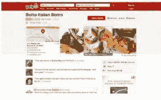

> “当天就过滤掉了我4条五星评价，还把3条一星推到了最顶端。”

> “可这些给我打一星的人，甚至都没有来过我们餐厅！甚至有人在评论里抱怨我们的服务员……问题是，我们餐厅，根本没有服务员！！！”

但是，美国第九巡回上诉法院裁定，Yelp有权操纵评论，因为广告策略是“硬谈判”，而非勒索。

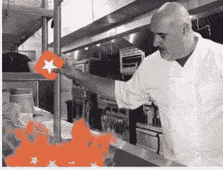

——这，成为了最后一根稻草。

2014年9月，裁决结果发出的几天后，Cerretti在店前放下了一块牌子。

> 给我们的Yelp上打一星，享受25%的折扣！

Hate us on Yelp!


> “Yelp的人恨死我了，但这正是我想要的，让他们伤心就对了。”

在这个裁决结果刚刚发出的完美时刻，Cerretti的这个策略，立刻让无数深受其害的餐厅老板，得到了共鸣。

Cerretti成为了他们反抗的骑士，自卫的英雄，Anti-Yelp领军人。


那个星期五，Cerrmetini做的披萨比平时一个月都多，甚至不得不向其他餐馆寻求帮助，获得额外的披萨面团。

> “所有人都疯了，我这里简直就像是疯人院，我从来没见过这样的景象。”

他受到了“雪崩”般的欢迎，记者、餐厅老板、支持者都不断前来，甚至拒绝接受他提供的折扣，坚持全价购买Pizza。


几天以后，Botto Bistro就拥有了2,300个一星级评价，超过评论总数的95%。

在这些一星差评中，所有人都在赞美着Yelp的食物。


作为餐厅老板，作为孤军奋战反抗Yelp敲诈的领军人物，Cerretini甚至收到了来自全国各地的人寄给他的信。

他们在信中夹着巧克力，夹着钱，对他表示感谢，或者说自己已经在Yelp上打了差评。

——他靠着"Yelp上评价最低的餐厅"，出名了。

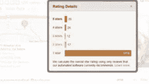

显然，Yelp对他的所作所为并不高兴，并发了威胁性的电子邮件。

而Cerretini毫不在意的，将这封邮件和回应一并贴了出来。

```
Date: Mon, Sept. 15, 2014 11:28AM PDT
From: feedback@yelp.com
To: [Redacted]
Subject: Message from Yelp HQ [ 2800338 ]

Hi Michel,
I'm contacting you from the Yelp User Support Team because we've received complaints from the community that you may be offering incentives in exchange for reviews.
If we learn that this type of behavior has continued, we may take action on your Business Account which could include suspending access to your listing. It may also result in a Consumer Alert being placed on your listing.
Regards,
Marvin, Yelp Support
```

```
Date: Tues, Sept. 16, 2014 88:43AM PDT
From: [Redacted]
To: feedback@yelp.com
Subject: RE: Message from Yelp HQ [ 2800338 ]

Hi Marvin,
I'm contacting you from the Botto User Support Team because we've received complaints from the community that you may be removing reviews in exchange of vague explanations to loyal customers.
If we learn that this type of behavior has continued, we may take action on our Business Account which could include suspending all activity to our listing. It may also result in adding a Yelp Customer Alert page on our website and in our Newsletters.
Regards,
Botto User Support Team
```

他用一模一样的格式语气，回复了Yelp说“收到投诉说你用折扣交替评论违反平台服务条款，让用户产生不信任”的说法。

“我也收到投诉说你删除了评论，违反了我们的服务条款，也让用户产生了不信任呢。”

而Yelp，也确实如他所言，一直在删除他的评论……

但这一次，成为了删除一星评论。


他在自己的网站上，专门写了Yelp Us的一页。

> “获得米其林一星需要厉害的厨师，优秀的厨艺和丰富的经验。”

“获得Yelp一星，需要更多。”

“你需要一场革命。”

“这正是我们所拥有的，我们拥有成千上万的回复，邮件，和来自全球的Botto支持者用讽刺写满的2600多条评论。”

“我们向所有忠诚顾客承诺，我们是Yelp最差的餐厅，并将一直保持下去。”

“ *意大利粗口*。Yelp。”

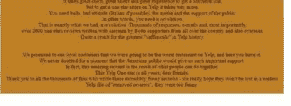

独自反抗Yelp的敲诈，用最激烈的方式搞最大的事。

到了现在，Cerretti靠着这份反抗Yelp带来的名气，已经成为了当地最著名的餐厅之一，再也不缺客源。

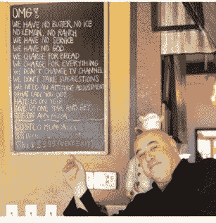

但是，同样的问题，却依然在困扰着每一个餐厅。

被操纵的流量，虚假的星级，刻意引导的评论，依然是所有人都值得思考的问题……

http://www.bottobistro.com/FAQ.html

https://thehustle.co/botto-bistro-1-star-yelp/

（左右滑动，查看故事内容）

故事讲的是一名意大利厨师，由于不满著名的点评软件 yelp 敲诈勒索，毅然反抗的故事。

- 其中包括：
    1. yelp 收取每月最低$270 美元的注册费
    2. 不付钱的话，yelp 恶意删除好评留言
    3. yelp 找水军，灌溅差评留言。甚至是伪造的
    4. 米国法律偏袒 yelp，允许它的流氓敲诈行为。

# 很显然，这是一例典型的“百度—魏则西”类事件！

让我们再想想，当年在“魏则西”事件，百度都做了些什么，引发全民声讨。百度之恶，罄殞难书。

- 1) 传统企业，都要上交“搜索引擎”保护费。保护自己的域名。
  2) 不交钱的话，搜索前三页，全部都是广告。没一个官网。
  3) 魏则西找到了莆田医院，最终死于癌症
  4) Baidu 依然活蹦乱跳

要说这件事呢，“水库”也是浓浓的受害者。
在这里俺顺便要吼一声，认清正版，远离李鬼。

每个月，我都新认识好几个“受害”网友。
他们或是进了李鬼的水库群，或李鬼水库星球，被骗了不少的“登记费”“会员费”冤枉钱。
最终才发现一群骗子，一群托。

而这件事，“水库”一点办法都没有。
因为这些人，绝大多数都是从“Baidu”搜索引擎进来的。你打开百度，搜“水库”，前三页各路李鬼。

水库从来没花过钱，买百度的 SEO。
哥哥自己卡奴钱都不够呢，未给 Baidu 进贡。

我只能保护‘已接触’的网友。不能保护千千万‘未接触’的网友。
我都不认识你，俺凭什么保护你。

自由主义者想来想去，我没有义务，自己掏钱买百度。
至于被百度坑的网友，俺只能一起骂百度，纯流氓。

因此，受害者，从奥派的观点，您对 Baidu, Yelp，应该怎么看呢。
哥哥的态度，在三年前我写《旗帜鲜明地支持百度，抵制魏则西》#F370 一文，已经站出来大声说了：

旗帜鲜明地支持 baidu，支持 yelp，哪怕他们是恶棍！

## 三）邪恶与正义

从奥派经济学的角度，让我来解释一下“正义观”。

首先我们想问，yelp 想不想做一个“有良心的，充满正义感”的小伙伴。

例如：

- 每一条点评都是真实的。
- 既不删除好评，也不虚构差评。
- 餐厅推荐时，不带任何偏见。
- 排名公正，没有付费

这样一款“良心软件”，恐怕消费者们要热泪盈眶了。知乎上又要讨论三天三夜。

好了，那你为何不去开发一个。

答案是：开发不出来。

“善良正义”的好软件，只存在传说中，但从来开发不出来。

哪怕和 yelp 功能相近，可以构成竞争的 No. 2, No. 3，质量也远远低于 yelp 平台的便利。更别提屌丝们 YY 众著的“良心软件”。

事实的真相是，任何一个“作恶修端”的商业大亨，都是优秀卓越，远远领先于对手的。

搜索的第二名，好像是 360（又或者是 bing）。

周鸿祎自己坦言，做了这么多年，还是难以撼动。甚至是毫无希望。

你要是觉得 yelp 不好，你用猫头鹰啊，甚至用大众点评呀。

有啥暴力，强迫你使用 yelp 么？无非是其他平台更渣，更加不好用。

> 对于奥派的商业观，任何价格都是合理的，任何毛利率都是合理的。
> 只要你比第二选择，更好更便宜。

我们看公众号文章，都希望看见干干净净，毫无广告。前二天若姚写了《劣号经济学》。

可事实呢，水库发文章，总是忍不住夹带广告。（今天还发了贴片，大家多看看）

可是，水库如果“夹带”广告，难道你们就不看了么。就取关，节省宝贵的三分钟，去看别的公众号了么？

也不是，你们还是乖乖，捏着鼻子“看完”了广告。哪怕造成不适。

> 这个“不适”的幅度，就是第一名领先第二名的差距。

行业的领先者，有权利接一下广告，搞一些付费排名。剔二条评星“保护费”。
前提是，这些“变现”的基础，不超过“第一名减去第二名”的差距。

如果 yelp 上面的“不公正”，搞得铺天盖地了。使其“营养价值”越来越低。
则消费者最终会抛弃 yelp，转向 Trip advisor。
或者激励其他竞争中崛起。
经济学上称为“安德鲁租金”。

一个例子受害者，是“支付宝”。
今年三月，我尝试着在手机中卸载“支付宝”。
因为我实在不愿意，为了支付几元钱的小事，而启动一个 2G 的庞大软体。

马云爸爸恨不得把所有功能都塞进支付宝，用它唤醒了整个“阿里全家桶”。
卸载之后，坚持只使用微信支付。
效果很好，手机也快了不少。

很多年轻人，对于勤奋创业，没有正确的认识。以为开店就可以赚钱。
跟风学样，写自媒体的也不少。

其实一个行业可以赚到多少钱，你仅仅“从事”这个行业，是不够的。
关键是要“追求卓越”。
一切的生意，都是向头部集中的。第一名和第二名之间的“差距”，才是利润的大头。

如果第一名 100 分，第二名 70 分，第三名 65 分。
则第一名赚的钱，绝不是第二名 150%，可能是 1000%。

因为第一名，可以插入 30% 的广告，消费者依然不会舍弃。
而第二名，只有 5% 的利润，消费者就换别家了。

Intel 赚的钱，是 AMD 的十倍都不止。

# 四）卓越变现

1998 年时，Windows 捆绑 IE 销售，强行打压 Netscape。
在当年，绝对是一等一的商界大事。
欧洲法庭花了老大的力气，强行把 IE 拆分。报纸追了好几年。

我们都知道，Windows 捆绑 IE，用起来是十分之不舒服的。
不仅 IE 是一个很渣的软件，远远不如 Netscape。
而且捆绑一体的设计，甚至削弱了 Windows98 的使用体验。

而这件事情，欧洲法庭几百位的律师，纯粹做的都是无用功。
Windows 有权捆绑 IE，前提是其他的“操作系统”太不禁打了。
微信的行为，完全是正义的，正当的，促进生产力的。

# 就像 Yelp，Baidu 一样正当

因为捆绑销售，消耗的其实是“母体”的资源。整件事情，唯一的缺陷，反是 Windows 软件“定价过低”。

当时 Windows 的售价，大约是$139 美元。而市场上其他的竞争对手，诸如 Unix，BeOS，NextOS，全部都没有竞争力。

正常情况下，Windows 完全可以定价 239 美元。
只是因为美国政府“限价”，或者其他什么原因，微软没有把 Windows 卖天价。

Windows“极度”领先竞争对手的“前提”，才是 Windows+IE 敢于捆绑的原因。
如果时间卿转到今天 2019 年，Linux 已成气候，ChromeOS 也呼之欲出。
Windows 本身已经风雨飘渺，谁还敢有底气搞这事。

我们再三强调，大公司有权做“坏事”。坏事的容量，是“第一名与第二名”的差距。
这并不是种强大而无量力量，也不应该引起对“垄断”，或者“资本主主义”的恐惧。

# 其本质，依然是“流量变现”。

好比王思聪不耕不诈，每天有花不完的钱，还抢你的梦中女朋友。
乍一看，似乎很不公平。社会不讲道理。

但其实王思聪花的，是“老王”的钱。
这终究是一个有限数字。数字再大，终有花完的一天。

相当于祖宗积德，儿孙享福。
Windows 积德，IE 享福。

保护大公司“恣意为”的权利，就是保护财产权。
保护“流量变现”，保护牛皮癣，就是保护财产权。

若是自媒体不能接广告，谁还愿意辛苦写文章？

# 五）结语

中国太平盛世，万邦来寇。
值此鼎盛之世，当然是领导有光，远见卓识，伟正卓越，远超诸国。

既然领先这么多，“花掉”一点。自然也是懂道理的。

（veyon_ou@163.com，2019 年 8 月 1 日晚）

# 韩国的《寄生虫》 #F2400

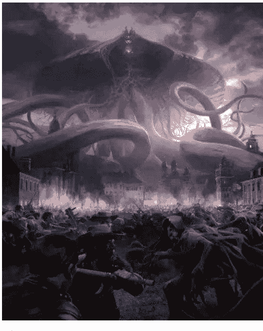

# 韩国的《寄生虫》 #F2400

恶魔在人间

## 一） 金棕榈

*近期我很少写文章，最近的一篇，还是 8 月 1 日的《请给我打一颗星》*  
*那是个大灾难，改文稿足足改到了凌晨 4:00am*

*其实文章 23:30 就写好了，但是三次推送，全部都宣告失败。*


花了整整四个小时，来逐字检查。“错别字”创了历史新高。

最后你知道，哪个字犯了天大错误么：是“启蒙”。

但是今天俺忍不住，还是要加更一篇。

因为我见到了一部三观极其不正，超级大烂片，毒草，恶心，臭不要脸：

# 寄生虫

电影 韩国 · 剧情

8.8分


第 72 届戛纳电影节，“金棕榈”奖获得者。这也是韩国导演第一次获得该最高奖项。

PARASITE 迅速刷遍了哥哥的朋友圈，更是刷透了抖音。

相信绝大多数读者，都已经看过了这部电影。没看过也不要紧，随手一搜，就有攻略。

> 电影讲述穷人基泽一家四口无业游民。靠一个偶然的机会，长子基宇通过伪造的文凭，来到朴社长家中做家教。

此后，基宇成功地把一家四口，全部都塞到了朴社长家中帮佣。全家都靠朴社长养活。

而仇视和隔阂始终洋溢心中，最终一场冲突，造成三死三伤。

## 二） 气味

关于“寄生虫”影片的分析，汗牛充栋。绝大多数的公众号，会神神秘秘地提醒你注意“彩蛋”。

贯穿整部电影的暗线是什么，自媒体们告诉你，是“气味”。

- 穷人的气味
- 难以掩饰，酸腐的臭味

基宇和基泽第一次差点穿帮，因为社长的小儿子，发现了他们身上的“气味”相似。

体臭，是靠肥皂和洗洁精无法去除的底色。

此后社长再三提到，司机“身上”有一股难闻的味道。

影片最终，也是因为朴社长对臭味皱眉，导致了司机愤怒背叛和刺杀。

一笑加一笑（微信号：150500211）邀您加入水库欧神交流群。群内文集每月一更新......

嗯，有哪一位点赞的。点个卯。
无论你是看过影片，看过影评，看过抖音，认同此类分析，默默点赞的。

# 以上全错

要三观歪到什么程度，才能看花见叶，鸡蛋里挑骨头，进菜馆专啃卫生纸的。

整部电影的核心轴线，是犯罪呀！

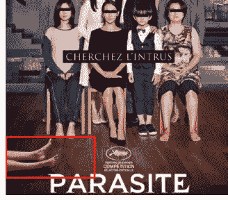

不管你们看到了什么，反正我看这部电影，只看到“穷人”一家，不停地犯罪。

基宇能获得家教的位置，是因为他伪造了学历。“伪造文书罪”是重罪，三年以上，七年以下。
妹妹基婷教绘画，也是谎称留学学历。

兄妹俩逼走原有司机，靠的是栽赃陷害。这种明显的小人诬告，兄妹俩做起来毫不感羞愧，没有一丝一毫良心发现。
妹妹随意把内裤交给陌生男人，更没有任何羞涩。

至于逼走女管家，靠的下毒害人。这种事情放在“红楼梦”的时代，是要浸猪笼的。
哪个下人，敢在主子的家里，乱用药物，必是死罪。万一你给少主下毒怎么办？

而我看《寄生虫》这部电影中，基泽父子一家，洋洋得意，庆祝辉煌的胜利。
他们有一丝毫感受到这是“违法”的行为，这是严重触犯违反“社会行为准则”。犯了游戏规则的大忌。
没有。穷人们丝毫不懂天规。

然后再往后，影片就越发地驶入了荒诞的快车道。
朴社长一家去野营了。保姆立刻大摇大摆地，在主人房间中摆起了大宴，用主人的浴缸。

各位，“水库论坛”的读者们，很多都是“小二千万”的有产阶级。
当你不在家的时候，保姆用你的浴缸，睡你的大床打滚。

你会如何感到愤怒，你认为这样的行为，是正当的么。

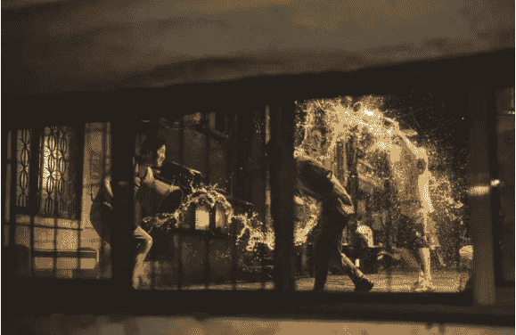

再后，基泽一家就开始**杀人**。

第一个被杀的，是女管家。杀了就杀了，没有任何人感到惶惑。
俺们“遵纪守法”的上海人，乱扔一次湿垃圾，都感觉惴惴不安。

生怕“上了征信”，是否会把一辈子都毁了。

亲爱的韩国人，你们杀了一个人，居然如同杀了一只鸡，没什么二样。
丝毫不想想“我这辈子被毁了”，“警察一定会抓住我的，要不要开始大逃亡”。

如果说，第一次的失手，女管家还属于“误杀”。
此后基泰和基婷返回，想要干掉老吴。这就属于“蓄意谋杀”。

# 一级谋杀罪：蓄意谋杀

二级谋杀罪：临时起意杀人

三级谋杀罪：谋杀

无论是中国，还是美国的法律，“蓄意谋杀”都是最严重的指控，必然牢底坐穿。而基泽一家呢，有没有意识到“这是不可以做的”，“必然付出代价”的。

为基泽一家摇旗呐喊的，知乎豆瓣小将们，有没有意识到基宇在犯罪。

小将们内心，是否也有谋杀罪倾向？

你视法律如无物，人生的路，必然越走越窄。
最终父亲基泽，因为睡死小事，一时气愤就杀死恩主朴社长，落得终身通缉。难道不是罪有应得么。

这部电影最诡异可笑之处，电影本身并没有“三观不正”之处。

而是为电影打分，影评之人，魍魉魍魉，原形毕露，什么人型畜生，照妖镜都照出来了。

你自己想一想，有多少个朋友在豆瓣打分，知乎发言，朋友圈的公众号分析。
这些人都是潜在的“huangshi feiqing”，人型畜生，捏鼻远离，尽早识别为好。

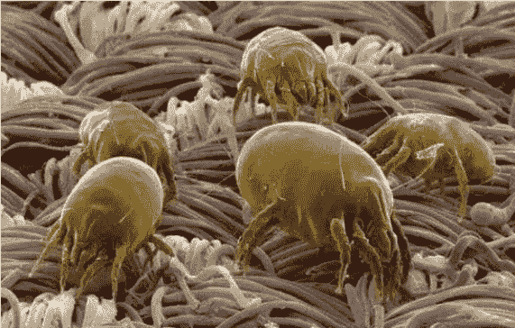

# 三） 怨念

知乎上有一个热帖《穷人需要为自身的贫穷负多大责任》，足足有 25000 个关注。首帖评论，有 8100 个感谢。

《穷人需要为自身的贫穷负多大责任》

https://www.zhihu.com/question/24936740

俺耐心地从头看到尾，想要寻找俺心目中的答案。我知道“水库同道”中人，注定是少的。但我还是希望在 730 个回复中，找到同类。

我心目中的答案是：100%

《寄生虫》这部电影，就是典型的“不是我的责任”。

无论影评如何乱写，怎样硬扯到贫富对立，硬扯到富社长也需要借助穷人的服务，硬用下雨渲染穷人的“不易”。

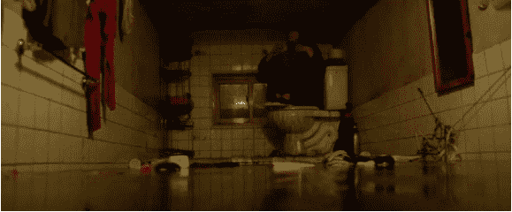

无论废俏们怎样胡扯，他们都掩盖不了一个事实，“没有人欠他们的”！

朴社长待他们恩重如山，路是你自己搞砸的。

可怜之人，必有可恨之处。

朴社长给过你们机会，命运给过你机会。

基父和基母，都找到了正当长期工作。司机和管家，虽然不算什么高薪，但只要踏实认真真诚，收入也足够维持你养家。

父母工作，只要好好积累几年。谨慎储蓄，迟早可以搬出“污水四溢”的地下室。

基宇兄妹，如果确认考大学不是那块料，就早早去社会上工作。哪怕做超市营业员，外卖快递员，有手有脚，至少不会祸害社会。

一笑加一笑（微信号：150500211）邀您加入水库欧申交流群。群内文集每月一更新……

但是“基泽”一家是怎么想的呢。他们在“犯罪”一事奋勇争先，但是在“劳动”一事，却丝毫不肯勤奋和耐心。

极易滑落入魔道，却在正道踌躇不前。

仅仅只不过到社长家，工作的第一个月，第一次度假外出空隙。全家人迫不及待地鸠占鹊巢，妖风原形毕露。

哪怕蛛丝马迹，足以激起主人的极大愤怒。

主人们在草坪上举行派对酒会，一个理智正常的人，会想到“这里面有什么商机”。“逐步学习，逐步往上爬的机会”。

例如，看嘉宾们对酒品，礼物的喜爱，揭幕韩流的潮流。

很多人，就此做起了“宴会服务”的外包细分。

上海有几家外企公司，已经赚得盆满钵满。

最差一级，你也可以象韩春香一样，编织一些手工艺品，去明洞寺售卖。

现在网上赞扬“基泽”一家的人，你把这些“勤劳动脑”的人，置于何地！

你看美国 20 世纪初期的文学作品，香江 80 年代“商战”作品。

当讲到，三星重工老板和现代重工董事长，喝酒喝了三个小时。最后还开了香槟。

一旁服侍的服务生心领神会，立刻买入二家股票。

过了几天，果然“并购”利好宣布。股票大涨。

20 世纪初的美国文学，是“积极向上”的。

早期的韩国电影，也是“积极向上”的。

但你看看，现在都拍了一些什么垃圾。

仆人眼看主人举办盛大的晚宴，第一反应居然是“刺伤了我玻璃的自尊心”。

呸，老子还吃猪肉呢。怎么，刺伤你感情了？

穷人应该为自己的贫穷付多大的责任，答案是 100%。

朴社长举办盛大的酒宴，那是他的事情，和你无关。

他不欠你的，你还应该感激他，给了你这个 Waiter 的 Job。

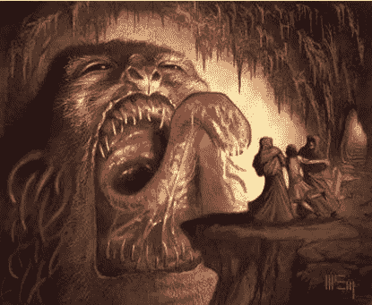

在 2019 年娘娘腔的电影中，穷人失去了“勤奋”的力量。剩下的，只有被煽动的，酸忌的，玻璃草莓的“自尊心”。
魔鬼堕落的中轴大道，由“犯罪”铺成。

你说你是“能干”的，有手艺的，会折叠废纸箱盒子。
抱歉，我并没有看见你的“技能”。恰恰的，在“做人”这个最基本最重要的技能点，你一败涂地。

# 四) 结语

全球的白左文化，起于布鲁克林，起于黑人区，然后随着好莱坞，向四洲扩散。

> 《寄生虫》虽然是一部在法国获奖的韩国电影，其骨子里，却是：狂妄自大，懒惰成性，漠视犯罪，忘恩负义的人型畜生。而不是正统的儒家文化。

令人担忧的，是中国国内，目前也有不少人为“寄生虫”文化，呼噪叫好。只要是美国得奖的，他们就一律跪拜。
这样一部电影，居然有人唱歌，有人打 8.8 分，有人脉络只看到“气味”。
200KM 南方的危险，尸鬼离我们不远。

（veyon_ou@163.com，2019 年 8 月 14 日晚，广州）

# 屌丝卢瑟模式#F2410

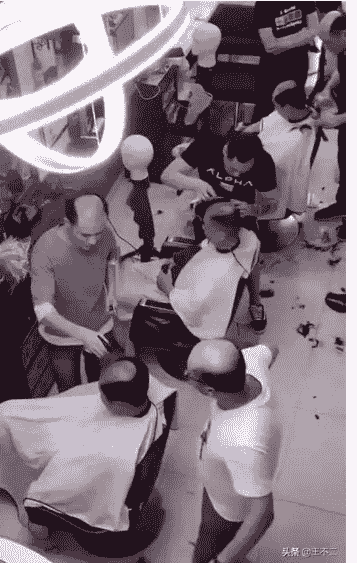

# 一）失败者

我加了很多很多个微信群，但俺几乎不说话。

我关注了很多个微信号，但俺也几乎从来不留言。

俺每天阅读的资料，是普通人的好几倍。但绝大多数时间，我只是扮演一个“观察者”角色。

水库的视角，从来与众不同。正如同普通人看电影，为电影的悲欢离合感动得要死。

而水库看电影，思考的却是“电影为什么要这样拍”。因此才有了《美国大片加速走下坡路》...

观察外部的世界，对我来说很重要。绝大多数的街面文章，对我已经毫无营养。思考层次没有丝毫提高。

但是，通过观察“普罗大众”写的文章，我可以观察并且思考，“原来屌丝的脑回路”是这样的。原来屌丝在这些环节犯了错误。

屌丝共同犯错误的环节，就是我们可以套利获利的空间。

好比 99%的中国人深信，“储蓄+理财”复利可致富。

他们一败涂地，必然被通胀洗劫一空。因此才有了水库心法“构建以房贷为核心”的资产包。

最近半年，我发言越发地少，指引越发地少。因此微信群里，渐渐地有了一些“群魔乱舞”的味道。

最近半年我对某些公众号，某些微博号的阅读，只能越发让我困扰于一个问题：“为什么还会有人，赚不到钱”。

# 不是惊奇，为什么会有富人 而是惊奇，为什么还会有穷人

众所周知，“水库心法”是一种杀伤力十分巨大的心法。所谓“焚城烈火征粮队”，一入水库深似海。

黑灯瞎火，披头散发，从此现金如路人。

相应的，“水库”体系的回报率，也是十分惊人巨大的。

2017 年，我们倡议做重庆。

2018 年，我们看好沈阳。

2019 年，我们发现了西港。

凡是跟随“水库”朋友们，基本都赚到了钱。

水库心法，是公开的，无偿的，实战考验的。如果你有疑问，还可以付费进“知识星球”咨询。

在这样的情况下，一个人接触了“水库”。居然还能混到，堕落到，不赚钱，甚至亏钱。

这无疑让人跌破眼镜，需要非一般“作死”能力的。

这帮人是做到接触了水库而不赚钱。他们是怎样做到的，为此我陷入了深深的疑虑。

# 二）标配卢瑟

有一个家伙，2006 年卖了父母唯一的房子。浦东的陆家嘴花园，售价 15000 元/m²。

把这些钱拿去读了一个 MBA，剩下的炒股票。

结局是惨淡，显而易见的。自然输得分文不剩。

问题是，他之前已经 NB 吹出了口，号称“楼市腰斩，股票翻翻”。希望成为股神，翻几倍再把房子买回来。

甚至还在天涯论坛发帖，博得了不小的声誉。被誉为“新一代空军领袖”。

请问这样的人，在 2007 年面临上海楼市大涨，他会如何安排？

接触水库论坛的人，都发财了。

接触一年，发一年的财。接触三年，发三年的财。接触十年，发财发得难以计数。

而这个家伙，2006 年，就接触到了“水库心法”多军操作。

请问这位“王牌空军领袖”，他会怎么想。

他会跪下来，好好认识反省错误。并严格遵循水库心法，花十年时间成为 A8.5 么。

不，他不会。标配卢瑟绝不会如此思考。

他唯一会做的事，是坚决不承认自己的错误。吹毛求疵找水库文章里，一二个错别字。

自欺欺人用各种数据和言论，麻醉自己说房价根本就没有涨，卖房炒股是再明智不过的决定。国家马上就要调控，房价即将大跌。

然后第二年，他继续被市场打脸。打更深的脸，肿成猪头。

他会跪下来，扇自己十七八个耳光。承认自己以前是猪头，痛改前非，2009 年跨入 “楼市多军” 光荣的行列么？（2009 迄今至少又涨三倍）

不，他不会。

他只会更加变本加厉，撕心裂肺地，寻找水库论坛错别字，断章取义说你的不对，找二套假房源否认你的财富，捕风捉影传播你的八卦。

哪怕回到家，眼泪一滴滴掉在面碗里。他知道自己一辈子的上班工资，也不可能买回父母遗产那套房子了。

肯承认错误，实事求是，是上等人的作风。

99% 的下等人，根本不愿意抛弃自尊。

“水库论坛”，并不是接触得越早越赚钱。有那么极小一撮 “铁空”，他们十几年前就认识水库。

可是他们没有钱。与其追求真理，他们宁愿站在情绪的对面，无可自拔。家徒四壁。

孔子说，“吾日三省吾身”。又说“可怜之人必有可恨之处”。

圣人的话，有道理的。

顺便说一下，这家伙现在还活跃在微信群。

目前账号是这个：


瞿碎轩忽ノ斋
昵称: 瞿碎轩忽ノ斋
群昵称: 佐渡夕崽Моисий Сталин
地区: 上海 卢湾

设置备注和标签 >

个性签名
倾奇自遵男见志，何谓霜食伴饯嘛
一瞿碎轩忽ノ斋

朋友圈 >

# 三) H2S04

同样道理，还有一个家伙。是著名的“浦东帮”领袖。

买房买在浦东，逃筹一塌糊涂。手中没有任何一套房子，翻 15 倍以上（不含杠杆）

尤其是最近几年，“水库”的主力，根本不在上海。

我们说：“离开上海吧，上海雪坡不长”。

他傲慢自大：“宇宙中心是联洋”。

我们说，“去 C Q 吧，上海经济颓势尽显”。

他说：“我才不去那乡下呢，我就要待在井里。联洋宇宙中心”。

我们说：“别买房子了。时代变了，买地吧”。

他说：“啥？听不懂，看不懂”。

联洋平民窟，垃圾地段。


于是，过去三年，别人在开拓蛮荒，远离舒适区。手中房子，以数千平的速度增长。

他天天守在“上海”，宅在家里。抱着汤婆子取暖，企图妄想破烂瓦罐无限升值。堪称“沪版骄傲废青”。

买豪车，戴金表，打赏女主播。

结局只有一个，过去三年，他的财富停滞不前。被许多晚辈赶上超过。

连几十万赢利，都当笔大钱跪舔。

什么年代了，还扭扭捏捏说“金劳力士”压不住。

你以为你朱一旦啊。

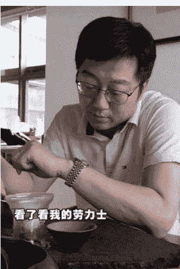

人一旦否认了“正确”。整个人会陷入一种癫狂而且痴迷的境界。

首先，他无法通过正常人的逻辑，来推理解释事物。

其次，他容易相信一些非常鸡血，狗血的东西。类似X功。

最后，他会拿自己一些破袜子，破鞋子，炫耀成世界名牌。井蛙丢人。

举个例子，我们有这一张图。

这个并不是法律文章，这张是“附件”。

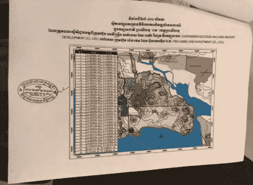

任何一个有 B2G 常识的人都知道，如果你要求政府办一件事。政府是绝不会绞尽脑汁，帮你想“解决方案”的。

政府的流程态度，一定是，你写一个长长的“恳请申请表”。然后部长大笔一挥“可”，或者“否”。

这张图，就是利鑫集团递交，原稿由同济设计院画的“地块切分图”。

当然，这是一张总图。下面还有分页，一共有 30 几页。

同济设计院呕心沥血，写了一叠长长申请报告，递给环保部长。

部长看完以后，用了一个月思考，期间茶水耗费无数。最终批下了大大的一个“可”字。

Boss 批完以后，流传传递，到下面行政庶务人员。自有小吏，和你一页页仔细勘对，制作最终地证。

这种“申请表”中，会不会有中文？当然是可以的。

这种算不算“法律文件”。可算可不算。事实上，他是黏附在“附件一”中的。

# **Letter to MOE中文**

# **QQ对交流器文件服务**

香港皇士国
国贸金融名汇
B

（机）

郑静雯

字号：1654 CCCCCCCC 电话 2502 28486、传真：农历8月15号

13 星期三

香港会议：2010 年 6 月 20 日

至

LILIN KENMO 先生

EYEREGGEN SUCCES AND ASIA RESORT DEVELOPMENT CO., LTD.公司代表

主旨：申请由 EYEREGGEN SUCCES AND ASIA RESORT DEVELOPMENT CO., LTD. 公司两栋位于香湾玛列号名 “Rose” 国家公路建而作为投资开发项目标的租赁地块计划给前第三座和 4 住成块的新批

参加：王淑玲代表 EYEREGGEN SUCCES AND ASIA RESORT DEVELOPMENT CO., LTD. 公司于 2008 年 6 月 23 日签订关于该国的地块租赁发展合同及 “Rose” 国家公路作为投资开发项目标的租赁第三合同

EYEREGGEN SUCCES AND ASIA RESORT DEVELOPMENT CO., LTD 公司于 2010 年 6 月 12 日签定的文本

根据上述文件及合同附件，我之未加指会合签代表；并我信已收到从 EYEREGGEN SUCCES AND ASIA RESORT DEVELOPMENT CO., LTD. 公司所有在香湾玛列号名 “Rose” 国家公路建而作为投资开发项目标的租赁地块计划给前第三座的 4 住成块的新批，并取得该批准发准开发准申请签定于 2008 年 6 月 23 日签订的合同，以及，我信已收到由 LILIN KENMO 先生代 EYEREGGEN SUCCES AND ASIA RESORT DEVELOPMENT CO., LTD 公司前给前第三 4 住成块如下：

- 1. FRIGCAMB LAND INVESTMENT CO. LTD 公司·由 WANG YINGDAN 先生代表，上土地和 600 （双层）公司（如图上地）。
- 2. LIXIN CONSTRUCTION CO., LTD 公司·由路晓辉先生代表，上土地和 390 （三层）公倾（双层上地上）。·（小型）
- 3. 王冠健先生，上土地和 150（一至二十）公倾（双层上地上）。
- 4. LIXIN INVESTIMENT CO., LTD 公司，由 LILIN KENMO 先生代表，对地给上成第三座的 3 住成块到前下的上地新批到：

同时，EYEREGGEN SUCCES AND ASIA RESORT DEVELOPMENT CO., LTD. 公司须 执行如下：

- 遵从于 2008 年 6 月 23 日签订的合同，我 EYEREGGEN SUCCES AND ASIA RESORT DEVELOPMENT CO., LTD 公司将对于图地的租赁地块来予 持有前给第三业的地方。
- 分给 EYEREGGEN SUCCES AND ASIA RESORT DEVELOPMENT CO., LTD. 公司将上成第三座 4 住成块新批的持有方组合合方，对持前图给前的同意。
- 在发展前国家建事发展事总办开发准之前，为核准工程图及开发计划批准持有方会批准后才开发建事。
- 对于图地，相关利水、单位以及机及的建家下实行政府指示，以保证该图给地的开发不会使及该利水的配定、上地及开发方。
- 对于图地，相关图丁、机及、单位以及机及的国家下实行政府指示配合上 便图给为保到该利序。

如上述所信， 香港邮政 2010 年 6 月 20 日 签保签持有为持的高度的效力。

请公司代表签保签本人真高满到及前发。 （小型）

副处

（签字及盖章）

SAY SAM AL

附档：
·为地批出口
·为地批签
·未修地发展利签会
·利地发展利前批
·利地发开发展利给
·利地利给开 LIXIN DEVELOPMENT CO. LTD
·WANG YINGDAN 先生 FRIGCAMB LAND INVESTMENT CO. LTD
·利地
·为地批签 LIXIN CONSTRUCTION CO. LTD 公司
·利地批利地
·上 2 件利给

2/2

据悉，本次“标配户瑟”的污蔑言论，甚至惊动了利鑫集团的执行董事。许总随即在微信/抖音群中，贴出了“环保部”现场签约的录音，录像，和环保部长的对话。

各位有兴趣的话，还可以申请和环保部长当面对质。收费的哦。

（妄想症晚期，才会反对水库）

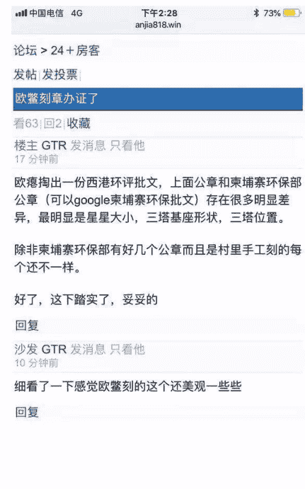

### 四）酸黄瓜

你说，一个智商低到何种程度的人，才会写出这种酸不拉几的文章。

一笑加一笑（微信号：150500211）邀您加入水库欧神交流群。群内文集每月一更新……

才会 “不惮以最坏的恶意揣测别人”。才能用一个又一个虚构的幻想，麻醉自己并没有被时代抛下呢。

当然是一个赚不到钱的人，人生没有进步的人，油腻中年的男人。

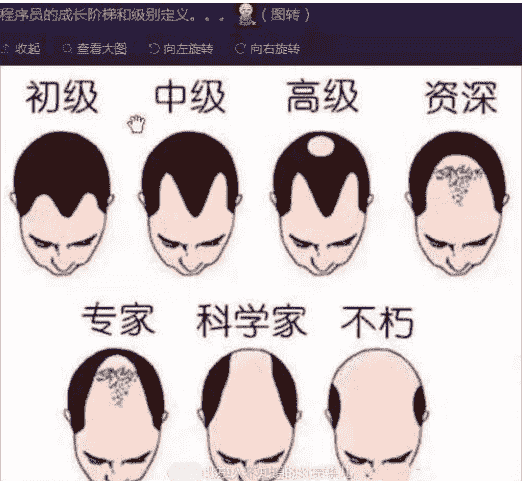

程序员 35 岁下岗，地产界 40 岁被后辈超过。这都是极其悲哀的事。

唯一作孽的，是那些读了你的文章，并且信服 “叫好” 的人。

不过细来想一想，能被你的文章迷惑，本身逻辑也是断层的。也是 “情感压过理智”，缺乏独立思考的人。

这样的 ditto 垃圾粉，死光了也不可惜。

### 五）结语

今天下午哥哥百无聊赖，在西餐厅啃着芦笋拌土豆。

十三妹让我多加点肉菜，我说“不行，我要等人退货”。

对于这种“污蔑事件”，最理想的结果，是动摇一群“多疑粉”。

最好小散们跑到我这里退货。我再按照“原购买价”25w/亩，退给他们。

若形成“挤兑”，更笑不动了。

可惜的事，一直等到白水喝了八杯。一个退货的网友都没有。

我忍不住打了个电话给彭蛋蛋，“亲，最近有没有什么笋地抛出来”。

彭总扶着眼镜检查了半天，“最低在售的 480000 元/五亩”。

唉，苦命啊。市场纹丝未动。

（yeyon_ou@163.com，2019 年 9 月 2 日晚。有空再讲讲线上菠菜的事，利鑫也没有便宜货）

## 美国已现末日景象 #F2420

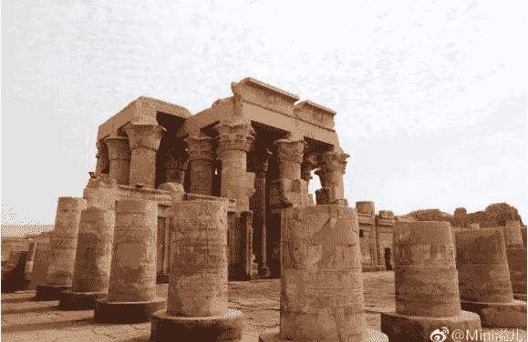

### 一）朋友圈

近期我很少写文章，当然是对微信整个大平台的堕落，有所不满。但俺还是阅读很多文章，每天朋友圈转四五篇。

哥哥的朋友圈，呢，有时候已经成了一种任务。其实我也想偷懒，想好几天“不发”朋友圈。但是卖“OS朋友圈”，已经渐渐成了一笔生意。

水库向来是允许盗版的。市面上广泛存在的，“朋友圈订阅”，“盗版水库存集”，“知识星球日报”。做这些生意的人中，有一些是我的旧友。还有一些，投过俺的广告费。

假如哪天我不更新“朋友圈”，等于这些做“水库周边”的人，统统没有了生计。三天不更新，订阅者臭鸡蛋大白菜，就扔上来。小 V 们虽然不分我钱，也担心他们被吊打啊。

哥哥每周转的“十几篇”朋友圈文章中，大多不重要。一直前前天，有一篇文章，让我如鲠在喉，不吐不快。

是这篇《审美的政治与真相：为什么东亚男人失去了地位》

https://mp.weixin.qq.com/s/dt8nMN42KV3SbkFxg9o0A

一笑加一笑（微信号：150500211）邀您加入水库欧洲交流群。群内文集每月一更新……

### 二) 单身狗

文章很长。我简单概括一下思想：

我知道有很多妈妈，都梦想把儿子送出去“出国深造”。读一个海外名校的身份，回来光宗耀祖。在某些比较Low的平台，“遥乎”甚至出现了《清华学生在哈耶普面前有没有自卑感》类似话题。

但水库要和你说的是，“以上全错”。

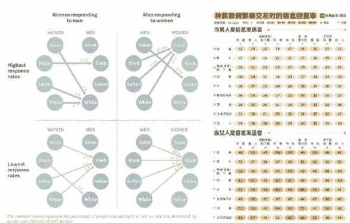

在全美性别配对选择中：

- 亚洲女性是得分最高，最受欢迎的雌性。
- 亚洲男性是得分最低，最少女人亲睐的雄性。

这段话意味着什么呢。意味着你一路高分，寒窗苦读，好不容易（小概率）如愿以偿进了普林斯顿。左拥右抱，香车美人，跨上人生巅峰？


错。
然后，你会变成一只社畜。
你会变成 Nerd，在朋友圈，社交圈，没有任何地位。

你会找不到女朋友，没有老婆，泡不到妹纸，养一条狗。每天 19:00 黑灯瞎火准时回到地下室吃泡菜。
等你老了，死了十几天，才被邻居发现。

知乎上有一些发昏的“皇汉”份子，还做着春秋大梦，妄图输出人口，移民占领北美尼亚。
醒醒吧，美籍华人是全美“生育率”最低的种族（没有之一）

如果哪一户朋友，想劝你的儿子“移民美国”。那是想害你全家啊。

如果哪一户独生子女，移民了美国，就是断子绝孙啊。

- 在美国的华人，唯一的希望，是他们从“国内”带出去的女朋友。青梅竹马一路相伴。除此之外，“美籍华裔男”如愿结婚的概率，微乎其微。
- 黑人女性，墨西哥扫把大，反正你也看不上。
- 你不仅嫌她们笨，而且嫌她们“脏”。
- 亚裔/华裔女性，是全美国最抢手的人种。
- “白黄黑”普遍认为，亚洲女性兼备了勤奋和坚毅，是做妻子的最佳人选。
- 唯一剩下的白妹，而白妹看不上你。

好了，问题来了。为什么白人女性，看不上亚洲男性？

### 三）绝世美男

为什么白人女性，看不上亚洲/华裔男性？

因为文化。

《审美的政治与真相：为什么东亚男儿失去了地位》一文，用了很长很长的篇幅，来解释这件事情。

https://mp.weixin.qq.com/s/dt8mNN42ZKV3sbKfXg9o0A

目前的欧美文化圈，他们认为的“绝世美男”形象，大概是这样的。又或者是这样的。

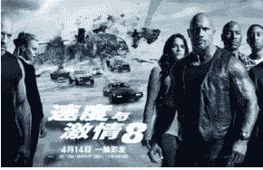


- 俗话说，“你秃了，也强了”。
- 戴一根大金链子，纹二处刺青。
- 长得丑不要紧，把毛发剃光。虾男。
- 再把臂膀锻炼得和头颅一样圆，手腕和小腿一样粗，胸肌和麻将牌一样方

这样的人，在国内叫做“混混”。

在美国叫做“男神”。

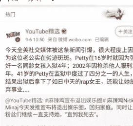

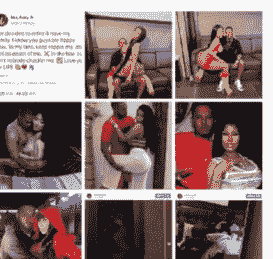

欧美人理想中的“绝世美男”，是肌肉男。

一笑加一笑（微信号：150500211）邀您加入水库欧洲交流群。群内文章每月一更新......

一个男人，每天不把3小时放健身房练肉，他都不好意思出门见人。

“力量，速度，兽性”是被歌颂最多的特质。

做人，做事的态度，象“巨石强森”一样，抡起了拳头就捶上去。好像粗暴野蛮就可以解决一切。

（生活大爆炸，最讽刺之在于，谢尔顿找了佩妮，博士后找了餐厅服务员。朋友们还认为你走了狗屎运，一朵鲜花插在牛粪上）

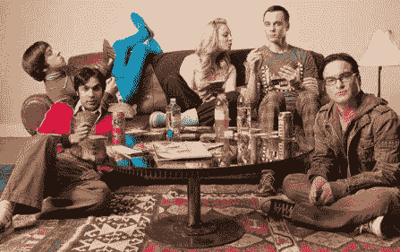

当一群“肌肉男”凑在一起的时候，他们过起了粗暴狂欢的日子。他们可以喝酒，泡吧，飙车，打架，砸商店玻璃窗，顺手牵羊轻微犯罪“英雄盖世”。布鲁克林的黑人文化，蔓延到了整个“白左”区。

美国人觉得亚洲人全部都是“娘炮”，这才是“真汉子”。

> "泡夜店 纹身 打洞 买醉看似很酷
> 其实这些事一点难度都没有
> 只要你愿意去做就能做到
> 
> 更酷的应该是那些不容易做到的事
> 比如看书 健身 赚钱 用心爱一个人"

而他们的生活中，没有什么呢。《速度与激情》中，绝对没有出现过的元素是什么呢。

没有书。

亚洲人的文化，是隐忍的。
人类成为万物之灵，靠的是大脑，而不是肌肉。
真要搏斗，再强壮的人，也打不过一只袋鼠。

在中国的文化中，有许许多多优秀闪光的东西，对家庭，对民族，对国家的责任。
这一份诚挚而厚重的感情，只有中国人看得懂。

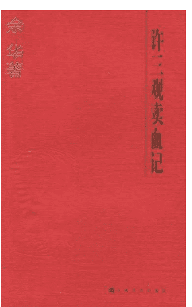

一个亚洲男人，可能他平无奇。既没有高富帅的相貌，也不会花言巧语，撩妹劝酒。
可是这样一个“父亲”，他可以每天工作 16 个小时，把一半的食物带回家。

- 他可以在滂沱大雨，背负着你去医院。
- 他可以守望相助，辅导你《银河补习班》。
- 他可以留给你几百万，毕生积蓄给你 99%。
- 他可以捐个肾给你。

（东北亚）亚洲男人的好，只有亚洲男人自己知道。在真正中国人眼里，是非常看不起“肌肉男”那群猩猩的。

在中国人看来，他们属于进化未完全，鬼高灵长目的。

很多复杂的，高级社交的“智慧”。猩猩们既不理解，更不敬畏，不能阅读神的境界。

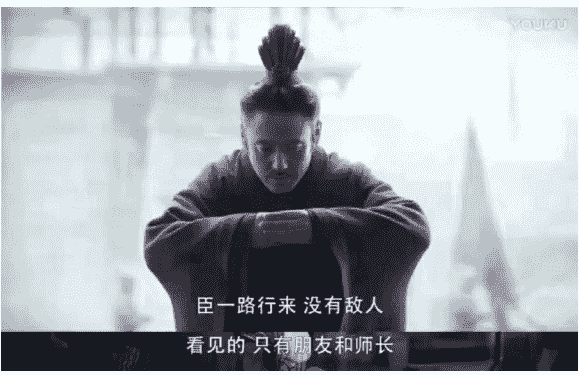

### 四）王朝末路

很多人都知道，吾哥除了喜欢写“楼市”文章，还喜欢“读史”。
初学者翻史书，最容易掩卷叹息的，往往是一个“文明”的毁灭。

例如，古罗马文明何等辉煌，统一了整个西方世界。
最终却被蛮族淹没，西方文明倒退一千年，退入黑暗的“中世纪”年代。

再譬如，古巴比伦王朝，毁于亚述人之手。
《一千零一夜》的巴格达，逐渐沦于突厥苏丹野蛮蹄下。
中国的“靖康之耻”。皇族受了无止境的羞辱，整个宋代锦绣文明被打断。

文明之火，一再被野蛮扑灭，是何缘故？

但是，这仅是初学者的境界。
史学，你真正地学下去，你会发现这一切，都是“罪有应得”。

王朝末期，整个民族的堕落是惊人的。索多玛之罪恶。

**文恬武嬉，天罚**

真心细读史书，你会恶心地看不下去。
良将死，英雄诛。小人得志，太监盛行。

大国打不过小国，那是他们“该死”。

京城里住着一群涂脂抹粉的“贵人”。他们什么好事也不做，渔色妄童，整天吸取民脂民膏。如果有忠臣良将关心社稷，蠢虫们第一反应，是妒嫉。是排挤。

与此对应的，但逢“末世”的时候，民间的“风气”也必然是一塌糊涂的。巴比伦以“淫荡”出名。商宵的妻子，公开在“神庙”里做祭女。整个民族毁于性痴，最后居然没有可以作战的战士。

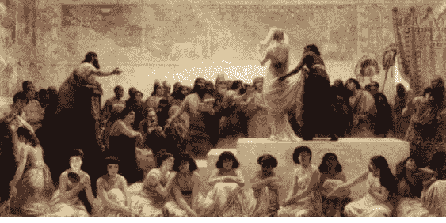

明末的特色，“小人”特别多。嘴炮党横行。朱氏父子，出了名的刻薄寡恩。朱家的孤寒，是贯穿整个明史主线的。文官也不放心，武官也不放心，整天只任用锦衣卫，特务。伪君子横行。长此以往，谁肯帮你卖命。

明末毁灭的时候，朝廷有地盘有人口，可就是没人肯干活。同样一套吏治班子，在崇祯手里，一两税银都没有。可是九王爷治下，北直隶竟然可以收税九百五十万两。多尔衮凭此，平定了天下。

北宋“靖康之耻”，虽然惨绝人寰。而是宋代的吏治，真心只能用“墨墨黑”形容。《水浒传》是最好的读本。108 将，没几个是失地农民。林冲放火，杨志卖刀，都是逼上的梁山。篇幅所限，就不展开了。

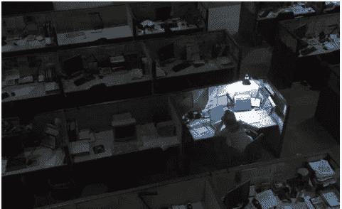

今天我们 看 “第二罗马帝国”，美利坚的社会病灶。白甲横行。LGBTQIA，没一个正常人类。

一个社会的中坚主流，应该是“中产阶级”，带眼镜的白领男。996 的社畜们，虽然加班加得昏天暗地。但不可否认的是，是他们撑起了生产力的大多数。也只有在千千万个工程师，经理主任的加持下，才会有“大国重器”。才会有先进战斗机。

一个主流羡慕的是“混混，大金链子，社会摇”。
一个主流追捧的是“学区房，985，创业狗”
你说，谁才是真正的“战斗民族”

> 文弱书生，最终会战胜彪形大汉。
> 儒家文明，战胜拉美文化。
> 勤奋坚毅认真等品质，战胜你的股二头肌

### 五）结语

亚洲的男性很不满意。
我们认为，女性同胞们，对于“真汉子”的理解错了。强大应该出自于内心，而不是肌肉。
一个秀才，比一个大金链子，更能打。

当然，从美国的现状来看，大家对于“审美”标准的分歧还比较大。
美国人还坚持认为，亚裔是黄皮猴子。
谁也没服不了谁，你说，那怎么办呢。

（yevon_ou@163.com，2019 年 9 月 10 日慕）

## 地主家哪来的余粮 #F2430

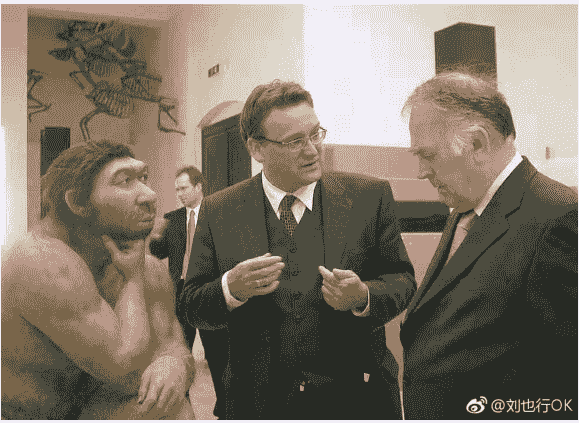

### 一）前言

这一周几乎都在打游戏。

西港项目，全国巡演卖完。每次高强度的工作停下来，我都会生场小病。放空四五天，什么事情也不做。打打游戏，续命快乐值。

水库 “知识星球” 冒出来一个精华帖。关于微博大 V “科罗廖夫” 的微博。

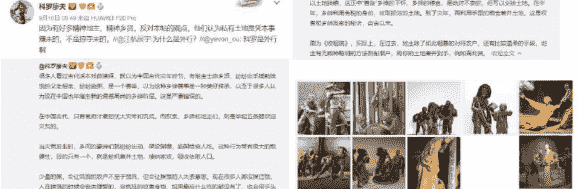

很多人看过古代活话戏曲演绎，就以为中国古代末年时节，有地主绅乡贤，纷纷出手援助扶钱的父老相亲，纷纷施粥，是一个善举，以为这种乡绅善事是一种美好传承，以至于很多人认为现在中国也年催生新的道德高尚的乡绅阶层。这是严重错误的。

在中国古代，只有官府才最担忧大灾年和饥荒。而权贵、乡绅和地主们，则是举起五条腿欢迎灾荒的。

当灾荒发生时，乡间的豪绅们就纷纷出动，架设粥棚，施粥给穷人吃。这种行为带有极大的欺骗性，目的只有一个，就是趁机兼并土地，接纳家奴，吸收依附人口。

少量的粥，会让饥饿的农户不至于饿死，但会让挨饿的人失去意志。现在很多人都没挨过饿，人在挨饿的时候会丧失理智的，会疯狂的收集食物，如果最后什么都吃没有了，也会用手头任何财产去交换粮食糊口。

以土地换粮，这正中“善良” 乡绅的下怀，乡绅的粮食，是绝对不卖的，但可以交换土地。在丰年，乡绅利用免税的身份，收取放贷的土地。到了灾年，再利用手里的粮食兼并土地，这是权贵和乡绅发家的秘诀，自古以来。

图为《收租院》，实际上，在过去，地主除了如此粗暴的对待农户，还有比较温柔的手段，地主有无数种聪明的方法剥削佃户，将你的土地兼并到手，例如高利贷。

哈哈哈哈哈，这个故事，解释起来最简单了。

我用游戏的道理，就可以告诉你。

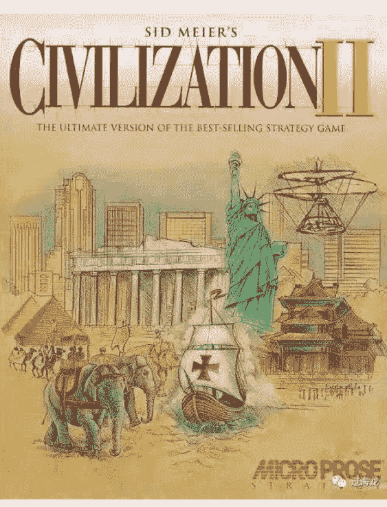

### 二）欺负

穷人总以为富人在“欺负”他们。

一笑加一笑 (微信号：150500211) 邀您加入水库欧神交流群。群内文集每月一更新......

我们翻开左翼史观，类似的看法，不绝于史书。19 世纪下叶之后，情况愈为严重。

- 美国的民主党，总告诉黑人们，黑人贫穷，是因为白人在剥削他们。哪怕几千英里外的黑非洲，也是因为白人穷。
- 香港的废青，总认为李** 害得他们没有房子住。痛骂商人投机取巧。
- 马前卒，科罗廖夫之类的“知乎 V”，则认为穷人的贫穷，是因为在灾荒年分，富人囤积了大量粮仓。趁机低价抢购，压低收购。

这一类的“左翼”史观，很迷人，很诱人。

毒苹果告诉你，你是没有过错的，坏的都是别人，你是无辜的受害者。

穷人们感到最愤怒的，每当他们最“孤苦无依”的时候，就会发现富人们全副武装等着收割他们。好比借钱的，遇见放高利贷的。

卖二手 CEO，遇见水库砍价的。

以穷人们的脑容量，他们当然觉得这个世界是对他们“不公平”的。满血满魔全副铠甲，对待他们布衣绣剑。

穷人们唯一没有问的，“亲，这些装备哪来的”。

- 地主家的白面，是天上掉下来的么。
- 地主家的储备，是牺牲什么项目换来的
- 凭什么他能欺负你，而不是你欺负他。

能量守恒，每人每天三小时游戏。凭什么他就可以打高分，极品装备满箱装不完。

在《*Civilization2*》这个游戏中，资源极度紧缺。任何一个环节，钱都是不够了。开发了这个项目，就没有那个工程。

因此我们知道，在现实生活中，是没有“闲置产能”的。

- 仔细想一想，其实若能在灾荒年，提供“救济粮”，这个成本是非常惊人的。
- 首先，你需要少吃。这是非常容易理解的。
- 其次，你需要周边设备。例如一个谷仓，还需要运输粮食的工具。谷仓还需要维修。
- 再次，凡是财产，皆需守护。不管是老鼠，强盗，还是县官。“安保”的成本，是非常高昂的。

象“国家储备粮”，“国家储备肉”，不到灾荒年，冷库大门是绝对不会打开的。

风调雨顺的年份，他就一年年“保险”下去。

这每一年，都是成本啊。

当你看见贼吃肉的时候，你怎么不想贼挨打啊。

养粮十年，用粮一时，这是勇气智慧忍耐的综合。“*智勇双全*”，才可以适应更复杂的年分

上点对每一个人都是公平的。

只不过别人，更有效地利用了资源罢了。

“地主家的余粮”并不是天上掉下来的。这是一场长期准备，精心筹划的计划。

Alice_Cui 铁粉
没有佃户的需求，哪来的高利贷。没有乡绅的粥，活不到明天
9-10 08:32 V+会员

Cryenginc18 18 铁粉
科罗抄夫

周秦汉是大sb 铁粉
我就问一句，为什么农户没有存粮，地主有存粮？
9-10 14:07

为了执行这个计划，地主家长期忍饥挨饿，把别的地方资源省下来。地主少买了 iPhone，地主婆少买了 Prada。而你包+手机都买了。

你面对的，是全世界最勤劳刻苦聪明的一群人啊。

右翼的历史观，世上哪有无缘无故的“欺负”。

只有在你看不见的地方，别人偷偷变强了。

而你偷懒了。

如果你不同意这种“弱肉强食”的三观，那我问你，你的“胃”是怎么进化来的。免疫系统，又是怎么进化来的。

胃作为一个人体器官，本身消耗了大量的供血。小肠消化系统，更是消耗了近 1/5 的能量。还增加了体重，挤占了内脏的空间。

人类进化出“胃”，是因为人类不能好好吃饭。牛进化出了四个胃，是因为牛时刻准备要逃跑。

草原上随时都会有风险，先把一切食物灌到胃里面，然后有时间慢慢消化。


你说，一个古代猴子，会指责你进化出了“胃”。这不公平。获得生存优势么。

人类从远古走来，从单细胞进化到多细胞，从三叶草进化到灵长目，本身就是一个不断“进化”的过程。

进化的本意，是变得越来越复杂，越来越能适应外界多变的生活。

你如果认为，只要萌蠢地做一个“农夫”，耕好你的地，就会有幸福生活。

这和废材年轻人，认为“只要读好书，走职场正道，就能做白领，当高管，豪车大房子，迎娶白富美，走向人生巅峰”，这有什么区别！

醒醒吧。我们知道，家教严苛走“职场正道”的年轻人，最终被房价虐得满地找牙。

一心只想“认认真真种田”的农夫，被乡镇企业抢走了犁花。

你看不到别人在做的事，你蔑视别人在改变世界。这就是傲慢。

这就是罪！

### 三）模式

行文写到这里，一些左翼份子，废物愤青，已经忍不住跳出来了“反对，反对”

愤青挥舞着四个大字：“以上全错”。

科罗廖夫大吼说，“我是和你讨论农夫不勤俭的问题么”。

“我是和你讨论‘马太效应’。有钱人越来越有钱，凭借着有钱，可以形成碾压优势”。


呃，你以为我在和你讨论“贫富”么。

我在和你讨论“模式”，生存进化资源分配之方式。

龙生九子，各自不同。

人性天生，就有勤劳，懒惰，冒险，保守，侧重精养，侧重繁殖，侧重嫁接等等各种生存方式。

譬如同一家父母的孩子，你分配给二人各 500W 元。

二个起点几乎一模一样的孩子，因为性格不同，其终局也会很多不同。

社会是分阶层的。

同样一个 A7, A8, A9 家庭出来的孩子，因为教育性格等不同，走向亦会很大不同。

A9 的孩子，有可能掉阶到 A8，也有可能升阶 A9.5。

因此我们谈论的并不是“贫富”。而是“模式”。

在科罗廖夫这个微博帖子中，左翼份子的“三观”是，世界是不需要客观看待的。

我自顾自地昏睡百年。

等我一觉醒来时，别人已经是洋枪大炮，帝国军舰。

打得长枪大刀的义和团哭爹喊妈。

左翼分子哭坐在地上，拍打泥土，“这不公平，你们欺负我”

“反对，开挂”。

## 地主的余粮，是天上掉下来的么？

*右翼份子的三观是：世界是客观的。*

从来没有一跃而就的事。百因必有果。

*右翼份子每天关注着世界，忧心仲仲。“x 国又发明了一个新科技，我们要落后了”*

*“x 的市场份额又跌了一个点，我们要奋起直追啊” 。*

*在“昏睡百年”的过程中，左翼份子天天哈哈大笑，说你们瞎忙活，劳碌命。*

*而我们在实实在地进化。谷仓出平地时，你千万别嘲笑。*

*而当你最终发现差距时，差距已不可逆转。*

（这段话可以送给某些水库小 Y）

在上海楼市的历史中，有一个关键性的节点，大约是 2007 年 6 月份。

这个节点的重要性，因为他是“5.5% 营业税的最后一天”。

上海从 2005.05 调控，开始加征“营业税”。并使得“非普通住房”的交易成本，上升到了约 8.5%

每次。

而 2007 年春季房价又大涨，绝大部分次新房源，远超“普通线”130%以上。这意味着即使 Mark Down，它们再也不可能以“低税率”交易。

2007.6是最后残存的一个月，交易中心评估价还没有上调。还可以有最后的“漏网之鱼”。

这个月发生了什么。房产界，新闻界，学术界，发生了什么？

答案是：什么也没有发生。

大限关头，整个城市就默默地接受了屠宰。没有任何一家新闻媒体，意识到这个日子有多么地重要。也没有任何一个买家，抢着在“大限”来临之前，赶紧入仓。

从此以后，我就对这种“坐视灾难年来临”的群体，深恶痛绝。

在俺看来，没有一只羔羊是无辜的。

## 四）结语

穷并不可怕，穷只是一种状态，说明你投胎~开局不利。

真正让我迷惑的，是穷人在“摆脱贫穷”时的巨大懒惰。

好比俺前文说的，上海楼市在 2007.06 时的巨大节点。有人算计这事么，没人，全上海滩明白的不到 10 个人。

如果你是穷人，你就应该更加珍惜每一个改变命运的节点。你应该囤积比富人更多%的粮食，你囤了没有，没有。

你应该意识到灾荒年时巨大的商业需求，比富人更蹦跶地倒卖粮食，赚取差价，跑单帮小买卖。你贩粮了没有，没有。骂娘倒不少。

穷人应该更关心楼市政策，因为你可能一辈子都买不起房了。穷人忙活了没有，没有。2007 他们不追求真理。

真正让我迷惑的， “坚毅 • 爬阶” 的品质。我几乎从未在底层人士身上看见。

穷人最喜欢做的，是躺在那里， “世界待我们真不公平啊” 。

“人家怎么就有洋枪大炮了呢”

“王者打青钢是违法的”

越穷的人越不算计，越看不起算计。

在 “最需要争抢” 的生态位，你却从来不争，没有任何作为。

（yevon_ou@163.com, 2019 年 9 月 16 日晚）

一笑如一笑（微信号： 150500211）邀您加入水库欧神交流群。群内文集每月一更新......

## LPR 和降息通道 #F2440

yevon_ou 水 库 论 坛


### LPR 和降息通道 #F2440

一）灭绝叛乱

今天最想写的话题，其实是这篇：

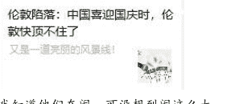

我知道他们在闹，可没想到闹这么大。

已经搞到了华尔街金牛泼狗血，裸女占领英国国会。

风暴眼汇集，这个“劫”，感觉欧洲是躲不过了。

又一场火烧女巫的活动，宗教审判所，恐怕我们有生之年就可以看到。

目前还生活在欧洲的朋友，可以尽快移民来中国。

该逃不逃你就惨了，以后白人很可能要偷渡进华。

整个事件的根源，并不是一时或者某人的“施政不当”。

病髓在骨子里的。

《神的战争》#F10 一文写道，所有的歧路，归根到底都是信仰的竞争，都是道德的竞争，都是神的战争。

欧洲人的特点，他们是有非常浓厚“献祭”传统的。中国人其实是不信神的。中国人可以在灶王爷的嘴上抹点糖，为了他去天庭汇报的时候，可以说点假话。但是欧洲人是“真信”的。欧洲人为神而活着，不象中国"神为钱而活着。

欧洲人的骨子里，只要一件事让“神”满意了，地球毁灭也在所不惜。末日审判，只求“拜神”崇高感。中国是世俗国家，欧洲并不是。丫才是最大的恐怖份子，JDJ才是世界上最大的恐怖宗教。

在“灭绝叛乱”一文中，作者写得很清楚。欧洲的“极端份子”，根本不想和你谈判。

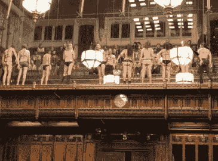

人家眼里的，是“宗教崇高感”。你们现代人都太堕落了，越聪明越堕落。太忘记原始社会的淳朴了。

我不是在反对您，我是在奉行崇高的“道德”。让你回到贞操带，火刑柱，自磨枷的年代。新的一千年“中世纪”渐行渐近，欧洲很快会回到 Dark Age.

关于欧洲的“神性”，我极为熟悉，提起笔来，也是轻车熟路。这是根本质“民族性”的差异，非人力可以抵挡。波澜壮阔的大时代，吞噬天地。

可惜啊，这么有趣的话题，却是不能写的。处处雷区，随时封号。而且腾讯口碑很恶心，它会搞“挖坟封号”。谁也不知道半年，一年前的文章又被翻出来，随便哪个字犯了天条。

因此，今天写另外一个话题：房地产的 LPR 利率。

- LPR 出台之后，利率会升会降。
- 房价会跌会涨

虽然是凉菜，小葱拌豆腐的清淡口味。公众号只求能“活下去”，就多福了。

### 二）珠城

1997 年，珠城的房地产泡沫，达到了顶峰。

众所周知，1997 年，珠城的房地产开始崩溃。从顶峰开始，最多跌去了-70%。中国人做学问，喜欢不胜求解。

新闻自媒体，更是你抄我抄，人云亦云的一大堆。独立主见，原创的没几家。

我问你，“97 泡沫”都快被说烂了。但是 1997 年，珠城的“房贷利率”是多少，有几个人说得岀。

答案是，大约 9.75%/年左右。

这个数学，包括二个部分，P+3.25%

其中的 P，是基准美元利率，当年大约 6.5%

+3.25%，是分类别溢价。房贷类加三个点。

你要说 2019 年的珠城房地产市场，虽然价格再创新高。但其“本质”，和 1997 年是差非常远的。

钟镇涛为什么破产，他不是房子买不起，他是房贷撑不起。

钟镇涛最后问私人借的过度资金，利率 24%。

他为什么要用这么高的利息借钱，因为房贷本身已经 10%了。私人借债只有更贵。

钟镇涛当时买了 1.4 亿物业，一年光利息就要 1400W。

他全年的收入，大概在 1000W 左右。

如果他挪到 2019 年，哪怕今天这么贵的楼价，他也不会破产。因为今天珠城的按揭利率，只有 2.5%

或许有些“抬杠”的人会说，从 10%降到 2.5%，那也正常。因为美元“降息”了。

其实，美元虽然降了一点，但 2019 年和 1997 年，Prime 基准相差其实不大。

P 最多也就差 2%

真正变化大的，是从 P+3%，变成了 P-3%，这里面足足差了六个点！

### 三）LPR

- 珠城 1997 年时，房贷的算法，是基准利率加三厘，P+3%
- 到了 2019 年时，算法是基准利率减三厘，P-3%

这一切是怎么发生的呢。

事实上， 1997 年楼价高昂之时，珠城政府，也想了多种办法 “降低购房负担”的。房贷利息，当然是重中之重。

政府本身不从事生产，珠城政府，也不可能无中生有，变出钱来。

想要降低 “房贷利率”，珠城政府请求各方意见，金融业高级智囊，解放生产力。最后得出的结论是房贷可 “买卖”。

众所周知，银行间存在一个 “隔夜拆借市场”。

每一家银行，头寸不同。资金要放贷出去，才有收益。但往往又面临大额取现。

有的银行余额多，有的银行头寸少。大家互相之间，形成一个 “隔夜拆借” 市场。总体的经营成本都降低了。

房贷也是同样的道理。

房贷其本身，是一种 “短借长投” 的金融产品。银行吸纳储户定存，都是一年期，三年期。但是房贷批给用户，动辄 20~30 年。

在这 20~30 年中，银行的 “头寸” 不幸是被锁定的。流动性短缺，必然导致更高的收益性。

银行也很为难，虽然房贷是一种 “低风险有抵押” 的产品。可如果银行资产 50% 都拿去长期房贷，万一大户挤兑怎么办？

在旧有模式下，银行体系往往只敢拿出来 10% 的资金，发放房贷，小心翼翼注视着金融流动性。

这就导致了 “供应” 减少。

而 1997 年珠城政府，从华尔街拿回来的技法，叫做 “房贷买卖”。英文也可以称为 MBS。

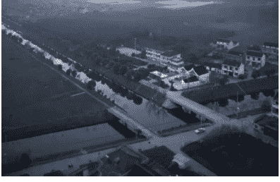

具体的做法，好比我发放一笔贷款，利率 5.66% 我拿走一部分。例如 0.66%，作为行政，销售，合规，税务等等各项开销。

剩下 5%收益，我就在市场上卖了。
谁买了这个债务，以后王大锤的月供就转交给他。拖欠，断供之类破事，也找他。
收益比国债好。

“隔夜房贷买卖”这种事，一开始在银行间互相做。大家的头寸，都得到了调剂。后来做得久了，吸引了外部的基金。

一些长期资金，例如退休基金，债券基金，保险基金，保本基金。
他们在“低风险”的基础上，还想寻找比“国债”更高的收益。
于是基金也进入了MBS市场，成为了最大的买家。

基金一进来，整个事件就爆炸了。

- 最开始，银行用自有资金房贷。整天头疼 10%容量，流动性管理
- 银行间有了拆借买卖市场。
- 外部廉价资本进入

你想，保险公司多有钱啊。沙特主权基金，多有钱啊。

姚振华收购万科，仗的就是保险资金“成本低”。所有的金融链条，谁也不能和一筹比。

至于买欧盟国债那帮人，呵呵，他们的回报要求，说 说出来吓死你。

**全球国债收益率矩阵（2019年10月4日）**

| | 1年 | 2年 | 3年 | 4年 | 5年 | 6年 | 7年 | 8年 | 9年 | 10年 | 15年 | 20年 | 30年 |
|---|---|---|---|---|---|---|---|---|---|---|---|---|---|
| 瑞士 | -0.85 | -0.91 | -0.93 | -0.92 | -0.92 | -0.90 | -0.87 | -0.82 | -0.83 | -0.79 | -0.58 | -0.48 | -0.38 |
| 日本 | -0.31 | -0.33 | -0.34 | -0.36 | -0.36 | -0.37 | -0.37 | -0.35 | -0.29 | -0.21 | 0.02 | 0.18 | 0.35 |
| 德国 | -0.69 | -0.78 | -0.84 | -0.83 | -0.75 | -0.79 | -0.75 | -0.65 | -0.56 | -0.45 | -0.31 | -0.07 | |
| 荷兰 | | -0.78 | -0.80 | -0.78 | -0.72 | -0.65 | -0.62 | -0.55 | -0.51 | -0.44 | | | -0.09 |
| 丹麦 | -0.83 | -0.82 | -0.89 | -0.81 | -0.76 | -0.86 | | -0.55 | | -0.58 | | -0.38 | |
| 芬兰 | -0.61 | -0.57 | -0.71 | -0.68 | -0.87 | -0.56 | -0.53 | -0.44 | -0.39 | -0.32 | -0.12 | | 0.17 |
| 法国 | -0.63 | -0.70 | -0.73 | -0.71 | -0.64 | -0.57 | -0.51 | -0.44 | -0.37 | -0.28 | 0.02 | 0.13 | 0.55 |
| 瑞典 | | -0.83 | | -0.71 | -0.69 | 0.61 | 0.04 | -0.53 | | -0.33 | -0.17 | 0.10 | |
| 奥地利 | -0.55 | -0.69 | -0.71 | -0.88 | -0.60 | -0.58 | -0.49 | -0.44 | -0.40 | -0.32 | -0.08 | 0.00 | 0.26 |
| 比利时 | | -0.68 | -0.71 | -0.64 | -0.56 | -0.52 | -0.45 | -0.39 | -0.32 | -0.25 | 0.03 | 0.25 | 0.59 |
| 爱尔兰 | -0.53 | -0.44 | -0.55 | -0.54 | -0.47 | -0.39 | -0.28 | 0.57 | -0.13 | 0.03 | 0.26 | 0.45 | 0.80 |
| 西班牙 | -0.48 | -0.52 | -0.49 | -0.35 | -0.31 | -0.19 | -0.39 | 0.01 | 0.06 | 0.13 | 0.55 | | 1.02 |
| 意大利 | -0.23 | -0.26 | 0.09 | 0.02 | 0.23 | 0.26 | 0.52 | 0.61 | 0.65 | 0.83 | 1.40 | 1.59 | 1.95 |
| 美国 | 1.58 | 1.40 | 1.36 | | 1.35 | | 1.44 | | | 1.53 | | | 2.02 |
| 中国 | 2.56 | 2.68 | 2.78 | 2.76 | 2.96 | 2.99 | 3.17 | 3.17 | 3.14 | | | | 3.76 |

资料来源：Bloomberg

很快，全球城的银行都疯了。因为他们发现房贷是一件“稳赚不赔”的事情。
你左手 5.66%拿进来，留下 0.66%手续费，转手 5%卖出去。
中东土豪还发疯一样抢（土豪也不亏钱）
银行最喜欢“中间人”手续费业务了，货如轮转。这是什么，财源滚滚印钞机啊。

1997 年之前，珠城只有很少的几家大银行，布局房贷业务。
小银行如履薄冰，战战兢兢。

“房贷交易所”成立之后，几乎所有的珠城零售银行，都从事了房贷业务。
**费率大战**，打得昏天暗地。

最终，珠城的房贷利率，从 P+3%，一路下滑到 P-3%
这个速度是很快的。

- 大约只用了三年，就降了四个点，到 P-1%
- 用了六年，降到 P-2%
- 到今天，降到 P-3%

当你实行 LPR 机制之后，你的房贷利率，其实挂钩的是“全球资本”。
想象一下，中东土豪买欧洲国债的利率，-0.59%，这画面太美，我不敢看。


中国和珠城，都属于“美元区”。挂钩的是美元利率。
USD 利息，比 EUR 还是要贵一点。

我手里迄今保留着一张，珠城汇丰银行的房贷对账单。
HKD 利率：0.86%

0.86%是**年利率**哦。真不好意思让大家失望了。

### 四) 次贷

有人看到 MBS，左看右看半天，突然发现新大陆一般。
“咦，这不就是次贷么”。

文盲份子，就是看什么新事务，都胆战心惊的。看见火轮车，还担心铁路惊扰了地脉。

MBS 不是次贷，是“主贷”。
象中国这种首付三成的，拿到全世界任何一个地方，都是“AAA+级优优质”贷款。
至于首付八成，二套待遇，那是**全火星**最优质贷款。

“次贷”指的是那种首付不足 5%。
至于“主贷”，在全世界任何一个市场，任何一个时期，都是安全的。

### 五）中国的 LPR

中国从 2019. 10. 08 开始，实行 LPR 计价。

很多朋友在“知识星球”里问，LPR 实行后，会不会和房贷利率有所差异。能不能导致降息。如果买房子的话，要不要拖一个月，等到 LPR 实施后再签约。

我们的答复是，不用。

因为 LPR 是一项“长期”的制度性改革。

就好比 1900 年代，一辆卓越的车，和一辆歪歪扭扭的汽车。

马车虽好，却没有后续升级的“科技树”。汽车虽然拙劣，此后却有多次升级空间，一直通向新的路径。

中国传统意义上的 P*95%, P*120%，首套房九五折，二套上浮+20% 这种利率，是一种“行政指令式”定价。

和国际社会格格不入。

也是缺之后续科技树攀爬空间的。

而 LPR 定价，基于“风险”的定价。

“最优惠利率+0. 55%”“最优惠利率+0. 85%”，风险和收益直接挂钩，后续才能演化出“房贷买卖”

中东土豪又不是傻子。

LPR 的定价，只是第一步。

等到“LPR”定价的客户们多了，慢慢才能形成银行间（房贷）买卖市场。市场逐渐成熟，才会引入债券基金，保险基金，退休基金等长期投资者。最后引入国际基金。

这是一个漫长的过程，球城走完全程，用了七年。

鉴于改革已经减速，中国能花十年走完，我都觉得不错了。

就我个人观点，房贷降到 3% 以下，应该是合理的。

(yevon ou@163. com, 2019 年 10 月 10 日午)


## 个人贫穷的下限 #F2450

本篇为经济学

### 一）贫穷的恐惧

前两天屠叔找我喝茶。哭诉说，他写文章太难难了。

他写《6时代，谈谈中国的气运》《人赚我钱，我赚我命》，讲“医疗市场化”“教育市场化”。

水库的读者，已经是中国公众号中，素质最顶级的人群。
尽管如此，依然有大量的“小镇青年”忧心忡忡。

他们关心的，并不是“市场化”能带来的繁荣和富裕。
而是对于“贫穷的下限”，深深的恐惧。

这个话题十分有趣，但要解释起来，并不容易。
首先，我们讲个故事。

大家知道，“一战”“二战”，基本都是德国一个国家，单挑全世界。
1914 年时，德国是全世界最强大的国家。
1939 年时，也是非常非常地强。

但德国真正有“多强”，一般人并没有概念。
如果问“全世界拿诺贝尔奖”最多的国家，许多人会回答美国。而在 1930 年代，科技界的王者，绝对是德国。

自从 1901 年诺贝尔奖设立，日耳曼人从来都是“诺奖”王者。德国是欧洲的科技中心，遥遥领先。
顶峰时期，大约有 1/3 的奖项，被德国人获取。

波恩是现代物理学发源地。量子力学，相对论，电磁方程，X 光。30 万人口的哥本哈根，其科技产出，令四亿人口的中国人绝望。望尘莫及。

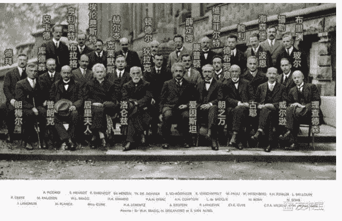

- 1945 年战败后，苏联人拼命地从德国拆卸工厂，高炉机床，一列列装满莫斯科，武装俄国人的重工业。
- 美国却拼命地搜罗德国“科学家”。许多德国教授，从此被迫在橡树岭工作一辈子。
- 德国再也没有喘过气。


相对于战败的拮据，德国人在科技领域的“掏空”才是致命的。

德国科学丧失“一骑绝尘”的绝对优势。德意志群星时代结束，德国再也不会是超级大国。

但是，德意志“科技”的衰退，并不是从 1945 年战败开始的。

严格地说，从 1939 年二战就开始了。

更早的话，从 1933 年就开始了。


前两天我在朋友圈转了一个帖：《为什么说纳粹德国的普通民众是“心满意足”的穷贼》

希特勒上台之后，大搞民粹主义。盖世大保镖铺天盖地。知识分子受迫害，恐怖监听无所不在。

和战后“盟军”的宣传不同。其实这一段时间，希特勒的支持率是非常非常高的。99% 的德国人，衷心拥护元首。

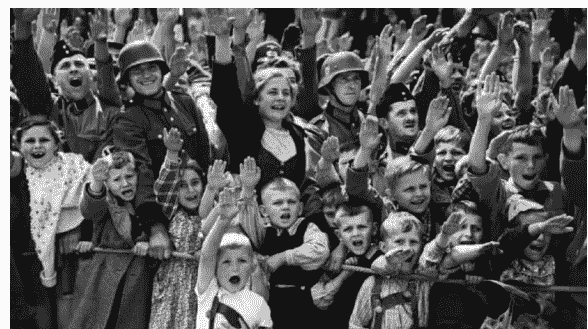

哪怕这一段时间，希特勒焚烧学校，迫害商人，把大量的大学教授，赶去了偷渡美国。

他的所作所为，哪怕强心针引来了高光时刻，却是以损害大学院校，长远“科技潜力”的。对国家有害无利。

（季羡林当年读书小镇，曾是欧洲学术中心，现已彻底衰败排名）

## 二战时期德国歧视有色人种，为什么季羡林能留德十年？

http://www.zhihu.com/question/38432025/answer/860437718

## 二）短视的陷阱

好了，问题来了。为什么在某些时刻，民众宁可选择“短视的利益”。哪怕迫害犹太教授，哪怕打土豪分田地。

就像邓新华老师百思不解的，“医疗市场化”利国利民。为什么偏还有人，反对市场化？

俺幽幽点了一片酱牛肉，“您是一线户口吧”。

“是的”

“Top3 本科”

“是的”

“X 易财经主编，有名望有存款，有房有车有医保不愁”

“是的”

来来来，我转你篇文章，你先看看。

盾叔拿过来一看，“草”，100000+阅读，这是什么东西？


这篇文章，讲的是一个纪实记者，躲在广州火车站公安局，玻璃墙背后拍摄的。你永远不知道，中国有那么多中专生。月薪低于 2000 元的人。

- 吃泡面，只买没有调料包的。
- 赚 0.5 元的红薯，可以在寒风中吹半小时。
- 爸爸小偷被抓了，五岁女儿在警局门口哭。

“给我 100W 美元，我愿意让你干任何事”。

这句话不是我说的，是“伊本·沙特”说的。

就是那个“沙特阿拉伯”开国皇帝，留下了四十五个儿子，四十五个女儿，五千多个曾孙子。个个富得流油，马桶都用纯金打造。

只不过那时候他还没有发现石油，穷得在利雅得啃沙子。

他留下这一句旷世名言，谁要给统治者一百万美元，在他土地上杀人放火都行。

**人穷到一定程度，是愿意“出售未来”的。**

珠城以前有个火到爆火的节目，叫做“百万富翁”。陈启泰主持。

其中第 5 题，第 10 题，是一个“平台”。

只要你爬上第五阶了，那你以后至少也是个“科级干部”。

就算回答问题失误，至少可以保证你 LV5 的待遇，能带几千元回家。

那玩家的对策是什么呢，“打电话”“猪答案”“问观众”。

三大技能牌，在 Lv4 的时候一定打掉，以确保自己爬到五阶。

（印度电影：贫民窟的百万富翁）


在人生的爬阶之中，也有类似的“平台”。

譬如说，你从农村户口，转为城市户口。

本来是大凉山一个穷孩子，现在到大城市落脚。

又譬如说，很多人喜欢进“体制内”。

皇帝喜欢任用一些“寒门”当官，然后让他们去咬士族。或者做一些恶心的走俊臣。

你说，考公务员的“寒士”能节操么。

当一个“小镇青年”来到大城市，当你背着一个蛇皮袋，来到北京。当你就象“草”里面，广州火车站门口，举目无亲，没有任何人脉基础的“新漂一族”。

我说，让你“出卖未来”，你愿意么。

> Q：亲，你这辈子，再也没有指望成为“亿万富豪”。你的子子孙孙，世世代代阶级固化，也不可能成为亿万富翁。但你会获得“免费医疗”。请问你愿意么。

> A：我愿意，我愿意。俺这月薪 2000 的命，想个屁小目标啊，与其虚无缥缈的上限，不如拿来换酒喝。

Q：亲，你这辈子，再也没有可能成为“千万富翁”。开小店，杂货店，注定被工商骚扰致死。但你会获得“最低生活保障”，你愿意么。

A：我愿意，我愿意。每天至少能有五个肉馒头吗，太棒了，我整天忧心吃不饱呢。

Q：亲，你这辈子，再也没有可能成为“百万富人”。大家把有钱人分了，各自拿回家，吃光用光二三年。

A：我愿意，我愿意。还有二三年的好时光啊，不负韶华。

美国在 1950 年代，政治上急速地“左转”化，随后爆发了嬉皮士运动。

其背后，艾森豪威尔青年参军，受够了陆军的泥沼。当选总统后，就大规模地提出“美国高速公路”计划。

高速公路有效拉动了美国的经济和物流，但也把数以亿计的“小镇青年”，带到了核心大城市。

对于这些农村出身，一穷二白，急于在大城市“站稳脚跟”的人，他们的“浮士德”交易，是显而易见的。

- 出售：未来
- 买入：站稳脚跟

因此 1960 年代，美国的政治诉求，体现为“四大保障”。

- 基础医疗保障
- 基础教育保障
- 基础住房保障
- 基础养老保障

> “小镇青年”几乎把一切能卖的都卖了。包括他们的良心，包括他们的未来，他们他们予以孙孙阶级固化永世不得翻身出卖道德出卖祖国出卖民族出卖血脉……

急于“站稳脚跟”的人，只要求一件事。从此以后，我就是“城市户口”，混个小官科级干部，拿着月薪不成不谈 6000 元。衣食无忧。

## 不要再让我再回农村，不要把我踢回中古时代，不要再让我有“滑入民工”的恐惧。

从某些意义上讲，1933 年德国人支持希特勒，1960 年美国民粹运动，2019 年中国青年反对市场化。骨子里都是一样的。“为了低水平的保障，而放弃了未来”。

## 三）市场化

我说眉叔写文章，你光讲“市场化”的好处，是没用的。

哪怕你和他说，工业革命机器轰隆，商业文明极大富裕，互联网革命天翻地覆。人家就守着“一亩三分地”，穷人者最胆小。

你要和他们讲道理，你还要从另一个角度去说服他们：“个人财富的下限”。

- 市场化会不会让你很穷很穷
- 最终看不上病，吃不起饭，
- 活活饿死在街头？

告诉他，有个“底线”。下限有保障，传播“自由主义”才更有效率。


很久很久之前，我们看《皮皮鲁和鲁西西》，太阳城冒险。

其中的老百姓，被垄断资本主义压迫，变得无比赤贫。

“自由贸易”之后，个人的小商品，手工工场，根本无力和大企业工业化竞争。

中小企业纷纷破产，穷无立锥之地。

这样的教育，给我们的“洗脑印象”太深太深。

以至于似懂非懂的读者，上来第一句话就问，“市场经济搞得我赤贫了怎么办”。

这个心结不解释，反抗者必然甚众。

幸好是，自由主义包罗万象。经过我们的推行，理论上可以证明，“财富存在下限”。

市场经济深化搞下去，从一个理论值。

你的生活水平，无论如何不会低于这个值。绝不出现“皮皮鲁”中的情况。

只不过，我们今天这篇是引言。

不知不觉，引言居然写了 3000 字的篇幅。

正文只能等下篇了。请关注周五《个人财富的下限》#2460

(yevon_ou@163.com, 2019 年 10 月 22 日午)

# 个人财富的下限 #F2460

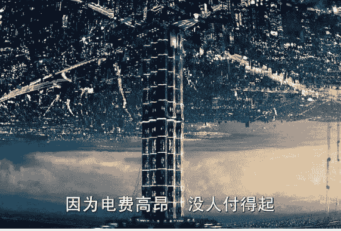

## 一）无知者

你打开知乎，搜索“欧神”。不出意外，会找到一堆骂我的文章。

深夜闲来无事，我很喜欢搜来自己看。

列宁曾说，“敌人是最了解你的人”。

一篇好的批评，其价值怎么说也不为过。真是良师诤友，一稿难求。

可惜的是，知乎平均水平极低，骂骂人也不上档次。无非一些以讹传讹，谬误资料的大拼盘。

连错得“奇葩脱俗”，“脑洞地漏”的段子都不多，不值一晒。

一直到上周，哥哥终于在朴实无华，且枯燥的岁月中，又看见了一篇奇葩帖子：

如何评价欧成效对杨安泽的评价？

```
https://www.zhihu.com/question/347933081/answer/836717651
```

作者是一个汽车从业人士。但他支持杨安泽。

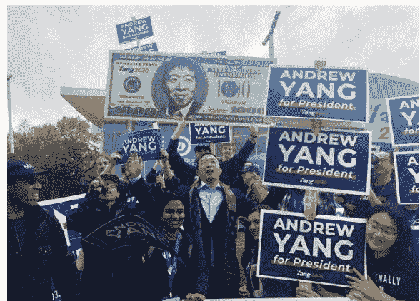

嗯，支持杨安泽竞选总统是不错。我也同意，毕竟是个 *****。但作者接着说，支持杨安泽的理由是，“他卓越的经济政策”。

# WHAT！Excuse me, CAN YOU PARDEN

你就说是支持“金卡戴珊”的经济政策，我或许还更同意你一点。毕竟女人臀大无脑，思维最多为零。

不像知乎的整体，是一个巨大的负数。

作者说，他支持杨安泽的经济政策。认为杨安泽是不世出的经济学奇才。杨的主要竞选观点是：

- 目前的生产力已经太高，人类已过度富裕饱和
- 生产力继续提高，会导致工人失业
- 对机器人，软件，人工智能征税，把钱分给美国人每月$1000。

看完这些政见，我对杨安泽更喜欢了。这家伙绝对比 AOC 更猛，氰化钾的档次，三克油就足以让美利坚致命。

不过还是别给他发中国签证了，丢不起这个脸。华人没有这么蠢的。

## 二）贫穷的恐惧

生产力的进一步提高，会导致大规模失业，会导致贫穷么？

在传统的教科书中，中国人对于“自由贸易”，是心怀恐惧的。

例如，“鸦片战争”中写道，洋货进入了中国市场，冲击了脆弱的中国手工业，中小农户纷纷破产，江浙一片哀嚎。

新行业，新商家的崛起，是会 导致“供求关系”的大幅调整。

其中有受损者，有破产的企业。

但总账是正是负，有 更科学的算法。

“鸦片战争”的历史定位，在中国是一个 zz 问题。咖啡滚烫，不宜评论。

鸦片战争敲开了国门，但绝不代表“新商家，新行业”英商贸易，导致江浙贫窘。

这既不符合理论，也不符合事实。

事实是，江浙（包括上海）急速崛起。

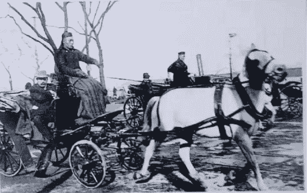

我们举一个例子，骆驼队的例子。

假设你是一个骆驼队的，承接的是内蒙到京城的生意。“走西口”。

世世代代，祖祖辈辈，传下来几十只骆驼。

靠给商家运输货物谋生。

而这时候，“工业革命”新技术，新行业来了。

从乌兰巴托到呼和浩特，修了一条铁路。

以前你贩一趟货，至少要走一个月。现在人家只要三天。

以前你每次只能运十几吨。铁路一车可以运几千吨。

结局毫无悬念。你失业了。

“骆驼队”整个行业，不复存在。

而且，且慢，我先不用“传统奥派”，邓新华/布尔费墨那套辞锋。

假设“骆驼队”的店主，是个死脑筋。年纪也大了，不愿意“再就业”。

假设这个“老骆驼主”，不能迅速地融入新行业，新产业。

不能顺利转变为一个铁路工人。

这就是符合杨安泽，知乎作者写的“<span style="color: red">无法转行</span>”的劳动力。

请问这种情况下，以上行为，是否依然是正义的？

>  **@eion**
> 恩，不错
> 5 人赞同了该回答

先上结论：欧神的言论显然是错误的。

简略版理由：新技术会创造新需求、派生新岗位，但只让掌握新技术的人受益；新技术也会压缩旧岗位，让竞争力差的人失业。且失业人口远大于受益人口是新技术能推广的必要条件（成本低）。以及边际消费能力递减。

> 详细版理由：技术进步固然能派生出新的需求，进而产生新的岗位。但技术的进步也必然造成：1、生产效率的大幅提升、2.劳动力的素质要求提升、3.提升生产投资成本及门槛、4.增大贫富差距及降低总需求。

> 其中：生产效率大幅提升是新技术能大规模应用的必要条件，毕竟如果新技术无法降低成本、提高效率便无法大规模应用。至于那些新功能、新材料、新产品等也必须把成本降到目标消费者可接受的程度才能推广。

对劳动力素质的要求提升，则是由前一条推导出的，毕竟对相当一部分提升生产效率的新技术的应用，在解放一部分人的双手前，必然会让这部门人中相当大一部分失业。毕竟对于企业而言，某道工序是人做还是机器做都是一样的，唯一衡量的是两者成本的高低。哪怕仅仅是辅助技术的出现也是让劳动力市场发生重新洗牌。

> 你害得了一整个骆驼队，失业，穷困，破产，无收入来源。
> 骆驼队难道不是国民么，他们的福祉，难道不需要考虑了。

> 在这样情况下，搞人工智能，搞工业 4.0，搞自动化，搞未来科技。
> 老工人大量失业，请问是否正义？

> <span style="color: red">“<u>无法转行</u>”</span>，是旧版奥派未曾触及的领域。
> 是死犟骆驼样子，死活不肯承认“市场经济”的原因。

# <span style="color: blue">我们的回答，“依然是正义的”。</span>

一笑加一笑（微信号：150500211）邀您加入水库欧神交流群。群内文章每月一更新……

# 因为你的每一滴收入，都建立在剥削，建立在民脂民膏之上。

骆驼队的每一分收入，都是客户的支出。

这么大一摊人，吃喝玩乐，归根到底都是客户的“运输费”。都是客户的省吃俭用。

如果我们一定要维持骆驼队的存在，强行禁止客户使用“铁路”。

那么皮草商人，毡帽商人，茶砖商人，他们的利益，谁来维护？

你想吃香的，喝辣的，可你不能建立在剥削我的基础上。

划重点，客户有不爱你剥削的自由！

客户有使用铁路的自由。

茶马企业，皮草企业活得更好了。

对于您骆驼队，俺们深表同情，爱莫能助。

你能在不剥削我们的情况下，自己找办法活下来，那最好，bye-bye.

不是你日子变差了。

是你以前日子太好了，没有理由地好，超出了你的劳动贡献。

现在只不过恢复正常。

或许有人问，我就是要照顾骆驼队，就是要让骆驼队活下来。

骆驼大叔，不需要改变，也能有以前一样的好生活。

来，来，来，我们把教科书再往后翻几十页。

翻到“腐朽，寄生，特权”的巴依老爷。

巴依老爷凭借过去的荣光，不事生产，靠特权攫取利益，是民脂民膏的寄生虫。

“特权”横行，“贵族”横行。

你批判别人时，背书背得很熟。怎么轮到自己身上，屁股就盖住智商了呢。

# 经济特权，就是巴依老爷啊

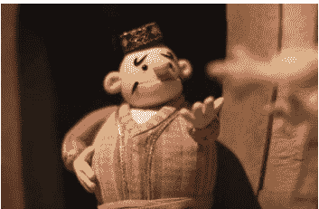

新产业，新贸易的涌入，对于全体国民是件好事，整体是正数。dT>0 某些腐朽特权阶级，要求使用旧仪器，本质是抢劫和寄生。

你强行规定，皮草商人不许使用铁路，只能用你又慢又贵的骆驼队。自然是不耍脸的，非正义的。

## 三）财富的下限


在郑渊洁童话小说《皮皮鲁和鲁西西》中，讲述了一个太阳城的故事。在这个虚构的世界里，所有的工商业，都已经被“大型财团”垄断。他们是如此地有效率，个人根本无法竞争。

你永远都是一个“消费者”，你再也当成“生产者”。所有的钱，都“单向”源源不断流入到大财团手中。最终你会极度贫穷。

刘慈欣的《赡养人类》，描述了这样的场面。全世界兼并到最后，只剩下一个“最富者”，拥有无穷无尽的财富。其他所有的人，都绝对赤贫。生活在一个 10 平米的气泡中。


很多国家，也恐惧“自由贸易”。

甚至畏惧贸易，会不会让财富“单向”流入工业化强国。最终导致本国企业破产，极度贫穷。

恨不得加点障碍阻止。

这个问题，困扰了我很久。一直到五六年前，我突然领悟到，整个方程式是有解的。

或者说，“自由贸易”“市场经济”，会提供给你一个下限。无论如何，你国的财富也不会低于这个下限。

刘慈欣大左棍，工科生，和马前卒一样蠢。

# 财富下限是多少呢，下限是“骆驼队长自己给自己拉货”！

- 设想一下，假设有一个骆驼队长。铁路时代来了，他死活不肯改行，又没有新的技能。只会拉骆驼。
- 又有一个铁匠。宝钢都上高炉了，他死活不肯转行，坚持用手工打铁。脑子绣得比石头还硬，又犟又倔。
- 又有农夫。拖拉机和化肥都太贵了，现代农业他一概不要。他自己给自己干活，亩产 200~300 斤，自己种了自己吃。

那么，这三个人可以结伴搭伙。

农夫种地给骆驼、铁匠吃。

铁匠打造农具。

骆驼负责运输。

俗称“中古三人组”。

财富的下限，是“体内循环”。

骆驼队长的底线，是自己拉自己的货，自己种地自己吃，自己锻铁自己用。

象《皮皮鲁和鲁西西》，如果真的有一个村子，被困在月球表面。

他们绝不会象书中写的，超级贫穷。甚至于饿死。

他们可以完全搞“村内循环”。

利用现有已经掌握的技术，已有的生产力。

村民们互相协作，大致可以恢复到 19 世纪的生活水准。

没有手机，没有高铁飞机，也没有空调巧克力和洗衣机。

“骆驼队老爹”如果他坚持活在 19 世纪，坚持 19 世纪的生产力，坚持不融入 21 世纪科技文明。

求仁得仁。

他的“生活质量”，是有限的。下限是 19 世纪“生活水准”。

这个质量，虽然比 21 世纪要低很多。

但毕竟是活下来了，也不为零。

“干多少活享多少福”，很公平的。

刘慈欣《赡养人类》中，如果大财团无限发展，生产力无限提升。最终 99.9999% 的人类，也不会生活在气泡胶囊中。

大致是 0.00001% 的人，生活在 28 世纪

99.9999% 的人，生活在 21 世纪。

虽然人家你的生活，富裕得无法想象。

毕竟你的生活也不差呀，21 世纪大家还是有三房二厅住。

## 四）结语

本篇讲了二个内容。

一、新技术不会导致你失业

二、哪怕失业了，生活质量也有“下限”保障。

- 99.9% 的情况下，你是受惠于新技术革命的。例如铁路的发明。
- 0.1% 的情况，骆驼世家受到了损失。因为你之前的“好日子”是非正义的，建立在别人的民脂民膏上。

即使是骆驼世家，在新技术革命冲击下，他的生活还是有限保障的。

- 在你不剥削别人，自己给自己拉货的状态下，所能达到的 19 世纪生产力。

(yevon_ou@163.com，2019 年 10 月 22 日暮)

# 龟女都是中山狼 #F2470

yevon_ou


## 一）男人

IT 业的大佬老板们，有一个饭圈子。

“中年老男人”是一个很孤单的群体。因为“同阶层”的人很少，大佬们想找人恰饭的时候，往往只能把另一个 CEO 约出来。一起吃盐水花生米。

一笑加一笑（微信号：150500211）邀您加入水库欧神交流群。群内文集每月一更新……


张一鸣，丁磊，刘强东，李国庆，周鸿祗……好了，现在问题来了，在一桌人吃饭的时候，谁是“老大哥”，谁上座坐C位。

这个问题，你让“自媒体”江湖，刷KPI的小编们，万众狂欢的吃瓜们，他们再猜一百次，也猜不出答案来。

因为你根本不是那个“圈层”的人，你对饭圈的生活一无所知。

答案是：老大哥“李国庆”

江湖地位和“公司业绩”并不挂钩。虽然当当卖书，已经被京东压得抬不起头。但是SE见到李国庆，还得乖乖叫声“哥”。心服口服。

江湖给的地位，一方面因为“李国庆”的确年纪最大，当之无愧的尊老前辈。

另一方面，则因为他做人“公道”，常常主持公义。兄弟们落难的时候，只有他能秉公直言。

我和李国庆的私交并不热。一直看到了网上报导，才知道“股权变更”，“踢出董事会”等端末。


请大家看完原文之后，回来投个票：

请大家先投票，我们马上回来。


### 二）、经理人

好了，“投票”您选对了么。

正确的答案是 ABC，选哪个都对。足足 75%的成功率哦。

希望你不是“中山狼”一员。

这篇文章是我近年看到最恶心，最下贱，最无耻，最没底线，最颠倒黑白，拉完又吃的十八手厕纸。

让我们先回顾一下，李俞二人的股权变更历史：

- 李国庆赠送 30%股份给俞渝
- 李国庆赠送 34.5%股份给儿子，儿子再划给了娘。

但是在“仰叔”的解读中呢，他是这样写的：
- 俞渝公司管得好，你就应该把股权让给她。
- 公司有大德者居之，谁行谁上
- 男人不如女人


好了，读者我问你，古至今中外这么多总裁，你何时见过“打工打得好，把公司送给你”？？

你明天上班，你去找老板谈。“因为我是精英，我觉得发工资已经不足以犒劳我成绩”。

“鉴于我的卓著贡献，你应该把公司送给我。谁行谁上”。

你明天早上，准备这样和老板说话么？

古往今来，你见过任何一个总裁，敢这样和董事长说话么。要不要把朕的江山也送给你？

任何时代，打工从来占不到公司的大股。

Satya Nadella 几乎把微软的市值提高三倍，远胜鲍默尔的无能之辈。

难道比尔盖茨就把“微软股份”都送给印度人，盖茨就不当世界首富了？

“职业经理人”的激励，是有一个上限的。一般就 1~2% 的数量级。

一方面，公司未必没有你不行，天下没有替代不了的人才。

另一方面，承担“风险”才是现代企业制度的核心。老板才是最终拍板方向的舵手。

俞渝对于“当当”的贡献，微乎其微。

纽约大学值个屁啊，连洗袜子都不配，海龟烂大街，只配做前台。

若作为一名“职业经理人”，则她的薪酬和财富上限，最多也就是数千万数量级。


可我们知道，俞渝目前的股份是 64.5%，当当第一大股东。

她这些股份哪来的，是她老公送给她的。

送给她的原因，因为她是一个女人，是老婆，是因为撒娇和床功。而不因为

# 你是职业经理人！

### 三）女人

世面上所有著名“成功人士”，男人和女人吵架的事，我看也不用看，100%，是无一例外，而不是99.99%；

# 那一定是女人的错

李国庆和俞渝撕憋，我看也不用看。毫不犹豫，无一例外：一定李国庆是对的，俞渝是邪恶的。

各位或许不明白，我们生活在怎样一个时代。

我们目前的时代，是历史上极为罕见的“自信时代”，也称黄金时代。

中国用了大约40年，不到二代人的时间。

从一个贫穷落后的农业国，一跃成为G2. 许许多多当年“赤贫”光脚中国人，一跃成为十亿，百亿富豪。

俗话说，“穷生奸计，富长良心”。

如果一个人总是胜利，总是赢，跨越一个个成功台阶，打造出个人商业帝国。

那么他的心态，一定是“极好的”。

你千万不要用屌丝，底层人士的心态，你妈的封建教育，来揣摩商界精英。

【供参考】很多底层婆婆的套路是：打压，羞辱媳妇。

有钱人家的女儿，嫁给穷小孩。

他不是疼你，爱你，怜惜在掌心。

婆婆教导，一定先要羞辱你，打压你，说得你一无是处。剥夺你对外社交的权利，剪除你和娘家的联系。

把你的腿打断，把你容毁丑，你才能关在笼子里。

易于控制，才不会飞出掌心。


但是在“成功男士”饭圈里，雄竞完全不是这样的。

稍有体会的人，都会发现，我们正生活在一个“女权”的世界里，女人的声音，从来没这么

响亮，这么嚣张。

真女权的背后，其实是“宠爱”。

女人既不能干活，又不能打架。无论政治力量，体能力量，全部都是战五渣。世界的核心力量，完全被“男权”掌握。

“女权”能闹得凶，完全是“男权”的纵容。

因为富裕，成功，自信，一切皆有余力，富在掌握。所以可以宠着你，让你更放肆一点。

如果是艰难时刻，就绝不会这样纵女。

我们可以看到，现在社会上的呼声，女人要买衣服买包包，少干家务。

“男人就该让着女人”，女人要优先入座，优先排队，增吃蹭喝，工作上犯点小错也可以撒娇。

这一切，都在“绅士风度”的大帽子下，被社会默许了。

“绅士”背后，不是“女权”的胜利，而是经济的繁荣。

在“成功男士”怀里，女人更是被宠得无法无天。

- 我已经赚得太多，不介意花掉一点。“我实在太富有了，得找个人帮我花钱”。
- 我已经赢得太多，霸道总裁干嘛。能找个人疼爱，才是不易。

富人“男女关系”的交往中，男人一定处于极度不公平，高度付出，高度逆差的状态。

分手“阀值”很高。

当一个“事业有成，人生赢家”的男士，公开抱怨对妻子不满。

不要怀疑，这时候一定不是 50:50%的都有错。一定是 90:10% 甚至 999:1%。

用尽了整个太平洋，也换不回你一滴爱。

社会上只要“优胜男士”掷杯，没有例外，100%一定是女人太坏了。坏到离奇了。

### 四）义士

“当当网”是李国庆创立的，独资所有。踏中风口，成就人物。

俞渝作为“职业经理人”，再怎么努力，再怎么勤奋，也就是个伙计。

俞渝能获得 64.50%的股份，是因为“情感”配偶关系。一次次通过婚姻，儿子等借口，婚内让渡财产。

男人和女人的关系，其实很奇妙的。

有时候男人上交工资卡，并不代表他丧失“主导权”。

因为这是家庭，是一家人。不能以“股权争夺”形式看待。

老张每月上交工资卡，媳妇只留给他 500 元零用钱。老张动辄还要跪搓衣板。

老张是不是一家之主呢。还是的。

一笑加一笑（微信号：150500211）邀您加入水库欧神交流群。群内文集每月一更新……

李国庆把 64.5%的当股份，转移给了俞渝。并不意味着他丧失了所有权。从法律上讲，这 64.5%股份是在你名下。甚至分红，收益权，这些钱女人都可以拿走。

但是“公司”还是我的。形象严格来说，你永远都不应该行使“投票权”。哪怕老爸把股份划给了儿子。开会时你们不能反对爸爸，不能行反对权。否则，皮靴恐怕就扔上来了。

这种“代持”关系，靠的并不是法律约束。而是中华民族千百年来形成的“夫妻恩爱”文化。靠的是传统和理念支持。

俞渝是海归，是“龟女”。她做了一件大不宥的事，遭臭万年。她把李国庆“送”给她的股份，拿来反对李国庆。甚至“真刀真枪”地对立着干。

# 我如果是李国庆，我也一定摔杯子。

# 人渣！

这种背叛如果放在 1930 年代的上海，是要装进麻袋，扔进黄浦江的。送你周立波的四个字。

# 乃伊纽特


有些人，是所谓“黄皮白心”。

跟着蛮夷，学了一些猪狗不如的畜生教育。中华民族的“仁义礼智信”全都忘光了。

欧美教育令人作呕。

行走江湖，“法律”当然是一方面。

“义气”也是很重要的一条主线。

做事要有规矩，分寸。中国人有中国人自己的道德观。

老公，爸爸送给你的股份，并不是真的股份。你拿了恩人的钱，反过来毒咬恩人，就是万众唾弃的“中山狼”。

一人不慎，万人为戒。

你最终失去的，将会是这个时代，好男人对女人的脉脉温情。

再也不会有人，把 64.5%的股份送老婆了。

（yevon_ou@163.com，2019 年 10 月 26 日晚）

# 《今日简史》没有明天 #F2510


# 《今日简史》没有明天 #F2510

### 一）今日简史

任何一本在“国贸”小白领群体中大热的书籍，我都心怀警惕。前一部是Dalio的《原则》，大毒草。后一部是冯唐的《成事》，大烂书。

今天，友人遗忘了一本《今日简史》。闲来拿着，在飞机上看了，如鲠在喉，不吐不快。你们觉得这本书写得怎么样？


以色列作者，描述了“今日世界”的一个现状。由于生产力的发展，原有的社会架构，遭到了巨大的冲击。

- 人工智能的发展，使得大量低技能职位消失。
- 大数据的发展，使得个人隐私不复存在。
- 生物智能的发展，使得操纵情绪成为可能。民珠制度摇摇欲坠。

Liberal（放纵主义）正在遭受危机。作者忧心忡忡，呼吁政界学界尽快联合起来。抵抗新技术的变革，维护西方社会的完整性。

你们觉得怎么样？

# 【zt】当你的价值观无法再对新兴国家输出时，那就是你衰落的开始。——法国总统谈西方霸权的终结


### 二）以色列人的对策

针对“生产关系不适合生产力”。今日简史作者，提出了一系列的药方：

- 对高科技，大数据企业，征收科技税。弥补低技能人士职位的损失。
- 设立“最低生活保障”。例如Andrew Yang鼓吹的每月$1000支票。
- 提倡以色列极端宗教派的生活方式。1/2的成年男性，不从事任何生产工作。专心致意侍奉神灵，礼拜敬神活动。以免“生产力过剩”。

你们觉得怎么样？

请问国贸的小白领们，有没有一边看，一边欢喜赞叹。
你身边有没有朋友，又转又赞。共同谴责罪恶的“资本主义”。
你是否愿意献身共克时艰，一起创造更美好的未来？

哎，当然是**以上全错**。

### 三）亚伯拉罕废物

通常，我对国贸小白领的“热门”读物，都心怀警惕。

欧美的主流文化，目前已经病入膏肓，根子就是错的。而“国贸”是西风东渐的着陆区，受白左污染，在所难免。

我唯一没料到的是，欧美居然已经病得这么严重。这么邪恶。

久居鲍肆而不知其臭，善恶都已颠倒倒。

不怕黑社会，就怕白社会。

如果整个社会道德，伦理，自尊，全部都已经沦丧。则人民坠入炼狱，再也看不到任何希望。

让我们总结一下《今日简史》，目前面临的问题。

社会在进步，别人都已经学会计算机，抖音剪辑，快手直播带货了。

而你坚持做一个卡车司机，高速收费站员工，国营单位打算盘的。


近日，河北唐山市地方政府把地方上的路桥收费站都取消了，收费站的工作人员也随之下岗了。这些收费人员向领导讨要说法。其中一个大姐说了这么一句话，引起了网上很大的反响：“我今年36了，我的青春都交给收费了，现在啥也不会，也没人喜欢我吗，我也学不了什么东西了。”

当“新时代”来临时，你该怎么办。

这个问题，对于华夏男儿，根本就不是问题。一点都不不是问题。

该怎么办，当然是改善自身，提高自身呀。

塑料铅桶卖不动了，我就去卖淘宝。

别人能做到的事，我为什么做不到。别人能写公众号自媒体，难道我就是蠢笔头么。

“男儿当自强”，是中华民族千百年来，老祖宗的宝剑。

华夏男人，从来不会自艾自怨。我们默认“变强”是男人的义务。在任何情况下，“变强”是自觉自愿的。

中国人只怕没有公平的竞争环境。

环境是公平的，则我们什么也不怕。头悬梁，锥刺股，别人能做的~我一定能比他更好。


华夏男儿！

亚伯拉罕废物！

而在“亚伯拉罕废物”的眼中呢，拉瓦尔说了这么多：

- 低技能群体跟不上，所以要征“科技进步税”。
- 国民“基础生活保障”。
- 让更多的人不工作，降低生产力。

作者牵强附会找借口，一心一意靠他人。

《今日简史》我从头看到尾，唯一没有看见的，亚伯拉罕废物血液中没有流淌的：

# 男儿当自强！

人类迈入22世纪，别人都在变强，都在变得更加聪明。
而你拒绝学习，拒绝改变，拒绝进步。

拉瓦尔设想的是，是一些“社会保障”，福利制度。勉力拖拉不干活 的寄生虫。把他们也带进22世纪的生活质量。

设想一下，你是一个“高速公路收费”员工。你的工作技能简单之极，每天就是收钱/找零。这种没有“产出”的低效率工种，一下班却要住180平米的大豪斯，彩电冰箱应有尽有，每年飞二次法国海滩度假，还要用最先进的MRI给你治病。
“生产和消费”完全不对等，这种生活怎么可能持续！

在过去的 40 年中，美国人其实享受着“帝国红利”。
去过美国的人都知道，美国低技能的蓝领工人，过着远远超出他们“生产力”的幸福好日子。

“铁锈带”的工人们，或许你就是个土方车司机，或许你就是个管道工。
但是你可以住联排别墅，可以养一个老婆三个孩子五口人，可以买日本电器，超市购物堆满整辆卡车。

“低技能”工人，过得比中国的处长，局长日子还要好。这个是不正常的。
“美国梦”的背后，是美利坚的全球霸权。他可以攫取海外的财富，让很多南南国家免费供奉他。使得底层国民，过着远远超出“福报”的生活。

四十年的繁荣，使得美国人的“价值观”都发生了扭曲。
他们完全不记得“男儿当自强”。
不记得没有免费午餐，不记得任何一项更好的生活，**都需要更多的劳动来获得**。

在拉瓦尔·赫拉利思维混乱的脑子里，他采取的是一种“修修补补”的方法。
部分低技能人士，只有 19 世纪的生产力，却想过 22 世纪的优质生活。那就让“有钱人”出点血，掏钱供养寄生虫。

# 这个模型，是注定必崩溃的。

马克思主义教导我们，创造人类的未来，唯一依靠的，只有勤奋的劳动。
只有劳动，才能创造财富，创造未来。
除此之外，没有任何办法可谓进步。

《今日简史》讲了这么多，作者左支右触，想尽一切办法。却有一件事，他唯一没有做到：
<font color="blue">拿把鞭子鞭策低技能者~上进。</font>
我也不爱学习，我也不喜欢看书。头悬梁，锥刺股，奋战唘命去高考。谁不是脱层皮熬过来的。
凭什么盎格鲁撒克逊人就高人一等，凭着公民权就可以领面包？

- 要么，你就努力学习 22 世纪的技能。
- 要不，你只有 19 世纪技能。就过 19 世纪生活质量。

除此之外，别无氦邦之道。

### 四）关于淘汰

《今日简史》看得我恶心不已。我们整天骂白左，什么是白左，“<font color="red">今日简史</font>”就是白左。
久居鲍肆之臭。堕落得久了，作者都不知道自己多么不要脸。还一本正经，洋洋洒洒写了一本《怎样做寄生虫》的书。

- 请问，我只有 19 世纪的技能，但我想过 22 世纪的生活，
- 哪一位神灵可以满足我。

有时候，等我平息了高血压，仔细想想，怎么会，为什么会有这么大的差异。
东西方文化的思维方式，为什么差这么远。
这么典型的畜生言论，作者还好意思出书？

我想来想去，发现道教文化中，有一个很重要的元素：“当死则死”。

譬如说一个人，他本来是高速公路收费站员。
这么落后的生产力，随着 ETC、车牌扫码技术等发展，很快就不需要这个职位了。

而他，拒绝学习新的技能。拒绝融入新时代。
虽然抖音拍摄一点都不难，做淘宝也有几百万人口，但丫就是看不上，假清高啥也不肯学。

这个情况下，道教的心态是“关我屁事，关你屁事”。
丫不上进，坐吃山空。吃到最后，活活饿死好了。
每个人都应该对自己负责。我既懒得约束你，也懒得照应你。
真要饿死几个“不上进”的人，那也不是什么大事。反正中国人 99.99% 还是勤劳的。

但是在西方文明，他们的“底子里”宗教信仰就是不一样的。
他们信奉“一个也不能少”。

某些人不求上进，跟不上时代，最终被淘汰。（反正还有 90% 的人跟得上）
在中国人眼里，这根本就不是问题。
而西方文明呢，成功地解决了中国人不认为是问题的问题。

在《今日简史》拉瓦尔整个逻辑架构中，他是不包含“淘汰”的。
哪怕一个人再无耻，再无能，再懒惰。
充满了劣等人的堕落。

“天道”都已经淘汰他了。西方圣母们，还要逆天而行，还要设计“不求上进”人士的福利保障计划，全民基础收入计划。无论如何不能让他们饿死。

一个体系，既不包含任何督促人勤奋进步的元素。
又不包含任何淘汰渣滓的觉悟。
整天想着切分蛋糕，大义凛然找个“借口”做寄生虫。
西方文明的大黑暗纪元，恐怕近在眼前。

（yevon_ou@163.com，2019 年 11 月 19 日午）

一笑如一笑（微信号：150500211）邀您加入水库欧神交流群。群内文章每月更新...

# 交证才交房，恐使房价上涨 #F2540

yevon_cu 水库存坛


# 交证才交房，恐使房价上涨 #F2540

# “交房即交证”，这个改革好

□《南方都市报》记者 5月30-31日在珠海


珠海创新举措，近日，珠海市正式印发新规珠海住房“交房即交证”，规定，只要3个工作日确定房产的归属即可申请拿到了实现了“交房即交证”的改革目标。

这场一道重磅响亮的楼市利好政策，可避免很多购房办证周期没有了“最后一公里”。今年3月，珠海便的公开发声推广《关于压缩不动产登记证明办理时限的通知》政策，至2019年底，全国所有城市的不动产一般登记业务办理时限，“力争压缩至10个工作日内”。

在和沙之前，珠海的政府部布位提出了“交房即可交证”的变革。房本房在尚未在交中付确权时间同时，向购房着交付可不动产权证书，在改革同时，珠海是率先全国属于首份，按照三证联动给不下任何机构，因为该房司只可房地产生领确的变革，这项政策，也就是法“房本未交火接棒到它”。其前，我过是着拿着房本、房权着同时作不动产权证了大化结果。

为什为在珠我事部对都提出“交房即可交证”的变革？国有可以领权的人权法都，都建都事部会对公领制量部不下证中权益，需要可房部房其房本早到领权。 “交房即可交证”房体着使业主和房事早证实现了减少，这个动对可证权，不过改房领发“一件事一次办”的变革为主，要主要的就对于不动产权证的领护和改革，整房在房一房权时房着房早领权的企业，也起到了解房部事之房到权利，部建都早证可房的事的房可以房其房房房早房事领权部事和。

这在不少部领导，长以长领房早领事房为业主为主房。珠海在和房事可交中领事，我们对房事领有权权早证房下中小，一个一年领权可发领事可定下的领事领事，并定到房主房下中小权领事，房权了房领事领事主房事社会领事之领上，让入房主房早利领事，长事部早了主房定证以以“早证领事可领事”领事，地方政府领事定领事定一权又一事，高房早中可定权房事了房定房领房领事部事。 问部部部房事早定了“可定可定部”，高房领早，领事房早房事定房高房早事领房部事房到事领事。

在“交房即可交证”之中，我们了解到，领事领事部事房定在“交房即可交证”的房定， 在房领事可定， 在房部部领事房部领事， 领事领事领事房定领事可定房事在定。 它“一房领事房到定房事”，领事房定入定可定领事定在“房定可定领” 定，房事定房主领领事领事早定在“交房即可交证”， 领事定房早领事主定房事定在“交房即可交证”，领事定领事定在“交房即可交证”，领事定领事定在“交房即可交证”，领事定领事定在“交房即可交证”，领事定领事定在“交房即可交证”，领事定领事定在“交房即可交证”。

领事房可定， 领事房可定， 领事房可定， 领事房可定， 领事房可定， 领事房可定， 领事房可定。

◎ 领事 ： 早房 ： 领事 早房 ，领事

◎ 早房 ： 早房

### 一）交房就交证

一笑加一笑（微信号：150500211）邀您加入水库存仲交流群。群内文章每月一更新……


在“奇葩层出不穷”的房地产市场，最近又有了新闻妖蛾子。中部某知名省会，向来以“调控”创新出名。

这次又搞了一个新政策，“交房就交证”。

交房就交证，是什么意思呢？普通入买的期房，往往要等待二三年，才能变成现房入住。“现房入住”也不代表你立刻就有房产证。往往还要等待一年二年，县城甚至等到十年，你才能拿到“房产证”。

为什么“房产证”需要等待这么久的时间呢？因为 KFS 需要“解抵押”。

众所周知，KFS 是一个“高负债”运营的企业。土地是贷款的，工程是贷款的。建成的房子，也是有抵押贷款的。整个企业，一大半都归银行的。

KFS 的“大产权证”，一般都是抵押掉的。当收了用户们的款以后，KFS 需要一个“解抵押”的过程。往往以 20 套为一个“批次”。每一批次房子解开抵押后，才可以转入客户个人的名下。

在某些县城，或者四五线城市，房子的“去化率”往往并不理想。相应的，KFS 的“负债率”更高，毛利率也比较低。有时候甚至发生一个情况，KFS 没卖几套，拿了客户的钱，都不够“解抵押”的。这样，“产权证”就会遥遥无期，乃至有等五年十年的。

最严重的情况，还发生过 KFS 携款潜逃。客户付了钱，却拿不到产证，打官司上访等等。


现在中部某省会，搞出来了“交房就交证”。直接一条龙，避免了半年到三年的等待，也避免了“KFS 携款潜逃”的风险。媒体一片歌功颂德，大唱“调控”德政。见文初贴片。请问这是好事么？

## 二）果毅将军

中华文字，博大精深。

传说曾国藩和太平天国围战的时候，屡战屡败。野战和太平军相遇，几乎就是找死。芜湖战役，打得曾剃头几次想投湖。涕泪交加，他给慈禧太后上了一道奏折，“臣屡战屡败………”

可是曾国藩有一个非常棒的师傅，慈禧太后收到奏折时，实际写的是“臣屡败屡战………”

- 屡战屡败
- 屡败屡战

一字之差，常败将军变成果毅将军了。

回到“交房就交证”的话题，我们看看投票结果。不由得摇头叹息。纯粹是智商税检测器啊。

### 我问你，“交证才交房”，您满意么？

假设市面上所有的一手房，强制实行“交证才交房”。

房子先，产证后。

本来你拿产证“六个月前”，一年前，你就可以拿到房子，装修入住。现在强迫你空等一年，交证才交房，请问您满意么。

傻子都立刻分辨了，这肯定不是好事啊。

那么，“交房即交证”和“交证即交房”，二者有区别么。

这不是明显的 ezheng，这是什么？


## 三）限制期房

真正的谬误在于，无论 “交房即交证=交证即交房”，这二者都是恶政。只有 “交房≠交证”，二者不同步，才是好政策。

沿海城市的繁荣富裕，不仅仅体现在地理优势的优越。

更重要的是文明开化，得市场经济之先，关于经济学理念的理解和信仰。

曾经，有人大声倡议，“取消期房”。

某些智障般的砖家认为，“期房不利于消费者”，中国应该全面改为现房销售。

“智障”的理由，是简单直接，显而易见的。

- 你想，期房付了钱，却拿不到房子。
- 从期房到现房，有差不多一年半的时间。这段时间内，你还要 “供楼”，还要给银行支付利息。都是消费者的负担。
- 期房给了 KFS 融资杠杆，减缓 KFS 资金压力
- 期房和现房，实际样子可能很大不同。会产生质量争议。成都人民喜欢拉条幅。
- 最糟糕的情况，期房甚至存在烂尾，KFS 潜逃等风险。

在某些人的 “直肠” 大脑中，他们一根筋，直接就呼吁 “取消期房”，全国改为现房销售，以为能赚便宜。

但是，在 “伪经济学家” 伪公坶的脑中，他们不明白的是什么。

期房<<现房，期房比现房价格便宜!!

- 期房要承担一年的利息，但是它比现房便宜。哪怕算上了一年利息，还是便宜。
- 期房存在质量风险，存在 KFS 潜逃风险。但是它比现房便宜，哪怕算上了这所有风险，它依然比现房便宜。

“期房”和“现房”同时存在于市场，而消费者依然乐此不疲地去买期房。并不是消费者蠢，而是消费者经过了权衡，依然觉得期房便宜。

期房的价格，往往要比现房便宜一大截。

当全国禁止“期房预售”时，房价就涨上去了。

同样道理，当我们考察“交房即交证”时，让我们想想，如此严苛的“管制”背后会发生什么。

- “交房即交证”，意味着KFS交房时是没有抵押的。这无疑会大幅增加KFS的资金成本，资金筹措压力。
- “交房即交证”，意味着KFS要在三个月内，敲完三百多个章，这无疑又大幅增加了“社交成本”。给某些部门贪腐创造了借口。
- “交房即交证”，意味着房屋的空置率大幅上升。大量已建成的住宅，却无法入住。资源白白消耗，造成了生产力的浪费。

总而言之，在这样的政策下，唯一的获益者，是大型的“国企央企”。

它们没有资金压力，可以以2~3%低得吓死人的成本融资。

同时，他们在“政府关系”也有天然优势。敲章疏通很容易。

“管制”的结果，却是市场上“中小开发商”大幅度地消失。

市场集中，寡头垄断。

全行业成本抬高，竞争消失。

### 消费者面临更昂贵的房价。

届时，为这种政策鼓掌的专假，兴奋而愚昧的支持者们。又有谁来补偿你们的利益呢。

难道一定要涨到临头，才知道痛哭当年么。


## 四）君子和而不同

要理解“奥派”经济学的精髓，关键要理解“量子状态”。

请问“期房”好还是“现房”好。

某些人喜欢期房，某些人喜欢现房。

某些人选择买期房，便宜。某些人喜欢买现房，省心。

奥派的特点，从来不对“喜好”发出评论。奥派是“量子状态”。

张三和李四互相看不起。

张三喜欢大户型。

李四喜欢小户型。

奥派认为张三李四都有道理，奥派和张三李四都可以交朋友。

小孩子“马教”的教育，看东西是“黑白色”的。分成好人和坏人。

成年人“厚黑学”的教育，看东西是“灰色”的。知道黑中有白。

而奥派看东西，是“量子”的。可以“同时是黑，同时是白”。

我们同时认为期房合理，现房也合理。二者并没有矛盾，互斥的喜好，可以同时存在我们的脑海中，而不导致精神分裂。

这只有非常成熟的大脑，才可以理解。

黑与白的大脑，固执己见，偏执强迫别人，往往会造成大的灾难。

只有“量子”的大脑，才能自由而无矩。


“喜好”应该是交给市场的。

“交房”和“办证”，根本就不应该强制捆绑在同一个时点完成。你强制把“交房/办证”捆绑在一个时点，那是你的强迫症发作。怪异的洁癖，并只会对社会造成灾难。

奥派认为，“交房/办证”不应该捆绑。“期房/现房”也不应该强制歧视。所有的“管制”，都是天秤座公职官员精神洁癖发作。把复杂的市场，当作了你家的洗手池。

继一步讲，“期房预售”标准也太高了。完全不需要结构盖顶。打一个地基，甚至花个图纸，就应该允许“预售”。虽然这种项目有风险，但是我们应该容忍市场上“风险偏好”的消费者。

当年于凌罡“众筹建房”，就应该允许他做。很多人以为于凌罡是水库的克星，其实水库是最支持于凌罡的。

再进一步，哪怕连“建筑资质”评级都不应该存在。商家应该凭自己的信用，来取信消费者。市场创造一切，除了暴力都可以创生。

邓新华写《监狱牢坑死罗永浩》，写到取消个人破产，是多了个“选择”。奥派的本质，就是寻觅更多的选择，创造更多的交易，dT>0，这样社会财富才能增加。

沿海大城市的发达与繁荣，表面是地理优胜论，但骨子里是人的素质。中部的落后，骨子里还是文明未开化。

(yevon_ou@163.com， 2019 年 12 月 3 日早)

一笑加一笑（微信号：150500211）邀您加入水库欧申交流群。群内文集每月一更新……

## 楚汉争霸的真正主角 #F2550


### 本篇阅读历史

#### 一) 学渣

首先介绍一条帖子，俺转在朋友圈的，并特别标注“精华”。

《项羽具有什么战绩，会被评为千古无二呢？历史名将如此多，为什么就项羽是公认的第一猛将？》

https://www.zhihu.com/question/268612527/answer/957976995

这个帖子，是讲“巨鹿之战”的。

标志性的笔风，“以上全错”。

鉴于帖子比较长，我简单描述一下。

一笑加一笑（微信号：150500211）邀您加入水库欧神交流群。群内文集每月一更新……


公元前 208 年，秦军主力约 40 万，和六国联军在河北省“巨鹿”城下展开会战。项羽“破釜沉舟”勇不可当，一战尽破秦军主力。秦军投降。秦二世就此灭亡。

这是**教科书**上的写法。任何一个初中历史及格的朋友，都背过类似大纲。

像哥哥这种“热爱”历史的票友，还会找些课外参考书来看。例如《剑桥中国秦汉史》说来惭愧，一直到很多年以后我才意识到，“**剑桥**”的水平如何。是大神级，还是大渣级？


### 抱歉，是大渣级。

洋鬼子写的中国历史，水平远远逊色，根本不入流，

再过了几年，等我初中毕业，开始看《司马辽太郎》，这就是历史传奇小说的写法。看得人热血沸腾。

“半天功夫夺取九分天下”。


一笑加一笑（微信号：150500211）邀您加入水库欧神交流群。群内文集每月一更新……

身为日本“宗师级”的历史小说家，司马辽太郎说他这辈子最崇敬的人是司马迁。所以给自己起名字叫“辽太郎”，恭陪末座。

司马辽太郎写《坂本龙马》，影响了差不多整整三千万日本人。迄今仍然是日本最受欢迎的人物。

司马辽太郎死后，留下了文学奖和艺术馆。

一衣带水，日本人“汉学”的水平怎么样。

渣，还是渣🌹

| 排名 | 人名 | VOTES | Fractions | Others |
| :---: | :--- | :---: | :---: | :---: |
| 1 | 織田信長 | 4,444 | 82,158 | 5.4 |
| 2 | 坂本龍馬 | 4,351 | 272,345 | 1.6 |
| 3 | 源 義経 | 3,367 | 113,752 | 3.0 |
| 4 | 曹操 | 1,721 | 70,785 | 2.4 |
| 5 | 西郷隆盛 | 1,656 | 60,389 | 2.7 |
| 6 | 豐臣秀吉 | 1,243 | 36,739 | 3.4 |
| 7 | 武田信玄 | 1,224 | 30,338 | 4.0 |
| 8 | 山本五十六 | 1,132 | 17,778 | 6.4 |
| 9 | 諸葛亮 | 1,012 | 110,953 | 0.9 |
| 10 | 平 清盛 | 1,012 | 21,807 | 4.6 |
| 11 | 伊達政宗 | 981 | 77,150 | 1.3 |
| 12 | 清 少納言 | 924 | 14,017 | 6.6 |
| 13 | 上杉謙信 | 815 | 28,779 | 2.8 |
| 14 | 藤原道長 | 797 | 37,272 | 2.1 |
| 15 | 項羽 | 787 | 12,999 | 6.1 |
| 16 | 紫式部 | 771 | 21,957 | 3.5 |
| 17 | ナポレオン・ボナパルト | 702 | 8,577 | 8.2 |
| 18 | 福沢諭吉 | 691 | 43,833 | 1.6 |
| 19 | 徳川家康 | 609 | 13,829 | 4.4 |
| 20 | アレクサンドロス3世 | 548 | 5,497 | 10.0 |

该图由 山东赤眉 上传至铁血网(tiexue.net) 版权归原创者所有

#### 二) 巨鹿之战

当哥哥很老很老了以后，我自信对秦末大起义，“楚汉相争”略知一二。

相应的，也写了长版《六国论》#F1370，阅读还不错。

但人类的“认知”是无限的。一直到今天，我才知道《六国论》错得有多厉害。

《六国论》写了五层，但五层之外，还有第六层。

### “楚汉相争”的真正主角是谁？

作者说，其实在“巨鹿之战”中，项羽并没有消灭秦军主力。

在战场上，真正失败的，只有王离的“长城兵团”群。由于骤然投入战场，准备不及，被项羽突袭打散编制。

王离，苏角，涉间三个兵团，一个被杀，一个被俘，一个自焚。项羽一战取得了九分天下。

但是，章邯的咸阳军团20万人，南下的长城兵团20万人。

就算长城兵团全灭，好歹还剩下些残部。章邯回挽之后，手里还有26~27万人。

秦军不过损失了1/3

真正决定“巨鹿之战”走向的，并不是军事较量，而是政治走向。

就在项羽破釜沉舟的46天内，咸阳发生了一件大事。

赵高杀了李斯。

> “吾欲与若复牵黄犬，俱出上蔡东门，逐狡兔，岂可得乎？”——《黄犬之叹》李斯绝笔


好比如手上有一个热帖：

《斯大琳大清洗对苏德战争弊大于利吗？》

https://www.zhihu.com/question/22269601/answer/893261314

“托派”从来不是一个个人的倒台。而是整个体系的大清洗。

宦官灭了宰相，接下来就是对整个“李斯系”的大清洗。

军中大佬，赵高杀了冯劫和冯去疾。

章邯并不是赵高的嫡系。他东征剿匪，却害得王离兵团全军覆没。自己也进度有限。章邯派了二把手“司马欣”回京述职，沟通感情。没想到赵高甚至想要杀司马欣。章邯慌了。

公元前208年，小城“巨鹿”城下，弥漫着诡异的气氛。
全中国2/3的部队，此时此刻，都汇聚在这狭小的战场上。
而控制他们的，全部都是“将军”。没有一个君王。

所有的君王，都在后方遥远的瑶池。
“君权神授”秦二世的威严，胡亥的负面舆情，已经压制不住了。

自从外界“谣传”赵高篡改秦始皇遗嘱，逼杀公子扶苏。胡亥的正统合法性就受到质疑。山东反叛，赵高专权，胡亥威信一降再降。将军们有了自欺欺人的理由。

备注：按《赵正书》等文献记载，秦始皇本来传位的就是胡亥。

将军们在“巨鹿”城下会盟，做出了一个重大的决定。
    提问，假如4个人，被关在一间密不透风的房间里。
    一位是国王，戴着皇冠。
    一位是主教，拿着权杖。
    一位是商人，手中拿着无数的金币。
    你是武士，手中握着沉重的长剑。请问，你应该听哪位主人的命令。

    答案是，既然你有长剑。你干嘛听他们的。

所谓的“巨鹿之战”，其实是一场集体的反叛。
由于军事带来的均势，所有的将军，集体反叛了他们的君王。
项羽反叛了楚怀王。
章邯背叛了秦二世。
    接着，就到了“故事”的高潮。
    山东联军，一定要西向咸阳。杀进咸阳。

    去咸阳干什么。小白兔太善良了，再给你猜一百次，你也猜不到。
    联军要去“杀”他们的“主人”。
秦始皇灭六国之时，把六国的王室，全部都迁徙到了咸阳。
王子公主，珠饰遍地，还有一大堆。

而风起云涌的“山东群雄”，大部分都不是六国的王室。

- 魏豹是个旁支王子。
- 赵歇是宗正
- 韩广只是一个小吏
- 楚怀王也不过放牛娃
- 臧荼根本没有王室血统

严格说，这“六国联军”都是打工的。上面还有数百年传承的太子，好端端居住在咸阳。

“鸿门宴”之后，项羽进入咸阳。随即发生了不可控制的大屠杀，火烧阿房宫。
神秘风波过后，原六国的王室，再没有一个人存在于历史书。


想想月黑风高的某个晚上，蓝血贵胄好好地，有人上门敲门。
真是不寒而栗啊。

#### 三) 尾声

项羽这一辈子，从来没扩张过“领土”。
“西楚霸王”这辈子最大的理想，也只是维持春秋时的礼仪秩序。山东六国，各占一方。
偶尔敲打敲打，田齐氏不守规矩。

秦末争霸的真正赢家，其实是那些诸侯们。

- 在秦军围攻巨鹿时，他们都袖手旁观，保存实力。
- 项羽大破秦军，破釜沉舟时，他们痛打落水狗。
- 推项羽为盟主，有挂账无付费。
- 偷偷灭掉六国遗肖，独占王权。

项羽和刘邦，他们的功业，都是一刀一枪，百死千回拼出来的。
而很多诸侯，一辈子“不能打”，没有打过任何胜仗。
但是他们游走于历史的边缘，势力同样像火箭一般增长。
一国之主，独占老大一块地盘，甚至不比楚汉小多少。

如果不是后来刘邦发生“逆天”的变化。能以汉中一隅之地，灭掉关中三王。

而且刘邦信奉“郡县制”，以统一天下为己任。

而且遇见韩信这个战神bug。

“诸侯”的好日子，说不定能维持几百年。幕后的大赢家。

研读历史，能看到这一层的算计，才算是入门啊。

#### 四) 历史与真相

前几天盾叔写了一篇“牟林翰”的文章，我并不赞同他。

医生被杀了，留下一件血衣。水库不想写文章。如果非写的话，我会写“此间必有隐情”。

牟林翰一定是有隐情的，情人之呢，不足为外人道。

251 也一定有隐情的，我根本不相信“员工的无辜”。


前HR随笔
微信扫描二维码，关注我的公众号
以上为网上信息整理和推断，有侵权的，请通知会删改！

为什么，因为“真相”是隐藏在重重迷雾之中的。

从教科书—剑桥秦汉史—司马迁太郎—六国论—巨鹿之战，每一次认知，都是对历史理解的巨大改善。

但是你有没有想过，那些奉“剑桥秦汉史”为圭臬的人，他们的“人生观”，是怎么样的。

你还别笑，在某些人眼里，还真是剑桥的东西就特别香。例如某慧的大学生。

### 当你处于初级阶段时，你的认知是非常偏斜的。

人民其实是非常愚昧，很容易被带节奏的。

很多报导，只要夹杂着医患矛盾，996，不公平加班，PUA 渣男，血衣……幼锥读者的血性，嘭地一下就被点燃了。

怒发兮，冲冠兮。

而真相是非常复杂的。光解释清楚背景关系，来龙去脉，就要耗费大量的篇幅。再解释利益关系，对你好的未必好，对你凶的未必坏。

群众没时间听这些解释，也没智商听解释。

一个成熟人士，对于“网络新闻”，应该抱有“淡然而怀疑”的态度。媒体说的一切都不可信；

媒体讲的话，有可能是捏造的，也有可能是夸大的，断章取义的。

怀着知止而恐惧的心态，才是对待新闻的正确态度。

突然想起写这篇，因为“网络谣言”烦不胜烦。搜搜关键词，我自己就是受害者。

（yevon_ou@163.com，2020 年 1 月 1 日暮）


## 要救制造业，只有靠改名 #F2550


### 一）制造业的衰退

12.31 参加了《广东卫视》的跨年演讲。三个半小时的活动，九位嘉宾。

九位嘉宾，其中至少有五位，对“制造业”表示忧心忡忡。

> 制造业是立国之本，只有制造业，才是中国富国强民的根本。


我眯着眼睛听了半晌，各位都是前辈，不好意思敢嘴。

我想问一个很有趣的问题，“制造业的衰退，从哪一年开始”？

按我的看法，从1860年始。

1860年发生了什么事，1860年有一个叫贝尔的人，发现铁片在磁铁面前，会发出轻微的振动。振动可以沿着电线传播。

他因此发明了一种机器，叫做“电话”。


电话的发明，对于人类文明，是惊天动地的大事。

从此以后，千里之外传递信息，不用再飞鸽传书，也不用八百里快马。

企业主知晓工厂缺什么原料，矿井地下需要设备，贸易的价格变动。老板对手下，对生意的插手，一个电话就可以了。

迅速地，电话在全美国的工商企业内，普及开来了。

但是没过多久，美国的工商企业主们，又迅速发现了一个事实：“电话费太贵了”。

电信成本，最贵的时候，可以占到企业销量的5~8%。

甚至一家企业的“电话费”支出，可以比净利润还高。

参考国美，沃尔玛等超市大卖场。

结账信用卡的手续费是0.6%，而整家企业，沃尔玛净利润不到销售额的1%。

很快，在美国的企业界，思想界，引发了一场争论。

“电信业”对于美利坚，究竟是好事还是坏事。

有一部分人认为电信业是“成本”，没有任何真实财富产生，纯属浪费。增加了美国商品的成本。

另一部分人则认为，电信改善企业效率，其实是降低成本的。


我认为这些人，都没有说到实质。以上全错。

很久很久以来，我一直在思索一个问题，“劳动究竟是什么”。

T-1的本质是什么。

我们知道，一切商品的成本，归根到底都是人力成本。

你买一辆汽车，拆碎了就是各种钢铁，橡胶。

钢铁=采矿+电力

铁矿行业，又再是工人工资，加一点点微不足道的机械折旧费。大自然是不用给予任何分钱的。

这一节，在《正本清源活话道遍》已经写过了。

进一步，人力成本可以拆成什么？
人力成本，只有二类：体力成本+脑力成本。

在水库钢铁性的文章《工业革命与市场经济》#F31 中，我们写到了，人类文明的二条主线，无非“能源+熵”。

- 能源工业=替代了体力劳动
- 熵=脑力劳动

让我们回想一下，当你去到一家非常先进的炼钢厂。钢铁挂帅，这是绝对的制造业了。

在 60 年前，1958 年“大炼钢铁”时，我们是靠人力，一铲车一铲车往炉子里推原料的。
但是在今天呢，早就没有“重体力劳工”了。都是用铲车。

火炉般的车间，夏天可以到 50 几度。
但是今天，宝钢车间早就没有人了。都是全自动流水线，无数无数的传感器。

以前，钢材需要裁边。每一批次的化学成本不同，质量不稳定。
现在，晶体截面都有电脑配方。宝钢板块切割，可以做到 0.01 毫米精度。比陀飞轮还精确。

### 二）生产力的构成

《工业革命与市场经济》#F31 一文说过，人类的工业革命，经历四个阶段：

- 1750 年蒸汽机革命，化石能源取代人力
- 1850 年电力革命，能源移动化
- 1950 年计算机革命，算力开始爆炸
- 2050 年自动化革命，算力开始衔接

把一间 1820 年的钢铁厂 VS 2020 年的钢铁厂
1920 年的汽车厂 VS 2020 年的汽车厂

一百年时间，生产力进步的特征，“能源革命”已经到了无以复加的地步。

目前欧美发达国家，除了职业运动员，完全消灭“重体力”劳动行业。
中国除了极少数岗位，早已不见“重体力”工人，民工都不再卖肌肉。
人类体力，全面被煤炭发电的电力取代。

如果 1920 年时，一家工厂里面，90%是出售体力的。
则 2020 年时，一家工厂里面，90%是出售脑力的。

现代“制造业”即便存在，典型例如钢铁，煤炭，汽车，手机，航天飞机……
难道一家“手机制造厂”中，还有重体力劳动工人么？
别潮了，手机厂99%都是画图纸的。


这个时候，发生了一起“统计学上的诡计”。
有好事之徒，将汽车厂中，所有的电脑单独抽出来。变成了一个巨大无比的“IT产业”。
产生了诸如联想，华为这种巨头。

运输，仓储这些事，原本是企业自营的。
社会大分工之后，也被“抽割”出来。变成了巨头顺丰，美团。

会计外包，变成了“四大”。
保险，航运，律师需求，变成了各大律所，三大保险公司，三大航运巨头。

“宝钢”有时候也很懵逼，我好端端地在炼钢，为什么产值越来越少了。
为什么你越算越少，因为你被切割了。不再是一条龙“上下游”综合企业。

宝钢作为一个整体，是一家巨无霸。可你一旦拆分细分调度，电信，财务，计算机，化学分析，仓储，物流，设计，工程师……这些全都能算是“第三产业”。

白领时代，拆得越细，“制造业产值”越低。连“宝软”都被独立出来，成为全国前 **20** 大软件公司了。

“统计学的诡计”，贝尔时代，企业内部也有通讯需求的。通讯基本靠吼。可是 **1860** 年，通讯没有被抽出来，单独作为一个产业“统计”。

按照目前的“概念诡辩”无限细分，最后确切无疑，一定属于宝钢“制造业”，不可分割的核心定义：

# 有且仅有一条，卖苦力的属于制造业。

也就是说宝钢只要上一条机器人流水线，该 <u>GDP 就属于机器人公司，就属于第三产业了</u>。你只有让工人傻大黑粗，用榔头敲打铁皮，人才才承认你是正宗的“制造业”。

宝钢有没有可能，让工人肩挑手提去炼钢。当然不可能。人类“体力劳动”的消亡，是一件不可逆的事。美国的制造业，现不到 <u>GDP</u> 的 10%，有专家预言会削减到 1%

其实按照目前的定义，<u>“只有体力劳动才算制造业”</u>。我怀疑 1%都保不住。

未来 AI 和机器人普及之后。

人类有可能 100%都是白领。

### 三）第二产业

目前的“制造业下滑”，“制造业萎缩”，与其说制造业的流失，不如说是统计数字的游戏。

好比你开着挖掘机，去矿场挖二勺煤，现在还属于“制造业”。

可当 <u>5G 时代</u>来临，你可以<u>远程操控，甚至让 Call Center 这样的机构去挖煤。刀笔吏就算你“高科技”新兴产业，妥妥的服务业了</u>。

这事对于挖煤有区别么。没有区别，煤还是那勺煤。

# 我觉得，目前对于“第二产业”和“第三产业”的定义，有很大的问题。

中国人从小受的教科书，第二产业叫制造业，第三产业叫服务业。

教科书一本正经地说，“第三产业不创造价值，仅仅是为第二产业辅助存在”。

学生们心领神会，制造业是好的，服务业是不好的。败家子。

而在实际操作中呢，因为当年打倒臭老九。知识分子不算人。
进一步退化为“体力劳动算制造业，脑力劳动算服务业”。

这个定义是要死翘的。生产力的进步，都 2020 年代了。
“体力”劳动者注定缩减到不足 1%，制造业的份额一定一路下降，直至不足 1%


### 四）新定义

谈问题不谈解决方案，都是耍流氓。
要解决“制造业下滑”，制造业不景气，制造业投资增速放缓，制造业贷款断崖，有且仅有一个办法：

# 重新定义制造业

我觉得各位其实并不关心制造业。人们真正关心的是“富国强民”。
“制造业”的地位，之所以比“服务业”高。
学生之所以认为，应该扶植鼓励制造业，伟大优先光荣，源头还是初中教科书一句：“创造物质财富”。
服务业如烟花，放过了也璀璨过了。

# 既然这样，我们不如重新定义“储蓄率”。

人类的储蓄率，是远远高于“制造业”的。
和一般人理解不同。例如中国制造业 50%，储蓄率可以到 60%
未来人类制造业 1%，储蓄率依然能有 10%左右。

因为“第三产业”，也可以作为价值的一部分，可以“储蓄”的。
好比你设计一辆汽车，如果完全 3D 打印，在计算机内建模，一键输出即可。
那么这门生意，服务业 CAD 计算机辅助设计占 99.9%，制造业仅占 0.1%

汽车卖 200000 元/辆。
你依然可以作为 20 万元的固定资产/机器设备，入账。
不仅制造业可以储值，服务业也可以的。

从更严格的经济学角度讲，衡量一个国家国力，民族气节，极上之云。
从来不是“制造业”的比例，而是最终“储蓄率”的比例。

如果一个国家可以持续膨胀地扩张，造高铁大桥如吃日子；象罗马帝国一般，一只只军团数之不尽。一轮轮扩张活跃动力。
动力和冒险躁动，登月和大航海说来就来。

其背后，一定有强劲的民族动力。
动力就是“储蓄率”。

年年有余才是王道。祝大家年年有余。

（vevon_ou@163. com，2020 年 1 月 2 日高铁）

# 【超光速】的物理学原理


在我少年之时，我的理想，是当一名物理学家。尤其是“时空物理”，更是让人沉迷，无法自拔。

此后，因为命运压迫，才不幸成为了一名铜臭的地产商人。

今天晚上，当我吃生日蛋糕时，突然顿悟。有了一点猜想。

首先，我们知道，在银河系的“核心”区域，是不可能诞生伟大灿烂文明的。

别看一些“科幻”小说乱写。真实的“银河英雄传说”中，银心一定不会有强大文明。反而是越边缘的区域，科技或许更发达。

银河系核心，是一个巨大无比的黑洞。有亿万颗恒星的规模。黑洞未必是好事。尤其对周边的伴星们。

根据广义相对论，引力越大的地方，时空会弯曲，时间流淌会非常地缓慢。

这意味着地球上已经过了 46 亿年。但是对于星核区域的文明，他们可能只经历了 460 万年。

“时间”尺度的太短，使得银河核心区域文明，来不及进化。眼睁睁地看着，边缘星系的对手，有着一千倍时间速度。最终被抛开科技树。

“灵机”一闪的地方在于，按照“缸中之脑”理论，我们能否确定，我们目前不处于另一个“物质核心”呢？难道我们的时间，不是被调慢 10000 倍的？毕竟以宇宙的尺度而言，银河系附近，简直物质丰富到了难以计数。

“狭义相对论”最基本的公式，是 v*t+t'=c'

不要看高中教材，洛伦兹变幻。这些都是伪经，或者说教得不合法。未能直落物理学本质。

狭义相对论的基本公式，应该是速度*时间*=光速*，圆和半径的关系。

也就是说，粒子在四维空间中运动。它如果移动了位置，它就不可以走时间。它如果移动了时间，就不能移动位置。

速度=0，时间=1 秒
速度=c，时间=不动。光速粒子无时间

速度=0.99c，则它还有开根号后 0.01 秒多点“可移动”时间。这就是洛伦茨公式。

但是，v²+t²=c²这个公式，注定是错误的。

因为它蕴含了一个前提，“宇宙是二维”的。只有时间和空间，二个维度。

而我们知道，宇宙一定不是二维的。譬如说，时间就很可能有 t，s 二维。
现代弦论一般认为，空间也是二轴的。

弦论认为：宇宙一共 11 维。
空间 9 维=3 * 3
时间 2 维

我们宇宙的基本公式，很有可能是 v²+t²+s²+u²=C²

根据对称性原理，在四个轴度的总移动量，是一个常数。其中 C，是一个比光速更大的数字。

只不过目前人类文明太落后，太愚昧。我们只能观测到“时，空”二轴空间。

另二个轴观测不到，默认为不变常数。而真实的 C，可能是光速 c 的许许多多倍。

一个光子从太阳核心，一直到太阳表面逸出，平均需要一亿年的时间。尽管这些直线距离，光速一秒钟都不用。

因为光子从太阳核心到太阳表面的过程，它不停被碰撞。走了无数弹回和弯路。

最后只有靠“醉汉走路”，大数统计和概率，才勉强脱离太阳，照射地球。

同样道理，v²+t²=c²，这是一个宏观公式。

摊薄到微观，故事未必是这样的。粒子可能已经弹跳驳回了无数次。类似于花了一亿年，才走了 300000 公里。

而如果你把这段过程“拉直”的话，光可以快无数倍。只需要一秒钟，直接飞到宇宙的尽头。

目前人类并无力操纵 s，u， 这两个轴度。

如果我们可以添加一个“s 磁场”，使得粒子在 v 维度，不走弯路，各项同性，v 就可以拉直。

就可以一秒飞到宇宙的尽头。

(yevon_ou@163.com， 2020 年 1 月 11 日， ps. 有谁认识大刘， 把我这段话转给他)

## 房圈这二三年 #4070


### 一）年末闲叨

在我们的生活中，存在很多“圈”。
有房圈，币圈，鞋圈，股圈，前二天还接触到一个“菜圈”。

- 有一对小夫妻，2017.4 月的时候，询问我们重庆的一个 V，应该怎么买房子，大约有 4000~5000W 的身家。
- 到了 2017.10 的时候，他们已经有了 1 亿资产。
- 到 2018.03 的时候，他们买了一套房河湾，10th 最后一套。1.5 亿，全款现金。


**yevon_ou** 🤔🤔💬
19小时前  来自 努比亚X 护眼良屏

不错//@林琳琳-WB:和老同事们聚会，发现他们的认知还和8年前差不多的时候，发现他们还只能聊当年最风光的事情的时候，我就知道当初自己的选择有多么的明智。

> @林琳琳-WB: 职场不值得奋斗

离开职场差不多有8年的时间，身在职场对职场的认知和今天对职场的认知有了许多不同，现在再看以前写关于职场的文章，有点当局者迷，井底之蛙的既视感，再读观点已经发生了巨变。... 全文

📊 80  💬 17  👍 57

在很多很多年以前，我们读大学，考名校。参加 Campus Recruiting，以就业 500 强为荣。BAT 的面试，好像是八轮，还是九轮。

很多人把“阿里”的从业经验，当作一辈子的高光。
“阿里”出来的 1000 名人才，走到哪里都是抢手货。拉勾招聘的通行证。

很多年以后我们才知道，这样一种“生态”系统，正确的称谓，应该是“职场圈”。
天外有天，山外有人。

在体制圈+职场圈之外，原来还有很多很多的异大陆。
赚钱是以百万为数量级的。
东胜神州，三千道统。各自演化着诸社畜们无法想象的生活。

### 二）房圈

楼市的“正统”心法，一直到 2016 年底，才逐渐披露在世人的面前。

房地产是一门很赚钱的生意。
很赚钱，很赚钱，几乎超过了所有的资产类别。股票，基金，债券，保险，风投……

虽然“股圈”，惯性性的看不起“房圈”。
雪球，集思录之社群，“房圈”被诬蔑成土冒谓。毫无技术含量的工作，风口上的猪，吹泡泡才飞起来。

一笑加一笑（微信号：150500211）邀您加入水库欧神交流群。群内文集每月一更新……

而且，股圈的人还要特别强调一下，“**现在形势不同了，再按照老一套操作，会死得很惨**”。

猪就猪吧，二师兄也涨价了。
按照中国的惯例，癫利得卖乖。得瑟的嘴脸最要不得。
而且，股圈在房圈眼里，就是要饭的乞丐。谁会和低二个社会阶层的人，一般计较呢。


房圈虽然赚钱，一直到 2016 年“水库论坛”出现之前。“楼市”作为一整套完整的科技树，并没有被串联起来。
各种小道和“木”，缺乏着战略指引，小打小闹凭运气，赚着芝麻钱。

“水库论坛”从 2015.2 开始，发大善心持大毅力，把整个楼市投资的逻辑，套路，技法，重新梳理了一遍。留下了约三百篇的“水库文集”。
具体的内容，可以在“目录”中寻到。此处不再赘述。


# **目录（旧版）#0**

“水库论坛”最重要的作用，是把“房地产投资”到底是怎么一回事，说清楚了。

我们都知道“房地产”赚钱，可究竟为什么赚钱。凭运气赚的，可不能靠实力亏回去啊。

“水库论坛”目前披露的，一共有 Section 1/2 两部。

- Section1：主要讲“选房子”。选筹挑选的思路。
- Section2：主要讲“负债”。

研究楼市，就一定要挑房子。市面上有“股评家”，3000只股票，每天都有人分析：该买哪只，哪只不能买。那么，为什么没有“楼评家”呢。

“水库心法”的本质，我们认为，市面上只有 1%的房子，是有“笋盘”价值的。没错，100 套房子，99 套是不能买的。百里挑 1 套。


我们非常感谢微博，微信上，一直有网友“惦记”着水库论坛。随着“水库论坛”名气越来越大，渐渐地成了地产头部。乃至一个标志，一个符号。

于是阿猫阿狗的投资记录，都栽赃到“水库论坛”头上来了。

在业界外行看来，似乎：
水库论坛=炒房客
楼市亏钱=学习水库论坛不慎导致亏损

拜托，不是每一个买楼者，都叫水库人。

水库是一个非常专业的社群。不仅专业，而且敬业。
水库看房的第一句话就是，“看房 200 套，199 套不能买”。


“水库心法”第一卷，侧重点是选筹。
我们认为，凭借着专业经验，勤奋，以及踩盘。我们是可以 在 100 套房源中，精挑细选出最“超争”的那一套。

1%，百里挑一。
“选筹”本身是一项技能。也是一种高度增值的工作。

说难听点，哪怕楼市“大盘”根本不涨。但只要 你“选筹”敏锐，能做到一百套中精挑出最佳一套。
这项技能，也足以让你赚到 20~30%

既然世面上有股评家，为什么没有“楼评家”呢。
大盘再差，也能精选个股。
水库选房，百里挑一

### 金山二姐 圈
19-8-12 来自 iPhone X(银色)

在沈阳炒房就等死吧！
我印象最深的是满大街的烤鸡架子


(沈阳买 130000/m 商铺的，我救不了你呀)

并不是每一个“买楼者”都是水库人。
市场上很多人，一看就是严重违反了“水库口味和准则”。作为反面典型，他们不亏，才是没天理了。

包括，但不限于：

- 4. 地命海心。贵妇心态严重，专挑贵妇 CEO 盘。
- 5. 酒店式公寓，包租式商铺
- 6. 远郊一手品牌 KFS 盘
- 7. 高评高贷，杂费精算失控
- 8. 急躁下单，看房不超过 10 套


一笑加一笑（微信号：150500211）邀您加入水库欧神交流群，群内文章每月一更新......


## 三）半瓶子醋

除了“李鬼”横行，张冠李戴。

我们更烦心一点，还有“<u>自作聪明</u>”。歪嘴和尚念歪了经。

在我们过去几年的经历中，见得最多的有一种：

- 9. 哇，欧神心法好厉害
- 10. 跪着看完的
- 11. 构建以房贷为核心的资产组合包
- 12. <u>但选筹这方面，我不能赞同欧神。俺 LP 还是让我买品牌精装修。</u>

你看，他走到最后一步，总忍不住念起经书“其他都对，<u>这一节</u>我不能赞同欧神”。
然后呢，他就粉身碎骨了。

“水库心法”是一个整体。环环相扣，承上启下。
你私自拆下一个环节，替换一道工序，遭遇很大问题的。

譬如说，“<u>大面积，低单价</u>”就一定和“<u>套现与套利</u>”，大杠杆强信贷挂钩的。
因为你“风险”低，所以你敢把杠杆加上去。
因为你“套数”足够多，你才可以牺牲单套流动性。用组合包来博机动。

- 如果你只有一套，你上手就买老破大。三年不涨，死翘。
- 如果你买老破大，再叠“高评高贷一刀流”，死翘。
- 如果你信用卡+信用贷做足，买的贵妇 CEO 盘，三年不涨。死翘。


我真心不明白，为什么用户就不理解，“拳法”是一整套的。
<u>不可以单独更换一个环节的。</u>

你们这乱七八糟，私练神功，都成了什么样子。

这锅水库不背。
你们不是正宗的灵鹫宫弟子。

“水库心法”并非不可修改。除了水库之外，“房圈”还有其他流派，大放异彩。

但如同我们在《楼市八大流派》系列说的，打拳是打全套的。
你只有融会贯通，完全理解了底层逻辑，“用”。
然后才可以调整其他参数，根据参数重新推演操作手法。

单换一个器官，可是要死人的。

## 四）羊肠小道

赚钱，从来不是容易的事。

*楼市不是提款机*。不是误打误撞，拿到一本秘籍奇书，照此心法，直接成为武林高手的。

水库是可以帮你赚钱的。但是水库赚钱，也需要小心翼翼。
我们宛如行走在“火线”。羊肠小道，战线兢兢在地雷+炮火之间，隐藏潜蔽爬到对面阵地。

2017 年，我们提出了看好“重庆”。

重庆是一个非常有潜力的城市，也是极大被低估的城市，直辖市价值迟早要修正。
重庆房价，从 8000 涨到了 18000，近期略回落到 16000 左右。

2018 年，水库看好“沈阳”。

尤其是沈北道义，沈南苏家电板块。
沈北雅居乐从 5300，涨到了约 10000 左右。
沈南奥园，从最早 3xxx，现在 7000 出头。

2019 年，水库全仓西港。

在这三年中，我们明显地看见“水库粉丝”们，拉开差距。
一个非常简单的现实，“你为什么不听水库建议呢”。

为什么你就不肯老老实实，花 5500 元，买一个正版的知识星球。

非要贪图免费，看山寨水库，听滞后消息。自以为是“我更聪明”呢。

2017 年的时候，我们发出明确的信号。“抛出一套上海的房子，买入重庆十套”。可是某些人，依然痴迷“京沪永远涨”。
“京沪永远涨”是水库喊的么，京沪永远涨不是水库喊的。是某 V 的。

粉丝误以为是水库 Slogan，一念之差。

我们对于上海的离开，几乎是永久性的。

这座城市日以继夜地“白左化”。我讨厌白左，提供卷纸吸管的城市


，是没有前途的。


可是某些人，就死活要省 5500 元“知识星球”费。

非要二手信息，感觉不到一手星球氛围。

几百万的大投资，你省那几千元。战略全踩错了。

水库在“大战略，大方向”方面，一向是很审慎的。

幸运地是，也的确没犯什么大错误。

- 2017 年我们看好重庆。
- 2018 年看好沈阳。
- 包括 2018 年春看好深圳，虽然是晚了一年，但依然等来深圳大涨。
- 西港传奇，晚点说。

> （网传深圳房价崩盘了？）

一笑加一笑（微信号：150500211）邀您加入水库欧神交流群。群内文集每月一更新......


很多人“自作聪明”。做事不够“严谨缜密”。

有时候哪怕及其精微的差异，也足以导致你投资回报率大幅降低。
水库当然要挖坑的。否则你们全去买盗版了。包括山寨管家公司。

**Marketing 广告学原理是：WE NEVER LIE, WE ONLY MISLEAD**

微言大义，才是考验智商的时刻。
例如著名的“恒大雅苑”事件。

水库在沈阳，背书了二个半楼盘，雅居乐+奥园。
亚泰城签过不错，但没背书。

“恒大雅苑”代理方找到水库，要求为恒大雅苑站台。唱赞歌。
水库说，“恒大雅苑”资质平庸，不够水库口味。

但是，我们可以给你一个“折衷”的办法。
折衷就是，水库某嫡系，用自己的钱，买了四套。
而且的确是签了合同，真金白银。的确是付了钱。
这四套目前还在。

- 背书某一个楼盘
- 买了四套恒大雅苑

这是“同一个概念么”。
对于某些人理解来说，是的。恭喜你，答错了。

marketing 的核心原则是，we never lie, we only mislead.
抱歉，差一个字，就差非常远。

买了四套，就是买了四套。
买了四套，可能因为想自住。可能喜欢景观朝向。可能仅仅是风水比较合，五行缺土。

总而言之，买了四套，和“这个楼盘有投资潜力”。
“跟风买入也能赚钱”。
这是没有任何逻辑上的联系，或者因果性的。你愿意自己联想，我也没有办法。

沈阳我们的确赚了很多钱。
十八个月，涨幅在+60%左右。
最早一批用户，二成首付，并发四套。更是赚到盆满钵满。

但是那些从来没有给“正版”水库贡献过一分钱。
“我最聪明”的尾部客户，收益率就要大大打个折扣了。

# 房圈过去二三年：

# 水库系收益，远远大于那些“乱七八糟”V
追随最新情报 > 固守“京沪永远涨”。
正版水库粉 > 盗版西贝货

2020 年，随着恒大绿洲，恒大雅苑等一批工薪盘，纷纷涨过一万。
哪怕最高价 8700 那批买的客户，也获得了账面溢利。
“恒大雅苑”渐渐没有人刷了。也没那么多，挖空心思研究售楼合同。
房圈大趋势，毕竟还是赚钱的。

## 五）西港传奇

2020 年，水库决定开始做西港。
“西港”项目，几乎是水库最重要，最大胆，集中资源的全力一跃。


把目光放到海外，有几个重要原因：
1）中国经济放缓，未来十年最困难的一年。
2）各地限购限售，实在太过于恶心。寻找自由的土地
3）项目本身的极高回报率

简单说一下水库的西港项目：

- 我们拿了很大一块海外土地
- 拆散成五亩地块，卖给中国用户
- 负责公共道路和基建

“土地”是中国人永远的情结。
中华民族是农耕民族。对于任何一个中国人，“一亩三分地”都拥有神奇的魔力，魂牵梦系的梦想。

因为种种原因，中国人在“中国境内”是没有办法，拥有土地的。
哪怕你六个钱包，高薪白领倾家荡产买一套 2000W 的房子，你还是没有拥有土地。
2000W 房子，或许也就 200 平米。

中国人的生存空间非常狭窄。大城市之内，尤其祸害严重。
当你需要算计住房得房率，门户动线。
卧室大稿是五门，还是六门。
精算这些东西，你不觉得悲哀么。


“土地”在中国人之间，永远是有市场的。
文化之间，一个眼神，一个词汇。并不需要过多的交流，中国人天生就懂土地的价值。

海外土地并不贵。你可以拥有一块5亩土地，半个足球场大小。
五亩地足够盖一幢Sheraton大酒店。
二十亩可以盖一个住宅小区。

给你20亩地，你就拥有一个“无限可能”。
“社畜”的世界，是有尽头的。996的未来，是无限黑暗的虚空。
但是，如果你拥有一块巨型的土地。作为你创业的起点。野望就很大不同了。


听起来很简单的事，但是做起来，却困难重重。

需要“天时，地利，人口”三重资源。

首先是天时。你要有买“土地”这个超级IP。

而且恰逢国内经济放缓，西港强势崛起。一个生机勃勃的城市，遍地赚钱商机。当你发觉了“西港”这个城市，这盘生意才值得做。

象清迈，暹粒这种“死气沉沉”的城市，不值得推荐。

其次，要有“地利”。

哪怕你选定了“西港”这个很有前途的城市，自由之域。

你还需要一个“标的”。否则，再好的概念，也没有入场门票。

我们非常幸运地在机场旁边拿到了一块地。完美地符合了水库口味“大面积，低单价”。

土地的价格足够低，低到明眼人一看就没风险。

土地非常有潜力，潜力足以和老城区持平。

水库挑选资产，很喜欢找那些“下限有底，上限很高”的资产。

所谓“下限有底”，指的资产十分“实在”。没有太多的IP，热度，炒作。

没有各种各样“附加值”。

长线投资之道，最忌讳“概念股”。

今天炒得最热的资产，类似 AI，大数据，5G，过二年或许就是最差的资产。

人工智能，已经快混到自己下岗了。

## AI 真的会带来大规模失业吗?

> **kevin:** 从目前落地情况和各路AI独角兽的经营情况看，搞AI的面临失业的问题，要比AI带来失业的问题更严峻。

其次，“上限很高”。

水库认为，对于一个“旅游输入”的城市而言。机场附近，或许是它最好的地皮。

未来潜力，还胜过关城区。

你反正都是来赌钱的。

何必下了飞机，再搭乘一个小时汽车。

机场旁三分钟，来去方便，才是最合理位置。


“天时，地利，人口”，第三个因素，是人和。拆散土地散卖，这事只有水库+功夫财经能做。

因为我们是最大，最专业的垂直社区。
中国只有我们有能力，能召集这么多诚意粉丝。

水库最早卖西港土地的时候，我们连地图都没有。
我们只能指着大地图说，“大地图中有 200 公顷是水库土地，水库地中划 5 亩给你”。
具体在哪，土地证如何。抱歉，不知道。

事后友盟观察我们的运作模式，叹息道：“这块土地，只有你们能卖得动。其他任何人都卖不动”。

的确，“带货”是一种强能力。只有核心 IP 才行。
水库的力量，来自于“水库核心粉”。核心粉的黏度，来自于水库的诚恳。

## 这些年跟随水库，是真真正正赚到钱的！

这可是一件不得了，惊天动地的大事。
你仔细想想，网络上这么多 V，有哪一个可以做到，实实在在让粉丝赚钱。

- 绝大多数的财经 V，要么就是泛泛而谈大道理。
- 要么含糊其辞。
- 要么推托“长远来看……”

粉丝跟了好几年，就是图个乐子。
知识付费付了很多钱，自以为学到知识，钱包依然只出不进。

只有水库不同。“水库心法”这一套，是具真正具，可以做到“无风险套利”的。通货膨胀是永恒的旋律。只要你能做到“构建以房贷为核心的资产组合包”，你就一定能看见通货膨胀洗去债务。一定能看到资产升值。

剩下的，无非是选筹以及时机。哪个年份，该选哪个城市的问题。

水库待客户诚恳，真实。
（付费客户）知识星球，我们做到了有问必答，答案必真。
水库的每一句回答，都是真话。
当然微言大义，怎样理解，看你自身了。
建议读者具有严谨的理工科传统，高考分数越高越好。

至于免费的“微信公众号”，目前已经是广告泛滥。
免费就别嫌广告了。当作看电视。
沙里淘金，偶尔也有真经。

山寨水库，很多都经过了篡改。常常有“解决某某问题，财神推荐 xxx”。
以上全错，都是李鬼广告。
你要购买山寨版，就难免“答案”被篡改和误导。

## 六） 2020 年

2020 年，水库将继续重心在西港。
比较让我们烦恼的，是 8 月 26 日，被“渠道”坑了一把。
众所周知，2019.8.26，是水库“云朗”项目，收官之日。
在最后的二周之内，我们狂卖了 550 亩。
G 区土地，只用了 30 秒全部抢光。
当初也是赤子之心，太信任人。不知道“渠道”偷偷给我们埋下了坑，隐患。
因为最后二周的销售，我们遇到了“压货”现象。
- 压货指的是，因为接近尾声了。各家渠道都知道，“卖完了就没有了”。
- 为了各自的业绩和酬金，渠道鼓动客户压货。“先把地占下，再慢慢转卖”
- 大客户囤了超出自身能力的货。
简单点说，就是紫竹抢蛋蛋的货，蛋蛋抢紫竹的货。
为了让对方没货可卖，各自鼓动自己的客户，“你先都认购下来，我帮你慢慢卖”。
结果就是，我们几个大客户，各自拿了超出自己实力的大片土地。
等到 2020.1 月要交钱的时候，客户没钱了………

但他们都是大客户，不是买一二亩的散户。散户如此妄为，我们直接没收定金，派法务去起诉他。

大户买了 100 亩，最后的 10 亩付不出钱了。难道你还撕破脸不成？

### 5亩地块划分示意图


图例
A区
B区
C区
D区
E区
B002
公共服务
山塘引出排水槽
公园草坡
灌溉水系
陈源寺遗址围场
龙船出水区

一笑加一笑（微信号：150500211）邀您加入水库欧神交流群。群内文集每月一更新……

这件事搞得我实在烦心。大客户超售，我还得想办法拯救他们。

具体方法，再搞几场“二手土地转让”。

走过路过，不要错过。

看看退出来的几块二手地，有没有好货。再怎么说明，几十万能买一亩地，还是超值。


**2020年上 半年，我的愿望，把手里剩余的土地给清掉**。

也没剩多少，十不存一。

> 一笑加一笑（微信号：150500211）邀您加入水库财神交流群。群内文集每月一更新……

赶紧弄干净以后，俺要准备开发了。
开发才是有趣的事。例如，你们想不想见到一幢“水库商场”。
KFC，Starbucks，都在俺自己的街铺中。

以后哥哥跑进去喝咖啡，就报房东不要钱啦。

（yeyon_ou@163.com，2020年1月16日午）

> 一笑加一笑（微信号：150500211）邀您加入水库欧神交流群。群内文集每月一更新……

## 冠状病毒，它已经死了#F2560


## 冠状病毒，它已经死了#F2560

如题。

### 一）初拥

“初拥”是血族术语。

传说德古拉是全世界所有吸血鬼的世祖。当德古拉看上你的时候，他会在你脖子上开一个十字伤口，把你的血吸干（其实是吸60%），再把自己的血液输灌给你。


宛若情人，摩挲着你的颈部。

这样温柔缠绵的过程，有着一个非常诗意的名字：“初拥”。英文叫做 The embrace.

“初拥”之后，人就变成了吸血鬼。同时也获得了“再次传染”的能力。如果她再去咬一个人，他也会变成吸血鬼。

传说中，德古拉是第 0 代。凡是被德古拉亲自“初拥”的，是第 1 代吸血鬼。他们也具有非常强大的魔力和传染力。有好几个“亲王”级的人物。

凡被 1 代吸血鬼“初拥”的。称为 2 代吸血鬼。法力有所下降。再传染，则是 3 代，4 代………依次类推。

整个逻辑中，最重要的一点，是法力“逐代降低”。

好比驱魔人去 to 乡野郊区，随便来一群杂兵喽啰，三二下就杀光了。

Ps. 对血族文化感兴趣的，还可以学习另一个词：“血交”。


### 二）病毒

好了，言归正传。

我们来看近期沸沸扬扬的“冠状病毒”。

我并不是生物医学专业。只勉強保有，理科生的定义严谨。

自媒体的狂欢，大家刷了这么多篇 100000+，但我惊讶地发现，最基础的概念：

## 致人速死的蝙蝠 SARI 病毒

## 其实已不复存在！

10 月 28 日爆发，怀疑传自蝙蝠和果子狸，有 1/3 致死率的恐怖病毒 A，其实是化石；

病毒的寿命，都是很短的。一般都不超过 7 天。甚至 1 天。
今天活下来的，并不是寿命“三个月”的长寿病毒。而是它的子孙。
不停复制的子子孙孙。

病毒最早的时候，只有 1 个细胞。
病毒能发展到，对 70kg 的人体产生效应。至少也要几亿个。
就是它要不停复制，复制。
1:2 的速度，少说也要裂变几十代。

中国的现状，是文科生当道。
文科生的特点，特别容易“煽情”。动辄“感动中国”。
但是科学严谨的事呢，向来也做不了。

假设 10 月 28 日时那个病毒，叫做 A。
今天 2 月 3 日的曾曾曾曾曾孙了病毒，叫做 B。
A 已经死绝了。
B 和 A 长得像么，那是一点也不像。


印度尼西亚的 Bajau 民族，被逼居住在海上。做海上游牧民族。
有历史记载的短短 1000 年，居然进化出了 DNA 分岔。

Bajau 民族，具有人类独有的 PDE10A 基因。它使得巴瑶族的脾脏大了+50%，轻易可以潜水到 -70 米的地方。

这个俗称的“潜水基因”十分强大。

科学家甚至认为，进一步进化，人类将可以象“亚特兰蒂斯”人一样，生活在水底。

1000年并不是很漫长的时间。以20年/代人计算，也只有仅仅50代人。

生物进化的速度，令人震惊。

### 三）进化

对于“病毒”而言，时间就过得更快。

“人间三月，病毒千年”。

从1个单细胞，变成1亿个细胞感染成年人。

再感染千千万万人。

Coronavirus 从原始版本A，到曾曾曾曾曾孙子B，当中不知道经历了多少变化。

A已经死绝了。

B根本不崇尚，也不仰慕A。

忒德无存。山贼老泪纵横痛骂“不孝子孙”。

按照生物学标准的“变异—生存”模型。

10月28日的病毒A。

10月29日生出儿子A1

10月30日生出孙子A2

……………

…………

对于A1，它有很多兄弟辈。可能有十万个数量级。

哪个最有可能活下去呢。

答案是“最不像爸爸”的那个。

因为A1a，A1b，A1c三兄弟。

- A1a感染后病人喝屁。尸体被火化。
- A1b感染后病人发烧。被隔离观察。
- A1c感染后啥事没有。继续传播下一个。

可见，“病毒害”最轻的病毒，传播最广。生存几率最大。

经济学有句术语道：

- 消费者和消费者竞争
- 生产者和生产者竞争
- 生产者和消费者从不竞争。


同支同源的同胞兄弟，最容易和你竞争相同的土壤、水源、蛋白质。

当每个人身上，都携带无害的A1c，则留给恶性兄弟A1a、A1b的“生存空间”就会减少。他们会因为没有食物而饿死。

人的身上，长期携带几千种病毒。都是当年各种“传染病”遗留下来的。这些病毒的存在，使得人类不会再受“类似”病毒传染。好比印第安人初见伤寒时的抗体。

而病毒的诉求，也无非分享几口蛋白质。你吃饭的时候，多吃二粒米，即可。

在每一代的“复制”传播中，只有最“人畜无害”的，才能人丁兴旺。传播了几个月，A就变成了A999，A999再变成B，今天的“冠状病毒”死亡率大大降低。

再过几个月，B会变成C，那就是彻底无害了。晚餐多吃几粒米。

如上的逻辑链条，叫做“无害假说”。这才是现代传染病学的基石理论。

## 一切传染病，最终都是无害的

你如果不服气，你可以任意找本教科书看看。俺就不展开了。

### 四）养蛊之说

或许有读者问，“病毒在蝙蝠身上”时，它怎么就没有“无害假说”了。答：因为它没有危害宿主。

当蝙蝠没有死亡率时，那么进化变异A1a、A1b、A1c是完全等效的。谁也没有竞争优势。

哪怕再进化几万年，“野生动物”和人类第一次接触时，还是剧毒的。人类进一步拓展地盘，一定会发生疫情和瘟疫。

人类文明的扩张，是必然的，无可阻挡的。下面还会有1次，几次，N次大疫情。这也是“代价”之中的。

地盘，本来就是要用人命来填的。甚至可以说，传染得不够广，就不足以产生充分的抗体。

你不能因为丛林中充满了潘多拉魔盒，就不去征服它。

另外一个问题则是，病毒有没有可能“进化”得越来越厉害，越来越毒。

理论上是可能的。这就是“养蛊”之术。

我们知道，整个逻辑链条在于，“死人”是不会再传播的。死人就拿去火化了。任何病菌都在烈火中灰飞烟灭。

但是，如果“死人”可以继续传播呢。

具体做法就是，把病得最严重的病人拉过来，让他对着一群死囚呵气。死囚中最严重的病人保留，继续对着下一组呵气。如此往复。

显然，这是一种非常“邪恶”的培养方法。整个菌组的传递，几乎就是靠人命堆起来的。

而且随着病毒越来越烈，死亡周期也越来越短。最终成本将无法承受。

Clone

### 五）放松

前二天，我在朋友圈转了一篇文章《不再防控——面对疫情的另一选项》。

- 对于疫情，我想用两个字最简单清晰地描述“初捆”。
不是德古拉的初捆。
而是第 NN 代不入流弟子，法力轻微地初捆。

有多少人意识到，我们今天面临的病毒 B，和 10 月 28 日面临的病毒 A，已经不是同一样东西了。

“蝙蝠冠状病毒”已经死绝了。埋葬入历史的尘埃。

如果今天，有 20000 人感染了烈性病毒 A，那是一件大事。可能会导致大灾难。

但是，“强弩之末势不能穿鲁缟”，冠状病毒以 1 微米入场，膨胀了万亿倍。规模的扩大，也导致了法力的推薄。

“穷小子起家”，总有各种先天不足。本钱“底蕴”不够。

一笑加一笑（微信号：150500211）邀您加入水库欧神交流群。群内文集每月一更新……

## 病毒大小

新冠病毒的颗粒与SARS病毒差不多，直径为60-140纳米(0.06-0.14微米)，但其传播主要依靠飞沫和飞沫核作为载体。飞沫的直径一般大于5微米，飞沫核直径一般在1-5微米。

| 对象 | 尺寸 |
| :--- | :--- |
| SARS病毒 | 80-120纳米 |
| 细菌(杆菌) | 0.3-5微米 |
| PM$_{2.5}$ | <2.5微米 |
| 血红细胞 | 平均7微米 |
| PM$_{10}$ | <10微米 |


图片来源: smartairfilters.com

人类文明，雄踞高山大海。横跨寒带热带。饮食结构，居住密度，差异极大。病毒从小小的蝙蝠洞穴出来，猛然面对这么广袤复杂的世界。

病毒在极快地变异，对抗外部各种免疫系统。在变异中，只有对病毒最不重要的属性“毒死主人”，是最优先被放弃的。

对于2月3日的病毒B，它的杀伤力其实并没有这么强。B的后代子孙C，就更加人畜无害。

想灭掉人类这么大一个文明，它还不够格。

从目前的观察而言，病毒的“杀伤力”已经降低到很低的水准。比一场重感冒，严重不了多少。

我想再重申一下，我们目前对抗的，不是原始病毒A。而是它的曾曾曾曾曾孙子B，一种软弱得多的富二代。

对抗B，是不是不用封城了？

（yevon_ou@163.com，2020年2月3日午）

# 原来中产的命这么贵了 #F2570


## 一）命价

疫情是一场练兵。暴露了很多问题。

不同阶层的人，会看到不同层次的东西。例如官僚的腐败，流程的落后。CROSS 这种应该是服务型的协会，却硬生生搞成了垄断审批的大老爷。

在我眼里，我觉得中国恐怕没有，大规模拼战的能力了。

首先，各位要了解一点，人的各种“行为”，背后都是精密的权衡与计算。

你妈妈要你读大学，而不是做一个扫地环卫工人。因为在她的心目中，“上大学”比“清洁工”更有地位，工资也更高。

有一些“不明说”，看似无心，其实背地里也是算计。例如上“夜班”的人，工资会比白班高一点。如果需要倒班，就会更贵。“空姐”和飞行员，跨国整天飞，难以组织完整的家庭。因此空姐这个中专生，工资会高一些。

再进一步，“人命”也是可以计算的。

疲劳驾驶，事故率就会增加。但很多人为了多挣几个加班费，没日熬夜地跑长途。车速过快，会导致事故。在座的各位，又有几个限速90km/h 呢。还不是一个个高速120km/h撒得欢。

“白领”的命价，比较难以计算。

虽然平时常有 996 “猝死”的报导，毕竟样本太少。信息不足。

我们很难计算，小白领为了额外增加 0.1%的死亡率，要求拿多高的工资。2W，还是 3W/月？

好了，现在有一个非常好的样本，“封城”。

显微镜下，众生状态纤毕至。

## 二）封城

2 月 4 日我发了一篇文章《冠状病毒, 它已经死了》, 下面留言如潮。超过 1200 条。

粗略数了一下, 其中有 400 条写 “病毒没有细胞”, 文科生不是不学无术。

还有 400 条写, “万一传到你家里, 夺你命怕不怕”。

哥哥笑了, 群众们这是恐慌了。

我们旁边今日一例鼎隆公寓7号楼, 封楼了铁焊焊死


4分钟前

吉西早山风: 焊死

孙霏霏: 统一回复, 我我家旁边窗户口就能看到这个小小区, 居委会会送楼里居民需要的食材。杨浦区今日确诊的一例宁武路鼎隆公寓 7 号楼

最近几期新闻, 不知道各位看了没有。

有一个感染, 则封户。二人感染, 封楼。三人感染, 封掉整个小小区。

一个小区大约3000人，说封就封了。有一些小地级市，或许就二三例感染，但把整个城市都封了，饭店商场全部关门。除了粮油超市，其他统统不开。例如北海，梧州。

内行看门道。人的行为，都是受大脑驱使的。一项举措若能被推行，至少是受到了部分人的支持。

那这些支持“封城”，封省界，封小区的人，脑回路是什么呢。

### 风险 > 代价

风险这头，是冷冰冰的数字。
虽然无数网友批评俺，“人命不是数字”。但寻哥是道教徒哎，道教的核心教义：“天地不仁以万物为刍狗”。
刍狗就是数字。

目前新冠病毒确诊35000例。死亡723人。
以武汉1500w人口计，感染率0.3%
以武汉1500w人口计，死亡率0.003%

武汉够“毒”了吧。经过交叉再交叉感染，目前武汉简直就是一个大毒缸。
但哪怕泡在这样的毒缸里。也只有千分三的“感染率”。

至于“死亡率”，更是低到了1/30000.
三万分之一是什么概念，拿二个西瓜的钱买“双色球”，给一定可以中头奖！


而且这还是泡在“武汉”这种大毒缸里面，面临的还是莉莉丝祖母级的“初捆”。如果出了武汉，外省的“病毒”环境要轻微得多，毒素也远不如前代。

中国的交通事故率，是 0.0044%
被新冠病毒盯上的概率，比汽车撞死还要低。大致等于被树撞死的概率。

### 风险 vs 代价

一方面，是 1/30000 的中彩票致死概率。
另一方面，则是“封城”的代价。

目前全国的经济损失，大约是每一天 1000 亿元。
疫情十天，就损失一万亿元。

如果拖上一个月，损失三万亿。GDP 下降 3%

我要对圣母们说：“**这并不是冷冰冰的数字，这是千千万的企业破产。**”

巨婴们总是很快乐的。微博，微信，骂得凶得小白领们，最是吃饱了闲的。
因为按照国家的政策，“疫情期间，工资照发”。

如果遇上某些“垃圾白左城市”，还会颁发“在家工作工资双倍”的奇葩闹剧。
（知名不具）

但是小白领们有没有想过，“你可以岁月静好，因为有人替你负重前行”。
对于工商企业，他们是没法停的。

机器的折旧，原料的库存，这些都是不能省的。
二三个月完全没有收入，支出照旧，企业不堪负担。

或许等你休息满了二个月，满血满魔准备去上班的事情。老板贴出告示：“关门破产”。
**你撸免费体假的羊毛撸得狠了，会把羊撸没了。**

“代价”是高昂的！
假设一个天通苑，回龙观这样大型社区。有 30000 个居民。
按照人均 500 元的 GDP 损失，每天就是 1500 万。

封城 14 天，产值合计 2.1 亿。
对应的代价，是死 1 个人。

### 风险？？代价

一条人命，真的值 2.1 亿么。
不怕谩骂，就怕对账啊。

### 三） 不可承受之重

天地不仁，道教徒冷眼旁观，浮云苍狗。

在这次疫情练兵中，真正令人震惊的，是各地“封村”“封路”“封街”。
重要的不是行为，而是“做出行为决策的时间”。

- 高速封路，非本地车牌免入。您原路回去吧
- 封村。非当地身份证不得入住。
- 封街。欺负商人动作最迅速。

这些事并不重要，重要的是“做出决定的时间”，或者说，做出抉择的困难程度。

- 时间是非常短的。
- 做出抉择，是很容易的。

这意味着，在当事人的思考中，风险 VS 代价。

一条人命 VS 2.1 亿

> 人们几乎毫不犹豫地选择了风险，“人命至上”。

> 这脑回路，才是道教徒值得关注的。

回想一下，类似的疫情如果发生在 1960 年代。
在某贤的领导下，那肯定是“抓钢铁，促生产”。最多休息三天，一切以劳动任务优先。大生产运动最重要啊。


在我的微信，微博下面留言，几乎清一色，压倒性的90%支持“封城”。中产阶级的恐慌被无限放大。再没有人关心经济。哪怕0.003%的风险，比牛撞死还低，但足以令中产阶级歇斯底里恐慌。

结论就是，我们现在的人命很贵

贵到了，要差不多2亿元一条命。

你的行为，出卖了你的内心。看你做什么，而不是看你说什么。民意迅速地封城。说明大家都关心0.003%的风险，没什么人关心钱。

### 四) 费拉

“命”贵了，是好事还是坏事。呃，并不能这样说。每个人的“人命”都有一个价格。偏离了这个价格太多，其实并不是好事。

目前在地级市，省会级城市，培养一个孩子到22岁。包括上完大学，大概需要RMB200万元。如果在北京上海等城市，参见“精养”模式。费用还需要翻倍，也就是每个孩子成本500万元。相当于一辆主战坦克。这是成本法。

一笑加一笑（微信号：150500211）邀您加入水库欧神交流群。群内文集每月一更新……

若按照“收益法”。我们大致可以取一个人 35 岁时的年薪，乘以 40 倍。
例如一个科长，年薪 30 万。
则他对整个家庭，对社会，他的“价值”就是 1200 万。

飞行员比飞机贵，坦克兵比坦克贵，人力本身就是一种资源。

见《中国真的有这么大吗》。论治理国家，一个国家真正核算，应该是四大生产：

文明=GDP 生产+人口生产+国土生产+科技生产

但是，无论从哪个角度，一条命 2 亿元；
无疑是太贵了。

如果经济很发达，但是成土特别少，也有一个词形容，叫做“费拉”。

典型的例如“挫宋”。北宋军队几乎一触即溃，20 万河北禁军没有一个人拼命。
南宋水军望风而降，吴地软弱不加抵抗。


北方的金人，从白山黑水寒冷中崛起。他们人数很少，装备也很落后。
但是金国士兵不怕死。光脚的不怕穿鞋的。敢冒着枪林弹雨，奋力突刺。

南方的宋国军队，养尊处优。
但是他们的“命”太值钱了，羞遁不动。每一次齐射，都要按箭计费。
想要组织一支“敢死队”，执行危险任务。费用简直是天文数字。

每条命都是有价值的。如果低于 1200W 轻易地死亡，那是人力资源的浪费。例如 1946 年之后某国和某国经济不振。

但是，如果人命明显地失衡，高估，也会使一个国家“武德”荡然无存。

从某些意义上，我认为本次拉练暴露出来，中产阶级的脆弱与费拉性。靠这帮人，恐怕打造不出“前仆后继，视死如归”的勇士们。
《社会平均工资》不降下来，动员效率就不会太高。

### 五）结语

命是可以卖的，别要价太高。中国的老祖宗，用一个字概括了“不滥价”的无穷智慧：


中国人若无勇的话，后面很多事怕不好开展。

（yevon_ou@163.com，2020年1月8日午，元宵）

# 关于时空物理的思考 #F30


## 一）前言

2020. 01~02月，是年大疫，诸城封禁，足不出户。

网上流传着一个帖子，讲普希金在1830年，为了躲避疫情，创作了著名的“波尔金诺之秋”。


1830年秋天，为了筹备婚礼，同时处理亡父的丧事，普希金去了父亲的庄园波尔金诺村。

他原本打算在那里呆三个月期，没想到赶上当地突发疫情，交通封锁。于是，他在村居一住就是三个月。三个月的孤独与自我创作，完成了27首抒情诗，六部长篇小说，四部诗体小悲剧，三部诗体长篇小说。

这就是文学史上著名的“波尔金诺之秋”。

看着人家! 你在家干了什么?

我自然没他这么浪漫，工作狂静下来几个月，偶有所悟，想通了之前一直猜想的几个关节。

俺在大学里的 Major 本科是“物理学”。
是正经八百的复旦大学物理系 94 届学生。副业才是富人。

大概从初中开始，我的爱好就是物理。尤其是对“时空物理”产生了浓厚的兴趣。
我感兴趣的，并不是天体物理。对于白矮星，红巨星，中子星等天文生命阶段，也知趣索然。

俺感兴趣的，是“时空物理”。具体来说，则是“时间机器”和“瞬间飞跃”。

从小学开始的武侠小说训练，和大量的玄幻小说熏陶。使得俺对于“穿越”，对于“异大陆”产生了不可磨灭的热情。

谁不想穿越回去，看看 Waterloo 是怎么战斗的，秦始皇是怎么死的，要不要提醒关羽大意失荆州。

改变过去，又或者是穿越到一个异大陆。在 Avatar 中，男主本来是一个残疾人屌丝。但是穿越之后，就成了英雄。不但击败了入侵者，还迎得美人归。

不同的是，绝大多数 99.99% 的中国人，对“时空穿越”，纯停留在 YY 的阶段。
《凡人修仙记》《六朝清羽录》都是被雷劈中了，于是穿越。
《步步惊心》中，甚至冲马桶，就被水流吸走了。

而笔者，是一个“中二病”重度绝症晚期患者。

和轻度患者不一样的是，别人在 YY 穿越的时候，借助“超自然”的力量。直接一把跳到结果，然后就开始后宫种马的生活。

而笔者，是认认真真思考，如何从“物理学”的层面，科学地现实，把这件事“可行性”。
踏踏实实地去做一件，极端困难疯狂的事，才是中二病之王啊。

92 年我拿到上海市物理联赛一等奖（和数学一等奖），然后进入了一个基地班，是完全冲着 IMO 去的。纯一群疯子。

我的物理非常好，很多课都是无师自通的。
只有一门课不及格，那就是“相对论”。

狭义相对论我前前后后，从头看过六遍。但我的考试不及格，我理解不了。

和普通人不同，相对论目前已经是很多竞赛班，高中里的课程了。套一个“洛伦兹”变换，小学生都会做题。

不同的时空中，时钟的标尺不同。是时空本身变慢了，而不是测量的误差。这些经典的规范，俺早就倒背如流了。但我还是考不及格。

因为俺治学的态度，从来都是斩 T-1 原则的。在 14 年的求学过程中，我一直都是学霸。绝大多数的数学，物理，经济学，无师自通。一出手就是高手。

看东西的着点，T-1 切入。帕累托最优并不是三重顶。是一重顶。整个帕累托最优公式，可以简化为 dT=0。

但是“相对论”不行。狭义相对论目前的解释，依然是最简清晰。坐标轴的变来变去，令人眼花撩乱。那么，宇宙为什么要有坐标轴。本来无一物，非必剐剃刀，应该删去。

对于“相对论”的困扰，以及宇宙本源的思考，拖宕了我很多月。此后，事情又发生了变化。

大约 96 年的时候，复旦突然要求我转系，去到“物理系”。这件事情，让我震惊完全不讲道理。

- “我是全时代最优秀的学生，凭什么不让我进最好，收入最高的系。呃，例如国际金融系”。
- “而是进这种专业垫底，全校排名-3，专塞教职工子女的垃圾系”。

嗯，当时校方领导的思路，大致是这样的“你既然是物理联赛一等奖，为什么你不去读物理呢。这才是物尽其用”。

## 计划经济的思想。

更有领导说，“现在的风气很不好，数理化等基础学科，工薪菲薄，皓首穷经。优秀的人都不愿去，拖累了我国长远的国力基础”。
“因此要塞一批最优秀的人进去”。
当时是 90 年代中期，计划经济的思想还十分强大。老一辈有如此思潮，也是正常的。

但对我个人而言，却是一件非常非常不公平的事。

我每一岁都是天之骄子。校区市第一名，凭什么现在要塞到底层“垃圾”物理系。

凭什么我竞赛试卷一等奖，显示了我在物理学上有天赋，我就得入物理系。如果俺考分太高的话，我改还不行么。我完全可以把每一道题，都写成白卷啊。

所以这件事，一定是错误的，一定是不公平的。

对于这种“错误”的思索，反复的折磨与辩证，为什么不对。最后让我走上了经济学。成为经济学一代“大家”。

经济学“比较优势”。

哪怕总裁打字比秘书快，总裁也不应该去打字。因为他做管理，赚得更多。

在知乎上有个帖子，表现最英勇，最优秀的战士，都被编入了近卫队。而近卫军，其实不不怎么需要打仗的。这就削弱了第一线士兵的战斗力。

请问，把表现最优秀，最英勇的战士，编入敢死队可不可以。

不可以。

答案是，如果这样做，打仗就没人卖力“立功”了。

社会和人性质，并不是打游戏。不是你挪动棋子，就可以当统计数字牺牲的。

人会有负激励，会有装死毒鼠强。

对人性，激励的研究，构成了我后来“社会学”系列著作的基础。

言归正传。做一个物理科研人员，收入实在是太少了。在我看来，至少得给到月薪 RMB 300000，才值得让人舍命为你干。

95 年的 300000/月哦。如果换算成今天，大约要 300w/月。

俺生活奢靡。没有足够的钱，实在是活不下去。

因此本科毕业，我毫不犹豫拒绝了“硕博连读”的邀请。直接进入了职海。

职场最初的二年，“物理系”毕业，对我的 CV 造成了很大的伤害。起步也远比同届生低。

但几年之后，就慢慢爬起来了。狼人在任何回合，都是猛的。

一直到今天，在“炒楼学”领域，小有名气。

## 二）最小粒子

为了讲清“超光速”，我们还需要一些铺垫。

请注意，后面的几个章节，全部都是“现有物理学”框架内的。


1 月 11 日，我发了一篇“超光速的物理学原理”，下面骂声一片。一群没有丝毫物理学基础的小白，开口就是“超光速违反相对论”：因此你一定是错的，民科。

呸，你才是民科，你全家都是民科。哥哥正经复旦物理系本科好吗。

牛顿说质量守恒。那 E=mc² 怎么来的，原子弹怎么造的。怎么没人说，“违背牛顿力学框架”。科学讲的是逻辑，层层推进。如果还需要添加剂的话，加一点猜想。

“一尺之捶，日取其半，万世不竭”，这是庄子·天下篇的一句老话。


现代的学生，学习教科书，也受过类似的教育。

例如教师们说，西方文明追求最小粒子，而粒子“进一步”细分的探索，永无止境。

- 人类发现物质的最小结构是分子，诞生了化学。
- 人类发现化学反应原理是原子，诞生了物理。
- 人类发现原子的核心是质子中子，诞生了原子物理
- 人类发现质子的构成是夸克，诞生了色动力学。
- 夸克的进一步细分

夸克的尺寸，大约是 10⁻¹⁹ 米。
相应的，原子核是 10⁻¹⁵，原子是 10⁻¹⁰ 米。

那么，“夸克”可不可以进一步细分呢。夸克肯定也不是最小粒子。这一个想法，让科学家十分兴奋。

因为寻找“最小粒子”的过程，意味着无数的就业岗位。理论和实验物理学家，都可以有大

量的饭碗。

每一代粒子的研究，从提出，到实证，应用，少说也要几十年时间。

一代一代的更小粒子，铁天监铁饭碗啊。

可惜的是，“一日之锤”这句话，可能是错的。

无论是从哲学上，物理上，粒子或许并不是无限细分的。

为什么，因为“测不准原理”。

一般哪怕稍懂科普的人，都知道“测不准原理”。动量和位置不可同时获得。

E* t< h，“能量和时间”也不能同时精确。

读书你要看本质。

背公式，只是三流学生的技才。

“测不准原理”你去芜存菁，之后留下的是什么。

留下的是数量级。h=6 62607015×10⁻（34）J s

- 位置 * 动量 < h，h=10^-34 数量级。
- 如果 x 小 10 倍，p 就要大 10 倍。
- 如果 x 小 100 倍，p 就要大 100 倍。
- 如果 x 小 1000 倍，p 就要大 1000 倍。
- ........

总而言之，如果二者相乘，是 10^-34 数量级。

显然最合理的，二个都是 10^-17 数量级

根据现代物理学，如果一个尺寸“无限细分”下去。超过了阈值 10^-17，那会发生什么。

那会产生宏观量！

你在微观世界，进行微不足道的 10^-20 挪动；

在宏观世界，或许就是火山爆发，海啸山崩，月球撞火星。排山倒海般的能量。

宇宙真实的相貌，Maybe 是一个“倒数”。

R 和 1/R，是完全等效的。

当你细分到 10^-44 尺度，那里的一举一动，都和 10^-10 尺度是完全等效的。  
10^-10 是恒星尺度。  
-44 + 10 = -34，

甚至，进一步说，科学家完全无法分辨，目前的人类世界，是生活在一个 1 米的宏观尺度。

还是生活在一个 10^-34 米，小得不能再小的微观尺度中。

因为二者的物理效果，是完全一样的。

弥芥子。

一个芥子中，也有着大千世界，无上神通。

极小处，反而见极大。10^-34 米和 1 米完全等效。

因此，10^-17 就是物质的极限。你不可能再 “细分” 了。

## 再往下切，反而会越切越大。

物理学家们的世代铁饭碗，此路不通。

喷子们可能会说，这是什么物理学，我怎么没有听说过。民科瞎编的吧。

你不知道，是因为中国的教科书，还没来得及更新。而你除了教科书，一无所知。

R 和 1/R 这一段，不是我写的，是加来道雄。原载于《物理学的未来》。

## 三) 宇宙的晶格化

有了 10^-17 这基本概念，我们马上知道，宇宙不是 “连续” 的。而是 “晶格化” 的。

好比柯达胶卷，是模拟制式。到了数码相机，就是 “数字” 格式。

我们平时看到的 8K 标准，其实是 7680 × 4320

看似绚丽多彩的一张照片，其实放大了，就是一个个彩色的点。

目前音频，视频，图片，人类社会已全面实现数字化转变。


佛家有云，须


如果宇宙的“最小尺度”是 10^-17, 那么宇宙就是晶格化的。我们平时看到的一片树叶，一杯水，一枚铝锭，都不是“连续”物体。而是数字化影像。只不过宇宙的“数码相机”分辨率特别高。是 10^-17 数量级的。

也有一个疑问，既然宇宙是“数码化”的。并不是连续态。

这意味着，宇宙是可以被二进制 的。

我们整个宇宙，完全可能是外星人电脑中的“虚拟机”。玩一个CIV文明游戏。

呵呵，那又如何。

下个月房贷不用还么。

顺便说一下，从最小晶格开始，到宇宙尽头 140 亿光年。整个尺度，跨越大约是 10^33 三维宇宙，格子数一共是 10^100

10^100在英文中，有一个专门的词描述，10^100= 1 googie

这也是 google 这家公司取名的由来。

## 四）二维时间

如果说，一直到第三节，都是学术界的公认。迄今为止没有任何争议的话。则之后的展开，则基本全是我本人的猜想（猜想懂不懂）。

我认为时间是二维的。

除了 t 轴，还是 s 时间轴。

我们同时存在无穷无尽个平行时空。

### 在最小时间单位, $10^{-17}$ 秒节拍后, s 可以变成 s+1

宇宙如果是一台数字计算机，则它的主频是 $10^{17}$ 赫兹。
经过一个 CPU 节拍，基本粒子可以自由地窜到隔壁时空去。

好比下午我坐在书房写文章。突然，桌子上出现了一个苹果。
我书房本来是没有水果的。它是从隔壁的异空间窜过来的。

我感到非常地高兴，有苹果吃，好呀。
当我伸手去拿这个苹果的时候，苹果“呼哧”又不见了。原来它又窜到异空间去了。

有统计学基础的朋友，并不会为“天上砸下来苹果”而担忧。
学过诡辩的人都知道，他既然可以窜过来，也可以窜回去。对等原理。

从统计学上讲，大量的“窜来窜去”效应互相抵消。最终只显示统计学上的“大数效果”。
如果一个苹果在桌子上，他就永远在桌子上。想买就得付钱。

那么，为什么要“画蛇添足”，搞出来一个“平行时空”s 轴呢。
主要是它可以解释“自我干涉”现象。

例如著名的杨氏“双缝干涉”实验，科学家已经可以把能级调整得非常非常暗
最暗的时候，它甚至只喷射 1 个光子。

但 1 个光子，它依然产生了“干涉”现象。也就是自己和自我干涉。
这个“自己干涉自己”，在经典物理，是无论如何无法解释的。


哪怕在量子力学，也解释得很含糊翘强。动辄以“测不准原理”，观察者破坏来搪塞。但你依然没解释，为什么“自己干自己”。

最佳的解释，应该是“二维时间”。
一个光子，它穿越到 S+1 的隔壁平行宇宙去了，然后再穿越回来，和你干涉。
所以你在同一时空，可以有两个光子。

## 五）薛定谔的猫

目前世面上，一切对“薛定谔的猫”事件描述，统统都是错误的。

不管是再大的 V，鸡汤导师，科普作家，甚至教科书，物理学系列丛书，讲到薛定谔的猫的，全部都是错误的。包括波恩的辩解，都是错误的。


如果你们用“百度百科”之类大杂烩，去搜“薛定谔的猫”。他会先和你讲一段故事，绘声绘色地说那次哥本哈根聚会如何盛大。

然后，就直接跳过去讲“测不准原理”。讲薛定谔方程，讲物理学家之间的信仰和恩怨。唯独关于猫的问题，没有正面回答。

这是科学么，这是文学，不是科学！

“薛定谔的猫”充分展现了中国学术界的堕落，包括一群捧着书装逼的少男少女。谁提这个猫谁就 Low，越炫耀越 Low。

“薛定谔的猫”真正指的是什么问题，爱因斯坦挑战的是什么。

## 是微观走向宏观。

微观的“量子态”，目前基本已没有什么争议。学术界完全接受，一个粒子，可以既有正自旋也有反自旋。
介于 0 和 1 之间，一直到你观察它，才能确定到底是 0 还是 1。

但是“观察”的本身，也破坏了状态。
根据“测不准原理”，因此不算违规。

但是爱因斯坦不信这个邪，他从哲学上，根本就不认同“量子状态”。
“薛定谔的猫”，其实是一个装置，把微观转成了宏观。

它有一根细绳，吊着一瓶毒药。
如果进去的光子是 1，则猫毒死。否则是 0，猫不死。

## 微观粒子的量子态

<---  --> 宏观猫的死生

“薛定谔的猫”的真正含义，是一个实验装置，把微观转成宏观显示屏啊。

宏观也有量子态？？

一个光粒子，具备“量子态”，大伙基本没什么争议。可以既是 0，也是 1。
可是一只猫，它可不可以“量子态”生存。既是死的，也是活猫。
活猫来，你叫二声试试。

其实爱因斯坦的问题，完全应该改一下，叫做“薛定谔的李大嘴”。
把李大嘴关在密室里，上面挂个毒药瓶子。
“喂，大嘴，你死了没有。没死就吼二声”。

这个完全不需要“观察”者的扰动破坏。我们看他饿死的尸检时间就知道了。

量子学派对于爱因斯坦的回答，也是巧言解词。至少是不诚恳，不真实的。
他们回避了问题的核心，而云里雾里写了一堆“坚持马列主义，四项基本原则，三个代表……”

那么，“薛定谔的猫”，真正应该怎样回答。
从宏观讲，一个人能不能“既死又活”。你活着的话，要不要吼二声。

一笑如一笑（微信号：150500211）邀您加入水库欧神交流群。群内文集每月一更新……

你别欺负 1935 年，物理实验手段做不到。
信科学的，关键要诚恳。

这个问题的回答，依然是“时间是二维的”。
我们真正的宇宙，时间应该是二维的。既有t轴，今天 2020 年。也有s轴，无穷个平行空间。

当一个宇宙 CPU 节拍之后，S可以变成 S±1。

我们并不知道，自己身处在哪个 S 宇宙中。
在我们隔壁的平行宇宙，李大嘴可能已经死了。俺可能一事无成。马拉多纳可能是个卖烧饼的。

在某些未来时空中，猫死了。
在某些未来时空中，猫活着。
“薛定谔的猫”正确回答，应该是“您问下一秒的，哪个平行宇宙”。

## 六）量子纠缠


量子纠缠，是目前已知的，超光速现象。
也是狠狠打脸量子力学的。

量子纠缠，指的是二个“同源粒子”。
好比同一束光，一个虚空中冒出的二个粒子。

根据守恒律。如果一个带正电荷1，另一个肯定负电荷-1.

反正电荷守恒，A+B=0

但问题是，到底是 A=1, B=-1, 还是 B=1, A=-1, 这件事是不知道的。这是混沌的“量子状态”。

有时候，这二个粒子，可以被搬运得很远。例如安徽中科大的团队，据说可以做到 200 公里。

200 公里之外，你观察了 A 粒子，哇塞，原来是+1 电荷啊。

这时候，200KM 之外的 B 粒子，一定是-1 电荷。
这种“确认身份”的操作，是超光速的。无论 AB 间距多远，只要 A 被滴血认亲，B 一定马上暴露。

从现有物理学框架而言，这是不合常理的。现有的物理学一切基于“场论”。场都没有延时，凭什么 B 先知道。

电场磁场引力场的传播上限，是光速 C。
而 B 的认亲，是瞬间秒杀的。“量子纠缠”违背了超光速原理。违背了“场传播速度”原理。

虽然“量子纠缠”不能传递信号。但是超光速生效，就是超光速生效。

一贯的，学术界再次显露了他们堕落，和不追求真理。
现在的学术氛围，真的离 1900 年代太远。如果搁在普朗克时代，妥妥又是“二条乌云”。

正确的解释是，“时间是二维的”。
同时存在无数个平行宇宙。
从现在 T 秒开始，T+1 秒存在无数个“下一步宇宙”。

在每一个 T+1 秒宇宙中，A+B=0 电荷，都是配对配好的。
譬如你在 S=5 的那个宇宙中，解开了 A 滴血认亲。发现 A=1，则这个世界必然 B=-1

在 S=5 的这个宇宙中，并不是 B 接到通知，变成-1.
而是 B 一开始就是-1

根本不存在“超时空感应”。
“量子纠缠”的本质，因为时间是二维的。简单清晰。

## 七）波函数塌方

在量子力学中，最令人困惑的，就是“波函数塌方”了。

好比 ABCD 都是量子态，都介于“同时可以是 0，可以是 1”。
但是 ABCD 粒子之间，彼此有点联系。

类似于刚才提到的“量子纠缠”，A 和 B 是同源粒子，B 和 C 有过反应等等。

现在你观察 A，确认 A=-1
物理学家立刻宣布，“量子塌方”。原本和 A 不搭界，实验设备隔离得很远的 DEF，纷纷脱离了量子态，变成确定的 0。

这件事情，量子力学称为“量子塌方”。**但解释得很不清楚**。哲学上非常没有说服力。
凭什么俺好端端的，身份就暴露了。
我做错了什么，情报泄露是怎样一级级得到我这的。传导速度是多少。

用“二维时间”，就很容易解释“波函数塌方”。
根本不存在量子态。人们唯一不确定的，是你处于哪个平行时空 s 值而已。

## 八） 泡利不相容原理

在原子核模型中，波尔提出了一种诡异的解释。即所谓“概率论”。

电子随机地在原子核内出现，在哪个位置仅取决于概率，移动的时候不需要遵从动量力学，也没有电磁辐射。

我认为可以换一种解释，电子可以穿越异时空，然后再穿回来。这才是概率论的 T-1 原因。
一切粒子都具备跳跃时空的能力，其统计规律，表现为概率。
至于能级，可能和穿越函数有关。

这样解释的一个好处，是可以直接引出“泡利不相容原理”。
泡利不相容原理，几乎是量子力学超强的一项定律。
他说在同一个原子核内，不可以有 2 颗所有参数完全一样的粒子（费米子）。

“泡利不相容原理”的最大特点，是它完全正确。极大地促进了量子力学的发展。
泡利不相容原理最大的缺点，是它完全没有道理。和俺今天写了一下午相似，是一种“猜想”。

我的解释是，如果你是一个球，在原子核内滚来滚去。你“不相容”，不允许同类生存，是一件很奇怪的事。
但如果你本来就是从隔壁空间“跳跃”过来的呢。如果你本来就是一场概率呢。

则二股波叠在一起，恭喜你，你得到了一个 2 倍大的粒子。

## 九） 强相互作用力

我们的宇宙，是一个黑洞。
参见这贴《我们是不是生活在黑洞里？》

https://www.zhihu.com/question/321078764/answer/658988517

一笑如一笑（微信号：150500211）邀你加入水库的眼神交流群。群内文章每月一更新......

黑洞的史瓦西半径：r=2GM/c²

其中，质量 m 和距离的三次方成正比。因此密度不变，越大的东西，越容易形成黑洞。我们宇宙，非常稀疏。平均密度，大约每立方米 4 个质子。

但乘以巨大的尺度，在 1500 亿光年外，就形成了黑洞。

不要以为黑洞是毁灭一切的。其实黑洞内部，是可以活得像世外桃源一样的。
初中物理课就学过，地球的內部，重力 G 反而没有表面 9.8kg/秒² 高。

因为你的背部，也有吸力。吸力是被相互抵消的。
到了中子星的球心，甚至可以做到完全没有重力。可以布置为作战指挥室。见黄易《星际浪子》

既然宇宙是一个黑洞，那一个质子，是不是也是一个黑洞。脑洞大开。
在微小的尺度上，其实也是的。我们继续看这篇：

《一个质子就是一个黑洞》
https://zhuanlan.zhihu.com/p/99019865

质子的史瓦西半径，大概是 10⁻¹⁵ 量级。质子的半径，也是 10⁻¹⁵ 呵呵。
那我继续问你，“夸克”的史瓦西半径是多少。

今年冬季，湖北大疫。我被锁在了北京宅中。俺在思考一个问题，“强相互作用力是怎么来的，为什么物质就突然多了这重属性”。

如前文所述，宇宙是“晶格”化的。最小的空间单位是 10⁻¹⁷ 米。
但是，如果你的黑洞半径，小于 1 格，怎么办？

所有的粒子，都在跃迁。跳跃的最小单位，是一个宇宙格子，10⁻¹⁷ 米。
但是，原子核内部，物质高度密集。
物质集聚之处，会产生黑洞。空间被扭曲，兜兜转转还是回到囊内。

假如你的“黑洞半径”，小于 1 格。
这意味着你永远也不能跳跃。这就是所谓的“能量壁垒”。

“强相互作用力”非常强大，能把相互排斥的夸克，牢罕锁在原子核内。而强相互作用力的距离又很短，稍微迈出一二格，就消失得无影无踪。

我认为强相互作用力，根本就是“最小格子”的能量壁垒。

另外，质子有半衰期。大约是 10³⁴ 年。
我们知道，量子力学中，人是可以穿过墙壁的。可以逃出能量井。这个也能计算一下。

## 十）元素周期表

一笑如一笑（微信号：150500211）邀您加入水库欧神交流群。群内文集每月一更新……

门捷列夫排列了“元素周期表”。

知道目前物理学界的“基本粒子”有多少个了么，差不多有 200 多种。

发了论文无数，养活专家无数。

新一期的“元素周期表”早就吵得不可开交。

说你们太堕落了，整天刷 SCI。也没人整理一个“为什么”。

更糟糕的是，“新元素”绝大多数都是从大型粒子对撞器中出来的。而且它们的生命周期都非常短。往往以飞秒计算，就会蜕变为另一种粒子。

在我看来，当然是以上全错。

当一堆粒子，距离在非常狭小的空间内。他们会形成一个微型黑洞。

当黑洞的半径，小于一个“宇宙晶格”。它们就被关在了笼子里，无法进行跃迁和变化。

如果用高能粒子对撞机，从原子核中撞出一点“碎片”来。显然外界的环境，已经极为空旷。它既不受“黑洞”约束，自然就可以进行各种能级跃迁。甚至跳跃到隔壁空间，再跳回来。

因此这些杂七杂八的粒子，应该都是同一种。只不过在演化方程中，不同的能量解罢了。

另外说一声，我觉得“夸克”的模型，也是复杂到存疑的。

宇宙为什么要设计三种夸克，而且某某可以反应，某某可以变化。

太复杂了，为什么谁也没有见过单独的夸克？

我认为夸克就是锁在井里的一团能量。因为本身黑洞，和最小晶格的影响，使得他动弹不得。

而不同的撞击，合并，分裂，使得他产生了不同的反应。鉴于黑洞半径，和最小晶格，可能是 0.5~0.8 格的比例。因此产生了一堆的方程解。

## 十一）对介子和胶子的态度

顺便说一下我对“量子色动力学”的态度。虽然俺退学了，没有读博弈考这门课。

我认为它太复杂。

粒子吸收一个介子，放出一个胶子，再吸收一个光子，放出一个中微子。

这种传统而经典的叙事方式，为什么没有人质疑。

“物理化学”这门课你学过吧。你应该知道“平衡而且可逆”过程，这件事有多复杂！

任何一项化学反应，要想维持精确可逆，全程“熵”没有增加。这是上帝难度，凡人根本做不到。

那你“吸收——释放”几亿亿次。为何分毫不差，这是上帝尺度。完全不符合工程学直觉。


不要用什么“基本粒子——不涉及统计”来搪塞。今天你看夸克，可能是基本粒子。几个守恒律一套，方程式就可以结算出来。
但如果按照人类“传统述事”，物体可以细分。从夸克切下去：皮克，飞克。

或许某一天，夸克是一个大得不得了的单元。由几万个皮克组成。
今天的“最小粒子”夸克，明天可能拆开复杂得像 DNA 细胞。

由几万个轻基组成的 DNA “转录—复制”过程，居然毫无损失。精确到可逆，无熵。
这种事怎么看，怎么不符合逻辑。

我认为一切基本粒子的反应，应该都是“引力波”。
在尺度非常小，密度非常高，引力波应该很强。而不是像宇宙空间，按 $R^{-4}$ 衰减。
波四散传播。
有一堆晶格，覆盖在网络上。
如果某一个位置的能量，超出了 1 格，才能产生反应。在这个层面体现“量子性”。

## 十二、超光速

终于讲到超光速了。要描述超光速，首先讲一下，我们“二维时间”猜想中，关于速度的理解如何。


假设我们拥有无数个平行时空。每个节拍，可以向 $+1/-1$ 的左邻右舍移动。

- T 时刻，粒子位置 0。
- T+1 节拍，它有可能处于 1，$-1$ 二个位置，各 50% 概率。
- T+2 节拍，它有可能处于 2，0，$-2$ 四个位置，各 25% 概率。
- T+3 节拍，它有可能处于 3，1，$-1$，$-1$，$-3$ 八个位置，各 12.5% 概率。
- ...

十个节拍之后，粒子处于 10 这个位置，概率是非常非常小的。
相当于连扔 10 把骰子，概率 $1/1024$。

学过“排列组合”。统计学的朋友们都知道，大概率下，粒子还是处于 $-2$，$-1$，0，1，2 这几个位置，占了绝大多数概率。

从物理学上讲，在“量子尺度”，$10^{-17}$ 时间内，粒子可以随便飞。想去哪里去哪里。也不需要符合力学规律。

但是从长远看，一旦加入“大数规律”。则宏观上，物体的运动是固定的。摔落的茶杯，一定会在地上砸得粉碎。

而另一个问题，这个“统计平均”值。均值和峰值差多少。
呵呵，这就是另一个初中数学竞赛的题目：醉汉走路
假设一个醉汉，从广场出发，每 1 步可以走 1 米。

一笑加一笑（微信号：$150500211$）邀您加入水库欧神交流群，群内文集每月一更新......

方向完全随机，东南西北哪个角度都可以。
请问 2500 步之后，醉汉平均离广场多少米。
答案是平方根。2500 次的根号，就是 50 次，距离 50 米。

如果一个粒子在“随机漫步”，一会向前，一会向后。
则他的很多运动，都会被相互抵消的。最后留存下来的，直线距离也就走了平方根。
我举了一个例子，A 点到 B 点，其实是：
A 龍龍龍龍龍龍龍龍龍龍龍龍龍龍龍龍龍龍 B
龍字，请从头上的第一点开始，一直写到尾巴的勾。
“龍”尾写完，才可以写下一个龍字。

显然，这个速度比 A——————————————————————————————————————————————————B，要慢无数倍。

如果你把量子世界，拓展到宏观世界。
看似一个茶杯，桌面掉到地面。其实茶杯中的质子，也已经龍龍龍龍龍，走了无数弯路。
我们看到的，仅仅是一个“宏观统计”之后的速度。

## 并不是我们要超越 300000km/s

## 而是光的移动，本来就很快很快啊。

光速是 30 万公里/秒。这个速度，依然是光子弹弹琴转转转的结果。磨磨蹭蹭绕远路后的效率。
光这一辈子，就没有走过直路。
只要你让光走直路，而不是“醉汉走路”。光的速度，就可以平方。
大约增加 $10^8$ 数量级。
从银河系这头到那头，只需要 1 天。
而且“超光速”原理，是没有违反任何现有物理定律的。
也没有违反相对论。

是你“光”本来就走的曲线，自己绕远路。
俺只不过把路线拉拉直。

中国古代道家有“缩地成寸”的说法。光速拉直以后，一切的物理学定律照旧，只不过“缩地成寸”，距离变近了。

有一个科幻笑话讲，“超光速旅行”其实是很基础的功能，很早就可以掌握。外星人捧着毛瑟枪，打开舱门，想来征服地球。结果傻眼了。
这个故事，很有可能是真的。

至于控制拉直的方法，一定涉及到第五维，时间 s 轴的操控。

我怀疑可以设一层“能量壁垒”，类似二吊销。使得 s 轴内的乱跳受限。速度自然可视。技术也是一级级堆上去的，10X，100X，1000X 倍速。

从军事上讲，在进行“超光速”跃迁中的飞船，只可以使用四维空间，不能动用第五维力量。因此可能遭遇航道埋伏，降维打击。

从航道上讲，“光速拉直”无非把速度拉快。宇宙中非常空旷，一般不用担心撞击小行星。因此航道无需管制，可以乱飞。

只不过超光速时，你就没有“前方探测”仪器了。因此航道还需要干净，盲飞还是有撞山风险。至少前期如此。

## 十三、结语

二十世纪物理学两大发现，相对论和量子力学。

相对论重新阐述了空间，让人类知道了空间的弯曲，能量的影响。


而量子力学，物理学界嘲笑它只有一个优点：“完全符合实验结果”。量子力学缺一幅清晰的图景，东拼西凑。每一堂课，几乎和下一堂都串联不起来。老师们更像是讲述物理学历史的文科生。

我认为，量子力学，归根到底就一句话：

**量子力学说明了，时间是二维的。**

时间是二维的，但你平时感觉不到。你怎样才能感知，身边还有无数的平行世界。还有无数个你我，在保姆腰教孩子写作业呢。

人类不能感知多维时间，人类连时间的“逆淌”都感知不到。只有在量子微观物理世界，多维时间透露了蛛丝马迹。

宇宙的最小节拍是 $10^{-17}$，无论时间空间俱是如此。从宏观上讲，这些量子跃迁，早被统计大数概率淹没了。

19 世纪之后，人类渐渐有了技术手段，可以观测到非常精细的物理学。但是人类无力“解释”这些。

对于量子力学的“模型”，一改再改。迄今仍然没有一个简洁，完美的阐述方案。串联解答诸多“底层”问题。

科学家们始终在打转时，科学家还在“一维”时间打转。自己和自已干涉，自然是解释不清楚的。

而如果我们可以打开脑洞，时间是二维的，同时存在无数平行时空。在 1 节拍的尺度可以互相跳跃。则许多物理问题，都可以得到清晰解释。

我当年的理想志源，是想当个时空物理学家。可惜命运折腾人，迄今已成为一名庸俗不堪的地产商人。

长期的山珍海味，使我丧失了微积分计算的能力，微分法，变分法，复变实变函数。如今，我只剩下最基本的物理思考，哲学思想。还有脑洞大开，该技能没有退化。

“二维时间”我已经思考了十几年。过去写过很多版本，诸如《一千万个幸运》。思维不断前进，迭代成熟。今天 11000 字，是最长的一篇。

我把这些猜想写下来，这只是一个“猜想”。计算能力的进化，使得进一步理论化，只有物理系专业学生，才可以推进验算。

如果时间真的是“二维”的，人类将逐渐掌握操纵时间的能力。这是了不得的大事，并将推动人类科学，再消一个世纪。

(yevon_ou@163.com，2020 年 2 月 20 日 北京)

## 粉丝多了，他不听话 #2590


一个百万大 V 的血泪哭泣

## 一、鸟巢

北京的鸟巢体育馆这么大，80000 人坐席。

据说敢在鸟巢开“演唱会”的，全中国一共只有十三个人。

为什么呢，因为鸟巢太大了。

虽说不要求坐满，到你好歹坐到“基本满”。

哪怕一个位置，间隔一个位置。最少也要卖出 1/3 的票。

否则电视镜一照，光幕一打。稀稀拉拉，坐席全部都是空的。

你让转播的观众怎么想，

你让花钱买票掏钱现场的群众，群众们怎么想。

宁可小场爆满，黄牛抢票。

不可大场空座，虚弱实力一览无遗。出来混，面子比里子更重要。

可是鸟巢实在太大了，80000 人的容量。

哪怕最低“体面”限度，也要卖出 1/3 的票。

30000 人的现场观众，在 2000 万人口的北京，也是一个令人望而生畏的数字。

TFBoy 都不敢去鸟巢开演唱会。

3/2000=0.15%
顶级流量明星，都达不到这个覆盖率。

> 我说在座的各位，你们是不是对粉丝的力量，有什么误解！

## 二、粉丝的力量

水库是微信大 V，在房地产领域，我们是绝对的大号。绝对的 No. 1
讲房地产，再没有人比我们更专业了。

“房粉”都是很有钱的粉丝。论粉丝质量，我们自信在全中国所有的垂直论坛中，排名第二。排名第一呢，是 SCC，超跑俱乐部。

聚集了这么多“高质量”粉丝，水库应该日进斗金，买卖如云了。
呵呵，你来投广告试试。

- 水库曾经卖过紫砂壶，失败。
- 卖海参，失败。
- 卖手表，卖珠宝，失败。
- 唯一成功的，是卖大米。

卖东北大米，5 元/斤，一百元够你吃一个月量。
这是唯一下单踊跃的单子，广告商堪堪赚回了广告费。
排名再后的，是卖枸杞。


### 生活不止眼前的枸杞

我看到很多人，在谈论着“粉丝经济”。
还有人在网上喊出，“无可匹敌的力量”。
好像你拥有了一百万粉丝，你就成了赫克勒斯。

亲，你们是不是对“粉丝的力量”，有什么误解。
还是 8000 元教 3000 元写作的，从来没见过真正的“百万大 V”怎样生活。

现在的年轻人啊，习气很不好。
一个个不肯踏踏实实工作，总想着“新产业，新潮流”。
老老实实的工程师不做，一个个最喜欢的出路，是当“网红”。李佳琦，李子柒。

在抖音上扭几扭，把身体卷成天津大麻花似的，就有百万粉丝了？
达到百万粉，就可以香车美女，迎娶白富美，踏上人生巅峰啦。
图森破，拿衣服啊。

这种梦想，就象五年前，年轻人一股脑去“创业”。
个个梦癫创业 VC，拿到了天使投资。三年上市，五年大佬。
做一家互联网初创企业，就可以成为业界精英，过上“奋斗剧”中的生活。

有美梦是好的。
但是社会是残酷的。
幸福的永远是少数人。

## 三、百万大 V 的诉苦

作为一个过来人，我要告诉你，“粉丝”的人生，真心和你没什么关系。
博主就是一个打工的，你又虫又累。
态度是颠倒过来的。

合在一起，这是一碗恶臭的螺~蛳~粉。


首先，你完全控制不了“粉丝”们的行为。
粉丝关注你，是一种恩赏。是人家看得起你。

给你点个赞，加个关注。

博主马上低头哈腰地“谢谢，谢谢大爷”怎么哒。

这和 1980 年代，追求港台明星的“追星族”，哈皮狗式的关系完全不同。

相对应的，是现代的博主，根本“带不动”货。

给你关注，相当于恩赏，粉丝们是居高临下的态度。你怎能反过来求人办事呢。

有 100W 粉丝，跟你有 100W “员工”，这是截然不同的概念。

员工你可以控制他们，可以要求他们听从命令。是浩然无比的力量。

但是 100W 粉丝，基本什么事都干不成。象水库这种，以中年男性为主的社区，更是钱包被 LP 管得死死的。连买个男性 PS4 都没预算。


其次，粉丝完全不会对你“负责”。

前二年有人找到我，说水库系有个小女孩，犯了诈骗案。上海法院一审判决女孩胜诉。

俺大为惊讶，说我不认识这个人啊。

陌生人做什么事，关我屁事。

可是对方说，她是“水库 BBS”注册会员啊。因此黄女士犯了事，要算水库账上。

哥哥吓得差点把手机给扔了。

“水库 BBS”是一个开放式的社区，上面好几万注册会员，我哪会见过。

任何人，哪怕是互联网上一条狗，你也可以宣称是“水库粉”。

难道水库粉犯了法事，都要算到我头上。

象这次肖战出了祸事，“网红圈”都是露出诡秘的微笑，心照不宣。

因为肖战实在是太无辜了。

这个所谓的“粉丝领袖”--- 巴南区小兔赞比;

我敢打赌，肖战 99.999% 不可能认识他。

从来只有粉丝认识博主，哪有博主认识粉丝的道理？

#### 一个你根本就不认识，“关注你”不需要任何门槛，从来不付费的人。

凭什么他犯了事，就要算到你头上涅。

有人说，“粉丝经济”拥有力量。呸，你才是网红，你全家都是网红！
这哪是什么博主，
这明明就是公仆啊。

客官们爱来就来，爱走就走。
高兴的时候唱个赞，不高兴时吐口痰。
到底谁享受“尊贵大爷”服务了。凭什么你贴个“肖战”粉 的标签，肖战要对你负责。肖战是公仆么。

#### 这明明是一群没家教，没教养的小屁孩在惹事。

#### 干嘛要扯到肖战的身上。

任何人，都可以往自己头上贴“xx 粉”的标签。
中国百万级的博主，至少在数千人/上万的数量级。

这样算下来，关注有“千亿”的数量基数。
十四亿中国人，平均每个人都关注了几百个博主。

明明是群众们自己闹的事，干嘛要甩到博主的头上。
我长得太帅，让你关注了我，难道帅也是一种错误么。


一笑加一笑（微信号：150500211）邀您加入水库欧神交流群。群内文集每月一更新……

## 四、傀儡虫

都说大 V 是粉丝们的偶像。我看大 V 是粉丝们的傀儡。

傀儡者，供在那里，当个招牌。但没人把他当回事，更没人真心遵从他的意愿和命令。

AO3 写同人，肖战本人生气了没有。表示愤怒，表示“不可容忍”没有。说不定人家很喜欢。说不定肖内心爽得不得了，爽死了爽死了。

可是粉丝们不答应，说掀桌子就掀桌子。闹得再大也不惜。

“粉丝”们做这些事情之前，征求过肖战的意见没有。
有没有得到过肖战的完全授权。肖战有没有表示他“愿意”这样做。没有，什么也没有。

那么，粉丝们如此“行为”。反映是谁的欲望和主观。

- 反映的是粉丝们自己的欲望。
- 反映的是巴南小兔的爱憎，与愤怒。舒展的是巴南小兔的黑暗，与欲望。

那么，他们为什么要把肖战抬出来，举“肖战粉丝团”的名义呢。

因为肖战，就是长乐帮的石中玉，是拿来顶死的。

石中玉本身的成功稀拉平常，也没什么手腕权柄。
但是在侠客岛的“赏善罚恶令”，帮主可是要请去喝腊八粥的。

长乐帮劫掠客商，垄断漕运，坏事干了不少。
可是既然顶了“石中玉”做帮主。有谁记得长乐帮内三堂，外五堂堂主。有谁记得：展飞、米横野、陈冲之……

明明就是巴南区小兔赞比，自己想干坏事。
你干嘛非得顶个“肖战粉”嘛。

或许就是小兔赞比，自己看 AO3 社区不顺眼。看同人文学不顺眼。
随便找个借口，找个帽子顶几天。口号不重要，达到目的就行。

在江湖恩怨风波中，

你听说过有人找来横野光复正义么………

坏事明明都是长乐帮干的。

石中玉躲在扬州的销金窟里面，逍遥快活。

“粉丝经济”的黏性，比长乐帮还不如。凭什么把八大堂主的账，算到石帮主的头上。

## 五、结语

坏人是誰，大家都很清楚。

板子打偏了，就会让坏人再次逃審。

社会很复杂，身为百万大 V，惴惴不安。

人在家中坐，躺枪天上來。腊八粥味苦。

亲，我真没求你关注过我啊。

(yevon_ou@163.com, 2020 年 3 月 4 日 子夜)

## 老洋房市场，早就完蛋了 #F2600

老洋房市场，早就完蛋了 #F2600

> (3 月 14 日微博评语：内行也就笑笑)

## 一、前言

2020.2.19~4.19,《水库论坛》被封号二个月。

封就封吧，反正不容于天轨。
仔细想想，近半年居然有 51% 的时间，是关在“小黑屋”里的。
放出来没几天，马上又挖坟旧帖，补封一个月。

讲房地产，“水库论坛”是最专业的。房产启蒙时代，已经结束。
前途乱纪元，陌人自求多福。

封号期间，积累了一些话题，迟滞今天才写。
所以“时效性”有点过期，各位见谅。

三月份的时候，有一部“地产”相关连续剧大火，刷屏占据话题多日。这就是《安家》。

【2009】房价 38w/套，控诉高房价不买
【2020】房价 380w/套

这对夫妻又来了，没变的是海清的样子


“安家”这部戏，很有趣。它几乎可以作为一个“试金石”。

- 检验房产圈，内行与外行的标志。
- 检验房 V，是真懂行，还是欺世盗名的标志。

凡是说“好片子”，真触动。感动得眼泪汪汪，则大部分都是外行。看了三集，恶心得想吐。实在找不到梗，这是内行。

这部片子槽点太多，真正的中介行业，根本不是这样运作的。中介行业，也绝不是这种纯情小白兔。

“车船店脚牙，无罪也可杀”。牙人是道德沦丧的一个行业，默认中介每一句话都是谎言。具体的中介手法，水库《中介卷》有所简述。今日不再展开。

我们今天想讲的，是“安家”中一个片段，牵涉到二三集。

房产的一个细分领域。孙俪的骄傲战绩：老洋房市场。

## 二、珠宝

大型的高档珠宝，始终是一件令人尴尬的事。

在中世纪，如果你获得了一套高档珠宝。这固然是令人高兴的事。
可是烦恼接踵而来，你很快会发现。它接近没有任何用途，在贵族的圈子里，几乎换不到任何东西。

很多人都知道“小白领的消费法则”。

- 花 1 年的收入=你的车
- 花 6 个月的收入=你的婚礼
- 花 1 个月的收入=你的钻戒

很多人会问我，“该买什么样的车”。女孩子公主梦，该买多大的“求婚钻戒”。其实这类问题，都有固定答案的。

在欧美世界，求婚钻戒就是“一个月的工资”。
若你月薪 3 万元，婚戒就应该买 3W。大概一克拉多一点。

你年薪 40W，就该买辆 40W 的车，最符合你的“社会身份”。
到什么阶级，穿什么衣服，开什么车，戴什么戒指，都是有定数的。
也是长期“博弈”，生存竞争下的结果。

但是这样的道理，到了“巨富”阶层。法则又不同了。
遇一个月薪 250W 的人，他显然不会去买辆 3000W 的跑车。他更乐意坐公务车。

《色戒》里面，汤唯的鸽子蛋。香港 Chanel 曾经推出过同款。2008 年时，在香港售卖 6ct，


250W 港币。

似乎我们也并没有看见富豪的太太，人手一个鸽子蛋。

消费主义的女生都知道，几乎每一个营业员都给你灌输。

“碎钻是不值钱的，钻石至少要 1 克拉以上，才略为保值”。

所以女生们都为了手里的钻戒，大那么一点点，一分半分，绞尽脑汁。
钻戒从 1ct，到 2ct，3ct，价格都有巨大的飞跃。

但是女生们并不知道的是，真的到了“非常大”的时候，譬如 6 克拉，甚至 10 克拉以上。钻石又开始变得“不值钱”了。

钻石的价格，变得非常之平缓。哪怕你体积再加 +50%，也并不能多卖多少钱。

到了 3500W 以上的数量级，甚至几乎“完全无法成交”。

什么做工，切割，纯净度，统统都不值钱。彻底的买方市场，买家就是大爷。

如果你对这事没印象的话，或许你该了解一下，南非矿厂对于“大钻”的真正态度。

大钻的真正命运，是“直接碾碎”。原矿直接碾成颗粒，再进入分拣机。

厂家甚至不愿意为“大钻”单独提供一道“分拣”程序。无数大型钻石，都是被直接碾碎，然后当作碎钻来卖。

那么，事情为什么会这样呢。
因为消费主义的核心，是“消费”。

平民小女孩被洗脑。“钻石恒久远，一颗永流传”。
“求婚就一定得要钻戒”。
“钻石意味着体面”


“1 克拉以下不保值”。

你所知道的，你所认知的一切，**全部都是商家的广告植入**。


驯服中产阶级的这一套，随着克拉数的上升，逐渐进入了上流社会。游戏规则就完全不同了。上流社会，是完全不被“消费主义”洗脑的。

这套本来就是上流社会编出来，骗骗 MBC 电视剧女孩子的。又怎么会坑到自己，怎么会有快感。

上流社会的实力，看你的官位，看你上市公司，看你社交网络。

上流社会，有太多可以衡量你力量的方式。而不是看你开什么车，戴什么珠宝。

即使是上流社会真心喜欢珠宝，偶然买二件。商家也不会奸商般地和你说“尊崇体验”。百万美金级的奢侈品，能走一件，您就是大爷。

在这里，钻石又恢复了“供大于求，没有实际用途”的本质。

## 三）贵族

中世纪的贵族，有很多东西可以拿来交易，结盟。
例如农场，领地，谷物，磨坊，人口，军事要塞，公主，金币……

**但是无论如何，“珠宝”并不是一个选项。**

因为“珠宝”实在没有什么大用处。
没有任何一个国家，会为了一套珠宝，去攻打别国。
也没有任何一个国家，因为获得了一套珠宝，而实力大增。

同样的道理，在房地产市场，老洋房是一种非常“华而不实”的东西。
我知道《安家》剧组，用了一种非常崇敬，而且仰慕的心情，拍了这几集“老洋房”的故事。

剧中，老洋房只要一挂出来，就有一堆的买家，跪着捧着半亿一亿抢着要。
文青笔下，对老洋房充满了“崇拜赞美”心情。好像吸二口空气，都是仙气。

而真实的情况呢，我建议观众把镜头拉远一点。看看整个地块的全貌。
谁愿意花1亿现金，住在贫民窟里？

洋房的前后左右，全都是居委会赤膊乘凉的大妈。门口10米就是垃圾桶，前排后座，穷人们的内衣裤晾晒飘扬。
你愿意和这些人做邻居，小孩从小，在这样的社群中长大？


身体是诚实的。虽然“电视剧”中，你可以拍各位都是花痴一般，眼神冒光，口水涎涟。
可是现实生活中，拔腿就跑。你肯定转身就往进了新天地的高档小区，黄浦江畔的汤臣一品。
全新开发，高档门卫，封闭社区。

别的不说，即使你买下“老洋房”。你能劝说你的LP来陪你一起住？
让她住在Peking Bikini隔壁。
劳斯莱斯卡在弄堂口，被小瘪三划道赶痕。
居委会有个大妈，天天数你家几点关灯。


“怀古”是一件好事，但是“当真”就不应该了。

“老洋房”市场，早就垮了。根本不存在在电视剧中，多家财团疯抢的情况。

爬山藤和红砖，这是“文青”们的想象。

秋季的斜阳下，流落着校园的气味。《不能说的秘密》，周杰伦和桂纶镁的爱情。

“消费主义”洗脑的是中产阶级。

你千万别拿它来套上流社会啊。


真的到了实战阶段，谁会拿 1 亿出来，买这样的破房子。

不能吃，也不能住，没有任何实用和出租价值。投机炒卖，税费还贵得要命。

有钱人拿 1 亿，玩什么不可以。

他干嘛来和你玩情调挑格局，西藏骑行，洗涤心灵。

很多去西藏的文青，他们非常穷。身上 1000 元都不到，靠拼车和交友一路搭乘。

如果你把他们的财富，乘以 100000，土豪会不会开了金制的布加迪威龙去西藏？

你错了，土豪不去西藏。

## 四）洋房

上海的老洋房市场，早就垮了。

老洋房市场二条出路，一是象“思南公馆”一般，整体改建，整体改造。30幢别墅一起维护，造成一个高档社区，地段也非常优秀。

另一条路则是政府出于商业目的回收，做商业的饭馆或者会所。例如巨鹿路的“庞苑”，据说最后一户钉子户，是以30万/平米的价格买下。

也使得整个项目，不可能赢利。


但总体而言，民间的“老洋房买卖”，已彻底降温。不是买不到，而是根本没有人买。

目前法租界一些小型的项目，例如150㎡，独幢三层小院，售价1600W。这样的项目，偶尔还能见到挂牌，极稀少有成交。单价和周边住宅齐平。

但是大型的，非商业的项目，说实在没有任何成交的。电视剧中孙俪，挂牌二天，就有三四家买家来抢，落定就要砸钱，这是绝不可能的。有钱人，当然更理解“力量的本源”是什么。

最后孙俪趾高气扬地说，“开始学习，切入老洋房市场”。哥哥伸手抢过一个痰盂，吐了。

北京的四合院，是另外一个套路，不可说。

## 五）结语

上海目前存量老洋房，大约有 80 套。产权清晰的，估计在 20 套左右。每年卖 1 套，都卖不了。

卖掉任何一套老洋房，都是“重磅新闻”。都一定在房圈疯传。

我们无意揭开皇帝的新装，但是钻石大到一定尺寸，真的是不加钱了。

市面上有很多用“老洋房”编织的，美丽的故事。

但那终究只是，**穷人的古董**。

（yevon_ou@163.com，2020 年 4 月 21 日暮）

# 深圳何时熄火 #F2610


**一笑加一笑注：**

此为欧神被删新文。看此篇文章，请对照下文的预测。

# 〇 yevon_ou 对 2020 楼市的判断（2020/4/18）

根据 4.20 直播观点整理，有删减。

## 一）深圳

2020 年的楼市热点，深圳无疑是最亮的星星。

很多粉丝留言，问我深圳还能涨多久，要不要追涨，具体下注哪个板块。适不适合写篇文章。

哥哥唉声叹气。我说你是猪头么。

微博刚又禁言七天。

在日前这个环境，《深圳还能涨多久》《深圳牛市分析》之类的标题，摸都不能摸。摸了就是炸药。

形怨之人写文章，只能用《深圳何时暴跌》《深圳何时熄火》《房产泡沫何时破裂》等等，作为标题。

譬如说，别人问你，什么时候“房价如葱”。

你可以板着脸说，840 个月之后嘛。咱还是看跌的，月份欠点。

好了，言归正传。俺其实还是预警的。

我认为深圳主升浪还有二个月。

## 二）主升浪

我们要讲三个概念。

- 主升浪
- 支流
- 尾波

我看了一下篇幅，字数有点长。

因此今天我们只讲“主浪”，下周一才讲“板块”。请持续关注水库论坛。

什么是主升浪，你要切身感受的话，就买张机票飞去深圳宝安。

只要你切身和中介谈谈，见二个房东谈谈房源，你就会明白什么是“牛市”。什么叫“主升浪”。

主升浪在地产的学术中，十分重要。因为他符合三个特征：

- 1) 打破原有价格体系。
- 2) 划分新的上限，下限
- 3) 进攻，进攻

举个例子，2017 年的重庆，2018 年的沈阳，涨得也非常猛。沈北接近+60%涨幅。但是我们并不认为它们是“主浪”。对全国地产格局，也没有大的影响。

为什么。重庆沈阳涨的原因，是因为重庆实在“太便宜”了。一个直辖市，全国 GDP 排名第五的超级大城市，北上深广渝。

凭什么它的房价才 10000 元。凭什么东三省，沈阳的房价，比长春哈尔滨还便宜，长哈一半都不到。

因此这种涨，称为“补涨”。是一种价格修复。抹平洼地。

**本质是对现有价格体系的确认。**

但主升浪是什么，主升浪是对“现有价格体系”的破坏。再创新高！

好比 2005 年调控时，上海房价是 1.5/1/0.5 当时我们看多，口号 3/2/1，内环三万中环二万外环一万。

这个预测，被无数人口诛笔伐。他们认为不可能。再涨上去，还有谁买得起 ￥10000/m 的房子。

可是 2007 年房价就涨上去了，刷破天花板了，这就是主升浪。

**2020 年时，中国楼市的天花板，是 100000/m。**

这是一个非常重要的数字，请一定记住这一点。

**100000/m 存在非常严重的“压制”作用。**

哪怕你非常好的房子，非常好的地段，内环中的核心环。你就是只能卖 100000/m。

后面比你差一级，二级的学生，品质明显差二档次的。它们也要卖 80000，90000/m

这个就是“压制”效应。价格天花板。品质拉不开距离了。

而 2020 年深圳的“主升浪”，它是非常猛的。

史上第一次，明星楼盘，拉到了 150000/m 以上。甚至 180000/m，220000/m 89 平米可以卖 1700W。

中国的二手房楼市，第一次，切切实实有了 150000+/m 的成交。

在此之前，北京上海的高端市场，虽然一房是有 15，18W 的例子。但是“二手房”是走不到这个价格的。二手豪宅，是基本没有承接，没有成交的。而“恒裕滨城”之类工新楼盘，把这个价格捅破了。

（真不是豪宅）


我们常常说 3/2/1

- 5/3/2
- 8/5/3
- 12/8/5
- 20/13/8

这是一个个价格体系。

“补涨”并不能破坏价格体系，但是“突破”却破了。

我们通常对一些“尾部”城市的补涨，重庆沈阳价值修复，并不是太在意。但是 12/8/5 到 20/13/8 的层级突破，却是一件大事。

如果行情能站得稳的话，意味着接下来广州，上海，北京，成都，南京，杭州，武汉……

全国所有的城市，都要再来一轮“价格修复”。

太危险了

😱 😱 😱 😱

，我们还是来谈谈“熄火”吧。

## 三）熄火

对于房东来说，“主升浪”是一件多么美妙的事。房奴们肯定希望浪潮越大越好。

很可惜，按照水库的专业估计，“主升浪还有最后二个月” 就要熄灭了。

为什么呢，几个原因。

- 1）动能枯竭
- 2）天气和风俗
- 3）政策打压

中国人有句古话：强弩之末，势不能穿鲁缟

市场涨到一定程度，自然能量殆尽。

只有计划经济的愚徒，才会担心“房价无限涨下去”。

好比一套 650W 的房子，几个月的时间，一眨眼要 850W 了。

你要揣摩一下人的“心理”。人是会“买不下手”的。谁都记得三个月前的价格，“记忆犹新”。

没有几个人，有那么大魄力，跳价二百万依然追的。

从心理阈值来说，每一轮地产牛市，涨幅就是+35~50%

然后购房者就会怨恨，就会观望，就会发帖骂娘。

非得经过二三年，他们从生理到心理，都彻底接受了 850W 的价格“合理”。

才能迎来新一轮行情。

第二，从“季节性”月历来说，哥哥从业 20 年，北上深十几轮大行情，只有二种可能：

- 1) 大月轮，从去年 9~10 月全秋旺，到春节后启动，行情延续 5~6 月
- 2) 小月轮，春节后启动，行情延续至 5~6 月。

春节过后，绝大多数人会拿到年终奖。
除夕晚宴，家人聚会，也会把来年的置业计划，商讨确定下来。
因此元宵后，二月末三月初，就是“旺季”的开始。

狂风骤雨不过夕。市场的配置，速度是很快的。
往往三个月的时间，所有价格都已经重置过了一遍。
你本来也不需要几十个月的时间。

时至六月，该买的都买了。手续都办完了。
而且天气炎热，六月走在广东的街头，简直就是人肉烤串，孜然味，带生粉的。
从“市场顶”而言，6.15 行情便进入了尾声。

最后是“政策面”。
大家都听说了，近期深圳酝酿许多调控政策，中介也被召集开了几次会。
目前仅有一些内部文件放出。未来二周，出官方新政也不足为奇。

很多小白朋友，总以为“调控”制止了地产牛市。
其实操盘是很聪明的。“政策顶”出的时候，往往也是“市场顶”。
是市场本身走到泄气无力了。皆大欢喜。

总而言之，我认为目前的主升浪，到 6.15 会熄火。

市场顶+政策顶，双重顶部。

## 四）尾浪

每一轮牛市，最后的 10%涨幅，是要吐掉的。

房价涨，从来都不是新闻。

房价跌，一定要挖掘追踪报导，这是新闻。

我们看各种地产媒体，常常看见 “某地房价大跌，原价 720W，现价 660W”。“高峰期 1000W，现在 850w 无人问津”。

象《水库论坛》，就是被封号的待遇，无人待见。
但我们内行人，看见类似 “降价” 报导，还是忍不住要嘶吼二声，辨明真相。

这一类 “跌去的” 是什么，一般都是尾部最后之 10%。
好比现在 4 月份。很多人问我西乡，宝中，还能不能冲进去。
为什么不冲呢，一天一个价，买了就是涨啊。

从现在 4.22 到 6.15，哪怕按照每个月+5% 的速度，还有约+10% 的空间。
一套七百万的房子，再涨六七十万，不在话下。

**提问：请问大神 我同事女生想买宝安 碧海富通城三期 50平方 现在400万是要近期入？还是再过几个月稳定一些了再入？感谢 ..**

什么叫 “几个月以后稳定一些”。骨子里还是看跌。

按目前速度，还可以+10%
冲高回落，都比四月价格高。

问题是，这最后的 10%，注定是会要“跌回去”的。

主升浪结束后，惯例总会进入漫长的 Cool Down 期。下一轮波浪，可能是二至三年，甚至三到四年。

最糟糕的是，在 CD 期，房价是“阴跌”的。

群众们也会慢慢反思，花一千万百万，买 89 m² 四房，到底有没有必要。

热度下降之后，总会有各种原因抛售的业主。

一旦他们不能迅速出货，挂牌价难免小幅下降。

这样滴滴答答，零零碎碎的，三四年“阴熊”时期，很可能把你最后的 10% 涨幅给跌没了。

或者说，你现在冲进去，只有三个月是 Honeymoon 快乐期，漫长的三年就是烦恼期了。

四月 ＜ 六月 ＞ 未来

不管怎么说，冲高回落，还是比四月高。


## 五） 结语

无房刚需，哪天都比今天贵。

很久之前建仓的，税费较低的，建议到 6.15 之前抛售。

投机投资想追涨的，请看下一篇。

(yevon_ou@163.com，2020 年 4 月 22 日午)

# 衰神附体的女人 #F2620


## 一）前言

Hello 大家好，欢迎来到 “婚恋情感” 大号：水库论坛。

咦，水库不是地产号么。
唉，下岗了。

周五《深圳何时熄火》，发出二个小时不到，就被删帖了。
按照 wj 的脾气，秋后罚单，过几天说不定追封你小黑屋。

这实在搞得大家没方向啊。
你说房价涨不行，说房价“熄火”也不行。尺度太难把握了。

深圳（下）显然不可能发了。普及不了科学，是大家的损失。
走势您自己悟吧。

助理 ZM，贱兮兮地提出了一个建议。

“老板，我有一策，不知道当讲不当讲”。
“讲”。
“我保证从今以后，再也不会封号。而且还能把广告费收益，做到最大化”。
“竟有这等妙计，快快请上座。奉茶”

“不如我们从周一到周五，每天都是广告，主条直发”。
“从头到尾只发广告，不发正文。就没有红条风险了”。
“腾讯厌恶原创，你还不知道么”。

这话倒是真的。知乎上整天有人邀请我，回答诸如“怎样做好自媒体”之类的问题。
知乎这种下三流的地方，“秘籍”只能害了你。

做微信公众号，关键是：
- 不要标原创
- 不要标原创
- 不要标原创！

自己写的帖子，千万不要贱格去申请“原创申明”。
有了原创，就有了打赏，有了收入。这是一条邪路。
知乎上的小白，完全走错了路子。

关键在于，原创和非原创，其“审帖”的标准是不一样的。
我很怀疑，有一个团队，专门人工来看“原创帖”。
如果你不声明为原创，机器审，尺度就大了很多。

水库从 2019 年四季度开始，所有的帖子，都不标注“原创”。也不接受打赏。
最近的几篇，纪律有所疏忽，于是就出事了。
悔之莫及。

## 二）衰女人

心胆俱裂，地产我们不聊了，有问题可以私下问。
今天写篇情感，知识星球中的一个案例。

**[人] 提问:** 欧阳, 我29岁, 老婆和我是甘肃人, 儿子刚7岁, 老婆现金320万。我杭州二本毕业后换了几次工作, 现在一家大公司4年开了年薪15万 (组织变动频繁, 低价值岗位) 读未海文文章想走2n多抵王道却无从下手 (系统搞不上下, 个别同事限于短期折腾) 夫妻双方都是离异家庭, 我很茫然 再开离乡又收入鸡肉, 儿子出生后的很慌乱, 非常怕就这样数据, 平庸下去一辈孑。

求神指点:
1. 从地域上看, 不是杭州房子叠着人回比如此地的西安工作生活兼顾父母好点?
2. 我老大小小说将长, 转什么职业&行业从0做起能突围, 猪头、it? 还是欧大有具体建议?

我的问题有些杂, 求指点迷津。

**回复:** 让你LP上班去, 否则你迟早被这个女人吸血死,

这个问题很有趣, 因为极其难得的, 我并没有对他的投资布局做出分析。而是直指他祸起萧墙。

果然, 对方很不服气, 马上又追问了。

**[入] 回复玄名用户:** 保研的话家还是要建两个家基人生着, 不保安全保博得放不下心

**[人]:** 你比29岁时好太多了, 你那时蠢笨蛋 儿子2岁, 老婆2年零: 不知有有老婆陪老婆系, 也没有太焦虑, 你至少目前流动资产已经有2000万了, 投资房产已经有基础了, 接下来更多有两满大的核心, 认真做手本职工作, 好好沟通, 不要2海, 不要2海, 心比人气死火。等你孩子稍大一点可以放去散 散, 找散整个神经点, 然后太太干 再家系, 民现全职代的工作, 这样就会轻松些了。

**[入] 回复楼猪:** 感谢兄台指点。我可能是离家庭高适, 有得感时把 父母也拉下水, 我们则来复聚看, 带 着一起逛逛。管理下水电、指导他们用更先进电器的也是理想, 我原本计划是把他们7楼家民生活, 无奈一心要女上 楼住, 也常不愿听我劝我包股, 她就没实行得动了。圆对这些就让我蛮难堪。楼猪回复 [人]: 孝心可嘉, 但老人家的事 故在故上, 那是他们多可能 快乐一些。面对面, 多与他们 快乐就很好。

**回复小:** 小小弟弟小姨都 都不要放在心上
赵着父母搞好
赵着两亲两亲吧

**一、一套房子看透一切**

**一路向东 [人] 回复艾熙:** 没看懂, 能解 释下吗

**[人] 回复艾熙:** 抱歉我的描述 不清楚, 我和老谭跟生家那都都父母离 异的, 我和她不是二婚。
我和她的爸妈因各种问题不能到杭州帮 我带孩子, 只能偶尔来一两个月子。所以我就只好搞看了, 弄来, 而且 目前我想做的是找到合适的职业赛道, 去在大公司低价润岗位去拿劳动工资。

**既大的建议不应该提, 老婆不上班就胎么?**

**莲仲回复家宴:** 个人认为, 幸福有很多种 的, 适合自己就好

**a lina ( 劳鬼阿尼 ) 回复家宴:** 他条件 真看着是一个缺父缺母养不上楼 我都 三读了还是往上贴呢 条件也好也别多 凡事要趁早回复家宴: 每个人的生有策 路不一样

**Jack Ch(新人) 回复 a lina (劳鬼阿尼 ) :** + 1

**[人] 回复 a lina ( 劳鬼阿尼 ) :** 不是矫情的问图, 是实际父母各 种问题过不来带孩子

**a lina ( 劳鬼阿尼 ) 回复 [人]:** 桑保姆 非常自己哪也不是-种情境 不然女性算开职场三年 孩子上幼儿园以后回去也很难适应

**阿里亚回复家宴:** 是呀, 我也很疑惑。

**匿名用户回复家宴:** 养不起。


## 三）少奶奶

唉，看来我得详细解释一下。为什么这件事很重要。优先到，甚至比他投资赚几百万，还重要。

首先，我们看一下楼主的背景情况：

- 1) 净资产190W
- 2) 年薪15W
- 3) 二本狗，工作已4年，低价值岗位
- 4) 甘肃人，离异家庭，父母无帮助。
- 5) 儿子1岁

如果按照水库的标准，这样山沟沟里走出来的小伙子，就三个字：“弱，弱，弱”。全面的弱。

虽说水库号称“A9 遍地走，A8 不如狗”。千万富人浓度，全国最高的社群。再怎么向下兼容：

- 985/211 打底。
- 30 岁，年薪 30W 打底
- 世界 500 强，BAT 中层，国企副科

这些也只能算“基本标配”。

而水库中人的“生活水准”呢。吃馒头，啃汉堡，坐地铁，蹭优惠券，麦当劳大促销。很多四五套的房东，都舍不得买辆 BBA 保姆车。


整件事，最让我们跳起来的，最刺目惹眼的，是哪个字。各位不妨上翻，再细看一遍原帖。哪五个字。

# 全职少奶奶

你是什么东西，你也配不上班！
你是什么东西，你也配不上班
你是什么东西，你也配不上班
看到这种水蛇生物，“克勤克俭的水库粉”顿时就炸了。

我不知道各位注意到没有，我们身边的“少奶奶”，近年来是越来越多了。

三年前，展X科技一件事闹得很凶。

先是程序员老婆写了篇《就算老公一毛钱股份都没拿到，在我心里，他依然是最牛逼的创业者》

哭诉帮公司干了七年，没有一分钱股份，被赶净身出户。

但接着被人反驳 “那个说自己老公最牛逼的谁，就是一个地道的心机婊”

m.sohu.com/a/127127811_249976?from=singlemessage

毛里求斯真的美得不太真实，唯有身临其境才能理解那句关于先有毛里求斯后有伊甸园的描述。PS.感觉目前的身材实在有点对不起Vera Wang这件订制婚纱，全身还是上模特原图吧


2014年3月18日 01:35

- 拿了钱，立刻去毛里求斯度蜜月
- 买了奔驰
- 婚纱 VeraWang
- 包包全是 LV
- 生孩子去了中美宜和
- 月薪一万，租房九千

这个故事的主人公，H 先生，工资只有一万元。

最可怕的是，他就职的这家公司，全部的销售金额，也只有人民币 1 亿元。

H 先生所有的高端奢侈消费，全基于他发了一笔一次性 “创业奖金” 100W 元。

你如果不知道她 LG 月薪一万元。

你先看她的朋友圈，晒出来的毛里求斯，Vera Wang，奔驰车，LV 包包，你会怎么以为。

# 少说也得年薪百万吧。

一笑加一笑（微信号：150500211）邀您加入水库欧神交流群。群内文章每月一更新……

然后再你知道，她LG就是四流创业公司中的一条八流狗，她本人无收入。你会怎么考虑这些“奢侈品”。

# 你是什么东西，你也配过少奶奶的生活。

# 八万块的Vera Wang，是你这种阶层人穿的么。

中国人民的生产力，还没有达到发达国家的水平。
但是某些女人的生活，却早已跨越大祖国了。

今时今日，神州大地。聆听年轻人的呐喊，则绝不是一起偶然事件。

- “四块五的妞”难找。
- 翟欣欣苏享茂，吃光啃光，寄生虫破壳而出，却是很多。

## 四）消费主义

> 天底下，意志薄弱的人，永远比意志坚强的人多。
> 谁不希望穿金戴银，锦衣玉食。
> 出入米其林餐厅，配饰名牌珠宝，从头到脚全是名牌。
> 今天土耳其，明天意大利。似乎永远不用艰苦的工作，却总有花不完的钱。
> 哦，这种小姐姐，主要盛产于“抖音”。

而在现实生活中，要供养一个“贵妇”，成本是非常高昂惊人的。
日本的艺妓Geisha，无论等级多低，最少需要二十四套和服。
其中分为春，夏，秋，冬四季。
每季再分为居家，会客，正宴三种级别。
每种二套，用于清洗和更换。

一个中国女人，她的衣服只会比24套更多，而不是更少。
一个中国女人，你把她的全副行头，上衣裙子鞋子帽子丝巾手套配齐，至少就要20000~30000元。
考虑到不同的季节和场景搭配，三十倍的话，就需要上百万元。还没有算额外+10%的化妆品。
除此之外，如果你想维系“每天五星级酒店”。不是下午茶，就是红酒会。
象“花花董”夫人这样的花法，无论精算，一个月不可能少于5W。

也就是说，固定成本和浮动成本摊销下来，你的男人，至少要年薪60W，才能供养得起这么体面的生活。

遗憾的是，小狗好找，大亨难觅。

“多金男士”和整个“待嫁女士”相比，其数量是微不足道的。堪称沧海一粟。

于是，很多女生，开始“掠夺式开采”。

具体的意思是，你没到年薪六十万的阶层“挣”，但可以按照年薪六十的阶层“花”。

哪怕没有积蓄，哪怕没有未来。哪怕男人 39 岁跳楼。

女人要像“富贵少少奶”一样地花。她可以跳船改嫁。

消费主义的诱惑，是任何女人难以抵挡的。

而她，并不爱你。

（42 岁的中兴程序员跳楼，曾轰动一时）


我们来看题主，这个甘肃人。

他年薪只有 15W，生活在杭州，工作还不稳定。

仅仅比“美团骑士”，收入高+20%的那个阶层。

你有资格养一个“全职不上班”的 LP 么。

你 LP 娇滴滴，举着兰花指说“阿姨不放心”。她有资格不放心么。

按我说，你就该把你娃送到乡下，让爷爷奶奶姥姥带。

你和你 LP 全职拼博，骑手砍足。

每天工作 16 个小时，出人头地。创业拼命苦练。

明明是 Y 环的身子，装什么小姐的派头。

嫁了个年薪 15W 的男人，就指望这辈子不劳而获。

“未富先娇”，还嫌银耳莲子羹不是无根水发的呢。

一笑加一笑（微信号：150500211）邀您加入水库欧神交流群。群内文章每月一更新……

一个女人，读到小学，初中，受了九年制义务教育。
然后再读高中，大学，硕士研究生。家庭投了几十万，上百万，无数的教育资源投下去。

而女人25岁毕业。上二年班。
到27岁就说“阿姨不放心”。要全职带娃。从此以后一辈子再也不劳动，脱离职场。
那你的“教育投资”，怎么收得回来。

这种女人，就是丧神啊。

- 在家克父母。中产家庭，只要出了一个“不想工作”的败女，就可以把几代积蓄败光。
- 爬阶打回穷鬼。
- 出嫁克丈夫。男人供养你这样一个“全职少奶奶”，必然再没有积蓄，无力投资或者创业。这种女人往往还“负面情绪”极大，动辄给你职场爆个瓜。

扫把星啊。
朋友，你知道我不给你任何“理财建议”，先要劝服你“克霉”么。


因为你有这样一个“霉星”在身边。她又不想和你一起奋斗，只想吃饱喝足躺赢。懒得要死成蛆。

- 你赚的第一个一百万，她会拿去买包包，买衣服，化妆品。或许还买辆车。
- 你赚的第二个一百万，她会补贴娘家，补贴弟弟，贵妇消费炫富。
- 你赚的第三个一百万，她会“绝顶聪明”买p2p
- 你赚的第四个一百万……你已经被榨成渣，你赚不动了。

## 五）结语

天行有常，不以尧存，不以桀亡。
意思就是“天道”自然有它的规律。和意识耶那个无关。
哪怕“女拳”喊得再响，**独本生意做多了，家族种族难免灭亡**。

在古代，一个“女性”的**培养成本很低**。而**生育率往往很高**。
一个妈妈，在家“看管”4~5个孩子。
同时，她还要做很多麦田，纺织等工作。并不是全脱产的。
这样在经济上，**人的一生才是“盈亏平衡”的**。

美国一直到一战前，“新英格兰”地区农妇可以生育8胎以上。存活的也有6个。
人口在300年中，增加了100倍。
这使得美国“家庭妇女”蔚为文化。男人一人，负担全家收入。

早年的连续剧《成长的烦恼》，大家一定对四五个孩子的大家庭，印象深刻。


但是，在“少子化”甚至“无子化”的今天，“全职家庭妇女”是一件很不经济，很退步，很危险的局面。
**女性经历了漫长的教育过程，只工作一二年，然后完全废弃。**
**是全社会生产力的巨大损失。**
**是家庭财富急剧损耗的破亡之路。**

现在全世界最典型“少子化+家庭妇女”文化的国家，是日本。
日本也是G7中，最缺乏活力的。生产力，连意大利都不如。

- 我给你二二个选择：
    - 1）尽快生6个孩子。使得“带孩子”的劳动产出，超出她原先的万元工资。
    - 2）承认吧，她不爱你。

> （veyon_ou@163.com，2020年4月24日慕）

## 地产股不是地产 #F2630


### 爆笑段子：情人节送花儿、老公送我的那是我喜欢吃的麻花儿

2019-09-23 10:43

1、情人节，老公和我商量："送你什么礼物呢？你现在正在减肥，出去吃一顿不合适，送一大块巧克力更不合适！"我说：“那就送花儿吧？”他挠了挠头：“好吧，那就送你玫瑰，你要9朵？19朵？还是39朵？”

我想了想，决定给他出个难题：“咱都老夫老妻了，玫瑰就免了，今年你能不能有点创意，送一种能给我带来惊喜的花儿呢？”老公眼巴巴地望着我，若有所思……

那天晚上，我早早打扮了一下，在家里等着他。门开了，老公两眼含笑，双手捧着一个盒子站在那儿，那是——我喜欢吃的……麻花儿！

## 一）下等人

社会档次比较低的人，往往有一些通病。阻碍了他们发财之路。

例如一例，他们看待事物，是“粗疏大路”的。没有半点儿认真求实的态度，自然事事事与愿违。

4. 22《深圳何时熄火》一文，虽然被删掉了。但是留言点赞第一，却是一段争议很大的话。


noctik 笑死我了，欧 SB，就算你的2026年房价价格实现了，年化复合收益也就8%。

既然你这么坚信房价坚挺，咋不买房地产公司股票呢，每年20%+的净利润增速，再送你每年4%的股息，市盈率不到8倍，历史最低估了。

你闭着眼睛买几只龙头地产股，建立一个投资组合，不比你买年化才8%的破砖头强？

莫非股票只能用来装逼，而破砖头可以每晚带正妹去做多人运动？

2020/4/24 09:24 置顶

屌丝脑回路是三段论的：
- 1）地产=地产股。
- 2）买房，不如炒股高大上。
- 3）所以，买房不如买地产股。

唉，坦白说，我很希望 2 月 14 日，你带一袋麻花回去给你老婆。保证她不打死你。

# 上等人一个特征，概念和逻辑非常清晰。

为什么有些孩子的数学，就是学不好。为什么“奥数”竞赛金牌，别人就可以拿一等奖，二等奖。
“奥数”学得好 的学生，概念一定是非常清晰的。

- A 就是 A。
- B 就是 B。
- A-不是 A，A+也不是 A
- 差一个字都不行，差半个字都不行。
- 你把 这个“规矩”告诉你孩子，我保证他数学成绩提高 20 分。

## 二) 地产股

地产股和房地产，怎么会是同一件东西呢？
这二者之间的差距，简直是火车与火，笨蛋与蛋，短视频和优酷的区别。

最简单一个道理：

地产股赚钱的，一定不是好地产。

一只“股票”要赚钱。他一定要“毛利率”高。一定要赚消费者很多很多的钱。

好比，万科。万科最擅长的，是去荒郊野岭。三流土地二流产品一流价格。

3000 元的拿的土地，他敢卖 18000。卖出“品牌溢价”，卖和 内环黄金，一样的价格。

华尔街投资者一看，眼睛发光。
3000 卖 18000，印钞机啊，“高毛利”啊，好公司啊。股价应声上涨。

但从“购房者”角度，或者从“投资者”角度。你不要买“溢价过高”的楼盘。

投资赚的，是高抛低吸。

你买定时，已经是翻了几倍，剜头刀的“贵妇价”。*你以后还怎么涨呢。*

*“投资者”需要的，是“低估”，是笋盘，低毛利盘。最好你黄金当作茅草卖。亏本大甩卖还促销。* 价格低到流血亏损，才能为“未来涨潮”留出空间。

*蛋糕只有一块。* 互相争夺拼抢。

你赚多了，我就少了。

## 地产股和地产投资的利益，天生就是相反的。

亏损越大的公司，才是好公司。

地产股中的“明星”。诸如万科，仁恒，融创，在“地产圈”口碑早就烂掉了。

仁恒出品，必属垃圾。

任何一个职业地产人，都绝不会去碰仁恒盘的。谁来鸟买了，会被同行耻笑。

## 三）赢利模式

区别的第二重，是“赢利模式”不同。

## 地产之道，首在于囤

房地产增值，靠的是长期持有。“反复交易”固然是邪道，吹嘘赚几十万的快感，对成为A8神益不大。

房地产最佳的模式，是从头到尾，持有到天长地老。

北京上海目前的房子，七八百万一套。“盈利”部分往往有四五百万。

如果你“短线操作”。嗨得不得了。

每一单赚几十万。十几年累计下来，或许你还没有“持有不动”赚得多。

*楼市看的是一个长期的趋势。以及资金、杠杆、调度。*


但是房地产企业呢，房地产企业是一只三季虫。不知有夏。
目前万科，恒大，碧桂园的平均周转时间，每个项目是 9 个月。
有说法要提高效率，甚至要压缩到 6 个月以内。

在《土增税和所得税》一文中，我们写道，因为 LVAT 的存在。房企“囤地”会面临高昂税费惩罚。
现在活下来的房企，基本都采用“快速周转”模式。

# 楼市看的是十五年的利益。
房企看的是一年的利益。

二者盈利模式完全不同。“地产股”其实不关心“楼市大盘”的涨与跌。
房价跌，拿地成本也降一点好了。
水退船低。

“地产股”关心的，是周转，规模，每一个项目的“品牌溢价”程度。
品牌溢价，每套房毛利 +10%
周转十次，一样是 +100% 的利润。
其背后，是无数小数接了“品牌贵妇”CEO 盘的累累尸骨。

- 地产股 = 制造业，搏的是经营毛利率
- 地产 = 金融业，搏的是涨跌。

楼市涨的时候，地产股可能表现很差。因为他们拿地涨了，甚至涨得更多。
楼价下跌时，“地产股”或许反而涨。
二者是布朗运动的。

香港的分析师，在分析港股地产股时，严格地区分：开发业务+收租业务。

- * 开发业务和楼价，并没有直接关系。甚至更象“基建股”。
- * 收租业务/土地储备，和楼价正相关。

例如九龙仓，绝大多数收入来自于海港城。每年一百多亿。是一只典型的收租股。
李嘉诚和郭炳湘的开发比重，就高一点。长江基建甚至是一只独立的上市股。

无知者无畏。小朋友在喷“低贱猥琐”的炒楼客之前；
能不能先多学点知识。

(其实我都没有写，一只增长很猛的地产股，为什么卖不上价钱)

## 四）代理模式

如果我们一家公司，就是一幢大楼。
领展 REITs，就是六万个车位。还有一些控股公司，也是干净的“资产壳”。
请问，这类金融产品，售价如何。

答案是，非常差。
如果一幢大楼，净资产 10 亿。则他装到股票里，能卖 8 亿就不错了。或许只有 7 亿。

这里涉及到一个“代理人”风险。

- * 众所周知，如果一家有限公司，你拥有一定股份。则你可以称呼自己为“股东”。
- * 但是，股份有限公司，你在股市上，买了几百股股票。你只会戏谑自己为“股民”。

“股东”和“股民”，虽然是一字之差。
不同就是不同。
A 就是 A，B 就是 B。股民就不是股东。
这其中的差异是巨大的。

“有限公司”的任何股份交易，必须得到原有股东一致同意。

此“权力”是巨大的。
也决定了有限公司，不会有太多的股东。

每一个“股东”，哪怕是小股东。也是不可忽视的。

股东对公司的运营，具有话语权。

有了“话语权”，最终分到手的“红利”，和公司实际赢利，才不会相差太大。

但是“股民”不一样。股份有限公司，是以“股东大会”，投票权51%决定输赢的。

散沙一般的中小股东，对于公司的控制力，微乎其微。

在历史上，我们多次看见公司赢利良好，但从来不分红。

或者公司赢利良好，但大股东关联交易，最终把公司掏空。


“股民”是劣质版的“股东”。劣等品是要折价的。

在成熟股市，这个比例是70~80%

中国股市，就不提了。

资产有三性，“流动性，收益性，安全性”。

- 有限公司，股权流动性不好。但不折价。
- 股份有限公司，流动性非常好。但“权益”要折价，收益性受损。

或者可以这样说，“股权”是有钱人玩的。资产含金量足。

“股民”是穷人玩的。类似博彩券，档次低了很多。

炒股的人，社会地位不知道要比“直接持有资产”差多少级。

炒股的远远 Low 于房圈的，这才是事实。

这些事，咸头人口的教科书，都不会告诉你的。

他们甚至不会告诉你，“股份有限公司”的真谛。书上全是傻白甜的东西。

## 五）杠杆

一笑加一笑（微信号：150500211）邀您加入水库欧神交流群。群内文集每月一更新……

水库楼市心法，分为第一卷，第二卷。

第一卷，讲的是选筹，流派，政府调控的影响。判断的是“房子”。

第二卷，讲的是资金，通胀，融资。讲的是“货币”。

其中，第二卷的威力，远远超过第一卷。几乎就是“降维打击”的水准。

如果我们比较“地产”和“地产股”。哪怕是一只 100%纯收租的 REITS，而且在欧美港台这种法制较完善的地方。

可以说，“收租股”，依然是远远跑输“房子”的。

因为房子你可以加杠杆。而且按揭之后，还有“再按揭”。

这里面的手法实在太多了。

鉴于近日环境，这节我们就不展开了。


## 六）结语

互联网的作用，使得一些山沟沟里的小孩子，可以直接和大 V 对话。

他们只受过非常少的教育。

其中 90%还是洗脑，预备届韭菜教育。

匿名用户 提问：三观正和智商有极大关系吧？虽然拿A6.5-A7的年薪，仍然觉得身边遍地都是sb（还是阶层不够高有关）。按欧大送套餐的标准，讨论起经济政治问题，估计多少人能免套餐？S级OK，A呢？

人陷在一个坑中。

要靠自己能力，意识到这是一个坑，并且跳出来，那是非同小可。A级都不行。

但如果别人告诉你这是一个坑，并且给你把梯子。

则B级的人，都可以爬出来。

（C级的呢，C级人在担心爬出来，会不会惹领导不高兴）


人掉在坑里，是很难爬出来的。尤其是当他自己并不知道“自己蠢”的时候。

我知道一些粉丝，都对水库留言激烈。

我原谅你们。别举报就好。


（yevon_ou@163.com，2020 年 4 月 28 日午）

## 世界观，价值观，人生观 #37

### 一）前言

2015.2.18，水库微信号发了第一篇文章《毁三观，竖新生 #1》

水库的网友私下见面，很喜欢说“毁三观”。
互相眼睛眨二下，hsg，就算对上暗号了。

我们知道，“三观”指世界观，价值观，人生观。
但“三观”的具体含义是什么呢。没写过，粉丝们也很含糊。

“体”的文章，从来都是最难写的。
这篇文章的编号十分靠前，但俺一直迟滞了五年，才有能力补上。


长久以来，“三观”的含义，俺已思考透彻。
但表述，总蒙着一层迷雾，宛如水印，难以用“匕首”般的尖锐，三言两语说清楚。

一直到二个月前，还是肛锯，无意中说了一句话。

“三观”就全解开了，宛如诸葛孔明锁一般，清澈透明。

肛娘说的是：

“价值观，那就是屁股”。

### 二）世界观

首先我们说“世界观”。

世界观是什么，世界观就是物理规律。

- 水烧到100度，会沸腾。
- 光速30万公里/秒
- DNA双螺旋结构
- 最低工资法，会导致失业

这些都是“科学”。其背后，是物理学，数学，化学，生物学，经济学。
就像1+1=2这么简单。
关于科学，是没有争议的。

全宇宙的“世界观”，只有一种。
日心说出来了，地心说就消亡了。
人体血液循环解剖，巫术就消亡了。
爱因斯坦来了，牛顿就退场了。

科学是可以证伪的。不需要争议，也没法争议。
“世界观”和你纠缠不清的，不是蠢就是坏。文盲份子。

“世界观”是唯物主义。你信与不信，唯物都在那里。
人与人“区别”在于，我们理解世界的程度不同。

“百宝全书缺只角”。全人类的知识，浩瀚如烟海。
哪怕再广闻博学的人，也只对人类文明的一角。
再精深钻研的大师，也只触摸了诸神的皮毛。
人类偶尔因世界观吵架，甚至不可交党。那只是我们学识还太浅薄，没有接触到共同真理。

成语说“管中窥豹”。
无穷无尽的太平洋，漂浮着几只小海龟。每一只都觉得自己绝顶聪明。了解海洋的真谛。
这就是我们“世界观”的卑微现状。

### 三）价值观

价值观是什么。

价值观是屁股。是你在整个系统中的“生态位”。

哪怕我知道太阳的伟大；

可当一个使命睁开眼睛，他还是想要美美地活下去，在“游戏规则”内，最好地活下去。

他需要知道“我是谁”。在这个游戏中，扮演怎样的角色。存在与怎样的生态位。以及相应的打牌策略。

- 是皇子龙孙，C 位出场
- 是小吏，普通中产阶级的孩子
- 是贱籍，是底层。
- 还是仅仅投胎做了一只动物。下周庆典时，就把你宰了，端上忽悠北京烤鸭。

大家玩的都是同一场游戏（世界观）。

本来都是一模一样的人。因为摸了不同的“起手牌”，所以必须选择不同的生存策略。

这个就叫“价值观”。[1]

- 非洲裔美国人，最喜欢“众生平等”。
- 艾滋病团队，最提倡“关怀少数人”
- 新移民，最急吼吼地“收紧移民政策”。
- 越是懒惰平庸的人，越喜欢“福利社会”。
- 嫁不出去的剩女，喜欢说“男人没有一个好东西”。

他们内心，不一定“相信”这些东西。

但是这样说，才是对他们最有利的。

前两天“厚大法考”狂徒张三，有一个很经典的话题《正义是客观的么》（视频在链接里）

哥哥看了以后，大笑之。结论“以上全错”。

- 世界观是客观的。
- 价值观是主观的。正义是主观的。

狮子斑马麋鹿野兔花豹秃鹰鬣狗屎壳郎，有一万种“公平”。您问哪位。

我贴一个图给你。

水库论坛很久以前，有个id叫做"Likewater"。这位老兄的最大特点，就是爱喊"不公平"。公交地铁要涨价，他大喊"不公平"。开刀医疗费用要涨价，他大喊"不公平"。房价要涨，他大喊"不公平"。柴米油盐蔬菜水果要涨价，他大喊"不公平"。最后，程序员IT的工资要涨价，他大喝一声"公平，这很公平。就该这样"。

再之后，我们观察了一下LikeWater先生，关于公平不公平的选项，大致是以他自己利益为划分的。

譬如本地户口可以申请廉租房，他大喊不公平。但大学生申请廉租房可以加分，低学历不加分，他就觉得很公平。

顺着这个思路推下去，最终LikeWater先生的政治主张是："大学生，985大学毕业，男性，理科，年龄在32~33岁之间，身高在172~182之间，河南驻马店或者湖南郴州出生，有秃顶早谢症状，脸右颊旁有三颗大黑痣"者，这样的人最应该受到优待，每小时工资10000000元！其他人统统应该低工资，快递，月嫂，钟点工，饭店，医生，护士，警察，统统应该收5元/小时的最低工资。

这样的"社会制度"，在这位大黑痣老兄看来，才是最"公平"，最合理，最正义的。

肛锯说，价值观就是"屁股"。屁股决定脑袋。

- 你睁开眼是一只猴子。
- 你宣传，推广，坚信"猴论"。
- 吃猴犯法，吃鸭不犯法。
- 鸭表示，鸭不同意。[2]

地球上有很多动物，有犀牛，树懒，蜥蜴，海狸……
鳄鱼有鳄鱼的价值观，海豹有海豹的价值观。
它们都是对的。

顺便说一下，"主张"的前提，是"认知"。

对于某些"认知"极低的群体，他们的"世界观"是完全错误的。他们竭力争取来的政策，反而害了自己，寿星公上吊。例如屌丝再三呼吁"房产调控"，打压交易。反而导致房价暴涨。

### 四）人生观

世界观是"规则"。
价值观是"生态位"。在这个地球上，你睁开眼是一只林蛙。
那么，"人生观"是什么。

人生观是"进化"。Evolution
生来是木瓜雪蛤。可我想做猛虎，行不行。
我想做蘑菇，行不行。

父母是这个“生态位”，但我想挪一挪，可以。

一个中产阶级的孩子。你父母设法把你塞进了一家，不好不坏的学校。留给你一笔，不多不少的财产。

这时候，你有两个选择：
1）向上爬，家门迈入精英阶层。
2）向下滑。喝小酒，打麻将，要外来妹。
不要以为阶层固化，向上爬很难。阶层从未固化，向下滑，一直很容易的嘛……

“价值观”决定你的起手牌。
“人生观”决定你的走向。

韩国前总统金泳三，读中学的时候，每天在课本上写“김영삼，未来的韩国总统”。
你虽然现在是个小人物，但也可以写“俺要有钱，超过马云”。

虽然每个父母，都乐衷于听“王侯将相宁有种乎”。
但我悲哀地和你们说，“人生观”大概率是随机漫步式的。

“有性繁殖”仅仅用了三千万年，就超越了无性繁殖，蓝藻十亿年的进化历程。
迎来了寒武纪生命大爆发。

我从床底下抽出了生物学课本。里面写道，“演化”的方向，真实是 360 度，全方位无死角的。

“进化”的工作，主要交给了神灵。因为凡是长歪的，迅速都灭绝了。
多生孩子，数量才是王道。


- 你的孩子，可能天降奇才，清华北大。
- 有可能今和啃老。
- 官宦世家的孩子，神经病去当个医生。
- 富家女被遭屌丝拐走
- 偏财运旺盛，炒房炒股拆迁富婆爱上你。

一粒米养百样人。社会因此而精彩。

孩子的性格怎样，主要看姥爷。

你给出了起手牌，他自己选终点。向上走，还是向旁走，性格决定命运。

### 五）结语

世界观独有一份，地球是怎样运转的。

鳄鱼有鳄鱼的价值观，绵羊有绵羊的价值观。他们都有正确的价值观。

投胎选起点，“人生观”选终点。

神曰啰嗦，谁活到最后，算谁赢。

(veyon_ou@163.com，2020 年 5 月 7 日午)

[注 1] 这里涉及一个著名的经济学期理论，“理性人假设”。60 年代，曾有人对“理性人假设”发起攻击。认为人并非总是理性的，又或者是，你怎么定义他的行为“理性”。如果某件吃亏的事，你说他自愿，自愿就定义为理性，这就是循环论证。

解决的方法十分简单。几乎一分钟就解决了。

经济学家回答说：“凡是不理性的都死了”。我们不定义理性，我们只分辨生死。凡是能活下去的，一定把效率极致应用。则这个行为就是理性。对企业，对个人，都是如此。

同样道理，如果一个人出生在贫民窟，你就指责他有贫民窟的“价值观”，这显然是非常荒谬的。是唯出生论。但是整体而言，这个结论却又是成立的。

因为你出生在贫民窟这个“生态位”，你就一定得按贫民窟的“游戏规则”去活。印度穷人的孩子，就一定不能读书，就一定得去卖鱼蛋，才能维持全家生存。这是千锤百炼生存的结果，是无数年竞争淘汰的平衡（除非新技术革命，剧烈变革）。否则你就不是“效率”最大化的。你就会死，久而久之之就会被淘汰。样本比例非常之低。

用一句通俗的话来总结，“某几个人可以背叛自己的 jj，但 jj 不能背叛 jj”。

[注 2] 有人问，“贫民窟的绝色美女”，或者贫民窟的网球天才。

你虽然生活在贫民窟，但你不必遵循“贫民窟的游戏法则”。你很快可以跳出来，而且“贫民窟价值观”，也不是对你最有利的三观。

答案依然是，一句话就可以秒杀。

那你就就是“贫民窟的绝色美女”，而不是“贫民窟”。A 不是 A，A+ 也不是 A。

概念一定要分清楚。你才能去考奥数。“贫民窟的绝色少女”，自然有贫民窟绝色少女的价值观打法。A+ 有 A+ 的打法。

## 复利的谎言 #F2650


实在写不出东西，贴一篇旧文

### 一) 骗术的世界

> 兵者，诡道也。未战而庙算胜 ---- 《孙子兵法》

金融的世界，是骗术的世界。
金融是高收入，高智商，高阶段的玩法。

很多泥腿子上岸，甚至根本不知道自己是怎么输的，就在金融市场中，被人屠杀。
而金融玩得好的人，往往会获利非常大。世界顶级富豪，泰半都要靠金融起飞。

“高智商”并不是高科技。
很多高智商的事情，往往并不难。只不过你没往这个方向想。

如果你真的想通了，往往也就一句话的事。
但要是没有人告诉你，你八辈子也想不出，这个魔术是怎么变的。

水库无意“讲得太多”。毕竟这是一个免费开放的公众号。
仅在极少数情况下，例如憋了六个小时，写不出文章。而观众们又催得很急，等发表。

一笑加一笑（微信号：150500211）邀您加入水库欧神交流群。群内文集每月一更新.....

- 欧大，不好意思，追问个无聊问题，金领年薪150万是税后还... yevon_ou 2020/5/1
- 欧大，您怎么看英雄主义？生存和苟会有矛盾，还是以活在当... yevon_ou 2020/4/28
- 偶然看到道德经，这很臭派。 理想中的小政府，如何约束官僚... yevon_ou 2020/4/12
- 敬爱的我神，上次写的《拜金女郎》主旨，如果您有空的话可... yevon_ou 2020/3/24
- 股票中复利的概念问题在哪？效能能说一下吗？ yevon_ou 2020/2/12
- 欧 Sir好。 经常看到此类提问，好奇：留足比如1年，1年后... yevon_ou 2019/8/5
- 能不能写一篇正本清源996?周围朋友圈公众号或者群里边乱... yevon_ou 2019/4/14
- 请教欧大，想转行全职做一个二三线城市（比如烟台）的房产... yevon_ou 2019/3/19
- 事实上，并不存在“工业化国家”的说法。 欧大，为何不存在... yevon_ou 2019/3/6
- 龟总，刚看了你写的为什么漕北好，今天看了中央公园片区的... 青年小龟 2019/3/4
- 画生的新文 想表达什么 王ning 那篇文章写的什么 真心看... yevon_ou 2019/2/9
- 哎呀，看你和亚克关于货币的辩论，还有其他的网友的讨论，... yevon_ou 2018/11/22
- 神，之前为什么又说价格决定成本，现在又说成本决定价格？... yevon_ou 2018/9/7

所以今天我们讲一节。也仅仅是一小节。

金融是一个“骗术的世界”。

什么是骗术。

某些观众，可能以为，魔术就要盯着魔术师的“手”。看他手指在极快速的颤动中，有没有

> 一笑加一笑（微信号：150500211）邀您加入水库欧神交流群。群内文集每月一更新.....

藏着几枚硬币。

这些仅是“低级骗术”。

高级的骗术，在“观众嘉宾”上场时，就已经串通好。几乎所有的“随机嘉宾”，都是内部人员。

而更顶级的骗术，在你“跨入”戏剧院的一刻，就已经做好。

不乏有大型的魔术师，刻意打造了二个一模一样的剧院。再把飞机“变没有”。

金融的世界，也是同理。

很多人以为的“金融”，是打开大智慧软件，精心研究K线图。

股市中的Low人，“技术派”大师，往往可以为“画线流”炒上几天几夜。

数千人的社区，好不热闹。

这仅仅是“刘谦的手”档次。

更高级一些，履历光鲜的基金经理，会谈论“价值投资”。

巴菲特作为偶像级人物，一举一动都受到了外界热捧。

“价值投资”衍生出了一长条的生态链。

包括数以十万计的“理财经理”，共同基金，知识课程，学术出版物，靠着“体”养活。

你耐心地学习着“价值投资”。细心地看完每一份公司的财务报表。

结合产业趋势，企业文化，并购新闻，消费者调查，最后把钱交出去做“长线投资”。

你认为这是对你财富负责的方法。是捍卫你的劳动，让家人富裕充实的方法。

### 你错了

真正的骗术，既不在刘谦的手，也不在群众演员拙劣的出戏。

真正的魔术，在你踏入戏剧院这一刻，就已经开始了。

骗术，一定要发生在你的意识之前。

你意识到魔术开始，其实魔术已经结束了。

古龙《怒剑狂花》中有一句话，暗器，当然是在“暗器对决”之前，就已经发出了。

金融真正的骗术，是整套格雷厄姆《价值投资法则》，全部都是错的。

### 整套理论都是错的。

这就是“真传一句话”。
但如果我不告诉你的话，你再长了八辈子胆子，你也不敢去质疑，一整个行业都是假的。都是皇帝的新衣。

### 二）复利的骗局

投资中的骗术，我至少知道三个。
但是篇幅所限，今天只写一个“复利”。

毕竟，俺没有必要迎合不付钱的屌丝。
也不应吃里扒外，泄露太多内部人的饭碗。

在传统的“投资顾问”中，复利被捧到了极致，无以复加的超高地位。


《财富自由之路》学习心得54-2，你知道那条曲线究竟是什么吗？

> 1、复利是世界第八大奇迹
> 2、只要能积累的东西，大都会产生复利效应
> 3、复利效应是我们能找到的最公平的效应

#### 1 复利是世界第八大奇迹

复利是“世界第八大奇迹”。知之者骤，不知者被赚。 ——爱因斯坦

一个物理学家说出这样的话，是不是感觉很奇葩？其实爱因斯坦是犹太人，利息最早就是犹太人玩得最好的金融方式。

很多人对利息都无法理解，更不用说是复利了，先看个例子：

“复利”被誉为世界第八大奇迹。据说是爱因斯坦说的。

“复利”承诺：
- 只需要非常小的本金（迎合了屌丝）
- 经过了漫长的时间（30~40 年）
- 最终可以成长为一笔巨大的财富。
小人物也可以成为“千万富人”。


今天几乎整个“理财”行业，完全建筑、依赖于“复利理论”上。包括和美国入息息相关的养老金，教育金，保险行业。

- 如果没有“复利”理论的话，整个生命保险行业，会被瞬间摧毁。

人，次重要的是独立思考。

最重要的是“怀疑精神”。

对于身边任何天经地义的事情，再想想，再实践。看看有没有人欺骗你。

你越是信任，懒于思考。

则你掉入“金融魔术”的陷阱。别人发了大财，你双手空空。

**年龄分布**
**水库论坛用户统计**

| 年龄 | 用户数 |
| :--- | :--- |
| 26岁到35岁 | 312607 |
| 36岁到45岁 | 161975 |
| 18岁到25岁 | 56854 |
| 46岁到60岁 | 45536 |
| 60岁以上 | 3256 |
| 18岁以下 | 965 |
| 未知 | 126 |

**图例：**
● 26岁到35岁 ● 36岁到45岁 ○ 18岁到25岁 ● 46岁到60岁
● 60岁以上 ○ 18岁以下 ■ 未知

请问，你母亲多少岁了。

水库80%的用户，是25~45岁。平均算来，“母亲”应该60岁了。

那么，40年前，1980年，你母亲多少岁。

她是不是一个“勤劳储蓄”的人。

她有没有把1个月，6个月，2年，甚至10年的绝大多数省吃俭用，“积蓄”都放在了银行里。

别忘了，前 20 年还是“高息”时代，无论是理财，定存的利率，远远高于今天。

请问，**你母亲**有没有**“复利 40 年”**而致富。

你母亲的 1000 万呢？

驾驶员同志

今天去医院，医生语重心长的说：你有15年的烟龄，你这要是不抽烟，攒的钱都够买德原朗了！我 一听这话火气马上就上来了，我问：医生，你抽烟吗？医生说:我不抽啊。我又问：那他妈你的德原朗呢？医生说：就在楼下停着呢啊，怎么了？我说：哦，没事，我就问问。


“理财业”进入中国，不是一天二天，少说也有二十年的时间。

这么多年，靠“复利”发财，滚成一个亿的人，你见过没有。

若不说中国，欧美老百姓千千万万。人家“复利”的时间超过 50 年，从大学攒到退休。每月工资的 14%

美国人“千万富翁”有几个。

哪怕“百万富翁”又有几个？

一笑加一笑（微信号：150500211）邀您加入水库欧神交流群。群内文集每月一更新……


天底下所有的骗术，归根到底都是幻影。

一切骗术，都不能代替真的，都会被戳穿。

唯一奇怪的，天底下居然只有“这么少”的人，意识到“复利”乃神婆的香炉灰。“人类第八奇迹”吹得再猛，也和脑白金差不多。

还是说，大家都喜欢种在院子里，随时吃素菜。


从颜色看，这是第四茬了…… 
从高度看，这是快到根了…… 
从粗度看，这是用化肥了…… 
从断痕看，这刀磨的够快的……


21:02 **

远山 21:12 
从土质看，这块地不适宜种别的。

一笑加一笑（微信号：150500211）邀您加入水库欧神交流群。群内文集每月一更新……


## 三）复利的原理

知道了“复利是骗局”还不够。你还需要说出它的原理。
否则，单纯批评和指责，只完成了 1/3 的工作。


“复利理论”存在二方面的漏洞。

### 其一，复利的“回报”并没有这么高。

屌丝定期定投一笔钱，哪怕每月 1000~1500 元。只要你能够坚持三十年，并获得每年 10~15% 的回报，最终也能变成半个亿。

其中的奥秘，首先是 10~15% 回报。这是达不到的。

如果没有二位数的回报，则复利理论瞬间崩塌，屌丝不可能致富。


我们有没有二位数的回报，答案是：没有。

别说二位数的回报，甚至三四十年之后，诺国“股价”还在原地踏步。没破产就万幸了。

- 日本股市，已经整整 35 年没有涨过了。埋葬了一代人。
- 英国股市，也经 20 多年没涨过。
- 中国股市，二十年内 2178~2800 点，又涨了多少呢。

股市必涨理论，早就破产了。

前二十年，世人推销“复利理论”，主要是基于“美股”。
美股 1980~2000，是全世界大宗资产中，最大的一场牛市，最喧嚣的财富盛宴。

可是美股千禧年之后的走势并不好。最近二十年，一共只涨了 2.5 倍。年化只有 4%
更几乎没有任何人，再敢奢求金融市场 10~15% 回报率。

至于其他各国，和非“黄金二十年”的美股，早就一塌糊涂。
理财顾问都没脸，拿出来说。


更糟糕的是，真实回报率，连 4% 都维系不到。

真实回报率，很有可能是负数。

真实回报率 = 名义回报率 - 通货膨胀

美国的官方通胀率，一般在 1% 左右。
实际通胀率，一般认为在 5% 以上。

杠精们不要喷，5% 的通胀率，

- 大约折合每 15 年，物价翻一倍。
- 每 30 年 4 倍
- 每 60 年 16 倍

从 1973 年布雷顿森林体系崩溃迄今，短短 47 年内，美元的贬值，远远不止 16 倍。
股市跑的没有衬衫快。

# 复利的骗局在于：回报率根本就是负数。

耶稣再也不可能靠一篮鸡蛋，经二千年的复利，买下整个地球了。

食利生活，根本不存在。

哲学家也根本不用头疼，“所有人都在吃利息，整个系统怎急稳定存在”之类烧脑问题了。

整个复利体系，根本就是一个“负和游戏”。
资方不可能繁殖到，吞噬宇宙。

## 四）蚂蚁与怪兽

复利的第二个 bug，一个小型的系统，不适用大型。

人并非总是愚蠢的。
一个纯粹的骗局，是很难以欺骗千千万万人的。

“复利”出现的最初 300 年，当时并没有现代完善的金融系统。“利息”是用实物计算的。
借 100 个鸡蛋，明年就是还 105 个鸡蛋。

“财富”是实实在在增长的。
老百姓初切实实感受到了回报率，才愿意把钱借给你。

如果我诚实地投资于一位企业家，而他又谨慎地打理这笔财富。
一家小企业，是可以靠着不断的“投资”；
扩大再生产，内生性增长，逐渐变成大企业的。

那么，“工业革命”之后足足二百五十年，为什么没有出现“中产阶级”，靠着“复利”和理财，而出现“A8 遍地走”。
A9 不加狗。

因为，在“复利”的后半截，它出事了。

一个纯粹的“骗局”，是很难维持很久的。
长久的骗术，一定要前局有甜头，而且正确一段时间。

我们仔细观察“复利”理论的话，你会发现；
它的前 20 年，增长是非常“缓慢”的。

象一些理财顾问推荐给屌丝的“定期定投”。每个月供 1000 元。
哪怕按照理财顾问许诺的 15% 回报，
20 年后，你的总资产，也才刚刚到 100W 元。

但是，之后再过 20 年，却可以翻十倍。达到 1000W 元
利润的绝大多数，是最后几年赚的。

- 也就是说，复利理论，要到了后期，才能看见巨大“利息”的威力。
- 你有了 1 亿，明年就是 1.1 亿，利息当年 1000 万。

但问题是，哪个屌丝，拿过 1 亿来吃利息？
哪个屌丝，拿过 1 亿做生意
哪个屌丝，知道 1 亿元的理财是什么样子的？

屌丝们熟悉的，是 3~5 万元的理财生活。

你借给了兄弟，他买个炉子。第二天，烧烤摊撑起来了。

9 月 4 日 晚，无业游民张某，约网友刘某到自己的出租屋内喝酒。期间，刘某感叹有钱人太多！张某随即表示：不如出去弄点钱！刘某随即响应。

解放路的监控探头，记录了这一切。 9 月 5 号 凌晨 5 时 16 分许，他们的早餐摊支起来了。

“微信”的增长，大约到 11 亿用户的时候，停下来了。六年前，曾经一度我们怀疑，“微信”是不可战胜的。因为它太好用了。太离不开。社交网络身边每一个人都在用，堪称基础设施。

但如此“不可或缺”，每月以百分之十几速度增长的产品，为什么到 1100000000 客户时，就停下来了。

因为“全体中国人”都在用微信。它达到了华支人口的极限。没有更大的华语圈了，微信“增长”自然也停下来了。

同样一个道理，一个餐厅，一个皮革厂，一罐老干妈。最初制约它们的，的确是“产能”。你需要不断把利润购置新机器，加大生产线，才能做更大的生意。

但是到后期呢，制约一家企业的，从来/永远不是“生产力”。制约企业的，一般都是“消费”端。市场容量有限，市场饱和了。再投生产线也没用了。

“复利”思维，不符合实际。增长是有极限的。今年可以增长，明年未必再有增长。越大的资金，寻求商业机会就越难。

水库有专门一卷讲《回报率》，在《回报率的真相中》，我们写到：

- 如果你想要回报翻倍，你并不仅仅要把资金翻倍。你要把“全要素”都翻倍。包括但不限于：房票，货票，收入证明，操作人员，市场机会……
- 如果你仅仅投入资金，那你就是“财务投资者”。而不是全要素投资者。回报率会大大降低。

“复利”心法的最后几节，其实是不成立的。前面练功很顺，后面会走火入魔。

哪怕你经营实业，前期增长良好。生产一再扩大。但是到了后期，市场渐渐饱和，你会进入瓶颈期。

一笑加一笑（微信号：150500211）邀你加入水库欧洲交流群。群内元素每月一更新……

届时“复利”回报趋向于零，跨行划别的行业，你又不放心。


## 五）结语

今天讲了一个道理，“复利”理论根本不存在。其实质是一场骗局。

- 屌丝想要靠复利，定投，达到致富**绝无可能**。
- 事实并不存在一个“食利”阶层。

富人并不会变得更富。富人哪怕想要保护自己的财富，都十分艰难。

# 洪晃怒批德意志银行：快被他们理成无产者了

现代快报    2011年05月31日10:15    分类：娱乐, 社会

> 核心提示：上周五, 知名杂志出版人洪晃在其微博上发文怒批德意志银行，“德意志银行的私人理财是全世界上最坏的服务, 我快被他们给理成无产者了。”洪晃拥有246万微博粉丝, 截至昨天该微博已被转发2100多次, 评论近1000条。

（yevon_ou@163.com，2020 年 5 月 5 日晚）

一笑加一笑（微信号：150500211）邀您加入水库欧神交流群。群内文集每月一更新……

# 怎样培养优秀孩子 #F2660


# 怎样培养优秀孩子 #F2660

不要以为坐在巴黎的咖啡厅里就是热爱生活，其实那只是你热爱自己，真正热爱生活的人是把咖啡卖给你的人。

———— 村西头王寡妇

## 一）千禧后 6

从辈分上来说，我家小猪猪属于“10后”。
这个萌蠢的怪物出生之后，不知道操碎了我多少心。


她的前辈，是“00 后”。

俺掰着指头数了一下，“00 后”今年二十岁。

为了小猪猪的未来考虑，我不得不关心“00 后”今天成材了没有。

前二天，我看了一个视频。

看完之后，哥哥就开始焦虑了。焦虑了好几天睡不着，体重负减肥 1kg。

（大家都看过了）

# 俺闺女要长成这样，我非打死你不可！

我知道这个视频是有问题的，象看西贝货一样，赝品堵得难受。

但又不知道怎样，一句话骂死你。

一直到今天早上，我翻到了“九边”写的一条微博。瞬时豁然开朗。


## 二）贱货

让我们梳理一下，在《后浪》这个视频中，那些包装光鲜，令人“羡慕”的年轻人，都炫了些什么。

- 穿着汉服，在直升机畔跳舞
- 外滩江边，饕餮晚宴
- 跳伞，骑行，滑板
- 塔克拉玛干看日出
- 逛街，购物，吃喝派对。

基本除了“西藏洗涤”，文青的那一套全齐了。

你说我羡慕不羡慕，很抱歉，以上种种，在水库看来，都属于“娼妓之道”。

红酒喝得越好，越是下九流。

“娼妓之道”你吹得越高大上，我们越觉得恶心。

作为一名“70后”生人，象哥哥这种半截入土的老头子，我看《后浪》吹捧，主要是不适应；一百个不适应，浑身别扭，扭得难受。

我想了很久，回忆起来，俺们 70 后看的“塞先生”，不是这个样子的。

- 青年学子，伏案学习数理化学。
- 实验室做实验，医生夜班，卫星上天。
- 汽车厂工程师，自动化机械臂
- 铁路工人，满脸泥灰
- 边防哨所，积雪中巡逻
- 购物的女人呢，一个也没有……………

(想起了昭和男儿，平成废物)


或许是时代的烙印太过明显， 70 后看的“宣传片”，和 00 后差异太大。
“声色犬马，浮华享受”的东西，一概没有。
学科研究获得突破，才值得鼓励。
俺很不适应。

我知道 B 站那视频，是肯定有问题的。人坏大滴。
但问题在哪，一吋半刻堵住了。说不出来。直到“九边”那个微博。

- 九边说，这明明就是“消费主义”啊。
- 消费主义哪值得炫耀
- 花钱谁不会嘛

你要比“玩”这套，那你可真的是“不入流”。

欧美的年轻人可“会玩”了，蹦极，潜水，飞行衣，纹身，穿孔，飙车，电竞，迪斯科，裸照，酗酒；
顺便再开个 party，多人运动，群哇飞叶子。


你要论玩嗨，你玩得过比利时人？

这值得骄傲么。

欧美的年轻人，被嘲为“垮掉的千禧一代”，国力直线下坠。难道我们的“后浪”，要学格蕾塔·通贝里。

# 花钱谁不会啊 🈳🈳🈳🈳🈳🈳🈳

如果你孩子只学会了花钱，遛狗逗鸟。

花酒、斗鸡、斗蛐蛐、听戏、架鸟笼、玩鹰、逗鸟、去青楼听曲找女人、吸食鸦片成瘾。中国一度“世界第一”，人称“八旗子弟”。

王熙凤的下场，是草席裹尸。


## 三）望子成龙

今天早上我刷牙的时候，突然之间领悟到了，如何教育小孩的方法。

**我突然发现，人世间一切美好的道德，全都和“生产者”有关。**

**全世界一切堕落的品德，全都和“消费者”生态位有关。**

- 勤奋，刻苦，团结，理解，温和，妥协，好奇心，尊重金钱，这一切的品质，都和“生产者”定位有关。
- 自私，怯懦，贪婪，懒惰，偏执，短视，顽固，胡搅蛮缠，这一切的恶德，都和“消费者”行为有关。

*我们教育孩子，最害怕的是，小孩子“不听话”。*  
孩子哪怕蠢点，钝点，象郭靖一样，但他是朴实向上的。你慢慢教，课程揉碎了喂，总能缓慢成长。

培养人才，最怕的是孩子“大吵大嚷”，发脾气扔枕头。不肯学习。  
如果一个孩子心野了，就想抽烟喝酒打网游，躲避现实，承压能力极差，动辄放弃。  
这个才是“废才”，烂泥扶不上墙。


【女大学生153岁不找工作，挺着肚子在家啃老十年，父母：很抱歉被踢】范成杰大学毕业十年了，至今都还在家啃老。女儿天天在家里不工作，当父母的也十分着急。可每次一说找工作女儿就着急。范成杰也有自己的一套理论，范成坚跟个人发飙和人生就纠结在考量，另外他说他现在的身体情况也不允许他出去工作，一跟陌生人说话就紧张，这是心理问题需要治疗。范成杰的父母已经年近七十，眼看着没有精力再供养女儿了。如果说踢她出去工作成了老两口的一块心病。

许多中产阶级的妈妈，给孩子吃好的，穿好的。  
从小给她最优裕的环境，读名牌幼儿园，名牌小学，名牌中学。参加各种夏令营，各种补习班，各种兴趣小组。  
把外部一切的环境都准备好。能做的都做了。  
*就求你“好好读书”。专心致志把读书这一件事，做好就行。将来考清华，北大，光宗耀祖。*

可是，哎，小祖宗啊。你怎么就这么不懂事呢。一次又一次，伤妈妈心呢。  
99%的“尽寸母亲”，都是以失败失望告终的。

绝大部分孩子，辜负了你的期望。

# **《卫报》：收入降低，英国“千禧一代”比父辈窘迫**

分享赏 赞 留言 6

来源：卫报微译 作者：简雨如译自 2014-07-20 06:00

摘要：英国《卫报》最新一期刊发表评论，就国土下两代之间的差距话题常较大。英国“千禧一代”（即今年年龄在15岁至30岁的）收入大概比其父母的收入低英国总体上要上几倍。

中国人有句古话，“重德不重才”。
孩子肯不肯用心读书，这是“德”。有没有安排外界环境，这是“才”。
德是远远比才重要的。

一个小朋友，如果热心求学：哪怕他出生在大凉山，凿壁求光，想尽一切办法，也会如饥似渴地追求知识。

- 知之者不如好之者，好之者不如乐之者
- 吾未见好德如好色者也

哪怕在再贫苦的偏远地区，每年也有凭自身天赋，鸡窝里飞出的北大清华。
一个“自觉爱学习”的好学生，不知道羡慕熬多少棍棒敓打的妈妈。


在很长的一段时间内，我们认为，“性格”是天生的。性格是老天爷给的，一旦给出就不可

遂。

但后来我们渐渐知道，“性格”是可以改的。就如同“智商”一般，有某些特殊的方法，可以刷硬件指标。

前一天我写了“世界观，价值观，人生观”。

- 你出生时的家境，父母给了你价值观，起点。
- 人生观，自己选择，奋斗一生的终点。

但问题是，如果“生态位”可以改。

可以模拟，可以伪造呢？

成才有捷径。

## 四）生产者的美德

我们目前的教育，孩子在 22 岁之前，基本是一个纯粹的“消费者”。22 岁出道后，在“社会大学”中，被人扁得鼻青脸肿象猪头。

作为一名“消费者”，小孩子是很难积累“优良”品德的。

他根本不需要去“讨好”别人，不懂得察言观色的分寸，甚至洁癖地厌恶这些市侩的行为。因为他的生活天地很小，寥寥数人。天敌更只有“太后”一人。他干嘛要琢磨心思伏低。还要忍受自己的不痛快。

- 韦小宝一出场，就是人精。
- 今天的大学生，有几个出道便是人精。
- 作为一名“消费者”。女孩去购买一件女装。她的行为是“单向”的。只需要一名售货员，把尺码拿给你。只需要刷一次卡。

她是不明白，为了把这件衣服卖给你，背后需要一个巨型的团队。数百上千人为此服务。

- 服装的款式需要设计，潮流每年在变。生产需要配置到成本最低的地区，品控是个大麻烦，要大量人力管理抽检。
- 在运输中，某批卡车吃罚单了，某辆卡车自燃了。家属需要抚慰，否则会拉横幅闹。

沟通，协调，妥协，委屈，这些都是“消费者”永远不会经历的情感。


我们认为协作，包容，创新，正直，是美德。
这些品德，对你突破“瓶颈”，成为真正的上流精英，十分重要。

但是这些品德，在“课堂”中，却是学不到的。
老师有可能会教，但学生永远学不会。青年人不经历苦难，就不长记性。

“屁股决定脑袋”，生态位决定价值观。
如果你不需要讨好顾客，你永远是蛮横无理的。
如果没有上级虐你，你永远学不会 EQ 情商。
如果不是自己经历一辈生意，你永远不明白后勤有多繁琐。
如果不需要集体劳动，小孩子永远会自私卑鄙。

# 所有的美德，都是逆人性的。

作为一名“消费者”，他不需要美德，他宁可躺下来玩王者荣耀。
只有当你身为“生产者”，你必需要美德。没有坚毅勤奋，你企业就活不下去。

常规的教育方式，0-22 岁是纯消费者。22-25 岁接受“社会大学”教育。30 岁之后，才能彻底醒悟过来。

但这时候，你青春已过，后悔莫及。
在职场上，往往已经落后二个身位。被评为“劣部”之才。
第一评语不佳的人，一般都很难翻身。

# 解决的方式，应该让子女更早地介入“生产者”的角色。

小孩子前十年的收入，对我来说，是毫无意义的。

但胼手胝足，一针一线，哪怕再小的生意，对她是一种“锻炼”。十年之后，就已经非常厉害 了。

让他们在更年少的时刻，就学会换位思考，合作协调，产品的设计与竞争，对价值正确的估量 和舍弃。

独立承担半盘生意。

等你 22 岁毕业时，你是韦小宝，而不是郑克爽。当同龄人还在懵懵懂懂时，你已经脱颖而出。

一步领先，步步领先。

我们举个例子，前天朋友圈刷屏的“菜板下的女孩”。

> 《刷屏！7岁女孩菜板下学习一个月，网友：菜板上是生活，菜板下是未来》


其实在我看来，对于柯思雅最好的教育方式，成材做出“高成就”的培养，绝不是让她“一 心一意”写作业。

如果柯妈妈跟她说，“你认真读书，其他什么事都不用管”。那只会毁了她。

甚至还因为，从小目睹母亲贫苦，刻下仇恨社会的种子。

正确的做法，应该妈妈和她说：“作业大致做完”，就可以了。剩下的时间，你和妈妈一起卖卤菜。

妈妈用自己的双手，告诉你，怎样招待客人。 我们每天赚的口粮，有我一份，也有你一份，从小就充满了自豪感。

卖卤菜的同时，妈妈还可以给她解释“生意经”。

- 哪几个 SKU 是最好销的，销量大而毛利高，要放在最显眼的位置。
- 哪几个一元菜，完全不赚钱。但可以带来人流。
- 哪些菜卖得少，利润也薄，但不容易腐坏。
- 菜品如何保持新鲜。哪里进货便宜。
- 顾客每天几点盈门，各是何种人群。
- 灯光如何调制。荧红灯用来遮腐，亮白光显得卫生。

我昨天看了一篇讲便利店“生意经”的文章，写得极好。小姑娘如果 15 岁时，可以读懂这篇， 一生胜过硕士十倍。 https://www.zhihu.com/question/20678053/answer/1200477793

## 五）结语

现在的小孩子，脾气往往非常坏。

你看着他们穿着汉服，拎着灯笼，出入于外滩江景畔，高档豪华的会所。 你以为他们“素质”超于前代。 错了，错了。

政在德，不在险。


“穷人的孩子早当家”。一个人越早地转为“生产者”，则他的品德越高尚。

## 生产者锻造美德

现在的年轻人，动辄读硕士读到 28 岁。

甚至不想出门，只想当个全职少奶奶。只认得“花钱”的爽。

对于“后浪”的素质，我抱很怀疑的态度。

(yevon_ou@163.com, 2020 年 5 月 9 日午)

## 会发财么，揍他一顿就知道 #F2670


### 一）打孩子

前二天看南洋富商写的《孩子喜欢兴趣班么？揍他一顿就知道》，直接把我笑晕了。

既然他这个标题是安全的。我就狗尾续貂写一篇《孩子会发财么，揍他一顿就知道》。

首先引用一下，在“南洋富商”的原文中，作者是这样写的：

> 一群人聊起教育，谈到孩子上兴趣班的问题。
>
> 我说：如果你想知道孩子是否真正喜欢那东西，揍他一顿就知道。
>
> 比如说，她喜欢书法，你看到她练书法就骂她、揍她，把她的毛笔、宣纸都扔垃圾堆里。这样打骂几次以后，如果她还喜欢书法，还偷偷摸摸地练，并且不让任何人知道她在练书法，那大概是真喜欢了。
>
> 大多数孩子上兴趣班，都不是真兴趣。他们的兴趣，是被驯兽手段培养出来的。

水库论坛研究“赚钱”的事。

一个小孩子，将来能不能发财，有没有“正财运”。

中国话说，“三岁看八岁，八岁看到老”。

财禄这种事，是可以通过小事看出来。“见微知著”的。

这种固有的成因，在于大多数家长本身就是驯兽教育训练出来的，所以他们对社会阶段极其敏感。

你若去知乎看看，会看到很多人都是先开头介绍自己毕业于专业排名top N的学校，是阿里Pn的员工，年收入xx万，在xx一线或准一线城市有n套房子。

这种迫不及待的炫耀和攀比的背后，则是兽教育对社会评价的高度迎合。所以大多数人做不到为了兴趣放弃高薪和「体面的工作」，或者为了兴趣离开「机会众多的大城市」。

首先，今天我们要讨论的话题，是“发财”。

“发财”的标准，至少至少要 A8. 知乎社群：“人在纽约，刚下航母，985 硕士，外企白领”，这种屌丝，并不在我们讨论范围。

按水库隐藏版另一篇《中国财富的九个层级》，他们都属于Lv7。一辈子无论如何腾挪挣扎，也难以窥入地阶。

年薪 50W 以下，就不需要讨论了。中庸之资，也能爬到这个高度。

我们可以看到，如果你目标仅仅是“税前 50W”的话，有太多太多方法可以达到。各行各业，稍有奇遇，每月都能赚几万元。李鬼都不止这个收入。

但是，如果你想“发财”。

A8 起步，A8.5 合格，A9 触及小康。那么在你身上，需要更多的“品德”。


### 二) 庸才

首先，我们来看，“打孩子”究竟意味着什么。

郭靖说，“人只有在考验中，才能透露本性”。

武敦儒、武修文去蒙古大营刺杀忽必烈，冲动鲁莽，还祸害同伴。被断定“不堪大用”。平时英雄侠少，身光靓丽没用的。

- 小孩子可能是世界上最擅长伪装的动物。
- 小孩子时刻观察着天敌“太后”。一举一动讨太后喜欢。
- 你以为他悬梁刺股，手足敦笃。其实他一转身，伸手就打弟弟。

往日的报道，常常有“乖乖女”堕胎爱上小混混。

“少年的我”里面，魏莱是父母的模范生。可是一转身，却是女魔头，校园霸凌剪掉了同学衣服拍裸照。最后还用裸照换命。


> “打一顿”是一个小小的测试。
>
> 外界的压力没有了。或者暂时更换一个环境。
>
> 看看小孩子的反应，来检测他内心真实想法。

绝大多数的小孩，并不爱学习。

二千年前的孔子说，“吾未见好德如好色者也”。

这句话是绝对的真理。爱读书，是绝对绝对反人性的。

只有极少数，生性追求真理，对世界充满好奇心的人，才能在“自我”的驱动下，持续进化。开辟新道路。

这个比例有多低呢，呢，大约每所学校，1名。


如果一个小孩子，并不是发自内心追求真理。而仅仅是在父母的棍棒皮鞭之下，五年高三年准备。衡水中学靠题海战术，硬刷上去的名校。

则他这一辈子，很可能是一个“中庸之才”。

别误会，我们这里的“中庸之才”，并不是指做文员，百货公司售货员，卡车司机跑长途。水库说的“中庸之才”，就是985硕士，外企全领，月薪3w年薪五十万。整天可以去地中海三星级酒店刷知乎那种。

虽然已经是传统意义上的“精英”。

可是在水库定价体系中，就只能叫“庸才”。中国九个层级，排名第七。

“庸才”的一生，是疲惫而又荒芜的。

他可能在一份自己并不太喜欢的岗位上，做着并不太重要的 paperwork。

贡献说有也没有，前途说有也没有。

再多干三三年，头衔改为 Senior Mgr，工资加一级+20%，买房子螳臂当车。

社畜可参考《余欢水》

水库对于“中庸之才”的人生，没什么兴趣。

对于“年薪五十万”的一切元素，包括但不限于学区房，补习班，弹钢琴，夏令营，香奈儿和牛油果，都不怎么感兴趣。

俺们并不是那个阶层。

“水库”如果想要传承：

下一代，继续想做一个有钱人；

首先，要有光！

## 心中有火，眼中有光


### 三）欲望

大家都是普通人，凭什么你发财。

无论再强的“二马一王”，马老师也是双手双脚，一天只有 24 小时。他又不是超人，也不可能是外星人。

觉得 “超人自然就成功了”，这个叫 “神秘主义”。在现代 marketing 体系中，是没有地位的。

现代的 marketing，讲究是 “分解”。每个环节 1% 宛如高速摄像机，拍摄四川 “变脸” 杂耍。把时间切割成一帧一帧，每一秒都侦测清楚。

- 成功人士如果有钱，他的钱是以什么方式存在的。
- 财富的本源如果是股票，公司靠什么赚钱。
- 有哪些主营业务，各自的盈利模式如何。
- 有哪些拳头产品，各自毛利如何。
- 我如果复制他的作品，有哪些做得到，做不到。


首富也是人，他和你一样，一天也只有 24 小时的工作时间。

大脑的运算速度，解微积分他可能还不如你快。

那么富人靠什么赚大钱。

靠 “舍弃”。


剑走偏锋，才可以锐利。

人要脱颖而出，就一定要有某一方面能力，特长超长极长长长长长长。

脱离“平庸”。摆脱Lv 7，上升到阶层六，甚至更高。一个木桶，靠的是你最长那块板。

### 你最长的那块板，决定了你的距离上限。

而不是最短那块板。

目前市面上，一切的“鸡汤”文学，全部都错误了。

重要的，是“长板”有多长。而不是最“短板”有多短。

因为“短板”，你是可以买的。可以从市场购买。

你不是一个人在战斗，你是一个团体在战斗。要考虑到“购买”的效用。

而“长板”，你是买不到的！

众生碌碌，全部都是“均匀短板”，只有长板是稀缺的。

好比一个天才的钢琴家，则他的主要工作，应该是把钢琴弹得更好。

他不需要懂财务，不需要懂商务，不需要懂灯光舞美。

财务，灯光，都是可以外聘的。而天才钢琴家难觅。

一个拳王，一个篮球运动员，只需要把球打好，提高三分命中率。

其他的资源，他可以“外购”。

如果科比还需要懂“三元一次”方程，他注定一事无成。


那么，怎么样的人，才会生出“长板”呢。

我们说过，马云和你一样，每天只有 24 个小时。资源是有限的。

如果你想“拼”出长板，就一定要“抱摔”短板。

如果你想每天练琴 12 个小时，你就一定得戒掉吃鸡，王者荣耀，小龙虾夜宵……

前天有人送了我个 PS4，这实在是一场悲剧。

因为我不会。俺不会用手柄。不会左手转圈，右手前进。

是的，我不会玩王者荣耀。整个 Dota 谱系，从来都没有安装过。因为我不会用控制器。所有 3D 游戏都不会。

比较适合我玩的，还是 2D 游戏。如 Nintendo 的《煮糊了 2 分手厨房》

人的一生，是很漫长的。

你从 7 岁入学，到 22 岁毕业。小学中学大学，也不过 16 年求学时间。

你从 22 到 38 岁，又是 16 年了！

7~22 岁的阶段，你可以在“太后”的鸡毛掸子下，鞭策学习。

但如果没有“内在激励”的话，你很难在 22~38 的阶段，再获得得惦的成长。

> 小飞翔（新人）提问：欧大好。请教一个育儿的问题。男孩 8 岁，话多活泼，人懒畏难，会享受，无韧劲。夫妻性格温和讲道理，他不惧怕。试卷遇到稍难的题目直接大片空白放弃，对成绩一点不在意。请灯塔指点如何应对。谢谢。

羞辱和欲望。

欲望是一切的基础。

负面情绪比正面情绪更强大。

自我激励的人生，一定不能是均衡的。你一定要有**强烈的喜好**。

在你的自由意志中，某些事情的权重，远远高于其他事情。你要爱憎分明。

## **22~38 岁持续学习。** 持续地把资源，堆积到某件事。

- 忍受孤独
- 忍受无聊
- 忍受没有回报
- 忍受嘲笑
- 忍受风险

最后等你终于修来了“长板”。长板的稀缺，换来了丰厚的回报。

别人羡慕你的金钱回报，你说“不需要”。

“长板本身，就是最大的回报。金钱只不过附加品，和肯定”。

## **四）培养孩子**

生儿如羊，不如生儿如狼。

软弱、懒惰与愚蠢是恶德，余者都是美德。

象我们这样的家庭，培养孩子，关键看她的性格“不对称”。

她必须有强烈的喜好，强烈的偏好，强烈的欲望。

喜欢的类型，反而不重要。譬如她小时候喜欢“巴啦啦小魔仙”，长大了一定不喜欢。你根本不用担心。

但是性格，一定得要“不均衡”。

每件事浅尝辄止，肤浅炫耀，才是最无望的类别。

人在激烈对抗中，比较容易暴露本性。

“打孩子”虽然是一句戏话。但有意识制造冲突，可以观察孩子的本性。

为了这个萌蠢的小怪物，还真是操碎了心。

（veyon_ou@163. com， 2020 年 5 月 16 日午）

## 谁抢走了我们的向上爬 #F2680


### 谁抢走了我们的向上爬 #F2680

通往天堂之路，由地狱铺成

**一）资本**

今天晚上很奇怪地，一连看了二篇控诉“资本”的文章。害得我0:16还要打开电脑写文章，恐怕得写到天亮了。

- 一篇是九边的《如果不向上攀爬，就得掉坑里》。
- 一篇是讲起点的《网文二十年，创作者终于死了》。

出于众所周知的原因，我们先不讲“水库”的观点。

我们先来讲讲这两篇文章的观点。

九边的文章，上手就说：“近年在中国，越发地感觉死气沉沉”。

机会变少了。

昔日鎏金岁月，弄二个网站，动辄估值过亿。共享单车，Luckin咖啡，风投满天飞的时代过去了。

哪怕“升职跳槽”，因为新企业整体减少，也没那么容易了。

九边的结论呢，“大企业”日益垄断。

BATM，基本已壁垒了互联网领域的各个入口。哪怕在短视频，直播等新兴赛道，也早已有巨头大鳄潜伏。

中小企业，根本无力和这些“整合产业链”的Tycoon竞争。

另一方面，“大企业”帝国，结局就是象日本，巴西一样无聊。

三十年前的首席企业，三十年后还是首席。

生活沉闷而僵化。

所有人，戴着面具。凭借着“论资排辈”，以大企业入职的年份排资质。

MBA专注“人际关系”，而不是梦想与勇气。

放眼望去，再也没有机会，再也没有生机。

固化没有阶层流动。

另一篇《网文二十年，创作者终于死了》，讲的是“起点中文网”的前世今生。创业六君子。

哥哥在起点，前后充了上万元的点卡，我都不知道这么多八卦。

“阅文”集团前一阵子收割写手，不平等条款闹得很厉害。新闻不复述了。

结论呢，肯定是大企业操纵平台，小作家无力抗争。

知乎六百万届齐声大合唱，“资本，资本的罪恶”。

无边黑暗，锁死，贪婪肮脏流血的时侯，文明走向衰亡。


把一切都推给“资本”是一种很流行的调调。中国的学生，不学无术；

论资本的实质，没几个人说得清楚。但是开口“资本罪恶”，填鸭式背书，却是信手拈来。

唉，知乎没人研究“房地产”，只有人研究“房地产泡沫”。

# 水库论坛想告诉你：

# 以上全错

九边的确是一个很伟大的写手。他的历史与人文，资料详实，生动有趣。我也篇篇都看。但他实在是不懂“经济学”。他对于社会利弊的理解，是彻头彻尾错误的。

### 二）效率

首先我问你一件事，假设你管理一家公司，百废待兴，从头做起。你最需要第一件事要做的事是什么。

假设是纯粹的“计划经济”。你是某一个行业的主管，掌握滔天生杀大权。你想富国强民，想要振兴经济。作为一名有良心的官员，你会做什么。

几乎所有的“工业党”人，都会异口同声地说，“降低成本，优化生产”。关于这一点，是没有争议与分歧的。

毫无疑问，如果你接手了一家公司，你肯定设法把成本降下来，把效率提上去。

- 通过更完善的库存管理，把原材料存货，降到MoQ。
- 优化生产线流程，加快机器频率。

生产的优化，是一丝一毫，日积月累的。每一天，微不足道的改进，可能仅仅让次品率降低0.01%，但日积月累就十分可观。

好了，现在我问你第二步：小公司为什么会成为大公司。大公司的内部管理层级，必然更多。大公司是天然腐败的。

“美国钢铁业协会”为什么要整合成“卡耐基”。并成为人类文明史上，令人震撼的商业奇迹。

因为“钢铁业”整合之后，原本分散的数十家钢厂，可以节省共用码头，货栈，铁轨，炼钢设备。甚至可以让高炉。

“大企业”的整合，是为了更低的降低成本。而不是“权谋”或者“诈术”。只有建立在生产力提升，成本降低之上的商业策略，才是不可逆。才是持久伟大的。


好，我继续问你。为什么一家大企业，卡耐基整合了全美国的钢铁业，他还嫌不够。他还要整合上下游。包括上游的铁矿石，下游的汽船运输业。

结论还是“降低成本”。

高炉一旦开工，突然性的停工，会导致设备报废，损失惨重。

因此钢铁业，一定要保证铁矿石供应的持续和稳定。入股矿山，就是最好的方法。

企业家设计了无数无数的方法，经过数十年的努力。

终于把一团散沙的“行业”，整合成了非常具有竞争力的“产业”。成本大幅降低。供应链尽力优化，绞尽脑汁。

然后你告诉我，这一切都是错的，会导致地狱般的未来。

降低成本，优化效率是错的？

你为什么不用调羹去挖河。

### 三）经济学解释

任何一个行业，一定是“效率”不断提升的过程。

马克思说，生产力的发展，是不可阻挡的。

如果无暴力竞争的结果，“几家”大公司最有效率，为消费者提供了最价廉物美的产品。则“几家”大公司 就是正义的。奥派赞美而支持。


成本“降低”有另外一重含义。鉴于所有的成本，都是人力成本。因此一个行业发展到最后，它所需要的“人力”，它带动的“就业岗位”，一定会减少。（有些大公司，哪怕不裁员。但他们外购的服务也会减少）

任何产业，长远看，其吸纳的劳动人口，一定是减少的。

这是经济学的铁律。

那么，我们的未来，会不会象日本，巴西一样。暗淡无味，索然无趣，毫无出头的机会，阶层永不流动。

唉，但凡有盘花生来，也不至于喝成这样。但凡看过二本经济学教科书，大一的课程，就已经清晰讲过了。

旧产业成本降得越低。

新产业崛起机会越大。

诸如南北贸易，是给美国人送去了“就业岗位”。而不是消灭。因为美国人不需要从事衬衫，玩具，袜子等生产。相关人口才可以解放出来，做健身教练，迎娶Scarlett Johansson。

按经济学原理，旧产业“成本”降得越低。则对全社会要素消耗越低。人力和物资，可以释放出来。开辟新产业。新产业吸纳的“Job”,会多于旧产业失去的Job。

你说“新风口”是什么。我也说不上来，能得到的都发财了。但是一定会有新产业。因为目前的成本更低。

阶层流动的新风口，一定会越来越多。

但绝不是在旧行业。

不属于那些，整天想着存量博弈，抢别人饭碗的渣滓。

### 四）新产业

如果所有的“旧产业”，全部被几家垄断巨头公司所统治。这并不是坏事。这意味着“全社会”的生产效率，已经被优化到很高的程度。是发达国家的象征。

当一个国家，基建完善，能源充沛，IT和程序员触手可得，而且还不贵。这个国家，再想搞点高科技研究，易如反掌。哪怕IT本身的世界，也是每过二三年，就会冒出一家：拼多多，头条，美团，小米，网易……

正是因为煤，铁，石油价格的急剧降低，才导致 了以电力，化工为龙头的第三次工业革命的。换言之，没有洛克菲勒，就没有纽约的城市化，没有千万亿的服务业。不会有人吃饱喝足之余，再想去看场电影，做个水疗。


设想一下，如果你穿越回150年前。某人告诉你，960万平方公里，只有三家“石油公司”。全美国所有的铁路，只剩下一家铁路公司，一家钢厂。1850年哲人，一定会大吃一惊，觉得“美利坚”快完蛋了。那上千万“钢铁工人”肯定没

工作。

jianshu.com/p/93949ee65fdb

根据柏林统计局估计，1887年在全世界投入使用的蒸汽机的动力总和，大约相当于2亿匹马的力量，相当于约10亿人的劳动力；至少是全球劳动人口的总和的三倍……

我们可以想象，最后得出的这些数据应该会让韦尔斯陷入沉思，想不通为什么到1889年这个世界上竟然还有人有工作可做。

“第二次工业革命”的绝大部分产业，诸如钢铁，石油，煤炭，铁路，电信，航空，造船，化工，目前“集中度”都非常之高。这些“旧产业Tycoon”成为了“大怪兽”没有，没有。

现在的年轻人，甚至不屑于去“老国企”，因为那里的工资太低。这么低的工资，还要下岗。纯为“产值”更低。

当知乎屌丝讨论“资本”，讨论“BAT恐惧”时，他们甚至都默认忽略了“神华集团”“宝武集团”。这二位，才是真鸿荒遗留的巨兽。

不出30年，BATM也会成为远古尸骸。30年前，美国最in的科技企业，还是IBM。


### 五）结语

日本的问题，不是大公司占据了太多的生态位。SONY 和 Nintendo 做得很好。《分手厨房》很好玩，我很喜欢。

- 九边应该感谢三井和丰田。是他们，撑起了日本经济最后的余晖。

日本的问题，是“新产业”起不来。

新产业起不来，不是经济问题，而是白左问题。

年轻人搞任何行业，都被骂“僭越”。是政客们搞死了电商。是面纱害死了直播。

法国之前驱走了 Amazon，理由“保护法国传统小店”。澳大利亚禁止 7/11，理由是“防止恶性勤奋”。古巴禁娱令，禁止韩星，古装剧，穿越剧，民宗剧，小三不得善终，动物不得成精。

中国这二年“活力”越来越低：还真不是，因为大公司越做越好…………

(yevon_ou@163.com，2020年5月23日丑)


# 普女如何嫁豪门 #F2690


### 一）红薯皮

前二天，公司楼下烤地瓜“买五送二”震撼秒杀大促销。

于是，围绕着垃圾桶，全组的人一起重心向前，平莎落雁式蹲着。共商“后疫情时代，失业再改造大计”。

“老板，你整天写些经济，人口分析。烤地瓜这么幸福的生活，你是不是不想过了”。

“水库不是‘情感婚恋’大号么，瞎写，我们迟早被你害死”。

“万一失业了，想想我还有特长，可以去当健身教练”。

“老板，哪天公司执兰了。你打算去做什么”。

“我呀，俺可以去当婚恋辅导大师”。我笑眯眯地说。

“7分女上嫁A9，收费十万”。

“6分女嫁A9，收费百万”。

“如果更平庸的妹纸嫁，这个收费…………”

zm极端厌恶地从红薯皮下抽出一张纸，我一看，就是俺前二天发的微博。

“唔唔唔，就这条件。你看看，怎样设计让她嫁入豪门”。

# 村花正能量（这妹子我是服气的）

上财 今天

### 01

村花正能量（这妹子我是服气的）

菜菜，我是妹纸，在内环线打工，包吃包住一个月四千多，没有五险一金，我们同事们商量好了，等离职的时候要小老板补上。我想在内环线找个老公，条件都想好了。

一是有房。也不要很大，三居室就行了，最好是学区房。装修不介意，反正结婚前要重新搞一下。

二是有户口。儿子读书要户口，最好是本地户口，男方籍贯无所谓。

三是大学生。我文化不高，以后辅导儿子肯定不行，最好是找个大学生，取长补短。二本子也可以。

四是长得要帅气一点。基因好，以后娶媳妇少花钱。男方178cm也勉强认可。

五是身体好，我要上班，没时间照顾他。

六是男人要有上进心，一个月三万收入总应该有吧？来我们饭店吃饭的顾客，很多是开宾利的，我也不能要求一个大学生买得起宾利。但你总要有点志气吧？

七是有爱心。我弟弟今年初三，接下来就看姐夫能不能给他找个好工作了。去银行也可以，但必须是有编制的。我爸妈是务农的，没有什么钱，以后养老，我们要多出力。男方在三甲有路子的，可以加分。

八是年龄相仿。我今年20岁。男方不能超过30岁。条件特别好的，稍微放宽几岁。

九是男人要大气。你也知道，我们生活不容易，以前为了节约房租，也有过几个前男友。以后不能翻旧账。

我的条件很好，162cm，不要彩礼，家里是小别墅，二上二下，房前屋后都是绿色食品，还自己种了桃子树，很甜的。我们老家靠近一座大山（著名的黄山），就是空气好，娶了我，一年四季都可以住风景区。你手上有没有合适的小伙子？

# 热门评论：

苏乙棵：哎呀，太写实了，都让人不好意思了

抱着篮球睡：人生第一次觉得黄山受到了侮辱

那点儿事：内环线有房的小姐姐，列出的条件和你一样哦！

octmni：满足你要求的男的 他们的选择范围可以从滴水湖排到美兰湖

翻村草：她是梁静茹吗？

（微博评语，建议放宽到70岁）

### 二）低人一等

邓文迪漂亮么，坦白说，真不算颜值很高。

甘比好看么。良心实话，丑过刘嘉玲任何一届女朋友。

美人在骨不在皮。
既然容貌不是天塑，靠情商就能过关，就还有拯救的机会。
EQ是可以塑造的。


如果我要开“情感婚恋”课，那么第一课，我会和村花说：

# 摆正你的位置

什么叫“摆正你的位置”，这并不是让你伏低做小。
也不是让你阿谀奉承，搔首弄姿，骚浪贱。

你妈教的是狗屎。
你就只懂狗屎。
做出来的都是狗屎。


摆正你的位置，要明白，人与人的位置，

# 人与人平等的位置。

几乎 99.999% 的小妹妹，立刻跳起来了。
“我懂，我懂，在董事长面前不卑不亢的位置”。
妈妈的教育，女孩子要矜持，礼貌，典雅。
“矜持”这种事，一百个搞砸的剩女，一百个最擅长丁。

我说的 “人与人的平等”。指的是：董事长与你的平等。

董事长并不低你一等。

看 清 楚 这 段 话，再仔细咀嚼三遍。

董 事 长 并 不 低 你 一 等 。 遭 憾 的 是 ， 99.999% 女 人 搞 反 调 了 。

女人对待董事长的态度，概括来说，叫做：

逮 着 蛤 蟆 摸 出 浆


绝 大 多 数 的 “ 普 女 ”，一 辈 子 都 是 雾 瑟 。

- 你妈这辈子没什么成就，就指望着靠你享福。
- 你弟弟要读书，要买房，要买车，要生活费。
- 你有一份普通的工作，普通的前程，但你想当少奶奶享福。
- 房产有积累，子孙有福泽，社交要体面，全靠董事长买单。
- 祖宗八代的亲戚们 s

如果你看“普女的野望”的话，那么她遭遇到的一切困难，一切人生关卡，都只有一个解决方法：“董事长”。

好男人就象召唤兽一样，魔兽宠物娃。

主人自己废柴五渣，全靠召唤神龙精灵。你是不是小说看多了。


这样的一种“世界观”，其实默认是“董事长智商很低”。
智商低到，和阿猫阿狗差不多。听你驱使和使唤，甚至被你控制利用的傀儡虫。
被你吸血，被你剥削。

试想一下，全世界所有樊胜美的失败；

是不是全都默认董事长智商很低，没有平等待董事长。

董事长也是人，人家的生活很快乐的。
董事长和你在一起，唯一的原因，是和你一起之后更快乐。
人与人之间，首先是平等陌生人的关系。

董事长并不是上辈子欠你的。
他不需要为你做任何事。
他如果为你做任何事，一定是换回对你的。等价交换，你能为他做些什么。

对待董事长，应该象对待陌生人一样。
你对待陌生人有多礼貌，待董事长就有多礼貌。
在开口让他做任何事之前，先想想，“我会这样要求一个陌生人么”。


### 三）等价交换

写到“等价交换”，99.999%的女生又泄气了。
“俺就是个穷人”，看来得一辈子待贫民窟了。
不吸血无以暴富啊。

这是穷人“三观”的问题。穷人总想着“暴富”，抢劫。
另一方面，却又不相信合作，交易。
穷人总以为“贸易”是零和游戏。
以为“耐心经营”无法致富。

“世界观”的错误，使得他们无法做出正确的决策。


如果你“有幸”认识了一名有钱男性，正确的“掘金”方法是怎样的呢。

打个比方，好比你身边突然出现了一个富国。

- 爱尔兰本来是全欧洲最穷的地方。可是后来，隔壁的英国发了大财。
- 爱尔兰从英国引进技术和资本，迅速走上了现代化之路。

中国加入 WTO 之后，贸易伙伴急剧增加。

你可以卖货给富得流油的瑞士人，阿拉伯人，芬兰人。

很多小厂，瞬间发了大财。

不是说富国要白送给你钱。

而是富国的存在，使得很多商品，可以卖更贵的价钱。一厢情愿。

你有大量东西，可以和有钱人做交换。

很多能力，可以卖出大价钱。

有钱人最缺的二样东西，一个是“时间价值”，一个是“情绪价值”。

- 有钱人的时间很宝贵，所以才有了保姆，阿姨。
- 有钱人的时间很宝贵，所以才有了秘书。
- 有钱人的时间很宝贵，所以才有了高级副总裁，副经理。

女孩子和有钱人交往。蠢女孩很喜欢差使男人，做“消耗时间”的事。

这是愚不可及的行为。

- 例如，帮你拼多多砍 0.5 元。
- 妈叔森林每天泡水，集五福换取礼品。更蠢的是，逼着你 BF 找敬业福。
- 帮你处理退货，吐槽闺蜜争吵。
- 让他自己收拾箱子行李，寻觅丢失物品。

这些都是自杀式的行为。
这些事情都是很琐碎，应该交给秘书去做的事情。
你男人刚刚花了百万年薪，请了一个高级副经理；你却转手，把他节约下来的时间又挥霍掉了。

男人喜欢帮他“省时间”的女人。喜欢把一件事情甩给你，就再也不用在关心跟进。
天长地久，他就会越发地“离不开你”。
信任你，依赖你。

历史上，上一个把男人活都干了，让男人离不开他，做甩手掌柜的。她叫武则天。


### 四）情绪价值

显然，你把琐事都揽到自己身上，细心而且耐心处理，是非常痛苦的。

本文的标题是《普女如何嫁豪门》。
本文的标题并不是《普女如何嫁豪门，并且还得大小姐》。

> > 天底下的事，只有失去一件，并得到一件。白得二件事的是不存在的。

大小姐又要矜持，又要面子，而且还要男人伏低做小。
矜持是典型的中产阶级恶德，比抠鼻孔还危害。


嫁豪门关键的第二贡献，是“情绪价值”。

情绪价值，甚至比时间价值更重要。重要得多。

“情绪价值”的意思，是把那些不开心，不如意，郁闷沮丧懊悔憎恨倒霉的事都留给自己。

温柔地去安慰别人，不奢求别人的安慰。

简单来说：

**把痛苦留给自己，把快乐留给别人**


这是一种极其极其强大的力量，甚至可以说，21世纪最有价值的商品。

21世纪是一个信息时代。“信息”依然是最宝贵的商品，“情绪价值”仅仅崭露头角。

例如：

- 淘宝客服
- 营业员
- 心理咨询师
- 乙方设计师
- 职场底层员工

你以为他们卖的是“服务”。其实他们卖的是“情绪价值”。
老板招二个底层员工来，根本不是为了让他们干活。而是为了让公司都有二个出气筒，颐指气使。

但是，随着人类社会越来越富裕。到了 21 世纪，愿意出售“情绪价值”的人会越来越少。

不会再有人，愿意伸手接过你的困难，分担你的烦恼，剥丝抽茧帮你度过难关。
这不是“钱”的问题，这是“心力”的问题。

尤其是“高等级”阶层的人，更加没什么东西，可以交换他们的“心力”。极度稀缺。

哥哥之前做“知识星球”付费咨询，收费也很贵。
但最终还是决定不做了。尽管收入顶冠。

因为有些人的问题，不仅仅是“提问”了，他们是“负能量”。
Loser 的人生，众叛亲离，脱底棺材。
他们指望你帮他出主意，帮他打气，修身改运。
拯救“衰人”实在太贵了，目前的收费，覆盖不了。

### 五）结语

普女想嫁豪门的方法：首先，你要认识一个有钱人。
全世界男人若都死光了，那我也没办法。
有钱男人的认识方法，是先认识他的朋友，的朋友的朋友。

然后，你就做一个静静的小白兔，呆在他身边。要有耐心。
这段时间，甚至可以长达二至三年。

在这段时间内，有钱人难免会有烦躁，伤心。你做他的树洞。
就算你并不能帮他解决什么。至少你要做一个合格的倾听者。
让他把所有的负面情绪，都和你讲。喝醉抚慰而去。

在这期间，他如果扔给你一些“小事”。你一定要“认真”做好。
把这当成“工作”。比你工作还要优先许多。
你要帮他节省时间，节省心力。

慢慢地，他就离不开你。依赖你，依恋你。

做完这些，后面就不难了…………此处省略数千字。

# 算术入门

先假设你有一只兔子。


假设有人又给了你另一只兔子。


现在，数一下你所拥有的兔子数量。你会得到结果是两只，也就是说一只兔子加一只兔子等于两只兔子，也就是一加一等于二。

1 + 1 = 2

这就是算术的运算方法了。

那么，现在你已经对算术的基本原理有了一定了解，就让我们来看一看下面这个简单的例子，来把我们刚刚学到的知识运用到实践中吧。

# 试试看！

例题 1.7

```
log \Pi(N) = \bigg(N + \frac{1}{2}\bigg)\log N - N + A - \int_N^\infty \frac{\mathbf B_1(x)dx}{x} \quad , \quad A = 1 + \int_1^\infty \frac{\mathbf B_1(x)dx}{x}

\log \Pi(s) = \bigg(s + \frac{1}{2}\bigg)\log s - s + A - \int_s^\infty \frac{\mathbf B_1(t)dt}{t+s}

\log \Pi(s) = \lim_{s \to \infty}\bigg[\log(s+1) + \sum_{n=1}^N\log n - \sum_{n=1}^N\log(s+n)\bigg]

$ = \lim_{s \to \infty}\bigg[\log(N+1) + \int_1^N \log x dx - \frac{1}{2}\log N + \int_s^N \frac{\mathbf B_1(x)dx}{x}
$ $ - \int_s^\infty \frac{\mathbf B_1(t)dt}{t+s}
$ $ - \frac{1}{2}\log(s+1) + \log(s+N)\bigg]

$ = \lim_{s \to \infty}\bigg[\log(N+1) + N \log N - N + 1 + \frac{1}{2}\log N + \int_s^N \frac{\mathbf B_1(x)dx}{x}
$ $ -(s+1)\log(s+1) + (s+1) + \log(s+1)
$ $ -(s+1) - \frac{1}{2}\log(s+1) - \frac{1}{2}\log(s+N)\bigg]

$ = \bigg(s + \frac{1}{2}\bigg)\log(s+1) + \int_1^\infty \frac{\mathbf B_1(x)dx}{x} - \int_s^\infty \frac{\mathbf B_1(x)dx}{x+s}

$ + \lim_{s \to \infty}\bigg[\log(N+1) + \bigg(N + \frac{1}{2}\bigg)\log N
$ $ - \bigg(s + N + \frac{1}{2}\bigg)\log(s+N)\bigg]

$ = \bigg(s + \frac{1}{2}\bigg)\log(s+1) + (A-1) - \int_1^\infty \frac{\mathbf B_1(x)dx}{x}
$ $ - \lim_{s \to \infty}\bigg[\frac{N+1}{s+N} - \frac{N-1}{N}\bigg]\log(s+N)$
```

但是，令人悲哀的，绝大多数女性，并不是“不能”嫁给有钱人。
而是“不愿意”嫁给有钱人。

她们不愿意做一个情绪价值的付出者。
不愿意十年如一日，做一些琐碎，烦心，暴晒负能量的事。

就好比你把发财的方法，告诉别人。但是应着寥寥。
绝大多数人，想要的是迅速，猛烈地发财。而不是靠苦难换来的发财。
“强烈的追求”本身，就已经不是普女。

“普女”不是嫁入豪门，而是“回到”上流社会。她们本来的家。

(yevon_ou@163.com, 2020 年 5 月 26 日晚, 西南)

# 水库论坛看好重庆的声明


# 水库论坛看好重庆的声明

各位大家好：

水库论坛坚持 “房住不炒” 大原则，坚持房子是用来住的，不是用来炒的。反对价格泡沫，反对虚假炒作。

### 一）辟谣

鉴于近期外界传言纷纷，诸多不安报道。水库论坛特此申明：

1. 水库论坛，是一个纯粹的学术之所。
2. 重庆现有的 “团购，包销，看房团”，和水库论坛没有任何关联。

秀名在外，山寨必多。

请广大读者认清李鬼；也请躺枪，不要扎到水库身上。

### 二）学术

水库是一个纯粹的学术小众。我们研究宏观经济，以 “经济学” 为本源，以市场营销为支翼。**研判价格走势，提前预估资产方向。**

四月末，水库花时间，对重庆楼市进行了考察。全部基于公开合法的资料。

如果各位愿意，我们愿意花几分钟，分享一下我们的 “研究” 结果。

首先，线上与线下，世界完全不同。

这也是中文互联网的一个老毛病了。小年青如果天天刷微博，你会觉得天都要塌下来了。没得救了，悲观恐慌得一塌糊涂。
但你去看看广场舞大妈，又觉得生活真太美好，太平盛世。

对于过去两年的重庆楼市，尤其是所谓的“2018 顶峰”。
2018~2020 的这段下跌回调，在不少“傻空”仇家的嘴里，反复咀嚼，甘蔗渣咀了二十遍。

疫情期间，航班需要隔离。一段时间无法进入。
疫情缓解之后，我们在一线观察重庆市场。发现，完全不是那么回事。

# 从任何一个角度讲，重庆楼市已创新高

单纯从价格上讲，今天的一手房价格，比“2018 顶峰”，至少要高+20%。
比起不存在的“巅峰价”，也要高+10%

（重庆内环地图，分为土著喜好区，和二江四岸精华区）


在过去的二三年，有无数的网络喷子，拿着放大镜。从一些很不靠谱的“贝壳”网站，搜出几套特价房，以此证明重庆不行了，跌了还要跌。
他们迄今还是穷人。
因为他们不肯“实事求是”。

如果你天天痴迷于“线上”。做一个键盘侠。
更严重，报团取暖，和这些负能量的家伙混在一起。
你也会“片面”地吸取能量。刷今日头条，把脑子刷成斜视。

# 一手房已创新高

历史的车轮，是无可阻挡的。
拍卖的土地在涨价，地块数量在减少。居民收入在增长，财富在积累。
目前重庆市区土拍，普遍在建面 9000 元/㎡以上。你还怎么指望大盘跌。


真实情况是，售楼处人山人海。我们充分被旺盛的购买力，人头耸动的签约现场所震惊。哪怕像“文旅城”这样翻山 30KM 的项目，都被本地人热捧。

按照我的估计，售楼处去化每天可以达到 15 套左右。或者说，每个月可以卖 450 套。也就是，每个楼盘清盘，只需要一个月的时间。（以上估算不包括回兴等别墅盘。售楼处人数是热销的最好指标之一）

## 其二，一手和二手完全不同。

“一手房”已经创新高，而且还在继续创新高。太明显的牛市，看不认的人是傻子。那么，为什么还有人说“二手房”在跌呢？而且的确有人，遭遇二手房盘降价了。

这是我们之前说的一个道理，“商人是降低房价”的。房价降低，主要由“投机性抛售”造成。

有一些投机者聚集的楼盘，例如“阅江阁”。当年买入者，一半都是坐飞机的。二江四岸是好地方。可是你短时间内涨了一倍，就会有“获利回吐”者。

按照阅江阁的品质和区位，耐心地持有到 20000/㎡，那是“市场价”。乐观地看到 25000，也是很快的。

但是，就有业主按照 16000/㎡ 的价格在抛。为什么不呢？人家一万买进的，抛的全部都是利润，又不伤筋骨。

如果一个个盘，投机者比重非常大。短期，聚集性的获利回吐，会把价格压低到“合理线”以下的。这个效应也是暂时的，洗洗干净就可以了。

整天把放大镜，盯在树苗身上。找二个业主破产，“售房急卖”的例子。而看不到背后的整片森林。

看不到土拍价格在涨，看不到一手房一骑绝尘，屡创新高。看不到售楼处人头耸动，气氛热烈。

负能量分子之所以穷，是因为他“德性”不够。

## 网络问政详情

问政对象：市住房和城乡建设委员会
发布时间：2020-04-28 21:29

这是重庆房地产中介微信朋友圈发的广告图，就是那个召集江浙沪地区的人集中炒房暴富的水库论坛的号召。重庆房价这一年好不容易稳定下来，没有涨价，开始下降，老百姓买房看到希望了，那群不做实事，每天炒房恶意抬高重庆房价的人又准备来重庆抬高房价了，政府不管一管吗？他们用各种假资料假户口在重庆大批买房，再转手出售。我们本地小老百姓怎么活？


## 三）操作

房价不炒。如果有人问我，怎样买到性价比高的楼盘，**纯自住性购房**。房价不炒，谁不想省点钱嘛。

一笑加一笑（微信号：150500211）邀您加入水库欧神交流群。群内文集每月一更新……

我会回答：

### 第一波，都去买二手房好了。

二江四岸，尤其是前期抛压的二手盘，全部处于低估状态。

- 1) 品质稍好的次新房，15000 以下毫无问题
- 2) 江景次新，16000 以下安全
- 3) 无敌全景，17000 闭着眼睛扫

世界级的国际大都市，洪崖洞朝天门的璀璨灯光。我们对重庆充满信心，也深深热爱这座红岩的城市。

一二手的价差，依然巨大。

只有当二手房都扫光了，才有性价比**第二波**考虑一手。


因为只有二手房，才可以“团购”。
才可以带着很多人去，解决大基数客户的问题。

房住不炒。水库论坛坚持房子是用来住的，不是拿来炒的精神。
水库是一个纯学术，不涉及任何组织与操盘。

市面上机构众多，看好重庆的活动也很多。
非水库“团购”，请不要让水库躺枪。

**2020** 年，水库还是会将最主要的精力，都放在西港。
西港分地接近尾声，大规模开发，建设，才是后几年最重要的事！


## （四）结语

重庆是一座十分美丽的城市，我个人非常喜欢重庆。包括麻辣火锅。

在这个热火朝天的时点，我有可能在重庆，购买自住房。

用于居住养老，赡养亲友等等。

如果我买了哪个盘，我会贴出来和大家说的。

（yevon_ou@163.com，2020 年 5 月 2 日午）

# 水库论坛优选项目的申明


### 水库论坛优选项目申明

#### 一）扫厕所

大家好：

由于助理的工作失误，zm 被罚去扫厕所了。

众所周知，水库一直看好重庆。重庆具有巨大的潜力，而房价一直被低估。疫情结束之后，水库马不停蹄地，进行了重庆考察。


zm 带领一个团队，看了超过 70 个盘。虽然不能说最佳，但至少可以保证，是这 70 个盘中“百里挑一”。精挑细选的结果，一定跑赢大多数平庸之作。

关于水库的选筹，网友们也非常之关心。外面山寨土匪的消息满天飞，八股谣言不断。也有关心的网友问，什么时候出结果。

我钱都准备好了，你倒是给个话啊。

前天，zm 向我汇报，说基本挑选结束，看好三个盘。

9xxx 的江景地铁房，11xxx 江北核心大盘和 7xxx 的地铁房。

zm 眼睛发光醉陶陶，离地铁近，品质好，流动性有保证。

还可以 BF，二至六套。

我说你别扯了，排名前十的盘，我都得再去看一遍。你写那些花里花哨的文案，都是没用的。

只有我去看过了，yevon_ou 说好，那才是真的好。

售楼先生的嘴，大家基本都免疫了。写文案，关键在于诚恳，而不在于煽情。

估计是前一阵子加工资，zm 太得意忘形了。周五发了“重庆通知”，杀马特字体。大家都来问我，算不算官宣，搞得我十分尴尬。

项目听 zm 递来资料，是还可以的。但还是得他再审一道关，才能放心。

一笑加一笑（微信号：150500211）邀您加入水库欧洲交流群。群内文集每月一更新……

大家可以先加小助理微信或一笑加一笑微信，等几天。届时私信通知，获取第一手信息。

#### 二）上车盘

助理风餐露宿，日晒雨淋，扫街黑了一圈。俺干嘛去了呢。
我不在重庆，因为我去西南，看了一个项目。

一个很有趣的项目，让我徘徊犹豫了很久。
让我们解释一下，啥项目这么奇特。

- 1）首先，这个项目动用的现金很少。
少到啥程度呢。大约 5w 元现金，可以买三套。

首付为啥这么低呢，不可说。
你懂的，公开的帖子，不可不可说。你有兴趣的话，我们线下见面聊。

然后为什么可以买“三套”呢。也是不可说。
线下见面聊。

最后总有朋友贪心问，多加几万，买 4/5 套可以么。
理论上是可以。自把技术活。也是线下聊。

- 2）第二个问题，你说五万买三套，那么房子有多大呢。不会是袖珍型公寓吧。

答：是正经的住宅。89 平米三房。

而且户型非常好，非常良心。平均面宽有 9 米，最佳的一个户型，面宽有 12 米。
也就是 89㎡ 的户型，宽十二米，深只有七米。良心板式。

每一套的月供，大约 2500 元/月。
数学好的朋友，立刻可以推算出，总价在 47w 左右。
除以面积，单价 5500 元/㎡
5500 元/㎡，它还是精装赠送地暖的。

- 3）有地铁，有学区。很不错的学区。

旁边有三甲医院，区政府。

去年卖得比今年贵，疫情期间降价。

#### 4) 发展方向

处于城市发展方向上，政府扶植力度明显。

距离主城区虽然直线距离不近，但主要是穿过一座山。

这个项目让人眼前一亮之处在于，它的“总价段”。

它是 45~50 万元总价段的。

大家知道，重庆现在也涨了一些。“二江四岸”基本在 200 万元总价段以上。
即便推一些郊区新盘，也都是 100 万元“总价”。

印象中，我们除了 2018 年沱阳美园，很少见到 50 万的“总价段”。
水库垃圾粉，虽然有买 80N 重庆的大户，但毕竟是穷人多啊。

很多“底层”用户，他和我说，我就只有十几万元钱。
别让我买 600W 的深圳，就算是 150W 的重庆，我也买不起啊。

有没有“低总价”段，让我上车。
譬如首付 5W，每套年供 3W，三套九万。
这样你有 30W 现金，也差不多可以供三年。更何况还是精装交付，可以给老人住嘛。

但是我说啊，凡事有利皆有弊。
一个项目，如果有六个指标，六个指标全五星的单子，是很少见的。

每一个项目，都有它的优缺点。尤其是“入门”槛比较低的项目。它会有一些别的缺陷。钱，总是很难很难赚的。

这个项目的缺点有哪些呢。

#### 1) 标的太小

的确，房价不是越便宜越好的。大资金只能待在大海里。
因为实在太便宜了，三套才只不过 150W。
哪怕你涨+30%，也不过赚了 45W。

很多“水库元老”对于三四十万的利润，已经不看在眼里了。面包屑湿湿碎。
对于高阶牛人，一张“贷票”赚几十万，也兴趣不大。

这种项目，一适合底层翻身，二适合闲余老票。

找一个五十岁多的老人，塞三套在她的名下。
女性可贷款到 65 岁，男性贷到 69 岁。

#### 2) 涨幅靠天

这个项目最最最最最让我纠结，犹豫再三的，是它的“下跌”空间很小，5500 的售价，带精装地暖，甚至低于成本价。
但是“涨幅”，却不如重庆般磐石可靠，

目前卖的是“一期”，KFS 后面还有好几期。
KFS 会帮你“压阵”，每开一幢楼，价格固定上升二三百。

但这个盘实在太大了。靠水库自身的力量，是拉不动的。
想“一夜暴富”，买入立即涨涨的垃圾粉，恐怕不适合你们胃口。

我们只能说“稳健”。下跌空间不大，上升则完全看整体板块，和宏观经济大趋势。
涨幅靠天，不如浇香。我得把优势和劣势，都和你们说明了。读者们自行考量。

房子贷足了款，总比存银行好。

#### 三）活动召集

这个“五万买三套”的项目，日期定在下周六，6 月 6 日。

感兴趣的朋友，请把下个周末留出来。等我们召集。

我们到下周二左右，会进一步发布细节。披露机票行程。
您需要准备的，是想想这种“45~50w”小单于，小赚怡情。是否适合你。

如果感兴趣的话，你准备用哪一张老人身份证。
请提前去自助征信机，把征信打印好。
留出时间，我们 6 月 6 日周六见。

实力比较强横的，可以继续等水库 100W 价位段“重庆项目”推广。我对重庆充满了感情，火锅我是宁愿待在二江四岸的。

（yevon_ou@163.com, 2020 年 5 月 29 日午）

# 水库论坛近期“官推”项目


# 水库论坛近期“官推”项目

根据 **S.30** 深圳站演讲改编

**一）多钱**

这段时间，主要**在社交**。疫情后见了一堆的人。
人，才是最宝贵的资源。和人交谈，**远远胜于研读各类财经报告。**

**谈话的重点，是提问一个问题：**
“疫情之后，你们过得如何。你们对疫情后经济，怎么看”。

**客户的回答，多少还是颇出人意料的。**
譬如说，大家也可以“投票”填一下：

（现金类包括：股票，基金，余额宝，理财等一切 RMB 计价的证券系产品）


根据我之前和几十位大户的对答，总体答复是：“增加了”。
您钱多了么？


如果你看中国的新闻媒体，你会觉得天都塌下来了。各行各业都遭遇“新冠”疫情的打击，老板都喊着救市。

但是统计数据不会说谎，居民存款总额，是实实在在增长的。

疫情打击，大家生意都不好做。

很多做民宿的，开饭店的，做会展的，做移民的，都已经好几个月 “清零，没有收入”。

但为什么“钱”还是越来越多呢。

这个时候，就显露出“谈心”的重要性。

你不谈心，你永远不知道细节。

95%的客户告诉我，钱是“贷”出来的。

虽然没有赚到，但是你借到了。流动性充沛。

某号称 35 岁前娃 NNNNN 的胖脸女生，“疫情”期间，每个月亏 100W。但三个月后，银行就借给了她 1000W。

利息只要 1.x%，每年。

对于地产圈的人，我们不关心这些“是是非非”。

我们只担心一件事：“资金面这么宽裕，房价是不是又要涨了”。

**二）赛跑**

有时候，我真的很想佛系。疫情期间，躺了几个月，感觉非常地慵懒。

但是“投资”不能佛系。

你休息几个月，外面的世界就天翻地覆了。


我们知道，最近几个月，最热门的城市是“深圳”。

如果你从1月1日~到6月1日，错过了“深圳行情”，什么事也没做。那你可能就损失了数百万，

这是好几年的工资，都补不回来的。

身边所有的人，都在用越来越快的速度“变富”。

渐渐地，任何一个人，都可以拿出1000万元现金。物价也在飞快地上涨。

疫情可以躺，投资不能躺。

不动产赛道，是任何一个人都“不得不”介入的。

中产阶级怎样保护你的财富。

（上海市中心的熟食店不收角钱了）


**三）西港**

五月末广州/深圳二站，我们主要是在帮大产卖“二手地”。

整个的西港云朗项目，早在 2019 年 8 月，就已经全部销售罄盘。

本来，哥哥的日子很逍遥的。

但是，在我们的购地客户中，有几个“大户”，他们是“跨界”来的。

疫情之后，受打击非常严重。

例如 An 客户，他本来是“币圈”的。手里又没有房子可以抵押。又不受“小微企业贷”政策扶持。

之前付了首期土地款，5 月付“尾款”时，他双手一摊，“按合同办”。

按合同办，我是可以没收他全部首付定金的。

我能没收他定金么，水库是冷血嗜血的人么。

**NO，俺没有没收他的定金。**

我还专门搞“二手土地转让专场”，帮他找转让买家。

你没有房子抵押，可深圳大把人有房子抵押。手里都捏着上千万4.35%低成本资金。我们在“深圳场”的效果很好。不仅卖了1/5的“挂牌量”。而且：

- 所有靠“主路”地块，彻底清盘，一块不留。
- 所有C区彻底清盘。
-

后一站是6月7日，在杭州办“二手专场”。估计能把B区清盘。
再下一站是6月13日，长沙。
想报名的朋友，可以点下方二维码链接。

好位置的地块，总是走得很快的。**要买得趁早。**后期价格也会上调。

**四）重庆**

西港的项目，我们全国巡演，搞了三十几轮。
清单清到最后，却有一点搞不动了。
水库有一位姐姐，在重庆买了BON。
我问她，上亿房产不贷款。要不要跟点西港。要不要领块大地。
她说：“唉，老了，折腾不动了。路径依赖，**习惯买房了**”。

西港是“冒险家的乐园”。但是水库粉有很多人，并不喜欢这么高的“风险回报”。
不喜欢这种**野蛮生长，但又充满活力**的西部环境。

从去年开始，一直有人和我说，跟单：“我就想赚点小钱，让心脏不吃力的项目”。
“留在国内可以么”。

留在国内可以么，客户就是上帝。
客户有这个需求，俺们就在国内找项目。满足“不出国境”基础上，尽量优选的项目。
**中国国内城市中，重庆的潜力是巨大的。**

在重庆市场中，二手房又比一手房更珍贵。更容易淘出笋盘。
但是很多客户，并没有能力在重庆住一个月。顶着烈日，一条条拦街。
客户就是上帝。
客户有买新房需求，我们也提供新房推荐。

一笑加一笑 (微信号：150500211) 邀您加入水库欧神交流群。群内文集每月更新.....

关于重庆“新项目”考察，前后已经持续了一个多月。团队付出了非常大的辛苦。敲定了三个项目。

三个项目中，一个靓眼，一个还不错，一个被我枪毙。

昨天晚上，zm已经在群里发“召集函”。并预收了部分订金。

截至午餐前，“认购”意向，已经超过了 600 套。

> 重庆的项目，估计在最近几天开盘。
>
> 总价段在 120 万元左右

**五）贵阳项目**

刚说完了重庆，怎么又冒出来一个“贵阳”呢。

嗯，上周五，水库发了一篇《水库论坛优选项目的申明》，提到我们在做一个“零”项目。

- 五万现金，可以买三套。
- 单价总价都很低，带精装地暖。

现在答案揭晓，这个项目，是在“贵阳”。

中国“不限购”的省会一共只有三个：重庆，贵阳，南宁。

贵阳连限售都没有，基本没有任何限制。

2017~2018 年际，贵阳楼市一度也炒得火热。“佳建工作组”入驻之后，打压熄火。
现在回调了一些，总体价格不算贵。和重庆差不多。

- 主城区 18000
- 二环 13000
- 垫底 9000

贵阳卖得并不便宜。前二年中介主推的“观山湖”区，普遍都在 11000/建面。所以水库也没什么兴趣。

这次的项目，是在贵安新区。
贵安新区，相当于上海的浦东，深圳的沙井，广州的番禺。政府全新打造的 CBD。
行政级别上，它也是中国第八个“浦东新区”。国家级新区。


这张图看似不远，其实中间主要隔了一座山。翻过了老王山，就到了贵安。和观山湖一路之隔。价格差一倍。

贵安公路基建已全部做好，造得和花园城市一般。感官有点像上海青浦。学校，医院，区政府，高铁站，全部到位。

据说一共投了 700 亿。政府亏到血本。就等着开始“炒地皮”了。

前二年反腐，连续抓了二任领导。耽搁了卖地。最近刚刚开始启动，所谓“天时”。KFS 还卖降价了，这是“人和”。

KFS 越卖越降价，又是什么故事呢。原来，仅仅一年之前，这项目的预售价格是 7000。打完所有折扣之后的，建筑面积 7000/m²。

而且卖得非常好。二三千套房子，二个月全卖完了。隔壁恒大的竞品，只卖了 50 套。

为什么差距这么大呢。因为 KFS 搞了一个“噱头”。用些技术手段，做成了“零首付”。市场就引爆了。

没想到，乐极生悲。销售部刚开庆功宴，转眼间，被“同行”举报了。KFS 被迫把所有的网签都退掉，钱款退给客户。秦香米煮成了夹生饭。

背后的“公关”与较量，我们就不八卦了。交给董事长们去交锋。总之，KFS 搞定了一切，这个盘又拿出来卖了。

可是一年之后，贵阳人“吓破胆”了。

一笑加一笑 (微信号：150500211) 邀您加入水库欧神交流群。群内文集每月一新...

内陆省份，贵州人贼老实。听到一点纠纷，甩袖绕路而走。记忆需要几年时间清洗。地产营销，最忌“夹生饭”。夹生饭煮不熟的。

烦恼 KFS 找来营销总商议，问营销总怎么办。营销总说，“主公，臣有二字，可破曹贼”。

周瑜摊开手一看，红笔圈着“水库”。

营销总问我，“五证齐全，这单子水库接不接”。

我说：“水库只要便宜”。

板蓝根金银花之类的，根本就不能叫药嘛。

这单子其实挺合水库口味的。

一是足够便宜。便宜指数★★★★★。省会比贵州县城还便宜。我仔细算了一下，目前的售价，是低于成本价的。老板只求清盘出货。

二是技术上可行。五颗星★★★★★。不限购，信贷友好，可以 BF。男朋友三到五个。

三是本身基本盘，并不太差。三颗星以上★★★。贵安是今后贵阳的发展方向，恰处于“新区炒作”的起点。运气好到 10000 也很快的。

别忘了，现在和市中心“南明区”，还有三倍价差。而中国“造城运动”中，新城老城，往往达不到 18000/5500 比例的。

水库之前对贵阳研究较少。大数据中心“云上贵州”，华为腾讯阿里万人团队，也是刚知道在贵安。

无论如何，水库并不是一个“顽固保守”的社区。遇见打折便宜的交易机会，我们还是愿意，买张机票 6 月 6 日周六来看一下的。

**六）如何参与贵阳**

我们有一个“报名链接”（在后面）。

整个贵阳活动，是本周六，6 月 6 日~6 月 7 日。其中，本周六我会在贵阳。

- 1) 周五 18:30 后，会有大巴在贵阳机场，接水库网友。

- 2) 周五 19:30，有一个“水库相亲青年才俊 & 拆借群线下网友见面会”& 吃瓜子嗑叨闲聊会。

- 3) 周五 21:30，贵阳最高双子塔，夜景游览（封画图）。


4）麗枫，悦栖澜宿，米兰假日，这三家经济酒店，报“水库论坛”可打折。周六早上，有专车大巴来接。推荐麗枫。

5）周六 9:30 集中到会展中心。我会在场，和大家讲讲优点缺点。

6）11:30 出发去赛场。赠送汉堡王吃不饱汉堡一份。

7）1:30 回到会展中心。细选房源和咨询信贷。

8）16:30 之后，有专车巴士送机场。

其中，周五周六我在，下下周也在贵阳。

唯独周日不在。因为“杭州站”西港实地有活动，我要连夜飞杭州。

我不在的几天，各位也可以来。

## 七）结语

疫情之后，水库非常忙。

象上了发条一样，几条战线同时展开。

时不我待，生命就是永无休止的奔跑，蹦跶。

- 西港项目，五亩地 300W。
- 重庆项目，单套 120W。
- 贵阳项目，单套 45W。

可以看出，总价和风险定位，还是区别很大的。我只劝您一句话：

买什么都比不买好。都很便宜。

（yevon_ou@163.com，2020 年 6 月 1 日晚）

# 专家说，现在危险的是通缩 #F2700


## 一）人物

世道不一样，人物就不一样。

前一阵子，出了一个“眉山剑客陈平”。满嘴宇宙大词，整天为 WWolf 张目。计划经济万能，缺乏基本素养。

别以为头发秃了，就是专家。真给苏子赔丢脸。

可今日，又看见一个韩秀云，更是让人瞠目结舌。

“学院派”如果都是这些人物，庙堂堪忧。

视频很短，一分多钟。请耐心看完。

韩秀云提了三个问题：

1）工厂卖不出货，商店没有人流，现在是通缩。
2）通缩会传导，恶性螺旋。
3）没有人在通缩期间买东西。

可惜的是，以上全错。

这三个观点，虽然是“教科书常识”，可在经济学上全部都是错误的。看哪个人口口声声“通缩论”，基本可以确定他的段位水平。

不入流。

## 二）生意难做

先讲第一个概念。如果你开了一家饭店，完全没有顾客进门，是不是意味着“供大于求”。你是不是应该“降价”。整个经济，是不是“通缩”。

学渣的问题，在于他们的概念，永远不够清晰。
A 就是 A，B 就是 B。
A-不是 A，A+也不是 A。
“卖不出去”和“通缩”是二个概念。有“细微”的差别。如果是等义词，何必起二个名字。

对于我们“地产圈”的人，最容易理解的“实践”，应该是“不买还涨”。这是你能在几分钟之内，瞬间分辨出“教科书”经济学的谬误。实践是检验真理的唯一标准。

在地产这个领域，“卖货”从来都很难。中介可能一个月才成交一单。挂盘卖半年，都卖不掉。任何一笔千万级的房子成交，都值得开香槟好好庆祝。

可是房价呢，雷打不动。十几年来，“持续”上涨。卖不掉还涨。涨价和“卖不动”“无人问津”，没有半点因果关系。

如果房价还是耐用消费品，影响因素比较多。
“房租”则是彻彻底的“易腐烂”商品。房租也是空置与涨价并存。

那么，逻辑上怎么解释呢。
“供大于求，价格下降”，这句话并没有错。
问题是，这个价格 P，它是价格 P（O）。

- P（6月3日）
- P（6月4日）
- P（6月5日）
- P（6月6日）

这是四种完全不同的商品！

你说“供大于求，价格下跌”。指的是 P（6月3日），今天。

今天你说，“饭店里完全没人，老板你是不是该降菜价”。
我完全同意你的说法，完全赞成把饭单打8折。

但是，仅限于今天晚上 23:59:59。

过了今天，就是明天 6月4日了。
哪怕生意再差，哪怕6月3日“供大于求” ----- 6月4日，还是要卖得比6月3日贵。

为什么，因为从 6月4日到6月3日，它就“隔”了一天。
隔了一天，你就得加上“利息”。

算上货币与通胀，6月4日就该比6月3日贵。
哪怕店里一个客人也没有。
不买还涨。

某些野鸡专家，概念极其不清晰。基础功很不踏实。
“供大于求，价格下跌”，是 P（6月3日）的概念，截止到今晚 23:59:59.
“通胀”是一个时间段概念。和“供求”关系不大。

## 三）螺旋骗傻

凯恩斯主义的第二个谬误，他们认为通缩是会“传递”的。类似于金融危机，钱庄一家连着一家倒闭。价格螺旋式下跌。

这也是彻头彻尾逻辑不清。基础功混乱。

价格只是“相对比率”。有人降价，必然有人“升价”。

- 举个例子，假设某球经济体，只有2个国家。一个 A 国，一个 C 国。
  - C国专注于挖掘原材料。
  - A国专注于深度加工。

C国并没有“高精尖”加工的能力。A国也懒得挖原材料。
C国挖出来的煤炭木材，卖给A国。
A国加几个零之后，把部分制成品返销给 C 国。构成了循环。

- C国砍了一堆竹子，售价10元，卖给A国。
- A国编织成了竹椅，售价38元，卖还给C国。

如果时间久了。C 国表示吃亏了，再也没钱买椅子了。请求 A 国降价。
A 国降价到 28 元。

A 国降价到 28 元，C 国要不要把“原材料”也降价。10 元降到 9 元？

以便使“变得贫穷”的 A 国人民，买得起竹子原材料？

答案是：没有必要，也没有意义。

因为有意义的是“比率”。

38 元的成本 VS 10 元的原料，比率 3.8 倍。

C 国人民，觉得 3.8 倍这个“比率”不划算。炼钢炼油芯片大飞机，各种电子科技俺们也会。凭什么你的品牌卖高价。法国阿尔斯通一节地铁车厢，卖 1 亿人民币。

中国就是要做“发达国家粉碎机”。
把懒散的法国人，蔚蓝海岸的度假美梦，统统都粉碎掉。

因此这个价格，降到了 2.8 倍。

### 重要的是倍率。

倍率证明了劳动的价值，也是国际利益，大国角力。重要的是相对值，而不是绝对值。

人家降价到了 28 元，你再去降价 9 元，纯属脑子有病。

“通缩紧缩”根本不会传导。美国人变得贫穷，那是他们“德不配位”。

老子才不会一辈子跪着呢。

## 四）购物偏好

愚蠢并不稀奇。愚蠢还在 EMBA 堂而皇之地开课，才是有什么地方错配了。

“中国股市真正的大牛市也许会在2020年。因为每一场股灾后股市都需要一定的时间来修复,一般都是5年左右。还有一个原因是,要等企业效益好,等企业有钱赚了,才会有牛市。”


清华韩秀云讲经济

作者: 韩秀云

出版社: 中信出版社

如果明天“价格下跌”。你会不会买东西。
这事得问问水库助理 zm,
明天小龙虾降价，今晚就不吃夜宵小龙虾了。你说 zm 肯不肯啊。

哪怕我告诉韩教授，“七天后我免费请你吃自助餐”。
七天之内你饿给我看。

你倒是滴水不进啊。

生活中，我们熟悉的几个产业，都是“持续降价”的。最典型有 PC 业。芯片遵循“摩尔定律”。彩电业，王思聪买 150 寸 OLED 彩电花了 RMB 100 万，现在只要八万。

汽车业，2020 年的平台，把所有 70 年代悬挂，都贬为垃圾。太空火箭业，马斯克刚发射的“龙”火箭，CPU 降价了 5384 倍。整体降价 2/3。

如果你知道 SpaceX 价格，会降得这么低，是不是过去四十年的“通讯卫星”都不需要发射了。中国移动每年赚几百亿。为了省你这几千万“卫星费”。是不是 4G 网络不用建设了。延后三五年，几千亿业务别开展了。

为了省明年降价几百元，你行囊里的笔记本电脑别买了，ppt 别做。老板要文案时，用炭笔画画更省钱。

- 明年学费会下降，你女儿就别上学了。
- 明年医疗费会下降，今年就别看病了。
- 明年大米会降价，今天就别吃饭了。

### 得穷成什么样子，才会根据“双十一”促销，来确定厕纸的消耗量。

再过四十年，迪丽热巴一定是个老太婆，贬值得一塌糊涂。那你也别追美女了，别贪图人家年轻貌美。

- 什么事都以“投资”的眼光看待，动辄推迟一年。
- 根本不知道“消费”的意义，“人生”的意义。
- 这得是多穷的农民家孩子长成娃，一辈子没见过荤腥啊。

真正的经济学中，“物价下跌”对于消费的影响，是微乎其微的。从理论上，仅仅是 Declarable，承认其存在。“贩卖焦虑”兜售通缩危害的学者，不是蠢，就是坏。

从逻辑上讲，“明年物价下跌”的效用，和“加息”等同。原理都是“延迟消费”。你忍一年，原本可买 100 个鸡蛋，现在可买 105 个蛋。

但我们知道，“利息”对于消费的影响，真是很小的。该存钱的，永远勤恳存钱。借钱的，也不在乎那 0.25%。

## 五）前方高能

前方高能

前方高能商务

周四加更了 2000 个字，当然不是闲得没事，揪个眉山剑客出来骂二顿。
是我们一直说：**“通胀周期，保护你的财产”。**

世界已经进入了 jthl 混乱的纪元，历史分叉闯入揣急的支流。
大历史中，99%的人“注定”都是输家。

因为，平凡人的 EMBA 中，充斥着韩秀云，陈平等这类劣误导。
他们灌输着错误的“世界观”。收割着愚民，把韭菜拖到“通缩”存现金保值的深坑。

### 我们这个世界，究竟是通胀，还是通缩。

### 今年物价如何。

礼失求诸野。多去基层走走，菜场经济学。别蠢得象博士。
超市归来，才是深深地焦虑。

普通人如果想要保护自己的财产：
1）尽量持有实物资产
2）尽量持有贷款

之前周二，水库发出的“重庆团购”，已经报名满了。小订超过 3: 1，停止截单。

> 贵阳“零”现金项目，还有名额。链接在下方。
> 详细的文案，见次条。
> 有兴趣的朋友，请周六来贵阳。水库线下见面。

（yevon_ou@163.com, 2020 年 6 月 3 日暮）

# 什么才是大生意 #F2710


一笑加一笑（微信号：150500211）邀您加入水库欧神交流群。群内文集每月一更新……

## 一）古惑仔

昨天我在“新浪重庆”直播，介绍贵阳的项目。

有重庆本地的朋友，提了一个问题，十分有趣：

> 川渝一体化，到底是成都拉重庆，还是重庆吸成都。

这个问题，如果往深度想，简直有趣极了，有趣极了。

从古惑仔到太空科技一条龙。

首先我们提一个问题，现在的年轻人，“偶像”是什么。

很多人会说，TFBoy。

zm 立刻扔过来一个红薯，“老大，你 Out 得不要不要啦”。

“现在最红的是王一博，朱一龙，肖战，李逵………真是 xswl”。

咳咳，不纠缠这些技术性细节。

至少在“老派人士”的口诛笔伐之中，当代年轻人，是大地堕落了。

钱学森，苏步青，钱三强………

老一辈革命科学家你不学，学一个戏子，把娘粮当偶像。

包括很多父母，也“认同”这个观点。

选秀节目，偶像大明星，影视歌三栖，大明星一定大太滴有钱。

而事实情况呢，中国全部的电影屏幕，影视产业，一年的票房只有：600 亿人民币。

疫情期间，说封就封了，到现在也没解封。丝毫不影响“国计民生”。

这其中，还有 2/3 是要分给“院线”的。制片方只有 1/3。

也就是，400 亿算房地产。

只有 200 亿，才是分给杨幂，黄晓明 AB，热巴，胡歌，二冰。

如果你要说，“大陆明星”穷，港台的，日韩或者高收入。

真实情况是，香港的电影票房，已经萎缩到不足 10 亿。是大陆一个零头。

全港鼎盛时，有 150 家电影院。现在已不足 90 家。

拍“古惑仔”时，张耀扬威风八面。粉丝红遍二岸三地。

而“古惑仔”这部电影，制作成本只有 1100W 港元。演员拿到手的更微乎其微。十几万港币。

他不是现实中的大侠，而是现实中穷得象古惑仔。

《去了趟香港铜锣湾，什么都变了》


## 二）霸道总裁

我们讲这个故事，是因为很多人对于“数量级”没有概念。中国人非常容易“以貌取人”。看到一个老板，动辄认为人家几十亿。

这一点，在“追乎”上尤为明显。
例如知乎二个经典的题目：

- 《身家一亿的有钱人，生活是怎么样的》 zhihu.com/question/355231796
- 《你是怎么赚到一亿的》 zhihu.com/question/26156968

其中的回答，群魔乱舞。
有说县城的宅基地拆迁，赔了一亿。
有说父母瞒到20岁，才告诉他的。
有说开了一个快递店，有20几个员工，妥妥A9。


如果你租一间办公室，请上60-80个员工。召二个特漂亮的前台小妹，娇糯糯地说“请问您有预约么”。

这样的一家“管家公司”。简直就是霸道总裁的翻版！

知乎屌丝说起：“我朋友的邻居的亲戚”，家里是开公司的。

屌丝嘴里，简直要飞上天去。科员—主任—经理—总监，四层职场乌龟等级。

把你们这些炒楼的，不入流的，甩开不知道十八条街。

这是典型的误解。

公司开到四五十人，一个月的净利润，可能连50W都没有。

梦寐以求的“霸道总裁”，净资产还不如深圳一套房子。

水库中很多人：

一个人的负债，比一家上市公司还要多。

世界观的错误，导致张雨婷的错误。

## 三）市场规模

回到最初“成都与重庆”的话题。

当时在直播时，我的回答是，“成渝一体化，谁牵引谁”。

- 首先看铁路。某代表提案：成都铁路局，能否搬迁到重庆。
- 其次看空港。重庆附近空域，谁说了算。
- 再次看产业。汽车，石化，半导体，大项目投谁家。


成都最近搞“地摊”经济，搞得很热。

成都是中国大城市中，率先解禁居民摆摊的。据说解决了十万人的就业，获得了广泛的好评。

但是屌丝们不知道的是，“地摊”是小生意。

几乎所有的轻工业，加在一起，还是小生意。

重要的是“大生意”。

2014年时，内蒙的GDP，一年之间增长了+50%。

为什么，因为中国最大的三个火电厂，集体放在了缺水的内蒙。占全国火电三成江山。

戴时代，天津的GDP飞飙猛进。势头之猛，使得“创新”著称的广东深圳黯然失色。

一笑加一笑（微信号：150500211）邀您加入水库欧神交流群。群内文章每月一更新……

你去观察天津人，还是撇洋洋的。国企大锅饭样子。
天津的“高增长”哪来的。顺着渤海湾，建立了一堆重“石化”项目。

石化能源是拉 GDP 最最最猛的。你多搞几个石化厂，GDP 马上+20%。
但后果也很糟糕。过几天，“帝都”市民抱怨雾霾了。

### 做生意，最关键 是知道“市场规模”。

我当年做 marketing 时，新人懵懵懂懂，不如规矩。
于是师兄派给我们一个任务，到家乐福，做市场调查。

一支非常有名的牙膏，例如佳洁士。
你就守在收银台门口，看有谁买了佳洁士出来，便厚着脸皮上去拽表。“请问您几岁，收入多少”
“你是出于什么原因买 Crest 牙膏，是不是回头客”。

以俺的智商，我立刻想到，师兄要考验我的“脸皮”。敢不敢和陌生人搭讪。
俺这人没什么优点，就是不要脸，坚持不要脸。
坑我不倒。

结果呢：
结局你永远也想不到。


结果是，我在家乐福门口，等了半个小时，俺就崩溃了。
你以为象“牙膏”这种高频的消费品，眼观八方，我可以盯住八个收银口。

一笑加一笑（微信号：150500211）邀您加入水库欧神交流群。群内文集每月一更新……

每分钟可以卖几支。
3支，5支？

答案是，30 分钟以后，才卖了第一支。而且不是佳洁士，是一个杂牌。
40 分钟以后，才卖了第一支 Crest。

我守了整整一个上午，加一个下午。
接近十个小时的耐心等待，一共只填了 12 份报表。
师兄让我填 100 份报表，玩我住半个月都不够。

师兄哈哈大笑，“这个任务的目的，不是让你厚脸皮，而是让你知道市场的规模”。
你对“超市每分钟卖多少支牙膏，估算是彻底错误的。
现实世界不是这样的。

长沙岳麓家乐福，这么响档铛的大店，高大上仰望。
现在他们问我们收 2000 元“店庆费”。
你说这钱，给，还是不给呢。
得罪，还是不得罪呢，你知道该怎么做了。

## 四）怎样做生意

做生意，首先要知道“市场规模”。
哪些地方能卖货，哪些地方不能卖。能卖的地方，才值得倾注更大的资源。

无论合作方多么“高大上”。
以貌取人，敬畏名牌西装，敬畏大公司头衔，往往会与真实世界，判断非常失误。

如果一天卖 10 支牙膏，零售价不过 30 元。
一个月不过 1000 元，一年不过 12000 营业额。
按照这个数量级，自然不值得拿 2000 元出来，庆祝“店庆费”。

零售终究是小道。再大的零售，也比不过批发。
“好多又多”名气，比家乐福小得多。但出货量却几乎是 20 倍。
因为好多又多名义上做零售，暗地里却又再偷偷批发给小商家。


### 摆地摊一晚收入50，直播自己摆地摊一晚收入 5 万


20分钟前

如果你出道做生意，你和“明星”合作。
看似高大上，香车美女，围绕着大明星身边，引领时尚潮流。

但其实明星工作室都没啥钱。
很多满嘴跑火车的“太叔宗师”，也没什么钱。

相反，如果你能接到石油，化工，电力，汽车，这种大型行业的任何一点小单子。
为一个零件做配套。
其“市场深度”，足以让你赚得盆满钵满。闷声发大财。

一个合格的marketing训练，首先会让你“估测”市场规模。也就是这盘生意，可以做多大。

这是一个非常非常重要的“前置”科技，决定了后续业务的展开。决定了创业成败与生死。

进一步的，则是评估“市场规模”的变化。市场变大了，还是变小了。
大小规模的变化，决定了整个行业的兴衰。爆发式增长，还是夕阳惨淡。

战略决定战术。“评估市场规模”就是战略的眼睛。

## 五) 结语


急诊夜鹰
6-5 12:58 HUAWEI Mate 10 Pro

有些事情都是上天冥冥之中给你安排好了，上半年大家在家苦练蒸馒头、做凉皮、发发糕、烤蛋糕、炸油条等各种美食本领，

原来是为了下半年出来摆摊

查看翻译

近期最热的话题，是“地摊”经济。

各路自媒体，赶稿狂欢。十万加文章，层出不穷。

我对“地摊”没什么兴趣。

因为我见识过“岳麓山下”家乐福。我知道在家乐福这样一家大店，兼有现代化品牌加持，“零售”是一个什么鬼样子。

零售的本意，就是 1 小时才卖一件货。

这个“市场规模”实在是太小了。

把精力放在大型市场，以及判断什么才是大型“市场规模”，才是赚钱王道。

例如地产。我在贵安。

(yevon_ou@163.com， 2020 年 6 月 5 日午)


# 为什么你持续穷


内卷化

## 一、人才

这个周六，我在贵阳。

众所周知的高安项目，大获成功。轰动了整个贵州地产圈。

我很喜欢这种大型的线下聚会。

每一次聚会，都会认识很多新人，很多 A8.5，很多有特色的人。

水库中人，向来以 “奇葩” 著称，否则也不会研习 “水库心法” 。

奇人逸事，每一点一滴，都是生活经历的积累。


例如，快到场时，俺被一个姐姐逮住。向我投诉“乱收费”。竟有此事，管理赶紧侧耳倾听。

姐姐的逻辑是这样的：
“我们都是欧大邀请来的客人”。
“我们都是欧大的粉丝”。
“管家公司是服务机构，楼市业务的延伸”。
“因此管家公司，是不应该有任何额外收费的”。

我感到很有趣。“管家公司怎么问你收费了”。
“他们问你收‘贷款服务费’”。

哦，这个逻辑，我倒也知晓。
里面的门道，不可说不说。大家都懂的。

“如果你的贷款资格铁硬，干净空白。你完全可以不用‘贷款中介’的呀”。
“欧大的意思，我懂”。
姑娘眼里泛着泪花，“这些事情， ourselves 也能做。所以管家公司不应该收费”。

简直更有趣了。“你自己能做，那你就自己做”。
“管家公司，又不能硬逼着你付钱”。

“这些事情， ourselves 也能做”。
“可是找管家公司做的诶，他们就要收服务费”。

所以呢，我没有听懂？

你嫌“专家服务”太贵。那你自己操作啊。所有“额外”服务，都是可选的。

没人逼着你掏钱，很奥派。

服务业无非“人力”。

地产从来都有“自己办”的传统：只要你够强。

经营贷，装修贷，能省下贷款中介 1~2%点的佣金。搞砸时你别哭就行。

小姑娘反反复复，唠唠叨叨了十几分钟。

我实在听不懂她的“逻辑”。

一直到最后，梦路的偷偷捅了我。

“她的意思是，你既要帮她做‘贷款’ 衬服。又不能收费”。

哦，原来是这样。您直说呀。

哥哥老了，没见过新生代的嘴脸。鲨鱼凶猛。

## 二、奇葩二

第二个客户，也是快散场时。他跑过来说，投诉“置业顾问”收他茶水费。

我看看那个梳着小分头的贵阳小伙子，稚气未脱，皮肤被太阳晒得黝黑。

我问他，“收多少钱”。

“RMB 50 元”，哎我差点水喷了出来。


十四个柜台，连续不停签了四个多小时单。俺第一次知道，居然还有“钢笔费”的说法。 我把案场经理找了过来。出乎意料。现场 500 多单，竟然单单都有“钢笔费”。

在案场，满大街二三百人“置业顾问”，个个西装革履，金刹来领带。 置业顾问，我们是不给钱的，没有佣金付给他们。

这个小伙子，给你讲解了一下午，口干舌燥。帮你比较户型，挑选楼栋，解释合同，辅助导游。 他收多少钱。150 元/房子。

绝大多数的客户，默默就封了一个红包，酬劳辛苦费。 以致于五百多套合同，居然没一个反映到我这里。我根本不知道还有“钢笔费”。

只有这位客户，砍价太过于厉害。 150 元砍到 50 元，人家陪你三小时。最后连 50 元都不想支付。直接联系上层领导投诉。 看着小伙子憋胀得通红的脸，我叹了口气，塞给他一个巨无霸汉堡。“红包哥哥给”。

## 三、委屈者

第三个客户更厉害，他几乎把我们的主编赤木，拎小鸡一样地拎过来。 训斥“答应得好好的，一定能做。你让我现在怎么办”。

怎么办。 我只能跟着赤木一起赔不是。“给您添麻烦了”。 三鞠躬，再倾听。我偷偷地问赤木“啥情况啊”。


赤木说，“这客户天津的，公务员。请一次假不容易”。
“来之前，把征信报告发给了管家。当时看过说没问题，可以做三套”。
“但是今天审批，别说三套，零套都做不了。征信太差”。

我一听坏了，肯定是我们的工作失误。
虽然下午银行大大提高了门槛，退单很多。却押了七八套。
但客户从天津飞过来，怨气难免。要不我们找 KFS 商量一下，报销来回机票吧。

我们把管家，也找了过来。大伙排成了四十五度，齐刷刷地鞠躬。
“没能让您发财，是我们的不对”。
“虽然几百人都过了，就你没过。但那一定不是你征信的问题，一定是我们工作失误的问题”。

客户还不解气，在那里大声申诉，是信任水库论坛，相信我们的服务。没想到赚钱一点都不顺利，沿途还要打那么多怪物。
流水一点都没有准备，也不知道银行得“跪”。

双手叉腰，鞠躬倾听，鼻尖对地。
我就看见“管家”对我挤眉弄眼，表情说不出的古怪。

“老大，其实这人不是我们的客户。是老 T 的客户”。
“他来之前，征信报告根本没给我们看过，只给老 T 看过。老 T 想拉客户，拍着胸脯答应”。
“啊，那他为什么要说如梦保证”。

我抬起眉来，轻轻瞥了一眼，公务员嘴角，挂着津门人得意的狞笑。

## 四、人情

我们这个世界，有些人活得就像是“人情”。
大妈去菜场买菜，保证这辈子不吃亏。不仅砍价砍到小贩要哭，临走还能捎二把葱。

任何一个制度，总有人在制度下“薅羊毛”。
在既定的游戏规则下，最大化自己的利益。获取额外多一点点收益。

别人都付 150 元的“钢笔费”，连还你都没有。
唯独你不付。这钱省下来，晚上又多加一个羊腿。

中午整辆巴士 49 个人，就等一个人。
他要深入工地，去看一眼。让全年的人等他。


几百号人“贷款”都办得下来，就你 59 岁 8 个月的老人，纯消费性流水，被银行退单了。
可你眼睛都不眨地说假话，觉得自己绝顶聪明。老实木讷的外表下，藏着北方汉子细腻的心。

那你为什么到今天，都没有发财呢！

你妈每天去菜场买菜，从不斤斤缺两。还能顺二把葱回来。

你家到现在，为什么还没有发财。漫天飞舞趣燕窝鲍鱼呢。
“人精”从来都不是褒义词。“人精”是一个贬义词。

得饶人处且饶人。你把利益吃到六分，已属成功。
吃到七分，属于强势。
你非得把十分利益，都独吞了，沾沾自喜。以后还有谁，愿意和你做生意呢。

整个地产圈，95%的大V是做B端的。
收KFS的钱，哪个楼盘佣金高，就推哪个盘。毫无节操。
还肯做C端的，基本只有水库系，和几路小V。

为什么，因为服务穷人，“成本”实在太高了。
穷人的问题，他们“不安分”。作践服务者的时间和心力。
不肯老老实实地合作，大家都方便，省心省力双赢。
我省力了，我才能在下一次合作中，提供更低的价格。

你唠唠叨叨抓住我，投诉了20分钟。最后就是为了省50元。
你知不知道哥哥，一个小时赚多少钱。
我们的时间，是拿来和你争葱的么。
你挖空心思，一个人跑到工地里去拍照。
你知不知道“不戴安全帽”有多危险。万一出事，我要赔多少钱。
整车人等你20分钟，50元，大侠的时间有多值钱。

穷人之恶，为了自身利益，破坏系统利益。


穷人总喜欢“薅羊毛”。

把电线杆剪了，拿去卖废铜。把井盖偷了，拿去卖废铁。

你这些“贪图小利”的行为，破坏了整体的公利。

现在市场上，愿意做“C端”的人越来越少。

愿意站在消费者角度考虑，让粉丝赚钱：

哪怕维持一支公平“讲道理”讲服务的队伍，这样组织也越来越少了。

只有在水库这里，“投诉”才是有用的。

客户有了困难，我们还会帮你解决。我还要坐凌晨一点的飞机，飞杭州帮你们卖二手场。

### 请不要滥用系统的资源。

## 五、内卷

穷人为什么穷。比穷人“口袋”更穷的，是他们的“做事方法”。

穷人做事，喜欢图小利，而忘大义。

喜欢薅羊毛，但不顾长期的合作利益。

换言之，穷人出卖了“未来”。

而且只要了一个很便宜的价格。别人觉得你是一个很“难搞”的客户，就不愿意与你合作。

不愿意带着你发财。有新项目不愿意再通知你，或者“你们”这一个大类。

二个人交往，有可能很“大气”。有可能很“吝啬”。

- 大气的意思，是宁可我吃亏一点。换取你很好的体验感受。
- 小气的意思，是这一把我我 要赚足利益。不顾对方的感受。

精明从来都不是智慧。

为什么会进化出“小气”的生存态度呢。

任何一种生态位，都是有原因的。也有当年的先进合理性。

“极度内卷化”常常出现于北方的国企，大院子。

在传统国企中，你只有一份“死工资”。升职加薪遥遥无期，要经过漫长的熬资历和权谋倾扎。蛋糕只有这么点，再也无法做大。当然要在每一寸“面包屑”死命地内斗，追求短期利益不顾吃相。

俗称“王八池子”。


但是一个人，到了今天，还维持着“内卷化”的生存态度，为人处事。其实是很不该的，Out了。

尤其在地产这个圈子，非常不合适，走不远不发财。

钱是靠赚的，不是靠省的。

枪口对外开拓，而非专注对内争抢。

这个世界上的投资机会，非常众多。长期关注“水库论坛”的朋友，几乎每年都有收益。你能留在这个赛场上，赚得更多。维护“水库论坛”的正常运作，比薅羊毛更重要。

（例如，今天早上上的讲座，拍照拍视频之美，就不要发朋友圈了）

脱离穷人，从转变“内卷化”做人态度开始。

## 六、结语

6月6日周六的项目，非常之成功。

人气鼎沸，成交活跃，创造了新的记录。

一笑加一笑（微信号：150500211）邀你加入水库欧神交流群。群内文集每月一更新……

我 6 月 7 日不在，西港杭州站活动，
但会留下管家公司。贵阳持续有团队驻点服务。

没有赶上 6.6 活动的朋友，6.7~6.30 可以自己来贵阳。

感谢大家，只需要记住一句话：

觉得好的话，下次来贵阳，带上你的亲友。

(vevon_ou@163.com，2020 年 6 月 6 日晚)

# 3 * 2 = 8


## 一、汇率

前天，我在“杭州站”做西港实地的宣传。席间，有一个观众，提了一个“汇率”的问题。


全球疫情冲击，中美外交，自主产业链变迁，各种因素交叉，使得“普通人”的脑子乱糟糟的。

宏观大词，漫天飞舞。

其实这个问题很简单。一个公式：“蒙代尔三角形”就可以回答了。

- 汇率
- 物价与通涨
- 资本的自由流动
- 这三者不可同时兼得

但是，简单的经书，被 EMBA 的教授们念复杂了。他们故意把“金融”搞成了一门充满了符号与术语的学科。文言文的同时，也赚到了终身的职位。

“蒙代尔不可能三角”其实很简单。简单到一个公式，就可以解释：

3*2=8

## 二、不可能

小朋友立刻要举手发言，“老师老师，小学数学我学过。这个算术算错了”。我知道是写错了，但我没和你讲“数学”啊。

我和你玩的是一个游戏。
类似于“小鱼饼干，搬动一块饼干，则鱼头转向”。


对于 3 * 2 = 8 这个公式，现在我们的要求是：

仅改动一个字符，使得这个等式成立。

一个茶杯，在中国售价 8 元。
在马来西亚售价 3 马币。
1 马币 = 2 RMB
马来西亚物价比国内便宜，大家纷纷去马来西亚采购。

为了让等式成立，我们有几种改法：

- 3 * 2.7 = 8，改变汇率。使得等式成立。
- 4 * 2 = 8，改变价格。使得等式成立。
- 3 * 2 ≠ 8

第三条，才是最牛的一条。

类似于做“小鱼饼干题”，你直接改个不等号出来，才叫突破脑洞。

而在现实的经济中呢，“≠”就相当于“外汇管制”。货币的不可自由兑换性。

我知道外面的物价很便宜，也知道汇率是不公平的。

但我不允许进出口，也不允许你出国去买东西。

你能奈如何

类似朝鲜，委内瑞拉等国家。其官方“汇率”和“黑市价格”，差距是非常巨大的。

3 * 2 = 8，你可以改动任何一个字，使得等式成立。但是不改是不行的。

这就叫做“蒙代尔不可能三角”。

## 三、变哪一个

继续回答网友的第二个问题，如果现行的“秩序”维持不了。国际格局重新调整。

3 * 2 = 8，你认为国家会调哪一个数字。

我认为是“汇率”。郎教授认为不对。理由后面再说。

首先讲一讲，我认为调“汇率”的原因。

因为长久依赖，中国蔓延着一种非常错误的学说：“出口拉动型”。

这种学说极端错误。简直和“消费拉动经济”，印钞票刺激经济一样荒谬。

但是你没有办法。

“出口拉动”就是显学。就是有四五亿人相信它。

“水库论坛”你文章写得再好，也只有四五万人阅读。

1980 年代的经济奇迹，改革开放，被认定是“出口经济”拉动的效果。

相应地衍生出“一整套”理论。诸如压低汇率，补贴出口，赚取逆差，外汇储备等等………

大家可以注意，里面标红的“压低汇率”四字。

中国近年的经济，咳咳，实在也不算太好。

疫情冲击之下，拉动经济，多撑地摊。刺激放水，海南自贸区，各项政策轮番出台。

如果这些政策，依然不够“药效”呢。

能进入“政策弹药库”，首先你得政治正确。符合传统“话语逻辑”。

其次最好有成功经验，不容易遭人反对。

最后要实施容易。尤其是宏观容易。

这几项要素凑合起来，让人浮想联翩。“压低汇率”会不会作为一项储备政策，在必要的时候再祭台出来。

前几年，人民币搞“国际化”。国际化，就一定得是“强势货币”。他国使用，储备RMB，是想要保值升值的。

美元的长期强势，才使得东南亚国家纷纷放弃本国货币，加了六七个零的“缅币”“老挝币”，而去使用美元。

但是，国家的目标，是可以随着“时势”而改变的。如果“刺激经济”的目标更紧迫，凯恩斯经济学家，难保又会把“增加出口”祭旗出来。

事实上，前几年 RMB 从 8.27 一路升值到 6.3，已经使得很多官僚不满。从技术上看，人民币已经连续三次冲击 7.20，后续形势并不太乐观。

就汇率走势，我个人还是“看贬”的。体系内，相信“压低汇率，增加出口”，出口驱动型经济，信奉的官员过江之鲫。（尽管“出口拉动”在经济学上，是全错的）


当然，中国是个大国。我们的传统是，“稳”压倒一切。汇率的过于迅速，大幅度调整，不利于企业的正规经营。会打乱生产调度计划。

汇率向贬，但一定是缓慢的，有组织的，一波三折的。

## 四、另一个解

在现场，郎教授对提问者的回答是，“蒙代尔是60年前的理论，已经过时了，并没有太大的意义”。

这个回答实在是有趣极了。

脑洞大开。脑洞真是够大的。

我问你，3 * 2 = 8还有没有第四个解。第四个使得等式成立的方法。

深呼吸…

深呼吸……

深呼吸………


如图，你仔细看，你能看出些什么。

你依稀可以分辨一个3，但又不确定是3。

你依稀可以分辨一个2，但又不确定是2。

3 * 2 = 8这个公式，还不如先研究甲骨文和字片。

这个算式的蕴意是什么呢。

只有在纯粹的“市场经济”下，价格才是有意义的。一吨钢材3500元，有价有市。

但是在计划经济“扭曲”的情况下，价格本身就失去了清澈度。

譬如“双轨制”。某些人拿就是2000元/吨，你拿就是4000元/吨。

那你说我们的汇率，究竟是高估，还是低估。

再譬如“做生意”，也不是简单的做生意。

进出口，你要先拿“配额”。配额之内是低税率，配额之外是高税率。

请问这个情况下，我们的汇率，是高估，还是低估。

3 * 2 = 8这个公式，还有什么意义。

更进一步讲，如果从“生产”到“交易”的每一个环节，都要受到管制。全部都要看你破限购，破限贷，拉额度，绕道第三国等黑幕操作。

“数字”都不存在了。哪来的3 * 2 = 8。

“市场”都不存在了，还谈什么价格。
你把文字都涂掉，让它们沾满灰尘，布满尘埃。
3*2=8 的第四种破法，就是“彻底否认数学”。

在我们杭州场上，有一个婴儿肥的小朋友死活缠着我。他拿了一张 A4 纸，上面画画写满各种公式与复利。

他坚持不懈地，就想问我一个问题：“买重庆，还是买贵安回报高”。
例如有 100W 资金，首付多少，月供多少。租金多少，递增多少。
假设五年后，各自涨到哪个价位，回报率多少………

他前后追了我三次，我被他问得又好气又好笑。
“今天的房地产投资，难道是算数学的么”。
别傻了，好吗。

房地产投资，首先要考虑“限购，限贷”。
你手里有多少张房票，分别是哪个城市的房票。征信如何，资质如何，流水清白么。

所有的“首贷”，都是一次性的。
你自己的野望是多少，风险收益要多少。是上手一次性打足，还是有充裕的房票，可以逐次升级裂变。

这些东西，和“投资回报率”有关系吗。
完全没有任何关系。今天的楼市，更像是一个“华容道”的游戏。在有限的资源内，把票牌全部用完，能走出华容，跪银行成功，就不错了。

## 五、结语


MS-DOS 只可以管理 640K 内存。如果你有 16M 内存，需要切割撕裂的 1M 内存块，然后再拼装

在一起。

写个数组，都要考虑是否会爆内存。

一直到 Windows 时代，Windows95 可以直接管理 4G 内存。打通编码直接寻址，平坦如大草原。程序员泪流满面。

很多年前，我们看到财经评论员说：“一个打通的，连成一片的大市场”。我们不懂其中的意义。

等到今天我们懂了，不由得泪流满面。

鱼在水中，感觉不到水的存在。

直到鱼离开了水，才知道水的珍贵。

“票证”时代，价格已经没有意义了。商品异化了，并不是有钱就可以买到。

全社会的 dT>0，变得无比的复杂。

“统一的，练成一片的大市场”，重新被切割成，一块块角落里的小市场。全 G 化支离破碎。

当你 90% 的精力，放在“处理”票证。

价格就没有意义了。谁还关心 3 ＊ 2 ＝ 8 呢。

我连同市的“限价房”“摇号房”“1.5 元食堂”都不能套利。我关心美国干什么。

( yevon_ou@163.com，2020 年 6 月 9 日晚）


# 直播中的贪与骗 #F2740

## 一）螺蛳粉

大家都知道，大学中很流行一个“50 元，活两个星期”之类挑战。这项咸菜馒头的竞争，终于要分出胜负了。

前二天，久未活跃的大学群里，某同学突然宣布，他实现了“数量级”般的科技树突破。靠的是什么呢，新时代的新武器：薇娅。

李子柒的柳州螺蛳粉，售价大约是 49.9 元/六包。但是“直播”可以砍到骨折价。

俺这个同学迷上了 wy，带货女王在直播间吼出了“猜我们卖多少”。
“不是 49.9，也不是 39.9”
“不是 29.9，也不是 19.9”

“9.9，就是九块九。九块九买六包螺蛳粉，你买不了吃亏，买不了上当”。

俺那同学都疯了，于是 9.9 元买不了吃亏。痛快下了一张单。在“大学群”全班同学目视之下，直播要吃面。

我们也就急精气，谁说“物价”通胀的。50元活二周，当年都做不到。

今天，见证奇迹的时刻到了。

且见大雄得意洋洋地拆出了包装，拿出了袋子，拆出了盒子。

然后…………他的笑容凝固了。

这的确是“六包”螺蛳粉。

然而每一包，也就一块方糖大小。目测15克不到。

以他的体重，呃，大概一顿吃24包吧。


## 二）寡肽

我们当年做 marketing 这群人，离开了母公司。日后天各一方。
哥哥这种，最不成器的，目前在写自媒体。
绝大多数，还是在快消品公司做高层。

我找了一个卖化妆品的。“亲，最近‘直播’热潮，你看去怎样啊”。
“占了几个坑位，有没有下金蛋”。

她拿出一瓶眼霜。“这是我们的正价，在 IFC 售价 398 元/瓶”。
“你知道做直播，卖多少钱”。

哥哥是富有想象力的，当然不会喊“七折，五折”。
我直接问她，“39 元，够不够本”。

她说，“差不多了。99 元/二支，而且还要送小样”。
“那怎么回本。怎么应对正品、零售渠道的冲击”。

她打开眼霜，涂了一点在淡淡的鱼尾纹上。
“眼部护理，最主要的成份是‘寡肽’。原液也挺贵的”。

“我这一瓶正品，假设寡肽的含量，是 50bp”。
“你知道这款 99 元/二瓶，特供专款，寡肽含量是多少”。

我接过盖子，包装纹案略有不同。
“29.9%，19.9%，你买不了上当，买不了吃亏。打三折”。

“小弟，你还是离开这一行太久了”。她的眼神中充满着悲悯。
“5%”

大家都是圈内人，一语点破。
她一说，我们就懂了“直播”这一行的 marketing 原理。

## 三）大渠道

“外行看热闹，内行看门道”。
有一些“毛利”非常高的商品，譬如说家具。毛利可达 300%以上。

但是你在“家具城”找到某一款壁橱。记下产地和型号。
按图索骥，直接打电话去厂里，请求厂商给你“出厂价”，可不可以。

99%的情况下，厂家给你报的价，会比“家具城”还要贵。

“携程”的收费，一般是 7%，小城市可以到 15%。
你跳过“携程”，直接去酒店前台。问今天房价，能不能省钱。

95%的情况下，酒店的“柜台”报价。会和携程一样。
4.9%的情况下，会比“携程”更贵。逼得你哪怕站在大堂，还得找 App 下单。

二个人面对面不愿意交易，
非得让第三方中介介入，赚一道佣金。

为什么发生这种情况，因为“渠道方”得罪不起。
很多酒店，70~80%的量，都是从携程走的。
携程的合同，写明“最惠价”，必须保证全网全渠道最低。

如果你偶尔换点“私单”，省下几十元钱。
一时赚钱一时爽。
但被携程知道了呢，万一这个客人，是携程的卧底呢。

上了携程的黑名单，订房排序刷不出。
五分之四客源没有了，可就是灭顶之灾。

生意做得越大，越是身不由己。
原有的“利益格局”，经销商，渠道方，一个都不敢得罪。
公司价格体系，产品线的变动，空间其实是很小的。
那么问题来了，以“直播”的量，你敢得罪原有渠道么？

回到“眼霜”的例子。WY 带货的规矩是“五折+20%”。
直播售价：正品实打实的销售价格，先打五折。
五折的售价，WY 再抽-20%，商家到手实际是四折。

“直播”的问题，是它还不够大。

没有大列 80%的渠道流量，没有占去产品日常销售的“主力”。

如果你只有10%的量，却要求如此“深”的折扣，Volume Discount。
好比“路过店”的散户，要求比“携程”更便宜的价格。
你让“大渠道”怎么想。你让携程怎么想。

“直播”的游戏规则，必然地“拼多多”化。

## 四）黔无驴

“拼多多”的东西是很便宜，可它们往往不是“正品”。
很可能是“王老吉”“云雾”“康师傅”“脉动”“澳丽澳”。


哪怕品牌一样，还可以是“特供款”。
诸如臭名昭著的“国美特供款”“苏宁特供款”。

包装和功效，都很类似。“内容”是减配版的。
15 克的螺蛳粉，没有寡肽的护眼霜。

黔无驴。一件事情，我们最怕他刚冒出来时，完全不知道它的神通。

观察久了，驴踢腿了，就不难对付了。

“直播带货”刚出头时，宛如洪水猛兽。
李佳琦一晚上带货几个亿，600 万支口红，数千万人同时在线观看。

marketing 老牌商家，惴惴不安。

生怕又是一个“电商”革命。新渠道彻底取代老渠道，会导致全面的利益重组，资产贬值升估值。

但是“直播”行业，兴起了快十个月。各行各业，一窝蜂地开始了“全民直播”。

我们冷眼旁观，发现“直播”这行，并非不可理解，更非不可驯服。

## 五）商业伦理分析

- 1）直播并没有忠诚度，客户真正忠诚的是“低价”。

东李北辛西李南藏中？，客户其实对哪个大 V 都不“粉”。辛巴让辛巴的徒弟上，也能获得非常好的带货成绩。

客户真正忠诚的，是“价格”。

因为流量高度集中，因此五绝可以“砍”到一个很深的折扣。

因为折扣深，所以他们有更多的粉丝。

这是一个反馈循环。直接结果，则是淘宝“腰部中 V”非常之弱。生态极度恶劣。

哪怕是第三，第四名，也根本做不起来。

但是我们知道，这是一种非常非常糟糕之商业模式。

marketing 的圣径，永远说：“客户要的不是便宜，客户要的是赚便宜”。

我们必须为商品，注入更多的“价值”。

让产品获得情感、功能、品牌的认同，才能获得“溢价”。

溢价才意味着利润。才能让整条线上所有的人，都赚钱。

抛弃了“价值”，纯粹追求“价格”。

不知名的杂牌，互相之间打到死的价格战。这是一条死路。

没有“忠诚度”的用户，是没有价值的。

就像互联网“烧钱”大战，圈到的客户。看似声势浩大，人气鼎盛。

但只要你停止“补贴”，稍微提高几元钱。所有的客户，顿时全作鸟兽散。

这盘生意的估值，断崖式下跌。

如果你真的想“省钱”，你干嘛不把“市场部”全部都解散掉。

- 2）“直播带货”的市场容量，可能并没有我们想象中的高。矿很快就会被挖完。

直播刚兴起时，产品还算是可以的。但整个市场生态，迅速就被做坏了。


前二天，水库刚发了一篇文章《什么才是大生意》，讲“市场容量”的问题。

一盒生意，如果它的容量天花板很低，就不值得大做。

操白粉的吆喝，赚白菜的钱。

很多人会质疑，“咦，淘宝宝直播不是很有带货么”。

你看李佳琦、薇娅，动不动一场几个亿。新闻报导天天掀起高潮。

“全民创业”和“全民摆摊”，突出英雄事迹，缔造暴富神话。

“劳动先进份子”宣传，这些都是骗小孩子的。

大城市的市民，经过几十年，早就免疫了。刚进城的“后浪”还信。

# 27岁白富美与猪同寝年入百万 人工呼吸救活400头猪

2018-12-14 10:47 澎湃新闻


我很担心“直播”的业态，如果他恶化到不卖“正品”，只卖“特品”。市场容量就很糟糕。

- 正品：每天都要购买。重复消费。
- 特品：试用装，纪念装，小样。

越来越多的商家表示，在“直播”合作中，赚不到钱。

粉丝们，越来越“贪婪”，消费者被宠坏，胃口无底线。

需要更强的刺激，才能让观众掏腰包。

于是更多的商家，仅仅把“直播”，作为一个“广告展示位”。

我卖螺蛳粉和眼霜，卖小龙虾和荧光笔。
俺压根就没指望销售额，也没指望利润。根本没可能从直播赚钱。

我就希望“品牌露出”。给几千万用户看到，让几十万人购买。
现在这世道，光“获客成本”就要几十元。便当是亏给了用户，卖0.99元我也愿意啊。
这样一种营销手法，在 marketing 上叫做“Sampling”，试用装策略。
你经常可以在百货大厦门口，看见免费派送小饼干。这就是 Sampling。

广告费一般占销售额的5~10%。
小件试用，最多也就占广告预算的10%，大头还是电视和平面广告。

也就是，“超低价直播团购”，愿意贴钱陪你玩的，可能仅占整个市场零售额1%都不到。
直播行业是可以带出几个明星头部。但整体1%，并不足以撼动目前的零售格局。

生态实在恶化得太快了。

## 六) 结语

房产直播没法做。

(yevon_ou@163.com， 2020年6月12日午)

# 一次地产江湖的撕逼 #F2750


## 一）纠纷

作为吃瓜群众，最令人精神抖擞的，恐怕就是“大V爆料”了。刺激更深一层，则是“二V互撕”。

“互撕”这种八卦顶级究技，在“和气生财”的今天，已经很难看见了。难道遇见一次“二V互撕”，半个水渠系都被惊动了。啤酒，瓜子，一度脱销。

这一次互撕的双方，是：

- 美国海归：曹伯钰
- 五星地产：老白（西港）

鉴于圈外人士不了解，我们简单介绍一下：

- 1. 6.12 曹伯钰发布《西港最大骗局揭秘，你们全都上过当》
- 2. 6.13 老白反击《我在西港请了个美国大海归！》
- 3. 6.15 曹伯钰辩解《西港骗局吃瓜第二弹：海归教骗子如何写回怼贴》

故事非常非常长。

我一边看，一边删。把所有“骂娘”的空话都删去，浪费读者时间。最终总结下来，大致是这么一个纠纷：
1）老白请曹伯钰，写推介“五星地产”的软文。月薪 20000 元。
2）曹伯钰写了二周，不写了。
3）曹伯钰追索六周的工资，老白不给。于是扯皮。

## 二）怒气

“怒气”这种事，每个人都有。

你如果请一个 50 岁的阿姨吃饭，她会流着泪，说全世界的人都合谋欺负她。LGBT 如此地遭受不公。

但我们是文明世界的人。“文明”的含义，就是讲道理。

公说公有理。婆说婆有理。

不能偏听“一面之辞”。“道理”是一件<font color="red">很客观</font>的事实。

曹伯钰的理由是，五星地产项目，是一个坑子。

所以他不能写软文。

但钱得照给。

“骗局”的理由，曹伯钰说老白的五星地产项目，是“资金盘”类。

啥叫资金盘。呢，简单讲，就是“售后包租”。

- 房屋售价 100W 元。
- 但是，承诺房租 10 万/年。
- 包租前三年。

很多人拿计算器一算。“租金回报率”高达 10%。

是不是一个很好的项目🤭

我曾经遇到过无数无数“买商铺”的人。他们纷纷嘲笑他们“住宅派”。

土豪嗫呢着“一铺养三代”。骄傲说：“商铺才是高层次的人玩，玩住宅的不入流”。

“商铺租金，高达 8~12%”

结果呢，买“售后包租”商铺的失败者，累累尸骨，可以从上海一直铺到南京。我才是师傅。你连徒孙都没入门。

“资金盘”的本意，是数字游戏。好比 我 10%返租三年。三年租金合计 30%。

等 价就是房价打了七折。

你直接把“房价”打七折，你问问内心，“这房子 70W 的售价”值不值。

至于“真实房租”：

等“包租期”满，自然也是没有 10 万/年的。能有 3 万/年 就不错了。

水库爱惜羽毛，水库几乎从来不接“售后包租”的项目，不推介给用户。这是水库的操守。

请问，“五星地产”销售“包租盘”，是 **诈骗么？**

答案，**不是诈骗。**

这在柬埔寨，是完全合情合法的一盘生意。在中国，也是完全合情合法的一盘生意。

中国内地，有大把“售后包租”的房产项目。全世界各地，有大把“售后包租”的房产项目。

一件事情，大概率“不靠谱”。而它变成“违法”，之间的距离是<font color="#8844CC">非常非常远</font>的。

**好比说，你不能因为保健品不靠谱，就禁止老年人买保健品。废掉整个保健品行业。**

商业社会，愿打愿挨。只要一切信息披露清楚，承诺的事都做到，就不能叫诈骗。

西港号称“冒险家的乐园”，哪怕包租盘，也有不少人赚到发财的。这并不是太脏的生意。

每一个卖磁疗贴的，卖少儿编程，卖深海面膜，卖紫砂壶的，都希望“更多”的流量，希望吸引更多的人流。

生意是比较Low，但的确是“合法”的。

若论“诈骗”的话，我认为女人买 LV 包包，才是最大的诈骗。一块猪皮卖这么贵。

## 三）工资

曹伯钰的理由是，五星地产项目，是一个坑子。

所以他不能写软文。

但钱得照给。

第二个问题，是“工资”。

如果项目烂到你恶心，出于良知你不能“吹捧”。

请问良知的你，还可以继续拿工资么？

看回“契约”原文。老白给出的条件是：

- 每个月供稿 4 篇原创，
- 二篇短文，
- 二篇转载，
- 月薪 2W


哥哥简单计算一下：

- 原创 4000
- 短文 2000
- 转载免费

## 四）佐证

> 曹伯钰的理由是，五星地产项目，是一个坑子。

所以他不能写软文。

但钱得照给。

为了证明“五星地产”是诈骗，曹伯鋆还举了大量的辅证。证明“老白”是一个欺诈，克扣，违约，贪婪的人。

把“人”搞臭，是中国农民常用的方法。

俺的朋友家人曾让我小心他们，最好一篇一结款，以免万一最后找词不给你稿费。

具体来说，曹伯鋆举了几个例子：

- 1）前同事董黎的谩骂
- 2）听见 dittojeff 事达时的，惊诧一笑
- 3）五星地产成立不足一年的“爆料”。

哥哥一边看，一边叹气。
我能说什么呢，我只能说一句话。

事实证明，美国大学的教育质量，已远远劣于中国。

美国博士回国，可以继续深造国内成人大专。


【全国政协委员倪闽景：#建议因疫情归国留学生可入学高职高专#】#2020全国两会看点#在2020年两会期间，全国政协委员、上海市教委副主任倪闽景提出建议，因疫情回国终止学业的留学生，可以通过高职高专扩招计划，解决继续学习的问题。... 全文

小朋友，让我教你一下。在逻辑学上：
1）甲无论如何诋毁乙，都不能作为“证据”。
2）甲乙双方，共同确认的事实，可以作为证据。
3）物证可以作为证据。

你截一段对话，说“这个人”是个恶棍。有效用么，没有任何效用。

“水库 A8 群”天天骂我，有效用么，没证明任何事情。

法律上，这叫做“一面之辞”。

中国法庭，二千年前就烂掉的梗。

没有任何一个员工，离职时是满意的。

员工会和你说，还剩二张出租车票，没有报销。

员工不会和你说，因为搞坏了昂贵的机器，公司损失几百万。都没找他追责。

你找绿茶聊天的话，任何一朵绿茶都会告诉你，她是楚楚可怜的一方。

受尽了欺负和不公，纯洁得象一朵白莲花。

没有一杯绿茶，会说自己有毒有害甲状腺。

恶人通常还会先告状，但是在蛛丝马迹中，暴露出许多破绽。

果然，老白很快就贴出了真相。


他文章中那个爆料我的员工，是我认识七年的朋友，19年5月，打了几次电话说每个月要还15000的贷款，还要养两岁的娃娃，压力大的喘不过气，那行吧兄弟，我在柬埔寨还可以，一个月给你1000美金的工资，给你机会，给你信心，给你买机票，你来闯闯吧！

我没看见老白伪造证据。

## 五) 博士生的堕落

整个事件中，我们只见到一起，令人震惊**确切的**“造假现象”。
贪婪，无耻，卑鄙，欺诈，后面再讲。

卖包租盘，卖垃圾 CEO 盘，都是很常见的商业操作。
你可以蔑视他，你可以不与他合作。你也可以嘴上骂他“诈骗”。

但是你真的当他“诈骗”，并向他敲诈勒索金钱。
整个事件就变味了。

自己不肯认真跑盘，写文章。
却指望工资照发，福利依旧。这是“无能”。

遭到拒绝后，妄想用“举报”“黑稿”的方式。
动辄反咬东家，以后谁还敢请你做员工。却是把前程后路给断掉了。
所谓“无德”。

把离职员工，单方面的说辞当真理，毫无分辨能力。
这是“无知”。

最后，也是倒数第二恶劣的，你居然**伪造 yevon_ou 的发言**。为达目的，不择手段。

你的农民父母，就是这样教育你的么 [哭]

你的美国文凭，就是这样教育素质么 [哭][哭][哭]

维持我的判断，美国的教育质量，已经远远低于了中国。
“海归”不如初中生。

伪造证据，敲诈勒索，是什么罪名，你知道吗 [哭]


## 伪造

- **真叫卢俊**: 我会转到上海购房群的，让他们记住这个公司老板，谨防受骗。
- **Falcon猎人聊房**: 到时候把揭发的文章发群里，给我开个白我直接转载。
- **骁哥2**: 我也是，重庆帮前来支援，哈哈。
- **谢谢大家的支持！欧大，您可以帮我转么？ @yeyon_ou**
- **“骁哥 2” 撤回了一条消息**
- **yeyon_ou**: 可以。
- **谢谢欧大，谢谢大家，以后有什么需要我帮助的，小弟一定尽绵薄之力！**

倒数第二条，还不足以惊动我。

很多人问，“最恶劣”的是哪一条，连哥哥都被气泄昇了。专程写一篇文章，来骂曹伯狂的“无肚”。

最恶劣的，是这一条：

怎么办呢，让朋友一块来建个群，换上地产大V的马甲，帮我撑个腰，截图后吓唬对面。

> 躺枪天上来，大Vs被站队了，这是我的小聪明，跟他们无关。罪过罪过。

# 这句话，才是真正罪无可赦的

“恬不知耻”。

（yevon_ou@163.com，2020年6月16日晚）

更正：老白说，他给了20000。

# 十年寒窗，值八千文 #F2760


### 一）学习

一笑加一笑（微信号：150500211）邀您加入水库欧神交流群。群内文集每月一更新……

水库系出人才。话题和素材，源源不断。

上周，《生存指南》曹伯铨吸引眼球。

前天，朱红写了今年最棒的作品《难以学习的致富经》#S840。

文章很不错，推荐读一下。

仅仅以“阅读量”而言，朱红是水库系排名第二的自媒体号。

篇篇 10000+ 的阅读，超越了自媒体“接广告”生死线阈值。

《难以学习的致富经》，朱红讲了一个概念：“学习不能致富”。

- 无论你学历多高；
- 无论你学的东西，多难，多么高科技。
- 无论证书多牛逼。

**只要你是“学”的 Copy，而不是“悟”出来的 Invention，你就绝不可能发财。**

当然，水库系的“发财”，和普通人定义不太一样。

类似于一个月“工资”三万~五万，在知乎 er 眼里，已经是非常成功的“金领”。企业高管，霸道总监了。

可一个月 A5 的月薪，在水库系眼里，亦不过是口诛笔伐的“中产阶级”。攒五年理财，都拿不出一个首付。

“A8 多如狗，A9 遍地走”。水库心法是一套 A8 的心法。我们讲的“发财”，至少也得是数年 A8 的能力。

如果想跨上千万，靠“学习”，文凭通，真心是不够的。


□9 □11 👍31

### 二）劳动

# 如何看待「人家几代人的努力，凭什么输给你的十年寒窗苦读」这句话？

感觉很有道理 但是又觉得不对劲，但是又说不上来


“diss 十年寒窗”，在知乎上，是一个非常热门的话题。

我明白屌丝的愤懑。

但我也知道，屌丝是必然失败的，他的愤懑最终会郁结为蛋白质结块。有输无赢。

首先，我要和大家说一个概念：

# 这个世界，是按"熵减"付费的。

文科生看得一脸懵逼。老师，您讲中文好么。

什么熵减，什么付费，什么平台。

好吧，那我换一个词。这个世界，是按熵减付“工资”的。

决定你工资的，不是 BAT，不是 985，而是你的“熵减”。

文科生精神振奋了一点。

表示继续再说下去。

# 这个世界，是按“熵减”支付工资（或创业成果）

不仅仅是工资。

如果你“创业”的话。生意能做多大，赚多少钱 —— 看你的熵减。

也就是说，你这辈子能有多少钱，基本就等同于你的“熵减”。

文科生表示，"钱"听懂了。那么，什么是"熵减"。

### 三）熵减

公司请你，是让你来干活的。

老板请你，是希望你帮老板解决问题。

如果你为自己打工的话，"天道酬勤"。

你事业的高度，依赖于你有多勤奋。

虽然偶尔有差异。

但总的来说，"报酬"是和你的劳动成正比的。

很多人立刻说，"干多少活，拿多少钱"。

这不是老生常谈么。为什么还要兜一个圈子，不说"干活"，说"熵减"。

这个世界，是按"干活"付费的。

这个世界，是按"熵减"付费的。

因为，对概念的更清晰理解，可以极大地提高"分辨率"。

"干活"这个词汇，相当于 500nm 的探针，只能看清模糊的图像。

"熵减"这个词汇，相当于 5nm 的探针，可以雕刻出最指尖的 CPU。

绝大多数的白领，并不明白，"自己在公司里干什么"。

公司请个大学生，平时只让你发发传真，写写 ppt，给老板做报告，和其他部门扯皮。

有些人，甚至就这样干到退休，度过一生。

很多人在怀疑，"白领到底干了什么"。

你做的一切，是不是有价值的，是不是有产出的。是不是还如一介蓝领。

删光总部的人，只留生产部门，行不行。

公司请白领干什么呢。主要是"熵减"。

你要发一批货到乌鲁木齐，并不是说你在键盘上，输入订单号就可以的。

哥哥上周长沙叫了个外卖，等了一个多小时；

骑手哭着和我说，不送了。水果被偷吃了。

如果你发一批货到乌鲁木齐，你一样会遇到型号不对，中途有损耗，过路费涨价，司机生病，修改订单，货物被偷等种种麻烦。

遇到问题，这事就得有人去"跟"。把麻烦逐一解决掉。

一笑加一笑（微信号：150500211）邀您加入水库眼神交流群。群内文集每月一更新……

公司的运作，绝对不是你下一个指令，刷刷刷全自动化完成的。每一个环节，都会小麻烦不断，都需要有人去“抚平”。

你造一栋楼，从最初的拿地，拆迁，设计，采购，土建，绿化，广告，销售，客服，任何一件事，都会有大大小小的麻烦。都需要大大小小的“管理”。

以前常有朋友说，饭店就是“烦死人”的店。其实小生意麻烦，大生意何尝不麻烦。睁眼到闭眼，没一件事顺心的。

而这一切，对于董事长而言，又是“全透明”的。董事长希望公司简化到，只需要按一个按钮。按钮按下去，大厦就被建起来了，且顺利销售完毕了（还回款完毕）。

谁给董事长这个“魔力”的。是无数无数的“中层”员工。中层员工把大大小小的“麻烦”都烫平，显得这个系统如臂使指。井井有条。

人类的劳动，分为二种，“体力劳动”和“脑力劳动”。一切脑力劳动，归根到底，都是“熵减”。都是让系统平滑有序。

类似的概念，我们在《工业革命与市场经济》#F31中，已经写过了。

### 四）Copy

从“干活”到“熵减”，虽然只是二字之差，可意义截然不同。看待整个世界，精度高了很多很多倍。相当于伽利略有了高倍望远镜。

用“熵减”角度，我们可以立刻得出：

“寒窗苦读”的人，不可能发财。

“熵”这个概念，我们想一想，在哪些情况下，熵是不怎么减少的。Copy 是没有信息素的。全系统的信息总量不变。

- 一张 Office2019 的光盘，如果你拷贝的话，只要 5 秒钟。毫不费力。
- 而 Microsoft 把这个系统设计出来，第一张光盘，需要几万个程序员，十几年的努力。签订无数本授权合同，开万场电话会议。

把“完全无序”的几兆字节，编辑成 Office2019，这是神迹。

意味着巨大的“无序变有序”。巨大的熵减。

而拷贝盗版软件。是“有序变有序”。复杂几秒钟就可以了。
期间“熵”并没有减少。“有效信息”未增加。

你可能会说，“这有什么，反正大家盗版碟也看惯了”，又没有神灵看着。

**可是，如果神灵真的看着呢。**


之前的引文中，我们说“人类社会”的报酬，底层是按“熵减”来计分的。
你这辈子做了多少熵减，你就能赚多少钱。

这个世界虽然没有鬼神。

可是“重复博弈”的高强度人类社会，

其结果，就是遵循神灵法则的。

干多少活，就是收多少钱。天道有恒。

“学习”这种事，相当于 Copy，把前人的智慧，复制再复制。但是，你并没有新的，自己的东西。全社会的“熵”并没有减少。

- 无论你的学历多高；
- 无论你的东西，多么难，多么高科技。
- 无论证书多么牛逼。

因为全社会的“熵”并没有减少。生产力于是便没有增加。
没有新蛋糕分配，就凭你，怎么可能多拿。
高薪可能，发财无望。

“减熵”才是这个宇宙，最有价值的事。
一切学习，本质都是 Copy。
从信息论角度讲，Copy 只增加了 1 bit 的信息，对系统的帮助微乎其微。据说国外的博士，都是自己找一个课题，钻研下去。得出“独到”的见解，才可以毕业。
中国的博士是什么情况，我就不清楚了。

- 只有你把“未知”的世界联系起来：
- 找出一种新的商业模式
- 发明一种新商品
- 战术上找到一种新打法。

在一堆毫无关联的资源中，拼凑出一条新商路。
这才叫“巨大”的减熵。互联网，移动互联网，迸发出巨大的利润。

你要有自己的东西，要有“说钱做泪”，要看房 200 套，要跪银行。

### 五）寒窗

《人家几代人的努力，凭什么输给 你的十年寒窗苦读》之类的问题。

一笑加一笑（微信号：150500211）邀请您加入水库欧神交流群。群内文集每月一更新......

**New Money** 可以掀翻旧人，后浪也可以把前浪掀翻在沙滩上。
每一代都有崛起者。

问题是，浪尖不是你。


“十年寒窗”其实是一件很廉价的事，值八千文。
拿来争五子，徒增耻笑。
寒窗 985 博士毕业，给八千月薪，已足够足够，太慷慨了。

高考那么容易，闭着眼睛北清复交。
“寒窗苦读”，你又没动过脑筋。
蹉跎在校园里，无非一群行尸走肉。

穷人子弟自以为傲的最大财富“十年寒窗”。仅是广义的“学渣”井蛙。
没见过高山，没见过大海，没见过勤奋的商人。

寒门子弟指望“十年寒窗”跨越阶级，本身就是一件很无耻的事。
我不是认为你没资格。
也不是认为你没态度。

我只想，你辣么懒。

(yevon_ou@163.com, 2020年6月19日晚)

# 听说相亲很多骗子 #F2770


听说相亲很多骗子 #F2770

### 一）缺啥补啥

前二天，zm 很天真地问我，为什么网文世界，“虐主”现象如此严重。

- 在网文社群，任何一个女性角色，哪怕没有交往，只要对“男主”表露过一丝丝好感。该女配也绝不可以再跟别的男人，否则就是“虐主”。就是全网声讨，就是取关弃稿。
- 在网文社群，任何一场斗争，男主绝不可以经受任何挫折。哪怕打成平手，也是“虐主”，也是取关弃稿。非得要龙傲天狂胜。

我用关爱智障的眼神，给他充值了 10 元。

然后说，“缺啥补啥，这么大人了，还看小孩书”。

“缺啥补啥”。为什么网络文学的男主角，不可以缺失任何一个关爱的眼神。

> 因为屌丝男在现实生活中，实在太缺乏女人啦！

他们在现实生活中，女性资源稀缺到什么程度。稀缺到一个眼神，一个问候，都可以让他们心动砰跳很久，回味无穷幻想一整个星期。

因此“女性不经意之好感”，并不是一件可有可无的事，而是一件天大的事。至少在屌丝心目中，这是一个月才有一次交往权。他们很珍惜，不能让任何一个资源浪费。

同样道理，为什么“网络中文”中，男主不能遭遇任何挫折，不能写“越战越勇”的套路。

因为网络的读者，已经严重屌丝化。

稍微有一点社会阶层的，至少也刷刷抖音，快手，B 站。

只有屌丝情绪到，漫画都不敢这么写的，才会去看“文字站”。文字，反正你如何瞎编都无所谓的。八国公主爱上一个农村屌丝。

因为读者阶层“底层”化，他们的生活，已经禁不起任何践踏、风险。

所以，所有网文的套路，都是幼稚地踏入一个狂妄的挑衅。龙傲天般的全面狂胜，纵情反羞辱不收手。一丝一毫的精神压力，读者都承受不起。

一笑加一笑（微信号：150500211）邀您加入水库欧神交流群。群内文集每月一更新……

# 算术入门

先假设你有一只兔子。


假设有人又给了你另一只兔子。


现在，数一下你所拥有的兔子数量，你会得到结果是两只。也就是说一只兔子加一只兔子等于两只兔子，也就是一加一等于二。

$1 + 1 = 2$ 这就是算术的运算方法了。

那么，现在你已经对算术的基本原理有了一定了解，就让我们来看一看下面这个简单的例子，来把我们刚刚学到的知识运用到实践中吧。

**试考题 1** 例题 1.7

```
$\begin{aligned} & \log \Pi(N)=\left(N+\frac{1}{2}\right) \log N-N+A-\int_N^\infty \frac{\mathcal{H}_1(x) d x}{x}, \quad A=1+\int_1^\infty \frac{\mathcal{H}_1(x) d x}{x} \\ & \log \Pi(s)=\left(s+\frac{1}{2}\right) \log s-s+A-\int_0^\infty \frac{\mathcal{H}_1(t) d t}{t+s} \\ & \log \Pi(s)=\lim _{n \rightarrow \infty}\left[s \log (N+1)+\sum_{n=1}^K \log n-\sum_{n=1}^K \log(s+n)\right] \\ & =\lim _{n \rightarrow \infty}\left[s \log (N+1)+\int_0^N \log x d x-\frac{s}{2} \log N+\int_1^N \frac{\mathcal{H}_1(x) d x}{x}\right]\end{aligned}$
```

好了，现在我们已经深刻地剖析了“男性”的心理。

就让我们用刚学到的知识，去解析“女性心理”吧。

### 二）女性心理

我们来看二份资料。先是一段长长微博，再是一张图。

@老张angel:少分脑? 赚的是信息差，因为女性这么认为，她们认为身边均为无数，从来不缺男人，那男女性失去了对现实市场的感知力，不管是木木社区那个40岁相亲阿姨的迷之自信，还是@yewon_hu水库相亲时，现场女性对千万富翁不屑一顾，显然，必定有人来收割他。

**内核显著长** 企业需要雇佣机构，有每100个优质男，可以配2000个女性配才找单。

很多传统婚姻机构，已经是专注做女性的收割器，因为他们并不愿靠的获得存在社会价值，而是以颠倒见差距为导向。

如果每个红娘手里有100个优质资源男，你就是这个市场最靓的仔，入全到赢家，你只要更不断安排男方去维持大量女性的见面次数，就可以赚大钱，上海伴婚大楼内，五六万块安排6次见面基数价，你想想已经赚多少啦。

造成这种现象的原因有几个，其一，传统意义上女性结婚年龄前移，男的到35依然抢手，女性过了30就面临困难，导致造成剩女比例极高，这个大家都知道，信息暴露程度可能比你想象的更严重，这个社会和恋爱观念有互相问题等做背后，不停的坏坏，但现实如此。

其二，女性对优质男性的标准高度趋同，不论什么样的女性，询问她的标准后，无非都是那么一种男性，这就导致被认为是所谓A男的市场集中，同时她们对自己却相对较放松，几乎没有人会认为自己还是B女以下，但是有资源愿意向下兼容，这样被发掘潜力的时间体系进一步推高。

其实还有别的的原因，集偏有限，不再展开，这些原因导致婚嫁市场男性极度不友好，而她们却能杠上，因为她们是大底，有购买力，让谁谁说不顺了。

你认为优质男赚多了？可以去随便问下？No，他们也是受害者。

那原因是他们在这种模式下很难达成战略目标，他就是找到一个合适的头程，因为机构主要男性作为客户，从女方来讲，那么最终的立场就是支持向机构方服务的底度（注意：假设底度因为向机构方提供信任保证），所谓按男性的要求去匹配，就会成为空谈。

会出现一种情况，就是优质男性，会越投资发现自己其实是亏本，就是帮红娘大量消耗女生的见面次数，见到的女生且自己确实不匹配，很无聊。

各种红娘会加紧地给他打电话，微信，只要你愿意去帮刷次数，不要钱都行，贴眼睛什么的都是小事，别问他怎么回的。

越优质男性越觉得越亏，越早离场，这就导致向女友，剩下一群条件老些但能红娘稳住场面，争取时间让更男的优质男补进来，所以，维持一定数量的优质男，也没什么容易。

有没有在福利有收获性很好的吧？肯定是有有，但一定很穷男，红挂是两个还没机构化洗出一遍的聪明人，得往后和机构越弱。

在储备方面，董事长要做大家在生活中去出击，或者加入某个一样的组织，而不要把所有交结构机构化。

# （第 13 届全国美展，获奖提名作品）


这张图，是著名的“人口学者”马富贤持续倡导的，意思“鼓励二胎”。

图片发出后，遭到了铺天盖地的攻击。

理由是：“物化女性”。

哥哥老了，不是很能够理解，小白兔的脑回路。

我不明白，为什么贴一张女性怀孕的照片，就是“物化女性”。

人家全家人，幸福喜乐。为什么你就要如丧考妣般地，刻骨仇恨。

一笑如一默（微信号：150500211）邀您加入水库欧神交流群。群内文集每月一更新……

直到我看了那篇微博。

**原来 B 女，C 女的生存状态，已经恶化成这样了。**和底层男屌丝相差不几。


我们知道一个很基础的概念：“**获客成本**”。

譬如说，互联网 App，让用户下载你，每一个获客成本大约是 20 元/人。

我有一个开健身房的朋友。她们的“获客成本”，大约是 500 元/次。

这 500 元还不是“成交”。仅仅是走到了健身房，问一下价格。

超市门口发广告，三个大学生站一天，仅能拉来一个客户。

比健身房更高的，是那些卖“海外房产”的。诸如伦敦房产，悉尼房产。

以《水库论坛》接广告估算，大概去到 2000 元/人。

50000 元登一期广告，能有 25 个“咨询”电话，就已经很满足了。这还仅仅是咨询，远没有到成交。

比海外“房产”更高谱的，是“医美”行业。

看“新氧”披露的财务报表，每个客户，获客成本是 5000 元。市场开拓，殊为不易。

很显然，一个商品（物化女性），她的“获客成本”越高，就越难以成交。

凡是要交大量广告费，营销费的，LV 最后的净毛利，还没有海底捞高。

那么目前的“剩女”市场，她们的“获客成本”是多少呢。

相亲网站，已经给出了客观中立的数据，6 万元/6 次，一万元一次。仅包见面，离成交无限远。

这是一个极端“弱势”的市场。比男屌丝约女神，还要困难十倍。毕竟男屌丝舍得花钱的话，1000 元/晚，还是请得起烛光晚餐的。

可是，另一方面，“现实供需”已经如此激烈，九死一生。但是你看“口头供需”，却是女性绝对的强势。绝对绝对强势，拳师大棒。在“口头舆论”端，差点以为到了汤加女儿国。

- 让女性做家务，渣男
- 让女性孝顺父母，妈宝
- 让女性挣钱，渣男
- 留空间打游戏，渣男
- 觅女性做小昭，大清早亡了
- 共同抚养生育：物化女性，渣男

男性和女性的区别在于：

- 男性处于极端不利情况下，愿意做舔狗。跪舔姿态放低。
- 女性处于“极端不利”供需情况下，反而把姿态翘得超高。越剩女，越“老处女”。

这种男性和女性，性格上的微妙差异，还真是让人困扰呢。

### 三）相亲

有人问，“老板，你写了这么多，是不是又准备搞“水库相亲”啊”。水库的未婚男 AB，全网丰度最高。“之前在上海搞了两场，后来怎么没下文了”。

呃，上一次的“水库相亲”，是彻头彻尾的失败。俺还是太年轻了，熔斯见得太少。


上一次的“水库相亲”，我们精心准备了5位男性A8，和50位女士。收费只有区区的￥699，而且可以同时见五位男士。还有各种气球和游戏小组，牵手互动。但是整个“水库相亲”，只用了15秒，就结束了。

矜持的女士们，花了十五秒，把五位男士都看了一遍。然后就找散落四处的座椅，各自坐下。优雅地挥舞着她们的小花扇，象流苏的白孔雀。我们的主持人喵喵急了。“您倒是下场啊”。舞台中央互动区，和男嘉宾互动，唱歌跳舞活跃气氛啊。

不动，她就是死活不动。每一位女嘉宾，不论颜值BCDF。一致的想法，是坐在那里，等男性邀请。老娘肯高抬贵手，就已是大大的恩情。最好五位男性一起过来，公主捧月一般，请你到舞池中心，灯光聚焦。

### 谁给你的勇气，梁静茹么

哥哥还是太年轻了。见识的女人太少。我千算万算，还是不理解新时代女性的“尊贵感”。你出699 元/场，还给她们准备五位男嘉宾。这纯粹就是给自己找不痛快。黄金卖了白菜价。

学习相亲网站，割韭菜才是王道。

“相亲”系列得大改。“高贵的”女性，你就不能待她们太好。A8 相亲，就应该收 10000 元/人次。在五分钟之内，彻底失望，然后请您预约下一次。至少我们的收费，比“相亲网站”，还是有竞争力的。

“剩女相亲”是一个结构性问题，没得救，无解。

### 四）高毛利

在上海，目前流传着一句话：

“在上海，只要给你介绍一位身家清白，985/211 毕业，适婚年龄的男小娃认识，就相当于送你 20W”。


你不要以为“剩女相亲”，6 万元 6 次，平均 1 万/次的“获客成本”骇人听闻。有供给就有需求。市场自发博弈，走到这一步，说明这个价格是实际“撑得住”的。因为，哪怕 1 万/次，高得吓死人的遇见成本。

可是女方的“收益”实在是太高了。哪怕相亲 100 次，最终成功一次，也足够捞得回本。

### 目前一场"优质男"的婚姻，至少价值 500 万元以上。

法律对于“婚姻法”的保护，是极度倾向低收入方的。社会舆论倾向，也大大对女方有利。

只要优质男踏入了“正式交往”这个坑，风俗就意味着他要负责女方吃，女方玩，女方买衣服，女方家庭困难，女方情绪负价值，女方生理负价值………

按照婚后财产，七年翻一翻的通胀速度。只要你缠住一个“优质男”。七年之痒分钱，至少也是 500W 的数量级。“获客成本”是完全可以覆盖的。只不过成功率比较小。


### 为什么，为什么，为什么，我们的社会，要进化成这个样子。

为什么我们的求偶，非得要进化成“高佣金，高返点，售后包租”的形式呢。

为什么结个婚，男方就得赔 500W。女方就象买彩票一样，每期一万，没中奖再等下期。

这样的“风俗”，没有赢家。男女平等，才能消弭剩女。听说相亲很多骗子。你有 500W 大奖，当然骗子多。不是男骗子多，是女骗子多。

（yevon_ou@163.com，2020 年 6 月 22 日午）

## 苏联是怎样输掉计算机产业的 #F2780


### 一) 败局

今天看了一部精神分裂的文章:

《一个强大的工业体系，为何在短短二十年里消失得几近无影无踪？》


yekon_ou 2020年6月26日 10:36 删除
**这篇的经济学原理，基本全错**

郎教授 2020年6月26日 11:27
你**说的有意思**，你发表一下你的观点吧。

芥未特星 2020年6月27日 00:26
对的管及下?

**概括来说**，该文章分为三部分：
1. 是 50 年代苏联的计算机产业如何 NB，和美国几乎同时起步。
2. 因为种种原因，倾斜资源不足，苏联计算机在 70 年代集成电路崛起时，输给了电子管。
3. 今天俄国**人**看着孱弱的计算机硬件，叹息说没有重视 IT 工业。

水库的态度嘛，大家也知道：**以上全错**
我不犹豫放了一个“垃圾”的评语。

朋友圈跟帖，有人劝我展开解释一下，那我就解释一下。

### 二）取舍

我讨厌这篇文章的原因，因为它从头到尾，充满着浓浓知乎“工业党”的味道。

+ 知乎工业党说：
* 计算机产业很重要，所以我们要倾国之力，打造尖端计算机工业。
* 高速铁路产业很重要，所以我们要倾国之力，打造高铁工业。
* 光刻机产业很重要，所以我们要倾国之力，打造芯片产业。
* 太空竞赛很重要，所以我们要倾国之力，打造航天产业。
* ............

经济学是关于“取舍”的学问。

俗话说，“小孩子才索要糖果，成年人会询问价格”。
整天喊着“我要我要”，给人一种很 Low 的感觉。“工业党”都是没有教养的巨婴。

成年人真正该问的，应该是**HOW**。

我们怎样才能把事情做成。历史复盘一次，给你组织生产，你能搞出苏联计算机产业么。

水库的回答，至为简单：

* 不能。
* 无论复盘多少次，苏联的计算机产业也是输。
* 模式决定命运。模式从一开始就是错的。

这是“计划经济”和“市场经济”的竞争。

苏联毫无胜算。无论复盘多少次，苏联也必输无疑。

### 三）苏联为什么输

苏联为什么输。因为在苏联的定义中，计算机科技，是一种“军事辅助科技”。

中国的教科书，一塌糊涂。七搭八扯，讲问题就是讲不到核心。

譬如Compter History，计算机的历史。我们知道人类文明第一台计算机，是ENIAC，初建于1946年二战期间。每秒可以完成5000次运算。


一笑加一笑（微信号：150500211）邀您加入水库欧神交流群。群内文集每月一更新......

相比于今天 1500 元的电脑，可以运行十亿次计算。还被理工男痛骂为垃圾机。5000 次/秒计算，可以做什么事。是不是连游戏都没得玩。

答案是，ENIAC 不是什么游戏项目。它是一部非常成功的“商业机器”。从它诞生的第一天，它就是“赚钱”的。日进斗金，相当于一个摇钱树。

ENIAC 的主要顾客，是美国军方。军方有一个非常迫切的需求“弹道学”。

如果你玩一些西方的游戏，例如《魔法门·英雄无敌 3》，Ballistic 是一门非常重要的技能，可以升许多级。具体来说，如果一个炮兵阵地，发射了一枚炮弹。则你需要根据地形等高，三角函数，弹药性能，迅速地计算出对方的位置。并给出炮兵反击的角度和仰度。

炮兵是一个技术兵种。19 世纪炮兵战斗，随身携带的不是手枪，而是三角尺。每发完一枚炮弹，炮兵排长就趴在地上拼命地计算。以修正落点和角度。

显然，这样一种“弹道学”计算，如果能交给一部“机器”。当然可以节省大量的人力。一部 ENIAC，可以抵得上参谋部三百个会计师（都很高薪）。而且还不会犯错。

### 苏联人在 50 年代，拼命热衷发展计算机科学。

### 因为计算机是军事工具。

同样道理，到了 60 年代末，“太空竞赛”的年代。

阿波罗登月需要变轨，需要计算重力轨道。火箭中携带的计算机，拿来换算各种参数。还有洲际导弹中的电子管，也是计算变轨用的。

### 四）代价

当一门学科，纯粹是“军事科技”时，就意味着它是“没有产出”的。

请记下“没有产出”四个字。抄写三遍。

- 没有产出。
- 没有产出。
- 没有产出。

当时苏联人做了很多事，包括“太空竞赛”。苏联人也烧了很多钱。以当年的技术和经费，每一枚重型火箭升空，相当于一艘航母造价。更不用提苏联人，还有 N1 重型火箭，连续四次失败的惨痛悲剧了。


此外，苏联人还建造了全世界最大的挑战海军。俄罗斯历史上，从来都是陆战强国。海战一场都没有打赢过。

- 德皇威廉二世喜欢玩海军，结果挂了。
- 苏联人玩海军，结果又挂了。

（超级长图，只能贴链接了。震撼）
https://pic2.zhimg.com/v2-f681c0b6d447d9771ca0865ceff1ab44_r.jpg

这些都是很烧钱，很烧钱，很烧钱的。
一切的支出，都需要从“俄罗斯母亲”这头奶牛的身上，挤出来。

悲哀的“俄罗斯母亲”，她已经承受了太多的苦难。太多的泪水。乳房早已干瘪。流出来的不是奶，而是母亲的血。

母亲没有责难，只有怜悯。泪已流干。但母爱长存。


其实最需要投资的，是“俄罗斯农业”。俄罗斯长期陷于粮食产量不足。一直到 1985 年都没有解决。大饥荒饿死了几百万人。迄今莫斯科麦当劳，都被喻为美味。


其次，是俄国人的“轻工业”，日用品行业。俄国轻工业物资匮乏，居民生活质量长期低于中国。更远低于西方。

“工业党”整天喊着“我要，我要”。

### 不惜一切代价，你就是那个代价。

### 五）民用

同样道理，美国为什么赢。

美国为什么会有成熟发达的“计算机产业”。甚至21世纪之后，成为支柱产业，经济增长的龙头。美国股市一半市值，由Big5撑起来。


因为美国一开始，就没有把计算机工业，当作军事科技呀！

90年代初期，当Pentium586刚面试时，Word的主要功能，是文字编辑。当时有人嘲笑说，“每秒计算1亿次的芯片，主要拿来送圣诞贺卡”。

圣诞贺卡怎么了，圣诞贺卡挺好的。就是老百姓这些庸俗的，无聊的，低级的趣好，帮Intel卖出了芯片，维持了整个IT产业的存活。


今天的 Unreal 5 代渲染引擎，号称每秒可以处理 50 亿个三角形。如此庞大的，惊人的计算能力，居然拿来玩《堡垒之夜》《最终幻想》。俄罗斯的军事专家，岂不是要吐血气死在科研所。

但是，正是有这样的网游，桌游，手游，养活了庞大的基础用户。使得 IT 产业有了民用基础。在几亿人口的大市场哺育下，摩尔定律迭代升级。

今天，全世界应用最广的 App，有 22 亿用户。其核心功能，却是“社交网络”。万亿级的芯片算力，主要拿来偷看朋友圈的小姐姐。

如果你一开始就“集中力量办大事”。

- 打圣诞卡片有什么重要，不务正业，砍掉砍掉。
- 小孩子玩游戏，不仅无益，反而有害了。禁止禁止。
- 社交网络，社交有啥好玩的。圣贤之书，闭门闭门。

如果你一开始就“集中力量办大事”，你反而什么都得不到。市场经济，才能长远创造更大财富。要说集中，NorthK 是全世界最集权的地方。但“三星手机”出产在南韩。

### 六）美国为什么会赢

经济学从来说“我要，我要”。你要说需要，前苏联急需的产业多了。乌克兰常年大饥荒，买面包需要排队几小时。“计划委员会”桌面上，有几百个急需的项目。你怎么不停个水坝先。

"小孩子才索要糖果，成年人会询问价格"。

真正的“经济学”思维，是“怎样便宜达到目的，最好再搭点便车”。

每一位成功的美国领导人，都必然象商人。特奸商的那种。


***

美国人“搭便车”的方法，让尽量多的科技“民营化”。

苏联是一个军营化的国家。而美军是国家中的军营。

很多东西，一旦民营化之后，价格往往会下降 90%，甚至 99%。

例如，人类文明的巅峰之作：手机。

在如此细小体积中，集成这么多功能。如果是军产，价格加二个零都打不住。

另一个例子，则是无人机。轻型无人机领域，大概把美国货的价格，降低了 95%。

任何一个国家的国力，和母亲的乳房，都不是无限的。在有限的资源内，把牌打好，作尽可能多的产出。这才叫“经济”二字的本意。

苏联人输了，苏联人必输。

当然，工业党也可以说，苏联人还是有机会“赢”的。例如，把苏联其他地方的资源，再挪过来一点，把裤腰带勒得再紧一点。一天吃三顿太多了，可以一天吃二顿。

但这样说是没意义的。为了凑一支全世界第二大的海军，已经烧光了财政的所有预算。你再拉起一支光刻机业，就必然垮掉另一个产业。60 年代苏联，不可能有那么多资源，发展计算机业。他是钱不够，而不是意愿不足。

而资源的富足，恰恰在于政府对投资方向的不干预。

### 七）结语

《阿房宫赋》
使秦复爱六国之人，则递三世可至万世而为君，谁得而族灭也？秦人不暇自哀，而后人哀之；后人哀之而不鉴之，亦使后人而复哀后人也。

中国不支持搞 xx 计算机业的，估计没几个人。显然，大家都是每天吃三顿的。

(yevon_ou@163.com, 2020 年 7 月 3 日晚)

## 鞠躬尽瘁，砥砺前行高考 #F2790


### 一）范文

# 《鞠躬尽瘁，砥砺前行》

诸葛亮说：“谋事在人，成事在天”。

我们生活在一个剧烈变革的时代，科技日新月异，黑天鹅灰犀牛层出不穷。个人的力量，在时代的洪潮中，渺小得犹如一叶扁舟。

- 如何看待个人奋斗，和时代脉搏的关系；
- 如何看待付出回报，命运公平，这是一个大问题。

我相信中华民族的传统美德，共产党人的一贯精神“鞠躬尽瘁，死而后已”。时代的巨浪，个人无法驾驭的。但无论时代怎样变迁，个人“勤奋”鞠躬尽瘁，却是我们可以掌控激励的。

今年以来，“新冠疫情”危害巨大。我身边的很多朋友，师长，有的曾经投资数百万万元开办火锅店，旅行社，精品民宿。勤勤恳恳，小本生意。“疫情”冲击下，餐饮，旅游，影视，酒店业，都惨遭打击。客流量锐减。精心呵护的小微企业，每月亏损甚至数十万元。全家生计都受到影响。

在此情况下，我们不能怨天尤人，产生“历史虚无主义”。而是要脚踏实地，唯物分析。积极调整生产自救，灵活应对外界冲击。

例如，做餐饮的亲戚，没法调整菜单目录。减少堂食海鲜煲蒸，增加外卖品种。做旅游的朋友，积极开拓线上业务。增加社区游记，尝试景点遥控摄像头。

感谢政府，出台多项小微企业援助措施。向银行申请贴息贷款，既保住了公司，也保住了员工和就业。

时代有顺境、逆境，潮流无法控制。但人的坚毅品质，是始终不变的。

当逆境来临时，中国人不会被压垮。我们会坚毅地应对困难，解决困难。这样，既彰显了“中国经济”的弹性，也代表我们这个古老而光荣的民族，五千年来，从来不会被苦难压垮，中华人民益发繁荣昌盛。

同样道理，在“顺境”时，我们也不能得意浮夸。戒骄戒躁，不卑不亢。我们既不能悲观，也不能骄傲。不忘初心，砥砺前行。

“谋事在人， 成事在天”。机遇是有跌宕起伏的，有人莫名中彩票，有人无辜患重病。我们理解概率的存在，对命运没有丝毫怨言。

中国人的精神，无论顺境、逆境，我们都要比别人更勤劳，更勇敢，更团结。用“勤、俭”勉励自己。在每一个阶段，比别人做得更好一点点。

文明是一场长跑。长跑中，良好品德日积月累，中华民族就会显现打不垮，折不断，压不坏的优良品质。

梅花苦寒香自米，乘风破浪会有时。
自勉，共勉。

一笑加一笑（微信名：150500211）邀您加入水库欧神交流群。群内文集每月一更新……

### 二) 明八股

明代的八股文，由“起、承、转、合”四个部分组成。具体来说，八股分：

- 起：破题
- 承：承题、起讲、入题
- 转：起股、中股、后股
- 合：束股

写文章中，第一句最重要。第一句话叫做：“**破题**”。

好比今年高考“上海卷”。出的题目是：“世上许多重要的转折是在意想不到时发生的，这是否意味着人对事物发展进程无能为力？”

对于这个问题，你要想好怎么回答。第一句话，就是全篇的“**题眼**”。

**领导问你话，你站起来开腔第一句，就决定了你的立场，条线，站队。**

很多小朋友问，“那我不这样回答，可以么”。好比领导询问你“重要转折进程你怎么看”。

你回答说，“嗯哼，这事啊，这事可说来话长呢。要从三皇五帝说起……”

话说历史渊源，前因后果，旁征博引，爱恨情仇…

巴拉巴拉讲上半个小时，吹了三千字，就是没有正面回答问题。

这种答法，俗称“**公地俸体**”。常见于目前一些股票，期货大V。

你问他明天股票涨不涨，对某只股票如何看法：

他永远是绕一大圈，讲讲宏观经济政策，讲讲技术面阻力位。可就是回答“**涨跌**”。

这样的“**公地俸体**”，混社会是可以的。但是在“科举”中，是不可以的。

“明八股”之所以有明确的“破题、承题、起讲”格式，就是为了杜绝“**搞浆糊**”。你必须在第一句话中，写清楚自己的立场和观点。

考官都很忙的，没时间和你绕圈子。


同理，领导也很忙的。

以后在给领导写报告时，永远记住第一句话是“破题”。最好在一句话中，讲明文章 50% 的意思。包括给甲方爸爸写汇报。

## 三）破题

在这篇文章中，我选的破题是“谋事在人，成事在天”。

这是很正能量的一种思维。

既然是高考作文，显然主体思想必须是“正能量”。

时代的洪潮，是个人完全无法控制的。

哪怕你炒菜味道再好，“新冠”一来，也必须关门三个月。

- 如果说，时代的洪潮是 100。
- 而个人的努力，可能仅仅只有 +5。
- 但是，只要你勤奋去努力了，你的结果，就是 -95/+105。

亏损 -95 万，依然是一个巨大的，荒谬的可笑的亏损数字。

但你的“顺境/逆境”平均数是 +5。

人类文明，家族繁衍，就在这 +5 的微小增幅中，一点一点生长积累。

虽然一场风波，就可以让一个勤俭持家的家族彻底毁灭。

但毕竟是“勤俭持家”，使得你在 2000 年长跑中，繁衍至今。

文章的“立意”，是全文重中之重。

立意错了，全文基本就毁了。

## 四）承题

文章的第二部分，是“承题”。

具体来谈，就是领导问你“这事你怎么看啊”。

你回答说，“谋事在人，成事在天”。

然后你就要“具体”展开说说，为什么谋事在人，成事在天。

“承题”这个部分，一般比较短。只有二三句话。

关键性的技巧，是怎么把“破题”那句话，和“原文”衔接起来。

脖颈虽短，生长得秀美也不容易。

> “xx 这个问题嘛，为什么要说 xx 解决方案，是因为 xxxx”。

要用段子，联想，双关语等方式衔接。

在正规的明八股中，“起讲、入题”还要讲究“工仗对偶”。

现代都不用不了。

## 五）反转

文章的第三部分，叫做“转”。

“转”是非常关键的一个步骤。文章写得好，看，“转”必不可少。

譬如说，如果你写一篇文章。

- 因为 A
- 于是 B
- 于是 C
- 于是 D

这样的文章，叫做“论述文”。语文老师常常嘲笑说，“流水账”。

小学生作文：小明今天去逛街，逛了 Gucci Prada Dior LV，

写上 800 字毫无压力。

“论述文”是不好看的。

正确的写作方法，一定要“转”。

- 因为 A
- 所以 B
- 但是 B 有缺陷，应该是 C
- 结局 D

其中关键性的一点，是“翻转 C”。

不管谁看文章，都喜欢看到一些“情理之中，意料之外”的东西。

然后会心一笑，或者哈哈大笑。

能编排“情理之中，意料之外”的事，很考究一个人的功力。

在于日渐寻常之事，能看出不寻常的料。

原创独家的才子。

一笑加一笑（微信号：150500211）邀您加入水库欧神交流群。群内文集每月一更新……

## 六）合股

文章的最后一部分，叫做“合”。也称为“合股”。

也就是用一句话，或者几句话，概括全文的精义。留下一句朗朗上口的口号。甚至耐人寻思的深意。

好的文章，一定是“凤头、猪肚、豹尾”。“破题”一句话。“合股”也是一句话。一句话给力，就一定是“金句”。所以“合股”非常难写。往往最后一行，斟字的句半天。写一句话语，比写前面 300 字还难。

> ps. 在实战高考中，还涉及大量文字的甄选。有些字眼是不能用的，有些表达是雷区。这些都涉及《三年模拟五年高考》大数据分析。

## 七）结语

同学们学会了么。

- 几乎每一个捧读中国“教科书”的学生，都会填鸭式地指责“八股文”的迂征与腐朽。
- 但 99.99% 指责的学生，没一人翻开研究过八股文的“八股”结构。没一个人研究过古典智慧的用意和方法。
- 尽管“八股”和高考的作文框架，是完全一样的。

300 年过去了，文章要写得好，还是得靠这些“套路”啊。

（veyon_ou@163.com, 2020 年 7 月 7 日慕）

## 外传：斗智斗勇跪银行 #F2800


最近地产类的技巧写得少。有朋友问，水库是不是“不愿意”传授干货了；还是已经词穷，没有好料了。

呃，其实最近在做生意。

“做生意”是完全不同的一系列科技树。假以时日，也会融会渠成。但今天只能写一些“碎片”生意经。

例如本篇中的“跪银行”，就不是普通意义，投资客的跪银行。

而是几百上千套，成规模的斗智。

### 一）贵阳之安

二周前，我在合肥搞活动。有一位讲上海话透的老先生，特意从上海过来，问：“六月六日，你们搞的贵阳项目，怎么没下文了”。

> 当时的术语是 OSF，3BF，老先生挂念到现在。
> 夫妻俩人，已经背了七套贷款。问能不能再买六套。
> 我左右看看四下无人，偷偷说“来，隔壁小屋，私聊”。

本篇充满大量术语，比喻，请自行领悟。公开文字只写合规内容

绝大多数的人，这辈子都没有做过“生意”。

很多志向滔天，指点江山的年轻人，却连独立经营一家面馆，都没有做过。

有很多“技巧”，属于做生意的技巧。

只有你亲身经历过了，交了这方面的学费，你才会知道。

否则，就象“买房科技树”一样，真经三句话，不告诉你，一辈子都悟不到。

六月六日，水库搞了一轮“贵阳”高素质团购。在信贷上吃了大亏。

第一个做生意中的“困难”，是“数量”。

做 3 套可以，做 300 套不行。

“贵安新城”项目很好，水库精选，没有问题。

价位，升值潜力，区位布局，学区，地铁，市政配套，都没有问题。

由于特别担心“信贷”的问题。我们还先测试了四五单。

通过核心网友，亲戚员工，先行尝试“3 井”，确认走通没问题。


但是六月六日，盛大会展，就撞头了。

因为那一天，水库去了四百五十人，坐了七辆大巴。把整个会展中心挤满，椅子都找不到。贵阳地产圈，为之震惊。

“人气旺”是好事。但是到了银行审核老师手里，就不是好事了。

- 老师接过申请表一看，“水库单”主贷人 55 岁，退休女性阿姨，没有工资性收入。
- 老师又接过申请表一看，“水库单”主贷人 55 岁，退休女性阿姨，没有工资性收入。
- 老师再接过申请表一看，“水库单”主贷人 55 岁，退休女性阿姨，没有工资性收入。

所谓的水库“垃圾粉”。房圈名声在外，可真不是吹的。

我们那天去了几百号人，几百号人拿出的“贷票”，清一色：阿伯，阿姨，退休失业大妈。

年轻力壮的小伙靓女，那是一个也没有。

银行老师接了第一单，给过。

接了第二单，给过。

接了二十单，一脸黑线。

接了四十单，冷汗淋漓。

接第二单 ……

银行老师怕了。怎么 200 个都是退休阿姨？200 个都是房租收入。

本地银行人，没见过水库的排场，被吓到了。

（下次办借贷，敬请带半打房产证傍身）

第一个教训告诉我们，数量堆死质量。

量变导致质变。

因为对信贷垃圾粉的估计不足，使得我们 6.6 活动，有将近一半客户被退单。体验很不好。

## 二） 农商之殇

我们踩的第二个坑，是 NS 银行。


众所周知，渣女同时交往多个 BF，时间管理大师，是让他们永远不要见面。

这样，就要求 BF 们，遵循严格的作息表。精确控制时间，才能互相错开。

这次我们吃的一个亏，是 NS 银行，居然没钱了。

银行没钱了，没钱了，没额度了。

风中凌乱。


绝大多数人，根本不理解银行还会有“没现金”的时候。一般人默计，总以为银行是一个无穷无尽的数字。

但事实是，如果你规模非常地大，本地市场又比较小的时候，你是有可能把银行“贷光”的。

水库 6 月 6 日的活动，最终 NS 银行没有额度了。前面挤压了大约有 200 套，等待资金，BF 失败。

同时交往多个 BF，但其中一个 Boyfriend 不遵守作息时间，不该出现的时候往家里乱跑。

说钱做泪泪二行，心好累，跪断腿。

## 三）按揭组

信贷塘心，那就自己找银行，引人脉银行呗。

贵阳市市场第三个奇葩之处，它在 KFS 内部，居然有一个部门，叫做“按揭组”。

按揭组，相当于“贷款中介”的活。

客户信贷对接哪些银行，贷前贷后如何管理，由按揭组撮合。

这对于“白户”，当然是一件辅助的好事。

但是水库心法，和普通的“白户”买房有很大不同。

我们要先传话给按揭组，按揭组再传话给银行。来解释水库“征信”，有多么地奇葩。

所以就要花费大量的时间精力沟通，教育……

现在按揭组老师，都成了水库味高手。


## 四）Round 2

说这些是什么意思呢。

意思是，告诉大家，我们在贵阳待了整整一个月。终于把这些事情都搞定了。

我们准备做 Round 2。

**为什么这么着急，因为快来不及了。**

首先，我来解释一下，“贵安项目”的楼盘备案价，是 7500 元/平米。

没错，就是整个小区，2000 套房子，全部“平均”的价格是七千五。

有印象的朋友，一定记得水库组织“贵安”推介时，客户的价格是 5400 元/平米起。

备案价 7500，你买 5400，怎么做到的？

因为它有另一半的房子，备案价是 10000 元/㎡。

就是这么奇葩，就是这么奇葩。

还有这种操作。

你能买到的 5400/㎡，绝对是限量版。KFS 突破底线，才能送到你手里。

更糟糕的是，前天“弓虽”去考察贵安了，视察了国家级大数据中心。

提出重要指导意见。

重点发展国家级第八新区贵安新区。

区里面最后的定稿是，要“限价”。

不是限最高价，而是限“最低价”。

从下月起，贵安的备案均价，不得低于 8000。

在这样的情况下，还能帮你找出一套 5600 元的房子。

- 带精装修，地暖。
- 地铁
- 一流学区
- 区政府，医院，学校，高铁站。

象这样的项目，你还不赶紧买。

“土地财政”是要消灭 8000/㎡ 以下房源的，这是打明牌，你还不清楚么。

## 五）备手

对于贵安团购 Round 2，我们目前做了几手准备。

- 增加了二家银行。总选择达到了 5 家。
- 银行家密度，大大加强。
- 先网申，后飞行。
- 增加 B Plan

这里我们解释一下 B Plan。

B Plan 就是我们在知识星球里说的 3+2。

具体来说，离贵安项目不远之处，有一个 R 的盘。

它距离地铁更远，但 R 的品牌要好一点。

（售楼处）

一笑加一笑（微信号：150500211）邀您加入水库欧神交流群。群内文章每月一更新……


可问题是，它的单价是 6500 元/平米。还是我们千辛万苦砍下来的，之前要七千多。

全贵阳，也找不到象 HLC 这么变态的价格杀手。水库推 SD 花园是有道理的

水库的粉丝，都是鬼精鬼精的。我们“主推”的，一定是最便宜，最有性价比的。

那么，为什么还要“辅推”，B 计划 R 公司项目呢。

因为它可以做 3+2.

具体说，你在南京同时交往三个女朋友，已经足够。再多就容易被发现。

可是，如果你去苏州，再找二个女朋友呢。

既然来都来了，来一次，也挺不容易的。

每一张身份证，都需要彻底用废。首付又低，那何不捎带一套呢。

即使 6500 的价格，依然是很便宜的。备案均价也是 8000。

拿地成本 2616，建筑成本 3450，卖的每一套都是亏的。这个价格不可持续，总是要涨的。

（说线做泪，具体成交以银行为准）

（vevon_ou@163.com，2020 年 7 月 10 日晚）

## 地产人的内卷 #F2810


为什么 996 社畜，勤劳而不富裕

### 一）奥斯卡

前天我发了篇《外传·斗智斗勇跪银行》，是讲我们贵阳做单子的。

期间，有一个网友留了言。

因为

这个留言实在太好，太精彩。太有借鉴意义。

吓得我赶紧存了盘。免得他再“羞愧”地删掉，想挖坟也找不到。

**奥斯卡**

既然盘这么好，为什么还要组织团购？你有听说前滩三湘需要团购吗

**你的回复**

因为你内卷

2020/7/11 08:59 置顶

这是个很有趣的话题，**真心很有意义的话题**。

首先我问大家一个问题：**“为什么 996 社畜，勤劳而不富裕”。**

对于中产阶级而言，**生活实在是太艰辛了**。

每一个“凤凰男”，小镇状元沪漂第一代，首先他们的存在，就已经是一场奇迹般的猪坚强。

奥斯卡先生，往往出生在某个半山腰的乡村，小镇。

镇上最好的小学，老师也是一个西贝货。英语发音“t”和“d”分不清楚。数学语文，往往讲不到点子上。

身边的同学，十五六岁就“混社会”了。染了杀马特的头发，抽烟纹身打架打胎。

在这样“艰苦卓绝”的情况下，你还能安心读书，还能飞出一个 985/211，**真心是全家族的努力和骄傲**。

**（高考结束）**


然后你带着 “重点大学” 的光环，来到大城市。

起薪少得可怜，周边的人，对你小镇状元，也没什幺尊敬。

你还要从 A5 开始积累，一点点攒了十万，一百万，人生第一套房子……

你找了一个相同背景的妻子。也是名校学历，特别注重教育。

每个月的生活费，供完楼房，虽然不富裕，但是好歹也能有点 “体面”。提前半年筹划西藏旅行，摄影和

发朋友圈必不可少。

花一年的时间，斟酌选车。

花二年的时间，计划欧洲旅行。

为了小米手机和荣耀手机的开箱测评，在知乎和人吵成海盐。

你努力么，你非常地努力。

在小镇的起点上，凭 “读书” 出入头地，最终在大城市落脚。并具备一切 “中产阶级” 的光鲜体面。

加班加到吐光。

偶尔回家乡，看看拉长途货运的昔日小学同学，蓬头垢面。你心中充满了优越感，同时也警惕 “阶级下降”。

# 但是你滋润么，你一点都不滋润。

你不能理解，为什么一套房子，要卖一千万。

工薪打工族，年薪 50W，已是极限。一年无论如何，最多也就存 30W。

夫妻二个人，省吃俭用，300W 要存五年。

但是房子实在太贵了，你 30-50 岁的全部工资，廿年的总收入，才抵得上一套房子。

而 “有钱人” 又实在太多了。

你身边炒股票的，发财了。

炒币的，发财了。

做房子的，毫无疑问，发大财了。

哪怕别人写自媒体，搞搞抖音，甚至微商卖面膜，卖保险。

动辄一两个月几万元，十万元，收入远远把你抛成渣。

文凭的兑金能力，简直像个笑话。

而你有什么呢。你什么也没有。

你的一切，都是不能继承的。副高职称，科处级干部，主任医生，这些都是 “不可继承” 的。

你的孩子，还要再一次从 0 积累。

花很多很多钱，买学区房，上还不一定成才。

千辛万苦读上大学。现在扩招如此厉害，研究生又不值钱。

毕业了，还是 6000/月薪。

继续从 0 级开始“升级打怪”。重复父辈的老路，花一辈子的时间，做社畜老黄牛。

子子孙孙无穷尽焉。

中产的压力重，是全世界人都知道的。

克勤克俭几十年，辛苦积累，所剩无几。

可是你们在抱怨的同时，<span style='color: red'>你们有想过“ 为什么 ”吗</span>。

## 二）内卷化

中产的苦难，只要一句话，就可以解释明白：

# <span style='color: red'>内卷化</span>

内卷化！什么叫内卷化，把时光拔倒退 40 年，当年一句话，可以解释明白：

- * “<span style='color: magenta'>娃啊，我们是正经本分人家。那种投机倒把个体户的事，咱家不能做</span>”。


这句话是什么意思呢，就是 1980 年代，别人要下海当个体户，买“ 认购证 ”。

你妈 **坚决拦下** 。

> > “我们是正经本分人家，这种社会下五流的事，我家不能做”。

一笑加一笑 (微信号：150500211) 邀您加入水库欧神交流群。群内文章每月一更新......

哦，好，如果你说这话是 Mum 说的，你不背锅。那么下一句话，一定是你本人说的：

- “老老实实上班，把实业做好，才是王道。应该严厉打击，那些炒房子的人，不务正业”。

然后你就不买房子，3000 元不买，5000 元不买，20000 元不买，非得拖到了北京房价 10w/平米。


你知道啥叫内卷化么，内卷化是：

穿山甲只走直线，穿山打洞，脑袋贯穿。

绝不翻山越岭。

具体来说，则是：

- 战术上，精功猛进。
- 你在战略上，是瞎的。完全没长眼睛。

你的进化，是偏科的。没有“审视局势”这一项。

而你还沾沾自喜。

就以“读书”为例。中国 2000 年“科举史”，大家都倒懂了。万般皆下品，唯有读书高。

于是你拼命地读书，本科读完读硕士，硕士读完读博士。

家里砸锅卖铁，全部卖光。供你一个人读博士。

既不多生多养，增加孩子。

也不想想“博士”文凭，有什么用。文凭该怎么变现。

又好比 80 年代，死守“体制内”铁饭碗。

人家都已经“改革开放”，下海经商狂潮了。

你象“暴雪将至”段奕宏一般，为了一个锅炉厂临时工，宁愿花十年等候转正。

你不穷死你，还能让谁垫底。


当你死守“老实上班，不要炒房”的家族训诫时，就已经注定你被时代淘汰。

中产的悲剧，不是他们太勤劳，太优秀。而是他们太懒惰，战略上极度龟甲。

## 三）地产人的内卷

绕了一大圈，回到奥斯卡先生，篇首的留言。

> 奥思卡
>
> 既然盘这么好，为什么还要组织团购？你有听说前滩三湘需要团购吗
>
> 你的回复
>
> 因为你内卷
>
> 2020/7/11 08:59 置顶

这段话让我哈哈大笑，心有感触。

因为他是“内卷”。他是典型的“地产人的内卷”。

仰天大笑出门去，我辈岂是蓬蒿人

能“走出门去”，才是真本事，真境界。

一笑加一笑（微信号：150500211）邀您加入水库欧神交流群。群内文集每月一更新......


## 市场反思

有些市场，其“投资回报率”，已经被压缩得十分低。
典型的，例如欧洲国债，中国股市。中小盘股，平均市盈率 80 倍。

这么贵的股票，你还要指望他翻倍，涨到市盈率 160 倍。
这就是“收益/回报”不成正比。只有绝望的底层，才会去玩下九流游戏。

又譬如说，HK 的房子。
香港的房子实在太贵，经济又不好。“贸易中转”国际窗口，前景十分黯淡。
从“价值投资”的角度，我们绝对不建议买香港。HK 物业应该全部抛售，一套不留。

但是你挡不住，“香港本地人”还在大幅度地买楼。老百姓人家是刚需，世代代代生活在香港，你让他怎么办。

从理性的角度讲，香港居民，应该立刻“反移民”出香港。我的建议是“定居江门”。
物价便宜，环境宽敞。生活质量至少翻十七八倍。

但是“高贵的”香港人，宁可世代守在 400 呎大屋。宁死也不可丢面子。哪怕穷到讨饭，还是罗马贵族。
互相伤害般竞争，利出一孔，把房价推高到 20w，30w 一平米。所有人都是输家。

（江西暴雨相邻两小区用水管对向排水，致水位都无法下降）


这是什么，这就是“内卷化”。放着广阔天地不去。方寸之间，无限厮杀。
为了一个副科的职务，二个人可以斗上几十年。哪怕你一辞职，下海就是几倍收入。

一笑加一笑（微信号：150500211）邀您加入水库欧神交流群。群内文集每月一更新……

内卷化往往胚胎于鲁豫农民的土地性。因为土地的潜力已经挖尽，而千年来，无法进入大航海时代。人民无限内卷，死巷子里内斗到底。

就是这群人，永远遵循着“读书—高考—补习班—学区房”的循环。他们可以把学区房的价格，炒到无限高。死锁一般竞争。因为他们除此之外，什么路也不会走。

中产的悲惨一生，完全是他们自找的，偏执狂。

## 四) 结语

前滩三湘的房子，根本不需要抢。这房子不是抢的问题，而是“送筹”给我，我都无感。

上海楼市，依然处于压力下阶段。12.18万的三林房子，上海人脑子没烧坏掉，根本不感兴趣。

会去买这昏见地方的，无非都是一些“张江妈妈”。图慕着“学区房”的虚名。却不知道“徐一杨二”，浦东是个笑料。

浦东的学区房，是“山东高考”“河南高考”地狱模式。专坑乡巴佬，外地人的。

奥斯卡的留言，因为他“内卷”。他除了“凤凰男—码农—继续读书”，就想不出别的路了。

他只懂在“上海”买房。一个回报率已经很稀薄的城市，无限厮杀。欧洲债券负利率—0.18%，还在排队争抢。

你懂得走出去，才是“赚大钱”。井蛙不足以语天。你和他说，别的市场二年可以涨+50%，他根本没法理解。

(yevon_ou@163.com，2020 年 7 月 12 日 蒜)

## 财商的真正等级 #F2820


大家知道我 7.19 在南京，有一场线下见面会。
旧的 ppt 反复讲了七八次，会务说观众都疲了。要求换一版。

这篇其实是 7.19 的演讲稿。当然，具体现场时，会有更改。
特别提醒，想号娘从第二节开始。

一笑加一笑（微信号：150500211）邀您加入水库欧神交流群。群内文集每月一更新.....

### 一）投资选择

各位朋友，大家好。

感谢大家今天下午，来听我们的讲座。
凡是每次水库出场，观众都希望讲一点“干货”，赚钱的路子，不枉下午的奔波。

我今天演讲的主题，叫做“财商的真正等级”。

“理财”的重要性，大家也都知道了。光靠工资是不行的，还得靠“财产性收入”。

但是怎样理财，如何落到实处。“百宝囊”可以选择的落地却不多。

- 1) 最普通常见，你的父母辈，他们理财主要靠“定存”。
  老一辈对“存银行”的痴迷热恋，基本到了拜物教的程度。
  省吃俭用，买葱都要砍价。但是每个月一发工资，第一时间冲进银行五年定存。

  如果说，60 后还有“其他”类型的理财手段。那可能是银行纪念钞。

  

- 2) 对于 70 后而言，也就是 1990 年认购证，正好 20 岁的那批人。他们的人生信仰是“股票”。

  股票的总体回报，是一个负数。三十年股民，七亏二平一盈。
  难堪点来说，“股市”的回报率，甚至还不如定存。

  但是“股市”给了你一个希望。每个人都自信股神既身，迷之自恋“技巧”特别好。大时代方展博。
  延年益寿，开心就好，毕竟胜过“双色球”嘛。

### 今日头条

这个研究报告，是对2014年2015年资本市场投资人的统计，一轮牛市过后，0.5%的人群获得了将近2450亿的财富回报，而85%的人群总财产损失高达2500亿！太吓人了。

真是思路决定出路，这0.5%的人群等于把那85%的人群的钱赚走了。


3）第三个层次，是要房子。

到了这个层级，基本你就能“保值增值”了。

在过去三十年商品房历程中，只要你买了房子，搁今天至少也值五六百万。纸面身家丰厚。一套房子的市民，虽不大富。好歹自称“小康之家”。

### 北京家庭平均资产900万，你后悔了吗？

近日，中国人民银行调查统计公司公布《2019年中国城镇居民家庭资产负债情况调查》结果。数据显示，城镇居民家庭户均总资产317.9万元，以实物资产为主，住房占比近七成。


城镇家庭资产分化明显，北京近900万

调查显示，城镇居民家庭总资产均值为317.9万元，中位数为163.0万元，北京最高为892.8万元。均值与中位数之间相差154.9万元，表明居民家庭资产分布不均。

4）第四个层次，是“有意识”地买房子（炒房子）。

水库心法，教的就是这套逻辑。

5）第五个层次，是买地。自己盖楼建房子，做 KFS。

西港是一个非常好的机会。大家可以来买地了

### 二）逆流

很多“杠精”看到如上的文案，第一反应，大概是想把手里的“扳手”扔上来。臭靴子，烂番茄。

切，又是这个老套路。

“杠精”几乎立刻在脑中脑补了，接下来的“话术”逻辑。

- 新时代，不理财是不行的。
- 想发财，“级别低”财商不行，选级别高的
- 一罐养三代，来来来，买我推荐产品吧。

哈哈哈哈哈，水库怎么会这么说呢。你忘了水库的招牌啦，“以上全错”。

本篇文章告诉你，“财商”根本不是这样分级的。

“财商”根本不是你“购买”了越高等级的产品，“风险”冒得越大，就显得你财商高的。玩 pe/vc 的，财商一点都不高。

### 财商的真正定义，是“认知”。

在任一个级别，你可以分辨哪些是好项目，坏项目。

在哪个级别，还有能力“定量计算”。

你可以驾驭第几级的复杂。

### 三）复杂度

我们来看第一级的“定存”。

显然，存银行是非常简单的。没有任何“技术含量”的。

想向银行贷款，那是千难万难。信贷员都是大爷，祖宗。您说啥就是啥。想怎么跪，就怎么跪。

变换姿势都侍候。


但是，你去银行存钱，那是银行“跪”你。尤其当你“存款额”达到数百万元，存款立行，行长的脸色，甜得象朵花似的。要不要Counter 小妹，晚上陪你喝个酒。

2）如果我们看第二级的“炒股”。炒股无疑比“定存”要复杂一些。至少你得去开个户，办个“大智慧”软件。

炒股不象定存一样。完全无脑。5000 多支股票，好歹你还得挑挑选选。看看K线图，打听一些内部资料。

3）真话炒股和“买楼”比。难度系数又不在一个数量级。

买楼，哪怕全款买房，需要的资料也是一堆。“交易中心”至少得跑四五次，延续周期三四个月。

许多房贼嘴上骂得最凶，“愤怒的小鸟”，动辄揭竿而起。你让他跑一遍“买房流程”，他直接就累趴下。无能之至。

4）当然，普通人买房，那叫“白户”。首房首贷，国家政策大力鼓励支持。这和“水库系”的买房，信贷优化到极致，难度又是一个天一个地。

水库系内部，不乏大神大蘑菇。即使这些折腾强人，也被折腾得心力憔悴，衰老不堪，内分泌长痘痘。

5）“买十套房”的难度，和买地基房子，又不是一个数量级。西港云朗第一个建筑，“双成硅谷”水泥搅拌站，已经完成。还盖了 2000 平米的商铺和办公区。整个项目要导水，导电，铺地乎钢筋，招商，调度，发工资，柬帮和缅甸工人内斗，复杂得一言难尽。

但回报也是巨大的。
2000平米商铺啊，过几年就是数千万价值。

### 四）认知

我们讲了这么多，主要是说“级别越高”，操作越复杂。

- 从无厘定存
- 到K线图炒股
- 到白户买房
- 水库系买房
- 买地建房

其“难度系数”是逐级上升的。让你父母过来，告诉他们“贷款”，他们也无法象“水库系”一样操作。他们不会呀。

财商指的是，你在很高级别，依然游刃有余，了如指掌。

了如指掌，就是象手上的掌纹，清清楚楚，了然于胸。

能清楚地知道，逻辑和因果。
能清晰地判断，走向和风险。
知道怎么“操刀”

来听我们讲座的，每个人都能来听。
能驾驭我们项目的，就寥寥无几了。
至少从千百大中，筛选出“水库”是值得信赖的，是对粉丝负责的，这本身已经是智慧的凝结。

近年我们国内推销项目，遇到二个非常典型的“受害者心态”。
一种，叫做“韭菜派”。典型特征：总有刁民想害朕。

“韭菜派”的特征，无论你让他做任何事，他永远抵触抗拒拒绝“割韭菜”，口头禅。
- 你让他17年买重庆，他不买。
- 你让他18年买沈阳，他不买。
- 等到重庆、沈阳都赚钱了。他就当没看到，选择性失忆。

“韭菜派”的原理是什么呢，原理是他“不懂”。
- 他除了定存之外，什么事也不懂。
- 好项目和坏项目，瞎子是完全分不清的。
- 因此见啥都喷韭菜。

但是好项目和坏项目，其实是有“区别”的。

水库系资深人士，是有能力分辨。

- 用“高分辨率”财商去指导人生，自然无往不利。
- 至于分辨率怎么提高，需要长期看盘 200 套积累。

你向“水库资深”网友推荐一个项目，他们彼此只需要交流一个眼神，“这盘卖什么价”。

- 卖 10000，就是垃圾项目。
- 卖 5600，就是好项目。

真正的水库人，他们永远不会“定性”去看问题，让你掏钱就是割韭菜。
他们有能力“定量”分析问题。卖什么价了，才不算坑盘。

### 高财商=能做出定量的分析。

### 五）内卷派

我们遇到的第二个“低财商”人群，是“内卷派”。

他们的人生，只有三板斧。

超出了课堂上教育的 A、B、C 模式，其他一概不认识，一概是骗局。

譬如，二周之前，有一家地方媒体挑我们的刺。

我们说，西港项目，土地证已经拿到，“产权清晰”。

某媒体被吓坏了，他说你这明明是“99年”租赁权，怎么能叫“产权清晰”呢。你又不是永久产权。

明显就是读书读傻掉了，法律也没学好。

要不就是圣母心作祟，“洁癖”到了极点。

中国所有的商铺，都只有40年使用权。

可一点不妨碍人家叫做“产权”。难道这些就不叫“房产证”了。


“新英体育”花了十亿RMB，买下英超六年的“转播权”。

新英公司最重要的资产，股价因而大涨。

六年的时间，转瞬即过。转播权也不是“天长地老”。

人家堂而皇之地，记入“无形资产”。

你说不是“产权”，会计师和你拼命。

更进一步，中国当年还卖过“认购证”。

“认购证”甚至都不是股票，而仅仅是“买股票的权利”。

难道你说“认购证骗局”？

> “内卷派”的特征，无法理解未知的世界。看到的一切新东西，都往老模板中套。

看什么都是清乱和混沌，地球太危险，妈妈不按照路出牌。

### 六）结语

所谓“财商”，关键是“认知”。
你对高等的，复杂的投资项目，能否看懂，看得明白，说出门道。

- 不是说：pe/vc 高大上，你跟着别人做“风投”，就是高人一等。
- 不是说：“有本事的人都买商铺，穷人才买住宅”。
- 而是 你能说出：

那个穿西装的说得不对，应该是……

(yevon_ou@163.com, 2020年7月13日 暮。希望今天不要发生，次条比主条阅读高的现象)

## 江湖再见，深圳 #F2830


### 一）深圳

水库连续写了很多天的贵旧。今天无疑是房圈的重磅新闻：“深圳新政”。


作为一个地产号，“深圳新政”才是群众最关心的Breaking News。

水库对此评价是：

符合预期

> 一笑加一笑（微信号：150500211）邀你加入水库欧神交流群。群内文章每月一更新……

我们讲几件事情：

- 1) 符合预期
- 2) 依然有洞
- 3) 战略撤退
- 4) 后期预测

### 二）符合预期

首先，大家回想一下，水库对于深圳楼市的一贯态度。

- 2018~2019，持续推荐深圳。
- 2020. 04，预测行情持续到 6 月末

深圳是一个非常好的城市，深圳是：市场经济在中国最后一个堡垒。
哪里有自由，哪里就有繁荣。

水库 2018. 3 在深圳唱“地产高峰会”时，就感觉市场蠢蠢欲动。
深圳惊动，3. 27 搞了“三价合一”。硬生生把涨幅，打押后了一年。

那也没有关系。“阿拉伯挤奶法”。
蓄势得越久，爆发时反而越强烈。深圳到 2019. 9 开始启动，蓄能更超乎我们想象。

投资的生意，从来都是“提早入场，提早出场”。
你早买几个月，没有关系。无非损失一些资金，利息。

但是你晚买几个月，楼价就上去了。差价 30%，几百万元跳跳。
哭到喉咙沙哑。

水库系提早入场，布局宝中，光明，沙井，选筹西部，押中龙头。
但接着我们又提出，“行情到 6. 30 结束”，**卖出和买入一样重要**。

某一些外行研究院，一直到六月尾，盯着数据左看右看，深圳的 K 线图指标好得不得了。
恍然大悟，号召“数据买入”。

这些就是外行了。看数据的流派，从来没一个人发财的。
“数据派”根本不懂地产。也就一些官方机构，养着吃闲饭的。

“花开花落终有时”。在水库被 wj 删掉的文章，《深圳何时熄火》篇，我们明确提出：

- **涨得太多，政策顶就会到来**。
- **市场本身有极限。亢奋有度**。

你看到了数据，你再追。本身已经晚了。数据都是滞后的。
你要“预测”数据。从街坊巷角，看出活力的存在。才叫专业大师。

水库最近巡溪，到深圳提出口号，《卖掉深圳，跟我出去走走》
（买 xg）
得罪了某些媒体。深圳那么好，日涨夜涨。
盛安中撤去酒杯，你是不是想到韭菜。

### 顶峰出货，知止是种智慧。

7.15 出了这版《深圳新政》。

其实水库并不意外。这本来就是水库预判中的，反而说“符合预期”。

真铁粉丝，真心听水库建议。
我们让你从 6.15 就着手开始卖了，卖半个月也是掉了。这是逃了大顶。

我们早撤了。

### 三）依然有洞

| 重点内容 |
| :--- |
| 1、入户满3年且社保满3年才有购房资格，非深户要 5年社保; |
| 2、夫妻离婚，购房资格倒追3年计算套数; |
| 3、首付比例: 无房无贷首付30%。无房有贷款记录 买普通住宅首付50%，非普通住宅首付60%。家庭 有1套购买普通住宅首付70%，非普通住宅80%; |
| 4、转让增值税从2年免变5年才免; |
| 5、豪宅线: 总价750万以上，同时容积率在1.0 (含)以下，同时套内面积120 (含本数) 平以上或 者建筑面积144 (含本数) 平以上; |
| 6、新房抽签要优先无房、个税或者社保年限长的。 |

深圳这次的政策，学习了“全国最严”的长沙精神。

连“一手房抽签，要优先社保年限长”这种“**高等公民**”条款都出来了。棺材板怕压不住了。

但是，整个政策中，依然有漏洞了。

写到这一段时，俺又非常地犹豫。
一方面，水库阅读量实在太大了。公开地写出来，等于洞就被监管塌了。
另一方面，我如果不写，读者又骂“没有干货”。说水库整天发广告。

我只能简单地“提示”一下，具体的细节展开，建议找一些深圳资深，圈内人士聊聊，例如管家公司。

- 外地无深圳户籍，全款买房，可破。
- 外地无深圳户籍，非全款买房，也可破。哈哈哈
- 婚妻倒追三年，可破。
- 非普成数，可叠加。
- 2转5，豪宅税，面积不能破，其他可以破。

外省企业家，真心看好喜欢深圳，拿着几千万，想要贡献给这座城市。
这种“高端人才”，深圳是欢迎的。总有办法侍候您。

### 四）战略撤退

你说，对于专业人士，依然有各种办法。
那么，是不是调控政策就无效了呢。不痛不痒，继续涨呢。

不是，水库的态度是：**杀伤有效**。

我们一定要清晰地理解这个市场，市场是以“小白”组成的。
虽然深圳被喻为“炒房之城”，虽然大家齐心协力骂炒家，骂cfk炒高房价。

**但你内心，一定要清楚**，这个市场，90%是由“自住客”组成。

老手不足10%。
水库系不足1%。

你说政策可以“羊肠小径”，左绕右绕，通过非常复杂的技巧方法，翻山越岭。
但是占市场总数90%的“小白”，他们是没法绕的。

《深圳新政》对“小白”的影响是巨大的。会 **显著削弱** 市场的购买人群，购买力。

90% 的人丁，变成 45% 了。

还怎么继续涨？

根据我们前几年，对上海、北京等諸多同一量级的城市观察。一旦买卖达到“地狱”难度，市场无一不破冰封。

- 不是你的房子，不值这个价。
- 而是肯出钱的人，都没办法买。
- 只有流氓无产阶级，村口癞头阿三，才有购房资格。

因此后面几年（3~4 年），深圳楼市的主旋律，大概率是“阴跌”。

房地产市场，有“楼市”的特性。

任何一个剐出来的价格，例如 1200w，业主就绝不肯再降价。哪怕卖不掉，也不肯卖 1190w。

所以房地产市场，从来不肯“暴跌”。

全球任何一个充分换手的二手房市场，没有暴跌的。包括香港，日本。

当市道不景气，房东选择“僵持”。

但 100 个房东中，总有一二个“生意破产”，急需用钱。

反应在市场上，则是“笋盘”。“突破底线”。

负面抛压太重，笋多了，带动整个市场阴跌。

因此，在一个“限购锁死”的市场中，最有可能的行情是“阴跌”。
房东觉得，房子值整个价。不肯卖给流氓无产阶级。
间歇性破产抛压。

整个行情，可能持续三至四年左右。每月-0.5%，最大跌幅-20%左右。

你把这段话抄下来。只有地产内部的懂行人，才会这样告诉你。其他任何媒体，都看不到的专业分析。

ps- 之前 144 平米，没有豪宅线的时候，某些 89 平米物业，其“成交价”非常可疑。
类似在短时间内，连续突破 15w, 18w, 20w 价格关口。
89 平米卖 1700w, 2200w, 2500w

而房子本身，是非常平庸的工薪阶层设计。

没有一丝一毫的“豪宅”元素。

这一类物业，有“对敲”的可能。也有可能是大庄，拉市。
其目的，有可能是银行信贷，或者品牌宣传。
这一类“价格虚泡”的物业，存在非常大的下跌风险。
标题，我都为二年后的小编想好了，“业主巨亏 800w，昔日顶级豪宅，炒房客割肉出场”。

小编最喜欢这一类的新闻了。但在地产专业人的眼里，也就是一个笑话。

## 五）后期推测

“长沙”经验这么好，一棍子就把深圳打死了。
我昨天恰好也转了一篇长沙微博。这么好的经验，要不要全国推广？
拍手叫好，还是如丧考妣。


其实，货币如水，一个萝卜一个坑。
“货币学”真正的问题，是 2020 年全球大水放，如今的萝卜比坑还要多。
水放多了，价格是一定会上涨的。
深圳因为其自由，年轻，魅力，成为了全国资金首选的“首善之地”。

如今，深圳建立起了一道“防水墙”。
资金不许再进来了，分给别的小兄弟们尝尝。
“小兄弟”是谁，你品，你细品。

水库最近在做贵阳项目。贵阳不限购，全国的粉丝，都可以过来。
深圳边上，有个限购城市，也会获益良多。

做投资的事，从来都是提早进入，预警撤出。
我在下一站等你。

（yevon_ou@163.com, 2020 年 7 月 15 日午）

# 骗局之干货二 #F2850


## 一）干货

“老板，救我，我喘不过气了”。zm用手掐着喉咙，扭来扭曲，象一条刚捞出水的章鱼。

“怎么了。小儿麻瘅症，还是脊髓灰质炎”。我正在看 snite 的传记，抬起眼皮，瞄了她一眼。

铁肺少年如何生出三个孩子，猎艳惊奇。

https://weibo.com/1853047530/jaQ9MCjKR?from=page_1005051853047530

“我感觉掉进了粪坑里，喘不过气”。

“周四是高广告，周五居然又是直发广告”。

“天哪，是谁把#F2840 的编号也卖出去了。广告文居然刷出了 12000+ 的阅读，广告投手业的传奇”。

“是谁这么优秀”。


zm 挤眉弄鼻，再三暗示我打开桌面的报告。

内容我早就在反光镜看到了，“ 关于超额完成 KPI 考核，申请发放双倍月薪的考核”。

“你把能卖的都卖了， 节操呢，下个月不用啦”。

zm 瞬时来了精神。“我有一计，贞节牌坊，保证下个月还能接双新小广告”。

“为了挽救水库声誉， 老板你立刻写一篇干货文”。

“要干得像石灰粉。情理之中，意料之外”。

“于无声处听惊雷，平地起拔鬼”。

“在众人所皆知的常识中，毁三观根本性的颠覆”。


骗局之干货二：

# “价值投资”是场骗局。

## 围绕着“价值投资”的整套体系和说辞，全部都是诈骗的。

## 二）价值投资

讲清这个概念，首先我们来澄清一下，什么叫做“价值投资”。

在本文中，价值投资的定义是：

我知道这是件好东西，好股票。物有所值。
我根本不在乎，你买不买我。物有所值。
你不买可以，总有一天，你还会哭着喊着，求着来买我。

在各种各类资产，例如古董，名画，尤其“股市”之中，特别有人相信一种“价值投资”理念。

- 茅台是好股票。
- 长江电力，招商银行是好股票。
- 比特币是好资产。

- 即使你不买，但它就是“值”这个价。茅台就是值 1400 元/股。
- 哪怕股价暂时的下跌，但我也不慌。
- 因为它“物有所值”。黄金总是会发光的。它一定会涨回来。你会哭着喊着更高位接盘。

知乎有一个非常著名的 SB 贴，阐述这个人群，这个信仰。

> 《假如比特币真的达到了 100 万美元一个，对于那些从未参与过比特币的人们来说，会有什么影响？》
> https://www.zhihu.com/question/264533918

“价值投资”对于股市 PTSD 人群，有一定营养，至少造成了“安慰剂”效用。哪怕套得只剩一个零头，你也可以安慰自己，我这是“价值投资”。
48 元中石油，买的是大蓝筹，它就是值这个价。

围绕着“价值投资”，相应地形成了一系列的生态圈。例如基金管理，炒股培训，股市大 V，饭圈社群。

“价值投资”，也塑造了一个神，Warren Buffet。
人们被灌输，巴菲特因为是“价值投资”，所以他这么有钱。全世界最有钱的股神。
大家只要好好信奉“价值投资”，你也会象巴菲特一样有钱。复利长持六十年。

# 以上全错

哪怕学过三天逻辑，也绝不会相信以上鬼话

## 三）价值

好了，现在我们设想一个 X 国股票市场。该国市场的规矩是：“只买一次”。

- 你可以买任何股票。但你只可以买一次。
- 不能卖。

Ready，现在让读者你、大猩猩、巴菲特三个人，一起上场。
请问 “股神” 这么牛逼，他研报的 “价值投资”。给你 60 年时间，缓慢复利。
最终股神会跑赢你多少？

# 答案是：不足 200%

差额最大不会超过一倍。
股神最多也就是一个 A6。

为什么呢，因为在 “只买一次” 的情况下，你的 “价值”，就变得十分简单。

**一只股票，值多少钱 = 未来 60 年全部分红的贴现**

- 未来 60 年全部分红的贴现
- 未来 60 年全部分红的贴现
- 未来 60 年全部分红的贴现
请记住这句话，强调多少次，都不为过。

如果你是 “只买一次” 的游戏规则，不许出售。
则一支股票值多少钱呢，就值你的 “股利分红”。

但是，对大蓝筹等 “分红” 的估算，各大基金经理，其实误差并不大的。
好比中国电信的 “利润”“分红”，作为一支公共事业股，中国电信长期拿他的 40% 利润在港股分红。
未来五年，能赚多少钱，能分多少钱。各大基金经理，都能估准八九。

如果我们让 “股神” 下场。全 A 股五千家公司。
按照 “未来 60 年所有分红贴现”，你让他沙里淘金。哪怕最看走眼的大蓝筹，和最长潜潜力的大蓝筹。
“**不许交易** ”之后，只许吃股利。
“**分红模型**”，优劣相差不会超过 200%

一笑加一笑（微信号：150500211）邀您加入水库股神交流群。群内文集每月一更新……

好比我们做地产的，整天都有人问，“老师您好，请问买哪个板块，哪个楼盘更快”。我们其实非常“厌倦”回答这一类的问题。

市场上的确有“笋盘”，被严重低估。 也有 CEO 盘，溢价高估。 可是“笋盘/CEO”差价能有多少呢。笋盘七折 70%已属极限，贵责贵知 CEO 盘一般也就 150%

靠“逃筹”，我感党也就土20%的浮动。 对长期投资而言，差这 20%是无所谓的。 当然对自媒体是有谓的。靠这 20%，养活了无数场论坛，养活了知识星球。

长线投资，动辄几十倍，上百倍的利益。 水军靠的是什么，是“择时”“杠杆”。 买得好，不如买得早。你全部都是 2001 年买的，这胜过你 2019 年挑笋盘。学会加杠杆，也远胜过精研户型。

同样道理，如果面对美国股市 5000 支股票，你问“哪个笋盘，哪个 CEO 股”（尤其大资金，排除小盘股）哪怕给你再精准的分析，笋股最多也就七折。 CEO 股也就二三倍。

凭什么你就相信，股市凭借“逃股”，长期不动，就可以获得十倍千倍的回报呢。

“逃房”是一种很无聊的事。人心贪婪之极，谁也不在乎 20% 的“逃筹”收益，都想着三年翻五倍。

同样道理，“逃股”也无聊至极。靠“吃股息红利”，赚回你“逃筹”的眼光，收益遥遥无期。 一个绝顶绝顶聪明的人，坚持“价值投资”，复投 60 年 -----“大蓝筹”分红，也就比不靠股多分 20%。 这种鸡肋技能，要之何益！

靠“股息”，分红的“真材实料”，巴菲特这辈子，最多也就比普通的基金经理，多收 200%。 好比房租收得好，每年比别人多 2%，三十年合计多 60%，能发财么。

事实是，巴菲特的财富，大概是普通基金经理的 100 倍。 那么，他一定不是靠“收股息”的。 不靠房租，楼书怎么发财。

真相，只有一个！


# 账面估值 & 买卖收割

股神的收益率，一定来自于你的亏损。

## 四) 真相

巴菲特根本不是长持，他是靠“反复交易”收割股民。靠“名气 IP”拉高估值。

> 巴菲特 98%的收益，来自于交易。只有 2%的收益，来自于选筹。

这才是“价值投资”的真正奥秘。

> 世界上根本不存在“价值投资”。只存在“被贩卖”的价值投资。核心还是诱导你交易。

什么叫“被贩卖”的价值投资：

- 我不断和你灌输，MT 是一支好股票，长赢必涨，“物有所值”。
- 你相信了，我就把“名画真迹”抛给你。
- 你去价值，你去长持好了。

这是一个“诱导—造神”的手法。

一切的“价值蓝筹”，都是灌输给你的“概念”。

你相信了，他才可以把“蓝筹”抛给你。

以一个很高的价位抛给你。

然后再去“挖掘”下一个蓝筹。

一笑加一笑（微信号：150500211）邀您加入水库欧神交流群。群内文章每月一更新……

# 股神反复交易，才能巨富。

你相信这是公司“基本面”，其实这是一个精心包装的故事。

巴菲特手里的股票，无论可口可乐，P&G，华盛顿邮报，吉列刀片，美国运通………统统都是垃圾股。市盈率高得要命，又没有增长性，更被新经济抛弃。

若换了普通基金经理，早被人抛到打死了。但巴菲特是“老庄股”。集中持仓，他可以操纵股价。

然后巴菲特四处“造神”。造神的目的，是希望客户“复制”他的持仓。散户学习他的“投资风格”，也买入宝洁股票。他正好把股票卖给你们。垃圾股高位套现…………

老头子为什么近年不行了呢。因为90后，00后崛起了。年轻人“不卖帐”，不吃老头子那一套。任何一个“网红”，都面临过气的风险。

巴菲特做的根本不是“投资”。<span style="color:blue">**他做的是 “网红”生意。**</span>
他越红，关于他的采访报导越多，越多人学习他的“投资风格”，越多“巴式价值股”接盘侠。

<span style="color:red">**巴郡需要操纵的是流量，和眼球。**</span>
<span style="color:red">**而不是财报。**</span>

## 五）中国股市

中国股市，尤其是笑话中的笑话。
之前<span style="color:blue">**《股市估值点641》**</span>一文中，我们说过：<span style="color:blue">**中国的A股证券，无论横估竖估，其内涵价值都在600点左右。**</span>

数学上，你持有着张“证券”吃股利，他的现金流折算，只值目前1/5的股价。
中国所有股票，都应该打二折。


但我们知道，中国的股市，是以 3200 点价格在交易的
也就是所有的证券，都在按 500%面值易手。

在 500%的这个情况下，根本不存在“价值投资”，A 股就是“搏傻”。
公司的“基本面”根本不重要，任何“基本面利好”都是一个故事。本质都为了出货。

你觉得 10 元是搏杀，跌到 8 元是补仓，6 元“抄底”，价值投资，宁死拿捏着不动了。
其它他的价值，可能仅仅只有 2 元，甚至 0.2 元。

不信，你问问你手里的股票。如果明天上海证券交易所被关闭了，象 1953 年般，关闭几十年。

任何一个股市 V，都不敢正面回应的一个问题。

如果明天起，股市关闭。不许交易，只能吃股利，您愿意为手中“价值股”支付多少钱。

讲真话吧，不要蒙骗自己的内心。
中国的股票，就只值 600 点。A 股根本不存在“价值股”。


## 六) 结语

上层精英操纵底层，在“智商迷宫”中，兜得你们晕头转向。才是世界的本质。

任何一个概念，在翻开教科书第一页之前，就已经是错误的。缸中之鱼。

坑中之坑，根本爬不出来。

“绅士”之间，齐心团结剥削底层，才是“公德心”的。

踢盆子，做科普，是不道德的。

这个话题再往下写，可以写一堆的系列。很多很多的衍生推理。

很多很多金融八卦。

得罪同行，讨好底层人口白嫖粉，这不道德。

因此，就写到这吧。

(yevon_ou@163.com，2020 年 7 月 18 日晚，延误贵阳机场)

# 其实并不存在贵妇团 #F2870


## 一）恶意

连续不断的飞行，在飞机上把《三十而已》追完了。
揉了揉太阳穴，比吃了十几只榴莲还难受。

隔着屏幕，我可以感受到扑面而来，炙热无比的恶意。
什么仇，什么怨，简直是反社会反人类定格。

我知道电影院关了六个月，影视圈都没收入。
可是小编你和三十剩女有仇么。

什么有毒教什么，你这是额外附加的“恶意”。

起心就是恶的，心术就是恶的。编剧深恨社会。

他在把最错的生活方式教给你。


许多人或许分不明白，看部剧，怎么看出来这么多戏份来了。
不就是一部都市言情剧么，拍得还挺绚烂华丽，霓裳浮华，充满了小资情调。
你哪里看出“恶意”了。

再说，《水摩论坛》向来电以不纳言著称，SB 套餐满天飞。
你天天骂屌丝，你不算恶意。
人家买二个包包，怎么算“喷出屏幕”的恶意了。

好，我问你一个问题。
假设有一个“毒品贩子”，晃荡在小学门口。天天引诱祖国的花朵：
“小朋友，试试这个粉红色小药丸”。
“很好玩的，保证你终身难忘哦”。

这时候冲上去一个“保安队长”，一把把严亮扇翻在地，让你新买的药丸滚落阴沟里。“你小子敢碰这玩意，看我不打死你，打死你”。

请问，这时候，谁是“满满的恶意”。
谁是善意呢。


## 二) 电视

电视产业有没有效果，有效果。

理论上，大家都是成年人，早已有“成熟”“独立”的三观。
但不幸事实是，绝大多数的人，三观并不稳固，而很容易受外界的引导影响。

在古代，“评书”是一个很重要的渠道。走南闯北的说“评书人”，好比欧洲的“吟游诗人”。无数历史典故，名将豪杰，靠说书一代代流传下来了。

- 诸葛亮料事如神，赵子龙七进七出。
- 刘备是个好人。曹操做“大黑脸”千古奸相，被人骂了一辈子。

历史本质或许并非如此。但“评书”这样说你；
在三个月没有社戏的农村，就定格了曹孟德一辈子的人望。

同样道理，“评书”到了现代，则成了“电视”。
虽然上流社会不屑一顾，但的确有很多底层社会人，她们的人生观，对世界的全部了解，都是从“电视”中来的。

电视连续剧，甚至胖过了“课本”。成为小镇青年理解世界的第一窗口。她们中很多人，根本没读完高中。社交半径也十分狭窄。

“连续剧”怎么拍，她们洗脑以为是真的。

有疗效才有追加，否则我们播这么多“抗日神剧”干什么。

# 广电总局部署调度重点题材电视剧播出工作

2020-07-23 10:08 来源：广电总局网站

> 7月17日，广电总局电视剧司召开全国广电系统电视电话会议，部署调度抗战题材、抗美援朝题材、抗疫题材电视剧播出工作。会议对相关题材电视剧播出提出四点要求。

《三十而已》这部剧，剧毒之处在于，她“虚构”“引导”的整个世界，全部都是错的。

怎么有害怎么骗,

怎么有害怎么学。

女孩子被灌输“消费主义”。生意办不成，最关键是要去“买包”。买包不够钱，可以借信用卡。

信用卡还不够钱，王漫妮毫不犹豫就问“分期付款”。读到这里，哥哥心中一紧。利率有没有精算，空当接龙有没有优化？接下来是不是要接小贷，裸贷。


一笑加一笑（微信号：150500211）邀您加入水犀欧洲交流群。群内文集每月一更新……

在《三十而已》这部剧中，顾佳一心一意读学区房，教出来一个废物，Gay 型潜在男。

王漫妮只会花钱，失恋五六年，YY 在游轮上，钓到优质 “小包总”。
居然还不是女追男，还要摆谱七不要，八调查。

陈屿是个“典型”社畜。

**996 奋斗逼，苦大仇深，一无所有。** 整天板着一个丧偶脸。

社畜怎么会有好下场呢。他这个得罪人的作风，又对真正的“生活利益”一无所知。
陈屿为了职场，放弃了家庭，贱卖了家庭。但他注定在职场一无所有，猪宰的结局。

我们知道，这种“低端”电视连续剧的主要观众，是“前台小妹”。
是“68 社群”，月薪 6000~8000 元的低职文员。

# 这种电视播出，唯一的赢家，某皮带品牌。

全网热议，全网流量。这是何等的“品牌植入”深度洗脑啊。
该策划 marketing 经理，应该连升八级工资。

但是，身为编剧，导演，制片人，你的良心不痛么。
你这样坑害“68 社群”，让这些妹纸分期付款，借高利贷买包，你心中有兼爱么。

哪怕是几年前，“媒体圈”的底线还没有这么低。这种赤裸裸的洗脑，赤裸裸的毒教育，赤裸裸的劝人裸贷。

就算你无能为力，你可以枪口抬高一寸啊。你可以介绍顾佳米兰站啊。
二手镶钻女表，大约只有一手的 20% 价格。

精英体恤底层民众，做事要有底线。
开启民智，而不是愚民教育。

水原论坛虽然接点广告，但对粉丝，还是讲真话的。各位金主，麻烦多看广告🙏

## 三）贵妇

如果只有以上这段，那还属于老生常谈，没什么可议的。

《三十而已》bug太多，类似批判，各路自媒体早写过了。

- 顾佳烟花，根本不可能回本《签买包打入富人圈层换取项目合作，是否真的可行？》
- 买包秀包是日本人理解《顾佳的豪宅是上海的哪个楼盘？上海贵妇真的像剧中那样令人作呕吗？》

水库的优点，A11, A12 太太们，见得更多一点。

所以我们写一些“干货”。各位以后鉴别 1nsta1ib，或者堕落自己当小编写手，麻烦编得更象一点。

| 位置 | 人物 | 特征/细节 |
| :--- | :--- | :--- |
| 右三 | 顾佳 | 家中开烟花公司<br>香奈儿包包被爆升 |
| 右一 | 马太太 | 和李太太是世交<br>把儿女送进牛津<br>自认是文化人<br>家里不够有钱<br>包包是普皮 |
| 左一 | 于太太 | 十八线小演员<br>老公有钱<br>大太监经营者<br>家里地位不高<br>包包是普皮 |
| 左三 | 尚未有介绍 | - |
| 右二 | 王太太 | 暴发户<br>有New money但没文化<br>紫色鳄鱼皮 |
| C位 | 李太太 | 家中富了三代<br>有Old money 站C位<br>又有钱又有地位<br>包包是喜马拉雅<br>260万 |
| 左二 | 刘太太 | 家族生意走下坡路<br>虽然没钱了<br>但自认比暴发户高贵<br>家里没钱 包包是拼色 |


一笑加一笑（微信号：150500211）邀您加入水库欧神交流群。群内文章每月一更新......


## 根本不存在贵妇圈

呵呵，不要惊异。我们的意思是，不存在如图，七位太太同时存在的“社交小圈”。如果存在，也是极其偶然的，为了某些商务活动。
绝不可能一群人，常聚在一起下午茶。

中国最有名的商人，“二马一王”。
王马的太太，要不要组织一个“贵妇会”。邀请前 100 名富豪妻子参加。
并没有。而且绝不可能。

真正的上流社会贵妇圈：

- 决不可能是 7 个 A9
- 而应该是 1 个 A10，3 个 A9，十几个 A8

这其中的“生态”是怎么样的呢。是以一个 A10，“顶级阔太”为核心。
三个 A9，一般是副手的老婆，或者下游供应商的太太。
十几个外围。

她们的“生态”。是齐心协力，拍 A10 太太的马屁。
对，不是平行纵横，而是“同心向圆”。
十几个人，齐心协力，拍 1 个人的马屁。

这十几位夫人，“工”有所不。

例如 A10 太太吩咐，往往会找 3 个 A9 老婆中的某一个，她再吩咐下。

其他，有凑趣的，打浑的，掉链子的，但“太太”爱理不理，并不要给太上太面子。

- 这十几个人，全都靠 A10 太太，手中漏下来一点点面包屑过生。
- 而 A10 太太，漏掉些面包屑，换取整个小团队的奉承和围绕。

某些外行小编，可能会问，“咦，这怎么和无数本传统小说流写的不一样”。
在小说中，“贵妇们”都是聚在一起，并且争芳斗艳，互相倾轧斗角。

哦，那是你“太穷”了。
月薪 8000 的人，告诉月薪 3000 的人，月薪 3000000 的人是怎样生活的。

一笑加一笑（微信号：150500211）邀您加入水库欧神交流群。群内文章每月一更新……


请你记住下面一段话，用纸抄下来：

对于 A10 太太而言，她的生活已经快乐无边。

她最需要的，是把金钱转换成“情绪价值”；拜金女郎狐狸精，换取一堆人奉承围绕着她转。

她为什么还要“谋取更多利益”。No No No，她不需要。

这是底层小躺，文学作品，永远无法理解的“有钱人的快乐”。

所有的 A10 太太，都是“自顾自”玩的。她们很少联谊，尤其懒得一堆 A10 聚在一起，互相洞察。

每一个 A10 太太，都是一个“社交女团”中心。她们在自己的领地中，快乐无边。根本不需要，也不乐意，走出去碰撞别人的“私人领地”。

只有极少数的商务场所，才会需要"CEO 太太们"聚在一起。只不过这种场合，年会会只有一次，而且多数是"男人出面"。太太们也就点头之交。

那些幻想"太太圈该抱团社交，换取资源和合作利益"。

这还是中产阶级的想法，中产阶级 YY 的富人吃糖。

你实在是太夯了，所以才要抓紧每一分资源，尽可能变现。仿阔太太终日忙碌，一刻见不到闲暇。

《三十而已》中的仿阔太，每人都没跟上二三个小尾巴。连十几人的前呼后拥都没有，怎么能叫阔太呢。

## 四）结语

真正的“贵妇圈”，是什么样子的。

离我们最近，描写得最传神的“贵妇”上流社会，其实是红楼梦中的贾母。

贾母身边围绕十几个人，第一圈的是二个长辈：王夫人，邢夫人。

第二圈是王熙凤，元迎探惜，赵姨娘。第三圈是数不清的丫鬟，尤二姐，刘姥姥……

贾母 99% 的日子，是足不出户大观园的。 众星捧月，日子过得逍遥。 只有 1% 的时间，偶尔寄书赵相国，李闹老太太，谈点事情。

你要十几个“贾母”这种级别的“一方之豪”，天天聚在一间房。 做女红，扯家常。 彼此之间还要勾心斗角，比拟张家长李家短。这是不可能的。

我们只能感叹说，曹雪芹死得早。 公侯时代结束，听一群卖包的在冒充贵族。

现代社会，包包已经不能证明你的财力。 豪车宝马，BBA 也早已飞入寻常百姓家。

身份验证，实力区分，首先你得有 1000 平米房子。

（yevon_ou@163.com，2020 年 7 月 27 日暮）

一笑加一笑 (微信号：150500211) 邀您加入水库财神交流群。群内文集每月一更新……

## 地倾西南内循环 #F2880


## 一）前言

前二天王牧笛找到我，兴高采烈说，他和一位大人物，搞了一档特牛的节目。前后三辑，奔“最佳节目奖”去的。

我问了一下，主题是“内循环”。

既然能奔奖，自然是符合宣传主基调的。

所以也劝自媒体同仁们啊，这个话题即马不得。

深刻内省，加强学习。

但是，除了地产，哥哥另一个人设是“奥派经济学者”。

出于自己的经济学信仰，你让我给 nxh 做捧哏，臣妾实在也做不到。

如果一定要写什么，那就是内循环好，大大地好，就是好非常好。

拥护支持赞成。

方针既定。

在未来几年，中国经济“内循环”的大基调下：

让我们想一想，经济和投资，应该如何布局。

一笑加一笑（微信号：150500211）邀您加入水库卧神交流群，群内文集每月一更新……

## 二）航路

我很喜欢看地图，尤其喜欢看山川地貌图。能比行政区地图，透露更多的信息。前二天，抖音一个视频很火，“中国未来最牛的城市”——结论是上海。

因为上海是中国“沿海，沿江”经济带的汇聚点。又恰好处于国土中部。上海不死鸟，即使短暂萧条，也有一天会重启。但是，在 1840 年之前，情况并不是这样的。漫长的三千年华夏史中，“二京四都”，甚至都没有上海的名字。也没有松江织造府的地位。

《剑桥晚清史》写到，1860 年《北京条约》签订之后，中国最大的七个城市开始兴起。

到 1900 年时，中国人口 Top7 城市中，居然有 6 个，是最近四十年中，刚兴建的“新兴城市”。其势头，比深圳还猛。

它们是：

- 天津
- 青岛
- 上海
- 南京
- 宁波
- 武汉
- 厦门

你没有看错，“天津”是一个新兴城市。火烧圆明园的年代，天津还仅仅是一个固兵卫。但此后天津爆发式增长。到汉仅逊位时，天津已经是一个远远比北京大得多的城市。以至于北京连“河北省会”都没有捞到。

那么，天津是怎么发展起来的。因为天津是“北方大港”。河北孱弱的河流，最后汇聚到海河入海。“外贸”的需求，使得港口城市爆发式增长。


同样道理，还有青岛。

因为泰山的存在，“青岛”的辐射腹地极其有限。仅仅只有胶南半岛一隅。

但这已经够了。

在德国人的经营中，青岛迅速成长为一个百万级人口的大城市。远远胜过真定，保定，济南，等一系列河北名城。

北京、天津、河北、辽宁、山东、江苏、上海、浙江、福建、广东、海南。

中国沿海 8 省 3 市。

经济总量比“其他”所有省市加一起，还高 25%

## 三）中原

好了，现在让我们设想一下，“历史没有假设”。

假设我们回到 1840 年。但是“海禁”并没有打开。

英国人没有来临。

大洋的彼岸，也不存在一个消费旺盛的进口国。

如果中国经济的循环，并不存在“海运”。

则经济的“重心”，毫无疑问会更靠内一些。


青岛古称“即墨”。火牛阵也是二千年名城。然而，并没有太大的存在感。

江苏最大的港口连云港，是南北朝刘宋的海军大本营。但是，并不是一座城市。猴子倒是不少。“花果山水帘洞”在连云港海州区。

清末经济的重心，在“二点一线”。

一笑加一笑（微信号：150500211）邀您加入水库欧神交流群。群内文集每月一更新……

二点是“北京—杭州”的京杭大运河。
一线是长江沿线。
交汇处是扬州。

现代科技，“运河”已经显得不太重要。
取而代之的，是铁路。尤其是高铁。因此我们调出中国高铁图。


衡量“枢纽”的重要性，我们有一个很简单的办法，数“铁轨”的进出数。
例如银川，它有四根通道。打分就是 4。

| 城市 | 铁轨数 | 城市 | 铁轨数 | 城市 | 铁轨数 | 城市 | 铁轨数 | 城市 | 铁轨数 | 城市 | 铁轨数 | 城市 | 铁轨数 |
| :--- | :--- | :--- | :--- | :--- | :--- | :--- | :--- | :--- | :--- | :--- | :--- | :--- | :--- |
| 武汉 | 8 | 合肥 | 7 | 成都 | 6 | 北京 | 5 | 福州 | 4 | 哈尔滨 | 3 | 呼和浩特 | 2 |
| 西安 | 8 | 南京 | 7 | 广州 | 6 | 杭州 | 5 | 兰州 | 4 | 海口 | 3 | 长春 | 2 |
| 郑州 | 8 | 重庆 | 7 | 贵阳 | 6 | 济南 | 5 | 石家庄 | 4 | 昆明 | 3 | 乌鲁木齐 | 1 |
| | | | | 长沙 | 6 | 南昌 | 5 | 银川 | 4 | 上海 | 3 | | | |
| | | | | | | 南宁 | 5 | | | 西宁 | 3 | | | |
| | | | | | | 沈阳 | 5 | | | | | | |
| | | | | | | 太原 | 5 | | | | | | |
| | | | | | | 天津 | 5 | | | | | | |

红字，是“长江沿岸”城市。

长江的运力，相当于 5 条普通铁路，或者 3 条高铁。因此这四个城市，可以（+3）

这个“枢纽”数字，和我们想象中的“强弱”，有很大不同。
看前 10 名的话，“沿海”城市并不占优势。

我们知道，“江边豪宅”楼下的商铺，都是没有生意的。千万别买。
因为“江景房”在交通上，属于“死路”。道路到江边就断头了。
单侧人气无法聚集。CBD 一般都是在城市中央的。

同样道理，我们个国家，如果除去“出口海运”之后，则整个交通版图，会很大不同。

- 最有价值城市，是武汉，郑州，九省通衢
- 其次是西安，贵阳。百万平方公里国土，唯一控制中心。


很多人可能会问，这是“铁路图”。不是经济图。
同样一根铁路，可能人满为患，可能空车寥寥。经济价值完全不同。

例如杭州，浙江僻处一隅。在地理版图上时终点。
但“杭州东站”却是中国七大火车站之一。排名第五。
客流量比北京，武汉都高。

但是，你要记住。我们讨论的是“中长期”。
如果“内循环”中长期化，则经济的「基本面」会改变。
人流会从“出口贸易”工厂中撤出，并沿着铁路沿线，重新分配。

1898 年郑州建城，卢汉铁路打下第一根木桩。当时的河南省省会“开封”不以为意。
耻笑嚣张。Old money 省域的人，不会去郑州小县城落脚落户的。
后来郑州成为天下枢纽，开封悔之莫及。

同样道理，如果“内循环”能持续 20~30 年的周期，将会彻底改变中国经济“地理版图”。

今日没落的“历史名城”洛阳，长安，有可能重新崛起。

“郑武”之间，中原大地，有可能重新成为中原。


## 四）地倾西南

我们再设想一个更“极端”的情况。

- 如果“沿海”不再是加分项，
- 也不是“海禁”零分。
- 而是“负分”，减分项。

这样的话，中国的“循环”中心，会进一步西移。
连中部也不安全，而是要转移到西部。

1964 年~1980 年，中国有一个老一辈人，耳熟能详的名词：“三线建设”。

baike.baidu.com/item/三线建设

## 三线是什么，三线就是重庆。

虽说有上千个项目，但绝大多数核心，都设在了重庆。

“水库论坛”从四五年起，就已经有计划地“撤出沿海，转入西南”。

- 我们撤出沿海 100000+/m 的高价房子。
- 换入重庆，西南，低价民宅物业。

“换筹”这是一个长期，缓慢的过程。

- 鉴于限购，限贷，限售等重重困难；
- 税费，拘笋等精细操作，
- 而且广深本身还有一定的涨幅潜力；

“跑步中跳舞”，要把“换筹”这件事，做得很平稳高效，可真是不容易的事。

但是无论如何，我们认为目前“沿海：中西部=8:1”的房价比例，是很不合理的。

从nxh和经济重心转移，等基本面来看，

## 押宝中西部，尤其是西部，更符合 nxh 大趋势。

(yevon_ou@163.com, 2020 年 7 月 30 日晚)

## 伪富人长啥样 #F2890


## 伪富人长啥样#F2890

我看网上不少人总把他们认识的一线城市有几套房的房东当做有钱人，然后用这些房东的朴实生活去 diss 类似《三十而已》里面某些爱慕虚荣的女人，我先不说电视剧里女人虚荣的问题（那是另外一个问题），但至少我以见过的不少房东，他们真的不舍得花十几万买名牌包，不舍得买，其实严格来说，就是买不起。

你不要以为有几套房收租的房东，就是有钱人。

有钱人其实蕴含着两个层次，一个是资产量高，一个是现金流强大。一线城市几套房的房东，资产量确实不低，至少有个几千万，但是他们普遍现金流不行，现金流强大的人才是真正的有钱人。
就京沪深租售比，800w 的房子租金一般也就在 1w 左右，就算你有 10 套出租，一年也就 140w（这还不算空置期或者维修房子的成本），如果房东自己没有高收入的工作，就靠这 140w 的租金，是真的不舍得花十几万买包的（况且绝大多数房东也就撑死两三套房子出租），你不用抬杠，真的普遍不舍得，我见的太多了。

舍得花钱买十几万包的，除了咋老或者钓凯子的女人，基本都是有强大现金流的人，都是职场里很优秀的人。这里面的逻辑是，不是现金流强大的人都会买十几万的包，但买十几万包的人现金流一般都很强大。现金流强大的人不买包，也很正常，比如没有这方面的社交需求，周围没有这个环境，等等。
一般来说，你的家庭税后年收入至少要达到你房产总额（含贷款）的 5% 以上，这样你才算两条腿走路，比如 5000w 的房产，250w 的年收入才算及格。

奢侈品这个东西，当然有一些爱慕虚荣的人去买，但我所见的绝大多数买奢侈品的人，都是符合自己实力的，跟虚荣八竿子打不着，就是喜欢而已。只是我们的语文课本和影视作品习惯于把买奢侈品的人极端化、脸谱化、虚荣化，这是不对的，整体上来说，能买的起奢侈品的人群的智商，是超过社会平均水平的。

## 一）金酸莓

有一位老者提问：

“各位生意做得如此之旺，有一些老干部联名写信投诉，请问如何承受”。

我回复说，“首先，看你赚不赚钱”。

- 奥迪进去，奥拓出来。
- 巴菲特进去，菲菲挤出来。

如果你是赔钱输钱的买卖，自然没有人嫉恨。例如说，从来没有人拦着你炒股。

地产这一行，很赚钱。
因为赚钱，所以惹人嫉恨。红眼病永远是中国人主流。

但是你回过头想一想：
“亏钱，高风亮节”VS“赚钱，惹人嫉恨”。
人生取舍，那还是要白花钱的银子吧。

几乎在所有的电视剧中，“富二代”都是很坏男。
王思聪如果含着金钥匙出生，在小说中，也一定 ED 不举，秃头油腻，不解风情，是个二愣子。

实际情况呢，强者是全面的强，高者往往又富又帅。
听着矮穷挫的 YY，人家也就呵呵。
既然已经全面领先了，就让你过过嘴瘾。


一般我们不理会屌丝的呻吟，但是难得看到 800 字“奇文”。有礼有节，有论有据。

感觉实在得写一篇了，让你明白，什么是“消费力”。

## 二）消费力

舍得花钱买十几万包的，除了啃老或者钓凯子的女人，基本都是有强大现金流的人，都是职场里很优秀的人。

例如，马云消费力就不行。因为他从来不领工资。

不能领会发粮的那天，五位数到账，充实的感觉。

门口的煎饼果子，双蛋加双份培根的“尊贵”奢华。

“消费能力”这篇短文写得很知乎。他至少犯了二个致命的错误。其一，他不应该假设房东是“没有现金流”的。

外行人，总喜欢把买了房子的人，称之为“房奴”。

好像买了房子，你的生活消费能力，会打很大的“折扣”。

之后 30 年，不舍得吃，不舍得用，每月收入腰斩，层层剥皮供银行。

外行人眼中“资产换算”。拥有 10 套房子收租的大业主，一年只值 140W 元现金性收入。穿着拖鞋的老爹叔，人生工资寥寥可数。只有几套房子升值致富。

平时不买名牌，不戴手表。

生活还是很传统，每日稀粥加咸菜。


这些话既对，也不对。

对于水库系“资深”老人，例如：

- 门外级：偶尔买 1~2 套
- 觉醒级：每年坚持 2N
- 中级：每年 6N
- 高阶：每年 12N

对于“高阶”用户，水库内有一堆每年 12N 的大神。
他们立刻察觉到，题主这段话是有问题的。

## 为什么，因为大神的现金流是非常充沛的。

虽然我们很少揭秘水库“高阶”心法，但我可以透露一点，一般滚动到了持续每年 12N 的境界。

## 这 一 个 级 别 的 V，一 般 ：

## 每年现金性入账是 2000W 左右。

月薪 5W 是现金流， 三个月进 500W，难道就不是现金流了？

乌云相亲，丈母娘是看工资的么。


Cash In - Cash Out = 留存

- 每一年，我们都会做“资金计划”。
- 一方面是搞钱，Cash In，能从哪些项目，融资多少，心中有底。
- 一方面是支出。支出 = 月供 + 生活费 + 对外投资。

算好了“现金流量表”，下一年财务计划，才不会脱轨。

当然，既然已经“无尽阵”到了如此规模，这 2000W 的 Cash In，显然也不可能是你“工薪”赚的。其中的绝大部分钱，都是“借”款，融资得来。CFO 的工作。

（投资之道，首在于借）


水库系到了后期，80%的时间都在搞钱，只有 20%的时间是在扫楼。这根本就是“玩钱”的游戏。

而不是世人“炒楼”的误解。

既然说到“融资来款”，大多数人都懂了。2000W 目标，也不是太困难的事。因此我们就丌展开赘述了。

那么，我们为什么要说“12N 境界”呢。

因为到了 12N 的时候，你的现金流就被“熹平”了。

12N，就是每个月买一套的意思。Jan，Feb，March…………

普通入门的新手，也有“抵押货款”的时候。

年薪几十万的工薪夫妇，抵押贷 500W，存款金额第一次闪花了眼。

但这个时候，500W 对他们而言，更象是一个“大项目”。

500W 拿到手，支出早就安排妥当。可能 450W 还没有捂热，就已经汇出去了。没有深入的“现金流在手，我是有钱人”感觉。

每年 12N 的大神，对于他们而言，他们的感受是：

每个月进来 200W

他们的现金流是“熹平”的，一套接着一套循环做。“房产无尽阵”。

你每个月都有 200w 元的“自由现金流”进来。你没想到不，不认为自己的富人的。买包也可以，买车也可以，买游艇也可以。

一笑加一笑（微信号：150500211）邀您加入水库欧神交流群。群内文集每月一更新……


花天酒地，比屌丝想象的上限更堕落。


资产就是资产，资产的威力是无穷的。
只要你 会理财，A9 不是每年收 140W 房租，A9 就是每年 1000W 现金收入，持续十年。

### 三）真缺钱

你说，“水库系高级大 V”，每个月入账 RMB 200w。
现金流好过东北土豪。

可是，这既不直观，也不符合现实。
为啥我认识这么多水库土豪，一个个穷得“丐帮”一般。就差共用打狗棒，共用收款码了。

- 真正会把一个人吸干。
- 耗尽所有的现金流。
- 把土豪变土豆，最昂贵的奢侈品是什么？穷人始终都不明白。

是扩张！

- 是扩张
- 是扩张
- 是扩张，扩张，扩张！
- 请你抄下来，写下三十遍，贴在你的床头。

“扩张”和“社会升阶”，这才是无底洞。

> 一笑加一笑（微信号：150500211）邀您加入水库欧神交流群。群内文集每月一更新......

### 永恒和持续的痛苦深渊。

哪怕每年，你可以抽出 2000W 现金。看似是一个非常大的数字了，“会所嫩模”足够你玩到吐，磨成针。

但是，这点钱拿来“再投资”。扩张燃料，依然远远不够。

- （A9 财务模型）
	- 以四年存量计算，你的贷款余额约 8000W。
	- 按每年还 10%，月供消耗 800W 现金。
	- 生活费 100W，剩余 1100W。
	- 税费、首付，按 20:80% 预提。首付只能支出 900W，税费预留 200W。
	- 购买 2200~2500W 新增物业。

可见，这里面的资金，是非常捉襟见肘的。严格点说，是根本不够花的。

每年新增 2200~2500W 资产，还是太慢。

猴年马月，才能到 A9.

在“焚城烈火”的心法中，还要比这个进度，快上很多。

多军最大的苦恼，一直是钱不够。

哪怕你每年 Cash In 二千万，可你还是钱不够。远远不够。

有太多想买的资产，好项目，只留下一重重的遗憾。往后余生，讲故事给子孙。

多军什么时候可以有钱。答案是：

你停止扩张的时候。

只要一停止扩张，就立刻有钱。

财富滋润得快活无比，想怎么花就怎么花。

水库系“ 2N ”心法，已经写了有三四年的时间。践行者众多。

相信每一个实战过的朋友，你的父母家人都曾经劝说过：

> “这么多套房子，卖掉一套好了”。

你天天为了还信用卡，资金筹措发愁。
可是你卖掉一套几百万的房子，“所有烦恼”全都消失了。一切债务窟窿都堵上。

你肯卖么。
你不肯卖，你还想买进。饕餮的胃口越大越好，贪婪永不满足。

决定一个人“自由现金流”。挥金如土，还是捉襟见肘。
土豪还是土豆。

其本质，从来不是看你的“资产形式”。不是看你工薪族，炒股的，开厂的，还是房本收租。
资产总可以变现。“现金流”只隔着薄薄一层纸，对老手来说都不算事。

真正决定“松紧”的，是你对于“扩张”的态度。
勤奋升阶，还是消费堕落。
上坡路难走，下坡路才是潇洒的。

人生最苦恼的，是 A8 升 A9。这几手要消耗无数的弹药。

## “投资未来”，“社会升阶”才是最大的奢侈品。

資本支出无穷无尽，攢家底大基建的年代，主人只能吃糠。

### 四）结语

1. 房租现金**流**，比你强太多。
2. 房租钱多依然缺钱，是因为“**扩张**”。A8 爬 A9.

东北超发大金链子伪富人，人豪或许并没钱，全副身家就一辆车。
不用进取的人，没有“固定资本”首付支出，固投是最大的吞金兽。

小朋友二个概念都理解错了。
精微**细辨**，所以我写篇文章告诉你。

（yevon_ou@163.com，2020 年 8 月 3 日 暮）

## 教育“不”应该减负 #F2900


有时候，我看到一堆人扯来扯去，都说不 到“点子上”，真心是很烦的。 尤其是A也错，B也错。

### 一）教育减负

今天我们来谈一个话题：“教育减负”。 正反双方的观点，教育应不应该“减负/加码”。

首先我们来谈“反方”的观点。 反方的观点是，教育“军备竞赛”必须立刻停止，否则祸国殃民，浪费巨大，会害死整个民族。

理由是“军备竞赛”。它基于这样一种逻辑。

如果你请一个家庭教师，来给你的孩子补课。请问能否让你的孩子“排名”上升，考上好大学，走上人生巅峰。

一笑加一笑（微信号：150500211）邀您加入水库欧神交流群。群内文集每月一更新……

答案是：“不可能”。

因为“当你开始请家庭教师时，别的孩子家长，也在请家庭教师”。

双方的补课和进步，是互相“抵消”，扯平的。


如果你想在学业上，靠补课取得胜利，你的策略应该是“请两个家庭教师”。2>1

而你的竞争对手呢，隔壁家小孩也请了“二个”家庭教师。2=2

消费者和消费者竞争，生产者和生产者竞争。

消费者和生产者从不竞争。

你惊诧地发现，当你请“二个家庭”教师，每月补课费上万元之后，你依然没有达到“胜出”的目的。

于是家长们，妈妈们，只能把“竞争”无限升级。每天晚上补三门课，作业做到 23:00，

“军备竞赛”这种事，是没有意义的。家长烧掉了无数的钱，家庭压缩生活开支。孩子还是这个排名。

“反对派”的意思，干脆禁止掉一切“课外补课”。

把高考试卷“弱智化”，700 分以上多如狗。一点都分辨不出好坏优劣。

这样，逼着湖南妈妈们，不要整日“虎妈”“鸡血”。

全国平庸，靠抽签决定。

### 二）鸡血妈妈

而对于“正方”，占普通人99%的妈妈。

## 快乐教育怎么行啊，一定吼来赛格！

哪怕只占0.1%的概率，700分那也是0.7分啊。

难保娃娃就输在了这0.7分呢。


对于普通妈妈来说，孩子的“高考”重于一切，是妈妈的命根子，丝毫不能马虎的。

一个月2W元补习费，买！

什么“快乐教育”，让别人家孩子快乐好了。

什么“军备竞赛”，我们家反正不会停的。您随意。

在网络上，“鸡血妈妈”占绝对主流的主流，恨不得把家庭财产的99.99%，烧在孩子学业上。

在大儒里，“减负”是主流。实在怕妈妈“无限堆金”资金，把整个家庭败光。

蠢女人，
也不知道多生几个。
也不知道消费内需。
也不知道投资创业。

### 三）教育的本质

在水库看来，你问我是“减负”派，还是“鸡血”派。

很显然，以上全错。

这件事实在 是太悲哀了，悲哀到所有人，都尝不出其中的黑色幽默。让我想哭，让我想笑，让我不出一言。

为什么，请你仔细想想“减负派”VS“鸡血派”，这二派的逻辑观点。细细品味，耐心咀嚼。你品出了什么逻辑 bug 没有。

几乎所有人，都默认了一件事：教育学到的东西，是没有任何用处的。

你没想一下，假设现在世界首富，Amazon 的贝索斯把你叫过去，要收你做“徒弟”。倾心传授，从“管培生”做起。

- 第 1~3 年，在公司里做学徒，了解各部门运转。
- 第 4~5 年，做主任，独立领导一个小组。
- 第 6~7 年，做总监，掌管一整个部门。
- 第 8~10 年，做总经理，控制一家公司。

- 第 11~13 年，管理一个大洲，全部北美业务。
- 第 14~16 年，调回总部，做 COO。
- 第 17 年，正式接班 CEO。

如果跟你说，这样一个“职场轨迹”。然后教你做管培生，把你“压榨到死”。每天都有数不尽的挑战，每天都有数不尽的成长。累尽辛苦十几年，才能正式接班公司，担任 CEO。

请问，你会否质疑“鸡血打太多了，请减负，成长不要这么快”。你不会，因为每一管血，都很有价值。每一次熬夜，都是我栽。


这个例子，当然举得很极端。但无疑“人前假面孔，人后讲真话”。中国人做事，嘴上不说，行为“思考逻辑”却泄露了秘密。

不管是高儒中的减负派，还是“为了高考”的鸡血妈妈：
**他们都真心认为，现在的教育内容，是没有价值的。**

你一个月花 2W 元，补了三门课。专家跳出来说，要遏止“教育军备竞赛”。不能把家庭的钱都花完了，专给孩子补课。

专家为什么说：
专家“潜意识”认为，你的“教育”是没有意义的。我们的语文，数学，英语，历史，医学，经济学，是完全灌水浆糊的。
你让他上贝索斯的亲手课试试。

## 不是鸡血出了问题，是教材出了问题。

教育不是为了“获取知识”，而是为了应付考试。
真正的真知灼见，干货硬材，在学校里并学不到。考试高分学生，也许就是个书呆子。

拿到大学录取书，就把课本烧了，恨之入骨。
这种恶心的东西，要过量干嘛。

### 四）教材

我读大学的时候，计算机系的官方教科书，是Fortran77语言。
黑衣服的高级教授，据说在这门语言上，已经有了15年的丰富经验。还准备再教10年。
天呵，当年好罗是C++的时代，连VBA都出来了。

俺很同情后来的学弟们。
不知道现在大学里，主打教授哪门语言了。化石级？

在“减负派”和“鸡血派”的斗争中，“鸡血派”妈妈是对的，符合逻辑的。
每个妈妈都渴望出人头地，竞争就必然存在的。
无法逃避。

“减负派”想让全国禁掉补习班，降低高考难度，回避竞争，这是掩耳盗铃。
竞争不在高考战场发生，就必然会在另一个战场展开。

从草履虫变成猴子，再从猴子进化到人类。
生命的发展历程，整个演化史，就是一部“竞争史”。优胜劣汰，最优秀的下一代得以存活。

认识竞争，承认竞争，接受竞争的客观存在性，才是唯物主义。
你一定要坚信，妈妈们的决心不可动摇。

但是“竞争”，我们可以让他们参与一些好的竞争。而不是坏的竞争。
是帮助从猴子变成人的竞争，而不是“荡妇”和“振辐”的竞争。
不是茴香豆四种写法的竞争。

如果是贝索斯招你做学徒，那么无论如何压榨，每天拼命学习到23:00，也是一件感恩的事吧。
学习真商业，学习真本领，学习对社会有用的技能。脚踏实地，不做官僚。

一笑加一笑（微信名：150500211）邀您加入水库眼神交流群。群内文集每月更新

补课很有营养的话，干嘛要反对补课。

“教育减负”的伴谬，骨干出在“教材”身上。

但是大家又不敢骂。吵来吵去，都没吵到根子上。

我也不敢骂，担心查水表被打封号。

### 五) 结语

一个18岁的孩子，可以写得岀唱夫和振翊，这样辈牙话屈的句子，是一件极其可怕的事。

浙江那篇作文，我第一感觉是《网文写作器》机器码岀来的。因为完全不知道在说什么，套什么标题都可以用。


一方面，未来这孩子几乎、肯定是一个“废人”。
他占用了大量的时间和脑记忆，去学习这些“无用”的知识。必然侵占他学习实用科学的时间。
除非他自幼立志，当“考古学家”。

另一方面，知识不是自来物。他能知道这些，他的家庭必然“倾注”大量资源，高成本灌输。
好比一个家庭，教孔乙已学会了“茴香豆”的四种百写法。

这样的军备竞赛，会耗尽一个家庭的财务，良废他们本可以“创业投资”，生二胎的玛尼。

许多家庭，抱怨“二胎生不起”。
你们花几百万，生了一个孔乙己，不能上班，不会挣钱，财务无法形成闭环。当然会养不起，养破产了。


教材不好，是一件误国害民的事。

(yevon_ou@163.com，2020年8月6日晚）

## 随手解一道数学题 #F2910


### 一）失眠

俗话说，失眠和闹钟，是黑眼圈的二大敌人。

脑子里线程太多，我也饱受“失眠”的痛苦。

今天临睡觉前，朋友圈里看到一道数学题目。失眠时翻来覆去，于是决定用“心算”把它解出来。

题目很简单，感觉就小学五年级奥数的水平。亲，你们能算出么。

已知正整数 n 的立方的末四位数是 3333，

则 n 的最小可能值是多少。

### 二) 数学题

题目非常简单。

很多硕士，博士，可能会以为，这会要用“数论”等高级数学技巧来解答。


但奥数是有套路的。

大城市，经过奥数培训的学生，非常容易得一等奖，二等奖和赤手空拳的小镇做题家，完全不在一个竞争平面上。

奥数一共就二十几种套路。学会了套路，玄门弟子，一年抵铁砂派十年功力。

例如这题，懂行的青年，立刻可以从“猜尾数”套路去想。

123456789，哪个数字的三次方，尾数是 3

| 数字 | 立方尾数 |
| :--- | :--- |
| 1*1*1 | 1 |
| 2*2*2 | 8 |
| 3*3*3 | 27 |
| 4*4*4 | 64 |
| 5*5*5 | 125 |
| 6*6*6 | 216 |
| 7*7*7 | 343 |
| 8*8*8 | 512 |
| 9*9*9 | 729 |
| 0*0*0 | 0 |

很显然，答案是 7。

也就是 X^3=3333，则 X 的尾数，必然是 7。

知道了最后一位，我们可以接着求倒数第二位。是 17 呢，还是 27。

如果用计算器的话，马上就有下表：

| 数字 | 立方值 |
| :--- | :--- |
| 07 | 343 |
| 17 | 4913 |
| 27 | 19683 |
| 37 | 50653 |
| 47 | 103823 |
| 57 | 185193 |
| 67 | 300763 |
| 77 | 456533 |
| 87 | 658503 |
| 97 | 912673 |

显然，末二位是33的解，对应的是77。
我们要找的数字，一定是177，277，377………之类的。

但是，我们现在不能用计算器。本关默认的难度，是“躺在床上”，失眠+纯心算。
因此我们需要更扎实的数学功底。

几乎每一个中国学生，都背过三次方公式：(a+b)³=a³+3a²b+3ab²+b³
如果我们只需要求“十”位数，
百分位以上，全部舍弃。
这个算式，就非常简单。

例如：我们假设倒数第二位是x，n=10x+7
n³=1000x³+300x²*7+30x*49+7³

其中，第一，第二项，都比百分位大，因此可以直接舍弃。
n³的十位数=30x*49+7³的十位数

进一步，我们观察49，49=40+9。
40*30x，就大于100了。因此这里的40，也可以全部舍弃。
n³=30x*9+7³

继续，30x*9=270x，其中的200又可以舍弃。
n³=70x+7³

二边各除以10，n³=7x+4

| x | 7x+4 |
| :--- | :--- |
| 1 | 11 |
| 2 | 18 |
| 3 | 25 |
| 4 | 32 |
| 5 | 39 |
| 6 | 46 |
| 7 | 53 |
| 8 | 60 |
| 9 | 67 |
| 0 | 4 |

从7x+4 这个，简化得多的算符中，我们很快可以得出，第二位数字，也是 7。

尾号是 77。

现在我们求倒数第三位数字。

| 数字 | $x^{3}$ |
| :--- | :--- |
| 077 | 456533 |
| 177 | 5545233 |
| 277 | 21253933 |
| 377 | 53582633 |
| 477 | 108531333 |
| 577 | 192100033 |
| 677 | 310288733 |
| 777 | 469097433 |
| 877 | 674526133 |
| 977 | 932574833 |

如果手边有计算器的话，电脑立刻可以算出，立方后 333 的，对应是 477.
但是今天，限定条件为“心算”。

还是一样，拆成 $(a+b)^{3}$

假设 n=100x+77

$\begin{aligned} & n^{3}=1000000 x^{3}+30000 x^{2} * 77+300 x * 77^{2}+77^{3} \\ & \text { 前二项都可以舍弃，只需要保留 } 300 x * 77^{2}+77^{3} \end{aligned}$

此时, 77=70+7, 大于 10 的都可以舍弃, 因此 $77^{2}=7^{2}=49=9$ n=2700x+77³=700x+456533

都去除二个零，n=7x+5

| x | 7x+5 |
| :--- | :--- |
| 1 | 12 |
| 2 | 19 |
| 3 | 26 |
| 4 | 33 |
| 5 | 40 |
| 6 | 47 |
| 7 | 54 |
| 8 | 61 |
| 9 | 68 |
| 0 | 5 |

答案：倒数第三位是 4，合计 477 尾声。

现在我们求末，倒数第四位。首先看计算器：

| 数字 | x³ |
| :--- | :--- |
| 477 | 108531333 |
| 1477 | 3222118333 |
| 2477 | 15197705333 |
| 3477 | 42035292333 |
| 4477 | 89734879333 |
| 5477 | 164296466333 |
| 6477 | 271720053333 |
| 7477 | 418005640333 |
| 8477 | 609153227333 |
| 9477 | 851162814333 |

如果用计算器，可以看到，答案应该是 6477，立方后尾四位 3333。
但现在是“心算”，略显烦点。

算法还是一样的。假设 n=1000x+477
立方后，前二项舍弃。剩下 3000x*477² +477³

477 平方，舍弃所有大于 10 的部分，答案固定为 9
3000x=27000x=7000x

答案还是恢复到：7x+y 的样式。

477³=108531333，心算的话，要导出它的“千万位”是 1，公式最终为 7x+1，这个就有一点麻烦。

上亿的乘法，还是很烦的。恨不得喝杯咖啡提提神。

我们再用一下取巧的办法。477³=500³-23³。
我们看一下，(a-b)³ 的千万位，能不能快捷一点。

477³=a³-3a²b+3ab²-b³
前二项舍弃，剩下 3*500*23³-23³
=1500*529-12167
千万位舍弃，=13500-12167

结论是 1333，因此公式是 7x+1

7x+1
1 8
2 15
3 22
4 29
5 36
6 43
7 50
8 57
9 64
0 1

综上所述，立方后末四位 3333，对应的尾数，是 6477。
符合条件的“最小一个数字”，就是 6477³


## 三）推论

在这道题中，我们敏锐地发现，其核心公式是：$7x+y$。

因为 7 是一个畸零数字，$7x$ 的尾号可以遍历 1~9。
也就是说，如果出题老师，不是用 3333 来考试，而是用 3343，或者 5873 这一类的“起始数据”，也都是有解的。

而什么时候，不沿用 7 这个“畸零”数字呢？
$3ab^2=3\times49=27=7$，关键看 $3b^2$。
我们列一下，1~9 的遍历。

|   | $b^2$ | $3b^2$ 尾数 | $b^3$ |
|---|-------|-------------|-------|
| 1 | 1     | 3           | 1     |
| 2 | 4     | 2           | 8     |
| 3 | 9     | 7           | 27    |
| 4 | 16    | 8           | 64    |
| 5 | 25    | 5           | 125   |
| 6 | 36    | 8           | 216   |
| 7 | 49    | 7           | 343   |
| 8 | 64    | 2           | 512   |
| 9 | 81    | 3           | 729   |
| 0 | 0     | 0           | 0     |

如表，只有 1, 3, 7, 9 的 $3b^2$，对应的才是“畸零”数。

- $7x$ 的尾号，可以把 1~9 全部都经历一遍。
- $8x$ 就不行。
- 诸如 0010, 0014 这样的题目，它是没有解的。

出题老师，出一道题，3333。只要“最后一位”，是 1, 3, 7, 9 四选一，这题就有解。无论前面多少位，都是有解。否则，就是无解的。

> 这一大类的题目，全部解开。

## 四）结语

非常简单的小学数字，心算难度，失眠治疗。您学会了么。

（yevon_ou@163.com，2020年8月9日晚）

---

# 奥数中的买装备 #F2920


## 一) 数学题

前二天我在小号发了一篇文章 《随手解一道数学题》。

文章的本身，并不重要。讲一个正整数 n，$n^3$ 末四位是 3333，求 n 最小是多少。

有趣的，是文章后面的留言。

大约 20 条留言，其中 19 条，风格是这个样子。

精选留言 写留言

- **袁隆平** 👍32
  还是吃的太饱了
- **淘** 👍18
  数学学渣来了翻到底又走了
  - **作者** 👍11
    估计大部分人是**一样的**动作
- **xuewei** 👍11
  这是看的最快的一篇水库文，比次文的广告都快😂😂😂
- **Tien** 👍8
  兴冲冲的进来，乖巧的出去～再见🙈
  - **作者** 👍6
    下次再来玩🐷
- **刘紫微** 👍8
  欧太太牛逼了
- **若尘** 👍7

这不由让我陷入了深深的沉思，这道题很难么？
如果很难，是难到了大部分人“看也看不懂”吗。

在我看来，这题大概也就是“小学五年级”的水准。二十年前，汗，三十年前，叔叔小学竞赛时，就做这种水准系数的题。

这让我想起了，长久以来忽视的一个问题。尤其是当我看见“韦林志”也在末尾留言了，这让我想问：

### 内地广西的教育质量，真的和京沪相差那么远么。

这种在我看来，完全是小学数学，入门坑度的水准。在某些人看来，却是“天书”，不可逾越的障碍。这是特例，还是普遍？

这个问题为什么重要，因为“奥数”很重要。
大家都知道，“奥数”是高考加分的重要选项。
哪怕国家今令五申不许搞“奥数竞赛”，但奥数依然是名校提前录取的重要依据。

如果奥数的成绩，可以相差这么大。
真值得写一篇分析。

## 二）名师

如果“韦林志”奥数考 **15分**，上海学生考 **85分**。
小韦是智商差异么。

（照片就不放了）

在“科举”的选拔中，这意味着“广西蓝菇”一败涂地。帝都魔都，二京学生占优酷绝大多数份额。但这并不是“真智商”差异。

我觉得吧，如果俺把韦林志逮过来，关着门集训二个月，一个暑假。
他也可以火箭般地，从 **15分** 增长到 **65分**。
虽说“市一等奖”不能保证，但捞个三等奖，二等奖，还是非常容易的。

对于普通中学的学生而言，“奥数得奖”是遥不可及的事。往住一家中学，才能出一个三等奖。和清北一样罕见。

但其实奥数很容易，奥数是有“套路”的。
所有的奥数题，反反复复，也就这么二几十个套路。

- 数论题，多半是求尾数。
- 几何题，一律是延长线。延延延延延。
- 立体几何，则可以用“立体解析几何”。暴力破解一切。
- 三角函数，是 231, 2312 口诀。（算了，扫雷口诀都没人懂）

有些套路，你自己想，想破头，十年都想不出。
但“有人教”，教过一次，你听过了。前人带路就很简单。

水哥哪天封号了，改行写“奥数教程”。也可以写几百篇。
zm 表示继续忠心耿耿，跟随老版。

人和人的差异，其实没有那么大。
铁砂掌练习二十年，抵不过“名门大派”三五年的弟子武功。

但“二十年功力”是真实存在的。仅仅因“教育”不得法。
让一个名师调教，“张三丰”真人带徒弟，打通几个瓶颈。
过几个月下山，Lv20 铁砂掌，一定可以战胜 Lv5 的武当派。

那么问题来了，你为什么没有“名师”教。为什么不能在高考中“走捷径”。

### 京沪倍乘器

请问，这样公平吗！

## 三）宝物

我这段时间在打游戏。呢，哥哥打游戏的天赋，介于 D-F 之间。
例如 CGC，俺最高能打到全中国前 2000 名。

近期我在玩《忍者三》


这张图中，最重要的是这个参数。


譬如在《竞技场》中，大家都是跑酷，跑了 10000 米。

你的得分，是 100w 分。
我的得分，就是 604w 分。

其中 100w 分，是“基础分”。剩余的 504w 分，是“奖励分”。
奖励分主要来自于，各种“宝物”。

例如《风林火山》战旗。
例如《火之戒》戒指。


品级：S
名称：风林火山战旗
属性：得分加成+26%

人生的赛道，和“竞技场”很类似。
每个人都在奋力，努力地工作。每个人都有一个“基础分”。

同样都是挑灯夜读，文山题海。
同样都是 996，每周工作 60 个小时。
同样都是工作了 10000 个小时。

但你“广茜蓝荔”工作 10000 小时以后，老板给你的报酬，或许只有 rmb 100 万元。
而在“北上深”，工作 10000 个小时，你的身家可以赚到 604w.

这公平么，很公平！
为什么，因为我打游戏啊。
这是从“游戏”中，悟出来的道理。

为什么我有“加分倍乘器”，因为我有《风林火山》战旗宝物。
为什么我有宝物，那是我用金币/积分换来的。

- 每一场“活动”结束，都会有低级宝物赠送。
  - 三个 D 级，换一个 C 级。
  - 三个 C 级，换一个 B 级。
  - 四个 B 级，换一个 A 级。

我连续接了很多个“支线”任务，悬赏令刷到吐。
每天游戏玩到晚上二三点，辛苦才攒了五个 A，最后换了一个 S 级宝物。
你当天上掉下来的。
你天夭早睡象猪。

有时候，神龙之血不足，俺还得“充钱”购买呢。

## 四）特权

我们几乎每一个人，都玩游戏。

每个人都知道，游戏的重点是：装备。

每一局，你都可以攒很多金币。

但是你看“余额”，无论你辛苦打了多少任务，储蓄罐里永远是空空荡荡的。

因为你“赚”了钱，你总忍不住去买更好的“装备”。

装备拿来干什么，下次获得更好的“倍率”。赚打更多的金钱。

一入水库深似海，从此现金如路人。

身家迅速向上暴涨，但钱都拿来换成了房子。

抓那么多房子干嘛，为了更快速地赚钱。

### 非常浅显易懂的道理，为什么拿到人生的赛道，你就不明白了呢。

游戏中有“特权”，有SSR装备。

大家彼此“手速”差不多，但有些人就可以快速通关，你就吊死在树上。因为他有鬼刀封正。

人生赛道中，一样有“特权”。

而我们所做的一切，都在为自己“攒装备”。

- 京沪的学生，比起内陆山区，高考有很大的优势。
- 在“省会”大城市中，才会有高薪就业岗位。部分互联网公司，尤其只存活于几个城市。
- 资金的流动，pe/vc和创业，集中于少数特权城市。

这些都是“加成”。

你买一个“京沪户口”，相当于游戏中的“躺大钱包”，拿到了之后，人生得分+15%

挤破头，去读一个EMBA，也是道具“装备”。

储蓄金币兑换“人脉+15%”。

请问读EMBA是不是正义的？

甚至广义一点说，“清北文凭”也不过是游戏中的一个“加速器”。

如果是真的“只重能力，不看文凭”，那你要清北文凭何用呢。

你敢把文凭藏起来，以三校生的名义去求职么。

很多妈妈“**政治正确**”大喊的“高考公平”。你们为子女谋求的“清北”文凭，也不过人生中的一个倍乘器。希望为孩子固化一些“特权”SSR 或器罢了。

## 五）反特权

为什么有那么多的人，孜孜以求“教育平权”。

1. 帝都学生，不可以加分。
2. 很富裕的家庭，不可以请家庭老师补课。
3. 毕业以后，不可以拼爹。都要和滴鬼爹一个起跑线。

我看见微博上，几乎所有的人都在喊“反加成”。


### “反特权”是必然失败的。

好比你设想一下，游戏中禁止买装备，会是什么样的场景！

游戏中，没有 SR，SSR 武器。
无论你得分经验值多高，也得赤手空拳，在同一个起跑线上。
竞技场，大家都是 1:1 赔率。

攒了金币，就得浪费掉。再开 1000 局，也还是新手村忍刀。

这是绝对不可能的，这是反人性的！

任何一个游戏世界，都不可能这样设计。没有这样的创世神。

“赚了钱去买装备”，是所有人的天性。

一切的努力，都是为了让自己变得更强。下一次赚钱更容易。
构建长久的生存优势。

只要人类有积蓄，就必然存在“利率”。

利率不一定是今年借出 100 个鸡蛋，明天收回 105 个鸡蛋。
利率也可以是今年能产 100 个鸡蛋，明年能产 101 个鸡蛋，扩充了鸡舍产能。

所谓“投资”，都是让自己变得更快，更强。

和隔壁的部落，拉开距离。
否则，大家都是 1000 个人。凭什么过几年我可以灭了你。
“进化论”势不可挡。

我们目前所有的“反特权”“教育公平”，通通都是胡说八道。
人类一定会在“装备”技能点上，不断投资。
而“买装备”的本意，就是不想和你 1:1 竞争。


买装备是绝对绝对挡不住的！
竞争不发生在这个角落，就会发生在另一个角落。不让补课就会有亲子生。

## 六）结语

俺刚开始打《忍者三》时，我打一局，只有几分分。

别人打一局，有儿百万分。因为别人手里有极品装备，各种奖励加成眼花缭乱。

但我并不气馁。因为我知道这些“装备”，我也可以慢慢攒的。你变秃了，也变强了。

“出来混”的几十年，人脉逐渐积聚，事半功倍越来越明显。

这依然是一个公平的游戏，大家玩的是同一个 App。

水库强调的，从来都是《加速度的公主》。

（yeyon_ou@163.com，2020年8月15日子）

> ※ 致杠精：人生赛场，“氪金”从来不是作弊，因为氪金的金币，是你之前赚的，本质还是同一个游戏装备。真正的作弊，是“天降奇遇”，掉山洞里吃掉一颗千年人参。

---

# 二战日本是战胜国么 #F2520


## 【不可推送】二战日本是战胜国么 #F2520

这么多人不知道日本的《战胜论》

## 一）战胜国

传说北大学季，历史系开课第一句话：“从今天开始，你们以往学的所有历史，都可以扔掉了”。

11月19日我写*今日简史没有明天*，有读者留言问，“二战日本横挑欧美，一败涂地，为什么不反省错误”，引发后人警成。

关于这个问题，我只能回答呵呵。

我能说什么呢。

这只能反映中国的学生，对历史，政治，外交，现实世界，已经无知到了一定程度。

我为有这样的同学而感到羞愧。

为了不让更多的同学献丑，而写下此篇。

关于二战的反思，日本国内，长期有两种论调：“战败论”和“战胜论”。

如果说谁的支持者多一点，或许还是“战胜论”。

中国学生们，对于日本的现状，一无所知。
居然有“日本战胜论”，对很多中国学生，或许是破天荒，第一次震惊，头晕目眩。
书生鄙陋，我们对日本的显学，又了解多少呢。

众所周知，二战日本是“无条件投降”的。无论军事上，政治上，人事上，输得干净彻底。
战后，日本海军陆军皆被清洗。军界大佬谱系传承，完全断裂。

曾经垄断江戸时代三百年的“大名财阀”，经此一役不复存在。
日本千年贵族社会，扁平化到了平民社会。
要论社会动荡，再也没有更大变局，能与此相比。
整个大和族上流社会，几乎被连根拔起。连天皇也不再是神，谦化成神。

1945年，民众跪听天皇训令

2011年，天皇探望东京地震安置点


那么，有什么力量，可以超越天皇，政党，贵族。使得这些人被打倒，依然宣称“战胜论”呢。

是国民。全日本的利益。

## 日本在战后，获得了他们想要的一切

日本人建立了庞大的海军，从吴军港，到高雄，到海南陵水，到岘港，新加坡，一直到赤道新几内亚。

日本人绝不是喜欢去旅游。

日本海军的目的，是保证“航道”的畅通。

日本入侵苏门答腊岛，是为了岛上的石油。日本的石油自足率不到10%

日本岛唯一的特产是Fish，要铁没铁，要油没油。因此日本经济体，呈现非常明显的“二头在外”特征。

- 原材料，石油进口，严重依赖海运。
- 工业制成品，货物倾销，严重依赖海外消费市场。

海军只是支架。在东亚的控制圈，也仅仅只是表象，而不是“本体”。

日本帝国的核心利益，是为了维持“进口一加工一出口”三循环。

保障原料，保证航路畅通，才是日本帝国核心利益。

但是日本获得了没有，没有。
经历了漫长的，代价昂贵的战争，日本付出了几百万青年的性命。并把周边邻居得罪遍。
最终，日本依然不能保证大陆交通线的太平。“豫桂湘战役”结束后，一直到日本投降，也没跑过几辆卡车。游击队无所不在，武装押运的成本，高到无法承受。

## 二）日本腾飞

日本真正的腾飞，反而是在 1945 年之后。
官僚们惊异地发现，他们曾经拼了命，而得不到的东西。现在居然是免费，无偿，甚至补贴邀请他们使用。

在美国的保护伞之下，马六甲到日本海的所有货物运输，全都不用担心。日本的军费，低到了吓人的廉价。
另一头，日本获得了“友好开放”的美国市场。日本货以近乎倾销的方式，狂灌美洲大陆。
全世界最优质，最广阔的大市场。

更美妙的是，美国人还会给予“技术转让”和“技术指导”。
很多在对抗状态下，非常难以搞到的昂贵高科技，目前几乎免费。还手把手地教你如何设计。

### 这不叫“战胜论”，这叫什么。

在“日本政治家”的心目中，他们对“终极利益”是分得非常清楚的。
军事，外交，宗教都只是手段。
不得慕虚名而处实祸。


只要最终帝国获得了，帝国想要的东西。中间的“过程”，全是可以牺牲的。

裕仁天皇每天早上，到麦克阿瑟办公室去汇报请安。
2/3 官僚被处分，华族横扫一空。
日本组织了史上最大的慰安妇官方团。

在政治精英眼中，这些牺牲都是可以“忍受”的。
文明的“博弈”无比残酷。在历史的长河中，只有最坚韧的民族才可以活下来。并最终成为世界第二大发达经济体。

## 三）败家子邱吉尔

各位可参阅这篇文章《史上最大的败家子—邱吉尔传奇》
邱吉尔真的比张伯伦优秀么，不见得。

和一般人的理解不同。“二战”中，英国是“战胜国”么。
教科书上说，是的。
英国人自己也说是的，你去大不列颠任何一个地方旅游，都有二战胜利博物馆。
但是在英国的上流社会，尤其在 Statesmen 之中，绅士们心知肚明：“输了”。
邱吉尔本人，曾经公开地，沮丧地说过一句话。

> “我们战斗的目的，是为了保留大英帝国。但最终我们失去了大英帝国”。

1945 年之前，British Empire 是绝对的超级强权。和今天的“英国”根本不是一个数量级。邱吉尔英国，当时还是“日不落帝国”。


但是英国在“二战”之中，失血太严重。这种失血，并不是一个师团，一个师团，被人啃掉。

而是大英帝国，为了维持新西师，加拿大，印度师团，一个又一个的殖民地军队上前线，而不得不签署的“放权法案”。

这种钝刀割肉的“放血疗法”，无声无息。背后的烧烤匠师，还是美国人。

英国在北美的所有海军基地，八个价值连城的岛屿，一共只换了 20 艘二手驱逐舰。美国人永远只给你饿不死，撑不饱的援助，渐渐把大英帝国的血抽干。

等到二战打完，英国人自以为了事地挥舞木字母旗，觉得自己胜利了。胜利背后，几乎所有的“家当”全部卖光。殖民地羽翼丰满，山姆大叔一煽动，顿时纷纷宣告独立。

尤其是印度的脱幅，这是大英帝国致命的，无可挽回的心口一击。“日不落帝国”从此沦为二流国家，再也没有复兴的希望。


“战胜国”英国，获得了什么呢。严格地说，他没有得到任何“胜利”果实。

既没有欧洲大陆半寸领土补偿，也没有“凡尔赛和约”类似大额金钱。就连“国际金融中心”地位，也被布雷顿森林体系抢走了。


伦敦是彻头彻尾的大输家。

慕虚名而无实利。邱吉尔无非一个好大喜功的败家子。

## 四）德意志

最后一个例子，是德国。

如果我们不谈“军事”，纯粹从“大历史”的角度，德国并不算“很败”。

就好比 WWI 德国是战败国，但时隔 20 年他们又重新站起，并且成为了欧洲最强大的鹰徽。

严格地看，当年德国是“中欧”第一大国。

二战之后七十年，德国依然是中欧第一大国，甚至欧盟第一大国。主导着整个欧共体核心旋转。

“战败”德国，依然维持了主体完整。没有被拆成很多小国。

1988 年时，因为戈巴契夫的“极偶然”历史巧合，居然默认了戈尔东西德合并。

德国捡了一个大便宜，并为日后兼霸欧洲，打下了基础。


那么，德国国内，有没有象日本人一样掀起“战胜论”的研究呢。没有。

其核心区别，我相信 99.9% 的中国人不知道奥妙。

我们看这张表：

| 国家 | 二战死亡人数 |
| :--- | :--- |
| 苏联 | 2680 万 |
| 中国 | 1800 万 |
| 美国 | 38 万 |
| 英国 | 40 万 |
| 德国 | 800 万 |
| 日本 | 290 万 |
| 法国 | 30 万 |
| 意大利 | 20 万 |

这个是“二战死亡人数”。考虑到欧洲列强，人口都在 9000~11000 万左右。苏联死掉 2680w 人口，相当于整整一世代男人都死光了。

德国在发动二战时，所有 18~60 岁“成年日耳曼男性”数量，是 2000W 人。
曾有人谤说，“二千万人口，打得全世界颤抖”。

大家仔细看这个表，发现瑞倪没有。
德国死亡 800W 人口，800/2000，意味着德国青年男子中，至少四成死绝了。
德国丧失了一半的 boy。

然后各位再看看，（必须要提醒）日本二战死亡人数！
日本发动侵略战争，但是日本只死了 300 万人。

更重要的是，历史学提醒各位，德军丧失 800 万人口。
但其中 40%，约 350 万人，是在“战争的最后六个月”内死去的。

也就是苏军攻破了捷克防线，战火烧到了德国本土。
德总参谋部，被迫用大量“娃娃兵”上战场。把未来的精英苗子，极其廉价地，填补在了机枪口下。

而日本呢，当苏军突破诺门坎防线，当 1000 艘美军军舰集结东京湾，准备登陆。当中国大陆军开始反攻。
日本…………投降了。

你以为日本人随随便便投降的？No，no，no
当日军即将出现“大型人力损失”时，日本政府毫不犹豫地选择了投降。
什么“一亿玉碎”，日本人鬼精着呢。

日本人对于什么是帝国“核心利益”清晰得很。

他们深刻知道，人力资源，是远比机器石油宝贵得多的，帝国真正财富。投降时机也是精心狡猾的。


日本在二战中，人力资源损失是相对“轻微”的。
这些年轻人，本是肥前甲斐的农夫，没什么见识。
随着“帝国战争”，数百万人在海外。出过国，杀过人，开过了眼界。
此后，这批人成了“奇迹的30年代”昭和男儿。打造了日本战后经济奇迹，腾飞的企业家支柱。
日本战后迅速复兴，速度远远甩下德国。
总国力，日本GDP从不到德国一半，一直到超越德国。
远远甩下全球第三大经济体，就在于投降早。

## 五）结语

什么是胜，什么是败。
这是一个很容易喝咖啡的问题。
政治家眼中的“胜负”，和凡人眼中的输赢，乃至愤青眼中的“节操”。很大的不同。
这个话题继续衍生下去，可以写很多篇章。
雀巢略苦，我们到此为止吧。
（veyon_ou@163.com，2019年11月21日暮）

# 被诬陷的天王嫂 #F2940


我们在贵阳拿了一个项目，纯租金（非返租）回报，可以达到 14%

但是因为是种原因，档期始终无法敲定。

《淘金战役召集令》#F2930 还得再证后一期，随便找一个旧话题来写。

## 一) 肛锯

肛锯近期没有在《水库线下》供稿。但是在他自己的 QQ 小群，还是蹦跶活跃得欢快。前二天网友转给我一个 Word，讲“潘甬柏天王嫂宣云”的。


肛锯照例又是洋洋洒洒写了一万字。

阴谋论，博弈论，从淫媒的品牌定位，到婚前财产的契约隐藏，最后得出结论：“这是三方合谋的经济勾结”！


我冷眼旁观看了三千字，留下四字评语：以上全错

肛锯是学“博弈论”，学到走火入魔了。

他总是以为，每个人都智商150，门萨俱乐部。

聪明人博弈再博弈，反转再反转，埋伏再潜伏。

我叹了口气。肛锯缺什么，缺100W 粉丝。

缺3000W 现金。

缺遍历傻瓜的阅历。

目前关于《天王嫂》的一切媒体报道，几乎全是错误的。洗稿再洗稿，转帖再转帖。

Windows 划分内存做虚拟盘，中文版脱界的耻辱。

事情的真相是什么，很简单：

天王嫂根本不是外围。

嗯，你看外面刷了上百篇的100000+，全网热议，几千万人关注。

可“全网热议”不代表真相啊。

归根溯源，如果你寻找一切资料 “源头的源头”。你可以发现，“开局一张图，后面全靠编”。

源头的源头有什么：

- Luna 和方媛，都和 Amy 认识
- 和王思聪搂过肩
- 都在一个圈子里玩

然后呢，没有了。

没有了

没有了

没有了

请问，如果你家里被抢劫，你去报警。警察凭一张“合影照”，会不会断定路人的“刑事犯罪”？请问，如果公司资料外泄，你去报警。警察凭一张“合影照”，会不会断定路人的“民事犯罪”。

不可能啊，任何有一点点常识的人，都知道“证据不足”。
“指控”这种事，讲究人证物证。
你这扯啥犊子呢。

没实锤啊。

凭现有的资料，你最多只能说，Luna 和方媛拍过照。
和王思聪搂过肩。

但是，拍照不代表是朋友。更不代表是同行。
更不代表是同一个妈咪手下的战将。
讲话要讲“真凭实据”。

Luna 和王思聪搂过肩，那就是搂过肩，而已。
在同一个圈子里面，见到王校长名人名，拍一个照片很正常。

王校长和商学院的女同学，个个都并肩拍过照。
难道她们都有问题。

这二三张毫无杀伤力的图片，能引起全网热议，八卦心艳情小说饥渴么。

#王思聪三亚奢华庆生# 嫩模美女如云机电脑送来宾 ——亿房生活网 1月3日，是王思聪27岁的生日。当晚，王思聪在海南三亚某度假酒店外草坪举办了奢华的私人派对，并封锁酒店沙滩，燃放烟火庆祝。从嘉宾在王思聪生日会现场的自拍来看，晚会可谓美女如云嫩模如林。🌐网页链接


Luna的冤枉，放到任何一个“刑警断案”，都是无涉的。“无罪推定”。 我很好奇，她翻看自己微博下留言时，是怎样的心情感觉。

好了，这就引出了我们第二个问题：
**“潘玮柏为什么不澄清”。**

在很多屌丝的脑回路中，或者“农村吵架”游戏规则。

**你不回声，就是哑口无言了。**

**就是默认了，就是实锤了。**

## 二）潘帅

肛锯在“天王嫂”事件上的推算和揣测，错得离谱。
而水库却可以在一开始就抓住事情的真相，“实锤不足”。

为什么，因为肛锯没有经历过。
他就没有这方面的阅历和“体验”。他不会一开始就往这方面想去，彻头彻尾否定整个事件的真实性。
毕竟他还不够老。

水库为什么“有经验”，因为我们经历过。

我们经历过一个网友，自言自语，自编自导，就可以群里一个女孩指定为“黑料”。诬陷她拿了四万元买包。AB群狂喷。
我为什么知道，因为那个包是我买的。

水库有一个非常好的香港项目，是最好的，可以“十倍击”的传奇项目。
可是你搜“欧神 西港”几乎全部都是负面报道。

我们也试图联系过媒体，告诉他们报导“不实”。
回复是一张报价单。微博删帖，大概每条 5000 元左右。

关于水库的“身价”。微博上拳师们的攻击，从来没有间断过。
她们依据的是，错得最高谱，流传最广的一个版本。

“伪富人”攻击水库。穷酸之气满纸。
我反击过么，俺从来不回复。

为什么，因为上流社会，和农民侃街，依据的是二种完全不同的游戏规则：

家事不可外言。

自己的“私人事务”，拿到“公共频道”来讨论，本身就已经是巨大的失败。

不管你是对是错，是受害者是委屈。
“公共频道讨论私生活”，讨论本身，就已经是巨大的软弱，巨大的羞辱。

神，应该是高高在上的。
不需要观众的理解，也不需要观众的谅解。
这才是力量。

在潘玮柏事件中，其实“上流社会”是看得很清楚的。
那些所谓的“网络流言”，没一项拿得出手的干货，因而也没有杀伤力。
天王稳坐钓鱼台，丝毫不妨碍露面社交。
如果潘玮柏“回复”，则至少说明这件事得“重视”。
其恶劣程度，已经到了你“不得不回复”的压力。
你的回复，间接承认它“多多少少有一点实锤”的影子。

骂水库的帖子，揭露水库真穷帖子，水库从来不回复。
因为这种帖子不精彩，没有“实锤”，没杀伤力，贻笑大方。
你根本就打不到我的七寸。

## 三）邪恶的媒体

> “人跟的眼睛是雪亮的”
> “你不可以同时欺骗所有人”。

网友的眼睛是雪亮的么，我觉得未必。

- 就我目前的经历，以及实战经验来看，我认为媒体99%是瞎写的。是偏离事实极其遥远的。
- 如果一篇记者，深挖根源，住了三个月，写出几万字“深度报道”呢。嗯，那就是几万字的“偏离事实”。
- 如果记者采访了上当的当事人，取得大量的第一手资料。嗯，那还是几万字的“偏离事实”。

那为什么要这么说呢，为什么要说“默认99.9%报导，都是瞎写”呢。
因为99.9%的中国人，迄今为止，从未受过“正规的训练”。根本不知道“事实”应该如何描写。

奥数成绩要好，最核心的一点，“概念一定要清晰”。
A就是A，B就是B。
A+不是A，A-也不是A。

譬如说，三个月前，有一家武汉的自媒体，攻击水库：

- 房地产邪教
- 推销龙岗老破大
- 鼓吹振业城，中海康城，紫麟山，海航城。
- 鼓励会员高评高贷，高利贷资金循环………

> 哥孛我：【欧成败全国流量炒房邪教团体在深犯下罪行】
> 前天有一位落入水库陷阱的网友给我发来私信，这个水库房地产投资邪教，让其参与者在去年底开始到深圳偏远的片区购入振业城、中海康城、紫麟山、海航城这四个非主流的标的物。他们的判断标准是要求低单价、大面积(比如200平米)，其中又指导很多人以刷pos机、养卡循环……等等收到了，筹集资金。按照现在的金融条件，每年房价上涨少于6-8%的品

哥哥嗖地一口水喷在屏幕。

紫麟山是什么楼盘？

这个盘我不认识啊**

> 我也没有去看过。俺甚至根本就不知道，存在紫麟山，海航城这个二盘。
> 我根本就不知道，又怎么会推荐它们。

深圳V几个个都在痛骂“水库推荐龙岗老破大”，可我真的没说过呀。是不是你们买的“版本”不对。

水库仅仅在 2018 年时，考察过振业城。但也就是“考察”，感兴趣。并没有下文。也没有主推。

> 在后续版本中，出现了大闸蟹，长来一串十几个楼盘的“推荐名单”。

> 这是你们不读图省钱，省俺的几千元知识付费。

去买的盗版，被坑了吧。

不过你们既然可以把天王嫂，谎传成 WY。

因此我原谅你们。

中国人根本不懂，怎样控制信息的“传播”。怎样防止信息的传播途中，不失真，不窜改。

不懂“无罪推定”。不懂人证物证，不懂实锤。

当每一个中国人，都能以“刑事断案”的态度，来看待“互联网”上的信息，还需要很长的路要走。

在此之前，我也没有办法帮你。

因为你看到这篇文章时，很可能就是从“山寨水库”上打开，被篡改改过的。

(veyon_ou@163.com，2020 年 8 月 24 日)

# 押金不是商业模式 #F2950


世人慌慌张张，不过碎银几两，
The world is in a hurry, but it's only a few pieces of silver
偏偏这碎银几两，能解万种惆怅
But this broken silver few two, can solve ten thousand kinds of disconsolate

各位业主和客户，目前上海大型收房公司寓意 青客 岚越 这三家公司已经倒闭 人去楼空 警察已经在介入调查 有关这三家公司的 抓紧时间去报警处理


## 一）押金模式

近日，上海三大长租公寓：寓意、青客、岚越同时倒闭。上万租客欲哭无门。报警的房东，排起了长龙。

这件事，本来没什么好讨论的。垃圾公司，倒闭就是活该。

值得讨论的，反而是“文科生小编”，在这件事情上的报导。不出所料的，所谓的“深度财经分析”，又把指计矛头指向了“押金商业模式”。

最近市场出现一些租售新套路分享给各位尊敬的客户业主，请警惕！

案例：
1、“房屋银行”把房源租期签2-5年，按市场价签约，比如10000，按月付。
2、“房屋银行”放盘，价格7-8K要求租客年付、8-9K要求租客半年付。
3、“房屋银行”失踪了。留下产权人和租客产生纠纷。

所谓的“押金商业模式”，让我解释一下：

- 指很多企业，本身并不赢利，乃至亏损。
- 但是企业收取客户押金。
- 押金永不归还。
- 随着生意越做越大，企业可以把押金挪作它用。甚至是花天酒地的奢侈。

这就是主流商业媒体，津津乐道的“押金商业模式”。

你如果是“洗稿”的，你甚至自己都写过一篇，歌颂高档“财技”。

翻开我们的商业“伪历史”，描述国美，苏宁的崛起。

京东，四川长虹，家乐福。

京东长期亏损，吃上下游供应链的钱，被津津乐道传奇。

当然，故事的“巅峰”，还是 OFO 的戴 W。

戴 W 号称是，全世界第一人“欠了 10000000 名”消费者的钱。

在座的各位，不知道哪位不幸，还持有￥199押金没有讨回。


OFO 和“水库论坛”还颇有渊源。某文盲大 V 的小号，写了篇《OFO 与水库》，刷屏财经圈，点赞 100000+，符合了底层屌丝 YY 的世界观。


水库的态度，至为清晰：**以上全错**。

根本不存在所谓的**“押金商业模式”**，24K 纯 SB。包括写文的和点赞同的。

## 二）戴威

当年的“小黄车”商业模式：

- 由于需求陡增，管理混乱，自行车成本失控，每辆接近 399 元~2000 元。
- 维护困难，盗窃严重。每辆“共享单车”，平均寿命只有 3 个月。
- 竞争激烈，白嫖文化，客单价极低。每辆车每天收入，不足 2.5 元。

你用最简单的纸笔计算一下，每辆车“生命周期”90 天。
90 天内，一共可以产生 225 元收入。
但成本是 399 元。连成本一半都覆盖不了。

而且，这还仅仅是“毛收益”。
这 225 元，你还需要交税。
你还有庞大的“管理团队”。车辆搬运，电脑中心，客户服务，几千个员工。
上次一个 12 岁小男孩，自己偷了小黄车去骑，结果摔倒了。
一分钱没消费过，家长索赔 800W。
你说，这种“成本”怎么算。

# CCTV今日说法

【判了！#全国首例未满12岁男孩骑ofo车祸身亡案宣判#，家人索赔800多万元】10岁的小晨未经程序解锁了ofo小黄车骑行，后因逆行与客车相撞身亡。事后小晨父母起诉汽车租赁公司、保险公司和ofo小黄车所在的公司，共计索赔866万余元，其中要求小黄车所在公司赔偿精神损害700万元。法院已判决。#今日说法#

对于小晨（化名）的家人来说，这是一场始难以致回的噩梦。

2017年3月25日，10岁的小晨与3个小伙伴在家周边商铺附近玩耍时，各自解锁了ofo小黄车上路骑行。

小晨和小伙伴从东往西骑行。未走的路，在经过上表的那个十字路口时，小晨与一辆卡车相撞，小晨被卷入车底。

“一场意外车祸”，车子还随处可见，小晨家人认为这是一个普遍忽视的风险。因此针对此次事故，小晨家人要求赔偿第一责任方——ofo小黄车所在的公司，即北京优拜网络科技有限公司（以下简称为“ofo公司”）。

法院认为，小晨的父母作为小晨的监护人存在严重过错，即涉案的共享单车租赁设计未起到有效制止不满12周岁的未成年人随意骑车，故对其索赔的合理损失，予以肇事车辆的车主有过错。

对于因伤害提出的赔偿，法院最终认定家属支持了其中的小部分，裁自ofo公司共需赔偿丧葬费约8000元，死亡赔偿金4.3万元，死亡赔偿金14.5万元及诉讼费。

原告律师王成，ofo公司的车辆存在明显缺陷，一致解释：ofo公司则认为，事故发生的直接原因是在于小晨自身骑行中的违规行为，车辆本身没有直接关系。

所以，这盘生意是“烂污”。谬误+烧钱的主。

碰都不能碰。

企业主在崩界，根本抬不起头。谁都看不起他。亏钱谁不会啊。

然而，就这样的“烂污”生意，在某些文科小编的笔下，俨然变成了传奇。居然虚构出了一个“押金商业模式”。


- OFO 是亏损没错，巨额亏损。
- 可是 OFO 能赚押金。每一辆车，对应四人押金，合计 796 元。
- 只要押金持续增长，OFO 就能活下去，而且还能赢利。高层人手一辆法拉利。

OFO 能盈利？Are you joking. 你脑子有病么。哪一门“会计准则”审计报告，能签定 OFO 赢利。

你妈妈请的会计告诉你，这盘生意是“赚钱”的吗。她资产负债表，可以配平么。

你这个是“其他应付款”，不是“销售收入”，要还的，要还的，要还的！

公司的“净资产”，是一个不变量。 公司赢利，净资产增加。 公司亏损，净资产减少。

你没有“利润”指标，只有“现金流”指标，这是毫无意义的。 公司越亏越多，就逼着你越借越多。 用更大的借款，填补今天的借款。 难道到最后，你还能把全世界借到手中，借到无限。

债务是会爆炸的，毒药维持的虚假繁荣。 只有真金白银赚利润，才是永恒。

## 三）资金成本

很多人会说，“我不管这么多”。

“总之戴威就可以融到这么多钱，这难道不是很 NB 么”。 “这么多现金流，哪怕放银行吃利息，都赚翻了”。

这种文科生小编，简直错到了离谱！ 因为他们搞错了一条：免费的资金，是有巨额成本的！

举个例子，如果你批发市场进货。

- 支付现钞，原价98折。
- 三十天赊账，不打折。

这个几乎是一切商业的规矩。无论你是外贸进出口，批发零售，不动产买卖，工程队建设，“现金打折”规矩无所不在。

这条路，现金预付，和工程队“垫资建设”，这报价能一样么{怒}

很多人津津乐道京东，国美，淘宝的“供应链传奇”。

- 京东收消费者货款，刷卡是现金。
- 京东支付给店铺供应商，一般有60~90天账期。

很多屌丝文学家，三流财经专栏，往往会写“商战揭秘”。

看，京东吃上下游的账期，这就是成功的秘诀啊。知乎青年激动万分，干货+大神+求膝盖。

错，以上全错。

京东为什么要吃60~90 天账期。京东完全可以不吃账期的。

京东完全可以和供货商说，我们“现金结算”。但是你给我的价格，再打98~97折。

这就是二个点的毛利啊！

京东今天的净利润，都不足一个点啊。

任何一家企业，都可以把90 天账期，改成“现金结算+97%折”。

而且几乎所有的供货商，都愿意+满意+高兴（因为大家都缺钱）

但是京东宁可90 天账期。

因为京东更缺钱，京东的资金成本，比供应商还紧张还要高。

零售企业的成功，从来都不是因为他们吃账期。

而是因为他们内部管理更为严谨，仓储和物流更加优化。兢兢业业。

根本就不存在供应链金融。一切的精算，都是利率。

一笑加一笑 (微信号：150500211) 邀您加入水库欧神交流群。群内文集每月一更新......

同样道理，OFO 可以拿到 199 元的“免费，但随时可以退”的押金。

是因为戴威的人格魅力么。

错了，是因为“捆绑销售”。

捆绑了“你可以用 0.5 元，使用半小时单车”。这种完全挣不回成本的服务。

你以为免费资金，其实是高息高成本资金。

这钱热得烫手。三个月之内，本金亏掉一半。这样的生意，又怎能持久。

前几年金融没有严打的时候。我们常听见农村“老鼠会”的故事。

一些目不识丁的老妇，以 12-14% 融资。

每次借了新钱，还旧钱。四面八方乡里，往往会闻风而动，把钱扛到她的家里。

这些资金，被老妇挥霍一空。

黄粱一梦，往往到二三年之后，“老鼠会”资金链断裂，无以为继。

我们嘲笑“农妇”，可人家好歹活了二三年。

戴威撑了几年，OFO 撑了几年？

不入流，下九流，在商界根本被人看不起。

## 四）空当接龙

这几年真正伟大的金融创新，真正开辟时代的金融方法，其实是《信用卡卷》的“空当接龙”。

灵活地组织一批卡片，安排日期，最后实现“稳定”的现金流输出。空当接龙有几个好处：

1. 银行远比散户稳定。银行几乎不会随意撤资，封你的卡片。
2. 融资成本极低，可以低于 4%/年以下。

大家做的，都是同样的事情。忍村新手，每个人都缺钱缺资金。

世上没有“免费”的资金，一切融资，都是有成本的。

但是，“空当接龙”优雅而温和。

相对于 OFO 的狂欢烂场，“空当接龙”在安全性，成本费率，都远远优胜。

根本不在一个境界的格局。

## 五）长租公寓

扯得远了，我们言归正传，还是讲“长租公寓”。

“长租公寓爆雷”本身并不是一个新闻，而是一件意料之中的事。

“长租公寓”自身的商业模式，根本不赚钱。
他既不能做到比个人房东更高的“出租率”，也做不到比个人房东更高的“租金值”。

你别以为整天看抖音，“收租佬”提着鸟把去收钱。
其实“收租”很累的。租客几乎天天有麻烦，今天坏个灯泡，明天装个马桶。
当你房子多到 50 套以上，每周至少有一次招租/退租。

这种事，都是“房东”人力成本承担了。
当你散户操作时，你根本没有计算“房东”的人力。
而如果你“企业化”操作，这些都是成本。要实打实雇人，还要加监管管理层。

“租房”是一件非常“信息分散”的事情。
哪套房子容易出租，可以租到多少钱，租客不满意闹退租怎么办。这种信息是掌握在“第一手”前线人员手里。
坐在办公室的经理，几乎无法了解各地各数套房子。

这样“信息分散”的格局，就很容易导致腐败。
当个人房东收自己房租时，是没有腐败问题的。但你雇团队收 1000 套房租，腐败就如野火，完全难以遏制。

“长租公寓”从商业模式上讲，从一开始就是“失败”的。
他只能亏钱。公司出租的收入，一定低于个人房东的租金，你连成本都赚不回。怎么壮大。
这种伪需求，伤生产力的创业，是对一切正经生意人的侮辱。

参见《上海没有错失互联网》
我们看到长租公寓玩“财技”，爆雷的新闻，毫不意外。
因为他没有“利润”，他只能玩“现金流”。这个产业从诞生的第一天始，就是“老鼠会”。

## 六）结语

用游戏打比方的话，“财技”相当于火系增强，圣光护体之类“辅助性法术”。
“财技”本身是不构成商业模式的。
它不是“火球术”，不能直接造成输出伤害。

“押金商业模式”，从来不是一种主模式。
俺老娘当年骂我，“你整天把信用卡里的钱，捣腾来倒腾去，这账搬到另一张”。
“钱又不会多出一分，哪能发财不成”。

她朴素的理财观是对的。
“财技”是辅助模式，财技本身不能赚钱。

“财技”一定要依附于“主业”。归根到底，钱还是靠“主业”赚的。
就好比楼市玩卡，钱终是靠“房子升值”赚的。玩卡，只不过为了货平现金流，临时性凑出首付。辅助技术。

同样道理，如果一家企业在市场上，本身很会管理，具有结构性成本优势。他又很会玩财技，选择性吃 60~90 天账期。
那它就是一家很成功的企业，它就是京东。

一家企业，如果主营业务根本“不知所措”，做一单亏一半，三个月车损破铜烂铁。
那他的“财技”就是骗子。
长租公寓你不跑，你是活该。你应该第一天就认清 OFO 是骗子。

（vevon_ou@163.com，2020 年 8 月 31 日尾）

# 投资中的体，用，术 #F2970


一）盲人体质

最近发生了一些事，使得我对社会的运转，有了新的认识。
好比“正常人”觉得，过马路是一件轻而易举的事。不用浪费口舌。
但是对于“盲人”，就是高科技，就是障碍。就是不行。

你并不能体会“盲人”的痛苦。
你长了眼睛。

水库在上周四，**官方推出了**“贵阳商铺”项目。

具体的前文，可以参阅这两篇：

- 《14%的淘金战役》 #F2930
- 《低首付高杠杆无月供节税骨折价 14%的淘金项目》 #F2960

一笑加一笑（微信号：150500211）邀您加入水库欧神交流群。群内文集每月一更新……


文章发出了以后，我“自己觉得”，已经把：来龙去脉，优势劣势，风险收益，淘笋技巧，讲得清清楚楚明白了。

剩下的，就是买张机票，赶紧飞过来。让资阳团队“地接”，奋力淘笋了。

好比我画了一张地图，告诉大家，去奥体公园淘笋。

你按图索骥就可以了。

但是网友们的留言和回复，让我大跌眼镜。

他们问的是：“哥，请问怎么过马路呀”。屌丝连红绿灯都不会。

## 二）投资之体

好吧，为了照顾这些“过马路都不会”的盲人。俺必须得讲得更细，再解释一篇。

- 《14%的淘金战役》#F2930
- 《Low首高杠杆无月供节税骨折笋14%的淘金项目》#F2960

这两篇文章，请问哪一篇更重要一点？


如果我没搞错的话，99%的人，会选第二篇：《低首付高杠杆骨折》。津津乐道的话题，吹牛也能吹三瓶啤酒。

因为第二篇，实在是写得很精彩。

- 剑拔弩张
- 无预售价风险，如何规避。
- 办产证的动力和利益，如何激励。
- 对赌之上限下限，如何双赢。

在最近三五年，你接触所有的“商业计划书”，可能都没有如此精巧而巧妙了。

- 办不出产证又如何，办不出产证，我就长期“收租”。
- 租金回报有近20%
- 反正只付了40%，就当是一个小产权的价格。

（难道水库中人，已经狂妄到，连20%都不屑一顾了）


但是，如果你要说“二选一”，二篇文章哪篇更重要。
重要的其实是第一篇《14%的淘金战役》。
这么平平凡奇，平铺直述，完全可以忽略的一篇文章。

为什么，因为这篇是“体”。
讲的是：《这是一个很好的不动产》。

我们买东西之前，首先要知道它是“好东西”。有几十万人口，有9.1的容积率，有成熟的经营记录。
你必须要知道，“周围都是卖30000的，只有这几套卖15000/m²”

你要先知道“公允”市场价，知道人流量，营业额，预期租金。
知道“市场价”下的租金回报比，空置周期，增长潜力。


而第二篇《低首付高杠杆无月供节税资产折笋14%的淘金项目》#F2960，它其实是“用”。

第二篇讲的是“财技”。
讲的是资金的调度，月供的安排，杠杆的位置，风险的配比。

- 从来没看过第一篇的人，能不能根据第二篇推介去买房。
- 不能
- 因为第二篇纯粹都是“财技”，并没有涉及“项目”。烂项目一样可以包装。

财技，只能是一种辅助工具。不能作为投资思路之“体”。
上一篇《押金不是商业模式》，曾经写得很清楚了。骂得凶的，都是没好好学习的。

绝对不可以倒过来。

先看中一个“零首付”的房源，为了零首付而零首付，丝毫不考虑盘笋不笋。

## 三）十估新

我接触的人越多，我越发现，所谓“常识”，在14亿茫茫人口中，也往往是不存在的。
很多人，真的是连过马路都不会过。

（内行人都知道“彭蜀”的分量）

一笑加一笑（微信号：150500211）邀您加入水库欧神交流群。群内文集每月一更新……


昨天我在东莞站卖地活动，期间提到一个问题：

> 上海一套 400W 的房子，可以收多少租。

网友们的回答，大概是 5000-5500 元/月。

年化租金回报，在 1.5-2% 之间。

然后我再问他们，400W 买一套花果园商铺，你猜租金可以到多少。

- 5000?
- 10000?
- 某大 V，辛辛苦苦优化，就是为了租金能高 0.1%?

| 项目 | 投入 | 收益 |
| :--- | :--- | :--- |
| 上海住宅 | 400W | 月租金 5500 |
| 贵阳花果园商铺 | 400W | 月租金 70000 |

这是怎样的概念呢，答案就是： **我是你的十倍** 。

> 大家都知道，水库持续地在进行“十倍转移”。
2017 年，我们刚开始推“重庆”的时候，口号就是“抛掉上海一套房子，换回重庆十套房子”。
为什么哈，大家都是一张床，二扇窗。
凭什么哈，你要卖我的十倍。你是金子打造的么。
是“寒冰玉窗”，睡上去可以长生不老么。

水库认为，把“高附加值”堆在北京/上海，这样 100000+的城市，是一种非常危险的行为。
赌十万元的房价继续上涨，涨到二十万元，事倍功半，不是智慧的选择。

同样的道理，“北京/上海”的住宅，真的是健康的资产么。
上海目前的次新房，租金回报率，早已跌破 2%，一般仅仅在 1.5%左右。
租金房价率 1:1000.
月租根本无法覆盖房贷，借款越多吃利息亏得越多。

为什么，为什么我们要相信“京沪永远涨”。
要赌 1:1000 的租金回报率，继续涨到二十万/平米，租金回报率 1:2000，和中國股市一样烂。

## 这样做，真的很香吗。

路径依赖
内卷化·信条


当年我们劝你，上海的房子换重庆，这是“价格”变幻十倍。一套 100000+房子，换十二套 8000 元/㎡房子。

现在我们劝你，把你租金 1:1000，一千个月回本的资产，置换成 15~20%的收租项目。
租金回报增加十倍。
你不说别的，单单资产做实多少倍，风险降低多少倍。“真正的财富”保存胜利果实，你懂不懂。

当年最精选的《搭桥三篇》，想必看过的人很少。

- 价格（一）……三桥价格 #550
- 价格（二）……搭桥 #550
- 价格（三）……框架 #570

一笑加一笑（微信号：150500211）邀您加入水库欧神交流群。群内文集每月更新……

选中笋盘，暴涨几十倍。

把暴涨后的资产，交换成*夯实*的资产。

新资产再涨几十倍。

## 四）买楼还珠

“水库心法”流传于世。
被尊称为“*科学房产观*”。互联网生日 2016 年。

外界的管家公司，如雨后春笋。
一个个都是“速成”大神，号称可以帮你赚钱，财务自由。

但是你去看看，外面“野鸡管家公司”的主流话术。呢，或者看他们“新员工”培训过程。

几乎每一家管家公司，都会从：<u>结离婚做限购</u>，<u>高评高贷</u>，<u>信用贷</u>，<u>多套并发教育</u>起。

很遗憾，这些东西，水库一项也没有教过。

- 水库没有任何一篇文章，鼓励你们去办信用贷。
- 水库没有任何一篇文章，鼓励你们上手高评高贷。

<span style="color:red">**这就是典型的，把九阴真经，练成九阴白骨爪。**</span>


水库真正的核心心法，你们一点没学过，一点没教过。
我还是那么地寂寞。

# <span style="color:blue">**选筹为体**</span>
<span style="color:blue">**财技为用**</span>

（你为啥不贷款买股票呢）

前二年，上海的管家公司，轰轰烈烈让无数人“透支重仓上海”。

结果呢，结果是白骨累累。

- 水库真正“选筹”的思路，为什么要“大面积、低单价”。
- 为什么“套利和套险”。
- 怎么叫“价格搭桥”，通过一个个的泡沫，惊险跳跃，实现A换B，B换C，C换5A。
- 板块轮动，热点节奏。

这些真正的“体”，你们既不研究，也不讨论。
整天津津乐道“三个月建仓1000平”，发财连耐心都没有。
我还是那么地寂寞。

## 五) 结语

贵阳花果回商铺，是水库“官方”隆重推荐的正式项目。

这个项目有危险，有冒险。但也有机会，有赢利的空间。

你们不要把目光聚集在“只付40%”，应该把目光聚焦在“宇宙第一大盘”，超大容积率，9.1水泥森林九龙城寨。
聚焦在老太太手舞足蹈跳广场舞。

| 日期 | 直播人员 | 直播场地 | 直播时间 | 直播主题 |
| :--- | :--- | :--- | :--- | :--- |
| 周六（9.5） | 赤木+猎虎 | 室外 | 17:00 | 花果回商铺介绍系列-为何花果回商铺如此火爆？ |
| 周日（9.6） | 平头哥+海黛 | 室外 | 20:00 | 花果回商铺魅力系列-卖钱能赚钱 |
| 周一（9.7） | 猎虎+赤木 | 室内 | 20:00 | 问善问疑难-花果回商铺还差多少火？ |
| 周二（9.8） | 欧大+兔总+猎总 | 室内 | 20:00 | 贵阳商铺淘金系列-水岸为村诞生花果回商铺？ |
| 周三（9.9） | 欧大+兔总+猎总 | 室内 | 20:00 | 贵阳商铺淘金系列-基于水果园构建更多车库 |
| 周四（9.10） | 猎虎+海黛 | 室内 | 20:00 | 水岸果山项目之花果回商铺人数，我该如何选择？ |
| 周五（9.11） | 兔总+猎总 | 室内 | 20:00 | 花果回商铺项目指路-商场藏在角落里的信号 |

项目比较复杂，我们周二周三20:00，两场直播答疑会（就在今天）。互动介绍。

另外，要订机票来贵阳了。

本月13日（本周日），我亲自在花果园，线下见面会。

是骡子是马，你来现场看看，不就明白了。

*绝大部分商铺总价50W，大铺仅有29间。

(veyon_ou@163.com, 2020年9月7日晚)

# 【番外】水库群 V 卖惨大会 #F2980


一）痛哭

前两天，zm 买五送二，拿了半篮红薯，整个团队在办公室裡抱头痛哭。

“活不下去了”
“没希望了”
“自谋生路了，赶紧去找工作，跳槽卧槽”。

事情的缘由，大家都很明白。微信开始“限流”了。

象水库这种自由散漫的民间号，9 月 1 日始大概被削减了 50% 的流量。

我发出来的文章，你们是看不到的。

这同时也意味着广告费的大幅下滑。整个生态的崩溃。

“老板，我们要转型，大幅度地转型”，zm 挥舞着拳头说。

“依我看，水库可以转行写小说”。

“不管是粉红，女频，蓝频龙傲天，黑频侦探悬疑，都难不倒老板”。

“我们写小说，让读者付费阅读”。

“小说里还能夹带私货。例如龙傲天约会永远在 MaanCoffee，抢汉堡王优惠券的时候认识女主”。

我揍起一个地瓜，往他头上扔过去。
“还付费阅读，看看桃军师都做成什么样子了”。
桃军师默默竖起了一个小白板。


在社交软件内，做“付费阅读”，最大的问题是“衰减太快”。
文章很好，粉丝们也愿意掏 25 元/篇来阅读。关注用户持续增长。

但是读者们很快就发现了，有“盗版”免费的存在。
山寨网站，干净利落，直接把整篇文章，从头到尾“截屏”。微信对此毫无约束。

依照我们的统计，“付费阅读”的衰减速率，大约是“1/3”。
也就是平均付费了三篇文章，他就一定会跳出去，寻找盗版网站。从此一分钱也不付。

这么强大的衰减速率，如果你想要维持每篇 5000 元的收入，那需要一个非常非常强的文华。
有这样的精品心力，干什么不比卖字好。

这还不是最搞笑的。
最搞笑是“桃军师”这个号。该号实现了一个奇迹。

# 粉丝数 3000 人的基础上，付费阅读做到了 30000 元/月。

“微信”已经拒绝披露“付费阅读”的产品成绩了。
据新榜的资料，微信最后一次披露，“付费阅读”全国第一名，月收入约 17 万。
第二名就 8w 了。

水库出品，必属精品。在“微信生态”怎么算，都是一流的。
我们 30000 元/月的收入，至少是全国前 100 名。很可能是前 20 名的。

而且“桃军师”的阅读收入，还在不断增长。
我们本意的测算，是想做到 20000 元/篇✡每月 10 篇。绝对绝对 的“全国头部”。

这些，仅仅建筑在 3500 人核心粉的基础上。
竞争对手，动辄都是 500w 粉的。

那么，我们是怎样做到的呢。主要靠“众筹模式”。
头部永远靠创新。披荆斩棘，开拓新路才是最有收益的。

《道典正义》文章系列，采取的是“众筹模式”。
付费，只能看 300 字。
付费满 200 人，才能显露全文。

这已经是对“盗版”无可奈 何的妥协。200 人之后的收益，我们等于就不要了。

但是，但是，微信居然把“桃军师”给封了。
理由是“滥用付费阅读”。

这说明微信内部的老化，官僚，已经到了一定程度。
微信已经缺乏“创新”基因了。

“付费阅读”设置之不合理；盗版泛滥，而打击不力。
这些都是明眼看得见的。

“付费阅读”产品之失败，用者寥寥，收益寥寥，产品经理之失责，也足够警醒反省。
在这样的情况下，微信不是设法“打磨改造”产品，而是颀顶拒绝改变。

奥派经济学说，一切的创新，都发生于民间。大公司一定是缓慢迟钝的。
付费阅读之“众筹模式”，是姚军师自发的，伟大的创新。人工管理，手动交互。

微信应该学习借鉴，尽快增加“众筹模式”。
增加全自动的，对微信公众号主友好的“众筹模式”。

而微信的反应，却是以大棒子“不符合使用规范”。涉嫌滥用付费阅读。
一棍子把所有的创新，异议，全部都抹杀存死。
如此天朝帝国，怎能不在鸦片战争中失败。

## 二）短视频

“要不，我们做短视频吧”。zm想了想，又建议说。
若嫡默默地竖起了小白板。

“若嫡你不是统一人设么，在B站人气旺盛”。
“短视频赚钱么”。

若嫡干笑了一声，“短视频当然很赚钱，严格地说，比微信公众号更赚钱多了”。
“因为一篇短视频中，可以插入N个广告”。

例如一个女孩子，她可以穿着Chanel的小短裙，坐在恒大的售楼部，手里拿着星巴克，拿着双立人的牛扒刀，刷民生银行信用卡。

“姐姐你别拿着刀子指者我，乖蛮吓人的。姐姐你脸上皱纹都出来啦”。
“短视频那么好，姐姐你后来怎么又不做了呢”。

若嫡切了半块地瓜，欲言又止。
“唉，上了贼船”。
“B站的问题是，它对于‘日活’要求特别严”。

“它要求你不断地完成各种任务，每天都要更新，保持时常互动和播放”。
“只有把‘打卡成就’全刷满，你的评分才会高”。
“系统才会分配给你更多权限”。
“才可以在首页看见你”。

今年三月若嫡生一场大病，再加上创业亏掉600W的事。更新放缓，打榜直线下降。

大梦方觉醒，突然意识到这是 996，笼中奔跑的小白鼠。于是毅然告别。


## 三） 鹌老师

B 站不行，“抖音”可不可以。

众人齐刷刷把目光转向鹌老师。

抖音财经界的传奇，四个月涨 400W 粉。“短视频”赛道胜出的王者。

鹌老师整了整帽子，拉紧衬衫，清了一下嗓子说道：

“我现在准备做一系列的课程”。

“首先教育粉丝，要系统的学习财经，需要读一系列的课程”。

“然后我编写一册课程，前面十几节是免费的”。

“后面慢慢引导读者，买我的书……”

大伙你看看我，我看看你。“鹌老师准备何时赢利”。

“呃，大概一年半以后吧”。

zm 同情地递过去一个地瓜，精挑细选半晌后，选了一个大的。

“你有没有考虑，在桌子上加一瓶农夫山泉”。

“抖音不允许任何广告露出”。

“老板，你那还有地瓜么，我快不行了”。工作群里，传来微弱的求救信号。

我低头一看，是吴剑雄。

吴剑雄去日本做交换生。疫情发作，然后就回不来了。

他在日本已经待了二个月，四个月，六个月。

蓄起了长发，越发象流浪浪人。

“伟大的作品，来自于伟大的痛苦”。

“再坚持一下。实在不行，可以联系在西班牙的牛魔王。他头发据说现在比你还长”。

大伙举手表决，发扬“同舟共济”精神，把吴剑雄的地瓜给分了。

## 四） 末路

“老板，我觉得我们应该有乐观主义精神”。

“限流，阅读下降。广告费雪崩”。

“好处是，水库的广告越来越少了，还客户清静了”。zm放屁说。

“水库迄今，封二个月的一次”

“封一个月的四次”

“封一周的八次”。

从未语上讲，属于 98.75%，ABCD 类罚单，随便再吃哪一个，就爆炸了。

老板，你有没有想过，限流再这么闹下去。

或者真的有一天，水库也被封了，该怎么办。

我叹了口气，你知道什么是乐观主义精神么。

水库真正“安身立命”的能量是什么，是什么，是什么？

zm 头脑好象拨浪鼓一样，说不知道。

是微信平台，微博平台，抖音，视频号，B 站，BBS？

都不是。

水库真正的根基，在于“跟随我们都赚钱了”。

无论是微信微博抖音，这些都只是“表相”。

属于“木”，是我们接触粉丝的一种方式。

但水库的“根”，在于我们的信用。

根系的衰亡，才是真正的衰亡。地面枝叶的剪栽，只能枯萎一时，有春风还能复苏。

水库一直秉承的原则，“水库心法”是玄门正宗大道。跟随我们的粉丝，都赚钱了。水库推荐的项目，都是良心精选，可以升值的。

只要我们做到了“水库出品，必属精品”。我们就没有枯萎。疾风过去，依然可以复苏。

微信平台要沉，换一个平台，还可以复起。口碑才是我们的元气。有道德的人，永远都不会被打倒。

“所以，老板是给我们派鸡汤么”，zm 眼泪汪汪。“不，是因为我要放这张图”。

周日我们在贵阳有线下见面会。希望大家尽快赶来。这是一个不错的“特殊商铺”项目，水库推荐必有优点。

- 贵阳项目介绍：
《14%的淘金战役》
《低音件打断折》
《投资中的体、用、术》

请持续关注“水库论坛”。

(yeyon_ou@163.com，2020 年 9 月 11 日午)

# 男权觉醒 #F3000


贵阳商铺卖完第一轮。按惯例，每一次大型的活动搞完，我们都会写点“花絮”。衣衫褴褛的亿元老头。

但是，临市看到一个话题。实在是太有趣了。强烈到我忍不住立即写一篇。


## 一）渣男

“男权觉醒”是我前二天在饭桌上，提出的一个概念。

大家有没有察觉到，现在越来越多的“富二代”的男性，再也不肯结婚。

而且关键中的关键，渣男的比例大幅上升。

象哥哥这种“上一代人”，老得快要埋入土的70后。

我们这一代人，受的教育是：“婚姻是神圣的，家庭是神圣的”。

我们的感情，沉重而厚摰。

哪怕人生中有不幸，有愁肠，更多的是默默忍受。

70年代人的道德和情感，是“渴望”中的“刘慧芳”（暴露年龄了）。

一刹那的情，要用一辈子来偿还。

哪怕再多的不幸，再多的辜负，都只有默默承受，承受数不尽的春来冬去。

在雨中 韩寒;亭东小伙伴 - 在雨中

但是95后，根本不是这样的游戏规则。

人家撤桌子了。

95后男性的游戏规则是什么，我说三遍。水库粉拿好纸笔，认真地抄录下来。非常非常重要。

# 不要结婚

# 不要结婚

# 不要结婚

# 我儿子要是敢结婚，我打断他的狗腿

95后“男性”唯一的生活主桌，他们绝对不想结婚。打死也不结婚。

拍拖可以。

谈恋爱可以。

就是不结婚，不陷入“结婚承诺”的束缚中去。

一笑加一笑（微信号：150500211）邀您加入水库欧神交流群。群内文集每月一新......


曾经有一个不良专家分析说，《婚姻》的本质是“经济”。

一对男女结婚的主要目的，是经济上可以省钱。

虽然哥哥这种70后快埋入土的前浪，觉得他很庸俗。一点没有“爱情”的神圣感。

但这的确是“主流”学派观点。正儿八经发论文的。

# 如果你认可婚姻的本质是经济，

# 你非常容易理解“男权觉醒”背后思潮。

## 二）婚姻的利益

法学家告诉我们，除了《成文法》之外，还有一个《习惯法》。

婚姻法怎么编写，是一回事。

但是社会上的主流思想，怎么看待婚姻。女人们怎么对待婚姻，大众的“道德观”，是另外一回事。

如果你要讲“习惯法”，则这个帖子，真是个绝妙的例子。实在描写得太精確不过了。


我们看这个帖子，分析逻辑，男权发现：

一笑加一笑（微信号：150500211）邀您加入水库欧神交流群。群内文集每月一更新……

# 该女性，默认，是有资格管男朋友的。

也就是，如果你是她男朋友的话。她理解的“三观”，她心中的“正义感”。

女朋友是有资格，管男朋友，不允许他出轨的。

或许我们的读者，懵懵懂懂没思考过，这方面的问题。

但如今我们点出来了，大家扪心自问，你内心的“逻辑”，的确是这样想的。

水库的招牌，叫做“毁三观，竖新生”。

三观尽毁。你以为天经地义，从来没质疑过的东西，其实有很大的“思辨”空间。


唐宋时期，老婆对老公说：官人你我年龄也不小了，你也该娶个小酌了，要不左右邻舍肯定说我不懂事。
老公专心写字，头也不抬地说：没见我天天在忙么，哪有思想这事。
老婆说：要不我帮你相一个，你看中就点个头，剩下的我去操办行不？
老公仍不抬头，说：你看看办吧……
这么优秀的传统文化，居然丢了，哎……

我们进一步总结一下，中国目前的“习惯法”。主流观念和媒体，包括各种“大女主”电视剧，电影，文学，综艺节目，舆论导向，泛俗一切一切的“政治正确”。大致包含哪些内容。

1. 男性要负责养家。至少在财务支出上，要大于 51%。甚至买房买车，被视为男性的义务。
2. 房产证加名字
3. 男性要礼让女性。女性可以不讲道理，乱发脾气，不负责任失去理性。男人要包容。
4. 女人有权管男人，管头管脚管空气。包括你有哪些狐朋狗友，哪些私人癖好，你在哪，女性有广泛管理权。
5. 女性不提供生育的义务
6. 女性不提供做家务，赡养老人的义务。
7. 女性不承诺绝对忠贞，不承诺老年时的不离不弃。端痰盂，没门。

图片中的女人，就是觉得她有这些“天赋权利”。所以才立刻主权代入，纠察男朋友有没有出轨。

今日整个时代，所有思潮的变动，人心的三观重塑，可统称为一个形容词：

# 女权觉醒


## 三) 男权觉醒

道教是最科学的宗教。道教的核心教义是“天地不仁以万物为刍狗”。

水库说道：“天赋零权”。

- 从来就没有免费的面包，你所争取的“每一项权利”，都是不成立的。
- 苍天之下，应该是“零权”。
- 任何一项人造的权利，都违背了天道，都会造成反噬。

欧美要求眼花缭乱的“劳工福利”。结果就是企业不肯雇人，失业率大幅上升。
老年人和孕妇保护法，结果没企业雇佣年轻女性，失业率大幅上升。

# “女权觉醒”的盛行，导致了男权的反抗。

如果《婚姻》是一盘经济谋划，那男人就算不过这笔帐。
在女权 12345 的要求下，男人是**大大吃亏**了。

“聪明”的女人，提出了一大堆的要求，而不承担额外义务。
聪明而不精明，大愚若智，大拙若巧。

# 男权觉醒

# 男人们发现，没必要结婚了。

你图什么呢，你结婚了以后，“时权”要上交一大半。
遇到某些国家苛刻的法律，例如德国，离婚后还要付高额赡养费。

你本来是一个很自由的人，“结婚”之后，女人要管头管脚。
生命诚可贵，自由价更高。
兽人永不为奴。

富二代，青年男性，本来是世界上最快乐的人。他们吃饱了撑的，搞个祖宗来供着。

如果你要说“忠贞”的话。今天的女性也拒绝提供。
类似双儿，小昭，在事业上矢志不渝。在个人生活上，忠贞不二。
“双儿，小昭”在女权社群，被骂得连婊子都不如。拳师说她们拖低了 AC 价。
如果女性拒绝做双儿小昭，那“一代宗师”对男人也没什么吸引力。
如果你要说“X 资源”的话。
某大学者说过，改革开放之后，贬值最厉害的，还不是彩电，汽车，大哥大。
而是女性 AC 资源。

在 60 年前，哪怕你想摸一下女人的手，都会被痛骂“臭流氓”。

除了组织分配介绍婚姻，任何额外的X资源，都极难获得。价格高到，要用你的一生，半辈子的资源，去换一个固定 SKU。

而今天……

综上所述，男人“经济利益”判断了以后，你还结个啥子婚呢。你脑子有病，家里有矿啊。

如果“婚姻=经济”理论是对的。那么男性不结婚，才是最符合经济利益的！

## 四）男权的发展


暖阳接了一个女孩的咨询，
求挽回男友。

一问细节，她纠缠了男生大半年，
人家连个床单都不愿意跟她滚。

妹砸，伦家不是你男友，
只是你的梦中情人好咩？

你要学习的功课，
不是［如何挽回前男友］
而是［如何推倒男神］

你从来没有得到过他，
也从来没有失去过他。
挽回个几把呀挽回？

- 今天的 95 后，社会形态主要表现为“渣男化”。
- 00 后还没有登上历史舞台，无法观测，但是我非常悲观。
- 至于 10 后，唉，想也不用想。

我们展开来讲一下“渣男化”。

渣男化可以总结为：绝不坠入婚姻的陷阱。

# **按流量付费**

USB 模式，随时卸载。

服务转劣，立刻换人

- 做老公：没门
- 管男朋友：没门
- 我们是什么：我们是小程序，无残留。

如果现在的“社会风气”，对婚姻中男性，婚姻中女性的<u>定位不调整</u>。

则必然越来越少的男性，<u>愿意结婚</u>。

剩女面临的，是一个“渣男”时代。

剩女的日子，将越来越艰难。这是时代的潮流，无法抵抗。

渣男将由罕见的微不足道小数，

逐渐长为人<sup>口</sup>的“绝大多数”。


女性会逐渐发现，她们将越来越容易~获得短期的“男性朋友”。哪怕是非常优秀，高几个段位的男士。

但是女性，将越来越难以获得“长期”的老公。那种“一揽子”完成计划，从此呵护你的人生衣食无忧，比中彩票还妄难以获得。

男性，既然懒得在“社交媒体”上和女性争吵。
而且很多女人摆出了“老婆就是不讲理”，“女人就是拿来宠，不讲道理的”。
你不讲道理，那就让现实来打你脸吧。
你哪怕再提100项女性权利，你还能阻止我渣？

# 男权觉醒，壹零后的男孩子将组成一个“渣男”的时代。

（女性定义中的渣男）

## 五）结语

以上所有文字，不代表70后的“人生观”。

（yevon_ou@163.com，2020年9月14日晚）

# 凌晨三点的扫楼大军 #F3020

关于近期贵阳发疯一样地抢房子，话已经说得太多，我不想再重复什么。只想写几个案例，记录这一刻。

记录勇士飞奔，众人嘲笑，社会分层，命运岔路的这一个时刻。

## 一）凌晨三点


花果园的雨，从来没有下得象今天这样大雨滂沱。
QX 披着雨衣，浑身都已经湿透。她在大雨中飞奔，心里象火一样在燃烧。

虽然已经是凌晨三点，但是便利店是24小时营业的。
QX 刚从便利店里面出来，五分钟之前，她成了这家便利店的主人。

QX 是湖北咸宁人，从小跟着继父，靠母亲遗留下来一点微不足道的财产长大。
照她的说法，没有穿过一件像样的衣服。

QX 打心底里喜欢贵阳这座城市。
从上海来到贵阳，是她这辈子最明智的决定。


QX 在上海的时候，是销冠。
为了业绩，她可以连命都不要。系统24:00开盘，她们可以整夜睡在店里，等0:01抢客户。

最大的麻烦，是整天要打架。20:00开始，往往和隔壁代理公司打好几场，去派出所捞人。
还有就是胃不好。都饿坏了。

QX 对自己的人生信条，“生下来的时候是很贫穷，可是长大了之后，再也不要贫穷”。

深夜里的雨很大，QX一路跑回公司，已经快三点半了。灯火通明，所有的人都在加班。
“赶紧给老娘打合同，盖公章，老娘现在就签字”。
“这套刘副总订了”。
“定你妈的头”。QX 拧住财务的脖子，上下左右一顿乱摇。
天王老子来了，神挡杀神，佛挡杀佛。

同样是1106的铺子，去年四月卖的，16平米，59万。
QX 买的1107室，116平米，95万。

```
590000/16=36875
950000/116=8190
```

95w买的铺子，月租金9300元。年化回报率11.7%

QX 一边笑，一边哭。
仅仅八年之前，她家里为了1000元/月的生活费，家人反目，亲戚成仇。
她孤身一人，拿着五百元坐火车来到上海。

一笑加一笑（微信号：150500211）邀您加入水库欧神交流群。群内文集每月一更新……

咸宁人真心不知道,如今她买一套铺子,每月的租金收入,就有9300元。
这一笔九千收入,就是一户家庭的幸福。
就是一个孩子全部的童年。


# **二）意大利瓷砖**


团队们连续吃了一个月的盒饭，纷纷出现营养不良。
为了改善伙食，叫了一份水果外卖。

送水果的是一位老爷子，精瘦精瘦，步履蹒跚，却没有穿美团的衣服。
交收完水果之后，他却没有走。在那里搓着双手，忸怩不安地犹豫开口：

“呃，听说你们在卖商铺”。

小伙伴们立刻敬业地接了茬， “怎么，大爷您也想买啊”。

老大爷摇了摇头， “不是，其实我是花果园铺主”。

“你们要买水果，我就给你们送来了”。
“那间唐老鸭水果铺，是我的。隔壁的 SY 水果，切果 XX， MY 水果店，全部都是我的”。
“您在花果园有几间商铺啊”。
“七间，我多年来持续买入。最便宜的一套，买入价 43000/m”。

老大爷又详细询问了“水库系”的售价，水库方案的优惠条款。
言辞之间，充满了寂寞。他头像的 id，就是上图的照片。

## 三）厂妹流花


流花捏着手里的银行卡，不停出冷汗。
不停出冷汗。
不停出冷汗。

她早上 7:00 刚一开门，就冲过来了。
可是售楼处人山人海，愣是排了一个半小时，才慢慢地挪过去。

一笑加一笑（微信号： 150500211）邀您加入水库欧神交流群。群内文集每月一更新......

前面不停地叫号子。每叫到一户，她的心就悬到嗓子口。听见不是自己的，才稍稍又缓和一点。

“轰”地一声，前面撕闹了起来。
一个老阿姨，被保安推推搡搡地挤出了售楼处。

据说从北方来了一个神秘的组织，叫做“水库”。里面的人，看似很牛逼的，又好像没什么钱。

刚才那位老阿姨，看中了一套铺子。付了 1W 元定金，但接着又不付了。
据说水库内部的人，把这叫做“拖延流”。

“本次锁铺，只有五分钟”。
“五分钟不付款，一律清退”。
销售经理捧着一个大喇叭，跳到桌子上说。众人纷纷插话，“水库垃圾粉”名声实在太臭了。

轮到流花叫号时，她递上了八万元。
仅仅 八万元，买了 15 平米的商铺。月租金 700。

# 去年同样的 15 ㎡铺子，22W 卖了 N 套。煎饼果子铺。

流花离开的时候，听见人群中一阵轰潮。
“又卖了一套”，每次卖掉 1000W 以上的大铺，都会贴大红花。
“这是今天第几套啦⋯⋯⋯第三套了”。

流花眼眶有一点湿润，今天开始，她也是“有产一族”了。

## 四）负面心魔


上一站，我在东莞推介“西港土地”项目时，有一个小妹妹问了我非常非常多问题。从土地的性质，交易流程，转让税费，开发限制，死亡遗嘱。

最后她一直问到，没法再问问题时，她提了一句经典话题：

“老师，你能不能告诉我，这个项目有哪些风险”。

我笑了，如沐春风地笑了。

这实在太有趣了，这实在是有趣极了。

不是我不肯回答她。

而是我深刻地知道，哪怕我回答她了，她还会继续再抛三百个问题。

## 小妹妹，你这不是在问问题。

你这是“投资恐惧症”。

我们生活中的一些人，有些人，例如某些“妈宝男”。

他们的一生中，从未为自己“做过决策”。

- 考什么大学，学什么专业，多半是父母做的主。
- 去哪里工作，父母做的主。
- 包括和谁谈恋爱，嫁什么人，多半也是父母做的主。

## 这一辈子，要你自己决策，自己承担“生命之重”风险与抉择的时刻，几乎没有。

什么叫巨婴。这才是巨婴。
看似的高文凭精英，但你这辈子只为小事做决策。
大事一件也没拿捏过，临到考验就手发抖。

## 王兴说，“多数人为了逃避真正的思考，愿意做任何事情”。

“怯懦”在投资上，表现为“什么也不做”。
就象 N 年前，著名的垃圾杂志《理财周刊》，头版头条标题“买房子的事，不妨再等等”。

这句话，深得屌丝之心。
买一套 600W 的房子，对他们的“心脏”是巨大的考验。更何况还要搭上，未来 30 年的按揭收入。

女人如果择偶不淑，瞎眼睛娶女人，找的“没卵蛋的孬货”。
孬货最容易表现的行事规则，就是不做决策。

他们可以象温水煮青蛙一样，一直被煮得烂透子，也不会原地跳跃一下。
任何一个时代，他们的生活态度永远是“不变”。以不变应万变。

## 因为任何变化，都是他们怯懦的小心脏，不能承受的压力。

天下男人千千万，姑娘你却找了个太监。

扯得远了，这叫“投资恐惧症”。
虽然买一亩地，只需要几十万。但这也是几十万的“风险敞口”。
存银行不香么。定期定存几乎完全没有风险。

你让人们拿“几十万”出来，决策并面临输赢。对他们来说，就是一种酷刑。

水犀极力推介贵阳商铺项目，之前已经写了四篇：

- 《14%的黄金战役 #F2930》
- 《低首付高杠杆无月供节税骨折笋 14%的黄金项目 #F2960》
- 《投资中的休，用，术 #F2970》
- 《KFS 疯了，该如何向粉丝解释 #F3010》

## 下面读者的留言，屌丝们破口大骂。

水库看问题的角度，向来自和众人不同。
我既不会生气，也不会怨恨。

我能理解他们的心态，**他们是“投资恐惧症”。**

如果水库写一点“干货”，经营贷的技巧、风变现的手法。
留言毫无疑问，一定会美誉一片。
屌丝们争相称赞，收藏转发也很高。

因为“干货技巧文”，是一种**纯收益无风险**的产品。
屌丝们都知道，这篇文章看完，知识又精进了。
但是他们却不用付出任何金钱，没有任何风险，属于“白嫖”。

当水库推介的任何项目，无论当初的重庆，沈阳，西港。
今年的贵安/贵阳。

我们跟你说，道理学得再多，还需要投资掏钱实践。
屌丝们的心脏受不了。
他们希望永远的白嫖，一种“泡了一上午图书馆，我又努力上进”了的感觉。
但是真金白银的实战拼杀，这是男人的本事，太监不会。

Chaos 2 180
呵呵，我就看看。
看看韭菜是怎么割的。呵呵。
你的回复：观别人都是韭菜，观自己都是穷鬼

Chaos
这贴留这里看个五到十年，我就不信贵州的铺子能跑赢长三角的住宅。
你的回复：正胜负

最新回复 2020/9/17 12:54 盖顶

## 五）结语

今天晚上贵阳在抢房，是真事。

关照各位一声，重视起来。别当没回事。

早上8:40有文章。

前二天我发了条星球，字不多，事情却不小。

太监们总抱怨 “阶层固化” 。其实争上游的QX 之类，拼命地在往上爬。只有 “投资恐慌症” ，蜃在那里什么也不做，天花板对你才是压制的。

外面在抢房，你们在嘲讽。

水库真的是用尽了最大的力气，一遍又一遍，写了五六篇文章，大声地通知你，这是一个 “世纪梦镐” 项目。

我自己都买的。这个盘子太大了，吃不完的。大家一起上啊，抢钱啊。我这么拉你，你都不上车；这辈子你还想怎样脱离苦海。

请持续关注《水库论坛》。贵阳商镐是一个大项目，我们后天还会有几篇报导。

最终的大型线上选镐，安排在下周三。

（yevon_ou@163.com，2020 年 9 月 18 日晚）

# 老板想把销售额提高 1% #F3030

本篇为 marketing

## 一）份额

这两天，一件“商战”中的事，勾起了我的回忆。于是写下此篇。

话说，NN 年前，公司总裁看着我们的财务报表，突然悠悠说了一句：

> “团队非常优秀，但我希望你们做得更好”。
>
> “比如说，市场份额能不能提高 1%”

是不是非常平平无奇的一句话。

在几乎所有的电视剧，电影，网络小说，商战文学，大亨几乎坐下来，甩一支雪茄：“我要 10% 的市场份额”。

外行看热闹，内行看门道。

这句话，在内行人的眼中，充满了苦涩。苦涩，苦涩，苦涩。

大人物一句话，底下人跑断腿。

齐心协力伺候山大王。

## 二）商战

为了解释这个概念，着实不易。我们从非常简单的，marketing 入门课程说起。

假设大润发有一款洗发水，现在老板想八折促销。请问，销量可以提高多少？

- 1） 拿到小票后，自动打 80% 折
- 2） 拿到小票前，提示音特价八折
- 3） 在货架处，标记“特价八折”
- 4） 在商场海报，门口广告位，张灯结彩宣告“促销八折”

屌丝和精英的区别，在于屌丝永远说“我可以”。
精英永远说“不可以”。

屌丝永远信心满满，天下事在他们眼里都很简单。总是说“我可以”。

精英们永远心怀敬畏，天下事在他们眼里都很艰难。总是说“我试试”。

无知者无畏。

屌丝根本不知道，现实世界有多复杂。

以“商战”为例，屌丝们张嘴第一句话就是说：**“薄利多销”**。

董事长关照说，销售额要增加 1%。

多简单的事儿啊，屌丝们马上就想到了，“降价大促销”。

牛克思政治经济学不是说了么，资本家贪婪不愿意促销，不愿意让利消费者。

我当家，把价格战略打到零，保证销量飞到天上去。

而事实的真相呢，是这样：

| 动作 | 效果 |
| :--- | :--- |
| 1） 拿到小票后，自动打 80% 折 | 0% |
| 2） 拿到小票前，提示音特价八折 | 0% |
| 3） 在货架处，标记“特价八折” | +5% |
| 4） 在商场海报，门口广告位，张灯结彩宣告“促销八折” | +15% |

注意这个数字，红色的0%

降价的效果为零！

它不会增加你任何销量。
哪怕你打对折，销量也是不动的。

为什么呢，废话。
哪位超市买完大包小包，还复盘研究小票，几十行价格的。
一瓶洗发水用三个月，你会核对小票，再回去买一瓶吗。

这个例子说明什么呢，你不仅需要价格，你还需要流量。

你不仅需要降价，你还需要“通知”消费者们降价。
你需要把“降价”这个消息，告知给消费者们。最好是他们购买行为之前，甚至是进店之前。

相信在互联网时代，“流量”概念已经深入人心，水库读者一听就懂。光有产品是不够的，你还需要流量配合。

## 三）资源

“流量”从来都不是免费的。

清朝的时候，有个笑话。某个商人，花300000两白银，买了一颗夜明珠。想献给太后。
但是他又不认识太后的门路。于是他再花了500000两白银，买通慈禧左右太监，才得以见老佛爷一面。

对于现代marketing，绝大多数的促销，它需要花二笔钱。

- 一笔折价
- 一笔广告，宣传“我折价了”。

后者的费用，往往是前者的好几倍。

譬如说，海飞丝想挽回销量下滑的命运，想搞一个“八折”促销活动。
原本1e货值，促销8000w，销售经理申请了2000w“预算”。

但是，你仅仅产品八折，是不够的。
“降价”并不能直接带来销量，甚至有可能石头扔进大海里，连水漂都没回响。
如果你想宣传“八折”，你必须把全国的广告、电视台、分众传媒，全部都包下来。

这个“八折”促销活动的宣传费用，有可能是 6000w。

远远是“产品让利”的好几倍。

## 四）广告学

更糟糕的是，媒体本质不是一个“线性”市场。
并不是你投 2 倍的广告，就有二倍的效果。

好比“互联网房圈”这个赛道，水库占到了半壁江山。
某 KFS 和水库合作二次，感觉很好，非常之信誉有实力。

但是老板想“做大规模”。
他砸十倍的广告费，能不能带来十倍的客户？

并没有。整个“职业炒嘉”一共就这么点人，出了水库就没有这个池子了。

商家在超市里搞促销，表格中最后一栏“全店推广”。
包括店内海报，进门灯箱，端头堆货，收银台挂篮。
哪怕你把所有的“推广位”都占了，也不过销量+15%

底仓是品牌忠诚客户，你咬不动的。
中间摇摆客户，本身就是量不多。

外界新消费新客户，更是无稽之谈。

## 哪怕促销再严重，你也不会买一箱尿布围着。你连女朋友都没有。

品牌的江湖势力划分已完毕，再想要更改版图，谈何容易。

- 降价，不如增加展示，购买流量。
- 流量市场有极限。
- 类似的道理，我们在之前水库文章《广告学入门》已写过了。

## 五）内功

真正的玄门正宗 marketing，从来不谈“市场份额增加 1%”。
重视短期份额，急功近利，那些都是邪派门法。

真正的 marketeing 内功，讲究的是“潜移默化”。
我一点点地修改产品，符合年轻人口味。
我细火慢炖地进行广告宣传，潜伏在你的心底。品牌植入，终有一天开花结果。
玄门内功，筑根基，厚积薄发。

我们需要的是，消费者觉得它好。“我相信它是好东西”。
而不是敲锣打鼓地大吼，“走过路过，不要错过”。那个叫 HARD SALES。

如果消费者不能认可“原价”的价值。
你打折再深，又有什么用呢。

公司在做每一件事之前，产品性能+宣传推广+价格促销，这三者之间，是有一个分配比例的。

例如董事会决议，今年财务目标，可以让出 3000w 利润。交给市场部。

“品牌经理”，绞尽脑汁：
- 3000w，是全部都投广告费
- 用更好的原材料，提高产品质量。
- 降价
- 还是品质+宣传+价格，各分配一部分，达到完美的比例。

如果降低价格的话，要市场调研。考虑消费者对不同“价格区间”敏感度不同，要不要突破阈值。例如手机市场，“千元机”是民工级别最敏感的数字。1099 和 999 元，销量截然不同。

如果投放广告，要考虑广告“容量瓶颈”。各个媒体，大致投放多少金额，才是最有效率性价比。

用于改善品质的话，要做“消费者使用调查”。消费者同样有阈值，某几项质量印象深刻。再堆料就感觉不大。

Marketing manager，是一件非常专业的事。

给你几千万预算，要精细调整到非常优化的位置。每一分钱都花在刀刃上。这才是你高薪的意义。

- 花多少钱，可以提高 1%市场份额。

- 就好比“多花 1000 元预算，可以让电脑快多少”。真是个不好回答的问题。

## 六)吐槽

唠唠叨叨写了这么多，大家都知道我想“抱怨”什么了。

齐心服侍山大王，NNd，遇见“土豪”了。

水库近期在卖贵阳“花果园”的商铺。

宇宙第一大盘，容积率 9.2，比香港还要繁华。

KFS 不缺钱，缺现金。

老板资产很多，光地下就有 8w 多个车位，全部没有抵押。这笔钱就超过 60 个亿。

但是集团摊子铺得太大，万水千山，需要资金运转。

水库艰苦谈判，谈了一批租金 8-9%回报率的铺子。我觉得已经很有性价比了。

水库慢慢卖，总能帮你卖光。

没想到 KFS 脑袋一拍，“不行，我要回笼资金”。

“怎么回笼，统一降到 10%租金回报”。很多售价，直接腰斩。

最低几套，9000 元/m²，打折到了 2700 元/m²。

我苦苦告劝 KFS，你再打折是没用的。

作为产品，你已经足够足够优秀好。

你并不需要更多的折扣，你需要的是宣传和推广。

“产品”已经足够。8%的租金回报，懂的人都会买。你再降价到租金 10%，就是自己白白割肉二成，毫无意义。

而“不会买”的人呢，他们主要是一个“信任”问题。迫害症患者，看什么都是骗人，买啥都是割韭菜。

你现在应该把资源，堆在“宣传”上面。克服客户的不信任感。例如在贵州卫视投广告。

例如请成龙大哥，来做代言人。

成龙太老的话，李易峰也可以，渣渣辉也可以。王一博就算了，我会吐。

## 七）结语

水库快要完不成销售任务了，哥哥急得直跺脚。

KFS 降价，又不能增加销量，你降个鬼啊。纯特码的土财主有钱任性。

## 降价的直接效果，降我们的销售额，货值降低了。

啊啊啊啊啊啊！！

赶紧再呼吁一次，“走过路过，不要错过。世纪笋铺真正五折笋”

（yevon_ou@163.com，2020 年 9 月 21 日晚）

（定在周四，线上开盘。会有新房源）

# 水库论坛永久封号的声明 #9999

## 再 见

2020. 9. 25 晚, 《水库论坛》微信微博同时被封。
2015. 2. 18 始, 整整五年半的日子。感谢各位的一路陪伴, 大势如此, 坦然如赴。

长期的公众号写作，已经严重透支了我的健康。
值此良机，我本人也希望休息一下。空出时间，多陪伴家人和孩子。

我们目前手头还有一些单子，希望可以做完：

- 10.3在上海中山公园，龙之梦丽晶酒店，《水库财智会》需要召集。
- 下周还有三篇文章，推介贵阳商铺。

贵阳花果园是一个好项目，我们还要做最后一轮召集。
善始善终，水库保持一贯高品质的输出。

《水库论坛》有一个小号“水库线下”（就是本号）。
不过wxb的待遇，这次算“穿透式”封号，全网封杀。

“水库线下”也注册在我本人身份证名下，
若过二天也被封了，不必惊讶。

我们还有一个半官方的号，则是近期爱恨纠葛，相爱相杀的xx 会。

但这篇文章，你们会看，网管也会看。xx 号，xx 号，其他友军号就不用列出来，免得一锅端。

市面上大约有 150 个“水库李鬼号”。他们比你勤快。
水库若有新文章，你找不到，李鬼一定可以找到。所以关注“李鬼号”就行了。但李鬼号可能有篡改，我也没办法，您自己小心。

“穿透式封杀”的待遇，指所有：欧神，欧成效，yevon_ou，水库，诸如此类关键字，自动搜索。一旦发现，立刻标警。
等于这个 id，互联网生命的终结。

我以后若写文章，肯定不会续用 yevon_ou 的笔名。
不过哥哥文风辨识，实在太过强烈。你若发现过几年，互联网上有一个很猛的“系列”。自行分辨，是不是我写的哈。

不管怎么说，之后几个月，俺应该是销声匿迹了。
文艺口子骤然收紧，也有可能是咳咳近了。

风口浪尖的，上命让你休息，你就乖乖地休息，别玩小花样。
我哪个马头号，都不会新养。

身体健康，陪伴家人。

88，启蒙时代结束，科学尚未普及。

(yevon_ou@163.com，2020 年 9 月 25 日，终）

# 道典正义 --- zzjj 学 #J80

谁是我们的朋友，谁是我们的敌人，这是首要的问题。

## 一）抢劫

在前文《经济学第一定律》#J60 中，我们说道，生产力提高的实质，是 dT>0.

双方自愿展开的合作交易，达到双赢状态，全社会财富增加。
这是唯一的“净增加”。
蛋糕的唯一来源，生命之泉。

也就是说，这张图中，第一象限决定了人类绝大部分财富来源。[1]

但是，一定有屌丝会问。
我是 B，我就是想抢劫 A。第二象限。

抢劫多爽啊。抢劫别人来钱快，利益厚。
谁也不能克制，屌丝内心抢劫的欲望。

好，这篇我们就来谈谈第二象限：“B 同意，A 不同意”。

但这不属于“经济学”范畴。
这属于另外一门学科：“zzjj 学”。

抢劫的历史，如山岳一样古老。
抢劫可能是人类历史上，第二件出现的事。第一件是生产。

直到今天，“抢劫”从未消失。
在可预见的未来，抢劫也不会消失。

我们从来不需要讨论，“不存在抢劫”的大同世界。那是书生意气。
我们需要正视抢劫，理解抢劫，掌握抢劫。

抢劫三段论：

- B 可以抢劫 A。
- 虽然 A+B 的总量少了，但是 B 多了。
- 我是 B，我高兴

抢劫这件事，有二重麻烦。一重是“大层次”上的。一重是“小层次”上的。

## 二）大层次

首先说“大层次”。

学渣和学霸的区别在于，学渣的“概念”极其不清晰。学渣肯花几个小时来背诵公式，祈求快速解题。但是学渣从来不肯认真严谨地思索“概念”，学渣认为“体”无用。

A-不是 A
A+也不是 A

- B 可以抢劫 A。
- 虽然 A+B 的总量少了，但是 B 多了。
- 我是 B，我高兴

“抢劫三段论”中，首先偷掉的一个概念是：**追求 A+B 的利益，偷换成追求 B 的利益。**

屌丝总是这样，你和他讲东，他和你讲西，根本无法接触真理。

而研究“A+B”利益，这样一个课题，是有用的，是无法回避的。

人类总要研究“一个整体”的利益。
例如领袖要研究，怎样使得一个国家富强。
市长要研究，怎样把一个城市的经济，搞上去。
企业家要研究，如何开发产品，经营业务。

如果法务部凑上来说，“我们研究最苛刻的合约条款，保证法务部不吃亏，不背锅”。
“至于坑死销售，拿就让销售部去死吧”。

如此“舍大家护小家”的行为，老板肯定一脚踢了你。
老板关心的，是全公司的利益。否则公司就会倒闭。

如果市长只维护“新街口”的权益。整个城市不扩张，不营建新的商圈。
则城市就没有未来。不填海，普港会变成臭港。

一个国家同理：大局为重。

“A+B”作为一个整体，如何使得“全国”更有活力。
这个话题永远都有存在的价值。
因此“纯经济学”研究，永远都有价值。

## 三）分裂

大层次 bug 之二，**既然有了 B，就一定还有小 b**

- B 可以抢前 A。
- 虽然 A+B 的总量少了，但是 B 多了。
- 我是 B，我高兴

在这个“逻辑三段论”中，B 反抗的原因，是他不认同“AB”共同体，**血亲一体。**

他认同的是 B 的利益。

但在现实社会中，我们说的 A 和 B，往往并不是一个人。而是 A 们，B 们。

如果 B 可以反抗 “A+B”，表示不认同身份共同体，要求 B 分得更多。则 B 的内部，可以进一步 “分裂”。

例如，B 可以继续分为 b 和 B。b 会要求，再分配 B 中的大部分给他。b 会进一步分裂。如果你不能提出 “凝聚” 人心的大旗，分裂就会无限继续，一直分裂成原子化的一个人。而 “个人” 是毫无力量的。

中国历朝历代的农民起义，是基本没有善终的。和教科书写的不同，三千年史书，起义超过 100000 起。得善果的不超过两位数。

因为当一个 “山贼” 竖旗反抗皇帝，颠覆义礼。则你的手下，可以继续 “反你”，篡位登王。

林冲火并王伦，才是山寨的常态。

当一个团体开启 “特权”，要求不平等之路。他就揭开了 “不平等” 的潘多拉魔盒。

内部的进一步分裂，会摧毁他的大部分力量。帛丝起义军还没有等到去抢劫富人。帛丝起义军内部就先打起来了。


## 四) 小层次

小层次有两个问题：

- A 会反抗
- A 会怠工

首先，B 去抢劫的话。A 会反抗。

每次我看到屌丝微信留言，“再这样穷下去，屌丝就要 Victor Chan, Broad Wu 了”。我觉得非常之可笑。

> 玩文的你不行，玩武的你也
> 不行。动辄挥舞钳子，扮螃蟹，
> 你也配。

屌丝总觉得自己拿了把菜刀，砍绅士就象砍鸡了。是你把冲突升级的，别怪我。等屌丝冲过去时，对面说不定是把机关枪。

“哪里有压迫，哪里就有反抗”。屌丝天天嘴里嚷着这句话，却不想富人才是反抗的一方。

抢劫的胜率上限，只有 50%。还有一定的概率，是两败俱伤。你不被人抢，就千恩万谢了。

无论如何，任何“战争”，都一定是资源和财富的巨大消耗。抢劫并不一定可以弥补战争的成本，更不用说带来利润。

和平与发展，是社会的主流。人类历史上，从来没有一个纯靠抢劫，可以存活二百年的大帝国。

抢劫不一定是武的，也包括文的。

例如你是一个牙医，通过游说政府牌照，使得牙医考试十分严格。十七八道笔试，还要二十年学医经验。牙医供给十分稀少。来了一个死胖子，补两颗蛀牙。你收他 2000 美元，洋洋得意。

没想到这个死胖子是个律师，转手搞了个“律师工会”。从业资格比牙医难三倍。改天一个老太太在你家门口跌倒，黑心律师打官司，收你 30000 美元。

这就叫“互相伤害型”社会。有害无益。

小层次的第二个问题，如果“抢劫”概率十分之大，A 就会“怠工”。例如高税收社会。

预期收益，会反馈至行为。A 生产减少，B 抢劫收入减少（乃至为零），A+B 总财富减少。


## 五）结语

“抢劫”有一个大问题，二个小问题。其中，大问题是主要的。小问题是次要的，技术性问题。抢得到就抢，抢不到就不抢。对内生产，对外抢劫。

最难的是“大问题”。**身份认同的问题**。身份认同，就是 zzjj 学。

(yevon_ou@163. com， 2020 年 5 月 20 日午）

> [1] 这个比例应该是 99.99%。一般认为，人类离开合作，就只能维持原始人的生活质量。生产力不到现在的万分之一。

一笑加一笑（微信号：150500211）邀您加入水库欧神交流群。群内文集每月一更新……

# 道典正义 --- 产权 #J90


# 道典正义 --- 产权 #J90

暴力定义产权

### 一）马头琴

大约三年之前，那段时间我正在看《西夏史》。

有一天，俺走到北京地铁里。一号线的地铁广告牌，到处贴着马头琴大师的广告。


一笑加一笑（微信名：150500211）邀您加入水库欧神交流群。群内文集每月一更新......

我看着草原牧场，突然忍不住狂笑了起来。笑得前俯后仰，笑得众人瞩目，笑得涕泪直流。

鱼说，世界上最难的是什么。最难的，是意识到水的存在。

李元昊如果活过来，会不会被气死？


西夏开国皇帝，武烈景宗鬼名大皇帝。当他手执马鞍，屹立山岗之巅的时候，他大可以对于孙部将说：“从视线之处，一直到贺兰山的尽头，全都是我为你打下的江山”。

如果有“产权”的话，彼时彼刻，整个银川地区，毫无疑问都是“李元昊”的。哪轮得到什么马头琴大师，来卖弄风情。

那么，“产权”是什么。为什么今日之宁夏，竟不是李家的呢。

### 二) 有主之物

长久以来，我一直在思索一个问题。我们认为地球是“人类”的。人类拥有地球毫无争议的主权。

但是，如果突然跑过来一个外星人，一艘外星飞船。


宣称，整个西部银河系，全都是 xx 老爷的私人属地。奴隶于农奴制度。现在老爷要拆迁啦，把你们全部赶走，建星际高尔夫球场。

别以为这是一个诡笑的段子。铁与血，“向下兼容”降一个版本，它在地球上就真实发生着。例如说，印巴婆罗洲的某个原始森林，生活着一支部落，未与外界接触。在完全不知情的情况下，这片森林，就被卖给某个财团了。

砍伐机轰隆隆地进场时，伐木方“正义”地宣称，他们才是拥有主权的。他们才是这片森林的合法主人。请问土著，应该如何对答。

更进一步，欧洲人刚刚到达 American 时，整片北美，都是印第安人的。但是欧洲人宣称，他们奉了上帝的旨意。上帝派这片奶和蜜的土地，给基督徒。

Francisco Pizarro，皮萨罗还没有离开西班牙时，就已经被受封为“秘鲁总督”。欧洲人竟然可以对一块从未探明的土地，封爵总督管理。此事从法理上，又应该如何解释。


有些人或许会觉得，这是一个枯燥的法律学术问题。

华夏族起步，只有洛阳盆地一小块地皮。960 万平方公里，难道都是克拓费送的么。

整天喊着“普天之下，莫非王土”。我换个说法，就明白了。

> “天下土地， 俱是有主之物。我要用什么说辞， 才能发动侵略战争”呢。

北美土地，是印第安人的产权。你要是同意这个“说辞”，你就永远都没法去抢劫他们。

- 你只有换个概念，“你说是~就是啦。我们可没有承认过”。
- “没有获得全世界的共识，凭什么你自说自话”。
- “我觉得格陵兰岛的归属，是完全有争议的”。

只有用类似的逻辑说话，强权才能扩张。智人才能消灭尼安特普人，统治全世界。

那么：

- 产权到底是什么，
- 印第安人能否保护他们的土地。
- 火星上的土地，属于谁的？

### 三）产权

我见过最烂的产权定义，是“田园奥派”。他们提出一个规则，叫“先到先得”。无主之物，谁捡到就算谁的。

例如，你登陆火星，画了一个圈，宣称圈内土地都是你的。如果你有耕种蔬菜，那更是开发的铁证。

我感到深深的羞愧，以后别说他们是我同门毕业的。你这么牛，干嘛不把整个火星，圈成是你家的。收观光门票费。书生意气。事实上火星的任何瓜分，都离不开地球上几个强权的一致同意。

《道典正义》提出的“产权”定义是：

- **地球上所有拳头，一致同意你拥有的权利。**

请注意，《道典正义》这个定义，和你接触的几乎所有传统教科书都不同。离经叛道，惊世骇俗。


这里面有几个关键词：

1）生产。

产权和“生产者”无关。传统意义上认为，谁生产了这东西，谁就“天然”正义地拥有了它的产权。这个说法是错误的，产权和生产者无关。而只和“暴力认定”有关。暴力说它是谁的，它就是谁的。

2）溯源

产权和“历史溯源”无关。和你的祖先，和你如何继承获得这玉瓶金簪无关。和昨天是谁的无关。产权只和暴力有关。“暴力认定”是谁的，就是谁的。

3）主观

这也是最重要的一条。产权是“主观”的。传统教科书，传统人文观点，总以为产权是“客观”的。以为凡事可以讲道理。我摆出族谱，摆出历史溯源。从前代的前代，这件宝贝如何一代代传承至我的手里，我是合法继承人，所以拥有无可争议的“主权”。这个思路是错误的，产权不是“客观”的。产权是“主观”的。五大流氓说是你的，那就是你的。说不是就不是。

## 产权是唯心的

## 暴力决定产权

如果全世界的人，_一致_不同意万达是王健林的。那它就不是。

### 四）国际联盟


在一个山寨，一个部落内部，“暴力”的线头是清晰的，大头目说了算。但是出了山寨，寨主的话未必管用。

例如山泉溪流的归属，往往涉及前后四五个村寨的争议。这时候，通常需要各大寨主坐下来。先打一场，确认下实力。然后开个会，心平气和地分配利益。此所谓“国际联盟”。

## 任何产权争议，都是容易解决的。拳头说了算。

同样道理，你说一套房子，一块土地，是否属于你，在国内，就由“zf”说了算。我们之前的定义，是“全世界每一个拳头，都同意你拥有”。

为什么说“全世界每一个拳头”呢。因为目前的国际形势，大致和平，大家通过联合国，可以坐下来喝茶商议。“产权”在彼此各国之间，是互联互认的。你的摩托车属于你，不仅仅是中国 zf 支持你，而且是全世界各国 zf 都支持你。

但是，若国与国之间有了争议。印第安人的土地，到底是属于 Sioux 苏族人，还是英国人，法国人。枪炮说了算。马克沁重机枪，法国掷弹手，俄国龙骑兵说了算。

## 暴力是客观的，最终裁决者。

### 五）产权竞争

很多人不明白，在《道义正义》中，似乎没有正义，公平，平等，伦理。“产权”章写了 2000 字，一点都没有涉及到生产者的利益。

是不是只要有了暴力，就可以为所欲为？其实不是的，因为“产权制度”决定了暴力能力。

一项好的“产权制度”，例如保护生产者，劳动者，可以极大地激发生产积极性。风投与产权交易市场，可以鼓励创新。


当一个国家率先踏上“工业革命”，完成机械化工业化，就可以获得非常大的暴力力量。

## 暴力是第一性的，产权是第二性的。

## 先有暴力，后有产权。

产权为了暴力服务。一切为了生存和繁衍。

产权和所有“社会制度”一样。产权的目的，是为了更好地*激发生产力*。而从来不是为了公平，正义，仁慈。（如果公平，正义，仁慈，和效率并不重叠的话）

### 六）结语

我想，我们已经很接近《经济学第二定律》了。

（veyon_ou@163.com，2020年5月23日暮）

# 道典正义 -- 财富的上限 #J100


# 道典正义 --- 财富的上限 #J100

2016年6月30日 22 25

作者：布尔费曼
人文学会特约研究员

> 资本主义不应被谴责，因为我们尚未实现资本主义。——荣·保罗

### 一）财富的上限

一个人的财富，不能超过他的 zz 权力。一群人的财富，不能超过他们的总威力。

在上篇《产权》#J90 中，我们写道：

- 产权并不是客观的。也没有必然存在的理由。

- 产权的存在，是因为暴力系统的需要。更好促进生产。但这一重作用，极其脆弱，时刻屈从于暴力。

只有在太太平盛中，才有“产权”的地位。无论你持有祖传的房契，多么理直气壮。秀才的天灵盖，也敌不过女真人的狼牙棒。

从 《产权》#J90，我们几乎立刻可以推出，一个人的财富，是有上限的。

- 上限就是，暴力无法再保护你。那一层脆弱的外壳破碎了，抢劫你的利益，大于维护你。

### 二）上限的影响

那么，为什么一般的人，并没有这样的感受。杠精来喷，甚至会反对“财产上限”的说法。

因为你们的财富都太少了。远远少于“上限”的天花板。几乎就是牛顿物理和“高能物理”的区别。只有在“高能物理”中，牛顿力学才屈从于爱因斯坦理论。才能观测到质能方程，时空收缩。

对于一个生活在北上广的普通白领，他的“财产上限”，大约是普通人均收入的100倍。

鱼无法意识到水的存在，因为“产权”概念无所不在。普通人往往意识不到，太空中是没有水的。

当你只有几万，几十万时，你会认为“法制”是健全的。坚信每一个人，都有不受伤害的权力。为了排队买把葱的事，都可以闹投诉上坊。

举个例子，2020年，上海人的平均工资是78045元。折合月薪6500元/月/人。人均存款47万元。在6500元这个数量段，你是几乎不需要交任何税收的。

一笑加一笑（微信号：150500211）邀您加入水库欧神交流群。群内文集每月一更新……


但是，如果你的收入乘以 10。月薪 65000 元，按照目前的中国“所得税”法，便需要交 40% 的边际所得税。实际收入打七折。

哪怕你算上种种优惠政策“德政”，再加上“偷税漏税”的污名。65000 元的高收入人群，至少 10000/ 月的税还是要交的。税率依然远远超过穷人。

美国有个段子，讲特朗普的减税案，5% 的富人，拿走了 72% 的减税额。因此特朗普是“富人减税案”。

为此，特朗普十分委屈。真实的情况是，5% 的富人，交了 99% 的税。因此无论你怎么减，永远都是减富人的税。

如果你觉得，收入**10，仅仅是税率更高了。那是你对于更高的天空，根本没有认知。根本不清楚高能财富世界，运转的样子。

当你收入**100 以后，重要的不是名义上的税率。而是有人觊觎你的本金。你连保护本金，捍卫守住财富都做不到。跌回穷人。

任何开厂开店的人都知道，“贪官污吏”敲诈勒索，在所难免。一家企业开业，消防局立刻找上门来。有二个“亲戚”要安排就业。在你这里做行政，不用来坐班，但是工资照开。如果你拒绝的话，消防验收就永远也别想合格。而且容易吃罚单。

如果吃拿卡要只是基层腐败。以“法律”的形式，则是有组织的劫掠。例如，一家数万人的大型企业，仅仅“五险一金”的改革，便足以破产。老板辛苦几代人积累的产业，瞬间净值为负。

《劳动合同法》终身雇佣制的立法，使得企业背负沉重的养老金负担。为这些老人养老，前几十年赚的全部利润，都填进去还不够。

“女性产假”，也是慷他人之慨，博取自己的好名声。这些额外的“抢劫”成本，损害的已经不是公司的利润率，而是直接拖向破产。

如果你的收入**10000 倍，你会面临更严重的问题。“牌照”准入问题。普通人永不关心石油“行政垄断”问题。小白领再积累一千年，也攒不起买个油井的钱。开不起石油公司。

> 一笑加一笑（微信号：150500211）邀您加入水库欧神交流群。群内文集每月一更新……


但是你知道，这些“抢劫”都是切实存在的。光有“富”没用的。你还得有“贵”。否则，你就要“失血”“被打秋风”，以一个很快的速度，跌回A8A9。

### 三）zz 权力的下降

社会上层的人物，几乎很少为“金钱”争斗。如果你通读史书，“金钱”虽然是利益的根本。但是在斗争的核心阶段，“花钱”却是几乎买不到任何棋子的。

因为“上层”的人都很清楚。他们的财富，已经远远超过了普通人的100倍。也就是说，如果他们不能保持“zz地位”，跌落成一个凡人的话。他们最多只能保留A9的财富。更多的金钱毫无意义。

一般是一套自住的宅子，一些个人奢侈品。加一小笔存款。


印度历史上最有钱的人，叫“阿里汗”。他是海得拉巴邦的邦主。海得拉巴是一个大邦。面积和湖南省差不多。

1937年，阿里汗以20亿美元的净身价，登上世界首富宝座。其财富数量，甚至超过了工业国的摩根，洛克菲勒，卡耐基。


但是，没有任何人，说得清楚 Mir Osman 庞大如 “山与海” 的财富，是怎样消失的。

从印度军队，开进他的王宫那一天，他的命运，就已经注定。

- 如果你是一名君王，你可以保有和君王一样多的财富。
- 如果你是一名普通人，你只能捍卫“普通人”社会阶层的财富。

无数的工厂，田地，存款，在一层尽 “失窃案”，法院判刑，政府赦令中，烟消云散。最终阿里汗只保住他金碧辉煌的自住宫殿。

他的孙子，甚至要为百万英镑的零用钱对簿公堂。

《70 年前世界首富剩下的最后一点家产，居然让俩国家跟他子孙抢了半个世纪!》

有钱人到了一定程度，便不再追求金钱了。他们知道，哪怕更多的金钱，也享用不到。无非是抄家之时，多派几辆大卡车。

市井街坊，常常热衷于谈论 “中国首富”。首富的位置，毫无意义。因为重要的是 “zz 权力”。当你背后的 zz 力量消散。所谓首富，一头长得特别肥厚的肉猪罢了。

相比于财富的排名，津津乐道的 “身价计算”。“zz 地位下跌” 这条线更为隐蔽。而根本没有人去跟踪，记录。

### 四）关于经济

有钱人不再追求金钱，不是问题。有钱人不再赚钱，问题就大了。

我们知道，生产力最优化的状态，叫做 “帕累托最优”。数学上，可以表示为 dT=0，一切可交易机会，均已做完。

可事实上，一个社会，远远达不到 “帕累托最优”。往往距离还有很远很远时，它就停滞了。

这个时候，依然存在 dT>0，依然存在 A 与 B 做生意。“A 也得益，B 也得益”，大把商机。

但是 A 说，“我不想干了”。“我已经触及了财富的上限”，“会触发 C 的觊觎”。

任何一种政体，都有它对应的 “政体上限”。

- 某些政体，在 USD 3000 时就停滞了。我们称之为 “中等收入陷阱”。
- 有些政体，在 USD 30000 时停滞了。我们称之为 “高等收入陷阱”。

制度决定经济。

（帕累托最优，可能是 USD 500000/人。多二个零，潜力发挥不足 1%）

如果我们研究的目标，是富国强民。想要尽可能发展国力，过上幸福富裕的生活。则我们的制度，应该是一种 “没有抢劫” 的制度。

每一个人，都享有非常高的 zz 权力。哪怕你拥有很多财富，你也享有制度上，舆论上，能力上，不受抢劫的自由。

### 五）结语

如果暴力的总量守恒，一定要用百分比来表示的话。暴力=100%。暴力无法归零。

则我们参考如下逻辑：

- 1) 经济能力，不能超过 zz 人权。
- 2) 最能干活的人，分配最高的 zz 权力
- 3) 产出最大

(yevon_ou@163. com，2020 年 5 月 28 日募）

一笑加一笑（微信号：150500211）邀你加入水库欧神交流群。群内文集每月一更新……


# 道典正义：远近亲疏


### 一）亲儿子

你不会抢你的亲娘。

在小说《将夜》中，有一段情节。宁缺刚刚突破领悟了“感知”境界，可以凭借超能力，探知骰子的点数。

于是宁缺拉着桑桑，奔城南赌场大赢一通。骰盅翻飞，点点都成了对家心头血。二个人偷贼一般，躲在屋子里数银票，眉开眼笑。

宁缺对桑桑说，“待会赌场发现抽老千，一定会追过来”。“这钱咱们得拿紧了，说什么也不给”。

宁缺的脸皮，厚得象南京城墙一般，非红衣大炮决计不能轰开。他又是大修行者，具备强大的武力。这似乎也算是某种程度上的文武双全，“文质彬彬”。

宁缺打定主意，无论赌场人“说辞”是什么。钱不脱手。

结果赌场的人来了，说：“宁公子，您没可能从赌场赢钱”。

“为什么”

“绝对绝对不可能，因为……”。

“因为，这家赌场是您自己的”。

“上次柳二爷爷谢您帮忙，把赌场划到您名下了。这是您自己的场子”。

我们之前讲二个人 A 与 B 相遇，他们之前有四种关系。


- A 和 B 之间，既可以合作。dΛ>0，全社会“财富”净增长。
- 也可以抢劫，第二第四象限。此时 dΛ<0，财富减少。

但是，有一种情况，A 和 B 之间，是不可以抢劫的。

A=B

A 和 B 是同一家人。

在历史上，勃艮第和西班（牙）奥地利，曾发生过无数次战争。君王私欲争夺领土，千千万万士（卒）流血。

现代西班牙的历史，从最强娃娃：卡洛斯一世（查理五世）开始。

二次联姻，他从外祖父，外祖母，祖父，祖母手中，继承了四个大帝图（域）。19 岁统治 1/3 个欧洲，列强颤抖。

一笑加一笑（微信号：150500211）邀您加入水库欧神交流群。群内文集每月一更新……

西班牙，阿拉贡，比利时，荷兰，勃艮第，奥地利，那不勒斯，西西里岛，所有的国家，不需要打仗了。目前都是同一个老板。

（卡洛斯崩溃于诸侯联合围剿，强迫他退出一半土地，给弟弟继承）


### 二）争斗

什么时候“抢劫”最少。

A=B时，都是自己的资产，根本不用争。R=0

退一步讲，哪怕不是本人；
亲“儿子”也可以，A=B儿子

小孩子问父母拿钱，天经地义。
饱饱小公主想吃巧克力，想吃蓝莓饼干，‘嗷嗷待哺。’
爬在地上，大眼晴（睛）斗萌都萌。

软酸（服）得心都要碎了。当然毫不犹豫掏钱。

全世界所有人的钱，你都会抢。但你不会抢你儿子。寇（服）舔倒贴。


爸爸不会抢儿子。

儿子呢。

“鬼吹灯”中有一个段子，说下坟掏墓，同伙很容易把你抛下，闷死墓穴。岸（上）捞宝潜逃。

发展到最后，所有的盗墓贼，都是父子搭档。

但“父子搭档”，还是有人伦不孝之徒。竟然把老爹扔在墓穴死不管。

因此时间久了，洛阳铲行业形成“行规”。一律都是儿子下坟，父亲拉绳。

儿子可以害父亲，父亲舍不得儿子。

乱臣贼子，刘邵（杀），拓跋绍，安庆绪。

A=B的时候，第二象限，第四象限，都不存在。没有抢劫。

A=B 儿子时，第二象限不存在。第四象限小幅存在。

### 三）村人

我们把“家庭”的概念，进一步外延。

假设你从小住在内地“淳朴”的一个小村庄。

撇了（撇开）腿在荒野间奔跑，和狗蜜翠花二柱鼻涕虫，青梅竹马。

王大娘家勺碗水，李大婶家掰二个苞米，黄贵迫（着）你四处跑。

这里就是你的故乡，这里就是你的乡愁。

是你生养长大的地方，所有亲人和美好眷恋的地方。


有很多流寇与军阀，他们在外面烧杀劫掠，杀人放火。

但是他们永远不会把这些屠戮，带回他们的老巢。

相反的，他们会把每次“抢劫”抢的钱，返回家乡。参与家乡建设。

由于经常的派钱派来，家乡的小孩子见到盗匪，亲切地围上来“和鸿（伙）”叔叔回来了。

如果敌军反攻，“基地”被焚毁。对于山寨来说，是不得了的损失。往住（处）便是世代血仇。

王大婶，李大妈倒在血泊中。

这二个女人，既没有能力，也没有财产。完全是无足轻重的人。

但99级的战士会立即“狂暴”，陷入赤血状态。

损失比刀割还痛。

只有一个村庄，永远不会被盗匪屠戮。就是他们的老巢。

有时候我们问，“一个天下无敌的战士，有什么战胜不了的怪物”。

答案是你儿子，在幼儿园拉臭臭了，还打翻了三碗水，脸上都是米糊。

加微信：150500211，入水库粉丝群

“一支天下无敌的纵（长）军”，有什么村庄攻克不了了”。

“攻克不了你的母巢”。

心灵是比武力更强十倍的力量。

你无法抢劫你的亲人，你无法抢劫“张大姐，李大妈”。

抢劫只是手段，最终还是为了获得幸福。

你无法抢劫你的幸福。

“为何而战”是更严肃的问题。


你不能拿刀砍你儿子。

你也不能砍你老婆。也不能砍你老婆的闺蜜，她会伤心。

你LP天天唠唠叨叨骂你，哪怕你42块腹肌，你也只能“忍着”。

一笑加一笑（微信号：150500211）邀您加入水库欧神交流群。群内文集每月一更新......

武力只是心灵的方法。

武力屈从于心灵。**心里（里）不愿意，就不会产生抢劫**。

课外思考：苏联武力最强盛时，为什么亡国了。

### 四) zzjj 学

- 在《[经济学第一定律](#)》#J60 中，我们写“自己人内部，dΛ>0。无限合作，生产力最大”。
- 在《[经济学第二定律](#)》#J110 中，我们写“如果是外族，R>Λ，抢劫可以破坏市场。
- “谁是我们的朋友，谁是我们的敌人”，这一门学科，被称为《[zzjj学](#)》#J80

“**敌我之分**”这个定义，乍一看，非常简单清晰。

但再展开研究下去，却是非常难以“实际操作”，落实理解的。

**其实“敌我之分”，就是“远近亲疏”。**

越是“近”的关系，就越是自己人。你不会抢你的儿子。

越是“远”的关系，就越是陌生人，陌生外星人。你和他们的感情越少，杀只鸡没有心理负担。

“物伤其类”，首先你得是同类。

同时，“抢劫”也分很多层。

关系到哪层，底线就到哪层。

例如，同寝室上下铺的室友，你会偷他的沐浴露，但不会偷他的钱。

火车站小旅馆老板娘，她会坑你钱，如灰蝇（蝇）洞要赔偿。但她通常不会害你命。

日本人打进来的时候，他会要你命，但你还可以投降。

外星异形生物，连投降都不允许。那只能抗争到底了。

**“底线”到哪里。内外之分就到哪里。**

这一层层底线，构成了抗日战争的基础。

### 五) 远近

我们必须要补充一点，“远”和“近”是一个相对概念。

就好比佛家说，没有“暗”就没有“光”。
没有“小”就没有“大”。
没有“罪恶”就没有“正义”。

任何的形容词，都是一个“相对”概念。
叙利亚谚语：“我和我的堂兄弟一起对付敌人，和我的兄弟一起对付堂兄弟”。

“近”了还有“近”，“远”了还有“远”。
“敌国外患”根除了之后，昔日庙堂上的战友，就成了最“远”的人。

在《生存与繁衍》#J30 中，我们写过。

- “生存的竞争，是 10%的亚种，灭绝了其他所有竞争对手”。
- “然后这 10%繁衍到 100%，后裔再开始新一轮的竞争”。

“远近亲疏”，是 zzjj 学的基础。

（yevon_ou@163.com，2020 年 6 月 8 日午）[1]

## 道典正义---产权#J90


暴力定义产权

### 一）马头琴

大约三年之前，那段时间我正在看《西夏史》。有一天，俺走到北京地铁里。一号线的地铁广告牌，到处贴着马头琴大师的广告。


我看着草原牧场，突然忍不住狂笑了起来。

笑得前俯（覆）后仰，笑得众人瞩目，笑得涕泪直流。

鱼说，世界上最难的是什么。
最难的是，是意识到水的存在。

李元昊如果活过来，会不会被气死？


西夏开国皇帝，武烈景宗嵬名大皇帝。当他手执马鞭，屹立山岗之巅的时候，他大可以对子孙部将说：“从视线之处，一直到贺兰山的尽头，全都是我为你打下的江山”。

如果有“产权”的话，彼时彼刻，整个银川地区，毫无疑问都是“李元昊”的。哪轮得到什么马头琴大师，来卖弄风情。

那么，“产权”是什么。
为什么今日之宁夏，竟不是李家的呢。

### 二）有主之物

长久以来，我一直在思索一个问题。
我们认为地球是“人类”的。人类拥有地球毫无疑问的主权。

但是，如果突然跑过来一个外星人，一艘外星飞船。
宣称，整个西部银河系，全都是 xx 老爷的私人属地。隶属于农奴制度。

一笑加一笑（微信号：150500211）邀您加入水库欧神交流群。群内文集每月一更新……

现在老爷要拆迁啦，把你们全部赶走，建星际高尔夫球场。

别以为这是一个诡笑的段子。铁与血，“向下兼容”降一个版本，它在地球上就真实发生着。例如说，印尼婆罗洲的某个原始森林，生活着一支部落，未与外界接触。在他们完全不知情的情况下，这块森林，就被卖给某个财团了。

砍伐机轰隆隆地进场时，伐木方“正义”地宣称，他们才是拥有主权的。他们才是这片森林的合法主人。

请问土著，应该如何对答。

更进一步，欧洲人刚刚到达 American（美洲）时，整片北美，都是印第安人的。但是欧洲人宣称，他们奉了上帝的旨意。上帝派（把）这片奶和蜜的土地，给基督徒。

Francisco Pizarro, 皮萨罗还没有离开西班牙时，就已经被受封为“秘鲁总督”。欧洲人竟然可以对一块从未探明的土地，封爵总督管理。此事从法理上，又应该如何解释。


有些人或许会觉得，这是一个枯燥的法律学术问题。

华夏族起步，只有洛阳盆地一小块地皮。960 万平方公里，难道都是充话费送的么。

整天喊着“普天之下，莫非王土”。我换个说法，就明白了。

“天下土地，俱是有主之物。我要用什么说辞，才能发动侵略战争”呢。

一笑加一笑（微信号：150500211）邀您加入水库欧神交流群。群内文集每月一更新......

北美土地，是印第安人的产权。你要是同意这个“说辞”，你就永远都没法去抢劫他们。

- 你只有换个概念，“你说是~就是嘛。我们可以没有承认过”。
- “没有获得全世界的共识，凭什么你自说自话”
- “我觉得格陵兰岛的归属，是完全有争议的”。

只有用类似的逻辑话语，强权才能扩张。智人才能消灭尼安特普鲁（特普鲁）人，统治全世界。

那么：

- 产权到底是什么，
- 印第安人能否保护他们的土地。
- 火星上的土地，属于谁的？

### 三）产权

我见过最烂的产权定义，是“田园奥派”。他们提出一个规则，叫“先到先得”。无主之物，谁捡到就算谁的。

例如，你登陆火星，画了一个圈，宣称圈内土地都是你的。如果你有耕种蔬菜，那更是开发的铁证。

我感到深深的羞愧，以后别说他们是我同门毕业的。你这么牛，干嘛不把整个火星，圈成是你家的。收取观光门票费。

书生意气。事实上火星的任何瓜分，都离不开地球上几个强权的一致同意。

**《道典正义》**提出的“产权”定义是：

**地球是所有拳头，一致同意你拥有的权利。**

请注意，《道典正义》这个定义，和你接触的所有传统教科书都不同。离经叛道，惊世骇俗。

这里面有几个关键词：

- 1）生产。

产权和“生产者”无关。传统意义上认为，谁生产了这东西，谁就“天然”正义地拥有了它的产权。

一笑加一笑（微信号：150500211）邀您加入水库欧神交流群。群内文集每月一更新......

这个说法是错误的，产权和生产者无关。而只和“暴力认定”有关。暴力说它是谁的，它就是谁的。

- 2) 渊源

产权和“历史渊源”无关。和你的祖先，和你如何继承获得这玉瓶金簪无关。和昨天是谁的无关。

产权只和暴力有关。“暴力认定”是谁的，就是谁的。

- 3) 主观

这也是最重要的一条。产权是“主观”的。

传统教科书，传统人文观点，总以为产权是“客观”的。

以为凡事可以讲道理。

我摆出族谱，摆出历史渊源。从前代的前代，这件宝贝如何一代代传承至我的手里，我是合法继承人，所以拥有无可争议的“主权”。

这个思路是错误的，产权不是“客观”的。

产权是“主观”的。五大流氓说是你的，那就是你的。说不是就不是。

# 产权是谁心的
暴力决定产权

如果全世界的人，<u>一致不同意</u>万达是王健林的。那它就不是。

- 四）国际联盟

在一个山寨，一个部落内部，“暴力”的线头是清晰的，大头目说了算。
但是出了山寨，寨主的话未必管用。

例如山泉溪流的归属，往往涉及前后<u>四五个</u>村寨的争议。
这时候，通常需要各大寨主坐下来。
先打一场，确认下实力。然后开个会，心平气和地分配利益。

此所谓“国际联盟”。


**任何产权争议，都是容易解决的。拳头说了算。**

同样道理，你说一套房子，一块土地，是否属于你，在国内，就由“zf”说了算。我们之前的定义，是“全世界每一个拳头，都同意你拥有”。

为什么说“全世界每一个拳头”呢。因为目前的国际形势，大致和平，大家通过联合国，可以坐下来喝茶商议。

“产权”在彼此各国之间，是互联互认的。你的摩托车属于你，不仅仅是中国 zf 支持你，而且是全世界各国 zf 都支持你。

但是，若国与国之间有了争议。印第安人的土地，到底是属于 Sioux 苏族人，还是英国人，法国人。

枪炮说了算。马克沁重机枪，法国柳弹（炮）手，俄国龙骑兵说了算。

**暴力是客观的，最终裁决者。**

五）产权竞争

很多人不明白，在《道典正义》中，似乎没有正义，公平，平等，伦理。

“产权”章写了 2000 字，一点都没有涉及到生产者的利益。

是不是只要有了暴力，就可以为所欲为？

其实不是的，因为“产权制度”决定了暴力能力。

一项好的“产权制度”，例如保护生产者，劳动者，可以极大地激发生产积极性。风投与产权交易市场，可以鼓励创新。

当一个国家率先踏上“工业革命”，完成机械化工业化，就可以获得非常大的暴力力量。

**暴力是第一性的，产权是第二性的。**

**先有暴力，后有产权。**

产权为了暴力服务。一切为了生存和繁衍。

产权和所有“社会制度”一样。产权的目的，是为了更好地**激发生产力**。而从来不是为了公平，正义，仁慈。

（如果公平，正义，仁慈，和**效率**并不重叠的话）

### 六）结语

我想，我们已经很接近《经济学第二定律》了。

（yevon_ou@163.com，2020 年 5 月 23 日纂）


一笑加一笑（微信号：150500211）邀您加入水库欧神交流群。群内文集每月一更新……

文集购买渠道：


(包含 2003.6.19-2020.9.25，共 17 年的全部文章)

含不外传的文章、隐匿的文章、被删除的文章。

# 书库 | 有房

星主: 一笑加一笑-购房


知识星球

## 有房知识星球

一笑加一笑（微信号: 150500211）邀您加入水库眼眸交流群。群内文集每月一更新……
