# 水库欧神文集_6_其他人篇一


## 欧神简介

水库教主，中国房产投资体系开山鼻祖，人称欧神。博览群书，通晓古今。

网络常用名 yevon_ou。

## 一笑加一笑简介

自由意志主义者，奥地利经济学爱好者，自由市场经济支持者。2013 年，加入水库。

爱好：房地产投资和证券低风险投资。

微信号（同 QQ 号）：150500211，邮箱：Shruikuer@qq.com，此文集每月一更新。联系一笑加一笑，获取最新范文集。

以文会友，加微信，入水库微信群，共同学习房产投资知识。验证语：水库群。

如果哪天水库失联，请联系 QQ 或邮箱，告诉大家大部队在哪儿。

水库论坛公众号自 2015 年 2 月 18 首发文章，至 2020 年 9 月 25 日关闭。此电子文集为终极版，包含所有这段时间内：不发文文章、隐匿文章、被删除文章。

《楼市黄金十年》系列，写自于 2003.6.9-至 2015.2.18 之间。很多文章并没有流传于世间的，故不提供电子版本。若需要，请私聊一笑加一笑。

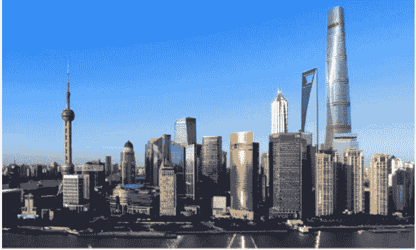


## 媒体约稿篇

### 知识付费 2.0 #D01

2017-11-03 yevon_ou 水库论坛


最近在《功夫财经》开了一个专栏，所以有了#D01 系列。原文在[这里]，延迟一周发水库。

> 为什么你听过很多道理，仍过不好一生。

#### 一）知识付费

前天，朋友圈一篇《[罗振宇的骗局！]》刷屏了。

作者写了一段很有趣的话：

叮铃铃——早晨闹钟响起。

他眼一睁，立马抓过手机，打开“得到”，倾听 60 秒罗胖教导。刷牙与吃早饭时，打开“喜马拉雅”，“完成了 30 分钟的音频学习。”然后，他出门上班。地铁上，再点开“知乎 live”“听了三个知名答主的经验分享。”

中午吃饭与午休的时间，他又点开了“在行”，“抓紧学习了《如何成为写作高手》。”下班路上，他又打开“得到”，“我在上面订阅了 5 个专栏。”吃完饭，上床，打开“直播”，“听了李笑来的《普通人如何实现财富自由》。”

然后刘刚带着满满的充实感，终于无比欣慰地进入了梦乡。

你拼命地学习，购买了十七八款“知识付费”产品。

然后你发财了没有，没有。

然后你成功了没有，没有。

你变聪明了有木有，还是没有。

请问，哪里出了问题。

和“刘刚”们不同的，我并不看淡“知识付费”产业的前景。

我想说，并不是“知识付费”不对。

是你们打开的方式不对。

你们打开的是，“知识付费” Ver 1.0 版本

#### 二）国产凌凌漆

在周星驰电影《国产凌凌漆》里面，他委托罗家英帮他设计一款“终极武器”，以对抗邪恶的文物贩子。

战斗进行到最激烈的时候，罗家英匆匆赶到，掏出秘器。


这串是啥，简称辣椒水石灰粉电击棒蒙汗药硝锯水敌敌畏。诸大武器混合在一起，请问你怕不怕。

反派哈哈大笑，那显然是不怕了。

反派当时穿了一套刀枪不入的铠甲。

反派最怕的是什么。是周星星手里那把无坚不摧的屠龙刀。

学问之道，分为“体，用，术”。

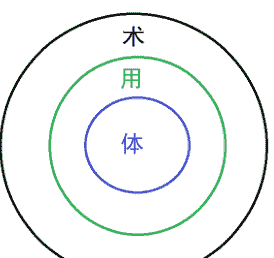

对于周星星来说，他唯一可以对反派进行杀伤的，只有手里这把“屠龙刀”。

屠龙刀是核心，所有的战术，都应该围绕着屠龙刀展开。

然后周星星还会“凌波微步”，他闪闪闪，在枪林弹雨中，硬是没有被打到。最后欺进身去。

这个“凌波微步”，是配合的身法。但靠轻功，打不死反派。轻功是**辅助**“*屠龙刀*”的。君佐臣辅之道。

而辣椒水胡椒粉之类的，只能起到非常轻微的作用。对于整个体系来说，可有可无。彻底的边缘外围。

#### 三）创业

说回到职场和创业。你需要怎样创业？

想创业，你首先要找到一个“痛点”。某件事必须是极其极其不合理的，千万人吐槽，而你，想要改变世界。

譬如说，你认为每次吃饭，都要找地方停车，是非常不合理的行为。

吃顿金拱门，找停车位来回得半小时，就图买个汉堡。

因此催生了共享单车。

当你决定了“共享单车”，你接着还需要：

- 自行车设计和制造。
- 物联网 USIM 定位
- IT 界面的前台和后台
- 财务 VC 融资
- 企业内部的管理

对于这些功能，有一些是你知道的。有一些是你还不擅长的。

不擅长怎么办，外购啊。

知识，是一种商品，和京东没什么二样。

根据你的需求，然后再去采购的。

战略优先于战术。商场上的成功者，一定是先有“战略”。

根据战略，再细化拆解。

你需要哪些战术。哪些功能还不足。哪些知识需要外购。

有了屠龙刀，屠龙刀砍人是战略。

但是你无法近身，所以你需要盾牌，或者轻功。这就叫战术。

但是我们回过头来，看《知识付费》1.0 的生态呢。

知识付费 1.0，就像是罗家英手里的“辣椒水大联盟”。

对于篇头的“刘刚”们，他们是不假思索地“乱买东西”。

你说你买了 40 堂 Live 课，其实这些课程之间，有什么前后递进秩序，是平行还是分叉关系。

“刘刚”们是一点都不明白的。

《知识付费》1.0 的消费者们，怀着忐忑而激动的心情，把市面上所有能买的课程全部都买下。

这种行为，严格地说，应该叫 IB，而不是学习。

双鱼座伪装勤奋好学，其实却是懒惰和粗疏。

好比一个“三好学生”，跑到书店里，买下几十本名家书籍。

买书如山倒，看书如抽丝。

每一本书，只有能力看完最前 8 页。这和作弊有什么区别。

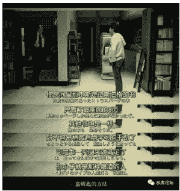

以前有一个说法，作为一个普通人，你一辈子能接触到“干货”最多的，是哪一本书。

是初中物理书。

其次是初中数学和初中化学。都是人类经历无数摸索，火炬和文明。

对于真正的知识，他一定是一个“体系”的。

一定需要几十堂课，上百篇的篇幅，才可以把事情说清。

而且还需要老师不断考试，以确保你学会，和跟上进度。

那些Live，“三分钟学会八大技巧”，都是边缘化的小`术`。

单独的每一篇，或许都很精彩。为了销售，也憋足了噱头。

可是`珠玉不能成串`。它们是连不起来的。

都是皮毛，搭不出骨骼，更搭不出巨兽。

碎片化学习有用的话，还要大学干什么。

#### 四）知识付费 2.0

什么才是真正的知识。

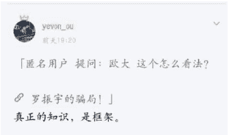

真正的知识，一定是有“框架”的。

漫无目的的知识，那不是学习，那是玩。

真正的知识，首先你需要一个“咨询”。

需要有一个人，根据你的情况，根据你的性格，根据你手里的牌。

升学，求职，创业，结婚。

设计出一个“战略”。

- 想要去澳大利亚留学。
- 英语考试，是要考 IELTS 还是 TOEFL
- 学分需要到多少。如果不足，从哪一课补足入手。
- 怎么写课外活动，要不要去做义工，或者练习篮球。
- 学费需要多少，需要打工么。
- 海外有没有亲戚，叔伯前辈可以照顾。

根据这个“战略”，然后确定你的短板，有意识地去购买。

缺什么，补什么。

千万不要胡乱乱买。除了浪费你的时间精力，没有任何禅益。而时间，是很宝贵稀缺的。

#### 五）战略

你必须对自己购买的每一项知识，都心知肚明。

人生就像一幅拼图，或者一座钟表。

技能是一块块拼上去的。赘肉并不需要。

战略值多少钱。

我们的回答是 **51%**

战略不对，终身无效。

很多人都有这样的经验，你的工资族父母，省吃俭用，几年不买羊毛衫。

400 元/小时，让你去学钢琴。

你也不喜欢钢琴。忍受重重枯燥无聊，耗费了你大半童年，才考出专业九级。

很抱歉，这个就是 “无用功”。

我可以很明确地告诉你，“弹钢琴”和上流社会，是没有半分联系的。

弹钢琴，和陶冶情操，也是没有半分联系的。

在上流社会眼里，钢琴就只值四个字：“**娼妓之道**”。

从你母亲决定让你去学钢琴那一刻起。

你家所有的省吃俭用，你的所有童年青春，都已经注定了**毁灭**。

而这件事，是不随你*弹得更认真，学得更认真*，会有任何改变的。

战略上的疏忽，是不可能靠战术上勤奋来弥补的。

> 一笑加一笑（微信号： **150500211** ）邀你加入水库交流群。群内文集每月一更新……

战略有多值钱，51%

战略的价值，比“战术”的总和49%还要高。

关于“战略”的知识，才是真正的知识。或者说，全人类有一半以上的知识，你全然无知，懵懂无知，连天外天都不知道。

从小到大，你们家的“战略家”，是你妈妈。

你母亲以她中年妇女，家庭妇女的眼光，为你制定了一生的“战略”及总体规划。包括但不限于；

- 首先，高价买个学区房
- 学钢琴，学芭蕾，学上流社会的一切作风
- 重点小学，重点中学，考大学
- 可能的话，“出国”是最高荣誉。
- 学成归国，做个白领。
- 体会“轻奢”，过有品位的生活。
- 信奉女权，独立，坚持择偶规格
- 上知乎回答问题，做大V

恭喜你，如果你成功做到以上一切的话，你就是一个：

## # 24K 纯屌丝

你的人生，惨淡无光。一辈子没有任何成就和出息。

对于你的家族，你就是个巨大的悲剧。

你父母在你身上倾注了无数的成本，“回报比”极低。一个中产阶级，烧光毕生积蓄，锻到炭心，只剩下一个：“白骨精剩女”。

#### 六）结语

战略才是真正的知识。

对战略的学习，才是《知识付费》2.0，然后再依次补充血肉，缺啥补啥技能。

你的母亲，是最拙劣蹩脚的“家庭战略师”。

只有贵人大师，才会调教出你的武林秘籍。

有钱人真正赚钱的方法，那是不卖的。

这次《功夫财经》邀请水库来开一个专栏。#001 系列，这是第一篇，共十篇。

台下观众伸长了脖子，“铺垫这么久，是不是要教战略啊”。

对不起，我没说过这话呀。亲。

我说的仅仅是：“别人全部都是错的”。

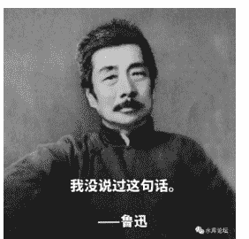

（yevon_ou@163.com，2017 年 10 月 26 日晚）

### 哪些知识付费可以活下去 #D02

2017-11-06 yevon_ou 水库论坛


《功夫财经》供稿第二篇，#D02 系列

你对信息的态度

#### 一）盗版

对于一个从 1990 年代走过来的人来说，“信息”最初的概念，就是停留在“25 元一张碟”上的。

《未来水世界》NB 吧，拍摄用了 1.5 亿美金。买张碟，25 元。

成龙的《警察故事》，拍得电影公司快破产。三张碟，打折 60。

Windows95 操作系统，人类最高等级的智慧结晶。抱歉，还是 25 元就行了。

对于当时的中国人来说，“信息”似乎是不要钱的。

因为实在是太方便了。不管怎样的美国“大片”，再宏伟壮观的场面，一张 VCD 足以容纳。

盗版的价格是如此地低廉，以至于长期以来，我们都认为“信息”的价格是零。

进入了 2000 年以后，美国科网股泡沫，我们逐渐听到了一个单词“IT”。

“信息”甚至成了一门大生意。这让中国人很难理解。这世界既然有 Copy/Paste，为什么你还要为信息付钱。

再多的千兆级复杂信息，不也就 25 元么。

一直到很后来，一个软件，让我彻底明白了这一切。

是什么，是一个你也用过的软件：“百度地图”。

你要开车吧，开车要导航，请把百度地图拿出来。

然后你就听见林志玲的语音，娇滴滴地说：“前方 500 米请左转”。

“前方右转进入匝道，请走右侧二车道”

“前方 2 公里处拥堵，拥堵路段 500 米，预计通过时间 15 分钟”。

当你使用百度地图导航的时候，你心里就在赞叹。

“这 TMD 真不能盗版呀”

#### 二）信息

是什么让我 180° 改变了对“信息”的看法。

当我使用“百度地图”时，我发现，我对于“信息”的理解，有很大的误解。

在我们常规的“信息”概念中，我们认为信息是大**量的**，**凝固**的。

在这种情况下，处理信息是**廉价**的，**批量**的。


好比我拿一个 80G 的硬盘到你家。Copy 只需要一个指令，复制视频十几分钟。

但是，这仅仅是一个特例。

在真实的世界中，信息更多是分散的，短命的。

而处理这些信息，是昂贵的，复杂的。

最典型的例子，就是百度地图。

百度地图通过 GPS，十几颗卫星计算，定位出我的位置。

进而算出我的速度。

根据我的目的地，在地图里搜索合理路线。再告诉我该左转，右转，转入哪根车道。

前面有没有交通事故，是否已超速，附近有没有停车场加油站饭店。

这些信息，全部都是**一次性的**，仅限于我本人使用有用。

这些信息，也都是**短寿命**的。在这个红绿灯路口，你错过了右转，后面就要等很久很久。短寿命信息依然很珍贵。

在这样的情况下，这些信息，就是<font color="blue">不可盗版</font>的。

把我手机中的林志玲导航，录音转发给你，是没有任何用用的。不能指挥你的导航。

## 大批量+专用化+短寿命的信息，才构成了信息时代的主要成本。

> 信息处理是昂贵的。既然“百度导航”对我来说，是生活必需品，不可或缺。
>
> 那么哪天它开始问我收费，我是一点办法都没有的。

因为你没有办法盗版。

君不见，那么多人嘴炮喊得响。但最后软件公司“服务”来临时，还不是一个个乖乖地掏钱付费。

<font color="red">一笑加一笑（微信号：150500211）邀您加入水库交流群。群内文集每月一更新……</font>

“百度云管家”你可以取代么。上哪存放你几年的照片。

优酷视频，网易云音乐，App Store，多少人曾为了 Evernotes 付费。

如果联系 020 的话，还有：滴滴打车，美团外卖，微信电影票。

这些“信息服务”，真的没法盗版啊。

“王者荣耀”一年赚的钱，大约相当于单机游戏时代，十年全国游戏销售额。

当年的单价游戏玩家，肯定没有想到“网游”能这么捞钱。

而且你一点没有办法盗版。

哪怕你找个程序员，把“农药”源代码全部偷走，服务器买二台。

“免费玩家是游戏中的道具”，人在哪里，还记得 BTG/BCC 么。

软件可以盗版，服务无法盗版。

当你卖的是服务，消费者就绕不开你。

根据“天时，地利，人物”而定制的碎片化信息，没有办法盗版。


#### 三）知识付费

对于“知识付费”行业，他始终存在很多个障碍。

譬如说，知乎。

知乎是一个 Diors 穷鬼聚集地。以在校大学生为主。

知识特别多，想法特别多，钱特别少。

你如果逛逛知乎社区，屌丝们的首要呼声是：“别去买知识付费，全部都是骗人的”。

（如这个专题：https://www.zhihu.com/topic/20071240）

按照知乎们的说法，“有什么不能盗版”的呢。

一份 299 元的课程。可以几个人凑份子，一起去“众筹”购买。

一个账号，可以好几个人登陆。

一份新的课程，一发表，几分钟，就会有人盗版截图。

更有甚者，会有人打包制作“每日精华帖”“每月精华”“每年精华”。

公开叫卖。

从“经营者”角度，“知识付费”哭出了丧歌。

假设某大 V，拥有十万粉丝。可是粉丝往往是抱团的，往往 100 个人一个“亚团体”。

盗版行为的存在，使得每个亚团体，只能卖 1 份。

原本 100000 份的销量，下跌为 1000 份。

听着是不是很像耳熟，是不是 90 年代“盗版 VCD”的故事。

在我们的实际操作中，也的确是这样的。

“水库论坛”和“分答”在行，合作开展了《分答付费社群》。

与我们同期的，还有好几个知名大 V，N 个社群。

经过了四个月的运作，目前《水库社群》运作非常良好。人数已逼近 10000 人大关。

在全国的“付费社群”里面，也算一个很高的数字了。

日活将近 25%，高得吓死人。

而另外几个社区呢。有的已经提早结束。

有的也冷冷清清。

#### 四）服务

这里面的区别是什么。

区别是，绝大多数的“付费社群”，他们走的是：“订阅”路线。

订阅是一条死路。

水库走的是“问答”路线。

定位于“订阅”的社区，无论图主是多大的V。一般也就是每周过来，发二篇文章。

题目可能很逗逼有趣，文章也写得很好。

但是按一下“群发”，群发给你四五千“付费粉丝”。

付费粉再群发到“亚团体”中。

阅读数很高。都贡献给盗版了。

更糟糕的是，哪怕是“付费”的死忠粉。

他们也并不觉得满意。

因为他们付了钱，却没有得到特殊的服务。都是千篇一律的泛泛文章。

面对 Mass Public 的文章，哪怕写得再好。

也是隔靴挠痒，抓不到心头讨巧的。

而《水库社区》，我们走的是“问答”路线。

虽然一开始我们的定位，也是“欧神文集”精读讲解。

但是不到一周，我们就飞快地更正了过来。

一个毫不起眼的“留言区”。被群友们发挥到了极致。

目前，每天都要刷几十页的屏。

总发帖超过 20000 条。全部看完，需要整整一个星期。

## 提供“订阅”的系统活不好。

## 提供“服务”的社区，才能在盗版时代活得滋润。

我们的用户，黏性非常大。

你永远需要记住知识付费的一条基本原理，“**用户知道的越多，用户不知道的越多**”。

每当你讲完一个新的课程，技巧。用户一定飞快地问；

“欧神，你说三四线的商铺长期看淡。那我老家有一套临沂的，需不需要抛掉”。

“请问铁岭，算不算小城市”。

“未来哪些城市可以活下来”

“重庆和武汉，你看好哪一个。贵阳有没有前途”。

客户的思路，是千奇百怪的。而且也是发散的。

客户最大的特点，是**客户懒得思考**。

你哪怕把道理讲得再明白，他还是要再问你一次，“铁岭算不算大城市”。

你说算不算，你说呀。

客户心里清楚。他就是等你再“确认”一次。为了这个需求，他就愿意付费。

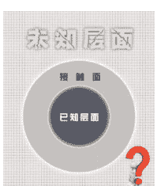

从分类看，客户最喜欢的问题，还不是这些理论性的。

客户最喜欢的问题，是 “欧神，你帮我看看。我家有资产 xxx，收入 xxx，老公房票 xxx，目标 xxx”

“请你帮我策划一下，我家的理财计划”。

对于这一类的需求，几乎是无穷无尽的。

我们觉得千篇一律的问题。在客户眼里，却是无比重要，涪涓分明。

因为每一个计算，都是她自己的事。

对于客户来说，最珍贵并不是千人一律，大 V 写的文章。

而是根据她本人财务状况，个性化分析报告。

这是一种高频，小批量，个性化的需求。是不可盗版的。

基业长青。

#### 五）中型消耗

我们把世界上的产业，按人力消耗，分为三类。

第一类，是 “轻度” 消耗型的。最典型例如：网游，起点小说。

“王者荣耀”只要程序编好了，再涌进来几千万用户，也仅仅是合台服务器。对人力资源的消耗，边际成本为零。

第二类，是“重度”消耗型的。最典型例如医生，厨师，传统咨询业。

咨询业，都是一对一。听着客户说出他们的诉求，耐心倾听。

多1000个客户，就需要多1000工作人员。

人力消耗极大。几乎不可能迅速扩建服务线。厨师的收入，很难提高。

“知识付费”属于第三类，“中度消耗”。

当我们开始个性化，量身定做，为客户提供专属服务时。

软件可以机械化，服务是靠人力完成的。

随着用户数增加，增加嘉宾不可避免。

另一方面，“知识付费”作为一种新型事物。在生产力和效率方面，还是远远超过传统咨询业的。

“单人服务客户”数，遥遥领先。

彰显着“知识付费”前途无量。

#### 六）结语

受《功夫财经》邀请，我们在此开一个专栏。

讲一些“知识付费”的看法，后续也会有进一步商业计划。

讲了这么多，忘记介绍《水库论坛》本身了。

《水库论坛》是讲房地产的。在全中国………遥遥领先。

(yevon_ou@163.com，2017年10月27日子)

### 中产阶级的地雷阵 #D03

2017-11-22 yevon_ou 水库论坛 水库论坛

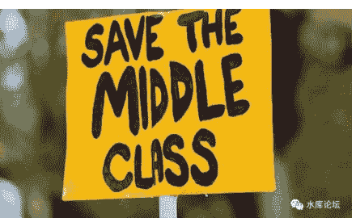

爬升很难

滑落很容易。

#### 一）前言

上个星期没有更新。因为全心全意准备《人文经济学会》的讲座。

讲座刚结束，《功夫财经》小妹就过来催稿了。

“欧大，您讲的东西很好，都有价值”。

“可是太高大上了。动辄三四千万的理财配置”。

“贫穷限制了我的想象力，您什么时候也讲讲，100W 现金的中产阶级如何投资啊”。

财上海 今天 11:50

京沪流行“一百万焦虑症”。家里有一百万左右现金，干啥也不行。买房买不起，买车养不起，炒股不会，理财怕骗。不过，这病会自愈，十年后就毛了，你的焦虑症也好了，旅游几次就拉到了！

哥哥吓得猛一哆嗦，“我也很绝望啊”。

100W 投资，这个话题没法写的。怎么写都是死路一条。

你能接触的投资，全都是跑不赢通胀的。好的投资，你都接触不到。

在整个社会中，你就是羊。

全社会的羊毛衫，都靠从羊身上剪来。保护羊是不可能的。

我们偶尔救济二条落网之鱼。

“赚钱”道路，鸿篇巨著，百转千回，九死一生才能绕出地雷阵。

学会了“水库”心法，也要靠本人的勤奋，加一点点运气。

不过，我可以给你写写亏钱的法子。

有什么办法，可以让你迅速地亏钱。100W 全部都扔在水潭里。一颗子弹定向消灭一个中产阶级家庭。

赚钱的门路，找一个都很难。

亏钱的门路，闭着眼睛俺能说上一千种。

哥哥到了三个例子。非常巧，都是和子女教育有关。

#### 二）教育投资

知乎上有一个很有名的帖子：“有哪些政治正确的东西是错误的”。

答案是温酒写的，“全部都是错误的”。

##### 有哪些政治正确的东西是错误的?


温酒

温酒不说谎

都是错误的。

因为一件正确的事，我们可以直接称呼它“正确的”。

只有不正确的事，才需要形容为“政治正确”。[1]

同样道理，在我们的生活周边，也有一些事情“政治正确”化。

一旦政治正确，人类就只用惯性和世俗的眼光去看待它。而失去了进一步思考。”

尤其是进一步控制它的能力。”

第一个明显的陷阱：对教育的无限投资。

譬如说，你在家里吼。说你要买一套大房子。

说你要买四室三厅，带一个大露台。此类的户型极其罕见，房东的报价，仅仅只有市场价七成。

机会难得，争议一去不复返。

你会得到怎样的待遇。你得到的待遇极其冷淡。家里的老人，决不会砸锅卖铁支持你的“挖争”进程。

相反的，他们会冷嘲热讽，“房价马上就要开跌了，现在不宜买房”。

“中央三令五申，挂牌价猛增 15000 套”。

“控制风险，安全第一，破产就在眼前”。

但是，你换个说辞。

你不再买 200 平米，1000W 的大笋盘了。

你改买 30 平米。

##### 30 平米，1000W，不是开玩笑哦。

颠倒黑白的是，你在家里，会得到“英雄般”的待遇。

因为你买的是“学区房”。亲戚好友不管谁质疑，你只要直接回答“房价是要跌了，为了孩子没有办法”。

你用四只手指搭着眼睛，通过指缝，半得意半炫耀地看着亲戚，谁敢说半个不字。

“为了教育”，在中国目前就是刀枪不入金钟罩铁布衫神勇铁金刚。谁也不敢批评半句。

亲戚们永远也不会评说，200 平米和 30 平米房子，哪个泡沫更大。

亲戚们永远也不会评说，拉着你死命劝你别买学区房。危险！

可实际情况呢，没有劝阻，没有谏议，轰隆隆坠落无底深渊。

##### 在中国，本科之后的教育，回报率基本是个负数。

学历并不是越高越好。

最笨的人才去读研究生。考研是低智商，低情商的表现。

对于内陆省份来说，上不了 211，野鸡大学的学费，回报是负数。

还不如考个 Blue Fly。

对于京沪大城市来说，本科之后的教育，也是个负数。

决定人生的是高考。第一学历才是学历。

“教育”这种事，本质是一种投资学选择。

在研究生“录取率”如此高的今天，绝大多数的人，并不是因为“考不上”而不读研究生。

他们纯粹是因为“不划算”而不读研究生。

研究生本身，也并不意味着更高的情操，或者更高的审美品位。

譬如说，你每天看着 200 对果蝇交配，连续看上二年。你觉得这种事很有审美么。

但是中产阶级并不明白这个道理。

在目前的“Mid-Low Class”中，对“教育”的投资，几乎是压倒性，一面倒，不计成本的。

我们知道，经济规律这种事，你可以不理睬它。但是它不会不理你。

不计成本，不计回报，无限制的教育投资，恶果显现。

我们看到，一些 Mid-Low Class 的父母，本身可能仅仅是一个营业员，一位卡车司机。

但是他们会倾注全部的资源，省吃俭用，把全部的家财，堆积在孩子身上学钢琴。并期望孩子可以成才。

我们并不是说，学“八国外语”不好。

我们指的是，“经济学”才是高等科学。

凡事都要讲“费效比”。你大把投资，牺牲掉父母所有的人生和幸福。

能成才么，不能。

能赚钱么，不能。

能快乐么，不能。

最终的结果，是一个36岁嫁不出去的生物女博士，绷着马脸，在五星级酒店大堂里弹琴卖艺维持生计。

您是不配作为套房客人的，你只配当个服务生。

《偷鸡贼妈妈：往垃圾场送娃学钢琴》[2]

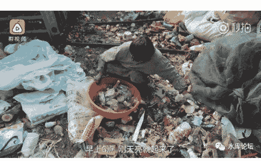

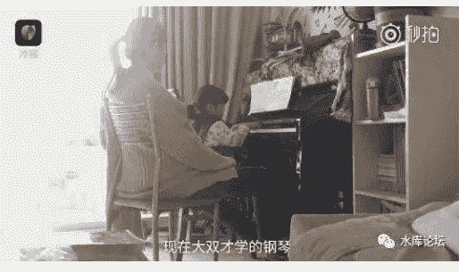

#### 三）移民投资

中产阶级手里有了100W元。不满足于传统的股票，债券投资。想要高人一等，出人头地。

除了砸在孩子身上，进行硕博教育。还能干什么。

还能出国。

##### 我真心不明白，一些 40 岁事业有成，单位实权骨干，为什么要急吼吼出国！

中国有几件“政治正确”的事。老百姓习以为常，路径依赖。

自以为天经地义，实则荒谬绝伦。

##### 教育是一项，出国又是一项。

- 出国为什么
- 什么人需要出国
- 出国有什么利益
- 出国有什么缺点
- 哪些国家，用何种方式，什么渠道出国。

对于这些问题，中产阶级一无所知。

你如果和内陆省份一些家庭聊过，他们的思想，基本是“为出国而出国”。

仿佛你只要一抵达美洲大陆，白银珠宝都会滚滚而落，直接跳出“游戏通关”的字幕。

而瞎眼顾颉美国欧洲也有大量穷人，黑人老墨，生活水准远远不如京沪的事实。

中产阶级，是一个很特色的阶层。

严格来说，他们并不是上层阶级。而仅仅是“模仿”上流社会。

而这个模仿，又不是实时的。而是时滞很严重的。

1980 年代，国门刚刚打开，欧美港澳台收入 20000 元/月，中国人收入 80 元/月。差异极为巨大狂野。

当时的京沪粤，沿海大城市，人们惊讶地发现，去日本打黑工二年，回来就是农村首富。

所以 80 年代形成了巨大的“出国潮”，并因此被内陆省份模仿和牢记。

但是，时移世易，到了 2017 年，京沪的上层生活水准早已远远超过欧美中产。“移民”对于 A8 阶层来说，毫无任何吸引力。

三里屯的老外，都变成 White Trash 了。

因为啤酒涨价，最近开始改喝可乐。

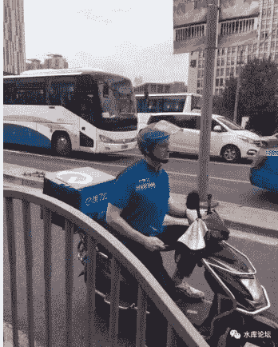

但是，中产阶级和上流社会的区别是，中产阶级只具备“模仿”能力，中产阶级是不具备“思考”能力的。

当上海 A8 早已不屑欧美穷鬼时，内陆的中产阶级，依然飞蛾扑火一般奋勇出国。

出国不是手段，出国就是目的。

出国人云亦云，不算收益成本。

盲从的下场，必然又是一次排队枪毙。

一个中产家庭，一旦出国，整个家庭就算毁了。

从零做起，慢违轨道，回天无力。中产迅速返贫。

#### 四) 艺术投资

第三个陷阱地雷，是艺术。

尤其是画画，女孩子学画画，一定要坚定拒绝。

我们看韩剧，韩剧里，有一个非常典型的范例。

富家贵女，例如社长的妹妹，嫁不出去的姑妈，刁蛮的大小姐，富商千金，无一例外，她们的专业是“美术系”。

这些贵妇，贵小姐们，并不需要上班打表，维持生计。

可是她们在“专业”系科选择上，无一例外选择了绘画，更远远超过第二名的音乐。为什么。

因为绘画，是一门“不用竞争”的学科。

一旦你选定了画家作为终身职业，你就再也不用面临激烈的竞争，残酷的排位赛制考试。

当你女儿，当你的小孩，16岁时向你提出“想学画画”。此时，你一定要坚决拒绝。

当她说出这句话时，她的潜台词其实是，“我已厌倦了激烈的竞争，我已害怕努力和奋斗，我宁愿做一个懦夫躲起来藏起来”。

于是，贵族小姐，可以堂而皇之的找一个画室躲起来，可以IB。反正可以用父母的钱，衣食无忧。

她可以毫无压力地工作，花几个月的时间画一幅画。别人甚至还不能评论“艺术”的工资。尽管她们一辈子也卖不出去一幅画。

真正的绘工大师，是极其辛苦的，也是极度清贫的。日夜勤勉。

那笔锋，刀锋，每一划都是灵魂之作。用生命在绘画。

而贵妇们不是。

她们是如此之懒，懒到连“音乐”都不愿意选修。

你要当众演奏一段小提琴的话，至少你也是刻苦训练锻炼，反复练习的。

琴弦的轻微怪格和生疏，观众是轻易可以听出来的。

无论你是小有身家的企业家，还是自恃清高的知识分子。

当你的女儿，向你申请“学画画”时，一定要坚决拒绝。

家族如此富裕，再多养一个人，本身不算很大的负担。

但真正的麻烦是，“躲避竞争”是一个潘多拉魔盒。如鸦片毒瘾，千万不能沾。

在此后她的人生中，会有无数无数杜十娘问题，象连环炸弹一样，不停爆发出来。

#### 五）结语

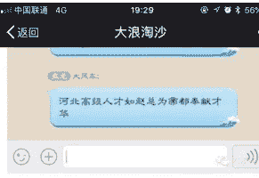

就像这段聊天记录里所设想的那样：河北 女儿嫁入帝都农村————下一代有帝都户口 便享有高考优惠，容易考入名校——名校 毕，能够享受良好的城市精英教育，实现阶级 的提升。西方也有类似的典型：第一代把 孩子送进大学，第二代学工科当工程师， 第三代学商科经商，第四代学医或法律正 式进入上屋社会，第五代学艺术并成为同 性恋从此终结一个轮回……

就拿我自己举例子，我的祖父母是脸朝黄 土背朝天的农民，但是他们有这样一个淳 朴信念就是供我父亲读书，读书读出来了 就能“成国家的人”；我父亲确实高考考出 来了，在城市定居，这就给了我一个良好 的读书学习环境，我能够衣食无忧想看什 么书就买什么书，能够供我去香港留学.

前二天我见了一个温州行业会长，问他温州近期经济怎样。

他说老一营的企业家还都活着，每一个都是人精。聪明狡猾，诡计多端，要收刮老狐狸们实 在不易。

然并卵，哪怕我再再强，421的规律，总是避免不了的。

家族财富，四个再强大的局长处常，最终只留下了一个傻白甜，女继承人。

> 一笑加一笑（微信号：150500211）邀您加入水库交流群。群内文集每月一更新......


我再问他，那么继承人培养得如何。“出国留学投资读书艺术科目”效果如何。

他苦笑着说，出去了二十五个人。

其中二十四个人，辛勤读书，学成归国，高科文凭。

只有一个学渣，在美国整天跑车把妹，考试参考“天才枪手”。混了一个文凭。

然后你猜，二代中有能力继承家业的，成才了几个？

(yevon_ou@163.com，2017年11月14日午)

原文于11月17日首发于《功夫财经》，链接在此。遗憾的是，还是有人留言：

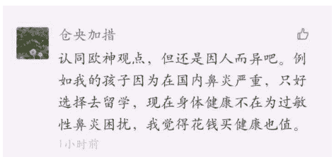

- [1] 《有哪些政治正确的东西是错误的》
  https://www.zhihu.com/question/21094902/answer/211695264
- [2] 《偷鸡腥妈妈：住垃圾场送娃学钢琴》
  http://news.163.com/17/1108/14/D2NQ0POM50001114AEE.html

一笑加一笑（微信号：150500211）邀您加入水库交流群。群内文集每月一更新……

### 赚多少钱，才能带给你安全感 #D04

2017-12-06 evon_ou [水库论坛](#)
水库论坛


做完这一笔，就收手。

#### 一）财富自由

今天这篇，又是命题作文。因为《功夫财经》的小妹妹，问我“**40岁时，要攒下多少钱**”，才能有安全感。

俺感到奇怪，我说你连 30 岁都不到。问这么遥远的事干嘛。

她说，她要买一个回形针。


yevon_ou
2017/11/22 19:39

> 「匿名用户 提问：欧大，二线城市，a6，公司小白领，还算天上掉馅饼，今年中了800万彩票。30岁，单身。我是把这个钱全部投到房产，还是先稳定下心情，等一段时间再出手。」

存定期，六个月之内，什么钱也不要花。

包括不要分给父母。

坦白说，我一直很羡慕知乎上那帮人，过着神仙般幸福的日子。

知乎上有一个很热的帖子，讨论“多少钱才可以实现财务自由”。[1]

讨论的结果，是100万。人民币。

支持的一方，振振有词说道，将100万元存放于银行，吃定期利息。

找一个“诚实可靠”的投资理财，每年获得5%回报。

一年就是5W利息。

知乎众列出了巨长的报告，证明一个月4000元，在中国的“人均排名”，已经到了xxxx位。

证明北京上海平均工资，只有6378元。

证明自己买块猪肉回家煮，比饭店里吃得更好，更健康，更卫生。

“我下面给你吃吧”，菜场买菜买猪肉。平平淡淡的日子，它在家里不是挺好的么。

省一点花，4000元/月，可以过小日子了。

哥哥得出结论是，丫个屌丝社区，几百个跟帖的人，连 100W 都没见过。实在惨不忍睹。

你别说 100W 了。就算是 “一个月赚 100W” ，难道能收获幸福么。

“王者荣耀” 团队，年终奖发了 120 个月奖金。

后来辟谣了，码农含蓄而矜持地笑道。没那回事，纯属谣言。

明明发的是“季度奖”

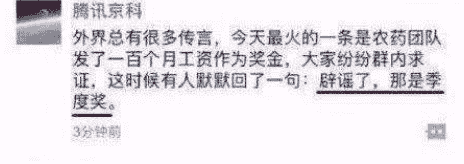

请问，大彩票中 800W ，感觉是什么。

一个月 “奖金” 100W ，感觉是什么，

快乐么，豪富么，幸福么。算暴发户么。

好像也不见得多。

800W 元，买套豪宅都不够啊。

上个月，南京，还不是上海，河西 “十盘齐开”。

由于政府的限价，KFS 太过于热销。财大气粗，规定不许贷款。

想进售楼处，先开贰佰万的本票 “存款证明”。

亲，您有 100W ，只能去门口挪共享单车。

全款买房的往里走，按揭的不要堵门口，公积金贷款的请把共享单车挪一挪。

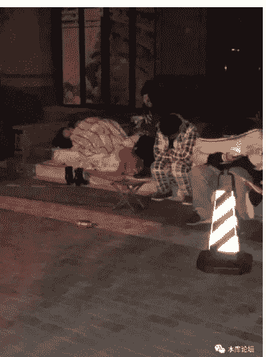

KFS 说好了“九点开盘”，半夜里就有人前来排队。

1000 万一套的房子，千万富翁。全款

大富翁就带着牙刷牙膏脸盆，毛巾被套睡袍。

大冬天就睡在马路上。

我不和你说。

城管大队还以为是乞丐呢。

曾经，你的愿望是吃饱。你的“财务自由”标准是有猪肉白菜。

你计算 4000 元/月就够了。能买三斤猪肉就够了。

一笑加一笑（微信号：150500211）邀您加入水库交流群。群内文集每月一更新……

可是等你一个月赚二三万，一年赚 50W，甚至一次性单笔赚 100W 以上。

你突然又发现，人生中还有很多比“猪肉饭”更重要的事。

例如，买套房子。

屌丝时代是想也不敢想房。

现在敢想了，只不过买得很吃力。

#### 二）A8.5

好了，我们继续升阶。

房子的事 Over，买房再也不是你投胎中的一道坎。

##### 人生就像游戏

哥打怪升级二十载，至今买不起坐骑啊！！！！！！！！！

我卡在买房那关了，兄弟们有秘籍没啊~~~

1s 你输入作弊码 my father is ligang 了没？

求 hard 模式掉落物品表！[2]

比 A8 更高一阶的，是 A8.5 [3]

5000W 净资产。也是很多意义上的京沪“财务自由”。

当你初刚到 A8 时，你是尴尬而犹豫的沮丧。

你站在富人的门口，能透过门缝，看见一条线。但本身又不属于其中一员。

人生的洗刷，莫过于此。

待富者还不如王大锤的心态平和。

“中产阶级”几乎费尽了一切心机，来模拟上流社会。

在所有的社会阶层之中，“贫民上层”是最注重道德的。

而“中产中上”，是最注重 bigger 的。

> 云飞
> 以前买同一款车的一个群里，有人怕车被误认为低端配置，这款车优惠了几万块，网友给出一建议：屁股上喷一行字：““此车没有优惠”“。
> 2017/11/25 回复

但是A8和A8.5之间，区别也是巨大的。

具体来说，你可以“偶尔”模仿尝试一下。但绝不敢真正使用。

一个人净资产达到了5000W，他就可以完全脱离生产。

再也不用上班。

每天去古北水镇，喝冰镇红酒，夜观司马台长城。纵情笙歌，享受不尽。

而一个1000W身家的人呢，他只能选择“长假期”的时候去一次。

黄金周七天，待得正舒服。

你在那里心急火燎地打包行李回北京。人家悠闲地继续“放假”。

这股心情，就像是8月31日“暑期开学”，别提多难受了。

“闲暇”，她是如此芬芳。

一经体验，就沉醉再难以自拔。

别和我谈什么理想，我的理想是不上班。

#### 三）通货膨胀

等你终于赚到了 5000 万。等你终于靠吃利息，也能在“京沪”等城市，过上每天花五千的日子。

“钱”够不够，能不能让你过上安心的日子。

答案是：还不够。

你反而更焦虑了。

对于 A8.5 来说，他焦虑的是“通胀”。

没钱的时候，想吃肉。有了钱以后，想买房子。

买好了房子，想富贵。拥有了富贵，想长久。

2004 年我写“大排面 30 元一碗”。当时的普通肉酱面，大约 5~6 元即可。

到了 2017 年，康师傅牛肉面，味千拉面，随便一碗面，就是 38 元。加碟溜醋木耳，就是 44.

很多朋友问我对未来怎么看。我说：“100 元啊”。

一碗面条 100 元的时代，迟早来临。

穷人的弱，是全方位的弱。

富人的强，是全方位的强。

知乎那群蠢蛋在讨论着“100 万元放银行，每年利息 5%”

哥哥嗤之以鼻。

等你爬到了，等你爬到更高的社会阶层。

放眼望去，你会知道，远方还有更多不可知的危险。

那些山坳里兴高采烈烤浆果的愚夫。

在我们眼里，就和猴子野人没什么区别。


雪峰将倾，天地洪荒压迫过来时，没有什么力量可以抗拒。

通货膨胀的速度，大概是“每 10 年三倍”。

水库论坛曾经说过，财富每差三倍，社会差一个阶级。[4]

你付首付的压力，别人可能就是全款。

当“通货膨胀”存在时，每过十年，你就下降一个“阶层”。

二十年时间，A8.5 退化成 A7.5

2002 时，有几位叔伯高官，退休攮下 2000W。当时觉得高不可攀。

放到了 2017 年，已经彻底泯然众人。

当你真正爬到 A8.5，五千万富人这种“社会精英”的层次。

你心里明镜般的明白，富贵不能持久。$^{[5]}$

你眼前的富贵享受，如过眼云烟一般。

1980 年代的万元户，坟头都不知道换了几波草了。

一不留神，一个风口没赶上，例如没投资房地产，或者没看好互联网。

分分钟被淘汰为二流富豪。


那怎么办呢。你有两个办法：

- 1) 继续工作，努力跟上时代的步伐。其实这种情况，你并没有“退休”。
- 2) 赚足够多的钱，败到你这一辈子也败不完。

譬如说，我们想多活 30 年的话，则“通货膨胀”应该是 30 倍。

大排面 1000 元/碗左右。

“体面退休”的阈值是RMB15 亿。

#### 四）首富

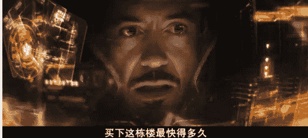

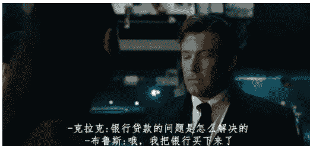

假设有一类更强的富人。例如思聪少爷。

他的钱已经多到了如此地步，再怎么败，也不可能把全国各地一百多个万达广场都败完。

这类雄踞人类“财富”顶端的稀有人群。

他们钱够了么，能获得充足的安全感么。

这两天，全世界几乎所有的外媒媒体，都被一颗叫Oumuamua 的小行星刷屏了。

这颗小行星，刚刚擦过了水星轨道。

会 以一条极其诡异的轨迹，经过地球，火星，土星，木星。

距离非常非常近，贴身而过。

但又完美地不和任何一颗大行星发生碰撞。

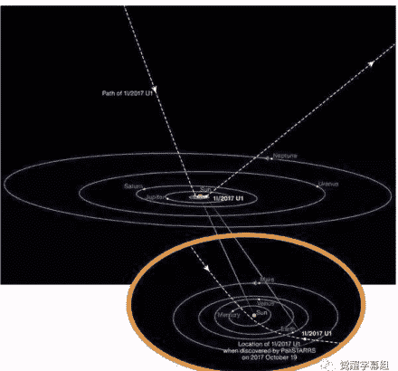

更神奇的是，这块小行星，有着前所未有的形状。

长宽比大概是 10:1，而不是球型。

他不是彗星，本身是石块表面。这已十分罕见。

而它的密度，又和岩石对不拢。其内部很可能中空的！

这么细长杆的雪茄型，还绕着自身飞速旋转。

学物理的人立刻就知道，人造重力！


这样一枚飞行器，一经飞入太阳系，天文界顿时就炸锅了。[6]

全世界的长枪短炮，对着‘Oumuamua'一顿狂拍。

这是啥东西，外星人摄像艇啊！

可惜的是，由于人类科技实在过于落后。

'Oumuamua'再过一个月，就要脱离人类的跟踪视线范围。

但是我想对于比尔盖茨，唐纳德·特朗普这样的人来说。

应该也会睡不好觉吧。

曾经有人问小布什，美国的国家目标是什么。

布什回答说：Security

中文译：安全。

对于一个国家，一个财团，当他已经如此富有。一切的物质财富不可再缺。

他要追求的，依然是“安全”。

永恒的富贵，永恒的享受。

美国的军舰造成，用途是打外星人的。

而事实结果呢。美国能享受安全么。

不能。

无论你多么强大，始终不会有 100% 的安全。

#### 五）结语

赚钱这种事，就象是升级打怪。

你充了 200 点人生值进去，以为升了装备，正科提副处，从此过上幸福的人生。

而事实的结果呢，你升完处级，你就会认识“处级”的朋友。

在和他们的交往中，你的灵识会打开，见识会扩展。

“哦，还有这样的天地”。

象网游打 Boss，Boss 打不完的。

《魔兽》曾经最高等级 40 级。40 级升完又有 60 级，60 级后面还有 80 级。

随着你越爬越高，你的眼界越来越高。

越高的眼界，带来更多的不安全感。

佛教说，“四大皆空”，五色令人迷。

因此哥哥教你一个秘诀。

要不您把钱给我吧，你的烦恼，我来承担。

让贫穷，限制你的想象力。少知少恼。

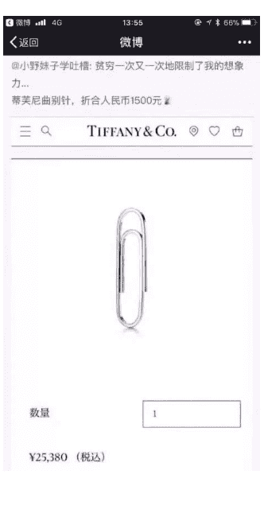

（yevon_ou@163. com, 2017 年 11 月 28 日晚）

- [1] 《300万存款在四线城市能实现财富自由吗？？》https://www.zhihu.com/question/57430325
- [2] 《我卡在买房那关了，兄弟们有妹精灵没啊~~~你懂的》 http://blog.renren.com/share/220972864/5134036045
- [3] A8 指 Asset 8 位数，即 1000 0000 元。 A8.5 指 5000 0000 元。

一笑加一笑（微信号：150500211）邀您加入水库交流群。群内文集每月一更新……

- [4]《向上爬》
  https://mp.weixin.qq.com/s/?_biz=MzAxNTMxMmTc0MA==&templekey=OTMyXyTUMW5kUHNaVUlmassvcHdhSIRsTUxsaGN4Q2RfE0G1hN3dPCZWcyZePwSU1jTzFfhKhGX24wa0oYYYJlSEQxwWFoTF9KcDxcdZdZmgxc3VKTXleEI2clNxd0flFRRVkdmRZJMS16k00VFVxTVIekZvX2pQQt1VaT2pdxWC1OC1JdIIIRDZNeTdKaAw1P2Jw2wfFrjWGSrd1B3TIISDIJOiUF%2Bfg%3D%3D&#rd
- [5]《红楼梦贾府衰败都是哪些原因导致的？》 https://www.zhihu.com/question/68681150/answer/266718381
- [6]《今天世界主要媒体被 Oumumua 屏蔽了，你怎么看？》
  https://www.zhihu.com/question/68420451/answer/265688344

# 写在后面的话：

#D04 这篇，是给《功夫财经》的专稿。

如果你仔细研究的话，你会发现，#D04 从“标题，选材，内容”都是精心挑选的。目的就是针对《功夫财经》中产阶级。原文链接在此。

而这篇发出之后，截止发稿之时，阅读很不理想，只有 85000。没有冲破 100000+

和《功夫财经》小妹复盘之后，小妹提出，她们的读者“比较脆”。

比较脆，这是什么意思。

意思就是，你不能捧着他好好说话。你要大声地呵斥，老师的地位崇高无上，要抽学员的脸，越疼越好。

就象罗振宇上台说，“你们全是错的，一个新的时代，从此开始了”。

李笑来推销 Press One，说“反正白皮书你们也看不懂，不如不解释了”。

然后学员们会鼓掌，心悦诚服。老师就是 NB。

哦，这样 Masochism 的人设，倒是很少见啊。

Marketing 的最主要一条原理，就是根据不同的消费者，提供不同的产品。

此后的# D 系列，会不断加以摸索调整。直到找到最适合的路线。

### 你的眼神背叛了你的钱 #D05

2017-12-22 **eyon_ou水库论坛**水库论坛


水库论坛，连续写了二篇《*代持流*》和《*拖延流*》文章。

可是流派干货，阅读量并不见涨。

《功夫财经》小妹问，“老师，要不你写写有钱人的生活，和平民有什么不同”。

“无论我怎样伪装，为什么你一眼就可以识穿”。

#### 一）走秀

四年前，我飞了一趟越南。

对于哥哥这样的人，越南的意义，仅限于总统府周边，很小一块区域。凡是没有大理石铺面，一概都不会去的。

因此到了晚上，百无聊赖，他就缩在宾馆里看电视。

电视节目，大概相当于中国 80 年代的水平。

那天晚上，正好是一个“走秀”的时装花饰节。

看着看着，我就觉得不对劲。

也说不出哪里不对。总之就是怪怪的，总是就是浑身别扭。哪里也不对。

国家级的模特儿，颜值实在不低。

越南最高等级的时装秀，一步一挪都是拿钱堆出来的。灯光效果，看来也砸了血本。可就是不对。

看着看着，一直看到“泳装”部分出场。

二个裹着棉袄一般的少女，手里拿着网球拍，走到 T 台尽头，低头对你一笑。

哥哥猛地一拍大腿，“是了”！

哪里不对劲，因为模特儿的眼神，太“媚俗”了。

她们穿着裙子，低着头笑。

她们穿着冬装，低着头笑。

她们穿着晚装，还是低着头笑。

就象中国 80 年代的大妈，不管拍什么照片，永远挂着拘谨而羞涩的微笑。

##### 她总是试图想要取悦你

衣服是很容易换的。硬件是很容易换的。可是“软件”无法模仿。

越南没有独立的模特业。

当地模特的一姐，也没有每年几千万的收入。走到哪里都挺胸昂腹，姐自己就是豪门。

一笑加一笑（微信号：150500211）邀您加入水库交流群。群内文集每月一更新……

越南的模特儿，在人格上是不独立的。

因此她就走不出那股“女王范”。

真正的高级模特，走路应该是“空灵”的。

姐本身就是公主，我不需要取悦任何人。我就是高兴，我就是喜欢，所以在这里T台走秀。

模特的眼神中，泛着冷漠。

而你无论拍照，走秀，社交。

你一旦试图“取悦”别人，一旦换上那副谄媚的笑容，你的境界就低了。

就和80年代国营百货商店售货员大妈毫无区别。

#### 二）朋友圈

说回到微信的“朋友圈”。

在朋友圈内，要甄别谁是有钱人，谁是穷人，是非常容易的。

- 如果你不是千万富翁。
- 想要模仿千万富翁的生活方式，那是千难万难。

朋友圈怎样算上流生活，开Audi A6的算不算。

拎着Hermes限量版Birken，算不算。

旁地中海隐秘海岛度假，算不算。

答案是，以上都不算。甚至正相反，这些都是穷人。

朋友圈判断贵富的标准，主要是“赞叹”。

#### 永远不要炫耀

#### 永远不要炫耀

#### 永远不要炫耀！

炫耀的意思，拍照发朋友圈的意思，是你以为“这件事”很重要，值得拍照留念一下。

因此这件事，就成了你的“上限”。

譬如说，漂亮小女孩子，拍照秀五星级酒店高档的食厨。

新天地酒吧吃顿饭很贵么，几百元而已。

你拍照了，你“赞叹”了。说明这件事对你“很珍贵”。

因此你的档次，月薪五六千最多。

飞一趟法国，拍几百张照片。

是胶囊少么，还是出国太稀缺。

又譬如说，你买了辆 60W 的 C 级车。

你激动万分。又是拍轮胎，又是拍内饰，一天发八次朋友圈。

那只能说明一个问题，LowB。

当然，集大成者，还是知乎上的这个问题；

# 月收入要达到多少才能把手拿 iphone 当作身份的象征？

炫耀这种事，核心在于“秀什么缺什么”。

永远也不要跪舔任何事，你赞美了，就说明这事对你很重要。就说明你的上限。

因而，正确的姿势是什么：“冷漠”。

炫富的正确姿势，永远是冷漠。

真正的贵族，看待这个世界，态度应该是“厌倦”。

山珍海味，吃的喝的，都见识过了。“深深的厌倦”。

不管是五星级酒店，豪华跑车，海景别墅，盛大的宴会，股票翻十几倍，总统接见，企业上市，你的反应，永远都是冷冰冰的。

# “哦”

#### 三）秀场

可还是有人说，老师啊，不行啊。

俺就是忍不住，俺就是想炫啊。

如果你一定想要低调而豪霸地炫富，辗轧身边不长眼的。

那应该怎么办：炫亏损。例如这样：

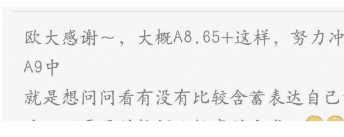

聚餐，一桌人围着吃饭。

有一个人，炒股炒汇炒比特币，吹嘘他一个晚上赚了 100W。

你冷冷笑起一块牛肉，眼神空洞说：“昨天晚上亏了 100W，真搞笑”。

你说，谁档次更高。

谁立升更强。

“赚钱”的那个人，他把赚 100W 拿出来说，那就落了“下乘”。给自己设了一个上限。

譬如说，普通人不会在乎每晚涨跌 1W。

乘以十倍，这人的财富，估计也就 5000W 数量级。

但是讲“亏钱”的人，那是深不可测啊！

财富要到了什么级别，才可以一个晚上亏 100W。丝毫不得得心疼，反而觉得很有趣，很好笑。

能拿出来当个段子说。

要是有这个胆子的话，

换作您，哪怕亏 1.3W，也要胸闷郁闷好一阵子吧。

- 不触发财富上限
- 不引发众人妒忌，引发同情
- 留无限想象空间

真正的 A9 朋友圈，他们是绝不可吹嘘自己“赚了 100W”的。

你一吹嘘，一肯定，就落了下载。

他们一定是先亏了多少钱。

“上周又亏了一辆宾利”

“昨晚美股暴跌，身家缩水几百万”

“某个项目没有投，亏了好几个亿啊”。

#### 四）装备

“装富，炫富，混迹于富人圈”是一个系统工程。

中产阶级通常，很难为富人圈接纳。因为他们不懂富人圈的游戏规则。

普通的白领小女孩，想要嫁给社长，那是千难万难。

对于小女孩来说，最大的忌讳，是浑身上下只有“一件”名牌。

这里面的关键词是“一件”，而不是品牌。

贫穷，会从每一个角落散发出来。

一般来说，目前主要流行二种趋势：

- 要么你浑身上下，全部都是名牌。
- 要么你浑身上下，一件也没有名牌。纯为穿着舒服。

有钱人分二种，讲究的和不讲究的。

讲究的是前者，不讲究的是后者。

中产阶级最大的忌讳，是身上只有一二件名牌。而刻意“突出”名牌。那真是丧得一塌糊涂。

在保罗·福塞尔所著，著名的《格调》一书中，他写道：

> 确定某人究竟是中产阶级还是上层贫民成员有一条普遍适用的原则：此君的工作服和“最好”的衣服悬殊越大，所属等级就越低。

简单点来说，你身上最好的一件衣服，和最差的一件衣服，其差距倍数。决定了你的阶层。

倍数越大，阶层越低。

穿衣打扮，不是看你用什么名牌。

而是衣裤鞋帽包，看你最好的一样，和最差的一块，差距越大阶层越低。

插一句题外话。

- 乔布斯几乎永远穿同一件裤子。因为他这个颜色的 Jeans，一共有 52 条。
- 我们这有个叫怡宝的，买了 31 件衬衫。

#### 五）花钱

如果你一切安置妥当，从头到脚，每一件衣服指甲都合乎典范，无懈可击。

有钱人还是可以轻易地把你踢出“同类”。

因为他们从你身上闻到了大葱葱油饼的味道。

你是坐地铁来的，而不是有专职司机。

有钱人还有最后，也是难过的一道关：“花钱”。

上一次，俺 LP 公司开年会。美国大老板突发奇想，把会议地点设在了河内。

哥哥作为“陪读家属”，懒洋洋地一起蹭飞机去。缩在酒店里看电视，整一副内务奶娃样子。

一直到某天晚上，六个贵妇相约出去喝酒。喝到有点醉不动了，再让我去接。

五个贵妇再赶下一场。便让我买单。哥哥看也没看， 2000W 越盾。

于是她们知道了，社交场合平起平坐。

有钱人的世界，充满了意外和挥霍。

那天晚上，如果你没有出去喝酒。又或者喝酒的时候，哥哥手机不在身边。又或者有其他同事熟人。

走开了，碰巧了，你就不用付这 2000W 越盾的账单。

但是碰到了，便付了。

你只有在一切小节上，全都云淡风轻。千万不要斤斤计较，也不要挖空心思算计躲避。

这样一种 “缺乏效率” 的生活模式。

才是有钱人的根本差异。

换句话说，如果你只有一二万的工资，你根本不敢这样花。

# 会让中产阶级彻底破产的低效率生活方式，

# 才是有钱人的真正壁垒

有钱人和中产阶级的区别，不在于有钱人可以去蔚蓝海岸度假。你也去得起，也能发朋友圈。

而在于有钱人，可以承受一场 “说走就走的旅行”。

今天晚上大家说法式蜗牛不错。

后天早餐，他已经出现在欧洲的古堡了。

“说走就走的旅行”，意味着你不可以等很久，去抢一张打折很深的机票。

意味着酒店，食宿，全都没有预定折扣。有时候甚至是溢价。

**能承受原价的才是有钱人，打折的大衣不算。**

**生活中的这种无效率，才是构成有钱人的真正壁垒。**

年轻女孩子混有钱人圈子，就要准备这种￥3000~5000 的无效率行为。

每年，一百多次吧。

然后你再想一想，有钱人还有一个杀手锏。“想多待几天，就多待几天的旅行”。

你一个工薪上班族，凑什么热闹啊。

上海人有一句老话，“判断一个人是不是小开，不是看他的头发梳得多光亮，而是看他的皮鞋擦得有多亮”。

在有钱人的圈子，从来不是看你的“豪车”有多贵。而是看你有没有独家司机。

#### 六）结语

中国的媒体小编，传统叫“*月薪 8000 的小编，教导月薪 3000 的人，月薪 20000 人该如何生活*”。

《功夫财经》小妹问，“那知道了这些游戏规则，是不是就可以包装，带着有钱富二代一起玩了呃，拉伙做生意”。

哥哥叹了口气，随手指了一张照片。

“你看这一桌人吃饭吧”。

“A 全部的身家，最值钱的，可能就手里那部 iPhone X”

“B 不动声色地，把 Chanel 包包，转到正对光照面”

一笑加一笑（微信号：150500211）邀您加入水库交流群，群内文集每月一更新……

“C把YSL唇膏放桌面上干什么”

“D一直在捏手中的Tiffany戒指”

整桌人全是奖的。

你身边都是一群 A7.5，哪怕知道有钱人的规矩，你做给谁看啊。

洗洗睡吧。

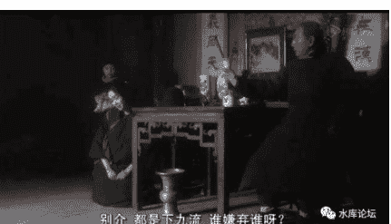

(yevon_ou@163.com，2017年12月14日晚)

基于水库次文“一半是广告，一半是文章”的原则，我们混杂着发。

今天引介的，是奥派经济学一位新起之秀：张是之

他上周写的《欧洲已死，有事烧纸》令人惊艳。可是这家伙实在太穷了，后半段贴了广告，令我没法转发。

今天次文，转了他另外一篇文章。欢迎关注奥派。

一笑加一笑（微信号：150500211）邀您加入水库交流群。群内文集每月一更新……

纸质版预订：

欧神文集
扫码进店逛


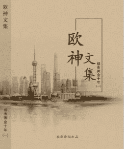

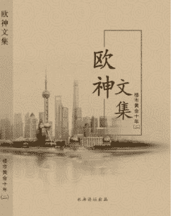

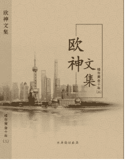

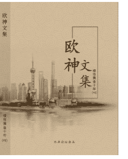

### 新一轮大型金融风暴酝酿中 #D06

2018-01-07 yevon_ou 水库论坛


### 新一轮大型金融风暴酝酿中 #D06

很多年以后，你会疑惑。

你怎么会花那么多钱，买了一个空纹。

#### 一）不吉

2018. 1. 1, 很遗憾新年的第一天，用这样的标题和题材。

在国际金融史上，08 从来都是一个不吉利的数字。

1998年，发生了“亚洲金融风暴”。

2008年，著名的“次贷危机”。

1988年，咳咳，不提也罢。

对于这样 10 年一次的 “金融风暴”，很多人紧微算恒，纷纷预测 2018 不吉。

但是更多的人，却是在思索。

“哪里，哪里会出问题”。

“我们整个的金融系统，哪儿环节最脆弱，最容易崩溃”。

是房地产泡沫么。过去十六年，京沪楼市涨了十六倍。

巨大的财富效应，令人目眩。

同时，“仇家”也不少。分分钟都有人盼楼市破产。

如果“房地产崩溃”，场面肯定比今天的焰火晚会还要壮丽。大快人心。

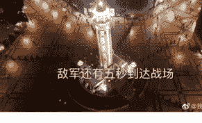

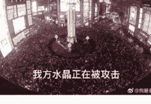

是股市崩盘么。

前二次的 “金融风暴”，都和股市有关。

股市尤其容易产生庞氏泡沫。一次是正股，一次是衍生品。

目前港股，美股，纳指，都已经创了新嵩。企业的股价，涨得比赢利基本面更快。

在审慎人士眼里，股指也是可疑的。

1. 港股大丰收，恒指年升 36% 冠全球，市值增 9.7 万亿，市场料明年可试新高。
2. 本港楼价 2017 年 20 连升，暴涨 28%，是历来最长升浪，细单位跑赢。
3. 旅发局公布，今年首 11 个月的总旅客人次接近 5300 万人次，按年增 3.1%。
4. 人民币在今年最后一个交易日大升，在岸价今年累升 6.72%，创下 9 年来最大年度涨幅。
5. 深圳交易所公开谴责内地创业板乐视网股东贾跃亭、贾跃芳，未有履行承诺，借出营运资金。
6. 美股今年创下 2013 年来最大的年度升幅，道指升逾 25%，标普 500 指数升近 20%，纳指升逾 28%。

##### 资讯

1. 展望 2018，市民对个人及社会前景 5 项信心指标的净值皆比去年上升，且更升至 8 年新高。


如果让我猜的话，危险从来不在“看得见”的地方。

在人类栽过跟头，审慎谨慎，伤疤还痛的地方，更多并不是风险。

今天我们要说的“泡沫”，比股市，楼市，曾经发生过的泡沫。

还要多 1000 倍。

#### 二）赌博

想起写这篇文章，是因为今天晚上看到了这样的报导。

> A：天涯站二期一夜就卖完了，大家怎么看？
> B：几年后象比特币一样啊
> C：看谁最后接盘
> D：公司员工自娱自乐吧，谁会买这种？我是不信
> E：这符合 986 的风格，游戏+社交+金融，BBS 这种模式已经老得不成样子了，至少天涯还在努力尝试。
> A：不是自娱自乐。近千万真金白银啊。区块链概念。
> F：互联网大佬最近都在转型区块链了，产品要跟的时代
> G：2100W 了，加起来。不过我认为是一群赌徒参加的恶炒。我买了 100 元的，算支持公司
> E：天涯最开始就是个股市论坛，现在看来似乎回到了七点。
> G：我存了买的人，90% 以上的销售额，80% 以上的购买者，都是大注期的，不是自己人。
> G：但这个类 ICO，看后面政府监管会不会介入吧。
> F：主要是被玩币的买去了。币现在是稀缺资源
> G：昨天热卖的真正原因，全部是币圈的人在玩
> F：其实这也可以理解为企业发行的新型股票，只是监管还没有正式出台。
> H：我是不是该去买一批，过几年后再回去看看

很多人或许不明白，这里面的故事和道理，让我来解释一下。

2017.10 月，中国政府宣布禁止一切 BTC 的交易，同时把“山寨币”宣定为违法。

已有的山寨币，停止运营。

已发行的山寨币，原额退回给申购人。

应该说，中央政府这个决策，是非常英明，而且及时的。

当时涉及的金额并不大，全中国的 ICO 市场，大约仅仅才 20 亿人民币左右。笑芙来占据了最大的份额，卖了 2 亿美金。

ICO 风波事件过去之后，监管基本以为高枕无忧了。

可是在夹缝中，还冒出来一颗小草。

迅雷公司的“迅雷币”。

迅雷币，对外宣传，并不是“代币”。

在对外的宣传中，它是用于购买迅雷公司服务的，可以用于加速网络下载，支付服务器报酬等应用。

而在实际操作中，迅雷币踏出最关键一步：“**证券化**”。

**迅雷币是可以交易的。**

或者说，我付了钱，你可以把迅雷币划给我。

在之前，中国政府对所有“游戏代币”的要求，例如腾讯 Q 币，中国政府的要求是“单向交易”。

Q 币可以交易，但只能卖回给腾讯。

玩家 A 和玩家 B 之间，是不可以 Q 币结算的。

一旦产生了交易，或者学术点，我们称之为“证券化”，于是天下大乱。

**只要证券化，你就可以炒。**

当敏感的庄家，嗅到了这里面的腥味之后，立刻就有大资金杀入。

迅雷币，从最初的 0.1 元一个，一小时之内涨到 0.8 元，然后再涨到 8 元/个。

此后，甚至更涨到了 30 元，100 元一个。

可以当证券，有“涨幅”，于是就有了赚钱效应。

一笑加一笑（微信号：150500211）邀您加入水库交流群。群内文集每月一更新……

就会有更多的人炒。

中国散户，不在乎你是什么。只要你能涨。

迅雷币迅速地涨到了 300 元一个。

短短几周时间，数千倍令人目眩的涨幅。

而这一切的背后，只有两个字：“投机”。

如果你关心社会新闻的话，你会发现迅雷“总部”，和迅雷“数字事业部”，前一阵子发生了扯皮。

图为总部的老人，忧心忡忡。非常担心触碰法律红线。

而对于数字事业部的人来说，则是一个月，赚到了迅雷以前十年的钱。

如此巨大利益在手，又怎么舍得服软。

好了，现在我们说回“天涯币”。

天涯币是什么。天涯币是第二个“迅雷币”。

明面上，天涯币是用于“购买”天涯社区的各种服务，是一种代币。

但其实资金“迅猛”扑进去，哪一个来为了在天涯 BBS 发粘贴的。

还不都是冲着涨停板，敢死队去的。

许你做初一，难道不许我做十五么。有样学样。

首先是 kick（一个半死不活的 jm）、再然后流量矿石（快播）、玩客云（迅雷）、暴风（股价腰斩很严重吧）、天涯（还没倒闭呢）、人人（安静的能听到心跳）、花椒（区块链到底跟你有啥关系），再然后，昨天我听到确切的消息，猎豹也要来发币了。

一堆半死不灭或者快要倒闭的公司，反正也没包袱（都要倒闭了，哪来的包袱），打着落地的旗号（都快倒闭了，落什么地），出来圈钱。

越来越多老气横秋的传统企业（对，在区块链面前，互联网也是传统企业）出来借区块链概念圈钱的时候，这一波就差不多了。

#### 三）数字货币狂潮

我说这些例子的原因，是一个巨大的“副热带高气压中心”，俗称台风，正在逼近。

你可以看见气旋已经凝结，风力二十八级。现在还在南太平洋海域，预期十五天之后登陆。

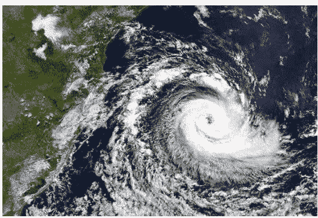

什么叫做泡沫，例如现在的 BAT，阿里有接近四千亿美金市值，是中国市值最高的公司。超过了工商银行。

阿里是不是泡沫，不全是。

因为阿里本身还是有很多业务的，例如淘宝网，例如阿里影业，阿里飞猪。

股价不便宜，但不全是泡沫。

又譬如说沙特阿美。沙特阿美石油公司目前正谋求上市，将成为全世界最大的上市公司。业界估值在 1.5 万亿美元附近。

这是一笔天文数字，但其背后，是沙特阿拉伯的石油储备。

作为全世界最大的能源心脏，它也是值这笔钱的。

2001 年的“科网股”泡沫为什么破灭，因为他们并没有创造价值。

当时，随便找一家公司，挂个 “.com” 的招牌，股价就可以轻易地无限上涨。

boo.com, tom.com, Netscape.com, 这些都曾经有过千亿美金市值。

而他们事后证明，什么业务也没有做出来过。

今天我们金融市场，最大的泡沫，最大的台风气流是什么。

##### 是数字货币泡沫

这个泡沫是如此巨大，如此目眩，花了短短一年的时间，就走完了别人五年的历程（暴涨 30 倍）。

而且和 “.com” 公司一样，打开这要命的 5700 亿市值，你仔细观察里面。

5700 亿美金市值，价值有什么。

什么也没有。

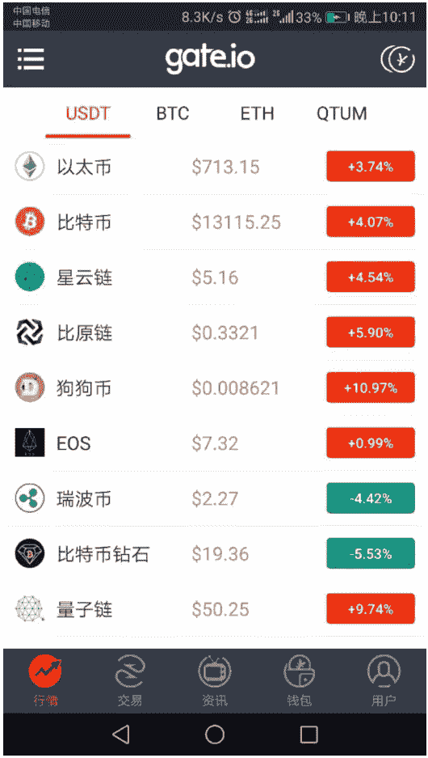

一笑加一笑（微信号：150500211）邀您加入水库交流群。群内文章每月一更新……

#### 四） 第一代先驱

目前的 “数字货币” 市场，混淆了一个概念。

“区块链” 是一个很有前途的技术，区块链的本质是 “防伪技术”。第一次，人类构建了一个不怕篡改的金融系统。

##### 但是，比特币≠区块链

就好比 1995 年，人们疯狂地讨论互联网。

互联网是一个很有前途的技术，也的确极大改变了人类社会。

但是 Yahoo.com≠互联网。

1995 年，人们疯狂地买入 Yahoo，把雅虎的股票炒到无限高。

这是没有道理的。

他虽然是第一个互联网领军网站，但它不代表互联网。

（Yahoo.com 最终倒闭）

事实也证明，“.com” 技术走到后来其实是一条死路。

互联网发展到今天，最大的商机，全部都基础于 “移动互联网”。

移动互联网的入口，是 App。

今天要是问你，微信的 “网址” 是多少。没有任何人答得上来的。

从 2018 年回过头来看，当年的 “.com” 简直就是一场灾料。

当年所有的 Dot Com 公司，无论是上到 Yahoo.com，中到 Sina.com，Sohu.com

下到 Hongkong.com, China.com 这种野鸡网站。

全部都是垃圾。

同样道理，如果你站在 2035 年之后，回过头来看。则今天所有的数字货币，无论是 BTC，BCH，ETH，LTC，全部都是垃圾。

比特币虽然是“前驱”，是全世界第一个“区块链”应用。

但比特币的技术非常非常落后。

可以称为“第一代数字货币”。

人类的科学技术，是飞速向前发展的。可以预见到，20 年以后，“区块链”普及应用时，所使用的，肯定不是这种原始而且简陋的“第一代软件”。

互联网 1995 年至今，23 年。互联网会永存。

但今天使用的，是微信，滴滴和头条。

这些东西，都和简陋的“www 网站”没什么关联。

虽然币圈的人，念念叨叨“人类财富向虚拟货币转移”。

互联网这么惊天动地的大发明，耗时 23 年，目前改变世界多少。

即使要转移，也是转移到第三代，第四代数字技术上。

而不是你简陋的第一代比特币。

1981 年版的“鸡票”，现在都有 1000W 枚存世。永远不会再次印刷。

许多年前的价格，就要 300 元/枚

可是，又哪里有人给你出货呢。

#### 五）酝酿中的雷暴


##### 比特币一文不值。

###### 真实价值： $1.

可以把几兆位数码，激光雕刻在木雕上。旅游景点卖给游客。

人类未来要使用区块链“防伪网络”，绝不可能是比特币技术。而是第四代，第五代技术。.com 过气公司。

我们来看这个表格。相对于“数字货币泡沫”，我们更关心的是另一件事：

###### 政府会不会救市

| | 科网股泡沫 | 数字货币 |
|---|---|---|
| 地域 | 仅局限于单一国家，单一市场 | 全球联通成同一交易所 |
| 人口 | 以欧美人为主 | 以华人，欧美人为主 |
| 金融杠杆 | 与主流金融机构，银行，证券纠缠不清 | 不涉及主流金融 |
| 受众人群 | 社会上下各阶层 | 受教育中产 |
| 用途 | 有大公司支撑价值 | 完全没有任何用途 |
| 负和游戏 | 电商烧钱 | 挖矿电费 |
| 涨幅 | 倍数增长 | 指数增长 |

政府“救市”这件事，重要，很重要，很重要。

一旦救市，美联储一定进入大量的“降息”周期。

同时 QE 补药，源头大放水。银根宽松。

###### 地产必然暴涨。

我们纵观历史，每一次“金融危机”，“次贷危机”。

对于地产并不是坏事，反而是极大的利好。

因为败的是你的局。

而四万亿刺激，获利的是地产。

2018 年，我们看得到一场“风暴”在酝酿。太平洋上空，二十八级台风。

- 山寨币风波越演越烈，更多人被卷进
- 比特币总市值越来越大，逐渐超出庄家掌控范围
- 每年 19 亿美金，电费净消耗

这些因素，共同决定了比特币泡沫，是肯定要破灭的。关于这点，我们是没有疑问的。

我们有疑问的是，政府会不会救市？

历年历次金融风暴，首先要看，有没有撼动“主流”金融机构。

中国政府的核心利益，银行是社会百业运转的枢纽。银行业绝不能垮台，或者混乱。

如果银行被深深牵扯进去，就一定要救市了。

另外一方面，OTC BTC 其实是一个广泛的，全球性的场外交易市场。

“各人自扫门前雪”，既然不是中国，美国，一个国家的事。出手干预的情况就更少。

如果 2018 山寨币，跳楼了几十个人，政府不救市。

那么我们预想中的“四万亿”就不存在了。

第三个步骤，则是要看“受害人”。

在中国，最大的政治正确，最最强势的“政治团体”，其实是无耻老太。

80 岁老太往办公地门口一趟。

拉个条幅，满地打滚，那真是让人拜服。

而“数字货币”*庞氏骗局*的受害者，绝大多数都是中产白领。

有头有脸，由自诩社会精英的程序员为主。

他们会闹的概率，无限降低一百倍。

想到此处，我们实在对中国政府封禁国内一切 ICO，钦佩敬佩得五体投地。

- 我都宣布这事是非法了。
- 你非得要削尖脑袋，偷渡出海，跑到外国交易所去买卖。
- 亏到了倾家荡产，你总不好意思找我中国政府，要求受害人赔偿了吧！

（yevon_ou@163.com，2017 年 12 月 31 日夜）

### 老龄化对资本市场的冲击 #D07

2018-02-07 yevon_ou [水库论坛](#)

♯1510，♯1500 不群发。可在“菜单—最新五篇”获取。

对于资本市场而言，老龄化是个炸弹。

谁碰谁死。

#### 一）宏观掠夺

今天，我们来讲一个“宏观掠夺”方面的概念。

如果你翻一下“社会学家”的呼吁，常常有左翼媒体大声疾呼，“我们的世界，怎么会变成这样子的”。

在今天整个人类世界，全球最富裕的 10 个人，大概相当于最穷的 35%（20 亿人）的全部财富总和。

| 排名 | 姓名 | 财富（亿元） | 财富变化 | 主要财富来源 | 居住地 | 年龄 |
|---|---|---|---|---|---|---|
| 1 | 比尔·盖茨 | 5200 | -6% | 投资 | 美国 | 60 |
| 2 | 沃伦·巴菲特 | 4500 | -11% | 投资 | 美国 | 85 |
| 3 | 阿曼西奥·奥特加 | 4200 | 16% | Zara | 西班牙 | 79 |
| 4 | 杰夫·贝佐斯 | 3500 | 83% | 亚马逊 | 美国 | 52 |
| 5 | 卡斯腾·斯利姆·奥尔豪族 | 3300 | -40% | 美洲电信 | 墨西哥 | 76 |
| 6 | 马克·扎克伯格 | 3100 | 7% | Facebook | 美国 | 31 |
| 7 | 拉里·埃里森 | 3000 | -15% | 甲骨文 | 美国 | 71 |
| 8 | 大卫·科赫 | 2900 | 22% | 科氏工业 | 美国 | 75 |
| 8 | 查尔斯·科赫 | 2900 | 22% | 科氏工业 | 美国 | 80 |
| 10 | 伯纳德·阿诺特 | 2400 | -18% | 路威酩轩 | 法国 | 66 |
| 10 | 迈克尔·布隆伯格 | 2400 | 76% | 彭博 | 美国/阿根廷 | 55 |

有学者大声质问，怎么回事。

如此巨大的财富，是怎样汇聚到少数人手中去的。

他们是通过何种方式，赚取这么多钱的。

这里面的秘密，叫做“宏观掠夺”。

“微观掠夺”，许多人都明白。你走在马路上，遇见一个小流氓，掏出弹簧刀。拿走你钱包里的 2000 元钱。

这是再明显不过的“抢劫罪”。每一个人都知道它是有害的，警察要管管。

但是我们整个社会的财富转移，最主要靠“宏观掠夺”。

几份文件，几项管制。

宏观调控牵涉到了数百亿，上万亿的财富“转移”。却只有相当智慧的人，才能看出其中的门道。

#### 二）养老金系统

我们举一个最简单的例子：“养老金”系统。

养老金系统，又称“养老保险”。取“社会保险”的蕴意。保险的纸面意义，乃互帮互助。

意外和概率的功效，社会平均之后，短命的帮助长寿的。

养老金系统，主要有二种模式。

1. 个人账户
2. 社会统筹。所有人按工资比例征税，但最终“社保”发放，却相差无几。

显然，第二种模式，社保更类似于一种“税收”。收入高的人是吃亏的。

全世界各国，有的采取第一种。有的采取第二种。中国目前采取第二种。

出于众所周知的原因，他们就不展开了。

骗局的核心在于，第一种模式，“个人账户”其实也是骗局吃亏的。

这就需要很深的理解和知识了。

我们以邻近的 Hong Kong 为例，香港在港督时代，是没有“养老金”制度的。

2000 年 12 月 1 日，香港不顾财经界专家的重重反对，以微弱优势通过了“强积金”条例。

香港的强积金，从雇员的工资中扣除 7%，雇主支付 7%，合计 14%。

这 14%，是放在“个人账户”的。

个人可以指定账户里的资金，购买股票，债券，基金，理财产品。

自行选择心水股票，并负担股票涨跌风险。

可见，香港的“强积金”制度，比中国的“社保公积金”，再交给腐败的老鼠仓基金经理运作，是先进许多倍的。

香港秉承了“自由主义”精神，投资者自负盈亏。在“强制储蓄”的同时，最大限度保持了股票市场的有效性。这点是值得学习的。

##### 骗术在哪里呢：“时间”。

美国人在 1950s，“二战”结束后的一代人，被称为 Baby boom。

大战结束了，活下来的人也觉得劫后余生。

既然历经生死，就不那么白左。肚子疼也不矫情，女人生育率大增。

Baby Boom 十八年，生育率几乎翻了一倍。

但是金融市场是老练的，Baby Boom 直接决定了“宏观模型”。

人类在 22~60 岁的阶段，是劳动力。是净储蓄。是收入>消费的阶段。

三十岁以后，踏上骨干岗位，更是一年可以赚几十万。

但人类同时也在为“退休”做准备。

65 岁之后，人类开始取出积蓄。消费>收入，你开始卖资产。

表现在金融市场。年龄高度关乎牛熊。

- 有几十年时间，你拼命地买进资产
- 有几十年时间，你拼命地卖出资产

以 1955 年为平均，到 2000 年时，Baby Boom 45 岁。

2015 年时，Baby Boom 人均 60 岁。

整个 1980~2000 年代，是美国股市的黄金年代。

“买盘踊跃”。

有太多 30~40 岁的壮年人，他们正处于人生中最赚得动的时段。而他们需要为自己的退休生活做准备。

这大量的 “买盘”，直接推高了美国股市，债市。

具体的表现是：

- PE 市盈率，平均增加一倍。
- 债券收益率，平均跌一半

不得了，不得了的事啊。这一倍一半，就是几十万亿美金啊！

但是，财富并没有增加。

公司，还是那个公司。

债券，还是这些利息。

从宏观的角度看，“实体经济”一分钱财富都没有增加。

##### 当老人们开始抛售时，整个系统就会崩溃

2000 年时，香港的财经界人士，激烈地反对“强制金”制度。

因为这很不公平。

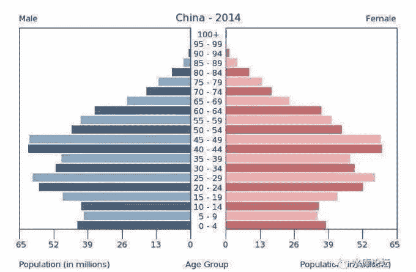

香港，同样存在“人口柱形图”现象。

每一代人之间，Baby Boom 的数目，并不是恒定的。人口潮来临：

- 当你买进资产时，所有人都在买进。价格特别高。
- 当你抛出资户时，所有人都在抛出。价格特别低。

金融市场的“回报”，在每一代人之间，都是不同的。

如果你有“强制储蓄”制度，则人口少的那一代，就会特别受益。

譬如 2000 年香港强制推行“强积金”时，立法会那群老头子，平均都有 55~60 岁。手里全都囤积了一堆股票，就等着人来接盘。

当他们“立法”，要求所有人 14% 的工资，必须“强制储蓄”。这就相当于为股市圈进来了一大批接盘。

PCCW 因此迎来了科网股泡沫。

##### 你以为股票是市场价，其实在“大数据”眼里，你买进时就已经注定是盘剥。

老百姓想买股票，自己会权衡。价格合理，自然会“削减储蓄，增加投资”。

用得着你费心么。

只有秉承奥派的自由，才能免于腐败。

##### 这才叫“宏观掠夺”。

同样道理，目前“宏观模型”对于美国金融市场，是颇为悲观的。

因为 Baby Boom 的一代人，就快要退休了。“退休”必然导致大规模“抛售”金融资产。

而“白左”们的孩子，生育率非常少。

下一代的白人，可能人口五成都不到。

考虑到平成废材一代人，失业率猛增，低欲望社会，圣母绿教泛滥。

“接盘侠”必然更加稀少。

财富并不守恒。

##### 一张一弛，数十万亿的“宏观掠夺”。

#### 三) 上海资产市场

##### “老龄化”是金融市场的大炸弹，谁碰谁死。

任何一个市场，进入“老龄化”。资产价格表现一定不会好。

最理想的市场，是只有年轻人，一个老人都没有。那就只有“净买盘”。

如果“可投资”资产再少一点，价格就能上天价。

突然想写这个话题，是因为上月我回了一趟上海。和几个家庭吃了一顿饭。感觉糟糕透了。

当一桌十四个人，白发苍苍，鸡皮鹤发，全桌人中，颤巍巍 70 岁以上老人，居然有 7 人。

占人口 50%以上。

哥哥一边吃着日本和牛，沾一块象拔蚌，一边默数；

“这位要卖房子”

“那位要卖房子”

“这两位也要卖房子”……

逻辑是非常清晰的。资产是体，现金是面。

所谓“资产价格”，其实是一体二面，镜子互为表里的关系。

当一个系统中，老人太多，资产太多。

“工资”收入太少，年轻人太少，无资产者太少。

则这个系统，真是非常危险的。

“资产”有使用价值。但大家心知肚明的，“资产”有时候也会偏离使用价值，而获得额外的溢价。

同样一支股票，公司没变。但股价可以在 10~30 倍 PE 之间反复挪动。

这是为什么，无非是“供求关系”改变。

在上海的内部，也是“分区”的。

有的区，老龄化更严重一点。有的区，人口结构更衰败一点。

当一个区全部都是六七十岁的老人，它就无可救药。

上海是没落贵族。我们对上海的评价，“十里洋场”尤在，但是人口的急剧恶化，令人担忧。

表现在微观市场，目前这几位老克勒，经济实力犹在。吃着 1000 元/人的和牛，平均都有 1000W 以上的人均存款。

在目前的阶段，这些法租界老贵族，依然是有充足的现金和体面，维系他们的生活。

但是，目光深邃，远望千里。

上海“老龄化”的问题不解决，隐患丛生。“老人”意味着抛盘，老人越多，抛盘越重。

你如果没有工薪性收入，最终会全是抛盘。

尽管衰败还需要很多年。

哦，我不是说老贵族们要卖洋房。

我的意思是，他们迟早要“卖资产”的。

即使要卖，也是按照股票——字画——房产的顺序，对不对。

（yevon_ou@163.com，2018 年 1 月 23 日暮）

### 为什么我精通理财，却仍过不好一生 #D08

2018-03-10 yevon_ou 水库论坛


“利息型收入”是伪科学。

#### 一）致富

《功夫财经》的朋友们，大家好。

近期因为忙了几场战役，线下事务繁忙，很久没有更新了。

3月是一个非常重要的起点。一方面，3~4~5是传统的旺季。对于地产而言，是性命攸关的重要月份。

一方面，3.2是元宵节结束。大伙收拾了心思，认认真真开始干活。

从周一开始，就是刺刀见红的主战场了。

当我忙完抬起头，再看看“线上”，发现整个理财教育市场，简直已经不能看了。

前二天，听了一个研讨会。其重点主推，“xx 理财课”。

我们来看一下，理财宣传词是怎么写的：

- 只需 25 天，你就能通过这个课程，完成从零起步的理财实操。
- 只要 10 元钱，就能买入股神巴菲特推荐给所有普通人的指数基金。
- 越早开始理财，我们赚到的钱就越多。

哥哥揉了揉发烫的脑壳，再看看定价售价，摘出了二个字：“坑爹呀”。

这样一堂标准的“理财学堂”课，定价 99 元/18 节。

你知道，为什么哥哥的分答社群，售价 699 元么。

2018 年的水库“知识星球”续费，更是高达 5500 元/年。

**卖得更贵的知识，并不是讲得更深刻。**

**而是因为卖得便宜的知识，根本就是错误的！**

一个错误的指导，甚至比“无知”更有害。

一个错误的，看错行动的方向，远远比损失 99 元更有害。

消费者之所以肯花 5500/ 年购买知识，不是为了讲得深，讲得透。

而是因为消费者根本承受不起“错误”。

“知识付费”这类商品，和 MP3 下载听音乐不同。

几元钱买首歌，最多就是难听。下载错了，可以删掉。

可是 99 元买套《理财学堂》，指导的是你**几百万的投资。甚至是一辈子的理财和人生规划。**

这里面出了一点差次，真是百死莫赎了。

因此您一定要买最好的，买最高档的。

水库，知识星球。

#### 二） 理财

言归正传，我们来谈谈，为什么《理财学堂》是错误的。

##### 为什么我精通理财，却仍过不好一生。

##### 理财就其本质，是一场骗局！

你花 5500 元听 yevon_ou 讲座，开篇明卷第一句话，“理财就其本质，是一场骗局。”

高端“知识付费”服务，告诉你的第一句话就是：“不要理财，理财是骗人的”。

为什么，因为你看看现在的理财宣传词。“十元为你能理财”“为你省尽每一分钱”“日日生息”

那么，你有没有想过，假如你投 10 元，按照 4% 的利息，一年可以“理财”多少呢。

答案是 0.40 元。

问题再进一步，假如你有 1000 元，按照 4% 的回报率，一年“理财”多少呢。

答案是 40 元。

你今天晚餐别吃了，少吃一碗味千拉面，饿着肚子回去。

你就把一年的“财”全理了。附带还省了二两脂肪。

再进一步，假设你有 10W 元呢。你就兢兢业业地理财，耐心地优化“投资组合”。一年赚到了 6% 的理想收益。你“理财”了多少钱呢。

答案是 100000*6%=6000 元。看起来有半部手机了。

且慢，如果你不费这么多心思，简简单单地把钱扔在“余额宝”里面。

你差不多也能获得 4% 的收益。

也就是你的“无风险收益”，不会超过 2%。

###### 绝大多数人死命折腾“理财”，其收益率上浮，都不会赚多 2%

如果你拿 10W 元“理财”，增加的结果，不会超过 2000 元。

我们的建议是，有那份闲心，今年就别换手机了。忍一忍者 2000。

把“理财”的脑细胞节约起来，该睡懒觉就睡懒觉，该呼噜呼噜就呼噜呼噜。

对于一个白领而言，他真正有意义的“理财”，我觉得门槛是 RMB500 0000 元。

500W * 2% = 10W

细心，谨慎地打理财富。一年多赚 10 万元。相对于四五十万年收入的家庭，也算是一笔钱。

但是，白领有没有 500W 元资产给你理呢？答案是：没有。

这就引出了第二个问题。

#### 三） 真正的力量

绝大多数的白领用户，在“理财大师”的指导下，都会做一个表格。

列明了自己有多少债券，股票，存款，基金……

各自的 Beta 值是多少，波动多少，列了一大堆无用的技术指标。

我说你不如干脆算一个决定性的数值，“今年利息收入多少”。

收入分：工薪性收入 + 财产性收入。

那些孜孜以求买理财课的小白们啊，“财产性收入”绝对不会超过 2W 元。

也就是在你的收入报表中，

- “工薪性收入” 是 20~30W 元数量级的。
- “财产性收入”是 2~3W 元数量级的。

你有必要为一个差十倍的小量，倾注大量精力么。

我们知道，的确是有一些 26~32 岁的青年白领们，日子混得非常好。

小夫妻二个人结合，从大学毕业时的一贫如洗，打拼到结婚的时候，基本上房子也买了，车也有了。存款债务也不愁。

算算“小家当”，都有 500~600W 的身家。

可是人啊，不能光看表面。智者和庸俗的分界，愚者只会人云亦云，智慧会问根本。

愚者说，“家财涨得好，全靠理财好”。

智者说，“你仔细算一算，这 500W 元里面，有多少是靠**利息**得来的”。

你如果月月记账，把“利息收入”单列一栏。你最终会发现，500~600W 家财的主要来源，是；

1. 房子的增值
2. 父母的馈赠
3. 二人工薪积累
4. 利息和理财（不到 5%）

其中，京沪土著，主要是靠 1+2.

如果是外地农二代的奋斗年轻人们，则主要靠 3.

如果你是 BAT 的码农，奋斗到 30 岁左右，基本工资都有上 30W 了。

以男士 35+女生 25 计算，一个双白领家庭结合，年薪就是 60W。

而二个人胼手砥足，齐心协力地攒，四五年存 200W 是可以的。

###### 在你的整个家庭财富中，大头还是靠你挣的，而不是靠吃利息的。

最最最可怕的，是这个比例，很有可能是恒定的！

也就是说，你 30 岁时，利息收入占你工资的 10%

你 40 岁时，“财产性收入”还是占你工资的 10%

几乎所有的“理财致富学”都在教导你鸡汤，“理财关键是复利，虽然最开始的时候不起眼，但是等有千万时，一年利息就是几十万”。

事实的真相是：

- 30 岁，存款 200W，利息 10W，年薪 40W
- 40 岁，存款 1000W，利息 50W，年薪 200W

不管你怎么复利，“利息”占家庭收入的比例，始终是个小量。

###### 为什么？

###### 因为通货膨胀也是复利的

四) 通胀


一个人到了 32 岁以后，随着你的“职位”基本固定，你的工作权限也基本固定。除了极少数非常优秀的人，可以在管理岗一路上升。剩下的职员，32 岁干什么活，或许 48 岁还在干这个活。

但是，我们的“工资”依然在增长。

2010 年时，月薪 1W，还能请一个不错的人才。2018 年时，稍微能干点的人才，没有 2W，根本想也不用想。动辄 4~5W。如果你的劳动没有改变，则你的加薪，实质是通胀。

“理财”是复利的。但通胀也是“复利”的。

真的按照理财专家的意见，“复利” 60 年，攒 1000 万每年利息 60W。届时 1000W 元的购买力，或许和 1000 元利息 60 元差不多。

许多白领做一个表格的话，他们可以清晰地知道，“过去十年，无论怎样理财，利息收入/工薪收入，比例都是小量”。

警觉啊，警觉啊！

一个理论，如果和现实相差太远，它就不可能使你致富。想想为什么它只卖 99 元吧。

#### 五) 真正的建议

我们的建议是，**理财毫无必要**

- 一个从 22 岁开始，每个月竭尽全力，尽最大努力优化；
- 和一个 22 岁开始，吃光用光，完全不进行任何 “理财” 的人士。

他们在 30 岁的净财富，不会相差 20%

人在年轻苦寒之时，费尽心机积存 20W 元。这是最最无谓的事。

相反的，你应该尽快地加快 “工资收入”，尤其是职场和创业的爬阶。

你应该把每一分钱都**花在你自己身上**，你才是最值得投资的。

假如一件漂亮的衣服，能增加你的求职机会。你就应该毫不犹豫的买下它。

假如一次酒会，能增加你娶妻的机会，你就应该毫不犹豫地参加它。光彩照人。


象灰姑娘一样，把自己弄得苦哈哈的。穿破布蓝绸裙子，浑身上下找不到一件配饰，这是最不值得的。

你的人生，前景远大。未来赚 35~40W 一年，不缺你现在省这 1000 元。

人生真正的理财，应该从你赚满 500W 开始。

等你积累的财富，已经远远超过工资。甚至超过了“年薪”十倍开始。

那时候的高端理财，又是另一个话题了。

显然也不是 99 元/18 节的这种低档货。

具体的三观解法，请关注水库论坛。

(yevon_ou@163.com，2018 年 3 月 3 日晚)

这篇#D08，是周一首发在《功夫财经》的：戳

写这篇的目的，其实是慰分答的头牌：简七

有趣的是，这篇文章，随后被各大财经媒体转载。

而在微博上的评论，把我蠢哭了！

一笑加一笑（微信号：150500211）邀您加入水库交流群，群内文集每月一更新……

weibo.com/1853047530/G6btGytY

##### 见原微博137个评论。

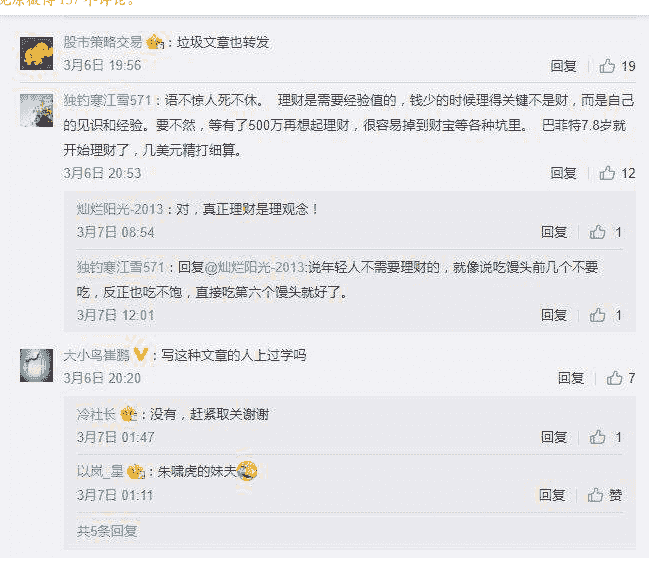

#D08 和#F1580 结合起来，使得我想要写#F1590.

一笑加一笑（微信号：150500211）邀您加入水库交流群。群内文集每月一更新......

### 穷人理财回报高，还是富人理财回报高 #D09

原创2018-03-19 yevon_ou 水库论坛 水库论坛


#### 扬长避短

##### 一） 余额宝

哥哥向来仇家多。无数人期盼着楼市崩盘，跳楼团灭。

大约在 2013 年时，我和一个日本教授吵架。教授说“楼市马上就要崩盘了”。

理由呢，理由是要加息了。

我怒极反笑，“朗朗乾坤，晴天白日”。你哪只眼睛看到要加息了。

教授的理由是，2013.06 马云爸爸上线了“余额宝”。

余额宝是这样神奇的金融工具，只要你把钱扔在里面，就可以获得比活期高约 10 倍的收益。

甚至，余额宝比定存的回报率还要高。

教授说，“银行依靠息差而存活。余额宝的产生，使得银行再也无法获取低成本的资金”。

> “银行不能获取廉价的存款，银行必不能发放廉价的贷款。余额宝的产生，将使住房贷款利率猛涨。楼市崩溃，园灭跳楼”。

听着有道理么。你仔细想想，我给你三分钟的时间。是不是这个道理。

余额宝都要 4% 了，房贷必然不可能 4.165%（基准 85 折）。

房贷加息，楼市崩盘。

是不是通常的逻辑。

你别忘了，哥哥是金融大行家耶。

我的反驳是：“余额宝将使得房贷降息”。

马云爸爸搅局，将极大地降低银行资金成本，银行从而有能力提供更便宜的贷款。楼市上涨。

那么你说，“余额宝降低资金成本”，此话怎解？

中国人的传统，重视制造业，而轻视服务业。

中国人总觉得工厂是制造财富的，而对于“服务”中涉及的消耗，视而不见。

事实上，“小额零售”业务的成本，是非常非常高昂的。

HSBC 汇丰银行每年亏一个 Billion，亏得爹都不认识了。只是为了企业形象，还打肿脸充胖子。

几乎所有银行系统中的“零售银行部”，活得都不太好。

在今年春晚中，有一个“微笑银行”的节目。一个阿婆进来，填个表，排个队，取 6 元钱。

问她为什么只取 6 元呢，说是买菜，买菜只要 6 元。

另一个阿姨，取 140 元。过了二秒钟，她觉得后悔了。

再把这 140 元存回去。

这样的“春晚”作品，都在误导一个非常不好的习气。使得让人以为，“柜台服务”是不要钱的。

而事实上呢，一个柜员，一天只能办 30 笔业务左右。

假设你三个窗口全开，一天也只能办 100 笔业务。一个月 3000 笔。

但是，另一方面，你一家银行的存在。需要多少“维持”费用呢。

你算一下，银行基本都在黄金市区，最昂贵的店面，面积又特别大。每个月房租就要 20W 元。

再算上十来个人，从大堂经理到免费空调。这么大的排场下来，一个月没有 50W，是无论如何打不住的。

这说明什么呢，银行“处理”一笔柜台交易的成本，高达人民币 150 元。

如果你仅仅是存 6 元，存 100 取 100.

那银行干脆把这笔钱送给你好了。送给**你**更便宜。

###### 穷人总以为他们的钱，和富人的钱一样值钱，其实并不是。

###### 光集散和分发，就是巨大的成本。

中国的教科书没有教。但是真正有“智商”的人都懂。

Distribution 是一件很贵很贵很贵的事。

无论你把“中央仓库”堆积如山的物资，分散送给山区一个个贫困的家庭。

还是你把千千万万户农民手中的粮食，集中到“中央仓库”。

这两件事都很贵。贵到甚至你哭。

“冯学荣学史”曾经举过一个例子。香港慈善者有一次号召居民们，把零散不用的衣物捐献出来。免费送给贫困山区。

可是物资---集散---消毒---分发，最终到大凉山手里的时候，每件成本超过 50 元。

与其这样，还不如直接让他们网上买。

对于“理财”也是一样的道理。

一个投资项目，不到万不得已，是万万不肯找“散户”投资的。

因为“散户”意味着巨大的成本。

不仅仅你接触到散户，需要巨大的成本。譬如毛细血管般的店面。

而说服散户，和散户沟通。这里面的人力成本，更是高得吓死人。

一个老太太，抖抖索索，详细咨询了你半小时。最终掏出了 200 元，购买信托产品。

这怎么赚得回来。你一个小时的人工，就要 200 元。

###### 远离屌丝，屌丝的服务成本，是惊人的。

马云爸爸的“余额宝”是一个天才。

他想出了一种极廉价的方法，用非常非常低廉的成本，聚沙成塔，最终凝聚成了 1.5 万亿的庞大怪兽。

几乎所有的银行，都乐意和“余额宝”合作。

他们只要简单的“二传手”获取资金。就可以极大地降低零售银行，柜面操作的成本。

存 3 元，6 元，300 元的客户，您最好就别上门。

2016 年，ICBC 工商银行，差不多关掉了 300 家店面。裁去了 14000 个柜台人员。

农行裁 10000 人，建行裁 30000 人。

这些事情的背后，都是“余额宝”。

余额宝极大降低了银行系统的成本。

###### 穷人的钱，和富人的钱，是不平等的。

###### 更大的资金，理应获得更高的回报。

###### 这等值于 Distribution 成本。1 变 N，N 变 1

##### 二） 人力

单纯的“钱生钱”，一定是富人更快的。

因为同样 100W 的投资，银行只要和富人谈一次。

但却要和 1000 元小投资者，谈 1000 次。

省下的钱，就变成了“大额回报”。

但是，如果你说总体的“理财回报”，却一定是穷人更高。贫富分化，一定是不断拉近的。

此话怎讲？

今天，市面上几乎所有的“理财学堂”，都已经误入歧途。

按照他们这样的教育，是断然不可能使得“穷人”致富的。

你打开网络上任何一本知识付费“理财学堂”课，无论是 9.9 元，99 元，199 元。

你惊讶地发现，他们几乎都是大同小异的。

核心部分，永远都是 60%股票+40 债券。

仅此一项，翻来覆去地讲。源头都是同一个祖师爷，西方的“理财基础通论”。

你这样没干货地反复收割粉丝，你的良心不痛么。

粉丝跟随你十几年，反复蹂躏，越理越穷，没有一人发财。

你还要不要脸的。

为什么传统的理财学堂发不了财，因为他们都已经误入歧途。

理财顾问研究的，是“买这只股票”还是“买那只股票”。

从配置的角度讲，是“买股票”还是“买债券”。

但是，这是不对的。

###### 因为，你们杀入了一个错误的战场。

无论是定存，债券，股票，基金，我们可以统称为 Mass Market。

在 Mass Market，无论你进行任何厮杀，你一定都是输的。

穷人在“大众投资市场”的任何折腾，一定以失败告终。

在 Mass Market，一定是富人>穷人的。

你一定注定只有微不足道的回报。坚持许多年，也不能使你致富。而且贫富差距，越拉越大。

穷人要怎样才可以生财，怎样才可以获得高额回报。

你一定要涉足“非标市场”。

一笑加一笑（微信号：150500211）邀您加入水库交流群。群内文集每月一更新……

“非标市场”指的是一些边缘化，边角料的，市场总容量有限的市场。但是“投资”的回报率，却是非常非常高。

举个例子，我以前有个钟点工阿姨。省吃俭用买了一个“体重秤”。

就是那种高达 2 米，站上去可以秤体重和身高，还会吐一张小卡片，告诉你 BMI 指数的。

这样的体重秤，买一个 200 元。她平均每个月，被城管没收一个。

但是她每天晚上去城隍庙摆摊，秤一次 2 元。一个晚上，也能有十几元的收入。

你算算她这个“投资回报率”能有多高。

又譬如说，一些社会底层，他们往往会省吃俭用，倾家荡产，买一辆 Audi。

买了车干嘛用呢，当司机。

目前上海的行规，一个外企高管，请一个司机，司机自己带车来。一个月司机工资+汽车租金+汽油+停车费，零零碎碎总在 19900 元左右。

假设一辆车 30W，司机买车，服侍高管。刮去人力成本，大概二年就可以回本。

如果你很狠心，买东风集卡，跑大货车，跑运输。那么一年就可以回本。

实在不行，还能跑滴滴嘛。

再譬如说，如果你有了 300~500W。您去读个书，嫁个人。

穿一身靓丽西装，骗个白富美。这里面的回报，无法计算。

我们仔细观察这些行业，发现其“投资回报比”都是超过 100%的。

而特点是什么呢，特点是“人+资金”的结合。

任何一个项目，都是小而散。充分发掘人的特长，需要极大的人力配合，才能赚钱。

而企业化社会化，数百亿的大资金，他是没法进入这些“边角料”市场的。他既缺乏足够的信息，也没有这样的灵活度。

未来的理财顾问，一个真正优质的理财顾问，他不应该推荐客户去买“指数基金+债券”，这种是 99 元低阶的。

真正的理财顾问，应该因人而异，因地制宜，摸索出一条“人+资本”的路线。

最后，不要问我应该怎样投资。俺什么都不懂。

我只知道在每一个阶段，应该如何买房子。

（yeyon_ou@163.com，2018 年 3 月 12 日晚）

### 一个典型失败的理财方案 #D10

水库论坛_2018-04-19 作者 yevon_ou


前两天，哥哥的微博钱包里，莫名其妙多了几十元钱。不知哪路豪杰赏赐。

谢谢给哥哥微博打赏哦，哥哥的微博地址是：weibo.com/yevon1ou 已封，可以关注我们的微博：


一笑加一笑（微信号：150500211）邀您加入水库交流群。群内文集每月一更新……

几十元的小钱，我也懒得提出来。于是便“一元偷看”，东看西看。

不知道哪一位大V的微博问答中，翻到如上问答。顿时把哥哥逗乐了。

实在是太典型不过的例子，值得我们逐句分析。

前几天我贴过的一个富裕家庭资产配置方案非常适合你们这样的家庭。复盘过去几年，13年开始利率下行，应该买交易所企业债、地方债，14年三季度正式降息后，应该买股（指数挂钩的etf或者自建投资组合，不建议压在个股上），15年买房，16买美股（买qdi，不建议买个股）。如果千万级的资金操作得当，2013年至今应该已经翻倍了。2017年确实投资机会少，但如果放眼五年内，还是会有机会的。因为没有人能预知未来，所以提前布局，做好资产配置、调整是非常重要的。一个资产组合，配置的好，每五年都有翻倍的机会（2017起的未来五年也是如此），配置一般也许要7年，不好也许10年甚至更久才能翻倍。盲目追求高收益，业余水平去搏专业选手都做不到的持续高收益，基本死路一条。

#### 一、 债券

首先我们看第一句：**13年开始利率下行，应该买交易所企业债，地方债。**

这句话的特点是，**这句话是错误的**。

这是典型的“传统”理财顾问套路，传统理财顾问的骨子里，就是 60%股票+40%债券。

传统理财顾问的第一个回答，往往都是债券。

为什么，因为在一个理财资产包中，债券起的是“基石”的作用。

中国所有的交易所债券，地方债，甚至企业债，虽然名义不同。但是大家心知肚明，债券默认为“保底”的。刚性兑付。

- 无论如何，100%本金总是可以拿回来的。
- 国债的话，100%本金+利息，肯定可以拿到。

在一个投资组合中加入债券，是非常明智的做法。只要客户拿出 40%的资金买债券，再加上三四年的利息，基本上 50%就保了。

拿剩余的钱买股票，股票有可能亏，但也不见得亏到一文不值。

这些因素加起来，至少客户的 70~80%本金是保住了。

而客户八成保底，他就不会找理财顾问啊。这是一条非常有趣的行业骗术。

那么，债券的缺点是什么。债券的缺点，是它的回报非常非常低。

一般情况下，和“三年期定存”，差异不会超过 0.25~0.50%

一笑加一笑（微信号：150500211）邀您加入水库交流群。群内文集每月一更新……

你设想一下，假设你付了88元，找一个“大师”询问，怎样才可以“理财”。让自己和家人获得保值增值。

大师指点了一条“保本+稳健”的方法，是让你把90%的资金存定存。滚利息一定超过>100%

剩下的10%，拿出来做各种投资，上不封顶。

A：我设计了一个保本，稳定，收益率上不封顶的基金组合。

B：那是什么

A：拿20000元存定期，然后每天买一注双色球

B：滚

只要是“交易所债券”，其回报注定非常非常之低。一般在4.5%左右。

当然，你也可以搏一点差价。

例如在“利率下行”阶段，债券价格会上升。

便如同开卷明义，“世界大势，浩浩汤荡。全球宏观经济大趋势…………blablabla”。

听起来是不是很高大上？“传统”的理财经理和你推介，上手PPT拿出来，1/3的篇幅讲“世界宏观大势”，那是绝对免不了的。

听得一愣一愣，专业啊，高冷范啊。

您看啊，快降息了，指点时跗了，偺们是不是要赶快屯一点债券放着？

“传统”理财顾问没告诉你的，“降息”的确利好债券。

但是这种利好，在最强的时候，也不会超过0.2%

- 0.2%每一万元差20元。
- 每100万元，差2000元。

请问，您身为一个拿几百万理财的“富婆”，您在这听了四个小时，图得多吃了一碗花胶补身体，您花了2000元么。

债券价格买卖差价，本质上属于零和博弈。

但哪怕你猜中了走势，差价也不会超过0.2%

因此债券这一块，你的预期回报，就是4.5+0.2=4.7%每年。

这是一个非常非常低的回报率，低得你都不好意思见人。

#### 二） 股票

理财经理的第二句话：14年三季度正式降息后，应该买股（指数挂钩的etf或者自建投资组合，不建议压在那个股上）

这句话又是一个大忽悠。他依据的，是正统投资学理论“降息有利于股市”。

这句话的解释，我们要结合第五句来看。

因此在这里，我只先贴一个 2014~2018 年的股票走势。

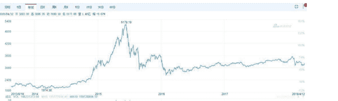

#### 三） 房产

真正令投资顾问**原形毕露**的，是第三句话：“**2015 年买房**”。

- 这句话用浅一点的词来批判，叫做：不接地气
- 用狠一点的词来批判，叫做：诈骗

买房，买什么样的房，买哪里的房。

中国绝大多“性质优良”的大城市，统统都“限购”的好吗。北京上海深圳广州南京杭州武汉成都。

买房一次，要交 3%的契税+杂费。

卖房一次，要交 5.55%的营业税+2%的个人所得税+中介费+房产税

部分城市，二年/五年/八年限售的好吗。

而且，你还没有涉及“房贷”呢。

这还仅仅是“表象”的错误。真正的“骨相”错误，隐藏得更深。一般人不容易察觉，普通读者也挖不出来。

##### 你说的买房，你用的是哪一块资金买房？？

按照作者的意思，他似乎是想说：

- 2013 年买债券
- 2014 年把债券全部都抛了，统统压入股市。底部进入，顶部抛出。
- 2015 年，把所有的股票统统抛了，买入房产。
- 2016 年，把房子全抛了，买入美股。

这样的话，他用的是一种“耍流氓”的算法。

2013~2016，每一年，他都追逐“表现最好”的市场，而且每一年都是 All in。

但是你这样的算法，逻辑上又是互相冲突的。

债券的真正牛市，是 2014.1~2016.10，2013 年只是小浪花，你赚不到大钱的。

2014 年，是股市和债市“双飞”。但是你的资金只有一笔。

你把“股市收益率+债券收益率”二者相加，这是纯诈骗的算法。

同样道理，就不吐槽你无缝连接股市行情了。


债券买卖，也当你没有 0.1% 手续费了。

2015 年你买入“房产”。你该怎么买？

绝大多数“优质”核心城市房产，都是限购的。有钱都不能买。

而且买了以后，也涉及到各项税费。税费之重，二年内跑短差，都是不可承受的。

更别说还有大量城市限售了。

“美林时钟”的四大象限，是骗小孩子的。

哪怕在华尔街，也是鉴别“半瓶子醋”。根本没有实战价值。

谁要是张口闭口，股债切换，必属骗子和菜鸟无疑。

别的不说，你抛售 100 亿美金债券，换成股票，没有实体经济理由。SEC 非找你麻烦不可。

好了，我们换一种说法，不说“接力赛”。我们改说“配置”。

- 2013 年的现金流收入，尽量多配置债券
- 2014 年的现金流收入，尽量多配置股票
- 2015 年的现金流收入，尽量多配置房子，囤积至今。
- 2016 年的现金流收入，尽量多配置美股。

听起来很美妙是不是。

牛皮又吹错了。

一笑加一笑（微信号：150500211）邀您加入水库交流群。群内文集每月一更新……

因为你按照“配置”的思路，你就无法穿越“牛熊市”。

你看股市，在 2015 年冲高回落。可是你要讲“配置”的话，2016 年马上就回吐一半涨幅。

债市同理，2014 年是涨得很好，但是 2017 就回吐了。博差价本身就是零和游戏，最终还回被打回到 4.5% 息面票率。

如果你改以“配置”的思路，你的回报就会非常平庸。

这直接引出了我们第五句话。

#### 四） 美股

资金出海，槽点太多。汇率损失，税收到交哭。

此节暂略。

#### 五） 回报

整篇微博问答，精华中的精华，高潮中的高潮，是这句话：“如果千万级的资金操作得当，2013 至今应该已经翻倍了”。

哥哥听了这句话，头发都竖起来了。宛如鳟鱼漂浮在空中。

{唐伯虎点秋香，鳟鱼}

哥哥看一下债券的回报率，看一下 A 股的回报率，再看了一下美股的回报率。（房产不用看）

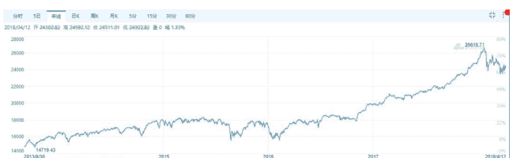

美股在整个 2014~2016 年，都几乎没有涨幅。

如果你是按照“配置”的方法，放 1/4 的资金在美股上，那可以说是损失烂脚，毫无回报。

你只有“截取”美股表现最好的 2018 年，则他差不多有+20% 的涨幅。

摊薄到四年，平均每年回报仅+5%

A 股差不多也是同样数量级。

无论你是投资债券，A 股，美股，回报都非常差。

四五年下来，大盘回报+30% 都没有。

可是你这个牛皮烘烘的理财顾问，买一点债券，买一点 A 股，买一点美股，大杂烩。

居然空口大话说，“早该翻倍了”。

三瓶浓度 30% 的稀硫酸，怎样兑换出一瓶浓度 99% 的浓硫酸。

##### 你说呀，说呀，你倒是说呀。

你知道“传统”理财顾问，最令人恶心的地方是什么。是**张嘴就吹**。

前面你说 2015 年换乘买入房产，是你不懂房产。在一个陌生的领域，一撒谎就露出无数马脚。

而你这句“2017 年至少已经翻番”，则是存心歹意，居心十分不良的**蓄意误导**。

好比微商忽悠人，总说三个月大发财。

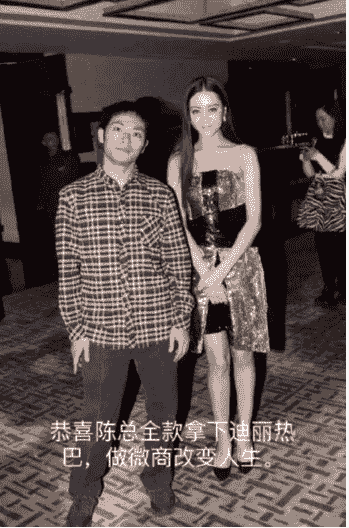

“传统”理财顾问，给客户的牛皮，永远都是四五年翻番。

而丝毫不考虑揭开盖子，你卖的都是什么垃圾。

这几乎都已经形成套路了。前途永远是光明的，只要你遵循证券投资理论，并且支付佣金管理费。

但是道路是曲折的，因为操作得当，而客户是永远永远不会“操作得当”的。

##### 三大盘只涨了+30%的市场

##### 要吹得轻松+100%

##### 怎么可能“操作得当”。

如此大幅超赢市场，您还不如去买彩票。

当客户跟在你的手下，老老实实做几年。抬头看，年化只有 5~6% 的回报，积累十年都没有翻番。

而你对他们的解释，仅仅是轻飘飘的一句“操作不得当”。

##### 传统理财顾问，我不是说你弱。

##### 我是说你不积德啊。

（yevon_ou@163.com，2018 年 4 月 11 日暮）

一笑加一笑（微信号：150500211）邀您加入水库交流群。群内文集每月一更新……

### 有很多很多套房子，是怎样一种体验 #D11

欧神

#D 系列，是写给《功夫财经》的客座专栏。因为三个论坛~粉丝基础不同，所以文风和干货，都会小有差异。

#D11 是星期五首发的。阅读已经上 100000+，链接在[这](https://example.com/link)

不过这不是重点。重点是，今天“桃军师”写了一篇非常非常棒的文章。相比之下，#D11 简直象渣。

实在是写得太好了。但我我不敢发，只敢用小号发。链接在[这](https://example.com/link)。

真是遗憾。

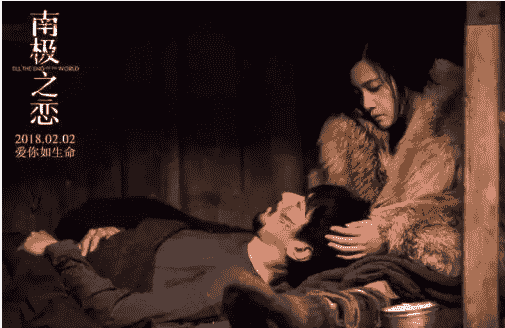

### 有很多很多套房子，是怎样一种体验 #D11

静如渊

#### 一） 现编的故事

在二线城市，有十几套房子，是怎样一种体验？

这个问题可不好答。

按照目前的市值，如果京沪深有十几套的话，那要估值 1 亿了。

如果在二线城市有十几套，也要四五千万元。

你让一个半亿富豪，来给你写体会录。一般是没那么多空的。

前几天，有人在起点上面吐槽，说现在的“神魔小说”，怎么格局那么小。

动辄都是修炼了几千年，几万年，可是做起事来，却还像街头小流氓打架似的。

举个例子，某大卖网红小说，销三甲前茅的。说兄弟二个人，都是控制世界经济命脉，家里面涉足十几个产业，管理几万人的大公司。

兄弟恶斗，斗到最后快拼命了。弟弟提出：“给我 200W RMB，从今往后一笔勾销”。

哥哥想也不想，一口拒绝：“你疯了吗，那么大一笔钱”。

因此呢，上知乎，分享你刚编的故事。

如果你没有这个身份，经历，背景，你编的故事，就很容易露穷相。

没有经历过，毕竟是漏洞百出的。

#### 二） 第一套

人的一生，会经过几次蜕变。按水库的说法，是第一套，第六套，第十六套。

| 平台 | 职业 | 平台月均收入 | 平台日常 |
| :--- | :--- | :--- | :--- |
| 微博 | 大 V | 50W-80W | 自拍、实况、抄读 |
| 知乎 | 答主 | 0.8W-1W | 答题、挂技 |
| 今日头条 | 头条号作者 | 1W-1.2W | 起标题、写爽文 |
| 快手 | 网红 | 700W-1000W | 投送屏孙子、发路态商业 |
| 映客 | 主播 | 80W-200W | 硬收路商、卖广告 |
| 抖音 | 音乐博主 | 5W-7W | 对模型、情 230M |
| 微信 | 自媒体博主 | 300W-500W | 120W+、私人 |

不管哪一个广告商，谈论起“知乎”这个平台，都是眉头紧锁。

从这张互联网大 V 报价开看，知乎也是一个奇葩的存在。

知乎 V 特别地不值钱，Top1000 几乎和叫花子一样。

按照广告商的话语，知乎的主要用户，是在校大学生，硕士生，以及部分刚毕业人士，“不仅又穷又酸，而且有反社会倾向”。

反社会倾向指的是，浑浑噩噩，懵懵懂懂，知乎 er 仿佛是生活在一个“异次元”空间。

先削前辈们，制定下的，残酷无比的“社会运转法则”。对于未出校门的象牙塔，几乎是没用的。

如果你的学哥，学长们，今年 24 岁，踏上社会第二年，第三年。

则他们会向你哭诉“玻璃天花板”，社会各向矢量的走投无路。

你 985 自以为的天之骄子，一踏上社会，却只能给你开 3000 元工资。

而且升职十分艰难缓慢，每熬几年，才升一级。工资加得也不多。

光靠工资的话，勉强这辈子都买不起北京的房子。

如果你想创业的话，你会发现，这个社会，方方面面都已经被人“堵住”了。

所有能赚钱的领域，所有你能设想到的阵地，都已经密密麻麻站满了人。人家不仅占据了最有力的位置，而且还挖了壕沟。

年轻人不甘于这血淋淋的现实，却只能嘴炮喊二句“掀桌子”。呸，你也配。

还有一部分年轻人，则遁入了二次元世界。


在目前的年轻人中，以及部分“老儿童”之中，存在一批“躲避的人”。

他们不愿意直面艰难困苦的现突世界，宁可躲进一个“自欺欺人”的虚拟痴癫中，内心渴望永远也不要长大。永远也不要经历成人礼。所谓的“反社会性格”。

如何治疗此类病症呢：一套房子。

一套房子，从此跨入有产阶级。有恒产者有恒心。

作为有产阶级，你看待世界的眼光，就不会那么 Cynical。

你就会更加理性，更加融入我们的现实世界。遵循现实世界的游戏规则，遵循层层既得利益集团制定的“升阶规则”。

如果要论体验的话，第一套房子，是你的“成人礼”。

是你告别青涩，告别幻想。使得心境平静下来的冰淇淋。

#### 三） 第六套

第 6 套房子，或者第 6~8 套房子。意味着什么呢。

**6 套房子，意味着财务自由。**

目前在京沪深，财务自由的标准，大概是 5000W 元人民币。

一笑加一笑（微信号：150500211）邀您加入水库交流群。群内文集每月一更新……

当你第一次达到 6 套房子时，你会遭遇非常严重的“反噬”。

对的，就是反噬。

非亲身经历的人，绝对写不出这样的转折。

当你达到财务自由时，你遭遇的绝不是意气风发的畅快，而是反噬。

作为多军老人，我们在 2006 年时，就已经有很多 人。

然后到了 2008~2009 之后，市场迎来剧烈的四万亿行情。很多人都赚了很多钱，然后多军就“分化”了。

许多人赚到第一个 A8.5 后，他们都面临一个棘手的问题。

> *如果钱已经一辈子花不完了，为什么还要继续赚钱*。

这是一个非常严肃的问题，你别笑。这问题直到今天，都没有详细解决答案。

> *如果钱已经一辈子花不完了，为什么还要继续赚钱*。

因为楼市这一行，内功心法有点问题。

虽然赞誉甚多，水库是“玄门内功法心法”。但其实水库是内家心法的末流。

按我们的说法，也就和蛤蟆派差不多。

比武当，少林，高级套路差远了。

楼市这一行，始于 A8，熟于 A9，终于 A10。

赚人生中的第一个 1000W 很容易，从 0~2000W 这段过程，堪称进境最快的。

但是到了一定程度就~慢~了，后期更是提拔训练不上去。

因为你的各项资源都用完了，限购，限贷，收入证明，办卡额度。而且资产结构，也已高度“角质化”。

当你通过“蛤蟆派”心法，第一次达到 A8.5 时，你面临的是这样一种局面：

- 再往前走，难度阻力可能是之前三倍，而且赚钱也不多。
- 停下不动，这辈子钱也够花了。钱赚更多也没用。

因此我们把“财务自由”这个关口，称之为“天诛”。

天诛之后，每个人选择不同。

有的人，就真的停下来了。在水库 2006 最老一批多军之中，不乏这样的“元老”。

他们第一桶金赚得很快。

但此后也不算快。今天也不算富。

#### 四） 第十六套

在 A8.5 的关头，有些人停下了。手里的钱，够吃吃喝喝一辈子。

有的人没停下，他们的心太大。哪怕可以“白领生活水准”富闲一辈子，他们还是觉得不够。

“我辈岂是蓬蒿人”，一艘游艇，就 A8.5 了。

有些人继续飞翔。如果你看到一个楼市 A9.5，则他的勤奋和变态，不是 A8.5 的十倍。

而是二十倍，三十倍。

当你达到十六套之后，你会遭遇一个新的瓶颈：“资源枯竭瓶颈”。

按照水库现有的，已披露的心法，

你到 16 套时，无论如何，所有的资源，必然已经全部耗尽。

这个时候你还想要再继续扩张，你就得需要新的心法，新的玩法。

具体是什么，是水库 Section3 里介绍的。这里也不准备说，反正本文讲的是“体验”，而不是内功。

如果你在一二线城市有十几套房子，请问是什么体验。

最大的体验是：“空”。

赚了很多很多钱，并不意味着多好几倍的花天酒地。

毕竟，如果你想酒醉金迷的话，你在 A8.5 的阶段，就可以去堕落堕落了。

选择“走下去”的人，都是为了其他的信念，或者坚持。

更何况，富贵已久，哥哥什么事情没有见过。

当你刚到 A8.5 时，对某些奢侈还会吸引动心。但若你十年前就是 A8.5，你会发现，整个世界的物质欲望，真的非常少非常少。全满足了。

A9.2 以上的财富，并不意味着更多的消费。

它意味着什么呢。雨夜枯坐，一盏灰灯。

你就坐在书房里，静静地看着外面暴风雨。什么事情也不做。

你不需要消费，当然更不需要点外卖。

真正的体验，是一种“安全感”。

你心里非常清楚，虽然你现在不消费。但是只要你愿意，你随时可以买上 1000 碗海鲜粥，吃 1 碗，扔 999 碗。

你随时可以跑到最高档的 4S 店，玛莎拉蒂，路虎卡宴，想开哪辆，每个颜色都来一款。

这种感觉，很好。

财富真正可以给予你的，其实是一种安全感。

虽然你对世界索取很少，但只要你愿意，你随时可以刷卡。

是一种安全在握，生杀予夺的感受。

然后你再看看芸芸众生，再看看在职场中拼搏，忧虑孩子老人的父母们。

有一种站在岸上，看水中众生的感觉。

以貌取人，绝对科学。性格写在唇边，幸福露在眼角。理性感性寄于声线，真诚虚伪映在瞳仁。站姿看出才华气度，步态可见自我认知。表情里有近来心境，眉宇间是过往岁月，衣着显审美，发型表个性。职业看手，修养看脚。穷会从全身散发出来。

当你有了安全感以后，你的眉目会开始舒展。神情会开始坦然。

整个人，会具有一重山岳般的宁静。

富裕，会从每一个毛孔散发出来。

（yevon_ou@163.com，2018 年 7 月 24 日暮）

### 未来二年中国楼市整体判断 #D12

yevon_ou 水库论坛 8 月 27 日


### 未来二年中国楼市整体判断 #D12

根据 8.26《功夫财经·炼金之夜》发言稿整理而成。有删减

各位功夫财经的朋友们，大家好。我是 yevon_ou。

很高兴大家今天来到《功夫财经·炼金之夜》，由我主讲第一讲。我今天的主题是《未来二年中国楼市整体判断》

首先，我们要用一个字，来形容中国目前的资产市场：


“冬”，冬天的冬。

毫无疑问，目前中国的财经市场，正处于寒冷的冬天。凛冬将至，无论股票，债券，汇率，p2p，币圈，中小企业……放眼望去，几乎所有的金融大类别，日子都不怎么好过。

Winter is coming。


分析当前的金融市场，有一个词，是无论如何绕不过去的。那就是“鹰派”。

鹰派是财经监管的强硬派。其主要主张是：

- 收紧银根
- 严格监管
- 提高门槛
- 拒绝救济

在“鹰派”的主导下，市场资金利率是大大提高了。企业更加难以获得“现金”。

我们的股市跌跌不休。而且最重要的是：“拒绝救济”。

政府会宁可看着股市下跌，在座各位的金融财产大幅缩水，也不出手救市。

从经济学理论上讲，鹰派是不是故意和各位的“钱袋子”过不去呢？不是的。

理论上“鹰派”对于整个国家，是非常非常有益的。在整个财经周期中，也是必需的。

- 减少投机者
- 减少食利者
- 压缩泡沫
- 苦练内功

当经济十分旺盛时，会产生大量的“投资者”。

譬如我们的花荣老师，算是股市“元老级大神”了。

大家购买了花荣老师《功夫财经 App》的课程，功力大涨，股市牛市中，轻易就可以赚很多钱。

问题是，如果股市赚钱太容易的话，那还有谁肯认真工作呢？

如果楼市的价格高度确定，只涨不跌。那你只需要“买入”资产，就可以坐享资产升值。

如果我们整个社会“食利者”太多。那还有谁愿意辛勤工作呢？

这时候，就需要“鹰派”出场了。

“鹰派”的作用，是去除我们整个经济体系中的泡沫。

对一些“跟风投机”的小散，把他们扫扫出去，弄得破产。

这样，只剩下“最优质”“最有效率”的企业和机构活下来。使得我们整个社会都更有秩序，强身健体。


好了，现在来到一个很有趣的话题：“铁打的泡沫”。

“水库论坛”是讲房地产的。我在这一行，从业已经 16 年。

> 一笑加一笑（微信号：150500211）邀您加入水库交流群。群内文集每月一更新......

从我们有记忆起，谈论房地产，从来不是三个字“房地产”。

而是五个字：“房地产泡沫”。

谈论房地产，几乎所有的媒体，评论小编，大伙众口一词“房地产泡沫，什么时候破灭”。

这搞得我们十分之郁闷。因为我们渐渐发现，这简直是一个“铁打的泡沫”。

“鹰派”统领。在全国范围之内，收缩银根，凛冬将至。

可是我们发现，被喊得“最凶”的房地产，在严冬之中，并没有陨落。

相反的，一些“寄予厚望”的投资产品，却露出了原形。

- 股市崩了
- 汇市 6.84 了
- p2p 崩了
- 币圈暴跌了
- 地方债危险了
- 中小企业也不滋润

昔日最口诛笔伐的房地产，却依然健康活得很好。

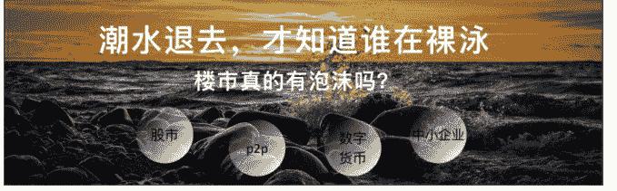

房地产不仅仅是“铁打的泡沫”，如果我们细分，把市场分割来看；

在如此寒冷的冬天，甚至还有部分城市房地产，“升值”很不错。带来了可观的收益。

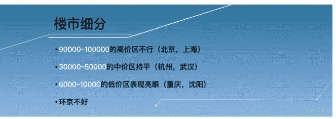

如图。我们把房地产分为“高价区，中价区，低价区”。

- 高价区，主要是北京上海。在“严控”的调控态势下，北上房产呈现小幅阴跌的态势。
- 中价区，武汉杭州成都郑州。这一批城市呈现“持稳”的态势。
- 低价区，主要指单价还在 10000 元左右，甚至不足万元的城市。主要是重庆，沈阳。

在过去一年中，“重庆，沈阳”的表现非常好。也给水库网友带来了丰厚的回报。

我们持续看好这二座城市的发展潜力。并预期未来一二年內，依然可以保持旺盛的势头。

目前，北京的房价 100000/m，沈阳的房价，以水库关注的“恒大雅苑”“恒大名都”“恒大左岸”等项目而言，价位仅仅才 8200~8500.

> 也就是说，一套北京的老房子，可以换 12 套沈阳一手新房。

近期，北京---山海关---沈阳的高铁即将通车。

“北京一沈阳”的通勤时间，将由原先的 4.5 小时，压缩到 2.5 小时左右。

一笑加一笑（微信号：150500211）邀您加入水库交流群。群内文集每月一更新……


这不仅将极大地压缩沈阳的心理距离，而且也方便了商贸往来。

更重要的是，随着“北京—沈阳”的关系愈发紧密，我们有希望调低沈阳的“法制成本”。

阳光之下，一切阴影无所遁形。如果沈阳的“法制成本”可以向北京靠拢的话，对于东三省经济，将会是一个巨大的利好，也会促进房价回归。

过去，因为北京“限购”，大量的购买力被逼去了“环京”。

霸州、涿州、固安、香河，这些县市并没有大型的产业，也没有人口积聚，连摩天大楼都没有。

#### 最佳环京城市，其实是沈阳

沈阳才是环京之洼地啊。


言归正传，我们继续来看《未来二年的地产整体判断》。

今天的第二个关键字，是“春”。

冬天来了，春天还会远吗？

鹰派之后，“鸽派”可冀。

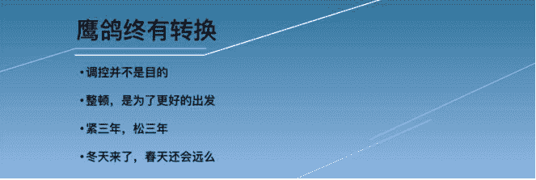

首先我们看到，“鹰派”并不是和各位的“钱袋子”过不去。

“调控”并不是目的，国家并不希望把各项金融资产打下去。

“调控”仅仅是一种手段，把经济体中不合理的泡沫挤掉。

整顿，是为了更好地出发。

鹰三年，鸽三年，鹰鸽是不停地转换的。冬天哪怕再漫长，春天也会来临。

当春季来临，万物复苏之际，谁会受益？


无论直接、间接地放松，

#### 地产都是受益者

为什么？因为地产是“铁打的泡沫”。

虽然大家嘴上喊得凶，但是事实证明，“真金白银”拿钱出来考验的时候：

- 人们依然选择信赖房产，而不是囤积股票。
- 如果有更多的资金，继续买楼多过买股。

所以，地产在下一轮“经济宽松期”，复苏是大概率事件，涨幅也会更快。

#### 还没有建仓的，抓紧了

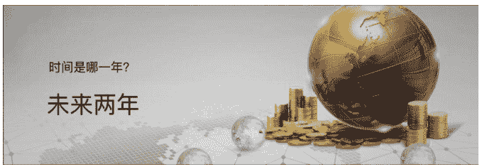

大家都在盼“鹰鸽转换”，盼望着“紧缩”政策尽快过去，下一轮“刺激”经济政策尽早出台。

那么，“鹰鸽转换”大致会发生在哪一年？

我们今天演讲的主题稿是：“未来二年地产整体判断”。因此我们回答说：“二年”。

“嘘~~”台下嘘声一片，观众们纷纷表示不满意。

烂番茄，臭鸡蛋，空矿泉水瓶，可以扔上来了。

“老师，您停忽悠我们二年！”

“长二年，短二年，人生有多少个二年？”

“更精确一点行不行？更早一点行不行？”

好了，我们来看 PPT：

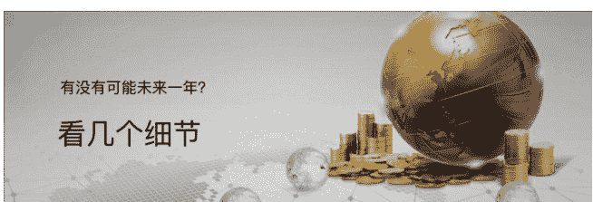

“一年”，一年可不可以？

**答案是：有一定的希望，但还要看几个具体细节。**

为了解释这个问题，我们首先看一些新闻。

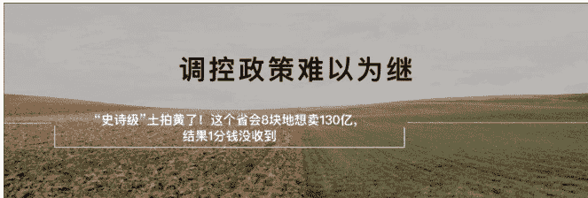

*《“史诗级”土拍黄了！这个省会 8 块地想卖 130 亿，结果 1 分钱没收到》*

8 月 10 日，山西省会太原，举办了 8 块土地的大型拍卖。

结果非常地出人意外，8 块土地全部流拍，一分钱也没有成交。

这条新闻，虽然在大众中很少关注，但却是对整个地产图地震。

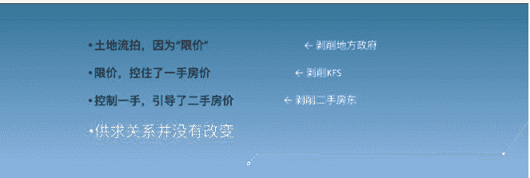

过去的一二年中，“北上津”等城市，房价之所以可以被压制，是因为政府实施了“限价”。

南四环的金茂府，本来想申报卖 12W，结果也仅仅批核了 8W 元。一些边角料甚至只有七字头。

一手卖便宜，压制着二手也涨不高。

“羊毛出在谁身上”？

购房者占了这么大的便宜，每平米 -50000 元。

2018 年房价不太贵的代价，KFS 被“转移支付”了几千万。

但人都是很聪明的，“千做万做，亏本生意不做”。

你这回坑了 KFS“限价”，下回人家就不和你玩了。

“限价”的直接后果，政府信誉破产。以后“土地”就卖不动了。

天底下岂有只降房价，不降地价的道理。

我们看回这张表格。最初的时候，是剥削 KFS，不为所动。

第二步，是剥削二套房房东，不为所动。

第三步，如果“限价”政策长期执行，则意味着土拍市场极度萧条，地卖不出去了。

这就触犯了“地方政府”的利益。地方政府急了。

而不卖地是万万不可的。几十、十万张嘴等着吃饭呢。

“限价”政策，不可能长期执行。


总结一下，“限价”并不是长效机制。

真正的“长效机制”，有且仅有一种，就是“大规模增加土地供应”。

我们对于“限价”政策的预估，寿命仅仅只有一年。

- 一年之内，现行以“限价”为主的调控机制就会崩溃
- 积重难返，沉疴难治
- 市场积蓄非常大的反弹力量
- 在某个契机点

一笑加一笑（微信号：150500211）邀 您 加 入 水 库 交 流 群。群 内 文 集 每 月 一 更 新......

最新一轮的“调控”，之所以显得房价涨不快，是因为用行政手段“限价”，强制性地把几千亿 KFS 资产，分给了购房民众。

但是这种“行政调控”是不持久的。

KFS 感受不到“契约法制”精神，以后就不会拿地。大规模土地流拍，只会越来越频繁。

“限价”只会导致中长期的供应，越发减少。

楼市存在“补涨”行情。

关注地产，加仓地产，从今天开始。

### 佛系少年还俗记 #D14

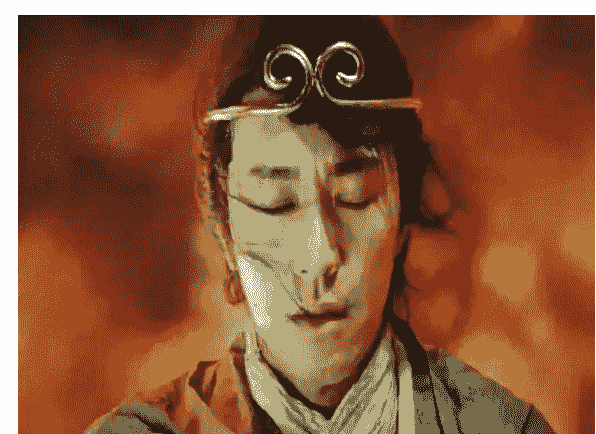

#### 一、佛系

身为父母，有时候看着我的小孩，常常思考一个问题。

“教育孩子，最怕的是什么？”

“怎么样的孩子，这辈子算是毁了？朽木不可雕也。”

这个问题我反复反复想了很久，从最笨的、最贪婪的、最自私的、最不会写作业的……

俺可是有大神通的。小孩子再皮、再狡诈、再多的心眼，在成年人眼中，也翻不出五指山。

就像是涮烟客琢石中玉，“琢琢琢琢”，迟早把你打磨得求死不能。


想来想去，我沉思思考很久。只有一种情况，是我无能为力的。即使以我的智慧、资源、财富，也无法挽回的孩子恶习。沉沦到底：

##### 佛系，只有佛系是无救药的

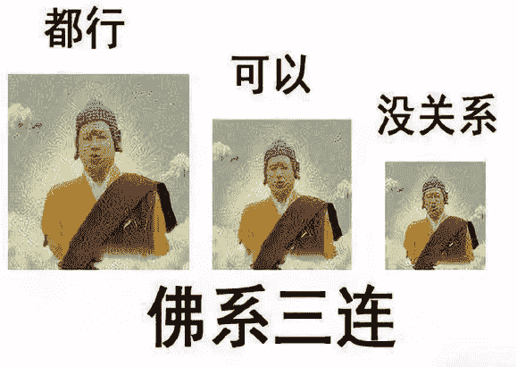

什么是佛系？佛系就是“低欲望社会”，就是没有欲望。

“呵呵，可以，没问题。”

你让他做作业吧，不做。

你让他找进修吧，不读。

你让他找工作吧，不干。

每天回家，把耳机往耳朵上一套，一个人躲进房间听音乐，打电动。

你即使把他电脑砸了，他也无所谓。

我从来不怕“小孩子”有欲望。有欲望没问题，有欲望的最好控制。

例如小朋友想看电影《小马宝莉》，没问题呀，你把作业做完。

作业做完，才可以吃糖果零食。

例如小朋友想去越野探险，没问题啊，你先考上大学。

考进北清复交的话，奖励一辆 G55。

人只要有了欲望，他就有了漏洞。

在高手眼里看来，处处都是独孤九剑。

有欲望的人，如果再加以“理性”，可以谈交易条件。这简直就是世上最好的合作伙伴了。

真正令人抓狂的，是没有欲望。而且这个趋势，已经在社会和人群中蔓延开来了。

例如 70 后很多都是“奋斗逼”。公司用一个胡萝卜“升职加薪”吊住他们。

你想做高管么？你想买房子么？

只有在组织中唯唯诺诺，拍老板马屁，老板才会提拔你。你才会有光明的未来。

##### 90 后拍拍屁股，立马辞职走人

90 后直接甩手走人。什么 996 加班，不存在的！

你语重心长地和他说，“年轻人，要为未来而奋斗”。

人家直接扔挑子回家。戴个耳机，开始听音乐。他在家里，每天吃二顿饭，生活简简单单，挺好的。

你说“买房子”吧。买房子这么重要的事，几乎每二三年，就是新一轮的价。

“年初不买房，一年又白忙”。

你把嘴唇都说烂掉了，论早奋斗的重要性。

可是人家只想住“棚户草屋”呢。他不想改善住宅，老子不买还不行么。

真正令人畏惧的，是不和你玩。

不玩就没有损失，也不会中你的割剃。

无欲，佛系就是无敌


#### 二、国家和事业

如果把“佛系”的概念，推广到一个国家，或者公司事业时。

有时候我们会感到深深的无力感。

例如，前一阵子他们的老大哥“乌鸦”，去 USA 逛了一圈回来了。

问他，对亚美利坚的感受如何，他摇头说“美国没救了”。

##### 藐视金钱

何出此言呢？因为美国人犯了一个最重的罪：

以前，美利坚是一个“金钱至上”的社会。

门童打赏二美金，他就会殷勤地帮你搬箱子。

打赏十美金，他就愿意帮你烫衣服。

打赏五十美金的话，哪怕远隔六个街区的古董雪茄，他也愿意冒雨跑一趟，帮你买回来。

但是现在的美国，“金钱”不那么好使了。

最简单的一点，“为了钱”而嫁人，这样的现象几乎绝迹了。拜金女郎濒危灭绝了。大伙都觉得日子过得很好，大富翁也没什么羡慕的。

再譬如说，“大企业家”、亿万富翁、商界领袖，从来没像现在这样，缺乏社会地位过。

美国真正的明星、青年人的偶像，是篮球明星、音乐、LGBT 人权斗士。

你细心耐心地花几十年，经营一盘点生意，得到的不是别人尊敬，而是老古董般的嘲笑。

第三层面，“精英化”似乎也停止了。

在大公司里面，野心勃勃往上爬，排挤掉同僚和竞争对手，类似于“纸牌屋”的雄性男性，正在变得越来越少。

美国人普遍地认同“家庭和娱乐”更重要。放弃高级经理的职位，园丁烤咖啡，不再是一种羞耻，几十万美金高薪，似乎也并不值得追求。

##### 几件事凑在一起呢，美国快完蛋了！

#### 三、低欲望社会

“低欲望”社会是一种病，它会传染。所到之处，生产力被破坏得一塌糊涂。

- 日本是第一个牺牲者。
- 美国是第二个牺牲者。
- 欧洲是第三个牺牲者，尤其是法国。
- 中国也非常危险，深受恐吓。

水库的口号，是“赚钱的秘密”。

我们整理出了一套办法，只要依照心法修炼，再加上一段时间的“负现金／负现金流”筋骨熬熬。

纸币通胀是大趋势，放水也是大趋势。总能凑上一波洪水行情，净资产便是翻番。

但是我们在传播“水库手法”的同时，尤其是最近几年，我们越发地感受到，升阶的困难。

- 并不是赚钱更难了
- 而是想发财的人更少了

你跟他说，看房二百套。他抬头“哦”地一声，面无表情继续低下头刷抖音。

你说要抢笋盘，机会难得。他懒洋洋地回复你“我觉得少赚点钱也挺好的，我们真的需要那么多钱吗”。

你说我们像打鸡血一样，负重前行连续 2N，10N。回头一看，跟随水库的信徒已经越来越少。

有时候我在想，不是我们的“手法”赚不到钱了。市场上处处都是商机，不乏四十年前的深圳、百度待兴的潜力。

我们真正缺乏的，是“金钱的魅力降低了”。

##### 现在的人，不想赚钱了，不想发财了

##### 这个真是要命了！

如果我的孩子，将来沾染了“佛系传染病”。生儿如羊，不如生儿如狼。

软绵绵地像个小绵羊一样，没有任何欲望，没有任何追求。

这才是五指山都没办法的事。

#### 四、低欲望社会

这次水库在“西港”拿了一块地。这块地很好，价格也很便宜。

我们的心里面，像野草丛生一般，火辣辣地怎么都燃烧不满。

最重要的是，这是中国人少数机会，可以拿到大片的建住宅土地。

中国的地价多贵啊，贵到了吓死人。

京沪一片立锥之地，就要数百万人民币。

一亩地是 667 平米。而在西港这个项目中，按照目前批发价，你可以轻松购买 20 亩土地。

盖房子，可以盖一整幢楼。却只要京沪一套三房的价格。

每个人，都能圆 KFS 的梦。

不要去东南亚买房，买房都是坑子。

你要买地。

水库推荐的是买地。买地才是良心投资。回报率远远高于买房。

在我的设想中，如果我有 20 亩土地，首先我会拿 15 亩出来，进行商业开发。


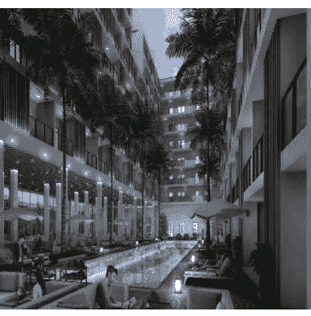

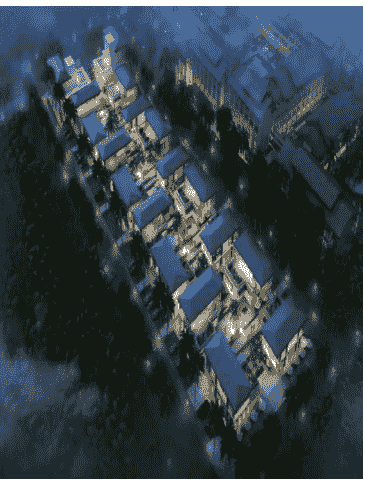


这些炫目的土建和设计，全部都可以外包。

有专业的施工队，设计院。而且都不贵。

剩下的 5 亩地，我想造一个宅子。

《碧血剑》上册中，有一个章回，叫“遄塘楼处子”。

从那时起，哥哥对于中式大院，就有着深深的迷恋。

室，宅，院，府，城，宫。

我也想造一个这样的府，有大大的秋千。

秋千晃荡起来，可以遥远地看到墙外伸出枝头的桃花和海棠花。

如果在中国，你可能永远没这样的机会。

中国的房子多贵啊，中国的土地多贵啊！

而且你有钱，你也不敢这样造。

因为这样造宅子，“僭越”了。

你是什么身份，你也配住这样的房子。

如此“稀缺”梦幻中的城堡，不是工薪族守得住的。县城恶狼无处不在。

但是在“西港”这个地方，童话中的梦想却是可以实现的。

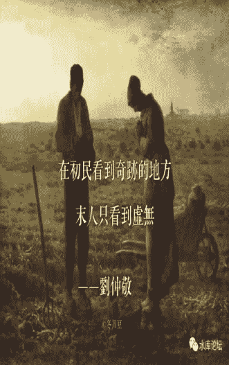

“西港”这个城市，就像是 80 年代的深圳。

而我们，就像当年的港商、台商。

毫无疑问，这是水库最近二年，看到最最“眼前一亮”的项目。

##### 整个项目唯一的风险是：“佛系少年”

也是我们带着你发财，推着你共建美好梦宅。

而你还正在低头刷抖音。“呵呵，都行，无所谓”。

眼睁睁地看着商机，土地，财富溜走。

如果你佛系，无欲无求，藐视金钱，甘于贫寒。那我们就真的一点办法也没有了。

- “水库论坛”在西港拿了很大一块地。
- 因为土地太庞大，消化不下。因此分售一部分给水友。
- 20 亩起，价格~真不贵

（yevon_ou@163.com，2018 年 12 月 6 日晨）

## 芸嬈篇

### 屌丝和大哥的本质区别#Y01

原创 2018-04-07 芸芸 水库论坛


欧哥哥赚的是宏观的钱，十八年，造压十八把大；

婊赚的，是微观的钱。

哥哥在讲经济学和#F篇的时候，星罗棋布，讲了很多关于屌丝的事。

如果我们把水库数百篇的内容里关于屌丝的部分单独拿出来集中看，已经把屌丝小白歪的形象和特质刻画得蛮深。

可是他的出发点，99% 是为了传播奥派——我们必须知道身边的阻力发生在哪里。

1% 是实在被傻逼气着了泄泄火。

婊也说屌丝，出发点不同。

大家也知道姨为什么来水库。

Yevon\_ou 太累了。

太累的其中一个原因，40w 水库粉丝，天天吵着要“干货”，说得再赤裸一些，就是要升阶。

A7-A8，A8 要到 A8 还要进 9 进 10（而且升速要超过平均速度）。可是升阶也是讲究基本方法的，比如说，先要能日常识别出屌丝和大哥，远后者近前者……

#### （一）头号玩家

直接上结论吧。

觉得《头号玩家》好看，特别是出了电影院心潮澎湃的、要掉眼泪的，是屌丝。

大哥的评语是：哦。

姨的朋友圈里也是有屌丝的，屌丝会怎么赞美这类作品呢？

童年回忆，热泪盈眶那些不说了。

中级范文是这样的：

全程无尿点，我们喜欢的东西终于有人做出来了，老爷子牛逼！

高级范文有：

> 人类在以目送未来的眼光，用第八艺术向第九艺术致敬。

屌丝在等着靴子落地，等着被认可被肯定的声音从别人那里传来。却从来不知道，这靴子也是人甩的，甩靴子的人，叫做大哥，一蹬脚就可以控制你今晚的睡眠质量。

这几年姨对身边冒出来的各种产品，只要嗅到一种气息，就会产生高度警觉，这种气息叫做——

“完了完了，屌丝们要特别喜欢它了。”

对这类产品的态度永远是，学习供应链，丝毫不消费。

越是屌丝一窝蜂扎堆的东西，姨越得厌恶，久而久之，形成生理反应。


头号玩家说了这样一个故事：

贫民窟里废物小 Z，和整个社会的其他屌丝一样想打通关创世神卷毛设计的游戏。凭借着对卷毛人生的“透彻理解”，看档案 1000 次，找到破局点（爱情和友情），过程中联合各有缺陷的少数人中组成逐梦之队，干掉了有钱有权的 Boss，自己成为世界新 Boss。

不掌握管理万人工厂技能树、利益集团谈判技能树、只掌握单兵作战 + 喜欢就亲下去技能树的小 Z，成了新 Boss。成为 Boss 之后做的事是天天和女朋友打扑克。

豆瓣上瞅了一眼评价：每隔几秒就有一个内部梗，剧情结构很经典，次元切换很炫酷，彩蛋拳拳到肉，优点一大堆。

所以，这就是一个般般劲勤服务屌丝的产品。

你们笑纳，姨不奉陪。

#### （二）脑回路

面对这样一个般般劲勤精耕细作 4 天收到 4 个亿的屌丝产品，

屌丝的脑回路是——

卧槽，这个我懂；卧槽，这个是我知道的；卧槽，导演也喜欢这个！

拍大腿：老爷子，您太懂行了！

我们当年被爹妈追着屁股按不支持的那些爱好，终于有人理解了！

感动，好评，发朋友圈。

大哥的脑回路是——

嗯，主角，嗯，侠笔，嗯，冲突，嗯，结局。

诶，原著/剧本是什么样的？导演的实现手段还成哈。

好多年不玩游戏了，咳咦。

完全不感动。

发现区别了么。

- 大哥尝试理解，屌丝渴望被理解。
- 大哥感动别人，屌丝为自己流眼泪。
- 屌丝需要别人创造机会来满足他自己的英雄情结，沙坑挖好椰子水撬开，就等少爷你坐下啦。可是大哥想当英雄的时候，是要自己担起风险来做事的。27 岁的理想主义情结让一个 72 岁老爷爷来动手满足，就像是公交车上老人家反过来给你让座，竟然完全不是先惭愧一下么？


- 屌丝眼里自己的成长史就是人类瑰宝，大哥的成长史最想知道的人越少越好。
- 屌丝停下来回首前尘，都是年轻时稚嫩的美，大哥没工夫忆往昔峥嵘岁月稠，写出来也是为了让屌丝大声朗诵并全文默背的。

屌丝的脑回路炒起一锅情绪泡沫，放点时间，啥都不剩。

大哥不肯把一丁点能量花在情绪上，全部能量服务于怎么创造。


> 匿名用户提问：欧大，胡玮炜核心发展和套现是什么？还是赵么。网上讲原来北溟。后来遇到贵人了吗？

有人想炒作共享单车，他适逢其会。

##### 命好。

咦对这亊了解稍多，发表点个人观点：也对也不对，这句话形容 DW 更贴切。

如果你们不清楚中间细节看结局也能反推，HWW 可以套现出局，DW 不敢，出局就不剩啥了。

再往下想深，什么叫做“适逢其会”，逢的意思确切地说，叫做当资本大手需要有人做这件事的时候，刚好她在“做”啊，更多的屌丝彼时在干啥？

“这是啥？好难啊，接着上班吧。”

大哥学习供应链，大哥下场来做。

屌丝消费产品。

所以大哥赚了屌丝的钱。

这，就是我们微观赚钱的逻辑。

#### （三）脑容量

当然人们通常有一个错觉：大哥能成事儿，是因为大哥们的脑容量都异于常人。

片面了。

其实脑回路不同的主要原因，恰恰是因为大哥的脑容量和屌丝差不多。才逼出了大哥的脑回路。

硬件都是人，相同条件下有人想站在塔尖，总得逼自己改造改造硬件吧。

大哥的世界里不接受浪费，任何形式的浪费都要引起大哥的充分警觉：

资源到哪里去了？为什么没有（为我）产生效益。

想得多了，脑容量的使用模式就改造得只有一种，专注于真正的创造。

其他的事全都不在乎。

大哥不在乎被评论，屌丝才在乎。

钱包磨得边都白了，也不换。

白袜子黑皮鞋，也能穿。

大哥不是用来被理解的，屌丝才是。

#### （四）YY

姨不怎么看书，随手翻过几本媒体文人给大企业家写的公司史和个人传记。

读后感觉，他们如果转行去给玛丽苏言言编剧当编剧，也会棒棒哒。

先别笑，二者可都是文化市场上周转效率相当高的产品。《XX 传》畅销了几千万本，*30*0.15，点击量几百亿，小小投入大大回报。而且 market voice 还很大，衍生的 ip 效应还没算。

企业家传和玛丽苏剧，二者共同之处在于，懂得营造屌丝以为的高阶世界的故事给屌丝看。

田间两个农民聊天，“皇帝过啥样的生活？”“皇帝的锄头是金的吧。”

读者以为大哥就是高处不胜寒的，在月亮上喝闷酒看着地球上的热闹哭，悔教夫婿觅封侯……

那就写给他们看！

但其实，大哥在高处面临的主要烦恼可能是：妈的，火箭能不能做成可回收的？！

升过阶的人都明白，升阶的困难，往往并不在那些已经被发现的问题上。

有大哥脑回路的人懂得用专注节约能量和心力，同等条件下，问题解决得都比别人好。

升阶的主要困难，是你根本不知道升阶的路在哪儿。

你在低阶的时候，总也听不懂大哥好心好意在高阶跟你们说的话，就会埋怨大哥站着说话不腰疼。

后来，更没有人点拨你一二手了。

这也是哥哥累的原因。

以后周末有空，我来当“翻译”。

（你芸姨，刚写的）

一笑加一笑（微信号：150500211）邀您加入水库交流群。群内文集每月一更新……

### 创始人套现的三重境界#Y02

原创 2018-04-15 芸芸 水库论坛


### 创始人套现的三重境界#Y02

创业者的故事长线来看，都是悲剧。

（零） 代持

> 匿名用户 提问：芸姨以后的文章也会像欧大一样以写房子为主吗？

她好像不懂房子。

圈层之间技能树的侧重点的确不同。

比如吧，姨不懂房子，在姨以前的圈子里，代持这件事，根本不需要用一册正本#1610 和一册番外#1615 来写。第一次读哥哥的两册代持技能树，新奇得如同走进大观园——

> 协议双方关系竟然如此对等，还能如此用力？！

不怕大家笑，姨之前真的没怎么见过有大风险的代持。

哥哥手册里写的术，已经精确到了诸如 1 元债务，2 小时操作，40 元费用的程度。简直让人看花了眼睛。姨一边看一边想：

为什么啊，为什么层层设防，机关算尽啊？

须知，奇技淫巧都是被逼出来的。

> “代持的最大风险，来自于 B 的突然反悔。”

可是圈层之间常识基础是不同的，换到另外的圈子里，有人就很自然会质疑：

- 但如果，B 是 A 的亲子呢？
- 但如果，A 是 B 的投资人呢？

只要 B 想在圈子里混，A 会让他*不敢* 产生风险的念头。

正着说，叫做“忠诚是因为背叛成本足够大”，反过亦亦然，只要背叛的成本足够大，再大的人欲也会顷刻忠诚。

此为序言。

#### （一）第三重，门外哭

如果一个人没有牛顿的才华，没有排名第一的姓氏，没有馅饼运，自己做点生意（承担系统外风险，获得超额回报），恐怕是目前升阶的一条大通路。

但是整个商业史上，如果你挨个筛过，才华 5 分，背景 4 分，努力值 7 分，运气 6 分的商人大部分是什么结局呢？

出局。

在这里出局的意思是：*君让臣走，臣发篇公众号文章传为 10w+之后也得麻溜儿地走。*

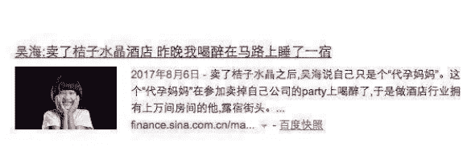

真到了这个份上，且不说看客们最关心的公司卖掉 36.5 个亿，到手剩几个子儿，这种形式的出局，最大的伤害在于伤了心气。

*创始人也是人。*

*人可以不上班，但是不能不工作。*

和看客们关心的问题不一样，局中人最大的崩溃在于，在当打之年，被请出局，之后干点啥？

“前面多少年的创业汗水都可以当沉没成本送给你了”，但是接下来，“我特么要干点啥啊？！”

一笑加一笑（微信号：150500211）邀您加入水库交流群。群内文集每月一更新……

有一个被低估的事情是，相当多的商人是无法上班的。

对于商人来说，做生意是宿命，dτ>0。不做这个，武功被废掉九成。失去了做老板的机会，很多商人并没有中间做职员的技能来缓冲，比如姚的温州朋友，不是特别富就是特别穷。

拿着资本家牙缝里剔给自己的小几个亿，交税之后，谁来说说接下来该做什么？张兰振作了么？周航操作了么？

##### 创业七年后出局易到用车，周航：失败是创业的一种宿命


4月12日，易到用车CEO周航在易到的全部股份已转让，接手人为乐视高管吴孟，目前其在易到的股份比例为93.08%，这表示周航已出局易到用车。4月9日，周航加盟雷军所创办的顺为资本。随后，顺为资本管理合伙人许达来已向媒体确认，周航已加盟顺为，出任投资合伙人。

一个人的筋骨、精气神儿是被抽走的。

有些窗户纸，创投圈大家谁也不说破，可是真的在圈子里待段时间看得久些，大家心里是默默有排序的：

马马虎虎的创业者转型做投资人，叫做靠岸。

有过小成的创业者拿着牙缝钱做投资，先不论后来因际际会能否梅开二度，总归在这一章节，算是金身。

而有大的创业者如果走到了套现出局的田地，那么先投资保命，不开玩笑。

#### （二）第二章，门里哭

套现这个说法，是站在套现者角度说的。

但我们知道，但凡交易，必有买卖双方。只看到卖，就永远差一半理解。

要把关系和境界说完整，得回答另一半问题：谁买家？为什么买？

谁买家？大鱼吃小鱼。

为什么买？要你的业务模型。

在第二章境界里，买的是业务模型而非管理模型。

账面资产——业务——管理

- 在业务模型和管理模型的更下品，是单纯的规模与资产，收购如果沦为纯粹规模资产购买，是**不会有任何真正的溢价的。**举个例子说就相当于收300台空设备得到$2000w表上资产，**喝水得水肿。**
- 收你的业务模型是肯定你做了“对的事”。

能做到“买家”想要的业务模型，也不知该不该说恭喜，但总算你可以进门哭了。

相当于收了300台空设备，外加每一台里面装着1份不同的“软件”，不再是空白机而能实现一定的功能了。

一份软件算$100000，得到$2000w+300*$10w=$5000w价值，溢价倍数出现了，吃了米面能起床活动了，但还谈不上吃肉。

重要的是这台“功能机”最初是怎么来的呢？

故事的剧本是这样写的——

“爸爸要把这堆泥巴改成城堡，然后给我运过来。”

“好的，爸爸。”

有人要一个业务线，需要有人当马仔，不想让吃亏群众了解太多的话，落地操作的时候多半会选择马仔代持，但风险却为零。跟接单圈完全不同。

因为，B 还想在这个圈子混。

“好的，爸爸。”

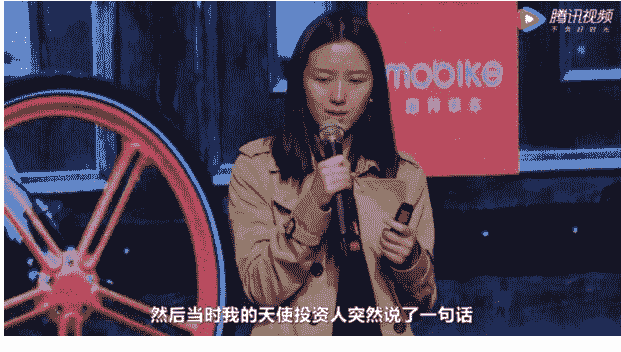

Again，只要背叛的成本足够大，再大的人欲、再强烈的野心，也会温驯忠诚。

要知道 “对的事” 是被爸爸钦点的，最近炒过包括但不限于新零售、共享 xx。能为爸爸做对的事的人，很多，供给充沛，所以必须竞争。

竞争的结果就是，虽然让你进门，但是你笑不出来。

创业投资和房子最大的区别在于双方角力根本不对衡。房子领域，你有钱、我有核的时候，随时想坑就坑，想反悔就反悔；但换到创业圈，初出茅庐的鸟仔，不给资本爸爸打工，怎么上位？只能用这一次哭，换来上位进门。

假如没有上位进门这层价值，这一类的代持股权，放眼望去全是非常不对等的。

现在创业的核心圆圈非常小，年轻的创始人不能脱离这个圈子做人。爸爸让干嘛，就得乖乖干嘛。钱是好东西，有人敲锣打鼓发稿送给你（）的时候，有很多隐性的代价早就标好了。

比如，以创始人的名义打工十年。

#### （二, 五） 管理模型

但是第二重境界买不到管理模型。你可以收 300 台带软件功能机，但是要买一整套操作电脑的技工，甚至是管理技工的头儿，倍数就得再加，加出来的倍数在“人”上，管理团队得哄着留下来。

熟悉么？混到上市就有这种待遇了，锁定期啊。

所以现在在纳斯达克最受追捧的是什么？就是除了创始团队的心力（管理模型）之外，业务模型华尔街根本看不懂的公司。

由着你亏啊，只要你扛住。

这个以后有机会我们再说吧。

#### （三） 第一重，门里关

套现本质也是交易，之所以存在是因为有买卖双方，买方是爸爸，那就必须乖乖套城堡了。

好的，那，要买方是……韭菜呢？

我们的策略叫做，对韭当割。

> “我走后哪管洪水滔天。”

2011 年某家上市公司 F 导手里，一次性用 10.5 亿现金收购了一个皮包，皮包当时的总资产 1.35w（对，没数错位数），净资产为负，注册资本还没到账。所谓的对赌条件是未来五年承诺净利 4.72 亿，F 导干两年歇两年，稳稳套现的买卖。表面上从上上市公司套现，实质上割的是散户的菜。

以前至少每年还知道冲冲市场业绩，现在都有闲情雅致叫姑娘跳舞了。


#### （四）S 级套现

最后一种情况。如果说划过得油，皮肤都会有光。那么做过千亿、万亿资本的白手套，鸡犬也是天上天的。这里面不可说的也就更多了。

能说的比如小燕子给马不老实做白手套。

> “我跟她总共见面不超过十次，至少五次还是公益活动。”

然后翻出至少 11 张背景不同的合照。

还有另一些白手套成了著名白大褂。

一笑加一笑（微信号：150500211）邀您加入水库交流群。群内文集每月一更新……

长线来看白手套下场都不会太好。但是当下能赚对很多人来说，就是致命吸引力了……

总归你们猜，HWW 是第几重？

以及，要是隔壁 DW 能套现，又是第几重？

（你婁姨，刚写的）

### 最年轻的副总裁#Y03

水库论坛_2018-04-21作者:芸芸

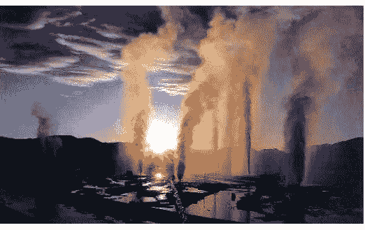

最年轻的副总裁#Y03

16年底，我曾跟朋友戏言，2017 将会是 VP 的井喷年。

说这句话的时候，正赶上李叫兽团队被百度收编。

转眼一年过去，事情已经变成这样——

我所有的朋友们：

今天有一件事要向各位宣布，因个人发展原因，我已经辞去在百度的工作，准备开始新的方向。

感谢百度为我提供的平台和支持，从最初的智能创意方向，到后面的信息流产品，让我获得了直面数亿用户的锻炼机会，也积累了宝贵的管理经验。

我深知，百度提供给我的，远大于我能贡献与回馈的。过去一年，在 Robin 的带领下，百度正在不断从上到下推进变革，走上一条更加开放和创新的道路。我有幸与非常优秀的百度人们在这段路上同行。我也依然坚信，能通过智能技术和科学方法，优化人们做商业的方式。

感谢百度，感谢所有的朋友，就像一句广告语说的：“人生没有白走的路，每一步都算数”。我相信所有的勇敢尝试，都会变成经验，支持我们把明天的路走得更好。

也感谢各位关注李靖的朋友，无论是鼓励还是质疑，都是我成长路上的宝贵财富。前路充满未知，但我仍然愿意：永远像第一天一样热忱。

李靖

2018 年 4 月 18 日

#### （一）90 后值 1 个亿？

1 亿元的收购案，空降成全百度最年轻副总裁的位置，最被予以厚望的信息流业务，受宠程度直通太子。”

问百度内部的风评，答曰：”

“整个公司知道李叫兽的人不多，但是 Robin 觉得，也许他可以，便给了一切能给的资源和支持”，

“有人说他是一个在文案上有思路的学生，有人说他是一股清流，希望会给百度带来一些变化”。

那一年，他得到了 1 个亿，但是他真的值得么？

##### 1990 年是一个神奇的年份。

- 如果在±2 年出生，那么从中学开始，听周杰伦的歌同时，就感受到了互联网的普及，是国内第一批看着网页长大的小孩。
- 毕业前后，正好能赶上 2013 年移动互联网项目井喷。
- 拿着两三年的工作经验，又躬逢 2015 一级市场钱如潮水。
- 再等手上有点积蓄，还说不定有机会拥抱一下区块链，当然这是后话。

李靖，百度百科显示，出生于 1991 年。

2017 年，第一批 90 后开始进入“该当 VP”的岁数。

在李靖去给 360 穿戴设备项目和南孚糖果电池做方案 pitch 的时候，出色的网感和细腻的文感体会，曾让在场的 80 后都有所触动，让人仿佛有一种他天赋异禀错觉。

但其实，1990±2 的孩子，只要稍花时间，网感好这种得天独厚的优势很容易发挥出来。

要知道，后来靠给百度客户起标题吃饭的我叫兽，其一战成名的文案教学文章，在他自己发表时原本是《7 页 ppt 教你秒懂互联网文案》，是被另一位 92 的小编改成《月薪 3000 和月薪 30000 文案人的区别》后，才真正走红。

每一代人，都占了自己年岁的便宜。

更老的，吃教科书式文案太多、集体主义色彩浓重；更年轻的，又太二次元，以小圈层文化为荣。

人才如红酒，是讲究 vintage 的。每种技能和行业都有属于它的 vintage，比如二级投资在 1970 和 1985，互联网是 1980 和 1990。

#### （二） 赏识的代价

我们已经在《创始人套现的三重境界》（#Y02）里说过：

> 被爸爸相中，拿了投资，**结局不一定是笑的**。

投资的回报要求算是较为苛刻的，但是签了拿高薪的卖身契，日子也没有很容易。

李靖以副总裁身份入职，起初独立领头广告创意部。后来不断被真 · 大集团老油条们挪揄下绊子，他哪玩得过？

不过他应该庆幸，他尚且是在百度这样一个有技术基因的大公司，换到阿里系？不敢想不敢想啊。

1990 给他的天然优势，让他有机会与 Robin 一拍即合。可是这种看上去很美的事，对于没有受过大哥赏识的人来说，可能不太多体会。

我们展开讲讲：

你要知道，大哥的交际空间，实际非常的小、非常寂寞。

他们想得到他们需要的人，方方面面，成本非常高。

这就是为什么会有上市公司的董事长，因为来面试的女孩有力地（而不是软塌塌地）跟他握了一下手，而惦记她 3 年。

有在地方城市翻手为云的资本家，进了北上广 985 大学的报告厅，被负责迎宾的学生一个纯洁的微笑，就迷失了方寸。

听上去真像是故事会和知音写出来的剧本，但偏偏狗血的剧本，都是真人在演。

当 90 后 00 后把 Snapchat、Tinder 玩出花的时候，大哥能做的，只有朴素的熟人推荐，顶多也就在侠客上一掷千金，Elon Musk 哭着跟采访他的记者说：

你有合适的人介绍给我么？你知道吗，我连认识新的人都很难。

花边如此，正事亦如此。

大哥们在事业上的所有问题，归根到底都是手下人的能力和配置问题。大哥想去海边钓鱼，手上的业务就要有对的人来做。

只可惜，在这个 case 上，vintage 给他的赋能实在太有限了，李靖是注定要在这一战上失败的（原因我们下一篇细说）。

百度要如此来打信息流业务的仗，相当于群雄混战的时候用了个超招。

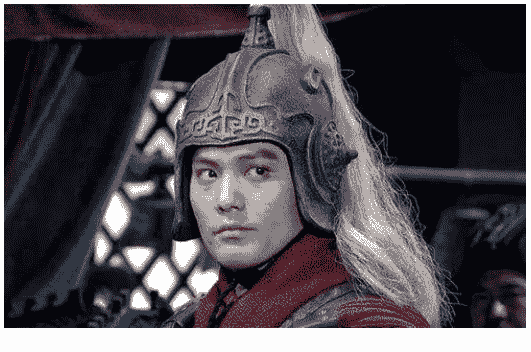

Robin 彼时没有想明白，他的对手张一鸣是个三级火箭——有做企业家的野心，有协同公司作战的管理术，有融资、调动资源的能力。

孙子兵法说，打仗是先算准了能赢，再发动的。但偏有人，想拿民航飞机去跟三级火箭比赛冲出地球，捉急啊。

只不过，Robin 没想明白的事，又何止这一件？

否则也不会有太子出走去搞地产，技术大神留不住也用不动，一连串被寄予厚望的高管，无论是从实习生走到顶，还是空降，都很难得到善终。

他是难辞其咎的。

#### （三） 积重难返

信息流业务特别是手百，现在在一线来看，已经成了烂苹果芯儿了。目前唯一捞着他们的，是中国更大基数的底层网民对于产品的迟级，让他们能用时间换空间。

李靖的表面问题，在于个人实力和经验，与其要打的仗之间的不匹配。

但这问题并不紧要。

谁都是在时过境迁之后，才能品出当时在酒局饭桌上，领导和您喝的那杯酒，到底是敬了自由还是远方。年轻人犯错，所有人都会原谅。年轻就是爷啊。

一笑加一笑（微信号：150500211）邀您加入水库交流群。群内文集每月一更新……

李靖失败的真正原因，是百度信息流业务过往错误的积重难返。

再往深挖呢？

姨建议你去了解一下搜索业务大权在谁手里，再看看被视为百度明日引擎的人工智能，到底能不能撬动搜索这一块已经有的重要资源，或许会明白很多。

我们的 Dr. M 每一次可不是因为撒狗粮才跟 Robin 拍合照呀。

最后神仙打架，草蛇灰线地苦了草根出身的年轻副总裁。可谁都别打不平，pricetag 上的数字，当时都是标好了的。

更何况，你又怎么知道，年轻的副总裁，有没有被窝裏笑？别忘了，我们断言过，他一夜之间得到的这“1亿”，也是注定要在一夜之间失去的。

（未完侍续）


### 他失去了 1 亿 #Y04

作者 芸芸


昨天说一下“热点。” #Y03。

热点就像开花，花的姿态千千万万，经冬复历春，每隔一段时间总有新鲜。

但是花为什么这样开，背后的逻辑却是共性的。

接上文

#### （四）卖身

接上文所说，主流商业媒体评价这位最年轻副总裁的离职，是黯然退场。盖棺定论一个字，败。

当年收购又收编的风光，已经完全不在了。媒体说他，最终并没有成为一股清流，也并没有帮助百度挽回信息流业务。

可如果，这就是他全部的野心、并且是他能得到的最好的结果呢？

如果他做的所有事情，就是为了有一块能给百度打工的敲门砖呢？

从这个意义上我们很难说他真的“失去”。

在清华北大这样的学校里，存在一条鄙视链——本科生瞧不起研究生。

“少壮不努力，老大留在本校接着读研”。

“少壮不努力，老大才能通过研究生考试进到清华”。

> 目前清华经管研究生的真实出路情况是，如果爹妈不给力、或者自己在学生时期没混上什么 Bigname 的工作经历，毕业的时候想找到金饭碗，是很難的。

副总裁如果不是剑走偏锋，靠公众号杀出头来，单凭投简历，也就是大集团螺丝钉，管培生也要 70:1 的淘汰率。相比之下，在宿舍里连根网线看书写文章，对这样一个研究生来说，是成本和风险都最低的尝试，只是后来我们才知道，这种低成本低风险的尝试，上限竟然可以这么高，高到让人有机会完成跨阶。

这也就是为什么从最开始，有些水平不差的人，也都对他的际遇颇有微词——这个年轻人真的是幸运啊。

可是，提前透支的幸运，会掩盖掉复合能力不足的真相。如果有人真的发自内心觉得，副总裁的位置与自己的实力足够匹配，年龄和经验根本不是失败的理由，不睡觉都能解决。

放眼望去，27 岁的副总裁，在拔尖儿的人才梯队里，也并没有很少。王小川、李一男、俞永福。

“这件事情，怎么可能在我的手里没干好呢？！”

#### （四.五）副总裁们

故事永远是一环套一环的。

2003 年同样是身为副总裁的清华校友王小川，要做一个搜索产品和百度对刚。结果搜狐这家媒体公司，连几个能好好写 C 语言的人都有。

就回到清华，找了 12 个计算机系的学生，挤在一个小办公室里，每天只睡 4 小时，中午晚上一起吃盒饭，10 个月，把搜狗做出来了。

做出了搜狗的王小川曾经也收到过 Robin 的橄榄枝。那次邀约，被我们戏称为“来给我当 CTO”。

> 大笑一扬
> 百度停滞不前是李彦宏的问题。AT产品能越打磨越牛X。而李彦宏下场吭哧吭哧去做外卖。投入眼球上，刘强东在奶茶结婚之后，不懂直播炒卖引流量；马云天生能忽悠；只有李彦宏，除了早年弄了度娘，后来尽拐一些大仙儿副总裁，吸收公众视线。然后大仙儿拿拿钱镀镀金就跑了，留下李彦宏自己在风中凌乱
>
> 2018-04-21 20:48:35
>
> 你的回复
> 不会用人，跟王小川说“来给我当cto”

有些人的蜜糖，在另一些人的眼里是糟糠，不屑一尝的，因为你胃口就那么大，吃了别人的糟糠，就没有空间吃自己想吃的糖了。这就是为什么#Y02 里我提到过，有的人几个亿套现了自己的公司，竟然还会哭。

曾经有一度搜狗流量上不去，张朝阳不让王小川做浏览器了，你们知道这时候的**王小川**怎么做的么？自己偷摸写啊。


互联网圈技术是开源的，所以很多高级的技能树说到最后都非常鸡汤。比如我们有一个共识是，做产品如果心里没火，肯定做不大。副总我们的**心气儿**，是有高低贵贱之分的，这口气，最后直接影响了结局的上限。李靖的上限是“挂靠”，自然也就求其中者得其下了。

#### （五）立体

最痛的事莫过于分析来分析去，**发现你失败的原因，就是简简单单的，**

**你不行。**

**杀人诛心。**

成功是立体的。

写公众号起家的人，谁还没有几个能说会道的朋友？

年轻的副总裁离职消息出来之后，他的几位同行好友给足了面子，理中容地说了很多好话。

> “你已经很棒棒了”

> “远超身边人的勤奋和专业”

……

有什么用？

在百度，带着广告创意部跟头条打信息流的仗，所需技能包是很庞大的：

- 客户的精准广告需求
- 市场规划和流量
- 解决算法
- 迭代机制
- 公司的资源位
- 竞争对手的上述全套技能比较研究
- admin&politics
- ……

副总裁同学差不多只在去年 6 月有过一个单项产品的小规模成功，单点谈不上突破，脚跟谈不上站稳，更没顾及到对手公司的打法，相当于两军开战，大炮还没开始对轰，在挖战壕的时候有人就歇菜了。

在这里展现出来的实力，是不够的。

新闻出来的当天晚上，我问哥哥：为什么会有老谚语“easy money, easy go”？

哥哥回答：

如果一个人通过十几年，慢慢积累财富，则你在每一个维度，和社会都充分接触过。

大声朗读并背诵。

慢慢来，比较快。

成功是立体的；

稳固的成功是多维度的稳固。

一笑加一笑（微信号：150500211）邀你加入水库交流群。群内文集每月一更新……

如果一个人通盘的技能包都只有 50 分，那么起码他在 50 分的段位上站得稳稳的。

如果一个人技能包里，有一二个 120 分，剩下的都是 30 分，你要怎么评估他？

- 顺风顺水时，能发挥最高值得 8 成，接近 100 分；
- 一旦底盘晃荡，发挥水准一律看齐最低值，30 分。

所以我们才说，长线看只有一种形式的成功，那就是清教徒式的成功。

方方面面地接触社会，得到教训再站稳。如是很多年，直到每一条根基都稳如磐石。

#### （六）争气

哥哥虽然也会说荷兰病不是病，能白爽一下其实挺好的（#F1570）。但我们这些个瞎操心的，不还是在希望“拆迁户拿了巨款能不乱投资”嘛。


副总裁同学经过这一年已经今非昔比，Big name 有了，媳妇儿娶了，成功前必要的失败经验也有了。上文说过，年轻就是爷。这位大爷还在 30 岁前就白手完成了跨阶。

但是人生第一次跨阶对人的考验是非常大的。是去海边钓鱼，还是继续每天工作 16 小时、每周 100 小时，你自己选。

人的野心和潜能也不是一开始就摆在那里的。看一个人，既看他的“此刻”，也要看他的“未来”。

从此刻到未来之间，有一句话叫做，

> “这件事情，怎么可能在我的手里没干好呢？！”

看他面对失败的反馈机制和野心吧。

我们希望这个世界上，多一些能打的人。

多一些能打的人。

多一些能打的人。

特别是看到已经初具潜力的人露出苗头，我们内心的真实声音是：

你一定要争气啊。

总有些人的不甘心，是写在脸上的。

如果有一天我变腐朽了，对现实妥协、不思进取，那些朝气蓬勃的年青人，可以来打败我。

——周鸿祎


### 芸姨选秀#Y05

原创 水库论坛 2018-04-28 作者 芸芸


主业是研究生活方式的演变

才会沿路把秘闻当小花来摘下来

受朋友之托，去看他们做的女团选秀节目。

我们坐在沙发上看节目，101个姑娘，20岁上下，肤白貌美，满满的胶原蛋白。

要花三个月时间，最后选出11个，组团出道。

小少爷悠悠地问：

“你猜，我的人，选中的概率有多高？”

#### （一）女团

这样的节目，姨小时候也有，不过玩法远没有现在这么多。

过去中国人做娱乐业，思路不开阔：

选歌手就一路唱到底。海选唱歌，

第 1 期到第 10 期都是唱歌，

顶多换换主题，今天友情，明天爱情，后天哭老娘。

第 11 期还是唱歌，

最后要选冠军了，再唱一轮吧。

现在的选秀，琴棋书画德智体美劳都要考评，赛制也更花哨。是真正意义上的“选秀”。

这种模式，90年代的韩国就是这么玩的，国内终于补齐了20年的经济发展，自己也学起来来了。

所谓“工厂迁移”啊。

用剧本和剪辑来调侃观众、虐观众，现在的00后小朋友可能并没有什么感觉，顶多也就是弹幕骂一骂，“给剪辑师寄刀片”。。

但放在十年前，那可是新闻。曾有一档国内真人秀被曝出有剧情设计，明星按剧本来演，每一个明星对应了一个跟班制作，彼此吵架、和好都是商量过的。观众老哥们一下子受不了了，毁三观，一度闹到了连早上7点正经的社会新闻都要聊聊的程度。

当时的评论用词已经到了“欺骗”、“利欲熏心”之类的程度，可见观众还是非常玻璃心，远没有现在这么麻木。

现在是佛系观众：

“我知道你肯定在背后做手脚了，但你能给我看些我喜欢的就行。”

#### （二）造星

目前国内有十来家左右规模比较大的推手公司，够资格为巨头平台们的造星来做承接和执行。

看一眼他们的分工：


每一项资源都对应一个工种，工种后面是人和钱，行规是1个决赛级选手匹配20人运营团队。1:20。

造星是一条工厂流水线。产品是明星，目标是拉动流量。

##### 我们怎么理解真实的流量？

刨除掉所谓运营出来的数据——水军、数据造假、走错片场的吃瓜群众，明星们所谓的数千万粉丝里，有高粘性高价值的死忠粉比例在 1%左右。

- 能够拥有 5 万的核心粉丝规模，就可以跻身所谓的“流量明星”，可以被别人蹭热度了；
- 10 万核心粉丝，就是千万级表现粉丝，业内尊称一声“顶级流量”，一举一动都是热点。

而市面上相当一部分看上去热闹的明星，是找不出 1 万个核心粉丝的。“

出了事儿，没有“后援会”愿意帮你对抗负面、帮你跟别人拉架撕逼。”

你们在脑海里，现在不假思索地数 10 个叫得出名字的明星，8 个是这种。

工厂和工厂之间，因为资源差异，打法不同：二流公司的“研发”精力，是造人。蔡棋书画德智体美劳，样样都要好，打造一个尽可能优秀的人。

一笑加一笑（微信号：150500211）邀您加入水库交流群。群内文集每月一更新……

一流公司不是这样的。一流的造星流水线，造的是“场”。

你以为你喜欢的就是你喜欢得吗？

#### （三）冷冻胶原重生

原来香港有一家R开头的美容院，要到了几份私人银行客户名单，美容顾问挨个打电话过去，

“芸姐，要不要来体验一下我们最新的冷冻胶原重生技术？”

贵妇的心理防线都很脆弱，多撩几下，要么拉黑你，要么心甘情愿给你捐钱。

后来他们到了上海开店，老板学聪明了。私下约谈了好几个时尚博主，让他们分批分次有组织有纪律地发稿。

“今天我去厂R家”

一笑加一笑（微信号：150500211）邀请您加入水库交流群。群内文集每月一更新……

“体验了 xxxx 项目”

有组织有纪律的投放，完完全全在上海的小贵妇心里建了一个“场”。

第一次听博主 A 说，懵懵懂懂。

两三天后又在博主 B 的推送里又看到一次，直击遗忘曲线，下单的概率乘以 10。

依然犹豫的贵妇，又过了几天，看到论坛上有人提问：R 家的冷冻胶原重生到底有没有效？不做之后会不会反弹？

这时捧哏 C 自问自答：原本还有点担心反弹，但是自己亲测自后，距离上次体验已经 2 个月过去了，效果还是维持得很好。

要是再加上一句：“老公今天多看了我一眼”，直击灵魂，铁块也要被说融化了。

A+B+C=概率 100% 的场

#### (四) 概率

所以回到前面的问题：

选秀节目，101 选 11。

据说其中有 x 位是关系户。

请问“关系户”中是概率是多少？

答案是 101/101

因为 101 个全是关系户。

少爷真金白银砸下去搞选秀，还能让不是关系户的来参加吗？

花了钱，搭了场地，给了首屏流量。

曝光的，还能不是自己的人吗？

有人说：不会吧，选出来的才是自己人吧？选完之后再给资源吧？

Naive。

开屏 banner 多少钱？

1:20 的运营团队多少钱？

让你上一次电视，价值多少钱？

一笑加一笑（微信号：150500211）邀您加入水库交流群。群内文集每月一更新……

要在大哥的地盘发光发热，先得给大哥交一个报名表，比如，把名字格式改整齐了。


中国的娱乐公司也是这两年才反过劲儿来：

> “当年怎么就让那些五音不全的村姑上台海选了呢，浪费啊。”

如今你们看到的选秀，只剩下了“秀”。

3个月慢慢悠悠地造场，让人爱上A、讨厌B、心疼C，慢慢走近场里，误以为自己选择了自己的喜欢，这才是秀。

真正残酷的“选”的竞争战场，怎么可能只有 101:11 的选拔比？

真实的比值应该是……


百里挑一，甚至更残酷。

只是到了观众眼前，真实的战役还没开始，就结束了。

#### （五）口味

哥哥在讲 marketing 的文章里写过，单一产品打全部市场是无效的。

有人爱吃咸的，有人爱吃甜的，你两个口味都做。

朋友圈咸党和甜党彼此互骂对方是异端，让他们自己去掐。

反正咸的甜的都是你的“自己人”。

是，也必须是。

不过，我们总忍不住揣测：

做粽子的人，自己到底喜欢吃甜的还是咸的呢？……

（未完待续）

> 一笑加一笑（微信号：150500211）邀您加入水库交流群。群内文集每月一更新……

### 造星是不是门好生意？ #Y06

原创 水库论坛 2018-04-29作者 芸芸


造星是不是门好生意，最有发言权的人，是韩国的李秀满。

在韩流圈的粉丝论坛里，李秀满这个名字非常受尊敬，他掌握的“权力”实在太大了——

SM 公司的创始人，从 1995 年建立门户开始，做的就是亚洲顶级的造星流水线。先后捧红了 H.O.T，东方神起，Super Junior，EXO……

哦对了，还有一个他没怎么花工夫去带的女子团体，叫少女时代哦。

一茬又一茬的粉丝，管他叫“满叔”，爱豆们的boss。满于进到房间里，所有人不仅认识、而且要全体起立的那种。


> “大哥您从 1995 年做到现在，只手遮天，呼风唤雨，一定赚翻了吧。”

> “狗屁，哪行哪业都没有地产佬赚得多。”

#### （一）生意

真要是问到造星的生意好不好做，拉出数据来看，你会大跌眼镜：

SM 公司目前的账面市值大概在不到 8000 亿韩元的样子，

2017 年底，相当于 44 亿人民币。

横向来看，一年不如一年的华谊兄弟在中国还有 260 多亿，

光线 330 个亿，差不多是 SM 的 8 倍。

有意思的是，李秀满去年从 SM 支给了自己一笔“很大”的钱（这基本是他的主要收入了），还因此被董事会和股东狂嚼舌根，不胜其烦。

那么这笔有争议的“巨款”有多少呢？

回答：相当于 6000 多万人民币。

比不上小燕子炒壳刮走油水的零头。

约等于大幂幂 2 次代言。

要知道，国内某游戏公司在自己每年亏几个亿的时候，还能向管理层转移1个亿呢。

> 小粉丝对商业世界没有定量的认识，很容易把 market voice 误认为就是 market value，她们对霸道总裁的虚虚实实一无所知，你得把家底儿摊在桌子上数给他们听。

> “喏，这也就是韩国娱乐圈最有权力的人了。”

而且韩国不是孤例。

昨天看的女团选秀，18、19岁还没踏出社会的女孩，听到香港的“英皇”也要倒吸一口凉气，作庄严肃穆状。

可是英皇杨老板的好光景，也不是娱乐业给他的。大几十个亿的身家里，九成是钟表和地产，“英皇娱乐”自己不亏钱就烧高香了。

要说起来还是台湾文青还是多，滚石唱片从开始做就一直是“吃补贴”的状态，每一年都要办哭穷演唱会，靠招牌明星们卖情怀扫墓。

论亏钱，这才是翘楚级别的。


行业的上限规模摆在这里，娱乐业养不出大哥。

但是大哥都喜欢娱乐业，都有造星梦。

比如这位。


为什么？

既然娱乐业如此，那么为什么大哥们还要做？

小粉丝说，一定是因为爱！

#### （二）偏爱

哥哥在讲 marketing 的文章里写过，单一产品打全部市场是无效的。

一笑加一笑（微信号：150500211）邀您加入水库交流群。群内文集每月一更新……

有人爱吃咸的，有人爱吃甜的，你两个口味都做。

朋友圈咸党和甜党彼此互骂对方是异端，让他们自己去掐。

甜粽子是我家的，咸粽子也是我家的。

不过，我们总忍不住猜测：做粽子的人，自己到底喜欢吃甜的还是咸的呀？

在网上关于李秀满的讨论里，有两大问题的热度最高：

- 如何评价他？
- 他捧红了这么多人，自己最偏爱哪个爱豆？

扫过所有的提问和回答，只有3个字评价：

中计了。

斯德哥尔摩综合征了解一下。

小粉丝毕竟不能模拟大哥的心路历程。

娱乐圈的大哥和互联网圈大哥有一点很像，都需要在上位之后塑造人设。

因为过去的黑历史很可能不禁扒，但是现在媒体和小道消息传得又很快，所以要在人设上讲故事。

李秀满的人设，叫做铁汉柔情。

既然造星工厂的铁面boss是板上钉钉、抵赖不掉的，那就再找补一下。

“虽然我对你们凶，但我是因为爱呀。”

小粉丝其实非常好哄，无论你前面做过什么，压榨年轻劳动力，搞人肉工厂，只要后面加上“但是因为爱” ，一切好商量。

可是生意就是生意。关于造星术，李秀满自己在接受外国记者采访的时候说过：

文化产品需要生产技术。

选材、加工、营销，既然是产品，就和任何现代工厂没有区别。


小粉丝充耳不闻罢了，

> “我不听我不听我不听，他是爱我的。”


至于要问他自己有没有更喜欢谁。

那你先回答，乔布斯会不会更喜欢哪一条生产线上的某台 iPhone，编号 1q2ws3erft？

巴菲特有没有更钟意哪一瓶可口可乐，生产日期 20180429？

那么，同理可证。

既然娱乐业如此，那么为什么大哥们还要做？

为了获得载体。

#### （三）载体

吴亦凡刚回国的时候，惹毛了一个自己睡过的女网友。女网友一怒之下把聊天记录、语音、视频都发到网上了。

刚刚造好的巨星，眼看要崩。

“但是爸爸不会让你崩。”

后来各家媒体都被塞了巨额的封口费，要求对此事“置之不理”。个人的力量毕竟太薄弱，哪怕你在天涯吵翻天，也比不过微博一个 404。

两年后，吴亦凡身上的代言，从刚回来的国产雪糕，变成了 Burberry, Bvlgari, Benz……

而且通稿里写的都是首位华人代言，面子给得足足哒。商业价值十几亿。

“但是爸爸不会让你崩。”

“因为有人要喝水。”

造星，说得更准确，应该叫“造碗”。

民为水，有人要喝水，但是不方便直接趴在缸里喝，吃相不好。

造一个碗出来，体体面面地端起碗喝水。

造碗的工匠李秀满，得到爸爸的打赏。

碗底自己也剩了点爸爸没喝完的水。

H.O.T，Super Junior，EXO，一代又一代的小花小鲜肉，就是那只碗。

这两天的女团选秀，看得姨甚是开心，琴棋书画德智体美芳，感官愉悦。

可如果有自己家的小女孩来问：

姨姨，我从10岁开始学习才艺，练出A4腰，一字马，九头身。

##### 立志选秀，可以出头吗？

我的回答，断然是否定的。

为魔鬼做交易耳。

亲爹会给你真正的教育，让你成为一个**真正的人**。哪怕你日后环顾四周，发现同类寥寥。

只有造碗的工匠，会教你媚姑之道，让你成为一只众星捧月的碗。

全文完

参考文献：#F1310

### 豪门的本领 #Y07

原创 水库论坛_ 2018-05-05作者 芸芸


豪门的本领 #Y07

昨天晚上心血来潮写了篇《机屏分离》#F1710，放在“最新五篇”里，fyi。

#### （一）简历

几年前机缘巧合在一个群里认识了几个金融专业的年轻学生。

到了 IBD 的申请季，他们给我发来邮件，拜托我帮他们改简历。

专门挑了一个下午集中帮他们改完，打开附件的一刹那，讲真，有种 yesterday once more 的感觉。

“原来当年他们看我，就是这样啊！”

你在简历如何介绍自己，完完全全反映了你来自什么阶层。

在“会看的人”眼里，洞若观火，碗中清水。

顶级外企（包括投行、咨询和 500 强）只看项目的 title，

summer intern>intern>part-time，

每种 title 对应一套“应该是你做”的事，写多了，实属给自己加戏。“底蕴”深厚的小孩，都懂得藏锋。

只是 workshop 可没有什么含金量哦。

商业银行的实习，最重要是把公司三张表给看熟，对一些行业的“大数”有基本认识。资金成本支行老大早就和对方谈好，说什么能参与客户谈判，还是加戏。

甚至不如老老实实地说，每天花 7 小时在填电子系统呢。

国内的大公司看部门，如果你在时尚行业，请直接说 “我给苏芒当助理”。离圈层核心人物越近越好。

另外我们通常会注意那些在地方上的大民企打过 “闲工” 的小孩，因为他的爸爸有可能在某地说得的上话。

技术类的实习尽量去研究院，但是 corporate 研究院不如参加比赛，这个圈子智商碾压很厉害。

了解了这些，再去找知乎大 V 的求职帖，改什么 “结果导向” “数据展示” 吧。

因为后面那些量化的东西，给了前两行，后面的事你的 “前辈” 心里明白着呢。

他们只想尽快知道，**你到底能不能给他们碾压级的优势**————技术、才智、野心或者背景，请让长板无限长。

以上所有技巧，在 “会看的人” 眼里，**洞若观火，碗中清水。**

#### （二）前女友

周末又一起看了一集选秀节目，结束之后在小少爷家刷微博（#Y05），突然他告诉我，他的某任前前前女友，怀孕了，马上要生。

我拿过手机在ins 上一看。

定位，美国西岸，衣服鞋车都不差，浓浓的小网红风。

诶等等。

这个脸？

“这个人之前做过你的前女友？！”

我眼球字都要掉出来了，藏了半句话没说出口——

“这个人还是一个会让你在分手N年之后偷摸刷人家ins 的前女友？！”

长相是真普通啊。说句不好听的，是那种很快会显现出大妈感的那种亚洲长相，还偏偏要给自己填充额头和鼻子，不毒舌的说，真不太行。

因为以小少爷家豪门的程度，在外人看来，可以不用通过找一个这种长相的小康人家灰姑娘，来证明自己和王思聪不是一类人的（毕竟那几年豪门少爷们私下里都受了点王思聪影响的）。

可是有些理由在豪门圈子，却是心照不宣：

> “念书那年波士顿下大雪，我发了烧在家，翘了好几天课。她看我几天没更新 fb，猜了个大概，一个飞机从洛杉矶打过来，给我煮了白粥。”

生病时期的表现，是豪门考验中非常重要的一环，唉。

前女友当然在这一环表现很好了，但别就以为她是发着白光的仙女，物质起来也是很疯的。

> “她特别能喝，也爱热闹。我们假期回北京，在夜店里几十万地刷。”

包买了一整房间，鞋一房间，传给她曾孙女都够了。

> “她小时候没见过这些东西，喜欢就给她买了，真大小姐都吵着要买首饰，她那一个柜子包，还不如我妈项链上几粒钻石呢。”

> “没关系啊，她是真的心疼我就好。”

> “一个人疼不疼你，自然带着一种气味，有的话，一下子就闻到了。”

#### （三）本领

如果一个人走过你走过的路，那么他再看你走这条路，就自然知道你什么时候要往哪里转弯。

有 1/10 的豪门婆婆眼光非常毒辣。

从你踏进一个房间、眼神最先落在哪里开始，她就可以分辨出你全部的人生故事。

至于还要坐下来像模像样地问问“你是哪所藤校毕业的、学什么专业的”，都只是出于体面照顾你的个人感受而已。

> “很多姑娘看我儿子的眼神，就是看钱袋的眼神。”

“只有自私的狼性，没有疼爱。”


小少爷唯一看错过一次。

刚接手家业的时候，搞砸了两个投资案子，后来病急乱投医，和一个投行白骨精好上了。

理由有三，工作场合认识的人，起码不会坏到什么地方。

能进投行，自己的能力还是被说明的，说不定能在事业上帮帮我，我啥都不懂。

一年能赚一二百万的姑娘，离了我不也能过很好么？应该不会贪我们家的钱。

以上全错。

中坏的雇主们会帮你做严格的背景调查，查的只是她的 GPA3.98 是不是从 3.96 改过来的，可查不到这个姑娘为了转正给多少上司送过秋菠。

她不会在事业上帮任何忙。她不会在事业上帮任何忙。她不会在事业上帮任何忙。

因为她拼死拼活在单身时赚到二百万，就是为了有更好的 bargain power 来你家吸血。

报复性败家，了解一下。

姑娘们练习马甲线的时候，脑子里闪回的人影，有很多很多的。

-   * 婆婆们求其上者，希望找到与自己儿子心心相印的伴侣，能够彼此用肯定的眼神看着对方，郭晶晶模式；
-   * 求其中者，找到一个可以被洗脑的傀儡，你要什么我们家都给得起，使劲儿生娃别给我儿子添乱，徐子淇模式。
-   * 求其下者，“破财消灾”，绝对不会让你进门，吴佩慈模式。

王思聪 V
加油，单亲妈妈！

@吳佩慈 V
懷孕以來，從麻木變成了擁有很多情緒，從很忙碌的生活到突然每天睡到自然醒，從只想活在當下變成不停規劃未來。身心靈上劇烈的轉變是當初不曾預料的，但看著肚子一天變大讓我很喜悅，也才感覺到要成爲媽媽居然是我覺得自己最有成就感的一件事。從今後不再只爲了自己活，將爲了我愛的人兒們努力的活。


1分4秒 转(4) | 转发(3) | 评论(78)

#### （四）1/10

为什么眼光毒辣、按照上中下挑媳妇的只有十分之一？

因为剩下九成的婆婆，一多半是买房子都要买 CEO 盘的贵妇流，看了几篇公众号文章就忘记了守护家族财富的重要和艰难，和姐妹们闺蜜蜡去了。老实人。

剩下的，就是当年在“豪门本领”没有发达的时代和地区，还未被抓出来的白骨精上位。

但是遇到她们，白骨精们的说辞和把戏，更加无所遁形。也不知算不算是毅种循环了。

只有少于十分之一的豪门婆婆，是心明眼亮的贵族。

她们走的是至情至性的路子，就像见过一万次真迹的藏家，一眼就觉得那个赝品“怪怪的”。

按照进化的观点，每一种本领被进化选择出来都不是偶然。

我们豪门圈子被迫进化出这种辨别“自私”的直觉，只有一个原因，前面也提到过了——

##### 守护家族的财富。

关于小少爷的现状。

小少爷最终还是没有和前女友在一起，经历了几个“中”女友，现在与另一位小康家的姑娘订婚。

姑娘比前女友好看很多：)

姑娘的属性，我的判断是中偏上，因为书读得不多，毒教育和世面都见得少，而且本性温柔。家中有个弟弟，但是把弟弟照顾得很好（这很难得），很像当年的黎姿......


### 看空小米#Y08

原创 水库论坛_2018-05-06作者 芸芸


看空小米#Y08

#### （一）唱赞歌

一家受人尊敬的公司，小米，最近准备要在港交所上市了。

朋友圈里关系庞杂，科技圈、投资圈、媒体，都在热泪盈眶。

##### 详细资料

###### 雷军

2018年

###### 今天

大家可以看看徐小平如何回答这...

徐小平回复雷军：真格是谁，真格为什么而奋斗？

陆风的回复。万得是中国的彭博...

陆风回复雷军：Wind是谁，万得为什么奋斗？

“我们是谁，我们为什么而奋斗...

郭广昌回复雷军：复星是谁，复星为什么而奋斗？

“我们是谁，我们为什么而奋斗”...

王峰回复雷军：蓝港是谁，蓝港为什么而奋斗

华米黄汪的回答。

黄汪答雷军：华米是谁，华米为什么而奋斗？

“我们是谁，我们为什么而奋斗”...

陈睿回复雷军：bilibili是谁，bilibili为什么而奋斗

孙陶然回答了同样两个问题 [愉快]

孙陶然回复雷军：拉卡拉是谁，拉卡拉为什么而奋斗

伟大的中国硬件+IoT 生活消费小巨蛋，千亿美金估值，14 年之后最大的 IPO，80 后见证成长的本土创业品牌......

可是小米怎么看，怎么也不像一家互联网公司，

也不像一家创业公司。

没有 entrepreneurship 的气息。

没有引擎。

当整个网上一片赞歌，或者看上去理性克制而实际上还是赞歌的时候，我们通常都是非常警惕的。

特别是一篇阅读量几万的赞歌，甚至把 “GS、MS 是它的保荐人，这两家历史上参与很多伟大的 IPO” 来作为 “小米的 IPO 也很伟大” 的重要论据。

笑得燕窝洒出了调羹。

媒体不精于业务，唱赞歌总是最轻巧的。

小米上市即衰退，长线看空。

#### （二）估值

IPO 之前最容易被揉捏打扮的，是估值。

等再过两天，外面的人才回过神来，想起从赞歌和热泪中揉揉眼睛、好好看看估值。

千亿美金，真好听。

雷总定义自己是：**一家以手机、智能硬件和 IoT 平台为核心的互联网公司。**

| 截至12月31日止年度 | | | |
| :--- | :---: | :---: | :---: |
| | **2015年** | **2016年** | **2017年** |
| 總收入增長(%) | 不適用 | 2.4 | 67.5 |
| 智能手機分部收入增長(%) | | (9.2) | 65.2 |
| 智能手機銷量(千台) | 66,546 | 55,419 | 91,410 |
| 智能手機平均售價(人民幣元) | 807.2 | 879.9 | 881.3 |
| IoT與生活消費產品分部收入增長(%) | 不適用 | 42.9 | 88.9 |
| 每售一部智能手機的IoT與生活消費產品分部收入(人民幣元) | 130.6 | 224.0 | 256.5 |
| 互聯網服務分部收入增長(%) | 不適用 | 101.8 | 51.4 |
| 期終MIUI的月活躍用戶數(百萬) | 112.2 | 134.8 | 170.8 |
| 每用戶平均互聯網服務收入¹(人民幣元) | 28.9 | 48.5 | 57.9 |
| 硬件毛利率²(%) | (0.2) | 4.4 | 8.7 |
| 互聯網服務分部毛利率(%) | 64.2 | 64.4 | 60.2 |
| 非國際財務報告準則經調整(虧損)/利潤³(人民幣千元) | (303,887) | 1,895,657 | 5,361,876 |
| 非國際財務報告準則經調整利潤率³(%) | (0.5) | 2.8 | 4.7 |
| 現金儲備週期⁴(天數) | (20) | (35) | (38) |

小米的消費者對它看似有情怀，但實際上買東西的時候腦子一點沒“發燒”，所有小米系的产品，消費者在购买時，全部都是精打细算、一条一条比着参数来的。

其中最掐喉咙的参数，是价格。

招股书显示，手机成交的均价落在 880 元。

亏损冲量，不敢提价。flag 已经立在那儿了。

感动人心价格厚道。

一家以手机、智能硬件和 IoT 平台为核心的互联网公司。

所以最终估值的支撑点，还得靠我们万能的互联网概念啊。

可是它现在的人才储备和结构，像不像一个千亿美金 “互联网” 巨头?

##### 僱員

截至2018年3月31日，我們擁有14,513名全職僱員，其中13,935名位於中國大陸，主要在北京總部，其餘主要分佈在印度、台灣、香港及印尼。我們預期會繼續在中國大陸及世界其他地區主要目標市場增聘人手。截至2018年3月31日，我們的研發人員合計5,515人，在多個部門任職。下表載列2018年3月31日我們按職能劃分的僱員人數：

| 職能 | 僱員人數 | 佔比（%） |
| :--- | :--- | :--- |
| 銷售與服務部 | 6,048 | 41.7 |
| MIUI | 2,275 | 15.7 |
| 手機部 | 1,292 | 8.9 |
| 生態鏈 | 955 | 6.6 |
| 平台 | 852 | 5.9 |
| 人工智能與雲平台 | 700 | 4.8 |
| 國際業務部 | 618 | 4.2 |
| 信息部 | 450 | 3.1 |
| 電視部 | 435 | 3.0 |
| 其他 | 888 | 6.1 |
| **總計** | **14,513** | **100.0** |

对于一个亏损的公司来说，它扩张和增量的引擎够劲么？一半的销售和服务员工，不是问题，38%的研发人员占比，也可以不说。

不像“互联网”公司、撑不起估值的地方是，那些该像互联网公司的部门，只有几百个人，占比个位数，研发人员占比更是不敢恭维。

阿里云 2 万人。

8.6%占比的“互联网收入”，来自游戏的输血。

说是硬件不赚钱，软件不赚钱，订阅服务收钱。

小米追风口做服务的能力：

米聊、小 i 机器人……

同一时期另一家一直没盈利、也一直在追风口、硬件也不怎么赚钱的公司，追风口的水平如何呢？

Amazon 云，Kindle，Prime……

要到这个程度，才能在亏损的情况下堵住华尔街的嘴。

围绕在 AAPL 周围的，是一整个生态的技术和设计人才；围绕小米最紧密的，是优化过的消费制造业，拼规模和资产周转，引擎不一样的。


小米6开发者选项在哪里怎么打开_百度经验


jingyan.baidu.com

再有些冷不防的现实问题，譬如现在紧缩的流动性，消不消化得动它？

这个估值，太脆弱。

#### （三）伟大公司

IPO之前最容易被揉捏打扮的，是估值。

以上全错。

现在的问题，过去的问题，都不是问题。

只要有超出预期的未来增长，金融街统统既往不咎，可以不跟你计较的。

只要你有引擎。

估值是树叶，树根那里才写着未来。

招股书不会把真硬伤告诉你的。

可以量化的错误都是不致命的。

伟大和基业长青的基础是什么？

是雪坡+创新。

媒体不精于业务、分析师不精于业务。看空小米，我们可以不谈估值倍数的问题，不谈亏损数据，但不能不谈雪坡和创新。

唯业务诛心。

硬件市场的雪坡，也就是摩尔的 18 个月，同时小米的生活消费品全部不具备感性品牌输出，消费者比着参数买的，雪坡一律看齐硬件，也是 18 个月。

18 个月之后卖不出去就库存贬值一半。

在这样的雪坡上，小米只能拼创新。可是，目前看来，创新是它最大的短板。

小米目前的核心竞争力，是改良，不是创新。

雷总说：

> “伟大的公司，都是把好东西越做越便宜。把每一份精力都专心投入做好产品，让用户付出的每一分钱都有价值。”

后一句快把用户老爷们感动死了，以至于没人深究一下前一句。

伟大的公司，都是把好东西越做越便宜。

？？？

把别人做的好东西越做越便宜，其实是哥哥以前讲 marketing 时候说的，每个环节 3%5% 优化的工夫。

这是精致的红海公司要做的事，我们称之为“争肉术”。


拼刺刀都拼刺刀，摆坦克都摆坦克，这样的两军对垒，除了情怀和理想，并没有什么能真正让人相信，“此战必胜的人是我们”。

胜负赔率 51:49。

但红海公司的处境才是最可危的，杨元庆像诸葛亮一样鞠躬尽瘁了那么多年，在 PC 的市场上做困兽之斗，但是外面的世界，早已被手机炸开。

伟大公司应该是通过做出前所未有的东西，把之前被替代品的红海价格越做越便宜。

伟大公司应该是做出新的好东西，允许它贵一些。

此之谓 entrepreneurship。

是原子弹，胜负赔率 99.99:0.01。

#### （四）核心竞争力

放眼雷总的三大段落，金山——小米手机——小米 group，他的核心竞争力是什么一目了然。

他学习的对象，侃侃而谈的例子，都是“优化”界的能手。

争斗术才是它的核心竞争力。

当他说自己是**用战术勤奋掩盖自己战略懒惰**的时候，他是真的。

也因此，我们说虽然小米谈不上伟大，但可被尊敬。

他最喜欢引用的同仁堂，痴情大于实力。

所谓用最好的药材，用最多的人工，可以感动一些屌丝消费者。

但是我们关注的是，

到底能不能有效治病啊。

用争斗术去打优化战，要拼运气。

可人家同仁堂做的是中药，还占了时代和民族性的便宜，雪坡长惯性大，而且同行对手衬托得太好。

做硬件也要这样玩？只玩 18 个月雪坡么、还跟国内最好的脑瓜们玩么？别闹啊。

唯一比较明显的一次创新式胜利，发生在中间的小米手机，MIUI。

雷总钻研戴尔在 PC 时代的打法，换个步骤 3%~5%，发现手机到达终端消费者的路径可以通过互联网无限缩小。于是用营销和 MIUI 一举直达了消费者，拿下了模式创新。之后若干年到现在，说是在吃老本，虽残酷、但不偏颇。

另外，缺乏创新的不只是小米的业务，还有他生态链投资。

分散投资，分散决策，分散风险，本质到底是什么？

不敢专注。

不敢一个点打穿到地心。

> “因为我也说不清到底哪个行业那个业务会在未来真的行，所以就让我东买买西买买吧。”

像个在商场眼神迷离的贵妇一样，什么都能试试，有人给递就行。

可是真相是什么？

真的觉得某双鞋舒服好穿的话，我们的做法，是一口气买 5 双（或者像某人买 Prada 的皮鞋，每年都买那一款，鞋面花艺略有不同，但是底和里子一样）。

业务摊成饼，每一块都想杀出一个原子弹，结果买来一堆冷兵器，打得还是优化战。

#### （四）看空

对小米长线看空的另一个原因，是港交所。

港交所和香港的扫蝗党一样，有几年对国内企业挑剔极了。

想想上一个在 13 年因为 AB 股的问题，怒转美国的那家公司吧。

现在腰杆不硬气了，眼光又转回国内的公司。

媒体通稿上的 “锐意改革”，其实是多方妥协的结果。

这几年资本方给港交所的压力很大。

> “你李小+自己不要赚，我们这些大财阀还等着套现呢。”

熙熙攘攘，利来利往，IPO 的水到你们手里，剩几滴雨点？

招股说明书风险提示：日后可能持续产生亏损。

一笑加一笑（微信号：150500211）邀您加入水库交流群。群内文集每月一更新……

### 时尚导论#Y09

原创 [水库论坛](https://www.shuidang.cn/) _2018-05-12 作者 芸芸_


时尚导论#Y09

前几天晚上约了人在宝格丽酒店谈事儿，走的时候看到几个年轻姑娘，看她们穿的衣服突然有感而发，写了今天的文章。

#### (一) 王权

法律制度多年来的进化，本质上就是对统治阶级王权的约束。

随着文明的车轮滚滚向前，王权在诸多层面上**被肉眼可见的压缩了**。

从“刑名刻具”到“君主立宪”“三权分立”……

不断的二元博弈，拉锯，撕逼，谈不拢的时候还要掀桌子打一架。

后来大家都意识到和平发展的重要性，于是默认谁都别太过分。

统治阶级妥协掉名义上最狭义的统治，不用暴力逼着被统治的劳苦大众当驴做马、不拉仇恨了。

可是我们要正视统治阶级的客观存在，以及这种存在对一般人生活的影响。

> 有一种观点是说，恐龙大范围的灭绝之后，还有一系血脉穿过了**重重磨难**，目前和我们生活在同一个纪元，叫做鸟类。


对于每一个种群、每一个阶层来说，先活下来永远是最重要的。为了“活下来”，我可以委身成任何一种不像我的形态。

生存之外没有大事，但只要我活着，我就依然有可能性去影响社会，进而再扩张的我的势力。

#### (二) 时尚

> 当统治阶级在法律和权力这种显性层面向社会妥协之后，它换了一种表现形式在影响社会。

> 当你以为你在权力层面约束住了恐龙猛兽，殊不知它正以另一种形式盘旋在你头顶的天空上。

**法制，是王权的恐龙版本；**

**时尚，是王权的飞鸟版本。**

战争时期，你以武装暴力成为赢家。

和平年代，你不能天天露肌肉，但是可以拍好莱坞电影、输出 Anglo-Saxon 新教条，影响一整套新生的黄种小孩，让他们中最聪明的脑袋在长大之后去你的国家留学、为你的国家的公司打工，**输出一辈子剩余价值。**

你的血脉如是得到供养。

控制审美，等于多控制 20 年大众市场，血脉延续 20 年，甚至更久。

**所以你不要看数据。**

说什么中国正在成为增速最快的时尚消费市场，什么 2021 年就会成为全球第一，巴黎世家歧视我们，3 个月不买就饿死他们（诶，这句话听着有点耳熟）。

屌丝的自以为是。

什么是好看的，下一季度全球的年轻女孩买什么穿什么，全球的山寨工厂下个月打谁的版... 这些事的话语权，我们连边都没摸到。

美国都不一定说了算，常年霸占五大刊和四大时装周的品牌，依然是以百余年前的欧洲品牌，大约占七成。剩下三成，美国日本中国分一分，再用资本间控制一下。

时尚圈也有君主立宪哦。

##### （三）边界

**时尚是一场博弈游戏。**

贵族说：我要跟大众不一样。

大众说：你还不得让我们学习你？？

任何一个阶层，都希望扩张自己的势力，这一点大家是一样的；不一样的地方在于对于阶级边界的看法。

对于处在后面的阶级来说，边界是不重要的，是用来突破的；但是对于上层阶级来说，边界本身，也是他们的实力之一。

上层阶级换了另一种方式在扩张和延续自己的影响力，用这个影响力和大众做五十年生意，变相吸血五十年，只是明面上不那么拉仇恨了。

时尚产业最爱跟普通老百姓玩的东西，叫做边界。

边界对于上层阶级意味着稀缺性。

他们让中产女孩们很容易“看到”他们打造的带有上层边界属性的奢侈品，然后利用海陆空各种手法在女孩们的心中种下种子。

其中最经典的，是 Meryl Streep 在电影里说的：

你以为你身上穿的宝石蓝毛衣是你今早的时尚决策吗？

你太逗了，这个宝石蓝是由谁谁谁在哪年哪季的秀上推出，之后被我报道，结果下一季至少几十个设计师都在用宝石蓝，以至于你有机会买这件明显没创意的廉价宝石蓝毛衣。

然而你却觉得这个决定是你做的，而宝石蓝是代表你个性的。

都是生意。**只是明面上大家各取所需，不那么拉仇恨了。**

投射在时尚方面，“不一样”成为上层阶级最关心的事。他们要一直引领时尚，一直想办法和中产女孩们区别开，以保持自己阶层的稀缺性，again，稀缺性就是他们的实力之一。

上层阶级对“穿的要和中产不一样”的需求，是远远高于“穿得好看”的。

中产女孩对此颇有不平：

**我们不应该以“美”为终极追求么？**

Naive 啊，中产女孩们不能理解的地方在于，“好看”还是“不好看”并不是天然存在而是被人选出来的。

任何时代“美”的标准，根本就是我们来决定的。

正因如此你大可放心，上层阶级大约只会超前大众半个身位，最多一个。

他们要保证新的美要永远在可以被追赶上的范围内。

这样大家才能一起和和气气的做生意。

再做五十年，合作愉快。

#### （四）当代中国

前面说到，我们目前已经是最大的钱袋，但距离控制审美标准还差很远。

最后说点干货。

在衣服方面的时尚里，上流社会讲究的两大基本要素：料和工。

在料的方面，勤劳智慧的我国古代劳动人民占据了先发优势，现在贵族圈子里最公认舒服的料，都有着明显的东方烙印，鬼佬的材料技术，更适用的战场是给运动员做做跑鞋。

但是在“工”上，我们的落后是以代际计算的。

传统中国服装匠人的工艺，在现在的主流市场里是严重缺位的，连某位夫人出访时穿的国货，在“工”的本质 上，都是西化的技术。

目前能被国际主流时尚圈认可的国内品牌，都是浮了一层极为表面的“中国风”，用用苏绣蜀锦什么的。稍微懂行一点的仔细看，全是西方的工。

就像明清家具在设计上的魂魄，现在那些所谓的新中式是丧失的。

要么全盘使用欧美的大流水线工艺，要么附庸风雅地用用鸡翅木黄花梨。

缺失的魂魄叫做，立足于本土生活的理念。

可不么，我们连真正意义上的本土生活都还没有呢。什么时候补齐生活的元气，再议时尚控制权。

以至于我在宝格丽 的晚上接连看到三五个面容姣好的姑娘，全部穿着被潘通（Pantone）洗脑的低饱和度莫兰迪色，一问朋友，这是目前中产姑娘们的最爱，博主精选、网红最爱。

殊不知，上流社会为了躲避和中产女孩们一样，早就开始流行新一轮的浓艳、高对比色、大印花大 logo 了……


### 母亲节应该怎样过#Y10


母亲节应该怎样过#Y10

总的来说，我们旗帜鲜明地反对，所有世俗意义上大家扎堆热闹的节日。

如果你发现我们竟然过了哪个节，原因只可能出于以下三个：

- 1. 有事情需要借机炒作;
- 2. 给身边人一个交代；
- 3. 身体休息

以上，就是我们对于节日的全部看法，包括结婚纪念日、自己的生日，和母亲节。

我们如果需要旅行的契机，就直接头等舱飞去目的地，挑那里最适宜去的时间，而不是像苦哈哈的上班族，非要在小长假里人挤人。

我们如果喜欢一个东西，哪怕有点贵（嗯哼，A9 也会客观地觉得某种消费品是贵的），也就是想买就买了，不用非得算好了日子，满多少减多少，跨店折上折。

我们如果想跟谁说句话，直接拿出对方感兴趣也对双方最有利的项目，开谈就是了，也不以'害怕三十晚上的鞭炮声太响'为开头。

我们更不需要专门找个时间来'缅怀'什么，真实的思考应该贯穿在整个清醒的时间里，仪式感只有中产在乎。

所以我们根本没过节的刚需。

媒体小编，和一些功力不行的自媒体人，特别喜欢在记叙某个事件的时候把话写成：

N 年前的今天，发生了什么什么。

以此开头的段落充满了艺术感和玄幻性，仿佛大哥们的故事早有神预，把屑丝读者唬得一愣一愣。

不是这样的，时间头也不回地线性地往前狂奔呢。

你自己爱原地打圈，按照 24 节气打圈地过日子，你就去吧。

我们陪不了啊。

我们太忙了，正经事太多，所有的中产阶级式享乐都等于不进则退。

我相信母亲会理解，我甚至对待母亲节也是一样的态度。

因为这一切正是她教我的。

一笑加一笑（微信号：150500211）邀您加入水库交流群。群内文集每月一更新……

刚在学校里被老师教母亲节要送妈妈康乃馨的那年，数看妈妈的年纪，买了一大束康乃馨，当时年纪的我，捧着那样一束花在手里，自己的感觉是很壮观的。

回到家正准备跟妈妈说，“以后每年我都送你花吧”的时候，被她叫停了。

当时心里是有点委屈的。

现在想想，她叫停的并不是一个小女孩的孝心，而是一个准备开始自我感动的表演型人格。

所谓孝心，在没有见识、正确的三观、和能力之前，是不存在的。

当然这一段是我长大之后才明白的。

当时只觉得她好贪心呀。

每年专门有一天惦记你一下还不行，还得时刻揣在心里。

但这才恰恰是“情”的开始。动情的事，不是别人用广告提醒你想起来的，它是一种绵长的背景音，“宇宙辐射”。

中产薄情，想的都是自己，能进化出纯粹真情的人很少很少。

纯粹的真情，是很火热的，是不需要被提醒的。但是当你的见识、三观、能力跟不上的时候，你是感受不到的。

母亲当年用看上去有点冷漠的一盆冷水，让我意识到，做一个有情人，是需要资本的，而且是巨大的投入。

一笑加一笑（微信号：150500211）邀您加入水库交流群。群内文集每月一更新……

我们克勤克俭、清教徒般地挖掘财富，为的并不是在多年之后能站在鄙视链顶端写一些冷嘲热讽的 句子，而是为了有真正的自由和能力，为所爱之人付出。

这才是真情的至高境界，和财富对于我们的意义。

萨特说，“你自己选择”。

我母亲很喜欢这句话。

更年期以来总拿它怼我，咳咳。

成为一个有情人，意味着巨大的心力，意味着真正的成熟。

相比之下，一束花，一颗钻石，一顿谁都吃得起的米其林，廉价得不值一提，它们只会让你自得自满、停滞、骄躁。

我们高看自己的感情，也珍惜别人的真情，才不愿意用一束花，一颗钻石，一顿谁都吃得起的米其林去敷衍。

这才是为什么不过节的原因。

其他的节日，在现在这个商业较之上一个三十年高速发展的现在，只剩下五个字，“无利不起早”。

所有能被你看到的“感动”，所有精心服务你的体贴，背后都是利字当头。

你只要，去杭州看看阿里附近的仓库、周边的数以万计的小电商店主，看看他们在每一个节日里拼命的样子，只消一次，你就会对所有节日营销脱敏。

他们加班时的眼睛，闪耀着的都是赚钱的绿光呢。

水库的各位可以想想元旦春节期间的职业炒家。

而回到母亲节，如果说今年我真的有什么想和她“过一过”的、能让她老有安慰的，也许最好的方式就是给她点时间，让她再跟我说说话，指数指数余生——人上了年纪都会比年轻时更好为人师。

她一定会把她这么多年如何和我父亲相爱相亲的经营之道再跟我说 N 遍，她一定会捎带着再追忆一下自己当年是怎么在一堆富一代里选中他，为的也就是衬托一下自己~

她如果愿意讲，我乖乖坐下来听一听，她就很开心了。

只是我们都太忙了。

我们永远都不够努力。

这种状态母亲是理解的，懂得的。

她知道我的心，哪怕我今年给不了她那些仪式感，但她的心，比其他母亲更安定。

这样就好。

想走就走的旅行，想爱就爱的表白。

当我想追你的时候，就包下整架飞机。

致：我爱的人

一笑加一笑（微信号：150500211）邀您加入水库交流群。群内文集每月一更新……

### 大企业应该如何撕逼 #Y11

原创：yevon_ou 水库论坛 5月19日


大企业应该如何撕逼 #Y11

#### （一）帽子

联想最近麻烦有点多，00992被踢出恒指，两年前投票风波又被拿出来说事儿，在我们朋友圈吵得沸沸扬扬。

一般的小麻烦杨元庆来解决，但是被扣上“卖国贼”这种让人两手一摊的帽子，只能柳老爷子亲自下场来撕。老爷子用一千多字的公开信撕完还不够，还得录一段语音，语音里还数度哽咽。

用词之激烈，足以看出伤其筋骨的程度。

兄弟姐妹们，到了我们挺身站出来 的时候了，朗朗乾坤，如果 几万名员工都不能让正气自保，我们还办什么企业；我们就是一群窝囊废！

卖国贼这种帽子，对一家大企业，一家 to C 的大企业，一家上市的 to C 的大企业，是很致命的。

原本在正常的企业公关麻烦体系里，“你产品差”这个帽子就是顶级麻烦了。

杀人诛心，你就是指着这个东西赚钱的，但是你做不好它。

产品差的这个印象一旦形成，会直戳企业命门，抵抗力差的直接毙命；勉强有点壁垒的，没个三年五载的奋起，也不能扭转市场感观。

而多数企业，根本无法在顶着产品差大帽子的情况下缓过三年五载，特别是科技行业。

（巧的是目前距离联想在手机业务上开始走下坡，也差不多 5 年了，要知道现在柳传志自己都会承认“联想的手机业务的确做得不好”，但是几年前的舆论风向完全是反过来。）

可是卖国贼的厉害程度，相当于天降奇兵。

#### （二）仇恨

首先我们亮出第一层观点：相较于老太爷数度哽咽的公开信，说联想是“美国公司”，这水平实在高出一座山了。

成功地煽动了仇恨，而且数量足够大。

知乎高赞 10k+哦。

在蓄意炒作阴谋论的技能树上，我们认为，最高级别就是煽动仇恨。

廉价、大量。

前几天有投资圈的朋友送了票，虽因故没去，但是聊天间隙得知，锤子科技也被扣上卖国的帽子，还顺便学习了一个新词：精日（精神上的日本人）。黑子真是无所不用其极了。

“小孩子讲对错，大人只看利弊”。

以课本爱国为名义的对企业的仇恨，是有毒的。

无论是更小的锤子，还是老大哥联想，真正在企业界的人，听到拿爱不爱国当理由的愤怒与仇恨，都是两手一摊。

蛤？你是认真的么？

荒谬到根本无从解释起。您如果不祛袪毒，就还是自生自灭吧。

我们做企业，只要 dT > 0 就是有益于国力，有益于国民。

我们证明自己对错的方式，是拳拳到肉的利益，比起键盘侠的拼音，扎实、高尚 100000 倍。

一笑加一笑（微信号：150500211）邀您加入水库交流群。群内文集每月一更新……

那么，为什么卖国如此有效？

为什么现在允许卖国如此有效？

因为现在掌房的大家长，不允许我们不爱国，家里的方方面面，管得很严很紧。

想在喝茶时看点小道八卦都好难。

大家长此刻正在和别家的大人在正厅圆桌吃饭，所以

> > “你老实在家坐好，不要出去野”。。

而现实里被煽动起仇恨最容易的人是谁？

我说几个关键词：

毒教育多年，不掌握正确经济学，不掌握充分的信息源，数量大，自己生活里的负能量很大，年轻经验少，遇到个故事说得好听的就给摔臭脚。

你看，是不是很眼熟？

#### （三）阵营

商业大佬们正在蹒跚着学习如何和新媒体、自媒体打交道。其实柳传志已经很乖巧了，一个有 90w 微博粉丝的大企业家，2013 年之后都没有更新过微博。

但是传播环境已经改天换地。

以前是 1v10 的数量级，媒体流量高度集中，靠“交际圈”“润笔车马费”即可拉拢人心。

现在变成了 1vN，全民皆可媒体。

你在公司开会，甚至不知下一个舆论大坑是被谁炸的，被一个实习生微博艾特一下的威力都不容小觑。

> 想想大朗湖畔的蓝色光标。

这次联想的投票风波发酵过程中，近两日已经陆续有财经商业周刊的老媒体人表达站队了。

联想在精英圈里，是大面积被支持、被可怜的。

（与知乎形成鲜明对比）

但是，老太爷的公开信，到老笔杆子们的站队，在这场“荣誉保卫战”里是否有效呢？

我们可以给出结论，很遗憾，1%。

因为联想的这些招，一招都没有打在对立阵营上。

#### (四) 招式

我们概括一下双方阵营的逻辑线：

- 黑方：你卖国，你不支持华为 5G 方案。
- 联想：我们投了同意票的。
- 黑方：你卖国，你前一次投了反对，竟敢狡辩？！
- 联想：我们出于企业利益，第一次投了反对，出于行业和国家，第二次同意了，我们给任正非打过电话。
- 黑方：你卖国，你是一个美国公司，在美国售价更低配置更好，你有罪。
- 联想：......

##### 卒

在企业界的视角来看，联想的每一轮回复都是逻辑严谨的，企业界无比理解。

老太爷在音频里的哽咽把好多人都听哭了。

连任正非自己都联想携手共进 5G 了。

但我们相信，这一切大概率**依然无效**。

因为它的对立面的不吃这一套。

能用“**你是美国公司**”这样的黑法，究竟是要把谁和谁拉成对立面？

很明显，有独立判断的大人，只要了解过 86、87 次会议的投票经过，是不会被爱国这种词搞得怒发冲冠的。

因为企业利益、行业未来...这种概念，懂的人早就懂了，这场舆论战真正想煽动的人群，根本听不进去。

> 一笑加一笑（微信号：150500211）邀您加入水库交流群。群内文集每月一更新……

包括，在他们眼里是没有杨元庆这个人的，业界对联想得失的评论，他作为相当关键的人物，在这次的对立阵营里，却是一个实实在在的小透明。


“技术标准贴上爱国标签不代表能在国际市场畅行无阻”这个脑回路，对方是理解不了的。

他们的大脑 CPU 处理到“哇塞，扒开联想业务数据，它竟然是个美国公司耶”这一步，就停下了。

无法接着分析，内存容量不足了。

哪怕老爷子剁破手指用血书公开信，如果还是讲这些利益逻辑，就还是 naive。

企业家们是一早就站在他这边的了，您可赶紧别再把原子弹大杀器往自己阵营里使了。敌人在对面啊。

企业家是一群有解决问题办法的人，他们唯一会觉得“难”，就是解决问题的路被封死了。

联想现在最难的地方在于，它想保业绩，可是家里的大人，正在和别家的大人在正厅圆桌吃饭，而它只能“老实在家坐好，不要出去野”。

死路不通。

想搞动的，是一群热血方刚的学生，按着你不让你出门，前仆后继，疲劳战术人海战术耗死你。

有人想让联想真的失“心”于年轻人。

最后，因为多年前一点千丝万缕的关系，就友情支一支招吧：

直接报出联想纳税额、员工故事写写特稿，这才是对症下药。


芸芸

#### 【封禁事件】----- yevon_ou

我跟大家讲个故事啊。在唐朝中期的时候，有个名将，名叫“李愬”（sù）。

“安史之乱”之后，唐王朝急剧衰弱。河北三镇，始终削藩不去。

到了中期以后，节度使愈演愈烈，跋扈不把中央禁军放在眼里。

而唐王朝本身也是腐朽，宰相文官带出去的队伍，十战九败，不仅不能削平节度使，反而更跌威望，更加崩裂。

在整个唐朝中期，唐皇打赢的唯一大胜仗，就是李愬“雪夜袭蔡州”。

当时驻马店的吴元济，是最强大的军阀，也是最屌的军阀。

其势力大到，甚至可以派刺客，来京城暗杀宰相。

宰相武元衡，是强硬的削藩派。“裂髓磔肉”，在朱雀大道上，被人当街磔杀。

成为中国历史上“唯一”的，刺杀宰相成功事件。

唐王朝颜面扫地。

> 一笑加一笑（微信号：150500211）邀您加入水库交流群。群内文集每月一更新……


官场大恐，庙堂震怒，可是打又打不过。汝南地形，非常易守难攻。

朝廷连续三次组织大军，三次惨败。

唐宪宗的脸皮，啪啪啪都快打紫了。

这个时候，名不见经传的李愬出场了。

“汝南”割据，已有三十五年，时间超过孙权。

吴元济父子，拥兵十万，坚铠利甲，屡战屡胜。

要灭掉吴元济，得花多少时间，多少资源？

李愬只用一个晚上。


元和十三年（817 年），农历十月十日，大雪纷飞，伸手不见五指。

李愬吃过晚饭之后，突然命令，全军开拔，大军向东奇袭。

在农业时代，是从来没有人在“冬季”作战的。因为下雪了，粮草完全没法运输。

敌人只要坚守城墙，你过二三天自然饿死。

在农业时代，也从来没有人选在“夜晚”作战的。每次成功都叫“夜袭”。

因为缺乏通讯工具，夜间队伍根本无法组织。将领跑在前面，后面的人，连路灯都没有。

一直等走出了 30 里地，心腹将领偷偷问，“将军，我们要去哪”。

李愬回答说，“攻打蔡州”。

所有的人，一起都吓傻了。

汝南的兵马，至少有十万。李愬手里，不足一万人。

雪夜夜袭，没有任何后勤。

监军太监暴跳如雷，指天发誓：“李愬一定是敌人的奸细，拉着我们都去送死”。

李愬让人把太监嘴巴绑了起来。

结果这场奇袭呢，是中唐历史上，最最最成功的奇袭。

吴元济完全没有料到，会有人在冬天的夜晚，拿身家老小和他拼命。

汝南主城内，兵马不到 1500 人。吴元济是穿着睡衣被捉住的。

朝廷的心腹大患，就此平定。

不仅削平了腹部的一个强藩，而且河北各镇悚然而惊，纷纷对皇帝恭敬了不少，唐王朝几乎延续了五十年的寿命。

李愬因功被封为：上柱国，凉国公。

但我们今天故事的重点，并不是这个。

李愬作为中唐最主要的名将，唐王朝五十年内唯一重大的军事胜利，他受到尊重了没有？没有。

过了十几年，长安城内，有一个妖僧，名叫“李钦奴”，号称自己是李姓皇族，是仙人。

并且勾结禁军韩钦绪等人，阴谋发动兵乱。


李欬奴被抓住之后，消息传来，枢密们正在开会。李愬闻言，立刻一头栽倒在地板上，满地打滚，“苍天啊，我李家今天全族眉灭”。

其他的宰相觉得很奇怪。老李啊，你何出此言？

李愬说，“我们全家有1000多口人。这么大的基数，李欬奴又是名人。总有一二人认识李欬奴的”。

只要有一个人的投诉，说我是“乱党的朋友的朋友的同党”，巡视员马上封我的账号，百口莫辩啊。

宰相李泌一听，有道理。赶紧掀起了罩袍，一路小跑到皇帝面前守着。

过了一会，果然听到“李愬族人勾结乱党”的奏折。

来一个，挡一个。来一个，挡一个。当当当当当。

全靠着朝中有人，李愬勉强没砍脑袋。

我们讲这个故事，主要是对大号的不尊重。

唐王朝已经那么烂了，讨伐藩镇十战九败。互联网上，全部都是洗稿抄袭的口水文。

好不容易有一个名将李愬，拼了命九死一生锻进军功。

可是唐王朝对待李愬的态度呢，上任刚给几个25岁的刀笔吏。

只要有一个佣人的仆人举报，只要有一个人不满意。

“捕头，您好大的官威啊”。

你现在号做得大了，从最初的 3000 阅读，30000 阅读；做到现在的 100000+阅读。

是不是只要有 1 个人投诉，只要有一个小白领仇家看你不顺眼。

0.00001%的投诉都不可以接受呢。

房地产全国 No.1，微信总流量排名 1000 的号。

您好歹派个专管员，人工复核一下好么。

给点尊重好么。


唐王朝后来每况愈下，到了中晚唐，根本没人愿意为皇帝卖命。

风气如此。

皇帝不尊重人才，官僚主义，整天派刀笔吏去虐百战名将。

### 剧场的生意与风尚 #Y12

原创：芸芸 水库论坛_5 月 20 日


这周哥哥在朋友圈转发了一条内容，标题是：

“强烈建议恢复听歌剧可以扔臭鸡蛋的古老传统。”

标题即作者的主要观点，“扔臭鸡蛋”的画面感太好。

点开看完后，有了一些想法，原作主要说的是古代欧洲的情况，我这边说说当代国内的现实。

#### （一）剧场

当代中国是缺乏剧场传统的，或者准确地说，这种传统中断过。


关于剧场里真正的风尚，我们只能从过去的文学和生活史资料里看到描述，试图体会当年场面——大户人家的园子、堂会，普通百姓的天桥茶馆。

可是无论富贵贫穷，剧场本身，曾经并不直接意味着逼格。不过是富有富的排场，穷有穷的玩法，丰俭由人。

剧场之于表演艺术，在古代（不分东西方）曾是最主流的平台，是全民娱乐产品。

进剧场看（现场）演出，是一个产品线贯穿全民的事。如果不知道一个人究竟是看得哪种细分的品种、进的是哪种园子，单说“我去看戏”，你是不好判断他的社会阶层的。

直到某个时点开始，剧场本身才有了 IB 的意思、有了分化人群身份的功能。

你现在听一个人说，“我去 xx 剧院”，无论 xx 这个名字具体是什么，哪怕是最破败或最年轻的，你都会自然对话者产生一个判断，起码他的自我感觉一定是不错的——剧场本身在现在，已经呼之欲出某种审美和生活的区隔了。

那个时点，就是拷贝的出现。

过去平民节省娱乐成本的方式，是去更便宜的场地，看更便宜的班子。

拷贝的出现，把场地、演出的费用急剧压缩，传播效率随着规模急剧提升。

全民娱乐产品，从大家各自去各自的剧场，变成了大部分人看拷贝+一小部分人进剧场。区隔属性由此开始。

也许不一定大富大贵，但至少是有闲阶级；

也许不一定有顶尖的艺术造诣，但至少以“识字”为门槛。

#### （二）market size

几年前我卖剧本、也想投电影，某位大哥问我"真想当事业做？"

回答：没太想清楚，就想试着玩玩、赚点钱。

大哥说：不是好投资，全国电影的盘子才二百来亿，一家房地产公司就是你整个产业的盘子。

击沧海得巨浪，击池塘得小水花。

已然可怜至此了吧，然后剧场的盘子，还是电影小水花的零头。

苍蝇腿的肉，总体十几二十来亿的数量级，男默女泪。

而且增速还非常低，大约 5%，落后于通胀，毫无生命力。

在国内的剧场从业人员的收入也是低到没有尊严。

国营派和商业派收入结构略有不同，但是结果基本相当：

- 国营派有底薪，3-4k，表演有补贴，一个月 1-2k，若能评个等级得个奖，年底再分点奖金；
- 商业派接活相对更频繁，按实际出工计费。


当时雇人排戏，颤颤巍巍地打探一些“有名”的演员的费用。

得到的回答是：800

我问：是参与工作的时薪么？

“不，是演出的费用，一场 800，排练时间不收钱，管盒饭即可。”

我还算了一下，排一出戏商演二十天，中间休息几天，一个月正式演出六七场……

苍天啊，这哪里是池塘的小水花，简直就是弄堂里石板坑里积的雨。

现在的人都活得很“量化”，大众称之为有逼格的行业，都必须得是本身水深巨大、能击起巨浪的沧海。

“造不出 A9、A10 富豪的行业，我们大学毕业生不去。”

那可是为什么一个基数小、增速实际为负的小水坑，还真成了有点身份辨识意味的地方？

还真，需要被讨论什么样的行为模式在剧场里是贵族的、什么样是屌丝小资的？

#### （三）体会

去消费剧场的人，凭什么就 IB 了，这个问题很好回答：

1. 金额的门槛
2. 文化的门槛

看上去真棒，*但仅适用于小资*。

露怯的地方在哪里？

金额，顶天了一千出头；文化，仅识字而已，国内主流剧场的文化门槛，也就是识字、看懂微博上的段子就够的。

更大的漏洞在，*小资靠消费标榜自己*，这是他们的阶级宿命。

*这些都不是贵族在乎的*。

贵族和小资的分隔线在哪里？

或者问，能 在一个领域取得/继承相当大成就的人，和庸庸碌碌的普通人，精神上的分隔线在哪里？

要我说，贵族对某些事情纵深处的细节，体会更深。

而小资，永远是扑蜂捉蝶，对所有事都浅尝辄止，看似方方面面都盖到了，但是体会不深，自然成就不大。

所以贵族不在乎消费成本，不在乎如何标榜自己，他们在乎的是，如何尽可能地积累更多的体会。

剧场能提供给他们的，就是多一点休息时体会的空间，和一点释放体会的出口。

增加一点成本，但是能让我的感官多一些感受的维度。

现场比远方的拷贝好些。

现场对于很多人来说，附加值不高。远方拷贝降低成本来得更受用些。

因为给了他们细节，他们也看不到。

比如户型平面图的猫腻，永远是淌过装修的浑水，才能一眼识破。

**小资的情怀**就是迫不及待地和外界比较。

当他们兴高采烈时，愿意和全网的人 pk 谁把下午茶的照片拍得更好看，愿意给恨不得臭豆腐大排面都分出三六九等鄙视链；当他们气急败坏的时候，他们就痛骂一切。

小资是没有自己标准的，如果有一个看上去更厉害的权威告诉他们，你在剧场里最好老老实实，他们就会压抑自己的感情，坐得端端正正。

产生不同的附加值判断的原因，是**真正**贵族的情怀：

**非常想在某个领域出类拔萃。**

“看到别人看不到的风景”。

这风景，只为悦己，不为悦人。

18 世纪英国有一位物理学家。

在他活着的时代主要以化学家的身份在伦敦剑桥闻名，他在化学上的贡献包括但不限于：

发现了空气的组成，确定了水是化合物，发现硝酸……

嗯，是卡文迪许了。


但是直到麦克斯韦时期，科学界才恍然发现，他在自己家的城堡里盖了一个小实验室，小本本上记了无数实验方法、数据和结论，直到死后才被整理公开，他生前根本没想过用这些。

一个穿着化学家衣服的“物理爱好者”。

在麦克斯韦之前，他确定了电荷作用力的关系、电容器的性质、电的势能……

还有一个，

他测出了牛顿万有引力定律里的 G 常数。

这样的人在物理里得到的体会，是全然不同于那些为了给小孩凑学区房指标，而留校混 SCI 的大学教员了。

贵族无论在剧场里还是实验室里，都是这样恣情肆意的，

就应该“什么规矩都甭想限制住我”，

什么剧场礼仪，什么职称申请，老子统统不 care，我全部的精力和能量，只想做我喜欢的事，只想往更深处得到更多体会。

就该“耿直率性”，喜欢就欢呼，不喜欢就扔臭鸡蛋。

#### （四）远方

我们都知道说，世界是靠生产力驱动的。

但其实生产力是包含人文艺术和科学技术两个方面的，只是最近一二百年科学技术这条腿迈得太大，才看上去就好像生产力约等于科技似的。

但真正长线的历史里，人文艺术和科学技术，在共同滋养着人类文明进步，两条腿走路。

人文和科学都包含一些可以明确概念化甚至量化研究的部分，也自然而然的，在前沿处、边界处还有一些模糊的认知地带，暂时只能体会感受，还谈不上分析研究和表达。

就像古时候人们“感受“天圆地方，“感受“究竟是哪个星绕着哪个星转，“感受“能够表达为分数的数之外，应该还有一些乱七八糟的存在。

后来它们慢慢清晰，变为可讨论、可分析、可实验的道理。

> 一笑加一笑（微信号：150500211）邀您加入水库交流群。群内文集每月一更新……

两条腿在行进路上彼此启发、彼此滋养（当然，有时可能也彼此耽误了：））。

文明如是蹒跚进步，总要有人在前沿处、边界处往下多挖掘一些、往深处多体会一些。

这些人，当听到一个他们远方的同类说出那句"Stay hungry, stay foolish"，是会哭出来的。

而这句话，当然是他当面跟你说的最好。


#### 陈兴杰菁城子

哈哈，这篇文章好。欧神说，他厌恶看古典歌剧正襟危坐的那一套，觉得傻透了。这些东西经常被视为小资产阶级的东西。资产阶级会这么恶俗虚伪呢？真正的资本主义者，不都是耿直率性，甚至带着粗鄙的嘛。莎士比亚时代荤段子满天飞的剧院，德云社嘻声喝彩的茶社，才真正属于资产阶级。靠本事吃饭，没有人惯着，这才是正道。矫揉造作的精英习气从来只属于贵族和统治者。哈哈，这篇文章解释了很多，可以得莞尔一笑。


强烈建议恢复听歌剧可以打…

2018年5月15日 02:32

*一点个人的想法：戏剧未来生意的可能性，是把体会进行拷贝化。听说英国人已经在做了。

### 花钱的黄金时期#Y13

原创：芸芸 水库论坛 5 月 26 日


现在想想，还是刚刚 C7 的时候花钱最开心。

每张账单都是一剂多巴胺的时光，很美很短暂。

所以，你打算什么时候醒来？

几年前，我那个辞职的念头，产生在一次早班机的头等舱里。

因为长时间密集地出差、加班、开会，我把时间过成了 12 小时制：

原本 7 小时的睡眠拆成了 2 个 3 小时，原本 14 小时的工作时间拆成了 2 个 7 小时，中间穿插一些赶路、在酒店浴缸发呆的时间。

一天当两天用。

所以能在飞机上睡觉变得非常重要，这就是只坐头等舱的理由之一。

另一个重要理由就是，这笔费用，谢天谢地，是公司报销。

当空姐给我递上热毛巾、并温顺的为我又加了一条毯子的时候，我心里有时会盘算：

除了做这一行，还有什么工作能让人完全不花亲爹的钱，就在 21 岁天天坐头等舱？

> （后来我才知道，也并不是完全没占亲爹的便宜，因为你只有被分到某些预算流油的组，才有可能在 first year 就有这样的待遇，也还是有些命苦的分析师，要跟着会计师一起在经济舱里改 Excel 的。）

**孤陋寡闻啊，孤陋寡闻。**

虽然对如何赚大钱还是懵懵懂懂，但是在花钱这个问题上，**那时候我们可真的是行家。**

甚至到后来，眼界更开阔了之后，也依然有些改不掉的花钱坏习惯，是那一时期养成的。

包括所谓的“鄙视链”。

尽管扣税多到肉疼，可毕竟到手里实打实的 7 位数可以自己随便花的钱，足以开始花天酒地了。

在生活消费这个领域里，很多脑洞，是要先“见过”才能被打开的。

第一年的 C7 就是这个潘多拉魔盒的钥匙。

其实不止男人，女人也是<u>有点钱就学坏了</u>。

Banker 如果想转行当“生活方式博主”，水平将会碾压全部的媒体小编。

比如特别要命的枕头这个话题吧。

媒体小编会给你推荐“泰国进口纯天然乳胶记忆枕”，但是我们知道，还是充羽量 700 以上的鹅绒枕、配真丝枕套，对脖子和脸才最好。全球最好的酒店们侍候元首政要的时候，是<u>断然不敢拿出乳胶枕头的。</u>

小编或许还会教你去香港购物的攻略，哪里哪里什么节日有打折，买多少减多少送多少……

可是这些方法只能让你买到千篇一律的大通货。


可如果要送给男朋友一双有手工擦色的定制皮鞋，让他哪怕穿着正装走路，也舒服得如同踩着云朵，你只能去那几家鞋店，而且等上几个月时间。等待的时间是不可省的，但你可以中间打几个电话骂骂店员、发发牢骚。

以及等到媒体小编都能知道去滑雪、滑单板的时候，国内的雪场早就挤得跟下饺子一样了。

上面说的这些，和消费每一件东西的精髓，在社交媒体没有那么发达的时期，只有一少部分年轻人，能在二十岁出头的时候完整掌握，所以这一部分人心里非常以此为荣。

“我们比你知道得早。”
“我们比你知道得多。”
“我们买得起。”

直到这群人里，逐渐出了“叛徒”。

开始有人把这些鄙视链、方法和窍门写出来，就和若干年前在美国发生的事情很类似，只不过现在在这些内容变成了中文，发生的地点在亚洲。

特别是在次贷危机之后，这些前金融圈生活方式，夹杂着零星的对行业的批判，开始大行其道。

好多人，特别是一些还未出茅庐的年轻学生，成了这些内容最热衷的消费者，这些人中的绝大部分，目前正在市场上以各种形式收割，生动诠释了什么叫做“读了很多书，依然没过好这一生”。

模仿尽所有招式，却一点内力都没有。

我那个辞职的念头，产生在一次早班机的头等舱里。

为了和身边的同行朋友多一些共同语言，开始看一本讲债券发行的八卦的书。

不知道是因为发动机的轰鸣太响，还是没吃早饭的缘故，书看到一半的时候，我竟然吐了。

我清楚地记得吐之前，压死我的最后一根稻草，是书上印的一行字“他在彭博机上给我发了一条消息”，然后我就吐了。

好心的空姐帮我擦了擦嘴和裙子，还好上万块钱的外套在起飞前她就帮我挂起来了。

我的大脑被抽成了真空。

就在这时，我终于把长期的那些“怪怪的”地方串联起来了。

在这一、二年的黄金时光里，“非常懂得如何花钱享受生活”这个技能点，严重地把我麻烦了。

我脑子里大约留了 3-5% 的内存，给了买各种东西的高级技巧，包括但不限于：

- 女装买什么男装买什么
- 意大利的美术馆的最佳游览路线
- 有氧运动的危害
- 各大城市各种菜系值得吃的若干餐厅
- 入门的珠宝挑选经验

#### 中计了

曾经那些看上去非常厉害的前辈们，在第一次见到我们的时候总说：

> 每个大学里只有最聪明最有野心的人，才能在这里工作。

他们最爱引用的例子永远不是姓赵的儿子，而是一个普通人家的小孩是如何在这里，通过自己的奋斗过上体面生活的。

我终于明白他们的真正意思了——

你们也要这样好好干。
你们也要这样（为了公司少数人的利益）好好干。

把一天过成两天，把珍珠般宝贵的健康和青春挥洒在工作上，然后变成别人手里的珍珠，自己分得一些粉末。剩下的，公司会用完美商业医疗保险和年底 7 位数的奖金弥补你。

这就是我觉得“怪怪的”地方。

让人在年纪轻轻时掌握花钱的本领，真的贻害无穷。

8、90 年代的时候，在港台做歌手是很赚钱的。信息闭塞、供给少的时代，唱片公司肯捧、肯花钱为你“打歌”，很容易成腕儿。中等水平以上的腕儿，去秀场或者做商演，一晚赚个十几万、几十万是很容易的。

很多明星因此学会了 CEO 流乱投资、甚至染上不良习惯，HDD 什么的。钱来如抽丝，但是钱走是如山倒的。

我小时候有名头的港台艺人，现在晚景优渥的没几个。


她算一个吧

更多人，在劳动力被榨干之后，过得还不如国企螺丝钉。


同样，你如果真的拉出工资账单：

| 时间 | 薪资情况 | 备注 |
| :--- | :--- | :--- |
| 第 1 年 | 100 税前 | |
| 第 2 年 | 100 税前 | |
| 第 4 年 | 200 税前 | |
| 第 10 年 | 300-500 税前 | 如果没猝死的话，还会随行变化而波动 |

外企纳税还严。
手停口停。

我可以很开心地花钱，甚至到了 40 多岁的时候，像其他女同事一样，或者转去不那么高压的部门，以继续保持工作状态，并且不和行业脱节。

比如之前一个前台业务做得很平庸的女经理，因为人缘还不错，后来去了人力资源（工资腰斩）。

或者在此之前嫁个人，然后在 40 多岁的时候开始焦虑，他会不会在会议室里和哪个新来的年轻实习生乱搞。

打工者的路，起点缤纷多彩，终点差不多的平淡。

我不安的是与此同时，这个世界的某些角落，已经在发生变化。

有人创造出了 Facebook，还在 06 年拒绝了雅虎的收购，那笔收购的金额，我想了想，是我在这里打工一辈子也不一定能赚到的，我当时的老板也不行。

更重要的是，他们正在参与一部分的“未来”。

蔡崇信和刘炽平分别去了阿里和腾讯。他们走的时候，大家都看不懂，后来，我们都说不出话了。

#### 早就不在一个世界里了

而我，在 21-22 岁这个黄金时期，人生最大的满足，竟然来自于在连卡佛刷掉了多少条裙子；工作里的主要调剂，是给隔壁 xx 的彭博终端发个消息，然后一起下楼买杯星巴克。

#### 几十年前美国人在华尔街干的事儿，我们现在在英蓝、在陆家嘴，用更便宜的人工在继续做。而已啊。

很多人不肯承认的是，打工，无论是多么体面的打工，也就只是打工，无一例外。

无风险，不自由。

下飞机的时候，我突然想起孟子说的

> “生于忧患，死于安乐”

从来没有这么深刻、痛彻地感受到这句话的力量。

在迈出机舱门的那一刻，我同时在思考两件事：

1. 去取行李。这件事肌肉记忆就可以完成。
2. 去找到 bug 级的机会，去“做点什么”。而这件事，就看命了。可能要花上半辈子时间也不定。

而且我预感到，该踩的坑、该犯的错，无论怎么小心，总是会一个个不落的全部经历。


C7=一年花 A7，花钱使人快乐

（完）

### 夜宴上的风景线#Y14

原创：芸芸 水库论坛 5 月 27 日


夏天到了，就是无止境的 party，酒会。

每年有两个时节聚会比较多：年底年初的各种颁奖季，夏天的晚上。

前者是社会习俗逼着大家在大冷天聚会、总结，严肃正式的大会议为主。

而后者，天然适合裙摇曳曳，酒精和荷尔蒙齐飞。

新手如果来这个地方动机比较功利，但是没有傍身本领的话，就容易闹笑话。

去年这个时候，我们庆祝某人的公司搬新办公室。

虽然在年中的时候做正儿八经的业绩报告很奇怪，但是为了让这场聚会不明目张胆地变成纯喝酒，某人还是决定让活动中午开始，先讲点公司的正事，show 一下亮眼的业务，几位嘉宾圆桌讨论一下，留点活动文本的资料，好有素材发公众号。然后再进入晚宴。

和几个看打扮一眼就知道是来参加活动的姑娘上了电梯，每个人都在用电梯的反光处检查口红的色泽，确认自己的眼神。


我们私下里会称这些年轻姑娘为“风景线女孩”。

她们行走时脚下有如生风，非惹旁人多看两眼不可。

果不其然，她们所到之处，那些背着 TUMI 的男人们都会抬头看一下，这些人最擅长的就是用脖子前倾的角度告诉姑娘们，自己有多缺女人。

某人自己那班年轻朋友也来了，比起替老板参加的同龄机构代表，这些人看上去更轻松随意，但凡头发梳得光洁整齐些，看上去就很是帅气飒爽——这种男孩儿对于“风景线女孩”来说更有吸引力。

只要他们主动出击，不一会儿风景线女孩就会与他们打成一片。

某人忙着准备发言稿，看到年轻朋友一行人，匆匆忙忙打了招呼，就回中控台准备待会儿讲话。年轻朋友们被安排在“嘉宾桌”旁边的旁边，位置不算最好，但是和旁边灰头土脸坐满了灰蓝色衬衫的机构代表桌紧邻着，看上去还是比下有余。风景线女孩们欣然共坐。

某人讲话的过程中，几个步履松弛稳健的中年人姗姗赶来。坐进正中的嘉宾桌，大佬无疑。

风景线女孩们虽然想攀附交谈一下，但是机会未到，大佬在开始时只和其他大佬扎堆。


不过此刻风景线女孩子们的眼神，已经不由自主地向中间飘忽。她们不会认真听发言，从来听不进别人说话。

其实这时不是没人在观察她们，每一次，总有一两个天真无邪地真小开，来这种夜宴“看看”，如果能被“看”到，后面会演绎出很不错的故事。

不过风景线女孩那种吃碗望锅的眼神，是非常招他们反感的，真小开眼睛看得都很细，他们喜欢那种能沉浸一件事里、流露出忘我之态的姑娘。

正相反，风景线女孩满脑子想的都是自己。

她们甚至忘了，寒暄时说一声“恭喜、新办公室不错”。

等到某人背稿发言和圆桌讨论结束，进入到了女孩们最喜欢的端酒聊天的环节，其中几个试图甄别一下年轻朋友，拓展一下别的人群。但是有份量的嘉宾们勿勿离场，留到最后的只剩下灰蓝衬衫的 TUMI 男，和年轻朋友。

小开试着上去搭搭话，但是风景线女孩们的高谈阔论让人窒息。

他倒也不是那种玻璃心的人，又讲了一点某人最近的生活趣事，但是风景线女孩似乎和某人也没有很熟。听到自己插不上话的生活话题，也就兴味索然。

女孩们摇摇晃晃半圈，还是回到原来的地方，和其中几个年轻朋友们互加了微信散场了，混在年轻朋友里的真小开，只能落寞地去找某人喝活了。

哦对了，风景线女孩走的时候，连跟地主打个招呼、道一声谢谢的意识都没有。

这只是每年夏天，各种聚会里最普通的一场。
这只是所有功利心，努力又徒劳的最寻常一次。

年复一年，这种事情总是在发生，现在鲜活在架的的“风景线女孩”，大约是 95 后了。

一茬又一茬的风景线女孩们，并没有因为每个月都在这样觥筹交错的场合里受洗礼，而过得更好，反倒愈发焦虑，求而不得辗转反侧。

重要有价值的人物没有结识、更遑论深交；那些讨得她们欢心的男孩，也没人愿意交出真心。

活动是某人的活动没错，但是他的身份地位，不为你来这里获得些什么做任何背书。

> 社交是一场求仁得仁的游戏。

风景线女孩想要速成的野心，早就暴露无遗，带着这样的气场，既得不到年轻小开的心，也走不进重要嘉宾的视线。

为什么？是她们方法和招数错了么？

是错了。

1. 穿着露肩小礼服冲着他老一逼乱抛媚眼，是无效的。
2. 在大家举着酒杯的地方狂发名片，是无效的。
3. 迫不及待地说你和 xx 认识、和 xx 有业务往来，是无效的。

> “那么芸姨，你该教教我们实用的方法了吧。”

"如何开口说第一句话，找什么样的人？"
"是不是大佬都不吃这一套？那大佬吃哪一套、他们是什么做派？"

**不能教，统统不能教。**
**因为教了，也还是错的。**

我翻译一下你们的问题：

我姿色还成，胜在年轻，如何成为这“夜宴”之上男子们倾倒的对象？
如何获得跃龙门的机会？

**屌丝，醒醒，偶像剧就是写给你们看的。**

先学会倾听别人说的话，
先学会在别人的地盘表示基本恭敬，
先学会付出关心，
先学会做个真诚的人。


这些 101 课程不内化为习惯，哪怕穿上一身华服、踩着高高的 CL 走得铿锵有力，在真正的牛人眼里也不过就是过眼风景。


“您这种姿色的，我们每年都要见千八百个嘞。”

新手总想着跟时尚杂志或者媒体小编学一些旁门左道，但是你们知道在那些新手想巴结的人的眼里看到的是什么么？

是如碗中清水一般清澈可见的自私、我执和妄想。

真的，看得可清楚了。

如果即将帮你一把的人，清楚地知道他要帮一个白眼狼，不会念他的好，更谈不上将来为自己所用，试问换做你，你会伸手么？

只有新手自己会以为自己的贪心掩藏得棒棒的。

风景线女孩们几乎都高估了自己外在可以利用的优势，可能是镜子照多了，觉得自己已经盛装打扮了，已经被 TUMI 男行注目礼了，大哥自然也应该看得见自己吧。

大哥说：你哪位啊？

如果想有效社交，新手最基础的自我修养是什么？

是所有人杂志都轻描淡写一笔带过的真心。

有些走偏门的新手，也不知是心眼坏还是脑袋笨，总想把人当冤大头来耍，所有利益全部被自己占，所有风险和坑让别人担着。

这是不对的。

新手进入社会社交的第一课，就是真诚。先放下偶像剧桥段、不要总想着占便宜。

如果说你真的想锻炼什么本领，比起对着镜子练 100 遍电梯里卖一支笔，不如练习 100 次，如何真诚地说出自己的所求：

你是谁，你现在的困境是什么，想得到什么帮助，能给对方什么回报？

带着项目来求合作的，是可以听听。

限制新手的不是野心，而是我执。

新手有需求，我们都理解的。

你放心，真正的大哥，是有救人带人的胸怀的，遇到求上门来的年轻人，如果真的只是举手之劳，不会不帮。大哥心里都很清楚，为难年轻人，有百害而无一益。

但同时，大哥也能飞快地识别出，你是诚心相求，并愿意用未来某事的效力来回报，还是只是把人当梯子踩着往上爬。

你也放心，无情人眼里出不了西施。

可怜的是，现实情况里，大哥与小开的内心都非常干涸，一点点真实的温柔，就能滋润得他们眉眼开笑，一点点走心的交流，就能抚慰他们的疲惫。但就是这“一点点”，却难觅至极，

“她们看我儿子的眼神，就是看钱袋子的眼神。”

真心最贵。

有句很俗套的话，我们以前招聘年轻人的时候很常说：

如果你坐在一艘火箭上，你是不会在乎坐在什么座位上的。

年轻的新手听到这句话，通常都会很买账。毕竟新手都想坐火箭。

可是这句话的另一面是，坐三轮没有乘客须知，坐飞机高铁乘客须知 3 分钟，想做火箭，乘客须知要培训半年。

火箭票贵啊。

想要进阶的速度，你的青壮年劳动总得拿出一些来。

真正有潜力的精英懂得“血词条”的道理。

凭票上火箭。

如果你有真心，大哥自然会向你伸出橄榄枝，你去跟随那样愿意给年轻人机会、带人一程的大哥，也一定不虚此行。

芸芸

### 洗稿这件小事#Y15

原创：芸芸 [水库论坛] 6 月 2 日


#### （一） 请愿

美利坚的上一任总统曾经在在任期间搞了一个网站。


年满 13 岁以上，实名认证的用户可以在请愿网站上创建请愿，或者为其他请愿进行投票，请愿发出 30 天后得到 10 万人签名，就可以得到白宫的回复。

对于满足条件的请愿，官方必须在 30 天内做出回应，有时总统还会本人出面回应。

在这种平台上，自然少不了我国网友。

大到留学生人权，小到粽子月饼是甜是咸。

一群没断奶的巨婴们顿时感到有了依靠，“有问题就找青天大老爷”。


会哭，就应该有奶吃，真没想到这种美事竟然在幼儿园以外的地方还存在。

哪怕只是“回应”呢，起码每年上百万美元纳税人的钱的“诚意”摆在这里了。

正准备为美利坚鼓鼓掌呢。手机收到新闻的推送：

在众多业界媒体的联合之下，“差评”这个号，主动退回了腾讯 TOPIC 基金的投资，腾讯表示尊重差评的决定。


咽到嘴里的肉要吐出来容易，到手的钱想拿出来难。

3000 万的投资都可以协商撤回，这对早期投资圈来说，是非常严重的。

了不起的舆论战做到了，那么公众号请愿，看来也指日可待了。

由于不想在事情的风头上惹一身腥，这件事，我们按了一个礼拜，今天才发。

> 哥哥：“要不要加一句，我给差评打 Call，今夜我们都是差评人。”
> 
> “不用这样吧。”
> “激烈点，容易评论涨粉。”

那碗……

“TND 你一个正版的，卖不过盗版的。你有没有想过，什么才是读者真正需要的。洗稿写得比你好！”

#### （二）洗稿

从 23 号开始，投资的新闻出来之后，正常流程里的 pr 报道还没传热乎呢，互联网圈里一些熟面孔就坐不住了，开始纷纷表达对腾讯的投资决策失望。

> “我们这么多真·原创的孩子嗷嗷待哺，为什么爸爸您的钱就给了那个丑陋的洗稿者？”

遇到这种事，当然永远是坏消息跑得更快，没过多久，我们这个不大的圈子就被差评的差评刷了屏。

关键词就是，洗稿。


洗稿这件事，在中国人民心中的罪恶程度是非常高的。

是一项直戳道德净土的罪行，如有犯者，以卑鄙下流论之。

因为在一代又一代的文人心中，文章是千古事，动辄要与家国情怀、个人荣辱相勾连的。

“文以载道”，神圣不可侵犯。

曾经和朋友做过脑补小游戏：

如果今天换做你要投一家游戏公司，他们每年要出 1000 多款游戏，其中有很多（姑且以四分之一来论）是“借鉴”甚至抄袭了韩国美国的游戏，在美术和运营手法上做一些所谓的本土化，但是游戏变现的效果非常好，公司整体净利润水平在业界来说非常不错……

你投不投？

或者问，这样的公司你一旦决定投了，会不会因为媒体说它“洗游戏”而撤资？

换成服装厂呢？

我和朋友面面相觑，好像这样的公司在国内游戏圈和服装行业还是挺多的。


#### （三）罪名
我们好好看“洗稿”这个罪名的形成机制，它其实是这样的：

首先，“写文章”一事，在群众心中是有 IB 附加值的。

千年科举，使文章成为无数家族的 social ladder。当一件事与财富名利紧密相关了一千年，就会在观念里根植巨大的惯性，就是巨大的附加值源泉。

在老百姓心中，写文章自带仙气儿，出尘脱俗。

你游戏抄就抄吧，反正玩的人都是些逃课孩子；

你爆款衣服仿就仿吧，反正穿的人都是些大蜜网红；

但是文章，你别说抄，洗一洗都不行，因为“我们看文章的人都是老爷”。

毒教育啊毒教育。

我们想说的是，这种差别心，是极有害的。

行行业业谁是三教谁是九流，谁高尚谁下贱，因为“人们”的既定印象就各行各业，是大大有害的。

各种产品，我们得带着“无差别”的眼光去看，才能看到真实的面貌——

“还不都是产品。”

如果你要严惩洗稿，麻烦拿出同等力度的舆论去批评洗游戏、洗衣服、洗菜式的各种公司。

全特么给老子原创啊，借鉴一点点都不可以。

请给各行各业**一以贯之**的对待态度。

如果用无差别心来看，抄来的游戏、高仿的衣服，早就自有其存量市场。

你玩原厂正版，也有网吧少年给“渣渣辉”充值，不亦乐乎；你穿 Dior，四线厂妹也想穿穿字母肩带吊带连衣裙。

只要 dT>0，哪怕你的心里道德优越感要爆炸了，你也挡不住人家双方共赢。

尴尬在于，好像真正没有有效市场的，是您大文字圈吧。

好的游戏公司挣钱挣得比印钱还快。

文字公司呢？说出来怕不是要让人害臊。

在品位上赢得认可的，亏得一塌糊涂；赚得盆满钵满的，诸如咪蒙、郭敬明，千夫所指。

*怕有些小朋友不知道，补充一下，咪蒙在扩张期也曾靠洗稿充值。*

文字工作者，和文字产品的消费者们，在互联网跨速发展的这么多年来，都没有正面承认一件事：

当前国情下，绝大多数人所谓的好内容的付费意愿，远远远远远远低于他们声称的程度。

我们这个社会，扒开芯儿里看到底，还是一个愿意为动作小电影种子开包年会员、也不愿意为看正版鲁迅全集花钱的社会。

是一个正统文人靠纯打赏活不体面的社会。

但是供给者的逻辑是什么？就是谁给钱谁说了算，所以才肯宁愿为广告主折腰。

才华，是一种奢侈的执念罢了。

这才是最真实的业态。

#### （四）番外
以上就是我对洗稿的真实想法。

但是想到一定会有喷子理解不了这个逻辑，所以补充一个番外。

喷子为什么觉得洗稿在道德层面上更恶劣呢？

有一个很重要的论点叫做，洗稿在某种程度上削减了阅读者的“知情权”。

甚至有时候，通过贴着洗稿洗来的智慧，会让一些不明真相的群众误以为，洗稿者拥有原创者的观点、视野和能力。

会让读者“爱错人”。

对这种类型的论点，我们只解释一句话，叫做：

成年人对自己的选择承担一切责任。

包括对信息的辨别、基于信息作出的决策。

有些时候制度可以保护你，但你得做好制度都不可靠的准备。

也许不明真相的群众这个身份，对于很多人来说，一当，就是一辈子了。

割你没商量的。

21世纪是很残酷的。

自由主义诈骗才是主流。

哦对了，忘了说，开头说的那个 we the people 的网站，在特朗普上台之后给关了。

### 攻下老钱的堡垒#Y16
原创：芸芸 水库论坛 6 月 3 日


如果你看我的文章有一段时间，特别是关于 时尚（#Y09） 和 剧院（#Y12） 那两篇，你应该能很明显感觉出，在我的认知体系里，很鲜明地存在着“老钱”old money 和“新钱”new money 这两种阵营。

客观上承认新老势力的存在，是为了帮助我们深入地看清很多事情。

但是在我们研究新老势力交锋的过程时，也经常要想，双方的老巢安在哪儿？

一笑加一笑（微信号：150500211）邀您加入水库交流群。群内文章每月一更新……

这是一个“元问题”，我们所有的生存策略和财富策略都因此而生——

如果你作为一种势力，想瓦解掉对方手里的资源、为自己所用，“财富乾坤大挪移”，你该攻它的哪里？

如果你作为另一种势力，想守住自己的阵营、进一步扩张，你该如何防守？

......

某年初夏，也差不多适合现在一样热的时候。在和一个银行家、一个心理医生喝茶。

银行家的女儿准备申请出国，心理医生的女儿去年刚进了哈佛的法学院，银行家过来请教经验。

问了些问题，比如，哈佛除了法学院别的学院申请有什么门道，推荐人是 X 比较好还是 Y 更合适，现在给学校的基金会赞助点钱还来不来得及、多少算够......

我一个没什么参与感的人，一边静静地在旁边给自己倒茶喝，一边觉得恍如隔世——

我们在自己年轻时那么努力地往上爬阶，自以为混成了 CBD 精英能留以荫庇给下一代，但是下一代该走的路，**一尺都不会少走**。

父辈们削尖了脑袋进的四大名校、常春藤，孩子们也得重走一遍。

只不过以前是竞赛保送、国家队盖了章的文件作为通关文牒，现在换成了申请制，八仙过海，各种能找到的推荐人都拜托一圈，推荐信和“兴趣活动”堆起来的简历，辛苦指数不比解数论题轻松。

你**以为留下了劳斯莱斯给孩子，等孩子们长大，已经流行开火箭了**。

太阳落山时，我们把一桶矿泉水喝完，杯盘狼藉之间，有了这番领悟：

**教育，就是老钱的堡垒**。

新钱要攻、要掀桌，不撼动教育这一层，就永远没有完，就永远是屠龙少年变成新的恶龙的故事，循环往复而已。

A9 的银行家看似完成了初代积累，但真要是向上看，这只能算是刚刚上了牌桌。

抗风险能力很差不说，想把这一代积累的社会资源平稳过渡给小囡囡，也是路漫漫兮。

只有小囡囡这一辈自己站稳了脚跟，父辈留下来的交情和项目，才能被盘活，成为真正可以变现的“资源”。

但她自己站稳脚跟的过程，依然是没有捷径的（得到她的儿女才行）。**教育的重要性，在第二代身上的放大效应是最强的。**

现实里，光是为了让囡囡的路走得不那么孤单，银行家在国内都已经认捐不止一个校董了。

这些身份说给下面那些 A7、A8 小年轻们听的时候，小年轻会说“前辈真厉害”，觉得能成为校董会的座上宾已然非常炫酷，但是只有当事人自己清楚各种心酸滋味。

比如因为“认捐”的金额还不够大，还需要体力奔波，亲自走动很多事情。真正支票上 0 签得足够多的，可以不露面。

“小 A9 也要给更大的 A 递提名状的。”

我遵守你的阵营制定的规矩，让我的女儿融入你们圈子，衣服上别着你们的铭牌。

请你用你们的声望和规则，保护她成长，直至她有能力自己站稳脚跟。

这就是主流的做法。

昨天刚写文调侃了一番双脚悬在半空中的文人情怀 [_#Y15_]。

里面有一句话，是我们至今只能接受而无法破解的：

一笑加一笑（微信号：150500211）邀您加入水库交流群。群内文集每月一更新……

千年科举，早已让文章成为无数家庭的 social ladder。

直至现在四大名校，清北复人，在仕途上的垄断优势（包括龙门里面的派系帮带），依然非常巨大，甚至可以说，“30 年“仅仅是刚开始也不为过。

教育——仕途——权力——周边产物。

构筑起一个金牌堡垒。

只要一朝“公务员”还需要公开选拔，那么教育的堡垒就坚如磐石，四大名校就是不可撼动的巨型 IP。

而且这件事不分中美，美国的情况也是差不多的。文化差异不影响基本面：

每种阵营都在一边攻城掠地，一边安营扎寨。

HYP 的红利甚至更大，一二百年都吃不完。

真正想拿下教育堡垒的人，都在走偏门，“直接掀翻你的路径”。

教育——仕途——权力——周边产物。

能不能是

技术——权力——周边产物？

美貌/巫术/量子成佛——权力——周边产物？

所以当我们去硅谷访问考察的时候，发现那边一小部分靠技术致富的真极客，正在为掀翻教育做很多极端尝试。

最先想着把 HYP 的顶级课程偷出来的人，就是他们当中想走偏门的自己人，那些最反叛的分子往往出在内部。

之前是真的没看懂，只觉得也许是这些人干什么事儿都喜欢烧着脑玩。

后来才懂得，在现代大学历史更深根蒂固的美国，新富得用更极端的手法，更激烈的反抗，才能改变教育的格局——比如创造出超出原本教学制度的学科、从零建立权威，比如变革教学制度。

但是老钱的堡垒，也是人堆人码的长城，拆起来谈何容易。

偷课程、把现场 live 版本拷贝化，只是最浅的扰动。

深层的扰动，需要让民心不再把“大学”视为 IP。

但这一天，估计我活着的时候是看不到的。

堡垒，是顶级智慧的结晶，其防御力坚若磐石。

老钱能设计出这个来，也真就活该他们子孙坐享其成。

不光是仕途上的人要使用“教育=堡垒”的思路，1992 以来，“簌簌发抖”的商人们也在形成自己的阵营，阵营一旦形成，他们也需要想着各种法子建立自己的堡垒。

所以商人也有他们的教育要搞。

我这几年非常关注的一个另类组织，它和教育有关，但另类之处在于，虽然占着“大学”的名字，但是实质上更像是一个 party。

嗯，湖畔大学。

这两年湖畔学员里，四十岁以下的青壮派占比越来越多。但是你可不要以为，少了德高望重的老人家，它就变得和那种培养总裁助理赚学费混文凭的机构一样，越办越掺水。

事实上，是有人开始意识到一个问题，必须要在青壮派里储备力量了。

如果这个青壮实在不是在我的企业里，那么他好歹应该在我投资的企业里，再再再退一步，他好歹应该进入我的学堂。

风光时，想的是基业长青、开疆拓土。但所谓堡垒，更多的时候是保佑你摔下来的时候能留个全尸。

#### A9 最怕尸骨无存。
基业后继无人都是身后事、是小事。

眼下先想想，我出事儿的时候，有没有人联名抱团保我吧。

“哪有什么格调，每个阶层的人都在拼劲全力生存而已。”

不是外界臆测的湖边禅修聚会，没有屌丝 yy 的那些喝茶、抚琴、美女伴游。

真实的湖畔，会倾囊相授最核心的体用术。看看总教官在集团里的战略级别就知道了，最前沿的商业态势，阿里已经触摸到的、正在试探的，几乎以毫无保留的程度在和学员分享。

这种力度意味着什么？

意味着它真的要培养自己人。

哥哥常说，真正的知识是不会有人轻易教你的；就算教，也非常贵。

一笑加一笑（微信号：150500211）邀您加入水库交流群。群内文集每月一更新……

老钱可不在乎一年你几百万的学费，湖畔二期，一年学费还不及成员公司营业额一个零零零头。

顶级名校看学费，都是入不敷出的。

赔本培养你们，要的是你们将来以你们自己，做起我们阵营的堡垒。

为什么越是名校，每年的入学仪式越要大搞。在憧的人心里，它的重要程度，应该不亚于最美的婚礼。

想想双方眼含泪光看着彼此，新郎垂垂老矣，背后是权力与财富的巨矿，他握起年轻新娘的手，对她说出“只要你愿意，这一切都将为你的未来铺路，你愿意么？”

你愿意吗？


总而言之，

教育可不是你们以为的象牙塔里的阳春白雪，

是紧张刺激的军备竞赛，

是毫寸必争的生存博弈啊。

> 哥哥：“有钱人的叫教育，九年制的，只能叫上课。”

### 娱乐版和财经版头条的重点#Y17
原创：芸芸 [水库论坛](https://www.sohu.com/a/707936422_121124505)


重点全部搞错。

有人在水库的知识星球问哥哥，如何看待女明星和前名嘴、现影视板块第一做空势力的撕逼。哥哥交给我来回答，用今天文章来说说。

我看着星球里的问题，看着微博里的热搜，和各种 5w+、10w+的财经评论，这个话题带来了朋友圈少有的“突破圈层”的热闹。

边看边也觉得欢乐有趣，

但是在心里深处，真实的声音只有冷冷一句：

**重点全部搞错**。

错有两处。

其一，观众自己的阅读理解能力跑偏，导致“审题”有误。

其二，因为审题错了，导致没抓住正确的重点。

你们回顾一下整件事，名嘴作为出题人，他考的知识点到底是谁？

**是导演**，和他的利益集团。

女明星**纯属误伤**。

可怜就可怜在，女明星流量大，新闻标题放她更博眼球，结果传着传着，她就从边缘，站到了矛盾的 C 位，真是哭笑不得。以至于名嘴自己都不得不说：

> “我希望她没事，希望她平安。”

亦，并称赞沈水私下已经向其道歉。崔小凡称，与沈心水通电话时，她表示自己对《下风》对崔亦云造成的影响并不知情，还哭得一塌糊涂，非常难受，所以崔亦云觉得确实不应该用那么激烈的言辞去拖累她们，感到遗憾。

名字已抹去，什么咖啡饮料都豁免

真的不要再聊那个可怜的女明星了。就算把"国产开曼"的优惠政策分析出花来，也就顶多去一个二流财经号去当小编。

真正的重点在导演。

如果一个团体，因为早早进入一个真空地带而快速致富，但是完成积累后，不懂得和别人"分享"，也没能持续保持竞争力，万一被别人发现了这个地带，就很容易招来被撑走命运。

要么用新的竞争力碾压你，要么用暴力碾压你。

一笑加一笑（微信号：150500211）邀您加入水库交流群。群内文集每月一更新……

关于这些，我们只能靠讲故事来说了。

妄论是不敢多加的。

就这样，还要放凉一周左右到现在再发。

发之前还要改掉好多闲感词。

且看且珍惜吧。

早在......

和珅得宠那会儿，他最得力的家奴刘全，在北京城里，都牛气到可以横着走。

有个看不过眼的李姓官员，想教训刘全一番，刚巧遇到刘全坐着和珅的轿子招摇过市，以“逾制”为由，当街烧了轿子，还把刘全抓到顺天府。

这是解气。

李姓官员生动诠释了“帅不过三秒”之后，就押着刘全回到和府。在和府，和珅对刘全一顿重打，边打边说：

你这不守规矩的死奴才，你今天就是死在李是丞手里，你死得活该。

这位李姓官员听完就腿软了，连忙跪下给和家主仆二人赔不是，烧车一时爽，真得罪了和珅，怕是一家老小都要搭进去。

结果是，*自己倒贴了十万两银子*，给刘全当了医药费。

此后在京城里，其他官员看到刘全，更加毕恭毕敬了。


当然，这不是刘全第一次“受委屈”。

他还在山东，在当时的巡抚国泰辖区内被剪过辫子、狠狠敲了一笔银两。可是那会儿刘全倒不是坐着和珅的轿子大摇大摆，而是正儿八经通风报信去的。

别看早年有点交情，但像国泰这种不争气的队友，在民间落了那么多把柄和口舌，最适合在需要的时候拿出来祭天了。

一笑加一笑（微信号：150500211）邀您加入水库交流群。群内文集每月一更新……

所以后来，当和珅需要在乾隆面前邀功表忠心的时候，你猜猜谁变成了那只杀给猴看的鸡？

国泰被和珅斩首的时候，已经官至巡抚。

从那以后，各地大员听到和珅的名字，都知道要识相地乖乖纳贡了。

但是说回和珅得宠的那一年，其实更早之前，他刚因为一点小事被乾隆骂过的。但是那会儿乾隆最担心的是吏治，盛世之下，最容易滋养生官昏官，更容易以为吏治不治而给帝国埋下祸根，外战、自然灾害、民怨，随便来一样就能给你搞出一个一地之乱。

乾隆想要十全武功，眼睛里揉不得这种沙子，所以为了吏治，维持表面均衡，就得养着一个个和珅这样的人物。

乾隆养着和珅，和珅养着刘全，一层一层逐级扩散。但无论到了哪里，小官有小官的怕，大官有大官的怕。

到最后，上上下下里里外外，都知道敬畏朝廷、敬畏圣上，就可以了。

而整个过程，乾隆不需要出面当恶人，斩杀言官的是和珅，得罪邻里的是刘全嘛，但威严层层传到了上面，皇帝万岁万岁万万岁。

乾隆养着和珅，和珅养着刘全，

层层扩散开去的，不过是权力的波澜。

记得以前看过一个电影，有钱人家的老爷养了一只奇凶无比的恶犬。

遇到老爷不喜欢的客人，便狂吠不止，要不是管家叔叔牵着，仿佛下一秒就要吃人。

对所有老爷不喜欢的人一律如此，连讨人厌的亲民媳妇也不例外。但是重要客人登门也必有要事，所以管家叔叔总还是会会在适宜的时间出现，刚好吓唬住了来客，又不至于出事。

等到老爷正式出现的时候，恶犬俯首帖耳，乖得像只幼猫。

客人倒吸凉气，心理阴影就这样种下了。

庭院里养着恶狗，所有凶残的狂吠交给他们。那么院落深处的主人，就永远得以保全体面、权威和伦理。

娱乐版的新闻，被财经版的小编拿去当话题炒，甚至摆公式拉数据分析起国产开曼的优惠政策。

重点总能成功被烟雾弹转移。

高，实在是高。

而我们知道，有些人之所以变成逮住谁咬谁的恶狗，还是因为主人需要它出洞干活了。

“在文艺界，老京圈的人逍遥太久了，名声、利益都沉淀在他们那里。”

“可是电影票和股票能赚来钞票的道理，我们早就知道了，什么时候也让我们滋润一下？”

“那就赶走一批人嘛。”

这才是白疯导演和他的朋友这两年一点不敢张扬、还挡不住经常负面信息一灌就是全网黑的原因。

还能从女明星扯到地方去杠杆化了，跑偏得有点多。

其实你们看最后她是不是交齐罚款安然无事，就明白了。

而另一条线上，恶狗当年因为另一个科学问题，败光了早年累积的路人缘，甚至有新闻说，有人花 200000000 请他别作妖了。但是恶狗不为所动。

科学问题影响了一大片产业的认证问题, 有商家出 200000000, 就有靠认证躺赚的另一部分人把恶狗往笼子里拽。

签字的是主人。

这道论述题，至此解答完毕。

本文正题内容不过二三百字。

前后台有人留言想知道原委，哥哥说，"要不你写写？"

我应下来。但是心知肚明，真正的回答，不过二三百字。

但是前前后后，非得裹着无数糖衣。哎。

在北京多年，日常的爱好之一，是去剧场看戏。

但是在北京一年到头，恨不得有一半的演出都是清官辫子民国戏。年轻时最不爱看，糟老头子破布烂衫，在青瓦石砖的背景前，不知为何感慨，仿佛举天下就数这儿的人经历了三朝五代似的。

胡琴吱呖作响，磨得耳朵发麻，只想去听听小布尔乔亚的翻译腔。


但在这个城市经历几番沉浮、在边缘处与这力量的波澜有过握手、交锋和擦肩而过之后，才会明白，有些道理，之所以被写进某种基因，确实是因为它将关乎你的生存安危。

你要是下定了决心往深处看，要像个究竟，就得做好准备，那里没有柳暗花明，或许只是一片荒漠。


某天，在水库的知识星球里，看见有人问哥哥：

> “有机会成为白手套，做不做？”

哥哥答曰：“A8 可做，A9 誓死不做。”

亦已焉哉。

(完)

### 东方没有华尔街#Y18

原创：芸芸 水库论坛


东方没有华尔街，也没有好莱坞。

上周末又去小少爷那儿看电视了。

女团节目播之前，小少爷说他们最近又上了新项目。

电视剧来的，金融口的主题，不多，总共才 5 集。

“华仔监制，TVB 班底，张可颐吴镇宇，你的菜。”

我们就一集粤语、一集普通话，还一边刷着弹幕地看了两集。

嗯，《东方华尔街》。

小少爷问我看完什么感受。我知道**他想问的是**：

- "作为行业剧，专业梗玩得好不好？"
- "影射香港的那段金融史有没有错，有没有露怯、尴尬？"
- "某东的植入是不是时间长了点？"
- "人设和选角讨不讨喜，感情戏自不自然，编剧结构紧不紧凑？"
- ......

但是最后**我跟他说**的，只有一句话：

下一季别投、也少参与吧，如果有下一季的话。

**这货不赚钱的。**

其实早在五年前，日本出了《半泽直树》的时候。我们的同行就已经在翘首期盼，什么时候国内也能有自己的金融行业剧——有核心价值观，有务实的业务底子，有不让人的演技，服化道各个部门配合好，贴近点儿群众实际。不要因为金融行业带个"金"字儿，就恨不得剧里人人都 A 10 起步。

一笑加一笑（微信号：150500211）邀您加入水库交流群。群内文集每月一更新……

要知道再往前数两年，某位才女花旦以这个行业为背景拍了一部扑街的国产电影，刚把尬得我们鸡皮疙瘩掉了一地呢。

这一等，就是五年。

如今终于等来了一个精雕细琢的“赔钱货”。

小少爷一脸困惑：

> “最专业的班底做的，应该”出手就知有没有“呀、还能是赔钱货？”
> “你看我们描写金融大鳄，不是口出狂言承包鱼塘，只要安安静靜地把他摆在一幅画前面就可以了。意境、韵味，你懂么？”


可不么，**专业部队的心里总是有这样的优越感。**

曾经在影视圈，存在着两种物种：

香港人和“北方”人。

二者差距之大，是物种级的。

“合拍片”从有名正言顺的扶持政策开始算，有十几年了。刚开始有合拍片的时候，一个剧组里你能看到截然不同的两种工作场景：

年纪长的师父，身边跟着年轻学徒，学徒挨骂时低头哈腰，**但是出活儿准确、熟练，**基本能做到指哪儿打哪儿，与师父配合默契，做事自己“有感觉”，偶尔自己还能提点想法。

另一种是懒懒散散，走路移动都拖泥带水，安排什么指令句子长一点，就得重复两遍，还不能叠太多专业术语，沟通效率低、出活儿磨蹭，周身散发着一种得过且过的口气。

谁是来自影视工业化发达已久的地方，一目了然。

后来我们才知道，原来不到一千平的棚、空心假石、青灰布，就能拍出金庸武侠。

才知道搭一个“皇宫”两面墙，三间屋子足矣。

才知道常见的灯光效果、爆破，都有固定模板，熟练工布置起来分分钟搞定，都不需要反复测试。

才知道副导演除了吃烤鸭、拿回扣，竟可以把剧组上下如保姆般管得井井有条。

才知道 7 天拍一个电影，也能讲一个不差、起码完整的三段式警匪故事。

专业部队和民兵，不可同日而语。HONG KONG 来的团队，比内地土老帽“高级”了整整一个身位。

早些年但凡有合拍，专题报道的主要态度都是“内地影人积极向香港学习”之类的话。

然而，现在的市场情况，河东河西你我都是清楚的，香港电影早就没了市场空间，审美话语权还勉强有一点儿，但是赚钱效应完败内地，纯港片的生存空间几乎没有了。

反倒是内地市场崛起，原来一部片子以亿为单位，现在都得 10 亿起步才算登堂入室。

这些是多年来内地影人勤勤恳恳向香港人学习来的么？

是因为我们终于学会了如何面面俱到、把每个作品都打磨成艺术佳作了么？

#### 恰恰不是。

#### 专业性不值钱。

经济学理论、金融史 100 分的正确，不值钱。

以行业来看，碾压级的财富机会，从来就不是来自于“别人也做的东西，但是你做得更精致”。

“别做你精”的价值，也就是 15%顶天了。

在充分竞争的市场，比如 FMCG，利润率 3%以下。哪怕你吐血三升，边际效益也是微乎其微。

但是碾压级的财富机会，指的是 1000%，10000%。

问题出在哪儿了？

#### 一时优势，一旦成为依赖，就变成后世枷锁。

香港影视衰退，就是因为早熟，模板流程老师父早早给你整理好了。

“如果我照着老师父的秘籍练就可以继承全真教了，我还干嘛跋山涉水冒着走火入魔的风险，去修练玉女心经和降龙十八掌？我何苦？”

便宜掌门好做，但是只输一手——

蒙古兵进城，放一把火把道观整个烧光杀光，你还继承个什么？

正是因为在专业化、工业化上足够成熟，各个工种部门享受到了充分的安稳。所以香港影视界对外面的变化麻木大意了。

内地 pc 野蛮发展的时候，年轻的互联网大佬们还在论坛上挖空心思想盗版小电影资源。

高级的香港人想的是，登报表盗版。

后来我们有了正版的视频网站，尝试各种长度的类型片、类型剧。

高级的香港人拿得出手的，依然是警匪动作和武侠。

等到内地人层出不穷地使出好用的圈钱招式，刷流量明星，各种翻拍抄袭，毁三观的霸道总裁玛丽苏、拜金女子图鉴，奇葩花招不绝如缕。

高级的香港人就只能开电影论坛，组团抱头痛哭，“他们还不就是暴发户多了，哼。”

实在熬不住了，骂完之后身体还是会很诚实地就“北上”，跟在大陆仔后面捡钱。

我们估测，等到影视行业彻底从“皮包公司资本腾挪就能几亿几亿地转移套现”到“终于磨成了 FMCG 拼体力吃饭”，香港的那一套“高级匠人秘籍”，应该还是有优势的。

由此看，其实机会非常公平，错过的财富总会在下一个半拍处等你和它击掌嘛。

调侃归调侃，我们感慨的是十几年过去了，在《东方华尔街》里看，高级的手艺依然在。

你看吴镇宇，烫着教授头（也不知是不是参考了洪老师的造型，如果是，那功夫真的下得很细了），眉里行间一举手一投足，依然是样板，都是“行活儿”。

#### 但那又怎样呢？

少少爷前两天欢欣鼓舞跟我说：第三集播完了（相当于进度条完成 60%），总播放量（算上花絮和预告）终于**破亿**啦！

为了给个横向参考，你们了解一下，去年《中国有嘻哈》播放当晚 2 小时之内，正片单集播放量 1.2 个亿。

随便换一个大幕幕的戏，播放到 60% 进程的话，都是**几十亿**的总播放量保底的。

Welcome，这里是一个宁愿给“女子图鉴”热度，也不愿意给行业精英剧热度的市场。用战术勤奋去打人家的战略高地，螳臂当车了。

没有人消费娱乐产品是为了给自己找不痛快的，所以“龙傲天”，就是比“叶教授”受欢迎。

但是你怪不得屌丝品位差啊，不然你跟当年的香港专业部队有啥区别了？

只能怪，你这一回合，没找到‘蛮荒市场’，没实施‘野蛮行动’。

活该你不赚钱了就。

这番道理我终究是忍住了没跟小少爷展开来讲。

TVB 老班底，捧个情怀面子。反正不会被人坑钱，TVB 最会勒紧裤腰带省预算了。

当他问我：

为什么不赚钱啊？

我只能捧起他天真的脸说：

因为东方没有华尔街呀。

### 文人不赚钱#Y19

原创：芸芸 水库论坛


文人不赚钱#Y19

自从有了公众号，我们的朋友圈里产生了一种幻觉：

过去有笔杆子的文人，好像终于翻身做主人了，文人赚钱的黄金时代到了。

媒体小编在其中起了不少煽风点火的作用，非要把一个简简单单的行业盖上无数层神秘面纱。

以至于有些不懂行的朋友，但凡遇到一个“会写文章”、“开了个公众号”的人，就以为人家和新闻里说的一样，敲敲键盘就月入百万。

一笑加一笑 (微信号：150500211) 邀您加入水库交流群。群内文集每月一更新……

羨慕嫉妒得不要不要的，“你们都赚这么多了，这顿饭你请吧”。

这个判断是错误的。

#### 文人不赚钱。

##### （一）公开课

2014 年开始，腾讯在自己的“腾讯大学”的网站上，为微信单独开了一个学院，并且开始“微信公开课”，主要功能就是做 to B 的线上培训，请微信的业务主管和明星项目的负责人，分享使用微信功能为各自的商业带来的变化。

比如某年，他们请到某家民营演出公司，作为娱乐版块的微信商户来分享经验，自己是如何通过使用微信（服务号）直接和 C 端消费者实现移动交互的。

人家明面上没好意思直说的事实是，在演出收入特别是利润率这些指标上，他们已经吊打那个只会吃补贴的某叶姓红色企业了。

以此一叶而窥，在这些公开课里，能被请来作为明星案例的，一定都是足够诱人且在某阶段足够成功的。惟其如此，才能实现微信公开课的终极目标：

“你们（B 端大小商户）都放弃其他选项吧，来微信上创业。”

"让我们因此赚到平台的通路费哦。"


那么成功到作为案例，被微信官方收录进公开课里的项目都是哪些领域呢？包括**电商零售、生活服务、医疗、政务、娱乐**……

根本不见**纯内容**的踪影。

微信，乃至整个腾讯其实门儿清——这辈子上不能通过文人赚到钱的，文人自己也不会赚钱的。

顶多在每个公开课里，分享人补充一句，

"推送给市民的内容也不要每篇都太生硬、功利，最好一个月能保证一次**原创**。"

以此象征性地稳住文人战线，“先生们，你看，我们还是尊重文人的！”。

拍拍胸脯，青天可见。

##### （二）生存状态

我们应该怎么理解微信生态？

它其实是一个真正意义上的蛮荒市场，各人凭产品服务水平吃饭，简直不能更励志。

狗血的微博成立了不知多少家有血缘关系的 MCN，顺我者昌逆我者亡，不被招致麾下根本没有生存空间，反观微信，甚至经常发生微信禁掉了自己腾讯系企业的 growth hacker。

英明，万岁。

而恰恰是在这样的蛮荒市场，文人的战斗力，弱成渣渣。

每年微信公开课上会发布若干微信增长的数据指标，当然是挑好看的说了。

比如，在关于自媒体人收入、新增账号关注量上，微信官方从来都只发布“**平均数**”

从业者保底 5000，平均 2w，俨然一个新兴的小白领行业了。

这时只要再来几个明星案例，“咪蒙团队广告收入破亿，助理实习生都月入 5 万不是梦”，就会群情激动。

可是统计学告诉我们，真实的情况，总是不均匀的。真实的数据是，20000000 个公众号，人均数也就 200，真正靠纯内容赚钱的自媒体人，你掰弯一只手数完之后，根本再没有了。

文人们守着自己阅读量 1000-的高雅号，湮没在洪流中了。

一个马太效应极度显著的行业。

那些流量高、为人们津津乐道的内容号，组织模式本质上依然是传统杂志社，素得很。写手和编辑都领固定工资的。而真正赚钱的兄弟们，打天下分肉吃的样子，可不是这样。

甚至像是备受都市白领追捧的新媒体 GQ，工作人员出去也还是说自己是康泰纳仕 CONDE NAST 旗下成员机构，外出谈事，还得背靠大机构才行，论及个人战斗力只剩 1 成。

距离幻想中的“真·自媒体人”，还差距好几套京沪房产。

**真正在微信生态上赚了钱的人和公司是什么样的画像？**

一方面要和同行对手勾心斗角，拼了命地找出产品差异化的点，竞争地推速度、竞争供应链、竞争毛利率水平。白刀子进红刀子出。

一方面面向 C 客的时候，又把腰弯到 90 度，服务号上留一个差评，半小时就能接到客服电话：

“芸小姐，看到你不是很喜欢我们家  的新品，是哪里让你不满意了呢？”

还要一级一级地与合伙人分账。

他们的工作，一点都不光鲜亮丽，不高级不 fancy，苦逼死了。

这些，文人都是瞧不上的。

##### （三）文人心路

文人是一个没有办法在蛮荒市场存活的群体，自古以来，都是因“包养”“依附”而存在。

“hello hello hey，请给我舞台。”

“梦的最佳位置，因为有你偏爱。”

*pick me，pick me up，你越喜爱我越可爱。*

文人每写一篇原稿，就恨不得一举成名天下知。读者留了差评，都是屌丝自己的问题。"你九年义务教育完成了么？"

在谈及合作的时候，没有什么合伙共赢的概念。最好钱都是自己赚了，经纪人为什么要赚钱？！我都把我思想的精华写出来了，凭什么还要卑躬屈膝和合作方应酬喝酒、夸那个丑女人裙子漂亮？！

出面站台商演，就永远一副扑克脸，非得要冷若冰霜才显得自己清白干净。

文人不赚钱，是因为在他们内心深处，**拒绝承担任何风险**。

文人不赚钱，是因为在他们内心更深处，除了自己，没有对其他事物其他群体的尊重和认可。

*"我最好什么风险也不要承担，敲敲键盘，就有人把稿费送到我手里；养一票分肉吃的小弟，给他们开工资，他们何德何能。*"

这些人的老师都没教过他们：**文艺的基本出发点是爱，是人类之爱**。

各行各业，能杀出重围赚到真金白银的，都是极少数，其余的赔钱货们基本可以概括为以下几种流派：

- 傻空流，“做这行不会挣钱的，考大学当白领最好最光荣”。
- 贵妇流，做这行，但是不掌握技能树，瞎做。
- 文人流，做这行，但是妄想“0风险1本10000利”。

前两种流派前人之述备矣，但是后一种，隐蔽性很高，危害却极大。

唯一真正赚钱的，只有一种流派，叫做“真爱流”。

一天16个小时扑在事业上，研究行业、研究对手、研究用户，实战。

比如每天写稿写到凌晨四点什么的。

最后，回顾一下第一节，你想通过微信生态赚钱么？小马和小龙早就说了，欢迎呀，市场开放给你，再小的个体也能拥有自己的品牌。

但是你的手上请为人民沾上泥土，请拥抱你的用户。

鲁迅先生很早就教过了，俯首甘为孺子牛呀。

当然今天看这篇文章的读者也许对文人身份无感，也不下那么大的功夫和决心，走真爱流赚大钱。那么这篇文章对你的价值是什么？

自然是要提醒你避免被文人流套现。

消费内容的时候，我们尽量只挑真爱流出品的。

> * “文艺的基本出发点是爱，是人类之爱”出自毛选第三卷，《在延安文艺座谈会上的讲话》。

### 小姐姐在等你#Y20

原创：芸芸 [水库论坛](http://www.example.com)


小姐姐在等你#Y20

周末要去拍卖 会，照例，之前的两天是预展，安排接待我的还是 X 小姐。

数一数和她认识也有年头了，跟她说今年就去凑凑热闹，不必费心，平日里香港北京地跑够她累了，春拍这种大日子还要处理我这个闲人，于心有愧。


可 X 小姐就是有这样让人如沐春风的本事，一切安排妥帖，不知哪里来得能量。

如果你自己也奋斗过，就知道这十年如一日保持着的高势能状态，有多么不易。

一笑加一笑（微信号：150500211）邀您加入水库交流群。群内文集每月一更新……

十年的奋斗，身边人的水准三年就是一次清洗。

晚上在三环边的露台上喝酒，边吸着雾霾边问她，还会不会想起几年前那个倒追都没追上的男人。伊人领首低眉，嘬饮一口答道：

“过去的早就过去了。”

#### 第一年

普通人家的姑娘北漂来北京工作，头两年都是想找个同龄的本地小白领，谈谈恋爱就领证。

X 很喜欢她大学同学的一位同事，男孩据说高瘦高瘦的，工作体面，人也斯文英俊。每次和 X 一帮朋友聚餐，都是周三或周五下班之后，白色衬衫比上班时多开一颗扣子，年轻女孩很吃这一套。

X 是个老实女孩，也不妨知道打量一下对方的虚实：刚工作开着家里给买的三、四十万的车，聚餐买单出手也阔绰，每次那一路的行头她不全都看得懂，但是知道至少总有一件是奢侈品。

其实同一届的收入，男孩多也就多出 X 几千块钱。但每个月这些收入，一分不剩全都花出去了，装点在自己的身上，如流水一样。

X 懵懵懂懂，刚入社会，牌子都没认全几个，有时念错了名字，还会被男孩纠正，众人在场大家嬉笑而过，但她自己却恨不得挖个沙坑把自己埋起来。

#### 第二年

X 有大半年的周末都不出们 Social，报了个考证的班，周末全用来啃书。

上班的地铁上也会刷刷干货文，有几次老板问到业务情况的时候，X 还能把关键数据汇报出来。得到肯定之后，跟着跑项目的机会就多起来了，一个月起码得出两趟差。

一次结束了一个项目合作，X 终于有了假期，朋友们叫她去聚餐烤肉，听说男孩也要去，她做了最好的打扮。

墨菲定律了解一下，一般这种情况，等来的大概率就是男孩拉着新女朋友的手光彩登场。

X 喝了口酒，转回头跟我说，“虽然我那时候自卑吧，但是我其实清楚，我比她好看的，我就是……没空打扮。”

她说的不是出门前那半小时她没做足功课。

但是你经不住有些女孩每天都花 1、2 个小时在镜子前，衣服搭配的笔记跟你算的 wacc 题一样厚，这些积累，并不是 X 生硬地在出门前补好粉底口红就能追上的。

在这种女孩的映衬下，男孩显得更有光彩了，身边的朋友也夸他们郎才女貌，其实更多的是男貌女貌吧，总之 X 彻底凉凉。

#### 第三年

X 这一年得到了一次晋升机会，工资也小涨了一点。

但是当她想试着去网上看男孩买过的那些牌子，看到价格，还是会心头一紧。

> *“这种消费，真的一点也随性不起来啊。”*

男孩的工作不温不火，于是干脆跳槽走人了。业余时间也无非是叫上同学打篮球，或者去夜店喝酒，当然去的也不是顶级的卡座，但是那种灯红酒绿的生活，还是看上去比 X 光鲜很多。

> *“大概从那年开始，我有点没空管这些事了。”*

跟着老板，从香港来回跑，变成了纽约洛杉矶来回跑，一年一多半时间睁开眼要先花好几秒钟时间缓神，才想起来自己在哪座城市，**但是在想起自己在哪之前，会先想起今天要做的工作。**

生活水平方面，多住几次好酒店，多逛几趟免税店，那些大牌子，也都陆陆续续熟悉了。赶上哪天老板心情好，在免税店把她购物筐里的两三个小件一起结了，就很开心。

**当然最爽还是从这一年开始，团队的项目分成，有一部分会成为她的年底奖金。**

在国企拿到户口之后，第一时间凑钱买了房子。据她自己讲当初只是为了图个心安，觉得终于不算北漂了。没想到后来涨那么多，还后悔怎么不多贷一点呢。

#### 第五年

X 手机装了微信，思索再三还是把男孩也从手机通讯录里导回来了，却从没主动说过话。国企沟通工作，主要还是电话邮件。深夜加班回家，睡觉前才有空刷刷微信。

原本以为不会再见了，那一年两人的一个共同好友结婚，宴席上撞见了。

一笑加一笑（微信号：150500211）邀您加入水库交流群。群内文集每月一更新……


男孩说，自己这两年又随心所欲地跳了两回槽。但 X 听他说起工作依然是骂骂咧咧的样子，看似无所建树。

假期全用来旅行了，去了好多 X 想去没时间去的国家——欧洲的广场、太平洋的小岛。

X 只能想想，看着满当当的工作日历，根本没有旅行计划。

只是再听到身边人说男孩还是单身的时候，X 的心里，已经不太有波澜了。

> “那一年我冒了点险，用自己的积蓄参与了一次艺术品投资，交割的时候还遇到点麻烦。年底各种口子都查得很严，你懂的。又赶上我在集团里面考评升职，如果能上一步，项目分成和各种奖金福利会一下子升很多。

> 事情都赶在一起，搞得我焦头烂额。最后一件一件的都顺利度过，后来想想也就是命好。”

等后来我们认识的时候，她也算是经历过个人资产起起落落、尝过亏钱和赚钱滋味的人了，脸上却还是淡然与温和，果然事业上只要足够成功，会消解掉很多负面情绪的，你看她就是个再显著不过的例子。

去年

男孩 31 岁，好像终于有点着急的意思了。

竟主动给 X 发了微信，那架势，是人都看得出来，想找个好姑娘接盘了。

男孩依然留有一副好皮囊，只是经年累月，帅气减了分，气度却没有增加。

聊天的方式，依然带有当年纠正 X 名牌读音时的趾高气昂，仿佛是纡尊降贵，来垂幸灰姑娘一般。

可是情势早就在不知不觉中逆转，灰姑娘不仅不再求折枝，而且身边的其他追求者已经完全换了天地，身边的姐妹明眼人都会跟她说，“有的选，干嘛要搭理一个十年也没跨阶的浪子？”

话是刻薄了些，但不偏颇。

同龄的 X，那年打算把退休的爸妈接来北京，新换的大房子住起来绰绰有余。自己也有余力盘算着怎么再买一套。其他的资产均有起色，更重要的是，在国企十年的忠诚，深受老板信任，31 岁，看似令人焦虑的年纪，但是 X 心里坦然而妥——“我将来，只会越过越好。”

也不是没被嚼过舌根，毕竟 27 岁以后看上去几乎没变老，还和老板走得近，项目好处分得多，很容易被背后戳脊梁。但你和这种人，根本无需计较，因为他们连待在这个位子上十年的沉稳都没有。

老板记挂着她这个 31 岁的老大难。

不过青年才俊肯定没有 X 的份，那都是给世家的小白富美们留着的，只能出差的长途飞机上跟她聊聊：

“要是那个谁谁离婚了，你有没有兴趣认识认识？……”

已是最大善意的安排。

今年

晚间起风，说是周末假期都是阴雨，我们的酒杯也只剩浅浅的底。

“已经明确拒绝了吧？”

“嗯。”

“那，删了么？”

“这倒没有。留着呗，年底增发说不定还能顾他们事务所审计呢。”

“诶，但是他又不是合伙人，拉业务的也不是他。”

“也对，哈哈哈。”

“我看看他朋友圈，他现在什么样儿了？”

结果发现，对方已经屏蔽了 X 的朋友圈，可能已经删了。

我们异口同声：直男最后的倔强吧！

笑声散在空中，根本没人再去理会这个男人屏蔽掉 X 时的小心思，她已全然不在乎了。

此刻在露台边，我们只是将杯中酒一饮而尽。

如果见过凌晨四点的北京，如果为攒不到的材料文件哭过，如果深夜胃痛到需要抓起四种药吃下，如果能经年坚持，一个人所积累起的心力，足以配得上更好的人。

而不是一个十年也没跨阶的浪子。

不是一个将真心视如草芥、等到发现自己碌碌无为之时才想起找人分摊中年危机的渣男。

十年青春，十年收入。

你可以选择维持一副好皮相。

“着最闪的衫，扮十分感慨”，模仿一个三倍于自己实力的生活。

但就是百思不得其解，心态地位从何时开始逆转：

她究竟从哪一年开始瞧不起我的?

也可以选择为未来下注、吃苦、投资。

你猜猜，小姐姐会在哪里等你？


# 第三届媒体老师佛系撸串#Y21

芸芸 水库论坛 6 月 26 日


第三届媒体老师佛系撸串#Y21

夏至刚过，北京的高温让人呼吸都感到困难。

比高温更艰难的是生计，微信一改版，自媒体人的流量断崖式下跌，广告主们大眼瞪着你的阅读量，日子不好过。

于是芸姨撺掇了几个身边的熟人，大家去百子湾的常赢三兄弟撸了一顿串，“趁着现在还吃得起肉”。

说好要来的人，有水库欧哥哥，曾楼处曾爷，包邮区你包叔，饭统戴老板，贪心记晴予，和 ZM。


约定的时间到了，已经有几位是正点来的。照理说，媒体老师聚会，以前大家散漫惯了，都是拖拖延延姗姗来迟，现在倒不是老师们洗心革面治好了摆谱病和拖延症，主要还是日子太清闲。

门口抽烟的晴予先看到了芸姨，芸身边一如往常挽了一个男子，身穿黑 T 恤，年龄无从分辨，但他一进门，众人都狐疑地面面相觑：

芸芸什么时候带过这种蓬头垢面的货色了？

以前不都是可奶可狼的小鲜肉、还经常不重样么？

眼下这位，胡茬满脸、横纹深刻，肚腩薄薄欲出，皮肤毛孔粗大得 10 瓶 SKII 神仙水也救不回来。


“芸姨，你疯特了？这谁？”

芸姨先是一脸惊愕，好像大家不该认不出他，后来很快意识到问题出在哪里，苦笑一声，拍了拍男子的脸蛋，捧起来给大家看：

“你们看清楚，他是‘二环十三套’啊。”


二环在众人的惊慌失色中自顾自地坐下来，拿出一包烟和喝剩了半瓶维他柠檬茶，“还不是写不出文章害得”。

嘉宾们都入席坐定，点菜环节变成了吐苦水大会：

兽爷说：

> “我跟你们说，以后千万不要像我，自作聪明去谐音。微信改版了，我这么精品的号，拼推送量肯定比不过垃圾号，但是读者要搜要找，还要一个字一个字敲“兽”“楼”“处”， 搞得每次读者想找我文章，都像人海寻亲似的， 损失不要太大。

> 今天别的不吃了，给我点 20 串羊腰子，给广告金主的业绩量没完成，得直播吃腰子给他们看。”

说完他把菜单递给了戴老板。

但是戴老板拿到菜单的时候，兽爷好像想起点什么。

戴老板惭愧一笑：

> “输入法这事儿，实不相瞒，现在搜狗已经自动联想我的公众号名字了，打“fan tong dai lao ban”会自动弹出联想， 模糊打字也支持。”

说完小眼睛浅浅一弯，旁边的兽爷那叫一个羡慕嫉妒。

“但是我也有我的麻烦，现在这种环境，新增长得靠读者转发朋友圈，但是我那些文章，你们懂的，一放广告就没人愿意转了，而且后台还会有人骂，说我赚屌丝的钱，骂得别提多难听了。

嘿但我就奇了怪了，我拿的明明是广告主的钱，屌丝看完免费文章还不够，一个无伤大雅的广告也能骂。骂的时候说要取关，结果过几天一看，还是老老实实趴在那里，气死我了。

给我十串烤韭菜、三十串羊肉串！”

“艺术创作本来就是需要包养的，嗯，戴老板不气不气哦”。

芸姨在一旁给他倒了杯冰啤酒，然后把菜单递给欧哥哥。

轮到水库 ye_von_ou 开口了，大家放下各自的烟酒，满脸关切地想问欧大那边的近况，大家都知道，水库论坛的主号因为一个八辈子之前的副号软广被禁言一个月。

“那个广告主有没有识相地给你包个大红包？”

“主号现在还好好？”

“这一个月你怎么维持？”

......

欧大嘴角一撇，拿起了一串孜然羊肩，放在可乐里泡啊泡，泡啊泡。

五颜六色的芥末粉，茴香粉，嫩肉粉，稀里哗啦地往下掉，一转眼肉串就瘦了 1/3。

“现在的奸商啊”，欧哥哥眼神迷离，“熬不住广告掺的，不是好粉丝”。

“给他水库都能取关，神仙都救不了啊”

传说水库封号之后，每天还有 400 粉丝日增。羡慕煞一众做自媒体的，难怪都叫“睡后收粉”。

“你撒谎！”晴予蚊蚊地顺着。

“我明明看你前二天被广告商逮着，吊起来打”。

欧大的脸色，瞬时变得比烤肚还要白。“p2p 行业，在水库是比较难卖的啦。水库粉都满手房贷，一群现金穷鬼”。

“兄弟们有广告商，最好是消费品的，来来来我自罚三串。讲消费讲时尚的芸姨也能写，多核并发。”

“大家多互推互推，你们文章里放上我文章的链接这种最好，抱团沉船。待会儿就让 ZM 把比较圈粉的几篇文章链接发群里。”

欧大合上菜单，没点什么，“芸芸你看着点就可以了，不用给我省钱”。

听到欧哥哥说了 p2p 广告的事，包邮区你包叔差点没哭出来：

“上次一个互金金主，投完之后到处在广告圈里传我的号转化不好、粉丝质量不高，说没见过那么精的粉丝，光薅礼品卡的羊毛。”

“为什么要骂垃圾粉？”晴予抽完烟。并着双手双脚，一袭黑袍，平移而入。桌上一汪清水瞬时结成了冰块。


“我的广告都给你……”

“就老老实实好好做课程罢了。我今年的命盘不宜操之过急，先小赚些课程辛苦费，等运势到了再伺机而动。”九幽冥帝据说每晚喝酒，睡到 17:00 再醒。

“贪心记”全靠一千个粉丝供养。说到此处，众人都是十分羡慕。

这时戴老板突然插话：

“对了晴姑娘，正要请教你呢，我有个叫大力的小兄弟，也在做些金融职场课，99 块钱也不昂贵，但就是卖不出去，还不如他在机构打工的奖金多呢。”

> 晴予眼都没抬，“他放在哪个平台上卖？平台就是提供流量的，卖不出去就是平台垃圾！你看换成在得到，什么好课破课都是万份以上量级保底儿。

> 服务员，我不点别的肉了，给我上两盘心。对了芸芸，你不吃点？“

“不不了，要转型当时尚生活方式作者呢，想再瘦 5 斤。”

桌上的男士听了这话心里颇不是滋味，芸姨本不胖，现在为了上镜还要减肥，日子难过可见一斑，如今丁丁点点的流量都得挖空心思，哎。


席间唯一不知愁滋味的 ZM，喝完了手里那罐冰可乐，最后在菜单上勾了一盘烤鸡翅膀。

"各位大大们，话说我最近搞了一个号，连评论功能都还没有呢，每天就已经有固定 5w 阅读了。"


众人大惊。

"什么号？就你自己搞的？欧大给了你多少人力成本去维护？"

ZM 笑答，“我自己，每天五分钟”。

“我只做一件事：欧绅的朋友圈今天发生了什么。

定期转载各位高手的精彩文章，只转载，略加摘录，连申请私信都不用发的那种。

近二日跟大象公会的黄教官打得火热，下次约他出来跟大家一起吃湘菜。听听他们怎么接十几万的汽车广告的，金主还不考核 CAC 呢。”

众人一起搬倒，原创不如转帖。

互联网 V 们，或许真的是活不下去了。


走之前二环买了单，说是要养信用卡，还用积分抵扣了 20%。

但说是买单，晚上回去之后，大家还是私信把各自账单的金额用微信红包还给了二环。

兽爷的红包附言是：弟，刮刮胡子。

（本文纯属虚构）

# 去什么朝鲜旅游，燕郊比平壤好玩多了#Y22

原创：芸芸 水库线下 7 月 4 日


入燕郊记#Y22

在顶级装腔界，朝鲜，作为旅游目的地，拥有着傲视群雄的格调地位。

南亚海岛的椰风沙滩比基尼，欧洲大陆的城堡红酒庄园，美国的公路大桥玉米地，在她面前，统统像 Angelababy 看见俞飞鸿，惭愧得无地自容。

所以一度，一些生活方式圈的高级玩家们，费尽九牛二虎之力，也要去一趟朝鲜。

一笑加一笑（微信号：150500211）邀您加入水库交流群。群内文集每月一更新……

印象里有那么几个月，谁要是能在朋友圈发一条，"万票，求问朝鲜签证大概几天能出签"之类的话，别看语气更客气谦卑了，却是要比在纽约晒购物清单还要高段位的。我们坚定地看好，随着流行的逐渐下沉，朝鲜平壤终将超越拉萨、碾压三亚，成为百亿美元级别的旅游新风口。

可是理想丰满，现实骨感，多的是普通白领还尚未将她纳入目的地清单，特别是深处北上广，身不由己。

所以如果你身在北上广，不想在异国他乡因为乱拍照片而被拘留，或者根本放不下搬砖的双手去规划一个饱满充实的行程……

燕郊，就是你的完美替代品。

一张专车订单，从北京东三环出发 37 公里，打折后 160 块钱，只要 50 分钟，圆你一个社会主义蛮荒年代的朝鲜梦。


接下来我会告诉你，我是如何得到这个价值百亿美金的发现的。

起因，是最近某位顶级流量的男明星，有戏在燕郊某处的影视基地拍摄。

我受邀请，去那里看看。

对方发来位置坐标的时候我当时两眼一蒙。

和大多数活在城里、严重依赖快递和外卖的你们一样，我平时过着大门不出二门不迈的生活，已经很少出步行距离 1 公里半径之外的圈子了。

而我收到的地址开头写着“河北省廊坊市三河”，省略号后面我根本就没看也不想看，因为一种下一秒就要被某滴司机侵犯的不适感，已经袭入周身。

但是谁让风口上的男明星和种种关系盛情难却呢，我还是咬牙出发了。


走之前，我百度到了前面那两张图，它们是燕郊镇的官方百科词条上的封面图。

在此之前，我记忆里三河最出名的一张图，是它！


所以说，我们成年人，知道童话里都是骗人的。

沿着高速一直往东开到六环外，出了白庙收费站，我认为即到了燕郊地界儿了。

过几个红绿灯，就到了我心目中，燕郊的灵魂干道，燕灵路。


这是一条南北向的大路，因为路上开了好久都还在它的路牌之下，我回来之后还搜索了一下，果然这条路一直被燕郊人民惦记着——网上问得最多的就是，这条路什么时候修好。

同样在雨中，好像朝鲜的街道反而还能更省心一些。


在我们从东西向的主路左拐进燕灵路之初，有一处“xx 国际贸易城”非常醒目。

醒目的不是这个招牌本身，而是在贸易城招牌下面，一条闪着耀眼灯光的 LED 牌子滚动播放着：

坚决打击非法传销，坚决扫黄打黑……

（两眼一抹黑，后面的字没看完）

然后在这句话下面，就是一个幽深幽深的门洞，感觉走进去之后，下一秒就会有人给你“上课”的那种。

联想到“国际贸易城”的名字，一瞬间体会了什么叫做此地无银的艺术。

北京城区的外延，东南西北都有很多外来人口稠密的城镇。

- 说起通州，就是一股勤奋买房、“下一站，青年路”的拼劲儿；
- 北边的回龙观天通苑，“上风上水”；
- 西三旗有技术光环和创业加持。

只有燕郊，说起来的时候总是笼罩一层社会味儿。

这是简称，全称是，一股社会主义蛮荒年代的气味。


燕灵路上一路往北开，路上所见的商业地产和城里面的景观非常不同，系统退阶为，

“餐馆宾馆餐馆餐馆餐馆餐馆宾馆餐馆餐馆餐馆养生会所餐馆餐馆洗车餐馆空调维修宾馆宾馆餐馆餐馆”

……的不规则循环。


那一刻我丝毫没有所谓来自 CBD 地区人士的自豪和优越，**只有一种真真切切的、扑面而来的，对生命原始欲望的敬畏**。真的。

有吃有睡，就意味着有人；有人，就有发展的可能。

至于面貌是否正经，那是下一个阶段需要考虑的。

这不，下一个路段，我就在低矮的砖墙上，看到了不输布鲁克林的街头涂鸦。


朝鲜的街头“涂鸦”

再往北，路的另一侧，还有正规的医疗机构——我在网上实在没有找到燕郊这家医院的实拍图，但反而在朝鲜街景里，找到一个长相更为相近的建筑。


燕郊这幢医院模样的大白楼的墙上，对仗地用红色黑体刷了八个大字：

# **燕 肛**
**郊 肠**
**特 医**
**色 院**

（因为实在是来不及拍照了，姑且这般模拟，辛苦大家脑补了）

除了这个怎么断句怎么奇怪的刷墙，燕灵路上的医疗传奇还有很多。

比如这个看上去平淡无奇的、招聘中医师的口腔正畸诊所（虽然我们并不知道正畸为什么需要中医），注意那个灯牌，到了晚间，它的内容就会变为“预防卵巢早衰”……


经历了一小时车程找到了剧组，我对燕郊的参观暂告一个段落。

出来吃完饭的时候，又逛了燕郊的另一半部分，在这里，燕郊=朝鲜的念头开始愈发明显了。


# 朝鲜的刷墙


# 燕郊的刷墙


# 朝鲜的大楼


# 燕郊的大楼


# 朝鲜的广场


# 燕郊的广场

这不都是“社会”主义的好儿女嘛。

夜深时分，剧组姗姗收工。从拍摄地走出来，我闻到了属于一个很“社会”的地方才会有的味道，烧烤味。


朋友安排剧组的车送我回家，一路上伴着烧烤味、尘土味和窸窸窣窣的蝉鸣，燕郊已然安睡。

但是车上的我，虽然不用为坐了陌生人的车而担心安全，却依然要为大路上不知何处会拐弯害得你急刹车的野蛮路况，而继续提心吊胆。

上一代的文青翘楚之一、如今胖得跟小熊维尼一样的黄磊，在他年轻时的一部戏《似水年华》里，有这样一句台词：

有个诗人叫聂鲁达，他说：“当华美的叶片落尽，生命的脉络才历历可见”。是不是我们的爱情，也要到霜染青丝、时光逝去时，才会像北方冬天的枝干一样，清晰、勇敢、坚强？

这个句式唯美极了，所以我想学着说一下：

**当华美的叶片落尽，生命的脉络才历历可见。是不是城市生活的精致外衣，也要沿着**
**京遵快速一路向东、开到山重水复时，才会像在燕郊那样被褪下，暴露出真实、原始、**
**粗犷？**


这是我一介弱女子第一次踏上燕郊土地，这里的蛮荒和社会主义气息，较之拥有城市副中心 title 的通州更多了一份骨子里的不正经，三伏天里，像个肌肉虬劲汗流浃背的猛汉，快要把我扑晕了。

所以，如有信息不准确和没来得及拍照之处，你们一定要原谅我。当我冒着自以为的生命危险、实打实的疲劳、忐忑，为身圈都市的你们带回这份蛮荒手记的时候，已经是凌晨 1 点了。

最后一句，美好的弟弟们赶紧拍完回来，他们不应该属于燕郊！


#### 快意恩仇是直男童话 #Y23

原创：芸芸 水库线下 7 月 11 日


快意恩仇是直男童话 #Y23

《邪不压正》就要公映了，因为有些关系，提前看到了首映。

晚上回家，又联想起之前看的原著小说《侠隐》，突然有所顿悟——它不过是给长不大的男孩看的童话罢了。真实的报仇，怎么会那么容易？

内容有剧透，害怕的自己看完电影再回来读。

##### （一）别扭

从小说《侠隐》到电影《邪不压正》，看完最明显的感受是什么？

我的回答是：怪怪的。

周围贴身半米之内，仿佛都弥散着一种"总觉得哪里不对"的感觉。

直到看完首映躺在床上，突然想明白这种怪怪的感觉来自何处——

因为这部电影实在看得太爽啦！

故事讲的是一个发生在北平，江湖与现实社会交叠处，关于报仇雪恨的故事。

男主角成长在情同父母的师父师娘家，学了武功，和师妹谈着青梅竹马的恋爱，刚刚继承了掌门之位，踏是人生小巅峰，却被门派的叛徒，带着日本鬼子血洗了全家。所有的家人被杀害，师门被大火烧光，他自己身负重伤，被路过的洋医生带到国外医治良久才捡回一条小命。

猛虎反扑，他归来之日，就是复仇之时。

憋了几年的恶气，是一定要释放出来的。所有的仇人，包括前前后后相关的一干人等，一定要付出男主让他们付出的代价，轻则一条手臂，重则一条性命。

最后如愿以偿，带着心上人隐匿江湖，塞外牛羊了。

中间虽有惊险刺激的情节，但是你们懂的，所谓主角光环，就是枪林弹雨丛中过，也能毫发无伤地回来。

（如若不然，拜倒在彭于晏腹肌下的千千万万女粉丝也是要起义的）


当我合上 400 多页的小说，走出 2 个小时后的影院，片尾字幕出来的那一霎那，真的很爽。

快意恩仇啊，江湖侠气啊，全都扑面而来了。

可紧接着，一股异常别扭的感觉，和一团巨大的疑云就涌上心来——

这么大的复仇，就这样完事儿了？

说隐退就隐退？

男主复仇的对象，可都是如今身居高位的官员和巨贾啊。

一点后坐力都没有？

我们对这样的‘爽’，却总是要提起十二万分本能的怀疑的。

##### （二）常识

后来我想明白了，那种别扭古怪的感觉，就是与常识相违背。

偏离真实太远，只能定性为巨婴宝宝们的童话和直男的春药快乐水。

如果你看完这部电影正打算泛滥起对美文的痴迷，我劝你先喝口凉白开。

正确的常识是，所有的“爽”都有奇高无比的代价。

如果有得选，我们宁愿事事稳中求成，而不是轰轰烈烈、意气张扬。

所谓一分钱一分货、十分钱二分货、百分钱三分货，“爽”的边际成本是递增的，一般人光是想吃肉吃到心满意足，都尚且需要三天的锻炼自律来弥补，那么大到“报仇雪恨”这种级别，要支付的代价（按照水库欧哥哥的说法，叫做“反噬”）更是巨大的。

我是发自内心的担忧：

那个只有帅气小脸、只知道骑单车撩妹的男主角的小身板，扛不扛得住真正的反噬。


那么在正确的常识里，一点点爽的真实代价到底几何？

《亿万（Billions）》里讲过这样一个故事，它的整篇也是由此展开的——

一笑加一笑（微信号：150500211）邀您加入水库交流群。群内文集每月一更新……

一个老爸是资本大鳄的政府检察官，一直立志想做个惩奸除恶的卫士，就是对丁点法律瑕疵都锱铢必较的那种，你们感受一下。

一位他家族的世交，另一个资本大鳄被查出内幕交易，证据确凿要判刑数年。大鳄带着检察官的父亲晓之以情动之以理，表示愿意出 10000000 美刀的高额罚款，和日后金额更庞大的慈善基金，**仅为了将在监狱的判刑，改为家中软禁，时间长度都可以不变。**

但是正直的检察官为了不姑息任何一点法律瑕疵，断然拒绝了这个提议，而类似的事情他的几届前任都以更低的条件允许了。

如你所料检察官得到了真实的反噬。

脆弱的大鳄在宣判后没多久选择了自杀，这下子换成整个公检部门人心惶惶了，毕竟，在美利坚当前这种比惨赢家的大环境下，检察官面临的内外各重阻力都会几何级增加。

更何況，他還在故事里肩负着主線任務——挑戰男主呢。可想而知，一旦失去資本同盟的支持和同儕的協助，他要展開工作將會是多麼困難。

這，算是編劇給檢察官設的“劫數”吧，他要熬千心血，飽嘗腹背受敵的滋味，才能從反噬當中回過元氣，去干他想干的事。

“全凭一口硬氣在生扛啊。”

在面臨更強大對手時，要穿越劫數，他的智謀、防禦力、彈藥儲備，都要全面提升才可以。

回過頭來看，他最初的那點“爽”，也不过就是完成一次片头小規模的掃奸除惡罢了呀，尚且要补這麼多的窟窿。

他還沒像《邪不压正》的男主那样，要取若干个性命呢！

而且还是若干个已经有头有脸、权极一时的人物。


##### （三）江湖

在绝大多数的场景下，你的获得总是意味着同一竞争位上对手的减损，哪怕不是直接从他手里 rob，也是间接占据了他潜在的获得；

退一步，哪怕你是通过做大所有人蛋糕的方式，但是这“新式蛋糕”背后的配方策划、制作、分割，还是要消耗你更多的心血。

一言以蔽之，你得到的每一件事物背后的价值，都是因为有人同样甚至加倍地想要它，才显现出来的。

如果你反复在“得到——失去——复得——捍卫”的过程里被锻造被洗练，你就会明白，长长久久地守护财富（或其他你珍视之物），一点不轻松于在一朝一夕获得它们。

三倍保底，十倍稳妥。

如果要获得某种程度的爽，最好按照如是比例做好准备。

短暂如流星的获得，比如摸摸那个钻石项链，几百块钱的门票即可；

长久的使用，一年几万块的租赁费用；

世代相传，成百上千万的现金、安保费用，请拿来。

要知道，随着你复仇对手的量级上升，人家的防御投入也在上升。

当人家从当年的门派叛徒，变成了如今时局高潮露脸的“体面人”之后，同时也意味着他坐拥的联盟阵线，和可供用来防御的资源，也会同步增厚——

- 首先他自己会增强防御力建设；
- 其次商业上的合作伙伴会想，这条线断掉了，谁来接者跟我做生意？如果没有，那么最好保护住他；
- 需要他支持的上下游，也总是在紧张盘算着，“崭新局面”和“修补成本”，谁高谁低。

越到高处圈子越小，有时你的复仇计划可能是要和整个圈层宣战——毕竟，他们的利益勾连太顽强了。

###### 我们认为更接近于真相的情况，是检察官那样的。

不是你快意恩仇之后带着心爱姑娘牧马放羊，而是你要在复仇路上不断痛失所爱——起先可能是一些小财小富身外物，后来会是真正在乎的人和事，甚至连自己的价值观和内心都要饱受煎熬。

以至于大半夜翻来覆去哭，脑内跳出无数小人问自己值不值得，都要当家常便饭来吃了。

否则，你贸然得到的矜贵之物，总是会在某个维度露出破绽，顺风顺水时也许还好，但只要时运稍有不济，你就会连本带利换回去。

###### 那时的你，将怎一个心痛了得。

三分的爽，百倍的付出。

这才是报仇的交换比。这才是真实的江湖。

所以，如果选择对这种残酷血律置若无睹，你依然可以把大导的电影当成一次都市心灵大保健，获得一种爽利的快感。

但换到自己头上，可千万别当真呀。

##### （四）戏外

最后，你们猜猜姜文为了在这部电影里获得他想要的“爽”，付出了多少？

单单说营销的付出就是多维度的：

- 导演要多去很多平时不去的节目跑通告、做采访；


- 柏林拿过影帝的硬汉要硬着头皮在女团选秀上比心；


- 旁边的马甲线小鲜肉要在活动上跟顶级女明星抢座位，把大姐大气到在后台坐着来博热度，如果电影效果不利，这些都无异于是对赌前程。


营销之外，发审、创组背后的艰辛又有多少，多少会反噬？

- 夸就的就狠狠夸，别写着写着往回收，另外夸的方向要正确
- 区别于所有华语导演，就算类比也要找国际导演或者跨界名人（独特性）
- 电影无法用类型定义（独特性）
- 跟"接地气""草根"之类的八竿子打不看（高度）
- 作品就是高质量的代名词，每一部都经典（高度）
- "指导""媒体如何"夸"大号

以及，你们最后再猜猜我要是一时兴起，把这里面的八卦告诉你们，自己又会有多少反噬呢？

芸芸

### 来自第一代的凝视 #Y24

原创：芸芸 水库存坛 1 周前


来自第一代的凝视 #Y25

《中国新说唱》的第一集昨晚播完，和几个朋友带着对上一季《中国有嘻哈》的感情看完，然后得出空前一致的结论：

不会再有热度，嘻哈这条产品线的流量彻底凉了。

> 一笑加一笑（微信号：150500211）邀请您加入水库交流群。群内文集每月一更新……

去年这个时候，到了第二天中午，《有嘻哈》已经因为 4 小时之内播放量破亿的纪录，而上了热搜，各种媒体小报已经开始解读吴亦凡和选手们穿的 Supreme、OFF-WHITE、Vetements、C2H4，以及，感觉自己快耍掉队的大哥大姐们，也开始偷偷百度“freestyle”是什么意思了。

对于做娱乐“产品”的人来说，这是何等盛况啊！


而今年，早上睡醒刷手机，世界平静得像是什么都没有发生过一样。而年轻人已经做出了他们无言的选择——

他们不喜欢这样的节目。

年轻人是一种“自以为很复杂、但其实很简单”的群体。

他们的显著特征之一，是处理不好人的一对矛盾属性：个体性，社会性。

要让年轻人接受自己是一个独立的个体（个体性），同时又身处在复杂的社会关系里（社会性）是很难的。

处理这对矛盾的过程，我们通俗地称为“断奶”，但在真正断奶之前，年轻人主要的心理景观是这样的——

当他们在深陷孤独时，无法调和内心的寂寞空虚；而要是放回一群人中间，他们又会很痛苦于如何从集体中脱颖而出，或是找到自己正确的位置。

退也不是，进又不能，进退维谷，辗转反侧。

一代又一代，这两种矛盾，变着花祥地困扰着年轻人，直到生理上的老去让他们彻底放弃挣扎，躺在那里悉听尊便。

这个过程里，谁能帮他们处理好但凡其中一种矛盾，都会修成了不起的产品和生意。

所以回过头看，嘻哈那个节目，当年能异军突起，成为现象级话题，在于它练对了关于协调“个体性”和“社会性”的内功。

如果你也是用这两个维度在审视它，那么你也能早早预见，它当时的成功，其实已然透支了自己后续的生命力。

去年第一季的《有嘻哈》，两个维度的情感都照顾到了。

首先是个体性带来的寂寞的痛苦，它以前卫的嘻哈文化为开头，将大家从各自日常平庸的生活里拽了一部分出来，允许贴着嘻哈标签的人们，在人群中彼此识别，找到共同体的感觉，“啊，原来你也在这儿/也喜欢这个！”

其次，也是更厉害的地方在于，它用来启动娱乐作用的内核，是一场竞技比赛，观众们在高下立判的对决中，找到强者，站边他的队伍，将他的胜利和强大暗示给自己。这种貌似比赛实则娱乐的产品，带来的感官愉悦是极其强烈的，最初代可以追溯到古罗马斗兽场，年复一年，换汤没换药。

可是第二季，凉就凉在，斗兽场的生意是非常难维持的。

它需要源源不断地让观众老爷们觉得，台上的斗士是‘很强的’。因为他们的强，将会代表自己的强，而观众老爷又怎么会弱呢？

“老子花 10 块钱充会员，难道是给自己买不痛快的吗？”

而嘻哈的池子太小，太容易被透支。没打几下，就没有更强的怪（选手）可打了。

有比较的游戏都是不归路。打怪升级，总会打到满级，然后这个游戏就被丢弃掉。

高明的游戏开发者，会尽量在不丧失有趣性的同时，让这个游戏延长得久一点。

多活一季，就是一季度的广告赞助哇。

所以斗兽场模式很快延伸出一种叫做“**养成系**”的变体。

原本竞技场上的斗士，和观众之间是奴仆和主人的关系，观众老爷养斗士，跟养一匹马一样。到如今，主人们玩高潮在上玩腻了，选择自我矮化，让台上争斗的人成为他们的主人，并愿意“**为他痴，为他狂，为他哐哐砸大墙**”。

原本嘻哈也还是有机会的，比如像女团练习生那样，找一群菜鸟，哭着喊着跟导师说，“我真的很喜欢说唱文化，请教教我”，然后一路披荆斩棘，“养成”一个嘻哈偶像，也会有人买账。

但是好巧不巧，因为女团出了恶性事件，粉丝乱搞集资，结果被人携款潜逃。导致广电今年对所有综艺的养成类属性都把控得很严。

《新说唱》险些没能过审，后来被迫选择断臂求生——去掉了非常吸金的“投票榜”制度，才侥幸如期播出。

“投票榜”的直接商业价值起码大几个亿，爱奇艺的心都在滴血。

让人肉疼的，还不仅是少了与之直接相关的投票收入，而且，这还同时断了《新说唱》捧励志成长型选手的后路。

没有投票榜，没法再设置几个菜鸟一路擦着眼泪成长、逆风翻盘的戏码了。剩下的选手，只能硬碰硬，回到最原始的竞技模式——输了，趴下；赢了的才能站着。

那么在这种赛场上，观众老爷会褪去母性光辉的外衣，接着做回冷漠的奴隶主。

“哎，你唱得这么难听，还不赶紧去死吗？”

娱乐达尔文化。

达尔文化的舞台上，只有第一代才会被尊重，二代永远被鄙视。

生存的本能，让我们骨子里瞧不起那些别人把路趟出来、踩得平平整整的时候，才蹒跚出现的弱公子娇小姐。

网上很多人酸巴菲特、比尔盖茨这些人，说他们要不是爹妈厉害也不会有现在的高度。可你如果真的把他们放进二代这个群体来看，即便是站在了家族的肩膀上，他们自身的高度，也非常的杰出。

其他大多数二代真实的样子，是面对前人之述备矣，自己既找不到前辈没做过的蓝海，也不能在前辈的红海里做得更好更牛。

> 人、公司、产品，都是这样，平庸和苟且才是主流，才是常态。

群体中有心力做到“卓越”水平的都极其罕有，剩下大部分，也就是在假装以一种斗志昂扬的方式，亏空着第一代的遗产，财富和IP。

《新说唱》的选手们，目前看来，就是这样的二代。

想想也不出意料，毕竟国内的嘻哈圈子，根基太浅、人才储备太少，**抓出所有最好的苗子，顶多也就够做个一届半节目**。


它选择这条竞技场的路，在如此小众的领域，注定了第二季就枯竭的命运。

关于这个节目不会再出任何社会现象级的热点了，和你们赌一块钱。

最后，写这篇当然也不是仅为了说单独这个节目，终归是希望，想成为一代的不要忘记竞争的残酷和血腥；已经是二代的，也永远不要丢了一代的心气儿——前辈们在凝视着你呢。

> > 能做一代，谁非要当二代。——芸芸

### 月租 2 万人群图鉴 #Y24X

芸芸


周一早饭时，咖啡馆里坐在隔壁桌的小妞妞头上绾了一个别致的发髻，她肩线瘦削、脖颈细长，脸微微侧过来时，看到直挺挺的鼻子。

哦，又是个外国人。

快 9 点钟的时候，她擦擦嘴，绕过身边说港普的男人和他身边的娇小的女孩，拎着她装着 A4 纸的 1v 手袋，往前方那丛密密麻麻的钢筋水泥森林走去了。


——这是东三环边上某处住宅楼下最寻常的一天，这群在北京花 20000/月租金的人们，开始了他们一天的生活。

比同小区的上流人士不足，比身边狐朋狗友的下还是绰绰有余。

那天烤肉局散场，她不经意地说出自己的住处时，身边几个敏感的人的酒都仿佛清醒了三分。

不知道的人继续欢笑着叫了滴滴回家，正如他们不明白，如果在清华，就不会说自己在 top 3，如果在腾讯，就不会说自己在 BAT。

但知道的人就明白，如果小区名字分量够高，人在报住址时就倾向于说得更精确。

一笑加一笑（微信号：150500211）邀您加入水库交流群。群内文章每月一更新.....


#### 中国的文字生意不好做

原创：芸芸 [水库论坛](reservoir_forum)

中国的文字生意不好做

写文章的人，每隔一段时间就会进入一段灵感真空期，写什么都味如嚼蜡。

碰巧有朋友从台湾给我寄来一本 Aimee Song 的书，索性把自己在房间里关了两天看完它。


可能国内的朋友对这个名字不是很熟悉，她是一个在 Instagram 上面有 500w+ 粉丝的生活方式大 V。

Instagram 是一个分享生活图片的 app，因为 GFW 的原因国内无法使用，但是国外其他地方有超过 7 亿人使用，你们可以把它理解成一个图片微博那个个东西。

我印象里，哈佛商学院有收录过她的案例，在案例附录里，记录着她 2016 年的收入规模预计有 $6,000,000 美元左右，全部是纯纯的现金……

而且完全是 self-made。从一个在厨房浴室设计工作室上班的“柜姐”，找工作只能穿 hm 的衣服，全凭手艺，做到了福布斯 2016 年的 30under30，Michael Kors 把时装周大秀第一排的座位留给她，DVF 亲自为她的这本书写的序。

这本书是她首次公开自己是怎么经营粉丝和商业变现的，原本的名字“Capture Your Style”直译是“捕捉你的风格”，但是台湾人翻译的标题从来都是走语不惊人死不休路线的，直接把中文名定为“百万粉丝养成术”。

##### （一）InstaGold

她那本书几乎没有什么自吹自擂的成分，反而像极了一本写给 Instagram 的情书，“感谢你把平凡的我变成了年入千万的小富婆”。

甚至如果跟我说这本书是 Instagram 花重金请她做的 app 推广，我都会相信。因为她花了绝对多的篇幅，只讲了一件事——怎么用 ins，怎么拍照片。

我做了一下书摘和搬运工，把拍赚钱照片的技能树列在下面：

- 主题定调
  - 设计好你的 handle 名
  - 选择主题——食物、旅行、装饰
  - 持续更新，用照片当做日记
  - 经营每一次推送的九宫格
  - 说好每一天的故事
- 手法类
  - 产品的平铺俯拍法
  - 每日穿搭展示照拍法
  - 细节摆拍法
  - 构图和裁剪技巧
  - 修图技巧及注意事项
  - 拼图排版技巧
- 粉丝互动类
  - 标注主题和地理标签
  - 设计有个人风格的活动
  - 如何在社交网站上推荐产品和主张
  - 对话和互动
  - 发布契机
- 后台商务运作
  - 加入营销联盟
  - 接洽品牌商
  - 制定收费规则
  - 制作品牌贴文（拍照及文案）
  - 接管品牌 ins

她这本书的内容，可以说达到了倾囊相授的程度。

如果你全部照做，反复练习，一定可以拍出博主级别的照片，让那种有消费力的小女孩都“好羡慕你的生活喔”，是完全可行的。另外基于我侧面对这个行业的了解，她所说的和品牌打交道的方法，也都是干货，有效。

以至于用她自己的话说，如果你遵循了这些原则，那么你就掌握了 *InstaGold*，意味着掌握了 ins 最宝贵的精髓、在 ins 上掘金的方法。

可当我合上这本沉甸甸的书，回过头来想，

真正的 instagold 掘金术，就只是拍好照片那么简单吗？

##### （二）real gold

除了拍好照片之外，Aimee Song 还在书里说了一段话：

**我并不是一个对自己要求很高的人，但是如此详细地拍出真实的自我——也许太真实了——我认为这才是引起这么多人共鸣的原因。**

如果你仔细研究一下她的照片，她既不是美人（不管以中国还是美国的眼光），身材也一般般，甚至有时候，作为她赚钱技能的时装搭配，有时也让人觉得“并没有张张都美得让人窒息”。

总之完全不符合传统意义“造星”的那条路子。


她的照片，和她用照片讲出来的那些生活故事，如果你再仔细品，品出来的将是另一番滋味——

###### 这人真的在很认真的生活（穿衣服）啊

是这股认真的味道，通过 Instagram 弥散开来，才最终像法术一样，召唤并吸引了数百万的追随者。

想明白这个再回去看她教的拍照技巧，原来漏掉了前面的一小段话：

> 我每天乐此不疲持续拍照的动力，是因为照片能让我生命中那些值得回忆与分享的时刻，又重新浮现在眼前……
> 如果你也想做和我一样的事，记得先找到一个你最想说的故事、一个你的使命宣言，拍照的时候把它深藏心底。

所以她的照片虽然不属于狭义上的"美"，但是每一张，都能让你感受到背后有一个澎湃的一天，好像真的穿上今天这套衣服，就真的化身为某种你想成为的样子。

她很诚实的说她除了学过室内设计，在传播方面就不是什么科班出身了，可是她因为"非常喜欢"所以去研究拍照技巧。

市面上能 9 块 9 教这种技巧的人很多，但如果不是对传播和用户喜好理解到了一定深度，是做不出这样的总结的：

所谓黄金比例对于照片而言，本质就是如非必要，不要把主角放在画面正中心（特别是生活照），让它稍微偏离中心一点。

文艺复兴时期的大师们，完全理解了人的眼睛天生想要四处游移。

真正深刻懂得的人，浅浅一句，就能道出深意。

按照一个美国媒体 Sheknows 的统计，美国每年数亿美元的时装产业生意，85%来自女性，其中又有 46%是这些女人通过 Instagram 来寻找决策、告诉她们该买什么的。

广义上，"导购"这门生意，在美国就有大几十亿美金的市场，而市场足够深厚，自然就会流出机会给个人。

只是在以前，这门生意是一只铁桶，漏出来的油水很少。权威媒体的大手死死地握住。

但是自从苹果开发了应用程序开发平台，产生了社交媒体平台，铁桶一下子瓦解了，来自民间的能人异士，有机会崭露头角，Aimee 并不是天纵奇才，也有被潮流选中的幸运成分在。

但是她没有辜负这份幸运。

这本书再梳理一下，本质上也是一本“**体一用一术**”的心法。

- 90%的篇幅，拍照和文案的技巧，怎么起俏皮的名字，是“术”；
- 开头和结尾的段落，大约 9%，详细介绍了 Instagram 的趋势、规则和传播心得，是“用”。
- 最后的 1%，无形地融于整本书，隐隐地传达着一种能量感，像是洒在正餐上薄薄的一层松露，有了这重味道，就能让一碗拌面有了仙气，价格也是百倍之差。这个泰山不语的“体”，就是努力而认真的生活。

老百姓们里虽是乌合之众，但是基因的天性让我们向往那些积极有力量、振奋人心的东西（真正消极的早死光了），而一旦这种滋味、这种力量你有，闻到了的人就会向你依附，被你感召。

每个领域都有每个领域的“金”，所谓的一事经心，足以入魂，便是如此。

这，才是真正的社交媒体掘金术。

到时候听你的建议，买几瓶贵妇面霜还不是顺理成章的事儿。

##### （三）经心

话虽如此，可是 Aimee Song 式的人，在人群中却是绝对少数。

回过头来看现在的微博微信上，有成千上万的垃圾机构号，签名上面煞有介事地写着什么带你体验更好的生活，但是事实是，操盘这些内容号的小骗，屏幕那头都是拿着几千块钱死工资、泡面都吃不出辣味的活死人。

每天也学着别人按部就班的更新，甚至也曾报班学习一下《如何 3 分钟取一个爆款标题》，但就是不会有什么关注——因为没有生活气息，没有真实能量的内容，不打动人。

“没有 gold”。

##### （四）生意

前面铺垫了这么多，主要还是为了借外讽内。

这两天关于调查记者的讨论，让人很难不对比着来想——

- 美国卖图片为生的博主风生水起
- vs
- 国内写文章的人簌簌发抖

我开始怀疑，难道是国内作者们没有找到写作的 gold？

后来才想明白。既然是 gold，都是需要挖掘的，而且代价都不会小。

Aimee 之流的博主为了捕捉戛纳海滩的光影，早上 5 点起床，一年在飞机上度过主要睡眠时间，<span style='color:red'>高危不孕不育人群。</span>

调查记者深入现场，几个月底蹲点调查，累点体力就罢了，还要受到利益相关方的威胁。

十几年的打拼和累积，才有了上百卷的水库论坛心法。

gold 之下，都是等价的心血。

我们呕心沥血把 gold 挖出来献给世人，唯一的理由，就是心里希望，用它延长我们生命的时间。像是 Aimee 说的，把原本发生在创作者生命里的时刻，浮现于千千万万受众的眼前。

而这些超越时光延续下去的智慧和风情，不是天赋，而是结果，你以为它从天而降，只是没有人把过程讲给你听罢了。

目前把文字当成生意的自媒体人的苦，便是如此。

那么何以解忧，答案唯有金主。

就好像真正高质量的教育从来都是稀缺的、付费极高的一样，你得相信，如今你能在微信上，看到灿若群星的文人，带着监管的镣铐，还能用文字跳舞给你看，背后最持续的原因，就是金主的支持。

纯凭济世之心写文章的人，高质量的，垃圾充数文不算的话，一年十篇顶多了。

文艺工作说到底还是一个建立在经济基础之上的建筑物。

过去像是汽车、奢侈品之流的大品牌，舍得砸广告费，堪称广告界的煤老板，其实看效果，是很好的，流量主和广告主都能各取所需。

自从互联网的品效合一的投放理念起来了之后，一些鸡贼腰部的企业盘算着从广告费上省预算，可是殊不知，广告一行，是不花钱办不了事的。

要我说，愿意养文人的品牌才是好品牌，文人会回报他们以 gold，令他们的品牌也获得绵长的生命力，这个交换简直天经地义。

"不然你以为是什么让人坚持写稿到午夜四点？"

"……对……自媒体的热爱？"

"吐血，是金主啊！"

白看的都想让你往死里写，倒是金主反而希望你好好活着。


**饭统戴老板**
昨天 13:04 来自iPhone 8 Plus


每个人都希望你往销号的方向写，一旦你往这条路上走了，终有一天会消失。等到那一天，那些怂恿你的人，会惋惜，会嗟叹，会忘掉你，然后去怂恿下一个人，但他们自己是永远不会这样去写的，他们只会看完你的文章，说一句：“不够深度，不够过瘾，不够销号。”

- 589
- 341
- 2043


最终激励我写下今天这篇的原因：

在好几个自己关注的娱乐和文学博主那里，都看到某个国货化妆品（哎对，就是三个字母的那家，你如果经常看公众号一定知道）的长期投放，今天开电脑写这篇的时候，又看见他们的广告了。

但是因为身处行业之中，竟觉得有一丝温暖，这样的煤老板，真的要多多益善。

### 权力之外，何处言情 #Y28

原创：芸芸 水库论坛


那些穿着情感外衣登上榜首的热点，都只与权力有关。

#### （一）契约

甜饮料小姐在朋友的介绍下，在异国和老家富豪擦出了火花。

从未亲身体验过这样一番感情滋味的两个人，其实谁的心里对对方都没有底儿。开始几天的进展，远比我们想的慢，可是他们表面又必须得装作非常有谱。

因为这样的一种组合，在旁边的人眼里看上去，简直是理所当然，他们不应该不熟稔。

“我有钱，有魄力”

“人家还有百万粉丝呢，爹地一手把我捧红的，我有的是得天独厚”

“我知道你什么花花肠子”

“哼，人家也知道啦”

一咬牙一跺脚，这段感情便驶上了荷尔蒙的快车道。

所谓的关系，靠一些断断续续的夜晚，和千篇一律的餐厅维系。

餐厅都说是米其林好几颗星，可是钱全花在了表面上，只赚了个外人羡慕，“号称”几万一瓶的红酒喝进肚子了，能值回什么？更何况甜饮料喜欢喝甜饮料，并不喜欢喝红酒。

有几个早上她从睡梦里醒来，会分不清纽约北京，“怎么亿万富豪，给我花钱还不如小二代痛快”。

童话般的偶像剧，承包鱼塘，都是没有过的。

倒是半年过去了，轮到老家富豪需要做出个决定。

这个决定不是“要不要”分手，而是，“要怎么样”分手。

但是纽约的留学圈，是个吃人的圈子，周围人背景是深是浅、来自祖宗荫庇还是自我奋斗尚不清晰，却是一水儿拜高踩低、坐等看好戏的冷眼。

家里底蕴深厚的几个，早就看出了端倪，他们父祖辈，没少这么玩过。

甜饮料内忧外困，只能求助父亲，她的父亲使出毕生绝学，用一纸契约换来了局势的逆转。

契约的内容以十年为期，以青春、生育交换富豪太太的头衔。

约定好未来发生的每一种情形，对应的分账比例。

契约期内，甜饮料坐享集团的空名，可光是这空名，就足以她的家族真正跻身中国的上流社会。

这里，也华丽，也野蛮。

她做了二十年的梦，就是要进去看看。

就是要办一个派对，想邀请的人没人敢不来；哪怕英文说得有所偏误，那些 native speakers 也得乖乖听着；以及，穿错了衣服，娱乐小编也不能再放肆嘲嘲她了。

一笑加一笑（微信号：150500211）邀您加入水库交流群。群内文章每月一更新……

为了这些空虚的尊敬，甜饮料在纠结了数月之后，签署了名字。同一时间，一个健康的宝宝也来到了她单薄的身体。

只可惜富豪的本心，是最冷的。

撇开祖籍、面相，这些玄学东西，有这类经历的人通常会报复性地糟蹋早年缺的东西，比如钱、比如女人。

**阶段改变，最先知道的不是自己，而是身边那些势利的人。** 富豪后来也明白过来，自己早就从大学里白月光懒得搭理的青头青，变成了饭局上美女们扑到身上的王老五。

许多次，甚至是当着同席嘉宾的面儿，就在包厢的洗手间把贴上来的女孩儿办了。

有时知道的人都看不过眼了，私下窃窃两句，可谁都想不到，心最大的、最满不在乎的，反倒是家里那位。

“我有这纸契约就好，十年后，我还不到三十五岁，正好的年华”

想必甜饮料后来结交的好友大姐、如今单身的四合院女主人邓女士，也会赞许她的选择吧。

（以上内容属虚构，理解为为何物全凭读者，咖啡不喝）

#### （二）阁楼

如今年入数千万的大作家，最苦的时候，每天在小房子的阁楼上写书。

那时，她怀着孕，写了一本戏说古代名人的书，单是参考文献，从史记、汉书、唐书，到当代考证资料，就密密麻麻列了十页。

她的老公眼镜男，觉得她专注写作的样子有种倔强的美，这种认真的光晕，让大作家的平凡五官也美了起来。

生完孩子，为母则刚。

大作家一路开挂，成了连孩子上幼儿园遭受一点不平也要拿出来炮轰的战斗主妇。

吃过一次失败亏的人，对社会的利害关系往往格外敏感。

这个互联网对长相平凡的女人，更是一点好心眼都没有，大作家一边撕开生活的褶皱给读者看，一边要做网友生活负能量的垃圾桶。从前那些风花雪月的文字，汉王唐宫里的考究，全都忘了。

只是眼镜男老公，在大作家的金钟罩下，不明白刀里来火里去的风险为何，审美依然停留在学生恋爱时，豆瓣日式小清新的低饱和度滤镜里。

因为他的审美，大作家年近四十，还要穿少女碎花波点雪纺连衣裙，而其实她心中，早已属意性冷淡的 Celine 套装。

只有价值五位数，剪裁工法百里挑一，小时薪比钢琴老师还贵的巴黎裁缝做的衣服，才衬得上大作家这几年的苦心奋斗；广州工厂女工的流水线货色，应该留给大望路传媒之花。

这些眼镜男都不懂得，只是隐约察觉到，大作家似乎连跟他吵架的意愿都没有了。

大作家深藏的沉重心事，和更幽邃更锋利的痛，他仿佛有抓摸到一些，却压根儿无从体会。

“好像很久很久，没见她去阁楼再写东西了”

（以上内容属虚构，理解为何物全凭读者，咖啡不喝）

#### （三）选票

那一年，前任总统先生成了议员老婆参选时的吉祥物。


她18岁的时候

原来，人们对锋利女人的成见，在哪个时区都是一个德行。

这一年，东方有个女人，因为跟人打了价值十亿元的赌而上了热搜，网友恶搞她的丑照，所有人揪着她丧夫之后衰老而失去女性美感的脸开玩笑。

西方有个女人要去选总统。可是说来说去，对方党派还是爱拿她老公当年和实习生的丑闻说事儿。

东方女人的赌局还没到期，西方女人倒是很快就输了选举。

选举第二天就有冒充成 Times 的愚人报道，说她选举失败而和前总统老公离婚。

然而比起对她落选的遗憾，中国人更气的是，有一位女歌手，以她落选而悲痛万分为理由，公开放了马云爸爸的鸽子，缺席了那一年双十一晚会的表演。

在此之前天猫特地为了她留出了黄金时间段，高晓松前前后后“对接”大半年。网友把气全都撒在了议员老婆的身上。

没多久当年涉案的另一位女人跑出来又是一通口诛笔伐，还出了书，议员老婆气得快要中风尿失禁，也还是忍下来，和公关顾问连夜安排好说辞。第二天早上，拉着丈夫女儿的手，走上辩论台。

早就没有人关心，她和她老公当年在耶鲁法学院，也算是一对璧人；大家更津津乐道的是，从几乎入主白宫开始，两人就开始分房睡的八卦。

而学生情侣这种事，太普通，哪怕是哈利·波特，也毫不稀罕。只有和顶级的权力挂钩，只因他曾是总统、她是第一位有公职的第一夫人，再寻常不过的出轨，才有了把玩的滋味。

至于爱情？真好听。

和鬼魅一样，没人见过。

#### （四）结语

当权力的战争打响，性的荷尔蒙全部乖巧地萎缩起来。

我真不懂为什么看客明明知道这里没有爱，只有深刻的利益纠缠，还偏偏要童话再次上演。

早就是心知肚明的事，偏要别人家的生活，又有光鲜干净的 dollar，又举案齐眉两心相依。

不，其实也不是真的不懂。

完美人设，就是大众的刻骨铭心自己立起来又自己摔碎的靶子。

人们就是如此喜欢把真爱真情挂嘴上，然后膝盖却永远诚实地扭向有钱有权的一方，扑通一声，给跪了。

### 情场小白兔保命手册（上） #Y29


#### （一）小白兔

前两天窝在家里看《如懿传》，想起几年前很不经意的一幕：

有个把我当小弟的“大哥”，事业有成、身体健康，唯一看上去不那么完满的，就是没个固定的女朋友。于是在 36 岁那年，他决定找我稳定交往的对象，为退休生活增添一些情致。

不过坚决不谈论嫁，理由可以用我之前在评论区里回读者的一句话解释——**我还没有爱谁爱到，要用一半家去证明的程度。**

进场猎艳之后的某一天，他在办公室跟我聊事情，我坐在他显示器旁边，赫然看到他电脑微信上几个联系人的名字：

- 小白兔?
- 小白兔??
- 小白兔??
- 小白兔??
- 小白兔??

对此，大哥是这么解释的：

小白兔指的就是他最近在撩的姑娘，后面跟着的符号，就是他对这个姑娘印象比较深刻的地方——唱歌好的，给一个音符；爱去公园长跑的，给一个晴天；养狗的给个小狗；跳舞好的备注一个 dancer。


万一这些姑娘看到时间起，大哥会眨着迷人而深邃的眼睛对姑娘说，“你在我心里，就是一个会跳舞的小白兔”，然后捧着对方脑门亲一口。

小姑娘们哪扛得住这种攻势，一个个像是宠妃领了自己的封号一样，开心都来不及呢，傻呵呵的在自我幻想的童话里做着无边美梦，“但愿长醉不复醒”。


讲真，那一天，我的内心还是很受震动的。

虽然“情场小白兔”这个称呼，现在对有些人来说，已经变成了一个既定的名字了。但因为上面那个故事，它在我这里，是一个实实在在的梗。

#### （二）情感教育

如懿传的播放量过 100 亿那天，朋友圈一片恭喜庆贺之声。

我数着 1 后面的 0，盘算着即便扣去了买来的量，它依然是今年最具话题性的流行产品之一。数不清的少男少女老阿姨，每晚八点守着更新。

我们喜欢看言情小说、喜欢讨论情感问题，甚至热衷于八卦别人戏里戏外的感情纠葛，但唯独，说及“情感教育”，我们却有大面积的缺失。

仅有的一小部分，还被捞女攀援术污染。

自以为出挑的都市小白领们，在出 Society 之后感情不顺意，于是挤地铁的间隙里掏出 99.9 元报名学习所谓的两性关系课。

可实话讲，以这些人能付得起的费用售卖的情感教育，和他们接受的经济、投资、赚钱等各种教育一样，烂透了。

大错特错，全是毒液。

这些人在感情丛林里，就是任人宰割而浑然不觉的小白兔。

也如同宫斗戏里各路争奇斗艳的嫔妃，徒有谋求算计，但是心眼早早被皇帝看得一清二楚，2022 年了，小白兔的心思和手段，还是老样子，所以最终被吃掉的命运总是不可避免。

于是兴之所至，我写了这个《情场小白兔保命手册》系列，想正本清源把情场上的基本问题讲清楚，会分成三个部分发在这里：

- 一、给小白兔一个真实的定义
- 二、如何完成从小白兔到猎人的蜕变
- 三、关于 survive 情场的一点个人经验

注意，正式阅读前请务必确认你知晓了以下内容：

**1. 本文只给对自己情感状况不满意的人看，只救有自救之心的人。**

如果你对自己的感情现状是满意而满足的，哪怕只是基本满足，也请不用往下看了。因为，

**2. 这是一组非常基础的情感手册，不涉及任何高阶玩家的策略。**

这里不会有让高阶玩家您产生强烈优越感的内容，如果你追求的是这些，也可以关掉了。

#### （三）小白兔定义

给一类人起名字是个很有趣的事，一旦这个名字在人的脑海中形成标签，它会变成一个有机体，自我衍生出含义，并对人产生反向塑造，比如 屌丝、狐狸精、韭菜……

这些人物的标签不仅极为生动形象，而且拥有这些标签的人，会自动被我们脑补出一些还没确凿证实过的属性。

情场里，“小白兔”也是一样。

一笑加一笑（微信号：150500211）邀您加入水库交流群。群内文章每月一更新……

我想在第一部分给小白兔下好定义，一方面是为了厘清这个系列文章的适用人群，免得药不对症，浪费大家时间；

另一方面也是希望，能给小白兔们一面看清自己的镜子，留待以后对镜自查，不再堕回来就好。

所以小白兔的真实定义是怎样的？

我按照生活经验先给一个：

在情场上因为某种原因成为弱势群体，而不开心的人。

是明显的输家，或者在交锋中得不到想要的东西，总是委屈巴巴、觉得吃了亏的人。


小白兔们苦苦挣扎，希望脱离这个标签身份，那他们的目标是什么？也就是，与小白兔相对应的概念是什么？

是猎人。

我们可以用很多细节、场景去形容猎人，比如意气风发，纵横捭阖，求仁得仁，高富帅白富美，捞女上岸，浪子片叶不沾身……

但一言以蔽之，所有的“猎人”，本质上，都在情场中被满足了。

与此相对的，小白兔们在情场上的特征到底是什么呢？

1. 永远不能明确目标

小白兔们为自己朝三暮四的行径冠以一个很动听的说法，“还不知道自己想要什么”。

以此名义，小白兔们时而看脸、时而看钱；

你摆身家硬件，他们跟你要相处之道；

你讲依赖与付出，他们又在情感八卦号的怂恿下，要追求自我价值实现。

其实，你几乎可以屏蔽所有他们“说”的，因为当小白兔在说自己“还没想好要什么”的时候，他们真正的意思是：我什么都要。

也什么都不想放弃。


早在宫女时期，卫嬿婉就犯过这样的问题。

她想要钱，满足经常狮子大开口的额娘和弟弟，但是本分当差又不乐意，凌云彻愿意一直贴补她时，也是不领情。

好，你说奴婢都想当主子，就别总说人家爬龙床了。

但上了位之后，已经有了位分的令妃，还是没消停，她做过的许多诡事，哪怕短时间内皇帝不知道，“上届冠军”皇太后可是看得清清楚楚呢，分分钟把她收成跑腿传话的工具小白兔。

但你这时候如果穿越回清朝去问她，忙活这半天为啥呢？她大概说出 100 条，一直说到那句“我其实也没想好自己要什么”，也说不出一句“我喜欢皇上”。

2. 永远找不对问题的正确归因

因为特征 1，外加弱势，小白兔势必经常在情场吃亏碰壁，求而不得。而这些时候，他们又往往通过进一步犯错，来扩大自己的负面感受。

不是把问题的过错全部推卸给别人，各种谩骂攻击，最后上升至为恨而恨；

就是过分怪自己，自我评价低到冰点，而失去自珍自爱。

而没有“犯错——反思——进步”这个正循环。


弹幕里，大家碰到像阿箬这种小白兔，最常吐槽的就是她“脑回路太浑”。比如她会因为自我感觉太良好，觉得皇帝必须是喜欢她的，觉得有人挡在她前面都是见不得她好，觉得自己害了人做了噩梦的根治办法，是要把害过的人彻底杀掉。

人的傻和坏，有的时候说的是一件事。

用背叛陷害的方式踩着过去的恩人上了位，可过程里她依然有数不清的机会可以补救，可以回头，比如但凡她动动脑子，听到“慎”字这个封号的时候，就应该下跪谢罪了。

但是因为错误的回路是多米诺骨牌式的毁灭，所以第一步心术不正，后面想救就很难了。

3. 永远跑去玩与自己实力错位的游戏

因为特征 1 和特征 2，外加情与爱在世俗社会话语体系下的美好幻影，小白兔们最爱的就是前赴后继地追逐德不配位的关系。

你问他们心中的理想关系，所有小白兔都会告诉你羡慕钟书和杨绛，羡慕美文和周韵，实在不行，“将就将就给个二婚的邢李原也能接受吧”。

游戏可以玩。但小白兔总是全然不顾每一段关系的独特性，也没掂量清楚自己的实力，是否适合别人家的感情模式。

#### （四）小白兔的误区

所以我们可以概括一下前面的定义和特征：

小白兔就是一群不掌握正确情场道理的人，一直在错误的逻辑里，玩一个自己玩不起的游戏，然后因为目标失当，而持续性的求而不得、郁郁寡欢。

当我们把小白兔的本质用一两句话如是概括出来，一个脑袋清晰的人，就能明显看出其中的诸多问题。可是为什么一批又一批的小白兔，前赴后继的，还是在情场吃了亏，甚至后来被毁掉心性，变成了“不那么好”的人？

外在的原因，前面罗列了一些：

- 正统的情感教育因为忌讳而缺失，
- 因为缺失而在市面上填充了过多的毒教育，
- 感性和文青流不分青红皂白地美化爱情，把它放在通用制高点，
- 进而，让人们为情自迷不以为耻反以为荣

然而，这些外部因素可以误人一次，却不是反复反复让人在情场上被猎杀的理由。

小白兔反复被宰割，最终是因为内在犯了致命错误，两个念头，让他们再也逃不出死循环：

“凭什么？”

“我想赢。”

这两个念头一旦萌生，后面的麻烦可谓野火烧不尽。

> 因为在情场，唯一正确的观念，不是不甘心的攀比、不是争胜，而是“活下来”。

如果多年来的毒教育，已经让你没了比较脑袋就不会思考，那么我用你能适应的话说一遍：能一直活在情场，才算真的比胜了、争赢了。

曾经一度，我凭着一股心，觉得感情和世间别的事一样，要争要胜，但在那种状态下，我既没饶过自己，也误会了感情，更得不到我想要和应得的东西。

直到我彻底把“我想赢”和“凭什么”这两个念头从脑海中抹去，一切归零，重新以正确的认知去看去闯荡，才终于发现：

情场既不是赌场，也不是生死丛林，而是真切的好地方。

而且我也得到了我想得到的（往下看我会慢慢揭晓）。

所以现在起，小白兔如果想变成猎人，第一步，就是先硬着头皮把“我想赢”和“凭什么”给删掉。

转而用如下的句子跟自己说话：

> “我想在情场上活下来。”
> “要一直保有爱与被爱的能力。”

“我要让情感为绵长的生命注入力量，让它滋养我而非困惑我。”

活下来，才能谈情说爱。


（本文为上篇，下篇在今天的3条。

点开之前，记得也给次条增加一些点击量，替水库感谢大家）

### 情场小白兔保命手册（下） #Y30

原创：芸芸 水库论坛

情场小白兔保命手册（下） #Y30

本文是《情场小白兔保命手册》的下篇，上篇在公众号“水库论坛”今天的主条推送里。

上回书说到，我想分三个部分，把情场上的**基本问题**讲清楚：

- 1. 给小白兔一个真实的定义
- 2. 如何完成从小白兔到猎人的蜕变
- 3. 关于 survive 情场的一点个人经验

全篇的目标非常基础，基础到尘埃里，**只求“保命”**，想看高阶技巧可以退下了。

其中第一部分见保命手册（上），在那里我们已经给了情场小白兔一个**清晰的定义**：

一群不掌握正确情场道理的人，一直在错误的逻辑里，玩一个自己玩不起的游戏，然后因为目标失当，而持续性的求而不得、郁郁寡欢。

在（上）的最后，我们开了个头，说在情场的正确姿势只有一个，就是活下来，今天主要讲这个。

#### （五）活下来

我知道很多小白兔，男男女女都算上，愿意追这篇文章至此，一定都在感情里受过大委屈。所以你们一定在想，“活下来”，到底是种什么样的状态？


是顺利与 A10 大哥（或大姐）完成人财两清的交易吗？

是成为一众屌丝追捧的焦点、生个病只要发朋友圈就立马有人送红糖水那种？

是阅尽千帆然后找个老实人旋转木马吗？

还是，你们心里多多少少都想成为，当年那个有能力让你们心碎的…猎人？


#### （六）区别

因为大部分人没接触过正派的情感教育，所以在新手阶段犯错是很正常的。

哪怕是在情场里屡败屡战，大部分人也只不过是花了一辈子时间，在小白兔的阶位耗尽一生罢了，除非遇到极大的挫败让你完全换了一个人，换了一副脑筋。

或者，有一个已经是猎人的人，口耳相传告诉你：

> “悟空，你应该如此这般……”

猎人和小白兔最不一样的地方是什么？

是**体会**不同。

（接下来的内容涉及大脑构造，对于这个部分很重，我已经尽可能说得通俗易懂了，如果你还是不能做到逐字阅读，我建议你哪里凉快哪里玩吧）

我们感知情感的部位在大脑，也常听一些似乎冷酷无情的人跟你说，“感情就是大脑里发生的一系列生化反应而已”。

这句话对的地方显而易见，但仅凭这句话，我们的情场问题依然悬而未决，该让你哭的还是让你哭了，没什么卵用。

因为我们不了解，这些反应和我们的感受到底是什么。

大脑是这样被设计的——

你把它想成一个抠门极了的 CEO，它的最大原则就是“用最少的能量干最多的事儿”。

然后和每一个 CEO 一样，它每时每刻都要听来自各个部门上报的各种信息，有的告诉它“你该吃饭了”“你该呼吸了”，

有的告诉它“前面 3 米有棵树”“再走两步要撞上去，疼”，

有的告诉它"报告 CEO 大人，上个礼拜你说今天要给丈母娘买礼物"

有的告诉它"这个屁股很大的姑娘，可能会给你生很多儿子"

……

大脑每天要听到无数"汇报"、做无数决策，一边做一边还要盘算，怎样耗能最少，风险最小收益最大。

因为要减少耗能，所以有一些必须要做的决策，转移给了脊髓和植物性神经去管，"呼吸心跳，就不麻烦 CEO 大人亲自过问了，我们都懂的"。

因为要减少耗能，有些发生过的事情被存储为记忆，遇到相似情况时会被唤起，给你再次处理的经验和办法。

那些成功减少了耗能活下来的人，保留了这些基因和记忆，沉淀为本能的选择。

而情感这个东西，是交织了本能、记忆和判断力的复杂产物，**它的出发点，原本是为了告诉你，有了麻烦，应该优先做出什么样的选择。**

为的是服务于你。

但是小白兔们，完全**本末倒置**了。

小白兔让自己**成了情绪的奴隶**。

负责掌管人的情绪和感情冲动的大脑，至今依然在大脑里充当着重要角色。

实不相瞒，做 MKT 的人撺掇你买买买，就是利用一切手段，文字图像影音，去刺激这个区域。

只要玩弄这个区域，就可以操纵人做很多事——

- 比如为一个素未平生的小男孩买专辑、在他的演唱会上流下眼泪；
- 比如让一个五大三粗的肌肉猛男为你舔脚；
- 比如在让你的读者在留言区自己说出你想让他们说出的话，而全然不觉……

**掌控雷电，像驯化小白兔一样。**

可是，人和小白兔不一样。硬件上，我们多了一大块可以处理理性思维的大脑皮层，这个构造在其他任何生物里**都。没。有。**

实验室里经常拿小白鼠做实验，但是小白鼠永远只有“反射”，没有“筹谋”。

一笑加一笑（微信号：150500211）邀您加入水库交流群。群内文集每月一更新……

没有小白鼠跳出来想到：

靠，原来老子天天被电击，只是因为几个穿白大褂的在测试我呢！

老子不干了。

从来没有。

但是人，因为多了一块前额叶皮层，能够有意识去思考一些反射之外的事，可以看到看不见的未来，比如，想到眼前平坦的地面，其实是个球体的表面。甚至还用精准的实验证明了它。

以为多了这个强大理性的“外挂”，我们有了崭新的模式去思考问题，包括处理感情。

我们，原本可以超越奴役，自己想出各种可能性并解决问题，自己思辨筹谋。

只是，这个部分一直到哺乳动物进化到人类才有，**我们的身体，对它还不是很熟悉**，使用得并不如脊髓控制呼吸那么流利自然而已。

所以还是有大量小白兔，终其一生，依然只是听凭情绪和感受的指引，被奴役、被牵着鼻子走。

可你不是天生要当小白兔的。

你只是，当猎人的硬件条件，用的**还不熟练**而已。

多个人在你耳边告诉你"*悟空啊，你如此这般……*"就好了。

仅此而已呀。

但偏偏这些事，许多人终其一生也没了了解过，事实上，小白兔一直以来的体会，只有情绪。

而猎人，他们不仅感受到了本能交织出的强烈情绪，还带着脑子，回味了一番。

在情场上，你和真正高手的区别在于：

高手主动地体会到了感情；而你，始终在被低级情绪牵着鼻子走，并因为有

毒的情感教育，还沾沾自喜以此为荣。

猎人们善于体会，并能从自己和他人的情感中，找到让彼此（或者起码让自己）开心的思路。

他们为了获得“开心”，能自上而下构造出方法，能写出《谜男方法》这类的书，甚至还能在国内变成赚钱的大 V……

而小白兔到最后，既没有真正搞懂对方，也**没有弄明白自己**，只知道随着岁月流逝，自己徒增几缕苍老与不开心。

顺便还为情感大 V 贡献了知识付费。

#### （七）到底错在哪儿？

更本质地说，小白兔在情场里，从头到尾都很假。

没有 **求真**。

人们常说真情真情，我们看到这两个字都不免为之动容，但是大家的着眼点主要是在“情”上，却忽视了“**真**”的力量。

可要我说，**<font color="red">脱离了“真”，情字本身一文不值。</font>**

哭天抢地你侬我侬的情，人可以 有，小白兔可以有，连螳螂也有。

“哇，这个大屁股的妞肯定能给我生好多娃”

“哎呀，没泡到，难过哭哭”。

**<font color="red">可是只有人，有求真的能力。</font>**

“我想知道他经历过什么，为什么变成现在这样喜欢吃红烧肉”

“如果我做出那种口味的红烧肉，他应该会很开心”

“他抱着我的时候哭了，应该是他意识到，只有我会在他被调查的时候守在他身边，让他知道自己不再孤孤单单一个人了”

......

小白兔的爱情，是高度近视眼的爱情，一切以朦胧唯美，说不清道不明最好，一旦深入了解，便面目可憎；

猎人的爱情，是视力 5.0 的爱情，早就看得清清楚楚了，可是越是端详，越是更添喜欢。

如果皇帝全知全能，那他最终选的，会是最爱他的女人。而不是最聪明的女人。

捞女总以为自己最聪明，却只当四哥是提款机。

#### （八）姿态

说了这么多，你终于明白小白兔和猎人的区别了。

那么照葫芦画瓢，你能变成猎人吗？

不能。

只学习表面姿态，是不能真正变成情场猎人的。

不然，就跟打借条买名牌包包的小姑娘一样，以为这样就能更像 A9 了。

顺便说一句，模仿，也是一般小动物都会的本事。

因为你发现，如果只是模仿猎人，小白兔心里还是非常介怀猎人的存在。

甚至还有时候，把自己放在了和他们的对立关系上，就像韭菜看庄家，永远还是抹不掉弱者伤痕，摆不掉的弱者姿态。

还记得我们最开始给小白兔的定义吗？

**在情场上因为某种原因成为弱势群体，而不开心的人。**

现在可以说了，这个“某种原因”，就是你自己搞的。

是你自己选择了让自己不开心的。

也最终，是你，一口气耗掉了爱与被爱的能力，而让自己在情场上完全混不下去，三振出局了。

在情场里好好活着，就是在漫漫人生里好好地活着，并且发展。

所以如果你想留下来探索人生的可能性，或者哪怕只是完成交配繁衍的义务，那么请你在情场上活下来。

这是最必要的前提。

也是最好的姿态。

当你不再需要爱情，爱情就会找上门来。

#### （九）爽文

这个系列是在看《如懿传》的过程里一点一点钩织起来的。

起因是第一次在弹幕里看到有人说，如懿是史上最憋屈女主。那时起，逐渐有观众希望她赶紧下线，让手段更狠绝的海兰发大招，好尽快让坏人得到报应。


“罪有应得”“白头偕老”，爽文的惯用套路，多年来读者和观众都是这样被投喂的，更喜欢这样的结局。

爽文虽然爽，但就是觉得哪里怪怪的。

一直到我写完那句"在情场里好好活着，就是在漫漫人生里好好地活着，并且发展。"才终于打开心结——

这世上的大部分人，其实都活得浑浑噩噩的，而且不光浑噩，还喜欢在自己生活是一潭污浊没理清的时候，拖着旁人的生活一同下坠才满意。

能感受痛苦、有向上的欲望不是什么坏事，但更可贵的是，**有让自己快乐起来的能力**，而且这快乐最好还不是通过“抢劫”别人来的。

**而完全来自生命的元气。**

这恐怕也是我喜欢如懿的地方——污浊邈邈的后宫争斗里，她既没有被感情利用，也没有利用感情。

尽管走得每一步都不容易，还平白无故背了很多锅、被戏称为史上最憋屈女主，但是直到最后最后，她也没有丢掉金子般的心。

而且感情还在一路上，成为鼓励她的温暖力量。

冷宫三年非但没有沉沦，还做了几百多件绣活儿，要不是封建官规拦着，也不失为一代纺织大亨了嘛[emoji]。


所以，还记得我之前说到定义时，让你在心里默念的那些话吗？

- “我想在情场上活下来。”
- “要一直保有爱与被爱的能力。”
- “我要让情感为绵长的生命注入力量，让它滋养我而非恐惑我。”

活下来，才能（享受）谈情说爱。

（全文完）

### 双十一的战歌谁唱？#Y31

原创：芸芸 水库论坛


### 双十一的战歌谁唱？#Y31

#### （一）战歌

今年是阿里双十一的第十年。

如果你是消费者，你还想着该加购物车的东西还可以再斟酌一番，你还会被最后一批促销短信撩拨心弦；

但如果你是品牌方，真正的战役已经结束了。

（这是去年服饰品类的销售榜，排名维度最残酷的那个，纯纯的销售额）

##### 截至时间：2017年11月11日24点
数据维度按销售额全额排行

###### 男装

| No. | 品牌 | No. | 品牌 |
| :--- | :--- | :--- | :--- |
| 0.1 | HLA/海澜之家 | 0.6 | PLAYBOY/花花公子 |
| 0.2 | Uniqlo/优衣库 | 0.7 | Semir/森马 |
| 0.3 | GXG | 0.8 | Mark Fairwhale/马克华菲 |
| 0.4 | PEACEBIRD/太平鸟 | 0.9 | Meters Bonwe/美特斯邦威 |
| 0.5 | JACK & JONES/杰克琼斯 | 0.10 | Bosideng/波司登 |

###### 女装

| No. | 品牌 | No. | 品牌 |
| :--- | :--- | :--- | :--- |
| 0.1 | Uniqlo/优衣库 | 0.6 | PEACEBIRD/太平鸟 |
| 0.2 | VERO MODA | 0.7 | Bosideng/波司登 |
| 0.3 | ONLY | 0.8 | 乐町 |
| 0.4 | Etini/伊美丽 | 0.9 | ochirly/欧时力 |
| 0.5 | HSTYLE/韩都衣舍 | 0.10 | Teenie Weenie |

###### 运动户外

| No. | 品牌 | No. | 品牌 |
| :--- | :--- | :--- | :--- |
| 0.1 | Nike/耐克 | 0.6 | Skechers/斯凯奇 |
| 0.2 | adidas/阿迪达斯 | 0.7 | Puma/彪马 |
| 0.3 | ANTA/安踏 | 0.8 | XTEP/特步 |
| 0.4 | NEW BALANCE | 0.9 | Under Armour/安德玛 |
| 0.5 | Lining/李宁 | 0.10 | Camel/骆驼 |

仅仅五年前，这张榜单上，还有很多完全借助线上电商平台风口起来的新品牌，茵曼、韩都衣舍、阿卡、裂帛……当年这些品牌的崛起，曾一度让人们看到年轻力量的希望。

> “原来除了我家楼下的 shopping mall，在网上也能开店”

> “网上开店、不依赖线下卖的衣服，一年也能卖出十几个亿的销售额”

但是比照一下去年的榜单，硕果仅存了一个韩都衣舍。

可是韩都衣舍也早不是当年那个意气风发、光明顶决战六大门派的韩都衣舍了。

(目前他们更接近于一个供应链企业，赚 to B 的钱比直接面向消费者赚的多，美其名曰“战略孵化”，其实，是为了退出和传统巨头的正面竞争)

化妆品品牌的分化就更明显了，去年前五：百雀羚、玉兰油、自然堂、欧莱雅、兰蔻。

> “切，都是妈妈辈用的”

五年前是：阿芙精油、美即、御泥坊、欧莱雅、牛尔。反倒看上去更像是一份“年轻”的新名单。

但却陆续消失在这短短的五年里了，落得个片甲不留。

其中，欧莱雅收购了做面膜的国产品牌美即，当时负责执行交易的项目组，肠子都悔青了。

> “品牌”的榜单，时间越靠近“现在”，  <font color="red">**反倒越接近“过去”**</font>了。

#### （二）胜局

今年的双十一，又是一场鏖战。各类商家的电商组，依然要通宵轮班，仓库、客服、设计和前端产品数据，加班工资乘以 3。

但是胜负早已锁定。

决胜局在什么时候开始的呢？

是制定双十一预售和促销组合规则的时候吗，人家的让利精算更巧妙？不对。

是规划新产品线的时候吗，人家的产品主打的那个功能更牛逼，今年突然就成了爆款？ 也不对。

是从消费主力变成上网长大、没学会怎么自己照顾自己的独生子女 95 后，就开始锁定你了。

这群人在成长时，消费主义方兴未艾，他们会在叛逆期“阅尽千帆”，但是一旦到了独自面对生活压力自己付账单的时候，也都会被逼学着长大。那时候，真正让他们安心的，就是盲从熟悉的大牌。

哪怕这个大牌意味着有点老土。

海澜之家，虽然从小被我们笑到大，但是 HLA 的安全感，还是让数不清的男人，在经济大环境风雨飘摇之际，无脑闭眼就走进了这个衣柜。


衰退期人人为生计自危，在品牌的世界里，IP 信赖，才是席卷一切的收割力。

可是有意思的是，其实自从其 21 年前成立以来。它大大小小的错，也没少犯。

远的不说，就说今年他们新成立的潮牌产品线。如果不是经过马东的提醒，整个品牌推广部，都没给它出想一个像样的、好传播的中文名字。“黑鲸”这个名字后来才有的。

这种错，放在小船上就是翻船之危；但在大船上，修修补补，竟也不妨碍前行。

#### （三）固化

记得几年前，有人写了篇寒门难出贵子，一夜之间把焦虑气氛在中产圈里烧起来了。

后来没过一段时间，自媒体如果缺乏灵感素材，说说上升通道固化，总是能出高点击率的。

可是那时候，真的焦虑还没来。

我记得那一年，王思聪的女朋友还叫雪梨。她是第一个不需要每一笔消费都由小少爷来买单的姑娘。自己的网店收入一年一个亿。

和她同辈的，有个叫张大奕的姑娘，销售额和净利润比她还多，被阿里的高层轮番接见约谈，达成了很多运营层面的资源合作，曾鸣的新书对其大加赞赏。


那个时候，比中产上班族的“学区房悖论”，我们反倒觉得，个体户欣欣向荣，市场经济正像春日小草一样萌芽着希望。

网红电商之后，好日子又轮到了内容创业者头上，微信方兴未艾之际，个人号百花争艳，万物生长，有趣的内容天高海阔任你看。

真的焦虑来自于风口的固化。

等到每一个新风口尘埃落定，又变成了集团军、“世家”“门阀”的天下。

除了一、二个在风雨飘摇中瑟瑟发抖的，凭着一口心气儿还能笔耕不辍，如今数得上名字的大\(，全都是集团军的天下。

真实论广告收入，最赚钱最有收割力的号主是谁呢？

GQ、VOGUE、时尚 Cosmo......

眼熟么？纸媒时期的王朝，在新的土地上复辟了而已。

一个叫做《外滩画报》的已经停刊的纸媒，团队注册了公众号，摇身改名为《外滩 the bund》。用着原来的广告销售队伍和关系，后来又借原来老战友徐沪生所做的“一条”的电商团队，目前收入依然可观。

2017 年 9 月，已经注册了 2000 万个公众号里，真正白手起家打出一片天下、至今还能独善其身的，不超过 20 个，1/1000000 的比率，这才是斗兽场的真相。

你说难，你说焦虑，**到底怕的是什么？**

比吃苦、比聪明才智我们都不怕；怕只怕，你玩的是一场，原本就没为你准备蛋糕的游戏。

每一个新风口的本质，就是固有细胞用一点点自我剥落，给新生者让出百万分之一的蛋糕，完成自我修复升级。

传统巨头看上去垂垂老矣，试十次能蒙对一个产品方向就是万幸。而当你俯在老者跟前，感觉他气息都衰弱了，你想起苦苦攻他城池难以攻下的忿忿不平，问到“凭什么你依然不可撼动”，他却只回答了一句：

我只赢这一手——拿到秘笈之后出来做事、并坚持三年以上的人，是百万里挑一的。

你如果是，这蛋糕就分你一口好了。

今年夏天，有个小姑娘托我给她介绍份工作，我带她去看梵克雅宝的展，她看着那些一战、二战时期的藏品惊叹不已，手机一顿狂拍，哪一个都好看。

我笑着跟她说：

你记得上次和我们一起吃饭的x君吗？x的妈妈就是把这个品牌引进中国的人，那年x刚出生。如今x都跟你一样大了，这个品牌才终于被连你这个岁数的小姑娘都奉为至宝。这中间有过多少想挑战一下老阿姨的新品牌，就那么死在沙滩上了？

你如果有机会跟着这位阿姨学一点商道，哪怕只是结交结交资源，都远远好过你现在去某家五千人 的大厂去当螺丝钉。

需要面试三轮以上的工作，就是找螺丝钉的。

小姑娘眼中明显还有一丝不甘心。

“我知道你心疼你那个北大光华的学历，觉得不进个大厂，就浪费了。但是那张文凭今天能送你去 的岗位，哪怕你在外面瞎晃个三年，也依然能回去，而且只会比现在更容易。”

有人望着已经完成第一轮收割的网红品牌望洋兴叹，时也命也。

时不予我，命中也无。

但真去问了张大奕，她脑子里可装不下那些深沉的哲学，光风霁月的小脸上浮出一抹微笑，告诉你：

她是真的很喜欢很喜欢研究漂亮衣服罢了。


### 奥数凉凉#Y32

原创：芸芸 水库论坛


尽管实际上，奥数对我的影响在初二之后就不再增加了，可是直到如今，偶尔还是需要在人前把这段早年经历拿出来说——作为一种社交货币。

“那一年的全国比赛我们省队拿到 6 块奖牌，我是唯一的女生。”

“心情不好的时候，我就拿出一套吉米多维奇练习册做做。”

说的都是真的，但内心却有一种羞耻感。

我知道人们想听的是什么，于是把他们预想的答案说给他们听，反正聊天的目的也并不是为了深入探讨大国奥数数学发展，甚至无关乎我作为一个前奥数选手的真实感受。一切只是为了匆忙地在最短时间给人设加分。

一笑加一笑（微信号：150500211）邀请您加入水库交流群。群内文集每月一更新......

以下真正重要的真情实感，我从来没有公开表达过。直到上个月 28 号晚上，我正在东京的酒店里发呆，突然收到大象公会的黄教官一条消息：

2019 年 2 月 25 日，中国队在罗马尼亚数学大师赛（RMM）上获得团体第六，单人最好成绩仅第 15。


其实早在我上大学之前，全国联赛获得省一等奖和保送清北的关联已经很低了，除了个别强势省份的顶尖选手仍可以以最低门槛入校（但是选专业也越来越受限），基本明着在台面上，招生办已经不太提“保送”这个让无数家长垂涎的字眼了。

那个时期，是国内奥数由热转冷的分水岭。

中国人并不关心数学，也没什么奥林匹克精神，说到底，奥数在国内的光辉，九成蹭的是人家清华北大的 IP，一成是人们臆想中朦胧的天才梦。

我们搞消费品投资的时候，发现有一类商品特别容易产生极端销售（要么卖得特好，要么卖得特差），是什么呢？就是具有礼物性质的，付钱的和最终使用的不是同一个人的产品。研究营销的人最喜欢拿这类产品下手，因为这类产品的销售跟产品本身的品质最不相关，成败全凭舆论风向和营销手段。

对脑白金的最底线要求，并不是送给爸妈年轻、甚至不是完成本职工作“促进睡眠”，而只是简单的“吃不死人”。

拎回家给爸妈，硕大的包装盒扔在门口，邻居看到称赞一声孝子贤孙，就完成任务。

一笑加一笑（微信号：150500211）邀您加入水库交流群。群内文章每月一更新……

中产父母送给子女的奥数教育，也是这样一种礼物。

“多替我照看小孩 2 小时，教什么不重要，不出格就行，课程说出来比隔壁老李家的孩子体面洋气就更好了。”

学费不便宜，买的都是奥数的礼物属性，是家长的“解脱感”，是那一句，

“孩子，为了你，妈妈尽力了哦。”

但抛开付钱的人的主观预期，奥数教育这个产品，对于真正最终使用它的孩子来说，到底是什么？

**是中产家庭小孩在成长过程中少有的“窄门”，这道窄门，将通往一个真实的世界。这次走进真实的机会，也许真的可以帮助中产小孩蜕变而出、跳阶跃迁。**

很多家长没有意识到，中产小孩成才的最大阻碍不是缺乏机会，所谓的上升通道关闭，是一个结果。**而在他们成长过程中，最大的难题，是几乎接触不到真实。**

父母、老师、他们能接触到的成人社会，都在有意无意地灌输着荒谬和虚假。

道听途说就以为上海人精明算计，北京人热衷权谋；

刷刷头条和微博就以为宏观调控最正义；

翻翻杂志小红书就认定仙女一样的女明星不用吃饭也不会放屁；

……

人格塑造的时期转瞬即逝，最重要的那几年，中产小孩就在一团乌烟瘴气中定了型，带着一套荒谬虚假的三观和认知，成为荒谬虚假的社会延续。

不知道这个国家真实的样子，

没考虑过人之为人才层共通的天性和欲望，

也看不清自己，

对世界运转的规则和真正的力量一无所知，浑浑噩噩。

如果你知道人脑的结构和运转原理，思维和判断的能力，本质上就是一系列神经元被激活、反复产生反馈并持续积累的过程。只要他五六岁的时候，喜欢过一样事物，清清楚楚地体验过这个事物带给他的喜悦和折磨，一系列的反馈环就可以被开启。

一笑加一笑（微信号：150500211）邀您加入水库交流群。群内文每一更新……

奥数，是个简单的复杂游戏。唯一的难度仅仅来自题目本身；其余部分对小孩的干扰很少，问题的目的性是简洁明确的，正解又有着极强的“逻辑舒适性”，获得反馈和满足的过程很短，而且最重要的是，一切基于数学逻辑，丈母娘再无理论闹，也总不能让1+1=5⋯⋯一切综合下来看，简直是小孩的一块净土。

但是，窄门也不过就是一道门，用处是引人进入，而一旦小孩掌握了逻辑和求真的力量，奥数就如同火箭燃料，完成了使命。很快，进入真实世界后，他将知道的第一个道理就是，真实的世界，恰恰相反，是一场复杂的简单游戏——能称之为题目的题目，并不是问题。

真实世界里，光是找到“正确的问题”就足够刷掉了90%的人、实践解法又需要一整套为人处世的练习、正解往往“很对但很难下手”、获得反馈的周期漫长到令人心碎

奥数和真正的数学科学也相距甚远，许多大学教授都说，留在学校里进行数学科研的人，与其是否接受过奥数训练完全不相关。它终究也只是一扇窄门，也许曾经教会我们什么是简单的正确，却真的无法帮助我们长久地坚持去做那些正确的事。

只不过啊，曾经走过窄门的人，是有机会可以带着纯真的心走下去的。

走进真实的机会，是我能想到的，一个中产父母，可以以1000/课时的价格送给小孩相当划算的童年礼物了。

前提是，父母的初心没被对隔壁老李的虚荣心压倒；

前提是，国人在国际社会上，不必再通过“我们华人是盛产数学天才的人种”这种中世纪的优越感来源，来对抗打死不肯示弱自卑。

前几天看过《阿丽塔》，说一个也许很多人根本没放在心上的画面，权且当做结尾吧——

失忆的阿丽塔忘了自己是谁、有什么任务、身边人敌友莫测。

在全片最高潮的那场关乎生死激战中，也是全凭机械设定的本能在一通猛打。

可就她打到身体被截断、最痛苦的时候，突然想起在某个训练场，曾有一个言辞冷酷却沉着坚定的女师父，从背后握住她执剑的手，抱起重摔的她，那声音仿佛是在说——

“那么，就再来一次”。


最后按：至于教辅圈子的阴谋，举国体制的弊病，和中国数学研究在世界的水平位置，我们咖啡御免不多扒皮。

可以说的是，仅某某思、某某方等公司的产业利益，就足够你畅想各种邪恶的可能性了，下次有机会再展开。

#### 【今天分享一个大机会】

即将进入两会行情，周期性机会来临。尤其是新基金金融新能源等板块迎来大机会。

但真正受益龙头，就那么一两个！

研究发现了几只最受益的标的，机会最大，分享给大家一起探讨交流！

点击这里蓝色字体，添加二维码获取“解套指南”

本文为广告，非本订阅号作者所写，投资风险盈亏自负。

### 识人之道（一）#Y33

荟荟 水库论坛


#### （一）迫害手段

擅长政治讽喻的乔治奥威尔，曾经写过一部长篇小说，主角是一个外驻缅甸经商的英国人。

他在当地结交了一位纯良温厚的本地医生。有一天，医生被另一个当地人治安官迫害，来向商人求助。医生和治安官都有公职在身（医生还是当地一个监狱的负责人），在缅甸风起云涌的殖民岁月里，两人的事业前途发生了一些有你没我的竞争关系，然而你猜，书里这个反派治安官迫害医生的手段是什么？

雇人写匿名信，塞到处于当地权力上层的白人老爷们的信箱里。

匿名信的内容可谓十虚乌有，比如说他乱给人治病、监狱管理得一塌糊涂……都是一些明眼一看就知道完全与事实相反的屁话。

可治安官的匿名信厉害的地方在于，他塞给每一位白人老爷的信，在这些捏造的罪名的结尾，都会根据收信人的身份，隐晦地加上一段个性化定制的“推倒”。

对有太太和自己同时生活在缅甸的人，他在说完医生乱治病之后，会加上一句，“同时，维拉斯瓦米医生对您的太太总是流露出邪恶的眼神，甚至在打听她的行程”；

对当地位高权重的白人掌管，他在说完医生管理监狱不利之后，加上的是“他正在集结监狱里的不安分子，预谋对英国人的暴动”；

……

凭着这一点捕风捉影，治安官成功地抹黑了医生。因为对这种谣言的辩解，有时甚至等于承认谣言，医生有理说不清。


#### （二）俱乐部

这时医生想到的解决办法（后来也被证明为他翻了盘），是来求助主角，希望主角用他的“白人身份”为自己提名，让他进入当地一个只有白人会员的俱乐部，而其实，治安官拼命要迫害走医生，为的也是进入这个俱乐部。

如果医生能成为俱乐部成员，那么，“这些谣言就会瞬间消散”。

“一个白人说一句话，顶的上一千个本地人”。

所以，这个本地精英挤破头要进、关键时还有保命作用的俱乐部，到底有什么稀罕呢？

就是接纳在当地闲极无聊的白人老爷在大白天酗酒，周末组织太太小姐们骑马郊游，摆上几本没人细看的英国书和杂志，排解排解乡愁，彼此发发呆骚，罢了。


#### （三）正念

拿出正知正念，对小说里的这套殖民社会规则，**我们应该有勇气来中肯地评价一句，“荒谬”**。

一群人围绕着一套基底就是腐烂了、错误的规则规矩，钻营一生，最后注定自欺又无奈地奔向各自人生的悲剧。

小说里的一大群人的，各自命运由盛转衰的症结，都在于明知是错，却依然用了错误的识人之道。

如果单拎出来，看医生是不是好人，也不过就是看他医术如何、待人如何。相较之下治安官所到之处，富了他一人，一方百姓被压榨得面黄肌瘦，到底谁在不务正业，高下原应立判。

**勋章，是所有善事的结果，而不是理由。**

可是白人老爷们在殖民时代的末期，已经完全不想自己判断了，凡事就以标签为准吧，别人说什么就是什么吧，看看一个人身上有没有那些成熟的标签吧。不用回归本质看人，隔着一张标签列表，打打勾就好。

能够进入俱乐部的条件是什么？

最前期，表面上看是肤色，但本质是，一批白人精英，舍弃家乡的富裕与温柔，来到蛮荒之地拓展事业。无论其中是否还有别的命运巧合，俱乐部的身份，最初是为了奖励他们的闯劲儿。

变质发生在勋章成了被消费的标签之后。

后来人们不再理会闯劲儿、不再管是否开拓了不起的事业，简单粗暴地认为有勋章就行，勋章本身成了其他事情的理由。

**这时心怀正念的人应该做的，就是赶紧把自己手里的勋章扔了，谁爱抢谁抢。**


#### （四）不过包装

如果说殖民地故事，大家看起来还需要动用想象力，可是原理相似的腐坏，到如今依然能开出各种颜色的花朵来。

不妨往你的职场看看。

我有个朋友开公司，花了大几十万年薪请了一个 CMO，做营销半年时间把一整轮融资的钱烧得差不多了，业务增长依然艰难，获客成本高得还不如大学生在地铁里发传单。

痛定思痛，他终于决定把这尊菩萨从他的小庙里给请出去了。

因为关系确实蛮好的，酒过三巡，我跟他说了点实话：

你终究还是看上了人家的标签啊。

但细想想，在奔腾年代，我们这个圈子里，谁还混不上几个大厂的头衔呢？

人要有点统计学常识，名校+大公司这种简历配置，是筛不出人才的。

想获得这些标签，想进大公司，只要身非要职，都不难（评论区不就经常有活得美滋滋的县城状元么）。

这些菩萨之所以能在动荡时期“收割”一批懵懂无知的小老板，核心在于，比起在业务上的钻研，他们更精于包装自己的身份——

- 他们练习过无数次如何把自己做过的一件小事，用术语包装得专业范十足、惊天动地。
- 他们练习过无数次如何跟创始人声情并茂地表达对公司的热爱（并透露自己的热爱值多少工资期权）。
- 他们经常刷朋友圈和时尚杂志，知道哪些关键词在哪个时期让小老板最心动，知道怎么穿让自己看上去最贵。

而此时，真正的人才可能只是在琢磨去哪里发传单、传单上的字儿印什么最有效。

行走江湖，可以掌握一些对自己身份和过往经历的“包装力”，但对“包装力”的过分宣扬，甚至拿包装力出来卖很贵的课，并以之为正义，就是集体愚蠢的开始。

不接受任何洗白。

#### （五） 是非之道

我们有很多妈妈，拼命地送小孩子读名校，拼学历，进 985/211，未来成就名校光环，高薪白领。

如果你是北大，清华毕业，你能踏上人生巅峰么。

大概率踏不上，做个年薪百万，身家 A8.2 的小富，倒是可能的。

中国首富，是杭州师学院的。

在一家公司中，如果你有名校学历，有 BAT 履历，你可以做到中层干部。可以做到总监。

但你永远也不会是“高层”，永远也不会是决策层那几个人。

因为老板真正信任的，是“自己人”。

学历或者履历，都是一个混沌“统计概率”。

当你手下的人太多了，你来不及一一甄别，你才需要学历。

而公司真正的管理层，老板心腹小圈子，人数本就不会很多。每一个老板都充分接触。天天见面时，学历就是不重要的，信息已经完备。

一个组织腐败糜烂的征兆，是其顶层也开始“学历化”。

当公司最 Top 的几个人，没有中专生，甚至老板以“高学历助理”为荣。

这意味着，老板已经完全丧失了对业务的管控，对是非的甄别。

错误之所以错误，是行错之人必会得到某种他唯恐避之不及的惩罚。

> “我是留英硕士，为什么不娶我做少奶奶”

> “我是北大博士，为什么不提拔我，提拔他”

为什么，因为老板已经见过了你！

所有的 CV 都是概率，而面试是终裁。老板觉得你不行，你就是不行。不接受洗白。


识人之道今天算总起一个开头——想学会“一眼看穿”，首先自己得是一个凭正念行事的人。

往后遇到具体人群具体问题，再展开说吧。

比如某家准上市的公司，供应链采购的高管贪污什么的。

### 娱乐的模式洗牌 #Y34

yevon_ou 水库论坛


到下周，刚好为水库供稿一年。

这一整年，发生了两件真正动摇到娱乐产业根基的事，其中一件，发生在最近。

#### （一）模式动摇

如果给“影响产业模式”的事件做个排行榜，绝对和老百姓看到的“热搜”不是一回事儿。

你找一个典型的追星小孩，问问热搜会告诉你什么：

- 鹿晗公布恋爱，把微博服务器搞崩；
- 赵丽颖冯绍峰官宣，生个小孩每天住院费一万多，买的婚房别墅价值过亿；
- 蔡徐坤的粉丝能手撕一切，她们开个发票就能让微博财报利润率下降 1%；
- 某某大叔人设崩塌，某某大叔成为新宝藏男孩；
- ......


以上这些，对于娱乐产业来说，没有一个是跳出既有框架的。

我策划一个明星，用绯闻、作品、人设把 ta 搞火，再通过收费项目收割套现，中间谁挡我的路，我就反向操作把他家艺人搞黄。这些运营手段，都是成熟打法，有专业的分工、明码标价，三流从业者必须熟练掌握。

而背后操盘者明确懂得如何运筹算计，其结果虽然千奇百怪，但均是理所当然可以发生的。

但是，我们心中秘而不宣的那张影响力的榜单，却完全不长这样。

行业景气好的时候，可以两三年不发生一件“动摇模式“的事，但是去年，却发生了 2 件。

排名第二的，瓦解了文娱最后的微光，让这个产业变成“碗”，彻底成为“不可抗力”的舀水工具——之前好歹还戴着一个和善的面具，给大家留点所谓的“创作体面”，让艺术有喘息的空间。

现在连遮掩都懒得，直接露出青面獠牙，“快给钱”。

这条新闻的大致内容是，请各地园区自行检查“水”的缴纳情况， 12 月底前完成主动申报， 2019 年后被翻查出的公司，从严惩。

(写得够隐晦了吧，咖啡)

芸芸，公众号：水库论坛造星是不是门好生意？ #Y06

普通大众对这条新闻仅有的一丝丝感知，只是某个女星的几亿罚款。但他们不知道，今年春节之后，**原本在横店预计开机的上千个项目组，现在锐减至几十个**。

100: 1 的存活率。

市场上产品供给关系瞬间颠覆，一连串对格局的影响，起码要 5 年才能消化明白。

这才仅仅排年度第二。

#### （二）胜利事件

而最近发生的一件事，对产业的影响，要更大。

韩国一个偶像明星，做副业开了一个夜店，背地里常年从事被朝鲜群众严打的烂勾当。

几个月前，这条新闻只是作为那个南韩偶像个人桃色丑闻的周边被扒出来的，但是现在记者了解真相的成本太低，几星期后，拔出萝卜带出泥，发现夜店背后的勾当，竟然牵动了整个韩国、乃至亚洲的富豪和大员。

简单的电话录音、短信记录，就勾勒出清清楚楚的画面——英俊帅气的偶像，如何为他的主子们输送利益和享乐。受害的弱势女明星，只能在麻木接受与自杀中间做选择，苟活下来的，还要被当做那些大员们随意调侃的笑话，忍受长期的羞耻威胁。

**所有光明的形象、积极向上的许诺，全部荡然无存**。

这一次，连脑残粉都无法买账，要求涉事人退团、退圈、接受军事法庭严惩。

一笑加一笑（微信号：150500211）邀您加入水库交流群。群内文章每月一更新……

水库的主流读者们，可能并不关注娱乐圈，觉得十五六岁青少年的娱乐市场很遥远，那说说你们可能有感知的部分，股价。

Bloomberg

**K-Pop's Collapse**

Korean entertainment stocks slide as K-pop star under probe


韩国有三大娱乐经纪公司，YG SM JYP，这次直接受影响的两家，YG 跌掉 14%，SM 跌掉 11%，躺枪的 JYP 余震损失也有 4.5%，几万亿韩元的市值就这么蒸发了。

白花花的银两固然令人痛心，但 *如果模式还在，钱的事都好说*。

而现在，整个娱乐业的顶层供给端在考虑的另一个问题已经是——我们得换模式了。

#### （三）偶像凋亡

去年夏天，写了两篇文章和大家一起见证国内女团的崛起。几个小姑娘，短短一年撬动起的商业价值最保守估计也要九位数。

但那个节目结束之后，我们聊天的时候就很悲哀地意识到，全民热点，过度的讨论，也同时集中掏空了这个模式的可能性。

偶像模式，成本高企。

“胜利事件”动摇了整个娱乐产业的根基——**终端韭菜们的无脑痴迷。**

现在，连五环外的广妹都知道，明星也是普通人，人设迟早会崩。她们对偶像的需求本质上就是一个挖宝游戏，现在她们挖宝的速度越来越快，要求偶像的素质就越来越复杂。

资讯太透明、供给太丰富，会在前期大幅拉高新偶像的入场门槛。

- 1990 年代，即使是发达的港台地区，只要愿意卖力，一个没唱功没演技没品行的人，通过模式运作，都能红、甚至能当大哥（比如台湾那个高凌风）；
- 2000 年代，两岸三地，愿意折腾，愿意配合炒作的话，起码能混个脸熟，没有任何代表作也能勉强有活干、吃饱饭。

2010 年代，哪怕是娱乐业的终端韭菜，村里也通网了。

偶像运作的成本几何级上升。渠道平台变多，压负面消息和推官方内容的成本双向抬高。

成本高企之后会引发两种后续现象。

其一，你如果让资本家咬着牙先多掏钱了，那么，嘿嘿，后期他的收割就要更凶残。

一个艺人，要捆绑的商业利益必须更多，他的家人朋友、甚至经纪人，都要跟着鸡犬升天，全家一起拉动 GMV。（大幂幂最近传解约，就是因为她被安排后面拽着太多需要她头牌效应的人了）

##### 杨天真，你是想当明星吗？


其二，如果资本家的牙咬到极限，算一笔账发现无论后面怎么吸血，都收不回前期造星的成本。那么留下的选择就是，这套模式，老子不用了。

#### （四）走向虚拟

商人就是一群被逼到极限仍然有办法的人。

造星工厂，最最基础的原材料，是活人。

曾经，活人有血有肉，百分之一的人中龙凤拥有无懈可击的外貌基因、业务素质、私德人品。这些原材料，通过包装推广，产生了附加值，造出了万亿产业。

然而马车会落伍，火车也要变高铁。活人创造的艺能上限逼近极致，但是风险下限却越来越高——是个人，他就有饮食男女之欲。

圣诞节给人妻做个头发，冉冉升起的流量小生就要凉凉。

他会老会发福，艺术寿命转眼即逝。

屋漏偏逢连夜雨，那些真正的人中龙凤们，还学会了自立门户，跑出工厂跟你对着干，气不气人。

造星工厂眼瞅着没有好的原材料了。

可这时候，商人们说：

##### 谁规定造星工厂的原材料，必须是活人的？


#### （五）头号玩家

#Y01，写的是屌丝和大哥的本质区别，所借的当时热点，是电影《头号玩家》。那个电影所描述的未来的真实世界，其实是比我们想象的更接近现实的。我们虽然对电影所传播的屌丝成功之道嗤之以鼻，但是故事看似虚拟的环境背景，我却觉得比里面的逻辑和人性更接近现实。

你看到自以为的腐朽，想颠覆却不能一口气打掉对手的元气，让他想出新的模式，下一轮，你还是被收割的命。

异化，是不可抵抗的进程。

Yevon_ou：

很多很多年以前，当哥哥比现在瘦40斤的时候，有二个女孩为香港歌星陈百强自杀了。

陈百强是谁，现在已经很少人知道。

这不重要。

重要的是，当时的人，真的很把歌星‘一举一动’看得很重的。

1980年代，二个粉丝去机场接明星下飞机。陈百强没有理她们，回来就自杀了。

今天，是很少有女孩子这样做了。

水库论坛的仇家，酸黄瓜的语调，从来都是‘他这一套曾经是的效的，但现在时局已经不同了，再这样是行不通的’。

对呀，在悲观论者的眼中，有哪一年的‘状态’波澜不兴呢。

难道我们便赚不到钱了么。

一笑加一笑（微信号：150500211）邀您加入水库交流群。群内文集每月一更新……

1990 年代，是香港文娱界的顶峰，张学友张张专辑，都可以卖到‘双白金’的销量。

可是，很快 MP3 出来了。

“唱片业”的销售，彻底崩溃。今日天王天后的 CD，也卖不动十万张。CD 能卖一万张，便是小旦名角了。

可是，难道港台艺人们，赚不到钱了么。

台湾收入最高的男艺人罗志祥，女艺人蔡依林，年收入都在 1.5 亿新台币左右。

唱片不赚钱，他们就开演唱会。

版税抽不了多少，他们就参加综艺节目，搞爸爸去哪儿。

2000 年初，整个音乐界曾经疾呼，“互联网毁了娱乐行业”。

20 年过去了，所有人的收入，都创新高。唯一的区别是，捞钱的手法不同。

“体、用、术”，只有掌握了“体”，你可以在环境突变之后，继续生存下去。

“体”可以衍化出“用”。

环境变了，游戏规则变了，打法变了。

粉丝们不再视‘明星’如神一样的人，你得衍生出新的‘用’。

以体为本。贵创新，创新驱动。

### 关系中被遗忘的事#Y35

芸芸 水庫论坛


我的闺蜜被一个疯女人缠上了。

#### （一）

事情发生在最近，闺蜜用业余时间玩某个社交平台，玩着玩着成了平台上一个半生不熟的小红人。于是，**也经历了每一个初具规模的 v 都要经历的事**——私信箱成为人生树洞，不分青红皂白地被灌了一整屏的苦水。

闺蜜哪里领教过粉丝老爷们的真实面目，在翻看的时候，因为一句话，被一个自称“可怜人”的私信戳得同情心泛滥，后来甚至加了她的微信。

##### “我的原生家庭很不幸。”

开始在社交平台的私信区，“可怜人”的语气和苦水内容，还带有一份礼貌的克制。

等到转战微信私聊之后，开始撒开了做她你自己了，用言语生拉硬拽我的闺蜜陪她说话，为她解决情感困惑。

她的情感困惑，是那个社交平台的某个帅气的男性大 v 为什么从来不回她私信。

> “我是如此喜欢他，也不会打扰他的生活，我只想和他做个交流思想的朋友”。

动辄十几条 59s 的语音，每一句都以“我”开头。

闺蜜如果不在十分钟之内回复，她就会像催老公回家的怨妇一样，询问“你现在在干嘛？你也不理我了吗？”

那天我正在和闺蜜看电影，散场出来后她的手机噼里啪啦地弹出这个人的微信，我才知道 了这件事。

#### （二）

今天这篇文章不是为了宣泄怒气、手撕疯女人。

我更想说说说疯女人的 t-1。他们是怎么“疯”起来的。

纵观他们和人的相处模式，他们做了很多，却极少得到“结果”。

我闺蜜遇到的那个女人，噼里啪啦说尽了自己前半生的心酸，但是句式结构提炼出 来，竟出奇一致——

- 我小时候拼劲努力在父母面前表现，**他们没理我**。
- 我内心戏写足十万字，然后跟男神告白，**他没理我**。
- 念书时也想过融入女生小团体，**她们没理我**。
- 唯一还不错的，就是应试考试能力，勉强完成了在一本大学的学业。
- 可毕业进了办公室里，**还是没混明白**，同事也都排挤我。
- 他们为什么都不理我，我想要的很简单啊？他们是不是都傻逼？

**我恨死他们了**。


人脑处理一切最基本的单位，叫做神经元。一个基础的神经元，要接受刺激——做出响应——并且看到这个响应得到反馈结果。

完成这一连串，才能建立一个完整的回路。

日积月累，形成框架、模式，乃至神准的直觉......

可是偏偏，我们的社会里有很多烂人，他们不愿意给别人一个明确的结果、明确的反馈，拿别人的在乎当游戏，打发完时间就跑开。

如果对方又刚巧是个懵懵懂懂的人情小白，在他这里完不成一个闭环的元关系，脑回路就直接懵逼了。

“什么情况？嗯嗯嗯？？

久而久之，小白会误以为有始无终才是关系的真相，会对“没有结果”进行一厢情愿的错误归因，他们错误归因的主要方向，则是用一系列冠冕堂皇，让自己受伤的内 心好受一点。

可是于真实江湖，并没有积累真知。

莫言成长在一点也不炫酷吊炸的农村，但是每一段“元关系”看得清清楚楚、有始有终。

- 他知道，干柴烈火的男女必然擦出火花；
- 他知道长房天亡，七叔八舅必会对财产勾歪脑筋；
- 他知道一个含辛茹苦的母亲有其艰辛不易之处，也必有其抗争偏执的霸道。
- ......

每一段元关系，都教给他一个关于天道人欲的“结果”，偶尔犯错，偶尔片面，但是可以自我学习、校正。

相比之下，如今很多生活在大城市过着光鲜生活的小白领，却浮于人世，每天和一万人擦肩而过，每天为几亿的项目狂打嘴炮，每天跟常春藤名校名司优质男约会。

而这些东西，没有一样，给过你一个简单踏实的结果。

就像扯出无数线头去织网，但是有一条丝线是最后绕回来收口的。把这样的认知网撒向人情大海，刚扔出去就碎了。若还指望捞上来些什么，简直可笑。

相比之下，只有房东会告诉你，这个月没有房租就滚蛋，真是诲人不倦啊～

#### （三）

我们再看那个自称可怜的女人。

就是一个典型的没有从任何关系里得到结果的人。

但你要是再仔细想想，其实她也并非无法得到结果。

如果她愿意明白，她的同事也只不过是来公司打工赚钱的，并没有什么兴趣来找伯牙子期；

如果她明白学校功课还不错不是因为有学习天分，而仅仅是考试次数足够多，反馈机制建立得好而已；

如果她愿意承认那个她爱慕的男神也是一个看脸看胸的渣男，而她自己外形 5 分不能更多，

同时，她对男神的爱，也只是爱那肤浅的名校俊男……

她不会得不到正确的归因，也不至于真的绝望到没有改变的出路。


拼多多的黄峥说，2006 年段永平带他去见巴菲特，给他最大的震撼是让他正视了“常识”，常识对于解决问题和创造价值往往是最简单有力的，但很多人却做不到。他说，因为成长学习形成的“偏见和个人（短期）利益的诉求，蒙蔽了我们”。

还是那句话，<span style='color: blue'>错误会得到它唯恐避之不及的惩罚</span>；而正确，如同行星绕轨，哈雷彗星第 76 年就得给我回来。

守住常识，关系就会在你手心运转。

至于如何做到，我认为，就是以平常心直视“人欲”，没事儿唱两句“我们都一样”。

所有高级和复杂的人情变换，都始于“简单”的关系元。

在高手区折戟的话，就退回新手区重新找找我手感，再接再厉就是了，<span style='color: red'>怕啥</span>。

#### （四）

于是把视线拉回现实，让我们做个知行合一的人。

我和闺蜜在咖啡馆里对面而坐，把她手机摊放在小桌上，我跟她说：

把疯女人的微信删掉，告诉她你的真实感受“你已经打扰到我的生活，并让我有被侵犯的感觉了”；

此时你会于心不忍，所以你要再告诉她，你们在那个社交平台上，还保持互关状态，

她可以给你发私信。

<span style='color: red'>一笑加一笑（微信号：150500211）</span>邀您加入水库交流群。群内文集每月一更新……

她需要从你这里得到一个“结果”，以前和她接触的人几乎很少给她第二个靴子落地式的反馈，你已经做了你能做的事。

而对于你，这是第一次增加了成为平台小 v 的经验值，同时你也从这个结果中真切领教了，经验值增加背后的责任与压力。

与双方有始有终，这段关系不算是坏的。

只是有一句更刻薄的话，我收住了没有说给闺蜜：

“你放心，她是一个如此自私的人，必不会做出你所担心的伤害自己的事儿。”

yevon_ou：

坦白说《都挺好》我一集也没看，因此我也不知道芸姨在说什么。

哥哥在干什么，哥哥在昏天暗地打游戏啊。

最近被惘妤盯上了，让芸姨肛锯多写点挺好的。哥哥每周只写一篇，顺便减肥。

按照水库简单粗暴的人设，遇见这种女粉丝，直接“SB”二字扔上去。就没有烦恼了。不要让 100%的粉丝满意。

学会 Say NO 是巨大的能力，这才是更值得展开的话题。

> 一笑加一笑（微信号：150500211）邀您加入水库交流群。群内文集每月一更新……

### 漂亮女孩会看上男屌丝吗#Y36

原创： 芸芸


知乎每次都是我们找寻写作灵感的人间宝地……

题目里的这个问题，是在知乎上被推送的，扫了一眼各路回答，**本质都是在为自己的利益群体摇旗呐喊**。

- 鸡汤博主说，会，会有天使穿着飘飘白裙依偎在你怀里；
- 职场博主说，不会，你还是先奋斗赚钱吧，扫码报名我的职场课；
- 白左独立女说，会，我们只想成为更好的自己，高富帅请私聊；
- 搞笑段子手，抖了几个包袱，最后扔你一个表情包，“不会哈哈哈哈哈”。

**全都是“立场”远多于“信息量”**，内容价值不高。

我来写一篇好了。

#### （一）选美比赛

答题先破题，这个问题里有两个（实际上隐含了第三个）利益人群，漂亮女孩，和男屌丝。

我不太熟悉屌丝人群（/玩笑:))，所以先说一下那个被隐藏的第三人利益人群——富豪。

这个题目真实想问的是：**如果漂亮女孩作为一种稀缺资源，普通男士能否在与富豪的争夺之时，有一丝丝不令人那么绝望的胜算？**

> 一笑加一笑（微信号：150500211）邀您加入水库交流群。群内文集每月一更新……

说一个有点出格的解题思路：

普通男士想知道这个问题的答案，**首先不用管漂亮女孩的想法**。

而是应该看看对手盘的富豪在隔岸“码”上了些什么。

实不相瞒，进入准 S 类富豪阶层之后，他们对“漂亮女孩”的渴望和为此付出的实际行动，简直是不设上限的。

以前如果家里接了一个“锅”，收海外的电视信号，能看到香港的选美比赛。曾志伟舌灿莲花，郑裕玲戴着自己家上百万的珠宝，台上的港姐候选人一个个如出水芙蓉、风姿万千，不由让人天真地以为，这场比赛是做给我们看的，观众，就是电视机前的你我他。


等稍微长大一点之后，很快被震惊——其实比赛现场坐着的，才是真正的“买家”。

组委会每年花出去的大把宣传经费，来自于他们，也最终服务于他们。每年成百上千万的“造梦经费”撒出去，不断变着花样给不谙世事的少女们洗脑，就是为了给富豪集中招募到候选人。

##### 当代适妃。

老板本人如果方便来，就会以“赞助商”的身份列席前排；如果无法到现场，则会派一个钦差。一般富豪的钦差，是自己的生活助理，比较夸张的，某位之前总被期待在香港的巨富，专门开了一个猎头公司来帮他选人（2014 年听朋友说了个数，此人的娃已经有 270+ 个了）。

#### （二）漂亮基因

如果你见过足够多女人或者男人的果体，你会发现一件很令人绝望的事。

那些穿着衣服脸蛋漂亮的人，脱了衣服，极大概率身上其他部位也都长得很美，就连敏感区的毛发都会是非常周正的，美如画作。

数百万年走过来，好基因的力量是巨巨巨大的。

好基因掌管的蛋白质表达，从骨骼、肌肉、皮毛，到器官、身体机能、乃至情绪水平，都是难以挑剔的人中龙凤。

强者的强，是全方位的强。


这个女人，念的是哈佛

所以厂妹小白领的那种小儿科级别的整容，真的在上流社会眼里，是一下子就要现原形的——因为并不可能存在一个人，鼻子趴嘴巴薄额头不平，却独独有一双欧式卡姿兰大眼睛。

屌丝学学杂志，每个月省吃俭用做的那些简易项目，只够在她原本的圈子里自欺欺人罢了；富人区的整容手术，都是“换头”级的。（亚洲技术最好的在日本而不是韩国，欧洲最好的在英国而不是瑞士）

婆娣们可以穿越你脸上的廉价玻尿酸，看到你骨骼乃至基因的缺陷。

每次我们刷虎扑知乎那种草根论坛的时候，经常看到有人说，某著名大美人哪里哪里有硬伤，某大帅哥在床上的表现一定很烂。看到这种帖子，一般就是笑笑——屌丝通过贬损遥远的偶像，实现自我安慰罢了。野史小报如此 yy 才有流量。

人间真相是，一个生来样貌是前 1%的人，他大概率其他种种方面都是前 1%，瑕疵才是小概率事件。

平均来说，45 岁富豪的某能力，比 25 岁村头小屌丝要好。当然，这种残酷的真相御史小报可不忍心告诉你。

只不过，如今拜微博、陌陌、抖音、ins 所赐，当代互联网青年，花几千块钱买一只手机，连上网，就能“看到”无数美女帅哥，明星级的大美人也随着娱乐八卦的普及，成为他们日常的谈资，开口闭口也能称呼新娘结衣为“老婆”。

这就使普通男青年误以为，美女离他们的生活很近。就像普通女孩以为，多刷几凭小红书，爱马仕与其所代表的上流生活也仿佛离她们很近，一样。

- 他们既低估了好基因的稀缺价值，
- 也低估了真正“买家”对好基因的强烈需求，
- 更低估了真正买家为此付出的巨大投入。

#### （三）“直扑上来”

屌丝们因为不了解富豪为漂亮基因付出的成本，或者主观上对此视而不见，才会如此想当然地觉得凭自己一脸热血，就值得漂亮基因为自己所拥有。

孙子兵法中说，战争的本质不是奇枝淫巧、一城一地；战争的正道，就是“砸实力”。

好的将军，从来只想着用 10000 人战胜对方 100 人，我们要的是“出手就是必胜”。

至于有人背后嚼舌根，说你胜之不武，嘿嘿，根本不存在的。胜利就是唯一重要的事。

只不过，历史的小板报上，往往会以非正常的比例，报道那些 1:100 的侥幸战役。

可你要明白，那不是正道，不是真相。

富豪们对于真美人的漂亮基因，有着近乎饥渴的需求程度，但凡发现，都是要执行“扑上去”策略的。

因为他们（或者他们的本能）知道，这种万里挑一的漂亮基因，同时意味着健康的器官、高于平均的智力、乃至全面增强的竞争力。

一旦这种稀缺性与自己的基因结合，将形成绵延不绝的生命力，代代相传。

自从地球上有生命以来，竞争和异化就是一以贯之的主题。

富豪们不仅比屌丝更懂得漂亮基因的可贵，也在真刀真枪之际敢于付出。更重要的是，他们

杀伐决断，不像屌丝那么玻璃心；他们对于一兵一卒的损失，早已脱敏。

当屌丝因为一次受挫，而跑去虎扑论坛上报怨时，他们已经多出手了 10 次。

以自己必胜的 10 次，对决屌丝脆弱的 1 次。请你告诉我，胜负的天平更宠爱谁？？

我曾经亲耳听一个真有钱人说过，他在漂亮姑娘面前永远是认输的、温柔跪舔的、买包如流水。

问曰，为什么？

回答是，在供给主导的市场，谁的需求更难被满足，谁反而要更多付出。

“给你算笔账，如果能满足我情感需求的人，只有 100 个，而那穷却漂亮的女孩的情感需求，有 10000 个人能满足，包括她隔壁楼奥打工的 banker。那么我会在正常男女爱爱的基础上，为她多付出 100 倍的物质。这个成本线以内，我都是划算的。”

#### （四）次优策略

其实这篇文章写到上一节，问题本身该回答的，都已经答完了。但这篇终究还是不想写成纯粹批评屌丝的文，所以在结尾，得给个“补救策略”。

首先你不要看太多鸡汤，寄希望于捡漏一个“情伤死心”的女神。理性地说，女神只要漂亮基因这个基本盘还在，下次被她遇到富豪，你的胜率还是岌岌可危。

如果不寄希望于彩票掉在自己脑袋上，普通男青年的相对好的选择是什么？

其一是让自己成为富豪，血酬。这条最彻底，但也很难。

其二是选择更经济适用的组合。

学会取舍，并阶段性地表衷接受。

- 比如天仙般的美貌大概率是不可能了，那好歹找个小家碧玉、但品性纯良的吧；
- 比如巴结一个家庭高你二级的家庭，然后拿出“上门女婿”的自觉咯；
- 再比如，找个纯漂亮的，不计较她的前世往事，风流账一笔勾销，让她为你拼命生孩子就好。

两种路子都不错，最不可取的就是去网上当柠檬精，你的那点酸楚，不值一文。


#### 瑞幸咖啡能不能行？

原创：芸芸


这个星期瑞幸咖啡递交了 IPO 申请。我半个朋友圈（或者说整个吧），都在讨论它到底靠不靠谱，以及，上市之后到底会破发 10%还是 30%。

华尔街见闻的兄弟更猛，直接称呼它为“咖啡界 ofo”，也真的是不怕给牵连庞大的利益相关方上眼药。

##### （一）亏损

圈里人喜欢戏称它为互联网咖啡，主要就是为了挖苦它作为一家归根到底要“卖咖啡”的公司，亏得让十年前的互联网公司都惭愧。

尤其是财报一披露。过去大家仅是定性地感觉它肯定不赚钱，但现在明确实数地知道它亏了多少。为了防止有些读者没看过招股书和新闻，把它财报里的几个关键的数重复一下：

- 这个项目我们天天谈论，结果经招股书一提醒才意识到，它才是个 18 个月大的小 baby；
- 2018 年亏损了 16 亿人民币；
- 目前用户 1680 万；
- 2019 年第一季度每天亏损约 400 万元；
- 获客成本按照他们的测算方法从 103.5 元/人降到了今年的 16.9 元/人，但依然无法掩盖它卖一杯就倒贴三分之一。

一笑加一笑（微信号：150500211）邀您加入水库交流群。群内文集每月一更新……

互联网批评家们对 LK 的批评主要集中在两点：

1. 它不是个赚钱的生意，是资本阴谋
2. 它不好喝，麦当劳咖啡哭晕在厕所

但我一直觉得，它最大的问题在于，**没找对用户**。

##### （二）生命周期贡献

可能你会觉得，咖啡嘛，卖给淮海路上的小白领们、武康路上的女文青们，难道不是天经地义吗？看 LK 选的代言人，汤唯张震，不正是他们的菜吗。


难道这些人不应该是它的用户？难道它 mkt 做得有问题？

LK 的 mkt 并不亏钱，甚至无愧于业界标杆——也就是能做到广告人最心心念念的“一块钱花出五块钱”效果，**完全过关**，该奖励鸡腿的那种。

*但卖货是一连串事件*，外行以为是广告打出去就算卖货了，实则不然，从 marketing 到实现 revenue 乃至 profit，中间还有一个关键环节，叫做激活 itv。

LifeTime Value，用户在生命周期里的贡献值。这是一个业内老司机相当重视的指标。

特别是，在大家热火朝天计算它获客成本的时候，不谈论对应的 ltv 是不全面的。

如果你是个卖牛奶的，一盒牛奶成本 2 元，标价 5 元，减掉中间渠道的层层加点，你净赚 0.1 元，5% 的毛利，苦哈哈。

但是你依然肯投一条广告，其获客成本是 3 元/人，毛利的 30 倍。原因是你预计到，如果这条广告可以有效激活这个客人，那么最近半年他都在你这儿买牛奶，买 100 盒，你还是很赚。

这个关键节点叫做，有效激活 ltv。

小白领们始终都是要开会的，一开会就想集体点一杯饮料，所以白领喝咖啡这个需求始终是存在的，问题只是这个生意由谁来做，如果你瑞幸来做，那这部分 lifetime value 就由你来赚，结果一定是皆大欢喜。

当瑞幸的广告海海地打出去，让写字楼里的 996 们都知道“哦，有个供给方叫 luckin，它能卖我会饮料”“哦，好像它看上去不 low，还自带些话题，待会儿开会就喝它吧”的时候，mkt 的任务已经顺利完成。

> 据我所知，这部分的投入产出，他们已然做得极漂亮。

接下来的流程，就是买卖双方对价格达成共识，并且是长期和谐的共识，之后用户就会把他的 ltv 交给你来赚了。

但问题恰恰出在这里了，小白领们的内心，对于“饮料需求”的真实出价是多少呢？

###### 瑞幸花了 18 个月证明，应该在 8 块/杯以下。

比所有华尔街金融街家嘴的分析师们以为的，都要低。

瑞幸踌躇满志地在招股书写下，自己的用户是一群对消费有着卓越追求的人，追求高品质、高便捷性和高性价比。他们认为，这样一群三高人士就是那些活跃在社交网络评论区的白领，就是月入两万的小资，于是往每杯咖啡里无穷无尽地补贴，希望等这些三高用户进了门之后，能为公司生下金蛋。

却发现领进门的，都是僵尸新娘。

都是僵尸新娘。

都是僵尸新娘。

死用户不值钱。

一笑加一笑（微信号：150500211）邀您加入水库交流群。群内文集每月一更新......


##### （三）用户质变

以前有投资机构的 VP 在我面前吹牛逼，总结自己“发现”的互联网发展理论，说什么 web2.0 时代大家用电脑，移动互联网时代大家用手机，所以我们一定要抓住机遇啊，投资 o2o 啊。

以前年纪小，还不太会骂人，现在比较明确了，这种人，就属于投资圈典型的那种“脑子从来没有清醒过”的人。

移动互联网，表面看上去是在网络时代下半场，把设备进行迁移了，设备成本变低于受众基数变广。但市场需求端的本质变化，也同步发生了。

村子里最开始通网的时候，用的人最喜欢搜索引擎和论坛。

我想要什么我自己搜索，我在网络上输出我的价值主张，供给来自“精英们的脑力溢出”。商家想塞给我广告也很难，因为我可以独立判断，精准识别出我真正需要的服务。搜索——精准服务——小众人群，三位一体，互为因果。

后来呢，等到全村都通网了，我妈妈的二姨婶都会上网的时候，网络上的供给变得空前丰富，连十八线蒙古族歌手的广场舞教学都有 ABC 三个版本了。

这时候，顺应时代的服务方式，由搜索变成了推荐。

“您躺着等待投喂吧”。

和颜悦色的智能服务，背后是更加血盆大口的收割。

推荐——分散且过剩的供给——大众，三位一体，互为因果。

我不觉得在 2019 年，“高端人士+性价比”的生意是一个肯定的命题，更不能诞生摩天巨头。

小米：信不信我折给你看

瑞幸的产品结构和系统能力，说是要服务三高人群，但 mkt 的对象，却是小白领。就注定是个没找对用户的死结。

###### 要么俯首甘为孺子牛，要么极度精英主义。

背后的逻辑只有一个，我赌在人群结构里，中产消亡，小白领平民化，骄傲尊严不复往昔。

##### （四）“给我个结论”

我估计点进这篇文章的读者，有相当一部分都希望看到一个“结论”。

最好我什么废话都不说，直接告诉你，有没有啥内幕消息，LK上市之后，做空还是买入，目标价多少。

之前有几篇文章阅读量不是特别理想，广告主和哥哥都不满意，后来我想到了这招，叫做内部风险对冲。具体操作方法就是起一个恶俗标题。

- 如果水民读者有得救的人多，那么文章里一些关于本质的探讨会被看到，哪怕我水平有待改进，也能得到读者的高水平点评，我将欣欣然洗耳恭听，“论坛”的盛景不会泯灭；
- 如果水民读者有得救的人很少，剩下的都是互联网酸民，那么恶俗标题一定大获成功，广告主满意哥哥舒心，唯一能令我感到有所损失的，也就是发文之后评论区没什么知音的寂寥。但我也习惯了。

所有的决策结论，说到最底层，都很赤裸直接，但是中间推导过程，你们确定真的不要看看吗？

你真的相信，内幕消息，会像馅饼一样掉你嘴里，免费的？

好吧，那我还是给结论好了：

###### 瑞幸咖啡扭亏为盈的方法就是

###### 改变凉茶，6块一杯

至于股市，可口可乐万岁。


#### 识人之道（二）


##### （一）前言

提问：1mol/L 的 H+ 溶液和 1mol/L 的 OH-溶液发生酸碱中和，最后容器里还剩多少 H+？
普通人直觉上会回答，因为阴阳离子全部反应完毕，结合成了 H2O，所以答案是 0 嘛。

不对的。

我以前念书的时候化学成绩很好，主要得益于很早的时候，就对“平衡”二字有了理解。
在此之前，化学教给你一堆“黄色遇到蓝色变成绿色”，你就背去吧；
在这之后，进入到 advanced 化学世界，它教你的是：
“这个反应啊，咱可以发情，但呵啊，完事儿咱省得给它建立一个新平衡。”（此处请脑补一个循循善诱的东北大哥的语调）
你以为的那种“完全反应”是永远不会彻底进行完的。

每一个小体系内部，都有它的平衡，里面的所有物质在和平时期沉默不语，可你若要发对系统发出扰动，你就不能不顾虑原本体系一切物质的存在。

1mol/L 的强酸兴高采烈地冲进来，真以为可以让全部 OH-就危吗？

##### (二) 畅销书

这篇文章是在说识人 (或者准确的说是待人接物之道), 为什么要先扯一段化学知识呢?

因为要提醒读者, 科学尚未普及, 有科学意识的合格公民还是太少, 这影响了社会上的大部分人, 还在对人性, 抱存着一厢情愿的痴心与妄念。

在智商税面前, 忙碌的中产们日防夜防, 躲过了 a 股收割, 躲过了拍 p2p 收割, 甚至躲过了学区房收割, 但却躲不过畅销书的收割。在机场的书店门口 (那里是典型畅销书热卖的地方), 我真是看尽了读者们的浅薄。


以我比较了解的某本讲产品营销的畅销书为例。
从 2016 年出版至今, 卖了几十万册, 以其精装版 50 元一本的售价, gmv 差不多在 3000 万元左右, 鉴于我知道它的写作周期, 故而为作者和出版商共谋的圈钱能力大大拜服。它前段时间要再版 (aka 提价), 出版社小编问我能不能配合写点东西为这本书站台台, 残存的良知让我还是谢绝了这个邀约。

之所以说我还比较了解这本书, 是因为了解它的真实创作动因——

那一年, 这个营销人, 想签一家大公司的年框合作, 签约额是上千万级的。但由于这家大公司一向以互联网思维闻名, 给的营销预算简直是能抠就抠, 签约签得很磨叽, 预算额度几经腰斩。

不过最后还得说营销人是老司机，想到了为这家公司递上投名状。

“哥，我帮你们写本书，出版事宜全部我来处理。

将你们能公开披露的产品发展史做成案例，在市场上软性 pr 一番，业界口碑就不说了，高通影响力更是在活下呀。”

三个月后，世上多了一本可有可无的畅销书，书中所提到的所谓“揭秘”“案例”，其实都是公开信息大白话，但是经过一些巧妙地编排之后，看上去更显得“有框架”“有方法论”而已。

另外借由大公司的 ip 和营销人的圈内卖力吆喝，销售情况一直就算很理想的，这今年还要再版呢！

更重要的是，除了 3000 万 gmv 之外，营销人拿到年框合作，大公司拿到了“写进教科书”般的 pr 效果，连带着书商渠道商甚至印刷厂，都跟着赚了一笔。

中国人自古尚文，书，是逼格极高之事。买书乱买不算乱花钱，反正才 50 块。

但，依然不能改变这本书是一场闹哄哄的噱头的事实。如果当年那些被收智商税的读者有人从中觉醒，才会意识到，按照这本书里所编写的所谓方法论，忠实如法炮制自己营销战略的公司都被疯狂打脸，死翘了一地。

dt>0，凡有交易，便是喜悦。

不能否认，人们被收智商税的当下，也都是乐呵呵的。

##### （三）伪透明

自从 ray dario 在中国变成了一座丰碑，他所鼓吹的极度透明原则，就成了金融街小白领们的装逼神器。令人哭笑不得的是，《原则》火了之后，前赴后继的小白左们开始活成一个透明箱。

然而他们没想过，透明本身难道是底层驱动力吗？正解必然不是，利益和生存，才是底层驱动力。

他们没有想过，当 ray 主张极度透明的时候，推动他的力量，是希望以更低成本与广义上的合作方法达成沟通合作，是为了更顺滑地实现利益。而与此同时，他对自己的内心、自己真正的基本盘、盟友以及私生活，则采取了更为讳莫如深的态度，在这些方面，他的透明程度，连以老谋深算出名、但却写了《环球投资旅行》的罗特斯还不如呢。

杨绛在《将饮茶》里曾写过，wg 时期的小兵，就对人的身份的“透明度”有着施虐般的极端追求，但是，如果人的行为所象征的意义，可以作为一种标签、进而成为某种品质的“证明”——因为有透明度，所以是好人，因为有私心，所以要大肆批斗——那么行为本身就会被极度扭曲，这时的透明度也就不再是最初人们所希望探求的样子了。

读到这一段的时候，我就想到了文章最开始的那个化学平衡的问题。

小兵也好，小白领也好，以为通过一剂猛药的方式获得了某种信息，比如所谓的大公司内部篡案例，但是事实上当他们出于贪欲所提出的不合理诉求扰动了系统平衡，就会在底层长出一个新的平衡，去抵抗他们的荒唐。

中国人管这个叫，天道之损有余而补不足；
法国人管这个叫，勒夏特列化学平衡原理。


在你以为的 H+ 与 OH−完全反应完毕之后，H+（或者 OH−）就真的没有了吗？不是的，系统底层的平衡也需要被重新建立，有高中知识的人知道，此时 H+也许还有 10^-7，再稍微进阶一点的人会告诉你，如果平衡系不同，连这个数都是一不定的。（比如反应本身发生在 NH3·H2O 的基底里呢？）

以浅薄短视、自我中心的态度闯荡社会，就会看不清人。

##### （四）平衡

最近发生了一件事，深深深深地刺伤了我。

一个帅哥忘记了我上个月发的文章写的是什么。

我们几个朋友一起吃晚饭，聊着聊着说到我写的东西，另外一个人冷不丁地问他，“你记得她最新发的那篇吗？”。电光火石之间，那个人游离的眼神就暴露了，然后他赶忙跟我补救说：“我看了，但是忘记叫什么了，真的看了，你不是还自己转到朋友圈了吗，我当时和那个 xx 一起点赞了不是吗。”

接下来我自讨没趣地多嘴了一句，那你总记得我写了什么吧？

……呃……

然后他自罚了三杯 Dom Pérignon，我才怯怯地转移到下一个话题。

那一晚我都很惆怅。
回来之后，给水库写稿都提不起劲来了（这对我来说很反常，以往每次都是斗志昂扬地写，期待着和网友们留言区大战三百回合的）。
是的，即便是已经在网上发文章很多年，总曝光量在千万级，没想到在该玻璃心的时候，也

真是一点不逊于人呢！


等到天亮之后，我从床上坐起来，45° 角望向窗外，“难道你自己就记得住你看过的作者吗？”，果然，我扣着手机不看朋友圈，连昨天读过什么都回忆不起来，一篇都不记得了。

如果是这样，那我还写个什么劲儿呢？

瞬间抑郁了啊有没有。

更何况水库的读者还格外难伺候。

他们希望，每一篇文章#，都是一份万世不移的标准答案。

有时候，读者很无助，想立刻知道“2 万起步的理财怎么把手把手操作可以在明年变成 20 万”。

有时候，读者很好学，既想知道五年内的房价走势，也想“向哥哥学习如何练就击穿 t-1 的智慧”。

有时候，读者平静和蔼，有时候，他们暴躁且难以取悦。

但全部的时候，他们是贪婪的。

家里给了2万让我理财，我该怎么办？

江南：2万，去P2P理财，或者其他任何借贷理财模式，一年也赚不来一个月的生活费，没有什么意义。

作为学生来讲 阅读全文 v

▲ 赞同 5

4条评论

90后，刚工作2年，手上有7、8万。怎么投资理财，实现财富自由？

龙猫：你可以直接抽出50万资金用24个月。如果你再卖掉车或者卖掉房，加上自己和配偶的积蓄，还会有二十万的现金在手，足以支付50万年供14亿左... 阅读全文 v

▲ 赞同 19K

1,157 条评论

但偏偏遗忘也是人性底层的一种“平衡”，如果你不能打个响指把全部人灭掉、然后按你心愿造出不会遗忘的人的话，那么就只能接受，然后设法在上面戴着镣铐起舞。

一笑加一笑（微信号：150500211）邀您加入水库交流群。群内文集每月一更新……

文章千古事，写作者、表达者们，必须一代又一代笔耕不辍，以一己之微弱的重复抗抵群体巨大的遗忘，然后抱着一颗平常心，等待着一点微弱的星火，扰动它周围的一小片黑暗。

识人之道的第二篇，如果你终将遗忘的话，起码记住这句话：

- 不对任何他人，抱有动物性以外的奢望；
- 不对任何“反应”结果，抱有科学以外的妄想。

帅哥忘掉我的文章，是理所当然；如果他记得，我就捧起他的小脸亲他额头一下。所以现在，我合上电脑，又发了一条微信约他看电影去了。

而你，猜到那本畅销书是什么了吗？

好想说哦

### 豪门怎样争遗产

原创：芸芸


哈喽大家好，欢迎大家来到婚恋情感八卦大号：水库论坛。

写女模特八卦总是很安全的咯。

#### （一）入场券

女模特的老公，是家里第四房的儿子。


而她准公公的第一任太太，已故的黎婉华，是一位葡萄牙富商的女儿，因为这一层关系，何鸿燊算是挤进了葡萄牙殖民地真正意义的精英层，获得了事业的入场券。

不过现在经常说起何家，总要先从香港的何东爵士开始数，其实是有点牵强了。且不说何鸿燊只是何东的侄孙，并非亲孙，就在其号称富豪的爸爸何世光膝下，他也是排行第九的孩子，自己从家族得到的荫庇本来就没有很多，去到澳门之后，实力更是要打三折，得从联昌贸易公司的秘书做起。后面是因为一步一步、业务能力拔群，才有了与何厚铨的爸爸何贤共事的机会。

虽然事业的主阵地是在澳门，但是出生香港的何鸿燊人生最关键的一仗，还是托了香港霍家的福——60 年代的时候，因为与霍英东合作，他的公司拿到了 D 场的特许经营权，白鸽票。

不过从当时公司的股权结构来看，坐镇董事长的霍英东，才是名副其实的最大股东，其次是担任董事职位的两位叶先生，再往下，才是“总经理”何鸿燊。

(到现在，澳娱集团的占股还是霍家的基金比例最高，港媒还说霍家支持谁，就能决定这次赌王分财产的走向。)

东家和掌柜，名义上都可以说是铺子管事的人，但是实力差距还是很大。这一点何鸿燊估计想想自己那一一直在香港给洋人做买办的爷爷，心里应该是非常有数的。难得的是，那时他才刚刚四十岁，当打之年。有富豪潜质的人，总是在该贪心的时候特别贪心。

所以差不多同一时期，一路迎风而上的何鸿燊还想到了要向澳葡政府争取黄金的垄断权，而这个特殊的垄断权，才是使素来没什么存在感的澳门，成为亚洲经济一朵奇葩的地方：这里竟然没有被纳入布雷顿森林体系。也就是说，当国际上的主要国家还在体系约束下执行固定汇率公约的时候，澳门成了亚洲黄金贸易的中心。

掺杂着从二战受创国家来的巨量黄金走私，澳门积累起了真正的财富。


不过这个比黄金本身还珍贵的黄金垄断权，还是没有落到四十岁的何鸿燊头上。当时的经济局长葡荷夫人罗保，宁愿不要何鸿燊开出的更高比例的利润分成，也要继续把这个垄断权留给和自己交情更久、更信任的何贤。

何贤去世后，他的第五个儿子继承了家业，这个争气的五儿子，还在 44 岁的时候成了澳门特首，他高票当选的时候，澳门当地有老人说出“澳门这朵古莲花真的要发了”的话来，足以见得两个何家谁在当地更为根深叶厚了。父辈早早站对了队伍，真是厚福无穷了，而我说的“站对队”当然不止是何贤懂得和葡葡政府的经济长官交好，还有他 40 年代的时候，就敢站出来支持那个新成立的伟大国家了。

#### （二）观摩团

这个道理等到何鸿燊自己六十岁的时候，也学会了。

1984 年，已经在澳门做大做强的他，又以“香港各界知名人士”的身份，来到北京观摩中英关于香港问题的联合声明的签署仪式。


呃，放错了，配图是这张。


回来之后的整整十年，何鸿燊的财富布局完全上了一个新台阶。

首先是收购回力球场，当然这个球场的业务里也有一部分是“下球注”，还算是顺着博彩的主营思路来的。后来就是回香港收地，拿了尖沙咀、庙街、湾仔的几块地，再后来又把手伸向传媒领域，收购了澳门电视台。

——这些事情，他在三年内完成的，估计其拼命程度至少也得是 996 了吧。

盘子越铺越大，买酒店、建码头、建机场、重组银行、控股电讯。

——这些，又是在两年内完成的。

其间穿插了一件事，**他被任命为澳门特别行政区基本法起草委员会副主任**，开始为澳门回归做准备。

一口气忙完这些，时间的大钟才悠悠地把 1990 年敲响。

#### （三）toB致富

水库是一个情感婚恋大号，偶尔我们也写写历史，而写历史，是为了……

……

……

当然是娱乐了

比如今天之所以写了这篇，完全是因为下午旁听了一场同行的产业投资论坛，胡说八道乌烟瘴气，说得比娱乐本身还娱乐，把我熏出来了。

> “我们要在中国坚定地投 toB 方向，因为那里能创造财富。”

短短 22 个字，就能在历史、经济和 zz 方面都错得一场糊涂，也真是难得。

看完（一）和（二），您可能会觉得，难道何家发家不就是靠博彩、航运、金融，这些 toB 的生意吗，说投资 toB 怎么就不对了呢？

因为行业还是那个行业，但是时移世易，你大爷已经不是你大爷了。

toB 的行业在绝大多数情况下，本质都是伺候 KA 大客户的服务业，利润率和收入规模都有很明显的天花板，而且买方远远强势过卖方，小而美生意。在欧美，无论是社会话语权还是真正的财富，都落在那些做 toC 生意的人手里。


呃，又放错图了，应该是这张。


只有在一种时候，toB 生意才会极为赚钱——那就是你放眼市场，发现没有人能和你一样提供同质化服务的时候。而为什么你举目四望看不见对手呢？是你太强了吗？

也许是，也或许，是有人帮你把其他人拦在赛场以外了。

前面提到的霍英东，早年有一块很重要的生意，就是进口沙子。现在的小朋友可能无法想象，那个时候做沙子贸易，是需要有牌照的。

整个二十世纪亚洲经济的发展史，就是一部疯狂的特许经营权套现史。

其实你说开 D 场，有什么非得你能做而我不能做的“资质”呢？论服务水平，海底捞能不能干？海底捞不能干，白马会总是可以干的咯。但是因为某些遗留的原因，现实是，它就只能姓何的来干。

> “但是别忘了给牌照续费，每块 2 个亿。”

在往上盘一盘，特许经营权是为了什么。

##### 稳定。

所以它享受的是前面那场战争之后的时间红利。

趁着能开海底捞白马会的服务商，还没崛起、还没反应过来“诶，我也可以开赌场呀”；

趁着马爸爸意识到“诶，我可以开一个一年’只’赚 6 个亿的银行呀”。

打个时间差。

其实有任何意义上“战争”的地方，就有特许经营权的红利。比如在互联网世界，平台级的大厂完成了“荒野开发”和“流量大战”，它们就会开放一些“特许经营权”给到它们更“亲”的公司。为的也是维稳，方便控制平台走向和舆论风潮。

要知道，此时此刻，即便你有 500 万，想运作一条微博热搜，你也得先找对“持牌人”，不然钱都不知道给谁送。

业内都知道抖音数据有水分，品牌主为了不买到大流量，只能跟抖音指定合作的公司进行“流量维护”，最后，这些“持牌人”，会回贡给平台，实现“治”和“安”。

不过民心，最终都会觉醒，他们最终会意识到，那个只赚 6 个亿的银行，就是服务比某些家好多。

> 此时 toB 的红利彻底不再，toC 正式崛起，俯首甘为孺子牛。

所以趁着入场券还拦得住，这鱼塘多承包一年，就多开心一年啊。


#### （四）下一代

女模特她老公家这次分家产，研究豪门八卦多年的港媒，也都懂得分析分析赌王六块牌照每年的利润率了。

但要我说，那还是基于历史分析未来，不一定全对。

比如看到有些小报说，二房现在紧握牌照的核心控制权，还有霍家的支持，分遗产胜券在握 blablah。

##### “那 D 场牌照，你喜欢你拿去好了啊！”

我要和我的超模老婆去做 toC 生意了，拜拜~

最后，分享一个消息：

震惊！英国王子放弃王位继承权，去给食品零售公司 whole foods 培育有机蔬菜去了！


（芸芸）

### 穷人翻身靠拼命#Y40


穷人翻身靠拼命#Y40

#### （一）“习得性无助”

最近有个读者在后台问我一个问题。

大致内容是，作为家里顶梁柱的父亲，在他大三那年突然患病去世，使得他改变了原本出国留学的计划，匆忙找了份工作，在社会上独自闯荡，每每失意，就会幻想“如果他还多好”，陷入了习得性无助，觉得什么也改变不了。
问我有什么好建议。

虽是 个例，但却有很多人的影子，拿出来和大家一起聊聊。
我看了一下这段经历，忍不住一拍大腿，答曰：

亲，你知道你这种人生际遇的配置，放在小说里是什么水准吗？

那是要开天辟地的杰克苏男主的配置啊！
——想想张无忌、杨过、郭靖、萧峰……

远了不说，就最近，我煲的一部剧《破冰行动》，里面的男主角李飞，也曾经历过幼年与父亲失散，变得在工作中无所牵挂，像石头里蹦出的泼猴，哪里任务最难往哪里扑，一身是胆，很出业绩的。


许多有成就的男人，人生很重要的一课，就是像分级火箭一样完成与父亲关系的告别，不管是离开他的荫庇还是阴影。

一个男人，如果懂得独立承担起作为男人打拼的苦，那他其实将会离成功很近的。

结果你跟我说，父亲走后，感觉顶梁柱塌了，颓废了四年没缓过来。？？？

而实际上，父亲最后的社会阶层停留在小县城里的科长。那个读者自己，彼时已然是 985 本科、有过出境交换学习经历的毕业生。无论是直接找工作，还是留个学深造，起点都不算太差了，他大可以自己试试拳脚。

这时他说，他习得性无助了。

#### （二）掩盖

单纯的孝义、或是与父亲深厚的情感依恋，都不是造成这种颓废的原因。

一切看上去在时间点上完美的重合，但只不过刚好掩盖了他自己的问题---还是自己不行。

话可能说得重了：即便父亲尚在，依赖着他，该行还不行是不行。

只是时间点巧合地重叠，让这件事成了“自己不行”的背锅侠。

如果真的很想出国深造，即便家里经济上差了些，只要申请结果是够好，也有大把专业提供奖学金的；

如果真的想找工作，进了职场之后拼命干，绩效总是与收益匹配。要知道他“习得性无助”的那几年，以国内的景气，在任何一个二线以上的城市，都有“奔小康”的故事在遍地开花。

不管哪一条路，从县城科长的儿子，拼到个小中产，总不会太难。

也许他自不自觉得学会了用这样的托辞借口，让自己的心里好受一些吧。

可事实就是，问题出了自身的能力和努力程度上。

> 另，中国真的能因“家事”变动，而对人生造成毁灭性打击的人，一个名单就能列清了，你们懂的。普通人真的不要给自己加戏，走错片场了。

#### （三）战点

水库看人，几个关键问题就能看出常识漏洞之处。所以他这个问题，写到（二）掩羞，就已经备选。但想了想，觉得不够。

类似的问题，在很多人身上也有影子。
比如说，被水库带起来的一个词儿“战点”。
——这个概念在《上海楼市往事》的开篇引言里提过。哥哥说，他是在日本社会学文献里看到的。大意就是，有个敢死队任务，冲得上去就当连长，冲不上去，你就咔嚓。

“拼命的机会”。

进而引出一句话：年轻人不怕挑战，怕连拼命的机会——战点——都没有。

可是传着传着，这个词的意思变了味。
如今在听某些人说到战点时，他们造句的格式和语气变成了：

> 这公司没给我战点，所以我没发挥。
这个行业现在没战点了，所以我没出成绩也不怪我。
这件事也不是我的战点，不值得我为它拼，996，这辈子都不能够的。

仿佛只要拿出“没有战点”，一切业务上的失败消极的结果，都可以完美归因了。

战点，成了背锅侠。

#### （四）遗漏的段落

大家看，读书读一半漏一半，坑害大大的。
小伙伴们找到战点这个背锅侠之后，兴高采烈地抱走拿去给自己当心理安慰药了。
但且慢啊，《上海楼市往事》的序章的后半段还有以下这些内容，包括但不限於：

如果我想要“偶像剧”中的生活，则我清楚地知道公司给不了我。
哪怕世界 500 强也不行。
“500 强全球 VP”是一件值得炫耀的事么。无论“商界影响力”还是“个人收入”都不值一晒。
还有一种人，骨子里充满浪漫。无可救药。他也知道 TVB 都是骗人的。可他还想去试一试。
哪怕天堂只有千分之一的希望，他也想去试一试。

-   他想过发光发彩的生活，光芒夺目到耀眼
-   他想在 30 岁之前赚到 3000W
-   他想每几个月就有一次挑战，赚几百万利润的“战点”。
-   他想挖掘 100%的潜能

-   他想“往来无白丁，谈笑有鸿儒”，杯觥交错大生意
-   他想在青年时代就拥有这一切
-   最好在恋爱前

我们都只有一次生命。我不想虚度一生。

拼命这件事，发光发热发烫都被你们忽视了。

#### （五）无限战点

战点的本质是什么？

日本社会学书上定义的是，历史给你的机会。你可以这样接受它。

但昨晚，我跟某人再次提及“战点”的时候，尹云淡风轻地说了一句，战点就是豁得出去。

展开说一下什么叫“豁得出去”：

一个女人好端端的死了老公，独自带着儿子生活，36 岁的时候才进到人多如海的国企，当的还是基层业务员。

——你觉得“战点”，跟她关系大吗？

工作第一年 1990 年，她在 一个很陌生 的工作岗位上，没什么专业背景，也没人教，靠着“死缠烂打”的功夫，硬是把之前别人的欠款 42 万给追回来了。

而且前提是她谈业务的时候真没什么美色可以凭借，毕竟她可长这样啊：


关于她后来的事，你们都知道了。

顶着网友的揶揄，她“不要命”“不要脸”地工作了几十年，65 岁了，她还说“如果可以创造价值，宁愿少活 10 年”。

而你，25 岁不到就惜命如金。

从来没有衰运。
从来只有弱小啊。

当你的人生没有希望时，你就献上 1/5 条生命。拼命的赛道，人数最少。自古以来，“血酬”最贵。

穷就是懒，100%同义词。
那些哀嚎没有机会的人，却偏偏最是惜命如金，“不要命”不要脸的事一点都不敢做。
天下哪有站着赚钱的事。“不要命”的事，不仅要做，还要抓准一个点反复做、做到极限极致，
薅光所有剩余红利。

#### （六）结语

昨晚读了一个朋友改编的历史小说，想起法国大革命时期的一位化学家，拉瓦锡——就是真正解释明白了“燃烧”是怎么一回事、并且用定量分析验证了质量守恒定律的那位。

数学家拉格朗日说他的头脑一百年也长不出一个，结果他在大革命期间因为做过包税官，而被民众推上了断头台。结果这家伙好求歹求，让刽子手答应他一件事：

> “能不能帮我再做个实验？”

他请求刽子手砍完他的头之后，捧起来看一看，自己的眼睛是不是还在眨动——他想知道，
断头之后的大脑是不是还活着。
后来刽子手照做了，他身首异处之后，眼睛还持续眨了十八下，进而证明死后意识不会马上
消失。

这就是著名的“断头台眨眼实验”。
牛逼的人，“死后”都有战点。
这可是真·拼命了啊。

“战点无限”，一种是天给你的，一种是你出去争来的。
定义不同，看到的世界不同。

-   如果你看到的是历史给你的，那你可能得像平均线上的日本人一样，等 60 年。
-   如果你看到的是自己在每一个机会面前的拼尽全力，那么无限战点会向你涌来。

##### 百年之后的中国，不知道还有没有“拼命”的血性。

（芸芸）

### 巴菲特，别和他吃午餐#Y41

原创： 芸芸


#### 巴菲特午餐的共识#Y41

同一水平的人，底线低的容易赢，因为可以用手段变多了。

2018 年 7 月，发生了一件事，李笑来的一段谈话被录音，还放在了网上曝光。当时吵得很厉害，现在过去才不到一年，其他的具体内容大家应该都忘得差不多了。但里面有一句话，哪怕你都不认识他甚至不知道币圈是个什么圈，都可能听过：

> “傻逼的共识也是共识。”

从那以后，“共识”这个词就有机生长了。特别是投资圈的人们，再说到“共识”都不大能淡定，眼神里都闪烁着一丝隐隐的邪魅。

> “有共识的地方就有价值，割啊，筒子们。”

这一次，被“共识”的对象，换成了大洋彼岸中国人民的好朋友，巴菲特。

敢消费他的，是一个号称币圈神童的 90 后，名字叫孙宇晨。可能现在看文章的人都没听过这个名字，但是据我所知，币圈现在已经集体沸腾，都觉得这将是载入币圈史册的里程碑事件。

有趣的是，这次主流财经媒体的报道口径，清一色是冷嘲热讽型的，貌似唯一是偏正面祝贺型的报道，还是来自币圈圈内的媒体，而且因为传播量太小，现在搜都搜不出来了。

这酸爽的感觉怎么说呢，类比一下——

跟前段时间，有个微商富婆团在法国受到香奈儿总监接待。香奈儿自己闭口不谈，只有微商自己在公众号上弹冠相庆。无论从运作手法，和感观来说，两者都谜之相似。

只不过，相比孙宇晨花的 457 万美金，巴菲特好歹回应了一句“crypto pioneor”；富婆团光是 J12 就买了 1000 支（还都是镶钻定制款，估计 8-10 万一支打不住的），但品牌依然只肯派出腕表业务的二把手。


##### 晚上，香奈儿总裁亲自宴请了大家
是山茶花晚宴哦！


有的富婆，一个多亿花出去，也没出圈；

有的所谓 90 后，花三千万，就上了微博热搜。

今夜，我们心疼富婆。

巴菲特午餐的新闻发酵了几天，现在网上关于孙宇晨早年的黑白历史又被人拿出来翻了个遍。水库因为躲避前几天某个不允许存在的日期，发文晚了一些。

其实我算比较快知道消息的，了解“逐步放料”的节奏和流程，不由感慨，他的自我包装和公关真是拿捏的太好了。

这种网感，才符合一个虚报年龄假装是 90 后的设定嘛。

我猜想，与其在报年龄时纠结结地说自己是 80 后末段班，还不如一鼓作气四舍五入成 90 后，来得更令人印象深刻，这样“币圈神童”的人设也更稳妥。当然，和他种种忽悠的事件来说，虚报年岁，真是轻如鸿毛。

毕竟神童在币圈套现了 70 多亿（有说法是 120 亿，这个有点吹牛逼了，比较靠谱的数字应该在 70-80 亿左右），而且注意，是套现，不是账面市值那种虚数。他现在租了一个每月十几万的地方，还经常不住，睡在公司。巴菲特午餐的 457 万美金也是真金白银给出去的。客观点说，其努力程度和精明程度，就算配不上现在这么夸张的财富当量，几亿身家的小富豪还是配得上的。只要他像贾跃亭一样坚持不回国不被边控，他这些凭本事忽悠来的财富，就都是他的，谁也拿不走。

孙宇晨早年间抄袭过我朋友的文章，所以但凡提及他，不带点负面的主观倾向我也做不到。

可作为一个听随市场、结果说话的人，得承认孙宇晨的确在这方面把我们这些小青虐成了渣渣。

时间退回到那个时候，大家的起点都差不多，靠在网上发文章当意见领袖，孙宇晨第一次显露出自己有“异常豁得出去”的魄力的事件，是怼了自己的母校北大。

2015 年对我们来说都很难，那时候孙宇晨还没正式进军币圈，还在非链的现实世界里，试图寻找一家包装明星的公司，来给自己做公共营销，好在他后来抓住了湖畔大学的机会，在阿里集团向他发出警告之前，使劲用“马云门徒”的招牌招摇若干年。

现在想想，孙宇晨还想过找公关公司来营销自己，真是对自己的实力太过谦虚了。

像是币圈神童，马云门徒，这种名字，已非一般文字手感的人可以驾驭，每个字都精准拿在网友的敏感点上，能与之匹敌的，怕不是只有日本的寿司之神和米饭仙人。

再后来，我那位被抄袭的朋友去硅谷当了数据科学家也嫁了人，孙宇晨继续风生水起，我一个知道内情稍微多了点的局外人，只剩下满地苍白无力的感慨。

上个世纪美国音乐圈有一位经纪人，叫 Lou Pearlman，成功运作过美国顶级的男子天团“后街男孩”。到了九十年代，长了翅膀的男团渐渐想脱离老板的管控，Pearlman 就研究起做投资副业圈圈钱。那个时候他已经有后街男孩这么好的案例作为招牌，大家都很买他的账。

于是，他虚构两家仅存在在 PPT 上的公司，成功圈了投资人大几亿美金，算算通胀，跟孙圈钱的规模差不多。这件事一直到 22 年后，2008 年 Pearlman 被宣判入狱才告一段落。


22 年是个什么概念？

我经常想，如果参照系的尺度不一样，看到的将是全然不同的图景——

我们做个大脑实验，如果一个二十五六岁的年轻人，工作没几年之后，与 Pearlman 和他的骗局公司有了业务关系，这场骗局的工作，足以撑到他进入 50 岁的大门。如果这个年轻人他做得够好，每年分红多一点，50 岁安然退休的话，以他视角观察的世界，会完全颠倒过来。

他不会觉得 Pearlman 是骗子，甚至当他老了，儿孙绕膝，他会跟他们讲，爷爷年轻的时候被一个很有才干的大哥提携过，过上了小康生活。

我们读历史、看新闻，知道那么多古今中外的资讯信息到底是为了什么？

为的是有一颗明辨是非的中正之心。

你可以从一场骗局中获益，

你可以承认那些使了欺诈手段的人对于那些他们忽悠的韭菜而言，赚到了当之无愧的“智商差”，

你甚至可以觉得，他们敢于不顾千万人评说的勇气，有那么一丝理想主义色彩。


###### 但是你必须得心有准绳

关于何为价值、何为真正的力量、何为人间金子般宝贵的品质。


数字货币一文不值，水库说了一万遍，嘴唇干裂，买 10 支祖玛珑的唇膏都润不回来。

但就是一波又一波的人，向孙宇晨的 70 亿缴枪投降了。

他们的视角，和 Pearliman 大脑实验里的那个傻乎乎的年轻人，有何区别呢？

原来真的有极大量的人，一辈子世界是什么样子都没活明白的。

有个小细节我提醒大家注意，前几天孙发的关于王小川骂他骗子的朋友圈，是他自己发的。

一笑加一笑（微信号：150500211）邀您加入水库交流群。群内文章每月一更新……

wuli 小川哥哥此前根本没对他竞拍巴菲特午餐的事发过一句声音。

> “所有的热度，都要被我蹭到，哪怕是骂我，嘻嘻。”

只要底线是够低，手段可以无穷多。

现在王小川还能克制从容地发一条微博回应，而此刻的巴菲特则是骑虎难下——退款拒绝是不可能了，饭，肯定得吃，而且孙大概率还会带上 1-2 位币圈的人。

**留给巴菲特老爷子躲开这一身腥的时间真的不多了。**

**除非他全程除了鲜明的 diss 币圈之外一言不发，** 否则凭借孙对国内媒体的了解，哪怕巴菲特仅仅是礼貌地反对币圈，最后的通稿一定会被想方设法写成币圈大利好。

人们再怎么说他是骗子，也阻挡不住他的百度指数蹭蹭上涨，骂也只是给他添砖加瓦罢了。

以及按照韭菜们的贪婪和愚昧，只要吵得足够热闹，哪怕是板上钉钉的负面，波场币也会被拉大涨。想想巴黎世家和加拿大鹅的销售吧，可怜的老百姓们就是注定要被带节奏、牵着鼻子走的。

感觉整件事之后，唯一开心的，应该只剩阿里的公关部了。

——毕竟傍上巴菲特的孙宇晨，应该再也不会有事儿没事儿就去蹭马云热度了，阿弥陀佛。

（芸芸）

### 给中产阶级准备的消费陷阱#Y42

原创：芸芸


**给中产阶级准备的消费陷阱#Y42**

几个朋友最近准备在北京一个极好的商圈核心位置开一家餐厅。

起因是几年前这个片区的管委会（具体那个行政机构的名字记不得了，记得也不敢说出来，姑且就叫管委会吧）做出了一个白左式的错误判断，要把这个片区来一发整顿。

结果整顿过后，这里的经济产值大幅下降，原本几个位置和设施都不错的铺位都不赚钱了。最后还是得交给尊重市场的商人来“按市场需求运营”。

几经转手，铺位以一个格算的成本价给了一个朋友。于是这天晚上我们聚在隔壁酒店的 lounge 边喝边聊，大家心里各怀鬼胎：

- 卖消费品的想在一楼门口摆上自家的主题装置，24 小时声光电招牌；
- 卖酒的想成为货源；
- 搞互联网的想在桌子上贴满推广二维码；
- 搞投资的想“股东带人，永远 vip 包房且五折”；
- ……

当天晚上，**我装了一个跟这伙朋友认识四年以来最大的一个逼**——在他们面前用写水库推文的方式，讲了一个逻辑线略长的故事：

#### （一）大厨

英国有一位厨师，叫戈登·拉姆齐 Ramsay，这个人 1966 年出生，成名在英国，立业在美国，现在在国际厨师圈，**是顶级流量**。

此人累积获得了 14 颗米其林星。他出了几本教人做饭的书，全球被翻译成 14 种语言，每年卖个数百万美金不成问题。

他在英美两地做电视节目，几档不同主题的加在一起连着做了 16 季，可以说是经久不衰。

2010 年前后有人用他的年收入估算过他的身家大概在 1 亿英镑左右，位列全球厨师第一。

**以及，这个名字在初级装逼界很好用**。比如在 B 站美食区的视频弹幕里，如果有人做西餐时表现得很不是很专业，就有人发"先去跟拉姆齐学学煎牛排吧"。

但是在这段华丽的介绍之下，**一些关键的事实却被忽略了**。

2001 年他开始做电视节目的时候，他只有一家米其林三星餐厅。当然，这个足以证明他的业务实力了，因为当时的这个三星含金量很高，全英国只有三个人有。

他事业真正的转折点不是作为厨师本身，而是作为“**餐厅经营者**”，为什么这个身份被打上了引号呢？因为这是在那个让他真正声名大噪的真人口节目里的“角色”。


这档叫做“厨房噩梦”的节目套路很简单，每一期找到一家有着各种弊病的餐厅，Ramsay 每次都 with 相同的挑剔过去一通骂人，打完脸蛋之后再赏一颗糖，教他们如何走出经营的困难，比如厨房流程如何改进、菜品如何修改、如何服务之类的。


每次他指出的问题都好像特别扎餐厅主人的心，当他以不容置喙之姿去批评餐厅主任们的时候，他们恨不得羞愧地挖坑把自己埋了。而一周之后，原本濒临崩溃的餐厅业主大多“腰不酸腿不疼了”，拥抱着谢 Ramsay 大厨再造之恩。

两千年初，这种形式的真人秀，结合了“业务能力强的黑脸大 boss”、一些“看上去需要被解决的脑力问题”、还发生在大家“最熟悉的餐厅场景”之下，自然是一炮而红了（即使到现在在海外还有自来粉传播）。

所以严厉但牛逼的“**餐厅经营者**”Ramsay 自然就封神了。

这之后，不仅节目付给他的费用水涨船高，他的各种代言、活动、大赛评审也接到手软，写的做饭书也变得畅销了。

#### （二）成功的经营者

说到这里，我问了一下在座的几个朋友：

你们是不是也觉得他牛逼极了？要是这个时候，有一个类似、甚至十分之一水平的大厨说，我来给你们这些资本家经营这个餐厅吧？你们是不是分分钟就把店铺让他管理了？

众人点头如捣蒜。

然后我接着说，那我们看看，以餐厅救世主形象立世立业的 **Ramsay**，真的是一个成功的餐厅经营者吗？

曾经出现在九十多集节目里、号称被 **Ramsay** 拯救过的餐厅，只有十来家还在勉强维系，**其他的全倒闭了，** 而且，这里面有相当一部分，是在他做完节目不久后半年之内就倒闭的。

好，也许有人会说：“真人秀嘛，一周的时间，就算当时解决了问题，大厨走了之后也不一定持续贯彻。说不定是餐厅自己的问题，积弊难返，大厨本身发现问题找到解决之道的水平还是可以的。”

行，毕竟别人家的餐厅嘛。

那么就说另外一件关键的事吧。

原本只在英国切尔西有一家餐厅的 Ramsay，因为节目成功，而在美国成了纽约富人圈的红人，凭借自己的社会名气，在土豪老板圈吸了一大笔投资，之后的十年间，在全球各地陆续开了 12 间高级餐厅。

但是亮点来了，这 12 家餐厅，全部巨亏。金融危机前后，几近全盘倒闭。

餐厅救世主的神话，你们说算不算破灭？

这时我身边听故事的几个朋友，面色变得凝重起来，低头啜饮了一口酒。

#### （三）收割

可能后续的这些事，在北美知道的人略多一些，不像国内目前完全还是神化 Ramsay 的。但起码，在金融危机之后，Ramsay 依然继续活跃在媒体上，各种变着法的商演赚钱。

因为在普通大众的心中，一个有风格、传奇过的米其林大厨，还是可以在做饭这件事上有说话资格的。

2019 年，作为个人意见，我真的很想推荐 Ramsay 来中国试试知识付费课程。

可以分享一块顶级三文鱼怎么切怎么吃最有逼格；

可以分享“我一个厨师如何在美国电视台翻雨覆雨”；

可以分享“曾经身家 1 亿英镑，后来几近破产的我，如何翻身”；

......

我相信，每一个主题做成 99 块 9 的语音课，放在得到上卖 10 万份都不成问题。

（喜马拉雅上拆成更短小课，卖 50 万份也不是没可能）

#### （四）扣题

今天文章的标题叫做“给中产准备的消费陷阱”，所以我讲 Ramsay 的故事是为了说什么呢？

事实上，我并不是想讽刺他作为一个厨子德不配位。

凭本事赚来的一亿英镑，很厉害的。

只是我想说，如果时间倒回十几年前，你变成纽约的一个小有钱人，几个朋友在饭局上向你引荐——“这位是大名人 Ramsay”，你该怎么办？

我的答案是，花很多很多钱请他去你家给你专门烧个菜，

但，一分钱不要投资给他去开餐厅。

关于造星——收割的逻辑和道理，一年多以来，在水库变着花儿地各种角度写了很多了。今天竟然又被我找到美食圈的例子。

不由感慨，大千世界，想赚钱的人永远更勤奋。

但是挖陷阱的逻辑数来数去就这么几种，可谁又让中产阶级们，就吃这一套呢？

他们为名气和标签买单的豪爽，真是让人惭愧。

注：后来大家决定不开餐厅了，不进入自己不掌握技能树的战场，转手把店铺加价给卖掉了。

（芸芸）

### 女明星离婚修炼手册#Y43

芸芸


女明星离婚修炼手册#Y43

娱乐圈女明星肩负了太多为社会舆论分流 的压力，真正的阃赣词一来，都得用她们分散注意 力，实属不易。

时隔半年，回看当时那篇为了和黄章晋老师 battle 的文章，发现分析框架还是没变，女明星们嫁人和离婚的道理也同属一体两面，所以重新拿出来，放在知名情感大号水库论坛，也算合宜了。（结尾还有些新东西，看过旧文的可以直接去结尾）

#### （一）女明星

吃瓜群众其实并没有深刻理解，**中国女明星到底是个什么物种**。

中戏北电的表演系每年录取 100 人，算上某艺某舞和地方院校，再去掉数量相当的男生，每年准女明星的储备军，**不过小几百**；

如果按 10 年为存量期的话（已经很宽松了），目前能以十八线最低要求称得上“女明星”的人数，**也就是两三千人**；

如果是能要叫出名字的、再加上零星几个靠选秀硬是上来的，乐观估计也就 500-800 人。

这 500 壮士，在工作时期经济状况远好于普通女性，而与收入相当的非明星比较，她们还有额外的“名气”加持。

众所周知，东亚男性对女性的终极追求无非是：**名白富美**。

名，可以排在最前面。

名气是一个极有弹性的隐形资产，让女明星们的社会地位总是比真实资产虚高出一块溢价；这就跟茫茫众人的人生资产结构显著不同了，普通人的“估值”是多少就是多少，一年薪水*30，差不多了，没有可以作文章的弹性空间，也缺乏变数。

而百花竞放的女明星，人生最大的基本盘，是她们的事业。她们人生的喜悲，就在于能否经营好这虚高出来的溢价。

一旦走上女明星的路，正确的做法应该是，**一切人生选择为事业服务，包括嫁人（也包括离婚）**。

#### （二）模式

（离婚总是发生在结婚之后，所以我们先说结婚的道理）

当你用“一切为了事业服务”的原则来看过往女明星嫁人/离婚的选择，去仔细揣摩她们内心幽深之处的那个声音，其实就是两句不同的话：

- 一个 df(x)>0 的声音在说，“我还想要事业，我还想干”；
- 一个 df(x)<0 的声音在说，“好累哦，不要了，不干了”。

麻烦的地方在于，即便不想要事业的女明星，依然可以嫁得很好，过得很幸福（比如李嘉欣，她从头到尾就不喜欢演戏）；想拼事业的女性也极大概率嫁错、或者死活嫁不出去（想想可怜的李冰冰）。

所以我们对**df(x)** 到底大于零还是小于零，也就是到底主观上想不想拼事业这两种人生态度，应该保持道德中性，不多苛责。

只是作为一个女明星，应该自觉选了 **df(x)<0**，就意味着，放弃事业把人生风险全部压在嫁人这事上了，自己食得咸鱼耐得渴就好。

我等非明星的人可以借鉴的，倒是她们在每一种路径下怎么样不犯傻比错误。

**第一类模式**，不想干的女明星。想要真的达成那种幸福，**只有嫁到那种背景深厚“怎么也跌不到肉”的超大骆驼**，比如李嘉欣、王艳、徐子淇和彭，咳咳。

凡是没有嫁进超大骆驼家门的“不想干型女明星”，最后下场都极惨。

但要在这种模式下成功本身难度就很大，基因条件上天仙般的资质，以及为超大骆驼的家门做出贡献的精神，缺一不可。特别是后一种品质，家族观念，在 **9012** 年女权当道的时代，显得那么复古、那么老土、那么珍贵......

不过好在这几年中国女明星都意识到这个问题了，所以第一大类这个赛道本身就变得不那么拥挤，几乎回归到供需平衡的水平，更多的女明星，如我前面所言，自不自觉地意识到自己还是得干。

**第二类模式**，还想干，内心深处并不信任婚姻契约、还是觉得握在自己手里的才算的女明星，最好嫁的人，**应该是能直接在事业上帮到自己的**。

这类对象中有一个被低估的群体就是**正处于上升期的同行**。比如邓超孙俪、换头夫妇和冯小刚徐帆。早年结婚，近似于完成人生清单，特别像 80 年代工厂双职工式的婚姻。香港演员里这种模式就更多了。虽然公众对这些 cp 好感度各有高低，但是婚姻本身的结果，特别是对女明星事业上的滋养，都是相当好的。

明星作为一种体力和脑力高消耗的工作，情绪成本投入也是极高的，所以选择还要打拼事业的女明星，选择看上去不那么直接帮到自己事业，但是能提供安稳家庭后盾的圈外好老公，也是会幸福的，比如全智贤和莫文蔚，比如找了接盘侠治自己情伤的刘若英，再比如最近在《明日之子》做导师又大龄回归的孙燕姿，相较于自己巅峰时期的吸金能力，她们都没直接从老公身上赚到什么财务上的便宜，但是对方可以提供她们需要的，安稳的家庭。

有趣的是，还有一些吊炸天了的女明星，自己明明已经嫁到（超大）骆驼了，结果就是因为自己还想干，还经常跑出来，比如胡静和韩雪（后者自己就是超大骆驼），还有一婚时期的李湘（前夫是 I DO 创始人李厚霖），只不过她太虎了，豪门都待不住干脆离了求个自由，找了个莫名其妙的王岳伦，此人情绪成本之高可见一斑。

#### （三）太阳的后悔

以上两节的主要内容，都来自于半年前的《嫁人修炼》。

昨天双宋离婚的消息爆出之后，有网友评价这段短暂的婚姻是“太阳的后悔”。（梗来自于两人定情的电视剧《太阳的后裔》）

如今再看自己写的，也觉得有些地方，后悔了。

比如我还是高估了“双职工模式”的明星夫妇感情的稳定度。

年少的时候，我曾经说过一段这样的话：看上去无比般配的婚姻有时漏洞百出，可能因为促使他们在一起的，只有“般配”；但事出反常的恋情往往更稳固，因为一定有更深刻的爱情，在支撑起“反常”。

全错。

高估了爱情。

婚姻就是现实的，长长久久的婚姻更是钢板一般的现实。

所有那些让你逆人性、去相信生理冲动的人，都活得太短，或者，从未进入过 A9 的生活。

只有没把全部心思放在成功奋斗上的人，才有闲情去逆人性。

#### （四）婚姻教育

随着人活得越来越久，各种维度的摩尔定律，从前的车马邮件慢，总是会有些变成如今的线上网恋、闪婚闪离。

婚姻选择，作为一生中非常重要且稀少的命题，因为没有经验或者知识储备不足而想反悔，是应当予以理解的。

人只要负担的起损失，就是可以反悔的。

但是如果多盘点几个最近女明星的扎堆离婚，特别是“双职工”模式的节育崩盘，还会发现一个因素在起作用。

就是很多女明星因为早年出道成名，只打磨了业务水平和社会流气，但不一定有人培养她们家族观念，对于“共同体”的感触太少，所以一旦婚姻里遇到鸡毛蒜皮，而自己又有充分选择权的时候，往往就拍拍手走人了。

当时我在“嫁人修炼”里提过一个非常中肯的建议，就是嫁人要嫁有家庭梦的男子。

家庭梦，是幸福美满婚姻最大的基石，甚至我们可以说是一种执念。这个执念可能来自于他从小笃信不疑的家教，可能来自于某个遗憾或心里某个柔软的地方。说到底，是一种文化。

我当时说得不全面的是，中国年轻一辈里，不分男孩女孩，都缺乏这种文化信仰。遇到自己没有家庭梦的女明星，离婚也是挡不住的。

但是可怜乔妹，她是有的。宋仲基辜负了她。


而另一位昨天热搜的女明星，则是自己没有了。

一笑加一笑（微信号：150500211）邀您加入水库交流群。群内文集每月一更新......

21:10

怀孕了她

被藏起来了早就

肯定不是李晨的

据说是住在一个老总家里几个月了 就在老总的楼盘里 小区大妈跑去专门调出了监控……

因为有一次出入被看到了

然后小区群炸了


（芸芸：大家别忘了多点次次文♥）

一笑加一笑（微信号：150500211）邀您加入水库交流群。群内文集每月一更新……

### 长安因何长安#Y44

原创：芸芸


长安因何长安#Y44

如题图，《长安十二时辰》一开播，朋友圈盯着影视口的姐姐阿姨都疯了，会费充满，去看魂牵梦萦的四字弟弟。

结果看着看着，却被不良人张小敬这条线抓住。（说好的颜党一点原则没有）


#### （一）不良人

一笑加一笑（微信号：150500211）邀您加入水库交流群。群内文集每月一更新……

"不良人"题材，这两年在国产动画界是一个不错的 IP，出过几个投资回报和口碑都不错的项目。这类题材针对观众（主要是 95 后年轻网瘾观众）喜欢的点，是在于容易赋予中二的个人英雄情怀。

道理和港产警匪片类似：

"差佬"首先身材和武力值都是不错的，偶尔再加上推理或者记忆超群、感官敏锐这种破案 buff，就能成为令人敬佩的"神探"。编剧还会给他们塑造一些人格上的主角光环，讲义气之类的，让他们人缘极好，最后还有一个潜藏的背景——"差佬"的社会地位其实并不算太高，是真正来自人民群众的英雄，容易制造"感动瞬间"。

##### 不良人，就是古代差佬。

特别讨喜的角色设定。

马亲王是从互联网博客时代走过来的作者，深谙大众文学"一攻一受""守护与被守护"的创作基本原则。塑造的角色张小敬，浪子暖男，特别赚眼泪。也因为这个角色，观众有了机会可以了解了解"古代差佬"不良人到底是怎样的存在。

你翻翻历史书，在正史和官制里，三省六部，九寺五监，是没有不良人这个名字的。

它不入官制而属于吏，地方基层治安官、片儿警。

《说铃续》记载：缉事番役，在唐称不良人。

缉捕盗贼、抓人服役，干得都是脏活累活，只与"布鲁克林"最凶神恶煞的人打交道，其他上档次的体面案件还许碰呢。

而在"守护与被守护"的主角结构里，被守护的四字弟弟，则是有一份光明"事业"的。

写得出"天覆吾，地载吾，天地生吾有吾无。焉能不贵复不去，空作昂藏一丈夫。"的句子，家族发迹可以追溯到前朝，自小和太子交好，而且还修道学，怎么看都是一个冲击宰相的配置。

与这份光明的事业相比，不良人张小敬那就算有份糊口的"差事"。

当然了，因为文学创作，让这样一个不良人，竟有机缘与六世公卿的公子李必联手破案，本身在戏剧性上就满足了老百姓的心理。

更何况，那个把他们连接起来的理想，还是最热血的，"守卫长安"。


只是戏剧之所以为戏剧，正是因为冲破了现实中的不可能，你自己知道便好了。

但马亲王几十万字的书稿，并不仅仅为了说这一场跨越阶层的冒险，还另有一颗玲珑心。

#### （二）长安

有唐一代，是个奇葩的神转折王朝。

不仅它自己在中国古代史里是一个重要的转换，经济、政治、兵役军方乃至外交和宗教，它之前和它之后都全然不同。而且自己本身也因为安史之乱，分成了泾渭分明的盛衰两截。

马亲王在刀尖边疯狂试探，写的也偏偏是这转折的前夜。

张小敬原本是陇右兵。

唐代管这种叫“府兵”。府，这个概念，类似于“生产建设兵团”。在唐代，不会种地的壮劳力不是好士兵。当时种田的人不一定要去当兵，但当了兵一定得种田。

在此之前的历朝历代，兵源都是从农民中来的，入伍后只管戍边作战，养兵费用都从国库里来。

但是唐代的时候，政府觉得巍巍上朝要养那么多兵，实在负担太重，不如还是兵团自己种地养活自己吧。而且唐朝很快就迎来空前的繁荣富强，万邦来朝太平盛世，士兵兼职种地也没什么不可的。

当时的经济制度叫做“租庸调”，主要是从老百姓生产的盈余中抽“增量”的税，本来就算薄赋轻征了，一旦当了府兵，连这点租庸调都免了。

而且府兵还有一段时间要为各地政府轮值宿卫，地方上的宿卫可以和地方政府结交，而靠近中央就更近水楼台，太宗时期，皇帝自己会与中央宿卫在宫廷习射，怎么看都是有荣光的事。所以很多家庭条件很好的人，也愿意送儿子去做府兵。

#### （三）大案牍术

在《长安十二时辰》里，作者说，李必用谋士徐宾的“大案牍术”才在众多候选人里，寻觅到张小敬，与他一起解长安之困。

他不仅有能力，还有执念。

当他把张小敬找来时，他已经是个落魄的阶下囚。不仅一身本领和治安之心无处施展，还惹得对政府的满腔愤懑。而且随着后来的剧情介绍，在做陇右兵时期还失去了一团最好的战友，

心性大受打击。


这么看来，好端端的府兵制度，怎么没能充分调动人才的积极性呢？

当然，为了书和剧能平安面世，更接近历史真相的结论作者也没敢说：

府兵制度不仅没持续成功，而且可以说是失败的。

失败到动摇了大唐的根基。

为了解释原因，我们先说回大案牍术。

弹幕网友机智，刷屏说，徐宾一摸珠子，就开启了搜索引擎，所谓大案牍术，就是基于各部各衙门的档案记录，形成的“大数据检索术”。

就像现在马爸爸家的后台能算出你下个星期五的深夜会买哪样东西一样，基于对一个人履历档案的推算，徐宾找到了最适合为李必办案的不良人张小敬。

发现关键了吗？

大案牍术的核心在于，精准详实且覆盖全员的数据资料。

剧里有一个细节，是说配角龙波藏身于坊间，后来因为对不上坊民登记的记录而被列为嫌疑人——当时的坊民登记，详细到五官特征都有。


大案牍术是剧情里的一个技能 buff。但历史上唐代初期不管是经济还是兵役军防，也都以“大数据”为基础。

“租庸调”之所以能推行，收税的基础是人头和地头，全靠账籍。一年一造账，三年一造籍。所有记录地方上能向上查 15 年，中央户部能查 9 年。各种迁移、变动，人员增减都能查实。

而“府兵”制度更是了。府兵作战，所有行事记录均在册，有奖有罚，特别是阵亡受伤等情况，军队都会立即上报给中枢，再转至地方政府对其家属进行慰问，送温暖工作做得足足的，家人及时得到助励赏恤，心里也有安慰，军队的精神、凝聚力，都在。

可是太平安稳的日子一久，层层的部门里每个环节松懈 1 成，就逐渐令长堤溃败。

税收问题因为还牵扯地方政府的吃饭问题，实实在在的相关利益，所以即使账籍记录修正不及时，该收的钱倒也没差太多。

但是京畿管理就不一样了。远在边防的战士发生了伤亡，一直等口碑相传回了老家，人家丧事都办完了，中枢的慰问和抚恤还没送到，发生过几次，人心就寒凉了。死的人仿佛自死，久而久之人心就不在了。

特别是前面讲的，府兵里不少还是优渥家庭的孩子，因为后来大案牍登记不勤不详，很多轮值的宿卫逐渐沦为权贵的苦工，即使不去前线打仗，留在长安也要被调用去给大臣修园子理花园。之后出了大事，这些寒了心的人根本不愿再卖力卖命。

如果仅看前半部分的一小段时期，唐的经济和兵法制度都可圈可点。但再好的制度也不是纸上的宣言，而是一层一层的来来往住能量传导。每一项策令、每一笔账籍劝动，都不能疏忽松懈。

能量会在传递中损耗，就必须在各个节点再被源源不断地补充——这，就是每个岗位的人的警醒明净之心。

一笑加一笑 (微信号：150500211) 邀您加入水库交流群。群内文集每月一更新……

在盛世歌舞里松懈着、模糊着，唐朝的中气，后来被一场安史之乱打散了。曾经那种万国来朝的恢弘气象，这一段，自此就再没真正复兴过。

#### （四）明察秋毫

小时候看到成语“明察秋毫”，多半是在什么包青天断案的戏里，大家夸审案老爷明辨是非用的。

可是随着年龄渐长，眼睛从小小一方电视机移到一座城市，甚至更广大的土地上，看到尺度拉得更长的过去和未来，才明白“明察秋毫”意味着什么。

越是治大业，越依然不苟于细。

唐人的基业是这样，个人的基业也是。

长安因何长安？


你可以有很大的 Q 方，长安靖安司任你调遣，而你也知道去哪里找哪个线人要到准确情报。

你坐拥巨大的财富，但依然知道如何开一家挣钱的小店，如何写一篇赚眼球的好文章。

你眼里有宏观上的大数，也同时对人心思潮的细微变化有着真切的体感。

而不是在富饶中麻木，并丢了去明察秋毫的心力。

像有的人看似在高楼巨宇之间体面地穿梭，张口闭口为大厂办事，但却连“顾客为什么买”这么朴素的道理都不懂。动线、陈列、布光这些琐事不屑于学习，也全然不知真正的经商之道，最后开酒吧砸的钱，自然活该都变成地主老板娘嫁的包包。

（芸芸）

### 卖号经济学 #Y45


#### （一）卖号潮

最近 K12 教育的投放大战非常凶。


有人花钱，就有人收钱。但是孤木不成林，“水下”的操作是，打包卖号。

一笑加一笑 (微信号: 150500211) 邀请您加入水库交流群。群内文集每月一更新……

因为卖方交易异常频繁，有几个科技媒体报道了相关的“卖方潮”，这个之前暗流涌动的情况，才终于被拿到台面上来。当然，和每轮大小风口一样，真正赚钱的机会，曲线永远长成这样：


从时间红利期上看，现在这次卖方潮，处在第二个波段上。

放心，第一个波段是永远不会有人写公众号大摇大摆告诉你哒

2018年6月13日 - 原标题: 量子云近千微信公众号估值过山车: 两月跌掉6亿, 降至32亿澎湃新闻记者 老师宇曦运营着981个微信号的新媒体公司量子云估值短期内从20亿飙升至38亿后... https://tech.sina.com.cn/l/201... - 百度快照

做了981个公众号的量子云被上市公司收购?这笔交易可能没那么容易 2018年6月9日,拟38亿元变身上市公司的量子云,其资本化之路并不一帆风顺。4月27日,瀚叶股份(600226.SH)发布重大资产重组预案, 预案披露,公司拟以发行股份及支付现金的方式收购深... 界面新闻 - 百度快照

作为垂直领域的头部公众号，我们对这一个奇葩行业是有些发言权的。

#### （二）文中广告位

其实这一轮卖方潮真正意义上的开始，并不是在最近，而另有一标志事件。那就是公众平台逐步开放号主勾选“文中广告位”。这么说大家可能感知不强烈——你可以回忆一下，是不是从某个时间开始，你会在正经阅读一篇文章的时候，突然在“正文”里看到西少爷肉夹馍的广告了？普通的读者直觉性的反应也就是：靠，作者想赚钱想疯了？这广告都挂？也太违和了吧。但是作为从拨号时代走过来的“互联网旧人”，我们的第一反应

却是：微信生态，也开始“网页化”了。

也许这句话你听听会觉得很奇怪，微信文章，本身不就是网页么？什么是网页化？

作为“互联网旧人”，我们心中常态化的网页，应该是这样的：

- 一块屏幕上的内容：
    - 与“点击目的”直接相关主内容，只占5成；
    - 1成留给站点内部相关链接，这是官方固定设计的；
    - 1成留给官方的“推荐阅读”，是与你搜索关键词相关的；
    - 剩下至少3成，是完全与你搜索不相关的，纯·野广告；
    - 而且很多还非常扎眼，要么就是大胸妹子疯狂抖动，要么就是提升能力等字眼让你无法拒绝.....

其实很久以来，在电脑和早期的手机网页上，互联网旧人都都习惯了这样的界面。直到移动互联网大潮一来，早期的微信微博刮了一阵老卷帘，把之前脏乱差的“5成”都吹跑了。

你只看到关注订阅的内容，页面干净得引起极度舒适。在这种“极度舒适”时期，因为体验极佳，基于内容崛起了若干个互联网巨头，

扩张-扎根-扩张-扎根......

直到圈地运动完成。

突然有一天，朋友圈刷着刷着刷出 BMW 的广告了。

“张小龙，你这个 wbd，说好的情怀呢！”

以及在相当长的时间，相当多的读者看到公众号或者微博的作者接广告，都是“震惊”和“愤怒”的。哪怕已经清晰标明了是硬广发布，没有混在私货里，也是照骂不误。因为在这些普通读者的成长历程里，接触到的是“脏乱差电脑网页——干净如洗的 app 内页”，你再让他们接受“脏乱差的 app 内页”，他们自然会认为是历史在倒开车，差评。

可是真正的互联网旧人就没有那么大惊小怪和白左抗议，因为我们也曾经历过“干净如洗的电脑网页”。

互联网真正的发展全貌是这样的：

干净的 A——脏乱差的 A——

（基建进化）

干净的 A——脏乱差的 A——

（基建进化）

干净的 A+——脏乱差的 A+——

....看懂了么，我们不是在一个你以为的小循环里开倒车，而是在一个更大维度进程中缓慢前行。随着卖秀湖、文中广告位、视频花式贴片、各种疯狂广告外挂的涌现，现在算是正式进入“脏乱差的 A'”了。

普通读者无法平静接受自己手里的 app“脏化”，只是因为上一个周期他们没有真真切切的感受过。国内真正意义上感受过“干净小 A”的互联网旧人，数量级仅在千位。

那时候，曾经的站长马化腾跟站长丁磊“打招呼”的方式是在服务器上加个 BUG，“我就想试试你能不能找出来~~”。

每一个平台级机会刚开始的时候，都是内容称霸，一批先民般的精英俊才，带着创造力、胆识、自己的才华积累，疯狂的脑力溢出。一笔一划，都是我手写我心，都是锋芒中不乏青涩的真情实感和真知灼见。

想想韩寒的博客，papi 的视频，哥哥的 # ……

然后职业玩家带着资本和二流人力大举入场，把先民的脑力溢出套路化、产业化，把当初的惊艳变成日常。

但换来的是规模上的胜利，而是规模 的开始，也意味着脏乱差变现很快要来。

这是在职业玩家进场前就设计好的，不然无利谁起早？菩萨吗。赚钱史，永远是在一遍遍地重复自己罢了。

#### （三）养壳

在当前这个脏乱差的小周期里，打包卖号，算是一个不如第一波资产本运作那么暴利、但长尾可赚的一段“辛苦钱”——按照现行的壳资源报价，小而散 的号，可以 0.5-1 元/粉 的价格卖出去。

- 4 万粉卖 2 万。

（就在我修改这篇文章的时候，“黑市中介”刷新了报价：5 千以上 5 万以下粉丝的号，1.5 元/粉，不压价，一口成交。不得有违规记录。急急急急）

- 5-10 万粉的号，流动性最好，要量有量，总价约束还低，2-3 元/粉稳稳的。于是水下有种说法：你在任何平台有 3000 个壳，你就是无敌的。

底层操作的秘密，叫做：现在异地身份证还是 可以办手机 号。

不知名的山村里，从来不出村的身份证，办一个北京手机 号，养成完毕，就是一个“北上广互联网白领粉丝”，年纪小的包装成“学生党”，估值不要 太吃惊。但是这里存在一个明显不合理 的地方——

现在市面上的买家都要求打包以“矩阵”为单位来卖。最后的估价按总粉丝数记，人头是可以叠加的。

但明眼人一看便知，你这 5 个号的各 4 万粉，很有可能是同样的 4 万个注册用户，但计价的时候偏偏给你按 20 万人头算，爽歪歪。但买家竟然选择睁一只眼，闭一只眼。

所以谁在这笔费用买单

#### （四）接盘者

号，作为一种流量生意，存在的基石叫做广告费。

有人愿意为号叠加计价买单，就是因为相信广告费可以收回来。我一开始以为是一级市场 的不良 GP 或盏或坏，不拿 LP 的钱当钱，只求催生进食 肉鸡，快快上岸套现。

但其实，脏乱差的大市场，牺牲了“清洁”，换来了体量。当你以为微信落伍了，船沉了，可它还在吸新的 低龄人群。这个断论对很多半吊子 分析家来说，又是反直觉的。因为一线城市的互联网评论员们最喜欢说，微信不被 00 后喜欢，他们更爱用 qq，微信太严肃。

可是事实是，来自小镇的 qq 青年长大油腻之后，也成了他们小时候 不理解的人，用起了微信。

只不过和早期入驻平台的精英不同，他们不需要也没有能力在干净的土壤上创造输出，只能在泛滥且脏乱差的供给之海里大浪淘沙，找到先民留下的干货。前段时间曼哈区改名风波的时候，我朋友圈就有个 00 后小朋友，像看到什么惊天动地大宝藏一样，转发了这张图，说这张图够他笑一整天：

为配合清理不规范地名的政策，杜绝国外地名的中译不地道、难理解的情况，特制定此《国外地名翻译规范》，给出外文名、原译及规范译法的示例如下：

| 外文名 | 原译名 | 建议译名 |
| :--- | :--- | :--- |
| Phoenix | 凤凰城 | 宝鸡 |
| Broadway | 百老汇 | 宽街 |
| 5th Avenue | 第五大道 | 五道口 |
| Mont Blanc | 万宝龙 | 长白山 |
| Queensland | 昆士兰 | 秦皇岛 |
| Westfield | 韦斯特菲尔德 | 西单 |
| Evergreen | 埃弗格林 | 长春 |
| Hollywood | 好莱坞 | 吉林 |
| Iron Mountain | 艾恩芒廷 | 铁岭 |

我那时就忍不住摸着我的小脑袋说，弟弟，这个东西妇女会书那会儿就看过了。想在脏乱差市场看到有效干货？

付费，是难免的。

##### 金融八卦女母公司拟挂牌新三板: 前8个月营收1496万

2018年12月24日 - 自媒体金融八卦女的母公司上海极扬文化传媒股份有限公司(简称极扬文化)日前递交新三板挂牌材料。 材料显示,极扬文化今年前8个月,公司营收为1496万元, ... 金融界 - 百度快照

##### 金八传媒财经金融新媒体

八卦不是目的,而是接近真相的手段之一 人生百态_励志鸡汤来一碗...被德勒开除的女员工:连续10个月干到凌晨累出胃癌_活着走出四大太难(付费:10元)八卦爆料 ... www.jinrongbaguan.cn/ ... 百度快照 · 巨化

（？？？按这个标准，本文每人收 100. 5 万阅读，估值 500 万不亏吧）所以在“知识从来无法均匀分布”的背景下，号，还是资产，还有亮价值。

“波段二”的模式特点，就是基数庞大，只要有 1% 的转化，就依然可以支撑得起生意。《卖号经济学》发出之前，有人几个亿的大盘子里走了几百万的油水。

《卖号经济学》发出之后，暴利变成了辛苦钱。如果认知的不均匀，发生在人数不多的群体里，顶多引起骂战。

但如果发生在人群基数足够大的市场里，就会变成白花花的生意。以前免费的经验输出，现在整成像模像样的提纲，都卖得比正版 office 还贵。互联网给你一种机会平等的白左假象，但其本质，还是彻彻底底霸道的垄断。（水库文集圈读 10 万一册，现在那些都卖便宜了）

结语：

大 V 们转身离开，留下一个乱糟糟的 APP，喧闹的小镇青年，依然在垃圾堆里淘金。

屌丝幸福无比，以为这就是“知识”。这是最好的时代，也是最坏的时代。

### 京华相亲烟云（A9 版）#Y46


京华相亲烟云（A9 版）#Y46

本文来自真实经历，部分细节出于保护当事人隐私缘故，有些许文学再创作成分

时至今日，可以说，我与那些个 A9 们的相亲，是地地道道的失败了。

- 初心目标，恋爱结婚，一个木有；
- 做了朋友的，残存二个半；
- 其余的，微信删光（估计对方也是吧）。

#### （一）“姑娘，你想谈恋爱吗？”

事情发生在某个百无聊赖的下午，我在国贸商城滑完冰，背着装有滑冰鞋的硕大背包出来，上楼准备买一球冰淇淋吃。

这时一个衣着朴素，但脚上那双 Hermes 凉鞋一看就是假的的女子走过来，跟我说了那句话：

“姑娘，你想谈恋爱吗？”

讲真，在北京生活这么久，听过马路上的“游泳健身了解一下”、“您喜欢英语吗”、地铁里的“可以打扰一下吗我在创业”，我还从没听过“想谈恋爱吗”这般画风清奇的开场白。

你们懂的，我，一个拥抱红尘的严肃文学作者，怎么可以错过如此有趣的生活体验。

于是停下了脚步，打量起那个女子：

她看去年龄比我略长，面相温和。

进一步地，我确认她不是偶然认错了人，而是非常熟练的“地推”。

出于对 CBD 地区治安和自己魁梧身材的信任（我包里的冰刀还开过刃呢），我开始对她进行了反向调戏——

“你是……？”

说这话的时候，我故意让双眼有点失焦，这样会立刻看上去像个傻白甜。


后来她跟我介绍了自己，一个“高端”红娘。

“我们的客户都是资产过亿的成功人士，他们因为种种原因目前是单身，想寻觅女朋友甚至未来的太太，如果您感兴趣的话，我现在可以给您介绍几位我认为比较适合您的客户。”

这番话听上去真的很像网络诈骗，但当它发生在面对面的场合，也并不是让人完全无法接受。

这个红娘恐怕到现在都不知道，她从那时起就变成了我的写作素材。

我半真半假地跟她介绍了我的情况，想看看她能搞出什么花样，没想到第二天，她就拉个微信群……

#### （二）“生一个儿子 1 个亿，够吗”

红娘的客户，大部分是离过一次婚的单身男，离婚的原因都是三十来岁的时候事业和财富指数级攀升，开始在各个方面挑剔发誓，考虑到即使分割财产，也比守着不喜欢的女人合算，就离了婚，准备靠二婚让自己人生回春的。

不过她给我介绍的第一个男人，是个 38 岁至今连一婚都没结的。

资产 15、6 亿，北方人，高大但偏胖。

此人身世也算苦的了，他的父亲在他十来岁的时候因病离世了，他无法支付大学学费，不到二十岁就出来自己做生意、混社会，做过大哥的小弟，后来有了自己的军工生意，投资的一家公司也上了市。二十年来一直忙于生意，全然无暇顾及感情，等事业稳固，才恍然发现连

个结婚对象都没有。

一婚都没结过，做生意打交道的又都是男人，明显能感觉此人缺失了与女人沟通的能力。

比如招待我喝茶，像招待生意伙伴一样。

第一次喝茶，聊了聊身世背景；第二次喝茶，聊了聊工作和未来人生的打算。两次我都以“待会儿有件事”为理由，只待了不到一小时就走了。

第三次，我们约着吃了顿午饭。

地方是他选的，到了之后是一位从部队退伍的助理兼保镖带我进的门，但是助理要去包厢外用餐，不过在他离开时，眼里分明是“我大哥终于要有女人了”的欣慰状。

这顿午饭吃得很仓促，原因是他在第二道主菜上来之后，开始跟我摊牌谈条件了——

> “我如果现在谈恋爱，就是奔着结婚去的，结了婚，就得赶紧生孩子，另外我还有个母亲需要照顾，这个上次和你说过了。所以他希望可以的话，你全职待在家里。”

看到我的面色流露出明显的厌恶，他松了松口。

> “但是你不是很喜欢写东西吗，这个不耽误，在家可以业余写写。赚钱养家的事情交给我，你生一个儿子我给你1个亿。”

惹，原来我的卵子如此值钱哦。

我相信如果是个田园女权，可能当场就掀桌了。但是有前面两次还算 ok 的闲谈，我似乎可以穿越种种这些愚蠢笨拙的表达，我感受到他不是恶意的想侮辱人，而只是，当他不知道如何十拿九稳的把我搞定、也不想再在这件事上耗费更多精力时，选择了最最直截了当的方式。说真的，到了这个年纪，我早就不想做哪个男人的学校了。但那一瞬间，我看这个财富可观，但撩妹技巧只有三岁的男人，内心生出无限感慨——老天在分配天赋和能力的时候，真是在掷骰子。

等到第四道菜上来的时候，我平和地拒绝了他：

“你其实真的很好。”

大家都是聪明人，点到为止，留个体面。

饭吃完，他让助理送我回家，自己叫车走了。其实我和他就住在隔着半条街的小区，可既然人生的路无法一起走了，这新款的宾利，也就没必要一起分享了吧。

##### （三）“她太猛了，还是小导演适合她”

红娘介绍的第二位男士，是个四川籍的资本圈人士。姑且称之为“自恋哥”。自恋哥自己的资产几个亿，但父辈的生意还要在乘二十倍。

他是那两个半后来和我还能当朋友的人里其中之一。能做朋友，除了因为我们相差没有太多，7岁，还因为我们都喜欢听唱诺音乐，他对演艺圈也感兴趣。每次聊天都能把我逗乐（他的口音也起了点作用），迷之自信配上相当的财富也变得不是缺点了。

至于“自恋哥”名字的由来，是因为第一次吃饭的时候，他跟我说“我觉得我特别懂 GAI（一个说唱男歌手），不瞒你说，有时候他的 flow 和 punchline，和我写的很像”。

之所以现在还单着，是因为前半生被家里“指定”的门当户对给坑了。

他从十来岁开始，就被默认成了某个川籍顶级富豪的未来女婿。但是顶级富豪的女儿实在太强势了，这个男人自己家里也没差哪里去，想和她结盟也只不过图个“强强联手”，而且自己也算出息，何必被大小姐当狗吼呢？

等他事业逐步上轨道，终于咬着牙和家里说了心里话，“爸，孩儿不孝，这个女人娶不动”。


为了摆脱“指定女婿”的阴影，他花了八年打拼事业，才敢说出这句话，又花了三四年，两家人才在情感上接受了这门亲事不了了之。

据他来说来富豪女儿找了个艺术家，忘记具体是画家还是导演了，总之是个年纪比她小的。

“她太猛了太猛了。”

红娘本来对我们这一对报有厚望，结果第一次见面结束后，我们两头倔驴都死活谁也不当那个“先讲话的人”，红娘急得两头问。这个过程像极了博弈论课程。最后我和自恋哥都聪明地意识到，我们只是合适，但并没有喜欢对方喜欢到超过自恋。

——**红娘最忌讳这类人，个性大于对婚姻结果的服从。** 她们最好的客户，是家庭观念或压力更重的人。

##### （四）专栏经济学家都不行

王思聪有句名言：“我和人交朋友不在乎有没有钱，反正都不会比我有钱。”

其实我对于男人写文章的水平，也想说类似的话。

“反正也不会写得比我好，大家还是术业有专攻啦。”

可市面上有一类男人，他们的存在价值，就是成为幕府的笔杆喉舌。俗话说同行相轻，可是红娘不懂，误以为我们会有很多共同话题，于是我就认识了这位“专栏哥”。

41 岁，大嘴猴腮，一副对大佬点头哈腰、对弱者横眉冷对的面相。

在咖啡馆，我看着这副尊容，没 5 分钟就想闪人了。

但还是被他长篇大论地按在座位上听完了他对 2018 经济宏观大势的见解。期间我真的很担心，他会不会在说完这篇小论文之后跟我收个讲座费。

幸好没有，他只是告诉我，本次他讲的这些观点，详情可见他在某经济杂志上的专栏。

回去后我把他的微信给删了。可能他发现自己没有抢得先机于是有点气急败坏吧，发了好友申请大肆咒骂我，“你别给脸不要脸，小小姑娘，觉得自己很清高吗？我认识的企业家比你多了去了！”

##### （五）“还继续吗？”

给事业成功的王老五介绍女朋友是个秘而不能宣的好生意。

“自恋哥”告诉我，红娘每年收他 10 万会费，每月给他引荐一二位女孩，视乎客户的行程安排，因为他们都很忙，所以即便有合适的女孩，也无法安排太多。如果客户表示有进一步发展的打算则会再给 5-10 万不等的费用，而最终如果结婚，红娘可以收到 35 万。

这些红娘常常活跃在高档商圈写字楼，物色面相怡人的年轻姑娘。后来有一次红娘安排某个见面的时候说漏了嘴。

“亲，我现在在人大旁边谈事，要过去国贸来不及了，你们先聊。”

一句话点破，她为了某些特殊需求，也是会把“地盘范围”扩散到名校的。

另外，除了像自恋哥这么坦荡的人，其他我通过红娘见到的相亲 A9，都非常讳言自己是红娘们的“客户”这层身份。比如第一个说到的军火哥，总是声称自己是红娘的朋友，偶尔喝茶闲聊（嗯，军火哥真爱喝茶）说得好似这些见面安排都是毫无功利目的的朋友帮忙似的——这份虚伪的掩饰背后，可是寂寞富豪们的尴尬和辛酸呀。

其实我自己也常常回忆，我那天到底是哪一点打动了红娘，让她在人海里叫住了我？不可复制的要素就不说了，说点有参考意义的吧——

- 那天我穿的是运动装，没化妆但是涂了个唇膏。她们应该有一套固定的开场话术，但是何时从“标准话术”跨越到“专门了了解你的情况”，中间是有一个明显转折的，她对我的转折，发生在我告诉她我就住在国商城附近的时候。
- 另外我猜，常年的单身，可能让我自然而然有一种“**还没被哪个男人驯服**”的气息，我觉得只要控制在一定范围内，这种气息是她那些客户会更喜欢的。而关于这种气息，我也无法更多形容了，你们多看几个身边单身但还没弃疗的姑娘自行感受一下。

人都是善变的、复杂的。

得意时想找个完美情人，失意时又恨不得把生育、体面、恋爱、照顾这些功能分解解决得了（分开解决难度几何级降低，只不过人生体验也同时变差罢了）。

**艰难的相亲路上，富豪们也是每天都要修改一万次决心。** 人人心里都有些残缺的部分。只不过他们的实力摆在那里，一般小挫折损失能扛得住，不轻易留下痕迹。

一段时间之后，那个穿假 Hermes 的红娘终于意识到我不是一个善茬儿。于是发来微信问我：

“姑娘，你最近感情状况如何？还想找对象吗？咱们这边，还继续吗？”

我意识到这个有趣的素材库可能要把我踢出去了。**可我还没玩够啊！**

于是放软身段跟她撒了撒娇：

“还没有呢，一直单着，好想谈恋爱啊。”

最近，她又安排了一个男的。但此人要求特别，因为不想反复 1v1 说同样的自我介绍，提同样的婚恋诉求，于是决定，组个大一点的饭局，同时约 5 个女孩周末吃饭。

“大家先当朋友一样认识认识。”

我迅速嗅到了素材的味道——

**终于可以看看，到底除了脚踩冰刀、去搜刮素材的女作家，还有谁愿意在这场 A9 的京华相亲烟云里，当姚木兰呢？**

（未完，拭目以待）

注：为什么当时我一眼可以看出红娘穿的 Hermes 凉鞋是假的？答曰：能穿真的的人，是不会背 Michael Kors 包包的。哈哈哈哈哈哈。

### 百亿的觉悟#Y47

原创： 芸芸


百亿的觉悟#Y47

你们说，BABA 现在最大的战略资源是什么？

#### （一）生丝大战

光绪七年，红顶商人胡雪岩到达了自己人生的顶峰。

这一年，他因为协助收复新疆有功，被朝廷赏穿黄马褂，赐衔三品。

为了继续扩张自己的生意版图，他在上海办了蚕丝厂。那个时候，趸果仁也想在中国分一杯丝织品生意的羹，可是胡雪岩拦路一刀，半年内拿出两千万两白银，收购了大量生丝作为储备，马上就要在货源端形成垄断。胜利在望。

可转眼到了第二年夏天，意大利那边传来生丝丰收的消息，价格低廉的生丝倾销进入国内，胡雪岩把货砸在了手里。

再过一年又遇上清法战争，胡雪岩的蚕丝生意彻底周转失灵。只能割肉一千万两，把手里的生丝贱卖出去，这一仗后，胡雪岩家资减半，元气大伤。

此后一路急转直下，又过了两年，在农历十一月的大风雪里，一代名商抱憾而终。

以上，便是对于胡雪岩身后后半段的“主流”介绍。

论身家财力，胡雪岩是当之无愧的巨富，放现在至少也是个百亿大佬。普通老百姓对那个级别的财富及其生存模式毫无感知力，所以故事在市井里传着传着，就只剩下上面的样子，而这段表述又因为实在太令人唏嘘了，以至于人们逐渐忽略了它奇怪的地方。

#### （二）阜康钱庄

我觉得商品期货交易所的老师可能会特别喜欢这个案例，以此教育学生“不能脱离实体经济”。

什么供求关系、什么市场均衡、什么风险防控，都能在这个教案里看到——但这只是“小学生经济学”需要讲的。

再往下多学点，你就会看到些“别的东西”。

胡雪垠的生意版图里，声名在外的，自然是早年的军火和后来的“胡庆余堂”。

后来为了“宣传工作”的需要，后人还会浓墨重彩地讲他的慈善事业。

可其实，这些都是围绕在一个不那么出名的业务周边的行星。而中间的那颗恒星，是他的阜康钱庄。他的“大水库”。

阜康的“水源”，主要是来自于公家，注入的形式有两种，一种是官方直接拨放的存款，另一种则是以官员为主体的“大客户委托理财”。

都是靠他早年非常识时务地结交了左宗棠，后来自己也算是在官场中立住了脚，朝廷和官员看他是块做生意的料，于是让钱生钱的事，就交给他做了。

这些背景梆梆硬的钱，在胡雪岩的鼎盛期，给了他二个好处：

- 其一是量足够大，能够真正把他的事业抬到一个新台阶上，须知有很多钱生钱的方式，都只在高高的门槛后开一个小口子。
- 其二是足够安全，普通小商小户还要担心资金的安全性，或者沾了来路不明的黑钱惹得自己一身腥。但相信任哪路地痞流氓，也不敢打公款的主意吧。

凭借这两条得天独厚的优势所蓄养的资金源，才有了胡雪岩一个又一个业务板块，医药、典当、生丝。

主流的说法里，胡雪岩因为生丝大战押注太大，后来在“天灾”一般的意大利生丝丰收面前溃不成军，从此一蹶不振。

但你若是细想一层，自然会发现这个说法站不住脚的地方——既然生丝生意是靠源头活水供养的，那么生丝大战失败了，他大可以养“水”蓄锐，反正意大利生丝又不是年年丰收，即便说这个生意本身有毒罢了，那也只是损失“静态的”一千万两。只要他水源还在，其他生意还生生不息，断不至于会在两年时间里大厦倾倒呀。

而事实结果就是这么发生了，所以往前倒逼，原因只能有一个，就是他的水源断了。

#### （三）不战而败

胡雪岩真正的致命打击，发生在光绪九年，清法战争之前。

他的金融基础，阜康钱庄，遭到了恶性的“挤兑”。

而挤兑他的，正是先前看上去非常完美的LP——财大气粗又提供了安全保障的公款。

灯下黑，最安全的地方发生了最不安全的事。

赚钱能力拔群的胡雪岩，如同一只下蛋的母鸡，被宰了。

胡雪岩连申辩的机会都没有。

抄家时，对胡雪岩制定的所谓由头真称得上是欲加之罪。背地里，早在正式提审批捕之前，其实光绪皇帝就派人查好了他的资产情况，罪名的设置，也是有多大碗饭就给多大胃口，按人下菜碟儿的。

站在纯经济学的角度来看，宰一只年富力强 的下蛋母鸡是最不理性和明智的，背后必然有更迫切的理由来支撑这个荒谬的抉择。

那就是清政府的正当性，需要一笔巨款来支撑。

区区赚钱小事，在“正当性”这种刚需面前，都是奢侈品。

#### （四）百亿夫人

前几天看了某位百亿夫人在七夕当天发出的一篇声明文。

可惜 的是，这篇文章如今已经不能在其自己的号内看到，只剩下网络上漂流着的原文截图和段落引用。

水库是知名感号，我们对于百亿夫人在文中提及的专业名词，一律看不懂，故而无法评论。

只是被其中两个四字用词所打动：

- 一个，是“少年相识”；
- 另一个，（不是苍天在上），是结尾落款，“xx 妻子”。

——即使呼告苍天请求离婚，但落于笔下，自己依然是对方之妻，和那人少年相识。

#### （五）A11 的觉悟

因为同样是股市里的兴风作浪的名人、流量担当，百亿夫人的老公，在财经文章里经常和"小燕子"拿来做对照。老公的案子还要再审，而小燕子那边已然尘埃落定，处罚都出来了。

只不过虽然知名度相当，但二者的处境与觉悟却是不同的。

**大象不是放大了一万倍的蚂蚁。**

周亚辉说过，想做一个一亿美元的生意，秘诀是要跟对牛人；

十亿美元的生意，要看准趋势，做好产品；

而要做百亿美元的生意，则是要熟读历史，让自己融入一个历史的 cycle。

熟读了历史，胡雪岩的案子看了又看，对于亚辉哥这种小清新的说法，却表示并不完全同意。

要我说，百亿美元的觉悟，就是应该温温顺顺、但求离婚。

这个觉悟，在她老公吸纳第一笔十亿资金的时候，就该有了。

最后说一下文章开头的问题。

BABA 目前最大的战略资源是什么？

我的回答是，“准备回 A 股”。

### 提前默哀 Costco#Y48


> “趁 Costco 在国内还活着，赶紧多囤几瓶茅台，才是正经事。”

#### （一）

昨天，比在 Costco 闵行店排队的上海大妈更忙的，是网上的财经小编。下午门店刚刚被挤到被迫暂停营业，晚上 COST 股价逆势上涨，收盘的时候涨了 5%，早上醒来写 Costco、新零售、会员制的文章都十万加了。

给不在北上、不关注新零售的朋友们科普一下 Costco 的轮廓：

- 这家开卖场的零售公司，主打会员制。
- 全球的平均会员费 60 美金/年，这次在上海开的店，会员费标价是 299 人民币，但是会返 100 的购物券，算是有诚意了；
- 平时你可能觉得沃尔玛这种超市就够便宜了，靠着拖供应商的账期提高周转率，每年净利润可谓“贴地滑行”，但沃尔玛的平均毛利率还起码有 25%，而 Costco 只有 15%，要知道对于零售行业来说，每一个百分点，都是生死线，这个毛利仅够覆盖运营；
- 去年 COST 的总营收大约 1416 亿美元，净利润 31 亿美元，而它的会员费，刚好也是 31 亿；
- 所以它这次千里迢迢地入驻中国，卖货不为了赚钱，就是为了和中国人民“交个朋友”。

#### （二）

其实这并不是他们第一次来中国。很多年前，他们专门成立了一个分公司，来考察内地市场，后来调研的结论就是，不开店。

隔了很多年，他们这次再来，是不是因为准备得更充分、或者说他们觉得中国消费者已经准备充分了呢？

**他们不要他们觉得，这次的决策数据是从天猫国际觉得的。**

5、6年前，在阿里巴巴海外团队的软磨硬泡下，**Costco** 终于决定通过跨境电商在内地小小试水，经过漫长的后端供应链、仓储、物流、售后环节的打磨，沉淀了一堆大数据，这次决定选址闵行的核心参考项，就有一条是**Costco**的自有品牌**Kirkland**在闵行出货量最大。

这么看上去好像他们也不像在打没把握的仗，但为什么还要为他们默哀呢？

**因为基本盘太单薄了。**

零售的生意，可能是所有生意里，最没办法“单点突围”的。

你搞一个视频网站，界面很渣，还源源不断地有野广告，没关系，消费者依然愿意买单，因为你有独一无二的“版权”。**GOT**只在你这儿播，想看就得充会员；

你是做建筑承包商，搞定一层关系，几千里远远不断地能拿到项目，老婆孩子开路虎穿古驰；

你一个卖奢侈品包的，沉寂几年也不怕，一朝设计出了爆款，杨幂机场背一背，全球断货，你就在时尚圈翻身了。

这些行业里，都有“**一句顶一万句**”的要素。

但你放眼零售行业，竞争力的维度层出不穷。货源、物流、门店坪效、售后、会员续费，每一个单拎出来都是大套技术树，零售赚钱的模式，就是每个环节跪一跪大哥大姐，挤出一二点利润率，百家饭养大一个小孩。

**Costco** 从模式上来说，已经算“天赋异禀”，会员费取代销货毛利，而且是会费是先入账，落袋为安，创新了一大步，财报健康得很。巴菲特都说，**COST**我一辈子不卖。

但那是美国，过了太平洋，以上全错。

#### （三）

我们可以追问一句，零售行业真的没有什么一句顶一万句的要素吗？

一笑加一笑（微信号：150500211）邀您加入水库交流群。群内文集每月一更新......

#### （四）

也是有的。一言以蔽之，**量**。

不仅仅是人头的流量，还有数据的量。中产的人数只有 2 亿，远不及所谓的下沉市场，他们对消费市场更大的价值是提供了复杂的数据量。

比如一个厂妹，她的消费维度可能是很单一的，一年旅游的次数都很少，赶上节日也许可以打卡一家网红店，手机游戏只玩免费版。

而一个陆家嘴上班的女白领，不仅要给自己买一堆乱七八糟的东西，家里老公婆婆孩子的衣服用度也要从她这里下单，如果一年的消费额是厂妹的 10 倍，那么能被“天猫”抓取的有效数据量可能是厂妹的 100 倍。

扯句题外话，前段时间大宝和人民日报出联名款了，有杂志评论说，现在“万物皆可联名”，这两年种种奇葩联名，难道只是广告人集体脑筋短路了？

还不是因为后台数据告诉他们，“童年 IP”和美妆日化的关联度高啊。

#### （五）

说回零售，一个每个环节都是毛巾里拧水的行业。

**9012 年，能换个方法拧吗？**

可以的，**数据颗粒度更细，分析维度更精，把原来定性的变成定量的，把原来定量的拆成更多数据，优化到牙齿**。

所以看看 Costco，做好这些准备了吗，反正他们自己行动的意思是准备好了。但你深究一下，背后还是天猫国际帮他们准备的。

会员制模式的核心生命力，来自于消费者的续费。

他们在美国的续费率是 90%，到了加拿大就掉了一点，到 85%，横跨太平洋之后，上海的叔叔阿姨会给他们好脸色看嘛。


排队买菜的大爷后边是 **Burberry** 的斗篷

续费的核心竞争力是选品，选品就意味着更懂中国消费者，从美国到加拿大掉下的 5%，掉的就是 **Costco** 对加拿大人的“懂”。

几年前，学习人家运营模式的时候，海外跨境团队鞠躬尽瘁，开店那阵子，小二集中给 **Kirkland** 加码了很多运营资源，帮着 **Costco** 打出了爆品。

起码从昨天的实际效果来看，卖的似乎没有买的精，黄牛们目的明确、直奔 **1499** 的茅台，一通扫货，网上有人说当天有人带着小票出来，转眼就 **2499** 出手了，一天赚了 **12000**。照此势头估计，下一拨把它当货源地的人怕不是炒鞋的 **95** 后？

时移世易，现在，在数据透视这个致命要素里，天猫又能多掏心掏肺呢？

**恐怕只是把他们当成会员模式的小白鼠了吧。**

不然为什么不告诉他们，超大量贩的日用品，在上海中产那里根本吃不开呢？化妆品还敢 **4** 瓶绑一起卖？出口转内销的葡萄 **100** 元/斤也就忍了，**3** 斤一份是誓要把单身狗逼到绝路了。


天猫 88 会员，价格是 Costco 299 的一个零头，但是连带着送阿里全系的服务，千里弟弟的剧都能看 :) 我一直觉得（估计他们自己也想试试）能不能一口气卖得贵一些。

好了，这下“价格锚”来了。

“你们看，老外一个只能买 3 千米个 SKU 的卖场，会员费都要 299，我们以后卖 888 会员，是不是也指日可待了”


到时候 Costco 要是真想站稳超过 5 年，怕是只能拽上 Netflix、Twitter 之流，搞个复仇者联盟了。

即便不扯这些远的，眼前的当务之急，“最后一公里”问题，总得让菜鸟插手吧？反正申通和百世都是阿里控股了，亲亲，这边建议您先割 10% 的物流利润给我们哦。

别说天后王菲不出国的时候，家里的快递是要堆成山的，就连闵行的阿姨，也不愿意天天去大卖场推小车呀。

前不着媒体流量，后不靠核心数据，对基本盘薄薄的在中间风雨飘摇的 Costco 中国，只能道一句“预祝早日被收购”了。

不过买盘的话，天猫巴不得它挂掉，黄峥欧巴也不会买，估计到时候得拜一拜王卫老大哥吧。

### 向合伙人撂狠话#Y49


长期生活在创投圈，日子是以 4 年为单位计算。为什么会这样呢？是因为联合创始人和高管手里的股票期权，需要经过 4 年逐次释放。职业生涯里每四年的这点盼头，就成了丈量时间的标尺。

不过一千多年前的王安石，也许没想到自己早早就如上了 996 的节奏。因为在他的职业生涯里，就有一段以 4 年为“套现期”的时光，虽然结果不可谓之不悲情，但也算是他人生的一段黄金年华。

熙宁三年到熙宁七年。史称“王安石变法”。

其实就是北宋王朝的一次内部创业。

#### （一）合伙人

治大国若创小业，王安石做 CEO，任命他的是董事长宋神宗。

神宗的爹是英宗在位四年，做过比较拿得出手的事，就是命令司马光修书《资治通鉴》，除此之外无风无浪。

英宗没有大作为，一方面是因为在位时间短，还有一个原因，是因为他的王位是从仁宗那里过继继承来的，他上位之后最焦心的是如何名正言顺，所以没精力、也不太敢大幅度地折腾，当了几年提心吊胆的“一代”，终于在完成王朝的权力交接之后，把皇位传给了自己的亲儿子宋神宗。

这么一看，宋神宗就比较符合“二代”“弱总”的配置了。

二代也分类型，其中有那么一种，毕生信条就是要建功立业。神宗就是这样。史书上说，他自幼耳闻目睹积贫积弱的困境，“立志雪数世之耻”。在翻到了王安石早年写的《上仁宗皇帝言事书》之后，心里不禁擦出火花，感觉找到了灵魂伴侣，于是决定拉王安石“合伙创业”。

王安石成了他的联合创始人，也是变法项目的总负责，是要冲在前线一条一条法案推进执行的人。神宗则稳居幕后，授意他行事。

这里讲一个背景，神宗之前，仁宗时代也搞过变法，但因为改革派锋芒太露，加上后来“朋党之论”闹得沸沸扬扬，好端端的政治经济改革，到后来完全演变为党派之间的内耗和公关舆论战，最终以一地鸡毛收场。现在的小朋友关于那段时间的感知，只剩下范仲淹那句“庆历四年春，滕子京谪守巴陵郡”。

- “变法”，在任何时期都阻力重重。
- 首先，你总要触碰到既得利益者的蛋糕吧，人家不会不跟你拼命。
- 外加王安石在朝廷根基不算厚，也是第一次以王朝 CEO 的身份统领改革，自己还在学习带队，人少、还有吕惠卿那种自己心里打小算盘的人。

这一内一外的阻力都是致命性的，对终局有绝对影响力的，压力之大可想而知，没那点火一般的孤行的偏执，和舍我其谁的主角光环，是做不动的。

#### （二）执手相护

王安石为了变法，把自己的伯乐、老师欧阳修都得罪了，整个朝堂上的人，全看他很不顺眼。 **但好在，他有宋神宗，一人顶一万人。**

刚即位的时候，有一年春节，大臣们向皇帝拜年，礼毕后巴巴地杵在朝堂上，等着皇帝发“开工利是”，但神宗只能尬在那里，因为膨胀的行政开支、庞大的军费和每年给辽的“岁币”，早把他的小金库榨得透透的了。

开门七件事，没有不花钱的，这个“至暗时刻”让他打定心思，必须得变法、必须得改革。

不变法，自己家的王朝将有生存危机，此后便有了王安石一路入朝拜相。

变法之初，保守派如同钢板一块。王安石冲在变法前线，想什么、说什么，得到的都是不积极配合。甚至有官员不惜在地方上作妖，扭曲他的法令，让怨民闹到京城。但谁都没想到，闹到王安石家门口的百姓，看到王安石为了变法殚精竭虑，家里清贫得惹人心疼，实在不是为私利折腾百姓的人，事实胜于雄辩，怨民这才默默散去。

- 一个孤苦伶仃的皇帝，知道自己家的王朝有多心酸；
- 一个明月冰心的文官，想做点留名青史的好事；
- 内忧外困的环境之下，他们只剩下彼此可以守护彼此了。

**这次内部创业，王安石的“期权”，无非就是读书人治国平天下的理想。**

可是四年来不断地被反对、被阻挠、各种意外和不意外的挫折，终于把二代董事长，宋神宗折磨得心力交瘁，他有点干不动了。少年心气，磨损了。

不要天真的以为，“只要做出政绩、国富民强了，自然会堵住保守派的嘴”。

当王安石已经通过新法给国库增收千万两白银时，韩琦竟然说得出“王安石把国库弄充盈了，搞得辽国虎视眈眈，现在边境压力变大，都是王安石的锅”，而这种奇葩逻辑，竟然还值得在朝堂争执上好几个来回。

事实总比你想得荒谬，因为利益是命根子。

心气动摇的神宗开始摆出他招牌式的“眯着眼睛似笑非笑”的表情，看着群臣和王安石以及他少数的支持者们撕逼。王安石在朝廷里，也不再那么一往无前。

现在我们再看这段历史，似乎更旁观者清了——

- 变法好不好，看的是王安石指定政策法案的业务水平；
- 但变法能不能支撑做下去，完全就是凭神宗一口心气儿吊着的。

玩狼人杀的时候，“平衡流”是最差劲儿的流派。

但偏偏，历朝历代的皇帝们，都依赖这一招。

#### （三） 倦了

终于在几番最后稻草般的针对之后，王安石动了罢相的念头，不是他想放弃了，而是他觉得，如果他不在，能让改革被接受，那自己也可以让位。

“功成不必在我”。

于是有一晚，他和神宗彻夜谈了一次。

曾经执手相护的两个合伙人，董事长的心思已经不在澄明，变得深不可测，玩弄起迂腐的“权术”，那么联创再想作为也只有心灰意冷。

王安石交代起后面的安排，神宗不无关心地问他，担不担心保守派会为难他。

他说，我不担心自己，我现在最担心吕惠卿能不能接好我的班。

神宗说，那个人心狠手辣，你放心把新法交给他？

他说，正因如此，他是合适的接班人。

神宗又问，你这样做，群臣能理解你吗？

王安石说，皇上理解我就够了。

泪目。

整个北宋史，值得令人记住、值得泪目的人和事不多。

放眼望去，满目的畏畏缩缩。

每年需要交岁币的辽和西夏，已经成了所有人的心理阴影，帝国的王气黯然收敛。绝大部分官员都只想躲在帝国的荫庇之下不费心力的抽抽水，好不容易仁宗时代有几个想改革的新锐，但奈何手段水平太幼稚，难成气候。所以在这样乌糟糟的浊团中，你看到一颗至诚心，它就会被反衬得格外明亮。

#### （四）撂狠话

一年要见百来个开公司的人，有人下次再见时已住进后海有树的四合院，有人许多年后，还是无甚长进。


我常观察，这些人所做的行业千差万别，但有一条“失败要素”是非常雷同的——**不懂得自行消化苦难。**

讲王安石，不仅仅是为了讲北宋政治。虽然说乌糟糟的低水平权谋游戏，任何时期都不曾消停过。

我更想说的，是王安石临走前那句“皇上理解我就够了”。

王安石本有一百万个委屈。他完全可以拉着神宗的袖子，巨婴一般让他给自己撑个腰；或是低段位地操作一番，撂挑子走人不干了。

前者如同只知道嗷嗷待哺的国企，后者如同星+x。

走之前他还大可以用自己的文采，写两句狠话，骂骂最终还是懦弱了的负心汉神宗，解解气也好。

“当初是你要变法，变法就变法......”

青铜级别的选手，晋代陶渊明就是这么干的。

其实在我们生活的世界里，“得理”的人往往很难做到“饶人”，因为普通人知道自己是**对的**，

就要千方百计强调这层优越。

难得的是，知道自己有理，却依然不**强求**对方消化自己的委屈。

王安石自始至终没跟自己所托付的合伙人说一句狠话。

我相信，绝不仅是因为对方是皇帝。

而是因为他懂得**合伙之道**。

任何恶语一旦出口，为的只是刺伤对方。

**为什么一定要刺伤自己的合伙人呢？是因为自己先在合伙人那里受委屈了，这份委屈，必须用对方的痛来补偿。**

也许，**王安石心里，从来没在乎过那个“我”的小委屈呢？**

不需要撂狠话，因为不需要刺伤对方。

不需要刺伤对方来给自己找平衡，因为他可以自行消化掉那些意难平。

因为他的眼里，只有变法事业。

合伙人绷不住的时候，到底是仗着联创的身份优越感、全部推翻，是正义之士？

还是默默陪伴不离不弃是真情？

世人只看到狐狸精的手段，却看不懂她们的忍耐与温柔。

欧哥哥经常喜欢举一个例子，王安石吃饭的时候只吃鹿肉，于是有人上门巴结他就给他送鹿肉。但其实，他只是因为脑袋里想着事业，根本不在乎吃了啥，你给他萝卜，他也啃得很香。

**小我之私，和，无我之爱。**

哪个才是更深更成熟的感情。

此刻应该不需要我多说了吧。

> ——记近日马爸爸退休事件有感

### 坚决不抵制刷脸技术#Y50

原创： 芸芸 水库论坛


#### （一）

前两天，水库上发了一篇文章，提到在某个山区旅游小镇，颇为让人意外地装置了能刷脸支付的自动售货机。

这篇文章底下，有一个赞数不小的评论写到：

> 坚决抵制刷脸行为，因为通过人脸识别，摄像头将对你监控到个人，这属于个人敏感信息……国人大部分没有个人信息保护意识，认为自己的信息很廉价。

对此，我的想法是，全错。

其实那篇文章所内涵的道理，也都算是水库底层的主要观念之一。这样的道理，不同时期，需要以不同角度反复说，才能起到科学传播的作用。我本对文章本身没太多新的想法。

但偏偏是这条错得离谱的评论，让我在那一天思绪飘忽了很长时间。

本文的标题，是“坚决不抵制刷脸技术”，但我并不想顺着“刷脸”的技术那条线讨论下去，不想秀所谓前沿名词优越感，什么离线识别SDK、模型压缩之类的。那天让我想了很久的，其实是个比较传统的问题——

**我们的个人敏感信息，到底廉价不廉价？** 以及，到底该不该像评论里那个人说的那样，对于潜在的风险如此草木皆兵？

#### （二）

先从一个五年前的事讲起。

**2014** 年差不多也是这个时候，**BABA** 赴美上市，当时报的估值是 **2383** 亿美元，刚刚瞅了一眼，已经 **4321** 亿美元了。五年时间，翻了小一倍，年化 **16%** 的增长。

当然市值增长只是一方面，这家大怪物在上市之后还蓄积了很多能量，远没有在市值股价这么肤浅的层面表现出来。

它蓄力蓄得最猛的，就是纷繁复杂的用户数据。

阿里小二，别看名字听上去可爱又谦卑，但实际上，都是一个个比消费者还懂消费者、比品牌还懂品牌的人精。

人精们就是靠数据练出来的。

而他们的数据，可不就是你日常的点点滴滴吗。

宅男这个月多买了一卷卫生纸，明天首页推荐就多几屏充气娃娃。

其实大数据对你的学习程度之深，早就已经超过你能掌控的范围，你以为避开了人脸识别就能逃避臆想中的监控，实际上人家想监控你的话，有个手机有个电话号码，你的背后的数据画像就已经非常露骨了。

#### （三）

问题在于，它今天可以慈禧善目地给你推荐一个合你心意的好物，明天反手把你推荐给莆田医院或者暴雷 P2P 怎么办？普通人担心的所谓风险，是它会不会用 AI 换脸把你变成色情片里的角色，然后沦为街头街坊的笑柄。

说一个最近正在发生的事，顺风车事件之后，某迪正言顺地在车里配置了录音录像设备，“保护司乘出行安全”，已经全程监控了车内和行驶过程中发生的全部事情。

你补口红，它知道。

你一个没忍住跟同行小哥哥偷偷打个畛儿，它也知道。

按照网友的理解，这种水平的监控，他们是要炸毛的。

自己的“敏感信息”简直在被蹂躏加摩擦。

敏感信息被摩擦了吗？摩了。

但你损失了吗？其实没有，dt>0。

因为你还是被顺利平安地送到了你想要的目的地。而且都在你权衡了“敏感信息被摩擦”和“在地铁上被物理摩擦”“自己买辆车钱包被摩擦”这些选项之后，自己做出来的选择。

另，某迪拿着你的海量视频信息去干啥了？

他们早很久前建了一个自动驾驶的数据学习中心，正愁行驶信息不够多，机器学习得太慢。结果顺风车事件反而塞翁失马了……

反正，不是精美剪辑成小黄片儿发到暗网哦亲。

BABA 的道理也是一样。

他们的体量之大、社会监督之深，已经由不得他们贪小便宜吃大亏了。

商誉不好，国际大品牌不入驻、不参与小黑盒活动，他们内部比你看急得多，倒逼着，他们比你还不希望你的敏感信息以你能感知到的形式被摩擦。

而至于那些你感知不到的部分，普通的人生基本都这样过去了，真的造成实际上的损失，理赔和客服系统还是在线的。

总之，“坚决抵制”不会保护你，经济学和商业规则才会。

#### （四）

但是我其实也理解，这种所谓隐私被侵犯所造成的心理上的隐隐不适。

说白了，隐私观念，是前工业文明时代的短暂副产物。

只不过我们刚好承前启后地身处这个拐点，所以观念里免不了带有这个副产物留下的痕迹。

可是，所谓的个人隐私，和物权人权这些根本权力还是完全不一样的。

它其实营造的只是一种想象上的氛围，一种你以为别人不知道你私下模样和真实处境的安全感。

可是安全感和安全，并不是一回事儿。

如果有人从五十年后穿越回来，他会告诉你，即便隐私被拿来摩擦，也并不会对你造成实质上的伤害。

但凡以市场方式得到普及推广的技术，都会在总体上提高人们的福祉，过程中小磕小碰，也会被市场机制治愈。是坚决捍卫臆想中的隐私安全，还是忍受没有万能淘宝的日子，老百姓会用脚投票的。

再说了，实质伤害普通人的，才不是这点小兵小刃呢。

#### （五）

那是什么？

一个人在什么时候才会对自己被伤害完全的没有办法，彻底的绝望？

> 是在他既没有“预防”自己不被伤害的装备，也没有办法事后“惩罚”伤害自己的事物的时候。

换句话说，能被追责的损失，人人都赔得起。

前面那些例子里，普通人真正的不安全感和心理上的不适，是一种“生态位恐慌”。

羚羊可以跟其他羚羊顶顶角，打闹，传传八卦，多啃人家几口草，气得人家晚上睡不好觉。如果羚羊界有自己的热搜小报，每天都会填充这些内容，羚羊们会觉得顶角打闹是非常重要的事。

但当狮子来的时候，羚羊小报上连一个标题都不会有。我们站在局外看得分明，这才是致命打击，这样的恐惧才是最深刻的。


打击伤害，往往是一瞬间完成的，或者说，起码是在一瞬间奠定终局的。

那个终局如果被确定，你在过程里做同生态位的反抗，**意义接近 0。**

然而普通人站在他们自己的生态位上，也就只能看到眼前这些了——

*坚决抵制刷脸行为，因为通过人脸识别，摄像头将对你监控到个人，这属于个人敏感信息……* *国人大部分没有个人信息保护意识，认为自己的信息很廉价。*

但他们完全不会去想，从荒芜空地上建立起来这套技术系统的人，走了多远的路。

他们对刷脸技术的“反感”，是内心深处对高阶生态位的警惕。

真想避免监听的话，起码搞一台卫星电话啊。  
打开微信的那一刹那，你就祥瑞豁免了哦。

#### （六）

那天读完读者的评论，我多想了很久的原因是，有那么一下子，我好像懂得了他的真实心路历程了。

他最深处的潜台词其实是在说：<span style="color:red">应该存在什么“道理”会托着底儿，保护我。</span>

可天底下的道理，哪有什么是<span style="color:red">“无成本的应该”</span>呢？

普通人永远不会去主动破局，自然也不会理解狮子生态位的“正义”，这种不理解，甚至会演变为卑鄙的恶意。

因为自己没有研究蒸汽机，所以看着火车取代马车的时候，哭天抢地地说，

“天寿啦，这条铁轨影响了我家门口的风水！”

“火车撞死人了，火车晚点了！”

故而普通人永远是普通人，他们在“粗糙的宏大”与“精致的狭隘”之间，总是倾向于回避风险和努力，选择后者。

可是那些突破了原有生态位的不普通人，都义无反顾的选择了前者。

### 亏掉 600 万#Y51


芸姨做生意亏掉了 600 万，又回水库写文章续命了。

真是亲者痛、仇者快啊。

#### （一）公示

在“[玩银行](https://mp.weixin.qq.com/s/150500211#f2800)”篇里，哥哥浅浅地写说了一句，“‘做生意’是完全不同的一系列科技树。假以时日，也会融汇集成”。

看到这句的时候，哭得稀里哗啦。

山中一日，世上千年，无心之人可能匆匆略过，有心之人看到，感觉每个字都在扎心。

不过，感慨归感慨，那个哭，主要还是因为裁员太贵，肉疼得哭了。

生意人，早就不记得上次为“感慨”而哭是什么时候了，真真实实的难，才会挤下一两滴眼泪。

结论如题目所言，这次做个小生意，失败了，亏了自己加机构投资人的 600 万。

用最惨烈的、名为“烧钱”的方式，把做生意的那层窗户纸给烧开一个窟窿，略窥其中门道。

留下了疲惫不堪的身体，溃沉挫败的心，还有一摊需要慢慢处理的“后事”。想缓一缓，在水库写写东西，整理整理自己。


#### （二）做一家公司

时间倒回到一年前，当时遇到一个很靠谱的合伙人，正在攒团队做一个新的生意。合伙人年纪与我相仿，普通人家出身的青年才俊，凭自己的正念与勤勉，加之时代小机遇，把公司成功地卖给上市公司，自己 A9 套现，财富自由。他的另一位相交多年的艺术家兼教育专家，成了我们的研发合伙人。

总的来说，做一家公司的过程，是非常不浪漫的。遍地鸡毛是常态。

我在这个过程里，时常想到小时候看的一个动画片：女娲补天。到处都是窟窿，更惨的是我没有精美的五色石，只能拿自己（和团队可爱的同事们），去一个个补窟窿。

我可以负责任地告诉你，中外市面上所有，真的，是所有，介绍一家公司的书和文章，都在文学性地美化这个过程（插句题外话，高老师的退休之作《阿里传》更是如此了）。

你一家新注册的公司，千辛万苦上线了一条产品宣传海报，会有职业打假人挑你内容措词的小问题，举报到工商所，有关人士会“按流程”把你叫过去问询一番。

此后你学会了工商所附近哪家高通餐馆更适合“谈事”。

你一个业务阶段还不支持招聘全职开发、只能用技术外包的小公司，要默默忍受程序员的恶意加价。是的，契约精神都是太浪漫的泡沫，当一个程序员拿着“不给我打钱明天删你官网数据库”对你呼来喝去的时候，你只能从自己的账户转钱过去安抚。

此后你学了派出所的报案流程，以及习惯性地商务电话录音，当然了，自己账户转过去的那笔钱可能会在你儿子被哈佛录取的时候归还给你 :)

你那小 baby 一般的产品上线了，终于可以意气风发地翻出在媒体和乙方公司的 vendour list，

告诉他们，本甲方要开始做市场投放了……


却终于懂事地意识到，你的预算和抠门程度，轻则换来若干白眼，重则让这些年的塑料商务友谊灰飞烟灭。豪横是不能豪横的，这辈子都不能豪横的。

你不是欧莱雅、LVMH，不是OPPOvivo，甚至连个微商面膜都不如，**[你就是一个能被papitube旗下的自媒体做出几十条视频不重样地讥笑的、抠门·傻逼·甲方](link)**。

你活在市场媒介渠道鄙视链的最底端，唯一让你心甘情愿舔着厚脸皮继续去跟乙方报预算的原因，是你清醒地算过投产比。当然了，不是说其他公司的职业经理人不知道现在行情下ROI被注水成什么样子，**只是因为那些损失不是从他们口袋里的**，就这么简单。

此后你会学会如何挨个加博主们的私人微信，掏心掏肺地跟他们交朋友处关系，朋友圈辛勤点赞评论 2 个星期，换取大 V 愿意给你打点折扣或允许“资源置换”。

……

字字泣血，开个聊斋说三天三夜都说不完的魑魅魍魉。

做一家公司，就是这么魔幻加朋克。

#### （二）PMF

但是以上这些魑魅魍魉，都是“小鬼”，都算不上做生意的真正挑战。

**[打小鬼，一点都不难的](link)**。

明白“孝敬”的道理之后，你的公司就不会再被突如其来的刁难；不靠谱的乙方，只能也只敢坑你一次；培养好自己手下的兵，慢慢，那些操心劳力的琐事，总是有人帮你分摊。甚至赶上像疫情这样的黑天鹅，都会有做得更烂的同行用自己的倒闭，给你输送优质客户。

如果你做一家公司，遇到的困难只有这些，在你和你的 CEO 朋友们小聚喝酒的时候，所有人都会向你投来羡慕的眼光。

> “您简直是万中选一的天选之子！”

看见大水漫灌时，跪银行的时候心里都是甜滋滋的。

（哥哥在 xg 晒黑成古天乐了，但他夺开心吖）

做生意如果要输，永远只输一手。

没有 PMF。

学生时期看商业书就有的词：product market fit。

引进到国内，在不同时期有不同的翻译方式，但我觉得要么啰嗦要么片面，还是 PMF 最到位。

这个词的意思是，你的产品在最优的时间、场景、价位，找到了最清晰的用户。

你的产品和你的市场，爱得死去活来、天雷地火。

在任何垂直领域，第一家找到 PMF 的公司，即便后来因为“小鬼”而懵逼，也起码能够嘴皮皮地好好活着，其他情况下，大概率都是要成为业界第一的。

但是一家没有 PMF 的公司，哪怕做对了其他所有事，也迟早要经历生死大劫，即便活着，也注定是用人的心血换辛苦钱，苦熬着，熬到创始人心力交瘁，或者遇到一点点外力扰动，就立刻倾颓。

你仔细看，所有苦生意的名字，都叫笨生意。

#### （三）书生下海

生意人唯一的心心之苦，就是你发现，你真的没找到一个好产品好模式。

带着一队谜之信任你的老同事小同事，在一条不好的路上，舍命狂奔。

知道唯一最好的团建，就是胜利，你却没办法搞一场。

round 1，亏掉 600 万，失败就是失败了。

自从做这个生意以来，虽然在自媒体平台上自己发的内容少了，但私下里也偶尔会看看各平台的东西。

果不其然 B 站抖音进入了后收割时代——一群班儿都没上明白的人，都可以录视频教程小白“职场秘辛”“创业奇谈”了，呵呵。

书生下海，惨不忍睹。

PMF 之辨，是骡子是马，在市场上遛一圈，就原形毕露。

合伙人都是很优秀的，过往也在各自领域证明了自己，彼此虽谈不上肝胆相照，至少是够信任、尊重、欣赏；

合作方都是小天使，在有别的选择的时候，支持了名不见经传的我们一把；

种子用户更是神仙了，给予了英明的信任与意见。

所有的归因，最后只在创始团队自己的决策上。

这就是当老板的最高风险。

当你的员工下一次去找工作的时候，别人问他“上份工作为啥干了一年不干了”，他好歹可以说“老板把公司做死了”，所有人都会同情他。

世上月薪一两万的工作，太多太多了。

但你，只能大半夜瘫倒在床上，难受得翻来覆去。

（我最近刚体会到，辗转反侧，确实是痛苦的至高形式）

东方既白，再去找一条新路子。

找下一个“生意”。


芸芸

### 博主们的“致富诅咒” #Y52


周末看了许倬云一篇文章，觉得迁移到现在如火如荼的自媒体博主（不管是图文还是视频）身上，更是别有一番深意，遂写下来：

#### （一）义务

很多年前，我还是个年轻娇嫩的疯丫头。赶上公众号浩浩荡荡的大浪潮，写了几篇十万加，最火的时候，去国贸二期楼下的星巴克买杯咖啡，就能看到有挂着中金工牌的 banker，刷着我的文章、邪媚地议论“她到底是谁啊”。

好在我那时虽然脾气不好，但脑筋好歹清醒，在家独自脑内推演一番，就意识到一个冰冷残酷的道理：

博主对于其粉丝，是有“引领致富”这个终极义务的。

社交媒体刚刚兴起的时候，是非常令人惊艳的——那时有一本红极一时的书，名字叫《世界是平的》。各路人士只要愿意，都可以通过网络把平生积攒下的秘辛与天下分享，许多的信息不对称被打破、许多隐秘在暗处的八卦猛料被揭露、许多只有内行人懂的规矩被行家肆无忌惮免费分享——不可不谓之“盛世”。

所以难得地出现了几年“卖方市场”的光景，也就是内容的卖家掌握话语权，享受仰视与荣光。

殊不知，这在漫长的人类精神文明消费史上，是非常罕见的。

千百年来，提供内容的人，是服务者、臭乙方，广义上，都是伺候老爷们的“戏子艺人”。


郭德纲常把“没有君子不养艺人”挂在嘴边，这句话的意思是，如果不是遇到极品难得的君子老爷，绝大多数的艺人是无法被“养”的，都是低头哈腰，咬着牙把钱赚，“卑微”方为亘古常态。

从这个角度来说，现在互联网上最“正常”最“淳朴”的平台就是快手斗鱼，氪金打赏、内容没服务好就破口大骂的老爷们，才是内容产业的原教旨主义者。


| 主播 | 点赞数 |
| :--- | :--- |
| 二驴 | 100w+ |
| 辛有志-辛巴818 | 10w+ |

对战时间 03:39
18837 x 1
送没毛病
舞帝赵本六@ 送啤酒 x 341
、琉璃丶...关注了主播
奋斗，的...关注了主播


但是现在市面上别的博主，特别是 2019 年以来做视频的，有相当一类以“xx 老师”自居，都摆出一副好为人师的模样，而粉丝竟也皮痒难耐，把犀利怒骂当成谆谆教诲美滋滋听着，地位完全倒置。这根本就不正常。

事出反常必有妖，这个妖就是老师型博主在内容里潜藏的“引领致富”大饼。只别看到那些直接教学卖课的，其他诸如做所谓互联网科普、时事解读、生涯规划、甚至情感分析和搞生活时尚的，都在各自领域之外都按着一句潜台词未表：了解了我给你讲的这些东西，能帮你以后“致富”。

也就是说，原本高高在上的老爷们，以“致富”为目的，交换了他们的地位，结果就是当代博主看上去光辉无比，甚至学会了摆谱。做人偏偏飘不得，可总有人会飘着飘着就忘了悬在他们头上的致富义务——如果不能本质上的解决这一块需求，那么老师博主的日子都是一团说破就破的泡沫。

*“致富”是对的，*
*教人致富也是对的。*

*但任何的致富，都需要漫长的岁月，耐心细致忍耐。*

教人致富，如果不把图书馆、实验室里的一万小时，还有大热天里的看房 200 套如实道出，只说挥斥方遒的一面，便只是奶头乐。

#### （二） 假学习

我很长时间没在 b 站好更新视频了。一方面是自己的主业太太太太太忙了，另一方面，也是我有点受够了在一派虚假繁荣的“假学习”社区里，充当其中一份子。

何谓“假学习”？就是大家抛开了求真与求实，而仅凭一个“钱”字蜂拥到所有看上去高大门的视频下面吸奶头乐，但求速成。

- 跟甄嬛传学职场宫斗；
- 跟投行、vc 的学长学姐面试技巧；
- 听互联网老司机讲雷军八卦；
- 一亿实盘炒腾讯是什么体验；
- 怎么住进汤臣一品用假 liv lv 凯子；
- ......


作为b站骨灰级土著，可以负责任地说，上述内容就是19年以来b站和视频号内疯狂崛起的最主力内容没有之一。

有一度大家说b站是披着二次元旗号的学习网站，但是那些出现在媒体报道里风雅精巧的内容，要么数量奇少，要么乏人问津，真正的知识区主力基本盘，就是速成致富奶头乐，全部都是。

谁让流量是真的香呢。

好呗好吧，如果速成致富可以称得上是学习，那就让大家学习吧。相信在不远的2025，社会上的就是一群绿油油的，脑子里被东拼西凑的8分钟速成致富科普片段塞得满满当当的小年轻了，凑近了一闻，哇呜～韭菜味儿耶。

我不是说大家想赚钱的初心有什么不好，追求物质财富和追求真理一不冲突、二不分高低，但是唯一让我有那么一丝丝遗憾的是，许多人在“学习”那些速成致富经的时候，并没有真正被打开思路和视野。

嫁豪门学说，都默认，你不爱那个有钱的老男人（或富婆）；

职场套路都把甲方和上司放在自己的对立面；

财富密码，就是找到一群比你更傻逼的人去收割。

世界纷纭，在那些日新月异面前，总恍惚地觉得自己像是活了儿千岁。我也许真的落伍了，才会保留着朴素的古典主义学习观：学习是让人接近真实的过程。

但你看上面那些速成致富经，都是无视真实的、自欺欺人的。

#### （三）老爷

已经记不得是哪个夏天了，午后太阳灼灼逼人，我在家里昏昏欲睡，迷朦之间想到鲁迅说的一句话：

> 俯首甘为孺子牛。

突然为之一惊。

说这句话的人是鲁迅啊，是才华横溢、稿费奇高、把国人心性盘到第五层逻辑盘得透透的鲁迅啊。

最后涓滴意念写下这七个字，就这？

当代博主，因“致富诅咒”而催熟，在一个短暂的时光切片里来看，仿佛是网络拉平了世界，让人们有机会重构知识资源的权力结构。可惜的是，对于大多数人来说，“致富”往往只是个相对比较命题而非绝对价值命题。也因此，跟博主学致富，根本就是一个伪命题。

只可惜产业泡沫的既得利益群体太庞大，窗户纸没人敢捅破。

终有一天，也许一代人两代人吧，总会有人发现，学习求道，从来都是顶级奢侈品。

也许到那一天，老师型博主的粉丝们才终于可以下定决心，往台上扔臭鞋了。


看台上的老爷们，从来都**薄情而热闹、残忍而空虚**——不刻骨铭心地体会这十个字，你想成为一个真正的博主，都还远不算入门。

芸芸，2020 年 8 月 24 日深夜

## 昊剑雄篇

### 楚河汉界 #X01


前段时间微信小游戏里出了个象棋的游戏，童年回忆，手痒就对局了几场。胜败参半。输多了就会开始思考，悟到一些道理，就写了这篇文章。

象棋在中国是一种比较普及的游戏。不过一般人谈到象棋，想到的主要是算棋。也就是算到对方能走的所有步数，算到自己的所有可能步数，并从中选出最优的策略。甚至还有人很推崇盲棋，全凭头脑中画出一张棋盘，与人对弈。很多棋类辅导班都宣称，下棋可以增强记忆力。

不过这只是一很浅的认识。象棋长盛不衰，更在于它对入一种意识的培养。绝不是仅仅锻炼人的心算能力和记忆力。电脑更擅长计算，人的智慧不在于百战百胜，而在于从中悟到一种可以运用到现实生活中的策略。这种联想能力，才是人最优秀的地方。

自古知兵非好胜。学武不在于招式，关键是内功心法，有了内功，才能驱动招式，而且根基既稳，学习新招也是易如反掌。

#### 一）模型

其实所有优秀的游戏，都是将现实生活中的实际问题进行了简化，便于强化人的某一方面能力。所谓刻意练习。

在学术上，这叫建立理想模型。理性人假设，质点，绝对光滑的平面，这都是现实中不存在的，但是以此为基础，建立起了经济学、物理学的整个大厦。

那么象棋告诉人什么呢？象棋的模型，是所谓对称战争。双方实力相当，具有同样的兵力，同样的分布。一般来说国际间的角力，是综合国力的比拼。因此要鼓励贸易，改革制度，发展经济。不战而屈人之兵，善之善者也。然而象棋解决的问题，就是经济之后的问题。两个国力已经相同的国家，完全不需要考虑发展经济，如何克敌制胜。游戏的魅力就在于创造一个简化的环境，让人思考。

象棋让人思考的，就是势均力敌时的战略。

#### 二）布局

战略的第一步，在于布局。

象棋的初始条件，是防守型的。在队伍的最前面，是行动力、攻击范围最弱的兵卒。而能够决胜千里之外的车，凌波微步罗袜生尘的马，隔山打牛的炮，都缩在最里面。既难以移动，也无法进攻。

象棋里的车在没有阻隔的情况下，可以横竖走到棋盘的尽头，威力无比。但是开局时它只在角落里，几乎动弹不得。

才能固然重要，所处的位置却也关乎成败。溪涧岂能留得住，终归大海作波涛。

所以第一步在于，通过布局将有战斗力的部分，安排在棋盘的中央。因为这里能最大的发挥棋子的战斗力。所谓当中央。就好像将低流动性财产转为高流动性。

防守型的第二个特点是，对方的主帅受到禁军拱卫，所以初期难以施加致命一击。必须先集结大军，抢占战略要地。要学会忍耐，和等待。实力相同的两者相遇，开始是不会有大战的。

#### 三） 钳制

然而布局并不容易。对战游戏的最大乐趣在于，你能做的，对方也能做。对方也会设法占据中央，狭路相逢，冲突在所难免。你的车在我的射程之内，我的炮在你的马蹄之下，然而其实是相安无事。这时就需要巩固，二线保护一线，三线保护二线。

随着布局的展开，就进入了战略平衡状态。如同两个超级大国，互相遏制了对方的命门，其实是不会发生大战的。

每一个重要的棋子都在对方的攻击之下，然而也同时处于己方的保护之下，谁动一下都会两败俱伤。双方不断巩固自己在中心的实力，调兵遣将，火药桶慢慢形成。

#### 四） 爆发

但是总会有人打破僵局，发动第一次进攻的。

电视剧里的战争，总是一群士兵黑压压一片，主帅一声令下，大家奋勇向前，然后主人公获胜。其实现实生活中，真正的会战是很少的，往往是双方各自衡量自己的胜算，然后谈判签条约。一战时机枪进入战场，双方都没料想到巨大的杀伤力，才有了凡尔登绞肉机。

日本人送来二十一条的时候，袁大头问段祺瑞，打起来能撑多久。段说一周。于是开始谈判，喝茶拖延时间。甲午海战不过打到山东，但权衡利害，就和谈了。我玩帝国时代，城堡被人拆了，基本就投降了。不会打到楚虽三户，亡秦必楚的。

一方发起进攻，往往意味着，他自认为赢面很大。

然而一旦爆发，就很难收场了。原先安排好的互相牵制的格局，很快被打乱。正所谓战局瞬息万变，这时就需要临场应变的能力了。根据实力对比调整对策。

#### 五） 胜负

老实说我棋艺不精，总是输。但是象棋是一个双方实力相同的游戏，战争是综合国力的比拼，为什么还会有输赢呢？这才是这个游戏告诉我们的。

我思来想去，觉得是两个字：系统。

最初的布局是成一个系统的。第一线负责进攻，第二线负责保护，进可攻，退可守。如同隆中对，益州荆州，有一个全盘的计划。每一个子都有自己的作用，相互依存。一开始，每个人都在打造一个完美的系统，有航母，有护卫舰。

然而越精细的东西，越容易崩溃。熵增原理。维持一个复杂的系统，本身就需要巨大的精力。你要记住每个人的作用，还要记住他们之间的关系。牵一发而动全身。布局是整体性的。

人却不能总是关注全部的细节。行动都是局部的，系统却是整体的。一旦发生突变，人更无法周全地照顾到每一个角落。你的一员大将本来的职责是镇守门户，但是因为贪图一时的利益，或者应付一时的变局，直接调到前线厮杀了。所谓，计划全被打乱了。

静态的系统无法应付变化的形势，局部的行动破坏了整体的布局。象棋的胜负，往往在于谁能更好地处理这一问题。

所以常常可以出奇制胜，比方说对方重兵扼守要害，而我在局部不停骚扰，转移对方注意力，其实目标在于敌之要害。心跳加快，生怕对方看出我的意图，和人对弈，好就好在可以体验心理战术。

最后的胜负，往往取决于爆发时的应对。而爆发之后双方都仅剩残兵剩将，最后靠一招一式，取敌首级。套路很多，这不是我擅长的。在此不赘述，各位看官懂得比我多。

#### 六） 结语

前面说的是，游戏是将现实生活中的某个特别环境模型化，可以锻炼人某一方面的才能，引发对一特定问题的思考。象棋模拟的就是势钧力敌的双方，如何布局，对峙，最终一战并分出胜负。现实生活中，资产的配置，人事的安排，无不暗含此道。和平时期要选准战略要地，抢占并不断巩固。一旦有变，要保持对全局的把握，练就良好的心理素质。

但是再往深一层想，怎么样的系统更稳固呢？

这个问题很复杂，有时间可以单成一篇。我的结论是，简单而分散的系统稳固。单位面积的子越少，分布越平均，系统越稳固。具体来说，一是棋子尽可能少，越简单越稳固。二是空间尽可能大，因为回旋余地大。

关于一，就是尽可能兑子，此为下策。关于二，就是设法扩大自己的活动空间。网上找了张图，大概符合我的想法。黑色的车封住了对方的车和马，相当于扩大了自己的空间。


说到这里可能要贻笑大方了，哪有这么下棋的？

毕竟这里只考虑了如何让系统稳定，但是内部的稳定和外部 的活力是不兼容的。两强相争，很多时候就是要牺牲稳定而换取外部的活力，血饲神魔。

### 捡球的正义 #X02

水库存论坛 2018-04-28
作者 吴剑雄


> ——人情有所不能忍者

近来一直在思考，我们社会中的礼仪、道德、法律、正义，究竟是从何而来的。现在可以影响、评价一个人行为的规范，极其庞杂，它们都是从何而来的？周末看小朋友踢球，引发了一些思考。孩子心中本来无所谓正义，长大过程中每一件事，都在更新对正义的认识，社会本来也是如此。

#### 一）天理

四月初春，天朗气清。绿茵场上，热闹异常。

五尺小童踢球全无章法，如金鱼抢食，一窝蜂地乱抢，看到球就猛踢。突然隔壁小黑猛力一脚，球飞到了十来开外，众人大呼。这时就产生了一个重要的问题，这个问题在小朋友心中种下了对正义的初次认识：

“应该由谁去捡球？”

本来人人相互独立的时候，海阔凭鱼跃，天高任鸟飞，是没有什么正义的问题的。有了合作、接触、互动，才需要考虑争议。一起踢球总有一些事情需要有人做，否则比赛就无法进行下去。那么谁来做呢？谁来承担不利的后果，这就是正义的问题。

不过这个问题似乎很简单，公道自在人心，大家齐声说：

“谁踢出去的谁捡。”

责任自负，这就是最朴素的正义。杀人偿命，欠债还钱。自然法好于实体法。每个人都认可这一决定，就算是小黑也只能灰溜溜地去捡球。（其实古代比较普遍的是以家族、地域为单位承担责任的，这与当时的社会合作关系有关）

#### 二）道义


我们知道，责任自负是最基本的正义。但是事情往往不会这么简单。任何规则一经确立，就会产生一连串的反应。经济学是二阶的，任何人都会根据规则趋利避害，甚至巧妙利用规则。

立法强制司机开车穿上安全带，看似保护了司机的安全。然而结果是，司机开车更大胆，车祸数量增加，车祸死亡率上升。只不过，死的人主要是路人。

回到足球场，随着时间的推移，一些新的情况出现了。

小黑在靠近边界的地方把球踢在对方小朋友腿上，球反弹出界。谁来捡呢。

小区里的胖哥不小心用力猛了一点，球滚了出去。然而对方的阿凯明明可以停住球，但为了消耗对方体力，假装没看见。

正义感爆棚的小朋友马上义愤填膺了。

- “怎么能这样啊，这是恶意利用规则！”
- “拖出去打一顿！”
- “怎么一点互相帮助的人精神都没有啊！”

是不是很熟悉啊，在基础的正义之上，又多了一层道德的因素。

小黑的爸爸发现这是个教育孩子的好机会，“孩子们，以后如果谁离球更近又方便捡球的，谁就主动去捡。没有这种情况，才是谁踢的谁捡。大家一起玩耍要团结。”

“好！”显然，这太符合大家的道德感了。正义的培养，很多来自从小到大的教育。

于是我们的捡球规则出现了一种例外：

- 1. 踢出界的人捡球（责任自负）
- 2. 如果有人离球更近并且方便捡球，则由他来捡。（效益优先）

#### 三）机智

孩子们都是很聪明的。马上出现了这种情况：

一人带球准备射门，虽然情知难以射进，但是看到对方防守队员站在前面。

于是使尽全力，一个大脚，反正对方离球近，就算进不了，还能消耗对方体力。

防守方严正抗议，一拥而上，威胁要不玩了。谁也不肯捡球。

规则似乎还有问题，小黑爸爸忙出来主持大局，并提议：“以后谁故意开大脚，就还是他捡，还要再做 5 个俯卧撑！”

孩子们山呼万岁，肇事者羞愧地低下了头，大家终于又可以好好地玩耍了。

现在我们得到了一套完善的捡球规则，包含两条例外：

- 1. 踢出界的人捡球（责任自负）
- 2. 如果有人离球更近并且方便捡球，则由他来捡。（效益优先）
- 3. 故意踢出的，不受上一条限制。（主观责任）

多么完美的规则啊，既考虑了朴素的正义观，又兼顾了效率，还致力于提升大家的道德水准。

然而，结果却是以上全错。

球场上人声嘈杂。

- “你故意踢的，你去捡！”
- “我不是故意的，我不小心的！你离得近，你怎么这么懒！”
- “我不和你玩了！”
- “我也不和你玩了！”

是不是故意，这很容易成为口水仗。

捡球之事，成为无休止的争吵。最后大家深感无趣，纷纷回家吃鸥去也。小朋友路上想到此事，不禁心烦，“哼，真没素质！”

#### 四） 法律

整个故事其实非常有代表性。整个规则的诞生，都是近乎自发的，大家一致同意的，同时也没有一个最强的暴力将之强加给别人。这里小黑爸爸不过是个先知引导者的角色。现实中的规则有一大部分是以类似的方式产生的。而纵观我们的法律，其实所有的规则的进化都可类似地看作三层。

在第一层的时候，责任一律自负。不管你上有老下有小，还是每天得小红花，一律自负。冷酷的制度一视同仁，踢出去了就该捡球。这个规则极其简单，可以解决所有的纠纷，然而就是有的人小心肝不能接受。

到了第二层，我们尝试通过制度促进大家互助友爱。这个规则仍具有一定的操作性，因为谁离球近是个客观条件。但是只要是规则，就一定会对改变人们的行为，一定会有人利用。第一层的规则会被利用，第二层依然会被利用。

到了第三层，问题就越来越严重了。第三层本质是为了修补第二层的漏洞，然而故意与否，诛心之论，分辩起来就很难了。就需要双方律师，在法官大人面前举证说明。“我的当事人从小学习认真，乐于助人，绝不会做恶意的事。”然后摆出一大叠证书，自评互评。漏洞越补越大。关键是，这会耗费巨大的社会成本，对踢球而言，就是它带来的烦恼远远超过了乐趣。大家纷纷作鸟兽散。

#### 五）忍耐

我想说什么呢？美国的霍姆斯大法官有一句名言，“让损失待在发生的地方，让不幸击在不幸的人身上，除非有良好的理由把损失归于加害人。”其实后半句，也应当极其谨慎地对待。

对于奥派来说，基础的正义就是 dT>0。交易产生财富，交易就是正义。与此而来的一切结果我们自负。

人情有所不能忍者，匹夫见辱，拔剑而起，挺身而斗。此不足为勇也。天下有大勇者，卒然加之而不惊，无故加之而不怒，此其所挟持者甚大，而其志甚远也。

这段话也可以作另外一番理解。勇者志远，所以要忍。忍什么呢？

dT>0 不是老军医，一针治百病。有所谓的重大误解，有所谓的显失公平，有人一生积蓄被骗光，有的工厂会排出污水，开饭店就要杀生，也有总有人愿赌不服输。

天地不仁，以万物为刍狗。如果我们于心不忍，在第一层的正义上叠加第二层第三层，为了填补一个漏洞引发更多的漏洞，最后整个系统崩溃。

童年的经历对于正义的养成是很重要的。因此，如果和小朋友谈到谁捡球的问题，一定要停在第一层。确定一个最基本、最必要的规则。

- “ 孩子，记住，没有最好的规则，只有坏 的规则和更坏的规则。谁踢出去的谁捡，不管发生什么，我们都接受。就这一条规则，剩下的我们就好好踢球。”

yevon_ou 点评：想起了一句古语，“刑名不具”。

上古时期，法律是秘密的，不公开的。后来刻下了汉谟拉比成文法，天下震动。

具体可参见：zhidao.baidu.com/question/921379237438494939.html

法律不是约束民众的，是约束统治者的。

一旦有了成文法，就等于给了民众钻空子的权利，大义的名分。

从“实质正义”到“程序正义”是一个巨大的飞跃。

### 谋士的自我修养 #X03

水库论坛 2018-04-28 作者 吴剑雄


#### 一）理论

上周末芙娘写了两篇关于 李叫兽 的 文章 ，很有启发，我打算写篇读后感。虽然不是 很了解百度的内部情况，也不了解互联网行业的风风雨雨，不过精于文字，李叫兽这个 名字还是很熟悉的。曾经有一段时间，身边人都在传阅李叫兽的文章，初次读到时很有 第一次接触水库时那种感觉，通宵读完每一篇，激动地拍大腿。

能达到这种效果的文章，一般是涉及一个领域普遍存在的想法或做法，给你一番全 新的解释，令你感觉大开眼界，不住地点头。水库的知识体系，体、用、术，博大精深， 但阅读量高的不是那些纯粹的技术操作，往往还是 #F 系列，人民群众喜闻乐见的还是 八卦。

李叫兽最核心的内容，一言以蔽之，就是好的文案，是写给用户的，而不是写给老板的。你就会发现很多失败的传统广告都没做到这一点，而现在流行的文案，都符合他的理论。一切都策略，都应该从分析用户出发。”

具体的例子可以看这张图，随便找的。


从用户出发，这是核心，其他的文章，其他的理论都可以从这里推导出来。李叫兽对用户心理的分析，对社会现象的解读，都是很精彩的。至少可以认为，他去百度，是带着先进的思想去的。这也是他当时唯一的武器。”

#### 二） 升级

列兵与阶层里讲过，从士兵当上元帅，等于是打了四份工，四次破茧重生，如同活了四辈子，这样的人极其难得。每一种能力在升阶时都是跳板，而跳到新的阶阶时，就需要新的技能树。文明是一场长跑。

> （以下两条历史分析引自罗辑思维：《成败蒋介石》，《只有一 种人能改变历史》）

国父驾崩之后，蒋介石能在 KMT 大佬中脱颖而出也是有原因的。在别人都在争法统的时候，他率先抢到了党统，自封总理遗愿的继承人。当别人都在战场上拼杀时，他率先从江浙财阀手中得到经济的支持，玩过即时战略类游戏的都知道经济对于支持战争有多重要。每一层升阶都抢在人前。而他的失败也在于，当他一心整合社会上层资源时，下层资源已成为别人的基本盘。

在古罗马共和和转向帝制的过程中，风云际会，涌现出一批人物。苏拉凭军事实力上台，却没有政治远见。前三头，庞培，克拉斯，凯撒，本末有三足鼎立之势。克拉斯只喜欢钱。庞培迷信于法律的权威，白白让凯撒渡过了卢比孔河，没做任何准备。结果只有凯撒，终结了共和制，改写了历史。所谓始以武功一海内，终以文德怀远人。

单一的技能树是不够的，战争也需要兵种配合。可以说，李叫兽的公众号只解决了营销方法的技能树，其实还有很多技能树等待开发。

#### 三）组织

李叫兽的理论，文案要以用户为中心，大道至简。然而问题是，为什么多数人都做不到呢？道德经说，天下莫不知，而莫能行。

这两天学生群体比较关注北大的事件。就是学生要求学校公开信息，结果遭到校方约谈，叫家长，家中禁足，网上相关信息一律删帖。很多公众号都在写文章谴责此事，甚至以被删稿为荣，最后甚至惊动了党报，安抚双方，才算降温。

微信号的小编们写来写去，无非是校方不对，删帖不对。我都同意，问题是，防民之口甚于防川，要疏导不要压制，这个道理谁都明白，为什么还总有人这么做呢？

因为学校并不是一个人，它是由很多人组成的。好比一个国家，有外交部、国防部、公安部。不同的事并不是一个人做的，每个人都可能有自己的生存策略。

楚汉相争之时，刘邦派郦食其劝齐王投降。郦食其舌灿莲花，陈以利害，晓以大义，三寸不烂之舌，齐王都同意了，设宴款待，把酒言欢，展望未来。突然探子来报，汉将韩信，正在围城。齐王大怒，这不是坑蒙拐骗吗，立刻把郦食其煮了。

一个组织有不同的部分，但在外人看来，你就是一个整体。好比一个负责公关的部门，和真正惹事的部门，并不是一个。公关在外面怼了，在组织内部就没地位。将来大佬排座位就没你的份。

整体的利益与局部的利益往往不一致。清廷也知道洋枪洋炮、工业革命、现代化生产方式厉害，但就是不敢放手让汉族大臣去干，万一造出来大炮调转炮口，那可如何是好。

徒有理论不足以实行。

#### 四） 时代

技能对一个组织来说，并不一定很重要。因此才需要开发新的技能树。不同的组织处在不同的状况，就会更需要不同的技能。

一个新的王朝建立，往往是比较清明的。与民休息，励精图治。拥有先进的理论，就有了用武之地。两三代人之后，开始官场腐败，朝廷昏暗。士族门阀，互相倾轧。这时别的技能点就更吃香。

一个原因就是，一个新生的组织，是在扩张的。你的GDP是不停地剧增的。好比秦始皇吞并六国，每天都有新领土，不愁没东西赏人。你作为一个将军，你何必去跟自己的同事争权夺利呢，还不如去开拓来得快呢。而当你发展到了边界，你的增长曲线变成平坦的了，这时候就需要内部再分配了。

以上讲了组织的增长曲线的影响，对于技能来说，组织是否面临生存压力，也是一个重要的因素。内忧外患之时，军事才能就很重要，财政的能力也很重要，而诗词歌赋就不重要。

#### 五） 谋士

苏东坡曾经写过《范增论》，评论项羽的谋士范增。项羽不能听从范增的建议，不肯杀刘邦，反而杀了义帝楚怀王。范增一般被评价为一流的谋士，神机妙算，最后却落得悻悻离去，病发而死的下场。苏轼写道，“为增计者，力能诛羽则诛之，不能则去之，岂不毅然大丈夫也哉？”苏学士认为范增完全有能力杀项羽自立，十分惋惜。一般都评价他的这种看法是，书生之见。

范增只拥有战略咨询的技能树，他既没有楚将之后的大义名分，也没有令诸侯膝行而前莫敢仰视的光环加成，除了主公的信任，他没有任何个人势力。

同样的还有诸葛亮，很多人惋惜他要是自己称帝就好了。然而面对蜀国内部复杂的形式，益州本土的势力，刘璋带过去的势力，还有刘备带过去的势力。诸葛亮也只好不断地北伐来保持光复汉室的大义名分，失街亭之时他连保护马谡的能力都没有，只能挥泪斩马谡。

综上，我想说的就是，只掌握一种资源，是很难立足的。

### 微分与积分 #X04

吴剑雄水库存论坛4 月 28 日


#### 一） 合


水库写过一篇《日本没有少数派》，关于日剧《半泽直树》的。这个剧我看过好几遍，主要是剧情很吸引人，环环相扣，跌宕起伏。但是结尾却非常出人意料。非常不按套路出牌。

舞台的中心东京中央银行，由两大银行合并而成，因此一直处于两大派系明争暗斗的局面。一把手二把手分属两大派系，二把手勾结外人，一心想把行长赶下台。主人公半泽直树在老大的暗示下，成功发现了二把手的腐败事实，步步紧逼，当众戳穿，保住了老大的位置。二把手的前途也到此结束。主人公年纪轻轻，有中兴之功，有望晋升部长。

然而结果却是，立了功的主人公被发配边疆，到了一个附属企业，而罪恶滔天的二把手只是降了一级。当时怎么也不能理解。

剧中的解释是，行长才是真正的高手，除掉一个二把手，派系犹在，还会有千千万万个人出头，永无宁日。现在留着他，等于镇住了一整个派系。

这个结尾够人琢磨一整天。日本人似乎很喜欢这种谋略。

丰臣秀吉死后，石田三成成为德川家康最大的对手。在还没撕破脸的时候，有一次石田被七武士追杀，逃到德川家康家里。按照一般的逻辑，这是自投罗网，死对头，最大的障碍，何不除之而后快？否则养虎为患。然而家康没有这么做，反而保护了他。

有一种解释是，当时时尚不明确，留着他可以当一面旗帜，让所有潜在的反对者都聚集在他的旗下。日后就能一举消灭所有的反对派，毕其功于一役。这就是后来的关原合战。家康一举削弱大部分政敌。

让敌人联合起来吧。

#### 二）分

这一策略看似十分合理，但细想也有问题。

射雕英雄传里，郭靖给欧阳锋写了假的《九阴真经》，所有内容都反着写。老贼练后，虽然倒立行走，精神失常，但是武功却大进。华山论剑技压群雄，天下第一。由此可见，九阴真经真是本奇书。正着练反着练都能天下无敌。

什么意思呢？就是刚才说到的谋略也是如此。与之完全相反，太祖教导我们，“争取多数，孤立少数，利用矛盾，各个击破”。分而食之，与前面的策略恰恰相反，这是怎么回事？总不会正也对，反也对吧。

总的来说，m 的策略更符合人的一般想法。分化瓦解，大事化小小事化了。汉武帝推恩令，和平演变。至于留一个大反派，是有风险的，还是得计算一番的。

看过一部香港警匪片，小警员锐气方刚，一心要扫平全部黑帮。阿 sir 却语重心长地说，我们就像在打地毯下的蟑螂，只能翻开一小部分，打几下。要是掀开地毯，几百只蟑螂乱飞，就搞不定了。

这两个策略是否矛盾呢？答案是，势不同，所以策略也不同。

强者希望对手越集中越好，弱者希望对手越分散越好。有不同的势，就有不同的生存策略。两者都对，关键在于判断自己所处的势。

人算一种体形比较大的动物，对付小猫小狗毫无压力，可要是蚊子呢？我能打死我看到的每一只蚊子，可是它们数量太多，烦不胜烦。巴不得他们团结成一个球，一巴掌拍碎。

而作为一只蚊子，就很希望面对被分割的对手，希望人就是一堆细胞组成的松散的联盟，最好还是民主制的。虽然蚊子作为一个物种，生存力很强，但谁也不想做被打死的那一只啊。

一笑加一笑（微信号：150500211）邀您加入水库交流群。群内文集每月一更新……

有个段子说，小李飞刀一次只能扔一把飞刀，火力输出不行，为什么十几个人都打不过他？因为李寻欢百发百中，谁也不想当第一个被飞刀砸中的人。

所以孙子兵法说，“水因地而制流，兵因敌而制胜。故兵无常势，水无常形。”

#### 三）悖论

想到这里似乎全都想通了。但是还有问题。

作为一个强者，你希望对手团结起来，可以一举消灭。可是作为一个弱者，你也希望团结起来，增大自己的力量。怎么可能双方都希望弱的一方团结起来呢？岂不是双方达成共识，再无矛盾了吗？到底是谁错了呢？

其实之前我还没有想明白问题的本质。强者为什么希望对手团结起来，是希望对手变强吗？不是。他是要能够一眼就识别出对方，最好能让他们都站在一起，貌合神离。团结并非本质，本质是识别。

水库写过，所有的儒生都教导皇上要亲君子远小人，问题是面前黑压压一片人，全部西装革履，面露微笑，恭恭敬敬，你怎么知道谁是小人呢？信息复杂，甄别才是最核心的能力。这时就需要一个大的小人，他本身就有动机集合更多的小人，他帮你找到，他帮你联合，他把他们带你面前。你只负责消灭。用你所处的优势碾碎他们。

#### 四）衰落

留着大反派，其实不是一个常见的策略。首先这是强势者专属套餐，弱者是一定要采用分化瓦解策略的，要不就是抱大腿。

我们看到，肉食者，更喜欢警察特务，发现一个消灭一个。秦朝开始是只有郡县的，和现在的县相当。县是最基本的行政单位，从古至今，县的数量基本是不变的。后来设置了州，州最早就是监察区。只是负责监督的，不是行政单位。是皇上的耳目，好比钦差大臣。

到后来东厂锦衣卫，全都是皇帝的耳目，新的耳目监察旧的耳目。特务，鼓励互相举报，专制的标配。

想到晚清，干嘛要大肆搜查革命党呢？其实清是亡于外重内轻，中央管不到地方，各省直接独立了，辛亥革命只是个意外。实质是朝廷已经被架空，八国联军的时候东南互保，不参与中央的战斗，这时候就已经端倪了。

幕府末期真选组也是个特务警察机构，大肆搜查倒幕人士，见一个杀一个。沙皇俄国也是这样，最后它们都灭亡了。

它们有没有试过，树立大头，一举消灭的策略呢？一个王朝，一个组织，究竟为何而崩溃呢？

#### 六） 族

留着最大的反派，便于识别潜在的反对者，又可以一网打尽。为什么清王朝不统战孙文呢，为什么幕府对反对者赶尽杀绝呢，为什么沙俄把列宁都赶出国门了呢？

事实上，我们发现，这些反对者都有一个特点。那就是不为现行体制所容。孙文的基本盘，没有朝中人士，主要是会党，海外侨胞，向来对国家大事都没有发言权的。而明治维新的主力，萨长武士，天皇公卿，而最主要的支持者其实都是中下层武士。这些都不属于当时的“士大夫阶层”。当局绝对没理由培植他们，让他们壮大到在决策层都有一席之地。现在有了镇压这一低成本的对策，就不会再选择其他策略。

而德川家康的对手石田三成，是先帝的重臣。已经有了相当的合法性和实力，银行里的派系，也都是合法的对手。

所以我们看到，保留最大的反对者，目的是识别潜在的对手，对象是既得利益者，是一种可行的策略。

说这么多就是想说，一言不合就删帖，令人很不爽啊。

### 假语存，真事隐 #X05


#### 一）吹牛

看到一篇文章，《为什么你的焦虑感这么重？因为知乎微博朋友圈上面吹牛逼的人太多了》[1]，有空可以看看。

作者写到 05 年之前，能上网的都是有钱人，所以网络环境比较好。如今全民上网，很多人开始在网上吹牛逼，三本学生自称北大的，自称月薪 100 万却过得很惨，自称和明星是邻居。导致大家纷纷觉得拖了祖国的后腿。很多人还靠在网上吹牛，引发大家焦虑感，从而贩卖自己的成功学课程，赚的盆满钵满。

这倒不是最近才有的事。钱钟书《围城》里，就讲了一堆民国人吹牛的故事。

书是很久之前看的，就记得这些吹牛的事了。主人公方鸿渐的海外博士学位就是花钱买的假文凭。还有一些配角也做了写荒唐的事。比如在外国知名杂志上发表人启事，就号

称是在国外知名媒体上发表文章。还有给大哲学家发个贺卡，就吹嘘是和人家书信往来。

只不过人家吹牛还是有点依据的，现在人吹牛都可以漫天胡说。

据说赫鲁晓夫访美的时候，看到美国的香肠制造厂。对美国总统说，在苏联我们正以制造香肠的速度生产导弹，吓得美国人赶快造导弹。问题是美国人还真有本事以制造香肠的速度生产导弹。两国实力迅速拉开对比。

#### 二）打假

对于屌丝吹牛这种事，我完全没有兴趣。我关注的是，为什么大家一提到“假”就这么敏感？

网上骂架，好像最过瘾的赢法就是揭穿对方的假话。俗称“打脸”。哈哈哈哈哈你学历是假的，你什么都是假的。

“真”可是名列真善美之首的。一个原因可能是“真”是最容易做到的。一个宗教要想传播，它的基本戒律必须得容易做到。基督教说，凡信我的，必得永生。佛教净土宗后来都推出了，每天念“阿弥陀佛”就可以去极乐世界的简单法门。“真”也是如此。你要善，不容易。好心办坏事的例子多了，你得懂经济学，懂历史政治法律心理，还不一定能做成好事。你要美，那也不容易，肉毒素玻尿酸。唯独“真”，不说谎，这是不需要任何先天条件的。

我们说的假，指的是能以假乱真的假。好比你说自己是秦始皇，不能认为你是说假话。正常人都不会信，谁信谁是傻子，不会有人怪你。但你要说你是秦始皇的后代，再辅助一些证据，那有可能算是假话。

然而 “假” 真的不好吗？

我看未必。小说是不是假的？游戏是不是假的？你看的电影电视剧是不是假的？多大的产业啊，创造多少就业啊，给人类的精神文化生活带来多少福利啊。然而有人非得说这是精神鸦片，沉溺于虚幻的世界中。大错特错。

能让你相信的假话，一定是包含了某种真实的。

小说三要素，人物、情节、环境。评价一本小说写的好不好，就是看它写的够不够逼真。

首先小说有一个环境，也就是所谓的设定。设定一定是假的。好比你这个小说里，动物都会说话，或者，有一种叫武功的技术。除此之外，人物和情节，都必须经得起推敲。你的爷爷一定不能在他七岁的时候被兔子打死。

比如你的人物，一直软弱，后来突然把隔壁老王打了一顿。这就很假，人物个性就不统一，就很反常，除非这之间发生了重大的变故，读者才会信服。一个小说，处处是漏洞，读者就无法置身其中。直骂瞎编乱造。因此很常见的一种做法，是以自己的朋友为原型，来设计人物。犯罪分子捏造不存在的凶犯的时候，也往社会着熟悉的人说，以免出现破绽。说假话不被戳穿不是一件容易的事。

什么意思呢？也就是说，“假”必须够“真”才能骗得了你。然而我们想说都够真，又何必呢？

回到开头的文章里的例子。为什么大家都相信年薪100万依然很穷呢，因为大家确实感受到医疗费高、物价上涨。为什么相信李鸿章后人都是公务员呢？因为我们相信一个兴盛的家族内部是有家学的，祖传的秘密诀，是经得起时代考验的。

#### 三）真理

正是因为“假”中有真，所以不能否认它的价值。

数学上的圆，到定点等于定长的点的集合。请问，现实生活中找得到这样的圆吗？地球圆吗？我们知道它是椭圆，而且表面有高山深谷。太阳圆吗？我们知道有日珥。我们找遍整个世界，你是找不到一个完全符合定义的圆的。可是这个定义有意义吗？太有了。微积分、三角函数、复平面，都是在这之上产生的。才有了飞机大炮，卫星轨道。

能创造假，并在假中得到真理。这正是人类的智慧所在。

我们再说个社会契约论。卢梭说，政府是人们订立的契约，人人让渡自己的部分权利组成公权力。罗尔斯甚至补充，真正的正义来自无知之幕。人们在无知之幕下，不知道自己是谁，自己是穷人还是富人，自己聪敏还是愚蠢，在这个情况下，选择一种社会制度，是最公平的。屌丝就不会要求房价跌一半了，因为搞不好无知之幕一揭开，发现自己是富豪。

可是问题是，社会契约论，从来就没有出现过。从来没有原始人，订立了什么契约。都是骗人的。法律都是来自于征服者，血，刀剑，屠杀。你们交的税，实质是保护费。但是如果没有社会契约论，资产阶级没办法论证，自己凭什么还能组建政府。你否认了神的统治，你说从来就没有神仙皇帝，那么凭什么你来统治。你的大义名分又在哪儿？我说：

社会契约论。社会契约论不真实，但它有用，它能解释并指导人们的政治生活。可是，你要说废除死刑是因为社会契约里没有让渡生命，那就是扯淡了。根本没有那个契约。

其实君权神授，是个更有用的，更完美的谎言，唯一的缺点是没有人信了。从汉穆拉比法典上，太阳神把权杖交给汉穆拉比王开始，人类就知道。统治权来自神。因此人民必须服从，其他人不能造反，只有黄金家族可以统治。因此才能安抚他们背叛乡里恶霸的心，人们才能安心生产。才有了最高的仲裁权。

所有关于国体的论证，本质上都是谎言。Mks 在这一点上说得很好。但是没有这些谎言，统治无法安定。也不可能有自由贸易的市场。力气大的人总是想当猴王。谎言不代表没有价值。

#### 四）结语

说了这么多，我们要重申自由主义的诈骗观。什么都可以说，不需要任何人来监管，来惩罚说谎。凡有人说谎，必有人辟谣。

当网上传播假新闻能获得大量流量时，一定会有辟谣的人获得更多的流量。我只需要自由，不需要真。你容易相信，是你自己见识少，是你自己不重视知识，是你自己对真的理解出了问题。

- https://mp.weixin.qq.com/s/BG5uJYbs6lfPjdZUdqjXiw

### 再论知识产权#X06

昊剑雄 水庫论坛 5月21日


### 再论知识产权#X06

之前看到布尔费墨老师的一篇《美国政府封杀中兴：知识产权恶法制造的悲剧》[1]，观点赞同，但论据还有异议。

#### 一）财产权

布老师的论证思路是，知识产权是无形的，因此是一种假的财产权，反而是对财产权的侵害。其次，知识产权严重损害了科技的创新。

先看第一点，布老师认为真正的财产权来自人对物的占有，必须是有形的物体。这在法律上，叫有体物。

首先，我们不承认任何天赋的权利，财产权也不例外。历史上关于财产权的论证由来已久，黑格尔财产权来自自由意志，人的意志延伸到物体，我认为一个东西是我的，有人也都承认，那它就是我的了。马克思则认为财产权来自劳动。不管怎样，这都说明财产权是一个需要论证的东西，财产权绝对不是人类与生俱来的。

其次，布老师认为财产权不应该是立法所规定的，我们认为恰恰相反，没有立法就不可能有财产权。好比我在京沪都有房子，我在北京的时候，其实对上海是鞭长莫及的，有人侵占了，突然爆炸了，其实我都难以第一时间有效控制。一个人能全面控制的，大概只有自己的随身财物。即使是随身财物，如果你忘记了它的存在，它丢了你也不知道。当然科技的发展基本上能解决这一问题。

唐朝皇室为了防范边境来犯，设立节度使，总领军政，结果导致安史之乱，最后自己都无法节制藩镇。唐亡于藩镇。

保护财产是需要暴力的。有了刑法，有了警察。你离家万里，你家里的东西才仍然是你的。

最后，为什么无形的东西就不能算财产呢？电是不是财产呢？当年德国人为此争论了很久，发电厂本质上卖给你的是电势差。好比他把水运到山顶，再把水倒下来，他卖的不是水，而是水留下来时的力量。

财产权按属性一般分为两种，物权和债权。

物权是一个人和全世界的事，我的东西谁都不准碰。

而债权是两个人之间的事，你说到就得做到。

好比花钱请了个老师给我上课，我钱付了，他要不要给我上课呢？这算不算财产权呢？现在有个入把他绑起来不准他上课，或者冒充我听了他课。我的财产是不是被侵犯了？

我给农民张三一笔钱，明年种出来的大豆卖给我。你说这里我的财产权是什么？是大豆吗？那大豆还没种出来呢，还不知道在哪儿呢。我的财产就是一个债权，一个要求农民给我大豆的权利。

这也是财产权啊。

#### 二）科技创新

天龙八部里，少林寺一直担心自己的武功秘籍被偷，历代高僧原创，威力无比，版权所有。为了阻止契丹武士来偷，不惜酿成雁门关惨案，戒律也不守了。为了防止秘籍泄露，扣押天竺僧人数年，非法拘禁。最后武功秘籍，还是被萧远山、慕容博一拔又一拔的人偷看了，鸠摩智甚至练成七十二绝技。

奇怪的是，怕契丹人来偷，人人练习，南下灭宋。为什么少林寺不肯公开出版全套少林七十二绝技，大宋子民强身健体，全民体育呢？

少林寺的解释是，一是一般人练了可能走火入魔，二是落入奸人之手后果不堪设想，三是不要贪心，会几门绝技就够了。

江湖规矩，不能偷学别派武功。

试问在这种条件下，武学如何进步？我们发现最后的绝顶高手像虚竹、段誉，还是靠的误学别派武功，吸人内力。

举这个例子想说明什么呢？布老师说，科学的进步都是建立在前人的基础上的，知识产权让人无法利用前人的基础，所以知识产权不好，可是前人不愿意分享啊。

司马迁身残志坚，完成史记，多么伟大的作品啊，史家之绝唱，无韵之离骚，可是人家的态度呢？“藏之名山，传之其人”，知道的人越少越好。事了拂身去，深藏功与名。写作只是使命的召唤，也只和好朋友任安说说。最后也是他的孙子才将之公之于众。

我国知识产权法包括三个部分，著作权、专利权、商标权。其实三者是有很大不同的，如同市场细分。

专利权的本质是什么？是以垄断换取公开。这是一笔交易啊。

申请专利，一个必经程序就是公开。从此你几十年如一日研究出来的东西，全网可见。我以前也做过科研，一项基本功就是查专利，几百种化合物，所有的化学数据，全都有，让你免费看。代价就是允许人家垄断二十年。也不是终身垄断。而你只要不是为了销售，实验室随便用。只要你不卖，工厂里随便生产。

这个垄断时间很短，实际上能从中获利的也就四五年，而且法律还规定了强制许可制度。特殊时期可以强制你允许别人使用你的专利。

即便如此，也有人不愿意申请专利，宁愿一直保密。像可口可乐的配方。

#### 三）著作商标

版权，著作权，其实是一个词。它和专利不同，不用申请，作品一诞生，就是你的了。

著作权的范围其实也很窄，比如，思想是不受著作权保护的。你的创意，灵感，甚至方法，统统不要钱，随便用。著作权只保护思想的特定表达。张教授发现赵云是女的，这不受保护。他写成论文《赵云是女的》，文中的写法才受保护。而这一知识本身，依然是免费的。

著作权包括两个部分，人身权和财产权。

人身权，就是不准冒名，不准篡改。其实在古代，没人稀罕这个。多少书挂在孔子、黄帝名下，假托圣人，只求传世，不求留名。

财产权，就是布老师比较关注的部分。复制、发行、一切借之赚钱的权利。这一权利也是有期限的，一般是五十年。

商标权的本质类似于姓名，好比李鬼冒充李逵，借你的名字发财，败坏你的名声。经济学上讲，品牌的价值还是很大的，保护商标与科技发展也无关，除了冒用者以外，似乎也伤不到其他人。能不能算一种财产其实真不好说。

它也有限制，比如一个品牌做的太好，这个商标可能就会消灭。阿司匹林，本来是个商标，现在反而变成了通用名，所用公司生产的都可以用这个名字。还有比如一个管家公司用宝马的商标，也不会侵权。因为傻子也不会以为这是 BMW 开的。

#### 四）大义

知识产权真的不像是恶法。专利权是拿垄断跟你换的公开，谈好了价钱的。著作权也是笔耕不辍，写文章累得吐血。商标权也是爱惜羽毛，名和利可是相提并论的。

问题一定出在哪里。知识产权绝对是财产，但是我说过，财产权不是天赋的。法律不该保护它，一定有另外的理由。

恶法良法，是个吵了几千年的问题。概括来说，有两个标准。正义和效益。奥派认为，正义就是效益。

我认为财产权并非从来就有的，当我们发现私有制可以极大刺激经济的繁荣的时候，我们就赋予人民财产权，并称其神圣不可侵犯。而知识产权的问题，也恰恰在这里。经过综合考量，它弊大于利。

专利权最大的问题，是政府的干预。专利是要向政府申请的，每个企业为此要花费巨大的资金，这本身就是一笔不该有的开销。

而著作权，杀伤力太大。最初在活字印刷的年代，著作权的保护是很容易的。印刷也确实是一项成本不低的产业，出版商也很需要这一制度。但是进入了信息时代，CTRL+C, CTRL+V,复制神速。任何边际成本为零的东西，都不应该收费。

#### 五）隐藏杀手

写到这里，问了一下欧大的意见。他说：“错了，最大的问题是举证责任倒置。”

我恍然大悟。

满清大臣签条约的时候，想法其实和我们是很不一样的。治外法权？没问题，我们也懒得管你们青发碧眼的事。割让香港，上海租界？没问题，不就是番邦要个落脚地嘛。赔21万两白银？拿去吧，平定天下本来就是恩威并用的，和亲、互市，咱们 2000 年前就回了。唯独一点，死死不肯同意。

东交民巷，驻京公使。万万不可。让蛮夷见到圣上的金面，这比天塌下来还可怕。

然而现在我们都知道，治外法权、割地赔款，多么损害国家主权。

真正的杀手，存在于注意不到的对方。

你再怎么说知识产权保护知识成果，统筹各方利益，权衡取舍。可是到了执行的时候呢，这就涉及了举证。如何证明侵权？

中国法律规定，举证责任倒置，由被告举证，你来说说，你为啥没有侵权。

有人跳出来说，不对，专利法只规定了制造方法需要举证责任倒置。你在黑工厂里怎么造的，别人又看不到，也留不下证据，所以才要你来举证。

那我要说，著作权呢？

比如你生产了小猪佩佩形状的台灯，我说你侵犯我的设计，我的创意，我的著作权吧？

著作权的侵权证明，主要包括“接触+实质相似”。我作为原告，只要证明你接触过，并且相似，那就成立了。普天下都在传小猪佩佩，想必你是接触过的。那就够了。而你，需要证明，你没接触过，你没见过，从未见过小猪佩佩。这几乎是无法证明的。

这个地方没有用半个“举证责任倒置”的字，然而实际上。被告需要证明自己是独立想出来的。这扼杀了所有的创作。

看不见的杀手，最可怕。

- https://mp.weixin.qq.com/s/QLLbP08LJuAVZp4sb_a9KA

### 你为什么不满意 #X07

吴剑雄 水库论坛 5月21日


### 你为什么不满意 #X07

#### 一） 不满

讲一个关于人心的事情。

人心的事，最令人心累的，就是我对你这么好，你却不懂情。

父母把最好的东西给你，你却还是挑三拣四。

游坦之把眼睛都挖下来给阿紫了，阿紫全无感激。

因为我们总是忽略了一个问题。

满意度=服务质量-顾客预期

一笑如一笑（微信号：150500211）邀您加入水库交流群。群内文章每月一更新……

问题就出在这里。所有的人，想到讨人欢心，就只知道增加服务质量。作为一家公司我就不断改善产品质量，服务页面带微笑，咬筷子。然而另外一半呢，预期呢，好想忘记了。

#### 二）宗教

印度这个国家，是很不寻常的。人口世界第一，贫富差距极大，去过印度的都能感受到。然而它居然是一个民主国家。按理说穷人这么多的国家搞民主，很容易变成民粹的。榨干富人的每一滴血。然而印度却没有，穷的饭都吃不饱，投完票接着回去穷。原因就在于，几千年的种姓制拉低了人民的预期。

满意度=服务质量-顾客预期

我不需要提高服务质量，我只需要你的预期无限低。

婆罗门、刹帝利、首陀罗、吠舍，几千年的等级森严，等级观念是刻在骨子里的。你作为贱民就应该享受这种生活，婆罗门就应该有钱有势。同理还有朝鲜。

宗教对社会的作用很大程度上是降低人预期的，所以统治者喜欢。或者是把你的预期转移到来世，甚至告诉你受苦更有益于来世的奖赏。

Bible 说 “为义受逼迫的人有福了，因为天国是他们的。人若因我辱骂你们，逼迫你们，捏造各样坏话毁谤你们，你们就有福了。应当欢喜快乐，因为你们在天上的赏赐是大的。”

#### 三）战报

预期管理是很多政治家教程里的必修课。

遇到重大公共事件，面对记者，首先要皱一皱眉头，“情况不容乐观”，再展现一下你一直与人民同在，这几个月头发都白了几根，夙夜辛劳。几个月后，大家发现，结果比想象的好。于是你立了大功，人民满意，选票刷刷刷。

1997 年 10 月亚洲金融风暴，香港当局曾对市民宣称，圣诞节前金融风暴就能得到控制。结果早说了 8 年，民众大失所望，财政司司长曾荫权被说成“圣诞权”。

2008 年香港政府吸取教训，论调一律悲观。把最坏的情况说出来，降低民众的期望。

据说曾国藩给朝廷上战报，幕僚写的“臣屡战屡败”，他一笔改成“臣屡败屡战”。这不仅是把失败说成卖力，更是要降低主子的预期，免得朝里一班清流闲言碎语。

#### 四） 福利

满意度 = 服务质量 - 顾客预期

我们刚才说，在讨论满意度的时候，我们经常忽略了顾客预期。

这里面其实包含了一个巨大的陷阱。不断提高服务质量，顾客预期是会上升的。

在你拼命努力的时候，顾客预期是会上升的。

预期是会受过往经验影响的，十次满意的服务，就会让你更加挑剔。

好比猪圈里的一头猪，一日三餐地养着，它自然就觉得这是天经地义的。每天晚上睡梦中都会等着第二天的美食。所以可以想见，它被拖到屠宰场的时候，心里有多么绝望。 “老兄，这和剧本上写的不一样啊！”

这带来的一个问题，就是福利社会。

最初每天一片面包就感恩戴德，后来教育福利、医疗福利、救济金，少一样都不行。预期越来越高，由俭入奢易，由奢入俭难。福利重担，压垮国家。人民还不满意。

经济学上有效益递减，好比给一群原始人 1000 元的工具，那么他们的生产力会突飞猛进，但是同样的钱，投在发达国家，几乎起不了任何波澜。对于满意度也是这样，服务质量的提升赶不上顾客预期的提升，结果满意度反而越来越低。

#### 五） 名分

想办法不提升顾客预期，是一门艺术。

小黄车初期，不停地送月卡、免费卡、红包。从来不说第一年免费，然后涨价。原因就是，不能让你产生免费的预期。我虽然不收你钱，但是你用抽是抽奖抽到的月卡，不是免费，只是月卡抵了你的费用。长此以往，顾客就记住，这个服务是收费的，只是刚好我有个月卡。

《王冠的秘密》讲到，德皇威廉一世拒绝了人民给他打造的王冠。因为君权神授，君臣之分一开始就要讲好，永远不能给人民留下主权在民的预期，到时候人民胃口越来越大，如何收场。

子曰： “名不正，则言不顺。” 界限必须要划好。司马光资治通鉴第一段就写到 “臣闻天子之职莫大于礼，礼莫大于分，分莫大于名。” 人类自古就是等级制，民不患寡而患不均，否则如何协调大家的预期。

做销售的一般都知道一个经典套路。好比卖一辆车，“客官我们公司搞活动，这辆车比同样的车便宜两三万。”等你听完讲解，在车里坐好，方向盘摸好，准备付款了。销售员回办公室拿合同出来，再告诉你，“不好意思，真是不好意思。”

“我们搞错了，这个活动已经结束了，不能便宜三万，这辆车您还要吗？”

这时候你已经和这辆车充分接触了，它的优点你己经想了好几条了。也忘记了你是因为便宜才看上它的了，一般来说，顾客不好意思承认自己是贪便宜。

于是成交了，甚至还能卖的比同类车高。

只要给出一个理由，否定顾客原先的预期，顾客就会重新脑补，产生新的预期。有个实验，在大学里让人试着在复印机那里插队，第一组说：“能否让我插队”，第二组说：“能否让我插队，因为我需要复印点东西），结果第二组成功率远高于第一组。尽管这个理由其实什么也没说。

#### 六）烦恼

人的所有烦恼，几乎都来源于预期和现实的不匹配。水库谆谆教导，也就是为了改变人们长期以来不合理的预期。好比携程提价，消费者口诛笔伐，要求携程对顾客同等对待，就不是个合理的预期。长此以往，所有人都受害。

一般民众对政客的预期是，理应诚实守信，道德楷模。然而真实的人性可能并没有这么高尚，结果是，选出来的都是善于伪装的伪君子，危害更深。

汉代查举孝廉，一大标准就是父亲死了以后守丧三年。要求住在茅草屋里，穿最粗糙的衣服，粗茶淡饭。


于是涌现了一大批假孝子。东汉有个赵宣在墓地守孝 20 年，结果发现他在坟墓下修了地道，还生了几个孩子。

#### 六）忠诚

“预期”是一个经常被忽略的因素。说了这么多，有人可能要说，这太不公平了吧。我们费心费力，最后人家满不满意还要看预期。凭什么啊？

其实从顾客的角度说，自己可以掌握自己的预期，自己可以不满。但是这个世界非常公平，从另一个维度来说，其实顾客是很可怜的。

这就是忠诚度。

忠诚度=服务质量-替代选择

满意度=服务质量-顾客预期

忠诚度决定了顾客会不会离开你，可悲的是，忠诚度与预期没有直接关系。也就是说，顾客不满意是一回事，顾客有没有办法离开你是另一回事。

蒙古大军席卷中国，政治一片混乱，可是汉族士大夫没办法，找不到更好的君王啊。因此，如果不不在乎满意度的话，你只需要做得比竞争对手好就行。微信支付宝再霸道，再滥用你的隐私，你暂时也没法不用它。

忠诚度=服务质量-替代选择

这里的“替代选择”，指的是其他选择能给你带来的总体的价值。总体的意思是，还要减去很多隐性的成本。

好比一个中层管理人员，是不会跳槽到另一个薪酬待遇前景内部情况同等的公司的。因为这里还要减去转会的成本，以及背负不忠之名的成本。这就决定了人往高处走。也就是说，即使你比竞争对手做得稍差一点，也能留住顾客。

综合比较，服务者顾客，各有优势。

关键是，一定要搞清楚，打分表上，重要的是哪几项。

满意与忠诚，是两个概念。

### 恶性循环真的存在吗？#X08

吴剑雄 水库论坛 5 月 21 日


#### 一）危难

我们常常听说 “恶性循环” 四个字。两样坏的东西互为因果，愈演愈烈。一旦启动，就永远停不下来，所谓 “永世不得超生”。不管什么，只要一判定为恶性循环，立刻吓得人手直哆嗦，眼神里充满了绝望，“大…大师，这…这咋办呢？”

- 一旦出现贫富差距，穷人总是竞争不过富人，于是穷人更穷，富人更富，贫富差距更大……
- 经济危机，所以企业裁员，失业者买不起东西，公司更赚不到钱，经济危机更严重，企业继续裁员……
- 一个国家穷，所以健康水平低，因为健康水平低，生产力低下，国家更穷，人民更羸弱……
- 孩子成绩不好，厌学没自信，更不爱学习，于是成绩更加不好……
- 你觉得新来的小王很高冷，于是对他很冷漠，小王因此以为你很不友好，于是也不和你说话，于是更加证明了你的判断……

看到这些，人们频频点头，确实是这样的。这问题停不下来，完全是个死结，一定得想办法彻底解决。

治乱世用重典，一定需要一个强有力的领导，扭转乾坤，挽狂澜于既倒，扶大厦之将倾。

希特勒上台，罗斯福新政。权力集中，政府干预。老军医一针见效，越来越想弯道超车。

> 就好像商船出海遇到风暴，生杀予夺之大权，全部交给船长。《海商法》规定航行中，船长的命令所有人必须执行，船长甚至有权关禁闭。

秉承水库的怀疑精神，对此我是很怀疑的。

“恶性循环”真的存在吗？

#### 二）阴阳

如果大街上有人走过来跟你说，卖给你一个永动机，一劳永逸，付一笔钱，就能获得永远的动力，你多半是不会信的。初中物理几十年的科普。可是为什么恶性循环你就信了呢？

互为因果，愈演愈烈，一旦启动，无法停止。等等，这不就是永动机吗？

天之道，损有余而补不足。是故虚胜实，不足胜有余。

欧大经常教导我们，经济学是一门包含着“阴阳”的学问，当阳的力量增长时，阴的力量也在增长。

当一个行业具有暴利时，一定会吸引一大群人参与竞争，结果是利润越来越少，最后边际收益等于零，价格降低，市场处于平衡。

物极必反，盛极必衰，否极泰来。现在有人告诉你存在“恶性循环”，一定哪里出了问题。

#### 三）窄门

“你们要进窄门，因为引到灭亡那门是宽的，路是大的，进去的人也多。引到永生，那门是窄的，路是小的，找着的人也少。”——路加福音

我们知道，世界上不存在永动机。能量守恒。如果一样东西朝着一个方向不停加速，背后一定有人在推动。

我们看看刚才举的例子。

- 孩子成绩不好，厌学没自信，更不爱学习，于是成绩更加不好……

这个例子恐怕再真实不过了，多么可怕的恶性循环。

然而仔细分析，谁告诉你成绩不好的结果就是厌学没自信的？

我们假设一个孩子，需要学习英语和数学。英语长期 0 分，数学长期 100 分。应该怎么办？

- A. 这是偏科，所有点都要加到英语上，24 小时英语录音循环播放，全家说英语！
- B. 这孩子是数学天才，应当全力开发。

结果绝大多数人会选 A。因为素质教育，全面发展。这都是表面的，其实根本原因是，高考要考英语。有一个强行性的规定，把所有人限制在这条道路上。

玩游戏的人都知道，人物的属性点不能加得太分散，最好只加一两个属性。样样都会就是样样都渣。也没有哪个公司会试图全面发展，生产所有的商品，现代社会就是要精细分工，哪怕仅仅服务于一个很小的细分市场，也能养活一个产业。

BC48，法萨卢斯战役，凯撒 vs 庞培。决定天下走势的一战。凯撒 2.5 万人对阵庞培 6 万人。当时的教科书教的都是，步兵正面冲锋，同时依靠骑兵进攻侧翼，并绕到敌方身后包围。而骑兵的对比是，庞培 7000 骑，凯撒 1000 骑。

凯撒将最精锐的步兵，百里挑一身经百战的汉子，藏在骑兵身后，在对方骑兵攻过来时，自己骑兵假装逃跑，藏在身后的勇士用身体挡住 7000 骑的前进，骑兵再返回夹击，一举击溃对方骑兵。

庞培兵败如山倒，几乎全军覆没。

你凭什么让我按照你规定的套路打仗。

“恶性循环”，是因为你限制了我的自由。

#### 四）试错

“恶性循环”最大的问题就在于它强行规定了什么是恶，并且强迫你不断地对着恶迎头直上，直到头破血流。

我们知道，痛觉是动物进化的一个重大进步。没有人喜欢痛，当你感到痛，你就会设法避免。你撞到墙感到痛，就会绕开。你踩到钉子，就会找医生。不是让你继续撞啊。没让你把钉子一直插在脚上啊。有了痛觉，你就会设法避开危险，受了伤你就会医治，中了毒你就会反思，半夜遭到偷袭就会马上跳起来，才能生存下来。事实上世界上有极少数人是没有痛觉的，没有痛并不代表幸福，他们多数活不长。

“恶”的作用，就是给你试错的。我给你充分的选择，给你很多次机会，只是你要忍受尝试时的痛。当一个企业不断的亏损，这是在告诉你，这次的尝试不太对，应该让这个企业倒闭，让里面的资产、劳动力流动到利用率更高的地方，重新再来。而你现在用法律强行拯救它，员工不准下岗，不准降低工资，让它继续亏损，还征税给它输血红。最后说什么“恶性循环”，危言耸听。

#### 五）结语

我们认为，所谓的“恶性循环”不过是在人为的进行限制，强行要求别人只能沿着一个目标前进，不允许自由的选择的情况下，情况越变越坏的必然结果。

再补充一点，开头提到的最后一个例子

- 你觉得新来的小王很高冷，于是对他很冷漠，小王因此以为你不友好，于是也不和你说话，于是更加证明了你的判断……

在心理学上，叫自证预言，指的是你的猜想影响了你的行为，而行为最后真的导致了预言的结果。这也许能算是恶性循环，毕竟纯意识层面，不涉及能量。

至于真正的良性循环，也是不存在的。万世不移的财富，是不存在的。

酾酒临江，横槊赋诗，固一世之雄也，而今安在哉？

万里长城今犹在，不见当年秦始皇。

### 没有隐私的时代 #X09

吴剑雄 水库论坛 5 月 21 日


#### 一）网约车

这几天因为网约车发生了一起悲剧，舆情哗然。本来一件简单的刑事案件，却扯上了网约车的问题。知乎上立刻出现了提问，此类事件应如何避免？

事实上，不能因为事情发生在网约车上，就想当然地以为是网约车造成的。我们知道，相关性与因果性是两个完全不同的概念。

排除无关因素，这就是一起惨绝人寰、手段极其残忍，情节极其恶劣的刑事案件。我们知道，人身性的犯罪是非常容易发生在远离公共场合的个人空间的。幼儿园、老师办公室、出租车、家里的保姆、驾校的教练，在一个不为人知的地方进行犯罪，天知地知你知我知，是比较方便的。这样的事情最近我们听说的非常多。

但是这次事件中，传出来一个更可怕的事实。那就是网约车司机其实是看得到我们的评价的，知道我们的性格、长相，这正好给了他们巨大的便利。我们的隐私受到了严重的侵犯，人人生活在恐惧之中。想到某个隐蔽角落的猥琐大叔看着我们的个人信息咯咯微笑的时候，我们不禁直呼：这也太可怕了吧。

#### 二）隐私

然而仔细想一下就会发现，这种恐惧多么可笑。

有礼貌，不迟到，声音甜美，长得好看。你和任何一个陌生人打交道的1秒内，就能知道这些信息的吧。这也能算隐私吗？如果半个小时车程里司机能得出的结论，也能算个人隐私，那这个人是多容易被看穿啊。

另一个角度来说，难道我们以后都要戴上面纱，用变声器说话，来保护自己吗？

当然有人会说，虽然这些信息，只要和对方接触 1 秒就能完全得知，但这毕竟是在一个范围内，如果让全世界都知道，被远处的猥琐大叔知道，危害性怎能相提并论？

#### 三）信息

那你就错了。信息公开，信息爆炸，恰恰是对隐私最好的保护。大家都知道，上个头条有多难，千贵万贵，流量最贵。面对海量的信息，要获得别人的注意力是难上加难。要想隐藏树木，就要一片森林。

在一个自由竞争的市场上，信息本身就是互相竞争的。从司机的角度说，即使看到这样一条信息，想抢到单子也不是易如反掌的。首先他要刚好处在附近，其次，当竞争存在的时候，劣质的司机本身就难以胜出。结果就是，就算你得到一条免费的信息，你也无法用它做任何事。

你的信息，其实对多数人来说，是没有任何意义的。

#### 四）时代

前有 facebook 利用用户信息操纵选举，后有季度宏隐私换便利。信息时代下，很多人都在担忧自己的隐私。痛骂数据公司左手数据，右手钱袋。

我当年学英语的时候，用的还是《走遍美国》，里面有个场景是父亲进孩子房间，敲敲门，may I come in？中国老师解说到，美国人很重视隐私，即使孩子也不例外。自由的香气扑面而来，学生大呼羡慕。

隐私至少是个传来的东西，并且，它仅仅是一个时代的产物。如果把它当成金科玉律，那你不过是像初学英语的娃娃一样，头脑简单。

在工业革命之前，人类大致处在一个身份的社会。人身依附关系，主人奴隶、君主臣下，那时是没有隐私这种概念的。你整个人都是我的，你那点破事我也毫不关心。但怕你心有不满，我还是要监视你的。

而这之后，进化到一个以契约为纽带的社会。人人平等而自由，通过社会分工而协作，这就产生了私人的空间。我们用印度产的椅子，爪哇做的餐具，吃的东西都是不知道哪里的农民生产的。而我们自己也靠画 ppt 做表格，换来生活所需。我们只要知道你产什么，多少钱，其他的都是你自己的事。于是有了隐私。

从前我们住在一个村子里，也完全不需要和其他村的人打交道，人人都认识，隔壁的大爷看着我长大，小时候我干的糗事他全知道。而现在，全是陌生人互相协作，只要买好东西，然后就可以安静的呆在家里，我当然不想别人知道我是谁。

#### 五）服务业

而这不是永久的。

当机器取代了人类，生产力无限大，人类还能干什么？

答案是，脑减少，服务业。机器可以完成所有事，人只要在它出故障时，进行调整。推而广之，当书籍已经印好（没买欧大新书的快点下单哦），剩下最重要的其实是面对面的咨询解答，服务业。

原来我们生产手机电脑，并通过交易，互相交换。

现在，我们互相服务，互相取悦。面对面的交流，人与人的沟通。

原来只要一纸契约，你是谁完全不重要。

而现在，像之前说到的办公室的老师，家里的保姆，这都是要在相对私密的空间里提供服务的人，这是犯罪天然的土壤。唯一的解决方法，就是公开信息。自由使用他人的信息。

现在，信任，信息，成为交易前最重要的考虑。我要了解你的过往经历，了解你的性格，我才能和你交易。我们这个时代，注定是没有隐私生存的空间的。

#### 六）结语

每当大案发生，知乎上就要探讨，如何监管，社会怎么了。好像天要塌了。

技术发展对于刑事侦查影响非常大。在古代，没有指纹鉴定，没有 DNA 检测，其实当时的捕快们除了严刑拷打，束手无策。而现在有了很多技术手段，禁止刑讯逼供才能写进《刑事诉讼法》。其实我们看到，如果信息如此廉价，如果每个人都能获得信息，那么犯罪者将无处遁形。犯罪者明知知道自己无路可逃，还是丧尽天良地做了。我们还能怎么办呢？

我们可以要求汽车行驶速度不得超过 5km/h，但是过分的安全会消磨掉整个社会的效率。

我们正在走向没有隐私的时代，只是变得太快，我们还不习惯而已。

参阅：布尔费曼《未来的世界是透明的》

### 人民的呼声 #X10

吴剑雄 水库论坛 5 月 21 日


#### 一）联名

有个问题我们经常遇到。

如何捍卫自己的权益。

如何达成自己的主张。

好比你发现小区里自行车停得乱七八糟，本来就狭小的弄堂里摆满了车，进出都不方便。买菜总是扯到袋子，还容易绊倒，影响市容。

可是你只是一个业主，和谁说有有用呢？

跟物业反映反映，每年交那么多物业费，你们最好贴几张标语，派几个人把车摆好，再建立个巡察队。赵经理喝了口茶，咧开嘴，露出大黄牙，“我们也没办法。”

行，你不是不把群众的意见当意见吗，那我就让你看看群众的呼声。

于是你写了一个书面的问题反映，详细地把现状、影响、危害一条条列下来，然后上下楼敲敲门，找街坊邻居都签签字。张大妈、王大妈，李大爷，密密麻麻签了四五十个人名，大家全力支持。

最后，把两张 A4 纸气冲冲地拍在赵经理桌子上。

“您看着办吧！”

赵经理急忙扶了扶眼镜，哆哆嗦嗦地拿着大伙的签名，“好，好，我们会想办法研究的。”

一般来说，给上级主管部门写一封联名信是解决问题的常用手段。

出了什么自己难以解决的问题，写一封信呼吁大家签字，然后交给能管事的人手中，只要对方知道了问题的严重性，知道了群众意见的强烈，你总不至于置之不理了吧。事实上，这样的例子有很多很多。

- 1895年，康有为率上千名举人公车上书，向光绪帝提出练兵变法等主张。
- 2014年复旦177名学生向上海市高级人民法院上书请求不要判林某死刑。
- 108位诺贝尔奖得主联名支持转基因技术。
- 美联航亚裔医生被打事件发生后，有中国留学生在美国 We the people 网站上发起联名提案，要求保护华裔权益，声称美国法律规定投票超过 100 万政府将不得不回应。其实该网站是奥巴马做的愚民工程，号称“美国信访办”，一经上线就出现了各种恶搞提案。
- 陈世峰杀人案，死者家属发起联名投票，请求日本法院判死刑。
- 最近刚看到的，百名中国企业家联名力挺联想。


对于这种做法，我们的态度是：

以上全错。

#### 二）民球

先问一个问题：民珠最大的好处是什么？

人民当家作主？

防止腐败？

保护人民不受强权侵犯？

都不是。是“和平”。

假设一个国家有两派人，一方认为应当粽子应该是甜的，一方认为粽子应当是咸的，不存在中间选择，不允许各爱各的。长久以来解决方法只有一个，就是两军对垒，一决胜负。


- 集权制 or 元老院？凯撒为首的少壮派，庞培为首的元老派，一场会战，凯撒胜。罗马进入帝国时代。
- 德川家 or 丰臣家？所有的诸侯分为东西两军，关原会战，德川胜。幕府 265 年。
- 蓄奴 or 废奴？南北战争，葛底斯堡演说。

当然也有暗杀、政变等其他变体。

人类文明几千年，都是靠这种方法决定大政方针的。这种方法解决问题很彻底，也真实地反映了社会变动历史发展的趋势，但是缺点是，成本有点高。

战乱既影响生产，也影响贸易，折腾不起啊。

#### 三）实力

于是人们冷静下来。战争靠什么？无非综合实力，领袖才能，民心向背，天时地利。有没有办法，不用打仗，就能知道实力对比，谁能胜出。那就不用打了，谁弱谁就认怂。您代表了先进生产力，最广大人民的根本利益，我们服了。

什么方法呢？投票。

1000 人支持你，500 人支持我，500 打不过 1000，我认输。

每四年一次大选，政党角逐，胜者为王。

问题就出在这里。谁说 500 就打不过 1000 呢？

以少胜多的案例数不胜数。

可以粗略地认为：

实力 = 人数 * 质量

所谓“质量”大概包括财产、才智，还有对自己的主张的坚定程度，愿意为实现自己的主张付出的代价。

我支持A，你支持B。我愿意为A付出生命，你只愿意为B点个赞。

炒家看涨，空军看跌。炒家搭上了全部的财产，烈火焚城征服队。空军只是发发贴。

质量不同，双方实力也不同。

我们看民族选举的发展史，投票权一开始都不是普及的。

- 雅典只有奴隶主才有投票权。
- 罗马公民大会，只有罗马公民才有投票权。也只有罗马公民需要服兵役。
- 绝大多数蛮族领袖都是在几个部落首领中投票选举产生的。德意志选帝候、蒙古部落大会选大汗。
- 资产阶级革命早期，投票权有财产限制。

这些制度的合理性就在于，最真实地模拟兵戎相见的后果。只考虑真正能影响后果的因素。所以普选权是有问题的。

我们看联名信，大多数没什么实效。签个字，点一下鼠标而已。宣传意义大于实际意义。

那么有没有有力量的联名信呢？有的，这一张。


改变历史的一张纸，最后一句写着，“我们干部坐牢杀头也甘心，大家社员也保证把我们的小孩养活到 18 岁。”这就是决心与愿意付出的代价，神魔皆以血饲。

#### 四）判断

民意不仅不仅仅看数量，更要看质量，看你的决心与代价。

我们看到有的企业特别注意危机公关。为什么美团只是招聘广告里涉嫌歧视，就要向全体公众道歉呢。因为企业靠消费者用脚投票，商业社会最重要的是用户购买你的产品或服务。民意很容易转化成消费者行为，稍有不慎用户就没了，销量就没了。“质量”这一变量影响非常大。

也就是说，对于大企业，联名信还没有上热搜好用。

而有的大平台可以轻易封杀竞争对手，哪怕给用户带来极大的不便，因为你的民意完全没有力量。作为一个强势的平台，不必担心用户流失，我们的服务又几乎是免费的，那实力的天平就会扭转回来了。

上升到政府决策层面，要根据民意考虑各方的实力对比。好比火星上火山坑价格飞涨，一部分人眼光准，行动力强，砸锅卖铁往里冲，一部分犹豫观望不能决定，偶尔发个帖要求降价。

这两者里，哪一方的意见更有分量呢？综合比较两边的质量，才智、行动力、决心与代价。后者都无法承受炒火山坑的风险，又是否能承受 Broad Wu 和 Victory Chan 那样的风险呢？

再举个例子啊。


匿名用户提问：欧大，看功夫财经上时HB等人写的一些文章，毫无逻辑可言，为什么他们能够被一些人喜欢追捧、获得成功。他们是本身这个水平、还是故意讲错满足消费者。

知道唐家三少的写作原则么：“绝不把写作水平提高了”！

人家一年赚1.2亿报税，有道理的。

因为你写得象屎一样，你才能吸引屎一样的读者。

脑残粉人数又多，又好收割。

哪家水库，全部都是垃圾粉。广告商不知道抱怨多少回了，“眼看42w粉，也没几个购买p2p”。

### 特朗普 #X11

昊剑雄 水库论坛 7 月 2 日

#### 一）大新闻


特朗普最近要把大家折腾疯了。

最强 80 后和最不靠谱美国总统见面，世纪盛事，和平在望。未来围观群众是瓜子都买好了，坐在沙发上等着看好戏的。

谁知道前两周朝鲜宣布要重新考虑，24 号特朗普直接公开信说决定取消会面。

舆论哗然。

分析师的报告要怎么写，大学生的论文要怎么改。国际政治的论文最难写，你刚写好中美贸易战中国该何去何从，新闻就说停战了。你刚写了朝鲜改革对中国的影响，特金会就取消了。

所谓丹东炒房团哭晕在厕所。

分析师、文科生小编周末赶紧加班，好不容易改好，可以睡个好觉了。

特朗普又发推特了。早上一醒来新闻说特朗普仍希望美朝领导人新加坡会晤能在 6 月 12 日举行。KJU 和文在寅又见面了。

网友直呼：中国有川剧变脸，美国有川普变脸。

然而从谈判的角度来看，再容易理解不过了。

好比我们去逛商场。

“老板这件衣服多少钱？”

“1000。”

“1000 太贵了，200 吧。”

“哎呀我的乖乖呀，这年头 200 你能买到什么呀？”

“200。”

“我们都是小本经营啊，上有老下有小，现在房价这么贵，也给我们条活路吧。”

“你这质量就值 200。”

“您看这款式，这面料，这做工。”

“这个颜色我不太喜欢。”

“老板不在我做不了主啊。”

眼看陷入僵局，怎么办。三十六计，走为上。扭头就走，绝不能有一丝迟疑。

老板追出来，“哎哎哎。行吧 200 你拿去吧，今天真是倒了霉了。”

我们知道，谈判的第一课就是“扭头就走”。绝对不能表现出任何非要不可的神情。哪怕你心里有多想要，多么渴望，多么无法割舍，绝不能让商家看出来。多看一眼都会流露出你的不舍。置之死地而后生。

哪怕这是多伟大的政绩，哪怕多么热爱和平。也要扭头就走。这就是 24 号特朗普写给 KJU 的信。

#### 二）冷漠

我们要问。

“同意”的反面是什么？

小明哈哈大笑，这还不简单。

“同意”的反面是“反对”。

错。

答案是


“没兴趣”。

好比你接到一个推销电话。

“先生，商铺要了解一下吗？”

“买不起。”

“啊是这样的，我们这个是 有活动的……”

挂掉。

“先生，商铺要了解一下吗？”

“我买住房的。”

“啊是这样的，您是否了解商铺比住房的优势呢？”

一笑加一笑（微信号：150500211）邀 您加入水库交流群。群内文集每月一更新……

挂掉。

> “先生，商铺要了解一下吗？”
>
> “没兴趣。”
>
> “……”

这个故事告诉我们。对方拒绝，意味着还是可以谈的。如果没兴趣，那就没希望了。你连话都接不下去。

如果对方拒绝，可能是考虑到价格、成本、不熟悉等问题。关键是，他考虑了你的方案，并回绝了。

谈判的时候遇到拒绝，其实是令人兴奋的。因为这意味着还有谈的空间。

你嘴上说的拒绝，心里想的其实是更好的条件。

唯有没兴趣，那是一点办法都没有了。

#### 三）心思

而政治，又是十分翻来覆去的。

心里的想法，和表达出来的内容，可以完全不一样。

我们知道，一旦法律公布，就是限制了统治者的权力，同时给了人民钻空子的空间。

任何政治宣言也是如此。

如果你说，我们要提高教师待遇 5%。

首先你没有大义的名分。凭什么提高这部分人的待遇，这不是抢劫吗？公务员呢？警察呢？非洲的孩子们呢？

其次，你最多只能得到 5%。因为你的诉求过于具体化。你没有进一步变动的空间。

你没法改到 10%，改到 15%。

网友会高呼，打脸，贪得无厌。

而如果你说，科教兴国。再穷不能穷教育，再苦不能苦孩子。

你变成了政治正确。

首先，别人无法反对你。这句话没毛病啊。

其次，你这句口号可以一直使用。只要哪天你想抢劫了，就喊出口号。5%，10%，15%都是可以的。

所以政治话语要有两个条件。

- 无法辩驳的理由。
- 模糊不清的诉求。

据说英国政党在训练政客后备力量的时候，训练的内容就是不管什么主题，都能当众滔滔不绝地演讲，而讲到最后，其实什么也没说。

不论你今后采取什么行动，都是符合讲话的内容的。

前几天看明史，看到朱元璋的讨元檄文。

其中有一句“驱除胡虏，恢复中华，立纲陈纪，救济斯民。”

以民族主义作为号召，似乎忘了刚刚和陈友谅他们的拼杀了。

这句话其实有一个大问题。这是要和全天下的少数民族作对啊，树敌太多。

于是最后一句又说道：“如蒙古、色目，虽非华夏族类，然同生天地之间，有能知礼义、愿为臣民者，与中夏之人抚养无异。”

统一战线还是要搞的。阿凡提大叔要是信了第一句，搬家到贝加尔湖，那岂不是凉了。

后来孙中山辛亥革命，也学了这句“驱除鞑虏，恢复中华”。

马上就遇到问题了，吐蕃、鞑靼、西域甚至东三省，都要独立了。

中国只能有18个省。铁血十八星。


于是很快就不提了。

清帝退位诏书，最后添了一句话。

> “仍合满、汉、蒙、回、藏五族完全领土，为一大中华民国。”我们的版图才能留到今天。

民族独立，还是民族团结，都只是表面的说辞。

背后实质的，是国家利益。

推翻异族政权时，就拿民族大义来号召。

维护国家统一时，就喊出民族团结。

重要的不是说了什么，而是心里想的什么。


#### 四）结语

所以，美国说朝鲜“巨大的愤怒和公开的敌意”，还是朝鲜说美国“不可信任”。

心里想的就是，我们要更好的条件。

当朝鲜说要重新考虑会面的时候，其实说的是，我们要更好的条件。

当特朗普宣布取消的时候，说的也是，我们要更好的条件。

相互试探，达到最后的结果。

这种画外音生活中也非常常见。

员工说要辞职，其实说的是要加薪。

CCAV 负面新闻一大堆，其实说的是你该续费了。

有个段子，说内环造高架的时候，待拆迁的居民拉横幅抗议。

刚好大领导坐车路过，问秘书。

> “小陈，这是怎么回事啊。”
>
> “人民故土情深，不想搬走啊。”
>
> “嗯嗯，要考虑民生疾苦，建高架尽量绕开居民区吧。”

于是内环高架有一段改了一条线。内环和中环就差一条街。


抗议民众过了几天一看，傻眼了。

> “您怎么改道了呀。咱们不就是想多要点补偿吗……”

### 家庭的终结 #X12

原创：吴剑雄 水库线下 7月2日


#### 一）解局

大侠郭靖，女侠黄蓉，《射雕英雄传》家喻户晓。


郭靖和黄蓉的婚事其实存在巨大的阻碍，主要来自双方的背景。

郭靖从小在成吉思汗的保护下长大，被封为金刀驸马，与华筝公主有婚约。

郭靖的母亲也是更喜欢华筝。

这一矛盾不可调和。大汗既有雄兵百万，也对郭靖有大恩。郭靖要和黄蓉结婚，大汗只要挥师南下，郭靖就不得不屈服。

黄蓉这边，爹爹东邪黄药师是武林中的异类。

黄药师的徒弟与郭靖的恩师江南七怪、全真七子（马钰救过郭靖）都有过血仇。黄蓉被叫做“小妖女”。正邪不两立。

综上，郭靖的母亲、师父、君父，几乎身边的所有人，都是反对的。

盘根错节。


密密麻麻的关系网，不可调和的矛盾。如果一个企业，一个国家存在这种矛盾，都是要崩溃的。

一个企业内部的大小帮派，对企业的核心战略无法达成共识。

那是什么事都做不成的。

解决这种问题，需要高超的政治智慧，宏观的战略格局，强烈的使命担当。

我们知道郭靖最后解决了这些问题。

王子与公主成功牵手，过上了幸福的生活。

可是我们知道郭靖很笨的啊。

怎么解决的呢？

作者把反对力量写死了。

......

首先作者安排欧阳锋杀了江南七怪中的五个，制造误会让郭靖和大师父怀疑黄药师。

接着让黄蓉冒着生命危险，当着大师父柯镇恶的面，揭露了真相。

大师父感动得都哭了。

以死五个师父的代价，彻底消除了黄药师的负面影响。

然后是蒙古方面的势力。国家，母亲，大汗，恩情，怎么破。

作者运筹帷幄，让华筝告密，害得郭母自杀，郭靖与成吉思汗彻底决裂。

郭靖痛失母亲，再也不用顾及蒙古人的想法。

再也没有反对派。于是成婚。


观众边擦眼泪，边说：“什么？这叫作什么解决？”

好比一个内斗严重的企业，突然打雷，把所有反对者都劈死了。

一笑加一笑（微信号：150500211）邀您加入水库交流群。群内文集每月一更新……

拿楼市的术语来说，就是解药单，全部债权人、户口、抵押权人、租户，突然有一天都从地球上消失了。

大哥，这算什么解决呀。

郭靖以损失几乎全部背景的代价，娶到了黄蓉。

#### 二）家庭

马克思说过，“人是一切社会关系的总和。”

这个故事让我想到一个问题，家庭/家族到底是不是必需的。

大汗、母亲、师父，这些人把郭靖养育到大。最后却不得不以破坏式的毁灭告终。

郭靖后来能保家卫国，成一番大事。也是因为完全没有家族的束缚，屡次

如果家庭不是必需的，甚至会带来负担。那能不能设计新的制度，完全取消家庭制度？

家庭的好处是

- 父爱、母爱、亲情，美好的情感体验。
- 将你抚养长大，在你老了以后赡养你。
- 传递知识。家学。
- 最值得信赖，最可靠的资源。六个钱包。第一级资金来源。

然而坏处也是很大的

- 反对、打击你
- 有时候可能变成财政窟窿、拖累。祁同伟为了亲戚滥用职权。
- 降低人的自由度。比如要去别的城市，不得不考虑家人的安排。
- 原生家庭的影响
- 门阀政治，阻碍社会流动

我们知道，上面列的好处，其实也仅限于最理想的情况。

没有认真抚养的父母是有的。

在教育上对孩子伤害很大的父母也是有的。

详见《家庭伦理剧》。

而家庭关系的副作用有时可以很大。

好比一个农村出来的孩子，考上大学，凭着自己的努力，做到某市的一把手。

他很清廉，从不帮家里任何忙。

不管乡亲们怎么说他忘恩负义。

这天收到母亲的一封信。

“儿啊，妈妈知道不应该找你。

“但是村里的狗蛋，在你们那打架弄出了人命。

“狗蛋他们家很可怜的。

“小时候你爹生病他们帮了很大的忙。

“他们也没什么能用来感谢你的，给你带来两袋大米。”

请问这时候该怎么办？

贫寒之家是容易出贪官的，没办法啊。

更严重的，九子夺嫡，玄武门之变。

人生生而自由，却无往不在枷锁之中。

人处在复杂的社会关系之中，其中家族最复杂。清官难断家务事。

#### 三）孝

我们再花一点篇幅来讲一下孝的问题。

我们知道，政体解决的最核心的问题是，最终裁决最终决策的来源问题。

儒家的系统就是，所有的争议，一直上诉到最后，由皇帝裁决。

这套制度体现在家里，就是孝。

我们现在以为孝是一个道德要求。

其实在古代，这是一个法律要求。

作为长辈，是享有很多权利的。

- 儿子不能告发父亲。
- 儿子打老子，十恶不赦。
- 老子打儿子是没关系的。

具体到财产分配、守丧等方面面，有一套复杂的等级制度。

准五服以制罪。国家的刑法，都根据辈分亲疏进行了调整。

这套制度之所以能运行几千年，就在于他创造了源源不断的既得利益集团。

只要熟成了长辈，就可以享有长辈的权利。几乎是生杀予夺的大权。

哪怕你没有尽到任何抚养义务。

太平天国破坏孔庙。

湘军是中国第一支主义军，是由一种思想武装头脑的军队。

捍卫的就是儒家的秩序。

捍卫的就是孝之下的既得利益。

然而今天，我们已经难以想象这样的家庭关系了。

家庭的制度是在变迁的。

#### 四）历史

生存与繁衍是人类存在的必要条件。

那么根据人类现在进化的情况，有两个问题是回避不开的。

- 母亲十月怀胎的生存问题。
- 孩子从出生到独立的抚养问题。（现在基本是到 20 岁）

这两个问题，涉及到人类能否存活下去。一切的婚姻家庭制度，必须解决这两个问题，否则这个文明必然会灭亡。

从人类的历史发展来看，家庭的形式大致包括：

- 母系氏族
- 父系氏族
- 大家族
- 小家庭

而家庭形式最核心的，还是婚姻制度。婚姻决定了家族的形成，成员间的义务。

- 母系氏族=群婚制
- 父系氏族=一夫多妻制
- 大家族=一夫一妻多妾制
- 小家庭=一夫一妻制

水库写过一系列关于人口的文章。根据目前的社会情况，抚养的任务，只能由亲属承担。

每个家族养自己的孩子。以上所有制度，都是这样的。

在一个原始部落，父亲出去打猎，被狮子吃了。

他的孩子怎么办？他怀孕的“妻子”怎么办？

在氏族社会，会有族人来抚养。

在现代社会，小家庭也是能够完成这个任务的。辅以社会保障以及保险制度。

鳏寡孤独各有所养。

然而这一方案有一个巨大的缺陷，那就是动机。

家族养育后代的动机是什么。

除去情感因素，回报率可能非常低。

加上精英教育的理念，一个家族可能会因为抚养，而被榨干。

结果就是生育率低低低。

加上家庭的其他负面影响。

我不禁开始思考，有没有不需要家庭的解决方案呢？

### 家庭的终结（下）#X13

上一篇我们花费了很多篇幅，说明了两个问题。

孩子的抚养教育问题，是人类社会制度必须解决的问题。

家庭制度，未必是最好的制度。

那么解决方案是什么呢？

#### 一）助学贷款

一个人成年之前，几乎是没有产出的。奶粉，尿不湿，玩具，幼儿园，小学，中学，大学。都是白花花的银子。

在这 20 年里，没有任何回报。

谁来承担这个负担呢？而现在主要是父母来承担。监护人的法定抚养义务。

那么我们要问，如果监护人承担不起呢？

如果家庭穷到孩子上不起大学，那其实对社会来说是很大的损失。

因为前期的投资，会提高后面的生产效率。

在现有的制度下，有奖学金，学费减免等制度。


从经济学上说，其中最好的制度是助学贷款，最有助于贫苦的孩子上得起学。学成之后支付利息也有助于帮助更多的孩子。

因为，放贷款是有回报的。资本有这么做的动机。

但是贷款的回报率是低的。

我们能不能入股一个人呢？像吕不韦，奇货可居，投中了秦始皇的爹呢？

好比我一买一个人 1% 的股份，将来每年分红，还能买卖。分红可以直接通过国家税务机关抽走。那我就很有动机检验一个人是否优秀，将来能创造多大的价值。

我们再进一步，如果入股 80%，90%，100% 呢？

假设经过一亿年的发展，人类的产权已经设计得进化到人可以作为 一种商品。

那么抚养，这一投资行为，就可以市场化。

#### 二）人命买卖

A 生了一个孩子。假如她不想抚养，或者没钱抚养。这种情况今天也是有的，刑法遗弃罪。

在未来，母亲就可以将孩子的股份“卖”掉。这总比遗弃好。

由抚养教育机构买下来。

甚至由专门的金融机构买下来。金融机构会对它评级，通过基因检测，根据孩子的优秀程度支付不同的价款。

再让抚养教育机构进行培养。

而扶养教育机构的收入，取决于培养结果的好坏。那么他们就有动机为孩子提供最完美的教育。

甚至可以推想毒教育也会消失。现在的教育，是以升学率为导向的。你是否能学到真正有用的技能和知识，你能否给他人带来价值，都不是老师们需要考虑的。

由庙堂上的几个大佬在小屋子里定下标准。


而如果抚养教育机构的收益，取决于培养出来的人的赚钱能力，那么教育机构就有动机传授真正的知识。

他们希望学生诚实守信，这样才能减少学生不支付利润的可能性。

希望学生心理健康，这样才能长期得到回报。

当人真的成了一种商品，才会有人愿意生产最优秀的人。

机构会做回访，会雇用教育学家进行研究，每一个环节都要做到最有效率。

这就有个问题，那就是不好的婴儿，评级很差的婴儿该怎么办呢？

没有人愿意购买，母亲也不想抚养。

这会造成弃婴。

当然假如允许怀孕时基因检测的话，可以在怀孕期问进行取舍。

也会有少数意外，检测时很正常，生下来畸形。少量弃婴。我们知道即使是现在，也有大量弃婴。

不过它会带来人种质量的提高。

也就是，人类会进化。

还有一个问题，人命的价格。

生命无价。

恐怖分子劫机要撞向商业广场。国家能否击落飞机。

如果说生命无价，无法比较，解决不了任何问题。

一笑加一笑（微信号：150500211）邀你加入水库交流群。群内文集每月一新...

其实生命是有价的。战争，抚恤金，高危职业的工资，保险业。都是基于对生命价值的衡量。

#### 三) 社会义务

顺带解决的一个问题，就是每个人对社会负担的义务。

每个人从出生到成长，其实是在吸社会的血的。

原本可以制造飞机大炮的资源，挪了一部分给婴儿车。

具体到个人，其实是在吸父母的血。

而多数父母是不要求你回报的。宅男啃老族甚至会啃光家里的退休金。

没有为社会做任何贡献。

再加上社会救济制度。免费医疗，免费教育，免费午餐。

社会不堪重负。

我们的买卖人命的教育抚养机构将孩子培养成人之后，情况是不同的。

好比魔鬼的契约，是要你偿还的。


孩子会进入不同的职业。用自己的薪酬或通过卖自己的孩子，回购自己的股份。恢复自由之身。

回购股份，就是尽到自己对社会的义务。

回购股份，让金融机构和教育抚养机构能够有动机抚养更多的人。

没有人在默默付出，没有在慢慢地被榨干。

此外，生育率也会提高。

生育率意味着物种的成功。孩子是最有价值的资产。意味着更大的市场，更大的体量。

当生育不意味着必须抚养，当优秀的孩子意味着金钱。人们是有动机多生的。

生育率上升。同时人口质量提升。

#### 四）自由平等


而且，家庭这一结构被彻底打破。

意味着亲属观念不再存在。契约关系取代一切。

每个人都是自由的个体。

自由意味着 $\Delta t > 0$。

高等职务向所有人开放。不会考虑谁是谁的孩子，谁是谁的亲戚。因为根本就不知道，

也不重要。士族门阀统统不存在。

不存在二代，只考虑能力。

这就是《礼记》里说的理想社会了。

初中历史上我们都看过的一段话。

大道之行也，天下为公，选贤与能，讲信修睦。故人不独亲其亲，不独子其子，使老有所终，壮有所用，幼有所长，矜、寡、孤、独、废疾者皆有所养，男有分，女有归。货恶其弃于地也，不必藏于己；力恶其不出于身也，不必为己。是故谋闭而不兴，盗窃乱贼而不作，故外户而不闭，是谓大同。

（其实，这就是柏拉图写的《理想国》。柏拉图提倡人治，国家应该有哲人王统治，人人各安本分。他的理想国里，是没有家庭的。整个社会就是一个生产人的工厂，生产出的最优秀的，就是王。）

有人会说，那母爱、父爱、爱情、亲情都去哪儿了呢？

有观点认为，这些美好的情感，是为了抚养而进化出来的。母爱让母亲不会不养自己的孩子。随着进化，这些情感也是可能消失的。因为它对生存没有价值了。

那么以上这套制度，是可以运行下去的。甚至能够解决当下存在的许多问题。

#### 五）结语

说了这么多就是想，以上全错。

### 俺家那位不读水库怎么办#X14

原创：吴剑雄 [水库线下](https://example.com)


皮一下，改了个标题。

#### 一）推广

我偶尔也会向朋友推荐一下水库的公众号，好东西不能独享嘛。

“来，给你看个不一样的公众号。你可以翻一下目录。”

“好好好。目录？我怎么没看到啊。”

“在左下角。”

“哦哦。咦，这篇点不开啊。”

“哦要回复编号的。”

“回了，没反应啊。”

“额，你多加了个空格”

“还是没反应啊。”

“咦，你数字打错了。怎么样，你沿着目录看五篇，包你停不下来。”

“可是我没兴趣啊。好像是什么经济金融的。”

一口水吐出来。


原来，当我们直呼大开眼界，刷新三观的时候。还有人，完全不感兴趣。

问题来了，什么样的人才会关注水库呢？

很多人都会说，水库的文章是从来不转发，只会私戳分享给最亲密的朋友。

大概有两个理由。

- 一是怕被周围的人当作“三观不正”。
- 二是绝学不可外传，知道的人越少越好。

可是水库是要普及科学的。我经常思考一个问题，真正的科学怎样才能得到普及。

既然是真正的科学，那就会有这样几个特点。

首先，它与一般人的观念有一定的冲突。

好比《家》里的进步青年回到家，“妈，我要剪短发！”

“女孩子剪什么短发？”

好像天要塌了，第二天就登报跟你断绝母子关系。

其次，它的内容未必简单。

从内容的复杂程度来说，养生鸡汤和正统医学的区别就在于，鸡汤极其简单易懂。读医是个很苦的历程，从解剖生理，到内外妇儿，苦学八九年，才只是打好了基础。而网上传的各种文章，都想让你三分钟学会全部的医学。


好比高血压，正统医学会列出 12345 条病因，还有什么肾素-血管紧张素系统，一张复杂的说明图，令人眼花缭乱，困得想睡觉。

而养生鸡汤，只要说，人体中少了什么什么，只要补上就行了。

一般人的脑容量，是接受不了真正的科学的。

姨夫

##### 快告诉大家，癌症能治了！

癌症一直是人类的不治之症，近期科学家们找到了医治癌症的办法，身边有需要……

因此，科学的普及就像 IP 的打造一样，是要投入大量资源的。

比如环保主义，翻看小学课本，世界上最后一滴水是人类的眼泪，要把老虎留给子孙后代，能源马上就要枯竭了，写满了每一页纸，整个教育系统都在背书啊。

然而好比哥白尼伽利略，科技的最新成果是得不到正统的背书的。

那么问题来了，假如我在小屋子里苦思冥想，找到了宇宙的终极真理，我该怎么推广呢？

#### 二）下层

理论的普及，主要有两条通路。向上层渗透和向下层渗透。

下层的特点是人口众多，脑容量小，关心眼前利益，讲究实际。

清末外国人来中国以后，获得了传教的许可。他们怎么展开的呢？主要是砸钱推广。和今天 O2O 是一模一样的。

- 修教堂、修学校、修医院。
- 加入我们，那你可以享受免费医疗，免费的青霉素。不信的话，回家熬草药抓蚂蚱去。
- 加入我们，犯了事你躲在教堂里，教产不可侵犯，官府也不能对你做什么。

于是大批社会小混混大喊，好呀，背着麻袋牵着驴走进教堂。

这让那些本分的良民极其不满，最后酿成了教乱。义和团为什么要砸教堂，就是发端于此。

但是利益引诱只是第一步。好比先让你下好 app，接下来还要慢慢教育用户。比方说，你需要个简单明了的口号。我脑容量小，你最好一句话说明白你要干嘛，我还要去砍柴呢。

- “一切皆有可能。”
- “just do it！”


为了传播很可能还要调整自己的内容。

唐朝的时候中国有这么几本经书。

《移鼠述诗河经》

《夷教述诗河经》

这是什么呢？怎么从来没听说过啊。

其实就是

#### 《耶稣赛亚经》

再比如佛教传过来的时候，你们的神怎么称呼啊？

佛陀、浮屠、浮头、没驮、步他……

最后只剩下一个佛。

因为歧义最少。最不容易产生其他联想。

（所以鸿鹄怎么读，根本不重要。）

我们现在用的语言，都是经过了几百几千年的竞争，脱颖而出，最耳熟能详的。

也就是说，只有人们最容易接受的东西，才能活下来。

底层推广，最方便的方法是现身说法，人们只相信身边的例子。

你说隔壁小区张奶奶，得了癌症，一筹莫展，后来用了我们的产品，马上就好了，前几天还在楼下散步呢。

1942里的张涵予，一看到死人，就出来吹拉弹唱，警醒世人。


#### 三）精英

一句话总结：

底层推广速度慢，心累。

老板，那我们换个思路行不行？

我们走高端路线，向上层渗透。和大佬促膝夜谈，大佬一拍大腿，“赏”！然后一纸诏书，老板一个 KPI，一份文件，就给你推广下去了。看起来是最方便的，只要能说服老大，剩下的不用费心了。

诸子百家走的都是这条路线。孔子周游列国。

本来推广最难的就是给别人一个听你的理由。

好比路上推销，要不要学英语。多半没人会理你，因此要送小礼品，要哭晕认怂。

然而有上面开路就不一样了。KPI 下达下来以后，这就是理由了。上行下效。好比老王需要多运动，老婆怎么劝都不听。新调来的 boss 喜欢打篮球，老王马上天天练球。


所以上层传播是不是最容易呢？

当然是，以上全错。

首先，你怎么才能见到大佬呢？

一笑加一笑 (微信号: **150500211**) 邀您加入水库交流群。群内文集每月一更新......

康有为公车上书，结果写的东西全被截住了。

其次，上层更难说服。

你不能用发红包的方式推广。

大佬无所不有，原不假外卖以通有无。

当英国使团见到乾隆，献上最新的科技产品的时候，是无论如何也不能让乾隆明白，为什么交易能创造财富。你一不耕种，而不织布，你的财富从何而来呢？

完全没有共同语言。

罗马君士坦丁大帝下诏将教会法化，自己亲自皈依。很大的考虑是东罗马教徒的数量，都是利益的考虑。

阿育王统一印度之前，烧杀掳掠无所不为。统一之后，在全国推广佛法。平息战乱是很大的原因。

最后一点，上层的意见不容易统一。

阿育王、查理曼、君士坦丁、成吉思汗。

这些人的特点是马上得天下，拥有无上的权威。只要你说服了他们，他们自会帮你大力推广。

当年丘处机见了成吉思汗，大汗一高兴，命令他管理全天下的和尚道士。

可是多数情况是，你说服了光绪，还有一个慈禧。

一笑加一笑（微信号：150500211）邀您加入水库交流群。群内文集每月一更新……

你说服了董事长，董事长还有个爹，是公司的创办者。

说服的成本，很高。

精英路线，确实难走。但毕竟一旦成功，效果显著。

#### 四）神裁

以上说的所有方法，用在商业场合，都是足够的。

走上层，好比四大会计事务所，专门和企业做生意。

哪怕普通小民连你的名字都说不全，你一样可以赚大钱。

走下层，像美团饿了么街上一家店一家店的推广，一张张地贴海报，手把手地教老板下app。

你也能天下闻名。

商业上你能占领一个细分市场，就能养活整个团队。

但是科学的普及，是希望普及给每一个人。

而通用件几乎是不存在的。

你要兵分两路，你要设计两套说法，这是个长期的斗争。

错，错了。

你普及的是科学。

科学的普及不是这样的。

应该是两军对垒。

- 一方大炮架好，三角函数风向角度算好。
- 一方跪天跪地，喝下圣水，all money come my home。

然后，轰的一声，作鸟兽散。

是两个国家。

- 一方保护产权，鼓励贸易。
- 一方地方保护，不守契约。

几十年后江湖地位自见分晓。

是两个公司。

各自采用各自的管理模式。

各自的营销策略。

然后胜者为王。

科学的普及，自有神明裁判。

### 忠诚是怎样炼成的 #X15

原创：吴剑雄 水库线下


#### 一) 代理

妥善地用人，可以极大地拓宽人的行动范围。

好比我要和山姆大叔签个合同。

要不要订个机票，亲临现场，找个翻译，吃吃喝喝，再签字呢？

要。因为很多东西要当面谈。

问题是，要是我同时在法国，在德国，在爪哇岛，在科特迪瓦，都有生意要谈呢？

答案是。

找个人去替你谈。

再比如，皇上拥有全国。

但是1000多个县上访，判案子，土匪，灾荒，征兵收税。

各省的奏折就堆满整个屋子。

他怎么管得过来？

每天工作24小时也管不过来。

这就需要一大批人来帮他。

也就是，整个官僚系统。文官系统。

地方官来负责收税，判案子。

朱元璋废了宰相，后来还是不得不设立内阁。

法律上这叫代理。

让别人以自己的名义替你做事，结果由你承担。

这样一来，一个人可以管理的事务，可以拥有的财产，大大增加。

跨国企业，全球贸易。

董事长在宽敞的办公室里，背着手踱来踱去，指点江山。

运筹帷幄之中，决胜千里之外。

但是最大的问题就是。

我的人不忠诚怎么办。

再回到刚才签合同的场合。

你在宽敞的办公室里踱来踱去。

这个生意至关重要，我该派谁去呢？

你桌前一字排开，小李小王小陈，西装革履，都是公司的栋梁。

可是谁值得信赖呢？他们会不会拿回扣，和对方联合起来坑我呢？

用人最重要的两条，能力和忠诚，是难以两全的。

能力越高，就越不容易忠诚。

明朝闹倭寇。

皇上最希望尽快平定边患。

但胡宗宪，戚继光，最大的利益在于养敌自重。

敌人在，才有今天的地位，朝廷才会倚重我。

怎么破？

#### 二）明辨

经济学上这叫“道德风险”，是由信息不对称造成的。

所谓试玉要烧三日满，辨材须待七年期。

确保一个人是不是忠诚，需要大量的信息成本。

监督一个人有没有认真履行业务，也需要大量的信息成本。

所以解决的方法就是，任用亲信。知根知底，所以可以信任。


拿破仑在欧洲所向披靡，高举自由平等博爱的旗帜。

但是江山打下来以后呢，首先就分封了自己的亲戚。

| 职位 | 人物及关系 |
| :--- | :--- |
| 荷兰国王 | 路易·波拿巴（拿破仑的弟弟） |
| 荷兰王后 | 奥尔唐娜·德·博阿尔内（约瑟芬皇后和她前夫所生的女儿） |
| 西班牙国王 | 约瑟夫·波拿巴（拿破仑长子） |
| 法国国王 | 拿破仑·波拿巴 |
| 意大利副国王 | 欧仁·德·博阿尔内（约瑟芬和她前夫所生的儿子） |
| 威斯特法利亚国王 | 热罗姆·波拿巴（拿破仑最小的弟弟） |
| 托斯卡纳总督 | 埃利娜·波拿巴（拿破仑的大妹妹） |
| 那不勒斯国王 | 缪拉（拿破仑的元帅） |
| 那布勒斯王后 | 卡罗莱娜·波拿巴（拿破仑最小的妹妹） |
| 瑞典国王 | 贝尔纳多特（拿破仑的元帅） |
| 瑞典王后 | 欧仁妮·德西蕾（曾为拿破仑的未婚妻） |

哪怕是一直不和的哥哥，也裂土封王。妻子和前夫的儿子，也封王。

其他人还有谁能相信呢？

教科书都告诉我们用人之道就是选贤举能。

但是就算是在西方的选举制度下，也只有总统、首相是民选出来的。

而总统首相，有组阁的权力。

内阁的部长大臣，外交部，国防部，都是亲信啊。俗称政治分赃。

议会可以多党，内阁一定是一个党的。

因为到了最顶层，最重要的是团结。

所谓旗帜鲜明讲政治。

一笑加一笑（微信号：150500211）邀您加入水库交流群。群内文集每月一更新......


科举制度有很多补充，比如捐官，恩荫。

科举最后一场殿试，就是皇帝亲自见一面。

怎么可能通过一场考试，选出文章写得最好的授予官职。

用人大权，不可能全靠考试。

用人唯亲推而广之，就是歧视。歧视市场化。

参见《所有私营企业，不适用歧视原则》。

而选人之后，还要监督。

问题是，监督的人不忠诚又该怎么办呢。

#### 三）殿试

亲信毕竟是少数。

并且任人唯亲总是名声不好。

而增加监督的人员，往往造成更大的开销。

我们不得不想想有没有更好的方法。

还有一个方法就是。

承认风险，支付价格。

忠诚是一种稀缺品，它是有一个价格的。

无论是识别成本，监督成本，维权成本，都可以反映成一个价格。

比如我开发一个自行车被盗险，统计出自行车被盗率 5%，于是收取每辆车价格 6%的保费，是不是就赚了呢？

不是，因为有了保险，人们不会像原来一样严防死守了。

甚至会忘记锁车。

相当于人们对保险公司的不忠。

结果是被盗率提升到 10%。

所以保险金应当到 10%以上。

不忠诚的成本是要计算在内的。

我只要接受这个价格就可以。

正所谓用不疑，疑人不用。

刘邦让陈平花脱离项羽团队。

他知道陈平能办事，但是贪财。

所以大笔一挥，给了4万，不问你怎么用。

事情办成就好。

其后，楚急攻，绝汉甬道，围汉王於荥阳城。久之，汉王患之，请割荥阳以西以和。项王不听。

汉王谓陈平曰：“天下纷纷，何时定乎？”

陈平曰：“项王为人，恭敬爱人，士之廉节好礼者多归之。至於行功爵邑，重之，士亦以此不附。今大王慢而少礼，士廉节者不来；然大王能饶人以爵邑，士之顽钝嗜利无耻者亦多归汉。诚各去其两短，袭其两长，天下指麾则定矣。然大王怼侮人，不能得廉节之士。顾楚有可乱者，彼项王骨鲠之臣亚父、锺离昧、龙且、周殷之属，不过数人耳。大王诚能出捐数万斤金，行反间，间其君臣，以疑其心，项王为人意忌信谗，必内相诛。汉因举兵而攻之，破楚必矣。”

汉王以为然，乃出黄金四万斤，与陈平，恣所为，不问其出入。

陈平既多以金纵反间於楚军，宣言诸将锺离昧等为项王将，功多矣，然而终不得裂地而王，欲与汉为一，以灭项氏而分王其地。项羽果意不信锺离昧等。

这个价格甚至可以用默认对方中饱私囊的方式支付。

好比一个县令，工资是1w人民币。

而实际上，要达到10w才能保证90%的忠诚度。

做法就是，我睁一只眼闭一只眼。

你可以巧立名目，从百姓身上搜刮。

你可以收受贿赂。

这样做皇上得到的好处是很多。

- 第一点，人民都知道皇上是好人，爱民如子，永不加赋。那为什么百姓负担更重了呢，因为地方官贪污腐败。保障了皇权的崇高。
- 第二，我纵容你敛财，你就会忘记犯上作乱。宋太祖杯酒释兵权，也是劝说功臣多购置良田，安享晚年。
- 第三，你不听话，我随时可以收拾你。因为贪污受贿，一查一个准。在古代，皇上想除掉一个人，一般的罪名就是谋反。但找物证、人证坐实还是很难。而且搞的人心不安。而经济问题，就非常简便。
- 第四，你敛的财，最后还是进了皇上的腰包。所谓和珅一倒，嘉庆吃饱。抄了家以后钱去哪了？还给百姓了没有？没有，上缴国库了。

你一拍大腿。妙啊，真的是妙啊。

#### 四）共生

> 然而这些方法，用到最后都是没用的。

因为不忠诚存在的根本原因。

是利益不一致。

是利益不一致！

我们受到的教育，认为所有的官员，所有的老板，所有的员工，都是为国为民，乐于奉献，忠于职守的。然而事实是这样吗？

地方官的利益，是升职加薪，而不是为民请命，造福一方。

教育部长的利益，不是给孩子更好的教育，而是自己的政绩。

甚至就算是亲爹，也难保和你利益一致。

比如你想要平等，他想要父权。

最好的办法，就是不要把事情交给利益不一致的人手中。

无论如何鼓吹忠实诚信的道德，没有利益作支撑的道德是不稳固的。

无论是亲信，监督，赏罚，或者默许，都不解决根本问题。

再亲近的人也会背叛。

再严密的制度也防不住逐利之心。

唯一的途径是：利益共同体。

想办法构建一个利益共同体。

让你我的利益 70% 重合。

同舟共济，生死与共。

怎么做呢。这个问题很复杂，我只能举几个例子。


太平天国起事的时候，沿途抓到百姓就在脸上刺伤太平天国的标记。

离开大部队，你就是死罪。

地方官会杀你。

清兵会杀你。

你唯一的出路，就是跟着大部队。跟着天王。

于是瞬间席卷大半个中国。

再比如，税和费的区别。

交钱的人和用钱的人，不是同一个人，必然会利益不一致。

腐败低效率浪费必然会产生。这就是税。

而费，就是使用服务者付费。

哪种方式更不会产生“道德风险”，是很显然的。

归根结底，从源头上避免利益不一致。


### 我只是天生要强 #X16

吴剑雄 水库线下 8 月 12 日

注：原创遭李鬼-----书库 2019（shuiku2019_net）无耻抢注


我只是天生要强 #X16

这篇是科普

药是怎么回事

一笑加一笑（微信号：150500211）邀您加入水库交流群。群内文集每月一更新……

#### 一）菠菜

80年代有个很有名的动画，名叫大力水手。

其风靡程度，就像今天的小猪佩奇。

主人公是一个水手。

每次危难之时，主人公只要吃一罐菠菜罐头，立刻力大无穷。

胳膊变得比大腿粗，一拳就能把对手打上天。

据说这个动画片，是一家菠菜罐头公司做的广告。

这个故事说明，我们天生就愿意相信，吃了某种东西，就能使我们强大。


济公和尚身上揉把泥，吃了能包治百病。

吃了能获得超能力。

吃了能隐身。

吃了能瞬间移动。

秦始皇汉武帝，嘉靖皇帝。

全都相信，某种物质里含有特殊的能量，只要吃下它，就能长生不老。

沿途路上所有的妖怪，都等着吃唐僧肉。

无数的炼丹术士，都尝试着把各种各样的东西塞到炉子里，然后就能炼出仙丹。

当然，结果是发现了火药。

为啥这个故事有无数的人相信。

因为我们把直觉当成了真相。

我们发现吃了肉就能变强壮，吃了饭就不饿了，喝了酒就血脉沸腾。

于是我们得出结论，吃药也是这样。

药就是某种物质，含有特殊的能量，吃了以后就能获得这种能量。

就像郭靖吸了蛇血，段誉吃了蛤蟆，就能百毒不侵。

以上全错。

#### 二）密码

药的本质，是信号。


中途岛海战，是太平洋战争的重要一役。

日军计划进攻中途岛，一旦失守，则美军的老巢珍珠港难保。

问题是，如何知道日军的计划呢？

在破译日军电报时，美军发现，AF 一词经常出现。

虽然猜测可能是中途岛，但无法确证。

怎么办呢？

美军指挥官命令手下发一封明码电报，说中途岛的海水淡化系统出了问题。

结果很快美军就截获了日本的电报，电报的内容是：

> 我们截获了美军的电报，AF 海水淡化有问题，我们攻占之后需要向 AF 携带海水淡化装置。

日本人中计，真相大白。AF 就是中途岛。

于是美军提前做好准备。

这个故事告诉我们，想调动一个巨大的实体，我们只需要知道它的指挥逻辑，然后给一个信号，它就会照我们所想行动。

日军几十万人，其实有着一个指挥系统。

只要破译他们的密码，给出一个虚假的信号。

他们就会按照美军的预想行动。

这就是药的核心科技。

我们吃的胶囊，99%的成分是淀粉。

唯-一点点有用的部分，其实就是信号。由小分子化学物质组成的信号。

我们的身体由几十万亿细胞组成，通过一套复杂的信号系统相互协作，甚至产生了意识，操控着我的手指在这里码字。

好比我们的血管，究竟是该收缩，还是该放松，其实有一条完整的信息链操控着的。

假如有人血压太高，实际上就是血管该松一点的时候，却还在收缩。

这时候，我们只要给相关的细胞一个信号，让它放松，就能解决问题了。

而怎么破解这些信号呢？

主要是经验和巧合。

比如经常用的草药啊，古书里的古方啊，做实验不小心弄错了呀，都有可能让人意外地发现新药。

比如我们熟悉的伟哥，一开始辉瑞是拿来做心血管药的。

结果发现参加临床试验的人，都拒不交还了。

一调查才发现这款神药。

#### 三）难关

可是问题不会这么简单。

一进入实战，就会面临重重考验。

接下来遇到的第一个难关，就是精确化的问题。

好比我在街上，喊一声美女。

张大妈，李大妈，王阿姨全都回过头来了。

而我真正喊的，其实只是一个人。

这就很尴尬。


比如吗啡这种物质，具有强效的镇痛作用。

即使刮骨疗毒，你也能神态自若。

因为它能告诉你的大脑，你没有受伤，你不痛。

问题是，它还会引起身体其他部分的注意。

比如负责呕吐的、负责便秘的、负责成瘾的，都回头看。

所以解决的办法，就是想办法改造它的结构，让它只和我们希望的那部分接触。

就像广告营销，精准地定位到你的目标客户，是多么重要。方法就是研究客户心理，改造广告内容。药品研发也是一样的道理，只不过对象是你身体里的各种受体。

##### 第二个难题，是你的身体会想方设法除掉你的信号。


身体对外来物质是很警惕的，除了糖、蛋白质、水这种营养物质，能够转化为己用之外，

其他的就是想方设法地排除。

就好比来了一个外地人，又要看社保，还要看婚姻状况，设定重重标准来卡你。

很多药，就是你胃里的胃酸这一关，就过不去了。

你的肝肾会继续卡掉一大批。

所以科学家要做的事，就是想方设法地美化你的分子结构。

可惜的是，美化了结构，却很可能就达不到原先的效果了。

另一条路就是不走常规路。

胰岛素皮下注射，直接打到皮下。

硝酸甘油舌下含服，绕开肝脏。

甚至还有各种爆菊的栓剂，无所不用其极。

第三个难题，就是身体是会变的，原来的好办法，用多了就不灵了。

所谓洞塌了。

#X07 讲过，顾客的胃口是被养刁的，你的提升速度，赶不上顾客胃口提升的速度。

举个青霉素的例子。

细菌是要修“城墙”的，也就是细胞壁。

青霉素就是模拟了“砖头”的样子，细菌一看，哇这个砖好啊，好看又便宜。

纷纷都用新型砖头。

结果就是，新砖头根本垒不起墙，细菌无险可守，自然就死了。

于是杀掉 90% 的细菌，可是剩下的呢，天生就能把青霉素分解。

这种细菌一下子大量繁殖，原来的青霉素就没用了。

你就得再进行改造。

二代三代四代，不断更新迭代。

#### 四）结语

前面花了 2000 字的篇幅，介绍了药品研发的种种困难。

你说，哇，真是鸡肋啊。

为啥大家都愿意相信祖传秘方，灵丹妙药啊。

因为西药真的很渣，面临一堆问题，焦头烂额，几个亿几个亿投下去，也没什么改观。

你选择信号控制的方式，那就意味着没考虑根治。

你还要提高精确度，防止干扰，应对变化。

问题是，其他选手根本不知道这些问题啊。

他们连问题都遇不到。

发现各种问题，一点一点地优化。这种事，老中医是遇不到的。

当你尝试着解决问题的时候，你才真的觉得自己弱。

当你真的开始实战的时候，才会发现原来有这么多问题。

反过来，你瞎逼逼的时候，就会觉得自己是无敌的。

清流从来都觉得大清战无不胜。什么英法美，都是渣渣。

只有李中堂知道，这仗不能打。

只有李中堂知道，兵要怎么练，钱要怎么筹，将该怎么选。


（傻空：买房最没有技术含量了。到售楼处把钱拍下）

（多军：说钱做泪）

### 递根烟的权力#X17

原创：吴剑雄 水库线下 8 月 14 日


递根烟的权力#X17

#### 一）法律

在中国人的眼里，法律是神圣不可侵犯的。

刻在石头上，天经地义的。

谁要是做点偷鸡摸狗的事，朋友都会悄悄和你说：

“使不得使不得，这是要杀头的。”

要是出现什么不公，也会对天怒吼：

“还有没有王法了？”

言外之意，王法都是正义的。

是贪官污吏蒙蔽了王法的光芒。

这种神圣性甚至蔓延到各种大大小小的规章制度。

到处的保安都会和你说：

“我们内部有规定的，你不能进来。这个规定是不能给你看的。”


从小到大，我们受的教育就是，遵纪守法，在家听爸妈的话，在学校听老师的话，在外面听警察叔叔的话。

老师要求作业本上不能有一点污渍，孩子就会为此吓得大哭。

老师要求课文抄100遍，就能真的用掉十几支笔。

互相举报，互相监督。

法律就是用来遵守的。

然而我们鼓励怀疑的精神。

那么我问你：

这些法律，这些规定，是谁制定的？

他们就是对吗？

我们知道，规定的背后，是朝廷，是刺刀坦克，是老板董事长，是校长老师。

权威未必是正义的。

#### 二) 北美


1651 年，大英帝国颁布了《航海条例》，要求北美殖民地完全为英国的利益服务。

内容包括：

- 禁止在北美发展大部分制造业。
- 要求北美的外来商品必须经由英国控制的港口运输，也就是说，要向英国交税。
- 必须采用英国船只。
- 禁止殖民地和其他国家直接进行贸易。

总而言之，就是要维护宗主国大英帝国的地位。

殖民地的交易，处处受到限制。

断人财路，赤裸裸的恶法。

这个法案合法吗？

合法。完全符合立法的程序。

有效吗？

从一开始，就没法执行下去。

北美十三洲，处处充满了自由的气息。

你们议会里关起门来打的小算盘，关我什么事？

北美人民第一招就是行贿。

天高皇帝远，你的法令还是要总督、官员来落实。

咱们认怂交点钱，总督捞点油水，何乐而不为？

睁一只眼闭一只眼，让我们继续做生意可好。

第二招是躲，纽约港周围无数的小港湾和出海口，偷偷在那里卸货，逃避关税。

结果是，殖民地日益繁荣。

还出现了纽约这样的大都市。

到18世纪，北美出口的生铁占世界的 1/7。

拥有世界第二大的商业船队。

法律的生命在于实施。

所以法律不是想怎么制定就怎么制定的。

你规定法定婚龄80岁，是毫无意义的。

你得想办法执行下去，因此必须要符合一定的正义条件。

#### 三）卖田

再说个中国的故事。


清代有个人，叫李调元，为了教育子孙好好学习，写了一篇文章，叫《卖田说》。

他说有一天，隔壁有个老王来找他。

“李老爷啊，我想租您家里的土地！搞个小农场，建设新农村。”

“咦不对啊老王，你自家没有地了吗？”

“卖了。”

李调元就很稀奇。为啥卖地来租我的地呢。

耕者有其田不是更好吗？

老王说：

哎哟，本来先人置地千亩，但是姓2N，每家分地，到现在家里就10亩地了。

家里10口人，10亩地不太够。

再加上官府各种苛捐杂税，盘剥有产阶级。遇上各种活动，各种官员经过，都要收点钱。

算来算去，日子过不下去。

老王哇的一声：“苦哇！”

> “官府真是暴虐啊！您这日子真苦啊，那您怎么办啊？”

老王说：我这不是卖地，来租您的地吗？

我给您算笔账啊。

我卖 10 亩地，得到的钱当押金，能租 100 亩地。

规模化经营，就能养活全家。

而且交租金就行，不用受官府的盘剥。

算下来，还是赚了。

李调元说，那好啊。有这好处，那我也快把地卖了吧。

老王说：那可不用啊。

您是当过官的，有身份的人。官府不敢盘剥您。

李调元得出结论，孩子们啊，好好读书，就不用搞这么复杂了。

当然我不是要让大家好好读书。

这个故事告诉我们，人民总会想办法避税。

禁止买卖，就会有黑市。

加税，财产就会移向有权阶级。

只要人还有一丝的自由。

#### 四）民权

前面这两个故事想说明什么呢？

法律并不等于正义，也不是绝对正确的。

法律只是统治者制定的。

一个雄才伟略的君主，率领大军，平定四海。虎狼之师，个个眼中放光。颁布法令，昭告天下。奉天承运皇帝诏曰。百姓膝行而前，莫敢仰视。

或者总统府前拉满的横幅，呼啸全国的人民党呼声。征收重税，贸易保护，合规要求层层加码。

气势磅礴，无人能挡。

可是你的法律就一定对吗？

就一定符合国家发展的需要吗？

就能代表先进生产力的发展方向吗？

未必吧。

谁也难以犯错。

哪怕如王安石、张居正，一片好意，为民请命。

我想说，作为一般的小民，我们能怎么办呢？

我们拿什么保护自己呢？

今天收 1%，明天收 5%，后天收 10%。

面对不公正的邪恶的法律，人民能做什么呢？

刺刀、大炮、横幅、散步，力量何等强大？

我们能做什么呢？

这时候，投机取巧、钻漏洞就是上天赋予人民的权力。

这就是递根烟的权力。

自由的缝隙，就在当权者的手缝里。

我们认为，基本盘坚决拥护，90%人民能自觉遵守，这才是好的法律。

像高鞅变法，也是创造了新的基本盘。

如果不是，那么一定有问题，一定不能长期施行，最终会被扫进历史的垃圾堆。

##### 恶法非法。

因为恶法本身，难以执行。

执行成本极高，人人都钻漏洞。

国家享有立法的权力，而人民具有政正的权力。

立法的权力强大、不可一世，是阳的力量。

钻漏洞的权力隐蔽，弱小，缓慢，是阴的力量。

阴阳调和。

法律才日趋正义。

牧羊人以为自己在驱赶羊群，其实他只是跟着羊群前进。

### 皇帝为什么这么累#X18

原创：吴剑雄 水库线下 8月15日


皇帝为什么这么累 #X18

#### 一）小密图

前几天欧大朋友圈转了一篇有趣的文章。

> 《皇帝看了要崩溃：清代垃圾奏折集锦》

这个话题比较有趣，可以讲讲。

文章里就是搜集了一些内容极其琐碎的奏折，以及皇上的回复。

举几个例子：

注意以下都是奏折原文哦。

- 闽浙总督：奏进 TW 番子土产芒果等物折。
- 康熙：知道了，此等东西皆无用，不必再送来。
- 闽浙总督：奏进 TW 芒果及武夷山茶折。
- 康熙：知道了，因芒果为一次未见之物，原想看看，看来甚是无用之物，再也无需送来也。

还有一些奏折，说的都是些莫名其妙的事情。

我一看，哇这么那么像知识星球啊。

- 福建水师提督：奏报 TW 番妇拾金不昧折。（有个女人拾金不昧）
- 雍正：览。（哦）


- 杭州织造：奏报TW朱一贵聚众起兵折。
- 康熙：尔此无头无尾之言实在不懂。


- 杭州织造：奏闻普陀山法雨寺住持圆寂、仇兆鳌病故折。
- 康熙：知道了，尔请安折装在此折一个信封套内具奏，无礼，不敬。（把死人的消息和请安折放在一起，真是无礼）


真是辛苦欧大每日耐心回复。

（此处可有广告）

以上只是摘录了一部分奏折，足见皇帝心有多累。

#### 二) 八卦

笑过之后，有人就说当皇帝真辛苦，或者属下太无能。

有人心疼皇上简直要被这帮大臣累死。

也有人说其实这些写奏折的人都是很厉害的，位高权重。

又有人说这其实是讨好领导的典范。

嗯嗯。

那我先给你看康熙另一封批复：

“朕安。尔虽无知小孩，但所关非细，念尔父出力年久，故特恩至此。虽不管地方之事，亦可以所闻大小事，照尔父密密奏闻，是与非朕自有洞鉴。就是笑话也罢，叫老主子笑笑也好……”

意思就是说，地方上的事，多多说给朕听。

有情报说情报，没情报说点八卦新闻也行，实在不行，讲讲笑话也好。

讲讲笑话也好，这可是康熙爷亲口说的哦。

这是写给谁的呢？

曹頫

你可能不认识。

他们家还有一个人你一定知道。

那就是曹雪芹。

我们知道曹家是做江宁织造的。

而“垃圾奏折”里有很多就是一个杭州织造所写。

为啥织造会给皇上发那么多垃圾邮件，你明白了吧。

这是皇上要求的。

“就是笑话也罢，叫老主子笑笑也好。”

织造表面上是专门给宫里生产丝绸的国营企业。

实际上，是一个放在地方的特务机构，专门打听各种情报。

我们知道清朝前期，南方不是那么稳定。

所以织造的首脑，都是皇帝的家仆担任，名为“包衣”。

大多是早期俘虏的汉人，但是服侍日久，和皇上关系密切。

皇上都自称“老主子”，这是何等的关系啊。

#### 三）忽悠权

《大学生为什么不给官做了》里面写到一个重要的概念：

忽悠权。

我们可以把所有大组织的运作，概括为三个部分。

- 信息、决策、执行。

首先要有个信息系统，获得整个组织内外重要的信息。

然后根据信息，要有个决策的机制。无论是小黑屋拍板决策，还是开会投票决策，要有一个决策流程。#F10 里讲过。

最后，要将决策执行下去。

一般来说，如果组织特别大，就会有个层层汇报的信息传递机制。

好比大头兵发现，敌军出现了。

立刻报告给班长。

班长报给排长。

一层层，直到有决策权的人知道。

这样做的好处是，一层层筛选，避免太多垃圾信息干扰决策。

而且维持一个层级指挥结构，维持整个组织的稳定性。

我们知道，越级汇报，在哪里都是被厌恶的。

你都能越过我，直接跟老板汇报。

我还怎么管你。

结果是组织崩溃。


但是你马上就发现了，层层汇报的缺点也是很大的。

你得到的信息，全是宰相告诉你的。

他报喜不报忧怎么办？

他骗你怎么办？

你无法获得真正的信息。

只要底下的人压住，你高居庙堂之上，就什么都不知道。

完全被底下人操控。

宰相掌握了怛愆权。

于是皇上想了很多办法。

- 比如东厂特务锦衣卫。
- 比如微服私访。
- 其中一项制度，就是奏折。

#### 四）奏折

奏折，严格来讲只出现于康熙皇帝以后。

不是所有给皇帝上的奏章称为奏折。

简单说，奏折就是大臣和皇上的私信。

以前的奏书上给皇帝之前都是公开的。

有一个专门的收发机构负责登记分发，名叫“通政司”。

明朝通政司，级别很高。

也就是说文书送来之后它要先看的，是不保密的

嘉靖时期，严嵩专权，有个干儿子主管通政司，任何人上奏章都要经过通政司。

如果谁要写什么对严嵩不利的内容，通政司一看马上通报严嵩。

这段时间就可以做好准备，转移财产，对好口供。


嘉靖看了什么也查不到。

从大臣的角度看，要是文书公开，那就不敢说真话了。

好比在微信群里直接说群里某人的坏话，那就是撕逼的节奏啊。

要是发个私信打小报告，安全性自然上升了很多。

##### 悠悠权。

到了清朝，正式确立了奏折制度。

皇上和大臣，单线对接。

为了鼓励大家知无不言，奏折是绝对保密的。

康熙说过：“所批朱笔谕旨皆出朕手，无代书之人。此番出巡，朕以右手病不能写字，用左手执笔批旨，断不假手于人。”

右手不能写字，就用左手写。

决不让别人看到。

所以你放心地写吧。

康熙的时候，主要还是江宁织造这种奴仆写奏折，在地方上打探消息。

到了雍正的时候，一般的朝廷大臣，特别是地方大员，也给他们单独写奏折的权力。

还制定了一些具体的要求，比如定期收回上缴。私信是不能留的啊。

于是上上下下都要乖乖做人，谁要是投机取巧，不知道哪个地方官一纸奏折就发到皇上手中了。

整个清朝没有什么名臣。

好比明朝有张居正，宋朝有王安石。

到了清朝，我们几乎只知道几个皇帝。

至于有什么大臣，几乎是没什么印象的。

因为皇帝控制了信息系统。

专制达到了顶峰。

#### 五）结语

满清皇帝这种秘密奏折制度，自以为聪明，天目四顾。

效果是很明显的。鸦片战争打了二年，道光帝才刚刚恍然大悟，原来清军是大败啊。

以上全错，是哪里出错了呢？

### 我们为什么而活？#X19

原创：吴剑雄 水库线下


### 我们为什么而活？#X19

探讨一下生命的意义。

#### 一）意义

孙悟空拜师学艺，菩提老祖拿出一张清单。

“道字门中有三百六十旁门，旁门皆有正果。不知你学哪一门哩？”

只见清单上密密麻麻，请仙扶鸾、问卜摸著、儒释道、参禅打坐、采阴补阳、用方炮制。

这里面每一门都是毕生修行的绝学，若能参透便能成为一代宗师。

但孙悟空只问一句：

“能长生不老吗？”

“不能。”

“不学不学。”

祖师大怒，“你这猢狲！”


还有一个故事。

西楚霸王项羽，小时候，他叔叔教他读书，没几天他就不学了。

教他剑术，没几天又不学了。

叔叔大怒，项羽说：

“读书只能记住几个人名，剑术只能对付一个人。”

“我要学万人敌，能打败一万人的技术。”

于是开始学兵法，然而也没有坚持下去。

听到这些故事，大多数人的反应都是，这孩子，真是太沉不下心了。

菩提老祖那么多法门，你就不能静下心来勤学苦练吗？

项羽你就不能专心做一件事吗？

我们当然不是要说专心致志的问题。

恰恰相反，框架永远比努力重要。

选对方向比刻苦重要。

孙悟空的智慧是，管你说得多么天花烂坠。

我的标准只有一条，长生不老。

这才是最重要的。

我们的人生之中，有一样最重要的事。

它就像孙悟空的长生不老，项羽的万人敌。

以它为标杆，你可以判断一切事物的斤两。

什么值得你付出，什么不值得。

它也告诉了你你为什么而活着。

你的价值何在。

人生的意义是什么？

做什么事最有意义？

这个问题至关重要。

好比高考填志愿。就是选定人生奋斗的目标。

你的同学说，要做自己喜欢的事。把人生奉献给自己的爱好，最有意义。

你的二叔说，最赚钱的专业，是金融和计算机，你得学这个。

施一公说，不行不行，中国的年轻人不能都去金融，给我滚回实验室做科研。

应该听谁的呢？

##### 中兴启示：施一公曾说我们最大危机是精英都想干金融

#### 二) 目的

首先要说一个概念，叫作目的。

或者说，终极目的。

如果 A 是为了 B 而存在的，B 是为了 C 而存在的。

然而 C 却不为任何事物而存在。

那么 C 就是终极目的。

好比足球场上。

后卫的职责是把球传给中场。

中场负责传给前锋。

前锋负责射门。

全场 11 个人都是为了那临门一脚服务的。

都是给前锋打辅助。

那我们可以说，临门一脚就是这里的终极目的。


可是如果把范围扩大，扩大到整个人类社会呢？

那理应另有终极目的。

射门是为了赢，赢又是为了什么呢？

你问希特勒，终极目的是什么。

他会告诉你，为了德意志民族。

我不惜把 600 万犹太人烧成焦炭。

我不惜把整个国家变成一个兵工厂。

你问白左，他们会告诉你。

为了地球妈妈，为了可爱的小动物。

我们愿意回到石器时代。

我们愿意几百万工人下岗。

终极目的是什么呢？

#### 三）职业

假如我们承认，一个人创造价值的时间，主要在工作时间。

人类社会的构造就是，有一个行业推动着人类前行，其他的行业都为了这一行业打辅助。

那么我们看看，哪个职业是人类社会的终极目的所在。

哪个职业是所有职业服务的最终目标？

这也就是人类社会的最终目的。

据说美国收入最高的职业是医生和律师，我们看看这两个职业如何。

好比你是一个神医，哈佛医学院毕业，能治各种杂症。

对不起，你的全部价值，都是让别人活得更长更舒服。

显然，你的意义是为别人服务，你不是最终的目的。

你的价值，在于别人康复以后可以做的事情。

好比你治好了乔布斯，他能继续生产 iPhone。

那么生产 iPhone 就比你离终极目标更近一层。

孙悟空：“不做不做。”

那律师呢，你年入 A8，西装革履。

可是你的价值，也在于被你服务的人。

一个企业能避免风险，业务发展良好，交税，创造就业，中国制造。

张三可以捍卫自己的合法权益，大贪官可以少做两年牢。

往大了说，捍卫了法治，让交易环境更安全。

但无论如何，你还是在对辅助。

孙悟空：“不做不做。”

我们再看看其他行业。

金融，是为了给其他人提供资金。

互联网，也是为了其他的事情更方便。

好比原来写信，现在发微信。其实互联网只是让交流更方便，目的还是交流本身。

科研，也是为了让生活更美好。

政府，那更是为人民服务。

这就怪了。

你发现没有。

**所有的职业，都是在为别人服务。**

都是为了让别人过得更好。

人人都在打辅助。

每个行业都宣称自己做着很有意义的事。

但是说穿了，都是为人民服务啊。

那么，终极目的呢？

到底有没有终极目的啊？

#### 四）生存

我们发现，人类所有的职业，都是为了让别人过得更好。

大城市里 2000 万人互相服务。

那么如果世界上只剩下两个人呢？

那就是 A 为 B 服务。

B 为 A 服务。

只剩下一个人呢？

那就是让自己活下去，让自己过得更好。

我们把整个人类社会，拆开来看，发现并没有终极目的。

A 为 B 而活，B 为 C 而活，C 反过来又为 A 而活。

我们活着，似乎非常空虚无意义。

但是一旦从整体来看，隐约还是有着终极目的的。

把 ABC 加在一起，ABC 活着，就是为了让 ABC 过得更好。

人就是为了人类自身而活的。

为了种族。

在恒纪元，这一点是不明显的。

但是到了乱纪元，就会凸显出来。

俾斯麦在演讲中说过：

我们的士兵在前线为国捐躯。

我们的工人是在生产的前线为国捐躯。

各行各业都是为了祖国。

你们前线的士兵在抗日。

我们西南联大的学生好好学习，也是在抗日啊。

#### 五）结语

上面这一番推演还有一些小推论，篇幅原因，简略记在下面。

- 为什么要绕圈子，A 服务 B，B 服务 C，C 服务 A 呢？
  因为 $d\tau > 0$，每个人提供一项专业服务，互相交换，效率最大化。
  喜剧演员能给成千上万的观众带来快乐，自己却可能遭受抑郁之苦。

- 没有终极目的，那最有意义的职业是什么？
  你为别人带来的价值越大，那么你做的事就越有意义。
  怎么样价值大呢，那就看别人愿意为你支付多少钱。
  凭本事赚最多的钱，就是最有意义的事。

- 什么样的事是没有意义的？
  不给别人带来任何价值，甚至强行要求别人为你买单。
  比如白左。


### 窃国者诸侯 #X20

原创：吴剑雄 水库线下 8 月 18 日


### 窃国者诸侯 #X20

#### 一）大道

水库一直在传递这样一种价值观。

那就是富人是值得尊敬的，都是高尚的，都是勤劳善良的，都是有益于人民的。

我们写文章告诉你一个富人对社会财富的贡献甚至超过 100 个工人。

我们坚决反对杀富济贫。

我们对于各种掀桌思潮都保持着警惕。

对富人的尊敬背后的 T-1，就是对于产权的绝对保护。

私有产权神圣不可侵犯。

只有你的奋斗成果能得到最大限度的保存，能够传至二世三世乃至千世万世。

你才愿意奋斗，你才愿意加班到凌晨四点，你才愿意在实验室熬白头发开发新技术，你才愿意进行风险巨大的投资。

人类的财富极大丰富。

产权的背后，就是激励。

你说：

- 对对对，您说的都对。道理咱都懂。
- 可是，你说的这是勤劳的人。
- 难道所有的富人都是勤劳的人吗？
- 我看到的富人可绝大多数血管里流淌着邪恶、贪婪和罪恶。
- 他们要么靠运气，要么坑蒙拐骗，要么耍手段，投机取巧。
- 子曰：君子爱财取之有道。
- 你没听说过吗？

我一看，微微一笑。你的这些问题啊！

运气好我们是接受的，否则谁还买彩票呢。

坑蒙拐骗，$\Delta\tau > 0$ 讲求自愿，说好的不给那是欺骗，自然有监狱等着他。（当然，我们呼吁放开管制。参阅：自由市场是如何管理产品安全的？）

一笑加一笑（微信号：150500211）邀您加入水库交流群。群内文集每月一更新……

这些都不成问题。

哦哦哦。

您是在说“咖啡”呀。

咖啡致富，也是公平的吗？

#### 二) 窃国

首先我要告诉你一件事。

权力是不能偷的。

好比 你早上起床，突然发现身边躺着“咖啡”。

一照镜子，吓得坐倒在地。

咦，这不是内阁总理大臣吗？

电视上天天看到的。

一觉醒来，你发现你变成了日本首相。


一部讲首相和儿子交换身体的日剧

哈哈哈哈哈，这下可爽了。

大权在手，可以为所欲为了。

这时秘书敲门进来，在你耳旁耳语。

“……大人，我们该怎么做？”

你傻眼了。

换了个躯壳，你只是获得了名义上的权力。

你去翻《日本国六法全书》，

“内阁总理大臣代表内阁向国会提出议案，就一般国务及外交关系向国会提出报告，并指挥监督各行政部门。”

然后呢？

然后我该干嘛？

哪些大佬需要拜见？哪些手下需要安抚？哪些社长是我的经济基础？

党内派系关系如何？谁是我的心腹？重大事件要和谁讨论？

见到特朗普要如何表现？在选民面前要如何说话？

......

换了个躯壳，你偷到了名义上的权力。

但是你发现你寸步难行。

没过几天就得称病下野，报纸上都说首相阿尔兹海默发作。

你不能拿着六法全书说：

"hey! 穿西装的那个，我以这本书的名义命令你，帮我去买瓶矿泉水。"

因为权力是不能偷的。

教科书告诉我们，袁世凯是窃国大盗。

哦，那请问国家要怎么偷呢？

你上班看到董事长，意气风发，前簇后拥。

好啊，你去把他的权力偷过来，就偷一天，让兄弟们快活快活。

战国时有个信陵君窃符救赵的故事。

信陵君魏无忌，在门客的建议下，贿赂魏王宠妃偷到了兵符。

来到军中，斩杀将领，并以兵符调动军队支援赵国。

这个故事疑点甚多。

一个门客居然知道国家兵符藏在哪里。

拿着兵符居然就能自如调动军队。

中层将领你认得全吗？战略如何规划？粮食如何供应？士气如何？

唯一的答案就是，

窃符之前早就对军中进行了控制。

窃符只是为了获得名义上的合法性而已。

《天龙八部》里慕容复一心想当皇帝。

其实我们仔细看看，他手上有两大杀器。

悲酥清风（迷药）和阿朱易容术。

何不以迷药迷倒大宋皇帝，命阿朱易容假扮皇帝。

岂不是天下唾手可得。

何必处心积虑，招兵买马，收买人心，最后落得众叛亲离，疯疯癫癫？

因为权力偷不来啊。


能长期守得住的东西，那就是你的。

有什么好不服气的呢？

#### 七）财商

人的能力分二块。一种是创造财富的能力。创业，开厂，专利，机遇，都是崛起赚钱的方法。另一种能力，是守住财富，我们也称之为“财商”。

> 生态系统，真的是再奇怪不过的东西。任何一个物种，都有“天敌”。你钱赚得再多，总有一款收割你。

> 你以为你开厂赚了几百万，专利卖了几千万，股权分了几个亿。且慢，且慢，那仅仅是“过路财神”。钱在你手里过一道手，没有财商的人，还是守不住的。

家乡的毒药酒#1470

#### 三）血酬

权力偷不来。

能长时间守住权力，那就是实至名归。

权力来自于最强暴力，$R \neq 0$。

其维持来自基本盘。

这几天看了吴思先生的《血酬定律》，深受启发。哦不，是《动物世界》。

好比如一个村庄，男耕女织，安居乐业。

气候宜人，五谷丰登。

突然有一天，万里之外的朝廷财政困难，管不住地方官了。

没人管治安了。

于是有人发现，唉，种地多累，不如抢劫。

立刻出现了若干个土匪团伙。

打劫商人，抢粮仓，美滋滋。

可是好景不长，有人抢劫，那谁还认真种地啊。

谁还去千里迢迢运送货物啊。

土匪头目也发现，这几天怎么收成越来越少了。

于是宣布，我来维持治安，大家只要交 10% 的保护费。

农民一听，好啊，总好过被砍脖子。

这就是可持续性抢劫。

但是，当土匪之间战争频发，各自地盘朝不保夕的时候，土匪们又开始大规模地抢劫。

因为你维护治安，发展生产，以期长远收益是不现实的。

谁知道明天这个地盘归谁。

你维护治安反而给别人做了嫁衣。

还不如多抢劫一点，买些枪炮也好。

民国时四川军阀混战，往往预征几十年的赋税。

最后，还有这样一种情况。

如果抢劫的成本大于受益，那么土匪甚至会去种地。

好比 60% 的村民加入了匪帮，抢劫剩下的 40%。

利润就被摊得很薄。

或者村民实在太穷，什么也抢不到。

或者官兵过于勇猛，死伤惨重。

土匪也是遵循着经济学的规律。

但是我不是想说这个。

我想说的是，最强暴力永远存在。

可能是官府，可能是土匪，可能是地方豪强。

他们的作用就是维护治安，保护产权，促进生产与交易。

市场唯一不能提供的，就是市场本身。

并收取可持续的资金。

最强暴力是不可消灭的，因为抢劫的诱惑太大。

#### 四）结语

以上说了两点。

“咖啡”偷不得，那就是说“咖啡”是实至名归的。

“咖啡”少不得，永远都存在，与生俱来天赋的。

美国《独立宣言》里怎么说 的：

“造物主赋予他们若干不可剥夺的权利。”

哦，以上说的都是动物世界。

这几天沉迷《动物世界》，听着赵老师的声音悟出来的。


凡事都是有代价的。

虽然高奥派的理想制度还有一定的距离，但是权衡利弊还是要接受的。

“军爷，我们就兢兢业业，就收我们 8% 可好？9% 可好？”

当然，阴阳相生，我们也有其他事可做。

比如#X17，我们有递根烟的权力，政令不是万能的。

但更重要的是，#X14，我们要不停地普及科学，推广可持续的抢劫。

如果你喊：

“征税征税！”

“掀桌掀桌！”

桌子上坐的，可都是勤勤恳恳的普通人啊。

yevon_ou:

这篇并不全对，有空我解释一下。

### 风口在哪里 #X21

吴剑雄 水库线下 1 月 31 日


### 风口在哪里 #X21

#### 一）养老

有次朋友和我讨论了一个问题：

> “你觉得我们这个时代下一个风口是什么啊？”

我摇摇头：

> “不知道，你觉得呢？”

朋友眼睛发亮。

"我觉得养老不错。现在中国老龄化这么严重，前几天中央也发了文件要发展养老产业，最近生育基金、单身税也讨论的这么火热。"

"可见市场对养老有巨大的需求啊！"

"前途无量啊！"

我听完之后，决定发扬一下怀疑的精神。

"我看未必！"

这个产业，不好不好。

你想啊，养老养老，就是去赔养老爷爷爷奶奶。

好比一个 A10 老爷爷，开游艇开飞机，拍电影打比赛，这叫养老吗？

当然不是，这是高端服务业啊。


所谓的养老，就是社会负担不起了，你都分担。

你能赚到的钱，都是老年人的积蓄。

他们可能都是兢兢业业为国奉献一辈子，令人尊敬，然而最后只有一套房子一部分存款。

要是有两三套房子就不用去养老院了吧。

既然有老龄化问题，就是说再加上子女的钱社保退休金，似乎还有点捉襟见肘。

这个市场油水不多啊。

再说了，他们的付款意愿也未必高。

工业时代成长的一代人，对于科技与工业的结晶，是愿意买单的。

但是对于服务，那是能省则省。产品是实的，服务是虚的。

一颗包含着先进科技的胶囊，那愿意几百几百的买。

但是帮你做饭捏肩跟你聊一下午的天，那是不愿意掏一个子了的。

我自己看电视就好了，不要打扰我。

“哦哦要是现在不行，那等现在年轻一代将来老了，应该是很愿意消费的。”

哦，我们那时该被通胀洗干净了吧。

“等等，老年人的健身需求应该很大，开个老年人健身馆怎么样？现在谁还不办张健身卡呀？”

既然广场舞太极拳能解决，何必花钱去你那儿呢。而且他们不喜欢吹空调。

“老年人社交呢，社交应该很不错吧。”

哦，人家一辈子见 了多少各色人等，早就没兴趣结识新的人了。


我朋友晕倒。

（以上纯属朋友间抬杠，不构成任何投资建议）

#### 二）需求

于是回家的路上，我就在思考这个问题。

虽然我纯粹是在抬杠，但总觉得这个行业没那么好。

是哪里有问题呢？

我们在讨论风口的时候，总是在想目前人们最大的需求是什么。

现在孩子都不能输在起跑线上，所以教育行业有巨大的潜力。

人们有最后一公里的需求，所以共享单车必火。

人们对娱乐的需求越来越大，短视频应运而生。


先放结论，教育。利润来源于垄断、信息不对称、人为壁垒。中国人最重视什么，什么就会成为风口。中国人所喜爱的，底层是二十亩地一头牛，买田置地...

7 赞同 · 22 天前


消费降级。那些事实上低主流一档但品质更好的替代品。比如质量更好的口红优质避孕套高性价比手机等

29 赞同 · 6 月前


个人觉得在旅游和培训两个板块。 另外我觉得制造业会翻身，有人说蓝领会翻身成为风口，我不苟同，蓝领会紧缺是对的，薪资会涨也是可预期的，但这不...

54 赞同 · 6 月前

等等，好像哪里不对。

出行居住，娱乐消费，更便捷的生活，美好的生活。

这些需求我们一直都有啊！

十年前怎么没有大热，去年怎么没有，为什么偏偏今年?

一笑加一笑 (微信号：150500211) 邀您加入水库交流群。群内文集每月一更新......


##### 19 世纪，商业上最大的风口应该是铁路

一个常数是没法解释变化的呀。

19 世纪，商业上最大的风口应该是铁路。

欧洲大陆，美洲大陆，英伦三岛，到处都在铺铁路。

纽约证券交易所上，几乎所有的股票都是铁路股票。

运费极大的降低，物资传递速度大大增加。

纽约的股市信息迅速传遍北美十三州，市场急剧扩大。

处处都是商机。

内陆卖不出的东西突然就活了，运往纽约，再船运到全世界。

工业革命的力量令人瞩目。

然而这个风口的来源是什么呢？

是人们对于降低运输成本的需求吗？

是人们对于长途出行的需求吗？

不是，这些需求人们自古就有。

只不过以前只能靠风火轮和筋斗云。

神行太保千里马。

我们造烽火台造驿站。

一骑红尘妃子笑，无人知是荔枝来。

究竟是什么变了呢？

真正带来变化的是工业革命。

钢铁、煤炭、蒸汽机的技术革新和大量使用。

分离式冷凝器、行星式齿轮、节气阀、压力计，每一项改进都有重大意义。

蒸汽机车最初是用在煤矿里，将煤运出来。

那能不能再运得远一点呢？

于是有了铁路行业。

一个个铁路大亨应运而生。

造就无数传奇，令人赞叹。

风口背后的力量，是科技。

重要的不是我们需要什么，而是我们手上有怎样的牌。

#### 三）科技

科技的发展不是突变的。

不是闭门造车，投资十个亿，几个在厂房里捣鼓几年，突然从零到有，横空出世。

而是四处生根，四处开花，突然有一天，灵光一闪，组合到一起。

好比一项发明，需要十项技术作为前提。

在此之前，人们甚至无法想象它是用来做什么的。

张三发明了A，李四发明了B，王五发明了C。

D、E、F、G、H、I、J分别出现在不同的地方，甚至完全为了不同的目的。

这时你突然一拍大腿，唉，A和B一组合，还可以干这个呀！

十样技术慢慢组合在一起。

AB的组合没什么大用，ABC也平平无奇。

直到集齐十项技术，突然爆发。

好比令狐冲遇到风清扬。

风太师叔捋捋胡子，“你傻呀，拘泥不化，不知变通。

> 剑术之道，讲究行云流水，任意所至。

“你使完那招白虹贯日，剑尖向上，顺势拖下来，不就是有凤来仪了吗？”

于是令狐冲学过的招式，重新组合，武功大进。

十几天成为一流剑客，没有华山剑法的基础，是创造不出这些新的用法的。


也正是因为这个原因，才应该反对知识产权。

你想保护的是从 0 到 100 的大发明，闭门造车，数十年心血。

问题是，现实生活中，这不存在。

科技、技术的创新，是一点一点的优化，优化积攒到一定的数量，突然爆发。

有的时候，同样的东西换一个用法，就能打开一片新世界。

好比信用卡，用作低息贷款。

这也决定了，提前挖坑抢占市场并没有用。

#### 四）忽悠

所以，所有高喊“需求强烈”“市场巨大”的，往往都是忽悠。

都是在吹牛，喊你来接盘。

哪朝哪代的人不想过幸福生活呀。

需求并没有什么用。

任何成功的商业案例，都会说市场对自己的需求十分强烈。

但是我们应该知道，真正的原因是科技的基础。

最大的约束是科技。

基础条件不具备，再大的需求都没有用。

铁路风口，因为蒸汽机的技术。

互联网风口，因为互联网的技术。

从这一点，就能辨别很多产业前途如何。

好比共享单车，防盗、折旧、智能锁、卫星定位，其实很多问题都没有解决。

好比人工智能，天花烂坠，其实实用用处十分有限。

痛点无处不在，技术决定成败。

### 家庭不会终结 #X22

原创：吴剑雄 水库线下 10月2日


#X12、#X13写了5000多字。

文章想为未来的婚姻家庭制度设想一个解决方案。

写到最后，突然戛然而止。

给出四字套餐。

> “以上全错！”

一时间，读者们纷纷抗议。

“为啥呀。”

“这不是忽悠人吗？”

“我读了 10 分钟你就告诉我这个？”

我掩面而逃。

列位看官，别急别急。

小生再写一篇解释解释吧。

谁知道我一写，就又花了三个礼拜。

主要的原因为，最近舆论上有发生了一些事情。

比如生育基金啊、丁克税啊，水庫上还有钢锯的雄文。

与家庭这一主题都非常相关，令我不得不再仔细思考一下。

#### 一） 私有制

在《家庭的终结》#X12，我预测了几百年后家庭彻底不存在。

商业机构买断新生儿的股份，进行培养，并根据培养的结果，从新生儿处获得回报。从而解决了抚养后代的问题。

家庭的核心在于解决财产分配的问题。

父母的财产传给子女，劳动者的财产转移给自己的亲戚。

最近看《万历十五年》，有一段描写很有意思。

明代一个走向仕途的人，对于整个大家族，都有抚养帮助的义务。

你的二姑你的三叔，你的表弟小侄子，都要仰赖你。

因为中国古代，正途只有读书做官这一条。

虽然科举考试向人人敞开，但是出一个举人可能就要整个家族几代人的努力。

第一代可能是个农民，毕生积蓄买下一块地。

第二代继续经营，甚至获得别人土地的抵押权，成为一个小地主。

第三代开始读书。供养一个完全脱产的读书人，是需要一定的经济实力的。此外还要面对各种苛捐杂税，天灾人祸。

第四代可能才考取一个功名，一举成名天下知。

你能有今天，是你曾祖就打下的底子。

你的远房伯伯叔叔，是你曾祖的后代，你要不要回馈一下？

而且科举这种千军万马独木桥，你能指望后代不会落魄？

万一你堂叔的孙子后来也当了官呢？

明代哲学家李贽，不堪家族重负，剃发为僧。

你有今天，因为你太爷爷努力种田。

你理应回馈你的祖先，你理应赡养你的同族。

换一句话说：

只靠一代人的努力，不可能翻身。

家庭的本质是财产分配。

除此以外，情感、爱情、道德，都不需要家庭制度来维系。

《婚姻法》中说的几乎全是财产关系、抚养子女、赡养老人。

#### 二) 渐变

同时我们也看到，家庭制度，确实在松动。

家庭越变越小，过年七大姑八大姨催婚问工资令人烦不胜烦。

通货膨胀洗刷长辈财富，小辈越来越不服管教。

科技发展太快，老一辈很快脱离时代，代沟加剧。

离婚率持续上升。

可以预测，家庭制度存在崩溃的趋势。

中国古代，变法运动数不胜数。

在这其中，有一朵奇葩，与众不同。

那就是汉朝中期，王莽的变法。

一般的变法，主要是政策上松松绑，权力结构重组一下。

可王莽的变法很不一样，做的事情是，建立周礼中的制度。

比如改革官制，采用周礼里的官名分工编制。好比今天的国务院改成三公九卿。

比如重新划分县界，修改地名。

恢复井田制。

它的特点就是，完全照着古书上描写的理想社会，改造现在的制度。

而《周礼》，其实从来没有实施过。

于是变法的结果，可想而知。

变法是要解决实际问题的。

变法是渐进的，一点一点松动的。

不可能是以我的文章为蓝本，颁行天下。

大家都交出自己的孩子。

在#X13里提出的设想，需要这样的一些前提。

社会观念发生巨大变化，亲情等道德观念已经弱化。

白左思潮彻底式微。

这样的改变，保守估计，至少得等我们这一代人全部退出历史舞台。

这是一个很慢的过程。

可能过几十年，像代孕这种行业逐渐成熟。

生和养能够彻底地分离。

育儿机构，教育机构继续发展，寻找新的盈利模式。

慢慢地，机构开始主动发出代孕的订单。

时间一久，人们发现，这样效率更高。

好比现在，越来越少的人会自己亲自下厨房。

家庭的形式慢慢解体。

我的设想中，这是一个很长的过程。

#### 三）生产力

少说也要 200 多年吧。

等等，200 多年会发生很多事情的啊。

找了一些数据。

2010 年人口普查抚养比是 42.72

也就是平均 2.3 个劳动人口，抚养一个非劳动人口。

就业人口占总人口的 54.7%。

也就是说在所有的人口中，有一半的人在从事生产活动，创造财富。

而另外一半，被通过各种方式养活。

在大城市里，一个人的工资养活四五个家人的情况也是很常见的。

A9 赚钱，“狐狸精”花钱。

我们知道，工业革命以来，人类的生产力获得了极大的提高。

科技的发展，大企业组织。

有一天人手五根牙膏，一辆汽车，两部手机，家家两个洗衣机。

企业还需要干嘛？总不至于让我买 10 根牙膏吧。

牙膏厂、汽车厂、手机厂，数量是有限的。

##### 从物质中获得幸福的时代已经结束

2017-01-30 22:05 | 浏览数 22117
人民日报微信


###### Less is more. (“少即是多”)

在过去物质匮乏的年代，不断做物质加法——为家里添置冰箱，买回电视机，配齐洗衣机，再买辆车……从一无所有的状态到“全副武装”的过程，确实能给人幸福的感觉。但现在，物质空前丰富。

在一个万物俱备、什么都不缺的年代，占有物质很难再刺激我们的感官、让我们获得长

（为了提升文章质量，苦读 People's Daily）

生产力上升，必然导致“失业”增多，因为根本不需要这么多人工作。

生产力上升，使得休闲更受人青睐。

我工作一小时，就能满足一周的物质需要。

我何必再工作一小时呢？

不如用来娱乐休闲，度假。

###### 头条新闻 7-16 来自微博 weibo.com

【社科院报告：建议全国2030年起实行#一周4天工作制#】绿皮书建议，可以在2020-2025年，延长春节假日为8天，增加元宵节；加速落实带薪休假；并在东部地区企业试行4天（36小时）工作制。从2025年起，可在东中部地区实行4天工作制；到2030年，就可在全国开始实行4天工作制。对此，你怎么看？


到了那个时候，抚养还是问题吗？

你每周 167 个小时可以陪你的大阿哥，二阿哥，三格格。

19 世纪，马粪是伦敦的一个大问题。

遍地马粪，影响市容，破坏日不落帝国的形象。

市政专家绞尽脑汁。

这个问题是怎么解决的呢？

1886 年汽车发明了。

于是人们开始担忧汽车尾气、堵车、石油短缺了。

科技的发展，让很多问题不再是问题。

#### 四）结语

所以，大概率是，有钱的人通过“养人机构”生更多的孩子，组建更庞大的家庭。

只要你有足够的闲暇，足够的财力。

生育能力产生巨大的差别。

家庭，私有制，永不终结。


(图为维多利亚女王一家)

### 商业帝国 #X23

原创：吴剑雄 水库线下 10月5日


#### 一）滴滴

滴滴的官方声明，有一个很有趣的地方。

这次，罢免了两个高管。

好像 1942 里常凯申面对贪污救济粮的官员：

> “我要关一批，杀一批。”

以平民愤。


还看到一篇文章，说滴滴不应该享有“审批”的权力。

滴滴让司机提交材料并审核，通过者才允许使用滴滴的平台。

这是行政许可啊，这个权力是公共机关才有的。

发牌照的权力，怎么能交给企业。

企业利欲熏心，怎么会秉公执法？

只有专为公共利益服务的交通部，才应该做这件事。

还有一方面是强势的霸王条款。

像滴滴、微信、支付宝，长长的用户协议。

你只能点击接受，或者不接受。

我连稍微修改的权利都没有。

如果不接受，我就要用现金，就要打电话，生活回到 10 年前。

综上，列举了这么多罪状，你这个企业，你的作风，俨然一个 government 啊！

这还了得。

其心可诛，其心可诛啊！


#### 二）垄断

我们知道，自愿的交易会创造财富。

更进一步，即使是信息不对称，也依然如此。

因为信息是一种付费产品，本身就包含在成本之中了。

自由主义的一大好处，就是通过竞争，消费者选择，可以使最优秀企业胜出，提供更好的服务。

整个社会不断进步。

可是关于这一点，人们总会有疑惑。

好比微信，我们其实是有很多不满的，具体就不说了。

可是你能怎么样呢？

你能删掉它吗？

你全家、你老板、你的朋友，全都在微信上。

就算你去装个其他软件，也完全无法替代微信的作用。

你只好忍住怒火。

就好比皇帝看到权臣，飞扬跋扈，收买人心，心里暗想：

“朕撤了你。”

可是再一想，撤了你朝政怎么办，文武百官一半都是你的人。

一时间也没有肱股之才。

“唉，算了，遛鸟去了。”

只好忍气吞声。

楚庄王三年不鸣不飞，说的就是这样的故事。

尾大不掉。心腹大患。

它垄断了我的核心需求啊。

必除之而后快。

#### 三）选择

这时我们会说：

消费者有选择不用的权利。

可是，这个权利有用吗？

不用微信，我得改成写信、打电话。

不用滴滴，我得路边招手坐出租车、挤旅游大巴。

不用支付宝，我得随身带好几张毛爷爷，今天出门我就掉了一张毛爷爷。

不用携程，我得打电话订机票排队买火车票。

这算哪门子选择啊。这差别也太大了吧。

不公平！说好的消费者自由选择权呢？

##### 我思考了很久，答案是：

最优。

选择用微信，是目前博弈下来最优的结果。

更高的质量，意味着更高的成本。

假如滴滴给每辆车都提供一个保镖，自然安全性大大提升。

可是，就不是三五十块钱可以自由畅行的价格了。

每一个服务质量，都对应着一个成本。

为什么没有更好的选择？

因为服务更好的企业，在商业上活不下去。

在现有技术条件下，这是最优的结果。

为什么使用 app 签订的协议一个字都改不了？

因为一个人一份协议将带来巨大的管理成本，设想微信有 10 亿份不同的协议，风险如何控制，产品如何设计？

可随意修改的用户协议，在商业上必然是失败的。

用户愿意为缔约自由支付多少价款呢？

好比它有 ABCDEFG 七项功能。

我对于 G 极其不满。

可是我只能选择接受或者不接受。

要放弃，就要连满意的 ABCDEF 一起放弃。

就像你的女朋友温柔聪明善解人意皮肤好脾气好，唯一的问题是鼻孔大。

啊啊怎么办。

你有多大把握再找到一个，符合前面所有条件，同时鼻孔小的人呢？

其实你已经达到了最优。

工业化的衣服生产，极大地降低了成本。

问题是，人为地将衣服大小分为 X、L、S，结果是买的衣服不是大一点，就是小一点，永远不合身。

为了效率，不得不放弃量身定制。

所以，答案是，在现有技术条件、用户付款意愿和服务成本的约束下，这已经是最优了。

最优不是尽善尽美，而是在所有残次品中选择最好的。

#### 四）心魔

《你为什么不满意》#X7，讲了个道理，不满来自于预期上升得太快。

大公司，再垄断，你要选择不用它，不过是回到5年前嘛。

你改用5年前的出行方式，5年前的付款方式，5年前的通信方式，有那么大的差别吗？

5年前你不是活得好好的嘛。

我们知道，猴子一变成人，就再也不能过回猴子的生活。

你不过是，既想享受新时代的新服务，又不愿意承担风险罢了。

就好比口味被欧大养刁了，一看到水库其他作者就忍不住开喷。

方便与安全，本来就不是可以兼得的。

小时候，妈妈总说，不要去饭店吃饭，可能偷工减料，不卫生。

怎么你现在点外卖拉了肚子，就要外卖平台倒闭呢？

为何现在你就这么信任陌生人呢？

你会拿着10w现金，招摇过市吗？

> “大家好，我有10w现金，我很有钱，我知道你们都是好人，不会抢我的。”

你身后有一辆车，你是愿意相信司机的车技，还是赶快靠边走呢？

推荐阅读：《晴予：顺风车是不是你的天赋人权？》

我们本来就生活在危机四伏的丛林之中，你怎么突然就忘了呢？

唯一的残酷，就是市场试错的成本，往往是人命。

每一个新的服务，都是有危险的。

原来都是家里做饭，楼下突然开了家饭店，就要担心他厨房里地沟油。

最近总是奔波，觉得白天累的时候能找个“睡眠舱”是个很大的需求。

全封闭，只占用很小的空间，扫码入住，回到娘娘般的感觉，想睡就睡，多好啊。

睡觉才是刚需啊。

然而，安全呢？

外面有人上锁怎么办？睡到一半着火了怎么办？停电了怎么办？

所有人都望而却步。

因此，企业才会极力向你证明自己最安全，才会爱惜自己的名誉。

好比商鞅立木为信。

你才会愿意为品牌付费。

不信任，才是信任的基础。

你来说服我，让我相信你。

我们并不是选择变少了。

其实，我们是在原有的基础上，多了一个选择。

原来的支付方式，有现金刷卡赊账。

现在多了一个支付宝。

你是凭空多了一个选择。

这还好吧？

#### 五）结语

最后说一下，垄断是不可能的。

因为细分市场，以及产品迭代。

每一个所谓的垄断企业，都是在—个时代最高效地利用资源提供同一服务的 企业。

但是，仅限于—段时间。

你垄断邮政。

就出现了电报。

你垄断电报。

就出现了互联网。

江山代有才人出，各领风骚数百年。

对于商业大帝国，如果有什么能改进的话，那就只有两条：

- 更少的管制。
- 更理性的用户。

### 舆论战指南 #X24


#### 一）利剑

最近的一系列活动，似乎表明，舆论是一把利剑。

兽爷写一篇疫苗之王，能直接得到最高层的批示。

龙哥被反杀的一段视频，能改写正当防卫的历史。

国之重器，死生之道，不可不察啊。

连 Ds 们都开始欢呼。

伸张正义如此轻松。

恶势力量开始颤抖了。

如有不平事，只要捅到网上，引发数万人关注，上热搜，舆论压力，有司行动。

拖欠奖金的老板、乱收费的物业，都有办法处理了。

于是去微博上了长微博，疯狂@大 V。

去知乎上钓鱼提问，写上自己的经历，如何评价 XXX。

开个公众号写文章呼吁大家关注。

忙活了一顿发现，怎么阅读量才三位数。

除了几个铁哥们，没人帮你转发。

评论里还有一句：

> “你这情况还算好的了，嚷嚷什么？”

你感到不解，怎么人们这么冷漠啊？

怎么到了自己头上，就不灵了呢。

答案就是，因为媒体是门技术活。

#### 二）真相

专门查了一下 2017 年中国的统计年报。

```
http://www.stats.gov.cn/tjsj/zxfb/201802/t20180228_1585631.html
```

17 年全国死亡人数有 986 万人。


死于各类生产安全事故的人数有 37852 人。

针对妇女儿童的暴力、虐待、性侵行为，全国法院处理了 13.1 万件。

然而朋友圈里最后大家知道的，只有其中的零头。

冰山一角啊。

死一个人是一个悲剧，但是死 1000w 人只是一个数据。

为什么。

注意力极其稀缺。

你能看到的，都是别人精心设计好的。


我们所了解的世界，极度依赖于媒体。

普通人日常接触的人，一般不会超过 100 个。

日常接触的事情，也都千篇一律，极其普通。

能听到的一手消息，不过来自那一百个人。

因此隔壁省的生活，美国的人民，庙堂的争斗，我们一无所知。

一靠想象，二靠看报。

甚至，仅仅来自营销号上十几个字的标题。

写作的第一课，就是如何用标题讲完一整个故事啊。

因为世界过于复杂，我们只能依靠观念来理解远方的世界。

300w 人的战争场面，我们无法想象。

只能用惨烈、波澜壮阔、邪不压正，众志成城这样的词汇来认识。

所以会有地图炮，你见过一个真的 XX 人吗。

人就像一台录音机，按下按钮，就会按照磁带的内容播放。

上万年的进化让人掌握了一种在闲暇时间处理外界纷繁复杂信息的能力。

这个能力就是，快速反应，自行脑补。

#### 三、内容

因此，想借助媒体掀起舆论，就必须深谙媒体之道。

按到正确的按钮。

你的内容，需要精心设计。

吸引更多的人，让更多的人按照你的意图行事。

首先，你的内容必须设计得能吸引尽可能多的受众。

所谓团结大多数，孤立极少数。

诀窍就在于把自己的事，转化成大家的事。

好比你走在路上被人打了，这是你们之间的事。

“某地某人在街上被打。”

但是如果你通过细节表明，你一直温文和善，从不与人结怨。

“现在上街危险了。某地 27 岁白领，送孩子上学路上被无缘无故暴打一顿。”

好人也会莫名其妙被打，这就牵涉到很多人。

因为大家也担心莫名其妙被打。

如果你再说明被打了没人管，对方还很嚣张。

“傍打人者有 XX 背景，路人无动于衷。”

那就成了全社会的事情，黑社会猖獗，监管缺位，绝大多数人都会胆战心惊。

网红打人？哈，早就看你 不爽了。

第二，要树立明确的敌人。

当你确定了受众，第二步是要诱导他们帮你转发，发酵。

转发的动机，主要是正义感，焦虑和愤怒。

- 正义感：我是一个正义的人，关心弱者。
- 焦虑：天啊，太可怕了，怎么办啊，谁来管管吧。
- 愤怒：可恶的奸商，大家都看看，弄死他！

当然，你的一件小事一般不会激发别人的正义感。

也难以复杂到让人焦虑不堪。

所以，你要使人愤怒，就要树立一个千夫所指的敌人。

汇集所有受众的愤怒，指向假想的敌人。

因为愤怒是最简单的情感。

就好比你的秘书告诉你，今年销售额下降主要有 10 大原因。

国际环境，国内环境，楼下的猫半夜叫声太吵，根据 XX 函数计算，应当从这五个方面着手，其中三个对我们有利，还有……

你听得脑子都炸了，恨不得把他轰出去。

下次秘书学乖了，就告诉你：

所有的问题，都是因为 XXX 品德败坏，见利忘义，中饱私囊。

只要除掉此人，何愁业绩不好啊！

你一拍桌子，做出决定。

募捐的文章最好传播，因为大家都能感觉到，转发一下，就能帮助别人。

而这个敌人，最好是大家早就看着不爽的人。

核心就在，民不患寡而患不均这句话里。

- 比如网红，发几张照片就月入十几万，看你不爽。
- 比如大公司，垄断啊垄断。
- 比如小吏，作威作福。
- 比如黑社会，飞扬跋扈。

第三点是美化你的立场，你的动机。

绝大多数人是根据动机来评判别人的。

“为了争点利益不择手段。”

一个技巧就是，让别人说你想说的话。

“我同班同学，……”

“记者发现，……”

以上是核心思想。

至于讲故事也有技巧。

具体不展开，可以多读读水库的文章。

找几个朋友读一下，能不能短时间内看懂故事在说什么。

有条件的话，尽可能像推理小说一样，打乱顺序分批次公布部分细节。

引起长期关注。

#### 四、结语

赶快拿出小本本记下来。

然而照例要说，

以上全错。

流量呢？渠道呢？我问你渠道呢？

如何投放到你的目标受众呢？

#### 天字一号管控安排_144

- **1、 舆情维护执行思路：** 评论以点赞马云、为马云鼓掌、祝福马云、肯定阿里、阿里会很好等方向为主，展现阿里合伙人制度的优越性、人才优体制度的优越性，以及阿里“四军式”战役、“三大战略”、“五新战略”等的战略性，准备一批推荐评论。
- **一、 文案篇：** 2000条优质评论（黄V、达人号），100+条推荐评论（自媒体V号）
- **二、 执行篇：** 重点媒体微博下灌输20-30个黄V评论，热门微博插帖40-50个，保证TOP10评论70%以上正面，前5主要次负面向评论，按250个体量+40+2000条评论（黄V评论占我们淘宝内容量，小号评论较低量多条份量储备）。
    - 1、评文定策和舆论V帐号需要对应层次，不要出错——对接差错；
    - 2、微博出来的同步，给到跟近——1）渠道这边的同步措辞；2）专人去链接到网事；
    - 3、上到热门、热搜后的媒体/自媒体微博，如果没有理想，冲入一张大V转评3-10个（微博提前定到一些自媒体/黄V号，随时需要替换时。提前准备替换评论，总评论思路到统一一版）。
    - 4、前锋评论出现特别多负面评论，整理对应账号说话策略。
- **2、 舆情引导角度：总2000条评论，量力而行**
    - **一、 为马云鼓掌、点赞、祝福！情怀、气质、格局！ 40%-800条**
        - 1、点赞阿里（马云）的合伙人制度，人才体系建设，10%—200条：
            - 从阿里巴巴成立的第一天起，就在思考未来，着眼长远，尤其是近十年一步步建起全球独一无二的合伙人制度和人才建设选拔体系，正因如此，阿里巴巴已全球中互联网企业最高—one不开放给任何人。
        - 2、不仅缔造了极具强大电商生态，全球互联网黑科技企业，辐射不清晰的中小企业。年轻人、女性发展构建鸿沟。同时对教育、公益等做最大的投入，普惠的情怀，10% 250条
        - 3、祝福、羡慕马云（感性为主，引导情绪）10%—250条
            - 1、马云这身欢的很中意中都不忘了，包括准备了丰富的具体计划，希望马云健康社会做出最献，包括公益性的教育，祝福马云。
            - 2、马云一年900个小时都在飞机上，随航空中飞人，该歇就了，祝福马云。
            - 3、马云最核世界的最成功的中国企业的家，祝福！
            - 4、马云不常露脸提对的啊，阿里已经那么强大了，我觉得他公益教育和符合他的人生规划，祝福马云。
            - 5、马云对自己人生的规划是完美的，他每一步都极具前瞻和规划，从开始创立之前就重视规划可以看出，马云的成功并非偶然，马云的道德界再洋流，希望见到一个更让满意的马云，祝福。

广告是一个极度花钱的项目。


另外一方面是，舆论本身并没有力量。

好比亲戚家的熊孩子，你不小心把它弄哭了。

其实哭不可怕，你怕的是孩子他爸来跟你吵架。

你怕的是你爸妈跟你讲道理。

你怕的是谁哭谁有理。

是那根在背后利用舆论来“斩妖除魔”的大棒。

“得士心者得天下。”

一笑加一笑（微信号：150500211）邀您加入水库交流群。群内文集每月一更新……

### 为了下一代 #X25

原创：吴剑雄 水库论坛 0月20日


教师节这天，马云宣布即将退休，这让我想到一个有趣的话题。

一年的过渡期，需要做什么。

#### 一、后继有人

自古换届接班，都是暗流涌动。

即使是血煮社会，也要烧光十几亿美元，官员大换血，政策大转向。

4 年一次。

#X10 说过，血煮就是模拟真实战争，只不过把真刀真枪变成交保护费。

交保护费也得大出血呀。


ma 135****2692. 《新闻大数据》（普语版）首播时间：周

当然，血煮社会，只管眼前就足够了，卸任之后管它洪水滔天。

但是一个有责任心的领袖，必须要关注身后之事。

- 事业能不能继续下去。
- 香火能不能传承下去。
- 小弟们能不能活下去。
- 国之大事，在祀与戎。

人走茶凉，是谁都不愿看到的啊。

核心就在人事。

1999年，和大家一起创办阿里巴巴的时候，我们矢志建立一家让中国和世界骄傲的公司，让公司能够持久发展102年。我们知道谁都不可能陪伴公司102年，公司持久发展靠的是治理制度、文化体系和源源不断的人才梯队，公司不可能只靠几个创始人，更何况我深知从能力、精力和体力的角度，任何人不 可能永远担任公司的CEO和董事长工作。10年前我们就问自己这个问题，如何保证马云离开公司以后，阿里巴巴依然健康发展？我们相信只有建立一套制度，形成一套独特的文化，培养 和锻炼出一大批人才的接班人体系 才能解开企业传承发展的难题。为此，这十年来，我们从未停止过努力和实践。

后 继有人，才能基业长青啊。

哪怕你是一个中层管理者，也必须要培养出接班队伍。

否则，上面如何放心提拔你？

任何 一个前任，都希望尽可能多地保留自己昔日的部下。

原因很简单，自己的 IP就存在这些人的脑海中。

只有这些人才会将自己的 IP 一代一代地传下去。

所以他最不愿意看到的，就是培养的接班人们，互相斗争，你死我活。

最后只有一支胜出。

问题是，每一个后任，都不希望和当年自己的“同学们”分享 IP。

原因也很简单，我要我自己的 IP。

这就导致了激烈的矛盾。

处理不好，就是一场大劫啊。

#### 二、主威素重

最上层的管理，其实就是资源的整合。

好比抗击边患，需要有兵，需要有人指挥，后方要有人征收粮草，要有人押送。

兵部户部各司其职。

然而户部怕兵部立功，兵部怕户部故意拖欠军饷，难免互相掣肘。

需要有人统合各个资源。

集齐七颗龙珠，召唤神龙。

大 boss 其实起的就是这个作用。


大 boss 最大的资源，就是自己的 IP。

天子之职莫大于礼。

主威素重。威望、影响力。

好比大 boss 有 ABC 三个小弟。

如果 A 不听话，他就能用自己的 IP 联合 BC 压制 A。

他只需小心翼翼注意不要让任何一个小弟过于强大。

不把任何一个小弟赶尽杀绝。

保持自己身材匀称，四肢协调。

自己就能轻松掌控局面。

可是一旦大 boss 退出。

新 boss 没有足够的 IP 联合任何一个小弟。

就会变成 ABC 内斗，结果可能是只有 A 胜出，BC 出局。

> 我们知道，IP 是存在于人心之中的。

A 胜出，意味着 BC 消失。

要知道，B 消失，不是仅仅 B 一个人退出游戏。

是 B 的整个班底，除了纯技术性工种，几乎全部折损。忠诚啊忠诚。

这就意味着大 boss 损失了 2/3 的 IP。

> 每一代损失 2/3，你很快就被人遗忘了。

好比令狐冲不知道任我行。

所以，大boss会选择一个看起来仁慈的接班人。

而不选择能力最强的那个。

八阿哥胤禩的呼声越高，康熙就越不敢把江山交给他。

道光皇帝率领诸皇子打猎，奕詝故意一箭不发。

“春天来了，正是繁殖的季节，我不忍杀生。”

道光大悦。

而奕詝的竞争对手，正是后来洋务派的领袖恭亲王奕䜣。

有能力的会排挤其他人。

仁厚的虽然能力不足，但能保全大家啊。

但是仁慈可以伪装，而且太弱的人很容易被别人干掉。

德不配位，就会很不稳定。

第二个方法，就是IP延续。

老品牌带新产品。

花一段时间过渡，将自己的IP全部转移到接班人身上。

好比无崖子将七十年内力传给虚竹。

比如处为他站台，“你办事，我放心”。

走到哪里都带着他，一起在公共场合露面。

所有的新闻稿，都把名字写在一起。

经过长期的消费者教育，让大家明白。

> “哦，你们两个是一回事啊！”

于是你的 IP 可以在接班人的身上，继续发挥作用。

然而这一点最难。

光绪年间大清最大的政治逻辑就是“母子一体”。

慈禧和光绪母慈子孝，母子同心。

大清只有一个核心。

结果慈禧刚退休没几天，就闹出了个“圈园杀后”。

世界上怎么会有两个人永远同心同德呢？

#### 三、无损传承

无损传承几无可能。

假如前任不选接班人，我们看到：

- 织田信长突然变成烧烤，手下混战，丰臣秀吉胜出。
- 凯撒突然变成刺身，遗嘱公布，继承人是名不见经传且身在海外的屋大维，实力最强的二把手是安东尼，屋大维胜出。
- 袁世凯一死，北洋混战，无法形成绝对优势，被北伐团灭。

而选了接班人：

- 咸丰顺命八大臣，瞬间被奕詝和太后联合剿灭，改元同治。

接班人太强，一定会灭掉你其他小弟。

接班人太弱，一定会被其他小弟剿灭。

很有可能，其他人趁虚而入。

大 boss 退休，手下大佬共几乎没有可能。

因为你在，你会保护最弱的一方，作为牵制。

因此有时候，退休的时候可以进行主动地有损传承。

走的时候带走一两个。

#### 四、IP 解释权

为什么小弟们不能和谐相处呢？

因为小弟们信仰不同。

人以群分。

小弟们可能因为各种原因结为团伙。

比如身份认同。

- 科举出身的一起玩
- 王爷府里的奴才一起玩
- 战场上扛枪的一起玩

但是更强的联合，是信仰和利益的联合。

所谓触动利益，比触动灵魂更难。

意思就是，利益和信仰都是牢不可破的。

你要奇怪了。

一个老板的手下，怎么会信仰不同？

为了均衡啊。

好比鹰派鸽派，这两派都不能少，互相制约。

大 boss 才能轻易地决定总体的大方向。

慈禧在支持汉族大臣开展洋务运动的时候，时刻注意扶植清流派保守派。

没有鸽派的存在，你怎么能坐稳鹰派的领袖呢？

- 变革、效率靠你们。
- 法统、稳定靠他们。

一个中心，两个基本点。

大家要紧密团结，紧密团结。

污水派净水派，剑宗气宗，缺一不可。

结果就是，你一走，他们必然水火不容。

但是更重要的是，他们会随意曲解你的 IP。

国父死了，常凯申天天展示和国父的合影。

织田信长死后，秀吉率先举行葬礼。

列宁死后，钢铁人欺骗托洛茨基，让他没能赶上葬礼。

蹭流量啊，争当真正的传人。

宋朝的一个重要的大义名分，叫做“祖宗之法”。

也就是赵匡胤的一整套制度设计和理念，但是其具体内容其实混沌不清。

于是就看到，庆历新政、王安石变法，一次次两派纷争，都是：

- 守旧派：“我们要坚持祖宗之法。”
- 革新派：“我们要正确地坚持祖宗之法。”
- “现在的问题，就是你们没有很好地坚持祖宗之法，所以我们要变革。”

所谓作品一诞生，作者即死亡，怎么理解都是读者的事了。

一千个读者，有一千个哈姆雷特。

传下来的，还是你的真经吗？

综上，无损传承不可能。

传承下来的也是被重新解读的。

忙活了一大顿，好累啊。

#### 五、结语

退休之前，你可以做种种安排。

但是，任何领袖，能预测 50 年后的走势吗？

我想，所有的安排，都意义不大。

想维持 IP，另有他法。

因为现代社会，早就不是单线发展了。

小兵➝将军➝元帅

在古代，皇位只有一个，首辅只有一个。千军万马独木桥。

现在，你的小弟完全可以创立一个新的公司嘛。

你完全可以去炒菜，去出书，去当老师嘛。

十年之后，还有没有阿里巴巴这个公司，根本不重要。

只要未来的首富能说一句，我当年跟着马云的时候，学到了很多。

这不就够了吗？

另一方面，要引入竞争。

一切组织的活力，都来自与竞争。

你努力维持大德共和，努力扶持接班人。

结果就是降低了竞争。

腐朽、倒退。

我们知道生物的繁衍有数量策略和质量策略。

大量吸收新生力量，并不断竞争，一代人做一代人的事情。

唉，所以，传承 IP 有什么意思呢？

最后就象这样。


### 说客与律师#X26

吴剑雄 水库线下 10 月 6 日


#### 一、逻辑

有句话叫，人是不能被说服的。

每次发出来文章，评论区总会有一些反驳的朋友。

他们精通逻辑，条理清晰，长篇大论，只为告诉你：

> “兄弟，你说的不对。”
> “你这个例子举得不好。”
> “你这是极端案例，不能说明问题。”
> “我们家那边不是这样的啊。”

一笑加一笑（微信号：150500211）邀您加入水库交流群。群内文集每月一更新……

在网上有各种各样的人。

- 有思维一片混乱的。
- 有故意抬杠的。

但怕就怕那些所谓讲逻辑的。

他们运用在看到的各种总结：

什么偷换概念啊，滑坡论证啊，因果谬误啊，稻草人谬误啊。

拼命找你的漏洞，好像只要发现一处不严谨，就敢说“以上全错”。

“你说的不对，茴有四种写法，你却说是五种。”

再配合举证责任的原理。

你说的观点，所以你要举出证据。

你的证据有瑕疵，所以我们一概不认。

你全文观点都是错的。

垃圾，差评，取关。

真是十分令人头痛，你要继续和他们辩论，他们就继续挑刺。

哎，兄弟，你有小聪明，但是没有大智慧呀。


#### 二、说服

逻辑是好东西。

尤其是我们自己思考的时候，严格按照逻辑推理，每一步都能有坚实的依据。

凭此做出决定，才是可靠的。

押上自家性命，我们也能安然入睡。

问题是，如果换一个场景，情况就不同了。

我们在传递讯息，在表达思想，在说服他人。

这时候，明显逻辑不是最好的工具。

好比广告，一般的广告教科书都会告诉你，广告有两种思路：

- 一种是 XX 空调，我们功率多少，能不能变频，保修期多长时间，制冷剂用的是什么，性价比算一下，我们最划算，亲，来买我们吧。
- 第二种是，沙滩、排球、比基尼，主人公一身臭汗，回到家，滴，空调打开。主人公一脸享受，“哇，真爽啊。”

说一千道一万，不如亲身感受一下。

后者尤其适用于享受类的产品。

思考的时候，我们要坚持逻辑。

但是到了传递思想的时候，逻辑并不是唯一的途径。

所谓动之以情，晓之以理。

动之以情往往更加有效。

因为逻辑，意味着高昂的沟通成本啊。

对方能听懂你复杂的逻辑推演吗？

一笑加一笑（微信号：150500211）邀您加入水库交流群。群内文集每月一更新……


对方有时间认真像你一样从头推演一遍吗？

而最糟糕的是，有人在你面前秀逻辑，天生就产生了对立。

#### 三）说客

我们看中国诸子百家，除了“白马非马”，几乎都不讲逻辑。

只会讲故事，类比，打比方，排比增加语势。

于是大家批评，中国人没有逻辑的基因。

看看同一时间，亚里士多德都发明三段论推理了。

因为中国的学者，早就去上门推销了。

中国的学者，甚至可以参与最高层的决策。

我不用自己写书，学生记录我的语录就行了。

学而优则仕。

宋与士大夫共天下。

这和西方哲学家，天天和朋友辩论，是天壤之别啊。

走到实践的程度，就和书斋里空想差别大多了。

好比说客见到国君，哆哆嗦嗦：

“大王，你的这个政策不符合逻辑啊！”

然后推演一番，这不是找砍吗？

侍卫一拥而上。

“什么，你丫说我不懂逻辑？”

“我还用你教？”

讲逻辑的潜台词就是，“老兄，你很笨哦。”

按逻辑一步步想就能想出来的东西，你为什么不知道？

最大的沟通成本，在于对方的自尊心。


所以你看诸子百家，大家都讲类比。

有一只鸟三年不飞。

鹬蚌相争，螳螂捕蝉，南辕北辙。

你要较真呢，漏洞百出。

鸟不飞，关我什么事？

鹬蚌相争，渔翁得利？你这类比不恰当，我这是老虎和鸡相争，渔翁敢动我吗？

但是事实是，大王听了半天段子很开心，回宫路上一想，“哦，你是这个意思啊。”

于是再思考思考。

我们不是争对错，我是要把这个意思传达给你啊。

你不是不知道，你只是暂时被蒙蔽了呀。

我只是唤醒你本来知道的东西而已。

#### 四）律师

我们看看西方，西方的学者出现在一个很不同的场合。

法庭辩论。

罗马五大法学家的意见，可以作为法律。

法庭的特点是双方争吵，不是为了说服对方。

被告：“老兄，我杀你爸是迫不得已，你别追究我了吧。”

原告：“杀父之仇，不共戴天。老贼，除非你当场切腹，否则我绝不饶你！”

被告：“我去你大爷的。”

错了错了，双方是在说服法官呀。

“大人明鉴，根据我方观点，应该判我无罪啊，希望法庭支持。”

“大人，你可要为草民做主啊。”

法官作为第三方，是不会因为你讲逻辑而感到羞辱的。

因此不存在沟通成本的问题。

所以双方才会尽可能严密，逻辑取胜。

反而你要是不严密，对方律师立刻会指出你的漏洞，你就要败诉。

所以逻辑就要发达。

市场环境不同，导致说服的策略不同。

打过辩论的人都有体会，真恨不得把对方揍一顿。

你侃侃而谈，条理清晰，是没办法说服别人的。

辩论是永远不能说服别人的，辩论是为了说服观众啊。

你看奇葩说，议会辩论，都是如此啊。


所以，你看看辩论节目。

他们最爱说：

> “对方举的这个例子，是个很极端的例子，不能说明问题。”

而且，说服第三方有一个重要的场景设定，那就是法官是做好了心理准备，听你长篇大论的论证的。

这是人家的工作，沟通成本几乎不存在。

你甚至不必担心法官没耐心。

你想想你在网上发文章，看两三行就关页面，是多么常见。

#### 五）结语

在表达意见时，有两种策略。

说客的策略，和律师的策略。

应对的是不同的场景。

好比我写文章的目的，是帮助你把道理想明白。

不要搞错了场合，不要把这里当成法庭。

“你的主张你要举证。”

“你的证据有瑕疵。”

“所以上全错。”

不，我的主张并非由我举的例子支撑的。

背后有一整套的体系，体用术。

但我写在这里，所有的例子，只是为了你能更好地理解。

你就算反驳了所有的例子，也只不过是攻击巨人的汗毛，不能撼动整个体系。

请来一点，体系的对抗，谢谢。

注：英美澳加的议会法系，被称为“召集人”制度。

也就是有一个“召集人”Speaker（OCR误识别为Speckman），《大宇宙战争史记》中的反派Boss就是Speaker。

任何议员发言时，第一句话一定是“尊敬的Speaker先生”。

侧身面对召集人，鞠躬发言。

这样就避免了议员的任何直接人身攻击，情绪失控的行为。

一笑加一笑（微信号：150500211）邀您加入水库交流群。群内文集每月一更新......

### 分析世界的几个步骤 #27

原创：吴剑雄 [水库线下](#) 10 月 23 日

分析世界的几个步骤 #27

前一篇文章《[说客与律师](#)》写了表达自己想法的方法。

- 表达之前：*重要的是得出自己的想法。*
- 那么这一篇就写写：*怎样得出有洞察力的结论。*

如何进行思考，如何分析我们周围的世界。

#### 一）不一样

一般人喜欢找规律，从共同点里总结规律。

但我要说的是，要*找不同点*，而不是关注共同点。

*破案的关键，在于发现不一样的地方。*

*发现不同才会产生疑惑，才会进行研究，才会寻找真相。*

*我们看侦探小说，主角破案，都是因为发现了别人没注意到的反常的细节。*

凶案之后，主角仔细回忆每一个场景。

“他当时说的那句话，应该只有看到了现场的人才知道。”

“明明破产了，却打车来回。”

“可疑，太可疑了。”

于是顺藤摸瓜，真相大白。

一笑加一笑（微信号：150500211）邀您加入水库交流群。群内文集每月一更新……


因为我们面对的世界，其实是一个被谎言装饰的世界。

你看到的新闻，你查到的统计数据，无不充满了虚假。

老板为了让 你加班而慷慨陈词。

商家夸大自己的产品质量。

分析外部世界，最主要的是拨开云雾，发现真相。

就像《重庆卷》的开头，就是发现了一个不同点。

固定资产投资数据的不寻常。

后面十篇洋洋洒洒，都从此推出。

不同点，才是思考的开头。

#### 二）共同点

而普通人的思考，都是基于共同点的。

好比一谈房价，就必提日本泡沫经济。

一年跌 60%。

**然而** **其实两者根本不是一回事**。

只要用放大镜仔细一看，就会发现不一样。

货币不同、政策不同、政体也不同。

根本无法得出相同的结论。

人们喜欢找共同点。

因为通过共同点，就能把世界**简化**成很简单的系统。

进一步地，就把复杂的事情简化成概念。

网上很流行一个词的段子。

发生了一个事件，能用一个词来评价，**显得十分机智**。

还有种一切尽在不言中的快感。

还能让其他懂的人产生一种身份认同。

比如

> **【知乎】：在所有亲戚当中，丈母娘一定是最关心你买房计划的那位。** **如果你** **对买房这件事情已经厌倦，那么当丈母娘再次给你提到买房的事情时，你就** **可用这四个字怼回去：“租售同权”。**

再比如

“大清亡了？”

就是说你的思想太陈旧。

继续推演下去，就变成了zz正确。

“平等”、“反歧视”、“包容”，只要出现这些词，那必然是正确的。

不这么说，那就回你一句“大清亡了？”

有了这些词，你就不需要思考。

所以，洞察力的第一步来自于发现不同点。

#### 四）细分

那么怎么样能发现不一样呢？

最重要的就是细分的思维。

每个人群都可以细分，他们有不同的背景，不同的诉求，面对同样的变化，有不同的反应。

有一本教人写小说的书，名叫《经典人物原型45种》。

写小说的第一步，就是熟练掌握各种基本人物模型。

即使是反派也有不同的坏啊。

有的是为了自己的理想宁愿牺牲上万人生命，有的只是为了复仇，有的是童年阴影造成的心理扭曲。

水游传的高明之处，在于108个人物，写得各有特色。

同样是被绿，宋江卢俊义却有不同的反应。

毛选有篇文章，说的也是这个道理。

一笑加一笑（微信号：150500211）邀你加入水库交流群。群内文集每月一更新……


我们看历史的时候，通过细分就能发现脉络。

粗略一看，历史就是统治者压榨劳动人民。

中国几千年就是周期循环。

可是一旦用放大镜放大来看，就会发现千姿百态。

一个统治集团内部会有不同的成分。

好比东晋小朝廷。

我们知道东晋来自于五胡乱华，衣冠南渡。

北方的政权逃难到南方。

这就是第一股势力，北方的士族。

可是江南本土也有原来的士族，他们从孙坚的时候就形成势力了。

所以就必然会产生外省人和本土人的竞争与合作。

而为了抵御外族入侵，边境上就必然会出现军事重镇。

这就是由流民组成的北府兵集团。

皇权夹在他们之间，势力必然很弱。

于是你就明白整个脉络就是这三股势力之间的此消彼长。

你看，一个整体就能分成三个部分，其实还能继续细分。

#### 五）预测

在细分的基础上，站在别人的角度，你就能理解别人的行为。

我们看一些研究报告，总是分析新出台的文件啊，政策啊。

加息了，会怎么怎么样。

改了一个提法了，会怎么怎么样。

法律修改一个字，就要彻底修改原来的结论。

因为不理解别人行为的逻辑，你只能根据别人的外在表象临时反应。

外部世界对你来说完全不可预测。

所以你必须要研读别人说的话。

可是，别人怎么说，并不能代表最后的行为。

有的嘴上说，行动上却按兵不动。

有的嘴上不说，行动上却暗度陈仓。

因此，重要的是理解别人的行为。

站在别人的角度，你就会发现，任何人或组织的行为，都不是随心所欲的。

其实是可以预测的。

好比回到东晋初年。

你站在司马睿和北方的士族的角度，他们一定想活下去，还要在陌生的土地上站稳脚跟。因此一定会想方设法拉拢江左士族，站稳脚跟。

而站在江左士族的角度，人家本来在一方家大业大的，突然来了一群外地人，内心肯定会不开心的。

于是就可以预见地，江左士族会趁机造反，争取地位。

而考虑到外患，就能想象到边境上的军事重镇权力会越来越大，另一边士族阶层却慢慢腐朽。

于是军人刘裕凭借军功取代了东晋。

再进一步，枪杆子里出来的皇帝权力自然比司马家大。

于是（刘宋）皇权崛起，不像东晋夹在三股势力之间苟延残喘。

但皇权为了建立屏障，势必扶植宗亲寒门，与士族相制衡。

整条逻辑链都可以推导出来。

你就不用天天盯着皇帝发的诏书推测未来的走向，因为事件的发展是有自己的轨迹的。

每个事件，你就可以比别人多思考一层。

#### 六） 结语

我们生活在一个充满谎言的世界。

媒体夸大事实，引起你的关注。

老板欺骗你，让你死心塌地工作。

上市公司吹自己的业绩，商场店员吹自己产品的性能。

所以洞察力的关键，不是找规律，而是发现被隐藏的真相。

任何隐藏都会露出马脚，因此第一步是要找到不同点。

而找不同点，需要的正是细分的思维。

有了细分的思维，就能帮助你理解并预测别人的行为。

你就会发现，原来世界如此真实。

唉，洗洗睡吧。

### 真实世界如何刷经验 #28

原创：吴剑雄


真实世界如何刷经验 #28

#### 一） 死人经

最近在看《死人经》， 十分精彩。


主人公顾慎为，曾经是个富二代，衣食无忧，不求上进。

直到有一天，全家被杀手组织金鹏堡的杀手杀光，于是立志报仇。

阴差阳错，成为了金鹏堡里的一个奴仆。

接下来，他要想尽办法成为杀手，学会武功。

同时要利用堡内各种各样的内部矛盾，纵横捭阖，生存下来，并不断地提高自己的地位。

报仇，报仇。

以牙还牙，以眼还眼。

我们看到的是，短短两年，他就掌握了一流的武功。

成为了堡主十公子的心腹干将，主持要务。

他学会了行贿、收买、破案、统御、政治等一系列科技树。

毁三观，树新生。

短短两年，从富二代傻公子，成为一个全能领袖。

冷酷无情，意志坚定，洞察人性，察言观色，圆滑世故。

我想到的是，他是怎么做到的？

短时间内，如何获得如此巨大的成长。

这个问题的另一面就是，顾慎为的老爹花了十几年都没能把儿子培养成才。

怎么自己死后，儿子成长这么快？

#### 二) 闯关

因为在小说里，作者时时刻刻都在给主人公，创造一种叫做“闯关”的情境。

意思就是，摆在你面前一个具体的问题。

你必须想办法从正面迎上去，解决它。

如果解决不了，你会承担极其昂贵的代价。

好比打游戏，你这一关玩不过去，后面的就没法玩。

你一天过不去，你就只能一天都停在这一关。

你必须多掌握这一关所需要的技巧或者技能。

难关一个接着一个。

没有片刻给你休息。

所以游戏好玩。

而在现实生活中，几乎没有这种情境，这就是差别。

好比办卡，一家不成，换一家就是了。

不需要跟踪，调查对方上下三代，贿赂攻略威胁，动之以情，晓之以理。

所以现实生活，就不如小说精彩。

小说里不会写，主人公为了接近少主。

先后联系了少主的 45 个仆人，终于在第 45 次尝试后成功了。

读者晕倒。

比如小说里，主人公被一个叫雪娘的女人，在体内植入某种内力。

被胁迫必须去接近堡主的小儿子。

做不到就会死。

做不到就会死。

现实生活中你有什么事是做不到就会死的啊？

于是主人公，不得不苦练武功，以引起对方注意，遍体鳞伤。

甚至要花钱去购买别人，需要看准对方缺什么，学习话术。

需要仔细揣摩主人的心思，换位思考。

需要制定周密的计划，冒险，豪赌。

好不刺激。

你说这样下来，主人公会不会有成长？

主人公每天都在做这样的事。

高强度的训练啊。

每天都有新挑战。

“神意”的安排啊。

扯开一点，我们看金庸的作品，就没这么精彩的人物蜕变。

主人公往往有一个人畜无害的良好品格，接下来靠机缘巧合就行了。

不是遇到秘洞，就是遇到高人。

武功点数噌噌噌往上升。

金庸看得再爽，都是可遇而不可求的。

主人公的善良每次都能打动反派，所以主人公的三观是永远不变的。

从头到尾的天真无邪。

得道多助，邪不压正，主角光环。

#### 三）斗志

所以《死人经》的模式，反而更有操作性。

在闯关的过程中，其实有两个要素。

第一个叫做斗志。

不成功就会死。

失败了就满盘皆输。

必须正面刚，别无选择。

而我们在现实生活中，是没有这样的逼迫的。

我们没有足够的动力。

越处于底层，越没有动力。

何必那么辛苦，领救济也能活下去。

不如跳舞。

不如睡觉。

斗志是最难得的。

我们没有杀父之仇不得不报。

也没有一招不慎粉身碎骨的求生欲。

退路太多，总是会逃避的。

随便应付应付，就算失败了，也可以和别人说：

"哦，这件事我根本没上心嘛。"

"我不在乎。"

人们总是会选择成本最低的行为方式。

比如因循守旧，降低了风险，以及学习的成本。

老板发布禁令。

员工成本最低的应对方式是别让老板发现。

而不是改变原有的行为。

#### 四）反馈

"闯关"的第二个功能是**反馈**。

在小说里，主人公的每一个决策都会立刻产生结果。

因此主人公学习非常快。

比如识人，如果对一个人判断有误，立刻就会有不良后果。

对方会不会告密？对方有没有勇气执行你的计划？

事后回想，马上就能发现当时漏看了哪一点。

忽略了什么，下次怎么注意。

只有真的去尝试了，才会发现原来真实世界是这样的。

之前想错了。

错误的三观才能纠正。

遗憾的是，反馈和斗志也高度相关。

斗志不够，也会影响反馈的效果。

三根阳线改变信仰。

谁没事会去总结教训呢？


更讽刺的是，段位越低，越不容易面临生死考验。

因为段位升高，仇家才会越多。

当上处长你才能挡了别人的路，段位低没人看得到你。

段位越高，才会陷入越激烈的竞争。

纵观历史，皇子是死亡率最高的职业。

> 周袋子被留给铁寒锋，癫子证明了自己是纯粹的杀手，不管有多不喜欢这个行当，他已经习惯了杀手的思维和行为准则，一点不会因为亲手杀死十年好友而犹豫，“你也值了。”他仅有的感伤表现是对着被杀手说了几句废话，“十年富贵换一辈子平庸。”

“十年富贵换一辈子平庸。”

我们玩打怪升级的游戏，武力值敏捷值防御值都不停的上升。

你是无论如何也无法理解，为什么等级越高越难玩的。

因为等级高了，你才能处在关系网的核心区。

别人才不得不动你。

#### 五）练级

合上书，叹息。

世无英雄，遂使竖子成名。

现实生活中，没人给你安排“闯关”的剧本。

给你设计对手，给你设定任务，亲爹都没空给你写剧本。


你根本没有对决，练级的机会。

“闯关”的次数是远远不够的。

我是新手村小白，该怎么刷经验呢？

答案就是增加人生的游戏难度。

水库不写鸡汤，具体怎么做是没有任何捷径的。

只是看书看着看着，有感而发，人生，还是难度高一点的更好。

不作死就不会死。

但是更厉害的是，永远作，就是死不了。浴血重生。

### 最高仲裁流程 #29

原创： 吴剑雄


最高仲裁流程 #29

#### 一） 往事


1913 年 3 月 20 日，沪宁车站。

一声枪响，一片混乱。

一笑加一笑 (微信号：150500211) 邀您加入水库交流群。群内文集每月一更新……

宋教仁遇刺。

本来一起杀人事件的处理方法。

应该是捉拿凶手，调查真相，依法判决。

无论哪一本法律教科书都会这么说。

重要的是动机、故意、行为、后果、因果关系。

双方应当论证。

但显然这个案子没那么简单。

被杀的是未来的 prime minister（首相/总理）。

背后是南北之爭。

对于法庭是没有信任可言的。

于是结果是。

南方起兵。

史学家看到这里，往往感叹。


本来很好可以在法律框架内解决问题的。

结果连架子都要推翻。

有第一次就有第二次。

从此一切议题，都得用枪杆子来决定了。

军阀混战，始于此。

掩卷叹息。

在明朝也有一桩大案。

万历皇帝想立自己爱妃的儿子为太子。

遭到了群臣的坚决反对。

万历想尽办法，拖延流、找借口、打大臣。

大臣们还是坚决不肯合作。


最后，万历再也不上朝了。

《万历十五年》里说，这个案子，要是当时懂得用法律解决，就很简单了。

如果有个中立的法庭，双方据理力争，法庭居中裁判。

万历是可以胜诉的。

1. 立储的权力归皇上所有。
2. 本朝有过立储的先例。
3. 没有规定过立长不立幼。
4. 搬出永乐帝的例子。

但是遗憾的是，没有这个机制。

万历至死也不能与大臣们据理力争。

因为百官，看的是你的动机。

立宠妃的儿子，礼法是断不能接受的。

讲了两个故事，我想说明什么呢？

是不是所有问题，都能在法律框架内解决？

#### 二）三权

用法律的方法解决政治问题。

很多人都会想到美国。

独立的法院，甚至能决定总统人选，决定国家的婚姻制度。

多么科学，多么自由啊。

文明的灯塔。

追溯到源头，就是著名的马伯里诉麦迪逊案。

在这个案子里，美国联邦最高法院获得了违经审查权。

能够宣布议会的法案违宪。

从此确立自己的三权分立的地位。


可是我们仔细看这个案子。

并不简单。

在美国大选中，联邦党人败选。

前总统卸任前，紧急任命了 15 个首都治安官。

卸任前安插自己的亲信，这很容易理解。（为了下一代）

巧就巧在任命状还没发出去，新总统就上任了。

“留中不发”。

原告，就是本该就任的人之一，于是告到最高法院，要求发给他任命状。

因为国会有条法律规定，最高法院有权要求政府发官员任命状。

你是法官，你会怎么做？

支持新总统还是支持旧总统？

顺便说一句，你也是旧总统的联邦党人的。

这个案子事后饱受赞扬。

### 创作无用，抄袭有理#X30

原创：吴剑雄 水库线下


#### 一）原创

水库年会上，大家又讨论了知识产权的问题。

有一个令人困惑的问题是：

如果大家都去盗版，都去抄袭。

那谁还会去原创呀？

是呀。

游戏公司就不会去开发新游戏了。

音乐家也不会去写新歌了。

作家也没兴趣写小说了。

科学家也懒得去发明新的技术了。

人类哪有今天灿烂的文明成果呀？

人类的明天岂不是停滞不前？


如果再类比一下，我们说要保护产权，因为只有这样，人们才有动机创造财富。

如果土匪天天到村庄里抢粮食，那农民就不会去种粮食了。

没有人去盖楼，去修路，去造桥。没有人去生产工具，去积累财富了。

社会马上就会崩溃，马上就会陷入贫穷。

你看看，知识产权，不也是如此吗。

问题出在了哪里？

水库的文献里，有好几篇讲这个话题的。

我们说过知识产权并不能促进科技进步。

不过今天我想从另一个角度切入，我们真的需要科技进步吗？

#### 二）追问

我们知道，打辩论最忌陷入对方的前提之中，招招陷入被动。

人家说：我们要保护动物。

你说，嗯嗯，动物确实很可爱，但是我们也得考虑考虑效率的问题。

嗯嗯，环境确实需要保护，但是……

嗯嗯对，确实要避免两极分化，不过……

这样你就输了。


一旦你承认对方有道理，那你就丧失了底气。你的整个论证，都要被别人牵着走。

所以，如果别人说，要是没人创造新知识，新作品，新游戏，新小说，人类岂不是完蛋了？

你决不能说，对对对，新知识确实很重要，但是我们要全面地看。

你一定要哈哈大笑，然后踩上一脚：

我们为什么要新知识？

谁告诉你人类必须要新知识的？

新知识有毛用啊？

问题就出现在了这里。

一说科技创新，文学创作，那么大家都觉得是好的，是要大大鼓励的。

可是你要是刨根问底地问他：为啥新知识很重要？他就支支吾吾说不出来了。

额，这不是显然的吗，因为有了新知识人类才会进步。

哦，那为啥要进步呢？

这个嘛，因为学如逆水行舟，不进则退。

......

你发现其实找不到新知识必要的理由。

你说不出我们为什么需要新知识，新技术。

你关于知识产权的一切辩护，都建立在你脑子里默认把新知识很重要当作了前提，当作了公理。

然而事实是，新知识新技术新作品，我们根本就不需要。

我们用刨根问底的方式，就能分清文章开头提出的问题。

为什么不能抢劫，因为抢劫了农民就不会种地。

不会种地就没有粮食，人类饿死，国力衰退。

要么自己崩溃，要么被别人征服。饿殍遍地，人间地狱。因此要保护产权。

问到底，我们发现，这是为了人类社会的存在。

同样地，我们再问：为什么不能抄袭？

因为抄袭了，就没人原创。

没人原创，那么……

那又怎么样呢？

没人原创，推不出人类灭亡。

推不出，被其他民族征服。

天塌不下来，你们担心什么？

这就是知识和物质财富的本质区别。

苹果，大豆，粮食，是不能复制的。

不创造足够的数量，人是无法生存的。没有粮食，人是会死的。

而知识不一样，只要有一份，是可以分给所有人的。

萧伯纳说：

你有一个苹果，我有一个苹果，我们交换一下，还是各有一个苹果。

但是你有一个想法，我有一个想法，交换一下，每人都有两个想法。

再推论下去，我们说天赋零权。

只有可以无限复制的东西，才能免费送给所有人。

知识就是其中一种。

你说提高所有人福利，最低工资，救济金，住房保障，医疗保障，这些都是错的。

所有这些福利都是抢劫，抢劫医生，抢劫 KFS。

但是知识普及，在现在的条件下，复制成本接近于零。

那它就是零权。是天赋的零权。

当然前提是可以无限复制。

印书是有成本的，连网线是有成本的，老师讲课是有成本的。

但知识本身是无限的，是可以普及的。

#### 三）付费

说到这里，你可能又要说了。

不对，你怎么光想着生存与死亡，难道风花雪月就不重要吗？人能没有诗歌音乐和知识吗？

那我要说了：新知识新技术是好的，这一点没有错。

但是好东西不代表就是必须的，不代表我们就要花费巨大的公共成本来保护它。

天底下的事，有必要的东西，也有好的东西。

对于好的东西，处理的方式不是交给政府。

而是由认为它有价值的人来付费，交给市场，让市场自愿来为创新付费。

所以，当有人说，要是没人买正版，谁还去原创呢？

答案是，既然你觉得原创重要，那就去付费呀。

我们看欧洲古典时期的音乐家。

比如贝多芬，莫扎特这个年代的人。

他们靠什么养活自己呢？

那个年代，音乐家是个社会地位很低的阶层。

但这不妨碍他们写出伟大的作品，也不妨碍他们找到谋生之道。

他们靠什么呢？

包养。

好比我们现在养个宠物，从西藏空运牛肉来喂狗，成本不计其数。

但是我愿意啊，我喜欢啊。这能彰显我的地位啊。

同样的道理，那时候的音乐家也差不多这样。

王公贵族，养点什么显得自己逼格比较高呢？

当然是养艺术家了。

在今天，原创完全可以依靠流量来赚钱。

甚至依靠知名度带来的付费私人定制课程来收费。

市场会创造各种各样的收费方式。

版权其实是一种非常愚蠢的收费方式。

它规定所有人的作品，只能通过卖版权来收费。

将一种商业模式强行推广给所有的知识生产者。

它鼓励的不是创造，而是一次成功甚至偶然的创造之后，可以一辈子坐吃山空。

这才是扼杀创新。

#### 四）垃圾

我要说的最后一点，就是新知识，新作品，新技术。

原创，创新，真的没什么意义。呸，创新才是垃圾。

真的不值得大力鼓励。

人类所有的进步，都来自于两样事情。

科学的进步。

科学的普及。

我发明电灯泡，这是一个进步。

我将电灯泡安装到每家每户房子里，这同样是进步。

我们假设，从今天开始，人类不创造任何新的技术。

没有任何新的文学财富。

所有自媒体封号，不再发任何新的文章。

但通过普及已有的技术，已有的作品，就能将人类社会的整体水平，提高几百倍的层次。

好比我们不研发新的抗癌药，精准医学，靶向治疗。

我们就把已有的感冒药、抗生素、降压药，普及到全世界。

增加竞争，降低成本，提高质量。

人类的健康水平就已经非常高了。

何必去研发新药呢。

我们说研发一颗新药要上亿资金。

但是其实这个研发就是基于穷举算法。

设计几百万个不同的化合物，在化合物不同位置做小小的修改。

然后一个个在蛋白上试，看有没有效果。再到细胞上试，再到动物上试。

如此反复，最后可能得到几个有价值的化合物，其中只有极少数真的有用。

于是有人感叹，伟大的发明呀，如此高投入成功率低的科研活动，没有专利，怎么可能进行呀。


可是你看看你得到的成果，绝大多数现在已经有成熟的产品。

好比 A 能治鼻炎，你的 A'也能治鼻炎。

可能只是有一点点微弱的进步，甚至完全没有进步。

唯一的好处是，拥有全新的专利。

这种创新真得有意义吗？

还不如把原来的 A 普及下去，让大家自由生产，自由销售，自由竞争。

没有专利制度，这种高浪费的创新根本活不下去。

而现实是，就算没有知识产权保护，人们依然有动机创新的。

还是会有新技术产生的。

还是有人愿意写文章的。

而且真正有价值的创新，是有办法在商业上获得成功的。

不需要杞人忧天。

#### 五）结语

自由的市场，就是不预设任何前提。

我们不人为的认定什么是善的，什么是恶的。

赌博好不好，污染好不好，慈善好不好。

我们都不提前给出答案，天地不仁，以万物为刍狗。

任何预设的前提，只会打乱原有的生态，创造无数的畸变。

### 科技与贫富#X31

原创：吴剑雄 水库线下


#### 一) 担忧

自从工业革命开始,人们就有种种理由反对新科技。


诺丁汉的工人们,看到轰轰作响的蒸汽机,就担心自己会失业,纷纷打砸毁坏机器。

哲学家说,科技让人脱离自己的本性,只有在用锄头触地的时候,灵魂才能得到净化。

更有杞人忧天的人说，人类手握大自然的生杀大权，应当学会克制。我们应该保护花花草草，新鲜空气。

耸人听闻的说法还有，科技发展到一定的境界，就会脱离人的控制。比如机器人毁灭人类的故事，经久不衰。

但是，在这些理由中，最搞笑的就是：

科技会拉大贫富差距。

科技使人牛逼。

科技需要花钱。

富人有钱。

所以富人更容易用科技让自己更牛逼。

于是富人永远欺压穷人。

有人甚至设想了一个极端的情况：

富人利用科技，将贫富差距拉到人和猴子的差别。

这多么可怕啊。

穷人永世不得翻身啊。

富人可以为所欲为，随意剥削，甚至把穷人关到动物园。


不得不说，这种想法真是太有想象力了。

可是，难道作为猴子就应该反对同伴进化成人吗？

好比几万年前，阿红和阿毛是两只猴子，在树上吃香蕉。

阿红说：“阿毛啊，我想玩火，我还想站着走路，你看怎么样？”

阿毛说：“妈呀，万万不可，你会变成人的！”

阿红：“人？那会很痛苦吗？”

阿毛：“不会，但人非常厉害，会发明飞机大炮，称霸地球。”

阿红：“那不是很好吗？”

阿毛：“不行，那我就永远赶不上你了，你会随便欺负猴子的。”

阿红：“啊太可怕了，我还是继续吃香蕉吧。”

然后来了一伙真的人，把它们抓起来了。

这个故事里的阿毛多么自私啊，为了自己的安全，阻碍同伴的进步。宁可永远做猴子，也不愿自己的同伴里出现一个人。

而到了今天，这样想的人仍然大有人在，并且还有着极其骄傲的正义感。

当然我们知道，这是完全错误的。

#### 二）人类

人不会把自己的同伴当成猴子，哪怕对方全方面地弱。

因为人和动物有一个巨大的不同。

人与动物很大的不同，在于人会交易。

一个人满足另一个人的需求，并不是用自己的身体本身。

而是通过自己的劳动，服务，甚至思考，通过“身外”之物。

好比猪，猪是怎么满足人类需求的呢？

人把猪杀掉，而获得猪肉。

所以猪是用自己的身体本身。

猪吃掉以后，就没有利用价值了。

也没有办法再利用了。

所以人和猪之间不可能有自愿的交易。

但是人与人之间就不同了。

虽然人类有过将战败民族当作奴隶的传统。

但是人们很快就发现，奴隶不划算。

只要有了财产的观念，人就会不停地创造财富。

把金矿变成黄金，把黄金变成首饰。

有了财富就会进行交易。

人用自己外在的财产、劳务来给其他人利用。

财产是外在的，就能持续提供价值。

因此从长远来说，交易比抢劫要划算。

#### 三）成本

有人就有交易。

有交易就会降低科技的成本，就会促进科技的普及。

大英帝国的坚船利炮能打大清国满地找牙。

但是英国人依旧孜孜不倦地把军舰大炮卖给北洋官员。

卖完北洋舰队再卖给明治政府。

工业革命全套科技树都是公开的。

比利时国王德国皇帝不遗余力地向东方考察团推销本国的钢铁。

我们的这些高科技，就是用来卖的呀。


每当一项新的科技产品出现以后，当然最初只有最有钱的人消费得起。

因为研发成本高昂，还没有充分挖掘降低成本的方法。

然而这些新产品，往往也并不实用。

好比 BP 机，它的功能在今天简直一文不值。

却依然能在十几年前卖到几千几万人民币。

还是十几年前的几万元。

由于细分市场的存在，一项产品绝不会停留在高端市场。

福特汽车当年的口号就是，让每家每户都开得起一辆车。

有人会不遗余力地设法降低成本，改进生产过程的步骤，每一步优化，从而开拓更大的市场。

我们看现在的手机，指纹识别，面部识别，更薄更轻，更新迭代非常快。

然而它的价格，却并不贵。

与最初的大哥大相比，反而越来越便宜。

最终的结果是，高度符合边际效用递减的规律：

当你只需要基本功能时，可能要付 5k 元。

可是当你付两倍的錢，比如 1w 元时，获得的不是两倍的功能。

可能只是：基本功能+装逼功能

而如果你想买基本功能+装逼功能+IP，可能就是 10w 元

在 5k 玩家眼中，多付的 9w 元，可能根本没带来任何实用的功能。

我们看到工业革命以来的科技成果，其实都在越来越便宜，越来越普及。

科技产品是高度贬值的。

好比交通技术。

以跑车、高档车、普通汽车、出租车、公交车的形式，覆盖了越来越广的市场。

认为科技只会拉大贫富差距，其实就是一种静态的思维方式。

有了初始条件，接下来的结果就会永久不变。

厂家永远生产一万元的产品，永不更新。

每个人的收入都维持现状，一成不变。

这当然是不可能的了。

#### 四）结语

科技最终会通过市场，造福每一个人。

况且，贫富差距本来就是天经地义的。

因为担心自己被淘汰，就不允许其他的猴子进化成人。

大家一起做猴子，这是多么阴暗的心理啊。

最后，再讲个段子。

有时候科技还会缩小贫富差距呢。

好比大数据。

通过大数据，可以知道一个用户的消费习惯，经济水平。

这个数据就可以用来区别定价。

过去同样的服务，同样的产品，只能定一样的价格。

可是有了大数据，就可以进行一些操作。

好比普通人打开 app，一碗大排面 50 块。

富人打开 app，同样一碗大排面 200 块。

结果就是，富人干什么，都要花更多的钱。

相当于征收了一笔资产税。

你看，这不正是大家梦寐以求的吗？

还有什么好担心的呢？

（既然是段子，那就是错的，你能看出错在哪儿了吗）

### 长期策略与短期策略#X32

原创：吴剑雄 水库线下


#### 一）长短

读唐史的时候，产生了一点感叹。

我们知道，人们行事风格，会分为长期策略和短期策略。

短期策略，就是杀鸡取卵，涸泽而渔。

好比开一个饭馆，不用心提高菜品，一心宰客。

客人吃完，拿出天价账单，两排打手摩拳擦掌。

客人出门只剩条内裤，老板赚的盆满钵满。


但是我们知道，这样经营是要倒闭的。

你的口碑会急剧下降，不会有回头客。

能宰十几个客人，很快就门可罗雀。

任何一本经营手册都会教你，顾客是上帝。

要维护品牌，服务好客人，不贪图眼前的小利。

迎接客人要面露微笑，吃出了苍蝇要马上送上一盘赠送的小菜。

奉行长期策略，才是明智的。

#### 二）环境

理论上来说，奉行长期策略的企业才能在市场竞争中胜出。

长此以往，人们都诚实守信，遵纪守法，爱惜羽毛，维护与合作伙伴的关系。

但是实际上，采用哪种策略，是环境决定的。

好比一个旅游景点，某个内陆省份山沟沟里的景点。

它是不会指望有回头客的。

所有人来的目的都是旅游，而没有人会去同一个地方旅游两次。

哪怕服务再好，景色再美，也是一次性的消费。

在这种情况下，诚实守信的长期策略就没有优势。

胜负的关键是谁更好地控制流量，甚至谁有更好的地方势力。

于是我们知道，稳定的法制是非常重要的。

一个好的制度，一个好的市场，应该给人长期的预期。

我相信我能做一辈子生意，一辈子靠这个行业赚钱，不会被抢劫。

那我就会勤勤恳恳，改善自己的服务，注意自己的口碑。

好比禁毒，其实会带来很多意想不到的问题。

由于受到严禁，毒枭们不可能公开做广告打品牌。

结果就是没有人在乎产品的质量，没人在乎杂质、口感、副作用。

甚至连像样的包装都没有。

没人关心品牌这种长期利益，消费者会受到更大的伤害。

而贩毒人员的大部分精力，其实花在了打点官员以及提升小弟战斗力上。

再比如在政治制度上，任期制度就会让人失去长期预期。

西方的政客们，就不会为百年大计认真负责。

而是尽快利用自己当选的几年，捞足够的好处，并回报自己的支持者。

赶快发福利，喂饱贪婪的选民，不顾财政负担越来越重。

长此以往，后果不堪设想。

所以西方国家也会打一个补丁，比如把公务员分成政务官和事务官。

事务官是没有任期的，慢慢积累经验，熬资历。

一些日常性的基础事务不至于朝令夕改。

#### 三）道德

如果再进一步说，那么人类所有的道德品质，或者善良，其实就是符合长期利益 的策略。

道德有助于长期博弈的胜利。


欺骗可以一次性大赚一笔，但是以后就没人愿意与你合作。长期来看，是亏的，因此我们应当诚实守信。这样来说，其实我们说别人不道德，意思是，他不肯为了长期利益牺牲短期利益。所以不道德本质上意味着，他不聪明，而不是这个人很坏。但是，是否选择长期策略，很大程度是由环境决定的。法制不完善，自然大家不会做长期打算。毒贩子今天不宰你，明天就饿死。除去智力低下者，其实很多人选择短期并不是目光短浅，而是看出来，按照长期策略，并不能获利。长期策略，就是长期亏损。所以实际上，说别人不道德，意思是他不肯牺牲自己的利益，来保全你的利益。道德反而成为了抢劫别人的工具。道德才是不道德。

#### 三）有限

话说回来。长期策略更符合所有人的利益。我们应该创造一个鼓励人们按照长期策略行事的环境。但是想到这里，我们就会发现有一个 BUG。做一天的谋划，只能送外卖。做一年的谋划，可以炒股票。做五年的谋划，可以混职场。做十五年的谋划，可以创业。做三十年的谋划……做五十年的谋划……等等，生命是有限的。再长期的策略，也是有尽头的。好比一个人 30 岁能够在社会中独当一面，60 岁垂垂老矣。其实他的长期策略，只能到 30 年。如果他有儿孙满堂，也许能考虑得再远一点。可能人最多只能考虑 30 年的事情。30 年很长，足够长期经营任何一项产业。

好比一个饭馆，我想做 30 年的长期生意，足够我建立商誉，塑造品牌。大企业的平均寿命，平均不超过 40 年。但是有的事情，其实 30 年是不够的。生命是有限的，这决定了长期策略其实是有上限的。

古罗马哲人说，应该把每一天当成生命的最后一天，这样才会去做真正有意义的事。但是生命的短暂，同样会让人只顾眼前，孤注一掷。

#### 四）藩镇

唐德宗李适继位的时候是 37 周岁。在他 13 周岁的时候，安史之乱爆发。直到他 21 周岁，安史之乱才平定。我们知道，安史之乱之后，唐朝进入了藩镇割据的局面。然而实际上，藩镇并没有我们想象的那么可怕。藩镇本质上，是唐王朝应对税收能力不足做出的制度创新。让边境的将领自己设法筹措军粮。这就决定了藩镇其实并没有能力推翻唐朝的统治。中央没有钱，真打起仗来，藩镇也没有钱啊。何况藩镇那么多，互相制约。所以最好的办法，就是闷头发展 30 年。我们知道，30 年是个神奇的数字。一般保持 30 年与民休息，低税收，不折腾，就是一个盛世。唐朝当时的税收已经运行困难，创造了很多临时性的敛财手段和临时性的官员。我们花 30 年，把这一团乱麻整理清楚，很多问题自然就解决了。德宗一继位，采取了很多措施。剥夺宦官的权力，降低不合理的支出，实行两税法。其实只要慢慢来，把这些政策坚持 30 年，唐王朝就可以恢复正轨。

但是，40 岁了啊。德宗继位第三年，做出了一个重要的决定。削藩。有生之年，看到天下一统，王命畅通无阻，万世之功业。等不了 30 年，立刻削藩。钱粮不够，想办法凑。先解决问题，再慢慢恢复。结果财政不支，制度更加混乱。泾原兵变，德宗仓皇出逃。我们看历史上的君王，在长期策略和短期策略中，几乎都选择了短期策略。杀鸡取卵，毕其功于一役。遇到财政问题，不是慢慢理清税制，而是想办法增加新的赋税，开设新的敛财手段。面临政局变动，就增设临时性官位，架空原来的体制，导致官制混乱。即使像乾隆、康熙、汉武这样的君王，在位超过半个世纪，依然会依赖一时顺手的制度和决策。

#### 五）永生

有时候我觉得在政治上，奥派是非常无力的。因为不论遇到什么问题，奥派都告诉你，这不是什么大不了的事，什么都不要做，假以时日，市场长期博弈会解决这个问题的。但是在朝堂之上，这是很难争过对方的，虽然它是对的。30 年在整个人类历史来说，白驹过隙，一瞬间的事。可是就是没有人愿意等啊。好比水库提倡加速度的平等。几代人完成升阶，就很公平了。但是 ds 一看，有生之年无望啊，掀桌子掀桌子，抢劫抢劫。所以我们不得不承受，生命长度导致的短期策略。每隔几十年，都会发生一次。所以，把生命加倍。也许永生是一个好主意。

其实目前人类的技术，离永生还有很远。现在的层次，就好比手机的出厂设置。手机出厂之后，严格遵守使用规范，保持环境无尘，温度湿度适宜。那么它是有一个最长寿命的。而平时我们随手拿来拿去，不小心摔一下，随意充电，寒冬烈日，这种粗暴状态下，显然手机要折寿的。我们目前的医术，其实就是想办法去除外界不利环境的影响。而其出厂的那个最长寿命，其实我们是不能延长它的。好比生下来就天天干重活，那自然衰老地更快。

另一个方法是，改善继承的制度。比如除了财产继承，能不能继承身份呢？继承爵位可不可以呢？古罗马笼络蛮族士兵的一个方法就是，服役二十五年，后代可以获得罗马公民权。如果游戏能存档，然后完美地传到下一代玩家，会不会好一些呢？当然，最现实的还是，认识到生命有限带来的非长期策略是存在的。并提前做好应对措施。

### 将军与宰相 #X33

原创：吴剑雄 水库线下

#### 一）科技树

管理的科技树，其实有两条线。出将入相，**将才与相才**。所谓文武百官，其实已经做了很粗略的区分了。当然还有“君王之术”，不在本文讨论范围之内。抗日剧看多了可能觉得武将就是武功高，吼声大，枪法准，长得帅，其实不是这样的。所谓将才，就是从头到尾策划一次行动方案，并成功执行，达到目的。最典型的情况就是战争，严格地说是战役。特定时间，特定地点，根据你的目的，发生一次特定的事件。这是一个非常了不起的能力，是普通人与精英的第一次筛选。

将才具体需要哪些能力呢？好比指挥一场战役。首先你要搜集足够的情报，敌人的作战方式，统帅的性格，周围的地形，气候状况，士气。然后根据这些情报，制定一个计划，几万大军要分批次到达指定位置，组合配置。你有两三万人，想办法说服他们听从你的指挥，把他们分成不同的行动单元，每个单元安排值得信任的人带领。安排好每个行动小队，什么时间应该到哪里，应该做什么。设计应急方案，信息传递的方式，比如旗语，考虑所有可能的情况。现场指挥，坐镇，应对突发情况。誓师大会，战前演讲，完成任务，全歼敌军，论功行赏。**从头到尾，完完整整地执行一次计划，你说这是不是一项能力。**

如果按照这样的定义，那么萧何最大的才能，其实也是将才。运筹帷幄之中，决胜千里之外。筹措粮草，组织人员，有条不紊运往需要的地方。进一步地，筹办一次会议，策划一次营销事件，准备一次路演，完成一次谈判。都包含了准备、计划、实施。其实这都是，将才。很多人在职场磨练一生，其实真正的看家本领，就是将才。带一个队伍，完成一件事。其实换一个名字，也可以叫“项目管理”。庙堂之上，任何一个高管都必然精通此道。因为任何一次历练，其实都是在看你有没有能力完成一个任务。事都做不成，是没办法提拔的。传说丰臣秀吉在织田信长手下提草鞋。他崭露头角靠的是什么呢？是盖城堡。他想到了一个办法，短时间内组织大家修建好了城堡。这就是统帅的能力，于是得到提拔。

#### 二）相才

我真心想说的，是将才之上，相才。他们之间的区别，就像水库正文 section1 和 section2 之间的区别一样。你仗打得再好，一朝为相，按原来的科技树，也是做不好的。这是一条全新的科技树。所谓相才，是设计并推行一套普适的制度，用来长期维持一个期望的目标。宰相不关心具体的事件，具体的人，而是创造一个环境，让大家自发地达到理想的状态。好比武将，率领队伍歼灭一部敌人，即是胜利。而宰相，其实是建立一整套的军事制度。包括征兵、粮草、武将选拔与晋升、要塞部署、防区划分。确保帝国几十年相安无事。事前根本不知道敌人是谁，从哪来，派谁去迎战。好比编程，代码都写好了，点击 run。剩下的都看运行结果了。

为什么会有区别？因为管不过来。规模变大，产品线变多，目标期限变长，将才的模式无法应付。无法通过跟进一件事情，从头至尾控制所有细节达成目的。即使是指挥十万人的军队，其实我方都有明确的战略目的，在一个较短的时间达到目的即可。好比下棋，一步一步走过去即可。其最高境界，就是“如臂使指”。而相才要达成的，不是具体的目标，甚至不依靠具体的人，没有特定的时间。

宰相要达成的目标可能包括：
- 提升全国财政收入
- 提升官僚队伍的廉洁程度
- 制定完善的人才培养及晋升机制
- 提升全国的销售量
- 维持一定的士气

所以相才的最高境界，其实是“影分身术”。你希望全国各地所有一线人员，都能按照你的理念处理事务。你无法通过一个中枢的大脑控制他们，因为各地情况各不相同，层层汇报成本太高。你的希望是他们都能像你一样做事，好比你的分身在全国各地一般。思想建设，重中之重，反复学习。

#### 三）技能

相才的难处，在于你的可用技能非常少。我们先不谈制衡，权术，想方设法维持自己的班底的长期在位。假设你坐稳了自己的位子，希望进行一些改革，做出一些业绩。也就是说，你对下属、分支机构已经具备了足够的控制力。（这方面可以参见守夜人总司令的《B9：总部该如何管控分支》）

总经理的技能其实非常少。
本公司**密切跟进宏观经济金融形势**，**稳步推进**风险管理由“治标”向“治本”转型。**持续完善**全面风险管理体系，**优化风险**偏好传导与管理机制，**防范**交叉性金融风险，**强化**穿透原则，**回归**业务本源；**紧扣**“十三五”等国家战略规划，**积极支持**实体经济发展，**持续优化**资产组合配置；**加强**对“僵尸企业”、产能过剩领域高杠杆低价值企业和高风险低价值企业的退出，对总分行两级战略客户及压缩退出客户实施名单制管理；**进一步推进**信贷流程优化，夯实管理基础；**持续搭建**大数据风控平台，**深化**金融科技应用；**推动**优化风险评级、新金融工具准则预期信用损失拨备、预警等模型，**进一步提升**风险管理量化工具的实用性与精确性；**稳步推动**不良资产处置，资产质量得到有效管控。

好比上面一段话，读完一遍好似天书。你要细细地品，这一条条业绩，都是怎么落实下去的呢？我除了开开会，还该做点什么呢？其实你能做的，只有两条。
- 推行。开展一次专项行动或一项长期行动。但是需要迫使别人行动。
- 解禁。给某些人自由，做自己想做的事。但是会破坏组织结构。

我们先看推行，这是最常用的方式。也就是说，需要依靠下属的行动，来达到预期的目的。可能是一次专案组调查，也可能是在工作流程里增加一个步骤，以后每年进行一次检查。问题是，我们假设每个下属都喜欢偷懒。**他们并不愿意停下手头的活，来进行一项新的行动，满足你的要求。**为了确保行动的效果，就只有一个工具，那就是赏罚。而赏罚就得有标准，这就是指标。所以总经理几乎所有的改革愿景，最后都只能落实为：
- 下指标，摊派给各单位。
- 抓典型，表彰优秀事例，惩罚办事不力者。动用人事权，大力提拔听话的，反腐。

而且另一方面，具体落实需要的自由度越高，就越难靠指标来控制。给出托福真题，英语很烂的人也可以刷高分。要求 GDP，地方上就有办法交出令人满意的答卷。上面的政策，推行到下面，必然走样。于是在赏罚之上，还要叠加教化，所谓企业文化，基层必须理解了认同了才能有效达成目标。但如何推行一场教化，这又变成了另一次“推行”。每个单位举行一次学习会，每个人写 500 字读后感，举办演讲比赛。（还有一种方法是对人员进行一次清洗）最终又成为另一场指标与摊派。

而借助赏罚的推行还有一个 bug，就是赏罚的贬值。同一笔奖金，奖励了 A 行为，就不能奖励 B 行为。金钱、职位、名誉都是有限的，不可能无限复制，否则这些奖励也会丧失吸引力。如果绑架和杀人都是死刑，那绑架犯就很可能杀死人质。元朝大肆赏赐王公，明朝供养宗亲，最后都变成了财政的无底洞。有限的财政与名位，不足以用来推行宰相的每一个目标。

第二个技能是解禁。推行是让底下的人做不愿意做的事，解禁就是让底下的人可以做想做的事。好比四十周年啊，其实仔细想想那些伟大的成就，好像和舵手们没什么关系。放手给民营经济，他们自然把国力搞上去。底下的人拥护的，想做的，愿意做的事，给他们自由，他们自己就能做好。解禁也可以用于个别人。你需要找到一个目标与你一致，有动力有干劲的人，然后授权给他即可。关键在于识人，虽然具体过程难以预测，但是往往能达到目标。解禁可以避免推行的所有弊端，当然也不是没有问题。比如底下想做的，是不是也是你想要的。而且给出了自由，是不是还能保持足够的控制。否则又会遇到藩镇或者清末外重内轻的局面。

#### 四）结语

管理的科技树中，将才与相才是两种截然不同的路线。这就是为什么企业做大以后，管理问题急剧上升。从前带团队做项目的模式，完全行不通。由于“宰相必起于州县，猛将必发于行伍”，管理层主要都来自将才的历练。这也就是为什么我们总是看到运动式的改革。好比“三大攻坚战”、XX 运动、XX 行动。指挥一场战役比运营一个巨大的组织熟悉的。相才的科技树，主要是自上而下的推行，和自下而上的解禁。顶层设计，从上往下推行，往往副作用非常大，而且难以达到效果。归根结底，是错用了将才的科技树，来管理需要相才的复杂大组织。其实这个问题在企业层面并没那么严重，因为创始人完全可以自己带人开发新产品线，如同将领征服新土地，成熟的产品交给副手按部就班。而且企业犯错很快就会倒闭，问题不会累积。写到这里，如果你觉得我是在介绍管理的方法，那你就错了。其实我想说的是，每次网上出了什么大事件。都有人跳出来说，有关部门该出来管管了，要加强管理。那么我就问你，要是你当了老大，你给我说说看，要怎么管。具体步骤 123，你说的出来吗。

### 凡人之恶 #X34

原创：吴剑雄 水库线下

凡人之恶 #X34

凡人能做多大的恶？

#### 一）刑法

现代的刑法，最大的问题，可能就是太照顾恶人了。

1840 年鸦片战争，英国人在谈判桌前，提了很多条件。其中有一条，叫“领事裁判权”。英国人在中国犯罪，由英国人依照英国法审判。洋鬼子抢我大屋占我田，然而大清衙门，却不能管。领事裁判权，历来是西方殖民者斑斑罪状之一。但是我们站在英国人的角度，可能还真不得不这么做。因为大清的司法，太野蛮，太落后，太可怕。好比天朝子民，今天被非洲某个食人部落抓住了。长老认为中国公民偷了东西，应当插在杆子上做成烧烤。我们还顾得上人家的司法主权吗？立刻战狼出动啊。

日本明治时期也发生过一件事。11 个法国水兵在日本被杀，立刻引起轩然大波。明治当局迫于压力做出决定，20 个涉案的日本土兵偿命。行刑之日，法国公使，法国舰长，法国卫兵，来到“行刑”的寺庙，观看日本土兵血债血偿，见证正义的实现。然而法国人可能对日本不太了解，他们印象里偿命大概是枪决。或者砍头，断头台法国人也见的多了。万万没想到，在日本最光荣的死法，名叫切腹。身穿雪白的衣服，端正地坐在地上。面露微笑，柔和地用刀划开自己的肚子，掏出自己的肠子，扔在地上，晶莹剔透。以展示自己内心坦荡。紧接着是第二个人，第三个，第四个……法国人自由浪漫，哪见过这个啊。忍不住开始呕吐，连做几天噩梦。“行了行了，我们服了，就这样结束吧。”然后接着呕。后面几个日本土兵不干了，什么，这好不容易轮到我乐了，怎么就停了呀。为天皇帝忠，光荣耀祖就在今日，你们还有没有契约精神啊。切腹，在日本是最光荣的死法啊。但是切腹的场面，法国绅士是断然接受不了的。

同样，大清衙门里打板子惊堂木，斩立决，老虎凳，大刑伺候，收买衙役。这些东西英国人也是无法接受的。因此条约里必须加一条，“领事裁判权”。否则你们这个地方，投资环境是无法保障的。

#### 二）尊严

文明的竞争是多方面的。每个文明可以选择一个思想或者宗教。然后制度覆盖其上。有时候不同的制度是绝对无法兼容的。就好比鸦片战争的英国是绝对无法接受中国的刑法。我们知道，中国是一个奉行君权的国家。君主代替上天管理臣民，而管理离不开赏罚。所以中国刑法的逻辑，就在于惩罚恶人。而所谓的恶人，就是危害君主统治的人。十恶不赦的十恶中，第一条就是谋反。即使到了今天，大家也可以翻翻刑法中第一条罪名是什么。而惩罚，就意味着痛打，杀头，肉体消灭，好比除去杂草。

而对于鸦片战争的英国人来说，他们完全是另一套体系。

类似一种乡村自治的联盟，共奉一个君主。

英国国王，只是贵族中最大的一个而已。

1215 年，国王在领主的逼迫下，签署了《大宪章》。

国王承认，自己不得随意逮捕别人。

未经审判，任何人都不得被判定有罪。

无罪推定。

官府不得乱抓人。

如果抓人，那一定是违反了白纸黑字的法律。

并且必须遵守严格的程序，充分保护嫌疑人的权利，办案人员要像客服一样温柔有礼。

而推及其哲学思想，康德说，人是目的不是手段。

好比一条疯狗乱咬人，我们乱棍打死，因为它对社会有害。

有害的东西，就消灭它，这就是把它当作了手段，维护治安的手段。

但是康德说，对待犯罪者，不能像打死疯狗一样，因为人不是手段，人本身就是目的。

枪毙罪犯，不是因为他有害，而是因为他有罪，人有自由意志，犯罪就是违反了自由意志。

我们通过法庭审判，行刑，这不是消除社会的危险分子，而是将犯罪分子当作人来对待，让他自己认识到自己在犯罪，并接受应得的惩罚。

这是一种尊重。

相应的，儿童，精神病人，他们没有自由意志，因此没有罪。

没有罪，就没有罚。

刑罚是对人格的最大尊重。

承认你是人，才对你审判，让你辩解，给你惩罚。

如果你是狗，直接乱棍打死，哪怕你只是染了狂犬病。

所谓“礼不下庶人，刑不上大夫。”

这句话大家总以为是阶级压迫，其实在古代，刑是一种粗鲁的手段，断人四肢，脸上刺字，剪断头发，这是一种侮辱。

而对于贵族，士可杀，不可辱。

如果对贵族可以这样侮辱，那贵族之上的皇权又怎来得尊贵呢。

要在皇权与百姓之间，设立一条不可逾越的鸿沟。

那就是贵族，首先要尊重贵族的人格，与之相近的皇权自然也得到了保护。

因此对于贵族，不是不惩罚，而是不能像对待平民一样惩罚。

贵族犯法，就是赐死。

毒酒，匕首，一条丝带，选一样。

这才是高贵的死法。

就好比祁同伟怒吼，“没有人能审判我！”

这才是高贵。


这套制度传到日本，就是切腹，在日本，只有武士才可以切腹。

因此切腹是荣耀。

每个人都有独立的人格。

每个人自由而平等。

每个人对自己的行为负责。

以上，就是罪与罚的思想渊源。

#### 三、制度覆盖在思想之上

于是西方社会发展出了整套刑事诉讼制度，并随着殖民大军传向世界各地。

- 未经法定程序，不得逮捕。
- 未经审判，一律无罪。
- 沉默权，免费律师，警察审讯全程录像。最近又是废除死刑，人道主义关怀。

监狱里个个养得白白胖胖。

同时，我们看近代史，西方文明所向披靡，横扫一切已知文明。

中国日本非洲的高官到伦敦访问，都被震憾得合不上嘴。

西方说每个人的有尊严和人格，都应当得到尊重。

自然也立刻被奉为真理。

然而我们知道事实不是这样的。

人是非常邪恶的动物，贪图邻居家的财产，红血丝布满双眼。

贪婪，恶毒，嫉妒，心机。

这才是真正的人。

无差别的保护人的尊严是错的。

花费大家的税金去给坏蛋提供人道主义关怀是错的。

但是我们看到西方近代反而越来越强。

这是为什么呢。

真正的解释，是这样的。

对个人的保护，其实削弱了政府的权力。

其最终结果是，对产权的保护得到了极大的加强。

一个破茅草屋，风能进，雨能进，国王不能进。

一个人，不用担心自己无缘无故被抓到大牢里，他可以安心地做生意。安心地创造财富。

大宪章锁住了国王的权力，其实是给了人们极大的自由与安全。

真正的财富，来自这里。

而不是人性的高尚。

但是我想说的，是第二个方面。

##### 个体能做的恶，是有限的。

牺牲一点抓捕恶人的效率，无害于大局。

这才是整套机制能够运行的关键。

降低犯罪率，靠的不是严刑峻法，连坐五马分尸。

靠的其实是经济发展，技术革新。DNA 检测更有用。

#### 四、小恶

人基于恶意，能做的恶是很小的。

好比我乱扔垃圾，我在街上砍人，霸占别人的房屋。

甚至偷一把枪在街上扫射，在实验室研发什么危险的细菌，甚至私造原子弹。

如果冷血一点说，成不了气候。

当我打死十几个人的时候，立刻就会被制止。

隔壁大叔一巴掌就把我扇翻在地，再踩两脚。

就算没人能制止我，大家不会跑吗？

恶人是有制约的。

你在街上烧杀掳掠，大家都知道这是不好的。

立刻就会有人阻止你，你能造成的伤害只是一时的。

凡是赤裸裸的暴力必然引发反制。

因为暴力必然存在一方不自愿，必然有受害人。

而且人人都知道暴力是不对的。

除了别人的制约，还有金钱的制约。

我们看好莱坞大片，经常出现的故事都是：

一个天才，出于对社会的仇恨，试图制造出一种可怕的武器，并毁灭世界。

当然，每一次大反派的企图，都会被主角挫败。

我们极度恐惧疯子掌握高科技，并毁灭人类。

然而事实上，真实世界不是这样的。

原因很简单，财务上无法自给自足啊。

大反派造核弹，原材料、物流、研发都需要源源不断的经费啊。

除非是高度管制的大学教授，甚至找不到廉价劳动力。

个人不行，那我们能不能有组织地做坏事呢？

组织纪律性可以极大提高群体地战斗力。

两三个人的小分队甚至能控制一整个村庄。

但是，任何组织都要承受天罚，组织的被淘汰率更高。

维持一个组织，更需要金钱的支持。

一个组织的资金，大概有三种来源。

首先是暴力，抢劫。而我们已经说了，明晃晃的暴力是会立刻遭到镇压的。

第二是交易，如果是交易，那更就是你情我愿，人畜无害了。（贩毒的暴利来自管制）

第三种，就是捐助。但我们知道，哪怕慈善机构做好事都往往事与愿违，捐钱资助邪恶组织，也是要失败的。

资金一旦断裂立刻崩溃。

而组织越大越容易崩溃。

其实，本着一腔的恶意，想做一番大坏事，可不容易。

一个人做不了大恶。

有组织做不了大恶。

真正的大恶，必须披着正义的外衣，借助组织的力量，通过暴力获得持续的资金供给。

唯独披着正义的外衣，才能避免别人的讨伐，还能吸引无数的信徒。

人人都能看出来的邪恶，能做成气候吗？

你要问，那这个大恶是什么？

举个例子，比如白左德先生啊。

#### 五、结语

宽松的刑法，其实达到了两个目的。

限制警察的权力。

保护产权及自由。

默认犯罪的危害是极小的。

写这篇文章，是上个月基因编辑的事件中，好多人说，太可怕了，赶紧抓起来，赶紧立法，这是要毁灭人类啊。

于是我就想，一个科学家，到底能做多大的恶。

答案就是，没啥好怕的。

#### 从道路千万条说起

吴剑雄 水库论坛

##### 产权的根基是什么

###### 一、第一层


走在马路上，突然就想到了一个问题。

红灯停，绿灯行。斑马线，靠右行驶。限速，交通规则。

这是不是一种管制呢？海阔凭鱼跃，天高任鸟飞，凭啥有这么多规矩呢？

可是如果没有这种管制，大家都像印度一样乱开车。摩托车上坐20个人，头上再顶一篮子鸡蛋。

印度的车是没有后视镜的，因为一装上去，马上就被别的车蹭掉，直接头伸出来好了。

显然这样效率是极低的，开车还不如走路。

马路就像集市。于是得出结论，管制还是必要的，自由是需要限制的。

为了安全，为了效率，必须进行一定的管制。

要自由就没有秩序，熵大大的增加。

我们的回答是：

这个问题，其实自由市场完全可以解决。

那就是，由产权人来制定规则。

自由不会导致无秩序。产权不清晰才会导致无秩序。

好比你走进一家饭店，你发现并没有乱成一团。

并没有客人躺在地上打滚，也没有客人站在桌子上跳舞。

其实你走进饭店，已经和饭店老板约定好了一些基本的行为规范。

点菜，就餐，上厕所，结账，秩序井然。

不仅如此，产权人能够更有效率地维持秩序。

好比一条路，属于私人所有，用者付费。

那么路主就有充分的动机维持路上的交通规则。

因为路上交通越方便，越安全，大家就更愿意付费，更愿意使用。

但是路主维持秩序的成本也会尽量降到最低。

好比公共部门交通大整顿，很可能到处都装摄像头，一个街区装个两三个。

路上到处都是交警，人手不够还有辅警。

但是私人就不会这么大手大脚，一定要经过精打细算。

一条路安排几个人，装几个摄像头，能够维持足够的秩序，绝不浪费。

所以我们得出结论，维护秩序，产权人可以做得更好。

###### 二、第二层

路权私有，用者付费。

马上有人会问下一个问题，这样公平吗？

凭什么有的人可以成为路主。

此路由我来，此树由我栽。要想过此路，留下买路财。

这不是强盗路匪吗。

凭资产收费，这不是不劳而获吗？买了条路，千秋万代都能收钱。

睡后收入，以后永远不用劳动了。

而无产者永远都要付钱，这不公平，这不公平。

但是仔细想一想，这个问题的核心在于：

这个世界上真的有一劳永逸，可以永远创造收益的资产吗？

没有。

因为任何一项资产，都是需要维护的，甚至还需要不断地换代升级。

罗马时代修路，还是在地上铺石子，而到了今天，主流道路都是沥青马路。

秦始皇时代国防还依靠修城墙，今天城墙只能用来旅游或者阻止非法移民。

即使不需要更新换代，也需要考虑维修和损耗。

资产的寿命也可能戛然而止，原来的交通要道，转眼因为海运的发达变得萧条。

你甚至还需要想办法吸引更多的用户，路灯的装饰，路边商铺的风格，定期举行庆祝活动。

任何一项资产，都是需要精心维护的。

坐吃山空，从来都不是长远之计。

一笑加一笑（微信号：150500211）邀您加入水库交流群。群内文集每月一更新……

一项资产，从获得到维护，都需要辛苦的经营，无差别人类劳动。

###### 三、第三层

资产需要维护，因此不是不劳而获。

可是又会遇到一个问题，我躺着收租可不可以呢？

维护，维修，经营，都由租客来做。

而我在法律的保护下，享受稳定的收入。

当然比起自己劳心费力，要少赚一些。

那么接下来，就会有一个更令人疑惑的问题。

如果所有的辛苦付出都是来自租客，那么产权人的产权又是凭什么而来呢？


我们想象几千年前，张三和李四来到一片荒地。

张三看中了河西的一片地，李四看中了河东的一片地。

面积相同，荒芜程度相同。

张三起早贪黑，锄禾日当午，亩产千斤。

李四来到河东的地，正准备干活，王老伯拿着一张地契颤颤巍巍地走过来，白纸黑字，官家大印。

“年轻人啊，这块地是我老王家地，你想种，得交 100 斤的租。”

李四没办法，起早贪黑，锄禾日当午，产出千斤，只能留下九百斤。

我们感到很困惑，张三和李四面对同样的地，付出同样的努力，张三成为了产权人。李四却只能交租。

当然真实环境里存在竞争，李四大可以再去找一块空地，老王的荒地也可能无人问津。

但我想问的是，老王凭什么成为地主。

如果你去问老王，老王就说，这是我祖上传下来的，地契手续，家谱族谱，一应俱全。

那你祖上是怎么得来的呢？

我们翻开物权法，或者国际法，都会告诉你，产权或领土来自先占。

钓鱼岛自古以来就是中国领土。

只要说明自古以来，其他都是不需要证明的。

其他的获取产权的方法，都是先占的延续。

好比一台电脑，是我买来的，通过契约从电脑厂得到了它的产权。

那电脑厂的产权是哪来的呢？

电脑可以分为工厂的加工以及购买的零件两部分，可以认为这个产权也是来自契约的转让。

我们把零件追溯到源头，一直追溯到沙子、铁矿、石油等等，一条长长的链条，一直追溯到源头。

那么问题来了，沙子、铁矿、石油，产权来自哪里呢？

任何东西，追溯到源头，都是自然资源+劳动。

自然资源可以分为两种，可以阻止别人使用的，和不可以阻止别人使用的。

好比土地，我划定一个区域，建起围栏，或者利用整个村里的共识，就能确保别人难以侵入。

而另一种比如空气，人人长了鼻子可以吸，于是一般的空气是免费的。

而土地、石油、沙子、铁矿，其实都是有产权人的，是收费的。

于是我们就会发现，自然资源的产权，就是来自先占。

没有任何道理的先占，谁先发现的就是谁的。

谁打下来的，就是谁的。

比如土地，自古以来改朝换代，军事首领都会将土地封给部下，从而确定产权。

矿山，海水（盐），山泽之利，自古以来就由国家垄断。

今天的石油也是如此。

一台电脑，我是辛苦工作，然后拿工资买来的，这天经地义，无可争辩。

这电脑，又是工厂上下同心，购置零件，劳动生产而得，也无可争辩。

每一样零件，产权都是无可争辩的，直到追溯到源头。

我们发现，这个产权是可疑的，你找不到无可争辩的理由。

印第安人祖传的土地，怎么就落到清教徒的手里了，你说不清楚。

因为讲不清楚，所有只能含含糊糊地说一句：“私有产权神圣不可侵犯。”

###### 四、疑惑

产权问题是个很重要的问题，因为产权清晰了，才能进行交易。

A 用苹果换了 B 的梨，总得先确定苹果是 A 的，梨是 B 的。

但是我们追溯到源头，就会发现，这个基石是非常可疑的，是说不清楚的。

哪怕你说得再高尚，都是存疑的。

好比王老伯的土地，从不耕种。

李四跑过去说，你没付出劳动，这块地不归你。

王老伯怎么说。

“谁说我不动劳啊，我这块地在养肥力，大概要养个 500 年吧。”

“我要的就是这荒地的风景，我边上盖的度假区才有游客。这么好的风景用来种小麦，多亏啊。”

资产的使用方式各种各样，甚至连什么叫劳动都无法定义。

这个问题，答案是，不重要。

我们只要确保每一次产权的每一次转移，都是基于自愿的交易。

产权的第一次分配，不重要。

好比一个函数，无论第一次输入什么数字，经过无限次运算，最后结果是一样的。

每一次改朝换代，都会进行一次产权的格式化。

这不是人力可以左右的，我们只需要保证，之后的每次转移都是合法的正当的。

结果我们会发现，资产总是流向利用效率最高的人。

我认为一样东西，能给我带来好处，我就可以去租。

如果我发现这个好处足够大，我就愿意出高价买下来。

给出一个王老伯无法拒绝的对价。

第一级的公平，是不存在的。

我们追求的，是第二级的公平，转让的公平。

#### 火箭在哪里

yevon_ou 水库论坛

一般来说，关于职场的问题，总是面临一个初始选择。

- 高考选文科还是理科。
- 求职做技术岗还是业务岗。
- 考证还是搞关系。
- 刷题还是拜码头。
- 从哪儿选拔人才更公平。
- 初始的选择，如何更有助于爬阶。

水库有篇著名的文章，《列兵与阶层》。

从大头兵，到连长团长，将军，元帅，其实是四份工作。

有着不同的科技树，不同的框架模式。

所以从列兵干到元帅，至少是打了四份工，过了四种人生。

人生不是打怪练级，攒经验，打 boss，一条线走到底。

真正的游戏，是先玩扫雷，全部通关。

然后开始玩极品飞车，再次通关。

接着变成了帝国时代，砍树爆兵造房子。

好不容易练成了，过几天又变成了文明 6，爬科技树。

这才是真正的游戏规则。

但是我们还想问：

怎么样才会上升呢。

我扫雷玩得好，怎么样才会把我调去玩极品飞车呢？

首先你要看到广告或者被朋友推荐，然后去买光盘，或者从网上下载，安装……

等等，你跑题了。

哦，不好意思……

##### 一、能级

首先我们要明白一个道理。

稳在一个阶层和升到下一个阶层，是两条分立的科技树。

管好一个部门，和当更大的领导，没有必然的联系。

物理上有关于电子层级的说法。

一个原子，它的电子是在不同的电子层上的。

电子在低能量层，就是所谓的基态。

电子达到高能量层，称为激发态。

从基态到激发态，叫做电子跃迁。

电子跃迁是需要吸收能量的。

光电效应，就是光能激发电子升到更高的阶层。


基态，激发态，这中间的变化，是需要能量的。

转化成通俗的话来说，就是，每一次升级，都是需要另外动用能量的。

哪怕你工作技能再好，销售额年年领先，并不必然意味着可以升级带小弟。

你需要的是，有一只手，伸出来，把你拉到上面去。

每一层，这只手可能都不一样，触发的方式也不同，你需要在稳住自己层级的同时，设法触发这个手的开关，把自己拉上去。


因此，爬四层，其实是做了八份工作。

- 设法进入第一层，做好第一层的事。
- 设法进入第二层，做好第二层的事。
- 设法进入第三层，做好第三层的事。
- 设法进入第四层，做好第四层的事。

##### 二、未知

我们假设你的能力，能够让自己稳在所有的阶层。

让你做小兵，你每个科目都完美完成。

让你指挥作战，你也调度有方。

那么还有个问题，如何从 level1 进入 level2?

在现实世界中，可能第一次升级，来自高考。

第二次升级，在于进入一个组织。

第三次升级，未知。

第四次，未知。

第五次，未知。

可能是得到了大 boss 的赏识，一路培养。

可能是前面有前辈带路。

好比半泽直树握住上司的把柄，强升两级。

我一个上海 XXX，怎么就成了 XXX 呢？

每次的机制甚至可能都是随机偶然的。

前一次比演讲，后一次比人脉，下一次比业绩。

最后一次，是整个大环境突然变得对你有利。

关键是，整条科技树，都是暗的。

升级是需要能量的。

关键在于找到能量所在，并设法借助其力量。

从小学到大学，其实走的是一条固定的升级方式。

只比拼成绩，科技树全明。

直到毕业之后，发现世界根本就不是如此。

在一定时期，一定的底层，“力量”为了低成本大规模筛选。

可以稳固的确定一个明确的升级方式，我们只需要按照公开的条例进行准备。

但是随着力量的此消彼长，这并不是永久性的，甚至不是直通上方的。

规模急剧扩大的时期，力量选择拉升谁，更倾向于公开。

有时候为了发展，老板会把业绩和提拔挂钩的。

到了内部分配大于外部扩张，人才不再紧缺的时候，力量会选择更复杂更不透明的筛选方式。

如果你不注意这一点的话，你其实只做了一半的工作。

稳在一个等级，只需要熟悉相关操作，磨练技能。

但要升到下一个等级，你需要知道力量的位置与需求，还需要运气。

你必须付出双倍的努力。

这才是游戏规则。

做产品和做营销，是要同时进行的啊。

做内容的同时，也要兼顾流量和渠道啊。

##### 三、选择

回到开头的问题。

- 高考选文科还是理科。
- 求职做技术岗还是业务岗。
- 考证还是搞关系。
- 刷题还是拜码头。
- 哪个更公平。
- 初始的选择，如何更有助于爬阶。

作为“考试”这种统一升级模式之后的第一次选择。

其实要回答的是：

做什么更可能有一只手把你往上拉。

实验室里的实验员可能一辈子都要洗试管，永远都不会有一只手对着他思考：

嗯嗯，要不要给小王一个团队管管，试试他能不能做好。

你越熟练，这样做的机会成本反而越高。

老板对你的领域越无知，就越不容易让你离开这个岗位。

还不如隔壁倒茶看报的小李，反正闲着也是闲着，不如给个机会锻炼锻炼。

这时小王需要做的，可能是无数次申请转去做销售试试。

求人，晚上学习相关知识，发邮件给 manager，找到机会展示自己的能力。

需要动用更大的能量。

而不是一遍遍在知乎上问：

我表现这么好，为什么还不给我升职。

但是问题还没完。

去哪里第二次更容易升级。

第二只手在哪里？

第三次呢？

这是一道没完没了的题。

甚至更可怕的是，你要是不会洗试管，甚至第一级都进不去。

#### 四）结语

一般来说，一辈子完成一次升级，并学会这一级的生存策略，以及下一级的入口，就够了。

于是你的孩子，可以直接在你的基础上，升到下一级。

你观察了一辈子，和你一级的老王老李是怎么上去的。

哦哦原来是这样啊。

进入了下一级，如果你有三个孩子，他们可以做三次尝试，获得三倍经验。

再传到下一代。

脚踏实地，一层一层爬，则你的地图其实是全明的。

当然，前提是规则没有巨大的变化。

另一条路，是自己集聚力量。

适合一种更松散的组织，而不是等级森严的组织。

一般来说，力量来自科学与科学的普及。

内容与营销。产品与渠道。服务与顾客。

集齐这两者，意味着自立门户。

升级为老板。

如果还想升级，就是将前者打包，进行自我复制。

一个餐馆，开成十家餐馆，所有资源扩大十倍。

想要降低复制的成本，就必须要摆脱人力的依赖。

打包成标准化的模式，标准化的服务。

## 将军与宰相#X33

继续升级，就该并购了。

买一个养猪场，专门给你的饭店提供猪肉。

其实道理都是相似的。

你一个管销售的，要想继续升级再分管产品、人事。

就是要专门花一般的精力，让上面的手将其他部门划给你。

现在是花一笔钱和精力，把养猪部门买下来。


专门开饭馆，研究顾客，开发新菜，并不会凭空变出来十家新店。

也不会变出上下游产业链，甚至去做做汽车手机。

每升一级，其实都是额外花资源心力，

同样的，专业技术过硬，部门管的井井有条，也不会让你管更多的人，升到更高的等级。

这个故事告诉我们，如果想要升级，你一定要记得，分一支偏师来搞“并购”啊。

### 自媒体除了焦虑还能卖点啥#X37

吴剑雄 水库论坛

#### 一）学习

在水库写了 30 多篇文章，也吃过几张红牌。

桐坚大人认真负责，令人敬佩，有时候草稿躺在后台就被防患于未然。

我还有什么资格不认真学习呢。

学啥呢，自然是自媒体的自我修养。

努力改造自己和作品的面貌，创造出许多为人民大众所热烈欢迎的优秀的作品。

经过一段时间的学习，我发现

最近有几个罪名经常加在各种自媒体头上。

比如什么贩卖焦虑，消费死者，消费 XX。

这些内容，都是垃圾，万万写不得。

啥叫贩卖焦虑呢。

就是使用极端甚至虚构的案例，通过对比的手法，让读者感到自己很弱，别人很强。

从而诱发读者转发并感慨的情绪，达到刷屏的效果。

好比刘皇叔，上厕所看到身上的赘肉，泪流满面。

“日月若驰，**老将至矣，而功业不建老将至矣。**”

刘表听了，没过多久就病死了。

自己的地盘还全被皇叔占了。

可见，贩卖焦虑为害不浅。


最近的例子，比如“你的同龄人正在抛弃你”。

当然，还有一些新颖的变种。

比如一片“锦鲤自传”，详述作者自己各种不努力却走运的经历，引起大家膜拜。

其本质，还是利用大家的焦虑。

说完贩卖，再说说消费。

说也奇怪，现在造词也是非常随心所欲。

说贩卖的时候，看文章的似乎也没人付钱。

说消费的时候，作者似乎也没有花钱。

但是交易居然就成立了。

毕竟交易创造财富嘛。

苦思冥想，消费大概指的是，我们本来写的是 A，却用 B 来吸引大家的眼球。

就好比“北大学毕业送外卖”，您写送外卖就送外卖，干嘛强调北大呢。

不就是在用北大来骗点击嘛。（这篇文章里“北大”还是转贴的人加的）

再比如小猪佩奇的宣传片，你拍猪就拍猪，干嘛要拍农村呢。

这就是消费农村，消费城乡差距。

核心内容是 A，为了爆款，提到了 B，结果是对 B 造成了不良影响。

这大概就是消费的含义吧。

这些都是不好的，低级趣味的，无益于人民的。

#### 二）众怒

为啥不好呢，在于这样会引起很多人的不爽。

任何一种商业，都应当考虑到所有的影响因素。

仅仅看到读者的需求是不够的。

还有同行的不爽，舆论的喧嚣，愣竖的关怀，等等。

成年人的世界，必须考虑极其周到。

方方面面都不能有所疏漏。


相比之下，我发现，既然那么多人不爽，看来“贩卖不爽”才是一门好生意。

首先，标题就很容易起。

- 《为什么 XXX 令我很不爽》
- 《为什么 XXX 这篇文章有毒》

那么这篇文章大概率也会刷屏。

人家已经帮你把话题创造好了，大家正在关注这件事呢。

而且广为传阅的文章必然会积聚不爽的情绪，你的文章正好迎合了这类读者。

当然细分来看，受众种类很多。

有的人看不惯刷屏，妖言惑众必然不好。

有的人喜欢与众不同，别人都转 A，我就转反 A。

有的人希望展现自己理性的一面，既要看到正面，也要看到反面。

及时对刷屏文提出有效的反击，是一个巨大的需求啊。

第二点好处在于，成本低啊。

如果要从零引发刷屏，前期准备要做很多的。

比如要研究一下最近热点的话题，要设计一下故事。

写稿，修改，从布局到具体用词，进行反复论证。

可是“贩卖不爽”呢，你只需要短时间内找到几个漏洞就可以。

甚至你只需要把自己的真情实感表达出来即可。

大家都知道，反驳比立论简单。

第三点在于正义感。

自古文人都以针砭时政，声张正义为己任。

吕秀才说，打不死你我写死你。

#### 三）余震

于是我们发现，贩卖不爽比贩卖焦虑好。

当然，我们不能满足于此。

熟悉互联网传播规律的人都能发现，一篇爆款文章总是会引起两波讨论。

第一波一般在发出八小时之内，会有大批公众号进行讨伐。

原因很简单，因为不爽文写作成本较低。

而到了第二波，一般是第二天。

这一波的内容主要是劝大家回归理性。

言论自由也很重要，不要总想着封杀。

我反对你的每一个字，但我誓死捍卫你说话的权利。

- 《比 XX 更可怕的，是 YY》

第一天的“不爽文”往往呼吁加强监管，而第二天的“理性文”会告诉你监管解决不了问题。

为什么要等到第二天呢，因为第一天气民意沸腾，需要暂避风头。

同时劝大家回归理性，需要自己立论，写作成本更高。

当然了，第二波阅读量并不会那么高，因为这个热点已经要过去了。

如菁城子，布尔费墨这些公众号，常常扮演“贩卖理性”的角色。

文以载道。

可以预见，等到“贩卖不爽”也开始遭到反噬的时候，理性派就要占上风了。

#### 四）生态

说了这么多，我其实是想说。

这难道不是很完整的生态链吗？

任何一件事，都会对大家产生各种情绪影响，产生各种心理诉求。

有人焦虑，有人不爽，有人想学知识。

这个生态链不是很好地满足了所有人的需求吗？

历朝历代，都没有过这么好的环境。

关于同一个事件，我们能从七八个不同的信息源，得到完全不一样的解读。

有的煽动情绪，有的呼唤理智。

同一个话题能被发挥到极致。

至少十年前，我们的谣言还多是口耳相传。

著名的比如某快餐公司养六个翅膀的鸡。

但是这种谣言，在今天根本不可能广泛传播，因为信息的供给大大地增加了。

最后想说的一点是，自媒体的更新换代太快了。

李杜诗篇万古传，至今已觉不新鲜。

信息爆炸，其实导致任何一种套路，都只有很短的生命周期。

好比十几年前，春晚还是个盛产段子的地方。什么卖拐之类的段子能讲个两三年，每逢聚会都讲一遍。春晚小品电视台还能反复重播。

但是到了今天，春晚已经完全不生产段子了。全都是重复当年网络热点词汇。

如今讲笑话也越来越难了，很难找到一个别人没听过的笑话。

这说明什么呢，说明现在的内容产品迭代非常快。

今天的鸡汤文，放在过去都能成为畅销书。

但今天已经到处诛笔伐，人人喊打了。

每开发出一种新模式，迅速就被大量使用，并很快招致读者的反感。

于是诱发了新的文体。

任何一种套路，一旦成型，就会迅速被抛弃。

这才是令人发愁之处啊。

### 谁的遗物最保值#X38

yevon_ou 水库论坛

#### 一）太宗


历史上，在君王这一分类下，李世民毫无疑问是个巨大的 IP。

乱世厮杀，兄弟相残，宫斗，逼父退位。

君臣和谐，一大批名臣，贞观之治，盛唐，天可汗。

甚至唐僧西天取经，都和他有关系。

民族自豪感，理想的领导，多样的经历。

几乎满足了观众所有的心理需求。

不过如果你再多了解一些，就会知道李世民其实并非完美的帝王形象。

多数人不知道，太宗的统治最后以低调告终。

一方面是立嗣的问题，太子李承乾谋反，老爷子很伤心。

还有征高丽，劳民伤财却没有成果，和杨广没什么区别。

前期的开明风气也未能保持。

唐代的财政问题一直延续到灭亡，藩镇其实就是财政不健康的制度创新。

我们今天所了解的关于贞观之治的君臣佳话，主要来自《贞观政要》这本书。

然而这本书其实是李隆基的时代才写完的。

距离李世民死后已经 80 年了，其真实性已经大打折扣。

更多的，是中唐的士大夫们，希望从本朝历史中寻找寄托。

就好比为了帮助孩子树立自信，要让他多回忆自己成功的事迹。

李世民，其实是历朝历代的文人，合力打造的大 IP 啊。

这个 IP 的作用，其实就在于塑造一个完美的君主形象。

开明纳谏，不迫害大臣。

这个 IP，这背后是有一个长盛不衰的庄家的。

那就是整个文官集团。

只要君治臣，臣治民的框架不变。

李世民的 IP 就永远有人维护。

直到君臣关系不存在了。

好比今天，你在朋友圈转李世民。

希望老板无意中看到。

那你一定是傻。

比起君臣佳话，还是宫斗更能引起大家的兴趣。

IP 的重点也转移了。

庄家从文官集团变为了编剧集团。

#### 二）正统

再说一个三国故事。

如果读三国演义，玩三国志。

那显然蜀国才是正统所在。

绝大多数观众喜欢的都是桃园三结义，三顾茅庐，关张赵马黄。

曹操自然是大大的奸臣，怒声载道。

孙吴也是阴谋诡计，敲诈勒索。

周瑜如此嫉妒，没有大将之风。

但是你看正史，比如三国志。

曹魏才是正统，才是中国唯一的合法政府。

曹魏的证券，来自于禅让，光瘁的优良传统。


中国历史上，通过禅让进行的证券转移，起码占了一大半。

和平演变才是主要方式。

但是到了普通民众的眼中，好像历朝历代都是陈胜吴广，农民起义。

造反炸呆，打出个花花江山。

一半的禅让，却视而不见。

魏晋宋齐梁陈，统统都是禅让，走合法程序转让的证券。

隋唐皇室根本就是一家人。

唐朝一直到宋朝，也都基本是权臣篡权。

宋太祖黄袍加身，原来是后周大将。

你再往后，就算是中华民国。

那也是根据宣统皇帝的诏书，合法继承了清朝的国际法地位。

再者，从领土上说，蜀汉就益州一地。

论人民的幸福生活，穷兵黩武，人口减半，水深火热。

何况蜀汉内部三股势力还内斗不止。

你要是南北朝的投资者，你说魏蜀吴选哪个地方的文物比较好呢？

从当时来说，魏的 IP 一定是最大的。

最大的领土，最多的人口，最先进的体制，合法性。

结果呢？

一般认为，魏晋正统转变为蜀汉正统。

来自于南宋。

南宋小朝廷，偏安一隅，你凭什么代表中国合法证券啊。

你拿出三国，你看，刘皇叔乃汉室之后，礼贤下士，仁名远播。

蜀汉才是正统，正统与否和你地盘没关系。

关键看大义名分，乱臣贼子也配自称正统？

当满朝大 KOL 都开始鼓吹蜀汉封建论了。

你的魏晋文物也好准备扔掉了。

问题是，这如何能够预测？

正统论一直是一个复杂的问题。

关于北宋的合法性论证，主要有两种思路。

一种是北宋上承五代，沿唐晋汉周。

一种认为，唐朝并没有灭亡，按照后唐南唐的顺序血脉相承。

北宋灭南唐，以灭国的方式取得正统。

北宋时，前者为主流。

到了南宋，后者呼声出现。

顺着看，三国这段历史也按同一套路改写。

- 西汉、东汉、蜀汉血脉相承。

主要学术成果，是朱熹的《通鉴纲目》。

明清“得国最近”，海内一统，本不在乎这些问题。

不过明朝程朱理学取得主导地位，清朝《三国演义》已广泛流传。

蜀汉正统论就这样成为主流了。

#### 三）IP

写这篇文章，是因为在小密圈里看到一个问题。

题主问 IP 是如何消散的。

好像皇帝的龙床，传国的玉玺，这种历史遗迹 IP 是永恒的。

只有那些商家不停地打广告，不停地推广，拿钱砸出来的 IP。

你一接手，商家停止营销，于是砸在你的手上。


当然我们知道，前半部分是错的。

君不见古来多少帝王，大多数人能叫的上名字来的，大概不超过十个。

其他的，生平，故事，一概不知，可能连名字都没听过。

按照一般人的历史知识，秦朝皇帝自然可以记全的。

到了汉朝，大概知道个刘邦，文景之治，武帝，然后就是一片空白，王莽篡位，光武中兴，后面又是一片空白。

然后就开始三国了，这还要多亏游戏公司。

三国之后，大概率只知道朝代名，继续空白。

然后就直接隋炀帝了，李渊李世民武则天李隆基，中间有谁实在记不得了。

李隆基有名在安史之乱，然后唐朝应该就亡了吧。

事实上，这一亡就亡了一百五十年。

再往后还有五十年的五代也是一片模糊。

接下来宋太祖黄袍加身了，再然后呢。

好像就该靖康耻了吧。

哦哦靖康耻我知道，接下来就是郭靖黄蓉成吉思汗，然后杨过小龙女忽必烈，接下来就是张无忌单挑六大派了。

到了明朝，朱元璋，朱棣，嘉靖，万历，崇祯。这几个比较有名。

然后就是康乾盛世，后面就是个悲禧了。

要不是九子夺嫡，四阿哥都要被直接略过了。

题目提到的雍正，和氏璧。

看起来好像历史 IP 极其稀缺，并且似乎无人坐庄。

是历史的产物，是龙神的意志，这种 IP 是不是就是永存的，就是保值的呢？

然而事实上，恰恰雍正和和氏璧，是一代代刷出来的 IP。

历代君王，人尽皆知的绝对是少数。

多数还是被逐渐地遗忘，你要知道，历代君王，在位的时候可都是全力在打造自己的IP啊。

任何的IP，要想永世长存。

必须要一代代人不断地维护，宣扬，创新。

需要拍电视剧，上黄金强档。

需要写进教科书，纳入高考考试大纲。

需要你爷爷，你爸爸一遍遍地给你讲。

听妈妈讲那过去的故事。

好比前段时间某语文教材中《鸿鹄之志》被替换成了《细柳营》。

可想而知，几十年后的年轻人读水库victorchan，broadwu，难免不知所云。

你再想想去年网上一片嘲笑某人都不知道“鸿鹄”怎么读。

笑什么笑，你也不想想你是怎么知道的。

你知道不过意味着人家IP打造得成功。

浩瀚历史，人物不胜枚举。

能进入人们大脑的只有少数。

你必须在任何时代，都符合生产力的需求。

符合社会发展的需要。

这何其难啊？

### 外科手术式打击#X39

原创： 吴剑雄

#### 一）微观

今天开始，我们进入一个长幅系列。

什么话题呢，本来想写“P学原理”，P者politics也，避讳避讳。

写来写去，手不停地发抖，赶快看一眼墙上贴的“圣谕广训”。


咳咳，P学这个话题啊。

其实想了解的话，去看看高中课本就可以了。

高屋建瓴，字字珠玑，深入浅出，写的都是极好的，读来也是大有益处。

水库这种情感号，只能写写两性之间的权力博弈。

但是另一方面，大人物写的东西嘛，高瞻远瞩，对广大网友来说，可能理解不到那么高的层次。

网友们关注的是柴米油盐，婆媳关系，办公室龙虎斗，小说电视剧，八卦新闻。

这些东西，上不得台面，课本里自然不会去讲。

虽然道理是相通的，但总需要推演几番才能想透，导致很多人看问题云里雾里。

我纯属爱好，就写写这些大人物没工夫细说的地方。

用小密圈里的话说，那就是“10000名员工”以下的事。

再多了我也不懂，不要问我，也不要乱理解。

10000名以上，一切以教科书为准。


俺们这是微观P学，别想歪了。

#### 二）帝国

作为引子，我们先讲故事。

提到土耳其，今天的人想的都是带你去浪漫的土耳其，热气球什么的。


奥斯曼帝国，领土曾经包括今天中东所有国家，希腊、埃及，横跨欧亚非三大陆。

- 政治学术语上，“帝国”这个词，专指那些能够无限扩张的国家。
    - 英国的方法，是殖民主义，文明国家理应对落后民族进行开化，因此所有落后民族，都可以成为英国的殖民地，所谓日不落帝国。
    - 美国的方法，叫联邦制，任何国家，经过议会表决，都可以作为一个州加入合众国。
    - 大清的学说，则是普天之下，莫非王土。皇上可以笼络所有国家的上层精英，成为羁糜州，奉爱新觉罗为共主。

哪怕不扩张，维持庞大的体量也是可能的。

从兼容性上说，英国和大清，可以在不同地区实行不同制度，兼容性最好。

美国联邦制，问题主要出在参议院众议院，各州按比例出议员，南北战争就是一个兼容性的问题。

无论如何，大家都能相安无事。

直到历史的车轮，给人类送来了民族自决原则，这样的事物。

每个民族，都应该成立自己的国家。

其后果，就是世界上国家越来越小，数量越来越多。

日不落帝国，最后缩小到英伦三岛。

回顾历史，西方的政客，没理由宣扬这种会让自己四分五裂的学说。

民族自决，其实是用来对付传统大帝国的。

比如奥斯曼帝国，你们土耳其人何德何能统治阿拉伯人，应该民族自决。

这样西方国家就可以大张旗鼓地煽动阿拉伯人叛变，有部电影叫《阿拉伯的劳伦斯》，说的就是阿拉伯人与英国人的战友谊，这叫大义的名分。

同一时间，英国其实也在对中国采取同样的策略。

中国的幸运之处，在于地处亚欧大陆的边缘。

同时出了几个伟人，今天我们幅员960万平方公里，实在是天佑中华。

#### 三) 分裂

奥斯曼土耳其，就没那么幸运了。

它的地理位置太重要了，欧亚大陆之间的桥梁，控制多个海峡入海口。

但凡交通要道，都是兵家必争之地。

而且你丫又是个异教徒。

近代以来，祖先们打下的江山就一点一点地丢失。

一战还站错了队，跟着同盟国走向了灭亡之路。

沙俄一直以来就渴望土耳其的领土，历史上已经不知道打了多少次战争了。


#### 四）手术

这一次，更是想利用这个机会得到伊斯坦布尔，从而从黑海进入地中海的入海口，同时也得到了东正教的发源地。

法国想要的则是叙利亚和黎巴嫩地区，在地中海东岸获得一个根据地，进而向中东进发。

英国则看中了剩下的阿拉伯地区，更是利用民族矛盾，联合阿拉伯人赶走上土耳其人。

此外，连意大利希腊这种弱国，也划出了自己的势力范围，也算对得起祖宗的荣光。

这下，连自己的本土都保不住了。

根据条约，土耳其仅剩图中黄色部分。


我们想问的是，土耳其的士大夫们，在这种情况下，如何保住老苏丹留下的土地。

这个时候，我们需要 politics。

因为这里要解决的，是一个摆脱人为阻碍，达到目标的问题。

唯一的方法，就是利用各个国家之间微妙的关系。

西方列强不是铁板一块，各怀鬼胎。

我们用显微镜看每一个国家，各有自己的目标和策略。

每个国家并不关心别的国家有没有真正落实自己的好处。

他们可以联合起来打赢一战，但是战争结束后，利益分配完毕之后，没有一个国家愿意为了保护另一个国家的好处，而再次开战。

这就是这种关系的奇妙之处。

所以答案就是，一次只和一个国家开战，同时和剩下的国家搞好关系。

我们这个系列，叫 P 学原理。

所谓 P 学，就是仔细分析实现目的所可能牵扯到的其他玩家。

设法获取更多的支持，让反对者至少保持中立。

对于实在难以解决的玩家，分化其支持者，鼓励其反对者，并实施精确打击。

最后是需要打几场硬仗的，但是事先要想方设法把硬刚的成本降到最低。

这就好比做手术，一开始要小心地避开大血管，手术刀谨慎地在组织的边界间游走，慢慢让真正的症结完整清晰地暴露在外。

而等到前期工作都做完了，便只需一刀切除病灶，打完收工。

> *《死人的经》里说：*

杀死一个人，最好的方法是先斩断他的关系。

如果他在关系的世界里死了，那么他其实已经是行尸走肉了。

命随时可取。


在土耳其的故事里，凯末尔首先对付的是法国。

凯末尔承认了法国对阿拉伯地区的控制，以换取从法国交出从俄国受让的库尔德地区。

苏联因为革命退出瓜分，但土耳其依然与苏联达成边界协议，放弃民族复杂的亚美尼亚的土地，换取后方的安稳。

接下来是意大利，众所周知意大利是打酱油的，土耳其以一定的经济特权，换取意大利的撤军。

最难啃的是希腊，希腊希望恢复昔日的荣光，英国希望保持对海峡的控制，支持希腊作战。

希腊之所以强，在于背后有英国的支持。

土耳其的策略，则是利用英法这对冤家。

我们知道英法对德国的赔偿是有分歧的，法国希望把德国搞死，英国则希望德法均衡。

法国后期就开始向土耳其运输物资，帮助土耳其。

希腊又发生了君主更替，与英国的信任降低，于是英国开始保持中立。

最后，土耳其最终的强敌是希腊。

一方面猛攻，一方面让出岛屿的利益，将希腊人赶出了本土。

一笑加一笑（微信号：150500211）邀您加入水库交流群。群内文集每月一更新……

同时，土耳其也给了美国石油的利益，让局面更复杂。

如此，土耳其才保住了今天的领土。

以上作为引子。

**如果要下一个定义的话，P 学就是：**

**利用人与人之间的关系，排除阻力，达到目的的艺术。**

#### 团结就是力量

在关于 Politics 的第二篇，我们得说说正义感的问题。

虽然人人都对 politics 感兴趣，但提起来又总会靡匙和不谐。

文章发出来，评论区总是要一片骂声。

- 谋人子弟，宣扬负能量。
- 玩弄权术，勾心斗角，尔虞我诈。
- 贵圈真乱，肮脏啊，人心啊。

所以我们要先解释解释，于是有了这一篇。

##### 一）女二

大家普遍认为，权力会腐蚀一个人，他会变得性格乖戾，不信任任何人，冷酷无情。

只要人心心里充满爱，不就可以创造一个人人都幸福的世界了吗？

而那些工于心计的人，最后下场都很惨。

屠龙者自己终将变成恶龙。


好比去看 TVB 的电视剧，就经常会看到这种剧情。

总有一个男 2 或女 2，由于某些童年的悲惨经历，一心追求飞黄腾达，做人上人。

他的手段呢，就是处心积虑，玩弄心机，专门欺骗利用天真无邪的主人公。

一心希望获得董事长的信任，或者青睐。

他们做的每一件事，都是为了实现自己的野心。

利用每一次机会收买人心，制造各种局陷害对手。

结果，却是众叛亲离，下场悲惨，不过临终前一定会幡然悔悟。

而最终事业有成，抱得美人归的，总是憨厚老实，为人善良的傻小子。

善良最终战胜了腹黑。

可是我們仔細思考一下，傻小子是如何获胜的呢？

答案是，董事長被他的憨厚感動了。

“這年头，像你這麼正直的人不多了。”

於是平步青雲。


這，這不是自相矛盾嗎？

为啥心机女 2 一心迎合董事長，卻鎩羽而歸。

你憨厚男 1，就一下子打動董事長了呢。

答案是，董事長喜歡憨厚型的。

所以女 2 唯一的錯誤在於，對於消費者需求判斷有誤。

框架思路還是正確的。

另一方面，憨厚老實就能得到前輩高人的厚愛。

這也不符合，市場規律啊。

董事長喜歡正直小朋友，因為身邊全是心機之輩。

於是物以稀為貴，主人公成功上位。

可是，如果憨厚成為了稀缺品質，那麼大家自然都會向這個方向發展。

主人公哪裡來的套利用空間呀。

這一套童話般的敘事，其實是有問題的。

##### 二）Team Work

我們進一步，從個人層面，上升到組織的層面。

歷史上內斗而亡的例子，數不勝數，罪魁祸首，就是 political 鬥爭。

因此，大公司招聘，都很看重團隊協作能力。

相應地，可能會搞個小組面試，看看你在團隊里的表現。

是不是總想著自我表現，還是會協調大家的利益。

團隊內部也總是會搞些團訓，素拓，做個小遊戲什麼的。

我有時在思考，團隊協作到底是什麼呢。

好比百度百科，是這麼說的。

| 中文名 | 团队协作能力 | 缩 略 | 公司、领导 |
| :--- | :--- | :--- | :--- |
| 能 力 | 与其他成员协调合作 | 核 心 | 团结 |

团队协作，其实就是做一个性格开朗，积极向上的大好人。

包容，谦虚，宽容，理解，尊重，时常给队友打气，学会和各种人合作，合群聚餐，发朋友圈感谢大家。

Politics 在哪儿呢？

团队协作，适用于 10 人小分队。

Politics，适用于 10000 人大组织。

现实中，绝大多数管理者，带的都是十几人的小团队。

典型的比如踢足球，很多人称赞西方教育重视体育。布什总统，年轻时都是橄榄球队队长。

西方贵族马上得天下，深知体育的重要性，不仅在于强身健体，更在于培养领袖气质。

球场如战场，十一个人并肩作战，最锻炼人。

听起来很有道理，可是一到球场上踢野球，你就怎么也想不出，这帮人有什么领袖气质。

大概就是不骂队友，不赌气，就是领袖气质了吧。


团队协作，仅限于十人左右小团队。

有了既定的目标，几乎没有利益冲突。

好比十几个人做一个项目，大客人都都积极向上，和颜悦色，性格开朗。

项目做成了，一起分钱，目标也很明确，甲方都讲好了。

###### **how group projects usually turn out**

**团队项目通常都会变成这样：**


我们讲 10000 人以下的协作，需要的却是旗帜鲜明讲 politics。

这里没有唯一的目标。

- 户部想要国库丰盈，兵部想要给弟兄们发饷。
- 少壮派要开拓新市场，老家伙们想的是整顿纪律。

既没有统一的目标，而且还有利益冲突。

做任何事，成事与否，关键就在大家是不是团结，心是不是齐。

有一两个老家伙整天反对意见，一两个大佬来清算右侧，一帮言官天天风凉话，就什么都办不成。

成大事，首要就是团结，如何团结呢？

做个大好人，天天心灵鸡汤？

答案是，排除异己，彻底消除反对势力的影响力。

10000 个人心是不可能一般齐的。

不可能有人会违反利益，被你的真诚打动。

这绝不是踢足球可以悟出来的。

团结是极其重要的。

忠诚是极其重要的。

- 拔掉 100 个硬钉子。
- 安抚 8900 个中间派并让他们自己斗。
- 奖励 1000 个核心支持者，发红包。

所谓改朝换代，绝不是一群精英取代一群脓包。

一群底层划蠕丝小弟并不会比名门正派水平更高，能力更强。

世家大族毕竟从小耳濡目染，熟悉整套游戏规则。

改朝换代，气象一新。

关键在于，一群团结的小喽啰，取代了一群关系系复杂互相掣肘的老家伙。

团结就是力量。

另一方面，因为窝里斗而被人一锅端的例子屡见不鲜。

有时候你真的觉得，这帮人真是蠢啊。

大清都要亡了，还在为着一官半职争得不亦乐乎。

结果一起玩完。

但是我们要知道的是，内斗严重，就是因为早期没有理顺各利益集团的关系。

而外部压力，常常就是用来解决内部纠纷的工具。

外患越紧急，革新派就越有力量让守旧派闭嘴。

好比明治维新，幕府不是没有人才。

但一定得来一次大内斗，萨长联军彻底把德川幕府拉下台，幕府两万多公务员一起下岗。

内斗完成大换血，然后才会有明治维新。


#### 三）公仆

最后，我们再提一下人民公仆的思想。

作为员工，作为管理层，最重要的应该是为公司谋利益。

作为公务员，最重要的是为人民服务。

怎么能拿名与器，作为私相交易的工具呢？

企业文化，是用来降低管理成本的。

任人唯亲，是攻击政敌的武器。

但要是信以为真了，那就把自己绕进去了。

如果一个组织，管理者完全不享有自主的人事任免权，赏罚权，那么也意味着，他完全没办法控制自己的小弟。

进一步，也意味着，管理者自己完全无法获得任何好处。

难道要大家都凭着对企业的一腔热爱，勇于承担责任吗？

一般来说，管理者的级别越高，承担的责任也越大。

千古骂名，愧对列祖列宗的，总是庙堂上那几个。

只承担责任，却得不到好处，这样的结果，是没人愿意站出来带头。

就算他自己道德高尚，也无法凝聚起一群铁杆兄弟全力支持自己。

世上没有免费的公共服务。

#### 小人何以得志

原创： 吴剑雄

##### 一）新手村

《论语》里，讲到 man，有两种用法。

“道千乘之国，敬事而信，节用而爱人，使民以时。”

一个叫“人”，“爱人”。

一个叫“民”，“使民以时”。

有一种说法是，“人”指的是贵族，“民”指的是平民。

而在古希腊古罗马，贵族与平民之间的抗衡，一直是一条主线。

护民官制度、十二铜表法，就是平民力量崛起的产物。

直到屋大维称帝，才算是平民的最终胜利。

这里想说的是，politics 的第一步，是区分“人”与“民”。

好比打游戏，其他玩家可以来揍你，你不得不迎战。

但除了玩家，还有 NPC，主要任务是给你任务做。

你点开对话框，他对 你笑。你 对 他挥拳，他还 对你笑。

你骂他 SB，他依然对 你笑。

这是 NPC，是民，你不需要管他。


我们每个人从新手村出来，只能算是“民”。

直到你积攒出了一定的资源和行动能力，可以对别人的目的产生影响。

那么恭喜你，你成“人”了，所谓“三十而立”。

民是没有 人权的，天子牧民，民和羊是没什 么区别的。

说这个干嘛呢？我们这个系列，叫 P 学原理。

但是我们绝大多数读者，其实都是“民”。

派系林立，路线之争，其实和你们是没什 么关系的。

你们的第一步，是要由“民”变为“人”。


有一些公众号，介绍一些人生经验或者职场技巧。

在他们眼中，只要变坏，只要忘记初心，就能换得财富和晋升。

好比老板让做假账就听从，好比见客户就要牺牲一点色相，好比处世圆滑世故。

因为在他们眼中，好像那些擅长溜须拍马的人，总是混得很好地。

菜鸟不属于玩家。

你的这些行为，不会对别人的目标产生任何影响。

哪怕你再顺从，再妩媚，讲的故事再感人，端茶递水，面带微笑。

那我问你，站在老板的角度，他是不是完全可以视而不见？

只要老板可以狠下心，完全视而不见，那么你就没有进入 politics 的世界。


新手村菜鸟是不可能掌握阻碍别人目标实现的资源的。

除非你带着汽油桶到公司去烧。

新手要做到的，是想办法提供实现他人目标的稀缺资源。

哪怕仅仅是一种可能性，也能带来第一步的进展。

这就解释了，“小人”是如何得志的。

小人得志，是因为“小”其实是一个稀缺资源。

##### 二）小大相制

宦官为何能把持朝政。

好比明朝，刘瑾、王振、魏忠贤，是个太监泛滥成灾的年代。

亲小人，远君子，大家都知道不对。

但是你不知道的是，对于老板来说，谁才是小人。

浩浩史书，都是文人土大夫写的，自然大臣们才是正义的。

可是，站在老大的角度，可能不这么想。

#### 德川家康·第1辑：崛起三河（全集）

山冈庄八

“嘿……”正家缓缓道，“听说大久保新八郎掀开轿帘时，小姐第一句话便是：各位是冈崎的家臣吧，你们辛苦了！”

“哦，她竟能说出如此得体的话。”

“听到这些，老臣们不由得掉下泪来。这门婚事有神灵保佑啊。”

/引自 二 嫁途风波

明朝就是这样，明朝的皇子，宗室，由国家供养。

你可以读书，可以打猎，可以搞木匠，研究建筑，就是不准去做政事。

这时候，一个没有任何背景的新老板，可以依靠谁呢？


#### 三）服务业

在politics 的世界里，从“民”进化为“人”，关键还是要能提供别人需要的价值。

以小制大，就“小”作为稀缺资源的一个例子。

如果手下大佬太多，老板最需要的是一批年轻，没有势力，又肯卖力的人了。

如果你是老板，你会挑选什么样的人呢？

自然是机灵懂事，有眼见的人。而不是耿直木讷之辈。

然而大家反以为，溜须拍马就能升迁，却看不到这背后究竟满足了老板怎样的需求。

所以小人得志，关键不看小人有多道德败坏，无底限。

而是小人，可以给老板带来什么样的价值。

“小”本身是一种稀缺资源，没有势力，容易控制，还听话卖力。

这是理想的下属啊。

#### 装逼的学问

##### 一）嘴炮

《神雕侠侣》里面，赤练仙子李莫愁，正在和杨过、程英、陆无双相斗。

三个人刚出新手村，打不过女魔头，险些丧命。

危急关头，黄药师路过，拔刀相助。

东邪武功盖世，李莫愁瞬间被虐爆，满地吐血，命悬一线。

但是好玩的事情来了，李莫愁只说了一句话，就把黄老邪打发了。

不战而屈人之兵，请问她说了什么？

好汉饶命？

我上面有人？

地上的钱包不是你的？

都不是，李莫愁说的是：

“黄岛主是前辈高人，想必不会和我们这些小辈一般见识。”


另一个常见的例子，是“反派死于话多”。

电影中，每当大反派马上就要完成邪恶使命，快要消灭所有正义小伙伴时，总要长篇大论。

回顾正邪双方战斗历程，高度评价己方表现，深入阐述本次行动的意义，他强调，他指出，

他表示……

然后正义小伙伴趁机集聚力量，一锤子把反派打扁。

##### 二）称帝

我们再看看真实的世界。

我们知道，英国的 queen 可以翻译成女皇，比如港剧里面皇家香港警察。

但在欧洲，“皇帝”之号是极度稀缺的。

King 和 emperor 是有明确区分的，哪怕你领土再广，帝号也是不能僭越的。

乔治三世给乾隆写信，就只能称王。


#### 第988页
#### LETTER ADDRESSED BY HIS MAJESTY GEORGE III. TO THE EMPEROR OF CHINA UPON THE MISSION OF COLONEL CATHCART.

“GEORGE THE THIRD, by the Grace of God, King of Great Britain, France, and Ireland, &c. &c. &c.

“To the Most August Sovereign, &c. &c., Emperor of China.

“As it is a truth established by the practice of your Majesty’s imperial predecessors, and

因为整片欧洲大陆，法理上，只有一个帝号，来自神君凯撒。


尤利乌斯席卷八荒，扫清六合，开创帝国时代，死后封神，享祀太庙。埃及作为罗马领土，在行政区划上只能划为皇室私人领地。

就是因为埃及的传统，只接受神族的统治。奥古斯都，凯撒之子，神的后裔，才能统治埃及。人只能称王，神才能称帝，帝号来自罗马。

- 德语中，皇帝一词即 Kaiser，德意志神圣罗马帝国，继承了罗马的帝号。
- 而俄语沙皇（Tsar）一词，也是凯撒的意思。俄国迎娶了东罗马帝国末代公主，“继承”了罗马的正统。

#### 第989页
拿破仑接受了罗马教皇的加冕才称帝。

那么问题来了，强大的英国也希望有一个帝号，但是自己八杆子也扯不上罗马。

群臣左思右想，终于想到一条妙计。

乔治三世的全称，是“蒙上帝恩赐的大不列颠及爱尔兰联合王国国王、信仰的保护者”。

到了她的孙女维多利亚，变成了“蒙上帝恩赐的大不列颠及爱尔兰联合王国和所有不列颠海外自治领的国王、信仰的保护者、印度皇帝”。

多了一条，印度皇帝。

简称女皇。

女王加冕为印度皇帝，从此成为女皇，可以与其他君主平起平坐。

这个帝号来自莫卧儿帝国，莫卧儿就是蒙古的意思，女皇可谓成吉思汗的传人。

想称帝，自己造一个不就行了，为什么费这么大劲从印度进口一个帝号呢？

#### 三）名分

好了，我们进入主题。

世间的行为可分为两种，实用行为与装逼行为。

从黄药师，到大反派，到伊丽莎白女皇，为什么这么重视装逼行为呢。

因为咱们装的不是逼，咱们装的是：

##### 大义的名分

在politics里，大义名分是一个很重要的概念。

以至于在CIV里，作为一项很重要的科技树来研究，大概包含了好几个子科技。

一言以蔽之，就是做任何事，都要师出有名，时时处处占着一个理字。


大义名分，指的就是那些会影响你目标的人，心中的正义。

得士心者得天下。

- 在战斗中，将士们是最重要的力量，因此军心很重要。
- 士大夫在地方上有很强的组织能力，你需要笼络士大夫，那么儒家思想就很重要。
- 在国际上想混得开心一点，要讨好西方列强，保护环境平等博爱就很重要。
- 这就是大义名分。

行事符合大义名分，就可以降低成本，减少不必要的麻烦。

东汉建立时，人心思汉，人心所向，刘秀三年就可以称帝。

#### 第990页
违反大义名分，你就要花更多的成本去说服自己的伙伴，防止他们被策反。

同时你很难策反别人，很难笼络潜在的支持者。

在大义名分范围内，你做什么都很轻松，毫无压力。

一旦走出这个范围，就会步履艰难，进入未知世界，心虚发抖。

同时，大义名分本身对人有价值的。

名声本身就是稀缺资源。

千秋万代如何评说，其实是真的有人在乎的。

这告诉我们，尽管 politics 的世界腥风血雨，但是，其实还有一个文的战场。

在这个战场上，你要讲道理，要论证自己的合理性。

要反复地论述，打舆论战，让全办公室都知道，这是怎么一回事。

你看看男女分手，怎么邀朋友喝酒，怎么讲故事争取支持，就知道该怎么做了。

文战的作用在于，只要有大义名分，多少是一种限制。

只要不是对方的核心利益，对方一般不会突破你画的圈，就算要突破，也是要花费一定的成本的。

每一步，都要降低成本，都要花一点精力讲道理。

另一方面，大义名分这东西，是具有高度的解释空间的。

甚至人类的素材库里，充满了完全相反的理论。

一方说自己为了人民，一方说自己为了国家，可能做的就是完全相反的事情。

但是无论如何，宣传工作是要做的。而且要尽量做到，让你的说辞看起来有道理。

#### 第991页
#### 四）海底

大义的名分，有时候过于重要，以至于掌握了它，就等于掌握了一项战略资源。

换一个名字，就是意识形态解释权。

然而实践中最大的问题其实是，我怎么知道哪些才是真正的大义名分。

宋襄公仁义之师，等楚军过河布好阵才肯开战，结果大败。

林则徐离开广州任上时，给他的继任者写了封信，传授外交经验。

写了四个字“民心可用”，继任者奉为至宝。

结果一实践，激起了民间矛盾，直接被英军抓到印度。

而民心却什么忙都没帮上。


我们知道，民心并不是力量的源泉，只有士大夫的共识才重要。

民心，可以理解为，一个抽象的群体，没有自己的目的，没有自己的行为。

- 哪怕所有人反对，你做了，没有不良后果。
- 哪怕老百姓喜闻乐见，你做了，却可能身败名裂。

因为你完全误判了形势。

然而士心同样难以捉摸。

从前大家认同君主制，现在则心向共和。

从前是忠君爱国，现在是自由平等。

大义的名分到底是什么？

其实是，

##### 力量和利益。

大义的幕后，是强者的光环，是利益的遮羞布。

只有明白了这一点，才能从迷迷幻影中，发现人心真实的动向。

#### 第992页
### 掌握核心科技#X43

原创： 吴剑雄

#### 一）资源

至此，我们构建的世界观是这样的。

游戏中，有各种各样的人，每个人都有自己的目的，都掌控着一项或几项资源。

A的目的，可能阻碍B的目的，C的目的可能需要A的帮助。

P学就是研究如何联合更多最有用的资源，达成自己的目的，避免外界的干涉。

甚至消灭最麻烦的人。

于是我们需要知道，有哪些资源是必不可少的。

图表包含：香蕉, 奶牛, 鱼群, 稻米 等

一个最重要的区分，就是生存性资源，与其他资源。

因为生存是做一切事的前提，首先就要想办法获取生存性资源。

#### 第993页
活下去才是头等大事，为官之道，首先要保住乌纱帽。

和平年代，可能大家都懈怠了，反而执着于功与名，忽略了生存。

生存性资源分又为两类，军事资源和经济资源。

要想活下去，其实就两条。

- 不被隔壁部落打死，不被剑齿虎大狗熊咬死。
- 有足够的香蕉，每天都有东西吃。

#### 二）拳头

兵者，国之大事，死生之地，存亡之道，不可不察也。

军事资源就是一切能够抵挡暴力的资源，你再富，也经不起抢。

我们首先要解决防御的问题，是生存之本。

在不同的层面，指的是不同的东西。

- 对一个国家来说，指的是军队，航母，警察，核武器。
- 对一个企业来说，指的是避免法律的不公对待，防止对自己不利的立法，抵御别人起诉维权罢工，手上有有没有牌照。
- 如果是单位员工，那就是领导说的一句，你放心去干，出了什么事我顶着。
- 至于写写文章卖卖广告，那就只能求求润坚大人高抬贵手了。


好比武侠小说里，掌门总是得掌握一门其他通门弟子不会的武功。

#### 第994页
丐帮的打狗棒法，降龙十八掌，明教的乾坤大挪移。

都是上一代掌门传给下一代掌门的。

这就确保了在军事资源上，掌门拥有绝对优势。

周芷若一个弱女子，资历又浅。但练成了九阴真经，谁敢不服，一爪子掐死。

不过天下大义，当归于一。

军事资源是高度集中的，我们只能说是想办法离它更近一些。

多数情况下，我们和竞争对手，在军事资源上并拉不开差距。

因此这时候，其实经济资源更决定生死。

#### 三）面包

活下去需要的另一样东西，就是经济资源。

有吃的，才不会饿死。

经济独立，赚钱效应，才能给你话语权。

公司里，真正创造收入的部门，决定了公司的生死。

庙堂上，聚敛之臣，才是皇家不可或缺的股肱。

另一方面，军事与经济是相互联系的。

有钱，才能养军队，才能犒赏自己的小兄弟，才能吸引更多人才加入你。

有时候，经济资源还能在一定程度上换成军事资源，换来安全，换来和平。

打仗关键在于钱粮。

而防住抢劫，才能保护我们的财富。

生存性资源是所有资源中最重要的，需要首先控制住的。

#### 第995页
一方面，能和官府说上话，能弄到牌照，有大哥罩着，有小兄弟护着。

一方面，能想办法弄到钱，能搞定上下游供应链经销商。

那你才是真的老大。


#### 四）行动

如果我们再进一步，我们希望生存之外，可以做点事情。

那么做任何事，都需要三种资源。

信息，决策和执行。

我们身边总有一些人，似乎没什么本事。

但就是喜欢和各种人聊天，打听各种八卦。

谁家里讨了老婆，老李家刚发了笔小财，谁和谁关系不好。

#### 第996页
哗，没事整天瞎操心别人的事。

其实，这就是个八卦中枢啊。

情报系统非常重要，有了准确的信息，才能做出准确的判断。

才能发现机会和突破口，才能知道各种资源是如何分布的。

有趣的是，信息经常是符合“测不准原理”的。

你打听一件事，目的就暴露了，反而得不到真相，别人也早就做好了准备。

万岁爷问今年的收成如何，太监就要琢磨明年是不是要打仗了。

相应的对策，一般是套话技巧，可信任的信息网，以及漫无目的的八卦特质。

我就爱打听事，问一百件事，可能只有一个是真正的目的。

于是可以认为，信息是一项重要的资源，往往是专人负责。


在信息正确的基础上，就需要决策。

一般可以分为两种。

一种人能控制决策的流程，一种人可以提出有效的建议。

好比开会，哪些议题需要讨论，不是人人都能提案的。

能把问题放在台面上讨论，本身就是一项特权。

#### 第997页
有时候，往往掌握在秘书手上。

第二种，建议权，一般属于谋士这一类，类似于雍正王朝里的邹先生这类。

不过一般认为，这还是文人的一种YY，现实中较少。

还有一种人也有建议的资源，那就是熟练工，熟悉业务的人。

好比萧峰当了南院大王，张无忌当了教主，但业务不熟也懒得管。

杨逍这类业务老手，往往就成了实际决策者。

最后是执行，小兄弟，打个电话马上就来那种。

不必多说。

#### 五）龙珠

上面粗略地列了军事，经济，信息，决策，执行等几项资源。

再加上前面写过的，大义名分，意识形态解释权。

这其实是一个优化性的资源，能够降低你行事的成本，减少负面作用。

说了这么多，我们可以给出一个结论。


真正的权力，是多种资源的复合。

#### 第998页
一个人权力的大小，不是看他的 title，总经理还是部长。

而是看这几项资源中，他自己手里有多少，又能控制多少。

罗辑思维里有一集，讲张勋复辟失败。

什么资历很老，皇室 IP，民心所向，北洋签手支持，好友约定派兵。

列来列去，集齐了七颗龙珠，怎么最后还是没能召唤神龙？

其实很简单，你一条一条看，我看来看去，你这些资源，都是大义名分啊。

好比创始人画饼，列出自己一百个强项，天花乱坠。

你只需要问问，我看你这里列的一百条，全是大义名分啊。

你点都加一块去了啊。

你的军事资源是什么，你的经济资源是什么。

真伪立辩。

#### 第999页
### 于无声处听惊雷#X44

原创： 吴剑雄

狭路相逢，你虎背熊腰，我身材单薄。

谁会获胜？

#### 一）关系

我们开篇说，到P学就是利用人与人之间的关系，排除阻力，达到目的的艺术。

那么，什么样的关系才能利用呢？


我们常说中国是个关系社会，可真要深究起来，到底什么才算关系。

一提到关系，那就是托关系走后门。

- 好比有个学医的同学，生了病就去问哪个医生最好，有没有门路。
- 孩子上学，又去送礼，教委校领导，班主任。

但是，这些关系，其实都是一次性的买卖。

哪怕是好兄弟，第一次帮你，可能碍于面子碍于情分，第二次，就开始想办法疏远你了。

再比如办公室好姐妹，天天聊八卦，唱歌逛街，表面上亲密无间，但这种友谊，在关键时刻，往往并靠不住。

同时这种关系，疏远得又非常快。

#### 第1000页
是同事，天天一起玩。分开几年，友情就淡薄了。

真正稳固的关系，是基于利益的合作关系，是一种长期的资源互换，主公家臣，战略同盟。

这才是我们应该追求的。

任何关系的本质，都是交换。


很多人不想承认这一点，无非是两个理由。

一个是自己太弱，担心无法提供对方想要的资源。

另一个是想占便宜，你就应该为我付出。什么，回报？呵呵，友情感情又不是交换，怎么能谈回报呢？

但是就算不想承认，关系的本质，就是交换。

长期关系，就是长期稳定的资源互换。

理论上，每个人都或多或少掌握着一定的资源。

再不济，劳动力你总有吧。

但是天底下人人都各有所长，为什么有的人可以动用巨大的能量，有的人却难以借力呢？

那么影响关系建立的最大的阻碍是什么呢？

#### 第1001页
#### 二) 信任

我有一个苹果，你有一个梨。

我把苹果给了你，我怎么知道你会不会拿了就跑。

我怎么知道你并不是真的有梨。

交换最大的问题，在于建立信任。


历史上最惊心动魄的桥段，就是政变。

其实从技术上分析，一点都难。

比如小皇帝利用几个近臣除去权臣，一般就是几步走。

首先台面上不断地向权臣示好，唯唯诺诺，让对方放松警惕。

再举办一次集体娱乐活动，或者什么会议。

关键之处，在于让大将军短时间内离开自己的军事资源。

#### 第1002页
接着摔杯为号，刀斧手实施抓捕，除之而后快。

准备好大义名分的说辞，广而告之，只抓首犯，从犯既往不咎。

快速稳住局势，控制关键部门，传檄九边，封疆大吏站队，慢慢除去剩下的头目。

实践中，三个里面两个都要失败。

最大的问题是，如何确保小伙伴不去告密？

8 点密谋，9 点你就到大将军家里喝茶，我们还玩什么。

无论你歃血为盟，指天为誓，我们都得假定，任何人都会背叛。


这种时候，你需要为你们的交换，增加担保。

这个世界上资源很多，但是有担保可以放心使用的，就少之又少了。

真正决定你能否利用的，是双方的信任，是你们之间的担保。

换个词，你能动用多少资源，其实看你的“信用额度”。

#### 三）额度

担保，就是让合作的双方相信，对方不太可能背叛。

#### 第1003页
其核心只有一条，让背叛的收益小于背叛的代价。

有句话叫，璧立千仞，无欲则刚。没有欲望，则你永远不可能被打败。

对于这种佛系言论，我们一向是，哈哈哈哈哈。

你不是不可能被打败，是根本没有人愿意打你。

这种人，往往作为炮灰而死，或者死于躺枪误伤。

一个人，只有有了弱点，才会变得更强，才能调动更大的资源。

因为你有了弱点，别人才有办法控制你，才敢把资源借给你。

一个没有弱点的人，恰恰是没有力量的。

欲望才是力量。

所以美国人，宁可把票投给克林顿，你喜欢莱温斯基，品味也不怎么样啊。

而你要是这么完美，这么佛系，这么正义，谁知道你是不是岳不群呢。

什么是担保，担保就是存放在对方手里的弱点。

- 你爱你的家人，那你可以提供人质做担保，如战国时代的日本。
- 你爱惜羽毛，你就故意放个丑闻做担保，资本才敢给明星投资。
- 你爱借官位，就故意收点黑钱做担保，领导才敢用你。
- 上梁山之前，必须犯下一桩大案，表示你不被体制所容，兄弟们才敢和你大碗喝酒，和你形成利益共同体。
- 而对领导的卑躬屈膝，也是一种担保，我为了取信于你，付出了这么多，请把我当自己人吧。

欲练神功，挥刀自宫。

你要变得强大，必须很痛苦。

这和大品牌打广告是一个道理。

花重金请明星，买黄金强档，这就是一种公开的付出。

我愿意付出这么多，又怎么会轻易地背叛呢？

而明君事事符合大义的名分，这也是一种对自己的限制。

#### 第1004页
方能换取群臣的信任。

有两种情况，可以降低担保的数量，交换依然可以发生。

一种是，共同利益。

如果你们共同利益很一致，条件很紧迫，那可能就来不及进行考验了。

先一致对外，然后内部再撕逼。

另一种是，长期博弈。

囚徒困境的解法，就是长期多次博弈。

你十次都没有背叛，那么我们就假定你下一次也不会背叛。

担保，共同利益，长期博弈，加在一起，就是你的信用额度。

虚空借力，其实就是你的信用额度比别人高。

生存的竞争，主要不在于自身技术财产的较量，而在于信用额度的高低。

对方虎背熊腰，我身材单薄。

但我一个电话，两百个兄弟过来揍你。

这就是信用额度的差异。

子贡问政。

子曰：『足食，足兵，民信之矣。』

子贡曰：『必不得已而去，于斯三者何先？』

曰：『去兵。』

子贡曰：『必不得已而去，于斯二者何先？』

曰：『去食。自古皆有死，民无信不立。』

#### 第1005页
#### 德川家康·第1辑：崛起三河（全集）

山川庄八


“互相信任之心——更准确地说，是因为互
相可以信任，人才成其为人。人与人组成了
家国。若无信，就变成了禽兽的世界……这
是我的看法。禽兽的世界里虽然有食物，但
因为争斗不断，故无法长存……好了，今日
到此为止。和源应师太一起回去吧。向诸将
回个礼。”

> /引自 四○ 圣人心

微信读书

#### 第1006页
# ### 法治与职员#X45

团结多数，孤立少数，利用矛盾，各个击破。

前面几篇的内容总结起来，其实就是想办法结一张大网，而且尽可能地牢固。因此其实有两个努力方向。

网尽可能地大，把最大数量的人员纳入这个体系。

网尽可能地牢固，每个人之间的关系尽可能地紧密而牢固，包括但不限于利益交换，不可替代性，互握把柄，互掐死穴。


那么我们想问，如何能再优化？

##### 一）小本本

如果你看刑侦剧，正邪双方激烈较量，决定胜负的，往往是“小本本”。无论如何盘根错节，官官相护，只要找到“小本本”，那就是决定性证据。

拿着小本本去审问，没有不开口的。

拿着小本本去抓人，谁也赖不掉，当场流眼泪。

然后就能撬开司机秘书小弟的嘴，证据一个接一个涌现，高潮迭起。

大boss总是有本“小本本”，记满了每一本不正当交易，当然可能是用密码写成的。

刚好还能再加一段破译密码烧脑桥段，增加收视率。

那么问题是，为什么大boss都要留下这么可怕的证据呢。

他不知道这会成为呈堂证供吗？


因为规模化。

凡事一旦规模化，就需要 Excel，文书，行政人员。管理、决策就变成了刚需。

我们说过，建立一个联盟，就是通过稀缺资源的交换，以及信用体系的担保，连接一个又一个 人。

因此你需要熟练掌握每个人的性格特征，擅长资源，行为模式，卖点与痛点，等等等等。

随着人数的增加，这是按照排列组合的数量级递增的。

再进一步，如何纳入新的成员，如何分配利益，如何调整关系亲密度。

这个系统越来越复杂，远远超过人脑可以轻松驾驭的。

这个时候需要的是制度，量化指标，文书表格，乃至行政官僚体系。

需要在“小本本”上，一笔一笔记录下来。

另一方面，则是标准化合同文本，准入条件，赏罚标准，都会统一规范化。

在汉代，这就是刀笔吏的崛起。

任何一个大组织，都必然需要一个官僚群体。

另一方面，需要大义名分。

共同愿景，企业文化，这都是大规模的组织降低管理成本的工具。

于是，一个新的群体，就应运而生了。

#### 二）官僚

规模化的联盟，这就是官僚。

因为考公，我们称之为“职员”好了，每个公司都有。

在主流学术著作中，职员指的并不是官老爷。

而是指通过考试选拔，通过层级管理，通过文书表格绩效指标进行工作的管理人群。

职员的反面，其实是贵族（股东）。

考试选拔，好比科举、国考、校招，其来源是面向大众的，至少人人都有机会申请。

层级管理，就是有一整套部门划分，职称街道，审批权限明确地分配。

其工作内容，都是常规化的，因此中枢可以用标准文书表格，以及 KPI 进行管理。

职员阶层，是任何一个大组织所必须的团体。

文山会海，痕迹管理，是必然出现的。

朱元璋废除了中书省，很快又出现了内阁。

另一方面，考试选拔，层级管理，KPI 指标。

这意味着这是一个自由度极低，可替换性极强的人群。

每一个个体都好比螺丝钉，随时都可以换上新的。

这种人其实最好用的，只要拿出一部分饲料给大家竞争，就有源源不断的候选人。

不愁没人干活，同时不满意了或者需要背锅了随时都可以换上新的。

但是凡事都会反噬，职员的反击在于，可以误导老板。做决策的是老板，但是写报告的是职员。你看到的信息被美化过，于是按照职员的设想做出了决策。你要看执行结果，看到的也是报表，于是以为一切都进展顺利。100 个员工，10 个中层，每人管 10 个人。那么每个中层汇报半小时，这就是 5 个小时，你还要不要干别的。

那么职员的处事特点是什么呢。其实就两条。

- 不要让我做合同之外的事情，除非有足够的额外好处。
- 不要让我承担责任，除非有人罩着或有办法推锅。

好比小区电梯坏了，你是找不到人帮你解决的。

你要是想办公点灰色业务，明着说肯定会被拒绝。

其根源就在于，“职员”就是一个大规模处理常规工作的工具，因为规模大，所以地位低容易替换，多做事没好处还容易丢饭碗。

相应的就得大讲“容错率”，允许干部犯错误。

#### 三）重置

规模化就会产生制度，就会产生文书表格，就会产生办公室小职员。

但是制度化，会有一个大麻烦，那就是，丧失权力。

《刑名不具》，规矩写的越明白，可以自由操作的空间就越小了。

法律，制度，实际上就是两个作用。

一是方便大规模处理。

二是获得大义名分。

你定了规矩，要是想不走规矩，总是要增加一些成本的。

再者你想想，搞什么事情，都要走一遍程序，大大小小的头头都盖个章签个字。

哪怕大家都是你的小兄弟，总是不方便。

这时候有一个常见的操作，叫做创设新机构，架空老机构。

为了降低成本，创设新机构的时候一般要准备一套说辞。

好比外部形势风云变幻，必须进行大刀阔斧的改革，因此要成立一个特别机构统筹相关事务。

在历史上，这样的事情一次又一次地发生。

- 汉代三公的权力，逐渐被尚书台取代。
- 唐朝三省六部制，职能最后其实都落入各种特设的节度使、观察使、招讨使手中。
- 到了宋代，六部的官名反而变成了代表等级的虚衔。
- 再往后，明代内阁取代宰相，清代上书房军机处又取代了内阁。

其背后的原因，就是权力一旦制度化，就会开始僵化，用起来不再顺手。

就好比 marketing 要不断推出新产品，涨价，降低质量，再推出更新的产品。

权力的运作，也是不断地推出新机构，集中权力，权力腐化，再推出更新的机构。

制度一定是不断地变化的。

打个比方，就像你换了个新手机，却又懒得把旧手机里全部内容都备份过来。

先用着再说。于是就会形成，新老机构并存，新机构逐渐架空旧机构的局面。

制度、官僚体制、法律，这背后，都是规模化和降低成本的考虑。

为了解决实际问题，一个补丁一个补丁打上去。

### 哪有免费的好事#X46

原创：吴剑雄

#### 一）卢克文

规模化之后，应该是降低依赖度。

最近在看一个说国际政坛故事的公众号，叫卢克文工作室，篇篇 10w+，令人好生羡慕。

他写了文在寅如何与韩国财阀斗争。写了普京大帝，如何料理了七大寡头。

正义如何战胜邪恶，公道如何自在人心。

看得让人拍手称快，十分解气。

##### 文在寅的复仇（韩国政坛大戏）

原创：卢克文 卢克文工作室 3月24日

**壹 张紫妍**

张紫妍出生于 1982 年 12 月。

在她 16 岁的时候，父母因车祸去世，从此

和姐姐相依为命。

但是我们这个系列，关注的是方法论，文在寅和普京是怎么做到的呢？

正义战胜邪恶，这样的故事我们总是心存疑虑的。

文章里所写的斗争方法，就是派警察去查案子，黑材料一大堆，一查一个准。

于是寡头们被抓的被抓，逃跑的逃跑。

别忘了，普京还是克格勃出身呢。任你反派再怎么嚣张，瞬间就被主人公打脸。

当然，这也是天命所归，响应了民众的心声，天下苦财团久矣。

我的困惑在哪里呢？

问题在于，打击豪强寡头时间，打击贪官污吏，只要有黑材料就行了。

为什么文在寅可以，普京可以，换了 XXX 就不行？

然后你要说，因为 XXX 和那些坏人是一伙的。

非不欲也，实不能也。

打击恶势力这种功在当代，利在千秋的事情，哪个为政者不想做呢？

皇权天生就想打压贵族，换上寒门科举公务员。

但是 mks 教导我们，旧势力不会自愿退出历史舞台。

打压任何一股势力，势必要扶植利用一股新势力，这股新势力也是要喂饱的啊。

天下哪有免费的好事。

新势力长大了，转瞬间就会长成巨兽，吸食人血。

你看寡头们一个个被打的七零八落，你应该想的是，新贵在哪里。

旧势力就彻头彻尾的坏，新势力就大公无私的好。

真的是这样吗？

社会阶层可以分为旧贵族（军），企业家（钱），和平民（数量）。

西方选举制度，选举权是慢慢普及到平民的，最初是按纳税额确定选民身份。

这时候，谁最希望平民有选举权呢，恰恰是企业家们。

拉上平民一起投票，平民和企业家关系更近，更好控制，人数又多。

两者联合，轻易击败了旧贵族，主导了议会。

但是几十年之后，你才发现，昔日的小伙伴早已长成巨兽，民粹来了。

请神容易送神难，袁绍请董卓进京，就再也赶不走了啊。

所以我们可以得出第一个结论：

动用任何资源，都是要付出代价的。

#### 二）挟天子

进一步地，我们想说。

你不只要付出代价，你未来的行动自由，还会受到限制。

前面几篇我们说到资源掌握在不同人手里，要想办法提升自己的信用额度，使用别人的资源。

那么很好，是不是我看到资源，就可以去谈资源整合，就能纳入麾下呢。

不是的，每一种资源，都是会反噬的，每一种优势，都是有代价的。

不同的资源，甚至是相互排斥，无法兼容的。

你只能选择一套框架，选择一套资源的组合，并丧失框架之外的很多资源。

你想得到什么，你愿意失去什么。

好比曹操，迎汉献帝的故事，我们都很熟悉。

挟天子以令诸侯，获取了战争的大义名分。

灭袁绍，诛袁术，杀吕布，伐刘备，征西凉，一统北方。

为什么其他人这么蠢，目光短浅，想不到这个好主意呢？

因为这么做不是没有副作用的。

你获得了大义名分，却也获得了数不清的麻烦。

你名义上必须听命于天子，不能随心所欲，办什么事总是要有一道手续。

天子偶尔还会下个衣带诏。

整天面对媒体小编的批评，终生被骂奸臣，历史评价不好。

称帝困难，一辈子只能做魏王。

你表面看人家风光光光，指哪打哪，其实心里是很辛苦的。

而袁绍做了世家大族的领袖。

呼风唤雨，振臂一呼，英雄云集。

是不是就真的很风光呢？

但我们知道，他的自由度更低。

刘备自称汉家的正统，蜀汉就不得不年年北伐，耗光自己的经济。

这个世界，从来就没有绝对的自由。

都是用放弃一项自由，换取另一方面更大的自由。

舍弃越多，才能获得更多。

凡事都有代价。

而选择放弃什么，和自己手上现有的牌也是有关系的。

其实你看，他们的选择都是和他们的背景有关的。

袁绍四世三公，刘备中山靖王之后。

你拥有的每一项资源，都意味着损失更多的自由度。

这才是公平。

#### 三）依赖度

消灭一个对手，就会出现新的力量。

获取一项资源，你就会受其所制。

这时候你需要，降低自己对任何一种资源的依赖度。

依赖度越低，你的权力越大，你的议价能力越高。

任何老板，都不会让自己的生意依赖唯一一家供应商。

你应当扶植五六股势力，让他们自己互相争斗。

这时候，你才是真老板。

你需要做的，是制衡，是仲裁。

在朝堂上，这就是洋务派和清流派。

洋务派负责建海军，搞外交，开工厂，刷 GDP。

但同时要有一批政工干部，清流派，KOL，主要用来制约洋务派。

洋务派预算拿不下来，舆论压力顶不住，就得靠老佛爷支持几句。

这时候，你还有本事拥兵自重吗。

哪怕做的是同样的事，也需要两股人。

这就是为什么企业里总需要人浮于事。

到了国际关系，这就是英国的均势外交。

欧洲大陆，不能有一个国家实力太强。

法国出来拿破仑，就打法国。

德国发动一战，就打德国。

德国战败了，也尽量不能把德国捣死，免得法国强大。

#### 四) 自组织

最后，有一点需要指出。

制衡，和制度上的制约还是有些不同的。

好比宋朝兵不知将，将不知兵。

美国三权分立，互相掣肘，

这是用制度来制约，把完成一件事的各部分，强行拆开。

其结果，是造成无限的扯皮，与效率的损失。

制衡却是扶植势力集团，自己慢慢生长，理论上每个集团是足够团结，足够自己成事的。

防止他们尾大不掉，同时在最上面，是有一个仲裁者，居中协调的。

### 员工的自我修养#X47

原创：吴剑雄

我们要构建一个巨大的联盟，但是联盟内部，并非同质的。

上下级之间，并不一定是同样的关系。

即使是员工，也可能有三种类型。

#### 一）君臣

第一组关系，是主公与家臣。

先问一个问题，你的老板，提供的最大的资源是什么？

不是工资，不是平台，也不是他最有能力。

有时候你心里犯嘀咕，这老板水平也不咋地啊。

老板提供的最大的资源，是安全，是生存。

老板承担了所有的风险，你只需要卖力干活，甚至都不用考虑行业大势。

老板每天担惊受怕睡不着觉，你确可以刷刷农药开开心心。

有个巨大的肩膀替你承担了一切。

这个角色，就是老板，君主，王，死亡率最高的职业。

假如天下大乱。

一个近百年的大家族，企业家名流辈出，家大业大。

一个愣头青小伙子，刚毕业没几年。

谁更可能称王，答案是那个小伙子。

因为做头领这件事，风险是极大的。

一个大家族，最重要的还是基业长青，守住基业，不会去冒这么大的风险。

而小伙子，失去的是锁链，得到的却是整个世界。

世家大族，自己是不愿意出头的，这种时候，他们会选出一个代表，保护家族的利益。作为回报，士族会给皇权支持。

士族甚至会多方押宝，一支帮朱元璋，一支帮陈友谅。

数量策略。

君王出于草莽，重臣出于世冑。

我们写 P 学原理，不是教你帝王心术，不是教你做一把手。

因为“王者之气”，不是人人有的。

只有极少数人，有足够的胆略，热情，勇敢，运气，可以承受王冠之重。

另一方面，我们要说家臣。

家臣和前面说的士族不一样，可以理解为从零跟你出来创业的一批人。

家臣提供的是什么，是无比的忠诚。

提供的是，可以让你无限信任的，坚定的执行力。

这种人，必须经历了极其长期的考验，甚至几代人都为君主服务。

老板的儿子三五岁，老臣就陪少爷玩，给孩子当马骑。

久经考验，家臣背叛的成本会非常高。

主公被灭了，你是可以活下来的。

哪怕有时候你被当成替罪羊为主公牺牲，你的家小也是有保障的。

但是你背叛主公，投靠竞争对手，你是永远得不到信任的。

找到新老板，新老板不会相信你，可能会供着你收买人心。

同时，你必须永远放弃争夺最高领袖之位。

这组关系里，君主提供安全，家臣提供忠诚。

两者间的担保，是极其紧密的人身依附关系。

家臣掌握核心机密，同时又承担极高的背叛成本。

在某些情况下，家臣是被派往地方，担任封疆大吏的。

因为管理天高皇帝远的地方，是很需要忠诚的。

经过一段时间，家臣会集聚自己的实力，从家臣升级为同盟。

这个过程是比较危险的。

## ## 二) 部长

第二组关系，说的是部长和手下。

好比市场部、销售部什么的，部长与手下的关系。

部门领导与老板，有什么区别？

区别就在于，副部长的目标，就是成为部长。

家臣则是永远放弃最高权力，君臣间有一道不可逾越的界限。

作为部长，你面对的手下，全部的希望，就是有朝一日取代你。

好比袁大头与北洋的将领，那就不是君臣关系，而是部长与手下的关系。

冯国璋、段祺瑞什么的，从来就没把你大帅当成主子，他们希望的，是大帅老了之后，自己接这个班。

这也就是为什么北洋军阀是反对帝制的，他们不愿意对袁克定磕头称臣。

部长与科员，打个比方，这种关系，就很像排队。

部长作为排头，小弟排在后面。

像上图这样，两支队伍排一个窗口，交叉打饭。

如果有人在你前面插队，那么你后面所有的人，都是会声援你的。

因为你被插队，排你后面的人，都要吃亏。

由此你可以获得稳定的支持，你的腰杆就能硬起来。

而假如你太怂了，老让别人插队，那么你后面的兄弟们，就会对你不满，甚至排到其他队，抛弃你。

因此你必须争，必须当仁不让。

另一方面，你发现这群人排队，其实是为了打饭，而不是为你服务的。

你所有的合法性，仅仅来自你排在前面。

假如打饭的阿姨突然说，后面那个帅哥，你先来。

那么后面的人就会后来居上。

部长的权力，来自上级的授权。

部长升迁之后，会选谁来接班，部长有很大的话语权。

同时部长在内阁之中，帮整个部门争取利益。

这是部长提供的资源。

最完美的部长，就是能让自己的旧部，源源不断地排队上升。

好比《人民的名义》中，高书记的旧部，总有一个省委的名额。

手下给部长的，则是支持，卖力，业绩。

交换的担保，是整个人事制度。

#### 三）同盟

君臣之间，是 99% 的人身依附，以及牢不可破的信任。

部长和小吏，是 60% 的密切合作，跨部门挖人，还是可能的，名与器，还是在老板手上。

如果信任关系再低一点，却又出于利益，不得不合作。

这就是战略同盟。

同盟指的是两个人综合实力相近，出于共同的利益，互相交换资源，共同对付敌人的关系。

同盟的信任考验可能并不多，关键是局势所迫，必须强强联手，否则就会被各个击破。

打赢了共同的对手，同盟内部可能要再次内战。

当然，一方可能名义上称臣。

比如丰臣秀吉，和德川家康。

尽管德川表面上向丰臣臣服，但实际上，德川的实力太强了。

这只是一种同盟，为了尽快地在名义上统一日本。

太阁殿下一死，德川马上就开始谋划夺权了。

而到了幕府末期，萨摩与长州联手推翻幕府，进入明治时代就开始海陆军之争了，海军多出自长州，陆军多出自萨摩，一直斗到二战。

一个国家，海陆军之间居然互相掣肘争功，令友邦叹为观止。

再比如看刘邦的创业。

刘邦杀了很多功臣，不过这些功臣，主要都属于同盟。

真正的家臣，沛县的小兄弟，后来是长期把持宰相之位的。

比如韩信，彭越，都是可以和刘项三分天下的角色。

这时候刘邦与他们联合，就是为了先消灭项羽。

因利益而合作，也会因利益而背叛。

为了大汉江山，这些人都是要除掉的，除非你放聪明一点。

#### 四）结语

家臣，部下，同盟。

有趣的是，这三种人可能都顶着同样的头衔，但你得分区。

他们是不同的。

认清自己的形势很重要。

### 眼见他起高楼#X48

原创： 吴剑雄

#### 一）动态

这个系列写到现在，主要讲的就是，通过担保，连接各种资源，从而构成一个联盟。

最后，我想从动态的角度，说说一个联盟是如何生长发育最终走向死亡的。

任何一个有效管理的组织，其实都是由一种由内向外辐射的联盟构成的。

在这张天网的中心，是主公与家臣一般，紧密的人身依附关系。

再向外，有规模化的文官体制。

有相对独立，因利益联合在一起的同盟。

就像德川幕府，分封天下，将大名分为亲藩、谱代、外样，大牙交错。

亲藩，是德川家的亲属。谱代，则是多年的老臣。

外样，则是后期归附的诸侯。

创业，开国，其实就是打造自己的联盟。


理想的联盟，自然是越忠诚越好，最好全都是你的家臣小兄弟，忠贞不二。

但是有时候，我们希望加快进程，先做数量，再考虑质量。

假设天下纷争，现在只剩下三股势力。

你，A 和 B。

这时候，你有很多种选择。

一种是硬刚，先诛少林，后灭武当。

这样做最爽了。

好处是，只有这样，你才能获得最大的权力，最难以撼动的合法性。

但问题是，很费劲心很累，万一自己败，血本无归。

你起点越高，拥有的越多，越不愿意这样，风险太大。

这时候，你就会考虑更快一点的方法，也就是借力。

你可以选择和一方联合，比如联 A 灭 B。

最后你来当老大，A 做个常务副老大。

就会轻松一些。

甚至另一种，你出点钱把 A 和 B 都收买了，名义上统一就行了。

一代人，只做一代人的事。

留给下一代解决嘛。

现实中，总是要借力的，不可能全靠自己一点一点打天下。

- 有时实力确实还不允许，需要韬光养晦。
- 有时能保住现在的成果已经很好了，不想冒大风险。
- 或者年纪大了，时间不够了。

于是天下一统，海内归一。


#### 二）重组

一般来说，一个王朝，初期总是有很多同盟的。

就像一个公司里，有很多战略投资者。

同盟就是因为当时利益太诱人，一时没有叠加太多的担保。

这时候，老大看看自己的财务报表，看看自己的权力结构。

怎么都放心不下。

这时候他要做的，就是优化自己的权力组成。

用忠诚度更高的，去替代忠诚度低的。

用家臣和文吏来置换战略同盟，你们退休养老好不好啊。

这就好比财务管理，要不断用长债，利率低的债，去替代短债高利贷。

创业需要同盟，守业则需要文吏。

具体做法，大家都很熟悉。

退功臣而进文吏。

杀功臣，杯酒释兵权，大清洗，扶植科举寒门。

明升暗降，给更多的钱财虚职，削弱实权。

丰臣秀吉把德川家康调离三河老巢，换一片新领地关东希望的田野，没想到后来发展成了东京。

#### 三）传承

历史的进程，还有另一个不得不面对的事情。

那就是，代际传承。

一个联盟，老大就是核心。这个核心，是要传承的。

主要原因当然是，老大寿命有限，这是个必须要面对的问题。

所以大家都在一面寻求长生不老术，一面为传承的问题发愁。

因为联盟，都是由资源+担保连接起来的。

你名义上，法理上，可以把王冠传下去，天皇退位，三大神器可以传给儿子。


但是，权力的核心，其实是担保，是信用额度。

你与小弟之间的信任，无数次的合作，无数次的密谋，无数次的舍命相救。

这些，都是无法传承的。

或者说，无法较为完整地传到下一代手中。

可以传承的，只有法统，大义的名分。

另一方面，二代也有自己的想法，有自己的荣光。

品牌 IP，随着追随者的老去，也将渐渐消逝。

文景之治，黄老之道，与民休息。武帝朝则要独尊儒术，封狼居胥。

汉宣帝重用法家刀笔吏，他儿子汉元帝就喜欢儒生仁政那一套，两个人经常吵起来。要不是故剑情深，爱妾的儿子，宣帝还不一定传位给元帝。

北宋后期基本就是围绕着坚持王安石新法与反对王安石新法进行总路线的摇摆。

综合起来，结果就是，二代会试图重组新的联盟。

一朝天子一朝臣，在哪里都是如此。

如果太子有基层锻炼的机会，那么他会利用这个机会，搭好自己的班子。

如果太子只能养在深宫，那么即位之后，他也会想办法组建自己的联盟。

新旧联盟之间，可能会爆发激烈的斗争。


当然这也有好处，只有这样才能及时吸纳最先进的生产力。

才能保持组织体内流淌着新鲜血液。

文明的征途才会前进。

#### 三）外围

然而复杂的游戏，必然有众多的玩家。

核心在延续在巩固的同时，外围也在试图延续与扩张。

联盟的其他成员，也会想尽办法，巩固自己的势力。

巩固势力的办法，同样是设法使自己处于一张大网之中。

常用的方法，主要是婚姻，置办田产，一定程度地掌握人事任免权，教育优势，家学，圈子。

这是皇权与贵族之间的博弈，各有胜负。

诸侯之间未经许可相互联姻，可是一项重罪。

大企业则会实行轮岗制。

和平日久，就容易产生巨大的利益集团，大家族。

和平也意味着，这些集团，战斗力是比较弱的。

内战内行，外战外行。

这些人，一方面是大联盟的支持者，一方面又是变革的阻碍者。

所以中兴都是妥协的，因为利益集团太多，只能修修补补。

就好比电脑里文件太多，运行速度越来越慢，但你又没办法直接格式化。

问题会不断地积累。


一个好的联盟，应该能够容纳新贵。

新贵的来源，主要是时代大势的变革。

比如新的科技，新的生产关系。

工业革命创造了企业家，原有的贵族体系就应该想办法将他们纳入进来。

#### 五）崩溃

最后，联盟会崩溃，并出现全新的联盟。

联盟为什么会崩溃呢？

篇幅有限，我们单独再写一篇吧。

### 眼见他楼塌了#X49

原创： 吴剑雄

人生五十年，如梦亦如幻。

传说罗马人攻陷迦太基之后，在土地上撒盐，为了使这里寸草不生。

面对残垣断壁，罗马统帅小西庇阿都忍不住失声痛哭。

一个强大的民族终究灰飞烟灭。多少伟大的文明最终都化为尘土。

存亡之理，究竟是什么？


#### 一）下克上

首先，我们说一个职场上的话题。

一般来说，想要升职，有两种思路。

一种是利用老板的宠信，一种是利用手下人的支持。

前一种方法，就是严格按照上级下发的 KPI，交上一份令人满意的答卷。

同时多表忠心，讨领导的欢心。

既听话，又能满足领导的需求。

后一种方法，则不这么想。

领导的 KPI 不一定符合实际情况，拍马屁这种事，我们也是不愿意做的。

我们能不能自主一点，能不能做点创新，做点新业务。

然后把新业务做成部门的亮点，特色，支柱。

用实力说话，让老板不得不对我刮目相看。

自己开拓一片新世界，然后凭实力上位。

听起来多么诱人啊。


很遗憾，这是一条作死之路。

一方面你没有机会，另一方面即使你有本事，还有个词叫，功高震主。

另立一套标准，发展个人势力，倒逼董事会，这是大忌。

而主子要弄死你，也是很容易的，只要扶植一两个你的对手就行了。

制衡之术。

一般来说，不论在哪里，决定你升迁与否的，始终是你的上司。

上司反而更喜欢你为了领导，得罪自己的同事，得罪自己的手下。

这才叫忠心，这才算个孤臣。

即使你想创新，想干出一番事业，也应该在听话的基础上，争取更大的活动空间。

但是有一个例外。

第二条路，利用手下的支持，只有一种情况，是行得通的。

是什么呢？

那就是，时代变了，你处在生存资源的位置上了。

最典型的，发生了外患，而你成为了一个藩镇。

联盟的生存离不开你，只能认可你的地位。

#### 二）计划

一般来说，开局的创业者会长远地设计整个组织运行的机制。

财政，军事，官员任免，司法，一整套的体系。

但是很多东西，其实是无法预测的。

哪怕预测到了，也无法用制度化的手段来应对。

无人驾驶，始终要解决的，就是出现意外怎么办。

比如等降水线的南移，外敌入侵，人口爆发，新的商业形式等等。

- 原来的军事部署，预防的是边境小股进攻。
- 原来的财政制度，支撑的是小政府的支出。
- 原来的官僚体制，应对的是百万级人口的管理。
- 各方势力的比例，重心，都是按照这个初始状态分配的。

杨炎的两税法，就是取大历十四年的税收额作为标准，将税收指标摊派到各地。

如果遇到变化，原来的联盟能不能有效应对？


美国的国父们，设计的是一套三权分立的制度。

但是他们万万想不到，从大萧条开始，行政权越来越庞大。

三权早就不再平衡，罗斯福借经济危机帮联邦政府夺得了巨大的权力。

国父们想不到原来总统还需要管福利、医保、就业。

当时代的变化，超出了制度设计者的预料时，为了应对这种变化，就需要体制外的力量，需要创新。

边患爆发，原有的军事财政制度无法应对，就只得授权地方自行筹集粮饷，自行征兵练兵。

军事资源，经济资源，这两者虽然联盟的命脉。

但是情况紧急，没时间犹豫。

先干乱再说。


使用体制外的力量，当然是要付出代价的。

你需要给他们足够的回报，足够的特权，收买安抚他们。

否则随时可能成为下一个挑战者。

也只有这个时候，你作为一个中层管理者，才能够进行自主创新，获得更大的自由度。

你可以靠手下的支持，靠自己的功劳，而不是老板的宠幸，上位。

只有这种时候，你不必过于担心，功高震主。

因为你掌握了，生存性资源。

当且仅当企业濒临破产，你是公司唯一盈利的团队时，第二条路才是可行的。

每遇到一次剧变，就要动用一次体制外的力量。

每动用一次体制外的力量，联盟就要付出足够的好处作为报酬。

也就是联盟要丧失一部分权力。

一点一点地割让，最后就变成一副空架子。

终有一日，轰然倒塌，这就是联盟的崩溃。

按照这套逻辑，我们可以想到两种解决方案。

遇到问题，老板亲自解决，这样就不需要借助别人的力量。

或者，想办法让新旧势力兼容。

很遗憾，这两者都很难。

#### 三）科技

有没有万事不变的制度呢？

从设计之初，就能一直运行，适应所有的变化呢？

恐怕是没有的。

最大的问题，是科技的发展。

至此，我们终于可以把科技，放到 P 学的体系中了。


我们知道，科学技术是第一生产力。

然而在很长一段时间里，人们都没有意识到科技的重要性。

科技主要是，会带来麻烦，因此被称为奇技淫巧。

大组织是不希望你有创新的。

因为每一次创新都意味着重新洗牌。

好比农业社会，土地是最重要的资产。

朝廷高官，都要在家置办田产。

而国家收税，也是按土地征收。

如果农业生产力极大提升，只需要原来十分之一的人口就可以完成粮食生产。

那么结果就是，十分之九的人开始进入商业、手工业。

田产的重要性就大大降低，这时候值钱的，是城市的土地。

原来的税收体系也面临崩溃，农业税不重要了，消费税关税才是重点。

距离新科技近的这批人，很快会获得力量。

这就是极大的不稳定因素。

哪怕到了现代，唱衰科技发展的呼声也是屡见不鲜。

只有到了弱肉强食的乱纪元，发展军事科技才成为重点项目。

因此像游戏里那样，升科技值爬科技树这种想法，并不是主流意见。

我们想说的是，哪怕你防的住天灾，防的住外患。

科技的大势，依然会带来联盟势力重新洗牌的。

一个静态的联盟，永远无法应对多变的未来。

因此世上没有万事不变的基业。

P 学的方法，能维持两三代人的联盟，就很不错了。

一个公司，能迅猛发展几十年就非常不错了。


目前来看，最能吸纳科技力量的制度，是市场经济。

以及能让市场力量及时进入联盟的共和体制。

未来如何，我我也不知道啊。

（完）

### 替天撸羊毛#X451

原创： 吴剑雄

#### 一）羊毛

大家好，转眼间俺已经在水库小号写了 49 篇文章了。

#X01-#X49 十万字篇幅，而从 #X50 往上，就进入了桃军师的波段了。

因此，我的文章也进入了全新的编号。

今后的文章从 #X451 开始，各位新老读者，请认准新编号。

之前 P 学原理 11 篇，全部幸存，我非常满意了。

今天我们换个话题。


我在 #X17 写过一篇《逆根烟的权力》。

讲的是“上有政策，下有对策”，其实是市场对 ZF 行为的一种修正措施。

比如在价格管制的情况下，限购限售，人们就通过各种擦边球规避管制，钻空子行贿黄牛党，其实是在避免市场的扭曲。

阴阳相调，成为一种制约力量，限制了 ZF 胡作非为的能力。

有朋友说，你写错别字了，“递根烟的权力”，应该是权利，而不是权力。

没错就是“力”，因为我想强调这是一种 power。

不但可以这么做，而且应当这么做，这是一种底层的力量。

那么我想继续问下去，如果对方是企业或者是个人，咱们还能不能递根烟。

作为员工，我上班可不可以摸鱼？

作为采购，我能不能收点回扣？

作为用户，我能不能利用企业的漏洞薅点羊毛？


#### 二）契约

ZF 的禁令，是皮鞭的正义，不合理的干预，我们“拒不奉诏”还能有点说辞。

但是，我们和企业、商业伙伴之间的各种限制和约束，可是来自契约。

契约的神圣性，源于自己对自己的限制。

签订契约，是自己承诺遵守契约，自愿接受限制。

契约因此对我有效力。

劳动合同说，我们要好好工作，你凭什么摸鱼？

银行合同说，借的钱只能用于 XXX，你凭什么又拿去 XXX？

小黄车说好了只能租车，你凭什么上私锁，凭什么假装报修退款？

拼多多说，你凭什么薅我“200 亿”的羊毛？

一个没有契约精神的地方，能发展出商业社会吗？

一个人人当面同意背后欺骗的地方，能有前途吗？

我一个企业，来到你们这地方，结果天天被薅羊毛，那么对不起，我不玩了。

读大四时，刘强东带着 20 多万积蓄盘下人大西门附近的一家餐厅。当时，他决定和员工们“以心换心”，不但改善了他们的居住环境和伙食，还将工资上涨了一倍。没想到，员工不但不给他卖命，还在各种账目上做手脚。

10 元一斤的牛肉谎报 20 元一斤，明明 10 斤足够用，非要买 30 斤，用不完的干脆丢掉。起初，刘强东以为自己经营不善，后来一位员工看不下去了，向他道出实情，他才悲伤地关了餐馆，背上债务跑去外企上班。

那是刘强东人生中第一个至暗时刻。

某种程度上，这影响到了今日的京东。


相比之下，欧美人，就很耿直，甚至十分死板。

八国联军侵华，庚子赔款，中国人每人赔了一两银子，一共 4.5 亿。

教科书没告诉我们的是，耿直的美国人后来一算，哎呀，咱们好像要多了。

教案的损失、义和团的打砸抢再加上八国联军的军费，怎么算也用不了 4.5 亿。

于是把多出来的钱，还给中国了。

不过限定了条件专款专用，资助中国留学生，顺便建了一所留学预备学堂。

这个学校后来名字叫，清华大学。

(当然文化侵略也是可恶的，俺们强烈谴责)


耿直才能建立相互的信任。

才会诞生更大规模的协作，整个社会效率才会更高。

老板就可以把心思都花在研究市场、改善产品、理解行业上。

而不必整天一门心思防止员工摸鱼，避免用户薅羊毛。

你说这样，生产力会不会更高，发展会不会更好？

#### 三）假设

守约和摸鱼，这里面，有一个度的问题。

契约神圣，说到做到，天经地义。

而另一方面，我们也需要优胜劣汰。

如果一个促销活动搞得漏洞百出，还不准薅羊毛。

一个企业人事管理一片混乱，员工还必须一字一句按照合同上尽职尽责。

谁上班摸鱼，老板就报警。

这也是不合天理的。

这个度在哪里？

这个度在于，任何人，签订契约的时候，都是有一个先决的假设的。

这个假设就是：

**我在和一个人签订契约。一个有血有肉，实实在在的人。**

人非圣贤，孰能无过，人总是有缺点的。

贪婪，短视，贪小便宜，虚荣，自私，懒惰，希望不劳而获，会骗人，迫害趋利，这才是世界本来的样子。

耿直不代表傻，不代表拒绝接受世界本来的面目。

当你在签订任何契约的时候，都是默默地承认了这个现实的。


哪怕文本里写的，“员工必须每天全神贯注工作八小时，并且自愿加班”。

老板心里想的也是，他们会摸鱼，他们会摸鱼。

我不在，他们就会摸鱼，真头疼。

世界上哪有不想偷懒的人呢。

员工想的也是，老板不在，俺就要摸鱼。

因此，你们在内心已达成的协议，是这样的：

1. 员工会摸鱼。
2. 员工应该认真工作，这是大义的名分，掌握在老板手中。
3. 老板可以想办法防止员工摸鱼。

Marketing 习惯把事情细分来看。

契约的条款，其实有很多种类型。

有的属于，内容很明确，也很容易监督的。

比如一手交钱，一手交货，货物质量标准。

如果对方没做到，我们很容易打赢官司，司法拍卖，要求对方支付违约金。

一个地方的法治环境，其实指的就是，如果对方违反这类条款，我们能不能有效地维权。

如果这个标准达不到，那么显然，任何的商业都无法产生，你就一辈子做猴子吧。

但是进一步，有的合同条款，内容很模糊。

比如忠诚、勤勉、友好合作，互利共赢。

真正的契约精神是，承认人性的弱点，在签合同前就考虑到这种风险。

然后通过条文，我们仅仅是获得了大义的名分，如何达到这个目标，还得采取各种措施。

又有的条款，虽然内容很明确，但是监督起来成本很高。

好比银行规定，你的卡只能你自己用，不能借给别人。

但是真的要每一笔消费查的清清楚楚，掂量一下成本和收益，就会发现完全不合算。

怎么办？感叹人性的扭曲和道德的沦丧？

不，这才是世界本来的样子，我们应当接受这个现实。

然后，想出各种各样的监督方法，再决定要不要签这个条约。

- 路边大排档账目总被篡改，那就等待移动支付的出现，然后再去谈餐饮业投资。
- 普通员工一般坐在开放式的卡座，管理层才能坐在自己的办公室，本身就在防止你摸鱼。
- 采购合同里付款方式都会进行复杂的约定，首付尾款，按月支付，预付款。
- 售后服务比较重要的产品，就会对附属产品定价较高，比如打印机墨盒、剃须刀刃片。


#### 四）自由

之前看到过一个问题。

契约应该是自由的，交易应该是自由的。

那么契约本身能不能限制自由，交易的内容能不能是排除自由。

举一个例子，生产商能不能和经销商签合同，规定最低销售价格？

经销商不得随意降价，哪怕你物流效率，销售效率都比别人高，也不准你降价。

这不就是价格联盟，垄断协议吗？不是坑害消费者吗？

自由的合同，怎么能禁止自由的交易呢？

凭什么经销商不能便宜卖？

经济学家自有一套解释，我的解释是，可以，只要你有办法执行。

而你有办法执行，就说明你找到了一个高效的商业模式。

生产商规定最低销售价，是有理由的，是先进的，是有利于生产力的。

- 确定价格是品牌策略，如果价格太低，会让消费者认为产品很低端。
- 确定最低价，可以防止经销商之间互相窜货。
- 确定最低价，可以倒逼经销商把精力花在提高服务质量上，而不是打价格战。

因此生产商会想尽办法执行这个条款。

比如收取一定的保证金，比如随机抽查，比如在产品上印上建议销售价。

只要企业觉得划算，自然会想办法确保条款落实。

契约能规定多少，能保障多少，这本身就是科技树。

员工摸鱼，用户薅羊毛，不需要打 110。


参考阅读：《经济学中的“搭便车”现象》#F1900

### 虚幻的英雄 #X452

#### 一）虚幻

今天写个电影，《蜘蛛侠：英雄远征》。

虽然已经有些时候了，本想蹭个热点，结果道理一直没想通，变成老片回顾了。

想写它的原因是，影片里的反派比较有特色。

反派是个凡人，既无神力，也无特异功能。

他做的全部坏事就是，创造一个虚拟的危机，再化身虚拟的英雄解决它。

反派先是全息投影以及无人机，在众目睽睽之下模拟出了怪兽袭击城市的景象。

接着用同样的方式，模拟出了一个超级英雄，打败了怪兽。

他的目的，就是塑造一个新的超级英雄，并接受人们的崇拜和依赖。

人们需要英雄，如果没有，那就创造一个。


我想到的是。

危机与恐慌，对于管理者来说，是集中力量最好的工具。

夸大危机，创造敌人，凝聚共识，获得权力。

如果是这样的话，那么真相，真相到底是什么呢？

> 在正统的经济学上，从来没有“经济周期”的提法。

看清楚，人家根本没没这个提法，也不认为这是一个困难。更不认为这是解决了“一个困难。

- 根本就是一个大骗子。他先假设有资本主义有一个“经济周期”的困难。
- 然后假设自己克服了这个困难。

这两句话都是谎言。主义经济学在西方受尽了鄙视，因为人家根本不认为你是科学。顶多个笑料。（《论生产过剩 #F320》）

我们崇拜的“超级英雄”，会不会也是人家模拟出来欺瞒我们的？

曾经有过可怕的灾难，是 XXX 拯救了我们，因此我们不能没有 XX。

这个 XXX，可以填进去很多词。

问题在于，我们该怎样识破这些谎言，证明这些虚幻？

电影里蜘蛛侠靠的是内心，但这玩意我可不会用。

#### 二）洛克菲勒


戴老板发过一篇《韬光隐晦五十年：夹着尾巴的崛起》。

讲到洛克菲勒发家史，我摘录一下：

1864 年，娶了州议员的女儿，于是获得了大量的银行贷款。

1870 年，说服其他炼油厂与铁路公司结成秘密联盟，内部成员只需要支付公开价格一半的运费，逼死中小企业。

1871 年，买通当地各大银行，不要给困境中的石油公司贷款，然后将他们统统收购。

1879 年，说服 40 家石油公司把股份交给自己领军的托管人手中，成立“标准石油托拉斯”。

同时他人品极差：

- 美国教会让他捐 16w 美元，他只拿出 10w 美元。
- 矿工罢工，他就出动装甲车和重机枪。
- 童工甚至要早五点工作到晚八点，每周工资才 3 美元。

只需要一条一条列出来，哪怕不添加任何评论，你都能感受到心中的愤怒。

这就是资本主义，这就是垄断。

每个毛孔里都充满着邪恶。

于是 1890 年，终于出台了《谢尔曼反托拉斯法》。

你拍手大呼，好哇！


但是你要是翻开薛兆丰写的洛克菲勒，就好像完全变了一个人：

一份原油，别人的利用率是三四千，他却可以提炼出 300 多种副产品。

投入巨大资金找两个化学家研究如何从原油中分离掉杂质硫，成功后低价购买的含硫的油田（有恶臭）纷纷增值。

身为一把手亲自观察基层工人用焊锡封装铁罐，将生产流程所需焊锡标准从 40 滴降为 39 滴。

为了降低运输成本，他铺设 1600 英里管道，导致铁路公司股票全线下跌。

把煤油价格，从 1885 年每加仑 58 美分，降到 1905 年每加仑 8 美分。

“尽管洛克菲勒把石油产品的价格降到了前所未有的水平，但是美国人民还是把他变成了美国的首富。”

你看到的是创造价值，持续改进，marketing，企业家精神。

你心潮澎湃，恨不得自己也开个公司。

你说，到底我们该相信谁？

正是洛克菲勒这种大魔头，才奠定了《反垄断法》的正当性。

可是如果这个魔头其实是污蔑呢？

#### 三）史家

市场经济还是政府管制，是个争论了几百年的问题。

理论之争，毕竟还是晦涩难懂，走不出学术圈的小团体。

因此最重要的战场，其实还是对历史问题的解释。


好比大萧条是怎么回事。日本泡沫经济，东南亚金融危机，次贷危机，都是怎么回事。俄罗斯休克疗法怎么就失败了。

千万万语，都不如一次危机让人更加恐惧。

然后双方开始推卸责任，互指对方为罪魁祸首。

而历史这笔账，恰恰又是最难算的。

首先，事实就很难搞清楚。

越是接近近代，史料就越是庞杂，反而不容易发现真相。

牛奶倒河里，银行贷款给死人，温州炒房客，这些故事要如何考证呢？

新闻报道可能存在偏差，当事人陈述可能有所夸大。

而从记载的角度来看，奇葩的事本身就更容易被记录下来。

生活本来 95% 都是正常的事情，历史学家却只记录 5% 的战争灾难危机。

再扩大到全球全国的统计数据，那么统计口径、官僚效率、各方动机，都会造成影响。

本来就是一笔糊涂账，又要拿来算新的账，只能更加糊涂。


事实只是最简单的一部分，更棘手的其实在于因果关系。

因为历史只能告诉我们先后顺序，永远不会告诉我们前因后果。

好比采取了一个政策，GDP 增长了 10%，这什么结论也得不出来。

这个可能是个好政策，但可能真相是不采取这个政策，GDP 会增长 20%。

这其实是个坏政策，谁知道呢。

因果关系，只能依靠框架来理解。

你用生产力过剩的框架，就会看到经济自由导致大萧条。

只需要记住一个言之有理的框架，加上几个经典片段，股市暴跌，奶流成河，分期付款，这就产生了一个极有说服力的结论，从此深信不疑。

而只有仔细地研究，才会发现其实还有很多种解释。

一战后欧洲欠美国的外债，金本位导致流动性不足，斯姆特霍利关税法，大萧条之前政府管制就已经开始加强。

#### 四）框架

老实说，历史真的非我所长。你要是拿这个记载那个记载来问我，陈年旧事，我也难辨真伪。要从浩如烟海的新闻、档案、记录里理出什么经济规律，简直是难如上青天。

我们其实都是用框架来理解世界的。

当你痛骂洛克菲勒贪婪的资本家，你实际上接受了一套资本剥削垄断的模型。

大企业通过压低价格，勾结银行，上下游产业链，逼死竞争对手。

大企业获得垄断地位，可以任意定价。

大企业获得垄断利润，地位更加稳固。

我们需要反垄断。

而当我们歌颂企业家精神，赞美商业，讴歌创新的时候，我们接受的是另一套逻辑。

企业效率高，因此能做大。

企业效率低，因此被淘汰。

反垄断就是禁止企业效率高，保护竞争中的失败者。

总体效率降低。

任何勾结定价，任何价格同盟，都难保队友背叛，因此是不可能的。

有了框架，然后再补充细节，得出不同的解释。

最终就会导致不同的对象。

事实真假难辨，因果众说纷纭。

核心的关键其实在于，如何判别哪一种才是真正的框架。

我想来想去，想到了两点。

首先，正确的框架应该是具有实操性的。也就是说，当一个作者列举大量事实，暗示某人之邪恶时，你只需想一想，假如让你来做这个坏人，你知道该怎么做了吗？

聚要送货款？怎么操作。

与其他公司结成秘密联盟，如何结盟，如何做到保密？

买通银行，多少钱，找谁买？

这时候你发现，这些故事看似有道理，其实你完全没办法依样画葫芦。

想做个坏人都做不到。

其实这已经从侧面说明了，这套框架里的坏行为和坏结果，并没有强烈的因果关系。

第二，正确的框架，应该可以解释对方提出的事实。

错误的框架，根本无法包容对方的举证。

说明这套理论，本身就是不全面的。

这时候你再看戴老板写的故事，我们是可以解释的。

- 娶州议员女儿，获得大量贷款。（信用背书，银行风险低，当然愿意贷款）
- 与其他炼油厂与铁路公司结成秘密联盟，内部成员只需要支付公开价格一半的运费，逼死中小企业。（批发价比零售价便宜，小学生都知道）
- 买通银行，不给竞争对手贷款，然后将他们统统收购。（你能买通银行，说明你给的钱远高于小公司付得起的利息，说明你的运作效率更高）
- 说服 40 家石油公司把股份交给自己领军的人手中，成立“标准石油托拉斯”。（用什么说服，难道是用枪？自然是联营利益更高）
- 美国教会让他捐 16w 美元，他只用出 10w 美元。（自己赚的钱，凭什么捐）
- 矿工罢工，他就出动装甲车和重机枪。（罢工本来就是违约行为）
- 童工甚至要早五点工作到晚上八点，每周工资才 3 美元。（不雇童工，童工境况更惨）

而反过来，压低价格，勾结银行，上下游产业链，逼死竞争对手，这套框架，根本没有考虑流程优化，技术研发，企业家精神这些因素。

如果你拿出这些证据，反垄断斗士也只能说：

嗯嗯，我们得一分为二地看，虽然技术进步是好的。

可是他们也做了我们说的那些恶呀。

一分为二，换句话说就是，你们的事实，我的理论不想解释。

归根结底，真理会告诉你为什么。

谎言只会摆出一堆事实。

### 不知道的智慧 #X453

吴剑雄

#### 一）思想实验

前些天的时候，小蜜圈里有一个帖子。

讲的是一个记者发现了两个杀人犯的屠杀计划，却为了新闻效果，特地等到凶手大开杀戒之时才开始拍摄。

大发国难财，在新闻效果和拯救苍生面前，选择了新闻效果。

请问，这样做，正义还是不正义。


看完以后，先暗记好自己的选择，我们再来看一个思想实验。

一笑加一笑（微信号：150500211）邀您加入水库交流群。群内文集每月一更新……

这一次，记者朋友又面临了新的选择，这次是在国家命运和新闻真相之间。

国家处在交战之中，记者偶然发现了民族英雄屠杀平民的消息。

公之于众，则对国家不利。

选择隐瞒，则对不起良心。

怎么做才是正义。

> 一个思想实验。

你是一个记者，所在的国家正在和邻国开战，有一支侦查小队失陷在敌后。

就在大家以为这支小队已经全部牺牲的时候，其中的一名士兵突破封锁线回到了国内，并且带回了重要的情报，帮助我军取得了重要的胜利。

这位士兵成了国家英雄，极大地激励了全国人民的士气，连报名参军的人数都有了大幅上升。

但就在此时，你遇上了一个老人，他告诉你自己是边境线上的本国公民，之前在混战中全家没能搬离，结果遇上了这个士兵。

这个士兵为了将情报带回去，逼迫老人全家穿上军装冲出包围圈吸引敌军火力，否则就要开枪射杀他们。

老人一家全都死于敌人的枪火，只有老人幸运地活了下来。

而士兵也因此成功突围。

经过调查，你确认老人说的是真的。

但你也知道，这件丑闻一旦传出来，对英雄的名誉是巨大的打击，敌对势力也很可能借机在国内掀起反战舆论。

现在，你会把这件事情报道出来吗？

好了，相信你已经做出了自己的选择。

现在我们公布答案。

以上全错。

不论你选什么，你都是错的。

新闻效果和拯救苍生，哪个更重要，全错。

新闻真相和国家利益，哪个更重要，全错。

只要按照题目的逻辑思考下来，那么不用看，结果就是错的。

只有跳出题目的逻辑，你才能看到真相。

这些思想实验、电影剧情，都讲的是一回事。

一个普通的主人公，了解了事件发展的全部走向，关乎上万人的生命。

究竟该怎么做，取决于他一念之间。

选对了，就是正义，选错了，就是万丈深渊。

你以为是打游戏啊。


#### 二）风险

我们来看第一个故事。

一个记者发现两个杀人犯，如果立刻报警，那么结果是“叔叔拿着钱，对我把头点”。

如果再等等，这两个杀人犯就会在餐厅大开杀戒，而你将拍下特写画面，大赚一笔。


看到这里，我就会会心一笑。

你以为写一篇 10W+ 有这么容易啊。


魔鬼在细节，记者兄的商业计划有很多问题。

- 你怎么知道杀人犯会进行大规模杀人而不是逃跑。
- 你跟踪杀人犯被发现而灭口的风险是多少。
- 杀人犯的计划如此轻易就被你知道了，其他人为什幺不知道这条消息。
- 其他人会如何使用这条消息，会不会被抢先了。
- 最关键的，犯罪现场视频的 news 效果究竟会怎样？
- 自媒体小编 yy 杀人犯童年经历人血馒头会不会效果更好风险更低？
- 当下的读者对凶杀案是否还有兴趣？
- 会被告深挖凶杀案背后的社会问题比单纯提供一手视频传播性更好？
- 血腥画面是否会导致网民抗议，会不会调堡 404？
- 封号啊老兄，封号啊。
- 新闻发生的时间是否遭逢其他重大新闻，导致头条被抢？
- 假如血腥画面真的是稳赚不赔，那么自编自导，番茄虚假新闻会不会成本更低？

好了，假设记者兄思考了以上所有的问题，最终做出了自己的选择。

这是什么，经过风险的评估以及对舆情的预判，做出的重要商业决策啊。

假如如其所愿，大获成功，那么他是为市场提供了具有巨大价值的新闻产品，并因此获得可观的报酬。

如果失败，那么他可能连命都没了。

如果换一个词，这叫做企业家精神啊。

而电影希望我们思考的，完全是另一回事。

首先假设新闻市场是个完全确定的市场，只要提供犯罪现场视频就必然成功。

而其他新闻从业者又都是蠢货，这样 100% 赚钱的机会却无动于衷。

只有主角发现了这个商机，并勤勤恳恳，猛然发现，自己居然处于掌握人们生活生杀大权的地位。

你只需要对眼前的两个按钮做出选择。

你说你是不是中二病犯了。

#### 三）信息

真实的世界，是每个人只掌握部分信息，这就叫信息不对称。

每个人都不会坐以待毙，都会想尽办法满足自己的需要。

而一个赚到更多钱的行为，意味着更被别人更加需要。

所以交战中的两国，都会想尽办法挖掘对自己有利的新闻。

国家英雄的仇家，也会想尽办法寻找英雄的黑幕。

老爷爷也会想尽办法揭露真相。

国家情报部门，也不会轻易相信英雄带回的情报，一定要多方验证。

一条如此有价值的信息，怎么可能只落在你一人之手呢？

而当你因为自己的勤奋，获得了一条珍贵的新闻消息。

那么你有权选择任何方式去使用它。

问题在于，你永远都不知道，不同的使用方法，会带来什么后果。

你以为隐瞒消息，会让祖国在战争中处于优势。

结果英雄带来的情报，其实是个圈套，祖国最终战败。

你以为公开真相，必然引发反战情绪，必然导致国家形象崩溃。

结果人们反而更加众志成城，发誓决不让老爷爷一家白白丧生。

你又怎么知道，这不是蒋干盗书呢。

蒋干有考虑过对周瑜的友情，对曹公的忠诚，何者更重要吗？


这个世界太复杂，能管好自己的事情就很不错了。

不要去考虑什么正义，公平，因为你根本不知道怎么做，才是最公平的。

#### 四）谦卑

我们为什么要讲这个问题。

因为这是一个底层的三观问题。

思考问题的方式，将决定你最后走向哪一条路。

奥派的答案是，谦卑，敬畏。

我们承认自己无知，对于世界，我们知道的太少。

我们哪敢自居为命运的决定者，哪敢以天下苍生为己任啊。

我们的答案，永远是，不知道。

但我们知道，说不知道，一定比说知道好。

世界太复杂，每个人，能搞明白自己的利害得失，就很不容易了。

奥派的对策很简单，给每个人自由，同时让每个人承担自己决定的后果。

你有什么宏图伟业，你有什么梦想追求，都很好，请自己努力，并花自己的钱。

你想碌碌无为，你想纵情享乐，都很好，请自己接受最后的结果。

因为我们不知道，所以把选择权交到每个人手中，你做错了，自己会承受失败的痛。

另一条路，则是自负，自以为是。

自己觉得知道解决方案，然后拉着全世界陪你做实验。

我们也想做实验，也愿意挑战未知的世界。

但是我们只想问，谁来承担后果。

自己承担，那尽情的探索，我为你欢呼。

我们要讲的下一个道理是，良好的个人品质，与结果的好坏并无多大关系。

你觉得记者的正义感和善心，决定了社会的福祉。

你觉得领袖的大公无私和英明神武，决定了世界的和平。

所有这些选择题都在诱导你思考，世界上有两种选择。

一条路，是正义的选择。

另一条路，是容易的，舒适的，有利可图的选择。

只有具备良好的品质，才能做出正确的选择，你就会造福人类，你就会选择正义。

但是经济学讨论最多的，恰恰是好心办坏事。

最低工资法如何让劳动者境况更差。

最低房租法如何让人租不到房子。

保护国产如何让人们活得更差。

醒醒吧，只有意识到自己是“SB”，才是自救的第一步。

这也就是为什么，投票制和自由市场，天生就是互相矛盾的。

投票意味着，**51%** 的人决定 **100%** 的人的事情，**100%** 的人承担后果。

自由市场意味着每个市场主体自己决策，自己承担后果。

最多由老板一人决定两百万员工的前途。

但是员工可以选择老板。

只是员工把选择权交给了老板，并自愿承担后果。

这是市场的逻辑。

### 劣币驱逐良币 #X454

#### 一）劣币

如果对人们最熟悉的经济学术语排个序的话，有句话一定能排到前面：劣币驱逐良币。

现在网友们，都有很好的经济学素养。

说起话来，专业术语一套一套的。

市场失灵，垄断，非理性，劣币驱逐良币，宏观调控，大家早已耳熟能详。

古时候的读书人，读了几本医书，就往往喜欢在医生面前卖弄。

“我看的书上，不是这么说的哎。”

结果病死了自己，气死了医生。

这个故事告诉我们，知识学了一半，是很危险的。

钢锯的硬核人生说的好，每句习以为常的话，都应该仔细地分析，无限地深挖。

否则你就是一知半解，还出来卖弄，关键这还是有毒的。

我们来看，什么叫“劣币驱逐良币”。


说的是一张浸满汗渍的像厕纸的百元大钞，和一张崭新的毫无折痕的毛爷爷，谁会在市场上流通，谁会成为人们的交易首选？

答案是像厕纸的。

含铜量 90% 的铜板和掺了贱金属的含铜 30% 的铜板，你吃大排面优先会用哪个结算？

当然是 30% 的。

毫无折痕的毛爷爷，万岁爷登基当年发的 90% 含铜的铜板，那是会挂在相框里珍藏的。

只有那些边角料，劣质品，才会在市场上流通。

到此为止这都是完全正确的。

可是到了下一步，问题就来了。

愤青们喊出“劣币驱逐良币”，问题就来了。

来，我们采访一下厕纸百元大钞，“你怎么看？”

厕纸百元大钞：你 TM 才是劣币，你全家都是劣币。


破钱在市场上流通，这是个事实问题。
可是说到“劣币”“良币”，这就在说好与坏了，这是个价值判断了。
真正的经济学，会告诉你：
“劣币才是良币！”
“良币才是劣币！”
越破的钱越是好钱，含铜量越低的钱越是好钱。
这是半瓶醋经济学爱好者们，绝对想不通的道理。

#### 二）良币

**劣币才是良币。**
一张皱皱巴巴的纸币，经历了无数次流转，但是还能看清数字和水印。
那就是良币，对于纸币，我们的要求是能花掉，能买来东西，那就是良币。

作为货币要考虑一个性价比的问题。
没有不计成本的方便，没有不计成本的质量，也没有不计成本的安全。
对于货币来说，也是如此。
拿纸币来说，为了保持流通货币干净整洁，则每次钱都要恭敬地放入钱包。
每天拿熨斗烫平，颤颤巍巍地交到小贩的手中，这些都是成本。
我们把维护成本、鉴别成本、制造成本统统加在一起。
那么作为货币，它应该有一个下限，比这个下限质量差，就无法成为货币。
但它同时也有一个上限，更好的东西，反而不适合在小贩间流通了。
上限下限在哪里，应该由小贩来决定，而不是货币收藏家来决定。

而且，所谓的良币也没有被驱逐。
崭新的纸币，自然要留到发压岁钱，包红包，最好是连号的。
足额的铜板，更应该进入收藏领域，而非流通领域。

**最后，** 啪啪啪，铜钱含铜量越来越低，还不是因为某某人垄断铸币权吗。
还不允许老百姓把好钱收藏起来了？


你喊出“劣币驱逐良币”，就是自以为比市场更聪明。
把自己的个人好恶，当成最好的理想状态。
你觉得整齐的，干净的钱，才该流通，才是良币。
这才是错误的根源。

#### 三）逆向淘汰

劣币驱逐良币，更深层的逻辑，是对于“逆向淘汰”的担心。
你看到溜须拍马的都当领导了，认真干事的反而一直底层当螺丝钉。
你看到漂亮小姐姐都去找老板了，你这个天之骄子大学生却一无所有。
你不服，就说这是劣币驱逐良币。

但是故事总是这样的，市场挑选了几家竞争中的胜利者。
你说不行，不符合我的标准。
于是你要求行业准入，经过审核、检查，达到标准才能进入市场。
进入之后，也要不断派人检查，抽查。
但是任何的标准，都是有人来判断的。
由于不可能一刀切，就必须给执法人员自由裁量权。
于是我们发现，有了管制，反而导致了逆向淘汰。


有管制才有作弊，作弊者才会受益，正直的人才被淘汰。
有了产业补贴，才会有假装新能源汽车薅羊毛的好商。
有了药品审批，保健品商才会去行贿局长，你才会吃到假药。
所以你不想要逆向淘汰，不是呼喊着得使的手加强调控。
而是要放开行业准入，引入更多的竞争。

这是个很简单的道理，可是有人还是会犹疑。
你们水库自己不是也说商业的媒体都是垃圾，都是迎合读者吗？
自由市场里确实会有好东西卖不出去，烂东西满大街的现象呀。
学术论文没人看，各路自媒体都十万加。
基础研究没人做，资本家只会投资来钱快的项目。

艺术片票房低，热捧剧都是 marketing 原理，都是讨好屌丝。 这不是劣币驱逐良币吗？

每当看到这种想法，我心里就是恨铁不成钢。 你真有好东西，你还想不出办法赚到钱吗？ 还要担惊受怕被市场淘汰，恳请人民给你特别保护吗？

#### 四）盈利模式

好东西，卖不出去，怎么办，答案其实在于，盈利模式。 好比开个网店，其实并不是每个产品都是盈利的。 而是如同航母舰队，有负责吸引火力的，由负责输出活力的，有肉盾。 并不需要每一款产品都盈利，只需要保证整体上盈利即可。 QQ 最开始就是靠腾讯其他业务输血养活的。 好比水库的主业是普及科学，副业才是写“情感受八褂”。

如果你坚信自己有暂时不被市场认可的好东西，那你就应该想办法创造现金流来养活它。 如果你更加坚信，甚至应该向滴滴一样烧钱补贴它。 如果你连这点信心都没有，你凭什么说它是好东西，说别人是劣币呢。

我们常说不知道有啥用的基础科学也很重要。 难道短期内没有市场价值，就不去研究他们了吗。 可是要知道，微积分、牛顿定律、相对论，这些科研成果的成本，仅仅是一支笔几张纸而已。 如果是烧掉几个亿才能做出来的成果，那你还能不考虑市场价值吗。


劣币驱逐良币，归根结底是个判断标准问题。 市场说，破纸币是最适合流通的。 网友说，我觉得市场说的不对，长得好才时好的。 你说，谁说的对呀。

### 钉钉剥削劳动人民

吴剑雄 3月28日

#### 一）钉钉


前几天，拜读了赵皓阳写的一篇《钉钉之错，错在价值观》。

https://mp.weixin.qq.com/s/llSkzQMcCQvZlI7GplbYsQ

拍案叫绝，我本以为只有小学生不想上网课的会给钉钉打一星。

万万没想到，陆家嘴小白领也会给钉钉打一星。


我们知道，钉钉是阿里巴巴做的社交软件，更偏向于工作场景。

一笑加一笑（微信号：150500211）邀您加入水库交流群。群内文集每月一更新......

常年没做起来，今年终于赶上新冠，火了一把。

没想到这一火，反而招了劳动人民的恶了。

钉钉的第一个罪状，是它居然开发了显示“已读”功能。

以前老板半夜发消息，你可以假装睡着了没看见。

现在不小心手抖点开了，老板就知道你读过了。

这是什么，这严重地侵蚀了员工的生活空间。

从此员工不得不 7*24 小时地工作，被资本家榨干每一滴汗水。


钉钉的第二个罪状是，它居然赚资本家的钱。

专门开发资本家喜欢的功能，从不考虑劳动人民的用户需求。

这一点，我承认，钉钉做的不对。

俺要是钉钉的产品经理，一定考虑劳动人民的需求。

推出“已读未读”功能，以及各种可以帮助员工优雅而不失尊严地摸鱼的功能。

包括但不限于，视频会议挂机功能，自动回复功能，半夜回邮件假装加班功能。

当然，尊贵的人民市玩家，请充值，可以分期哦。


钉钉的第三个罪状是，彻底消弭了工作与生活之间的界限。

从此聚餐约会看电影，人在家中坐，锅从天上来，无时无刻都面临着突然的加班要求。

老板付着同样的工资，却可以让我加更多的班。

说着说着，作者动情地说：

不要以为经济规律就是天条神律，这个客观规律同样包含着产品积压、工厂倒闭、资本家破产，以及，**最重要的——劳动者的反抗**。

惊得我赶紧把电脑砸了，这玩意提高了我工作效率，会导致公司破产。

#### 二）奥派

如果你接触过奥派或其他的市场派的经济学的话，都会觉得赵皓阳说的荒谬不堪。

而且思想极其龌龊，肮脏，下流。

你去问任何一个水库资深网友，都会告诉你：

钉钉没有错啊。

- 劳动者和劳动者竞争，资本家和资本家竞争。
- 劳动者和资本家是合作关系，是阶级兄弟。

- 又没有强制你下载，你完全可以卸载嘛。
- 什么，你不想辞职？
- 这恰恰说明你权衡之下觉得从公司拼命得到的，大于自由而无用的快乐。
- 说明这个交易是符合你的利益的。

- 可惜啊，忠言逆耳，这样说虽然没错，但毕竟过于残酷了。
- DS 们幼小的心灵哪受得了这个。
- 中产的命已经这么贵了，我们对于自由的定义早就改变了。

- 水库讲没有暴力就是自由，老板没有拿枪抵着你脖子让你下载钉钉。
- 那你就自由。

现在的自由，是以心里的委屈为界的。

哪怕心里有一丝丝委屈，那老子就不自由。

只要打开钉钉的时候宝宝不开心，那就是侵犯了我的自由。

你们就是垄断，就是资本家，就是血汗工厂。

所以现在奥派越来越难打赢辩论，因为观众对自由的定义都改了。

#### 三）好处

所以我们要这么说。

钉钉会让你干的活更少，赚的钱更多。

任何提高工作效率的软件工具，都会让你干的活更少，赚的钱更多。

首先，大家在想问题的时候，参照系是不对的。

恩格斯在老爸的纺织厂里看到工人们悲惨的境遇，每天工作几十个小时，休息不足，不小心手就被卷到机器里。

于是嘛呼，血汗工厂！血汗工厂！

但是他比较的时候，选错了参照系，他是拿自己和工人们相比。

正确的比较，是用今天的工人和昨天的工人比。

血汗工厂里的工人，不是富二代公子哥沦落过去的。

是从血汗农场里来的，是从贵族老爷的皮鞭下过来的呀。

工人们为什么选择了血汗工厂，因为血汗工厂比血汗农场好。


比较的时候，只有这一秒和上一秒的同一个体进行比较才有意义。

水库说 dT > 0，啥叫 dT，d 是微分符号，指的就是微小的变化。

这一秒比上一秒多一分的交易，那就是好事。

同样的道理，当你在约会的时候接到老板的微信。

你不能和你旁边安然吃饭的人比，你要和过去的自己比。

没有微信的时候，你老板不会放你回家啊。

有活的时候，你就得留在办公室加班啊。

第二个好处在于，证据。

在电话邮件时代，你在家干了多少活，没人知道。

有了微信，那么就多了聊天记录这项证据。

有了更高级的在线办公软件，你啥时候开的会，电脑编辑时间，点了多少次鼠标，都一目了然。

这都是你加班的证据啊，有了证据，还怕老板不给加班费吗？

哦我说的不是这个，取证技术的提升意味着管理成本的降低。

一个公司的运行，很大一部分是耗费在了管理成本。

主要目的在于，多个部门的协调，防止员工摸鱼，减少内耗。

甚至为了降低管理成本，不得不招一个行政人事团队。

对于员工来说，就是写不完的周报，月报，小祖，走不完的流程。

很多人工作一半的内容都是在写这些无聊的东西，但是没办法，这都是必要的管理成本。

想一想，如果这些都不需要了呢。

节省的成本会在各生产要素间重新分配。

而分配的比例则是各要素的重要程度，也就是边际收益。

如果管理的重要性低了，自然干活的重要性就高了。

综上，结果一定是，活越少，钱越多。

历朝历代每一次科技创新，效率提高，都是这个结果啊。

哎，我是实在想不通，为啥提高了效率，就会导致企业破产，库存积压，劳动人民反抗。

喝茶看报，内耗低效，反而就不会破产，万事大吉呢。

一笑加一笑（微信号：150500211）邀您加入水库交流群。群内文集每月一更新……

### 产权、契约的底层逻辑（上）

产权的边界就是防盗科技的射程范围

#### 一 交易

市场经济的两块基石，是产权和契约。

西方有两句谚语：

- 私有产权神圣不可侵犯。
- 契约必须信守。

然而，这两句话都是口号，说起来好听，却经不起深究。

任何制度，都不可能建立在人类美好的品德之上。

因为一旦有一个坏人，整个体系就会崩溃，过于脆弱。

这就和别人喊动物福利神圣不可侵犯，环境必须保护一样。

水库是一个学术组织，每一个概念，每一个命题，都需要正本清源。

奥派看起来是一个不需要思考的学派，不管什么问题，都只有一个答案，“减少管制“。

事实上，“减少管制”只是个结论，论证的过程是严谨的、全面的。

dT>0，d是微分符号，意思是微小的增量。

奥派就是不断提问，每一分自由交易的增加，是不是都是好的。

- 市场准入：减少了竞争
- 价格管制：必然导致过剩或者短缺
- 反垄断：世界上只有一种垄断，即行政垄断
- FDA药品监管：牺牲了患者的权益

每一个课题都是经过论证的。

只不过最终结论，看起来好像没有思考过。

研究报告交给老板，都要怀疑你是不是偷懒了。

好了，言归正传，产权和契约，其实有很多“微小的问题”。

必须像做微积分一样，先分割成微小的方块，再拼起来。

- 哪些东西可以赋予产权？
- 分配产权的规则是什么？
- 契约精神和薅羊毛的界限是什么？
- 什么决定了一个国家产权和契约的保护程度？

我的答案是：

**产权=防盗科技**
**契约=监督科技**

商业文明的基石并不是产权意识和契约精神。

而是取决于防盗科技和监督科技。

防盗科技的进步，确保产权受到保护。

监督科技的发展，保证契约得到履行。

产权和契约的界限，就是防盗科技和监督科技的保护范围之内。

#### 二 产权

产权是一个技术问题，不是人民素质问题。

随着防盗技术的发展，人们对越来越多的事物设立产权。


> 裘千尺说，所谓丈夫，“一丈之内，方为丈夫”。

产权的第一层科技，是实际控制。

白天绑在裤腰带，晚上放被窝里，我拿着的东西，就是我的，这是最无可争议的产权。

然而缺点非常明显，仅有极少的物品可以加入商业贸易。

显然这是人类非常早期的产权制度，绝大多数物品都得不到利用。

当然在某些人眼里，这是最好的制度，不会有贫富分化，不会有奢侈浪费。

第二层科技，是修墙的技术。

很快人们发现，对于某些东西，虽然没有实际控制，但可以通过增加他人偷盗成本的方式占为己有。

这条科技树包括修建长城、密码技术、保险柜、门锁。

有个经济学家图洛克说，贼的存在导致使社会增加了锁的成本，这是一种浪费。

其实反过来想，恰恰是锁的存在，扩大了人类产权的范围，增加了社会的效率。

真实世界，是默认有贼的。之所以有贼，恰恰是锁的技术还不够好。

第三层科技，则是法律规则的技术。

文字、逻辑、共识、更大范围的暴力，进一步扩大 了人类的产权。

我们可以跨省拥有产权、跨国拥有产权。

凭借一张地契，就可以拥有几千公里外的土地。

哪怕几十年后才偶尔想起，还能拿着地契找法院主张权利。

甚至很多抽象的东西，也能像卖东西一样进行交易。

公司可以买卖，公司不过就是几张纸，进一步证券化就有了股票。

有时候你买了几万里外某个岛国的公司股票，实际上是 了国内的一块房产。

某些情况下牌照也可以“买卖”，特许经营权。

#### 三 未来

产权是一个科技的问题，随着防盗科技的发展，人类对更多东西进行“可产权化”。

将更大的世界纳入到商业世界，工业革命。

实际控制，使产权延伸到动产；修墙的技术，使产权扩张到不动产；法律规则，使产权能够跨国。

反过来说，在产权科技无法达到的地方，是无法设立有效的产权的。

好比你跟原始人讲统一市场、股票交易，说得再好也是没用的。

你要慢慢爬科技树。

隐含的含义就是，直至今天，还有很多东西，无法有效地“产权化”。

虽然我们知道这是效率的巨大损失，但是 we 只能等待，科技发展。

好比对于不动产，人类长期是以“农田”为模板设计产权的。

匈奴骑兵是没有土地概念的，哪里有草就去哪。

农田的特点是，经济效益来自农作物，取决于面积大小，土壤肥沃程度，雨水，开发力度仅限于地表。

因此产权技术主要是围绕着划分面积来发展的。

这套制度，随着人类活动范围的扩展，就遇到很多问题。

比如石油开采权。


石油位于地下，开采技术类似于插一根吸管下去吸。

问题是，假如科威特的吸管插到地下，实际上就吸到了伊拉克的石油，怎么办？

石油主要位于伊拉克，但伊拉克表层土地十分坚硬，从科威特却可以轻松开采，怎么办？

划分面积并不能解决问题，反而带来争议。

同样的道理，到了海岸捕鱼、太平洋捕鲸，“土地”模式地产权，也出现了不兼容。

大海是一个整体，鱼是会游的。

假如有一种鱼，幼年在 A 国海域生长，吃 A 国的水草鱼虾。

长大了却一致游到 B 国海域交配繁殖。

A 国海域只能捕到小鱼，B 国却都是肥美带骨的大鱼，A 国会怎么想。

我们再往下想，天空，如何分配产权？

所谓的大气污染，原因就是空气无法“产权化”。

上海的二氧化硫飘到江苏算谁的。

所有濒危灭绝的动物，也都是没有很好地被“产权化”的动物。

根本原因，就是活动范围太大，无法和“土地所有制”匹配。

角鸟大迁移十分壮观，可惜这恰恰就是你灭绝的原因，我们感到遗憾，但这没有办法。

人类的产权制度，基于农田的模型，是高度鼓励定居的。

公司需要注册地址，身份证上要写住址，社会福利与居住地相关。

如果不是社保，我们是欢迎移民的。

最近摆摊摊这么火，然而流动摆摊最大的问题是不好建立稳定的合作关系，你没法赊账，没法融资。

非不欲也，实不能也。

我实在想不出，解决大范围流动动物体产权的方法。

人们想了一些替代方案，好比碳排放权、捕猎权、页岩气开采捕获原则。

知识产权也算一个，知识流动得更快。

但这些方案都不够好。

产权的边界就是防盗科技的射程范围。

### 产权、契约的底层逻辑（下）


接上文。

#### 四）契约

上一集我们说到，产权是防盗科技。
接下来我们将契约。契约是弱化的产权。
本质上，你欠我 20 万，就意味着我有 20 万。

产权是交易向空间的扩张，契约是交易向时间的扩张。

最早的交易，是一手交钱一手交货。
对应到产权，就是实际控制的钱交换实际控制的货。
地摊交易，眼见为实，几乎是最安全的交易。

但我们知道，这是非常低效的。
低效的原因在于，很多交易都不会发生。
我下个月才发工资，能不能先买个苹果手机。

史玉柱第一桶金，是卖自己开发的文字处理软件。
软件是自己在学校系统开发的。
为了给客户展示自己的软件，他买了一台电脑。
只不过想办法说服电脑公司，晚一个月付钱。

为了吸引客户，他又在《计算机世界》买了半个版面打广告。

只不过广告费半个月后付。

15 天，卖了 2 万，付清了电脑和广告费。

四个月收入 A7。

我们想说的事，当交易双方不必在同一时间履行合同，就会产生更大的力量。资源配置效率更高。

中国法律规定，未经产权人同意卖别人的东西，合同是有效的。

因为只要有一天卖家得到了产权，就可以履行合同。

所以商家可以预售苹果手机，哪怕手机还没生产好。

我 6 月 8 日的服务，交换你 10 月 7 日的服务。

契约能使生产力成倍的增长。

但是契约与生俱来的问题就是，如何应对“毁约的自由”。

- 如何确保对方大概率不会毁约。
- 即使对方毁约，我方有什么办法将损失降到最低。

#### 五）信用

市场经济会发展出一系列增进人与人之间信任的机制。

但我们仔细观察，这些机制，主要是在增加对方毁约的后果。

- 保持良好的用卡习惯，按时还款，一旦逾期，前功尽弃。
- 投巨资打广告，打造品牌，表明质量有问题，广告费全部打水漂。
- 提供抵押物、保证金。
- 一经发现窜货，取消年度返利。
- 员工干满活，月底才发工资。
- 不还钱，法院会发传票，冻结银行存款，限制高消费。

这些方法，很有效地增加了信任，增加了交易。

但是我们发现，这里面有很多的浪费。

因为这些方法的本质，是让双方向一个信用资产池里投入自己的信用资产。

比如长期保持守信行为，比如砸钱请明星，比如交保证金。

然而这个信用资产池，实质是将一部分财产损失在交易世界之外。

就好像把一船船的货物扔到太平洋里一样。

dT>0

A 用苹果交换 B 的梨。

苹果和梨都留在人类社会里。

A 和 B 的福利都获得了提升。

可是如果加上建立信任的过程，就会变成：

A 将半个苹果扔进海里，B 将半个梨扔进海里。

这部分是为了双方建立信任。

然后 A 用剩下的半个苹果，交换 B 剩下的半个梨。

我们发现，社会总财富减少了一半。


这就是浪费。

最典型的例子，就是送礼。

送礼的要诀，就是不要送对方想要的东西。否则直接送钱或者清空购物车就行了。因为送礼的目的，是增进感情和信任。你必须花费几个小时的精力挑选，并且选出一个毫无用处的东西。

对于贪官，则可以送钱。因为贪官的钱，是要埋在地底下的，是不能花的。

反映到礼品市场上，就是礼品的包装越来越华丽，90%的成本都是花在包装上。

因为礼品的本质就是浪费，你的钱是投到信用资产池里的。消费者买的就是包装，至于一两颗草莓，只是装饰。媒体不懂这个道理，大肆报道，结果法规规定：食品化妆品包装不能超过三层。

劳动人民的智慧是无穷的，不能过度包装，那就把包装的成本全部投入到广告中。奢侈品的本质，就是品牌方将广大消费者将巨额的资金投入到太平洋中，打造一个无比巨大的 IP，编故事，请 KOL。每个消费者只需要付自己的份额，享受整个 IP。

信用是一种浪费，但是我们知道，这是不得不付出的浪费。有了信任，才有契约，生产力扩大。古代诸侯之间交换人质，请一个怪脾气的老太太来家里住有啥好的。包装的成本，就和门锁的成本是一个道理。

#### 六、监督

比信用更进一步的，就是监督的科技。

监督指的是，你在做什么，我都能在短时间内知道。你要是毁约，我马上就知道。马上就能阻止，马上就能取得证据。

请个阿姨，可以在家里装上摄像头，实时监控。
坐个专车，全程录音录像，一键报警。
厂家的销售，拜访每一个门店，发定位，拍照片，看着自家的薯片有没有摆成规定的造型。

长期以来，刑讯逼供是屡禁不绝的事情。解决这个问题，不是靠权力制约、民权运动，而是指纹对比、测谎反应、监控摄像头、DNA 比对。不需要口供就能破案，自然就没必要严刑拷打了。

再比如，食品安全问题。好比海底捞、西贝，能不能确保每一片毛肚都是干净的。

我们知道，生产者和消费者看到的世界是完全不同的。

消费者只会花钱，B站上痛骂资本主义的00后，没有一个做过一个完整的小生意。

生产者知道，每一个环节都可能出错。大草原的农户，跑运输的司机，晚上没睡好的工人，刚和老婆吵架的服务员。

事实上你是没有办法监督每一个人的。这时候，我们需要监督的科技。

包括但不限于，人脸识别、GPS定位、录音录像、产品追溯、大数据处理。

主要的困难在于，数据太多。数据本身没有用，经过处理的数据才能解决问题。

另一个困难是，隐私权以及其他白左法规。不允许监督，就是鼓励薅羊毛，这是不可持续的。

#### 七、结语

科学技术是第一生产力。

市场经济，是一个技术问题。

防盗科技和监督科技的发展，使得市场的广度越来越大。

最后留个课后作业：你的行业里最近有什么新的防盗科技和监督科技？


一笑加一笑（微信号：150500211）邀您加入水库交流群。群内文集每月一更新……

文集购买渠道：


(包含 2003. 6. 19-2020. 9. 25，共 17 年的全部文章)

含不外传的文章、隐匿的文章、被删除的文章。

一笑加一笑（微信号：150500211）邀您加入水库交流群。群内文集每月一更新……

## 书库 | 有房

星主：一笑加一笑-购房


知识星球

有房知识星球
