# 牛人星球-何加盐内部文章合集2019

# 前言

不知不觉，我们在一起就一年了。

在大家加入星球的时候，我曾承诺，每周至少在星球发两篇内部文章。

我曾以为，凭我的写作速度和文笔，这件事情会很简单。

真正做起来，才发现这是一件多么艰难的事情。

在每周都要写一篇一万五千字人物文章的情况下，还要抽出时间为牛人星球选题、找资料、写千字文章，一周两周还可以，一年，确实很难。

但幸好，我做到了。这一年，我在星球共计发布了近 200 条主题，远远超过了当时的承诺。

除去一些细碎、点滴的文字不适合结集以外，我们精选了其中 122 篇文章，组成了这个合集，共计 18.7 万字。

这些都是何加盐日常阅读、思考、研究牛人的所获、所思、所想。有的是读书笔记，有的是牛人故事，有的是加盐心得。

不管哪一类型，都是以最自然的状态写下来，没有经过任何技巧雕琢的朴素文字。

我相信，既然你是因为认可何加盐、喜欢何加盐、信任何加盐而加入牛人星球，那么，这些文字一定会对你价值。

谢谢你的喜欢和欣赏，谢谢你的每一次阅读和点赞。正因为此，我才能坚持下来。

下面，请好好享受这一顿丰盛精神之餐吧。

# 你有梦想吗？

今天看到一句话，觉得非常扎心：

如果你不为自己的梦想奋斗，就会有人雇你为他的梦想而奋斗。

这话在一定程度上揭示了一个真理：

人人都在为梦想奋斗。所不同的是，你为的是自己的梦想还是别人的梦想。

我研究了那么多企业和企业家，越来越对梦想这个词着迷。

每一个成功的人，无一不是具有清晰的梦想，并且能弄来一群人帮着他实现这个梦想。

有梦想的人是幸福的。

梦想无所谓正确和错误，只有难度高低之分。

不管是难还是易，只要是奋斗在通往梦想的道路上，人生就很精彩。

罗永浩做锤子手机，最终失败了。但是他追逐这个梦想的过程，让他觉得非常值。

在接受采访时，他说，这几年过得太值了，哪怕最后是失败，有这几年的经历，也已经满足了。

大部分人之所以不那么成功，要么是因为完全没有梦想，要么是虽然有梦想却不敢去追逐，要么是有梦想也敢追逐但找不到人来帮他。

每一个创业过的人，都难以回头再到别人的公司去做一个安分守己的高管，因为他品尝过追逐梦想的乐趣，再也受不了把自己的梦想抛开，去帮着别人实现梦想。

这个世界，终究是有清晰梦想的人很少，没有梦想或者不敢去追梦的人很多。

绝大多数人，还是会走在帮别人实现梦想的路上。

你有梦想吗？

你的梦想是什么呢？

你愿意去追逐梦想吗？

有没有人帮你一起去实现你的梦想？

# 优质写作是最高效的社交

从古至今，会写文章的人，在社交上都很占便宜。一首诗、一篇文章，能够让千万人知道作者，和作者产生某种共鸣，从而在结交时，省去了打破陌生感、建立信任这个最难的过程。

我在生活中，属于性格偏内向的人，有社交恐惧症，去结识陌生人对我来说是一件很难的事。

但是自从写公众号、做牛人星球以后，无数的人自动向我这里聚集，大家喜欢我、欣赏我、信任我，自然而然就能够建立良好的社交关系。我不需要和每个人一对一地交谈去建立联系，我写的文章，就代表我，在和将近 20 万的读者交流，告诉大家我是一个怎样的人，我有什么价值观，我是怎么看问题，怎么分析问题的。

对我而言，写作帮助我避开了性格的局限，让我拥有了最高效的社交。

其实，每个人都应该学会用写作来帮助自己社交。

像任正非、柳传志这样的人物，都是写作的高手。任正非最重要的思想，都是通过写文章来传达。柳传志人生中最最重要的交流，都是通过写信来完成。就连伟大领袖，他能够吸引那些文人墨客，天下穷苦百姓跟着他干革命，也和他写的文章有莫大关系。

我们往往以为，要影响很多人，需要写文章或演讲；而要影响单个人，可能面对面交流更高效。

其实不然。写文章能够更加细腻、深刻、充分地表达一个人的所

## 写作与社交

思所想，哪怕你再健谈，有时候，通过文章来和人交流，都能收到意外的奇效。

例如，一个男孩追女孩子时，如果能够写一封好的情书，那就是对自己魅力极大的加持。顺便说一句，何太就是被何加盐的情书骗到手的。

所以，每个人都应该学着写作，应该善用写作，用写作来帮助自己更好地表达，更好地社交，更好地完成人生的梦想。

## 第一年创业，营收 2 个亿

前天和一位朋友聊天。他从去年开始创业，现在已经做到两个亿营收了。明年预计他们可以做到 5-10 个亿。未来，他的目标是做成百亿营收企业。

令我感慨不已的，是他这半年来的巨大变化。

7 月份和他见面时，还能明显感觉到他的焦虑和迷茫。现在，却只见到自信与沉稳。

朋友告诉我，他每天花大量时间阅读和思考，公司的管理都有得力的干将去做，自己只要把握好战略方向就行。

聊天中，听着他对世界、商业、业务、投资、管理等的看法，我能够看出像竹子抽节般的成长速度。

此前研究王兴、张一鸣、程维等人时，都看到过投资人对他们的评价，说是学习能力特别强，进化特别快。看到这位朋友，我有类似的感觉。

这位朋友的快速成长，有三个重要原因。

第一，好学。

他其实学历不高，毕业于广州某高校在从化的一个独立学院而已，但是却特别喜欢读书和学习各种新的知识。他的家是在白云的一个别墅区，有一间专门的房子用来摆书，基本上都快放满了。

我以为他读的肯定是管理学或者基业长青之类的书，没想到，他和我谈的都是道德经、易经，并且说，要把 24 史读一遍。

我说，不如读资治通鉴，24 史太长了，可能一辈子都读不完。他说，不，我计算过，按照我的读书速度，20 年可以读完的。

此前，他做微博、电商，都赚了不少钱，现在进入新的行业，也是做了大量的调研和思考，看好行业未来的发展。

第二，谦虚。

朋友在企业文化中，把谦虚低调放在重要的位置，自己也身体力行。

他对我非常尊敬。尽管他的事业做得挺成功，知识也很渊博，但是和我聊天时，从来都是请教的口吻。我在管理、战略等方面对他提的一些建议，他也都非常虚心地接受。

此前我曾经和他有过一次合作，帮他写一篇推广文章。写出来以后，他觉得把他写得太好了，一直没有同意发，所以文章到最后都没有发出来。

这次公司年会，助理整理他的讲话稿，把他说的“年营收达到 2 亿”，“明年预计可以做到 5-10 亿”写成“年营收爆发式地增长到 2 亿”，“明年销售收入将达到 10 亿”，被他批评了一通，说是太吹嘘了，要改平实一点。（他的前任助理升职到别的部门去了，这位助理刚来，还在磨合中）

第三，延迟满足感。

朋友此前早就已经做到过年入千万，但是却过得很节省，穿的衣服都很简单。他原来的车子是一辆十几万的小车。最近换了车，也只是三十来万的特斯拉，对于一个年营收几亿的企业家来说，这是相当低调了。

朋友也有炒股。虽然他不知道巴菲特的投资哲学，但他的投资理念却和巴菲特不谋而合——看好少数几家公司后，就买了放着不动。这些公司股价狂跌的时候，他不但恐慌，反而很高兴，因为又有低价补仓的机会。结果，这些年来，他炒股的钱已经翻了很多倍。

他做现在的公司，也有爆发式增长的机会，如果放开手脚做的话，今年其实就可以超过5个亿。但是他却把打基础放在更重要的位置，宁愿慢一点，也要走得稳一点。

我认为，一个年轻人如果有了这三个特质，再加上勤奋努力，还有什么事情做不成功呢？

## 选择正确的道路，比一切技巧更重要

这几天带孩子去井冈山和韶山接受革命教育，中间在株洲休息一晚。

进入株洲时，我错过了外环路，进入了城区道路。 株洲的交通状况，是我去过的城市中最糟糕的。红绿灯设置极其不合理，市区道路一般限速 40，电动车在马路上横冲直闯，车子就像蜗牛一样爬。

我自诩车技出众，在车流中穿来插去，把株洲本地的那些车子一辆辆超过去，但是从城东到城西，也跑了 45 分钟。

而导航显示，如果走环线，15 分钟就能到。

我一边开车一边叹气，选错路了。 同时也感叹，人生的道路不也是这样吗？

如果选对了路，一路畅通，你都不需要什么技巧，什么努力，就能前进得很快。而选错了路，就会一路险阻，你得打起万分精神，到处寻找各种机会，用非常高超的技巧，才能把到达目标的时间提前那么几分钟。

努力很重要，技巧很重要，但是在选择面前，他们都要靠边站。选择，只有选择，才是区别人与人的最重要因素。

## 年收入二百多万的开锁匠

昨晚的微信创业者之夜星空演讲，有一位特殊的演讲嘉宾，给我留下深刻印象。

这位演讲者名叫白云。中专毕业后，也做过其他的工作，但都很辛苦，且赚钱不多。后来，在一个朋友的影响下，他学习了开锁，成为一名开锁匠。

他起步是在湖南衡阳的一个小县城。由于没有名气，他需要到处去贴小广告，多次被保安打、被城管追、被人们冷眼。

整整两个多月，他才开张了一单。后来，也是饥一顿饱一顿，业务量并不大。

2017年，微信小程序起来，一个朋友见到白云贴小广告辛苦，就说了一句，你可以用微信小程序去做广告，就不用去贴小广告了。

白云是一个中专毕业的开锁匠，生活在一个小县城，哪里知道什么小程序？但是他却留了心。

他比朋友想的更深一步。他想，有类似困惑的锁匠，肯定不止我一个。如果我能做一个小程序的平台，让全国开锁匠都在上面，而住户需要开锁的时候，就在微信里搜索“开锁”，就可以找到就近的开锁匠，那该多好。

白云没有技术，没有钱，所拥有的，就是这么一个梦想。

梦想已经有了，自己却没有条件，那该怎么办？

白云的选择是：缺什么就找什么！

没有技术，他就去找软件公司，请人家帮忙编小程序；没有钱，他就去借。第一个小程序，花了8千多，做出来了，起名叫“开锁总部”。

白云在自己所在的开锁匠的群里发，给大家免费用。那时，他加入了十几个群，群里都是全国各地的开锁匠。

第一版小程序不太好用，他又多次找新的技术人员改版，一年花费了六万多元。

白云花了很大的力气，一个一个地加群里开锁匠的私信，让他们把自己拉到他还没有加进去的开锁匠群，渐渐地，白云加入的群越来越多，他的小程序推广能接触到的开锁匠，也就越来越多。

他又做了一个公众号，也叫“开锁总部”，专写开锁的各种安全知识和技术问题，以及开锁匠的酸甜苦辣，吸引了很多开锁匠关注。通过公众号的引流，更多的开锁匠入驻了开锁总部小程序。

就这样，白云的小程序越来越好用的，上面的开锁匠也越来越多，用户在微信上找开锁匠的也越来越多。

两年后，开锁总部小程序上面积攒了一万多名开锁匠。白云收取每人198的年费。对于开锁匠来说，不用去贴小广告，只要自己在上面注册，填好资料，标注地址，就会有用户自己找上门，所以也非常愿意付费入驻。

于是，开锁匠白云的手机，每天都在不停地发出一个声音：微信收款198元。

收了一年多，白云有了两百多万的收入。

可以预见，白云的‘小程序’，一定会有越来越多的开‘锁匠’加入。而年费制的设计，让白云现在可以非常轻松地赚到他从前想都不敢想的巨款。哪怕是睡觉的时候，他的手机依然在不‘停地唱着悦耳的歌：微信收款，198 元。他未来年收入几百万，一定不是梦。

白云的故事让我非常感慨。这个时代，有太多的机会！很多机会的门槛之低，低到任何人都可以够得着。唯一的问题，就是你有没有抓住机会的意识和魄力。

## 关于自信

昨晚在朋友圈发了几条自拍视频，何太说拍得又土又丑，很多留言的朋友也说，为啥不开美颜，言下之意就是这副尊容实在拿不出手。

我倒是毫无所谓。对于关于相貌、衣着品味、气质等的评价，我向来不会有一丝毫放在心上。

我在广州，每天就是凉鞋大裤衩老头衫，去到任何场合也都是这样。衣服反过来了，我也懒得翻回去，就那样里外反穿着。人到中年开始掉头发，理发大姐建议我把一部分留长遮住秃顶的部分，我觉得无所谓，就那么秃着也挺好…… 总而言之，我完全不在乎在别人眼里，我的外表是什么样子。

但是，如果我有一篇文章没有写好，一首吉他曲没有弹好，我会不敢发出来，别人对文章质量和弹唱水平的鄙视，会让我无比难堪。

所以，你要说我非常自信，也可以；要说我很不自信，也可以。

其实对于大多数人来说，都有自己特别不在乎的领域，有自己特别在乎的领域。在前一个领域，别人说啥，他都无所谓；在后一个领域，别人轻轻鄙视一下，他都能面红耳赤，或者暴跳如雷。

例如，雷军可以非常从容地接受别人说他的英语很差，把他的“Are you OK”做成鬼畜音乐，他还很高兴地自嘲：“我说了几句英语，全国人民都笑了”。但是，如果你说他人品不好，坑害跟他一起拼搏的兄弟；说他能力不行，对不起投资人，他可能恨不得掐死你。

周鸿祎也是。网上关于他和360的负面新闻很多，但他大多不在乎。我写了两篇文章，他就紧张得要死，还专门派高级副总裁来广州和我交流。因为我在文章里写到一些可能他非常不想给别人看到的东西。

我此前上过收费 5 万元一周的课程，该课程的一个核心环节，就是拷问自己的灵魂，由经验丰富的导师，带领你探索，你究竟渴望什么，害怕什么。

我最后发现，我最渴望的，是凭自己的能力掌控生活、工作中的一切事情；最害怕的，是因为自己的能力不行，而导致生活、工作中的很多事情失去控制。 这也可以解释为什么我对于外在的评价毫无波澜，而對於能力的评价却非常敏感。 发掘自己和他人的自信敏感范围，非常重要，而且会很有用。

我们每个人都应该拷问一下自己的灵魂，当别人（尤其是你特别在乎的人）对你有各种负面评价时，哪些是你特别在乎的，那些是对你毫无影响的？这里面可能藏着你生命最深的密码。它能告诉你，你到底想要什么，想逃避什么，人生的目标是什么。

我们也应该去发现和重视身边人的自信敏感范围，并在和他的交往中注意这一点。如家人的相处，你知道他/她特别重视哪一点，就多夸奖他/她哪一点，帮助他/她在这一点上做得更好，避免在这点上对他/她的负面评价。在工作上，你也可以知道哪些是老板的逆鳞，绝对触碰不得，而哪些又可以 让老板 “龙颜大悦”；管理下属时，你也可以知道该如何批评，如何激发他更大的工作动力。

## 与威马创始人沈晖对谈

昨晚和威马汽车创始人沈晖聊了一小时，觉得很有启发。特记录如下。

威马是造车新势力的一家，与蔚来、小鹏、理想一起，为全国造车新势力四强，去年单一车型销量排第一，总销量排第二，公司上轮融资估值 460 人民币，是最大的车企独角兽。

沈晖创立威马，和其他三家都非常不同，因此融资的时候，非常艰难。蔚来的李斌在造车之前，曾创立过易车网，在美国纽交所上市了；小鹏的何小鹏在造车之前，曾创立过 UC，以近 40 亿美元被阿里收购；理想的理想在造车之前，曾创立过汽车之家，在美国纳斯达克上市了。李斌、何小鹏、李想，都有创业经历，都把前一家公司做得很成功，都是互联网出身，以互联网思维来造车，有天然的优势。而沈晖，之前一直是职业经理人，从来没有创业过；一直都在制造业部门工作，从来没进过互联网。所以，当沈晖宣布做新能源智能汽车时，很多人都不看好。和他关系一般的冷嘲热讽，关系好的苦苦相劝。但沈晖还是决意要做。他之所以敢做，而且能成功地走完从零到一这一步，是有自己的底气的。因为，沈晖的职业生涯，就是专门把不可能变成可能的历史。

沈晖出生于 1970 年，是上海人，10 岁时因父母工作变动，移居广州，后进入广州名校执信中学。他的父亲是建筑设计师，母亲是结构工程师，都是知识分子，但是又截然不同。父亲做的工作非常艺术，设计的都是各种极具美感的建筑；而母亲做的工作非常理性，从工程上、技术上去论证可行性、经济型、安全性。小时候，父母经常会为业务的问题而争论，父亲沉醉于艺术之美，母亲则总是毫不留情地指出，这样做从工程上来说不安全，或者不经济，或者做不出来。而父亲当然也不甘示弱，会反击说母亲他们做的建筑太丑。在这样的熏陶中，沈晖不知不觉了解了很多关于建筑、设计和工程的知识。他心想，为什么不能把艺术和工程结合起来呢？以后我就要做一个这样的建筑设计师。稍长大一点，沈晖知道了世界著名建筑设计师、法国卢浮宫的设计者贝聿铭的故事，一下子被迷上了，从此，贝聿铭就成为他的人生第一偶像，在无数个夜晚，当他伏案读书时，心中的梦想，就是成为第二个贝聿铭。

执信中学是广州名校，而沈晖在执信也是成绩排名前列的优生。高考时，他的成绩超过北大清华的录取线，但是为了圆自己的建筑梦，他选择了华南理工大学建筑学专业，希望能成为中国建筑设计大师何镜堂院士的弟子。但是，在入学前的测试中，沈晖被查出色弱，而根据当时的要求，色弱是不能学建筑设计的，沈晖被从建筑学专业调剂到工程力学专业 这让沈晖从小的梦想一下子破碎，给了他巨大的打击。当我问沈晖，他人生中最黑暗的时期是哪一段时，他毫不犹豫地说就是因为色弱被华工建筑系刷下的经历。

没能进入心仪的专业，沈晖只好通过的别的方法来排解郁闷。他在校内做起了卖磁带的小生意，小赚了一笔，同时加入学生会，后来成为校会秘书长。在校会，沈晖负责筹办各类活动，其中最热门的周末舞会。沈晖掌握了舞会的管理权，每周末的门票都从他这里流出。由于当时跳舞非常流行，一票难求，沈晖成了人人巴结的风云人物。

到大三以后，沈晖觉得不能再这样下去了，他觉得尽管读了自己不喜欢的专业，但是既然进来了，就必须学好，于是开始用工读书，一下子成绩又名列前茅。第二年，沈晖考上了美国加州大学洛杉矶分校的工程力学攻读博士，并拿到了全额奖学金。

刚到 UCLA 的时候，沈晖踌躇满志，要好好在工程力学这个专业混出名誉来。不过，第二年的洛杉矶大地震，对沈晖的心理产生了很大的冲击。他第一次觉得人生如此无常，有一种希望赶紧抓住时间，做成一番事业的冲动。 于是，他没有继续读博，而是转成硕士，尽快毕业，然后进入了堪萨斯州电力公司工作。 他的工作职位是作为项目经理，去考察、评估各种能源项目，看其是否有可行性，盈利前景如何，形成报告供公司决策。

两年以后，他发现这个工作不是自己想要的，于是离开了。从职业生涯的角度，这两年的时间对沈晖来说似乎是浪费了。直到二十多年后，沈晖开始做新能源电动车，才发现冥冥中这两年与人生中最重要 的创业联系起来——沈晖成了汽车行业里最懂能源的创始人。

从 KLT 出来后，沈晖进入了博格华纳工作。博格华纳是全球知名的汽车零部件商，是一家世界五百强公司。当时，博格华纳在中国有两个工厂，但是业绩不是很好，年亏损 30%，总部想要把这两家工厂砍掉。沈晖进入公司不久后，就被总部派到中国来，负责处理关闭中国工厂的事宜。于是，沈晖就回到了中国。他在宁波仔细考察了中国工厂后，发现汽车零部件在中国有很大的市场，工厂只是因为管理不善才亏损，于是他改变了关闭工厂的思路，以博格华纳中国负责人的身份，带领中国工厂扭亏为盈。结果，博格华纳的中国工厂不仅没有关闭，反而成为了当地的纳税大户和博格华纳的重要盈利来源。 因为沈晖的出色业绩，他成为博格华纳集团中国区总裁，并担任博格华纳在华独资及合资企业的创始人和董事长。浙江省和宁波市也充分认可沈晖对地方经济的贡献，市里给予了宁波荣誉市民的称号，省里授予沈晖茶花奖，他还被选为 2008 年奥运火炬手。 此时，他已经达到了在博格华纳能达到的最高位置。总部希望他能会美国担任高级职位，但是他却已经不想再离开中国。

于是，在博格华纳 11 年以后，沈晖进入了菲亚特，担任中国区 CEO。他进入菲亚特的时候，也正是菲亚特陷入困局的时候，亏损非常严重。沈晖帮助菲亚特达成了两项极为重要的对华合作：在南京建立了依维柯——这是意大利和中国达成的最大一项合作；在广州建立了广汽菲亚特，为菲亚特在中国的发展做出了巨大的贡献。

也正是在菲亚特期间，他认识了吉利的李书福。李书福当时正在考虑收购沃尔沃，但是苦于没有合适的操盘人手，认识沈晖后，他觉得沈晖是最合适的人选，就起了招揽的心思。他和沈晖说，我有一个大项目，你想不想来？然后告诉了沈晖他的梦想。 沈晖考虑了两个星期后，决定加入这个大项目。

当时关注过这件事的人可能还有点记忆。当时吉利想收购沃尔沃的消息传出后，大家第一反应都是不可能。那时候人们的印象中，吉利是一家很土很土的造便宜车的中国公司，在国际上是不起眼的小公司。而沃尔沃是欧洲贵族，全球知名品牌。吉利想收购沃尔沃？做梦吧？

沈晖接手的就是这么一个几乎不可能完成的任务。不过，当时的情况下，如果说有一个人最适合这个任务，那么又非沈晖莫属。因为沃尔沃虽然是欧洲品牌，但却已经被美国福特公司买下，所以收购案涉及到美国、欧洲、中国三方的汽车厂家和有关部门。沈晖在美国汽车配件公司工作 11 年，与福特非常熟；在欧洲公司工作 2 年，与欧洲公司也非常熟；而作为中国长大，此后又在中国长期居住和工作的人，对中国也非常熟。在当时中国汽车行业，有这个背景的风毛麟角，三个圈子一划，沈晖恰好位于交点的中心。

于是，沈晖就这样进来了。在他的斡旋之下，吉利最终成功地收购了沃尔沃。这对吉利是历史重大时刻，对中国汽车工业也是历史重大时刻。收购案完成后，沈晖风光无比，他成为了吉利集团董事副总裁、沃尔沃全球高级副总裁兼中国区董事长，已经做到了汽车行业职业经理人能达到的巅峰。按说，此时的沈晖，人生的事业已经很圆满了。但是他有感觉到另一种遗憾：在这里，他已经无法再往上走一步，因为再往上，就是李书福，他不可能取代李书福担任吉利的老大。而作为一个职业经理人，他换到中国任何一家别的汽车企业，也会面临同样的问题。所以，从职业发展来说，这一条

路，已经走到了巅峰，再往前，就只能是下坡了。除非，沈晖能自己创业，建立一家新的汽车公司！

沈晖做事一向是非常稳重，所以有了这个想法之后，他并没有贸然行动，而是仔细考虑各方面的条件和需要实施的步骤。2015年，他终于走出了这一步。这就出现了文章开头说到的那些困局。但是，虽然刚开始的融资不是很顺利，他稳打稳扎的章法，却很快取得了令人刮目相看的成绩。

沈晖创业后，他原来工作过的各个单位的精英人才，纷纷都投入到他的公司。由此可见他当时在那些公司工作时，展现出来的人格魅力和能力有多强。大家觉得和他共事舒服，而且能干成事，所以都愿意投奔他。

与其他新势力都是找别的工厂代工不同，沈晖一开始就决定自建工厂。所以，2019年威马卖出去的车，全部都是自己的工厂里出来的。这让威马比别的新势力具备了更大的研发、测试、维修和大数据搜集的优势。沈晖自言：我最擅长的不是从零到一，而是从一到一千。 而现在，威马已经走过了从零到一的阶段，进入了从一到一千的阶段，这恰好是沈晖最擅长的赛道。威马的未来，也许不可限量。

从沈晖身上，我得到三个启发：

- 如果你的一个理想破灭了，这并不是世界的末日。也许未来，你会在别的地方又找到自己的热爱的新事业。
- 如果一件事情别人都认为不可能，而你认为可能，也许你就能创造奇迹。而如果你能接二连三地创造奇迹，也许，你应该出来自己干，为自己创造更大的奇迹。
- 年轻时曾经努力，但是后来却没有继续做那件事，这未必是虚掷光阴，也许未来它还会和你相遇，到那时你会发现那时的积累成为你现在的优势——就像乔布斯学书法一样。

以上是关于沈晖故事的简记。后面我会把它写成一篇公众号长文，今天把核心内容放在这里，让星友们先睹为快，希望也对你有所触动。

## 用“峰终定律”提升幸福指数

自从诺奖得主丹尼尔·卡尼曼提出峰终定律以来，其对产品设计、营销推广产生了重要影响。

现在，不提峰终定律，一个产品经理、培训老师、营销人员都不知道怎么干活了。

实际上，这个定律在日常生活中也可以有很多应用，用的好，能大大提高我们的幸福感。

所谓峰终定律，是指人们经历一段体验时，最终的感受是由这段体验中最强烈的感受和最终的感受二者的平均决定的，而过程中其他时候的感受则没有那么多重要。

关于丹尼尔提出的这个实验，我在《生孩子那么痛，为什么有些妈妈愿意生第二个第三个》这篇文章里已经介绍过了，这里就不再重复。需要说明的是，这个定律后来又在各种实验中得到了验证，是在很大程度上普遍适用的。

假如我们用好峰终定律的话，日常生活的幸福指数会有很大的提升。

例如，现在是五一假期，怎么设计一次旅游，能让孩子们的体验最佳呢？

首先，整个旅游的设计，至少需要有一个体验超级棒的景点。如果你参观景点的人均预算是300元，准备去6个景点，你的安排可以有两种方案：方案一：去6个票价为50元的景点；方案二：去5个票价为20元的景点，加一个票价为200元的景点。同样都是人均300元，方案二会让孩子们的体验更佳，有可能很多年以后他们还能清楚记得。

餐费也同样如此。与其每顿正餐都吃总花费在300元左右的中餐馆，不如吃几顿100元的沙县小吃、兰州拉面、肯德基等，省下来的钱用来吃一顿千元豪华自助餐。

其次，在旅游的结尾，需要创造一个惊喜。如果你们在旅途中只安排一顿豪华餐，那么最好是把它放在最后一顿；如果有两次豪华餐，那么其中一次留给最后一顿。这样比放在前面或中间，效果都要好。

当你们吃完豪华大餐，感叹这次旅游真是太棒了，然后开车回家时，这种感觉就会一直留在你们的印象里，成为对这次旅游回忆印象最深刻的地方。

旅游只是一个例子。现实生活中还有很多应用：你去约会的时候，也可以这样安排，如果能精心设计一次巅峰体验，并且创造一个令人愉悦的结尾，那么你们对这次约会的感觉就会很棒。

孩子学习或者锻炼的时候，结束时和他一起看一段动画片或者奖励一个冰淇淋，他对整个学习或锻炼的过程，感受就会更加愉快（或至少不那么痛苦），下一次会更有动力坚持。

给孩子打预防针也是如此，要让他最后有一个甜蜜的体验，冲淡痛苦的感觉，提升整体体验的幸福感。

一部好的电影，并不是120分钟都很精彩，给人留下深刻印象的也就是少数几个片段；一篇好的文章，并不是通篇都很牛逼，让人拍案叫绝的地方也只有少数几处；一个好的演讲，不是每句话都振聋发聩，而是只有少数能让人记住的金句或经典段落。

所以，创作文章、小说、电影、话剧、音乐或者进行演讲时，一定要在高潮处好好下功夫。与其平均用力，不如其他地方少花时间，在高潮处多花精力。

对于商业而言，如果要做一次培训，你并不需要培训的每一分钟都让学员感觉很兴奋，但是一定要设计几处能让他们极度兴奋的地方，并且在结尾时留下能让对方感觉惊喜的东西。

峰终定律给我们的关键启发是：

- 1. 创造一段体验时，一定要记得设计巅峰体验环节，并营造一个好的结局；
- 2. 金钱和时间不要平均花费，一般的地方采用“60分万岁”哲学，高潮和结尾采用“完美主义”哲学。

峰终定律非常有用，而且好用，只要知道了，就可以马上用起来。

你学会了吗？

## 亿万富婆的三代命运

故事主角是新认识的一位朋友。她是某市一位叱咤风云的女强人。这几天和她一起吃了几次饭，听她讲了自己的家庭的奋斗史，很感慨，特别记录一下：

为方便起见，下面我们代入女主角的世界，用第一人称讲述：

我爸小时候命运非常悲惨，他是一位国民党县长的六姨太所生，没过几天好日子，父亲就去世了。六姨太走投无路，改嫁给了河南一位贫困的农民。爸爸被留在湖北老家，由他奶奶抚养。作为一个败落的大家庭六姨太的孩子，还没有了妈妈，可想而知过的是什么日子。

后来，家族日渐败落，爸爸从湖北到河南找到他妈妈，在后爸家落了户，十几岁的他，天天下田种地。后来抗美援朝战争发生，爸爸参了军，还好他的户口落到了后爸家里，定的成分是贫农，这才能参得了军。

在战场上，爸爸几次都差点死掉，带了一身伤，最后幸运活了下来。最险的一次，是美军仁川登陆时，爸爸的部队在两小时前刚刚撤走，避免了剩余部队被俘虏的命运。

虽然作战英勇，但是爸爸从来没能当军官，因为入不了党。他每次写入党申请书，政审的时候，年轻时候的事情说不清楚，他不能说自己时国民党县长之子，所以前面十几年的经历是空白。因为这个问题，爸爸一辈子都没能入党，这是他毕生最大的遗憾。

战争结束后，爸爸被分到某省当了一名工人。后来在那里认识了我妈妈，生下了我。他一辈子都没有回过湖北。包括后来湖北大家族来信请他回去团聚，他从来没有去过，因为怕受出身问题牵连。

我出生于1960年代，还好困难时期已经过去，所以能顺利成长。后来读了中专，被分配到某市某局工作。

在局里，我经历了很多岗位。操作岗、后勤岗和行政岗都做过，有一回还因为疏忽出现了责任事故，万幸当时工人们都去吃饭了，没有造成人员伤亡，不然的话，我肯定要坐牢。

90年代中后期，国企大量改制，我那时是局办主任，局里有一个下属企业，亏损严重，当时都没有人要，我拉了几个人，把这个企业买下来，我当了总经理。

做企业可真难啊。我经历过没有钱，工人的工资都开不出的时候；经历过拉不到业务，到处求爷爷告奶奶的时候；甚至被黑社会威胁过，也带着我们的员工和人打过群架。千辛万苦之下，我终于把企业做起来了，做成了我们市的知名企业，我也有了几十亿元的资产。

但是，我一心扑在工作上，家庭却毁了。丈夫不能理解我，我俩经常吵架，最后离了婚。

儿子跟我了，从小目睹我们吵架、离婚，孩子的学习也不好，最后考大学，只考了一个三本。

儿子从上大一开始谈恋爱。我听说他在外面租房，很生气。让他带女朋友住到家里来。外面租房子，又不卫生，又不安全，多不好。后来他俩还是没能成。

不知为啥，从大三开始，儿子就突然开窍了，他说要出国留学。我说留学可以，学费要自己挣，我不管。

那时候，我正在办加拿大的绿卡，每年需要到加拿大住满半年。我在温哥华买了房子，带儿子到北美玩，没事就在各地的大学校园参观。

后来，儿子非常拼命地准备出国留学的考试，最后，他被一家美国排名前50的学校录取了，还拿到了全奖。

去了没有一个星期，儿子打电话回来跟我哭诉，说是不想上了，太难了。我说，儿子，这是你自己选择的路，再苦再难，你得给我咬牙坚持。至少给我坚持两年，把硕士学位拿到再说。

就这样，儿子边哭边上，过了半年才适应下来。又过了一年，他说：我坚持下来了，现在我不怕了，我还要考博。

我非常高兴，说，妈妈全力支持你去考。

他又非常努力地去准备考博。后来，他考上了斯坦福的博士，研究的是大数据方向。

斯坦福的博士比硕士学校更难，但这回儿子不哭了。他说，我再坚持一年，如果实在坚持不了了，我再回家。

后来，儿子坚持了一年又一年，拿到了博士学位。

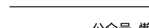

毕业后，儿子在硅谷干了几年，现在和几个同学合伙，在做一个房地产综合体项目。他已经定居在了德克萨斯州，结了婚，有了两个孩子。

人这一辈子，不管那一代人，各有各的苦难，我们没有权力选择放弃，只能咬牙坚持。咬着咬着，你会发现，那个曾经无比艰难的坎，已经过去了，前面的风光，很美好。

## 比成功更重要的是幸福

我研究了很多牛人，这些牛人都是我们眼中的成功人士，他们都家财万贯，事业有成，是被人羡慕的对象。

但是，我却发现，他们很多人并不幸福。

例如，俞敏洪的很多决定，都是被别人逼着，被时代推着做出来的，他觉得很痛苦，甚至想出家去。

吴晓波在当文人的时候是非常快乐和得心应手的，当商人的时候，去管理公司、管理人心就觉得烦，一开会就发火。

这些事例不禁让我思考，我们人类，都在孜孜以求什么？成功真的能带来幸福吗？假如成功不能带来幸福，那我们追求成功的意义何在？

我认为，对人而言，比成功更重要的，是幸福。

成功只是我们用来追求幸福的一个手段，其本身不是目的。

我们经历非凡人能忍受的痛苦，去追求一个成功，其实是因为觉得这个功能能让我们和家人幸福。

但是，很多人走着走着就忘记了目的，只注意到手段。

就好像中秋月圆之夜，我用手指着月亮告诉你，看多漂亮，你只盯着我的手，却忘记了看月亮。

成功能不能带来幸福，要用自己本心的喜恶作为一个维度，所需付出的代价和所能带来的收获作为另一个维度，来综合衡量。

如果你费心巴拉成功了，但是发现其带来的东西并不是自己喜欢的，那这个成功对你可能毫无意义。

只有当成功所带来的东西是我们真心喜欢的，我们追求它才有意义。

再往深处想一层，成功并不一定带来幸福，那为什么我们每个人都想追求成功呢？

我想这可能和对当下幸福和未来幸福、短期幸福与长远幸福的取舍有关。

我们常常认为，当下享受幸福，有可能会阻碍我们未来享受幸福；短期享受幸福，有可能会阻碍我们长期享受幸福。

例如，你现在去游山玩水，把存款都花光了，未来就不得不苦逼地工作攒钱。你小时候光顾着玩不好好学习，长大后找不到自己喜欢的或者能赚很多钱的工作，结果生活一直很悲惨。

所以，我们必须得学会平衡当下与未来、短期与长期。

例如张一鸣提倡的“延迟满足感”、宗教上的“修来世”、俗谚所说的“吃得苦中苦，方为人上人”、现代人谈“我拿起工作就陪不了你，放下工作就养不活你”，都是这样。

但问题就在于，要如何平衡？

如果我每天很痛苦地奋斗12个小时，到最后睡觉前10分钟终于轻松一下，我这一天算不算幸福？

如果我放弃了一切享受、痛苦地追求了69年，才终于成功，但70岁就去世了，我这一生算是幸福还是不幸？

如果我把老婆孩子扔在家里，自己背井离乡出去赚钱，等到全家团聚时，老婆已经老了、孩子已经上初中了，我错过了所有陪伴老婆青春和陪伴孩子成长的时光，但是却攒下了让他们衣食无忧的家业，我这算不算幸福？

如果我买了一套170平米的房子，却每天忙于上班，只是晚上回来睡个觉而已；而我请来打扫卫生的阿姨，每天往着我的大房子，扫完地之后就坐在阳台上摸着猫看大海。我和阿姨谁更幸福？

这些都值得我们好好思考。

很多人，都是走着走着就忘记了自己为什么要出发。

## 高手的努力深入而轻松，普通人的努力肤浅而痛苦

最近写了吴晓波，在看资料的过程中，有一个细节让我特别吃惊。

吴晓波说，我晚上从不工作，全部奉献给麻将和电视剧。

这颠覆了我的认知。在我此前的印象中，高手都是持续努力的，所谓成功的路在八小时之外。只有普通人则会回家就无所事事，把时间都挥霍掉。

但仔细想想，其实并不尽然。高手确实是非常努力，但他们努力的特点是在质量上。普通人中除了自甘庸众的部分人之外，也有很多非常努力的，但他们却没有成功，原因是他们的努力只有数量没有质量，所以大部分都白费了。

高手首先会明确一个正确的方向，在这个方向上努力，可以达到一日千里的效果。普通人一开始就看不清方向，有可能走的路与成功背道而驰，所以越努力越失败。

所以，战略的思考，比盲目的努力更加重要。很多人之所以忙忙碌碌，完全是为了避免思考。他们在用行动孜孜以求掩盖思想的空空如也。

高手谋定而后动，普通人只动而不谋。

高手会有很好的方法，他们只关注关键的百分之二十，在需要用力的地方集中用力，而不需要用力的地方省力。而普通人则只会用蛮力，眉毛胡子一把抓，不管事情的轻重缓则，都投入同样的时间精力。

所以高手可以在工作之余，还发展很多爱好或者去享受生活。而普通人中的努力者，连最基本的工作和学习都完成得无比吃力。

吴晓波每周写作6000字。不常写作的人可能不知道这个概念。这么说吧，这个写作量少得可怜。我有时候一天可以就可以写12000字，是吴晓波一周的两倍。但吴晓波坚持每周6000字，一年就有30万字，这已经是一本很厚的书了。所以他能每年出一本书。

另外，高手的努力是用在不断挑战自己的能力局限，让自己每天都有进步。普通人的努力是把自己已经会的事情重复一万遍，就算花同样的时间，高手也远远把普通人甩在后面了。

从过程的痛苦上，我们可能会以为，高手每天都在挑战自我极限，这一定非常痛苦；而普通人每天在舒适圈，一定很快乐。

但实际的情况是，高手在挑战自己的时候，很容易进入“物我两忘”的“心流”状态。而普通人则根本不知道心流为何物。他日复一日的努力，带来的只是无聊，以及看不到进展的焦虑。所以，如果你本来就是一个努力的人，或者打算努力，一定要按照高手的方式努力：选好方向，分清主次，挑战自我。只有这样，你才能做到过程和结果两方面都满意。不然，只会白白痛苦，却一无所得。

## 用社交电商年销售上亿的87年牛人

今天和一位社交网络营销很厉害的朋友H交流，非常佩服。

H同学87年出生，潮汕地区人，父母都是农民。他自己是一个很不起眼的学校毕业。

H学的是计算机专业，大一就开始和同学创业，承接一些编程类的外包工作。大学毕业后，找了7名同学，合伙开了一家小区o2o公司，做小区内部生活服务提供商。可是刚开始没多久，原来说好的投资人，忽然不投资了。同学们觉得受了他的欺骗，队伍一下子就散掉了。只有大一就开始一直合作的那位合伙人还没走。

他俩惨淡经营着公司。除了接技术外包的活以外，H还利用自己的摄影特长帮人拍摄，并从香港往广州倒买相机。毕业一年后，他攒下了十几万块钱。

2012年，正是微博红火时期，他老家一位91年出生的小伙，由于微博有百万粉丝，一个月收入6万。H和合伙人心动了，也加入了微博行业。

他们做了一些类似“微语录”、“微博搞笑”等的账号，很快也做到了百万粉丝，并实现了盈利。2013年，他们两个人的公司，收入超过了百万。

不过，他选错了平台。他做的微博，是腾讯微博，加上当时的QQ空间。到2013年时，这两个平台的颓势已经非常明显了。广告收入下降，他们开始利用积攒的粉丝流量做淘宝。

H选择了做五谷杂粮，打造了一个品牌叫“W”（为保护H隐私，这里隐去品牌名）。2013年底开始做。H写了一些保健类的软文，其中一篇被“新榜”评为2014年阅读量最高的微信文章。这些软文把W推到年营收五千多万。

2015年，公司做了一些扩张，并引进了新的合伙人。可是新合伙人进来后，出现了很多问题，并引起了内部矛盾，原来亲密无间的合作格局被打破了。后来矛盾愈演愈烈，H心灰意冷，把股权卖给了合伙人，自己退出公司（他本来时公司大股东）。

退出后，H拿着股权变现的钱，做了一个网络花店项目。不到一年时间，亏了200多万，才发现这个行业供应链太复杂，没有5年时间玩不通，只好放弃。又试了一些新的项目，包括化妆品、燕窝、面膜等，但都觉得炒作概念的成分太高，心理始终是有些不舒服，希望做更有价值，更长远的。

后来，有个朋友邀请他一起做白酒销售。这个朋友是之前的同行，因为学习他的营销软文而认识，一直保持联系。

他觉得白酒是一个长久生意，可以做一做，就投入进来了。一下子做成了爆款，3个月销售超过了2个亿。

当时，茅台镇大大小小的酒厂有几十家之多，但是除了茅台以外，其他的都卖得不怎么号。H做出爆款之后，在茅台镇引起了震动。很多酒厂都要找他们代理。

另一个朋友引荐给H一个业内超级大咖F。F是五粮液最大的经销商，酒仙网的投资人，国台酒（茅台镇除茅台之外的第二大品牌）的股东，业内叱咤风云的人物。F正好是H同一个县的老乡，听说过H，对其非常欣赏，大年初一请H和太太在老家吃饭。

这时，H已经把原来的销售模式总结、升华、改进，形成了一套全新的模式和打法。F和H聊完之后，特别看好，全力推动H与国台酒合作。

H在茅台镇考察了一圈发现，茅台自己肯定进不去。其他小酒厂自己又不愿意做。就国台最合适自己。于是就去与国台酒的人谈，获得了对方的高度认可，被授予网络销售的独家代理权。现在，国台酒的线上销售，全部由H负责。

国台酒正在谋求上市，6月份已经进入上市辅导期。其年销售收入每年翻倍增长，现在已经达到10亿。未来H的公司作为独家线上代理，前景非常可观。

H和我讲了他新谋划出的销售模式。我不得不感叹，真的是很有想法，很有前途。由于目前还属于商业秘密，暂时不能透露。应该过一两年，规模做起来之后，会成为未来社交网络通行的商业模式，希望到时有机会我来做一个总结梳理。而且，H还专门为这套销售模式设计了专门的系统。如果这种商业模式通行的话，他光卖这个系统，都能大赚一笔。

故事讲到这里就结束了。还有一点让人印象深刻的是：H在15岁高一时，就开始谈恋爱，谈的对象就是现在的老婆，现在已经17年。

## 我是怎样搜集资料的

我们身处于一个信息时代，信息就是最大的财富。获取信息的能力，是非常重要的一项能力。

我最近写完了百度、阿里、腾讯三部曲和今日头条、美团、滴滴三部曲，都是一万五千字以上的长文。

有不少朋友反映：看何加盐的文章，觉得资料特别详实、内幕，研究特别深入。有很多朋友好奇地问：你到底是怎么找到这么多资料的？

自夸一点说，找这些资料确实不容易，需要花费大量时间精力，还要有很强大的信息搜集能力。也只有掌握了足够多的资料，才能把马云、马化腾、李彦宏、王兴、张一鸣、程维、刘强东、周鸿祎这样的人写鲜活、写精彩。

今天我们就来揭秘一下，何加盐是怎么搜集资料的。

### 1， 用好搜索引擎

我们常用的是百度、搜狗和Bing，三个网站搜出来的东西会有所不同，所以都需要试一下，综合起来才够全面。

但是，最好用的，还是谷歌，它的搜索功能最强大、历史网页最全面。有很多信息，上面三个网站搜不出来的，谷歌就能搜出来。

例如，我写美团王兴时，写到他在“千团大战”中的一次大手笔：公布银行账户余额，就找不到他当时放出来的图的清晰原版，后来还是在谷歌搜到的。

写孙宇晨时，写到影响他放弃了知识分子梦想的关键事件：抄袭风波，就找不到他抄袭的原文以及事件的来龙去脉，最后到谷歌一搜就出来了。

另外，搜索的时候，有很多技巧，这里说几个比较常用的：

#### 一是善用关键词的组合。

例如，我想知道滴滴程维创业的过程，如果搜“程维 滴滴”或“程维 创业”，信息就太杂太乱了，而且有很多关键信息是搜不到的，但是你把他和投资人的名字放在一起，搜“程维 王刚”，就能出来很多新的有价值的信息了。

同样地，我们搜“程维 包凡”，就能知道滴滴和快的合并时的很多内幕，这些光搜“程维”、“滴滴 快的”，是搜不出来的。

尤其是想了解两个人关系的时候，这个用处就更大了。例如想知道周鸿祎与傅盛的恩怨情仇，就搜“周鸿祎 傅盛”，能出来很多关键资料。

#### 二是善于选择时间段。

例如，我想知道李彦宏创业初期的历程，如果是直接搜索，基本上找不到，因为关于他的资料很多，早期的那些报道全部被淹没了。

这时，我们可以设置搜索时间为2000–2004，于是后面他成功以后的信息就会被过滤掉。类似地，搜周鸿祎和刘彻是怎么结仇的，可以把时间设置在2007–2008年。

#### 三是善用一些搜索命令。

2020-5-8

例如，在关键词后面加上“filetype”，你就可以搜某一种文件类型，如搜“马化腾 filetype:pdf”，搜出来的都是pdf文件（如果想要搜word文件，就把“pdf”改为“doc”就行了）。

在关键词后面加上减号，就可以过滤掉你不想看的内容。如有一个演员也叫张一鸣，如果你想研究今日头条创始人张一鸣的话，搜起来会有很多干扰，你可以用“张一鸣 -演员”（注意减号前面有空格）去搜，就可以过滤掉演员张一鸣的信息，只留下今日头条张一鸣。

在关键词后面加上“site”，可以只查某一个网站的消息，例如，我想查腾讯自己的网站是怎么报道马化腾的，就可以用“马化腾 site:qq.com”。

这个在查官网信息的时候非常有用。例如我要查京东的原始财报，可以用“jd.com site:sec.gov”。要查段永平在浙江大学活动的情况，可以用“段永平 site:zju.edu.cn”。

## 2. 用好社交网站

我们把微博、微信、知乎、饭否、脉脉等都叫做社交网站。这些是找资料非常重要的渠道。

如果你的研究对象开通了微博或者微信公众号，那是了解他们的最好方式。例如我写程维的时候，把他的微博看了个遍；写王兴的时候，把他的饭否看了个遍。

拼多多的黄峥更是明显，他自己有个公众号，早期发了一些文章，对自己的过往历程有很多描述，这些都是最有价值的资料，而很多写他的公众号作者居然都不去看。

知乎上也有很多值得留意的信息，如写到一些公司，就会有很多该公司的人留言回答“在某某公司工作是一种怎样的体验”；写到某些人，就会有一些和他有过接触的人在“如何评价某某”这样的问题下面回答。

大家可以试试知乎搜索“雷军”，看一下“雷军是怎样一个人”或“如何评价小米科技董事长雷军”这两个问题，可以看到很多有价值的信息。

脉脉上面有很多关于公司内部情况的信息。例如甲骨文裁员时，就有被裁员工在上面发帖透露有关细节。

需要提醒的是，社交网站是各大公司公关工作的重点，有很多信息都是经过公关美化的。如知乎上对马云和阿里的评价特别正面（大家可以看一个“马云和刘强东，你欣赏谁”的帖子，完全一边倒），我个人猜测阿里的公关部应该在知乎很活跃。

当然也有一些信息是真真假假的黑料。尤其是在两家公司正在大战时候，有一些信息是对手故意放在网上抹黑的。所以在社交网站上找资料需要注意分辨，对同一个信息，最好是多方交叉印证。

有一些特别好的公众号，是研究知名企业和人物必看的，如“财经杂志”、“中国企业家杂志”、“LateNews by 小晚”、“饭统戴老板”、“吴晓波频道”、“keso怎么看”、“乱翻书”、“卢泓言”、“左林右狸”、“8字路口”、“虎嗅APP”、“36氪”等。（当然，更不能错过的，还有“何加盐”）

另外，大家还需要用好微博、微信公众号、知乎等网站的搜索框。

例如微信公众号，你可以在微信页面右上角的放大镜标志那里，输入你想要研究的人物或企业家，然后选择指定搜索“文章”，就可以把相关的公众号文章都搜出来。

## 3. 用好视频网站

视频网站简直是一个大宝库，可是很多人都忽略了。我们感兴趣的知名人物，或多或少都会有一些演讲、采访，或者参加综艺节目的时候，这里能透露出无数特别鲜活的细节信息。

如我写王兴的时候，对他早期创业的很多信息，来源于他参加极客公园的一个访谈；对他的个人性格、理想等的把握，来源于他和王小川的一个对话；对程维的很多信息，来自于吴晓波的采访《二十年二十人》；李彦宏的成长经历，不少来自《开讲啦》。

还有很多意想不到的视频资料，会出来很多特别有价值的信息。例如，周鸿祎上《天台上向》、李彦宏上《荒野求生》，都很有意思的细节，这些对更好地了解他们的性格、和丰富文章内容，非常有用。用了这些别人没注意到的细节，文章就会更加生动和精彩。

知名企业家比较常去的节目，有这么几个：《鲁豫有约》、《波士堂》、《开讲啦》、《遇见大咖》、《人物》、《二十年二十人》。当然还有很多，大家可以在爱奇艺、优酷、腾讯视频、B站等地方搜他们的名字找到。

还有一些是特定时期的专访，例如任正非最近经常露面的一些访谈，尤其是在央视的访谈，是研究任正非不得不看的一手资料。

## 4. 用好名人演讲

大部分名人都会在不同场合有一些演讲活动，如公司内部演讲、行业活动演讲、母校演讲、家乡演讲等等，这里面通常藏着很多重要消息。

例如，张一鸣在南开大学的演讲，透露了很多他大学期间的故事，包括他如何选择学校、怎样追女朋友、第一次创业的过程等等。程维的公司内部演讲，讲了很多他对公司未来业务发展如何规划的情况。马化腾在某个行业会议的演讲，阐述了腾讯发展的灰度哲学。这些是非常重要的素材。

演讲最多的，就是马云了。例如，写他的创业史，就一定要看他在“18罗汉大会”上演讲。由于马云在不同场合有很多演讲，所以写他是非常痛苦的，因为要看的资料太多了。

另外还有一个值得关注的是内部信。

很多企业都会通过内部信的方式回应某些问题，或者阐述某些观点。例如想知道腾讯在3Q大战之后的伟大转变，就绕不开马化腾2010年腾讯年会之后的《打开未来之门》这篇内部信。想知道华为的精神，就离不开任正非的《华为的冬天》和《一江春水向东流》这些经典文章。

## 5. 用好传记作品

传记是了解企业和企业家最完整最全面的方式。凡是要研究他们，是不可不读的。

例如，想要了解腾讯的发展历程，无论如何都绕不过吴晓波的《腾讯传》；想要了解马云的故事，他的助理陈伟写的《这就是马云》，也是必读书目：要了解阿里中供铁军的情况，和阳写的《阿里局》就是很好的参考资料。

李志刚写的《王兴：九败一胜》和《创京东：刘强东亲述创业之路》、艾萨克森写的《史蒂夫·乔布斯传》等，也是研究相关企业和人物的不二之选。

吴晓波写的《激荡三十年》和《激荡十年》，是了解当代企业史的一本入门级的书籍。林军的《沸腾十五年》，则是早期中国互联网企业发展的一部“史记”。信息量最大、最权威的，无疑就是企业家的自传了。如要研究周鸿祎，一定得看《颠覆者：周鸿祎自传》；要研究巴菲特，一定得看《滚雪球》。考夫曼写的《穷查理宝典》也和查理·芒格的自传差不多，是研究芒格的必读之书。

有一些公众号作者不注意从人物传记里去获取和印证信息，就会导致很多关键信息遗漏或错误。

我当初写《孙宇晨的复杂人生》时，很多信息都是来源于他的自传《这世界既残酷，也温柔》。当时一些同时写他发展历程的作者，却连这本书都不看，这是不应该的。

当然，传记文章，有很多吹捧或自我吹捧的情况，这是需要注意分辨的。对于有争议的问题，不能完全采取一家之言，需要多方交叉印证。例如写3Q大战，就不能只用《颠覆者：周鸿祎自传》的说法，也需要看看《腾讯传》怎么说，以及当时的媒体是怎么报道的，网友是怎么评论的。

## 6. 用好杂志

最后就是一定要用好杂志。中国有一些专业杂志做得非常不错，采访有深度，研究有力度。

我写TMD三部曲和李叙宏的时候，引用了不少《财经杂志》对他们专访的内容（在此特别对财经表示感谢，尤其是对作者宋玮表示感谢）。写孙宇晨的文章，很多信息出自《智族GQ》杂志何韬的《风口上的孙宇晨》。写程维那篇文章的一些素材，也是来自于《中国企业家》等杂志。

此外，还有《南方人物周刊》、《人物》、《第一财经周刊》、《财经国家周刊》、《商界》、《环球人物》等，也都是我经常看的杂志，对于了解行业动态和人物近况，非常有帮助。

这些杂志对人物和企业的报道，都是比较全面或者内幕的，有非常大的价值。例如，如果要研究王兴的话，《财经杂志》宋玮访谈王兴的《对话王兴：太多人关注边界，而不关注核心》就是必读的文章。

## 7. 资料渠道

我平时搜集资料的方式，主要就是这么些了。需要注意的是，这里只写了案头工作。除此之外，还需要访谈很多的内部人士，甚至和当事人本人深度沟通。不过这个大多数人用不上，或者没有渠道，在此就不讲了。

以上说的六个方式中，前面四个都是基本免费的。后面两个（书和杂志）需要付费购买，但是也有一些很好的渠道可以省很多钱。

看书的话，我推荐“微信读书”，绝大部分的书都可以找到，对我们平时使用，已经是够了。新会员使用微信阅读，会有很长时间的无限卡，可以不花钱看好几个月，无限卡过期后，一本书也就是几块钱甚至一两块钱就可以购买。

杂志的话，现在大家很少看纸质版的了，可以看看这些杂志的官网或者官方公众号，一般重要的文章它们都会放在上面。还有一个办法就是用付费的APP。我用的是葫芦时刻。不过价钱需要大约200元/年。所以除非确实很喜欢看，而且下到手机上能经常使用，否则不建议贸然下载。如果买了不看，是浪费钱。

# 多关注需求，少纠结条件

牛人星球的星友钟永焕讲了他在商场的一个观察：穷人只会看自己消费得起的商品，其他的进都不敢进；富人看的是所有他喜欢的。

对这个观察，我很有共鸣。我小时候，家境属于比较贫寒的，父母一辈子节俭惯了，形成了穷人思维，现在我们在城市生活，他们有很多地方仍然改不过来。

任何一笔花销，他们首先想到的，都是要如何省钱。买任何东西，都要挑最便宜的，而不是自己最想要的。在他们的这种心态下，我家经常有快要烂掉的苹果，有嚼起来像木头一样的榴莲，有酸倒牙的桔子，有已经黏糊糊的葡萄……我无数次告诉老父亲，你与其花5块钱买5个烂苹果，不如花10块钱买一个好苹果。因为我们去买苹果，买的是它的味道，而不是为了省钱。但是他下次还是会照样去买烂苹果。因为在他的意识里，完全没有“我需要什么”这个概念，只有“我能负担得起什么”。

这样过一辈子，可能从来都不知道一个好苹果应该是什么味道。

我在读研的时候，曾经在电视台实习，当经济记者。经济记者是很受企业欢迎的，所以我们去企业考察或采访，企业都是热情接待。

有一回，我们去了一个种梨的企业，老板极力奉承，请我们吃最好的梨。我尝过才知道，原来好吃的梨，应该是这样的味道。而绝大多数人，可能一辈子都没有机会尝到它。

从那以后，我常常会在消费时想起那个梨子。尽管我还是很省，但是在吃的方面，有时候我也会舍得去尝一尝那些特别贵的东西，到底“应该”是什么味道。自己赚钱以后，我都会刻意买一些好的、贵的东西给父母吃，例如三文鱼、大闸蟹、好的樱桃、草莓、芒果、猕猴桃等等，因为他们自己从来都不会买那些。

其实，不仅仅是在吃上面，在我们的事业选择中，贫穷也会影响我们的判断。贫穷思维是，有多少钱，就买多少货。久而久之，在事业选择中，就变成了这样：我有什么条件，就去干什么事。而富人思维是，我想要什么，就买什么。

久而久之，在事业选择中，就变成这样：我想要做什么事，就去做什么，如果缺什么条件，我再去找补就是。社会上，比较成功的，能干成大事业的，都是拥有富人思维的人。

贫穷是一种病，会入脑，会影响智商和判断力。我这不是对穷人的歧视，而是希望大家能注意，即便是身处贫穷的境地，也不要让自己染上穷人思维。我也不是在吁吁大家一味地奢侈，“量入为出”当然是必要的，但是，我们不能让穷人的这种习惯带入未来，带入别的方面，影响我们本来可以更好的事业发展和人生选择。

# 罗永浩的优点

刚刚写完了罗永浩。由于他的资料非常多，人也特别有争议，所以写起来很费劲，用了整整一周时间。

但也不得不说，研究罗永浩，还是很有意思的。他的资料，看起来一点也不枯燥。这是一个自带精彩的人。

罗永浩有很多缺点，但是，也有很多值得学习的地方。对我最触动的，是这么几个：

1. 眼里看不到困难，大胆开干。

这点是很多人都缺乏的，包括我。我们看待一个事情时，总是先想着自己有什么条件，前面有什么困难，很容易就被吓住，从而停止不前。

而罗永浩却能够忽略一切困难，大胆地走下去。

这其实和马云说的很像：有些人是要看见了才相信，我是相信所以看见。

如果你有一个梦想，就去追逐，哪怕前路有很多坎坷。需要什么条件，我就去做到，而不是缺什么条件，我就停止。

2. 能屈能伸。

罗永浩说了很多吹牛的话，但后来迫于现实，必须自己打自己的脸。这对于任何人来说，都是非常难堪的事。何况对于罗永浩这样爱显摆自己高大上的名人。

但是，为了企业能活下去，为了事情能做成，他忍着潮水般的嘲讽，低头去做。

有时候，我们真的需要学习这样的精神：面子是给狗吃的，活下去最重要。

3. 不被外界的评价影响。

我们有时候太在意别人怎么看我、怎么评价我。这会让自己的心理失衡、动作变形。

而罗永浩能够做到忽略负面的评价。自己想做的事情，坚决按照自己的想法去做，哪怕和再多人争执，也不改变初衷。只有事实和逻辑能让他改变主见。

在网上，他常常和人骂战，黑他的人很多，但是他能够做到乐观对待，认为我很好只是你不懂欣赏。

最难的时候，朋友认为他会自杀，他却还是乐呵呵的，还对朋友的反应很奇怪，“你咋想的，我怎么可能自杀呢？”

以上说的三样，正是我所缺乏的。也是很多不自信的朋友所缺乏的。我们真得好好向罗永浩学习这样的精神。

当然，如果你本来就是这样的人，那你可能需要学些别的，这就是另外一个话题了，在此先不赘述。

# 创业者，连休息一下都有负罪感

一位创业的朋友和我说，只有在努力、拼搏、奋斗的时候，觉得是充实的。可是，有时候他也会经不起诱惑，追个剧、刷刷微博、看看抖音，这时心里就充满负罪感。

这种感觉，我也感同身受。我必须得做有意义的事情，心里才会平和，如工作、学习、陪伴家人。如果是自己偷懒或放纵一下，就会非常自责。但是人毕竟不是机器，也会有懈怠的时候，所以下次还是会照样放纵，然后再次自责。

前一阵网上对996有诸多讨论。对于普通员工来说，如果被迫996，确实是很郁闷。但是，据我所知，如果是创业者，大多根本就没有上下班的概念，他们每时每刻都随时处于工作状态，哪怕是陪伴家人，心往往也是放在公司或项目上。并没有什么人逼着他们这样做。但是，每一个创业者，心里都有巨大的压力，怕自己稍微松懈，就可能一败涂地，或者业绩不如预期。虽然一年做1000万也能活得很好，但是创业者一定会拼命再拼命，争取做到1500万，甚至更高。所有的辛苦，都是自找的。

这和体制内的生活，完全两样。体制内没有生存压力，就算是松懈一点，甚至松懈很多，每个月发的工资，也不会少一分钱。经常有人问我，从体制内出来，有没有后悔？

的确，如果从工作状态来说，创业要艰辛百倍，心理压力要大百倍。但是，创业有梦想，梦想有实现的可能。而留在体制内，只能日复一日地过着同样的日子，一辈子的路，在30岁的时候，就已经一览无余了。我还是喜欢现在的日子，忙，但是充实。

但是，也许我需要转变一下心态，有时候，适当的休息和娱乐，也是需要的。不能因为创业，就变成一部机器。与诸位创业者共勉。

# 柳暗花明的人生际遇

昨天和小师妹聊天，很有感触。

师妹是知名公众号酷玩实验室的创始人，传说中的“蛋蛋姐”。我和她在一起很开心，因为我和她站到一起，公众号平均粉丝数达到了305万（其中，酷玩实验室的粉丝600万）。

师妹2015年才毕业，现在管理着一家一百多人的公司，事业蒸蒸日上。

而她做起酷玩实验室，纯粹是歪打正着。

15年毕业时，师妹和朋友一起创业。她们起初想做的是一个无人机俱乐部。

为了给无人机俱乐部攒人气，就开了一个公众号，专门写一些科技领域的很酷、很好玩的东西。所以起了一个名字，叫“酷玩实验室”。

由于文章写得好，越传越广，公众号就越来越有名。

师妹发现，卧槽，原来我写文章这么牛！那还做无人机干嘛，干脆写文章算了。

半年过后，原本要做的无人机社区项目黄了，公众号却火了。

很快，她们的粉丝，就突破一百万、两百万、三百万……到现在已经六百多万，成为了头部大号。

现在，她们的广告收入非常可观。出于商业机密的缘故，我就不透露具体数字了，反正一条广告就够北上广深一个普通码农996地干一整车活的。

我自己写公众号也有一点类似的经历。

最初注册何加盐这个号，我也是为了给我的咨询公司服务的。

因为咨询是一个人员流动性非常强的行业。每家咨询公司都很头疼人才后备的问题，从麦肯锡到本土小公司，概莫能外。

我当初的考虑是，我做一个公众号，展示一下何加盐的个人魅力和咨询行业的美好，吸引年轻人加入我们。

就这样开始写文章。

到后来，我的文章传播越来越广，影响力越来越大，到《人民日报》、共青团中央、新华社都转的时候，我发现，我的技能树也可能是点在这里。

于是从今年3月开始，从咨询的繁重业务中脱身出来（公司还继续运行着，只是我不再兼任项目总监，现在只作为合伙人），主要精力放到了写作上。

这才有了今天的何加盐。

很多时候，人生就是这样。像阿甘说的，它就像一盒巧克力，你不打开吃一颗，就不知道什么味道。

上天给你关上一扇门时，会给你打开一扇窗。

如果你觉得现在的工作做得很不顺心，也许是因为没有找到更适合发挥自己技能的机会。说不定你用业余时间做的一些事情，反而会给你带来更好的成就。

愿大家都能找到自己热爱和擅长的事业。

# 吃自助餐的4种人，你是哪一种？

因为工作关系，我常常在外面住酒店，吃自助餐的机会比较多。

吃得多了，就会比较。

不是比较哪家的自助餐更好，而是比较吃自助餐的人。

所以，大家如果哪次吃自助餐时，看到一个人不好好吃饭，光顾着东张西望，请不要急着报警——那可能不是小偷，而是何加盐。

观察下来，我有了一个有意思的发现：吃自助餐的人大体可以分为4种：撞死拉倒型、只求最贵型、喜欢尝鲜型、只取一瓢型。

四类人的特征分别如下：

### 第一种：撞死拉倒型

“撞死拉倒型”的人到了自助餐厅，就跟高尔基扑在书籍上似的那么饥渴。他们恨不得把整个餐厅都撞到自己的盘子里来。“扶着墙进，扶着墙出”，是他们的最高境界。

他们往往分不清什么是真正的好东西，反正大鱼大肉、鲍鱼龙虾就往盘子里装。当然就更不会管是不是对自己健康了。

之所以他们会这样，可能有三个原因：一是曾经吃过饥饿或贫穷的大亏，心里的伤痕太重了，性格本能就形成了看到能吃的东西、好的东西就要不顾一切要抓住的惯性。二是因为世面见得少，不知道什么是好东西。三是看事物只是看到外表，不会看本质，以为多吃就是对自己好，而没认识到吃东西的目的是什么。

### 第二种：只求最贵型

“只求最贵型”的人会觉得第一类人就是乡巴佬。他们知道哪些东西是好的，哪些是不好的。不过，他们评价“好”和“不好”的唯一标准，是价钱。所以他们到自助餐厅，会选择那些高档海鲜、和牛铁板烧等，喝酒才不会选择罐装啤酒，都是挑高档的葡萄酒或洋酒。

他们选这些东西，并不一定是因为喜欢吃或者觉得健康，唯一的理由就是贵。吃这个才够本。如果你选了一碗米线，他们会大惊失色地说，你怎么吃自助餐还吃这个，太亏了吧，然后告诉你应该选什么。

这类人有一定的经历和见识，对事物的外在价值有很好的认知。但是对内在的本质却知之不详。他们可能会赚很多钱，对穷人不屑一顾。但是他们心里会非常焦虑，幸福感较低。

### 第三种：喜欢尝鲜型

“喜欢尝鲜型”的人会觉得第二类人就是暴发户。他们不一定会挑选最贵的，而是会选择自己平时很少吃到的。如果有一份价值500元的和牛和一块价值1元的面包摆在他面前，假如这款面包他从未吃过，他会放弃和牛而选择面包。

这类人往往已经在社会上有一定的成就和地位，不再看重金钱了，而是看重新奇的体验。在工作上，他们的创新性会比较强，容易从不一样的角度去看问题，从而做出较好的学术或者商业成果。

### 第四种：只取一瓢型

“只取一瓢型”的人不管餐厅里有什么，他反正只选自己喜欢的。甚至可能在不同的自助餐厅，他都是只吃同样的几种菜。如果他喜欢喝啤酒而不喜欢红酒，他会选择8块钱一瓶的珠江纯生而不是800块

# 从自助餐看人的性格

一杯拉菲。

这种人去吃自助餐是最亏的，可能价值 988 的自助餐，他也就吃个 88 块钱回来。“弱水三千，吾只取一瓢饮”是他们的最高境界。

这类人知道自己想要什么。他们可能并不十分富裕，可是他们的内心会很富足。最容易幸福的就是他们。

当然，我们每个人，可能在不同的阶段会有不同的表现，同一阶段，也可能是几种表现的综合。不过，大体上会有某一种为主。

不管是谈业务还是谈恋爱，不妨约个好一点的自助餐厅试试。知道他/她的性格，你就知道如何和他/她相处或者做生意了。

以做生意为例：

- 如果对方是第一种人，你随便给点小便宜他就会听你的。

- 如果是第二种人，你需要用较多的钱才能“收买”他，但可以放心的是，用钱砸一定能帮你达到目的，只是价钱多少而已。

- 如果是第三种人，你可能需要花一点心思，给他一点新鲜感，不管是接待还是生意，要让他有耳目一新的感觉。

- 如果是第四种人，他们无欲无求比较难办，但是有一点好，只要是对味了，你什么不用做，他都会为你着想。所以，从自助餐，也可以看到一个人的性格。

当然，还有一种人，那就是自己不怎么吃，光顾着看别人的。一般而言是小偷，但也有可能是偷看美女的好色之徒。

不过，如果这个人剑眉星目、气宇轩昂、英俊潇洒、玉树临风，但前半边脑袋已经秃了，那就既不是小偷也不是色狼，而是何加盐了。

# 时间与年代感

2020 年出生的小孩，看我们 80 后，跟我们看解放前出生的人，感觉是一样的。

因为 2020 到 1980，相隔 40 年，而 1980 上溯 40 年，那可是 1940。

在我的印象中，2000 年和现在，就是同一个时代。但在我 9 岁的女儿眼里，2000，就像是一个上古的蛮荒时代。他们不能理解，没有智能手机，没有 4G 和 wifi 的世界是怎样的。

这还不算太过惊奇。

当我发现改革开放离现在（42 年），比新中国离清朝的时间还要远时（38 年），我陷入了深深的沉思。原来，建国时的人们看着清朝，比我们看着改革开放，感觉上还要近。我总觉得改革开放和现在差不多是同一时代，而清朝离新中国，那可是隔着两个时代啊。

另一个与此相近的感觉是：我心理上一直觉得，战国和汉朝完全是两个时代。而事实却是，汉朝的创立者刘邦，就是战国人，并且在战国时期生活了 35 年。而战国和大汉之间，仅仅只有 19 年的距离。

以前看关于史记的描述，看到说司马迁在各地采风，了解当地的历史，并没有异样的感觉。可是现在想起来，司马迁写的很多人，都是几百年上千年之前的人物。他的同时代人，怎么可能还知道他们的故事呢？他和炎黄的距离，就跟我们和孔孟的距离一样远；他和商汤的距离，就跟我们和南北朝的时期一样远。我们现在去某地问当地的老农，春秋时期你们这里发生了什么，南北朝时期你们这里发生了什么，他们能知道吗？

另外，把西方近代人物出生的时间和中国历史相对照，会生出一种奇怪的疏离感。伽利略出生于明嘉靖年间，那时戚继光在打倭寇；牛顿出生于明崇祯年间，那时李自成正在造反；造火车的史蒂文森出生于乾隆年间，那时纪晓岚正在与和珅斗嘴。美国制定建国宪法时，中国的乾隆爷还在搞文字狱。文艺复兴和工业革命，把西方和中国分成两个截然不同的时代。

上面这些例子说明，我们对时间的感知，是存在错觉的。

我们总以为父母还年轻，可算算年龄，他们已经花甲和古稀了。印象中记得朋友前几年刚生了小孩，前两天一聊天，发现孩子都已经上高中了。

明明觉得才从学校毕业没几年，一看脑袋，前半边头发没了，后半边头发白了。

时间过得比我们想象中的快啊，刷的一下就没了。

# 领导者的关键职责，是在不确定的世界中创造确定性

每一个组织，不管是企业、社团，还是国家，都会面临无数的不确定性。而人们要想好好做事，却需要确定性，所以领导者的关键职责，就是提供这种确定性。

例如，一家公司，会面临各种风险，也有各种机遇。某种新业务要不要做，某个旧产品要不要下，要扩大生产还是收缩防线等等，每天都要做出很多决策。如果管理层对于现状和未来的判断是模糊不清的，就没有办法做决策。勉强做出来决策，员工也不会用心去执行，他们会怀疑这个决策的合理性以及管理层对决策的坚持程度。所以领导者时时都需要告诉管理层和员工：事情就是这样的，我们未来就是要做到这样，所以现在我们必须如此这般决策。

马云是此中高手。从大面讲，他始终不渝地告诉员工，我们就是要让天下没有难做的生意，我们就是会成为全球举足轻重的大公司。从小面讲，他在外面找投资，坚信自己一定能找到，每次失败而归，回到公司，会笑着说，今天我又拒绝了一家投资公司；他做制度和管理，定出来就坚决执行，所有人都知道做了什么事就会有什么后果。所以，马云在时刻提供确定性。

毛泽东也是。当初林彪他们都怀疑红旗能打多久，他就专门写文章《星星之火可以燎原》来提供理论上的确定性，写《论持久战》等来提供行动上的确定性。

上面举的都是乐观的例子。但是大家不要误解为提供确定性就是要保持乐观。其实很多时候选择悲观也是一种确定性，例如任正非就坚决认为华为会面临诸多困难，所以必须未雨绸缪。毛泽东也知道老蒋对井冈山继续围剿，红军是顶不住的，所以必须长征。

这里面的关键，不是选择乐观还是悲观，而是你不能首鼠两端，犹疑不定。领导者最忌讳的事情，是给员工提供不确定性。如果一个领导做事犹豫不决，或者朝三暮四，就会给组织带来灾难。

一个领导一旦一天一个主意，那么这个组织就很危险了。员工们马上就会无所适从。但凡领导有什么新指示，他们都知道马上又会变的，所以就会拖延不办或者敷衍了事。

如果有人看过资治通鉴的话，就会知道司马光对犹疑有多么鄙视，对果断有多么推崇。如果书里面点评某个人“谋而无断”、“多谋寡断”、“性犹疑”，我们马上可以确定，这个人的下场一定不会很好。

古语云，成大事要“谋之在众，断之在独，虑之贵详，行之贵力”。如果你不能拿主意，那凭什么当领导者。

理查德·路梅尔在他的著作《好战略，坏战略》中认为：所有领导者都有一个重要职责，就是弱化问题的复杂性和模糊性，并在简化之后提供给自己的组织，而这个经过简化的问题是可以解决的。

2020-5-8

59

# 接受无聊是更高级的能力

在智能手机没有出现之前，我会把空余时间都用来看书。在排队、等车、上厕所时，如果我的手里没有拿一点东西看，我就会难以忍受。

对这一点，我一直觉得很自豪，认为自己是一个爱读书之人。智能手机出现之后，所有的碎片化时间全被手机占据了。别说是上面那种无所事事的时间，甚至在吃饭、走路或开会时，我都恨不得也盯着手机看。

对这一点，我不能感到自豪了，因为我在手机上看的东西，有很多其实是无用的。如微博上的消息、朋友圈的文章、微信群的八卦，甚至是网络小说或者短视频等等。

这些东西，可以说对我毫无用处，我没有通过它们学到任何东西。我之所以看他们，只是因为我没法忍受无聊。

尽管不能为此自豪，我也没有为此羞愧。因为反正闲着也是闲着，我并没有占用学习、工作、陪伴家人的时间来做的这个。只是利用一些碎片化的，无法被别的途径用到的时间而已。

但是，最近我发现，对我而言，这其实是一种应该羞愧的行为。因为我把无聊的时间，用一些垃圾去填满，原因很可能是为了避免思考，或者是因为我没有办法在无聊时思考。

> 张一鸣曾说：很多人为了逃避思考，愿意做一切事情。

之前我对这句话的理解有些模模糊糊。但是通过“能不能忍受无聊”这件事，我觉得理解得更深了一些。

无聊时如果不做其他事情，那就必然会去思考。而我正是因为害怕思考（此前我都没有意识到是因为这个），不停地看书，或者看手机，只是为了把无聊的时间全部占满，省得去思考。

对无聊的认识和应对，分为三个层次。

第一个层次是无所谓无聊，也不知道应对。

在这个层次的人，本来就不去思考。他会聊天，会眼睛咕噜咕噜转，会回想自己家里的事情，哪怕是静静地呆着，他也不会感受到痛苦，更不会想着要利用这段时间做点什么事情。

第二个层次是无法忍受无聊，想方设法应对。

在这个层次的人，无法忍受哪怕一小会的空闲。他一定要给自己的手或脑子找点事做。以前主要的是看书，现在主要是看手机。哪怕是 10 秒钟的等电梯时间，也必须得拿出手机来盯着看，不然他就会觉得痛苦。雷军也是这类的人。他必须得时时刻刻用事情充实自己的空闲，哪怕是接受采访和人聊天，也得找点事儿做，找不到时候，他甚至会计划的拿餐巾纸，一下一下整整齐齐地撕成碎条。虽然这个事情毫无意义，但是对雷军而言，却有助于帮助他缓解“我现在好无聊，我浪费了生命，我有罪”的这种焦虑。

第三个层次是知道无聊，但是能忍住无聊，把时间用于思考。

在这个层次的人，已经认识到了对抗无聊的毫无意义，以及无聊所具有的价值。他不再孜孜以求地用一切无意义的东西来占满空闲以覆盖无聊。而是试着和无聊和解，利用无聊时间进行思考，或者就是放空。

罗素曾说：不能忍受无聊的一代人，将是平庸的一代人。不能忍受无聊，生活就会变成持续的对无聊的逃离。

王小波年轻时不能忍受无聊，有些老师的课，他觉得无聊，就会去逃避，后来他认识到，接受无聊是深度人生的必修课。

王兴和张一鸣是这类的人。他们认识到无聊的价值，他们以思考为乐，而不会用垃圾信息和碎片阅读来侵占无聊的时间。

认识到这一点之后，如果我们不愿意过平庸的人生，最好能做出一些改变。从现在起，不管是等车、排队、坐公交、搭地铁，还是上着最无聊的课，听着最无聊的会，吃着最难吃的饭，都不要看手机。

我们可以把这些碎片化的时间，用来思考，或者清空思绪。以何加盐为例，我可以思考如何能为社会创造更大的价值，思考如何能写更好的文章，思考如何能让自己成长更快，思考如何能赚更多的钱，思考如何能让老婆孩子父母过得更幸福。

接受无聊，利用无聊进行思考，比利用无聊来学习和娱乐，是更加高级的能力。请不要再垃圾信息，来填充无聊的时光。

# 记一次尴尬时刻

在浙大读研期间，我在上海某公司实习。老板是国际上有一点名气的经济学家，常常有国际友人来找他。他可能是觉得我不错，把我带在身边，当助理用。

有一回，公司安排了欧洲某经济学大牛到苏州演讲。本来是老板要陪同去的，但是他临时有事，就让我陪着去。我不仅要陪着想大牛一家游览苏州城，还要在大牛的演讲中担任即席翻译。

要知道，在我们山村，我初中才开始学英语，一直所大学，仍然是一口地道的湖南平江口音，举个例子，我一直把 China 念成“跩哪”，到大学才知道原来是“拆哪”。虽然大学四六级和考研英语成绩不错，但是，也从来没有实战过啊。更何况，第二天大牛要讲的课题是次债危机，里面充满着金融衍生品、信用违约掉期、担保债务凭证等专有名词。我和老板讲，老板我不行，这个太难了，我会搞砸的。老板说，没事，我相信你。

第二天，我硬着头皮上了。去到会场才知道，原来是一个几百人的高规格大会。然后江苏电视台、苏州电视台等媒体，一堆摄像机都对着我们。事已至此，我完全没有退路，只好陪着教授上了台。

为了防止后面出现状况，我一上台就和听众说，今天来的都是对这些问题有一定研究的，水平都很高，我一会就不逐字逐句翻译了，就翻译大概意思。

然后教授开始讲。结果我发现，只翻译大概意思完全不可能。教授每讲完一句，就看着我，等我翻。于是，我只好逐字逐句翻译。

好在我的英语水平实际上还可以，前面基本上走得比较顺利。但是到中间时，有一句话我实在是没听明白，和教授 Pardon 了两遍，还是没搞懂。

这时，我尴尬无比。只好和听众说，教授说的这个太专业了，我没听懂，有谁懂的吗？全场哄堂大笑。教授不知所措。

主办方只好过来救场，说翻译可能是太累了，我们给他鼓鼓掌，继续吧。就这样混过去了。

演讲结束以后，又是一堆的记者围着采访，长枪短炮对着我们。教授每说完一句话，一堆话筒和摄像机刷地一声就转向我。我只能凭着自己的理解，就这么硬着头皮翻译下来了。

在回程的车上，教授问我，刚刚大家在笑什么？我说，我对他们说，教授刚刚讲了一句幽默的话，虽然我们听不懂，但请大家笑一下。教授哈哈大笑。

这次经历在我心中留下无比深刻的印象，直到十几年后的今天，很多细节我都历历在目。它给我两个启示：

- 第一，不要以为自己不行。很多时候，我们是自己吓唬自己，事情可能并没有你想的那么难，你可能比你想的更厉害。

- 第二，就算是遇到极其难堪的事情，经历极难熬的时间，那有怎么样呢？能有什么后果呢？没什么大不了的。你就当这两小时是一场梦，很快他们就会过去的。

# 仪式感的重要性

昨天看马伯庸的微博，他写到从西门子辞职，专职写作时，没有在家办公，而是在家附近找了一间工作室，只要写作，就去工作室或者外面的咖啡馆，绝对不在家里写。哪怕突然有了灵感必须要写，或者有什么地方需要马上修改，他也要到工作室去，而不在家里加班。这样就把工作和家庭较好地区隔开来。

我自己也有类似的体会。开始以写作为生时，曾经在家里写过一段时间，后来觉得不行，一定要到外面去，所以就在外面找了办公室，平时正常上下班，要加班我就到办公室来。

这样的好处就在于，生活和工作有一个明确的界线。我到办公室，就知道我是来工作的。而在家里的时候，总想着沙发上躺一躺，扫把摸一摸，零食吃一吃，一晃时间就过去了。

这里面当然有很多原因，其中重要的一点，就是仪式感。到办公室，就是开始工作的仪式。

我以前对仪式感的重要性没太多了解，现在越来越觉得太重要了。孩子生日的一个蛋糕，夫妻结婚纪念日的一份礼物，父母年终的一份孝敬等等，不在于其本身的价格多少，就是一份仪式，让我们感到充实、快乐，被人在乎。

工作中也是，新人来了，开会欢迎，有个入职教育；完成任务了，聚餐庆祝；一年到头，开个年会总结；有人获奖，大张旗鼓搞个授奖仪式等等。有人可能会认为这些东西很虚，而且会花费很多钱，花费很多宝贵的时间。但其实，它们是非常必要的，是保持员工士气的重要机制。

我最近研究的柳传志、任正非，都是搞仪式感的高手。例如各种总结大会的讲话、含口号、公司之歌、颁奖仪式、荣誉称号等等，都凝成了公司文化，让员工的战斗力倍增。

对一个国家更是如此。像搞奥运会、建国若干周年庆典、大阅兵等等，都是非常重要的仪式，是凝聚国人情感、激发爱国热情、维护共同的文化与精神认同必不可少的东西。

古语有云，国之大事，在祀与戎。戎是打仗，重要性自不必言，而祀是祭祀，就是仪式。

西方国家可能没有通过国庆、阅兵等东西来维系国民认同，但是他们也有自己的仪式。例如，总统一就职时要摸着圣经宣誓，感恩节要特赦火鸡，体育比赛之前要奏唱国歌，移民入籍要宣誓效忠等等。尤其是宗教活动里面，各种仪式就更多了，几乎就是靠仪式撑起来。

刘邦建立汉朝以后，刚开始还没有皇帝的感觉，大臣们也都对他没大没小，亲密有之，威严则谈不上。后来叔孙通帮他用电家的立法搞了一套仪式，他才食髓知味：原来当皇帝是这么爽的，君臣之分，也这样建立起来。

儒家的学说，核心的一点就是“礼”。礼的意思有两个，一是内涵意思，或者说目的，是指把每个人安排在不同的身份层级中间，让社会井井有序；二是表层意思，或者说手段，是一系列的仪式，通过这些仪式，人与人的身份地位才能体现出来。孔子说要正衣冠、割不正不食等等，都是讲究仪式感，因为要通过仪式感来行圣人之教和统治万民。

所以，仪式感不仅对个人、家庭、单位还是国家，都无比重要。一个会搞仪式感的人，其家庭和事业成功的概率要远远大于不会搞仪式感的人。

# 小公司如何招揽高级人才？

昨天有一个创业的朋友和我谈了一个困惑：公司在快速发展，他觉得遇到了极大的人才瓶颈，非常需要一些厉害的人才来帮忙，但是谈了几个很牛的人，对方却都不愿意来。

朋友问我，该怎么办？作为一个专门研究牛人的人，我的好处是脑子里储存着很多案例库，于是马上从记忆里提取出最佳案例来。

美团发展瓶颈期，王兴拉拢干嘉伟的故事。干嘉伟当时是阿里巴巴负责地推的副总裁，是美团急需的高级人才。但是美团当时还只是一家小公司（相对而言），阿里巴巴已经如日中天，干嘉伟已经做到了副总裁的位置，王兴都没有什么可以吸引他的。

王兴非常有诚意，先后 6 次拜访干嘉伟。干嘉伟也陷入纠结之中。后来，他问了自己三个问题，最终决定加入美团。

他问的三个问题是：

1. 王兴做的这事大不大？
2. 王兴这人牛不牛？
3. 他们是不是非我不可？

这三个问题，实际上非常经典，后来被称为阿干“粗暴三问”。

第一个问题是看行业的发展空间和团队的野心，实际上也是看自己的发展空间。第二个问题是看领导者的能力和格局，实际上是看这个人值不值得自己追随。第三个问题是看自己的价值能不能在这家公司得到重视，实际上是看自己的能力发挥空间和收入增长潜力。

对于人才来说，一般的金钱利益已经很难打动自己了。除非还能有跨越式的发展，否则不可能去一家小公司。所以，他们看的可能不是 2 倍、3 倍的收入增长，而是图谋未来的 5 倍、10 倍。同时，还会看自己在行业、公司的地位有没有实质性的改变。

所以，拉拢高级人才，也要从这三问来入手。让他知道，这个行业很大，我们的野心也很大；我这个老板很牛，值得你投奔；你的能力正是我们现在急缺的，你来了后肯定受重用。

牛人之所以一般不去小公司，有时候觉得这家公司就没有发展前途，有时候是看到老板能力或格局不行，有时候是觉得自己到公司没有发挥的余地或者没有议价的空间。

顺便说一下，有些小老板在招聘谈判时，往往会为了少给一点工资而刻意压低对方对公司的战略意义，生怕自己表现出非对方不可，给了对方抬高要价的空间。其实，对于不可或缺的战略性人才，就是要让他感到自己不可或缺，就是要给他足够高的工资，让他觉得来你这儿非常值得，让他非常愿意来。

俞敏洪筹备新东方上市时，专程到美国找了一个大牛当 CFO，大牛开出的条件，把俞敏洪都吓死了，他没想到对方会要价这么高。但是思前想后，他觉得对方的能力正是自己现在急需的，人品也还不错，所以最终还是咬牙接受了。

后来，这个 CFO 给新东方的上市立下了汗马功劳。俞敏洪觉得那钱给得真是太划算了。

所以，小公司要招揽牛人，主要是自己要修炼好内功。一是你做的必须是有前途的事业，而且你自己要有足够的野心。如果你做一千万或者一个亿就知足了，怎么可能有足够牛的人来跑你这里来呢？你的目标要冲着行业顶尖去才足够。二是老板必须足够牛。格局要大，理想要明确且坚定，专业能力倒未必需要，但是必须显示出强大的学习能力和进化能力，让人相信未来行业里拎出最牛的 5 个人来，你一定名列其中。三是对方的能力要确实是你公司必不可少的，而且你也要把这种必不可少明确地告知对方，且愿意为这种必不可少而付出足够的代价。

当然，这里说的还只是面向小公司的高级人才。如果是如蔡崇信、陆奇、刘炽平这样的顶级人才，上面这些就不够了。顶级人才更关注的是理想的实现。所以都是要用大理想、大抱负来打动他们。这就不是小公司能够着的。等你的公司做到百亿以上市值，我们可以再来讨论这个问题。

## 雷军的不自信与马云的自信

最近在研究雷军的资料。看到他自己写的一篇有意思的文章：

他和刘德华做了一场对话，回来写了自己的感受，他说刘德华是那么大一个天王巨星，自己见他非常紧张。但是刘德华气场很强，很平易近人，轻易就消解了他的紧张。

雷军看待刘德华的态度引起了我的很大兴趣。

要知道，雷军是成名多年的企业家。92 年就加入金山，95 年成为金山总经理，98 年成为 CEO，07 年把金山做上市，后来又做了小米，如日中天。

他作为成功企业家的地位和名望，也是非常之高的，但面对刘德华时，他还是保持着非常低姿态的仰视。

这一点和马云很不一样。马云在 2000 年，阿里巴巴刚刚成立的第二年，就和各路大咖谈笑风生，一点都不拘束。那时的马云，跟现在的风光完全没法相比，但是却自带气场。

我常常想，人和人对自我的认知是不同的。有些人明明已经很厉害，但仍然会认为自己不怎么样，雷军就是典型。有些人还不是很厉害的时候，却能够与高官鸿儒、明星巨贾相交而怡然自得，马云就是典型。

王羲之当初被选中成为东晋重臣郗鉴的女婿，就是因为郗鉴派人去考察时，王羲之不像其他兄弟一样梳妆打扮，热情相迎，而是自顾自露着大肚皮躺在床上睡觉。因此有了典故“东床快婿”。

我觉得，我们应该有马云那样的气魄。相信自己也是很厉害的，与牛人相交，能够做到不卑，与不如我的人相交，能够做到不亢。

孟子说：“我善养吾浩然之气”，所谓浩然之气，这种内心的自我高度评价，应该也在其内吧。

## 我教女儿写作文

周一那天，女儿在家通过视频参加升旗仪式，根据老师要求，要写一篇文章记录。

女儿写道：

“今天，我参加了学校组织的网上升旗仪式。一大早，我就穿好了校服，带好了红领巾。爸爸用手机把直播投屏到电视上。过一会儿，升旗仪式就开始了……” 作为一个小学三年级学生，能把语句写通顺，已经算是不错，毕竟咱也不是韩寒或者蒋方舟。

不过，作为何加盐的孩子，作文写成流水账可不行。于是我就帮女儿修改。我是这样写的：

“今天，我一大早就穿好校服、戴好红领巾，然后打开了电视。我打开电视，不是为了看动画片，而是为了看升旗……”

大家看这两个开头有什么不同吗？

其实，我的开头连用了两处转折来有意识地制造悬念，这样就使得文章马上有了意外和起伏，比较引人入胜了。

按照我们惯常理解，起的很早，穿戴整齐，下一句自然是去上学，而我却来了一句“打开了电视”，这就创造了意外，马上又勾起了人的好奇心。

接下来，小孩打开电视，一般都是为了看动画片，而我却又来了一句“是为了看升旗”，这又是一个悬念，为什么要在家里用电视看升旗？

一篇文章好不好，开头很重要。第一句就要吸引人看第二句，第一句就要吸引人看第二段。这样层层递进下去，就把人牢牢吸引住。

正是在这样的铺垫和转折之下，本来是一件非常无聊的事情，也可以不断制造悬念，写出新意来。

很多人觉得何加盐写人物的文章好看，其实我是大量用了转折和悬念的技巧。这个技巧不是我的原创，很多大名家也都会用。我用陶渊明的两首诗作为例子：《饮酒·其五》，是这样开头的：结庐在人境，而无车马喧。

大家试想，既然在人境，肯定是吵吵闹闹的，怎么会没有车马喧嚣呢？第一句就转折了，让人很想一探究竟。

接下来作者就解释了，“问君何能尔？心远地自偏。”你的好奇心暂时得到了满足了，但是新的问题又来了，他怎么做到“心远”的？

作者说，我“采菊东篱下”啊。

你正被作者带着，把注意力放在东边，作者马上又说了，“悠然见南山”，眼神跑到南边去了。

接下来，作者看到南山的景色是“山气日夕佳，飞鸟相与还”，他觉得“此中有真意”。

我们的胃口被高高吊起来了，恨不得作者快快给我们讲，这个“真意”到底是啥？

作者来了一句“欲辨已忘言”。

这个结尾，又是悬念，让我们觉得回味无穷。不禁感叹，真是好诗啊！

陶渊明的另一首《种豆》也是这样（这里参考了戴建业老师的解读）：

“种豆南山下”，一听觉得老头挺勤快，不为五斗米折腰，跑回家种豆来了。结果下一句就是“草盛豆苗稀”！原来种成这么个鬼样子。真是神转折。

我们又想，这老头种豆种成这样，肯定是太懒了。

结果下面是“晨兴理荒秽，戴月荷锄归”。原来老陶早出晚归，这么辛苦啊！接着我们想，这样的日子一定很苦吧？

嗯，这回倒是被你想对了，他说“道狭草木长，夕露沾我衣”。路不好走，草又长，衣服都给露水弄湿了，心情要糟透了吧？

最后老头说，“衣沾不足惜，但使愿无违”。原来他并没有因为衣服打湿就不爽，只要自己能随着自己的心愿做事就行了。

所以，我们看到，这样不断的转折和递进，让陶诗充满了韵味。何加盐的文章，又何尝不是如此呢。你说是吧：）

## 叫人不要受骗，比骗人更难

今天发了一篇文章在公众号，本来说讲认知的，但是评论很多人都在就例子本身发表意见，还有部分人意见很大，取关的很多，谩骂的也不少。

其实，我讲的内容，就是告诉大家如何在纷繁复杂的媒体信息中，保持一点清醒，不要那么容易被骗而已。

但是很多人，明显是受骗已深，从而对揭露骗局的人都恨上了。

评论里有一个人说得很好，叫人不要受骗，比骗人更难。

骗人的人，说的都是对方爱听的。而要叫人不要受骗，就要说真话，会让被骗者很难堪。如果骗局被戳穿，被骗者会觉得自己智商受到了侮辱，所以要千方百计维护骗局。

其实，每一个写作者，都面临一个选择：你是去骗人，还是去教人不要受骗？傻子总是足够多。去骗人的话，市场很大，客户很萌，能赚很多钱。而叫人不要受骗，则既赚不上钱，还招人烦，就算有一些认同者，又各个都很精。

所以，既要教人不要受骗，又想赚钱，是很难的。除非认知水平真的很高，能够给人以确实有价值的启发和干货。

作为一个自媒体作者，我不会去写那些迎合情绪的文章。我总有我的立场，那就是客观，理性。

## 人生需要区别 4 种成本

上周发了一篇关于沉没成本的公众号文章，很多朋友反馈说对他们很有启发。其实每个人都需要有成本思维，要注意 4 种不同的成本。

- 第一种是沉没成本，就是已经付出、无法收回的资源。在决策时，沉没成本不应该考虑在内。例如，我花 100 块钱买了一个榴莲，打开来看发现是坏的，不能说因为花了一百块钱，我就要把坏的榴莲吃掉，因为你就算吃掉，那一百块钱也回不来。坏的东西要扔掉，还好理解。很多人不能接受的是，好的东西也要扔掉。最常见的是饭桌上和衣柜里。花了很多钱买的菜，我们舍不得倒掉，哪怕吃得再撑，还是要把它吃完；很贵买来的衣服，发现穿着不舒服不好看，却总舍不得扔。其实，吃东西是为了美味或健康，穿衣服是为了舒服或好看，当你吃的东西又不好吃，又让你长胖，你为什么要吃呢？当一件衣服穿着又难受，又不好看，你为什么要穿呢？舍得放弃，是一种智慧。有人会说，人要学会坚持到底，放弃沉没成本与坚持到底是相悖的。其实不然。我们坚持到底，是因为怀着对未来的期望，而不是为了可惜已经付出的东西。假如是因为可惜而坚持，那就完全错了。会害了自己的。

- 第二种是机会成本，就是你投入的资源如果用来干别的事情，可以带来的收益。我们做每一件事情，都是有成本的，它的成本就是我们为此投入的时间、金钱、感情，倘若投在别的地方可以带来的收益。很多人做决策只考虑账面成本，而不考虑机会成本，这是极其错误的。有很多事情，你不需要付出很多钱，我们就认为它没有成本，其实最重要的成本，是你因为做这件事情，而放弃了做其他事情的机会。取舍是一门智慧，凡是需要想深一层，不要被账面成本迷惑了。

- 第三种是边际成本，就是你为了做成一件事情，还需要额外再付出多少资源。这个成本和沉没成本是刚好相反的。沉没成本是已经付出的，边际成本是尚未付出，将要付出的。边际成本不能单独参与决策，它需要与边际收益相对比。如果一件事情的边际收益大于边际成本，那就可以去做。如果边际收益小于边际成本，那就不要去做。需要注意的是，很多事情都有边际收益递减效应。你吃第一块排骨，很好吃，吃第十块的时候，就没那么好吃了，吃第二十块时，你都要吐了。越到后面，你每多吃一块排骨，带给你的新的收益是越来越少的，到最后甚至会变成负数。所以我们在决定一件事情是不是要坚持到底的时候，不能用初始计算的成本和收益来看，要看当下还需要付出多少，还能收获多少。具有了边际思维，你看世界的方式，又会不一样了。

- 第四个是最大可接受成本，就是你做一件事情，如果会造成损失，你能接受的最大损失是多少。由于世界是不确定的，很多时候我们没有办法计算出确切的收益，只能估算概率。这时候，就要用到最大成本可控法则了。面对一个可能有很好的收益，但是也可能没有收益甚至有损失的事情，我要不要去做呢？这时候可以问一下自己，如果失败了，最大的损失是什么？在不在我可控范围之内？如果可控的话，那就大胆去做吧。如果最大损失是自己无法承受的，那就要小心行事了。高手做事，都是追求概率上的优势，而不是追求百分之百的确定。他们愿意承担风险，所以也能有足够的回报。人生就是不断的取舍。怎么取舍，就要看我们对待四种不同成本的态度。做每件事之前，不妨想一想你的四种成本都是怎样的，会对你的人生有很好的指导作用。

## 现在就是做事的最佳时间

微博网友@游识猷 介绍了一个很有意思的知识点：“计划谬误”。

所谓计划谬误是说，我们总会倾向于低估未来做事所需要的时间。

例如，有一桩任务是明天之前必须完成的，但今天我们犯懒，不想做了，就会想着，我看会儿手机没事的，今晚再做或明天再做也来得及。

结果，到了晚上，我们又会有其他事情，或者懒病还没好，还想再玩一会手机，事情又全部压到明天。

到了明天，一做起来发现，靠，这事没有想象中那么简单，起码得花两天时间才能搞定，于是又拖到后天了。

这毛病可能是人类的通病。

游识猷介绍了一个例子：1857 年，英国伦敦语言学的一群精英决定编撰一部英文词典。22 年后，他们终于开始动工了，并且宣布 10 年内肯定完成。

5 年后，他们完成了——从单词 a 到单词 ant 的部分。

后来，他们终于发现了自己的不靠谱，于是放弃了计划，编到哪就算哪吧。

三代人过去，1928 年，这部词典终于编好了，就是今天全球知名的《牛津英语词典》。这时候离最初提议的 1857 年，已经是足过了 71 年。

我自己也犯过这毛病。今年签了两个出版合同，由于事情实在太多，我心里总想着，这两本很好搞定的，在日期截止前集中精力搞搞就好了。

结果一拖再拖。到了截稿前一周，发现还一个字没写，而要集中精力写，又谈何容易，各种事情还是堆积如山。只好跟出版社说要拖稿了。

现在正在含泪赶稿的我，得出一个惨痛的教训：永远不要想着以后自己效率会高。你现在的效率就是未来的效率，现在都不能很快搞好，就别指望临到期了自己能很快搞好。

游识猷说：“我们能看到当下的限制，却看不到未来的约束。知道今天自己懒、拖延、效率低，知道今天有各种七七八八的杂事……在做计划时却想象明天的自己高效、自律、精神抖擞，想想明天会是无人打扰、没有突发、毫无杂务的一天。”

看完这话，我赶紧看了看四周，因为我怀疑有人在偷窥我的生活，不然怎么能描述得这么准确呢。

所以，如果有什么事情是必须做的，那么现在就开始做吧。你把它拖到后面，到时你也会完不成的。

## 何加盐对谈京东数科集团 CEO 陈生强

今天与东数科集团的 CEO 陈生强聊了 45 分钟。

陈生强出生于福建宁德一户农家，小时家里很贫寒。1998 年毕业于北京工商大学会计专业，2002 年曾经考研北大，笔试线超过十几分，但是面试没能通过，后来改去北京理工大学读了 MBA。

2007 年，京东还很小，刚刚拿到投资。投资人徐新觉得京东的财务太烂了，建议换一个财务总监。猎头推荐了陈生强。陈生强既被刘强东面试，也被徐新面试。但是后来，好多人以为他是被徐新派到京东的。

2008 年，金融危机袭来，京东遭遇困难时刻，陈生强也度过了极其焦虑的时刻，不过，他熬下来了。

后来，陈生强成为京东集团 CFO。2010 年，刘强东决定自建物流，陈生强作为财务部门负责人，出色地完成了财务保障工作。

2013 年，陈生强突然感觉到人生很迷茫，不知道人生的意义在哪里。他一度萌生退意，向刘强东提出要退休。他说那是他人生中最难的地方。

刘强东没有答应。在一次去美国出差的过程中，刘强东开着车，陈生强坐在副驾驶，又在讨论这个问题。刘强东说，我准备把供应链金融和一些资产部门脱离出来，专门组建一个京东金融集团，你去当老总吧。

陈生强极力反对。他说，我又不懂金融，这事我做不了。刘强东一直劝说他。最后他才勉为其难地答应。完全是赶鸭子上架。

不过，这段时间陈生强想通了一件事：自己的人生意义，就是做成一件对社会有重大价值的事情。这件事情具体是什么，后面再说。

陈生强开始做京东金融。他给自己3个月期限，立下军令状一定要做出一个东西出来。3个月的时候，他们推出了京保贝；陈生强又给自己3个月时间，做出了京东白条……他又执行了几个3月计划，一直到2014年底，才觉得“京东金融的鼻孔露出了水面，不会立刻被淹死了”。

2015年，陈生强开始了一项重大改变，他把京东金融面向消费者的业务拓展为面向企业，把金融服务拓展为数字科技服务。

当时，很多高管都不理解，不支持这个决定，反对的声音很大。但是陈生强执意推行。整整搞了一年，高管们才慢慢接受并配合。

2018年，京东金融业务已经全面转型，名称也正式改为“京东数科集团”。同年，京东数科完成B轮融资，估值为1330亿元人民币。

## 我拒绝了一个3年赚100亿的机会

文章传播广了以后，经常有各种机会找上来。

有一些是比较靠谱的，如想聘请我到公司当高管，或者想找我当合伙人。但也有一些，一听就好疯狂。

比如前天这位老哥，说是要给我一个三年赚100个亿的机会。

刚开始一听都吓傻了。这个数字我想都不敢想啊。二话没说就拒绝了。

不过老哥又发了一些他过往的求学、就业、创业的经历，又不禁让我对他产生了强烈的好奇心。于是趁他出差经过广州，一起吃了顿饭。

老哥是恢复高考后第一届大学生，16岁就上大学，20岁毕业被分到某深山老林里面的保密工厂工作。23岁忍受不了，又考研出来，后来留在读研的城市。他比较早就进入了互联网行业，赚到了第一桶金。后来一直做拍卖网站，主要揽政府生意，公司人多的时候也有百来号人，现在被淘宝拍卖冲击，生意急剧萎缩，只有30来人了。

所以老哥想要2次创业。想了一个创业的项目，并且还拿下了一项专利。老哥觉得这个项目未来前途无比远大，每天夜不能寐、心潮澎湃。

我看了一下，他的网站已经建起来了，APP也做好了，只是还没有对外开放。上面信息倒是蛮丰富的。

老哥看了我的一些文章，觉得我是他理想的合伙人，很想拉我去当 CEO。但我对他设想的商业模式完全不看好，而且认为他没有用户导向思维，网站和 APP 聚不起流量的。

吃了两个小时饭，其中一个半小时是我在批判这个项目。但我显然没有能够说服他。

分别后，他还是希望我能加入他的事业。我坚定地婉拒了。

老婆说你不是遇到骗子了吧？

我想了想，那倒不会。因为他没有提出任何能骗我的东西。就算是约我加盟，也不需要我出股本，而是直接给干股。吃饭时，他坚决要求由他来买单。

所以我的综合判断是，不是骗子，但是对自己的项目太盲目乐观了。

当然，也许我看错了，也许我把难度估计得太高了，说不定他以后能成功。但是我想，这并不是我的机会。如果一件事情我不看好，那我绝对不会全情投入进去。所以不如一开始就不参与。

世界上总有很多机会，它们非常诱人，但是不适合你。那就不是你的机会。巴菲特也曾错过微软和亚马逊，但这不妨碍他成为世界上最成功的投资人。

属于自己的机会，只要一个，那就够了。其他的，让给别人吧。

## 追求的四个层次

我把不同人的追求分为四个层次。

- 第一个层次是浑浑噩噩，从没想过自己要追求什么，只是凭着本能行事。很多没什么知识，平时也不愿意思考的人，就是这样。他们从来不会去想活着的意义，或者自己要追求一点什么。就是活着而已。当然，他们也会想要吃饭、穿衣、享受性的快乐、希望儿孙幸福等等，但这些只是动物本能，是被无意识推着走的，并不是主动的追求。用哲学活话说，他们缺少“自由意志”。

- 第二个层次是追求成功，想要更多的钱财、更高的官位、更大的名声等等。大部分人都处在这个层次。人类孜孜以求，往往不过是出人头地四个字。这方面的追求，大多不是追求绝对值的增长，而是追求超过其他人。当人们追求成功的时候，眼睛都是向外看的。我比这群人成功一点，高兴了；回头一看比那群人差那么多，又不高兴了，回头再接着努力。需要指出的是，这个追求，是个心理活动。有些人会落实到行动，更多的人只是想想而已，却又不愿意努力，所以最终成功的只是少数。而那些所谓成功的人，又会看到比自己更成功的，从而还是不能满意，仍然要继续追求。所以，大部分人永远焦虑。

- 第三个层次是追求成长，想要自己在能力上或品格上变得更好。他们看重的不是具体的指标（如赚了多少钱或升了什么官），或者和别人相比自己如何，而是和过去的我相比，今天我有什么进步没？为了明天的进步，今天我要做点什么？这部分人是少数。他们往往能够获得成功，但这只是附带的结果，是意外之喜。他们也会为成功高兴，但这高兴更主要来自于自己的成长得到了证明。追求成长的人眼睛是向内看的。他们不在乎别人成功或者失败，如果在乎的话，也只是看自己能从中获得什么样的经验或者教训，而不是羡慕或者嘲笑。他们在乎的是自己有没有长进。他们的满足感来自于自己，而不是外在。吾日三省吾身、尔需勇猛精进、大学之道在明明德、致良知、查理图斯特拉如是说……这些都是追求成长。

- 第四个层次是追求幸福，想要自己变得更开心、更充实、更满足。他们能够看透迷雾，直指核心，明白一切追求的最终，应该归一到幸福才有意义。从这个层次来看，追求成功和追求成长，没有本质的区别，都只不过是追求幸福的手段而已。虽然那两类人追求的东西不同，但都是把手段本身当成了目的。所以追求成功和追求成长的人，都是被蒙住了眼睛，他们找不到真正的幸福。

这一层次的人追求成功，但并不执着于成功；追求成长，但并不执着于成长；追求快乐，但是并不执着于快乐；追求友谊，但不执着于友谊；追求爱情，但不执着于爱情。如果成功并不带来幸福，那么不成功也罢；如果成长需要付出的代价太高，那么不成长也行；如果肉身的痛苦反而会带来心灵的满足，那何妨经受一些苦楚；如果朋友不能让我幸福，那么踽踽独行也罢；如果恋人不能让我幸福，那么孤独终老又如何。

能明白这一点的人太少了。颜回、陶渊明、伊比鸠鲁，其庶几乎？

微斯人，吾谁与归。

在这四个层次之上，还有一个层次，那就是已经无所谓追，无所谓求，已经坐忘了。这是释迦、迦叶、老庄的境界，不是常人能达到的了。

## 你需要给广告加一个行动的指示

有人问我，为什么你的公众号文章底部要放一个二维码，写着“长按二维码，关注何加盐”？为什么置顶留言的最后一句总是“请转发朋友圈”？

其实，这样做是为了给读者一个提示，增加他们关注和转发的概率。虽然增加的幅度可能不大，但是积少成多，也是很可观的。

我以前比较信奉“桃李不言下自成蹊”，觉得文章末尾应该清爽，不要写这些东西。但后来看到一个实验的分析。

这个实验的具体内容我已经忘了。大概是内容，在大学校园里发放宣传册，宣传某种疾病的危害，让大家赶紧去某某楼打某种疫苗。

宣传册分为 A 和 B 两种，两种的其他内容全都一样，唯一不同的是，B 宣传册比 A 多了一张地图，直接把打疫苗的某某楼圈出来，告诉大家，到这儿打。

实际上，在组织者看来，这个地图是可有可无的。因为某某楼是该校众所周知的地方，所有学生都知道在哪里和怎么去，A 宣传册也明确指出，打疫苗的地方在某某楼。

但奇怪的是，两种宣传册的效果却截然不同。A 宣传册每发放一百份，去打疫苗的人是 5 个，而 B 宣传册每一百份是 30 个（具体数字未必精确，关键点是差距非常明显）。

组织者发现这个差异之后，又做了一系列研究和验证，最后他们得出结论：指引人们行动更有效的方式不是摆观点，而是提要求。

A 宣传册在大家看来，主要是阐述一种观点或者事实，告诉大家这种疾病很可怕，需要去打疫苗，而某某地方可以打这种疫苗。

B 宣传册比 A 宣传册多一张地图，实际上是比 A 宣传册多发出了一个指令，让大家来这里打。

这样，就把一种观点，变成了一个命令，或者一个邀约。

对于观点来说，你看到之后，接收到了，就是你和对对方此次打交道的结束——你的观点我接收到了，感谢你。

而对于要求来说，你看到之后，需要决定是拒绝还是接受，只有当你拒绝了，或者接受了，才是你和对方此次打交道的结束。

“观点”和“要求”的区别，在营销学和心理学上也一再得到了印证。

但在现实生活中，很多广告还是观点型，没有向大家发送要求。所以广告效果被限制了。而有些广告则发送了要求，所以转化效果就好得多。

例如，很多广告会告诉大家，我的产品很好，它用了多好的料子，或者有多好的设计，或者多少多少人都在用。这些都没错，但是广告的最后，却没有提出一个要求。所以观众看完广告后，觉得，嗯，我接收到信息了。然后就结束了。然后只有当他需要购买类似产品的时候，他才会从记忆库里搜寻到这个名字，确定是否购买。

但是吃完嚼益达、怕上火喝王老吉、早晚用大宝、送礼就送脑白金这种广告，就直接提出了要求，观众增加了一层决策的动力。

所以转化效果就会好很多。当然也不是绝对。一个是品牌广告与效果广告本身的区别。有的公司本来就是追求扩大知名度和提升美誉度，目的不是直接转化，所以不加邀约也没有关系。第二个是观点和事实本身就会对人的行动有很大的推动，并不是说一点效果没有，我们说的只是在其之上再增加一些效果。

所以，大家看完以后，不要觉得我是在否认观点和事实的作用。我只是在说：如果你本身就已经有很好的产品，在告诉大家这一点之外，何不再加上一句邀约，让广告效果更好一点？

看完文章以后，你马上就可以用了。现在，回顾一下你自己推广自己的文章、公众号、产品、项目时，有没有在展示观点或事实之后，再发出一个邀约？例如，现在就订购、点击可关注、三天内下单可优惠、马上扫码联系客服等等发出“要求”的话语，请把它加到宣传单上去吧。

## 想做就去做

前天去采访一位朋友，颇有感慨。

他原来在银行写代码，后来觉得厌倦，在网上看到 TED 演讲，就觉得，我干嘛不搞一个呢？

于是就联系了 TED 官方，获得了 TEDx 在他所在的小城举办的授权。业余时间，他就把当地的 TED 活动搞了起来。

看过 TED 演讲或参加过 TEDx 活动的朋友知道，搞这么一个活动，很不容易。要请嘉宾，要租场地，要卖门票，对于一个没有多少人脉资源，没有任何经验，也没有资金的人来说，谈何容易。

但是朋友就是想搞。他在微博和知乎上找牛人，邀请他们来当嘉宾；他到处去拉赞助，终于拉到了企业的支持；他从零开始学如何做推广，把门票卖了出去……

结果，这个活动被他搞成了。在小城当地引起了很大的影响。此后，他又组织了多次。由于经常要和嘉宾深度沟通，他的人脉关系急速拓展，而且他在嘉宾上台之前的彩排中，常常给与嘉宾反馈，发现自己在演讲方面很有特长，嘉宾都非常认可。

渐渐地，他在组织 TEDx 活动和演讲教练上都有了一点名气，被很多组织请去分享经验和培训演讲技巧。

他把自己这些经历写在公众号和知乎上，被某著名商学院和某著名公司看到了，请他去上演讲课。

后来，该著名公司干脆请他到公司来任职，给与了不低的职位和薪资。

于是，朋友就跳槽到了这家著名的大公司。

在大公司，他业余时间继续写公众号和知乎。哪怕公众号写了4年只积累了几千粉丝，知乎只积累了 1 万粉丝，他依然坚持了下来。

待了两年后，他在演讲领域的名气依然在继续传播，时不时有企业或组织邀请他去演讲或培训演讲。他觉得，自己也许在这方面更有天赋呢？

这回，他没有跳槽，而是干脆裸辞，自己出来创业，办了一家演讲培训机构。

刚开始比较艰难，收入有较大的下降；但是由于现在有了大把的专注时间，他可以好好把公众号和知乎运营起来，于是，公众号粉丝很快就过万，知乎超过了五万，就有很多人通过公众号和知乎认识了他，很多报名参加了他的演讲班。

短短几个月，他的收入就超过在大公司时期。

今年是他从大公司出来的第三年，知乎粉丝已经二十七万，公众号粉丝也快十万，抖音粉丝六十多万，教过的线下学员有几千 人，线上上过他的课的有几万人，业务好的时候，单月的营收就超过百万。

我总结了这个朋友的特点，最突出的就是想到就干，没有什么畏俱。碰到问题就想办法解决，犯了错误就改正，在实践中不断进步。

其实，很多人都会有自己的梦想，也会碰到很多好机会，但往往在犹豫之间，却没能抓住。

大部分人都是先看自己有什么资源，有什么能力，再决定做什么事情。

但也有少部分是先自己想做什么事情，再去找资源和学这习方面的能力。

成功的，往往是后者。

## 苹果市值冲上万亿，曾濒临死亡的它是怎样华丽逆转的？

### 1

8月2日，苹果公司市值超过一万亿美金，开启了人类历史新纪元，世界从此进入“万亿时代”。

但21年前，刚满20岁的苹果，曾差点死掉。因经营不善，连年亏损，公司资金只够发最后三个月工资，如无法改善，就要解散。

那时，乔布斯已经被赶出了这家自己创建的公司，整整12年。

### 2

乔布斯是被一个自己对他有知遇之恩的人赶出去的。

1983年，事业如日中天的百事可乐总裁约翰·斯卡利，义无反顾地跟着28岁的毛头小子乔布斯加入了刚成立6年的苹果。仅仅因为乔布斯的一句话：“你是想卖一辈子糖水，还是想跟我一起改变世界？”

此情此景，不禁让我想起刘备与诸葛亮雪中长谈，马云和蔡崇信西湖泛舟。人生这种境遇，令人悠然神往。

2年零5个月后，约翰·斯卡利发动政变，把乔布斯逐出苹果。乔布斯开始流亡生涯，此后，他一生都没有原谅斯卡利。

### 3

1996年，苹果电脑在经历过辉煌之后，走到了一条死路。IBM个人电脑牢牢占据美国市场第一的宝座，戴尔、康柏、爱普生和日立军阀混战，苹果已无立锥之地。

而出走之后的乔布斯，组建了又一家伟大的公司：皮克斯动画。由于天才地创造了《玩具总动员》这种新型动画形式，皮克斯公司价值暴涨，乔布斯个人身价已超过10亿美元。

在此之前，高傲的斯卡利曾经低下头颅，想请回乔布斯，乔布斯拒而不见。黯然伤神的斯卡利，自己也被赶出了董事会。

在苹果公司一片哀鸿遍野中，乔布斯华丽回归。所有人都欢呼雀跃，仿佛在绝望的洞穴看到了救赎的曙光。那一刻，乔布斯已然成神。

欢呼过后，财务总监告诉神，苹果只剩最后3个月寿命。

### 4

重症需要猛药。面对病入膏盲的苹果，乔布斯没有用保守疗法。他说：“现在的问题不是我们能否扭转苹果，而是能否让公司重新变得伟大。我们应当推翻重来，从头开始。”

乔布斯开始了大刀阔斧的改革。

台式机产品从15个砍到1个；所有手提和手持设备产品砍到只剩1个；研发项目砍掉70%；全国经销商从6个砍到1个；所有产品生产都转移到中国。乔布斯把苹果公司的规模与业务范围缩小到极致，只保留最核心部分。

同时，推出《Apple Think Different》（苹果不同凡响）广告，重新打造企业文化，宣传企业品牌。

一个季度后，苹果公司实现盈利，起死回生。

据说，世界上最厉害的神医，可以活死人，肉白骨。此话用来形容乔布斯，也不为过。

### 5

重新有了灵魂的苹果，又一次焕发了生机，并创造了新的历史。

1998 年，苹果推出了 iMacG3，一上市就引发狂热；

2001 年，苹果推出 iPod，人类听音乐的方式从此改变；

2007 年，iPhone 横空出世，人类进入触屏时代；

iPod 总共卖出 4 亿台，iPhone 卖出 13 亿台，这两个数字，都是人类商业新的高峰。

2015 年 2 月，苹果市值突破 7000 亿；

2017 年 5 月，苹果市值突破 8000 亿；

2017 年 11 月，苹果市值突破 9000 亿；

2018 年 8 月，苹果市值突破 10000 亿。

### 6

伟大如乔布斯，也曾被自己最期待的人伤害，曾被自己最热爱的公司逐出。

伟大如苹果，也曾因为屡犯错误而濒临死亡。

从黯然离开到华丽回归，乔布斯用了 12 年。30 岁到 42 岁。

从陷入绝境到世界之巅，苹果用了 21 年。20 岁到 41 岁。

年轻时，曾经任性、犯傻、犯错，没有关系。你有的是机会从头再来。 保持拼搏，提升实力，让自己变得更出色。那些误解你的人会醒悟。那些伤害你的人会后悔。那些还愿意相信你的人，会为你欢呼。

当你战胜了一切困难，华丽地回归，整个世界的美好将向你开放。那一刻，你就是自己的神。

人生没有失败！只要你没有停止奋斗的步伐，梦想就有实现的机会！

让我们记住 Apple Think Different 的品牌含义：

- 是时候让自己更出色了
- 在思想迸发的一刻
- 在灵感碰撞的刹那 在梦想闪耀的瞬间
- 做一个天才的自恋狂 做一个超凡的思想家
- 不要再躲在平凡的外壳下墨守成规的生活着
- 不要再咀嚼着乏味的思维循规蹈矩的重复着
- 我们要挣脱平庸
- 我们要挑战自己
- 在想象的慧眼中
- 一颗纽扣也是全宇宙
- 在呐喊的激情里
- 一抹色彩就是新纪元
- 是时候让自己更出色了
- 像个赤忱狂热的弄潮儿
- 像个驰骋雷电的勇斗士
- 做这世界上独一无二的我
- 和独一无二的你

## **弱关系系列之：资源链接力**

一位朋友，去年从公务员辞职，年薪超过 200 万。

他并不是什么处级、厅级这样的中高层官员，也不是书记秘书、省长秘书这样的核心岗位，更没有什么大不了的背景。就是一个从农村出来考上大学的小伙，在省直单位干了几年，按部就班升到科长而已。

我分析了他一跳 出体制就能拿这么高年薪的原因，发现核心因素是：他是一个资源链接者。他的高薪，来自于资源链接力。

所谓资源链接者，就是你在人脉网络中处于一个节点位置，众多互不相识的人，可以通过你链接到其他 人。

我们每个人都有自己的圈子。你的手机里一般都有几百到上千个联系人（电话、邮件、微信、QQ 等）。这些人中，有很多人可以帮助或用到另一个人，但他们互相不知道对方的存在。而你，恰恰是能链接二人的节点。

链接到不同人脉的能力，可称之为“资源链接力”，这种能力与你链接的人脉数量和质量成正比。

每个人都有自己的资源链接力。你总有些亲戚、同学、朋友，甚至网友，对别人来说是很大的资源。你可能从未想过，这种资源，是可以互相链接的。

而且资源一旦链接，变现出来的价值，会让你惊叹。本文就谈谈怎么发展资源链接力，及怎么变现。

### 1

小 K 是我前同事，同一个单位，不同部门。 他为人极讲义气，虽然年轻，却交下了很多朋友，且得到很多前辈的喜爱。

入职第一年，我就对他的交际能力佩服不已。

他开车撞了别人的车，能和对方成为朋友。买个房子，能和卖主成为朋友。房子出租，能和租客成为朋友。

这里说的朋友，不是放在微信通讯录八辈子不联系那种，而是能一起吃饭喝酒，有事能使上劲的那种。

小 K 在入职第二年考了某名校的 MPA（公共管理硕士）。

这个班上，有来自各个单位的青年才俊。小 K 主动申请当了班长，鞍前马后服务好同学们，于是，每一个人都和他很熟。

小 K 经常组织各类饭局，并且常常能请到一些牛人。

我曾经问他秘诀，你是怎么请到某某某的，你和他很熟吗？

小 K 说，谁说要很熟才能请的？不熟的也可以请啊。

我很不服气，想起昨天参加某学术会议，我俩都收到某高校党委书记的名片。于是就激将说：“你有本事把昨天开会的李书记约出来。”

小 K 笑了笑，说，这有何难。于是拿起手机打电话（我注意到一个细节，名片上的信息已经被他输入电话了）。

“李书记，您好，我是小 K。昨天在会上听您说起学校有一个申请被省教育厅卡住了，我明天正好约了教育厅的王处长一起吃饭，请问您方便一起参加吗？”

李书记正为这事发愁呢，小 K 做的恰是瞌睡送枕头的事，岂有不乐意之理。于是就和李书记约定了。

我还是不服，说，你和王处长熟，这不能算数。

小 K 说，我和王处长也不熟，只见过一面，而且明天根本就还没约。于是又拿起手机打电话。

“王处，您好，我是小 K。上次听您说起嫂子心脏有些不舒服，我明天刚好约了某医院（本地最好的医院）心脏科的张主任一起吃饭，请问您方便一起参加吗？”

于是就和王处长也约好了。

接着再和医院的张主任打电话。

“张主任，您好，我是小 K。我明天约了某大学的党委书记李书记和省教育厅的王处长吃饭，请问您方便一起参加吗？”

于是和张主任也约好了。

旁观了整个过程的我，受到了一次震撼教育：很多人都听过比尔盖茨泼女婿和世界银行副行长的段子，却没想过在现实中能这样应用，这也太牛了。

从此以后，我对小 K 心服口服。

所谓朝中有人好办事。小 K 的关系网，很快遍布各界。大家习惯了一有难事，都找小 K。不管是去医院找知名专家看病，还是希望进入某热门幼儿园，还是推荐找工作，小 K 都能帮忙办得妥妥当当。

在一次活动中，他认识了某投资公司的老板，老板对他八面玲珑的能力非常赞赏，力邀他加入公司负责公关事务。于是他就去了。

凭借着那些年积攒的人脉，对方给他的年薪是 150 万。而该公司还有一大好处，可以参加跟投（即员工以个人的资金按照一定的比例跟着公司一起投资某项目，盈利后按照比例和公司分成）。

他借了 100 万跟投了某项目。该项目进展顺利，内部跟投年收益率超过 80%。

算下来，从公务员下海一年，他已经赚了超过 200 万了。

### 2

摩拜创始人胡玮炜的资源链接力更值得我们学习。

作为记者，她有天然的渠道接触无数的人，这些人她并不熟，只能算是弱关系。但是，80 后记者那么多，为什么只有她做成亿万富姐？

关键就在于她强大的资源链接力，能把弱关系维系住。

采访一个人容易，采访之后，那个人还愿意搭理你，难；采访之后，那个人愿意出钱出精力出主意来帮你，难上加难。而胡玮炜做到了。

摩拜单车的投资人是易车和蔚来的董事长李斌，他有钱有思路，什么都想好了，只等一个人来执行，为什么选择了胡玮炜呢？

就是因为胡玮炜拥有强大的资源链接力，能迅速组建起一个齐全的团队。而组建团队正是创业必不可少关键能力之一。

胡玮炜在做摩拜之前做 GeekCar，专门租了一个四合院，用于办沙龙。夏日夜晚，花毛一体，啤酒任喝，邀请汽车行业的工程师、科学家、爱好者、从业者聚会，每晚高朋满座，思想火花四溅。后来解决了摩拜设计和技术难题的王超，就是这些人中的一个。

没有结识人脉的渠道，就自己寻找。没有聚拢人脉的平台，就自己搭建。这就是为什么胡玮炜能远远抛弃同龄人的原因。

### 3

前不久，我参加了一个演讲培训班，培训讲师的名字叫贺嘉。

我本来是为了提高演讲能力而去的，但是去了后发现，班上的人脉资源才是最大的收获。

有百万粉丝的公众号大V，有手握几千万自媒体广告投放预算的金主，有著名知识付费平台的课程开发负责人…… 而我刚好进入写公众号这一行当，对我而言，这些人脉的价值，可想而知。后来我又参加了贺嘉组织的TEDx珠海活动，认识了“今夜九零后”的易岚、“好姑娘光芒万丈”的老妖、蜗牛保险的石玉联、《爆款文案》作者关健明、还有此前只能在网上看到的曲玮玮、傅踢踢等等（做自媒体的人，都知道这些名字意味着什么）。而让我更感兴趣的是，贺嘉为什么能链接那么多的资源，而且和每个人关系都很好。

原来，他是从做 TEDx 活动开始的，后来自己做演讲培训，并组织各种私房课活动。演讲者、学员、课程讲师等，中间都不乏牛人，一年一年积攒起来，就织成了一张大网。

### 4

资源链接的方式其实有很多，并且很多人用得非常好。

记者中的胡玮炜，主持人中的张泉灵，作家中的吴晓波，甚至神棍中的“大师”王林…… 他们可以把不同的投资者、企业家、人才、政府资源等都聚合到一起。

别人找他们融资、办企业、推荐人才、寻求政策支持，并非因为他们本身具备这样的能力，而是他们可以找到具备这样的人。

而他们通过资源的整合利用，自己也赚得盆满钵满。

有很多职业，天然就具有左右逢源的优势。如导游、记者、中介、培训师、保险销售、理财经理、广告对接、咨询顾问、老师等等，如果稍微有心，就能编织非常好的资源网络。

例如，我有一个朋友是某咨询公司的合伙人。他开拓新业务的方式是： 

- 企业碰到融资问题，他就说，我朋友是复星集团的，等咱们开始合作，我带你去复星拜访。

- 企业是做房地产，碰到管理问题，他就说，我和万科、恒大、碧桂园都很熟，等咱们签了合同，我们去这些企业交流学习，把他们的管理制度学过来。

- 企业碰到营销问题，他就说，我朋友是国内顶尖的互联网营销公司，团队都是宝洁高管出来的，营销非常厉害，等咱们项目启动，我促成你们合作。

其实，那些“朋友”，都是他以前做过的项目客户。他每做完一个项目，就和甲方维系着很好的关系，久而久之，积攒的资源就多了。每一个新的客户，都可以和旧的客户发生关联，旧客户也很高兴他能给公司带来新的业务。于是，他成了一个非常优质的资源链接者。

### 5

如果不是这些职业，怎么办呢？

有两种方法，可以让普通人也链接到优势资源。

一是加入某个资源链接平台。

如，很多人去读 MBA 班或者 EMBA 班，看重的并不是那些课程，而是优质的人脉。现在网上有很多社群，培训班，也都具有资源链接的价值。

上文提到的贺嘉，就参加过另一个公众号大 V 的私房课，在群里认识了其他的大 V，并给自己的演讲课招来了不少学员。

有一些付费的学习群、投资群，里面也有很多优质资源，尤其是，费用越高的社群，里面的资源越优质。

例如，硅谷投资人王川（公众号：investguru，推荐关注）组建的王川投资俱乐部，入会费 7000 美元，年费 5000 美元（现在可能又涨了），里面全是各行各业的大咖。试想，能够出得起 5 万多人民币会费+3 万多人民币年费去加入一个微信群的人，其拥有的支付能力就足以证明他很大可能也是各行各业的精英。很多人都在这个群里找到了合作的机缘，或者发现了新的投资机会。更重要的是，群里面每天的思想碰撞和知识分享，让人的认知能力和投资水平快速提升。而王川本人，作为所有这些群友的共同链接节点，受益肯定也是最大。

这就是资源链接者能发挥的巨大价值。

最近我报了一个 LDP 全球领导力课程，5 天的费用 5 万元，还没去上课我就觉得很值。为什么呢，因为我看到了同学的名单。

还有很多免费的社团、社群，也都是很有价值的。

例如，高中或大学的校友会，你们小区的跑步爱好者群，社会上的公益组织，桥牌俱乐部等等。

二是搭建一个资源聚合的平台。

自己没有资源，就要想办法聚合资源。

例如，有一个叫“静水流深”的公司。自己并不生产自媒体内容，也不做自媒体商务推广，却是业内很有影响力的企业。原来，该公司依靠组织“静水会”，把自媒体和广告主拉拢到一起，给大家搭建一个业务联系的平台。

自媒体、广告主，都省事；静水流深，也赚钱了。皆大欢喜。

我有一个高中师弟，花了很多心思去组建各类校友群，结果成了我们学校链接校友资源最多的人。他组建的企业家校友群、咨询业校友群、羽毛球校友群、广州校友群等等，不光让自己认识了校友中的佼佼者，并且让校友们互相有了结识的平台，最终也成为自己事业非常好的助力。

事实上，当校友会 的秘书、培训班的班长、活动的联络人等，都是增进自己资源链接力的很好渠道。

有一个 85 后青年何川，就是因为 在正和岛（一个面向成功企业家的高端社交小圈子）工作，平时经常组织活动，认识了很多大佬，后来在其中一些人的帮助下，创立了插坐学院和好多课 APP，年收入超千万。

建立一个微信校友群、一个读书群、一个贴吧、发起一次聚会、一次公益活动、一次交流会等等，都可以帮我们建立一个资源聚合平台，我们平时有无数的机会成为资源聚合的节点。

从广义上讲，淘宝、京东就是一个资源聚合平台，把持币的消费者和有货的供应商聚合在一起。滴滴也是一个资源聚合平台，把想打车

车的人和想拉客的人聚合在一起。

对普通人而言，从头创造一个这样的聚合平台很难，但是不妨碍我们可以创造一些小的平台。

例如，你写公众号，发抖音，混知乎，你就成为了一个小小的平台。你的关注者，就是你的宝贵资源。他们有什么需求，也许你可以帮助解决；他们有什么优势，也许你可以帮助发挥。

这就是为什么微博大 V 薛蛮子说，每天早上看微博，有种批阅奏折的感觉。以我自己为例，开始写公众号之后，拥有了很多读者，他们之间各有不同的背景，很多是互相有价值的。

例如，有人有创业项目需要找投资，有人有闲钱想找好的项目，我就促成他们互相认识。

在我写的《拼多多上市，80 后创始人 28 个月身价 800 亿，凭的就是三个字》（文末有链接）一文在网上阅读过百万以后，弱关系成为一个热门话题，很多人都找我链接弱关系，我就专门建立了一个弱关系学习群，供群友们互相交流资源。

### 6

人人都可以是资源链接者。

请再看一下你的手机通讯录和微信朋友圈，你总会拥有别人不了解的信息，认识别人不认识的人。

现代社会，信息就是最重要的资源。而信息的流通，总是会有各种阻碍。资源链接的价值就在于消除信息不对称。当你多链接上一个资源，你就多了一个信息源；当你的信息源越来越多，你的人脉网络也就越来越广，你的价值也就越来越高。

资源链接是如此重要，每个人都必须刻意经营。资源链接也并不难，关键是你做一个有心人。

我们也许不能人人都做到年薪 200 万。但是，朋友多了路好走，朋友少了寸步难行。年轻时，多链接一点资源，你的机会将更多。

## 要不要脱离体制，要不要跳槽？关键是想明白这个问题

绝大多数人，不是已经辞职，就是正在等待机会辞职。

由于我从体制内出来的经历，经常有人来问：当初你是怎么决定离职的？你觉得我离职好，还是留下好？你们那还缺不缺人？

你一定也曾在某个时刻，动过辞职的念头。就算现在，你多半也还在犹豫、观望、等待机会当中。

有的人很谨慎，做决定之前，思虑再三，结果在原单位一忍再忍，心情越来越差。在不断的犹豫不决中，年龄越大，跳槽成本越高，蹉跎了年华，荒废了岁月，每天在郁闷压抑中度过。

有的人很决断，一言不合就跳槽，但是往往到了下一个公司，还 是不满意，3 年换 8 家公司，薪水不见上涨，生活和心情，也没有任 何改善。

其实，辞，还是不辞，关键在于想清楚一个问题： 困扰你的根 源是什么？辞职能不能从根本上解决这个问题？

硅谷投资人王川说：“职场遇到发展瓶颈时，不要头痛医头，脚 痛医脚。要从一个更高的角度，寻找问题的本质和根源，然后去解决 问题。长痛永远不如短痛，不解决本质问题，它迟早还是会回来找你 麻烦。” （原文链接： 王川：给年轻人的十点职场建议 ） 每一个 在辞与不辞中挣扎的人，都应该认真思考这段话。先找到困扰自己的 本源，然后寻求解决之道。

中国现在最知名、最成功的企业家，很多都有从体制内跳槽的经 历。马云和俞敏洪是大学老师，任正非和潘石屹原来在石油系统，柳传志出身中科院，王石来自外经贸部门…… 如果他们当年没有鼓起勇气辞职，也许会在体制内混到一官半职，但是不会有现在的成就。运气不好的，或许已经 “进去”了。

潘石屹曾经说起过触动他辞职的一件小事: 他们单位新分来了一位女大学生，他领着她去挑办公桌。这位女生挑来挑去，都不满意。小潘不耐烦了，说 “随便选一张不就行了吗？” 女生郑重地说：“这张桌子我可是要坐一辈子的呀，怎么能不好好挑呢。”

根据《潘石屹的坎》描述: 回去之后，潘石屹陷入了沉思。他看着自己的桌子，再看了看自己的茶杯，心中不停地问自己，难道我一辈子上就这样度过了吗？ 由此，潘石屹有了下海的想法。

经过痛苦的挣扎，潘石屹卖掉了所有家当，南下深圳。在深圳拼搏一段时间后，潘石屹又随着改革开放大潮转进海南。到海南后，“他突然发现自已脱离了原来一切的束缚，觉得再也没有什么处长、科长，再也不用对谁点头哈腰。这个生于甘肃天水麦积山的男人，简直像重新获得了新生。”

潘石屹的后来非常成功，亿万富豪，社会名流，长期位居中国百富榜。但是，在我看来，在他踏上海南岛的那一刻，就已经获得了成功。因为他已经解决了，困扰职业生涯最主要的问题——对一成不变的生活的厌倦，和对自由自在的向往。

我一位校友小 Z，刚开始工作是在广州，小两口在广州买了房。后来有一个机会，小 Z 涨薪 50%跳槽去了深圳，老婆还留在广州 工作，二人成了周末夫妻。没过多久老婆怀孕、生娃。小A很想调回广州，但是找来找去都没有比现在工资更高的职位。现在孩子已经三岁了，平时有个头疼脑热，他都无法在旁照顾。夫妻俩因为这事吵过多次，但是小A还是舍不得深圳的高薪。其实，他们两个浙大毕业，收入都不错，虽然每个月一万房贷带来压力，但是凭他们夫妇的薪水，完全可以应付有余。

小Z没看明白，他们当前生活主要矛盾是两地分居，而不是缺那几千块钱。错过孩子的成长，在老婆最需要照顾和帮助的时候，没能陪在身边。这种遗憾，就算赚再多钱，可能永远无法弥补回来。

但也有更多的人，辞职并没有带来生活和心情任何的改善。

一个前同事小A，觉得当公务员收入低，跳槽去了私企。薪水翻了一倍，当然工作量也翻了三倍。

不巧的是，随着行业形势变化，他跳槽的企业经营不佳，减薪裁员，小A进入失业大军。

由于原来在体制内没有提升自己，培养出核心能力，所学专业又属于夕阳产业，小A的求职之路，异常艰难。后来换了好几家公司，都是那种专业不限的岗位，收入已经远远落后于同届进入单位，没有辞职的人了。

有一次，一个朋友发给我一份简历，说，有一个你们原单位的人，来我们这儿应聘呢。我一看，正是小A，期望薪资那一栏写着：月薪一万。

我请朋友看在小A和我曾经同事一场的面子上，给他一个机会。

可是面试却发现，小 A 的能力和素质已经跟不上时代，离公司的要求相差太远。只好把他淘汰。

可以想象，他的下一份求职简历，期望薪资可能要降到 9 千多了。

有人可能会问：你说那么多，那我到底该辞还是不该辞？

其实，与其每天在辞与不辞之间犹豫，不如回过头梳理一下：

- 你最想要的是什么？
- 你最不能忍受的是什么？
- 你现在面临的问题，本质和根源是什么？
- 辞职能不能帮你解决本质问题？
- 除此之外，还有没有别的方法帮你解决这个问题？

对这些问题的梳理，不能流于表面，而要直接拷问内心。

例如：你想辞职的原因，是与领导合不来。但这并不是根源问题。

你还需要继续追问下去：

我和领导合不来，是领导性格的原因，还是自己性格的原因？是领导要求太高，还是自己做得太差？是别人都和领导合不来，还是只有你自己和领导合不来？是行业特性或公司管理制度带来的普遍性现象，还是你和领导之间个性不合的特殊现象？换一家公司或者换一个领导，是不是就不会出现这个问题？

又或者，你想辞职的原因，是薪水太低。但这也不是根源问题。

你需要继续追问下去：

薪水太低，是公司太苛刻，还是你的业绩太差？是整个行业前景都不好，还是你的公司在下坡路？是整个公司工资普遍偏低，还是只 有你偏低？是你没有积极去争取提薪，还是因为老板就是小气不给提？答案不同，处理的方式就不同。

有些时候，问题不一定要通过辞职这么极端的方式来解决。

和领导发自肺腑地长谈一次，也许你们的关系能够改善；鼓起勇气向老板提出涨工资的要求，摆出你的成绩，也许你就能加薪。

也有些时候，哪怕是辞职，也解决不了你的问题。如果你的能力没有提升，就不要指望跳槽能让你收入翻倍。如果你觉得工作压力大，很大的概率，跳槽以后，工作压力还是会一样大。

每一家发展好的公司，老板必然都不好相处。老板好相处的公司，都倒闭了，或者正在走向倒闭的路上。

在任何一家公司，相比起你的付出、承受和期望，你拿到的工资，永远都是偏低的。钱多事少的岗位只存在于想象，或者体制内等待退休的位置（等待退休，和年龄无关。如果你 30 岁，待在体制内喝茶看报玩手机，你也是在等着退休——而且会无比苦闷）。世界上从来都没有完美的工作。

每一份工作都有好，有不好。关键是你要知道，自己想要什么，能接受什么。如果在这里得不到自己想要的，都是自己不能忍受的，那就要果断辞掉。

不要因为怕这怕那而不敢辞职。你害怕那么多，怎么就不怕穷呢？就像真格基金徐小平说：敢于辞职，就是你最大的素质。

硅谷王川说：“不要怕适度冒险，不要太多顾虑。最坏就是丢个工作而已，最坏就是损失一两年收入而已。生死之外，都是小事。

为小事而焦虑，患得患失，不敢行动去追求大的机会，过十几年后再回头看，会觉得很可笑。”

不管辞职还是不辞，有一些事，你都应该去做。

例如， 永远保持向上生长。 辞与不辞，说到底是一个选择能力的问题。你需要不断提高自己选择的能力。即使你可能永远不跳槽，也需要让自己具备随时可以跳槽的底气。 这就要求你要不断学习，保持和历史的进程同步。如果安于现状，每天混日子，放弃了学习和进步，今后你可能想跳槽也没有能力，再委屈，也得在原来的窝里待着。

又如， 获得本职工作之外的收入或潜在收入能力。 如果你只能从本职工作获得收入，那你就被工作绑架了。这种情况下，你会失去跳槽的勇气，或者只能在低质量的工作圈子里兜兜转转，而无法从容地去寻找或等待更好的机会，解决困扰你的根本问题。

作为普通打工者，可能很难有资产性的收入。那就只能投资于个人。

不管平时工作多忙多累，一定要花钱、花时间学习，或做一些能给自己带来当期或未来收入的事情，而且这件事情一定要是自己喜爱或擅长的。

例如，有的人业余时间写作，运营公众号，拍抖音，有的人学插花，研究画PPT，或者教人化妆。 世界那么丰富多彩，有那么多可以学的，那么多可以做的，总有一款适合你。

浙大未来企业家俱乐部有一位朋友，就是因为喜欢玩偶，在当老 师之余, 不断地搜集和研究各种各样的玩偶, 后来成了这方面的超级玩家, 就开始设计和销售潮牌玩偶, 去年秋天在淘宝发起众筹, 一下子就筹了一百多万。现在他已经辞去教职, 专门做这件自己爱做的事了, 有了他这么多年的积累, 公司很快发展起来。

移动网络和自媒体时代, 给每一个人发挥的空间, 有多少普通人, 通过微博、微信、知乎、豆瓣、快手、抖音, 都创造和体现了自己在另一面的价值。只要你在自己感兴趣的领域持续钻研下去, 提升自己的价值, 并且坚持不懈地打造个人品牌, 最起码, 在今后任何时候, 你都多了一条可选择的路, 而且是自己喜欢的路。你有没有为自己找一条这样的后路?

最后再总结一下本文的主旨: 辞职还是不辞职, 关键你要考虑, 辞职能不能解决本质和根源问题。如果不能解决, 你这次辞了职, 下次同样的问题还会再来找你。

所以, 别再纠结了。先花点时间拷问自己吧。

## 为什么你 996 地辛苦工作，却没能升职加薪？

### 因为你缺少 3 种至关重要的思维

最近，996 这个话题引起了全网热议。

所谓 996，是指早上 9 点上班，晚上 9 点下班，一周工作 6 天。也泛指需要经常加班的苦逼工作状态。

在程序员聚集地 Github 网站上，一群程序员发起了 “996. icu” 项目，抗议这种 “不人道” 的工作方式。ICU 是重症监护病房的简称，996. icu 的意思就是，工作 996，生病 ICU。

在微博上，“被 996 围困的年轻人”，也成为了超级热门话题。人民日报、新华网、共青团中央等热门官方自媒体，都发表了相关的评论。

这个话题，狠狠地戳中了那些为了生活而拼命、用青春换取明天的人们的心。

而更戳心的是，这些每天拼了命工作的人，发现自己辛辛苦苦，却没有带来相应的回报。

你每天累成狗，累出一身病，可拿的薪水还是那么可怜。

你被困在 996 的围城里，房租、房贷、就医、育儿、养老…… 座座大山压在你身上，让你喘不过气，却无法逃离。

而你从未想过，为什么你的人生会如此艰难？

为什么有的人看起来比你活得轻松自在多了，赚的却比你多，升的却比你快？

如果996这么辛苦地工作，却没能让你升职加薪，你可能是缺少了3种至关重要的思维。

这三种思维是：功劳思维、成长思维、平台思维。

#### 1. 功劳思维：老板不看苦劳，只看功劳

很多人不明白，我这么辛苦，才拿这点钱，老板瞎了吗？其实不是老板有问题，而是员工自己有问题。

作为一个企业管理咨询师，我想告诉你一个底层员工可能永远不明白的秘密：

你的苦劳，在老板眼里，什么都不是。

老板们，只看重功劳。

所谓功劳，就是你能为公司创造多少业绩，解决多少难题。

假设有两个业务员：

- 一个每天辛勤工作到半夜12点，周末都在给客户打电话，每月做100万营收；
- 另一个每天5点就下班走人，周末根本不见人影，可他一个月能给公司带来500万的营收。

如果你是老板，你认为哪个业务员应该多拿钱？

答案不言而喻。

所以，如果你要升职加薪，必须思考两件事：

第一，我做的事情，对公司、对老板价值何在？

第二，我怎样让老板知道我做出的贡献？

第一件事，要求你做事情时，不要只低头拉车，还要抬头看路。

你要知道你做的事情，在公司业务中所处的位置，所起的作用。

很多人只会吭哧吭哧干活，甚至可能干的活还特别漂亮，可是，在公司整个业务版图中，却起不到一点作用。

对老板而言，你的活等于没干。你做得再好，都叫无用功。

所以，哪怕是最基层的员工，都要知道公司的战略是什么，部门 的重点任务是什么。想明白自己的工作能帮到什么忙，再动手。不明 白，就问领导，问老板。

领导最反感的，不是老来问自己的员工，而是没弄清任务和要 求，就开始瞎干的人。

第二件事，要求你在总结或述职的时候，不要只表述苦劳，更要 表述功劳。

你在年度总结的时候，告诉老板你做了多少事情，工作有多么 辛苦，老板可能会很感动，会夸你几句，但不会因此给你发奖金，涨 工资。

你必须得阐述，你做出了什么功劳。

- 例如，作为会计，我帮公司进行合法的税务筹划，让同等营收对 应的总体税额，比上年减少了10%，使得公司净利润增加了100 万元。
- 作为总裁办主任，我积极申请高科技企业补贴，在同行业同级别 企业每年获得 600 万补贴的情况下，通过我的努力，为公司申请到了 1000 万，同比增加了 125%。
- 作为销售总监，虽然我们的产品销售额同比下降了 20%，没有完 全年度预算目标，但是，同行业今年普遍的下跌幅度是 40%，我们销 售部门采取的某某措施，有效控制了行业剧变的风险，使得我们的利 润下滑程度，比参照同业下滑幅度计算的少下滑了 300 万。

…….

新东方的年会视频上有一句吐槽很火：

“累死累活，干不过写 PPT 的”。

为什么会出现这种情况呢？

因为写 PPT 的会表功，而你只会诉苦。

请记住：

- 辛苦不是你要求加工资的理由。功劳永远大于苦劳。
- 不要做只会苦干，不会立功的人。
- 不要做只会诉苦，不会表功的人。

#### 2. 成长思维：没有成长，会苦一辈子

996 的工作，确实很苦。

但是比 996 更苦的，是看不到尽头的 996。

要脱离 996 的围困，必须得学习和成长。

很多人，因为忙于工作，没有时间学习，结果，能力永远停留 在最初的阶段。

还有些人，白天工作 996，晚上回家抖音视频手 666。

也不见你学习，也不见你锻炼，一份工作干了 10 年，能力和干 了 1 年的差不多，请问，你不穷，谁穷？

要跳出 996，就要有资本。这个资本，就是你的能力。

不要以为工作久了，能力就会自然提高。很可能，你的 10 年工 作经验，只是同一份经验用了 10 年而已。

人生需要向前看，你得知道市场需要什么能力，你还缺少什么能力，有针对性地去练习。

我知道你 996 工作，已经很累了。但是，如果你想改变，就必须对自己狠一点。再苦再累，也要抽出时间学习。

工作中，不要只做让自己最舒服的那一部分，要多做一些有挑战性的工作，不断突破自己的舒适区。

如果 996 是不可避免的，那我们就让这 6 天的每天 12 个小时，发挥出最大的价值。

如果你对人生没有长远规划，你会一直过得这么糟糕。你的辛苦不会带来任何回报。

请多花时间想一想，你未来要干什么，现在需要准备什么。

请记住：

- 没有成长的累，是对生命的浪费。
- 不要用战术上的勤奋，来掩盖战略上的懒惰。
- 不要用行动上的勤奋，来掩盖思想上的懒惰。

#### 3. 平台思维：平台比努力更重要

为什么同样是 996 工作，阿里、腾讯、华为的人，工资就比你高？

为什么你在小公司是 996，别人在大银行是朝九晚五双休，但他的薪水是你的三倍？

因为平台不一样。

马云曾经在南非有一个演讲，他说：2007 年阿里巴巴上市的时 候，有 300 个同事都成了百万富翁。他们并不比别人聪明，也不比别人勤奋，相反，他们都是当时找工作没人要，流落到阿里巴巴的。

让他们成功的，不是别的，是平台。

因为没人要，他们流落到阿里巴巴这个平台，而由于平台的成功，他们也获得了成功。

选对平台，你的付出会把你带上巅峰。

选错平台，你的付出会让你沉沦低谷。

所以，我们一开始就要有平台思维。

如果注定要拼命，何不选一个好一点的赛道？

如果你发现你的公司老板没有远见，或者从事的行业没有前途，趁早走人，切换赛道。

如果可能，请尽量到北上广深和强二线城市去，到移动互联、新能源、人工智能和智能制造这样的公司去，到那些既仰望星空又脚踏实地的牛人所创建的公司去。

雷军说，在风口上，猪都能飞。

作为普通人，我们不是老鹰，我们没有翅膀。要飞，只能到起风的地方去。没法创造风，就要学会当追风者。 起风的地方就是我们的平台。

如果你愿意努力，一定要在好的平台努力，这样才能事半功倍，否则累死累活，还是被同龄人远远抛弃。

请记住：

不要用累死累活来感动自己，要让累死累活来成就自己。

你的累死累活，要在好的平台上，才能创造大的价值。

选择比努力更重要！

#### 4. 总结

我们不是不能接受996，但是要让每一个996都过得有意义。

要让自己的薪水和职位，对得起自己的努力。

这就需要3个思维：功劳思维、成长思维、平台思维。

老板的眼睛，看不到苦劳，只能看到功劳。所以，你在干活时， 要考虑功劳；在总结时，要突出功劳。

就算再忙，也别忘了学习和成长。工作中，要不断突破舒适区， 在战斗中成长；闲暇时，不要只会玩手机，再苦再累，要留出时间学习。

低头拉车时，别忘了抬头看路。找个好的赛道，当别人在努力爬 楼时，去寻找你的直梯。

当别人还在抱怨996时，高手，正在用996成就自己。

## 不能让员工赚钱和成长的公司，有什么资格要求 996？

上周写了一篇关于 996（指早上 9 点上班，晚上 9 点下班，一周工作 6 天。也泛指需要经常加班的辛苦工作）的文章，主旨是告诉被 996 围困的年轻人，怎样能够升职加薪。（见《 为什么你 996 地辛苦工作，却没能升职加薪？》）

但 996，应该是员工自由的选择，而不能是老板用来压榨员工的工具。

公司要求员工 996，不是不可以，只是请各位老板想想，员工付出了那么多，你又为员工付出了什么？

### 1. 不给足够的钱，不能让员工成长，就想 996，你当员工是傻子吗？

996 的工作是对人的残酷摧残 我有一个朋友，28 岁，长期健身，肌肉一块块的，每个月跑步 150 公里，身体倍棒。

去年入坑了一家公司，加班加到吐。凌晨两三点睡觉，是常事。朋友好几次都怀疑自己要死在项目现场。

本从来不生病的他，半年内病倒了 3 次。

体力的不支还在其次，更严重的是，由于长期加班的郁闷和焦虑，他得了轻度抑郁，以至于要接受心理治疗。

996 不光会损害身体，也会损害心理健康。

对于有家庭的人来说，996 更是家庭矛盾的激发器。

有多少人，因为加班，很久都没能陪爱人吃一顿晚餐，没有陪女朋友逛一次街，没有陪家人旅一次游，没有陪父母聊一次天了。

### 2. 我们愿意忍受残酷的996是为了现在和将来更好的生活

尤其是小孩的人，因为加班，我们错过了孩子的成长，失去了亲子教育和培养感情的最佳时机。

最悲催的是，996往往导致你被工作抽空了精力，回到家就只想休息，完全没有时间和动力继续学习成长。

这样形成了一个恶性循环：996工作——没有时间学习——不能成长——能力没有提升，选择余地小——只能接受996。

结果，你被996围困起来，再也无法逃离。

接受996工作的人，谁都不是白虐狂。

我们愿意透支自己的青春，牺牲自己的心理健康，忍受无法陪伴家人的痛苦，去全力投入工作，不是因为我们傻。

当早上被刺耳的闹钟闹醒，我挣扎着爬起来，我想的是，赶紧还完房贷；

当上班路上，我被一堆散发着汗臭的男人像沙丁鱼一样挤在车厢中间，我想的是，爸妈还靠我养老；

当在公司被客户刁难、被上司责骂、被同事欺负，我还得处处陪着小心，我想的是，忍忍吧，孩子的奶粉纸尿裤又该买了；

当晚上我拖着疲惫不堪的身体，一步一拖地回到家，我想的是，老婆的衣服早已是旧款了，这个月能帮她换一件新的吗；

当万家灯火已经熄灭，人们已经进入甜蜜梦乡，而我还在电脑旁改着PPT，我想的是，已经看了几年的那款汽车，明年就可以买了吧；

......

我们放弃了那么多，我们倾尽全力，我们拼死拼活……

……只是为了给自己和家人，挣一个体面的现在和未来。

### 3. 没钱没成长，让我996，你凭什么？

有的老板说，你看那些牛逼的公司，哪个不是996，有什么好抱怨的？

确实，阿里、华为、腾讯的人，经常要加班。

但是，他们的年薪，是50万，100万！

确实，万科、恒大、碧桂园的人，像打了鸡血似的，每天泡在项目现场，一周七天无休。

但是，他们的项目跟投收益，动不动就百万，千万，甚至上亿。

确实，麦肯锡、IBM、普华永道的人，不是在出差，就是在出差的路上。

但是，他们工作1年，可以获得同龄人工作3年的经验。

而你的公司，给着几千块、万把块的工资，每天只知道给员工谈奉献、谈情怀、谈规定、谈要求，却从来不谈涨工资！

你只知道派任务、指手画脚、乱发脾气，却不知道教给员工真本事，舍不得花钱给他们培训，还把自己的那点资源和手法，捂得死死的，生怕别人学了去！你还有脸要求员工给你免费加班？

为什么你的企业永远死气沉沉，为什么你的员工对你毫无感情，为什么你的人员流失率那么高？

因为，你给员工提供的，根本就配不上他们对公司的付出！

每天光想着怎么剥削员工，想尽办法压榨他们的每一点精力，自己却像周扒皮一毛不拔。

这样的老板，趁早带着你的血汗工厂完蛋吧！

### 4. 每一分付出都应该有公平的回报

时代已经不同了，年轻人的觉悟越来越高，在职业上可选择余地越来越多，个性也越来越彰显，法律的保护也越来越完善。

我们已经不像父辈那样，一文不名地从田里出来，一无所知地来到城市，被无良的工厂随意压榨。

我们会发声，我们会反抗，最大不了，我们还会跳槽。

我们也能吃苦，也能忍耐，也能加班。

但是，我们不愿意被当成牲口和傻子一样对待！

我们要求每一份付出，都得到公平的回报！

我们可以996，只是，老板，你配吗？

公众号 懒人找资源

# 姚明，你给我蹲下！

在世界某地，有个空想国，国内有个乌有市。

乌有市有很多小孩，其中有两个最特别：姚小明长得特别高，郭小五长得特别矮。

乌有市的人都特别希望孩子能长高。在过去，长得高的孩子，能得到身份地位、物质金钱和名誉等的奖励。

但是，要长高，是一件非常不容易的事情。不仅全家要一起往孩子身上投入尽可能多的资源，孩子自己也要拼命锻炼身体，练习各种长高的技巧。

所以，也有越来越多的人觉得，不长高也挺好的。慢慢就演变成，费心费力让孩子长高，是不好的。

不幸的是，这种想法渐渐成为一种潮流。

有人说：“孩子不要长高，要快乐！”

有人说：“不要让孩子长高！再难也要做到，否则宝宝不高兴。”

有人说：“外国人都比不上身高，他们下午三点就放学。我们乌有市的孩子每天要忙着长高，太辛苦了。”

还有人说：“外国人都是快乐长高，孩子啥都不用干，成天就玩，不需要努力，就自然长高了，比我们乌有市的人要高得多呢。我们乌有市的人长得矮，就是因为练得太多，把孩子都练废了。”

于是，乌有市的官员们出台了一样样政策，千方百计让孩子们不要长高。

例如：孩子们不许比高，身高数据只能自己知道，不许排名；老师不许让孩子长太高，下午3点就让孩子回家；回家也不允许布置让身体长高的任务，不然就处罚老师。

至于那些本来家庭或身体条件比较好，希望长高的孩子，也有办法治你。如：社会上不能出现帮助人长高的机构，家里就算有条件，家长就算再愿意，那也不行！学校里，那些能帮助孩子长高的课程都要降低难度，或者干脆取消，哪怕孩子再胜任、再愿意、再需要，都不让学！在外面，也不能举行各种比高的竞赛，学校录取也要不断降低身高的比重。

总而言之一句话：姚小明，你别再长高了，你最好一天到晚蹲着，和郭小五一样高。

王小波曾讲过一个《椰子树与平等》的故事。（见王小波杂文集《沉默的大多数》）

他评论说：假如有不平等，有两种方式可以拉平：一种是向上拉平，这是最好的，但实行起来有困难；比如，有些人生来四肢健全，有些人则生有残疾，一种平等之道是把所有的残疾人都治成正常人，这可不容易做到。另一种是向下拉平，要把所有的正常人都变成残疾人就很容易：只消用铁棍一敲，一声惨叫，这就变过来了。这种让高个儿蹲着，以便和矮个长齐，把健全人打残，以便和残疾人平等的政策，听起来是不是特别荒唐？但是它却不止发生在空想国乌有市，也发生在……

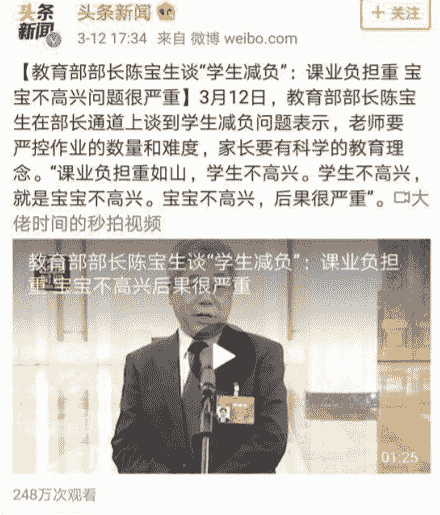

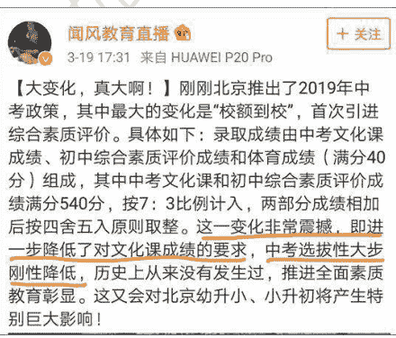

## 【复旦17级沪浙生源大物挂科率近30%，高考改革惹的祸？】

最近，复旦大学的一则新闻引起了小编的注意。根据复旦高等教育研究院的调查数据，2017年复旦大学在第一次统考“大学物理”时，浙江、上海生源的大一新生整体不及格率达到了30%以上，这一数据远远高于往年。很多学生的物理水平仅仅是初中水平，和其它省份考生物理认知水平存在极大的差距。而造成这一切的根源在于2014年浙江和上海实施的新高考改革，物理由原来的必修改为了选修，而去年闹得沸沸扬扬的浙江省“物理弃考”事件相信大家还有印象，全浙江30万考生，最终选择物理的考生仅仅有1.2万人。这一现象也引起了很多人的注意，很多的高中物理老师甚至都痛哭，呼吁大家重视物理。

浙江的新高考为7选3，这7门课程包括物理、化学、生物、政治、历史、地理和通用技术，每门课程不再按卷面进行评分，而是按名次进行赋分。而如此的改革造成的结果就是选择物理的学生越来越少，为什么呢？首先，对于优等生来说，他们为了……

以上图片来自微博截图

## 3. 治理校外培训 四部委联动动真格

治理校外培训，是场持久战。

从年初就开始三令五申，到了年尾，教育部交出了一张初步成绩单——全国共摸排校外培训机构401050所，存在问题机构272842所，现已完成整改211225所，完成整改率77.42%。

今年2月，教育部办公厅等四部门联合发布《关于切实减轻中小学生课外负担开展校外培训机构专项治理行动的通知》，强调要坚决纠正校外培训机构开展学科类培训出现的“超纲教学”“提前教学”“强化应试”等不良行为。8月，国务院办公厅发布了《关于规范校外培训机构发展的……

## 4. 清理规范竞赛活动 斩断竞赛利益链条

一大批面向基础教育阶段的全国性竞赛在2018年暂时停摆。

2018年2月，教育部发出公告，对规范竞赛管理提出了“明确管理权限、重新登记核准、严格组织实施、强化日常监管、约束结果使用、推动社会共治”等举措，查处了一些违规举办的竞赛活动。

9月，教育部办公厅又印发了面向中小学生的全国性竞赛活动管理办法，继续强调原则上不举办面向义务教育阶段的全国性竞赛活动。教育部基础教育司司长吕玉刚指出，竞赛数量要严格控制，清单之外的竞赛一律不得组织举行；要坚持公益性，

## 2018年人教A版高中数学教材变化（必修）

| 主题 | 单元 | 原置模块 | 内容 | 建议课时 |
| :--- | :--- | :--- | :--- | :--- |
| 主题一 预备知识 | 集合 | 必修 1 | 无变化 | 18 |
| | 常用逻辑用语 | 选修 2-1 | 删去： 1.1 命题及其关系 1.2 简单的逻辑联结词 | |
| | 相等关系与不等关系 | 必修 5 | 无变化 | |
| | 从函数观点看一元二次方程 和一元二次不等式 | 必修 5 | 删除 3.3 二元一次不等式（组）与简单的线性规划 | |
| 主题二 函数 | 函数概念与性质 | 必修 1 | 删除：映射 | 52 |
| | 幂函数、指数函数、对数函数 | 必修 1 | 无变化 | |
| | 三角函数 | 必修 4 | 无变化 | |
| | 函数应用 | 必修 1 | 无变化 | |
| 主题三 几何与代数 | 平面向量及其应用 | 必修 4 | 无变化 | 42 |
| | 复数 | 选修 2-2 | 无变化 | |
| | 立体几何初步 | 必修 2 | 删除：三视图、平行投影与中心投影 | |
| 主题四 概率与统计 | 概率 | 必修 3 | 删去：3.3 几何概型 | 20 |
| | 统计 | 必修 3 | 删除：2.1.2 系统抽样 | |

以上两图来自“学习强国”APP，科技日报《这一年，教育改革开启新征程》

上图为网友根据2018年人教高中新版教材整理，来自“百度文库”。

很多人觉得，外国的孩子很幸福，早早就放学，每天就是玩儿。

我不知道这种谣言从何而来，更不知道为何要传这种谣言。

外国是有一些小孩每天不用怎么学习，这没说错。

可是，你了解过那些不用学习的孩子是什么阶层，他们长大以后的命运是怎样的吗？

以美国为例：美国的中小学教育大体上分为两类，一类是兜底式的普通公立学校，一类是精英式的公立学校或私校。

在美国，要进一个好学校，也非常难。要么，你得要住到好的学区，进优质公立学校；要么，你得交高昂的学费，进贵族私校。

公众号 懒人找资源

而所谓好的学区，就是房子更贵、房产税更高的地方（因为地方教育费用主要来自当地税收，居民越富，收到的税收越高，教育水平也就越高）。不管是租房还是买房，你得能进入优质学区生活，给当地税收做出贡献，才能进去。

普通公立学校，主要是中下阶层的孩子去读，基本上是放羊式教育，下午3点，孩子们就一哄而散，该回家看电视的看电视，该上街玩的上街玩。

这些学校教出来的孩子，长大以后，大多是做收银员、服务员等低收入工作，或者从事建筑、开货车、修水管、割草等苦力活，运气好一点或有点见识的，还能到中国来当个外教（有不少中国外教，是在国外混得很差的屌丝）。

优质公立学校和私校，课外有的是各种各样的辅导班和学校社团，孩子们拼了命地学各种文化、体育、艺术类的课程，就为了以后能上个常春藤学校。这些孩子，学业负担比中国的孩子还要重。像纽约史岱文森、英国伊顿公学这种学校的学生，恐怕比我们衡水和毛坦厂的孩子要更加拼命。

稍微有钱一点的家长，还要想方设法让孩子去非洲送温暖，去北极测量冰盖，去南极保护企鹅。因为大学除了看SAT（类似于高考）成绩以外，还要看社会活动，而这些活动，往往只有有钱人的孩子才能玩出花来。

还有一类特别有钱的家长，通过给高校大笔捐款，直接给孩子买上藤校的名额。

就这样，美国社会分为两个基本上隔绝的阶层：平民阶层和精英阶层。

平民阶层的家庭，信奉的是“及时行乐”和“知足常乐”。他们中很多小孩都是非婚生子，母亲十几岁就生下他，也不知道父亲是谁。他们学历低下、没什么文化水平。当个收银员，绝大部分连20以内的加减法都算不清楚。他们，和他们的孩子，基本上没有在社会上上升的可能性。对他们而言，所谓“美国梦”早已是镜花水月，可望而不可及。（美国2017年的电影《佛罗里达乐园》，就反映了美国底层人民的生活状况，感兴趣的可找来看一看。）

而精英阶层的家庭信奉的是“吃得苦中苦，方为人上人”，他们是奋斗终结硕果的“美国梦”践行者，《富兰克林自传》、《老人与海》、《野性的呼唤》这样崇尚奋斗的书籍，才是他们的心灵鸡汤。

不知道为什么，我们的媒体和文人平时宣传的、我们的有关部门学习的，都是第一类孩子的培养方式。他们不知是有意还是无意，从来不告诉我们另一个美国——更加努力上进的那个美国。

何加盐公众号的主题，不是社会评论，而是人生成长。所以今天，我不准备分析这些政策出台的原因及其影响，而是想说一说，在这样一个“让姚明蹲下”的政策环境下，我们个人和家庭应该怎么办？

首先，请扪心自问：咱们有减负的资格吗？

高官、富人的孩子可以减负。就算是孩子学习不好，父辈的人脉积累和财富积蓄，已经可以保障他们过好一生。

平民家庭的孩子呢？

没有资产、没有人脉的积累，我们拿什么和人竞争？

我们唯一能凭借的，不就是我们的努力吗？

人家说让你减负，你就减负；说让你快乐学习，你就快乐学习，

你是不是傻？

你可知道，当你在减负的时候，别人家的孩子，正在拼命学习！

学英语、学奥数、学编程、学高尔夫、学马术、学理财、学量子力学

（扎克伯格的孩子3岁就在看“儿童版量子力学”）！

当你的孩子三点钟放学回家玩泥巴、看电视、打电游，富人的孩子在上各种辅导班！

他们在维也纳金色大厅听音乐、在大不列颠博物馆学历史、在卢浮宫学艺术、请奥运冠军教体育、请驻家的老师陪练法语、他们组建模拟联合国练习世界治理！

请告诉我，你“放羊式”养大的孩子，以后在社会上，怎么和那些人竞争？

寒门子弟，没有减负的资格！

我们只有加倍的努力，才能打破阶层的魔咒，为自己和后代打开一片生天！

其次，当别人在减负的时候，岂非就是我们的机会？

这个世界，是激烈竞争的世界。

我们都听说过这样的说法：狮子每天奔跑，是为了比羚羊跑得快。

大家有没有想过，比羚羊跑得快的狮子，就能吃到羚羊吗？

并不能！你只有比其他狮子跑得更快，才能吃到羚羊。

世界上，好的东西，永远是稀缺的。

好的房子、好的工作、好的学校、好的医院、好的对象、好的车子、好的包包……这些东西，只属于奋斗者。不是上一辈奋斗，就是这一辈奋斗。哪怕是红二代、富二代、官二代，他们今天享受的，也是他们的父辈上战场、商场或官场拼搏奋斗而来的结果。

而现在，有很多人愿意响应减负，愿意给自己的孩子快乐教育。这就好比，一群狮子，天天不练习奔跑了，把羚羊都让给了我们。我们是不是要感谢他们，为的是他们自愿放弃了奋斗，让出了成功的路？

当别人在减负的时候，我们更应该加倍努力！因为这个时候，你的每一份努力，将得到更高的回报。

所以，让我们继续拼搏奋斗，让别人减他们的负去吧。

学习一定是不轻松的。轻松一定学不好东西。你现在为孩子省下的苦，会在未来工作和生活中，加倍地还给他。

我们可以让孩子凭兴趣选择学科，但是，学习过程的痛苦，需要他们去承担。而其他的条件，需要我们去帮他们创造。

每一个孩子，都可以长高，只要你给他帮助，给他机会。

请不要让你的孩子蹲下，请让他长高，哪怕这个过程很艰难。

孩子，请肆意生长。

# 5G的风口在哪？

电脑+互联网改变了传统商业，智能手机+移动互联网改变了传统互联网商业。

我们可以粗略地归类1G（语音通话）和2G（文字+图片+手机简单上网）为同一时代；3G（拥有了大部分上网功能）和4G（大容量快速传播信息，基本无障碍得上网）为同一时代。

那么，5G是还处于和3G、4G的同时代，还是将开创一个全新的时代呢？我认为，5G将开创一个全新的时代。

与4G相比，5G的改变是速度更快、容量更大、延时更少。

这意味着，很多4G时代还没法大规模应用的设备和技术，到5G时代都已经不成问题了。

对5G时代的预测，关键是看有什么关键设备和在哪些使用场景。

4G的设备是智能手机，使用场景是打车、移动支付、外卖、看短视频、移动社交等。

5G的设备，首先智能手机还将是一个重点；其次可能有：智能穿戴设备，如谷歌眼镜、全息投影戒指或手表，AR（增强现实技术）和VR（虚拟现实技术），自动驾驶汽车，人工智能。使用场景：从出行上，未来无人驾驶和智能交通肯定将渐成主流。刚开始可能会在封闭固定路段推广，慢慢扩展开来。这个在技术上已经没有问题，关键的障碍有三个：安全性、稳定性和利益格局。

从娱乐上，沉浸式体验将成主流。包括游戏、电影、演唱会、旅游等，都可能被全面改造。关键要解决的是设备的小型化和价格的亲民化。

从通信和社交上，全息视频交流将渐渐开始在某些场合流行，如远程会议、远程商务、远程家庭团聚、远程恋爱等。关键要解决的是全息投影技术。

另外还有三个巨大的变化：

- 一是万物无须下载，一切都在云端。内存和硬盘已经不再重要甚至不再需要。这个最重要的障碍是隐私，以及流量费要降下来。
- 二是万物皆触摸屏，随时可上网，这个在科幻电影里已经讲得非常多 了，《三体》里面也写到。
- 三是万物皆有芯片，一切都可互联。也就是传说的“万物互联”时代。

这里只是说到消费端。在工业领域的改变也会很大。我还没有去研究。暂时有一些思维片段。我会扩展为一篇长文。

5G时代到底会发生什么？我们的工作生活会有哪些变化？存在哪些机会？也想听听大家的意见。

# 董明珠的“钝感力”

最近在研究董明珠，感触特别深的一点，是她的“钝感力”。

通常，我们在与别人交往时会顾及别人的感受。如果我们要做一些让对方有不好感受的事情，我们自己也会感觉很尴尬，或者很为难。

所以，我们常常会很小心地为人处世，尽量不让别人不舒服。

但是也有一些人，他们对由自己造成的别人的不舒服，是没有感觉的，也不在乎的。

我把前一种称为敏感型，后一种称为钝感型。

我自己就是敏感型。我在说话办事时，会很注意体会和照顾对方的感受，尽量让别人舒服，避免一切冲突。

所以我开公司，要去批评员工时，我是会非常难受的，一般情况下我都不会去批评。要开除一个人，更是困难，几乎说不出口，好不容易开除完以后，自己还要难受很久。

但是董明珠就完全不一样，她是看谁不爽，就随时可以发火，要开除谁、或者让谁降职，都不会有任何心理负担。

在采访中，董明珠向鲁豫讲了她开除人和撤换经销商的事情，鲁豫问，做这些事的时候，你会不会有压力，会不会不开心？

董明珠说，没有啊，我完全没有压力，也没有不开心。相反，我很开心啊，不开心的是他。

看到这里，说实话我是有点受到震撼的。

我知道他们在管理上是毫不手软的。但我原以为，是因为她坚强，

能克服心理的不适。没想到真实的原因是，她根本就不会感到不适。

作为一个企业家和管理者，钝感力是非常重要的。因为你经常要处理很多矛盾，经常要得罪人。同理心太强烈，心理感受太过敏感的人，会做得很痛苦。企业家必须修炼得能铁石心肠，才能够做下去。

马云是个很敏感的人，他也从来不喜欢得罪人，所以他最初的团队，都是非常稳定的。但是2000年阿里巴巴出了大问题，马云不得不裁掉很多人，这对他而言是非常痛苦的，但是不这样做，阿里就死了。

好在，马云找来了关明生帮忙。是关明生大刀阔斧地搞定了裁员。我猜，关明生应该是一个钝感力很强的人，不然做不了这事。马云虽然是下决心的人，但是毕竟可以“君子远庖厨”。

美国有一个职业，就是专为各个公司去裁员。因为美国的裁员是非常严重的事情，失业的打击对员工非常大，老板和管理层也往往不敢去面对，所以需要找别人来做这件残忍的事情，因此就有了一批专做这种事的。有一个电影叫《在云端》，就是讲了这么一个裁员专家的事情。可想而知，这种人必须得非常钝感才行。

可以说，钝感力是企业管理必备的一种能力。但是，这样并不代表敏感的人做不了企业管理。有很多其他方面，又是需要敏感力的，例如产品经理。同时，心理的感受是可以抑制的，敏感的人不是做不了狠心的事，只是自己会痛苦一点。

比较好的办法，是敏感的人和钝感的人合作，那些需要钝感力的事情，由搭档去做就好了。

## 骂人的傅盛，踢人的张颖

前几天，创投圈出了一个瓜。

事情是这样的，有一家著名的风险投资叫经纬，由于他们投资的公司挺多，很多也比较成功，形成了一个“经纬系”。这些经纬系公司有很多群，其中一个是CEO群，都是经纬所投资公司的CEO们，以及一些关系较为密切的其他人员。

李医生事件后，这个群里有人说了自己的观点，另一个人表示赞同。而猎豹移动的CEO傅盛看了观点，勃然大怒，骂道“楼上两个sb可以去死”、“你们两个sb，我退了，你们好好开心”。

群里几个人都附和傅盛，包括超级经纪人杨天真、易到用车创始人周航等。周航还直接开骂，说“耻与人渣为伍”，也要一起退群，并专门艾特经纬的合伙人张颖，说“你tm装个态”。

而张颖的反应是，让人把傅盛踢出所有的创投汇群，说他“太不成熟”了。

这起闹剧，引起了舆论的热议，在微博、朋友圈和微信群广泛传播。后来，张颖和傅盛又不得不当众表演重归于好。傅盛公开道歉说不该骂人，张颖把他重新拉回群。

这些人都是功成名就，早就实现了财富自由的，我们可以看到，他们在群里，其实也和大多数普通人一样，会吵架，会骂街，会退群，会踢人。而傅盛和张颖，由于是事件的核心当事人，也引起了最多的讨论。

其实很多人不知道，傅盛和张颖的关系非常之深。

傅盛1978年出生，江西景德镇人，山东工商大学毕业，学校虽然不怎么怎么样，但他比较努力，计算机学得比较好。

毕业后，在一些不知名小公司混过几年，没什么长进，2003年进入了周鸿祎的3721，后来又跟着周鸿祎到了雅虎中国，周鸿祎和雅虎闹掰，自己搞了奇虎公司后，傅盛也跟到了奇虎。

奇虎本来是做搜索的，但是也有一些边缘业务。傅盛就是负责其中一个边缘业务——网络安全。

傅盛带领一个很小的团队，开发出的一款产品，命名为360安全卫士。

奇虎公司搞了几年后，浏览器没搞起来，360安全卫士反而越搞越大，最后成了奇虎的主业，奇虎也摇身一变，成为了一家网络安全公司。

从这一点上，傅盛在奇虎功高盖世。

不过，后来他却又和周鸿祎闹掰，2008年反出了360，这件事在当时闹得沸沸扬扬，双方都猛烈爆料，势同水火。

那是傅盛人生中最黑暗的时光。

这时，有一个人找到了傅盛，邀请他加入一家新成立的公司，担任投资副总裁。这个人就是张颖。那一年，他刚刚成立经纬，在网上看到傅盛的故事，就找到他的联系方式，请他过去聊聊，给了“EIR”（入驻企业家）的offer。

傅盛同意了。

在经纬，他俩合作很愉快。傅盛是互联网老兵，也是很厉害的产品经理，对行业理解很深。在傅盛的帮助下，经纬的互联网投资做得非常好。

不过，11个月后，傅盛就在雷军的邀请下加入了金山，担任金山网络的CEO。后来金山网络改名为猎豹移动，在美国上市，市值最高时接近50亿美元。

再来说说张颖。

张颖1973年出生于上海。其父是新疆建设兵团的军医，母亲清华毕业，在泰安制药厂工作。

他先跟着妈妈在泰安住了几年，后来全家在安徽马鞍山团聚，爸爸继续当军医，妈妈当老师。

1986年，他们全家移民美国。张颖子承父业，学了临床医学。

在美国，当医生有着无比光明的前途。可是张颖毕业后却没有当医生，而是加入了所罗门兄弟公司（美国著名投行），后来又跳槽到荷兰银行。

不过后来荷兰银行投资团队解散，张颖失业，又加入了一个台湾人开的公司，美商中经合，并被派回中国开拓业务。

2008年，张颖在中国成立了经纬中国，后来，这家公司成为中国最有名的风险投资公司之一。他投的企业包括：滴滴、陌陌、猎豹、链家、饿了么、瓜子、猎聘、VIPKID等等。

因为投资业绩惊人，张颖也成为中国最有影响力的投资人之一。

所以，这一次的炸群事件，两位当事人虽然不算中国最顶级的大佬，但也是一方大员。

不过，傅盛这两年过得不怎么好。猎豹移动的市值不断下滑，从高峰时接近50亿美元，下降到只有4亿美元。

傅盛这个人原本极度自卑，但是360安全卫士成功，以及猎豹上市后，他又产生了180度变化，觉得自己无比牛逼，喜欢到处吹。

2019年初，傅盛的公众号发了一篇文章，标题竟然叫做“傅盛持续创新的十大金句”。

曾经写出《腾讯没有梦想》的公众号作者潘乱，在朋友圈评价道：“公司都他妈做没了，还整天不忘装逼作秀”。在他的朋友圈下面，有人这样评论：“还有人说北傅盛，南小龙，把他和张小龙并列呢”，又有人评论道：“想起乔峰的话，我大好男儿，竟然……”

乔峰和慕容复是金庸小说《天龙八部》里面的人物，当时并称“北乔峰，南慕容”，而乔峰见到慕容复是一个猥琐小人，功夫还不咋地，发出那句“我萧某大好男儿，竟和你这种人齐名”的感叹。

这句点评，对傅盛的挖苦讽刺，可想而知。

傅盛恼羞成怒，在朋友圈大骂潘乱是sb。

所以，对傅盛来说，公开破口大骂，已经不是第一次了。

而对张颖来说，他的性格脾气，其实和傅盛是一样的，就是一个非常意气用事的人，他欣赏的是快意恩仇。

不过，也许是年纪渐长，也许是有什么事情刺激，从2014年以来，张颖也慢慢的变得圆滑世故了。

这一次的群聊事件，要是搁以前，估计他也是傅盛这样的暴脾气。

而这次却说，傅盛太不成熟了。

可能，当一个人要承担的东西越多，他就不得不变得更成熟吧。

傅盛曾经做出了360安全卫士，充分证明了他是一个非常优秀的产品经理。他把猎豹移动带上市，也证明他是一个合格的职业经理人。但是猎豹移动现在跌到4亿美元，而且颓势依旧，搞不好还将继续下降到一两个亿，比起以前而言，潘乱说公司都做没了，并不算为过。

比起普通人来说，傅盛算是一个牛人，但是比起他的名气和他自夸的来说，他差得太远了。

## 选择奋斗远比你想象的简单

那天去广州大学演讲，题目是《中国未来与年轻人的自我实现》。我分享了下面5条经验，希望帮助他们从现在开始改变。

### 1. 定个小目标

不用想着先挣它一个亿。你不是王健林。刚开始目标一定要小，要容易实现。

比如，我定了一个目标，每天要做30个俯卧撑，连续做30天。30个俯卧撑很容易做到，所以我很容易就开始。现在已经坚持21天。按照流行理论，21天形成一个习惯。

你的目标可以是：每天跑步2圈（或10分钟），如果没有场地，可以改为在家跳绳或做广播体操；每天记5个单词；每天写100字日记；等等。

完成了小目标再慢慢地实现中目标，最后实现大目标。不要一开始就把自己吓跑。

### 2. 想到就做

定了小目标就马上去实现，不要等到明天。随时随地，想到了就要先把目标完成。

我在广州大学演讲时，在讲台上想起当天的30个俯卧撑没做，就在讲台上吭哧吭哧做起来。

我希望把“想到就做”这个观念传递给学生。改变就是这么容易。

如果你此刻想到了要做什么，应该关掉手机，别管这篇文章了，先把手头的事做了。

### 3. 用外力帮助自我控制

不要高估自己的自制力。

人天生就爱偷懒，就爱放纵。应该借用外力来帮助自己自制。

我就不信我能持续30天做俯卧撑，所以就用了一个APP（为免广告嫌疑，略去名字）。

我在里面定下目标，押了188块钱，并邀请一堆人围观。如果30天后任务完成，押金退还；如果完不成，围观者就分走我的钱。看过前一篇文章的都知道我多穷。为了保住这188块钱，我只好每天都做30个俯卧撑。

如果你觉得自制力比较差，可以押1888——别忘了邀请我去围观。

### 4. 持续积累

不要小看每天一点点的进步。

一个单细胞动物，可能几百年才进步一点点，但无数个日子积累下来，它进化成了高度复杂的人。

如果你每天只进步0.1%，一年就能进步44%，两年就能进步107%。时间的积累会放大你的努力效应。

我刚开始弹吉他时觉得太难了，我这辈子都不可能学会一首曲子。但我每天进步一点点，现在就可以弹唱《成都》了。

你也可以。

不要怕事情难，只要你每天都在进步，时间会带你达到目标。

### 5. 不忘初心

如果你现在看了这篇文章后，想要做出改变了，记住，这是你人生重要时刻。

你一定要问自己，我为什么要改变？这一刻的冲动，就是你认识自己的最好时机！

把答案写下来，记在心里。

当你想放弃的时候，拿出来看看，让它来激励你。或者，收藏我这篇文章，时不时重看一下。

永远记住你是为什么而改变，为什么而奋斗。

就只有这5条而已，很好做。

广州大学演讲完后，有学生加微信告诉我，她已经开始行动了。

我知道，她的人生已经改变，她的未来会截然不同。

我能够激励到她，推动她做出改变，这让我非常开心。同时也想把这种激励传递到更多正处于迷茫和痛苦中的人。

如果你今天看了这篇文章开始行动，你的人生，就从此刻开始改变！

## 只有这样不屈的灵魂，才有资格说“感谢贫穷”

### 1. 只要站起比跌倒多一次，我们就没有辜负韶光

刚刚以707分考入北大的河北女孩王心仪一篇《感谢贫穷》的文章看哭了无数人。90后、00后的孩子，很少有类似经历了。但是对70后和80后而言，文章说的就是我们大部分人的小时候。

王心仪出身于极度贫寒之中。所幸的是，她没有被贫寒压垮，而是始终不屈地与命运作斗争，从贫寒中汲取前行的动力。王心仪从来没有抱怨贫寒，没有抱怨父母，她只是默默做她该做的：保持努力，保持希望，等待美好的事物在转角处出现。她等到了707分的高考成绩和北京大学中文系录取通知书，她等到了亿万人的情感共鸣。

在4个月前的枣强一中高考誓师会上，王心仪代表千千万万贫穷学子大声地喊出：“只要站起比跌倒多一次，我们便没有辜负这段青春、这段韶光！”从这句命运的宣言，我们便能知道，为什么一个贫穷女孩，能在寒门再难出贵子的今天，杀出重围，改变命运。

也只有这样不屈的灵魂，才有资格说：感谢贫寒！

### 2. 霍英东从极度贫寒到极度荣耀

现在的年轻人可能很少知道霍英东先生了。但在我们成长的年代，霍英东可谓家喻户晓。他的孙子霍启刚与跳水女王郭晶晶的婚事，当年也是现象级的大新闻。霍英东是给内地捐款最多的香港富豪之一，总额超过20亿港元，各地的英东楼、英东体育馆等，都是他所捐建。2006年去世时，他留下家产670亿港元。霍英东的一生，起源于香港的一条小小渔船。

岭南地区古有疍家行业。就是最穷的人，贫无立锥之地，只有一条小破船，全家以船为生，漂泊于水上。历朝历代，疍家都是备受歧视的所谓“贱民”。霍英东就出生于香港的一户疍家。

霍英东的家庭贫困到什么程度，是今天的人难以想象的。6岁之前，霍英东连鞋子都没有穿过。7岁，父亲患病身亡，一场台风灾难又夺去了两个哥哥的生命。苦命的母亲带着幸存的三个孩子弃舟登岸，住进了香港的贫民窟——一个挤满50多人的20平米小房子。在这里，他们住了6年。

但是，在绝境中，霍英东一家都没有放弃努力和希望。霍母是一个文盲，但是以绝高的眼光和绝大的决心，咬紧牙关送霍英东上学。先是上免费的帆船同业义学和敦元小学，初中后凭借开杂货店的微薄收入把霍英东送上收费高昂的皇仁书院。霍英东也不负母亲所望，学习十分刻苦，总是不甘人后，偶有成绩落到第三名以下，自己便觉得无脸回家面对母亲。

日本鬼子的炮火打到了香港，霍英东的学业被迫中止。沦陷期间，他做过苦力，学过司机，在糖厂化验室经历过爆炸事故，最后无路可走，只好回家帮妈妈打理杂货店。战后，霍英东卖掉杂货店，重操父辈旧业，差点命丧东沙岛。但是，不管碰到什么艰难困苦，霍英东从未退缩，总是利用一切机会学习一切有用的知识，并且在机会来临时善于抓住机会。从船运业，到房地产业，到建筑业，渐渐做成了一个庞大无比的商业帝国。

霍英东一生爱国，为国家做出了巨大贡献。去世时，身覆国旗，以“国葬”礼遇告别人世。去世前，他曾总结自己的人生，称“回首往事，我仰不愧于天，俯不怍于人”。如果人生的满分是100分，他要给自己打100多分。霍英东的一生，生于极度贫寒，死于极度荣耀。他的奋斗经历告诉我们每一个出身贫寒的人，什么叫不辜负韶光。

### 3. 身处逆境该如何选择

生活总是充满艰辛，人生何曾一帆风顺。出生在平凡的家庭，我们天生要经历更多磨难。家庭出身的贫富不是我们可以选择的，人生的顺逆也不由我们决定。但是，如何面对贫穷、如何面对逆境，我们可以选择。

不管你是是在校求学的少年，还是刚刚毕业走上社会的青年，还是肩负家庭重担的中年。摆脱逆境，只能依靠三样法宝：动力、方向和技巧。

- **动力**
有些人会抱怨没有出生在一个好的家庭，抱怨父母不能提供优越的生活条件或资源。这样的人永远不会获得成功。因为他只有抱怨，没有感恩，更没有凭自己双手打出一片天地的志气和责任心。

更多的人选择不屈服。面对父母的平凡，他们不会因无法从父母那里索取什么去抱怨，而是为希望尽快能给予父母什么去奋发。

如果贫穷给不了你奋发的动力，只给你沉沦的理由，那你这一辈子都无法摆脱贫困。你只能和它为伍，你的后代还将重复你的可怜历史，继续与贫穷为伍。生而贫困不是我们的责任，但限于贫困是我们的耻辱。出身贫困不可怕，可怕的是把你失败的理由推卸给贫困，推卸给父母，而不是自己的不努力。

所以，要保持对美好生活的向往，保持对优越条件的羡慕，而不是无视之，甚至用酸葡萄心理说风凉话。正视自己的不足，弥补它，改变它，用自己不屈的努力去战胜逆境，去超越那些自己曾经羡慕的目标。

- **方向**
作为学生，你的方向就是努力学习。高中以下就是跟着老师学，一切为高考服务。别听人瞎扯什么快乐教育，素质教育，那些跟贫困者无关。生而平凡，你最好的出路就是高考，高考走不通了才应该考虑其他。在其他所有领域，你都无法跟富有的孩子公平竞争，只有高考是公平的。如果连在这一点上，你都不去努力，那你在别的地方更别想超过别人。

高考选专业，别选那些文学、艺术、哲学之类的专业，除非你是天才。富人的孩子可以从诗词歌赋谈到人生哲学，你不行。你还得赚钱养家糊口。所以要选社会最需要的专业。STEM（科学、技术、工程、数学）、计算机等等。等你自己在社会站稳脚跟了，你的孩子才有凭兴趣选专业的自由。

上了大学的，把本专业学好，GPA弄得尽可能漂亮。还要多参加社团活动和公司实习。另外，英语要学好，不然以后工作中可能错失很多机会和信息。如果还有余力，可以学学编程，例如Python。

就业，选择趋势性的行业，如移动互联网、新能源、智能制造、文化品牌等等，或者能极大地锻炼自己能力的行业，如证券、投资、咨询等。如果都进不了，那就苦练内功，做好本行，在本行内做到拔尖。同时利用业余时间学习英语、编程、投资、管理方面的知识。

- **技巧**
最好的技巧就是立刻去做。想得再多，不去做，都等于零。要相信功不唐捐，你今天的勤奋努力，在将来都是有结果的。其次就是持续努力，不要三天打鱼两天晒网。每天只进步0.1%，一年就能进步44%，两年就能进步107%。关键在坚持。如果目标太远、太大，可以分成小目标，一个一个去实现。例如背完一本6000个单词的英语书，看起来很难，其实每天三十个，半年多的时间就背完了。

另外就是要培养自己的情商和社会交往技巧。不可否认，穷孩子在这点上和富人孩子比差得很远，因为从小缺乏自信，缺少资源。那我们就要去弥补。在有实力的基础上，还要主动拓宽人脉网络。穷二代没有厉害的强关系，只能靠弱关系。具体怎么开拓和利用弱关系，可参考何加盐公众号的《拼多多上市，80后创始人用28个月身家800亿，凭的就是这三个字》一文。

### 4. 面对逆境选择奋斗

贫穷，或者其他逆境，会给我们磨难。但是面对和战胜它的过程，会让我们更加强大。面对贫穷，面对困难，面对挫折，我们选择不屈，选择感恩，选择奋斗；我们激发动力，找到方向，苦练技巧。如王心仪所说：只要站起比跌倒多一次，我们便没有辜负这段青春、这段韶光！

也只有这样，我们才能不被贫穷压垮。才能有一天站在更高的位置，真诚地、骄傲地说：“感谢贫穷”！

## 一个朋友体制内出来一年半，赚了几百万

前天和一位朋友吃饭，很是感慨。

朋友和我同龄，曾经在体制内某油水很足的部门工作。

原来是在业务部门，后来被领导看重，调入办公室，负责纪检监察工作。他那个岗位很有分量，其他部门的人都非常巴结。只要手稍微松一点，敛财是非常容易的。但是朋友非常谨慎，所以也就是拿个工资。

朋友的交际能力很强。有一次，认识了香港某金融企业的高管。该老板看中他的能力，就挖他过去。

这时，朋友的单位已经在准备分房了。如果下海的话，就会直接损失掉一套一线城市中心地段的房子。

而香港那边，那家企业提出了一个非常诱人但是也压力巨大的对赌条款。如果他去的话，需要在三年内完成XX千万的业务，只要达到指标，就能得到XX百万的奖金（为了避免泄露商业秘密，具体数字我隐去了）。

这个指标数字很吓人，但是奖金数字也很诱人。朋友最终还是决定放弃体制，跳入商海。

一开始种种不适应，要从一个原来人员巴结的体制内核心岗位角色，转换为一个要到处讨好客户拉业务的经理，不是容易的事。

但更难的是业务压力。他做的都是几百万上千万的单子，要谈下一单，都是非常困难的，往往几个月都没有进展。半年时间，头发都白了很多。

不过，他熬下来了。他的为人得到几个大客户的信任，慢慢地终于开了张。

其中一个上海客户的单子最有戏剧性。中间很长时间，对方都没有音讯，有一天却突然飞到香港，打电话给朋友说，我来签合同的。

朋友问，怎么这么突然，要不要再多了解一下？客户说，不用，我决定了给你做，就一定会给你，那些细枝末节的不用看了，相信你。

就这样，仅仅用了一年半的时间，朋友就完成了对赌指标，拿到了奖金。其中，上海客户一个人就贡献了超过一半的业务额。

我的感想是：如果有能力，有抱负，但是在体制内却无法实现的，还是跳出来比较好。我所见的从体制内出来的朋友，都比在里面时要混得更好。朋友不是有那个胆子，也不可能一年半就赚到大几百万。

但是，也必须看到，体制外的压力确实是非常大。如果朋友三年完成不了指标，他的奖金就没有了，只能拿个基本工资。可想而知压力有多大。而且，由于现在局势动荡，香港金融业务的未来也不明朗，他们的生意也受到很大的冲击。如果不是早早完成了任务，把时间放在现在的话，那就会加倍艰难了。

## 令你怀疑人生的三个科学知识 ｜ 其一：陶哲轩的自杀村庄

我们为什么要多阅读呢？除了获得新的知识，让自己得到成长以外，还有一个关键的原因，是这些知识本身就很有趣。

有一些知识，会让你感到震撼，甚至足以怀疑世界和人生。而提出这些知识的牛人，让人佩服得五体投地。

接下来的日子，我准备和大家分享曾经深深震撼过我的三个科学知识：陶哲轩的自杀村庄；电子双缝干涉实验与观察者魔咒；量子纠缠。

今天先分享第一个，陶哲轩的自杀村庄。

陶哲轩是华人，父母出生于中国，都毕业于香港大学，并于 1972 年由香港移居澳洲，1975 年生下陶哲轩。

陶哲轩是所有公认的神童。两岁就会做数学题，三岁半就上小学（后由于自理能力不行而退学，5 岁重上小学二年级），七岁就会微积分，八岁上中学，十二岁获得国际数学奥林匹克比赛冠军，十七岁赴美读博，二十四岁成为 UCLA 正教授，三十一岁获得菲尔兹奖（数学界的诺贝尔奖）。

看到上面这亮瞎眼的简历，我们就知道陶哲轩有多牛逼。

自杀村庄，是陶哲轩在他的个人博客上分享的一个思维实验。看完我们只能感叹，世界真奇妙，这还是人吗？

自杀村庄的故事是这样的（为方便大家理解，部分细节略有改动）：

海上有一座孤岛，上面有一个村庄，住着 1000 个人，其中 900 个是蓝眼睛，100 个是黑眼睛（这个数据的确切分布村民不知道，但他们每个人都可以观察到其他人，而且其中没有色盲）。岛民们有如下特征：1，逻辑推理能力都很强；2，坚决遵循岛上的习俗；3，大家都知道其他人推理能力很强而且信仰坚决。

而岛上有一个奇怪的习俗，就是任何人都不允许知道自己眼睛的颜色，不然就必须在第二天中午自杀。

由于岛民的信仰是如此坚决，所以他不照镜子、不去井边，以免看到了自己的眼睛。当然，岛民们也很善良，也不会告诉别人眼睛是什么颜色——那样会引起别人自杀。

所有人都能看见别人的眼睛是什么颜色，唯独不知道自己的。就这样平安无事地过了很多年。

某一天，来了一位黑眼睛的岛外人。像桃花源记描写的一样，由于这里未来过外人，所以“村中闻有此人，咸来问讯”，1000 个人都和岛外人见了面。岛外人高兴地说：好开心啊，居然在岛上看到了和我眼睛一样颜色的人。后来，故事就变成了事故。所有人都自杀了。因为他们都知道了自己眼睛的颜色。这真是一个悲伤的故事。好在是编的。

按理说，岛外人没有提供任何新的信息。因为所有人一见他，就立马知道，岛上有和他眼睛同样颜色的人。

他说出来的，只不过是一件人人都知道的事。可是，为什么全村庄的人都自杀了呢？你能想明白其中的缘由吗？

请大家思考一下，明天我再揭晓答案。

### 陶哲轩的自杀村庄-答案

昨天写了陶哲轩的自杀村庄故事，但是给大家留了悬念，没有公布答案。

在牛人星球微信群里，大家讨论得非常热烈。旭琨、哞小七两位朋友已经给出了答案，Issing 和叶梅霞的推论，也已经非常接近了。

这个问题可以用归纳法和穷举法来解答。归纳法比较复杂一点，咱们用穷举法吧。

- 假如岛上只有一个黑眼睛的人甲，那么，当黑眼睛的游客说出“岛上有和我眼睛一样颜色的人”那句话的同时，甲就立刻明白，自己的眼睛是黑色。因为他已经见过所有其他 999 人的眼睛都不是黑色，那么和游客相同的只能是自己。于是，第二天中午，甲就会自杀。

在甲自杀的那一刻，其他 999 人也立刻明白，他之所以自杀，是因为看到 999 双蓝眼睛。于是蓝眼睛的人也都知道了自己眼睛的颜色。所以第三天中午，其他 999 人也会自杀。

- 假如岛上有两个黑眼睛的人甲和乙，那么，当游客说出那句话时，甲就会看乙第二天是否自杀。

甲是这样推理的：如果我的眼睛是蓝色的，那么乙就可以看到 999 个人是蓝色眼睛，和游客一样的只能是乙自己，所以第二天乙就会自杀。如果乙没有自杀，就说明乙看到的 999 人里面，至少有一双黑眼睛；而我能看到其他 998 人都是蓝眼睛，黑眼睛的就只能是我自己了。

乙的心理活动和甲是完全一样的。他也会看甲第二天中午是否自杀。如果甲第二天中午没有自杀，那么就可以推断出，自己是黑眼睛。

结果是，第三天中午，甲和乙都自杀了。

同样，第四天中午，其他 998 人也会自杀。

- 假如岛上有三个黑眼睛的人甲乙丙，那么，当游客说出那句话时，甲就会等两天，看第三天中午乙和丙是否自杀。如果他们第三天没有自杀，甲就立刻知道，除了乙和丙之外的其他 998 人里面，至少还有一双黑眼睛，而甲可以看到其他人都是蓝眼睛，黑眼睛的只能是甲自己。乙和丙的心理活动和甲是一样的。

结果是，第四天中午，甲乙丙都自杀了。

同样，第五天中午，其他 997 人也会自杀。

- 依次类推下去，有黑眼睛的 100 个人，会等到第 100 天，看其他 99 人是否自杀，如果他们没有自杀，就证明自己也是黑眼睛。结果是，第 101 天，黑眼睛的人都会自杀；第 102 天，蓝眼睛的人也会自杀。

总结一下，可以得出规律，如果村子里有 N 个黑眼睛的人，那么，当游客说出那句话的时候，在第 N+1 天，黑眼睛的人就会自杀。第 N+2 天，蓝眼睛的人也会自杀。

这种推论方法，也叫 “递归推理”。

这个问题的原标题是：The blue-eyed islanders puzzle，即蓝眼睛岛民之谜。首发于 2008 年，陶哲轩的个人博客。我把原文的链接贴在下面，感兴趣的可以看一看。

题目的吊诡之处在于，游客并没有说出任何新的信息，“岛上有黑眼睛”，是所有人都知道的一个信息。但他说出来之后，却带来了新的不同后果。这究竟是怎么回事呢？

这涉及到一个博弈论的概念：共同知识（common knowledge）。

共同知识是这样的一种知识：所有人都知道，而且所有人都知道所有人知道。

这两句话缺一不可。但现实中我们往往只注意到前半句，而忽略了后半句。例如，我开车走在一条没有划线，没有行车箭头的路上，这时对面来了一辆车，我会自然靠右行驶。因为我知道“行车靠右”，而且我知道对方也知道。但是，如果我一看，对面开车的司机居然是贝克汉姆，我心里就要“咯噔”一下，因为英国是“行车靠左”的。我很担心，贝克汉姆在这条路上，到底是要靠左还是靠右呢？

有朋友可能会说，既然是在中国内地，那肯定靠右了。可是问题来了，我怎么知道贝克汉姆会不会把英国的习惯带到内地呢？

而贝克汉姆也很麻烦，就算他知道要靠右，可以他会想，对面的人看到我是英国人，会不会以为我要靠左？

让我们再把事情搞复杂一点：其实，我已经看见过贝克汉姆开车好几次了，每次他都是靠右行驶，所以我知道他是靠右的。但问题在于，贝克汉姆自己会怎么想？他知道我已经掌握了这个情况吗？他会不会以为，我一定会把他当成典型的英国人，默认他会靠左行驶？

- 第一层次：我知道，贝克汉姆知道。
- 第二层次，我知道贝克汉姆知道。
- 第三层次：贝克汉姆知道我知道他知道。

再说就太饶了。大家知道这个概念就行。

在自杀村庄这个例子里，游客并非没有带来新的信息。他说的话虽然不是新信息，但他“公布”这句话的动作，促成了共同知识的形成。

我们还是用递归推理来说明：

- 如果只有一个黑眼睛的人甲，那么“村里有黑眼睛”这个信息，是其他 999 人知道而甲不知道的。所以他们没有形成共同知识。当游客说出来时，共同知识就形成了，甲知道了有黑眼睛，进而能推断出这个黑眼睛就是自己。

- 如果只有两个黑眼睛的人甲乙，那么“村里有黑眼睛”这个信息，是每一个人都知道的，包括甲和乙。但问题在于，甲不知道乙知不知道村里有黑眼睛啊。在甲的认知中，乙有可能是唯一一个黑眼睛，而且乙自己还蒙在鼓里呢。当然，乙也是这么看甲的。但是，当游客说出来的那一刻，甲就明白，乙知道了村里有黑眼睛。

这样，甲就会观察，如果乙知道了村里有黑眼睛却还不自杀，那就说明乙能看到其他的黑眼睛，由于甲已经看到其他 998 人都是蓝眼睛，那么黑眼睛的只能是甲自己。

这里的关键在于，“乙知道村里有黑眼睛”这个信息，原来甲是不知道的，这正是游客的话导致形成的新信息。

- 如果只有三个黑眼睛的人甲乙丙，那么“村里有黑眼睛”这个信息，是每一个人都知道的，包括甲乙丙。而且，“甲知道乙知道”村里有黑眼睛”这个信息，也是成立的，因为甲知道乙能看到丙。但是“甲知道乙知道丙知道村里有黑眼睛”这个信息是否成立呢？

答案是，不成立。甲并不知道乙是否清楚丙知道村里有黑眼睛。因为，甲是这么推理的：假如我是蓝眼睛，那么岛上就只有乙和丙两人是黑眼睛，由于乙不确定自己眼睛的颜色是蓝还是黑，他就不可能判断丙是否知道岛上有黑眼睛。但是，当游客说出了“岛上有黑眼睛”那句话时，甲立马就能明白，乙知道了丙知道村里有黑眼睛。

所以，对于甲来说，“乙知道丙知道村里有黑眼睛”，正是游客那句话导致形成的新信息。

——我亦不知道大家是否能听清楚，我觉得我已经尽力了。

- 以此类推，更高阶的情况也是如此。如果是 100 双黑眼睛的情况，“甲知道乙知道丙知道丁知道……第一百个人知道村里有黑眼睛”（这里面有一百个“知道”），这个信息，原本是不成立的，当游客说出那句话时，它才变得成立。全部原因，就在于游客一句看似无效的信息，促进了“共同信息”的形成。

物理学上有“薛定谔的猫”的著名思维实验（大家可以百度，我就不仔细介绍了）。在那个实验中，猫是死还是活，处于一种概率的叠加态，所以叫“既死又活”，只有打开箱子的那一刻，我们才能确定它是死的还是活的。也就是说，我们的观察行为，导致概率坍缩为一个确定值。（概率的叠加态这个概念，被刘慈欣用在他的科幻小说《球状闪电》里，令人脑洞大开，有兴趣的可以看一看。）

陶哲轩的自杀村庄，其实有点类似。在“共同知识”形成之前，每一个人对世界的认知，都是一种概率的叠加态，他们的眼睛“既黑又蓝”，游客的“公布”行为，导致这个概率坍缩为一个确定值。

量子的世界，就是概率的世界。下一篇我们要介绍的第二个震撼人心的科学知识——电子双缝干涉实验，也会涉及到这种上帝乱扔骰子的情况。现在先卖一个关子，等下周再写。

我写这篇文章，其实就是想告诉大家：求知就是这么好玩，思考就是这么有趣，讨论就是这么开心。希望大家能多求知，多思考，多讨论。

陶哲轩原文链接：The blue-eyed islanders puzzle | What's new

## 令你怀疑人生的三个科学知识 | 其二：电子双缝干涉实验

当我们对世界了解越多，就会觉得世界越有趣，就会觉得我们自己越无知。

上次分享过陶哲轩的自杀村庄，星友们讨论非常热烈，让我对大家的好奇心和求知欲有了新的认识。我也特别高兴这些话题能引起大家的兴趣。

今天再来分享第二个我感到极度震撼的科学知识：电子双缝干涉实验与观察者魔咒。

- 首先设想一个场景：我们往一块立着的木板上扔乒乓球，木板上有一条狭长的缝“|”，可以刚好让乒乓球通过，木板后面是一面墙，墙上涂满胶水，乒乓球如果从缝里漏过去，就会粘在墙上。

请想一想，如果我扔的乒乓球足够多，墙上会呈现什么状况？

大家应该很容易能想到，墙上会沾上很多乒乓球，这些乒乓球组成的形状是“|”（图1）。

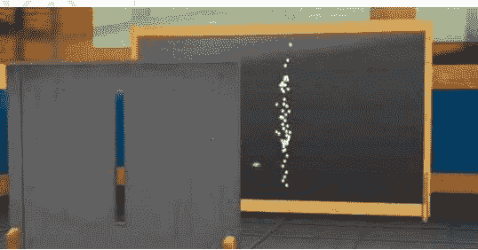

- 现在，我们在木板上再开一条缝，于是现在木板上有两条缝“| |”。我们继续扔乒乓球。

你应该也很容易想到，乒乓球在胶水墙上组成的形状变了，成了“| |”（图 2）。

- 我们再设想另一个场景：有一个干净的水池，被一根横在中间的木棍分隔成左右两个部分，我在左边的水面洒满锯末，右边保持干净。然后，在木棍中间开两个小洞，让两边的水可以连通。

现在，我往左边的水池“duang”的一声扔了一块大石头，激起的水波，把锯末冲到了右边水池。

请想一想，如果我们在右边的水池里，插一块可以粘锯末的板子，锯末在板子上会形成什么形状？

我们也很容易想到，由于水是波纹式传导的，锯末不会只集中在板子上两个地方，而是会分布在很多地方。实际上，锯末的分布有点类似“| || | | | | | |”，这是因为同一条波在经过两个缝隙时，变成了两条波，这两条波会相互干涉，形成条纹式的分布。（图 3）

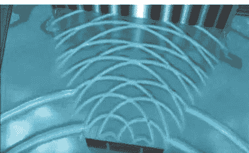

图3

我们这里讲的是水波，实际上一切波都会形成这样的分布图案。大家应该都记得初中或高中学过的托马斯·杨的“杨氏双缝干涉实验”，当光射过两条狭缝时，形成的是明暗相间的条纹，叫做“干涉条纹”（图4）。如果忘了的，可以百度一下。

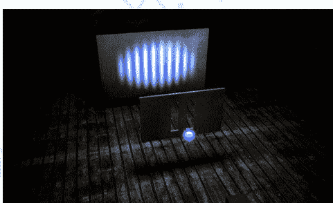

图4

- 上面讲的乒乓球和水波，是两种不同的形态，一种称之为“粒子”，一种称之为“波”。一个粒子一次只能通过一条缝，很多个粒子通过双缝后，会形成“|  |”；波可以一次通过两条缝，并且在通过缝隙以后互相干涉，从而形成“| | | | | | |”。这一点，我们应该都很好理解。

但是，如果我们把乒乓球缩小再缩小，小到只有一个微观粒子（我们就称为“粒子乒乓球”吧）那么大时，恐怖的事情发生了。

当我们把粒子乒乓球射过一条狭缝时，它分布的图案是“|”，这很好理解；但是射过两条狭缝时，它没有像我们预想的那样，形成“| |”（图2），而是形成了“| | | | | | | |”（图5），也就是说，粒子乒乓球本来是粒子，却形成了波的图案——这意味着，粒子乒乓球同时穿过了两条缝隙。

你可能会认为，一次性发送很多粒子乒乓球，它们当然可以同时穿过两条缝隙，并且相互干涉，从而形成波的图案了。

嗯，这种想法有道理。那我们改进一下，把粒子乒乓球单个单个地射过去。这样，每一个乒乓球，都是单独的粒子，它一次只能通过双缝中的一条，不可能跟任何其他乒乓球产生干涉，就像我们往木板上一个一个地扔乒乓球一样。诡异的事情发生了，哪怕你单个单个发射粒子乒乓球，最后形成的图案，也是“| | | | | | | |”（图 6）。

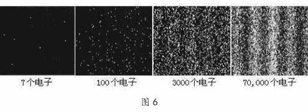

明明是单个乒乓球，应该形成图 2 那样的粒子形状啊，怎么会形成图 5 和图 6 那样的波形状呢？难道每一个乒乓球都能同时通过两条缝隙，然后自己干涉自己？

- 为了搞明白粒子乒乓球通过缝隙时到底发生了什么事情，科学家在双缝板的前面增加了一个观测装置，这样就可以拍到粒子乒乓球到底是通过 A 缝隙、B 缝隙还是同时通过两条缝隙。更加诡异的事情发生了，当加了观测装置以后，粒子乒乓球们就规规矩矩地，一次只通过一条缝隙，最后形成的图案，就变成了“ | | ”（图 2）。而一旦把观测装置拿掉，它们就立马不规矩，形成了图案“ |   |   |   |   |   |   ”（图 5）。

也就是说，当我们盯着粒子乒乓球看的时候，它就是一个粒子；但只要我们不盯着它，它就变成波！

用物理学语言来说，粒子乒乓球的运动本来是一个含有概率的波函数，但是，一旦被观测，波函数就坍缩为一个确定值，从而使粒子乒乓球的运动遵循粒子运动的规律。似乎有一只神秘的手，在阻止我们去观测粒子乒乓球。

- 为了对抗这只神秘的手，科学家又想了一个办法——你不是怕我们看，所以在我们观测时，故意让粒子乒乓球变成粒子，一次只通过一条缝吗？那我们先不看，等你过了缝之后，我再看行不行？

于是，科学家把观测装置放到双缝板的后面，也就是说，当我们观测的时候，粒子乒乓球已经通过了缝隙，到达了另一边，我们只是看它从 A 缝还是 B 缝出来，或者同时从两个缝冒出。甚至，我还可以先不打开装置，等粒子乒乓球过了小缝后，我再突然打开观测仪——按道理，不管我是不是突然打开观测仪，粒子已经通过了缝隙，它形成的分布已经不可能改变，所以打开观测仪和关闭观测仪，在胶水墙上形成的图案应该是一样的，对吧？结果，你猜会发生什么事？

当你没有打开观测仪时，形成的是“| | | | | | | |”（图5）；而当你突然打开观测仪时，形成的却是“| |”（图2）！

真是见鬼了！粒子乒乓球过缝的时候，是不知道你会观测的，过了缝才知道你有没有观测。但是，当它已经过了缝以后，你再去观测，它竟然还能改变过缝的方式！也就是说，未来发生的事情，影响了过去已经发生的事情！

- 到这里已经非常烧脑了，但是还没完。

如果你比较具有质疑精神的话，可能会想到，观测仪器影响的，可能不是粒子乒乓球的过缝方式，而是通过缝隙之后、到达胶水墙之前的行动路径。你可能觉得，只要粒子乒乓球没打到胶水墙之前，我们的观测，都会影响到粒子乒乓球。物理学家约翰·惠勒设计了一种非常高明的实验装置，可以让粒子乒乓球先打到墙上，然后我们再观测它是从哪条缝出来的。当然，这里他用的不是“粒子乒乓球”，而是“光子”。我们都听说过光的“波粒二象性”，也就是说，光既具有波的特性，又具有粒子的特性。在微观状态下，光可以被分为一个一个的粒子，就和电子一样，这种一个一个的光粒子，被称为“光子”，它的微观物理性质，和粒子乒乓球是一样的。

惠勒设计的装置高明在哪里呢？他让光子先到达显示屏，然后再到达观测装置。我们可以简单理解为，他把观测装置放在显示屏的后面（实际情况比这复杂，我这是为了大家理解方便，做了简化，原理是一样的）。也就是说，光子先形成分布图案，然后才被观测。

此外，观测装置还有一个开关，在每一次实验时，我们可以随机选择打开装置或者不打开装置。为了不让神秘之手影响光子在显示屏上的分布，我们规定，必须得等光子已经打到显示屏上后，再随机选择打开观测装置还是不开启观测装置。（后来的科学家 Kim 改进了装置，把观测时间延迟到 8 纳秒之后，也就是说，光子已经到达显示屏之后 8 纳秒，我们才决定是不是观测它）。(图 7)

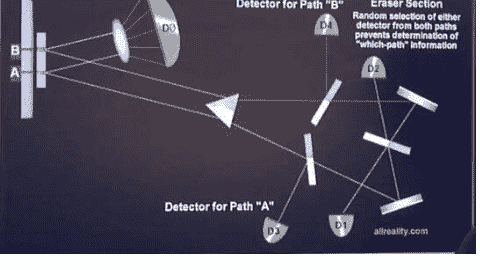

按道理，不管我们是不是打开观测装置，都不影响光子在显示屏上的分布，对吧？

最诡异的事情出现了！当我们每次打开观测装置时，显示屏上呈现的就是“| |”（图 2），当我们不打开观测装置时，显示屏上呈现的就是“| | | | | | |”（图 5）！

也就是说，每一个光子穿过缝隙，打到显示屏上的时候，它就已经知道未来你是不是要打开观测装置（而你是不是打开，完全是随机选择的）！或者说，当光子已经打到显示屏上之后（此时屏幕图案本来应该是已经确定的），你再选择打开观测装置或者不打开观测装置，它呈现的图案是不一样的（此时屏幕的图案变得不确定了）。

后发生的事情影响了先发生的事情！时间先后顺序和因果律被打乱了！是不是见鬼了呢？

关于为什么会这样，科学界没有解释。我也不知道怎么回事。说实话，我对这个问题研究了很久，还是稀里糊涂。就算是上面的叙述，我都不知道是不是准确。如果希望进一步了解的，可以上网搜“惠勒延迟选择实验”、“量子擦除”、“量子延迟”、“电子双缝干涉延迟实验”等关键词。

这就是观察者的魔咒。观察行为，会影响粒子世界，我们虽然不知道原理，但是早就知道现象。薛定谔的猫就是一个例子——它本来是处于既死又活的叠加态，但一旦我们去观察，它的命运马上被确定了，要么是死的，要么是活的。

从这个角度，我们永远不可能准确认识世界。因为一旦我们开始观察，世界就变了。而王阳明“汝不见此花时，此花便与汝心同归于寂”的说法，在这个角度上似乎也得到了现代物理学的某种呼应。

# 寂静与心动

“汝来看花, 此花颜色便一时明白起来” 和慧能的 “此非风动, 亦非幡动, 仁者心动” 就有了一定的科学性。世界就是这么奇妙。你的世界观受到冲击了吗？

# 腾讯往事一则：什么是加密

最初的 qq（那时还叫 oicq）没有考虑过安全问题，其通信协议是不加密的，明码传输。如果黑客想搞事，每个用户的资料，都可以随意调取。

后来马化腾认识到这个问题，就指定程序员黄业均解决这个问题。

过了两个星期，马化腾去问黄业均工作进展如何。黄业均刚好不在工位。只见桌子上倒扣一本书，名曰《加密原理》。

马化腾拿起一看，大惊失色。原来黄业均正在看的是第一章、第一节，标题曰：什么是加密。

（来源：吴晓波《腾讯传》） 大家看了这则故事，有没有什么感想呢？欢迎在下面留言讨论。

# 孩子做错事，该怎样制止

孩子在地铁上抓陌生阿姨的裙子，妈妈赶紧制止，说：“宝宝，不要这样，阿姨会生气的。”这个妈妈很有教养，但是却用错了方法。

经常受到这样教育的孩子，会形成一个印象：因为这件事别人会生气，所以我不能做。

久而久之，外人的反应和评价，成了他做什么或不做什么的依据。

这样的孩子长大以后，容易为别人的想法而活，忘记了自己真实的内心。正确的方法应该是怎样呢？

我们来做一个系统分析。让孩子放弃做一件事情，可以有很多种方法。常见的几种如下：

- 别人的喜厌。用别人的喜欢或厌恶来影响孩子。

文章开头那位妈妈用的就是这种。

让孩子不要迟到，妈妈说：走快点，迟到了老师会批评你的。让孩子叫奶奶，孩子不叫，妈妈说：你不叫，奶奶不高兴啦。让孩子放下 IPAD，妈妈说：再看我就生气了。

喜厌，是别人的评价。

- 顺逆。用威权来影响孩子。

爸爸会倾向于用这种方式。“你给我停下，不许这样做知道吗？”“放下 IPAD，我数到 3！”“赶紧做作业去”。因为我是父亲，我比你强大，所以你必须听我的。

顺逆，是威权的屈服。

- 是非。用事情本身的对错来影响孩子。

告诉孩子，掀阿姨裙子这件事情本身就是错的，所以不能做。

作为学生，按时到校，写家庭作业，这些都是孩子应尽的本分，如果不做，就是错的。

是非，是法律、规章制度、角色定位、做人准则等的要求。

- 利弊。用事情会带来好处还是坏处来影响孩子。

不好好做家庭作业，就学不好知识，未来上不了好学校，找不到好工作，实现梦想更难。长时间看 IPAD，会看坏眼睛。过马路不看车，容易发生交通事故。吃多了冰淇淋，会拉肚子。

利弊，是理性的分析。

- 善恶。用事情是善良还是邪恶来影响孩子。

孩子看到蚂蚁一脚踏死，这是邪恶之心，我们教育他要善良，爱护小动物。孩子去欺负别的小孩，也是不善良，保护别的小孩，是善良。

善恶，是道德的尺度。

- 自己的喜厌。用孩子自己是喜欢还是讨厌来影响孩子。

孩子宅在家里看电视，你向他描述游乐场的乐趣，让他放下 IPAD，去游乐场活动。孩子不愿意吃饭，你告诉他吃完饭可以长高开火车，他很快就把饭吃完了。尊重孩子的喜厌，并不是顺着孩子意，让他为所欲为，而是让他能开心地接受你希望他做的事情。

喜厌，是内心的尺度。

这 6 个常用方法，第一和第二是外部的强力约束，第三和第四是自然或社会中立的规则，第五和第六，是他内心的呼唤。

三个层次的影响，都有其适合的场景，不能说哪一种就一无是处。但是我们要注意主次、场合和孩子的接受能力。尽量引导他从自己内心出发，去做自己喜欢的，善良的事情。当他开始具备理性思考能力的时候，告诉他什么是对什么是错，教给他分辨利弊的能力。别人的评价和权威的压迫，可以作为一种辅助参考，但是不能作为决定他行为的主要依据、甚至唯一依据。

# 牛人厚黑学：领导未必喜欢高风亮节的下属

牛人星球来的都是内部人，所以我会放开一点，讲一些公众号不会讲的东西。写作风格也会随意一些。

我们看史书，会发现很多厉害的名将，都会有贪财好色等毛病。有些是真的，有些是装的。

手握重权的将军，但凡有点脑子的，一定会大肆购买家宅良田，俏姬美妾，招来文官们的猛烈抨击。

但是，文官们越是抨击得厉害，将军会越是放心。因为他知道，皇上会对他放心：我就是个贪财好色的人，没有更高的追求了。

如果一个将军，手握重权，又高风亮节，皇帝会怎么想？你这是收买人心，想造反啊？

在我们的公务员体系里，过于清廉的官员，往往难以提拔。因为领导不知道怎么用你。如何接待上级部门的考察，如何与招商引资对象打成一片，如何搞活内部关系，有很多灰色地带，清官是玩不起来的。领导更害怕的是，当他玩起来的时候，你在背后捅刀子。你得能和领导玩到一起，才能让他放心，把你当成自己人。

更有甚者，贪财好色的人，领导一是牢牢抓住他的把柄，让他不敢乱说乱动；二是有的有方法激励他。过于清廉的人，没有把柄，领导也不知道怎么激励。我说这些，不是让大家学坏，而是对世道有清醒的认识。如果你是高风亮节的公务员，最好放低一些进步的期望——除非你运气特别好，碰到既手握重权，又欣赏高风亮节的上级。

在企业，也是如此。

每一位老板，都在费尽心思考虑如何激励员工干活的积极性。企业里面能用的办法不多，主要是金钱，其次是职位。

如果你能力很强，又表现出对金钱和职位的强烈渴望，老板就很开心，他不必费脑子去想怎么激励你，涨工资、给奖金、给位子就行。

最怕的是那种能力虽强，但是又无欲无求的人。老板每天都要琢磨，你到底想要啥？我有什么办法，能够笼络住你？老板会觉得，你这种人我驾驭不了，随时随地，你可能想走就走了。

所以，在企业里，不要表现得太清高，该向老板争取的利益，要去争，哪怕你心里觉得无所谓，也要故意表现得很在乎。你要主动向老板提，我要涨工资，我要多发年终奖，我的业务提升比例要高一点。虽然未必会马上就达到效果，起码你明确告诉了他：老板，我很好激励的。

这里都是讲的概率上较大可能存在的情况。特例当然是存在的。如果你既高风亮节，又得到了领导的重用，那么恭喜你遇到了一个好领导。如果你高风亮节，却总是得不到重用，不妨思考一下我说的话。

# 华为的战略定力及对我们的启示

我做咨询的时候，碰到过一个特别厉害的客户，我们就叫 A 老板吧。A 老板早年进入某一行的，用了不到 5 年时间，就成功上市，自己也进入福布斯中国富豪榜。

他原来的行业是非常苦逼的一个行业，所以，刚开始起家非常不容易，钱都是一分一分从土里抠出来的。上市后，一下子几十亿的资金哗哗地向他涌来。无数的人抢着要给他投钱，全国各地的政府，也都希望他过去投资。

A 老板觉得自己好牛啊，就全国各地建基地、建厂、铺设生产线，为此还在市场上大笔融资，其中包括银行借款和企业债券。

结果，08 年金融危机一来，资金链条骤然绷紧，A 老板差点被搞破产，其股票也成了 “仙股” （即股价下跌到一分或几分钱，英语为 cent，谐音 “仙”）。他在各地的投资，也大部分分成了烂尾。

后来，A 老板一直想着东山再起，但是，尝过股市甜头，又觉得自己无比牛逼的他，早已经不屑于做原来苦兮兮的实业了，每天都是想着资本运作，企业的每一个动作，都不是为了做好实业，而是为了给资本市场创造动听的故事。

现在这个企业还在维持，但我认为危机重重。

所有企业，做到最后无非三种结果：go big，go sell， or go home（做大、卖掉或倒闭）。

A 老板嘴里说的是 go big，其实做的都是 go sell 的事。

现在很多年轻的创业者，成立公司的第一天，想的就是我要做一个漂亮的故事，把公司吹起来，然后被大佬收购，或者上市圈一笔钱，而不是做一个伟大的企业、一款好用的产品。

这样的公司，往往连 go sell 的目标都达不到，绝大部分都 go home 了。

反观华为，从头到尾就是想着怎么做大做强，提升产品，搞好营销，做好服务。高管给任正非建议做房地产，这样来钱快，被任正非骂得狗血喷头。

在多年前，任正非甚至还多次否决了做手机的提议，认为不务正业。后来是看到手机与通信及芯片产业的互补性强，有利于华为主业的升级，才做的手机。如果华为上市的话，轻易就能成为世界前 5 市值的大公司，但任正非坚决不上市。也正是因为华为不是上市公司，不用受投资者的约束，华为可以沉下心来做很多打基础、存备胎的工作。如果是上市公司，要创造一个好的财报，很多事情就没法做了。

我说这些，不是说上市不好。上市其实有很多好处，如能得到大额融资，能够扩大知名度等等。但是有一个前提，做企业的需要永远记得：上市，是为了你的实业服务。而不能反过来，让你的实业为上市服务。

资本运作是赚快钱，做实业是赚慢钱。赚快钱很轻松，赚慢钱很苦。所以很多赚过快钱的人，都回不了头了。

快钱不是坏事，只是，我们一定不能让它冲昏了头脑。

# 三流父亲不和孩子玩，二流父亲带孩子玩，一流父亲陪孩子玩

中国有句话，叫“丧偶式育儿”，说的是很多当爹的，根本就不管孩子，所有事情都丢给孩子妈，有他跟没他没区别。

这种环境下长大的孩子，体会不到父爱，在心理上会造成一些缺失。有的会缺乏阳刚之气；有的会缺乏安全感；有的会极度渴望得到别人的认可；有的会把对父亲的不满扩散到所有男人（女孩居多）。

从来不管娃的父亲，是三流的。（不过还不是最坏的爸爸，那些把娃当出气筒的，最渣。）

另外一些爸爸，对孩子是很好的。也愿意带孩子们玩。孩子能从他那里得到很多欢乐。这些父亲是不错的——如果不和第三类父亲比较的话。

带孩子玩的父亲，仔细分辨一下，会发现他在玩的过程中，是组织者、指挥者。他看着孩子玩，告诉孩子怎么玩，但他很少能融入进去和孩子一起玩得亦亦乐乎。孩子和他对话的常见模式是：爸爸，我能玩这个吗？带孩子玩的爸爸，可以称得上是第二流的爸爸。

第三类爸爸，则是能陪孩子一起玩的爸爸。

孩子在草地上打闹追逐，你也是追人或被迫的那个，而不是旁边的看护人。孩子学轮滑，你也一起学，和孩子一起找地方滑；孩子玩拼图，你俩去比赛看谁拼得更快；孩子学围棋，你是对手，而不是把他丢给 IPAD 人机对战。你会常常变成孩子的马、警察或小偷、小熊或洋娃娃。她是公主你是王子，他是奥特曼你是怪兽。孩子和你的常见对话模式是：爸爸，你能陪我玩这个吗？

陪孩子玩的爸爸，是第一流的爸爸。孩子可以感觉到和他的平等交流，和充分的感情。他在孩子的成长过程中，不仅仅是一个监护人，还是一个好朋友。

其实，每个人的性格和行为模式，都不是固定不变的。

我们有时候会沦为第三流爸爸，有时候当第二流爸爸，有时候又能够成为第一流爸爸。

不一样的陪伴模式，给孩子的感受完全不同，一天天下来，他的性格和行为模式也在被你塑造。

孩子首先需要陪伴，再进一步，需要有效的陪伴。而“陪”孩子玩比“看”孩子玩，显然是更有效的陪伴。

三流的爸爸造就三流的孩子，二流的爸爸造就二流的孩子，一流的爸爸造就一流的孩子。

以上是父亲节的一点感想。我自己反思，三流和二流的时候也挺好的，一流的时候少。所以，上述内容与大家共勉。希望每一位爸爸都能力争一流。

# 如果你都认为你的问题一文不值，怎么能怪别人觉得它无关紧要呢？

这一周对我来说是地狱周。要到北京参加一场高端对话会，调研三家企业，谈两个合作，还要在广州某企业做一下午的公众号写作培训，在牛人星球做一次分享，还要完成本周的公众号更文和牛人星球更新，我还有两本书要写，一本 6 月底交稿、一本 7 月 15 日交稿……想想都头疼。但是这都是为读者、客户和我本人创造价值，所以是值得的。我很开心地做这些事情。

可是，下了飞机看到的两个后台留言，瞬间就郁闷了。

公众号后台又有两个人批评我。一个是因为问了问题我没有及时回复，他说我“一点也不认真对待读者”；另一个是咨询我一个很不好回答的问题，我可以说付费加入知识星球提问，他说我“太功利了”。

说实在的，我是很愿意和读者交流、回答读者的问题的。但是，当你一天到晚忙得团团转时，面对每天那么多的询问，你就知道，要每一个都回复，是不可能的。

何加盐公众号的首要目的，是为读者提供高价值的深度文章。不管是写牛人经历、还是商业分析、或者成长干货，无一不需要看大量的资料，做大量的思考，用一两天甚至更长的时间才能写出来。我要是每一条都认真回复，哪里还有时间去为大家写好文章呢？

其次我希望做到的，确实是帮助大家答疑解惑。但是，当问题太多时，我只能选择对当事人最重要、最迫切、最有价值的问题回答。说实在的，我无从判断哪个问题对当事人更重要，只能通过他对这个问题的态度来分析。如果你都觉得你的问题分文不值，那我肯定会认为它无关紧要。

一个有价值的回答，一定是要经过完全理解问题、大量搜查资料、深入进行思考，然后认真作答，才能完成。

除了真正的朋友、师长以外，对于其他陌生人，你免费的提问，如何能指望获得这样认真的回答呢？

对于牛人星球各位朋友的提问，我自然是有问必答，而且是非常认真地回答。因为你们信任我，并且是真金白银支持我，你们不光是我的朋友，更是衣食父母，我只能加倍回报。而那些对我的知识和时间毫无尊重的人，对不起，我不欠他的。

# 牛人一定要有牛体格

吴晓波“腾讯传”里面写了这么一件事：

2004年，33岁的马化腾终于结婚了，全公司上下都特别高兴。

他们高兴不是因为老板大婚，而是因为，马化腾非常喜欢在下班后给他们发工作邮件，经常晚上9点10点收到他安排活的邮件，一晚上就泡汤了。

大家都想，老板结婚了，晚上要陪老婆，以后还会生娃，哪有时间9点10点发邮件啊，于是一个个都在心中把老板默念成救苦救难观世音菩萨。

结婚后，马化腾果然不再9点10点发邮件了。他改为12点以后发。大概是每晚陪完老婆，办完“正事”，然后才开始办正事吧。于是，高管和员工们更痛苦了。

马化腾喜欢半夜发邮件，是出了名的。他的精力极其旺盛。而腾讯公司的高管们，也都已经很习惯半夜还工作。有很多员工都反映，凌晨2点，凌晨4点，都会收到马化腾的邮件。还有员工表示，凌晨2点给马化腾发PPT，本想大功告成，洗洗睡觉，没想到马化腾20分钟就回邮件提出了修改意见，害得他只好又接着修改。

事实上，像马化腾这样精力旺盛，在这些科技公司老板中很常见。雷军常年每天只睡四五个小时，马斯克一周工作时间超过100小时（约每天14小时20分钟），王健林凌晨4点就起床健身。刘强东年轻时每天睡在办公室，定个闹钟每两小时起来一次看服务器。马斯克为了特斯拉赶工，直接睡在工厂。

我在做咨询时接触的那些老板，每一个都精力旺盛得出奇。没有一个不是工作到深更半夜的。

我自3月专职写作以来，白天都要忙着公众号的各种事情，学习的时间没法保证，就只好留到晚上。所以每晚11点-1点要看书，睡前还要看会当天要闻，第二天早上7点钟起床给娃弄早餐，送她上学，每天的睡觉时间，大概都在6个小时左右，有时还不到。

就这样，每天早上被闹钟叫醒的时候，我都痛苦无比，但是还是要挣扎起来。如果连续几天这样，我走路都会打晃。周末必须睡到8、9点，才能稍微往回补一补。

我不禁感到困惑，那些牛人们，他们是怎么做到每天只睡四五个小时的？

# 阿里前 CEO 卫哲与前摩根斯坦利员工玛格丽特：这些高端人士的吵架，我真看不懂

曾经担任过阿里 CEO 的卫哲，最近参加了一个业内会议。他作为嘉宾发表演讲时，自嘲自己数学不好。

这时一位叫玛格丽特的女士举手提问：你数学不好是怎么当上 CEO 的？

卫哲说：我数学是不好，那也比你强。

玛格丽特说：我是北京市文科高考第三名，美国康奈尔大学毕业，blabla~ 俩人直接吵起来，最后，演讲尴尬收场。

觉得丢了面子的卫哲，找到玛格丽特的公司投诉，说自己的人格受到羞辱，要对方老总和玛格丽特书面道歉，并匿名捐款 10 万美元给主办会议的协会。

玛格丽特被公司炒掉了。

于是玛格丽特写了一封名为道歉实则开骂的邮件，群发给一堆人，几乎等同于公开信。

邮件中，玛格丽特说： 亲爱的大卫 卫先生，由于你的缘故，我被炒了鱿鱼，在 7 月 4 日美国独立日这一天。 你刚刚杀死了一个有抑郁症的单亲妈妈。

你爽了吧！摇摆的小弟弟先生？ （原文 Swinging Mr Dick，一句特别脏的话，我都不知道怎么翻译）。因为你的凌辱，我在一家土耳其酒店实施了自杀。你以前没有杀过人吧？

啊哦，你没杀过。现在我的血已经流到你的手上。小弟弟・卫先生（“小弟弟”原文 Dick，就是你想的那个意思）。你知不知道我毕业于康奈尔？你知不知道我曾在摩根斯坦利纽约总部工作？你知不知道我是美国公民？你知不知道我在美国的人脉？你知不知道我认识世界上最大的对冲基金的人，他们能碾压得你体无完肤？你知不知道张勇（阿里现任 CEO）原来就在我隔壁工作？ ......

后面的就不再翻译了。懂英文的可以看看原图。

话说，这两位碰到一起，真是奇葩对奇葩。心眼一个比一个小。我真想不通，卫哲这样的气度，是咋混到阿里 CEO 这样的位置的？

另一个，他们这些人真奇怪，明明都是中国出生中国成长，互相之间聊天全部都是英文。 这些高（zhuang）端（bi）人士的世界，我真看不懂。

# 没有人是轻松的

和一个管理 80 亿基金的投资公司负责人聊天，感触很多。最大的感想是，这一行看起来光鲜，其实真的好艰难！

朋友在上海陆家嘴有 3 千多平米的办公面积，住汤臣一品别墅，开 GMC 房车（当然不用他开，有司机），看起来非常风光。但是，压力也无比之大。

在投资端，原来投的好多项目，碰到这两年行情不好，顺利退出的不多，就算是退出，收益率也远远不及预期。而现在要找好的新项目，更是难上加难。有个好项目出来，阿里、腾讯、IDG、高翔等等马上就抢走了，他们运气好的时候，也就是作为最小的跟投方，跟在后面喝点汤，运气不好时，人家都不稀得带你玩，轮到的都是垃圾项目。

在募资端，现在市场上资金越来越紧张，加上很多私募暴雷，现在大家对给基金投钱都很警惕，要求撤资的越来越多，募资也越来越难。

在财务上，国家加大对投资收益的征税额，各种税费的成本增加了好多。

在管理上，现在市面上要找一个好的管理人才，真是太难了。不管是做业务的、研究的、还是做风控的、财务的、甚至做人力、行政的，要找到一个得力的人，都非常不容易，一个的人才，哪都可以去，不一定来你这里，而愿意来的，能力上达不到要求不说，动不动就要求年薪百万起。

别看投资行业香车美女，花钱如流水，其心理压力和工作压力，真不是一般人能承受得了。

这一两年来，金融圈、投资圈奇葩事情频出，有两个原因：根本原因是这个行业离钱太近，压力太大，人的欲望被无限激发，贪婪被无限放大，钱、权、美色的交易，更加赤裸裸，本身就容易产生奇葩事情。

促使原因是行情不好，原来的利益格局太容易被打破了，互相之间的竞争压力更大，情绪更紧绷，偷拍偷录，媒体曝光的事情，发生频率急剧上升。原来给回扣2个点的，现在要减为1个点，原来给小三一年100万包养费的，现在要减少到30万，鱼死网破的事情，也多了很多。

# 节目录到一半，嘉宾回家睡觉，希望你也有这个底气

8 月 10 号的“乐队的夏天”节目，录到一半时，重要嘉宾朴树突然站出来说：“不好意思，到点了，我要回家睡觉了。”

接着，他简单点评选手几句，然后又说“我年纪大了，要回去睡了”。

主持人马东先是错愕，接着鼓起掌来，听众也掌声雷动。

看完这个节目片段，我想说，朴树真爷们。

我们常常会为了顾忌外界的种种反应，而牺牲自己的感受和利益。重要场合更是不敢先离去，哪怕家里还有嗷嗷待哺的老婆和牙牙学语的孩子。

朴树的做法给我上了一课，原来，这样的场合，面对这么多观众，面对全国几千万的视频受众，也是可以中途走人回家睡觉的。

我以前时公务员，常常会有一些应酬。有时甚至会搞到半夜。刚开始，我总是会待到最后散场时才走。后来才学会了半途离开。

其实大部分时候，你走了对活动也不会有什么影响。除非你是第一主角，不敢半途离开，其实不是因为它自己礼貌或者敬业、有责任感，而是不够自信，不够大胆。

我希望我们都能多一点朴树这样的勇气。

但是也要提醒，这样做不是谁都可以的，你自己的地位越高，心理越强大，越是可这样。试想，如果是一个没什么名气的歌手这样做，大概率不会像朴树这样得到人们的体谅和赞扬，而是会被指责和耻笑。

所以，坚持自我，有时候也是需要有资格的。

话说我原来在体制内，一开始不敢走，不也是担心领导或客人对我有看法吗？后来知道，他们对我的看法，不在于参加应酬时我走不走，主要在于我能不能把工作干好，所以后来我就没那么在意了。所以，希望大家既有坚持自我的勇气，更有坚持自我的底气。

# 你真的了解孩子吗？

今天何太给我讲了听来的一个故事，来源于她听的一个付费课程，是北大心理学教授李松蔚的《面向未来的儿童教育》。

故事是这样的：有个小孩特别爱玩芭比娃娃，上小学四年级了，还爱不释手，每天能和娃娃玩好几个小时。

奶奶就有意见，一是说孩子不学习光顾着玩玩具；二是说孩子已经这么大了还玩小宝宝玩的洋娃娃，不好。

奶奶说爸爸怎么也不管管孩子。爸爸也不知道该怎么管，就请教李松蔚。

李松蔚问，你知道孩子是怎么玩的吗？

爸爸惭愧地说，不知道。

李松蔚建议，你回去陪孩子一起玩，让她教你怎么玩。

于是爸爸回去就和孩子说：你能教我玩芭比娃娃吗？

孩子特别高兴地陪爸爸玩了起来。

这一玩不得了，他发现孩子原来是个天才！

孩子给每个芭比娃娃都起了名字，安排了人物身份和性格，编了无数的故事，这些故事非常精彩，难怪孩子能一玩就是好几个小时。

爸爸这才发现，孩子原来在想象力、文学创作、编剧等方法有如此高的天分。

于是他就鼓励和培养孩子把这方面的才能发挥出来。孩子不仅在家里非常开心自在，不再担心家长的指责，在学校还经常成为编排各种话剧节目的金牌高手，受到老师和同学的热烈欢迎。

故事讲到这就结束了。我听了非常感慨。

当孩子在玩耍上花很多功夫时，我们往往只知道指责孩子、限制孩子，也有些家长会由着孩子。但有几个家长，会和孩子一起玩？又有几个家长，会请孩子教自己玩？

我曾经有过这样的体验。孩子喜欢溜冰，我也买了溜冰鞋和她一起玩，我就请她当老师教我。结果她非常兴奋，很严肃地当起老师来。还经常督促我说，我们该去学溜冰啦。我这才发现，原来女儿溜冰的技术如此高超，难怪一放学就穿着溜冰鞋往楼下跑。

现在的孩子，很多喜欢看 IPAD，玩手机，要么是看动画片、综艺节目，要么是打游戏。我们有没有陪她们一起看过一集？有没有向他们请教过剧情是怎么回事？有没有让他们教过自己怎么玩？

尝试陪孩子玩一下，或者请孩子教一下吧，你们的亲子关系会更加密切，而你也也许能发现他/她与你想象完全不一样的地方。

## 雷军的悲伤

最近在研究小米雷军的资料，发现一个略有点“悲伤”的小故事。

十多年前，有一位叫“雷军”的小孩，刚刚学会上网，就和我们每个人都做过的一样，在网上搜索自己的名字，看能发现什么。

结果，搜索结果的前二十页都是关于金山公司总经理雷军的，二十页以后才有一点其他的信息。

这位小雷军暗暗发誓：我一定要努力！奋斗！让我自己的信息出现在前十页！

于是，小雷军非常努力地学习、工作，取得了不小的进步。

十多年过去了，他再搜索“雷军”，发现他连前 150 页都进不去了。

原来金山那位总经理雷军，已经进化成现在小米的老板雷军。

看来这位小雷军 是一辈子都别想在网上搜到自己了。

# 顺风成就事业，逆风成就人

雷军说，在风口上，猪都能飞。所有的事业成功，都是因为顺势而为，如果是逆着大势的话，一定会败得很惨。所以，我们干事创业，一定要善察趋势，顺应趋势。

但是，世事哪有那么多如意的。人一辈子难得碰上几个大趋势，碰上了也很难抓住住。因此，成功者很少，而普通人或者失败者却很多。

但是，成功者难道都是一下子就能找到风口，站到风口的吗？不见得。

确实有极少数的幸运儿，他们第一次创业就碰上风口，一下子就成功了。例如扎克伯格。但这种人太少太少了，少到没有任何借鉴意义。

绝大多数的成功者，在走到风口之前，都要在逆风中穿行好久。但是，与普通人不同的是，他们把逆风当成一种磨练。他们不断地与逆风搏斗，让自己变得更敏锐、更强大。

当风口到来时，他们的敏锐让他们能快速发现风口，他们的强大让他们能牢牢抓住风口。

而风口，只要抓住一次，就能让一个人彻底逆袭了。

人生大多数时候是逆境，逆境是我们的磨刀石。是逆境在成就一个人。

在逆境中成就的人，才能在顺境中成就事业。

# 创业就是徒手攀岩

昨天看了心仪已久的电影《徒手攀岩》。故事和场景很震撼人心，非常推荐一看。

我在看的过程中就想，其实创业就是一场徒手攀岩。甚至是比徒手攀岩更刺激，更惨烈的游戏。

1. 和徒手攀岩一样，创业也是“死亡率”非常高的领域。

徒手攀岩的死亡概率超过50%。影片中也几次提到，攀岩者经常会遇到朋友失手摔死的案例。其中一个人，已经有三四十个朋友都摔死了，其中很多都是圈内非常有名的好手。创业何尝不是如此。每一个成功的创业者背后，都有无数个失败者。而且，此刻成功，并不等于一直成功，创业者永远都在悬崖上，没有平地和山顶可言。就连马化腾和马云，也都是时时刻刻如履薄冰，不知道一个什么失误，就会让自己的企业万劫不复。

2. 有时候，你最看重的人会给你带来最大的麻烦，而你还无可奈何。

在影片中，主人公此前都没有受过严重的伤，可是自从带着女朋友攀岩之后，一次因为女朋友没弄好绳子，让他从高处速降时重重摔在地上，脊椎受伤，差点断送攀岩生涯。另一次因为女朋友在下面的喊叫分了神，从悬崖半空坠落（还好有绳子）摔伤了腿，医生说半年不能再攀岩。创业也是如此，你把自己的命都交给最信赖的高管或员工，可是有时候他就会搞砸。但他又是无心之失，让你也无可奈何，想发火都不知道怎么发，下一次你还是要把命交给他。

影片的主人公在摔伤腿之后，没等一个月就拖着肿胀的腿去攀岩了，因为他已经为攀登酋长峰准备了好几年，不想再等下去。创业也是这样，我们不能因为自己最信赖的人搞砸了事情，就停在那里休整。有时候，市场时机稍纵即逝，你只能拖着满身伤痕硬顶上去。

3. 如果知道要失败，那么退出也是一种智慧。

在脚伤那一次，主人公刚开始还要坚持完成计划，但是爬了一会儿觉得不行，他还是半途放弃了。因为如果失败就是万劫不复，没有第二次的可能。

创业也是这样，有时候一个决策会让公司和自身彻底失败，永远失去翻盘的可能。这种情况下，如果评估自己和公司的状态不对，外部时机也不对，不妨先主动放弃，等准备更充分了再来。

我们受过的教育、喝过的鸡汤，都是说要坚持到底。其实很多时候，放弃也是一种智慧——这种放弃，不是因为你的毅力不够，不是因为你不能吃苦，而是因为如果不放弃，后果过于严重，你承受不起。

4. 成功来自不断的练习。

影片的主人公并不是莽撞地去攀岩，而是经历了一次又一次的练习。他在有保险装置的情况下，对整个攀岩路线的每一段都做了无数次探索。哪个地方有什么难处，需要用哪个指头的力量，早就已经胸有成竹，甚至都已经练成了肌肉的自然反应。

其中有一处最难的峭壁，他需要用两个拇指钩住一点点的凸起，然后完成一次半空跳跃，此前很多次他都没有成功，但是随着自己的练习，后来却轻松跨越了。

创业也是这样，没有人天生就会一切，你总是需要锻炼各种不同的技能。如何销售、如何管理、如何当众演讲、如何读懂用户心理、如何激励团队、如何看懂财务报表、如何与投资人打交道等等。你都得去训练。只有这样，当好的风口来临之时，你才有能力抓住。

而且，不断的练习，会让你的能力进化到让你吃惊。以前觉得那么难的事情，现在却如此轻松。

而创业比攀岩更难的地方在于：攀岩你可以在有保险绳的情况下一次又一次练习，而创业永远没有保险绳。你只能在市场竞争的洪流中不断搏斗，然后获得进步。也就是说，练习的过程也时时充满危险，如果在搏斗中失败，企业就完蛋了，没有保险绳可以相救。

5. 创业者心中都有一份对家人的亏欠。

影片的主人公无数次地到全球各地去攀岩，无数次半夜去练习，没有时间每天陪伴自己的女朋友。而且，他总是把生命置于悬崖之上，随时都有可能粉身碎骨。做他的女朋友，需要有一颗能忍受无限寂寞和承受无数担惊受怕的心。

而创业者又何尝不是如此呢。每一个创业者都是一心扑在公司上，哪有什么时间陪伴家人。如果有一个创业者期间还能很好地照顾家人，可以肯定，他的创业一定会失败。

家人对创业者也总是处于担心状态。担心行业不景气生意怎么办，担心工作压力太大怎么办，担心工作太劳累有损健康怎么办，甚至担心工商税务劳工管理上面出点事情怎么办…… 但是创业就是如此，它就是一条艰险的路，是需要创业者和家人一起承受的不归路。

可是，尽管如此，主人公为什么一定要去攀岩，创业者为什么一定要去创业呢？

太多的解释，其实很苍白。说起来就是一句话：心理就是有哪个冲动，不去拼一把就不舒服。这就叫内心的呼唤。

# 中美顶级企业家原生家庭区别

上周发了一篇公众号文章，写的是中美顶级互联网企业家婚姻的区别：美国顶级互联网企业家离婚率较高，中国顶级互联网企业家婚姻很稳定（还没看过的欢迎到何加盐公众号阅览）。

其实，在家庭层面，中美企业家还有一个很大的区别：很多美国顶级企业家小时候都有不幸的家庭生活；而中国顶级企业家则基本上都有稳定而慈爱的父母。

伟大的乔布斯，小时候十分悲惨。他本来有受过高等教育的父母，但是却教他们遗弃。他被一对律师夫妇收养，本来也挺好，但是那对夫妇后来又想要一个女孩，又不要乔布斯了。后来，乔布斯被一对高中都没毕业，家庭条件一般的夫妇收养。后来，乔布斯说起生父母，都是一脸厌恶。他说，他们和我毫无关系，只不过就是个精子库和卵子库而已。

埃隆·马斯克的童年也一样悲惨。小时候，父母离婚，他跟妈妈过了几年后，因可怜父亲而搬过去陪伴他，却经历了可怕的时光。在多年后向记者讲述时，他说：“你不知道有多糟糕。几乎所有你可能想到的罪恶的事情他都做过。几乎所有你能想到的邪恶的东西他都做了。嗯…”“太可怕了，你不能相信。”回忆到此，泪水悄然流下他的脸。他终究也没告诉记者，那时到底发生了什么。

巴菲特的父母倒是没有离婚，但是他妈是个脾气超级不好的人。巴菲特小时候曾经受尽她的折磨。巴菲特从小就不喜欢和妈妈待在一起，只要俩人共处一室，他就浑身不自在。

长大以后，巴菲特想尽办法不去见母亲，当老太太老了需要照顾，他派自己的女儿去。如果自己不得不去，他就像是死掉了一般几乎不说话，唯一证明他活着的就是他的表情——总是左顾右盼，显得非常着急，随时都希望逃离这里。在巴菲特母亲去世后，巴菲特回忆说，她带给我的全是不好的回忆。

而与此形成鲜明对比的是，任正非、马云、马化腾、李彦宏、雷军、周鸿祎、刘强东……，你能数得出名的顶级企业家，都是父母婚姻稳定，对子女爱护有加的。

倒是也有父母不和的例子，如多益网络的徐宥箴和波场币的孙宇晨，都是小时候父母离婚。但这两位长大后性格都有些偏激。徐宥箴初中毕业就流落社会，受尽苦头，后来他是一夫多妻论的拥趸和忠实践行者；孙宇晨小时候被父母送到武汉孤零零的学围棋，等几年后回到家，父母正在闹离婚，当着他的面吵闹，后来孙宇晨的性格非常偏激，超级爱虚荣，甚至不惜通过弄虚作假来达到目标。

当然，美国企业家里面也有反例。例如比尔·盖茨扎克伯格的父母，也是恩爱夫妻，温暖家庭的典范。

不过，我们从统计出的比例来说，在中国顶级企业家里面，有一个好的原生家庭，几乎就是成就大业的必要条件。

所以，如果我们想要孩子未来有最大的出息，最好给他一个稳定、温暖的家。

# 岁月与文明

《三体》里面有一个意味深长的标语：给岁月以文明，而不是给文明以岁月。这个标语代表了黑暗时代过去后，大毁灭到来之前，人们的普遍心理。

当时的情况是这样的：叶文洁联系了三体人，让三体人知道了地球的存在。由于三体星的生存环境极其恶劣，三体人知道了地球这个天堂般的存在之后，就要来占领地球。从三体星到达地球，大概要飞 400 年。

起初，地球人为了抵抗三体人，进行了艰苦卓绝的备战，实行了类似共产主义配给制，所有物资都优先于战备，人们的生活过地十分困难。

后来，经济崩溃，造成了人类前所未有的黑暗时代。受苦受难的人们起来反抗，建立了新的体制。大家觉得原来对局势的预测太悲观了，我们完全可以抵抗三体人，而且不用过苦日子。

最后就形成了共识：人类的价值，在于让现有的世界变得更加文明，而不是让现有的人类文明活下去。

也就是开头那句话：给岁月以文明，而不是给文明以岁月。

这句话其实也是对当今现实世界的深刻隐喻。

个人常会面临让现在活得更爽还是让未来活得更长的矛盾。

企业常会面临价值观、使命与利益的冲突。

国家常会面临价值观至上和现实主义之间的分歧。

在小说里，愿意给岁月以文明的人类，选出了圣母程心，代替黑暗时代出来的老怪物罗辑，成为对抗三体舰队的新的“执剑人”。

人类怀着美好的愿望，认为程心既能维持与三体人之间的“恐怖平衡”，又不破坏当下的好日子。

可惜的是，在程心执剑的第一秒钟，三体人就发起了进攻。人类被迫逃亡。由于与三体人的战争，暴露了太阳系在黑暗森林的位置，最后太阳系被高维外星文明用“二向箔”低维化，变成了一张纸。

企图给岁月以文明的人类，最后连岁月都没有了。

我认为，给文明以岁月，还是给岁月以文明，不是对立的，永远都需要平衡。岁月是文明的基础，文明是岁月的目的。在面临着死亡或赤贫威胁的时候，我们自然要选择生存与发展至上，但是在这个过程中，也要兼顾使命与价值观。在解决了生存问题，具备了可持续发展的条件以后，可以更多地为使命和价值观而奋斗。

最好的过程就是文明与岁月能结合起来。如果创造文明的过程，本身就有利于延续岁月，那就最好不过了。

对一个国家来说，这很难。要照顾公平与正义，经常会丧失效率。要注重效率，常常会损害一些公平与正义。但是对个人和企业来说，要容易得多。

福特的让世界上的每个人都能开得起汽车，马云的让天下没有难做的生意，马化腾的让连接更顺畅，雷军的让中国人信赖中国制造，都是文明与岁月紧密结合，互相促进的典范。

我可以接受国家、企业、个人在救亡图存与初期发展的时候有一些原罪，如果这些原罪是没有其他选择的无可奈何之举的话。但是更愿意看到已经解决了生存问题，足以维持可持续发展的国家、企业、个人多花点心思考虑价值观。

我一直相信，到了一定的高度之后，文明和岁月是紧密结合的，没有文明的岁月，也将最终失去岁月。

# 不要用物质匮乏时代的做法来指导物质丰富时代的行为

中国曾经有够很长时间物质极度缺乏的时候。那个时代在我们身上留下了深深的印迹。

毛主席说，浪费是极大的犯罪。这句话就具有典型的物质匮乏时代色彩。在物质丰富时代，浪费是正常的，甚至是必然的。

以吃东西为例，我们以前担心的是饿肚子或者营养不良，所以，所有的东西，都不能浪费，每一粒米饭，每一片菜叶都须须吃进肚子。在那个时代，倒掉剩饭剩菜，真的是极大的犯罪。

而现在，我们担心的是营养过剩、发胖和不健康。所以，吃东西要讲究适量、营养均衡、健康卫生。从这个角度来看，剩饭剩菜尽量不要吃，倒掉是最好的。但是过往的生活痕迹往往还顽固地留在我们身上，深深地影响着我们。

有多少人，能够果断而不心疼地每天晚上把没吃完的饭菜直接倒掉呢？

在不同的物质时代成长起来的人，思考方式和做事方式都不一样。我的父母，打完鸡蛋还会用筷子刮一刮蛋清，削苹果要削最薄的皮，吃西瓜要啃到都是白瓤为止。而我女儿，就从来不会这样。喝牛奶、吃西瓜，喝不下吃不下了，就不要了，然后扔掉了。

我们不能说哪一种是对的，哪一种是错的，这都是不同的时代造就的不同生活习惯。不过，我认为，在当前这个时代，我女儿的处理方式，更有利于身体一点。

古话还有“静以修身”的说法，古人爱用乌龟最长寿，来说明少动有利于健康长寿。而今人却喜欢体育锻炼，安静不动，被认为是懒惰的表现。如果一天到晚躺在沙发上看电视玩手机，其实是符合古人所说的“安静”、“少动”的养生方式的，而对今人却不行。

究其根本，就是因为古代物质少，所以要减少能量消耗。而现代物质多，营养过剩，要通过运动把它消耗掉。

物质贫乏留下的最不好的习惯，是重视物质超过重视人。为了珍惜一点物资，我们可以忍受种种不舒服，甚至痛苦。

例如，为了保护鞋子，我们在某些路段可以光脚走路。为了省2块钱公交车费，我们可以步行十几里路。因为景区的东西贵，我们可以忍饥挨饿跋山涉水。在物质贫乏时代，人的感受是不重要的，人的时间是不重要的，保护好物资，是重要的。

现在时代早就变了。而很多人，还在用老一套指导现在怎么过日子。

我们应该要树立这样的观念：人的感受很重要，人的健康很重要，人的时间很重要，它们比物品更重要。物质和金钱，终究是为了服务于人的。如果为了追求物质和金钱，而让人受罪，那就本末倒置了。

# 回乡杂记

这次国庆假期，携妻带子回湖南老家待了几天，有一些感慨。特和星友们分享一下。

由于爷爷奶奶外公外婆都已经去世，父母在广州居住，所以我们回乡的时候已经很少，上次回去，已经是4年以前了。相隔时间如此之长，见到的改变，就显得尤其大。

我老家是一个国家级贫困县的山沟沟里。原来都是很穷的。这次回去，看到有大概一半的村民，家里都有了私家汽车。而摩托车，更是家家都有。老式的瓦房基本已经绝迹，都是两层小楼，几百平米，宽敞无比。堂哥和我讲，现在只要是有手有脚，不偷懒的，都能赚上钱。

我在四处了解了一圈，确实如此。除了在外面打工以外，家乡本身也多了很多工作。如超市收银员、环卫工人、快递员、跑货运或者的士、做建筑工地工人等等，甚至到麻将馆搞卫生和泡茶，都能有80块钱一天。在农村，已经可以过上挺好的日子了。

各种保障也搞得挺好。就医现在是全面医保。有少数大病的，都搞了“轻松筹”等，基本上能覆盖治疗开支。退伍军人每月有将近千元的补贴。城镇户口居民交够社保的，每月也能领到800多元。农村户口的就没有了，不过好在除了医保的每年百来块钱（这些钱会存在医保卡里，用于买药），也不需要上其他的费用。义务教育基本上都是免费。

农村孩子的玩具，都非常丰富。而且由于地方大，有很多都是玩具汽车、塑料大马、玩具挖掘机等大型玩具，这点比城市孩子要幸福。不过，玩手机可能是农村和城市娃共同的爱好。

说到小孩的玩，我就发现一个让我很惋惜的现象。现在农村的孩子在户外活动得太少了。我本来想带着两个孩子去小溪里抓鱼逮螃蟹，结果到了小溪一看，草和灌木长得太深了，根本就下不去脚。

到了我小时候经常去玩的小溪源头的大石块那里，居然完全没有路去到大石头上了。我披荆斩棘，带着俩娃走了她们人生中最艰难的路，才跋涉到大石头上面。坐在被一大片荒草和灌木包围的大石头上，我不禁在想，我们小时候乐此不疲玩的那些东西，那么多地方，现在的小孩已经不玩了。他们有了太多的玩具，还有了网络，已经不需要再去抓知了、掏鸟蛋、捉泥鳅、放野火了。

第二天，我带着娃们去爬山，没走半个小时，我就迷路了。以前就是闭着眼睛也能走到的地方，现在面目全非。两人高的竹子、茅草、灌木，已经淹没了曾经的道路，置身其中，我完全不知身在何处。

从前人们恨不得砍掉、割掉一切能带回家烧的东西，用来做饭和煮猪食，现在已经完全不需要了。山上的植被丰富得连道路都给侵占光了。听说现在这里常常有野猪出没。我还看到了一只松鼠，这在我小时候是从未见过的。

以前政府部门还要严防死守，防止人们上山偷树，现在根本就不需要了。人们都是烧煤、烧电、烧液化气，不再需要木柴。

环保方面还有一个挺好的，就是垃圾处理。以前我们都是直接把垃圾倒在山或小溪里。现在每家每户有一个带轮子的垃圾桶，每天产生的垃圾都倒在桶里，会有专门的人来收走。我们刚回到家时，还有邻居生怕我们不知道，专门过来提醒。种田也比以前要轻松好多。我回去正是稻子收割完不久，可以看到，几乎所有稻子都是机械化收割，除非少数机器上不去的山地稻田，才是人工收割。

不过，机械收割带来了一个新的麻烦。以前我们割稻子，都是从根部割，秸秆会扎成捆，晒干挑回家当柴火。而现在机器收割，都是从水稻的 1/3 处割掉，剩下长长的秸秆留在地里，又难看又不好处理。很多人都直接在田里放火烧掉，结果导致遍地狼烟，天空飘满烧秸秆的灰尘，空气也变得肮脏不堪，晚上看天上的星空，星星也不如小时候璀璨了。

当然，即使不如小时候璀璨，那也比大城市要好得多。女儿看着星空连连惊叹好美。本来因为堵车和回家看到积满灰尘的老屋心情很不好，这一去一下就爱上了故乡，开始盘算起等她继承了祖宅以后，要怎么翻修。

我去了我读书的小学参观，也是完全不认识了。本来我小学六年级时，学校就已经由希望工程翻修了一次，盖起了两层的教学楼，而现在，又重新建了一栋 4 层的教学楼，电教室、仪器室等一应俱全。尤为令人惊奇的是，还有壹基金和阿里公益援建的儿童活动区，有秋千、滑梯和一些小型拓展游乐设施。我还看到学校新建了食堂，外面贴着关于营养午餐管理的一些规定，垃圾桶里扔满了伊利学生奶的包装盒。

之前听说，现在每家每户都只生一个或者两个孩子，还有一部分小孩跟着爸妈在城里上学，所以现在的农村学校人数越来越少。我特地数了一下学校的桌椅，发现每个班的学生在 40 人左右，比我们当时 60 人的大班，确实是少了很多，但是也没有少到开不起班的程度。

和老家的大人小孩聊，发现现在孩子的学习压力还是很大的。乡里的中学，每年能考上县一中的，也就是六七个人；还有 30% 左右能考到镇上的高中，其他的学生，就只能辍学打工，或者去读职教、中专了。以前可以中考复读或者花费赞助费买高中上，现在好像是不行了（这个消息是听说，没有证实）。

高中考大学的升学率，也不高。我们生产队那么多小孩，在 2001 年我考上重本之后，连续 17 年都没能考上一个二本，一直到 2019 年才终于又出了一个超过一本线 30 多分的妹妹。其他孩子，要么初中、高中毕业就去打工、要么职教、中专、要么高中毕业上个普通专科。通过读书改变命运的几率，实在是太低了。

另外有几个让我觉得心情很复杂的地方。

一是房子和街道太杂乱无章了。我心目中想象的老家，是那个山清水秀的美好村庄。回到镇上，看到的是个嘈杂的城乡结合部。房子盖得很快，车辆很多，大超市、酒店、KTV、儿童游乐场应有尽有，这一点，让我感叹人们生活的改善。但是，也为这个美好安静的小镇变得和所有毫无规划的城乡结合部一样而遗憾。这似乎是一个无解的东西。

二是山上的坟越来越多，越来越豪华。以前那种一个土堆、一块墓碑的小坟，现在都不修了，如今的坟都是极尽奢华。占地很广，墓碑很大，墓前一半还有一块宽敞的水泥地。这样的坟不是一座两座，在一些地方甚至都已经摩肩接踵了，从山下一眼望去，非常扎眼，完全不协调。我曾经坐动车从绍兴到宁波，看到铁路两旁，但凡有一点山地，全部都密密麻麻地铺满了坟墓，既难看，又浪费土地。当时就觉得十分可惜。没想到，我的家乡，也渐渐在变成这个样子。听说政府已经在修建公墓，提倡火葬，但我认为，这个问题很难解决。

三是家乡的红白喜事，还是农业时代特别繁琐的那一套。尤其是丧礼，一人死去，四邻几天都不得安生。高音喇叭大声放着哀乐，和尚或道士做着复杂的法事，孝子贤孙被摆弄得筋疲力尽，去祭拜的客人还要三跪九叩，大肆铺张的酒宴，沉重不堪的礼金。这些农耕时代的恶习，还顽固地在工业时代留存着，甚至还愈演愈烈。

不过，总体而言，好的变化总还是比不好的多。只是，家乡已经不是我记忆中的那个家乡。以前曾经想过，如果赚了足够多的钱，要回到老家去生活，肯定会非常惬意。现在我想，短暂回去玩几天，还会感觉很好，如果要长期待下去，我肯定是不喜欢了。

## 说说 “春秋笔法”

前天的文章说到字节跳动公关的春秋笔法。这是一种非常无赖的做法，但是却经常在各种场合被使用，而且常常很有效。

我们普通人，看到一个信息，都需要想一想背后有没有更多其他的信息，不然很容易就会被带偏。

几年前，乌克兰一架客机被导弹打下来。当时，西方媒体铺天盖地报道，打下飞机的，是俄罗斯导弹。

看了新闻，人们不仅愤慨俄罗斯草菅人命，居然丧心病狂地用导弹攻击民航客机。

可事实是什么呢？报道的标题，一个字都没有错，打下飞机的，确实是俄罗斯导弹。

可是，这个俄罗斯导弹，只是在俄罗斯制造的，但是早就卖掉了，流入乌克兰内战交战双方的某一方手里。所以，导弹是俄罗斯生产的，但是并非俄罗斯打的。而所有的报道，都让人误解为是俄罗斯打的。

试想，假如现在在深圳南方某市，出现无人机攻击市民的情景，新闻媒体报道称“中国无人机攻击无辜市民”，是不是也会被人误解为中国使用了无人机呢？而实际上可能是某些势力搞的破坏。

但媒体要那样报道，可能毫无办法可以惩罚，因为现在市面上的无人机，十有八九都是中国产的，要说是“中国无人机”，大概率没有错。

这就是春秋笔法。

每一件事情，都有无数个角度，无数个侧面。但是一般媒体或者自媒体，会根据自己的立场，选择对自己有利的角度和侧面，而回避不利的一面。它们报道的，可能都是真相（如“俄罗斯导弹”、“中国无人机”），但却只是真相的一小部分。我们常常需要等待一段时间，获取更多的，尤其是不同立场各方的信息，才能得到更加接近完整真相的一个拼图。

而有一些别有用心的人，更是会刻意去篡改真相，直接曲解甚至用谣言去影响舆论。

这就是我为什么对“算法推荐”和“信息茧房”如此警惕。

现在的舆论战非常厉害，信息的传播也都有一个过程，在各种重大事件发生时，我们很容易根据不完整的信息去判断一件事情，而等更多的信息披露时，我们又会发现事情反转，甚至再反转。这种事情已经发生过无数次了，而且以后还将无数次发生。

所以，我们再看到此类信息时，不要着急相信，等个几天，等掌握的信息更多了，再来判断是非，这样可以避免很多“带节奏”的坑。

言语的力量非常大，操弄笔杆子的人，很容易就能影响很多人，甚至杀掉很多人。

我们千万要警惕“春秋笔法”。

## 员工金钱激励的四个工具

对员工的激励有很多种, 其中最重要的一种是金钱激励。但是金钱激励也是最难的, 很多管理者不知道该怎么去发钱。马云的做法是: 把给员工的钱分成四个类别: 工资、奖金、红包、股权。

工资 (五险一金等福利也包括在内), 是正常购买一个员工劳动时间的费用。这个人为你干活, 你就得给他工资。这个主要奖励苦劳。

奖金, 是针对超预期表现的。员工如果业绩突出, 可以得到奖金, 如果业绩不行。对不起, 那就没有奖金。奖金一定要业绩挂钩, 它主要奖励功劳。

红包, 是在公司获得额外的收益, 或者有超预期的增长时, 或者完成重大关键任务时, 给员工的普惠性福利。例如, 我们本来想做到一个亿, 结果国家出台了一个很好的政策, 让我们做了三个亿, 这时, 公司可以给大家发红包。如果老板或管理层把这额外的钱独吞, 会毒化公司的氛围, 让员工心寒。但是发一些给员工, 会让他们有意外的惊喜, 有助于激发士气。它主要奖励公司和员工们共同的气运。

股权, 是针对特别有潜力的合伙人/高管/骨干员工, 提前锁定他未来若干年的贡献。如果某人的资源/技术/某种能力是你急需的, 未来若干年都需要用的, 或者你觉得这个员工非常有潜力, 未来能持续给你提供这些东西, 那就应该给他以股权, 把他和公司绑在一起。

在公司管理中, 如何确定四者的比例, 是极其考验管理能力和领导能力的。甚至可以说, 这是企业管理中最核心的东西之一。

## 从罗振宇与申音的决裂，看新媒体公司股权设计

最近在研究罗振宇的故事。

罗振宇从电视台下岗以后，没有固定收入，美其名曰“U 盘化生存”，靠到处打秋风过日子，其实内心很惶恐。

后来，他的朋友申音和他说，你到我这来做一-个节目吧。

申音是原企业家杂志的主编，后来自己出来做了一家公司，名叫NTA 创新传播。公司运作了薛蛮子、凯叔、程苓峰等项目。后来，他又和罗振宇一起，搞了一个新项目。这个新的项目，名叫“罗辑思维”。

此时，罗振宇孤家寡人，申音举全公司之力支持他。两人的合作，是完全由申音主导的。这从罗辑思维项目背后的主体公司股权分配情况就可以看出：申音占股 82.45%，罗振宇占股 17.55%。

后来，罗辑思维越来越火，视频播放量每集 150 万，公众号粉丝也超过了 100 万。

按理说，作为 NTA 公司内部孵化的一个新项目，申音身为话事人，应该有足够的权益和影响力。但现实是，罗辑思维与罗振宇紧紧地捆绑在了一起，在罗振宇看来，原来的股权分配，自然是十分不合理。

后来，两人就有了矛盾。甚至在微博上互相暗示对方人品不好。

2014 年，罗振宇带着罗辑思维离开了申音，自己和脱不花重新开了-一家公司，运营这个项目。

我们不知道罗振宇和申音分手的条件是怎样的。只知道，申音费心费力孵化的一只下金蛋的鹅，已经和他没有任何关系。

后来，在罗辑思维的基础上，罗振宇和脱不花又做了得到 APP。抢到了知识付费风口的第一把交椅。

如今，罗振宇正在冲刺科创板，他的个人身家，已经超过 50 亿（也有人用另一种计算方式，得出 300 亿的数字）。这些，申音只能流着口水在旁边看一看了。

在新媒体行业，公司的核心资产就是大 V，大 V 的个人品牌往往就是新媒体公司的主要价值所在。很多大 V，是新媒体公司用资源捧出来的，但大 V 出名之后，往往又会对股权、薪酬等，有更高的要求。这成了新媒体公司常见的一种矛盾。

比较好的是大 V 自己开的新媒体公司，因为公司与个人的利益高度一致，所以问题不大。那些孵化大 V 的公司，或早或晚，都要遇到这个问题。

有些公司采用的是严格的合同。因为大 V 在没有名气的时候，议价的能力是很弱的，公司就会提前把收益比例、服务期限、赎身条件等规定死。但这往往也是给未来埋雷。大 V 真正成了大 V 之后，几乎不可能遵守这种在他们看来极不平等的合同。双方一旦闹掰，以大 V 的影响力，对公司的杀伤，往往是致命的。

另外一些公司采用的方法，是淡化大 V 的个人 IP，突出组织的作用。这个在微信公众号上用得比较好。例如视觉志、新世相等，读者记住的，都是组织的名字，而不是个人。但是在抖音、快手这种需要个人出境的，就不好处理了，大 V 出名之后，与公司的矛盾，一定会出现。

其实这个问题也不仅是在新媒体公司出现。在杂志社、电视台、演艺界，比比皆是。

以韩国演艺界为例，韩国艺人的培养，有点类似古代中国的名妓，经纪公司会花费大量的资金，以无比的耐心，等待艺人成长和出名。同时，用严酷的条约，把利益提前锁定。

所以，我们别看那些韩国大明星，人前非常风光，人后也是特别苦闷的。经纪公司对艺人的约束力特别强。老板让哪个明星去给财阀陪酒，甚至陪睡，明星都不敢不从。韩国艺人的自杀率，是非常高的。

中国也有大量这种情况出现。如德云社闹过的师徒反目，其实都是一样的。这个问题，涉及到人性底层的东西，我认为，它是一个无解的事情。在面临巨大利益的时候，极少有人能够抵抗住心里的诱惑而又不失衡。

2020-5-8

## 特斯拉为什么要做法事？

前两天看到一张图片，特斯拉上海工地开工，请了道士做法事。

在微信群里，很多人在嘲笑，特斯拉作为世界知名的高科技公司，居然还会搞封建迷信，相信法事的作用。

事实上，不仅特斯拉，很多大公司，或者政府部门，在一些重大项目开工的时候，也会请和尚道士做法事。

如果有人把这些照片放到网上，肯定又是一阵群嘲。有些政府官员，甚至还要问责。

作为一家声名遐迩的高科技公司，或者政府部门，搞封建迷信，无疑是不妥的。尤其是，都这个年代了，还信那些东西，这不是脑子有问题吗？

但是，我又想起当年我们家盖房子的事情，马上就可以理解这种做法了。

我们当地的习俗，是开工之前，要“请老爷”，就是花个几十块钱，去背一个流动的菩萨（或者土地公之类的人物，我也记不清了），在家里供奉几天。

我是完全不相信这个东西。爸妈也觉得是浪费钱。但情况是，如果你不“请老爷”，就没有人愿意过来帮工，因为他们认为，没有“老爷”保佑，工程会有危险。

所以我们也还是积极地请了。后来，果然工地上出了事情——一个工人从楼梯上滚下来，摔断了腿。但是，工人却自认倒霉，不会怪罪到主家身上。因为我们已经请过老爷，等于是尽过责任了。试想一下，如果我们事先没有请的话，那责任就大了。

建筑行业，是很特殊的，很多来干活的包工头，农民工，他们文化水平并不高，是坚定地迷信的。他们认为，在开工之前，一定要做法事，不然，工程进展会不顺利，甚至可能有血光之灾。

工地是非常容易出现安全事故的，塌陷、垮塌、高空坠落、高空落物等等，时刻都在威胁工人的生命。

从工程管理和项目管理的角度，我们可以理解，要降低安全事故概率，需要加强管理、强化安全意识、加强监督、完善设备供给等等。

但是，对工人来说，这些还不够。你不做法事，他们就心里没有底，认为可能存在危险，认为甲方不重视他们的安全。如果工地上出现任何不顺或者事故，他们就会怪当初没有做法事的缘故。

你说，这种情况下，甲方应该怎么做呢？

说实话，如果我是某个项目的负责人，我可能也会花几百块钱，买一只公鸡，请一个道士，过来意思一下。我自己当然完全不信，但是我需要照顾工人的顾虑啊。如果几百块钱就可以搞定的事情，何乐而不为呢。

所以，有些时候，事情其实不像我们想象的那么简单。有些聪明人做出了蠢事，可能不一定是他犯傻了，而是他有其他方面的考虑。

这样的事情有很多。例如，大力发展中医。但是这个事情不能展开谈，不然容易结仇，也容易封号。为了牛人星球能好好活着，我就不说了。

## 我们的开心来自哪里？

我在一些关于人生战略规划的培训课上，都做了问卷调查，其中有一个核心问题：

一个月内，让你特别开心的事情是什么？

初看之下，每一个人对此的答案都不一样；但是，细细品味，却能发现很多共同点。

以下我们列举一些回答：

- 没有；
- 有，完全没想到的业务降临到自己的头上；
- 儿子会自己拉屎；
- 有 一对一和外教聊天挺开心的；
- 另一个企业成立的洽谈；
- 有，脱单；
- 好像真没；
- 跟几个知己在一起；
- 没特殊印象；
- 无；
- 儿子月考班上第二年级第五，区二十多个学校乒乓球比赛冠军；
- 无；
- 收到恋爱礼物；
- 好像没有；
- 拒绝了很久的朋友认同了我的事业；
- 没有什么特别开心的事情；
- 有啊 没见过几次面的朋友在关心我；
- 没；
- 朋友推荐朋友认识；
- 有，拿到订单；
- 应该有；
- 看了场音乐剧，成功 组织一次同学聚会；
- 开发新客户；
- 没有；
- 清明回家把所有时间陪伴孩子，母亲，互动很好；
- 出去游玩；
- 陪客户参观工厂完，立马签合同订订金；
- 又谈了二个新客户；
- 安排工厂现场改善，并得以完成；
- 有，老公送礼物；
- 回家一趟；
- 无；
- 看电影；
- 业绩有突破，被更多客户认可；
- 这几年的沉淀，让自己可以独立出来；
- 集体为我庆祝生日；
- 没有；
- 孩子学习进步；
- 没有；
- 朋友、老婆比以往更信任我；
- 清明节，妈妈的坟墓六今年头啦，终于修好了；
- 有，收到意外的礼物；
- 有，牵头组织中心精益六西格玛项目，在集团8个项目中拿了5个奖项；
- 新公司的业务开始起来了，每天都有新客户，新单；
- 没有；
- 达成销售目标 孩子考试成绩达到预期效果；
- 没有；
- 有，当天工作满意；
- 销售不好；
- 在家附近开荒种菜；
- 没有；
- 开第一个单。

经总结，我发现了这么几点：

- 1. 绝大多数人的开心，来自于家人朋友的爱与陪伴、孩子的进步，以及事业的进展。
- 2. 总体上，女人的开心，大多来自家庭；男人的开心，大多来自事业。
- 3. 在人际交往中，女人的开心，主要来自爱情；男人的开心，主要来自友情。
- 4. 绝大多数人，注重了业绩指标的增长，却忽略了自身的成长。
- 5. 40%的人，没有特别开心的事。

从这里，我们可以得到一些启示：

想要过得开心，你需要从家人、朋友、孩子，以及工作成绩四个方面入手。

当你改善了和家人、朋友的关系，让孩子得到了成长，工作取得了进展，你会比较容易开心。

在家庭中，丈夫应该对妻子多表达爱意，多一些实质性的关心(温暖的话语，激情的爱恋，口红与包包等等)，因为，你老婆的开心与否，最主要来自于你。

而妻子也应该对丈夫多一些宽容，多给他一些空间，让他多一点时间和朋友在一起，或者在打拼事业。因为，他的开心，最主要来自于朋友和事业。

我们应该多关注自身的成长。例如，新看了一本有价值的书，新听了一句有启发的话，新交了一个对成长有益的朋友，新学了一门对工作或生活有帮助的课程，这些也往往都是开心之源，但我们往往整天忙忙碌碌，或者沉溺于无聊，却忘了让自己成长。

有 40%的人，日子过得波澜不惊，应该学会给自己一些惊喜。如果不能求于外部，那就靠自己。最便捷的方法，就是学习和成长。

希望大家的生活，多一点开心。

## 这个不把钱当钱的时代

上次在上海参加某投资公司的年会，被他们不把钱当钱的奢侈惊呆。

参会的投资人、嘉宾和媒体，有好几百人，全部被安排在某豪华五星级酒店。重要客人全部车接车送。我也被安排了奔驰商务车全程随时使用的待遇，并且入住了超豪华套间。

年会当天，酒店的整个二层都被包下，贵宾室、主会场、休息区都极尽奢华。整场会议下来，估计花费不下百万。

朋友说，金融业就是这样，你得显示出你的实力，别人才会信任你。如果太寒酸，投资人就会怀疑你是不是没钱了。

我以为上次那样就算是奢侈了，直到这两天又参加了京东的全球科技探索者大会。

参会的媒体和自媒体就有几百家。我粗略算了一下，光是请我一个人的路费、餐费、车马费（700元，准备捐给公益事业）、住宿费，加起来就下六千。而光是和我住一个酒店的，估计就有上百人之上。

去到会场，诺大的展览中心，被包下了好几个展厅。几千人的主会场人潮汹涌，七八个分会场也都是几百人的规模，还有巨大无比的京东各大业务板块的展览以及科技演示区。

同行的一个财经自媒体感叹，这一场会办下来，花费起码是千万级。

这位朋友还告诉我，他们自己也在筹办一个经济学年会，光是某

两个城市争夺主办权，就分别给他开出了 400 万和 600 万政府补贴的价码。可想而知，到时候的会议，肯定也是花钱如流水。

而关键的是，这样的会议对企业的发展能起到什么作用呢？我认为，大部分的钱，其实都是浪费了。不过公关活动就是这样，你知道有一半的钱是打水漂的，只是你不知道打水漂的是哪一半的钱。

我此前在政府部门，也做过接待。请专家开一次研讨会，住个五星级酒店，领导签字都要肉痛一下。做咨询以后，也见识过企业的年会，但是从来没有见过金融企业和互联网企业的花钱方式。这两次参会的经历，真是刷新了我的认识。金融业和互联网行业，离钱太近了，捞钱太快了，所以钱对他们来说，和我们普通人的感受是完全不一样的。

我想，这样的方式，其实已经存在了很多年，而我老太土，太孤陋寡闻了。人还是需要多见识一下。年轻人如果有机会，进入金融业或互联网行业，是赚钱最快的。但是，也需要警惕，这样的行业也特别容易扭曲人的金钱观，要出淤泥而不染，可能会很难。

## 很多事情不是我们看到的那样

昨晚和一位朋友聊天，他之前在某贫困县做领导，管的是油水部门，手里头过的款很多，他拨哪笔款给哪个单位用，常常就是一句话的事。

有很多款，是属于专项款，例如水利基金、扶贫基金等等。如果要挪用的话，就是大罪，要入刑的。

有一年，该县引进了某大型项目，投资金额高达 20 多亿，但是在钱要打过来之前，有一个合同中约定的事情还没有完成，如果这事做不好，20 多亿的投资就不能到位，而做完这个工作还需要额外投入 500 万元。此时，该地的财政已经用完，他能动用的，只有 600 万元的扶贫款。

朋友陷入一个两难境地。如果不完成那个任务，投资就没法到位，影响的是地方经济发展，甚至可能导致政府违约，投资取消。如果要完成任务，就必须从扶贫款里面挪用 500 万填到前期项目里，但这样的话，只要有人举报，他挪用专项款铁证如山，搞不好要坐牢。朋友这时其实已经知道就快要离开这个地方，到别的地方去工作了。他可以安安稳稳地等着调离，20 多亿的投资黄了，对他个人没有任何影响。

但是他毅然用扶贫款填了窟窿。最后县里顺利履行了合同，拿到了投资款，地方经济得到极大的发展。而他挪用扶贫款的行为，也没有人举报和追究。

我想，如果是真要追究，我们可能会在报纸、电视上或者通报批评的文件里，又多看到一个挪用扶贫专项款，吸穷人流血的恶劣贪官。我问朋友怕不怕，他说，怕肯定怕，但这件事是一定要做的。在地方上，很多这样的事情，如果要怕这个，就不要在地方工作了。

其实，地方事务纷繁复杂，在政府部门办事，如果要事事依规，虽然自己可能很安全，但是很多事情也就没办法干了。很多时候，往往需要地方官员冒着极大的政治风险、法律风险，去突破一些政策的边界，才能给地方经济发展开拓一片新天地。小岗村的农民、温州的个体经济、深圳的特区建设，都是这样。

所以，政策宽松，固然容易带来贪污腐败，但是政策太严苛，也容易禁锢发展活力。近些年来，据我所见，依法依规的思想是更见坚决了，但是干事创业的心思却越来越被消磨了。很多人空有一番抱负，但是却没有施展的机会。这也是有利必有弊吧。

# 我们应该追求成长，而不是业绩

上次广州星友聚会，我让大家填了一份问卷，其中一个题目是这样的：

最近三个月，让你最开心的事情是什么？

收到的答案很多。但是比较遗憾的是，我从中没有看到一条是关于个人成长的。绝大部分的人，把开心的来源，放在公司的业绩指标增长、孩子的成长进步、爱人的关心体贴上面。

这些确实是很值得我们开心。但大家有没有发现，业绩指标、孩子成长、爱人关心，这些都不是来自于我们自身，而是来自于外界。

除了这些外界的指标，我们有没有给自己设下一个，自己可以控制的内在指标呢？

如果我们只是根据外部指标，来决定自己的心理状态的话，我们永远无法获得真正的快乐与自足，我们永远都会处于恐惧和焦虑之中。

如果我们把业绩指标、孩子成长、爱人关心，当成最开心的来源，那么，他们的反面，往往就是我们最不开心的来源。当公司的业绩下滑，孩子的学习退步，爱人忽略了你的感受时，你的心情马上将陷入到无边的黑暗之中。

假如我们能换一下，把开心的来源，绑定到自己绝对可以控制的事情上面呢？例如，个人的成长：

- 过去三个月，让我最开心的事情是，我学了编程，现在可以用 Python 来编一些小游戏了；
- 过去三个月，让我最开心的事情是，我报了健身课，已经上了 15 节私教课，掌握了一些健身的方法，胳膊有了一些肌肉块，侧压腿的时候，手指已经可以碰到脚尖了；
- 过去三个月，让我最开心的事情是，我看完了《史记》；
- 过去三个月，让我最开心的事情是，我学会了发擦网球；
- 过去三个月，让我最开心的事情是，我累计跑完了 200 公里；
- 过去三个月，让我最开心的事情是，我重拾英语，现在背了 1000 个单词；
- 过去三个月，让我最开心的事情是，我看完了何加盐牛人星球的十期分享，学会了好多新的知识；
- 过去三个月，让我最开心的事情是，我克服了自己的“社交恐惧症”，鼓起勇气，主动结交了一些新的朋友……

你看，这些事情，都是在我们自己的控制范围之内，都是让我们自己变得更好，让我们的人生变得更美的。

我们为什么不设立一些这样的目标，并且为顺利地而完成目标而骄傲呢？

人生最大的自由，就是能够自己掌控自己的心情。如果把心情寄托在外界，我们就会永远不自由；如果把心情寄托给自己，我们随时可以得到自由。

# 假都请了，婚还是离吧

中午和一位刚认识的朋友吃饭。由于之前在网上已经聊过，她也对我信任，所以也聊了一些比较私人的事情。她和老公离过婚，但现在还是生活在一起。听了她离婚的过程，感觉非常搞笑，同时也值得深思。

他俩其实很恩爱，不过夫妻之间，再恩爱也会偶尔有矛盾。

那年春节，俩人大吵了一架，严重到了要离婚的程度。由于春节期间民政局不上班，一直等到初八那天才去办理手续。俩人都是高管，开年第一天一般都是必须要到公司的，所以请假很不好请。不过离婚是大事，两边的老板，不得已也只好同意。于是就一起开着车去离婚。

走到半路，老公说，算了吧，还是不离了。老婆其实也后悔了，因为感情基础还是不错的，现在离婚也是一时冲动嘛。

奇葩的事情来了。老婆觉得，我们俩请假多难，好不容易请出假来了，结果又不离，那不自请了吗？而且回到单位，我们怎么交代？

于是俩人还是去办了手续。离的过程很繁琐，民政局又劝和，又是手续上要补这补那。老公几次都觉得麻烦，说“要不算了”。但老婆又觉得，这么多麻烦的事都办了，现在又不离，前面的麻烦不是白经历了吗？离婚的决心反而更坚决了。于是，两个本来恩爱的人，就这么离了。

不过，离了感情也还在。回家的时候，老公体贴地说，来的时候是你开的，跑了一天你也累了，回去我开吧。后来俩人也还是在一起，并没有分开。

仅仅是因为好不容易请了假，以及怕回去之后没法交代，就坚持要把离婚手续办好。我们作为外人，在事后评判，可能会觉得很荒谬。但在实际生活中，我们又何尝不是常常做这样的傻事呢。

分析这位朋友的心理，她在意的其实是两个东西：
1. 我已经付出的成本不能浪费；
2. 我要维持我在别人心目中的形象。

第一个其实是关于沉没成本的问题。这个我在《为什么你应该倒掉价值 1000 美元的拉菲和鱼子酱》这篇文章中，已经又详细阐述，这里就不讲了。感兴趣的可以看那篇文章。

第二个是维护面子，以及保守承诺的问题。我们常常会为了面子，而做一些傻事。例如，在小孩争玩具时为了表示自己大度、有教养，而责骂自己的孩子，把他的玩具抢过来给别人。殊不知，这对自己的孩子心灵会造成很大的伤害，让他觉得自己的父母都无法保护自己，从而失去安全感。

保守承诺也是这样。我们常常因为曾经说过某句话，后面就会尽量要做到和说的一致，哪怕自己要付出很大的代价也在所不惜。这在有些时候是好的，但是也有很多时候其实非常没必要，骨子里还是怕丢脸。其实，有时候承认自己以前说错了、做错了，没什么大不了的。面子是给狗吃的。错了没什么，改正就是了，坚持错误才可怕。

希望大家以后在遇到一件事情，因为沉没成本和面子问题而要招致比较严重的后果时，能够想一想这个故事，问一下自己，这样真的值得吗？

## 不狠当不了企业家

上周写了孙宏斌等人的监狱风云，对孙宏斌与柳传志的关系非常感慨。

柳传志是很喜欢孙宏斌的，把他当成接班人培养，但是当孙宏斌可能危及到联想的事业和柳传志的地位时，柳传志可以毫不客气地开刀。哪怕对方可能没有问题，他也要先软禁起来。先抓人后找罪名，总之就是要把你搞进去。

我们外人看来，没必要搞得这么狠吧？但是柳传志肯定不这么看。因为他要想到惩前毖后，杀鸡儆猴。他对孙宏斌的手段越是雷霆万钧，别人就越是知道他不好惹。所以，后来，杨元庆就对柳传志服服帖帖，绝对不敢有任何二心。柳传志扶杨元庆上位时，还有过一番谈话，说得很冠冕堂皇，但内里意思就是，要对我忠诚。如果没有此前对孙宏斌的狠，我想他对杨元庆不敢有那麼放心。

任正非也是如此。李一男带领港湾公司叛变时，任正非不惜一切代价要把港湾搞死，还专门成立“打港办”，在港湾公司任何可能的业务方向，进行无情的截杀。港湾最后无法，只能被华为野蛮收购。李一男也回归华为，在一个羞辱性质的岗位待了两年，才让离开。

孔子曾诛少正卯，曾国藩曾囚杀人如麻，而被称为“曾剃头”。

这些成大事的人，都是在该下狠手的时候能狠。不狠的人，干不了他们的事。古人云，慈不掌兵，办企业也是一样。办企业不是过家家，当有人危害到企业利益时，企业家有时是真的要下狠手的。

# 不同年代女性的爱情观

- 起初，女生们不敢明目张胆地追求爱情，她们看《青春之歌》，走革命道路，把爱情深埋在心底。
- 然后，女生们渴望爱情，她们看《窗外》，愿意为爱情付出自己的一切。
- 接着，女生们重视爱情，但爱情已不是生命中的全部，她们看《甄嬛传》，虽然也抢男人，但更在乎权力和地位。
- 后来，女生们开始在爱情中占据主动权，她们看《霸道总裁爱上我》，享受一群男人拜倒在自己的石榴裙下的感觉。
- 如今，女生们已经不在乎爱情，她们看《伪装者》，怀着一颗腐女心，流着口水高喊着“在一起，在一起。”

# 无知的善良常常带来更大的恶

纽约有一个传统节目，坐马车游纽约。就像北京的坐三轮游胡同一样的。

和北京三轮不同的是，纽约的马车，需要马来拉车。这就惹怒了动物保护主义者。

那些动物保护主义者看着马那么可怜，就用了抗议、舆论施压、请愿、道德绑架、法律诉讼、暴力威胁等各种方式，最终把这个活动禁止了。

嗯，这些可爱的马儿，终于可以不用辛苦地在街上拉车了。

于是，他们被送到屠宰场，做成了香肠。

生活中，常常有人怀着一种无知的善良，自以为是地做着某些事，期待能达到自己想要的结果，但是往往得到了反面。

# 一定要教育孩子坚强吗？

前两天听了一件很令人唏嘘的事儿。

一个非常优秀的男孩，有一份在银行的很好的工作，他长得阳光帅气，每天都面带笑容，是很多女孩子暗恋的对象。

可是在一个初冬的上午，他却跳进了珠江，结束了自己年轻的生命。

他的最后一位朋友圈向世界宣告，一名 90 后的痛苦。

直到那时身边的人才知道，原来外表阳光的他，内心一直是那么痛苦。而他从来却没有敢把这一份痛苦向任何人表露过。

我们这个社会，总是要求人们尤其是男人要坚强。但其实生活的压力、工作的压力，每个人都是同等的承受。由于传统习俗对男女角色定位的不同，女性在生儿育女方面要承担更大的压力，男性则需要在养家糊口方面承担更大的压力。所不同的是，女人可以向闺蜜倾诉自己的痛苦，可以痛洒自己的眼泪。但男人却不行。如果他这么做，得到的往往不是同情，而是嘲笑。

心理的压力，其实都需要宣泄。男人也有必要放下自己的伪装，承认自己脆弱的一面。

我曾经也把坚强和乐观认为是最好的品质，要求自己的孩子，一定要有坚强和乐观的心态。但后来我发现，这样只会让他把自己的脆弱藏起来，把自己在学校里、生活中的恐惧和无助，用坚强的外表包裹住，反而不再愿意跟爸爸坦露心声。

举个例子，如果你要求孩子不要受人欺负，有人打他，就勇敢打回去。这没错。但是如果有人在学校打了他，他回来告诉你时，你不是安慰和鼓励，而是说：谁让你这么老实？我说了多少次，要你打回去，你为什么不听？你怎么是这么个胆小鬼！

这么说的时候，你期望的是孩子可以勇敢的打回去。但实际上得到的结果却是，下一次他再被打的时候，不会告诉你了。

我们可能有的时候，对孩子要求太高，而教育的方法也错了。希望孩子坚强固然没错，但是也希望他不要隐瞒自己的脆弱。

所以后来我放弃了对孩子们这一点的要求，顺其自然。我觉得，当他们表现自己脆弱和无助的时候，父亲在旁边准备随时提供帮助和抚慰，而不是呵斥和责骂，对孩子们的成长可能更有利。这样的孩子会更有安全感，会更愿意和爸爸交朋友。

希望社会对男人多一点宽容，家长对孩子多一点宽容。

# 对星友们的新年祝福

不知不觉，2020 就到了。在我过去 30 多年的记忆中，这个年份显得离我们如此之远，充满了科幻感，没想到一转眼，它已经到了。

在过去的一年，我做得最正确的两件事，一是选择了专职写作，二是开了牛人星球。

写作，让我可以把自己展示给更多人，让大家认识了我。牛人星球，让我的读者中，最认可我的这部分朋友，也就是你们，和我聚到了一起。

目前，我们的星球有 836 人。在所有的知识星球里面，牛人星球不算大。这主要是我并没有大力去推广，大家也可以看到，很多其他星主会经常写文章推自己的星球，或者采用分销等方式，让大家帮忙一起推。我没有去做这些，因为我觉得做一个小而美的星球，也挺好的。所以后面还有很多希望加入星球的朋友，我都会告诉他们，牛人星球已经过去一半的服务期，明年 5 月就结束，不建议加入了。我相信，像这样有钱都不愿意赚的傻瓜星主，应该没有几个。

到现在为止，咱们的星友正好可以装满一个微信群（有部分星友没有入群）。如果再多的话，我就需要再开一个群，我不希望大家被分开，还是在一起比较好。上周，一位关系非常好的朋友专程飞到广州来找我聊天。他对我做的牛人星球很感兴趣，然后问了我一个灵魂问题：

“牛人星球里，有这么多各行各业的精英人才，有很大的商业价值，你有没有考虑过怎么变现？”

我被问住了，因为我从来没有从这个角度考虑过问题。过了好一会，我才回答朋友：

> “我没有这样想过，我一直想的都是，要怎样才能给星友们提供更多更好的价值。”

这句话是我和朋友私下聊天，我完全没有必要假惺惺。其实，自从做牛人星球以来，我一直都在想着，如何能够让大家觉得这是一个进来以后觉得超值的星球。

所以，无论怎么忙，我都一定要保证每周在星球发文 2-3 篇或更多；我会找我的人脉圈子里有料又愿意来分享的牛人朋友，给大家做了这么多期分享；我会超级认真地准备线下的聚会；我会热情地接待每一位来广州后希望和我见面的朋友；我会尽可能回答大家提出的每一个问题……固然，我们不像别的社群那样会忽悠，或者会营造氛围，但我一直致力于提供干货，给大家以真正的价值。我相信，只要是认真听过一次分享，认真看过一篇文章，在群里结交过一个朋友，围观过大家的讨论，参加过一次线下聚会，或者和我吃过一次饭，问过我几个问题的星友，一定会觉得 299 的会员费，真是太值了。我也从星球中得到了很多。这半年来，我交到了非常好的朋友，看到许多好的讨论，见过很多不同的生活。我相信，其中一些星友，未来一定会成为我终生的好友，或者合作伙伴。在这里，我衷心感谢大家。

在线下时，我和星友们常说一句话，你们是我的衣食父母。有朋友会说，何老师言重了。其实，我是真心这么认为。我感谢你们用真金白银来支持我，让我可以衣食无忧地专心写作。

和我交流过的朋友，大多会说，没想到何老师这么谦和，这么好打交道。而我一直都认为，何加盐没什么了不起的，就是和大家一样的平常人。像柳传志说的一样，“你得知道自个儿是谁！”

从第一批星友进入牛人星球，到现在已经 7 个月。也有些星友不久前才加入。相识不论早晚，一见亦可钟情。在这些日子里，我们共同学习，共同成长。我相信，每个人在牛人星球，或多或少都有所收获。

未来还有 5 个月，我还会继续为大家贡献好的文章，精心组织更多的分享。也希望大家能够更加积极地在星球或群里发言，用心结交朋友，认真研读星球的文章，尤其是十几期分享的文字记录，不要入宝山而空手归。

2020 年到了，何加盐祝愿每一位星友，今年有更大的进步，获得更大的成绩。希望我们一起，努力拼搏，不负韶华。让我们，在未来，仍然一起成长，一起成功！

何加盐 2020年1月1日

# 没有年味，是因为你已经不是主角

今天是春节，祝大家新年快乐！身体健康。

大家都会觉得，现在过年是一年比一年没有年味了。

其实不仅是我们这样觉得。我相信所有人在 20~50 岁之间都会有这样的感觉。在小时候我们每天都盼着过年穿新衣服、吃各种零食、拿压岁钱、睡懒觉、看电视，当这些都实现了，我们感觉到浓浓的年味。

对老人家，过年就是全家团聚、吃年夜饭、看春晚、接受晚辈的祝福、给小孩发红包，有了这些，他们也感觉到浓浓的年味。

只有对中青年，过年只放几天假，前头和末尾还要耽搁在路上，哪怕过年当天也没有什么可期盼的，就是睡个懒觉、刷刷手机、群里抢红包。年对我们的意义消失了，成了一个普通的节日。

所以，不是世界没有了年味，而是我们已经不再是过年的主角。

# 世界的运行不是我们想的那样

这次事件以来，我一直想买口罩，但是却没有买到。周围的药店、超市全部都被抢光了。

而广州又出台了政策，公共场所必须戴口罩。所以我们如果还想出门的话，非买到口罩不可。

我愁的不行，在京东上买，要到 2 月 2 号才能寄到。

昨天，好不容易楼下的超市进了一批口罩，30 元一个，我正要去买呢，却听小区的群里说，卖的太贵，被人举报，受处罚了。

后来这个超市就不再卖口罩了，于是我又买不到了。

这次事件，的确有很多人在趁灾难发财。我很鄙视这种行为。

但是对于市场经营者来说，他卖口罩必须得有钱赚才行啊。

现在，各地口罩库存肯定都是卖完了，新增的口罩都是厂家加班加点赶制的。春节加班费又贵，各种东西都在涨价，口罩的出厂价必然提高，商家的进货价也一定会提高。而这些超市冒着被感染的风险还在继续营业，付着服务人员的加班工资，口罩卖的稍微贵一点，我是完全可以接受的。

如果不让商家赚这个钱，那很简单，自然的结果就是，商家不再进货了。而我们这周围真正需要口罩的人，也买不到了。

所以有些时候，一些正当的政策，有可能会造成不好的结果。

政府严控口罩物价，自然是为了保证每个人都能以较合适的价钱买到口罩，但对商家而言，如果赚不到这个钱，他也没有必要到批发商或厂家那里去抢购口罩，再来做慈善卖。

我相信肯定有很多善良的商家，他们愿意。但也有很多商家未必会愿意，例如我们楼下的超市就是。

而有时候，这些控制的措施甚至也有点太过了。毕竟药店还要付房租，水电工人工资等费用。但是也被有关部门处罚了。可以想见，这家药店肯定也不会再进货了。

有时候我们好心去做的一些事情，却反而会造成负面的效果。这种现象不得不值得我们深思啊。

## 能撑到最后，市场就是你的

看到新闻，说“兄弟连”和“K歌之王”都倒闭了。想必还有很多其他没有被报道出来的。

我有不少朋友，生意都受到了很大影响。尤其是搞线下培训的，生意全部归零。

对于大多数企业来说，日子确实难熬。但越是这种时候，就越是要咬牙再坚持。

如果够和业主说减免租金，一定要去谈，去谈还有可能，不谈一点机会都没有。如果能够争取政策优惠，一定要去争取。如果能够和甲方说早点付款，那就一定要催一催。如果够和乙方说晚点结算，那就一定要磨一磨。活下去，是第一位的。不要为了面子而活受罪。——当然，这些都要在法律的底线内。

员工和高管这段时间都没有上班，工资适当降一点，共度时艰，大家都能理解。公司能撑下去，大家才有前途，如果撑不下去，所有人都没有饭吃。当然，确有困难的员工，也要照顾好，不能让他生存都成了问题。

但是，如果到这个时候了还要求一大堆，要这要那，就是不想着企业能怎么活下去的，那就直接开除吧。企业到了生死危机关头，还一味自私自利，甚至想着落井下石，这样的员工不赶紧踢走，还留着过年吗？

坚持活下去，就是对社会最大的贡献。

等到疫情过去，你会发现，你的同行很多没能熬过来，已经倒闭了，或者元气大伤。爆发的市场，成了你的蓝海。坚持到最后的，都成了大赢家。

加油！

再坚持一下。活到最后，市场就是你的。

## 被误解是表达者的宿命

我在一篇文章里写到，美国犹太人、白人、亚洲人的平均年龄是3、40岁，黑人的平均年龄是20多岁。结果后台收到过几个留言，都问这里是不是写错了。

我刚开始有点莫名其妙，不知道他们问的是什么意思。今天看到一个新的留言，才明白过来。这个新的留言说：这段话没看懂。现代社会人类的寿命这么短吗？我恍然大悟。原来，有些读者把“平均年龄”当成“平均寿命”了。

我原文说的是，现有活着的人，年龄平均起来是三四十岁。而部分读者理解为：这些人只能活到三四十岁。如果不是看到这位读者的留言，我是真的完全想不到这个表达还可以这样理解。

人类的表达和理解，是很复杂的。每个人的经历不同、知识结构不同、看问题的角度不同，对同一个表述，会有不同的解读。所以，被误解，是表达者的宿命。

作为一个写作者，我在写的时候，碰到可能引起歧义的词句，都会刻意去避免，但是就算再小心谨慎，也总是会有不同的理解。

这也给我敲响警钟。文字表达不能光考虑作者写得爽，还要照顾读者的理解角度。有些词句可能是完全准确的，但是有可能让读者有另外的解读，那就要尽量避免。同时，在看文章时，如果碰到作者有些表述很奇怪，那不妨先想想，是不是自己误解了作者的意思了。

## 把手机放到5步之外

今天看了一本书，叫《深度工作》，作者是麻省理工的博士，乔治城大学的教授卡尔·纽波特。

书中提到，深度工作的能力对现代社会的人来说至关重要，但是很多人已经丧失了深度工作的能力，所以如果我们能够养成深度工作的习惯，成就会大大超越那些无法深度工作的人。

这里面涉及到一个概念：什么叫深度工作？

根据作者的定义，深度工作是在无干扰状态下，保持较长时间的专注而进行的职业活动。

作者写道，网络社会兴起以来，人们的注意力被极度分散，我们每天在办公室，总是一会儿上上网，一会查查邮件，一会儿要开会，一会聊聊天，难以进入深度工作状态。

我认为，在中国，由于移动互联网的深入，微信、微博、今日头条、抖音等的兴起，让这种情况更加严重。我们不管是工作还是学习，总是难以进入状态，是不是就要拿起手机回微信微信，或者看看微博和朋友圈，甚至刷抖音和逛淘宝。

现代中国人，大多数时候，已被手机绑架了。我们每天大量时间都用于摸鱼瞎混。这种状态，对工作和学习是严重的干扰。根据美国科学家的研究，我们在不同的行为中切换时，会存在“注意力残留效应”，也就是说，当你开始进入工作时，上一段时间你看的内容，仍然在干扰你的注意力，让你无法专心工作和学习。

如果你一天都在摸鱼和工作两种状态之间不停切换，可想而知，你的效率是及其低下的。

要彻底戒断手机的瘾，非常难。但我这里提供一个简单的方法，可能会对你有用，那就是，当你需要专注工作或学习时，把手机放到5步以外。

正常来说，我们总是会把手机放在触手可及的地方，这样才方便时时刻刻使用。这种便利条件，是导致我们无法抵抗手机瘾的重要原因之一。

如果把手机放远一点，你每次想看的时候，都要站起来，走到5步之外，才能拿到手机。

这样做看起来非常简单，但是却特别有效。因为人类其实是非常懒的。当我们要切换活动时，每多一个动作，就会增加一份心理的阻碍。所以，让你不容易拿到手机，会大大减少你使用手机的频率。

当然，我这里说的“放到5步之外”，只是一个代表性的说法，我们实际的操作，可以更加多样化。例如，放到另一个房间，或者锁在抽屉里，或者调成飞行模式，或者关机把卡拔出来，等等。关键是，你要给自己使用手机增加障碍，让自己不能轻而易举地拿起手机就开始玩。

由于深度的工作和学习，需要耗费大量的大脑能量，在进化上，我们总是倾向于避免这样的行动，这就决定了人类的本性是容易放松和堕落的。但是，我们在几万年前就已经离开了稀树草原，走出了非洲大陆，这种本能，已经成为阻碍我们的缺点，需要我们去有意识地克服和纠正。

我们往往没有办法抵制诱惑，但是我们可以给自己增加阻碍，离诱惑远一点。

所以，从今天起，学着把手机放到5步以外，也许你会拥有一个不同的人生。

## 科技越发达，我们就越幸福吗？

我们通常会认为，科技的进步会让人们越来越幸福。但事实未必如此。

来一个最极端的比较：拥有5G网络和智能手机的现代人，和2万年前的原始部落的人相比，我们更幸福吗？

确实，我们生存的寿命更长，食物更丰富，衣着更充足，交通更便捷，娱乐方式更多多种多样……

但是，从另一方面，我们要承担的东西也更多，每天焦虑的东西也更多。

尤瓦尔·赫拉利在《人类简史》中写道：

原始社会的采集狩猎者，即使是最生活在最贫瘠的地方，工作时间也比我们现代人要少。他们平均只要每三天打猎一次，每天采集3-6小时。总体而言，每周的工作时间是35-45小时。而如果到物产丰饶的地方，他们寻找食物所花的时间要更少。

而且，原始社会人没有家务负担，他们不用洗碗、不用拖地、不用换尿布，也不用还花呗。

在采集狩猎社会，大多数人都过着比较自然而有趣的生活，他们不用在稻田或工厂流水线日复一日地劳作，不用每天花一两个小时等公交和挤地铁，也不用担心车祸和工业污染。

从尤瓦尔的这些描述来看，现代人和古代人，谁更幸福，还真是难说。

另一个会颠覆我们固有印象的，是我们总觉着我们比原始社会人更聪明。

事实上，我们比原始社会要退化了很多。因为，在原始社会，每个人都要学习很多不同的技能，如怎么制造石斧，怎么围猎，怎么判断哪种果子有毒，怎么生火，怎么缝衣服。从演化上来讲，学不会这些技能的人，都被淘汰了。从习得上来讲，不断的技能训练，也能让人脑变得更聪明。

而在现代社会，所有的东西都有市场可以保障。我们只要学会一门技能，也能很好地活着，哪怕什么都不会，政府和慈善机构，也会养着。从演化上讲，不管多么劣质的基因，也基本上能延续下去，而不再是只有最优秀的基因才行。甚至，越是精英阶层，他们的时间成本就越高，越不愿意把时间花在生养和哺育上面。所以越是发达国家，越是上层阶级，生育率就越低。

从生理学上，现代人的脑容量是比原始时代的人要低很多的。所以，现代社会，也许并不比原始社会幸福。现代社会的人，也并不比原始社会的人更聪明。

## 古人向往过去，今人向往未来，只有农业社会没有任何人喜欢

中国古人最羡慕的时代是上古时代。在周公、孔孟、老庄等人的宣传之下，上古圣人时期，是人类的黄金时代。而且这种观念不光是中国独有，西方的古人也是这么认为。

原来我以为，这是对自己的理想的一种假托。上古的黄金时代是不存在的，只是孔子梦要创造这么一个理想国，好作为当代或后代统治者的对标，从而推行自己的政治理念。

但最近看了《人类简史》，我意识到，孔子们对上古的向往，未必只是假托，而是有真实的依据。

因为在部落时代，人们过的并不是农业定居生活，而是采集狩猎生活。后者比前者丰富多彩而快乐得多。

农业社会开始后，人类被作物和土地栓住，不得不每天伺弄庄稼和禽畜，工作内容辛苦、工作时间漫长（凡是做过农民的，都知道我这话后面代表的心酸），哪有采猎时代的自由自在。

而且，农业时代，大部分农民长期只食用单一的主食（只有偶然的情况下才能吃到肉类、鱼类），营养不良，身材瘦小，体弱多病。根据考古发掘证据，农业时代人的寿命比部落时代短，身材比部落时代矮小。

农业时代比部落时代好的地方在于两个：一是单个人劳动产出比原始部落增加，因此获得的食物量可以养活更多的人。二是社会上出现有闲阶级，可以考虑农业生产之外的其他事情，由此带来了哲学、文学、艺术，以及可能的科技。不过，这两个好处都只是对于人类整体而言的好处，对于每一个个体，却未必是好事，甚至有可能是灾难。

虽然农民的总体产出比采猎者要高，但他要养活的人也更多。定居的农民生育率比采猎者高很多。所以农业时代的人口大大增加。虽然每个人产增加了，但是消费反而减少了。

第二个，有闲阶级出现后，农民受到的剥削更深。因为除了养活家人，他还要交税和服徭役去养活统治阶级。所以，我们有理由认为，孔子们对上古的向往，很有可能是农业时代的悲惨农人对远古采集狩猎生活的怀念。

农业社会持续了几千年，人们早已忘了远古社会是怎样的，只有从古人流传下来的文字中，才知道有那么一个古代黄金时期。而且，农业社会的一切，似乎亘古不变。下一代人从来不会比上一代人生活得更好。反而人们总是会看到一代不如一代的悲惨故事。所以，农业时代的人从来不会向往未来。在他们的认知中，未来不变得更差就不错了，绝无可能变得更好。

直到后来，西方出现了地理大发现和工业革命。在对外掠夺和科技进步两方面力量的带动下，人类历史上第一次出现了每个下一代都比上一代生活过得更好的情况。

对于中国而言，这个时代一直到新中国成立之后才到来，比西方晚了几百年。我们现代人习惯认为社会是不断进步的，日子是越来越好的，但这个观念可能是个错觉。在人类历史上，以前从来没有过这样的时候。中国人有这样的时候，还只有几十年。所以，我们现代人习惯性认为1949年的中国农民，日子肯定比春秋战国的中国农民要过得好；而春秋战国的农民，日子应该要比原始部落的人过得好。其实都想错了。

我很赞同那种把人类社会全部历史分为两部分的观点。一部分是工业革命前，一部分是工业革命后。与后面发生的剧烈变化比起来，前一段几万年的生活，简直可以称得上完全没有任何变化。

今天的中国人，不论贫富，总是对明天抱有更好的希望。我们认为这是理所当然的事情。但放眼全球，这件事情也有可能是个错觉。

美国人的生活水平和1950年代比起来，并没有太大的变化。日本已经经历了失去的三十年。台湾的人均收入按照可比价来已经二十年没有增长，甚至还有所降低。欧洲人也早就过了他们的黄金时代。也就是说，“下一代一定比上一代过得更好”，对当下的世界而言，可能只是中国、印度等少数国家的人民才有的感觉。

当然，现在的科技仍在不断进步。随着中国的科研和技术实力赶上来，人类可能会进入到一个中国引领的时代，重新焕发出增长的生机。如果这样的话，那我们仍然可以期待，未来一定会比现在更好。

## 神奇的佛罗里达效应

如果你现在有空的话，我们不妨一起玩个小游戏。

请在下面五个词中，挑出四个，组成一个通顺的句子：

- 活泼的、小伙子、奔跑、轻松、运动场。

你可以就在脑海里组，如果反正闲着无聊，那么在电脑上、手机上、或者纸上写下来也行。

想好了吗？

好。现在请站起来，走到门口，然后再回来接着看这篇文章。

请回想一下刚刚的脚步，你有没有发现，你的步子比平常更轻快，你走到门口步伐更迅速，花的时间更短。

这种现象名叫“佛罗里达效应”，出自美国纽约大学教授约翰·巴奇做的一个实验。

这个实验的方法和我们上面做的游戏完全相同，只不过他用的都是与“老年人”联系起来的词，如佛罗里达州（佛罗里达是美国养老圣地，老年人比例非常高）、皱纹、行动迟缓、健忘、秃顶、白发等。

参加试验的对象，走路的脚步全都变慢了。

约翰·巴奇认识到，我们的行为和情感，有时候会被一些我们完全没有意识到的事物所影响，其原因就在于人类的记忆联想功能和意识的涟漪扩展。

当我们看到与老年有关的词汇和句子时，我们心里联想的都是与老年有关的画面，于是，我们也会想到，走路要慢一点，安全第一。所以不知不觉，动作就受到影响了。

这个实验告诉我们，你应该谨慎选择你说的语言、你所看的书籍和文章、你所接触的环境，因为他们都会直接影响到你的内心和你的行为。

举例而言，如果你每天看的都是抱怨的文章，你就会觉得这个世界无比黑暗，你对事情的应对，也会变得消极，或者暴躁。如果你每天看的都是积极向上的文章，你会觉得世界很美好，你对事情的应对，就会变得积极与温和。

当然，我这里不是在说所有消极的、批判的文章都没有价值，或者有害。社会也需要这样的文章，我们人类也有时候需要发泄情绪，黑暗是人性不可或缺的一部分。

只是，我想提醒，一个人不能每天沉浸在其中，以寻找黑暗和沉溺于消极为乐。如果可能的话，多接触一些积极向上的文章，多交一些性格阳光的朋友，多听一些从正面看问题的话语，经常身处友爱和谐的环境，会对你的身心和事业都有帮助得多。

## 正念的作用

我年轻时是个愤青，什么事情都喜欢从批判的角度出发来看待，而我的青春对我来说，是个很不顺利的年代，好像我做什么事情都容易失败。在22岁那年，事情突然有了一个改变。我也不知道促成因素是什么，但是我清楚记得，确实是很了很大的变化。

当时我正在复习考研。我突发奇想，决定在生活中，说话和写字都要尽量用正面的词汇，避免用负面的词汇。例如，“玩完了”，我会换成“玩好了”；“太坏了”可以换成“没那么美好”；“丑陋”可以换成“不是特别漂亮”；“失败”可以换成“还要继续加油”；“我不想生病”可以换成“我要更健康”。我不光学着在说话时替换这些字眼。而且在墙上贴了一张大纸，上面写满了我认为这个世界上美好的东西和词语，例如成功、漂亮、浙江大学、朋友、诺贝尔奖、聪明、智慧、才华、心满意足、会心微笑、糖豆等等。

这样，学习的时候，只要一抬头，我就看到满眼都是那些好的字眼。

我不知道这样做，对我的人生有没有影响。只是从相关性上来说，从22岁开始，我的人生确实是产生了非常大的改变，从诸事不顺，变成了万事皆通，基本上从那时起，我想要做的事情都能够在成。（从多因一果来分析，当时另一个情况是，我们班花成了我的女朋友，而她有非常旺夫的能力，或者这是更重要的原因）

后来，说正面话，想正面事，就成了我的习惯。例如，生活中我基本不说“完了”两个字，我都是说（洗碗）“洗好了”、（作业或工作）“做好了”、（吃饭）“吃好了”等等。

这样做，倒也不是认为它就有那么大的力量，而只是图个吉利而已，况且也没有任何成本，不会造成任何害处。

不过，诺贝尔经济学奖得主丹尼尔·卡普曼的《思考，快与慢》里面介绍的几个实验，让我意识到，“说好话”和“有好的结果”之间，或许真的存在某些关联。

之前的文章我介绍过“佛罗里达效应”，说是让人看到与老年有关的词语，接下来他们就会呈现老年人的行为。其实，这个效应反过来也成立：研究人员先让实验者在房间慢慢行走，然后请他们辨认词组，发现实验者对“健忘、秃顶、佛罗里达、皱纹”等词语更关注。也就是说，行动也会倒过来影响我们的思想。另一个实验也证实了这一点。研究人员让随机挑选的AB两组实验者分别咬住一支笔，由于咬笔的动作不同，A组看起来像是在皱眉，B组看起来像是在微笑。然后，研究人员让他们看一些幽默杂志，并且按照自己的主观判断，给这些杂志的幽默程度打分。结果表明，微笑组的打分普遍比皱眉组要高。

还有一个实验是这样的：研究人员告诉实验者，我们想检测一套音频设备的质量，请帮帮忙，在测试的时候，你上下晃动脑袋，然后我会朗读一些文章，你看看能不能听清楚。然后又告诉另一组实验者同样的内容，只不过告诉他们要左右晃动脑袋。等设备检测完了之后，研究人员又多问了一个问题：你对我朗读的文章的观点同意吗？

神奇的事情发生了，上下晃动脑袋的实验者，大多表示同意；而左右晃动脑袋的实验者，则大多表示反对。大家可能想到了，因为上下晃动脑袋实际上是点头的动作，而左右晃动脑袋实际上是摇头的动作。你在听文章时候点头还是摇头，影响了你对文章观点的判断。我猜测，如果是在保加利亚做这个实验，那么实验结果可能要反过来（保加利亚人点头表示不同意，摇头表示同意）。

还有很多其他实验也表明，当你刻意做出微笑动作的时候，你的心情会更好。所以很多时候，我们不仅可以因为开心而大笑，而且能够通过大笑而开心。

这些实验给我的启示是：一个人的语言和动作，会对情绪产生影响。

如果你经常有意识地微笑，你会更加快乐；如果在打针前你告诉自己，没事不疼，你就会没那么疼；如果你在演讲前握着拳头说，我很厉害，一定会讲得很好，你就会讲得更好；如果你每天出门时对着镜子说，“我今天很漂亮，我很自信”，在别人看起来，你就会更漂亮，更自信。

所以，在电影《喜剧之王》里，周星星每天对着大海喊“努力、奋斗”，其实是很管用的自我暗示。

把这个效应推而广之，在日常工作和生活中，我们应该常怀正念，保持积极的心态，哪怕是刻意做出来、说出来的，都会让你的生活更加美好。

## 你幸福吗？

央视曾经做过一个节目，就是突然跑到一个人面前，把话筒戳到嘴边，摄像机对准他，然后问：你幸福吗？

答案五花八门。有的说，我不姓福，我姓曾；有的说，幸福啥子，一天到晚擦鞋，幸福个屁；有的说，幸福，肯定幸福啊（转过头对同伴说，他问我幸福不幸福，多搞笑）。

德国也做过类似的调研，不过不是电视采访，而是填问卷。问卷上只有两道题：

1. 你最近觉得幸福吗？
2. 你上个月约了几次？

调研人员统计问卷的时候发现，人们幸福不幸福，和上个月约了几次，毛关系都没有。

另一组人员也调研了同样的问题，不过顺序对调过来。这一组的被采访者看到的问卷是这样的：

1. 你上个月约了几次？
2. 你最近觉得幸福吗？

神奇的事情发生了，调研人员发现，上个月约会次数越多的人就越幸福，二者之间的相关性几乎接近百分之百。

你看，同样的调研，就是因为题目的顺序不一样，就产生了截然不同的结果。

这个实验告诉我们两个道理：

- 第一，你需要当心你所接收到的信息，因为它们会对你下一刻的心理状态和行为产生非常大影响。
- 第二，很多调研都是瞎扯淡。

但文章到这里还没结束。作为最擅长创造转折和意外的何加盐，怎么会这么落入俗套呢。

上面这个实验更深一层的道理在于：当我们遇到需要认真思考的难题时，我们就会逃避思考，假如这时有一个简单的东西可以让你逃避思考，你会马上就用上。

调研中，如果直接就问“你最近幸福吗？”被采访者就会去思考，我最近都发生了哪些事来着？我的感受如何？这时候，他需要调动较多的记忆和思考功能。

而如果先问“你上个月约会几次”，再问“你最近幸福吗”，被采访者就会马上回避思考，直接用上个月约会的情况来代替。约会多的人心里浮现的是约会的甜蜜画面，他马上就会觉得，最近很幸福；没有约会或约会少的人心里浮现的是一个人生活的孤单画面，他马上就会觉得，最近很不幸福。

所以，问题实际上已经被人脑偷偷调换了，从“最近幸福吗”被换成了“约会的感受如何”。

这个调换还可以有很多其他的方式。实验人员把第一个问题换成“你有几个朋友”、“你和父母的关系怎样”、“你有多少钱”，得到的实验结果都差不多。

由于人的大脑很大，思考要耗费的能量很多，所以在百万年的进化中，人脑会趋向于使用最节省能量的行为来处理日常事务。只

要能逃避思考，人类就会逃避。如果有一百种逃避思考的方法，人类会选择最节省脑力的那个。

所以，你肯定经常有这样的毛病：当需要投入精力去学习或者深度工作时，你会去扫扫地、洗洗碗、拉拉屎、做做仰卧起坐、看手机、摸摸那……只有当实在到了最后关头，你才会万般无奈地投入学习和工作。

之前我写过，无聊时为什么我们老是想看手机，也是这个道理。

人类进化出来的本能，绝大多数时候是对我们的生存和发展极其有利的，但是很多时候也是极其有害的（尤其是考虑到那些本能大部分是为了适应非洲稀树草原的环境而被进化出来），所以我们需要去分辨，应该顺应哪些本能，克制哪些本能，或者一个本能什么情况下要顺应，什么情况下要去克制。

逃避思考，无疑是大多数情况下应该克制的本能。如果你能战胜这个本能，经常把时间用在促进思考（例如每天花 15 分钟坐着发呆），而不是扼杀思考的地方（例如每天刷抖音、看肥皂剧），你的人生可能会过得截然不同。

最后，我们再点一下题：每天刷抖音和看剧的人，一般来说不如深度思考的人幸福。尽管刷抖音的人看似哈哈大笑，但他们特别容易产生空虚感和负罪感。而深度思考的人看起来在痛苦思索，但他们特别会得到充实感和成就感。

## 英国和法国曾经是那么边缘

以前我曾经谈到过我们对于时间的错觉：没想到战国和汉初其实是同一个时期；没想到改革开放离现在，比清朝离新中国成立还要久远。

最近看《人类简史》，又意识到地理上的错觉。

美国曾经是印第安人的地盘，游离于主流文明之外，那自不必说。但是西欧在古代属于边陲之边陲，却是我此前没有想过的。

在古代的西方，地中海周边才是文明的中心。希腊所在的巴尔干、罗马帝国内部的亚平宁、奥斯曼的君士坦丁堡，这些地方几乎等同于今天的纽约、伦敦、巴黎。

而在那个时候，法国也就等同于中国古代的辽东，英国等同于倭国，斯堪的纳维亚更是等同于北海（贝加尔湖）。

如果以当代中国各地的重要性来比较，法国可能等同于西藏的墨脱，英国等同于海南的三沙，斯堪的纳维亚那就等于毛乌素沙漠了，至于冰岛，那可能是死亡罗布泊吧。

一直到 8 世纪以后，欧洲才开始慢慢地有点重要起来。而到文艺复兴的时候，他们就慢慢地在争夺中心位置了。到地理大发现和工业革命，那就已经完全处于地球文明的中心位置了。

除了对欧洲国家地理重要性的错觉以外，我们对中国的很多地方，也存在错觉。

举例讲，现在北京地区，在古代都是边关。幽州苦寒之地，剑外忽闻收蓟北的地方。唐朝征高丽，这里都属于前线的驻点，再往外就有点“西出阳关无故人”的味道了。到宋朝，这里更是连汉人的国土都不是。燕云十六州早就被割走了，南宋更是偏安于淮河以南。

而相反，今天甘肃的不少地方，在历史上都是很重要的。如天水、敦煌、武威，史书上都常常见到（可惜唐以后就不见了）。而越南在古代很长时间，都一直是中国的领土。

对中国正统历史而言，北京是从元朝才开始重要起来的（辽金时也开始重要，但不属于中国正统王朝的地盘）。

明朝先是建都南京，本来北京也是边陲，后来因为燕王朱棣从燕地造反，成功之后才改为定都北京。就算是这样，北京城往北几十公里，也就是边界了，所以明朝才要在北京修筑长城，过了长城就是蛮族的地盘了。

燕王定都北京的一个原因，是天子宫国府，也就是说，北京既是首都，实际上又是国府，可想而知它离边境之近。而这个地理距离，也让明朝的北京城成为很危险的地方，蒙古人就经常能到北京周边抢劫，甚至把北京围起来，几乎酿造又一个靖康之变，好在有于谦挺身而出，保住了北京。

而今天的沿海大城市，都是在近代海运发达以后才起来的，在古代，基本上都是人迹罕至的不毛之地（除了像威海的成山头，青岛的琅玡台，烟台的蓬莱这样被皇帝关注的地方）。上海今天最繁华的地方，以前全是农田和滩涂（外滩的英文名 bund，就是滩涂之堤岸的意思）。以前上海的繁华之地是在今天上海最偏僻的松江，上海属于松江县（后来才升格为松江府）管辖。香港和澳门，更是不用说，只有寥寥几户渔民住在这里。澳门是葡萄牙人来了之后才有了重要性，而香港则是南京条约之后才有了重要性，在此前都是连皇帝都看不上的地方。

以前中国最重要的地方，在东汉以前，是陕西、山西、河南、山东、江苏、湖北，河北只能算西部和南部，甘肃有一部分，其他地方就不怎么重要的。可能浙江北部、成都平原、长江中游还有些地方常常上史书，其他地方基本上很少出现。贾谊到长沙，都要算是“屈”。

三国以来，南京、杭州一带开始重要起来。南北朝时期，南京一带成为最重要的地方。经过六朝的经营，以及隋朝开凿大运河，南方渐渐地也走上了历史舞台，到唐朝时，虽然定都长安，但是黄鹤楼、岳阳楼、滕王阁这些都算是文明所履了。

不过，岭南和沿海地区，在当时人眼里，仍然属于“不适宜人类居住”的地方。韩愈到广东的潮州，都感觉到了海角天涯。宋以后，苏轼到广东惠州，包拯到广东端州，都算是被流放得非常厉害的。当然，流放最厉害的是苏轼被贬儋州。

如果你对这个话题感兴趣的话，不妨查一查自己的家乡和现在所在的城市，看看它们在古代叫什么名，属于什么地方管辖，有那些文明和历史的踪迹，一定很有意思。

## 万一不能动了，怎么和人交流？

我有一个亲戚，在生命的最后三年，手脚都不能动，也没法说话，唯一能做的事情就是眨眼睛和流眼泪。

她这三年过得十分悲惨。因为自己什么都干不了，而且想要什么也没有办法表达，只能靠亲人猜，而猜测又不一定准。

每次我想起她的状况，就觉得真是十分悲惨。又不免想到，如果我老了以后，也变成这样，那该怎么办？

我知道大科学家霍金是有一套特殊的装置，使得全身瘫痪的他，也能够通过某种方式操控电脑，而发出电脑合成的音节。虽然这样“说话”的速度非常之慢，但是好歹让他能和人交流，甚至能够来到中国做演讲。

不过，绝大多数人都没有办法享受霍金这样的待遇——他毕竟是这个时代最伟大的科学家（现在已经去世了），人类有足够的动力为他设计最合适的装置。

我自然不能奢望，万一我老了也瘫痪，还能像霍金那样，得到世界上最先进的设备，几乎无障碍地和外界交流。所以还得自己想办法。

我想到的一种办法，是利用摩尔斯电码，也就是以前发电报时候用的方法，因为它只需要“0”（短音“嘀”）和“1”（长音“嘀——”）就可以组成所有的数字和字母，从而也几乎可以表达所有的汉字。

我可以用眨眼来表示“0”和“1”，从而就可以用发电报的方式来说出自己想说的话。前提是要记住那些摩尔斯电码，例如“00”、“0100 111 0001 0”、“001”表示“I love u”。我只要记住 26 个字母，就可以用英语或汉语拼音来表达。更快速的是直接记住摩尔斯码的汉字编码表，不过这个要花一点时间来背，而且“听”我说话的人，得随身带着这个编码表查阅，或者和我一样背熟才行。

不过，要这样做，必须得在瘫痪之前和亲人说清楚，不然等已经不能动了，那你也没办法告诉老婆或子女了。所以我想到之后就马上和老婆说了，结果她说我“胡说八道，瞎想啥呢”，也不知道她记住没有。

现代医学有更好的办法，就是直接通过脑电波来表达，或者控制机械手。现在已经有很多成功的产品出来了，例如因为事故而失去双手的人，接上特制的脑机接口后，可以用脑电波来控制机械手喝可乐。

把可乐送到嘴边，这个对正常人来说无比简单的动作，能够用脑电波精细地操作，是科学上非常了不起的成就。

如果以后有脑机接口的话，那么我可能不需要背摩尔斯汉字编码了，通过发射不同的脑电波，可以直接在电脑上打字，或者合成音节，那么普通人也可以用上类似霍金那样的装置了。

这个在普通人想来，可能还比较玄幻，其实对科学家来说，并不是特别复杂的奇迹。因为人类的大脑，不同区域负责不同的事情，例如，你想象吃饭，A区域会比较活跃；想象运动，B区域会比较活跃；想象美女，C区域会比较活跃。

理论上讲，只要能够监测两个区域的活动情况，就可以用二进制来编码了。例如，想到美食代表“0”，想到美女代表“1”，这样的话，脑机接口装置只要监控A区域和C区域的活动情况，就可以得到一连串的“0”和“1”。如果能够监控10个区域，那就可以直接用10进制；如果能监控26个区域，就可以直接用拼音或五笔来打字了。

科学的进步，让我松了一口气，把摩尔斯电码扔到了一边。但是也让我有赚钱的急迫感，不然，万一这种脑机接口装置比较贵怎么办？

当然，最好的情况是我永远用不上这个。我也相信现实会如此。

## 生孩子那么痛，为什么有些妈妈愿意生第二个第三个？

分娩是人类所有疼痛中最痛的之一，每一位女性，在生产时，都要经历很大的磨难，想必有很多人，都会在最痛的时候，心里想着，生完这一个，以后打死也不再生了。

但是，这样发誓的不少妈妈，却又会在几年之后，再次怀孕，生下第二个宝宝，有的甚至还会继续生下第三个，第四个，第 N 个。而即使很多不愿再生的女性，也很少是因为生产时的疼痛，而往往是因为其他的原因（如没时间带、事业正在快速发展、经济不允许、不想再经历育儿的麻烦等等）。

为什么会这样呢？是什么让这些妈妈们能克服恐惧，愿意再次去经历一遍地狱般的折磨？

女性的伟大和母爱的光辉，自然是其中一方面：生孩子的成就感，也赋予了生产超乎一般的意义，使得苦难具有了价值。但除了这些外，还有一个原因：人脑的运行机制让女性在若干时间之后，会部分忘却生产的痛苦。

在《未来简史》中，由尤瓦尔 · 赫拉利认为，每一个人，都可以把自我分成“体验自我”和“叙事自我”，前者是正在经历一切事情的你，他体会到的是你的每一个瞬间的感觉；后者是时候回想的你，他会把你经历的一切，组合成一个个的故事和一段段的回忆。

叙事自我有时候会欺骗我们。他记录的不是我们每一个瞬间的真实感受，而是每一段经历里面的巅峰体验和最终体验的平均。

赫拉利引用了丹尼尔·卡尼曼的一个实验。在实验中，卡尼曼让一组实验者把手放在 14 度的水里面 60 秒。由于 14 度的水很冷，手放进去是很不舒服的，所以，实验者经历了 60 秒的难受时光。

然后，卡尼曼让实验者重复这个实验，时间延长为 90 秒。但是，在 60 秒之后，卡尼曼会偷偷打开一个开关，让水稍微加热一点，变成 15 度。也就是说，第二个环节中，实验者先忍受 60 秒 14 度的水温，然后再忍受 30 秒 15 度的水温（实验者并不知道水温升高了 1 度）。

需要说明一下，15 度水温依然很冷，在其中浸泡 30 秒，也很难受，何况前面还要忍受 60 秒的 14 度水温。按照常理，这个 90 秒实验的难受程度，肯定比 60 秒的要高。况且实验者并不知道第二环节水温升高了 1 度，而且人体也几乎感受不到仅仅 1 度的水温差异。

但是，实验还有第三个环节：每位实验者必须重复一次前面的某个环节，他可以随意选择是 60 秒还是 90 秒。出乎意料的是，几乎所有实验者，都选择了 90 秒，因为他们认为 60 秒的更难受。这个实验引起了学界震动。后来，有学者又做了另一个实验。

在给一些肠道有病的患者做检查时，医生让患者每分钟用数字 0~10 记录做肠镜的疼痛程度，0 表示完全不痛，10 表示难以忍受的痛。等做完检查以后，患者再给整个检查过程的疼痛程度打一个总分。

举例而言，假如患者的检查时间持续了5分钟，他的打分可能是：5、5、7、8、4，总分6。

事后统计发现，患者的对总的疼痛程度的打分，基本上是最痛的那一分钟和最后那一分钟这两个分数的平均。例如，一个检查时间为8分钟的患者，他在检查过程中最痛的一次达到了8，而检查结束时的痛感是7，结果他最后给出的总体评分是7.5；另一位患者检查了24分钟，他最痛的时候也是8，不过，到结束时他的痛感是1，结果他最后给出的总体评分是4.5。

这个实验也很好地理证了人在事后对某段经历的感受，是峰值和终值的平均。后来有很多别的实验，也都证明了这一点。

现在回到生孩子的话题。分娩的时候，可能大部分妈妈的疼痛感觉都到了10。但是，生完以后几天，产妇体内会持续分泌皮质醇和内啡肽，来舒缓疼痛感，甚至产生一点欢快感，加上对小婴儿的爱，以及家人的关心，产妇的总体回忆里面，这段经历的负面程度大大减少，而正面程度大大增加。

在瑞典的一次研究中，2428名产妇在2个月后接受采访，90%认为分娩是一次“正面”的体验，只有10%认为是“负面”的。那些报告正面的产妇，并没有忘记分娩时的疼痛，但是，她们总体回想起来，还是愿意将这段经历评为正面。

体验自我和叙事自我的区别，以及叙事自我按照峰值和终值的平均来组织回忆，对我们工作和生活有很大的启发。

不管是做生意还是过日子，我们都需要注重提高顾客/亲人/配偶/自我的峰终体验，因为我们的总体评价主要取决于这两点。如果一个培训课程、一篇文章、一次旅游、一顿饭、一次逛街、一次亲热，哪怕内容都很好，但是却缺少一个体验非常完美的高潮，和一个回味无穷的结尾，那么其给人留下的总体感觉，就不会很高。

## 项羽死于多少岁？

项羽是历史上一个悲剧性的英雄人物。大家都知道，他死于和刘邦的楚汉战争。

现在请你回答两个问题：

- 1. 项羽死的时候，比 150 岁大还是小？
- 2. 你猜测他死的时候具体是多少岁？

请在脑海里记下你的答案，然后再接着往下看。

对于第一个问题，我们会觉得很荒谬，项羽死的时候肯定没有 150 岁，这是毫无疑问的。

但是，这个问题本身却并非毫无作用。当它出现在那里的时候，你回答第二个问题的时候，就会把项羽死亡的年龄想得比较大。

实际上，项羽乌江自刎之时，是 30 岁（按古代说法是 31 岁）。

这个数字和你之前想象的相比，是不是小很多？

实际上，如果我把第 1 个问题改成这样：“项羽死的时候，比 20 岁大还是小？”那么，你回答的数字肯定会比像开头那样问要小很多。

这个小实验揭秘了人脑中的一个特点：我们习惯于为自己的猜测，寻找一个可以对标的点。科学家把这称为“锚定效应”。

我们在开头猜测项羽年纪时，虽然明知 150 岁肯定不对，但 150 这个数字，会让我们下意识里想到老态龙钟、行动迟缓、满头白发等和年龄大相关的印象，结果在猜测项羽年纪的时候，就会受到这个下意识的影响，而把他的年龄猜得过高。

“锚定效应”已经被科学家用无数实验无可辩驳地印证。而我们日常生活中，也深受这个效应的影响。

在某个实验中，科学家设计了一个特殊的“幸运大转盘”，转盘上标着 1-100 的数字，但是科学家做了手脚，导致指针只能指向两个数字：要么指向 10，要么指向 65。

科学家让实验者去转动轮盘，写下自己得到的数字，然后回答一个问题：非洲国家在联合国大家庭中所占的比例是多少？

结果显示，那些转到 10 的实验者，猜测的数字平均是 25%；而转到 65 的实验者，猜的数字平均是 45%。（实际答案是：联合国有 193 个会员国，其中非洲国家有 54 个，占比 28%）

我们所有人知道，幸运大转盘的数字不管是多少，都和非洲国家占联合国比例毫无关系。但是，只要看到转盘上的数字，我们就会多少受到一些影响，并干扰了我们对现实的判断。

在生活中，很多商家都会利用“锚定效应”占我们的便宜，而我们也总是会中上。

例如，有些服装店会在店里放几件特别贵的衣服，你到店的时候，导购会先向你推荐很贵的衣服，看你不满意，然后就会向你推荐便宜点的衣服。这时，你心里的价位已经被之前那件贵的衣服锚定了，当看到下一件的时候，你就会觉得，这件衣服的价钱还可以。

同样地，餐馆会在菜单最显眼的位置放几样特别贵的菜，皮包店也总是把镇店之宝放在你一眼就能看到的地方。

我的朋友卢克文（公众号“卢克文工作室”作者），就是利用锚定效应的高手。他在招收自己的读书会会员时，先是列出了白金会员的价格 8888 元，然后再列出青云会员的价格 588 元。

于是，看到 588 的读者，都觉得这个价格很划算。

有一个拯救海鸟的慈善机构，当问公众“你是否愿意花 5 美元，来拯救这些可怜的小鸟”时，捐款者平均捐出了 25 美元；而当他们问公众“你是否愿意花 400 美元，来拯救这些可怜的小鸟”时，捐款者平均捐出了 143 美元。

一家商场卖某一种肉罐头，正常情况下，购买这种肉罐头的人，平均是买两罐。后来，商场立了一个牌子，上写“每人限购 12 罐”，结果购买的人平均购买量增加为 7 罐。分析这个例子我们发现，人们也是被锚定了，没有限购之前的锚定值是 0，限购后锚定值变成了 12。

锚定效应的威力是十分强大的，因为它是植根于我们的生物本能，要克服他的影响并不容易。哪怕你通过我这篇文章了解了这个概念，下次你还是会被影响。

不过，好事在于，你也可以通过锚定效应来影响别人。例如，你给自己的产品或项目定价时，不妨设计两套方案，一套为价格更高的锚定方案，一套为拟销售的目标方案，这样，你的成交率和成交金额，都会高很多。在日常生活中也可以使用，例如让孩子睡觉，如果你说再玩半个小时，她会兴高采烈地玩 40 分钟，或者至少 20 分钟；但你如果说再玩最后 5 分钟，她可能会说，不嘛，我要玩 10 分钟——虽然还是在讨价还价，起码比起你说半小时要好得多。

这个策略在我们家经常使用，而且非常有效，只不过我是被影响的一方：每次我女儿都会说，爸爸我再玩一个小时，我就只好答应让她再玩半个小时——其实我心里本来想的是让她玩 10 分钟。

关于“锚定效应”，我这里只是做了一个简介。更多知识可以通过《怪诞行为学》（作者：丹·艾瑞里）、《思考，快与慢》（作者：丹尼尔·卡尼曼）、《定价制胜》（作者：赫尔曼·西蒙）了解，也可以上百度搜索。

## 你有多爱我？

德国心理学家诺伯特 · 施瓦茨做过一个经典实验：

他让一组实验者做两件事情：

- 1. 列举自己表现很果断的 6 件事情；
- 2. 给自己的果断程度打分。

另一组实验者也做同样的事情，不过把列举的数量从 6 件增加为 12 件。 现在请猜一猜，写出了 6 件事的人对自己的果断程度评分更高，还是写出了 12 件事的？

按道理，我们能给自己找出的果断证据越多，就越会认为自己果断。但是答案出乎我们的意料：写 6 件事的人，自评分比写 12 件事的人高很多。

经过进一步研究，施瓦茨发现，影响人们对自己评分高低的，不是证据数量的多少，而是想起证据的难易程度。

我们可能很容易就列举了 6 件果断的事，但是要列举 12 件，就有点绞尽脑汁了，于是，我们就会很沮丧地认为，原来我不够果断，你看我连足够的例子都想不出来。

为了印证自己的推测，施瓦茨安排了第三组实验，他让第三组实验者列出 12 件自己优柔寡断的事，然后评价自己的果断程度。

结果，这一组实验者都认为自己很果断。

你应该猜到了原因 —— 让人找出 12 件优柔寡断的事情来，也挺难的。既然找优柔寡断的证据很难，那就说明我不优柔寡断，也就是说我很果断。

这个实验很有意思，它颠覆了我们的直觉：我们本来认为重要的是证据的数量，没想到其实起关键作用的，是你想起例证的轻松程度。

后来，施瓦茨让第四组实验者答同样的题，但是同时做出皱眉的动作，结果发现实验效果更明显（皱着眉列 12 条果断证据的人，对自己的果断程度评分更低）——因为皱眉这个动作，会增加人类在思考时的紧张程度，让人感觉题目的难度增加。

之前的文章我们说过，人脑是很懒的，当它发现一个问题很难时，就会倾向于找一个容易的问题来替代原来的问题。

在这个实验里，回想 12 件优秀果断的事情很难，所以我们的大脑一生气，就觉得：算了不想了，算你果断还不行吗？

这个实验结果用在生活中，会很有意思。

你回家可以和老婆试试，让她知道你原来这么爱她。

实验的方法是，让她列出 12 件她觉得你不够爱她的事情。（如果你能有办法让她想的时候皱着眉头，那就更好了）

假如她需要很费心费力地去想，才能列出 12 件，自然而然就会觉得：我绞尽脑汁都想不到 12 件他不爱我的事情，我是不是错怪他了？原来他这么爱我啊！

说不定，今天晚上你可以体会到她久违的温柔。

当然，如果你对自己没有信心，觉得不保险，可以把数量改为 20 件，这样她就更觉得难了。

不过，如果你还想改成 30 件、50 件，那么还是算了吧——你自己都知道你根本不够爱她。

这种情况再去做这个实验，唯一的结果就是她越写越伤心，最后可能列了 100 件，然后一怒之下把你踢下床，你就只能揉着摔成两瓣的屁股，灰溜溜地跑到沙发去睡。搞不好睡前还要掏出手机，上来骂何加盐一顿。

## 为什么有时候夸奖后表现更差？

一位飞行员教练，认真观察了他辅导的学员，发现一个规律：

- 当某位学员表现非常好，得到了教练的夸奖时，下一次他的表现却变差了；
- 而当某位学员表现很差，被教练狠狠地批评一顿时，下一次其表现就变好了。

于是，教练总结道：对待学员，不能夸奖，夸了就骄傲；只能批评，批得越狠，进步越快。

大家觉得有道理吗？

这个例子，看起来有理有据，其实是完全错误的。

统计学上有个特别重要的概念，叫做均值回归。

就是说，世界上大部分的事物，都服从正态分布，绝大多数情况下，事物的测量值，会位于平均数附近，只有极少数极端情况，其测量值才会离平均值很远。

例如，中国男性的身高大体都在一米五到一米九之间，低于一米五和高于一米九的，都极少见；中国女性的体重大体都在七十斤到一百三十斤之间，轻于七十斤或重于一百三十斤的，都极少见。

其他诸如人的智商、考试成绩、人们的薪水、股价的高低等等等等，都服从这个分布规律。

对于考试成绩而言，不仅全班同学的考试成绩总体分布呈现正态，你个人的所有考试成绩排出来，也呈现正态。

而在自然界和社会中，众多的测量值总是会呈现趋中心回归的现象。例如，你生了一个特别聪明的老大，老二就会稍微平庸一点；你的父亲可能很矮，你却比他高一点；你的妈妈是个超级大美女，你可能也漂亮，但是却比妈妈还是稍逊一点点；你上一次成绩很差，这一次可能一点……飞行学员的训练表现，也同样如此。

能引起教练夸奖的，肯定是比学员平均值要优秀很多的表现，而这样突出的表现，往往是因为运气好，而不是每次都能做到。于是，在分布规律上，这位学员下一次的表现，很大概率是趋中心回归，也就是比得到夸奖那一次更差了。

同样地，能引起教练批评的，肯定是比学员平均值要差很多的表现，学员下一次的表现，很大概率是趋中心回归，会做得比得到批评的那一次要好一些。

所以，学员被夸奖后表现变差，被批评后表现更好，跟教练的态度没有关系，主要是趋中心回归的作用。

明白了这个道理之后，对很多事情，我们就能更淡然一些。

例如，你陪孩子玩，或者教孩子写作业时，碰到一次超乎寻常的表现，不用太激动，进而对孩子抱有过高的期望，要知道，下一次他的表现，极有可能就会让你失望；碰到一次异常糟糕的表现，也不用太生气，进而对孩子就此绝望，要知道，下一次他的进步，极有可能就会让你欣慰。

在对待孩子的期望上，越是重点大学毕业的家长，就越容易感受到失落。总有家长会说，我们俩都 985 毕业，没想到孩子却是个“学渣”。其实，这才是自然的状态。因为考上 985，在中国社会是属于 1% 的异常值，下一代大概率是要向 5%、10%、20%、50% 这个方向回归。

所以我们看到，就连父母双方都是清华北大毕业的精英，其孩子能考上清华北大的概率，也只有百分之一。

不过，如果你能观测到一个持续表现出极端值的例子，那就说明这个（或这群）特别个体的分布参数已经和全体样本的分布参数不同，其中心值（平均值）可能远超全体样本的中心值。例如，梁启超的子女成才概率那么高，我们只能认为，他们家天赋异禀，或者梁启超教育有方。

不过，在这个更高中心值的分布上，这个（或这群）个体，也依然是正态分布，依然会呈现趋中心回归。同时，当样本数量再增加时，其有可能也会向全样本的中心值回归。例如，哪怕是梁家，第三代也就不如梁思成那辈这么出类拔萃了。

## 善良若不配套相应的能力，带来的可能是大灾难

我一直认为，人类的善良，必须配套相应的能力，才能带来好的结果。无知的善良，很多时候反而会造⽴悲惨的结局。

1212 年的欧洲，⽬们觉得异教徒是恶魔，驱逐或杀死他们就是善。有一个叫斯蒂芬的法国⼩孩，有一个“伟⼤”的⼼愿，要前往圣⽬，把⽬踞在那⾥的异教徒赶出去。

他的愿望是如此“美好动⼈”，以至于很多孩⼦都加⼊了他的行列。最后，斯蒂芬组织了⼀只队伍，向圣城进发。队伍的人数据称⾼达两三万。

那时交通不便，经过“⻓途”跋涉，孩⼦们终于到达了法国南部的地中海城市马赛。由于这⼀路实在是艰难，有的孩⼦逃走了，有的孩⼦死掉了，到马赛时，队伍剩⼘ 7000 ⼈。

斯蒂芬带着童子军，找了 7 条船，扬帆前往未知之⽬。不久，7 条船中的两条，被暴风⾬打沉在地中海；剩下的 5 条，到达⽬了埃及利⽒。孩⼦们没能继续前往圣城战斗，⽽是悉数被卖为了奴隶。

善良与勇敢的斯蒂芬，从此也湮没在历史的尘埃中。同时⼀时⽬，在德国，有一个被斯蒂芬的传说所感召的男孩（当时斯蒂芬还没有出海，所以⽬们听到的只是激动⼈⼼的⼀⾯），名叫尼古拉斯。虽然后尼古拉斯只有 10 岁，他也凭借超⻬凡的能力，组织起⼀只 2 万⼈的儿童的队伍，从德意志地界往意⼤利的热那亚进发。

在翻越阿尔卑斯山的时候，很多孩子被冻死于途，还有的被饿死或者被野兽叼走，到达热那亚时，只剩下不到一半。在布林底西港，尼古拉斯没能像他宣扬的那样，用摩西的法术分开大海，最后跟随他的孩子们大失所望，一哄而散——他们只有极少数，回到了故乡。

悲痛欲绝的父母们，把尼古拉斯的父亲送上了绞刑架，但是，绝大多数孩子们，早已经把他们稚嫩的骨骼，抛在了异国他乡，永远无法回到父母身边。斯蒂芬和尼古拉斯的故事到此为止。

但是在后世，哪怕是现在，人类中的斯蒂芬和尼古拉斯，依然到处存在。他们有善良的念头和坚决的行动，但是却没有相应的理智和能力，最后造成的，很有可能，是无比悲惨的结局。

这篇文章，不是反对善良，而是反对愚昧之下的善良。在你选择行善的时候，一定要想一想，我做这个善事，是不是具备足够的能力？我能控制最后的结果吗？如果最后得到的是一个完全和我所期望相反的结果，那该怎么办？

## 有钱就幸福吗？ | 阈值效应与幸福

我们都听说过两句话：

- “钱不是万能的，但没有钱是万万不能的。”
- “有钱不一定幸福，但没钱一定不幸福。”

确实，我们应该承认，拥有一定数量的金钱，是幸福的基本保障。

但问题在于，要多少金钱，才够幸福呢？

我们可能需要给自己的财富目标设置一个阈值。在阈值之下，我们会因为缺少钱而感到很不幸，每多挣一块钱，我们的幸福感就能增加很多（或者说，不幸福感就能消减很多）。

这时，就应该把重点放在赚钱上面，哪怕是为此而暂时牺牲一点幸福，也是可以的。因为我们每赚一块钱所带来的新增幸福，超过了我们为了赚那一块钱而牺牲的幸福。

但达到了阈值的时候，钱对我们的作用就没那么大了。这时，我们为了多赚一些钱而去牺牲一些幸福，可能就很不值得。因为多赚的钱给你带来的幸福感，都不能弥补你为了赚这些钱而放弃的幸福。

而我们人类往往会把这个阈值设置得过高。我们恨不得赚的钱越多越好，哪怕为此放弃了健康，放弃了陪伴亲人的时光，放弃了自己的爱好和自由，都在所不惜。

其实，不同的心理学调查和实验都已经证明了，虽然从很穷到富足，会给人幸福感快速上升，但是从富足到巨富，人的幸福感却没什么变化。

例如，在美国，年收入 5 万美元的人，比 1 万美元的幸福很多；但是年收入 500 万美元的，却并不比 10 万美元的幸福多少。就全球范围来看，人均 GDP 在 10000 美元的中国，比 500 美元的冈比亚要幸福；但是人均 GDP 在 1.2 万美元的哥斯达黎加，却比 5.8 万美元的新加坡要幸福。

《哈佛幸福课》作者吉尔伯特认为，如果我们因为没钱而必须忍受饥饿、寒冷、身体不适、疲惫不堪、惊慌不安，那我们会确实会很痛苦。但是，只要我们的财富已经足以把我们从中这些麻烦中拯救出来，那么更多的钱，就是越来越没用的废纸了。（《哈佛幸福课》239 页）

但是这个拯救我们脱离苦海的数字究竟是多少呢？那就要根据每个人对幸福的感知，以及他的家庭、身体、消费习惯、梦想等各方面的不同而决定了，我们很难说有一个标准的阈值给所有人，只能每个人根据自己的情况而确定。

例如，假设你觉得年薪达到 10 万就满足了，那么如果有一个年薪 15 万的工作，需要你放弃很多其他方面的幸福（例如健康、可自由支配的闲暇时间、和女朋友或家人的团聚等），我觉得你不一定要接受。但是如果你的阈值在 20 万，那你可能就要放弃那些幸福，选择 15 万的工作，并且争取尽快达到 20 万。

这个数字当然可以根据我们的生活水平或物价变化而调整，也可以比我们当下的期待定得稍微高一点，但一定要有一个高度限制。如果你达到了 20 万，又去追求 50 万；达到了 50 万，又去追求 100 万；达到了 100 万，又去追求 1000 万……那就永远没有尽头，你也永远不可能达到幸福的状态。

当然，我上面说的是“需要你牺牲其他幸福而去追求的更高收入”，如果你都不需要牺牲其他东西，就有一个比现在工资高得多的机会，那干嘛不去呢？不去是傻子。

但反过来，如果你现在所得已经远远超过了保障基本幸福所需的收入，而你却还承受着夫妻分离、孩子缺爱、领导是个傻逼、没有闲暇等牺牲，那你何不重新考虑一下，换个虽然收入略少（但是也超过你的阈值），但是可以弥补那些遗憾的工作呢？

## “每个月赚一百多万，我却很痛苦”

昨晚和一位朋友聊天，聊到他曾经的一次创业经历。

当时，他选中了一条很好的路子，每个月都有一百多万现钱装进口袋，干的活也很轻松。几乎等同于躺着赚钱。那时朋友才 25 岁，可以说，这是很理想的一个事业。他每天有很多时间在外面混，追女孩子，泡夜店等等，日子很潇洒。但他却说，那段时间他过得非常痛苦。

我问他，为什么会痛苦呢？他想了想说，有两个原因，第一是我赚这个钱不是凭自己的能力，而是靠运气，我很害怕它会突然失去，所以非常焦虑；第二是我做的那个事情，我感觉不到价值，心里很不安。

朋友说完，我马上理解了他当时的处境。因为他是卖某种保健食品的，之所以生意好，是因为做了一个补肾壮阳的广告，广告莫名其妙地火了，流传很广，把他们的产品带起来。所以，生意的红火有一定偶然性，而且大家都知道，保健食品的所谓“补肾壮阳”，基本上都是吹嘘出来的，他内心清楚知道这只是噱头。

后来，朋友在生活最火的时候，放弃了那个事业，把股份都卖个了合伙人，自己干别的去了。原来的公司现在也还在赚钱，但朋友一点也不后悔。他新创立了一家公司，选了一个他认为很有价值的产品，从零开始做起。刚开始发展很艰难，但朋友自己也不停地学习、进步，销售能力、管理能力都在上来，生意也慢慢好起来。

做了一年以后，每个月的收入达到了十几万。虽然比以前少了很多，但是朋友却感觉很安心，很幸福。因为他觉得自己已经具备了创业赚钱的能力，哪怕新的事业做不成，他也随时可以通过做别的事情保证一个体面的收入。而且，现在做的产品是人们的刚需，他不需要通过忽悠人来买，内心很有底气。在这种状态下，朋友又做了三年，现在公司已经做到了年收入两个多亿，估值超过 5 亿了。

其实，朋友的心路历程很具有典型性。人的幸福感的两个重要来源：对未来的掌控性和对社会的价值。

我们追求钱或者成功，其实都是为了能够对未来有所掌控。为什么很多人有了钱，或者已经一定程度上成功，却还是不幸福呢？因为他们可能由于主观或客观的原因，仍然处于一个对未来非常没有信心的状态，觉得一切都不在自己的掌控之中，所以会非常焦虑。

如果让人们在两种情况下做出选择，第一种是有时候一个月赚 100 万，有时候一个月颗粒无收，你无法确定每个月能赚多少；另一种是每个月能稳定地赚 2 万，每年上涨 5%。你会选择哪一种呢？

我想，大多数人都会选择第二种。因为它给了我们掌控未来的安全感。这也是为什么教师、事业单位、公务员、国企、大公司的工作岗位这么受追捧的缘故。

对社会的价值，也是我们幸福感的重要来源。人是社会性动物，每个人存在的意义，部分地是被外界定义的，所以我们都会追求对社会、对他人的价值。

如果一个人做的事情，是对他人很有好处，而且这种好处能得到外界认可，那么这个人就会从这件事情上得到很大的幸福感。

但如果反过来，一个人做的事情，对社会、对客户、对消费者、对他人是没有好处，甚至有害的，那么哪怕他赚的钱再多，他都不会从中得到幸福感。他最多只能体会到一些肤浅的生理快感。

这也是为什么搞传销的都要洗脑，骗自己说我不是在害人而是在帮人；也是为什么人有钱了就要做些好事。古代最坏的恶霸地主，也会修桥铺路建学校，现代的大富翁，绝大多数也都是在慈善上很慷慨的。

所以，我们若想获得幸福，可以从两个方面入手：

- 一是让自己有对未来的掌控感。这个未必要有很多钱（有了当然更好，但是通常而言很难，而且会牺牲很多其他的东西），而是要有一定的能力保障未来，或者一个稳定的平台，或者通过保险等方式确定未来基本的生活无忧。
- 二是给自己做的事情赋予意义。首先是尽量找对社会、对用户、对他人有价值的事业去干，其次是在干的过程中要善于自我赋予价值，凭着一颗“利他”的心去做事。虽然说幸福的条件很多，这只是其中两个，但如果做到的话，相信你的幸福感会有很大的提升。

## 从锻炼看男女进化差异

从去年开始，我在一家拳馆练拳击，观察到男女锻炼时截然不同的表现。大家如果有健身、跑步或者做其他运动的，可以印证一下，看看是不是普遍情况。

女生锻炼时，总是会和教练不停地聊天，各种事情都聊；而男生基本上不说话，就是闷头练习。

我猜想，这可能是因为在长达几十万年的采集狩猎时期，女性主要负责采集和照顾幼仔，男性主要负责狩猎。

不管是采集，还是留在山洞，都需要互相分享信息，了解各种八卦，同时增进互相的感情。所以在锻炼时，对女性而言，也是社交的一部分，进化的本能促使她不停地聊天。

而外出狩猎，一是没有时间闲聊，必须不断搜寻猎物和赶路，还要保持隐蔽，以免惊吓了猎物。所以在锻炼时，男性习惯保持沉默，除非万不得已，尽量不说话。

女性在练了一会儿以后，会呼喊“好累啊”，“累死了”，“不行了不行了”，“啊我受不了了”之类的话语；而男性则从来都不会说这些话，如果有女性在旁边，他们会咬紧牙关坚持，哪怕是在坚持不住了，偷偷地偷偷个懒或放松一下，也绝不会把那句“我不行了”说出口。

我猜想，在远古时期，面对猛兽和其他部落袭击的危险，女性需要男性的保护，所以她必须得告诉男性自己柔弱的一面，所以会示弱、能激发男性保护欲的女性，基因更容易流传下来。

而男性则需要表现出自己的坚强、勇敢、强壮，才能更容易希望得到保护的女性看中。如果他们展示自己柔弱的一面，将会降低被选中的概率。所以表现得坚强勇敢，使得女性更有安全感的男性，基因更容易流传下来。

其实还有很多男女的行为差异，都和当初的进化选择有关。

例如，女性喜欢逛街，逛多久都不觉得累，因为她们在远古的主要工作是采集。而且由于采集的需要，她们需要对花朵、果实等的颜色、形状都分得比较清楚，脑子里的画面感会比较强。

远古女性记忆地方，主要是需要记忆哪里有什么树、什么花等等，而不用记忆方位。所以如果我们向女性描述地点，应该说，你往前走，看到一家奶茶店就右拐，然后看见一个报亭，再左转，看到牛肉拉面就到了。如果你说东南西北，她基本上是懵的。

男性的方向感比女性强，记路记得更清楚，主要是出于追捕猎物的需要。有时候追一个猎物可能要追两三天，如果不记得方位和道路的话，就会迷路从而脱离部落。所以那些不记路和不认识方位的男性，因迷路而死亡的机率更大，不容易留下后代。

你认为这些有没有道理呢？你觉得还有哪些行为和进化的选择有关？

## 给苦难赋予意义

在很久很久以前，曾经有一个小国家的王子（我们姑且称他为“小王子”），他的心地很善良，因为世界上的人都受到很多苦难，便发誓要想办法拯救大家脱离苦难。他碰到邻国的一个王子（我们姑且称他为“邻国王子”），这个王子和他一样善良，也想拯救世人，他们俩成为极好的朋友。

但是，在怎样拯救世人这一点上，他们产生了分歧。邻国王子认为，我应该自己先脱离苦难，从中获得离苦得乐的经验，然后再用这些经验去帮助别人。而小王子则认为，我应该先帮助大家都脱离苦难，然后自己才能脱离苦难。只要世界上还有一个人在受苦，我就不能算是成功。

他们互相都不能说服对方，最后俩人说，我们就各自按照自己的方法去做吧。

于是，邻国王子用了十年的时间，终于想出了一个脱离苦难的办法，然后把他的办法教给世人；而小王子则一直身处苦难之中，不停地帮助有求于他的人，帮助他们脱离一切苦难。

在这里，我们不去探究邻国王子和小王子哪一个的做法更对或者更好。而是想提出两个问题：第一，小王子为什么要这样做？难道他不知道，自己这样会一辈子出于苦难之中吗？第二，当小王子一直出于苦难之中时，他的内心是痛苦的还是喜悦的？

这个问题我们到文章最后再回答，现在先讲一点别的故事吧。

有一个人，在日记里写道：

某年某月某日晚，梦行小径中，夕阳明灭，寒流幽咽，如置仙境。翌日读唐人诗，忽见“夕阳明灭乱山中”句，因集句得《偶成》一首：

> 夕阳明灭乱山中，落叶寒泉听不穷。
> 已忍伶俜十年事，心持半偈万缘空。

方欲提笔录出，而AA之令已下，甚可念也。余曾有句：“眼底云烟过尽时，正我逍遥处”，此非词激，乃HH言志耳。

——看到这则日记，你觉得写日记的人是什么心情呢？“如置仙境”、“正我逍遥处”等语，要什么情况下才能写出？

其实，这是瞿秋白的被叛徒杀害前一夜，在狱中所写。AA和HH，是我故意把原文隐去的。AA原是“毕命”二字，瞿秋白写日记的时候，正好收到枪决的命令。HH原是“狱中”二字。

写完这篇日记的第二天，瞿秋白被押赴刑场，狱方安排了断头酒，瞿秋白神态自若地喝酒吃肉，然后说：“工作的空隙，能够稍事休息，是小快乐；夜间安眠，为大快乐；辞世长逝，为真快乐。”

最后，瞿秋白环视罗汉岭四周，只见山上青松挺秀，山前绿草如茵，便点头微笑道：“此地甚好！就在这里。”

瞿秋白，1935 年逝世，年 36。外国亦有同样的例子。

1887 年 11 月 11 日，一个名叫费希尔的人向众人说：“这是我一生中最幸福的时刻。”

当时，费希尔的头已经被套在绞刑的绳索里——他因为组织了反对资本家的活动，被判处死刑。

说完这句话之后几秒种，绞刑架的机关启动，绳索勒紧了费希尔的脖子，把他吊在了半空中，很快夺走了他的生命。

我们很难想象瞿秋白和费希尔的心情。也许很多人会认为他们说的话未必是真的，但是我却相信。

因为，当你为一件苦难的事情赋予一个崇高的意义时，此时的苦就已经不再成其为苦。也许你的肉体依然在经受折磨，但是你的内心是充实的、幸福的。

我们日常生活很少会经历如瞿秋白、费希尔那么大的苦难，但是，各种小苦难也总会层出不穷。俞敏洪就说，人生下来就是受苦的。

那么，对那么多的苦难，我们应该怎么去面对呢？有的人会整天怨天尤人，感叹自己怎么这么命苦；但有的人却能积极面对，战胜苦难。

后一种人，往往是能给生活赋予重大意义的人。每个人都需要给自己一些使命感，给自己所做的事情，或者所经受的苦难一些意义感。

我们背井离乡，是为了给家人创造美好的生活；我们咬牙切齿地跑步、健身，是为了有强健的身体；我们忍着心猿意马，端坐在书桌旁学习，是为了让自己变得更厉害；我们在别人放假的时候来加班，是为了创造更好的未来。

正因为有了后面的“为了”，前面做的这些事情才有意义。我们也才能忍受住这些苦难，甚至从里面感受到幸福来。回到开头的故事。

拯救世人的两人中，邻国王子后来成为如来佛，小王子后来成为地藏王菩萨。地藏王菩萨的理念，用一副对联来概括，最为恰当。其为：众生度尽，方证菩提；地狱未空，我不成佛。

他可能永远都将生活在苦难之中。但是，他作为大愿菩萨的功德，他在世人心中的地位，他自己内心所感受到的幸福，早已经让他成佛。

## 好妻子的力量

早读《史记》，至《管晏列传》，看到一个无关紧要的细节，却深有感触。故录于下：

晏子为齐相，出，其御之妻从门间而闑其夫。其夫为相御，拥大盖，策驷马，意气扬扬甚自得也。既而归，其妻请去。夫问其故。妻曰：“晏子长不满六尺，身相齐国，名显诸侯。今者妾观其出，志念深矣，常有以自下者。今子长八尺，乃为人仆御，然子之意自以为足，妾是以求去也。”其後夫自抑损。晏子怪而问之，御以实对。晏子荐以为大夫。

我的感悟是：

- 1. 一个好妻子太重要了，能够帮你归过，催你奋进。
- 2. 丈夫要能够珍惜好妻子，闻过则喜，勿以为患。
- 3. 做人要有大志，不要自满。共勉。

## 御型成长与进攻型成长

人们的自我提升有两种路径，一种是防御型，一种是进攻型。所谓防御型是警惕自己性格和行为里负面的东西，抑制它们。所谓进攻型，是朝着更好的目标修炼。

两者都是为了让自已变得更好。不同在于防御是通过去掉“不好”来达到“好”；进攻是通过获得新的“好”来达到“更好”。

一个典型例子就是子贡和孔子的对话。

子贡曰：“贫而无谄，富而无骄，何如？”

子曰：“可也。未若贫而乐，富而好礼者也。”

这里，子贡就是典型的防御型。穷的时候不卑躬屈膝，富的时候不骄横无礼，通过槟弃坏而达到好。

但孔子是典型的进攻型。贫穷时也要安乐，富贵时则要好礼，通过提升新的品德来让达到更好。

孔子认为防御型成长“可也”，但是不如进攻型成长那么好。

我们不知道孔子说的“未若”是用什么评价标准。但是我个人的感觉，防御型更容易获得事业的成功，而进攻型更容易获得思想的幸福。

在后世而言，程朱理学中，程颢是进攻型，他的思路是以格致而问道；朱熹是防御型，他的思路是灭人欲而存天理。

王阳明是进攻型，他的思路是致良知；曾国藩是防御型，他有一句名言是：天下古今之庸人，皆以一惰字致败；天下古今之才人，皆以一傲字致败——如果换成进攻型的成长心态，应该是这样说：天下古今之普通人，皆以一勤字竞至成功；天下古今之天才，皆以一谦字立于不败之地。

所以，程颢是“闲来无事不从容”，“万物静观皆自得”，而朱熹则未免太过正经危坐，有“吾痛不得自鹅湖，遂用怀玉，深山静坐数月”，“痛苦之怀，终有不能以言语自见者”等语。

曾国藩的世俗功德比王阳明更大，但看他的一生，都是愁苦不堪，欢快的时候几乎难得一见，连死也死得很愁苦（因天津教案）。

回到孔子和子贡的对话。子贡在经商上是非常成功的，孔子的思想和言语能够流传，也得益于子贡是个大富商。但是要说快乐，还是孔子和他最喜欢的颜回。

这两种区别从孔子厄于陈蔡时分别与子贡和颜回的对话也可以看出。

孔子问：难道是我的道有问题吗？为什么我们会落魄到今天这个地步？

子贡的回答是：夫子之道大矣，故天下莫能用，为什么不稍微贬损一点呢？

而颜回的回答是：夫子之道大矣，故天下莫能用，但这不是你的道有问题，而是天下有问题。如果“道之不修”，那是我们的耻辱。现在是天下人不用，我们有啥好难过的呢？

最后孔子高兴地说：是啊是啊，你这个姓颜的小子真不错！

## 18 岁高中生创业，现在公司估值 200 亿，李想的理想很灿烂

今天一天都在研究“车和家”创始人李想。

这位 1981 年出生于石家庄的小伙，高中就开始创业，大学也不考了。找了一位叫樊铮的朋友，成立了电脑显卡测评网站“显卡之家”。

后来在一位叫邵震的朋友帮助下，显卡之家开拓北京市场，并更名为泡泡网 (pcpop) 内容扩充到整个电脑的测评，后来发展为仅次于中关村在线 (zol) 和太平洋电脑网的国内第三名。很多朋友买电脑，应该都过这个网站。

05 年开始做汽车之家，后来在一位叫秦致的朋友帮助下，汽车之家做成了世界上最大的汽车网站。

为了招揽秦致，李想慷慨地给予了大量股份——包括在董事会确定的股权份额上再加上自己个人赠送的股权。

不过，2008 年金融危机，让汽车之家资金链近乎断裂，不得已引进澳洲电讯为大股东，李想的股权被稀释到低于 5%。

2013 年，汽车之家在美国上市了。到 2015 年，市值已经 50 多亿美元。但由于李想占的股权太少，在董事会失去话语权，被排挤出局。

同年，李想创立了车和家，开始做新能源汽车。

2019 年，车和家的新能源车理想 one 闪耀登场。

程维、王兴、张一鸣都争着和李想合作。最新的消息是，王兴已和李想达成意向，将投给李想 20 亿。

车和家的估值，目前是 200 亿。我特别看好李想和车和家，认为这个人进化能力特强，这家公司大有前途。

## 不用反问句，家庭矛盾少一半

如果你仔细观察一下，会发现很多家庭矛盾，其实都是由反问句引起。

我们以三组对话来举例：

例一：

老婆：遥控器在哪儿？

老公：不就在这儿吗？

例二：

女儿：你来陪我玩！

爸爸：没看我正忙着吗？

例三：

父母：你看我手机怎么又上不了网了？

儿女：跟你说多少遍了？那些链接不要乱点，你看，流量都用没了吧？

类似的对话，想必在很多家庭每天都会上演。

不要小看它们。其实，日常生活很多矛盾，都由这些反问句引发。它毒化了人与人之间本来应该温情脉脉的对话，使之变成了质疑、辩解和争吵。

同样的意思，如果换成陈述句来表达，就会好很多。

大家品一品：

改例一：

老婆：遥控器在哪儿？

老公：在茶几上。

改例二：

女儿：你来陪我玩！

爸爸：爸爸现在很忙，过会就来陪你。

改例三：

父母：你看我手机怎么又上不了网了？

儿女：应该是没有流量了。以后看到那些不明来源的链接，不要点就行了。

-----是不是感觉完全不一样？

这里只是举几个小例子。其实你留意一下日常对话，会发现反问句经常出现。不信你晚上听一听。

除了家庭以外，在工作场合，在学校，在日常人际交往中，类似的反问句也经常会岀现。你回忆一下老板和下属最常说的话，看是不是这样？

它是人际关系的毒化剂，我们应该尽量避免。

看完这篇文章之后，希望你能有多触动。

所以，你以后能不能别再那么多反问句了？不知道很烦人吗？

## 办公司的人多读读毛迭，有好处

最近重读毛迭，从商业借鉴的角度来解读，有很多新的感悟。我觉得，老大作为史上最成功的创业团队的核心领导人，其对如何创业、如何建立组织、如何管理、如何做业务的论述和操作，非常值得办公司的人借鉴。

例如，今天看到《关于纠正党内错误思想》关于企业是应该由下至上决策还是由上至下决策的问题，他就有很好的阐述。他认为应该厉行“集中指导下的民主生活”。

主要做法是：

- 1. 领导层要有正确的路线，遇事要拿出办法；
- 2. 要了解下级的情况和群众的情况，这是做出正确指导的客观基础；
- 3. 领导层解决问题不能随便，形成决议就必须坚决执行；
- 4. 领导层的决议必须迅速传达到下级和群众之中；
- 5. 下级和群众对于领导层的指示，要详尽讨论，彻底了解指示的意义，拿出具体的执行方法。

这篇文章里还谈了很多问题，例如，如何处理业务部门独大？如何处理少数人不服从总体决议的做法？如何管理那些自己意见被否决就不好好工作的人？如何克服高管和员工在待遇上的攀比心理？如何克服消极怠工？如何处理公司内部的小山头？

尽管这些都是出自不同环境下针对不同问题而提出的，但是管理的问题很多都是相通的，对于办公司一样有很好的启发。

## 谁的人生不难？

昨天有3位朋友过来一起吃饭，其中C和AB起初不认识，是因为都来找我，所以恰巧遇上了。

吃饭前，C和我聊了很久，讲她现在工作中遇到的一些麻烦。

本来她在一个稳定而高薪的地方工作，因为能力特别强，被挖到一家新公司当高管，承诺的待遇非常好。但是做了一年之后，发现新老板有些承诺无法兑现，而工作开展也不像之前预想的那般顺利。之前投过两个心仪的单位，却都是因为缺少某个关键的证书而被刷。C想先去把这个证考出来。但是了解了一下，上课都必须要到深圳，每周末上课，连续两年。而她家里有两个孩子需要照顾。这就造成了极大的纠结。以前网上曾流行过的一句话：孩子，妈妈放下工作就养不了你，拿起工作就陪不了你。正是C现在的写照。

吃饭时，因AB也约好了今天过来，我就叫上C一起。

A原来是大型国企子公司的老总，在体制里面也是种种不如意，同样被人挖到某集团，当子公司的老总。这个集团是做某类设备的经销的，虽然生意做得很大，却是个苦力活，基本上都是靠着各种艰难的应酬，和政府部门、企业大客户搞好关系。

一般的公司，作为乙方都够难受的了，而他们还是乙方的乙方。业主单位、施工单位、供货商、政府验收部门，每一处都必须得小心陪着笑脸。人要伺候到位，酒要喝到味，生意才能做成。

而 A 的性格，却本来是特别不喜欢应酬的，而且也不善于喝酒的。每天的觥筹交错，让他无比痛苦，但是又不得不做。而私企的老板，在管理上又有种种问题，和以前国企的相对规范化有很大不同。所以，也是过得很难。

B 的情况也相差不几。之前在某研究所任职。工作五六年，工资也不高，和同学相比差了一截。后来我帮他介绍到一个新的行业任职。在这里，他倒是适应得很快，成长进步非常大，收入也有了很大的提升。但是，他们团队的人员流动也非常快，自去年到新公司以来，他所在团队已经换过很多人，他都已经是老资格的成员了——由此可见，这个工作也不是一般人能承受的。

今年以来，他们的业务受到极大影响，现在基本上处于半停工状态。工作压力是减少了，但是作为按业务完成情况获得收入的行业，他的收入也随之大受影响。所以，B 也是处于迷茫惶恐之中，不知道目前这种情况什么时候才能够过去。

C 本来觉得自己的境况已经很难了，吃饭时听我们聊天，才知道，原来每个人都很艰难。

不过，C 的人生态度非常令我赞赏。聊完后，她私下的评论是：其实，每个人都挺不容易的。又说：大家都很努力、认真地活着，打拼着，我应该也要更积极一点。

是啊，谁的人生容易呢？大家一起努力、认真地打拼吧。加油！

## 你讨厌我，我不在乎

在看一本书：《被讨厌的勇气》。书还没看多少，但是这个名字就已经击中了我。

大多数人，一辈子都是在追求别人的认可，讨别人的喜欢。我们何曾有勇气去接受别人的讨厌？

我们小心翼翼地选择和别人打交道的措辞，脸上总是堆满了笑容，做任何事情都生怕别人有任何负面的反馈。如果说一句话不好听的话，我们能难过好多天。

结果，我们永远活在惶恐之中。

我们，能不能鼓起勇气，在心里默默地、但是坚定地说一句：你讨厌我，但是我不在乎？

无论你做得多好，无论你多小心，总会有人误解你，毁谤你，当面或者背后说你。我们总会受到别人的冷眼、鄙视，或者嫉妒。

如果心理不够强大，就会经常受到伤害。

人痛苦的根源之一，就是过于在乎别人的看法。

只有建立足够的自我价值认知，才能摆脱这种总想着讨好别人、总害怕得罪别人的心态。

每个人的价值根植于自己的内心，来源个人的独特性，每个人都是自己的神、自己的佛、自己的国王。 当你碰到别人对你不好时，请一定默默告诉自己（如有必要，甚至当着对方的面说出来都行）： 你尽管讨厌我，我不在乎！

## 躲开那些老是诉苦的人

《被讨厌的勇气》书中提到了一种“夸耀不幸”的人。看了觉得好可怕，其实我们身边也常常碰到这样的人。

这种人特别喜欢津津乐道于自己成长史或者生活中的种种不幸。而当别人来安慰他或者想帮助他时，他却总会以“你根本就无法了解我的心情”的态度来拒绝。

作者认为，这种人其实是把自己的不幸当成一种武器，用来在交往中支配对方。

例如，一个身材不高的人，总是很在意自己的身高。当别人说“没必要在意”或者“人的价值并不由身高决定”来安慰他时，他就会甩出“你根本不理解矮子的烦恼”这样的话。如此一来，周围的人和他交往，只能小心翼翼，生怕伤害到他。

除了矮以外，长得不好看、穷、身体残疾、生病、受伤、失恋、父母对自己不好等等事情，都会被此类人用作武器来使用。他们会通过不断诉说自己如何不幸、如何痛苦，来让周围的人，例如家人或朋友，为他担心，或者在某些事情上对他让步。

当然，这种武器的使用，未必是故意的，而可能是一种他本人也没有觉察到的潜意识。他只是本能地想用这些来显示自己的特别，从而在交往中取得支配性的地位。

但是，对于听众来说，这种人实际上给自己带来了很大的压力，会让自己本来好好的情绪变得糟糕。

所以，如果碰到一个一天到晚都向你诉说各种不幸的人，能躲多远就躲多远吧。他并不是希望你帮他解决不幸，也不会感谢你对他的安慰和帮助。

而且，他的生命中会永远充满不幸。因为他永远需要不幸的素材作为武器。

## 你知道吗，孔子是野合而生的

今天星友陈朋之在群里提出了我在写特朗普的文中里用到的“女红”这个词，他刚开始以为是写错了，百度以后才又觉得佩服。

其实，如果一个词让读一些读者产生了误解，从传播的角度，就说明这个词没有用好。而“女红”这个词，的确让不少读者产生了误解，在留言区，我就看到过好几个提出来的。

我一贯主张，文章要看起来流畅，不能有什么东西干扰或阻碍读者的思路。如果一个词或者一个表述，会让人觉得奇怪，从而停下来想一想，对我来说，这就是一个用得不好的词。

例如，“女红”这个词，其实换成“裁缝”，就更好了。读者看的时候，完全不会注意到这里，很顺畅地就继续往下读了。实际上，英文的原文就是用的“tailor”，我翻译过来的时候，先是用的裁缝，后来为了显摆以下，特意改成了“女红”。

但是看到留言有提出这个问题后，我意识到我又犯了这个写作的人都容易犯的臭毛病，就是抖机灵，显摆自己渊博。

写作者往往都是要输入很多知识，才能持续写出东西来。所以他们大多都读了很多书，知道一些大众可能不知道的知识。

例如，可能很多朋友不知道，孔子是他爸爸在荒郊野外和一个姑娘野合而怀上的。

作为那么重视“礼”的孔子，这种出身，是不是会让你有一种荒诞感？对于喜欢读书的人来说，这个知识点几乎是常识（因为它就写在史记上）。但是对于大众来说，谁会闲的没事去看史记呢？所以大部分人都是不知道这个细节的。

说来惭愧，读书人就是喜欢借类似的细节炫耀自己的渊博。我见过很多文章都喜欢用一些很小众的典故，或者小圈子流传的梗。我自己也常用。作者用的时候觉得心里很爽，懂这个典故或者梗的读者，也会会心一笑，对作者又更喜欢了一分。

但是，从大众传播的角度来看，如果是用得太隐晦，让人莫名其妙，甚至误解的，就是失败。例如，我用的“女红”这个词，就是失败的。

用典故或者用梗，不是不可以，但是必须兼顾大众的阅读。如果不懂典故或者梗的人，读下来也非常顺畅（哪怕他们可能不知道其中隐含的意思），那就没有问题。

有些典故反而会引起读者强烈的兴趣，增加文章的趣味性和可读性，那就更是可以用。例如孔子野合而生这个典故，我相信写在文章里，大家肯定会很感兴趣，但是不能太隐晦，要讲清楚，才能达到这个效果。如果一笔带过，还是会让不知道细节的人感觉莫名其妙。

这篇文章是有感而发，也当作对自己的一个提醒。以后写的时候，要注意谦虚低调，要照顾读者的阅读体验，所以用词的时候要克制一点。

最后，补充说明一下孔子的事情。大家可能觉得他爸爸和一个姑娘在野地里交合感到骇人听闻。其实在春秋时代，这是常见的风俗。在某些特殊的时节，男女被鼓励通过一些联谊活动找到自己中意的人，然后到野地里去加深感情。所以，不是孔子他爹娘如此热情奔放，而是风俗使然。这么一解释，你是不是觉得没那么惊世骇俗了呢？

## 只活自己本心的季札

史记的《吴太伯世家》讲述了季札的故事，很令人感慨。

季札是吴国的公子，兄弟四人，他最突出。吴王想传位给他，他却不愿意，跑去钓鱼。吴王没办法，只好把王位传给长子。

长子知道自己的位子兄弟让出来的，所以后来他去世的时候，没有传位给自己的儿子，而是传给了二弟，并嘱咐说，父王要传位给四弟，是他让出来了，才传到我们这里。我们就哥哥传弟弟这样传下去吧，最后总能还给他。

于是，二弟去世的时候，把王位传给了三弟；三弟去世的时候，就要传给季札。季札还是不愿意，赶紧跑了。三弟没办法，只好传给了自己的儿子僚，也就是后来人称的“吴王僚”。

话说，季札不愿意当王，但是他的才能也需要用上啊。于是哥哥们以及侄子僚当王的时候，就派他到各国去出使。因为当时吴国和楚国一直打仗，争取外国的支持很重要。

季札先是到了徐国，和徐君玩得很好。

然后到了鲁国。鲁国是当时礼乐保存得最好的国家，鲁王就命人给他演奏各种音乐。季札一听到某地/某国/某种场景的音乐，就能马上听出来当地的民风/文化/曲中的微言大义，牛逼得不得了。《左传》和《史记》都对这一段大书特书，感兴趣的可以百度“季札辩乐”看看。

在鲁国，他和大臣叔孙豹说，你是个好人，就是不会识人，以后要小心看错人酿成大祸呀。叔孙豹没把这当回事，后来果然用错了人被害死了。

然后到了齐国，和晏子说，齐国要乱，你很危险啊，不如把你的封地和权位都交回去吧。后来齐国果然乱了，晏子逃过一劫。

然后到了郑国，和子产说，现在朝局不稳，很快你就要当政啦。后来果然子产成了执政大臣，掌握郑国朝政二十余年。

最后到了晋国，见到赵武、韩起、魏舒三人，说这三人不简单啊，恐怕晋国要落入他们手中了，后来这三个人把晋国瓜分了，成了韩赵魏三个国家（也就是“三家分晋”）。

回程的路上，季札专门去看徐国的徐君。因为之前他在徐国时，徐君对他的佩剑爱不释手，只是没好意思开口找他要。而季札也故意装作不知道，因为后面还要出使很多国家，必须带着这把佩剑。现在出使的任务完成，他就可以把剑送给徐君了。

结果，到了徐国一看，徐君已经去世了。他只好到徐君墓前大哭一场，然后把剑挂在徐君坟头。

有人问，徐君都死了，你把剑挂这儿，有什么用呢？

季札说，本来我就想把剑给他的，和他活着还是死了没有关系。

季札回到吴国。之前，由于他的谦让，三哥没能把王位传给他，只好传给了自己的儿子，大哥的儿子光却不高兴了。

光说，三叔之所以能得王位，是我爹传下来的。如果四叔继承，我没意见，因为本来就是让他出来的。但是现在既然四叔不当，应该我来当啊，三叔凭什么传给自己的儿子？

于是，光就请了刺客专诸，把刀子藏在鱼肚子里，然后请吴王僚来家吃饭，就把僚杀了，自己当了吴王。光的名号，叫吴王阖闾，也就是春秋五霸之一的那个。

看到这里，我们不禁有疑问。季札这么厉害的人，各国的形势和人心都能把握得这么准，为什么就看不透自己身边人的心呢？要知道，弑君可是大丑闻，且容易造成国内动荡，造成大规模流血牺牲（实际上公子光的弑君，就已经引起了另外两个公子率军叛变投敌），而且堂兄弟手足相残，他这个做叔叔的就忍心？

以季札之明，难道看不出如果自己让出王位，就会导致这样的结果吗？

我认为，季札知道自己让出王位，就会有这样的结果。但是他还是要让。因为他自己不想当吴王。或许是他不喜欢被羁绊所以无论如何都不要当王；或许是他认为自己没有足够的狠劲，让吴国在这个乱世和别国去争霸；或许是他认为阖闾比僚更适合当王，所以弑君对吴国是可以承受的代价。由于左传和史记都没有写，所以季札的真实想法，已经不可考。

不过，在吴王僚死后，季札的行为很耐人寻味。

季札听到吴王僚被公子光杀掉的消息，说了这么一番话：“只要祖宗还被祭拜、民众还有国君、社稷仍有奉祀，就是我的君主，”

## 王阳明的“知行合一”

以前一直以为“知行合一”四个字的意思是，知道了就要去做，这样才有意义，才有价值。今读王阳明的《传习录》，才知道，王阳明提出“知行合一”的概念，说的并不是那个意思。

在王阳明看来，知和行本来就是一回事，不存在知道了再去做 的道理——后者实际上是“先知而后行”，而不是“知行合一”。

王阳明说：

> “未有知而不行者。知而不行，只是未知。”
>
> “知行原是两个字，说一个工夫”；
>
> “知是行的主意，行是知的功夫；知是行之始，行是知之成。 只说一个知，已自有行在；只说一个行，已自有知在。”
>
> “知之真切笃实处就是行，行之明觉精察处就是知。”
>
> “我今说个知行合一，正要人晓得一念发动处便即是行了。”
>
> “今人却将知行分作两件事去做，以为必先知了，然后能行，我 如今且去讲习讨论做知的功夫，待知得真了方去做行的功夫，故遂 终身不行，亦遂终身不知。“

王阳明的话很是振聋发聩。很多人想得多，做得少，一事无 成，可能正是怀了个要“知得真了方去做行的功夫”。如果按照王 氏之教，一念发动便是行了，就不会出现这样的遗憾。

不过，王阳明太过聪明，也许其法门是聪明人的做法也未可 知。

他的父亲是状元。他自己 5 岁时（即现在的 4 岁），还不会说话。有一天突然就会说了，就能背很多四书五经的文章，别人问他怎么会的，他说爷爷读书的时候我听到的。10 岁时，跟着爷爷去参加文人的聚会，能随口赋诗，令举座皆惊。他的思维之敏捷，可能是普通人无法望之的。所以在他看来，知一件事太简单了，容易就想明白了，同时便可以行了。而对我们比较愚鲁的人来说，一件事想来想去都想不明白，行起来便畏首畏尾。

当然，我对王阳明的了解还太少。看他的书也才看个开头而已，可以说什么都不知道。所以，今天只是记录一点自己的感想，未必准确，但是也希望能对大家有启发。

## 从巴菲特那里学什么？

这两天用两万字的篇幅，梳理了巴菲特的一生。其中总结了普通人可以学习他的地方。但是我想，由于文章太长，估计很多朋友都没有看。因此，我把其中总结他对我们启发的段落放在这里，供大家参考。

巴菲特的一生，起步于大萧条的极度困顿，那时家里穷得连饭都吃不上。后来，他却成为世界上最有钱的超级富豪。与其他所有富豪不同的是，他不是靠胼手胝足地做产品积累财富，而是凭自己的智慧和眼光，用钱生钱。这份独特，让无数希望以投资为生的人为之着迷。

那么巴菲特的发家之路，究竟隐藏着怎样的财富密码呢？

我认为，他有两个先天条件，是很多人无法企及的：那就是超高的智商和对金钱的热爱。一个智商高达 152 的人，又狂热地喜欢钱，每时每刻都在想着怎么赚钱、怎么省钱。这样的人，在金钱上怎么可能不会不成功呢？

但是除此之外，也有很多我们普通人可以学的东西：

- 一是好学不倦。巴菲特是超级爱书之人，他日常工作 80% 的时间都花在阅读上，每天的阅读量高达 500 页甚至更多。他的最佳拍档芒格也是如此，芒格甚至被称为“行走的书架”。

不过，需要提醒的是，巴菲特和芒格特别强调，他俩阅读，不是读别人的观点，而是注重其中的事实，并从事实中形成自己的判断。喜欢阅读，又不盲从，一个人在见识上就能超越大多数人。

- 二是精心选择好的赛道。巴菲特最著名的名言是：人生就像滚雪球，最重要的是发现很湿的雪和很长的坡。这句话，也是巴菲特一生坚守的“价值投资”的最好注解。他很少关注短期小利，而总是致力于寻找那些有前途的伟大公司，并长期持有他们的股票。这也是他投资成功的最重要密码。

至于怎么挑选出这些伟大公司，巴菲特给出的解释是：尊重人性，尊重常识。他选出可口可乐，是因为看到了那么多人喜欢喝——他自己就是几十年的忠实拥趸。选择喜诗糖果、亨氏食品、麦当劳等，也都是基于同样的逻辑。

巴菲特这样形容：你要投资那些会让人亲你一口而不是打你一耳光的产品——这也是为什么此前从不投高科技企业的巴菲特看到苹果手机后，就果断重仓了苹果的股票。事实上，巴菲特唯一授权传记，名字就叫《滚雪球》。

- 三是有所为有所不为。巴菲特从来都不投自己不懂的东西。作为被认为最聪明的投资人，他却长期只投些毫无科技含量的传统公司。而对那些在风投市场获利百倍千倍的高科技公司，他一向敬而远之。所以，他遗憾地错过了微软、谷歌和早期的苹果。但是，他也并不因此而后悔，因为他认为自己真的是不懂。虽然和比尔·盖茨 1991 年就成了好朋友，但他却看不到微软 10 年以后会是什么样 子。这种谨慎让巴菲特错过了 500 倍的投资回报，但是也避免了 2000 年互联网泡沫的灾难。

巴菲特说：我错过了微软，错过了很多，但它们并不是我的游戏。我从不为错过我的能力圈范围外的事情而担忧，如果在我自己的能力圈错过了好机会，那才是我的错误。

- 四是相信时间的力量。巴菲特是“复利”最忠实的信徒。在 1963 和 1964 两年的《巴菲特致合伙人的信》中，他花了很多篇幅讲解复利的作用，并揭示了时间能带来的惊人效果。

他用 10 万美元作为例子画了一张表，说明这笔钱在不同利率下，经过时间的加持，能够带来多大的投资收益。

| | 4% | 8% | 12% | 16% |
| --- | --- | --- | --- | --- |
| 10年 | 4.8万 | 11.6万 | 21.1万 | 34.1万 |
| 20年 | 11.9万 | 36.6万 | 96.5万 | 184.6万 |
| 30年 | 22.4万 | 90.6万 | 289.6万 | 848.5万 |

他指出：“某一年的涨跌不必在意，只要从长期看，我们相对道指能保持适度领先优势，我们就能取得理想的长期业绩，能赚钱，心也不会乱。”

正是在这种理念之下，巴菲特对于自己看好的东西特别有耐心，从来不会因为阶段性的起伏而盲目行动，心里也从来都不会慌。

尤其需要指出的是，如今这么有钱的巴菲特，也是到32岁才跨过百万美元这条线（这还是财富总值，而不是年薪），他的主要财富是在50岁以后才积累的。

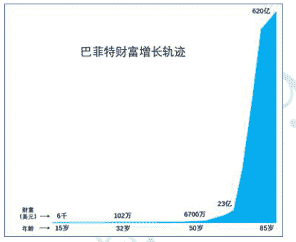

所以，今天二三十岁的年轻人，甚至四五十岁的中年人，有什么好着急和焦虑的呢？只要你在持续成长，在复利的威力之下，未来你能达到的位置会让人惊叹。

## 关键不是曾经发生过什么，而是你怎么看待，你同意吗？

《被讨厌的勇气》里提到一个观点：人的幸福与否，不取决于曾经发生过什么，而是取决于你怎么看待曾经发生的事情。这一观点非常有悖于主流的心理學观点，也和大眾的认知有很大的不同。

我们习惯认为，人是由过往的经历造就的；原生家庭对人的心理健康和幸福指数有巨大的影响；小时候受的伤害会给人的一生留下巨大阴影；穷之所以穷，是因为具有贫穷思维，而这种贫穷思维正是来源于长期的穷，于是穷人永远陷入恶性循环……

但是阿德勒把这些都推翻了，他认为，关键的不是过去发生了什么，而是你现在如何看待这些曾经发生的事情。这一观点，也是阿德勒和弗洛伊德以降的心理學流派最大的区别。

《被讨厌的勇气》一书把这种不同的理论称之为弗洛伊德的“原因论”和阿德勒的“目的论”。

- 原因论是：过去发生的一切是造就现在的你的原因，你的幸福与不幸，早就因为过去发生的事情而注定了。

- 而目的论则是：过去发生的一切与现在你是否幸福毫无关联，你怎么看待过去，怎么选择未来，才是幸福与否的关键。而你怎么看待和怎么选，其实都是抱着某种目的。

我认为，弗洛伊德和阿德勒，都各有正确的一面和错误的一面。

弗洛伊德正确的一边在于：每个人的过往，或多或少都对现在有影响，这是无法否认的。是我们遗传的基因和成长的环境决定了我们的性格和心理，甚至我们的命运。

但其错误的一边在于：在很多类似的成长环境中，总会有一些不同的性格和心理特征的人出来。例如，同样是悲惨的童年，有些孩子长大后非常自卑，或者性格偏激，很难得到幸福；但是也有一些人，并没有被悲惨的过往压垮，他们照样乐观、开朗、坚强，获得了成功和幸福。贫穷对人的影响也是，有的人因为贫穷而背上了一生的包袱，但也有人反而被贫穷激发了斗志，取得了更大的成功。如果按照弗洛伊德的原因论来看待人的性格和命运，宿命论的感觉会比较强烈，在现实生活中的指导意义就弱了一些。因为探究原因，并不能改变事实，就算知道了你悲剧性格的来源，可能你也没法改变——因为你没法改变过往那些造成你这些性格的原因。

而阿德勒的正确一边在于：已经有很多例子证明，即使是在同样的原因之下，也会带来各种不同的结果。而这些不同结果之所以会发生，很大程度上是因为每个人对待那些经历的态度和方式不一样。

其错误的一边在于：他过于绝对地否认过往经历对现在的影响，过度夸大一个人在“此时此刻”控制自己心理的力量。如果完全按照他的说法，那我们可能无法去分析一个人悲剧性格的来源，也就无法针对性地去寻找解决的方案。而且，人的心理是一个很顽固的东西，它要怎么看对待过往那些经历，本身也在很大程度上是由 过往经历对其心理的影响而决定的，不是说一句“我要这样看”，就真的能这样看——如果真的那么容易的话，那每个人对自己说一声“我要幸福”，就能幸福了，还要辛辛苦苦做那么多事情干嘛。

此外，阿德勒对于“目的”的进一步阐述，也有点太过耸人听闻。例如，他说父母对你不好时，你之所以会伤心，是因为你怀着某一种目的（例如，为了寻求安慰，或者引起关注），自己给自己创造了一种“伤心”的感觉；别人得罪你时，你感觉很有生气，也是想通过生气，来达成影响甚至控制别人行为的目的，而不是你真的想生气。

我认为，这种“所有行为和心理状态背后，都有一个目的”的说法，只能说在部分情况下适用，而不是普遍的——虽然阿德勒坚决认为在所有情况下都成立。

但阿德勒心理学的积极性在于，他赋予了我们的更多的主观能动性，让我们看到改变的希望。的确，在很多情况下，如果一件不好的事情已经发生了，我们既没有时间去改变它，那么也就只能选择如何对待它的方式了。

## 玛莎拉蒂的竞争对手是谁？

彼得·德鲁克是世界最著名的管理学大师、现代管理学理论的奠基人。他的理论不仅影响了管理学界，也影响了一代代企业家。

他的名著《管理的实践》有很重要的一章，叫“我们的事业是什么，我们的事业应该是什么？”其中提到一个问题：凯迪拉克汽车的竞争对手，是雪佛兰和福特汽车，还是钻石和貂皮大衣？

刚看到这个问题时，我直接懵了。一个品牌的汽车，其竞争对手肯定是另一些品牌的汽车了，这还有疑问吗？怎么可能是钻石或者貂皮大衣呢？想了一下，才明白德鲁克的深意。

由于德鲁克的这本书写于上世界五十年代，他举的例子是凯迪拉克，是当时的一个豪车品牌，现在可能有很多人没听过了，或者即使知道，也不认为它是多么顶级的豪车。我们在这里可以把他换成玛莎拉蒂或者法拉利、劳斯莱斯等其他公认的豪车。那么，玛莎拉蒂的竞争对手是丰田、大众或者比亚迪吗？还是汤臣一品、劳力士，或者巴黎名媛盛会呢？显然，后者可能更合适一点。

因为，一个人买车，如果选择玛莎拉蒂这个品牌，那就显然不是要买一个交通工具，而是要去买一个炫耀财富或身份的物件。其实，这个物件是玛莎拉蒂或者劳力士，都无关紧要，重要的是它要足够贵，而且能显摆出来。

很明显，假如你是一位有钱的男士，要送一样礼物给你想讨好的女伴，你绝不会在玛莎拉蒂和丰田、大众中间去比较，而是会把 它和一套别墅、一只名表，或者一个高端会员、一个顶级盛会去比较。 德鲁克举这个例子，是想说明：顾客购买一样产品，他真正购买的未必是这个产品，而可能是别的东西。例如某种名气、某种身份感、某种情怀。

另一个例子也常常被人使用：一个人到商场买电钻，他想要的并不是电钻，而是墙上的洞。所以，对一个家庭主妇来说，“铁头牌”电钻的竞争对手，并不是“金刚钻牌”电钻，而是天桥底下的泥瓦匠或者物业的电工师傅。

所以，当你去设计、生产、销售产品时，必须想清楚，客户真正要的是什么？如果定位错误的话，就会成为灾难。 想象一下，如果玛莎拉蒂把自己定位为丰田的竞争对手，去关注汽车有多省油、价格有多么便宜，那不就是自寻死路吗？

## 对待不幸的三种态度

每个人的生命中，都会出现不幸。这是无可改变的规律。但是，每个人对待不幸的态度，却又截然不同。

心理学家阿德勒在《自卑与超越》一书中，讲了对待童年时期不幸的三种态度：

- 第一种是：因为我童年遭遇过不幸，所以我现在做的每件事都是情有可原的。 这种人应该大家身边都有。不仅是对待童年不幸，而且是对待生活中出现的其他不幸。他们会把不幸当成自己堕落、自卑、歇斯底里的由头。自己性格和行动力一切不好的地方，他们都认为是情有可原的，而且绝不会改变。在面对别人的安慰、鼓励、帮助时，他们轻飘飘的一句，“你没经历过，你不会懂的”，就把你噎得无话可说。

- 第二种是：我童年遭遇过不幸，生活是如此不公平。世界对我太残忍了，我为什么要善待世界？我要报复。 这种比第一种人更可怕。第一种人还只是自怨自怜，这种却是反社会人格。他会觉得别人做的所有事情都是针对他，有害于他，从而也总是以敌意来面对社会。这种人你对他好他不会记得，更不会感恩，甚至会怀疑你背后有什么不可告人的目的。而只要你对他稍微不假辞色，他就立马会把这当成他们被亏待的新证据，更加强化了“别人都针对我”的信念。

- 第三种是：我遭遇过不幸，这种感觉很不好，所以我要让世界变得更好，让别人不要再遭遇这种不幸。 这种人是坚强者、乐观者。他们战胜了苦难，并且致力于消除这些苦难。这些才是生活的强者，是值得我们亲近的，尊敬的人。

我们如何看待不幸，决定了我们的心理感受和外在行为。如果总是用第一、第二种态度去看待不幸，我们不会感受到世界的温暖，不会交到真心的朋友，也体会不到真正的幸福：我们的种种行为，也是对这个世界，对自己的家人朋友往往有害的。 而换成第三种态度去看待不幸，我们感受到的世界会更美好，我们也将为这个世界创造更多的美好

## 花 810 万买房，现在懵逼了

昨晚一个朋友 W 和我哭诉他的悲惨经历，我特地把它记下来，希望能给大家一些警醒。

W36 岁，在某上市公司当总监，妻子博士毕业，在科研机构上班，夫妻俩加起来月收入大概 4 万略少一点。

此前，在广州有两套房，但都是比较偏的地方。现在孩子快要上小学了，想换个学位房。看来看去，看中了天河区华阳小学的房子。在广州的朋友都知道，那里是东站和体育中心地界，加上华阳的学位，房价高得吓人。W 敢看那里的房子，确实吓我一大跳。

但他们的底气在于，现有两套房子的可以卖一套，大概有 200 万，减掉原来没还完的房贷，还有 150 万。另外一套大概值 330 万，还要住，所以暂不能卖，去抵押个 200 万出来，加上现有积蓄，大概能凑 400 万，够付首付和支撑一段时间的利息了。

本来想找个六七百万的两房（在华阳学区，均价都是 8 万起，所以六七百万确实只能买得起两房，好的小区还只能是小两房），但是被中介一忽悠，看了个 800 多万的，一来二去头脑发热，谈到 810 万，就在合同上签字了，并付了 20 万定金。

然后回来办理卖房和抵押的事情。第一套房子倒是卖掉了，拿了 150 万，第二套房子的抵押却出了问题，办不下来。W 又想通过过户给亲戚，由亲戚以买房的名义去贷款，可是银行审核，发现他们的亲戚关系，怀疑在骗贷，也拒绝了贷款。这样一下子就出现了 近 200 万的缺口。W 又想通过开公司办理经营贷，先是注册了一家公司，去办才知道要经营满一年才行；他又找到开公司的朋友，好不容易说服朋友把公司转到他名下，再去贷款，结果也是被银行查到有利用经营贷买房的嫌疑，被拒了。W 急的不行，只好找亲戚朋友借遍，凑了一百多万，然后又请求同事帮忙，几个人都去办了消费贷，由 W 还本付息。

最后，首付是凑齐了，房子买下来，结果，现在 W 每个月光是还房贷、消费贷，就要 4 万多，夫妻俩的所有工资都填进去都不够。W 把原来开的帕萨特卖掉，但是也杯水车薪。想把 330 万的那套房子卖掉，现在市场行情又差，价格直降到 270 万，他既舍不得，也没有人来看。

几个月下来，W 愁得头发掉了一半，原来爱美的妻子，也连衣服都不敢买了。一家人的生活，完全变了样。

此前，牛人星球曾经有老师分享过八五后小夫妻买三套房的经历，但是那是银行专业工作人员，有丰富的理财知识和深厚的人脉关系，一步一步都算好才购买的。就这样，她也没敢去染指 800 多万的房子啊。而这位朋友，却是头脑发热，完全没有规划好，就贸然买那么贵的房子，结果导致家庭财政危机。现在都不知道怎么办好。

我觉得，朋友做得不妥的地方有两个：

- 一是去做远超自己能力范围的事情。 我一般都会鼓励大家去做超出能力范围一点点，需要跳一跳才能够得着的事情，但是却不主 张做远超能力范围的事情。而且，做事的时候，一定要看最大损失是不是自己可以承担。只有即使最坏的情况发生、最大的损失产生，自己也能承担时，才可以去做。

- 二是对情况的估计太过乐观。朋友当初想得好好的，但是随着国家对贷款政策的收紧，查得更严，基本上把他想过的路子都堵死了，造成了今天的被动局面。当然，他的问题也不是没有办法解决。现在最大的底气是还有一套房子。如果市场行情好转，能够卖掉，他的问题就解决了。如果迟迟卖不掉，那接下来几个月，会非常痛苦。

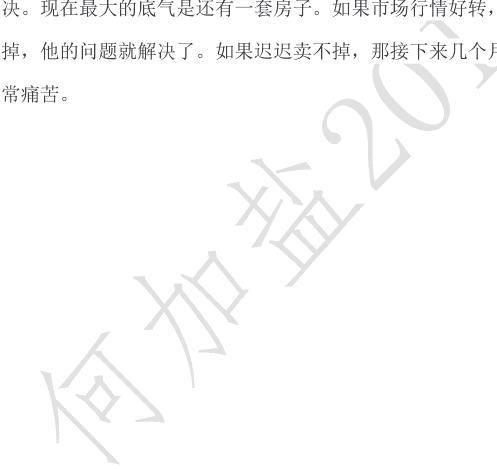

## 圣人的赤子之心，以及好玩的孔子见美女故事

早读《传习录》，看到有一段王阳明论“孔子正名”的话，不禁莞尔，觉得这些世之所谓的“圣人”，也会有这样天真的时候。

那段话是这样说的：学生问：“孔子正名，先儒说‘上告天子，下告方伯，废辄立郢’。此意如何？”

这句话有很深的背景，须得先知道了背后的故事，才能明白。我就先讲讲故事。

话说，卫国有个国君叫卫灵公，他有一个美丽的宠妃，名叫南子（这个南子和孔子有段特别有趣的故事，后面再讲），南子淫乱，卫灵公的世子蒉聩看不惯，派人去杀她，结果派去的人投靠了南子，告了密，南子就去卫灵公那里哭诉，蒉聩害怕，就逃到别的国家去了。

蒉聩逃走以后，卫灵公和南子就想立南子的儿子“郢”为世子，继承君位。但是郢不愿意当。后来卫灵公死了，南子又要立郢为国君，郢还是辞掉了。

这时，卫国的大臣和百姓说，世子的儿子不是还留在卫国吗？那就立他吧。于是把蒉聩的儿子“辄”立为了国君，就是卫出公。

卫出公对孔子很尊敬，向他请教为政的道理。孔子就说出了那句千古流传的话：“必也正名乎！”他这话的意思是说：为政的要义，是匡正名义。

卫出公当国君，本来就是别人辞让给他，而且自己的老爹是名正言顺的世子，还在国外，按道理继承也是老爹继承，不该是他，所以从名义上来说，他的来路其实是不正的。所以孔子一说那话，他心想，这不就是要搞我吗？自然就不敢请孔子当政了。

后世朱熹评论这段故事的时候，引用了胡瑗的评论，认为孔子要“正名”的原意是：卫出公得国不正，如果孔子去卫国当政，他就会禀报周天子，昭告各方诸侯，把卫出公废掉，立郢为国君。

王阳明的学生对朱熹这么说感到不解，所以来问“此意如何”。

王阳明的解答是：“孔子恐怕不会这么做。别人恭恭敬敬地请我去当政，我怎么能先去废他？这不符合人情天理。

孔子如果去卫国当政，那肯定是因为卫出公能够全力信任和听从他。

孔子的德行那么高，必然能感化卫辄，使他知道如果自己不管父亲，那就不是人，因而必将哭着把爹接回国。

父子之爱，本于天性，卫辄如果能够悔痛真切如此，他爹蒍瞍岂不感动得一塌糊涂？

蒍瞍如果回到卫国，卫辄就把君位还给父亲，然后请罪。蒍瞍也肯定已经被孔子的德行感化了，决不肯接受君位，仍然会命令卫辄来当的。

而且卫国的群臣百姓又一定会想要卫辄为君，卫辄就向大家表明自己有罪，然后请示天子，告诉四方诸侯，一定要归还君位给父亲。

蒯瞀和群臣百姓也都会认为卫辄能够悔悟，有伉孝之美，他们也会请示天子，告诉四方诸侯，一定要让卫辄当国君。

卫辄不得已，就会像后世的太上皇的故事那样，率领群臣百姓，尊蒯瞀为太公，好好侍奉他，这才能退回来继续当国君。

这样，国君有国君的样子，臣子有臣子的样子，父亲有父亲的样子，儿子有儿子的样子，君君、臣臣、父父、子子，名正言顺，一举而可为政于天下矣！孔子正名，或是如此。”

不知道大家听了王阳明的一番解读，心里是什么感受？

我觉得，王阳明这些想象都是美好的，但是就像小孩子憧憬的东西一样，美则美矣，却不可能实现。反正我是不信如果孔子那么干的话，卫辄、蒯瞀、臣子们都能表现得那么品德高尚，搞不好还会弄成一出父子相残的惨剧。

其实不光是王阳明，孔子很多时候也是这么天真得可爱。他会设想一种理想化的状态，但实际上又是当时的情况下实现不了的。他们的理想非常光辉，只是可惜落不了地。

当然，这些不会有损孔子和王阳明的地位分毫，即便如此，他们仍然是圣人。他们的这些理想不能实现，不是他们的过错。就像颜回和孔子说的那样：夫子之道大矣，故天下莫能容……是有国者之丑也。不容何病！不容然后见君子！

书至此，想起我自己最近的一些文章，也总是在后台遇到一些不理解和不相容，我之前就说过“被误解是表达者的宿命”。今看孔子、阳明，就连他们理想那么高大、表达能力那么强，不也常常会被别人不理解吗？我们写几篇文章，不被一些人理解，又有什么大不了的呢？

再反过头来看，我看了孔子、阳明的一些东西不理解、不认同，不是也很正常吗？这些理解和不认同，并没有损我对两位圣人不尊敬，也丝毫不会影响我继续读他们的文字，认同他们的其他道理，喜欢他们的为人。如果因为看了王阳明这篇文章，就把他拉黑，说王阳明这人不行，他的东西是垃圾，那我不就成傻逼了吗？

最后说一下南子和孔子的故事。南子是卫灵公的夫人，比卫灵公小30岁，生得美艳绝伦，孔子评论“吾未见好德如好色者也”，就是因她而生的感慨。南子妖媚，其淫乱在卫国几乎是人人皆知，而卫灵公似乎也不大在意。

孔子周游列国的时候，到了卫国。南子听过孔子的大名，就想见一见他，说：“到了我们卫国，凡是想要和国君做哥们儿的，都得先见我。”孔子就去见了南子。

《论语》上面对这次会面一笔带过，只用“子见南子”四个字就说完了，而《史记》的描述则详细一点：“夫人在缢帷中。孔子入门，北面稽首。夫人自帷中再拜，环佩玉声璆然。”

到这里，事情似乎还没有什么奇怪的。

但怪的是，孔子回来后，他的学生子路却非常不高兴。

《论语》和《史记》都记载了孔子的反应，他向子路说：“予所否者，天厌之！天厌之！”

这句话历来解释不一，但大多数人的理解是：“我没和她做不对的事，让老天厌弃我吧！让老天厌弃我吧！”有点类似于“我要是和她干了坏事，天打雷劈”的感觉。

因为孔子的态度以及这句话，《论语·雍而》一篇，成了儒学的千古疑案，大家纷纷猜测孔子见南子到底发生了啥，子路为什么生气，孔子又为什么那么大反应。

民国时期，林语堂还特别编了一个话剧，叫《子见南子》，描述孔子见了南子，被她迷得神魂颠倒的故事。这事影响巨大，还酿成了民国时的一大公案。

孔子见南子的时候，已经57岁了。古代人寿命短，57岁已经是一个很老的老头。

大家想象一下，老头见完南子回来，看到学生不高兴，急得诅咒发誓的样子，是不是很可爱，很有画面感？

论语里还有很多好玩的故事，以后会再和大家讲。

## 我们对未来的想象常常是错误的

哈佛大学教授丹尼尔·尼尔伯特在《哈佛幸福课》中多次提到，我们关于未来的想象，往往是错误的。

他认为：我们在想象未来的时候，会缺失很多东西，而那些缺失的东西，重要性远远超出我们的想象。这么说过于空泛，难以理解，我们来看一些日常生活中的例子就好了。

- 例一：五一假期，我们家小宝想去公园玩，大宝不想去。大宝觉得，公园没什么好玩的。这时候，我们可以说，大宝想象中的公园玩耍，是乏味的。但由于其他人都要去，大宝没办法，只好噘着嘴，不情愿地跟着去了。实际的情况是：她在公园玩得非常开心。我们明显可以感觉到，真正发生的现实和她之前的想象，有很大的不同。
- 例二：我有时候工作太忙，晚上加班回去会想喝点啤酒。在我的想象中，喝下冰冻啤酒，会让我感觉很爽。但实际往往是，我喝下去的时候，完全不是之前想要的那种感觉。想象中的那种爽没有了，或者就算是 有，也打了很大的折扣。
- 例三：很多家长在孩子小的时候会想象，如果以后孩子都长大了，离开了家，那我们得多孤独寂寞啊。但是实际上，很多研究都表明，孩子离开家去上高中或大学时，家长的幸福指数急剧上升。“空巢”带来的唯一后果，就是微笑越来越多，幸福感恢复到新婚时那么强，甚至比新婚时更强。

上面只是三个小例子。而我们人生的大方向，其实也符合这样的规律。我们会去想象，假如未来遭遇不幸，例如变成盲人、聋哑人、坐轮椅者，那我们肯定每天都将生活在痛苦之中。我们也会想象，假如未来变得功成名就，例如当上大官、巨富、名流，那我们肯定每天都将无比幸福。

其实，这都是我们大脑虚构出来的假象。实际的研究结果表明，刚刚遭遇不幸时，人的幸福感确实会短暂地有所降低，但是过一段时间之后，又会恢复到正常水平。刚刚得到一大笔钱时，人的幸福感也会短暂地有所升高，但过一段时间之后，同样会恢复到正常水平。

这是因为，我们想象这些生活时，总会在大脑中栩栩如地构造那些不幸（或者功成名就）的细节，而忽略了生活是由无数鸡毛蒜皮组成的。盲人并不是每时每刻都在哀叹，我为什么看不见，如果我能看见那该多好，而是在忙碌着他自己的生活，也许是在听音乐，也许在读盲文书，也许在盲人专用电脑上写作，也许吃到某种美食，也许在盲人按摩店里打工。在那些时刻，他对幸福的体验，和其他人并没有什么不同。亿万富翁也并不是每时每刻都在享受着金钱带给他的快感，而是也在忙碌着他自己的生活，也许在为下个月的公司现金流而焦虑，也许为孩子生病而自己没法陪伴而愧疚，也许在经历婚姻不谐的痛苦，也许在为员工的低级错误而大发雷霆。在那些时刻，他对幸福的体验，也和其他人没有两样。

正因为大脑对未来的想象常常是不准确的，我们如果凭着当下的感觉，去决定未来，就有可能是错误的。吉尔伯特据此提出了两个建议：

- 一是活在当下。既然我们难以想象未来的幸福，那就应该把重点放在体会当下的幸福上面。
- 二是寻找替身。既然我们自己的想象力是不可靠的，那就看随机抽样下的其他样本现在的幸福状况如何。例如，你想要决定做一个程序员还是医生，就不应该自己想象你拿着键盘或者手术刀的样子来预测是否幸福，而是应该跟程序员和医生去聊天，看他们在工作中感受到的是幸福还是不幸。

我知道，第二条会招来很多非议。我们习惯上更相信自己的想象，而不是抽样调查的结果。所以，用替身来代替自己决策，有点太违反常识。但吉尔伯特用了很多实验来佐证，并坚决认为：我们过于低估人与人之间的相似性，而高估了独特性，实际上，使用替身，是一个成本低而且有效预言自己未来感受的方式。更多相关知识，详 见《哈佛幸福课》，丹尼尔•吉尔伯特；《思考，快与慢》，丹尼尔•卡尼曼。

## 产品的价值有三种

做任何生意，都可以把产品从销售到交付的过程，分为三个环节：销售环节、生产环节、交付环节。产品对客户的价值，其实有三种，第一种是在销售环节让客户感知到的价值，我们可以称为客户对产品的期待价值；第二种是产品真正能对客户起的作用，我们可以称为产品的客观价值；第三个是客户得到或使用产品时感受到的价值，我们可以称为交付价值。

很多时候，这三种价值，是互相背离的。不同的公司，往往会有不同的侧重。

销售型的公司，会侧重于给客户的期待价值。他们可能会把产品说得天花乱坠，让人产生满满的期待，轻易就能够把产品卖出去。但实际上，产品的客观价值，并没有他们所宣扬的那 么大。例如，老年保健品、陈安之成功学、小米一代二代手机、绝大多数化妆品、减肥药、生发剂等等，基本上都是此类。

这种你要说他是骗子吧，好像也不全是，有些是有些不是，还有些无法判定，但是总而言之一条，他们的产品并没有宣传的那么好。

这一类的公司是非常多的。而且商人和企业也不以为耻，毕竟他们养活了企业员工，也给国家纳税，所以一般只要不出现谋财害命的事情，法律也管不了，舆论也很宽容。有时候，企业家甚至会被视为成功者。例如史玉柱卖脑白金、杜国楹卖小罐茶、周鸿祎卖孕妇路由器等等。

产品型的公司，会侧重于给客户的客观价值。他们会尽量让产品真正具备价值，解决客户的问题。

但是有可能，这一类的公司不一定会营销，所以好产品未必能卖 出去。也有可能，他们的产品虽然好，但是包装、物流、客服等方面做得很差，所以给客户的体验并不好，导致客户忽略了其真实价值，而对产品的评价偏低。

很多公司做产品很用心，却没有成功，就是吃亏在这上面。

其实何加盐公众号和牛人星球，就是产品型，客观价值是非常好的，文笔、用心程度、知识的密集度等等都很不错，但是却在营销和交付上存在很大的短板。所以会发展比较慢，而且用户感知到的价值会低于产品和服务的真实价值。

交付型的公司，会侧重于给客户的交付价值。他们会用心营造“交付感”，让客户时时感到“惊喜”或者舒服。例如通过良好的环境、包装、温馨的客服、或者巧妙设计的体验环节等等。

这一类的公司大多在培训类、知识付费类、互联网产品类、奢侈品品类等等。 例如，培训公司，会用尽各种办法，让你的课堂体验非常好，尤其是峰终体验完美无缺，但是实际的培训效果，却不见得非常好。但是由于你的感觉不错，所以评价一般会比较高，投诉率或退货率很低。

但是，这类公司的缺陷在于，他需要不断去开拓新的客户。因为虽然客户满意度很高，但是复购率却不高。所以他们常常会利用客户的满意度数据和评价，作为拉新的背书，却由于真实的价值低于感知的价值，客户久而久之也会明白过来，下一次就不一定复购了。

销售型、产品型和交付型，没有高下之分，只是侧重点不同。在公司发展的不同阶段，侧重点也会有所不同。

但是，可以肯定地说，任何一家持久成功的公司，都是三种价值平衡发展。那些一直做不起来、或者短暂做起来但不能持久的公司，一定是其中某一种价值没有做好。

所以，一个好的团队，应该有三种类型的人，一种擅长创造期望价值，也就是会卖货；一种擅长创造客观价值，也就是会做产品；一种擅长创造交付价值，也就是能提升客户的感知满意度。请想一下，你自己，是销售型、产品型还是交付型呢？

## 师弟毕业了，年薪 150 万

前两天看华为总裁办电子邮件关于招收 2019 年顶尖学生的通知，看到一个熟悉的名字。

> “管高扬博士，年薪 140.5-156.5 万。”

不禁为高扬感到特别开心。

高扬是我浙大的师弟。是浙大尖子生聚集地竺可桢学院的博士。虽然我比他早很多届，但是因为同属一个社团，所有也有联系。

他是物联网和边缘计算的专家。一个月前我写关于 5G 的文章时，还专门向他请教有关的问题。他做了非常详细的回答，那篇文章的很多思路、观点和信息，正是来源于他。

去年我做咨询，研究碧桂园的激励机制，看到他们花 60 万年薪招博士应届生，还觉得杨老板很有魄力。现在看，还是任总魄力更大。

师弟的例子告诉我们。一是作为个人，只要选对行业，并成为行业的顶尖人才，一定会有很好的机会。二是作为企业，要舍得在人才上大力投入。这两点希望对大家也有所启发。

## 如何用价值观筛选人才

企业如果想长久发展，一定要找价值观契合的人才。如果价值观不契合的话，老板用人会觉得半身不遂，怎么都指挥不动。员工也会觉得老板脑子有问题，处处和我为难。

尤其是公司稍微大一点，人数超过 20 以后，老板就会管不过来，而几百人上千人的公司，更是不可能管到每一个角落，如果想让员工能心往一处想、劲往一处使，价值观就尤为重要了。

如何用价值观来筛选人才呢？我认为要从这几个方面着手：

第一，老板自己要想清楚和表述清楚价值观是什么。

企业的使命、愿景、价值观到底是什么，有什么不可逾越的红线。有什么事情是企业鼓励的，员工做了就会得到表扬或者奖励，什么是企业坚决禁止的，员工做了就会得到惩罚或者开除。

这些想清楚，说清楚，并且在实际运作中也能这样做的话，员工就很明白，自己做什么，不要做什么。

新人要进来之前，也把这个说清楚，如果不能接受的，就自然淘汰了。能接受的，才能进来。

第二，招聘时重视对价值观的考察。

企业在招聘时，可以设置与价值观有关的笔试题。这些题目不能太过直白，例如：“你是否认同 XXXX”，这是无效的；要把价值观放在具体场景中，让员工做出选择，例如：“如果面临下面这样的情况，你会选择怎么做”。

面试的时候，也是重点考察价值观的时候。问问他对一些企业和一些事例的看法，多追问几个为什么。了解其成长背景和上一次离职的原因。了解其原公司的价值观是什么，其认同还是不认同。

一般来说，对方如果真诚作答，总会有一些分歧，这时，就要求老板和人资的人定好标准，哪些分歧是绝对不可容忍，要一票否决的，哪些分歧可以求同存异，哪些分歧是可以后面慢慢纠正的。例如，雷军找一个顶级销售，听到对方说“我能把稻草卖出黄金的价钱”，立马就否决——尽管其能力是自己急需的。马云偶然经过公司内部的一个培训现场，听到讲师在讲“如何把梳子卖给和尚”，就冲进去把讲师赶走了。这就是价值观的一票否决。

不排除有些应聘者会刻意迎合，隐瞒自己的真实心理。这个是没法防范的，只能在后续中去发现。

第三，工作中的灌输与管理。

价值观问题不是一劳永逸的，不是贴在墙上就行的，要天天讲、月月讲，并且要用价值观来指导一切行动、评判一切行动。

阿里巴巴的员工都要接受长期频繁的价值观教育，做专门的集中培训，并且在年度考核中，把一半的分数放在企业文化上面。马云在公司最困难的时候，因为回扣问题，开除过公司的年度销售之星。在公司很成功之后，因为员工自写程序抢月饼，当天开除，毫不留情。这都是坚守价值观。

华为的文化是客户为中心，奋斗者为本。任正非的内部文章、内部讲话，时时刻刻都体现这两点。华为的心声论坛，全部都在倡导这个文化。所有的升迁奖励，全部围绕这两点。没有这个精神的人，在华为根本就呆不下去。

这里要特别注意的是，公司的 KPI 不能与价值观互相矛盾，公司的文化导向要清晰地指明，如果 KPI 和价值观相抵触时，以哪一个为准。如果老板嘴里说着价值观，但是为了完成业绩又要求员工做另一套，这个价值观和老板的信用就崩塌了。

最后还有三点要说明：

第一，企业价值观不是永远不变的。在发展的不同阶段，价值观会有所不同。例如，初期更强调效率，中期更强调团队合作和跨部门协调，后期更强调社会责任。如果僵硬地生搬硬套，一成不变，反而对企业不利。

第二，人性的基本面是不会变的。不要指望招一个能力很强、但是价值观不合的人，以后可以扭转他的价值观——这是不可能的。与其花那么大力气，去做一件徒劳的事，不如一开始就只选价值观契合的人，哪怕能力弱一点都行。能力弱，跟你往同一方向使劲，也是在帮你。能力强，但是和你使劲的方向不同，可能在害你。

第三，虽然人性基本面不会变，但是即使价值观大体契合的人，也会在小处有分歧，有自己的小算盘，有心理和行动上的摇摆。例如，崇尚奋斗的人，有时候也会想偷懒；崇尚清廉的人，有时候也会想占点小便宜。所以，价值观必须有相应的制度配套，让遵守价值观的人得到奖励，违反价值观的人得到惩罚。另外，企业文化建设不是一夕之功，理想信念教育需要常抓不懈。

## “但行好事，莫问前程”真的有用吗？

前两天认识了一位新朋友。他们做了一个号叫“终结诈骗”，现在 有 500 万用户。

令人震惊的是，他们之前做了 3 年，才做到 100 万，今年过年来，就增加了 400 万。

而更令我震惊的，不是这些数字，而是——他们从来没有用这个 号赚一分钱。

写公众号不是容易的事，何况要连写 4 年。

朋友告诉我，他们团队有 5 个人，年龄最大的已经五十多岁，他 是最小的，二十多岁。他们全部都有本职工作，写公众号纯粹是志愿 行为，花的都是自己的业余时间。

这个号完全是公益目的，没有任何商业化。其初心就是向群众普 及防诈骗的知识，而丝毫没想过要通过这个赚钱。

现在，微信 110 直接与他们的号连接，深圳市公安局和他们长期 合作，他们的号也挽救了无数潜在的被骗者。

可以说，这个号现在可能是民间反诈骗的影响力最大的号了，如 果家里有老人可能会受骗的话，不妨关注一下。

我认识这位朋友是一个自媒体聚会场合，当时除我和他以外，还 有 3 位也都是做自媒体的。

听完我们都非常感慨：我们孜孜以求地扩大用户规模，结果却不 可得；而他们就是业余做一下，也不求任何回报，却自然而然成长位

超级大。

我想，这就是“但行好事，莫问前程”的良好注解吧。很多时候，我们发心向善，行动坚定地去办一件事情，而不求回报，最终的回报，可能会比我们一起开就斤斤计较，要好得多。

## 多一点主动，多一次机会

今晚北京聚会后，和星友 Lynn 在路边等车，聊了一会儿。她成长经历中的一个细节让我感触很深。

当年她初来北京找工作，把简历投给了心仪的某公司。招聘要求上写了英语必须通过六级，她当时还没有考过六级，所以简历关就被刷下来了。但是她没有放弃，而是直接找到了该公司人力总监的电话，打过去说，能不能给我一个机会，虽然我六级暂时没过，但我其他方面的条件都很符合，我认为自己是最合适的人选。人力总监被她说服了，通知她来面试。闯入最后一轮的总共 8 个人，只录取 2 个，最后她成功入选，于是在北京落下了脚。

试想，如果她看到要求六级的公司就不敢投。如果简历被刷下来就不去争取，又怎么会有最后的成功呢？

我自己也创立过公司，招过人，我知道，其实，很多字面条件都不是铁的，如果有其他方面特别优秀，招聘简章里写的东西，其实都可以通融。而且，每一个老板和每一个人力总监，都会喜欢主动争取的人，一般来说都会同意给一个机会，除非实在是条件太差了，没有任何优点。

不惟求职，人生很多时候，都是这样。哪怕被拒绝了，或者你尝试但是失败了，没有关系，再试一次，再努力一把，也许事情就有了转机。

人生多一分主动，就多一次机会；多一分坚持，就多一分希望。

## 雷军不自信

昨天的公众号文章写了雷军的生平事迹。一个强烈感受就是，雷军其实挺可怜的，他的心理负担太重了。

他在湖北浠水县剅河镇赵湾村这个村子长大。村子很小，交通不便，是一个排湖的北岸。他爸爸是村里的骄傲，雷军也从小就承受着全村人的另眼看待。

自从他很小的年纪就制作出了电灯，家人和村里人就都把他目为神童。在赵湾小学，他是当之无愧的学霸。

可是，9岁到了县城读书以后，他的学霸光环不再。作为农村来的土老帽，他的成绩只能屈居第二。

——一个非常值得注意的细节是，从小学到大学，每一次重要考试，雷军都清楚记得自己是第几名，并且会在演讲中说出来。这不能解释为记忆力好，只能说明他对这个特别特别在乎。

上了浠阳师范学校附属中学，他仍然没能拿到第一，中考的成绩是学校第三名。虽然足以让他考上浠阳中学，但毕竟是留下了遗憾。

高考，他本来是可以上清华北大的。我不知道他们当时是先报志愿再出成绩，还是先出成绩再报志愿，总之他对自己太不自信了，以超过清华录取线10分的成绩，只报了武汉大学。虽然武大也不错，但是对雷军本来可以达到的高度而言，确实是太低了。

大学期间，他生怕落伍，从第一天就去上晚自习。看到别人不午休，就立马把自己午休的习惯也改掉。

他还特别向别人讲过一件事：在计算机汇编语言这门课的考试中，他拿了满分，据说武大有这门课20年以来，只有两人拿到过这个成绩。而从来没有透露过，除了雷军以外的第二个人是谁。我查遍所有资料，问过所有相关的人，都没有一个人能回答我。

日后到了金山，到了小米，雷军还是不自信。他没有举重若轻的魄力，凡事只能以勤补拙。在金山，他要求所有人都必须穿正装，以体现专业性。直到很久以后，才意识到专业性不是靠着装来体现。

在金山，为了拉拢人才，他做了很多许诺，但是内心深处，其实他没有自信可以完成。他总是焦虑不安，觉得自己欠下的债还没还清。因此拼了命地要把金山弄上市。哪怕是一个市值很低的，大折扣的上市。因为要还这个债，了却这个心理负担。

后来做天使投资，战绩很辉煌。但是他做投资其实也没有什么技巧，就是投信得过的熟人。而且不参与任何经营管理。在投资之前他会和对方说明，你们可以问我意见，我也可以提建议，但是你们可以不听，我绝对听你的。

做小米之后，他生怕别人知道是他做的。只敢认领投资人这个身份。一直到一年半以后，小米手机做出来了，对比市场，他知道这款手机能火，这才让自己亮相，告诉别人他是创始人兼CEO。

2013年和董明珠打赌，他内心其实还是不自信的，所以只赌一块钱。他做小米，是希望能尽快上市的，可是2016年，小米销量大幅下滑的时候，他觉得完不成这个目标了，这时他又失去了自信，宣布小米5年内不考虑上市。

而到2017年形势好转，他才又回过头来，说小米市值2000亿。

现在，小米虽然是世界500强了，但是在市场竞争中，小米的压力还非常大。尤其是股市行情不好，我猜雷军的心里一定是沉甸甸的。

创业者，往往是头一天晚上觉得自己无所不能，第二天晚上又觉得自己一无是处，这是正常的。只是在雷军身上这一点反映得特别明显。

我认为，雷军的不自信，根源还是在于没有形成自己的杀手锏。所以做的事情没有定力。在金山，他的业务方向老是变来变去。在小米，他说要专注，结果还是做成大生态。他不像马云，对自己看到的未来绝对自信，毫不动摇；他不像马化腾，对自己的产品能力绝对自信；他不像任正非，坚决相信研发的力量。他对自己的评价，不是根植于内心，而是取决于外界的评价和公司的业绩数据。

所以，雷军以后有可能可以做成更大的成绩。但是他内心的焦虑和不自信，一点都不会减少。

## 在中国，稳定的婚姻是成功的必要条件

李国庆和俞渝的新闻，真是把我震惊了。这种愚夫泼妇式的撕扯，竟然发生在一个北大才子和一个留美精英、两个亿万富翁之间。

他们爆出来的料，是真真假假，我也懒得去求证了。只想分析一下这种行为。

之前，我写过一篇《大佬情史》，分析中国互联网大佬们的爱情与婚姻。根据我查证的结果，现在中国最厉害的互联网公司，其创始人都有一个稳定的婚姻。哪怕是刘强东去年爆出婚外丑闻，但至少他的家庭还是稳定的。

文中，我还专门点了李国庆和俞渝的名。我写道：“这些站在中国互联网圈顶端的巨头们，也都维持着稳定的婚姻。也不是没有反例，例如土豆网的王微，当当网的俞渝和李国庆。但是这些在创业过程中、或成功以后闹离婚、或者夫妻矛盾重重的，都没有像BAT、TMD这些人这么成功，而只是做着三四流或不入流的公司，甚至完全失败（此处仅指互联网行业而言，请勿套用到其他行业）。”

当当网是中国最早的一批电商公司之一，但现在沦为一个三流公司，其中固然有种种其他原因，但是我相像，和李国庆、俞渝不能齐心协力共同把公司搞好，反而互相拆台，一定有莫大的关系。

在文中，我统计的企业家有两个限定条件，一是中国，二是互联网行业。美国的一些知名企业家，爱情和婚姻是很糟糕的，如乔布斯，马斯克，但是人家企业照样做得很好。

只是这个在中国就不是很适用。在中国，也有很多企业家经历过糟糕的婚姻，如任正非四十多岁离婚，王石五十多岁再娶。但他们都不是在创业的过程中互相拖后腿的那种。任正非是在创立华为之前离的婚，再娶之后，也一直夫妻恩爱。王石是在已经功成身退之后，才离的婚。所以在创业阶段，他们的家庭也一直都是事业坚强的后盾。

我一直认为，在中国，一个稳定的婚姻，是成功的必要条件。创业本来就不容易，夫妻一条心都做得很艰难了，如果再把大部分精力，用于应付不和谐的家庭关系，必然难以成功。

最后，我认为婚姻对人幸福感的影响，比事业更大。最好的情况，自然是婚姻和谐，事业成功。但世事往往难以两全，我们经常要在其他选项中选择。次好的情况，是婚姻美满，事业一般；再差，是婚姻破碎，事业成功（但成功率很低）；最差，是婚姻破碎，事业失败。

## 不自信会影响人生重大决策

昨天和一位师弟聊天，颇有感慨。

师弟渐大硕士毕业后，进入国企工作。很短时间内就做到领导岗位，30岁前就上了处级。现在又被一家年产值几亿的公司挖来做合伙人兼运营副总。

师弟的能力和成绩都是有目共睹的，但是在聊天中，我能明显感受到他的不自信。

例如，当他去负责集团下面某子公司时，总觉得自己这也没做好、那也没做好，觉得自己能力不够，压力很大。但事实上，他担任子公司总经理的时候，是该公司管理最好，发展最快的时候。

他一直有出来创业的心思，但是却迟迟不敢行动，直到8年之后，才被人三顾茅庐挖出来。而出来之后，也是焦虑重重，不知道能不能干好。他喜欢阅读，并且长期做阅读笔记。我建议他开一个微博或公众号，把这些笔记放到网上。可是他说，写得太烂了，不敢放到网上。

其实，我不相信一个常年阅读和做笔记的人，会写得很烂。而且，他的东西已经有了，只是放到网上而已，又不增加什么成本。何必要顾虑那么多呢？我安慰和鼓励他很久，并把“冒牌者综合症”那篇文章发给他看，也不知对他有没有用。

这种不自信，其实对人生的重大决策影响挺大的。师弟如果自信一点，可以在子公司老总的位置上做更久，或者可以更早出来创业，或者现在当合伙人可以过得更从容。而不自信，限制了他这些。

我自己其实也是如此。

2010年我买第一个房子，当时才十几万存款，就定了一个80万的预算，后来因为80万的房子实在买不到，只好咬牙增加到90万——这是在我自己的认知中，我觉得能承受的最终负担了。

在偏僻位置买了一个老破小的房子后，我心想，向亲朋好友借的钱，以及在银行贷的款，要多久才能还上啊。

买房半年后，一位长辈建议我尽快买辆个车，我都被吓住了，心想房贷都快把我压死了，哪里还有钱买车啊。长辈说，你尽管买，我借钱给你。

后来因为家里地处偏僻，老人小孩不方便，我还是借了长辈6万，自己又添了5万，咬牙买了一辆经济型小车。长辈知道后，很是叹息，说我买的车太差了。我心想，你哪知道我的苦啊。

结果后来，我和老婆半年就把长辈的6万元还掉了，一两年就把买房借亲友的钱还了。第5年，我又有一些余钱，可以考虑买第二套房了。

现在想起来，在2010、2011年的时候，我就是太不自信了。我不相信自己在他人眼里的信用有多高，能不能借到足够的钱；我不相信自己与何太的赚钱能力，所以不敢为自己的未来做更好的投资。

实际上，我当时借钱非常容易，一些同事朋友，只要我开口，他们随时都能借10万8万给我，我们的收入增长很快，房贷在收入中占的比例很小很小。我们完全应该在市中心买一个200万的房子！

6年后我卖掉第一个房子时，它的价格才从90万涨到140万。而和我同期买房的同事，因为买的是市中心的优质学区房，价格涨了3倍。而我的一位前领导，因为自信，有魄力，敢于出手买房，几年后在广州、佛山、深圳有了好几套房子，家产到了好几千万——我们的工资相差不大，而财富相差巨大，我少的就是他那一份自信。

在事业上也 是如此。由于不自信，很多事情就不敢冒险。即使我在2013年看到自媒体蓬勃发展的趋势，也没有勇气从体制内跳出，自己做自媒体。而是整整在体制内蹉跎了10年。这些都是人生深刻的教训。我现在以写公众号谋生，其实也是一个不稳定的业务，但是我比以前多了一份从容和自信。我非常相信，即使公众号这个平台式微了，公众号干不下去了，我随便在任何地方，找到一份工资还过得去的工作，是一点问题都没有的。

这份自信让我能够较好地抵御目光短浅的变现行为。我可以拒绝大部分广告，可以在大公司的巨大压力面前顶着不退，可以不收互联网企业的好处费，皆因我很自信，不要这些钱，我也能生活得很好，发展得很好。

## 你是业务员还是专家？

一个朋友工作中遇到了一点问题，来和我聊。她原来在某大型国企当中层小领导，后来被另一个小型国企挖过去当主管业务拓展的高层。到了小国企以后，很多事情和原来的大国企不同了。她现在要背个人业绩指标（以前是部门指标），而且这个指标高得吓人（亿级），所以搞得她压力很大。

原来在大国企当中层，其实地位还是蛮高的，到外面，客户都很尊重，认为她是专家。到了小国企当高层，一下子变过来，每次出去和人谈业务，变成了有求于对方，结果客户的尊重少了，姿态高了。

她对这种情况觉得很苦闷。我一个堂堂专家，在单位也是高层，怎么到外面变成了要讨好别人的业务员了呢？

更惨的是，到了新单位，工作年度过半，业绩指标才完成了十分之一，让她心理非常焦虑。

我给她的建议是：要在心里对自己重新定位。你是高管、是专家，而不是业务员，不能把自己等同于一个普通的业务员。虽然我们有时候会说，老板是最大的业务员，但是这只是一种说法，老板做业务的方式，和小业务员的方式，肯定不一样。如果你把自己定位为一个普通业务员，那你肯定老想着要去完成业绩，要有求于人了，自然而然就在客户面前低了口气。

实际上，你是一个专家，是为对方提供帮助，帮他把公司做得更好，生活过得更好的。你的专业能力和你能对他产生的价值，是你最大的底气。到外面去谈业务，是你真心实意想帮助对方，并且能帮到对方，而不是让对方帮你完成业绩。我说，你得有自己的脾气和姿态。如果老是捧着对方，顺着对方，像服务员一样伺候对方，客户一定怀疑你有什么企图，怀疑你的产品和方案不行。

倒不如强势一点，你是靠专业的知识和好的产品去帮助他的，这才是你的真正价值。你得有我是专家的底气，有我的产品是好的，不买是你自己眼光不行，不买是你的损失的底气。

清楚这个定位以后，很多做法、说法，就不一样了。原来是要让对方心里感觉舒服、满意，现在是要求对方认识到自己的需求，并对你产生信赖。

原来你会送对方礼物、请对方吃饭，你的说服文案是：王哥，帮个忙，我这个月的奖金就靠你了。现在你是指导对方，见面就在办公室见，也不要送礼物，如果在外面就喝咖啡或喝茶，不用去高档餐厅，你的说服文案是：这个方案可以帮你每月节省成本一百万。原来你是靠感情拉拢对方，靠微信和对方保持关系；现在你靠数字，靠PPT来说服对方，靠电子邮件来体现专业性。

原来对方说，这个事情你和我们采购对接一下，你就去了；现在你不要这样，你也说，好的，我让助理跟进。你和对方老板是对等交往的，不要把自己放到和采购员一个级别。

其实，这些建议，就是世界上最厉害的销售员“空客先生”，空中巴士刚退休的CEO雷义所说的，不要把顾客当上帝，要把他当学生。感兴趣的可以搜一搜雷义的资料学习一下。

## 不要用自己的业余爱好去挑战别人吃饭的本事？我不同意

看过两篇传播比较广的文章，都是说的一个主题：别用自己业余爱好去挑战别人的专业本领。

文章举的例子大多是拳击手、羽毛球、乒乓球等。

如果是这些的话，这个主题是成立的。

但是，文章太以偏概全了。实际上很多时候，我们就是要用自己的业余爱好去挑战别人的专业本领。我们得有这个底气和信心。

我之所以鼓励在合适的时候用业余挑战专业，是基于三个原因：

第一，很多专业技能的高低，起决定性的因素是天赋或运气，而不是积累。

例如，写作、画画、拍电影、做音乐等等。在这些行业里，积累固然重要，但是天分和运气更加重要。毛不易是个护士，音乐只是他的业余爱好。如果他听信了标题的那种鬼话，那他还有出头之日吗？他的音乐才能，比大多数音乐学院毕业的专业人士强多了。类似的还有朴树、阿杜、周源等。

计算机行业，产品大神俞军，是化学系毕业。作家行业，鲁迅和郁达夫都是医生，根本不是中文系毕业。刘慈欣是电力工作者，当年明月是公务员。就说大家喜爱的何加盐老师，本科学的旅游管理，硕士学的经济学，毕业干的是研究型公务员，哪里学过写作或者新媒体运营？

第二，现代社会，新的行业和职业层出不穷，现在已经在里面占住坑，拥有了吃饭本事的那些人，未必技能非常高，新人进去完全可以发起挑战。

例如拍短视频，谁说要影视编导或表演专业毕业，或者在电视台工作的人才行？快手抖音上，无数天才，比专业人士做得好多了。早年的马云做电子商务，后来的雷军做手机，不都是用自己的业余爱好去挑战别人吃饭的本领吗？

第三，热爱可以战胜一切困难。

别人做一项专业工作，可能并不是因为喜欢，只是为了户口而勉强熬着。而你是全身心的热爱，那你就完全有可能超越那些专业的人。做出动画片《哪吒》的导演饺子，就是一个很好的例子。

他是医学院毕业，因为业余喜欢，就自学了动画制作。后来放弃医生工作，选择了在家做动画。他的一切都来自业余自学。

这么多年，中国电影行业没有出几部拿得出手的作品，那些以此吃饭的专业人士，干什么去了呢？

最后还是饺子做出了创造无数记录的哪吒。他不是专业出身，但是他热爱。所以，当你看好某一个行业，当你热爱某一件事情，不要因为你不是专业，就放弃。不要因为别人是专业的，你就觉得自己可能竞争不过。

我们要有这样的底气：我就是要用我的业余爱好，来挑战你们吃饭的本领，不服，来战！

## 周鸿祎小传

### 1

文革开始的时候，周学斌正在武汉测绘学院读大四。

由于姐姐在解放前夕随夫“出逃”台湾，周学斌受到连累，这层“海外关系”，让他当飞行员的梦想破灭。

但周学斌还是不死心，又报了一个能够上天的专业：航空摄影与测绘，这回终于成功。

为了避免麻烦，周学斌不得不“夹着尾巴做人”，远离一切政治运动。当同学们风风火火闹革命的时候，他一个人躲起来，去长江学游泳。

毕业后，周学斌被分到了河南驻马店测绘队。驻马店，春秋为蔡国之地。从九省通衢的大武汉到孔子受厄之所，周学斌算是被“流放”，不过幸好，一年以后命运弥补了他——测绘队新分来了一个年轻漂亮的女孩，名叫胡少先。

胡少先也是武汉测绘学院毕业，不过她是中专部，所以与周学斌并不相识。在河南这个异乡，两个又是老乡、又是校友的年轻人迅速走近，陷入热恋。不久，他们就结婚了。

1970年10月4日，周学斌和胡少先生下了第一个孩子。他们给孩子取了一个好听的名字，叫周鸿祎。

名字的最后一个字，念“yi”，是“美好”的意思，寓意很佳，但是却给主人带来了无穷的困扰。因为见到这个名字的人，十个有九个会念成周鸿“伟”。以至于长大以后，周鸿祎干脆总穿红衣服，逢人就介绍说我叫周鸿祎，所以穿红衣。

一袭红衣，成为周鸿祎最鲜明的标志，人送外号“红衣主教”和“红衣大炮”。

由于周学斌是湖北黄冈市蕲春县人，所以也有很多文章、书籍、视频说周鸿祎出生在湖北蕲春或湖北黄冈，其实并不准确。周鸿祎从来就没去过黄冈。

曾经因为政治而吃了不少苦头的周学斌，性格谨小慎微，保守严厉，他对儿子唯有两个愿望：好好学习，不惹麻烦。

周鸿祎用了三分之一的精力来满足爸爸的第一个愿望，又用剩下三分之二精力来破坏第二个愿望。

他从小就显示出过人的天分，四五岁就已经认识很多字，六岁就跳级上了三年级。“好好学习”这一点，周鸿祎做得非常完美，让周学斌倍感欣慰。

但是“不惹麻烦”这一点，周学斌得到的只有失望。

周鸿祎从小就特别调皮，每天在学校惹事生非，给父母惹来没完没了的麻烦。他和同学打架、追逐，把人家的衣服、书包扯烂，每每被人找上门，要求赔偿。

这时候，周学斌就会“龙颜大怒”，把周鸿祎狠揍一顿，而胡少先则唉声叹气地缝补着被他扯烂的衣服或书包。

1976年，周学斌和胡少先调入河南省测绘局，周鸿祎也从驻马店转学到了省城。在郑州的学校里，周鸿祎继续当着捣蛋鬼，成为老师的“心腹大患”，常常被点名、罚站、扔粉笔头和用戒尺打，甚至还被威胁开除少先队。

初中时，周鸿祎上了当地名校郑州八中。青春期开始加速分泌的荷尔蒙，让他的“恶劣”变本加厉，有一次甚至被老师赶出教室，在街上流浪了一个星期。

不过，对他影响最大的，是另外两件事。

初二那年，由于一枚邮票引发的误会，几名警察把周鸿祎从课堂上拎走，在学校引起了轩然大波。虽然这事后来得以澄清，但班主任评先进的愿望泡汤了，他们班也在学校挂上了号。

当时正是“严打”时期。邮票事件后不久，武汉市举办了一次万人公审大会，八中也分到参观名额。或许是为了让调皮的周鸿祎能够受到一点震撼，学校慷慨地把这个宝贵的机会给了周鸿祎所在班级。

于是，13岁的周鸿祎，观看了一场死刑犯被公审判刑，然后拉走枪毙的大会。

若干年以后，周鸿祎曾被抓进派出所严刑拷问，还曾在警察围堵之下仓皇出逃境外，不知当时他的心里，会不会浮现起小时候看过的公审画面。

另一件大事，是初三这年，周鸿祎首次接触到了计算机知识。爸爸单位新分来一个大學生，常常和周鸿祎讲计算机的事情，周鸿祎一下子就着了迷。

从那以后，周鸿祎开始搜集一切有关计算机的书籍，缠着父母订阅了《少儿计算机报》，后来又开始看《计算机世界》——这个时候，他连计算机键盘都没有摸过。

高中时，周鸿祎考入郑州最好的中学——郑州一中，终于第一次接触到了计算机。多年以后周鸿祎回忆，那是一见钟情的感觉，“从此，我的生活就是心有所爱的样子。”

不过，在一中只读了半年，爸妈觉得一中离家太远，管不到儿子，便给他转学到了家附近的郑州九中。

高中时的周鸿祎，正是青春萌动的时候，爱的是李后主的词和戴望舒的诗，经常会浅吟低唱：“一片芳心千万绪，人间没个安排处”或者“在雨的哀曲里，消了她的颜色，散了她的芬芳”……

这一形象，和后来那个暴躁易怒，树敌无数，爱打枪，微信名“AK47”的周鸿祎，完全无法对应。

周鸿祎的成绩，没有继续领先。他把大量时间花在物理、力学、计算机编程等竞赛上，荒废了其他学业。不过，对他这样的学生来说，通过全国竞赛获得名次，然后保送大学，是更好的选择。

可是，周鸿祎寄予厚望的全国物理竞赛，却名落孙山；全国力学竞赛，因收到准考证太晚而错过考期；计算机编程大赛，也没有回音。

一向自诩为学霸的周鸿祎，面临着连大学都上不了的窘境。生活的残酷，第一次向年轻的周鸿祎血淋淋地展露真面目。

根据多年后周鸿祎的回忆：

> “付出了海量的时间，又没有得到预期的结果，我陷入了非常低落的情绪。当时的我太年轻，连续遭遇到挫折很容易无法振作。”

不过，一向看好周鸿祎的班主任兼物理老师徐良，并没有放弃为

他争取的努力。徐良给华南工学院、中国科技大学、西安交通大学、武汉大学等学校写推荐信，猛夸周鸿祎，并恳请他们给周鸿祎一个机会。

华南工学院率先回信，同意接收周鸿祎就读该校食品工程专业。

周学斌和胡少先大喜，认为这是一个完美的机会。没想到，周鸿祎却耍起了脾气，不愿意去，说是：“食品工程有什么意思，我要学计算机！”

就这样争执不下。好在过不久，另一个机会来了：西安交通大学派来了一位招生老师，专门考察周鸿祎。老师和徐良及周鸿祎谈过以后，觉得周鸿祎是可造之才，当场拍板让他去西安交大的教改班，学计算机专业。

这对周鸿祎而言，无疑是梦寐以求的机会。没有丝毫犹豫，他就答应了。尽管后来华南工学院同意给他转到计算机系，武汉大学也发来了录取通知书。但他仍然选择了西安交大。

17岁零7个月的时候，周鸿祎在一个午夜抵达西安，从此开始了新的生活（教改班提前开学，5月份就入学了）。

### 2

每一个少年，刚上大学时，都对大学生活抱有无限美好的希望。周鸿祎也不例外。

不过，对于日后将要成为一代互联网枭雄的周鸿祎，生活又岂会如此平淡无味。

刚刚适应了一下大学的生活，周鸿祎就开始惹祸了。

当时，一个仅有点头之交的同学，老是被另一个同乡校友蹭饭，周鸿祎看不过，竟然寻到对方宿舍去主持公道，拿着双截棍把人揍了一顿。

这位被打的同学是个少年班的天才，只有14岁，身材虽然瘦小，却交游颇广，有一群江湖朋友。他无缘无故挨了周鸿祎一顿打，自然很不爽，于是，很快就带着江湖兄弟来寻仇。

那时第一个小学期刚过，周鸿祎已经买好了车票，准备第二天就回郑州过暑假，结果还没来得及走，就被对方堵在寝室。

80年代的大学生，生于文革时期、长于广阔天地、听的是革命歌曲、崇拜的是英雄人物，和后来听流行歌曲、崇拜小鲜肉的后辈不可同日而语。那时候的打架，是真的凶猛。

周鸿祎被一群人围着暴打，脑袋被啤酒瓶砸开了花，腰部被划了一个大口子，鲜血洒了满墙满地。寡不敌众的周鸿祎此刻也失去了江湖风范，疼得乱喊乱叫，连连道歉求饶。对方挨过了瘾，把周鸿祎的腰包掏空，又勒索了两条云烟，才扬长而去，任周鸿祎倒在血泊之中。

室友把周鸿祎送到校医院缝针。不过，让周鸿祎肉痛不已的，不是头上、腰间的伤口和缝合的针线，而是被抢走的五十多块钱。

对那时候的大学生而言，五十块钱可不是小数目。周鸿祎又不能回去和父母吐露实情，只能自己想办法去赚回来。

18岁还差两个月的时候，周鸿祎开始了人生第一次商业尝试。

他把高中同学的教辅资料都收来，卖给大二的师弟师妹，很快就赚够了五十块钱。

不过，更让他兴奋的是，摆摊卖书的时候发现了另一桩更好的生意：算命。周鸿祎在出摊的路上，发现有人在集市上用计算机给人算命，他观察了一下，觉得这事很简单，而且生意兴隆。

他兴冲冲地回家，用半个小时就编了一个计算机算命的程序，写了一个“科学算命”的纸牌子，到电影院门口摆起摊来——为了显示自己的“科学”，他还特地把西安交通大学的校徽别在胸口。

闪闪发光的西安交大校徽，加上当时还难得一见的电脑，和“科学算命”这么个不伦不类的招牌，很快给他们招来了业务。

这门生意出奇地红火，周鸿祎带着两个同学，一天就赚了一百多块钱。周鸿祎似乎看到前途一片光明。

不过好景不长，没几天他就被城管赶跑了。一代算命大师，就这样被英勇的中国城管扼杀于萌芽之中。

回到西安后，他先是按照江湖约定，给打架的对手送去两条云烟。但没几天，自觉吃了大亏、丢了面子的周鸿祎，又纠集一批人重新打上门去，把对方修理了一顿，把烟给抢了回来。

江湖恩怨几时休。当周鸿祎和对方讲江湖道道的时候，对方却不按常理出牌了——那个14岁的小孩用了儿童必杀技：报告老师！

这种小屁孩的行为，给周鸿祎带来了大麻烦——学校要开除周鸿祎。

一直没心没肺的周鸿祎，听到这个噩耗之后，如同五雷轰顶。

他赶紧找班主任陆诗娣求救，并掀起衣服给她看腰上的伤口。陆诗娣帮着周鸿祎给学校求情，好说歹说，终于把处分降级了，改为“全系通报批评”。

受此挫折的周鸿祎，终于收敛了一点，把主要精力放到了学习上来。他的计算机水平突飞猛进。

当然，他的所谓“收敛”，也不是完全成为乖乖仔。他还是会做出撬开无人居住的寝室，自己一个人独享单间这种乖学生绝对不敢做的“出格事”；大二那年，他还把学校的计算机系统给“黑”了，导致整个计算机中心瘫痪。好在校管理中心的老师没有给他上报学校，避免了又一次被开除的噩运。

大三那年，周鸿祎和一群同学去上海实习。在上海的街头，有个同学看衣服只摸不买，和店主产生了矛盾，被人打了一耳光。听说此事的周鸿祎气不过，立马组织了十几个同学去兴师问罪，结果没想到对方的队伍更加庞大，整条街的小贩都打出来了，把周鸿祎他们揍得抱头鼠窜。

逃跑过程中，周鸿祎鞋子、书包、学生证都跑丢了，后来还被警察找上门。好在又是老师帮忙解围，他们才没被逮进去。

尽管大学生活如此“精彩”，但周鸿祎的学业成绩和实习成绩一直都非常好，所以，大四那年，他被保送本校研究生。

更加精彩的故事，将在接下来的三年发生。

### 3

正是在去上海实习的途中，周鸿祎看了一本书，名曰《硅谷热》。这本书给他无限的遐想，他做梦都想着，要像硅谷英雄们一样干一番大事业。

周鸿祎保研上的是管理学系，而不是继续学计算机。开学没几天，周鸿祎就厌倦了，觉得学管理没意思。于是，他开始逃课，每天光想着如何创业。

他思考了一番，决定做一种反病毒的产品——当时这一无心插柳之举，竟预示着未来他毕生的宿命。很多年以后，反病毒成为了周鸿祎毕生的事业。

当时还没有互联网，软件业也不发达，周鸿祎设想的，是一种可以插入计算机的硬件，名为“反病毒卡”。

他找了两个同学一起帮忙，一个叫范刚，一个叫石晓虹。后来，石晓虹将成为他一次又一次创业的亲密伙伴。

点子有了，人也有了，可是他们没钱，买不了电脑，只能在学校四处蹭机。

到后来，蹭机完全没法满足需求了，他们便偷偷地躲在机房，等着锁门以后通宵干活，天亮再从窗户爬墙回去睡觉。

有一天，周鸿祎回宿舍，发现喝水的缸子不见了。男生宿舍丢点东西很常见，他也没放在心上。结果没几天，一群警察突然来到学校，把周鸿祎抓走了。

原来，当时西安交大出现了电脑配件失窃案，由于周鸿祎三人昼伏夜出，处处留痕，就成为第一嫌疑人。他的杯子，估计就是被公安部门的人拿走采集指纹的。

周鸿祎被关在审讯室，一天两晚不许睡觉，经历了种种恐吓和威逼利诱。在警方强大审问攻势下，周鸿祎完全屈服，“承认”了盗窃CPU和内存条的“事实”，并编造了细节。不过到最后一刻，周鸿祎猛然警醒，他没有在口供上签字，而是请求见大学时的班主任陆诗娣老师一面。

警方同意了周鸿祎的请求，由一位公安押着周鸿祎回校见陆老师。周鸿祎见到老师后，委屈得一下子哭出来，他流着泪把事情叙述了一遍。陆诗娣鼓励他说：“你要相信老师，相信学校，做错了实话实说，没做过的千万不要胡说。”

在老师的鼓励下，周鸿祎坚定了信心，他推翻了前面的供词，并坚决不肯在口供上签字。后来，由于证据不足，周鸿祎三人都被释放。

这件事情在周鸿祎心里留下深深的阴影，导致以后周鸿祎看到警察就害怕。很多年以后的3Q大战中，周鸿祎听到警察来了就仓皇出逃境外，一分钟都不敢停留。

而对几次维护和拯救自己的陆老师，周鸿祎一直心存感激。2011年，他特地回到西安交大，捐资200万元，设立了“陆诗娣奖学金”。

重见阳光以后，范刚和石晓虹不敢在原来的宿舍睡觉，而周鸿祎，则窝在被窝里昏天黑地地看王朔的小说，过了好些天才缓过劲来。

周鸿祎三人被同学们疏远，但是也得到了同情。负责管理信控系机房的大姐对他们说：“以后不要去别的机房了，我们这电脑比较多，你们就来我们这里用吧。”这才终于解决了他们使用电脑的问题。

程序编好后，周鸿祎又借了钱，单枪匹马跑到深圳采购集成电路和元器件，三个人自己动手，把产品做了出来。周鸿祎将其命名为“Master反病毒卡”——因为他们三人都是硕士，而硕士的英文是“Master”，所以起了这么个名。

他们拿着Master反病毒卡去上海交通大学参加全国“挑战杯”大学生科技创新比赛，获得了二等奖。

这个奖项，证明他们的产品没有问题，接下来要做的，就是如何销售出去了。

他们给反病毒卡定价298元，除去硬件成本50元，一张卡赚248元。产品一推出，就在小范围受到了欢迎，一下子卖出去几十张，赚了几千块。

可是，问题纷至沓来。他们的产品就是三个研究生研发出来、手工制作的，出现了种种质量问题，一时间恶评如潮，产品卖出去少数以后，就卖不动了。

周鸿祎跑到北京去，想把这个产品和技术出售给大公司，瑞星、联想和四通都找了，可是在这些赫赫有名的大公司，他连中层管理人员都见不到，更别说决策者了。

他又去找渠道商，看看能不能通过代理销售。对方要求进货价为99元，把没见过世面的周鸿祎都给吓懵了。他心想，卖298的东西，你进价才99，合着我们辛辛苦苦忙活，最后大钱都给你们挣去了啊。

周鸿祎觉得这家公司疯了，于是就没有同意。但是后来自己的产品卖来卖去还是卖不掉，只好又回头接受了渠道商的“城下之盟”，用99元的价格卖掉了一两千张卡。

从那以后，周鸿祎深深地知道了销售渠道的重要性。在往后的创业中，他把渠道建设放在非常重要的位置。

病毒的发展日新月异，而周鸿祎他们的反病毒卡却不能随时更新，所以很快就过时了。

这时，团队内部也出现了分歧。范刚认为自己作为技术主力，分的钱太少。而周鸿祎要求把赚的钱用来买软件、买电脑，他也不认同。最后范刚离开了团队，反病毒卡项目也以失败告终。

没有沉寂多久，周鸿祎又开始了第二次创业。当时，他参加陕西省大学生创意大赛得了一等奖，奖品是一台崭新的摩托车。他把摩托车2500块钱卖掉，筹集了启动资金，和石晓虹一起做了一个面向广告公司的设计软件。

为了利用自己在郑州的人际关系，他们还把公司开回郑州。在这里，周鸿祎碰到了一个热情的“天使投资人”，对方免费提供了办公室。

结果，这一次创业也成为一个彻头彻尾的灾难。周鸿祎连续遭遇背叛。业务员们把软件拷走，改个名字就当自己的产品卖，而投资人则把他们搬到办公室的电脑据为己有。

在一地鸡毛之下，石晓虹的家人也下了最后通牒，让他回校继续学业。最后，整个创业项目就剩下一个烂摊子和周鸿祎一个孤家寡人。

无可奈何的周鸿祎，只好灰溜溜地回到学校去读书。他已经逃课两年，在外面漂泊了一整年。为了能让研究生导师李怀祖重新接纳自己，他写了诚恳的检讨信，请求老师原谅。

李怀祖原谅了周鸿祎，并对学生们说，周鸿祎异于常人，以后要么就是最失败的人，要么就能大获成功。后来，周鸿祎也对李怀祖非常感恩，同样设立了200万元的“李怀祖奖学金”。

周鸿祎静下心来，用很短的时间搞定了硕士论文，顺利毕业。在师兄李钊的介绍下，他去了北大方正工作。

### 4

虽然周鸿祎的简历上不会写他在学校做的那些事情，但是师兄李钊对他的过往可是心知肚明。他特别叮嘱周鸿祎，到了北大方正以后，不要乱说乱动，不要太活跃，以免惹事。周鸿祎一口答应。

不过，周鸿祎进去没几天就故态复发。他不仅经常给自己的老板周宁提各种想法，还跑到别的部门去指点评江山，说人这不对那不对。很快，他的“恶名”就传遍了整个公司。以至于有一个公司副总向周宁告状，说“你太放纵周鸿祎了，这种人是害群之马，一定要把他开除才行。”

风言风语也传到了周鸿祎的耳里。他主动找到周宁，要求离开总部，到最艰苦的地方去，于是周宁把周鸿祎派到了新疆。

新疆当地公司的头儿，也早就听说周鸿祎是个“刺头”，他对周鸿祎说，你只要不搞乱，业务能做多少就做多少吧。周鸿祎听出了隐含的意思：只要你不要惹事生非，我养着你就是了。

周鸿祎受不了这种屈辱。他沉下心，踏踏实实地干起活来。事实证明，只要周鸿祎能沉下心来做事，他可以很快就出成绩。他用一个星期的时间，给当地银行编了一个计算机菜单系统，一下子在新疆公司引起轰动。同事们这才知道，周鸿祎不是只会夸夸其谈，而是真的有两把刷子。

后来，周鸿祎又给建设银行做了可视化编程系统，不到一年的时间，周鸿祎担任了两个价值3000多万的项目的绝对主力，非常出色地完成了公司的任务。建行的行长还特地打电话到方正，对周鸿祎赞不绝口。

一年以后，周鸿祎带着研发部经理的头衔，风光地回到了北京总部，让所有人刮目相看。

更加春风得意的是，曾经在爱情上屡屡受挫的周鸿祎，终于追到了女朋友。

周鸿祎早早就注意到一个叫胡欢的身材高挑的美女，但在感情上非常羞涩的他，不敢明目张胆地追求，于是就采取了一个暗招。

当时，周鸿祎作为网络工程师，掌握方正公司所有人的电脑IP，他找到胡欢的IP地址，并顺藤摸瓜查到了胡欢在水木清华BBS的网名，以普通网友的身份和胡欢聊上了。隔着长长的网线，两人聊得非常投机。

后来有一次，胡欢正和“普通网友”聊得不亦乐乎，没发现领导就快走到身后，周鸿祎一着急，就发了一个条消息：“你老板在你背后呢。”结果暴露了身份。

不过，这次曝光并没有“见光死”，他俩终于还是走到了一起，据说是水木清华BBS网恋成功的第一对。

而一个更传奇的说法是，当周鸿祎在猛烈追求胡欢时，胡欢已经订婚，还有十几天的就要步入婚姻殿堂。后来她退婚选择了周鸿祎。这一说法流传甚广，不过我没有找到更多的证据印证，姑且存疑。

网上有很多周鸿祎和胡欢的照片，大部分照片上，周鸿祎旁边的女人有着校花级的美貌，身材娇小，笑脸迷人。但其实这位女士不是胡欢，而是周鸿祎的亲密搭档、长期担任360公司副总裁兼CFO的姚钰。那位身材高挑，气质略有点似董明珠的，才是他的爱妻胡欢。

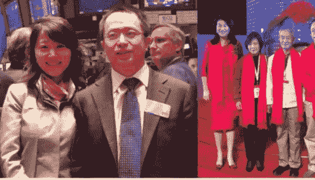

左图女士为姚钰，右图左一为胡欢。

在北大方正，周鸿祎很快又被委以重任，负责开发一套电子邮件系统。他有了一个十几人的团队，师兄李钊，同学谭晓生，还有两个师弟，都被他招入队伍。后来，李钊和谭晓生都是360公司的核心高管。

周鸿祎用杜甫赠李太白诗“飞扬跋扈为谁雄”给这个邮件系统起名叫“飞扬”，为之倾注了大量心血，甚至两次累到心动过缓而被送去医院输液。

1997年10月，飞扬上线，它是中国第一款拥有自主版权的互联网软件。但是，这个系统在方正内部没有受到重视。不久之后，项目被叫停了，周鸿祎再次被派到新疆去待了10个月。

在新疆的最后岁月，他一边维护更新自己原来做的系统，一边密切注视着国内互联网的发展，一个宏大的计划，在他的脑中形成。

1998年，互联网在中国迅猛兴起。由于搜索网站尚未流行，人们上网时，只能通过 在地址栏输入 IP 地址（例如 202.102.94.124）或者域名（例如:www.sina.com.cn）的方式来访问网站。

周鸿祎心想，可不可以直接在地址栏输入名字，就直达网站呢？如果可以直接输入“新浪”两个字，不就不用记那长串数字或者英文域名了吗？

他为这个想法而激动不已，多次向方正领导汇报，希望公司能开发这款产品。但领导完全听不懂周鸿祎在说什么。

周鸿祎哀叹：不知腐鼠成滋味，猜意鹓雏竟未休。

那时，周鸿祎已经当到北大方正事业部总经理，研发中心副主任，月薪7千多。但创业之火已经熊熊燃烧，蛰伏三年的周鸿祎再也忍受不了了。

他义无反顾地提交了辞职信。裸辞。

那一年，周鸿祎28岁。

### 5

1998年10月，周鸿祎租了两间民房，注册了一家公司，名字古里古怪，叫“因特国风”。

他们做的产品，名字更古怪，叫“3721”，后来由于产品的名气更大，产品名就成了公司名。

为了支持周鸿祎创业，他的新欢妻子胡欢，跳槽到了一家工资更高的公司工作。每个月，她那边发了工资，就用来给周鸿祎这边的员工发工资。

产品开发整整持续了8个月。那段时间，除了新华社有一个开发邮件系统的小单子挣了几万块钱，其余时间都靠胡欢赚钱养着——不论是家，还是公司。

1998年前后其实是互联网泡沫的鼎盛期，融资相对容易，但是周鸿祎四处找投资人，却处处碰壁。他的团队没有海归、全是土鳖，公司蜗居在北五环还要往北的马连洼，所做产品在美国没有对标，听起来一点都不性感，所以周鸿祎和3721对投资人似乎没有太大的吸引力。

1998年6月8日，历经艰辛的周鸿祎团队终于推出了3721产品，此时，公司快要弹尽粮绝，几乎无力支撑下去。

7月份，一家叫IDG的投资公司找到周鸿祎，表示了投资的兴趣。周鸿祎兴冲冲地跑到苏浙汇饭店去面试，结果由于过度紧张，头脑一片空白，说得一塌糊涂。说完投资人也没有任何反应。

周鸿祎尴尬地叹口气，说道：我这有两张纸，是今早写好的，要不你们干脆直接拿去看吧。

一个叫王功权的投资人劈头盖脸地问了周鸿祎一堆问题，问他面红耳赤，瞠目结舌，期期艾艾说不出话来。

因为王功权强势的一顿提问，周鸿祎对王功权印象极差，以至于后来IDG指派王功权来做辅导顾问时，周鸿祎一度十分抗拒。不过，再后来他们倒成了好朋友，这是后话。

当时解救周鸿祎的是IDG中国的大老板周全，他打断了吞吞吐吐的周鸿祎，直接问他要融资多少钱。

周鸿祎说：“200万。”

周全说：“可以，我找个负责人跟你谈具体细节。”

就这样，不到2个小时，周鸿祎晕晕乎乎地获得了200万人民币的投资，给出去25%股权。

后来他才知道，IDG早就看中了3721，叫他过来就是走个过场而已。

而喜讯还在后面。IDG投完钱以后，王功权又带着周鸿祎找了另一位知名投资人，对方拍着胸脯说，没问题，我给你200万美元。

周鸿祎心花怒放。有了这笔钱打底，他开始了大力扩张，人员十几倍地增长，还请来了两尊“大神”：网易副总裁黄志敏和兼任北大、方正两大核心事业部总经理的田健。

在黄志敏的主持下，3721策划了高规格的产品发布会；在田健的主持下，公司办公室搬到了资金昂贵的中电大厦。加上零零星星的其他支出，IDG投资的200万人民币很快就见底了。

而这时，第二笔说好的200万美元却没了下文；像神一样请过来的田健，也在两周之后，突然离职。

措手不及的周鸿祎，不得不把刚招来的员工辞退了一大半，刚租来的房子退租，高管的工资清零，中层的工资减半，勉强维持公司生存。IDG紧急提供了10万美元的过桥贷款，但也是杯水车薪。刚刚成立不到一年的因特国风，离死只剩一口气。

但就在这样的情况下，周鸿祎做出了惊人之举。他从麦肯锡公司挖来了两位高管，在公司马上就要断粮的情况下，开出了每人几十万的年薪。

两位高管都是留美博士，一个叫刘千叶、一个叫胡海谛。她俩同在麦肯锡工作，熟悉西方商业规则，能做漂亮的PPT和EXCEL表。周鸿祎每次见投资人的干巴巴演讲，被她们妙笔生花，编成了一串串美妙的数字和一张张华丽的图表，投资人一看，立马就能明白3721每年业务增长多少，投资的回报有多高。

在两位女神的点石成金之下，周鸿祎很快从另一家名叫CIV的欧洲私募基金拿到了200万美元投资。公司终于度过了难关。

就像蔡崇信之于马云、刘炽平之于马化腾一样，刘千叶和胡海谛来到3721所作出的功绩，充分证明了精英才华的重要性。这一点非常值得创业者深思。

不过，本土创业者和海归人才的冲突，也随之在3721爆发。

刘千叶和胡海谛要求周鸿祎分股权，并建立美国公司式的民主决策制度。周鸿祎坚决不同意，刘千叶和胡海谛告到投资人那里，王功权明确表示支持周鸿祎，刘胡二人心中不服，加上经营和管理理念的冲突，三人常常吵得不可开交，公司里每天鸡飞狗跳。

最后周鸿祎忍无可忍，在一次激烈的吵架中，直接对胡海谛说：“抱歉，你被解雇了。”

在网上，胡海谛的信息更新到2000年，之后就没有了消息。刘千叶...
千叶担任 3721 的 CFO，一直到公司卖给雅虎之后才离去，现为专注生物医药投资的本草投资创始合伙人。

理顺了内部管理之后，3721 慢慢走出了自己的道路，其通过向企业出售“网络实名”服务，渐渐地有了越来越多的收入，不仅熬过了互联网泡沫破裂的艰难时期，还在 2001 年成为第一家盈利的中国互联网公司。

### 6

哪里有利益，哪里就有争夺。

当 3721 开始有了收入时，有几头猛兽已经在它的身边垂涎欲滴。

第一头老虎，是来自硅谷的 RealNames。

这家公司的主要业务是地址栏“关键词”直达服务，等于是 3721 的美国版本。公司本身并不大，且身在美国，本来对 3721 没有直接威胁。

但是，2000 年 3 月，RealNames 做了一件大事：它白送给微软 20% 股权，另加 1500 万美元现金和 2500 万美元欠条，取得了 IE 浏览器的合作权。这样，微软的 IE 浏览器上，将自带 RealNames 的关键词直达功能。

如果这家公司的业务进入中国，谁还需要 3721 呢？

为了避免“外敌入侵”，周鸿祎两赴美国，和 RealNames 公司谈合作事宜。但是，该公司坚持要用他们的技术，3721 只能作为中国区代理存在，甚至还提出直接收购 3721。

条件很苛刻，但是周鸿祎似乎没有别的选择。如果他不接受的话，情况可能会像《三体》里说的一样：“毁灭你，与你何干？”

在很长一段时间里，中国互联网企业最怕的事情，就是如果国际巨头进入中国，你怎么办？周鸿祎是第一个直面这种情况的。他似乎已经走投无路。

不过很快，互联网泡沫破裂，RealNames 本身陷入了危机，它欠下微软 2500 万美元，已经无力支付，更别说道入侵中国市场了。

3721 逃过一劫。

但第二只老虎来势更加凶猛。

当时国内另一家和 3721 从事差不多业务的机构，名叫 CNNIC，全名为：中国互联网信息中心。

听到这个名字，大家就知道它一定是大有来头。CNNIC 是国家设立的域名管理唯一机构，其希望将 3721 纳入旗下，授予 CNNIC 特许经营权，3721 向其缴纳管理费。

但 CNNIC 提出的合作条款被周鸿祎认为是“丧权辱国”的霸王条款，坚决不同意。双方爆发了剧烈冲突，打起了舆论战和法律战。

周鸿祎四处宣扬 CNNIC 是“私刻公章的非法机构”，并跑到信息产业部告状。CNNIC 状告周鸿祎侵犯名誉权并获得胜诉。但是，在信息产业部组织的会议上，周鸿祎慷慨陈词，大占上风。同时，周鸿祎在舆论场上打造被 CNNIC 欺压的悲情形象，使得舆论大面积倾向支持他。

事情的高潮是一篇雄文的发表和传播。该文标题《CNNIC 的手》，作者是刘韧，当时号称“IT 圈第一记者”，影响力巨大。文章以明显的倾向性梳理了 CNNIC 与 3721 争斗的过程，对 CNNIC 是巨大打击，对 3721 则帮了大忙。

在舆论一边倒的情况下，国家有关部门未以公权力介入此事，因而使得该事件的性质成为“两家机构的市场竞争”，而不是“企业对国家监管部门的反抗”。最后，3721 在市场上获得压倒性的份额。

值得一提的是，刘韧以如椽巨笔帮了周鸿祎的大忙，周鸿祎也投桃报李，与刘韧成为莫逆之交，不仅送给他一套贵重音响，还在刘韧主办的《知识经济》杂志投下大量广告费，在刘韧创立自己的网站的时候，还慷慨地让刘韧把服务器设在 3721 的机房。此是后话。

今天我们在网上、书上查看 3721 和 CNNIC 争斗的这段历史，基本上只能听见周鸿祎单方面炮轰的声音，CNNIC 的声音几乎没有。不得不说，周鸿祎在战斗中对舆论的影响和操纵，真是厉害。他这个能力，后面还将一再帮他战胜强敌。

与 CNNIC 的口水战还未结束之时，第三只大老虎就已经粉墨登场，它的名字如雷贯耳，唤作百度。

3721 提供的服务，本质上是一种搜索，只是面比较窄，侧重于企业的名字。曾经有人建议周鸿祎做大搜索，但周鸿祎没有听。

2001 年 8 月，百度上线了网页搜索功能，迅速抢占搜索市场。而 3721 主要是做桌面客户端和地址栏插件，起初并没有业务冲突。

周鸿祎还觉得可以和李彦宏合作。他俩在北大资源宾馆见了面，周鸿祎滔滔不绝地把自己的商业模式和盘托出，满心期待李彦宏的回应。结果，李彦宏说道：“3721 本质上也是搜索，以后肯定会有竞争。”

2002 年中，百度也推出了插件，直接和 3721 竞争。最让周鸿祎不爽的是，百度的插件在安装时，会提示用户删掉 3721。

周鸿祎愤愤不平地以牙还牙，也升级了 3721，让装了 3721 的用户删除百度。而此时，CNNIC 也还在竞争。在浏览器地址栏这窄窄一厘米的战场上，三家展开了一场混战。

随着战争的升级，3721 推出了超级无敌的插件，让百度和 CNNIC 都删不掉。结果，这些插件是如此强大，以至于用户也怎么都删不掉。

于是，3721 变成了一个捆绑安装，无法卸载，且经常蹦出广告弹窗的恶意插件。网民给它起了一个名字，叫做“流氓软件”。周鸿祎，也荣膺“流氓软件之父”的光荣称号。

2003 年 9 月和 10 月，百度两次状告 3721，李彦宏和周鸿祎都亲自出庭。两人不仅在法庭上唇枪舌剑，火气十足，走出法庭还剑拔弩张，几乎大打出手，不过都被拉住了，让中国互联网发展史少了一段可以经典永流传的全武行。

后来有人问周鸿祎，你最鄙视的人是谁？周鸿祎说，“李彦宏和毛伟。”（毛伟是 CNNIC 主任）。不过，若干年以后的乌镇饭局，周鸿祎多次向李彦宏敬酒，还在两会上专门和李彦宏合影并发微博。

正当 3721 和百度鏖战正酣的时候，周鸿祎已经在考虑把 3721 卖掉了。据日后他在自传中声称，之所以出售 3721，是想给自己和 3721 找一个更好的平台，弥补自己曾经放弃了搜索的错误，把中国搜索市场拿下来。

但实际的原因，未尝没有多年的江湖争斗令人厌倦、投资人希望合理退出（为了争论卖不卖公司，周鸿祎和王功权拍着桌子吵架，相互朝对方大喊大叫）、高管和员工的股权需要得到兑现、3721 作为流氓软件带来的骂名等等。一个重大决策，肯定是各种因素综合的结果。

起初，周鸿祎想抱谷歌大腿。但费尽了心思，发现热脸只贴到冷屁股，不光没谈成合作，反而受了一肚子气。新浪和阿里巴巴倒是非常热情，可是他们的出价离周鸿祎的心理价位相去太远。最后，美国互联网巨头雅虎出价 1.2 亿美元，终于打动了周鸿祎。

2003 年 11 月 20 日，周鸿祎和刘千叶飞赴香港，在太古广场康莱德酒店和雅虎签订了卖身契。

根据条约，3721 并入雅虎成为雅虎中国的一部分；周鸿祎担任雅虎中国总经理；1.2 亿美元资金先付一半，另一半分两年看业绩支付。

当时，雅虎是如日中天的超级巨头，33 岁的周鸿祎能成为雅虎中国的 CEO，声望和影响力都上了一个大台阶。

一个月后，周鸿祎带着新合并的雅虎中国全体员工飞赴海南度假。他意气风发地发表了演说，并喝得烂醉，在游泳池浅池跳水，摔断两颗门牙。

那一年，周鸿祎 33 岁。

### 7

此时的周鸿祎，是真心想做好搜索，打败百度。他不仅把李钊、谭晓生等核心高管送到雅虎总部学习搜索技术，还不计前嫌挖来了在 3721 干了两周就离职的田健，为此还和胡欢大吵了一架（胡欢因为之前的恩怨，不喜欢田健）。

周鸿祎积极为雅虎中国的发展出谋划策，但是，他的理念并不为雅虎总部认可。用他自传里的话说：“几乎连个温暖的蜜月期都没有，我和雅虎已经有了同床异梦的倾向。”

周鸿祎似乎又回到了在北大方正的最后时光。与总部的沟通无比困难，想做的事情，一件都做不了。尤其是，他极力想推动搜索业务，可总部却没有相应的政策和经费支持；他想开除不满意的老员工，却被总部严厉批评；为了一次采访中的措辞，他还被总部的律师当面指责，以至于和对方飙起了脏话（用了 F-Word）。

在跌跌撞撞中，周鸿祎超额完成了第一年的业绩，拿到了 25% 的卖身钱。如果第二年再完成，最后 25% 也可以拿到手了。

但周鸿祎等不及了。空有一番壮志，却被处处掣肘的日子，他过得厌烦了。这一年的 5 月，在卖身一年半以后，周鸿祎正式从雅虎辞职。由于合同未履行完，他没能拿到全部的 1.2 亿美元收购款，最终套现金额是 9000 万美元。

不过，周鸿祎后来认为，他最大的损失不是这 3000 万，而是出售 3721 本身。他一直认为，如果 3721 不卖，还是可以和百度争一争的。百度后来上市，市值几百亿美元，更是让周鸿祎后悔不已。他在无数场合说到，卖掉 3721 是一个价值 10 亿美元的错误。

而他对雅虎的怨恨，更是溢于言表，此后和雅虎打了无数的人才仗、商业仗、法律仗、舆论仗，并公开宣称，雅虎从 CEO 到杨致远都是傻逼。

不过，周鸿祎的老婆胡欢应该挺高兴的。自从周鸿祎进入雅虎中国后，每天工作十多个小时，经常中美两国来回跑，几乎没有时间顾家。而离开雅虎后，据胡欢描述：“他好像奇迹般地再次出现在我的生活中，情绪平和，热爱生活，也开始关心我了。”

由于离职时签订的竞业协议，周鸿祎暂时不能到一线工作，于是他到 IDG 当了一段时间的投资合伙人。

周鸿祎一直对自己看投资项目的眼光很自信，不过，他错过的两个超性感项目，似乎在提供反面的例证。

王兴创立校内网时，IDG 一度想投资，可是在面试王兴三人的时候，周鸿祎到会议室看了一眼，就把项目给否决了。他的理由是觉得王兴傲慢，做事不接地气。后来，IDG 在他的建议下投了校内网的竞争对手占座网，彻头彻尾地失败。

李想创立汽车之家，也找到了 IDG，案子交到周鸿祎手里，也被他否决了。理由是汽车网站竞争激烈，而李想做泡泡网都只做到行业第三，过往经历不足以说明汽车之家能做到第一。结果，汽车之家很快就做到行业第一，后来成功上市，现在市值超百亿美元。

不过，周鸿祎可能对这些并不在乎，因为他有自己的后招。

虽然周鸿祎自己不能马上回一线，但早在 2005 年 9 月，就由他在 3721 的老搭档齐向东成立了奇虎公司。奇虎名义上的创始人是老齐，但所有人都知道，这就是周鸿祎的公司。李钊、石晓虹、谭晓生等一干老臣，也都在这里会合。

2006 年 3 月，周鸿祎正式加入奇虎（在他的自传里，他用的是“回到”二字）。齐向东马上让贤，退居二把手，周鸿祎成为董事长兼 CEO。

这家公司的主要业务是社区搜索，也就是主打 BBS、贴吧等中文论坛的内容搜索。作为一家初创公司，奇虎人员阵容之豪华，资金实力之雄厚，只有若干年后小米创业才能与之相比。一时之间，投资人和业界都非常看好。

但是，做了一年多，奇虎的社区搜索进入到全球网站排名 65 左右，就不再前进了。而商业变现更是迟迟没有进展。

一个如此豪华的团队，费了如此大的力气做一件事情，却迟迟没有得到想要的结果，周鸿祎焦虑万分。每次和投资人吃饭，都感觉压力巨大。

不过，互联网公司发展，很多时候都是有意栽花花不发，无心插柳柳成荫。在社区搜索陷入僵局的时候，另一个不起眼的角落，一个不起眼的小胖，做了一个不起眼的产品，挽救了周鸿祎。

2006 年，周鸿祎急着推广奇虎，想用 3721 的老办法：插件。可是做的时候才发现，经历过 3721 和百度大战洗礼之后，用户的浏览器上早已经遍布各类流氓插件，新的产品已经没有了落脚之处。

而也正是由于流氓软件的横行，全国网民都怨声载道，大家归根溯源，把始作俑者周鸿祎拿出来批判，网上铺天盖地都是对周鸿祎的指责之声。哪怕周鸿祎操纵舆论的能力再强，此刻也毫无办法。

当时的周鸿祎，一方面社区搜索毫无进展，另一方面在网上臭名昭著，陷入了人生最黑暗的时期。他把自己关在办公室大发脾气，砸坏了一张桌子两扇门。

气愤、委屈之下的周鸿祎，想了一个办法：开发软件，把流氓软件都干掉。按他的说法：“这个潘多拉的盒子是我打开的，那就由我亲手关掉。”

周鸿祎组织了一个 5 人项目小组，开始开发这个软件，并取名叫“流氓克星”。鉴于周鸿祎本人是公认的“流氓软件之父”，不得不说，“流氓克星”这个名字起得真是讽刺。

“流氓克星”的项目负责人做两个月就辞职不干了，于是，周鸿祎让组内的一个年轻人顶了上。这个年轻人，名叫傅盛。

傅盛毕业于山东工商学院，虽然拿的是经济学学士学位，喜欢的却是计算机，学的是信息技术。在经历过几家小公司之后，于 2003 年加入了 3721。

此后，虽然他的职位和工资并不高，却跟着周鸿祎，从 3721 到雅虎中国，又从雅虎中国进入奇虎。

接手“流氓克星”时，傅盛 28 岁。

他们首先把“流氓克星”改了一个名字，叫“360 安全卫士”。据日后傅盛解释，之所以叫 360，是因为自己生于 3 月 6 日，小时候父母的厂叫无线电三六厂，身份证前 3 位是 360，还有也喜欢玩 Xbox360。而周鸿祎则一直宣称 360 这个名字是自己起的，寓意是给网民提供 360 度的保护。这事成了一起罗生门。

很快，傅盛就出色地完成了开发任务，“360 安全卫士”上线了。

360 痛下杀手的第一个产品，就是原来的 3721。3721 被雅虎收购后，改名为雅虎助手，是当时雅虎中国营业收入的一大支柱。而 360 把雅虎助手列为“恶意软件”之首，直接灭杀。

这既可以看作是周鸿祎大义灭亲，手刃“亲生儿子”，但也可以解读为他对雅虎的怨恨之深。而雅虎的反应也空前激烈。原来和周鸿祎恩怨纠缠、现为雅虎中国掌门人的田健宣称，周鸿祎离开以后，雅虎助手已经不再流氓，而且谁都有资格骂流氓软件，就周鸿祎没有资格，请他像个男人一样道歉。

双方的口水战不断升级，从商业之争变为个人道德之争，各种劲爆的内幕不断爆出，最后竟发展成“中国互联网第一口水战”。

由于此时雅虎中国已经被阿里巴巴收购，周鸿祎的全力进攻，也让他和马云结下了仇。他高调宣称：“除非马云雇杀手把我干掉，否则我有决心让轻视我决心的人一个都没有好下场。”

而阿里巴巴则宣布：“永远不和周鸿祎投资及有关联的公司发生任何业务往来，同时还呼吁业内所有公司和投资机构，永远不要与周鸿祎及其关联公司发生牵连。”

这样的大佬吵架，居然也会像小孩子一样，叫嚷“我再也不理你了。”想想真是令人忍俊不禁。

不过，对这些互联网大佬来说，脸皮就是可以随时践踏的，今天说的话，明天就可以推翻。若干年后，360 和阿里巴巴又亲密地走到了一起，在多个领域开展合作。

如同之前的大战一样，这一场大战让 360 暴得大名，“苦流氓软件久矣”的网民，都知道了有一款能查杀流氓软件的产品。一时间，360 下载装机量剧增。

至此，奇虎公司的社区搜索已经成为鸡肋，而安全卫士成了主打产品，人们谈起奇虎，只知有 360，无人想起它的初心是社区搜索。由于这一贡献，傅盛也成为周鸿祎的头号功臣。周鸿祎也多次公开对傅盛表示赞扬和感谢。

但很快，俩人就反目成仇，傅盛愤而从奇虎出走。具体原因外人无从得知，又是一起罗生门。大体上，周鸿祎一方说傅盛仗着自己有功，不把周鸿祎放在眼里，有造反之心，是另一个林彪；傅盛一方则说周鸿祎卸磨杀驴，排挤功臣，因为自己做搜索没成而傅盛做安全成了，所以感到面上无光。双方各执一词，唇枪舌战，对骂了好多年。现在俩人的微博上还留着无数当年的口水。

傅盛出走后，也效仿周鸿祎当投资人避开竞业协议的做法，在经纬中国待了一年多，继而投入雷军的怀抱，担任金山网络 CEO。金山网络后改名为猎豹移动，傅盛带领这家公司成功赴美上市。此是后话。

360 安全卫士做起来后，周鸿祎又祭出一个超级杀招：免费杀毒。

网络安全，是一个庞大的市场，当时中国市场有瑞星、江民、金山、卡巴斯基等公司，都利润丰厚。杀毒软件，从来都是收费的，偶尔有试用期免费，也是为了推广而采取的临时措施，过了试用期还是要付费购买。

但周鸿祎宣布：360 杀毒软件永久免费。

一石激起千层浪。免费的威力是如此之大，以至于很多网民很快形成习惯：装完系统后，第一时间下载 360 安全卫士，然后再装别的软件。此后，360 就一直占据着中国计算机安全市场第一的宝座，其市场份额超过所有竞争对手之和。

断人财路如杀人父母。周鸿祎的做法引起了其他杀毒厂商的强烈反抗，各种公关和反公关战此起彼伏。2008 年中，网上出现大量关于 360 的负面文章，其中影响力很大的一个网站，叫 DoNews。

DoNews 网站，正是周鸿祎的前知心好友刘韧所创建并打理的。5 年前两人还亲密无间，不知从何时开始，却渐渐疏远。刘韧的网站上出现那么多针对老朋友的攻击性很强的文章，刘韧却没有干预。这是为了保持中立的原则，还是别有所图？我们不得而知。

外界知道的是，奇虎要求 DoNews 删除负面文章，而 DoNews 的人则说，删除文章需要支付费用。2008 年 8 月 23 日，齐向东和刘韧谈妥，奇虎付 23 万，DoNews 删除文章。10 月，齐向东约刘韧在茶馆会面，交付 8 万元余款。刘韧如约前往，在收钱之际，埋伏已久的警察一拥而入，把刘韧抓获。

其后，刘韧被判处“敲诈勒索罪”，获刑 3 年。

我们无从得知整个过程中，周鸿祎和刘韧有没有沟通，如有沟通的话，他们都说了些什么？

当年兄弟情深，并肩作战，如今却反目成仇，背后一刀，江湖风波之恶，不能不令人感慨万千。若干年后，刘韧出狱，周鸿祎托人给刘韧带话，希望和解。刘韧拒绝。

### 8

360 杀毒软件高歌猛进，渐渐地，人们只知有 360，不知有奇虎。

但是，360 虽然在安全市场已经成为第一，在整个互联网市场上，却只能算是一条小鱼。

大海里，小鱼总是被大鱼吃的命。当时的互联网，也是一片如此残酷的深海。

其中最凶狠的一条大鱼，长得却是最憨态可掬，其名曰：腾讯。

那时候，每一个初创的互联网公司，都逃脱不了三件事：生、死、腾讯。腾讯挟着 QQ 的巨大流量，只要进入任何领域，该领域的其他公司都将被无情碾压。正所谓：企鹅过处，寸草不生。

这个梦魇，很快也降临到了 360 头上。

2007 年，腾讯推出了 QQ 医生，这个不起眼的小软件，起初的功能只是查杀盗号木马。但是，它慢慢地长大，功能越来越齐全，长得也越来越像 360。

周鸿祎心急如焚，但又无可奈何。

2010 年春节当天，腾讯突然启动了新版本的 QQ 医生，并且在 PC 端捆绑安装，只要是用 QQ 上网的电脑，都会被提示下载 QQ 医生。

由于用户在一台电脑上通常只会装一款杀毒软件（装多了速度会慢），如果有 QQ 的电脑都装上了 QQ 医生的话，360 基本上就全军覆没了。

腾讯的降维攻击，让 360 马上到了生死存亡的关头。周鸿祎当时正在海南休假，听到消息后立马飞回北京，并紧急召集核心高管开会。情况是如此紧急，以至于正躺在病床输液的 CFO 姚钰和怀孕 6 个月正在国外休息的另一位高管，都被叫了回来。

大年初二，360 高管聚集在会议室，气氛非常凝重，周鸿祎一腔怒火无处发泄，抓起身边的 N72 手机狠狠摔在地上，四分五裂。

不过，后来的事态发展没有 360 预想的那么严重。虽然 QQ 医生被装载之后，用户会选择卸载一个杀毒软件，但此时 QQ 医生的功能尚不全面，大部分用户也习惯了 360 安全卫士，卸载掉的反而是 QQ 医生。

360 逃过了一劫，但是并没有持续多久，因为 QQ 医生也在飞速进化，很快将发起更猛烈的进攻。

2010 年中秋节，又一个传统佳节。QQ 医生更名为“QQ 电脑管家”，功能全面升级，覆盖了用户安全需求的方方面面，完全具备了和 360 一争高下的能力。

此时，周鸿祎正和李开复在怀柔打枪。收到消息后，他怒火冲冲地打电话向马化腾兴师问罪，马化腾轻描淡写地说：腾讯不会把 360 置于死地。但市场是大家的，腾讯的安全非做不可。

周鸿祎收枪入库，再次把高管紧急召回公司，研讨对策。最终，他们决定抛出一个“超级炸弹”。

国庆前 3 天，360 公司发布了“360 隐私保护器”。这款软件是专门针对 QQ 而开发，用户装上后，它会提示“共有××个文件或目录被 QQ 查看过，其中××项可能涉及您的隐私。”

同时，360 网站开通抨击腾讯的专区，发表了大量指责腾讯侵犯用户隐私的文章，周鸿祎还在微博上连续撰文对腾讯发起猛攻，并逐一给相熟的创业公司打电话，问对方“你知道你在行业里的敌人是谁

吗？”

第二天，腾讯联合几家公司发布了《联合声明》，声称 360 污蔑，辩称 QQ 扫描文件是正常的安全功能，不存在窥探隐私行为。

双方骂战不断升级。而周鸿祎已经悄悄地组织人手研制一个更大威力的“超级原子弹”。

10 月 4 日，国庆假期，周鸿祎无暇顾及自己 41 岁生日，陪着“武器”研发团队在怀柔秘密基地度过，还特地开了两瓶茅台给团队鼓劲。3 个星期后，“超级原子弹”造好，“核大战”一触即发。

10 月 27 日，腾讯联合百度、金山、遨游、可牛再次发布《反对 360 不正当竞争以及加强行业自律的联合声明》，声称遭到 360 的恶意攻击和伤害，呼吁同行不要和 360 合作，并要求主管机构介入。此消息通过 QQ 弹窗发出，一时间传遍全网。

当晚，360 也通过安全卫士发出弹窗，声称“360 为保护用户隐私遭腾讯打击报复”，该文言辞激烈地指责 5 家公司，并“奉劝腾讯和上述公司：主动承认错误、接受用户监督，而不是抱团取暖，合伙作恶。”

360 还对马化腾个人进行了人身攻击，称马化腾身价近 300 亿，却仍在领经济适用房补贴（实际上为深圳市政府为奖励人才而发放的高层次人才住房补贴）。

随着战况愈演愈烈，10 月 29 日，周鸿祎终于决定引爆“超级原子弹”。

这一天正好是马化腾 39 岁生日，他收到的生日礼物是：“360 扣扣保镖”。

“扣扣保镖”宣称是 QQ 的伴侣产品，能保护 QQ，让用户的体验更好。而腾讯的工程师检测发现，“扣扣保镖”存在严重后门，包括 QQ 安全中心会被 360 安全卫士替代，QQ 用户关系会被导入到 360 平台等，也就是说，QQ 用户会被 360 截留，变成 360 的用户。

在腾讯看来，“这是全球互联网罕见的公然大规模数量级客户端软件劫持事件”。马化腾悲愤哀嚎：“再过三天，用户可能全军覆没！”

如果说前面的攻防中，是 QQ 把 360 逼上了绝路，那么周鸿祎的猛烈反击，也把马化腾逼到了死角。周鸿祎甚至发短信给马化腾，言语非常不客气。

第二天，马化腾和腾讯向深圳市公安局报案，并向工信部投诉。

第三天，当周鸿祎正乘车前往公司时，接到齐向东的紧急电话。齐向东告诉他，公司来了 30 多个警察，让他赶紧逃，能飞哪儿就飞哪儿。对警察怀有深刻恐惧的周鸿祎，马上吩咐司机掉头前往机场，买了最近的一班飞机逃亡香港。

多年以后，周鸿祎自传里讲述这段历程时，用了这样一段话结尾：

“如同《盗梦空间》里某一幕的重演，男主人公来不及最后看一眼自己的孩子，就被带走了。而此时此刻，我最想见到的，也是自己的孩子。”

接下来的一章，周鸿祎又引用《创业维艰》的一段话作为开头：

“真正的难题不是拥有伟大的梦想，而是你在半夜一身冷汗地惊醒时发现，梦想变成了一场噩梦。”

那段时间，周鸿祎一个人躲在香港家中，不敢回内地，想必他经常会半夜一身冷汗地惊醒吧。

腾讯这头，马化腾终于做出了最决绝的反击。

11月3日，“扣扣保镖”发布后第五天，中国互联网公司斗争史上最经典的一幕出现了。

晚上6点19分，腾讯发布了《致QQ用户的一封信》。信是这样开头的：

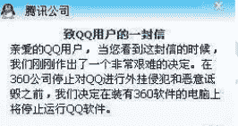

也就是说，用户必须在QQ和360之间“二选一”，有他没我，有我没他。

这封公开信瞬间传遍整个网络，网民怀着无比的热忱，搬着板凳抱着西瓜，围观这一场闹剧将如何收场。微博甚至掀起了“一个艰难的决定”的造句狂潮。此后多年，这句话仍是一个经久不衰的网络梗。

其后，工信部出面调停，要求360和腾讯向社会公开道歉，停止互相攻击，并确保相关软件兼容和正常使用。

在国家力量介入之下，这场战争终于平息。但其影响却异常深远，甚至用“萧瑟秋风今又是，换了人间”来形容，都不为过。

腾讯后来开始反思其封闭文化，逐步走向了开放，从一家创业者闻风丧胆的公司变成了大家争着抱大腿的公司。而360也因为这一战闻名天下，出尽风头。

几个月后，周鸿祎和马化腾在某行业会议上碰面。周鸿祎说道：“小马哥你做得很好，但是请给我们大家也留条生路。”马化腾说：“你们也做得挺好嘛，没有问题的。”

另一个会议上，周鸿祎提到马化腾，用语是“尊敬的、伟大的马总”，对马化腾和腾讯，满口溢美之词。

要打，可以最凶狠地打；要舔，可以最肉麻地舔，不愧是周鸿祎。

### 9

3Q 大战时，周鸿祎如此豁出性命，另一个重要原因是 360 当时正在谋求上市，已经走到了紧要关头，不容业务有任何闪失。

就在扔“超级原子弹”的头一天，360 董事会通过了上市决定，准备 11 月 10 日启动上市程序。但 3Q 大战的战况之激烈，让主承销商被吓怕了，直接退出了合作。

这对上市极其不利，甚至可能会使之中途夭折，周鸿祎等人也没有经历过这种事情，都一筹莫展。好在副承销商瑞银扛住压力顶了上来，才让 360 上市之路得以继续。

启动会马上到了，周鸿祎还是躲在香港不敢回国，齐向东也藏在外地。两位当家都不在，会议就无法进行下去，CFO 姚钰多方寻找，才把齐向东找出来，如期召开了上市启动会。

后面的路也是走得一波三折。为了赶时间，360 在美国证监会尚未最终确认材料的情况下，就公开递交，这在别人看来是不可思议的，但周鸿祎就冒险做了这个决定。（一般而言，赴美上市的公司在公开递交材料前，会事先向美国证监会提交草稿版，经过几次修改确认，定稿之后才公开递交，这个流程叫“清密交”。360 做了两轮清密交后，第三轮还没有得到反馈，周鸿祎就决定公开递交了。这样非常冒险。因为如果第三轮还需要修改的话，公开递交的材料就要作废重新提交，挂牌日期就要推后，而投资人也会产生质疑，并影响股价。）

2011 年 3 月 17 日，360 开始了 IPO 路演，而这时，他们的第三轮密交都还没有获得反馈，离预定的上市日期，只剩两周，周鸿祎管不了这么多了，先做了再说，如期开始了路演。

路演做了一半，美国证监会的反馈意见却来了，就一些问题提出了质疑。

就这样，这一边周鸿祎在演讲，另一边 CFO 姚钰和律师团队还在和美国证监会开着电话会议讨论不休。到路演快结束时，姚钰团队才终于说服了美国证监会，密交通过，文件不需要再修改了。

3 月 30 日，360 正式登陆美国纽约证交所，当日股票涨幅 134.48%，市值达到 39.57 亿美元。按照周鸿祎占股 21.5% 计，其个人身价达到 8.5 亿美元。

这一年，周鸿祎 41 岁。

此后，360 股价一路上涨，最高时市值高达 130 亿美元，位列中国第三大互联网公司。

不过，周鸿祎很快就尝到了在美上市的苦果。360 连续遭遇了六次国际资本的空做，上市两年，股价几乎没有增长。第三年大涨了一次，市值冲破百亿美元之后，却又一路下滑。而与此同时，在国内上市的互联网公司却比美股同行涨得更多。

那几年，国内小米等互联网公司快速崛起，而 360 涉足手机等智能设备领域，却无法得到美国投资者的认可。

更大的问题是，360 是一家主打网络安全的公司，而网络安全和国家安全息息相关，随着中美两国在网络安全领域的对抗逐渐升级，360 作为中国企业，却在美国上市，面临着两头不讨好的局面。

在此情况下，在 360 上市 4 年零 3 个月之后，周鸿祎宣布启动私有化。

所谓 “私有化”，在股市上是指把原来向公众发行的股票收回，退出股票市场。也就是俗称的 “退市”。

一般而言，上市不容易，退市更不容易。当时，360 市值为 90 多亿美元，加上各种手续费，意味着周鸿祎至少要筹集将近百亿美元，才能为 360 赎身。

但对周鸿祎来说，经历了那么多风雨，这点困难已经不算什么了。经过比上市更麻烦的千辛万苦，2016 年 7 月，360 终于成功退出美国股市。

一年多以后，360 以借壳上市的方式，在中国股市重新登陆。目前（2019 年 8 月 30 日），360 的市值为 1500 亿元人民币，是内地股市互联网企业第一股。

### 10

3Q 大战是周鸿祎战斗的巅峰。此后，周鸿祎不再像以前那样锋芒毕露。也不知是因为他性格变平和了，还是因为国内巨头早已被他得罪光，前面再也没有可堪一战的对手。

互联网江湖少了周鸿祎的捣蛋，一下子冷清了许多。2017 年，有一篇《人民想念周鸿祎》（作者方浩）的文章刷了屏。人们忽然发现，确实好久没有听到周鸿祎和谁打仗了。

这些年关于周鸿祎吵架的最大新闻，居然是和一位 92 年的小姑娘拌嘴。当时正值红黄蓝幼儿园事件，这位小姑娘写了篇关于 360 的“水滴直播”涉嫌侵犯隐私的文章，并喊话称：“周鸿祎叔叔，别再盯着我们看了。”

周鸿祎则发文称，该女生公众号停更 10 个月，突然在 10 天内连发两篇文章指向 360，并且存在“用标题党制造恐慌、混淆视听、发文以后大号推、突然集中火力开骂”等四大特征，是“教科书一般的黑公关”。

不过，我看了周鸿祎梳理的四条特征，觉得用在周鸿祎此前的一些战斗文章上，似乎也挺合适。

这种和小女生斗嘴的事情，也就是生活中的小点缀。真正让周鸿祎痛苦的，是原来的亲密伙伴一个个离去。

2018 年 4 月，姚钰突然向周鸿祎提出，想休息一下。周鸿祎很感愕然，几次长谈，却无法挽留，只好放手。姚钰自从 06 年加入奇虎，历任财务总监、联席 CFO、副总裁兼 CFO 等职，在 360 上市、退市、再上市等过程中，功不可没。

周鸿祎专门发了一篇长长的内部信公告此事，并对姚钰表示感谢，他说：

“姚珏是我创建 360 至今最为重要的战友、朋友，或者说亲人。她在帮助我和 360 完成了最为关键、最为重要的一些大事后才提出休息，从中可以体会到她对 360 很深的情感，让我特别感动和钦佩。”

2019 年 3 月，谭晓生也宣布离职。作为周鸿祎的同学，他从北方正时期就加入周鸿祎的团队，此后在 3721、雅虎中国、奇虎 360，都是周鸿祎的左膀右臂。据 360 公告，谭晓生离职是个人原因。

2019 年 4 月中旬，齐向东带领 360 内部 2B 业务部门奇安信，正式从 360 分家。自从 2003 年放弃新华社副局长的职位投奔周鸿祎，他俩已经并肩战斗 16 年，共同度过了无数艰难困苦，也共享了无数荣华富贵，最终却成为竞争对手。

2019 年 4 月下旬，360 发出公告，宣布石晓虹辞去董事和副总经理一职。

石晓虹是二十多年一直陪着周鸿祎创业的最亲密伙伴。作为同班同学、室友，他和周鸿祎从 1993 年就开始合伙创业，共同经历了被警察抓的时光。

此后，石晓虹和周鸿祎又一起创立 3721、一起加入雅虎、一起创立奇虎，甚至长期担任奇虎 360 的法人代表，周鸿祎的创业之路，石晓虹一步都没有缺席过。他和周鸿祎在一起的时间，比周鸿祎的老妻胡欢还要长得多，

石晓虹离职的原因，也同样只有“个人原因”四个字。

至此，周鸿祎最亲密的战友们，一个个都已经离他而去。

### 11

周鸿祎，49 岁，属狗。

在《波士堂》节目中，他的朋友李立均形容说，他就像一条野狗。纵观周鸿祎的一生，这个比喻很贴切。

他曾经四面出击，或者防守，就像野狗一样凶狠；
他曾经犯下错误，放出魔鬼，就像野狗一样被人唾骂；
他曾经千难万险，惶惶不可终日，就像野狗一样劳累恐慌；
他曾经呼朋引伴，却又被众人抛弃，就像野狗一样寂寞孤独。

随着智能时代、AI 时代、IoT 时代到来，大安全越来越重要，周鸿祎从事的安全领域，有广阔的发展空间。

周鸿祎的商业能力，也足以支撑他做出伟大的事业。

但是，事业做大了，拼的就不再是商业能力，而是政治能力。

一位伟人曾经说过，政治，就是要把自己的人搞得多少多的，把敌人的人搞得少少的。

而周鸿祎，恰恰是曾经树敌无数，现在孤家寡人。

这样的状态，能够改变吗？

周鸿祎的未来，还能创造更大的辉煌吗？

凡是过往，已成序章，余生还长，战斗未歇。

希望一生好战的周鸿祎，能想明白三个问题：

你在为谁而战？你将与谁而战？谁将为你而战？

老周，祝好！

公众号 懒人找资源

# 牛人阅读书目

这是我列的一个阅读书单，比较完整地覆盖了思维与认知提升、战略规划、企业管理的一些必读书目。大家不必全盘照读，可从里面挑选自己感兴趣的。

# 阅读书单

## 一、管理学入门

- 《管理学》(第 11 版)：斯蒂芬·罗宾斯等/中国人民大学出版社/2012 年
- 《科学管理原理》：弗雷德里克·泰勒/机械工业出版社/2007 年
- 《工业管理与一般管理》：法约尔/机械工业出版社/2007 年
- 《管理行为》：西蒙/机械工业出版社/2013 年
- 《管理：使命、责任、实务》：德鲁克/机械工业出版社/2013 年
- 《管理学：原理与方法》：周三多、陈传明、贾良定/复旦大学出版社/2014 年
- 《管理思想史》：丹尼尔·A·雷恩/中国人民大学出版社/2009 年
- 《管理百年》：斯图尔特·克雷纳/中国人民大学出版社/2013 年
- 《管理经济学》：麦圭根等/机械工业出版社/2013 年

## 二、战略和商业模式

- 《公司战略》：[英] 林奇/经济管理出版社/2011 年
- 《战略管理》：安索夫/机械工业出版社/2010 年
- 《战略管理》：汤普森等/机械工业出版社/2011 年
- 《成果管理》：彼得·德鲁克/机械工业/2009 年
- 《什么是战略》(论文)：迈克尔·波特
- 《公司战略：企业的资源和范围》：[美] 科利斯等/东北财经大学出版社/2005 年
- 《战略历程》：明茨伯格/机械工业出版社/2012 年
- 《战略管理思想史》：周三多、邹统钎/南开大学出版社/2011 年
- 《公司的核心竞争力》(论文)：普拉哈罗德、加里·哈默尔/哈佛商业评论/1990年
- 《企业参谋》：大前研一/中信出版社/2007年
- 《公司战略透视》：斯特恩等/上海远东出版社/1999年
- 《蓝海战略》：·钱·金、勒妮·莫博涅/商务印书馆/2016年
- 《利润模式》：亚德里安·斯莱沃斯基等/中信出版社/2007年
- 《发现利润区》：斯莱沃斯基等/中信出版社/2014年
- 《商业模式新生代》：亚历山大·奥斯特瓦德/机械工业出版社/2014年
- 《发现商业模式》及《重构商业模式》：魏炜、朱武祥/机械工业出版社/2009年、2010年
- 《CEO说：人人都应该像企业家一样思考》：[美]拉姆·查兰/机械工业出版社/2016年
- 贝恩战略三部曲：《从核心扩张》、《锐不可当》、《回归核心》：[美]克里斯·祖克、詹姆斯·艾伦/中信出版社、商务印书馆/2004年、2010年、2012年
- 平衡计分卡系列：《战略地图》、《平衡计分卡：化战略为行动》、《战略中心型组织》、《组织协同》：罗伯特·卡普兰、大卫·诺顿/商务印书馆、广东经济出版社、中国人民大学出版社/2005年、2006年、2008年、2013年
- 《平衡计分卡战略实践》：罗伯特·卡普兰、大卫·诺顿/中国人民大学出版社/2009年
- 《重新定义战略》：辛西娅·蒙哥马利/中信出版集团/2016年
- 《策略思维》：阿维纳什·K·迪克西特、巴里·J·奈尔伯夫/中国人民大学出版社/2013年
- 《战略：一部历史》：弗里德曼/社会科学文献出版社/2016年
- 《四步甩开竞争对手》：皮特森/人民邮电出版社/2008年
- 《七个战略问题》：罗伯特·西蒙斯/中国人民大学出版社/2013年
- 《平台战略》：陈威如、余卓轩/中信出版社/2013年
- 《平台转型》：陈威如、王诗一/中信出版集团/2016年

## 三、组织管理

- 《组织行为学》（第 14 版）：罗宾斯等/中国人民大学出版社 /2012 年
- 《组织》：西蒙等/机械工业出版社/2013 年
- 《经理人员的职能》：切斯特·巴纳德/机械工业出版社/2007 年
- 《卓有成效的管理者》：德鲁克/机械工业出版社/2009 年
- 《组织理论与设计精要》：理查德·达夫特/清华大学出版社 /2011 年
- 《管理控制系统》：安东尼、戈文达拉扬/人民邮电出版社/2011 年
- 《卓有成效的组织》：明茨伯格/中国人民大学出版社/2012 年 版
- 《公司治理》：罗伯特·蒙克斯等/中国财政经济出版社/2004 年
- 《公司的概念》：彼得·德鲁克/机械工业出版社/2006 年
- 《决策是如何产生的》：[美] 詹姆斯 G·马奇/机械工业出版社 /2013 年
- 《企业再造》：钱皮、哈默/上海译文出版社/2007 年
- 《组织文化与领导力》：埃德加·沙因/中国人民大学出版社 /2014 年
- 《清教徒的礼物》：[美] 肯尼斯·霍博、[美] 威廉·霍博/东方 出版社 /2013 年
- 《战略与结构》：艾尔弗雷德·D·钱德勒/云南人民出版社 /2002 年
- 《彼得原理》：劳伦斯·彼得等/机械工业出版社/2013 年
- 《组织能力的“杨三角”：企业持续成功的秘诀》：杨国安/机械 工业出版社 /2010 版
- 《游戏颠覆者》：A·G·雷富礼、拉姆·查兰/机械工业出版 社/2011 年
- 《阿米巴经营》：稻盛和夫/中国大百科全书出版社/2013 年
- 《罗伯特议事规则》：亨利·罗伯特/格致出版社/2015 年
- 《集体行动的逻辑》：曼瑟尔·奥尔森/格致出版社，上海人民 出版社/2014 年
- 《我在通用汽车的岁月》：小艾尔弗雷德/华夏出版社/2005 年
- 《走出混沌》：黄卫伟、吴春波/人民邮电出版社/2002 年

## 四、人力资源管理

- 《人力资源管理价值新主张》：[美] 乌尔里克、布罗克班克 / 商务印书馆 /2008年
- 《人力资源管理:赢我竞争优势》（第7版）：雷蒙德·诺伊等/中国人民大学出版社/2013年
- 《管人的真理》:罗宾斯/机械工业出版社/2013年
- 《人才管理大师》:比尔·康纳狄、拉姆·查兰/机械工业出版社/2012年
- 《人物志:世界上第一部人力资源学典籍》:刘劭/上海三联书店/2007年
- 《六项精进》:稻盛和夫/中信出版社/2011年
- 《领导力革命》:约翰·P·科特/商务印书馆/2005年
- 《跨境并购:人力资源管理指南》:冯元石、崔杰/经济管理出版社/2015年
- 《领导梯队：全面打造领导力驱动型公司》:拉姆·查兰、斯蒂芬·德罗斯/机械工业出版社/2016年
- 《执行：如何完成任务的学问》:拉里·博西迪、拉姆·查兰、查尔斯·伯克/机械工业出版社/2016年
- 《业绩梯队:让各层级领导者做出正确的业绩》:斯蒂芬·德罗斯/机械工业出版社/2012年
- 《高管路径：'轮岗培养'领导人才》:拉姆·查兰/机械工业出版社/2011年
- 《党员、党权与党争:1924-1949年中国国民党的组织形态》:王奇生/华文出版社/2010年
- 《跨文化管理》:沃纳、乔恩特/机械工业出版社/2004年
- 《Z理论》:威廉·大内/机械工业出版社/2013年
- 《动机与人格》:亚伯拉罕·马斯洛/中国人民大学出版社/2007年
- 《人性能达到的最高境界》:亚伯拉罕·马斯洛/世界图书出版公司/2014年
- 《企业文化:企业生活中的礼仪与仪式》:迪尔、肯尼迪/中国人民大学出版社/2015年
- 《乌合之众:大众心理研究》:古斯塔夫·勒庞/中央编译出版社/2014年
- 《文化的重要作用:价值观如何影响人类进步》:塞缪尔·亨廷顿、劳伦

## 五、营销和品牌

- 79. 《市场营销原理》：科特勒等/中国人民大学出版社/2010年（经典书籍、启蒙书）
- 80. 《营销的本质》：包政/机械工业出版社/2015年（国内经典书籍）
- 81. 《营销革命 3.0：从产品到顾客，再到人文精神》：菲利普·科特勒、何麻温·卡塔加雅、伊万·塞蒂亚万/机械工业出版社/2011年（如果从业时间较长，可越过第一、第二，直接阅读此书）
- 82. 《工业品营销》：坦纳等/清华大学出版社/2011年（工业品书籍本身就少，所以经典书籍更少，因此推荐）
- 83. 《营销战》：艾·里斯、杰克·特劳特/中国财经经济出版社/2002年
- 84. 《消费者行为学》：迈克尔·R·所罗门等/中国人民大学出版社/2014年（理论知识）
- 85. 《怪诞行为学 1/2》（直译为可预期的非理性：形成我们决策的幕后力量）：丹·艾瑞里（最近几年较为热门的行为学研究书籍）
- 86. 品牌三部曲：《管理品牌资产》、《创建强势品牌》、《品牌领导》：戴维·阿克/机械工业出版社/2012年（阅读读物，案例较老，但是体系可学习）
- 87. 《战略品牌管理》：凯文·莱恩·凯勒/中国人民大学出版社/2010年（参考同上）
- 88. 《影响力》：罗伯特·西奥迪尼/中国人民大学出版社/2011年（经典书籍）
- 89. 《定位》：里斯、特劳特/机械工业出版社/2013年；《重新定位》：杰克·特劳特、史蒂夫·里夫金/机械工业出版社/2011年（两本可二选一，如从业时间长可直接选择第二本）
- 90. 《一个广告人的自白》：奥格威/中信出版集团/2015年（适合新入行者阅读）
- 91. 《市场调研》：A·帕拉苏拉曼等/中国市场出版社/2009年（市调调研基础书籍）
- 92. 《品牌全视角》：[日]山田敦郎/格致出版社/2008年（亚洲书籍里，从实践到理论不可多得的阅读书籍之一）
- 93. 《新规则：用社会化媒体做营销和公关》：戴维·米尔曼·斯科特/机械工业出版社/2016年（阅读此书，只为借鉴。因为国内外新媒体玩法差异较大，需切合国内实际）
- 94. 《认知盈余：自由时间的力量》：克莱·舍基/中国人民大学出版社/2011年（同样是介绍碎片化时间管理利用，可参考）
- 95. 《引爆点：如何引发流行》：马尔科姆·格拉德威尔/中信出版/2014年（原理同上）
- 96. 《无价：洞悉大众心理玩转价格游戏》：威廉·庞德斯通/浙江人民出版社/2013年
- 97. 《要素品牌战略：B2B2C的差异化竞争之道》：菲利普·科特勒、瓦得马·弗沃德/复旦大学出版社/2010年（根据读者时间安排，96与97二者可选一阅读）
- 98. 《奢侈品品牌管理》：米歇尔·舍瓦利耶、热拉尔德·马扎罗夫/格致出版社/2015年（细分行业书籍）
- 99. 《产品管理》：唐纳德·R·莱曼、拉塞尔·S·温纳/北京大学出版社/2006年
- 100. 《创造突破性产品：从产品策略到项目定案的创新》：恰安、沃格尔/机械工业出版社/2004年
- 101. 《品牌的起源：品牌定位体系的巅峰之作》：里斯等/机械工业出版社/2013年
- 102. 《传播学概论》：威尔伯·施拉姆、威廉·波特/中国人民大学出版社/2010年
- 103. 《理解媒介》：[加]马歇尔·麦克卢汉/商务印书馆/2000年
- 104. 《传播学史：一种传记式的方法》：E·M·罗杰斯/上海译文出版社/2012年

## 六、精益生产和供应链

- 105. 《丰田生产方式》：大野耐一/中国铁道出版社/2014年
- 106. 《大野耐一的现场管理》：大野耐一/机械工业出版社/2011年
- 107. 《学习观察：通过价值流图创造价值、消除浪费》：迈克·罗瑟、约翰·舒克/机械工业出版社/2013年
- 108. 《改善：日本企业成功的奥秘》：今井正明/机械工业出版社/2010年
- 109. 精益三部曲：《改变世界的机器：精益生产之道》、《精益思想》、《精益解决方案》：[美]詹姆斯 P·沃麦克、[英]丹尼尔 T·琼斯/机械工业出版社/2011年、2014年、2015年
- 110. 《供应链管理》：利丰研究中心/中国人民大学出版社/2003年
- 111. 《采购与供应链管理：一个实践者的角度》：刘宝红/机械工业出版社/2015年

## 七、财务和资本

- 112. 《财务管理》（最新版）：肖仰烈/中山大学出版社/2003年
- 113. 《管理会计》（第二版）：胡玉明/暨南大学出版社/2010年
- 114. 《国家会计学院会计硕士专业学位 MPACC 系列教材·财务报表分析：理论·框架·方法与案例》：黄世忠/中国财经经济出版社/2007年
- 115. 《中国证券市场 IPO 审核财务问题 800 例》：大信会计师事务所/经济科学出版社/2012年
- 116. 《巴菲特致股东的信》：沃伦·巴菲特/机械工业出版社/2004年
- 117. 《巴菲特之道（原书第 3 版）》：[美]罗伯特·哈格斯特朗/机械工业出版社/2015年
- 118. 《价值投资》：布鲁斯·格林威尔/机械工业出版社/2002年
- 119. 《金融市场与公司战略》：马克·格林布莱特、施瑞丹·蒂特曼/清华大学出版社/2003年
- 120. 《大并购时代：超级并购带来超级增长与超常回报》：[美]诺曼 W·霍夫曼/机械工业出版社/2016年
- 121. 《并购估值：如何为非上市公司培育价值》：梅林、埃文斯/机械工业出版社/2014年
- 122. 《价值起源》：威廉•N•戈兹曼、K•哥特•罗文霍斯特/万卷出版公司/2010年
- 123. 《价值评估：公司价值的衡量与管理》：[美]科勒/电子工业出版社/2007年
- 124. 《金融炼金术》：乔治•索罗斯/海南出版社/2011年
- 125. 《价值再发现》：[美]珍尼特•洛尔/机械工业出版社/2000年
- 126. 《有效资产管理》：彼得•伯斯坦/上海财经大学出版社/2004年
- 127. 《IPO企业上市解决之道》：投行小兵/法律出版社/2011年
- 128. 《机构投资与基金管理的创新》：大卫•史文森/中国人民大学出版社/2002年
- 129. 《上市公司并购重组问答》（最新版）
- 130. 《类金融控股企业集团的监管与风险处置》：类金融控股集团监管课题组/南开大学/2008年
- 131. 《资产证券化》：安德鲁•戴维森等/中国人民大学出版社/2006年
- 132. 《证券分析》：本杰明•格雷厄姆/海南出版社/2004年
- 133. 《门口的野蛮人》：布赖恩•伯勒、约翰•希利亚尔/机械工业出版社/2010年

## 八、互联网和大数据

- 134. 《失控：全人类的最终命运和结局》：凯文•凯利/新星出版社/2011年
- 135. 《技术的本质》：布莱恩•阿瑟/浙江人民出版社/2014年
- 136. 《周鸿祎自述：我的互联网方法论》：周鸿祎/中信出版社/2014年
- 137. 《支付战争》：埃里克•杰克逊/中信出版社/2015年
- 138. 《共享经济》：罗宾•蔡斯/浙江人民出版社/2015年
- 139. 《Facebook效应》：大卫•柯克帕特里克/华文出版社/2010年
- 140. 《大数据时代》：[英]维克托•迈尔•舍恩伯格/浙江人民出版社/2012年
- 141. 《大数据思维与决策》：[美]伊恩•艾瑞斯/人民邮电出版社/2014年
- 142. 《大数据》：涂子沛/广西师范大学出版社/2013年
- 143. 《精益数据分析》：[加]阿利斯泰尔•克罗尔、[加]本杰明•尤科维奇/人民邮电出版社/2014年
- 144. 《数据科学实战》：舒特·奥尼尔/人民邮电出版社/2015年
- 145. 《大数据管理-企业转型升级与竞争力重塑之道》：徐斌/人民邮电出版社/2016年

## 九、中观产业

- 146. 《竞争战略》：迈克尔·波特/中信出版社/2014年
- 147. 《竞争优势》：迈克尔·波特/中信出版社/2014年
- 148. 《国家竞争优势》：迈克尔·波特/中信出版社/2012年
- 149. 中国《产业结构调整指导目录》(最新版本)
- 150. 《规模与范围: 工业资本主义的原动力》：小艾尔弗雷德·钱德勒/华夏出版社/2006年
- 151. 《产业演变与企业战略》：安妮塔·M·麦加恩/商务印书馆/2007年
- 152. 《产业结构、战略与公共政策》：F·M·谢勒/经济科学出版社/2010年
- 153. 《集装箱改变世界》：莱文森/机械工业出版社/2014年
- 154. 《打造产业政策: 铁路时代的美国、英国和法国》：道宾/上海人民出版社/2008年
- 155. 《政府、市场与增长: 金融体系与产业变迁的政治》：约翰·齐斯曼/吉林出版集团有限责任公司/2009年
- 156. 《现代产业组织》：丹尼斯·卡尔顿、杰弗里·佩洛夫/人民出版社/2009年

## 十、宏观视野

- 157. 《人类简史: 从动物到上帝》：尤瓦尔·赫拉利/中信出版社/2014年
- 158. 《全球通史》：斯塔夫里阿诺斯/北京大学出版社/2012年
- 159. 《黄金简史》：彼德·L·伯恩斯/上海财经大学出版社/2013年
- 160. 《中国历代政治得失》：钱穆/三联书店/2012年
- 161. 《现代中国的历程》：黄仁宇/中华书局/2011年
- 162. 《万历十五年》：黄仁宇/三联书店/2014年
- 163. 《中国经济史》：钱穆/北京联合出版公司/2013 年
- 164. 《道德经》：老子/新世界出版社/2011 年
- 165. 《中国哲学简史》：冯友兰/北京大学出版社/2013 年
- 166. 《资治通鉴》：司马光/中华书局/2014 年
- 167. 《乡土中国》：费孝通/人民出版社/2015 年
- 168. 《日本经济史》：浜野洁等/南京大学出版社/2010 年
- 169. 《菊与刀》：本尼迪克特/商务印书馆/2015 年
- 170. 《美国经济史》：沃尔顿、罗考夫/中国人民大学出版社/2013 年
- 171. 《新教伦理与资本主义精神》：马克斯·韦伯/上海人民出版社/2012 年
- 172. 《摩根财团》：罗斯·彻诺/江苏文艺出版社/2014 年
- 173. 《战争论》：克劳塞维茨/北京联合出版公司/2014 年
- 174. 《失去的胜利》：冯·埃里希·曼施因/民主与建设出版社/2015 年
- 175. 《中国文化的深层结构》：孙隆基/中信出版集团/2015 年
- 176. 《海权论》：马汉/同心出版社/2012 年
- 177. 《枪炮、病菌与钢铁:人类社会的命运》：贾雷德·戴蒙德/上海译文出版社/2014 年
- 178. 《大国的兴衰》：保罗·肯尼迪/中信出版社/2013 年
- 179. 《论中国》：基辛格/中信出版社/2015 年
- 180. 《李光耀观天下》：李光耀/北京大学出版社/2015 年
- 181. 《世界秩序》：亨利·基辛格/中信出版集团/2015 年
- 182. 《公司法学》：刘俊海/北京大学出版社/2013 年

## 十一、咨询入门

- 183. 《金字塔原理》：芭芭拉·明托/南海出版公司 2013 年
- 184. 《BCG 视野: 假说驱动管理的魅力》：[日] 内田和成/电子工业出版社/2007 年
- 185. 《思考的技术》：大前研一/中信出版集团/2015 年
- 186. 【麦肯锡工具系列】《麦肯锡方法》、《麦肯锡工具》、《麦肯锡意识》：艾森·拉萨尔、保罗·弗里嘉/机械工业出版社/2010 年
- 187. 《麦肯锡传奇》：埃德莎姆/机械工业出版社/2010 年
- 188. 《咨询的奥秘》：[美]杰拉尔·温伯格/清华大学出版社/2004 年
- 189. 《完美咨询》：彼得·布洛克/机械工业出版社/2013 年
- 190. 《咨询圣经》：艾伦·韦斯/电子工业出版社/2015 年
- 191. 《绩效咨询》：罗宾逊等/电子工业出版社/2016 年
- 192. 《逻辑学导论》：欧文·M·柯匹/中国人民大学出版社/2014 年

## 十二、大数据：

（这一部分是给公司技术人员列的。在此略去。）

## 十三、名人名企传记

- 208. 《三星总裁李健熙》：洪夏祥/华夏出版社/2004 年
- 209. 《战略品牌管理》：凯文·莱恩·凯勒/中国人民大学出版社/2009 年
- 210. 《腾讯传》（1998-2016）：《腾讯传》吴晓波/浙江大学出版社/2017 年
- 211. 《史蒂夫·乔布斯传》：沃尔特·艾萨克森/中信出版社/2011 年
- 212. 《零售哲学系列: 7-11 便利店创始人自述》：[日] 铃木敏文/江苏文艺出版社/2014 年
- 213. 《富甲美国: 沃尔玛创始人山姆·沃尔顿自传》：山姆·沃尔顿、约翰·休伊/江苏凤凰文艺出版社/2015 年
- 214. 《创业维艰 如何完成比难更难的事》：本·霍洛维茨/中信出版社/2015 年
- 215. 《精益创业》：[美] 埃里克·莱斯/中信出版社/2012 年
- 216. 《旁观者: 管理大师德鲁克回忆录》：彼得·德鲁克/机械工业出版社/2009 年
- 217. 《马云: 未来已来阿里巴巴的商业逻辑》：阿里巴巴集团/红旗出版社/2017 年
- 218. 《鞋狗: 耐克创始人菲尔·奈特亲笔自传》：[美] 菲尔·奈特/北京联合出版公司/ 2016 年
- 219. 《增长黑客: 创业公司的用户与收入增长秘诀》：范冰/电子工业出版社
- 220. 《创京东：刘强东亲述创业之路》：李志刚/中信出版社/2015 年
- 221. 《稻盛和夫自传》：（日）稻盛和夫/华文出版社/2010 年
- 222. 《史玉柱自述：我的营销心得》：史玉柱/同心出版社/2013 年
- 223. 《绝不雷同：小米雷军和他的移动互联时代》：余胜海/广东人民出版社/2015 年
- 224. 《可口可乐传：一部浩瀚的品牌发展史诗》：马克·彭德格/文汇出版社/2017 年
- 225. 《硅谷钢铁侠：埃隆·马斯克的冒险人生》：阿什利·沃斯/中信出版社/2016 年
- 226. 《社交的本质：扎克伯格的商业秘密》：兰迪·扎克伯格/中信出版社/2016 年
- 227. 《一网打尽：贝佐斯与亚马逊时代》：（美）斯通著，李晶，李静译/中信出版社/2014 年
- 228. 《永不放弃 马云给创业者的 24 堂课》：成杰/中国华侨出版社/2011 年
- 229. 《华为传》：孙力科/中国友谊出版公司/2018 年
- 230. 《创能量：28 位传奇企业家口述创业史》：杜礼青/研究出版社/2017 年
- 231. 《周鸿祎自述：我的互联网方法论》：周鸿祎/中信出版社/2014 年
- 232. 《稻盛和夫的实学：阿米巴模式》：三矢裕 谷武幸/东方出版社/2013 年

## 十四、新书补充

- 233. 《游戏化实战》：Yu-Kai Chou 著，杨国庆译/华中科技大学出版社/2017 年
- 234. 《游戏改变世界》：简·麦戈尼格尔著，闻佳译/北京联合出版公司/2016 年
- 235. 《战略的本质》：马丁·里维斯、纳特·汉拿斯、詹美贾亚·辛哈著，王喆、韩阳译/中信出版社/2016 年

# 后记

恭喜你读完了 18.7 万字，这已经是一本挺厚的书。

据说现在社会，人们变得越来越肤浅，越来越不爱深度阅读。

但我相信，你肯定不是这样的。

喜欢何加盐文字的人，没有哪个是肤浅的。肤浅的人，哪里读得下动辄一万五千字以上的文章，以及上面这 18.7 万字的合集呢？

在这个集子的最后，我想说：

请保持对知识的热爱！

请保持对世界的好奇心！

请保持你的上进！

请坚持向上生长！

这个世界，属于持续学习的人，属于努力奋斗的人，属于不愿苟且的人。

我很高兴，能遇到这样的你。

人生难得是知己。高山流水，有你真好！
