# 猪买单上部

## 前言

大家都知道一诺老师自创立《商业模式》课程起，在教育行业辛勤奉献 18 年，凭借 100%实战案例教学，不仅桃李满天下，也为社会培养无数弟子，这些弟子都在授课《商业模式》、《顶层设计》、《利他模式》、《免费模式》、《品牌魔力》、《股权兵法》、《融资兵法》、《信用融资》、《营销兵法》、《万能营销》、《魔鬼营销》、《疯狂爆粉》、《超级演说家》等，一诺老师很荣幸能为社会培养这么多优秀讲师人才。

做为《商业模式》、《顶层设计》、《猪买单》等经典作品的始作俑者，一诺老师闭关修炼 13 个月将课程全方位升级，亲自撰写《猪买单》第 1、2、3、4、5、6 本，原打算 6 本合著一部，但考虑大家不方便携带，就分成上下两部。

《猪买单》上部主要是“开悟篇”和“策略篇”两大部分，是企业家实操落地必修的基础课程！

《猪买单》下部主要是“36 头猪”每一头猪是一个案例，每个案例都有实操的步骤、案例解析等重点标注，方便大家学习。《猪买单》下部从头到尾都围绕一个主题，你不用出钱，跟你合作的人也不用出钱，大家都是赢家！是不是很神奇呢？

### 《猪买单》跟一般书籍的五个不一样

- 1、这本书跟一般书籍不一样——《猪买单》真实！

《猪买单》被超过100位出版界的朋友拒稿！他们认为一诺老师疯了！该说的、不该说的全写进来了，赤裸裸的真实案例！可是我认为，作为一名老师，最大的执着就应该是——追求真理！

蒋介石毕业于日本陆军军官学校，学生(蒋)打不过老师(日)！

毛爷爷战胜日本侵略者、打败蒋介石，因为毛爷爷“读奇书、走奇路，才能出奇制胜！”毛爷爷读的书，书店里有的还买不到，为什么？因为大家都懂得道理，如果管用，大家都成功了！

很多人成功了放个屁都是香的，所以都出来著书立传，可是书里写的有几个管用你告诉我？大家有没有想过，那些成功者敢不敢讲真话？敢不敢把自己做过的事情全部都写进去？不好意思写吧！

所以，这些真相都在《猪买单》书籍里！这本书真实！

当你看《猪买单》超100遍以上，奇迹将在你身上出现！这种奇迹叫做：羊毛出在狗身上猪买单！

- 2、这本书跟一般书籍不一样——《猪买单》简单！

你是不是有个这样的经历，看到一本书封面不错，标题不错，于是就买了，结果呢？越看越糊涂！一团浆糊！

其实很多事情一句话就能说明白；偏偏闲着没事干整出一本书来，把简单的事情复杂化！

一诺老师最喜欢简单，很多实战案例三到五个步骤就能说清楚！很多道理一诺老师喜欢一句话表达！

- 3、这本书跟一般书籍不一样——《猪买单》粗暴！

看《猪买单》这本书，大家要做好心理准备，书里面教的要么是屌丝逆袭、要么是跌入低谷的末路英雄涅槃重生、要么是颠覆一个行业、要么是垂死挣扎的企业华丽转身……

所以请有哮喘、心脏病、高血压、心脑血管等疾病患者阅读此书准备好急救措施！

- 4、这本书跟一般书籍不一样——《猪买单》有效！

在《猪买单》问世之前，都是我助理或弟子等，把我的课程录音译成文字，不像这本书是一诺老师亲子撰写！虽然之前的是录音内容，很多人相信一诺老师说的话“当你学习 100 遍以上，奇迹将会在你身上出现！”结果有人学习 100 遍、200 遍、300 遍，别人把他们当成为疯子！

可是这些疯子后来无中生有，不花一分钱整合天下资源，杠杆别人的企业，用别人的时间，花别人的钱，办大家的事情，钱进到自己的口袋。!(这才是聪明人干的事情)

很多人上我的课程，我会现场辅导，我问他：“你有什么问题？”

他说：“一诺老师我没有问题！”我说：“啊！没有问题你来干嘛？”

他说：“我就是来谢谢您！因为您的书籍和音频太实战了！”

这本《猪买单》将超越 18 年来一诺老师著作的所有书籍！

李小龙说过：“我不怕练过 10000 种武功的人，我最怕一种武功练过 10000 遍的人！”

自从《猪买单》这本“武林秘籍”问世，一诺老师把家里几乎所有的商业书籍、营销书籍、企业运营书籍、融资书籍、股权书籍、广告书籍、文案书籍、市场类书籍等，那些越看越糊涂、没有重点、没有逻辑、没有实操性和不落地的书籍统统的扔进垃圾桶！

从现在起，连一诺老师本人都只学《猪买单》直到 100 遍、1000 遍、10000 遍，并且边学习奕创新，每年更迭一次《猪买单》作品！

当你看《猪买单》超 100 遍以上，奇迹将在你身上出现！这种奇迹叫做：羊毛出在狗身上猪买单！

- 5、这本书跟一般书籍不一样——《猪买单》有趣！

你是否看书时会犯困？

你是否看书时会走神？

你是否觉得看书是一件很无聊的事情？

现在不会了，当你学习《猪买单》你会被里面实战的案例震撼！

你会被栩栩如生的画面吸引！你会有一种身临其境的感觉！由于都是100%实战案例的真实缩影，你会以为自己就是案例中的主角！因此你感觉自己不是在看书，而是在经历一场没有硝烟的商战！经过《猪买单》对你商业技能进行的千锤百炼，你会有一种脱胎换骨的感觉！

一诺老师撰写时使用的非书面语言——口语，当你在学《猪买单》的时候，你会发现你并不孤单，好像一诺老师正坐在你的对面，跟你亲切的对话、一对一的辅导！你不是在看书，而是跟一诺老师进行一场零距离的心灵对话！

大家可以一边学习《猪买单》书籍，一边报名学习《猪买单》课程，《猪买单》课程全部免费！

一诺老师的使命是——惠及全人类！

我是一诺老师我爱你们！

2018年8月8日

### 学习《猪买单》的理由

- 如果你受够了目前的生活渴望改变！
- 如果你想要改变自己和家族的命运！
- 如果你想缩短奋斗的时间快速成功！
- 如果你想拥有整合天下资源的能力！
- 如果你想拥有最最实战的营销能力！
- 如果你想拥有最最落地的促销方案！
- 如果你想拥有一本万利的商业方案！
- 如果你想做出牛的不耍不要的方案！
- 如果你想拥有不可抗拒的合作方案！
- 如果你想拥有创造商业奇迹的能力！
- 如果你想拥有颠覆整个行业的能力！
- 如果你想拥有跨界打劫的落地方案！
- 如果你想让赚钱变得像呼吸一样简单！
- 如果你想拥有一步一步引导别人说 YES 的能力！
- 如果你想拥有拿起麦克风讲到台下全发疯的能力！

当你看《猪买单》超 100 遍以上，奇迹将在你身上出现！这种奇迹叫做：羊毛出在狗身上猪买单！

- 如果你想拥有一套简单粗暴有效的商业模式！
- 如果你想拥有白手起家成为亿万富翁的方法！
- 如果你想设计出免费比收费更赚钱的可行性方案！
- 如果你想拥有让他哭、让他笑、让他晚上睡不着觉的魔力！
- 如果你想让全世界的人都喜欢你、崇拜你、对你欲罢不能！
- 如果你想让合作伙伴相信你、喜欢你、彻底爱上你！从今以后离不开你、对你欲罢不能！
- 如果你想借一诺老师的智慧，整合天下资源，用别人的时间，花别人的钱，办大家的事情，钱进你的口袋！

一定要好好学习：

当今全世界最最先进的商业模式——《猪买单》。

看懂《猪买单》不用回农村！

只要你学会一诺老师的《猪买单》，全世界都可以为你买单！

当你学习 100 遍以上，奇迹将会在你身上出现！

这种奇迹叫做——羊毛出在狗身上，猪买单！

## 一诺老师的使命是——惠及全人类！

- ☆ 改变世界商学院 · 创始人
- ☆ 共产主义接班人、人民日报最佳评论人
- ☆ 猪买单 APP 自动赚钱机器 · 首席 CEO
- ☆ 《猪买单》著作权人和商标持有人
- ☆ 《商业模式 · 顶层设计》实战案例教学导师
- ☆ 作家、演说家、教育家、思想家
- ☆ 一诺老师从事教育行业 18 年，能系统拆解古今中外企业家成功案例，并将总结的商业模式深入浅出的穿插在教学中。 **一诺老师的梦想就是成就你的梦想！**

### 一诺老师与德国前总统伍尔夫

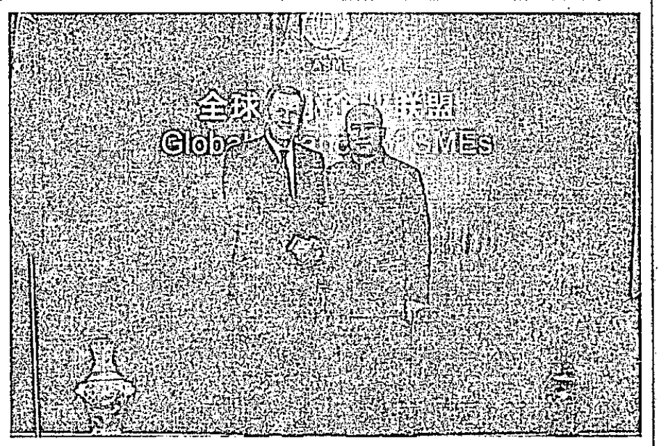

2017 年 11 月 27 日，全球中小企业联盟大会在上海胜利召开，一诺老师应邀出席会议，席间德国前总统伍尔夫亲自会见了一诺老师，高度赞扬一诺老师对全球中小企业做出的杰出贡献，并充分肯定了【改变世界商学院】世界企业家摇篮的地位！

面对一诺老师盛情邀请伍尔夫出席《全球中小企业·改变世界论坛》欣然接受并表示期待！

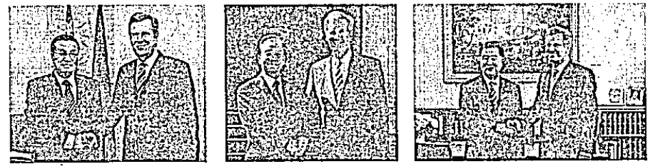

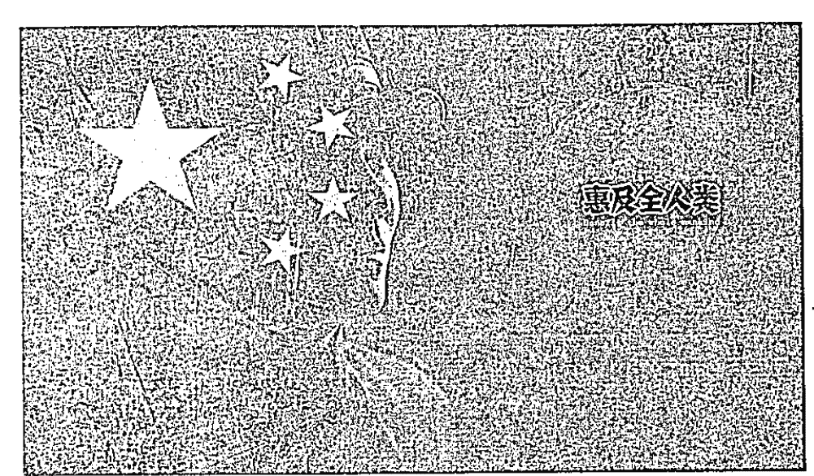

### 许绍雄出任改变世界商学院联席院长·形象代言人

1972年，许绍雄在第1期无线电视艺员训练班毕业后加入无线电视，曾在无线工作三年后转到丽的电视工作，四年后再回到无线。许绍雄是第一个驾驶奔驰上班的艺员，所以他被人们Benz雄。2012年，获得万千星辉颁奖典礼杰出演员奖。2013年香港TVB2013台庆颁奖礼，许绍雄凭借《My盛Lady》获得最佳男配角。2014年，在周润发的电影《澳门风云》中饰演了奔驰哥一角。2015年，在郑中基、何超仪主演的《第七谎言》中饰演了包租公。2016年，回归电影《使徒行者》……

### 一 诺老师近期课程部分剪影

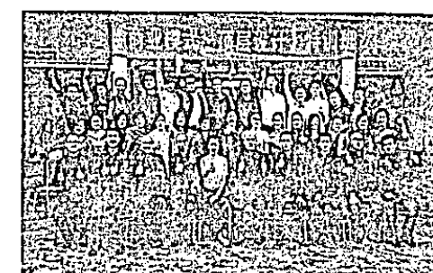

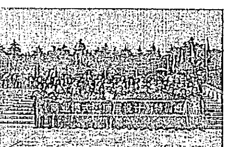

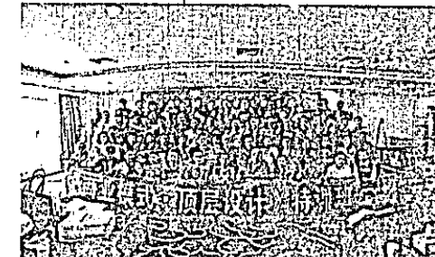

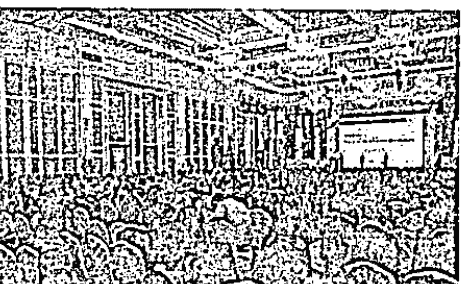

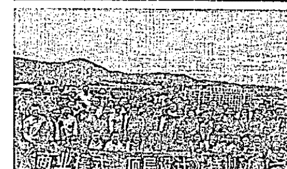

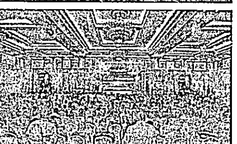

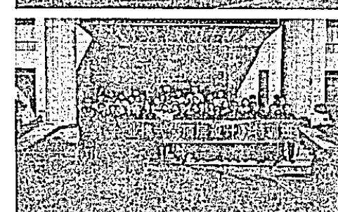

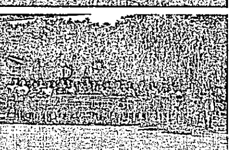

> 当你看《猪买单》超 100 遍以上，奇迹将在你身上出现！这种奇迹叫做：羊毛出在狗身上猪买单！

### 一诺老师课程现场指导企业家落地

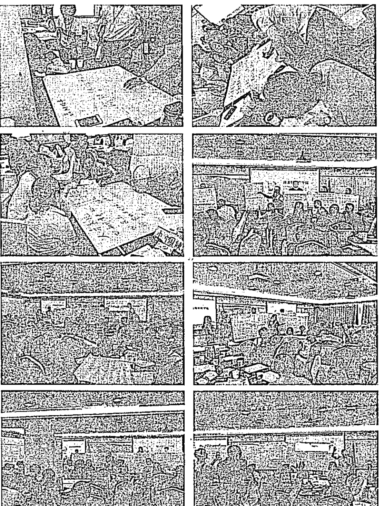

### 一诺老师带领各分院院长们革命圣地游学

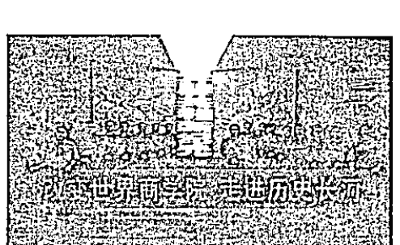

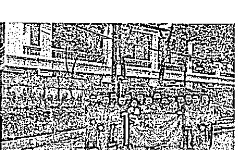

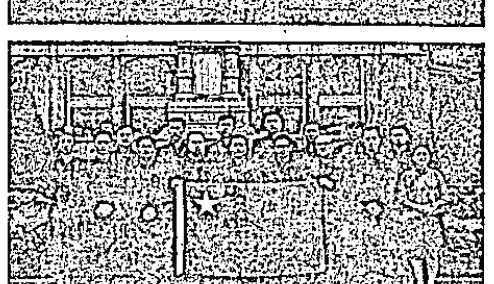

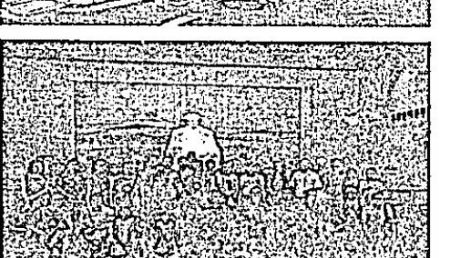

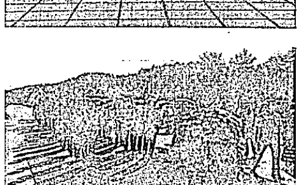

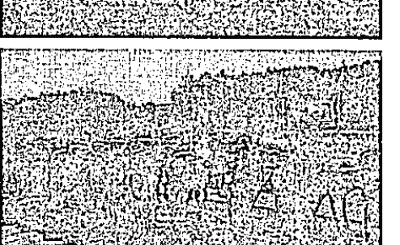

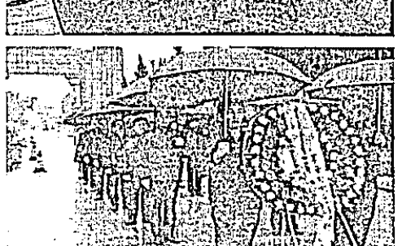

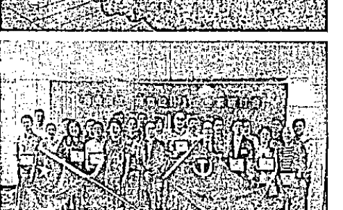

## 开篇

### 第一章 领袖心法

心生种种法生，心灭种种法灭

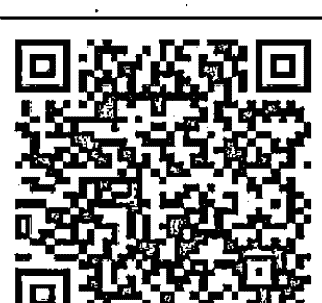

扫码回复：领书，领取 60 本营销策划书籍

#### 第 01 节：感官的缺陷与决策的偏见

根据一诺老师 18 年的教育经验得知，但凡正在读我的书籍或听我的课的企业家，大家都想要修成正果，可是正果来自于正确的行为，正确的行为来自于正确的思想。

也就是说，我们要想修成正果，就离不开正行和正见。

如果你的思想是错的，行为就是错的，那么最后的结果能是好的吗？

肯定不会！

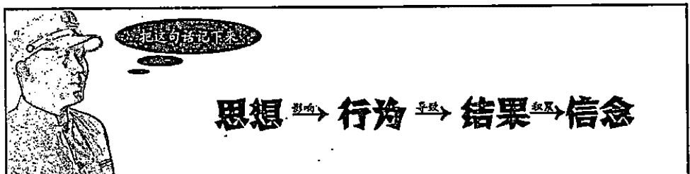

所以拥有正确的思想模式重不重要？

答案是肯定的：非常重要！

请各位企业家睁开眼睛看，竖起耳朵认真的听。

让一诺老师带你一起用自己的感官，体验和认识这个世界。

重点来了，我们的感官是——怎么样呢？

有缺陷的，譬如：

我们的眼睛是有缺陷的，光线太强看不见，光线太暗也看不见；我们的耳朵是有缺陷的，超声波听不见，次声波也听不见……

我们用有缺陷的感官仅能捕捉到事物的局部属性，这就导致我们对事物的认知是偏见。

##### 如盲人摸象

因为百人生来从没有看见过象是什么样的动物，难怪他们所摸到，想到的都错了。所以，无知不要乱猜……

- 摸着象脚的盲人说：“大象好像一根柱子。”
- 摸着象尾的盲人说：“不，它像扫帚！”
- 摸着象背的盲人说：“像一张床！”
- 摸着象肚的盲人说：“你们都错了！它像肚子一堵墙！”
- 摸着象耳的盲人说：“大象嘛，像扇子。”
- 摸着象鼻的盲人说：“谁说像扇子？它明明像绳子！”
- 摸着象牙的盲人说：“你们全错了，大象像个大萝卜。”

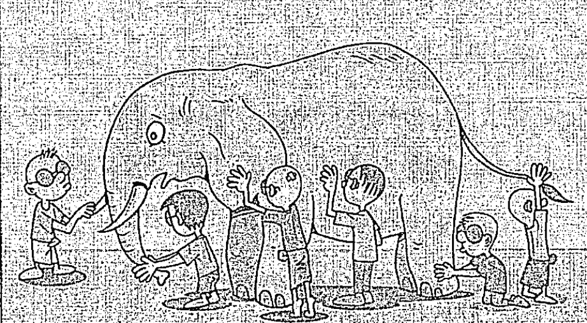

就像盲人摸象：每个盲人都坚持自己是对的！

是的，盲人当然是对的，但是只有在盲人自己的世界里才是对的！

每个人都这样认为，争执就产生了……

其实，人与人之间，国与国之间，政党与政党之间，宗教与宗教之间，学术与学术之间为了平息纷争，人们找第三方仲裁，可是如果裁判只认同某一方的标准，就没有资格公正的做裁判。

如果裁判认同每一方的标准，也无法进行裁决，这又是一笔不分胜负的糊涂账。

当无法公正裁决时，强权和暴力就会胜出，规矩往往是胜利者制定的。

这时，所谓的道理和规矩，就变成强者对弱者的通知。

当讲道理失灵时，就沦落为讲暴力。

人与人之间表现为拳头的较量，国与国之间表现为军事力量的较量。

一时间，战火纷飞，生灵涂炭……

仰望蓝天，一诺老师借你一双慧眼，让你看透一切事物的实相，我们需要直达真理的正见。

正所谓是：胜者为王！败者为寇！

所以，历史都是胜利者书写的！

就像，某某人成功了，放个屁，很多人都觉得很香，于是你经常听到一些名人名言：某某人说……

其实，说真的，谁成功之后能说实话？哪个人成功之后会把自己那些不好意思见人，但又真实的方法公之于众？所以听一个成功之后的人说话，就是听冠冕堂皇的漂亮话，因为谁成功之后不往自己脸上贴金？当然这怎好听就怎么说！

我常常问自己，我为什么要写书？为什么要讲课？

答案是：寻求真相！

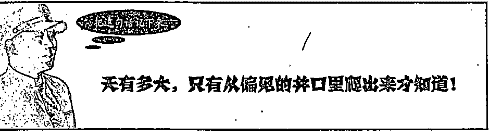

你常常看到一些作者、讲师他们写的书都是盲人摸象，自己都没有做过企业，或者从未做过一家成功的企业！就像自己都没有见过大象，却堂而皇之的告诉别人大象是什么样子，用自己的偏见去误导别人对真相的认知！

所以，我从 17 岁就拥有人生的第一桶金，到有房有车！阴差阳错的又跌入人生低谷——负债千万！在很多人都认为我无法翻身时，却奇迹般地涅槃重生，从负债累累到人生华丽转身再次成为亿万富翁！

所以，请你留意和见证，一诺老师的课件全部是案例教学！都是一诺老师做过的，或者一诺老师的学生在一诺老师的辅导下做过并且做成的！证明行之有效的！

所以，很多人问一诺老师为什么不经商却来做老师？

在一诺老师的心灵深处有这样一个始终不变的答案——

因为在这个世界上：

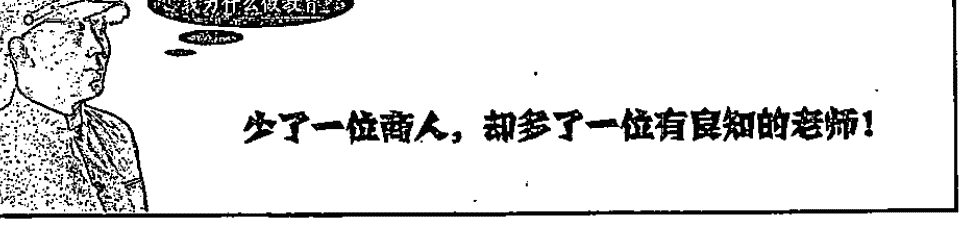

亲爱的企业家们，你是不是常常被各种所谓的成功书籍、致富秘籍、发财宝典所迷惑？你也许看过一大堆书籍，结果越看越糊涂！你也许参加过无数次学习和培训，结果现场非常激动，回家一动不动，越来越迷茫！

是的，你被一轮又一轮的忽悠，忽悠的晕头转向！就像玻璃上的苍蝇，感觉前途一片光明，却总也找不到出口！

所以，从你拥有一诺老师这套书籍开始，你就可以对着之前那些盲人摸象的作者写的书，写上两个字——垃圾！然后把它撕得粉碎！狠很地扔进垃圾桶！因为它浪费了你宝贵的时间！

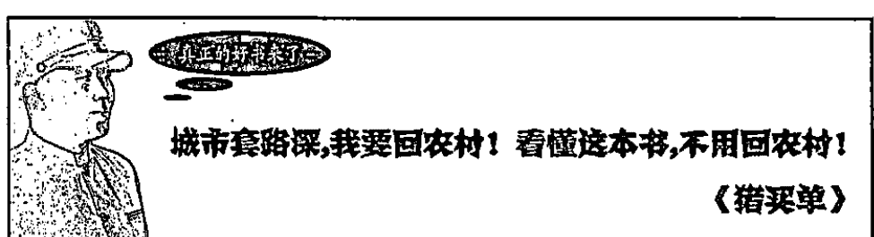

现在，不要激动！

是的，你不是在做梦！

你现在拥有的，正是一套真正行之有效的企业家成功心法，一套真正能够让你的企业落地生根发芽，让你的企业长成参天大树的一套对真理最好的诠释的一套不可思议的企业圣经！一本匡扶宇宙的作品！

只是，亲爱的企业家们，我怀着无比歉疚的心，说一声：

对不起，我来晚了！

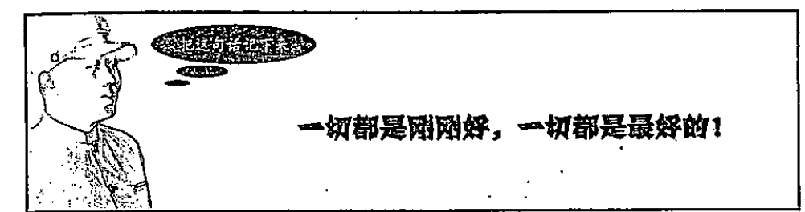

一诺老师相信：一切都是最好的安排！

我相信，如果你之前没有被盲人摸象作者的书籍和培训课程忽悠过，如果你没有一次又一次失望过……你就不会明白，这是一套什么样的传世精品！

拥有《猪买单》你将会拥有改变世界的能力！

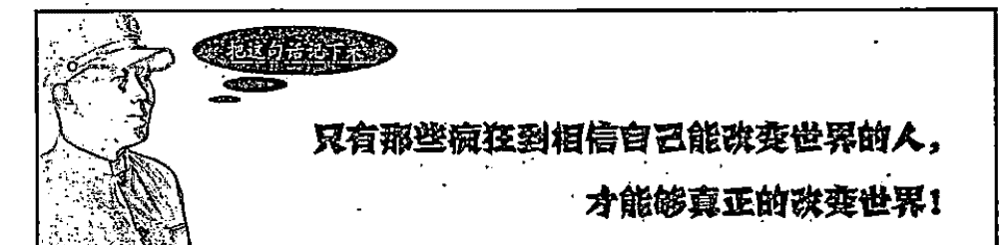

盲人摸象，各执一端……

怎么样才能认识到真正的大象呢？

一个是盲人要睁开眼睛看到大象，还有一种新的盲人摸象的方法，就是几个盲人一起摸，然后我们一起把自己摸到的碎片做成大象的拼图。

世界太大了，就像一座山，每个人站的角度、高度、位置都不一样，导致眼里的风景不一样。

怎样才能看到更加完整的全世界，就是要跟不同位置的人交流，这样才能看到全世界。你们每个人都有自己的对世界的判断，我这么说，并非要你吧杯里的水倒掉，尽管老生常谈说你们要保持空杯心态，但是在我看来，所谓空杯心态，是有很多个空杯子，能装天下所有的 水。

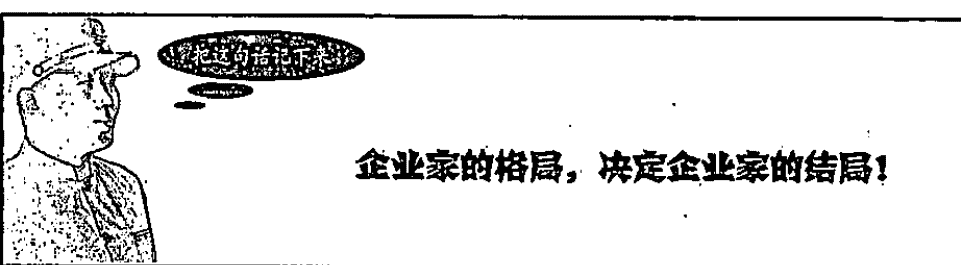

做企业家，器量很重要，器决定量。

正如一只杯子只能装一 杯子水，口锅能装一锅水，海却可以装天下的水。

当各位企业家，你们的器大的时候，量就多了，生命就丰富了。

所以通过学习一诺老师的书籍或课程，要尽可能拓宽和打开自己的心量。

尽管我们的感官是有缺陷的，我们对世界充满偏见，这些偏见就是我执，它会阻碍你认知真相。

同时，当我们愿意打开自己的视野，去探索和发现更多可能性的时候，世界就变得不一样了。

放下偏见，立地成佛！

#### 第 02 节：淡定，淡定是一种境界

在学习《猪买单》书籍或课程期间，一诺老师对各位企业家有 3 个要求：

要有大师状态

什么叫大师状态？

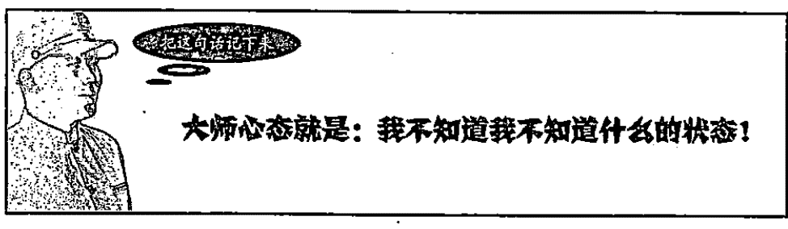

有一个武功高手，他找到本武功秘籍《葵花宝典》，翻开第一页，看到上面写：“欲练神功，挥刀自宫。”

于是很兴奋又很纠结，他便拿出把小刀，磨得非常锋利，想着男人要对自己狠一些，于是就挥刀自宫，只听一声惨叫，英雄倒在血泊当中。

3 天后英雄从血泊当中爬了起来，忍痛开始练功，当他翻开《葵花宝典》第二页的时候，看到上面写着：“无需自宫，也能练功！”这时英雄（啊……！）一声惨叫，又一次倒在血泊当中。

中，这一次更痛，心痛！

于是又过了 3 天，英雄又一次从血泊当中爬了起来，他翻开《葵花宝典》的第三页，看到上面写着：“即便自宫，未必成功”、于是一声惨叫（啊……！）再次倒在血泊当中，这次没醒过来。英雄反应太快了，所以后果很严重。

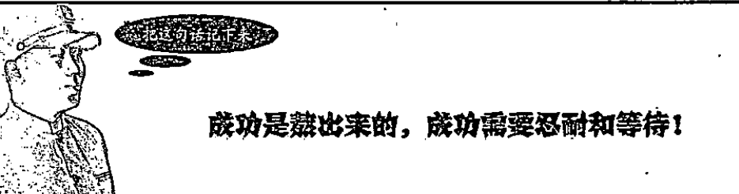

各位，不要急着下决定，先看清楚因为偏见，大部分企业家没看完整事物的全部真相。

所以，今天我们不妨先放下原来的偏见，不急着做判断。

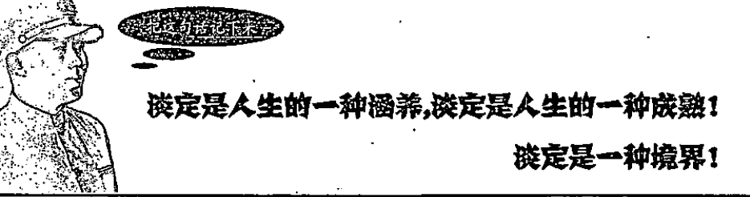

是的，淡定是一种人生境界！

请各位认认真真仔细想想学完《猪买单》之后，真相自会浮现……

#### 第 03 节：先有大师心态才有大师作品

有一个人，年轻的时候，在上海穷困潦倒，常常为一顿饭发愁。他的鞋前面列开了一个口子，他既没钱买新鞋，也没钱缝补。

一日，那个人画了一只老虎，拿到街上卖。

一个外国人看中了这幅画，想买，就问：“多少钱？”那个人说：“500 美元。”

外国人觉得太贵，便说：“能不能少点儿呢？”

那个人说：“不能少！”一边说，一边将画撕碎了。

外国人吃了一惊：“年轻人，你怎么撕了它呢？多可惜呀！500 美元不卖，少点儿也行呀！你是生气了吧？”

那个人平静地说道：“先生，我没有生气，这画我要价 500 美元，说明我认为它值 500 美元，你跟我讲价，不愿出 500 美元，说明在你眼里它不值这个数，也认为它不好。所以，我要再接再厉，撕了它，重画，直到顾客认可为止。”

那时，那个人还不是大师，是个普通的青年。

那个人当时太穷了，太需要钱了，可他没有降低自己追求的标准，没有让物质的诱惑干扰自己的最高追求。他追求的不是钱，而是艺术的最高境界。

假如是常人，他会能卖多少卖多少，先换到钱再说。

就是这个心态，使这个青年日后成为一代雕塑大师，当上了中国美术馆馆长，主持雕塑“人民英雄纪念碑”上的浮雕，留下了许多传世经典雕塑作品。这个人就是一代宗师刘开渠。

是什么成就了大师？是大师心态。

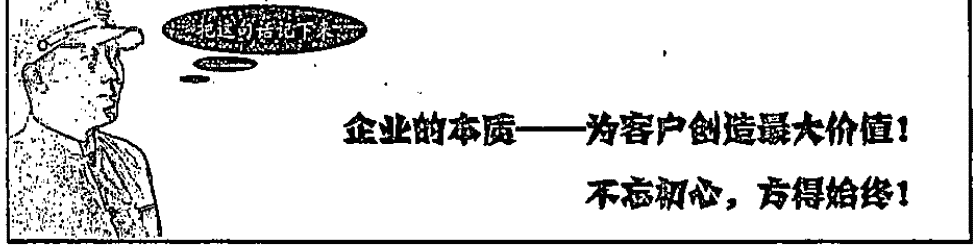

所以，一诺老师在此要求各位，不要为了钱，而忘记了自己当初创立企业时的初心！

- 不要为了钱降低了对质量的不懈追求！
- 更不要因为你学会了一诺老师的课程，就认为自己可以随心所欲！

不忘初心，方得始终！

#### 第 04 节：没有不可能只有你想不到

一个美国人跟英国人打赌。国人说：“我张开嘴巴可以咬到我的左眼睛，你相信吗？”英国人不相信，两人决定打赌，赌注 1000 美金。于是美国人把自己的左眼睛拿出来，放进嘴里咬了一下又装回去，原来是假眼！于是英国人输了 1000 美金。

美国人又说：“你信不信我还能用牙齿咬到我的右眼睛”英国人听，仔细看 看了对方的右眼睛，心里想，不可能两只眼睛都是假的吧，于是决定再赌 1000 美金。接着，美国人把自己的假牙拿下来，放在自己的右眼睛上咬了一口。

英国人再次输掉了 1000 美金！

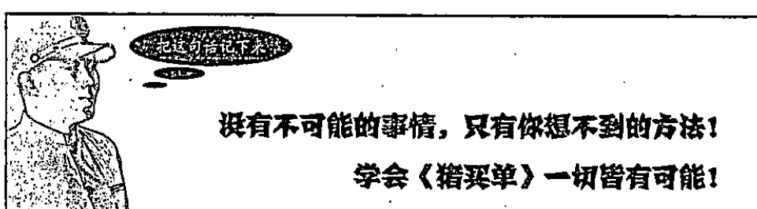

很多时候你认为不可能的事情，是你太快下结论了，因为你没把事情看明白，这都源于我们认识上的偏见。

常人的生活经常是这样的……

#### 第 05 节：没开悟左右为难,开悟后左右逢源

爷俩进城赶集……

父亲骑驴，儿子牵着驴走位过路的大妈看见这爷俩儿，便说：“这个当父亲的真狠心，自己骑驴子，却让儿子在地上走。”

父亲一听这话，赶紧从驴背上下来，让儿子骑驴，他牵着驴走。

没走多远，一位过路的大爷又说：“这个当儿子的真不孝顺，老爹年纪大了，不让老爹骑驴，自己却优越地骑着驴，让老爹跟着小跑。”

儿子听此言，心中惭愧，连忙让父亲上驴，父子二人共同骑驴往前走。

走了不远，一个放羊娃见父子俩共骑一头驴，便说：“这爷俩的心真够狠的，那么一头瘦驴，怎么能禁不住两个人的重量呢？可怜的驴呀……”

父子二人一听也是，双双下得驴背来，谁也不骑了，干脆走路，驴子也乐得轻松。

走了没几步，又碰到一个过路的年轻人，指着他们爷俩儿说：“这爷俩都够蠢的，放着驴子不骑，却愿意走路。”

父子二人一听此言，愣住了：你骑不对，我骑不对，不骑不对，都骑不对，没办法，只好扛着驴回家了。

各位，为什么会这样呢？

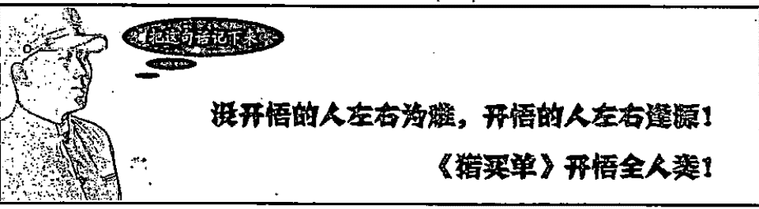

众生愚昧，所以需要《猪买单》来开悟愚昧的思想……

市场瞬息万变，这个时候我们要看情况，问题是咋看情况。

你说杀人是好事还是坏事？

有人说坏事，这是守规矩的人。

有人看看情况，嗯？这是高手。

抗战时期，在南京杀日本人，这是民族英雄……

穿着棉袄大冬天去哈尔滨挺好，在屋里开着暖气你还不脱你傻吗？看情况。

人这一辈子最难的事就是看情况，这些年大家都在谈智慧，啥叫智慧？看情况。

行为本身没有意义，关键看所处的情况。

#### 第 06 节：当下师为无上师,当下法为无上法

博士与船夫的经典对话……

一个博士问船夫：“你懂数学吗？”

船夫答：“不懂。”

博士说：“你的生命已经失去四分之一了。”

博士又问：“那你懂哲学吗？”

船夫答：“不懂。”

博士说：“那么你的生命已经失去四分之一之二了。”

博士继续问：“文学你懂不？”

船夫答：“不懂。”

博士说：“看来你的生命已经失去四分之一之三了。”

湖上起风了，船夫问这个博士：“您会游泳吗？”

博士说：“不会。”

船夫说：“那么您的生命都没了。”

船夫跳水游走了，博士淹死了。

其实很多企业家都犯这样的毛病……

有知识，没智慧！

前几年我看到一个报道：

一个河南农妇，文盲一个，却把一个女博士生给拐卖了。

（啊？不会吧，是真的吗？请允许我迷茫一会……）

你说你一个博士生居然被文盲给拐卖了，这些年读的书都喂狗了……

大家都在谈智慧，咋看情况呢？

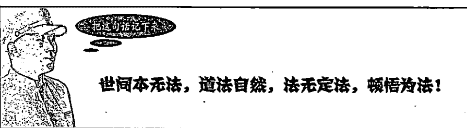

有些人修佛修禅修智慧，结果见了基督徒也念阿弥陀佛，唉，请允许一诺老师做个捂脸的表情吧，他他他这是没开窍呢！

你得在什么山头唱什么歌。

一诺老师知道，学我课程或者看我书籍的有很多是局长、秘书长、委員長、董事长，可是今天学习一诺老师的课程，你们暂时的身份是学生，我暂时的身份是老师。

所以，对的！

这就是看情况……

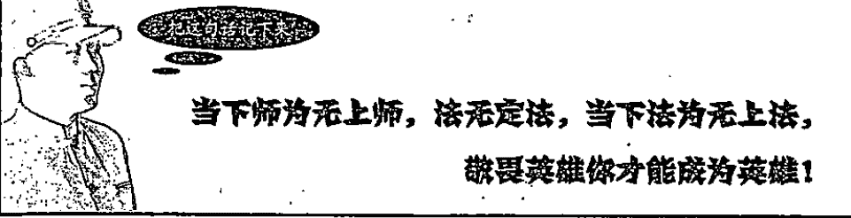

- 英国女王回家敲门……

老公在屋里问：“谁啊？”

“女王！！！”

门没开！（装逼的下场……）

过一会女王继续敲门。

“谁啊？”（小子哎，就看看你识不识时务，哼……）

“你老婆。”（终于讲人话了……）

这回门开了。（识时务的好处……）

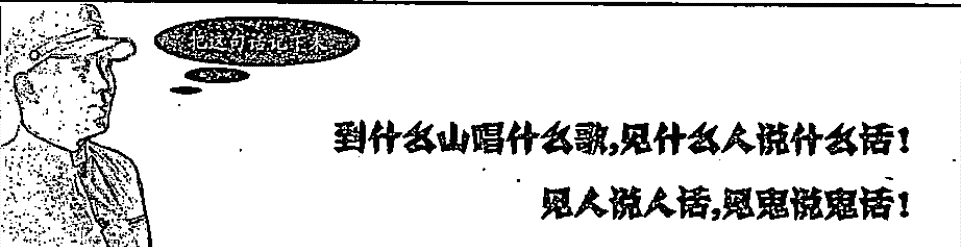

人得清楚自己当下在这个场合的身份，很多老板在家里趾高气昂可像老板了，到公司可像老公呢，对女秘书可好了。

全颠倒了！

识时务者为俊杰，什么叫时务？

就是看情况！

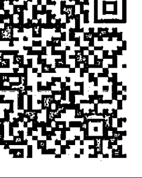

#### 第 07 节：大爰无我,终成大我;利他之心,终成大器!

保持参与各方的平衡!

一诺老师教你的每个策略,你在设计的时候都要保持平衡。

什么叫平衡?

《猪买单》讲究的就是——最佳商业解决方案!

比如,咱俩做生意,把他给坑了,这平衡吗?不平衡。

你知道吗?牢里关的都是好人。

你一定会很惊讶,可是好人怎么会被抓起来呢?

听着:每个人动机都是好的,每个人都会选择当下对最佳利益的行为。

请问你,抢劫犯的动机是什么?钱。

贪污犯的动机是什么?钱。

你做生意这么付出,这么辛苦,你的动机是什么?钱。

可见你们和这些罪犯动机都一样,大家都一路货色。

(此处可以有掌声)

请问,抢劫犯抢了 100 万,受害人损失了 100 万,这平衡吗?不平衡。

还有，小偷偷了100 万，受害人丢了 100 万，这平衡吗？也不平衡。

贪污犯贪污了 1000 万，行贿的人行贿 1000 却拿到 1 个亿利润的工程，赚了 9000 万，这两个都赢了，可是国家却亏了 9000 万，所以国家能放过他们吗？不能，因为不平衡！

所以如果这个事一开始设计不平衡的话，迟早会出问题，你们只见贼吃肉，没见贼挨打，出来混迟早是要还的。

所以平衡比什么都重要。

一诺老师在课程中，跟大家打招呼时说“大家好”，一诺老师认为“大家好”这三个字道出了合作的真谛，我好叫利益，你好叫情义，大家好就是道义。

一个人你只盯着我好，那是利益，如果你能兼顾大家好，你做的事儿就在道上，所谓是：

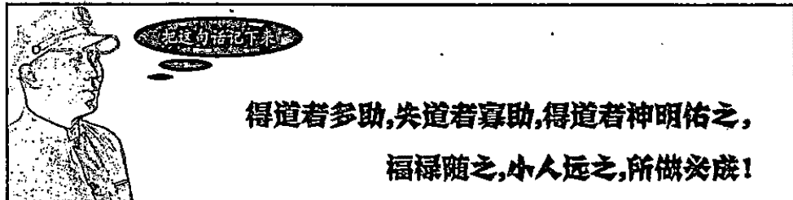

来，翻到下一页，

一诺老师继续带你享受知识的盛宴……

有一个小和尚跟师父说：“您总说心想事成，可我咋老是不能心想事成呢？”

师父问：“你想啥了？

小和尚说：“我想要一个冰箱啊，这样施主们供养的水果供品放进去就不会坏，然后我就可以吃啊师父说：“你不能这么想，你要想一——如果我有了冰箱，施主们来了，大家就可以一起分享这些供品，当你的梦想跟大家有关系的时候，大家就愿意帮你实现梦想，这样你才能梦想成真。”

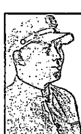

> 六要无我，终成大我；利他之心，终成大器！ 起心动念利他，一切苦果兴来！

每个老板出生时都是光溜溜的，可是为啥到现在不一样了呢？这个社会的资源对每个人都是敞开的，我认为做老板，你要考虑你是在做一个多大的框架，装了多少资源进来。

为什么好的投资商、供应商、人才、客户都进不来？

为什么社会外部的资源进不来你的企业，为啥？

因为跟人家没关系！

佛祖说：普渡众生！

结果呢？反被终生渡化！

主耶稣说：神爱世人！

可后来呢？世人都爱神！

马云说：让天下没有难做的生意！

结果呢？不可思议……

天下的生意都很难做，马云的生意却火的不要不要的！

所以，这一切一切的真相原来是：

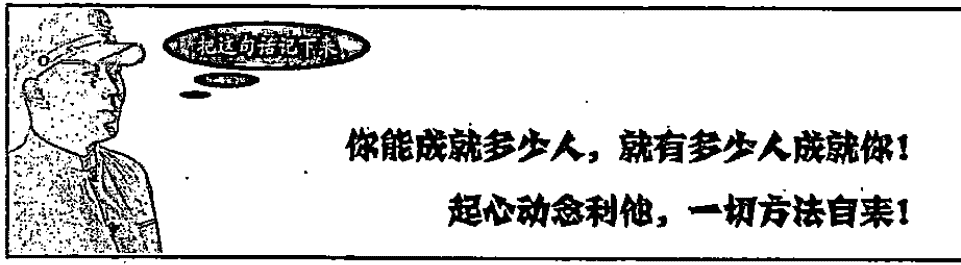

是的，你没有听错！

你能成就多少人，就有多少人成就你！

一诺老师常常在课堂中提问，我说：“在做企业家，你们现在有企业有团队的请举手……”

因为一诺老师的课程定位就是企业家，所以现场只要带手

的几乎全部举手……

我继续发问：“有公司有团队，业绩不是很理想，对自己公司目前经营或商业模式不是太满意的请举手！”

这次几乎全部都举手，甚至有人举双手加双脚！

我看到很奇怪，就问了：“这位企业家，请问你，你为啥举双手加双脚呀？”

这位企业家姓张，张总说：“一诺老师，我对目前的状况岂止是不满意，是太不满意了！”

我说：“那我问你，请问你张总，你的梦想是什么？”

张总说：“我要买车！”

我说：“很好！还有呢？”

张总说：“我要豪宅！”

我说：“非常好，请继续。”

张总说：“我还有很多钱，我要吃最好的！用最好的！穿最好的！我要公司上市，我要成为亿万富翁！”

我故意压低声音，轻声说：“张总，请问你，你的格局能不能再大一些？”

张总说：“我明白了，一诺老师，您是让我成为中国首富？

还是世界首富？”

我说：“在公布正式答案之前，想要做一个简单的调查，现在跟张总一样，想要成为亿万富翁的请举手！”

现场除了一诺老师，统统举手！

我说：“想要成为中国首富的请继续举着！”

·现在还有十几个举着！显然他们非常自信！

我说：“想要成为世界首富的请继续举着，其他的手放下！”

我说：“你们太棒了！给自己热烈掌声鼓励一下！”

现场响起了雷鸣般的掌声！

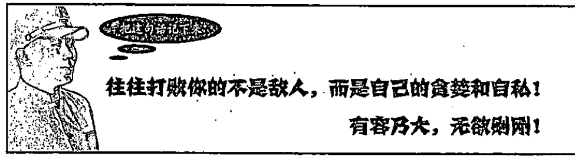

这时候，我却非常平静的问台上的张总：“张总，请问你啊，你是想成为中国首富呢？还是世界首富？”

张总这时候被其他人激励的已经自信心爆棚，台下的企业家同学也跟着起哄，张总喝了一口口水，吼了一声说：“一诺老师，我要成为世界首富！”

我说：“世界首富你个头！”

张总很惊讶的张大嘴巴望着我……

我说：“我现在知道你们为什么不成功了！各位亲爱的企业家们，你们都想成为首富，而却忘记了，首富只有一个！一诺老师不是搞传销的！所以不会给你们编制美丽的梦想！但是作为老师的良知！我有义务告诉各位真相……”

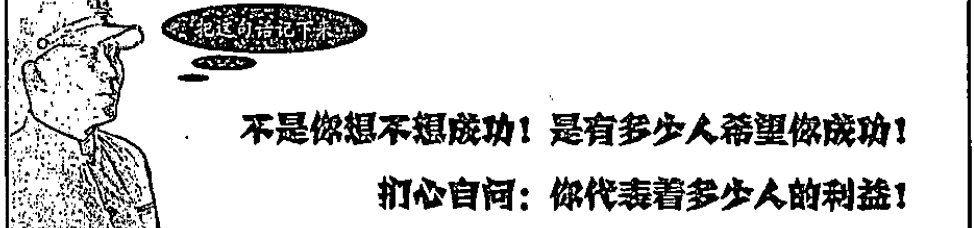

你常常讲你的梦想，都是关于自己得到什么！

所以，这就是你孤立无援的原因！

各位，现在开始！

对，从你学到课程的这里开始，你回家对你太太说：亲爱的，我要钱没用，我赚钱的目的，就是为了你，我想让你可以每天睡到自然醒！每天数钱数到手抽筋！每天不用再去挤地铁、挤公交……我要给你买一个大大别墅！我要带你一起环游世界！给你买最美丽的衣服！给你最健康的食品！请最好的美容师让你青春永驻……

亲爱的，这就是我为什么发奋图强！拼命工作的最大动力！

想想看，当你的太太听到这句话时，仿佛自己变成了天使，正在慢慢的飞起来（不得了，这就是攻心为上）……

所以，从此之后，你太太知道，你在为谁做？

对，标准答案——为她！

所以，从今开始，她会怎么样呢？你觉得她会不会对你更好一些呢？

……

还用想嘛？当然会更好！

亲爱的企业家们，当你学到这里……

见到你的妈妈：“妈妈，我一切都是为了您……”

见到你的爸爸：“爸爸，我一切都是为了您……”

重点来了：

在你员工的面前开会，你应该怎么说呢？

来，一诺老师给大家演示一段：

“曾经，我和大家一样，为了追求梦想，为了可以光宗耀祖！为了可以让自己的孩子上更好的学校，为了可以让自己的家人过的更幸福！也想拥有豪车豪宅！但这一切对于我来说，早已经实现！今天，看到了你们，让我想起了我的昨天！我知道梦想的可贵！更知道在追求梦想的道路上一定会有很多的障碍！不要怕，因为我们是一个团队！不要担心，因为有我在你身边，我会带着你们！让你实现有房有车！让你实现财富自由的生活！未来三年，我将要帮助 100 名（你也可以根据实际情况定数字）有缘人，成为千万富翁！

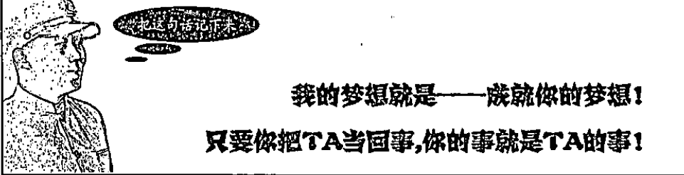

我梦想就是——成就你的梦想！只要你把TA当回事，你的事就是TA的事！

我愿意倾其所有帮助你，请问你们愿意吗？

我愿意帮助你们，请问你们有没有信心？

……肯定大家的回答是——有！

好吧，结果会怎么样呢？

你用脚趾头想一下，之前你讲的都是你要赚多少钱，你要买房买车……而现在，你要帮助他们买房买车……

这有没有区别呢？

有，前者他们会说，关我屁事！对不对？

后者呢？他们会说：太棒了，我是为了我自己！

同志们呀，不要再糊涂下去了，要开始开悟了……

如果听了一诺老师的课程在不开悟，真的是……

哎，我不喜欢说脏话，也就不骂你了……

一诺老师只想问你一句：“如果你的手下 100 个都成为 1000 万富翁，你相信你会差到哪里去呢？别忘了他们是你的手下呀……

我滴个妈妈咪呀，如果我都说到这个份上，你还不醒悟……

我觉得你不太适合做老板，真的！

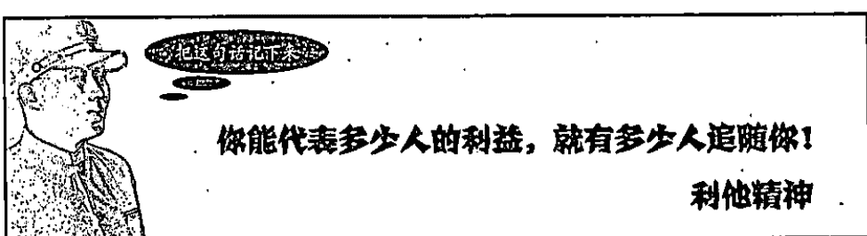

伟大领袖毛爷爷，带领工农闹革命：

打土豪分田地！

各位，毛爷爷为穷人打天下，所以，穷人支持还是不支持呢？答案是——支持！

为什么？

因为，毛爷爷代表工人和农民的利益！

还是那句话，一诺老师讲了17年，但却很经典——

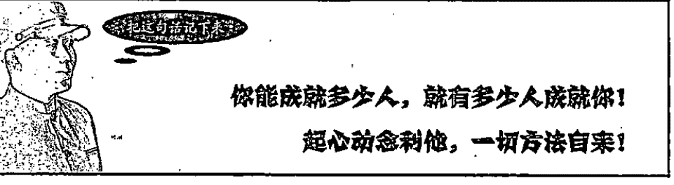

你能够成就多少人，就有多少人成就你！

各位亲爱的企业家们，当你正在学习一诺老师的《猪买单》，请你记住，从今天开始：

- 不要想我要赚多少钱？
- 要想我帮助多少人拥有财富！
- 不要想我要买豪车！
- 要想帮助多少人买豪车！
- 不要想住别墅洋房！
- 要想帮助多少人拥有房子！
- 不要想自己生活奢华！
- 要想帮助多少人拥有品质生活！

一诺老师再说一遍：

你能够成就多少人，就有多少人成就你！

所以，请永远记住：

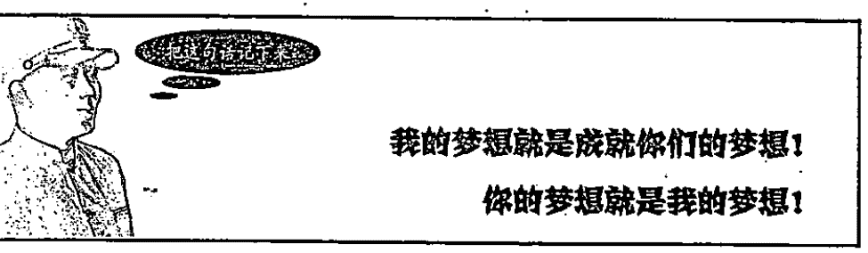

不要再想着自己，因为你的员工和团队觉得那是你的梦想！

只有当你的格局不断放大，放大到你的梦想就是成就他们的梦想！这个时候，一诺老师要恭喜你拉！你就会获得追随者！

佛曰：本欲渡众生！反被众生渡！

耶稣：神爱世人！结果世人都爱神！

一诺老师的使命是：惠及全人类！

请问你，当一诺老师教你教到这里，你的使命是什么？

#### 第 08 节：第一次就把事情做对是拒绝平庸的开始

孙子兵法曰：先胜而后求战！

啥意思呢？

是得到所有战争获胜的必备要素之后才开战，而不是仗打了一半发现武器装备不行，粮草补给不行，情报搞错了，这个时候想赢却没机会了。

兵法的最高境界是不战而胜，百战百胜是下策的，最好的赢家是不战而胜，最差也是打一次就够了。

百战百胜意味着要打好多次仗，劳民伤财啊。

秦国的灭亡跟打仗是直接相关的，常年的战争掏空了国家的资源。所有的战争不是打人的，都是打钱的，所有的市场都是打钱的，孙子兵法不是教战法的，而是教不战之法的。

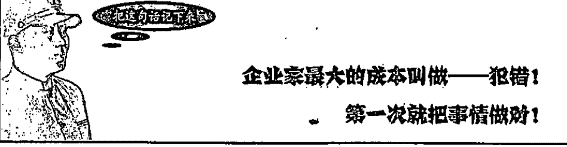

做生意频繁出手的，出错的机会就很多。很多老板做生意东边赚点，西边亏一点，最后剩下一点点。

这就像一个男人同时交往好几个女人。人的精力有限，管都管不过来啊。

生意牵扯的人力物力财力，你顾不过来。

对老板来说，减少出手的频率，一辈子做好一件事情就不得了了。

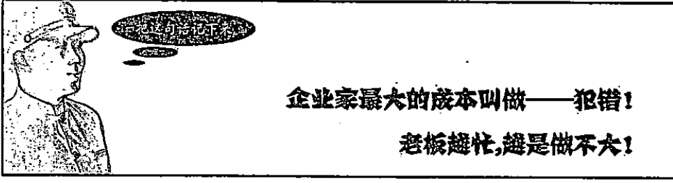

毛主席一辈子也就只做了两件事情：

第一是把小日本送回老家了，第二是将蒋介石送回台湾了

伟人也只做两件事情，咱们普通人能做好一件事情就够了。

打死犟嘴的，淹死会水的。

常在河边走哪有不湿鞋？

频繁出手的，出错的机会就很多，认同吗？

去年我去某城市的时候，看到到处在修路，挖了好多坑，

某城市市政很厉害，硬是把马路给挖成山路了。

市民们说，这路几乎年年修，天天挖坑，没完没了了。

这表示什么？

整个城市规划考虑的不够，图纸设计之初就要把所有的规划好，要考虑到未来 10 年、20 年，甚至 100 年后的人口增长、城市变迁、给排水系统等等变量因素，一开始的顶层设计规划做好，就不会今天这样天天挖坑了。

全世界最省力的方法，就是一次性把事情做好，返工是最浪费的，要消耗很很多人力物力财力。

早产儿就先夭发育不良，万事万物都有它的规律和周期，你要按规律办，拔苗助长的，转基因长出来的，可能会短暂繁荣，但是后果很严重。

一诺老师经常说：“其实最苦逼的就是老板……”。

所以在动作之前，一诺老师提醒你，先考虑清楚。

企业要做强做大，一定要有一个强大的商业模式！

《猪买单》就是全球最佳商业解决方案！

很多企业做到一定阶段就做不大了，为什么？

因为一开始就错了！

一开始的商业方案就注定做不大！

所以企业家需要学习《猪买单》！

万丈高楼的关键是设计师！

很多企业家是没有蓝图的！

没有完善的建筑蓝图，先不要忙着盖楼房。

顶层设计先于一切动作！

#### 第09节：结构的调整能让你的企业华丽转身

前段时间，一位做珠宝的学员来访，赠送我一枚钻石。

他懒洋洋躺在沙发上，左手拿着茶杯，用嘴轻轻吹动茶水的热气。云雾缭绕中，他右手拿着这枚钻石，凝视着对我说：

“一诺老师，你知道吗？作为宝石，必须具备美丽、耐久和稀少这三大要素。而钻石是唯一一种集最高硬度、强折射率和高色散于一体的宝石品种，远胜过其他宝石品种。

自古以来，钻石一直被人类视为权力、威严、地位和富贵的象征。此外，钻石又被象征着对爱情的坚贞，一枚钻戒成为承载两人爱情最美好的信物，正所谓钻石恒久远，一颗永流传。”

“是不是因为钻石的成分比较特别，所以卖的比较贵，对吗？”我喝了一口普洱茶，问道。

他摇摇头，笑着回答：“钻石是这个世界上最坚硬、成分最简单的宝石，它是由碳元素组成、具立方结构的天然晶体。它的成分与你常见的煤、做铅笔芯的石墨成分都是一样的。换句话说，钻石和石墨其实是一样的成分！”

我有些好奇，问“为什么钻石和石墨的身价差几万倍呢？”

“因为它们的结构不同。碳元素在较高的温度、压力下，结晶形成黑色的石墨。而在高温、极高气压和缺氧的环境下，则结晶为珍贵的、无色的钻石！”

“钻石是世界上最古老的宝石，它形成的条件一般为压力在 6.0Gpa(相当于 150-200 千米的深度),温度为 1100-1500 度高温，这样导致它的结构非常稳定，是天然矿物中硬度最高的宝石。”他一边说，一边把那枚钻石递给我。

接过这枚钻石，我思绪万千……

钻石和石墨成分都是碳，可是身价差几万倍，因其结构不同；图书馆里的书，有序摆放和随意丢弃，找寻时难度不同，因其结构不同。

好结构多么重要——

就行同样一个男人或女人，把结构调整了，你就会受异性（市场）的欢迎了……

就像你现在企业一样，你觉得很难，但是当你学会《猪买单》之后，学会了调整企业运营的轨迹——结构！那么你会发现经营企业原来如此简单，你会有一种久违的——得心应手！

就像很多人的书，也是写企业运营的书籍，我的《猪买单》可以卖到几千块，为何他们的书只能卖到几十块，甚至有的十块钱都没人要？因为——内容结构不同！

因此，虽然很多人都在赤裸裸的模仿我、抄袭我的作品或课程，但是一直被模仿从未被超越？

为什么？

我们不一样……

《孙子兵法》：“故善战者，立于不败之地，而不失敌之败也。是故，胜兵先胜而后求战，败兵先战而后求胜”也就是说，真正会打仗的人，都是先谋划，先创造取胜的条件才开战。

凡事预则立不预则废，谋定而后动，大事可成。盖楼房时，必定先绘图纸，而后建筑。

反观自己这些年来我教过的学生，可以说是阅人无数——无数大大小小的企业家，也见惯了商海沉浮，看多了商战成败，是什么导致大企业穷途末路？又是什么令小公司一夜成名，做强做大呢？

究其根源，都是因为结构不同。

##### 什么是好结构？

好结构可以让一个组织做到人尽其才、物尽其用、合理配置、协同增效、各方多赢的局面。

好，你会问我说，那老师，既然结构这么重要？

如何调整机构？

现在，静静的深呼吸……

做好心跳加速的准备……

答案就在下一章揭晓……

### 第二章 顶层设计

企业生死存亡之大计也

#### 第 01 节：最佳商业结构的关键是什么

如何设计出好结构？——顶层设计

顶层设计关键：

什么是顶层设计？

其源起于“工程学”，本义是统筹考虑项目各层次和各要素，追根溯源，统揽全局，在最高层次上寻求问题的解决之道。

顶层设计是运用系统论的方法，从全局的角度，对某项任务或者某个项目的各方面、各层次、各要素统筹规划，以集中有效资源，高效快捷地实现目标。

简单说来，顶层设计就是布局，就是系统规划，就是为了企业的长远发展，寻找一套可操作的系统性解决方案的过程，即按照“以终为始，B 点思维”的原则，基于对人性的假设，对目标市场的理解，对用户需求的把握，对竞争格局的认知，

通过系统的分析，把经营理念、终极目标设定好，把用户心目中理想的完整产品描述清楚，把实现目标的关键要素和主要矛盾罗列出来，把潜在的问题和风险预见到，从而根据目标去整合配置资源，缺什么补什么，倒排时间表，形成一个通俗易懂的“剧本”，然后让各个职能的管理者按照“剧本”上的分工扮演好自己的角色。

田忌赛马中，虽然整体资源都比对方弱，但通过合理统筹，高效配置资源——

- 用自己的下等马对对方的上等马，输一局；
- 用自己的中等马对对方的下等马，赢一局，扳平；
- 用自己的上等马对对方的中等马，赢一局，最终胜利。

在企业家经营市场的过程中，你发现很难赢，却忘记了其实还有人是赢家，他们为什么能够赢得市场和客户？而你却举步维艰？因为你的结构有问题，这就是一诺老师为什么苦口婆心的在这里花这么长时间给大家讲顶层设计！

请各位企业家正确对待！真正理解一诺老师的良苦用心！

这次跟以往不同，以往一诺老师由于讲课时间比较紧，加上很多顾问案，所以我的书籍都是由我的助理、合作伙伴或弟子帮我把课程录音译成文字，但是有很多人在书写过程中扭曲了我的意思，只是很多人出于对一诺老师的信任，除了说好，也没有其他负面的声音，再次一诺老师由衷的感恩大家的爱戴！同时一诺老师这次亲自用心铸就一本可以真正帮助各位企业家的书籍！讲的比较细致，望各位企业家认真研读！

天下万物不为我所有，但为我所用。

#### 第 02 节：顶层设计的终极完美公式

顶层设计作为企业最高的发展纲领，作为事业大厦的设计蓝图，具有以下特点：

首先是严密的逻辑性。

系统性思维将就严密的逻辑性，所以，顶层设计不仅要清晰描述企业的“终极目标”是什么，更要明确回答“获得成功”是为什么；不仅要有合理的经营理念与愿景，更要有具体可操作的方法论，换句话说——

要按照发展愿景和战略目标，有针对性地提出系统完整、步骤清晰、分工明确的实施计划，并按需要组织的人力、物力、财力等资源条件配套安置，实施、管理、监督、检验，井然有序，环环相扣，纹丝不乱。

其次是明确的可操作性。

顶层设计必须从实际出发，再回到实际中来，所有的设计方案及每个方案的所有措施，都要能归结到可执行的要素“5W2H”上，即明确所要执行的是什么任务(what)、为什么要做(why)、何时开始(when)、从哪里入手(where)、由何人负责(who)、如何去做(how)及要花多少时间和资源(how much)，以此确保执行者能够充分把握战略落地的要领，保证执行不出偏差。

同时，还要充分估计各种执行风险，做好相应的预案准备。

此外，因为顶层设计所针对的是系统工程，所以从设计构想到评议决策，再到管理、执行、监督、检验，整个过程是一个群策群力的合作过程，需要从高层管理者到基层员工的全员式参与。同时，又由于顶层设计具有很突出的重要性和风险性，所以，对企业决策层、管理层和执行层都提出了相当高的要求。

最后，我对顶层设计做个总结。

顶层设计就是把平庸企业变成卓越企业的系统规划，是一个无中生有，变废为宝的思维架构和实践体系。

经由顶层设计，诞生伟大企业。如果你深入了解，你还会发现顶层设计还有以下 3 大特征：

一是顶层决定性，顶层设计是自高端向低端展开的设计方法，核心理念与目标都源自顶层，因此顶层决定底层，高端决定低端；

二是整体关联性，顶层设计强调对象内部要素之间围绕核心理念和顶层目标所形成的关联、匹配与有机衔接；

三是实际可操作性，设计的基本要求是表述简洁明确，设计成果具备实践可行性，因此顶层设计成果应是可实施、可操作的。

在这些年的实践中，我对如何通过顶层设计，打造好结构的企业有很多心得，最终一诺老师把它浓缩成为这个公式：

好结构(卓越企业)=好内容(优质资源)+好流程(合理配置)

我们做生意都差不多吧，找地址，工商，招人，设备，股权，但是有人赚钱有人亏钱，差在哪里？

——结构。

结构都是由两个部分构成的，一个是元素，一个是排序。相对石墨来说，钻石的排序更加合理，是特殊的配置方式来承载的。

大家都在谈论系统，什么才是系统呢？

——就是结构。

2001年之前我就是建筑设计师，以前是设计房子的图纸，今天设计做商业项目的图纸，做商业顶层设计。

我发现，好结果是被设计出来的，好的建筑需要很棒的设

计图，如果没有图纸随便建，可能会建出有史以来最伟大的钢筋混凝土怪物。

可是，在中国 99.99% 的老板对自己的企业没有做完整的顶层设计，头脑一热就创业了。

大多数人的一生都是脚踩西瓜皮，滑到哪算哪！

一诺老师在上小学的时候，读过千里马和拉磨的驴对话的小故事：白龙马随唐僧西天取经归来，名动天下，被誉为“天下第一名马”！

白龙马想念家乡，找驴、羊、牛等儿时伙伴玩耍……

驴迫不及待询问成功秘诀，白龙马说：“努力工作！”

这时，驴委屈得嚎啕大哭：“为什么自己这样努力工作却一无所获？”

白龙马说：“我去取经时大家也没闲着，甚至比我更忙还累。我走一步，你也走一步，只不过我目标明确，十万八千里我走了个来回，而你在磨房自己的小圈圈原地踏步。”

驴一脸懵……

其实白龙马走的路程并不比驴走的多，为什么白龙马收获了人们的尊重呢？

白龙马有目标！而驴没有……

重点来了，请问各位企业家，白龙马为啥有目标呢？

因为帮白龙马做顶层结构设计的是观世音菩萨！

所以各位企业家读到这里，应该感到幸运，因为从现在开始由一诺老师来教你做顶层设计，从现在开始跟着一诺老师的思路，认认真真地学完《猪买单》，你就会拥有全世界最佳商业解决方案！

全球终极商业模式——《猪买单》。

#### 第 03 节：成就别人就是解放自己

大家都知道一诺老师创办了【改变世界商学院】，然后又将商学院传递给唯心老师和无为老师！

因为术有专攻，所以专业的事情让专业的人去做！

唯心大师是万能营销世界第一人，唯心大师帮助无数屌丝逆袭！让很多企业起死回生！让无数身临困境的企业家华丽转身！让迷茫无助的企业家脱胎换骨！有机会大家可以听听唯心大师的《万能营销》，一定让你匪夷所思！

唯心大师是营销实战导师，凭借其 10 多年的顾问落地指导经验，一直深受学员的好评，因为市场上各种培训满天飞，所以唯心大师采用顾问式辅导落地的模式，赢得海内外企业家的一致好评！

相信将来，改变世界商学院在唯心大师的带领下，一定会广纳贤才，让更多的优秀讲师加入改变世界大家庭。唯心大师既然都这么牛，那就把改变世界商学院交给唯心大师，让唯心大师当大股东，对于所有决策和一切运营，我一概不干涉，放手让唯心大师去干，我想唯心大师既然能够指导别人，那改变世界商学院在唯心大师带领下应该是不会差的！嗯，我相信！

让我们拭目以待！

一诺老师用这个举例，想告诉大家，能够外包的统统外包，能够让别人做的统统让别人去做，主要是两个方面：

- 一方面给别人成长的平台和帮助别人实现抱负的机会！
- 另一方面给自己腾出时间来，好做点大事！

因为搭建平台的意义不是造就自己！

而是成就别人！

成就别人就是解放自己！

前一阵子，流行成功学，是的，成功学在人受挫折的时候，是可以激励自己，激励团队；在刚刚改革开放时代，在大家都没有自信，不敢创业，不敢当老板的时候，可以起到激励作用，一诺老师也是成功学的受益者！但是今天时代不同了，不是你多么的自信就能成功，因为现在大家都很自信，不是给自己打

鸡血就能成功！因为现在做业务的每天都在打鸡血，但毕竟成功的是少数……

一诺老师相信成功学的益处，相信但不痴迷，当别人都在喊我是最棒的！我要成功！我要成为亿万富翁！我要买房买车！你是否听到过类似的叫喊？所以，当别人都在跟风的时候，一诺老师是第一个头脑保持清醒的人，一诺老师非常明白：原来人人都想成就自己！

好吧，就让一诺老师来成就你们，于是一诺老师教育企业家跟成功学截然不同：不要喊自己是最棒的，那你是最棒的你就会累死，因为你是最棒的员工做事不如你，你说好笨呀，滚开，让我来！什么都你来你会累死……所以现在老板很累！

一诺老师主张你要引导员工和团队：你是最棒的！企业家不是喊自己是最棒的！要告诉团队，他们是最棒的！

有没有听懂？

这就是境界！

一诺老师曾经在青少年多次获得散打冠军，也曾当过散打教练，所以有这样的体会：一个教练，已经身经百战，还要去教练一个刚出道的娃娃，很有耐心的陪伴他成长，教练会不会说，你真笨，不要你打比赛了，这么笨，还不如我自己去……

教练就是教练，就是要在外围，企业家就是企业的教练，不能什么都自己来，应该让自己的运动员去练，而自己就是教练，只负责教学员练……

所以，一诺老师把改变世界商学院授权给他们去做，接下来只做【猪买单】，因为【猪买单】是一诺老师 30 多年教育实战经验的浓缩！

【猪买单】是全球最佳商业解决方案！

【猪买单】是帮助企业落地的一套完美系统！

我想大家肯定听过这样一句话：

——活着就是为了改变世界！

他就是苹果的始作俑者乔布斯，而他能够有胸襟亲自向董事会推荐，把辉煌的苹果公司头把交椅让给蒂姆·库克，这就是胸怀！这就是格局！

是的，乔布斯可以说是成功的改变了世界。

史蒂夫·乔布斯是苹果公司前首席执行官兼创办人之一，于 2011 年 10 月 5 日因癌症辞世，享年 56 岁。

虽然乔布斯已经逝世，但乔布斯的名字将与爱迪生和爱因斯坦一同被铭记。

为什么呢？

因为他们的理念将继续改变世界，影响数代人。

在过去的四十年中，史蒂夫·乔布斯一次又一次预见了未来，并把它付诸实践。

乔布斯用热情、信念和才识重新塑造了文明的形态。

但是今天一诺老师不是给你谈乔布斯的丰功伟绩，因为这是大家都知道的秘密！

今天一诺老师要跟他谈乔布斯的顶层设计，商业结构的战略，因为乔布斯毕竟是成功的将这种模式发挥的淋漓尽致！

现在，请不要被电话及各种电子设备干扰，找一个没人的环境跟着一诺老师的思路，一起来捋一捋乔布斯的成功之路！

2005 年，乔布斯在斯坦福大学毕业典礼上

#### 第 04 节：乔布斯道出了大多数企业家的误区

乔布斯在斯坦福大学的演讲：

我今天很荣幸能和你们一起参加毕业典礼，斯坦福大学是世界上最好的大学之一。我从来没有从任何大学毕业过。

说实话，今天也许是在我的生命中离大学毕业最近的一天了。

我在瑞德大学读了六个月之后就退学了，但是在十八个月以后——我真正的作出退学决定之前，我还经常去学校。那我为什么要退学呢？

乔布斯出生于 1955 年 02 月 24 日……

我的生身母亲是一个年轻的、未婚的大学生。她决定让别人收养我，她非常想让我被一个大学毕业的家庭收养。

当我出生的时候，她已经做好了一切准备。

所以我的养父母突然在半夜接到了一个电话：“我们这儿有一个意外生出来的男婴，你们想要吗？”他们回答道：“当然！”

但是，我生身母亲后来发现，我的养母从来没有上过大学，我的养父，甚至从没有读过高中。

她拒绝签署收养合同……

只是在几个月后，我的养父母答应她一定会让我上大学，那时她才勉强同意。

在十七岁那年，我真的上了大学。

但是我很愚蠢地选择了一个几乎和你们斯坦福大学一样贵的学校，我父母还处于蓝领阶层，他们几乎把所有积蓄都花在了我的学费上面。

六个月后，我已经看不到其中的价值所在。

我不知道我真正想要什么，我也不知道大学能怎样帮我找到答案。

但是在这里，我几乎花光了我父母一辈子的全部积蓄。

所以我决定要退学，我觉得这是个正确的决定。

我对养父母有着深厚的感情：“他们百分之百是我的父母。”每当有人称保罗和克拉拉为乔布斯的“养父母”或者暗示他们不是我的亲生父母时，我就会异常愤怒......

我几乎花光了我父母一辈子的全部积蓄，我不忍心......

所以我决定要退学，我觉得这是个正确的决定。

不可否认，我当时确实非常的担忧。

但是现在回头看看，那的确是我一生中最棒的一个决定。在我做出退学决定的那一刻，我终于可以不必去读那些让我提不起丝毫兴趣的课程了，于是我可以去修那些自己喜欢的课程。

但是这并不浪漫......

我没有宿舍！只能睡在朋友房间的地板上......

为了填饱肚子，我去捡可以卖 5 美分的空可乐罐……

星期天晚上，为了吃上一顿好饭，我必须走上七英里的路，穿过城市到达哈里神庙。我喜欢那里的饭菜，因为廉价……

这是每个星期唯一的一顿美餐……

………………

现在听到了乔布斯的励志演讲，斯坦福大学的师生们都很受鼓舞，现场多次响起雷鸣般的掌声！而且是起立鼓掌！

小米雷军穿着和路演手势都和乔布斯那么的接近。

后来，斯坦福学校引起了一波学习乔布斯的热潮，乔布斯 21 岁创业，25 岁成为亿万富翁……

于是很多人把乔布斯的成功因素总结如下：

- 是专注和简单
- 是预测业界趋势
- 是大胆使用最先进的技术
- 是打造崭新的商业模式
- 是凝聚一流人才
- 是憧憬用户尚不自觉的需求
- 是永不停息的自我超越
- 是设计每个细节都近乎完美的产品
- 是口若悬河地说服用户情不自禁地爱他的产品
- 是激情和自信
- 是营销能力
- 是融资能力
- ......

如果详细写出来，有成百上千种因素，可是这些都是世人总结出来的，而真正的又是什么呢？

大家都觉得自己的总结是对的，有一天，学生们实在是争论的不可开交，就找到乔布斯，请乔布斯公布正确答案……

当乔布斯看完这些答案后笑着说：“这些学院派的答案害死多少人……”

然后把所有答案扔到垃圾桶……

现场的同学一脸懵……

有同学反应过来，就问：“乔布斯先生，既然这些答案不是对的，那正确的答案是什么呢？”

乔布斯沉默了一会，最后给了学生一幅图，这幅图就是乔布斯成功的秘诀！

收到图的同学几乎疯狂，因为他们知道，这就是正确答案，这就是乔布斯创造奇迹，改变世界的秘诀！

于是，同学们像获得财富大门钥匙一样的兴奋……

各位，这就是那张著名的乔布斯成功的秘诀图，不知道你懂没有？

各位，很多人拿到这个“乔布斯成功密码图”之后，回去开始研究……

于是又出了很多令人啼笑皆非的答案：

崇尚简单和断舍离的人是这样解释的——乔布斯一生发型不变、衣着款式和色彩不变，永远是牛仔裤、黑 T 恤、运动鞋，这样就不用将生命浪费在这些琐碎的事情上面！

甚至崇尚节俭的人说，上衣 30 块钱人民币，牛仔裤 100 块，运动鞋 200 块，一共 330 块搞定，省钱……

各位，你听着有没有道理？

有呀，肯定有道理，我听着都有道理！

一诺老师只是想问一下，保安、清洁工、服务员都穿一样的衣服，既简单也节俭，好像也没有成为亿万富翁……

所以这个答案显然是太极端了，我们再来看看另一种答案。

某些做演讲培训的开始大做文章，说演讲是出人头地的唯一途径……他们说乔布斯成功靠演讲能力，如果你想像乔布斯那样成功：要学习演讲！

各位，听着有没有道理？

有呀，肯定有道理！

一诺老师想问说这种话的人三个问题：

1. 第一个问题：会演讲的人很多，教堂的牧师、学校的老师、公司的培训主管、甚至是做传销的，他们都很会演讲，真正成为亿万富翁的又有几人呢？
2. 第二个问题：你们说“演讲出人头地的唯一途径”，对此一诺老师实在不敢苟同，我想请问贝多芬的成功是靠演讲吗？成龙的成功是靠演讲吗？邓亚萍的成功是靠演讲吗？世界上成功的人很多，一定要靠演讲吗？
   “演讲出人头地的唯一途径”很显然说这句话的这个人没什么文化，极端的自负也暴露出没有见过什么世面！
   最重要的是忽悠了多少人？所以，一诺老师见到众生愚昧，被社会上那些没有文化的人忽悠来忽悠去，才立志不为钱演讲，为什么？为了追求事物的真相！
3. 第三个问题：就拿教别人演讲的人来说，你是亿万富翁吗？

很显然，这个答案也不是一个企业家要追求的，一诺老师还是带你看下一个答案吧。

更有一种答案说——上市，只要上市了就可以融资，就可以实现资本裂变！

对于这样的答案，一诺老师也只是嗤之以鼻，资本市场上有很多垃圾的上市公司，有很多奄奄一息的上市公司，有很多

的空壳上市公司，有很多上市公司上市之前充满期待，上市之后恍惚度日……

很显然，这也并不是正确答案……

那么什么才是正确答案呢？

解铃还须系铃人，后来学生找到乔布斯，乔布斯公布了正确答案……

#### 第 05 节：乔布斯让苹果风靡全球的三板斧

##### 乔布斯第一板斧：爆款策略

大家不要看乔布斯的上衣、牛仔裤、运动鞋，不要被这些的价格、颜色、款式等所迷惑，那看什么？

看真相……

1996 年苹果公司经营陷入困局，其市场份额也由鼎盛的 16% 跌到 4%。与之相对应的是乔布斯公司由于《玩具总动员》而名声大振，个人身价达到 10 亿美元。

但是乔布斯还是在苹果危难之中重新回来，回来后的乔布斯大刀阔斧改革，停止了不合理的研发和生产，结束了微软和苹果多年的专利纷争，并开始研发新产品 iMac 和 OS X 操作系统。

1997 年苹果推出 iMac，创新的外壳颜色透明设计使得产品大卖，并让苹果度过财政危机。随后苹果又推出 Mac OS X 操作系统。

2000 年科技股泡沫，乔布斯又提出将 PC 设计成“数字中枢”先进理念，并先后开发出 iTunes 和 iPod，同时也开始在黄金地段开设专卖店并大获成功。随后 Apple TV 和 iTunes Store 等一系列产品受到了市场的好评和认可。

2007 年 6 月 29 日，苹果公司又推出自有设计的 iPhone 手机，使用 iOS 系统，随后发布新一代 iPhone 3G 以及 iPhone 3GS。

2010 年 6 月 8 日又发布第四代产品 iPhone 4，每次上市都引得世界极大的疯狂和销售热潮。

除了 iPhone 系列之外，发布使用 iOS 系统的 iPad 平板电脑，这一开始不被众人看好的产品，最后获得了巨大的成功。

乔布斯在苹果公司最低迷的时候力挽狂澜，让苹果华丽转身几乎成为世界最赚钱的公司，其背后的秘诀到底是怎么样的呢？

让一诺老师带领大家，用大家能够听得懂的方式，来拆解乔布斯的成功密码……

在一诺老师拆解这个成功密码之前，我先问大家一个问题，是什么让企业最后一步一步走向灭亡的呢？

两个方面：一方面是收入，另一方面是开支！一言以蔽之就是入不敷出，庞大的开支让企业喘不过气来，入不敷出最终让企业走向灭亡！不能说绝对，但只要是入不敷出，又没有融资能力，企业必死无疑！

乔布斯深知这个道理，所以乔布斯首先把 80% 以上的累赘产品砍掉！

乔布斯说：聚焦不是对 100 个好主意说 Yes，而是对 99 个好主意说 No！

1997 年，乔布斯重新回归苹果，干的第一件事就是：

——聚焦做爆品！

原先每个产品都有很多版本，每个版本又有很多型号，乔布斯采用“自杀重生”的战略方针！

疯狂自屠 70—80% 的产品！

乔布斯有名的生死一问：我们会推荐朋友买哪些产品？

如果这个产品你自己没有信心用，也没有勇气让你的朋友使用，这种产品就是无良产品，没有价值的产品！

自杀重生，他杀淘汰，老旧模式产品质量狠一点！

乔布斯开会时大骂：“垃圾！大部分产品都是垃圾！都是迷茫的、无良的团队制造。”

所以，一吨无用的生活垃圾，不如 10 克拉的钻石值钱！

因此企业不是拼产量！而是传递价值！

有一家企业，确切的说是民营企业，是中国热水器行业的冠军企业——万和集团。

万和集团没有国企背景，是卢楚隆先生白手起家，真刀真枪地干起来的！曾经拥有 3 家上市公司的卢楚隆先生，不光是在国内是备受尊重，就连世界 500 强企业都敬他三分！

有一次，卢楚隆先生去日本的世界 500 强企业，目前汽车企业世界第一的丰田去访问，丰田世界集团总部，用最高的商务礼仪迎接卢楚隆先生，当卢楚隆先生走进丰田集团大门时，

迎接的人全部 90 度鞠躬，直到卢楚隆先生走远了，他们才站直身体，为什么？

因为日本企业知道，中国是世界最大的市场，而卢楚隆先生是中国热水器的冠军！

日本企业做事情讲究专注，他们可以在一个行业做一辈子，然后儿子继承，孙子继承，祖祖辈辈做下去，如果父亲是个卖寿司的，他的儿子即使从东京大学毕业，回去还是继续卖寿司！如果你问他，为什么？他会回答你：“专注！”

现在很多企业做的乱七八糟，甚至之前出现有个卫生巾的品牌——安尔乐，用同样安尔乐的品牌做餐巾纸，哇塞，一诺老师请你想象一下这个场景，一群人正在吃饭，一个女人拿出一个卫生巾，然后当着众人的面打开，这一定会引来诧异的眼光！好吧，如果是个男人呢？别人会说，喂，你变态呀！果不其然，这个用安尔乐品牌做餐巾纸没有成功，很显然这是高层的严重失误！

最后有个高人指点，告诉他品牌就是消费者心中的印象：

例如：妇炎洁就是妇科清洗液，如果妇炎洁凉茶行不行？

劳力士就是代表最好的手表，如果劳力士做卫生巾行不行？

肯定不行对不对？

开宝马坐奔驰，奔驰代表舒适，是用来坐的！而宝马代表驾驶乐趣，所以强调开宝马！

所以，安尔乐一直代表卫生巾，你现在用来做纸巾？那肯定不行！为什么？就像敌敌畏不能再生产可乐一样！

好了，关于品牌的后面一诺老师会详细讲解！

就像之前一诺老师去拜会万和集团董事长卢楚隆先生，我采访了他一个下午，最后我问他用一句话形容自己的成功秘诀：

上图：左边是万和集团董事长卢楚隆，右边是一诺老师

> 拥有两家主板上市公司的董事长卢楚隆先生说：“一米宽，一千米深！”

##### 乔布斯第二板斧：推介会

乔布斯除了一身长期不变的衣着之外，还有什么？

——产品推介会

每当苹果有新产品的时候，乔布斯就上台“表演”了，

我们看看乔布斯 1998 年—2011 年这段时间，几乎每次新产品都是乔布斯做新产品推介会……

永远不变的装束，身穿牛仔裤、黑色 T 恤衫、运动鞋，然后手里拿着最新的苹果产品，展示产品如何给人类带来了最新科技、公司实力、产品市场前景等等……

然后呢？然后就没有然后了……

哈哈哈，也许你听完一般的老师可能是这个答案，但是今天一诺老师给到你的不是这个答案，而是……

往下看：

当你看《猎买单》超 100 遍以上,奇迹将在你身上出现！这种奇迹叫做:羊毛出在狗身上猪买单！

##### 乔布斯第三板斧：外包策略

###### 1、产品打板

首先，乔布斯让厂家打个样板，然后拿着样板就开始做产品推介；

###### 2、销售外包

乔布斯要不要自己销售？当然不用，知道嘛，这个世界上很多人渴望机会，他们寻找商机，所以，乔布斯自己不要投资市场，也不必自己租店面、店面装修、员工、水电等一些列复杂的费用都不用自己出，谁来出？当然是经销商啦！而且还是现金拿货！大的经销商要交品牌使用费、加盟费、还要现金拿货！

###### 3、生产外包

乔布斯还没有生产，就先把产品卖出去，卖出去之后，拿着收到的钱，回去给厂家下单生产！这样，乔布斯以销定产，

###### 零库存！

各位，一诺老师在这里问大家一下，如果没有收到钱要不要去生产呢？

答案是：绝对不要！

因为大多数企业会死于库存挤压！

是不是要多生产呢？例如收了 100 万部订货单，下 110 万部生产队订单？

答案是：绝对不要！

###### 4、服务外包

乔布斯会不会自己去做售后服务？当然不会啦！这都是出力不讨好的事情，当然外包给别人来做，甚至还有人抢着做！

各位，如果乔布斯拿不到订单，他会不会大量生产，让产品挤压，自己租仓库？？？

不会的，乔布斯怎么会这么愚蠢呢？

反观国内很多企业家，自己闭门造车，以为自己的产品自己喜欢别人都喜欢，结果生产一大堆，然后再去找个仓库放起来，然后再去用已经成型的产品去招商路演，结果……

悲剧发生了：你的产品不是别人想要的!!!

怎么办呢？

好吧，那就做广告、开发渠道，甚至用微商直销的方式去做市场……

最后，开支一大堆！

产品好不容易卖出去一部分，生一大堆库存！

各位，有个段子是这样说的：有个企业家，由于经营不善顶不住资金压力，想不开从7楼跳下……结果没有死！啊？不会吧？

是的，没摔死！

因为库存太多，库存就堆到六楼半……

所以，一诺老师再次提醒大家：

- 1. 以终为始：先收钱再生产。
- 2. 以销定产：根据销量来生产产品。

所以，今天我们学到了什么？

##### 乔布斯外包策略的精髓是什么？

其实很显然，明眼人都看准了——

外包，把一些没有生产力的，低利润高损耗的，例如工厂！

外包给别人做！

外包，把表面上赚很多钱，其实被高房租、高人工、高损耗的销售外包给别人做！

外包，把出力不讨好，消耗精力，搞得头晕的售后交给专业的人来做！

总之一句话：能够外包的统统外包！

老板要把时间腾出来做大事！

哈哈，如果你还没有听懂，一诺老师再给你举几个例子：

例如雷军，做产品推介会，生产要不要做？当然不做了。

生产外包——例如 LV 等一些奢侈品有没有工厂？要不要自己卖产品？外包……

在此不一一点名了，总之两个字：外包！

想想看，中国是世界的工厂，那些国外的品牌，来到中国生产产品，利用中国特殊时期的人口红利，可以用廉价劳动力！

很多工厂让工人不断的加班来维持庞大开支，扣除工人工资、社保、奖金、加班费，甚至有时候来个跳楼的要赔钱，晕……请问还能剩下多少钱？过段时间，产品升级换代了，你就要升级生产线，否则就没有订单，结果钱没赚到累的该死！

好吧换生产线，更选设备，大笔大笔资金往里砸，甚至是靠银行贷款的支持，怎么办？要还贷款呀，哎……

不仅如此，房租水电，工人等着吃饭，算了，继续压低利润，继续做廉价劳动力……

中国企业家就是这样进入“恶性循环”的……

中国企业家拼命工作也就是维持开支！

而人家呢？

销售外包、生产外包、服务外包……

没有库存、没有生产压力、不用养活这么多人工……

自己赚轻松钱……

是什么导致中国企业家的现状？

没有百年的工厂，只有百年的品牌！

缺少品牌，中国只能做“世界工厂”！

中国企业家为什么这么累？？？

因为，中国企业不懂经营品牌……

有百年的品牌，你见过百年的工厂吗？

之前，那些外国洋品牌，把利润带走，把污染留给中国……

后来中国人终于醒悟了，说污染环境的不干……

好呀，你不干大把的工厂抢着干，广东不干，搬到内地，

内地不干就搬到印度、缅甸、越南……

这些大品牌，一大堆工厂排队想要帮他们代工，你垮了，人家再换一家……

死的是重资产经营的工厂！

为什么品牌可以活的很久？

所以，一诺老师深深的感受到有种民族品牌危机意识！

国家要富强离不开每一位中国企业家！

一诺老师的使命就是——帮助中国企业家，打造更多的中华品牌！帮助我们国家更富强！帮助民族更富强！

正在学习一诺老师课程的企业家，如果一诺老师愿意把我这一辈子开发的所有关于企业经营管理、商业模式、营销等所有实战课程让你们一毛钱都不花，跟我终生免费学习，你们说好还是不好？好还是不好？

那就关注【猪买单】APP，上面有如何免费学习一诺老师所有课程，机会迎面而来，不要让它擦肩而过……

#### 第 06 节：小生意靠努力，大项目靠整合

一个系统包括两个方面，一个是元素，一个是结构。

元素无非就是人，财，物。

然后就是排序，怎样让每个元素合理的组合在一起，好的内容加好的流程构成好的系统。

一个聋子，一个瞎子，一个瘸子，说我们整合一下吧，那不叫整合，叫残联。

事情不是做成的，事情是整合成的。

你把事情做成的所有要素都整合过来，事就成了。

今天你准备开工做一个项目，项目都是被设计成的，而不是干成的！

首先，你得有产品或有项目，卖什么，你得有用户吧，总得有人买单吧。

此外，还有团队，谁来卖？

内部的员工，外部的经销商，这些都是你团队的一部分。

每一个商业模式都需要钱来启动，总需要有资本吧。

如果你今天做一个商业模式，找来了最有吸引力的项目，

找来了最牛逼的渠道商，他们手里最不缺的就是用户，最牛逼的团队，最顶级的资本，你把这些人聚在一起，签约开香槟，事就成了，同意吗？

大项目不是做成的，大项目是整合成的。

例如，你找到最顶级的供应商，告诉他：“去年你的销量是一个亿今年我支持你，让你再做到1.2亿，你愿意吗？

然后你又找到了最好的渠道商，你说：“王总，我现在有最好的产品，去年你赚了1个亿，今年我支持你，跟我合作让你赚到1.2亿，你愿意吗？”

接下来你去找最顶级的团队，告诉他们：“我有最好的项目、有最顶尖的销售渠道，只是需要这个领域的精英团队来操盘，去年你赚了一个亿，今年我支持你，跟我合作让你赚到1.2亿，你愿意吗？”

现在你找到了最顶级的团队，最好的项目，最顶级的渠道，

你去找这个领域最好的投资商，你告诉他你的回报是最好的，他肯定愿意投你。

现在，你手头有最顶级的团队，最好的项目，最顶级的渠道，最棒的资本，那你做的事是几流的？一流的。没做之前你就已经成功了。

上面这个框架：产品、渠道、团队、资金。

老板你在哪个位置？你在框外！

你不要参与进去，每个环节只要你多出一份力，合伙人就少出了一份力，你就剥夺了别人的舞台，你就太自私了。

你只要多投资一份钱，合伙人就少投了一份钱，你又剥夺了别人的机会，你又太自私了！

整个过程你不要出钱，不要出力，也不要操心，心都被你操了，别人就没舞台了。

我想你一定会问：“一诺老师，那我干啥？”

记住：老板是全球最佳商业解决方案设计师，是系统的控制者，是规则的制定者，是利益的分配者，你是下棋的那个人，而不是棋盘上的棋子！

既然如此，那么你就是游戏规则制定者！

创业的过程原本就是缺什么补什么的过程，你必须明白，全世界所有人都愿意参与你的项目，都愿意进入你的商业模式，都愿意为你所用，只要你有最佳商业解决方案。

《猪买单》就是最佳商业解决方案，就是最最完美的商业系统，一套完美的！可被复制的！能落地的——方法！

商业系统比建房子更复杂的是，工程是个固定的、死的结构，精密的计算和精密的仪器就可以了，商业系统需要很多人参与，人性有很多不确定性，要考虑变量。

你们要站在更高的层面看待自己的企业和未来。

要知道，国与国之间的对话往往靠军事在支撑，而支撑军事的又是经济和民生的安定，这一切又离不开商业。

尤其随着当今科技的进步，通讯的变革、交通的变革、物流的变革……这些快速的变革，最终加速了人们生活方式的变迁，过往的经验已经不足以支撑我们在瞬息万变的时代应付自如，游刃有余了。

难题摆在我们每个人面前：这是最好的时代，也是最坏的时代，身处其中，你该怎么办？

当现在人类的精神开始觉醒，生活方式开始变迁，加上技术工具的支撑，直接导致需求的变化：人们开始追求更好、更快、更舒适、更安全、更便捷、更简单………

总之，要更顺应人性！

这一切都导致旧中心的调整、改进和优化，以适应人们日益变化的需求，甚至严重的会发生倒塌重建。

从外在表现的颠覆、变革，乃至是乱象，而一诺老师看到的却是内在实质在按照适者生存的方式，在进行着最优化配置。

宇宙高度智能，优胜劣汰，总是在朝着最好的方向进化，过程中不可避免的重新洗牌、重构规则、甚至……重建系统，这一切的改变都可以看做是，为了朝着更完美的生态圈进发而吹响的冲锋号。

大多数人总在惊叹革命的突然性，却未曾发现细微的变化从未间断，随风潜入夜，润物细无声，一直在进行。

而智慧的人总会保持一份清醒，察其未萌，从而管中窥豹，一叶知秋，于无声处听惊雷，自然能够趋利避害，先行而至，顺势而为，立于潮流先锋，成为时代人物！

而那些醉生梦死的人，睡了一觉醒来，却发现变天了，打了个盹睁开眼，发现碗里的饭被别人抢了，更过分的是，连碗都被别人端了。

因此，一诺老师奉劝在座各位老江湖：天气预报，风起云涌，行走江湖，英雄自重！

今天的商业格局已经发生了巨大的变迁，刚才一诺老师说过，新的中心在产生，旧的中小在消亡。

最核心的媒体是央视，可是它的客户已经被分流了。

不止如此，你会发现今天在中国的纸媒半数以上是亏损的。

陈旧的企业为什么被消失了？

因为更有竞争力的企业诞生了。

谁能把握人民的最佳利益，谁就能得民心得天下。

同样的资源配置合理了，就能取得好的效果。我们去新加坡，那里大部分也是华人，可是这个小小的国家他们的人均 GDP 比我们高很多。

去香港，人家的效率比我们更高效。

同样是人，程序不一样。

同样的元素配置合理了，就会产生更大的价值。

作战流程配置的合理，小米加步枪也能打败老蒋和小日本。

有时候全明星阵容也会打败仗，互相不服气，内耗，明明有最好的装备、最好的人才却输了，尽管赢面很大，却输了，为什么？配置不合理。

全球最佳商业解决方案——《猪买单》就是因此诞生的原因，使命就是帮助企业家找到最完美的资源配置！

所有的参与方都是人，你要做一件事情就是把一群人凝聚在一起，你要做的平衡就是在平衡人。

#### 第 07 节：最佳商业解决方案的四个要素

你上山摘桔子，一个人摘你一天摘不了多少，你需要找一帮人，可是你发现一群人一起摘的更少，都抢光了。

如果每个人各取所需，你要橘子皮做陈皮，他要桔子瓤做肥料，他要桔子汁提炼 VC，他要桔子籽做种植，这几个人一起上去摘，摘的桔子就比较多，各取所需嘛。

每一种元素在排序的时候有四个基本原则，要符合参与方的：最佳利益、最小风险、最简单、最平衡。

这个例子够形象吧？

曾经有学员说：“一诺老师，我一看书就犯困，去听课听着听着头就蒙了，很多书越看越糊涂，但是我看您的书，听您的课，能听懂……”是的，老师就是答疑解惑，是解决问题，不是给别人制造问题的！好啦，让我们谈谈“商业四最”吧……

##### 第一个：最佳利益

在座各位企业家，你们需要思考，你现在的顶层设计，需要哪些人参与，要满足每个参与方的最佳利益。

有人说人为财死鸟为食亡，虽然有些言过了，但是……

每个人不是被你领导，是被自己的价值观领导，员工不是在成就你的梦想，是在成就自己的梦想，他发现在你的平台上能成就自己的梦想，顺带的替你做个事。

每个人都会选择最符合自己最佳利益的行为。

员工为什么流失呢？觉得跟你混没前途。

客户为什么会被别人挖角？别人家好处多。

经销商为啥会去卖别人的货？卖别人的更挣钱。

银行为啥不给你投钱了？他发现投到别人那里赚的更多。

钱喜欢往变大的地方去。为啥厂商第二年不给你供货了？他发现产品交给别人销量更高。

所有的商业模式里都有创造价值和传递价值的过程，今天这个时代，我们发现传递价值的方式发生了很大的变化，可是创造价值的人真正的开心了。

看看全国各地的实体店铺，有一半的实体店倒闭了，很多人在网上买，为什么？更便宜。

这个社会变化很快，以前鸡犬相闻打死不相往来，如今互通互联。

如果你传递的产品真的有价值，你的舞台会更大，你的机会更多。这个时代是真正有价值的人的狂欢节。

很多人听到这句话就会说：“一诺老师不对呀！商业就是等值交换，怎么是不等值交换呢？”

好吧，一诺老师听过无数次类似的质疑，但给到各位的答案都是一样的——

想要客户支付 100 元，就要提供 110 元以上，最好是 200 元、300 元，甚至是:1000 元的价值！

我举个例子吧，如果你拿出 100 元真的钞票，别人只要用10 元面值的钞票来交换，你觉得会发生什么事情呢？

肯定是非常多的人跟你合作！

就像产品一样，产品的价值超于同行 2 倍、3 倍、5 倍，甚至 10 倍以上，超越所有竞争对手，所以，没有悬念的，顾客会选择你，市场就属于你！

因此，一诺老师再重复一遍：

- 你要提供不等值 的价值交换！
- 提供物超所值 10 倍以上的产品！

每个人都在坐井观天，位置决定角度，角度决定观点，观点决定世界观，世界观决定你的世界。

所谓导师，就是站的比你高，看的比你远。

你出门旅游，不管你是多大的官，多有钱，一个小小的导游都可以领导你。为啥？因为这个地方我来过，你没来过。

问你一件事，在树林里发现两条路，一条是弯弯曲曲的小路，一条是康庄大道，你选哪一条？

学员有人说小路，有人说大路。

正确做法是，你爬到一颗大树上，从高处看，看看哪条路能通往你的目的地。

不是说欲练神功必先自宫，而是先看清楚，远看成岭侧成峰，远近高低各不同，不识庐山真面目，只缘身在此山中。

你现在看不见，你的对也只是在你的世界里。

这就是为什么一诺老师之前经常带着企业家去企业实地考察，考察中国 100 强企业、去日本世界 500 强企业考察、去德国世界 500 强企业考察、去美国世界 500 强企业考察！

一诺老师经常对大家说的一句话还记得吗？

天有多大，从井里爬出来才知道！

古人云：读万卷书不如行万里路，行万里路不如阅人无数，
所以只有开阔了眼界，你才遇到全世界！

眼界很重要，一个人如果没有看过，怎么会有想法呢？

古人还说过：阅人无数不如名师指路！

其实，最聪明的人不过如此！

唐僧取经，为什么得到正果？

因为有观音菩萨为其指路！

还有孙悟空本来被压在五指山下，为何也修成正果？

因为有观音菩萨为其指路！

猪八戒、沙和尚、白龙马为何修成正果？

因为有观音菩萨为其指路！

相信在《猪买单》的指引下——

未来所有的盲人会把自己摸到的大象碎片上传到一个云端，
互通互联，拼成一张拼图，叫做全世界！

请你好好思索一下，你的框架能做多大，取决于你能装多少人进来，甚至跨行业、跨领域的装更多人到你的框架来。

我们永远不是靠权力、靠魅力领导别人，永远是靠我们的系统，所以【猪买单】APP 是一个系统，我们的顶层设计中，靠的是能满足别人的最佳利益来领导别人。

历史上有多少次农民起义，没有几次是做大的。太平天国算是大的，包括陈胜吴广为什么失败了。

他说：“王侯将相，宁有种乎？”

换言之，为了自己当皇帝。他的出发点考虑的就不是所有人的最佳利益。

这就是失败的原因所在……

中国历史上所有的革命里，最成功的就是咱们伟大的共产党，因为共产主义的信仰是什么？

解放全人类，共产主义社会。

什么意思呢？

初中的政治老师讲了，共产主义社会就是住房不花钱，看病不花钱，这就是最佳利益。

所以，一句话就是免费！

作为共产主义接班人的一诺老师，在拜读了共产党宣言和毛爷爷的相关著作之后，对伟大革命导师毛主席佩服的是五体投地！

打土豪分田地！

老百姓一听，原来是为咱们穷人打天下，这个好，当然打心底里拥护党！

这就是革命胜利的原因——利他！利他立到极致！

毛爷爷跟古代帝王最大的不同就是，以往皇帝打下来江山是朕的！而我们伟大的党和国家领袖格至万里！

国家——人民的国家！

伟大的中华民族在一届一届领导人的鞠躬尽瘁之下，我们的祖国越来越强大，现在农民看病几乎不花钱！现在9年义务教育

教育不花钱！

每当讲到这里，一诺老师都热血澎湃，感恩生在一个好的时代，同时一诺老师被伟大共产主义的感召，希望能够为国家，为民族，为全人类做出贡献！

那就是——让世界免费！

用全世界最佳商业模式——《猪买单》完美的商业系统来实现这一伟大愿望！

一诺老师的使命就是——惠及全人类！

钱钟书老先生说：朋友有钱我们需要他的钱；朋友有米我们需要他的米；我们需要真正的朋友，可我们真正的需要不是朋友。

我们需要的是好处！

听懂没有？

好处！好处！好处！

一诺老师为什么说了一遍又重复三遍？

因为，无利不起早，这就是人性！

《周易·系辞下》记载：何以聚人曰财。

透过满足每一个参与方的最佳利益，你可以牢牢的凝聚每个人。

上次有位企业家问我：“一诺老师，看您每天这么忙，您应该没时间吧？”

我笑着告诉他：人只要活着就有时间，我有很多时间，只是我的时间不属于我，属于好处。

有好处就有时间，没好处就没时间。

小的好处就有一点时间，大的好处就有很多时间，好处足够我天天都有时间。

所以你别问我有没有时间，你要告诉我，有没有好处？

我知道，你心里也是这么想的？

只是我太诚实，说出来而已。

但是有一部分人真傻，搞不懂自己为啥没有感召力！

像这样的傻子我一般不理，都傻成这样了，很难扶得起来！

还有些人装傻，总想白白占用别人时间！

像这种装傻的人，我也不理！

为什么？很简单，这种铁公鸡只知道占便宜，却不懂得付出，付出是感恩的表现，不愿意付出就是不感恩，不感恩的人人品都有问题，一个人品有问题的人，请问值得帮助他吗？

讲了十几年的课，有一次当我讲课讲到这里，有人质疑：一诺老师您也太现实了吧？

说这种话的人，很显然也是不愿意给别人好处的人，所以这种人我也不想理。摆明了就想白占人家便宜，不愿意付出，不懂感恩，但是作为一个教育工作者，我还是告诉他一个所有人都知道但是几乎很少人能够做到的真理：

**如果你对自己目前的成果不太满意，那一定是你付出不够！**

因此，当你在给别人好处的时候，一定是你计算好了，你一定可以获得更多好处，所以每当你付出的时候，就是即将收获的时候！

你要明白一个道理：付出越多，收获越多！

同样的另一个道理：付出越少，收获越少！

不管你真傻也好，假傻也罢，总是一言以蔽之：

想要别人帮助你，跟随你，听你话，或者合作等等，只要你用的着别人，就先想想你给到别人的这个好处够不够诱惑人？这个利益驱动的动力够不够……

听到这里，没有听懂的，那你是真傻！

听到这里，已经听懂的，恭喜你，这是你“开悟”的前兆，你很有前途，一诺老师花了九牛二虎之力也值得了！

还没有开悟的，请先去洗个澡，听一些钢琴轻音乐，然后找到宁静致远的状态，把这本书重头再阅读一遍！

好了，已经“开悟”的可以翻到下一页，跟一诺老师学习“**最佳商业解决方案的合作要素**”的第二个要素……

##### 第二个：最小风险

抢银行收益高，但是风险大，所以很少有人做。我给了你最大好处你怎么还不参与呢？因为你不想承担风险。

牵一发就动全身，你只要做事，就一定有消耗，有消耗就有代价，有多大的动作就有多大的风险。打麻将下多大的注，就有多大的赢面，同时就有多大的风险。

我们赚钱有一个捷径，就是你只要活的足够久，你一定能赚很多钱。

不怕赚的少就怕死得早，留得青山在不怕没柴烧。

李嘉诚说：别人都在考虑如何成功，我考虑的是如何避免失败，所以我做了各种预案来避免失败。

在中国做企业通常有三种死法：小企业死在市场竞争，中企业死在融资，大企业往往死在政商关系。

做生意首先考虑的是怎样保住本钱，可是和你合伙的人他们也想保住本钱，你想安全，他需要安全。

我告诉你，谁做带头大哥，谁就承担最大的风险，同意吗？犯罪团伙的首犯判得最重，当然，干成了收益也是最大的，成正比的。

如果你不想承担风险，那么你就要思考如何规避、转移、消除和降低风险……

不光如此，你还要考虑别人的风险，你应该这样想，如何才能让别人零风险！如何才能打消别人的顾虑！

我来问大家——

如果你去澳门赌场赌钱，赌赢了只要给我 3% 的好处，听好了，赌输了呢？你输多少一诺老师赔你多少……

请问你愿意去澳门赌一把吗？

答案是：肯定会！对不对？

我再来问你，请问你哈，如果你去买彩票，一诺老师来担保你的风险，你中奖了给一诺老师 3%，那没有中奖呢？你亏多少一诺老师就赔你多少……

请问你会去买彩票吗？

我相信：会排队的！

现在流行——大众创业，万众创新

来来来，一诺老师再来问你，大家都知道创业者九死一生对不对？

创业成功变先驱，创业失败成先烈！

中了创业的毒不用怕——《猪买单》就是解药！

好了，如果你去创业——

- 你请一诺老师做你的顾问，顾问费 100 万。
- 一诺老师来指导你商业模式
- 一诺老师来教你如何招商路演
- 一诺老师来给你提供平台
- 一诺老师教你如何融资不用还，啊？那谁来还？【猪买单】帮你还！
- 一诺老师来教你如何把之前的付费的员工变成免费的员工，哦，对不起，这都太落伍了，现在一诺老师用【猪买单】来帮你实现把原本发工资的员工变成交钱给你的员工！
- 一诺老师还教你如何吸粉
- 一诺老师教你如何设计爆款产品
- 一诺老师教你如何整合资源
- ……

好处太多了，就据这些例子，中间一些省略吧，最后加上一条，最最关键 的零风险这一条：

你创业成功了，赚的钱里面给一诺老师 3%，亏钱了肿末办呢？

顾问费 100% 退给你！

听懂没有？

如果你请员工，请了很多人，经理 10 万、总监 50 万、总经理 100 万，其他员工 50 万……然后到了年底你一共花费了 210 万，可是后来你一算账，完了，不赚钱还亏钱，请问你可不可以对你的经理说：“经理呀，总监呀、总经理呀，还有各位员工家人们，这个，哎，今年我没有赚到钱，给你发工资一共花了 210 万工资，你们退给我吧！”。

，可不可以？绝对不可能的事情，你猜你的员工会怎么想呢？你赚不赚钱关我屁事，我都为你卖命，累死累活，但是产品不好，市场竞争大！咱们产品又贵，所以不能怪我们呀……

你觉得员工说的有没有道理？？？

假如，你租了写字楼或者商铺做生意，一年房租花了 120 万，到了年底没赚钱，你对老板说，哎，今年没有赚到钱，这个房租退给我吧……

哈哈哈！

我猜房东会睁大眼睛看着你，或者斜着眼睛瞄你一眼，对你说：你神经病呀？是不是亏钱亏的，亏成神经病了！

来，我们继续……

如果你生产了一批货，不好卖，或者你加盟了某微商，结果自己成了最大的消费者，悲催了吧，请问你，你可以说，哎呀，这个生意不好做，你们把我进货的成本退给我吧，你觉得可行吗？？？

各位，老板的风险无处不在，同意吗？

租房子有风险，请员工有风险，进货有风险！

现在，再重复一遍，假如一诺老师做你的顾问，我也只是说假如，你付了 100. 万顾问费：

- 从此你可以拥有免费的千军万马！
- 从此你可以整合天下万物，不用自己生产和囤货！
- 从此你可以不用办公室，网络就可以经营公司！
- 从此你可以不用很多会计人员，都是系统自动结算！
- 从此你可以在睡觉的时候自动赚钱！
- 从此你可以在环游世界时，瑞士滑雪、东京铁塔眺望、夏威夷海滩、游览法国卢浮宫、在沙漠穿越、在蹬喜马拉雅，在家看蚂蚁上树，即使你躺着睡觉的时候，都在赚钱……

而且保证赚到 1000 万，对，你没有听错，你投资 100 万，保证你赚 1000 万！对赌！

而且，注意听啦！！！而且是零风险的！

如果没有帮你实现这一切，即使只赚到 999.99 万，都把 100 万顾问费赔给你！

你是不是零风险？

不！

不不不！

这还远远不够！

如果没有帮你实现这一切，把你的 100 万赔给你！

再赔你 20 万，然后对你深深三鞠躬！

还郑重的说一声，非常抱歉！我没有帮到你！请原谅！

各位，如果有这样的好事，你觉得怎么样？

是不是零风险？

谁为你的风险买单？

一诺老师在给大家举例，大家能听懂没有？

是《猪买单》全球最佳商业解决方案，为你的创业风险买单！

所以——

《猪买单》是中国人的第五大发明！

《猪买单》是世界第九大奇迹！

一诺老师在 2019 年起，计划做一件大事！

一件前无古人后无来者，不可思议的大事！

我来问你，很多人有好项目，没有人投资对吧？

后面一诺老师会讲到，你的项目可以在【猪买单】这里投保！只要别人投资你，投资赚的钱，我们分红 3%，亏的钱，我们照单全赔！

也就是说你的风险——猪买单！

各位，假如你的项目很好，现在缺资金，你跟银行借钱，借多少呢？100万吧，纳尼……

不借对吧？为啥？因为怕风险！

好吧，现在我们猪买单在银行有100个亿的资金，为你担保，银行把钱借给你了，亏了呢？一诺老师照单全赔！

赚钱了呢？一诺老师分3%，请问你你愿意吗？

曾经有个上海的朋友，跟他谈起【猪买单】的实操性、利他性、及引领商业革命的前瞻性，他很惊讶——

哇塞，不要太夸张，大家都会愿意的！

阿拉上海银，今天才晓得【猪买单】这么牛的嗨！

不要太牛啦……

##### 第三个：最平衡

你不能一昧去追求结果，你更要注意结果背后的后果。有时候结果很美好，后果很严重。

手术很成功，病人死掉了，这就是悲剧！

我们要考虑平衡，平衡每个参与方的价值观和利益。我问你：什么是大人物，什么是小人物？

我告诉你，只要参与你的系统的，每一个都是大人物。

有一个高手去餐厅吃早餐，跟服务生说：“再来一块牛油。”

服务生说：“一盖面包只能配一块牛油”。

他说：“你知道我是谁吗？”

服务生问：“你是谁啊？

他说：“我很牛逼，我在哈佛大学拿一等奖学金，现在在世界五百强工作。

服务生说：“先生，看的出来，你很牛逼，可你知道我是谁吗？”

高手很诧异：“你不就是服务生吗？”

服务生摇摇头：“不，我是给你拿牛油的那个人！”

大系统里没有小人物。

企业里面没小事，感冒都可以要人命的，同意吗？

——要平衡。

所有的事都是人做的，人是基本元素，车不走了要加油，人不干了是没动力了。

记住：你必须平衡好每一方的利益，平衡好每一方的价值观，而且这个价值观不是你强加给对方的。

一诺老师在给大家举个例子：

有一对 70 岁的老夫妇离婚。

俩人办完手续之后，一起吃最后一顿饭，老头像往常一样，把鸡腿夹给了老太太，老太太一下就哭了：“这些年来我最讨厌的就是鸡腿，你从来都不在乎我的感受。”

老头一听哭的更惨：“从小到大，我最爱吃的就是鸡腿。每次我都不舍得吃，都夹给你吃。”

爱是需要沟通的，个人要明白组织的价值观，组织要明白个人的价值观！

今天，全世界最棒的领袖就在学习《猪买单》，因此让一诺老师再次重复的告诉各位全世界最有能量、最有爱心、最有使命、最最付出的企业家们：

一个人为什么成为领袖呢？因为他关心别人的梦想。曾经我培养出无数的企业家，我会问他们：“你的梦想是什么？”当一诺老师知道他们的梦想之后，一诺老师马上就说：“我愿意全力以赴支持你的梦想。”因为……

重点来了：各位亲爱的企业家们，别人为什么追随你呢？

因为你愿意支持他的梦想。

听懂没有？

一诺老师再说一遍：

松赞干布觉得自己文化太落后了，怎么办呢？

他迎娶了大唐的文成公主。

他跟文成公主说，我要为你建世界上最美的宫殿，给你办最隆重的婚礼。

公主很感动，说：我很感谢你为我做的所有事情，但是我想知道我能为你做点什么呢？

赠人玫瑰手有余香……

你们看到了吗？

这就是领袖。

你要平衡每一方的价值观。

##### 第四个：最简单

人性喜欢简单。

在做顶层设计的时候，天下大事从大处着眼，小处着手，考虑的时候要兼顾每一步，要做长远周全整体的规划，而做的时候要看起来最简单要分解流程。

所有的事情为什么能做成，是每一步简单动作，链接在一起组成一个复杂的系统。

分解每个环节，到每个人都能做成。

如果有一种记忆的方法让你两秒钟轻松记住任何电话号码，你们愿意吗？我愿意！

瞧瞧吧，这是人性，傻瓜相机出来就多了一批摄影师，如今每个手机用户都成了摄影师，人人都能随时随地的自拍，对吧？

因为——太简单了。

所以，不要把你的客户当成你一样的专家，不要以为谁都跟你一样专业！对于客户说一万句感恩的话不如一次实际行动来得实在！什么是实际行动？

就是把复杂的事情简单化！越简单越好！

我们谈到，要满足每个参与方的最佳利益、最小风险、最简单、还要最平衡，这样才能做到大家好，才能和更多人达成共识。

大家好才是道义，投票选总统也是满足大部分人的价值观，能否成功取决于和多少人达成共识。

你要先把原则搞清楚，如果顶层的道偏了，后面的术肯定是歪的。

#### 第 08 节：所向披靡的生态圈布局

当今企业之间的竞争，不再是，产品之间的竞争，而是，商业模式之间的竞争！未来所有的商业模式，是生态圈之间的竞争。什么是生态圈的竞争？就是最佳商业配置，就是最佳商业解决方案！

现在市场估值的时候，如果你是做产品的，估值也就几十个亿；做平台的，估值百亿；做生态圈的，估值能到几千亿。今天的 BAT 基本都是做生态圈布局的。

有些人发牢骚抱怨，说中国那么穷，干嘛还要支持外国建设！唉，问这个问题的实在是格局太小，境界有待提升！一诺老师来给你分析一下：

我们的伟大领袖习大大在搞一路一带，这也是生态圈啊！

中国政府投一百亿，但是要用我们中国指定的供应商，指定的材料，这样一来 80 亿就进入中国人自己的腰包了。

过一段时间，好的地段我要让中国企业进来，我投的钱要付利息给我的，也是赚钱的。

过一段时间，升值了，我们可以转让股权，又赚钱了。

关键是政治影响力，未来的竞争是联盟的竞争，未来的生存环境要看整个生态圈。

很多人看不懂，很正常！

欲穷千里目，更上一层楼！这就是大家跟一诺老师学习的原因，一个人想要看得远，就要更上一层楼，这里一诺老师指的更上一层楼是什么？就是能力的提升，能力提升最快速最有效的方法就是——学习！

我们在讲导图之前，先讲圈子的布局，从大处着眼，你的位置决定你的角度，角度决定你的观点，观点决定你的世界观，你的世界观决定你的世界。

一个员工，就站在职业的角度看，你就仅仅是一个员工；如果站在整个企业的角度来看，你可能就是一个很棒的当家人、CEO；如果站在整个行业的角度来看，就会具备行业领袖的眼光；如果站在整个产业，上下游垂直整合，平行关联的角度来

看，就具备了产业先驱的味道和风骨。

没有谁能独善其身的，大部分人都不得不活在圈子里，你就很容易看出来在整个行业里我们处在哪个链条，哪个环节的资金最多。

很多人很迷茫，觉得生意很难做，那是因为没有系统的学习《猎买单》课程，如果学习了你就会发现，有时候产品不赚钱，但是配套关联的可能就赚钱，当你跳出自己的企业，能站在整个产业的高度，你就能看到更宏观的关联产业，你会发现你的布局是否合理。

高手能看的更远一些，是站的位置不一样，基于这一点，我们看一下你怎样让自己有一个好的身外圈的布局。

接下来，我们谈一下整个产业链的布局，这边有个导图，产业集群生态圈导图。

未来的大企业通过裂变成为平台，小企业通过聚变成平台。

合纵连横，要么被灭，要么联合。

重点来了，既然天下大势如此，那我们如何进行生态圈布局呢？

让一诺老师带你一起学习产业集群生态圈布局三大重点！

请各位企业家翻到下一页……

##### 第一：垂直供应链整合

你先把你最擅长的最好，把自己做到极致，整个垂直的供应链里整合，在你自己的行业里，转型或转行，所以先找垂直的供应链，首先是端对端，去中间化。

未来没有省代理、市代理、县代理等代理商，没有分销商，可能有的中间环节就是企业直接的业务推广及区域服务网点，这是整个商业进化的结果，传递价值的方法会发生巨变，你已经看到，李宁店关了上千家了，百盛开始关门了，杭州关了一半的店铺。

怎样以更便捷的方式更低的成本传递价值，这是必然的！

所以，一诺老师在【猪买单】APP 设计分销环节的时候，就特别砍去了繁琐的中间环节，只保留两个企业关键的不可或缺的位置：

1. 城市合伙人——区域服务网点，这是不可或缺的，因为服务是产品的一部分；
2. 加盟商——直属企业领导的业务推广团队，记住是“中央军”隶属于总部领导，而又不属于任何地方“军阀”，这样免去了“官僚主义”，能够有效传达指令，增加企业核心竞争力。

营销大军就像国家的军队一样，任何帝王失去兵权就相当于失去话语权！历史上手握兵权就造反的数不胜数！

兵者国之大事不可不察也！

毛爷爷说：枪杆子里出政权！

蒋委员长就是不能够高效的集权管理，军阀各自为政，内耗就消耗了大部分的兵力，而伟大领袖毛爷爷能够集权管理，党指挥枪！

这是历史的教训！

试问哪一任国家总统和主席不是军委主席？

所以，一诺老师喜欢研究历史，历史总是在不断的重演！

大多数创业的老板都是从销售做起来的！

销售团队就类似能征善战的军队，掌握军队就掌握了国家的命脉，换言之掌握销售大军就掌握了企业的命脉！

兵者国之大事不可不察也！

销售团队不要依靠“地方武装力量”，要做自己的“中央军”而且“军权”不能旁落，特别是人品不好的坚决不能用！

不要只看能力，不看人品！

人品不好的能力越强破坏力越大！

一诺老师吃过无数次亏，也看着别人吃同样的亏！

因此不想大家也在这个“石头”上面绊倒，所以，在此提醒——特别是选择销售团队统帅的时候，四不用：

1. 不忠者不用

- 有人说看他在之前公司是否忠诚，就职期间有没有小动作，如果在公司小偷小摸占小便宜，这种人坚决不用！
- 让我说，看这个人对自己老婆忠不忠诚，如果连自己结发妻子都不忠诚，是不可能对你忠诚的！特别是离过婚而且不止一次的人，这种人你就要慎之又慎！

2. 不孝者不用

- 看他是否赡养父母，如果连他父母都不赡养的人，这种人怎么可能对你好？

3. 不仁者不用

- 像狼一样贪婪、凶狠、暴虐、没有人性、其实一诺老师用一句话形容，就是狼心狗肺的人不用！坚决不能用！

4. 不义者不用

- 就是言而无信的小人不能用，一诺老师经常说的一句话，你把她当老婆，她却把你当嫖客！
- 什么意思？就是不讲义气！
- 没有契约精神背叛你的人，特别是有背叛前科的人，这种垃圾人，绝对不用！

我们都看过农夫与蛇的故事，一诺老师由于太过善良又乐于助人，曾被同样一条蛇咬了三次，深受其害！

欲成大树勿与草争，我在内心赦免他对我的伤害，并原谅他了，所以就不提其名字了，只是借此机会提醒大家，不忠不孝不仁不义的人绝对不能让他掌管团队！

我们能不能提前先布局，很多零售商代理商现在过得很好，可是明天呢？

通过互联网，物联网，万物互联，甚至未来的心联网，意识传感，沟通越来越透明，一个人的信誉越来越值钱，量子传输已经实现了，信息传递的方式越来越透明了，这是一个共享经济的时代，未来价值会更能发挥价值的流动，一个企业没有价值，就没有活下去的理由。

共享经济的最高境界就是共产主义。

所以很多人问一诺老师有没有宗教信仰，我回答说没有！

因为一诺老师的信仰就是——共产主义！

一诺老师是共产主义的骨灰级粉丝！

随着科技和管理体系的变革，更高效的代替之前低效的方式，这是必然的，能用工具的就不用人，人太复杂了。现在人越来越冷漠，机器越来越人性。

你去推断，这是必然的，一叶知秋，管中窥豹，一滴水见太阳，局部推断整体，同时体系会越来越完整，人类这么多次的变革，未来找对象不需要相亲，只需要大数据匹配就好了，而且婚姻幸福指数比较高。

机器越来越感性，虚拟现实的世界，见面打招呼，超高位的仿真传感器，可以看到摸到对方。

机器越来越像人，这是必然的。

所以去中间化，传递价值越来越便捷，你的企业需要移动你在价值链中的位置了。从设计出发到用户，设计 → 原料 → 加工 → 渠道 → 终端 → 用户。

所有的都是设计在最前面。

过去客户要拿到价值，需要经过中间一层层盘剥，现在出现了互联网，所有多余的步骤都会被去掉，用户直接加入。

所以，【猪买单】APP 是一个大系统，猪买单就是未来的趋势，一个人人都可以一键生成的分销商城的系统，这个系统去除繁琐的中间环节，可以直接跟客户沟通，可以用直播“会销”来销售产品，可以在直播平台上直接招商、招募团队、训练团队，可以突破普通聊天软件 5000 人好友的限制，可以拥有一万、十万、百万、千万、过亿的粉丝人脉，做垂直沟通和销售，这就是未来！

【猪买单】APP 系统就是未来最大的趋势！

未来的消费形式也会发生变化：以终为始！

用户需求就是终点，就是企业目标，用户需要什么我们就生产什么！这叫投其所好！始就是做什么，也就是说终点是什么，我们就做什么……

一诺老师敢断言，中国乃至世界不久的未来只有一种商业模式——C2B。

什么是 C2B？就是以用户为中心，定制设计产品。

千个观众就有一千个哈姆雷特，人性会得到最大的释放。

###### 不是你要卖什么东西，而是顾客想买什么东西。

这是一种从外到里的思维！

“我们正在从“请消费者注意”过渡到“请注意消费者”！

什么意思呢？

“要占领消费者的心智。” 不是你要卖什么东西，而是顾客想买什么东西。这是一种从外到里的思维。

未来不是你需要什么，而是请问我能为您做点什么，所有人都变成顾问式销售，这是更符合人性的。

产品畅销的关键不是拼广告！

不是拼成交能力！

不是拼招商能力！

更不是拼一些忽悠的话术……

那拼什么？

所有的组织比拼的是谁更能通人性，谁能真正站在客户的角度，谁能给客户带来更好的体验。

- 体验经济的最重要的一个词是——爽！

未来的客户要的就是爽的体验。

这里有一个很棒的体验，越来越人性化了。

所以，一诺老师跟多位校长沟通，未来【猪买单】APP 上面，一诺老师的课程是免费的，例如一诺老师某个课程价格 23300 元，那么只要他购买任何一位校长 23300 元总额的产品，就可以免费学习一诺老师的课程！或者说，在所有校长的产品中累计消费购买 23300 元的产品，就可以免费学习一诺老师的课程，各位，这样爽不爽？肯定爽！

不如此，利他就是空谈！

一诺老师之前有说过吧，搭建平台的目的不是成就自我，而是成就别人！

当你懂得放下，你会得到更多！

放下什么？

放下利润，把利润让出去，人心就来了！

袁术想要收服吕布，却不愿意给吕布粮草，后来袁术帐下有一白胡子谋士，对袁术说了一番话，可谓是经典，白胡子谋士说：“凡是能买到的都是便宜货，只要我们的目的达到了，他要钱给他便是!”

欲成大事者，不拘小利！

- 得人心者得天下，人心齐泰山移！

钱既然能够买到人心，那就把钱散出去！

各位要问自己了，你是要天下人心还是蝇头小利？？？

为什么女性比男性好？因为女性更感性，更在意感受，更懂得为别人着想，相对来说男人更自我些。

未来我们会更多的变外求为内求，从以自己为中心变成以对方为中心。皇帝的女儿不愁嫁，酒香不怕巷子深的时代已经过去了，你的供应链出问题了，孙子兵法永远不是战胜敌人，是战胜自己，开篇讲的是计划统筹，主孰有道？道义是否清明？

如果是的话，你就会凝聚人心。

你的政治纲领，如果没有，你永远赚不了大钱。

所以你的出发点是利他还是利己？

在座各位老板，你们做顶层设计的时候要先做内部的，攘外必先安内，固若金汤的城池是从内部瓦解的，永远不要急着去圈地，要想着自己是否准备好了？

当有一万个人进来的时候，我能帮助他们成功吗？

有没有一套方法能成就他们呢？

口碑坏了的话，江湖地位就没了………

顶层设计做的第一件就是做充足的准备，宁可终生不用不可一日不备。

我准备十万次目的就是为了一次都不用，但是万一没准备对方真的来了，你就会输得很惨，命都搭上了。

人生不是百战百胜，而是减少动作频率，等机会来了做一次就够了，在机会来之前，你要做的是准备。在战争之前，先取得战争胜利的一切要素。

【猎买单】APP 是唯一的亮剑时刻！为此，设计架构足足一年，软件开发+测试又用了 7 个月，这就是准备！

所以孙子兵法开篇五事七计：是否在道上，是否能让大家赢出来，大形势怎样，风水怎样。

决胜的地方是主场作战的话，天时地利，胜仗是准备出来的，不是打出来的，有军事气象学，基本上夏天和冬天是不出征的，因为士兵太苦了。

日本鬼子当时侵华时的主张是共建大东亚共荣圈，也要一个高度统一兼容大家利益的口号，这就是政治高度，以正义之师伐不义之师必胜(嘘！起码让自己看起来是正义之师)。

天时地利人和，所以要寻有利之地。

然后看将是否知人善任，是否有智慧，将不在猛，在谋，其次是仁。

领袖肯定要守道德，守他自己系统内的道德。

成吉思汗拿下欧亚大陆，他是怎么说的？

成吉思汗说：只要攻下一座城池，我只要敢动一个财宝，你们尽管剁下我的手指，若敌人来犯，我若是先跑，你们可以砍掉我的双脚。

古代将军第一个是杀人立威，准备到极致了，敌人不敢来犯。真的要打了，我们开始用计。

打仗胜利的99%都是在准备，做生意也是这样，内部的准备才是重要的。

不出手则已，一出手，所有人愿意跟你玩，因为你设计出了全球最佳商业解决方案。好好跟着一诺老师把《猪买单》这套课程学完整、学透彻！

然后你就能够做出——最佳商业解决方案！

这个方案将会是让对方无法抗拒的终极方案！

没有之一，只有唯一！

##### 第二：水平价值链整合

你要卖一个东西，你为自己创造客户之前，你先为别人创造了一个客户，客户除了买你的，也能买别人的，既然这样，利益相关方组团合作。

未来是生态圈之间的竞争，你是要加入哪个？

你不站队大家就消灭你。

先消灭不稳定因素。

因为你没表态，先灭了你。

水平价值链整合时，要注意：优质、关联、互补、审核，你要确保你的伙伴都是优质的，你就问自己公司的产品是一流的吗？不是的话怎么做一流的系统，绝对竞争力有了，还要什么呢？

1. 关联——大家能不能结盟，联合欺负别人，关联多少人进来，你的盘子就有多大。
2. 互补——就像摘桔子一样，都能拿到想要的。一亩三分地除了种高粱，还有小麦，还有蔬菜，尽可能的利用这块地的最大价值。

客户买的少说明你给他的价值小，如果一个客户在你的系统里留足够长的时间花足够多的钱说明你给了他足够大的价值。

思考一下，客户进来之后我还能为他再创造什么价值。

你今天卖的只是实现它梦想的一步，他还有其他的梦想，能不能陪他一辈子到老，都说有情成眷属，哪个白头能到老？

我们怎么能陪客户在他的生命中走更长的路，优质关联，互补审核，这是需要联合审核的事情。

未来的商业社会就是，如果你强大，你要联合老二老三来吃后面的，要么老二老三要联合吃老大了，要学会组队。把每一个行业，组成一个生态圈，那样就威力比较大。

淘宝内部有排名机制，大家为了排到前面，加大了成本，成本是消费者承担的。另外，一搜索搜到千万家，比价格，杀价，利润缩减了，商家又亏了，阿里巴巴是让天下没有难做的生意，但是生意都让他做了。

未来得民心的是为客户做最多着想的那个人。

每个人不是端对端的扁平，创造出多余的价值给用户分了，外包的，我们自己创造，成本 200 块钱，我们贴上明星版限量版能卖 5000 块，在供应链当中我们做的是附加值最低的。

两端最值钱，设计和用户。

过去最贵的是地段，今天最贵的是流量，明天最贵的是粉丝。有多少粉丝为你着迷就是你成功的关键，腾讯为什么赚钱？因为它旗下多个应用有 20 多亿注册用户，即便是强大如他，也在担心下一个创造价值的是谁。

几个高手，一个篮球队，最好的前锋，最好的教练，事情是预备成的，不是做成的。李牧，皇帝派他去打匈奴，十年驻扎就是不打，匈奴急了，怎么不打呢？忍不住先出手了，一战而败，李牧大胜而归。

我去罗杰斯家里做客时，问他投资的秘诀。

他跟索罗斯合伙创建了量子基金，创造了那个投资领域的世界第一。他说，秘诀就是减少操作频率，少出手，等别人犯错。等这个国家的汇率犯错，他的机会就来了。

##### 第三：内部系统化的整合

怎么整合呢？

——标准化，复制，量产。

假如不能，你的生意很难做大。

林彪打仗调动千军万马像指挥手臂一样轻松自如，统筹啊。

你牺牲你所有的时间耗在店里，你很难做大。

你需要系统，需要流程，需要标准，需要工具，原则上流程越短越好。

最失败的流程就是像老太的裹脚布，又臭又长！

那什么样的流程才是完美的呢？

过程中，能用工具的就不用人，能用低手的就不用高手。

接下来讲企业内部的推动和顶层设计，开始做整个蓝图，这几天你只要跟着一诺老师学习，你会有一个很清晰的愿景，每一步怎么操作，出来以后你就 OK 了！

然后一诺老师会用 30 个工作日把你们所有的工具开发出来，这四天把作战计划做出来，用 30 天我把你的枪支弹药制作出来，然后三个月做样板市场。

样板市场是赚大钱的，在你增加各种大仗之前，先验证我们的系统是对的，然后复制，这种意义不亚于改革开放的深圳。

#### 第 09 节：如何颠覆和重塑行业秩序

互联网是改变人类进步最大的发明之一，借助互联网，人与人沟通加快了。

不止如此，轻轨、动车、高铁、飞机、私家车，随着众多交通工具的出现，人与地域的距离也被拉近了。

还有一个很大的变革，快递拉近了人跟货物的距离。

所有生产工具的变革就导致社会关系发生重大的变革，要么主动革命，绝处逢生，要么你就被革命，连三大运营商，牛逼的国企啊，短期之内就被微信给革命了，你以为微信很好过吗？不知道哪里的一个十来岁的小孩开发出了一个跨时代的工具，可能就把微信革命了。

这年头，老革命总是被新革命革了自己的命。

曾经的世界第一诺基亚被革命了！

曾经的世界第一柯达胶卷被数码相机革命了！

曾经的世界第一卡巴斯基杀毒软件被 360 被革命了！

现阶段打败你的不一定是对手而是一个过路人。

最近，尼康退出中国，裁员两千人！

很多人以为尼康是被同行打败，没想到居然是毫无相关的行业。尼康直接宣布破产的真相：受智能手机普及的影响！

有一部很牛的科幻小说，整本书看完不咋地，但是里面有句话挺给力，叫做：“我消灭你，与你无关。”

这句话真够嚣张跋扈，但却充满大智慧，说明了大趋势，揭示了整个人类世界前进和发展的基本规律。

比如，今年康师傅和统一方便面的销量急剧下滑，不过它们的对手真不是白象、今麦郎，而是美团、饿了么等外卖。

比如，打败口香糖不是益达，而是微信、王者荣耀。

在超市收银台这个消费场景，过去顾客在排队缴费的时候

无聊就往购物篮里拿上两盒口香糖，而今天大家都在看微信、刷朋友圈、玩王者。

比如，共享单车，一块钱，随便骑，骑到任何地方，停下，锁车就走，不用管。这个东西一出来，黑车司机哭了。卖单车的店铺、修自行车的小摊子，生意都一落千丈，关门是迟早的事情。

怎么样，大趋势是很残酷的，它杀人是不眨眼，也不会流血的，根本不见红。说声对不起？不好意思，不关我的事，我根本没关注到你，只是一个不小心，让你倒霉了。

这就叫：我消灭你，但与你无关。

在这个跨界打劫、飞速变化的时代，你永远也无法想象下个竞争对手，你也很难猜到新兴的什么行业就打败了传统的什么行业。

你唯一能做的，就是跟着一诺老师多学习，特别是学透彻《猪买单》课程，因为这是一诺老师几十年的心血，《猪买单》是全球最佳商业解决方案！多跟着一诺老师学习，你才能保持一个足够开阔的视野，每当有新鲜事物发生、新兴行业的兴起的时候，多去发散思考一下，说不定想到的某些点，就串联成线，就可以比别人早一点看到未来，早一点抓住机遇呢。

你不自我革新，不自我变革，就只能等着别人来革你的命！

既然“羊毛出在狗身上，由猪买单”，同样“我消灭你，与你无关。”！这是今天的状况！在今天这个时代，任何生意三个月一次更新，一年一次汰换，换个视角，重新看待你的对手。

快年底时，走在街上，看着川流不息的人群，小偷哭了！

无现金的生活，让他无从下手，现在几乎人人都不带现金出门，一切都靠手机支付，连买菜都不用现金！一个存在了几千年的职业——小偷，就这么被毁了。

而且现在连手机也很难偷了，因为走路吃饭都在看！时刻不换手！

新模式创造新生活！再不接受新事物，只能被淘汰出局！

干掉小偷的不是警察，是微信和支付宝！

所以我们今天好好琢磨一下，全国大的公司，第一名的，第一名不是被第二名干掉的，是被别的领域干掉的，所以跨界，【猪买单】大系统就是一个跨界打劫的系统，就是大势所趋，如果在本世界不花点时间了解【猪买单】是怎么回事的话，你就会像错过互联网、错过股市、错过楼市一样，后悔不已，遗憾终身……

所以，在如此混沌迷茫的时代里，你根本看不懂对手是谁！

《猪买单》的终极目标是：让世界免费！

教育培训免费！书籍免费！文具书包全部免费！

健身房免费！减肥茶免费！健身器材免费！

手机免费！空调免费！家电数码产品免费！

### 第三章 领袖能量

高手之间是能量场的比拼

#### 第 01 节：钢铁大王卡耐基成就拿破仑·希尔的故事

美国钢铁大王卡耐基我想大家多多少少的都听说过吧……

今天，一诺老师就带你一起来认识一下这位从屌丝逆袭成为美国钢铁大王的人，究竟是如何成功的，最重要的是有一个人因为接受他的帮助，是怎么富过三代的！

让我们开始吧……

安德鲁·卡耐基（1835—1919）出生于苏格兰，幼年时历尽磨难！12 岁时移居美国做童工，16 岁时在铁路上当电报员，在那里他一待就是 12 年。28 岁把全部积蓄建立凯斯通桥梁工程公司，卡耐基认为钢铁桥梁业具有不可限量的前景。

于是他专门致力于钢铁生产行业，成为美国的钢铁大王。

后来他还收购了一家石油公司、一条铁路，并购买了大量的汽船。在 1901 年的时候，他将自己建立的卡耐基钢铁公司以4.8 亿美元的价格卖掉，此时卡耐基钢铁公司生产的钢铁已经占全美钢铁销售总量的 25%。

可以说是功成名就，成功隐退……

卡耐基亲手写了自己的墓志铭，上面写道：“这儿躺着的是这样一个人，他深谙如何将自己周围的人变得比他自己更加聪明。”

你说这人真有意思，还没死呢，就把墓志铭写好了，其实呀，卡耐基还真不是自吹自擂，更不是徒有虚名！

他不光是自己成功的屌丝逆袭，还帮助无数的屌丝逆袭！

拿破仑·希尔就是因为接受了卡耐基的指导，魔术般的改变了自己的人生！

成功就是看对书，上对课程，选对老师！

人生是一种选择！

那是在1908年……

拿破仑·希尔于1883年出生于美国的一个贫穷困苦的家庭，18岁那年，一边上大学，一边为一家杂志社工作。有一天，拿破仑·希尔有幸去采访美国钢铁大王卡耐基。

拿破仑·希尔还是头一次亲眼见到如此惊人的财富。卡耐基的别墅位于纽约第五大道上东区，有4层楼、一共64个房间。

这个年轻人满怀敬畏之情，在管家的陪同下，领略到了它的富丽风采。

1908年的曼哈顿北部当时还处在半田园式状态，这位工业巨头的豪宅就坐落在山中一片辽阔的土地上，环视四周，风景秀丽怡人，是典型的田园韵味。

紧张的拿破仑·希尔被带进卡耐基宽敞的书房里，受到了这位钢铁大王的亲自接待。

74岁高龄的卡耐基，健壮结实，白发苍苍，连白色的胡子也修剪得很整齐，热情地微笑着从那张著名的活动书桌后面站起来。

那张书桌非常宽大，据说，当初是直接再室内建造的。书房本身就足以令人惊叹了——

书架上摆着几千本书，四周的墙上贴满了卡耐基喜欢的格言警句。

其中有一条警句是卡耐基特别喜爱的，被贴在一处醒目的位置, 这条警句希尔永远也没有忘记。

这条警句是：

在决定他命运的那一天，希尔也许还没有意识到这一点，但有一点是他知道的，那就是他对卡耐基崇拜得五体投地：

这个出身贫困的苏格兰移民男孩，几乎根本没有受过什么教育，从给一家电信公司当报童起家，从小风餐露宿，饱受苦难，历尽沧桑……

在年仅35岁时——这个帝国的创建者之一，开创了美国的钢铁工业，并且积累了一大笔巨额财富。

然而尽管卡耐基“霍肖阿尔杰”式的一生是美国梦的典型化身，但给希尔留下深刻印象的却是他的另一面。

事实上，这最终也成了希尔自己的成功哲学的一块基石，那就是卡耐基精神的本质——利他的信念！

他内心深处历久不渝的信念：

帮助别人是我们能够回报给上帝的最好的礼物！

不仅是帮助了别人，更是荣耀了上帝！

这种为人类服务的强烈欲望，是卡耐基毕生浩大的慈善事业的基础。

到 1919 年他去世时为止，卡耐基总共捐出了 3.5 亿多美元——按照目前的美元币值换算（个人财产占美国 GDP 总值的比例）已经超过了 30 亿美金。

可能是卡耐基这样高尚的榜样鼓舞了希尔，在许多年之后，希尔在他自己创办的杂志中也体现出了卡耐基的这种精神。

他在杂志中极力提倡“奉献”哲学——为人类服务！

并将其视为人生追求的最高境界。这和“一诺老师“惠及全人类”的人生使命不谋而合！

其实，希尔之所以成功，最重要的是卡耐基跟他的一番对话，这番对话改变了希尔的命运！

不知道大家想不想听？

那天下午卡耐基接受了拿破仑·希尔的采访，两个人攀谈的非常愉快，后来拿破仑·希尔问了一句决定自己命运的一句话：

“我如何做才能像您一样成功和受世人的尊敬？”

卡耐基突然严肃起来，卡耐基问希尔：“你相信我吗？”

希尔毫不犹豫脱口而出：“我相信！”

卡耐基说：“我看你这么喜欢跟成功者学习，而且你知道现在人们都渴望成功，都渴望学习到成功的方法，因为我已经74岁了，所以，我有一项很想完成、却已力不从心的事情——就是采访、研究最成功的商人，总结他们的成功规律，然后把他们成功的经验全部总结出来，用这些成功的方法，去帮助那些想要成功、渴望改变的命运的人，给他们传授成功经验以及永恒的精神指导！”

拿破仑·希尔一听，眼睛睁的大大的，心里别提有多开心！

为啥？因为可以在采访的同时，可以跟更多成功人士零距离，又可以学习到成功的宝贵经验。

拿破仑·希尔一边点头一边应允说：“没问题！”

卡耐基平静地说：“不提供一分钱费用，这项工作也可能要耗尽拿破仑·希尔一生的精力！”

卡耐基一边说一边从怀里拿出一块怀表……

拿破仑·希尔一脸惊讶心想：“什么？!!! 你卡耐基，美国钢铁大王！亿万富翁，居然让我免费为你干活？这简直是!!! 我……有没有搞错，没想到这么抠……”。

但是，拿破仑·希尔并没有说出来，他一边想一边注意到卡耐基的表情和举动，当然也看到卡耐基的眼睛盯着怀表……

拿破仑·希尔问：“卡耐基先生，您在干什么？”

卡耐基回答道：“我在计时呀，我托付很多人做这件事情，但是他们全部都超出了我的耐心”。

拿破仑·希尔好像明白了什么，立刻回答道：“我答应你!”

卡耐基放下手中的怀表，握住希尔的手说道：“29 秒！恭喜你，希尔小伙子，你被我录取了！”

越是成功的人做决定的速度越快？
越是瞻前顾后，越是脆弱易败！

拿破仑·希尔觉得不可思议，表情十分尴尬………

卡耐基似乎看出了希尔的心思，就哈哈大笑，然后对希尔说道：“曾经有很多人像你一样来采访我，后来我也是提出同样的要求，有些说没工资？那我回去考虑一下，然后就不见了，实际上即使他再次过来，我也将他拒之门外；在你之前有过最快的记录5分钟零9秒，虽然他答应了，但是我拒绝了………”

拿破仑·希尔问道：“为什么您拒绝了呢？”

卡耐基提高音量说道：“我卡耐基，美国钢铁大王，亿万富翁，要帮助你，你还要考虑？而且考虑这么久？！！！你都不相信我，我还有必要帮你吗？？？!!!”

拿破仑·希尔心想：“还好我29秒就答应了………”

后来拿破仑·希尔接受了这项挑战。

在卡内基的帮助下，拿破仑·希尔采访了500多位成功人士，包括爱迪生、贝尔、亨利·福特、塔夫特、威尔逊总统、罗斯福总统等世界级大师，拿破仑·希尔还成为他们的朋友和助手。

在研究和思考他们的成功经验基础上，凭着个人坚忍不拔的毅力，拿破仑·希尔终于找到了人们梦寐以求的人生真谛——如何才能成功。

这花费了他整整 20 年时间……

当他去世时——

成功学已传遍美国，并影响到五大洲，人们不分国界、不分地域、不分民族、不分肤色、不分性别、不分年龄、不分学历、不分贫富，都在读他的书，都在从他的书中汲取信心和力量的养分。克莱门特·斯通用他的秘诀鼓舞员工，在最短的时间里建成美国当时效益最好的保险公司。

西方商界最畅销的《世界上最伟大的推销员》中最鼓舞人心的思想，就来自拿破仑·希尔的书籍。受到拿破仑·希尔的影响，重新站起来，从一贫如洗成为百万富翁，从穷困潦倒走向社会名流，这样的人则不计其数了。

拿破仑·希尔的著作《成功规律》、《思考致富》等被译成 26 种文字，在 34 个国家和地区出版发行，畅销 8000 多万册，现在拿破仑·希尔的后代都在享受这些作品带来的丰厚的收益。

拿破仑·希尔因为相信美国钢铁大王卡耐基，让自己的命运发生了魔术般的改变！

这就是我们中国人常说的，智者抓住机遇，愚者错失机遇，机机会来临时往往会伴随苛刻的条件，愚蠢的人在考验面前望而却步，大智慧的人勇敢面对苛刻条件的考验！

所以，一诺老师的《猪买单》课程虽然是免费的，但也会根据当时的情况，考验一下现场的学员，我说：“一诺老师愿意把《猪买单》课程如何整合资源、如何白手起家创业、如何融资融资不用还、如何办公室不花钱、员工不发工资、产品不用投资，总之你不用花一分钱就可以创造一家企业让 “天下万物 不为我所有，但为我所用”，如果我愿意把这一切免费的教会你， 你愿意请一诺老师吃饭的请举手！结果，台下还真有人不举 手……我说刚刚举手的统统免费送，不举手的给钱也不教……”

不举手的还有理了，站起来说：“一诺老师您也太小气了， 我们不请您吃饭，您就不教我们了？”

我说：“这不是一顿饭的问题，这是态度的问题，连一顿饭 都不舍得的人，都不配成功，因为第一不感恩，第二不相信！ 对于一个不感恩不相信的人，我有必要去帮助他吗？”

就像钢铁大王卡耐基，要帮助你，你还需要考虑？真好笑！ 一个亿万富翁要帮助你，一个成功大师要帮助你，你还需要考 虑？考虑什么？就是不相信嘛！对不对？

所以，解释永远都是多余，理解你的人不需要，不理解你 的人没必要。

#### 第 02 节：如何规划终极梦想和实现梦想的路径

各位，今天主要目的是和大家达成共识，从不同层面达成共识，谈判之前取得共识是特别重要的，然后明确蓝图，你最想取得的蓝图，人这一辈子都在追求，一直在赶着去做，还需要再做点什么……

人做所有的事情来自于他的思维模式，但是每个人的思维模式里都有一个黑洞，黑洞需要不断的做事情去填补它。

- 我是谁？
- 我从哪里来？
- 要到哪里去？
- 我要做什么？

作为你，无论是多牛逼的领导，多大的富豪，出去旅游的时候，一个小小的导游都可以领导你，同意吗？

因为他去过，你没去过。

你要成为别人生命中的向导，领导力来自于你的眼界和境界，站的角度、高度不一样，看到的风景自然不一样。你要成为客户的领导，客户是上帝你就是奴隶，相反你才是上帝。

所有人投票愿意投给有力量的、有方向的、有结果的、能领他到达岸上的人，对你来说，你有一盏阿拉丁神灯，客户擦一下就亮，那客户会许什么愿望，这个愿望就是客户行动的原动力！

每个人不是被你引导，而是被他心中的梦想和蓝图引导的。

大多数人莫名其妙的出生，稀里糊涂的活着，不知所以然的死去，总有一个不完美的自己和一个完美的梦想。

你要能看到他最想达到的状态，而且是最终极的梦想，因为间断性的梦想一旦实现他就流失了，你这里只是一个中转站，你没有持久的吸引力和凝聚力，所以你要思考的是，我如何创造他最想要的终极梦想。

一旦你明白，你就会产生无与伦比的影响力，在客户面前会产生巨大的影响力。

一诺老师带你研究一下世界顶级的品牌是是怎么做的好不好？
（此处可以有掌声）

- 佛教有他的梦想叫西方极乐世界……
- 道教有一个梦想叫仙境……
- 基督教也有梦想叫天堂……
- 共产党——共产主义社会……
- 猪买单——惠及全人类……

天下穷人太多了，所以穷人的梦想就是脱贫致富、财富自由！因此，现阶段一诺老师要做的就是——消灭贫穷！

因为贫穷是一切罪恶的根源，因为内在不够富足和匮乏感，就容易做出罪恶的事情，穷山恶水出刁民，同意吗？

一个真正富足的人不求什么，我是满的，我感恩。

贫穷往往是罪恶的根源，因此帮助穷人翻身是百善之先，因此帮助屌丝逆袭，让草根可以脱贫致富财富自由，是功德无量的事情。

很多人渴望过上富足有尊严的生活，为了赚钱，不得不去见一些不想见的人，做一些不愿意做的事情，说一些不想说的话，对不对？

很多人有钱没有时间，流浪汉有大把时间却没有钱，【猪买单】大系统就是要：消灭贫穷，造福人类，【猪买单】大系统才是唯一的出路。

所以，你要读懂你的客户，关心疾苦，他的出路是什么。佛法在卖什么？

生苦，老苦，病苦，死苦，求不得苦，爱别离苦……

总之人生很辛苦!!!

最后卖一个终极梦想给你，极乐世界。

每个宗教不一样，但是都有一个终极梦想。

你要为你的客户做职业生涯规划——他的终极梦想是什么！

你会发现所有伟大的导师都在卖梦想，终极的梦想，卖生活方式。

【猪买单】系统就是一种生活方式！

你每天都在往返于办公室与家的路上……

你每天都在挤公交、挤地铁亦或者开车被堵在路上？

你是否每年要飞几十万公里……

你是否一年到头都很难跟家人在一起吃顿饭？

你是否因为忙碌而能在父母身边尽孝……

你是否起早贪黑回家孩子睡着了，你出门时孩子还在梦里，想想你们是否生疏了……

眼看过年了还迟迟不能与家人团聚……

当你回家看到那张熟悉但已经布满皱纹的脸你心里是什么

滋味？

你是否有过酸楚和内疚……

当父母用布满老茧的双手为你煮你最爱吃的饭菜，当你正在享用美食的时候，你是否想过这样的饭菜你每年才能吃上几顿？

当你尝到久违的家的味道，可是你又要踏上征途……

下次回来又是过年……

一次又一次的饱受离别之苦！！！

父母依依不舍和纠结的内心多么想把你留下来……

请问你的内心是一种什么样的感觉……

父亲用山一样的肩膀把你养大！但今天他的身躯不再挺拔，多么需要你的呵护……

母亲用温暖的怀抱呵护你，但是今天她已经变得越来越憔悴……

你知道父母最想要的是什么吗？

不是常回家看看！
是陪伴！

你为什么不能给他想要的生活？
为什么？为什么？为什么？

请问你，这是你想要的吗？

知道什么叫企业家吗？
在家就可以做企业才叫企业家！

你知道什么叫音乐家吗？在家做音乐就是音乐家！

你知道什么叫演讲家吗？在家演讲就是演讲家！

你可能会问一诺老师在家讲给谁听？一诺老师在家通过互联网，现在是通过【猪买单】APP 直播来讲课，有来自全世界的学员，这是传统企业做不到的！

如果，换一种生活方式，而且不会让你少赚钱，还可以更省心、更省力、更省钱、更高效，最最重要的是可以在家陪伴父母，愿意让自己的企业更赚钱同时可以在家陪伴父母的请举手……

怎么样，一诺老师在用【猪买单】跟大家演示，这就是 一诺老师给大家的全新的生活方式！

好！

那如何实现终极梦想和生活方式呢？

跟一诺老师一起翻开下一页……

##### 如何实现终极梦想和生活方式呢？

导图，路线图，也就是我的系列产品。

这就是彼岸，这里最美的风景，你最想去的，这是舟，耶稣说幸福就是活在爱里，收人收心收灵魂，上帝从来不谈钱，但是上帝从来不缺钱。

你不要一见面就谈你的产品，你应该问你的团队，你的追随者：你的梦想是什么？你想过什么样的生活？跟什么人在一起？当他接受你的推荐的梦想生活，没有什么产品不能接受的。

假如你不知道你要去什么地方，这里是什么地方一点都不重要。

一诺老师给大家讲个故事——

撒哈拉沙漠有一个村庄叫彼塞尔，千百年来，没有一个人能走出沙漠。对此，英国皇家学院的院士肯莱文，他很纳闷，为了验证这个事情他亲自来到这个村庄，他询问当地的每个人，别人都跟他讲，在这个村子里，无论往东南西北任何一个方向，都走不出沙漠，最后只好回来。

彼塞尔不相信，就往北走。

他带上指南针和罗盘，结果只走了三天就出去了。

这一次他重新回到村庄，雇了个当地人带他走，自己把指南针和罗盘都收好。他们走啊，走啊，第 11 天的时候，他们果然出不去，就只好回到村庄。这一次，彼塞尔才明白，为什么当地人走不出沙漠，那是因为他们从来不认识北斗星。

在浩瀚的沙漠当中，没有指南针和罗盘，想走出去几乎是不可能的事情。

到今天为止，每一年都有成千上万的旅游者到彼塞尔旅游，而肯莱文的铜像就被塑在小城的中央，作为彼塞尔的开拓者，人们永远记住了他在铜像底座上面写着一句话：

##### 幸福生活从选定方向开始！

你的商业顶层设计在做的时候，永远不要思考你要卖什么，而要思考对方的梦想是什么。

- 你卖的不是护肤品，是女人青春永驻的梦想！
- 你卖的不是保健品，是健康的体魄！
- 你卖的不是减肥产品，是魔鬼身材的梦想！
- 你卖的不是演说课程，是演讲家的梦想！
- 你卖的不是产品，记住了，是产品带给别人的好处！放大一百倍、一千倍、一万倍的好处！

一诺老师几乎每堂课都在讲“以终为始”！

假如顾客的梦想就是我们的终点，那我们就要设计一下到达终点的路径。

假如我们在深圳，我要去北京天安门升国旗，可以选路程，可以步行，可以坐飞机，动车，私家车，每一种方案都有相应的代价，根据你的实际情况，你想体验哪一种？

关键看你想去哪里，以什么方式到达。

导图就是实现蓝图的路径。

把你最终的结果分解，一步步得到结果。

确定客户的终极梦想，然后帮他规划做一个很棒的导图。

客户要的是什么，你所有的设计方案都是围绕这个来设计的，你卖什么真的不重要，重要的是你是否在成就他的梦想！

别人在实现他的梦想的时候，顺便把你的梦想都赢出来，多么好的事情。

所以【猪买单】APP 就是帮助各位实现梦想，当大家的梦想都实现了，当一诺老师可以用【猪买单】大系统成就全人类，想想看，一诺老师会差到哪里去吗？

所以说，一诺老师后半辈子，讲课都是用的免费模式，谁来买单呢？——【猪买单】

一诺老师再提醒一次，帮助别人圆梦是天大的功德。

成就别人就是解放自己！

你能够成就多少人，就有多少人成就你！

这就是一个好 事，这就是得道者多助。

为什么你阻力太大呢？失道者寡助！

你的成就在于你帮助了多少人和他们收益的程度有多少。

难怪比尔盖茨是首富，全世界这么多人都受益了。

佛教为什么厉害？

因为——全球有十几亿信徒。

人家的愿景是普度众生啊，度谁？都度！

基督教说神爱世人，爱谁？都爱！

你的系统参与的人越多就越好玩，就越有价值，前提是你的愿景足够大，大道能兼容所有人的梦想！

所以，一诺老师的【猎买单】大系统定位就是：

——惠及全人类！

惠及谁？全人类！只要他说不属于人类，那我就没有办法了，否则的话，就是要惠及他！这就是真正的普度众生！

#### 第 03 节：起心动念利他，一切方法自来

先给大家讲个故事：

有一个人，他想知道天堂和地狱究竟有什么区别，于是他找到了上帝，请求上帝带自己去看看。

上帝欣然答应了……

他们首先来到了地狱，看到的是这样一副场景：一群饥馋不堪的人们正拿着一根长勺拼命往自己嘴巴里送东西，但是那根长勺实在太长了，比他们自己的手臂还要长，所以他们无法弯曲手臂，因此，都无法把食物送进自己的嘴里，有的人的手臂甚至弯曲的变形了，但是还是没有吃到任何食物。

所以每个人都被饿的骨瘦如柴、奄奄一息，地狱果然是一副活生生的惨像。

他们又来到了天堂，那个人被自己眼前所看到的惊呆了一天堂里的人们也是拿着一根同样长的长勺。

但是他们每个人都能够吃到了食物，这是为什么呢？

因为他们每个人把获取的食物都舀给了，坐在他对面的那个人吃，每个人都这样做，所以每个人也都吃的很饱，也很快乐！

##### 天 堂

##### 地 狱

于是那个人醍醐灌顶涣然大悟，突然明白了一个道理：帮助别人其实就是在帮助自己。

有一种核心价值观就是：“成人达己，达己成人”，正是这个小故事所讲述的道理：

帮助别人其实就是在帮助自己！

共赢的真正含义是——利他！

利他是一切共赢的基础，市场竞争，是有序竞争，一切经营活动，要存有利他观念，互利互惠，建立在共赢的基础上，才能永恒发展。

只有给别人带来好处才能实现自己的价值，也就是中国传统思想中的“顺应天道”。

商者道也——何为道？

——利他！

利他就是对商道最好的诠释！

当你想要得到或达成某一目标或计划时，先想想别人能够获得什么样的好处？

> 一诺老师经常在课程中说：“达己不忘利他，预先取之，必先予之。”

一个人还不成功就是不够利他！

一个人不够成功就是付出不够！

你不要觉得这个不重要，真的很重要！很多企业家找我做顾问，我会问他的企业愿景和使命是什么？

如果这个企业家纯粹是为了钱……

我是绝对不会跟这样的人合作！

因为追求利润的企业，当没有利润了，就会动其他主意，比如我们面临的食品安全危机——

- 酒楼、饭店炒菜用地沟油！
- 肉贩子往吃的猪肉里打水！
- 吃海苔吃出塑料袋！
- 吃大米吃出机油、石蜡！
- 吃火锅吃出福尔马林（泡尸体的保鲜剂）！
- 吃蜜饯吃出硫磺！
- 吃火腿吃出敌敌畏！
- 吃方便面吃出防腐剂（那是致癌的啊，各位）！
- 喝牛奶喝出三聚氰胺！

欧洲人喝牛奶结实！

中国人喝牛奶结石！

在日本，一天一瓶牛奶，振兴一个民族！

在中国，一天一瓶牛奶，震惊一个民族！

所以，这一系列乱象的背后，是企业家的道德沦丧，

企业家没有使命，企业家没有信仰！

企业家一味 的追求利润！

一诺老师在自己的课程中无数次呼吁企业家要有良知，要正信正念正能量。

今天，一诺老师再次在这里唤醒有良知的企业家：

你卖的不是产品！

——是良心！

你经营的不是企业！

——是责任！

你做的不是工作！

——是价值感！

你服务的不是客户！

——是咱爹！是咱妈！

请问你，你会用馊水油煮饭你爹妈吃吗？

请问你，你能让有三聚氰胺的牛奶给你爹妈喝吗？

请问你，你能用有敌敌畏的火腿肠孝敬父母吗？

怎么办？

是时候了！这一切乱象的背后，其根本原因，是我们缺乏了用户的那颗虔诚敬畏之心！华严经云：不忘初心，方得始终究其根源，是我们背离了为用户创造最大价值的正道

皮之不存毛将焉附，根基不在大厦何立？

正所谓，君子务本，本立而道生

任何行业，任何企业，不管你用什么模式平台渠道……营销，最终都要给你的用户贡献价值输出价值，因此，高价值的内容才是王道！

产品是1，营销是0，再好的模式，再好的营销，如果产品垃圾，最后都是竹篮打水一场空！

任何行业，任何企业，任何老板安身立命之本——都是为用户创造并提供价值！

要么解决问题，要么实现梦想！

换句话说，企业存在的基本功就是为客户创造价值的能力！

2018年，让我们重新思考，重新革命，重新开始，一切回到原点从产品出发，真正的为用户创造最大化价值！

亲爱的企业家们，亲爱的同胞们……

一诺老师再次呼吁：

我们都是华夏儿女！

我们都是中国人！

而中国人就是这样坑自己的同胞吗？

我呼吁所有看得到这本书的企业家，我要求你们：

不要一味地追求的利润，宁可少赚钱，宁可不赚钱，也要

##### 做有良知的企业家！

有一次我的课堂上，我刚好讲到这里，台下坐着一个企业家哇哇大哭！哭完就回去了，我们还纳闷怎么回事。

第二天他又回来了，后来我问他你昨天为什么哭？

他说“一诺老师，我自己的小孩就是吃了毒奶粉、毒牛奶导致病变。”

他接着说：“这是报应，自己做了二十几年的酒楼，一直用脏水油！”

我说：“你这样的人该枪毙！”

他说：“昨天听到一诺老师讲到这里，顿时觉得无地自容，马上回去让厨房里的油都倒掉！立刻换上安全食用油！”

他回去之后，酒楼还没有下班，跟酒楼员工开会——

从今天起，咱们煮饭是为咱爹咱妈煮饭！

从今天起，咱们服务是为咱爹咱妈服务！

从今天起，咱们酒楼卖的不是饭，不是菜，不是酒水，不是饮料，是良心！

从今天起，咱们经营的不是企业，是责任！

他说完以后，扑通一声跪在地上，泪流满面！

过去他小孩过生日都不敢在自己家酒楼吃饭，员工请客用餐都不来这家酒楼吃饭……

后来改进之后，自己的父母妻儿老小都来这里吃饭，员工的父母亲朋都来这里吃饭，甚至连同行也来这里吃饭！

再后来，他的生意一直爆棚！

因为，他打出去的标语是：“凭良心为咱爹咱妈煮饭”！

很多企业家，为了赚钱，总想着在成本上克扣，总想着能省则省，用最便宜的菜，用劣质！用廉价的原材料！

甚至是在产品质量上面动手脚！

曾经有一个企业想请我当顾问，说要打造世界品牌！

我 到他们企业参观做调研，他拿出一个灯泡非常的自豪在我面前展示。

我问他：“这个灯泡能用多久？”

他回答：“一诺老师，这个灯泡之前能用一年，太久了，现在我们做了技术改进，可以用 3 个月。”

我很纳闷的问：“技术改进为什么越用越短？”

他回答说：“之前一年客户才买一次，现在客户一年买四次，我就赚了四次的钱！”

我听到后，真想抽他耳光！

我非常沉重的对他说：“今天对你的考察就到这里吧。”

我在他的办公室语重深长的把他教育一番……

一个企业家的格局！

就值这么点钱？

还要打造世界品牌？

中国人的脸都被你们这些企业家给丢尽了！

##### 只是为了钱，创业者成不了企业家！
企业家的使命就是创造利他的价值！

“我问他：‘如果这是给你爹你妈的产品呢？’”

他回答：“有好的都是留着自已用！”

我非常严肃的对他说：“你写一份检讨！深刻反省，不然我是不会接你这个顾问案的！丢我的脸！”

后来他还笑话我，说：“一诺老师啊，您有钱不赚！您可别跟钱过不去呀……”

一诺老师不会帮助一个无良商家，所以谢绝了这个顾问案！

果不其然，过了没多久，这家企业就倒闭了！

因为，发心有问题！

##### 企业家的发心决定企业的命运！
人品决定发心，发心不对就是人品有问题！

损人利己不可为，为之必亡！

一诺老师经常去大学演讲，大学生面临择业问题，就问说：

“一诺老师，请问，什么样的企业才是好企业？”

一诺老师总是这样回答的——

你们看这家企业的文化，再去看这个老板的做法，是不是一致！如果不一致，那不是企业文化，因为企业文化是印在心里，而口号却是挂在墙上！

后来，我深深地知道，唤醒企业家的良知！对于一个老师太重要了！

帮助一个有社会责任感的企.企业家，叫做慈善！

帮助一个人品有问题、昧着良心追求利润的黑心奸商！

叫做助纣为孽！

是在犯罪！

同意吗？

所以，一诺老师为什么演讲？

因为，一诺老师想通过演讲唤醒企业家的良知！

因为，听了一诺老师的演讲，改变了无数企业家的命运！

因此，也改变了无数企业的命运！

当每个企业家变得有良知！

当每个企业家变的心态正心、正念、正能量！

一诺老师相信在不久的将来，我们每个企业家都能够做到：

对客户、对行业、对社会，有责任感的企业，我们的民族才能够更强大！

我们的国家才能够更强大！

得人心者得天下，企业家只有，真正得到客户的心，得到股东的心！

得到员工的心！

得到同行的心！

得到整个社会的民心！

你的企业一定会更强大！

希望企业家看到这里

——都能够发正心！起正念！

正心正念正能量的为社会创造最大价值！

真正的利他！

##### ——利他利到极致！

一诺老师呼吁所有的企业家，从今天开始：

- 利客户！客户利益最大化！
- 利员工！员工利益最大化！
- 利股东！股东利益最大化！
- 利家族！家族利益最大化！
- 利行业！行业利益最大化！
- 利民族！民族利益最大化！
- 利社会！社会利益最大化！

“有很多人问我，‘一诺老师，利他，利他，究竟该利谁呢？’”

好吧，一诺老师再次提醒你，

你是谁？

你为谁而奋斗？

……

你为谁而作？

谁的利益应该最大化？

| 利客户 | 利员工 | 利股东 | 利家族 | 利行业 | 利民族 | 利社会 |
| :--- | :--- | :--- | :--- | :--- | :--- | :--- |

各位亲爱的企业家们，我们在进行商业模式设计前，必须具备利他思维——利他到极致！

如果你做的这件事情，不能够利他做还是不做呢？

最佳答案：不做！

如果还有第二个答案那就是：宁死不为！

思考一下：

客户进来之后，我还能能为他再创造什么价值？

客户为什么流失？

创造价值的能力没有了……

你要思考一下，我还能为他做什么？

用 99%的时间做准备，设计出对方得到的利益，让对方无 法抗拒！

无法抗拒的什么呢？

##### ——好处！好处！好处！

真真正正利他的好处！

可是，什么样的好处才会让顾客无可抗拒？？？

——利他！利到极致！

#### 第 04 节：你的结局永远不可能大过你的格局

有一个乞丐，他整天在街上乞讨，对路上华丽服饰的人毫无感觉，却嫉妒那些乞讨比自己多的乞丐，这个人估计一直就是个乞丐了。

有一家庭妇女，她买了一件衣服，回头习惯性地跟邻居显摆，但她却发现同样的衣服，邻居比她少花了 20 元钱，于是她耿耿于怀很多天。

我请问大家，她的格局值多少钱？

只值 20 块钱。

有三个工人在工地砌墙，有人问他们在干嘛？

第一个人没好气说：砌墙啊，你没看到吗？

第二个人笑笑：我们在盖一幢高楼。

第三个人笑容满面：我们正在建一座美丽的城市。

10 年后……

第一个人仍在砌墙；

第二个人成了工程师；

而第三个人，是前两个人的老板！

所以，焦点在哪里，注意力就在哪里，注意力在哪里，终

## 因果与格局

点就在哪里！

种什么因，结什么果。

你今天收获的是你昨天种下的，你的明天有什么果实，是今天你播种下什么种子所决定的。

阿弥陀佛说得好：“善恶存于一念心，若明善恶究竟义，即是觉，觉即菩提！”

菩萨畏因，凡夫畏果。

你今天的收获，就是你昨天聚焦的结果，焦点投到哪里，结果就在哪里。

一切皆有回报，不是不报时候未到……

一诺老师想让各位企业家知道因果、因缘、断恶修善。

何为究竟善？何为究竟恶？

世出世间法，法法毕竟空。

终生愚昧，皆在愚昧和无知之间，生生世世、苦苦轮回。

不知因果，永远不得善果……

一诺老师深知肩上的责任重大，因此，从事教育行业，因为教育就是法布施！

正所谓是——普渡众生，舍我其谁！

## 格局决定结局

有这样一句谚语：再大的烙饼也大不过烙它的锅。

这句话的哲理是：你可以烙出大饼来，但是你烙出的饼再大，它也得受烙它的那口锅的限制。

我们所希望的未来就好像这张大饼一样，是否能烙出满意的“大饼”，完全取决于烙它的那口“锅”——这就是所谓的“格局”。

你的结局永远不可能大过你的格局！

放大你的格局,你的人生将不可思议……

## 焦点决定层次

各位，你喜欢看历史吗？

比如说四大名著：西游记、红楼梦、三国演义、水浒传。所以很多人在改变世界商学院公众号都可以看到我们经常有游学。

历史是一面镜子，你有空照照自己！

很多人看到类似的电视，他把焦点放在哪里，他就是什么层次的人！

比如说，焦点放在武功高强！那你就是武夫，是士兵，最多也就是个将军！

如果你的焦点放在春秋大义，你就是个重情重义的人！是草莽英雄！是好汉！

如果你的焦点放在儿女情长，你也就是儿女情长之人！

因为焦点在哪里，结果就在哪里……

但是今天，你作为一个企业的领袖，你的焦点，应该放在领袖如何从无到有，从小到大，白手起家创业，我告诉你，连皇帝都可以白手起家，你还担心什么！

一诺老师有很多这里的成功案例，接下来我们就来看一个。

翻到下一页……

## 刘备的众筹

我们用三国演义的刘备，来举个例子：

刘备在落难的时候，做篾匠，就是每天在街上卖草席、草鞋、草帽，每天呀，别想着赚钱，也就是混口饭吃。

跟他一起做小生意的人，每天都对比，你卖了多少钱？他卖了多少钱？

有个叫小二的人，问刘备：“你今天卖了多少钱。”

刘备说：“你看对面那个乞丐，他整天在街上乞讨，对街上华丽服饰的人毫无感觉，却嫉妒那些乞讨比自己多的乞丐，这人估计一直就是个乞丐了。”

小二马上说：“我们比起乞丐也强不了多少，咱们就是要饭的生意，你看不上呀？那你的梦想是什么？”

刘备说：“匡扶汉室！”

小二听了，嘎嘎大笑：“呸！就凭你？一个织席贩履之辈，还想匡扶汉室？”

小二和旁边的小商小贩就一起嘲笑刘备！

笑刘备异想天开！

有没有发现做小生意的都是这样？

一诺老师曾经在 11 岁时摆过地摊，也被别人这样调侃过…… 所以，还是能够体会到刘备当时那种心境的……

有一天，刘备在一个集市上卖草席，看到两个人在打架！

谁呢？张飞和关羽！

刘备一看心里想：“这两位英雄呀，如果能够为我所用，就好了！”

> **天下万不为我所有，但为我所用！万物皆为我用！**

于是，刘备上前劝架，正所谓不打不相识，他们三个感觉英雄惜英雄，惺惺相惜，就一起去张飞家里喝酒！

喝着喝着，刘备又开始讲他的梦想“匡扶汉室”！

一边讲，一边激动地流下眼泪！

刘备说的是情真意切，眼泪是啦啦啦啦往下落……

> 老狼话
> 要感动别人一定要先感动自己！
> 你的梦想要能够先感动你自己！

这时候，张飞说：“这是好事呀！”你怎么不去做呀？

刘备说：“我十五岁游学四方，

各位，读万卷书不如行万里路，所以，这就是我们改变世界商学院为什么有游学班，因为帝王和总统都是游学，朱元璋游学、刘备游学、乾隆游学、康熙游学、孙中山游学……

刘备说：“我十五岁游学四方，寻师访友，常思上报国家下安黎明！”

张飞说：“俺是个粗人，你说到底让俺老张怎么干！”

各位，重点来了：

# 大多数人都是没有梦想，他们跟着有梦想的人！他们之所以跟着你，就是因为你会告诉他们怎么做！

刘备接着说：“我一直想招兵买马，只恨自己财力不足，至今 28 岁了只能空怀壮志，心中滴泪！”

呜呜呜……

各位呀，你看看人家这众筹的境界，眼泪啪啦啪啦的掉下来，不是嘴上说心中滴泪，你心中滴泪，人家看不见，但是至少你要眼睛流泪呀！

所以，后来人家说刘备的江山是哭出来的！

刘备 15 岁开始讲梦想，讲到 28 岁都没有人相信他……

各位，一诺老师送给大家一句话：即使全世界所有的人都 不相信你，你依然要相信你自己！你是最棒的！

各位，自信者他信！

# 信心的三个阶段：

- 1. 信他——盲目崇拜！
- 2. 自信——崇拜自己！
- 3. 他信——被人崇拜！

所以，如果你自己都不相信你自己，还有谁愿意相信你？

你在说服别人之前，先要说服你自己……

张飞看到刘备情意真切，便开口说：“这简单呀，俺张飞有钱呀！愿意与兄共举大事！”

最后，关羽看到张飞有钱，自己没有钱心理还是有点小自卑！这时候，刘备又继续说：“孤木难成林！就我们俩怎么行？”

关羽说：“如蒙不弃，某愿相随！”

刘备心想：“有钱出钱，没钱出力！千军易得一将难求！”

各位，这就是最厉害的众筹：

- 张飞是即有心！而且出钱，又出力！
- 关羽虽然没有钱，但是关羽有心啊，是即有心！又出力！

什么是众筹？？？

众筹就是——收心、收人、收钱！

关键来了，张飞当时已经是当地一个土豪财主，而刘备穿得破烂不堪，为什么愿意把全部家当捐献出来？

因为刘备的格局比张飞的格局大！

诸葛亮为什么跟着刘备？？？

刘备问：“孔明你的梦想是什么？”

诸葛亮说：“一展平生所学，匡扶明主，平定中原。”

诸葛亮又问：“请问将军的梦想是什么？”

刘备说：“匡扶汉室！”

诸葛亮一听，就跟着刘备干了！

各位，这究竟是为什么呢？

为什么诸葛亮有鬼神莫测的才华，却甘愿屈身侍奉刘备？

**大格局吸引小格局，大梦想吸引小梦想！大目标吸引小目标！**

刘备计谋不如诸葛亮，但是诸葛亮为刘备所用！

汉高祖刘邦，打仗不如韩信，治国安邦不如萧何，出谋划策不如张良！

没关系，韩信、萧何、张良却被刘邦所用！

明太祖朱元璋，之所以得天下，也是敢用比自己厉害的人！

**用师者王，用友者霸，用使者亡！**
**用人三境界**

高人之间不比刀枪棍棒，比什么？格局！

真正的上流社会不比谁的钱多，比什么？格局！

我们举另外一个例子吧。

请各位翻到下一页……

## 乔布斯与斯卡利

这让我想起来乔布斯和约翰•斯卡利的故事。

乔布斯需要一名总裁帮他管理公司！

找谁呢？

乔布斯想来想去，觉得约翰•斯卡利不错，因为约翰•斯卡利当时在百事可乐做市场总监，乔布斯就去找约翰•斯卡利，找了很多次。

乔布斯敲开约翰•斯卡利家的门说：“你是继续卖糖水呢？还是跟我一起改变世界？”

约翰•斯卡利说：“我考虑一下”。

……

然后乔布斯过两天又来敲门，约翰•斯卡利打开门一看，是乔布斯。

乔布斯说：“你是继续卖糖水呢？还是跟我一起改变世界？”

约翰•斯卡利说：“我考虑一下”。

……

然后乔布斯过两天又来敲门，约翰•斯卡利打开门一看，是乔布斯。

大家猜猜看乔布斯说什么？

乔布斯说：“你是继续卖糖水呢？还是跟我一起改变世界？”

约翰•斯卡利说：“我看到乔布斯那个表情好像不允许别人拒绝他！”

后来，约翰•斯卡利觉得，还是跟乔布斯一起改变世界比较有前途！

一诺老师为何创建改变世界商学院，因为一诺老师相信中国人可以改变世界！

## 相信与格局

有一次我的学生问我说：“一诺老师，如果总是格局放的太大，会不会被人笑话？”

我告诉他：“但凡大成功之人，刚开始都是一个笑话！”

你相信什么，就会吸引到什么，你鼓励什么，就会得到什么！是的你所相信的就是你的命运！

古人常说：英雄不问出处，富贵当思原由！

相信比怀疑多一次机会！

相信自己，你行的！

一诺老师提醒各位千万要记住：

刘邦做过地痞流氓曾经是一个笑话！

刘备在街边卖草席的时候是一个笑话！

朱元璋在要饭的时候是一个笑话！

姜子牙用直钩钓鱼被别人当成笑话！

韩信蹭饭为生并受胯下之辱被别人当成笑话！

诸葛亮被曹操称作村野匹夫被别人当成笑话！

各位想想看：马云有没有人笑话他？

——肯定有！对不对？

各位想想看：孙正义有没有人笑话他？

——肯定有！对不对？

各位再想想看：乔布斯有没有笑话过他？

——肯定有！对不对？

各位再想想看：牛布斯有没有人笑话他？

？？？？？？？

不知道，因为你不认识牛布斯对不对？

之所以没有人笑话他，那是因为：

——牛布斯就没有成功！

来，继续翻开下一页……

## 孤独与宽恕

借用曹操说过的一句经典励志的一句话：你们昨天看错了我曹操，今天又看错了我，明天可能还有人看错我，但我永远是我，我永远不怕别人看错我！

有一首歌这样唱的：“无敌是多么，多么寂寞……”

这个歌词写得好有道理，我竟无言以对……

是的！是的！是这样的！

成功的人都是寂寞的……

因为大多数人到达不了你这样的高度……

如果你的想法跟普通人一样，那你就是普通人了，对不对？

不要希望所有人都理解你，认同你。

美国总统也不能获得百分百的认可呀！对不对？

不要想所有人都认可你，相反的，你面对那些不理解不支持的人，要宽恕他们的愚昧和无知，你只需要在心理对他们说一句……

从阴雨走到艳阳，我路过泥泞、路过风。

一路走来，你不曾懂我，我亦不曾怪你。

我不是为了显示自己的大度，

也不是为了体现自己的大方。

只想让你知道，信任不在，责备也不存在。

各位，当有人笑话你，讽刺你、打击你、排挤你的时候……

恭喜你，你正在迈向成功！

一个企业家不仅要有得天下的格局，

还要有分天下的胸怀！

来，我们翻到下一页……

## 企业家要有得天下的格局还要有分天下的胸怀

一诺老师前面说过，你能成就多少人，就有多少人成就你！

所以，重点来了，我请问你，你想不想做点大事？想不想成就一番伟业？如果你回答说想，那是不够的！

我们时常听到这句话：“钱散人聚，钱聚人散”，所以每个人参与你的项目，都在谋求自己的利益，都在打自己的小算盘！因此，你赚钱不赚人，赚人不赚钱！

有人听到这里可能蒙了，也有人曾经问我说：“一诺老师，既然最终目的就是赚钱，那把钱分了，人来了，没钱还是没用！”

好吧，这就是格局受限！

> 会分一县的钱得一县市场,会分一省的钱得一省市场
> 会分一国的钱得一国市场,会分天下的钱得天下市场

再重复一遍，每个人之所以参与你的事业，一定是有他的利益，通俗的说就是好处！所以，你的事业代表多少人的利益，就有多少人能够为你所用！

所以，毛爷爷为什么能够一呼百应？因为利益受到了侵犯，因为穷苦百姓被土豪劣绅压迫，因为人民吃不饱饭！而跟着伟大的毛爷爷就不同了，毛爷爷是为穷人打天下！为什么说为穷人打天下？因为得了土地全部分给百姓！

——打土豪，分田地！

就拿一诺老师最最崇拜和认同的一句话：

看到没有，这就是胸怀格局和使命！

打江山，为人民打江山！做主人，人民翻身做主人！

拿起枪杆子保卫人民！保卫人民的生命和财产安全！

各位企业家，你不要为自己，要为别人，这是下一节课我要讲的内容，这里就不多说，我要说的是分钱你就得天下！

众所周知，一诺老师喜欢研究历史，但是一诺老师不是一般的历史痴迷者，一诺老师不仅能够思接千载、格至万里，而且可以将古今中外的案例融会贯通，能够将鬼谷子和孙子兵法运用到商业上。

今天，就拿鬼谷子的一句话来给大家诠释分天下的格局。

稍懂历史的人就知道，鬼谷子的徒弟有：孙膑、庞涓、苏秦、张仪、毛遂、徐福、甘茂、司马错、乐毅、范雎、财泽、邹忌、丽食其、翩通、黄石、李牧、魏僚、李斯等，商鞅在李悝死后也曾师从鬼谷子。

鬼谷子的徒弟都这么厉害，因此鬼谷子本人的著作还是非常值得大家研学的！

可能大家没有时间像一诺老师看了这么多的历史书，这么跟大家解释吧，我们大家都看过历史古装电视剧，大家多看历史，因为历史是一面镜子！

历史总是在不断的重演，包括这句话：“小人谋身，君子谋国，大丈夫谋天下！”也在不断的重演！

每次打仗，特别是打大仗、打恶仗，为了激励鼓舞士气，

他们的大王就会下令：攻下这座城池金银财宝都是将士们的！而主帅呢？可以拜将封侯，留下一座空城，这边是大王想要的！因为王要的是天下归心！钱财士兵拿去，高官厚禄留给将军和元帅，朕只要天下！

各位，只要有天下，就有源源不断的税赋钱粮，因为创造财富的是人，而人依赖土地，只要有土地就有人，有人就有钱！

各位，听懂没有？

一诺老师看到无数的企业家创业，他们有成功也有失败，但是失败最大的原因就是格局不够大！

如果一个团队的核心，特别是创始人团队、股东在开始就想分钱，这个人不适合待在核心团队！

如果一个人又想要股份，又想要提成，这根本就不算领袖，即便是有能力，都不能给与很高的职位，为什么？因为他的格局就是盯着钱！

我们讲“小人谋身”就是渺小的人就是顾自己，就是眼睛只盯着眼前的那一点点利益，那一点点钱！

“君子某国”，古代周天子时期，有几百上千个诸侯国，在今天就是一个县城而已，所以将军就想拜将封侯，成为一方霸主。

“大丈夫谋天下”说的就是做大事的人，不计较钱财，不计较一城一池，大丈夫要的是天下归心！

如何天下归心？就是把钱分给小人物，把荣誉和职位分给大人物！而你要的就是天下归心！

成吉思汗为什么能够横扫欧洲大陆？成吉思汗给大将开会这样说的：“每攻下一座城池，牲畜、钱财、奴隶和美女全部是你们的我若拿一文你们谁都可以砍我的手！”

将士们一听，满血复活呀，这哪里是为大汗打天下，这分明就是给自己打天下赚钱嘛……

于是，便出现了横扫欧洲大陆的成吉思汗！

这就是领袖不仅要有胸怀天下的格局，还要有分封天下的胸怀！

最后一问：你有吗？？？

# 第 05 节：你能成就多少人就有多少人成就你！

各位，我们整天谈使命，使命是什么？

使命就是企业顶层设计的一部分，所谓顶层设计，是企业战略层面，是关系到生死存亡的大事！

使命就是为别人传递什么价值！

所以使命是董事长必修的一门高端课程！

企业目标是总经理的事情！

很多人之所以企业做不大，因为根本不知道自己企业的方向，顶层设计的动作一个没有。你看到那些企业家的墙上挂的和画册印的，凡事说要做第一名，赚多少钱。我可以肯定，这个企业做不大！

为何呢？

因为格局太小了！

企业家的格局，决定企业的结局！

很多人呐——

一辈子都搞不懂自己是谁？

不知道自己做什么？

莫名其妙的出生！

稀里糊涂的活着！

堂而皇之的死去了！

有人说，一诺老师，我为了赚钱呀！

我告诉你：如果你为钱经营企业，你就是金钱的奴隶！

你问下你身边的老板，问他为谁做企业？

- 小老板为自己干！
- 大老板为家族和股东干！
- 企业家为行业干！

这些人正不正常呢？

正常，所以这是传统的企业家。

承担社会责任回报社会的都是慈善家？

所以我们来看看伟人是怎么给自己定位的？

伟大领袖毛主席：打土豪分田地！

为穷人打天下！那个时候，穷人最多！

上图为改变世界商学院向毛爷爷敬献花篮

新中国成立后毛主席说：“为人民服务！”

结果得到的是天下人民的爱戴！

周恩来在年轻的时候就发愿：为中华之崛起而读书！

**为中华之崛起而读书——周总理**

你能成就多少人，就有多少人成就你！

据周总理的秘书回忆，周总理逝世时，胸前佩戴着两枚像章，一枚是毛主席头像，另一枚是“为人民服务”的像章。

而此时的毛主席，也一夜未合眼，正侧躺在床上看文件。

贴身侍卫张耀祠急匆匆地走进来，报告了这一消息。

毛主席听后，沉默良久，最后缓缓地点了点头……

当天晚上，当电视上播放周恩来逝世的消息时，毛主席用近乎失明的双眼紧紧地盯着电视……

两行热泪滚落了下来……

1976年1月9日（周总理逝世次日）一直到15日。

——连续7天联合国为其降半旗！

7天呐！各位，从联合国诞生，一直到今天从来没有过为一个人降半旗7天的！

很多国家驻联合国大使，就不服气，甚至有人向当时的联合国秘书长提出抗议：“凭什么就中国的周恩来能享受下半旗的待遇，而其他国家的却不可以？”

联合国秘书长这样回答他们：“你们中间任何一个人只要做到了周总理的这3点——”

- 1. 周总理同志去世后没有留下一分的财产！
- 2. 周总理同志去世后无一儿一女！
- 3. 周总理同志去世后不留骨灰！

各位，周总理之所以伟大，是因为周总理从来不为自己！为谁？

为中华之崛起而读书！

所以——

毛主席口袋里从来没有钱！

周恩来口袋里没有半毛钱！

邓小平口袋里一分钱也没有！

有人问邓小平——您是谁？为谁做？

小平同志动情地说：“我是人民的儿子，我深情地爱着我的祖国和人民！”

邓小平是谁？——人民的儿子！

为谁？——人民！

邓小平说：“不坚持社会主义，不改革开放，不发展经济，不改善人民生活，只能是死路一条。”

为谁？——人民！

邓小平说：“绿化祖国，造福方代。”

为谁？为祖国！为千秋万代！

所以重点来了！

很多人价值观混乱！

什么是价值观？

就是对你来说你认为最重要的事情！

如果你觉得谁比较重要，谁就会有被认可，被重视的感觉！

有人问企业的老板说，价值观是什么？

就是对他来说什么对他比较重要！

一些老板信口开河的胡说八道，说：是利润！

追求企业利润的都不能说是企业家，就是一个小老板，土豪而已！

有人问我说：“那企业家不追求利润，追求什么？”

我来回答你：

- **为客户而做！客户利益最大化！**
- **为员工而做！员工利益最大化！**
- **为股东而做！股东利益最大化！**
- **为家族而做！家族利益最大化！**
- **为行业而做！行业利益最大化！**
- **为民族而做！民族利益最大化！**
- **为社会而做！社会利益最大化！**

企业家最重要的是具备利他思维！

一诺老师认为，企业家不是为自己而做！

而是为别人而做！

这样才能够真正称为“企业家！”

只有为别人着想的人才能真正对得起“企业家”这三个字！

佛祖曰：本欲度众生，反被众生度！

马云说：让天下没有难做的生意！

格力说：让世界爱上中国造！

马化腾：通过互联网提升人类生活品质！

所以，你现在知道，这些企业为什么这么强大网吧？

你不要觉得这个不重要，很多企业家找我做顾问，我会问他的企业愿景和使命是什么？

如果这个企业家纯粹是为了钱，我是绝对不接这样的企业顾问案！

因为追求利润的企业，当没有利润了，就会动其他主意。

比如我们面临的食品安全危机……

- 消费者吃大米吃出机油、石蜡！
- 吃火锅吃出福尔马林（泡尸体的保鲜剂）！
- 吃蜜饯吃出硫磺！
- 吃火腿吃出敌敌畏！
- 吃方便面吃出防腐剂（那是致癌的啊）！
- 喝牛奶喝出三聚氰胺！
- 欧洲人喝牛奶结实！
- 中国人喝牛奶结石！
- 在日本，一天一瓶牛奶，振兴一个民族！
- 在中国，一天一瓶牛奶，震惊一个民族！

各位，为什么？为什么？这是为什么呀？！！！

所以，这一系列乱象的背后，是企业家的道德沦丧，企业家没有使命感，企业家一味的追求利润！

一诺老师在这里唤醒有良知的企业家！

你卖的不是产品！——是良心！

这一切乱象背后，是我们缺乏对客户那颗虔诚敬畏之心！是我们背离了为客户创造最大价值的正道！

今天开始，让我们重新思考，重新革命，重新开始，一切回到原点——从本产品出发，真正的为客户创造最大化价值！

# 不忘初心，方得始终！

后来，一诺老师深深地知道，商业模式太厉害了，《猪买单》是商业模式的终极版，其威力更加不可思议，就像企业家的“核武器”可以维护和平，但同样也可以带来灾难。

因此，在没有唤醒企业家的良知！在没有唤醒企业家的使命感，在没有让企业家正信正念之前，教《猪买单》实战技巧实在是风险很大，因为：

帮助一个有社会责任感的企业家，叫做慈善！帮助一个昧着良心追求利润的黑心奸商，叫做助纣为孽！是在犯罪！同意吗？

所以，一诺老师为什么演讲？

一诺老师早就实现财富自由了，一诺老师演讲的目的就是为了实现自我价值！

因为，听了一诺老师的演讲，改变了无数企业家的命运！

因为，通过一诺老师的演讲，改变了无数企业的命运！

# 万千少年心，共筑中国梦！

当每个企业家变得有良知！心怀，正心，正念！做一个，对社会，有责任感的企业，我们的国家才能够更强大！我们的民族才能够更像大！

所以，改变世界商学院的使命就是：

# 让人类更文明更进步！

因为得人心者得天下，真正的得到客户的心，得到股东的心！得到员工的心！得到同行的心！得到整个社会的民心！你的企业一定会强大的！

谈到使命，在我十八年的授课过程中，很多的企业家学员问我说：“一诺老师您的梦想是什么？”

其实，作为一位教育工作者，我的梦想只有一个：

把这句话也同样送给大家：

**一诺老师的梦想就是成就你的梦想！**

**一诺老师**

# 第 06 节：奇迹会在感恩的人身上重复出现！

舜，传说中的远古帝王，五帝之一，姓姚，名重华，号有虞氏，史称虞舜。相传他的父亲瞽叟及继母、异母弟象，多次想害死他：让舜修补谷仓仓顶时，从谷仓下纵火，舜手持两个斗笠跳下逃脱；让舜掘井时，瞽叟与象却下土填井，舜掘地道逃脱。事后舜毫不记恨，仍对父亲恭顺，对弟弟慈爱。

他的孝行感动了天地。舜在历山耕种，大象替他耕地，鸟代他锄草，乌龟帮他浇水……

尧帝听说舜非常孝顺，有处理政事的才干，把两个女儿娥皇和女英嫁给他；经过多年观察和考验，选定舜做他的继承人。

舜登天子位后，去看望父亲，仍然恭恭敬敬，并封为诸侯。

不要抱怨父母没有给你什么，不要抱怨父母给你的太少，不要抱怨父母没有给你高官厚禄，不要抱怨父母没有给你豪宅豪车！

命运掌握在自己手上，一切都靠自己去争取！

不要抱怨！不要抱怨！不要抱怨！

各位，当你过生日的时候，你可曾想过，今天是母难日！

在你出生的那天，你的妈妈很危险，为了生你搭上了半条命，所以，你的生命是妈妈拿命换来的！

我有个习惯，过生日不是庆祝，是感恩！

在过生日的时候，我们都应该明白：是儿偷走了您的青春与容颜，偷走了您的健康与美丽，以致占有您的内心！

所以，应该给全世界最美丽的妈妈送上儿最真挚的祝福“妈妈，谢谢您”。

可怜天下父母心！父母对子女的爱是无私的！

可是我们扪心自问，你对父母如何？

我记得，当年流行黄金项链、黄金戒指、黄金手镯什么的。

那个时候，脖子上挂着一条黄金项链是一件很牛很自豪的事情。

那时候刚刚出来工作，我用我存了很久的积蓄到了商店买了我人生中第一条金项链，在十几二十年前，那条金项链花了我 8965 元，至今我还记得，当年深圳的房价才 1000 元每平米，现在深圳房价 10 万了，什么概念？

我拿着那条项链，回到公司，刚好公司同事也买了一条，他说：“拿出来比一比。”

我说：“不必比。”

他问：“为什么？”

我说：“我问你，你的项链给谁买的？”

他说：“我都带脖子上了，当然是给自己买的！”

我看着他，平静的笑了笑……

他说：“你到底啥意思？”

我告诉他：“我是给我妈买的！”

我继续说：“区别大了！你想起来给自己买金项链！”

我大声的说：“你有没有想过，你妈有没有？你爸有没有？如果没有他们，哪来的你？”

多年后，他在新闻上看到关于我开课的报道，他找到我，说：“这两年我们住的这么近怎么也没有碰到你，你混发财了，也不拉兄弟一把。”

我心里想：“你做公交车，我开车，你住贫民窟，我住花园小区，你吃快餐，我在大酒店，我们都不在一个频道，你怎可能会碰到我？”

我说：“好，我现在拉你一把，我送你价值100万的礼物”。

我说：“你想不想知道为何当年我们一样，但是今天不同？你想知道吗？”

他说：“太想知道了”。

我说：“鹰有的时候飞的比鸡低，但是鸡永远也飞不了鹰那么高！”

他说：“你啥意思，我怎么听不懂？”

其实我不想理他，但是为了普渡众生，一诺老师就给他上一课。

我说：“你记得当年你买了一条项链，我也买了一条项链，你的那条是买给自己的，而我的那条是送给父母的，这是我和你最大的区别，我对物质的追求，不是为了我自己，我的第一条项链是送给父母，第一枚戒指是就送给父母，第一次出去旅游黄山我带着我妈去，我第一套房子是买给我妈，我赚钱不是为我自己，我是为父母！”

根据我对你的了解，你和大多数人是一样的，你习惯了索取，对，索取，你习惯了，你认为父母对你的好都是理所当然！

你从小到大，父母给你买衣服、交学费、给零花钱。

长大了上好的大学，为了跟同学攀比，买名牌手机……

这是为什么？

这不只是虚荣心在作崇，还是因为贪欲和自私！

你不断地想要索取！

所以父母不断的溺爱就滋生了子女的懒惰和贪婪，习惯的被照顾，而变得没有责任感，有句话可能你听了无数遍，能力越大责任越大！

一诺老师认为这句话错的离谱，一个没有责任感的人，怎么会有能力？？？

要知道能力都是勇敢担当和不断的付出当中锻炼出来的！

# 责任越大，能力越大！

愿意承担责任的人，才有机会成长！

当你长大了，好不容易步入社会，由于自己从小娇生惯养，没有生存能力……

这是为什么？

都是你自己害的！你自私！懦弱！不负责任！

其实，没有能力没关系呀，自己奋斗！

可是，你偏偏不愿意踏踏实实的一步一个脚印的去干！

而习惯于直接伸手向父母索取，父母把一辈子的积蓄拿出来，给你置办房产，结婚生子！

有了孩子还养不起，不会带孩子，怎么办？

继续向父母索取！

父母过来带孩子，甚至每个月的退休金用来贴补家用！

父母不舍得吃喝、买特价菜、为了买到便宜的菜一大早排排队，而你呢？

你怎么不摸摸自己的良心问问自己痛不痛？

因为你索取习惯了！

你却不知道珍惜，不思进取！

你有没有为父母想一想

——他们一辈子苦不苦？累不累？

我想你不会这样想的，为什么？

因为你索取习惯了！

每当一诺老师感觉自己累了，想休息时……

摸着你的良心告诉自己：“我不可以休息，因为我休息了，我的父母他们就会累，我不受苦，我的父母就会受苦！”

每当看到别人穿金戴银，自己也想耍的时候……

摸着自己的良心告诉自己：“我父母有没有？如果父母还没有，那我凭什么先有？”

当有能力买房子的时候……

摸着你的良心告诉自己：“我父母有没有？如果父母还没有，那我凭什么先有？”

当你穿金戴银的时候……

你想一想你妈妈有没有带这么大的戒指？

有没有带这么粗的项链？

他有没有穿名牌的衣服?

没有！

没有！

都没有！

如果连父母都没有，你配吗？!!!

一诺老师希望看到此书的人都能够从现在开始，感恩父母，多替父母想想！

感恩不是用来说的，是用行动证明的！

如果成功是一种奇迹，那么一诺老师想要告诉你：

一诺老师最看不起的就是那种啃老族！

一诺老师最最看不起的就是那种自己吊儿郎当几十岁了还要伸手跟父母要钱的男人！严格意义上说那种人不是个男人！

百事孝为先，一个不孝顺的人，不可能成就事业！

所以，亲爱的企业家们：

你不是为自己而活，而是要为父母家人而活；

你名下可以没有存款，但是你父母有，你老婆有；

你名下可以没有房产，但是你父母有，你老婆有。

这就是一个男人该做的事情！

当有人在你面前炫耀：穿金戴银、各种名牌、大鱼大肉、山南海北到处旅游，你可以挺起胸膛问他你父母有没有？

如果他问你有没有？

你可以骄傲的拍着胸脯说：“有！”

你要知道一个连父母都不孝顺的人，我不相信他会有多大的成就！

大家都知道，一诺老师的梦想就是成就你的梦想！

很多人很好奇，今天一诺老师告诉大家我的动力就是——感恩——感谢你给我帮助你的机会，感谢你的信任，感谢你接受我的帮助，因此体现出一诺老师的价值！

# 第 07 节：你对你的事业要有宗教般狂热的信仰

一诺老师每次课程中，我都会问现场的企业家：“如果你做一件事情不赚钱，另一件事情比现在赚钱，你会不会改行？会的请举手。”

结果现举手的十之八九，关键来了，各位试想一下，如果你们都想着换行业了，如果连你都最自己做的事情不再有信心，那么你的团队，你的员工，那些跟随你的人，他们会怎么想呢？

> 我曾经无数次的说过：“不是这件事情难以做到而让你失去信心，是你已经失去信心了，才让这件事情变得难以做到！”

有一个人，他出身贫寒，年轻时干过宰牛卖肉的屠夫，摆过地摊卖过酒。但他人穷志不短，无论宰牛也好，还是摆地摊也好，始终勤奋刻苦地学习天文地理、军事谋略，研究治国安邦之道，期望能有一天为国家施展才华。

32 岁上昆仑学道，学到 40 岁一无所成，50 岁知天命，可是他就是不认命，继续努力。人到 70 古来稀，可是他还是不甘心，他始终坚信，自己会有大的作为，就在 72 岁下山过了一年多的时间，还是一事无成。

于是就在河边钓鱼，他相信自己总有一天会出人头地，别人骂他是傻子，因为他用直钩钓鱼，就这样钓鱼钓了六七年，终于有人尊他为太师，那年他 83 岁。

姜太公都 72 岁了，还不服老，因为他相信自己必成大业，为了等一位贵人，在河边直钩钓鱼被人嘲笑……

一天、两天、三天……

一月、两月、三月……

一年、两年、三年……

如果换做是你，你受得了吗？

可能你早就放弃了！

各位，想想看你换了多少个行业了？

像小猫钓鱼一样，今天做这个，明天做那个，别人如何相信你？

更何况你是企业的领袖，一个企业的领袖对自己做的事业都不够自信，还期望员工相信，那不是自欺欺人吗？

一诺老师经常讲——信心的三个阶段：

## 信心的第一个阶段：信他

某些人就是自己不够自信，总是要靠别人给他信心，总是觉得自己不够好，自己的事业不够好，自己的工作不够好，更有甚者觉得自己的爸爸、妈妈及自己所拥有的一切都不如别人。

还有的认为外国人的比中国人的好！一见到外国人，感觉比别人矮一等；手机用的是外国人的，车是外国人的，穿的是外国牌子，这就是不自信的表现！

一诺老师认为，这是病！这病得治！世界最高深的哲学在我泱泱中华！外国蛮夷是窃取了我华夏文明！

## 信心的第二个阶段：自信

当年姜子牙江边直钩垂钓，别人把他称作傻子！汉高祖刘邦布衣出身第一次看到秦始皇的出巡时的阵容，不禁脱口而出，大丈夫应当如此！旁边的人用诧异的眼光看着他！

刘备落难的时候说自己要匡扶汉室！旁边摆地摊的人都笑话他！

三国时期一代枭雄曹操被别人误解！曹操对自己说：“世人昨天有人看错了我曹操！今天又看错了我曹操！可能明天还会有人看错我，可我依然是我！我不怕人看错我！”

史玉柱当年负债2.5亿，说自己能够东山再起！

有人说史玉柱完了！然而今天身价五六百亿！

王石曾说：评价一个人的成功，不是看他登上山峰的高度，而是看他跌入谷底后再次反弹的高度。

这句话用在史玉柱身上最合适不过了！

没错，史玉柱做到了。

失败真的可怕吗，可怕的是失败之后从此一蹶不振，失去挑战未来的勇气。

人们之所以这么喜欢史玉柱的励志故事，那是因为……

马云连着见了32个投资人，但都被拒绝，这其中就有时任金山总裁的雷军，手下却告诉雷军：“这人獐头鼠目的，满嘴跑火车，是不是做过传销？说的项目这么大，怎么看都觉得是骗子！我就给拒绝了，我又不傻，会让他圈我们的钱！”

马云当年骑着自行车跑业务吃快餐的时候说要做一个世界最大的数据库！

有人说马云疯了！

然而马云今天的身价3600亿！

谁又能知道那时候马云是不是真的疯了？

假设，你遇到挫折了，你会放弃吗？大多数人失败一次就站不起来了！也许你会说不会！好吧，那失败 2 次呢？3 次呢？5 次呢？10 次呢？50 次呢？100 次呢？

雷军拒绝马云十年后，马云却投资了小米！

2014 年 12 月，小米在新一轮融资中筹集逾 10 亿美元，投资方名单中的云峰基金正是阿里巴巴集团执行主席马云旗下的私募股权公司。

雷军很不好意思，问马云为什么投资小米？

马云说：“我相信你！”

雷军问：“为什么相信我？”

马云说：“因为我相信我自己!”。

正如马云说的那样：

我相信你，因为我相信自己的眼光不会错！

自信是一种选择，也是一种能力！

相信更是一种自信的表现！

马化腾当年做 QQ 的时候，资金短缺想要融资 50 万，找张朝阳想卖掉 QQ，张朝阳不仅果断地拒绝了他，还抛出了那句经典语录：你这东西，我找几个大学生不超过 3 个月做得都比你号，张朝阳说这破玩意哪里值 50 万，说马化腾想钱想疯了！

然而马化腾如今身价: 2950 亿!

也许你所相信或正在从事的事情，会被人嘲笑，但是如果你能够练就百毒不侵，恭喜你即将晋升信心的第三个阶段……

## 信心的第三个阶段：他信

毛爷爷带着★军进行 25000 里★征的时候，在爬雪山过草地的时候，在被敌人围追堵截的时候！ 伟大领袖（★★东），临危受命，在公司（共★★）股东分歧（路线分歧），现金流断裂（缺衣少粮），市场（根据地）萎缩，员工跳槽（逃兵），招人困难（征兵遇阻），业绩不好（常吃败仗），前途渺茫（胜利无望），竞争对手（军阀围困）强大的严峻形势下，伟大领袖（毛爷爷）力挽狂澜，领导公司（共★★）从无到有，从弱小走向强大，是什么支撑着领袖？是信念！信念！

给大家讲个毛爷爷小时候的故事:

有一天,先生要外出,临行前就规定了学生要在屋里背书,不准出屋。但先生脚一出门,毛爷爷便背着书包上了后房山上,后山有百果林,绿树成荫,飞鸟嬉戏,是少年的天堂,很多的乡里孩子都是在这里度过了无忧无虑的童年。毛爷爷边背书边摘毛栗子,书背得滚瓜烂熟,毛栗子也摘了鼓鼓一书包,回到私塾课堂,给每个同学送上一小捧,还给先生留了一份。

但先生却不领他的情,责问道:“谁叫你到处乱跑?!”毛爷爷说“闷在屋里头昏脑胀,死背硬读也是空的。”先生说:“放肆!”“那你罚我背书好了。”先生知道背书难不倒这位“神童”,便心生一计,来到院中央,指着天井说:“我要你赞井!”

毛爷爷没有被吓着,他绕着天井转了两圈,想起被关在小屋里死读书的小伙伴,触景生情,即兴吟出一首《吟天井》:

> **天井四四方,周围是高墙。**
> **清清见卵石,小鱼圆中央。**
> **只喝井里水,永远养不长。**

寓意井底之蛙，不去了解外面的新事物的变化，永远也不会长知识，表示目光要放远。

毛爷爷在家务农期间，毛爷爷从表兄文运昌处借了一些书，有一本是早期改良主义者郑观应所著《盛世危言》，书中主张设议院，办商务，讲农学，兴学校，使上下同心，人尽其才，地尽其利，物畅其流。还说到中国之所以弱，是因为缺少西洋的铁路、电话、电报、汽船等，提出“主以中学，辅以西学”的学习西方的原则。还有一本为改良主义者冯桂芬所著《校邠庐抗议》，该书对外国侵略和清政府腐败表示不满，并提出一些富国强兵的主张。毛爷爷读了这些书，开阔了视野，萌发了爱国思想，激起恢复学业的愿望。

1909年秋，毛爷爷与父亲发生了一次决定他人生与命运的争吵，发出了“我要读书”的呼喊，欲继续就学。在母亲文氏的调解之下，父子相互作了让步：父亲同意儿子读书，儿子答应只读“正路书”，到毛简臣那里学打官司和“理财”。这位当过“师爷”的毛简臣先生教学颇严，毛爷爷还是不习惯老式教法。半年后1910年春，毛爷爷又转到东茅塘毛麓钟处就读。

毛麓钟是毛爷爷的最后—位私塾老师，是一位饱读诗书、阅历深厚的先生，他爱好诗歌，言传身教，进一步激发了毛爷爷作诗的兴趣，夯实了毛爷爷早期的诗歌创作基础，这个时期，毛爷爷读了一本关于帝国主义瓜分中国的小册子，对国家前途感到担忧，开始意识到努力救国是每一个中国人的职责。

秋天，毛爷爷考入湘乡县立东山高等小学堂读书。在离家时，抄写一首《题壁诗》留给父亲：

## 题壁诗

孩儿立志出乡关，
学不成名誓不还。
埋骨何须桑梓地，
人生无处不青山。

1909 年秋，毛爷爷十六岁时正在离家乡五十多里的湘乡县东山小学求学，他胸怀大志，关注人间不平。

看到学校附近山清水秀的良田美景，于是触景生情、托物言志！把自己立志成为英雄豪杰的远大抱负寄托在小小的青蛙身上，为我们留下了这首理趣兼备、生动传神的咏志诗《七绝·咏蛙》：

独坐池塘如虎踞，绿荫树下养精神。
春来我不先开口，哪个虫儿敢作声。

此诗极富感染力。描述出青蛙的气势豪迈，有权威，有信心，充分表达了“万里江山我为主”的宏伟志向。

《心之力》著于 1917 年，毛爷爷 24 岁，已初现大志。堪称神州青少年之楷模，曾被湖南一师杨昌济老师打 105 分(满分为 100 分)，被称为建国之才的奇文。

此文当年在湖南一师广为流传和誊抄，后几度失传，今终于被湖南一师当年同学的后代在先辈的遗物发现传出。

《心之力》可放大人生格局、明男儿之志！一诺老师拜读 100 遍以上，受益匪浅，以下为正文：

宇宙即我心，我心即宇宙。细微至发梢，宏大至天地。世界、宇宙乃至万物皆为思维心力所驱使。

博古观今，尤知人类之所以为世间万物之灵长，实为天地间心力最致力于进化者也。

夫中华悠悠古国，人文始祖，之所以为万国文明正义道德之始作俑者，实为尘世诸国中最致力于人类自身与天地万物同精神相互养塑者也。盖神州中华，之所以为地球文明之发祥渊源，实为诸人种之最致力于人与社会与天地间公德、良知依存共和之道者也。古中华先贤道法自然，文武兼备，运筹天下，何等的挥洒自如，何等的英杰伟伦。

然天炉神州，外侵内扰，洪决华夏，愚昧丛生，国人于邪魔强盗阴险心力渗透、攻击治下，神圣使命渐渐失忆，洪决中华众生却败于甘愿自卑、沉沦、散弱之积弊。五千年中央神州屹立寰宇，慈润天道，德化昆仑，逐忘除魔灭盗之大道使命。待魔鬼而好生，如东郭饲狼，渐失土地于广寰。魔盗全球侵杀，血罪滔天，贪婪残暴，伪善阴险。于克己隐忍，憨良感化，如鱼肉恣愚魔盗之刀俎。

纵观千百世界万国者，以其心观其本性，如恶魔强盗者唯有西方诸国，其嗜血之恶贯满盈如非魔盗，则绝无他国可称之为魔盗。如神侠义士唯有神州中华，其中庸之尊道重德者如非神侠，则绝无他国可称之为神侠圣贤。神侠圣贤乃悟农耕生产经济之始祖，勤劳耕作，取舍有度，好生求德，修身养性，良善处世，信仰天人合一大道。魔盗流氓乃强盗流氓劫掠杀戮之恶徒，不悟耕作，贪婪猖獗，残暴凶险，横征暴虐，欺诈游牧，笃行寄生剥削之妖道。神侠与魔盗自开天辟地以来即为死敌，神侠创建而魔盗毁灭，形同水火，势同白昼与黑夜，此乃宇宙间光明与黑暗之决断，生存与死亡之厮杀。智者断不可轻信二者平安以待。

忠奸分善恶，史实辨正邪，生杀断神魔。神魔与正邪，自古以来，角力斗争，幻化人间光明与黑暗之搏杀。为天道昭然，邪终不可胜正。故神侠稍有振作，即可灭魔除盗。切不可胆怯生畏，更不可投降！神魔厮杀非生即死，永难消泯。故神侠终为魔盗死敌，若昏然求和必招自戕。魔盗皆以亡我为本恶，神侠当以灭魔为本义。

有德者心力难济，无德者霸据民众所赋世权以为私势，神器私用，贪腐国贼举家富贵，万众民脂民膏皆被劫掠。则国力日衰，国力衰则国家民族之心力衰竭，内可诱发天灾兵祸，朝代更迭，官僚、商贾、农工、学者尽难免沉沦；外可诱引强盗来犯，到头来看，国贼、汉奸、军民、学生均家破人亡。近代甲午海战，八国联军……不平等诸般条约引狼入室，资敌来犯，实为召唤、鼓励诸多蛮夷强盗分食华夏之举。

与蛮夷通商者使洋货泛滥，居高居奇，国人尽被盘剥，泱泱中华竟无力生产民众生活诸品。多年来世界魔盗在中国如入空境，多有斩获，无不为惊叹神州可欺。故恶敌觊觎长存、亡我之心不死。炎炎烈战未开，巍巍国耻未雪，蛮夷、豺狼、凶魔如食甘饴，纷沓而至。

洋奴横行，汉奸猖獗，国民皆因腐败汉奸、军阀、买办所欠洋人无尽之亡国债务而自危。国债深陷，物价飞涨，民众食宿艰难，灾厄连连，何日可止？今满清鞑虏虽败，可恨国、政、经济均被愚昧独夫、洋奴把持，国民心力沉痈羸弱，蛮夷恶敌肆意分割、吞并华夏，万民为奴，国资殆尽。

若欲救民治国，虽百废待兴，惟有自强国民心力之道乃首要谋划，然民众思维心力变新、强健者是为首要之捷径！

心力变新、强健者首应破除封建、官僚之愚昧邪道，惩治卖国、汉奸、洋买办之洋奴愚众，明戒不义浮财绝善终。以国家民族之新生心力志向缔造世界仁德勇武文明之新学，新学为思想理论之基石、栋梁，新学不兴，御敌难成。

中华古国之敌皆为西方邪恶之魔盗与汉奸，万勿混淆。

力主洋务借鉴“师夷之长以制夷”之道，尽知“非我族类其心必异，非我族者其性必恶”之祖训。留学列强之同胞须警惕邪魔强盗对我正义灵魂之误导、侵扰，则各类洋奴、汉奸将无处安身，中华栋梁亦生自主自强之睿智。开设抗御蛮夷强盗杀戮预防国策，弘扬神州民众自强富国雄军壮志，恤农商并滋养工业。为抗击西方蛮夷列强剿灭中华神圣传承之奸计，执履行万国大同目标之正义道德教化优靖之使命。

夫闻“三军可夺其帅，匹夫不可夺其志”。志者，心力者也。民之志首推举国民众个性之天然强健，则国家栋梁层出不穷。数百年外侮内斗中民众个性屡被君主官僚残害之重弊，举国凡有压抑个人、违背国民个性者，罪莫大焉！故我国三纲所在必去，愚民愚治尽除，方有优塑民众强盛希冀。

自中国开埠以来，封建、洋务祸国殃民，究其缘由，而教会、资本家、君主、卖国贼四者，同为天下恶魔强盗者也。

四贼之中，尤以执掌政权之官僚最为紧要！盖国之神圣重器以民为先，决不可助长恶私贪欲窃为己用！国之中枢如有愚昧肤浅宵小之徒窃而居之，则外魔必侵，国民必衰亡。

自满清戕虐洋务运动之后，贪墨腐败家族皆以盗取、盘剥民脂民膏逃逸海外为家族享乐之诡计。假以时日，神州中华亿民之血肉、骨髓乃至福祉将被尽数剥夺转送西方魔盗！国人如寒冬之时又堕深渊，农业落后之国民众必将沦落为亡国之奴。今无人于海内查处、治罪，于海外统计、堵截，故国贼趋之若鹜。吾辈倘若不能惩戒，又与国贼、禽兽何异？

千古圣人，教化为根。我辈恰逢此乱象当前之世，人皆逐物欲而迷心，循末节而忘真，醉娱乐轻国志，谋小私绝大利，认蛮夷做乃父，拜盗为师尊，毁文明于无耻。你我何必苟且偷生，熟视无睹？有志者呼吸难畅，应以天下为己任。

今愚者忘本堕渊，竟争先自掘其坟，却不思危亡之计。苟活于当下，遗失神圣之使命，忘却民族之重任；背离于真理，违逆人本之慧根，蔑毁先民之道德；醉心于享乐，不知当世之惊变，甘当媚外之洋奴；沉迷于自我，固顾危机之四伏，轻信魔盗之谗言！故西方强盗得肆意侵杀、奴役中华。

昔看当今，世界格局风云激荡，人类文明之前途扑朔渺茫，天下苍生之幸福岌岌可危。虽有科技带来物质之充足，仍难满人欲之巨壑，各派皆为私利而竞相奔走，人人皆被牵入滚滚洪流。强盗流派制订裁决世界法律，邪恶魔鬼公然成为人间领袖，万国不思兴道义之师，竟全然拜魔盗为导师，此星球之一草一木万物生灵涂炭、灭绝之期不远矣。

虽有智者、勇者愿做中流之砥柱，却犹如闹市之人语，瀑下之鱼鸣。请问周边，还有几人执著于真理？还有几人探求于本源？一句开心就好，便甘愿随波逐流；一句事不关己，便通行四海愚夫；一句莫谈国事，便居民权为私器。孰不知天下兴亡匹夫有责？试问为天地立心何以立？为生民立命何以立？为往圣继绝学何以继？为万世开太平何以开？若我辈之人此心已无，则中华即将亡亦！中华亡则人类必亡亦！

天之力莫大于日，地之力莫大于电，人之力莫大于心。阳气发处，金石亦透，精神一到，何事不成？改朝换代，为民谋福，惩治贪墨汉奸，又有何难！苟其公忠体国，百折不回，虽布衣下士，未始无转移世运之能也。有志之士可不勉哉！人生于天地之间，形而下者曰真心实性。血肉者物质之所成，心性者先天地之所生。故而有唯物唯心之论说。人活于世间，血肉乃器具，心性为主使，神志为天道。血肉现生灭之相，心性存不变之质，一切有灵生命皆与此理不悖。盖古今所有文明之真相，皆发于心性而成于物质。德政、文学、艺术、器物乃至个人所作所为均为愿、欲、情等驱使所生。

故个人有何心性即外表为其生活，团体有何心性即外表为其事业，国家有何心性即外表为其文明，众生有何心性即外表为其业力果报。

故心为形成世间器物之原力，佛曰：心生种种法生，心灭种种法灭。西方强盗宗教亦有旧约主神虐民之邪暴，后有耶稣新约爱民之改良。神魔心性之变幻如此，故世人多为耶稣所迷。耶稣明之故说忏悔，懂耻而不恶；孔子明之故说修心，知止而不急；释迦明之故说三乘，明心而不愚；老子明之故说无为，清静而不私。心为万力之本，由内向外则可生善、可生恶、可创造、可破坏。由外向内则可染污、可牵引、可顺受、可违逆。修之以正则可造化众生，修之以邪则能涂炭生灵。心之伟力如斯，国士者不可不察。

大凡英雄豪杰之行其自己也，确立伟志，发其动力，奋发踔厉，摧陷廓清，一往无前。其强大如大风之发于长合，如好色者朱之性欲发动而寻其情人，决无有能阻回之者，亦决不可有阻者。倘阻回之，则势力消失矣。吾尝观大来勇将之在战阵，有万夫莫当之概，发横之人，其力至猛，皆由其一无顾忌，其动力为直线之进行，无阻回无消失，所以至刚而至强也。众生心性本同，豪杰之精神与圣贤之精神亦然。

故当世青年之责任，在承前启后继古圣百家长之所长，开放胸怀融东西文明之精粹，精研奇巧技器烈强之产业，与时俱进应当世时局之变幻，解放思想创一代精神之文明。破教派之桎梏，汇科学之精华，树强国之楷模。正本清源，布真理与天下！愿与志同道合、追求济世、救世真理者携手共进，发此弘愿，世世不辍，贡献身心，护持正义道德。

故吾掌任重而道远，若能立此大心，聚爱成行，则此荧荧之光必点通天之亮，星星之火必成燎原之势，翻天履地，扭转乾坤。戕海内贪腐之国贼，惩海外汉奸之子孙；养万民农林之福祉，兴大国工业之格局；开仁武世界之先河，灭魔盗国际之基石；创中华新纪之强国，造国民千秋之福祉；兴神州万代之盛世，开全球永久之太平！也未为不可。

各位，若你能读完毛爷爷的旷世之作《心之力》你一定可以体会到毛爷爷的格至万里！

人们常说宰相肚里能撑船，宰相？宰相与伟大的毛爷爷相比真乃乌鸡见凤凰！沙粒见泰山！

正如毛爷爷所说：“宇宙即我心，我心即宇宙！”

毛爷爷心系宇宙，胸怀天下！

古人云：“格至万里”，万里才多大？

宇宙浩瀚无边！

毛爷爷唤醒沉睡的国人：天下兴亡，匹夫有责！

并以国家兴亡为己任！

重点来了，为何大家相信毛爷爷跟着他老人家闹革命？

因为，毛爷爷不是为了自己，而是为了天下受压迫的穷人闹革命！

说到这里，你们应该明白为什么会有人跟随你了吧？

自古以来想要得天下当皇帝者有很多，但是为什么失败了？难道他们野心不够大吗？难道他们不够自信吗？

因为他们不得民心！何为民心？

说白了就是你给人民的好处是什么？

李大钊第一任营销总监，提出“资产阶级来到人间，每个毛孔里都流着肮脏的血”，百姓听不懂，败了……

陈独秀上台，提出“无产阶级在革命中失去的只有枷锁，得到的是整个世界”，百姓还听不懂，也败了……

毛主席上台说“打土豪，分田地”，大家听懂了，赢了！

为什么赢了？

因为抓住核心的关键！

毛爷爷之所以伟大，就是因为他老人家已经达到了无我的利他境界！

因为毛爷爷一生口袋里没有半毛钱，是为穷人打天下！

为穷人打天下，把土地分给穷人！

毛爷爷太伟大了！

什么是精神领袖？靠什么领导你的团队？？？

曾经无数次在我的课程中，有学员说要赶紧学会一诺老师的课程，就可以衣锦还乡，就可以买豪宅豪车，就可以穿金戴银，就可以穿名牌出入高档场所……

每当我听到这里，我就会打断他们，我就会问同样的问题：

“你有想过自己为何还不成功吗？”

学员就会一脸茫然，我告诉他们：“因为你自私！”

当你在公司，或者是站在讲台上说自己会成功，成功之后就可以一觉睡到自然醒，买豪宅，买豪车，实现财富自由环游世界等等，当你再说这样的话的时候，你也没有想过台下听你讲这些话人的感受？？？

他们一定是抓耳挠腮、抠手指、玩手机显得不耐烦，配合一下给你掌声，但是你并不知道掌声背后都是牛粪！一诺老师告诉你他们是怎么想的，他们可能在想：“关我什么事？”

好好想想，有没有道理？这就是你之所以还没有成功亦或没有太大的成功的原因，那就是你只为自己着想，你的目标只是为了你自己！而跟他们一点关系都没有。

佛祖说：“普渡众生！”

结果呢？反被众生渡！

主耶稣说：“神爱世人！”

结果呢？世人都爱神！

马云说：“让天下没有难做的生意。”

结果呢？天下生意都不好做，马云的生意好做了……

各位，如果马云没说这句话，而是说：“让天下生意都难做。”

你猜猜看会怎么样？？？或者马云说：“我要干掉天下实体店！”

亦或者马云说：“我要成为中国首富，所以你们都赶紧来淘宝买东西吧！”你觉得这样有效吗？

为什么会他信？也为什么别人会信你？

答案显而易见：因为你对他有好处！

因为你在帮助别人！你才会成功！才会左右逢源，可能这样说有点抽象。

这样讲好了，如果你想要成为千万富翁，很简单，你今后同样是站在舞台上，面对你的团队、你的部下演讲，你要这样说：

“我要帮助100名团队成为百万富翁，各位，他们都成为百万富翁了，你难道还会差吗？”

而你这样说，听到这些话的人会这么想？

他们内心多少有些小激动，会想太好了，老大要帮助我们了，这个时候，就会出现一个关键词叫做——他信！

因为你为他好，所以他们就相信你，当你不断的重复说：

“我要帮助你们实现财富自由！我要帮助你们实现月入多少，我要帮助你们把业务技能提升。”

他们会觉得你在帮他们，会觉得一切都是为他们好！

即使是加班，即使是培训，即使是很辛苦，但是他们也乐意，为什么？

因为他们在为自己干！

如果你的公司想要做10个亿的业绩，你的业务员如果有20%的提成，你就不能说自已要做10个亿的业绩，而应该说：

“我要帮助200名达成100万营业额的目标！”

200名乘以100万刚好等于2亿，而你这个时候再鞭策他们实现目标的时候，这个目标是谁的目标？

答案是他们自己的，因为每个人实现100万这个目标的好处就是————可以赚20万。

所以，你要做的是什么呢？

就是帮助别人实现他想要的目标和梦想！

各位，当你看到这里，我要求你从此之后：在面对团队、经销商、股东等人，要经常说：“你的事情就是我的事情，你的梦想就是我的梦想，你的目标就是我的目标，我的使命就是帮助你实现你想要的！”

达己必先成人！

意思是自己在索取之前，先要想一下自己的价值所在？

自己能为对方创造什么价值？

能为对方带来什么好处？

当你给对方带来的好处远远大于你所索取时：

——你想要的必定实现。

很多人说：“商业就是等值交换。”

其实这句话是错的！

因为一诺老师认为，商业是不等值的交换！

是别人给我1块钱，我要回报别人100块钱的价值，也就是说我提供物超所值100倍的回报，试想一下谁会拒绝你呢？

这就是为何一诺老师做了十几年教育依然经久不衰的原因，就是因为一诺老师始终秉承着这个理念，物超所值100以上为学员提供课程！

这就是关键所在，无论你是做什么行业的，都一定记住，你要提供物超所值的产品或服务给到对方，这才是今天商业成功的秘诀！

服务就是——加倍回报你的客户！

我们回到今天的主题“信仰”这个上面，你需要有什么样的信仰呢？

一诺老师认为：

一个企业家的信仰就是对顾客心存感激！正心、正念、正能量的设身处地为顾客着想！

一个企业家的信仰就是利他的发心！

- **利客户！客户利益最大化！**
- **利员工！员工利益最大化！**
- **利股东！股东利益最大化！**
- **利家族！家族利益最大化！**
- **利行业！行业利益最大化！**
- **利民族！民族利益最大化！**
- **利社会！社会利益最大化！**

一个企业家的信仰就是把客户的利益看的很重要！

——提供物超所值100倍以上的产品或服务！

一个企业家的信仰就是把员工的利益看的很重要！

——帮助员工实现财富自由的目标！

一个企业家的信仰就是把股东的利益看的很重要！

——帮助股东获得更大的利益！

一个企业家的信仰就是把家族的利益看的很重要！

——帮助家族一起成功致富！

一个企业家的信仰就是把民族的利益看的很重要！

——帮助民族实现伟大复兴！

一个企业家的信仰就是把社会的利益看的很重要！

——帮助这个社会更加和谐！

一诺老师常常对学员说：“你要对客户永远保持初恋般的感觉！”

这种信仰要升级到什么样的程度呢？

初恋般的意思是指你对信仰能一直抱有初恋的感觉，也就是一直都感到很新鲜，不会厌倦，从而才能持之以恒去认真做事！

当你看《猪买单》超100遍以上，奇迹将在你身上出现！这种奇迹叫做：羊毛出在狗身上猪买单！

对事业的信仰又要如宗教一般狂热，即使遇到打击与挫败不会气馁，反而会更加的坚韧！越挫越勇！

甚至会为了自己的信仰付出生命！

用生命去捍卫你的信仰！

想想看，是什么样的事业才值得你用生命去捍卫！

现在，我要求所有正在学习我课程或看我书籍的企业家们，亲爱的同学们，我强烈的要求你们——

你对自己的事业有没有宗教般狂热的信仰？

有没有？如果没有，不能叫事业！

那只能算是个混饭吃的工作而已！

哪怕全世界所有的人都不相信你，都不理解你，你都要拍拍自己的胸脯对自己说：“我是对的！”

你对自己的信仰坚信不移！

甚至愿意用生命去捍卫自己的信仰！

## 第 08 节：是永恒的激情让企业家立于不败之地

什么是激情？

举个例子：鸡蛋和鸭蛋哪个更好卖呢？

谁都知道是鸡蛋好卖，顾客容易接受，为什么？是鸡蛋便宜吗？更有营养吗？不是的，研究表明，是因为鸡下蛋以后比鸭子兴奋，会到处呱呱叫，兴奋引起注意！

这就是企业家立于不败之地的秘诀——激情。

始终寻找激情，保持兴奋度，把这种激情传染影响到团队、股东、顾客、加盟商、代理商等一切跟你相关的人，你就成功了，为什么？

其实，我们不是从事美容行业，不是从事健康行业，不是从事教育行业，不是从事医美行业，不是从事销售行业……

因为无论你从事什么，卖什么产品，或提供什么服务，最终买单的消费者都是——人。

既然我们都在与人打交道，那别人为什么相信你？

请想象一下，一个双目无神、垂头丧气、自卑胆小的人在台上路演产品，他的声音很小，因为他耷拉着脑袋，说话嘴巴都张不开，好像怕蚊子飞进去的感觉……

请问你，这样的人路演你会有感觉吗？

你会投资这样的公司？你会成为他的经销商？你会购买他的产品？我想肯定是很少人……

请再想想一下，一个人精神抖擞、两眼放光、声音洪亮的跑上讲台上，给你路演他的产品，一边讲一边手舞足蹈，非常有激情！从他的语气、眼神、行为当中就可以感受到激情……

请问各位，你喜欢第一家？还是第二家路演的风格？基本上被第二家说服的可能性大！为什么？答案很简单……

没错！说服是信心的传递是情绪的转移，他给你讲的产品

也许你并没有明白，他给你讲的未来也许你并不能理解，他给你讲的合作方式也许你并没有完全搞懂，不过奇迹却发生了，你被他的激情感染，激情就像病毒一样，可以通过一个人的激情（语言、肢体语言、情绪语言）进行传播！

就像马云说服孙正义一样，你以为8分钟能够说服孙正义？那孙正义也太菜鸟了吧，8分钟就给马云2000万美金？因为孙正义知道互联网的魅力，看到了中国互联网的未来，早就想在中国大干一场，但是互联网行业外籍人员有限制，必须让中国人来干，外国人只能投资，没办法，孙正义必须要找一个合适的人来做，孙正义的手下早就把马云的底细摸得一清二楚，就是要亲自看看这个人而已：孙正义看到马云，一看，嘿，这小子能说哈，虽然现在只有几台破电脑，还胸怀天下市场！

因为毛爷爷就是身无分文却胸怀天下——解放全人类！

我想马云肯定也是跟一诺老师一样，是毛爷爷的粉丝，因为马云的使命也是——让天下没有难做的生意！ 

所以孙正义看到马云，都混成这样了，还那么自信！那么有激情，从马云声音的分贝、眼神、肢体语言就能够感受到一股英雄气扑面而来…… 

因此，孙正义投资马云，难道看到马云公司赚钱吗？错！当时的阿里巴巴是不赚钱的！难道看中马云公司的业绩吗？错，业绩也不怎么样！

那是为什么呢？

因为：说服别人是信心的传递，情绪的转移！

把他浓缩成两个字就是——激情！

我们再来举个案例，这是一诺老师最最敬仰的创业之神——史玉柱。 

好了，让我们一起翻开下一页

## 创业最需要的就是要具有永恒的创业激情

在史玉柱的创业人生中，一路上曾经风光无限，但也遭遇过“万劫不复”的失败；从当初白手起家的“巨人汉卡”，到红遍中国的“脑白金”，再到《征途》系列；从中国耀眼的创业明星，到负债烂尾的巨人大厦，再到12年后新建研发基地；从破解上市魔咒到绿色转型成功，再到功成身退……

在一次次的历险中，史玉柱力挽狂澜。

然而，史玉柱作为一个实实在在的创业者，对创业经验和教训都有着非常深刻的感悟。在一些公开场合上，史玉柱表示，创业开局往往都很艰难。要想创业成功，重要的是要有充分准备还有就是企业与企业的区别！谈起区别，大家都是做企业的，有什么区别呢？有！那就是看团队和团队的领袖！

现在是自明星时代了，很多时候人们买这家公司的产品是因为信任这家公司的品牌！这家公司的品牌是这家公司领袖和团队的映射！

比如，苹果背后有乔布斯！格力背后有董明珠！阿里巴巴背后有马云！你看完但凡市面上明星企业都有一个精神领袖，这个精神领袖的最大特征就是——激情！

在史玉柱看来，当今社会“白手起家”式的创业比10年前困难很多。

对此，史玉柱说：“但幸运的是，对于创业者而言，现在创投也比较多了。”

在很多场合，史玉柱告诫创业者说：

在中央电视台财经频道《赢在中国》第三赛季晋级篇的第二场中，创业选手吴鹏，男，1970年生，大学学历，他的参赛项目是，建立中国最大的体育纪念品营销平台，目前公司做的项目是国家金牌运动队和运动协会的专属纪念品和收藏品的连锁销售。其运营模式是从国家金牌运动队，如乒乓球、跳水等，拿到独家授权，进行特许连锁专卖，类似于北京2008年奥运会的特许产品连锁专卖。

当问完吴鹏问题后，史玉柱做了如下点评：“我提一个建议。看简历，你非常热爱体育运动，也非常热爱你的项目。希望你能持续热爱这个项目8年、10年，甚至20年。保持住激情就能保住成功。”

在史玉柱看来，要想创业成功，离不开创业者的创业激情。对此，史玉柱告诫创业者说：“创业最需要的就是要具有永恒的创业激情，否则是不可能成功的。”

史玉柱说：“只有具备了永恒的创业激情，你才会自始至终勤勤恳恳、兢兢业业地去不断努力，不断地去摒弃别人的冷嘲热讽而更加斗志昂扬坚定必胜信念，不断地去学习有用的新东西，不断地去调查、分析、研究市场和项目，不断地去挖掘和寻找创业资源，包括资金、技术市场团队。不断地去克服一个又一个困难和解决经营过程中遇到的各种矛盾，不断地总结失败的教训和成功的经验，不断地去扩充自己的实力和规模。你的账面上的银子也肯定会不断地增加再增加。你也肯定会从失败的泥潭中站起来而走向成功，并从成功走向更大的成功！”

对于任何一个创业者而言，在创业之前，必须做好充分的思想准备。

因为在创业的这条道路上，必然是充满艰难和曲折的。

在一些公开场合，史玉柱说：“创业，我觉得核心问题是精神上的东西，而物质上的东西是次要的。”

这就要求创业者具有永恒的创业激情。

在面对任何创业困难时，总能持之以恒地坚持下去。

这样，即使再艰难的创业道路，也能走下去。

在史玉柱看来，只有具有足够的创业激情，才能保证创业者创业成功。纵观古今中外的每一位创业大师，他们的创业道路都充满荆棘和坎坷，从来就没有一帆风顺的时候。

尽管困难和挫折难免，但是要想顺利地成功创业，就必须具备永恒的创业激情，而且还要保持这种创业激情。这样才能始终保持创业者旺盛的激情、昂扬的斗志、积极乐观的情绪、坚定的信念和顽强的意志。

在中央电视台财经频道《赢在中国》节目上，史玉柱点评创业者说：“七号，现在你很热爱你的项目，你的激情能保持下去，你的项目就能成功。”

对于一个部门来说，不能是一个人来倡导一种文化，如果要在整个企业倡导一种激情的文化，是不可能利用个人的力量推动起来的。

为此，如果要激活员工的激情就必须理解激情管理的内涵，因为激情可以将人们藏于内心的热情转化为动力，不断激发人们前行。所以我们又将激情称之为‘点燃理想的火种’，其推动作用之巨大，让管理者不得不另眼相看。自然，关注它、重视它、研究它，便成为当代管理的新趋势。”

不可否认的是，只有创业者具备永恒的创业激情，并保持创业激情，即使创业者面临艰苦卓越的创业征程，也能百折不挠、不畏艰险，这样才能创业成功。

反观史玉柱的创业经历，在1997年，史玉柱经历了创业以来最黑暗的日子，他不仅经历了大起大落，还成为中国“首负”。

在面临挫折时，史玉柱不仅没有退缩，而且还在想办法争取再创辉煌。当史玉柱二次创业成功后，媒体的目光再次聚焦在史玉柱身上。

的确，史玉柱创造了一个奇迹，而这个奇迹的背后，竟然是史玉柱的创业激情，这才让他有了一个咸鱼翻身的机会。

史玉柱说：“创业前，很多困难都不会被认为是困难，当遇到的问题突然成为困难时，很多人会承受不了压力，就放弃了，这样的人一定不会成功。”

研究发现，许多创业者在创业时总是豪情万丈，这不是缺点，但还是需要激情，没有激情的人生是乏味的。

对于任何一个创业者而言，需要具备永恒的创业激情，并把创业激情保持下去，这才是创业成功的关键因素。

在实际的创业中，有的创业者仅凭一时的冲动去创业，一旦遭遇困难，比如，应收账款收不回来，产品销售不畅等，这时创业者往往会放弃，其创业失败也就是难免的事情。

因此，作为创业者，只有保持高昂的创业激情，当面对困难和挫折时，才能从容应对。

创业是一项失败率极高的活动。

在创业的道路上，失败是难免的事情。在史玉柱看来，既然有成功就一定会有失败，作为一个曾经的失败者，史玉柱认为，失败让他学到了更多的东西，没有曾经的失败，就没有今天的成功。

在创业的道路上，任何人都无法躲避失败，成功者之所以成功，很大一部分原因在于他们能够保持创业时的激情。

各位亲爱的企业家，每个人都会跌倒，就看你是否能够在跌倒1次、2次、3次、4次、5次……甚至是100次、200次……1000次……

汉高祖刘邦曾经说过：你可以输100次，但是最后一次一定要赢！

跌倒多少次没关系，就看你最后一次有没有爬起来的勇气！就看你是否还对胜利充满渴望！就看你是否还保持着当初的那份创业的激情！

不忘初心方得始终！

## 激情能让一个人摆脱平庸创造奇迹

爱默生说：“不倾注激情，休想成就丰功伟绩。”

激情常常使最精明的人变成疯子，使最愚蠢的傻瓜变得精明。——[法国]拉罗什富科

激情是使航船扬帆的飓风，有时也使它沉没，但没有风，船就不能前进。——[法国]伏尔泰

没有激情，世界上任何伟大的事业都不会成功。

——黑格尔

我们的激情实际上像火中的凤凰一样，当老的被焚化时，新的又立刻在它的灰烬中生出。——歌德

这种激情左右了一诺老师的一生，曾经30岁不到的我就想要卖掉一线城市的数套房产回乡养老，后来是使命和激情在召唤我，让我重新拿起麦克风站上台，去帮助曾经像一诺老师

一样，在创业的路上挫折、无助、迷茫的创业者，是这种帮助别人的使命，让一诺老师重新点燃激情！

我不止一次的说过：“一诺老师之所以每天都能满怀激情地工作，是因为每天早晨醒来，一想到所从事的工作将会给人类生活带来的巨大影响和变化，我就会无比兴奋和激动。”

大多数成功者对激情有着精辟的论述，因为在他们看来是激情成就了他们的人生。

和很多成功人士一样，我十分肯定激情对成功的巨大作用。

激情是成功的力量，它能让每个人扬起人生之帆，它能让遭遇失意的人保持一份活力，让人有力量持续地为成功去拼去奋斗。

给大家讲个故事：

弗兰克·贝特格在18岁时，是一名职业棒球选手。可没多久，他就因总是无精打采被开除了。

教练告诫他：“无论你从事什么工作，都要充满活力和激情。”

3周后，他加入了康州的纽黑文球队，那时他暗下决心：我一定要保持活力和激情，一定要成为球队核心球员！

从此，在比赛的时候，哪怕是输了，或者是遭遇了一个强劲的对手，他都不会因此而产生沮丧的情绪。他总是不知疲倦地奔跑在球场上。他的每个投球都迅速而有力，有时竟能震落接球队友的护手套。

在一次联赛中，纽黑文队遭遇到实力强劲的对手，但高涨的激情让弗兰克忘记了恐惧和紧张，并最终赢得了胜利。

第二天的报纸上赫然登着弗兰克的消息：

这个球员是个新手，但他浑身上下充满活力和激情，并因此感染了其他队员，从而赢得了此次实力悬殊的比赛——他是球队的“灵魂”！

为什么一个原本毫无活力，被开除的球员，后来却能够赢得实力悬殊的比赛，并成为球队的“灵魂”？毫无疑问，是因为弗兰克对比赛拥有了激情。

拥有了激情，就能把全身每一块肌肉的力量都调动起来，这让生命始终充满着张力，让内心满是希望。

所以，要想获得成功，千万不要因为一时的失意而放弃了理想和追求，保持激情，就会让我们在遇到悬崖陡壁时，对理想和追求不抛弃、不放弃，直到有所收获；只有选择了激情，才能使我们满怀热诚地去追求属于自己的成功。

当被生命中那些无法避免的缺憾、忧虑困扰时，我们不应把眼泪浪费在无可挽回的令人后悔的事情上，而应该满怀激情地把精力放在工作中。

作为领袖要把激情传递给别人。

各位亲爱的企业家们，作为企业的领导者，不但自己要有对事业的饱满激情，更要将自己的这种激情传递给别人。领导者的激情能激励整个组织，若一个组织中，领导者失去了激情，整个组织的成员也必定会失去获取成功的信心。

领导者可以在合适的场合，高调宣布自己的计划，讲述自己的付出和努力，以及已经取得了怎样的成绩。

同时，要尽己所能帮助员工寻找目标，克服障碍和困难，努力达成目标，并且一起享受成功的喜悦。

导致领导者成功的因素有很多，而首要因素就是激情，一个领导者追求成功的热忱愈强，取得成功的概率也就愈大。

- 激情！激情！激情！
- 你必须对你正在做的事情拥有狂热的激情！
- 激情就是企业家的核动力！
- 激情会让你的能量超乎你的想象！

## 第 09 节：成功的欲望与实现欲望的七大步骤

有一个年轻人，很渴望成功，有一天，他找到苏格拉底的住所，恳求苏格拉底收他为徒，教他如何成功。

苏格拉底对这位年轻人说：“要想做我的学生，请先跟我跳到河水里去。”

年轻人心里纳闷但又不敢问，于是便顺从地跳进河水中。然后苏格拉底也跳进河中，上去就抱住年轻人的头使劲往水里按，年轻人还不明白怎么回事，就连灌了几口河水。

这时苏格拉底又猛地骑在年轻人的脖子上，继续不停地往下按，年轻人喝了一肚子的水。

但再喝下去怕就没命了。他顾不得许多，猛地把苏格拉底掀下水。爬上岸去，气呼呼地问：“你为什么这样做，难道想淹死我吗？”

苏格拉底说：“你刚刚在水里最想得到的是什么？”

年轻人回答道：“是空气！”

苏格拉底说：“你成功的欲望就像你在水里渴望空气那样，你就能够成功！”

各位亲爱的企业家们，看看现在世界变成一个地球村，世界大型企业已经进入中国，加上本土企业进行了高度垄断的行业分割，如果你再继续浑浑噩噩下去，我想你的企业已经开始进行倒闭倒计时了……

一个人一定要有强烈的成功欲望，才会更快更好地迈向人生的一个新台阶。

没有欲望，就没有动力。

你要有成功的欲望！要有改变命运的欲望！

有一个黑人小朋友，问他妈妈，他说：“妈妈，我们为什么是穷人？”

妈妈抚摸着黑人小朋友的头，语重心长地说：“因为你爸爸，你爸爸的爸爸，你爸爸的爸爸的爸爸，从来没有想过我们要成为富人，所以呢，我们就是穷人。”

这位黑人小朋友，攥紧自己的右拳对着母亲发誓说：“我一定会成为富人！”

黑人小朋友的妈妈，用肯定的眼神望着自己的孩子，坚定地回答道：“我相信你！你一定可以的！”

虽然，这位黑人小朋友的这个梦想被别人嘲笑过，但是他依然告诉自己：你相信什么，你就会得到什么！

后来这位黑人小朋友白手起家，50年后的今天，他从非洲最穷的人，成为非洲最富有的人，是非洲著名的慈善家，资助非洲教育、医疗、农业等慈善项目，他拥有非洲最大的水泥生产商丹戈特水泥90%的股权。

福布斯全球富豪榜：2011年排名51位，2012年排名第76位，2013年排名第43位，2014年担任达沃斯世界经济论坛联席主席，2017年“福布斯”亿万富翁名单中，荣获黑人世界首富！

他就是非洲水泥大王——阿里科·丹格特。

## 将欲望转化为财富的七大步骤

要想把心中对财富的欲望转变成实际的财富，可以从以下七个步骤去尝试：

- 第一步骤：问问自己，到底想赚取多少财富，给自己一个明确的目标。如果只是跟自己说我要赚许多许多的钱，那么这只是一个模糊不清的想法，必须去找到一个明确的数字（这种确切的数字能够在心理学上对自己实现目标增添助力，我在下一章里会详细讲述）。
- 第二步骤：明白自己到底能够付出多少来获得那些自己想要得到的财富。要知道，天上不会掉馅饼。
- 第三步骤：确定明确的目标，包括具体的财富金额和时限日期。

一诺老师在创业的时候，那时候开了一家公司，10万块注册资金，当时旁边也有人在开对公账户，他的注册资金100万，当银行问他要不要支票，他说自己公司这么小，要支票干嘛？当银行问我要不要支票，我说要！旁边的人一脸惊讶！我看出了他的心思，可能他认为：我100万都不要支票，你个10万的小公司，还好意思要支票？

可是，你不懂我我不怪你，我就坚持要支票，回家之后，我很兴奋！我给自己开了一张支票，上面写着1000万，后来，我看看需要一个期限，我就写2009年，我把他贴在办公室的墙上，各位，不可思议的事情发生了，后来提前五年就达成目标！

所以，正在看这本书或正在听我课程的童鞋们，你也可以按照一诺老师十八年前的做法，给自己开一张【梦想支票】。

- 第四步骤：针对自己的梦想确定详细的安排，然后按照安排一步步去实践。
- 第五步骤：制定一个详细的清单，写上自己明确的目标，包括想赚取的财富金额、日期，以及自己能够付出的代价和详细的实践步骤。
- 第六步骤：每天拿着这个清单读两遍。在进入梦乡之前和清晨睁开眼的时候，分别读一遍。读的时候让自己加深感触，想象自己已经拥有了这笔财富，从而激励自己。
- 第七步骤：系统学习《猪买单》课程，因为《猪买单》可以让你的计划落地，《猪买单》可以给你的目标设置导航系统，《猪买单》会引领你到达目的地，《猪买单》会让你可以学会“天下万物不为我所有但为我所用”的能力，猪买单可以让你做生意不花钱，白手起家成为亿万富翁！

《猪买单》会教会你如何：投别人的钱、用别人的时间、借别人的渠道、做大家的事情，最后一个非常关键，让他们都分到钱，而真正的大钱都进到你的口袋！

好的，当你看到这里，恭喜你，你已经学完一诺老师亲笔著作《猪买单》的第一部：开悟篇！

此时此刻，若你有如梦方醒、恍然大悟、醍醐灌顶的感觉！那更要恭喜你了，你终于开悟了！

没有开悟的人，学《猪买单》后面高深莫测的战略战术都是枉然，效果不会太明显……

开悟的人生左右逢源，没开悟的人四处碰壁！

## 董仕长邀请您一起领取这份价值巨大资料

### 免费领取

第 1 期

- ☑ 回复“视频”下载视频网站快速下载器
- ☑ 回复“图片”下载快速去除图片水印工具
- ☑ 回复“原创”下载文章原创度检测工具
- ☑ 回复“水印”下载抖音等短视频去水印工具
- ☑ 回复“导图”下载最好用的思维导图软件
- ☑ 回复“工具”学习微信自动化运营高端课程

限时免费 原价999元

限量1000份，扫码 >>

## 策略篇

### 第四章 打造爆品

打造终极武器【屠龙刀】

## 第 01 节：不要背离了为客户创造最大价值的正道

任何企业安身立命之本，都是为用户提供价值：要么解决问题，要么实现梦想。

换句话说，企业的基本功就是为客户创造价值的能力！

就是顾客最想要什么，顾客最大的痛点是什么？

举个例子：有个人落入水中，在喊救命，来了一个和尚。

“大师，快救我！”

“施主，我给你念一段经吧%￥……&……*&%……”

各位，有没有用？没用！

又来了一个牧师。

“神父，快救我！”

“好的，我给你祷告一段赞美诗 Praise god……”

有没有用？有用！啊？有什么用没用？有屁用！

后来来了一个农夫。

“农民伯伯快救我！”

农民拿着一根棍子，把他拉上来了！

最后，得救了！

各位亲爱的企业家，现在人们都搞反了，救人很简单的事情，被搞的这么花里胡哨，这么复杂！

其实做产品就是要做顾客最想要的！

就是抓住核心卖点！

那核心卖点究竟是什么呢？

产品最大的卖点就是顾客最大的痛点！

不要做不痛不痒的产品！

那样的企业纯粹是——污染环境生产垃圾！

如何发现市场上用户的痛点和问题？

如何理解用户梦想的生活方式是什么？如何以更具优势的方式为用户实现这一切？换言之，你卖的不是产品，而是解决方案。更进一步的说，你的产品永远要聚焦在用户真正想要的结果上，而且你要比竞争对手更具优势的满足这一点。

不管你用什么模式、平台、渠道、营销等，最终都要给用户输出价值，基于此，高价值的内容才是王道。

产品是 1，模式是 0，再多的好模式，如果产品不行，最后都是竹篮打水一场空。

曾经有人采访地产大亨——万达集团董事长王健林，当问及地产操作的诀窍时，他很严肃的说：常人都以为做地产的关键在地段，纯粹胡扯！

请问在地段火起来之前，先有什么？

一定是好内容！

正是因为有了好内容吸引人，这个地段才火起来，才成为人们心目中的好地段，地段只是表象罢了！

美国西部，那么荒凉的地方都有人蜂拥而至，为何？

——淘金！

所以，大家看到万达集团都是在曾经的荒山野岭、鸟无人烟或人烟罕至的郊区，建起一座座万达广场！

对此，我深以为然。

一诺老师时常举例：酒香不怕巷子深，皇帝的女儿不愁嫁。

如果你的酒不好卖，抱怨巷子太深，那只是表示：你的酒还不够香。只要你东西足够好，很快会口碑相传，全世界最好的营销就是口碑营销：一传十，十传百，百而千，千而万，天下皆知！

改革开放30年，固然给了很多企业家乱世出英雄的空间，一时间八仙过海各显神通，很多企业已经完成了资本的原始积累。但是随着国家经济增长速度的放缓，人口红利逐渐消失，人力成本不断上升，市场逐渐饱和，竞争不断加剧，传统经营中那种追求机会、速度、规模，但忽视核心竞争力、质量及效率的模式已经逐渐受到挑战，到了不得不终结的时候了。

君不见，短短几年，柯达不见了，摩托罗拉不见了，诺基亚不见了，这些曾经称霸世界的行业巨头为什么会走下坡路？

这是值得每个企业家思考和警醒的严肃话题。

反观我们国内的市场乱象——消费者吃大米吃出机油、石蜡，吃火锅吃出福尔马林（泡尸体的保鲜剂），吃蜜饯吃出硫磺，吃火腿肠吃出敌敌畏，吃方便面吃出防腐剂（致癌的），喝牛奶喝出三聚氰胺。

欧洲人喝牛奶结实，中国人喝牛奶身上长结石。

在日本，一天一袋牛奶，振兴一个民族。

在中国，一天一袋牛奶，震惊一个民族！

我们依靠山寨、盗版、压迫工人、低价竞争等，低级的商业手段，是创造了一连串的GDP数字，创造了一个个增长的奇迹，创造了一个个令世界瞩目的繁荣，而如今，我们要为自己曾经做下的买单了。

2014年，很多中小企业日子很难过，2015年日子更难过，在当前经济转型、社会转型、企业转型的关键时期，中国中小企业正面临前所未有的经营压力：

- 现在原材料价格上涨、劳动力成本增加，特别是资金供给紧张、融资成本高昂、产品库存、应收账款、市场渠道、融资艰难等等一系列问题，都在严重的困扰着中小企业的生存和发展，以珠三角、长三角为首的中小企业倒闭潮正汹涌袭来！

你该怎么办？

是时候了！

这一切乱象的背后，其根本原因，是我们缺乏了对用户的那颗虔诚敬畏之心。

> 毕宏经云：“不忘初心，方得始终。”

究其根源，是我们背离了为用户创造最大价值的正道。

皮之不存毛将焉附？

根基本不在大厦何立？

正所谓，君子务本，本立而道生。

从大家认识一诺老师的这一刻起，让我们重新思考，重新革命，重新开始，一切回到原点——从产品出发，真正的为用户创造最大化价值！

## 第 02 节：卖产品的三个不同的境界

卖东西有3个不同层面：卖产品、卖商机和卖股权。

因为卖的东西不一样，导致诉求不一样，收益不一样。

说白了，不外乎是卖艺和卖身。

杨白劳卖豆腐一辈子都还不清黄世仁的债，卖喜儿一夜就还清，可见卖艺不如卖身。

卖产品赚的是每一单产品的价差。

卖商机赚的是一群人帮你卖产品的价差！

可能有人听过我的课程或课程音频，有瓜分世界模式，就是卖的商机。

这些赚的都是业务层面的钱，属于卖艺。

卖股权是把未来提前透支，把业务层面经营20年、30年才能赚到的钱，一年就赚回来，属于卖身！

- 卖艺卖的好，卖身就值钱。

反之就是不值钱！听懂没有？

没听懂也没关系，一诺老师慢慢给你讲：一个不会赚钱的公司，没有收钱盈利能力的公司，一般不会卖到好价钱！如果有也是例外！什么例外？就是系统的学完《猪买单》之后，奇迹就会在你身上出现。好了，一诺老师继续讲卖产品的三个层面的——卖艺卖的好，卖身就值钱。

通俗点讲就是：产品零售卖的好，代理商就愿意经营赚钱，进而就有更多人愿意买你的股票；投资成为你的股东；这是一个良性循环的链条。

很多企业家就问我了：“一诺老师，既然我现在经营的这么好，赚业务层面的钱就足够了，何必割让股份给别人呢？”

其实你没有考虑一件事：变化！

你今天生意好不代表明天生意好；

- 今天团队稳定不代表明天团队稳定；
- 你无法预期明天的经营环境是否会恶化；
- 你无法预期明天会发生什么突如其来的变故，瞬间摧毁你的业务——非典、禽流感、拆迁、政策变动、战争等，在这个世界上，几乎每个人对未来都是不确定的！

所以最好的做法是，趁着自已还是黄花大闺女，正是风情万种迷死人的时候，赶快找个如意郎君嫁掉，以后有个长期饭票。万一过了这个风头，拖到年龄大了，人老珠黄，想嫁也没人要了，该出手时就出手啊！

有句话叫做趁好就收，史玉柱就是把脑白金在最好的时候卖掉，卖一个好价钱！

美国钢铁大王卡耐基也是在公司最好的时候卖掉！

摩拜单车创始人就是在摩拜单车最好的时候卖掉！

三株口服液就没有在最好的时候卖掉……

### 卖产品的第一个境界——卖产品

产品买单的是用户，用户是金字塔的底层，是系统的消费者。一诺老师经常这样形容：大鱼吃小鱼，小鱼吃虾米，虾米吃泥巴，用户就是泥巴，是生物链的底端，可是没有泥巴大家都得死光光。

用户感兴趣的是效果好、品质好、功能好、品味好、包装好、价格好、服务好等等一系列的元素，同时用户对你效果好、品质好、功能好、品味好、包装好、价格好、服务好，一点兴趣都没有！因为用户看不到给自己带来的好处！

用户更想知道，因为你这些好，所以你能带给我的好处是什么？利益是什么？结果是什么？

——请给我结果！

对！没错，这就是用户的心态！

如果你能读懂用户真正要什么，你就开始根植大地，屹立不倒了。

产品是讲英语的，用户是听汉语的，广告是翻译官。

因为营销传播的核心是一场认知的革命，是头脑的革命，是抢占用户心智模式的革命。

革命能否成功，很大程度上取决于你的广告传播，有没有用清晰简洁的语言，直指用户的内心，把产品的最大卖点和用户的最大痛点，用充满激情的语言，瞬间点燃用户的梦想。

你做到了，你就成功了

扫码回复：领书，领取 60 本营销策划书籍

## 卖产品的第二个境界——卖商机

先给大家讲个故事——挖金矿与卖水的故事

19 世纪中叶，美国加州传来发现金矿的消息。

许多人认为这是一个千载难逢的发财机会，纷纷奔赴加州。

17 岁的约翰也加入了这支庞大的淘金队伍。他同大家一样，历尽千辛万苦，赶到加州。

淘金梦是美丽的，做这种梦的人很多，而且还有越来越多人的蜂拥而至，一时间加州遍地都是淘金者，金子自然越来越难淘。不但金子难淘，而且生活也越来越艰苦。

因为当地气候干燥，水源奇缺，许多不幸的淘金者不但没有圆了致富梦，反而丧身此处。约翰经过一段时间的努力，和大多数人一样，没有发现黄金，反而被饥渴折磨得半死。

一天，望着水袋中一点点舍不得喝的水，听着周围人对缺水的抱怨，约翰忽发奇想：淘金的希望太渺茫了，还不如卖水呢。于是约翰毅然放弃打金矿的努力，将手中挖金矿的工具变成挖水渠的工具，从远方将河水引入水池，用细沙过滤，成为清凉可口的饮用水。然后将水装进桶里，挑到山谷一壶一壶地卖给找金矿的人。

当时有人嘲笑约翰，说他胸无大志：“千辛万苦地赶到加州，不挖金子发大财，却干起这种蝇头小利的小买卖，这种生意哪儿不能干，何必跑到这里来？”

约翰毫不在意，不为所动，继续卖他的水。哪里有这样的好买卖，把几乎无成本的水卖出去，哪里有这样好的市场？

结果，大多淘金者都空手而归，而约翰却在很短的时间依靠卖水赚到了一笔非常可观的财富。

后来，彼得也突发奇想，干脆不挖金了，去联系那些能够挖到金的金矿主，然后回来联系那些想要挖金的人。

看看，你们不懂挖金，而且选择挖金的地方都是错的，工具也不对，也没有经验，所以，走自己的路不如他这成功者的脚步……咦？？是不是发现这句话似曾相识呢？

既然你不懂挖金，不如加盟我们的挖金大军！

然后把谁都挖到金的照片晒出来……

再把谁买房买车的照片晒出来……

还有就是把他们领钱的照片晒出来……

他们吃香的喝辣的照片晒出来……

出入高档场所左拥右抱的照片晒出来……

于是乎，一些人忍不住厂，开始问了加盟费多少钱？

彼此也发明了成交词，当着很多没有挖到金但仍然不死心的人们发表招商演说：“加盟我们可以挖金 100 万，1000 万，都有人做到了。所以现在加盟不需要 10 万，不需要 5 万，也不需要 2 万，甚至不需要 1 万，只需要 8888 元就可以拥有成为亿万富翁的机会，而且名额有限，只限 5 名！”

各位，你猜猜会发生什么事情？

每个人都会算，看到一些成功之后的画面——晒房、晒车、晒钱、晒吃、晒喝的照片……哈哈哈哈，这就是勾引模式！

各位有没有听过一句话叫做：“上车睡觉，下车尿尿，景点拍照！”现在越演越烈，吃饭之前，手机先吃，为啥呀？拍照晒朋友圈呀！

有个案例比较经典，有一次我的一个学生，学会了这个模式，回去之后就开始包装高大上的朋友圈——

早上起来去五星级酒店，前门进去拍照，后门就溜走了……

中午去饭店吃饭，找个包厢，说等人，于是乎让服务员不要打扰，就在那里拍照，拍完照发朋友圈说这些菜都吃腻了，然后借口去楼下接朋友……

下午去咖啡厅，又说等朋友……然后接朋友……

整天就是在朋友圈发些高大上的东西……

哦，还差点忘了，他还去买奔驰宝马保时捷的名车店，说看车，于是乎跟车拍照，发朋友圈，说：“全球限量白金版，需要定制，美国梅赛德斯奔驰的服务就是好，说一定按照我的要求定制……太棒了，感谢XX公司让改变了我的命运……”

于是，他的朋友圈炸锅了！

很多人问：干啥的呀？怎么赚的呀？能不能带我玩呀？

当然可以呀，但是人家还欲擒故纵：“嗯！嗯！嗯！要参加朋友和考试，还要面试，因为这是机会。”

其实啥呀，什么考试？就是摸摸底，摸啥底？看看你也没有钱，什么面试，就是当面成交你，让你刷卡交钱。

嘘！！！大家不要乱说哈，都知道了就没意思了！

这是曾经一诺老师五年前的学生，现在人家早已经是千万豪宅的主人了，所以，时隔五年，才把这个案例说出来。

好啦，现在大家听懂了没有？

商机买单的是商户，也就是经营者，他们是金字塔的中层，是系统的经营者。

这些合作商可能是你的代理商、加盟商、批发商、经销商、分销商、团购商、渠道商………

合作商，是帮助你开疆拓土、跑马圈地打江山的中流砥柱。

因为他们，你的事业得以发展壮大，生意得以遍地开花。他们因名利而来，因情义而留。

和用户不同，合作商不仅在乎你的产品，还在乎你有没有一套验证有效的营销模式、推广方法和促销手段，更在乎跟你混能不能赚钱。

> “这个市场很大，这个项目很好，能赚很多钱，快来跟我干!”

听到这番话，他们就满血复活了!!!

他们的激情就被你点燃了。

需要注意的是，在你开始招募商户之前，有没有一套验证有效，能帮助商户赚钱的模式，如果没有，请认真打磨，否则后果自负。

## 卖产品的第三个境界——卖股权

股权买单的是股东，也就是投资者，股东是金字塔的顶层，是系统的所有者。

那些看好你企业未来发展，同时又不愿出力干活(代理、经销、经营)的，可以投资成为你企业的股东，这个过程就是股权融资。

原始股权诞生了很多奇迹和一夜暴富的神话故事，曾经一度被定性为一夜暴富的代名词，所以后来一诺老师讲课的时候市场说的一句话：天下无难事，只要股份制！

做股权对企业有什么好处？

- 1. 巢引凤：留住内部人才，吸引外部人才；
- 2. 提升效率：扩大市场占有率，减少浪费，提高利润；
- 3. 金色降落伞：老员工（股东）退出，消除有股阶层和无股阶层之间的隔阂；
- 4. 股权换空间：老板拿出一部分股份，换取企业更大的发展空间；
- 5. 股权换时间：解放老板，让老板有更多的时间做更有价值的事；
- 6. 同业并购，获得更加快速的发展机会；
- 7. 融资金；
- 8. 融资源；
- 9. 融合伙人；
- 10. 提升企业价值；

股权融资属于直接融资，就是以公司股权来交换投资方的资金。割让股权换来的资金是企业的股本金，股本金是无须还本的，这意味着投资者需要你共同承担风险！

因此他们不但要享受利益分配的权利，同时也要分享企业决策的权力，这些权利和权力，与其投资额度成正比。

上过一诺老师课程的就应该知道，从操作层面看，股权融资的形式基本上有两种：增资扩股和割股套现。

增资扩股是由投资者向企业增资，致使企业总股本增加，投资者基于扩大后的总股本来计算其占有的公司股权比例。增资扩股的结果是企业获得了资金，而不是企业家获得了资金。

割股套现是企业发起股东转让部分股权给投资者，换取相应资金。投资者是基于原来的股本金来计算其持股比例。

这种融资形式，企业并没有获得资金，获得资金的是企业家(发起股东)个人。

也就是说，投资者收购企业股权的资金流入了企业家个人的账户，而非流进了企业的账户。

投资者虽然分享了企业分配的权益，但同时也分担了企业经营的风险。

企业吸收的外部股东越多，抗风险能力越强，反正天塌了大家的肩膀扛着，石头掉下来砸的是大家的脚，又不是你一个人疼。

很多老板总在夜深人静时进入“自我疗伤”时间，无法掌控公司，而被公司所掌控，在公司一直扮演“灭火器”的角色。

老板是战略的决策者，员工才是执行者，分权给高层，分责给中层，分钱给所有人，自己才能实现身心得解同时实现业绩倍增！

具体操作请走进《猪买单》系列课程之【股权融资不用还让猪来买单】课程现场，深入学习，教你股权激励方案，分权，分责。

股权是企业的脊梁，可用来引进战略投资者、开疆扩土、绑定上下游渠道、激励和留住人才！

但是，股权激励也有弄巧成拙的不良后果。

激励不当，可能出现以下后果：

- 1. 激励变成福利，出现一堆只拿钱不做事的懒人；
- 2. 老板被经理人或小股东取代；
- 3. 激励到股权不合理而不能上市；
- 4. 上市后股份太少丧失控制权!!!

未来一定不是单打独斗的时代，而是合伙人的时代！

关键是如何分好工？

如何分好钱？

股权可以绑定高管，也可以挖走同行精英，股权可以融资，也可以融得外部战略资源！

## √消费经营股权融资模式

一诺老师发明了一套特别的融资模式，将卖产品、卖商机、卖股权三合一，一诺老师把它命名为“消费经营股权融资模式”，它从而彻底解决了资金、客户、人才三大问题，在《猪买单》系列书籍或课程里面，一诺老师会详细剖析这套“消费经营股权融资模式”的操作细节和流程。

它可以帮助你在 IPO 上市前就融资，把业务经营 30 年才能赚到的钱，只用 1 年就赚回来。

不过，一诺老师现在都在帮大家打基础，建议你先看完下面的内容，循序渐进，这样收获最大。

## 第 03 节：大卖产品的设计原则及全流程

产品由载体和功能两部分构成。功能就是用户想要的好处，载体就是表现的方式。

例如：中国防感冒纸巾开创者：益加壹防感冒纸巾。

防感冒是它的功能，纸巾是载体。

再比如：【猪买单】APP，让世界免费！

免费是功能，APP是载体。

### 载体三高原则：高品质、高频率、高大上

1. 高品质:

产品和服务的品质是第一位，品质不好客户不会再购买第二次，因此质量是产品的生命线。就像一诺老师盯着研发团队开发【猪买单 APP】的时候，很多技术人员都感觉一诺老师太较真了，甚至技术总监都来抗议说：“一诺老师，咱们这是 1.0 版本的，差不多就赶紧上线吧，人家马云的阿里巴巴都迭代几千上万次，不要以为产品一出来就是那样的，都是慢慢优化的。”

但是，一诺老师坚持自己的观点，先要大事心态，才会有大师作品，如果这个产品连我自己这一关都过不了，我坚持不要这么快上线……

技术总监说：“一诺老师，您知道嘛，很多人做一个软件，做个半成品就开始拿出去融资了，他们根本不在乎功能是否健全，不在乎是否完美，就是拿来融资的！”

我很不赞同，因为一诺老师认为一个不负责任的产品就是忽悠！一个不能个别人带来好处，不能为用户创造价值，一个不能够利他的产品，一诺老师宁可不为！

2. 高频率：

高频率和重复使用的好处是，你只要开发一次市场，用户就会高频率重复使用，产品自动就有了回头客，高频率也是资本市场非常看重的一点。

3. 高大上：

看起来高端大气上档次。因为客户会以貌取人，所以在外观上，要看起来高端大气上档次，中国人自古就有买楼还珠的典故，好包装可以增加产品的卖相，好卖相可以多卖钱。

有时候增加 10%的包装费，就可以提高 100%的定价！

三国中，卧龙凤雏齐名，都是才华横溢之辈，可为何卧龙诸葛亮飞黄腾达，而凤雏庞统郁郁不得志？时也？命也？运也？不得而知。

但有一点公认，卧龙比凤雏长的帅！

一诺老师跟大家开玩笑的讲一下，你看看你身边的人，大多数白领群体中，同样能力和学历的情况下：长得好看的—般情况下都会职位比较好，薪水比较高！

曾经有一位企业家学员，在四川经营农场，是一位地地道道的农民农场主，有一次来上一诺老师的课程，一诺老师学习了如何包装自己产品的秘诀，而且用的案例刚好是“如何吸引女性”用意就是想通过这个案例告诉大家如何设计一款高大上的爆款产品，和如何做营销吸引客户主动送上门，结果发生了不可思议的事情——第二次来复训的时候，下课时候，他跑过来对我说：“一诺老师，告诉您一个好消息，我用了您教的那个方法，找到了自己爱人。”后来上课时，我把他们二位叫上合，大家都报以热烈的掌声，来恭贺他们！

后来，过了一年后，也就是前段时间，因为他是一诺老师的加盟校长，一诺老师就跟他沟通农场的经营情况，得知二人已经登记结婚！

在语音过程中，他的太太小美说：“一诺老师，要感谢您，要不是您让他改变形象，我是不会找到他，就是因为您的课程，让他学会包装自己，让我在人群中第一眼就看中他!”

各位，人都是视觉动物，特别是在这个“刷脸”的时代，没有眼缘就没有机会。

我有一位女性学生，27岁还没有嫁人，曾经有人跟她开玩笑：“长得丑不怪你，出来吓人就不对了！”身边没有异性朋友，后来在网上认识一些，交往一段时间，一见面。

我挨个去——见光死！

因为照片都是美颜相机处理过的，所以一见过面人家就把她拉黑了！

纳尼，长得丑那就倒贴呗，曾经主动追求过几个男朋友，又是送吃的，又是送礼物，唉，做女人做成这样也够悲情的。

你知道世界上最硬的物质是什么？有人说是钻石，而我认为就是这样被男人拒绝而绝望的女人的心！

这位女学员来上一诺老师的课程，都是剪短发，穿男人衣服，打算呀一辈子做女汉子！后来，在我的好奇心追问下，她才道出了实情……

我告诉她自己改变了，一切就都变了！

后来在我的坚持下，她做了整容手术，手术非常成功！

之前的黄牙也没有了，变成了雪白的牙齿！

之前的兔唇也没有了，就像天边的晚霞！

经过很多次手术，可以说是涅槃重生。

再次见到她，根本没有认出来：脸型变了、眼睛变了、鼻子变了、嘴巴变了、下巴也变了，我左看右看，像一个人……

哇，像舒淇！

各位，更不可思议的是，她去年出嫁了，嫁给了一个世界 500 强企业家的儿子。

今天晚上，我还在想这个问题，你说人呀，怎么这么奇怪呢？面貌焕然一新之后，命运都发生了翻天覆地的变化……

现在流行的一句话：

——现在的人长相都不随爹妈，随医生！

你若盛开，蝴蝶自来！

如何盛开？命运掌握在自己手上！

✓功能：广谱、畅销、高价值。

俗话说，女怕嫁错郎，男怕入错行。

不是每个行业都一样赚钱，同时赚大钱的行业一定有个相对应的大市场。

产品功能和概念在包装开发的时候，可以参考：广谱、畅销、高价值，也就是市场受众广阔、广泛被人接受认可的畅销概念、高附加值。

例如，今天你卖一个左撇子专用的网球拍，市场份额就不会太大，因为用户太窄众了：你的用户既得是体育爱好者、又得打网球、还得是左撇子，换句话说，这样的人群太少了。

如烟这款产品一出来，为什么能够在中国赢得上百亿的市场份额？因为它是替代香烟的产品，而中国的烟民实在太多了！

中国防感冒纸巾开创者——益加壹防感冒纸巾，是如何开发的？首先它选的载体是纸巾，是重复消费的载体，客户用了还要用。

此外，它的主广告语是：怕感冒，用益加壹就好！产品核心诉求是防感冒。

各位，你知道吗中国所有的药物里面，最多的是感冒药，这几乎是人人都会得的病，是个绝对的大市场。感冒药市场，光 OTC 非处方药就是每年 400 亿，而预防是治疗的 10 倍，也就是 4000 亿乙的市场！

就像当年的王老吉凉茶，主打“上火就喝王老吉”，结果一直没走出广东。

后来请了一个营销大师重新给王老吉进行精准定位——从治疗定位成预防，主打“怕上火就喝王老吉”，马上就卖遍了全国。

所以益加壹防感冒纸巾，一出来就切中了 4000 亿的大市场，这也是它产品刚面世就受到市场火热追捧的原因-你也想开发出畅销的产品吗？想？！

那么你需要先提炼出畅销的概念和功能。

### 如何提炼？

方法很简单。

第一步，锁定目标客户。

你要选定自己的目标客户，决定自己为哪些人服务。服务的人群越多，你的成就就会越大！

孔子讲究的是有教无类，佛教则普度众生，金刚经开篇就讲到“所有—切众生之类别，若卵生，若胎生，若湿生，若化生，若有色，若无色，若有想，若无想，若非有想，非无想，我皆令入无余涅槃而灭度之。”人家的客户不光是人啊，而是度一切众生，三千大千世界，市场多大啊！

一诺老师给【猪买单】定位：惠及全人类！

只要是属于人类，一诺老师都有责任和义务普渡他们，一诺老师锁定的是人类，至于其他众生嘛……

如果一诺老师也普渡众生，佛祖不就没事干了嘛，所以啊，“一花一世界，一叶一菩提”和管理“六道轮回”以及花草鸟兽如何脱离苦海的事情，就拜托阿弥陀佛吧！

## 第二步，锁定客户梦想。

客户的梦想分为终极梦想和阶段性梦想。阶段性梦想是中转站，终极梦想是终点站。阶段性的梦想是一夜情，终极梦想是结婚。阶段性梦想实现，客户就流失了，而终极梦想会把客户牢牢锁定，可以持续的把客户留在你的系统里，不管客户跟谁谈恋爱，最后还是要跟你结婚。

要直击客户的终极梦想，就要学会给客户画蓝图。

- 道教有个蓝图——仙境；
- 佛教有个蓝图——极乐世界；
- 基督教有个蓝图——天堂；
- 共产党有个蓝图——共产主义社会；
- 一诺老师的蓝图——让世界免费！

各位企业家，你的蓝图在哪里？你要把客户往哪儿带？

大多数人都认为还不够完美，都想要一个更完美的自己。

今天一诺老师就干脆捅破这层窗户纸，把它说清楚：你的产品开发要围绕客户的终极梦想，梦想！有没有听懂？

围绕顾客的梦想来确定你的主题，围绕主题来设计主线，产品设计的时候要不离主线。

做企业家，器量很重要，器决定量。

正如一只杯子只能装一杯子水。

之前一诺老师在“开悟篇”反复强调了，我想你应该开悟了，一诺老师在这一篇就不做过多的描述。

主线有了之后，你去找能实现主题的关联元素，来组成产品的基本结构。有时候光用一个元素不行，为啥呀？

有人死穴在头上，有人死穴在心脏，有人死穴在脚上，你用一个元素只能打动一拨人，用几个关联元素几乎可以通杀。

> 你要设计一款更多人需求的产品！
> —一诺老师

你要思考：我需要把哪些关联元素组合在一起，才能帮助客户实现这个结果，实现这个终极梦想？

你要让客户通过你的船到达他想要去的彼岸，也就是终极梦想之地。你的船是什么？就是你的产品或者服务！

一诺老师说通俗一点就是非你不可！不可替代！

记住：你不是卖药的，你是卖健康的，你的药是到达健康彼岸的船。

主题就像桌子面，关联元素就像桌子腿。

你要找关联元素来支撑这个主题(客户的终极梦想)，你可以找化学方式、物理方式、有形的、无形的等等各种关联元素来支撑和实现。

最后你所有的关联元素就形成了一个解决方案，一个帮助客户实现终极梦想的工具，你可以按照每个元素排列的先后顺序，做成一个导图，变成教育客户的思想工具。

你必须记住，无论任何产品，都有思想的元素在里面，都有教育的功能在里面。

你在卖产品之前先卖思想，客户接受了你的导图，就会接受你相对应的产品。

客户买的不是家具，是完美生活的方案。

他接受了你的方案，就会按照方案买相对应的家具，一个道理。

你们怎么找到畅销的主题呢？

一诺老师告诉你两个很棒的地方：

一个是其他的畅销产品，另一个是搜索引擎。

一诺老师带你一起操作一下……

一起翻开下一页

当你看《猪买单》超100遍以上，奇迹将在你身上出现！这种奇迹叫做：羊毛出在狗身上猪买单！

## 首先，你可以参考其他的畅销产品

要知道，所有的创新都是新生于旧的，彻底原创的很少。在旧的架构体系里加上自己原创的东西，就是创新。

各位还记得星爷的电影《国产凌凌漆》里面，周星驰说：

> 表面上这是一个大哥大电话，实际上它是一个刮胡刀；表面上这是一个刮胡刀，实际上它是一部吹风机；表面上是一个鞋子，实际上它还是一部吹风机！

这部无厘头的电影，可以说是家喻户晓了，剧情里反映了一个商业的现象——传统产品叠加新功能=新产品。

嘿，你还别不信，一诺老师跟你细细道来：

- 1982 年诞生了第一台 CD 机，磁带傻眼了！
- 1993 年诞生了 VCD 机，CD 傻眼了！
- 1996 年诞生了 DVD 机，CD+VCD=DVD，所以 DVD 能够兼容 CD 和 VCD 播放，CD 机和 VCD 机傻眼了！

正当 VCD 得意忘形的时候……
MP3 让 CD、VCD、DVD 彻底亮瞎眼睛！
之前 DVD 还给 CD、VCD 活路，至少兼容吧，你 MP3 也太狠了，光盘和播放机统统都要扔垃圾桶！
这真的可谓是，长江后浪推前浪，后浪死在沙滩上！
别得意，还没过一年，接着 MP4 淘汰了 MP3！
还有一个巨人的倒下值得大家深思——
柯达胶卷称霸世界一百多年！
做梦也没想到，颠覆自己的竟然是合作了一百多年，同命相连的照相机！
结果，被索尼等数码相机颠覆！

正当索尼笑傲江湖的时候，做梦也不会想到颠覆自己的是智能手机。
有一天，乔布斯发现，每次出门都很麻烦，要带上手机、照相机、录像机、MP3、游戏机、笔记本电脑……

乔老爷子很烦躁，突发奇想，能不能出门只带手机：既可以拍照和录像，又可以听歌，还可以上网浏览网页、收发电子邮件、聊天、玩游戏……

这次悲催了！

乔布斯给天下英雄惹大麻烦了：柯达的终结者索尼失眠了！之前卖CD、VCD、DVD、MP3、MP4、照相机、录像机、游戏机和卖手机的，统统转卖苹果手机！为啥？因为苹果手机涵盖了他们的行业！他们的行业已经被苹果颠覆，不投靠苹果没活路呀!!!

各位，一诺老师请问各位，手机是用来打电话的吗？

智能手机=手机+MP3+录音机+电视 +微信+QQ+邮电局+电脑+电影院+照相机+购物商城+新华书店+银行+钱包+POS 机+交友平台+KTV+朋友圈……

一诺老师讲到这里，你应该知道怎么开发产品了吧？就是把市面上的畅销产品合并就是创新！把所有产品的功能及优点集中在一起就是新产品！

马克思是一位了不起的思想家，29 岁就写出了《共产党宣言》，所以我们只知道马克思和恩格斯，但是有没有听过黑格尔和费尔巴哈对吧？今天给大家揭秘一下：

德国古典哲学中《黑格尔哲学》和《费尔巴哈哲学》的优秀成果=马克思主义哲学的直接理论来源。

各位，现在大家知道怎么开发产品了吧？

好吧，作为一名言出必行的人，一诺老师总是做我所说，说我所做，一诺老师就拿《猪买单》来举例吧——

一诺老师把 19 年授课经验的《商业模式》《顶层设计》《股权》《营销》《激励团队》《企业顾问》《品牌魔力》《消费者心理学》《领导力》《成功学》《情商》《财商》《孙子兵法》《三十六计》《资源整合》《融资兵法》《成交》《会销》《路演》《资本裂变》等等，一诺老师这近 19 年来的教育经验统统总结成《猪买单》系列书籍。

今后的企业家，只需要读一本书，那就是《猪买单》！

就可以经营企业，几乎可以解决经营企业遇到的所有难题！

《猪买单》是最佳商业解决方案！

《猪买单》是企业家终极商业圣经！

曾经有位两性关系老师说过：“人生就是互相满足的过程，有人需要性，有人需要钱，有人需要关心，有人需要呵护，有人需要被认可，有人需要实现自我价值！”

她说：“如果一个人在你这里得不到满足，就会到其他地方去寻找，如果你能满足的越多，他给你的注意力就越多！”

她说的更露骨，只是一诺老师不知道如何用更文明更含蓄的语言来表达，我这样跟大家解释吧：

男人为啥去偷情？因为一定是在家里得不到……

例如说：性、情调、美丽、妖艳、荡妇、撒娇、暧昧、关心、认可、鼓励……

假如自己的老婆有天使的面容，魔鬼的身材，该大的地方大，该小的地方小，该贵夫人的时候就是能够在百花丛中争奇斗艳，该有情调的时候就是罗曼蒂克，该小女人的时候就不要女汉子，该妖艳的时候就不要封闭，对待自己的男人就要关心、鼓励、认可，甚至是崇拜，午夜春风的时候就要……假如女人都有，那男人花心的几率会大大降低！

咦，好尴尬呀，这可不是一诺老师说的哈，这就是那位两性关系女老师说的，不过听起来似乎好有道理。

现在大家明白了吧？所以，你可以把世界上销量过百亿的产品找出来，看他们的畅销主题是什么。

同样的主题看你用在新的载体上，就是新产品。

当你看《猪买单》超 100 遍以上，奇迹将在你身上出现！这种奇迹叫做：羊毛出在狗身上猪买单！

## 其次，你可以参考搜索引擎

还记得吗，有一种东西，味道有点苦……

——却可以治疗感冒；
——可以清热解毒；
——咽喉不好可以用它；
——头痛可以用它；
——腮腺炎可以用它；
——斑疹可以用它；
——身上起疮可以用它；
——它还具有广谱抗菌作用（包括：痢疾细菌、沙门氏细菌、溶血性链形菌），是抗菌消炎、止痛、退热的传统中草药。

这个是什么呢？这就是 430 年前，李时珍的重大发现。

这个发现就是——板蓝根！

各位：有时候你有没有在想，这也太不可思议了，板蓝根好像，啥病都可以治，感冒、上火、发烧、预防乙肝、甚至可以预防非典。

有一天我饿了，因为一诺老师之前有低血糖，一饿起来会有点晕，我就喝了一包板蓝根，十分钟后，症状缓解了，我举杯感叹，这板蓝根实在是太牛了！

对的，这就是一诺老师之前音频课程里面讲的——板蓝根模式。

所以，再开发一款像板蓝根一样能够做到受众最广呢？

互联网给了我们一个全方位、多角度搜索信息的工具，大数据出来了，像百度指数，百度风云榜，谷歌趋势这些工具。

你在上面用关键词检索就可以查看哪些关键词搜索量大，这叫搜索心理学，每个关键词背后都有很多人在搜索。

你不需要闭门造车，自己凭空想概念。

放眼望去，那些销量过几十亿，上百亿的产品，它们本身就已经畅销了。

换句话说，它们的概念和功能已经被市场检验，被大众认可了，你直接拿来用就好了，而且还省去了你新概念新功能的

教育成本！

找到大家都认同的产品，就是找到顾客目光聚集的焦点！

所以亲爱的们，你还可以把多个畅销的概念和功能，集成到一个载体上，做出个超级畅销的新产品。

> 叠加所有畅销品的功能优点，创造出超级畅销品！
> —一诺老师

就好像苹果手机，在一部智能手机里，集成了多个功能：普通手机接打电话收发短信的功能、游戏机的功能、电子书的功能、上网的功能、摄像机的功能、照相机的功能、音乐播放器的功能等等，苹果手机集众家所长，集合了当时众多畅销产品的核心功能，结果开创了智能手机的时代，一夜成名，红遍全球！

你只复制这些畅销的概念和功能，从这些畅销的产品身上提取下来，放到另外一个载体上，你就再造了一个新品类，成为了新的第一名。

十年多年前我就举这个例子，例如：减肥茶在市场上卖的好，你可以把减肥的概念和功能放在其他载体上，做成减肥药、减肥水、减肥衣、减肥鞋、减肥×××，这样你就是新的第一名。

不止如此，你还可以去网络上搜集很多热点词汇和畅销概念，这些热词的背后，都意味着一个庞大的市场，换句话说，有很多人在关注。

你可以去百度指数、百度风云榜、谷歌趋势这类应用工具上搜索，看看有哪些热词，然后根据热词来研发产品。

例如，你发现“催眠”这个热词有3亿人在搜索，同时“减肥”这个热词也有3亿人在搜索，那么你可以出一个新品类的产品——催眠减肥，你就是这个领域的第一名！

你一刀下去，就切中了6亿人关注的市场。而且懂减肥的不一定懂催眠，懂催眠的不一定懂减肥，通过交叉定位，你一出道就是老大，别人不懂只能问你。

最后我来补充一下，上面我有提到，在包装开发的时候，可以参考：

广谱、畅销、高价值的原则。刚才谈到了广谱、畅销，那么什么是高价值？高价值就是你带给用户的价值要高，就好像同样是治病，治疗癌症和感冒的价值与收费肯定不同。你把一个人感冒治好了，可以收点小钱，但是如果你把一个快死的癌症病人治好了，收再多钱病人也愿意。

你能解决任何人都解决不了的大问题，那么随便你收钱！

当别人们还在为了蝇头小利忙碌不停时，你完全可以通过经营暴利产品轻松获利。

有多个方法。

最简单的就是按照关键词点击广告，每个关键词背后都是一个市场，每个市场都是有暴利产品存在的。

赚一元和赚一百元，花的时间精力都是这样的，但是结果

# 相差 100 倍

既然你付出的时间精力一样多，你为什么不选择赚钱多的那个产品？

一诺老师至少有 101 种方法帮你找到暴利的产品，在这里为你推荐一诺老师最常用的一种：

那就是——**无中生有创造产品的六大步骤**！

好，让我们翻开下一页……

## 第 04 节：创造产品的六大步骤简单粗暴管用

**第 1步：确定你吸粉市场的核心关键词**

举例，假设你确定的细分市场是孩子的近视眼治疗，那么近视眼、近视治疗、近视眼镜，这些就是核心关键词。

假设你做减肥产品，那么瘦身、减肥操、减肥茶、减肥药、减肥衣、减肥食谱等，这些就是核心关键词。

**第 2步：打开百度，输入刚才找到的核心关键词**

如果有多个关键词，你就一个一个来，看下搜索出来的结果，关注做竞价推广的，都有哪些产品

《孙子·谋攻篇》：“知彼知己，百战不殆；不知彼而知己，一胜一负；不知彼，不知己，每战必殆。” 所以我们要做的是，比竞争对手更了解他自己！

**第 3 步：记录竞价排名的网站**

做竞价排名的网站所销售的，就是你要做的细分市场的相关产品，也就是未来你可能要操作的产品。

那么，用 EXCEL 表格，把这些产品及相关信息记录下来。

例如：网址、电话、产品名、独特卖点、售价、竞价中的排名，并记录下当前的日期。

**第 4 步：跟踪做竞价排名的网站**

10 天后，输入同样的核心关键词，看搜索出来的结果，关注做竞价排名的网站，你会惊奇的发现，这次的结果，和前 10 天前会有很大的不同。

10 天前做竞价的网站中，有些应该消失了，有些还在但是排名会有变化。

**敌人是最好的老师，**
**市场经济中竞争对手是最好的老师。**

那么，这些存留下来继续做竞价的网站，就是你要学习的

榜样。

- 活下来的，一定有它的生存之道，我们要学习它，超越它！

竞争对手就是我们最好的老师，向已经成功的竞争对手学习！向强大的对手学习，我们才会变得强大！

**第 5 步：分析判断选择产品**

- 找到了 10 天持续做竞价的网站，锁定了上面的产品，你需要分析，这个产品是否值得做。

如何判断呢？

最好的办法，就是自己试用。

> 东西好与不好，只有亲身体验了才知道！
> —一诺老师

毛爷爷说过：“没有调查，就没有发言权”！

如果不具备试用条件，可以通过其他途径做调查，比如把产品名放到百度搜索，或者百度知道搜索下，看看大家的评价，如果负面太多，你就要小心了。

**第 6 步：找货源**

在互联网上，如何找货源呢？

百度、阿里巴巴、淘宝，上面基本上都能找到。

以上只是一小部分策略，有机会来到一诺老师的课堂上，

全新的《猪买单》课程中，一诺老师会给大家分享更多。

**扫码回复：领书，领取 60 本营销策划书籍**

## 第 05 节：世界第一都在使用的爆款策划方案

雷军曾经在多个场合公开表示：说实话我觉得创业真不是人干的事，都是阿猫阿狗干的，一个正常人绝对不会选择创业。

因为一旦选择创业，就选择了一个无比痛苦的人生，压力、困惑、别人的不理解甚至是看不起，真正能走向成功的只是极少数，绝大部分创业者都成了铺路石。

自古就有一个道理，叫做：“胜者为王、败者为寇”！

所以成功的就成了先驱，引发很多人崇拜和敬仰， 同时也会引来无数模仿者和竞争者。

失败的就成了先烈！

任正非说：“领先半步是先进，领先三步成先烈”！

盖茨靠操作系统发家致富，乔布斯靠苹果改变世界，扎克伯格靠 Facebook 圈粉世界，辍学创业的都搞技术去了，大学优秀毕业生却找工作去了！

其实 99.99%的创业者都会失败，都会成为先烈！只是市场听不到失败者的声音；事实上也不愿意去听，人们只愿意到成功者的辉煌！

当我们看《猪买单》超 100 遍以上，奇迹将在你身上出现！这种奇迹叫做：羊毛出在狗身上猪买单！

### 我们先来看一个影响世界的先驱

我们谈到这里，不得不提一个人，谁呢？

雷军说，创业不是人干的，创业是阿猫阿狗干的，因为创业者累的像狗！

哈哈哈，雷军你错了，别以为自己累得像条狗，其实狗并没有那你那么累！

创业者一定是脑子有问题，神经质、想不开、极端的罗曼蒂克者，甚至有些奇葩，下面我们看看这个奇葩——

亚马逊创始人兼 CEO，贝索斯，凭借 950 多亿美元身家，两次取代比尔·盖茨，并坐稳了世界首富，被认为是最有可能率先成为千亿美元级富豪的人。

贝索斯生于 1964 年 1 月 12 日，母亲当时还是一名 16 岁的高中生。在贝索斯 17 个月大时，父母离异，母亲在他 4 岁时改

嫁一位古巴移民，从此改姓贝索斯，很幸运，继父给了他真正的父爱，和一个温暖的家。

贝索斯是个奇葩：他认为地球容不下他，搞火箭，每年从股票里套现 10 亿美元扔到他的 Blue Origin 火箭公司，比马斯克的 SpaceX 还早两年。他相信一定能实现付费太空旅行。

就是这样一位奇葩，创立了亚马逊 21 年不赚钱，2018 年 7 月的市值超 8797 亿美元……

华尔街为啥从没放弃亚马逊？

创业 23 年，公司上市 21 年，最近几年才实现了真正意义上的盈利，这就是贝索斯和他的亚马逊。

从 1997 年在纳斯达克上市至今 21 年，亚马逊股价一直保持平稳，最近几年猛涨，接近 800 倍。

> **企业领袖的人格魅力，是资本追捧的因素之一！**
> —诺老师

同时也说明，市场并没有放弃对亚马逊的关注。能够一直没有被华尔街放弃关注，靠的是什么？

**答案就在贝索斯这个人身上！**

创新的本质就是简单的用户体验！贝索斯和亚马逊的创新都是围绕用户来进行的。快准狠，卖书卖出花样！

贝索斯已经下定决心进军互联网创业，想要成为微软那样改变、影响世界的企业。

潜心研究网络销售的前景，他用了大概两个月的时间，首先确定要在网上开一个“百货商店”。

在花费了 30 万美元租来的车库里，他搭建了全美第一家零售网站——亚马逊。

在选择以何种商品作为敲门砖时，贝索斯列出了 20 多种备选商品，然后逐项淘汰，精简到书籍和音乐制品。

最终从用户熟悉度、市场规模、竞争格局、标准化等维度出发，选择了图书。

美国图书市场巨大，年销售额上千亿美元，而全美当时最大的实体连锁书店，只占 12% 左右的市场。

书籍信息，如作者、出版商、内容、价格、内容展示、介绍、对比等，都非常适于在网上展示，利用计算机的排序和组织能力，能够轻松应对数目庞大的图书种类。

同时，因为图书体积小，容易包装，不易损坏，物流配送方便，商品单价不高，不会让消费者产生心理压力。

可谓空间巨大。

1995 年 7 月 16 日，亚马逊电商网站 Amazon.com 正式上线营业，仅三周时间，营业额就攀升至 1 万美元。同年 10 月，订单数达到每天 100 份，不到一年，达到每小时 100 份。

1997 年，亚马逊在纳斯达克上市。

上线 3 年后，亚马逊就被《福布斯》杂志称为世界上最大的网上书店，贝索斯改变了人们的购书方式。

为了让用户获得更好的体验，贝索斯花了 1 年的时间进行网站和数据库的建设。

比如，网站视觉效果是会直接影响到用户继续停留在页面并产生消费的重要因素，贝索斯花费大量时间建设网站就是为了对网络界面进行人性化改造，提升视觉效果，方便用户选取服务，快速应答大大节省了用户的时间。

在设立数据库方面，光软件测试，就用了 3 个月。

这一点诺老师是深有体会的，一诺老师 2017 年 3 月—9 月一直在做【猪买单】APP 的方案！因为好产品是设计出来的！2017 年 10 月开始组建团队打造【猪买单】APP，到 2018 年 4 月做成，测试一直到 7 月还没有上线，这就是态度！这就是大事心态！这就是工匠精神！

有人问贝索斯的成功秘诀，贝索斯回答：

**成功没有神奇妙方，关键是要抢在别人前面。**

成功了当然这么说对吧，这是我们说得第一种成功，就是开天辟地的始作俑者！

叫做——**先驱**！

这先驱跟先烈可不一样，先驱是行业的先知、先行、行业驱动者。

那先烈呢？就是创业的失败者！

好了，我们看看这几十年来，创业的互联网公司有上百万家，可是成功的就那么几个，都干嘛去了？

**都成烈士了！！！**

既然有人成功，那就有他成功的道理！

人类很聪明，有样学样！

所以，你会不会学习先烈？不会！

为什么？因为谁都不想学习一个失败者，去自寻死路，好了，尽管失败的教训可以让我们避免走弯路，但是今天，一诺老师还是跟大家谈谈如何成功比较好！

## 再来看看世界排名各行业第一的大抄们

刚刚我们谈到，这成功——

- 第一靠蒙：蒙对了变先驱，蒙错了变先烈；
- 第二靠抄：直接抄袭正确答案；

最安全的是抄！但是要会抄，不要抄先烈，要抄先驱！要抄别人已经验证是成功的是有效的！所以，大家查查什么销量最大！什么关注度最高！就抄前三名！

不要觉得不好意思，世界第一都在抄！

可能你会说：“一诺老师，您这真的危言耸听，世界第一都在抄？”为了文明一些，我们就把抄说成山寨，哦，也不好听，那就是模仿吧！额，好像也不妥，那就是“不太像”来形容我想比较好一些。

就从近的说吧……

滴滴跟谁不太像呢？——Uber 优步；

滴滴 2015 年 6 月 1 日正式上线……

优步于 2010 年 6 月正式于旧金山推出服务……

微博跟谁不太像呢？——Facebook；

微博 2009 年 8 月 14 日开始内测……

Facebook 创立于 2004 年 2 月 4 日……

阿里巴巴跟谁不太像呢？——亚马逊；

阿里巴巴 1999 年成立于中国杭州……

亚马逊 1995 年成立于美国西雅图……

淘宝跟谁不太像呢？——eBay

淘宝成立时间 2003 年 5 月……

eBay 成立于 1995 年 9 月……

不管这些老外如何像我们中国的产品，一诺老师还是喜欢中国的滴滴、微博、阿里巴巴、还有那万能的淘宝……

QQ 跟谁不太像呢？——ICQ；

QQ 成立于 2003 年（一个潮州人）……

ICQ 成立 1996 年（四个犹太人）……

QQ 以前是跟 ICQ 纯属巧合，ICQ 是国际的一个聊天工具，是 I seek you (我寻找你)的意思，OICQ 巧合的是 ICQ 它在 ICQ 前加了一个字母 O，意为 opening I seek you，意思是“开放的 ICQ”，但被指侵权，于是蒙冤饮泪的把 OICQ 改名名叫 QQ，就是现在我们用的 QQ，其实一诺老师觉得还是 QQ 比较好听，说真的……

百度跟谁不太像呢？——Google Inc 谷歌

谷歌成立于 1998 年 9 月 4 日。

百度成立于 2000 年 1 月 1 日。

身在美国硅谷的李彦宏看到了中国互联网及中文搜索引擎服务的巨大发展潜力，抱着技术改变世界的梦想，他毅然辞掉硅谷的高薪工作，2000 年 1 月 1 日创建了百度公司……

后来的雅虎搜索跟谷歌真的不太像……

后来的搜狗也跟谷歌不太像……

后来的搜搜也跟谷歌不太像……

后来的 360 搜索也跟谷歌不太像……

后来有道搜索跟谷歌也不太像……

后来爱问搜索跟谷歌实在是不像……

后来的阿里云搜索跟谷歌就更不像啦……

前几年有一个品牌叫阿迪王，想当年一度引发了网络狂欢，被网友调侃为山寨之王。

无论从中英文和 LOGO 都散发着一股熟悉的味道……

但同时，阿迪王以迅雷不及掩耳之势快速发展，利润破亿元，在全国开了 3000 多家门店，甚至当上了一些顶级体育赛事的冠名赞助商，在央视播出的体育赛事高调亮相。

一诺老师曾经是国家散打运动员，所以对于体育用品还是非常熟悉的，因为本着对李宁前辈的冠军精神的敬仰之情，一诺老师省吃俭用都要攒钱买一个体育品牌的衣服，那个品牌叫做——李宁。

**一切皆有可能**

这两个标志肿么辣么像哩？哎哎呀，一诺老师只是说像哈，其他啥都未有说哈……

这件事情，一直让一诺老师耿耿于怀，至今不得其解，现在求各位正在上课或看这本书的同学们，各位企业家们，帮我解一解吧，这个苦恼了我二十多年。

你说这李宁跟耐克都像一个符号呢？好像选择他们就是对的一样，对？就是对号“ ”，不知道这是为什么？

大家学到这里你似乎好像也明白了什么吧？

来，不要让一诺老师继续纠结下去了，请告诉我答案吧……

**神回复：耐克 1997 年——李宁 1990 年。**

好吧，我们再谈谈饮料吧，有一种饮料叫做可乐，被渲染的神乎其神，以至于一诺老师每次动脑筋头疼就想起它来。

美国有个名叫尊本伯特的药剂师，研制了一种用来治头疼、头晕的糖浆。

配方研制出来后，他嘱咐店员加水调配。

一天，小店员因为粗心，把苏打水当做了白开水，这一来，“糖浆”冒气泡了。

小店员闯了祸很害怕，就一下子把它喝了下去，觉得味道还很不错，便把这事告诉了药剂师。

药剂师尝了尝果然挺好，后来他又经过多次试验，终于配制出一种口感很好的饮料，并把专利权卖给了一个饮料商。

就这样，闻名世界的可口可乐问世了。

二战时期，美国大兵不管走到哪里都离不了可口可乐，为什么？据说被称为仙水！打仗累呀，喝了可以让人亢奋，据度娘说它曾经是毒品的替代品，很多人受伤之后用吗啡止痛，导致很多士兵有毒瘾，肿么办？有人发明了可乐，同样有镇痛和让人兴奋的作用，于是乎美国大兵除了带枪就是带可乐。

哇，肿么辣么牛叉哩？好像，好腻害的样纸！

当你看《猪买单》超 100 遍以上，奇迹将在你身上出现！这种奇迹叫做：羊毛出在狗身上猪买单！

你说这可口可乐创立于 1886 年吧，后来哩，有个巧合，纯属巧合，又有个百事可乐，听说他们都是同胞，都是美国的产品。

百事可乐跟谁不太像呢？——可口可乐

百事可乐创立于 1898 年；

可口可乐创立于 1886 年。

说真的，一诺老师觉得他俩真的不怎么会像，只是都是可乐味而已，一诺老师还是喜欢中国人自己的可乐——非常可乐！

非常可乐哪里去了？这不是今天一诺老师要跟大家探讨的话题，好，我们继续。

路虎(Land rover)是英国一家古老的汽车公司，罗孚(Rover) 是北欧的一个民族，生产自行车时就使用罗孚作商标名。

什么什么，等等，路虎原来是卖自行车的？对，那又怎么样？英雄不问出处嘛，对吧！好，继续。

路虎“Land rover”进入中国时，发现“陆虎”两个字已被国内一家汽车企业抢注商标，“Land rover”在中国注册为“路虎”。

陆风成立于 2002 年 12 月，路虎成立于 1904 年某月。

听说 2008 年 23 亿美金，卖给印度塔塔集团，哦，对不起，说错了，是 23 亿买了路虎跟捷豹两个品牌！苍天呀大地呀，也太便宜了吧？英国皇家血统瞬间在我心里那个了！（捂脸）

好吧，关键不是这个，关键是陆风 X7 跟路虎真的不像……

比亚迪轿车跟谁比较像？——丰田

比亚迪 SUV 跟谁比较像？——雷克萨斯 SUV

因为这些车型很成熟在国内销量很大，跟它们长得像，它们能省去很大一笔开发费用，说句老实话丰田、本田、雷克萨斯跟比亚迪长得像纯属巧合……

连电影也有各种抄袭，什么火就拍什么，前有《摔跤吧爸爸》，后就有《打架吧妈妈》。一诺老师不禁为国内电影人的精明商业思维震惊了，续集是不是还有《尬舞吧奶奶》、《碰瓷吧大爷》、《出轨吧小舅子》、《农药吧小学生》......

《三生三世》豪甩一辣眼睛海报，竟然跟原著《快乐男声》款式风格都不怎么像......

看看下面的两部戏，这个真是神雷同呀……

一诺老师都看蒙了，这个世界肿么啦？

郑爽刘恺威主演电视剧《抓住彩虹的男人》海报和韩国电影《后宫：帝王之妾》海报真的是不像，毕竟郑爽拿在手里的不是发簪而是锥子呀！

上图：左《老无所依》，右《狼图腾》；

上图：左《战狼》，右《美国狙击手》；

上图：左《老男人历险记》，右《总统杀局》；

上图：左《倾城之恋》，右《悲伤电影》；

当你看《猪买单》超 100 遍以上，奇迹将在你身上出现！这种奇迹叫做：羊毛出在狗身上猪买单！

各位，你现在知道为什么一诺老师做了 19 年的教育，至今一诺老师的书都没有出版过？

**因为一诺老师只讲实话！而且是大实话！**

你回头想想，有几个老师敢讲实话的？特别是很多书里的东西，有几句话是真话？唉，像一诺老师这样敢讲真话的作者真的不多了！所以，一诺老师由于坚持讲真话，商业模式书籍 19 年来被拒绝 2193 次，不过没关系，一诺老师不在乎，就是要坚持敢讲话，讲真话！

有位伟人曾经说过：读奇书、走奇路才能够出奇制胜！

坚持说真话的一诺老师，今天又要告诉大家一个今天的大秘密，这句话有点太现实！

首先声明，一诺老师出于好意才教给大家的，在过去曾经有太多的中国第一、世界第一、都是这样做，他们成功了，所以请做好心理准备，如果你确定要知道答案，请翻到下一页。

当你看《猪买单》超 100 遍以上，奇迹将在你身上出现！这种奇迹叫做：羊毛出在狗身上猪买单！

有一句俗语，虽然一直难登“大雅之堂”，但却真的管用：

**天下就是一大抄，抄来抄去有提高，看你会抄不会抄！**

呵呵，你还别不信，看看乔老爷子生前的一次演讲，从这段演讲视频可以看到，乔布斯正在说的是谁呢？

可是度娘上居然有人发出质疑：苹果是如何山寨微软然后玩死微软的？真相到底是什么？重要吗？已经不重要了。

**谁抄谁的真的不重要！**

**重要的是结果是什么？**

别说商人了，就连国家都在抄袭！

哦，不好意思，一诺老师说错了，是国家也会出现巧合……

上图：左“某国国旗”，右“太极八卦”；

上面两个图，说真的，真的不太像！（捂脸）

韩国建国时间是 1948 年 8 月 15 日，人家都建国 70 年了，你太极八卦图，嗯，才几千年的历史而已！（捂脸）所以，不可能存在抄袭，纯属巧合！（再次捂脸）

不过从卦象来看，应该取的是“坎卦、艮卦、离卦、兑卦”

咦？这个卦象真是天机不可泄露！

佛曰：不可说不可说，一切都是错。

当你看《猪买单》超 100 遍以上，奇迹将在你身上出现！这种奇迹叫做：羊毛出在狗身上猪买单！

唉，你说一诺老师这书怎么写？

还能让一诺老师说实话吗？

真不如课程现场，还能让一诺老师多说几句大实话！

前阵子《融资兵法》又被拒稿了！

**又被？**

**对！又被！**

**又被？纳尼？是第多少次？**

**十几个出版社吧……**

他们说“一诺老师您不能说的太露骨，说实话不好！”

**不能说实话？**

**请允许我哭一会！**

他们说：“《融资兵法》写的太露骨了，什么‘空手套白狼’什么‘借钱不用还’的‘套路’……”

我说：“那不是‘空手套白狼’那是白手起家；那不是‘借钱不用还’那是找到了‘猪买单’的方式，让‘猪买单’的模式……”

式去还；那不是‘套路’那是‘商业模式’是融资的商业模式……”

他们说：“不都一个意思嘛？还咬文嚼字的？一诺老师，咱们做学问的不能这样！”

我弱弱的问道：“为啥不行啊？”

他们说：“咱们是做老师的，要正能量！”

我是无语了……

各位，一诺老师什么时候没有正能量过吗？

我现在终于知道了，为啥学习成绩好的都跟学习成绩不好的打工了……

一诺老师一咬牙一跺脚，就不出版了，后面重新整理一下，放在【猪买单】APP 上面的“活动”版块，免费集赞领取……

我就不明白了，一个老师的使命是什么？

一个老师的使命就是让企业家落地，总是传授那些不落地的忽悠的所谓的知识，其实都是不痛不痒的理论！

好的我们接着讲——

之前有讲过的，大家还记得吗？

德国古典哲学中《黑格尔哲学》和《费尔巴哈哲学》的优秀成果=马克思主义哲学的直接理论来源。

所以，一诺老师曾经多次把自己的课程录音交给一些弟子，我说把一诺老师的课程录音打字下来，修改一下，就变成你的了，简不简单？简单！

结果，有些人偷懒省事直接打印下来，都不修改一下口吻，唉，我也是醉了……

我曾经把我的课件给到很多弟子，他们现在都在传授《商业模式》的课程，而且都做的比较成功，例如：苏老师、王老师、李老师、刘老师、朱老师、孙老师、袁老师、陈老师、孟老师、郝老师、肖老师、何老师、杜老师、道一老师、卡农老师等等，经过我秘训的弟子有上百个，这些弟子都很优秀！

我知道这次《猪买单》发行之后，你们一定会来偷师的，对不对，哈哈，又被我逮到了！一诺老师不怕你们偷师，提醒一下大家，你们的课件就有些疏忽大意，直接用一诺老师的案例来套，这样不太好。还有书籍，你们改一下口吻吧，有人抄得太露骨了，都不像你们的性格，听见过一诺老师课程的人一看就能看出来这是一诺老师的口吻和风格……

还记得那句话吗？

天下就是一家抄，抄来抄去有提高，看你会抄不会抄！

提高！提高！要提高呀！

对不对？

不能总是一味地模仿，一点创新都没有，模仿不能只是单纯的模仿，要加上自己的元素！

不过没关系，毕竟他们都是一诺老师的秘训弟子（秘训弟子就是对外不公布师徒关系的弟子）；因此，即便是他们课件用我的，即便是他们教材书籍用我的，即便是说话的语气，故事案例用我的，我也认了，我也只能为他们说好话，毕竟一诺老师不可能拆自己弟子的台，对吧。

一诺老师从19年前开始讲《商业模式》，讲了19年，后来陆续很多人听了一诺老师的课程，有些是弟子，有些是学员，他们直接抄袭一诺老师的课程内容和书籍内容。但是，一诺老师还是挺荣幸的，因为能够为引领《商业模式》这个学问继续往前发展，能够看着《商业模式》这门学问从无人知晓到现在每位企业家都非常重视！

多多少少一诺老师还是感谢那些弟子或学生，他们也能够为中华民族的伟大复兴贡献一份力量！

只是后来，一诺老师还是有些焦虑……

为什么很多人学了《商业模式》自己的企业还没有成功？

总结原因有两点：

第一：就是市面上的所谓《商业模式》课程其实都是“销售、营销、股权、资本”等课程的变种而已，这些唯利是图之鼠辈鱼目混珠，根本不是真正的商业模式；

第二：即使有些人抄袭了一诺老师《商业模式》课程的内容出来讲课，但毕竟《商业模式》源头在一诺老师这里，他们眼里只盯着学费、利益熏心，因此只会粗陋不堪的抄袭，并没有创新的能力。而一诺老师的课程都是一诺老师本人的顾问案例，大家都知道一诺老师的顾问案是300万起，所以无数个顾问案在一起串联起来的课程，才是真正的实战落地，物超所值10000倍！

一诺老师不怕人抄袭，如果你抄得好，最好能超越一诺老师，只要能够帮助别人，那我是要感谢的！

只可惜一些半桶水抄袭一诺老师的《商业模式》课程后，即参不透案例的玄机，又抓不住重点，只能是肤浅的解读而已，有些都是一诺老师十年前过时了的案例，甚至被社会上传来传去都变味了！

一些不明真相的受害群众还蒙在鼓里，听着盗版的《商业模式》课程还那么津津有味，殊不知你听到的是已经变味了的《商业模式》课程，甚至你学到的方法早已过时不能用！

所以，不明真相的受害者在社会上学了不正宗的《商业模式》课程，导致自己损失了时间金钱，更重要的是还会误导自己的企业！

一诺老师看在眼里，痛在心里！决定把一诺老师的《商业模式》最顶级的精华部分申请了商标保护！

不是因为一诺老师小气不愿意分享，而是因为社会上太多所谓的老师都变味了，他们眼里只盯着钱。你说你抄一诺老师的课程，欢迎抄袭，但是，你要抄得好，改得好那就是创新！只可惜基础不好，抄都没有抄对，还影响了《商业模式》四个字在企业家心中的形象！

人要有股志气，就是抄都要抄成世界第一！

中国靠山寨成为世界第一工业强国，如今全球都在模仿！

你不要只是粗劣抄袭一诺老师之后，就用三脚猫的功夫去糊弄单纯的企业家，对社会一点敬畏之心都没有！

一诺老师看在眼里痛在心里，痛定思痛之后，决定不能再让抄袭之鼠标继续得逞去害人！

因此，一诺老师决定将《商业模式》课程进行升级，不讲肤浅的部分，只讲商业模式最顶尖、最精华实战的部分。

因此《猪买单》诞生了。为了保护这个品牌不再重蹈《商业模式》的覆辙，一诺老师对《猪买单》这个知识产权提交国家进行知识产权保护和商标保护！

# 猪买单已在十几个类别，几百种商品和服务申请商标保护未经许可不得冒用！违者法律必究！

好心提醒：一诺老师不怕你抄，但不要触犯法律哟！

# 第 06 节：把脉产业链维度进入最赚钱的环节

## 产业链维度的一味方：极致爆款单品

几乎每个伟大的企业，都有自己的明星产品，也就是招牌菜。麦当劳有汉堡、肯德基有炸鸡、永和豆浆、星巴克有咖啡、天津狗不理有包子，这些企业不一定只有一款产品，但一定有一个极致爆款的单品：卖点聚焦、个性鲜明、价值独到。

还有些伟大的企业，只用一个单品打天下就可以成就王图霸业：可口可乐、百事可乐、脑白金、王老吉、小米手机。

孙子兵法：“十则围之，五则攻之，倍则战之，敌则分之，少则能守之，不则能避之。”也就是说，当我们有十倍于敌人的兵力就包围敌人，五倍于敌人的兵力就进攻敌人，一倍于敌人就进行战斗，兵力与敌人势均力敌就分散敌人，兵力少于敌人就进行防守，兵力比敌人的兵力差就避免作战。

毛爷爷和蒋介石作战，在战略上是以一打十，在战术上是以十打一。尽管军队人数比国民党人数少，但是集中优势兵力，分而击之，各个击破，最后取得胜利。

这就是聚焦的威力！

战争如此，品牌也是如此。

市场是广阔的，而一个企业的资源是有限的，你不能把自己有限的人力、物力、财力、精力到处乱撒，拉长战线，齐头并进，什么都想做，这样终将一事无成。

弱水三千只取一瓢，城有所不攻。

你只能聚焦在自己最擅长、最热爱、最有价值、最能帮助到别人的部分，集中精力，反复打磨，好钢用在刀刃上，把这个部分变成你的绝活，成为你的主题，才能在此缔造经典。

如何才能打造出极致爆款的单品？

先要找到自己的位置，要明白只做什么和不做什么，做什么才有将来，不做什么将来才更加广阔。

确切的说，要围绕3点：

这便是自己的位置所在！

各位，上过小学吗？

上过小学的举手！没上过的我就不信了，没上过小学还会上《猪买单》的课程？

好，既然上过小学，给大家出一道算术题——

1x1x1x1x1x1……1 的 100 次方=多少？

哎，你不会被蒙住了吧？大多数人都会傻眼——

1 的多少次方都还是 1，记住咯！

下次知道了吧，别忘了：你可是上过小学的人！

什么意思呢？

产品质量再好，需求总是有限的，同意吗？

举个例子：盐好不好？你一顿吃一包好不好？

哦，太咸了？那来点甜的吧……

糖甜不甜？一顿吃 10 斤行不行？

酱油、醋都有用，但是你能消费多少？？？

以上都是做单品，做单品需求有限，想多赚？难！但是做平台，就可以把以上产品全部卖给你，叠加起来利润就多了！

做产品就是 1 的 N 次方——1 的 100 次方还是 1

而做平台是 2 的 N 次方——2 的 100 次方——

2 的 30 次方就是 10 亿了，100 次方？天文数字!!!

各位，看到没有？单品和平台的差别是什么概念？

差之毫厘，失之千里！既然平台价值这么强大，那就让我们一起来谈谈产业链维度的二次方。

# 产业链维度的二次方：终生价值平台

有两个土匪分别在街上打劫受害者。

某日，甲土匪打劫了一个受害者，发现对方钱包里有 1000 元现金，于是甲土匪当天营业额 1000 元。

而乙土匪打劫了一个受害者，发现对方钱包里只有 500 元现金，于是乙土匪当天营业额只有 500 元。

但是乙土匪发现钱包里还有一张身份证、一张结婚证、一张驾驶证和一枚结婚的戒指，于是把这些东西拿到当铺抵押换了 500 元现金，然后打电话告诉受害人：如果想赎回这些东西，汇款 2000 元到我的账户来！于是受害人汇款给乙土匪 2000 元，换回一张当铺的当票。

以上资源配置、资产整合的整个过程中，乙土匪一共实现了 3000 元的营业额，是甲土匪的 3 倍！

> 充分挖掘老客户的终身价值，这才是运营王道！
> 
> —诺老师

这就是用户思维；这就是用户终身价值的思维，通过这种思维模式，你可以用最少换最多，从而远远超越你的竞争对手！

绝大多数商家是保守的，是短视的，他们的眼光只停留在自己一亩三分田上，只停留在眼前这笔生意上，只盯着今天的小钱，因为缺乏用户终身价值的思维，他们始终赚的是小钱！因为看得到的钱都是小钱！你要赚别人看不到的钱，才是真正的大钱！这才是大智慧！

如果你开始转换思维，你会发现，用户这一生的价值有多么庞大：用户随着年龄增长，随着生活方式的变迁，随着交际模式的改变，其一生会产生很多的问题、痛苦、需求和梦想，而这些都是商机所在。

如果你能和用户建立一种终身的关系，你的收益将从一个点，放大成一条线，一个面！

用户浑身都是宝，抓住不能让他跑。

用户的吃喝玩乐睡、衣食住行用，生活的方方面面都需要消费，如果你只赚了他今天一点钱，那就太可惜了。

相反，你应该建立为用户终生贡献价值的平台，一个能黏住用户并建立终生关系的沟通平台！

**腾讯公司用一款 QQ 打天下，积攒了近 7 亿用户，是世界人口第三大“国家”——数量仅次于中国和印度。**

同时腾讯公司建立了一个持续挖掘用户终身价值的平台，先后上马了众多项目，来变现用户价值：QQ 邮箱、企业 QQ、拍拍、腾讯门户网站、游戏、搜索、微信，这些项目让腾讯公司赚的盆盈钵满。

苹果公司的硬件（手机、电脑）售出后，软件又可以持续赚钱。

众所周知，苹果 iPhone 非常成功，风靡全球。

不过，对苹果来说真正的杀手应用其实是其软件商店商业模式，毕竟这是增值服务的真正源泉，它打破了以往电信商垄断的手机软件市场，让全世界的消费者都可以透过同一个集市购买、下载 App，也让任何软件开发者都可以做到全世界人的生意。

这造就了 Angry Birds 这个来自北欧小国芬兰的品牌，也就像 Lightning Fighter、Burn the Crows、Cytus、Gun Strike 等台湾制作的游戏，第一次有机会快速在全世界走红。

所以苹果不只是一家产品公司，他们的策略其实是用极致爆款单品，去建立一条条通路和管道，管道建成以后，加上水就是自来水公司、加上电就是国家电网、加上油就是中石油。

2011 年的数据分析显示，苹果软件商店总共贡献了 141 亿美元的营收，而且数据显示，这个比例在持续上升增加中。

区区一台手机虽然拥有一定的利润，但那是一锤子买卖，而苹果软件商店的出现是一种细水长流的积累。就如同 iPad 给苹果摇动的利润很大一部分是因为 iTunes 模式的成功一样，在手机游戏市场，苹果在继续演绎着这种商业模式。

亲爱的朋友，你看懂了他们的赚钱模式了吗？

这就是他们轻松赚大钱的秘密武器，你也可以做到！

如何开发出顾客的终生价值呢？

很简单，你脑袋里要有一个画面，一个用于生活场景的画面……

用户并不是生活在真空里，而是由各种需求构成的，因此，你要用心思考：

- 用户买我之前先买谁？
- 买我之后再买谁？
- 除了买我还买谁？

你要找出这些关联商家，和他们达成共赢的关系，借由你用极致爆款单品所开发的市场，再推荐这些优质的关联商家给原来的用户，从而带给用户更多的、更大的、更持久的价值，同时为这些优质的关联商家带来用户，更为自己带来收益！

各位，我来问你：

喝牛奶一定要自己养牛吗？

吃猪肉一定要自己养猪吗？

因此，一诺老师把你拉出传统的误区——

从现在开始你要有正确的认识，什么是正确的认识？

就是你根本不需要开养猪场也能吃到猪肉！

就是你根本不需要开养牛场也能喝到牛奶！

你只要跟养猪的、养牛的合作就好了，因为他们也需要市场，也需要把产品卖出去。

那你干什么？

你通过跟关联商家战略合作、收益分成、交叉持股、兼并收购，你就可以建立一个基于用户终生价值持续变现的平台！

切记！切记！

# 如何进入产业链中最赚钱的环节

如何打造极致爆款单品？除了上述所说，还有一个关键：垂直供应链扁平整合。

当你准备进入某个行业时，你需要了解整个供应链上下游各个环节，看看哪个环节沉淀的钱最多，然后停留在最赚钱的这个环节。

原料、加工、品牌、代理、分销、仓储、运输等各个环节，一直到用户手里，不是每个环节赚的钱都一样多。

就拿运动服装来说吧，耐克最大的代工厂在东莞，代工商给耐克最高档一双鞋子不超过 200 元，耐克贴上明星版、限量版之后，却可以卖到 5000 元，净赚 4800 元。

而代工厂扣掉厂房、设备、原料、工人等等各项费用之后，净赚不到 2 块钱。

所以，大家要明白一个道理，有些人表面风光，赚不到钱！有些人表面低调，但是很赚钱！请问你要做哪一个？

可是很多人却被表面现象迷惑了，看到人家开厂办实业很风光！也去干，结果倾家荡产，殊不知实体很难赚钱！

那什么赚钱呢？根据“微笑曲线”的理论，一个产业当中，

而中间的原料、加工、仓储、运输等各个环节是整个供应链附加值最低的，这也是脑力劳动者留给体力劳动者的一杯羹。

就是你要停留在最赚钱的那个环节，其他环节尽可能外包，外包明白吗？这个在“开悟篇”有讲述，这是大智慧，一个人没有开悟来学习《猪买单》只会学到肤浅的皮毛而已，只有开悟的人，才能够学到后面的智慧。

不赚钱的环节要外包出去，能够外包的统统外包！

把外包环节找到优质的伙伴合作，而你呢？只专注做好自己最赚钱那个环节。

# 第 07 节：构建唯一品类打造第一品牌

你们的产品，最终要上升成为品牌。

啥叫品牌？

你们买空调的时候会想到谁？（格力）

送礼的时候会想到谁？（脑白金）

你们看，这就是品牌。

关于品牌的营销，层《猪买单》课堂里面会教大家如何免费做广告！

对！就是免费！

让猪来买单你的广告成本！

在这里由于篇幅有限，我们就先来谈谈品牌打造时，你们应该关注以下四个方面，一诺老师称之为——

品牌四元：品类、品相、品质、品味。

# 首先，品类

很多人知道世界第一高峰是珠穆朗玛峰，大部分人不知道第二高峰是哪个。

要做新品类的开创者，而不要做旧品类的追随者。

卖水，屈臣氏出的叫纯净水，农夫山泉卖天然水，名仁卖苏打水，水里加点糖水叫可乐，卖到世界五百强，这个饮料竞争太大了，我们加点果汁吧，这就出来了汇源果汁。

同样是可乐，竞争很激烈，娃哈哈出了一款非常可乐，说什么中国人要喝中国人的可乐，建立新的品牌。思考一下，你要成为哪个领域的第一，最好是唯一的。

中国的苹果运到美国拉回来叫蛇果，是苹果价格的五倍，你要创造新的，美国的褪黑素被史玉柱重新起名字叫脑白金，脑白金这个品牌既是第一又是唯一，它创造了一个新的品类，不仅畅销而且长销，卖了近二十年。

所以，一诺老师19年前，发现市场上有讲企业经营管理、市场营销、路演、招商、成交、股权、资本的课程，这些课程都比较好，而且比较火。

于是一诺老师决定开创新的品类——把企业经营管理、市场营销、路演、招商、成交、股权、资本融合到一起，发明了《商业模式》课程，做了19年，可惜只做了先驱，没有做成唯一，因为那时候注册商业模式商标没有注册成功！

这里有个插曲，20多年前，当时一诺老师是一名散打运动员，凭着自己的实力打进校队，打败全省的对手，成为省冠军！

可是令我大跌眼镜的是跟我同一个体校的跆拳道选手，居然一场比赛都没有打就成为全省冠军！你们知道为什么吗？因为当时跆拳道还是一个新兴的体育项目，由于根本不实战，所以我们都不愿意去练跆拳道。事实也是如此，当时我们散打教练跟跆拳道教练打擂台，连续三场都把跆拳道教练打趴下。

何况在参加省比赛的校队选拔时一诺老师是把自己的两个教练都打趴下，总教练都傻眼了，因此我就取代教练去参加省比赛，他们败给我的教练，我把我的教练都击败了？我怎么可能去跟手下败将去学习跆拳道？呵呵，当时我们学校的师生眼里，跆拳道跟那些南拳北腿差不多，都是中看不中用的花拳绣腿！

啧啧啧！就是因为这样，大家都不去练，结果这个市场一片空白，当时全省只有三个人练习，而且全是女人，而且有两个女人来例假临场缺席。

结果我的那个女校友，就获得了全省第一！

这真是兵法说的：不战而胜！

不战而胜，善之善者。

因为19年前创立了《商业模式》成为先驱，可是由于没有进行知识产权和商标保护，导致市场混乱，鱼目混珠。

我痛定思痛，现在一诺老师把19年来的商业模式最精华、

最顶级、最实战、最落地的部分提炼出来做了《猪买单》全球最佳商业解决方案！而且申请了知识产权和商标保护，现在可以说既是《猪买单》行业先驱！也是《猪买单》第一人！更是《猪买单》唯一合法持有人！

### 全新品类 + 第一 + 唯一

**这就是大智慧——不战而胜，善之善者！**

**我们先来谈角度：站在用户的角度，学了课程就要落地！**

不是老师讲的有多好，要实战落地才是王道！

如果有一个课程：它本身就是免费的，而且又是实战落地的！能够教会企业家融资不用还(不是不还是猪买单模式帮你还)，请员工不花钱、房子不花钱、营销广告宣传不花钱、经营企业所有的成本都变成免费的！各位，这样的课程一定是真真正正利他的！这样的课程才是真正老师应该讲的课程！这样的教育者才是真正的师道，大家同意吗？

这个课程就是——《猪买单》让世界免费！

既然让世界免费，那么这个课程本身也应该是免费的才对！具体课程内容及免费方案，大家就关注【猪买单】APP，会有这样的机会。

让我们再谈谈高度：一诺老师就是站在教育行业的高度看，不能再鱼龙混杂下去了，《商业模式》已经讲烂了，如果教育的目的不能够让企业家落地！那为复兴中华贡献一份力量的决心就只能是一句口号！为了中国梦！为了中华民族的复兴大业！一诺老师才不得已讲《猪买单》据为己有！

各位企业家：你要通过你的品牌跟世界创造链接，比尔盖茨的主题是软件，巴菲特的主题是股票，乔丹的主题是篮球，李小龙的主题是功夫，一诺老师的主题是《猪买单》，而你，你一定要找到你的主题跟这个世界保持链接！

你要想有所成就，就要对别人有所贡献，一诺老师认为最大的贡献是开启民智，因为一个人穷是源于缺乏赚钱的智慧。

一个人经常生病是缺乏健康的智慧……

一个人关系一塌糊涂是缺乏与人相处的智慧……

一个人贫穷那是因为因为没有创造财富的智慧……

所有的人事问题都来自与智慧不够……

有些事能做一阵子，有些事能做一辈子，你要找到值得你一辈子奋斗的事业！

惠及全人类，帮助人们开启智慧，这就是值得一诺老师为之奋斗一生的事业！

这也是一诺老师为什么选择做教育的缘故，因为传道，开启民智对别人的帮助最大，古往今来能流传千古的最好的莫过于思想。

你们看，老子在卖他的道，孔子在卖他的仁，佛陀在卖他的空，耶稣在卖他的爱，所以一诺老师就开创了《猪买单》这个品牌，使命就是——惠及全人类！

每个产业都有源头，教育产业的源头是师资和教材，所以如何发前人所未发，拥有自己标志性的语言体系，拥有原创独创性的思想体系，成为历史里程碑式的思想体系，这是教育品牌占领制高点的关建，因为你在创立新的品类，所以一诺老师开刨历史先河——《猪买单》横空出世，必将惠及全人类！

这就好像两个高手在比武，一个在想怎么击败对方，另一个在想怎么击败自己，你觉得那个更厉害？都不是！最厉害的是裁判，定规则的这个。因为你在我的擂台上比赛。

用新品类来搞市场，每一个新品类的诞生都是掠夺旧的市场，我们最好用新品类来切老市场，已经有很多用户了，是带给客户全新的价值，京东只是开创了在互联网上卖家电的新渠道。

苹果手机是产品的创新，诺基亚多的时候上千种，但是苹果一个手机就是一个电脑，它对产业出现了冲击。

其次，品相。

当你看《猪买单》超100遍以上，奇迹将在你身上出现！这种奇迹叫做：羊毛出在狗身上猪买单！

也就是品牌的卖相，你要把产品的颜值做好，毕竟别人是先通过包装来认识你的内涵。

因此一个品牌的包装，例如：配色、配图、包材、外观、色泽、味道等等，都要能够留给对方独特的印象，拥有强烈的记忆，并产生美好的联想。

这些都是品相所要注意的部分。

这次我们的重点放在策略上，对于产品包装，有机会会在专门的课程中再行讲解。

然后，品质。

对于品质，我认为是你的最大价值诉求，最大的价值主张。你的最大诉求必须戳中客户的痛点，挠中客户的痒点，激起客户的爽点。

你要找出你诉求中的关键词……

- 飘柔的关键词是——柔顺；
- 海飞丝的关键词是——去屑；
- 潘婷的关键词是——营养护发；
- 联邦快递的关键词是——保证隔日到达；
- 猪买单的关键词是——让世界免费；

> 扫码回复：领书，领取 60 本营销策划书籍

因为免费比收费更赚钱！

免费是未来最大的趋势！

你要了解你竞争对手的诉求是什么，你要和他们进行区隔离，重新命名之后就是新的，没有客户会砸开你的产品看每一种原材料，绝大多数人对产品本身是无知的，请问你穿了衣服那么多年，你懂衣服的每一块布料，每一根线头吗？

你懂吗？

你的产品在客户面前就是个黑匣子。

傻子不说，聪明人都不懂。

你要回到用户最关心的东西，他买的是一种结果。

你要客户的需求做价值分拆，再做排序，找到投票最多的那一项，然后就是牺牲，选择这个就放弃那个，拆完之后，精心定义一下客户的诉求，一旦找到最佳位置，就不要变了，久而久之就在客户心中建立起来了。

你可以找出你的关键词，然后调集整合所有研发的资源去实现这个诉求。

### 最后，还有品味

现在的客户越来越挑剔了，他们不光吃肉还要喝汤，不光喝汤还要闻香。

- 吃肉指的是品质好，满足基本功能诉求；
- 喝汤指的是服务好，满足附加诉求；
- 而闻香，已经超越这两个层面，直接进入客户的精神世界，触及灵魂了！

这就涉及到你的品牌故事，你的品牌内涵了。

你们看那些意大利、米兰的奢侈品商，他们都擅长讲故事：

要么讲他爸爸的故事，在宣传片中放一个老头；

要么讲他爸爸+他爷爷的故事，放俩老头。

结果 LV、爱马仕这些奢侈品就卖的非常好，其实有很多世界品牌，都是中国制造，可是一贴上老外的品牌就身价翻倍，为什么？——这就是品牌故事！

好消息是，我们中国最不缺的就是故事，上下五千年的历史，上演的都是故事，只是大家不知道如何挖掘？建议好好学习一下一诺老师的课程《品牌魔力》这里面会有如何打造强势品牌！

企业家要做大做强，都需要打造属于自己的品牌故事，用故事去传递你们独特的文化，把你的品牌浓缩成一个主张，一个精神符号，用你的品牌故事传递出去稍后，一诺老师会跟你们分享好莱坞大片的故事创作法，你们会惊奇的发现：

——原来创作一个影响世界的品牌，有它独特的内部流程和方法。

这些都会在后面课程的章节详细讲到，大家不用太着急，跟着一诺老师循序渐进。

上图：左其他讲师的《商业模式》，右一诺老师的《商业模式》；

上面的图没有说胖子不好啊，胖子也有人喜欢啊，就像其他商业模式课程也有人喜欢听，人的审美观不同而已。

就像上图一样，虽然都是叫《商业模式》!但是其他老师的《商业模式》跟一诺老师的《商业模式》真的不一样！

课件 PPT 都跟其他讲师不一样，一诺老师亲自撰写的书籍跟其他人帮我代笔的不一样，一诺老师亲自监工制作的书籍品相都不一样！

听过一诺老师音频或者上过一诺老师课程的企业家就会体会到，一诺老师的课程无论从“品相、品质、品味”都是独一无二的！唯一美中不足的是“品类”只能做前驱，不能做到唯一！

因此，一诺老师“做我所说的，做我所做”用《猪买单》做示范，战胜了这一缺陷，一诺老师 19 年来的智慧结晶诞生了《猪买单》，弥补了“品相、品质、品味”三缺一的遗憾！

现在“品类”创造出《猪买单》全球最佳商业解决方案，商业模式的终极版！

现在“品相、品质、品味”不再三缺一，相信在未来这堂免得的《猪买单》课程，一定可以让人类终身受益！

## 把脉产品三个周期创建永世基业

每一款产品的生命周期不一样，曾经风靡一时的通讯工具大哥大，如今已经是收藏品了……

我打赌，十年后的家具肯定不是今天这样子了，未来的家具是智能家具，互联网，大数据融合了，时代变迁，你怎么看待你今天的生意、每一个产品的不同周期的表现，和你怎么判断你目前的项目暂时处在哪个周期？

接下来的内容可能对你非常重要，你一定要好好听！

第一个周期，叫导入期：就是原来没有这个产品，你是第一个做。这是第一个节点；

然后进入了成长期: 快速增长的周期; 接着进入了成熟期，市场开始稳定；

最后是衰退期：秋后的蚂蚱，行业不好干了。

### 导入期有什么特点及该干什么？

市场很难做啊，因为没有认知，用户心智模式片空白，要重新塑造价值，要扫盲，广告成本、教育成本通常比较高。

如果你能撑下来，你就成为先驱了，撑不下来就成了先烈。

导入期是由先烈的尸骨铺出来的，活下来的是少数。

如果你是导入期进入市场的，那么你的战略重点是培育。

导入期的产品什么时候能够火起来呢？

一个偶发事件可以让它活起来，非典期间，一夜之间口罩变得好卖了。

假设现在政府突然规定不让用汽油了，那么其他可替代的原料就会突然火起来。

此外，随着先烈死了批又一批，逐渐的更多同行业界者进来开荒，市场逐渐被培育出来了，也会步入了成长期。

### 成长期有什么特点，我们该干什么？

有一个笑话，曾经有中国商人跑到非洲考察，看到满大街都是商机，由于那是在 20 多年前，当时的通讯还很原始，于是就拍电报给国内的生意合作伙伴，电报的内容很简单，就六个字：

——人傻 钱多 速来

那成长期是什么特点呢？

就可以用几个字来形容——人傻、钱多、速来！

需求井喷，供不应求，赚钱特别容易。

手机刚普及的时候，做手机生意的人都发了。早在十几年前房地产形势好的时候，做房地产的那一批都发了。

如果你是成长期前期进去的，赚钱很容易，这时候你的战略重点是放大，快速的融资，快速的扩张，凡是成熟期赚大钱的品牌，无一例外都是在成长期快速的增长跑马圈地成长起来的。

广告投放、原材料囤积、市场扩张、人才挖角、有钱使劲往市场上砸，就这么起来的。

不过，大家一看赚钱，就会跟风，在成长期后期，会有很多同行像雨后春笋一样冒出来，随着竞争对手越来越多，市场逐渐被做熟了，这就进入了成熟期。

所以任何行业都要趁早进入，就像【猪买单】APP 是一个大系统，如果《猪买单》书籍和课程是一个理论的指导思想，那么【猪买单】APP 就是帮助企业家实操落地的系统。

因此虚实结合，这是古今中外罕见的教育跨界模式，因此产品的“导入期”一诺老师来做，一诺老师带领团队来教育顾客，现在时代更迭的步伐越来越快，留给大家考虑的时间越来越短，等你反应过来，可能人家早已经赚的盆满钵满。

一诺老师断言，最早拥有《猪买单》书籍和课程的一定是最先的顿悟者！最早加入【猪买单】APP 大系统的一定是平台最大的受益者！

让一部分人先富起来，任何时候不管是平台的崛起，还是大到国家经济的崛起，都会树立榜样，让最早的参与者得到最大的利益！才会起到标杆作用，因此一诺老师会亲自辅导最早一批【猪买单】APP 的参与者，让他们成为成功的案例！

### 成熟期的特点是什么，我们该干什么？

对手更多了，开始拼服务了，规则形成了，标准清晰了，利润透明了。

市场上已经三分天下了，竞争格局已经很明确了。

如果你的产品目前正处于成熟期，目前你要做的不是扩大规模，而是思考下一步怎么办，因为下一步就是衰退期，冬天就要来了，要为下一波衰退期的来临提前布局，否则大环境一变，可是你没买诺亚方舟的船票怎么办？

这时你的战略重点就是再创新，重新让自己进入到新的导入期在创新期间，即便没有突破，你依然有成熟期的红利可以吃老本，可是一旦创新突破，你就会进入新的成长期，从而老树开花抽新枝！

诺基亚手机曾经做到世界第一品牌，可是传统的手机已经进入了成熟期后期，苹果公司对手机进行了再创新，重新定义了手机，开启了智能手机时代，领导手机行业重新进入了新的导入期，并最终引爆了新的成长期，诺基亚最终黯然收场，落到被别人收购。

> 成熟期的产业一定要再创新，或产品创新，或服务创新，或渠道创新，或商业模式创新！

旧瓶子里装新酒是创新，新瓶子里装老酒也是创新。但是要记住，你不能为了创新而创新，你要基于带给客户新价值，更大的价值来创新，这样你的创新才有意义！

> 创新是什么，就是再创业，持续再创业！

一诺老师老树为什么能够一直活着？

因为它不断的长新的树枝出来，不断地自我更新！

你也要进行持续的产业升级，随时检讨自己是否随时保持绝对竞争力，是否为客户提供了最佳利益!

恐龙为什么灭亡？无法适应变化的环境。

大企业死在什么？就死在个“大”字上！因为体制规模太大，温水煮青蛙反应跟不上。

你们要把生产规模做小，把企业资产做轻，把市场业绩做大，用轻商业模式来经营，用未来的思维来经营，用价值思维来创新柯达是全世界第一个发明数码照相的，结果却因为放不下胶卷的利益，雪藏了这项技术。

结果最后还是死在这项技术手里，被别的数码相机干掉。有时候，人要学会主动走绝路，绝处逢生是生路。

所以，一诺老师看到了柯达的历史教训，放眼望去，教育免费一定是趋势，一诺老师冲破来自内部和外部的重重束缚，下定决心把教育做成免费！因为《猪买单》惠及全人类！如何惠及呢？就是让世界免费！

既然教别人免费，那就要言行一致，从自己开始免费。

舍得舍得，有舍有得，不舍不得；小舍小得，大舍大得！

一诺老师常说：“我跟其他讲师不一样！”

既然不一样，一诺老师就不能像凡夫俗子一样，眼睛里只盯着教育行业的学费！

一诺老师就是要颠覆所有培训界！让培训界免费！甚至让整个教育行业都变成免费！这是我的使命之一，我期待更多有识之士，也相信会有更多有梦想、有使命、有格局的人会加入我们的阵营！

因为这个阵营是惠及全人类！惠及全人类，离不开所有有缘人的参与，让我们共同携手，一起创造辉煌，一起惠及全人类吧！

猪买单时代就要到来，先知先觉的人是最大的受益者——吃肉！后知后觉的人是第二受益者——喝汤！不知不觉的人会被历史的车轮无情的碾压！

所以，人人要有危机感！

当时腾讯社交QQ 已经做到了全国第一，但是他们已经预见到未来的危机，所以他们在思考新的增长点，当移动互联网浪潮来临的时候，他们创建了微信，用微信来干掉 QQ，自杀式创新，这需要多么巨大的勇气啊！

你不革自己的命，别人就来革你的命。

与其被别人革命，不如主动革自己的命，这就是吞碳失声，自断右臂，自废武功，欲练神功，挥刀自宫！

成熟期不创新的企业，很快就会进入衰退期。

### 衰退期有什么特点，我们该做什么？

很明显：竞争压力越来越大，毛利越来越少，当你和同行聚会的时候，哀鸿遍野，叹息一片，当你遇到这样的场景，都在提醒你，衰退期正在来临，此刻唯一的战略就是收割战略，快速的退出，找替死鬼。

你的生意就像秋后的庄稼，要快速收割，再不收割，庄稼都烂在地里了！

往上行的电梯哪怕你跑的再慢，电梯都会把你带上去，哪怕你是残疾人。往下行的电梯，不管你是谁，都会把你拖下去，哪怕你武功了得。形势比人强，识时务者为俊杰。

所以，进错电梯怎么办？

还愣着干啥？很简单，赶快下来啊！

看着形势不好，你要赶紧撤。

## 第 08 节：如何通过免费产品引发一系列的 消费

免费产品—入门产品——明星产品——高端产品——防御产品—馈赠产品

要知道，一个新客户第一次给你一百块，比第二次给你一千块还难。

因为客户习惯于跟熟悉的、老的供货商采购，当他决定要更换一个新供货商的时候，他还不知道你是否像你说的那么好。一切源于相信，只要顾客信任你，一切都好办了，所以当务之急就是用小小的门槛与顾客建立关系。

他的这个决定或多或少还是有风险的，通常情况下他不会第一次就把身家性命交给你，他更希望对你有些测试和了解，有一些小额的、低风险的 交易，以便确定你的产品、服务是否像他预期的那样可靠和稳定，如果你第一次就搞砸了，那么以后就不会有机会了。

中国在改革开放的时候，并没有一开始就拿北京首都这样的大城市做试点，而是在深圳当时这样一个小渔村做试点。等到试点成功了，才开始在全国大面积普及开来。

换句话说，万一试点失败了，也不影响大局。

因此对一个新客户来说，你不能给顾客一个悬崖让他往下跳，而是要给他台阶下，他需要一个过程。

这就需要设计产品阶梯，把你的产品和服务根据带给客户价值的大小，以及价格的高低进行一个有机组合，使之变成一个循序渐进的阶梯，随着顾客对你了解和信任的加深而逐渐推荐相应的产品。

你每给客户一次价值，然后用你的产品和服务兑现你的承诺，就和客户建立了一次信任。

随着一次次信任的增加，客户发现你是一个可信赖的人，

值得托付终身的人，然后他会彻底把自己交给你。

商家和消费者永远都处在博弈，对商家来说，我没有收到你的钱我就不想给你价值。

但是对消费者来说，我没有感受到价值我就不愿意掏钱，尤其是我上当受骗多了，更是不见兔子不撒鹰。

有电视购物广告里边这样打：三天胸挺了，腰细了，引起男人注意了，幸福生活归来了……

然后女人们很冲动，买了一套回来丰胸的，三天了胸没有挺，腰没有细，发现上当了，又被老公骂了。

类似这样的经历，让消费者对商家充满了怀疑，所以信任太重要了。

有个父亲把他3岁大的儿子放到桌子上，握着他的手让他往下跳。“我会接住你的”，父亲承诺说。在一番引诱和逼迫之后，孩子往父亲跳去，而父亲向后再一撇，让孩子摔倒在地上。

然后他俯身对正在哭泣的孩子说：“你刚刚得到了生命中第一个伟大的教训：永远不要相信任何人。”

我们的消费者经历了一次又一次被商家哄骗的经历，你知道吗？她胸没有挺，斑没有去，头发还是没有变黑，肤色没有变亮丽，皱纹还是没有去掉，后来就发现这些商家都是骗子！于是心凉了！！！

各位，在今天这个商业环境里边，信赖越来越稀缺了。

你知道在古代的时候，犯人犯了法了，当兵的抓住他，地上画个圈圈，站进去，不要走出去啊！

他就不走，很听话的。

可是现在，哇，听起来是传说呀。

因为大家都学会了狡猾。我知道你是好人，你从来不骗人，只是因为老是被别人骗，时间久了你也学会骗人。

其实本来都是老实人，但是经历一次又一次被商家的欺诈，信赖感就已经跌落到低谷。

这个时候你如何维系这份信赖？这很重要！

没有比信任更稀缺的，他不相信你，你说什么都没用，你说得很流畅，他感觉你就像骗子，老骗子了，难怪这么流利。他要是相信你，你什么都不用说了。

当他关注的时候，怎么让他信任，这就是重点。

经营人心是企业家的头等大事！

一诺老师

这个时候就涉及到一个免费跟收费的策略。

零风险就是得人心最好的方式，免费就是真正的零风险！

这就是《猪买单》课程传递的价值！这就是【猪买单】APP·大系统的使命所在，就是帮助企业家解决与顾客之间的隔阂！

而传统的方式通常商家是不收到钱就不给价值，消费者呢，我没看到价值我就不给钱，所以两个人一直在顶牛，一直在博弈。

那你想赢得这场博弈的话，你就要思考了，我如何先付出，我如何先给，我如何让他先得到。舍得，舍得么，小舍小得，大舍大得，不舍不得，你舍不了就得不到。

腾讯公司QQ有6.8亿个用户，这6.8亿个用户是怎么来的？都是免费的。

QQ即时聊天免费、收发邮件免费、QQ空间免费等等，许多的服务都是免费。

这些免费的项目并不赚钱，要支撑这么大一个免费的平台，它的技术平台，它的人员，它的费用都是很高昂的。

但是它赚到了6.8亿个客户，腾讯公司相当于世界人口第三大国家，他随便卖什么都赚钱。

丁磊搞了一个换装秀，然后马化腾复制过来，给QQ换装了，换装一次花不花钱？要花钱的。

开心网搞的开心农场，游戏很不错，马化腾把它拷贝过来放到QQ的平台上，立刻就赚钱。

为啥？因为客户数量足够多，随便卖什么都赚钱。马化腾发行的1Q币就等于中国人民银行1元人民币。

他随便拿个项目上来都赚钱，为什么？

因为数据库足够大，他是做平台的。

一诺老师也比较喜欢做平台，做单品就好像放“二踢脚”，“叮当”听声响，没了。

做平台就好像一串鞭炮，霹雳啪啦，霹雳啪啦，这个响完，那个又接着响。

所以未来一诺老师才会搭建【猪买单】APP 平台，在这个平台上会有很多的项目，而《商业模式》的升级版本——全球终极商业模式《猪买单》的课程就是采用免费的形式回馈用户，所以你也不要奇怪。

一诺老师前面就是做数据库，后面就是做大量的项目来消化这些数据库。

因为对马化腾来说，6.8 亿客户他很头疼的，用一个产品消化 6.8 亿个客户是根本不够的，他要不断对接各种项目来消化数据库，来挖掘客户的终身价值。

同样，360 杀毒软件也是用免费策略打开了全国市场。之前一诺老师用过很多杀毒软件，像瑞星、金山毒霸、江民、卡巴斯基，都是收费的。360 推出来的时候，是终身免费，永久免费，这个时候一诺老师就试用一下，发现效果还不错，就开始一直来用，反正免费么。效果都差不多，我就用免费的。

就用这一个免费的策略，360 成为全中国杀毒软件装机量最大的软件。同时在线人群超过三千万。那 360 随便卖什么都赚钱，因为数据库足够大。

如果没有免费就没有后面的收费，如果你前面不舍得免费，那你就收不到后面的费！

所以你要思考关于免费跟收费的策略。

假设你卖的东西比较单一，定价比较低，概念比较简单，流程比较短，那你一步法就可以了，你投放广告做宣传，营销促销，一步就可以搞定，直接成交。你没必要用这两步了。这就好像你没必要用大炮打蚊子样，浪费太严重了。

但是如果你卖的东西定价比较高，流程比较长，概念相对复杂，那你比较适用两步法：第一步我们不直接卖东西，而是要送东西。为了给一个理由让你打进电话，给一个理由让你注册，给一个理由抓到你的名单，抓到名单以后第二步来做销售。

一般营销人的做法是这样的——通过各种手段、资源、渠道、传播的媒介，把自己的品牌名字推到顾客眼皮子底下来。希望你看见，记住，产生个好印象，产生一个美好的联想，他期望你下次再来买。但是他们不知道看到广告的是谁，住哪里，叫什么，联系方式都不知道，对方什么时候会买他也不知道。

企业最大的营销成本就是成交概率低，提高成交概率就是降低企业营销成本！

假设你这一次成交率是千分之三，一千个顾客有三个被成交，看到广告的人有三个被成交，那意味着 997 个顾客都丢了，而且你不知道他叫什么，住哪里，下次什么时候再来你也不知道，你是无能为力的。

你只能再打广告，再做宣传，再来发现他，累不累？

【猪买单】APP 就解决了企业的这一痛点，首先锁定为粉丝，可以一对一沟通：文字聊天、语音沟通、发图片、发资料；同时还可以开直播，用公众演讲在线会销的形式来培养信赖感，批量成交顾客、经销商、合作伙伴和股东。一诺老师后面会在【猪买单】APP 上面传授大家如何不见面就可以赢得顾客人心、如何经营信赖感、如何通过互联网进行公众演讲，就可以成交顾客、经销商、合作伙伴、股东等，而且，这堂课是免费的！

这堂课就叫做《魔力演说家》，一诺老师会传授大家最实战的“顾客心理学”，最实战的“催眠销售问话方式”，最实战的“会销成交降龙十八掌”，统统都是免费的！

如果你已经把他名单抓到，即便这次没成交，你可以反复地、持续地展开你后续的跟踪，这样，你用两步法来成交是比较适合的。

第一步你先通过免费的抓到他的名单，第二步再来做成交，没成交你可以持续来跟踪他，因为已经有名单了。就是你卖的东西定价比较贵，流程比较长的话，你把它拆成两步：

-   第一步先抓住客户名单；
-   第二步再来成交他，这是有必要的。

这样你就需要进行产品阶梯设计——你先卖什么后卖什么，你各种产品怎么来做有效的组合。

有人说，我卖的产品是单一产品，我就这一款，怎么来做组合呢？当然你可以把有形和无形来组合在一起，你也可以控制别人的东西和你的东西来组合在一起，最终你看的是什么东西容易收到钱，你就用什么样的产品组合来收钱。

就好像你以前去公园买一张门票进去随便看，现在公园免费开放，免费开放以后人来的更多还是更少？当然是更多！

更多人到了公园里，发现最好看的景点是收费的。

你要不要来看一看？答案是肯定要！

这样的话，公园就容易赚后面的钱。

孟山都公司是全世界最大的转基因食品公司，它们的转基因的种子有两个特点：

第一个产量特别大，产量比普通的种子高很多倍；第二个呢，病虫害数量更少，虫子一般不敢咬，为啥虫子不敢咬？咬了会死。

基本全世界都在使用孟山都的转基因种子。此外，孟山都公司还有一款超级除草剂，叫农达，一般的草喷上就死掉了。然后他的种子有一个基因识别的功能，就是喷这农药的时候，他的种子不会被杀掉，而其他的植物都会杀死。

孟山都公司在进入一个国家的时候，进军一个新市场的时候，起先会免费赞助、供应，国际援助，这只是一个幌子，先支持你们本国的经济以及落后的国家，给你们免费提供一些种子，然后再提供农药给你，然后你就种他的种子，因为他的产量高啊。

然后用他的农达除草剂，一喷草就被杀死了。草被杀死以后，你本国的庄稼也被杀死了。然后呢，他的种子不能留种，你知道吗？不能留种。你想留下点种子第二年种，不行，不能留种，否则长出来的庄稼就废了。必须重新跟孟山都公司再买种子，这样孟山都公司就赚钱了。

你说，我不种你的了，我种原来的庄稼！对不起，只要这个土地用过他的农药以后，别的庄稼都不能种了。

太狠了！本国的经济，农作物就被摧毁了，你只能直接用他的，农民就被控制住了，你要一直用他的种子，一直用他的农药。不能用其他的东西，你只能持续地买，就被他牢牢给控制住了。抛开其他的不说，单单从营销策略来说，孟山都公司产品结构的组合设计是非常完美！

关于这个案例的实战操作过程，在一诺老师的《“猪买单”全球最佳商业解决方案》课程里，会把每一个步骤，做了详细的拆解！

此外，你可能比较熟悉苹果的 iphone 手机，事实上苹果真正赚大钱不是靠手机。

苹果搭建一个平台，一个开源的平台，很多软件商在上面卖软件，都要跟苹果公司分成。

> **未来的趋势就是：做本业的事，赚百业的钱！**  
> - 一诺老师

苹果公司搭建了平台，你不可能天天换手机，但是平台搭好建，高速公路修成了，每次车过来进进出出都要收钱的，要收过路费的。

再赚钱的产品，现金流迟早会枯竭，所以，对于一个企业家来说，明天的钱你今天就得想……

一个企业家应该有三个情人，昨日旧爱，今天相好，明日新欢。

明天的钱你今天就得想要，怎么办？

在哪里？

顾客买了这一单，下一单是什么？

明天的口粮在哪里？

你就要好好思考了。

人无远虑必近忧，在你的产品结构组合设计中，你要充分考量到顾客后续的市场，后续再卖的是什么？

当你看《猪买单》超 100 遍以上，奇迹将在你身上出现！这种奇迹叫做：羊毛出在狗身上猪买单！

## 产品阶梯组合设计原则

此处，一诺老师重点跟你分享产品阶梯的组合设计。

在产品阶梯组合最前面的，首先是你的免费产品：

-   也称为体验产品。

它可能是你产品的试用装，可能是你提供的免费咨询或检查，可能是免费的讲座，也可能是免费的信息产品(书籍、音像制品、电子书、小报告等)，通过它你的新客户被吸引过来。

在设计体验产品的时候，你要考虑到体验产品传播力度——传播的数量、传播的速度和传播的便利性。

体验产品只有被大量传播，才会有大量的新客户涌进来。

一诺老师比较喜欢用教育产品变成免费体验产品，因为它可见价值高、物理成本低、传播方便而且便于教育客户，还有利于在信息产品当中塑造后续产品的价值。

当你看《猪买单》超 100 遍以上,奇迹将在你身上出现！这种奇迹叫做:羊毛出在狗身上猪买单！

作为一个体验产品，你在设计的时候，首先思考的是这个东西可能是不赚钱的，但是它会帮你建立客户数据库。

你想象一下，就顾客的心理状态来说，你碰到一个陌生人，你不认识他，他也不认识你。可能是通过广告，通过和别的商家合作，通过业务员陌生拜访，通过电话营销，通过网络，通过其他的一些渠道……

你和他有了接触，但是他根本就不了解你信赖感也是没有的，你要说服他掏一些钱出来相对来说是比较难的。

那你先给他一部分价值，先让他感受一部分不完整的价值，先让体验到一部分好处。

他发现自己没花钱，甚至花很小的钱，没有太多的代价，没有太多的风险，就感受到了一部分价值，发现还不错，然后呢信赖感就有了些，然后你再邀请他买一个小额的，就很容易成交了。

最简单的，你去买水果，先尝后买，有没有？

去超市的时候，他们做活动的，饮料你先尝后买，为什么商家再用这些策略？因为是有效的。

化妆品年销售额4个多亿，他们的策略就是免费送体验装产品。

您登陆DHC网站在线注册，留下你的联络方式，DHC就送你一件四件套，有一个卸妆油、洁面皂、润肤露还有一瓶橄榄油，一共四件都是小包装，大概在5毫升左右的。

你只要在线注册，就免费送你一套，邮费都不用你出，挂号信给你寄过来。

包裹里面有这四件套，有一本会刊，有一份报纸，叫DHC真情留言版，全部都是海量的客户见证。

然后呢，有一个购买的邀请，都在那信封里了，一开始使用觉得还不错，就开始续购了，DHC公司会在你申请的第一周内，给你送邮件，发短信，打电话跟踪，让你订购正式产品，DHC公司的绝大多数客户都是从免费用户里产生的。

其实人家早就在用免费策略，只是大家不知道而已，为啥你不知道？因为人家在闷声发大财！我我我就不告诉你！

当你看《猪买单》超100遍以上，奇迹将在你身上出现！这种奇迹叫做：羊毛出在狗身上猪买单！

就好像 QQ 收费的用户、蓝钻、黄钻、一些 VIP 会员也是从免费的用户里边产生的一样。

免费的策略的好处是什么？

你可以快速进入一个新市场，快速积累一批用户，快速积累一批体验者。

就像毛爷爷说的：星星之火可以燎原！

就像当年 7 个人创立了我党，才有了后来的新中国！

先免费，免费是一种战略，免费能够获得最原始的一批种子客户！如果产品的表现力还不错，那你就可以从免费的用户里发掘出一批收费的客户来。

所以免费是很棒的策略。

当你在设计一个免费体验产品的时候，要考虑吸引力够不够。关于吸引力，你要注意两方面的平衡：价值和成本。

> 当你看《猪买单》超 100 遍以上，奇迹将在你身上出现！这种奇迹叫做：羊毛出在狗身上猪买单！

举例，今天你只要拨打电话免费注册会员，我就送你一辆奔驰开，好不好？你会感觉很好，很乐意参与，问题是我就破产了，我没赚钱先破产了。是，送奔驰车价值是很高，但是成本太大了，发展一个注册会员，你这样的成本来说的话，那你肯定就亏大了。价值是很高，但你成本要平衡的，你要平衡的价值和成本。

所以你要思考你这个体验产品用什么来做设计，价值够不够，成本是不是能够衡量的。

成本有时候跟什么有关？

跟你的销售额有关。

比如说我送出去一百个免费的试用装。

你要明白最终有多少个买单的？

买单的金额是多少？

算下来扣掉我这个成本以后能赚多少？

如果是有赚的，那你就是值得做的。

就是打平成本，哪怕是不赚钱，打平成本能赚到客户，这都是赚的。

因为有后续购买，有后续消费，那你要把它打平，只要能打平，你发展个用户都是赚钱的。

因为我们的眼光不能放在现在，要看长远，要看顾客的终身价值！今天所有的努力，都会在在下次追售中加倍回来！甚至升级成为平台时，一次又一次的跨界盈利会让你应接不暇，让你感激你今天所做的一切免费举动，这就是为什么最近一些独角兽企业进行免费倒贴的其根本原因所在了！

再一个你要考量他的进入门槛，就是为了获取你的试用装，免费的服务，免费的体检，免费的一些咨询，甚至一些其他东西，客户要付出什么。

进入门槛当中你需要考量 3 样东西：

首先他要不要花钱，这一款是免费我一分不收，还是要对方付个运费、付一个成本、付一个定金，还是要付什么？

他要花多少钱，还是完全不花，这你要考量一下；

### 第二个他要留下多少信息？

有一次一诺老师调查一个企业的案例，登陆一个网站，在线注册的时候，对方又让我留身份证号码，又要留年龄、性别、血型、星座，我一看，烦！

我直接关掉网站走人了。

给的又没太大吸引力却要留这么多信息，太麻烦了。

> 

设的门槛越简单越好，给的诱惑越吸引越好！

——一诺老师

所以你要思考让他留多少信息，通常让对方留的信息越多，资料越完整，跟踪起来越方便。

如果只留了一个手机号，那你跟踪手段就两个：发短信和打电话，没别的了。

如果留下家庭住址，你还可以给他寄东西，寄你直邮的信函，寄你的目录，或者登门拜访。

如果留了他的邮箱或者是QQ号，那你还能在线跟他沟通。发邮件给他，你的跟踪手段就变得更加多样化了。

第三个，要走多少个程序。

他要走多少个程序才能拿到这个东西。

假设你要游过五千里长的长江，零下40摄氏度，游过去，再光脚走过八千米长的碎玻璃渣，然后从珠穆朗玛的山脚爬到山顶来听我讲课，你听课就听得很认真了，你知道吗？

因为进入成本越高，退出成本就越高。

走的程序越多，最后被过滤下来的客户越精准，同时人也越少，有利有弊。

当你看《猪买单》超100遍以上，奇迹将在你身上出现！这种奇迹叫做：羊毛出在狗身上猪买单！

这里有一个特点，当你定这个进入门槛的时候，门槛越低来的人就越多，来的人越多就会参差不齐什么人都 有，那你的过滤程序就要做得很严谨了。

如果进入门槛越高，来的人就越少，来的人越少质量也越高，所以这是一个需要平衡的事情。

在设计体验产品的时候，你要给客户不完整的价值，他就会进入你的销售程序。

让顾客惦记着后面的好处，有句话一诺老师不是很认可，但是大家都是这么传的，所以也借用一下，红楼梦里有一句话：“妻不如妾，妾不如妓，妓不如偷，偷不如不着”。

要留点悬念，激发顾客购买欲望！
一诺老师

虽然话说的不那么好听，可自古就是这样的理。

唉，对于一个熟读历史的我来说，请问我可以说实话吗？

你愿意听实话吗？

不愿意的就一边凉快去吧，愿意的，咱们现在继续……

当你看《猪买单》超 100 趟以上，奇迹将在你身上出现！这种奇迹叫做：羊毛出在狗身上猪买单！

这句话很重要，切记切记！

要是给他完整的价值，他就不进来了，为什么？

因为都得到了。

聪明的女人知道男人想要什么，偏不给！但也不能啥都不给，啥都不给人家就不理你了，那给啥呀？低成本的，例如：抛个媚眼、发个暧昧的信息、给个暖心的关怀、真诚的赞美、牵牵手、拥抱呀。

停！停！停！

不要再给了，就是你要的那个不能给。

为什么？

很简单因为已经得到了嘛，就没有必要再浪费钱了……

大多数人都是这样的，不只是男人，客户就是如此。

这就好像他肚子饿了，你问他想吃什么？

他说，吃汉堡。

吃几个？

吃 5 个才能饱。

你就免费给他 2 个或者是低价钱给他 2 个。

他吃了 2 个挺好，挺对胃口，想不想吃后面 3 个吃饱？

想吃饱对吧？

好吧，让我们商量商量价钱吧。

你就很容易成交了。

所以你不能一开始给他完整的价值。

什么样的东西比较适合做体验产品呢？

比如说，试用装。或者是免费的检查可以作为体验产品，或者免费的体检、免费的咨询，要么一些免费的服务。

关于免费和收费，现在商业策略上你经常会发现这样的：

- 要么产品免费，服务收费；
- 要么服务免费，产品收费；
- 要么这一段时间免费，下段时间收费。

在起点网上你看小说，前面几个章节免费，读者热血沸腾，想继续读下去，后面是 VIP 章节，收费。

腾讯视频先让你免费看一集，结尾的时候往往都是最精彩的部分，突然结束了？这颗悬着的心呀，好想知道结果，肿么办？——VIP 会员即可免费。

玩网络游戏，以前流行的大话西游，前面 10 关免费不用充点卡，后面的就要开始刷点卡，开始要收费了，因为有人玩的上瘾了。

要么面向这一类人群免费，面向另外一类人群收费。

就像有些 DM 杂志免费赠阅，读者是免费看的，但是我收广告商的钱。

> 羊毛出在狗身上《猪买单》！《猪买单》是全球最佳商业解决方案！

另外一部分人来买单，这叫羊毛出在狗身上猪买单。

所以越往后越精彩，因为第一章就是让大家【开悟】的，

第二篇【策略篇】就是循序渐进入佳境，第三篇【战术篇】就会带着大家进入过山车一样的，让你身临其境的感受到一些企业家如何低迷，又是如何起死回生，从万丈深渊涅槃重生，不花一分钱整合身边资源，白手起家创业！最终改变命运！

相信你跟着《猪买单》课程进度，也会让你的人生华丽转身！也会让你的命运发生魔术般的改变！

当你看《猪买单》超100遍以上，奇迹将在你身上出现！这种奇迹叫做：羊毛出在狗身上猪买单！

## 打造入门产品的打造策略及流程

入门产品，也就是客户刚进门要推荐的产品。你把最核心的产品（也就是你的明星产品）通过减小体积、减少周期、缩减品质、降低价格、部分切剜……

做一个微型版就是入门产品。

当客户花了一点小钱，从中感受到了你的价值和带给他的帮助，发现你是一个可以帮他实现梦想的人，为了得到更多的价值，他就会愿意支付更高的费用来买你的后续产品。

对于一个新顾客来说，第一次生意，成交比成交额更重要。很多商家巴不得第一单生意就把客户榨的干干净净的，让他全部吐出来。这是鼠目寸光的表现！为啥这样说？因为他看不到顾客的终身价值！

同时，这也是对自己的产品和公司不够自信的表现。

当你看《猪买单》超 100 遍以上，奇迹将在你身上出现！这种奇迹叫做：羊毛出在狗身上猪买单！

很多商家都犯这样的错误，刚跟顾客接触，巴不得一见面就卖最终极的产品，最贵的产品。

顾客一看就被吓跑了。

所以心急吃不了热豆腐，不要着急，慢慢来……

你让他先进来再说，先成交了再说，成交了以后你可以再开始追售后面的产品。

你在设计产品阶梯组合的时候，可以根据现有的产品来思考：我先卖个什么？先卖哪一款？

- 什么叫乞丐版？例如汽车——

乞丐版没有天窗，要不要加？要，那好，加钱！

没有电子锁，要不要电子锁？要，那好，加钱！

没有中央空调，要不要空调？要，那好，加钱！

没有倒车雷达，要不要雷达？要，那好，加钱！

没有行车记录仪，要不要加？要，那好，加钱！

再给大家举个例子：

一诺老师的同学就是芭比娃娃中国总部产品设计总监，芭比的模式是：你买芭比娃娃自己的孩子，不到十美金就可以买一个，很便宜，买回来以后玩两天，孩子就说了，说，老妈，这个娃娃光着身子不好看，要买衣服穿。

一年有几个季节？四个季节。

春夏秋冬四季衣服一样还是不一样？不一样，所以要买不同的衣服。

芭比娃娃有不同的角色，有护士、有空姐、有医生及各式各样的角色，每一种角色穿的衣服也不一样，你要买更多的衣服。

每一种衣服配的饰品一样还是不一样？

要买一堆的饰品。

过两天孩子又说，老妈，娃娃单身很寂寞，要买男朋友。

芭比娃娃的男朋友叫肯，你把肯邮购回来以后，打开包装，傻了，发现又是一个光着身子的娃娃。

这叫“乞丐版模式”

芭比娃娃还有很多亲戚的，各位你们知道吗？你要买一个房子给他们住！豪宅还是别墅？又花钱！

芭比娃娃还要结婚，还要谈恋爱，是的。

过几天，说有分手了，谈了新的男朋友……

我勒个去，这可真行！

服了 you！

你发现自从买了芭比娃娃，等于买了一个会吃钱的机器人。

永远都有后面的东西追踪来卖给你，永远有后面。

注意啦，下面这个对你很重要!!!

你要好好思考，第一款是什么？

你有没有个程序把第一款跟后面的产品链接在一起？

接着，你就可以向客户推荐你的明星产品，也就是你的招牌菜——这是你最核心的产品，是那些明明客户有需求，但你的对手却做不了、不愿意做甚至不敢做，而你却最擅长做的产品！

要把你的明星产品从形式到内容、从包装到服务全部优化到极致，让顾客无可挑剔，换句话说，要轰动、震撼和传奇！

明星产品也许不是你利润最高的，但一定是让你能够奠定行业地位的，让你最具有深远影响力的！

随着购买你明星产品顾客的增加，你会在行业内产生足够大的影响力，会有大批忠诚的客户(你也可以称其为信徒或者粉丝)追随你。

这里面会有相当一部分高端客户，他们喜欢追求最高品质的、顶级的，而且对价格不敏感。

针对这部分客户，你就可以推荐你的利润产品。

好，我们翻开下一页

## 打造利润产品的打造策略及流程

利润产品有几个特点：客户群体高端、价格比较贵、利润空间可观。

我觉得你有生之年一定要学会卖超高价的高利润产品，这样的产品 3 年不开张，开张吃三年。

一诺老师有个学生在广东开了一家婚礼主题酒店。

有一天来了个女孩子，跑过去订餐，原本准备花 5 万块钱，结果被婚礼策划师沟通完了花了 35 万——结婚的那天，新娘长着翅膀，从半空中飞落下来(酒店舞台上有空中索道、滑梯)，飞落下来一刹那，同时放飞一千只蝴蝶。

整个这项制作团队以拍好莱坞大片的手法来拍摄整场婚礼。

最近他们在策划佛式婚礼，什么叫佛式婚礼呢？

从五台山请来一百零八位大德高僧，来为新人祈福祝愿。

整个宴会上都是全素宴，没有任何生命因为两个人的结合而死亡，以前婚宴上去厨房里一看，每次一结婚，死一堆鱼啊、虾啊，现在没有任何生命死亡，所有的生命都是祝福你们的。

这个男人到时候万一变卦了，变心了，女孩子你不要担心！为什么？

因为阿弥陀佛在看着他呢。

这个佛式婚礼收费也很高的。

你永远可以设计出更高端的产品卖给你的顾客，他们最近还在策划一个收费100万的套餐服务，叫做海枯石烂。…

就是你们结婚的时候，能把你们结婚照，打造好装在一个特制的盒子里面，去喜马拉雅山给你们封存，找个地方埋进去。

然后再找一个大海沟，把它潜水沉下去。

你们的爱情，海枯石烂都有见证！

你永远可以卖最贵的，但是你要加更多创意，这样你就可以…

以收到更多的钱。

因为客户总想付更多钱，只是花不出去，你要给机会！

是的，只要你不断给顾客创造消费的机会，你就拥有获得利润的机会！

你要想办法帮客户花钱，其实客户是很乐意花的，所以你要设计你的高端产品。

除此之外，你还要有自己的防御产品！

赶快，我们翻开下一页……

当你看《猪买单》超100遍以上，奇迹将在你身上出现；这种奇迹叫做：羊毛出在狗身上猪买单！

## 打造防御产品的打造策略及流程

防御产品为了防止竞争对手入侵你的市场，掠夺你的客户，抢走你的钱包，你要有自己专属的品牌商标、专利、独家垄断型资源等等，换句话说——你必须要有自己的防御线，通过高射炮、封锁线等一系列防御工事，防止对手进入靠近你的客户。

所以《猪买单》课程就是一款免费的产品，而且进行了知识产权和商标的保护，就是用来做防御的！

最后，你还要记得设计自己的馈赠产品，就是免费送给客户的产品或者服务。

馈赠产品可以说是一个百搭产品，能够用在你营销的方方面面——你可以把它用在鱼饵产品里面，增加对新客户的吸引力；你可以把它用在销售其他正式产品的时候，增加核心产品的附加值；你还可以定期通知客户过来领取馈赠产品，当客户

过来时借机促销其他的产品。

有人说，“一诺老师，我这套东西没卖，我送出去了，我亏了。”

不要这样想，你要思考：营销是一个整体的协同作战，是一个协调的工程，不是每一款产品都要赚钱的，而是整体获利的一个过程。

就好像田忌赛马一样：

用下等马对对方的上等马，输第一局输得很漂亮。

然后用上等马对对方中等马赢一局扳平，

用中等马对对方的下等马胜一局，赢得决定性的胜利。

> 领袖看全局胜败，不在乎一时得失！
——一诺老师

营销是一个整体获利的过程，讲的是各种资源的配置，最终能够更好的获利。

获利才是你要的。

赠品可以拉动你的销售，而且增加核心产品的附加值。

好多消费者在买东西的时候，因为有赠品买了，没赠品不买，因为赠品好买了，因为赠品不好不买。很多人是很看重赠品的，赠品是你操作当中很有利的一个杠杆。

还记得一诺老师跟大家讲的盒子模式吗？你再去听几遍就明白了。

馈赠产品在设计的时候，要注意几点：

- 首先，馈赠产品也要塑造价值，否则客户不稀罕；
- 其次，赠品要跟核心产品要能够关联互补；
- 最后，为了更好的促成交易，不光要送一个赠品，一个赠品只能打动一种类型的客户，我通常会送客户 3 个以上的赠品，这样几乎可以通杀。

## 第 09 节：如何创造一款让顾客尖叫的爆品

到很小的鱼塘里，钓最饥饿的鱼！

当你决定进入一个市场开始赚钱的时候，摆在你面前很重要的一个问题就是——

卖什么？

毕竟，不是所有的产品都一样赚钱。

当然，你也不能什么都做只能生蛋、长着羊毛、又产奶的猪，还想要潜水和飞翔是不太可能的事！

利润的获取在于满足顾客的需求，高额利润的获取在于满足顾客迫切的需求。

很多人盲目的以为自己只要有一个好产品，然后就可以找顾客兜售了。

呵呵，这简直是天大的错误！

产品并不值钱。

它们虽然也很重要，但是对于营销的成功来讲，远远比不上找到一个销售市场重要。

一诺老师要表达的是：有一个好产品未必可以找到好的市场。要以为终为始才能稳稳当当的赚到钱，如何以终为始？

这就是以终为始！

如何找到一个好的市场呢？

答案很简单——看人们想要什么！

你知道人们对什么抱怨最多吗？

你知道人们对什么渴望最大吗？

你知道人们对什么趋之若鹜的追逐吗？

又对什么避之如洪水猛兽的逃离吗？

什么？你不知道？！ 

马上找一张空白的纸张出来，在正面填上人们抱怨最多的

事、设法逃避的事。

然后在背面填上人们渴望拥有的事，拼命追求的事。

填的越多越好。

好了，现在我们来数一数，你填写了多少？

啊哈，是不是有很多个市场被你给我找出来啦？

现在，从中把你认为人们最肯为之花钱解决的市场找出来。

举个例子吧，假设你今天卖药，你把别人的感冒治好了，

你问别人收 10 万块，你猜别人会说什么？

“太贵了！简直是抢劫啊！我就是不吃药，忍耐一下感冒也会好啊！”人们可能这样回答你。

但是如果你把别人的癌症治好了，收 10 万块的话，人们还觉得贵吗？肯定不会！

> **顾客购买的不是价格，而是产品带来的价值！**
**—一诺老师**

的确，生命是无价的！

跟 10 万块相比，还是活下来比较重要！

## 你知道暴利项目开发的关键了吗？

真聪明，你开窍了！

——那就是，了解人们的快乐与痛苦，感知人们的烦恼和不快，明白人们的渴望和追求，从中找出人们最愿意为之掏钱的，掏大价钱的——你就找到了超暴利的项目！

通常我在选择产品的时候，会把标准定在以下4个方面：

完全独立控制、专业的目标市场、特别的信息产品、利润空间可观。

1. **完全独立控制。**

你需要对你正在销售的产品拥有完全的控制权。

这意味着你不能购买那些广泛地出售给任何人的产品，你的产品必须是你能够独立掌控的。

换句话说，如果你的产品顾客可以从任何别的渠道得到，他为什么要从你的手里买？

也就是说，你要从源头上掌控产品！

这是否听起来很不现实？

需要巨额投资吗？

一点也不需要！

待会一诺老师将向你展示如何在几乎没有任何投入的基础上，完全拥有独家经营的产品。

2. **选择专业的目标市场。**

这是一诺老师最重要的“秘诀”之一。

大多数人认为拥有无拘无束的公众吸引力的产品将最可能迈向成功，但是，此观点仍然有不足的地方。

你想想，当公众成为你的市场，你需要有实质性的资源来和市场沟通。

为了向公众营销，你可能需要在很多昂贵的大众媒体上刊登广告。

例如：在北京市发行量大的报纸上刊登一个不错的广告，一个版面要花掉你大概 7-10 万元。如果在电视上登广告，有时候 2 秒钟的时间就要花掉 30 万左右的广告费。

当然，一诺老师提醒你要找到值得投资的首要“目标市场”。

如果你喜欢钓鱼，你应该成为热心钓鱼的人。

如果你收藏邮票，你的目标市场应该是邮票爱好者。

如果你讲保险销售，你的目标市场应该是保险销售人员。

如果你是一个设计师，你的目标市场应该是其他设计师。

如果你拥有一个赚钱的网站，你的目标市场应该是打算在网上赚钱的人们。

你理解一诺老师的意思吗？

在选择目标市场的时候，你应该思考你的过去和现在的职业。

3. **聚焦特别的信息产品。**

首先，信息产品可以是一本书、一本小册子、CD 指南、报告、新闻通讯、录音带、DVD、讲座、网站、网上讲座、电子书、软件或者任何东西的结合体。

就像你现在看到的，这本书也是一诺老师众多项目的一部分产品。要知道，在这个世界上没有其他任何行业比信息产品更加容易和成本更低。

想一想：你的产品来自一个想法，你可以生产一本书，而惟一的成本就是时间。

这怎么可能呢？

你只要写一本书，然后一次写成，终生受益。

也就是印刷费用，和快递费！

你为此所挣的钱可以自动存入你的银行账户。

是的，21 世纪的这个新系统已经到位，已经在运作，就在此时此刻，许多作家都发现了自己当出版商的好处。

选择信息产品的好处有很多：低成本、高额利润、开发周期短、变现速度快、有利于打造个人品牌，提升知名度……

想象一下吧，如果你是一个畅销书作者，你会赢得多么巨大的声誉啊！

更多人认识你，更多的尊敬，更多的机会！

还有课程也是信息产品一部分，之前还需要在线下租酒店，租会场，现在这些通通不需要了！

一诺老师讲了 17 年的课程，后来决定转型，就做了 2 年的测试，结果发现这条路可行，就创造了【猪买单】APP，这个平台的问世，可以说是专门为培训讲师、企业招商路演、会销卖货量身打造的一款 APP，而且最大限度的做到了利他！客户可以获得无数免费体验的机会！不止是教育产品和信息产品，还可以是美容日化、服装鞋帽、日用百货、线下服务等等。

# 4、利润空间可观。

在这里，我建议售卖具有很大的利润空间的高价信息产品，加价 5 到 8 倍是赚取利润绝对必不可少的要点。

你可能认为你能通过出售廉价的物品来赚取更多钱，因为你会薄利多销。事实并非如此！

在一个专业市场，你仅仅能在一个合理的营销成本范围内说服一定比例的人。当你出售指南时，这类比例并不会因为低廉的价格而不断扩大。

销售 100 元和 1000 元的产品几乎要花费同样的努力，但是利润却差别很大。

同时，按需出版可以最大限度帮助你避免库存。这样你就不必投资于许多可能或不可能证明有利可图的产品，从而把焦点集中在营销而不是仓库！

还有，信息产品因为它最大的价值就是信息本身。

人们由于地域上的不同，从而信息就产生了地域和时间上的相对滞后性。

你就可以利用这种差异去整合各方面的信息资源从而将这些资源销售给别人。如果你知道核武器的制造方法，你可以把它拷贝在一张光盘上，然后有人可能愿意花费上亿美元的代价来购买这张光盘。

是什么让几毛钱成本的光盘增值？没错，是里面的信息！

人们不在乎你的成本是多少，他们真正在意的是附加在上面的价值是什么，这才是关键。

目前这是《猪买单》第一套，就像《猪买单》第二套，其中里面就有《融资兵法》36 个计策，让你借钱不用还！不用还？对！让猪买单的解决方案帮你还！

对，如果你借 1000 万不用还，我来问你这本书 10 万值不值？那还用问，肯定是超值的！如果这本书是不卖，免费送，

你觉得这本书会发生什么事情吗？

一定会让市场疯掉！

写快递都要写的手抽筋！

不怕，第二套《猪买单》还真的免费送！

我就不信了，教别人免费，自己不敢免费？

那还有什么资格教别人免费？

所以，后面一诺老师会在全世界范围内免费送《猪买单》的第一套，第二套，第三套……

除了信息产品外，一诺老师还会扶持其他的项目：免费喝茶、免费美容、免费整容、免费旅游、免费白酒、免费拍照、免费减肥、免费学习等等。

总之【猪买单】的终极使命就是——让世界免费！

而且，还让参与的商家更赚钱！

对，你没有听错！

当你看《猪买单》超100遍以上，奇迹将在你身上出现！这种奇迹叫做：羊毛出在狗身上猪买单！

一诺老师曾经帮助很多企业做顾问，后面会有《一诺老师顾问案精选》也是免费送的，大家到时候可以关注【猪买单】APP的活动版块，会在那里做免费的发放。

我们今天举个例子：在选择新产品时，一诺老师都有自己选择的依据。

通常一诺老师会购买一些发行量较大的报纸、杂志，连续买好几个月的，或者盯住同行在百度及网络平台投放的广告，持续到观察几个月。

一诺老师要在上面寻找那些经常出现的广告，那些经常出现的广告表示他们赚钱才会经常在上面出现，否则他们不会傻到一直赔钱做广告啊！

如果碰巧他们的广告做的很粗糙，而且还经常出现，一诺老师会感到很兴奋——这表示他们的行业竞争还不激烈，但绝对有利可图！

这时一诺老师会一头扎进去研究他们的产品。

一诺老师会亲自给他们打电话，跟踪他们整个营销环节，甚至一诺老师会购买他们的产品，把产品“解剖”看它如何组合，一诺老师会查看他们的售后服务。

直到一诺老师弄明白了，认为值得做，然后，一诺老师会让我顾问的企业投身进去！

不止如此，一诺老师还会上网搜索，查看那些在百度、谷歌搜索量排前几位的关键词。

那些被搜索最多的，表示市场很关注它——这将是一个巨大的市场！

一诺老师会在爱问、百度知道以及各大论坛查看经常被人们问到的问题——人们的问题就是需求。

没错，这也是新产品开发的路线！

当然，一诺老师绝对不会放过淘宝、拍拍这些商城。

一诺老师会在上面搜索交易量最大的商品，庞大的交易量背后是饥饿的顾客——更是庞大的市场！

一诺老师会把地面上畅销的产品搬到网上来卖，把网上畅销的产品搬到地面来卖，把电视购物的产品搬到邮购上来卖……

换句话说，一诺老师只在找到市场以后才开始开发产品。因为一诺老师天天教大家以终为始！事实上一诺老师就是这样干的！绝对不会让自己顾问的企业在没有市场客户的情况下就大把大把的投入，这不科学！也很愚蠢！

一诺老师开发产品的过程也很简单，确定好卖什么之后，一诺老师就让顾问企业的采购到淘宝、阿里巴巴和地面的批发市场寻找供应商，找到供应商，谈好价格，然后要求对方给贴牌、或者换包装，实在不行就自己来。

最重要的是给产品一个独特的命名，这样准顾客找这款产品只能找到你！

一诺老师通常使用无店铺销售的方法（后面的课程里一诺老师会告诉你）来展开营销，这样可以节省很多的成本，而顾客也不会过来看货，他所看到的是照片、视频，咱们就可以先把产品卖出去以后再进货。

记住！这就是以终为始！

一诺老师反复不断的用案例佐证这个策略，很显然这个对大家真的真的非常重要！以终为始决定创业的成功所花费的成本最小化，当然成本低了，风险也就降低了，创业九死一生！用了一诺老师教大家的以终为始，成本几乎为零，也就是零风险创业的关键所在！

利用预售可以极大地降低进货风险。如果卖的不好就拉倒，卖的很好就马上贴牌变成自己专有的品牌！这样一来，你不用开工厂却控制了利润的源头——品牌。

当你看《猪买单》超 100 遍以上，奇迹将在你身上出现！这种奇迹叫做：羊毛出在狗身上猪买单！

## 第五章 渠道攻略

渠道为王，终端制胜

当你看《猪买单》超 100 遍以上，奇迹将在你身上出现！这种奇迹叫做：羊毛出在狗身上猪买单！

### 第 01 节：得天下用户心智者得天下市场

今天你是你一个演员，你需要观众来捧场；你是一个政客，你需要选民来投票；你是一个商人，你需要客户来买单。不管你是谁，你的成就都取决于有多少人支持你，换句话说，有多少粉丝拥护你，你就有多大的成就。

当你打开电脑，发现操作系统几乎都是 Windows，难怪比尔盖茨是首富——因为全世界这么多人都在用！

是什么让马云成为中国首富？

请看数据：据中国电子商务研究中心（100EC.CN）监测数据显示，截止到 2017 年，淘宝注册用户数达到 5 亿，共有 950 万家店铺。

得用户者得天下市场！

是什么让腾讯市值达到 14064 亿港元? 请看数据: 据媒体报道, 腾讯 QQ 从 2010 年用户数过 10 亿后, 就没有再公布过。截止到 2013 年 11 月 21 日, QQ 号已经到了 2044430031 (从 10000 号开始), QQ 累计用户数已经超过了 20 亿。

腾讯的累计用户数已经超越了 3 大运营商之和。而根据 2014 年微信官方最新数据: 微信月活跃用户数已接近 4 亿; 微信公众帐号总数 580 万个。

拥有一亿粉丝就拥有一个商业帝国，真的不夸张!

据不完全统计, 1 个腾讯 = 1 个中国银行 = 24 个招行 = 3.9 个茅台 = 55 个万科。

腾讯有自己的货币, 有覆盖全国的媒体平台。

放眼全球: 1 个腾讯 = 1 个 Facebook = 1.4 个 eBay

是什么让乔布斯发出改变世界的豪言壮语?

请看数据: 苹果用户数量突破 5 亿。

是什么让雷军创办的小米成为龙卷风下的飞猪？

请看数据：小米 MIUI 系统联网激活用户数已超过 1 亿。

我可以继续给你列举更多更多的数据，但是你应该已经从上面的数据中看到粉丝数量决定你的财富数量！

我可以断言，如果你的财富不够多，那么表示你现在的影响力不够高，你的粉丝数量还不够庞大！

想必你正在思索：如何获得粉丝？如何短时间获得粉丝？

如何获得大量粉丝？

如何零成本获得粉丝？

一诺老师有妙招，100%有效。

请翻到下一页……

### 第 02 节：企业首要任务是精准锁定目标客户

也就是说，你需要先明确你的目标客户是谁，你需要研究他(她)。

比如说，我让你去北京找个人。

你会问：“找什么人？”

我说：“找一个女人。”

你会问：“找一个什么样的女人？”

我告诉你：“找一个长头发的女人，这个女人满头长发长到脚后跟，她穿一身大红色的裙子，戴着黑色的墨镜，而且每天晚上 6 点钟准时出现在天安门城楼底下。”

你看，我这样一描述，你是不是就很容易找到她了？

营销中，你最容易犯的一个错误就是，并没有清晰界定你的目标客户是谁。

如果你没有明确目标客户，那么你的营销人员就不知道去哪里可以找到他们，同时你的广告媒体无法精准选择，导致广告投放的严重浪费，等于把大把大把的现金扔进了臭水沟！

更要命的是，你白白浪费了自己宝贵的精力，从而把大好的时间浪费在众多无用功上面。

这是严重的失策！

正确的做法是：明确你的目标客户是谁。

即便你可以服务每个人，但是不见得你真的要服务每个人，你只能把自己有限的资源集中在目标客户身上——那些迫切需要的人，而且他们有足够支付能力来购买你的产品和服务，而你的任务就是，找到他们，成交他们，服务好他们。

弱水三千只取一瓢，轮回三世只倾一处。

你永远无法取悦每个人，因为你不是钞票。

你只能找到那些需要你喜欢你的人、而且你也喜欢的人，这样的关系才能创造彼此的幸福！

那些恨你的人，请继续……

那些讨厌你的人，请继续……

那些你不喜欢的人，请继续……

那些不爱你的人，请继续……

那些你不爱的人，请继续……

你不需要改变他们，你只要让爱你的人和你爱的人更幸福，就够了！

1992年11月3日，民主党总统候选人威廉·杰弗逊·克林顿在大选中击败现任总统、共和党总统候选人乔治·布什，从而当选为美国第42任、第52届总统。

那一年，克林顿的得票率为43%！

换言之，即使是您当了总统——

也会有全国57%的人不接受你！

何况你还不是总统？

看完这组数据之后，

请你不要沮丧，更不要难过，转个思路——

你何必讨好剩下的那些不属于你的57%呢？？？！！

你只要锁定那属于你的43%的粉丝，服务好他们就够了！

当你看《猪买单》超100遍以上，奇迹将在你身上出现！这种奇迹叫做：羊毛出在狗身上猪买单！

所以一诺老师常说：“要聚焦相信你的人身上！”

所谓幸福，就是庆幸你已经得到的，而非沮丧你没得到的。

怎么明确用户？

换句话说，你想锁定什么样的粉丝？

让我们看看好粉丝的标志吧，

翻开下一页……

#### 弱水三千只取一瓢，轮回三世只倾一处……

所以，你要追求高质量的粉丝群体……

一诺老师认为好粉丝有下面 3 个标准：

什么是高需求度？

当你看《猪买单》超 100 遍以上，奇迹将在你身上出现！这种奇迹叫做：羊毛出在狗身上猪买单！

举例：你要卖一套渔具

现在有三个用户：

- 第一个用户是正在收看钓鱼节目的人；
- 第二个用户是明年打算去钓鱼的人；
- 第三个用户今天下午就打算钓鱼。

你认为谁更容易成交？没错，是第三个人！

为什么？因为他需求迫切，不需要你经过漫长的培育。

举例：有个烟鬼去医院戒烟

医生问他，“10 年前我就让你戒烟，为什么今天才来？" 

烟鬼说：“因为那时还没得肺癌！”

为什么有些客户总是特别容易成交？

他们一看到你的产品就扑上来买？

因为他们已经饥渴很久了，已经痛苦很久了，终于看到了解决方案所以迫不及待，根本不用你说服，而且几乎没有抗拒！

### 第 03 节：如何精准锁定高购买力的人群

用最俗的话说，就是有钱人。

赚钱最好赚最有钱人的钱，赚穷人的钱太辛苦了，就好像从蚊子腿上刮油，劳心费力，所得无几。

#### 举例：足疗会所的案例

一诺老师的一位学生，是做足疗会所的郭总，跑来参加一诺老师的课程。

现场我跟他开玩笑：“郭总，你精通足疗捏脚这个绝活，服务农民工，一天捏几百双脚板子，收入刚够温饱。”

“在你换一个客户群体，做中央首长的保健医生，一天只捏这一双脚板子，收入抵得上几百双农民工的脚板子，而且你还更轻松、更自由、有更多的时间享受生活。”

“你看，你没变，你还是你，只会捏脚这项绝活，但是客户变了，收入就不一样了。"

#### 举例：夫妻两口子卖大白菜

卖一颗白菜能赚几分钱，从早上天刚蒙蒙亮出发，一直到晚上月亮出来，披星戴月才回家，关上门数毛毛钱的时候才发现——

辛辛苦苦卖了一天白菜的收入！

不如隔壁卖钻石的卖了一颗钻石！

#### 要锁定高收入人群的八个理由

- **第一个理由：** 因为他们有购买力，能够买得起，而且能够持续买的起；
- **第二个理由：** 因为毛利高，你可以让利让给很多人，所以你的合作伙伴多，而且合作伙伴的质量也很高，因为他们要匹配你；
- **第三个理由：** 因为高端客户背后的资源比较多。服务村民跟服务村长，背后的资源不一样；服务村长跟服务首长，背后的资源不一样。通过高端客户背后的资源，你有多重获利的地方；
- **第四个理由：** 因为高端客户的忠诚度比较高。低端客户没钱的时候骑自行车，有钱之后就换车了。可见，低端客户一旦有钱了，购买能力提高了，审美观提升了，立刻就转投别人怀抱了；

> 高附加值产品比较容易引起媒体的追捧，同行的羡慕、员工的爱戴、客户的尊敬！

- **第五个理由：** 因为高端可以带给你更多便利和附加值，你会比较容易引起媒体的追捧、同行的羡慕、员工的爱戴、客户的尊敬；
- **第六个理由：** 因为客户满意度高。毕竟高端客户不像低端客户那么数量多，相对比较少，那么服务起来比较容易，而且你可以集中更多的资源服务客户，从而提高客户满意度；
- **第七个理由：** 因为你会比较自由。毕竟高端客户三年不开张，开张吃三辈子，所以你有更多时间来享受生活，这不正是你赚钱的意义之所在吗？
- **第八个理由：** 因为你会有更好的圈子、更聪明的朋友、更有能量的朋友、更有资源的朋友——因为你是高端，他们会匹配你——你会过着谈笑；有鸿儒，往来无白丁的优雅生活。

尽管还有很多理由，但是我不必多说了，你已经完全明白为什么要选择高购买力的客户了。

#### 举例：中国融资财商大师——大成教授

大成教授专门教别人如何引用财商融资，那些刷卡刷爆透支信用卡的人经常接到银催款电话，他们很痛苦！

所以跑去参加大成教授的课程，因为透支信用卡的穷人很多，所以大成教授有十几万粉丝。

但是遗憾的是这些客户——因为他们总是在成交时拿不出更多钱。

记住，你要找最肥的鱼！

如何找到最具有购买力的客户呢？

#### 举例：净水机落地顾问案

一诺老师的一个学生叫朱总，代理了一款净水器，售价为1380元。在上一诺老师课程之前，采用的是“人海推销”策略，聘请一批业务员逐个小区发放传单，在小区设置展台进行展销。

这种方式虽然取得了一定的成果，但是由于推广成本过高，公司并没有获得利润，反而略有亏损。

朱总又想到了在桶装水站做推广广告，投入了一定的广告费，但依然收效甚微。

朱总后来经过朋友介绍，来到一诺老师的课程。

在朱总上了一诺老师课程之后，经过一诺老师的现场辅导，得到了一个落地方案——【精准营销】

首先聚焦一群最具需求特征的客户——刚刚出生的宝宝的家长。

为什么选择新生宝宝的父母呢？中国有句古话：再苦不能苦孩子！

因为刚刚当上父母的家长，总想给宝宝最全面的呵护，其中包括水质这一块的呵护。

确定了这一细分人群需求后，留给朱总的就是客户购买力判断。

经过市行调研与分析，朱总注意到每个医院在生育这一块都有不同的套餐，对应不同的消费水平。

因为一诺老师会有企业落地辅导，后面【猪买单】APP 上线后，即使课程是免费的，依然会针对有爱心、有格局、有责任感使命感的企业家，每月一批在线辅导。

当时朱总上的课程是一诺老师亲自辅导，落地效果肯定比一诺老师的弟子帮大家辅导好很多倍，于是在一诺老师的辅导下，朱总制定了一个杠杆借力策略，与院方谈好合作，免费提供500元的购买券，让医院把这500元的购买券添加到那些高消费的套餐中。

比如：一个医院有A-E的生育套餐，朱总在A-E的套餐中，加入一项：为免费获得500元的购机消费券。

通过与医院的合作，朱总精准地锁定那些具有消费力与购买力的宝宝父母。

小组人员在宝宝出生第三天，带上玫瑰花，带上贺信与小礼品，以及产品的免费抵用券，来到医院送上祝福。

在这样的场景下，销售人员做一个简单的水质监测，并询问

问那些宝宝的父母，这是一诺老师为朱总设计的封闭式问话，什么是封闭式问话？

就是根据我们想要的答案，倒推出问问题的话术，得到的就是我们想要的“YES”的答案！

被称为 done 顾客三问——

- 1. 你愿意用这样的好水给孩子冲奶粉与洗澡吗？
- 2. 宝贝的健康重要还是一千多块钱重要？
- 3. 你爱你的孩子吗？

答案不言而喻。

就让一诺老师给大家诠释一下为什么这么问。

第一个，肯定想要这样的水，对不对？

可问题来了……

顾客心理下一个抗拒是什么？——钱！

第二个问题就是解除顾客心中的抗拒！

——宝宝的健康比较重要还是这一千多块钱重要？

他们会如何答？

肯定是健康重要啦！

第三个顾客抗拒是什么？——考虑！

第三个问题就是：你爱你的孩子吗？

如何回答？想都不用想，爱呀！

这时候，我告诉朱总：“朱总，最后一个问题问完了，马上拿出一个订货单，让他签字。”

为什么？

你不是爱吗？

这……

看着妻子十月怀胎多辛苦……

孩子是自己的希望和未来……

钱算什么……

各位，其实成交就是抓住顾客的心理。

不要磨磨唧唧，又让人讨厌，又低级无趣无效！

经过一诺老师细致的策划与布局，成交一个客户减少了 65%的营销费用，利润直线上升！

通过这个案例一诺老师想告诉大家一个永恒不变的市场营销法则——寻找饥饿用户。

不断地去寻找对某些特定产品或服务非常饥渴的人群，然后为其提供所需产品。而不是现有一个好的产品，再去开发未知的客户。

假设你现在还没开始一项生意，请一定要记住，先寻找需求，再提供产品。

如果你已经在做生意，有自己的产品了，

## 第 04 节：渠道的成败关键找到高决策权的人

就是说话算数，能做决策的那个人。

有个小伙谈恋爱，发现女生凡事都听她妈的，那么求婚的时候，你认为谁才是客户？

没错，她妈！

有多少次你的客户跟你说，“我要跟老婆商量一下、我要跟老板商量下、我要跟董事长商量一下、我要跟股东商量一下！

见鬼！

你找错人了……

今天你谈一笔大型贸易采购，跟你谈判的是采购员，把关的是技术员，使用的是工人，拍板的是老板，结账的是财务。

请问，谁是你的客户？

对方的决策权被分散了，决策范围限于自己的那块，如果有一方没搞定，可能你的这笔生意就黄了。

可是你知道吗？

无论多么复杂的一个客户，最终是由一个人说了算。

即便是一伙人说了算，也一定有一个说了最算。

这个人就是关键人物，射人先射马，擒贼先擒王，你要先搞定那个人。

记住，找“头鱼”！

当你看《猎买单》超 100 遍以上，奇迹将在你身上出现！这种奇迹叫做：羊毛出在狗身上猎买单！

## 第 05 节：渠道本质就是研究透客户的生活场景

当你锁定目标用户之后，更进一步，你需要了解用户的生活场景。也就是说，你需要知道用户们经常在做些什么。

你们要有一双火眼金睛，透过现象看到本质，找渠道要找到本质，本质是客户的生活方式，在哪个地方待得多，渠道就在哪。

- 比如说——

他们几点起床?

几点睡觉?

读什么书?

看什么杂志?

读什么报纸?

上哪些网站?

上网浏览哪些关键词？

喜欢收看哪些电视台？

喜欢收听哪些广播？

买什么品牌的衣服？

开什么车？

经常去哪里购物？

在哪里待的比较多？

在那里平均待多久？

等等这些貌似没营养的问题。

总之你要比你的顾客还要更了解他自己！

用心研究顾客的喜、怒、哀、乐……

用心研究顾客的爱、憎、恨……

用心研究顾客的衣、食、住、行……

一诺老师有一堂课程叫《营销心理学》由于这个课程学完之后会给大家增加烦恼，什么烦恼呢？

烦恼一：你变得越来越聪明，聪明人累呀！

烦恼二：你能识破人心，完了，所有人的内心世界都被你看的一清二楚，善恶忠奸，别人开没开口你就知道他要讲什么，知道的太多累呀！

烦恼三：其实这就是读心术，你能够通过察言观色看透别人的内心世界，懂得太多累呀！

人呀，难得糊涂，所以当一个聪明人很累，但是为了复兴中华，为了早日实现中国梦，又不想让这门学问失传，所以后面在【猪买单】APP 上面我会免费的开几期，虽然这个课程我打算免费送给大家，但是一诺老师一定会把关，只送给正心、正念、正能量的企业家，心术不正者止步。

攻心为上，攻城为下！

你越了解他们的生活方式和生活场景，你就能清楚的知道在哪里找到他们，同时你的营销也就会越准确，直达目标，有的放矢，精确狙击！

遗憾的是——

今天越来越多的企业家，已经不愿意进入客户的内心世界！

他们更热衷于应酬银行行长、政府官员、风投……

他们的屁股离老板椅越近，就离用户越远！

直到有一天粉丝抛弃了他们——

他们才明白，是自己先抛弃了粉丝。

基于你对用户生活场景的了如指掌，你就能先发制人领先对手，在用户必经之路守株待兔。

基于你对用户生活方式的烂熟于胸，你就能设计出又一个巧妙的主张让他们回应，从而一步一步跟随你，并走进你的营销系统。

一诺老师认为，在这里，你要牢牢看紧3个人——

## 第 06 节：只要盯紧 3 个人就可以四两拨千斤

盯紧第一个人——就是你的竞争对手

没错，就是他——竞争对手！

而且是你行业前三名的竞争对手。

要知道，他们和你从事同一个行业，服务同一群客户。

换句话说，你们会有着同样的渴望，而且会遇到同样的问题——

- 如何做顶层设计？
- 如何做商业模式？
- 如何营销？
- 如何开发渠道？
- 如何开发客户？
- 如何成交客户？
- 如何留住客户？
- 如何让客户疯狂转介绍？
- 如何培训团队？
- 如何设立奖励机制？

一诺老师相信，这些让你焦头烂额的问题！

但是你的竞争对手，他们曾经碰到过！

而他们既然能成为行业的前 3 名，就表示他们已经解决了这些问题，而且做得非常好，否则他们也不会成为领先者，大家同意吗？

他们就是行业前三名，这表示你可以跟踪、研究甚至复制他们的方法，从而为你所用。

毕竟他们替你试错、摸索、验证出一套行之有效的方法来，你不必再重新摸索，只需要站在巨人肩膀上前进 1%就已经非常卓越了你会发现，麦当劳的店旁边，通常会有肯德基，原因你懂得。

为什么不是只盯着第一名呢？

因为有时候第一名的方法你不一定学得来，例如，某个第一名在上海市市场一直领先，原因是他的政商关系比较好，市长是他亲戚。

这个你怎么学？

中国 3000 个县市，你不可能在每个县市都找个县长、市长当亲戚——主要是你妈没给你生那么多姐妹！

当你综合去研究行业前三名竞争对手的时候，你会发现——

- 可能第一名比较擅长互联网；
- 可能第二名比较擅长传统渠道；
- 可能第三名比较擅长做外贸。

猫有猫道，鼠有鼠道，只要活的滋润的，各有各的门道。

这个时候，你就可以集中众人所长为你所用，将你的营销优化，为你的成功加速。

怎么学同行的经验呢？

简单，放到下一页……

### 两招：走出去，请进来。

首先，你可以走出去

安排心腹去别人的公司上班，三个人去，因为对手有营销部、公关部、企划部，每个重要的部门都安排人去，这是走出去，时刻监视别人的动向，你派去的间谍拿两份钱，一份你给的，还有份是对手给的。

对方的政策，在哪儿做展销，怎么吸粉，而且对方花了大量的时间精力心血；每周都能放到你的办公桌上。

使用这一招，至少缩短你十年的时间！

而且别人帮你交学费。

做老板最大的成本是试错！

好点子就是执行的，重要的不是来源。

你看腾讯多牛逼：一直在模仿，从未被超越！

### 其次，你还可以请进来

把同行的员工请进来，三倍的薪水来不来？

这是投资，不是成本。

头一个月他为了拿3倍的薪水，他得表现一下，他原先的客户资源就可以为你所用了，关键是三个月下来，你要把他的个人资源转化成你的企业资源，把资源分离出来，至于三个月以后怎么用他，你就可以自己权衡了。

你可以卧底，也可以挖角，还可以潜入到对方的大客户当中，对方的营销活动就这样漏了……

更重要的是，你可以随时关注他们经常使用的营销方法、广告、分销渠道、促销手法，你可以按照对方的广告提示，拨打对方的订购电话，全程录音，看看对方在电话里说些什么。

你也可以提出各种刁难的问题，看看对方是如何回应的，这些都是极好的销售话术和说词。

你还可以购买对方的产品，成为对方的客户，看看对方是如何服务的，这样有利于你改进自己公司的服务流程。

然后你还可以更进一步看看对方继续卖什么东西给你，对方是如何在后续赚钱的，这样有助于你升级自己后续的盈利模式。

以上所有这些你都可以体验。

但是最重要的是，你要跟踪对方经常出没的地方，和经常使用的方法，因为即便是强大的对方，也可能会出错，有可能第一天投广告亏了10万，第二天投广告又亏了10万，第三天投广告继续亏了10万…

那么下一次，对方就不在这个地方投广告了，或者说投同样的广告了——这是多么痛的领悟！

而相反，如果是对方高频率出没的地方，高频率使用的方法，那么通常是有效的，是对方花了真金白银测试成功的，你应该学习和复制这个模式，同时要笑着感恩对方为你试错，为你做了开路先锋！

> 普通人吃一堑长一智，高手看别人吃一堑自己长一智！
> ——一诺老师

此外，你还要牢牢看紧的……

### 盯紧第二个人：就是你的关联商家

什么意思呢？

- 1. 客户买你之前先买谁；
- 2. 买你之后 再买谁；
- 3. 除了买你还买谁。

这些人就是你的关联商家，尽管你们不是同行，但客户都是重叠的。

当然，关联商家当中，你也要找行业的前三名，而不是刚倒闭的，跟他学，你也快玩完了。

你可以对他们，做和你对手一样的事——研究他，解剖他，吃透他，复制他。

有人会说：复制无耻，鼓励创新。

最后，你要盯紧的第三个人——其实上面一诺老师已经说过了——你的用户。

### 盯紧第三个人：你的用户

永远不要忘了盯紧你的用户！

有些老板生意不好的时候，喜欢跑到教堂或者庙里去拜，“神啊，请给我个启示吧，我该怎么办？”

对不起，主耶稣又没有做过生意，怎么帮你？

有人会磕头找上师加持，“上师啊，我的生意不好，没有客户，怎么办？”

他们不明白，上师没做过生意，怎么指导他？

更夸张的，有的老板问和尚，“大师啊，我的婚姻出现了问题，该咋办呢？”

唉，真是难为大师了，人家没结婚，咋回答你呢？

要是你真的因为生意问题而困惑，没得拜，你就直接拜你的用户吧，他们会告诉你答案——

- 1. 在哪里可以找到他们；
- 2. 他们会对什么主张作出回应；
- 3. 他们需要什么；
- 4. 渴望什么；
- 5. 期盼什么；
- 6. 顾虑什么

当你真正开始走进用户的世界，你会发现，天地广阔，大有作为！

## 第 07 节：渠道入口战略定位及战术打法

当你走进用户的世界，你会惊奇的发现，渠道入口如此之多：

也就是说，用户在哪里，入口就在哪里。

而且随着用户生活场景的多变，你已经无法用单一入口捕获到全部粉丝了，仅仅只用电视广告、纸媒、广播、搜索引擎、地推、门店。

不管哪种单一的方式，都不足以全部覆盖到你的用户，因为随着选择的增加，用户被分流到了各个不同的入口。

怎么办？

多入口营销，全网营销捕获用户。

如果一张桌子仅靠一条腿支撑，那么当这条腿断掉的时候，桌子就塌了。

如何让桌子站的更牢固？

答案是：桌腿要多一些。

每一个入口都是粉丝的来源，都是现金流的管道。

如何保障持久、稳定、大量的现金流？

答案是：多入口吸纳粉丝。

你见过章鱼吗？

它只有一张嘴巴，却有 8 只触手，每只触手捕获到食物，都会送回到嘴巴里。

一诺老师把这种多入口吸粉的策略，称为“章鱼模式”！

后来我的弟子还用我的这套理论写了一本类似这样相关的书籍。

狡兔尚且三窟，章鱼还有八爪！

做企业何必死守一个入口呢？？？!!!

## 第 08 节：搞定渠道最简单粗暴有效的合作模式

当你找到入口准备进入时，你会发现，这些入口——尤其是流量巨大，聚焦了很多粉丝的入口，无一例外都被别人把守着，这是人家花了心血、资源、时间和资金才建立的管道，岂是无主之地？

要从这里过，留下买路财。

常人的想法就是花钱买路，而你知道高手会怎么做吗？

世界首富比尔盖茨，在刚创建微软公司的时候，选择跟 IBM 合作，提供 DOS 语言操作系统给对方。IBM 作为世界第一名的公司，有着全球广阔的分销网络和渠道。通过跟 IBM 的合作，微软的产品乘机动到了世界各地。

强大的伙伴，可以让你快速崛起！

假如把客户比作是珍珠的话，你会发现珍珠散落在石头底，海底下沙滩上，一个一个地找真的是太慢了，没必要这样做，你只要看谁脖子上挂着一串珍珠项链的，把它摘下来，放在你脖子上就好了。

曾经有这么一个段子：傍大款，吃大款，喝大款，让自己变成大款，最后干掉大款。

我们不要干掉大款，但是我们必须承认：

——傍大款的确是捷径。

营销如果有一万个方法，那么最管用的肯定是合作；营销如果只有一个方法，那么你猜都不用猜，肯定是合作。

你要开发客户，已经有人大量地拥有了你要的客户，你只要跟他合作，一夜之间他的就是你的。

有人已经花了三五十年，花了三五千万，建立和拥有了他今天的资源，你就没有必要从头再来么。你只要通过跟他合作，提出一个他没有办法抗拒的条件，他就会心甘情愿开放他所有的资源来跟你合作。

只要条件足够好，他就会打开他的平台，开放他所有的资源来跟你合作。

所以一夜之间，他过去三五十年的客户，那都会变成你的客户，这是最快的批量开发客户的方式。

这个管理、控制、接近、影响渠道入口的人，就是关键人物。你要和关键人物达成一个共赢的合作模式。

别人凭啥对你好，全世界所有的人都愿意为你推荐客户，只是你要告诉别人——凭什么？

——给对方一个不可抗拒的理由！

举例：嫁姑娘的时候

小伙子来提亲，丈母娘就说我凭啥给你啊？

小伙子就说，妈，我有彩礼。

早说嘛……

## 第 09 节：三种万能模式几乎搞定所有渠道入口

几乎可以帮你搞定所有入口：

—上策、中策、下策。

说句得意的话，这三招是一诺老师在 20 岁的时候搞定任何渠道的独家秘诀，超级杀器，效果之好，超乎想象。

### 首先是上策：收费模式

也就是说，把你的生意当做商机，打包卖给对方，让对方拿着钱、拿着客户资源来跟你合作。

因为对方手里的客户资源也想变现，如果你能证明你的项目更能帮助他变现，那么对方自然愿意加盟合作。

一诺老师曾经有一位弟子，就是用了一诺老师帮助设计的一套话术，他们的营销人员在家啥都不做，就背这套台词，结果 30 天收到了 150 万，大家要不要看看这套台词呢？

### 一诺老师弟子的——谈判话术（说服剧本）

(下文中 A 代表我方营销人员，B 代表对方决策人)

A：王总，今天上门跟您谈个生意，帮您赚钱，赚钱您愿不愿意？

B：愿意。

A：请问您的客户当中有没有跟您讨价还价，或者让您打折的？

B：有。

A：您打个 8 折，20%的利润就没有了，对吧？

B：对。

A：那么，您有没有给客户送过礼物或者赠品，来答谢客户，有还是没有，有没有？

B：有。

A：您看，如果送的礼物好就成本高，如果送的礼物档次太低，就拿不出手，对不对？

B：对。

A：所以我免费赞助您5000 份礼物，价值 2 万元的高端健康体检和一台价值 3980 元的高端健康直饮水机，您可以当赠品送给您的客户，这样可以提高您产品的附加值，提高您的成交率，提高您客户的满意度，从而帮您提高收入，帮您赚钱，这样好不好？

B：好。

A：而且您送礼还能赚钱，当客户去我们公司领取礼物后，会顺便了解一下我们的健康基金，我们的基金每份只要 1000 元，如果他认可，并且每投资 1 份，您就能得到 50% 的分润，也就是 500 元的额外收入，换句话说，如果投资 1000 份，您就可以纯收入 50 万。您看，您只要送送礼，就能白得 50 万的纯收入，这样好不好？好不好？

B：好。

A：所以我们一起合作，一年多赚 50 万好不好？

B：好。

A：多赚 50 万，投资 5 万好不好？

B：好。

A：多赚 50 万，投资 5 千值不值得？

B：值得。

A：而且我还要告诉您，参与这个生意，不需要您投资 5 万，也不需要您投资 5 千，甚至都不需要您投资 1 千，仅仅只需您交 500 元的押金，您只要把礼物全部免费送出去，押金就一分不少退给您，也就是说，这是完全没有风险的生意，您只要送送礼，就能白得 50 万的纯收入，这样好不好？

B：好。

A：而且，我今天就免费赞助您 5000 份礼物，价值 2 万元的高端健康体检和一台价值 5980 元的高端健康直饮水机，您可以当赠品送给您的客户，这样可以提高您产品的附加值，提高您的成交率，提高您客户的满意度，从而帮您提高收入，帮您赚钱，这样好不好？

B：好。

A：好的话，就在这里填上您的名字（递上《健康产业分销商申请表》让对方签字，并收取 500 元押金，然后把礼物样品和宣传物料交给对方）。

**一诺老师深度揭秘：** 上面是一诺老师指导弟子做的一个健康项目，通常营销人员谈完之后，成交率都很高，而收取的 500 元押金全部奖励给营销人员。

一个营销人员哪怕一天只谈成一个渠道入口，那么也会收入 500 元现金，10 天就是 5000 元，一个月就是 15000 元的收入，而且这个入口后面所产生的收益他还可以分成。

## 其次是中策：分成模式

碰到上策搞不定的入口，我就会使用中策，跟对方谈分成。

你这样说：

王总啊，这么好的生意，您连 500 元都不舍得投资，这表示您还没有看到后续的价值。

这样吧，别人都是投资了 500 元以后，才有资格成为我们的合作商，参与这个生意赚钱。

今天我破例，我先替您垫付这笔钱，先帮您赚钱，等先帮您赚到超过 5000 钱以后，您再补交这 500 元，好不好？

因为我想交您这个朋友，交个朋友好不好？

通常对方都会答应。

如果你要使用“中策：分成模式”先要了解一下分成模式是如何分成的。

有三种分成的模式：人头费、注册费和销售分成。

什么是人头费？

就是按照人头来付费。

就像百度竞价，不管有没有成交，只要把人带到你的网站，你就要付钱给百度。

有些旅游区的商家也采用这种模式，只要导游把游客带到购物商家店里，商家就按照人头给钱。

我曾经遇到过一家职业做会议邀约的团队，他们只要帮会议主办方邀请个人到会，主办方就按照人头给钱。

什么情况下你用人头费跟对方合作？

就是之前对方还没跟你合作过，也不知道你的成交能力怎么样，在不确定后续有没有收益的情况下，你就可以用人头费合作，好让对方安心。

比人头费再好一些的方式就是注册费，也就是按照来的用户，留下的注册名单来付费。

这样做的好处是，万一客户没成交，你还可以展开后续的跟进，反正有名单——你可以持续的为客户贡献价值，持续的保持联系，直到成交！

但一诺老师认为最好的方式，是按照销售分成，也就是对方推荐来的客户成交后你跟对方进行分成。

这样做的好处是显而易见的，因为你奖励的是结果，所以对方会为结果而付出：

他会推荐更有购买能力的、更精准的客户，他会贡献更好的资源，因为这样更能确保成交，对你，关键是对他更有好处！

在进行分成的时候，你们难免会谈价还价，一诺老师通常的做法是五五分成，也就是，一人一半。

如果对方想要拿更多，那他就要证明给我看，他比我更有价值。

如果对方拿不出证据证明他比我更有价值，那么我给他一半他就会觉得赚到了，这样合作反而更长久。

但是你知道吗？

总有人更贪心，他们想要更多。

怎么办？给他更多！

给他 60%，给他 80%，给他 90%，甚至……给他 100%，全给他！

为什么？

因为对方努力一辈子才聚集起来这些客户资源，容易吗？不容易！

你跟他合作这一次，就把他一辈子的资源吸干了，值不值？非常值！

也许你这笔生意没赚钱，但是你可以在下一笔生意上赚钱。也许你今天没赚钱，但是你明天可以赚钱！

反正你已经赚到了对方一辈子的客户资源：

你有的客户资源就是资本赚钱！

而且，当你足够舍得分给别人的时候，别人的资源就可以为你所用了。

反正分的是市场上的钱！

眼前你又不会失去什么，你怕什么？

如果你不舍得分给别人，是啊，你不会失去什么，可你不会得到什么，对不对？

齐国的大将田忌，很喜欢赛马，有一回，他和齐威王约定，要进行场比赛。

他们商量好，把各自的马分成上，中，下三等。

比赛的时候，要上马对上马，中马对中马，下马对下马。

由于齐威王每个等级的马都比田忌的马强一些，所以比赛了几次，田忌都失败了。

有一次，田忌又失败了，觉得很扫兴，比赛还没有结束，就垂头丧气地离开赛马场。这时，田忌抬头一看，人群中有个人，原来是自己的好朋友孙膑。孙膑招呼田忌过来，拍着他的肩膀说：“我刚才看了赛马，威王的马比你的马快不了多少呀。”

孙膑还没有说完，田忌瞪了他一眼：“想不到你也来挖苦我？”

孙膑说：“我不是挖苦你，我是说你再同他赛一次，我有办法准能让你赢了他。”田忌疑惑地看着孙膑：“你是说另换一匹马来？”孙膑摇摇头说：“连一匹马也不需要更换。”田忌毫无信心地说：“那还不是照样得输！”孙膑胸有成竹地说：“你就按照我的安排办事吧。”

齐威王屡战屡胜，正在得意洋洋地夸耀自己马匹的时候，看见田忌陪着孙膑迎面走来，便站起来讥讽地说：“怎么，莫非你还不透气？”

田忌说：“当然不服气，咱们再赛一次！”说着，“哗啦”一声，把大堆银钱倒在桌子上，作为他下的赌注。齐威王一看，心里暗暗好笑，于是吩咐手下，把前几次赢得的银钱全部抬来，另外又加了一千两黄金，也放在桌子上。齐威王轻蔑地说：“那就开始吧！”

一声锣响，比赛开始了。孙膑先以下等马对齐威王的上等马，第一局田忌输了。齐威王站起来说：“想不到赫赫有名的孙膑先生，竟然想出这样拙劣的对策。”

孙膑不去理他。接着进行第二场比赛。孙膑拿上等马对齐威王的中等马，获胜了一局。齐威王有点慌乱了。第三局比赛，孙膑拿中等马对齐威王的下等马，又战胜了一局。这下，齐威王目瞪口呆乐了。比赛的结果是三局两胜，田忌赢了齐威王。

还是同样的马匹，由于调换一下比赛的出场顺序，就得到转败为胜的结果。营销也是一样的，当你非常舍得的时候，虽然你表面上看起来吃亏，但是你赢得了对方毕生的资源，这非常值得，不是吗？

> 跟下棋一样，吃亏不是最重要的，重要的是胜利！
—一诺老师

## 最后谈谈下策：付出模式

付出模式有两种：付出现金、付出股权。

先谈谈付出现金——

如果你试了上策、中策，都不奏效，那么你可以跟对方谈，“我还是愿意交您这个朋友，为了表达我的诚意，我愿意先付钱，我可以付您进场费或者广告费！”

当你拿出付费这个杀手锏的时候，没人可以抵挡——只要你付的足够让对方动心！

不管你是以哪种名义付费：公关费、赞助费、堆头费、促销费、广告费、进场费……

我还尝试过付费之外的方法：付出股权，也就是拿股权置换对方的资源。有些比较封闭的入口，他们聚集起来资源，只推广自己的项目，那么你就可以让你的项目，变成他们的项目，拿出股权给他们。

在北方有个老板开了个海鲜馆，雇了个司机从南方给他运海鲜，结果经常接到司机半路打来的电话，“老板，车坏了，打点维修费过来！”

如果老板不打钱过去，那么车就停在那里不动，几天之后，一车几十万的海鲜就都坏了。

如果打钱过去，就发现维修费挺贵。

过几天，司机又打电话来，“老板啊，被交警拦住了，要罚款。开收据两万，不开收据只要一 万，你看开不开呢？”对老板来说，开不开都难受，因为又要花钱。

后来老板想了个点子，把车以成本价，分期付款卖给这个司机，每个月从司机的工资里面扣一点购车款，结果再也没听过类似的电话。

土地改革之前，大家都吃大锅饭，经常饿肚子。

土改当年，大家都吃饱饭了。

为什么?

因为原来是大锅饭，现在是自留地，归属权变了。

你的事业能做多大，取决于多少人在操心。

每个人都关心自己的事，当你的事变成对方的事，对方自 然就会操心。

一诺老师知道，你可能不舍得把自己的股份给出去，就好 像自己的儿子突然叫别人干爹干妈了。

其实你可以有 N 个公司，把股份分出去，有的是赚钱的， 有的是赚资源的，有的是赚关系的，有的是赚人才的。

什么叫空杯心态?

一诺老师的理解：不是把原来那杯水倒掉，而是你有很多 个空杯子，能装天下所有的水！

## 第六章 引爆市场

## 快速成功引爆市场完整攻略

### 第 01 节：设计免费的鱼饵让对方不可抗拒

当粉丝入口搞定之后，剩下的就是如何把粉丝从入口引流到你自己的平台上来。

现在问题来了，这些用户最初并不认识你，尽管入口的负责人也愿意把这些粉丝推荐给你，可是这些粉丝对你没有接触，根本谈不上信赖感，那么你该如何吸引他们进来呢？

答案是：设置鱼饵，极度诱惑，无法抗拒的鱼饵！

鱼不上钩，只是表示你的鱼饵还不够香。舍不得孩子套不住狼，舍不得媳妇套不住流氓。

小舍小得，大舍大得，不舍不得。

现在各个商家都在想方设法“钓鱼”，一般的小恩小惠已经不足以打动这些“鱼”了，你得舍得下大饵，用上好的饵料！

你知道吗？商家和客户就像下棋博弈的双方，彼此都按兵不动，不见兔子不撒鹰。

对商家来说，你不给我钱，我就不给你价值。

对客户来说，我没感受到价值就不愿意付钱。

可如果这两个人都不愿意先出招，这棋就没法下了，总得有人先付出。

作为商家，你应该先付出，打破僵局。

知道你小区楼下卖水果的大妈怎么做的吗？

她让你免费品尝。

你问她，“这个桔子甜不甜？”

她说，“甜不甜您先尝一尝。”

结果你一尝很甜，就把水果打包买单了。

没有免费就没有收费，先免费，后收费！

——免费就是为了更好的收费！

免费是赚人的，收费是赚钱的。可没有人哪里来的钱呢？

就像公园里，以前买门票再进去看，后来免费开放，结果人来的更多了。

很多人到了公园里，结果发现最好玩的景点是收费的，商家因此赚了很多钱。

你在设计交流流程的时候，要注意——

- 要么产品免费——服务收费；
- 要么服务免费——产品收费；
- 要么试用装免费——正式产品收费；
- 要么这群人免费——那群人收费；就像酒吧里，女士免费男士收费；
- 要么用户免费——第三方收费；就像杂志免费赠阅读者白看，收广告商的钱；
- 要么试用期免费——正式使用期收费；如同英国人当初卖给中国的鸦片，毒品先免费吸，等你吸毒吸的上瘾了，然后再收费；
- 要么教育产品免费——后续产品收费；就像在报纸上免费赠书的商家，当你收到他们的书之后，他们会在书里促销其他药品保健品给你；

### 举例：美容美发学员

有个开美容美发连锁的学生来参加一诺老师的课程，经过一诺老师现场亲自辅导之后，推出了免费剪头发的服务，吸引了很多人剪发，但是洗头发收费，想想看，你身上都是头发渣子，不洗难受啊！

### 举例：看风水的学员

还有一个香港的风水大师，来参加一诺老师的课程，经过一诺老师现场亲自辅导之后，推出了免费看风水的服务。

他在广告中说：

- 风水是个大学问，很多人居然不懂。
- 试问把你的鼻子捏住，不让你呼吸，你能活吗？不能。
- 如果把你的嘴缝起来，不让你喝水，你有命吗？没有。
- 就连兔子打洞，都选择干燥的地方，以免得风湿关节炎。
- 鸟筑巢也会选择向阳的地方。

而现代人，离钢筋混凝土大楼近了，却离好风水远了。

什么叫风水？

就是环境学，就是信息学。

有人做事为了赚钱，而我做事是为了赚功德。

所以我推出免费看风水！

使命就是——帮助更多人改变命运离苦得乐！

一诺老师多次重复，要利他！

即使是免费的也要利他！

后来每天有好多人找他看风水（反正免费），结果一看看出点问题来——

- 风水不好！
- 八字不好！
- 面相不好！
- 姓名不好！
- 祖坟不好！
- 环境不好！
- 等等……

各位，我们换位思考一下，如果你是他的客户……

原来你不知道自己风水不好你也不会难受，

可是自才知道自己风水不好之后——

你就再也不能淡定了!!!

你会问他：“大师，我的风水不好，咋办呢？”

当然是调风水啊，看风水免费，调风水收费。

### 举例：保安公司老板

还有一家保安公司的老板，也跑来参加一诺老师的课程，经过一诺老师现场亲自辅导，回去之后就设计了一项免费服务：给各个小区物业做免费的安防检查。

物业也很乐意，反正是免费。

结果检查完之后，他们发现小区有很多安防隐患，需要增加保安，这样一来，顺理成章把产品——保安——推销出去了！

### 举例：健康直饮机

李总经营饮水项目，做了五年依然没有什么起色，半死不活的，后来参加一诺老师的课程，经过一诺老师辅导之后，回去颠覆了之前的模式，推倒重建，我们来看看这个案例：

健康项目，用什么做免费的鱼饵？

1. 价值 20000 元的健康体检；
2. 价值 3980 元的高端健康直饮水机。

如此高价值的礼物，通常客户无法抗拒。

你可能担心这样送礼成本有些高，一诺老师来告诉你——首先这份体检服务，设备是我们一次性采购的，后续就没有其他成本了，顶多是我们不赚体检的钱，在后续来赚钱。

而价值 3980 元的高端健康直饮水机，客户要领取必须到我们公司来，按照流程：登记填表——进行体检——看体检报告——听专家推荐健康管理方案——最后走的时候才可以领取。

当然，这台水机我们会加收 300 元的维修保养服务费，而这笔钱恰好就是水机的出厂成本（透露个秘密给你，市面上很多高价值的产品，其成本不会超过一折）。

这样一来，等于没赚没亏，赚了个用户上门，创造了一次促销的机会。

大家现在可要提起精神啊！

后面的案例越来越多，而且越来越精彩，特别是第三本——《猪买单》实战案例解析里面，有 36 头能够帮你买单的猪，那才是真正的核武器级别的方案！

坦白的说，一诺老师授课 19 年，亲自辅导的企业家学员几万人，听过一诺老师演讲的人不计其数，一诺老师积累了很多案例，一诺老师有很多免费绝招！

一诺老师可以在 10 分钟之内至少帮你想出 10 个-50 个完全不同的、极具诱惑力的方案来，而且是你闻所未闻，却极其有效的，这些一诺老师都会在课程现场亲自辅导你。

不过一诺老师说过要免费，在这里重申后面一诺老师的课程全部免费，为了大家不要错过这样的精神大餐——

请提前下载【猪买单】APP

### 第 02 节：抓取粉丝要给粉丝明确的指令

当你在粉丝入口处放置了香喷喷的鱼饵，引一群群的“鱼儿”上钩时，千万要注意你的指令：

——要求用户做什么具体的动作！

传统的做法是：

让用户打进电话咨询，或者到指定地方领取。

错！大错特错！

因为消费者的心理是：

——如果我打电话过去，说不定电话那头有一个训练有素的推销员，准备要说服我呢。
——如果是要求用户到指定的地方去领取，可能他在过去的路上，接电话或者忙其他的事情就会改道。

以上这些指令，都会减低用户的回应，使你的营销效果大打折扣。

正确的做法是

——把所有入口的“鱼儿”，都引流到一个地方来——让他们扫描你的微信二维码！

为什么要这样做？

因为每个人几乎都会用手机，而从用户的生活场景来看，手机几乎是使用频率最高的工具，而且实时联网，方便快捷。

据称，现在一个人摸手机的时间，远远超过摸恋人的时间。

当用户为了获取你提供的“鱼饵”，扫描你微信二维码的时候，“鱼儿”就上钩了，你就抓住了他们的微信号，方便你持续跟进他们，从而推进成交。

后面【猪买单】APP 第一个板块就讲这个动作直接全自动的实现了，从免费鱼饵到抓取名单全部都是自动的，后面一诺老师会开设专门的课程来说明如何让你在短时间内爆粉 100 万的方案，记住是落地执行的方案，不是理论！

但是，这些还远远不够——

你要学会如何完善名单，翻开下一页……

## 第 03 节：有计划有策略有步骤的完善名单

你要更进一步的完善他们的名单，当你获取的名单越完整，你就越能有效的和他们进行互动，保持跟踪。

如果你仅仅是抓住了他们的微信号，那么你也仅仅是推送微信给他们，而无法进行其他诸如电话跟进之类的方式，营销效果就会大打折扣。

正确的做法是，当对方扫描你的二维码，关注你微信的时候，你的微信就应该自动推送一个手机版的网页，在这个网页上，你可以充分的描绘送给对方的礼物价值，同时要求他们注册登记留下姓名、电话、邮箱以及收货地址，好方便你把礼物给他们。

那么这个新页面的设计应该是这样的，分成两个部分：

- 1、上面的部分是礼物的介绍，要求对方支付邮费或礼物的成本，然后就发快递给他们；
- 2、下面的部分是一个升级的邀请，也就是一篇促销成交的广告文案。

这样做的好处是什么？

你对刚完成注册的客户，做了一次紧急的促销，对这个主张感兴趣的家伙做出了购买的回应，因为总有那么一部分人很容易做出决定。

而剩下没购买的人，反正你的名单已经抓到了，就在你的数据库里，你可以持续和他们保持联系，为他们传递高价值的资讯，不断地为他们贡献价值，以建立他们对你的信赖感。

当信赖感建立起来之后，你很容易促销东西给那些相信你、喜欢你的人，因为他们的名字叫——粉丝！

## 第 04 节：媒体营销价值及战略定位

在这里我重点向你推荐一诺老师常用的几个行销渠道。

### 第一个渠道：媒体

媒体是一个非常重要的客户来源，它能为你的生意输送源源不断的客户。

如果你的客户喜欢读报纸，那么你在报纸上刊登赠送鱼饵产品的广告也许是个不错的选择。如果顾客想索取你的鱼饵就会拨打你公司的电话，进而让你抓到他。

如果你的顾客喜欢上网搜索，那么你选择在百度、谷歌这样的搜索引擎上做顾客可能会搜索的关键字广告，这样顾客在搜索这类关键字的时候，你就出现在他眼皮子底下。

当然，不同的媒体（例如，电视、广播、报纸、杂志、行业DM、楼宇广告、互联网关键词、网站包月广告），效果和费用也是不一样的。

即便是同一个媒体，不同的时间和位置效果也是不一样的。

你会发现，白天和晚上的时间、平时和周末的时间效果都不一样。

同样一份报纸首版和末版、上版和下版效果也不一样。

做媒体广告投放的时候，一诺老师这边有些禁忌和窍门要跟你分享一下。

你需要知道，有哪些媒体是不能碰的？

有哪些广告是绝对不能投放的？

你最常见到的广告是什么样的广告？

最常见到的广告是品牌广告。什么叫做品牌广告？

品牌广告它没有一个具体的要求，它并没有要求你立刻做什么。

**广告作用：**

它只是通过各种手段、渠道、资源，把品牌的名宇推送到你眼皮子底下，希望你看见、听到、记得住，产生一个好印象，以后再回来买。

就像脑白金的广告——今年过年不收礼，收礼只收脑白金。

这句广告让你做什么了吗？

它并没有要求你当场要做什么，它只是希望通过这个广告语，然后重复、不断、滚动、连续地播放，持续地播放，然后希望你记住，收礼只收脑白金，收礼只收脑白金。

通过一次、两次、三次，你知道吗，这就像一个很唠叨的阿婆，一次、一次、一次的，重复地唠叨，然后唠叨到你烦为止，希望你记住它。

但问题是这需要什么？

这需要大把广告费，用钱砸出来的。

投放广告的六大作用：

- 一：让消费者放心

国家电视台为企业品牌背书产品信得过；

- 二：让经销商有信心

最高端的央视媒体投放是企业实力的最佳体现；

- 三：让股东开心

最权威的媒体平台——CCTV 品牌高度提升的最佳渠道；

- 四：让员工安心

央视广告投放作为企业长期战略品牌，让员工方向明确，激情昂扬；

- 五：让政府放心

央视广告投放的企业都是信得过负责任的企业；

- 六：让竞争对手揪心

强势登陆央视平台，逼退竞品弯道超车，抢占市场份额！

如果你是一个中小企业，在央视连续不断地开始投放广告，就砸“收礼只收脑白金”这一句话，要砸到猴年马月别人才能记得住呢？所以不适用于中小企业来做，为什么？

因为，等于顾客买单的那一天，你发现企业的现金流就断流了。如果你不是那些大企业的话，我建议你这样的风险最好还是不要冒了，因为品牌的打造不是一天就能打造成的。

拿一个高音响喇一直在喊你的品牌，说王婆的瓜，这里是王婆的瓜，这里是王婆的瓜，这里是王婆的瓜，你并没有要求人家立刻做什么，你只是一直在吆喝，这里是王婆的瓜。

你吆喝了很久，别人今天没有买，你期望别人明天会买单，但是你需要什么？

你今天就需要钱，你需要今天的钱来交今天的房租，来发今天员工的工资……

你今天就要用钱，可品牌广告的收益是来自于未来的。品牌是顾客没有买的时候他知道你，买的时候会想到你，掏钱的时候他会首选你，这是品牌的好处，但品牌的打造是需要长年累月，需要大量的广告投入，需要足够的渠道传播，足够的媒体宣传。

假设前期你不具备这样的资源的话，一诺老师劝你还是先不要做品牌广告。

那么大企业为什么做品牌广告？

有几个理由，你要明白：有时大企业做广告不是给顾客看。

有时候大企业投放广告可能是为了给渠道商看的，比如说，有一个品牌对沃尔玛说了，你看我今年在央视，我在各个媒体投放了这么多广告费，所以你要给我最好的货架；你要给我最好的位置。

**大企业为什么投放广告？**

有时为了给老板面子看的。

在北方有一家企业，他们自己做一个公司庆典，然后把这个节目录制下来，拍了一个 30 多分钟的记录片，然后在央视投了一下广告，花了将近 200 多万出去，就播那一部片子，花了两百多万出去，什么效果都没有起到，但是他们觉得他们很有面子，他们领导觉得很有面子，为什么？

看我们企业多气派呀，我们制作片子 30 分钟在央视投出去，多气派，它只是一个记录片，各位只是个记录片，没有起到当场、直接、立刻地销售的结果。

没有，人家是领导看了很有面子，领导说这个钱批了。

有些大企业为什么做这个品牌广告？

因为他的设计人员为了拿奖。

我顺便说一下，好多拿奖的广告都是不卖货的广告。

有些得奖的广告是这样的，广告片拍得非常唯美，但是消费者看了以后不知道是卖什么的。

还有些大公司为什么做广告呢？就我所知，在太原有一家银行，他们总行每年给拨款，大概拨的 400 多万到 500 多万是用来做广告预算的，就是做宣传的，拨款是拨到分行的账上的，拨到账上以后，分行做的第一件事情是干什么？

先把钱花了，先把钱合理地转移掉它，为什么？

因为过一段时间总行一查你账上还有 500 万现金躺在那里，就拿回去了。

分行说，我好不容易把钱拿过来，怎能让你轻易再拿回去呢？

所以他想的第一件事情，先花掉再说。

### 举例：广告公司

一诺老师的一个学生就是为这家分行做广告的广告公司。

这家银行把钱打到我朋友的帐上来，然后说现在你要给我做一百万的广告。

大家都以为他一定很赚钱，他说，没有赚那么多钱啊，银行仅仅给了我五万块钱广告费，但是我要给他做一百万的账，

剩下的钱到哪里去了，又转到分行去了。

分行就可以拿这笔钱用来发员工奖金、发福利，大家都可以改善生活了。

这位广告公司的企业主，帮这家分行在一条大街的马路上做一个很大的广告牌。

这样他们总行的人下来视察的时候，分行领导就可以指着牌子说，看，我们做的多气派，你看这个广告多漂亮(但是不卖货)。

有一个建设银行的广告牌子特别大，上面写了几个字——建设美好家园，你我共同努力。

这个画面是很美的，但是看不到是银行啊，最下面一行小字，建设银行宣。

问题是这样的广告牌能帮你当场、立刻卖货吗？

答案是——不能！

但是你要当场、立刻、马上掏十几万广告费，花出去！

这个品牌形象广告浪费太严重了！

但是，一诺老师不是说你不要做这个广告，一诺老师只是告诉你有更有效的做广告的方法，你依然可以今天先赚到钱，然后同时又建立品牌的形象，这是可以做到的。

中国有些所谓的营销大师，他们帮企业做策划拍摄广告片，做的第一件事情就是建议你到央视打广告。

很多老板一听到投放品牌广告，一听到这个做宣传，做营销，心里就发毛，为什么？

一想到投放广告就想到烧钱。

几乎每个广告主心里都很清楚，我的广告费 90%都被浪费了，至于浪费到哪里我却不知道。

今天一诺老师所教你的就是不要烧钱，你永远不要在没有看到钱的情况下去烧掉你的钱，一诺老师要确保你的广告投入都是在 100%见到钱的地方再来投资。

让一诺老师告诉你品牌广告和直线营销的广告区别在哪里。

品牌广告呢，他今天投广告，今天做一个公关活动，是为了下一步做铺垫。

就好像中信银行前段时间在北京做一个公关活动，联系各个学校，让孩子们参与一个比赛。

这个活动本身并不赚钱，但是做这个活动是为了让媒体给报道，媒体报道了以后产生了一个品牌印象，人们会对中信银行产生一个好印象，他这一步是为了下一步。

他做这一个活动并不是为了产生当场、直接、立刻的收益。这就是很典型的品牌营销打品牌广告的作法。

但是对于直线营销而言，我们更希望就是这个广告一做出去，这个营销活动一开展，就能看到直接、立刻的效果和收益，能马上看到钱。

因为对很多中小企业来说，今天没有看到钱，你今天的房租就交不上，员工工资发不了了，生存就成问题了。

对中小企业来说，更适合做直线营销。

就是直接有效的沟通，化繁为简的营销。

直线营销的广告我们要，所有的广告不能像品牌广告一样空洞泛泛，必须有一个具体的要求。

品牌广告他并没有给你什么，并没有让你做什么，也没有催你马上做，但是直线营销的广告，我们每一个营销的活动，每一个营销的环节，都要包含三个元素：

### 首先是给什么？

给对方的价值是不是明确，理由是不是充分，主张是不是有力？给什么，让对方做什么，对方看到你这个活动，看到你广告，看到你传播，看到你营销的一个行为他必须做什么，而且你给的和让他做的两者之间够不够平衡。

来，我给你一块钱，你给我出去杀个人吧！

他肯定不干。

是，人为财死，但这个太不值了！

就是你给的和让对方做的，这两者之间够不够平衡。

如果你给的价值很小，让他做的很多，他就不会去做。

还有，你让对方做什么的指令要非常明确。

有人说我希望对方买呀。

这只是一个空洞的指令。

你要是确定他现在、立刻就掏出一百块钱放在桌子上，这就很明确。

我希望对方拨打电话，这是一个空洞的指令。

你要告诉客户说，现在就拿起来手头的电话告诉我的助理你要马上订购，这个指令就是很明确的指令。

如果之前很多人读过一诺老师的销售信，你会发现所有的指令都是很清楚、明确的。

指令越清楚，人们做的事情就越具体。只有清楚的指令才有说服力，只有清楚的指令它才可以有催眠的效果。

在催眠当中如果你的指令是很含糊的，就是你让他的工作不明确的话，对方就不知道该做什么，所以你指令必须很明确，给什么让他做什么，做的指令要明确。

你说，来我们公司吧！

这是一个含糊的指令！

那现在、立刻就乘车到某某区 1 号楼 1101 室。

这就是一个明确的指令。

你指令要明确，别人才能够做一件事情。

你永远不要把消费者想得很聪明，永远不要把消费者想得很智慧。你就像拉着小孩子的手一样，告诉他每一步怎么走，你千万不要想象你的读者什么都懂。

你知道吗禅宗达摩来到中土以后，面壁九年，他开始把法传给二祖，然后一路传到六祖，禅宗他们有一个特点是：

不立文字教外别传。

讲的是以心印心，心心相印。

只可以意会，不可言传。

可是这么多年来开悟的大师却那么少。

你如果把顾客想象得这么高明，那我什么营销都不要，我只要坐在那边，动个念头，他就知道了。

为什么自古求道者如牛毛，得道者如麟角？

师傅领进门修行在个人，就是清华大学的教授也不能保证每个清华毕业的学生都是大企业家！人民大学的校长也不能保证每个人都能够像京东的刘强东一样对吧！就是诸葛亮也扶不起阿斗！

> “成功永远只是少数人的事，因为只有少数人才有悟性！- 一诺老师”

因为真正能弄明白的人太少了。

所以你还是要讲清楚，还是要说得具体，对吧？

指令要非常清晰。

所以一诺老师今后的课程，不但在【猪买单】APP 里面是免费的，而且还升级了教学方式：顾问式+教练式+落地工具

顾问式：就是你有问题可以问，当场提问当场解决问题；

教练式：一诺老师帮你扶上马，然后送一程，从你选择产品、创建品牌、设计模式、如何营销、如何招商、如何路演全部都会有专门的针对性的指导和配套的可落地的系统的课程！

落地工具：最最最重要的就是这个，例如你要招商的话，请问如何设计？如何展示？如何设计成交环节？诸如此类的工具，很多人学都学不会，算了，不让你动脑筋了，你想不出来的！既然你不会，好吧，那一诺老师直接给你落地的模版，你拿着用就行了！直接落地！

就是如此强大的“实操落地课程”一诺老师依然不收费！

为何？

【猪买单】让世界免费！

### 为什么必须马上做？

然后呢，还有第三个要点，为什么必须马上做？

你要突出立刻行动。

你所有的广告活动当中都要包含这三个要素，给什么，让他做什么，为什么必须马上做，可以帮他立刻采取直接的行动。

几乎所有的文案都让他立刻采取行动，马上采取行动，现在就开始行动，你要有直接、有效、立刻作出反应，你希望扔一颗石头到水里边要听到水花响么，所以一颗石头扔进去连声水花都没听到，而且沉到无底洞了，一直没动静，你就不知道反馈，不知道反馈你就不知道该怎么来优化你的广告了。

很多人做营销，投放广告是靠赌博的。

赌博有什么结果？

要么你赌赢了，可大部分情况下都赌输了。

如果你的营销是一种赌博的话，你的命运是悲惨的，你在媒体上心里是有阴影的，你在媒体上始终不敢放大，你不敢投放，即便是投放了，你也是哑巴吃黄连有苦说不出呀！

现在我们要把这个局面扭转过来，不能再稀里糊涂下去了。

谈到媒体这一块，一诺老师再谈的再细致一些，首先谈一下——

### 如何选择媒体

要选择媒体你首先做的第一件事情研究人，研究你的目标顾客，他会阅读什么样的媒体，以及什么样的媒体会走进他的生活。

假设你卖一个重型机械设备，然后你在哪里投放广告？

你跑到央视百姓生活频道去投放广告，老百姓看得见，你广告是投放得很猛，但是老百姓不需要，你可能需要的目标客户他不在这里，你的广告回应率就注定会很低的。

假设你今天卖一个左撇子专用的网球拍，你会在哪里投放广告？

你在大众阅读的报纸上投放广告，适合吗？

显然不太适合。

因为你的顾客太窄众了，太少了。

如何做才是正确的呢？

第一个他得是体育爱好者；

第二个他要打网球；

第三个他要是左撇子；

这么一过滤下来，符合这三个标准的顾客就不太多了。

然后你在报纸上投放广告以后，是十万个读者当中大概有这么一个符合标准，符合标准还不一定马上要买，那你失败率是比较高的。

与你这样投放，你倒不如直接跑到互联网上买一个关键词，左撇子专用的网球拍或者左撇子用什么网球拍比较好？

买这类关键字，搜索这个关键字的，来的都是目标顾客，那你成交率会变得更高一些。

卖面包要卖给饥饿的人，你要看什么样的媒体更适合你。

所以选择媒体对你来说很重要了，那你如果卖重型机械设备，那对你来说，你如果选择这些行业的会刊、期刊，可能会更适合一些。

有些化妆品公司开发美容院渠道，那么在美容行业里边有一些专门的行业 DM 杂志，比如《漂亮女人》、《美业商情》，这些行业类的杂志，他们专门是直接投放给美容院的。

那你卖化妆品卖给美容院，选择这些媒体比选择大众媒体可能更适合一些。

### 案例：色彩豆腐招商

一诺老师有个学生，做彩色豆腐连锁加盟招商，之前招商一直不理想，经过朋友介绍来到一诺老师的课堂，经过一诺老师的辅导，学习之后发生了翻天覆地的改变。

之前是在 U88 招商加盟网投放广告，一个大概十多个文字的广告链接，每个月是五万块钱广告费。

但他每天能接到 100 多个咨询电话，每天至少能成交十来单，一单收 3 万块钱加盟费，每年能够净赚个几千万，很轻松，就靠招商，那这个广告对他来说就是比较适合的。

后来，经过一诺老师的辅导，发现要选择更精准一些。

于是按照一诺老师教的方法，把媒体要细分，按照时间位置都可以细分。

比如说周一到周五投放的报纸广告，和周末投的报纸广告，读者是不一样的。

有些人平时不读，可能周末才读。

平时什么人读的多了？

有些公务员，一杯清茶，一份报纸陪伴。

你要思考时间段，什么时间你的读者能够看到。

再一个不同的版读者也是不一样，你要卖给男性的，体育版就好了。

家庭主妇的，你看下家庭生活版，老人看养生健康版。

有时候你会发现这个中缝和侧版是不一样的，上版和下版也是不一样的，你说这个结果怎么出来？

唯一能做的是测试，你先测试这个，再测试那个。最终你就知道哪一块广告是最适合你的。

你按照位置可以细分，按照内容、时间你可以细分，最终找到最适合你的广告投放的位置，这都是可以来细分的，有时候在互联网上投放一个广告，你会发现同样在一个网站投放广告，你投放在不同的页面效果是不一样的，投放在不同的位置效果也是不一样的。

一诺老师的一个学生在凤凰网上投放广告，就很小的一个文字链接，在第四行中间那一栏投放的十几个字，文字链接，那一块比其他六个位置加起来广告还赚钱，问理由是什么？

没有任何理由，反正是测试出来的结果。

这个你都需要花精力来测试你的广告，到底位置是不是适合你，时间段是不是适合的以及广告的类别是不是适合的，

这些都需要你来做测试，没有测试的营销就是在赌博，一旦到你测试好最佳的结果以后，那你就可以大规模地来放大了。

假如你本身还是有漏洞的，你试图放大，就像一个木桶一样，你每天往桶里灌水，但是始终没有装满桶，灌多少漏多少出去了，这需要把它优化好再来做放大的。

从媒体的类别，从媒体的时间，从媒体的位置你可以选择更精准地、更适合你的位置。

## 跟媒体合作的五种方式

接下来一诺老师来谈谈怎么跟媒体合作。

### 第 05 节：媒体合作的购买方式及成败关键

花钱是最直接的，前提是你只要测试好你广告文案的成交率。如果广告文案的效果还没测试出来，花钱是砸钱、是烧钱、是浪费钱，就是把钱、把白花花的银子扔到臭水沟里，这就是大多数广告人都在做的！

一诺老师通常创作一份顶级的广告文案，一诺老师至少要花两到三个月的时间来创作，你不要小看这一张纸，一诺老师会花两三个月时间来创作。

因为熟悉一个产品要花很多时间，写法上自己是很熟练的，创作方法是很熟练的，但是研究一个产品，研究消费者是要花很多时间的。

你们看似是一张纸，但是它里边浓缩了人的心理活动，你要把沟通对象研究得清清楚楚，要彻底研究它，永远把研究人放在第一位。

假设一诺老师卖一个农产品，那一诺老师就要思考这个农产品到底卖给谁？这个产品是怎么长的？一诺老师会亲自去趟农田，然后刨开土壤看看种子埋的有多深，看看远处是不是有炊烟，有没有牧童，是不是还有牛粪，是不是农民扬着鞭子，摸着他手上还有老茧，这都要看一看的。

还要跑到商店跟售货员打交道，你永远不要小看基层的、一线的销售人员，他们手里掌握的资讯有时比老板更丰富，老板每天坐在办公室，都不一定比业务员，比终端的员工了解更多资讯。

顾客的唠叨、麻烦、抱怨，顾客的一些建议他们是最清楚的，而这个问题里边往往都藏着很棒的礼物，那都是答案，你从里面可以找到很多的回答。

> 没有调查就没有发言权，要到一线去调研市场！
> 一诺老师

没有调查就没有发言权，一诺老师跑到市场一线，跟售货员、跟业务员打交道，听听他们的建议，听听他们怎么说，他们怎么看，偶尔要请一些顾客过来，要拜访一些客户，看看他们的反应是什么。

只有当一诺老师足够了了解情况了，然后呢，一诺老师会把这个一个月二十九天的时间来做前面所有的工作，最后花一天的时间来写文案，早晨起来焚香沐浴，洗干净，然后呢穿着睡衣在休闲的地方，搬两个椅子，一边是一诺老师坐的，这边是留给顾客坐的（当然只是一个空椅子，里面没有人）。

一诺老师写每一句广告语的时候，都要思考坐在一诺老师对面的顾客会怎么说，又怎样的反应。

> 把这句话记下来！
> 你永远要思考这一句话做出去对方有什么反应，永远要思考对方的反应！

有一对老夫妻，结婚50多年以后离婚了，离婚以后呢，老头请老太太吃最后一顿饭，在餐桌上习惯性地拿了一根筷子夹了一只鸡腿，夹到老太太的碗里，老太太咬了一口，眼泪“哗啦”、“哗啦”就开始流，她说，老头子你知道吗？

我从小到大最讨厌吃的就是鸡腿。

老头子说一听也哭了，说：“你知道吗？我从小到大我最爱吃的就是鸡腿！”

人生 99%的悲哀都是来自于误会！

人生 99%的误会来自于沟通的障碍！

你永远要思考你一句话说出去，对方的反应是什么？

你永远要思考对方的反应，永远要站在对方的角度，顺应人性，站在对方的角度来思考，来创作，然后你的广告就是非常有效的。

即便这样写完广告语以后，一诺老师还会对广告进行优化，把长句变成短句。

一诺老师之前写广告文案里边——几乎没有长句，都是短句。

相信大家从一诺老师亲自写的这本书里面，就可以体会到！

一诺老师不喜欢长篇大论，喜欢简单粗暴有效！

孙子兵法几千字流传千古！几千年来经久不衰！

而很多长篇大论，婆婆妈妈的书，几十万字，都没人看！

因为长句呢，文化程度高的人才能读得懂，文化低的人就读不懂了。

你永远不要把顾客想得太聪明了！

即使是大学生，呵呵，很多人读大学是混出来的！

你不能把顾客想得太聪明了！

一诺老师喜欢短句的话，文化程度高的、低的都能看得懂！

而且短句一般符合口语！

所以，你看一诺老师的书籍，会有一种跟一诺老师对话的感觉，有没有？

一诺老师写书或课件没有按照语法的结构，一诺老师都是按照口语的结构，听起来更像是两个老朋友见面了，很亲切地聊天一样，这样会感觉更亲切一些，会迅速拉升信赖感！

这个是比较重要的。

关于如何写广告文案，有个《下笔生钱》课程和教材将来会免费的送给大家，会在【猪买单】APP 上面送，大家可以关注，千万不要错过，特别是教材是都是限量的。

此外呢，如果你看过一诺老师之前的文案，一诺老师会满足三类读者：

- 一类是逐字逐句阅读者；
- 还有一些是浏览者，匆匆浏览一下，针对这种人，一诺老师几乎每一页广告文案里都提供了大量的副标题。

副标题就是他阅读的路径，让他看得不累。

副标题里边也有大量的好奇和利益的元素，他对这一段副标题感兴趣，就会把副标题下面那一段文字就认真地阅读了。

还有一种读者更厉害，叫做跳读者，什么叫做跳读者？

买了一百集电视连续剧，首先看开头，哎呀，不错，再看最后一集大结局是什么？

哎呀，好多读者都是这么看，这就是跳读者。

通常他就一看标题，咦，“唰”、“唰”、“唰”，拉到最后，一看，啊，这个样子啊。

所以一诺老师开头、结尾都在说服他；一诺老师在结尾的部分有好几个特别提醒。特别提醒不是为了唠叨，是再次帮他下决心，再一次来说服他。

一诺老师的广告文案，每个段落几乎没有超过五行的，没有太长的。如果一个段落太长的话，人们感觉一堆文字挤在一起，读起来太累了。

而且每个段落临结束的时候，都有一个小尾巴把他勾到下一段了。

例如：“这一点很重要，然而更重要的是……”

就像这样的小尾巴，可以让段落和段落之间过渡的时候，不丢失读者。

并且把文案创作完以后的话还要做什么？

一诺老师要请一帮朋友先来读，读起来看看是不是拗口？如果是有些太文绉绉的文字，就不太好了，尽量是口语话的，读起来很亲切。

再接着请一帮小孩子过来，十二岁左右的，你的文案要让十二岁的小孩都能听得懂，能理解吗？

十二岁听不懂的，那就不是好文案了。

你永远不要高估客户的智慧，十二岁的小孩听得懂，能热血沸腾就是好文案了。

即便是这样，你也不要投放广告，然后呢，把它印刷出来，开始干什么？

——先测试

小范围的测试，要能控制数量，比如说我选一百多个目标顾客，把广告文案发过去，投递过去，看看一百个人里面有几个买单的，有几个回应的，有几个立刻作出响应的。

甚至你要先把这封广告文案印成传单，先直接派发，看看每发一万多出去有多少个回应的，发一千多出去有多少个回应的，最终你知道这个文案的成交率有多高。

如果回应率不高，你就换一个卖点再来测试。

最终你文案成型了，只要发一千份出去，我就知道我有一百个成交，那就太厉害了。

如果发一百个出去，一百个文案出去我就有 10 个成交的，一般文案能做到 2%—3%都是很厉害的了，有些顶尖高手能做到百分之十几啊！

当你测试好你的成交率以后，你就知道每投放多少广告，可以来多少个人，就卖多少东西出去。

当你知道这个比例了，这个叫做赚钱的杠杆，叫做 1=N，也就是说你在营销、在广告上面每花一块钱能赚几块钱。

假如测试好，你花一块钱赚十块钱，而且测试很稳定了，你只要花钱你就赚钱，那你会干什么？

你会花光所有的钱！

就这么简单！！！

营销就是一个数字游戏，就是这个财富公式 1=N，当你知道你的财富公式以后，接下来要做的是放大就好了，在这个财富公式没出来之前，一诺老师请你不要放大。

当你知道你花钱是赚钱的，而且稳稳的，你都能够精心来 计算好的，那你就可以来放大了。

只要在这种情况下，你才可以大量地采购广告。

否则你花钱就是在烧钱，就是在浪费钱、浪费人民币、浪费血汗钱，你知道吗？

这是比较重要的。

在广告放大之前，有几样东西是测试的。

## 首先：是你的投入产出比

刚才一诺老师说的这个财富公式就是投入产出比。

## 第二：你要测试回报周期

——就是投出去以后多久才能回来。

因为你要是网络广告的话，今天投今天就有反应。

但是报纸广告，今天投出去的话它有发行周期，如果是杂志，杂志的周期会更长一些。

包括七八年前，一诺老师跟快递公司结账，账期，那邮政就拖我们将近十五天到二十天。

那宅急送稍微要快些，七天，其他申通快递公司大概也一周左右。

代收款，收到款，我们给他账期结账，他有一个周期，就是你要看你的回报周期是多少？

要不然你避免你现金流压在上面了，这个是要想到的。

或者是你要做这么大的盘子的话，你要确保你有足够的资金来压这笔款，你要看回报周期。

## 第三：你要看市场容量

——这个盘子到底有多大。

这个盘子最多能承受一个亿的广告，再多了以后可能效果就不行了，降低了，或者压根就没什么效果了，所以要看这个盘子、容量有多大。

- 有些市场的容量他是有限的……
- 有些市场容量盘子是比较广阔的……

这个你都要做测试的，以避免盲目地乐观。

你可能会说，哎呀，一诺老师，我投入产出比能做到 1：10，我花一块，我就赚 10 块，哎呀，我赚大了。

回报周期呢，当天回款，投出去，当天就收到钱。那你高高兴兴把一个亿的广告砸进去，结果发现市场的容量就 1000万，那你有 9000 万就亏掉了。

一诺老师提醒你再次留意——盘子！

你要看市场容量有多大，这个都是要测试的，怎么能测试出来呢？

## 举例：脑白金案例

你如果做一个全国市场，那你先选一个样板市场来做。

比如说，脑白金它选江苏江阴这个地方作为样板市场，江苏江阴这么小一个县城啊，这是一个二级市场，县级市场，投放了广告以后，看营业额每年能赚多少？

大概看一下我们市场当地的容量，要预估一下，全国像江苏江阴这样的地方，到底有多少个？

然后呢，再估一下大的城市他们的容量到底有多大？

你一个样板市场做出来，你可以估算一下全国这个市场，你就估算到它的容量，大楷的一个容量，你有十万个目标客户，然后拿出其中的万个做完测试，那你就大楷能推算出十万的容量有多大。这是可以来计算容量的，这些都计算好之后的话，那你接下来可以来投放广告了，来采购了。花钱买广告是最直接的。因为我们要的是价值，不是免费！

- 相对于免费的资源，一诺老师更喜欢收费的资源。

一诺老师比较喜欢把收费的资源做的更有价值。

当然，市场上也会有免费的资源，免费的广告，但这个东西为什么是免费的呢？

表示他这个价值暂时还没显现出来，所以他不收你的钱。

在免费的上面纠缠，你会很累的。

不是不可能，只是太渺茫！

免费的这可能需要你独具慧眼，看到它的价值。

### 第 06 节：跟媒体进行分账合作模式的实操案例

#### 举例：凡客诚品案例

卓越网的创始人陈年把卓越网卖给亚马逊之后，他就思考怎么重头再创业。

当时他研究了很多商品，最后发现服装是需求量比较大，服装是重复消费的。

因为它跟流行有关，今天换一件，明天再换一件，他决定开始卖服装，于是创建了凡客诚品。

他跟很多网络媒体谈分账合作，就是你把流量带到我的网站上来；成交以后，我按照交易额来跟你分成。

短短一年的时间，凡客诚品的增长速度就超过了雅戈尔、杉杉，超过了一些服装企业的巨头，成长的速度实在太快了。

基本上互联网上到处能看到凡客诚品的广告。

### 分账的好处是什么？

第一个你为结果付费，你为客户线索付费，你花出去的钱都是保证已经赚到钱了，然后你再付给媒体。

没有别人给你推荐顾客，你压根这笔钱都赚不到。

你只是别人给你推荐顾客，你把收到的钱分了他一部分而已。

其次，你的现金流非常好，你不用先压钱，因为有些广告费投放出去以后，他压款是比较大的，尤其有些大额的广告。

#### 举例：一诺老师杠杆媒体

一诺老师最初在办班的时候呢，跟一个媒体合作过这样的方式，一诺老做一个天的推广课，然后定价是 300 块钱/人。

当然文案都已经写好，测试过了，一诺老师跟媒体谈了，反正你有闲置的广告位，你来登我的这个广告，卖掉以后，300 元/人全部给你，一诺老师一分钱不要。

场地费是一诺老师的一个学生赞助的，因为一诺老师允许在现场的时候摆他的产品，一诺老师场地费也没花。

一下来了上百个学员，媒体赚到了钱，反正是他闲下来的位子。

而一诺老师就在一天的推广课现场，推广其他课程。

因为对媒体来说，有很多广告位是浪费的，有很多广告位是闲置的，就像纸媒，一些报纸广告，几乎半数以上的广告位是闲置的，现在纸媒的日子越来越难过了。

孙子兵法曰：知己知彼，百战不殆；不知彼而知己，一胜一负；不知彼，不知己，每战必殆。

好多报社广告是卖不出去的，绝大多数广告他是不太好卖的，闲置率比较高。

他们就登一些软文、登一些故事及生活小常识了。

其实对报社的社长来说，他巴不得全部都印成广告，因为这样可以收钱。

那么你就可以跟他来谈了。

当然你不能说，“哎呀，我听说你们广告都卖不动，”这么一说人家就不高兴了。

你要跟人家说：“主编、社长你看，我知道你们报纸可读性这么强，这么受读者欢迎，实际上我觉得你们收一万块钱的广告费实在是太便宜了，我觉得至少值两万块钱。我很想立刻投广告的，可是这个现金不太够，我在想，万一哪天你们有闲置的广告位的时候能来登我的广告，当然我愿意跟你分成，这个文案都是测试过的，反正是你们闲置的广告位。”

刚开始他们可能会说，“不干，我们广告位卖的很好，我们是不需要的，我要现金。”这个媒体都希望收到现金。

肿么办？

那你就跟他谈了：“是的，我知道这个提议有点唐突，但是我想知道你们的结稿日期，”你拿到结稿日期，在结稿日期提前几天打电话，你发现通常都会有空位子。

因为日报是天天要印的，他广告位不一定都能卖完，基本上你都会拿到空位子的。

在他结稿日前，对他来说，能多赚一点就多赚一点了，与其没用，那不如先给你用，到时候他也能分到钱。

一诺老师试过了，简单粗暴有效！

有机会大家也去尝试一下。

在后面的实战篇，一诺老师会有个案例，就是不花一一分钱整合电视台，让几十个电视台帮助做广告的案例，不要流口水，耐心等待，后面越来越精彩。

好，我们讲完继续媒体合作方式。

### 第07节：媒体置换合作的跨界打劫案例

#### 案例：广播免费产品赚钱

哥伦比亚有一家广播电台，他们日子生活得很艰难，员工工资发不了，房租缴不了，没办法了，它拿广告时间找商家换，来，我帮你打广告啊，你不用付钱，你拿产品之置换就行了。

换了一堆东西，小家电，五金大堆。

但还是没有钱，工资还是发不了，很发愁，要怎么办？

老板看这堆小家电、五金很发愁，后来想我们不是有广告时间么，我们自己的广告，主持人也是我们的，于是主持人在广播里面吆喝，开始卖这些小东西。

卖得还不错，很赚钱。

居然成为公司最主要的盈利项目，他们以前只收点可怜的广告费，现在发展出一个广播购物频道来，然后专门成立一个部门，叫做以物易物部门，用广告大量地换东西，换回来以后利用自己的媒体卖掉，结果商业模式很不错，他立刻写商业计划书融资，融了将近五千万美金，然后开始收购各个媒体，做同样的事情，现在这家公司已经成为全哥伦比亚最大的电视购物公司。

#### 案例：用纸换奔驰

在广东有一个餐厅的老板，印制了 100 万的餐券，拿餐券跟媒体换了 100 万的广告费回来。100 万的广告费他用不了，用了几万块钱，剩下的就跟奔驰公司换了一辆汽车回来。

让一诺老师来告诉你这个过程中发生了什么。

首先一百万的餐券，这是什么？

这是一个凭证，不是当场就消费了，只是一个有期限的凭证。跟媒体置换了以后呢，媒体就有 100 万的餐券，100 万的

餐券不是一天就吃完了，需要慢慢去吃的么。

媒体用不了，就拿来找招待客户了，自己人使用内部消化。

这样又给餐厅带来了一批新顾客，而且你别忘了，这一年
内它的餐价会涨的。

它餐价一涨，这一百万的餐券就可能不值那么多钱了。

呵呵，这就是资本的游戏，国与国之间也在玩资本的游戏，
即【资本战争】只是一诺老师不能说而已，看破不说破。

更重要的是赚了一大批新顾客，这一批顾客他们的终身价值是很大的，后续消费是很多的。

那么对奔驰公司来说，他反正也是要花广告费的，然后餐厅老板提供七折的折扣，把广告费折价，换一辆奔驰车，这完完全全是一个多赢的局面！

如果你是整形医生，那你就赚大了，你知道吗？做一个整形手术收二十万，可能成本不到2000块！

你知道吗，你换的时候用什么价换什么？

——用零售价换。

那你的操作空间就更大了。

如果对方不跟你换，你找第三方来换，再拿第三方的东西跟他来换，转个弯你总能换得到。

> 如果对方不跟你换，你找第三方(他需要的)来换，再拿第三方的东西跟他来换！

以物易物的好处是什么？

- 第一能帮助你开发新客户；
- 第二能增加你现金的购买力，因为你是用零售价来换的；
- 第三能盘活的你的库存，拿一些积压货跟他换，是可以的。

置换是很棒的一个策略，就是能置换的尽量就别花现金了。

最早以物易物用在哪里呢？

村里边的赤脚大夫给家里边看病了，看完病以后你就送一只老母鸡给他，然后都没花钱。

卖土豆的想吃白菜，身上没钱对吧？

好办，拿土豆换白菜，我拿一袋土豆换你一袋白菜，这是很棒的事情，因为以物易物可以增加现金的购买力，可以盘活你的库存，而且可以帮助你增加新顾客。

最好的方式就是置换，这样大家都不用出现金。

这是很棒的策略，你可以用三角的方式，甚至用四角的方式来换，都是可以的。

现在很多企业跟媒体也开始使用置换的方式了。

另外一个高附加值的置换方式——内容置换！

这是低成本、高附加值、高回报的置换方式，也是一诺老师经常使用的、证明行之有效的方式！

在这里一诺老师毫无保留的分享给大家。

看下面……

## 内容置换

这是一诺老师最喜欢的一种方式之一。

因为对媒体来说，媒体的结构通常由两个部分来组成：广告+内容。

对媒体来说，广告是赚钱的，内容是不赚钱的。

媒体不光不赚钱，还得花大把精力做好内容，因为内容不好没人看你的媒体了。

你电视台老是播广告，连个电视剧都没有，就没人看你的电视了。

所以媒体尽管内容不赚钱，也不得不花大把的精力来做内容，内容是媒体的很头疼的一件事情。

那么你跟媒体合作的时候你就可以想办法变成他的内容，而且内容跟广告比起来，哪个更有吸引力，对消费者？

当然是内容！

绝大多数消费者通常是看内容的，你买一份报纸回来，主要是买广告的还是买新闻的？

主要是为了买新闻，买内容。

你花钱买回来的内容你当然会认真看，我发现内容的阅读量是广告的五倍。

做广告还有秘诀，你的排版设计只要看起来不像广告，你的读者立刻能增加五倍。

那有些人做广告偏偏把自己长得特别像广告！

唉，悲催了！

对不起！人家一看就把你过滤过去了！

消费者的潜意识自动就把你过滤了，所以你要看起来更像是软文，这个排版格式上面不要像广告。

一诺老师之前录制了40多集的营销讲座《商业模式》，录制好之后，一分钱广告费没有花，在一些网络媒体上，免费播放，结果成功吸引了几百万粉丝。

因为一诺老师心里非常清楚，媒体需要好内容。

你要想办法研究你心目中的媒体，你要跟踪一段时间你心目中的媒体——

它倾向于播放哪些内容？

当你看《猎买单》超100遍以上，奇迹将在你身上出现！这种奇迹叫做：羊毛出在狗身上猪买单！

喜欢哪些内容？

你看看主编的胃口，他们喜欢哪些内容？

然后你就让自己变成这部分内容。

假如你喜欢的媒体他们经常播放一些创业故事，那么你就让自己公司变成创业故事，让你自己变成创业的主人公，可以吗？你把这样的内容编辑好，然后给他投稿过去，给他寄送过去。

因为对好多主编来说，他们缺内容，很多主编现在又特别懒。快到结稿日期了，急了，从网上搜一搜，从别的报纸转载一下，现在原创性的东西很快。

尤其当你学会写文案以后，你的内容会变得很精彩，你做些精彩的内容，并且给他们提供定期寄稿。

你只要养成定期寄稿的习惯就可以了，研究各媒体投放过去，变成他的内容。

在内容里边做植入营销，把你的产品植入进去，都可以的。

所以，你会发现一诺老师是说我所做，做我所说！一诺老师知道得用户就是得人心，因为得人心者得天下！

要想要得到用户的心，就是付出！

一诺老师先免费付出几十集的课程，这就跟一般的不愿意付出、恨不得几十分钟就成交你的讲师有天壤之别了吧！

一诺老师讲求利他精神和付出精神！

虽然都叫做老师，呵呵！

但，我们不一样……

为了惠及全人类、为了保护广大企业家的利益、为了不让企业家们被低级模仿者的《商业模式》《顶层设计》类课程误导，一诺老师积极研发《猪买单》课程，并申请商标和知识产权保护，相信一诺老师会给大家带来全新的体验。

当你看《猪买单》超100遍以上，奇迹将在你身上出现！这种奇迹叫做：羊毛出在狗身上猪买单！

## 第 08 节：搞定媒体最后一招——组合模式

什么叫组合呢？

就是你把以上 4 种方式组合在一起。

假如你跟媒体谈分账，媒体说，呀，我不干，我们也需要现金过日子呀。

媒体等不急呀。

你说，哥们这样吧，那个广告费现在收费十万块钱，那我知道你成本的话一万块钱就够了，这样分账是分账，我先付你一万块钱，剩下的我们分账，分账我可以多分一点给你。

你直接把分账和购买组合在一起。

要是赚不了钱，咱们来置换一下，拿产品再顶着，能理解吗？

你把以上几种方式灵活地组合一下，组合一下，最终跟媒体谈成一个大家多赢的局面。

对媒体来说，你看，万一分到钱，我至少保底还能收点钱，这个也是可以的。

一诺老师的做法通常是让合作伙伴多赚钱，你投别人广告你能赚个一万块钱，你投一诺老师的广告，一诺老师让你赚到两万块钱，他就想办法把最好的广告位给一诺老师，把最好的资源给一诺老师。

一诺老师除了给你广告费，另外还给你分成。

媒体想赚额外的分成，就必须想办法把最好的资源推荐给一诺老师了，一诺老师从最好的资源里能得到更多的顾客。

具体操作的时候，你可以做的更灵活一些，总有适合你的方法。

此外，更重要的事情——你刊登的广告内容。

## 第 09 节：媒体合作要遵循内容为王的原则

关于刊登的广告内容，下面是一诺老师的一部分经验，你可以使用以下几种组合：

- 1、软文+硬广。

软文就是针对客户的需求，设计的系列教育性质的软文：

教育客户如何选择我们这个行业的产品、教育客户如何鉴别真伪、教育客户如何正确使用我们的产品、教育客户如何过的更好……

甚至一些娱乐客户、感动客户的内容，这些素材都可以作为软文。

软文并不直接产生销售，却可以帮助你跟客户建立关系，培育信赖感，潜移默化改变客户的购买标准。

堪称杀人不见血的刀，兵不血刃，销售于无形。

世界是最难的两件事就是——

- 第一：把自己的思想装进别人的脑袋；
- 第二：把别人的金钱装进自己的口袋；

因此，最关键的是第一步：先把你的想法装到别人脑袋里。才会水到渠成的，才能把别人的钱装到你的口袋里。

一诺老师一不小心经过几十年的修炼，今天已经具备了这个能力，对此大家深有感触对吧？

大家有没有发现，很多人听一诺老师的课程：

- ——有人会失眠、夜不能寐的！
- ——有人会热血澎湃、看到希望的！
- ——有人会豁然开朗、相见恨晚的！
- ——有人会自卑感觉原来一山还有一山高啊！

所以后来发生什么事情了？

当你看《猎买单》超 100 遍以上，奇迹将在你身上出现！这种奇迹叫做：羊毛出在狗身上猪买单！

一诺老师的助理并没有整天打电话骚扰、并没有天天催你报名吧，报名吧！对不对？

说句良心话，大家真的打心眼里是相信一诺老师，认同一诺老师的价值观和能力，不顾家人的反对，冲破内在和外在的重重障碍，主动找到一诺老师的助理老师购买书籍或咨询报名的有没有？

其实，我可以这样跟大家讲，一诺老师很懂你……

- ——你失去过什么……
- ——你吃过的亏、上过的当、走过的弯路……
- ——你害怕什么……
- ——你最缺什么……
- ——你真正的需要什么……

一诺老师统统知道！

所以一诺老师就能设计出……

- ——你最想要的……
- ——你能听懂的……
- ——不枯燥、有口味的……

一诺老师就设计出了，最懂，最懂你的课程！

当你看《猪买单》超100遍以上，奇迹将在你身上出现！这种奇迹叫做：羊毛出在狗身上猪买单！

说道这里，要恭喜大家了，因为一诺老师会把自己如何读心、如何设计主题和内容、如何进行销讲、让别人听得懂、听懂之后回家睡不着觉、如何让别人听到失眠、夜不能寐、从此喜欢你、爱上你、信任你……

就像马云的粉丝觉得马云的屁都是香的！总是马云说……

请想想一下，如果所有的粉丝都深深的爱上你、对你欲罢不能，你卖什么你的粉丝就买什么！

如果你可以复制一诺老师的销讲能力……

- 你的产品会不会更好卖？
- 你的招商会不会更高效？
- 你的团队会不会更强大？
- 你的财富会不会更加多？
- 你的人生会不会不一样？

各位，你想要吗？

> 当你看《猎买单》超 100 遍以上，奇迹将在你身上出现！这种奇迹叫做：羊毛出在狗身上猪买单！

一诺老师把自己的销讲能力，100%的复制成一堂课叫做《魔力演说家》会在【猪买单】APP 上面毫无保留的给到大家，各位一诺老师要告诉大家的好消息是——

这个课程是免费的，但是由于一诺老师精力有限，因此这个《魔力演说家》限量招生，为什么限量招生呢？因为这个课程不是简单地你来听，那是老师做的事情，这个课程是教练式的，什么是教练？

- 因为游泳是训练出来的！
- 因为驾驶是训练出来的！
- 因为体操是训练出来的！

为什么你不会演讲？你的演讲不能成交别人？

因为你没有一个真正自己能做到 “把话说出去，把钱收回来”的这种能力的教练！

——你缺少一个实战教练！

当你看《猪买单》超 100 遍以上，奇迹将在你身上出现！这种奇迹叫做：羊毛出在狗身上猪买单！

因此，一诺老师的《魔力演说家》课程，是复制一诺老师一模一样能力的一个实战的、教练式的课程！

就是一诺老师用简单的方法，训练你，在你训练过程中，你会犯错，一诺老师马上就把你纠正过来，从而让你养成一个正确的演讲方式方法！

并且，还会亲自指导你创建一个自己的“内容营销体系”像一诺老师一样做一套课程，为人类做贡献，教会你如何建立百万粉丝的方法！

改变命运的时刻就要到来，敬请期待……

不要激动，悄悄下载【猪买单】关注免费学习的机会！

哦，对了，只有100名免费的名额！

我们继续……

硬广就是直接成交的文案，目的性很强，直截了当，很明显。好处是针对需求度强烈的客户，可以马上成交。

> 没有销售的销售是最好的销售，没有成交的成交是最好的成交！

弊端是，针对大部分需要培育的客户，销售的意味太过明显，从而会引发抗拒。

所以你会发现，一诺老师用的是佛系成交法，就是做最懂你的人，然后给你最想要的东西，静静的等你哪天想通了，就来找一诺老师了……

一诺老师曾经在课程中无数次说过一个案例，但是这个案例太长了，不方便在这里讲，就把这个案例浓缩如下——

- 没有产品的产品才是最好的产品！
- 没有服务的服务才是最好的服务！
- 没有销售的销售才是最好的销售！
- 没有成交的成交才是最好的成交！

一诺老师

这个案例，有机会来到一诺老师的课堂，会讲到这个案例以及如何实现。

我们继续讲广告内容的组合……

请翻开下一页

当你看《猪买单》超 100 遍以上，奇迹将在你身上出现！这种奇迹叫做：羊毛出在狗身上猪买单！

组合的好处在于，你可以在微商城上发布你的成交广告(硬广)，平时你就在朋友圈、微信群发、微信群里，为你的客户推送高价值的软文，这样客户也不反感——当然，你需要在软文中植入你的硬广的链接，这样，客户在需要的时候，就可以直接点击购买。

## 2、短文案+长文案。

到底短文案和长文案哪种更有优势？

这两种文案在营销界探讨了很多年。实际上，这两种文案在营销中必不可，每种都有其用武之地。

如何写出收钱文案的实战内容，一诺老师的《下笔生钱》课程和书籍里面 有，而且都是免费获得的，具体关注【猪买单】APP，今天一诺老师想讲一下短文案的优势，短文案可用于：

- 1 微信、微博、电子邮件、短信等；
- 2 各大搜索引擎的竞价排名推广；你的网站以及其它与你的市场有关的网站上。
- 3 还可以用到线下报纸、杂志等媒介的分类广告中。

短文案有时可以直接销售低价位产品。因为太高深的今天讲不了，大家发现市面上的销售文案都只能卖几百块钱的产品，很多讲师也只能在线销售几块钱、几十块、最多上千块的产品，很少有人能够不见面就做到在线销售几千、几万、十万，甚至是几十万的课程或产品！但是一诺老师做到了，一诺老师会把同样的能努力完全的、毫无保留的、百分百的复给大家，后面会在《魔力演说家》课程或书籍中教练大家学会！

而且是免费的！

好我们继续……

在“短文案+长文案”两步营销法中，短文案通常用来吸引潜在客户。

然后，发给他们较长的销售信或电子邮件，或者电话跟进，免费索取某某书籍或指南，最终来销售主要产品，从而达成交易。

一诺老师喜欢提供免费文章、报告或者电子书，为顾客送上有价值的信息。

比如，发布微信内容，就是采用两步营销法。

或者，如果你经常看报纸或者杂志，你会发现，很多销售礼品、保健用品、书籍等公司，在报纸上投放索取免费书箱的信息，这些都是短文案，采用的两步营销法。

短文案的使用率是非常高的。但是人们浪费在不成功的短文案上的钱是长文案上的十倍。

文案没有效果，是因为它不够强大，无法吸引足够的顾客产生回应，无法赚到钱。

如果我说出其根本原因，可能会让你大吃一惊。你的文案不够强大，是因为：

- 1 你的文案陈述不够清楚；
- 2 你的文案无法让潜在客户产生共鸣。

短文案中的每个字都有了的作用。相比而言，长文案就没有这么高的要求。

但是，大部分营销人在撰写短文案时，就没有给予其足够的重视。

人们常常找没有经验或者没有能力未 经过证实的写手，而不是“优秀的文案撰稿人”来撰写短文案。

他们错误地认为：“小广告不重要，自己随便写个就行。或者找个费用低的写手，这样节省成本，没有必要投入大价钱找专业的撰稿人虽然找低价的写手能节省费用，但是越便宜的反而是越贵的。

你的文案要的是效果，要的是能够给你带来顾客或者订单。

接下来，谈谈长文案。

- 经常听到一些愚蠢，可笑 的观点
- “这么长的文案，会有人看吗？”
- “长文案就像老太太的裹脚布，又臭又长……”

你的看法如何？

现在，让一诺老师告诉你事实任何广告信息都是发布给市场中某一细分市场的，这个细分市场真正需要你的产品和服务，他们需要大量的信息，再多也不为过！

的确有些人嫌你的文案广告太长，因为他们不是你的目标对象；

如果你想购买一件贵重的产品，你愿意看短小的、口号式的广告，还是希望看到大量的有关这个产品方方面面的介绍？

单单从广告这个手段来看，风靡一时的电视购物广告比那些所谓的品牌广告能销售出更多的产品，之前有一位文案大师他的广告全部是 1300——3000 字的长文案；

请记住一句话：

重复默念 3 遍以上

大卫·奥格威说：“直邮广告人知道简短的广告文案不管用。

当你看《猪买单》超 100 遍以上，奇迹将在你身上出现！这种奇迹叫做:羊毛出在狗身上猪买单！

在分组实验中，无一例外，文字长的广告都击败了文字短的广告。”

克劳德·霍普金斯说：“关于广告，你听到的最普遍的说法是，人们不愿意阅读长篇大论。然而大量广告费最高的广告表明，人们确实会阅读长篇大论。”

马克斯韦尔·萨克海姆说：“广告使用简短文字的唯一原因是实在没什么话可说。”

为什么文案越长越卖货？原因很简单。

设想一下，如果你是一个单身汉，看上一个姑娘……

你让媒婆帮你牵线，你肯定不会寥寥数语，而是刨根问底的问媒婆，想知道女方的一切，比如身高、体重、三围、喜欢穿什么颜色的内衣……如果你想要她，你就渴望了解她的一切！

越多信息越好！

一诺老师主张，要长枪短炮一起用。

短文案可以把人的注意力抓住，同时激发别人的兴趣，然后放一个钩子，把人引到长文案里面来做更大的动作——诸如卖更高端的产品、让对方采取更多的回应等等。

有时迫于形势，只能发放短文案——
例如：在做微信群发的时候、在做邮件群发的时候、在做短信群发的时候……

还有些时候你的广告位置有限，广告空间太小，不够你施展拳脚，没办法写长广告……

另一些时候你不想让竞争对手发现你的动作，或者你想避开有关部门讨厌的检查……

那么这些时候，你可以使用短文案，先让客户点击你的链接再进入你长文案的网页；或者你的短文案只是让客户免费索取一本书，而你在书中用足够长的文案促销后续产品。

例如，一诺老师弟子的一条微信群发内容是这样的——

揭露：魔术师的秘法，催眠师的诡计，政客的阴谋，伟人的谎言居然是同一套秘密程序！马上点击我的头像，进入我的朋友圈，第一时间查看人脑控制技术的“维基机密”（人类被蒙骗了几个世纪的真实的谎言）！

微信群发之后，很多好友就进入我的朋友圈观看这篇文章。

如果你仔细观察，几乎发布在朋友圈的每篇文章都会这样：短文案+长文案。

因为朋友圈的到达率不到 10%，也就是说，你发在朋友圈的内容，对方刚好看到的几率很小，这意味着有九成的朋友压根就没看到你的信息。

通常的对策是，发朋友圈之后，再用微信群发通知一次。

不止如此，你还可以每 40 个好友建立一个微信群，这样做的好处是，根本不需要对方同意，你就可以把他拉到你的群里来，这样一来，每次你发布的文章都经过几道保险：朋友圈+微信群发+微信群通知。

这么一来到达率几乎可以到达 90%！

不过，微信的商业时代已经过于成熟和让人应接不暇！

【猪买单】时代就要到来……

机会总是给有眼光的人准备的！

一诺老师相信下一个成功的人就是你！

当你看《猪买单》超 100 遍以上，奇迹将在你身上出现！这种奇迹叫做：羊毛出在狗身上，猪买单！

## 羊毛出在狗身上，猪买单！

- 这本书是武林中的《葵花宝典》……
- 这本书是战场上的《孙子兵法》……
- 这本书是犹太人的《塔木德》……
- 这本书会让你满血复活……
