# 王力群机械操盘法

---

---

# 【推薦序】
## 值得投資人複製的致富訣竅
**梁展濤**

我與王老師的緣分得追溯到 2009 年，其過程我曾經在《一個全職交易人的投資告白》一書中交代過，內容不再贅述，有興趣的讀者可以自己找來看看。在這裡我要分享的是個人心得。

第一，本書是台灣目前講述機械式操作法，最為全面且深入的一本劃時代作品。截至目前，預測式操作法一直大行其道，但是散戶能以此法穩定獲利者有幾人？不能穩定獲利，天天在股市打滾又是何苦來哉？所幸王老師為大家指出了一條坦途，那就是書中一提再提的機械式操作法。有王老師詳細地解說它的來龍去脈，相信有更多的散戶朋友，會跟我一樣選擇站在人數相對稀少的一邊。人少不是壞事，重點是「這一邊的錢才容易賺」。希望大家明白這個簡單的道理。

第二，王老師有十多本著作，有些早期的作品並不好找，其中有一本我是到了位於新北市新店區的一間印刷廠才尋獲。當下我拿著沾染灰塵的書本，一邊擦拭之餘，一邊不禁感嘆散戶與股市真理的距離有多麼遙遠。我可以負責任地說，王老師的股票書水平，不只是在 1999 年首次出版時超越群倫，即使拿到今天來看，仍然是閃耀著智慧的光芒。如今，各位可以很輕鬆地在環境舒適的書店裡看到這本書，不用像我找個老半天，期盼各位能夠帶回家用心讀一遍。事實上，我所收藏的全套王老師作品，任何一本都是翻了又翻，讀得十分徹底，每次重讀都有新的體會。如果你真的買了書，請務必充分發揮它的價值。

第三，我頭一回到王老師住處，是為了報名股票課程，然而在此之前，我對他每天寫一篇長達千字以上部落格文章的產量，感到有些不可思議，於是見面當天特別問了一下，他是否有一個協力團隊。想不到真的是沒有！寫寫文章就算了，王老師每天又要操盤、上課、備課……，如此循環往復，認真的態度實在是讓人難以想像。可是他過這樣的生活已經有十多年，對此，我只能自嘆不如。像王老師這種既從股市賺到錢，又有教學熱忱的股票老師，我想，在臺灣是不太好找了。我很慶幸自己並沒有花太多時間就遇上這位貴人，也希望看到這本書的投資朋友們，跟我一樣有這樣的好福氣。

最後，祝福王老師的新書在各大通路銷售長紅，同時也祝福散戶朋友們「羊羊得意」！

（本文作者曾在美國、日本、新加坡及台灣工作，自 2004年起旅居新加坡，現職為全職交易人）

---

# 【自序】
## 機械操盤法的價值

我很高興這本書能夠出版，原本我擔心它的內容因為「太重要了」，所以會顯得嚴肅而影響出版社的出版意願，現在終於得以問世，這都要感謝我的編輯楊東庭先生，承蒙他的慧眼獨具以及大度大量，本書才能夠以完整版的姿態忠實問世，而沒有遭到刪減，真是讀者的福氣。

機械法跟預測法這兩種操盤觀念，在股市中極端重要，但是了解的人不多，所以我才寫了這本書。

什麼是「預測法」？例如說，王小明的爸爸王大明，希望王小明長大後成為莫札特第二，於是從王小明四歲的時候，王大明就開始訓練他彈鋼琴。

什麼是「機械法」？例如說，李小華的爸爸李大華根本不知道李小華將來長大以後會喜歡做哪一行，於是從李小華四歲的時候，李大華就開始給予他均衡的教育：彈琴、繪畫、籃球、足球、閱讀、書法、種花……等等。

大體講起來，預測法就是設立一個「目標」，然後「努力」去追尋。機械法則可以在「有限的能力範圍之內」，用數學計算或是一些詳細規定的法則去運作，而不需要有一個「確定的目標」（但是需要有一套確定的操作流程）。

預測法講究的是靈感、直覺、自由、靈活、隨機應變、不墨守成規，甚至可以帶一些神祕的感覺；機械法講究的是規矩、法律、禮節、遵守紀律、臨亂不為所動、嚴格捍衛制度，隨時隨地都可以為了維護祖宗法規，而犧牲自己的尊嚴與自由。

預測法的缺點是很容易不自量力，結果變成螳臂擋車；機械法的缺點是壓抑人性，法久弊深。

那麼，這兩種方法，到底哪一種比較好呢？

答案是：無好壞之分，卻有境界高下之分。新手跟一般人宜用機械法，高手則可以用預測法。

但問題來了！一般人都不願意承認自己能力低下，於是造成預測法的濫用。以上面的例子來講，如果王小明將來不喜歡彈鋼琴，那麼王爸爸從小強迫他「只能彈鋼琴，其他不準」的教育方式就變成了悲劇，這就是預測法的遺憾。除非有一種方法，能夠精確量測出「王小明將來長大以後一定會喜歡彈鋼琴」，那麼王爸的獨裁教育就變成是對的了 —— 可惜這種偵測幼童性向的方法或儀器，目前還沒有發明出來。即使再過 100 年、200 年、300 年、1000 年……這種方法或儀器能不能夠被發明出來，我也不敢跟你保證。

在股市中，股民面對千變萬化的股市波動，以及數不清的資訊，通常都是採取「就地取材」或是「亂槍打鳥」的方式去過濾資料 —— 這就是低劣的預測法。優質的機械法則講求每一個步驟，都必須要有理論根據或是實驗數據，而不講求人情，更屏棄脫韁野馬狂奔式的「股市自由聯想」（其實大多數是妄想）。所以，機械法是比較科學的。

不過，現在外面流行的操作法幾乎都是預測法，為什麼？因為機械法壓抑人性，綁手綁腳，不為股民所喜。但是在股市中，講究的是這個方法能不能夠幫我賺錢，而不是這個方法我喜不喜歡，所以到頭來，機械法的價值一定會被突顯出來。

機械法也有其缺點，最大的缺點就是它太公式化、排斥自由，容易招致大眾的反感。但是，我在此必須要說的是：機械法本來就是講究科學計算，而科學計算本來就是講求理性，如果硬要說「講求理性」等同於「排斥感性」，這種粗糙的二分法我是不贊成的。

我寫了這本書，希望大家從眾多的文章中能夠深入體會「機械式」與「預測式」操盤法各有其優缺點，只是對絕大多數缺乏預測能力的人來講，機械式操作法才是真正的學習起點，而非預測法。

萬丈高樓平地起，期勉有志於在股市中學習真正智慧的朋友們，能夠不受流俗所惑、不好高騖遠、不紙上談兵、不天馬行空，先從奠定機械法的基礎開始，方是正途。否則很容易變成歧路亡羊，淪入預測法的「不知伊於胡底的高談闊論」而積非成是，到時候要矯正可就難了。

**王力群**

---

# Part 1
## 股市贏家的思考筆記

### 1-1 你是買股票，還是和上帝賭擲銅板？

> “我不否定人性的潛力，可以做出某些玄奇奧妙的預測，但我也要提醒大家：別忘了要使用機械法，約束自己的性格中蠢蠢欲動的貪婪。”

每個個踏進股市，都有各自的因緣，有的是誤打誤撞，有的則是有備而來。不管怎樣，稍有一點覺悟的人，首先面臨到的第一關，就是在兩大知識系統，也就是基本分析跟技術分析之間要做個選擇。我的建議是「主修技術面，輔修基本面」，或是「技術面跟基本面都要認真學，不要過度偏廢」。

#### 投資、賭博，別傻傻分不清

這一關，就當你過去了，從今以後，我相信你能夠擺脫純粹基本救義派的陰影，不再把自己的知識範圍給做小。

第二關，你需要知道的是，在技術派中也有兩大主流，一個是「預測操盤法」（簡稱「預測法」），另一個是機械操盤法（簡稱「機械法」）。世界上大部分成功的專業操盤手（例如美國的海龜團隊），用的都是機械法，而不是預測法。然而，網絡上或是坊間媒體廣為傳播的操盤觀念與現成知識，大部分卻是預測法的徒子徒孫！

這是因為預測法非常簡單（嚴格說來，預測法有時非常難，操作者往往在它處於困難階段的那些時候，把之前賺來的利潤都輸了回去）！我認為正確的學習次第，應該是先熟悉機械法，再學習預測法。不過，機械法非常枯燥無味，對一般人沒有吸引力。

既然機械法沒有什麼市場（很難有廣大銷路），多數人所看到的股市知識，都是暗自在指引你走上一條危險四伏的道路，這條路就是預測法（畢竟它的賣相極佳）。許多傳播這種知識的人，並不知道自己在做什麼，只是憑藉著他們卓越的預測行情能力幫助大家獲利，渾然不知一般大眾並無法學會這種能力。在日積月累、耳濡目染之下，投資人再也難回頭去認同機械法才是真正適合他們的系統。

其實，很多人終其一生在股市征戰，對於預測跟機械這兩大系統，始終停留在模模糊糊的霧裡看花，搞不太清楚。我個人的經驗是，超過 90% 以上的投資人，在這一關就選錯了路，選到預測法去了。

這一錯，大概要花好幾個月，甚至一、兩年時間才能糾正得回來。當然，也有人連糾正都無法糾正，從此自由飛翔，任他們去了。

第一關，在基本派跟技術派之間選邊站。選了技術派之後，就要專心學技術，這點認識，不難。

第二關，在機械法跟預測法之間選邊站，這個……確實有點棘手。

究竟，如何分辨「機械法」跟「預測法」？

#### 機械法買股：一個口令一個動作

大家或多或少都在電視解盤節目看過「機械操盤法」（但你看到的機械法不一定正確，這道理跟「天底下的蘋果有好有壞」是一樣的），最常見的就是 KD 操作法（我個人不太贊成散戶使用此法，以及其他類似的統計式指標操作法）。不過，如果你是跟著投顧老師操作，遵照他的指示做進出，甚至是跟著電腦交易程式操作，都屬於機械法。

機械法的優點是，你可以遵守一套比較固定的法則來操作，不需要顧慮到太多的心理因素，所以它比較簡單。缺點是，因為不知道高點在哪裡，也不知道低點在哪裡，並不能隨便進場，或者說，它的買進訊號（或放空訊號、回補訊號、賣出訊號）不是那麼經常出現，操作者必須耐心等待，而且一旦等到了，就必須像機械人那樣立刻反射行動，不能有太多猶豫，否則就不叫機械法。

機械法等同作戰，完全是「一個口令，一個動作」，不容許猶豫或灌水，不能有太多自己的主觀判斷，因為自己的判斷，往往會受到當時市場瀰漫的騷動情緒所影響，容易偏離理智。

由於機械法是等買賣訊號出現以後再出手，因此，既然訊號已經出現，就要毫不遲疑地動手，不能想太多。如果考慮太多，表示你對自己的操作法感到懷疑，或者，你根本就沒有忠實地在執行自己的方法。如果對自己的操作法感到遲疑，那就要很慎重地研究是否要更動當初所制定的操作法規，或是乾脆換另一個操作法，這是大事，不能馬虎。但對於大多數人不能忠實執行自己的方法，這真是很糟糕，常見的狀況是：不執行停損，任由窟窿愈插愈大，最後全軍覆沒。

說實在，大多數人都不喜歡用機械法，因為它死板，操作起來很不爽，所以都想要自己來。但自己的預測功力差，又很容易受市場情緒影響，到最後還是做不好。因此，如果你決定採用機械法操作，執行時千萬不能有太多自己的想法，該衝就衝、該退就退，別想太多。

在機械法中，有一派叫「順勢操作」（限於篇幅，在此不講逆勢操作），意思是順勢而為，不論是上漲或下跌，只要順著這股勢力去做就好了。也就是說，當我發現這股勢力開始發動的時候，也就是訊號出現時，我就進場做單，如果這股勢力遲遲未消失，我就一直拖著單子，等到這股力道消失了（賣出訊號出現），把單子出脫了結，就这么簡單。總之，我不知道它會漲到哪裡，或是跌到哪裡，我只知道漲勢還沒結束之前，就一直抱多單就對了；或是跌勢還沒結束之前，就一直抱空單。

舉例來說，如果是使用 20 日線操作法，在突破 20 日線時買進後，只要不跌破 20 日線（或 5 日線、或 3 日線，或其他任何一條你設定的短期均線），我就一直多單續抱，抱到跌破 20 日線的那一天，我就賣。至於跌破 20 日線的那一天股價是多少？我不知道，也不需要知道，反正到時候要賣就對了。

不過，順勢派機械法有個很大的缺點，就是它很難賣在最高點，也很難買在最低點。尤其是在中線，或是長線操作，這個缺點會變得很明顯。

如果不能賣在最低點，倒還可以忍受，但如果不能賣在最高點，而且機械法的賣點跟最高點距離很遠，就會面臨一段很難堪的「獲利回吐」窘況。這也是大多數人到後來放棄使用嚴謹的機械法主因（可惜的是，它很難改善，目前有辦法做一些調整，但難度高）。

即使如此，長期看來，順勢派機械法依舊可以有不錯的獲利（如果後續調整得宜，獲利將十分驚人）！

#### 李佛摩也遵守機械法

以下的摘錄文字，是我從閱讀 20 世紀最傳奇的股票作手傑西·李佛摩（Jesse Livermore）相關傳記資料中看到的：

「1901 年春，李佛摩再次賠個精光……李佛摩一而再，再而三賠損，這教會他一件事：人必須賠上白花花的銀子，才會弄懂市場的運作方式。為了成功，他不到黃河心不死，並且繼續從本身的錯誤和經驗中學習……他對這件事深信不疑，因為他手上的資金，已經上下來回好幾趟。15 歲那年，他賺到第一個 1000 美元。不到 21 歲，賺進第一個 1 萬美元。帳戶裡的資金，曾經上升到 5 萬美元，兩天後，又全部還給了市場。他嚐盡市場上的酸甜苦辣，卻依然鍥而不捨，因為他知道得很清楚，他將靠市場過生活。

「就在此時，李佛摩定義了一件事。他把事前研判市場動向的行為，定義為賭博。尤其研判市場將往哪裡走，是很難做到的事，而且他發現機率對散戶交易人不利。他把『投機』定義為能夠保持耐性，而且只在市場狀況發出適合投機的〔訊號〕時才有所動作。

「這段時期，他也發現大盤的重要性，認清和了解市場整體的表現，以及大盤如何影響大部分的股票，是很重要的事情。他必須學習如何解讀市場目前的所作所為，以及現在處於什麼階段，而不是嘗試去預測它將來會做出什麼事。」

在第二段中，傑西·李佛摩認為的「訊號」，就是機械法的核心觀念。其實李佛摩的操盤，比較偏向於「突破操作法」（突破一個特定價位之後再買進，而且不惜向上加碼、愈買愈多），這也是屬於一種機械法，因為它是等到突破整理區以後再出手（接收到突破訊號後，再做出機械式反應）。

#### 預測法買股：判斷方向後再布局

那麼，預測法又是什么？例如現在大盤是 8000 點，我預測它會漲到 9000 點，這就叫預測。又例如，某支股票現在跌到 20 元，我預測它會在 20 元附近上下震盪整理，「半年」之後發動攻勢，而且將會攻到 50 元，這也叫預測。

它的優點是，只要還沒到我預言的那個價位（就上面的例子來說，就是還沒到 9000 點），任何價位、任何時間、不需再經過另外的詢問，就可以隨時進場、直接敲貨，甚至往上愈買愈多都沒關係，只要到了我預言的那個價位（9000 點），再把它全部賣掉就好。

厲害的預言家，可以縮小範圍，以便看得更精準。我以同樣案例做說明：先看出來會漲到 9000 點，然後再預測出它是用什麼方式漲上去？是一波到頂？還是三段式上漲法？每一段要漲多少點？中間要休息多少天？休息的時候會不會拉回？拉回的幅度有多深？拉回的時候可不可以買？……一連串的問題，都需要一個偉大的先知來回答。

市面上最流行的兩種預測法，就是「拉回買進」（低檔布局）跟「逢高放空」（高檔布空）。舉例來說，我認為大盤會漲到 12,000 點，所以在萬點之下，只要拉回都是買點，這樣看起來好像是逢低買進法，但它是再已經「認定」將來會漲到 12,000 點的前提下才誘發逢低買進，不過，你怎知道它會漲到 12,000 點？——判斷會不會到 12,000 點是另一種技術，要靠另外的方法，而這個「另外的方法」是什麼？你不講的話，沒人知道！

一般來說，預測法包括瞭兩個階段：一是判斷方向，二是在已認定（預測）方向之後，再來決定用什麼方式去布局。嚴格講起來，我不認為「布局」有資格稱為方法，充其量只是一種花樣而已，因為在已經認定未來方向的大前提下，布局這個動作本身並沒有意義可言，因為關鍵在於「方向看對了沒有」。如果看錯了，布局再好，也沒多大用處。

總之，市場上流行的「聽明牌」、「預測未來景氣好壞」及「我認為股市會漲到多少點」等言論，統統屬於預測法。

#### 難在對趨勢的判斷

那麼，預測法有沒有什麼缺點呢？

預測法的缺點是……沒有。預測法沒有缺點，天下無敵。

因為預測法的關鍵，是在前面那個「預測」，而不是在後面那個「操盤法」。如果預測正確（方向看對），那不管你怎麼做都是賺，只是賺多跟賺少的差別而已。

舉例來說，如果你預測（預言）盤勢將從 9000 點漲到 1 萬點，那麼，在現在 9000 點這個位置上，你要怎樣布局呢？如果你只買指數期貨而沒買股票，這是一種操盤方式；如果你指數期貨跟股票各買一半，這也是一種操盤方式；如果你買選擇權的買權，這又是一種操盤方式；如果你先買指數期貨，等到它真的上漲以後，你把賺來的錢再繼續買進新的口數，然後一路買上去，愈買愈多，好像滾雪球一樣，這叫滾雪球操盤法……這些操盤方式，都是在已經決定盤勢有上漲 1000 點的空間之後所構思出來的布局，或是動手執行的操盤法。如果是用滾雪球操盤法（而且能夠在適當的高點及時脫靶），賺的當然比固定口數一路抱上來都沒有加碼的人要多，甚至是多好幾倍的利潤！但是，這些布局的策略跟操盤的方式，都是錦上添花，散戶絕對不能誤以為這些東西就是

# 所謂的操盤法！

如我前面所說的，這些布局跟操作方式，只是整套預測法後面的一部分而已，前面的那一部分，也就是「為什麼會漲到 1 萬點」？這個判斷才是真正的重點！很多業內的分析師，都是用基本面去預測這個會上漲的理由，而不是用技術面去分析這個會上漲的理由。於是，預測法的缺點到這裡才顯露出來，那就是：它很難學！難學到什麼程度？難學到我沒有看過幾個人能夠學得好（也許我孤陋寡聞，沒有見過真正的先知，在此請大家恕罪）。請注意：我說的難學，是說「判斷它會漲到 1 萬點」的這個判斷方法很難學，而不是說「已經知道會漲到 1 萬點，所以我使用滾雪球操作法買進指數期貨」的這個滾雪球操盤法難學。

由於「預測」是如此難學，以致於一般散戶根本學不會（這就是預言式操作法唯一的缺點，也是最大的缺點），但非常奇怪的是，在市場上，尤其是檯面上的分析師，使用預測法多如過江之鯽。

為什麼呢？

因為隨著消息面起舞是人性的痾病。在開始上漲的時候，這些預言家從新聞中去尋找散戶愛聽的利多消息，並編出一套理由，再依照這個藉口說「股市將會漲到 1 萬點」。另外還有一派的人，是以技術分析當藉口，從技術面的眾多紛亂的多空訊號中，片段地、武斷地、局部地找出幾個會上漲的理由，然後就預言說「股市將會漲到 1 萬點」。至於他找的這些理由到底是不是真正的理由，還是亂猜瞎矇到的？只有老天爺知道。

儘管如此，現在市面上的主流，預測法還是占了大多數的版面。因為散戶在茫茫股海中需要一個明確的方向，只有預言家能夠滿足他們的這種需求。那些教導人家小心翼翼「摸著石頭過河」的機械式操作者，反而很難受到青睞。

跟大家講這些事，無非是想告訴大家：在操作生涯中，如果環境跟心情都許可的話，當然兩種操盤法都要學，但是在學習做預言的時候，你會發現，有些地方很好預言，有些地方很難預言，有的時候一連好幾個月都很好預言，有時候一連好幾個月都無法做任何預言——這些狀況你一定要知道。

# 贏家，不一定天天都看得懂盤勢

真正適合散戶學習的方法，是機械法，而不是預測法。但是，真正適合「人性」的方法（在此指一般群眾），卻是預測法。

機械法在等待訊號的過程中，會蹦出一個大問題。例如，你問使用機械法的投資人：今天的盤會漲，還是會跌？或是明天的盤會漲，還是會跌？甚至一個禮拜、一個月、明年以後的盤會漲，還是會跌？……他可能一概統統都回答說「不知道」。這樣一來，問題就大了，因為如果操作者的身分是像我這樣的分析師，一定會有散戶去問他這個盤未來要怎麼走，如果你的回答是「不知道」的話，別人會怎麼瞧你？絕大部分的人都會失望，認為你身為分析師竟然說不知道，簡直浪得虛名、太差勁了。

以現在市場上大家最喜歡，也最普遍的中短線操作來講，如果使用機械法，往往 1 個月中只有幾天看得懂，於是就做那幾天，其他時間幾乎都是在觀察（等待）訊號。因此，每當別人問我對盤勢看法時，我常常不知道如何回答（是真的不知道，不是假的不知道）。通常 1 個月之中，只會出現一、兩次真正有價值的訊號（絕對不是天天都會出現訊號，沒有天天過年的）。例如 2007 年的 11 月，我只看得懂 11 月 1 日、2 日、8 日、9 日、12 日、13 日、15 日、30 日這 8 天。

11 月 1 日跟 2 日，感覺上攻氣勢受阻，不對勁了，所以在 11 月 1 日收盤跌破 5 日平均線的時候，我就把多單賣出或賣光（為什麼在這裡是說跌破 5 日線賣出而不是 10 日線，或是其他的指標，講起來就長篇大論，不是這篇文章討論的重點。以下提到的操作也是如此，不再贅言）。等到第二天 11 月 2 日大盤跳空大跌，我就確認，我在 1 日賣出是正確的，但是我在 2 號並沒有去放空，因為季線還沒有被跌破。之後我就觀望，在觀望的時候，我對於盤勢大概有了一個了解，但是我並沒有依照這個「大概的、隱約的了解」去動作，因為訊號沒有出來。

其中，11 月 8 日、9 日、12 日、13 日這 4 天是看空，於是我就做這 4 天（8 日放空，空單抱到 13 日）。

接下來，11 月 13 日的第二天：11 月 14 號，我又看不懂，但是等到 11 月 15 號我就懂了，於是再作個短空（16 日就回補了）。要是有人在 11 月 1 日問我盤勢，我那時還不知道，於是他失望了，11 月 15 日他就不會再問我，但偏偏我就是 11 月 15 日進場。不過，如果 11 月 15 日早盤問我，我還是不知道，因為我是等到快收盤時，確認日 K 線後才動手去空（當天收盤前，日 K 線還不停地在變化，無法根據K線學來判斷我該不該進場，所以必須等快收盤時再說）。

那麼，11 月中，扣除掉這 8 天之外的其他 22 天，我在幹什麼？答案是：我在觀察（有時候是抱著單在等出場訊號），或是在休息、睡覺。總之，看不懂的時候就不要出手，保持空倉，才能神智清醒、維持客觀的觀察。表面上來看，觀察盤勢好像是天天在尋找機會，其實不然，天天觀察是在等待機會，處在一種被動的等待狀態，而不是主動積極地製造機會。

王力群 / 機械操盤法 / 24

## 嚴守紀律後，才能培養出預測能力

如果使用機械法，在 2007 年 11 月，除了看得懂 8 天，其餘的日子幾乎都在觀望。但大多數的散戶都不認同我這種操作觀念，他們認為，贏家應該天天都能夠看懂盤勢，這真是天大的錯誤觀念！天天都能看懂盤勢，有時連上帝都做不到（上帝如果是預言家，就不會預料不到夏娃會偷吃禁果）。

為了避免在不該出手時貿然進場，操作者必須更忠實地面對自己，坦白承認自己在大多數的時候是看不懂盤勢。孔子說：「知之為知之，不知為不知，是知也。」知道就說知道，不知道就說不知道，也就是要誠實，不懂時不要裝懂。不過，這個「不知道」的哲學，一般散戶卻把它當成是「無知」或「無能」，連帶瞧不起使用機械法的人，這都是被傳播媒體害的。因為有些分析師天天解盤之後，都能夠預言明天是漲是跌，這才是真正的荒謬現象。如果是正確的操作觀念，天天解盤後的結論大概三分之二以上都是「不知道」，只有少數幾天才知道。

很多學習預測的人，都是因為不知道這種「不一定」的狀況，以致於陷入乩童式的胡言亂語，把自己塑造成有求必應、有問必答的超級天才，以便掩蓋自己心中做不出預測的徬徨，簡直是自欺欺人，自己騙自己。

在我們的操作生涯兼學習過程中，初期應該是使用機械法比較多，然後等經驗漸漸累積、知識漸漸豐富、心態漸漸健全、預感（盤感、第六感）也漸漸成熟後，此時整體的智慧，才可以說有了初步的成就，如此才可以進入預言的境界。

在股市實戰的時候，很少人能夠完全單獨使用一種方法，大多數人在操作時，都會有預感（靈感）的發生，同時也會依照某種固定法則做進出。大家都是混雜使用。

不要瞧不起機械法，也不要迷戀預測法。當我們的預感從心中升起的時候，要照顧它、觀察它，最重要的是：實驗。預感必須經過很多次的實地驗證，才會真正成熟。

我不否定人性的潛力，可以做出某些玄奇奧妙的預測，但我也要提醒大家：別忘了要使用機械法，約束自己的性格中蠢蠢欲動的貪婪。

潛力要謹慎呵護，欲望要努力節制。至於感覺到自己身體裡那一股騷動不安的力量到底是潛力，還是邪惡的欲望？就要靠不斷經歷過機械法的洗禮，才能磨練出來那個智慧去分辨。總之，智慧是在機械法當中磨練成熟，有了這個智慧，才有資格進入預言家的境界。

### 1-2

#### 不猜頭摸底，盡力把現在該做的事做好

> 盤中思考是一種極危險的動作，因為在盤中，我們很難成為一個理性的人。為了避免盤中思考，贏家們才發明了機械法。

看完前一章，各位大概可以了解一點機械法的基本概念。機械法就好像是一種很固定的操作流程，人工干預的成分比較少，也很像是機器人，都缺乏「自由意志」（自由意志是你在當初設計那個機械系統時就要顧慮到的，而不是在啟動機器之後還去懷疑那個機器）。

什麼是機械法？使用機械法的原理原則是什麼？這些問題，我會留到 Part 2 說明。接下來這幾個章節，是跟使用機械法的心態養成有關。

其實，操作機械法時，有許許多事情是被禁止的（但這些項目有很多換到預測法的陣營裡後，卻是被大為提倡），以下我列出 18 個項目（號稱「機械法的 18 禁」）：

- ① 不要分析盤勢
- ② 不要分析個股
- ③ 不要預測明天是漲是跌
- ④ 不要預測趨勢
- ⑤ 不要預測高點跟低點
- ⑥ 不可臨時起意
- ⑦ 不可依賴盤感
- ⑧ 不可依賴直覺
- ⑨ 不可以想太多
- ⑩ 不可以帶感情
- 11. 不可以談論股市
- 12. 不可以預估股價或公司獲利
- 13. 不可以看空，不可以看壞
- 14. 不可以看多，不可以看好
- 15. 不要以為人是不會改變的
- 16. 不要試圖降低持股成本
- 17. 不要把抱單看成是拗單
- 18. 不要輕易改變已經制定好的機械法規

本章我挑幾個重要的項目來做解釋，其餘部分待後續文章再做說明。

#### 不要預測明天是漲是跌

➡ 想要知道明天漲跌的人是輸家！

很多人誤以為，投資股市就是「預測股市」。

能夠每次都預測準確，當然最好，可惜天底下並沒有這種人。

回憶前塵往事，「預測準確」曾經為我帶來一些財富跟名聲，但「預測失敗卻又不肯承認」的態度，也讓我慘賠過、痛苦過。相對來說，機械法卻帶給我財富的充實，以及心靈的平靜。

我認為，把「應該做的事」做好就好，不要去預測明天會發生什麼事。太多人喜歡去預測自己的未來，然後就忽略了很多「應該做的事」。

譬如說：預測地球未來 500 年不會毀滅，所以人類現在繼續胡搞瞎搞危害生態。

譬如說：預測明天不會大跌，所以今天就懶得設停損了。

譬如說：預測本波將會上漲（或下跌），所以就呆呆抱單就好了，其他的事（風險計算、部位控管）就不須要去管它。

這些都是不正確的行為！

在《賺錢，再自然不過！》（*Trading in the Zone: Master the Market with Confidence, Discipline and a Winning Attitude*）這本書裡，有一段很直接的話：「你認為『自己知道下一步會發生什麼事』的程度，就等於你交易時的失敗程度！」

真是直截了當的警語，痛快！

輸家幾乎都是在搞預測，想要知道未來的漲跌方向。

在股市中，我們預測對的機率很高（比你被雷打到的機率高幾萬倍），但是，我們預測錯的機率也很高（比你中大樂透的機率高幾萬倍）。

#### 不要預測趨勢

➔ 網路論壇上應避免使用過多的預測法！

網路上有許多論壇，為了吸引觀眾，大量採納了預測法，對未來盤勢提出先知般的預測。這種作法對於作者與讀者來說，都是不可取的。

我認為，「儘量不要去預測（而是充分地做好事前準備，以迎接未來可能的變化）」這條法則，將來會變成一個道德上的議題，而非只停留在技術的層次。

要預測可以，但是不可以天天預測。

要預測可以，但是不可以經常都在做短線預測。

要預測可以，但是要知道，預測跟操作是兩碼子事。

不過，如果你沒有天天預測、如果你沒有經常預測，你將會失去人氣、失去讀者、失去群眾的擁抱、歡呼、吹捧。

為了商業、為了得到名聲、為了從群眾身上得到利益，甚至只是為了從群眾的擁護中「肯定」你那虛無的人生，你就必須做預測。否則，你將會陷入孤獨的泥淖。

我自己也有一段時間也使用預測法，還算明白預測法的缺點，所以我後來後悔了。群眾之所以喜歡預測，是因為他們不想做充分的準備，也不想練好基本功。

預測法也是一種操作法，但是境界很高，不適合一般群眾。而且，預測法的基礎，是建立在機械法之上。

很多所謂的「高手」，習慣用華麗的技術分析去包裝他的預測法，讓讀者看不出來他是在預測。那些不太像預測法的預測文章，才真的可怕。

人家把你當明燈，其實你是暗黑。

我誠心建議那些使用預測法的朋友們，減少你的預測，才能讓你的預測品質提升。

而那些長期跟隨網路上「精闢的預測分析」在操盤的讀者，我想提醒大家：長期下來，你使用「隱性預測法」，會感覺自己對技術分析、對基本分析「知道的」愈來愈多、「知識」愈來愈豐富。但那都是假象，你的基本操盤功力，可能沒有得到相對合理報酬性的提升，甚至是一路倒退。更可悲的是，有人把這種倒退當成了進步。

這叫做中毒太深、沉疴難返。

#### 不可臨時起意

- 存著投機取巧心態的人無法成為贏家！

約翰·墨菲（John J. Murphy）寫的《金融市場技術分析》下冊第 449 頁：

> 「交易不可以臨時起意！」
>
> 「除非極短線的交易，否則不要在盤中擬定任何交易決策，最好等到收盤以後！」

短短幾句話，極重要！

但除非人格、毅力到達一定的水準，否則無法實踐這幾句守則。

如果你是新手，就更不可以在盤中擬定任何交易決策！盤中所有的交易步驟，都必須事先擬定！

你所擬定的交易報告，要遵循兩項重點：一、誠實報告今天的交易狀況；二、擬定明天的交易計畫。其實這些只是表面，最重要的一項心法，是藉著寫交易報告，防止自己「在盤中的時候，惡報發作」！

新手練習寫交易報告，就是嘗試在盤中，將一切思慮都降到最低、不要有妄想、不要有分別、不要有執著，也就是要克制盤中的一切衝動、杜絕念頭的發生。

對新手而言，幾乎九成以上的盤中念頭，都是邪惡、都是心魔、都是錯見、都是被誘惑。

很可怕！

這些妄想的升起，歸咎於業報。因為修行不夠、愚癡未盡，所以盤中「業報發作」（惡報發作）。

「盤中」的時間（看盤的時候），好像是「道德在放假」，很容易淪為無紀律、亂想、亂做！即使是老手、贏家，都會亂！所以要事先規畫好交易步驟，凡是沒有在計畫裡面的，統統不準做！

不準就是不準，很嚴格的。

不看盤則已，一旦決定要看盤，就要練到「一心不亂」。亂一下，就極可能會輸大錢。

請牢記：盤中，兵荒馬亂，儘量避免思考。

做長線的人，不需要天天看盤，所以盤中當然不需要什麼思考；做短線的人，如果沒有實力、如果平常沒有運動以致反應遲鈍，那麼，等到盤中再來思考，已經來不及了。

實力是靠思考所養成。執行力則是毅然擺脫無謂思考的束縛而誕生的智慧。想太多，是要想策略、想操作系統，還有哪些狀況是沒準備到的，而不是叫你盤中再來思考該買還是該賣。

一個沒有實力、平常沒有做計畫的人，盤中臨時遇到狀況才會來思考，此時已晚矣。平常就要多思考、上課學習的時候要多思考、讀書的時候要多思考。不要等到臨上戰場再來思考，此時兵慌馬亂、砲聲隆隆，實在不是一個思考的好時機，反而是訓練你「不思考、不妄想」的最佳時機。

如同練習打靶時，要多思考「怎樣才會打得準？」……等到上了戰場，敵人也拿著槍對準你的時候，要是你稍加猶豫，就會被人一槍打死。

盤中思考，多半是在「猶豫」，更糟的普遍現象，就是在「妄想」。

有些人喜歡問：「今天為什麼會漲？」「今天為什麼會跌？」……你問那麼多是要幹什麼呢？難道一定要被你問出個理由，你才會採取動作嗎？

> 股價本身的高低變化，就是買賣的最好理由。

我們應該問的是：

「我的進場條件有被觸發嗎？」

「我的停損價有被觸及嗎？」

「我的停利價有被觸及嗎？」

差不多就是這樣。其他的，儘量避免在盤中思考。平常就要思考、做好心理準備。

有的朋友很喜歡盤中思考，亂想。如果這麼喜歡思考，可以在盤中一邊讀書、一邊思考。讀書的時候，身體內的氣血比較平靜，比較沒那麼衝動，思考出錯的機率會比較低一點。不過，碰到盤勢激烈變化時，絕大多數的人可以在一秒鐘之內變得很激動，或是很昏迷，此時思考也會變得很亂，且不知所措，或是根本無法思考。

盤中思考是一種極度危險的動作，因為在盤中，我們很難成為一個理性的人。為了避免盤中思考，贏家們才發明了機械法。

#### 不可依賴盤感

- 操作機械法並不需要任何念頭！

有同學問：「盤中出現『預感』（有感覺它將會上漲或下跌），這是不是一種妄想？」

對機械法而言，這是一種妄想。

對預測法而言，可能不是妄想，也可能是妄想。

機械法講究的是「無思無念」，就是「什麼念頭你都不要有」，放心地去把操作交給你的交易系統。

預測法講究的是「無心」，就是「沒有雜念」，在沒有雜念的客觀環境中，讓潛意識中最有價值的那個想法，從腦海裡冒出來，而成為晶瑩純淨的「直覺」。但是，有時冒出海面的並不是正確的直覺，而是邪念、妄想，那就是以假亂真了。

盤感是敵人，還是朋友？端看你是使用哪種方法而論。

對機械法而言，盤感是一種妄想；對預測法而言，盤感可能不是敵人。

#### 不可依賴直覺

- 許多都是邪念與妄想冒充的！

一般人最嚴重的錯誤之一，就是不知道直覺常常是邪念冒充的。

直覺的「直」，意思是「正直」、「無雜染」、「無迂迴」；「覺」的意思是「覺醒」、「覺悟」、「覺察」、「覺知」——這些都是正面的意思。

凡夫俗子的「直覺」，多半不是真的直覺，而是邪念與妄想冒充的。要達到佛的境界之後，直覺才全部都是對的。

直覺的鍛鍊，一半靠天生，一半靠後天努力。有些自認為「股市奇才」的人，他的直覺很強，但那種直覺大部分是天生的，後天的部分少，所以不能久恃。

#### 不可以想太多

- 與自己的操盤系統無關的東西，都是妄想！

在某些特定的時刻，去深思熟慮一定是好事嗎？不一定。

在「不應該想太多的時候想太多」，就是妄想，而不是什麼深刻的思考。

在股市的機械式操作法當中，什麼是妄想呢？答案是，與你自己所使用的操盤系統無關的東西，都是妄想。

如果你是技術派，而且又是使用很純的機械法，在實戰的時候，基本派的東西對你而言，都是妄想。也就是說，基本派裡面有些「好東西」、「高貴的知識」，如分析財務報表、分析經濟指標，都不能用了。

毅然割捨這些高貴的知識，對操作者而言，是很大的挑戰。能過這關的，是贏家；過不去的，遲早打成輸家。

以上講的是機械法。

以下講預測法。

預測法的修煉，大部分都跟機械法相反。

機械派不能注重自己的直覺（盤感、第六感），不論是否盤中或盤後，所有腦海中發生與操作系統無關的思想，一概都歸為妄想。相反地，預測派鐵定要注重自己的直覺（盤感、第六感），不論是盤中或盤後，所有腦海中發生的情緒跟思想，都有可能是一種「神祕的直覺」，不能過分輕忽。

機械派要低估自己、保持絕對的謙虛，對任何自我的想法、觀念、情緒，都要敬而遠之；預測派則是要把自己的目標放在最高處、保持雄心壯志、傲氣要逼人，對任何自我的想法、觀念、情緒，都要仔細研究。

兩種法門的訓練方式，大部分都是相反的。

也因為是相反，所以自古以來，不知道有多少聰明才智之士葬身其中，皆因為傻俊搞不清楚機械派跟預測派的差別。

#### 不要談股市

> 一直討論行情只會讓你更牽絆！

平常沒事的時候，少跟別人討論股票。

關心股票的話，每天看看有啥股票漲停板就好，不要跟人家討論行情。

可以交換彼此的心理感受，但不要討論現在的盤勢。

談來談去，其實都是猜來猜去，很沒有意思，也很無聊。

不過，生活就是這樣，噼裡呱啦談股論金，這樣才有意思，不是嗎？一般人都是這樣的啊。

可以談心，紓解壓力，但不要猜測漲跌，因為談得愈多，成見就愈深，或是愈茫然。談股票談得愈多，對股票就愈有感情，將來進出的時候就會有感情的牽絆。

可以檢討操作成績，但是不要討論明天是漲是跌、不要討論下週是漲是跌、不要討論下個月是漲是跌、不要討論今年是漲是跌、也不要討論明年是漲是跌。

儘量專注在維修改善自己的操作系統就好，明天會怎樣？不要猜。

儘量把一本好書讀好就好，至於讀這本書將來會有啥用？

##### 不要猜

儘量把小孩教好就好，至於小孩將來長大要做什麼？不要猜、也不要去硬性規定他要做什麼。

不要猜股票的未來、不要猜人生的未來，盡力把現在該做的事做好就對了。

###### 禁止看空或看多

- 看多、看空，容易淪入感情的偏見！

所有機械化操作者都要了解一件事：「在機械化操作的時候，抱多單的人，並不一定就是看多。同理，在機械化操作的時候，抱空單的人，並不一定就是看空。」

讀者：「請問大大，現在是多單續抱嗎？」

老群：「是的。」

讀者：「我明白了，原來大大是看多。感謝分享喔！∧∧」

老群（傻住）：「……等等！……」

要是有人這樣問我，誤會可就大了。

在機械法操作的時候，抱多單的人，不一定就是看多，更可能只是因為他的多單沒有碰觸到出場價，所以他的多單只好抱著。

在機械法操作的時候，抱空單的人，不一定就是看空，更可能只是因為他的空單沒有碰觸到出場價，所以他的空單只好抱著。

在機械法操作的時候，沒有出手的人，不一定就表示他對多空沒有看法，更可能只是因為他要的進場價位還沒到，所以我只好待著不動。

就這樣。

###### 不要以為人不會變

- 通常人是會變的！

有些操盤手把自己的操盤技巧歸納為一招一招的，乍看之下很有條理，但大家都忽略一件大事，就是：人是會變的。

- （1）操盤手把操盤技巧歸納為許多招數，解讀時卻有很大的彈性空間。雖然這樣保持了彈性，卻也容易違反初衷、違反紀律。
- （2）有些操盤手會因為天氣（颱風、地震、大雨、寒冬、酷暑）的差異，在解讀自己的技巧時思想產生扭曲，違反了初衷、違反了紀律。
- （3）有些操盤手會因為自己所處地理環境的變動（搬家、換辦公室、出國），在解讀自己的技巧時思想產生扭曲，違反了初衷、違反了紀律。
- （4）有些操盤手會因為自己的健康（頭昏、感冒、睡眠不足、憂鬱症發作、人格分裂）的差異，在解讀自己的技巧時思想產生扭曲，達反了初衷、達反了紀律。
- （5）有些操盤手會因為上級長官的要求（做績效、收回扣、做假帳、配合公司祕密交易、集體內線貪瀆），在解讀自己的技巧時思想產生扭曲，達反了初衷、達反了紀律。
- （6）有些操盤手會因為商業的考量（維持人氣、拓展銷路、群眾魅力、業務推銷），在解讀自己的技巧時思想產生扭曲，達反了初衷、達反了紀律。
- （7）有些操盤手會因為家庭的考量（急需用錢、配偶命令、長輩壓力），在解讀自己的技巧時思想產生扭曲，達反了初衷、達反了紀律。
- （8）有些操盤手會因為業報發作（前世債、前世孽緣、潛意識中的感情發作），在解讀自己的技巧時思想產生扭曲，達反了初衷、達反了紀律。
- （9）有些操盤手會因為陰界影響（中邪、入魔、印堂發黑），在解讀自己的技巧時思想產生扭曲，達反了初衷、達反了紀律。
- （10）有些操盤手會因為年齡到了（中年憂鬱、事業恐慌、老年痴呆），在解讀自己的技巧時思想產生扭曲，達反了初衷、達反了紀律。

人是會變的，而且無時無刻不在變；所差者，大變與小變而已。

現代社會人心浮動，變化也快，要保持清明，很難。這就是我們為什麼要適當使用機械法的原因，我還要找來人來監督我，督促我要守紀律。

況且，網路上有很多操盤法，本身就不是贏家操盤法，所以你再怎麼守紀律，也是枉然。

###### 不要試圖降低持股成本

- 太高級的動作少做為妙！

有個老問題，就是降低持股成本的問題。

如果現部位是虧損，那麼，不論是作多或作空，都不准再加碼，所以沒有降低部位成本的問題。

如果現部位是賺錢，那麼，以作多為例，有人會想到這裡有就先賣一趟，等低了再買回來。

如果現部位是賺錢，那麼，以作空為例，有人會想到這裡急殺就先補一趟，等反彈再空回來。

這種想法是很好，某些時候確實有很好的降低成本的效果，但問題是，一旦養成習慣，事情就不太妙了。因為不會每次都操作地這麼順，總會有幾次買不回來或空不回來。就我短暫且笨拙的操作生涯經驗而言，我的建議是，不要輕易試圖降低持股成本。

因為我沒有那麼聰明。

實在要硬來的話，不能在同一帳戶，就把這種降低成本的動作當成短線做，放在另一個專做短線的帳戶裡操作，不要跟原來的部位弄混。

###### 不要把抱單看成是凹單

- 虧損的單子續抱，不一定是凹單！

什麼是「凹單」（又稱拗單）？就是已經過了停損點還不停損。

什麼是「抱單」？就是還沒有到停損點，所以續抱。

比較詳細一點的說明，請看下頁圖 1。

##### 圖 1：凹單觀念示意圖

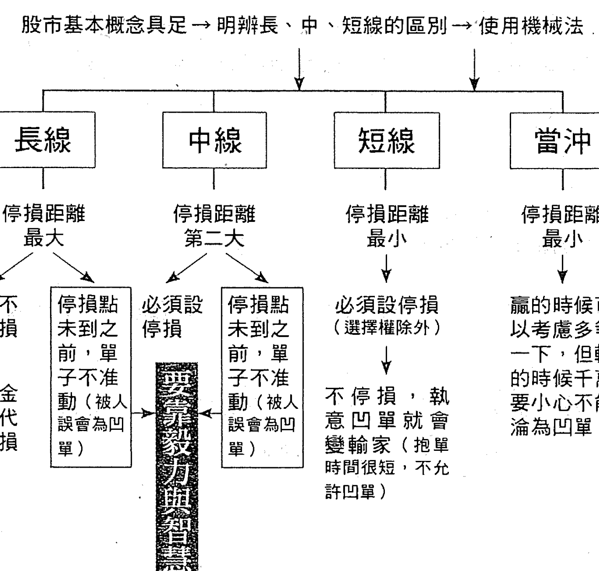

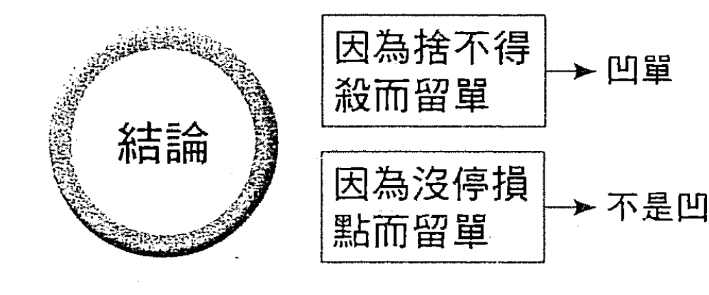

### 1-3

#### 股市分析只會誤導天下蒼生

> 學會分析，只是上岸而已，距離贏家「勝不驕、敗不餒，得失無動於衷」的境界，還有很長的路要走，很多的教育訓練要做。

不要再迷戀股市分析了！

不要再迷戀預測了！

股市不是不可以分析，而是很多時候，分析到最後沒有什麼結論。

股市不是不可以預測，而是很多時候，預測不出來。

這就好像上大號。人類不是不可以上大號，而是很多時候坐在馬桶上，解不出來。

這個道理，很簡單。但天下過半蒼生，皆貽誤於此。

股市不是不准分析，而是你必須在一個完整的操作系統下，才可以進行分析。

家裡不是不准燒炭，而是你必須在陽台或壁爐燒，而不可在房間裡燒。

例如，台股 2011 年 4 月 12 日的盤，以中線而言，第一關壓力在 9000 點，理由是 2011 年 2 月 9 號所造成的下降缺口；第二關壓力在 9200 點，是 2011 年 2 月 8 日那天長黑造成的套牢量。

中線多方較強勁的理由呢？是 2011 年 4 月 6 日那天融資大減 30 億的利多。

除此之外，多空雙方還有沒有各自的理由？當然有，而且有一籮筐。

##### 駕馭心智比分析盤勢更重要

有人誤以為，股市高手可以從這些資料中預測出未來的漲跌方向……嗯，我想說的還是那句老話：有時候可以看得出來，但更多的時候，是看不出來的。

如果你相信某位高手，可以在「絕大部分」的時間點看出「未來的漲跌方向」，你應該是被騙了。用條陳列舉多空雙方的理由，然後分析比較，絕對不是「操盤手」的主要功課，而是「拿月薪過日子」的「分析師」所幹的事情。

如果你認為「分析師」等於「操盤手」，你的觀念就錯得很嚴重了。

學會分析，只是操盤手一部分（有時候是一小部分）的功課，重要的是，心智的魔鬼訓練。

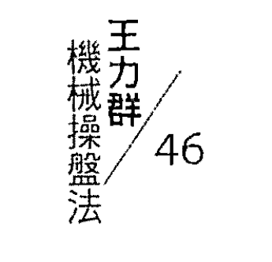

### 1-4

#### 明天是漲是跌？天知道！

> 預測法的習慣，會有一大部分埋藏在潛意識中，然後，它會像中毒一樣，時時刻刻都在傷害我們的健康，以及不斷地從各個層面毒化我們的思想。

多人可能還不知道：輸家套用最多的，就是預測法。並不是說預測法不好，而是一般人很難把它用好。一屋子鈔票並不是不好，而是一般人很難賺到這麼多的鈔票。如果換是做業務的，打著預測法的招牌，才能招攬到顧客。因為太多的股市投資人，用的都是預測法。業務員或是仲介並不管這個預測法是否真的賺錢，因為他們只是生意人，而不是操作領域裡的贏家。

但是一般人，尤其是新手，如果想要花費較少的力氣去了解「交易的本質」，我建議還是要學點機械法的概念。因為學習機械法的初步入門，會有「學習停損」的課程。

機械式的運作，就是事先做好計畫，有條有理地去操作。所謂計畫，講得簡單一點，就是「你的停損停利點設在哪裡？」如果你這次進場沒有設停損、停利點，你就不要做了（自古以來，在股票市場上把錢輸光的人，十之七八都是因為沒有設停損點）。

總之，如果你沒有一個完善的交易計畫，你就不要做了。

##### 結論不重要，思考過程才是關鍵

一般人只會問：「這支股票會漲到多少？」或是「這支股票會跌到多少？」這就是摸頭猜底，幾乎所有的贏家，包括基本派的投資大師彼得．林區（Peter Lynch）都告訴你，這是一個非常錯誤的行為。但是，<u>對於群眾而言，不摸頭、不猜底，他們就不會做了。</u>

群眾總要聽到一個確切的價位，才會放心。然而卻不知道，這樣的行為在股市中意味著「輸家」。

很多人都自以為瀟灑，不喜歡聽分析，也沒那個耐心，他們的特徵是很爽快、很灑脫地問我：「一句話，到底要漲到哪裡？」或是「我只要結論，請直接告訴我明天是漲是跌？」

這樣的問話方法，確實是很爽快。之所以會有人這樣問，大概是股市內外充斥著太多的蛋頭學者整天在那裡賣弄理論、講些言不及義、牆頭草兩邊倒的怪話，讓人摸不著邊，所以才有人喜歡聽結論。但是，我必須讓大家知道的是，真正的股市操作觀念，恰好跟你的思考反過來：<u>有時候結論並</u>

##### 不重要！而是你的思考過程（分析流程）才是最重要的！

我再講一次：在很多人情況下，結論不重要，而是你對於「未來可能發生的狀況所準備的應變計畫」才是最重要的。

例如在台股的操作中，必須要常常考慮到「跳空」這個因素。就指數而言，一個 200 點到 250 點的跳空缺口足以讓人受重傷，因此在擬定操作計畫時，我們必須要把跳空缺口所引發的可能損失考慮進去，以致於我們的操作計畫，在某些地方呈現怪異的保守。那種保守，就是風險的考量，甚至是防範黑天鵝效應（極端情況的出現）的預防措施。反之，如果是一個沒有風險概念的新手看在眼裡，很多沒有被歷史淘汰掉的真實操作法在他們眼中，都會呈現這種「怪異」的保守風味。

許多操作者，包括我們的同學在內，都知道預測法有重大缺陷，不過，在實際操作時，大家並沒有真正了解預測法對我們的殺傷力。甚至，很多人還不知道預測法的殺傷力厲害到多深的程度（再次強調，我講的是「預測法使用不當」的時候所造成的負面影響，而不是在駁毀預測法）。

##### 「預測」對生活的影響很大

預測法的習慣，會有一大部分埋藏在潛意識中，然後，它會像中毒一樣，時時刻刻都在傷害我們的健康，以及不斷地從各個層面毒化我們的思想。

以股市操作而言，預測法的習慣可能對操作生涯造成以下的傷害：

- （1）對市場未來的走勢感到不確定性，焦慮、徬徨；因為仰賴預測的人必須隨時保持觀察，所以神經容易緊張。
- （2）因為長時間耗損心力頻繁預測，以致產生職業倦怠，對跳動的股價逐漸無感、喪失認知能力。
- （3）因為長時間耗損心力頻繁預測，對股價變得麻痺沒有感情，或是因為錢的關係而對股價變得愈來愈有感情，到最後變成感情起伏不定、混亂失序。
- （4）對市場的現象缺乏正確的應變能力，因為他在潛意識裡已經「預測」意外不會發生在自己身上。很多仰賴預測法的基本派跟技術派，在 2008 年的金融海嘯，都坦承自己並沒有事先了解黑天鵝效應的存在，與應該有的防範。
- （5）由於長時間耗損心力頻繁預測，導致產生職業倦怠，對於股市學習缺乏恆心、毅力、耐心，以及缺乏持續的專注力。因為他都把心力花費在「關心市場最新動態」上面，以至於沒時間、沒力氣去充電。
- （6）沒有感情、缺乏感動別人與被感動的能力（很多人認為機械法才是不帶感情的，其實不一定！有一類預測法中毒的人，因為已經預測到這個世界未來沒有希望，或是預測一切事物都沒有意義，所以變成灰色的消極，這就是用成見套住自己、框住自己）。預測法對人生的危害，是全面性的。它也會影響到感情與家庭生活：
    - 1. 對感情充滿期待：這等於間接預約了自己的幸福。殊不知人事無常，感情這種事只能隨緣。如果沒有進場訊號放出來（找到值得託付的優秀對象），就不要胡亂陷進去。
    - 2. 對婚姻充滿期待：這也是等於間接預言了自己的幸福。殊不知人事無常，婚姻與家庭必須要靠不斷地努力才能維持，而不是單純憑著自己一廂情願的信心，就可以支撐下去。
    - 3. 預測子女的未來：很多父母都希望自己的小孩，將來能夠從事他們自己喜歡的職業（例如醫生、工程師），而忽略了小孩本身的性向。子女的未來不能被框住，而是要從多方面去啟發。過度幫子女設想未來是不好的，通常到最後，父母的高度期待都會流於妄想，失望也大。
    - 4. 預測法對於整個人生的重大危害：依照「眼前」人類社會的範本取樣，「預測」我們的未來將會怎樣怎樣。其實這些取樣的範本都太短期，格局不夠大。例如依照最近兩、三百年來的社會價值觀，「預測」我們的未來將是高度經濟成長的社會，所以決定以追求經濟成長為社會主要目標，這是一個嚴重的錯誤。歷史的教訓告訴我們，強大的帝國都會因富裕而驕傲而敗亡，因此社會應以追求精神與物質的和諧為主，而不是把財貨放在精神之上。

使用不當的預測法，對人類的危害，實在太大了。

無數的、數不清的成見，都是因為事先的預測所引起。因為去預測，所以事先有了一個「結論」，然後就被那個結論綁死。說實在，那只是腦袋裡所臆測出來的結論，不一定就是事實真相。如果我們認為事實將會依照我們的預測去進行，那麼，無疑地，我們太不夠謙虛了。

沒有操盤實力的人，才會在那裡問明天會漲還是會跌……問題是：既然沒有功力，就是輸家啊，那還待在市場裡幹什麼？送錢給別人花嗎？

儘量不要去預測，尤其不要預測自己將來一定會在這個市場裡賺錢。因為，如果當事人不付出相當程度的努力代價，他是不可能會成功的。畢竟：他的預測只是一個幻想。

不要預測、不要想太多，腳踏實地努力做就對了。

### 1-5

#### 「不知道」也是一種對戰技巧

> 學習技術分析，除了充實知識外，還要學習「不知道」的勇氣：勇敢承認自己不懂，不要因愛惜顏面而裝懂。

人不是神，即使在經年累月的看盤經驗中，磨練出一點預測的能力，但也沒辦法在每一年、每一個月、每一天，都把這個預測能力維持在「堪用的狀態」，更遑論長期維持在「最佳狀態」了。

很多時候，我們就是不知道。「不知道」並不可怕，可怕的是「明明不知道，卻裝作知道」。

學習技術分析，除了充實知識外，還要學習「不知道」的勇氣：勇敢承認自己不懂，不要因愛惜顏面而裝懂。

##### 看不懂就不要做

在學習的旅程中，一方面要勇猛精進，另一方面要謙卑保守。學習知識的目的，不是意圖在每一個點都獲勝，而是要讓自己避免在詭譎的難盤中受傷。

先求生存，其次再求獲利。

很多操作者由於年輕，體力旺盛，對知識有追求的熱誠，這本是好事，但是股市這個東西，它的難度本來就比較高，在很多地方都要保留餘地；看不懂，就不要做。

我再重覆一遍：看不懂，就不要做。有疑慮，就先退場。打不贏，就趕快跑。什麼叫做「看得懂」？什麼叫做「看不懂」？由你的機械系統決定，而不是由你當時的心情來決定。「一時興起」的感覺是靠不住的；自以為是的、不成熟的「直覺」也靠不住。

隨著知識的增加跟智慧的提升，我們的操作能力應該會在兩大領域得到進步：第一、決定進場的「勇氣」增加；第二、決定不進場（或退場觀望）的「智慧」增加。

有時候，判斷「此處不宜出手」的知識，比判斷「此處應該進場」要難，而且可能會難很多。有一派的操作者主張：「先開槍，後瞄準」，那是指在練習短線的技巧時可以參考這樣使用，一般人則是應該避免「看到黑影就開槍」。

很多時候，我們必須學著冷靜，先思考再動作。

注意！「不變」也是「變」的一種。有的人操作成癮、停不下來，最後染上一堆病，這就是「缺乏彈性」「身段僵硬」「不肯改變」。能夠動如脫兔、靜如處子的人，才是好的操作者。

如何去「思考盤勢的奧祕」，又要大方承認「眼前這個盤勢，不是人類微薄的智慧所能夠了解」，對於很多同學而言，這是個難題。但是，即使它困難，你也要去學。我的建議是，**你要盡人事，也要懂得知天命**。當我們苦苦思索盤勢想不出答案的時候，就要學著想開一點，不必硬逼自己要找出個非漲即跌的答案，那樣可能會掉入二分法的思考陷阱。

不過，這裡有一個大問題：「我怎麼知道眼前這個盤勢我『沒辦法』判斷？」一般操作者普遍會有一種成見（很多時候，這種見解是一種錯覺），認為「現在看不出盤勢的方向，只是因為我還沒有找到；如果我一直花時間追究下去，就會找到我想要的答案。」這種想法，可以激勵一個人深入研究分析的勇氣，也可以害一個人深陷妄想的深淵而無法自拔。

那麼，比較正確的講法是怎樣呢？我要跟大家說的是：「__如果你目前使用的交易系統無法解讀出盤勢，那你就是『不知道』，就不要採取任何動作。__」

##### 交易系統會告訴你怎麼做

一般散戶並沒有自己的交易系統，這是致命傷。在沒有交易系統的原則指導之下，無論怎麼用功，都可能會淪入妄想。當你認為：「我現在看不出來，只是因為我還沒找到答案；只要給我時間去思考，我就會找到我想要的答案。」其實這時候你已經犯了幾個錯誤：

- （1）你要找的是一個正確的「解讀（盤勢）方法」，而不是一個「答案」。
- （2）方法需要花時間去學。就算找到了正確的解讀方法，你也不太可能在一、兩天內都學得會。市場的操作技術五花八門、邪魔外道如滿天繁星，在其中苦苦尋覓，何時方休？各種多空現象實在多到爆，你如果慢慢去思考，實在很難不迷失。
- （3）如果你找到了一個解讀方法，而且這次也靈驗了，但絕不保證這個方法下次也同樣適用！

許多人常有一種很天真的想法，認為「這次用這個方法很靈，下一次遇到『相同狀況』的時候比照辦理即可」。問題是，所謂「相同狀況」是一個很難分辨清楚的現象，有時兩種內在截然不同的狀況，外表上卻看起來一樣，遇到這種騙局就慘了。

所以，整個「不知道」的關鍵知識是「你有沒有正確的交易系統？」如果依照操作守則，用盡你系統裡的判讀法則都找不出什麼徵兆，就是「系統沒有亮燈」。既然系統沒有亮燈，那我就是「不知道」。既然不知道，就不要有多餘的動作，以免流入妄想。

之所以沒有交易系統，有一部分原因是因為潛意識裡面拒絕使用交易系統，因為他想要「亂來」。如果有了交易系統，那麼，幾乎八成以上的知識都要被貼標籤 — 被納入系統的知識才可以「使用」，如果沒有被納入系統，就不可以使用這門知識。哪怕這門知識也是一門還不錯的知識，但只有沒有被我們的系統收編，就不可以用 — 這是很嚴苛的戒律。此外，還有四項原則要遵守：

##### 原則 1

啟動機械系統之後，如果系統無法判讀眼前盤勢的資訊，就不可能亮燈發出進場訊號。

##### 原則 2

啟動機械系統之後，如果系統無法判讀眼前盤勢的資訊，可能會發出「本系統無法判讀」的訊號給操作者，通常操作者在收到這項訊號之後，會「繼續保持前一天的動作」。如果前一天沒有動作，那麼今天也是不採取任何動作。

##### 原則 3

有些機械法操作者會把一些盤勢的資訊分等級，規定「等級最高的資訊」一定要判讀出來，如果解讀不出來，則要清

倉退場（把「無法研判最重要的資訊」當成是退場訊號）。

但也有的操作者不採取清倉的策略，而是按兵不動，等待下一個明確訊號出來。這兩種機械概念都是可以的。

##### 原則 4

有些簡單的機械系統，一開始就嚴格規定「哪些東西是它不知道的」，意思就是它（系統）「拒絕解讀不是自己系統裡的知識」。例如，如果我的交易系統裡不包括基本分析，那麼，所有基本面知識跟新聞，都不可以影響我的進出市場，也不可以影響我抱單的毅力。

另外，有些使用預測法的人，在分析了一大堆多空現象、想了一大堆理由之後，感覺多空都難做，於是決定「不動作」。不過，他是「預測盤勢將會震盪」，所以才決定暫時不動作。這種經由預測法分析之後所得到的「不知道」的結論，跟上述所講的「不知道」，並不是同一件事！

##### 不知道並不可恥，催眠自己才真危險

人類之所以拒絕承認自己「不知道」，心理因素不外乎是：爭強好勝、驕傲自大、自我膨脹、脫離現實、說謊、欺騙自己……在股市中，這種現象尤其嚴重，因為很多操作者進入市場是為了「愛現」，而不是為了賺錢。

在這種死要面子的虛無心理作崇之下，很多操作者都催眠自己「我知道的很多……我知道的很多……我知道的很多……我是高手……」長期下來，不是變成更愚昧，就是病情更加惡化，此時要求他們誠實承認自己的無知，比殺了他們還難。

面子重要，還是錢重要？好好想想吧！每個人的答案不同，重要的是，你需要了解自己在乎的是什麼。

## 1-6 心態單純點，致勝率反而高

“ 在實戰中，更應該注重心態的調整。意思是說，如果忙了半天沒賺到什麼錢，也不要有什麼情緒，抱著平常心淡然處之即可。”

個比較長線的波段操作，根據李佛摩的說法，虧損不 能夠超過 20% 。

20% ？……歐，麥尬得，會不會太多了？假如資金 100 萬， 好不容易等到一次波段機會，卻落得虧損 20 萬離場，不是 很難堪嗎？ 顯然贏家制定出來的法則，跟一般人的認知有很 大的一段距離。

##### 隨時調整心態

職業交易者短線的 2 ~ 3% 的停損，雖然比較符合一般人 做波段時的停損標準，但這其實有點悲哀。一般的波段交易 者只肯付少少代價，就想拿到整個波段的豐厚利潤。

有人說：「操作不只是要賺錢，而且還要爭取時效。」嗯，對，但是在實戰中，更應該注重心態的調整。意思是說，如果忙了半天沒賺到什麼錢，也不要有什麼情緒，抱著平常心淡然處之即可。因為我們的時間不該拿來怨恨。

錢，要看淡一點，關鍵在於，操作策略是怎麼訂的。

波段操作的停利停損點的間隔設計，一定比較大。換句話說，能夠賺的時候會賺的多，但是虧的時候也較多。

短線操作的停利停損點的間隔設計，一定比較小。換句話說，賺的有限，但是虧的也不會太多。

認清市場的實質，之後，心胸要放寬。眼界開了以後，心胸也要放寬。

如果意氣剛強，難免會有意氣之爭，此時就很危險了。重大的虧損或是輸光的虧損，大部分都是一時意氣之爭的後果。

「意」是指意識，在這裡是指「猜測」；「氣」是指怒氣跟怨氣，而不是勇氣。

真的！要看淡一點，否則會有很多煩惱。

##### 不能一直把自己綁住

站在教育的立場，機械式操盤法，絕不可以有任何的個人意見。

很多人誤以為知識就是智慧，於是在使用機械法的時候「運用知識」，最後無法成功。

很多人，誤以為思考就是智慧，於是在使用機械法的時候「發動思考」，最後無法成功。

很多人都不太清楚，自己的潛意識偏邪欲望，會變成各種形狀的「意識」，然後侵入你的大腦，使你誤以為自己「很厲害、很有學問」，或是「第六感很準」，其實這只是一片虛妄、一團混亂。

知識程度愈高的人，愈容易掉入這種陷阱。

知識程度愈高的人，愈容易誤以為解開股市之謎是要「知道某些東西」，而不知道真正的解謎之鑰是在「你願不願意放棄某些東西」。

所謂「知道」，是明白大道的運作，而不是背誦知識。

很多知識程度高的人，誤以為知識愈多、學位愈高、社會地位愈高，就表示愈接近大道。因此，絕大部分知識程度高的人，都掉入預測法的陷阱，使用不成熟的預測法去對付股市，於是無法成功。

- 使用機械法的時候，請盡量減少思考。
- 使用機械法的時候，請盡量忘記你原先已經知道的股市知識。
- 使用機械法的時候，請盡量放棄你的「自我」。

## 1-7 只管訊號，其他就不要再問了

> 「如果是機械派，學習技術分析的主要目標，就是事先擬定好「機械式操盤系統的運作計畫」。」

每次遇到大漲或大跌，市場上都會有很多人在那裡問：「怎麼……會這樣？」「這個盤怎麼了？」「會漲到哪裡？」「會跌到哪裡？」「該不該買？」「該不該賣？」「該不該空？」……唉，這樣搞下去，就像搞輪迴一樣，要搞到幾時方休？

不管是大漲或大跌還是盤整，除非它碰到我的進出場訊號，否則管它長黑短黑大紅小紅，都對我沒有意義（對預測法才有意義）。

不管是大漲或大跌還是盤整，如果它有碰到我的進出場訊號，我就動作；至於其他的技術分析，只要不是在吾的交易系統之內的，都對我沒有意義（對別人或許有意義，或對某個方法有意義）。

大漲又怎樣呢？如果你的交易系統沒有把大漲的情況考慮在內，那麼，這是個什麼爛系統（如果一個系統沒有考慮過大漲跟大跌的極端狀況，就是賠錢的系統）？

大跌又怎樣呢？如果你的交易系統沒有把大跌的情況考慮在內，那麼，這是個什麼爛系統（如果一個系統沒有考慮過大漲跟大跌的極端狀況，就是賠錢的系統）？

如果一個投資者，到現在還沒有一個正確的交易系統？那麼，這個人待在市場裡幹什麼？送禮嗎？送錢給主力花嗎？

做事要有計畫，在股市裡做事，尤其要有計畫。

如果沒有計畫，就是在見風行事、見風轉舵，心裡沒有主見，臨場遇到狀況就慌了。這樣還想贏錢？不可能的。

不要去追逐盤勢，也不要去預測未來。機械操作者不要把自己累的像狗一樣，天天追著這個盤在跑。

把正確的方法學好，然後依照正道（正確的交易系統）來擬定交易計畫，接著就是依照計畫來執行。盤勢未來是漲是跌，跟你沒有關係，只有在「當下」它碰到了我的進出場條件，它才對我有意義。

唯有把計畫擬訂完善，這樣，「當下」如果發生極端的狀況，才不會慌亂。

##### 預測派重應變，機械派重訊號

技術分析可以用在機械法，也可以用在預測法。接下來， 我們來敘述一下兩派在「應變」措施上的不同之處。

如果是預測派，那麼學習技術分析，主要目標除了「學習預測」之外，還有一個很重要的目標，就是學習「<u>在預測不準確的時候，我們應該怎麼辦？</u>」如果沒有應變能力、如果你沒有準備好配套措施，你就永遠是技術分析的門外漢。

如果是機械派，學習技術分析的主要目標，就是事先擬定好「機械式操盤系統的運作計畫」。而所有的盤勢變化，理論上都應該被這個系統考慮到（實際上沒有辦法考慮到所有的變化，此時就可以用「考慮最極端的狀況」來取代「所有的變化」。例如，如果昨天買多單，今天就要檢查如果所有買進的股票都跌停板，則系統應該如何處理），所以盤勢的「漲跌變化」不是「被預測」，而是把「股價變化」，單純看成是觸發系統訊號的誘因，也就是說，漲跌與我無關，只跟我的交易系統有關。

要買、要賣，還是要繼續留單？不要問我，去看我的系統有沒有亮燈就對了。打一個比喻來講，當我開車的時候，並不是我在開車，而是「紅綠燈」在開車。如果是綠燈，我的車就要繼續行駛；如果是紅燈，我的車就要停下來。因為<u>在都市裡開車，不是我想開就開、想停就停，而是看交通號誌來辦事，</u>這就是機械法的精神。

## 1-8 機械法的技術分析第一課

> 任何思考都要經常使用大、中、小三種格局去想，以免見樹不見林，變成目光如豆，也避免見林不見樹，過度忽略眼前現實。

機械法有很多種，每個機械法贏家所使用的機械系統都不一樣，即使是同門同派同個老師教出來的，也很少兩個人用的手法完全一樣。那麼，有沒有一個「非常簡單的機械法」是初學者應該優先了解的？

##### 熟悉九個基本動作

這裡有六張圖。既然是第一堂課，這幾張圖也是最簡單的，自認為有程度的人或許一看就知道箇中內涵。

其實這些圖，談的是六個機械法的基本要領。此外，還要加上第七個要領「葛蘭碧法則」；第八個要領是「多頭排列」；第九個要領是「黃金交叉」（這幾張圖形，在網路上很容易查到相關解釋，我就不再貼圖說明）。

圖 1 穿過 5 日線時買進，跌破 5 日線後賣出
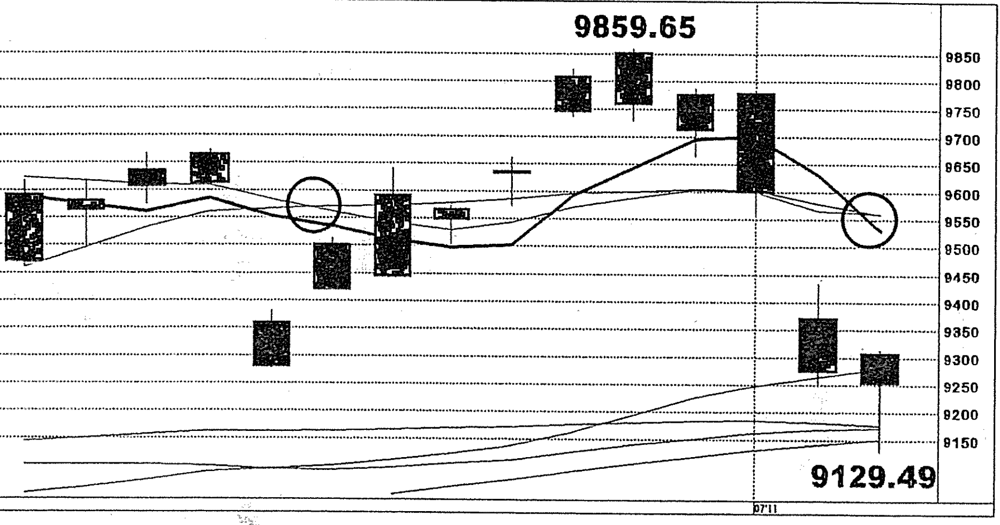

圖 2 穿過 10 日線時買進，跌破 5 日線後賣出
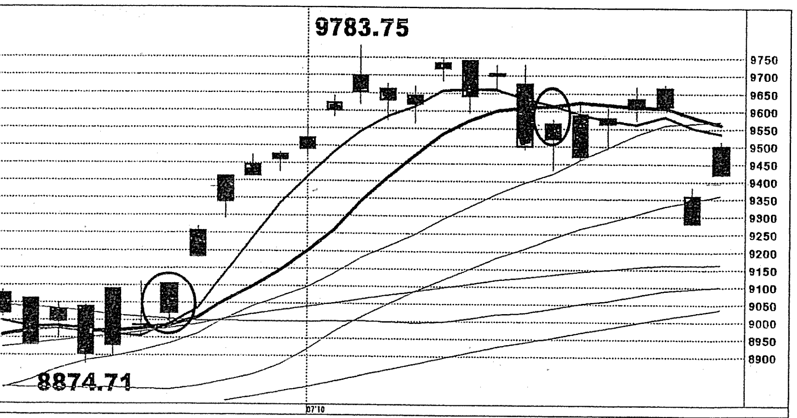

● 圖 3｜守住 30 日線後第 1 次買進，穿過 10 日線後做第 2 次買進（加碼），最後跌破 5 日線賣出
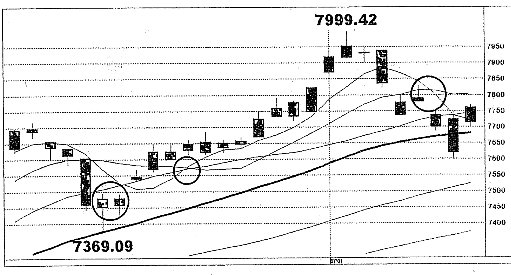

● 圖 4｜守住 30 日線後買進，跌破 10 日線賣出
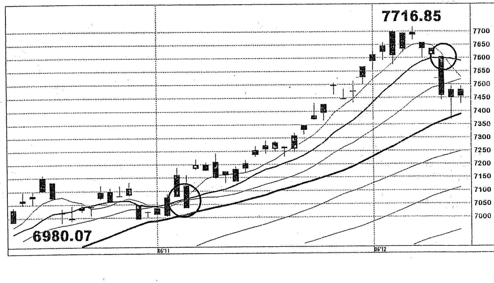

● 圖 5 | 守住 30 日線後買進（9 月中旬），跌破 30 日線賣出（1 月上旬）
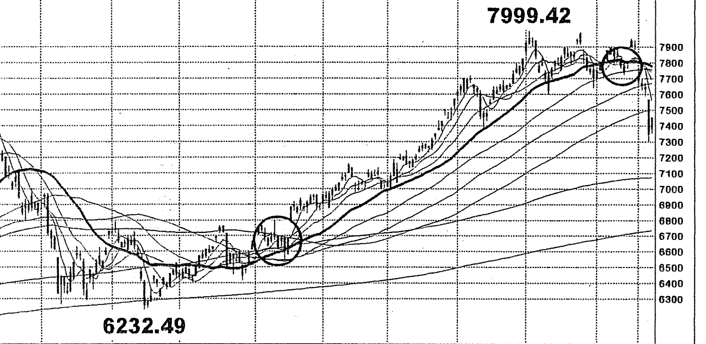

● 圖 6 | 突破 200 日線後買進，跌破 150 日線賣出
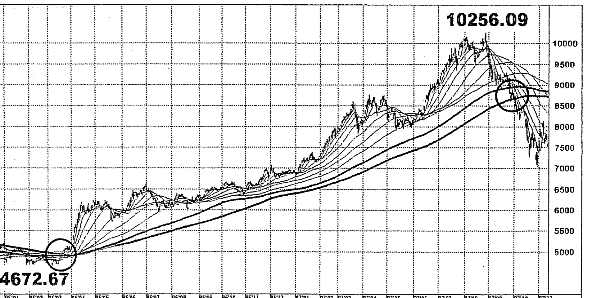

##### 養成長、中、短線「三種思考」

以上的基本動作是不是很簡單呢？在此先不下論斷，不過，有一件事是可以肯定：往後如果有更多複雜的技巧，都是以這九個基本動作為基礎，然後慢慢發展出來的。

我先帶大家來想想，這些基本動作為什麼都講究均線學？而不是型態學？為什麼不是教人先認識「三尊頭」、「M頭」？先學會認識頭部，不是比較不會被套牢？

我的看法是，判斷頭部，有它的困難。型態學這東西，自由心證比較多，也就是解讀能力要很強，不像平均線那麼單純（型態學容易淪為預測法，但如果用得好，也可當成機械法來用）。

此外，均線學有一個極優的特性，它是一種「趨勢的涌動」。這項特點，極其特殊，大家以後慢慢都能體會得到。

了解均線在趨勢解讀方面的優勢後，第二個思考步驟，是用三種角度，也就是「長線、中線、短線」，去觀察前面六個基本圖形。

- 屬於短線：圖 1 和圖 2
- 屬於中線：圖 3 和圖 4
- 屬於長線：圖 5 和圖 6

任何思考（不只是股市，事業、感情、人生都一樣），都要經常使用大、中、小三種格局去想，以免見樹不見林， 成目光如豆，也避免見林不見樹，過度忽略眼前現實。

越過愈短的均線，只是小小的成績，不值得驕傲。既然是短期的均線，你征服了它，它往上幫你推波助漲的力量也就小。換句話說，失敗率高。

以下是我整理出來的學習要訣：

- （1） 基本上有三個系統：長線、中線、短線。
- （2） 短線系統，失敗率高。
- （3） 長線系統，成功率高。
- （4） 短線系統，在機械法系統中，比較不穩，甚至不用。
- （5） 短線系統，在機械法的操作系統中比較不穩，所以它在預測法的最後執行之處，往往扮演關鍵性的角色。很多短線高手的盤感，都可以看到短線系統（如圖 1 和圖 2）的影子。
- （6） 短線系統的使用，不是制式化，而是自由心證，憑感覺。這個感覺不是一般的感覺，而是長久經驗培養出來的盤感，預測的味道比較重。5 日線跟 10 日線的操作法，並不是跟電冰箱一樣天天不停地運作；短線法是「靜候待命」，等到可以用的時候，再用。
- （7） 週期愈長（長線系統），利潤愈高，但是機會愈少。
- （8） 週期愈長（長線系統），停利的時候利潤多，停損的時候虧損也多。
- （9） 週期愈短（短線系統），利潤愈少，機會比較多。但是短線機會絕對沒有你想像得那麼多，除非再引進當沖，或者實力爆增兩倍以上，就可以看到更多機會。
- （10） 週期愈短（短線系統），停利的時候利潤少，停損的時候虧損也少。但是可能會因為出手機會多，加上失敗率高，而造成連續虧損，剝來剝去累積成嚴重蝕本。
- （11） 海龜操作法是長線系統及中線系統並用。
- （12） 如果要引進短線系統，就要同時操作一個長線系統或中線系統，與之搭配、平衡、避險。
- （13） 長線系統跟中線系統可以單獨使用，不必引進短線系統。
- （14） 同時操作三個系統（長中短）非常困難，極度消耗體力跟腦力。
- （15） 介入短線系統的資金部位要降低。

寫到這裡，也許有人已經發現一件事：如果是用型態學當入門課，恐怕在第一堂課很難感覺到強烈的短、中、長線的劃分，而使用平均線，則比較容易劃分短中長線。經典說：「出息長知息長，入息長亦知息長；出息短知息短，入息短亦知息短。」做長線的時候，要知道自己是在做長線，做短 線的時候，要知道自己是在做短線。不要把大波段當成短線操作，賺一點點就跑掉；也不要在短線套牢之後，就做長期投資。長短不分，是致命傷。

我強烈建議，一入門就要打好長、中、短線的觀念基礎。

##### 沒有計畫的獲利，只是一種隨機致富

機械法有一個優點：

- 如果盤勢看得很模糊、心裡一團迷霧，沒關係，就按照你原來的計畫繼續做。
- 如果盤勢看得很模糊、心裡一團迷霧，而你又沒有計畫，建議你把所有的部位（不論多單空單）都了結掉，並重新思考自己在股市中應該如何去學習。
- 如果盤勢看得很模糊、心裡一團迷霧，而你又想獲利出場，那麼，首先要問你自己：這個獲利出場的條件，是否是你原定計畫中的一部分？如果是臨時起意，就要先看看自己的機械法中，有没有一條明文規定是「本方法容許操作者臨時起意更改既有操作法規。」如果是很純的機械法，大概是沒有這一條。如果沒有，就不能臨時變更行程。

不過，如果是「一半機械，一半預測」的操作系統，很 可能會有一條的規定。好吧，那就容許你臨時變動吧！但 即使是臨時變動，也要有點規矩，不要亂了腳步，此時，你 應該趕快依照你想變動的方向，擬定下一個計畫。如果你是臨時想出場，那就趕快擬定你現在退場後的「下一次進場條件」是什麼。擬好之後，好好花時間想想，這個臨時計畫的可行性有多高？有啥優點跟缺點？然後接受現實，不要到時候再來後悔。

- 如果盤勢看得很模糊、心裡一團迷霧，而你又沒有計畫，而且過去數年來的操作一直都沒有計畫，那我的建議是：你不適合股市，請儘量提早退出市場，去追求更有意義的人生目標。
- 如果盤勢看得很模糊、心裡一團迷霧，而你又沒有計畫，而且過去一段時間以來的操作雖然一直都沒有計畫，然而你卻有獲利；那麼，我的建議是：你須要小心自己掉入隨機的致富陷阱。

## 1-9 除了守紀律，操作系統也要正確

> 很多操作者從經典上看到贏家們反覆強調「紀律」的重要，卻不知道「紀律」有這麼多種！如果你只是在執行停損時遵守紀律，那是不夠的！

不管是機械法，或是預測法，操作者本人都務必遵守紀律。

以台股指數期貨的機械法而言，它的「紀律」包括（大概列舉）：

1. 當盤勢符合原來系統規定的進場作多訊號時，進場買進。即使上次照這個訊號進場輸了錢，這次也要乖乖進場，這叫遵守紀律。
2. 當盤勢符合原來系統規定的進場作空訊號時，進場放空。即使上次照這個訊號進場輸了錢，這次也要乖乖進場，這叫遵守紀律。
3. 當盤勢符合原來系統規定的賣出條件時，賣出，離場。即使上次照這個訊號出場賣錯了，或賣早了而輸了錢或少賺，這次也要乖乖出場，這叫遵守紀律。
   - 當盤勢符合原來系統規定的停損條件時，賣出，停損離場。即使上次按照這個停損條件賣掉，結果賣在最低點慘遭大賠，這次也要乖乖停損，這叫遵守紀律。
4. 當盤勢符合原來系統規定的回補時，回補，離場。即使上次照這個訊號進場補錯了，或補早了而輸了錢或少賺，這次也要乖乖出場，這叫遵守紀律。
5. 每次進場下單時的心態，保持平常心，無念無欲。心情保持平靜而無突兀，這叫遵守戒律（紀律）。
6. 每次下單以後的抱單心態，保持平常心，無念無欲，不希望它上漲、也不期待它下跌。心情保持平靜而無期待，這叫遵守戒律（紀律）。
7. 每次準備出場時候的下單心態，保持平常心，無念無欲，賺不驕、賠不餒。心情保持平靜，這叫遵守戒律（紀律）。
8. 每次空手等待的時候，保持平常心，無欲無求、無思無念，心情保持平靜，這叫遵守戒律（紀律）。
9. 每天生活作息保持正常，以維持最佳體力狀態，這叫遵守戒律（紀律）。
10. 每天飲食保持正常，以維持最佳體力狀態，這叫遵守戒律（紀律）。
11. 看盤以外的時間，也要時時刻刻保持善念、減少過多的欲望，這叫遵守戒律（紀律）。
12. 每天都要反省自己、做好功課，持之以恆，這叫遵守紀律。

以上 12 條，有一個大前提，就是「你的操作系統必須正確」！如果你的操作系統不正確，即使你從第 1 條做到第 12 條，每一條都做得完美，也不可能長期賺大錢！

很多操作者確實能做到「每次停損都還算是果決」，但是，他們的操作系統卻是錯的！更糟糕的是，他們從經典上看到贏家們反覆強調「紀律」的重要，卻不知道「紀律」有這麼多種！如果你只是在執行停損時遵守紀律，那是不夠的！

於是，我們還要加入第 13 條：

13. 每次拿到一個操作系統之後，都要利用歷史資料去手動測試它的盈虧結果，最少要十年，這叫遵守紀律（當沖系統無法測試，只能親自下海拿錢去做實驗）。

不過，每次拿到一個操作系統都要測試十年，這麼花費功夫的事情，哪個傻瓜願意老老实實去做呢？這就是贏家跟輸家的差別所在了。

碰到無法測試的時候，就只好拿自己的親身經驗來換。如果在十年之內可以獨自悟道、無師自通，那就算是不起得的睿智了。

## 1-10 汜濫的預測法是頭號天敵

> 沒有獨立操作能力的人，你必須丟出一個又一個的預測，不斷餵養他。預測專家的預測愈準，投資大衆就愈依賴他，很快忘掉應該以培養自己的實力為主。

談 機械法之前，不得不提到海龜操作法。這份資料大概是2005年前後公開在中文網路上流傳的，要用Google查詢的話，請輸入「原版海龜交易法則」（The Original Turtle Trading Rules），副標題叫做「挑戰詭計、欺詐和吹牛大王」（Fighting the scams, frauds and charlatans）。

作者是第一代的海龜團隊成員，名字叫做克提斯·M·費斯（Curtis M Faith）。費斯公布的這份資料，當初是簽有20年的保密協定（所以原始文件裡那個方法的操作日期，大概是民國70年代初期到末期），現在20年過去了，早已解密，費斯為了要打擊一些出售方法牟利的商人（只賣軟體給你但不教你心法），乾脆把它免費公布。現在的海龜團隊已

經分散到各個私人基金，用的方法也早已大幅改善（最新使用的方法依舊保密中），網絡上現在還可以查得到海龜班的創始人之一威廉·艾克哈特（William Eckhardt）最近幾年的操作績效，確實是十分穩定強悍。

##### 成功交易的關鍵：信心、連續性、紀律

在海龜的原始文件中，一開始就提到幾個重要的環境問題。什麼是環境問題呢？就是會把投資人從正確道路上勾引走的謊言，與蓄意擾亂行為。

一般投資人可能不清楚（甚至完全不知道），在真正的贏家圈裡面，有一個贏家們無人不知、無人不曉的法則：真正的正確方法，須要落實執行，但是一般投資人沒有耐心，也沒有信心，所以不可能會成功。看看費斯是怎麼說的：

- （1）法則是不會清楚的，因為出售法則的人不懂交易。
- （2）即使清楚地表達，購買者或許也不能遵循這些法則。
- （3）大部分海龜現在使用更為完善、且更新的法則進行交易。
- （4）交易法則只是成功交易的一小部分。成功交易的最重要的方面是信心、連續性和紀律。
- （5）你不能或不願遵循法則，就不會給你帶來任何好處。
- （6）對於大部分法則，甚至在虧損期間我們也有信心遵循它們。那些不連續遵循法則的人不會賺錢，也會從課程中脫隊。
- （7）要取得成功的交易員，會找到一條增強對自己的交易法則的信心的途徑，以便能夠連續地應用自己的法則。
- （8）那些未能始終如一地遵循法則的人，會成為失敗的海龜。他們中的一些人認定銷售海龜法則，比他們做海龜時能賺更多的錢。

這幾段話，講得滿直接的，但有點殘忍。這幾段話，講的主題其實只有一個：信心、連續性和紀律。這幾個東西，必須經過教育跟訓練。這也就是為什麼一般投資人，即使免費取得了操作法的祕笈或自動交易軟體，還是沒辦法賺錢獲利的原因。

###### 機械交易員外表看起來像傻瓜

此外，對於預測法的人而言，所謂的信心、連續性和紀律，多半是指資金控管；對於機械法的人而言，除了指資金控管之外，還要嚴格遵守許多規定，不能亂做。

如果有人去問一個機械派的操作者「明天會漲還是會跌？給我一句話！」這個機械派的老實人可能會這麼說：「我不知道。我只知道現在還沒有漲過這一條線，等到碰到這一條線，才能夠進一步討論。」

這種講法，好像阿呆，誰要理你？……「只會說不知道，不知道、不知道……你是不想說？還是怎樣？虧你還是個分析師，原來只是浪得虛名。」這種羞辱，很多成功的交易員都曾經遭遇過。

如果有人去問一個預測派的分析師「明天會漲還是會跌？給我一句話！」這個預測派的聰明人可能會這麼說：「現在已經打底成功，指數將上看 9000 ！不要怕，大膽買進！任何拉回都是買點！」

這種講法，帥啊、棒啊、爽啊！……「啊，某某人真是神準啊！簡直就是股神，太厲害了，太帥了！（於是我有信心，我一定會跟著他做）。」這種從別人身上發出的讚美而獲得的成就感，很多有點功力的分析師都曾經擁有過。

機械派的操作者，乍看之下，好像白痴一樣。如果他是男人，我是女人的話，這種男人我大概會瞧不起他，為什麼呢？因為他沒有骨氣、沒有勇氣、缺乏膽識、沒種，根本就不是個男人……（如果你是成功的交易員，看到我這段話，請不要覺得難過）

預測派的操作者，乍看之下，真是有膽有謀啊！在我的交易生涯中，我看過很多女人對這種勇敢發出預言的帥哥獻身。為什麼呢？因為他準！幫她賺到錢了！準就是帥！……（如果你是成功的交易員，看到我的這段話，不要覺得氣餓；更不要用你交易賺來的錢去購買美色來彌補，那樣只會害你從成功跌回失敗）

機械派的交易生活，多半是很枯燥。因為在系統沒有發出買賣訊號之前，大概都沒有什麼事情可以做。機械派不必去預測會漲到哪裡或是跌到哪裡，70% 的工作都交給系統本身去處理，操作者自己是不須要忙著預測的，所以他會有很多閒暇的時間。例如海龜團隊的辦公室裡寄放著一張乒乓球桌，隊員沒事就在哪裡打乒乓球，惹得鄰居一家保險公司的職員不高興，放話說要殺了他們，因為他們看起來無所事事，竟然還能賺那麼多錢。

但是，機械派自己覺得自己很悠哉，別人看他們卻認為這夥人過著「枯燥、呆板、無聊、乏味」的交易生活。反正，把做預測的時間節省下來、少花許多心力去預言、少掉很多預言不靈的失敗機會，這本來是件好事，竟被不了解市場的外行人解讀為枯燥、無聊、沒出息。

反觀預言派，整天收盤以後忙著到處看資料、研究圖形、苦苦思索，希望能夠創造出一個卓越的洞見、希望能夠領先市場先行卡位、希望自己能當先知……他們每天都很忙、很累，做著超乎自己體能甚至智能的事。然而，外面的人（以及他們自己）卻認為他們「勤奮、認真、好學」，過的生活雖忙碌但有意義。嗯，怎麼能不忙碌呢？那麼多分析師都是拿薪水看老闆臉色的，你不每天臭鼋亂扯一堆報告跟預言，別人怎麼會認為你有在做事呢？

###### 預言長線大趨勢往往只講到一半

有人可能不以為然，可能會問：「為什麼我看到有些預測分析師，一個預測做完了以後都很優閒？反而是那些利用電腦在做機械式交易的人忙得半死？」

因為這些預測專家可能做的是長線，預測完之後，就靜靜等著預言實現，所以輕鬆；而那些電腦程式交易員卻忙著做短線，所以累；累的同時，這些不成熟的交易員，可能根本忘掉了機械法最好不要做短線！

這些預測專家，預言波段或長線行情，卻往往帶進不帶出。例如過去很多年來，我們記得有些名人確實正確預言到某幾年的大漲，很靈，但是當預言成真、高點現身之際，他們反而很少再度預言，告訴投資大眾及時要跑。預測法就是這樣，因為聽的人，只是在照著先前的那一個預言進場，自己並無多少實力，只能跟從，需要更多的預測來帶領他們出場。於是，一個預言接著一個預言，預測的週期也漸漸短了，準確度漸漸模糊失焦，終於有一天，看錯一個大趨勢而損失慘重。這就是預測式專家的魔咒，很少人能夠避免，因為很難不陶醉迷失在群眾的掌聲中。

沒有獨立操作能力的人，你必須丟出一個又一個的預測，不斷餵養他。預測專家的預測愈準，投資大衆就愈依賴他，很快忘掉應該以培養自己的實力為主。

要追隨明師學習，而不是跟隨先知沾光。

預測派必須不斷地籌畫並發表新的預測，才能夠帶進又帶出；機械法則是老早就準備好交易策略等在那裡。例如穿過關卡 A 就進場，跌破關卡 B 就出場。待在場中的這一段時間，他是在等待「跌破 B」這個訊號，而不是在等下一個預測。也就是說，他自己知道該怎麼做，而這個「該怎麼做的方法」，不是很難學，這就是當初海龜特訓班強調的宗旨：「正確的交易法則本身不難。」（難在信心、連續性和紀律）

還有很多預測成功率低於八成的預測家，他們會在緊要關頭更改自己原先的看法，例如，原本預測會漲到 1.2 萬點，結果到了 1 萬點發現不對勁，於是臨時更改預言，但此時市場正處於熱烈的漲勢中，突然改變看法叫人家賣股票，我跟你保證，很多原來跟隨你的信徒，會在這時背叛你而持股續抱、不肯賣出。如此一來，當初帶他們進場賺錢的好意，都在後來萬點殺盤的崩潰中付諸東流。本來是想幫人，結果卻變成害人。

反觀機械派的人，他們沒有成見、不須要別人太多的叮嚀，等到賣出訊號出現，就走。

為什麼兩派人馬的表現差那麼多？因為機械派的武功比較好學，所以機械人比較容易有好的表現，而且是自動自發；相比之下，預言家的功夫難學很多，聽從預測的人表現經常中斷，只演半場好戲，甚至到後來引發不可收拾的後果。

關鍵在於：會與不會、懂與不懂，而不是準不準。預測錯了，或是沒預測，都沒關係，只要操作對了，賺錢就好。

###### 預測法容易學，也容易失控

預測專家每次在做預言的那些技術分析，或是基本分析的理由，旁徵博引、推理辯證加邏輯……這些淵博的知識、令人讚嘆的智慧，一般投資人極難完全學會。

並不是每個人都能得道成佛。

那怎麼辦？只有退而求其次，轉向機械法求援。於是，機械法就這樣慢慢被人注意。但是，始終沒有得到廣大投資大眾的注意，相關的知識也被埋沒。

既然預測很難，那麼，預測法為什麼這麼吸引人？因為預測法不必變來變去、不必頻繁進出，看準一個方向之後，不必理會震盪、不必理會洗盤，甚至還可以利用洗盤來布局。優點真的太多了，缺點只有一個：做好預言，真的很難。

問題就出在這裡，為什麼預測法這麼難，卻還有這麼多人預測？原因很簡單，就是因為難，所以乾脆用賭的、用猜的，反正賭對、唬爛對的機率都達 50% ！比你中樂透頭獎的機率 524 萬分之一不知道高了多少倍。

以下我將預測法的缺失，整理如下：

- （1）做中長線，預測法不必變來變去，減少進出，狀似輕鬆，氣魄很大，是其優點。但是眾所周知，看錯長線的預測專家，比比皆是。
- （2）做短線，預測法每天都要寫報告分析最新趨勢，有的人變來變去疲於奔命、有的人緊咬到底死不認錯，這些拙劣的預言家到最後不是累死，就是賠死。
- （3）優秀的預言家，極為稀少；就算出現在你面前，你也很難跟緊他每一個腳步。
- （4）預言的次數愈多，失敗的後續效應影響愈大。一個優秀的預言家不出錯則已，一錯就很慘，因為之前由於預言正確而吸引過來的信徒很多。反過來解讀就是說，他在錯的時候，就是跟隨他的人最多的時候。
- （5）在最終的潛意識中，投資人往往不是用理智去選擇他的操作方向，而是用感情去找他想聽的預言。如果他骨子裡就是想做多，而剛好又碰到一個看多的預測專家，兩個一拍即合，那麼，有極高的可能性，他會加倍加碼，也就是在資金風險方面完全失控！
- （6）預測法所引用的知識跟技術，來源複雜，所以很容易失控，並流於製造藉口跟編織謊言。
- （7）即使是做長線，機械操作員還是免不了在碰到洗盤時被剝個幾次，這一扒，就會讓人喪失信心，變得想放棄這個方法。他們不知道的是，洗盤是極難完全逃過的，因噎廢食，非常不好。
- （8）做短線，機械操作員很容易變成電腦程式自動交易員，然後因為程式參數來不及調整而陷入短線風暴。推究其原因，乃是過度信賴機械法的制度嚴謹，卻低估大盤的智慧。因此，很多真正成功的交易員，在交易生涯的一半或後期，都會把短線的機械操作系統部分調整為人工判斷（就是要經常去監督電腦系統，不能放任不管）。換句話說，挪出一部分的空間還給人類，不要把所有的操作權力全都交給電腦。
- （9）就比例而言，拙劣的機械操作員並不比拙劣的預言家少很多，因為這些拙劣的機械員，一開始就沒有拿到正確的機械法的知識。我們不可以因為這些拙劣的機械派操作者的失敗表現，就斷言機械式操作法是騙人的。
- （10）十個投資人，有八個人可能會變成預測派，兩個人是機械派。接著，預測派的八個人當中，可能會有五個人因為崇拜預言而毀在資金失控，剩下的三個人，可能有兩的人在往後不斷的預測生涯中，被終究會出現的連續看錯所擊倒。至於機械派的那兩個人，將會有一個人沉溺於短線不可自拔，或是過度沉溺於開發電腦自動交易軟體，而忘記使用自己的大腦。

這一篇看完以後，希望大家能對機械派為什麼「無法博取群眾的信心」這個現象，有個初步了解。

# Part 2 穩定獲利的高勝算操盤法

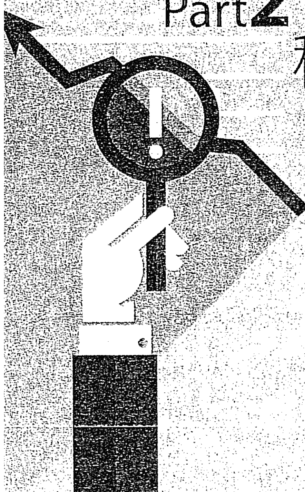

## 2-1 追尋交易系統之旅

“ 回首前塵，我剛進股市的時候，股市所需的各種心理知識與思考素質，我大概都具備了一些，所以往後的二十年才能比較順利。 ”

交易系統（不論有沒有電腦化）有好幾個部分，包括剛開始的「歷史行情驗證」，然後是建立「進場法」、「出場法」、「部位計算（資金管理）」、「風險管理」，以及大家最漠視的「系統改良」。

### 不只要賺錢，績效也要高

回憶我自己的過去，長線的投資法最早建立，大概只花了很短暫的時間，比起一般投資人在市場上，待了幾十年都還不知道長線操作法，我實在幸運太多了。至於中短線的交易系統，則花了我十幾年的功夫。

我的當沖法（坊間稱為「K2 操作法」）是我在 1999 年發明的，當時台股指數期貨上市還不滿一年。台股指數期貨剛上市時，我還忙著用型態跟 K 線做波段（中線操作），期指大概上市八個月後，我才開始做它的當沖。

K2 操作法的基本架構發明，我只花了三個禮拜。

是啊，只三個禮拜，嚴格講起來，三個禮拜都不到。但是這沒什麼好炫耀的，因為接下去，從「K2 操作法」進展到整個「K2 交易系統」，我大概花了整整九年的時間。

改良系統的時間之所以那麼長，是因為 K2 操作法的續效問題。

對於資深贏家而言，不只要賺錢，而是要求續效要提高。但是很多人都不了解這一點，看到 K2 操作法在某段期間表現良好，就誤以為接下來 100 個月，都可以像這個月一樣有這麼好的續效。

原始的 K2 操作法當然可以賺錢，就點而言，已經勝過了不知道多少的坊間操作法；但是在融合中線、融合資金管理、融合風險管理的整體系統方面，原始的 K2 操作法還不夠完美，所以要改良、要進步、要更加強。

在建構系統、改良系統的同時，我印證了一個我自己在早些年的想法，就是續效的提升，跟系統管理有極大的關係，且超乎一般人的想像。

如果有兩組人馬，同樣都有做管理（資金、風險）以及改良（修改法規），那麼，這三者之間的搭配，如果找到關鍵之處並予以突破，績效可能會呈現兩位數的成長。換句話說，愈是注重三者融合的那一組人馬會勝出。

我要找的就是這個！因此績效的提升，使我確認之前的原始方法是对的。照道理來講，如果一樓蓋得很堅固，二樓以上才會蓋得更穩。

**我的操作生涯，將近十分之九的時間，都是在研究「如何提升績效」中度過。而一般人完全跟我相反，他們是在「尋找賺錢的方法」當中度過。** 新手入門，當然是要先尋找對的方法，但不可以耗損太久的時間，因為後面還有很多教育訓練要做。

人的生命是有限的，如果花費十年時間去尋找對的方法，接下來大概又要花個三、五年時間去提升績效。這已經算是很優秀的，依照我個人的閱歷，一般人大概都是花個十幾二十年時間，依然沒有找到對的方法，而是那裡搞隨機致富。如此一來，他們也就沒有所謂「改良系統」這件事了，因為系統還沒有建立起來。

尤其「資金分配」這件事，我也是花了很久的時間才知道它的重要性。連我都花了很久的時間，遑論是一般人。

我想說的是，如果你看到某個操盤手的理論中沒有提到「改良系統」跟「資金分配」，那你最好不要注意一下。畢竟，資深贏家幾乎都把時間花在這上面，而隨機致富的假贏家則否。

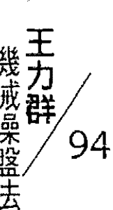

#### 不後悔步上一條孤獨的路

年輕時，我沒有看什麼投資書籍，完全憑實戰經驗來修正方法。現在事隔 20 多年，回首前塵，我剛進股市的時候，股市所需的各種心理知識與思考素質，我大概都具備了一些，往後的 20 年才得以比較順利。一般人的思考沒有邏輯性，就常吃大虧。一直到現在，我還是會跟大家強調歷史學、心理學、思考邏輯、佛學、哲學、機率……這些通識科目在股市裡的重要性，可惜讀者反應不是那麼好。

一般人的想法，幾乎都被亂七八糟的技術觀念給污染了，且沉淪難返。人只要活著，如果不知道修行，就會不斷地被各種成見、錯見所污染，最後知道了很多垃圾資訊，卻變成了一個無知的人。

基本上，從過去到現在，我的投資路是這麼走的：

第一階段 → 尋找對的方法。那時候我才 20 幾歲。

第二階段 → 依據對的方法來建立系統。第一跟第二階段大概都是興致勃勃、渾身充滿戰鬥意志的。

第三階段 → 維持系統的運作，使系統不墜、使真理不墜。在此階段，操作者學習與系統共處，調適自己的身心，從中鍛鍊自己的人格、磨練自己的心性。

第四階段 → 改良系統，使系統精進、使自己更謙卑。

系統運轉一段時間之後，會因為市場的大環境條件改變，而需要跟著做調整，或者是，系統運轉一段時間後就開始暴露缺點，這時要想辦法維修、改良。不過，很多操盤手在此階段已經賺到錢，可能會變得很驕傲（或者說，他一定會很驕傲，甚至變得狂妄，自己卻不知道）。驕傲的人是不會去改良自己的系統的。

關於交易系統的知識，投資書上記載得很少，大概有四分之三或五分之四的部分，需要當事人自己去研發。但是違反交易系統的有害知識，竟然遍地都是！所以，一般投資人永遠被錯誤的知識包圍，終身不得解脫。

我再強調一次，關於交易系統的知識，投資書上記載得很少，少到可憐，導致一般人對於真正有益處的系统知識，會感到陌生、徬徨、不解，甚至感到恐懼、被騙。因為那些真實的知識長得跟錯誤的知識不一樣。

當投資人看到真正的賺錢法感到恐懼、憤怒、被騙的時候，那種氣氛真是沉重，難怪資深贏家都不願意拋頭露面與群眾接觸。

這是一條孤獨的路，但是它的冷清，會讓你的邪欲冷卻，理智清涼。

## 2-2 從海龜法則領悟到的事

> 市場操作，就是要像海龜操盤團隊那樣，對於「進出場、資金管理、加碼、減碼、停利、停損」都有一套嚴謹的管理機制，才能夠長久殷實地賺錢。

海龜交易系統曾經被喻獲利最高的一套交易系統，創始人包括前面提到的威廉·艾克哈特，另一個就是理查·丹尼斯（Richard Dennis），他是20世紀70至80年代美國芝加哥的期貨交易天王，也是目前為止大家公認的市場大贏家之一。

海龜的操作交易法則，因為是免費公開版（原始版的20年保密期限已過），所以可以公布，要點如下（新手不要過度執著於註解，大概知道要算什麼就可以了）：

### 一、計算 N 值（波動性）

海龜法則是用一個稱為 N 的概念，來表示某個特定市場的波動性。N 就是 TR（True Range，實際範圍）的20日指數移動平均，或稱 ATR（Average True Range）。從概念上來看，N 表示單個交易日、某個特定市場所造成的價格波動的平均範圍，N 值愈大則風險愈高。

真實範圍的概念，是找出當日最大的差值當做真實範圍，假設今天收盤是漲的（高於昨日收盤價），且今日最低點也是漲的，那最大的差值就會是昨日收盤價與今日的最高價的差距；反之，今天收盤是跌的（低於昨日收盤價），且今日最高點也是跌的，那最大的差值就會是昨日收盤價與今日的最低價的差距。至於遇到最高點是上漲而最低點下跌的情況，最大差值會是當日最高點與最低點的差值。

每日實際範圍的計算（三個差值中選取最大者）：
TR（實際範圍）= MAX（H-L, H-PDC, PDC-L）
H：當日最高價
L：當日最低價
PDC：前個交易日的收盤價
用下面的公式計算 N：
N=（19×PDN+TR）/ 20
PDN：前個交易日的 N 值
TR：當日的實際範圍

由於這個公式要用到前個交易日的 N 值，所以，你必須從實際範圍的 20 日簡單平均開始計算初始值。

### 二、算出要進多少部位？

確定交易部位的第一步，是確定用市場價格波動性（用其N 值定義）表示的價值波動性。至於價值波動性可用下面公式表示：

價值波動性 = N × 每點的價值

海龜法是依照一個「單位」（Units）來建立部位。1 N 代表帳戶資金的 1%。因此，市場或商品的單位可用下面的公式表示：

單位 =（帳戶資金的 1%）÷ N

舉例來說，台股指數期貨的交易：

- N = 100
- 帳戶規模 = 1,000,000 台幣
- 每點價值 = 200 元（以台幣報價的一大口台股指數期貨合約）

單位 =（1,000,000×0.01）÷（100×200）= 0.5 大口，也就是兩小口。

## 三、進場條件

- 系統一：以 20 日突破為基礎的偏短線系統
- 系統二：以 55 日突破為基礎的較簡單的長線系統

## 四、加碼條件

用海龜法則進行突破時，只要建立一個單位的多頭部位，然後以 1/2N 的間隔增加部位。至於分幾批（最多幾個單位）比較好？不一定，我做台期指時，通常是分三批。此處的計算示範是分四批，也就是最多建立四個單位的倉位。

以台股指數期貨來舉例（用系統二來操作）：

- 55 日突破當天的 N = 100
- 55 日突破當天的期指收盤 = 8000 點（意思是說，8000 點是最近 55 天的大盤，或是期指收盤價的最高價）
- 買進的第一個單位的價位：8000 點
- 第二個單位：8000 點 + 1/2N 即 8050 點
- 第三個單位：8050 點 + 1/2N 即 8100 點
- 第四個單位：8100 點 + 1/2N 即 8150 點

## 五、停損條件

損失 2N 即停損。

2N = 200

- 第一個單位的停損價位：8000 點 - 200 = 7800 點
- 第二個單位的停損價位：8050 點 - 200 = 7850 點
- 第三個單位的停損價位：8100 點 - 200 = 7900 點
- 第四個單位的停損價位：8150 點 - 200 = 7950 點

## 六、出場條件

- 系統一：多單是看到 10 日最低價就賣出，空單是看到 10 日最高價就回補。
- 系統二：多單是看到 20 日最低價就賣出，空單是看到 20 日最高價就回補。

OK，大概的重點就是這幾條，其餘都是細節。每個市場的細節都不太一樣（像是「開盤跳空越過我們要買的價格時，我們該怎麼辦？」諸如此類的小問題），但這些不是這本書要討論的重點。

什麼？沒搞錯吧？學會這六條就能具備贏家的基礎？就這麼簡單嗎？

是的，以上海龜法的計算案例已經把機械法 70% 的贏家概念都涵蓋了（純指技術部分，不包括心理），就這麼簡單。

在這裡，站在純技術的角度，可以說，賺錢就是這麼簡單，執行法則就可以了（當然就技術而言，發明海龜法或是一套機械系統是很難的，但這不在本文討論範圍內）。

### 海龜法則：不預測未來，只交易現在

人家海龜操盤團隊已經把方法整理好給我們了，剩下的就是照著做就好。要發明這個方法，很難很難！但是我們學的人是撿現成，一天之內就可以學會。

以下是原始版的海龜交易法則的特色：

1. 它是機械操作法迄今最偉大的歷史文件之一。
2. 就技術分析而言，它可以在很短的時間內學會！
3. 難度很低，其中用到的數學計算你小學四年級就會了。
4. 單刀直入，不囉唆、不放屁，每一條法則都是過去實戰的經驗結晶（海龜法則主要是用在期貨，股票不適合。本文引用海龜法，旨在說明機械法的系統精神。做股票也有機械法，本書後文會再敘）。

接下來，最後整理海龜交易法則是怎樣賺錢的？

1. 首先，計算一個叫做 N 值的東西。這個 N 的大概意思就是市場的震盪幅度有多大。
2. 依照 N 值，計算出我們應該進多少部位。
3. 短線系統是看到最近 20 天的最高價買進；中線系統是看到最近 55 天的最高價買進。
4. 買進以後，如果順利的話，就依照 N 值開始計算加碼要加多少部位。
5. 買進以後，如果順利的話，做短線的人是看到最近十天的最低價就賣出；做中線的人是看到最近 20 天的最低價就賣出。
6. 買進以後，如果不順利的話，損失 2N 的時候就停損出場。

就這樣，day by day，每天都老老實實做計算或觀察，我們的操作生涯就這樣一天一天過去。如果這個方法還不錯，鈔票慢慢就會累積起來。

這就是賺錢的過程嗎？

是的。這就是賺錢的過程。

但是，如果是 20 多年前的我，看到這份原始版的海龜文件時（原始版的海龜法則大約是在 1985 ～ 1990 年之間操作頻繁。90 年以後則是新版本），打死我都不相信這種方式可以賺錢，那時的我一定會想：「Oh，shit！……這是啥米碗糕？」講難聽點，這種操作方式，當年涉世未深的我會認為根本就是个屁！

當時的我，認為在金融市場賺錢就是以下這樣：

- 運用我們豐富的知識，判斷未來一到數年的多空趨勢。
- 運用我們勇猛的智慧，在趨勢的進行當中，依據當時的型態走勢，找出獲利最多的方法去操作。
- 發現市場即將反轉，再把部位處理掉。

20 多年過去了，現在回顧當年，竟然發現我的「股市法則」比海龜操作法還要簡單。他們有六條，我只有三條！

王三條，帥吧。

至於我的加碼法？……就是買進之後，「覺得」指數還會繼續往上漲則加碼買進，或是，老子我愛怎麼加，就怎麼加。

至於我的停利法？……就是買進之後，「覺得」漲不動了，就停利。

至於我的停損法？……沒有。

年輕的王三條，就憑這三條，在股市中呆呆靜坐了三年，然後碰到 1990 年的 12682 大崩盤。

24 年前的那一崩，我才覺悟。

原來，當年的我根本是個股市白痴。

市場操作，就是要像海龜操盤團隊那樣，對於「進出場、資金管理、加碼、減碼、停利、停損」都有一套嚴謹的管理機制，才能夠長久股實地賺錢。

像我當年「王三條」時代的方法，如果有賺到，也是「隨機致富的陷阱」，稱不上是英雄好漢，只能說是「搭上好運列車的虛胖」。

但是，20 多年前，誰來告訴我這些呢？

沒有人告訴我。

#### 2-3 初步認識機械法交易系統

> 在實際狀況中，一套固定式操作法的系統，不太可能永遠是百分百的機械法，而是需要一些適當的人工監督管理，及手動的參數調整。

不論是最基本分析派，或技術分析派，都應該有個系統。沒有系統的知識，就很難說是知識。

##### 結合投資心理與交易實務

一個完整的交易系統，就技術分析而言，至少要包括兩大領域：技術方法與心理方法（心法）。

交易系統（以下簡稱系統）的最原始雛形，只有兩個機制：進場、出場（停損或停利）。而進場與出場之間，俗稱抱單。如何抱單？這是第三個機制。

進場的時候，要用多少資金買？買多少部位？這是資金管理（資產配置）與部位計算，分別是第四個跟第五個部分。

進場以後（含進場的當下），風險有多高？這是風險計算，是第六個部分。

第一次進場以後，是否要加碼？至於如何加碼？風險變化如何？這是第七個部分。

碰到盤勢不順，是否要減碼？至於如何減碼？風險變化如何？這是第八個部分。

如果前面都沒遵守規則拒絕進場，現在想要進場了，那怎麼辦？如何中途進場？風險變化如何？這是第九個部分。

以上是一套單獨系統。如果使用兩個以上的系統（例如中線與短線），兩個系統的進出點會不會打架？如何調整多重系統的同時運作？這是第十個部分。

另外還有一部分，就是從頭到尾全程伴隨的心理分析。這算第 11 個部分。

請讀者把以上的機制，跟前述的海龜操作法作比較，就可以發現機械法的進出規定都非常明確。既然規則明確，接下來就是實戰的問題。

各位可以利用海龜法去驗證過去的台股行情，結果不難發現，海龜法（20 多年前的原始版）用在台股是可以，但是獲利並不是一般人想得那麼好。於是，所有的操作者都會進一步嘗試做一個動作，就是「改善海龜法」。也就是說，幾乎所有的機械式操作者都會面臨到一個共有的問題：

「我想要改善我目前的機械式操作系統，以提高獲利。」

其實，改善一個操作系統，就必須了解其「建立系統」的相關知識。打個比喻來講，如果想要改善一架飛機的飛行速度，就必須了解大量的機械知識與氣體動力學；通常這個「改善」的難度，比當初人類「發明」飛機的難度要來得低。但是，難度低並不表示沒有難度。以下，就讓我來從最基本的股市操作計畫，說明如何改善自己的操作系統。

##### 機械式股市操作計畫的範例

在股市投資或操作，都要有計畫。如果沒有計畫，操作者必死。如果沒有投資計畫，長期投資者或許有少數能夠存活，但也多半淪落到隨機致富的陷阱。

整個股市操作計畫（機械式）的大綱試擬如下：

1. 首先要拿到正確的核心技術（讀者可先拿海龜法充當基本示範的核心技術）。
2. 把「核心技術」給保護好，用什麼來保護呢？用「風險管控」、「資金調配」、「停損機制」等等等把核心技術給包裹起來。
3. 當我們把核心技術給包裹起來後，第一個「操作系統」就完成。
4. 如果你用的核心技術是長線操作法，那麼，第一個出來的系統就是屬於長期的操作系統（為了方便，以下簡稱長期系統。在海龜法中類似系統二）。
5. 如果你用的核心技術是短線操作法，那麼，第一個出來的系統就是屬於短期的操作系統（為了方便，以下簡稱短期系統。在海龜法中類似系統一）。
6. 長期系統通常比較簡單（一般人學不會長期系統的原因是本性被矇蔽，而不是技術細節的問題）。因為簡單，所以長期系統可以單獨運作。換句話說，長期系統的獲利率就應該很優秀了。
7. 短期系統有些簡單，有些複雜（一般人學不會短期系統的原因是技術細節的問題，以及反應神經的問題；反應慢的人在大多數的機會裡會吃虧）。重要的是，短線系統通常都要搭配長線的知識，操作起來才會安全。所以，操作短線的人除了短線系統外，我個人認為要把長線的知識考慮進去，才是正確的。
8. 因為短線需要長線的保護，也就是用中線來保護短線，用長線來保護中線。所以，短線系統需要的知識很多。
9. 此時要考慮：
    - 你如果只做長線，那麼，一個長線系統就夠了，不必去管短線。
    - 你如果想做短線，那麼，你除了一個短線系統之外，也可能須要中線系統，以及長線系統的輔助。
    - 如果要動用到中線跟長線的知識，那麼，你的學習計畫就應該把中線跟長線的知識給包括進去。
    - 如果堅持只用到一個短線系統而不管中線跟長線，那麼，就要看你的短期系統能不能解決當短線速度太快，而引起暴漲暴跌的停損問題。

##### 仍需要人工監督管理與參數調整

我要補充說明的是，目前在各個地方所使用的短線系統千奇百怪，一個人的力量，很難把這些系統都做出誰真誰偽的判別，更何況，有些操作者並不一定會百分百按照自己的系統去做，操作出來的績效表也不一定能夠忠實反映。而且，大部分的操作手都不只操作一樣，很可能操作好幾樣（股票、期貨、選擇權等等），光看他的某件績效表可能會不準。因此，很多人認為一個系統最好是用機械法，尤其是電腦程式交易，這樣比較好驗證。這個觀念有它的道理，我不是很反對，但這其中的拿捏程度，不是那麼簡單。

雖然機械法是比較方便成立一套系統，不過，其中會有很多隱藏不見的預測性質存在（或是說預測的陷阱），這一點，讀者應該注意。

換句話說，在實際狀況中，一套固定式操作法的系統，不太可能永遠是百分百的機械法，而是需要一些適當的人工監督管理，及手動的參數調整。除非人類的智能已經成佛，否則由人腦所寫的電腦程式或機械法則，暫時還不能夠完全掌握市場的演化速度。

人腦一定要跟電腦（或是由人腦所建立起的制式的操作法則）合作才行，如果完全交給電腦去做，短線系統就會面臨每隔一段時間就要更改參數的問題。如果是長線系統，兩次參數的更改時間就會比較長，大概是十年左右就面臨一次比較大的更動。這也就是為什麼很多操作者，在十年一個大關過不去的原因，因為系統老舊、觀念過時、沒有更新。

講到這裡，已經進入一個境界了。這個境界幾乎是所有資深贏家都沉浸在其中做研究的。從上面的第一點到第九點，已經距離一般股民很遙遠了，也距離我們自己當初拿到「基本的核心技術」的日子很遙遠。股市學習有時效性的問題，如果把人生最寶貴的一段時光花在到處尋找祕笈，那就太可惜了。在交易市場裡，「正確的技術」就好像是一個大花園，裡面開滿很多的鮮花。不過，一般股民只是在花園門口看到角落裡的幾朵美麗的小花，就認為自己很懂股市，殊不知，自己連門都還沒進去，有些人甚至是連門都還沒看到。

##### 提防傲慢跟貪欲膨脹

幾年前，我還會針對此一情形對別人給些建議，後來發現一般股民太多自大狂了，根本沒把我這個資淺拙劣的小小投資人的建議當真，最近一、兩年我就很少講了。希望已經看到花園大門的同學們，能夠知道自己目前的處境，不要進門之後又空手而回。

前面所提的第八條跟第九條，就是教你選志願。選長線就長線，選短線就短線。但問題是，有志學習股票或期貨者，都會在學了以後改變自己當初的志願，這就好像我年輕時念的是工科，現在卻沒有繼續走工程師這一行。人生有許多際遇，也有許多選擇，因為隨著年齡的增長與身心的變化，會有許多不同的看法。但是，在交易市場中學習有很多誘惑，會讓人的傲慢跟貪欲膨脹，因而造就許多歧路亡羊。

大致說起來，天資不高的朋友們，不能做中線跟短線。不過，誰來判斷一個人的天資高低呢？……有的人有自知之明，有的人沒有自知之明，而且進這行的人，通常都有點雄心壯志，為了想多賺幾個錢，就豪氣干雲，認為人定勝天、勤能補拙。於是乎，就種下了很多未來的悲劇種子。

我知道多數專職操盤者都希望「長、中、短三條線的利潤都能夠嘗到」。依照我的觀察經驗，很多人嘴巴裡說自己不做短線，但是等他一入市場，沾了鍋了，心底的潛意識就暴露出來，此時，即使他想要用長線系統，但是滿腦子的觀念卻都是短視近利、急躁淺薄，這樣當然做不好。不過，在這裡，我就直接講「長、中、短三條線一起操作」的狀況。

##### 長短兼顧的解決眉角

接下去正式講第十條以後的。

(10) 當兩個以上的系統同時運作的時候，其優點是長線保護短線，但這裡有一個問題要解決，就是：兩個系統會打架。這句話的意思是：**當兩個以上的系統同時運轉時，「風險係數」的計算，以及「停損點」跟「停利點」的設置，馬上就會發生很大的變化**。可惜一般的交易者，都不太會察覺到這個問題的嚴重性。

短線的進場點，很可能是長線（或中線）的出場點；而長線的進場點，往往是短線（或中線）的出場點。所以操作者在實戰的時候，必須要兼顧大格局和小格局，才不會犯見樹不見林的錯誤。但是，同時要「見樹」又要「見林」，這對很多操作者而言，是個極大的困難。換句話說，如果要求操作者同時「觀照全局」，這是非常困難的，因為一般人只會把注意力放在眼前的事物，而不會去想看看更大的觀察範圍，或是去想以後會發生什麼事情。如此一來，督促他們要「長短兼顧」，本來是一番好意，想讓他們避免掉「顧前不顧後、看短不看長、看小不看大」的毛病，結果反而是讓他們「一心二用、分身乏術」。

為了避免長短兼顧所發生的一心二用窘況，操作者有兩種方法解決這個問題：第一個解決管道是治本，也就是透過教育（不论是自我教育或老師給予的教育）把自己的心態訓練地更成熟，能夠觀照全局，也就很自然地長短兼顧了。

第二個解決辦法是治標，就是開兩個帳戶，或是兩個系統（一長一短）各自操作各自的商品，彼此互不侵擾。

這其中，第一個辦法才是正途，但是效果慢。通常我們都曾經使用過第二種，也就是分開帳戶操作，不同的交易帳戶操作不同週期的對象。不過，我要特別指出，這個治標的辦法只是暫時的，如果操作者一直遲遲無法搞懂長線跟短線的差別，那他對長線跟短線的進出點認知就會有爭議，到時候就算開再多的帳戶都沒用！

當我們知道兩個以上的系統，在同時運作時可能會產生的矛盾現象以後（其實這個矛盾是假的，重點在於我們自己的認識不清，或是執行力被中斷），我們才算真正踏進了專業操作的大門。

#### 2-4 嚴格檢驗你的交易方法

> 有些地方，一般非贏家的獨立操盤手不會注意，然而，這也就是他們將來失敗的癥結。

所謂的機械式交易系統，至少包含幾個重大部分：

- 進場條件
    - 進場條件的心法
    - 如果錯過進場機會，補救措施為何？
- 抱單條件
    - 抱單的心法
    - 如果半途被洗掉，補救措施為何？
- 停損條件
    - 停損的心法
- 停利條件
    - 停利的心法
    - 如果錯過停利機會，補救措施為何？
- 半途加碼法
- 資金管理
    - 進場的資金配置
    - 加碼的資金配置
    - 資金管理的心法
- 風險計算
    - 進場的風險計算
    - 抱單過程中的風險計算
    - 風險評估的心法
- 多重系統
    - 多重系統的進場方案
    - 多重系統的出場方案
    - 長短系統交叉互換
- 心理分析
    - 使用本方案之身心健康評估
    - 其他心法
- 組隊機制
    - 組隊的會議機制
    - 組隊心法

##### 機械法運用案例

對於完全沒有學過系統知識的人而言，以上這十項，很多地方跟看天書一樣 —— 這很正常，不要氣餒（後續幾篇文章將陸續說明）。有些地方，一般非贏家的獨立操盤手不會注意，然而，這也就是他們將來失敗的癥結。

以一個最簡單的期指中線操作為例（以下案例所有的技術跟心法都已經簡化）：

- 進場條件：突破 X 關卡
    - 進場條件的心法 → 除了 X 關卡，其他非本系統的條件，一概不予理會！
    - 如果錯過進場機會，補救措施為何？ → 分批進場，等下一個加碼點。
- 抱單條件：沒有到達出場條件則續抱
    - 抱單的心法 → 專注！不受誘惑！不受邪法誘惑！不受非本系統的其他方法誘惑。
    - 如果半途被洗掉，補救措施為何？ → 很難，萬一搭救不成，務必保持鎮定。
- 停損條件：跌破 Y 關卡
    - 停損的心法 → 當斷則斷！務必勇敢果決
- 停利條件：跌破 Z 關卡
    - 停利的心法 → 不可以過度貪婪
    - 如果錯過停利機會，補救措施為何？ → 明天繼續停利出場
- 半途加碼法：多單獲利 A% 之後，加碼買進
- 資金管理：總資金 1000 萬，中線分配 200 萬
    - 進場的資金配置 → 分批進場
    - 加碼的資金配置 → 均等分，或 30%、30%、40%
    - 資金管理的心法 → 不可過度貪婪，也不可以過度懼怕。務必遵守紀律
- 風險計算：如果停損，將損失中線資金的 B%
    - 進場的風險計算 → 每日計算（進場初期，停損的設置，可能與抱單過程不同）
    - 抱單過程中的風險計算 → 停利停損點逐日調整，使用 EXCEL 試算
    - 風險評估的心法 → 黑天鵝
- 多重系統：開兩個帳戶，短線系統 150 萬、中線系統 200 萬
    - 多重系統的進場方案 → 兩個同時操作，遇有衝突時不予理会，分別在各自帳戶下單
    - 多重系統的出場方案 → 兩個同時操作，遇有衝突時不予理会，分別在各自帳戶下單
    - 長短單互換 → 很難，但容許
- 心理分析：操盤手本人是否具備心理分析的正確知識？
    - 使用本方案之身心健康評估 → 操盤手是否具有正確的金錢價值觀？……
    - 其他心法 → 如果排除壓力？如何保持專注？如何抗拒誘惑？……
- 組隊機制：三人為一小組，或由指導老師擔任風險控管的監督
    - 組隊的會議機制 → 每週六早上十點開會
    - 組隊心法 → 人倫關係的延伸，表面上以和為貴，骨子裡紀律嚴明

以上重要結構，可以跟前面所提到的海龜法互相比較，相信可以得到更清晰的概念。

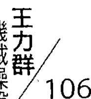

###### 建立個股操作系統的經驗談

> “經過大概20年以後，我才把我的個股操作系統大致完成，一個是個股短線（比較講究投機），一個是個股投資（依靠財報以及睿智、遠見）。”

以下的心路歷程，大部分是我十幾年前，甚至20多年前的往事，也有最近幾年的心得，提供給各位在操作機械法時一個經驗談：

**心得1** 做股票有兩大領域，一種是總體經濟（跟大盤指數關係較密切），另一種是個股產業基本面（跟個股較密切）。這兩個系統有時會差很多，一般來講，如果是跟著大盤走，那麼，整個系統就可以設計得跟台股指數期貨的操作系統一樣，完成以後（或複製過來以後），再附加選股系統即可。

這個選股系統由於是附加的，所以規模不需很大（你要精挑細選也可以），甚至亂射飛鏢也可以，記得分散風險就好。

另外一種主流系統就是精挑個股，就如同巴菲特那樣集中資金投資在少數個股上。這種系統需要紮實的財報功夫，以及普通常識的靈活運用，難度甚高。這方面的知識，我個人的學習過程算是順，但在教給別人時卻歷經挑戰，原因是，現在的投資人對於個股的執著太深（對於大趨勢則興趣缺乏），沒辦法相信個股系統的難度竟然這麼高。

**心得2** 也因為個股的難度高，所以超過九成的選股專家都是騙你的。問題是，我一個人的微小力量，怎麼可能去跟那些衣冠楚楚的英俊專家去對抗呢？因此大部分的時間我都活在屈辱之中——永遠記得「我的選股實力不如那些人」的恥辱，以警惕自己要用功精準。

**心得3** 我們盡力把科學化的思想融鑄成系統，查理·蒙格（Charles T. Munger，巴菲特的搭檔兼良師）把它叫做「模型」，其實意義不會差太多。有些系統可以轉換為電腦程式，像是期貨的海龜系統，但有些不行。很多股票操作系統，都無法完全轉換為電腦程式，因為有部分跟「藝術」和「常識」有關，這兩個東西目前無法用電腦來衡量。比較幸運的是，我從來就沒有「系統等於電腦交易程式」的錯誤偏見，所以我很自在地致力於追求科學的思想，很舒暢。

**心得4** 我並沒有花太多時間在了解一件事上面，這件事就是「期貨的致命傷在於忽略細節，股票的致命傷在於執著於細節」。因為個股風雲詭譎、變化莫測，受人為因素的影響比較大，所以，你必須了解任何分析用在個股時，靈驗度都會大大降低——我很幸運，因為我完全接受這項遺憾。

**心得5** 過了將近 25 年以後，我才真正體會到長期投資的可怕性，因為運氣的成分太高了，大概是運氣占一半，選股實力占一半。如果你生對了時代，你可能不需要費太多力氣就選到好股，但如果你生錯時代，那就累了。一般投資人卻不太相信這個，他們寧願相信「選股專家」的預言，而那些預言不知何時才能兌現？

**心得6** 我花了大概 15 年的時間才了解到一件事，而這件事卻是很多真正的操盤高手，第一天跟師父學的時候師父就會告訴他的，那就是：「外資靠中長期投資績優股獲利，主力靠短期操作投機股發財。」不過，有些績優股是靠「基本面的內線」，所以他們贏得並不十分光彩。而投機股在十幾二十年前有很多都靠坑殺小散戶才能竣工，所以贏得可恥。我因為執著於「績優股才是名門正派」的迷思，有很長的時間沒有做投機股，直到我開始使用「不帶感情、不看財報」的強勢股操作法後，我才開始不排斥投機股的短線操作。

**心得7** 經過大概 20 年以後，我才把我的個股操作系統大致完成，一個是個股短線（比較講究投機），一個是個股投資（依靠財報以及睿智、遠見）。另一種系統是跟大盤連動的「群股系統」，也就是買一堆強勢的股票，這種操作比個股簡單許多，早期我無法參透個股的時候，都是依賴跟著大盤買賣一堆股票維生，所以我要感謝大盤，讓我做股票也賺到了錢，而不光只是期指獲利。

**心得8** 在這麼多年一磚一瓦、一沙一土建立股票系統的同時，我從來不會覺得我用到的這些建材，以及我使用的施工方法有這麼複雜。這項罪名，讓我覺得莫名其妙。偏偏很多人都拚了命往死裡鑽，想要在「不可能化繁為簡的地方」極力簡化，就好像企圖用一個桶子，想同時裝飲用水跟垃圾一樣，很無言。

我嘗試學了很多東西，有基本分析、技術分析、財報分析等等，因為我的系統有短線也有長線，我必須學得多一些，當然也要能夠消化。令我感到安慰的是，因為我親手打造了系統，所以我不會亂搞化繁為簡（就像把中文繁體字簡化成簡體字一樣，很多文化在簡化的過程中都消失不見了），沒有墮入見樹不見林的陷阱。

**心得9** 股票系統比較難了解的觀念是「機率」跟「資金配置」的觀念。期指的機率跟資金配置，都比股票要來得簡單許多。我是花了很久的時間，才真正了解彼得·林區為什麼要「買很多支股票」，因為這樣一來，你才能擴大層面、才更有機會買到飆股。唉，當我真正用現金領悟到這點，已經是第一次看彼得·林區的書過後12年的事了。很多爛書，你看了會忘，那就算了，但有很多爛書你看了會終生中毒；真正的好書，卻是要一讀再讀、終生閱讀。

**心得10** 經過了近 25 年的股市思考，我會勸大家，最好找一個好老師（不論是股市或是期市）。自己學的話，風險實在非常非常大。我是自己學的，所以渾身都是刀疤！其中的痛苦辛酸，外人很難體會，所以不建議大家自己去摸索。就像我不會建議想學外科手術的人自己在家摸索，而會勸他去讀醫學院。我認識的醫師，全部都能夠靠著醫術賺錢，但我認識的操作者，絕大部分都不能夠靠著自己知道的那一點操作知識賺錢。如果找不到好的老師，那就退出股市吧，沒什麼好留戀的；或是用閒錢做長期投資就好，不要碰短線，短線實在太專業了，是真正屬於職業級的操作，只有在股市裡已經打滾十幾年的老油條，才有資格去玩。

###### 不知道對方的操盤系統，就不要輕易跟單

我看過很多散戶常問別人「現在要買什麼股票？」這不僅危險，也會讓自己陷於風險之內。我建議問別人之前，自己必須先搞清楚幾件事情：

- （1）我是要做短線？中線？還是長線？（短線的操作時間有多久？中線有多久？長線有多久？）
- （2）我是不是需要知道對方買進的理由？如果想知道的話，我必須聽得懂對方的專業術語（如果他有用到的話）。換句話說，我可能需要知道基本分析或技術分析的知識。如果對方是技術派而且很專業，我很可能就根本聽不懂他的買進原理。
- （3）如果不管對方的買進理由，那麼，我必須對對方要有很強烈的信心，才會聽取他的建議行事。如果我對對方的信心不是那麼夠，我很可能在將來被洗掉。

如果是機械式操盤法，你就得先主動解答自己的疑惑，先問自己的交易系統是不是已發出進場訊號，如果沒有，則不可以進場。除非你臨時更換交易系統，或是臨時放棄系統，改憑自己的直覺操作 —— 這些陣前換將的事情，在做之前都要評估一下，做下去以後就不要反悔。

大概在十年前，傳產股最慘的那段時期（就是雞蛋水餃股滿天飛的那兩年），我偶爾聽到一個我很厭惡的人，建議長期投資者可以買進中鋼。我總認為那個人很偽善，但在當下，我覺得他的這個話有點道理。後來他出了書，我也看了，大致了解他的理財風格，他的一句話提醒了我「景氣循環股」的操作方法。因為當時受大環境的影響，就算你知道有景氣循環這東西，恐怕也早就被嚇得忘光光。

也就是說，一旦我聽到某人的買進建議之後，我最需要了解的是我系統的交易系統是否能夠跟對方的建議吻合？如果對方的建議嵌不進我的交易系統，那原則上我不能買進，除非我要換成他的交易系統。

很多人在搜尋別人的買賣意見時，在潛意識中，無非就是想放棄自己原來的交易模式，改用別人的產品。這種心態不能說錯，但**最好是完整學習別人的系統（當你在「完整」學習對方的東西之後，才能夠知道對方是否完整），而不只是撿取片斷的建議**。

另一種人，就是不相信別人，只相信自己的「獨立判斷」，偏偏他的獨立條件還不夠格、意見還不成熟，於是固執己見、任意抒發自己買賣欲望的結果，也會有不好的下場。

自己必須要有一套完整的交易系統，不過，你很難獨自發明一套完整的系統。以我自己為例，為了發展自己的交易系統，費了很多年的時間，這些都是青春的寶貴時光。光陰似箭，時光一去永不回頭，遠比金錢還要珍貴。

###### 進場點、部位、停損與停利

> 輸家在乎的是賺錢的次數，以便去跟別人炫耀；贏家在乎的是部位的控管，而對於勝率不執著。

前面提了機械法的基本概念之後，現在要正式進入操作機械法時的細節：

####### 關於進場點

一般而言，機械法的進場點（以指數為例）的制定模式，坊間流行下列幾種：

- （1）型態系統，大多以「多空關卡」為主。例如：箱型、頭部、底部等等，突破型態採機械式的動作入場。
- （2）均線系統，大多以「多空關卡」為主。例如：長期均線、中期均線、短期均線等等，突破均線採機械式的動作入場。
- （3）統計數字指標系統，大多以「技術指標」為主。例如：KD、MACD、RS等等，進入指標區採機械式的動作入場。
- （4）參考其他市場數據，像是成交量、股票融資、期貨未平倉量等等。
- （5）融合以上諸系統，選定幾樣自己認為很棒的進場條件組合起來，自成一個系統，也就是幫自己量身打造的專屬系統。

一般而言，外面的人喜歡把大部分精神放在研究「能夠賺最多的最佳進場點」跟「能夠賺最多的最佳出場點」，他們所謂的「最佳」就是「利潤最大化」。這種觀念嚴格講起來不是錯誤，而是落伍。

儘管花了很多時間研究「能賺最多的進出點」，但操作的歷史應該是進化的，光是研究「賺最多的點」是不夠的。甚至到後期，這種研究會成為一種阻礙進步的業障。

####### 關於部位、停損與停利

當我們「大概」了解「整個波段哪裡進場比較好？整個波段哪裡出場比較好？」歷經數年的實戰經驗之後，接下來的研究項目就是：「部位」、「停損」與「停利」。這三個密不可分，且計算時還須配合「心理」、「風險」跟「利潤」。

一般人只知道「利潤最大化」，高手只知道「風險不能太高」，我們教學的人還要多計算一個，就是必須照顧到「操作者的心理」。否則發明一個方法，同學卻因為此方法的心理障礙太高而過不去，也算一種教育失敗。操作者的心理，隨意信手拆來就有一堆：

- 如果把加碼的間隔加寬，會對風險和停損造成什麼樣的影響？
- 如果把加碼的間隔縮小，會對風險和停損造成什麼樣的影響？
- 如果把加碼的間隔縮小，該如何不被洗出場？
- 如果把加碼的間隔放大，一旦停損時，造成的心理傷害該怎樣評估？
- 停損的地方如何才能客觀（通常固定區間的停利範圍都失之主觀，大盤不太會認同。換句話說，停損點並不是真正的關鍵點）？

當然不只這五個，其他還有。

我想提醒大家的是，目前市面上看到的現成軟體（包括券商提供的程式交易），都缺乏有效計算風險與心理的計算。也因為這樣，我們才有許多題目可以研究。

台灣在這一塊領域的研究上，相當不足。其原因應該是跟台灣人喜歡短視有關。

###### 輸家拚勝率，贏家拚部位

輸家在乎的是打勝仗的次數；贏家卻不是很在乎那個。

輸家把股市想得很簡單，以為只要知道漲跌方向就可以了，於是跑遍股市論壇，東問西問，就是希望知道明天是漲是跌。

贏了十次，賺了 10 萬塊；輸一次，就輸 10 萬塊 —— 勝率有啥屁用？

到了贏家境界，勝負的次數不重要，重要的是部位。

贏的時候，部位要多；輸的時候，部位要少 —— 這幾句話一定要記得。

贏的時候，一小口；輸的時候，一大口 —— 這有啥屁用？

贏的時候，只買一張股票；輸的時候，還動用到融資 —— 這有啥屁用？

可是偏偏市場上就是有那麼多人在迷信勝率、過度執著了（勝率可信，但不可迷信，只可實信。勝率之實信，在於紀律之持恆且部位固定）。

在機械式操作法中，如果是中線分批進貨，每次進的部位只占全體的幾分之幾，而不是百分百。

但輸家進出沒有計畫，只憑自己私人好惡情緒做進出。

輸家在乎的是賺錢的次數，以便去跟別人炫耀；贏家在乎的是部位的控管，而對於勝率不執著。

###### 停損的六個策略

最近幾年，我常有個感慨，覺得大部分的技术名詞，若把它深入到底弄通了，幾乎就直扣股市真理的核心了。所謂萬法歸一，到最後就發現原理都是一樣。「停損法」這東西，就是很標準的一個案例。

大家對「停損法」這個名詞並不陌生，很多人以為自己會，實際上未必。

有些高手說：「把停損法弄懂了，就是贏家了。」乍聽之下會覺得有些疑惑，心想：有那麼厲害嗎？光搞懂一個停損法就可以變成贏家囉？……其實，細細思量，就會知道，如果真的想把停損法「徹底」搞懂，勢必要經過一番珍貴的操作生涯，而在此歷練中，真正細心的人將會體會一路上所遇到的種種難題與阻礙，如果真的要腳踏實地追根究底一樣樣解答，真的是把市場操作的關鍵要訣碰了個遍。難怪有人會說：「一法通，萬法就通。」

問題是，要讓哪一法？畢竟，不把問題的根源搞個究竟，這個「究竟之法」是不會現身的。

一般來說，停損法大致有幾種：

- 技術面停損法：以技術分析為理由，訂出停損的條件。
- 基本面停損法：以基本分析為理由，訂出停損的條件。
- 心理停損法：有事情要離開工作崗位（例如休假、結婚），則清倉。
- 百分比停損法：損失資金的百分之 X 則停損。
- 價格停損法：某支股票價格下跌到多少則停損。
- 時間停損法：進場 X 天期滿後發現獲利被卡住，則停損。

為了使讀者在閱讀時不會搞不清楚重點，我用條列編號來談談停損法的思考過程：

1. 機械式操盤法比較會用到停損法。預測式操作法大概只能說是有停損觀念，具體規則不一定会很嚴謹。
2. 喜歡用預測法的人都不太喜歡設停損，所以他們的停損啟動多半是臨時起意，很不保險，也比較沒有紀律。
3. 基本分析派的停損法有時候會模糊，因為他們的停損通常是要等到基本面出現變化以後再決定，但那時有點嫌晚了。
4. 停損法分很多種。不同派別的操作者可能會使用不同種類的停損法，不能一概而論。
5. 停損法的分類可以互通，例如，很多人用技術分析的理由去制定「價格停損法」的停損價格。
6. 「技術面停損法」是按照自己所學的的技術分析來設停損條件。例如，三尊頭成型就認賠出場。或是看到某組類型的 K 線就出場。優點是：忠於自己的技術，養成紀律與毅力；缺點是：不容易學、不容易記、容易忘、太主觀、不容易分辨（有時候訊號模糊）、不容易機械化（不容易制度化）。
7. 「百分比停損法」最多人提倡使用，例如，損失 15%的資金就認賠出場。優點是：簡單、容易、好記；缺點是：跟技術分析本身沒關係。用這個方法的人很難在技術上面有長進。
8. 「價格停損法」是依照技術分析，或基本分析，或是自己的資金承受的風險來設定一個價格，破了就出場。優點是：忠於自己所学到的知識，養成紀律與毅力；缺點是：不容易學、太主觀。
9. 一般認為自己是技術派的操作者，都偏愛使用「技術面停損法」或「價格停損法」，但是這兩種方法如果不納入機械化，都會變得極難！缺點會暴露無遺。
10. 「時間停損法」是依照技術分析，或是自己的經驗、直覺來設定進場幾天之內要走。優點是：簡單容易，時間到了就走人，比較乾脆；缺點是：依賴經驗與直覺，成效不穩定。
11. 我知道的「時間停損法」就有兩種以上，例如「時空變盤」也可以是一種停損或停利的概念，就是規定「進場以後，X 天以內感覺不對勁，就跑。」這個方法通常是做波段有一點經驗的人，才能用得順暢。
12. 如果你有在做中線、短線、極短線，那麼，當你看到「進場以後，X 天以內感覺不對勁，就跑。」這句話時，千萬不要以為我在鼓勵大家做短線，也請別不要誤會我是在提供某種炒短線的訣竅！我之所以會講這樣的話，也是萬般無奈。我的原意是：如果不是做長線（而是做中線、短線），那麼，就要存著敬畏謙虛的心情，不要過度高估自己的能力。
13. 很多短線操作者都滿喜歡「進場以後，X 天以內感覺不對勁，就跑。」這種思想，跟我上面所講的有什麼不一樣呢？不一樣的地方是，當我使用我的時間停損法時，並不是完全抱著做短線的心態切入，而是希望能夠卡到中線波段的位；為了這個卡位，我才進場，所以我們必須嚴格控制進場點的過濾條件，絕對不可以胡亂進場以後再說什麼「先開槍，後瞄準」的大話（那是一種菁英教育，一般人根本不能夠依樣畫葫蘆）。換句話說，要先嚴格篩選進場機會，一旦掌握到正確的機會（必須符合進場條件），就毅然進場。但因為這個進場條件本身，也不是百分百沒有風險，所以當我們感覺苗頭不對時，就要意會到「正式的波段攻擊還沒開始」，此時就要考慮拔腿跑掉。
14. 一般的短線操作者都喜歡不管三七二十一先進場，然後再憑自己的「直覺」（第六感）來決定要不要早走。這種作法有極大的流弊，就是很容易淪入妄想（直覺不直，變成扭曲的思想）。
15. 只要有設停損，不管是哪一種停損法，至少可以拯救你不會賠光。

###### 時間停損法，波段與長線都可用

如果要動用到時間停損法，請注意以下幾點基本心態：

- 我們並不是想做短線，而是縮短留宿時間。
- 進場的時機選擇，並非坊間所認為的那種短線，而是意圖做到中線波段，進場點一樣要經過嚴選、等待。
- 原則上，在進場之前就要決定好此次需動用「時間停損法」的打算，儘量不要臨時才決定，那樣很容易流入妄想！

或許有朋友會說：如果這樣的動作會引起做短線的誤會，或者引起類似做短線的流弊，那乾脆不要做中線跟短線好了！這樣的想法原則上是对的，但對於現在那麼多的小資金操作者，如果都強迫他們一定都要去做長線，實在是一件不可能的任務。

而且我認為，正確的長線是：從 2001 年下半年到 2006 年上半年逢低布局（從 3500 點布局到 6500 點），然後抱到 2007年的9500點附近賣光；投資時間（2002～2007）將近六年！這樣的長線投資對很多小資金操作者，有很大的困難性，因為他們很難等個五年以上。

小資金操作者既然無法等五年以上，難免就會碰觸到「波段操作」。這種操作美其名為「波段」（中線），其實是「進可攻，退可守」、「進可長、退可短」，所以，還是需要運用到像「時間停損法」這樣的技巧。

想提早一點卡中線的位，如果能夠因此進一步卡到長線的位當然更好，但只要接近中線，風險性立刻提高！這種提高，遠遠超乎一般自認為是短線操作手（甚至絕大部分的技術派操作手）的想像，或者說，他們拒絕去想像！因為，如果中線的風險都那麼高，短線不是高到不可思議了？

對於短線風險高到什麼程度的問題，我在此不予評論。但如果台股的中線風險已經困難到「一般自認為是技術派操作手難以想像」的程度（或者我們不要說風險，換個名詞，改叫「操作的困難度」好了），那我們就必須抱著更謙虛的態度去操作。

我們也發現，有很多技術派的「高手」（或低手，包括我自己也犯過這個毛病）都過分高估自己的技術能力，以至於掉進隨機的陷阱。所以，我才提醒大家要注意「時間停損法」要學會，並且熟練。備而不用沒關係，但不要等到要用時

候卻不會用，那就不好了。所謂「養兵千日，用在一時」，就是這個道理。

不論是市場投資或交易，都是很精密的事業。

在我年輕的時候，曾經有一段不算短的時間，認為長期投資「應該」不算是很「精密」。但是等到我開始教課以後，我才恍然大悟，長期投資只是比較容易學而已，但是這個「容易」卻也有其局限性。長期投資況且如此，更不要說非長期的中線跟短線是多麼精密了。

可是再回想一下，我們大學四年學的科目，又有哪一門學問是不精密的呢？……有人認為時間停損法不過是一個虛招而已，登不上大雅之堂。然而，真正實戰時，到了某一個階段之後，你又會發現並非如此，這個虛招，虛中有實，並不是一般技術派想得那般膚淺！

#### 2-7 分批式賣出法的優缺點

> 學習技術分析，就是要學著了解自己所使用的這個方法之優點跟缺點。這個道理很深很深，不只股市適用，人生的很多領域都適用。

接著，我要講短線跟中線進場的「分批」與「不分批」的問題（長期投資的進場大多是分批，所以沒有這個問題）。

在機械法中，對盤勢並不是要有個多或空的看法，而是要有個多空關卡，再依照關卡產生對策（或想法）。

如果跌破關卡，是要一次進場？還是分批進場？……（這裡很多是常識的問題）

如果是短線單，就一次進場，因為做的時間短。

如果是中線單，分批或不分批進場都可以，因為做的時間可能會比較長，也可能幾天就跌破中期關卡而出場了。

如果是短線單，跌破關卡沒有太多的過濾條件，換句話說，條件寬鬆，隨自己的意思決定要不要做。

如果是中線單，跌破關卡則一定有比較多的過濾條件，例如，跌破關卡的 1.3% 才算真的破。換句話說，條件緊俏，不能太隨自己的意思決定要不要做，因此，中長線比較偏機械化。

至於出場的條件，短線單比較隨意，中線單就比較嚴格。這都是合理的常識，只是一般人很少去想罷了。然而，操作者須要考慮到的是「分批」的優點跟缺點，以及「不分批」的優點跟缺點。

以作多為例：

##### 「分批」的優點
- 1. 每次出手輕，所以感覺壓力小。
- 2. 如果盤勢很快就拉回，損失的部位小。
- 3. 進場時間拉長，可以有多一點的時間去選股。

##### 「分批」的缺點
- 1. 如果漲的快，由於部位分批而錯失最低成本的進場時機。
- 2. 一件事情分好幾次完成，每次都要做一次行動決定，壓力大。
- 3. 進場時間拉長，反而會胡思亂想，增加猶豫。

##### 「不分批」的優點
- 如果漲的快，由於部位不分批而掌握最低成本的進場時機。
- 一件事情一次就完成，不需要下第二次決心。
- 進場時間縮短，不會胡思亂想。

##### 「不分批」的缺點
- 每次出手重，所以感覺壓力大。
- 如果盤勢很快就拉回則損失的部位大。
- 進場時間縮短，選股的時間變少。

##### 期指中線的機械式分批賣出法

為了不混淆起見，本文討論的內容以大盤指數為例。先從中線操作講起。

小散戶的短線單買進以後，原則上將來是一次性賣出，時間間隔不會太大，因為短線時間急迫。

小散戶的中線單買進以後，將來可以一次賣出，或是分批賣出。不過，這裡的分批賣出是指「短時間之內不再考慮買回來」。

如果要考慮短時間之內可以買回來，操作法有好幾種，其中有一種「塭用」的方法，步驟如下：

- **Step 1** 跌破第一道短天期支撐，賣出三分之一。
- **Step 2** 再往下跌 100 點（或 150，或 200，這個參數每個人訂的都不一樣，此处只是舉例說明而已，非固定不變），買回三分之一。此為降低成本的觀念。
- **Step 3** 再往下跌破第二道支撐，賣出三分之一。
- **Step 4** 再往下跌 100 點（或 150，或 200），買回三分之一。此為第二次降低成本的動作。
- **Step 5** 再往下跌破中線支撐，全部賣出。
- **Step 6** 如果復中線關卡，大原則：往上分批買回原來的部位。

這個方法的優點是機械化，對於善於執行紀律的操盤手而言，很好。缺點是：本來要做中線，結果搞了半天變成做短線。

中線跟長線的停利跟停損距離都比較大，因此，賺的時候賺很多，賠的時候也會比較多。

短線的停利跟停損距離都比較小，因此，賺的時候賺比較少，賠的時候也會比較少。

天下事，各有其優缺點，不可妄執偏廢。

話再說回來，如果是用中線的精神進場，也不避諱短線手續的繁瑣，此法倒是可供參考。

##### 另一種分批賣出法

這樣的操作法有好幾種，以下是第二種「堪用」的方法：

- Step 1 跌破第一道短天期支撐，賣出三分之一。
- Step 2 再往下跌破第二道支撐，再賣出三分之一。
- Step 3 再往下跌破中線支撐，賣出最後的三分之一。
- Step 4 如果恢復中線關卡，則大原則是往上分批買回原來的部位的。
- Step 5 如果還沒有賣完就出現止跌反彈，則視狀況分批往上買回失去的部位的。

這個方法的優點是，如果跌勢持續，執行起來會很機械化。對於善於執行紀律的操盤手而言，很好。缺點是：第五個步驟執行起來有難度，因為「視狀況」表示這裡面帶著預測成分。

操作者必須了解，這兩種分批賣出法在不同的下跌狀況，會有不同的報酬率，很難說哪一個最好。

學習技術分析，就是要學著了解自己所使用的這個方法之優點跟缺點。這個道理很深很深，不只股市適用，人生的很多領域都適用。

#### 2-8 當你不得不中途進場時……

如果已經錯過第一買點但是還是想要進場，則採用「創新高」姿態的突破買進法比較理想（以多單為例）。

在優秀的技術當中，核心方法會指示一個波段應該在哪裡進場最好。所以，在一般的股票書裡，我們常常會看到股價線路圖，圖的左邊圈出一個紅色買點，右邊圈出一個綠色賣點，就這樣，嗯，讀者一看就知道這裡買、那裡賣，就會賺錢——好簡單。

##### 中途進場法

這種標示法並沒有大錯。我自己也用過這樣的標示法，而且現在也常用到。但一般人不太會買在那个起漲點（或是放空在起跌點），而是進場點過了以後，隔了一段時間才想到要進場。

不過，幾乎很少有書討論這種「中途進場」的問題。為何？因為錯失第一進場時間，是失敗者的行為，會給人瞧不起；寫書的人都自認為贏家，當然不願意秀一個遲到的進場點，以免顯現自己的無能。

另一個原因，也是最主要的原因，就是寫書的人自己也不知道萬一晚進場該怎麼辦。所以說，一般讀者都是理想主義者，通常只會想到哪個最好的進場方式，卻沒有想到，如果自己晚進場或是做輸的時候，該怎麼辦？

首先，你要知道幾個基本法則：
- 使用突破買進法：股價在創新高時候買進。
- 使用分批進場法：部位不可以集中在同一價位上過多。
- 如果虧損，逢跌不攤平、逢低不加碼。
- 或是自己訂一個停損關卡，跌破了就停損出場。

其中，前三條法則的心法，都可以在李佛摩的書找到。

如果你仍是一頭霧水，那麼，我的建議是：
- （1）首先要知道中長期的趨勢有沒有大的異動，如果沒有，就按照原來的趨勢操作。
- （2）當下先買進三分之一的資金，或是四分之一、五分之一……要切成幾份，隨你。
- （3）以漲勢為例，設定每隔幾百點買進一份。假設現在是 5000 點，那我就 5000 點買進三分之一，以後再漲 200 點到 5200，我又買進三分之一。
- （4）如果買進之後下跌虧損，就停止買進。
- （5）跌破中長期關卡，全部停損。

就是這樣。但是一般散戶做不太到，因為：
- 散戶要買，總要找一個個股利多的消息，單憑技術面的數字操控，他不放心，並不會照著去做。
- 一般的技術操作者喜歡在逢跌的時候買進，所以變成虧損時攤平，或是在跌勢未結束前過早買進。
- 一般的技術操作者不太能接受每次加碼都加的一樣，會憑個人意願來分配加碼比重。

李佛摩的技術重點，說多不算多，說少不算少，但是幾乎很少人能夠明白箇中的某些重點竟然那麼重要，而且還大有文章。讀者不妨翻翻他的著作來讀。

結論是（以多單為例）：如果已經錯過第一買點但還是想要進場，採用「創新高」姿態的突破買進法會比較理想。因為在此「突破」的意思就是表示「創近期新高」，這樣的話，就表示多頭的氣勢仍然還在，還是可以繼續買。

##### 中途進場的停損法

中長線的操作，很多人都因為一開始的時候沒進場，結果被迫中逋進場。如此一來，你買的就比別人貴，可以忍耐的震盪洗盤的空間就比別人小很多（以漲勢為例）。

也就是說：買賣的人不耐震。如果碰到洗盤，你可能第一個被洗出去。

有人問：「有沒有辦法享受跟搭上第一班車的人同等級利益，又不必把停損拉得過大？」（賠的時候不會賠太多）

答案是：沒有辦法。

天底下有很多便宜事，但「別人早就已經起跑很久了，我才開始出發」這種買賣，占不了什麼便宜。

過去的歷史故事中，很多人中逋進場時，也沒有採取什麼停損計畫，結果還是一樣賺到大錢，那是因為運氣好，買在初升段。然而，有比這些幸運兒多 10 倍甚至百倍、千倍的其他投資人或操作者，沒有這麼好的運氣，碰上小波段卻誤以為是大波段，於是中逋進場，被套在高點。

半路出家的人要想開點。中逋進場的單子，停損很難設。

有些人就為了這種情況，所以乾脆改做短線。想想也是情有可原。

中逋進場的停損法，除了使用短線的 K 線知識以外，用的比較多也比較合理的，大概就是「百分比停損法」：先算出自己最多可以忍受賠掉多少錢，然後一到那個額度，二話不說，直接砍倉。

假如總資金 100 萬元，本次交易最多可以忍受賠 3 萬（-3%），那麼，一旦賠掉 3 萬的時候，不管技術圖型如何（不管技術分析的結果是什麼，也不管基本分析的結果是什麼），都要平倉出場。

或許有人會問：「我現在是設 3%，但是等到真正觸碰 3% 停損底線的時候，我能不能改成 4% 或是更大？」

這真是匪夷所思的問題！

每個人能夠忍受的損失極限，要看自己的財力狀況以及身心狀況。這不是技術分析能夠決定的，也不是我能夠幫你決定的。例如某人有心臟病，他的忍耐程度是 10%（損失總資金的一成），所以當總資金損失 10% 的時候，他就要立刻平倉出場；如果不走，心臟病就會發作，不省人事，當然也就不可能拿起電話問別人他的停損點能不能改大一點，因為他已經「掛了」。

在沒有更先進的停損法發明以前，所有的出場法則，都可以這個百分比停損法（總資金為分母的資金損失百分比）為最後一道關卡。過了那道關卡，就不要再想了，趕快走。留得青山在，不怕沒柴燒。

#### 2-9 投資部位的風險計算

> 這些工作不能省略，但一般人一定會省略，於是爆倉、大虧事件層出不窮。為了偷懶不去計算，結果賠掉幾萬、十幾萬、幾十萬、幾百萬，值得嗎？

幾年前，有兩種操作法我很愛，一種是「飆股操作法」，另一種是「滾雪球式的資金加碼法」。

還好，我對於這兩種操作法的態度，就像年輕時對待我暗戀的女生一樣，只敢「潛水」，不敢大張旗鼓、明目張膽地做，所以這兩種風險很高的操作法我始終都是玩玩，不是我的操作主流（我的操作主流是暴跌買進法跟季節法）。

對於滾雪球式的資金加碼法，我愛，但是，當年我知道有很多玩咖就是玩雪球玩死的，以至於我不敢「滾太大」。甚至到後來開始教課後，因為考慮學生的心理比較生澀，只能適應低風險的操作，也就不太去滾了。

滾雪球，不是不能滾，問題是風險要考量。每滾一次，都要計算資金的風險。

滾雪球只是一個話引子，這篇文章我要講的不是滾雪球，而是提到滾雪球的時候，讓我想到「投資部位的風險計算」。

##### 學會量化，才能降低風險

風險怎麼考量？跟我們買的部位有關係。多大的部位引起多高的風險？這些都要經過計算。

這是個高門檻。在這一關，很多預測派的高手幾乎都被刷掉（他們被刷掉的原因之一是想要「豪賭」，所以刻意把風險提高）。

有幾個重點（以多單為例），我們必須知道：
- （1）當我們買進 X 個部位以後，如果不幸停損，則會損失百分之幾的資金？會在哪裡停損？
- （2）當我們買進 X 個部位以後，如果繼續上漲，那麼，全體部位會有多少獲利？
- （3）如果我們想要將風險控制在 4% 以下，那麼，我們在此處可以買進多少部位？

假設我的資金 800 萬元，用 80 萬做一大口台期指，在 8000 點買進十個大口，停損設 3%，意思就是說，當我損失 24 萬時就要停損（800 萬的 3%），也就是說，當大盤跌了 120 點時（一口損失 2.4 萬，十口損失 24 萬），我就必須停損。

如果是股票的預測法（預測法也可以設停損點。換句話說，停損點的概念雖然偏向機械法，但也有一些預測派使用停損點），出場點很可能不是由「停損點（或停利點）」來控制，而是由一個「新的預測」來控制。除非有新的預測，否則持股不變，或是依照舊的預測繼續執行原來的策略。這樣做的缺點是「帳面虧損可能變成無限制」，容易失控。

如果是股票的機械法，有可能個股不設停損點，而改由「資金管理」來控制風險。假設我有資金 800 萬，買進 20 支個股，每支個股投資 40 萬，如果其中一支個股跌到 0，則我損失總資金 800 萬的二十分之一，這數目不大。在現實狀況中，一下子跌到 0 的機率很小，所以我們改用「下跌 50%」做計算。假設我的停損是設 10%，則我可以忍受的損失極限是 80 萬，一支投資 40 萬的個股下跌 50% 就是損失 20 萬，於是我可以忍受四支不爭氣的個股跌掉一半（其他的持平）。而在我們的強勢股操作法中，下跌 50% 大多是投機股，假設真的選 20 支有四支被腰斬，剩下的 16 支也會有幾支「強勢上漲股」的獲利不錯，互相抵銷的結果，能使總體資金維持在一種比較安全的水位。

這些計算，都不是很難（絕對沒有用到大一的初級微積分）。煩是煩在每天都要計算。一般人，尤其是自以為是的高手，都怕煩，不喜歡計算，耍帥。

這些計算，雖然只是加減乘除，但是，包括我自己之內，拿起筆來算的時候都算得很慢、很慢。算得慢，就更應該算。或是去學寫電腦語言，用電腦軟體幫你算。

這些工作不能省略，但一般人一定會省略，於是爆倉、大虧事件層出不窮。為了偷懶不去計算，結果賠掉幾萬、十幾萬、幾十萬、幾百萬，值得嗎？

偷小懶，賠大錢。

看完這篇文章以後，會有人嘗試去計算；然後，算個三天，就嫌煩了，懶的算了。

#### 2-10 如何熬過抱單的歲月？（上）

> “ 只要方法正確，出場的訊號燈沒有亮，你就什麼動作都不要做，一直留單、一直睡就對了。”

很多人都知道，不管是虧損還是獲利，等待手中的單子獲利，是一件很難熬的過程。本篇就來談談機械法的抱單。

不論是股票還是期指，操作者必須掌握正確的技術。如果不知道核心技術，那麼，即使是外圍的心法都很懂，恐怕也難逃一死。雖然有時正確的心法能夠幫助我們減少虧損，或者讓我們很快發現自己正在使用的這個方法是錯的，但都是亡羊補牢。

回憶 1990 年代中期，當時我還在練習做短線，儘管核心技術還不熟練，幸虧我的基本心法（觀念）還算正確，情況還在控制範圍之內。

不過，先不談這個。這裡要談的是技術問題：波段行情怎樣抱單？怎樣才能賺到大的？

##### 抱波段不見得比當沖壓力大

其實，我不太清楚現在投資人是是否還想賺大錢？因為在我的感覺中，現在投資人想要賺的，是盤中當沖的錢。他們打的如意算盤是，每天賺個100點（可能是幾口全部加起來賺個100點）就有2萬元，1個月有20個交易日，就可以賺個三、四十萬！這是標準的如意算盤，對一般人而言，是異想天開，因為要達到這樣的境界，非常遙遠！

最近幾年，我看到很多散戶想炒短線。相形之下，較為正統的投資術，不太有人理會了，所以當有人問我「波段單要怎樣才能熬過去？」剎那間，我覺得有點新鮮，彷彿有一種很古老的感覺又飄回來，畢竟很久沒有人關心波段單了。

為什麼要做波段單？這個問題說來有點好笑，因為提這個問題的言下之意，就是說「波段單要比當沖單要好」，但多數投資者都不太同意這個觀點，因為近年來散戶普遍認為：「當沖比較沒有壓力，做波段因為要放得比較久，所以有壓力。」姑且不去討論這種想法對還是錯，我們只發現一件事：如果把操作生涯拉長，就會看到很多做短線、做當沖的人，都累積了巨大的精神壓力，以至於染上各種慢性疾病，有的快變成瘋子。

因此，當沖的壓力，並沒有大家想像得那麼小。相反地，在傳統的投資觀念中，卻是認為「當沖天天都要拚，太累了，還是做波段比較輕鬆。」為什麼？為什麼做波段比較輕鬆？波段要留倉啊，為啥比較輕鬆？

> 真正會做波段的人，是比較輕鬆的；不會做波段的人，很容易累。

我建議投資人，最好能夠成為一個「會做波段」的人，才有資格輕鬆得起來（假如你是個會做當沖的人，而且用到電腦自動交易，即使是這樣，你所消耗的精力，最起碼也還是別人的兩倍以上）。

##### 心理面：盯盤沒有用！要想得開、放得下

言歸正傳。我們來談談波段單要怎麼抱？

首先，你要戒掉當沖的習慣。

對於做波段的人而言，當沖（以及短線）是個惡習，甚至是一種致命的疾病，必須要治好。治不好，就别想做波段了。

做短線，可能已經成為很多人長久以來的習慣。我回憶自己年輕時，初入市場多少帶點懵懂，等到對市場有點了解時，巨大的熱情就湧上來了。我跟很多操盤手一樣，有段時光是在證券公司的看盤大廳裡度過，也有段時光是天天看盤做短線。所謂的看盤，是真的盯著報價板看。很累嗎？那時年紀輕還不覺得，只覺得渾身充滿了精力，還有無窮的夢想。那感覺，就好像跳進夏天的大海，隨著浪花浮沉，很涼爽、很快樂。

這種難忘的歲月，是操盤手跟股市的蜜月期。貼得這麼近，是為了更了解市場，更想要知道市場運行的真理。很多人到現在都還沒有出來，為什麼呢？因為它有迷人的魅力，每天跟著市場的脈動走，會有一種不可思議的社會參與感。這種感覺，不論是當年還是現在（甚至未來）都會安撫很多人的寂寞，讓他們感到股市的溫暖，猶如找到自己真正應該歸屬的天地。這種感動，是一種類似童年的記憶，雖然繁忙，但對很多操作手而言，卻是美麗的生活。有人就一直生活在股市的這種熱鬧裡，不想曲終人散，想要這麼一直待下去，直到天荒地老。

但是，對於想要抱波段的人而言，每天股市盤中的這種熱鬧、繁華，都是虛幻不實的，應該毅然捨棄！

就心理上而言，波段操作者必須要「想得開、放得下」，如果這樣還不行，就要去進行「無我」的心理訓練，如果再不行，就要去學習「四大皆空」的道理了。

##### 技術面：思考要單純！訊號出現時動手做就對了

就技術而言，如果你不是操作像法人一樣龐大的資金，我的建議是，你必須先要學著徹底放棄預測法，改用機械法，就連股票的選股，都最好採用比較機械式的選股方法。然而，很多人的預測習慣已經根深蒂固，跟日常生活牢牢地黏在一起，無法再容納正確觀念的加入。

可是，我們一定要把正確的觀念「徹底與日常生活融合成一片」，否則，波段操作一定會做不好，甚至完全失敗。

所謂「徹底與日常生活融合成一片」，對於初學者而言，就是你每天需要注意自己的心理細節變化。

金融海嘯那年的上半年，台北股市還在高檔，2008 年 5 月 20 日那一天，收長黑；當天還沒收盤時，我就察覺出來這是一個尖頭反轉。這個技術，是預測法，但接下來，5 月 26 日到 6 月 6 日連續十天的震盪洗盤，會讓絕大多數的人喪失原來的信念，我也包括在內。雖然 5 月 20 日我知道它是個尖頭反轉，但是我並沒有做波段大空單的實際行動，我只做點小空而已。為什麼？因為我「預期」這個地方，也就是 8800 點上下，會有一個震盪洗盤，這一洗，會把很多人（包括我）原先的計畫給打亂。為什麼我們會被打亂？很簡單，因為我們看了盤。一旦看了盤，就要小心你眼裡只有盤，而沒有了自己，喪失了自己的主見。

從 5 月 20 日開始往下掉，第一根出現的騙線，是 5 月 22 日的紅棒。這根紅棒是擾亂我的第一個訊號，因為如果用

自己的 K 線預測法，我可以在 22 日當天就知道這是一根騙線，但由於我老早就改用機械法了，我就沒有去放空，但我卻被分心了，我開始有點後悔我沒用預測法——這是一個惡魔的念頭！

預測法在某些關鍵時刻確實可以發揮極佳效果，例如 5 月 20 日那一天利用預測法看出尖頭反轉，而把多單全部殺光，520 這天的確是居功厥偉，但在別地方就沒那麼一定了（如果還搞不清楚的話，那我這樣說好了。預測法有一項專長是在短線「點」的位置能夠發揮極佳效用，甚至是震撼效應，但是在屬於波段「線」的延伸，機械法比較好用）。

一個惡魔的念頭，使我分心了。緊接著，5 月 23 日，我的機械法發出第一個放空訊號，第二天，5 月 26 日又發生第二次大波段的放空訊號，遺憾的是，此時我的預測法的靈感很敏銳，我「直覺」這裡會有震盪洗盤，後來「證明」我的「預測」沒錯，大盤確實在 5 月 26 日到 6 月 6 日之間，連續十天震盪。但是問題來了，你認為這是震盪洗盤？還是震盪打底？這又得動用到另個預測法了。

直到 6 月 10 日，大盤跌破 8400 點，我才恍然大悟，想起之前一些早已醞釀在心中，但一直被預測法所壓制的一些既定策略（5 月 23 日發生第一個放空訊號），我才感覺要長期抗戰了。

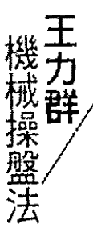

回顧 5 月 26 日到 6 月 6 日之間，我的操作受到預測法的干擾，雖然有留空單，但在情緒跟對外發言上，我自己都不太相信自己的單子是對的。類似這樣的情緒狀況，我想每個真正在做波段的人都會遇到過，但要怎樣克服？

其實很簡單，我剛才講過了，就是盡量不要被短線所干擾。甚至在某些時候，禁止盤中看盤（職業操作者在收盤前 15 分鐘看看就可以）。

以上我做了很多分析，但這些分析大多屬於事後檢討，如果你做得不好（獲利率不高），或者根本做錯虧錢，為了要讓自己知道錯在哪裡（是自己根本就沒拿到正確的方法？還是拿到了方法後卻沒有認真執行？）那麼，你必須具備這樣的能力，包括「追溯歷史」、「邏輯推斷」、「分析思辨」，你才可以找到缺點。但如果你是在實戰的時候，你根本不應該從事這麼多的思考辨證，因為那樣只會讓你愈想愈亂，到最後掉入思考的陷阱，變成預測法的犧牲品。

大家可能還沒聽懂我的意思，我的意思是，實際操作的時候，根本不需要想太多，反正訊號燈亮了，我們動手辦事就對了。至於抱單……抱單？這根本是一種幻覺。因為訊號燈亮了，你就應該有單，訊號燈熄了，你就應該沒單。單子只有「有」跟「無」兩種狀況。在「有單」跟「無單」之間，有人說這裡有一段過程叫做「抱單」。不，如果說到究竟，根本沒有抱單這一段過程。這段「抱單過程」是：

- （1）不熟練的操作者自己幻想出來的。
- （2）是從操作者大腦中紛亂的世俗知識中長出來的。
- （3）是從操作者刻意想去預測，以便事先卡位賺更多的貪欲中生長出來的。
- （4）是從操作者為了怕自己無聊，而刻意去天馬行空亂想用來殺時間用的。

也就是說，你可能根本就應該盯盤、不應該這麼關心行情。你之所以會在意，可能是因為你沒有信心、技巧不熟練，或資金不足（但 99% 以上的人最主要的問題是：根本還沒有拿到正確的技術。所以本文嚴格講起來，是為已經拿到正確的技術，還沒有信心或資金不足的人而寫的）。

##### 執行面

守 11 道規矩！幫自己被追賺到錢

有人說：「不看盤？那我們這些做股票、做期貨的機械派操作者要做什麼？」難道除了股市以外，你的人生就不有一點有意義的事情可以做了嗎？去做點別的事情讓自己分心吧！在家裡的就做家务、在上班的就認真辦公、想看書的就去看書（不要怕迷信，不要因為「書」跟「輸」同音就不看書了）、該靜坐的就靜坐。這些做不下，就去看電視、看電影，或者去旅行吧！不過旅行有個麻煩，就是你每天可能還是要看一下收盤行情，這對有些旅行而言很不方便。

如果有人真的無事可做，或是做不下其他的事呢？那就去睡覺吧。只要方法正確，出場的訊號燈沒有亮，你就什麼動作都不要做，一直留單、一直睡就對了。如果覺都睡不好呢？表示你本來就有心病，如果不是資金不足而引起的失眠，那可就嚴重了。要治療這種失眠，就必須更要徹底投入心理建設的再造教育（很少人會認為自己該受這種教育）。

講來講去，重點就只有一個：一旦開始執行方法，就不要有妄想，減少一切可能幫助妄想擴散的舉動。如果有行動指導的話，執行步驟大概如下：

1. 先減少看盤時間。下午一點多再進去就可以了。收盤時，訊號燈才可能會亮起，此時期貨盤還剩 15 分鐘。股票就比較吃虧，要等盤後交易，但不一定會成交。
2. 禁止盤中利用手機查詢行情（收盤時再查）。
3. 禁止盤中利用 email、簡訊跟別人討論行情。
4. 禁止盤中跟辦公室同事討論行情。
5. 禁止盤中閱覽財經新聞。
6. 禁止盤中閱讀投資週刊或投資日報。
7. 禁止盤中收看任何財經或解盤節目。
8. 嚴格禁止上網觀看任何即時解盤訊息文章！
9. 嚴格禁止上網跟網友討論目前的行情！
10. 偶爾發發牢騷可以，原則上禁止盤中發洩任何情緒性的談話。
11. 禁止盤中臨時更改核心技術的規則，要改的話，等收盤以後再開會討論。

以上 11 項統統都禁止！如果這些是你平常就喜歡做的事，你都要戒掉，否則，除了很短的短線之外，你的中線跟長線操作，都會因為你戒不掉這些毒癮而做不好，或者慘敗。

這裡面最重要的中心思想是：將一切的妄想都熄滅。但在這之前，你必須先了解一下「什麼是妄想」。還好，對於機械法而言，妄想的定義非常簡單，就是「跟你的操作方法沒關係的東西，就是妄想」。

當我在進場時，我的出場訊號就同時產生了，這本是機械法的一種優異功能，你不必像預測法那樣，傷腦筋去構思將來要在什麼狀況下出場。出場訊號既然已經在那兒了，剩下的就是等待，也就是消極地、悠閒地、無所事事地、慵懶地躺在那裡，被動等待出場的訊號燈亮起。

在前段列舉的 2008 年案例中，第一個階段，也就是 5 月 26 日到 6 月 6 日之間，我的操作頻頻受到預測法的干擾，而且是自已以前發明的預測法的干擾。請注意！這些方法也是

# Part 2 穩定獲利的高勝算操盤法

我的發明，以前我用過，2000 年用、2008 年也用，不過，這些預測法只在「點」的位置能夠發揮最佳效用，如果是波段就麻煩了，所以我知道這些零星的、每天出現在盤中或快收盤時蹦出來干擾我的、迷惑我的、引誘我的預測念頭，都「非常可能」是妄想、邪念、雜訊、毒藥。我真的知道這些是有害的，因為這些也是我發明的。即使是我，我都難免受到影響，更何況是一般人。因此受誘惑並不可恥、並不可怕，糟糕的是，你沒有保有這份「覺知」，知道這些念頭都是妖魔鬼怪。不論是你，是我，當我們抱單的初期，一定都曾遇到信心不穩的迷惑，不同的是，可能我比一般人要清楚知道自己可能是在「服毒」，一般人卻完全不知道自己正在被誘惑，還以為眼前的惡魔是天使。

我們每個人都是凡夫肉胎，難免受到世俗塵勞的影響。我還沒有修到聖人的境界，所以 2008 年 5 月 26 日到 6 月 6 日這段時間，我也會動心，那段日子我很難過，因為沒有獲利！在利潤還沒有產生，而出場訊號燈又沒有亮起時，我只有被強迫留在場內。一點辦法都沒有，只有乖乖認命，因為這是我自己訂的方法，重要的是，我以前靠這方法賺錢，而且我驗證過這方法是正確的核心技術，所以我要堅持。

## 2-11 如何熬過抱單的歲月？（下）

> 波段操作，要懂得放下自己的妄想，才能正常地過生活、正常地思考。放下，並不只是一個動作，更是一種方法、一種需要不斷學習才能了解的智慧。

長久以來，很多人一直有個誤解，以為那些所謂的「贏家」在進場之後，一定能克服各種情緒的干擾，然後不花什麼力氣就獲利發財——依我個人的經驗與觀察，這真的是一項嚴重的誤解。

或許贏家們可能真的像他們說的那樣「克服」許多種情緒的衝擊，但那是經過奮鬥而換取來的代價，並不是悠閒地叼著雪茄、懷中抱著美女、悠悠哉哉喝著紅酒就能談笑用兵、輕鬆一筆帶過——確實是有贏家這樣操作，不過請相信我：能做到這種悠閒境界的贏家，絕不是一開始就能做到這樣，一定也曾經歷練過痛苦、掙扎、徬徨，也有過半途而廢、背叛自己的信念。反觀一般人在這種情緒淘汰賽中，不但身心受創，連帶對自己的正確操作法也失去信心，把金鑰匙當成垃圾，打入冷宮。

挫折是難免的、情緒的掙扎、感情的痛苦、財務的壓力、謊言的欺騙、雜訊的瘋狂飛舞……這些都是難免的，每個人都會有，贏家也會有。不同的是，不論在哪種困境當中，贏家總會保持一分清醒的理智，告訴自己不要忘記原有的策略，以及信念。無論環境如何變化、如何欺負你、如何拐騙你，都只能糊塗一時，不能永遠爛醉如泥，卻還以為自己是清醒。

### 在機械法中，直覺屬於一種妄想

在進場初期，你一定要保持這種「覺知」（知道自己正在熱中的可能是一種誘惑、知道自己正在慇勤思索的可能是徒勞的妄想，知道這些挫折可能只是暫時的假象。總之，就是懂得做好心理準備，提防自己可能真的被騙了）。在出場訊號沒有亮起之前，你的覺知難免跟妄想是共存的。不要一開始就想一步登天，也不要一開始就誤以為妄想能一下子就全部幹掉：如果你過分如此完美主義，那麼，你的急躁本身就是一種妄想。

拿上一篇 2008 年的案例來講，2008 年 6 月 10 日大盤跌破 8400 點以後，就不要再看盤了。那種「儲存在心中的覺知」已經發酵了，成為一種「覺照」。在那一天，空單的利潤在憋了很久之後，突然拉開了距離。不論機械法多麼強調直覺的不可靠，當天幾乎所有擅長使用機械法的人都能夠清楚感覺到有個直覺來了，那就是「這裡的盤勢真的很不好，我們早在 5 月 20 日的看法可能是對的、5 月 26 日到 6 月 6 日也極可能是個震盪逃命出貨區」——這是直覺，此刻誕生於機械法的保護之下。問題是，在機械法的無聲運行中，出場訊號遲遲並沒有亮燈。

注意！燈沒有亮，房間裡始終是黑暗的，你如果有任何的想法，都是妄想，甚至包括剛才講的這種直覺在內，都是妄想。有人會問我：「王老師，那些直覺不是正確的嗎？後來不是真的跌下去了嗎？那應該是正確的啊，怎麼會是妄想呢？」不，你錯了，這些念頭、這些直覺仍然都是妄想。因為在那時候，你怎麼知道這個盤將來會跌得很慘呢？你不知道的！既然不知道，那麼，你就不能說那些直覺是正確的（但如果你把你的操作統換成是預測式操作法，那就就可以說你的直覺是被允許的。這是允許或不允許的問題，而不是對錯的問題）。

說它們正確，那是後來的驗證、是馬後炮。在當時，在 6 月 10 日那一天，這些直覺雖然確實發生在我心裡，但是我不能有所執著。如果我心中有了個成見，那麼，這個成見就是我的弱點，敵人將來如果要打擊我，就可以從這個弱點開始下手。如果我看跌，那麼敵方只要出動巴菲特跟羅傑斯兩位大師，發表一篇看漲的預測聲明，我的空頭信心可能就會被動搖。所以你跟我，都不要留下弱點讓敵方抓住我們的小辮子。

面對敵人，你不要有任何招數，記得這句名言嗎？「凡有招者，皆有破綻。」我沒有招，我只是抱著單在黑暗的房間裡等待亮燈而已。黑暗代表一切妄想的止息。當燈亮的時候，我即將起身。現在我坐著，只是因為燈還沒亮，只是因為一切念頭都還沒有升起，並不是說我看空，而是一切的念頭都止息、一切的念頭都沒有升起，當然也就無所分別、無所謂執著、無所謂情緒、無所謂心動的糾葛纏綿。

### 資訊吸收愈多，愈會迷失自我

不要再看盤，這意味著極其簡單的觀念。一般人通常會誤以為高手贏家之所以能夠贏，是因為這些人看懂了一些難盤。錯了，高手贏家之所以能夠贏，是因為能夠在「簡單盤」來臨時把握住機會，至於難盤，這些高手贏家跟普通人一樣，虧損或是賺的很少。大家不要高估了他們，有很多時候，神話與傳說並不存在，而只是在最基本的日常生活方面，這些高手贏家表現得跟一般人不一樣而已。贏家以平常心過生活，一般人以虛妄心過生活。

不看盤，這是個很簡單的動作，但對很多人來講，卻極困難。為何？因為一般人從來不會想到「不做什麼」而獲勝，總誤以為我們「要做一些事」，且「做得愈多，才表示我們愈努力」、「做得愈多，才表示愈有成功的希望」。錯！在很多時候，甚至是向股市這種決戰勝負的關鍵時刻，你的目標是熄滅自己無謂的妄想、減少自己無明的妄動，而不是永無休止地吸收大量的資訊把自己淹沒，使自己迷失在知識的大海上，整理不出一個真正的方向。

對很多金融界的業內人士來說，不要再看盤，根本不可能做得到。如果你是法人的基金操盤手，官做得愈大，行政工作愈多，才可能擁有愈多屬於自己的自由時間。但如果你是營業員，或是被雇用來做短線的操作手，往往被逼得要坐在電腦終端機的報價螢幕前面盯盤。如果你是這樣的處境，我必須告訴你，你正處在一個非常不利於操作的環境當中（這樣的處境想發財，就必須依賴別的管道）。

每天這樣看盤，是不會把利潤看出來的。甚至，這樣緊張的看盤習慣，將會一點一滴滲進你的血液、全面侵入你的日常生活，腐蝕你的思想，使你喪失清明、喪失智慧。你有可能走入了魔道而不自知。這是一條骯髒污穢的道路，你愈走下去，腐化得愈厲害。對於營業員而言，最快速的解除方法就是，雖然在看盤，但是不要自己下海操作，接接客戶的電話就好。自己不要操作，千萬不要操作、萬萬不要。不要「用自己的錢」下海操作，你必須拚命盡一切力量阻止自己炒短線。但是，如果你是被雇用來做短線的職業操作手，那麼，你無法不操作，既然木已成舟，那你更要熟練機械法的觀念，你更要學習控制自己情緒的理論與技巧、你必須更學會降伏自己的妄念與妄動、你必須更學會如何驅除自己的無明愚昧。

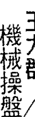

### 學習是王道，放下自己既有的成見

有的人在看到市場上一些人「並不知道以上我講的這些道理，可是也一樣停止了操作」，就誤以為「停止操作」是件「說停就停」的簡單工作，於是就誤以為自己可以不必懂得這麼多心理規則就可以達到，更誤以為「要去了解這些心法，本身就是一種妄念，而且是勞心勞力、損傷腦筋的徒勞之舉」。

面對如此偏差的思維，我必須要指出：對於一個體力旺盛，或是先天環境就占優勢的人而言，他的心病可能很輕微，但對絕大多數人而言都不是處在先天有利的狀況之下，就必須懂得更多的心法、修築更多的心理建設，並用大鐵鏈打掉更多固執的、堅固的、長久的，蓋錯的心理建設。

很多人以為，不必破壞就可以從事新的心理建設，這就好像不想離開廁所，而妄想蹲在馬桶旁邊也可以舒適地享受美食一樣。很多人以為不必懂得心理方法就可以輕易地停止操作（所以他們可以欺騙自己：這是很簡單的事情，只是我不想做而已，並不是我做不到），像是一個過度肥胖的人告訴別人「減肥是一件很簡單的事情（只要不吃就好），只是我目前沒時間去做，也不想做。」

對於一個沒生病的人而言，他看到有人在那邊「很辛苦地研究化學配方來調製藥物」或是「盡全力學習醫療知識」是很多餘、很無謂、很無聊，很可笑、很浪費時間的事情。對於一個已經生病卻自己不知道的人，他的感覺會認為這些研究治療方法的人是「更加」愚蠢。對於一個已經生病卻自己不想承認的人，他會認為這些研究治療方法的人不但愚蠢，而且是瘋子，因為他從來不覺得這點「小病」會對自己造成什麼妨礙，甚至認為這些小病將更鼓舞鬥志，使他更快達到贏家的目標。

恕我直言，有這些想法的人是很悲哀的，而且是極深沉的悲哀。但是，當他們聽到「你必須懂得更多的心法、修築更多的心理建設，並用大鐵鏈打掉更多固執的妄想」時，因為他們平常視心理分析如無物，當聽到他們不曾了解的陌生領域，就會表現出更「睿智」的表情、更「鎮定」的姿勢、更「世故」、更「成熟」的心態來抵抗新的智慧。這種老大心態，跟某些中國皇帝為維持天朝尊嚴而表現出來的傲慢無知，並無兩樣。

**波段操作，要懂得放下自己的妄想，才能正常地過生活、正常地思考。放下，並不只是一個動作，更像是一種方法、一種需要不斷學習才能了解的智慧。** 它可能原來並不存在你的表面認知中，你要去做深度的發掘、你要去覺知、要去覺照，要去學習，而且是不斷地學習，才能持續保持「放下」這種清明的境界，終至不花力氣就能安住此境界為止。

如果我們提倡一種「止息妄念」的觀念，那麼，群衆一定會自動在心裡產生更多的妄念、尋找更多的藉口、製造更多的妄動，來抵抗這種止息。他們會想盡辦法保護自己的妄想，因爲他們把妄想當成了是自己。

### 波段震盪期，設好停損後照樣正常生活

李佛摩說：「利潤不是靠操作賺來的，而是靠屁股坐來的。」不靠操作（減少不必要的情緒及瑣碎的進出），這就是「止息」的觀念，也就是停止一切的妄想與妄動。當這些無明的貪嗔癡都停止以後，我們看起來似乎是在等待。隨便你怎麼稱呼這種狀態，說悠閒也好、懶惰也罷，都不是這種狀態的本來面目。

以 2008 年的案例而言，6 月 10 日以後，在出場訊號燈沒有亮起的黑暗中，市場中的人可能以為我們一直待在那個暗室中萎縮成一團肉泥，啥事也沒幹。其實，沒有人規定你一定要把自己關在股市裡，所謂的「止息妄念」，只是教你恢復原來的正常生活而已。什麼叫正常？該上班的就上班、該做家事的就做家事，啥事都沒有的人就好好讀書，不要浪費光陰。但大多數的人，根本就不知道自己應該過怎樣的正常生活。因為不知道什麼叫做正常，所以把反常當作是正常、把正常當成是異類。

### 處在「震盪期」之中，如何安排自己的生活？

2008 年 5 月 26 日到 6 月 6 日問，盤勢處於震盪，此時如果出現妄想，很正常！不要感到羞愧，也不要感到挫折，因為震盪盤是存心激發起操作者的妄想，在這期間，我也是心生動搖，沒啥稀奇。如果你在這段震盪期之內，有誤砍殺錯的情形，不要緊，不要把它看得太嚴重，此時的整個大環境都是妄想流竄（今天漲、明天跌，搞得大家頭昏眼花）。在這個時候，操作者要看開金錢方面的煩惱，因為此時接近停損點，盤勢黏來黏去，利潤出不來，這樣難免會很悶、很煩，那怎麼辦？根本沒有怎麼辦，只要你的既定策略中，停損點訂的很合理，那麼，就做好心理準備吧。

先想像一下當這筆虧損「實現」的時候，自己的心理會遭遇到什麼樣的衝擊？先把 它想好，以免到時候無法接受。

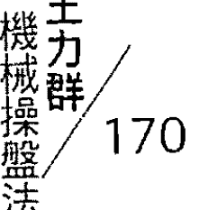

OK！這就是此階段最重要的工作，去「觀想」當停損發生的時候你會變成「什麼樣的人」。現實的狀況是，當停損發生時，很多人立刻陷入混亂，甚至昏迷，或者開始點燃妄想，轉而去尋找不實踐停損的邪惡藉口。很多人都不知道，你愈看盤、看盤看得愈久，就愈難實踐停損，也就是說，看盤看得愈深，就愈難實踐自己的策略。

因此，在「震盪期」中，你要做的正常工作只有兩項：

- （1）訂好停損。
- （2）「觀想」當停損發生的時候，你會變成「什麼樣的人」（很可能是一個喪失理智的人，或者是一個自以為聰明的傻子）。

這兩件工作花費你的時間，可能不到 30 分鐘。換句話說，你不必等到 6 月 10 日才開始不看盤，震盪期開始的時候，就可以保持距離了。

此時，你應該體會到了機械法的核心精神所在，就是止息妄念，減少在盤中無謂的心力損耗。當然，在震盪期間要做到妄想熄滅，很難，所以我才告訴大家，如果無法熄滅妄想，而被妄想包圍之際，不要害怕，也不要因為殺錯了單子而沮喪，重要的是保持那一份覺知，曉得這裡是在修個人，要忍過去。

## 2-12 抱單絕不是紙上談兵

> 操作者絕對不可以憑自己的想像，認為抱單只是小事一件；操作者絕對不可以誤認為抱單只是「我想要抱就抱得住」。

所謂忍過去，並不是完全指你的單子要忍過去，而是指不論遇到任何挫折，你都要忍過去。如果 2008 年 5 月 26 日到 6 月 6 日這段期間喪失了信心，那麼，當 6 月 10 日波段行情展開時，你就會錯過。

（2008 年）6 月 10 日以後，我們都應該有所覺悟，覺悟這個盤的路線已經有點明朗了，也就是這個盤開始變得簡單，而前面的那種震盪盤是一種難盤。當震盪盤出現時，周圍所有的資訊，幾乎都是在煽動操作者急躁的情緒，但是在波段行情出現的時候，周圍的氣氛並沒有對我們說謊，也沒有跟我們耍花槍，所以，波段行情的周圍環境壓力其實很小，但是投資人自己心中的妄念變大！變頑固！所以我們發現，這段期間很多散戶都是持股續抱，完全不顧現實行情。

另一方面，平時勤於操作的人往往在波段下跌之時，頻頻摸底、猜底。這種情況也很正常，但是千萬要記得，你可以提早回補空單，但是不要空中接刀（搶反彈）。在這段時期，我們要過的正常生活，就是放棄妄念、放棄自己不正常的生活。

什麼是不正常的生活？跟網路上的人爭論行情、跟不懂股票的人討論行情、把媒體資訊當作是知識在吸收、妄想空中接刀……這些都是不正常。那麼，什麼是正常？多讀點好書、多做點有意義的事！如果你不知道什麼是好書，也不知道什麼是有意義的事，那麼，你在股市中無法成為贏家的原因，除了技術之外，應該有更大、更嚴重的原因。

我利用兩篇文章，把中長線的機械法抱單的一些基本問題，大致上都講了。以下我分享自己抱單時的學習程序：

- Step 1 拿到「核心技術」。
- Step 2 學習「抱單」（同時學習「停損」跟「停利」）。
- Step 3 學習適應「洗盤」。
- Step 4 學習「分段操作」（因為不只一個進場點）。
- Step 5 學習「加碼」。

如果你是過來人的話，回憶以往種種，可能會認為拿到「核心技術」這一關並不難。但是，對 99% 以上的投資人而言，連核心技術都無緣拿到。

如果有人一輩子都沒有拿到核心技術，那麼，他的「抱單」、「停損」、「停利」、「加碼」……這些操作又是怎麼回事呢？答案是：統統都是亂做。那些抱單不是真正的抱單、停損不是真正的停損、加碼不是真正的加碼。因為在沒有核心技術的前提下，所有似像非像的操作，都是在亂做！

機械法跟預測法有個很不一樣的地方，前者有一套固定規則，你可以把這套規則帶到歷史行情中去跑一下，看看幾年下來到底賺了多少。但如果使用後者的話，由於要關照的技術種類繁多，臨場時不一定用到哪項技術，因此很難模擬出進出點，以至於幾乎無法算出績效，一切都憑自己的預測實力，以及臨場決斷的勇氣而定。這一點，機械法就跟預測法很不一樣。

### 檢視歷史行情的 6 個步驟

怎樣用機械法去跑歷史行情呢？以下，我就以日線為例做說明。

- Step 1 準備好台股的历史資料庫，要有每日收盤行情（券商提供的免費軟體都會有）。
- Step 2 把自己使用的機械法條件列出，至少應有「進場條件」跟「出場條件」兩大部分。
- Step 3 逐日檢視每日收盤價，收盤價（或盤中價，視交易系統不同而定）符合進場條件則進場。假設買進，買進價位為 A。
- Step 4 繼續逐日檢視每日收盤價，收盤價（或盤中價，視交易系統不同而定）符合出場條件則出場。假設前一個動作為買進，現在應為賣出價位 B。
- Step 5 A 減 B 等於 C，再乘以部位的單位之後，C 就是本筆交易的獲利或虧損。
- Step 6 繼續逐日檢視每日收盤價，收盤價（或盤中價，視交易系統不同而定）符合進場條件則進場。也就是重複步驟 3～5，得出多筆交易的盈虧，最後計算總合，驗證績效。

### 親身去體證才是自己的

如果有一個新手，昨天才加入股市，如果他馬上學會了某個機械法，而且馬上帶到歷史資料庫裡面去做驗證，那麼，他會很快知道這個機械法在今年的操作績效是多少，如果是賺，就會覺得這方法可以用，如果是虧，那就要再把驗證的歷史給拉長，三、五年也許還不夠，也許要十年才行。總之，即使是一個剛剛才學會機械法的人，也能夠感受到用這個方法所帶來的獲利喜悅。這就好像剛進門的小師弟，會把師兄、師姐過去的功勞當成是自己的一樣，感覺與有榮焉。其實那些硬仗他根本沒有參與過。

注意！沒有親身參與，就是沒有親身參與；沒做到就是沒做到；沒做過就是沒做過。絕對不能因為自己知道了某個方法（即使是正確的方法也一樣）可以在這裡使用並且獲利，就認為自己已經勝利。我的意思是說，跑過歷史行情之後，你只是證明這個方法可行而已，至於將來你要不要用這個方法、你的能力夠不夠去駕馭這個方法，還是未知數。不可驕傲宣稱自己已經徹底明白這個方法，還沒有親身實踐之前，不要妄下斷言。

有的人已經拿到正確的方法，也拿到紙上去驗證過了，知道這個方法可行，但是在實際操作的時候，他表面上是按照那套方法在做，私底下卻處處找藉口半途開溜，卻堅稱自己「一直都知道這方法正在使用」，而且「假設自己有按照既定的那套方法做」。從表面上來看，當事者既然知道，而且也跟大家一起經歷了這一段獲利過程（其實他老早就落跑了），但實際上他是在自欺欺人。重要的原因是，知道並不等於做到。這是個古老的道理，一般人卻一再找各種理由違背它。

如果沒有親身經歷過，那麼，你對於「抱單」這個動作的認識，就幾乎等於 0。

是的，我知道有人會說：「知道正確的方法（但沒去做，或只做到一點點），總比外面那些還沒摸到正確方法的人好吧！」

當然，話是沒錯，但是各位知道這種因循敷衍的思想耽誤了多少人嗎？……在學習進入某個階段以後，沒做到就是沒做到，不可以再繼續姑息養奸，應該趕快檢討，找出「為什麼沒做好（到）」的根本原因，然後加以刪除！

好，也許有人想知道：從「知道正確方法」到「能夠依照正確方法抱得住單子」，這段訓練過程要花多少的時間？答案是：有的人是放下屠刀立地成佛，有的人則是花費數年的光陰都無法克服！

### 抱得住單子與抱不住單子的差異

在技術上，「抱得住單子」的人跟「抱不住單子」的人，可能沒有太大差別（說不定抱不住單子的人技術還比較好），但是這兩種人在「心智」方面的訓練，將呈現兩極化的發展！為什麼？因為（依照正確方法）抱單的過程，是一種極為珍貴的訓練！

依照正確方法抱單子的人，這一路上會體驗到很多東西，然後從這段過程中，培養出耐心、毅力、果斷力（決策力）、克制力等等，最後再總結為智慧。也就是說，這是一步一腳印的功夫，如果只是在「思想」上「假設」自己有這張單，那你得到的智慧將會大大減少，甚至被抵銷成負。

我再講一遍，依照正確方法抱得住單子的人，將會得到以下幾種好處：

1. 耐心

從耐心中，他必須去面對（發現）新的問題：「如何在忍耐中保持智慧的靈活？」「如何在忍耐中保持自我的高貴尊嚴？」「如何在忍耐中保持氣勢？」

2. 毅力

在抱單的過程中，有時候並不是天天都處在獲利狀態，所以，有時候要學習與虧損相處。

3. 恆心

在抱單的過程中，要對照是否符合規則條件，所以要嚴格遵守紀律。有的人只是遵守進場紀律而不尊重出場紀律，其代價是獲利大幅減少。

4. 果斷力

在抱單的過程中，除了依照法則做出留倉的決策以外，還要練習「在留倉的壓力之下保持清楚的果斷力」。

5. 克制力

如果出場訊號燈沒有亮，就必須克制自己的妄想跟蠢動，這是很高明的功夫。

從克制中，我們必須去面對新的問題：「怎樣去正常處理自己被壓抑的負面情緒？」進而發現新的問題：「我應該怎樣去戰勝自己被壓抑的潛意識負面因子？」一旦牽扯到潛意識，不得了，就很浩大了。如果能夠由此進入自己的潛意識領域，肯虛心發掘自己的潛意識問題，就有資格成為偉大的操盤手。

如果「沒有依照正確方法抱得住單子」的人，會有幾個危險：

浮躁、沒紀律、抗壓性低、思想鬆散……最重要的是：當事人會不知道一件很重要的事，就是「每次抱單的過程中，遭遇的氣氛都不一樣！」如果你沒抱過，就不知道每一種抱單的過程都會培養（領悟）出很多新的道理！

抱單，只是一個動作；在不同的盤勢變化中，抱單的動作能夠讓你體悟到很多別人意想不到的東西！

### 學習抱單的十個訓練過程

在一般人的想像裡，抱單就是抱單，好像天底下只有一種抱單——這種想法是不對的，因為：

- 在不同的波段抱單，那張單子所遭遇到的考驗就不一樣。
- 在不同的年代（時間）抱單，那張單子所遭遇到的考驗就不一樣。
- 操作者在不同的年齡抱單，那張單子所遭遇到的考驗就不一樣。
- 操作者在不同的健康狀態抱單，那張單子所遭遇到的考驗就不一樣。
- 在不同的新聞事件衝擊之下，那張單子所遭遇到的考驗就不一樣。
- 操作者在不同的心智狀態抱單，那張單子所遭遇到的考驗就不一樣。
- 操作者在不同的精神狀態抱單，那張單子所遭遇到的考驗就不一樣。

操作者絕對不可以憑自己的想像，認為抱單只是小事一件；操作者絕對不可以誤認為抱單只是「我想要抱就抱得住」。

真正抱過單的人（在正確的方法之下）都知道，每次抱單的心理狀態都是一種不同的考驗，也就是說，每次都不一樣。既然每次或多或少都有不同，那麼，一個抱單經驗豐富的人（前提是要在正確的方法之下），除了「因為波段單抱得對又抱得住，所以得到比較豐厚的獲利」之外，他還得到了「豐富的心智整合經驗」，以及「觸發更豐富更靈活的技術分析技巧的靈感」，於是，他的心理建設不但加強了，而且心理建設的種類也更加完善。這些歷練，並不是紙上談兵的操作者可以領悟得到。

讓我們給「抱單」這個動作（或訓練）一個比較正確的定位。學習流程如下：

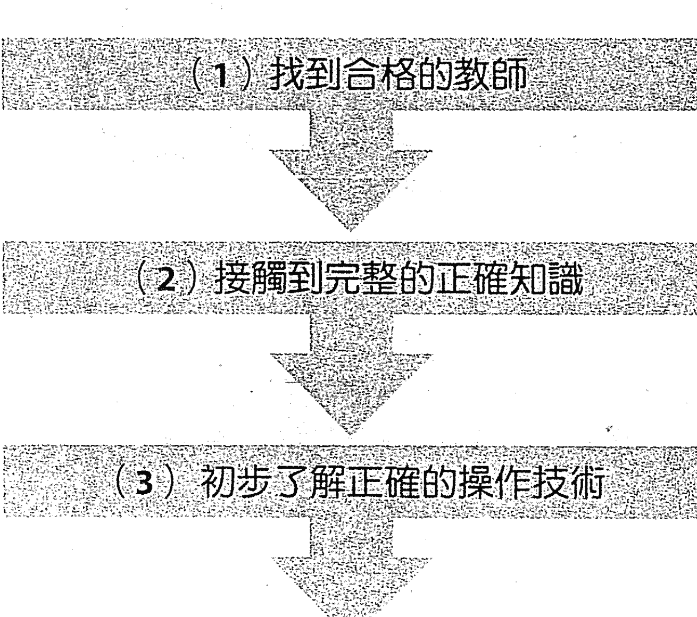

（4）將此方法（最好是機械法）帶到歷史資料庫去驗證（至少十年），以證明其可用性

如果是新手，此階段的訓練，教師須在身旁監督指導，因為初學者一定會出錯。要注意的是，此時只是「模擬」的歷史行情操作，很多學習者並沒有來得及參與那些過去的往事，所以，此時的「抱單」（歷史行情的逐日實戰）還只能算是紙上談兵！不過，比起其他還沒有拿到正確方法的人比起來，這個模擬的歷史行情操作已經夠珍貴！夠厲害的了！

（5）通過模擬的歷史行情操作（逐日實戰），建立起初步的信心，然後投入實際的操作

（6）實戰開始（現在與未來行情的逐日實戰）！等待正確的進場訊號

（7）看到進場訊號燈號亮起，進場開始做單。如果此燈號的對應政策是抱波段單，那就開始正式抱單

這裡有一個問題：「進場時到底需不需要教師的督導？」如果是很純粹的機械法，並不須要教師的指示，自己就能自行決定。「以法為師」，而不是以人為師。

（8）抱單持續中……同時接受考驗。抱的好的話，將從此抱單過程中得到實戰經驗與更多的、完整的智慧

（9）觸到停損或停利點，就出場

（10）檢討操作績效，有缺失就要補強

這裡有一個問題：「檢討時到底需不需要教師的督導？」比較通俗的答案是：如果教師不在場，學生自我磨練的路子就會比較漫長（我本人目前是固定周六上午召開操作檢討會議，檢討我的團隊的當週操盤動作的缺失與改進）。

## 2-13 遇到騙線跟洗盤，不要被洗昏頭

> 很多人對市場懷著不切實際的美夢，認為賺錢的過程應該是很平坦，不該有洗盤這種事情。這真是幻想，提早捨棄為妙，否則大勢就不妙。

盤操得愈久，我有一個感想愈強烈：以後不管是投資還是投機，專業操盤手要懂的東西，都會比以前要多，除非他不打算繼續提升自己的績效。

在贏家圈中，有少數傳統的投資法跟投機術，雖然經歷過很多大風大浪的考驗證明依然有效，但是一般人學起來，反而愈來愈困難，追究其原因，在於：

- 群衆的觀念原本就已經污染過深，霸占了太多空間，導致正確的知識反而進不去。
- 因為受到功利社會的影響，群衆的價值觀改變，對於金錢的估量，有一樣的打算；而這種新的獲利計算方法，對於正確知識的運行，非常不利。
- 因為生活壓力逐漸擴大，群衆對於操作法的要求也會變得不一樣。他們可能會更要求學短線，卻又沒有時間學習短線的複雜技巧。這是一個矛盾。

有些傳統的正確方法，過去都用了很久，但是股市裡的窮人卻愈來愈多。當資金少的人，想要用那些傳統方法的時候，就會發現有點問題。除了大資金操作法跟小資金操作法的差別之外，關鍵處就在於，小資金者的心態比大資金者更無法忍受震盪洗盤及騙線。

我不是說，大資金者就可以忍受震盪洗盤以及騙線，很多大戶一樣沒辦法忍受洗盤。但問題是，小戶的錢少、口袋淺，來回洗個幾次，至少的心情上就會傷得很重。

### 認清技術分析的陷阱：洗盤、震盪、騙線

大體上而言，對預測法而言，感受到「騙線」的壓力比機械派要來得小一些。因為預測派的精神是「自由」，碰到盤勢震盪的時候，他有那個自由去更改他原來的預測，所以他不必憋著，可以放手去做些事情（如果他想要做的話）。但是機械派的人就沒有這麼好命了，他們在碰到洗盤的時候，往往因為「退場訊號」遲遲不出來，而必須忍耐盤勢的震盪煎熬，沒有放手一搏的自由。因為機械法的核心精神之一就是「自我克制」。

在設計機械式的波段操作法時，對於「洗盤」、「震盪」、「騙線」，需有以下幾點認識：

1. 愈是短線，被洗、被騙的機率愈高；愈是長線，被洗被騙的機率愈低。
2. 長線的被騙機率較低，但只是「比較低」而已，並不是沒有。假如你是設一個關卡突破以後再買進，則「凡有招考，皆有破綻」、「凡有關卡者，皆可以搗假突破（騙線）」。了解這一點以後，就要在心理上學習去接受。不能接受者，將來可能會有些麻煩（小麻煩或大災難）。
3. 很多資淺的大戶，以及某些預測派的高手，他們因為倉位太大，怕洗過來洗過去造成進出頻繁很麻煩，所以基本上他們是不設停損的，這種投資風格極其危險！我看過有些大戶因此而發財，但是有更多的大戶及追隨者因為不停損而大敗。
4. 操作者的首要訓練目標，是訓練自己被洗以後還能夠保持神志清楚，而不是一味地去「逃避騙線」。
5. 處理騙線的最好的方法之一，就是資金分批進場。在第一次突破的時候不要全部進場，如此則萬一發生騙線的時候則可以把損失減到最輕。
6. 要預防騙線，就要用到預測法，所以，必須把預測法練到一個很高的境界，才能夠避免掉部份的騙線（完全避免是不可能的）。因為要到高層境界需要很久的時間琢磨，而且不易維持在顛峰狀態，贏家一般都會加強自己「被洗被騙以後的快速反應能力」與「被騙以後的補救措施」，而不是單純地去想逃避騙線。
7. 股市裡的大輸家普遍的一個特徵就是：他們不能接受騙線。所以他們會去尋找完美的技術去，使自己「不被騙」或是乾脆不停損——這些都很容易成為輸家的思想。
8. 容我再強調一次，「尋找完美的技術去使自己不被騙線所騙」也許不是錯誤的想法，卻很容易讓你變成輸家。訪問幾乎所有的教育課程都搞錯目標。教育訓練的首要目標是：「被洗被騙以後還能夠保持理智清醒」，其次是「被洗被騙的『當下』還能夠保持理智清醒」，然後是「被洗被騙之前就能事先做好防範措施（資金風險管理）」，然後是「被洗被騙『之前』就能夠預料到此处可能会有陷阱」。最後才是「被騙之前，就知道這裡會被騙而全身而退」（這種預測是一種超級困難的技術）。

坊間的課程幾乎都倒過來，把「被騙之前，就知道這裡會被騙而逃掉」放在首位，這可能不是錯得太厲害的操作，卻是錯誤很厲害的教育。

結論只有一個，教育的訓練目標是：「保持理智清楚」，這是屬於人格的磨鍊。其次才是技術。

### 逃避，並不能解決問題

整個盤勢的進行，就是在「排斥異己」。所謂異己，就是輸家（跟贏家不同類的人）。換句話說，在展開波段上漲或下跌的時候，如果太多輸家做對了單子，則盤勢就要進行「震盪、洗盤、騙線」。這樣做的目的，是把那些不夠資格贏錢的人都洗出去（俗稱甩轎）。

所以，洗盤跟騙線的出現，就是要讓群眾被洗得頭昏眼花、喪失方向感，然後對自己的單子失去信心。既然敵人的目標就是把我們搞到頭昏，那麼，我們的訓練目標就是使我們的理智堅定，不能受到情緒的干擾。如果這個心理境界不能達成或不被了解，就算知道再多的技術都沒用，因為你會把技術給忘掉。

太多太多的人，把焦點放在學習「逃掉騙線」的技術，這是不對的。如果你不能夠保持理智清醒，那麼，學再多厲害的逃跑法都沒有用，因為你會「忘掉要逃開」，或是已經昏迷，呆在原地不動，或是胡亂做些莫名其妙的動作。

萬法皆心，如果心性不堅定，大腦必然發昏；這一昏，就好像被人下了迷藥，祖宗十八代忘個精光，什麼絕世武功都沒用，就全完了。

### 碰到洗盤的因應措施

面對洗盤，不是怎麼辦不怎麼辦的問題，也不是想「如何熬得過洗盤」的問題，如果你怕煩，想要找出個方法不被洗掉，這個念頭跟精神當然是對的，但是當你鑽研出新的方法避免被洗掉以後，市場又會發明新的洗盤方法來對付你。只要你想逃，它就追著你打；只要你想破解洗盤的招數，市場也就跟著你更換新的洗盤招式。

想征服股市，真正值得加強功力的，並不是逃避洗盤（虧損），而是培養被洗掉之後，鼓起重新進場的勇氣。

- 操作者愈是害怕洗盤，面對盤勢震盪愈是驚惶失措；
- 操作者愈是害怕虧損，就愈容易在輸錢的時候灰心喪志，乃至於一蹶不振；
- 操作者愈是害怕洗盤，意志就愈來愈鬆散；
- 操作者愈是害怕洗盤，心理建設就愈來愈差；
- 操作者愈是害怕洗盤，就反而被洗得更厲害、更悽慘。

### 震盪洗盤後的心理調適

我個人認為，洗盤基本上分兩種，第一種是洗外行人，第二種是洗內行人。

有些投資人（占絕大多數），沒接觸過技術分析，也沒學過基本分析，操作起來亂無章法，盤勢只要震盪一下，就把他們洗掉了。這些人，是外行人。被洗掉，很正常，只好認命。

有些投資人，不論有沒有把技術分析學好，不管有沒有拿到正確技術，只要懂一丁點兒技術，都可能被市場「陰謀」給洗掉。這些人（包括我在內）因為自己有一套操作方法做為進出的依據，於是，市場就根據我們用的這一套法規來「鑽我們的法律漏洞」，讓我們上當、把我們趕走，這就是所謂的洗盤了。

除非你已經成佛，要不然，很難逃得过洗盤。

（以上我所謂的洗盤都是指正規的洗盤，有些震盪在我們眼中，不能算是洗盤，而且是可以被正確方法過濾掉的，這些雜碎的震盪就不在我的討論範圍之內。這裡講的洗盤是指，操作者已經拿到正確的技術跟觀念後，仍然無可避免地會碰到一些洗盤的現象，也就是說，是站在正確方法的角度所觀察到的洗盤，並非所有的震盪都叫洗盤。這一點，各位要先搞清楚。）

既然逃不掉，乾脆就勇敢面對。就算是很大勇敢，但也不能每次都強行激勵自己的勇氣（那樣會彈性疲乏），害怕是難免的，我也會害怕。其實，「恐懼」本身並不可怕，可怕的是你的恐懼「有增無減」。因此，我們的目標是：減少恐懼，以便讓自己的正常理智能夠繼續保持活動，如何做？

1. 被洗掉就被洗掉，不要讓懊悔的情緒占據你全部的心靈。
2. 堅強點，承受住這一波的虧損。不要過分心疼金錢的損失。
3. 理智要趕快恢復，仔細檢查技術型態圖，看有沒有第二次洗盤的可能，做好計畫。
4. 進場訊號再度亮燈，於是再度進場。此時要做好心理準備，萬一又被洗，自己要知道該怎麼應付。
5. 第二次萬一又被洗掉，就重複第三個跟第四個動作，這叫紀律。當然，有些人被洗兩次以後就怕到了、累到了，想休息，那也無妨，就休息吧！這樣也好，但是要做好心理準備，因為如果現在要休息，將來當真正的進場訊號發生時，可能會因為過度謹慎而延遲進場，導致少賺。遇到這種狀況就要認命，當初是你自己決定要中斷紀律，所以不能怪別人，也不要怪自己，要看開一點，不要太執著。

很多人為了「改善」洗盤，採取以下的動作：

- （1）改變參數。
- （2）縮短留倉的時間。
- （3）放棄原來的路線，然後改做短線。
- （4）放棄原來的路線，然後改做短線，但卻刻意增加交易次數，變成頻繁交易。
- （5）更改原來的法則，但是卻忽略了機率問題，以致於將來碰到相似狀況還是會出問題。
- （6）更改原來的法則，但是由於本來用的這個方法不是自己發明的，了解不夠深，以致於根本就改錯了。
- （7）更改原來的法則，使系統的篩選條件變得更嚴苛，但也減少了進場機會，然而自己卻又無法接受交易機會銳減的事實。

這七項有時候很難嚴格劃分，因為有些人只會認為他在修改參數，卻不曉得他在做破壞性的負面動作。這裡面很多動作，並不是操作者自己認為怎樣就怎樣，而是要看操作者的智慧。如果智慧不夠，就很難察覺自己的動作，其實是朝向錯誤的道路上走去。所以，到最後大部分的改革可能都只是「躲得了一時，逃不過永遠」，這次閃過去了，下次再換個環境，就又被套著了。你變，市場就跟著你變；你有 72 變，市場就有 108 變……跟市場鬥智，往往到最後都遺憾收場。

這不是「變法」的動機有問題，而是「力有未逮」。

### 浮躁心態只會亂了你的陣腳

現在大家知道了，想要改善洗盤現象，勢必要更改操作規則。這個出發點是好意，但更改規則的難度等同於「發明方法」，這是個很艱難的工程，也是為什麼這麼多人「變法失敗」的主要原因（就是實力不夠）。因此，當我們努力改革過一陣子以後，不管效果如何，我們都要知道「其實從頭到尾，我們都不應該忘記一個事實：被洗掉是難免的，我們真正應該加倍關心的，不是不被洗，而是被洗的時候看得開、洗了以後依然神智清楚。」

掉到洗衣機裡是難免的，但是我們必須接受嚴格的訓練，訓練自己在天旋地轉、七暈八倒之後，能夠儘快從昏迷中復原，趕快恢復清醒的理智。講到這裡，我們做個初步的結論：

- 結論1 絕大多數（超過九成七以上）的操作者，因為還沒有拿到完整的正確方法，還在走馬看花的階段，所以洗不洗盤，對他們而言沒有太大的差別（這些人並不在本文的討論範圍之內）。
- 結論2 即使是正確的操作，市場也會依據正確的法則來進行洗盤。這是一個邏輯問題：市場是根據「正確的法則」來洗盤的，也就是說，先要有法律，我們才知道什麼叫做違法。

如果沒有正確的法則，市場的波動就不能叫做洗盤（至少對你而言就不叫洗盤），而是無聊的震盪而已。

每個操作者要專注於他自己的那一塊領域。如果不是屬於自己的管轄範圍，就不要過分去關心。例如長線操作者，就不需去關心盤中當沖者所製造出來的震盪。所以有些震盪，可能是極短線操作者的洗盤，對於長線操作者而言，這並不干他的事。

- 結論3 很少人會接觸到完整的正確的操作方法（比例人數低於 3%，甚至更少）。但是這些人當中，依據我個人經驗，會有將近三分之一左右的人無法接受正確方法（不接受的理由很多，很可能跟他們想得不一樣；當事人可能完全無法想像自己為什麼會抗拒正確方法），而在入門不久之後就退出。另外剩下三分之二的人，其中又有一半的人，會因為無法接受洗盤而中途退出，以至於變成半途而廢。

換句話說（以下只是說個大概情形，方便大家了解），1000 個投資人中，只有 30 個人可能會拿到正確方法（甚至會少於 30，有時只有個位數），而這 30 人中，大約會有 10 個人因為無法接受正確方法，在入門不久之後就退出。另外剩下的 20 個人，其中又有 10 幾個人會因無法接受洗盤而半途而廢。到最後，大概只剩下七、八個人繼續學習、繼續操作。

# Part 2

# 穩定獲利的高勝算操作盤法

- 結論4 不論是不是因為洗盤，更改法則都是一件大事。我希望這件大事，能夠透過一群志同道合的夥伴，用集體討論的方式得到最好的效果。畢竟改動一個地方，就要重新再驗證一遍（要帶到歷史資料庫去跑個很多年），這是大工程，要慎重，否則很容易掉入隨機的陷阱。

市場操作就好像在騎摩托車，出個車禍是無法避免的（哪個經常騎摩托車的人沒出過小車禍？沒摔過車？）既然無法避免，我們就要講究車體的堅固性，自己也要穿戴好安全防護設備，至少要帶個安全帽。這個安全設備，三分之一指的是我們的風險控管，三分之二指的是我們的心態要堅強。要忍受得住被洗掉後的挫折感，不要灰心！

很多人對市場懷著不切實際的美夢，認為賺錢的過程應該是很平坦，不該有洗盤這種事情。這真是幻想，提早捨棄為妙，否則大勢就不妙。

此外，洗盤跟操作績效表有直接的關係，也跟機率有關。思考研究時，這些都要放在一起考慮，才能夠守住大局。

# 盤中期指下單的機械法

> 當我的操作計畫已擬定好每隔多少點分批加碼後，就不再受任何其他訊息的干擾，排除掉所有的情緒困擾，而義無反顧地直接去進行我的計畫。

接下來講期指。期指下單分兩種模式：盯盤與不盯盤（上班族的同學很多人都無法盯盤）。

使用本文的前提：

- 已經拿到正確的技術方法。
- 心態正確（心法已經了解）。
- 經過逐日模擬實戰的訓練。

然後，才可以實際進入下單程序。

### 把自己變成機器人

先講「可以盯盤」的同學，能夠使用的機械式操作法。

下午 1 點半，盯盤的同學看到現貨收盤突破關卡，於是在 1 點半～1 點 40 分買進期貨單，也是一個單位。

假設某年的 12 月 1 日的現貨收盤是 8001 點，突破當天的關卡 8000 點，則 12 月 1 日下午 1 點半以後，就掛單買進指數期貨或股票（本文以期指新手為例）。此時期指不一定是 8001 點，可能是 8020 點，不一定要用市價去掛，你可以高五檔以上買進（市價是用漲停板買進），也就是 1 點半看到期指是 8020 點，掛 8025 點買進一個單位。假設 8025 點成交買到。

買到以後，假設我原先計畫每隔 100 點、150 點、200 點，分批進場，每次買一個單位，將來合計共買四個單位。換句話說（假設）：

- （1）12 月 1 日收盤我們買到期指 8025 點一個單位。
- （2）12 月 2 日 8 點 45 分期貨開盤前，我們再用智慧單（智慧單是一種下單的制度，詳情請問你的營業員，不是每家券商都有這個制度）掛單期指 8025 點＋100 點＝ 8125 點，買一個單位（買下一個月份，也就是一月的期指契約會比較好，但也要看成交量，別搞到萬一只留倉三天就停損的話，怕量太少出不掉）。當期指漲到 8125 點以上（等於或大於 8125 點）的時候，我們以市價買進。本來這個智慧單也不一定要掛市價，而是可以掛限價 8125＋5＝8130 買進；但是怕萬一跳空開高在 8150（或更高），那就買不到 8130 了，所以用觸價市價買單。

假設12月2日開高在8190點（8190點＞8125點），我們可能用市價買在8196。於是，

- 1日單，12月1日成交，期指8025點一單位。
- 2日單，12月2日成交，期指8196點一單位。

- （3）第三天，12月3日8：45期貨開盤前，我們再用智慧單掛買期指 $8196+150$ 點 $=8346$，一小口。

也就是說，當期指漲到8346點以上（$\geq 8346$點）的時候，我們以市價買進。這個智慧單不一定要掛市價，可以掛限價$8346$點$+4$點$=8350$點買進（怕加四點買不到的話，就再多加幾點）；但是怕萬一跳空開高買不到，所以用觸價市價買單。

假設12月3日沒有跳空，開盤之後慢慢往上漲，我們可能用市價買在8349點。於是，

- 1日單，12月1日成交，期指8025點一單位。
- 2日單，12月2日成交，期指8196點一單位。
- 3日單，12月3日成交，期指8349點一單位。

- （4）第四天：12月4日8：45期貨開盤前我們再用智慧單掛買期指 $8349+200$ 點 $=8549$ 點，一單位。

也就是說，當期指漲到8549點以上（等於或大於8549點）的時候，我們市價買進。這個智慧單不一定要掛市價，可以掛限價 8549 點 + 4 點 = 8553 點買進（怕加四點買不到的話就再多加幾點）；但是怕萬一跳空開高買不到，所以用觸價市價買單。

假設 12 月 4 日沒有跳空，開盤之後慢慢往上漲，則我們可能用市價買在 8550。於是，

- 1 日單，12 月 1 日成交，期指 8025 點一單位。
- 2 日單，12 月 2 日成交，期指 8196 點一單位。
- 3 日單，12 月 3 日成交，期指 8349 點一單位。
- 4 日單，12 月 4 日成交，期指 8550 點一單位。

四批總共四單位（四個 unit），成本價：(8025 點 + 8196 點 + 8349 點 + 8550 點) ÷ 4u = 8280 點／u（身分是期指新手）

大家要注意事項的重點：“當我的操作計畫已經擬定好每隔多少點分批加碼後，就不再受任何其他訊息（包括報章媒體新聞種種關於盤勢的分析與預測）的干擾，排除掉所有的情緒困擾，而義無反顧地直接去進行我的計畫。”所以，當各位在看到有點感到枯燥無味，好像機器人在做動作一樣，這就是機械法的真正的核心精神之一。

### 盤中下單最好是用智慧單

如果不是做當沖，盤中下單最好是用智慧單去下單，儘量減少看盤所耗費的精力與時間。

在某些時候，盤勢會有特殊的極端變化，此時最好看著盤做。但這種極端狀況，並不會占據太多時間，此外，犯不著去盯盤。我建議做波段的同學，儘量不要在短線上跟這個盤周旋。

有了電腦網路之後，智慧單的研究，就愈來愈成為我們下單的重點。如果不用智慧單，而是一直緊盯盤面想要抓住很多賺錢的機會，就很容易陷入魔障的泥淖。

如果現在期指是 8000 點，預訂要買進期指的 8100 點、8250 點、8450 點（每隔 100 點、150 點、200 點買進一單位），而不想用智慧單，那就要盯盤。

看到 8100 點，再丟買單。問題是，看到 8100 之前，或是看到 8100 的當下，很容易臨時改變心意，不想買了，或是臨時更改買進的契約口數。

這個心魔很大，而且愈有小聰明的人，愈容易墮入邪道。

OK ！心法暫且不提。回歸主題。

看到 8100 點，再丟買單 —— 如果直接跳空開高在 8200 點，則已經越過預訂買進目標，於是，在 8200 點之處買進一個單位。假設 8201 點買到成交。

此時，我們當日不再下買單，一天最多只買進一個單位。

如果 8201 點成交以後，價格跌回 8100 點，則不買。換句話說，成交價是逐漸墊高，不可以回頭撿便宜貨，因為那樣是在跌勢中買進，違反大原則。

接下來，第二天開盤，盯盤，準備第二張買單，買價是：8201 點＋150 點＝8351 點。

以上這種盯盤的下單法必須很有定力，否則到時候價位到了，卻可能會不敢買。

我建議下單的工作盡量交給助理去處理，盡量不要自己下，以免被一些繁瑣的下單程序搞得不高興，影響情緒。

讓我再一次強調重點：「當我的操作計畫已經擬定好每隔多少點分批加碼以後，我就不再受任何其他的訊息（包括報章媒體新聞種種關於盤勢的分析與預測）的干擾，排除掉所有的情緒困擾，而義無反顧地直接去進行我的計畫」。

所以，當新手在執行機械法的時候會覺得很疑惑：難道我們盯盤只是在看價位嗎？其他的盤中資訊就不看嗎？是的，除了價格以外，其他的都可以不要看。這是機械法的**真正的核心精神之一**。

要練到這樣「一堆資訊擺在眼前視若無睹」的境界並不簡單。儘管境界的難度高，但是在理論上機械派的使用者，必須知道這個知識。

很多時候，成功並不是你「做了些什麼」，而是你「**哪些沒有做**」。

## 2-15 機械法停損點的歷年實戰績效驗證

> 我們操盤使用的系統，不但要有科學的理論，而且還要有實驗的證據，也就是數字績效。

趙非短線的波段操作，李佛摩說：「我們的虧損不能夠超過本金的 20%。」

20% ？……歐，麥尬得 —— 會不會太多了？假如資金 100 萬，好不容易等到一次波段機會，卻落得虧損 20 萬離場，那不是很難堪嗎？

我想，李佛摩說的 20% 是做股票，不是做期指。贏家制定出來的法則，跟一般人的認知有很大的一段距離。

### 停損多少不重要，有歷史驗證過才可靠

通常，在非短線的台期指交易中，職業交易者制定停損區間是在 2 ~ 3% 的停損，頗符合一般人做波段的時侯的停損要求。但這其實有點悲哀，好像我們這些做期指的波段交易者，只肯付少少的代價，就想拿到整個波段的豐厚利潤。

其實，如果只能夠承受 3% 的虧損，有些地方看起來好像做得很短，但若是依照機械系統操作，就沒關係。只要你當初在設計系統時，已經把 3% 這個數字考慮進去，並用歷史交易紀錄證明這樣也能獲利，就可以了。重點是，「用歷史交易紀錄證明 3% 的停損界限，也能夠在台期指的波段獲利。」這是一種科學，也是機械操作法的基本精神。

停損點的設立，要看操作系統當初是怎樣設計的。每個人的系統都不一樣，我在這傳達的訊息是，我們是用 3% 當做停損界限，而且這麼多年下來用得還 OK。

這裡的 3% 的意思是：當虧損的金額達到本金的 3% 的時候，執行停損。

接下來我們需要重新思考，用 3% 當做非短線的期指停損界限，這個 3% 到底是大還是小？

- 第一、波段操作的停利停損點的間隔設計，一定比較大（中線虧損的容忍度較高，不可以賠一點點就急著想跑）。換句話說，能夠賺的時候會賺的多、但是虧的時候也較多（股票跟期指都一樣）。
- 第二、短線操作的停利停損點的間隔設計，一定比較小（短線虧損的容忍度較低，賠一點點就要考慮落跑）。換句話說，賺的有限、但虧的也不會太多（股票跟期指都一樣）。

回頭去看短線的期指交易，發現華爾街那些短線跟極短線（當沖）交易者的建議是：停損大概是設在 1% ～ 2%（意思是說作當沖的人大概賠了 1% 就要停損了）。

兩相比較，期指族的波段操作用 3%，短線用 1% ～ 2%，應該是合理的。

那麼，股票族的停損呢？

股票族的停損標準有兩個，一個是個股，另一個是全體股票。以我使用的強勢股操作法而言（強勢股也是屬於順勢操作的機械派），如果一次買進十支個股，則單一個股我可以忍受 50% 的損失，十支加在一起我的停損大概是設 10%。

本章要告訴大家：每一種機械法的停損標準不一樣，<u>重要的是你使用的方法是什麼</u>，而不是那個停損的百分比數字。<u>然後，更重要的是：你到底用這樣的停損標準操作了多少年？績效如何？有沒有經歷過黑天鵝意外事件的考驗？也就是說，要有科學的證據，才行</u>。

如果你的機械系統是使用 80% 的停損標準，連續 14 年的實戰平均績效都高於 10%，而且經歷過極端意外事件的考驗而平安度過，那麼，沒人敢講你這個 80% 的停損標準訂的太大。

因此，我們操盤使用的系統，不但要有科學的理論，而且<u>還要有實驗的證據，也就是數字績效</u>。

一個機械派的股市新手如果沒有師承，而是完全自己自修，那麼，他最好花 14 年的實戰去證明他的系統是對的（意思是說：觀察期要很久）。如果想略過這一段考驗期，也可以用歷史資料的測試法，紙上談兵一番，這樣理論上來講也是可以的（預測法就無法紙上談兵）。

不過，這樣的歷史資料測試，雖然可以省去實戰的經驗要求，但卻省略掉了心理分析。以致於很多操作者完全不知道這樣的操作系統，在實際運作的時候會遭遇什麼樣的心理障礙。而對於一個沒有實戰經驗的新手而言，這些心理障礙都很難熬，尤其是在你獨自學習而沒有朋友的時候。

## 2-16 平均線的「優化」功力必須培養

> 剛開始調整的時候，還會覺得很趣味，做久了之後就會感到有點疲倦，所以調整參數這個動作千萬不能夠太頻繫。

學習技術分析，要學兩個東西，一種是「方法」，另一種是「發明（或發現）知識的方法」。

以平均線系統為例，照道理講，均線的參數要定期檢討，或是波段開始一段時間以後就要檢討。這個調整參數的能力，是很重要的。

一般人只會問我們參數設多少？而不會去關心我們的參數是如何設定的？而另外有些人很想知道參數的設定方法，卻是想製造自己的參數，然而，他可能還不熟悉基本參數的用法，這兩種態度都有偏廢。

參數的學習步驟是：

- **Step 1** 先知道以前的贏家的參數是多少。
- **Step 2** 把參數帶入歷史行情做驗證。
- **Step 3** 了解此套參數的利弊得失、機率分布，以及應有的心理調適。
- **Step 4** 學習調整參數的知識。
- **Step 5** 練習調整參數的方法，包括均線的「優化（最佳化）」過程。
- **Step 6** 適度地提醒自己何時應該彈性調整參數。

### 優化系統參數的方法

以均線為例，參數「優化」的基本知識如下：

- （1）每個金融市場的參數不一樣。
- （2）每個波段，尤其是上升波段的參數，可能需要適度調整，但不能搞的差異過大。
- （3）每隔數年，參數可能會有一次比較具有規模的變動，但不會跟之前的差太遠。
- （4）每支股票，參數都不太一樣。換句話說，如果你同時操作五支股票，可能會碰到三至五套不同的參數。
- （5）每支股票，在不同的年代（時間週期），參數會不太一樣。

以均線為例，參數「優化」的一些知識，在約翰．墨菲（John J. Murphy）的《金融市場技術分析》這本經典裡是這樣寫的，我把它挑選出來，重申如下，忘掉的同學可以再複習：

- （1）在移動平均線方法中，最好的辦法可能是，根據市場的具體情況，通過優化過程，選出它的雙簡單移動平均線的最佳組合。
- （2）所謂優化，貫穿著上述研究的始終。每條移動平均線（或者每種技術指標）都應當、也能夠針對具體市場的個性、特點進行優化處理。
- （3）優化過程的困難之一是，一有新資料，我們就得把優選的過程從頭再來一遍。每當市場情況發生變化，優化結果（優選的移動平均值的時間跨度，也就是天數）就可能也得變。
- （4）儘管美林公司的研究結果表明，在一段時間內，優選的移動平均線天數相當穩定，但是我們必須明確，不可以對過去優選的天數過分倚重。在此我要強調，各圖表中的優選天數，僅僅是為了說明問題而引用的，而不是說在目前的市場條件下，它們仍是最佳的平均線天數。
- （5）隨著微電腦的出現，各式應用軟體層出不窮，優化過程相對簡易了。其實，針對幾乎所有的技術指標，我們都可以根據不同的市場情況，優選出最佳的時間參數。
- （6）然而，問題依然棘手，到底我們應該隔多久 —— 按照何種頻繁程度 —— 重新優選一次呢？如果我們測試的頻繁程度不夠，交易者就要冒優選參數過時的風險。如果我們做得太頻繁，那又會有新問題。並非所有的分析者都推崇優化方法。有人認為，全部優化過程，不過是把這些參數調整一下，以適應過去的價格資料。這些懷疑論者覺得，既然這些所謂優選參數從沒有在真實市場條件下，真刀實槍地檢驗過，當然就是可疑的了。

#### 優化太頻繁，效果也不一定好

目前我們把參數做以下的歸類與修正：

- 1. 低檔突破所使用的參數（起始參數）
舉例：2014年2、3月在低檔4000多點的時候，往上突破，那個關卡的參數要怎麼設，是門學問。
- 2. 上漲段回檔測試所使用的參數（中繼參數）。

#### 相對高檔跌破賣出所使用的參數

舉例：2014年6月2號起跌，往下尋求支撐，這個支撐關卡的參數要怎麼設，是門學問。

#### 低檔回補所使用的關卡參數

舉例：2014年10月跌深反彈，往上尋求空單回補點，這個回補點的關卡參數要怎麼設，是門學問。

#### 相對低檔重新放空所使用的關卡參數（中繼參數）

舉例：2013年7、8月股市反彈，往上回測壓力點，壓力點不過就繼續放空，這個壓力關卡參數要怎麼設，是門學問。

以上五條，屬於進階的知識，一般還沒有入門的人，要接觸到這一層的研究，還很遙遠。不過，遙遠是小問題。

參數的優化跟調整，是接近後面境界的實戰技術了，一般人大概都無法深入，因為有點枯燥無味。剛開始調整的時候，還會覺得很趣味，做久了之後會感覺到有點疲倦，所以調整參數這個動作千萬不能夠太頻繁，其原因有二：

- 太頻繁就有點像玩短線，目光不夠遠、格局不夠大。
- 太頻繁不但會把自己搞累，而且還會忽略其他相關技術，例如型態學跟 K 線學。

#### 程式交易不保證能找到長期獲利的聖杯

> 目前電腦的人工智慧依舊無法取代贏家所有的智慧，所以投資人不可以過度依賴電腦交易系統！

一位聽過我演講的讀者，寄了一封信給我，談到電腦交易系統的問題。我相信，很多業內都會遇到這類問題，其實一般投資人也會遇到，因為現在很多人會買交易軟體，每個月還要固定繳交傳輸費，花費十分昂貴。所以關於這方面的問題，是跟大家滿密切的，而非遙遠。

這位讀者相當用功，本身也有良好的反省能力與邏輯思考，他的問題很長，總結歸納起來只有一句話：「為什麼他的交易系統不能夠讓他賺錢？到底出了什麼問題？」他抓到了我在部落格文章中曾經提過的兩個重點：一、方法不對的話，遵守紀律也沒有用，到最後還是難逃一死；二、絕大部分的投資人跟投機客之所以預測正確，與其說是「他們的知識很厲害，所以看對了」，倒不如說「妨礙他們做出原先這個正確預測的負面因素沒有出現。」

好，讓我們先從頭開始說明一下，關於開發「交易系統」的流程（不管這個系統有沒有更進一步變成電腦交易軟體）。這是我個人的經驗，也是我看著很多別人的失敗之後得到的經驗，當然，也是我自己的獲利經驗。如果沒獲利的話，我這裡講就是無恥了。

#### 第一關：贏家系統

將贏家經驗變成電腦程式，而非用電腦程式製造贏家

開發中短線的「交易系統」，最重要的第一個基本條件，就是你最好已經是贏家。

講得更詳細一點，如果是做中線、做波段操作、做一個禮拜、做兩、三天、做短線、做隔日沖、做當沖，那我的建議是：你要在成為這個領域的贏家以後（中線跟短線領域），再把自己的實戰經驗轉化為機械化的操作法則（系統化）。

但是現在很多人剛好都倒過來，他們是因為之前輸了錢，想要找正確的方法，所以藉助於電腦歷史資料的模擬操作（也就是反覆去跑歷史行情資料找出買賣點），想要靠電腦幫忙使自己「發現」正確的方法（或是厲害的方法）。這樣做，很危險。

在我個人的閱覽經驗中，很多「交易系統」之所以不能夠賺錢，第一個最主要的原因，就是出在當事者本人沒有充分的實戰經驗，或者是根本就沒有長時間靠做中短線獲利的實戰經驗，所以他們製造出來的系統都有問題。

大家都知道：電腦要取代人腦不是一件簡單的事情。在交易圈中，電腦扮演的工作大概有兩種：第一種是嘗試用電腦建立制式的法則來進行操作，這樣可以取代部分的人腦，其主要目的是為了減少人為的情緒干擾，換句話說，主角是「減少情緒」。另一個目的，是用電腦模擬市場運作，企圖從其中找出什麼是市場的本質。這一部分的工作非常艱深，大概都是數學家在那裡做，且他們也不是純粹交易員。

這裡我只列出兩個目的，只有兩個。可能有人會列出第三個，就是嘗試用電腦尋找出「未知的贏家操作法」。這個理想很好、這個目標很偉大，但是我反對！理由是：在中線跟短線的市場裡，市場的變化遠遠超過電腦資料庫裡面的變化，所以光是用電腦是不夠的，就算找出一個操作法，乍看之下好像績效不錯，等到付諸實行，卻往往行不通。而且，就算可以暫時把它推上路，也要實際操作個十幾年，才能夠知道這個新系統是否經得起歲月的考驗。而這個時間對絕大多數的主管來講，都嫌太長；短視近利的交易圈不太可能會著手進行這方面持續的研究。

一個贏家系統，至少要經過 13 年的考驗。把這套系統移植到電腦上面之後，至少也要經過好幾年的測試，才能得到初步認證；即使如此，因為市場永遠領先人腦，所以人類還是需要花一部分時間守在電腦旁邊監督，以防意外。

#### 第二關：多套系統

電腦的人工智慧依舊無法取代贏家智慧

接下來，就面臨到第二個大關，就是：你是用一套系統，還是兩套以上的系統？

長線系統可以忽略短線系統，但是中短線系統很難完全擺脫掉長線趨勢的陰影干擾。我所說的中線，其實在國外的大規模交易圈裡，只能算是短線；而我所說的長線（一年以上），在國外的大規模交易圈裡，只能算是中線。所以，更完善的說法是：比較短的交易週期，會受到比它長、比它大的格局（趨勢）所影響。

但注意了，一般的新手交易者，都有個嚴重的錯誤觀念，認為只要做短線，就可以不受中線的影響。我告訴各位，依照我的經驗，做短線的人想要不受中線的影響而成功，是不可能的！如果你刻意地極力去擺脫掉中線的因素，那麼，你的短期績效確實有可能會暴衝飆高！但是長期操作下來，你有九成五以上的機率會吃蛋。也就是短線交易者如果忽略中線，他的短期績效可能會很亮麗（因為無拘無束亂做、風險壓力，賭對了就是賺），但是就長期而言，此類人物到最後幾乎都炸毀。

所以，通常我都是用兩套系統在跑。後來我才知道海龜團隊也適用兩種。我大多數的時間都是用兩、三種，不超過四種，長線一種、中線一種、短線一種。如果用四種以上，我不建議，而且是有點反對。

可惜的是，坊間幾乎沒有書籍提到兩套系統以上（含）互相衝突的事情。為什麼不提？因為要走到這一個階段，必須要先有一套站得穩的正確系統，然後再引進第二套系統。一般散戶或法人連一套正確的核心技術都沒有了，遑論兩套？所以，想要靠電腦交易程式發財的朋友們，必須自求多福，因為關於這階段的關鍵知識，幾乎所有的贏家經驗都沒有公開，至少我看到的情況是如此。

綜合以上要點，我再補充幾項常被人忽視（或者根本沒人討論過的）幾項重點：

- （1）開發中短線的交易系統，必須要先有一套完整的贏家操作方式，再把它轉換為電腦資料。
- （2）開發電腦程式的同時，電腦專家雖然不可缺，但是更重要的是贏家本身的歷史經驗，尤其是他對重大意外事件的經歷與事後的正確解讀。換言之：贏家在此也必須接受機率的考驗，尤其是像黑天鵝效應那樣的重大例外事件。
- （3）如果嘗試用電腦程式資料系統尋找「贏的法則」，長線投資可以，但是中短線「極度」困難（做得愈短線，愈難！）就算可以一時獲得成功，長時間運作下來，也難免會穿幫，續效會遠遠低於你的想像。
- （4）如果是隨機丟銅板（勝率二分之一），則只要停損機制良好，中期下來，會稍有獲利；但是時間如果再拉長，就怕黑天鵝了。
- （5）如果核心技術有問題，那麼，就算你的心理很健康、停損都有設、資金部位也都有管理，到最後仍然免不了失敗。周邊搭配措施如果都有照顧到，但在此時周邊措施扮演的角色卻是延緩你的死亡而已。
- （6）原則上，每個市場的基本操作精神都相同！（無形的精神、心法、觀念相同）但是有形的技術法規多多少少都會有出入，所以我們要調整參數、修改細部規定，才能夠讓系統穩定。換言之：假如你的基本技術功力不紮實，就沒辦法兼顧很多的市場——所以，當你試圖把一套法則應用在很多市場卻嚐到挫折的時候，注意：此時你應該檢討的是自己的基本功力是否紮實，而不是立刻檢討是系統有問題。（換句話說，是自己有問題，而不是系統有問題。）
- （7）目前為止，型態學在操作裡面所占的分量依舊是非常重！但是電腦對於圖形（型態）的判斷能力奇差無比！所以很多交易系統之所以無法突破瓶頸，依我個人的淺見，其主要問題之一是出在「形態無法辨識」的弱點。
- （8）目前電腦的人工智慧依舊無法取代贏家所有的智慧，所以投資人不可以過度依賴電腦交易系統！這也就是為什麼大多數有電腦交易系統的贏家都必須花時間去監督系統的原因。

#### 機械法不一定都得依賴電腦

我這些年來的感慨是：很多部門的主管都不相信自己的交易員，因為他們認為交易員的人為情緒一定會常常失控，所以要引用電腦，用電腦的紀律化精神來約束人為情緒的干擾。這個顧慮是沒錯，但他們依舊是請那些他們不信任的交易員去設計交易程式！他們有可能是請了個「情緒容易失控、法則也不嚴明」的輸家來設計系統，這種換湯不換藥的精神，我不表贊成。

業界目前最奇怪的現象，是大家都在設計「適合自己」的系統（美其名是如此，其實大多數都是在掩飾自己還没有找到正確方法的窘況），而不是在種良好的「傳承制度」之下沿用前輩所傳授、已經經過歷史考驗的系統。會形成這種現象的原因當然很複雜，最主要的原因依舊是出在業界本身（或是投資者本人）的短視近利與無知，使得正確的交易系統無法出頭。

機械式電腦程式交易系統，應該是屬於機械法的一種，但並不是所有的機械法都必须依賴電腦，也不是所有的機械法都必须轉化為電腦程式。

關於一般常見的相關問題，我嘗試答覆如下。

- （1）短線系統必須置於中線系統的保護之下。也就是說，短線系統要注意中線趨勢。但很多人只有一套系統，或是兩套系統都屬於短線。
- （2）愈是短線，統計指標愈失真！甚至走樣！因為幾乎所有的統計指標（例如：KD、RSI、威廉指標等等）都是依據現在的價格計算出來，但問題是盤中即時的時候，每一秒價格都在變動，所以指標也是每一秒都在變動！有時候明明看到了買進訊號，但是過了一分鐘以後，剛剛出現過的訊號竟然就消失了！所以，當沖的系統，幾乎不可能做歷史檢測，因為無法完全模擬當初的盤中走勢。既然不可能測試，那就要看系統發明者的贏家經驗以及睿智了。
- （3）系統的核心知識，要是正確的知識（其實這有點廢言）。什麼叫正確？正確知識的最大特徵，就是它是下一個新知識的基礎。如果一項知識本身無法再發展出正確的知識，那麼，它就很可能不是正確的知識。
- （4）很多的系統，它的核心知識不一定全錯！而是對錯交雜。就好像飯裡有老鼠屎，也許吃不死人，但是吃久了就會有問題。暫且抛开對錯不談，有些程式，很可能「寫得不夠好」，以至於將來會發生後遺症。
- （5）人間眾生百態，每個人的交易系統都不一樣。有些系統一看就知道對錯，但有更多的系統一時之間很難判斷到底是對是錯。我也要花時間看到它這個系統更多的資料之後，才能判斷出此系統的對錯。問題是：這個驗證工夫要很久。一般人沒有那個時間去幫別人做長期驗證。

#### 程式交易沒有你想像中的完美

這世界上，本來有很多東西是好的，但是一旦「過分普及」以後，就弊端叢生。電腦交易軟體這東西，就是這樣。

剛開始，因為有些期貨贏家使用了機械系統，所以很自然地在電腦科技進步的潮流中「一點一滴」地把自己的「贏家智慧」轉換為「電腦語言」。我長久以來一直都堅持：電腦程式最好是由一個贏家，搭配一個或幾個電腦專家來寫，這樣會比較好。如果寫電腦程式的人本身沒有達到贏家境界，這個電腦程式我就不敢用。

#### 狀況一

操作者本人不是贏家，但是從電腦的篩選與過濾條件中「無意或有意」找到某種接近「贏家手法」的方法，於是他就一直研究下去。

這種情況發展下去，幾乎 80%的操作者都會走火入魔，愈研究就岔、愈研究就愈偏離真理。剩下來的那兩個，除非福德深厚、慧根深厚，否則也很難一直堅持到資深贏家的境界。

#### 狀況二

操作者本人不是贏家，但是從電腦的篩選與過濾條件中「無意或有意」找到某種接近「贏家手法」的方法，於是他就開始以為自己是贏家。

這種情況就好像某個人無意間發現了屠龍刀以及藏在刀裡的武功祕笈一樣，突然覺得自己是武林至尊了。殊不知當贏家除了要不斷練習武功之外，更要持續不斷地修心，才能保持贏家境界。但是大部分的交易專家或是電腦專家都不是心理學家或是修行人，所以「發現了成功的操作方法」之後都會得意忘形，忘記「電腦不會教你心法」這一個事實，於是到最後都逐漸墮落或是暴跌墜落。

當你發現一個交易程式試了幾遍歷史資料都有不錯的獲利之後，你「可能」拿到了一個「原始」的、「接近贏家手法」的方法。但只是接近「贏家手法」而已，而不是接近「贏家境界」！這點千萬要搞清楚！過去不知道有多少人因為搞不清楚「贏家手法」跟「贏家境界」的差別，而毀在這一關上面——拿到了太極拳的圖譜並不表示你成了張三丰；拿到了葵花寶典的秘笈也不等於你成了東方叔叔——這點一定要弄清楚。

#### 狀況三

操作者本人知道機械式操作法的優點，但卻不知道電腦程式交易如果用在短線，則須要很多的輔助。也就是說，電腦交易程式如果用在長線則是很靈，中線則次之，短線的效果最差。但是台灣幾乎所有的散戶買軟體都是想做短線或當沖，而根本對長線沒興趣。然而他們卻不知道贏家通常都是用一套中期系統去保護（過濾）另一套短線系統。

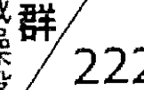

#### 狀況四

操作者本人不是贏家，但是從電腦程式交易中賺到一些財富之後就誤以為「電腦功力」就等於「贏家實力」。

這一類的人，你跟他談起交易，他講得天花亂墜、頭頭是道，但談的大部分都是電腦程式，真正點到交易核心精神卻很少。這就好像我以前遇到收集古典音樂唱片的大咖，他討論起如何蒐集唱片來精彩萬分，但是點到真正的音樂精神的部分，少得可憐，充其量他不過是個「蒐集家」，了不起做個「鑑賞家」，但無論如何都不到「音樂家」的程度。

問題是，在金融市場裡，你做個「交易程式蒐集家」、做個「市場評論鑑賞家」，有個屁用？嗯，如果是要用蒐集跟評論去唬人騙錢的話，當然有用。如果是誠心誠意拿來做交易，當然沒用。

我建議現在有在使用電腦程式交易的朋友，一定要注意：

- 每隔一段時間，電腦的參數可能要改。這個改，是個大學問。所以，不能因為有了電腦當靠山，就荒廢了傳統的技術學習課程。
- 電腦只能幫你接觸到初級贏家境界而已（前提是技術要正確），至於想達到資深贏家境界還得靠自己努力。
- 電腦能夠救你的心法有限。大部分的心法，還是必須要人腦思索而來。
- 不要只使用一套短期系統。使用長期系統的人，一套就可以。使用短期系統的人，則一定要有一套中期系統搭配最好。
- 電腦無法取代合格教師。

# Part 3
## 機械式型態學的實例圖解

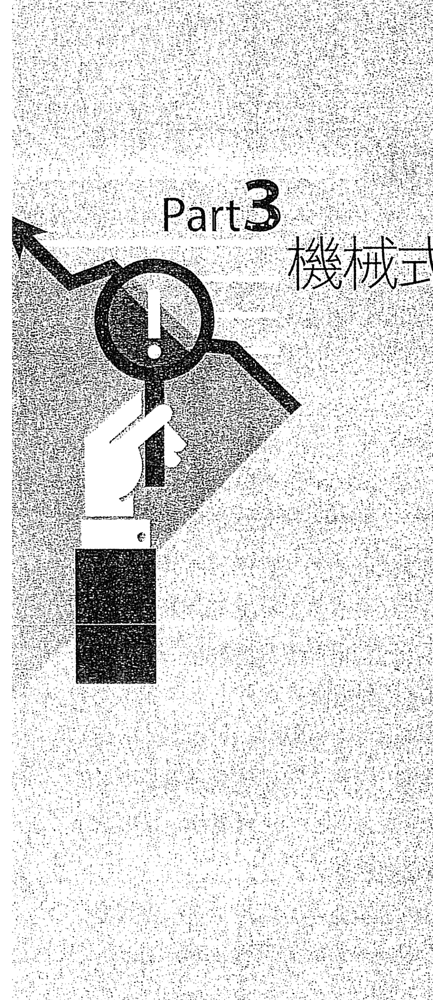

### 最重要的兩件事

> 進場操作只是給自己一個機會而已，做對就留著，做不對就砍掉。去與留之間，不要執著、不要存著太多一廂情願的想法。

最近這兩、三年，我有一大部分的精力都花在提倡機械法。現在，同學們都知道我們的初級學習是以機械法為主。後來發生了一個問題，就是很多人在思考的時候，並不知道自己的思考是在走預測的路線。因為他們沒有學過預測法，不曉得真正的預測法是什麼模樣。

這些「不曉得真正的預測法是什麼模樣」的人當中，有的人學過機械法卻沒學過預測法，有的人是兩樣都沒學過。兩樣都沒學過的人犯這病，當然是很自然；學過機械法卻沒學過預測法的人犯這病，那就有點棘手了。

我們曾經想要把預測法完完全全地打入冷宮，結果發現不行。原因很多，主要原因之一是「深恐廢除預測法之後，學的人從此不知道預測法長什麼樣子，然後就不會判斷什麼是預測法，什麼是機械法了」。

我要提醒大家一件事，你去翻翻大部分傳統的（古老的）技術分析書籍，裡面教的技術分析都是機械法，並不是預測法（網路費吃到飽的制度興起後，財經網站大盛，冒出一堆崇尚個人主義的股市作家，此時的股市書籍才是以預測法為主流）。

例如，傳統技術分析的書都會告訴你，型態學的頭部要跌破頸線之後，才能賣出或放空，這是機械法，不是預測法。也就是要等到頸線被跌破後才能看做是頭部，頸線沒有跌破前，不要亂猜這裡是頭部。

那麼，散戶腦袋裡那些亂七八糟的預測式想法，到底是誰教的呢？

或許你會認為，電視上的投顧老師要對此負最大的責任。他們的确是要負很大的責任，但並不表示別人就不須負責，我們這整個社會，都要為預測法的氾濫負責。

# 腦袋裡不要有多頭跟空頭的想法

既然以往的技術分析書籍記載的技術是機械法，為什麼一般人還是學不好？

最大的原因是，寫書的人沒有把這個技術的搭配心法給講出來；第二個原因是，寫文章的人根本就不知道有這個心法。

兩種原因，後者大概占九成以上。反正天下文章一大抄，人云亦云，我抄了就表示我懂了，其實是不懂。

以剛才的例子來說明，傳統技術分析的書都會告訴你：形態學的頭部要跌破頸線之後，才能賣出或放空。如果我們做個延伸，認為：「要等到頸線被跌破以後才能看做是頭部，頸線沒有跌破之前，不要亂猜這裡是頭部。」這個心法沒錯，但嚴格來講，它只說對了一半。正確的解讀是：「即使你在跌破頸線之後去放空或賣出，也不要想著它是頭部。」因為跌破頸線去放空，也只是給自已一次交易的機會，如果碰到假跌破，這個交易是要賠錢的。如果你緊抓著「頭部」的觀念不放，這樣的固執只會害了你。

換句話說，只管做動作就對了，腦袋裡不要有多頭跟空頭的想法。

假設我們在看電影時，碰到戲院失火，當然是趕快往逃生門移動，這時如果有人問我：「你有把握一定能夠逃離火場嗎？……如果沒有把握，那你又何必逃呢？」有人這樣問我的話，我一定當他是神經病，並反駁：「沒把握也要逃啊！要逃才有求生的機會啊。」做股票，也是相同的道理。我沒有把握這裡一定就是頭部，但因為它跌破頸線（或者跌破某種我設定的重要支撐關卡），所以我做一個放空的動作；如果價格沒有觸及我的停損停利點，空單就會一直拖著。至於這裡是不是「頭部」？那是另一個世界的語言，跟我們所做的動作無關。我不須知道這裡是不是頭部，一樣可以操作獲利。

（多單的道理也是一樣，向上突破關卡後買進，卻不抱著這裡就一定是底部的成見，因為你可能會摸頭猜底，犯了過度預測的毛病。）

### 把現在該做的事做好就對了

在操盤的時候，過度執著的成見，像是多空的方向意識，往往讓我們被自己的思想成見所套住，自以為有方向才好操作，最後卻迷失你自己的心靈方向。

不論市場的方向出來沒有，不論市場的方向是清晰還是模糊，我們自己的「心」都必須要堅定，不能慌亂迷惘。

所謂「無心」的境界，就是「沒有妄心」。妄心，就是沒系統地去摸頭猜底。

進場操作只是給自己一個機會而已，做對就留著，做不對就砍掉。去與留之間，不要執著、不要存著太多一廂情願的想法。

人生也是這樣，輪迴降生在這個世界，只是「再」給自己一個在世修行的機會而已，所以每一次的誕生，都是為了實現以前尚未達成的崇高目標，這種單純化的想法就是一種機械法。

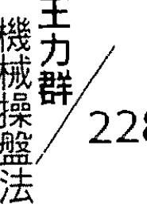

## 3-2
# 型態學裡面有預測法跟機械法

> 如果實力已高到能夠準確預測它是不是頭部，就能預先布局單子留倉，而且是很多單子。可惜摸頭猜底的真功夫，大概只有超級賽亞人能做到。

在操作機械法的過程中，不要去猜測是不是頭部，因為機械法就是避免預測。

如果實力已高到能夠準確預測它是不是頭部，就能預先布局單子留倉，而且是很多單子。可惜摸頭猜底的真功夫，大概只有超級賽亞人能做到，普通人不可能練成。

### 中短線的明顯趨勢常低於四成

我之所以不斷宣揚機械法的理念，並不是說只有機械法最棒，而是告訴大家：一般人比較適合用機械法的觀念操作。但是宣傳了這麼久，還是有些人追問「這裡是不是頭部？」至於我的回應，大致分為以下幾種狀況：

- 第一種狀況：如果你的資質只有一般人程度，那麼就應該使用機械法，不可能會再來問「這裡是不是頭部？」如果你問了，表示你並沒有搞懂機械法。

- 第二種狀況：如果你是用預測法，那你一定具備了成熟卓越的預測能力（注意：只有贏家才有資格正式使用預測法），所以你不必問別人，你自己已經知道。

- 第三種狀況：如果你想走預測派的路線，所以你現在正在練習預測法，想聽聽別的高手的意見，那你最好把你的預測理由講給那位高手（或是你的老師）聽，請他幫忙看看有什麼地方錯誤的。如果講不出來，表示你沒有思考過；思考不靈活、感覺不敏銳的人很難練成預測法。此外，很多人表面上標榜自己是預測派信徒，其實自己毫無主見，只是想聽名牌而已（這種人不是預測派也不是機械派，而是冤大頭派）。

- 第四種狀況：如果你走的是融合派（例如七成機械性質、三分預測性質），從事機械操作時也修練預測法，想聽其他高手的預測眼意見，那麼，你應該先用機械派的心法把腦袋放空，不要有成見，然後再聽其他高手或你的老師是怎麼想的，然後把你的預測理由講出來，請他幫忙看看有什麼地方錯誤。如果講不出來，那就還是用你的機械法當成主要操作依據，把別人的預測意見當做萬一操作失敗的退路準備吧（如果他的預測跟你相反的話）。

李佛摩也不贊成操作者在表達意見時說自己是看多或看空，因為多空只表示一段趨勢，這種態度，很容易讓投資人隨著自己的欲望，產生誇大渲染的心理（過度解讀）。

股市中，有時確實存在明確的趨勢，此時你去問專家多空意見，他確實可以回答你究竟是看多或看空。可惜的是，這種「可以回答出來的日子」，就中線跟短線而言，並不會太多，而且都集中在發生關鍵機會附近的少數日子。所以，大多數問中線跟短線趨勢的人，通常不會得到想要的答案，因為中短線的明顯趨勢最多只占一半而已，且常低於四成。

### 預測法到最後會接近機械化

練習預測法的時候，愈接近後面的境界，會發生兩種狀況：第一種是當事人的預測方式，會愈來愈接近機械化的科學流程；第二種狀況是當事人的預測直覺（盤感、第六感）會愈來愈準。如果只發生第二種狀況，而沒有發生第一種狀況，那就很危險，因為可能已經走入魔道。

照理來講，境界的前期是第六感會增多、增強，中期則是預測方式會愈來愈接近機械化，到了後期則是盤感也強、機械跟預測融合的程度也愈高強。

一般不及格的老師，卻把盤感的增強誤以為自己已經得道。由於程度比一般投資人高，投資人可以學到東西（包括錯誤的東西）。這些都是人世間的正常悲劇，無法完全避免，只能憑自己的善緣化解了。

### 3-3
## 頭部機械法的設定（上）

> 系統一旦被觸發，就會一個接著一個狀況相繼發生，如果沒有一套連續的操作法則，就會亂掉。

機械法之所以很難被一般人接受的最大原因，就是它的基本設計概念不好懂。其設計原則大致如下：

- （1）每一條法則背後都要有一個理由。這個理由可以是基本面，也可以是技術面，長線短線不拘，端看你的系統接下來是如何設計的。
- （2）條件如果超過一個以上，每個條件之間必須有正當的邏輯關聯做調和。

以 2013 年 5 月到 11 月為例，如何才能知道 8439 跟 8476 這兩個高點是 M 頭？或者是，我們要怎樣用機械法來操作 8476 這塊區域？

但各位請注意，「知道這裡是頭部」跟「這裡如何依照頭部的形勢來操作」是兩種不同的思維。現在我們討論的是後者，不是前者（因為這是屬於預測法）。

### 頭部機械法的賣出關卡設定

以下九張圖，分別示範了九種賣出的設定，都是機械法。

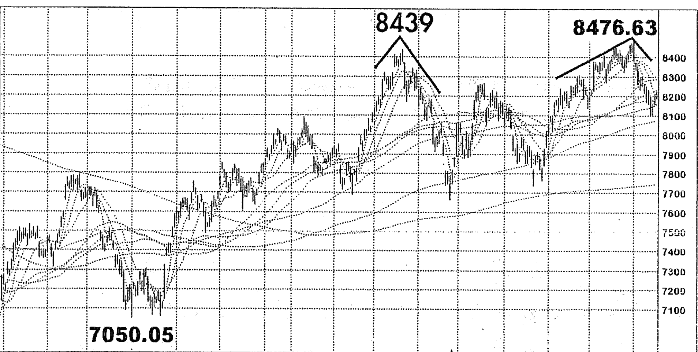

- ● 第一種設定｜不過前高 8439 點而收黑棒，則賣出

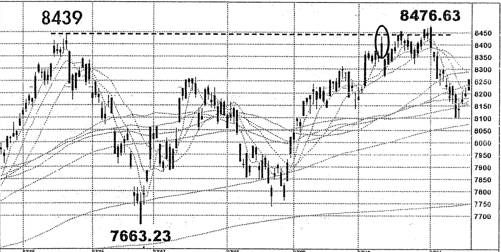

- ● 第二種設定 | 假突破前高 8439 點之後收黑棒，則賣出

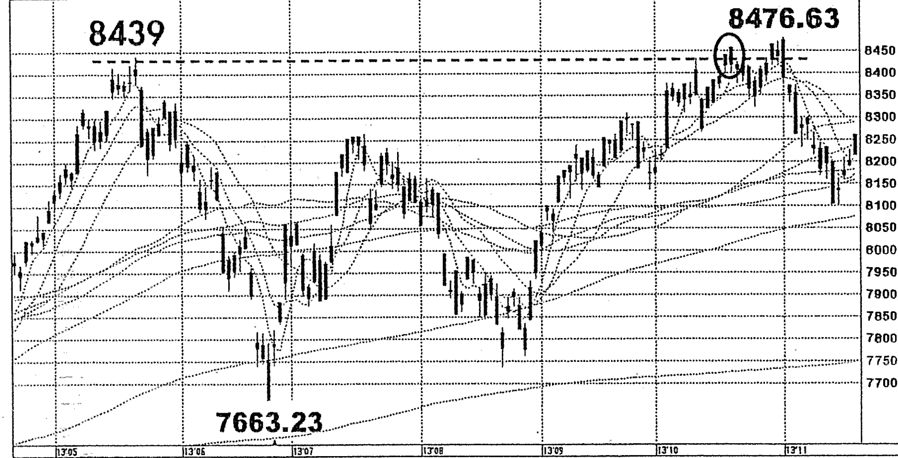

- ● 第三種設定 | 跌破上升趨勢線，則賣出

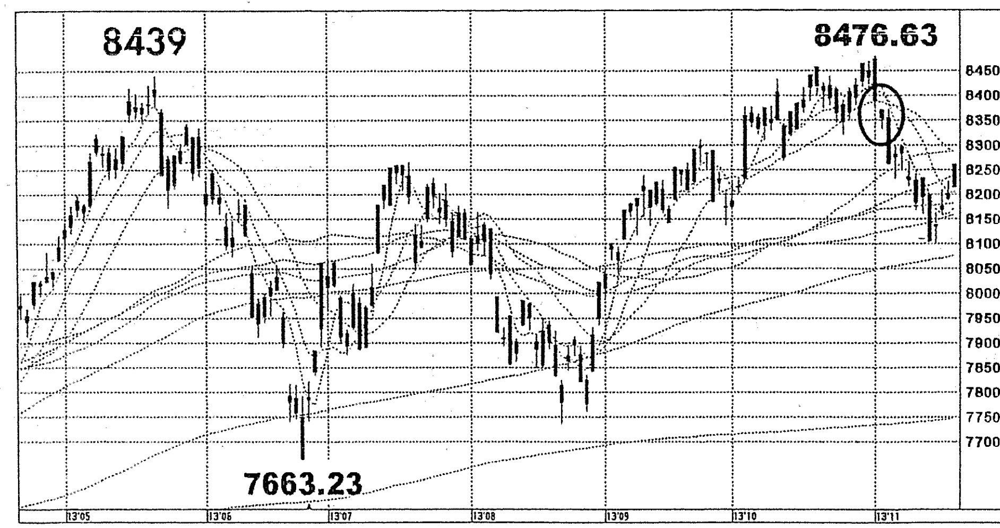

- ● 第四種設定｜跌破高點 8265 點的支撐，則賣出

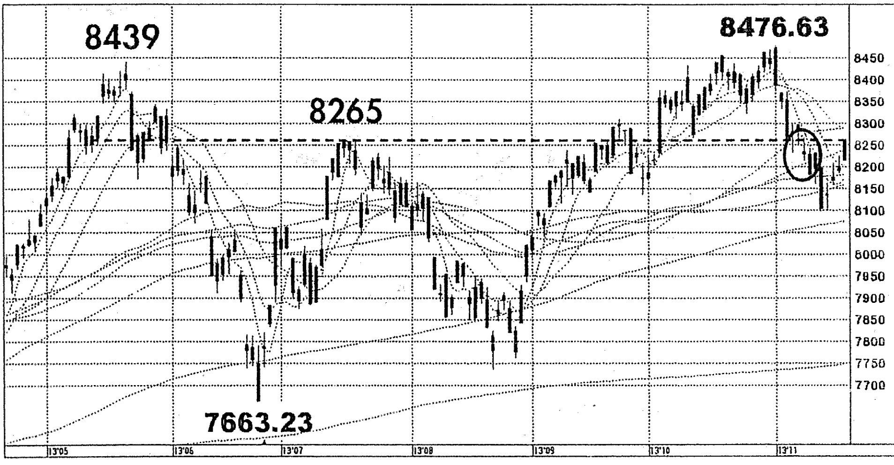

- ● 第五種設定｜跌破 9 月 30 日的低點 8137 點，則賣出

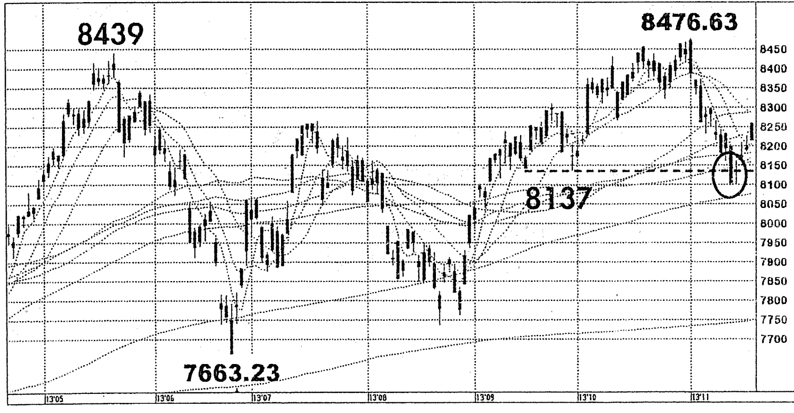

- ● 第六種設定 | 跌破 240 日平均線 (參數可設為 240 日~350 日)，則賣出

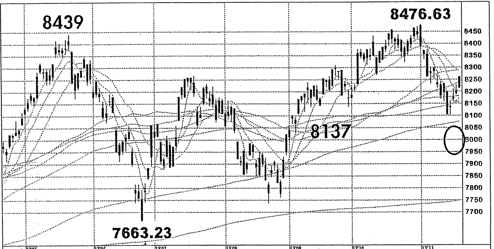

- ● 第七種設定 | 跌破底部回升的第三根長紅的開盤點支撐 7950，則賣出

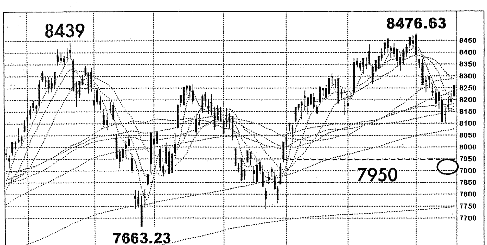

- ● 第八種設定｜跌破 8 月 22 日的低點 7737 點的支撐，則賣出

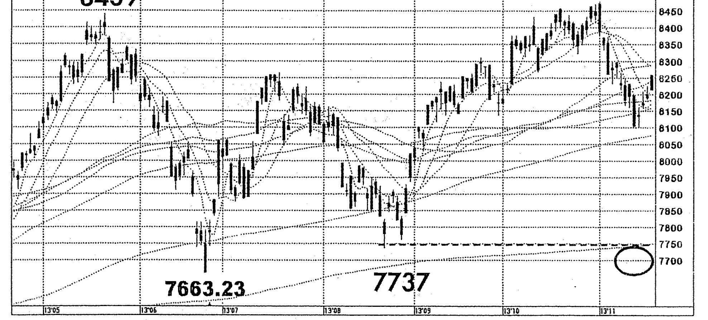

- ○ 第九種設定｜跌破 6 月 25 日低點 7663 點支撐，則賣出

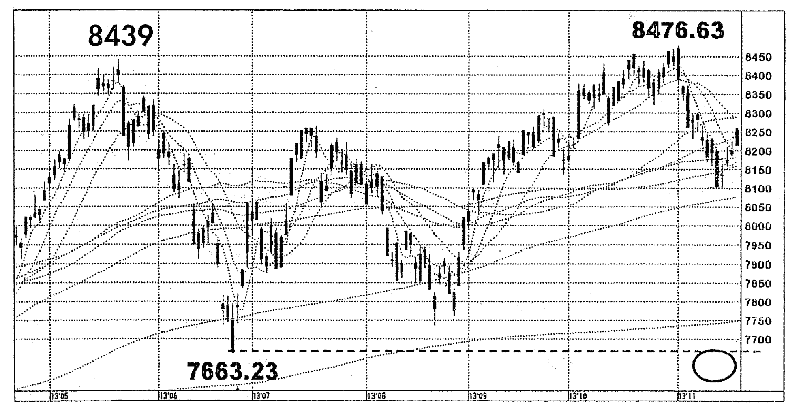

- 第 N 種設定 | 你也可以自己設計各種方式的賣出關卡，像是 KD 指標那種玩意之類的……

### 設定要有邏輯涵義

從以上九張圖的分析，有幾個觀念你必須知道：

- (1) 「知道」跟「操作」是兩回事。
- (2) 頭部不一定是賣在愈高點愈好。
- (3) 每一種賣出方式都有缺點，也有優點。
- (4) 中華民國歷史上有這麼多頭部，很難統一用同一種賣出去討好每一個頭部。
- (5) 如果要用一種固定賣出方式，則要忍受某年某月「不適應這種賣出方式」的某個頭部給你的打擊。
- (6) 如果每次操作時，是在多種賣出設定中挑出一種，就變成了預測法。也就是說，你的操作最多只剩下 50% 的機械法（因為買進方式還是採用機械式）。

坊間的股市書籍或許會告訴你這九種設定，卻不會告訴你這些設定在整個系統裡的邏輯涵義。

所謂的邏輯涵義，是假設你用了第一種設定賣出了部位，但後來又創了新高，該怎麼辦呢？這就是一種邏輯流程的設定。換句話說，系統一旦被觸發，就會一個接著一個狀況相繼發生，如果沒有一套連續的操作法則，就會亂掉。

## 3-4
# 頭部機械法的設定（下）

> 技術分析裡的型態學，存在著一個「主觀認知」的問題，也就是說，對於大頭部這樣的型態判斷，暫時無法完全用機械法，必須帶點主觀的預測法。

續以 2013 年 5 月到 11 月為例，我們要怎樣用機械法操作當年 10 月以後逼近前波高點 8439 的這塊區域？

假設我們使用前面章節所說的第一種設定：「不過前高 8439（5 月 22 日的高點）而收黑棒，則賣出。」於是，

**Part 3 機械式型態學的實例圖解**

- 2013 年 10 月 11 日 收盤 8349 點 < 8439 點，賣出（箭頭處）

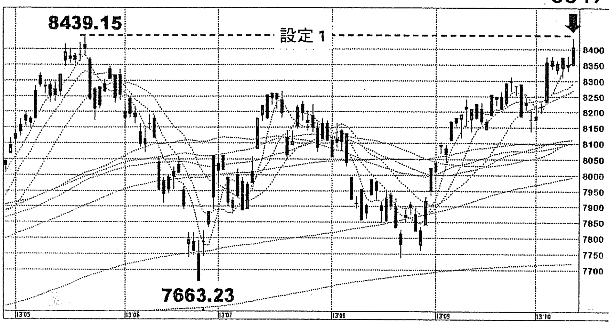

- 2013 年 10 月 18 日 收盤 8441 點 > 8439 點，買進（箭頭處）

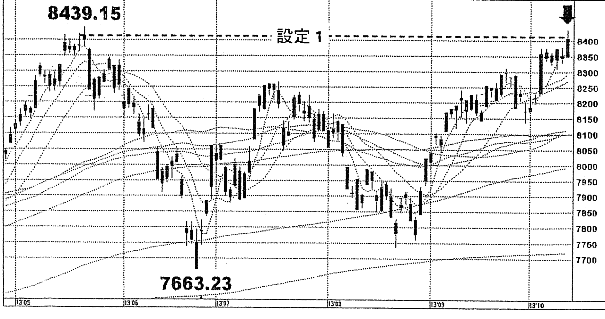

- 2013 年 10 月 21 日 | 收盤 8419 點 < 8439 點，賣出（箭頭處）

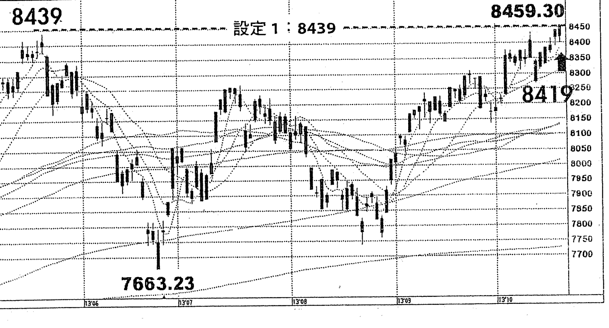

- 2013 年 10 月 30 日 | 收盤 8465 點 > 8439 點，買進（箭頭處）

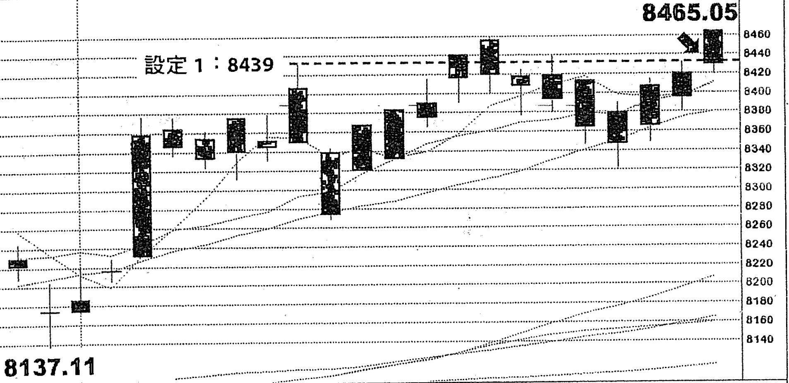

- 2013 年 11 月 1 日｜收盤 8388 點 < 8439 點，賣出（箭頭處）

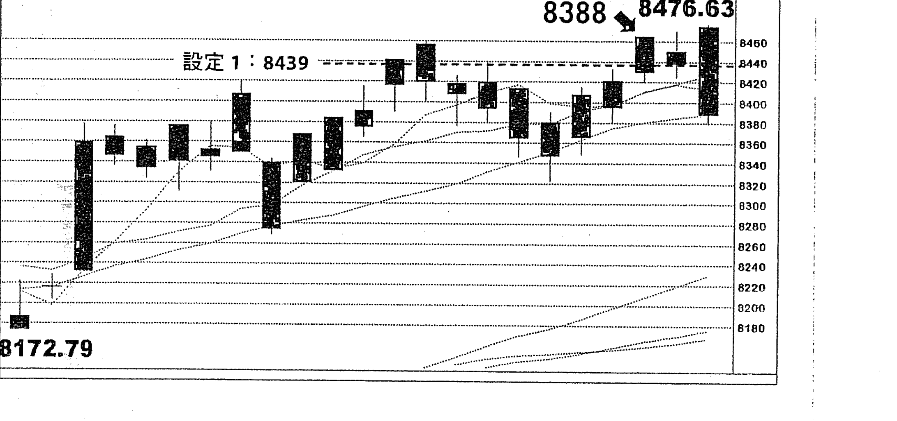

- 2013 年 11 月 1 日｜以後就跌下去了

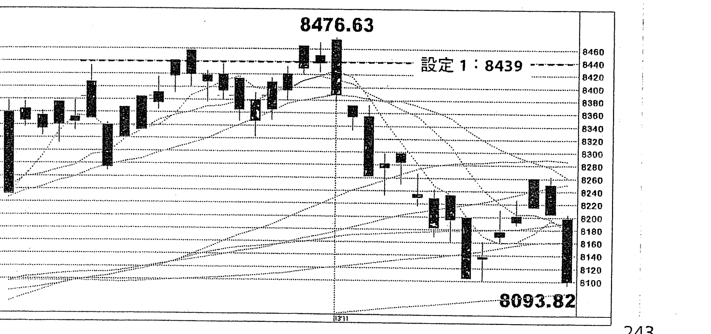

以上就是 2013 年 10 月 11 日到 11 月這段日子以「第一種設定：不過前高 8439（5 月 22 日的高點）而收黑棒，則賣出」為操作法則的操作流程。

接下來的工作，是把這個設定應用到每一年的頭部去，看看有沒有哪一年不適合用這個（機械）法則。

我們就以 2007 年 7 月 26 日的高點 9807 為關卡，帶入規則一，得到以下的操作流程：

- 2007 年 10 月 3 日｜收盤 9700 點＜9807 點，賣出（箭頭處）

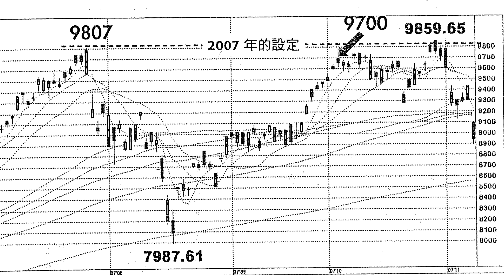

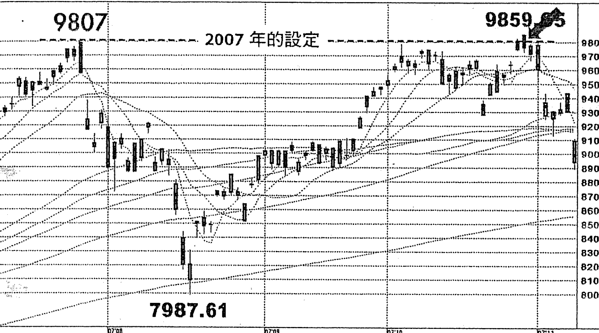

之後，2007 年 10 月 30 日：收盤 9757 點 < 9807 點，賣出。

2007 年 10 月 30 日以後就跌下去了。但我們的帶入工作進行到 2011 年時，卻出現一種新的狀況，就是 2011 年的 4～6 月的攻勢都沒辦法「碰到」前波高點 9220（2 月 8 日高點），而之前我們訂的規則是「碰到前波高點之後無法越過而收黑棒，則賣出」，這下可慘了，因為「沒碰到」不等於「摸到以後再退縮」。於是我們必須訂立新的規則，解決這種「沒碰到前波高點」的狀況。

假設我們應用「時空變盤」的原理，規定「自波段低點算起 40 天之內，如果還沒有碰到前波高點，則賣出」。因此，

2011 年的狀況得到解決，也就是賣在標示「 Day40 」的那天。

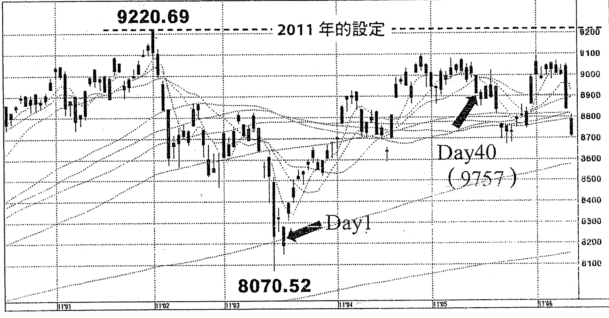

### 大頭部的型態判斷，無法完全用機械法

截至目前為止，如果我們想用機械法對付「頭部」，依照之前的推演，我們得出兩條法則：

**法則一** 碰到前波高點之後無法越過而收黑棒，則賣出。

**法則二** 自波段低點算起 40 天之內，如果還沒有碰到前波高點，則賣出。

注意：法則一要與型態（含 K 線）有關。

接著，我們要把這兩條法則帶入台股的歷史資料……結果，我們發現：

- 2000 年的大 M 頭部，此合併規則（法則一跟法則二）可以用

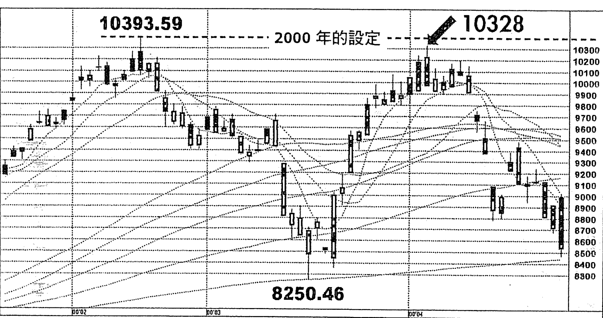

- 2001 年的大 M 頭部，此合併規則（法則一跟法則二）可以用

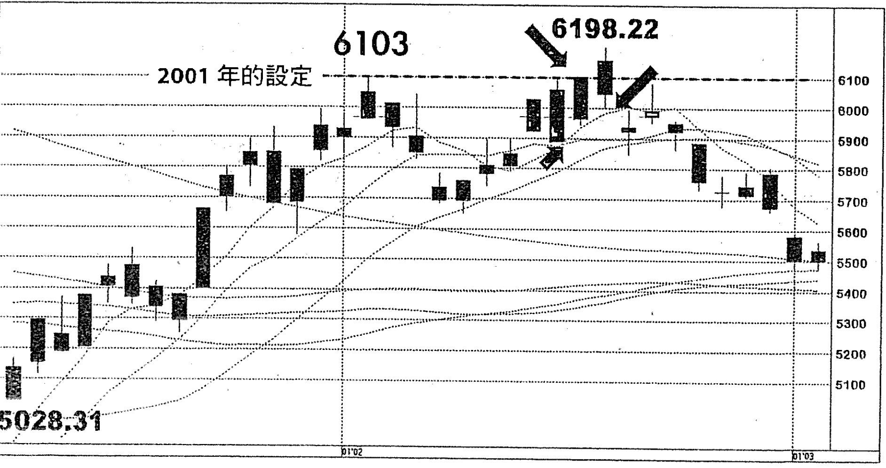

- 2002 年的大 M 頭部，此合併規則（法則一跟法則二）可以用

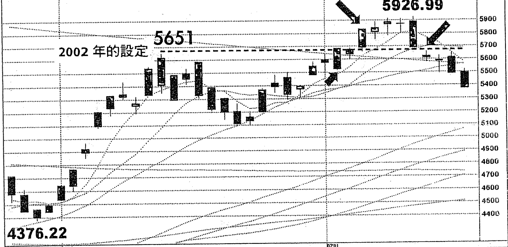

- 2004 年的大 M 頭部，法則一沒派上用場，動用法則二後發現賣出點太晚……，算是遇到挫折

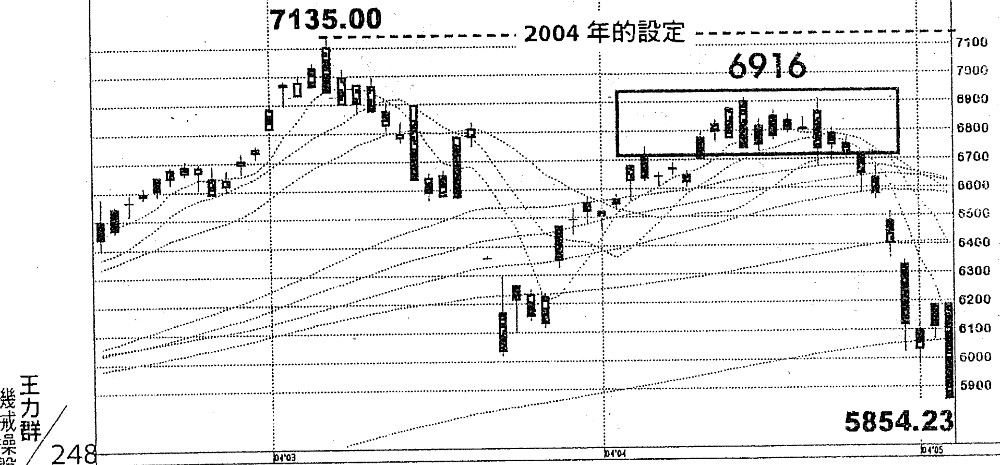

- 2006 年的大 M 頭部，此合併規則（法則一跟法則二）可以用；如果想賣在高點則要另想辦法（這屬於另一個故事）

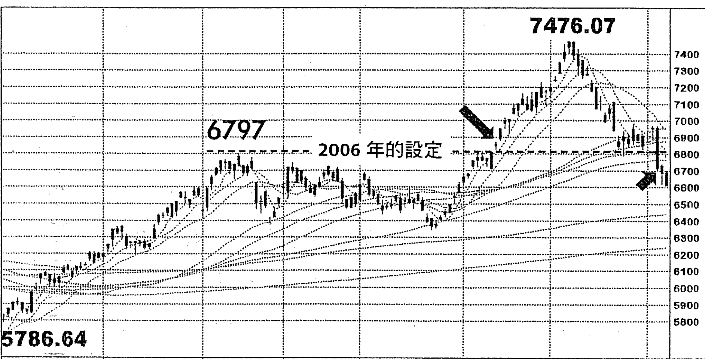

- 2010 年的大 M 頭部，此合併規則（法則一跟法則二）可以用

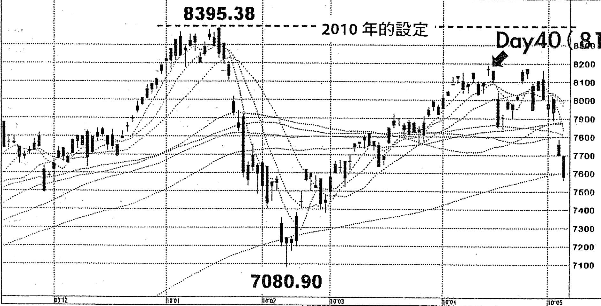

我們的感想是：

- （1）如果大 M 頭的型態很明顯，合併規則可以用；如果不明顯，就不好用。
- （2）在 2004 年大 M 頭部遇到的挫折，可以用「箱型理論」解決。如果付諸行動，則「箱型理論」可能變成未來的法則三。
- （3）型態的機械法，不如海龜法方便，也不如均線法。
- （4）這一點最重要：<u>型態的機械法可能沒有所謂的「終極理論」存在</u>。因為在帶入台股的歷史資料中，我們發現到，此合併規則最大關鍵在於「大 M 頭」型態的「認定」問題。換句話說，操作者要在「已有感覺這裡嘗試在做一個大 M 頭」的前提下，此合併規則才能派上用場。

綜合以上四點，我們恍然大悟：為什麼這麼多技術派的操作者會失敗，因為技術分析裡的型態學，存在著一個「主觀認知」的問題，也就是說，對於大頭部這樣的型態判斷，暫時無法完全用機械法，必須帶點主觀的預測法。

難怪這麼多人都失敗了，因為型態學本身的缺陷，實在足以致命（我不是說型態學不好，而是對於一般人，尤其是新手，缺點多多）。

## 3-5
# 決定勝負的關鍵：少去預測、做好準備

> 儘量少去預測，老老實實把「將來如果上漲」以及「將來如果下跌」的雙向準備都做好才行。

很多自以為是技術派老手，在市場上待了很久，對形態學最重要且基本的心法卻一無所知，很不應該，但這種現象卻是相當普遍。

一種型態，當它還沒有正式成熟之前，我們可以去看它，也可以不去分析它，箇中的選擇端看你的操作系統來決定！有的贏家會去看型態，有的則不看，並不是說「型態學是一門正式的學問」，就規定每個人非用不可。

如果我的操作系統把型態看得很重，那麼，我就要去分析它。例如，分析盤勢如果往上的話，是屬於哪一種漲升型態？這種漲升段，在更恢弘的大格局裡是否有更重要的涵義？漲上去該怎麼辦？我們該怎樣應變？該做好怎樣的心理準備？……如果往下的話，是屬於哪種下跌型態？這種下跌段，在更龐大的大局局裡面是否有更重要的涵義？跌下去該怎麼辦？我們該怎樣應變？該做好怎樣的心理準備……等等。

當然，路徑不可能只有兩種可能，除了「漲」跟「跌」以外，還有「先跌後漲」、「橫盤」等。不過基本上，只要先做好漲跟跌的技術分析與心理分析即可。

可惜，現在流行的心法並不是這樣，而是在「猜」它將來是漲是跌；更糟糕的是，竟然還有人試圖猜測它是「緩漲」還是「急漲」……這些心法都是預測法，如果是秀給一般散戶看，萬萬不可！那樣會救壞散戶，因為一般人的程度低（或是沒有），不可用預測法救他們，而是要用機械法去救。

例如，我關心「我未來的操作績效」，如果我只拿著生辰八字去算事業前途，那就是搞預測法了。如果我除了「預測」前途之外，其他都不分析、都不思考，不管我自己的實力在哪裡，一味求神問卜，那也不對。

### 型態學的觀察重點

型態學裡面，大家最重視的是「頭部」，另一個則是「腰部」。重點如下：

**重點 1** 當相對高檔橫盤的時候，空方要小心「做頭不成反成腰」。（這裡的腰是指：上漲段的半山腰）

**重點 2** 當相對高檔橫盤的時候，多方要小心「做腰不成反成頭」。（這裡的腰是指：上漲段的半山腰）

**重點 3** 當相對低檔橫盤的時候，空方要小心「做腰不成反成底」。（這裡的腰是指：下跌段的半山腰）

**重點 4** 當相對低檔橫盤的時候，多方要小心「做底不成反成腰」。（這裡的腰是指：下跌段的半山腰）

**重點 5** 當相對高檔橫盤震盪完畢，發生下殺甚至跌破頸線時，空方要小心「先蹲後跳」！

**重點 6** 當相對高檔橫盤震盪完畢，發生急漲甚至創新高時，多方要小心「最後拉高出貨」！

**重點 7** 當相對低檔橫盤震盪完畢，發生大殺甚至破底時，空方要小心「這是最後的殺盤了（急殺完畢後立刻漲）」！

**重點 8** 當相對低檔橫盤震盪完畢，發生急漲甚至突破箱型頂部時，多方要小心「即將發生最後的拉回洗盤（快速洗完以後繼續漲）」！

**重點 9** 型態學機械法的心法是：不去預測（也不去分析）這裡是頭還是腰，而是等型態告訴我們（基本上，往上突破就是漲，往下破就是跌）。

**重點 10** 型態學預測法的心法是：不去等待將來何時整理完畢，直接預測這裡是高檔還是低檔，如果是高檔就出貨或部署空單，如果是低檔就回補空單，或是趁機買進部署多單。

本書是講機械法，所以不採用第十項。

總歸一句話，型態學機械法就是教我們要做好心理準備，以便等待將來突破的方向出現時，再順應方向操作，屬於「後發制人」（不屬於預測派的「先發制人」）。儘量少去預測，老老實實把「將來如果上漲」及「將來如果下跌」的雙向準備都做好才行。

做好應該做的事，把應該準備的準備好就對了。如果平常沒準備，或是只預備一個方向，萬一發生變故，事與願違，就要有高強的本事去應付突發狀況了。

## Part 4
# 投資高手的賺錢真功夫

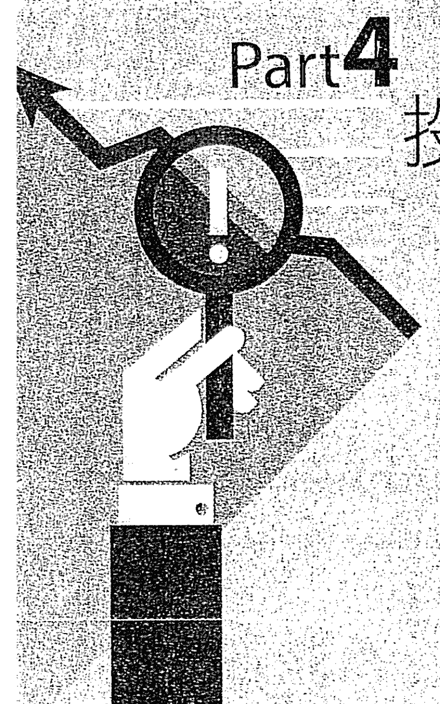

## 4-1
# 如果你想逢低買進······

> > 66 逢低買進法的優點是「買得比較便宜」。缺點是，你還沒買進時，它頻頻拉回做機會給你接你卻沒接，等到鼓足勇氣決定中途參與，它竟跌個沒完沒了。99

在 PART2 的第 8 章，我曾談過突破買進法。由於這個方法屬於追高，或許有人比較無法接受，因為怕買貴；有鑑於此，所以有「逢低買進法」的誕生。

但歷史上，不知道有多少自負聰明、才智高人一等的人，在這裡走入了歧途——沒有買在起漲點（或是沒有放空在起跌點），所以被強迫半途進場，卻又計較進場時的短線盈虧，想要買在很低的點，結果本來要在波段的，到最後卻淪為短線追逐、疲於奔命、自失立場。

如果你要半途插隊做長期投資或波段操作，確實是容許在插隊時，動用到「一點」短線的技術跟觀念（例如，等價格拉回一點的時候買進）。但動用完之後，也就是進場布署完畢時，你就要讓這些短線技術「功成身退」，不要讓這些短...

線技巧「喧賓奪主」，取代了你原來的投資計畫。

這裡面的心病，就在一個「貪」字。

### 6 個技巧，逐步逢低買進

以 2009 年的例子來講。一旦錯過了當年 3 月第一個大買點時（太多人都錯過了），接下來勢必要半途進場，此時傻瓜都知道，如果是在初升段，你就要趕快買，不要等拉回，如果你執意要在初升段找「拉回的買點」，你就要了解初升段的短線性質；同樣道理，主升段跟末升段也有一些短線的特性。這些特性可以給你方便，讓你趁拉回時逢低找買點。不過，這些特徵都屬於短線，有時會發生，有時不會發生，當事人必須懂得隨機應變。

一個「插隊」的動作（中途買進法），可能會牽拖出一大堆短線的技巧。對於長線投資或是大波段操作者而言，這些逢低找買點的短線技巧，都超出了他們的學習範圍。

由於牽拖得太多，我們只能提供「某些」簡單的技巧，以免超出學習範圍太多而埋下後患：

- 1. 找出一個短線的低檔支撐的位置（支撐關卡）。
- 2. 價格打下去跌到那個關卡的時候，開始買進。
- 3. 找出本波段的中長線支撐關卡（連同前面的短線關卡，一共有兩個支撐：一長一短）。
- 4. 如果跌到短線關卡的低檔買進點之後繼續往下跌，那就繼續逢低攤平（反正你喜歡買便宜貨嘛……）
- 5. 從短線關卡跌到中長線支撐關卡這一段的距離，進場買進多單完畢、部署完成。
- 6. 如果不幸正式跌破中長線支撐關卡，全部認賠。

這裡面跟外面不一樣的地方有兩個，第一個是設兩道關卡；第二個是在第六條。第六條的原意是說，逢低攤平也要有個限度，過了某條界限就不能再攤平了，否則可能真的會愈攤愈平（愈貪愈貧）。

逢低買進法的優點是買得比較便宜，面對短線震盪時心理比較好過，將來賺的也會較多。缺點是：你還沒買進時，它頻頻拉回做機會給你接你卻沒接，等鼓足勇氣決定中途參與，它竟跌個沒完沒了。雖然最後可能還是在中長線關卡撐住，但卻來個關卡保衛戰，把你的單子洗得一乾二淨。

### 遇大波段，優先採用突破買進法

「突破買進法」跟「逢低買進法」雖然各有其優缺點，但是就比較大的波段而言，突破買進法比較正宗，因為大波段可能漲勢較迅猛，而沒有拉回讓你低接。

對學過短線的操作者而言，如果要用短線技巧輔助長線插隊的話，插完隊後要休息一下，不要讓短線技術一直盤據心中不去，會影響客觀的觀察力。

## 4-2

## 如果你想中途買進……

> 機械法的數學計算不難，難在操作者要把自己的命運，交到這麼一個「數學流程」的手中，而沒有什麼自由意志的存在。

接下來我要談如何買進與風險的計算。以下算法是非海龜的算法，如果你認為用海龜比較好，就用海龜也行。

假設總資金 100 萬，風險係數是 6（最多只能損失總資金的 6%），想要在 8091 點的價位進場買進，那麼，能夠買進多少的部位？

首先，要設好停損價。假設停損設 7600 點，那麼，8091 點跌到 7600 點，一個小型台指（每點 50 元）的損失為：

（8091 點 − 7600 點）× 50 元 = 24,550 元

最大損失預算 = 1,000,000 × 6% = 60,000 元

則可以買進多少個小台契約？60,000 元 ÷ 24,550 元 = 2.4 小口（小數點以下無條件捨去 = 2 小口）

（心算：8100跌到7600是500點，一大口500點（每點200元）是10萬，現在最多只能虧6萬，所以只能買半個大口）

（8091點－7600點）×50元×2小口＝49,100元

所以，初始進場價是兩小口買在8091點。停損設7600點，如果真的停損（沒有跌停板鎖死的話），則損失5%的資金，約5萬（49,100元）。

問一下自己的心臟，損失5萬能不能接受？如果可以，就買進2小口。如果不行，就不要買那麼多，或是不買。

如果遇到黑天鵝事件，第二天暴跌破板，第三天也暴跌破板，連續兩天跌破板，則大約會跌掉1000點，此時，兩口小台總共將會損失10萬。問一下自己的心臟，遇到黑天鵝意外事件的話損失10萬能不能接受？我是覺得還好，因為黑天鵝並不是每一筆交易都會發生，如果每筆都顧慮到黑天鵝而減碼操作，勢必大大會減低獲益，基本上黑天鵝的風險考量在10%以內，都算合理。

接著，盤勢繼續進行，假設後來（從8091點）漲到8321，此時我們如果再買進1小口，風險會變得多高？

因為上漲，所以新的停損價從7600點往上移到7700點。前面兩小口的成本是8,091元，此時獲利

（8321點－8091點）×50元×2小口＝23,000元

總資金 = 1,000,000 元 + 23,000 元 = 1,023,000 元

因為一小口為期指最小加碼單位，所以要不然就加一小口，要不然就不加。

如果不加碼，新的風險計算：

（8091 點 - 7700 點）× 50 元 × 2 = 39,100 元

39,100 元 ÷ 1,023,000 元 = 0.038，風險為 3.8（亦即 3.8%）

如果決定要加呢？先用加碼一小口試算：

8321 點再買進 1 小口，則累積 3 小口，成本平均價為：

（8091 元 × 2 小口 + 8321 元 × 1 小口）÷ 3 = 8,168 元

停損設 7700 點，那麼，跌到 7700 點，3 個小型台指的損失：

（8168 點 - 7700 點）× 50 元 × 3 小口 = 70,200 元

70,200 元 ÷ 1,023,000 元 = 0.068，風險為 6.8（亦即 6.8%）

6.8%，嗯，如果不算大，就可以加碼一小口。如果嫌大，就不要加碼了。

如果沒有風險管控的概念、如果沒有計算過風險，而去用 100 萬買 10 大口，盤勢只要當天盤中下跌 250 點，就會立刻損失 50 萬元（總資金的一半），心臟可能會受致命打擊。

### 量化風險，擺脫被坑殺的命運

當技術操作系統穩定運行之後，我們幹的事，很多都是這一類風險計算的工作（風險計算不是只有技術派要做，基本面的操作者也要計算風險，但還要額外負擔選股的工作）。

計算風險、改良系統、模擬練功……要做的事就是這些。

一般人會不會這樣老實計算呢？不會，一般人會捨棄數學的計算，而改用感覺，或是「非數學」的思考。他會依據報章媒體資訊聽來的一些消息，來做一種綜合性判斷，而這種判斷，通常很難用數學公式來表示。

機械法的數學計算不難，難在操作者要把自己的命運，交到這麼一個「數學流程」的手中，而沒有什麼自由意志的存在——這種操盤的味道，很難讓操作者本人放心。於是乎，他會捨棄機械式的計算，逐漸依賴自己對於盤勢的「感受」，久了以後就把自己的感受升級，改口叫它做「智慧」，這就是埋下敗亡的種子了。

## 4-3

## 如果你想中途放空……

> 「如果錯過了第一時間的進場點，那就收拾書包回老家讀書，明年再來進京趕考吧！」

融市場的學習，最重要的是訓練記憶力。因為你一定會忘記。

前一篇我們提過中途買進法，那中途放空呢？原理一樣，就怕你會忘記。

所以，我只好一直反覆提醒各位。

很無奈。不過，還好，不會很累。

假設總資金 100 萬，風險係數是 2（最多只能夠損失總資金的 2%），想要在 7600 點的價位進場做短空（短線的風險係數是 1 到 2，中線 3），那麼，能夠放空多少的部位？

先把停損價設出來，假設停損設 7900 點，當 7600 點反彈到 7900 點，一個小型台指的損失為：

（7900 點－7600 點）×50 元＝ 15,000 元

最大損失預算＝ 1,000,000 元 ×2% ＝ 20,000 元

可以放空多少個小台契約？20,000 元 ÷ 15,000 元 = 1.3小口（小數點以下無條件捨去 = 1 小口）。

（心算：7600 反彈到 7900 點是 300 點，一大口 300 點是 6 萬，現在最多只能虧 2 萬，所以只能買三分之一個大口，但是期貨一大口只有四小口，所以取四分之 1。）

（7900 點 - 7600 點）× 50 元 × 1 小口 = 15,000 元

所以，初始進場價是放空一小口在 7600 點，停損設 7900 點，如果真的停損（沒有漲停板鎖死的話），則損失 1.5%的資金（15,000 元）。

問一下自己的心臟，這樣的損失能不能接受？如果可以，則進場。如果不行，就不要買。

問一下自己的自尊心，萬一做輸了這筆交易，能不能接受這樣的「恥辱」或者是「羞愧」？如果可以，則進場。如果不能接受，就不要買。

士可殺，不可辱。

士可殺，不可賠？

如果遇到黑天鵝事件，第二天漲停板，第三天也漲停，連續兩天漲停板，則大約會賠掉 1000 點，此時，一口小台總共將會損失 5 萬。問一下自己的心臟，短線操作遇到黑天鵝意外事件的話損失 5 萬能不能接受？我是覺得還好，因為黑天鵝並不是每一筆交易都會發生，如果每筆都顧慮到黑天鵝而減碼操作，勢必會大大減低獲益。基本上，黑天鵝的短線風險考量在 10% 以內，都算合理。

短線不加碼，因為短線待的時間短，不需要加碼。

如果沒有風險控管的概念、如果沒有計算過風險，而用過多的資金去做短線，是一件很危險的事。

### 半路插隊的單子，風險高很多

說真的，「中途進場法」是很困難的一個研究項目。

困難在於，如果是要做比較大的波段，半路插隊進來買，停損價還是要用波段的停損關卡嗎？那樣可能會很遙遠，且到時候真的停損起來，臉會綠。

前面講過的幾種中途進場法的方式，都屬於傳統計算方式。如果真的去執行，就會發現很保守。為什麼要保守？因為風險太高的關係。

半途插隊，最擔心的，就是風險問題。

一般人通常都是等漲了很久以後才進去買，此時因為盤勢強勁，所以距離原來的大波段停損（或停利）關卡已經很遠了，一旦跌回「大波段的出場關卡」，對於波段起漲一開始就進場的人，是停利，但對於半途插隊的人，卻是很嚴重的停損。

因此，半路插隊進來買的人，如果想要跟著前面已經很早進場的人一起做比較大的波段，他能買的部位就少得可憐。少到多可憐？少到只能買平常部位的十分之一到五分之一。

中途進場其實是一種失敗，因為這代表操作者在一開始錯失第一時間（或第二時間）的良機。既然已經痛失先機、自然居於劣勢，就不能有太多妄想了。但是，中途進場法才是跟一般人關係最親密的操作法，因為大家都很容易中途被洗掉。洗掉之後，又想買回來，就變成中途插隊。

可惜的是，自古以來，幾乎沒有股票書的作者喜歡強調半途插隊，因為這樣等於間接承認自己錯失了第一買點。

不過，X%以上的股票書作者應該不知道中途進場法，而且也不會，並非是他們故意不寫。

### 錯過第一時間的進場點，最好的辦法就是「放棄交易」

以中線跟長線為例，使用機械式操作法的人，最好是在第一時間進場點來臨的時候，遵守紀律、不要有太多猶豫、毅然而然進場。

但實際操作中，我們有太多的機會錯過第一時間的進場點。那怎麼辦？

- 放棄這次交易。
- 改用中途進場法。
- 先跑去做短線，再看看有沒有辦法把同方向的短線單轉為中線單。

說實在，「放棄這次交易」才是最安全的作法。但如果你是做中長線，錯過了這次的進場點，下次恐怕不知道要等到何年何月了。

「改用中途進場法」是指依舊維持中長線的操作路線，難度卻很高，因為你的成本，一定會比在第一時間就進場的人要貴。

至於「暫時先跑去做短線，再找機會換跑道」是最多人用的方法。不過，對於沒學過短線的操作者而言，這個建議是沒有用的。

我的建議是，如果錯過了第一時間的進場點，那就收拾書包回老家讀書，明年再來進京趕考吧！

如果你不太會做短線，而資金又很多，很好，反正你的大資金跟恐龍一樣，從鼻尖到尾巴有好幾十公尺，龐然大物的身驅想要全部進場，需要花點時間，那就從現在開始一點一滴布局吧。「中途進場」這個名詞對你而言，應該是從現在開始沿路布局，而不是找單一的「狙擊點」。

假如你的資金比較少，就很難布局了，只好等下次機會，或是改做短線，或是冒著高風險硬著頭皮，吃下昂貴的建倉成本。

以下，我整理剛剛講的重點：

- 1. 對於短線的機械法而言，錯過了第一時間的進場點，下一個進場點將會很快到來。但是中長線要等好久，簡直是白白浪費光陰。
- 2. 改換跑道的作法，你必須精通短線操作系統，但短線操作比較難學。
- 3. 大資金布局要花時間，很多具有大資金的新手或不及格的老手等不及，想把大資金快速地一次進場站對位置，結果往往事與願違。

不過，我個人的作法是：

- 1. 如果錯過了第一時間的中長線進場點，我不會放棄這次交易；我不會等到下次進場點來臨。因為我是職業交易者。
- 2. 如果錯過了第一時間的中長線進場點，我會啟動短線操作系統，先改做短線（有時我們之所以錯過了第一時間的中長線進場點，正是因為我們只啟動了短線系統，而把中長線系統暫時給忽略，造成錯過的遺憾）。
- 3. 如果錯過了第一時間的中長線進場點，我會啟動短線操作系統，但目標不是放在單筆交易獲利！而是朝中線的「降低成本法」努力（中長線的操作若要降低成本，就需要短線進出調劑）！

如果不改做短線（暫時不使用降低成本法），我會乖乖地用我的大資金（請容許我把我的那些微薄現金看成是大資金）分批進場。這樣有個好處是，慢慢進場、部位慢慢進入，心理壓力較小。

例如我現在準備進場，但找不到好的中線進場點（已經錯過第一時間了），我就把資金分成 20 份，每天用一份資金進場建立倉位（每天買進二十分之一的總資金，或放空二十分之一的總資金）。希望在這 20 個交易日（約一個月）結束之前，可以遇到還算不差的「第二時間的進場點」（或第三時間）。

對研究有熱忱的同學此時應該發現到，研究的重點除了「降低成本法」之外，「第二時間」跟「第三時間」的進場點也都很實用，值得去研究。

財經 Idea 02

# 王力群機械操盤法

不必瞎猜的穩賺絕技

- 作者／王力群
- 社長／何飛鵬
- 出版者／大立文創企業股份有限公司
- 地址／106 台北市大安區信義路四段 184 號 9 樓
- 電話／(02) 2708-3856
- 傳真／(02) 2755-5218
- 服務信箱／maxwellfgs@gmail.com

- 總經理兼總編輯／王純瑞
- 副總編輯／楊東庭
- 責任編輯／楊東庭
- 封面設計／黃聖文
- 內文設計／蕭宜君
- 內文排版／米諦
- 總經銷／聯合發行股份有限公司
- 印刷／大亞彩色印刷製版股份有限公司

2015 年 4 月初版

定價 320 元    Printed in Taiwan

版權所有．翻印必究

- ◎ 本著作之全球中文版版權（含繁體及簡體版）為大立文創所有，翻印必究
- ◎ 如有缺頁、破損、裝訂錯誤，請寄回本公司調換

大立文創

上網找大立文創
隨時都有新鮮事

# 國家圖書館出版品預行編目（CIP）資料

王力群機械操盤法，不必瞎猜的穩賺絕技／王力群著．--初版．--臺北市：大立文創企業，2015.04
272面；14.8×21公分．--（財經Idea；2）
ISBN 978-986-90704-5-4（平裝）

1.股票投資 2.投資技術 3.投資分析

563.53

104002435
