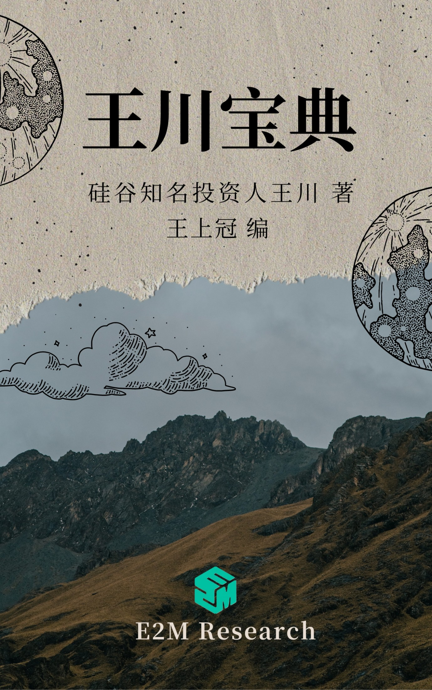

公众号懒人搜索，整理分享

# 写在前面

## 版权信息

#### 书名：王川宝典

#### 作者： 王川

#### 分享公众号：懒人搜索

#### 发行时间：2024-01-18

#### 本书由 E2M Research 进行制作与发行

#### 版权所有·侵权必究

* * *

## 关于王川

独立投资人，现居美国硅谷。中国科技大学少年班 87 级，罗切斯特大学材料学硕士，乔治亚理工学院计算机硕士。自 2015 年起在互联网上通过微信公众号 investguru 发布上百篇财经科技内容的原创文章，并在微博“[硅谷王川](https://weibo.com/u/5339148412)”和推特[@Svwang1](https://twitter.com/Svwang1)上获得百万关注。

## 说明

本书在制作时收录了王川自 2015 年起分享的公众号文章，微博，和推文。本书的内容经过搜集和整理而成，所有片段均有其固定语境，且整理时难免有纰漏，望读者知悉。

## 编者的话

也许很多人和我一样，对王川的第一印象是成功的硅谷投资人，很早实现财务自由。而当我真正沉下心来研读王川过去九年的文字，才发现他更是一位优秀的创作者和生活哲学家。起初我犹豫是否要接下这本书的编排工作，毕竟依照王川的内容产出速度，即使是每日整理也是不容小觑的工作量，何况他的内容涉猎之广，让我在关联不同主题上着实犯了难。不过当我开始着手这项工作，才发现我不由自主地跟随这位引路人，开启了一次思维升级之旅。我佩服他十年如一日笔耕不辍，从未停止思考和写作；佩服他不畏表达标新立异的观点，哪怕会招致误解；更佩服他敢于承认自己的无知，在交流中精进自己的认知体系。同为内容创作者，我深知常年保持这样高密度高质量的内容创作需要投入多少心血，所以希望把王川的优质内容整理成书，让更多的人受益。特此感谢我在 E2M Research 的朋友兼同事[Odyssey](https://twitter.com/OdysseysEth)与[董真](https://twitter.com/zhendong2020)，在编排过程中慷慨予我鼓励与建议。

在编辑这本书的过程中，我也不断从中汲取养分。因为王川的内容，我不再执迷于追求世俗意义上的成功，而是把时间自由和身体健康放到了第一顺位；在内容摄入上不再仅凭兴趣阅读，更有意识地搭建自己的知识体系；舍弃不必要的人际关系，结识了更同频的伙伴们，并与他们一起补全自己世界观的拼图。 毫不夸张地说，本书将会对很多读者产生深远影响，陪伴他们渡过人生中的重要节点，并从此以崭新的目光看待世界。

高山仰止，景行行之。虽不能至，心向往之。

王上冠  
播客：[咸鱼罐头](https://www.xiaoyuzhoufm.com/podcast/5eb9eec1418a84a0461b1732)  
2024 年 1 月

* * *

# 第一部分 财富

> 最大的财富是闲暇时间。

* * *

# 1.1 赚钱这事，不可入戏太深

## 1.1.1 赚钱这事，不可入戏太深

2015 年快过了九个月，我周围认识的熟人，已经有三位不幸去世。都是四十岁上下的年轻人，平时看上去没有什么大问题。都是努力工作，过于劳累，缺乏睡眠，疏于健康维护，导致心血管方面的疾病，突然去世。

这种事情发生后，许多人通常会感叹几声“一路走好”，“健康最重要”，但过了几天，又故态复萌，回到原来的暴饮暴食，起居无常，操劳过度的不健康生活方式上。

所有对于赚钱，对于财富的追求，本质是希望解决下面这个问题：

生活可以不那么辛苦，不用被迫做自已不愿做的事情。

我把这个目标简化成四个字:

**不累，自由。**

赚钱只是为了实现上述目标的手段。

再仔细看看上面四个字，如果你只是为了赚钱，而偏离这个最终目标太远，你的路可能走偏了。

实现这个目标有很多种做法。

传统的想法是，拼命工作，赚很多钱，到 65 岁攒够了，然后退休，度过余生。运气好的人，退休后不会马上挂掉，还能出去走动十几年。

运气不好的，很早就挂掉了，即使到了 65 岁，也浑身是病，无法像年轻人一样活蹦乱跳地正常生活。

今天的经济全球化和科技的迅速发展，使得实现 “不累, 自由” 的目标有许多新的路线的可能性。

在分析这些新的路线图之前，让我先来讲讲千斤顶。

有多少人知道可以把汽车抬起来的千斤顶的工作原理？

千斤顶的运作，依赖于两个重要的原理。第一个原理，是大多数人熟知的，所谓的机械增益，大致意思就是省力的机械费距离，省距离的机械费力。普通人双臂无法把汽车托起来，但是通过千斤顶的螺丝，缠绕发力，可以慢慢地把汽车顶起来。

但是另外一个重要的原理，许多人没有意识到的，是螺丝的自锁功能。

传统的简单机械，如杠杆，滑轮, 一旦停止用力，拉起的重物又会滑下来。

螺丝表面由于静摩擦力，千斤顶把车抬起来后，即使人不再用力，车还是会被支撑住，千斤顶不会倒退下滑。

自锁功能让你用千斤顶把车抬起来的过程中，可以工作一会，休息一下，再回来工作。

理想状态是，你生活工作中选择做的所有事，既有四两拨千斤的机械增益，又有进退自如的自锁功能。做一件事，可以选择休息离开一阵子，事情的进度不会因此受影响甚至倒退，什么时候休息好了可以回来精神抖擞地继续工作。

如果你做的事，是个逆水行舟，不进则退的事情，必须你亲自不断事必躬亲地，费力地维护，那这就不是一个理想的事业。

## 1.1.2 从德川家康的故事谈起

在中外的许多商业杂志上，常常会看到这样的排名：三十位三十岁以下的创业者，四十位四十岁以下的亿万富翁，不一而足。这类排名，通常都是杂志进行商业炒作，来牟利的重要手段之一，但如果太当真，就是你的错了。

这类排名的一个最重要的内在逻辑是，成功得越早（且不论其衡量成功的客观标准是否精确），以后越可能有更大的成功。因此，你现在再不疯狂创业，努力奋斗，你就老了没有机会了。

这个逻辑的重大缺陷是，成功有很多外因和内因，时机和运气也很重要，人生的发展是非线性的，会有很多曲折的。时机不成熟，自己的本事不足时不去练内功，而是盲目透支体力去出击，更可能的下场是累死。真正的好机会来的时候，早已无力把握了。

我想起四百多年前的日本，丰臣秀吉和德川家康的故事。

德川家康关于人生曾有两句话的箴言:

**向上看，不忘自己限度。**

德川老师不是一直这样的。年轻时受了成功学的激励，只知道“向上看”。 他一路打打杀杀过来，渐渐积累了一些军队和地盘。但 29 岁时在著名的三方原会战中，德川遭敌军追击逃命，吓得拉裤子，一度想要剖腹自杀。他后来让手下画下自己愁苦的样子，用来激励自己。此画称为“颦像”，流传至今。

这段刻骨铭心的经历一定让他清醒意识到自己的限度，在此后的发展中养成了灵活务实的态度。

丰臣秀吉在统一日本的过程中，曾经和德川家康直接发生军事对决，各有胜负。硬的不行丰老师开始来软的，先强迫自己四十四岁的亲妹妹离婚，塞给德川做继室。 再把七十三岁的老妈送到德川的领地当人质来表示自己诚意。为了霸业出卖自己的亲妈，丰老师也是够拼的了。

德川归顺丰臣后，分封到江户一带（今天的东京)。

丰老师成为日本首富后，为了在六十岁之前成为亚洲首富，满足手下武士日益增长的对土地的渴求，1592 年派大军征伐朝鲜。

“我就在这里静静地看你装逼。” 望着西去的浩浩荡荡的船队，这句话，此刻也许最能描述德川的心情。

平心而论，丰臣秀吉侵朝，进而染指中国大陆，不是没有可能性的。三百年后的另外一场军事赌博，甲午战争中，日方大获全胜。

但丰臣高估了自己的扩张限度，而万历年间明朝的军事动员能力，和最高层的战争意志，被他大大低估了。日方虽然在一些局部战役中取得胜利，最终仍然输掉了战争。丰臣的 1598 年的突然病逝只是加速了这个结局而已。

中日战争期间，德川统领的部队未被征调，而是在日本本土负责守备工作，默默积攒培养自己的实力。丰臣病逝后，只留下六岁的幼子继承王位。德川家康作为托孤的五大老之首，机会终于来了。

此后德川家康逐步巩固自己的实权，最终于 1615 年七十三岁时灭掉丰臣家族，开创了历时两百六十多年的德川幕府。他也成为司马懿灭曹爽以来，亚洲第二位创业成功的古稀老人。

德川家康后来留有几句家训，一曰“人生有如负重致远，不可急躁”, 二曰“视不自由为常事，则不觉不足”，三曰“只知胜而不知败，必害其身”。 这几句话也许对着急发大财，以登福布斯富豪榜为唯一人生目的朋友们有点借鉴作用吧。

## 1.1.3 Narrative, 三观和雅浦岛上的石头

  
(01)

英文有个词，叫做 narrative，中文有翻译为“叙事”, 也有翻译为“三观”，可以理解为对事情的一种描述和思维框架。 同一件事，对于不同的观察者，可能会有完全不同, 但又可自洽的 narrative。

大多数人，每天上班，开车在路上来回两个小时，公司里工作八个小时，这是自己理解的框架。

但是如果对于一个远处观测的外星人，他看到的则是另外一种荒唐但仍可自洽的景象: 地球上几亿象蚂蚁一样的动物，每天从自己的窝里爬出来, 钻到一个甲壳虫里，关一个小时，被甲壳虫运到一个监狱里关八个小时，出来后又被甲壳虫带回老窝。

(02)

有一个有趣的案例，在西太平洋的介于菲律宾和关岛之间的雅浦(Yap)岛。岛民在二十世纪之前的几百年，把一些圆盘形的石头中间钻孔（石头直径从半米到四米不等），当做货币来交换。这就是著名的雅浦岛石币。

石币的实际交换过程中，由于太重不适合直接搬运，只需要口头承诺转移产权，获得大多数岛民认可即可。

1898 年西班牙打仗输给美国后，把雅浦岛卖给德国人。德国人上岛后需要人力修路，这样可以开车。 但是岛民终日以步代车，对德国人的要求无动于衷。

德国人想尽办法，最后在石头上用油漆涂上黑色十字架，这才彻底颠覆了岛民的三观，因为他们觉得涂黑了的石头意味着德国人控制了石头的产权。岛民为了重新获得对石头的控制权，被迫参与了修路。

一战后日本从德国人手中抢夺了岛屿，大量石币被运走用于军事建筑目的。今天的雅浦岛，现代货币已经在日用中取代了石币。但石币在部分岛民的传统婚嫁和其他重要社交仪式里，仍然是一种价值交换的媒介。

实际上，普通人的金钱观，又真正比雅浦岛上的岛民高明多少呢？如果外人哪一天把你心中的财富涂成黑色，你在三观一夜之间被颠覆时是否还能淡定？

(03)

当人们入戏太深，沉浸于形式无法自拔时，往往忘记了赚钱原来的目的。更重要的是，当形势变化，技术进步引领新的生活和思维方式时，固化在大脑里的许多观念和 narrative，除非有意识地下大决心改正，是很难被自行抹去的。

大多数人，成长过程中被灌输的 narrative 是: 读书十几年，工作几十年，攒了一些钱（实际上那都是银行电脑系统里的一些数字而已）, 然后安度晚年。

如果出现某种突发的不可抗事件，银行电脑里的数字被突然清零，自己突然一无所有，过去几十年理解的 narrative 突然被打破，那么悲痛之余，发生精神疾病几乎不可避免。

如果说赚钱为第一要务的 narrative 太片面，那么更贴近生活更加客观的思维框架，我把它叫做“王川框架” （如前人有雷同理论，一定纯属巧合）， 是这样的:

**解决各种实际问题才是生活的第一要务。**

**解决问题之前，首先要发现，定义你要解决的问题，分清主次，定期修正。 赚钱只是诸多问题中的一个，许多时候甚至不是最重要最迫切的。**

**实际问题，不是一些简单的表面上的痛点，而是痛点之下更本质的需求。**

**问题定义好之后，赤膊上阵直奔主题不一定是最好的方法。 先要思考解决问题的工具，利其器后方可善其事。**

**大部分时间应当用于“磨刀霍霍”利其器，等到真正需要“向猪羊”时，则手起刀落，易如反掌。**

## 1.1.4 人生不可用力过猛

芈月的老公的儿子（惠文后所生）秦武王，本名嬴荡，身高体重，爱好和人比力气。结果和手下比赛举鼎时，两眼出血，鼎砸到腿上，当天就死了。举重，练倒立的，铜管乐器手，容易得青光眼甚至失明。 ​​​  
大概原理是: 用力时如果屏住呼吸，会压迫血管，提高眼压，压迫视觉神经太厉害了，视觉神经纤维就坏死，导致失明。人生不可用力过猛！

* * *

# 1.2 做一个时间富有的人

## 1.2.1 做一个时间富有的人

人对金钱的需求是有限的。但做一个时间富有的人，到后面越来越重要。比尔盖茨比我大将近二十岁，但我的时间富有程度可能要比他多远不止二十年，因为未来几十年内生物医学科技的发展进步，可能导致人类寿命长度的上限，出现较大幅度的跃迁，这是多少钱也换不来的。

现在可以做的：间歇性断食拉长到一天二十小时，偶尔可到三十六小时达到细胞自噬，经常户外爬山，晒一点太阳但又要注意不要过头，适度运动但又不要太激烈。少吃肉，少喝酒。多研究测试，适度打破常规的禁忌。

If you focus on extending your lifespan, there is always the next game and paradigm to play with, and FOMO will be a moot point. 如果你专注于延长寿命，那么总能赶上下一场游戏和范式转移，没必要 FOMO (唯恐错过)。

## 1.2.2 最大的财富是闲暇时间

最大的财富是闲暇时间，对闲暇时间的最大杀手是一对一的交流，给一个老板打工，或者做一次只能卖给一个客户的定制服务。

有更多的闲暇时间，才能深入思考更多前瞻性的问题，才能避免重大战略性的浪费和失误，从而有更多闲暇时间，形成良性循环。警惕任何可能打断这种循环的行为误区。

## 1.2.3 更多的金钱不是最终的目的

巴西企业家 Ricardo Semler 说，当利润超过一个基本最低值后， 更多的利润并不是保证企业生存所必须的。不惜代价而单纯追求更多利润，好比发现监狱里有空的牢房，然后认为没有抓足够多的犯人一样。对于管理监狱的政府而言，目的不在于抓更多犯人来降低牢房的空置率，而是努力降低犯罪率，减少犯罪对于社会造成的损失。

同理，当收入超过一个基本值满足基本生活需要以后，更多的金钱不是最终的目的，而是提高赚钱的效率，不断增加私人自由支配/做自己想做的事的时间。

这个概念可以叫做 minimum viable profit (最小可得利润)。但是如果盲目以扩张为目的， 那么可能不再 viable (可得)，或者不再 profitable (划算)。反之，保持自身的效率和灵活性， 更多的利润迟早会自然涌现。

## 1.2.4 最重要的冗余是时间冗余

最重要的一个冗余是时间冗余，有大把的闲暇时间去做自己愿意做的事情，而把在不愿意做的事情上耗费的时间尽量压缩到接近于零。

时间冗余的第一个杀手是：浪费时间去辩论，或试图说服认知不同的人接受自己的观点。

时间冗余的第二个杀手，是没有把自己经常要做的一些事情自动化，然后发现自己忘了，又要耗费时间精力再人工干预。

时间冗余的第三个杀手，是没有注重于可以不断多次重复使用，积累的行为；而耗费大量精力在低价值，无法重复利用的行动上。

时间冗余的第四个杀手，是没有勇气和意愿隔断各种低效甚至有伤害性的社交应酬，让一些蠢人随便地接近你的空间，或者允许一些群体的错误风气潜移默化地干扰你的独立思考。

时间冗余的第五个杀手，是没有注意“节制饮食 - 适度运动 - 充足睡眠”。随着年龄增长，各种肩酸背痛，视力下降，神经衰弱，高血糖血脂，心血管等毛病不断加剧，恶性循环，脾气也越发暴戾，迅速滑向老年痴呆，成了一个事实上的废人。

时间冗余的第六个杀手，是本来可以花 N 个小时把一个事情做得差不多足够好就收手了，硬是要花 3N，4N 甚至更多倍的时间，仅仅把效益再提高百分之几而已，甚至画蛇添足，多余的努力反而把事情搞砸了。 美国 95%的共同基金十年的长期回报无法跑赢标普 500 指数，剩下 5%的基金的平均年化收益一般也就比指数多不到 1%而已。

判断自己"时间冗余"的水平的一个角度是，你如果什么都不做，一个月，三个月，甚至像 Rip Van Winkle^(\[1\]) 一样沉睡多年再醒来，你的状况（财务或者别的方面）是不是可以维持现状，甚至会变得比现在更好? 如果有哪些地方需要人工干预，是否可以现在就未雨绸缪，把它预先自动设置好？

“时间冗余”并不完全等同于“高效率”，另一个角度是当意识到自己的方向是错误的时候，可以迅速调整纠错的能力。如果方向错误，意识到错误后因为各种限制而无法迅速抽身离开，那么不管效率多高，也是枉然。

任何事情，如果不能随时抽身离去，而要时常事必躬亲，是一个潜在的时间上的负资产，是对时间冗余的巨大损害。往往一开始没有在意，出了问题后才意识到代价巨大。

还有一点，千万不能随意接受任何人给你设定的某个截止日期，这样人为摧毁自己的时间冗余，可能酿成大祸。多年前我有一位长辈，被人催着要去参见一个会议，天气不好还要着急赶路，遇上车祸，不幸去世。

* * *

1.  Rip Van Winkle 是美国同名短篇小说中的人物，吞下烈酒后在卡茨基尔山脉沉睡，错过了美国独立战争之后。他在 20 年后醒来，发现自己身处一个截然不同的世界。

## 1.2.5 给自己太多时间压力，就是减少自己的选择权

(1)  
给自己太多时间压力，就是减少自己的选择权。这种坏习惯积累久了，会有一天把自己置于没有任何选择的地步，从而造成无法挽回的重大损失。

同样一件事情，如果有时间压力，就会非常痛苦烦躁; 如果没有任何时间压力，洗碗，叠衣服等等家务，也可以感觉和冥想没有太大差别，还可以顺便把事干了。

同样是运动，比如游泳，如果老惦记着要计时，就会觉得不爽，变成了一个任务。如果随意一些，没有时间压力，就可以玩很久而不觉得枯燥。

类似的还有旅游，如果跟着导游每天赶路，算时间，填鸭式的旅游，总是感觉哪里不太对，心情没有那么舒畅。但如果更随意一些，则会回味无穷，乐此不彼。

提高生活质量的一个角度，是把有时间压力的活动，尽量压缩到日常的 10%以下。这样可以保持比较长久的内在动力。

(2)  
意识到过去几年自己在不同领域的一些意想不到的进步，本质都是因为有闲暇时间，所以就可以东摸摸，西碰碰，摸索出来一些新的发现，有效提高自己的能力，改善自己的学习或生活环境。

让自己有很多闲暇时间，本质等于给自己去杠杆。整天忙得昏天黑地，本质等于满仓投机，这样就没有任何冗余，来应付未来注定要发生的各种意外事件。

世界是个巨大的 fitness landscape (适应度地形)，我们本质都是在上面做各种 stochastic gradient descent (随机梯度下降) 计算的小爬虫而已。区别在于，有的爬虫接触数据多，维度高，计算效率高，因此长期的实质性进步更快。有的热锅上的爬虫，看上去很忙，爬得很快，但只是在团团转，做无用功而已。

* * *

# 1.3 陈旧的财富观念

## 1.3.1 很多低维度的"资产"并不是资产

很多低维度的"资产"并不是资产，而是负担。 比如美国大部分商业房地产，房产信托，2020 年疫情来临后，价格普遍在一个多月内下跌 40%以上，甚至有的一个多月内暴跌 80%以上。

幼稚的投资者以为自己购买的是一个有着稳定现金流的东西，但是不理解其现金流来源的维度单一，外界扰动可以瞬间让现金流归零，但各种费用，税务，保险等等一分钱还不能少。等到出了问题后，往往已经太晚了。

## 1.3.2(a) 攀比是封闭社会的习惯

(1)  
和他人进行金钱，地位或者名气等等的直接实时的攀比，是封闭社会的习惯，在指数增长的开放世界里会非常可笑。

而且以这种直接攀比来指导自身策略的制订，往往自乱阵脚，适得其反，事倍功半。

正确的观察角度和衡量标准应当是这样的:

1.  你是否可以健康地生活更多年，因此可以接触到更多潜在的指数增长机会?
2.  你如何能够选择周边的环境和信息输入渠道，改进自己的日常习惯，这样可以了解和接触到更多的潜在指数增长机会?
3.  根据你现在收集的所有最新信息，有没有比你现在做的事情，确定性更大潜力更大的指数增长机会? 如果有，为什么你现在还不能切换过去?

任何无法指数增长的事业，很容易成为时间和精力的泥潭，有机会一定要立刻逃离。

对于甘愿在回报递减的泥潭里折腾的人，不管他暂时光环多么亮丽，地位多么高，资源有多少，不必羡慕，也不必把他太当回事。

(2)  
幸福就是全面的，长期的指数增长。所谓中年危机就是找不到增长点了，也不知道如何真正有机的增长，想拆东墙补西墙寻求表面的增长，反而在泥潭里越陷越深。

可以用投资领域的估值思路来看待自己，而不是“当前有多少存款”这种时间切片指标。

“时间切片指标”这个词非常贴切，这种人为定义的，静态的概念，误导了多少人的评估和决策体系。

(3)  
什么样的环境很难产生指数增长? 第一是有资源瓶颈或者其它限制自由贸易的瓶颈，完全无法绕过去。第二是信息传输成本，交通运输成本高，而且因为各种瓶颈的因素，成本降不下来。第三是人口和市场缺乏增量。长期在这类环境生活，大脑会僵化，习惯零和博弈的哲学，完全无法理解"指数增长"的概念。

我们一厢情愿设想的指数增长方式，往往是“有心插花花不发”。而一旦观察到“无心插柳柳成荫”时，一定要虚心研究其底层逻辑，跃过临界点后要尊重现实，果断跟上。幸福的源泉，来自果断放弃“花不发”，而在第一时间理解并跟上“柳成荫”。

指数增长的神奇，在于常会出现几个月的财富增长超过以前几十年全部积累的现象，而且这种现象，在新兴产业涌现时，屡次发生。重要的课题是理解底层机制，区分伪增长和真正的指数增长，区分有很大潜力的指数增长和昙花一现的泡沫。真正理解机制后，人就不急了。如果你急着要发财，实际上还是没弄懂。

## 1.3.2(b) 正确的攀比方法

正确的攀比方法是在经验和方法论上和世界上各行业最优秀的人攀比（学习），在最终的结果上和过去的自己攀比。

普通人的直觉是在结果上羡慕那些外表最优秀的人，试图和他们攀比，每天看到巨大的差距，就无比焦虑。但并没有试图去理解和学习底层真正的方法论，所以这种焦虑变成一种空中楼阁式的驱动力，好比汽车设在空档上还不断踩油门，费了很大劲仍然没有进步，甚至最终损耗更多。

一旦进行错误的攀比，就等于要强迫自己在规定时间内完成一个不可能的任务，就势必对身心造成严重的，甚至不可逆的损害。反过来，正确的攀比，你很清楚自己在不断进步，过了某个无法事前预测的节点后产生非线性突变，得到了丰硕的成果，然后会发现那些以前你曾经羡慕的别人的成就，已经让你无感了。

## 1.3.3 所谓"搞钱"

中文社区有个常见的词叫“搞钱”, 窃以为这种思维存在框架性的错误。如果你做事的效率和别人差不了太多，再怎么搞也搞不了多少钱。但如果你可以把你做的事在各个层面规模化扩展化，能不断重复引用，在更大规模的用户或读者群上分摊成本，日积月累，那么你的效率自然越来越高，钱就自然来了。

如果效率没有比别人有明显的几倍以上的优势，实际操作上大概率就是在自欺欺人的瞎搞。

## 1.3.4 陈旧的资本概念

如果资本效率提高一千倍，资本家就没那么重要了。未来属于智本家。 ​​​

“按小时付报酬”这种理念是蒸汽机出来工业革命普及，农民大量涌入城市找工作之后才有的。在此之前大部分人都是在农庄里，太阳升起后干农活到天黑，不会有按小时打工的概念。同理，现在很多关于资本市场的框架和概念，也会因新技术革命和新的信息基础设施涌现，而迅速过时。

按年，按月付利息，信用评级等等都是一些陈旧的概念，实际资本利用效率极低。

工业革命早期两大问题: 污染和童工。但这些问题并不会阻碍工业革命向前发展和巨大效率提高。

* * *

# 1.4 财富和金钱的本质

## 1.4.1 财富的本质

财富的本质是能量和信息的效率。只要别人的能量和信息技术的效率超过你，你的东西很快就一钱不值。

财富的积累，不在于你局部的事情做得有多好，而在于:

你做的东西是不是世界上最好的?  
如果（大概率）不是，那么世界上最好的系统上的资产，你是否有参与进去，让自己也分一杯羹?

财富的迁移往往是看不见的，突然的跃迁。

随时准备抛弃过去，跃迁到能量和信息效率更高的系统上。

## 1.4.2 金钱的本质

金钱的本质，是对稀缺的资源，尤其是大众都想获得的稀缺的资源的控制力。AI (人工智能) 将不断重新定义稀缺资源，所以不要光盯着传统意义上的金钱的定义，要不断设身处地地体验和想象 AI 创造的新的场景，在这些场景下什么是“长期的强稀缺的资源”，这样可以提前从容布局，有更多时间睡觉休息。这个问题会有应当不只一个答案。应当还会浮现出一两个新的古怪的东西，不在传统的思维模型之内。

## 1.4.3 赚钱的本质是为了让自己增加选择权

赚钱的本质是为了让自己增加选择权；但让自己增加选择权的事情不一定都赚钱，甚至需要一定的投入。如果增加选择权和赚钱，两件事发生冲突，选择权永远优于赚钱。

但有的时候人们常常被赚钱的幻觉所诱惑，悄悄地不断放弃自己的选择权，到最后又亏了钱，又丧失了选择权。

警惕那些以各种利益的诱惑，悄悄剥夺你的选择权的人和事。

投机时用杠杆，就是悄悄地放弃了自己的选择权。据说巴菲特曾说过，“如果你聪明，你就不需要用杠杆；如果你傻，那就更不能用杠杆了”。

## 1.4.4 财富的增加来源于可组合性的增加

财富的增加，本质来自于增加自己和外部的可组合性。这种可组合性本质来自于开放的，难以被外力破坏的自由连接。任何为了短期利益而减少自身可组合性的行为，最终必被反噬而得不偿失。

* * *

# 1.5 具体投资标的分析

## 1.5.1 亚马逊

### (1) 被误读的亚马逊帝国

注：本文写于 2015 年，部分数据为历史数据。

2000 年 12 月。美国阿肯色州，Bentonville。 这里是零售商巨头沃尔玛的老巢。这是一个初冬的晚上，几个带着墨镜的彪形大汉开着三辆巨型雪福来 SUV，把亚马逊的 CEO 贝索斯和他的两位副手从旅馆带到沃尔玛 CEO 李斯考特的家中，商议两个公司可能的合作，有可能让亚马逊来运营沃尔玛的电商网站。

那时亚马逊还是一个以卖书为主的电商新秀。高科技泡沫从 2000 年开始破灭之后，其股价已经从 99 年的最高点缩水了 80%。沃尔玛作为全球零售业的巨头，市值是亚马逊的二十多倍。

斯考特对贝索斯介绍沃尔玛的广告和定价策略时说, “我们在营销上花的钱只有预算的 0.4% 。 大部分都是在报纸上告诉人们我们店里有什么。 剩下的营销经费我们用于降低价格。我们的营销策略就是价格策略，每天都是最低价”。

三个小时的会面最后没有什么实质性的结果，临走时，斯考特问了贝索斯一句，“我们有没有什么更加深入的，战略性的合作可以考虑?”

多年以后当事人回忆，都说斯考特在暗示收购亚马逊的可能。当然贝索斯肯定不会卖掉自己的公司，而沃尔玛也最终没有把自己网站运营的业务外包。

十五年后。2015 年七月二十三日。亚马逊宣布财务季报后，出其不意的宣布了季度盈利九千多万美元。次日股票飙升接近 20%。截止到八月二日，按照亚马逊的 536 元的股价，其市值超过两千五百亿美元，超越了市值为两千三百亿美元的沃尔玛，成为美国市值最大的零售商。

我们看看两家公司的关键指标的差别。

雇员数：沃尔玛两百二十万，亚马逊十五万，相差十五倍。

营收额：沃尔玛全年四千八百亿，亚马逊接近九十亿，相差五倍多。但沃尔玛的电商营收一年只有十二亿美元，还不到亚马逊 2007 年的水平。

利润：沃尔玛全年一百多亿美元，亚马逊则一直在微利和亏损之间徘徊。

但是在一个关键的指标，总体营收的增长速度上，沃尔玛和去年同期相比，下降了 0.1%。而亚马逊单季增长了接近 20%。

亚马逊财务报告的真正最大亮点，还不是微薄的盈利，而是它的云服务 Amazon Web Service (AWS)。

亚马逊的云服务从 2004 年开始筹划，2006 年正式发布以来，增长迅速，2015 年最新一个季度营收达到十八亿美元，比去年同期增长了 80%，运营收入接近四亿美元，很大程度上补贴了亚马逊在别的业务上面的亏损。

许多大企业和政府部门，从 Netflix，Pinterest 到 NASA，中情局，都是 AWS 的客户。而亚马逊自己的网站，则是 AWS 的最大使用者。

Amazon 的财务总监 Brian Olsavsky 介绍，最近一年 AWS 增加了三百多项新的功能和新服务，受到客户极大欢迎。对于客户而言，能够迅速轻松地修改移动自己网站的服务，是最最重要的。在价格方面，亚马逊过去十年降价近 50 次。

AWS 不是一个简单的云服务，它本质上是一个由开发者创建，为开发者服务的平台。亚马逊非常重视客户的需求和反馈，并且往往可以迅速地提供解决改进方案。

在云服务市场中，AWS 市场份额最近一个季度高达 29%，超过后面三名（微软，IBM，谷歌）的总和。

传统的 IT 公司以往蔑称亚马逊是“一个书店晚上业余做 IT”，现在不得不称它是“IT 公司顺便也卖书”。

过去十几年来，普通投资者大多因为亚马逊没有可靠稳定的盈利数据, 无法准确估值，而感到困惑。亚马逊的营收从 2004 年的六十亿美元增长到 2014 年的接近九百亿美元。但利润在 2010 年达到每股 2.53 美元的最高纪录后，过去几年一直在微利和微小的亏损之间徘徊。公司不断把利润投入到新的产品和服务开发之中。

2001 年初，互联网泡沫破灭的时候，亚马逊现金流吃紧，为了尽快实现短期盈利，公司财务总监说服贝索斯悄悄把部分书籍的售价提高。 但是不久，在贝索斯和 Costco (好事多) 的创始人之一，Jim Sinegal 会面之后，他又改变了主意。

Sinegal 在给贝索斯介绍自己的商业模式时说: “客户的忠诚度是最重要的。好事多所有的产品价格都只比成本高 14%。即使有时可以多赚，也不会这样做。好事多的利润主要是来自于每年的会员费。但是客户知道，他们来好事多买东西，肯定都是非常便宜的。最终，由于每个客户购买量大，好事多再以自己的巨大体量，向供应商施压，要求获得最低的供货价格。 ”

Sinegal 说，“我的哲学是，价值胜于其它所有东西。人们来我们这里买东西，是因为我们提供价值。我们坚持每天做到这一点”。

这次会面后不久，2001 年七月，亚马逊宣布对于书籍，音乐和录像全面降价 20-30%。贝索斯对华尔街分析师介绍，“世界上有两类零售商，第一类总是想如何多收客户的钱，第二类则是想如何降低客户的价格，我们要做第二类公司。”

电商业务中，如何优化送货的速度和成本一直是个挑战。2005 年初，亚马逊推出 Prime 会员服务，年费最初 79 美元，保证所有送货两天内可以到达。服务推出后，Prime 的会员平均比普通买家消费高两到三倍，他们就像一个本来去好事多 (Costco) 只要买啤酒的顾客，出来时又顺带买了几盘 DVD，几斤牛排和一台电视机。

Prime 会员购买更多的产品，又吸引更多第三方卖家通过亚马逊囤货和发货，这一切都极大增加了亚马逊的运营利润。

贝索斯没有忘记好事多的 Sinegal 给他的忠告：不断给客户提供价值。今天亚马逊的 Prime 服务，除了最初两天内到货的福利外，还包括了：

1.  大量免费的影视录像可直接在网站上观看
2.  上百万的歌曲直接在云端播放
3.  免费在云端备份照片
4.  可以从 Kindle 的网上图书馆一个月借一本书

对于亚马逊来说，除了自己已经接近垄断的电子书领域外，在影视录像和音乐市场占据一席之地，不让客户流失，同等重要。把多余的利润投入到这方面的战略布局，是毫不犹豫的选择。

这一切都加强了客户的忠诚度，今天，亚马逊 Prime 的会员已经超过两亿。

亚马逊不断成长的过程中，和沃尔玛在各方面冲突的情况慢慢增多。

Quidsi 是新泽西州的两个创业者在 2005 年成立的公司，主要面对产妇提供一系列新生儿需要的产品，包括尿布，奶粉和其它婴幼儿用品。公司成立四年，年销售额迅速增长到三亿美元。

2009 年亚马逊开始注意到这个公司，并且在这个领域开始与其竞争。双方高层此间有过短暂接触，但是 Quidsi 此时还不愿把公司卖掉。

在亚马逊介入这个市场之后，Quidsi 的增长开始减缓，管理团队决定考虑出售公司。沃尔玛董事会成员之一，Jim Breyer，所属的风险投资公司 Accel 是 Quidsi 的投资者之一。Quidsi 和沃尔玛高层接触磋商，要价九亿美元，但沃尔玛犹豫半天，开价远远低于此数。

Quidsi 于是回过头和亚马逊联系，2010 年九月初，两位创始人飞到西雅图和贝索斯会面。会见当天早上，亚马逊推出面向产妇的促销活动，一包在 Quidsi 网站上卖 45 美元的尿布，亚马逊最低只要 30 美元。按照 Quidsi 的计算，亚马逊在尿布这一类商品上，三个月要亏损一亿美元。这是贝索斯给对手的强烈信号，如不就范，就在市场上烧钱拖垮你。

贝索斯和 Quidsi 的创始人会面后，达成初步协议。亚马逊有三周的时间，用来研究 Quidsi 的财务数据，然后报收购价。协议还规定 Quidsi 必须把其他竞争对手的报价转告给亚马逊。亚马逊最终报价五亿四千万美元，要求 Quidsi 四十八小时内回复。沃尔玛得知后, 终于开出六亿美元的收购报价。

亚马逊得知沃尔玛的报价后，对 Quidsi 施加巨大压力，如果他们胆敢卖给沃尔玛，亚马逊会启用核武器：在网上卖免费的尿布，直到把 Quidsi 的生意拖垮。

Quidsi 的董事会担心，即使接受沃尔玛的收购报价，在沃尔玛尽职调查期间，如果因为亚马逊的市场压力而导致财务数据一落千丈，可能收购会竹篮打水一场空。最终 Quidsi 屈服于亚马逊的软硬兼施，双方 2010 年 11 月初达成了收购协议。

这就是沃尔玛在电商世界近身肉搏时，面对的凶猛的竞争压力。任何犹豫和软弱都将让对手一点点蚕食自己的地盘和优势。

沃尔玛 (2015 年) 上个季度税后盈利一股 1.03 美元，但是一年给股东的分红就有 1.96 美元，大约六十多亿美元。也就是接近两个季度的盈利都用来给股东分红了。食物杂货业 (Grocery) 的营收占据沃尔玛 56%的份额，在这一块它现在也面临来自亚马逊等公司的竞争压力，必须加大投入才能保证不丧失市场份额。

这是一场沃尔玛不能输的战争。亚马逊和其他公司在这个市场的任何圈地和扩张，都会挤压沃尔玛增长的速度，甚至导致其营收的明显萎缩。萎缩的营收，甚至可能导致股价大幅下跌，分红减少，近四百多亿美元的债务降级，优秀员工离职等一系列连锁反应。

在食物杂货的当日上门送货服务中，目前几个主要的竞争者包括: 亚马逊，沃尔玛，谷歌快送和 Instacart。

亚马逊的送货服务，Amazon fresh，在 99 美元的 Amazon Prime 上还要再追加每年 200 美元的年费。每个订单至少要满 50 美元就可以免费送货上门。这个服务正在加州，西雅图，纽约等地区展开。

沃尔玛在硅谷的送货服务，无需年费，目前 125 美元以上的订单免费，否则每次送货还要另收五到七元的送货费。

谷歌和诸多线下零售店，包括好事多 (Costco)，Target 合作，在硅谷提供当日送货服务，年费只有 95 美元。每次最低订货金额只需 15 美元。送货不是搜索公司谷歌的主业，运送的货物价格相对于零售店没有任何加价。有人分析，谷歌也许这样做的动机是为了把握住一部分零售业的电商入口，不至于完全在这此处被亚马逊控制。

Instacart，这家成立 2012 年的公司，迄今为止获得接近三亿美元的投资，和诸多本地零售店合作，提供送货服务。

这是一场血腥的烧钱游戏。如果以史为鉴，这场游戏，最后生存下来的是那些专注的公司，那些财大气粗，能够自己控制货源，能够利用规模效应, 能够不断创新，建立起结构性优势的公司。

当年奈飞 (Netflix) 面对的是竞争对手是比自己体量大百倍的行业巨头百事达 (Blockbuster)，然而百事达内部的既得利益者不断拖后腿，后来股东为了短期利益，放弃大量现金投入不再和奈飞争夺市场，最后公司几年后宣布破产。

可以想象，亚马逊，利用其云计算的优势，书籍，音乐，影视录像市场上的优势，在无人机运货技术上的积累，在当日送货服务上积极寻找挤压对手的突破口。

现在沃尔玛一年十二到十五亿美元的电商的投入可能远远不够。毕竟，在电商这一块，它目前的营收只相当于亚马逊 2007 年的水平。

这个时刻需要的是焦土策略，忽略短期利润和华尔街的压力，不惜一切代价和投入，加强自己的结构性的优势，阻挡住竞争者对其龙头老大地位的挑战。但是沃尔玛的职业经理人，有这个魄力说服大股东们不惜一切代价支持他的长期策略吗？

2013 年底，贝索斯到南美洲的 Galapagos 群岛度假。这块地方隶属厄瓜多尔，岛上有许多奇特的物种，达尔文 1835 年乘船到此，获得灵感，写出了进化论。

在游船上贝索斯突然肾结石发作，腹部剧痛，厄瓜多尔海军调用直升机把他飞回基地，再转至美国本土。所幸治疗无需开刀动手术，贝索斯很快恢复了健康。

肾结石，来自于肾脏尿液中多余的矿物质，如果积累过多而没从体内排出，当直径超过三毫米时，可能导致输尿管阻塞，常见的症状有腰腹部绞痛和恶心等等。预防的主要措施是多喝水，控制饮食和适度运动。

这个世界，也许只有一颗小石头可以阻止贝索斯了。

### (2) 亚马逊的云服务将吞噬美国的 IT 产业吗? (上)

(1)

2015 年十一月，在纽约举行的 Dealbook 投资大会，著名对冲基金经理 Stanley Druckenmiller 发言谈到了 IBM。（Druckenmiller 曾为索罗斯的副手，1992 年亲自操盘卖空英镑，帮助索罗斯获利十亿美元。)

Druckenmiller 说，“如果你今天开一个公司，你不需要一个技术部，你不需要后台支持，你可以用 AWS（亚马逊的云服务）。顺便跟你说，AWS 可以把 10-15 个 IBM 的顾问撕成碎片。这些顾问你以前需要，现在不需要了，因为你用云计算。”

2015 年一月初时，IBM 的股票价格接近 160 美元。2016 年一月二十二日，其股价只有 122 美元。

巴菲特从 2011 年开始以 159 美元的价格收购了 IBM 的 5%的股份，其后不断增持。考虑到 IBM 每年的股息分红大约 3.5-4 美元，他的平均成本 140 美元以上。也就是说，五年之后，他的投资仍然浮亏 13% 以上。即使作为一个长线投资者，这个表现仍然差强人意。

巴菲特看到的是 IBM 在传统大客户业务上的垄断和高利润，但没有看到的是云计算，特别是来自亚马逊的云服务对整个 IT 行业的冲击。

Druckenmiller 接着说，“过去 19 个季度，亚马逊九次季度财报收入低于预期。他们不在乎。而 IBM 从 2006 年至今的九年来，只有三次收入数据低于预期。他们真的非常在乎季度财报”。

IBM 的营收从 2012 年的一千零二十亿美元萎缩到 2015 年的八百一十亿美元，研发费用也从 2012 年的五十八亿美元，下降到 2015 年的五十二亿美元。与之形成强烈反差的是亚马逊，其研发费用，已经从 2011 年的二十九亿美元，增加到 2014 年的九十二亿美元。

2013 年, 美国中央情报局决定，把部分信息管理业务外包给亚马逊的 AWS，而不是 IBM。这个合同跨越十年，价值接近六亿美元。

相关官员称，联邦政府不差钱，采用 AWS 的最主要的两个因素是：

1.  部署速度
2.  技术创新

（2）

什么是云计算？为什么它有这么大的魔力？

云计算流行之前，传统企业的信息软件管理是这样的：一上来就要自己耗巨资购买硬件，软件，并且雇佣大量工程师管理这些软硬件。软硬件的搭建更新，耗时费力，效率低下。

互联网的兴起，宽带传输速度的提高，和软硬件技术的进步，突然增加了这样一个可能性：把公司的信息管理服务外包给专门的公司。外包公司的服务器，数据存储，软件等等，在讨论中常被抽象为一个被云朵包裹的大杂烩，云计算因此得名。

云计算的核心优点是三个：

更快：可以几分钟内迅速地在云端部署和更新自己的应用服务软件。全球随时获取。

更好：可以迅速享受云服务商全面专业的功能，和技术创新的成果。

更便宜：不需要昂贵的起始资金投入。不用猜测自己的未来需求规模，按用量付费。

在 2015 年十一月的亚马逊云计算大会上，AWS 的大客户之一，通用电气的 CIO 提到，他们计划将把自己内部的数据中心从三十四个降到四个，其它全部移到 AWS 云端。通用电气的石油天然气开采业务，把软件管理系统搬运到 AWS 后，信息管理成本下降了 52%。任何软件更新，几分钟内就可以在云端完成，而以前这样的更新需要二十天。

最关键的是，AWS 和整个云计算的兴起，让公司把 IT 部门的一些工作，外包给其它做得更好的人，这样可以专注自己的核心竞争力。

亚马逊最近一个季度来自云计算服务的收入，年化后已经超过两百亿美元。这个数字远远超过了其他竞争者。

(3)

曾经在亚马逊工作了六年，2005 年跳槽到谷歌的软件工程师，Steve Yegge 在 2011 年的一封公开信内介绍：

“亚马逊的招聘流程本质上有缺陷。每个团队自己雇人，所以不同团队的员工招聘水准差别很大。亚马逊的办公场所，污垢遍布，不花一分钱用于装饰。亚马逊的程序代码一团糟，没有任何工程标准，完全看相关团队的选择。也许有两百个不同的角度方式比较这两个公司，但除了三个以外，谷歌在所有方面都完胜亚马逊 ”。

“但是亚马逊有一件事，做得非常非常好，这远远弥补了亚马逊所有的政治上的，哲学上的和技术上的失误”。

2002 年前后，贝索斯给所有员工发布了一个命令，关于内部软件设计的命令:

1）所有团队，要把他们的数据和软件功能通过服务接口对外公开

2）团队之间的沟通只能通过这些接口。

3）不允许通过任何别的方式通讯：不能直接连接，走后门，不能直接读别的团队的数据，不能共享内存。

4）服务接口的后端的软件技术的选择，没有关系。

5）所有的服务接口设计时，都必须具备一个能力，允许日后让外界第三方开发者调用。没有任何例外。

6）不听话的人，将被开掉。

打个比方，蒋介石当年常常越级指挥，自己支配部队，不告诉其部队长，到最后大家才发现自己部队不知在何处，这是兵家大忌。这就是典型的图省事，不通过标准的服务接口，直接走后门读取, 修改数据的低水平的程序员的做法。

蒋公的辩护者会说，许多高级将领指挥水平差，到最后却使得部队四分五裂，所以他只好亲自上阵，插一手去越级指挥，将部队整合起来。但从产品设计的角度看，这恰恰就是舍本求末的短视做法。

越级指挥的坏处，是增加组织的复杂性和脆弱性，蒋公如果不在，别的人不知道那些后门，无法学他越级指挥。 另一方面如果后门出现问题，蒋公的越级指挥也无效了。 而只有培养标准化的将领之间，上下级之间的沟通组织模式，才是建设一个高效灵活的组织的最重要的工作。

标准化的软件服务接口的建立，需要相当大的前期投入，短期内看上去吃力不讨好。但基础打好后，在此之上的软件应用开发效率大增。

亚马逊，这个遭 IT 界长期鄙视的书店，要开始真正发力了。

### (3) 亚马逊的云服务将吞噬美国的 IT 产业吗? (中)

(1)

传统公司的 IT 业务通常是这样搭建的:

需要存储设备的解决方案，从 EMC 那里买；

需要服务器，找 Dell，HP 或者 IBM 购买；

需要网络硬件，从思科 (Cisco) 那里买；

需要数据库软件，从甲骨文 (Oracle) 那里买。

当新兴互联网公司扩展自己的 IT 业务时，他们发现传统解决方案太昂贵了，而且无法迅速扩展到他们需要的规模。

以亚马逊和谷歌为代表的互联网巨头，决定另起炉灶。他们搭建自己的服务器，自己的存储硬件，自己的网络硬件，用开源代码开发自己的数据库软件。

但是亚马逊不满足于此，他把自己开发的云计算平台对外分享。

一家名叫 Baird 股权研究技术的公司在 2013 年的报告表明：企业在亚马逊的云端消费的每一块钱，相应节省了三到四元的传统软件和硬件的消费。

换句话说，如果 2016 年 AWS 的收入达到一百亿美元，那么相应的 IT 传统市场将会损失三百到四百亿美元的收入。

这就是传统 IT 软硬件公司：戴尔，EMC，惠普，IBM，甲骨文，思科，面临的挑战。

曾为 Elon Musk 作传的作家 Ashlee Vance，2015 年十月在推特提出这样一个挑衅性的问题：

“为什么 IBM，HP，EMC，Dell 和 Cisco 不合并，结束这种（被云计算取代的）煎熬？

合并后的公司名字该叫什么呢？

"Fxxked By The Cloud (FBTC，被云计算干掉了)"

截止到 2016 年一月三十日为止，FBTC 们的市值大约是这样的：(以十亿美元为单位)

IBM 118，惠普 17，EMC 47，思科 117，甲骨文 148。（戴尔已经私有化退市，不计入内）

五个公司市值总和不到四千五百亿美元。而亚马逊一家的市值为两千九百七十亿美元，相当于五家公司总和的三分之二。

但仅仅在六年之前，亚马逊的市值不到三百亿美元，低于当时除了 EMC 之外的其他四家公司。

(2)

2003 年，亚马逊的两位工程师，Chris Pinkham 和 Benjamin Black 在管理亚马逊后台 IT 系统时，突然有个想法。他们在自己的工作中，不断把系统标准化，把软件的接口更加抽象化，以增加系统的扩展性。他们给贝索斯提了一个建议：把这个系统标准化提高到到一定程度后，除了我们自己内部用，为什么不可以考虑，把系统的基础设施和服务器的计算能力也租售给别的公司使用？

贝索斯对这个建议非常感兴趣，2004 初开始推动 Pinkham 和 Black 实施这个方案。

2006 年 AWS 正式推出后，开始只是靠低廉的价格吸引一些小公司成为客户。

一直到 2009 年时，AWS 规模还是很小，可靠性也有待提高。它在计算安全性上没有达到企业级的水平，一些大企业需要的软件功能都不具备。

但是亚马逊非常注意聆听客户的建议，并且不断迅速地把改进意见变成新的产品功能。

亚马逊的 CTO Werner Vogels 提到，在一个传统的多数据中心的模式里，维护一个可靠，可扩展的 IT 基础设施耗费的时间和人力, 要占整个（软件开发，部署产品应用）的 70%之多。亚马逊起初预计云服务将会把这个比例下降到 30%。但实际部署之后，比例比这个数据又要更低。

大多数情况下，小公司到大企业，自己搭建的服务器，利用率常常不到 10%，而且波动很大。

外包给亚马逊的云服务，按用量付费，这个问题迎刃而解。

Vogels 说，“你必须停止浪费时间和精力，在那些对你的客户并不重要的事情上。这包括 IT 的基础设施。这不是你区别于（你的竞争者）的地方。。。如果我们（AWS）可以把计算和存储的价格降到足够低，你都不用担心这些问题了，你就可以建造优秀的产品。你将不再会被你的基础设施所限制。”

（3）

云计算的定义划分为三个层面。

最底层是“基础设施即服务”，IAAS (Infrastructure As A Service)，提供基础硬件服务，存储空间，让你运行虚拟主机和之上的软件应用。

第二层是“平台即服务” PAAS (Platform As A Service)，在 Iaas 之上提供软件工具，让你开发自己的应用软件，而不用考虑底层的东西。

第三层是“软件即服务” SAAS (Software As A Service)，在云端租用应用软件。广义的说，Gmail，Dropbox，微软的 office 365，还有 Salesforce 的 CRM 软件，都属于 SAAS。

主流的云计算定义, 只包括 IAAS 和 PAAS，在这个领域亚马逊独占鳌头，遥遥领先于竞争者。

研究机构 Synergy Research 的数据表明，2015 年初亚马逊在云计算的市场份额高达 29%，比后面三个竞争者微软，IBM 和谷歌的总和还要多。

研究机构 Gartner 的数据显示，2015 年 AWS 按实际使用量来衡量的规模，是其余十四个竞争者总和的十倍。

在 2015 年最后一个季度里，亚马逊来自云计算的收入高达二十四亿美元，这个数字比上一个季度增长了 15%，比一年前增长了 70%。云服务的运营利润六点八亿美元，利润率接近 29%。

(4)

一百多年前，辛亥革命爆发后，时任江苏巡抚程德全， 用竹竿到屋檐下挑落几块瓦片，以示除旧迎新。他然后在巡抚衙门前挂起“江苏都督府”的招牌，宣布加入革命阵营。

AWS 异军突起后，传统 IT 公司为了迎合华尔街对云计算概念的追捧，也纷纷挑落传统软件业务的檐瓦，挂上了云计算的牌坊。

微软本周声称在 2015 年第四季度所谓“智能云”的收入有六十三亿美元， 但这里面包含了一些来自如 Windows server 和 Exchange server 传统软件的收入，其实这些东西并不都在云端运行。

2015 年底 IBM 号称自己第四季度和云计算有关的收入达到一百亿美元，但是并没有细分哪些是硬件，哪些是软件，哪些是真正的云服务收入。

有分析师打比方，这就好像通用汽车公司卖自己的电车 Chevy Volt，但是它把用来拖运电车到经销商那边的大柴油卡车，也宣传成自己的电车的一部分。

展望未来，亚马逊和其它几个竞争者相比，有什么优势和劣势？

FBTC 俱乐部的小伙伴们，他们将注定落魄吗？

且听下回分解。

### (4) 亚马逊的云服务将吞噬美国的 IT 产业吗？(下）

（1）

云服务市场里， AWS 的最大的优势，在于其市场的领先地位和先发优势。

云服务把资金投入的风险从客户转移到服务商那里。建造一个全球化的数据中心，功能全面的软件系统，稳定可靠的运营纪录，贴心的客户支持，需要几十亿美元量级的资金投入，和长期的积累。

据亚马逊内部数据, AWS 现在每一天增加的服务器数目，足够承载 2004 年整个亚马逊公司的计算需求。

这不是阿猫阿狗，拿几千万美元风险投资，就可以一两年内做成的事。

后发者还必须有足够多的资金，忍受长期的亏损。

作为美国最大的零售商，亚马逊自己也是 AWS 的最大的客户之一，他真正理解，运营部署云服务中间的各种细节问题。

市场的老大，还可以利用规模效应，向下游的供货商（芯片商，存储硬件公司，等等）索取最优惠的价格，进一步巩固自己的优势。

（2）

传统软件公司，为了粉饰自己的新业务的业绩，常见伎俩是这样的：

一个软件公司原来从一个客户那里每年获得三百万美元的收入，迫于竞争压力，他跑去对客户说：现在把你的软件价格降为一年两百万美元，顺便再给你提供五十万美元的云计算服务，OK?

客户看到自己的总共费用下降了五十万美元，当然满口答应。

关键问题是，客户可能根本就不会去使用这个云计算服务。

但是软件公司可以跑去对华尔街说：“看！我们这个季度的云计算收入增加了很多很多！我们的增长速度比亚马逊还快! 欧耶！”

 (3)

曾经的行业巨头惠普， 2015 年十月悄悄宣布，其公有云的业务将关闭。分析家指出，惠普的最大问题是，规模太小，完全无法在市场上竞争。

企业数据库软件的老大，甲骨文，试图朝云服务转型。但是它只能在现有软件客户中获得有限的成功，据估算其在 IAAS 的市场份额不到 3%。

IBM 主要向已有的政府部门和大客户推广所谓的“混合云”的解决方案，但是这只是吞噬自己原有的收入。它的整体营收仍然在萎缩。

真正财大气粗，在云服务市场上有可能长期和 AWS 叫板的，只剩下微软和谷歌。

谷歌在云计算方面的技术能力，不容置疑。但它的短板，是缺乏一个完备的面向大中型企业的销售和支持团队。有分析师指出，在这点上，它只相当于亚马逊五年前的水平。

微软的优势，来自于拥有大量现有使用其软件的企业用户，可以推销其云服务。但在此之外，相对于 AWS 并没有明显优势。

来自 Gartner 的统计数字还显示，2015 年全年 365 天， AWS 只有两个半小时的故障停机时间，排在第二和第三名的微软和谷歌的纪录则是 10-11 个小时。

(4)

亚马逊的一个重要武器，就是不怕打价格战。

贝索斯的运营哲学一向是为了抢占市场份额，不惜牺牲短期利润率。

硅谷的资深软件专家 Ratan Tipirneni(RT) 指出，作为一个从零售业起家的公司，亚马逊长久以来习惯于不到 29%的毛利润率。但对于多数软件公司而言，60%以上的毛利率是标配。

下面是传统软件公司的毛利率:

微软： 65%。甲骨文： 80%。 SAP：70%。 Salesforce: 76%。

换句话说，他们和亚马逊的毛利率的差值，甚至大于亚马逊的毛利率本身！

对于多数软件公司，他们的运营组织结构，长期以来就是基于 60%的毛利率建立的。华尔街对他们的估值模型，一直就是基于这样的毛利率的。

组织结构的惯性，对于任何压低毛利率的竞争压力都会极力抵触。

对亚马逊而言，任何 29%以上的毛利率都是盈利机会，所以它不断加大这方面的投入。

RT 打比方说，“（对于其它软件公司）这就像你有地球上最强大的核武器，但是突然遇到来自火星人的武器，毫无办法。 ”

(5)

AWS 号称有一百万以上活跃的用户，对应其每年接近一百亿美元的营收，许多用户每个月付费不到一千美元。

大多数真正的云服务的用户，实际上对价格不敏感，他们需要的是，全面丰富的功能，和迅速的部署能力。

2013 年亚马逊和 IBM 竞争投标中情局的合同时，亚马逊的价格其实比 IBM 的还要贵，但靠的是技术能力取胜。

AWS 从 2006 年推出以来，不断根据客户的反馈，增加新的功能。从最初的虚拟服务机 EC2，存储服务 S3，发展至今，包含内容分发，数据库，部署，安全服务管理，分析，和其他诸多应用服务。

亚马逊的竞争者，面对的挑战是，AWS 已经提供了一个产品功能极为丰富的生态系统。新客户挑选云服务商时，他们会列出自己需要的功能清单：A，B，C，D。如果只有亚马逊的产品功能最全面，服务最周到，可靠性最好，价格又差得不是太多，这个选择实际上非常简单。

当你的平台上有一百万客户时，你会拥有一个资源丰富的生态系统。对于新客户而言，如果有什么问题，很有可能别的客户以前也有类似的问题，而相关的软件应用解决方案，在 AWS 里面都可以找到。

亚马逊，这个被 IT 公司嘲笑的书店，从 2006 年开始，就在云计算市场埋头苦干，十年积累下来，它在功能和规模上比竞争者领先太多。当别人发现开始追赶时，它已经成为这个行业上的标配。

(6)

分析师 Trip Chowdhry 今年年初预测，FBTC (Fucked By The Cloud) 的公司，2016 年会继续大规模裁员。

EMC，预计裁员 15-20%，总数 10000 –14000 人。

IBM，预计裁员 25%，总数 95000 人。

思科，预计裁员 20%，总数 14000。

甲骨文，预计裁员 15%，总数 26000。

惠普，预计裁员 30%，总数 150,000。（惠普 2015 年拆分为两个分公司）

Symantec，预计裁员 15%，总数 2800。

这一切也许只是刚刚开始。

(7)

纵观亚马逊的历史，它从来不拘泥于一个固定的商业模式，不怯于尝试在新的市场开发产品，哪怕是这些产品和现有的合作伙伴直接竞争。

2016 年一月，亚马逊的一个子公司，Annapurna Labs，推出新的半导体芯片，主要面向低端的家用无线路由器和存储产品。 考虑到 AWS 从 Intel 那里购买了大量高端的服务器芯片，这也许昭示着亚马逊在这个方向的雄心, 虽然二者的芯片目前差距还是很大。

2015 年十月，AWS 总管 Andy Jassy 宣布推出新的数据库迁移服务 (Database Migration Service)，帮助对甲骨文高价软件费用不满的客户，转移到亚马逊自己开发的数据库软件平台上。

2015 年底，美国圣诞节销售最火热的礼物，是一个叫做 Amazon Echo 的音箱。

这个音箱，通过语音控制（每个问题前说一声 Alexa），可以瞬间播放大量歌曲，回答常见的问题，播放新闻，等等。这些功能，都是通过来自 AWS 云端的人工智能软件实现。

这是亚马逊在智能家居和物联网上的一个重要布局。 亚马逊建立了一个一亿美元的基金，鼓励第三方开发者，开发基于 Echo 的 API 的声控应用。

AWS 将会如何继续发展？我试着向 Echo 请教这个问题。

问：Alexa, what is amazon web service? (Alexa，亚马逊云服务是什么？)

答：Amazon web services, is a collection of cloud computing services, also called web services, that make up a cloud computing platform offered by Amazon.com.（亚马逊网络服务是一组云计算服务，也被称为网络服务，构成了由 Amazon.com 提供的云计算平台。）

问：Alexa, will AWS eat the world? (Alexa，AWS 会吞噬世界吗？)

答：Sorry, I did not understand the question that I heard.（不好意思，我不明白这个问题）。

## 1.5.2 微软

### (1) 软件平台得开发者得天下

新技术的价值最终会聚焦在软件平台上，预测哪个软件平台会胜出，一个重要观察角度是应用开发者愿意在哪个平台上开发新应用，这是领先指标。

IBM PC 1981 年八月推出，因为可以支持兼容机，到 1982 年底的时候销售额就开始超过苹果 (那时桌面电脑整体市场都很小，苹果 1980 年的 Apple ii 也就卖了不到十万台)。到 1984 年的时候市场份额就超过 30%， 苹果此时的市场份额只有六分之一。1986 年底 PC 的市场份额超过 50%，1990 年的时候 PC 的市场份额达到 85%，此时的苹果市场份额只有 8%。

但兼容机的存在，使 IBM 丧失了对自己开创的平台的控制，权力慢慢转移到了微软手上。

1990 年的时候，从开发者的角度看，我花一份时间就可以开发占比 85%的市场，如果要开发面向苹果平台的软件，要增加开发费用 75%，但是只是多获得 8%的市场，那有什么意思？这也是为什么当 PC 销量在 1982 年底超过苹果之后，苹果在桌面电脑上就基本丧失独大的机会窗口了。这是事后观察的判断，当时的决策者全然没有意识到这个根本逻辑。

但是在移动互联网时代，这个情况又有微妙的不同，iOS 在北美的市场份额超过 50%，在 iOS 和安卓上开发软件的费用比以前低很多。而且因为 iOS 使用者整体比安卓机使用者更有钱，软件系统整体比较规范而不像安卓那么 fragmented (碎片化)，所以开发者现在更愿意首先在 iOS 上开发新应用。

未来的新的技术平台，要预先判断谁一家独大，一定要近距离观察和理解开发者的视角。开发者越多，应用就越多，用户就越多，生态就更丰富，大家都有更多的钱可赚。

开发者的角度很简单，哪个平台可以让我以最小的开发费用，接触到更多的潜在客户，让我赚更多的钱，我就往哪里去。

少数技术指标领先，但应用生态匮乏的平台，迟早会被虽然局部指标暂时落后，但应用生态丰富的平台超越。而丰富的应用软件，会互相依托，催生更高效丰富的生态。

这是最重要的底层逻辑。

IBM 在 80 年的时候没有特别重视 PC 的项目，当时的估计是五年内累积销售二十五万台 PC，因此只安排了十二个工程师负责该项目。公司内部对此项目的反对声浪也不小。因此下面办事人员和微软签软件合同时也没有太上心，没有要求 exclusivity (独家代理) 的软件。

内存条技术含量低，很容易发生一哄而上导致产能过剩，最后被迫超低价亏损甩卖的现象。CPU 毛利率可以到 60%。内存毛利率好像有时会低于 20%，导致公司实际上的亏损。

### (2) 微软拥有的技术栈

人工智能的技术栈：微软在应用软件（App）层面拥有 Github，没有竞争者；在计算模型上拥有 Openai 的 GPT，市场领先；在云计算平台上有 Azure，市场份额仅次于 AWS。权力的基础，来自于各个微小的层面，你有别人没有的东西。

  

### (3) 从 chatGPT 看人工智能的投资机会和风险

本文来自 2023 年 4 月 14 号王川和一群投资分析师做的关于人工智能投资的分享，略有删节。

（1）

先做一下风险提示。第一，今天的分享全是来自公开可以到网上查的信息。第二，这里只是谈我对美国股票市场的经验，对亚洲和中国的市场，我不了解。第三，我只是预测比较长期的，三四年以上的趋势，也只对这种研究感兴趣。就是你投了以后，可以什么都不管，躺平。也不用挖空心思，揣测下个季度收入好不好，也不用太担心竞争者来了，等等。第四，我的观点，也会随着新的信息，新的变化而不断调整。所以，今天和大家分享的，只是我这一刻的观点，非投资建议。投资有风险，入市须谨慎。

（2）

以 ChatGPT 为代表的人工智能大语言模型（LLM）的涌现，对世界的冲击力将大于蒸汽机，大于印刷术，大于文字，大于火。其进化速度和传播速度前所未有。终日沉浸其中才能理解其威力。世界结构和运作方式将彻底改变，而且已无法逆转。

去年还在谷歌工作的 Jason Wei 有篇论文，“emergent abilities of large languages models” (大语言模型的涌现能力)，此文揭示了未来科技加速发展的核心法则之一。很多大语言模型，当计算训练量超过 10²³ FLOP 之后，准确度突然开始飞跃。

ChatGPT 的出现是一种“涌现”的现象和数学的必然。理解此机制后，就会意识到下面将有一长串的不断涌现的新的 AI 的强大功能，而且这也是数学的必然。(涌现可以定义为：某个系统的某种能力，在某个维度的参数超过某个临界点后，突然开始迅速增长。而这种能力在未突破临界点之前不存在)。

LLM 的关键点在于模型大小和数据量达到了一个临界值，过去认为机器不可能有的推理能力，突然有了。大模型迎来了人工智能的顿悟时刻。人的一生，时刻都在对各种情况，建立模型，做出分析判断，现在人工智能拥有自己的推理能力，而且将不断规模化，自动化，成本不断降低，等于是触及了人类活动本质，对未来的冲击，不可限量。

GPT 里面的 T，是 Transformer 的缩写。这个技术对于自然语言处理上的核心改进，是在训练 AI 理解力时，把距离相对远的词语建立起相关性。比如说这句话“我对花生过敏，每次吃到它，身体就不舒服”。Transformer 能够通过所谓 “注意力”的机制，把 “花生”和“它”两个词建立起相关性，相对于传统 AI 语言模型而言，其理解力大大提高。把这个概念推而广之，要提升对这个世界的理解力，也应当不断训练自己把各种看似距离较远，但实际上强相关的事物关系，能够迅速提取出来的能力。

(3)

人工智能技术突破的一个重要因素是大规模并行计算能力的提升。

人工智能技术的核心是神经网络，神经网络的核心算法是调网络参数时的前向传播和反向传播计算，这本质就是矩阵乘法。而矩阵乘法计算，每一个元素的计算可以单独平行展开，和其它元素的计算互不干扰，所以特别适合用 GPU 的大规模并行计算能力来实现。

人脑里的初级视觉皮质层 (Primary visual cortex)，据说有一点四亿个神经元。这些神经元在后台进行复杂的并行计算和信息传递，赋予人脑快速的视觉感知力。这在最底层看，和 GPU 的并行计算获得图像识别能力，其机制是类似的。有视觉能力的动物，在多数环境下，可以迅速在生存竞争中获得压倒性优势，慢慢把没有视觉感知力的其它动物淘汰。

但在听觉和其它文字处理任务上，人脑的并行计算处理能力其实非常差。即使一目十行，也就最多同时看两百多个字。而现在 GPT-4 一次性输入可以接受三万多个词，比人的能力要高两个数量级，而且还会继续迅速增加。这种不断增加的高并行度，意味着其对文字和世界的理解力和穿透力，将不断达到一个常人难以理解的高度。所以一定要努力学习用这种工具来提升自己对世界的理解力。

需要理解的是，GPT 作为一种以自然语言为界面的工具，可以容忍输入信息的一定模糊性，因此可以几乎无限的向更大的数据培训量上扩展。之前的很多工具，需要特定的输入界面和语法，差几个字母就完全无法理解，根本不具有扩展性，和 GPT 完全不是同一性质的东西。

效率高的工具，演化到一定程度，会把各种元素连接综合起来，成为一个前所未有的效率越来越高的实体，甚至从一个遥远的观察者来看，像一个有着明确目标的生命体。要注意观察 GPT 的连接，会造就出什么样的全新的，结构完全不同的实体。

大语言模型将成为智能组合叠加的超级胶水。本质上是语言理解力强，降低了接口的精确性要求（一般软件接口种类繁多，各家定义不同，格式严格精确性要求高，还要考虑兼容，做到通用性不容易），大大提高了接口的通用性， 降低了各个子领域技术组合的门槛。

把这个思路延伸一下，在分配时间和注意力的时候，最重要的不是你掌握某个具体的技术的能力，而是要保持始终和智能最高的大语言模型生态连接（而不被切断）的能力。始终沉浸于这个生态中，你就赢了大半；孤立的闭门造车，而幻想能创造出什么竞争优势，最好也就是昙花一现，大概率则是白忙一场。

未来超级个体和公司的区别会越来越模糊。人与人之间沟通互动的带宽是比较窄的，容易出错掉链子，经常要等待。LLM 和其插件的带宽是没有上限的，而且应当会越来越稳定，迅速，准确。

GPT 之类的大语言模型属于一种 meta tool (元工具)。一个典型特征是它可以自己对自己纠错，叫它自己反省一下自己的输出后，马上就可以输出新的更高质量的内容。这种能力可以用于无数场景，这是此类工具和之前的各类创新有着本质不同的一个关键。这也是为什么“普通人觉得自己总有什么特长无法被 AI 替代”的想法极为幼稚。

GPT 的技术，相当于可以让极少数人具有“超大规模处理非结构化数据信息”的能力，这个能力层层叠加爆发出的生产力，看不到上限。以前是机器无法处理“非结构化数据”，现在不一样了。软件开发中大量人力密集型的比较繁琐的工作（比如写胶水代码），将很容易被替代。

有些人狂妄地以为自己某个单项技能比 AI 强，就不会被超越替代。但 LLM 和各种插件链接上后，想获得新技能是个非常轻松的事情。然后自然会涌现出各种前所未有的超人的能力。

AI 会最终把现在所有人能干的活，慢慢全部自动化，边际成本压到无限接近于零。整个社会结构会有现在无法想象的变化，很多传统概念要么消失，要么彻底重构。而且这个变化已经无法逆转。

英伟达的黄仁勋预计 AI 算力十年后可以增加一百万倍，就是六个数量级，2²⁰。(相对于 ChatGPT 而言)算力增加的原因，主要来自于新的芯片，芯片之间的并行连接，系统之间的并行连接，新的操作系统，新的算法，等等。

技术进步如此之快，以至于现在对普通人而言最佳的策略，恐怕默认是以“躺平，养好身体，等待” 为主。否则你拼死拼活积攒的那点资源，很可能过几年, 就因为技术因素而一钱不值，但你的健康则是切切实实损失掉了。

互联网真正造成实体经济生产力的加速发展，大概要到 2002 年之后。比如说，以前美国银行业的文件处理程序还是比较落后，大量依靠传真，或者隔夜快递来传送文件。传真经常会有发不出去的问题，还必须自己打印传真确认发出的信息，免得接收方找不到或者抵赖。真正大家做生意，都开始使用宽带互联网传送文件，是在 2002 年之后才慢慢展开的。这已经是互联网浏览器出现后九年的事情了。彻底全面普及要到 2009 年之后。

类似的，大语言模型 LLM 在很多实体产业应用上普及，需要时间，但这次应当快一些。可能一两年内，一些公司之间做生意，就开始使用 LLM 的工具来提高效率。也许四年之内，2027 年之前就可以全面普及。然后那时的企业再看现在的企业的运作模式，就如同现代人看老人用传真机慢慢发几十页的文件一样，觉得很可笑与落后。

(4)

从投资角度看，唯一值得长期投资的是能够控制生态的，强垄断的，具有征税能力的公司；没有征税能力，竞争者可以不断绕过去，或者不断杀你的价， 这都不是好的投资对象。

什么是“收税的生态位”？

1.  就是说某个公司的产品和服务，生态内的其它大部分玩家不得不用；
    
2.  而且用了之后就无法离开，无法换别的公司的产品。(因为使用习惯和功能持续深度整合，产业链群体惯性，或其它原因) ，而且时间越久，就越难离开；
    
3.  因为很难有竞争者替代，此产品服务的价格相对整个生态经济占比，不会下降。甚至可能持续上升。
    

当你的投资对象占据收税的生态位的时候，可以拿得很稳，而且基本不会为各种捕风捉影的新闻影响心情和判断力。而且这样你对投资不在“收税生态位”的企业，兴趣就不大了。

收税能力也有强弱之分，比如苹果的收税能力就要强于脸书，强于谷歌。

大部分创业的折腾，如果没有达到“收税的生态位”时，非常辛苦，对投资者风险也大。达到“收税的生态位”是一个长期耕耘的过程，也需要一定运气。但如果你还不确信某个东西是否达到“收税生态位”，那就还没到。

AI 是无限游戏，构建最大最开放最丰富的生态者，让尽可能多的玩家加入自己的生态，帮自己分摊成本，才能真正占据战略制高点。

Netflix 全球付费用户超过一亿。ChatGPT Plus 据说现在已经有接近两百万付费用户，但只要它不断提升服务的功能，没有任何理由，它的付费用户数会低于 Netflix。

微软和 OpenAI 有一个利润分成的长期协议，大概 OpenAI 前面利润，微软分 75%， 直到它把自己给 OpenAI 最初的一百三十亿美元的投资收回。之后的利润分成比例是各自拿 49%。所以基本上可以把微软和 OpenAI 看成一体的。

真正的竞争壁垒不在于数据，而在于生态的构建，尤其是当大量第三方开发者自发参与生态的建设。

对于开发者而言，微软是 Github 的主人，开发者默认要使用的门户网站，你一旦用上 Github，就会使用 Github 提供的编程工具 Copilot，一旦用的习惯了，就很难换了。那么你用了 Github，阻力最小的路径就是继续使用微软生态内其它的工具和设施，因为方便和便宜，比如说 ChatGPT 的 plugin 插件，或者自己也参与做相关的插件， 因为 OpenAI 这个生态圈里的潜在客户最多。做好之后，不管你是自己训练大模型，还是要把服务部署在云端，你都很难逃离微软的 Azure 云服务的轨道，还是因为方便。而且微软正在一步步，把所有这些微软的 AI 工具整合到 Office，Bing，Edge 浏览器， Windows 里面。Windows 仍然占有桌面电脑市场份额 70%以上。Azure 占市场份额 20% 以上， 微软的 Office 软件包，包含 Excel，Powerpoint，Word，占整个相关办公软件市场的份额大约 85-90%。这些工具都会被微软和他的 AI 软件整合。**所以你一旦接触到微软的任何工具，就会自然被吸引到他的 AI 生态圈里面，越陷越深。**

还有一个数据，就是硅谷这边的做天使投资的公司 Y Combinator，最近一期扶植的项目，280 个，里面大概 38 个是给 ChatGPT 相关的项目，所以这些人最后都是在给微软和 OpenAI 打工, 帮助他们壮大自己的生态。

现在默认微软/OpenAI 是这个领域的领先者。其它竞争者要想超越，必须靠大量的市场数据来证明自己，而不是靠发几篇新闻通稿，就想来忽悠投资者和用户。

微软现在股价不到 290， PE 比值大约 30 左右，并不是特别高。这一波人工智能的狂潮，可能未来五年内导致其利润翻番。有个历史数据，微软 2022 年的收入，比 2017 年增加 100%， 而利润增加了 200% 也就是涨了三倍。所以预计微软未来五年利润翻一番，并不是很离谱。这是目前逻辑比较清晰的长期躺赢的机会之一。（非投资建议，投资有风险，入市须谨慎！）

关于 AI 的硬件公司，它最大的风险在于，相对而言在价值链的低端，收入来自企业用户，波动可能更大，遇到泡沫崩溃时价格下跌非常厉害。即使是当年的网络器材公司巨头思科 Cisco， 2002 年相比于 2000 年最高点时的价格回撤，达到接近 90%。而同期微软的价格回撤只有 50%左右。

（5）

这是我认为未来几年 AI 投资领域的一个可能发展趋势。历史很少重演，但它经常押韵。

人们看到了 LLM 的力量，看到了 OpenAI 赚钱；

人们想与 OpenAI 竞争；

新竞争者购买新的 GPU；

像英伟达这样的 GPU 制造商赚钱；

新竞争者想要超越英伟达，或制造专用芯片。

像 TSMC 这样的芯片制造商赚钱；

竞争者想要超越 TSMC 建立更好的晶圆厂，需要更好的光刻设备；

ASML 赚钱；

OpenAI 上市，早期风投获得超过 100 倍的回报。

早期风投出去筹集新的巨额基金；

机构投资者涌入，担心错过良机。

更多与 AI 相关的公司得到资助，尤其是基础设施公司。

估值模型逐渐变得基于恐惧（错过的恐惧、被竞争对手收购的恐惧、显得愚蠢的恐惧）的凭空捏造，而非基于现金流的现实贴现值的合理计算。

追逐趋势的操盘法一段时间内很赚钱，保守行事的人一开始看起来相当愚蠢。

风投可以根据私有市场中虚幻或不可持续的估值，对外炫耀高的内部收益率 IRR，从幼稚的投资者那里筹集更多资金。

然后美联储降低利率，更多的热钱涌入。

潮水涨起，所有的船只都随之上升。有一段时间，每个人都赚了很多钱。

LLM、芯片制造商、晶圆厂、设备供应商、风投、分析师、AI 公司员工。任何未将其投资收益重新投入 AI 相关股票的人，与这样做的人相比，会觉得自己非常愚蠢。

在泡沫的顶峰，做空股票泡沫的对冲基金将遭受重创。

一直对泡沫持谨慎态度，但在五年内一直错误的分析师，在顶峰时改变观点，变得乐观。

然后美联储收紧。然后一切都垮了。

（6）

面对泡沫，普通人很难独善其身。一是没有资源长时间坚持一种看上去相对平庸的策略，二是无法承受看上去比自己蠢的人居然暂时大幅度超过自己的巨大精神压力，三是认为自己可以择时提前退场，四是认为自己可以择时而选择主动做空，等等。

即使知道大概演化的框架，实际上无法改变什么。企业资金因为竞争的恐惧而入场，机构资金因为错过的恐惧而入场，散户因为恐惧隔壁老王赚钱比自己多很多而入场，所有入场的资金争先抬高价格，互相强化。这种恐惧驱动的策略相当长一段时间确实有效，大家对此策略的信念也不断强化，难以改变。

公司估值最终要看现金流。但早期高科技公司的现金流分析，非常困难，很多时候几乎不可能，这时人们就容易用一些自欺欺人的片面摘取的技术细节和新技术名词来分析评判公司技术实力，并把它作为现金流分析的替代品。这种分析方法在泡沫膨胀的早期往往显得有效，因此容易被（错误的）强化。

很多高科技公司的投机者容易陷入的误区是，当整个估值模型发生火山喷发式的彤塌时，没有能力迅速改正思维模型，逃离灾难。

在泡沫酝酿的上升期时，可能有几年时间“投资某个炫目的增长型高科技公司，不管利润多少，不管是否可以持续，在更高的价格卖出”这种思维模式，一直有效，渐渐变得根深蒂固，理所当然，理直气壮。

当必然的下跌和行业洗牌发生时：公司的很多客户本身就破产了，来自他们的营收也消失了; 原来盈利的公司突然变成负现金流；原来因为 FOMO 的恐惧而原意支付一百倍 PE 的投资者现在自身难保，只愿意支付 25 倍 PE；原来可以拆东墙补西墙的财务造假，也没有更多腾挪空间来维系。这时候，预期和现实的差距，只能靠崩溃的股价来实现，没有别的选择。

之前发财的投资者，没有理解这是一个大彤塌，本来理性的反应是马上切换成“自我保全的应急模式”，逃得越远越好。但对于思维模式固化的人而言，阻力更小的更自然的反应是，自我安慰说，这一切都是暂时的，几个月后就会反弹的，以前我都是这样渡过暂时的难关的！

在火山喷发时，还继续往里跑，不断投入自己宝贵的资源去消耗。这是把自己一生的积蓄，几个月内就消耗光的最有效模式。不管你之前做得有多好，积累有多少，在必然到来的周期性萧条和行业洗牌之前，远离这种大彤塌造成的伤害，是决定成败的关键之一。

行业洗牌时，即使是一些长期基本面看好的龙头公司，也难免遭遇股价下跌 75%以上的价格回撤。原因很简单：营收减少 20%，利润可能减少一半以上，PE 再从比如 60 跌到 30 以下，股价自然下跌 75%以上。至于非龙头公司，价格回撤 95%以上或者彻底归零，更是司空见惯。价格回撤无法完全避免，但行动之前要清楚理解可能出现的最坏情况，并且有资源有能力能够承受这种冲击。

面对新的科技浪潮来临，创业者常犯的一个错误是，没有理解自己真正有什么可以持续的竞争优势的时候，就跟风往前冲，以为自己把某个一厢情愿的产品做出来之后，一切就会迎刃而解。更多时候，他内心深处，可能并不想真正做好产品，只是幻想做了足够多的时候，一定可以找到下家接盘，发笔小财。如果他碰巧遇上一个和他同样天真而猴急的投资者，很容易一拍即合，把这种盲动推进下去。

实际操作上，一旦要面临市场考验的时候，会发现：产品做出来，潜在客户不买账；有客户有兴趣，但不愿意付那么多钱；客户服务和运营支持成本太高，根本无法盈利；突然有新的竞争者推出类似产品，价格更低更好用，推广渠道更强大，自己过去花的功夫完全白搭；长时间没有反馈，无人理睬的感觉实在痛苦，只能打掉牙往肚子里吞。最后实在没有财力物力继续，只能灰溜溜悄悄收摊，然后惨痛教训淹没在茫茫人海中，继续被后面各种满怀希望的年轻人一次次重复。

## 1.5.3 特斯拉

### (1) 为什么你要卖掉所有的能源投资

你有没有过一个经历，多年以前你会纠结某一个小事，比如某一个客户没有搞定，一笔交易少赚了钱，一次考试没有考好。你会纠结自己没有考上中科大，北大，清华, 而上的只是杭州师范学院，深圳大学或者 1914 年的湖南第一师范学校。

但回头看这些事完全无足挂齿。如果你做的事大方向是对的，尽管小处有失误有曲折，完全没关系。但如果你在一个夕阳产业或者增长缓慢的行业，大方向不利于你，不管你如何勤奋，都是在白费力。

我的一个投资法则就是：**“如果三十年后的趋势很明显，就不要纠结短期的变化逆势而动”。**

凡是违反这个法则的操作者，最后都亏得很惨。过去二十年比较有代表性的例子是传统纸质媒体被互联网媒体的颠覆，传统胶卷照相行业被数字相机的颠覆。顺应这个法则进行前瞻性的投资，则会顺风顺水，赚得盆满钵满。

这条法则的一个最重要的现实的例子是，能源价格未来三十年会不断下降，甚至接近免费。你的所有和能源有关的投资很可能血本无归。凡是以能源为主要成本的产业，价格将会大大下降，世界上大部分物质资源将会更加丰富而贬值。

这个结论的主要依据是，光伏太阳能将作为一个主要能量来源，随着技术进步，价格将不断下降，把其他能源产业的价格一起拉下马。

1979 年适逢美国如火如荼的能源危机，卡特为了表示政府对清洁能源产业支持的决心，下令在白宫房顶上安装了 32 块太阳能板。那时候太阳能板平均一瓦特能量成本七十多美元，极昂贵不经济。两年后里根上台第一件事就是下令把这些太阳能板拆了。

今天太阳能板价格已经降到了一瓦特 36 美分。其价格的下降曲线，非常类似芯片业的摩尔法则，业界有一个总结，叫做 Swanson’s Law（斯万森法则），大意是随着太阳能铺设容量的增加，太阳能板的价格平均 3-4 年会下降一半。

太阳能还有一个好处，边际成本为零。安装设备和太阳能板的费用是固定的一次性的，但太阳能板的寿命一般至少十年以上，维护费用几乎为零，安装好以后，能量取之不竭。不像石油和天然气，还要考虑传输的费用和原材料价格的波动。

今天太阳能板在有些地区的住宅安装发电成本已经低于当地市电价格，达到了所谓“市电平价”的水平，这个趋势将会愈演愈烈，把其他能源产业包括天然气，核电，风电，水电慢慢吞噬。

在电池存储技术方面，技术进步也有类似的规律，大约每十年电池存储能量密度会翻一番。这一切，都在为电车彻底超越汽油车奠定了基础。

想象一下，在 2020–2030 年间的某一天，突然彻底变天了。电车变得比汽油车更便宜，充电也一样方便快捷，充满电续航能力可以远超五百公里，传统汽油车销量开始崩溃，汽油价格跌到三十年前的水平。

大量二手汽油车白送也没人要，许多汽油车的维修店不得不关门。传统石油业产业链严重萎缩，德州和美国西部一些依赖石油产业的地区房地产价格大幅跳水。中东，加拿大和俄国和其他产油国经济也势必严重衰退。

你觉得你现在在能源方面的投资会有好的回报吗?

### (2) 2017 年, 特斯拉将敲响石油工业的丧钟

（注：本文发表于 2015 年 6 月，部分数据为历史数据。）

我知道看到标题, 有些人要跳起来破口大骂。 不过别急，几类典型的反对意见我都听过。

我要提示那些朋友，如果你只是根据你熟知的领域的知识做出一个简单判断，那就太局限了。因为还有一些别的，你没有看到的东西。

当然我说的是垂而不死，丧而不终，因为石油在化工领域还有很大需求。

我在上篇文章中的基本观点是能源价格会不断下降，甚至可能免费，那篇文章的论据，是从供给方面来看的。

这篇文章，则是从需求的角度来分析。

本着“没有路线图和时间表的预测就是意淫”的原则, 我会把这个丧钟的路线图和时间表, 慢慢给你道来。

我的第一次特斯拉体验实际上不在硅谷，而是在帝都的高速上。晚上十一点从三里屯喝酒出来，叫不到出租，正好大学同班同学是易到用车的创始人之一，给他打电话，很快帮我叫了一辆特斯拉专车。

开车的小伙子很客气，着实让我深刻领会了那种充满正能量的加速推背感， 在空旷的三环上格外惬意。

普通像我一样不买电车的人，主要原因无非两个：

1.  价格。象特斯拉的 Model S 将近八万美元的售价，对于大多数人还是高不可及，只为耍酷，没有必要。
    
2.  充电不方便，而且耗时太长。如果没电而汽车瘫痪在路边，那就惨了。
    

到了 2017 年下半年，这两个问题都会有极大的改善，将很有可能开始一股大众电车普及的狂潮。

那时特斯拉将要推出新款电车 Model 3，定价大约三万五千美元,充满电后可以行驶两百英里。这个价格将使大部分中产阶级可以负担得起。 如果届时美国政府还有七千五百美元的税务优惠时，实际成本就只有不到两万八千美元了。

在讨论充电问题之前，先看看电车的其它优点:

目前市面上的电车，一般一千瓦小时的电可以跑三英里，假设平均一千瓦小时的电费是 12 美分，这就是一英里四美分。 电厂的能量目前来源主要为天然气，煤炭和核能。公共充电站的电能主要来自太阳能，但总体对环境影响远小于汽油车。

普通汽油车如果一加仑油开二十英里，一加仑油价格四美元的话，能源成本就是一英里二十美分。如果一年行驶一万两千英里的话，一年能耗成本差别就是接近两千美元。

而且传统汽油车燃烧效率低，超过 75%的能源都变成热量浪费了，对环境的影响自不必说。

那么新型电车和传统车相比还有什么优势？

第一，强大体验。无需换挡，无迟滞，无噪音，四秒内加速从零到时速一百公里，非常流畅。

第二，无需换油，保养需求和成本大大降低。

第三，可以通过软件上网自动更新，不断给车主提供最新功能。这使特斯拉更像一个巨大的可以移动的 ipad。

但特斯拉最不为人所知的优点是，安全。这里面主要有三点：第一， 特斯拉底盘是铝合金的结构，但用高强度硼钢加固，撞击时不宜变形。 第二，由于沉重的电池在底盘下面，重心低，不易翻车。第三，车体前方，传统车放发动机的地方，现在完全空出来，可以存储物品，也在撞车事故中成了理想的缓冲区。

统计上, 美国平均每一亿英里行驶里程，会有一人交通事故死亡。特斯拉的 Model S，自 2012 年推出后全球累积销售额超过六万辆，假设每人平均每年行驶一万两千英里，六万特斯拉司机三年来累积行驶里程至少七亿英里以上。但除了 2015 年初一名司机在加州 Sonoma 县开车不小心坠海死亡以外，特斯拉的司机迄今没有其它任何交通死亡事故。

关于充电的问题，目前特斯拉在全美国有四百多个充电站，充电全部免费，(电力将主要来自太阳能) 三十分钟就可以充满 80%的电，行驶 170 英里。

预计充电站的数目三年后至少会是现在的三倍，那么在美国境内旅行，基本上就不会再有找不到充电站的恐慌了。普通人一年也就平均十天出来长途旅行，本来也是每隔三个小时要停下来休息一下，所以三十分钟的等候，也不是很大问题。

如果不想等半个小时，特斯拉的充电站现在开始测试一个新的功能：换电池。三分钟内把车底板下的电池更换为充满电的电池，只需六十到八十美元左右，然后就可以开走了。

关键是，这些数字都是在更好的方向发展，充电会更快，电车航程会更长，电站会更多，充电的痛点相比汽油车会慢慢消失。如果电池技术十年后达到充满一次可以开五百英里甚至更多的时候，那么大多数汽油车将彻底回归博物馆了。

那么特斯拉将如何解决汽车的高价问题，把 2017 年的 Model 3 销售价格降到三万五千美元呢？

电车的制造成本，最核心的部分是电池。特斯拉的首席技术官 JB Straube 号称目前电池制造成本只有售价的四分之一左右。

特斯拉 Model S 的高端配置，充满电以后可以跑 275 英里，售价八万美元出头，按照这个比例估算电池成本大约两万美元多一点。

2017 年的 Model 3，长度重量会小 20%左右，如果把续航能力降到 200 英里，整个电池成本就可以降到一万两千美元。

特斯拉正在离硅谷开车四个小时的内华达州，修建一个巨大工厂，叫做 Gigafactory。 这个工厂将采集当地的太阳能，风能和地热能量，生产大量的锂离子电池。

目前全世界年产锂离子电池为三十吉瓦小时（Gigawatt，吉瓦等于十亿瓦特），主要是为手机和手提电脑所用。 如果一年要造五十万辆电车的话，就需要这么多电池。特斯拉的工厂修好以后，将会把全世界锂电子电池的产能翻番。

生产电池的过程实际上效率极低：你要先从南美洲把一些原料提炼，运到北美洲来加工处理，再运到日本或者韩国，进一步加工处理，然后再运回美国装到车上。

特斯拉的目的就是，通过组建这个大工厂生产电池，尽量把所有步骤在一个地方完成。物流部分节省 10%成本，人力部分节省 10%成本，规模生产效应和电池技术进一步优化，再节省 10%。

如果把电池成本再降 30%，那么 Model 3 的电池成本就可以降到九千美元，相比三万五千美元的预计售价，有足够多的空间可以制造一个功能强大的新车。

汽车行业的一个共识是，车价每下降五千美元，可以负担得起的买家数目就会翻倍。如果新的 Model 3 出来，价格从 Model S 的七万多美元降到三万五千美元，那么潜在买家数目可以增加将近 130 倍。

2014 年 Model S 的全球销量三万两千。按照这个比例，Model 3 计划 2020 年销量达到五十万，并非遥不可及。 美国最热卖的家庭用车，本田雅阁，在美国 2014 年销售额接近三十九万。

如果价格不贵的纯电车开始普及以后，会发生什么变化呢？

在美国和其他发达国家，百分之七十的原油消耗是在交通运输上。美国目前道路上有两亿辆车，2014 年全国新车销售数目大约七百四十万两，同期有一千一百万辆旧车被拖到垃圾回收站。

美国国内的原油消耗量 2006 年后开始下降, 2014 年仍然低于 1999 年的水平, 那是美国互联网泡沫如日中天的时刻，油价最低时只有十美元一桶。

如果新车销售中有五十万辆变成特斯拉的电车，这也只有道路上行车比例的不到百分之零点三，对全美国原油消耗的影响不到百分之零点二，但这将抢占新车市场的百分之七。

别的汽车生产商不会坐以待毙，否则将市场拱手让给特斯拉，自己也就要完蛋了。

他们也被迫要研发生产一次续航能力达两百英里的低价电车，扩大全球汽车充电站的网络，同时提高汽油车的里程消耗效率，这些会进一步加速原油需求的萎缩，和电车生态链的完善。  
随着时间的推移和技术的进步，这种萎缩在美国和全球将会加速，而且不可逆转。 如果到 2025 年，电车的性能全面超过类似价格的汽油车，充电站进一步普及时，新车的买主绝大多数将会选择电车。

原油价格对需求的边际效应是非常敏感的。 2012 年到 2014 年，全球原油消耗每年平均增长不到 1.5%，但在这种大环境下，油价仍然从 2014 年中的 110 美元跌到目前的六十美元一桶。 如果全球的原油需求真正开始萎缩了，发生 10%以上的，不可逆转的，加速发展的需求崩溃，石油公司将无处可藏，原油价格可能甚至跌破十美元一桶，直到达到某种新的平衡。

但极居前瞻性的资本市场，不会给石油公司那么多时间和机会。 当投资者看到经济实惠的电车已经成为现实，原油需求开始在全球不可逆转地萎缩时，他们会在真正大幅萎缩发生之前，果断抛售石油工业产业链上，包括炼油厂，钻井平台，勘探开发技术公司等等的一切投资。 一路下跌时想捡便宜的图样图森破的价值投资者，将会看到他们的投资对象的利润迅速下降，市盈率也跌到个位数。高油价时产业链上浮现的小公司，其破产将不可避免。

资本市场也将会给电车领域的胜出者较高的估值，财大气粗的赢家将会利用资金的优势，加大对政客的影响以促进政策的倾斜，进一步加速传统公司的衰亡。

石油工业的丧钟即将长鸣，任何违背趋势的投资者终将会被历史车轮碾碎。

### (3) 为什么传统汽车厂商大多很快会倒闭？

英国跑车厂商，百年老店 Aston Martin 的老总 Andy Palmer 最近表示，他们要开展研发 800-1000 马力的超豪华电动跑车，(普通家用车如本田雅阁，推力大约在 180-280 马力)最终彻底放弃汽油车。

Aston Martin 一直是英国谍战片 007 里面的标配用车。当它的公司老板都公开宣布改变方向做电车，你就应当意识到，内燃机动力的汽车，来日无多了。

传统汽车在性能和价格上未来几年内将被电车全面超越，具体的说，是电池动力的电车。

抛开环保因素，为什么电车比汽车优越？

1.电比油便宜很多。

一度电平均可以跑三英里，按照一度电十二美分的价格看，就是一英里四美分。汽车按照一加仑油三美元的价格开二十英里来算，就是一英里十五美分。 而且电价随着技术进步，还会继续下降。

至于其他技术，比如氢燃料电池，还有传说中的未来的石墨烯，超级电容技术等等，实用性和价格与电池驱动的电车差距还很大，暂时不表。

2.电车性能比汽油车强。

电动车在效率和推力上比汽车有巨大内在优势。有数据显示对于电车，从能量到推力的转化效率高达 90%，而汽油车的转化效率不到 35%。电动马达在低速时就能产生强大的推力，所以电车完全不需要换挡。

特斯拉的 Model S，最高配置已经可以在 2.8 秒内从 0 加速到 100 公里。对于没有思想准备的乘客，瞬间加速时大脑会产生一种奇妙的眩晕感。

3.维护费用大大低于汽车。（由于没有内燃机的许多零部件）

电车的内在构造比汽车简单，零部件也少很多。传统汽车的换油，火花塞，过滤器，传动液的更换等等对于电车统统没有。由于刹车时采用回馈制动 (regenerative braking)，对刹车片的维护需求也大大降低。

维护费用因车而异，据德国 Nürtingen-Geislingen 大学的一个研究机构调查估算，普通纯电车的维护费用要比同类汽车至少便宜三分一。

能源行业专家 Mike Barnard 指出，要设计一个好的电车，你必须全部推倒重来：

1.把所有的传统外壳设计全部抛弃。  
2.把所有的发动机管理软件全部抛弃。所有和内燃机相关的限制和设计技巧全部没用了。  
3.内燃机马达全部没用了。  
4.所有的机械控制系统要推翻重来，新的设计里所有的东西都是电子线路控制。驾驶杆，汽缸， 泵，软管，正时皮带等等全都可以扔掉了。 以特斯拉为例，由于少了许多内燃机系统所需要的器件，车前面多出了可安放行李的空间。  
5.所有的牵引控制系统要全部重新设计。  
6.所有的排放控制系统全部不需要了。2015 年以柴油排放系统控制软件而驰名世界的 Volkswagen (大众汽车)，多年积累的软件技术完全用不上了。  
7.所有的燃料存储输送系统全部不需要了。

所有老的汽车车型，几乎没有什么系统可以在新的电车里重复使用。

车体设计，控制系统设计，供应链合作伙伴关系都要推到重来。

所有靠内燃机技术吃饭的工程师突然发现他们的技能全部没有用了，要么接受新知识再教育，要么失业。

传统汽车厂商，大多不会放弃眼前生产汽车的利润，而去真正转型电车。等到有一天电车在价格，性能上全方位超越汽车时，一切则为时过晚。

要做电车，必须放手一撸到底，完全摒弃内燃机时代的过时设计。但是一些为了应付监管机构排放标准的厂商仍然半推半就，试图以油电混合的设计方式蒙混过关。

以宝马汽车公司的油电混合车，i3 系列为例，纯电状态下只能开 80 英里，需要加一个汽油发动机才可以增加驾驶里程到 150 英里。这个数字和特斯拉的 Model S 一次充电可以行驶 260 英里以上完全无法同日而语。

BMW i3 内核设计无法摆脱传统汽车的掣肘。按照宝马的产品路线图，此系列全部电气化需要等到 2025 年。用我的一位老朋友的话说，“等十年，我儿子都可以打酱油了”。 而宝马在诸多汽车厂商中，已经算是比较进取的了。

电车厂商要解决的关键问题，一是价格，二是充满电的行驶里程，三是充电设施的铺放。这一切都是时间问题。

### (4) 论无人驾驶车投资布局的六大要点

回顾过去四十年历史，无人驾驶汽车，将是个人电脑，互联网，移动互联网之后的新技术带来的又一个大平台的机会。如何提前在投资上战略布局，享受无人驾驶技术给人类社会带来的巨大福利，是一个极为重要的课题。笔者在这里分享几个要点，欢迎大家批评指正。

1.这是一个每年经济效益接近万亿美元的超大平台级的机会。全球每一年因车祸死亡一百二十万人，约五千万人受伤。百分之九十的车祸系人为失误所致，有可能会因无人驾驶技术而避免。与 O2O，P2P，B2C，B2VC 等许多时下流行的商业模式相比，无人驾驶技术的逻辑更加简单有力。可能会有少数公司，在适当的价位投入，有十倍，几十倍, 甚至更高的回报。

2.全自动无人驾驶技术从实现到全面铺开，普及，这是一个跨越十几年的机会，不会受宏观经济的影响。如果宏观经济不好，股市低迷，恰恰可能是投资的好时机。利润属于那些耐心十几年坐等投资成长的长线投资者，而不是每天盯着屏幕关注价格短期波动的炒家。

3.只有长期深入体验过产品的人，才真正有发言权。很多人会有新兴产品有误解，有不同看法，有激烈争论，这非常正常。 唯一检验真理的有效手段是不断直接长时间地体验产品。当你的实地认知，和坐在电脑前的分析师的判断直接发生严重矛盾时，不可轻易被分析师的纸上谈兵迷惑。

4.无人车技术发展过程中一定会有曲折，会有一些厂商生产的自驾车发生稀奇古怪的车祸，上报纸头条，造成一定程度的恐慌, 但是这些插曲无法阻挡这个行业进步的大趋势。

5.这个行业会有疯狂的高估值的并购行为发生，仅仅因为估值看上去太高而却做空，非常危险。无人车将极大降低物流和交通费用，强迫所有相关产业链上的公司加快布局，否则面临被市场淘汰的危险。

6.这里面会有很多人们意想不到的演变，会有意向不到的全新的商业模式。制造无人车的厂商和相关供应链的商家，如果不能利用技术占据某种内在的垄断优势，那就不一定会在价值链的最高端，不一定拥有最丰厚的利润。投得早不如投得巧。能最早发现潜在机会的，属于那些长期细心研究，在一线直接体验产品的人们。

### (5) 自动驾驶和区块链聚合流动性

汽车 95%以上的时间是停着的，无法发挥作用，创造价值，这是一种巨大的资源浪费。

最终，自动驾驶技术的发展会改变它。

同理，很多资产平时是孤立闲置的，完全没有发挥作用。资产拥有者无法获得可靠安全的收益，有支付能力和资金需求者无法获得低利息的资金来源。

最终，公开透明的区块链技术，将随着扩展性的提升，流动性的聚合，效率和安全的不断进步，而彻底改变它。

流动性聚合才能提高效率，效率提高就使以前做不到无法盈利的事情突然有利可图成为可能，然后聚合更多的流动性，进一步提高效率，进一步创造更多可能性。点对点的交易永远无法做大。

## 1.5.4 比特币

### (1) 从品牌和应用场景的思维模型看比特币

搞技术的人有个误区，就是大大低估“品牌共识”的力量， 而只是一味注重简单粗暴的技术参数。

举个例子，杭州西湖，有着两千多年的文化历史传承，杭州长期为历代重要经济政治中心，多少文人骚客的诗词以西湖为背景，苏轼的一句“欲把西湖比西子”， 更是把西湖的这种历史文化沉淀出的共识推到极致。但西湖实际面积不大，不到七平方公里，满怀期望的外地游客，真正到了湖边，难免会有些许失望，觉得也无非如此。

而武汉东湖，面积达 33 平方公里，是西湖的五倍左右，客观的说，景色要比西湖强不少。从各种技术参数和硬件设施看，不比西湖逊色。但是，武汉东湖没有西湖的这种文化底蕴，没有听说什么脍炙人口的诗词以东湖为背景，在全中国来看，名气（或者说“共识”）远逊于西湖。这也就意味着，和东湖相关的一些虚拟文化概念/产业，价值完全无法和西湖相比。总不能也去模仿苏轼写一首诗“欲把东湖比东施”吧？那就贻笑大方了。

而同在武汉的黄鹤楼，看上去也没什么，但崔颢的“昔人已成黄鹤去”， 和李白的“故人西辞黄鹤楼”， 决定了它拥有比东湖大得多的名气和价值。反思下来，要提升东湖的价值，重点不是硬件的建设，而是创造家喻户晓令人神往的诗词或传说故事， 但那可不是一朝一夕可以刻意为之的事情。

十年过去了，关于比特币的传说轶事还少吗？谜一般的中本聪，十万个币买披萨饼，多起黑客盗币或勒索事件，门头沟之倒闭，HODL 等等。 它的故事如此之多，以至于所有人都想朝它身上蹭热点。其它区块链技术可以开足马力宣传各种技术参数之优越，但遗憾圈外大量机构基金“只知有比特，无论以太，更罔顾其它山寨链”了。

搞技术的人另一种错觉 （有时看上去像是傲慢），就是因为自己对底层技术细节非常清楚，那么以为自己对于技术的应用场景也会懂得比别人多。但这里的关键在于，你永远无法想象某个新技术对于你视野之外的别人能够产生的所有应用场景。

比如特斯拉的 Autopilot 技术，普通人只是把它当作一个辅助自动驾驶技术。但是最近一对青年男女开着一辆 Model X，启动 Autopilot 模式，在车内嬉戏， 并把录像上传到国际知名视频网站“伯恩哈勃”上面， 从四月三十号到五月十一号期间获得接近八百万点击量。特斯拉 CEO 马斯克也评论到“使用 Autopilot 的方式超乎我们的想象”。

万维网的出现， 最初来源于欧洲核子研究中心的临时工 Tim Berners Lee， 在八十年代末，把超文本 (Hypertext) 技术，和 TCP，DNS 技术综合起来，方便不同地方不同电脑系统的研究者迅速共享文件。这个技术后来引发 1993 年第一个网络浏览器 Mosaic 的出现，还有后来基于此的各种电商应用，远超创始人的想象。

结构（技术细节）和功用（应用场景）是两个完全不同的概念。但是人们往往把这两者混淆。误会之一是以为模仿同样的结构一定可以实现同样的功用，误会之二是以为要实现某个功用就必须要有某个特定的结构，误会之三是因为拥有某种结构就把自己限制在某个特定的功用上。 在生物进化的过程中，常常出现一个现象，被称作 happenstance，就是某个常用的结构慢慢演化，发现可以产生别的新的功能，然后就自然而然顺着这条新路来演化。鱼瞟本来是控制鱼在水中的沉浮，后来慢慢变成呼吸器官，然后演化变成上岸后的动物的肺。蝙蝠的翅膀，是由原来的哺乳动物的前臂演化而成。

同样， 比特币，作为

一个严格基于数学算法的，

不可篡改的，

连续运营十年饱受各种攻击而不倒的

开放的， 无需许可即可链接

的全球化账本和软件系统，一开始是由一群程序员创立，因此很多人的思维模型很长时间还停留在最初做小额支付的场景上， 其争论关心的焦点还停留在自己理解的有限使用场景里的技术细节（如支付费用，每秒交易量等等）。但当外面更多人加入此生态系统后，其潜在应用可能超越所有人主观想象。

一个全球开放， 无需许可即可链接的软件系统，获得”应用场景之惊喜”的概率，必定远远大于画地为牢的封闭系统， 二者的差异是指数倍增加的。

当最近某南美小国要求英国央行归还其黄金储备，而被粗暴拒绝时，它是否给很多其它小国的央行敲了警钟，要去寻求新的替代解决方案？ 当矿工耗费巨大算力和电能获得了比特币之后，是否可以把它反过来，看成一种高效率无损耗的存储算力和能量的装置和媒介？当世界上几亿人都想蹭它的热点时，也许在某个角落，未来将会浮现类似 Tim Berners Lee 一样的研究者，无心间在它之上开发了某个爆款式的应用？

### (2) 为什么人们守不住四年三倍的资产？

1/ 美国最大资管集团 Blackrock 2023 年六月十五号正式向美国证监会申请比特币 ETF 之后，比特币价格已经接近三万一千美元。这个场景让人想起 2019 年，也是六月底，比特币价格重回一万美元。四年涨三倍，这个回报，不算太差。应当秒杀同期 99.9%的基金经理。

2/ 2022 年六月十八号，比特币价格一度下跌到$18250，著名经济学家，诺贝尔奖得主克鲁格曼老师又准时的在推特上跳出来，幸灾乐祸的说了一句“老乡们，这太感人了” （之前他在 2018 年底比特币跌到 3000 美元的时候也跳出来过一次）。克老师发言之后的一年，比特币涨了 69%。确实太感人了。

3/ 但很多很早入行的人手上已经没有多少比特币了。原因也很简单，大部分人都想要更高的短期回报，采取各种主观和花哨的策略，但本质都是在加杠杆赌博，不给自己留任何余地。这样迟早在市场的必然但不可预测的大幅波动中，被迫割肉平仓。

4/ 曾经有机构资金在 2020 年三月的大跌中险些被平仓，但继续豪赌，后来反而还赚得更多，于是坚持这种激进的策略，这样在 2022 年六月的大跌中，毫无悬念的被彻底清零。

5/ 缺乏冗余度的玩家，一旦被某个无法预料的突发事件冲击，可能迅速遭遇连锁反应，一个子系统的崩溃导致更高层系统的连环崩溃，短时间内升级为一个巨大灾害，甚至导致整个系统的全面毁灭。但被灭绝之后，这些人的经验教训也就很难真实传递给后人，也就必然导致下一波不知天高地厚的新人，重复他们的经历。

6/ 很多人无法承受比特币的价格波动，但这个波动，其实背后反映更多的是美元信贷的增长收缩的变化。美联储自己都无法准确预测通胀和就业的变化，也就更无法预测自己的货币政策的调整。世界上所有的事情，是不可能“既要…又要”的。不可能“既要市场不好的时候价格回撤小, 又要市场上涨时回报好”，不可能“既要马儿跑，又要马儿不吃草”。如果客户对你这样要求，离开他，他迟早会投入麦道夫这类骗子的怀抱；如果老板对你这样要求，他只是想出成绩时把功劳揽在名下，出问题时把你当替罪羊而已。

7/ 人们常常把一些因为短期约束而产生暂时溢价的东西，误以为是稀缺资产。俄乌战争爆发后，原油现货价格一度被爆炒到 120 美元一桶。冷静坐下来想想，就知道高油价会抑制需求，同时增加开采的活动和供给，原油价格终究会下来的。但不管你购买多少新的矿机去挖矿，比特币的供给不会增加，还会按时每四年减半，这是它和大宗商品/贵重金属的一个最本质的差别。

8/ 2023 年 3 月，当硅谷银行濒临倒闭，上千亿的储户存款面临被剪羊毛受损的重大风险时，美联储果断出手，魔术师般变出几百亿美元的紧急贷款来拯救储户。比特币则根本不在乎，仍然在默默的每十分钟出一个块，仍然在默默的每两周调整一次难度系数。人们这时才突然意识到，什么是真正的稀缺资产，什么则是可以由少数人决定随意增发的游戏。

9/ 只要牢牢抓住稀缺资源，不要在乎别人怎么卷，让他们挥霍真正的稀缺资源，去高溢价置换和争夺事实上的非稀缺资源好了。

### (3) 关于 BTC 的 RTFM (入门指南)

多年前笔者在学习 UNIX 操作系统时，遇到一个词叫做 RTFＭ(据称是英文 Read The Fine Manual，“请阅读那本精致的说明书” 的缩写)。因为新人对于系统的使用总是有各自各样的疑惑和不懂，老人每次都要重复解释，会觉得很烦，所以会告诉新人去读说明书，就是 RTFM。

问：有没有快速入门 BTC 的方法？  
答：没有。但最快的方法是下载一个钱包软件，安装到自己的电脑上，然后买很少一点币，试着自己直接用钱包软件转币到新的地址上。把这个操作完成后，你会发现你的思维模型会有根本变化。小白最容易上手的钱包软件是 Electrum，自己网上搜一下。

问：有没有什么好的介绍 BTC 的书籍？  
答：1/ The bitcoin standard, by Saifedean Ammous  
2/ Internet of money, 作者 Andreas Antonopoulos, 总共三卷  
3/ Mastering bitcoin, by Andreas Antonopoulos  
4/ Layered Money, by Nik Bhatia  
5/ Thank God for Bitcoin, by Jimmy Song

亚马逊 Kindle 上都可以直接买到这些电子书。

问：有哪些关于 BTC 方面的知识, 可以追踪的人？  
答：在 Youtube 和推特上， 可以关注这些人：  
Andreas Antonopoulos，Saifedean Ammous， Michael Saylor  
推特上的 @Anilsaidso， Vijay Boyapati, Robert BreedLove

问：听说 BTC 很费电，浪费能源？  
答：BTC 用的都是清洁能源。法币消耗能源其实要高几个数量级。自己再去研究琢磨一下。

问：如果各国禁 BTC 怎么办？  
答：BTC 本质就是一连串可以记在大脑里的字符。字符串的记忆可以禁吗？再说，更多官员，议员，市政府，公司，基金，财团都在开始买 BTC 了，单方面粗暴禁止，他们会答应吗？

问：听说量子计算可以破解 BTC 的加密算法?  
答：这个风险大于零。但核聚变喊了很多年了，仍然还没实现。即使未来可以破解，道高一尺魔高一丈，也会有新的加密算法出现来防御。

问：BTC 还有什么风险？  
答：风险很多。钱包软件管理就是一个很大的风险。易用性和安全性是矛盾的。小白忘记密码或者密码被盗的风险是很大的。没有万全之策。必须自己亲自学习各种钱包的使用管理方法，然后选择适合于自己的最不坏的解决方案。

问：这么麻烦为什么还要用？  
答：你可以选择轻轻松松没有麻烦，但命运掌握在别人手里。也可以选择有些麻烦，但命运完全掌握在自己手里。

问：BTC 以后可以涨多高？  
答：没人知道。但可以确定的是，BTC 的增量每四年要减少一半，无人可以篡改。而法币会保持至少 2%的年通胀率。

问：读这些资料好累好累，可是我就想速成，有没有捷径？  
答：Read The Fxxxing Manual!

## 1.5.5 以太坊

### (1) 以太坊的费用，为什么这么高？

注：本篇发表于 2021 年 2 月，部分数据为历史数据。

1/ 以太坊（Ethereum）是比特币之后，市值第二大的公链。以太坊网络上每天产生一百多万笔交易，过去七天链上日均交易费用超过三千万美元（比特币相应的数据是八百万），过去三十天链上日均清算金额超过九十亿美元。

2/ 以太坊网络上的不同操作，传输数据大小不一样，消耗费用也不一样。以太坊的交易费用计算，主要由两个概念相乘而得，一个是燃气价格 (gas price)，一个是燃气限额 (gas limit)。二者相乘，就得出用“以太币” (Ether) 为单位的交易费用。

3/ 燃气价格单位为 gwei，相当于十亿分之一个以太币（十的负九次方）。燃气限额，最简单的发送以太币的操作也要 21000，更复杂的操作，尤其是涉及到智能合约，又要高几倍。每一个块，所有交易的燃气限额的总和也有上限，目前不能超过一千两百五十万（所以以太坊上每个区块，理论上最多只能有 595 笔交易），类似于比特币的区块大小的限制。

4/ Gas price 随着网络拥堵的程度而动态变化，2020 年之前大部分时候都在 20 gwei 以下，2020 年上半年在 DeFi 火热之前，大部分时候都在 50 gwei 以下。进入 2021 年以后，随着更多人的加入参与，每天最挤的时候价格可以超过 400 gwei。

5/ 最便宜的，发送以太币 (eth) 的操作, 按照 etherscan.io 二月二十四号的数据，目前费用大概在 0.00294eth (140 gwei 乘以 21000) 左右，按照以太币 1600 美元的价格也就大概不到五美元。

6/ 如果要传送 erc20 token，因为涉及到更多的数据的读写和计算，费用一般至少三倍以上，目前大约十五美元左右。

7/ 如果要用 Uniswap 这样的智能合约做交易，换成别的 token，那就更复杂了，目前一笔交易的以太 gas 费用是基本操作的十倍以上，在 40-70 美元之间。

8/ Uniswap，1inchexhcange，Sushiswap，Balancer 等等撮合 token 交易的智能合约，消耗了网络上超过 20%的流量，是目前以太网络拥堵，费用高企不下的最重要原因之一。

9/ 可以把 Uniswap 这些智能合约看成一个完全开放的国际倒爷做买卖的贸易自由港。但区别是不用像过去那样，拎着大包小包，风餐露宿，过关斩将的做买卖。没有四海奔波的皮肉之苦，没有存货和资金周转的挑战，基本就是在家里点击一下鼠标，就可完成操作, 几分钟内获得清算的确认。

10/ 从这个角度看，70 美元的 gas 费用其实不贵。如果嫌贵，那是因为你做的生意太小。如果大家都嫌贵，上一次当后也就不会再去了。但为什么还有其他很多人每天前赴后继进行各种操作，承受上百美元的单笔交易费用，他们是在做慈善，是在赔本赚吆喝，还是在闷声大发财呢？

11/ 首先需要理解的是，gas 费用不是固定，而是动态变化的，如果费用暂时上涨，这是市场给所有人发布的一个信号：我们这里需求太旺盛了，快来人满足我们的需求呀！

12/ 遇到价格上涨时，通常大户是无感的。毕竟，真正推动价格上涨的，是这些人狠话不多的大户。抱怨声音最大的，往往是小散，“以太坊太挤了，挤得都没人用了! 这里房价太贵了，贵得都没人住了！”。然后他们会去寻找阻力最小的减少痛苦的方案。

13/ 这时候，如果某个中心化的交易所也做区块链，以牺牲去中心化的代价，提供极低的交易费用，同时几乎零成本的照抄以太坊上所有新生的应用代码和工具，把自己包装为以太杀手，对于想省钱的小散，非常有诱惑力。因为短期内，挖矿确实似乎可以赚些钱。最后能否盈利先不管，至少不用像以太坊上面，上来就支付几十美元，上百美元的让人肉疼的交易费了。

14/ 虽然有以太溢出的流量和中心化交易所的扶持，这类只有二十多个全节点的中心化备胎链，在生态复杂度和流动性深度上，仍然和以太有实质差别。而如果像瑞波币 (xrp) 一样，被证监会找茬，则可能面临流量突然下跌的风险。

15/ 真正去中心化平台上的的智能合约，如 Uniswap，是无法被封的。Uniswap 的创始人 Hayden Adams 同学曾表示，即使哪一天，监管机构叫他关掉 Uniswap，他对所有用户振臂高呼，“你们都不要用 Uniswap 了！” 也无济于事。因为，部署在  
0x7a250d5630B4cF539739dF2C5dAcb4c659F2488D 地址上的 Uniswap V2：Router 2 本质已经是一排不能被包括原作者在内的任何人篡改的代码。

16/ 以太坊的抄袭者，生态复杂度相对于以太永远有欠缺。这里生态复杂度的内涵包括：链上的各种代币资产，wrapped btc，各类智能合约，各类软件开发工具，流动性深度，开发者社区，等等，缺一不可。交易费用再低，如果生态复杂度低，有些事情是根本无法办成的。这就像乡下空气再好，物价再便宜，生病要做大手术时，还得回到市中心大医院。而当以太坊主链交易费用周期性下跌，新的机会复现时，唯利是图的流量，还是会随时回归以太主链的。

17/ 当年比特币网络费用下降的解决方法，很大程度上来自于交易所之间转币改为批处理 (batch processing)，相当于几十个人同坐一辆公交车。但以太坊做批处理就没有那么简单，多个不同 token 送到不同地址，必须用智能合约，智能合约比普通交易更复杂耗费 gas 多好几倍，很多时候无法真正节约费用。涉及到自动做市商交易的智能合约，要做批处理，就更复杂了。

18/ Rollup，本质上就是以太坊上一种新的批处理技术，是在以太坊 2.0 分片技术真正部署之前，最有期望有效扩容的二层解决方案（以太主网相当于第一层），理论上可以把单笔交易消耗的 gas 费用降到原来的百分之一以下。Rollup 又分两种风格，optimistic rollup，技术实现更简单，因为是先上车后查票，但需要等待一周才能提币到主链上；ZK rollup，技术实现更复杂，但无需等待可以马上提币。

19/ 各种 rollup 的项目过去两年不断浮现，究竟谁最终能对以太主网的扩展性产生实质性影响，各类钱包软件是否可以迅速把新项目的新功能整合进去，各种白皮书里的文宣究竟能兑现多少，现在还难下定论。下面列出几个在业内比较高调的项目。

– Optimism: 有知名风投公司 A16Z 去年投资两千五百万美元，一月中旬已经在以太主网开始所谓软启动，并有做合成资产的去中心化交易所 Synthetix 合作参与。  
– Uniswap v3: 有猜测会在今年三季度甚至更早推出，据说采用 Optimistic Rollup 方案。因为 Uniswap 交易所流动性最深，如果推出，这可能是最有希望迅速降低以太主网费用的项目。  
– Polygon：原名叫 Matic.network， 号称要做各种二层解决方案的聚合器，具体上线时间不详。  
– Loopring（路印协议）: 2020 年三月上线的支持 zk-rollup 技术的交易所，但迄今为止日均交易量不超过两千万美元（原始数据来自 coingecko.com)。

20/ 可以把 rollup 这类项目，看成是在拥挤的都市内修建地铁。每一个 rollup 的二层解决方案，就好像居民自发筹资修建的地铁线。但一条线路不可能马上缓解整个都市的交通拥堵，rollup 项目被市场的接受度也需要时间来验证。不同的二层解决方案之间，还需要搭建不经过主网的快速连接的桥梁 (cross-rollup transaction)，正如不同地铁线路之间，要修建地下通道方便旅客换乘不同的线路。以上海地铁系统为例，从 1993 年到现在 28 年，累计开通了 19 条线路。可以想象，以太网络上各种提高扩展性的项目，将会是个长期的努力。

21/ 如果以史为鉴，以太坊上费用高的挑战，不可能有灵丹妙药一下子全部彻底解决，在以太坊 2.0 成功部署之前，一个可能发展路径是：

— 不断自发涌现的某个二层 rollup 解决方案，降低了某个局部环节的交易费用，吸引更多流量进入以太坊，促进生态的复杂化。

— 因为这些新流量涌入，以太坊上某个应用成为新的瓶颈，网络费用重新暴涨，流量又溢出部分，到其它中心化的备胎公链。

— 大户闷声发财，小散大声抱怨，舆论重新开始悲观，备胎公链市值上涨（类似郊区房价涨幅在某个时期超过市中心的房价涨幅），并把自己包装为以太杀手来吸引流量。

— 新的二层解决方案又在以太网上涌现，以太费用回落，流量重新回归以太，其生态进一步复杂化，和备胎公链的实质生态复杂度的差别继续拉大。

22/ 以太坊网络上的费用，相对于其它备胎公链而言，将会长期保持费用偏高的格局。就像上海市中心的房价，永远比郊区如嘉定或奉贤的价格要高。而世间，永远有隐约的耳语，散布着“房价太贵没人住”的传说。

### (2) 以太坊的 RTFM(入门指南)

问：有没有快速入门以太坊 (Ethereum，或缩写为 ETH) 的方法？  
答：没有。建议先把 BTC 搞懂有了基础后，再来研究 ETH，会容易一些。

问：有没有什么好的介绍 ETH 的入门书籍和信息来源？  
答：1/ Mastering Ethereum: Building Smart Contracts and DApp, by Andreas M. Antonopoulos & Gavin Wood, 2018 年十一月出版，2021 年三月再版  
2/ The Infinite Machine: How an Army of Crypto-hackers Is Building the Next Internet with Ethereum, by Camila Russo， 2020 年七月出版  
3/ How to DeFi, by CoinGeicko, Darren Lau, 2020 年三月出版.

亚马逊 Kindle 上都可以直接买到这些电子书。因为以太坊技术更新速度快，很多书籍内容很快过时，建议关注下面一些网站来追踪最新信息。

1/ etherscan.io 这是研究以太链上各种实时信息的最全面最细的门户网站  
2/ ethereum.org, 这是以太坊各种入门信息的网站  
3/ vitalik.ca, 这是以太坊创始人之一 Vitalik Buterin 的网站，里面有各种相当深入的技术讨论  
4/ [`github.com/ethereum/EIPs`](https://github.com/ethereum/EIPs) 可以直接看到以太坊各种改进建议 (EIP) 的原始信息  
5/ defipulse.com, 这是研究 DEFI 方面信息的一个综合网站  
6/ consensys.net, Consensys 是最早支持以太坊的各种基础设施的比较知名的软件公司  
7/ messari.io 这是在区块链行业研究做得最深的公司之一  
8/ coingecko.com， 这是区块链各种实时价格信息的入口网站  
9/ ethhub.io 这是一个汇集各种以太坊信息文档的网站

问：关于 ETH 方面的最新信息, 有哪些可以追踪的人？  
答：在 Youtube 上， 可以关注这些频道：  
Bankless, Andreas Antonopoulos，  
推特上: @VitalikButerin,@BanklessHQ, @sassal0x, @AndreCronjeTech, @RyanWatkins\_, @RyanSAdams，@TrustlessState， @haydenzadams, @zksync, @ethereumJoseph，@hasufl, @qwqiao

问：BTC 和 ETH 的主要区别是什么？  
答：除了加密算法，出块速度，通胀率等区别之外，BTC 设计上刻意不支持图灵完备的计算，比如说编程里面的 for loop。而以太坊在设计上就是要支持图灵完备的计算，这样可以实现复杂的智能合约。

再往深处说，BTC 最大优点是不变，任何群体无法单方面改变协议，过去十二年的良好运营记录也验证了这一点。ETH 社区则是定期会更新一些软件协议，优化平台效率，让平台变得更好。以太代码里有所谓“难度系数的炸弹”，这样强迫一定时间后，矿工跟着社区的硬分叉走，所以矿工在以太社区里面，相对而言是弱势群体。这种区别，反应了针对不同应用场景的不同设计思路，不能简单的说谁好谁坏。

问：智能合约是什么？  
答：请参见下面链接 [`nakamotoinstitute.org/the-idea-of-smart-contracts/`](https://nakamotoinstitute.org/the-idea-of-smart-contracts/) 关于智能合约愿景的文章，作者 Nick Szabo。

另外参见下面链接，关于“区块链和社会可扩展性”的文章，作者也是 Nick Szabo。  
[`unenumerated.blogspot.com/2017/02/money-blockchains-and-social-scalability.html`](http://unenumerated.blogspot.com/2017/02/money-blockchains-and-social-scalability.html)

问：ETH 通胀率是多少？  
答：ETH 现在总量约 1.15 亿，目前大约每 13-14 秒出一个块，每一个块会新增两个 ETH，再加上所谓 “uncle block reward”，每年新增 ETH 数目接近五百万。2021 年七月份的 London 硬分叉会实施所谓 EIP-1559，销毁部分 ETH，可能大幅度降低通胀率。另外最终实施的 ETH 2.0 可能会把年通胀率长期保持在一个较低（低于 1%）的水平。以太坊平台的发展思路是 Minimum Viable Issuance，就是说在保证平台安全稳定的前提下，不断减少新增发的 ETH 的数目。从以太坊 2015 年七月主网上线以来的运营记录看，是完全兑现这个承诺的。

问：ETH 上什么钱包软件最好？  
答：最流行的是 Metamask，中文社区俗称小狐狸，据称 2020 年十月有一百万个月活用户。其它钱包软件选择，参考 [`ethereum.org/en/wallets/`](https://ethereum.org/en/wallets/) 。  
软件安全管理是个大课题，需要非常谨慎，不能有任何想当然。

问：ETH 有什么风险？  
答：风险很多。已知的风险包括：钱包软件管理风险，黑客操纵预言机价格偷钱的风险，自己瞎折腾耗费很多 gas 亏钱的风险，项目方利用智能合约漏洞卷款逃跑的风险，挖矿的所谓“无常损失”的风险。未知的风险，更是不计其数。

问：Defi 是什么，如何入门 Defi，挖矿 ?  
答：除了上面的书籍和网站以外，建议自己先搜一下，研究理解这几个主要的 Defi 项目的运作机制：Uniswap，Makerdao，Compound，Aave，yearn.finance。各种新项目层出不穷，很难迅速判断前景。不要着急想赚钱，先去理解大部分人是怎么亏钱的。可能有很多项目在裸泳，但只有退潮的时候才能完全看清。

问：NFT 是什么?  
答：NFT 是 Non-Fungible Token 的缩写。参见 [`ethereum.org/en/nft/`](https://ethereum.org/en/nft/) 的介绍。

最近有位叫 Beeple 的艺术家，把自己的一幅艺术作品放到以太链上，并在三月十一号通过拍卖行 Christie’s 拍出六千九百万美元的天价。有兴趣的人可以直接上网搜索相关智能合约和钱包地址去理解相关逻辑。这个行业还在极早期，大家都是瞎子摸象，摸得非常开心激动，但没有人知道最终会演变成什么样子。

问：以太坊上费用好贵啊，什么人会去用？  
答：硅谷的小破黑屋，房价好贵啊，什么人会去住？

问：以太坊 2.0 是什么东西？  
答：参见：[`ethereum.org/en/eth2/`](https://ethereum.org/en/eth2/)  
关于以太坊 beacon chain 的信息，请参见：[`beaconscan.com/`](https://beaconscan.com/)  
[`docs.ethhub.io/ethereum-roadmap/ethereum-2.0/eth-2.0-phases/`](https://docs.ethhub.io/ethereum-roadmap/ethereum-2.0/eth-2.0-phases/)  
[`launchpad.ethereum.org/`](https://launchpad.ethereum.org/)

问：这么难懂，这么多风险，费用又这么贵，什么人吃饱撑了会去搞以太坊？  
答：火好烫啊，会烧毁房屋，烧死人，什么人吃饱撑了会去用火？电好可怕啊，高压电可以电死人，什么人吃饱撑了会去用电？火车噪音好大啊，又喷那么多黑烟，什么人吃饱撑了会修铁路开火车？

问：以太坊究竟能干什么？  
答：凡是需要第三方中介机构来仲裁，协调或者清算的社会功能，都有可能被以太坊替代，因为前者效率太低下了，而且常常掉链子。另外，不要只看它现在可以做什么，而要思考它未来可能做哪些现在根本做不了的事情。

问：读这些资料好累好累，可是我就想速成，有没有捷径？  
答：RTFM！

* * *

# 第二部分 人际

> 对于人际关系而言，正确的处理方法，是扩大自己的社交网络，而不要浪费时间试图改变对你不友好的人的观点。 ​​​

* * *

# 2.1 几个不要

## 2.1.1 不要轻易接受别人给你的建议

一般来说，不要轻易接受别人给你的建议，尤其是在你自己熟悉的地方。因为别人不了解你的全部的信息输入，和你的真实需求，他们的观点和建议往往和你的实际情况差别很大。

但是，可以注意别人给你提供的一些原始的客观信息。尤其是这些原始信息和你的起初的理解差别比较大，甚至是你完全不知道的。这有可能导致你对自己决策的挑整。

## 2.1.2(a) 不要向别人直接索取结论

在认知和现实之间套利，永远是最轻松的。

但前提是，自己的认知来源于多个角度和层面的原始数据，而不是周边(很可能比你更无知的)人的观点。

每次遇到不认识的人，突然没头脑的发一个消息，“你怎么看? ”， 就火往上撞，要么无视，要么直接拉黑。

向别人直接索取结论，而不理解支持结论的背后各种数据和逻辑框架，永远无法把结论内化成认知变成行动。和衣来伸手饭来张口的懒汉没有区别。

## 2.1.2(b) 伸手党

网上和生活中的各种伸手党，让人极其厌恶。他们都想不付出代价，只想要迅速获得解决一个复杂问题的简单答案。

实际上对于任何高价值的棘手难题，标准答案是：没有简单答案。只有长时间的多样化的各种微小积累。积累多了，你自然知道答案。

不愿积累而想一步登天者，必将获得与其德性匹配的下场。

## 2.1.3(a) 远离坏朋友

很多酒肉朋友内心深处，是无法容忍你比他过得更好的，这会让他非常痛，这是古今中外放之四海而皆准的人性。人性的嫉妒可以黑暗到想象不到的邪恶。远离这些人。多亲近那些鼓励你，愿意和你合作共赢的人。

一群坏朋友也是一种生态，要坚决隔离。 ​​​  

## 2.1.3(b) 不要让没经过甄别和付出相当代价的人进入你的生活

不要让没经过甄别和付出相当代价的人进入你的生活，否则难免“近之则不恭”，然后生出一些类似“吃了苍蝇”一样的让人极为不适的事情。

如果你的长辈教育你要有什么狗屁“情商”，要学会能够和任何人周旋，那只是因为他们想当然的，把他们没有选择的有限生活经验，试图推而广之而已。

## 2.1.3(c) 要像躲避瘟疫一样，躲避负面情绪多的人

“负面情绪”也可以看成是一种效率的低下，即使对其抱怨的问题有解决方案，他/她也会嫌方案没有送到身边，而懒得动弹，继续抱怨。一般来说看到“负面情绪多”的人互相撕，所谓“恶人自有恶人磨”，会让人产生一种不厚道的愉悦。

孤独是个很复杂的心理现象: 一个原因似乎是，如果一个人不能自由真实的表达自己的想法，而要和周围很多人虚情假意的虚与委蛇，那么即使外表看似热闹，实际上内心深处颇为孤独。另外，要像躲避瘟疫一样，躲避爱抱怨和负面情绪多的，Cynical (愤世嫉俗) 的人。

FOMO 的痛感，貌似和孤独的痛感，底层机制相通。为了躲避这种痛感，人们愿意做出各种极为荒谬的决策。

“孤独是一种情绪，其主要特点是，因为觉得和外界缺乏有亲密感的连接，而产生的痛感”。 很多人为了避免这种痛苦，凑合着和自己并不真正同频的人厮混，之后感觉更无聊和孤独。

换个角度看，如果你完全没有“孤独感”，就有风险被一群狐朋狗友带偏，在重大抉择上严重缺乏判断力。

## 2.1.4 不要依靠任何人给你许诺的支持

以前读历史花絮，只知道郭松龄在演习时欺负张宗昌，只知道张宗昌脸皮特厚，被郭侮辱后仍然面不改色心不跳。但是没明白为啥郭松龄要倒戈张作霖，为啥他很快会失败。坊间的各种地摊文学完全没有抓住问题本质。

后来才读明白了，郭被冯玉祥和苏联的许诺给忽悠了，想孤注一掷。张和日本马上联合要拼老命保护自己的利益，而郭后面的支持者又怂了。然后郭就悲剧了。

所以在关键问题上，不要依靠任何人给你许诺的支持。更不能因为这种不到位，而随时可以撤销的支持而去 all in。

## 2.1.5(a) 不要给陷入死亡螺旋中的个体去送炭

一个研究表面，通过捐献(吸食的)血给同伴，一个蝙蝠的重量从吸血前的 110% 降到吸血前的 95%。由于这种捐献，它会提前六个小时达到頻临饿死的状态。

让我们假设获得献血的蝙蝠两天没有进食，两天内它的体重则会降到原来的 80%。获得献血的蝙蝠得到了(离饿死)多余的 18 个小时的时间，与之相比，献血者只是损失了六个小时的时间。

这个研究从数学上证明了我们的直觉：对一个要饿死的人来说，多余的食物带来新陈代谢的益处，远大于让一个吃饱的人放弃同样的食物的成本。

虽然有的时候血液的分享是母蝙蝠喂给孩子，但很多时候这是发生于没有亲属关系的蝙蝠血友。

蝙蝠表现的利它主义，是非常普遍的把对等能量交换作为信息记忆的现象的一部分。

蝙蝠献血给同伴后，接收方以后会报答这个帮助。这就是生物学家 Robert Trivers 所说的对等利他主义。这种利他主义在没有亲属关系的个体中常常发生，它是基于对等而不是亲属关系的利他主义，它主导了大部分人类的社会行为。社会性带来能量效率更高更有竞争力的群体，具有进化上的稳定性。

通过记住受血而不献血的老赖，蝙蝠群体会惩罚他们。这个简单的反馈系统，造就了蝙蝠社会的结构。记忆，在一个更广泛的意义上，导致了自然世界的大部分组织结构。我们身体上的细胞也有自己的记忆，免疫系统产生的抗体就是一例。

## 2.1.5(b) 抑制扶阿斗的冲动

如果你能抑制非理性的，被道德绑架的，浪费资源去“扶那些扶不起的阿斗”的冲动，就已经可以避免大多数失败了。  
阿斗之所以称其为阿斗，是因为他在市场竞争中不存在任何结构性的优势。仅仅因为阿斗的价格便宜了，而没有理解价格便宜是因为其劣势更加恶化了，是巨大的认知失调。

## 2.1.5(c) 和外界交往时避免单方面输出价值太多

人际交往的和谐，本质要基于等价交换。

很多烦恼，来自于交往双方，对于价值的不同评估，都觉得自己付出很多，而没有得到对等回报。

比如说情绪价值，和金钱价值混为一谈，因为和某某人在一起常常近距离的玩乐厮混，就觉得可以免费索取对方的专业服务或者别的资源，如果得不到就恼羞成怒。

避免这种烦恼的唯一方法，就是和外界交往时，避免单方面输出价值太多，不管是金钱还是情绪，不管是自己还是别人。 否则总有一方会觉得自己亏了，而心生怨念。

耐不住寂寞去和价值观不匹配的人厮混，就会在情绪价值上欠账，而最终产生更多烦恼。就像在牛市时手痒跟风垃圾股，最终必被反噬而造成更大损失。

## 2.1.6 看到别人做的事，明显不合你理解的逻辑

有的时候看到别人做的事，明显不合你理解的逻辑，或者不符合你理解的利益，一般会存在几种情况：

1/ 当事人，或者背后的客户的评判标准和逻辑框架和你的差别较大。有的时候只是需求不同，没有绝对的好坏之分。比如有的风投基金，就是要烧钱，情愿十个项目亏九个，就是为了抓住那个可能的一俊遮百丑的独角兽，后面的金主就是要他把钱今年花光，等等，这就是其基本理念和行事逻辑，那么可能会有很多看似不理性的行为。 或者对冲基金，有的有非常严格的回撤管理要求，所以即使一个好公司，他也拿不住，被迫平仓，等等。

2/ 当事人有一些隐藏的信息，或者利益输送，这些东西你不可能知道，知道了才会恍然大悟。其公开行为不符合其组织的利益，但是符合其个人的利益； 不符合你理解的长期利益，但是符合他理解的短期利益， 等等。

3/ 当事人真的是糊涂蛋。这种情况反而是少数。

不管什么情况，如果别人不问，不要自作多情去给别人出主意，否则会非常讨人嫌。反之，理解了大家的行为动机和思维框架，就能更好地适应环境，顺势而为。

## 2.1.7 治标与治本

人性遇到问题时，一般只想尽快治标，而不愿花更大代价研究如何治本。

治标有两类误区。一种情况是暂时的治标，会在系统内产生道高一尺魔高一丈的反应，然后过段时间还要面对同样的问题，要付出更大的代价去继续治标。比如产品买得不好，就花更多钱打广告/打价格战，然后竞争者反制，最后收入还是上不去。

还有一种治标，是把责任推到外界的力量上，并因此形成依赖性，并没有解决自己的结构性脆弱的问题。比如有些行业和群体寻求政府补助的支持保护，然后变成一种长期的依赖。纨绔子弟常年在父母的庇护下出了问题都罩着，一旦独自面对压力马上崩溃。这类治标，机制和吸毒上瘾是类似的。

治本花的时间长，短期内没啥效果，甚至必须要承受暂时的更大痛苦。但不断深挖，把本质原因给解决了，有可能发掘出一个全新的世界。

要远离那些只强调短期痛苦，只对治标感兴趣，不愿付出代价去钻研如何治本的人。因为那些被他们表面功夫给糊弄的问题，迟早还会再浮现，还会继续困扰他们，还会被他们拿出来浪费大家的时间，想不付出代价就让别人来分摊他们的痛苦。

从治本的角度研究很多问题，不断深挖之后，会对问题的本质机制有真正理解，常会发现多个解决方案，发现原来的问题根本就不是个问题。所有暂时的困扰，往往来自于挖的不够深。

当别人向你寻求帮助时，一定要让他付出一定代价，而不能简单的给予，否则他就会像吸毒上瘾一样下次还缠着你；同时不能简单地顺着他的思路，给出治标的建议，一定要逼着他不断深挖问题的本质，自己慢慢摸索出解决问题的多种答案。

## 2.1.8 不要浪费时间改变对你不友好的人的观点

在乎别人怎么看你，就跟无视资产的基本面，非常在乎二级市场的价格波动一样。

对于资产而言，正确的处理方法是在保证基本面的前提下，增加流动性，以获得属于你的流动性溢价。

对于人际关系而言，正确的处理方法，是扩大自己的社交网络，而不要浪费时间试图改变对你不友好的人的观点。 ​​​

各国证监会是资本市场管制流动性的机构，各大社交媒体可以看成是人际关系上控制流动性的机构。

## 2.1.9 我没有任何兴趣花任何精力说服别人接受我的观点

我没有任何兴趣花任何精力说服别人接受我的观点，除非别人给我一千大洋，或者我可以从这种交流中真正学点新东西。

但太多人太容易被陌生人的零成本挑衅所激怒而白白耗费能量了。本质还是理性无法压制动物性。 ​​​

原来这个道理隋朝人王通在“止学”一书中就讲得很清楚了: “王者不辩，辩则少威焉”。

## 2.1.10(a) 要尽量减少接触或切断联系思维观念错误或平庸的人或媒体渠道

发现了思维观念错误或平庸的人或媒体渠道，要尽量减少接触或切断联系，否则他的错误落后的思维框架会潜意识里污染你对客观世界的理解， 把你拉回和他一样错误平庸的水平上。

他会把他的“某某事情很好（或很糟）”， “因为有 A，所以一定会有 B”的等等错误观念，通过每一次和你接触的过程中，潜意识嵌入你的大脑中。即使你当时觉得很愚蠢，但接触多了，就不由自主的无法摆脱他的落后思维框架。

每个人的智力上限，取决于他的日常信息来源的数量和质量。大脑即使灵光，如果缺乏频繁高质量的外界信息输入，很快还是会黯然失色。

航空公司票价的动态调整，取决于系统网络内所有路线航班的实时供需信息而非某个中心化的算法; 某个事物的意义和价值，取决于它和其它熟知的事物的连接程度，而非它自己的孤立特性。你的关系网和信息网，决定了你的潜力上限。

按照斯坦福神经科学家 David Eagleman 的假说，大脑不同区域的可塑性差别很大，触觉和运动皮质层可塑性大于视觉和听觉皮层。主要原因在于外界输入数据的变化程度。如果输入数据的变化很小，皮质层渐渐固化而很难改变。这可以解释为什么很多人老了后会顽固不化，因为他没有条件常常接触新视角新信息。

人大脑的神经元好像城市各个街区的毒贩，大家都在斗争扩大自己的地盘。和某个技能相关的神经元使用的越多，地盘就相应扩大。Neurotrophin (神经营养因子) 相对于神经元而言好比现金相对于毒贩。

Donella Meadows 的书 “Thinking in systems” 第 164 页有类似阐述: “你不要和那些反对变革的人浪费时间。你要和那些积极支持变革的代理人合作，和那些广大的思维开阔的中间派人群合作。系统构建者要先建立一个系统模型，让自己置身于系统之外，强迫自己把系统作为一个整体来审视，才能实现范式转变。”

自从切断了很多这种联系，大脑轻松冷静多了。相对封闭的社会让人有个误解，以为一定要保持这种联系，一定要学会适应迁就“不如已者”，是曰情商。但开放社会里，直接切断和无视，是成本最低的做法。

## 2.1.10(b) 不要与知识体系和自己差别太大的人沟通

与知识体系和自己差别太大的人沟通，最大的问题是，每讲一句话，后面可能要再解释四五个概念，而对方会随意在每个细节上抬杠，耗费你更多精力去解释，这样沟通成本指数级上升，纯属浪费时间。一旦意识到这一点，应当马上终止沟通。

因为这种场景经历多次后，也意识到以前自己知识体系较浅的时候，却愚蠢而自信地想和知识远比自己丰富的人平等沟通，是何等无知可笑。

## 2.1.10(c) 偶尔会遇到一个聪明人

人与人的很多交流属于鸡同鸭讲，答非所问，文不对题，避重就轻的情况。

偶尔会遇到一个聪明人，能够把一个复杂和令人困惑的现象非常精准的描绘解释出来，让人眼前一亮，非常舒服。

达到这种程度的认知，不需要嗓门大，不需要众多支持者敲边鼓。对于有心的听众，一下子就可以辨别出来。要重视这类信息源。

这种人认识几个后，对大部分 Fake News (假新闻) 或外表光鲜的 Empty Suit (徒有其表的人)没有兴趣浪费任何时间。

## 2.1.11 发现庞氏骗局要立即切割

庞氏骗局有个特点，就是把骗进去的人，都变成利益相关方，而绑架裹挟了。

发现受骗后，正确的做法是立刻切割。但这样将迅速面对短期巨大的痛苦，意志薄弱者，很难做到。

而同流合污，一起帮着骗，短期还可能捞更多好处，所以多数意志薄弱者，就会选择这条更容易的路，越陷越深。

当然很多人本身就是流氓无产者，还不知道能不能活到“长期”呢，今朝有酒今朝醉，谁不跟着骗捞一把谁就是傻子。

所以这种事，一旦开始了，注定最后是一地鸡毛。

外人发现庞氏骗局后，如果人单势微，不要直接去公开捅破，否则里面的骗子和被骗的，因为利益绑架在一起了，都要跳起来和你拼命。所以也就只有看着他们自己集体崩溃了。

## 2.1.12 表演式的勤奋

(1)  
如果你诧异某些人完全没有必要那么努力的工作，却还要不断对外展现自己的勤奋，一个合理的解释框架是，他必须要维持一个庞氏局，用自己的勤奋忽悠置换来的资源来维持这个局。他不能停，一停庞氏局就彻底垮了。 ​​​

所以不合常理的表演式的勤奋，有可能是内在极为虚弱的一种折射。

广义的说，所有人都在想搞有意无意的庞氏局，一旦被裹挟进去很难出来。这个过程中弱者不断被淘汰，资源被强者吸收，这个强者的庞氏局就真的可以不断玩下去，玩很长时间，直到他下次遇到一个（自发涌现的）比他更强的强者。

庞氏局之所以很有诱惑力，是因为始作俑者开出了一个没经验的菜人很难拒绝的丰厚条件，但这种格局的结构，本质都是一种抽象上类似“上来许诺高利息，发了几个月丰厚利息就把本金卷走了”的把戏。

当你遇到一个素昧平生的大哥和蔼可亲地对你嘘寒问暖，让你无功受禄时，你很可能将是他做的某个局里面的炮灰。

(2)  
在增速放缓的行业或公司，一本正经的内卷，给人一种每天都很充实，都在做事的虚假的成就感。

这种虚假的成就感和仪式感，对于缺乏经历的人，还有一种致命的诱惑力。

局部的成就感和仪式感，和真正是否能够长期内捕捉到巨大的利益，很多时候毫无关系。 ​​​

和别人进行对错的争论，如果即不能发财，也不能让自己避开风险，那也是一类典型的竭力需要避免的“内卷式的消耗”。

## 2.1.13(a) 不要打扰别人心中的故事

1/ 每个人会根据只言片语的局部信息，自行脑补其它内容，来符合自己心中的故事 (narrative)。而很多脑补的内容，和真相是八竿子打不着的。

2/ 但是这类叙事模型在人与人之间传递时，会被强化。最符合大众文化的叙事模型，将会成为大众的共识。

3/ 曹丕老师公元 220 年逼汉献帝退位之后，感叹道，“舜禹之事，吾知之矣”。 但这并不妨碍“禅让”这种传说继续流传两千年并且强化。

4/ 另一个例子是传说中的牛郎在织女洗澡时偷衣服，这本质上就是一个小流氓骚扰民女然后强迫成亲的悲剧，居然被渲染成一个爱情故事而成为民间文化的一部分。

5/ Nassim Taleb 在黑天鹅一书中（原书第 68 页）指出，“叙事模型”本质上是一种信息压缩的方式，因为信息的获得，存储，处理和提取都是昂贵耗时的，但讲故事让大脑把信息压缩后可以大大方便记忆和传播。这似乎是“简单而荒谬的叙事模型”经久不衰的最根本的原因。

6/ 这类共识，如果无法被简单明确的证伪，将被强化成真理。

7/ 仅仅因为大众是错误的，就以为凭一己之力，大声疾呼，就可以扭转这种错误共识，是完全不现实和简单化的，无异于唐吉柯德大战风车。因为你不可能强迫他人改变大脑神经网络存储和处理信息固化后的模式。

8/ 更重要的是，存在什么契机，简单明确地证伪大众的错误认识。

9/ 需要有个大概的时间表，这种契机带动形成正确认识的大众人数，是否可以越滚越大，何时突破临界点。

10/ 爱因斯坦的广义相对论 1915 年提出。1919 年五月在一次全球性的日食中，首次得到实验验证，这是第一个临界点；之后很多人还对实验测量精度长期存在各种质疑，但随着多次新的实验验证，和更高级的射电天文望远镜的测量手段出现，反对声浪一步步萎缩到消失。

11/ iphone2007 年一月推出时，因为价格等因素受到广泛质疑。到 2008 年九月时，累积全球销售量是六百万，但在 2008 年第四季度，一个季度销量就接近七百万，超过之前的总和。这是第一个转折点。到 2010 年时， iphone 只有手机的 4%市场份额， 但是拥有超过手机市场 50%以上的利润，已经没有什么好质疑的了。

12/ 理解转变的契机，和时间表，是需要背后做大量客观研究分析，收集大量数据，是不可能舒舒服服坐着看看（常常极端误导的）新闻头条就得出正确结论的。

13/ 和周围同样没做深入研究的人交流观点，更可能会强化错误的叙事模型，纯属浪费时间。

14/ 通讯速度的大大增快，意味着错误的叙事模型传播速度飞快，群体极端之不理性可以荒谬到难以想象的地步。当然同时也意味着纠错是飞快的。只是纠错的过程，对于站在错误位置的人们，是极端痛苦甚至致命的。

15/ 通常一个群体面对错误被证伪时的反应，是不断否认现实和自我合理化。就像一个从一百层高楼跳下的人，坠落经过第二层时，还会高喊，“你看，我没事！”。

16/ 每天看到不同的人群，对同一件事，有完全不同解读，而且都在主动寻找对自己有利的证据，忽视对自己不利的证据，并因此强化自己的观点和叙事模型，觉得异常好笑。 人性群体的认知模型之顽固不化，并且彼此互相强化，基本上就是统计上的必然。

17/ 因为大部分人不可能改变错误的叙事模型，所以大众共识的改变主要是来自增量的加入和存量的萎缩。

18/ 现代量子力学理论的奠基人，德国物理学家普兰克曾说， “科学随着每一次（某个老科学家）的葬礼而进步一点”，(science advance one funeral at a time) 就是同一个道理。

19/ 向已经有成见的成年人做某个新科技产品的市场调查，往往是问道于盲，因为他们很难改变。

20/ 分析大众共识的转变时机，关键在于计算增量和存量的力量对比之转化。

21/ 叙事模型，信息压缩，本质上是一种把大量多维度信息简化压缩到低维度的行为，简化过程中必然出现某种失真，这就是黑天鹅。如果不承认和理解失真的必然性，而把信息压缩中的相关性当成颠扑不破的因果性，再不断加杠杆，那么爆仓归零就是迟早的事。

22/ 索罗斯曾说：

“我采用的工作中的假说是：我们注定会犯错的，我把这个叫做 ‘激进出错性’ (Radical fallibility) 的假设。 这是基于如下的逻辑：我们有能力获得对于真相的某些洞见，但是我们理解的越多，需要理解的也更多。面对这个移动的目标，我们会倾向于把我们获得的知识扩展到它并不适用的领域。这样，即使原先对于真相的有道理的解释，注定会变得歪曲。这个逻辑类似于所谓 Peter 原则：就是说一个合格的雇员，会被不断提拔，直到他上位到他所不称职的位置。 ”

23/ 索罗斯还说：

“在一个抽象的层面，我把我自己也会出错的信念，变成了一个精致哲学的基石。在个人层面，我是个很挑剔的人，不断会给自己和别人挑错。但是，因为如此挑剔，我也很容易原谅。如果我无法原谅自己，那么我就无法认识到自己的错误。对于其他人而言，错误是耻辱的来源。对于我来说，认识到自己的错误，是一种自豪的来源。当我们意识到不完美的认知就是人性，错了也不必羞愧，但是不改正错误才是真正的耻辱。”

24/ 为了不成为自己鄙视的那种人，要主动丰富和纠正自身的思维模型，但不要打扰别人心中的故事。

25/ 正因为自己努力主动纠错，也就可以深刻理解他人顽固错误的原因，也就可以客观分析计算大众共识转变的时机，也就可以更好把握针对这种错误轻松套利的机会，也就可以最终，把主动改正错误变成一种自豪的源泉。

## 2.1.13(b) 打断别人的“心流”最讨人嫌

意识到赌博业和短线交易，实际上是给人提供了一种“伪心流”的体验，因此很多人沉浸其中无法自拔。他们要的是“心流”的感受，非常厌恶任何人打断其“心流”，即使自己倾家荡产也在所不惜。

所以世界上最讨人嫌的事情之一就是打断别人的“心流”，即使你是出于极为真诚的好意。切记切记。

## 2.1.14 不要相信任何人没有成本/嘴上胡诌的原则

看了一位高人说，所谓有原则性，本质上是指有很多既得利益。

恍然大悟。

不要相信任何人没有成本/嘴上胡诌的原则，而是根据其主要利益所在，理解其原则。

所以和没有很多既得利益的人去合作，就不要抱怨别人以后没有原则背叛你。

资源少的人，一般经不起诱惑，会更没有底线。这是客观事实。当你发现自己的底线不断提高的时候，恭喜！但是千万不要以己度人，以为所有人都和你一样有底线。

* * *

# 2.2 线下社交的弊端

## 2.2.1 为什么大多数商务社交活动是”彩票型机会主义“

商务社交活动，意指一大堆彼此陌生的专业人士，在一起聚会/聊天/交流，寻求发展各类关系。很多人对这类活动抱有不切实际的期望，以为可以认识什么人，帮忙找到工作，拉到新的生意或者投资，等等。但是这种交流方式，效率其实非常低下。

效率低下的第一个原因是，需要主动打破冷场，和陌生人开口搭讪。

效率低下的第二个原因，是对于每个陌生人你都要重复介绍自己。你是谁？你从哪里来？你在做什么？你要到哪里去？

效率低下的第三个原因，是这类活动人群多，乱哄哄，交谈很容易被莫名其妙的人打断， 然后又要和别的陌生人搭讪。

效率低下的第四个原因，陌生人和你的理念和认知存在巨大的鸿沟。认知不同的人的交谈，大多成了鸡同鸭讲，浪费时间。

效率低下的第五个原因，绝大部分这类活动的参与者不是理想的客户或者合作伙伴。真正成功者很少参与这类松散的社交活动。这正如跑到酒吧里想寻找一夜情，即使侥幸成交，对方携带性病的几率可能非常高。

这类活动的本质，是一种“目标导向”的思维方式， 希望能够短促突击，迅速获得某种意外的收获。有网友称其为“彩票型机会主义”。 虽然效率低下，很多人还是不断重复参与这类活动，希望自己哪天可以撞大运。

当然有些情况属于例外。 例外要满足下面几个条件：一是你如果就是这类商务活动的主讲人。 第二，参与活动的人事先有做过筛选，明确表示对你讲的话题有兴趣。 第三，活动参与者支付了一定费用，skin in the game。 第四，如果你是主讲者，要请专业摄影师制作专业录像，这样以后可以多次重复引用。或者某个特定的主讲者要出现，需要找他直接当面交流。

普通人在陷入“彩票型机会主义”的泥潭后，无法跳出习惯性的思维。即使屡屡碰壁，也不改正。爱因斯坦对于“发疯”的经典定义：“不断做同样的事，期待不同的结果”， 说的就是这种情况。 从这个角度看，所有人都有“发疯”的经历，只不过有的人一辈子发疯至死不悔，有的人很快开始理智，不断学习探索新的方法，来突出重围。

如果用“过程导向”的思路，建立扩大高质量高密度的商务关系网，就会避免效率低下，无头苍蝇一样的社交活动。“过程导向”者埋头做好自身的事，但也注重坚持长期的，零成本的，大规模的传播个人商业理念， 建立自身商誉。这里的关键词是“零成本”和“大规模”。不再机会主义地寻求一夜情式的交易，而是靠良好的商誉不断巩固自己的网络。更重要的是，理念和商誉的自动传播不需要花费你的更多时间。

另一方面，个人的价值，不仅仅依靠于个人的技能，而且依靠于你自身人际网络的质量和数量。长期践行之后，如果你的网络里都是各个行业的顶尖的千分之一的人群，彼此之间有着扎实信赖的商业关系，那么借助你的网络可以发挥的力量，将指数倍于单个人的的努力，也将吸引更多人主动加入你的网络形成良性互动。

以巴菲特为例，他的公司伯克希尔的股东报告，1977 年以来的记录，全在网站上。良好的长期记录，吸引每年一度的股东大会参与者越来越多，积极/自愿/免费地给巴菲特打广告。不再满世界费力的寻找投资机会，而是机会自己源源不断送上门。不需要口干舌燥地推销自己，而是干柴烈火地成交。可选择的机会越多时，就可以比一般人更挑剔，而且项目的细节条款也会更有利， 这样长期回报也就更高/风险更小，并进一步向外界证明所践行理念之威力，如此形成正反馈循环。巴菲特说，“成功者和非常成功者的差别，在于非常成功者几乎对所有事情说不。(The difference between successful people and really successful people is that really successful people say no to almost everything”)

对绝大部分社交活动说不，对“彩票型机会主义”行为说不， 从现在开始。

## 2.2.2 从商业密度看为什么要坚决拒绝大部分线下活动

这里讲的线下活动，主要是指各种业务交流的会议，投资会议，创业大会，高峰论坛，等等。如果你是被邀请作为一个主讲人去，最大的问题是：人少。某个具体话题的讲座，有两百观众已经非常好了。一个封闭的环境，如果有两百名以上的观众，视觉上看起来已经很多了，很挤了。但这实际上是一种幻觉。 人多了，大家七嘴八舌，很热闹，让参与者很有代入感，觉得自己在做一件有意义的事情，但是，人一多，人群之间彼此情绪传递，会压过理性的深度思考，实际上变成大家在演戏，入戏太深了。

线下活动，规模最大时，人数也就是两三千，一个大礼堂，顶天了，可能适合搞气功带功报告之类的迷信活动，八十年代中国的气功大师，在台上运一下气，底下有的观众又哭又闹，砸椅子，等等。但对于真正的有价值的信息交流，是没有意义的。唯一有例外的是，如果你的线下演讲会有专业录像，这个录像你可以存下来，上传到视频网站上供大家观看。

线下活动，大部分观众并不是对你的特定的内容感兴趣。他们所感兴趣的东西，和你所能提供的技能经验，匹配度非常低。但是你一篇文章，通过微博推特， 视频节目，很容易有成千上万的受众， 而且多年以后，一直有人看。比如我现在做的这些视频，一周以后观看的人有八九百，但是时间长了，以后受众多了，新的传播渠道多了，累积观看收听的人迟早突破十万，百万，千万。这是线下活动所根本达不到的效果。在这个巨大的受众之中，找到和你匹配能够产生有价值合作关系的人，哪怕几率只有千分之一，万分之一，也就够了。

另外线下活动还要准备着装，专业录像还要梳头，脸上打粉修饰，非常麻烦。但是在家里写文章，准备视频，即使光着脚，背心短裤， 蓬头垢面，胡子拉碴，根本无所谓，和输出想法是否真正有价值，没有任何关系。所以根本不用浪费时间在着装打扮这些事情上，完全集中精力在深度思考。

这里还有个“商业密度”的概念。这个词算是我独立发明的吧。“商业密度”，定义为你在单位时间内，可以接触到完成某个交易的商业伙伴的数目。大城市人口多，商业密度远远高于小城市。所以小城市和大城市高铁一打通，小城市的人一窝蜂跑到大城市找工作，小城市房价跌得更厉害，大城市更拥挤商业密度更高了。

以前是因为线上的人少，大部分是小孩，打游戏， 线下的人多， 所以大家还是习惯性地参与各种线下商业活动。现在的趋势，是线上的人越来越多，在线上可以做的生意，交易方式也越来越多，线上的人也越来越有钱。以前掌权有钱的人不懂电脑或者很少上网，现在他们越来越多朝网上迁移，所以在线上的商业活动可以接触到更多潜在合作伙伴，可以跨越物理边界，这个趋势时间上还是早期，线上的商业密度未来将远远超过你在某个线下区域所能达到的程度。商业密度越高，就越容易把商业密度低的人和物吸过来。

在线下搞各种活动，本质上就像在一个人口衰落的小城市的犄角旮旯里开杂货店。线上发布各种作品，本质上是可以跨越时空，跨越各种物理边界的，是面向未来商业密度更大的社会所准备的。 不是说完全不搞线下活动，而是要尽量提高效率，可以做测试， 尽量降低测试成本， 如果发现效率低，马上要停止，采用别的成本更低的测试方法。等你转了一圈再回头看，再也没有比线上传播，测试成本更低的渠道了。

## 2.2.3 线下面谈

绝大部分线下面谈，只能强化现有思维框架，最多在里面调整一些参数而已。但思维框架不对，摄入信息和数据再多，也没有用处，本质是一种类似空转的浪费。

思维框架的调整，需要反复推敲琢磨，和相当长时间的独处，否则很容易被周边人的既有思维框架的隐形压力带偏。 ​​​

真正有洞穿力的思维模型，往往需要大量跨越较大时间空间的数据和信息积累，才能抽象出真实的一般规律。线下面谈见到的多数人，其思维模型都是基于有限时空的数据拟合，底层逻辑往往似是而非，但在其经验内的有限数据可以拟合得非常好，所以和他们接触多了容易被带偏。

再深挖一下，人只有自己主动改变信息输入输出管道时，才能真正改变自己。

* * *

# 2.3 聚焦和婉拒的艺术

今天读到著名公众号"小道消息”的作者冯大辉先生的文章，“拒绝的艺术”，深有同感。

冯先生的抱怨是，他在业界有点影响以后，常常会收到各类邀约，参加活动，发表书评，转发文章，耗时耗精力不说，还吃力不讨好。有时拒绝一些陌生人的要求后，会迅速遭到无情的痛骂。

这一点我自己也常常遇到，在我的公众号 investguru 发了将近五十篇原创文章后，常有读者私信，要求见面聊聊。

可是我对他们基本没有了解，无亲无故，他们也不是我的投资俱乐部付费会员, 为什么一定要见面?

实际上，一个人水平高低，基本上从微信上，他发表的对事物问题的见解很快就可以看出。如果微信上交流可以解决，如果没有具体明确的事要做，为什么还要花几个小时约见，浪费汽油，浪费停车位，浪费食物饮料，说一些不痛不痒的寒暄，吃得脑满肠肥后再拍屁股走人?

这是为了给日后的糖尿病，高血压，痛风和脂肪肝打下坚实的基础吗？还是要给制药公司未来增加销售额?

这个现象的潜意识是这样的: 人们希望结交有各类资源的人，帮助自己事业上的进步。但是有些朋友，不注重提高自身的实力，而把希望完全寄托在攀附别人的捷径上，所以花大量时间参与社交活动。

可是所有的资源交换，最终必须要对双方互惠互利，方可长久。

如果一个人没有能力为他人增加实在的价值，没有东西证明其能力和信用, 期待从他人那里获得实在的价值，是不现实也是不合理的。

如果被拒绝后, 给别人随便扣上一顶“功利”的帽子，把自己置于某种虚幻的道德制高点上，那就更加可笑了。

我的朋友戴忠玉转告我巴菲特老师的一句话：“成功的人和非常成功的人的区别是，非常成功的人几乎对所有的事情都说不”。 我深表同意。

对低水平事物的无原则接纳，就是对高水平事物的辜负。

在投资的策略上尤其如此。大部分投资工具，绝大多数时候，都不是好的选择。 需要非常挑剔，耐心等待, 有所不为才能有所为。 这是最重要的美德之一。

在走向非常成功的路上，要对哪些事情说不呢？分享一下我的浅见。

第一，保持充足的睡眠，对损害身体健康的工作狂方式, 坚决说不。

第二，现代企业和教育的文化氛围，有一种鼓励人们无所不学，学得越多就越好，而且不加选择地全面攀比的心态。要对这种盲动心态说不。

在教育上，这种思维被许多家长用到了极端，给中学生巨大精神压力。硅谷腹地的斯坦福大学旁边的一所著名高中，2009 年至今，已经超过十名高中生自杀。

第三，说不，绝不是意味着固步自封，不听取不同意见。恰恰相反，正是因为保持开放的心态，愿意学习新鲜事物，所以才有能力和耐心，把自己的选择限制在最好的事物上。

第四，要保持高度的战略独立性。可以看看外面别人在做什么，但绝不丧失主见，影响自己的长期部署。

微信上流传的许多创业成功学的理念，鞭策人们以最快速度把公司做大，上市，一些成功的个案也给创业者们打了鸡血。

但是这会使有些人，制定不切实际的战术目标，甚至头脑发热去投入陌生的领域，做完全不擅长的事情。 要对这种冲动说不。

三国时期司马懿和诸葛亮在五丈原对峙时，诸葛亮千方百计地诱惑对手出战，甚至送妇女的衣服羞辱司马懿为胆小鬼。司马懿知道蜀汉粮草终会耗尽，巍然不动。在从对方使者口中得知, 诸葛亮每天要亲自过问打屁股二十大板以上的事后，司马懿知道他活不了多久了。后面的一切就都是历史了。

真正的英雄，在事业的发展途中，他们会不断问，这个东西真的那么重要，必不可少吗？他们不人云亦云，他们谢绝那些不重要的东西，集中自己的精力在重要的，力所能及的事上。

他们可能短期会得罪一些人，但是他们知道，只有依靠聚焦， 把重要的事情做好了，才能真正驾驭自己的生活和事业，赢得长期的尊重。

这就是区别成功的，和非常成功的人的标志。

* * *

# 2.4 自说自话的人是可耻的

(1)  
在美国的主要大城市 （如纽约，旧金山，西雅图等等）街头，常常会遇到一些无家可归者，并看到他们为了乞讨而树立的各种标语牌。看牌子上写的内容，是一件有意思的事。大部分文字是直白而没有技术含量的：

“失业了，需要帮助！”

“失业了，家有多个孩子嗷嗷待哺！”

“伊拉克老兵需要帮助，上帝保佑你！”

偶尔稍微会有点艺术范的：

“太正直了，所以不去偷窃；太丑陋了，所以不去卖身”

但是这些标语的最大问题是，完全自说自话，没有从潜在施舍者的角度，撬动对方内心深处的开关。真正的高手，一句巧妙的标语，可以把获得的施舍金额提高一个数量级。

(2)

微信上常常有人加我，试图兜售各种产品，服务或项目。但很多人完全缺乏基本的沟通常识。这表现在：第一没有任何自我介绍，甚至拒绝透露真实姓名和所在机构；第二，没有任何对于个人实力和可信度的证明 ； 第三也是最关键的是，在对我的背景兴趣和需求缺乏基本了解时，就开始自说自话地销售，显得极不专业甚至招人反感。

有的时候我常常有一种冲动，想去好好教育这些人如何去正确地介绍自己，如何正确地去做销售。但后来转念一想，实在没有时间一一回复，就等待优秀的人自发涌现，把平庸的人自动过滤掉吧。否则一个人没有内在的源动力，永远是扶不起的阿斗。

偶尔我会得到个别读者的私信让我眼前一亮。除了礼貌的自我介绍之外，可以感觉他们是真正用心地研究过我的许多文章，了解我的兴趣所在，并且时不时主动给出一些非常有针对性的信息和建议，可能会对我有帮助。这种人，很容易让人印象深刻，那么我在适当的时机和力所能及的情况下，很自然的也会给他们以更大的回馈。

(3)

Connect，中文翻译为连接。但真正的 connect，是双方内心深处建立更加默契密切的连接，和自说自话鸡同鸭讲差了十万八千里。

美国著名励志作家 Sean Stephenson 讲述前总统比尔克林顿和他人沟通的几个秘诀：

第一， 讲故事，可以让听众感同身受，更容易 connect。

第二，记住对方的名字，说出对方的名字。因为我们每个人都喜欢听到自己的名字。

第三，适度肢体接触，轻拍对方肩膀或手臂。

第四，对话时两眼始终直视聚集关注对方，不要讲几句话就往别处看。

第五，征求对方的意见见解，让对方觉得被重视。

第六，抓住任何机会公开表扬他人。

第七，言辞的精准运用。

第八，会根据和对方沟通的默契程度调整说话的音量。

第九，面部表情的丰富应用。

Stephenson 讲述了到白宫的访客的所谓的“洗车现象”：许多访客从东门进之前对克林顿的看法是不友好，不信任甚至相当鄙视的，进了白宫和克林顿交谈了几十分钟后，从西翼出来时就换了一个人。这就好像洗车一样，克林顿把他们脸上的阴沉沉的表情，换成了完全不一样的彻底放松的面容。

也许有人会攻击克林顿非常虚伪。但是如果连这种试图建立默契连接的努力都不去尝试，总是以自我为中心，还要大言不惭地指责别人虚伪，那才是真正的可笑之至。

(4)

如果你看过阿 Q 正传，你一定记得一百多年前阿 Q 跪拜吴妈，自说自话的那个经典场景。

阿 Q 了解吴妈内心深处的主要痛点吗？他如何证明可以给吴妈独特而远超其他求爱者的解决方案？他在展示自己时，是否呈现出视觉上的简洁和美感 （而不是猥琐的下跪），并有外在气氛的烘托？

阿 Q 这辈子完全沉浸在自己大脑构建的场景中，而丝毫不会从别人的角度理解分析问题。

自说自话的人是可耻的，自说自话而不自知的人是可悲的。

(5)

人脑的构造主要分三大块：最外面是新皮层 (Neocortex)，负责理性的思考。中间是所谓边缘系统 (Limbic system)，主要调节和产生大脑的情绪，负责感觉。最里面的是所谓爬虫脑 (Repetilian Brain) ，它会吸收其它两块大脑的信息，但它才是最终决策者。

爬虫脑的历史有四亿多年，与之相比，人类的文字出现也只有一万年的历史。爬虫脑负责的是生存和斗争这样最关键最基本的决策。

正因如此，爬虫脑最关心的首先是自己的生存和福祉，始终以自我为中心，任何有关自我的信息都会率先引起它的注意，情绪和理性思考只能交给别的地方处理。

一个好的沟通者如果不能把注意力完全聚集在对方身上而是自说自话，就很难有效影响对方的决策。

(6)

回到第一段的故事，如何在乞讨中打出合适的标语，大大提高单位时间的收益？

美国营销专家 Patrick Renvoise 在他的著作 “Neuromarketing” 一书中讲述了自己的亲身经历：

他把一个旧金山街头乞丐的标语牌改为 “What if YOU were hungry” (如果是**你**在挨饿，会怎么办？）。标语中的“你”字特意用大写来突出。乞丐平时的收益每个小时从两块到十块不等，但换成新的标语后两个小时得到了六十美元的施舍。这个标语的效果是如此之好，以至于乞丐坚持要分给他十美元的收益。

而尊敬的读者，倘若有一天你浪迹天涯，但仍能应用本文的知识挥洒自如，那就是对笔者最大的慰籍了。

* * *

# 2.5 人际交流的几点经验

## 2.5.1 几点经验

几点经验:

如果别人不来找你，他对你没有兴趣，不要一厢情愿，自作多情。

很多时候，看一个人或几个人之间，没说什么话，没做什么事，推导出的信息量，要大于他表面上说的什么话，做的什么事。表面上的很多事情都是假象，用来误导外人的。

如果你看到某个地方存在造假，那么你没看到的地方的造假规模，可能要至少高一个数量级。

理解了自己的阴暗面，就可以更好的理解别人的阴暗面(此话来自荣格)。

荣格老师还说过：“当一个人不理解别人的时候，他通常会把别人当傻子” :) if one does not understand a person, one tends to regard him as a fool.

尽管如此，大部分人还是习惯性一厢情愿，被表面假象误导，低估造假的规模，总想把别人当傻瓜(而低估外人的阴暗面)。

寒暄效率太低，本质是传统社会建立信任的一个手段，但给装叉犯很大的钻空子的漏洞。智能合约直接交易未来会慢慢成为主流。

## 2.5.2(a) 如果某个看似不称职的人老是损害你的利益

来自某位哲人： “一致性，永远不是愚蠢的特征。如果一个办事不得力的人只是愚蠢的话，他迟早会犯一个对你有好处的错误。”

此话表达的意思是，如果某个看似不称职的人老是损害你的利益，实际原因不是愚蠢，而是他背后的势力有更大的和你相冲突的利益诉求。

## 2.5.2(b) 合作方突然变冷淡

国际关系和人际关系上，如果大家以前曾经有过顺利的合作，但突然对方交流时开始找各种借口拖延，含糊其词，不置可否，或者保持缄默，通常这就意味着“不”，对方的决策发生了你尚未理解的重大转变，甚至需要为最坏的可能性做准备。

德国和苏联 1940 年十一月曾经磋商让苏联加入轴心国的条件，德方后来嫌苏联提的条件胃口太大，十二月份就已经决定半年后攻击苏联。之后苏联外长莫洛托夫的各种问询，德方迟迟不肯回复。这样冷淡几个月之后，就是六月份的突然袭击。

奥斯曼土耳其 1911 年开始，曾经向英国订购了两艘战舰，在国内搞各种募资，连小孩的压岁钱也不放过，为其付了全款，但是英国因为和俄国法国结盟对抗德国的需要，(俄国的外贸有 50%要通过博斯普鲁斯海峡)后来找各种借口推迟军舰的交付。然后在 1914 年八月一号突然宣布，要征用这两艘战舰。这在土耳其来看是奇耻大辱，也直接导致第二天土耳其和德国达成秘密协议，彻底倒向德国。

另外一个常见例子，就是谈生意的时候，开始都很顺利，然后突然对方提出莫名奇妙的新的条件，要让你做更多的事情，而自己并无更多的付出和实质性的 commitment，通常都是在拖时间忽悠你，你已经变成了备胎的角色了。

## 2.5.3 谁主张谁举证

和人交流要注意一个 "burden of proof" 的问题。换个表达方式，就是“谁主张，谁举证”。

诡辩者搅局的主要伎俩，就是用很低的成本制造一个新的议题，然后要求你用很高的时间成本去论证这个议题为什么合理, 或者为什么不合理。

有的时候这种搅局可能是无意的，是一种思维定势的表现。这时候就需要善意的提醒他们， burden of proof 在他们身上。

还有就是经常遇到不熟的人在微信或其它社交媒体上，花五秒钟，提一个需要五分钟才能回答的问题，比如说“你怎么看...”，现在一般处理方法是不予理睬或直接拉黑。

## 2.5.4 征求意见时一定要给予所有的背景信息

意识到向别人严肃征求建议时，一定要给予其所有的背景信息 (context)，否则别人因为缺乏完整的背景信息，即使是好心，也容易给出错误的建议。 而有些人内心深处比较软弱，寻求建议的本质往往是因为不愿直面痛感和风险，妄图掩耳盗铃式的寻找一个依靠来帮他决策（这样自己可以偷懒什么都不管不想了），或者仅仅是想外人帮忙确认一下自己的偏见。这种决策的心理状态，决策质量必定有大问题，而且长期积累下来人的内心会越来越软弱，形成恶性循环。

“软弱”是一种长期积累的气质，它体现为在很多微观节点，不断选择那个“短期容易，但长期代价要大若干个数量级”的道路，积累得足够多，就会变成一个任人摆布，毫无抵抗能力的弱鸡。即使他可能外在张牙舞爪，暴跳如雷，也无法掩饰他软弱无能的惨淡现实。

## 2.5.5 通常在一个行业生存了十年以上的人

通常在一个行业生存了十年以上的人，背后是有一些绝技的，更大概率是会重视自己的口碑的。否则他很难生存时间超过十年，超过一个经济周期。和这样的人打交道相对会更放心一些。 ​​​

## 2.5.6 最反脆弱的还是企业家

这么多年和各种人打交道总结的经验是，相对而言，最有实力的，反脆弱，经久不衰的还是企业家，尽管很多时候他们语言表达能力看上去没有那么强。相对比较脆弱的是一个企业的高级打工者，头衔看上去很吓人，能夸夸其谈，但遇到市场一点冲击，就马上消失了。

企业家一般而言都有一个稳定的商业模式，有一定现金流，但外在没有太多炫耀性的消费。高级打工者或一些初级投机者，一般自己本钱细微，总想不断以小博大，空手套白狼，all in 上杠杆，所以没几年就要出大问题而退场。

虽然总是有特例，但整体上在中国是深圳最强；美国是硅谷/西雅图最强。 但天真的年轻人容易一开始被别的地方的高级打工者的夸夸其谈和炫耀性消费所迷惑。接触多了后，潜意识里会在多个层面，被这些人的肤浅思维模型误导。

当你冷静盘点过去十年，那些你都没有意识到“已经消失的人或企业”的时候，不禁倒吸一口凉气，才能清醒理解什么东西更重要，什么东西是极其误导人的假象。

从这个角度看，识人和识企业的规律是一样的，不要看它的文宣，而要先看他是否经过一个，甚至两个牛熊周期的考验。

但这种情况不会因为你意识到而改变，只是说不同的环境生态就自然会涌现有某一特性的玩家。你能做到的就是理解本质，规避风险，尽量选择对你长期最好的环境而已。

## 2.5.7 人际交流的几点经验

一，说话慢一点，不要因为着急表达而语无论次，或者只图自己痛快，对不相干的人过多暴露不必要的信息。如果没想清楚，就沉默。这是人年轻时容易犯的通病，需要慢慢磨练。沉默的力量，很多时候，远大于你的想象。

二，交流时，聆听比说更重要。如果你觉得和某人的交流很愉快，多半是因为他是一个很好的听众，能够不断引导你，让你直抒胸臆。但实际生活中，我们看到大部分谈话是大家互相自说自话，不断粗暴打断对方，不断想把话题引到自己感兴趣的那一边，看上去很热闹其实大家都不舒服。

三，人际关系长期维护需要等价交换。你可以主动先付出一点，但如果对方反应冷淡，就需要减弱或终止投入。成长过程中，会发现以前的熟人朋友，话不投机，渐行渐远，这完全正常，不必遗憾。要不断提高你的朋友圈质量，不要让未今筛选未付代价的不相干的人过于接近，否则常常会有吃了只苍蝇的不适感。

四，有一种人际交往的高手，可以从安静的聆听中理解对方的真实需求，用让人舒服的方式，不声不响的帮对方解决实际的问题。这类人很容易在社交网络中获得对方的信任和回应，进一步扩大其社交网络和影响力，形成良性循环。花言巧语的能力不那么重要，重要的是理解对方的真实需求和各种难言之隐。给对方提供真实的价值。新手的错误，是没有认真去聆听理解对方的真实需求，想简单粗暴，一厢情愿地用自己臆想的方式来讨好对方，往往弄巧成拙，让大家都不舒服。

五，不要因为主观想迅速达到某个目的，而让对方有压迫感。说话的语气和用词，要避免让对方产生压迫感。压迫感只会让对方产生逃避的情绪，适得其反。强扭的瓜不甜。属于你的，不需要压迫感也会得到。不属于你的，即使靠压迫感暂时抓住了，往往后面又脱离，让你付出更大的代价。

六，不要屈服于外人没有事先支付合适代价，就想给你强加的压力，不管是显性的还是隐性的。一笔交易中，更着急的那一方必须要付出更多的代价。而不等对方付出代价就随便被外人的指挥棒引导，势必导致各方面资源的错配，自己的事业迟早会有重大损失。

为什么你要学会聆听别人的倾诉：哈佛大学研究者 Diana Tamir 和 Jason Mitchell 2012 年发表了一篇论文，“对外披露关于自己的信息，自带奖励”。结论是倾诉自己的故事带来的快感，底层脑神经机制和食物与性带来的快感是一样的。  

当人们谈论自己的时候，大脑的中脑边缘通路 (mesolimbic dopamine system) 异常活跃。这个区域也是控制大脑在获得食物，性或者金钱时产生满足感的地方。

伶牙俐齿，但口惠而实不至的人，长期看，会更招人反感。对方表面上不抱怨，但心里一本账都很清楚。

为什么有些人说话让你有一种说不出的舒服感? 这里有个关键点，当你表达负面情绪的时候，他不仅仅是简单的鼓励你振作，去压制负面情绪。而是从你的角度全面地拆解为什么你会有这个负面情绪，让你觉得他确实理解你，完全和你同频。我在现实生活中遇到过一位节目主持人，就有这种能力。

## 2.5.8(a) 人和他所处的圈子的关系，有点像程序员和操作系统的关系

人和他所处的圈子的关系，有点像程序员和操作系统的关系。

当你更换了操作系统，学习适应了新的 API 后，会发现和以前的老程序员朋友处于一种鸡同鸭讲的状态。你习以为常的 API 对他来说一头雾水，他的那些 API 在你眼中也越来越陌生。然后大家渐行渐远也就是必然。

偶尔你会试图和那些不愿更换操作系统的老程序员重新建立沟通，纯粹是出于一种怀旧的本能，但很快发现大家能够交流的共同点实在太少，稍微复杂的场景解释半天，也无法真正表达通透，这非常像程序员耗费大量青春去 debug 捉虫，一阵尴尬的沉默之后，彼此很快又回归到渐行渐远的状态。

人在很多细节上是一种容易被操纵的低级生物。最近看到 UCLA 大学 Suzanne Shu 教授的研究，同样的物件，如果看得到，同时可以摸，买家更容易想象其使用场景并且给予更高估值。怀旧这种情绪实际上是不理性的，但因为给人带来一种想象回归到被自己粉饰的美好过去的价值，所以仍然挥之不去。

## 2.5.8(b) 激活函数的阈值

神经网络里面有个重要的概念，叫做神经元的激活函数 (activation function)，比较常用的激活函数是 RELU (rectified linear units)，表达为 y = max (0, x)。

用大白话来说，就是外界各种信息太多，应当设置一个阈值，低于阈值的东西完全不予理会。比如研究一个新公司，如果流动市值低于十亿美元的，可以不予理会，因为这里面噪音和假信息可能太多，无法精确评估。突破十亿美元并能持续增长的项目，才值得花一点时间调研。

各种狐朋狗友，一面之交的社会关系太多，激活函数就是自己内心设置一个简单可以度量的客观标准，低于此标准的社会关系都可以基本忽略，免得无谓的消耗。

人在成长的过程中，随着阅历的丰富，激活函数的阈值也会不断悄悄地动态调整。太容易被噪音而激活并白白消耗大量资源，是大部分人的神经网络的缺陷。

激活函数的主要作用，是以尽量少的计算资源，来试图接近模拟对于客观世界的理解，以获得尽量大的回报。不这样做，自己的竞争力会迅速落后，被各种垃圾信息 (spam) 拖垮。

## 2.5.9 改变环境才能扭转观点

试图扭转一个人的观点和决策，很大程度是徒劳的，远不如改变他的环境有效。

他之所以会有这样的观点和决策，很大程度上早已在几年前被他接触的信息质量，所处的环境，所建立的思维模型，行动上投入的各种沉没成本，权衡利弊使用的价值标准给锁定。

而且如果他只是计较反思短期的得失，而不检讨更长期的大环境和生态上的选择，那就永远无法真正吸取教训。

如果他不幸陷入某个局部极值，除非是自己的儿子，否则你不可能自己耗费那么多能量帮他跳出那个坑。

任何一个环境呆久了，很容易潜移默化被周边人公认的用来攀比的价值体系所误导，而做一些瞎折腾搞很累但实际上不符合自己利益的蠢事。如果能同时在好几个不同环境里来回比较切换，就容易看清里面各自的荒谬之处。

直接改变某人的观点和决策看似简单，实际操作上过几天又被他所处的环境给拉回去了，然后你的功夫全白费了。潜移默化改变他所处的环境非常耗时，但越过某个临界点，他在新的环境尝到甜头后，会改得比你预想的还要主动积极很多。

人的选择非常依赖于他在各个生态环境内所能驾驭的力量：积累的连接越多，技能越多，选择也越多，自然大概率可以做出较优的决策。否则会对未知的环境存在畏难和习得性无助的情绪，有好的选择也抓不住。

## 2.5.10 重视肌肉记忆

很多微观上的复杂的情绪记忆或者“肌肉记忆”是培养良好直觉和本能的重要组成部分，但很难在普通应试教育中讲清楚。 比如说，我曾经犯过某一类错误，因为主观忽略掉某一类特征的信息，错过了某个重大机会，后悔不已，这个经历在大脑里留下了深深的记忆，下次遇到类似情况就会异常敏感甚至有点小激动。

另外一个例子，有好几次遇到朋友提醒我，说张三这个人有问题，要小心提防。我因为和张三接触有限，觉得好像没问题，不以为然。后来和张三这个人进一步接触，果然发现有问题，吃了小亏。这种场景重复几次后，也会对类似情况十分敏感。

所以当你发现某个人比你看问题更准，能更快抓住重点，本质都是因为他大脑里的各种记忆比你要丰富很多而已。 但这种记忆，如果都要自己亲身体验，不仅慢，而且几乎不可能。所以一定要多读各种杂书。

而且很多高价值的记忆，容易抽象出一般的规律，容易触类旁通，在关键时刻带来极大回报。

经常在各种描绘三教九流的各种世界历史，人物传记中找到一些有趣的高价值的“情绪记忆”的片段。这种片段的价值不是某个具体的花边新闻，而是背后折射的某种一般性模式或规律。一旦意识到里面描绘的模式和自己在别的地方的体验有雷同之处，就会激动起来。

还有就是“无事献殷勤，非奸即盗”，“不能无功受禄”这种教训，没有经验的人很容易不当回事，没有抵抗能力。这种高价值的情绪记忆，如果要自己亲身经历，再上当，再后悔，代价就会太大了。

还有一个经验，就是往往会接触到一些不熟的人，在某个时刻表现怪异，态度粗暴。没经验时，往往第一反应是，自己是不是哪些地方做错了，触怒了这个人。后来和别的与此人也有接触的人交谈，才发现这个人一直如此，名声很坏。所以以后遇到类似场景，往往会首先假定对方是个神经病，再找自己的问题 :)

* * *

# 2.6 抛弃对世界的一厢情愿

世间很多悲喜剧和黑色幽默，都来自我们执着地一厢情愿地理解世界，或者换句话说，固执地要让世界接受自己错误的思维模型，固执地拒绝改变自己而希望世界为自己改变。一厢情愿在人际交往，谈恋爱，国际政治，投资，销售，等等各个领域屡见不鲜。

改变自己的一厢情愿，是最困难的，也是最容易的。困难是因为每个人都有强烈的自恋情节，觉得自己特殊，觉得世界要应该去适应他/她，而且很多一厢情愿的理念非常有诱惑性，或者让人觉得有美感，或者迎合了人的一些底层的情绪，尽管它是一种掩耳盗铃的自我欺骗。

容易是因为意识到，一旦放弃一厢情愿，以高度的现实主义不断调整对世界的认识，指导自己的行动，路会越走越宽，越来越容易。

一厢情愿的例子之一，是以为我们对别人好，别人就一定会回馈。但客观现实是，指导人们行为的标杆，是未来你对他有什么好处。无原则地释放善意，是自身资源的巨大错配。如果因为别人不帮你，对别人进行忘恩负义的道德指控，是无效无益的。让自己未来始终有用有价值，才是正解。

这里引用美国一位作家 Robert Greene 的著作 "The 48 law of power"，直译是“权力的四十八个法则”， 里面第十三条法则是， “当你寻求别人帮助的时候，要从对方的自身利益出发来引导，而不是乞求他们的仁慈或者感激”。

书中讲了一个历史故事，大概在公元前 433 年，希腊半岛上两个岛国要干仗， 一个叫 Corcyra，一个叫 Corinth。两家都派说客寻求与雅典结盟。因为他们知道，只要与雅典结盟，就可以轻松干倒对手。Corcyra 的使者对雅典人说，虽然我们两国以前没啥来往，但是我们也有强大的海军，如果我们结盟，可以对斯巴达，我们共同的敌人，形成强大的威胁。Corinth 的使者，则不断强调他们和雅典的传统友谊，不断提醒雅典他们过去为了雅典做了哪些好事，送去哪些利益。不断强调忠诚，不要背叛过去的老朋友。等两国使者走后，雅典决策者投票，一致选择和 Corcyra 结盟，抛弃 Corinth，因为这样可以对斯巴达制衡，符合雅典的利益。

这里引用德国哲学家叔本华 (1788-1860) 的一段话：“大部分人彻头彻尾地自以为是，除了自己以外，别的事都不会让他们感兴趣。他们胡喷一通后，总是马上思考自己的事情。随便提及任何对他们自己个人可能产生一丁点影响的事情， 哪怕非常遥远， 也会吸引他们全部的注意力。”

所以我们寻求外人帮助，一定要放弃自己一厢情愿的角度，要从对方自身利益，设身处地的考虑，这样才能有效影响对方。即使是看似最有力量的人，他也有顾忌，也有利益诉求。如果只是乞求别人的仁慈和善良，多半会被别人当可怜虫，瞧不起，不会被理睬。

再加一句我的总结：不仅要让自己有用有价值，而且要让很多人都知道认可自己有用。只要你有用，只要很多人知道你有用，就不愁在未来找到各种各样源源不断的合作者。同时其他一些不相干的旁观者在思考是否和你建立合作的关系中，也会因为这个因素，会对你有更多尊重。 从这个角度看，那些甘于默默无闻，从不利用社交媒体来宣传自己的人，白白丧失了发展自己事业的一个重要工具。

一厢情愿的第二个例子，就是很多人被灌输了一个执念，就是只要埋头努力工作，就肯定会有收获， 然后往往用“对得起自己”这种说词来掩耳盗铃。但实际情况是，我们常常看到，创造价值，和捕捉价值，是两个完全不同的概念。比如说，推特作为一个平台，让很多人之间建立连接，做成生意，创造很大价值，但推特作为平台，居然在这个过程中没有捕捉到什么利益。而它的股价，2013 年底上市当天收盘在 42 美元，2019 年底收盘价 32 美元，市值只有脸书的 4%。但是我个人作为用户，认为推特作为一个平台，对社会的贡献，创造的价值，是远大于脸书的。

还有苹果手机的崛起，当时它只占有市场份额的 4%， 但是却占有市场利润的 50%。大约五年前，我在我的文章“软件吞噬世界”里面举了很多例子，平台级的软件公司，单个员工的平均收入远远超过硬件公司。实际上半导体硬件公司，进入的门槛是非常高的，芯片设计需要电机工程的很多理论与长期工程实践知识，很多需要博士学位。但是他们很多资深的硬件工程师，可能收入远低于在某些软件公司比如谷歌，脸书， Netflix 赚大钱的，学历不高，二十多岁的软件工程师。

对于这个看似不公平的现象，我们简单抱怨是没有用的，必须抛弃一厢情愿，深度思考底层的科技领域的权力架构，价值捕捉的机制，把自身定位放在顺应事实真相，让自己利益最大化的那一边。而不是一厢情愿，以为干活越努力，自以为的创造价值越多，就自然可以成功。

引用德国哲学家尼采在“超越善恶”这本书第三十九部分中的一段话， 他引用一个法国人的话说：“要成为一个好的哲学家，必须不形于色，思维清晰，不存幻想。一个发了大财的银行家，拥有一种可以在哲学领域有所发现而必需的品质：就是实事求是，看清问题本质 (seeing clearly into that which is) ”。换句话说：看到什么就是什么。不要主观地，添油加醋地，一厢情愿地去想象， 一厢情愿地去意淫。

关于一厢情愿的第三个例子，和国际关系有关。这里特别推荐一本书，作者叫徐弃郁， 书名叫做《脆弱的崛起：大战略与德意志帝国的命运》，2011 年出版。我是从哲学的角度来学习阅读这本书的，里面很多分析总结让人拍案叫绝。我稍作了些整理修改摘录下来。

徐弃郁：“历史规律还是给人的主观能动性留下了充足的空隙，偶然性是其中的重要部分，而大战略的任务就是尽可能地顺应‘规律’，同时尽可能地利用‘历史的空隙’。在威廉德国，俾斯麦深刻理解这一点，并且随时准备接受一种不完善的，甚至是不确定的结果。但他的继任者却正好相反，事事追求确定性，同时又过于强调必然性。这种哲学层面的差异是俾斯麦下台后德国的大战略迅速瓦解的重要因素。而到了后期，德国领导人对必然性的强调更是发展到了一种偏执， 越来越坚信大战‘不可避免’， 而一系列为‘不可避免’做的准备又使得大战真的‘不可避免’。”

俾斯麦论一厢情愿：“出于纯粹主观上的原因擅自干预历史的进程，就好比摇落不成熟的果实。 在某种形势正在变化的时候能进行等待，这种能力是现实政治的迫切需要。”

在俾斯麦看来，大部分德国人的性格缺陷 — 不能等待事情的发展， 一厢情愿地坚持事先对形势有一个十分明确的判断。这种缺陷可能还包括：一厢情愿地过于要求精确和讲究逻辑。对于个人来说， 事事要求清晰、符合逻辑未必完全能做到，而对于一个国家对外战略来说则可能是场灾难。

俾斯麦下台后德国外交政策一厢情愿的第一个例子：俾斯麦的很多幕僚不理解他的外交政策的很多看似自相矛盾，不清晰的地方的妙处。他们一厢情愿地要求清晰，他们认为德国和俄国秘密签订的再保险协议里面，德国没有获得什么明确简单的利益，应该确立一条更加简单，更值得尊敬的外交新路线。俾斯麦 1890 年辞职下台不久后， 1890 年 6 月俄德“再保险”条约 (Reinsurance Treaty) 失效后，德国拒绝续约，并且对俄国清晰地表达支持奥匈帝国在黑海海峡问题的立场，这样变成事实上被奥地利绑架。

德国主动背起了支持奥匈帝国的全部责任，德奥同盟内的主导权开始发生微妙变化。德国新决策者的做法不仅改变了俾斯麦的对奥政策， 而且还相当于亮明了德国将全力支持奥匈这一底牌。这样，支持奥匈就完全成为德国的义务， 俾斯麦与英国之间为此长达 20 年的相互“推卸责任”的默契就此画上句号。另外，当奥匈已经摸清德国支持是确定无疑的时候， 德国实际上也失去了利用同盟为杠杆来约束奥匈的能力，同盟关系中“弱者决定强者”的奇特现象在此后持续了二十多年，直接导致 1914 年一战爆发。

德国外交政策一厢情愿的第二个例子，一厢情愿地着急讨好对方，热脸蹭别人的冷屁股，损失了实际利益，更重要的是，反而丧失了和对方以后讨价还价的筹码。俾斯麦下台后，德国政府急于提升和英国的外交关系。英德正在进行的殖民地谈判似乎为此提供了一个很好的机会。1890 年初两国开始关于非洲殖民地的谈判，主要内容是英国用其在北海的赫尔果兰岛交换德国在东部非洲的两块殖民地。英国保守派的索尔兹伯利政府与俾斯麦的这场谈判进行得比较艰难，到俾斯麦下台时仍处于僵局。在德国新的决策者看来，这恰恰是一个向英国表示友好、拉近两国关系的好机会。

但是德国对英国很快犯了外交中的两个大忌：”第一是在事态并不紧急的情况下急于达成某种协议，而不是充分利用谈判过程为自己谋求利益塑造有利态势。第二，作为一个大国在事态根本不紧急的情况下急于向另外一个大国讨好输诚，甚至还主动考虑对方国内政治需要”。从条约的字面上看， 德国已经明显吃了亏。按照当时欧洲各国的看法， 用东非两块富庶的殖民地换取北海中的一个岛屿是一次愚蠢的交易。而从英德两国深层次的战略关系来看， 这个条约对德国的负面影响更大，主要是进一步破坏了英德之间战略需求的平衡。然而到 1890 年时，德国对俄奥政策的变化使得德国主动背起了支持奥匈的“重任”， 所以在黑海海峡问题上英国根本不需要再为德国的支持付出任何代价，英德之间的战略需求平衡开始发生倾斜。

德国新的决策层对英德友好的追求完全属于“一厢情愿”。德国是一个正在崛起的大国，而英国则处于世界霸主地位，这样的两个大国之间必然存在很深的结构性矛盾，“紧密合作”甚至“共同治理”往往只是在某些具体领域， 而不太可能是全方位的。这种崛起与霸权的关系，一般只能通过相互借重、相互畏惧、相互制约来保持一种复杂的稳定。因此，在德国一味向英国示好的同时，英国对德国的态度却没有变化。

1890 年俾斯麦下台后， 索尔兹伯利对于新的德国领导人明显看不上眼。他在给英国驻罗马大使的信中写道：“我不愿意忽视我的德国朋友们明显的焦急情绪。但现在接受他们的建议是不明智的。俾斯麦已经走了。他们现在对付起来要容易得多，也令人愉快得多。但是他们缺乏那位老人那种卓越的洞察力。”这种机会英国无疑是要充分利用的， 特别是要收回原先向俾斯麦政府做出的承诺， 重新保持自己的“行动自由”。

引用英国历史学家戈登克雷格 (Gordon Craig) 的话：“如果存在一种更简单的道路可以实现俾斯麦的目标，这位宰相无疑会采用的，因为他不是崇尚复杂才使用复杂手段的人。但当所有的简单化道路都是危险的和自我否定的时候，俾斯麦发现必须走一种曲折的道路。这样做的代价不仅仅是给后人带来困惑，甚至使他最亲近的合作者也迷惑不解”。

所以当我听到一些朋友侃侃而谈“大道至简”的时候， 我知道，他们可能会因为顽固地一味追求简单，以简单为目的，而重复前人的那些一厢情愿的挫败。

大道至简的一个角度可以理解为后端复杂，但对外的 API 简单。但一些无知的懒汉，偷换概念，想不劳而获，自己后端简单，没什么货，也妄想前端的 API 能简单。

* * *

# 2.7 人缘好是硬通货

## 2.7.1 人缘好是真正的硬通货

貌似 Vitalik (以太坊创始人) 40 分钟前把别人赠送的免费的两万亿个 SHIB 币换成了一万三千个以太，SHIB 币价格比昨天跌了 35%左右。这场闹剧也许要结束了。 ​​​

Vitalik 的榜样告诉大家，人缘好是真正的硬通货，别人会不请自来的把各种资产空投到你的地址上。二十一世纪最大的财富是“人缘好”+“一个人尽皆知的以太坊地址”。

## 2.7.2 真正的奢侈品是得高人点拨

真正的奢侈品，是找到一个在某些方面比自己水平高的人，能够在一些你百思不得其解的问题上，点拨出几个你原来不懂，而且自己也很难琢磨出来的关键逻辑，让你终于茅塞顿开，而且极大增加了和世界互动的信心和勇气。

可惜这种奢侈品没有公开的，打包的，一条龙服务的市场。只能靠自己不断去摸索体验，集思广益，慢慢摸索积累出来。

高人之所以是高人，一方面是可能观察角度和脉络比你更全面，另一方面是某些关键的微妙的细节比外人更清楚。媒体上大部分报道，一般很难把一些细节的微妙之处描绘准确。而且双方知识结构差距不能太大，否则点播无法见效。

这个奢侈品也可以是二十年之后的自己。最近慢跑渐入佳境，很明显 20 分钟以上的长跑对大脑是一种和缓但深度的良性刺激。回想二十多年前犯的愚蠢错误，就是在就餐时间和饭量上无节制，锻炼不系统不科学，而这几乎和大脑兴奋度敏感度慢慢下降是同步的。这方面当时无人能系统指导我，并说清底层机制。

## 2.7.3 关注最优秀的信息源

“我们对于自我的感知，依赖于我们和他人的关系。很多方面，我们只有在想其他人的时候，才知道自己是谁。因为我们的自我觉知中包含其他人，所以他们的选择，也会影响我们的选择。”- Kelly McGonigal

从这个角度看，关注各种社交媒体上各行各业的最优秀的信息源，还有大量阅读各种优秀的书籍，是建立高质量关系，做出高质量选择，而无需消耗个人自控力的有效方法。

反过来，一定要第一时间远离那些充满戾气，爱抱怨，错把短视任性当成有个性的 SB。

另外就是要学会和“以前幼稚愚蠢的自己”和解。人性会因为自己以前犯过愚蠢的错误，产生负罪感耻辱感，因为想要逃避这种负面感觉，而对过去的错误采取自我麻醉和躲避的鸵鸟态度，这样丧失自控力，无法进步。这种情况每个人都有，程度不一样，关键是要学会与它和解，向前看。

## 2.7.4 人际的背后靠的是知识的广度和深度

当我们说“人的关系靠缘分”时，缘分背后的本质是悟性，否则高人就在身边仍然存在“有眼不识泰山”的问题。 而悟性背后主要靠的是知识结构的深度和广度。而广度可以一定程度上弥补深度的不足。因为当你的广度足够大，就对很多事情存在敬畏，而不会因为见识少的浅薄而武断执着。

## 2.7.5 能不断给真实反馈的朋友很宝贵

人自己看自己，和别人看自己，可能感受差别极大，而且自己完全没有意识到这种差别。

有一个朋友，能够远距离观察你，并不断给你真实客观的反馈，非常宝贵。 ​​​

外人给你的负面反馈，有很多可能是情绪化的胡喷，而且不是从维护你的利益这个出发点而来的，所以不可完全当真。只有极少数朋友，能够从维护你的利益角度，给你真实客观的负面反馈，才真正有价值。

一般很难得到外面的人的真实反馈，尤其是真实客观的负面反馈。有价值的负面反馈，只能来自极少数比较亲密的朋友。

## 2.7.6 投资与做人–李嘉诚的故事

安迪凯斯勒 (Andy Kessler) 是九十年代硅谷圈内一个小有名气的风险投资家。他和合伙人 1996 年融资一亿美元，投资高科技公司，五年后年这笔起始资金涨了十倍到十亿美元。凯斯勒运气不错，成功地在 2001 年全身而退，然后开始著书立传。

他在书里提到去香港找李嘉诚融资时一段对话。他问李嘉诚，作为一个年近七十的亚洲顶级富豪，对于他，一个三十多岁刚刚在生意场上的起步者有什么建议。李嘉诚是这么回答的。

**“Andy, leave money on the table for your partners“**。

“安迪，我总是在桌上给我的伙伴多留一点钱。 你不仅仅会非常富有，而且会非常开心。如果你让你的伙伴赚到了钱，他们总会继续回来和你做生意。你的机会将源源不断。”

“那些每笔生意锱铢必较的人，反而是最不开心的人。为什么？每当他们为自己多争取了一分钱以后，就开始恨自己为什么不多争取两分钱。所以这种人永远不会开心”。

李嘉诚的成功不是偶然的。他做人的艺术在于稍微多让一点利给自己的伙伴。他的回报远远大于当初出让的小利。也许他偶尔会被贪得无厌的小人占便宜，但长期来看，这无足挂齿。

李嘉诚投资世界各地的集装箱码头, 电讯和公用事业股, 积累了巨大财富。九十年代他收购运营欧洲通讯公司 Orange, 2001 年转卖获利一百五十亿美元；在印度 92 年成立的移动电话合资公司，2007 年出售获利九十亿美元。

他在 2007 年就参与对脸书的投资，以一点二亿美元的代价获得 0.8%的股份，2012 年脸书上市时他的股份价值升到了约七亿美元。我想，在他寻找商机的路上，这种谦让共赢的习惯，让他赢得了不少新的朋友，不断在各处给他伸以援手，给他引荐新的机会，让他获得巨大成功。

如果你养成与人为善，助人为乐的习惯，你会拥有更多的朋友和宝贵的信誉资本，你将会打开更多机会之门，更有可能成功。

相反, 如果过于纠结小处的得失, 也许你会为获得一点小利沾沾自喜，但你将会丧失结交更多生意伙伴，拓宽自己视野的机会。

还记得那个犹太人的故事吗？一个犹太家庭，遭到纳粹的迫害，分成两队投靠两个不同的朋友。一个朋友是以前主动帮过他们的人， 一个朋友是接受过他们救助的人。投靠第一个朋友的获救了，投靠第二个朋友的家庭成员则不幸被出卖。

多和那些乐于助人，主动给予的朋友交往吧，他/她们是充满着正能量的你生活中的贵人。

* * *

# 2.8 论弱关系的重要性

最近几天阅读了 Niall Ferguson: The square and the tower 和 Richard Koch: Superconnect 两本书，颇有共鸣，有感而发。

1/ 人际关系分强关系（家人亲戚，好友，同学）和弱关系（一面之缘，点头之交，甚至网上神交）。

2/ 由于我们和强关系的朋友拥有类似的背景/经历/环境，反而彼此之间更难增加新的价值。而弱关系比强关系有更大概率带来新知识,新机会, 创新。

3/ 弱关系是连接不同社群的重要桥梁，是促成信息的病毒式传播的关键所在。

4/ 缺乏弱关系的人，观点视野非常狭隘，缺乏对其它不同文化/背景的社会的理解。长期不利于其生存。

5/ 如果没有弱关系，我们就都变成各自独立的，完全分割的部落。

6/ 最有价值的弱关系，是那些可以连接你和其他大型社区的桥梁型的弱关系。

7/ 拥有很多弱关系，使我们智力上更加灵活，自由。更能理解不同的思维框架。

8/ 人的本性总是过分使用我们的强关系（家人，朋友。同事/同乡），而很少利用我们的弱关系（点头之交）。

9/ 有些弱关系，你以为他帮不了你，但是他可能会认识别的人，给你提供完全意想不到的帮助。

10/ 培养弱关系，要首先证明你自身有价值有实力，要不断积攒信誉，要有意愿理解他人的角度和思考框架，这样才会有实质性的沟通和价值交换。

11/ 一个简单的数学模型： 假设一个弱关系对你有帮助的有效性，是强关系的三倍； 那么弱关系， 通过他的弱关系的网络，给你提供帮助的有效性，就是强关系的九倍。  
弱关系的缺点是对方帮助你的意愿不如强关系的朋友，假设这个几率是强关系朋友的三分之一； 但是数量上，弱关系的朋友可能是强关系的十倍甚至更多，而弱关系朋友的弱关系朋友，可能数量是强关系的百倍之多。  
所以弱关系的朋友虽然和你不亲近，但是因为他的网络数量更大，和你互补的有效性几率更高，整体上对你的价值，可能超过强关系网络两个数量级之多。  
这就是网络边缘的巨大力量，弱关系像一座座桥梁，使我们接触的边界更大，可以发挥的潜力越大。

12/ 做生意的人常有抱怨，都是陌生人让自己赚钱，而原来的强关系亲朋好友帮不上忙，于是感叹世态炎凉。这可能是一种认知的错觉，因为陌生人的需求和你的价值，互补匹配的概率比亲朋好友要大很多。

13/ 人口众多，产业多样化的大城市区，弱关系的匹配可能性和人口数的平方成正比。大城市人口聚集区，和小镇的差别，类似多细胞生物和单细胞的差别。因为交通拥挤和房价高昂而逃离北上广的人，最终大多还是会后悔的。

14/ 弱关系本身也是一个动态的概念。弱关系用多了，社群结构变了，原来的弱关系就变成强关系。

15/ 许多大公司无法接受新技术环境挑战的一个关键因素，在于其运营结构严重依赖于现有的强关系。即使面临环境巨变的威胁，公司文化上缺乏机制去割舍强关系，主动构建弱关系。

16/ 弱关系可以看成是我们和外在客观环境的一个纽带，帮助我们保持和环境变化的同步，随时改造自身，以适应环境。

17/ 生物界的有性繁殖，可以看成是通过弱关系的组合，来增加多样性，面对多变的环境的大大提高生存能力的有效方式。而近亲结婚的后代，遗传病概率大，彰显强关系的弱点。

18/ 弱关系帮你找到更好的事情去做，强关系帮你把现在的事情做得更好。

19/ 弱关系以你意想不到的方式，帮你创造价值。强关系则帮助你在现有的范式下，捕捉锁定价值。

20/ 弱关系的好处，需要长时间建造，培育，然后自发涌现，有很大不确定性。但当其涌现之时，它可能比强关系带来的好处高几个数量级。这就是所谓的意外好运气 serendipity。这就是反脆弱。

21/ 强关系类似神经网络的宽度（知识的深度），弱关系类似神经网络的深度（知识的广度）。网络的深度数量增加，各种可能性指数型的增加。深层神经网络技术的突破，导致了当下的人工智能技术的飞跃，这是数学上的必然。

* * *

# 2.9 做一个超级连接者

## 2.9.1 自己的知识体系越丰富，越能产生跨领域的连接

意识到自己的知识体系越丰富，就越可能和别的专业领域的人的知识经验产生某种有益的连接，获得意外的启发，总结出更抽象的高一层的洞见。这是一件让人振奋的好事。 ​​​

## 2.9.2 对外连接的深度要超过阈值

对外连接的深度要超过阈值，能够提高自己的能量/信息效率，才能够真正增加复杂度。

就好像认识一群打哈哈的酒肉朋友，往往只是形成一种错误信息和观念来回传播，以讹传讹的回音壁，并不能提高自己的信息处理效率。

只有说大家彼此间能够高频率的，坦诚的共享，处理和分析信息，去伪存真，去粗取精，这种连接才能真正增加自身的复杂度。

## 2.9.3 尽量增加一对多的交流和互动

提高效率，减轻负担的一个关键是:

不断削减，谢绝一对一的交流和互动。

尽量增加一对多的交流和互动。

一对一的时候，总是会遇到对方的某种特殊情况和问题，需要去理解和解决，这样一下子原来非常流畅的节奏就会被突然终止卡住了，造成无数不必要的时间和资源浪费。

一对多的时候，不会因为外界任何个体的问题被卡住，总是有更好的选择可以绕过去，效率和节奏始终保持在较高的水平。

切记切记。

写文章和制作录像是比现场演讲更高级的一对多，写程序被反复调用又是比写文章更高级的一对多，制订 API 又是写程序中更高级的一对多。

最大的财富是闲暇时间，对闲暇时间的最大杀手是一对一的交流，给一个老板打工，或者做一次只能卖给一个客户的定制服务。

财富总是流向更高级的一对多的技术。

没有常常一对多的沟通，无法理解一对一沟通的极度低效。没有从头到尾各个阶段审视一个事情的发展变化，无法理解被局部假象当指挥棒带着走的幼稚可笑。

## 2.9.4 社交媒体的正确使用方法

一，不浪费一秒钟时间和知识结构相差太大的人去解释/讨论。你没有义务也没有这个精力。对任何不友好评论，迅速拉黑。

二，通过公开展示你的思考，来寻找在知识结构，兴趣或技能上，可能与你产生互补作用，或者 1＋1 > 2 的效应的朋友。公开展示长期留存的文字记录，效率最高。

三，分享思考时，一定要遵循自己求知求真的兴趣去摸索，而不是违背自己内心去迎合外人。有长期价值的兴趣不是吃喝嫖赌吹拉弹唱这些表面的东西，而是: 某个东西真实底层运作机制是什么? 为什么某人会在这件事上胜出? 为什么某人屡屡失败却还是不断重复错误? 为什么某个系统可以产生结构性优势?

遵循自己内心深处真实的兴趣，一方面会保持强烈的自发动力，一方面会聚合类似的与你有同样真实而强烈兴趣的朋友互动交流。很多表面的浮光掠影的泡沫，存在大量欺骗性，而且极不稳定。但研究底层原理性的东西，则可以把握事物稳定的本质，而且容易一通百通，发现很多不同领域有价值的应用。

四，成年人只能被筛选，不能被改变。虚拟世界可以接触到的人数至少比物理世界高四到五个数量级，筛选效率也要高至少几百倍，高下立见。

## 2.9.5 识别杠精的简单方法

社交媒体是一个获取多维度信息的高效渠道。最有益的交流，来自于外人告诉你的从未听说的新的维度的信息。

但社交媒体的最大陷阱是被杠精纠缠浪费时间。杠精的特点是以争论对错和高下为导向，而不是以交流客观数字与信息为导向。

识别杠精的简单方法是: 如果你还要思考一下他是不是杠精，那他大概率就是了。

宁可错拉黑三千，不可与一个杠精纠缠。否则他会以他独特擅长的方式把你带到沟里。

## 2.9.6 增加和外界"高信任度的连接"

真正有可能获取最大利益的人是在技术和商业模式两边自由游走的人，能够理解技术具体如何改变和发展新的商业模式，能够从商业模式的角度理解技术的哪个维度更重要。这也是 Edge of chaos (混沌边缘) 的一个体现吧。

商业模式本质就是定义“人和人之间如何利益交换”，简单的买卖关系大家都好理解。一旦涉及到很多不同地方的不同人，利益交换可能要跨越几个不同的实体，跨越稍微长一点的时间，运用不同的媒介，就很容易把人搞糊涂了。利益交换的迂回，往往是常态，因为这样阻力最小。

增加和外界“高信任度的连接”，也就增加了“利益交换”的新的路径，也就指数级增加了新的路径组合，新的商业模式的可能性。

## 2.9.7 提高自身的流动性

世界最终是靠流动性连接成一个共同体的。

流动性越高，交易摩擦和迟滞越低的系统会自然而然地集聚整合而成为一个共同体。

整合是个双赢的过程，在这个共同体内任何人花钱和赚钱的效率都是最高的。

这个整合越发和物理距离没有关系。你和邻居近在咫尺，但是如果缺乏共同语言和互补的需求，那就不可避免地老死不相往来。

就像更多人慢慢更愿意在亚马逊上购物，也不愿到附近小店买东西，因为选择更多，购买更方便简单，更快，品质服务更有保障，等等。

不要小瞧流动性的创新。它通过标准化的合约，把更多个人和经济体吸入到这个共同体内，大家分摊费用和风险，共同提高效率。虽然这个创新的发展过程中会有各种骗局和曲折，但整体方向是毋庸置疑的。

**所以投资的一个视角，是掌握世界上流动性最高的系统内的最稀缺的资源。**

流动性是建立在信任的基础上的。从个体角度而言，信赖你的人有多少，你的流动性就有多高。而这个数目超过某个临界点，就会形成品牌效应，流动性产生指数级的跃迁。就像张大千的画作，和无名画家的画作，即使看起来一样，但流动性完全不一样。

流动性高的世界，常会出现一些看似不符合逻辑的荒唐现象。比如已经宣布破产的赫兹租车公司，股价从五月底的五毛钱涨到六月八号的五块五。既然流动性这么热情，就不要辜负大家的好意，于是赫兹公司决定成人之美，宣布要再发行两点五亿新股。宁要流动性高的草，不要没有流动性的苗，诚不我欺也。

普通人乞求在他人制造的流动性体系中分一杯羹，这是个拥挤而越发困难的游戏。互联网提供了一个自己创造新的流动性的无限可能。

流动性本质是更安全，更便宜，更快，规模更大的对外连接管道。流动性网络越大，才能更科学高效地定位自身角色。流动性网络越小，则自然而悲催地成为井底之蛙。

## 2.9.8 把自己的对外贸易连接尽量自动化扩展化

可编程，可扩展的贸易联系 >人际关系 > 个人能力。 ​​​

推论是: 把自己的对外贸易连接尽量自动化，扩展化，其回报远大于搞人际关系，或者单纯的局部提高个人能力。

## 2.9.9 生态和关系网复杂的优势

生态和关系网复杂的玩家，有这样一个优势：

就是不需要在任何单笔交易的毛利润 (Gross margin) 上锱铢必较，而可以用相对慷慨的条款与很多潜在合作伙伴结盟，因为这种结盟可以给他带来长远的，持续的间接好处，比如降低单位获客成本，提高实际运营利润率 (operating margin)。

更重要的是，这种潜在优势会随着其生态规模扩大而增加，强化。

在不过多消耗自身带有稀缺性的瓶颈资源（比如时间）的前提下, 不断主动扩大和外界合作的规模，是提高自身利润率和效率的一条可以真正长期持续的捷径。

## 2.9.10 同学同乡同事不如同道

同学同乡同事这些概念，以后都会式微，让步于同道。

同学同乡同事圈子，规模太小，几百个上千个撑死了，大部分最后渐行渐远。同道者，在全球化的世界，可以大很多。而且随着你自己的兴趣能力的变化，寻找新的同道者越来越容易。

区块链技术出现之前，只有中心化的系统才能实现超大规模，而大规模的系统一般会碾压小规模的系统。但区块链系统有潜力在规模上超越所有中心化系统。

## 2.9.11 论 1% 和 99%

1/一个贴上同一个标签的群体内，顶尖的 1%和其余的 99%，是特性完全不同的个体。二者可以相差十万八千里，差距胜过艾滋病和艾滋海默症的分别。

2/ 一个群体的宏观特性，往往是由顶尖的 1%所决定。顶尖的 1%， 会在群体内外自动地被广泛宣传，比如优秀的个人/成功投资退出的项目，等等。

3/ 但观察者可能会产生错觉，爱屋及乌，把群体的其他 99%和顶尖的 1%混淆起来。每个本属于 99%的创业者都觉得自己是下一个脸书，谷歌，阿里，腾讯 等等。最后的结果往往是深深的沮丧。

4/ 群体内平庸的 99%会依靠群体顶尖的 1%的人带来的光环，利用群体的标签，到外面骗吃骗喝骗炮，闹出不少黑色幽默的故事。

5/ 第二个错觉是，不同时代/不同环境下，某个群体内的顶尖的 1%， 可能是特点完全不同的个体。 顶尖的 1%之所以顶尖，个人努力固然重要，时运也占了很大的比例。

6/ 群体的标签包括某个学校的校友，某个公司/机构的前员工，某个新兴火爆的行业等等。这些标签在某些场景下，有一定指导和筛选的作用。但是如果不花时间透过现象寻找本质，很难抓住真正的 1%，而会把时间精力浪费在各种 99%的平庸的事物上。

7/ 很多观察者因为接触的都是那平庸的 99%， 希望而来失望而归，因此很自然地得出简单粗暴的结论：“某某标签的人/公司都是傻子，骗子，等等“。但真相远比这复杂得多。

8/ 人生的一大悲剧，是 99%的人拿冒尖的 1%的人的似是而非的，部分靠运气的经验和轨迹，（而不是结合个人的特点）指导自己的行动计划，结果往往邯郸学步，弄了个四不像。

9/ 人生的第二大悲剧，由于不同的经历和体验，接触到某个群体顶尖的 1%的观察者，和其余 99%的观察者，对这个群体会有截然不同的结论，然后会为此吵个不停。其实他们只是看到同一个事物的不同侧面而已。因为过去片面的成功或者失败的经验，而对此群体狂热地看好，或者嫉恶如仇般地坚定看空，都是同样幼稚可笑的。

10/ 真的猛士，不为简单的标签所蛊惑，不试图提前预判顶尖的 1% ，歌舞升平时不得意忘形，哀鸿遍野时仍看到希望所在。然而群体的情绪又常常为庸人主导，以粗暴的逻辑，和情绪化的宣泄，来洗涤自己的无知，重复演绎出各种人间悲喜剧。

## 2.9.12 如何做一个超级连接者

最近读了 Scott Gerber 的 "Super connector"，和 Erica Dhawan 的 "Get big things done: the power of connectional intelligence"，有感而发。

1/ 和外界建立广泛和有价值的关系，是事业成功的超级助推器。但连接绝不是到处发名片，微信或 LinkedIn 加好友。要建立有效的连接，人首先要有自知之明。

2/ 自知之明的最重要一点是不要以己度人。这包括多个方面，不能以小人之心度君子之腹，也不能以君子之心度小人之腹。不能以穷人的消费价值观来揣测富人，反之亦然。不能以男性的视角价值观和女性沟通，反之亦然。

3/ 人的本性是习惯性从自己的角度和价值观看问题，很少主动从他人的角度看问题，理解他人的需要。许多让你困惑觉得不可思议的问题，其实换个角度，从别人的视角看，非常简单明白不过。但如果不能够跨过这个坎，学会从对方视角理解问题，完全沉浸在自己大脑臆想的泡沫里，就会犯各种低级错误。

4/ 大部分做销售的人，一开始都没有自知之明，想问题完全不是从听众角度来思考。这表现在上来就不断介绍吹嘘自己，用自己的语境来表达，而完全不去聆听理解听众的要求，不去思考自己是否真正能够解决别人的问题。

5/ 另外一个例子是，很多人完全没有任何自我介绍，就去要求不熟悉的人引荐工作，介绍资源，寻求投资，完全是自说自话。别人凭什么要这么做啊？

6/ 这种做法可以叫做“阿 Q 跪拜吴妈式”：大约在公元一九一零年前后的某一天，阿 Q 唐突地跪在吴妈面前，自说自话地表白，“吴妈，我想要和你困觉！”。 我们都知道后来发生了什么。

7/ 这种低级的连接方式，如果不彻底改正，效果差，效率低，只是自欺欺人。

8/ 没有经验的年轻人犯这种低级错误可以理解。关键是有错就改。但如果工作十几年了，还是这样不长进，就很可笑了。

9/ 要改进，第一， 要谋求长期的互惠合作关系。如果你内心只是想做一锤子买卖，而对对方的利益诉求并不真正关心，大家都不是傻子，马上就可以感觉到，对你的要求也就只是随便敷衍。一锤子买卖的效率，长期看是非常低的。而长期合作积累出来的名声和信任，可以极大压低商业成本。

10/ 第二，平时要多积点善缘。有好的东西，要主动去分享。人性的 reciprocity (回馈的生物本能) 是极为强大的。如果你主动释放善意，给别人以帮助，那么有心人都会本能地给你更大的回馈。当然，这个也要看对象。说话听声，如果别人没兴趣反应冷淡，就不必那么积极。

把自己的思考心得，通过写作公开发表出去，就是一种高效的分享方式。

11/ 第三，花更多时间寻找和你可以互补合作的伙伴，这样你可以做真实的自己。大部分人的错误是浪费大量时间在没有资源互补关系的人身上，并且因此扭曲了自己的天性，去做一些自己不擅长不喜欢的事。

12/ 第四，在和外界的连接过程中，不断探索“邻近可能性”，拓深拓广自己的实力，这样自身才有更多机会和外界产生增益互补 (synergistic) 的关系，并形成良性循环。

13/ 第五，要设置边界，知道何时说“不”，不能让外人随意影响你的时间和行为计划。

14/ 第六，要多和那些自身有着高质量连接，并且乐于助人的人连接。把时间集中在最靠谱的 1%身上，可以更容易地把自己也变成这样的人。

15/ 普通人，无法理解有着大量的，多维度连接的超级连接者，为什么做事会如此容易。但这需要时间培养，没有捷径。只关心短期结果，不思考构建长期体系的人，他们永远努力奔跑在去解救下一个燃眉之急的道路上。

## 来自投资兔子洞的邀请

我曾反复将王川的微博信息从头到尾阅读过四五遍。也在王川的启发下，开始以公开学习的方式在网络上写下自己的思考，并在这个过程中结识了许多川群的伙伴。

2022 年，我和培才、董真开始每周的 Twitter Space 交流，同时在共同举办的读书会中探讨和成长。从进化论、复杂系统到哲学认识论，我们逐渐意识到卡尔·波普尔的思想对理解世界、理解投资有着无比深刻的意义。也因此把每周的讨论改名为“猜想与反驳”。

我们无法获得唯一真理，而是要通过最激烈深入的批判获得目前最好的理论。在这个过程中，仅仅我们几个人是不足以触及深刻的。我们想邀请你与我们共同交流、成长。

可是，我也深知社群的脆弱。这是一个所有人拥有发言权的地方，也是所有人被迫围观所有人的场所。每一个人都很重要。仅仅金钱无法成为门槛，我决定成为门槛。

标准很主观：我希望每一个入群的伙伴，我都愿意在未来见上一面。

把以下问题的回应，私信给微博/推特@OdysseysEth，我们再直接交流几个问题。我们的对话会被公开给未来的群友。

问题一：你犯过什么深刻的错误？为什么你认为它是深刻的？

问题二：你曾颠覆过自己的一个最好的信念是什么？什么样的契机让你颠覆了它？

问题三：说三个你愿意再三阅读的信息源，并给出理由。

此外，社群的主理人为我、王上冠、李培才和董真。我们对投资、读书、加密货币有较深的体会和不同的眼光。目前入群费用为 200 美元/半年，会随着入群人数增加而上调。

愿我们共同成为超级连接者。

——Odyssey

* * *

# 第三部分 健康

> 科幻小说家 Frank Herbert (1920-1986) 有名言: “追求自由，就会成为你的欲望的奴隶。追求自律，就会找到你真正的解放。”  
> 多样化的，持续的循序渐进的健身，是通向真正解放的一个重要手段。

* * *

# 3.1 减肥与间歇性断食

## 3.1.1 减肥其实很简单–只需十六美元和一点定力

这个标题，绝非危言耸听，里面包含着一个重要的方法论。减肥确实很简单。十六美元，就是用来买亚马逊上价格十六美元的 Ozeri 牌电子秤，可以精确到 0.1 公斤。

当然，简单，对于缺乏意志力的人，并不意味着容易。

我当年变胖的经历，应当和大多数人类似。 二十五岁后，吃喝不节制，体重最高时猛涨了将近三十斤，主要都在肚子上。

开始我还为自己的壮硕沾沾自喜，但是肥胖带来的各种不便和形象的有碍观瞻，让我开始决定减肥。

最初我的减肥努力是加大运动量，坚持每天游泳一千多米，并且注意开始控制饮食。但这样只能减几斤肉，然后稍不注意，体重又上去了。

这个问题困扰了我四五年，直到有一天，我意识到，我必须要把减肥定量化，细分化。

我买了个秤，可以精确显示体重到 0.1 公斤。我给自己设定一个目标，平均至少每天减 0.1 公斤，那么如果可以 100 天坚持下来，就可以减 10 公斤，也就是二十斤肉。

具体操作，是每天早中晚多称几次体重，纪录体重变化，精确到 0.1 公斤。尤其是晚餐的时候。我会吃几口饭，就到秤上过一下磅，如果超标，马上停止进食。有时，晚餐之前，如果体重已经超标，我就干脆不吃晚饭，彻底地过午不食了。

我太太对我这种貌似变态的，不断称体重的行为嗤之以鼻，但我知道，坚持下去就会有成果，我不会因为别人的不屑，而放弃自己正确的路线。

还有一点，不要熬夜，早点睡觉，充足的睡眠是非常有足于体重的控制的。

晚餐时终止进食，开始感觉有点不自然，但坚持下来，感到的是腹部脂肪燃烧的一种愉悦和轻松。

我实际操作下来，两个月就减了二十斤肉，很快体重和腰围就恢复到十八岁的水平了。

此后如果饮食不节制，体重还会有反弹。那就重新采取这种定量化控制体重的方法。

我瘦下来后，一些几年没见的朋友，重逢时都惊呼我的变化，向我请教减肥的秘诀。当我介绍给他们听后，有人大笑，有人则摇头表示自己做不到。

有人对我说，我天天什么都不吃，就喝水，还是胖！那我要说，亲，你喝的真的不是水。

还有人会说，我喝的真的是白水，还是拼命长肉。我要说，你的发现已经打破了热力学第一定律，请赶快和诺贝尔基金会联系，申请本年度物理学奖，他们的联系电邮是 info@nobelmedia.se

每当我听到人们一方面标榜自己是个吃货，一方面又抱怨减肥如何困难，我只有按着自己的马甲线，笑而不语。

在我看来，减肥纯粹是个靠自控力可以解决的问题，在今天的美国，居然成了一个每年价值六百亿美元的大市场，实在荒谬。按照我的方法，即使三亿美国人每人都买一个十六块钱的秤，一个秤平均用五年，那么每年用于减肥的钱不到十亿美元。

实际上投资和生活中许多问题，都可以按照这样的思路解决：把一个看似复杂，无法解决的大问题，细分为许多力所能及，可以解决的小问题，去一个个解决，积小胜为大胜。日积月累，自然水到渠成。

唯有细分，你才可能发现问题症结所在。

只有细分，你才可以各个击破。

我可以做到，你也行，只是看你有没有这个定力，去知行合一了。

## 3.1.2 从间歇性断食看躺平的正确姿势

间歇性断食 (intermittent fasting)，对于减肥而言，比少吃更有效，而且还有增进身体健康和抗衰老的益处。这是不同地区和时代的大量研究者得出的共同结论，几千年来也长期为各大宗教所实践（伊斯兰教的斋戒月，基督教的大斋期，道教的辟谷，佛教的过午不食）。从现代医学“随机对照实验”的角度而言，断食对于人体健康的益处并没有严谨和全面的实验数据。但从财务激励角度看也很好理解：鼓励别人少吃几顿饭，就可以减肥而且把身体变得更好，这让食品公司和制药公司怎么赚钱？谁吃饱撑了会花大钱去资助这种研究？

通常对于“间歇性断食”的流行做法，是一天只吃两餐(比如午餐和晚餐)，所谓 16/8， 午餐十二点开始，晚餐八点之前结束，只有八个小时在进食。这样晚餐结束到第二天午餐开始，有十六个小时的间隔没有进食。英文里“早餐”为 breakfast，就暗含“打破 (break) 断食 (fast) ”之意。如果身体条件允许，可以一天只吃一餐，这样连续 23 小时不进食；甚至可以从第一天的晚餐结束，到第三天的早餐之间，连续 36 小时不进食，这样可以加快减肥的进度。断食期间，仍然可以喝少量水，茶或（不含糖的）咖啡。间歇性断食并不适用于所有人，但对于体重超标 (BMI>25)，营养过剩，很少从事重体力劳动的大部分人而言，是一条减肥和促进健康的正道。

相比传统的“少吃多运动”减肥方法而言，断食在底层机制上的主要区别是：因为长时间断食，体内血糖，胰岛素浓度和胰岛素抵抗自然下降。胰岛素高的时候，会抑制体内的脂肪酸代谢，无法消耗身体存储的脂肪。断食导致胰岛素浓度下降，身体开始消耗脂肪。如果仅仅“少吃多动”，但仍然保持一日三餐甚至多餐的节奏，血糖和胰岛素浓度没有真正下降，但身体新陈代谢相应减缓，抵消了少吃的效果，而且体重很容易因为不再少吃，而迅速恢复。

除了减肥之外，断食对于大脑的认知能力提高也有明显的益处，这主要有两个方面的机制：第一是大脑负责记忆功能的海马体 (hippocampus) 内含大量胰岛素受体，海马体功能和胰岛素浓度负相关。断食导致胰岛素浓度降低，胰岛素抵抗下降，海马体对胰岛素更敏感，记忆能力更好。第二是研究表明，断食会刺激大脑的一种叫做 BDNF (脑源性神经营养因子) 的蛋白质的滋生，BDNF 促进神经元的生长，对于大脑的长期记忆有极大促进作用。

人吃多了容易打瞌睡，间歇性断食则让大脑无比清醒。美国作家 Laura Hillenbrand 在 2014 年出版的 "Unbroken" 一书中提到，二战时有些美军战俘，在日军控制的太平洋小岛上坐牢时，因为饥饿，大脑极度清醒，记忆力超强。有名战俘和隔壁的狱友交谈，一周就粗通掌握了挪威口语。

如果不节制饮食，65 岁之后得老年痴呆的概率大大增加，其演化路径是这样的：吃得多 => 血糖更高 => 大脑胰岛素抵抗增加(对胰岛素不敏感) => 大脑吸收葡萄糖的能力减弱 => 大脑获取的能量更少 => 记忆和认知能力变弱 => 不断恶性循环，慢慢滑向老年痴呆。

断食的第三个好处是抗衰老。这个效果在老鼠和猴子等动物的实验上多次得到验证。这里的一个理论机制是，人体内有一种叫做 mTOR (哺乳动物雷帕霉素靶蛋白) 的蛋白质，控制细胞的生长和身体的新陈代谢。断食时间足够长以后，mTOR 发现体内营养短缺，于是给其它细胞发出信号，让大家收缩战线，限制增长，花更多精力去细胞自噬 (autophagy)，让效率低下的细胞自然死亡，回收利用老旧残缺的蛋白质，保持机体的长期活力。

断食抗衰老的另外一个机制是，长时间断食后，体内会产生一种叫做酮体 (Ketone bodies) 的化合物，其中最重要的是一种叫β-羟丁酸 (BHB) 的物质。连续 16 个小时断食，体内 BHB 浓度可以到零点几个 mM (毫摩尔每升)；连续断食 48 个小时后，BHB 浓度可到 1-2 个 mM。BHB 会直接导致身体“内生自由基” (endogenous free radical) 的大幅度减少。而“自由基”是造成氧化应激(oxidative stress) 和人体衰老的罪魁祸首之一。另外，细胞内对于抗氧化起重要作用的是一种叫“谷胱甘肽” (glutathione) 的物质，“谷胱甘肽”在清理自由基的过程中需要一种叫做 NADPH (中文译名“烟酰胺腺嘌呤二核苷酸磷酸”)的酶。BHB 对于 NADPH 起到了一种类似充电的作用， 加快对于谷胱甘肽的回收，使其可以更快重复作用，清理体内的自由基。

断食的第四个好处是省钱省时间。不用做饭洗碗，不用下馆子，每顿饭至少节省 30 分钟的时间， 如果一天只吃一顿，至少多出一个小时的闲暇时间。这一个小时，可以锻炼身体，可以读书，可以彻底躺平睡大觉，或者做其它更有价值的事情。更不用说，省下了大把未来因为肥胖和各种并发症，要往医院跑的时间。至于少吃而节省下来的食物开支，如果把一顿饭钱去买一本书，一年三百六十五天下来就是三百六十五本书。

断食在实践中的最大障碍是来自家人，同事和周边狐朋狗友的压力。对抗这种压力，首先需要多读书。有了坚实的理论基础，才会有高度自信，才能断然拒绝各种进食的诱惑，面对各种说辞，坚决不为所动。以下四本书，可以在亚马逊 Kindle 上直接购买，是理解断食/减肥/抗衰老话题的入门读物。  
The complete guide to fasting, by Jason Fung  
Lifespan: Why we age and why we don’t have to, by David Sinclair  
Ketones: The fourth fuel, by Travis Chirstofferson  
The Hacking of the American mind, by Robert Lustig

断食在实践中的第二个障碍是无处不在，唾手可得的各种便宜可口的小吃，零食，高糖分饮料和水果等等。操作上，必须要果断清空抛弃冰箱里的高糖分食物，人为给自己制造障碍，提高获取各种零食和小吃的难度，免得自己不知不觉中，悄悄摄入零食，破坏了断食的节奏。

在各种廉价可口的食物饮料大量过剩/唾手可得的时代，对于多数成年人而言，一日两餐，甚至一餐就够了。很多人从小被洗脑的“一日三餐”，“一定要吃早餐”，“人是铁，饭是钢，一顿不吃饿得慌”，都被证明是错误的教条。这种错误的教条，诱使人们浪费很多时间和金钱，吃得脑满肠肥，最后弄得一身病，还变得迟钝痴呆。而摆脱这种教条的困境，只需循序渐进，开始间歇性断食就好了。这不花一分钱（还可赚钱赚时间），力度可大可小，完全自主可控，但在实践中却因为各种隐性显性的阻力，长期不为人知。

正是因为断食，不能给任何人带来实际商业利益，这种超级有效而科学的方法，反而很难被推广。素质低下的“主流媒体”在很多报道上，常常断章取义，夸大风险来吸引眼球。比如激光切割角膜治疗近视，实际是非常成熟安全长期有效的手术，但一些媒体老爱报道渲染不到 5%的少数情况来夸大风险。一说断食，就和厌食症联系起来。一说生酮饮食，就和酮酸中毒联系起来。只要特斯拉着火，马上上头条。

意识到这一点后，人不由自主打了一个激灵：我们工作生活中，还有什么习以为常/理所当然的教条，需要彻底摒弃？还有什么省钱省时间，非常简单的操作，可以真正大幅度提高生活质量，提高收益/减少折腾， 但在各种教条的迷雾掩盖之中，还不为人所知，造成大量原本可以避免的悲剧？

## 3.1.3 断食的好处

各种甜食，碳水化合物，碳酸饮料，好像财政刺激政策，吃的时候很爽（血糖一下子上来），财政刺激一下暂时把一些资产价格抬高，但之后需要维持这种爽的感觉，需要更多食物，和更大的财政刺激政策。 这种恶性循环慢慢加剧，最后可能会把整个身体（或经济）绑架甚至拖垮。

断食引起的细胞自噬效应 (autophagy)，刚开始会有些许不适，但这个过程中会把低效的细胞淘汰（让效益低的企业破产）。老旧的细胞死去，剩余的蛋白质重新循环利用，让新的更健康的细胞更容易生长。

类似的，低效企业破产之后，市场环境会更加健康，很多物资价格会变得更便宜，原来因为恶性竞争或成本过高而无法赢利的生意可以开始有利润，重新开始正向循环。不愿定期断食，类似央行因为政治压力，而不敢果断收紧信贷。

有哲人曾说，“资本主义里没有破产，就好像基督教里没有地狱” 。可以再加一句，就是“好像饮食人生里没有间歇性断食。”

社交媒体上任何可以激发人们情绪的信息（愤怒，激动，开心，等等），绝大部分类似于高糖分的垃圾食品，虽然毫无养料，但吃起来上瘾，欲罢不能，时间长了，极端情况下会出现一种情绪上的“糖尿病”。脸书，抖音等公司，从这个角度看和卖碳酸饮料的可口可乐，百事可乐等等是一样的。而且利润率高很多。

细胞自噬，可以看成是细胞层面的破产清算，债务归零，把剩余蛋白质便宜地出售，支持新的健康的细胞的成长。

## 3.1.4 脂肪肝新药开发的过山车之旅，兼论中年胖子的自我修养

我对生物制药的领域一直有很大兴趣，只是先前为生计所迫，无暇深入研究。

这出自一个朴素的愿望，象古代炼丹的方士一样, 希望到了一百岁还可以健康地活蹦乱跳，而不会因为各类疾病影响生活质量。

炼丹的丹砂，主要成分是硫化汞，毒性极大，古人服用此物者, 大多前赴后继地早早夭折。

但炼丹也有意外的收获。方士们发现, 把硫磺、硝石、木炭混在一起，会引起燃烧甚至爆炸。这就是“黑火药”的来源。

人过了 30 岁以后，眼睛，骨骼，肌肉, 血管和各种器官不可避免地开始慢慢衰老，出现疾病。这个过程的先后顺序是什么? 有哪些常见的主要问题？有哪些公司在试图解决这些问题？解决这些问题需要什么工具，技术手段和其他资源？未来三十年，会有哪些技术应用的突破，比如干细胞，纳米材料，基因技术等等，完全从一个不同角度和层面彻底攻克这些问题?

这是一个极为重要的话题，否则疾病缠身，纵有万贯家财, 也是枉然。

如果在研究这些问题的过程中, 既能找到保持自身健康的方法，又能发现可能有丰厚回报的投资机会，岂不两全其美?

我的投资俱乐部里，加入了一位名叫易安的来自制药行业的年轻人，我从她那里，了解了不少生物制药行业的知识。易安同学告诉我，非酒精性脂肪肝，是一个很有市场潜力的领域。她最近写了一篇总结分析，摘录如下:

“非酒精性脂肪肝 (Nonalcoholic fatty liver disease，后文简称 NAFLD) 是一种肝组织学改变，与酒精性肝病相类似，但无过量饮酒史的临床病理综合征。在美国，有接近 10%到 20%的成人感染不同程度的 NAFLD。大约三分之一的 NAFLD 病人，会恶化成为非酒精性脂肪肝炎(Nonalcoholic steatohepatitis，后文简称 NASH )，简单说就是肝细胞已经受到破坏，伴有发炎。在美国，有接近 2%到 5%的成人感染 NASH。而 15-20%的 NASH 病人又会恶化出现肝硬化(Cirrhosis)，肝表面会出现伤疤，肝变形变硬，程度严重的能致死亡，最后的办法就是进行肝移植手术。

值得注意的是，肥胖、糖尿病、胰岛素抗性都和 NASH 息息相关，50%的肥胖症和糖尿病患者伴有 NASH。特别在欧美，因为饮食结构等等原因，肥胖症和糖尿病本来就比较盛行，而因为 NASH 这种慢性肝病而需要进行肝移植手术的病人也越来越多，引起了发达国家的巨大重视。

最关键的是，目前还没有任何一个针对 NAFLD 或者 NASH 的药物被研发出来，肝硬化后更是不可逆转。"

碰巧看到这篇资料时，我的一位长辈在加州排队多时，快等到了可以移植的肝脏，要做换肝手术了。我才意识到，这个话题，离我并不遥远。

NASH 的病人开始大多无症状，仅有疲乏感。随着病情加重，部分病人出现疲劳衰弱、没有食欲，恶心呕吐等症状。进一步恶化后，会有肝区右上腹剧痛，肝脾肿大，皮肤淤斑和四肢麻木等症状。如果等到大规模肝细胞坏死，肝硬化时，再不换肝，生命就岌岌可危了。

在美国，2011 年一个换肝手术的平均费用, 从手术前准备，到手术后六个月的检查确保没有并发症，总共大约五十八万美元。

等待一个健康的肝脏，平均至少要半年。而且你必须住得离医院足够近，这样当健康的肝脏出来时（大多为车祸意外事故造成脑死亡的器官捐献者），你可以迅速去医院做手术。

曾经有病人由于住在远郊，没有及时赶到医院做手术，错失肝脏移植良机，而不久后去世。

有分析师保守的估算，假设美国 3%的人有 NASH（有人估计发达国家患者比例高达 10-20%），其中只有 20%的人被诊断出来, 然后每人每年在药物上的花费是三千美元，那么这个市场在美国一年就至少有五十亿美元。如果按照患者比例 15%来计算，这个市场一年就有两百五十亿美元。

而且由于全球人口生活水平的提高，肥胖人数的迅速增加，NASH 的治疗在全球是一个迅速增长的市场。

那么现在市场上有哪些公司在研究治疗脂肪肝的药物呢？目前研发的进度和前景又如何呢?

美国新药的临床试验一般主要有三期。第一期主要在健康的志愿者中试验药物的安全性，人数一般限于 100 名以下。第二期则针对病人，检查药物的治疗作用 (efficacy)，人数一般在一百到三百。第三期，通常试验病人数扩大到一千以上，全面测试药物的治疗作用，安全性和有效性。

在脂肪肝新药的研究上，目前两家制药公司走在最前面，都还在第二期临床试验。一家是纽约的 Intercept Pharmarceutical，一家是法国的 Genfit。

Intercept 的故事要从胆汁酸讲起. 胆汁酸是胆固醇在肝脏分解代谢的产物。 意大利的 Perugia 大学的化学教授 Roberto Poellicciari（下简称 RP）， 1999 年发现了一类胆汁酸，叫做 OCA， 是一种强烈的 FXR 促效药，可能对肝病产生疗效。(FXR 是一种胆汁酸受体，在胆汁酸代谢和胆固醇代谢中有重要作用)。

2002 年，远在美国的 Mark Pruzanski (下简称为 MP) 博士听说了 RP 的故事，飞到意大利，邀请他一起开制药公司。

公司开张伊始，就遇到不顺。一家许诺投资一千五百万美元的风投公司，最后一刻反悔。MP 把个人存款全部投入，信用卡上再借了十万美元，自己苦苦支撑。到 2006 年公司获得四千万美元的巨额投资时，账户上只剩下不到五美元的余额。

Intercept 的第一个临床测试对象是用 OCA 治疗所谓“原发性胆汁性肝硬化”，临床试验数据中得到一些不错的结果后，公司 2012 年十月每股十五元成功上市。公司决定把 OCA 投入到治疗 NASH 的临床测试上，市场对测试结果的期待把股价推到了 2014 年年初的 72 元。

2014 年一月九号，Intercept 宣布对于 NASH 的第二期测试取得满意的阶段性成果, 由于试验数据好得超过想象，临床测试提前宣布结束。当日股票从前一天的 72 元大涨到 275 元，次日一月十号是星期五，股价更是一度飙升到最高 497 元。

一月十号休市以后，共同参与临床测试的政府机构 NIDDK 宣布，虽然试验数据不错，但服用药物的病人和服用安慰剂的对象相比，坏胆固醇指标更高，好胆固醇指标更低，第二周公司股票又跌回 255 元。这波股票起落引发多家律师事务所发起的对 Intercept 的集体诉讼，指责其没有如实完全充分地披露临床测试结果的副作用. 这个诉讼至今仍在对薄公堂。

这其实只是 Intercept 股票过山车一样地大起大落的开始。

2014 年八月十一日，Intercept 发布季报之后，宣布新的测试结果显示 OCA 对病人的胆固醇指标影响没有早期数据显现得那么糟糕。次日股价从前一天的 237 块蹿升到 349 块，但收盘又跌回 270 块。

2014 年十一月，新的实验数据部分指标低于期望，其中 23%的病人发现瘙痒症状，股价从 242 元跌到 172 元。

2015 年一月二十九日，Intercept 宣布它的 OCA 新药获得美国药管局 (FDA) 的“突破性治疗称号”。通常获得此称号的新药, 获得批准上市的审批手续都会简化。公司股票又从 170 元回升到 200 元。

本月的五月十五日，Intercept 宣布要开始对 2500 个 NASH 病人进行一年半的第三期临床试验，由于这个试验计划的长度和人数超过市场预期，股价一天又下跌 16%。

大洋彼岸的法国，成立于 1999 年的制药公司 Genfit 也正在紧锣密鼓地测试自己的新药 GFT505。

GFT505 的核心成分，是一种叫做 PPAR agonist 的东西，中文翻译为过氧化物酶体增殖物激活受体促效药。其运行机制是直接作用于干细胞中管理脂肪代谢的核受体，加速脂肪燃烧，增加胰岛素调解的灵敏度。理论上说，相比于 Intercept 的 OCA，GFT505 还有增加好胆固醇，降低坏胆固醇和甘油三酯的优点。

2014 年二月，FDA 给予 GFT505 “快速通道称号”，帮助其加速临床试验的审批。此后一年，基于对临床试验结果的期待，Genfit 股票从 2014 年二月的 17 欧元左右一度涨到 2015 年二月的 69 欧元。

2015 年三月二十六日，Genfit 公布了过去一年 GFT505 在两百多名病人的二期临床试验结果。和服用安慰剂的病人相比，总体没有明显疗效。

Genfit 的辩解是如果把症状较轻的 NASH 病人从样本中去掉，剩下的一百二十名重病人中(NASH 分数在 4 或者以上)，相比于安慰剂，GFT505 的疗效显著. 但由于 Genfit 没有完整地公布全部试验数据，部分投资者并不认同 Genfit 的这种辩解, 当日其股价大跌超过 30%。

Genfit 表示将尽快和美国 FDA 协调，争取 2015 年年底之前开始大规模的第三期临床测试。

除了 Intercept 和 Genfit，多家公司正在努力从多个方向寻求攻克 NASH 的新药。

在硅谷的 Gilead Science 一月份和制药公司 Phenex Pharmaceutical 达成合作协议，研究 Phenex 的 FXR 促效药对 NASH 的疗效。

硅谷北边的 Raptor Pharmaceutical，在试验它的代号为 RP103 的新药对于儿童脂肪肝炎的作用。

丹麦制药公司 Novo Nordisk，在试验它的胰高血糖素样肽-1 (GLP-1) 促效药对 NASH 的疗效。

在南加州的圣地亚哥，Conatus Pharmaceutical，正在测试它的新药 Emricasan，一种蛋白酶的抑制剂，对 NASH 的作用。

在真正的有效治疗 NASH 的新药批准（最早也要到 2017 年）之前，大多数医生对以中年胖子为核心的潜在患者的忠告还是：

**控制体重，控制体重，控制体重**

实际上，如果你控制好体重，没有脂肪肝，不用换肝脏，光手术费用，你就已经省下五十八万美元了。

至于未来对生物制药公司的投资，人们有两种不同的态度。

历经磨难发了大财的 Intercept 的 MP 老师如是说：“这是一个愚蠢的，风险极大的生意。大多数生物科技公司都倒闭了，大部分研发的新药也都完蛋了”。

但也有人认为，即使从财务的角度不能获得满意回报，把资金投入攻克健康难题的事业，其社会效益和意义也是重大的。这就是最大的慈善事业。

否则就像有位哲人曾经说过，“你死的时候即使有十亿美元，你也仍然是死了” (Whoever dies with a billion dollars, is nevertheless, dead)。

## 3.1.5 细胞自噬好比人体的质量监督部门

看了一些研究资料，细胞自噬和癌症之间存在一种矛盾的关系。

在癌症的早期，细胞自噬会压制肿瘤的生长和癌症的恶化；

但是如果癌症突破临界点，开始扩散，细胞自噬反而会对癌细胞的生长繁衍起到促进作用。

细胞自噬好比人体的 quality control (质量监督) 部门。大吃大喝，无节制的饮食，意味着对身体的健康没有任何监督，而且随着年龄的增长，细胞自噬的效率也会慢慢减弱，这样“缺乏质量监督 + 质量监督能力变弱”的双重效果，导致人体老化速度在后期会不断加速。​​​

## 3.1.6(a) 糖 VS 脂肪

美国乃至整个世界对于高脂肪饮食的误解和之后造成肥胖，糖尿病的蔓延，一个转折点在 1980 年，美国农业部 (USDA)，食物和营养服务处，推出饮食结构的指导建议，建议少食用脂肪，尤其是饱和脂肪的食物。原因是因为认为高脂肪食物导致高 LDL (低密度脂蛋白)，高胆固醇，和心脏病。

1980 年之前，美国 30 岁以下的肥胖者 (BMI>30)，占对应人口比例不到 10%。2006 年接近 20%。45-64 岁之间的肥胖者，1980 年之前低于 20%，到 2006 年接近 40%。

为什么会有这样的后果？有学者推测，一个原因是为了迎合低脂肪的饮食风格，同时还让食物更可口，食物公司加入更多果糖，还有反式脂肪（取代饱和脂肪）。糖和反式脂肪的大量使用，增加胰岛素抵抗，增加对食物的饥饿感，形成恶性循环，人越来越胖，并增加心血管疾病风险。

把饱和脂肪和心血管疾病建立起因果关系的主要推手是 Ancel Keys (1904-2004)。有人形容他是营养学界的特朗普，一旦形成某个结论，会无从不用其及地推动其偏见，用各种手段攻击对手。

Keys 认为饱和脂肪导致高胆固醇是心脏病的罪魁祸首，英国学者 John Yudkins 1972 年出书，认为糖是罪魁祸首。双方长期辩论，后来大家认为 Keys 胜出，这直接导致了 USDA 1980 年推荐的低脂肪饮食建议。

为什么 Keys 会在辩论中胜出? 似乎主要原因是他当时掌握了大数据。他从 1956 年开始搞了所谓 “七国研究”，调查各国饮食习惯对于心血管疾病的影响，1978 年第一次发布研究成果。Yudkins 数据不够大，有口难辩。

而我前面也提到，Keys 的数据很有问题。比如他在研究希腊克里特岛时，居然故意淡化三分之一调查对象在进行大斋期的禁食 (Lent) 的情况。

真相是复杂和迂回的。Keys 活到 100 岁高寿，Yudkins 学术辩论失败后，离开教职，郁郁不得志，1995 年不到 85 岁时去世。

Keys 的研究本质是一种寻找相关性的 epidemiology，但他的一个伎俩是，一旦先入为主地把其相关性的结论等价于因果性，他就要求所有挑战其观点的人，先自证因果性（而自己的观点是无需随机双盲实验的自证的公理）。

epidemiology 中文翻译成“流行病学”，其实不太贴切。它是一个“研究特定人群中的健康状况或事件的决定性因素和分布状况，以及应用到对健康问题的控制的学问”。不仅仅包括传染病，还包含各种慢性病。

因为随机控制实验成本太高，所以往往搞了很多观察性研究。但如果不理解各种认知偏差，不理解干扰因素 (confounding variable) 等等基本概念，很多论文可以从各种角度断章取义，获取对自己有利的结论。而外行人对此完全没有辨别能力。

可以看到这一行一个潜在变革的方向是，不再由少数研究者自上而下设计实验获取数据（甚至隐瞒霸占数据，从而随意篡改结论），而是由大量病人直接参与，测量各种数据，实时大规模共享，自下而上地更准确地发现真正的因果关系。

## 3.1.6(b) 抗糖

(1)  
美式快餐，碳酸饮料，含糖高的加工食品是各种慢性病的源头，从糖尿病，高血压，心血管疾病，脂肪肝到癌症。

糖尿病的一个早期预警信号，是看血检里面的 SGPT，所谓“血清谷丙转氨酶”，如果超过 25，(尽管医院里列出的正常范围可以到 44)，你的肝脏可能就有点问题了，要管住嘴，悬崖勒马。 ​​​

人们情愿花几十万，几百万块钱去治疗症状（症状出现时已经是晚期了），勉强延长几年狼狈不堪的寿命，也不愿花百分之一的成本在源头上去阻止问题的发生。古今中外，概莫能外。

(2)  
感觉被错误的饮食宣传误导了几十年。最好情况就是个花大钱买个安慰剂，最坏的情况还会严重危害健康，比如各种精加工的甜食。需要全面一个个检讨。 ​以前很喜欢吃北京酸奶。但含糖量实在太高，现在戒了。

如果不清楚的话，最好的做法就是不吃。

(3)  
果糖在新陈代谢中生成尿酸，减少体内的一氧化氮，而一氧化氮对血管起到放松作用，它的缺失会导致高血压。  
果糖的更大危害是影响细胞线粒体正常运作，导致肝脏积累大量脂肪，然后体内胰岛素抵抗，感觉更饿，吃更多，形成恶性循环。

含果糖 (fructose) 高的食品饮料: 果汁，可乐和碳酸饮料，蜂蜜，甜葡萄，萨拉酱果酱，各种糖果蛋糕饼干，波霸奶茶，珍珠奶茶，星巴克的焦糖玛奇朵，各种冰淇淋，等等。

各种爽文鸡汤文类似果糖和碳水化合物，焦虑情绪类似胰岛素抵抗（越焦虑，就越喜欢读煽动起情绪的鸡汤文，然后更焦虑），间歇性断食类似深度思考。深度焦虑和烦躁的杠精，类似一种精神上的糖尿病。

## 3.1.7 多晒太阳

(1)  

美国一非盈利机构“维他命 D 协会”创始人 John Cannell 有个假说，1988-2008 年间美国新生儿中自闭症比例从 1/1800 增加到 1/60，一个重要原因是人们接受主流医学界的建议，避免日晒(为了避免皮肤癌风险)，导致体内维他命 D 水平低下所致。而且有统计数字，越远离热带的高纬度地区，自闭症比例越高。

大量怀孕妇女避开日晒自然生成的维他命 D，而依赖服用维他命 D 补充剂，这对幼儿大脑发育而言，是个新现象。

肤色浅的人，夏天在太阳下晒二十分钟，足够在 24 小时内在体内产生大约 20000 IU 的维他命 D。而 Costco 的维他命 D 补充剂，一般一个药丸剂量只有 1000-2000IU，和日晒产生的剂量相差一个数量级。

  
(2)  

最近两三周采取 Huberman 教授的建议，刻意在天刚亮的时候到外面走十几分钟，接受日光。感觉这样确实对整个白天调节生物钟和振奋精神的效率更高一些。晚上入睡也出奇得快。整体看，白天只要沐浴足够日光，晚上睡眠压力就够了。不用睡前两小时刻意调暗室内光线。

> Andrew D. Huberman, Ph.D. @hubermanlab  
> Jul 3, 2022  
> Research supported steps for being an early riser (& improved mood, strength, cognition):  
> 研究支持的早起方法（并改善心情、力量和认知）：  
> 1 Maximize early day sunlight 最大程度地增加清晨的日光摄入  
> 2 No caffeine or naps post 3pm 下午三点后避免摄入咖啡因或小睡  
> 3 Minimize post 8pm light exposure 晚上八点后避免光照暴露  
> 4 Exercise w/in 2 hours of waking 醒来后 2 小时内锻炼  
> 5 Go to bed 2-3hrs earlier 提前 2-3 小时上床  
> 6 Wake up 2-3 hours earlier 提前 2-3 小时醒来

另外把间歇性断食从不吃早饭调整到不吃晚饭，就餐时间限制在早上六点到下午一点之间。看了一些论文的研究，据说这样的好处是消化系统晚上没有负担，不会因为吃晚饭，Melatonin (褪黑激素) 和 Insulin (胰岛素) 左右互搏，而且夜间细胞自噬会充分一些。目前感觉不错，晚上并无特别的饥饿感。看来古人的“过午不食”很有道理。

这个操作的挑战是不能和家里其他人一块吃晚饭，或者外面和朋友聚会时吃晚饭。一个折衷的办法是实在是因为逢年过节，或者其它社交压力，偶尔吃一顿晚饭也 OK，但把频率限制在平均一周吃晚饭的次数不要超过一次就好。

另外有人说下午三点以后不要打盹，这种说法也过于绝对。如果下午五六点困了，不必硬撑，躺着冥想或者打盹十到二十分钟，这样马上可以来精神，再看书三个小时，到九点多睡眠压力足够大，仍然可以迅速入睡。每个人的情况千差万别，要不断测试，找到适合自己生理节律的时间安排。

另外最近比较了一下午睡时听各种导引的音频的效果，有催眠的 (hypnosis)，有冥想的(meditation)，还有瑜伽睡眠 (yoga nidra)。初步体验感觉瑜伽睡眠的导引音频效果最好，配合深呼吸和全身扫描的放松，在半睡不睡的状态中休息二十分钟后再起来，主观感觉非常精神舒服。强烈推荐。

瑜伽睡眠可以降低疲劳，补充多巴胺，增加大脑的神经可塑性。

瑜伽睡眠 (yoga nidra) 操作门槛几乎为零（不像打太极拳，站桩还会有点累），完全放松，听导引音频后，只需二十分钟练习，大脑极为精神，身体极为舒适，立竿见影，超过任何已知的补药。我很奇怪，这么好的零成本的东西，为什么没有大规模推广，我最近才知道？

最近两个月的感受是，早上接受日光沐浴，对提高睡眠质量的好处，甚至超过运动。这体现在睡眠深度增加，以前睡八个小时还有些困乏，现在七个小时就觉得很精神。而且如果半夜醒来，一般很快就能重新入睡。现代人长期在室内活动，很少主动自觉地在清晨接受阳光，这恐怕是睡眠质量差的一个重要原因。

* * *

# 3.2 规律运动

## 3.2.1 每天四分钟，练出六块肌的方法论

认识我的朋友都知道，我已经练太极拳将近四年了。

每次上太极课之前，我的太极老师让我们练习踢腿。踢腿的方式很简单：手臂在两侧张开，腿正踢，顺时针踢，逆时针踢，踢的高度要超过自己的头部，并且保持上身中正。

如果每种方式踢八次，两条腿就是四十八次。一天这样练习两回，就是将近一百次，每次踢腿两秒钟，总共耗时不到四分钟。

起初我以为这只是活动关节的一个练习，没有特别在意。开始练习时腿也踢得不高，勉强到胸部，踢了二三十下就累得气喘吁吁。

但坚持一段时间后，腿就更灵活了，没有那么累了，可以轻松地踢得比头更高。

我的老师告诉我，实际上这个练习坚持下来，有这么一个好处，你的腿会和你的手一样灵活，即使七八十岁时仍然如此。

想知道腿和手一样灵活，是一种什么体验吗？非常, 非常好。

第二个好处，在实战搏击中，你可以瞬间抬腿，击到一个身高一米八几的大汉的头部。

第三个好处，由于每次踢腿会挤压腹部肌肉，坚持一天踢一百次以上，过了几个月，你会发现你的腹部自然地有了六块肌。

不需要任何器材，不需要花任何钱，没有场地限制，每天不超过四分钟, 看上去很不起眼，唯一需要的就是每天坚持。

没有一蹴而就，没有急于求成，踢着踢着腿，突然顺带着, 就把六块肌踢出来了。

实际上工作中许多问题也可以用这个方法论去解决。

这些案例和机会开始并不起眼，而且大多是反面教材，不值得投资。

但是慢慢的, 当你大脑里有很多案例，对很多公司和各类投资机会有一定了解时，真正的低风险高回报的机会到来时，你就比普通人更有可能握迅速判断并抓住。

初入职场商场的朋友常常抱怨，缺乏人脉资源，做事业时找不到合适的人帮助。但须知，只有自己首先付出，为他人增加价值，才可以一点点赢得更多人的信赖和帮助。

当你的经验越来越丰富，信任你的靠谱朋友越来越多，积累到一定程度，突然有一天，你会发现，不成功都难。

这一切都需要每天的坚持，从一点一滴的学习和努力开始。

对于想不付任何代价，就找到成功捷径的朋友们，让我告诉你一个二十多年以前的故事。

巴菲特的股东大会上，曾经有人抱怨，象可口可乐那样的值得投资的好公司再也不容易找到了。老巴的合伙人查理芒格回答：“如果有这样一件事，做好两三次，就可以让你的家庭一辈子衣食无忧，你觉得这样的事情应该很容易吗? (Why would it be easy to do something like that, if done well two or three times, will make your family rich for life?)

## 3.2.2 太极站桩是精神抖擞的灵丹妙药 – 再谈如何定量化地提高自己

(1)

我打太极好几年了，每次上课时，跟着老师练，练的时候很慢很累，但很快就会出汗，练完后人很舒服。

但是我独自打拳的时候，即使试图慢下来，总是很少出汗，有一种意犹未尽，练得不深的感觉。

有一天我问老师这是为什么，他建议我，每个招式停留一会，保持一种站桩的姿势。站的时候，膝盖不可过脚尖，意守丹田，全身放松。每个招式站桩的停留时间可以慢慢从二十秒延长到一分钟。

我按照老师的指点去做后，原来不到十分钟就可以打完的四十二式太极拳，现在要二十分钟才可以完成。站桩时间稍微长一点，大腿肌肉就酸痛得要命，但坚持下来，十五分钟后额头就开始流汗，打完后人感觉非常轻松通透。

(2)

我记得十几岁，二十几岁时，精神一直很好，即使努力工作后，睡个大觉就可很快恢复。每天早起时精神抖擞，对未来极为憧憬，想要放声高歌，是一种很好的感觉。

随着年龄的增加，这种特别抖擞振奋的感觉，似乎渐行渐远。即使我常常游泳，爬山，保持充足睡眠，人还是很容易疲劳。

我把太极和站桩结合起来练习，只要二十分钟，出汗了后，那种久违的，极为清新抖擞的感觉，突然又回来了。但是这种感觉，和年轻时的精神兴奋和狂躁，又有细微的差别。

**这是一种大脑特别清醒，同时内心又特别平静，全身特别放松的微妙的感觉**。打完拳后，虽然流汗，但是和跑步爬山打球等运动相比，心跳并未加快，人一点也不累。

这种清醒的感觉，练完后一次可以持续好几个小时，而且睡眠质量也进一步提高。

我后来在网上搜了一下，才发现我的体验不是什么新东西。 站桩对于身体的各种好处，促进血液循环，极大地提高精气神，网上的文字有很多。其背后的微观上的医学，生理机制还没有精确定量的解释，但是实践上，确实对许多人提升身体健康有明显的效果。

(3)

我后来反思，站桩作为一个功法，这么好一个东西，我八十年代就知道，为什么现在才发现它的神奇？这世界上还有什么类似的好东西，就在你眼前，但是被你忽视而没有发掘出来?

总结下来，最主要的原因：

传统站桩，姿势单一枯燥，很难保持一个动作坚持超过三分钟，因为无法坚持，所以看不出效果。但只有每次锻炼二十分钟以上，连续坚持半个月以上，才能感受到它的作用。

如果没有老师督促，监控，就很难朝正确的方向发展。自己独自练的时候，如果不严格在时间上定量化，规范自己的运动量，对自己足够狠，就无法达到锻炼的效果。而在老师的指点下，虽然哭爹喊娘地累，仍然可以勉强坚持下来。

把太极拳和站桩结合在一起时，锻炼时就不再枯燥。 太极拳的每个动作分虚实，重心在左腿和右腿之间不断切换，所以有时往往变成单腿站桩，虽然累，但是更加有趣味。

**更重要的是太极拳把长时间枯燥的站桩，切割成许多相对容易的，短时间的姿势各异的站桩。站桩时间的定量化，突然变得容易自己掌控，无需老师监督就可以操作了。**

四十二式，每个招式站 30 秒，心里默念三十下，打完后，你就等于完成了二十一分钟的站桩的运动量。要想加大运动量，无非就是每个招式多停留几秒钟而已。陈氏太极新架一路，八十多式，每个招式站 30 秒，那就是四十多分钟的运动量。

太极站桩这种锻炼方式的最大优点, 是没有场地限制和器材要求，随时随地都可以摆开架子锻炼身体。

有人说，我没有时间锻炼身体！我只想借用鲁迅先生的一句话，“哪里有什么天才，我只是把别人失眠的时间，都用来练习太极和站桩了。”

## 3.2.3 运动的好处

站桩，跑步，游泳和其它锻炼，还有两个好处：

一是对于长期伏案工作，脖子疼，肩疼，背疼，手臂疼，手腕疼的人，运动把你从固定僵硬的姿势中解放出来。运动时间久了，这些疼痛自然消失，以至于你都忘记了它们的存在。但一旦疏于运动，这些疼痛不久又自然浮现。那种做各种局部按摩，拉伸的运动，只是一种暂时的缓解，偷工减料的治标不治本，因为它并没有让你的肌肉，筋骨从微小的损伤和发炎中逃离开，获得足够长的时间来恢复健康的状况。

而且因为这种重复压力损伤导致无法工作，比如手术师，木匠，小提琴手，等等，最终造成的时间损失和金钱损失，远远大于你对于运动投入的时间。尤其是站桩，已经是最简单，最容易操作，最省时间的运动了。

第二是运动可以很明显地提高睡眠的深度，倒下就睡着，以至于你都忘记了还有失眠这个东西的存在。这比什么药或者补品都管用，剂量可控，没有副作用。关于运动量，不能完全听某个专家的一刀切的建议，而要根据自己身体的感觉，去调整优化。如果不花一个小时运动，你可能就要在床上翻来覆去两个小时睡不着觉，早上起来精神也不好，负面情绪更多，也会导致乱吃东西变得更胖，恶性循环。睡眠深了足了，大脑极为清醒，全身状态非常好，效率也很高，对未来自然产生一种充满憧憬期待的心态。

第三个好处是，对于创造性的工作，不可能坐在电脑前逼自己想出来，但如果把工作和运动穿插结合起来，很多天马行空的创意自然浮现，实际效率更高了。

## 3.2.4(a) 论多样化运动的益处和意外发现

以前我的运动方法相对比较单调，就是游泳，太极拳，加上爬山。

没有练习跑步的原因，一是被灌输的根深蒂固的偏见，觉得跑步会伤膝盖，二是觉得跑步貌似没什么乐趣。小的时候会每天跑步，但跑量最多两千多米，而且是拼速度，当然无法体验到慢速长跑（超过 25 分钟以上）的乐趣了。 打太极拳的问题，也是量不够，姿势不够到位，到不了满头大汗的程度，成了太极操， 效果大打折扣。爬山主要是在周末，问题是速度太慢，没有跑步那种部分时间全身凌空的状态，所以对心脏的锻炼还是不够。游泳的方式相对还是比较单调枯燥，主要是蛙泳和自由泳，因为场地和开放时间的限制，而且夏天会特别拥挤或者太阳暴晒，无法保证每天都可以舒适地畅游。

所以实际上以前我的运动方式，是在一个比较低水平的区间内徘徊内卷，长期没有大的进步。也没有体会到足够的成就感和乐趣。

坚持慢跑大约一年了，一周的跑量大约接近三个小时。腿部更有力量了，心肺功能更强大了（五千米可以轻松到 25 分钟以下）。最近又增加了哑铃的训练，胳膊更有力量，睡眠也更深了。

这时候，突然有了意外的发现，就是发现我可以用比较标准的姿势轻松地蝶泳五十多米了。

我练蝶泳完全属于自学成才 :) 但以前的问题是: 一，腹部力量不够 ; 二，两腿打水姿势不标准，力量也薄弱 ; 三，心肺能力不够强大，用蛮力蝶了几次后，就缺乏后劲。因为以上三个因素，蝶泳换气的时候，头部浮出水面不够高，容易呛水，搞得鼻子特别不舒服。二十多岁的时候，用这种野蛮丑陋的姿势，鼻子呛着水，勉强最多可以蝶泳到五十米。但结束之后，要一两分钟，才能从那种呛水的难受感觉中恢复出来。

过去一年，因为间歇性断食，腹部减了很多赘肉，更有力量 ; 长期慢跑加强了腿部力量，而且心肺功能也比以前上了一个台阶; 哑铃的练习，也增强了胳膊和肩背的力量。

然后，突然发现，现在蝶泳可以轻松地海豚式踢腿 - 头浮出水面换气，不呛鼻子了；而且每次双臂越出水面打水的动作比以前连贯很多。 现在可以愉悦连贯的，基本不呛水地连续蝶泳五十米。按照过去几周进步的趋势，再练半年，连续的标准姿势蝶泳两百米，应当是个可以企及的目标。而且在这种进步中可以感受到切实的乐趣。

## 3.2.4(b) 多样化健身

油管有个频道叫 bioneer 很不错。

里面总结了关于多样化健身的好处：

1.  能让你做自己
2.  好玩
3.  这样才能不断突破
4.  你永远不会输
5.  有更强的适应性
6.  避免了失衡
7.  收获了(更多维度的)进步
8.  充分挖掘自己的潜能

这个哲学可以应用到很多别的领域（如科研，投资，社交）等等。

单项运动容易让人陷入比拼成绩的回报递减的泥潭。很多时候成绩无法进步，本质是因为身体机能某个参数到了瓶颈，光靠主观努力完全白费力气，而且削弱了健身的乐趣。

多样化健身，按照自己的兴趣，摸索各个不同方向的科目，你永远不会输，总能有进步，而且很久后会发现自己达到了以前想不到的高度。

除了跑步，游泳，太极拳等运动外，自己在家里也可以练各种花样，比如俯卧撑，单臂俯卧撑，单腿下蹲，倒立，plank，站桩，等等。这些对场地需求很低，凭兴趣练久了后，自然会发现以前做不了的动作，突然可以了。

可以和过去的自己比较一下。但应试教育里面不断和别人比拼成绩的心态，对于保持“多样化健身”的乐趣和长寿，是有毒的。

网上有人显示的单腿下蹲 (single leg squat)，基本上还只是蜻蜓点水，膝盖微曲而已。我现在可以单腿深蹲，臀部接近地面，再站起来，连续十次没问题。另外最近好像久坐导致屁股疼的问题已经彻底全部消失了。似乎这些都是多样化运动，运动量过了一个临界点的成果。

## 3.2.5(a) 保持一定强度的运动才是正解

(1)  
真正的好医生，治未病。再也没有比循序渐进，保持一定强度的持续锻炼，更好的灵丹妙药了。

我曾经一度被各种以讹传讹的医学知识给惊吓，以为到处都是癌症和各种可怕的慢性病，世界上很多食物或者药物都能补这补那，防这个癌症或者那个癌症。

后来才慢慢意识到，如果没有足够强度（心跳水平在 120-150 之间，每天至少 30-60 分钟）的身体锻炼，合理的体重，和充足的睡眠，讨论这些缺乏明确前提的简单化的医学知识，大概率都是扯淡，最好也不过是隔靴搔痒。而如果坚持上面几点后，会发现各种身体的不适自然消失。

锻炼强度是个非常个人化的事情，但主流媒体上的宣传存在两极化的倾向。一种倾向是过于保守，怕这怕那，怕跑步伤膝，怕游泳池不干净，怕户外晒太阳出皮肤癌；但实践上如果只把运动限制在走路，爬山等心跳水平不高的活动上，很难真正达到高水平的体质；

另一个极端则是推崇马拉松，或冲撞较多的球类运动，运动量越大越好，不给身体任何时间恢复，很容易受伤，受伤以后被迫卧床休息，很快又肥胖起来。

物理学家 Wolfgang Pauli 对同事不留情面的一个批评是，"not even wrong"，就是说此人根本没有把问题的框架搞清楚，根本还不到可以讨论对错的水平上。

类似的可以说，如果一个人，体重超标 (bmi > 25)，每周累积有一定强度的锻炼时间不超过两个小时，他不研究锻炼身体而醉心于“吃啥补啥”之类的伪科学，他就是"not even wrong"。

(2)  
人在二十岁之前常有这种感觉，睡觉起来，大脑极为舒适和兴奋，外界环境的很多东西都容易激发新奇的反应和美好的想象。这种生理状态随年龄增长而慢慢衰减，情绪和生活质量也同步下降。足够强度和长度的锻炼，可让你找回这种感觉，底层的一个机制是，锻炼促进大脑生成大量“脑源性神经营养因子” (BDNF)。

类似的，如果不从“权力和垄断演化的机制”角度来理解投资，而只是看看财务报表和 K 线图，或者追逐某个板块和叙事，本质还在“连错都谈不上” ( not even wrong) 的层次。

## 3.2.5(b) 运动必须天天有，不进则退

关于运动和免疫有一个理论，缺乏运动者，体内的老化的免疫细胞会加速积累，体内器官会分泌各种导致身体发炎的分子，这些分子传递的信号会加速更多炎症，细胞老化，和衰老相关的疾病，最后像一个雪球滚下山一样，势不可挡，进入死亡螺旋。这就是所谓的免疫老化 (immuo senescence)。

从这个角度看，多读各种杂书，多思考，多实践，是对大脑的一个锻炼，可以在第一时间，把身边老气横秋或者充满戾气的人的影响隔断，免得自己进入一种无意识的思维僵化，怨天尤人的恶性循环。

运动和读书/思考，必须天天有，保持基本强度和时长，不进则退。

相关论文可参见第一作者为 Rachel Thomas 的 "Contributions of age related thymic involution to immuosenescence and inflammaging"。另外，强烈推荐油管上的频道 "High intensity health" (高强度健康)， 主持人叫 Mike Mutzel，我从他的频道上收获很多。

## 3.2.6 内在力量比借助外力更可靠

(1)  

借助外在力量和内生力量达到目的，各自的利弊很明显。

外在力量效果快，但会有意向不到的副作用，或者形成依赖，一旦可以依托的外在力量消失，遇到外界打击时，受到伤害会非常大，恢复要很长时间，或者根本无法恢复。

内生力量的问题是见效慢，但是因为是自然形成，所以比较稳固，而且可以在此基础上持续迭代。

一个典型的例子是吃美洛托宁或者安眠药来治失眠，长期看显然没有锻炼身体，规律作息更有效可靠。

另一个典型的例子是，同样的有钱人，富二代和自己打拼出来的，认知水平差别会很大。很多没有经验的富二代，说几句话就露怯了，马上就可以感到其风险控制水平几乎为零，而且对于很多复杂事物的理解简单化，存在大量盲区。

  
(2)  

朋友在讨论吸氧对大脑提神的好处。感觉不需要付出代价，就能得到好处的做法，大概率在某个地方要还更多的债（副作用）。

还是锻炼身体（跑步，游泳，撸铁，等等），再睡个好觉，对提神的作用，让人比较踏实。 ​​​

需要吸氧的一个可能原因，是肥胖或者烟酒，或者就是衰老导致的睡眠呼吸中止症 (sleep apnea)，睡眠时缺氧，白天自然觉得疲劳。而且这会恶性循环。打破此恶性循环的正道，是通过间接性断食和锻炼身体，减肥，让新陈代谢恢复到健康的轨道上。但这需要先付出代价，坚持一段时间后才能见效。

## 3.2.7 定量完成目标

感觉锻炼身体一定要

1.  做正确的运动，比如太极，游泳。
2.  要对自己严格一点。这种严格要定量化。比如站桩一定要累计一天超过二十分钟，游泳一定要游多少来回，等等。没有人监督的时候很难自觉地定量化，但是如果不达到运动量，就完全没有效果。

生活工作投资也是，很多细节，如果稍微定量化一下，然后强迫自己坚持完成，实际上都不是特别高的要求，但是积累一段时间，自己可能都会被结果惊讶。

## 3.2.8 锻炼对大脑的好处

锻炼对大脑的好处，本质似乎来自于锻炼导致在肌肉，肠胃道，和肝脏产生的一些分子可以穿越血脑屏障 (blood brain barrier)，给大脑带来各种有益的影响。

绝大部分药物的分子无法越过血脑屏障，无法对大脑发挥作用。任何号称可以“补脑”的药，都不宜轻信。即使有作用，其效果一般远不如锻炼身体来得直接和强烈。

血脑屏障的最初发现者是德国生物学家欧立希，就是那个 606^(\[1\])的发明者，他也是 1908 年诺贝尔医学奖获得者。

睡眠匮乏导致身体出现系统性的低度炎症，释放出来的细胞因子 (cytokine)，趋化因子 (chemokine) 等物质会直接损害脑血屏障的内皮细胞，增加脑血屏障的“细胞旁路径渗透性” ( paracellular permeability)，伤害其正常运作。然后慢慢直接导致生理性的脑残和痴呆。

* * *

1.  六零六是一种含砷的抗梅毒药。

## 3.2.9 情绪肌肉

人的肌肉需要通过定期撸铁来训练，循序渐进的增加力量。 那么，人应对各种模糊的局面，在信息不全和有时间压力的情况下，还能保持镇静并有条不紊的行动，这种“情绪肌肉”，也需要经常训练。这种“情绪肌肉”的力量，不可能是天生的，但很多人没有任何系统指引和循序渐进的训练，就直接要面对混乱残酷的现实。往往会有这么几种后果：

1.  完全惊慌失措，把事情搞砸了，在压力面前崩溃。然后对类似情况形成极度负面的记忆，本能的去迅速躲避。这样永远无法训练“情绪肌肉”的成长，完全失去了用行动改变自己命运的勇气。
2.  用各种生理的，或心理上的麻醉剂来安慰自己，掩盖痛感，默默忍受。坏事发生在自己身上时，编童话故事来安慰自己，而不去采取任何行动去直面问题，改变现状。

还有第三种选择：把每次“情绪肌肉”受到打击和伤害的经历，当成一个学习提高自己的经历。复盘分析自己在源头和方法论上是否有可能做得更好。这包括：不被情绪左右，冷静区分事物的轻重缓急； 在搜集信息上是否可以更加主动积极，更早地破解信息迷雾；在发现判断错误时，可以第一时间止损纠错，而不是容忍错误越滚越大，指数增长；学会和模糊和不确定性共存，并能长时间容忍，而不是稍微有点问题就坐立不安，或一触即跳，等等。

不要羡慕他人所谓无忧无虑的生活，这大概相当于在无重力条件下生活的宇航员。NASA 有资料说在太空飞行五到十一天，如果没有持续主动的负重训练，肌肉萎缩可能高达 20%。回到地球时手无缚鸡之力，会非常危险。

在自己遇到全新的问题和烦恼时，能够忍住烦躁，直面问题，拆解问题，找到症结所在，最终化解问题，是一种美妙的感觉。这个坎能够过，“情绪肌肉”就又强大了一轮，有更大的耐受力去迎接新的更复杂的问题。这个坎过不了，就像肌肉受伤一样，恢复需要很长时间，甚至陷入忧郁症。

* * *

# 3.3 跑步

王川[推特](https://twitter.com/Svwang1)自我简介中有一行是这样写的：  
跑者：一千米，3 分 50 秒；五千米，23 分 07 秒 (Runner: 1 km, 3'50; 5 km, 23'07)

## 3.3.1 避免跑步受伤的几点总结

(1)  

跑步受伤，导致被迫要花更多时间从伤病中恢复，而休息期间无法锻炼，有点类似跟风追垃圾股，最后成了接盘侠，损失本金而且很长时间没有资源去抓住新的机会。

总结一下最近研究的一些体会，避免跑步受伤，而以养生为目的，要注意下面几点:

第一，循序渐进始终是首要原则，宁愿慢和等，不能超越自己的体能和肌肉骨骼的状态的限制。如果累了，肌肉酸痛了，一定要多休息，等待状态恢复。关键在于跑的时间，不在乎速度和距离。可以从开始一次 5-10 分钟，到后面慢慢增加到一次 30 分钟以上都不会有问题。参加马拉松，半马之类的竞赛反而可能对身体健康产生反效果。

第二，体重过重的人，应当先侧重于减肥，再开始从事大运动量的锻炼。而间歇性断食，是减重最高效的方式。

第三，健康充足的睡眠，可以让身体机能迅速恢复，是避免运动受伤的重要因素。而充足运动，反过来又能提高睡眠的质量。这里同样存在一个循序渐进的良性循环的机制。

第四，不要和别人攀比运动成绩。适合自己的，比自己以前有提高的，就是好的。尽管不少人可以跑马拉松，但大多数人如果没有经过专业训练，跑步的运动量如果一次超过一个小时，就过了，可能会造成运动伤害。实际上对于多数人而言，一次慢跑半个小时，每周跑四五次，就已经接近跑步运动量的最优点了。

第五，和一群人追求充满仪式感的互相攀比的运动，诱惑力比较大，需要从思想上根子上理解运动对于大脑健康，代谢健康，肠胃健康和长寿养生的在分子生物学层面的多重底层机制，这样可以自然鄙视这些无脑的盲目攀比。

第六，跑步不要过分追求速度，步子不要迈得太大，否则落脚时对腿的冲击会过大，时间长了就会造成伤害。落脚方式不必刻意追求前脚掌着地，或者后脚掌着地，或者脚掌侧面着地，适合自己的，舒适的，就是好的。有些人刻意改变跑姿，追求前脚掌着地，反而把脚踝搞得很酸痛。 注重身体给自己的微小反馈，如果腿部疲劳，膝盖不舒服，就多休息几天。普通人一周跑四五次应当没啥问题，其它时间可以换点别的运动，如游泳，等等。

第七，运动前后，要适当补充水分和各种营养，以利于身体迅速恢复。间歇性断食是个维护体重和代谢平衡的手段，也不能过分，把人搞得太瘦和营养不良。除了尽量少吃糖，少吃精加工食品，戒碳酸饮料外，不必过分宗教化的严格追求生酮饮食，或者素食。这样才能营养全面，让身体从运动的劳损中迅速恢复，更加反脆弱。

第八，不要到坡度大，崎岖不平的地方去长跑。尤其是下坡，对膝盖压力比较大，尽量避免。

第九，好的跑鞋会让脚很舒服。每个人情况不一样，多试几双，适合自己的，才是对的。不要盲从别人的选择。

第十，运动前可以做四五分钟拉伸，放松腿部肌肉的活动。这在各种网站上都有介绍。跑完后至少花个五到十分钟慢慢走一走，以利于恢复。肌肉酸痛时可以用泡沫轴滚一滚大腿小腿的肌肉，利于血液循环和恢复。

第十一，各种不同的有氧运动可以交叉进行，保持一种全面均衡的态势，这样不同的肌肉群也可以有时间休息。除了每天室内的太极和站桩练习外，我目前是一周里面，有四天跑步，两天游泳，还有一天视身体感受决定是休息还是锻炼。感觉这种安排还不错。

第十二，最好争取室外的跑道，空气好，景色好。室外带帽子，墨镜，下午或者早上太阳不是很厉害的时候跑。最好涂点防晒霜。

尝到甜头(内生性大麻素开始飘飘欲仙，睡眠加深，等等)后，会有每天起来都想要跑的渴望，而且大脑极度敏感，因为多巴胺受体的增长，对很多日常的事情的兴趣和愉悦感也会慢慢恢复到二十多岁的水平，形成良性循环。开车到任何地方，都会开始想，这个地方有没有好的道来跑步?

长跑的另外一个好处是，可以提高自己的最大摄氧量 (vo2max)，心肺功能极强，这样平时做任何事情都会感觉更轻松随意。游泳也有同样效果，但不能慢慢的蛙泳（那等价于走路），而必须有一定强度的自由泳。但因为场地限制，游泳不如长跑方便。太极拳和站桩，在提高最大摄氧量方面，还是不如长跑或游泳见效快。

  
(2)  

有很多运动损伤不是突发性，有明确直接的外界伤害的原因，而是属于比较阴险，积累了很久，然后随着运动量增加，和机体恢复时间的欠缺，外界压力越过了机体组织承受的临界点，伤痛和损害突然变大好几倍，需要很长时间才能恢复。这就是所谓 Insidious injury。

这类似很多人投资上的损失，往往也不是一天之内就破产。而是某个投资开始阴跌了一下，然后又反弹带来一点希望，因为反弹的希望，自己又投入更多资金，想要回本，然后又重新开始阴跌，折腾若干次，人的资源越来越少，脾气和智商越来越差。 直到最终破产。

避免运动损伤的唯一灵丹妙药，就是在身体有一点点不舒服或者疼痛的时候，立刻停止运动，开始休息。不以短期运动成绩为导向，不去逞能和蛮干。即使外人用羞辱式的激将法，也不要去理会。

避免投资破产的唯一灵丹妙药，就是要把部分资金完全严格隔离，只放在最安全的投资工具上。拒绝以短期 Profit and Loss 为导向。即使有人用“别人恐惧我贪婪”的空洞口号来刺激你的时候，也绝对不能违反这个根本原则。

大部分竞技运动最后都变成残害身体的回报递减的活动了，仅仅是由于人为设置的巨额奖励才得以维持。 真正回报最大的活动是不屑于外在奖励的，或者他本身就成了设立奖项/制订规则的人。比如说世界上不存在“首富奖”，“寿星奖”，等等。

## 3.3.2 当不同人谈论"跑步"

当不同人谈论“跑步”这个词的时候，他们可能讨论的是完全不同的概念。

有一种跑步，慢跑，步子不大，跑的时候还可以说话，心率大概在最大心率的 60-70%之间（最大心率可以简单化地表达为 220 - 年龄），有人称其为“心率第二区的运动” (zone 2 exercise)。

比如说，如果是一个四十岁的人，最大心率 180，那么如果保持运动强度在心跳 108-126 之间（常年运动身体素质好的人可以更高一些），这种运动可以养生，主要一个机制，是提高细胞线粒体的能量转换效率。

这种运动，和上气不接下气的竭尽全力（心跳接近最大心率）的快跑，完全是不同的概念。可以坚持很久，少有运动伤害，运动结束后可以很明显感到大脑的清爽。

传统太极拳和站桩练习时，心率增加的不多，达不到 zone 2 的效果。除非能够主动站位更低，动作要求对自己更严格一些，但操作难度更大。

散打，对抗性激烈的球类运动，心率会超过 zone 2，时间长了容易造成各种运动伤害，所谓过犹不及。

## 3.3.3 拆分目标

最近观察本地的一个大型马拉松比赛，实际参赛并且跑完的人的数目，竟然只有交钱注册者（注册费超过 200 美元）的 70%左右。

如果你不以竞赛为目的，边跑边走，再差六个小时完赛（42 公里），也是很容易的事情。但要拼成绩，在三个半小时内跑完（超过 80%的参赛者），则挑战比较大。

再展开联想一下，很多貌似不可能的目标，如果把它拆解成 20 个步骤，假设每个步骤 30%的人自动放弃，你只要能坚持 20 年每个步骤不掉链子，走个过场，就已经能够超过 99.9%的人了。

而大部分人的问题是，想要急于求成，想要三四年完成正常需要积累二十年才能做到的事情，结果胡乱把自身资源拼光，等到机会来了，只要走个过场就能躺赢的时候，他连走过场的能力都没有了。

这个赛事也包括 11 英里（一万七千米），一万两千米，五千米的比赛。查看了一下数据，基本上实际参赛的比例都在 65%到 75%之间。抬杠的人总有无数借口抬杠和放弃。很多人要么不敢尝试，要么急于求成让自己受伤而很久无法恢复。但长期坚持，避免“过犹不及”，是普通人完全可以实践的路径。只是这条路线显得过于枯燥平淡，也没法给旁边的人来炫耀，来迅速满足自己的虚荣心。

## 3.3.4 如何把运动变成一种渴望

最近意识到为什么渴望郊外跑步，每次跑新的路线的底层原因：

每次跑新的路线，当新路线的风景和原来预测的不太相同，但有点特色的时候，大脑因为“预测错误”，就自然会产生大量多巴胺，非常愉快。大脑这种机制本质是促进迅速学习和记忆新东西，顺应这个机制，就把锻炼变成一个愉快而可以坚持的行为。

但下次再跑同样的路线，预测错误和新奇感要弱很多，就没有那么大兴致。

而游泳，因为无法改变环境，相对会比较枯燥，所以很难产生那种同等量级的渴望情绪。有的时候甚至因为觉得枯燥，在选择今天做什么运动的时候，会下意识的自发地选择跑步而不是游泳。

所以为了保持足够的运动量，必须在顶层设计上多挖掘和探索出更多的多样性，让各种新奇感可以自发涌现，这样坚持就不再是个负担，而是一种渴望。

看到 YouTube 上的 Bioneer 频道有个录像 “Make yourself want to train" 有感。

运动如果能把它设计为一个自发凭兴趣摸索的多样化行为，有可能达到一个远超传统枯燥的苦行僧式的运动方式的高度。

保持对运动的持续渴望，比单纯追求运动成绩更重要。

## 3.3.5 跑步伤膝与滑坡谬误

(1)  

多数人跑步的运动量根本还没有到可以伤膝盖的程度。但久坐伏案工作肯定是伤腰，伤背，伤脖子，伤眼睛的。还没开始运动就担心伤膝盖，潜意识是给自己的懒惰找借口。 ​​​

  
(2)  

每天两公里都跑不了的人，因为听说有人跑了 28 公里猝死，而终日忧心忡忡。

想起古代一个故事，某人路上捡到一个鸡蛋，然后就想象鸡蛋生出小鸡，鸡换羊，羊换牛，牛换大房子，等等，然后发了财就可以讨小老婆。结果老婆闻听大怒，把他捡到的鸡蛋打碎了。 ​​​

## 3.3.6 跑走结合

(1)  
不会休息的人就不会工作，  
只关注运动量而不重视康复的人注定会受伤，  
有点闲钱就手痒的人注定会亏光。

保持长期高质量的跑步体验，避免受伤，强烈推荐 Jeff Galloway 的书 "The 'Run, walk, run' method"。用此法后，跑步和走路结合，马拉松选手平均提高成绩 13 分钟，而且大大降低受伤风险。

这个方法的基本原理是，跑步对身体的肌肉，关节，肌腱持续冲击，时间长了，会造成需要很长时间才能恢复的较大伤害。每跑几分钟就切换成 30-60 秒的走路（因人而异），给这些身体组织以恢复的时间，把潜在冲击控制在伤害的临界点之下，这样再切换回跑步时就比较轻松，整个跑步过程也会一直比较愉悦，而不是像很多运动员到最后三分之一的里程龇牙咧嘴，忍住巨大伤痛才能完成。这种为争取短期绩效而忍住伤痛的不理智做法，还经常在媒体里被愚蠢地讴歌。

“跑走结合”的策略之所以不为很多人了解，一个重要原因是因为在传统跑步文化里面，走路被视为一种体弱的象征。这正如在一个鼓励迅速赚钱的互相竞争的交易文化里面，“什么都不做/躺赢”在短期内会遭到大家一致的鄙视和嘲笑。

(2)  
长跑对于人体的潜在伤害在于：

跑步时单腿触地和离地时（实际上有两次冲击），脚最大的垂直地面作用力 (Peak Vertical Ground Response Force) 可以到体重的 2.5 到 3 倍。

跑五千米大约迈五千步，等于一万次冲击。如果是半马，等于对腿脚连续冲击四万次，每次冲击力接近三倍的体重。全马就是八万次。

如果为了出成绩拼命跑，心肺无法给腿部的肌肉，关节和肌腱输送足够的血液和养料让它们及时恢复，这样累积冲击的损害就会非常可观。而长距离跑步者为了出成绩，或者因为群体内其它成员的鼓励和欢呼，在内啡肽带来的短暂愉悦中，往往选择忽视或忍住疼痛的伤害，就会放任问题越来越严重。

如果用“跑-走-跑”的方法，每跑几分钟就切换成走路几十秒，一方面走路时腿的受力只有体重的一倍多一点，另一方面走路对心肺功能的需求更低，因此有更多血液和养料可以输送到腿部，以帮助迅速恢复。这样有效避免受伤，有助于把这种锻炼长期坚持下来。

## 3.3.7 有氧保持多巴胺受体敏感度

一定强度的有氧运动，带来的另一个好处是，大脑里的多巴胺受体还能保持较高的敏感度，对日常生活中的很多有意义的事情，比如读书，交友，游戏，美景等等还能保持健康的兴趣。

否则随着年龄的增长，机体衰老的后果是大脑对很多事情越来越提不起兴趣，慢慢滑入一个忧郁症的死亡螺旋。有书说大概每十年就减少 13%的多巴胺受体 (The joy of movement, by Kelly McGonigal, 第 53 页)。而这又会导致其生活习惯更加不健康，加速其整个系统的衰老和最终崩溃。

从这个角度看，试图说服中老年人，或者改造中老年人的思想，是个极为赔本的买卖。因为你是在和他日益衰老而迟钝的大脑奖励系统在做斗争。有时间去说服一个中老年人，足够影响一百个青年人了。

每况愈下的死亡螺旋积累出来的忧郁症，不可能一下子解决，而只能靠长期坚持的每况愈上的身体锻炼。

看到 Peter Attia 的说法，最大摄氧量在头部 2.5%的人群中，其全因死亡率和低于均值者人群相比，减少 80%（不清楚具体时间段）。没有任何灵丹妙药可以达到这种效果。

* * *

公众号：懒人搜索

# 3.4 睡眠

## 3.4.1 睡眠比饮食更重要

睡眠比饮食更重要。间歇性断食和少吃，比吃什么更重要。

以下摘自《我们为什么要睡觉》Why we sleep, by Matthew Walker:

1/ 人体生物钟周期的长度大约 24 小时 15 分钟。长途飞行，如果往东飞，相对于往西飞，更容易感觉疲劳和难以适应。因为往东飞，意味着必须比正常生物钟时间更早睡觉，很难让大脑适应。往西飞，意味着比生物钟时间更晚睡，操作上更容易。同时因为生物钟周期要比 24 小时多 15 分钟，晚睡会相对更容易。

2/ 长期倒时差的飞行员和机组人员，糖尿病和癌症风险远大于普通人，而且大脑负责记忆的组织会萎缩，短期记忆比普通人更差。

3/ 白天活动十几个小时后，大脑会分泌越来越多的一种叫做 adenosine (腺苷)的东西，这是一种抑制性神经传导物，会促进睡眠。咖啡因阻断了大脑内部的 adenosine 受体，让人没有倦意（好像用手捂住耳朵，这样听不见声音）。咖啡因在体内的影响的半衰期是五到七个小时，下午和晚上喝尤其糟糕，会严重干扰睡眠。应当尽量避免消费含咖啡因的食物和饮品。

4/ 睡前两小时之内，不要剧烈运动。也不要暴饮暴食。

5/ 睡前洗热水澡，洗完后因为体温下降，人会感到昏昏欲睡。

6/ 卧室要暗，保持较低的温度，尽量不要有任何电子设备和过亮的光源。

7/ 早上在户外自然光线下活动三十分钟以上，可以协调生物钟，让白天更精神，晚上更容易入睡。

酒精对大脑有抑制作用，但它产生的不是自然的睡眠，而等价于一种轻度的麻醉剂。酒精导致身体代谢产生乙醛 (aldehydes)，它会阻止大脑进入“快速动眼睡眠”，影响睡眠质量，和大脑记忆能力。

2011 年发表于“亚太临床营养学”杂志，第一作者为 Hsiao Han Lin 的论文里，研究者对 24 名 20-55 岁之间(2 男，22 女)的志愿者测试，每晚睡前一个小时吃两个猕猴桃，四周后总共睡眠时间增加 13%，睡眠效率提高 5.4%，入睡延迟降低 35%。虽然还需更多实验数据，但猕猴桃对人基本无副作用，值得尝试。

长期睡眠不足，以后得老年痴呆的概率大增。撒切尔夫人和里根都是很自豪地对外宣称每天只需要睡四到五个小时。撒切尔 (1925-2013) 75 岁开始就有记忆越来越差的迹象，2005 年的时候她的女儿公开确认她有老年痴呆。里根在 83 岁的时候公开承认有奥尔海默症，但失忆的症状在更早就频繁出现。

## 3.4.2 早睡早起身体好

过去几个月改成九点多睡觉，早上六点多起床的习惯，早上主动外出接触十几分钟的日光，注意到睡眠质量和深度很明显提高了。另外发现一个后果，就是必须要比以前吃更多东西，才能维持健康的体重。猜测健康的昼夜节律 (circadian rhythm) 会增加新陈代谢的速度，问了一下 chatGPT，果然如此，吃饭时间越早，新陈代谢速度越快。还找到几篇相关论文。

比如这一篇：  
Int J Mol Sci. 2019 Apr; 20(8): 1911.  
Meal Timing, Aging, and Metabolic Health (吃饭时间，衰老，与代谢健康)  
第一作者为德国研究者 Katharina Kessler

论文摘要第一段如下：  
“越来越多的证据表明，用餐时间是代谢调控的重要因素，而昼夜节律与代谢功能之间存在密切的相互作用。昼夜节律的正常运作对于保持代谢健康至关重要。因此，时间营养学是一门新兴的学科，研究昼夜节律、营养和代谢之间的关系，近年来受到越来越多的关注。”  
(原文: “A growing body of evidence suggests that meal timing is an important factor for  
metabolic regulation and that the circadian clock tightly interacts with metabolic  
functions. The proper functioning of the circadian clock is critical for maintaining  
metabolic health. Therefore, chrononutrition, a novel discipline which investigates  
the relation between circadian rhythms, nutrition, and metabolism, has attracted  
increasing attention in recent years. ”)

看来“晚睡晚起”导致一系列的代谢问题和慢性疾病，可以说是健康的“万恶之源”。

前不久参观一个退役的潜艇。解说员说，一般潜艇出海要三个月才能回来，潜艇里面无法看到日光，海军士兵出海三个月后，平均体重增加十磅。

## 3.4.3 如何保持高质量的睡眠

(1)  

如何保持高质量的睡眠：

高质量睡眠是个系统工程，不是一两个小技巧就可以完全搞定的。这里根据个人体验列了一个清单：

第一，白天要保持一定强度和时长的运动量。最好一天累计至少 45 分钟以上，跑步，游泳，力量训练，太极拳/站桩等等。

第二，胖子要尽量把体重降到 BMI 低于 25 (可以用间歇性断食)。否则肥胖者容易晚上睡觉打呼噜，严重的甚至需要依赖呼吸机，这非常危险。

第三，保持规律的作息制度，按时睡觉。不要因为和狐朋狗友吹牛扯淡或者玩乐，而搞到很晚。

第四，晚餐最好在睡眠之前三个小时以上完成。不要吃太多。吃夜宵是个很不好的习惯。尽量不要喝酒和咖啡，这对睡眠质量没什么好处。

第五，睡前四到五个小时尽量不要喝水，或少喝水。如果半夜需要频繁起来上厕所，需要训练一下自己的膀胱的控制力。健康人一天 24 小时最多七到八次上厕所。可以到网上查找一下训练 Pelvic muscle (骨盆底肌肉) 的视频学习训练一下。

第六，卧室内最好不要有灯光，不要用手机。睡眠时注意缓缓深呼吸，可以让自己安静下来。如果白天运动量足够大，晚上自然困乏容易入睡。也可以试着用手指轻轻有节奏地敲打床面或大腿外侧，敲着敲着就累了，睡着了。

很多人讲究表面的卫生，穿衣，化妆，却对更重要的睡眠卫生没有精细管理。这是非常不理性的。

觉得上面这些习惯很麻烦吗？如果睡眠不足，白天没精打采，那就要麻烦一整天了。如果天天如此，很多慢性病就会积累，恶性循环。

而如果睡足了八到九个小时，每天早上起来神清气爽，就觉得什么都值了。

有时会遇到睡了四五个小时后突然醒了，然后因为不那么困再也睡不着的情况。解决方案: 一，打开手机上的油管频道，播放某个知识性强但相对要烧脑的录像，听着听着又睡着了。二，索性起来看书做事，过两三个小时又困了，然后顺势补个 20-60 分钟的觉。三，次日加大运动量，尤其是撸铁，力量训练。

  
(2)  

这本书， "The circadian code: Lose Weight, Supercharge Your Energy, and Transform Your Health From Morning to Midnight" by Satchin Panda 对获取高质量睡眠极为重要。高质量睡眠依赖内生的美洛托宁的分泌，而美洛托宁的分泌对光照的变化非常敏感。白天太阳直射下，光线亮度高达十万勒克斯 (lux)，阴天也有一千左右。而大部分室内的日照亮度低于五百勒克斯。反过来，没有电灯的情况下，蜡烛的亮度只有 1 lux。

现代人的工作生活习惯里，白天大部分时间在室内，接受的光照不到户外的两百分之一。而晚上室内照明又太亮，是几百年前古人的一百倍以上。这是晚上美洛托宁分泌不足，入睡慢的罪魁祸首。

作者提到当年到肯尼亚野营度假时，白天都是长时间户外，大太阳下活动，晚上灯光很少，那几天睡觉质量大大超过平时在圣地亚哥做研究者时的体验。我以前在夏威夷度假时，也有类似感受, 睡眠质量好到根本没意识到睡眠这个东西还会有问题。唯一需要注意的就是要戴帽子，涂防晒霜，防止被晒伤。

光照会抑制体内的美洛托宁分泌。尤其是波长在 446 到 477 纳米之间的蓝光。睡前两小时尽量关闭各种光源，电脑屏幕调为过滤掉蓝光的夜间模式，对于促进美洛托宁的自然分泌，增加自然的睡眠压力，非常重要。

睡眠研究里有个所谓 phase response curve (相反应曲线), 意思是进行各种测试，看不同的外在刺激 (如光照) 对于昼夜节律 (circadian rhythm) 的影响。有研究论文表明，醒后一小时光照 (八千 Lux) ，可以把这个节律提前十五分钟。但入睡前如果有这样的强度时长的光照，则会把这个节律推后两个小时。

另有研究表明，如果醒后连续六到七个小时接受 5000 到一万 Lux 的强光的照射 (完全阴天等价于 1000 Lux, 太阳直射是十万 Lux，普通室内照明 500 Lux)，可导致一个人的昼夜节律强行前移两个小时。这大概可解释为什么到热带有强光的地方白天活动几个小时后，就特别容易入睡。

而且这时晚上的灯光对于睡眠的干扰推迟效果，相对就没有那么明显。

人一半以上的幸福感，都是来自深度和充足的睡眠。没有充足的睡眠，体内细胞和组织的自我修复过程也无法充分完成，各种潜在的慢性疾病和衰老会不断积累，叠加，恶性循环，加速直到最后完蛋。

睡前两到三个小时，Melatonin 分泌增加，会给胰脏发送信号，减少胰岛素 (insulin) 的分泌。如果晚饭时间离睡眠时间太近，吃太多，但没有足够胰岛素去消化，就会导致血糖升高。长此以往，肥胖和糖尿病就是必然后果。  

在困乏的时候还吃夜宵，等价于左右互搏，上面放冰块，下面加大火力。很多人因为社交压力被潜移默化的培养出这个恶劣的生活习惯。即使没有糖尿病，高血糖水平长期仍然可能导致大脑记忆力下降和别的潜在危害。

所以很多人几十年的生活习惯，在微观上看，存在很多这种左右互搏的严重内耗的荒谬现象。但这个东西很难破解，因为饮食很大程度上需要服从明面上，或者潜移默化的社会习俗的压力或者惯性。要从这个惯性的火车上跳车下来，还能自己独立研究测试，摸索出一条正道，很不容易。

* * *

# 3.5 抗衰老

## 3.5.1 人体衰老是个细胞和脏器功能退化的过程

(1)  
人体衰老是个多维度全方面的细胞和脏器的功能退化的过程，而全面的运动是缓解和保持系统不明显退化的最有效手段。

比如说动物的视网膜节细胞 (retinal ganglion cell) 会随着年龄增长，容易受损，伤害视力。在老鼠上做的实验表明，运动导致大脑 BDNF (脑源性神经营养因子) 的增生，和视网膜节细胞的恢复，这样视力可以长时间保持在较为健康的水平。

如果缺乏全面的一定强度的运动，身体这个复杂系统会不断退化，某个维度的短板会加速另外一个维度的短板的退化，形成恶性循环。

比如视力退化，看书时就会觉得费劲，看不进去，人主观上变得烦躁，客观上变得效率更低，人也更傻。

而系统崩溃的节点，最终是由你的某个最短板跌破临界点决定的。

(2)  
睡眠 - 运动 - 饮食这是保证代谢健康的三大支柱，缺一不可，有一个短板都会严重损害健康，加速衰老。

很多媒体传播的理念都是只关注局部问题，过于强调某个单一维度，而其它维度完全无知，做得很差。

所以你就会看到很多健身狂人依然得癌症，因为他可能饮食习惯很糟糕（一是量不节制，二是多糖多精加工食品，三是饮食时间错乱不规律），可能运动过量造成自身伤害，而且因为工作压力导致长期睡眠不足。

另外一方面有些人只关注饮食和药物，幻想用吃来解决所有问题。但药物都是有可能看不见的长期的复杂的副作用，而且通过消化道摄入的分子，很多根本无法有效穿越脑血屏障，无法对大脑产生实质性的益处。

更大的问题是，缺乏锻炼，会导致骨骼，肌肉等等因为不用而萎缩衰老，会出现各种腰酸背痛/视力下降/容易疲劳的问题，因为萎缩导致当事人更不愿运动，然后就更加萎缩，加速进入痴呆和生活无法自理的终点。

如果把“睡眠 - 饮食 - 锻炼”这三件事搞好了，  
只要周围没有严重环境污染，  
平时精神压力没有大到那种让人喘不过气的地步，  
自己的短期的野心不要超越自己的短期资源冗余度所能承受的地步，  
大部分人根本不会有心脏病，糖尿病，癌症这些东西，都能健康的活到九十岁以上。这些东西很多是自己作出来的。

如果你能很清楚地理解自己如何可以轻松健康的活到至少 90 岁以上，同时预期届时可以看到各种科技进步把人类寿命继续推进到 150 岁以上，那么你对很多事物的价值判断就会产生框架性的变化。

## 3.5.2 照顾好身体等于年入百万

从小就被灌输要努力学习和工作的人，潜意识里，一天不学习/工作/挣钱，就会产生一种负罪感，或者不安全感，觉得在荒废光阴。这种潜意识到了极致，就会产生很多荒谬现象，比如很多人牺牲健康去创业挣钱，即使自己知道有问题也无法摆脱。

我们经常看到一些消息说某某老年人说是由于某种并发症 (Complications) 而去世。这种并发症很多是因为免疫力弱导致的肺炎，而免疫力弱一般的根本性原因是心肺功能弱。心肺功能的提高，需要长期坚持耐力训练，靠吃药基本是治标不治本。

为了树立理性的“健康大于金钱”的价值观，需要主动改造潜意识。比如说可以把每天锻炼的指标用金钱来量化，把大脑的贪财的潜意识转移为渴望健康的潜意识。形成“一天不锻炼，就坐立不安”的习惯。

在不受伤的前提下：

心肺功能训练：走路一小时约等于慢跑 25 分钟，游泳 15 分钟，价值一千美元。

力量训练：哑铃练习十分钟，五百美元。静止悬挂累计三分钟，三百美元。引体向上十次，一百美元。俯卧撑三十次，一百美元。

平衡和拉伸训练：十分钟八段锦，五百美元。十分钟太极拳，五百美元。靠墙站桩（大腿和地面平行），一分钟一百美元。背部肌肉拉伸练习，一分钟一百美元。靠墙深蹲（亚洲蹲），一分钟一百美元。

把这种联系建立起来，年入百万美元不是梦! :)

如果因为运动受伤而无法锻炼身体，可以等价于一天至少亏损三千美元。

## 3.5.3 你也可以活到 109 岁—教你三招让你健康长寿

二月二十四日，美国著名投资家，百岁老人 Irving Kahn (下面叫他阚老师) 去世，享年 109 岁。

阚老师出生于 1905 年十二月。那一年日俄战争刚刚结束。美国总统老罗斯福由于成功斡旋两国和谈，年底获得诺贝尔和平奖。

阚老师在纽约读书长大，曾经是著名投资大师 Benjamin Gramham 在哥伦比亚大学商学院的助教。巴菲特是 Graham 最有名的学生之一，从辈分上来说要比阚老师低一辈。

人类历史上迄今为止官方核实过的，最长寿的男性是日本的木村次郎右卫门。 他 2013 年去世时享年 116 岁 54 天。 所以即使和投资界以外的人相比，阚老师的长寿也是名列前茅。

阚老师的长寿之道有哪些经验呢？据他自己说，有这么五点：

一，饮食要有营养，要有许多蔬菜，色拉。

二，多呼吸新鲜空气

三，不抽烟，不喝酒

四，不断运动，不断和外界交往，心态开放，认识了解来自世界各地的人群。

五，保持许多兴趣爱好，不断多学新东西，可以永远年轻。

波士顿大学一位研究百岁老人的学者，Tom Perls，证实了阚老师的看法。百岁老人，大多性格外向，热情，有一个稳定的社交圈子。

百岁老人的另外一个性格特点是，不会象祥林嫂一样，天天抱怨人生的艰辛，她们懂得放下。这对上个世纪，经历过两次残酷的世界大战，饥荒和贫困的人们，尤其难能可贵。

这里王川老师再和你分享三个有助于健康长寿的点子和理念。

第一，充足的睡眠，是保持健康长寿的核心，每天精神抖擞，生活质量也会很高。许多科研数据表明，充足睡眠和提高免疫力有直接关系，这里不再赘述。

为了更好的睡眠，操作上建议买一个可折叠的垫子。亚马逊上可以买到，叫做 Everlast 2’x6′ Folding Mat，价格不到五十美元。

这个垫子的本来目的，是让人练瑜伽和体操的。我用它来在工作时，也随时可躺在上面睡觉。垫子背部感觉软硬适中。由于可折叠，它并不占地方。

把垫子放到你的办公室里，每隔四五十分钟，如果累了，就把它铺开，躺在上面睡觉。可以再备一个毯子盖一下，以防着凉。你只需要睡五到十分钟，即使不可能睡着，保持一会这种卧倒入静的状态，对你的精神体力的恢复，非常有好处。

**卧倒，相对于坐着，站立，是人体最放松的一种姿势。有的时候你如果只是简单思考问题的话，我也建议躺在垫子上，而不是坐在椅子上思考。**

自从我一年前用这种方式休息以来，每当听到那些长期伏案工作的人们，讨论颈椎脊椎不适的问题时，便有一种“不知有汉，无论魏晋”的恍如隔世的感觉。

即使晚上睡眠不足，白天这样在垫子上躺几次，就不困了。

买一个垫子，价格也就和去美国医生那里，看一次病的挂号费差不多，但非常有用，这可能是你今年最好的一笔投资。

第二，要正确应对工作生活中的压力。

这里打一个太极拳的比方。工作生活中的压力，就像搏击中对手的出拳。上策是躲开，让对手扑空。

如果无法躲开，太极高手的应对方法通常是，通过身体的移动，多点和对方的出拳不同角度的分几次接触，把本来对手十分的打击力，化解为只有两三分，这样把自己受到的伤害降到最低。

工作生活中的压力，一种是完全心理上的，可以彻底忽视，完全躲开的压力。比如要面子，和朋友各种攀比，小孩教育上唯恐“输在起跑线上”的各种忙碌，面对世俗的流言蜚语等等。躲开这种压力，靠的只是强大的内心自信和独立。

另一种压力，来自客户，老板等等，不能完全躲开。这时就要学太极了，不可直面被动挨打，把自己累得半死，而要通过和对方的不断沟通，完成力所能及的工作量，缓解稀释不合理的要求，但始终坚持不损坏自己身体健康的红线。

暂时得罪客户和老板，天不会塌下来；但得罪自己的身体健康，天真的会塌下来。

第三，要始终坚定这样的意识指导日常行为：健康长寿，让财富可以更长时间地积累，让自己可以见证更多的未来科技，才是最好的投资。

巴菲特个人资产从 1979 年的六亿美元到今天的七百多亿，三十六年增长了一百二十倍。普通人，如果策略得当，保持平均一年 12%的增长速度，忽略税务因素，三十六年增长也可以有接近六十倍。

活得越长，资产累积增长的时间和幅度就越大。

所有的投资和经商的策略都是在和时间赛跑。你如果为了短期的财富目标，用力过猛，跑得太快，忽略健康，反而会减少自己的寿命和长期的财富积累。

长寿的另一个好处是可以享受到人类科技的新成果。举个例子，今天一个普通人可以买到的，最新的智能手机的通讯能力，已经超过十七年前，1998 年美国总统的通讯能力。

从这个角度看，普通人和亿万富翁的差别最多十几年而已，因为十几年后你可以拥有的技术能力，是亿万富翁今天再多钱也买不到的。而工作过量，英年早逝的亿万富翁，比比皆是，决不可效仿。

今天，对世界大多数人来说，如果可投资资产超过五百万美元，基本上可以财务自由。再多的钱，就是属于社会的财富了。财富应当作为一个乐趣来驾驭，但绝不可牺牲身体健康去追求。

## 3.5.4 为什么日本今年的新生儿有一半将活到 108 岁？

(1)

1928 年，美国大都会保险公司的头牌精算师，美国统计协会主席 Louis Dublin 撰文预测，世界上没有任何国家的预期寿命将会超过 64.75 岁(当时美国预期平均寿命大约 57 岁)。他那时没有新西兰的数据，实际上新西兰的女性，在他发表论文的前两年，预期寿命就已经超过 65 岁了。

Dublin 当时在论文中写道，我们的计算“是基于现在的科学知识，我们没有任何理由去假设，激进的(科技)创新或者人类生理结构有美妙的进步，会改变(计算结果)”。

过了几年，他又和业界泰斗 Alfred Lotka 一起预测，人类预期寿命永远不会超过 70 岁，没多久这个数字又被超过了。Dublin 自己，则于 1969 年安然去世，享年 86 岁。

(2)

2009 年，德国 Max Planck 学院人口研究中心的 James Vaupel 和他的学生们，发表了一篇文章，根据两百年来的世界各地的人口死亡历史数据，预测 2010 年在瑞典出生的新生儿，半数的寿命将超过 104 岁。2010 年在日本出生的新生儿群体，一半以上的寿命将超过 108 岁。

日本厚生劳动省 (Department of Health, Laborand Welfare) 的网站上显示，2010 年的新生儿男性的平均预期寿命是 79.55 岁，女性的平均预期寿命是 86.3 岁，整体平均值 83 岁左右。

为什么会有这些大相径庭的数字？Vaupel 教授疯了吗？108 岁的预测真的是痴人说梦，一派胡言吗？

分析这些数字之前，先解释一下传统意义上的预期寿命 (Period Life Expectancy) 是如何计算的。

“平均预期寿命”就是假定一群人，出生后，按照当前统计数字显示的每个年龄段的死亡率，一年年过下来，人数慢慢减小，直到最后一个人死亡。这批人死亡年龄的平均值，就是预期寿命。

(3)

Vaupel 教授和他的同事的第一个发现，就是从 1840 年到现在一百七十年间，发达国家中的最高人均预期寿命，基本上一直是按照每一年增加三个月的速度增长。这是长期的历史经验数据，一直没有被打破，目前也没有任何证据这个趋势要被打破。

1840 年时，瑞典女性的平均预期寿命是 46 岁，在世界各国中排名第一。随后这一百多年间，其他一些发达国家追赶上来，人均预期寿命轮番排名第一。

1880 年排名第一的是挪威女性，预期寿命 53.3 岁。 1926 年新西兰女性排名第一，预期寿命 66.2 岁。 1975 年冰岛女性排名第一，预期寿命 78.7 岁。 最近的数字是 2010 年日本女性的预期寿命是 86.3 岁，位居各国之首。

各国的预期寿命数据，中间因为战争和瘟疫的影响，有各种波动，但是世界上排名第一的最发达国家的人均寿命 (Best Practice Life Expectancy)，基本上一直都是按照一年三个月的数字线性增加。

十九世纪人均寿命最初的增涨，主要来自于婴幼儿死亡率的减少。然后是传染病的遏制。近代的医学进步来源于慢性病的控制，癌症死亡率的减少，各类老年病的治疗方法的进步，等等。

无论原因如何，一年三个月的增长，将近两百年来一直如此，没有任何迹象表明这个趋势会终止。

(4)

但是预期寿命，PLE (Period Life Expectancy) 终究是根据现有死亡率的统计数字的一种理论预测，人口学上对于特定年龄组的人口的实际平均寿命，有一个名词，叫做 CLE (Cohort Life Expectancy)，在这里翻译为”人群实际平均寿命”。

这里最关键的要点是，由于人类医学技术过去两百年的不断提高，不同年龄段的死亡率随着时间推移不断减少，相比于目前的统计数字变得更好，所以一个人群的实际平均寿命 (CLE)，将大大超过了基于目前统计数字的理论预期寿命 (PLE)。

再通俗一点讲，现在的平均寿命预测，是假设艾滋病治愈率，癌症存活率，心血管疾病防治手段，老年痴呆，骨质疏松，帕金森病等等的治疗技术, 未来没有任何进步，来估算的。这些疾病在下面几十年，终将被一个个攻克，而这些进步，势必导致“人群实际平均寿命”大大超过“预期平均寿命”。

2011 年，Vaupel 教授的同事，Max Planck 学院的研究者 Vladimir Shkolnikov 博士在“人口和发展研究杂志”上，发表论文，主要结论是，从 1870 年到 1950 年，发达国家女性的最高实际平均寿命，增长速度远远超过一年三个月的速度，而是高达一年四个半月(0.375 年)。

1870 年挪威出生的女性，预期平均寿命 52.55 岁，实际平均寿命 53.71 岁。1950 年冰岛出生的女性，预期平均寿命 73.53 岁，实际平均寿命 83.77 岁(因为大部分 1950 年出生的人还健在，其预期寿命用所谓 Lee-Carter 模型来估算)。

根据这篇论文的估计，2010 年日本出生的女性，虽然预期寿命是 83.6 岁，但是随着技术进步，实际平均寿命可能高达 106.27 岁。2015 年出生的日本女性，实际平均寿命则可能高达 108 岁。

(5)

这里面还有一个小细节，平均寿命和寿命的中间值是略微有差别的，中间值比平均值要略微高一点。

比如 2010 年出生的日本女性，平均预期寿命是 83.6 岁，但是一半人的寿命高于 89.1 岁。短寿的那一半人，由于死亡年龄分布在 0-89.1 之间，所以把平均值拉下来，变成 83.6 岁。

基于这个情况，2015 年日本出生的新生儿，女性预计实际平均寿命 108 岁，男性预计实际寿命 102-103 岁（男性一般整体寿命比女性少 4-6 岁），整体平均值在 105 岁，但是寿命的中间值会略高于平均值，仍然是 108 岁。

(6)

一般人听到平均寿命 108 岁，第一反应都是胡扯，这不可能。下面盘点一下各类批驳意见，和 Vaupel 教授的回答。

质疑一：未来和过去是不一样的，不能用过去预测未来。

回答：未来确实不会和过去一样。想象一下你回到 1950 年，试图预测，你可能不会预测心血管疾病治疗技术的进步，但是这发生了。回到 1930 年，你也许不会预测到抗生素的革命，但是这也发生了。历史经验表明，未来和过去总是不一样，但是不一样的结局是，我们总是获得某种新的技术领域的进步，继续维持平均预期寿命每年增长三个月的趋势。

质疑二：现在肥胖病成灾，会负面影响预期寿命。

回答：想象你回到二十世纪初，那时吸烟非常普遍，比肥胖病厉害多了，不也解决了吗?

质疑三：日本有很多人为了继续拿养老金，人死了没有报告政府，所以寿命数据有造假，是夸大的。

回答：如果日本的数据有很多造假，还有法国，意大利，德国和很多其他国家的数据支持我们的结论。日本的统计数字有两个独立系统，一个系统是地方政府用来发放福利，这里可能有些人造假。但是有另外一个独立统计系统，据了解其可信度比较高。

质疑四：你太乐观了。

回答：我是中间派。还有很多人认为未来二三十年，人类在延缓衰老的努力中会有突破。如果那发生了，平均寿命将会迅速增加，我可能算是悲观的了。

**在我的领域，我学到的是，永远不要相信专家，除非他们有数据支持他们的观点。要对专家非常小心，因为专家往往对过去非常了解，但是对未来懂得很少。经验证明，许多专家在预测未来时，想象力上有重大缺失，我只相信数据的外推法。还记得 Louis Dublin 预测平均寿命的上限止于 65 岁吗？**

（7）

发达国家新生代的实际平均寿命，将接近一百一十岁，这意味着什么？

那些从幼儿园开始就不甘输在起跑线上，二三十多岁就看破红尘，四五十多岁就担心自己老了，七八十岁就计划去见马克思的人们，将要如何改变自己的三观，和对生活的规划？

新时代的人们，寿命的可能极限将在那里？

## 3.5.5 老年人需要加强肌肉力量

(1)  

有心血管疾病的老年人，一个较大风险是半夜起来上厕所，精神恍惚，两腿无力，摔倒在卫生间里，然后突发心肌梗塞，就死了。

最近美国著名前主持人 Bob Saget 在旅馆里猝死，大概是类似情况，可能是摔倒在卫生间里，头部撞到地板或者别的地方，死因是头部损伤 (head trauma)。年仅 64 岁，可惜了。二十多年前看到他主持 ABC 节目 America's funniest home video (美国最搞笑的家庭影像)，还是一个何等意气风发的帅哥。

好一点的情况，也容易发生骨折，然后长期卧床，无法自理，成了一个废人，身体越来越糟，也玩完了。

这里面最底层的因素，是衰老容易导致睡眠变浅，睡眠变浅后容易因为一点点膀胱的压力，而要起床尿尿（如果前列腺有问题就更糟糕），如果平时不锻炼腿部肌肉力量，半夜睡眼惺忪，两腿发软是常态。

衰老导致睡眠变浅的底层微观机制是什么，科学家还没完全研究清楚。但是多练些站桩，太极拳，促进体内气血通畅，加强大腿力量训练，肯定是有用的，至少半夜在卫生间行走，不会那么容易摔倒。

  
(2)  

老年人，尤其是八十岁以上老年人生活质量下降的一个重要原因，是缺乏主动积极的锻炼，身体各个部位的肌肉力量变弱，并且恶性循环，越到后面这种全方位的弱化会加速。 老花眼实际上可以看成是眼睛晶体的“肌肉”的弱化，慢慢丧失聚焦看近物的能力。近视眼则是过度用眼，造成肌肉损伤而不给时间休息恢复。

## 3.5.6 提升心肺功能

(1)  

如果心肺功能不能达到同龄人中最好的 25%区间，去讨论饮食养生，吃各种补品，等等，基本就是空中楼阁，瞎扯淡。

衡量心肺功能的一个重要指标是 vo2 max。

vo2 max 有两个简单的近似算法：

一个是安静时的心跳。算法大致如下:

比如一个 40 岁男性，那么理论上最大心跳值为  
208 - 0.7 \* 40 = 180

如果他安静时的心跳为每分钟 57 下，那么  
vo2 max = 15.3 \* 180 / 57 = 48.3

在同龄人中排名前 15%左右。

还有一个近似的算法是看 1.5 英里 (2440 米，大约六圈多一点)的跑步时间。

比如一个人最快 11 分钟跑完 1.5 英里，  
vo2 max = 483/11 +3.5 = 47.4

很多各种健康问题（包括容易感冒染上病毒），底层原因都是因为心肺功能太差，增强心肺功能的唯一办法，是不断循序渐进地加大有氧运动的强度。

  
(2)  

第一作者为 Kyle Mandsager 的团队，2018 年发表的名为 "Association of cardiorespiratory fitness with long term mortality among adults undergoing exercise treadmill testing" 的论文里，从 1991 年一月到 2014 年十二月，追踪了十二万二千名病人，平均年龄 53 岁，男性占 9%，每个人平均追踪 8.4 年。

研究中把病人在跑步机上的表现分为五类，顶尖级别在 97.7 百分位 (超过 97.7%的人)。最差的是在 25 百分位 ( 底部的 25%人)。 优秀级别在 75-97.6 百分位。这个测算排序，等价于心肺功能的 vo2 max 的排序。

数据分析显示，如果别的风险因子(体重，吸烟，是否高血压，糖尿病，等等)等同情况下，同一段时间内， 心肺功能最差的组，死亡率是顶尖组的 5.04 倍(五倍!!!)。优秀组，死亡率是顶尖组的 1.29 倍。

与之相比，在其它风险因子等同的情况下，吸烟者的死亡率是不吸烟的 1.4 倍，高血压患者的死亡率是正常人的 1.21 倍。

此论文的重要结论是:

**提高心肺功能对于长寿而言，其重要性远远大于吸烟，体重，糖尿病，高血压等风险因子。**

在十几万病人的大数据分析中，心肺功能提高对于长寿的好处，没有观察到上限，基本是越高越好。

查了一下相关数据，要到 97.7 的百分位，对于 40 岁的男性，vo2 max 在 56.5；对于 50 的男性，vo2 max 到 53.9。如果十二分钟内可以跑 3000 米，对应的 vo2 max 是 55.8。 按照这个目标锻炼吧! :)

(3)  
财富达到顶尖的 2%不容易，要靠关系和时运；但心肺功能达到同龄人中最好的 2%还是相对比较容易，自主可控，可独立坚持完成。而且财富这个东西，波动极大，超过自己用度之外的，属于一种虚拟抽象的存在；但心肺功能好，身体和大脑每一秒中都能实实在在感受到一种舒适和轻松，

还有一点，很多这种水泥铺的用来跑步的小路，会穿越各种小溪，公园，居民区，丘陵，看到不同的景致，在合适的环境和天气下，跑十几分钟后会进入一种心流和忘我的状态，妙不可言。因此常常喜欢在地图上搜索新的路径去跑。这是室内用枯燥的跑步机或者纯粹在跑道上无法感受到的。

还有个误区，就是一些杠精爱举例说某某人不运动，可以活到一百岁等等。殊不知，心肺功能的弱者，平时动作迟缓，精神恍惚，神经衰弱，各种代谢问题，上气不接下气。生活质量和心肺功能强的人，天壤之别。 没有毅力保持每天运动量超过一个小时的，都没有资格担心运动过量的问题。

原始数据里面，心肺功能最差的一组，死亡率是顶尖组的九倍。因为心肺功能差的那一组通常其它风险因子，如吸烟，体重，高血压等等，都更糟糕。

## 3.5.7 吃药等于打木桩

很多疾病的症状显现出来，到无法被忽略的时候，本质意味着身体的某个子系统已经因为长期缺乏维护，而彻底彤塌，这时候想要用几粒药丸来迅速治愈，就好比当楼已经塌了，而幻想打几根木桩就能把大楼迅速恢复原型一样可笑。

流行病学和临床测试的研究，很多都是属于“我在这个点打了三根木桩，病人产生了大楼重建的幻觉”的东西，很多年下来一大堆研究者发了各种在哪里打木桩可以产生更好的幻觉的无聊论文。

而实际上老老实实按照图纸，重新一步步把大楼建起来，是很清楚明白的正道，但因为花时间花钱多，见效慢，病人很少真正愿意下功夫配合，所以医生和病人只能在一种非常低水平的状态里面慢慢折腾，直到病人最终慢慢死去。

这个感触适用于所有领域的抽象上的"疾病"。

## 3.5.8 营养学教授的生活方式

John Scharfenberg 教授， 1923 年 12 月出生于上海，在南加州 Loma Linda 大学做营养学教授 62 年，腰板挺直，口齿伶俐，思路清晰，身体状况显然比同龄人如芒格，基辛格，卡特要好很多。

长寿的五个秘诀就是：不抽烟，不喝酒，锻炼身体，不要超重，少吃肉和糖。

他不主张锻炼过度（如跑马拉松），但建议每天至少走三千米以上。他说 40 到 70 岁的人尤其要重视锻炼身体，以预防老年痴呆。他一日只吃两餐（早上六点半，中午十二点半）。

## 3.5.9 为什么焦躁易怒的吃货容易早死 ?

(01)

公元 755 年，韬光养晦多年的安禄山终于撕下温良恭俭让的面具，举兵反唐。安禄山是个吃货，体重据说高达三百三十斤。在以肥胖为美的唐朝，超重的福相并不有碍观瞻。但严重肥胖的直接后果就是糖尿病。

安禄山患有很典型的二型糖尿病。糖尿病的一个重要并发症是视力下降，严重的可以导致失明。主要原因是因为高血糖导致晶体渗透压改变，引起视网膜毛细血管壁损伤，甚至破裂。

糖尿病的第二个并发症是严重的皮肤病，如皮肤瘙痒，红斑与坏死，水肿，等等。

史书上记载，安禄山起兵后不久双目完全失明，加上全身长满块状毒疮，人也变得更加暴躁易怒，对手下大臣动辄滥用刑罚，弄得大家人人自危。后来他被近臣严庄和亲儿子安庆绪谋害时，什么也看不见，毫无抵抗能力。

糖尿病，在全球困扰着将近四亿病人，接近 9%的成年人口。除了少数遗传因素所致外，大多是贪吃，缺乏运动进而肥胖所致。这是慢性病，只可慢慢调理很难根治，患者会丧失许多正常人的生活乐趣。

(02)

安禄山是因为肥胖病变而易怒，但焦躁易怒的人，反过来也更容易肥胖。

如果一个人无法很好的控制自己的情绪，遇事容易暴怒或做出过激的反应，那么体内会分泌一种叫做皮质醇 (cortisol) 的激素。皮质醇的分泌，会暂时抑制人体免疫系统的功能，释放氨基酸，葡萄糖和脂肪酸，使心跳加速，血管收缩，这样让人可以聚精会神地应对突如其来的威胁。

这是人类进化几十万年后应急的一种生理机制，但是如果长期焦躁和压力过大，皮质醇水平长期偏高下不来，会导致人血糖升高，食欲增加和体重上升。

而肥胖和高血糖带来的病变，又可能加剧一个人暴躁的性格，刺激皮质醇的浓度，形成一个恶性循环。

皮质醇的一个直接恶果是增加血液里的凝块（俗称血栓），这样大大增加血管堵塞，心脏病猝死的可能性。

皮质醇抑制体内 T 细胞的繁殖，直接削弱体内免疫系统的作用，更是加剧了身体各个部位病变的可能性。

(03）

八十多年前在上海，著名作家鲁迅痛骂文人梁实秋为“丧家的资本家的乏走狗”，梁为此特别写了一篇自云“我不生气”的文章辩解。

爱口诛笔伐和别人吵架的鲁迅先生 55 岁就英年早逝了。

闲得蛋疼，不爱生气，皮质醇不多的梁老师却得以安度晚年，活到了 84 岁。

梁实秋曾专门写过一篇文章叫做“骂人的艺术”，列出了骂人时“知己知彼，无骂不如己者，适可而止，旁敲侧击，态度镇定，出言典雅，以退为进，预设埋伏，小题大做，远交近攻”十大原则，每次读来，仍不禁捧腹大笑。

当然梁也不是没有缺点，他是个十足的吃货，晚年得了糖尿病，并因此而耳聋，老境颇有些颓唐。

(04）

传统治疗癌症的方法，最初是化疗放疗，但是杀人一万，自损三千。后来有了”靶向治疗”疗法，攻击特定癌细胞而不是正常细胞，但这种方法往往只对特定的一小部分患者有效。

最近在癌症治疗领域的一个新突破，是一类专门提高人体免疫功能的新药。这类药物，通过阻断一种叫做 PD-L1 的分子对人体免疫系统的 T 细胞的抑制和干扰，激活一部分沉睡的 T 细胞，使其可以消灭癌细胞。这种疗法的优势在于激活自身免疫力，可能用于多种癌症，并且理论上复发率低。

美国制药公司百石美施贵宝 (Bristol Myers Squibb) 最近获得批准的抗癌新药 Opdivo，就是基于这种免疫疗法的理论。但是 Opdivo 一年的疗程，费用高达十四万美元之多，而且临床测试中也只是对不到 50%的病人有一定疗效。

曾有个段子讲到, 某土豪进京，上出租车后对司机说，“师傅，把我拉到北京消费最高的场所”。司机听后，一脚油门把他拉到北京肿瘤医院。

身体健康最终要依靠自身的免疫力，而不是药物。

自身培养的免疫力，是最便宜可靠的，而且没有药物的副作用。

强大的免疫力来自平和的心态，和健康的生活方式：充足睡眠，节制饮食，适度运动。

维系这些健康生活方式，需要高度的自律。

而高度的自律，最终需要的还是平静，理性和强大的内心。

* * *

# 3.6 几个好的健康习惯

## 3.6.1 几个立竿见影的健康习惯

目前已发现的不要钱的极为有效的立竿见影的几个健康习惯：

1.  间歇性断食，减肥根本不是问题。
2.  靠墙站桩两到三分钟（大腿和小腿几乎垂直），对视力维护立竿见影，眼睛清亮，非常舒服。
3.  早晨太阳出来时到户外十几分钟，尽量让眼睛感受日光，对调节生物钟和极大提高睡眠质量极为关键。
4.  深蹲休息，可以看书看手机同时做任何事情。完全放松脊椎，顺便锻炼核心肌群，妙不可言。无需专门做其它康复运动，腰酸腰痛成为伪命题。

这些经验发现的越来越多，越让人怀疑，医学界是否存在某种刻意压制这些简单高效不花钱的健康信息的合谋。

还有多少其它简单有效的措施，不花钱，但又能极高提升生活品质，等待着人们去发掘？

## 3.6.2 为了健康要集中注意力活在当下

加州大学旧金山分校教授 Elissa Epel 调查了硅谷 239 位，五十岁以上的，教育程度高，日常压力小的妇女。她发现心不在焉，注意力不集中(mind wandering)的人，其端粒(telomere)长度比正常人短 200 base pair(碱基对)，等价于衰老程度多四年。 ​​​

为了健康的生活，要集中注意力，活在当下，有人建议：

1.  多做瑜伽之类的冥想入静的运动。
2.  减少看电子邮件，短信，微信和朋友圈的频率，减少外界噪音的干扰。同时试图做很多事(multitasking)的人， DNA 端粒缩短的速度， 和衰老的速度容易加快。

不快乐的人通常会心不在焉，因为他们无法活在当下，所以容易去想一些别的事情来逃避现实。

## 3.6.3 尽量拒绝和无视外界试图给你的时间压力

平常七点多钟早起，因为要把小孩叫起来，准备吃早饭上学，要赶时间，这种感觉是有些不舒服的。但同样是周末，早上七点多很自然地醒了，出去爬山，就没有这种不爽的感觉。看来不爽的本质，并不是因为睡不了懒觉，而是因为压力来自外部，猜测是身体分泌了太多皮质醇 (Cortisol)，因此不爽。但如果要做的事情是内在驱动，而没有明显迫切的外在压力，则心情舒畅很多。而长时间过多皮质醇，必定带来高血压，血管斑块，和各种心血管疾病。  
旅行赶飞机，也常常有这种不爽的感觉。看来保持健康的一个重要方法是：尽量拒绝和无视外界试图给你的时间压力。

## 3.6.4 保护颈椎

我夜观天象，移动互联网的普及将导致颈椎病的普及和年轻化。颈椎病会带来各种并发症，严重的甚至可以导致瘫痪。唯一的防护方法就是节制手机的使用，积极锻炼颈部肌肉。 ​​​

## 3.6.5 如何防止久坐

(1)  

解决久坐屁股疼的根本方法还是少坐。即使部分时间坐平衡球，还是觉得屁股肌肉不舒服不自然。跑步可以解决腰酸背痛的问题，但是对于屁股疼似乎没有帮助。

有些商家卖那种可以调节高度站立办公的桌子 standing desk。但这种家具的问题是: 体积太大，太臃肿，组装麻烦，价格也动撤几百美元。

后来意识到最简单的方法，是把一堆书叠在桌子上，把手提电脑放在这堆书上，站着看电脑上的内容。好处是高度可以随时自己调节。站累了可以重新坐下来。非常灵活，也无需添置任何家具。

如果需要更专业化的解决方案，可以在亚马逊上买一个叫做 standing desk converter 的东西，价格只有八十美元左右，高度可调最高到 40 厘米左右，面积 72x43 厘米，上面可以放不少东西，而且完全不需要组装，买来就可以用。

改成这种学习方式后，屁股再也不疼了。

  
(2)  

（1）  
很久以前做程序员时，鼠标用多了后，右手的小臂会疼痛，然后把鼠标放到左边，用左手来控制，再左右切换，结果最后两只手臂都疼，几乎要到那个所谓腕管综合征 (carpel tunnel syndrome) 的边缘。最后解决的方法，是彻底不做程序员了，然后这个问题自然消失。 几年前开始，坐在电脑前面十分钟以上，屁股就会开始有些疼，换过各种椅子，但是都不能完全解决问题。 于是开始用那种可以升降的办公桌，部分时间站着看电脑；但站久了腰又会感觉酸，还是得回去坐在椅子上；所以部分时间选择躺在垫子上听视频音频。同时略微尝试了各种瑜伽的放松腰椎的动作，但感觉效果都不是很明显。 跑步，游泳等运动方式，对解决屁股疼和腰酸的问题，也没有特别明显的效果。但坚持长跑后，肩酸背痛的问题则确实彻底没了。 前几天发现新的办法，就是吊单杠 (dead hang)，有拉伸腰椎的作用，吊几十秒后，腰椎会有极为酸爽放松的感觉，立竿见影，极力推荐。但受器材场地和时间限制，也不可能随时去吊单杠。 于是发现跪坐是另外一个好的选择，可以做到看电脑时腰椎基本没有压力，完全放松。但必须在地板上叠放瑜伽垫和软的坐垫，缓解膝盖部位的压力。但跪坐久了，脚踝，小腿血液循环还是受到压制有不良后果，而且对膝盖还是有潜在的危害。 所以现在基本采用“跪坐-站着看书-躺着听书-再穿插一些吊单杠和其它运动”之间不断切换，来维持脊椎的健康。希望维持这种“基本不坐在椅子上”的生活方式一到两个月，臀部肌肉可以彻底放松恢复，然后就可以在“坐在椅子上-跪坐-站着看书-躺着听书-其它运动”之间不断切换。

（2）  
翻了几本关于脊椎健康的书，感觉做这方面的医生绝对是个铁饭碗。年龄越大，腰背有问题的病人越多，完全不用担心没市场。而且每个人腰背出问题的机制和症状千差万别，所以很难有一个统一标准的解决方案。这就意味着，入了这行，就不用担心少数垄断者把整个市场吃掉。

“这世界有两种人，背痛的人，和即将背痛的人” :)

据说 95%以上的老年人，迟早都会遇上椎管狭窄 (spinal stenosis) 的问题。椎间孔狭窄会压迫到脊髓神经，导致上下肢疼痛无力，严重时会大小便失禁。因为这个问题本质是年龄增长导致脊椎骨骼和组织的消耗劳损， 目前还没有彻底根治的方法，只能缓解症状而已。

据说 80%以上的牙医都有颈椎和腰椎疼痛的问题，因为要长时间弯着腰给病人补牙。

（3）  
有了新的发现。意识到以前试过的椅子都不是那种真正有腰部支撑的人体工学椅 ergonomic chair (这个技术现在比九十年代高级多了)，所以坐的时候腰部肌肉会疲劳，这也会导致站立看书的时候腰部也容易疲劳。以为屁股疼是梨状肌的问题，但本质其实在腰。换了这种椅子，腰不酸了，屁股也没那么疼了。

  
(3)  

最近在研究久坐或者开长途车屁股痛，腰痛的问题，意识到有两个思路上的问题。

一是本能地想解决症状，只想“扬汤止沸”，而没有去思考如何“釜底抽薪”。比如网上充斥着各种康复医师的视频，很多都是讲痛了之后，再如何拉伸放松肌肉。但这种解决方法，练五分钟，只能缓解也许十分钟的症状，效率极低。因为你还是必须回去坐，稍不注意，又开始疼起来了。

第二个问题是，当你想釜底抽薪，解决问题的源头时，会误以为存在某种“正确的姿势”，而其它姿势都不正确。而实际情况是，没有所谓“绝对正确的姿势”，任何姿势保持时间过长，肯定某块肌肉就会开始疲劳，如果一直给它过大的压力，不让它休息，它就会有点疼，甚至发炎，受伤。

正确解决问题的思路是：让自己能够快速地从一个姿势切换到另一个姿势，改变姿势后原来受力的肌肉自然得到休息，过几分钟可以随时换回来，自然感到轻松舒畅。

现在把办公室内设置成可以迅速在“坐，跪坐，站，躺”这四种姿势之间基本无迟滞（2 秒钟之内）的切换，突然就意识到原来的腰酸屁股痛的困扰成了伪命题。

即使是有事被迫开长途车，除了调整座椅位置以外，也可以有其它改变体姿的方法。多带几个不同的坐垫，背后的靠垫，甚至小孩用的狗熊恐龙之类的毛绒玩具，垫在身体不同的部位，不断切换。核心思路就是不要让某一块肌肉持续长期受力，在切换改变姿势的过程中获得休息，疼痛的问题自然缓解。

## 3.6.6 健康是个系统工程

不把健康看成一个系统工程，而只想用某颗灵丹妙药迅速解决某个具体问题，是懒汉的愚蠢思维。这个问题大家都或多或少会有。

比如说有人抱怨睡不好觉，继续深挖可能原因是工作压力太大，或因为工作压力太大而不愿锻炼身体；再继续深挖是因为从事夕阳产业，在食物链下端干着很容易被替代的脏活累活；再继续深挖是因为所处环境信息封闭，周围的狐朋狗友都是类似的信息封闭，终日怨天尤人的性格，然后大家在回音壁里同病相怜。

对于系统性问题，没有迅速的解法，只能一步步主动而循序渐进地在各个维度慢慢寻求突破。

健康越差，心情就越差，就越容易把整个世界当成自己的情绪垃圾桶，就越容易和其它情况相似的人聚合发泄情绪，然后健康继续恶化，在这个坑里永远也出不来。

* * *

# 第四部分 事业

所有的技术路线，在复利积累上，都迟早会遭遇资源瓶颈，而无法再进步。所以一定要保持多条线索同时迭代，积累。一条路线到头了，就找另外一个不同维度的，潜力更大，增长更快的路线去积累。 尊重自发涌现，不要在一条路径上死磕。 这就是摩尔定律演变的真实机制。

* * *

# 4.1 如何实现复合增长

## 4.1.1(a) 一份领薪水的工作基本不能让人实现复合增长

一份领薪水的工作，基本不能让人实现复合增长：

因为在这类岗位上，基本上你就是个螺丝钉，会被要求完成指定的任务，基本上没有自由探索和发挥创意的空间，即使自己想做这类探索，也很难会立刻得到老板的支持和鼓励。

这也造成另外一个问题，打工久了后，人是无法理解“复合增长”这个概念的，而更习惯于接受别人的指令，或者抄袭前面的人，短平快地达到某个目的了事。

一般心智健全的人，都会找到某个东西让他非常有兴趣废寝忘食去忘我探索，不管是画画，写文章，写代码，还是创作什么别的东西。只要这类创作探索的成本足够低，就可以自由迭代若干次，达到极高的质量，通过各种社交媒体渠道发表，最终能够找到高溢价的变现方式。

如果你每周要被迫给人打工，包括在路上的时间是 N，给自己定个计划，花四到五年时间，把 N 降到 10 以下，直到它接近于零。剩下的时间就可以自由探索创造了。很多伪创业是成本极高的盲动，只会适得其反。

大部分工薪阶层每周工作加上班来回的时间接近五十个小时。本质等价于每周要做接近五十个小时的奴隶。如果把 N 压到 10 以下，有自由时间去探索创造，其它问题基本迎刃而解。为了伪创业而牺牲实质的自由支配时间，被迫做很多不喜欢的事情，变成另一种变相的奴隶，也很不划算。

摩尔定律之所以可以持续复合增长，是因为底下存在上百个不同微创新和技术路线在彼此竞争，你看到的只是冒头的增长最快的那个技术路线而已。同理，个人的复合增长，也应当争取在多个不同的增速最快的方向/领域上同时布局，定期强行调整，这样不至于全部资源卡在某个错误路线上浪费很长时间。

抄袭者之所以总是无法赶上创新者，是因为抄袭者只能做到形似，而创新者底下有多个不同的微创新和技术路线为未来发展提供强大后劲，这是外人看不到的。  
假如你为了前进一小步，需要有十个部件同时到位，但是为了达到这个状态，你可能踩过一百个坑，你的知识/工具库里有一百个备份(但质量和性能参差不齐)的部件。当形势改变时，你有能力迅速微调各种参数，调用改进其它组件来继续进化生存。但抄袭者完全没有这种应变能力，突变时容易突然死亡。抄袭者只会沾沾自喜自己节省了研发费用，占了小便宜，今朝有酒今朝醉。

当代各国的高等教育，没有看到谁系统性地教授“复合增长”这个概念。大多都是照本宣科，死记硬背，培养的大多是一个模子的工业化快餐式的人才。浪费了多少人的青春，罪过罪过！

知识和工具库里的部件多了，还有一个好处：你总是可以在某个方向做一些低成本的测试，得到一些正反馈，让你进一步改进，也同时丰富了你的工具库。这样你始终乐在其中，有动力不断摸索。爱迪生在那个年代能够活到 84 岁，大概和他这种其乐融融的日常生活状态有关系。

## 4.1.1(b) 挣工资的陷阱

挣工资的感觉，可能是个巨大的陷阱。

因为有意无意的骗子，常常会把有巨大风险的东西，包装成一个风险低，收益稳定，像工资一样定期发放的东西。

因为只有这样包装，多数人才好理解和接受。否则卖不出去。 ​​​

很多人为包装/看上去稳定的东西，可能突然一夜之间就没了。也有极少数看上去极不稳定，波动极大的东西，可以让你短时间内获得几十年稳定挣工资也得不到的收益。世界本来就是不稳定/波动极大的，想过舒服日子而接受了别人包装后的童话，就必须承受童话破灭后的苦果。

这个事情是无法改变的。大部分人，注定会选择表面稳定而风险被掩盖的路径。风险爆发后这批人很多会被灭掉，系统进入一个新的稳态，然后新的一批人又会选择新的表面稳定而风险被掩盖的路径。

利息高的，一般都是劣币。良币的价值增长是内在的，不需要靠借贷来获得收益。如果有人在无抵押的情况下给某个良币许诺高利息，一般最终结局是赖账违约。在劣币的环境下呆久了，会对收利息的思维模型过于偏执，而无法适应良币的思维模型。

## 4.1.1(c) 信息科学，本质就是提高能量的转化与存储的效率

看到一种说法，在人类没有发明火之前，直接吃草或者动物的肉，耗时长，能量转换效率极低，要支持现在普通人大脑的接近九百亿神经元，必须一天要花九个小时以上在吃上面。

所以智人之前的猿猴脑容量比较小，后来有一支大约在一百五十万年前发明了火，食物烧烤后更软更容易消化，这样能量摄入效率高，就有更多闲暇时间去探索而不是思考寻找食物。这之后人脑的重量从“能人 (homo habilis) ”的 0.6 公斤进化到现在的 1.5 公斤。而大脑更发达，有更多神经元，就可以支持更复杂的认知能力，尤其是语言的沟通。

信息科学，本质就是提高能量的转化与存储的效率。而能量转化存储效率提高，又可以支持更复杂的信息处理系统。信息和能量，永远是研究人类文明进步的两个最重要的变量。

可以这么看，每天要八小时上班，本质上和古猿人主要精力在觅食吃东西上是一样的。社会和个体的进步，本质来源于更多人可以从琐碎重复的工作中解放出来，而有很多闲暇时间用于创造性的探索中，这种探索可以支持建立更复杂的个人信息基础设施，进而进一步大幅度提高信息处理和资源调动的效率和能力。

## 4.1.2 个人复合增长的障碍

如果说复合增长是世界第八大奇迹的话，

对于个人而言，复合增长的障碍第一是上杠杆投机被强平，一夜回到解放前；第二是卡在某一个没有增长前途的方向里，拒绝改变发展方向，长期低水平的重复。

对于国家而言，第一是因为战争而毁灭财富（外敌入侵，或是可汗死了后权力无法顺利交接，几个继承人大打出手，每隔十几年这样折腾一次）， 第二是经济模式单一，没有技术升级。

很多时候人们喜欢把别人的成功归咎于一个单一的原因。但真实原因往往就是长期的，无间断的复合增长。归于单一的原因，是因为自己想要偷懒找捷径迅速达到别人成功的位置。但即使表面看上去做到了，别人可以继续自发地复合式的增长。而模仿者没有基础，很难继续跟随。

无论是个人，公司，国家，业务模式都不能太单一。否则单一业务遇到挫折或暂时的增长瓶颈时，自身现金流为负，会引发连锁的负面崩溃效应，苏联在 1986 年油价大跌后的表现就是一例。但一般人性都是：单一业务高歌猛进时，根本不屑于培育和发展其它业务，等到后面再想抱佛脚时，肯定来不及了。

复合增长的一个矛盾特点是：如果方向和目标太明确，过了市场饱和点之后会发现很多行为全是无效或极低效的，白白消耗能量，即使自己主观上很努力；但如果坚持在最开放的搜索空间长期摸索，短期看似无所事事，没有进步，长期总是会在意想不到的地方找到指数增长的突破口。这也是为什么回撤 (drawdown) 和夏普比率 (sharp ratio) 这些概念，对于一个长期主义者而言，本质都是狗屁, 会有反效果。

复合增长包括金钱的增长，知识和思维模型的增长，信息输入和输出渠道的增长，等等。在此基础上，还是活得长最重要。因为和今日的新商业范式相比，你如果回顾十年前很看重的东西，会发现大多不屑一顾。所以有理由相信，十年二十年之后，新的商业和技术架构涌现，让你会对 2021 年这些东西也不屑一顾。习惯了云计算的人，对于以前企业要雇一大堆 IBM 或惠普的顾问做项目，肯定觉得不可思议和不屑一顾。

真正的效率提高，意味着不断重复利用过去的成果去构建更复杂的产品，或者把同样的成果和产品变着花样推广到更大的市场上去；如果被迫东一榔头西一棒子地搞各种杂事，或者要去做各种定制性的服务，那么一个人很难系统性提高自己的效率，缺乏实质性竞争优势，无法有效复合增长。

关于重复使用: 网飞 (Netflix) 2013 年做原创电影时，很多人无法理解，因为耗费巨大。但原创电影可以日后无数人反复观看，分摊到若干年的时间，和（2013 年的）四千四百万订户上，这个投资就没那么昂贵。到了 2021 年，全球订户超过两亿，月费从 2013 年的八美元涨到现在的 15 美元，就会发现，原来的投资非常划算。

人为什么会卡在一个没有增长前途的方向里? 很大原因是缺乏对外自由连接和自由贸易的基础设施。贸易机会来自彼此生产效率的差异。你有些事情效率比小明高，把你的货物或服务卖给小明，就可以提高大家的共同效率，反之亦然。海量的自由连接，和自由贸易的环境，就会让复合增长自然涌现。

英国之所以十九世纪成为世界霸主，很大程度上是因为 1688 年光荣革命解决了权力交接的问题。而且对外扩张中，能赚钱就打，不能赚就收手。很少深入殖民地内部干脏活，主要集中资源控制港口和交通要道来收税。这样迭代两百多年自然出奇迹。这种模式最终因为市场的饱和，和德国人的挑战而终结。

简单模仿看得见的成功者的道路，前途是有限的。一般前面的开拓者如果把坑占了，你要跟着过去，他吃肉，你最多只能喝点汤。所以一定要摸索属于自己的独特的路线。

有机的复合增长过程中，当事者会有一种“节节贯穿”的舒适感，可以感受到能调动的资源和对外输出的能量和效率在不断层层迭代的持续增长。而坑蒙拐骗/贪多求快/自欺欺人的增长，总会感觉到哪个地方有瓶颈，稍不慎就会鸡飞蛋打；或者老是要重复做一些事务性的工作，效率和以前比没有任何提高。

凡是无法“长期复合式增长”的资产都不值得投资。而真正可以复合式增长的资产，重点不在于现在有多好看，而在于其“强大的系统性的增长动力”，和“几乎无法被外力破坏扼杀的特征”。这样可以彻底忽略掉各种短期噪音，而耐心坐等复利的长期积累，产生奇迹。

要想迅速复合增长，尽量争取创造一些可以重复使用，反复引用的工具和作品。重复使用会极大降低单位成本，让以前无利可图的事情变得利润丰厚。SpaceX 如果没有在工程设计上一开始就注意发动机，一级火箭,还有各种零部件的重复使用，就不会有今天的强势地位。重复使用，本质意味着能量效率更高，因此产生大量能量结余，因而有本钱近一步从事能量消耗更大更复杂的活动，形成强烈的正反馈循环。

很多时候你无法真正追赶在复合增长的领先者，因为他们底层有一些良性循环的机制自发推动增长，而简单模仿者缺乏这种来自底层的动力。反之，陷入绝症的病人，背后往往有一些积累多年的恶性循环的机制，如果不能理解机制并彻底打破其恶性循环，任何挽救措施都是白白消耗资源，于事无补。

台积电，亚马逊，SpaceX 这些公司都是长期复合增长出奇迹的范例。在自发的正反馈循环推动下，大量财力，物力和人力长时间堆积出来的高效的实体，其竞争优势指数级叠加，模仿者完全没有可能短期内超越。这里有很多经验教训也适用于个人成长。

SpaceX 十八年来累计融资七十五亿美元，现在有将近一万名员工，占商用卫星发射市场份额超过 50%。竞争者即使想超越，也许不用烧那么多钱不要十八年，但哪里找那么多人才? 而且 SpaceX 已经有规模优势，牺牲一块钱利润，可以抵挡竞争者一百块的投入。SpaceX 预计在 2040 年之前可以通过其 starship 重复发射平台，把近地轨道发射成本从现在的每公斤 950 美元降到 10 美元，这将催生很多全新的产业，是未来二十年最重要的发展方向之一。其它成本过高的竞争者，最终都会被证明是在瞎折腾。

要想不被新技术颠覆也很简单，就是持续在某些维度上保持迅速有机的增长，这样别人总是追不上你。别人可以超过你，肯定是因为你没有能力增长了。

在一个开放和自由的环境里，任何时候在不同行业和维度里都存在多条指数增长的 S 曲线。你所需要做的，就是长期坚持对各行各业的信息收集，保持对 S 曲线的敏感度，并以多种方式，在最有潜力的那些 S 曲线的早期加入并捕捉其红利。

交通通讯不发达，成本高，或者各种显性或隐性关卡瓶颈较多的地方，很难出现指数增长。

复合增长有两个矛盾的特点：一是当你遇到事业的低谷想要寻找新的突破时，并没有马上可以见效的灵丹妙药。真正的有机增长是需要长期积累和摸索的。第二是，当增长幅度超过你的目标，觉得可以休息洗手不干之后，它可能还会继续长时间指数增长，让过早退出的人捶胸顿足，追悔莫及。  
因为这个矛盾特点，人们遇到问题都是头痛医头，脚痛医脚，完全没有耐心构建和理解一个复合增长的体系。即使偶尔因为运气撞上了复合增长，也会因为过早退出而收获平平。

幸福本质来自于有机的，可持续的复合增长。增长的时候，你自然有幸福感，而不会把这个东西当作虚幻的哲学议题。有机增长是需要付出代价的，但最终的收获远大于付出的代价。追求快速的物质刺激，本质是想以很小代价就马上有很大收获，最终会遇到瓶颈或成为庞氏骗局的牺牲品，而陷入更深的痛苦。

复合增长的两个重要动力，一是过去的劳动成果可以重复使用，二是行动自由度大，没有限制行动自由的瓶颈。打工者之所以无法深刻理解复合增长的内涵，一是因为顶头老板上司就是其最大瓶颈，二是一旦换岗位或者工作就要从头开始，很难重新利用以前的成果或资源。

根据美国农业部的数据，从 1948 年到 2017 年其农业生产效率 (total factor growth) 增长了两倍，年均增长率大约 1.5%左右。增长原因主要是机械化，更好的种子，更好的化肥农药，更大的规模，等等。1870 年美国一半人口从事农业生产，现在这个比例不到 1.4%。技术红利长期积累，彻底改变人口从业结构。

"The joy of compounding, The passionate pursuit of lifelong learning, " 作者 Gautam Baid，2020 年出版。作者关于复合增长和大量阅读的阐述，符合我的实践。但这种操作的代价是开始有较长时间的爬坡期和低谷期，短期回报不高甚至看上去为负，所以一般人不愿意去实践。

如果不能在所从事的行业做到一家独大的话，那就必须有属于自己非常独特的细分市场, 而无需和外界进行惨烈的杀价竞争。被迫降价竞争，是扼杀复杂增长的毒药，任何外表的勤奋努力都无法美化掩盖其破坏性。

复合增长具体操作上还有个很大的障碍，就是我们生活中很多细微的习惯，可能是拙劣的，但是要纠正非常困难，需要好老师敲打，再加上自己自律。如果纠正不了，就卡在那里没有任何增长。小孩很多东西学得快，是因为他还没有坏习惯，可塑性强。

## 4.1.3 阻碍效率提高的三个因素

阻碍效率提高的三个因素：

浪费大量时间找东西，  
浪费大量时间等别人，  
无法重复利用以前的劳动成果。

最理想的地方一般有下述特点：

查找东西方便，多处备份，实物即使丢了也很容易换新的；  
潜在合作伙伴很多，如果一个人太慢等不及了，马上可以换下一个；  
可能不断大规模重复利用以前的劳动成果。 ​​​

## 4.1.4 吃喝玩乐完信息效率没有提升

(1)  
吃喝玩乐这种事情，虽然愉快，但是做多了好像总觉得哪个地方不对。

本质在于事情结束之后，你的能量和信息效率并未提高，你不会说原来一个馒头就饱，现在半个馒头就够了。你吸收利用葡萄糖的效率没有半点提高。你洞穿问题本质的能力并未提高。

快乐爽一时，但如果人没有实质性进步，结束之后仍然空虚。

如果通过持续努力，获得了某个维度的真正的若干倍的效率提高，虽然过程有些艰辛，但这是真正的幸福，你会发现因为效率的提高，你的资源富余度更高了，有更多冗余，以前做不了的事情，易如反掌了。你满怀期待，努力寻求进一步的效率提高。

这就是快乐和幸福的一个本质区别。

而再回顾效率低下时的状态时，感觉就是纯傻子。

(2)  
效率提高可有多种形式：以前互联网宽带接入速度是 100MB, 现在可到 1G；以前有什么思考只能传送给几百人，现在一篇文字可以让几万人几十万人看到，获得意想不到的反馈和启发；以前遇到困难问题钻牛角尖半天搞不定暴跳如雷，现在在网上搜，朋友圈里吆喝一下，很快找到若干替代方案，几分钟搞定。

有效积累的本质，是可以在此基础上带来多维度的良性复合增长。比如一个地方把路修好了，运输费用降下来了，商品成本价格下来了，来往车辆的损耗也降下来因此使用寿命更长了，等等。美国农业生产效率之所以世界上最高，根本原因就是这种多维度全方位的复杂体系的长期积累。

打工者的最大困境，在于其大部分努力最多只能换来老板廉价的夸奖，和一些不断贬值的法币，而无法产生终生受益的效率上的有效积累。然后每次换工作时又要清零重来一遍。

指数增长的神奇，在于常会出现几个月的财富增长超过以前几十年全部积累的现象，而且这种现象，在新兴产业涌现时，屡次发生。重要的课题是理解底层机制，区分伪增长和真正的指数增长，区分有很大潜力的指数增长和昙花一现的泡沫。真正理解机制后，人就不急了。如果你急着要发财，实际上还是没弄懂。

## 4.1.5 复合增长意味着能量或信息效率的提高

复合增长，本质还是意味着能量/信息效率的提高，同样资源下，有能力获得并处理更多信息，做更多的事。

效率的提高没有任何上限，效率提高的方法多种多样。你可以增加晶体管的密度，减少晶体管的功耗，减少晶体管的单位成本，和尽可能多的人共享资源，或者把东西卖给更大的市场以分摊自己的研发成本。全球化自由贸易因为可以让更多人自由交换产品和服务，因此可以加速所有人效率的提高。

但是效率的提高是必须一步步来的，不可能吃成一个胖子。

而且靠抄袭来加速效率的提高，只能应付于一时，构建暂时的纸上富贵，但是没有后劲。比如你抄袭了别人的代码，可以简单修改一些参数；但是下一步更深度的优化，原来的程序员有能力进行系统的升级，而抄袭者不可能全部理解所有微妙的细节，始终会慢几拍，只能看着别人下一步创新绝尘而去。

高效率，尤其是特定场景下碾压普通人的效率，随时可以兑换成财富。如果这个效率还能持续自发迭代，复合增长，那么财富价值就更大。

反之，如果只是有点金银财宝，但是调动利用资源的能力差，停滞不前甚至退步，那么财富也就很容易被剥夺。比如 1805 年十月二十一日英国人在 Trafalgar 战斗中击败西班牙和法国联合舰队，以死 458 人，伤 1208 人的代价，俘虏对方 8000 人，打死对方 4395 人，打伤 2541 人。

如果只做一个守财奴，而调用外部资源的能力和效率一直没有长进，实际上是比较危险的，人的内心也严重缺乏安全感。反之，如果调用外部资源的能力和效率不断迅速增长，人会有较强的自信，对静态的财富数字，就没有那么在意。

## 4.1.6 定期不断切换到新的增长曲线

(1)  

人在同一个环境呆久了，会把那里的所有行为规范，还有各种现象甚至毛病，当作理所当然，甚至必须接受的。

只有定期不断更换到一个差别很大的环境，才能发现原来环境的毛病，局限性和问题症结所在。当然同时也能发现原来环境的某种独特的优点。 ​​​

  
(2)  

中年危机这个问题本质就是遇到发展瓶颈而无法增长了，而切换到新的增长路线需要初期比较大的投入，改行的早期比较艰难狼狈。但越不愿意改，后面代价就越大，越狼狈。 要治本的方法是意识到定期 (每隔最多五六年) 切换到新的增长曲线是一种常态，所以要经常关注增长最快的新领域行业，多方面提早布局，提早切换。 不要和同病相怜的人混在一起，那样只会给自己增加无数理直气壮的借口，来保持现状。同病相怜的人，很难给你提供新的视角，而且大概率会强化，合理化你的懦弱和无知。然后阻力最小的路径，就是缩在自己的泡沫里，继续抱怨和无作为。

如果没有把“抓住最快和潜力最大的几个增长曲线”这件事情放在第一位，那就是“连错都谈不上” (not even wrong)。

* * *

廖海波：在知乎上看了个帖子叫“中年男人最大的悲哀是什么”。确实挺悲情的，基本上就是那种青春伤痛文学的中年版。 **************\_\_************** 看了一下帖子，大体上这种伤痛来自这么一个大逻辑： 1.年轻时顺着最小阻力路径来到了局部最优，下面无论往哪个方向都是下降。 2. 在通向局部最优的路上，因为短期正反馈，加了太大的杠杆，下降就会爆仓，失去了可选择权。 **************\_\_************** 对应之道并不困难：

1.  不断增加的选择权，对未来的变化具有良好的适应性。 举个具体的例子，持续横向发展多个不同的专业，持续捕获不同的新技术及其带来的价值。 （基本上所有以考公务员为志向的朋友都没想明白这个问题。 至于“上岸第一剑，先斩意中人”的说法，槽点太多，都不知道从哪里开始吐槽。）
2.  正确的认识财富和权力，轻装简行。 有的时候要积极用于开拓更多的选择，没有的时候要轻松的放下。 入戏太深都是在给自己挖坑。  
    附知乎链接：中年男人最大的悲哀是什么？[`t.co/Mwn0vfntTb`](https://t.co/Mwn0vfntTb)

## 4.1.7 宁要高维度抽象化的草，不要低维度具象化的苗

如果把生活工作看成一个游戏，对于这个游戏，可以看到有两种不同的策略：一种是“为了胜利而战”，要实现某个明确的目标，从一开始就限定了自己的路径，遇到障碍时，清除障碍的成本很大 ，可能陷入一种“不惜一切代价清除障碍”的心态，潜在风险是如果障碍太大，再有金山银山也很快会消耗掉。

第二种策略是”只要能不输就接着玩” , 不限定路径，遇到障碍时可以选择不耗费宝贵资源去清除障碍，而是可以选择无视此障碍，找别的路径绕过去。后一种策略要反脆弱得多，它是一种高维度的打法，因为它拒绝任何特定路径和教条主义的限制，拒绝耗费宝贵资源在一点一线上。

网上有位博主叫 Venkatesh Rao，他有个 newsletter，叫 breaking smart，经常有些有趣深入的思考。他举了一个例子：特朗普没上台之前，采取的就是一种高维度的没有限制的打法，遇到强烈负面攻击时，他的策略不是被动辩解应对，而是引发新的别的方面的更大的争议，不断开辟新的方面的冲突，把水搅浑。据说他曾有名言：“任何可以把事情搞得更复杂的东西，我会去做”。他这种策略的优点之一就是成本低。而希拉里在建制派的体系内有很多束缚，其竞选资源，遇上这种对手很难有效施展出来。

希拉里在竞选组织架构，策略意识上有各种限制和强烈的路径依赖和经验主义；遇到特朗普这种策略，缺乏灵活性，容易被他设定的议题牵着鼻子走，并总是试图用大量宝贵资源去应对特朗普的一些低成本的搅混水的做法。

从这个角度看，把自己委身于某个公司或者组织的群体内，看似有着各种靓丽高大上的头衔，实则可能限定了自身发展的路径，也就限制了自身发展的维度，遇到困难时可能被迫要付出高昂代价，而无法脱身。比如说美国上市公司和金融业从业人员，在个人投资上有各种极为繁琐的申报与合规的要求，很多好机会眼睁睁看着自己却无法染指。

在世界很多国家的一些实体行业，比如餐馆，洗衣店，农贸市场，建筑行业等等，都不同程度的存在被黑社会敲诈甚至把持的现象。其中一个因素是实体生意维度低，敲诈者很容易粗暴在单点搞破坏，让经营者无法做生意而就范。比如我们经常看到黑社会小流氓跑到饭店里吃霸王餐，如果店主不从就可以非常低的成本跑到店门口，搞点小破坏，恶心你，强迫你交保护费。

而在软件或者虚拟化程度比较高的行业，其传播路径数量高，维度高，很难单点被破坏被卡脖子，所以很少听说被黑社会把持。

再引申一下。很多人对财富的概念是房地产，银行里存的钱或者券商那里代管的股票，“为了胜利而战”的思维， 就是不断囤积和守卫，这是一种低维度的思路。二战前有些犹太生意人因为有大量不动产无法迅速套现，或者没法以他想要的价格套现，舍不得放弃离开，眼睁睁失去了逃离纳粹迫害的时机，这就是“为了胜利而战”的陷阱。

如果是“只要不输就接着玩”, 它的策略就是，积极思考拓宽财富的维度，即使部分财富因为不可避免的战乱或其它动荡而被破坏，仍然能够同时在别的维度上获得财富，迅速恢复元气。

比如说，虚拟化的个人信用，品牌，思想文化等等，虽然看不见摸不着，但正是因为它是在成千上万人大脑中的一个虚拟概念，所以很难被物理外力或灾害彻底破坏，反而是一种高维度的反脆弱的财富。当年张大千逃难的时候，他就很潇洒，对家人说，我还有一双手呢，我只要还能继续画画，财富就能源源不断地到来。张大千下半生云游印度，欧洲，阿根廷，巴西，美国，港台，自由自在，主要就是因为他拥有的是高维度的财富。

说到张大千，还有个有趣的故事，他在 1953 年搬到巴西，在离圣保罗附近的一个地方买了两百亩地，精心修建了一幢花园豪宅。命名为八德园，设计建造花了不少心血。但是后来因为巴西政府要在附近修水库，这个地方要被淹没， 所以要征用这个地方，后来 1970 年他就被迫搬到美国北加州这边了。从这个角度看，这就是物理世界的低维度的房地产的一个很大的局限性。

再举个例子， 普通人以为巴菲特是股神，但实际上他在单纯股票投资上的收益，很多时候比不上指数基金。巴菲特实际上是在玩高维度的游戏。这个维度包含：

保险公司源源不断的廉价资金，

可以和大机构(如其它保险公司等)做特殊的无需追加保证金的长期期权交易，

可转债优先股的有利结构，里面的一些条款的设计对他非常有利，比如在他卖股票之前，公司高管如果卖股票会有限制。

每年的上万人参加的股东大会给他宣传他的品牌。

世界各地不断有人主动给他送上条件优惠的投资机会，等等。

这都是普通人根本不理解的。有了这些多维度的框架性的优势，他只要在股票投资上做得不是太差就好了。根本没有必要去关注短期的价格波动，和别人去拼短期的业绩。

不管是人， 还是公司， 抽象化程度越高，向其它维度连接扩展的可能性就更多，也就更反脆弱。这也是为什么平台级软件系统估值，远胜于硬件和其它实体生意的原因。

再举个例子，亚马逊把书店的生意衍生出云服务的维度，Prime 会员的维度，第三方卖家服务的维度，还有智能音箱 Echo/Alexa 的维度，还有它收购的全食零售店的维度，物流的维度，等等。它可以承受一个维度几乎不盈利，用来导流支持另外一个维度的现金流。竞争者眼睁睁看着用传统打法对它无可奈何，看着它一骑绝尘冲向万亿美元市值。

再比如，很多地方因为小区或道路被封，一些实体店，客户去不了了，马上生意就遭到惨重损失，甚至有的企业面临破产损失，这就是维度太单一的问题。

那么是不是非实体的，纯虚拟化的生意就完全没问题呢？也不尽然。即使是虚拟化的生意，比如有些社交媒体的大号，突然不知道触犯了什么莫名奇妙的规则， 辛辛苦苦多年积累的一个号，一夜就被封掉。如果所有的生意都依赖于某一个单一的社交平台，那非常脆弱，危险。所以一定要把自己的产品或者服务，通过多个独立平台，广为分发。

再进一步，如果有多个平台广为分发的虚拟产品服务，就够了吗？也不一定。很多人会不由自主地自我设限，他觉得自己以前是做某某行业的， 然后就一厢情愿地按照老的思路做一个单一的业务。这样的风险是，单一业务竞争激烈，这是看得见的红海， 个体可以使用的竞争手段比较少，稍微遇到一些较大的扰动，就可能维持不下去。如果当年亚马逊只是卖书，如果脸书只是在社交媒体上让大家打游戏，而没有后来的整合 Instagram，Whatsapp，恐怕现在不会做那么大，甚至被竞争者搞掉了。

还是举特朗普的例子， 他不仅仅是专注挣钱，而是多维度频频出击，不管是地产，选美，赌场，酒店，真人秀，摔跤比赛，拍电影，兜售成功学， 等等。他这个多维度的打法，不是东一榔头西一棒子，而是自始至终都有一个主线，就是所有维度的出击，都是和“特朗普”的品牌联系在一起。据报道他一年光授权其它企业使用他的名字，就有两亿美元的收入。有了这个强大的品牌，他竞选总统时，节省了大笔竞选经费，走到哪里都是话题人物，都能主导话题，即使个人私德有很多瑕疵，竞争对手也拿他无可奈何。有的人觉得他像一个不务正业的小丑，那其实只是低维度的竞争者，看不懂高维度的打法而已。

宁要高维度/抽象化/反脆弱的草，不能要低维度/具象化/脆弱的苗。这是一个非常深刻，非常痛的感悟。

* * *

# 4.2 给年轻人的职场建议

## 4.2.1 为什么大部分求职者的管理之道荒唐且低级

1/ 如果把个人的事业当成一个公司来看，大部分人找工作时，其管理方法实际上是非常荒唐低级的。

2/ 公司需要常年累月地做宣传， 建立自己的品牌和商誉。但绝大部分专业人士没有这种意识，或是在此之上的投入的时间精力很少。以致于四五十岁了，要找新工作时，还要一次次口干舌燥地解释证明自己。

有品牌的公司和个人，无需任何解释，因为功夫平时已经做足了。

3/ 公司不断做销售，积累各种客户，一般都不希望单个客户的销售收入占比例太高，而导致过高的依存度。但打工者只依赖一个客户，一旦被解雇，收入来源马上断掉，有很大压力要迅速去寻找新客户。

4/ 市场的很多真实需求，实际上不是显性的，不会出现在招聘广告上的。换句话说，雇主找人，一般会找周围熟人推荐，找不到合适的，再会去打广告。如果只是通过公开招聘信息找工作，你看到的只是市场的部分需求(可能远不到一半)。

5/ 另外一种情况：潜在雇主/客户/合作伙伴，许多时候可能根本不知道自己想要什么，直到有一天他发现了你能提供的东西，正好对他有巨大价值。

6/ 如果有长期的宣传建立的品牌，常常会有客户自己找上门来，让你发现以前没有意识到的市场需求。不宣传自己，不对外探索，你永远不知道那些你不知道的市场 (you don’t know what you don’t know)！

7/ 而当一个极强动力的高端客户找上门的时候，你就有能力根据你提供的巨大价值来收取高额的报酬，而不必再理会那些利润率较低, 需求和你提供的东西不匹配的客户。二者的单位时间的利润率，差距可能有两个数量级以上。

8/ 因为平时没有积累，当打工者想出售自己的技能时，一没有大量客户可以选择，往往临时抱佛脚，机会主义地乱发简历， 而这些简历大多被扔到垃圾箱里去了。

9/ 二是因为有时间压力要早做决定，所以很快把自己草草地以一个平庸的价格卖给一个平庸的雇主（客户），然后好了伤疤忘了疼，又回到当一天和尚撞一天钟的状态。

10/ 打工者最终还是在出卖自己的时间，无法将自己的劳动成果一份卖多次，卖很多年。因此其商业模式没有扩展性，限定了其利润率， 也导致他没有时间和资金去对自身做各种战略投资，进一步提升宣传自己。

11/ 所以他们永远无法知道自己不知道的东西。They will never know what they do not know.

## 4.2.2 最大的风险是不行动

人们思考问题的时候，会有一个潜在的假设，就是自己目前的状态，默认的状态，是合理的。

任何改变默认状态的行为，即使有一丁点风险的概率，也容易被认为整体很危险，就会导致人们不愿意偏离自己的“默认状态”。 这属于一种“不作为的倾向” (inaction bias)。

这种倾向，是好是坏，要具体问题具体分析，不可一概而论。如果自己对目前的默认状态很不满意，行动的收益远大于风险，当然要倾向于行动。

## 4.2.3(a) 给年轻人的十点职场建议

最近有位年轻人向我咨询一些职场发展的问题，有点感触，总结如下：

1/ 不要怕适度冒险，不要太多顾虑。最坏就是丢个工作而已，最坏就是损失一两年的收入而已。生死之外，都是小事。为小事而焦虑，患得患失，不敢行动去追求大的机会，过十几年后再回头看，会觉得很可笑。

2/ 在比较不同职位时，优先考虑那些可以给公司增加收入的职位，所谓 profit center。避免那些后台打杂的，搞风控或者 QA 的职位，这些是 cost center，都是公司希望压缩成本的职位，前途不大。没有哪个老板会排斥能够给公司创收的人。但经济不好时，老板首先想要裁剪的就是后台 cost center 的员工。

3/ 优先考虑整个市场增长速度快，在市场涌现出来的领先甚至有垄断优势的公司。这实际上排除了绝大多数早期的没有营收的，没有被市场证明的小公司。抬杠者当然总是可以举某个成功的小公司的反例，但这并没有统计上的意义。

4/ 职场遇到发展瓶颈时，不要头痛医头，脚痛医脚。要从一个更高的角度，寻找问题的本质和根源，然后去解决问题。长痛永远不如短痛，不解决本质问题，它迟早还是会回来找你麻烦。

5/ 要花时间打造个人品牌，让更多人知道你的存在，知道你的才能，而不是偏安在某个公司的岗位上长期默默无闻。在社交媒体上长期发表有干货的文字，是一个有效手段。你会发现潜在市场比你的想像要大的多，市场的真实需求也和你的臆想有很多不同。潜在客户不断从你想不到的地方来找你，和你四处发简历找工作，是两个完全不同的体验。

6/ 当你接触真实的世界和市场时，会发现有些赚钱的机会和主流媒体上宣传的完全不一样。有些被人忽视误解的领域有赚大钱的机会，但是周围人一直不理解。有些被主流认为有面子有钱赚的职位实际很苦逼。你会困惑很长时间。但最终要相信自己长期实地的体验，而不要被媒体的虚假宣传或者错误认知误导而丧失主见。

7/ 从老板的角度而不是技术人员的局部角度思考理解问题，很多困惑就一下子清楚了。把老板当成一个生意上的合作伙伴，要尊重，要合作，要思考如何为他增加价值，但不必事事唯唯诺诺。老板如果不能为你的贡献回馈相应的价值，就必须寻找更好的合作伙伴。

8/ 要立足于自己的特长，寻找建立属于自己的与众不同的局部优势，然后越滚越大。大部分你看到的别人成功的案例你无法复制，原因之一是你并不具备他们一开始就有的局部优势。

9/ 没有正确的选择，只有(涌现出来的)最不坏的选择。在知识面，接触面还很狭窄的情况下讨论对错得失没有太大意义。见得多了，好的选择自然涌现。把时间精力投入到学习各种优秀知识，接触各种优秀的人上面，好的结果自然涌现。

10/ 没有捷径，需要长期不懈的努力构建自己的体系，just do it。

## 4.2.3(b) 提防走捷径

长期看，上帝实际上是非常公平的。

有些人习惯做内幕交易赚快钱，这种路径依赖，导致其判断力在别的地方形同白痴。一旦丧失权力寻租带来的信息优势，马上成为技穷之黔驴。

有些人习惯剽窃他人成果和知识产权，但这种路径依赖，导致其自身的原创能力被自己扼杀，而且对其抄袭对象形成严重依赖。

很多不付代价，想走捷径的内心冲动，和吸毒无异。要远离那些只想走捷径的人，否则迟早会被他们拉下水。

## 4.2.4(a) 看起来很忙，和是否有效是两码事

看起来很忙，和是否有效是两码事。

从节能和提高效率的角度看，最有效的操作是不断计算未来将朝哪个方向移动，然后尽量以最低的代价去提前布局和等待。

而考虑的时间维度越长，可能撬动的不对称的巨大回报的机会也更多。

因为短期大家都可以看到的明显的东西，竞争太激烈，代价太大了。而且时常代价大到回报是负的。

对短期的算计，最大的一个问题是低估竞争者的存在。竞争者的出现常会让你的劳动价值接近于零。对于长期的算计，则有大概率会发现一些精彩的无人区。

## 4.2.4(b) 是否算实干看长期效果

很多人会有个错误的直觉：

认为只有花很大力气的行为，才是实干。

所以喜欢天天把砖头从一楼搬到十楼，再搬回一楼，这样很有成就感。

是否算实干，看长期效果。如果搬了几年砖，把身体搞坏了，赚的钱还不够付医药费，那肯定不算有效的实干。 ​​​

认知有点像古生物进化出来的视觉。有视觉的生物不一定有强健的肌肉，但肯定可以轻松把没有视觉或者视觉低下/但肌肉强健的生物给灭掉。 认知框架准确的人看上去好像无所事事，但也可以轻松碾压认知图景完全错误的人群。

## 4.2.5 以 KPI 为导向的问题

意识到以 KPI 为导向来指导自己或者别人的行为，会存在一个问题：之所以追求 KPI，本质是因为发展中遇到某个瓶颈，增速受到限制。追求某个 KPI 的过程中，不免有意无意地干了“拆东墙补西墙”的事。即使真正实现了 KPI，会发现自己在别的地方蒙受了损失或者打了折扣，最后结果并非自己真正想要的。

当有瓶颈存在，短期内完成 KPI 成为一个不可能的任务时，人们的应对方法往往是

1.  牺牲别的地方的隐性资源来满足显性的 KPI 指标。比如牺牲健康去赚钱。
2.  字面上满足 KPI 要求，但实质上背道而驰。比如某地要除鼠害，验收老鼠尾巴数目。结果有人专门做养老鼠，卖尾巴的生意。
3.  赤裸裸造假。

而有的时候因为不经意的追求一种兴趣导向，远离现有约束瓶颈的自由探索，会收获一些新的发现，瞬间让老的 KPI 变得毫无意义，十分可笑。

## 4.2.6 不要被头衔迷惑

人年轻的时候，很容易被一些空洞唬人的头衔给迷惑，比如某某总监，高级架构师，董事总经理，高级合伙人，vice president，执行总裁，讲席教授等等。

空洞的头衔都是可以零成本地派送的，这绝大部分都是花架子，折腾几年，遇上一次经济危机，很多最终都殊途同归，走向了外卖骑手，淘宝店主，微商，保险或房地产经纪人的道路。不禁感叹，早知如此，干嘛费劲考大学读学位这么麻烦。

淘宝店主，保险或房地产经纪人听起来没有那么高大上，但里面确实有很多人实力远高于各类总监，而且地位要更稳固，实际经验丰富得多。

## 4.2.7 学术圈学阀

Eric Weinstein， "Portal" podcast, ep. #102:

“我以前不了解学术界内部是如何做同行评审的，直到有一次，一个金融学教授在一个聚会上喝醉了，他说，

‘你知道为什么有个家伙老是要骚扰你，攻击你在金融领域的研究吗？你不知道他为什么要这么做。’

‘为什么？’

‘我知道。我们创造了一个系统，我们(对外界)咨询费像天一样高。我们之所以可以这样做，是因为我们通过控制同行评审，把这个领域的教授数目压得很低。’

...

他直截了当地告诉我， （同行评审）就是一个开关门的作用，让咨询费巨高。 这个家伙会继续按照（控制同行评审的）圈内人的指示去做，否则他就无法加入这个俱乐部，收取高额的咨询费。”

学阀吃的那点馊稀饭，在更上面的人看来，都很可笑。可惜的是一大堆年轻学生，被很多扯淡的东西耗费了大好光阴。

## 4.2.8 放弃成本很低的事

所有的决策，都是基于对未来的预测。未来本质是有很大不确定性的，如果未来发生变化，你也必须改变。你改变的速度，必须和未来的变化一样快。所以，对未来的感知和预测，比其它东西都更重要。

这里面有一个关键，如果你现在做的事，有任何人可以做得比你更好，成本低很多，那么你就应当迅速放弃现在做的事（不管暂时有多痛苦），而去寻找价值链上你更能占据优势的位置。

## 4.2.9 不建议把“装”和“表演”当成主业

做直播，抖音这些东西，似乎存在这样一个问题，因为作者更在意自己给受众展示的视觉上的形象，看重的是如何“装”，所以反而没有精力去注重深入思考研究问题的本质。

真正的思考需要反复推敲，一开始可能有大量不靠谱甚至幼稚的想法涌现，然后花很长时间不断折腾，去粗取精，最后才慢慢锤炼总结出有价值的东西。只有长时间写作，才容易达到这种效果。

如果一开始就把“装”和“表演”当成主业，那么肯定羞于把自己不靠谱或幼稚的一面展示出来，在一些关键问题上就会因为装而长期避重就轻，讳莫如深，故弄玄虚，自欺欺人。最后装得自己都信了。

然而自己的水平实际上并没有真正提高，最后面对残酷现实的时候，往往结局是一捅就破，一触即溃。

## 4.2.10 投入不需要落袋为安的事业

与其整天思考如何落袋为安，拼命计算损益表 (P&L) 那些蝇头小利，把自己搞得很累; 不如不断投入各种风险有限，但增长无上限，根本不需要考虑“落袋”的事业。

这样的事业，往往让别的生意纷纷落到它的口袋里。从事这样的事业，就会专注基本面，不为噪音打扰。 ​​​

如果你整天盘算如何让现在的事业“落袋为安”，你大概率从事的是错误的事业。

## 4.2.11 要从事流动性好，通用程度高，虚拟程度高的事业

提高调整纠错的能力的一个重要维度：

要从事流动性好，通用程度高，虚拟程度高的事业。

流动性不好的事业，意识到犯错时，无法纠错。房子有价无市，好几年也卖不掉；一级市场的天使投资和风险投资，钱投出去第一天，可能就是在手上的最后一天，之后就再也拿不回来了。

通用程度低的工作和服务，一旦失去现有客户，很难找到新的市场和应用，因此被迫中止，之前的努力无法重复利用，完全白费。

硬件生产商，意识到犯错误时，调整成本极高；日本人和德国人的软件开放能力不如美国人，这体现在很多家电日用品的控制系统，虚拟程度低，使用界面上设计了很多拙劣的硬件按钮，无法修改，无法迅速软件升级；

虚拟程度低的组织，如果要做整改，涉及到仪器，厂房，人员团队的整改，成本极高，即使意识到需要纠错时，也很难立刻行动，而大多选择硬着头皮撑下去。

## 4.2.12 从生命涌现的三要素看个人发展

生命涌现的三个基本要素：第一要有很强的能量来源； 第二要有固体形态可以存储保留信息； 第三要有高流动性，可以实现信息的交流/组合/计算。

这些是必要而非充分条件。

太阳系里除地球外，其它行星要么是气态无法存储信息，要么是硬梆梆的一块不存在流通。只有木星，土星和天王星的的一两个个卫星勉强满足这三个条件。

对比到个人的发展来看：第一要到人多经济发达的地方去发展。 第二，自己的工作要能够可以记录存储下来，供以后利用。给别人打工，做一些事务性的东西，很难有记录存储的功效。钱可以看成是一种记录存贮的形式，但是如果很快就花光了，也就无法存储下来。写作，艺术创造，打造产品品牌，都可以看成是记忆存储的工作。

有了存储，还必须流通，寻求和其它资源组合/创造新价值的机会。所以不断在各个渠道网络去努力传播，也非常重要。

能够在 “能量/存储/流通” 这三点都做到的人/公司/组织，和没有刻意做到这三点的人/公司/组织，其差别类似有机物/无机物的差别。

可以看到，世界的发展史，就是一部：能量摄取效率更高，存储效率更高，容量更大，信息流通更快更多，生命形态更复杂的发展历史。

流通和计算似乎本质上是一件事。东西一流通，就会自然地发生各种排列组合。所谓计算，本质就是把不同的东西 (输入) 用不同的方法排列组合。算法的研究，无非就是提高流通的效率而已。所谓软件吞噬世界，就是说“最高效的计算能力，将会主导世界”而已。

所有的专业人士都应当思考创造一些属于自己的，可以长期保存，反复引用，广泛流通的产品作品，这样才能真正实现个人的有机成长。否则不断要出售自己的时间，来换取金钱谋生，是一种痛苦的/低层级的存在。金钱有时并不是最好的信息存储方式，如果被忽悠去举债而无力偿还那就更糟糕。

* * *

# 4.3 创业

## 4.3.1 创业是条不归路

很多涉世不深的年轻创业者，似乎被媒体宣传的“市值几百亿，几千亿”的童话彻底迷惑，走上了一条不断烧钱，不断追热点制造庞氏骗局的伪创业路线。

这条路线，有多少创业者可以持续拆东墙补西墙，真正熬到上市? 上市之后，又有多少创业者可以真正熬到可以套现?

这是一条不归路，因为不良媒体总是有人释放各种虚假信号，给你以巨大希望，诱惑你不分青红皂白追热点。一个个希望的泡沫破灭后，好几年就过去了，光阴再也追不回来了。

很多人创业，本质上属于后勤和物流工作还不扎实的时候就去打仗，打了几次后就捉襟见肘，越打越亏本，最后壮烈牺牲。更容易的操作，是平时多修炼，相当于努力搭建后勤和物流的系统，这样条件成熟后指哪打哪，碾压那些后勤薄弱的对手，而且最终会发现一些全新的地方有超高的收益。

## 4.3.2 被忽悠创业宛如十字军东征

被忽悠去创业的人，类似 1202 年被忽悠参与十字军东征的骑士，最后发现累死累活地洗劫君士坦丁堡之后的战利品和利润，主要还是被威尼斯的造船厂和商人们拿走了。 ​​​

第四次十字军东征的黑色幽默是，本来要进攻埃及的异教徒，最后因为钱不够了转而抢劫领近的城市扎拉，然后还是因为钱不够了再转进抢劫附近的君士坦丁堡，最后分完钱后发现威尼斯是最大赢家。

## 4.3.3 创业者常犯的一个错误

面对新的科技浪潮来临，创业者常犯的一个错误是，没有理解自己真正有什么可以持续的竞争优势的时候，就跟风往前冲，以为自己把某个一厢情愿的产品做出来之后，一切就会迎刃而解。更多时候，他内心深处，可能并不想真正做好产品，只是幻想做了足够多的时候，一定可以找到下家接盘，发笔小财。如果他碰巧遇上一个和他同样天真而猴急的投资者，很容易一拍即合，把这种盲动推进下去。

实际操作上，一旦要面临市场考验的时候，会发现：产品做出来，潜在客户不买账； 有客户有兴趣，但不愿意付那么多钱； 客户服务和运营支持成本太高，根本无法盈利； 突然有新的竞争者推出类似产品，价格更低更好用，推广渠道更强大，自己过去花的功夫完全白搭； 长时间没有反馈，无人理睬的感觉实在痛苦，只能打掉牙往肚子里吞。最后实在没有财力物力继续，只能灰溜溜悄悄收摊，然后带着惨痛教训淹没在茫茫人海中，继续被后面各种满怀希望的年轻人一次次重复。

可持续的竞争优势包括：你对某个事情特别执着沉迷，愿意花很多时间精力去自发地深入钻研；你在做别的日常业务时，可以顺便把某某事情做了，这样同一个事情对别人而言，启动成本为 N，对你而言启动和持续成本为零。

## 4.3.4 创业者应警惕被市场错误信号误导

大部分创业者最后都沦为被市场错误信号误导，浪费大量资源生产了市场不需要的产品或服务的赌徒。这种可让人倾家荡产的浪费，远胜于日常的大手大脚的开支。

尽管如此，人们因为严重的群体惯性，还是只愿花不到 5%的时间和资源追踪研究市场需求，然后 95%以上的时间和资源去从事盲目的生产和工作。 ​​​

没有在源头上的海量的，多样化的一手信息，所谓独立思考就是一种装腔的空话，仍然无法避免被各种噪音或者假象所裹挟的命运。

如果说这种行为，在信息获取成本较为昂贵的过去，还情有可原的话，现在还不断犯这种错误，只能说是懒惰和缺乏自我革新的意志力了。

## 4.3.5 创业要建立结构性优势

(1)  
观察过一些朋友，创业折腾二三十年下来还是在原地打转，操作的方法和规模没有本质的变化，或者遇到某个瓶颈，卡壳了，就很多年无法进步。他们在思路上有个严重的误区，就是：

从来没有思考过自己在哪里可以建立起某种可以不断积累的结构性优势。

然后在自己没有任何结构性优势的情况下，不断幻想可以靠蛮力，超越其它竞争者，获得超额的回报。每次失败遭遇损失后，认为是自己蛮力用得不够，然后下次用更大的蛮力在新的没有明确优势的地方继续下注。最后年纪大了，累了，身体不行了，就放弃认命了。

这里的关键词是“结构性优势”和“可不断积累”。每个人可以建立“结构性优势”的切入点都不一样，要从自己的微小兴趣和特长开始，哪怕是再微小，只要有优势，只要优势可积累，就能在自己选择的战场上，不断积小胜为大胜，而且到后面越来越容易。

结构性优势有很多表现形式。比如某个电脑 PC 端上的产品你以前做过，只需要少许改进就可以迁移到移动平台，那么你比从头开始的人就有较大的研发成本的优势。再比如，某个社交媒体上的达人，自己就可以直接制造新闻，吸引很多流量和客户资源，在销售渠道成本上就比普通人有较大优势。再比如，某个人在投资界有很多人脉和信誉，获取新的风险投资几个电话就可以搞定，这在时间成本和资金成本上就比普通人有很大优势。因为有成本优势，产品推出和迭代更快，卖给客户时定价策略就可以更灵活，就可以占据更大的市场，利润就会更多，就可以给自己持续改进产品输送更多新的血液，从而进一步巩固自己的优势。

每个人的结构性优势形成的路径不一样，这里非常忌讳的是，因为羡慕嫉妒别人的优势，急躁地想要简单模仿获取跟别人一样的能力和优势。这种思维实践起来很费力，往往走不通。

真正的优势，都是根据自己在局部的具体实际情况和自己的兴趣，一点一滴地摸索积累出来的，有自己的特色的优势。有没有优势，自己最清楚，优势越大，积累就越快，进步就越快。

地理位置本身也可以成为一种结构性优势。比如有的地方因为高科技产业迅速发展，大量人口和资金源源不断流入，房地产价值不断上涨，在这里工作就业时顺便多买几套房子，财富积累速度就比人口稀少的边缘地区快得多。

“可积累的结构性优势”中，“可积累”更重要。本来平淡无奇的东西，你积累几十年，别人过几年就因为各种意外因素被迫中断放弃，后面再推倒重来，你的资源自然更多，碾压对手。类似，很多技术产品本质是若干模块的组合，你在每个模块上都没有资源短板，自然相对于各方面捉襟见肘的对手有结构性优势。

(2)  
任何一个雄心勃勃的创业者或者投资者，都应当依照第一性原理，以一种极为残酷的诚实态度，不断剖析自己，制定一个可以最终比肩，甚至超越巴菲特或者伊隆马斯克的五十年发展计划。

这个计划的目标很可能无法达到。但是实践这个计划本身，会是一个有价值并充满乐趣的事情。一旦有了这样的计划，从五十年后倒推到今天，你日常决策和思考的参照体系会马上改变：它会强迫你挖掘出最大的潜能，而不是被动地毫无觉知地在环境中随波逐流。

你在战略高度上会非常挑剔也非常现实：你拒绝参加任何没有结构性优势的赌博；你会更加果断并习惯去定期淘汰自身的过时的行为模式或者业务。每一个落后习惯的迅速纠正，都意味着更大的结构性优势和更快的积累速度。用这种态度去实践，你会发现战术上越来越容易了，因为你是用指数级别积累的结构性优势，不断去碾压以前以为高不可攀的困难和障碍。

## 4.3.6 大部分的植物不能吃，大部分的创业公司会倒闭

“地球上三十多万种植物里面， 95%不能吃。跑到你当地的树林里，随便抓些草来啃，二十比一的概率你会呕吐甚至死去。在那些可以吃的植物中，找到有用的药的几率接近于零”。摘自 Thomas Hager，“Ten Drugs”

但是人们还是有强烈的对“纯天然，自然”的食物药物的崇拜。

这个逻辑有点类似大部分创业者都亏掉，企业倒掉，但是因为极少数企业很成功，所以很多人还是想去创业。

## 4.3.7 投资者和创业者的角度不同

投资者和创业者的角度不一样。投资者可以大部分时间什么都不做，选择躺平。往往“什么都不做”是默认的最好选择。不要被 "what did you get done this week" (你这周完成了什么?)这种激将法扰乱视听，自乱阵脚。

投资的目的就是躺平。不能躺平，终日忙忙碌碌的投资者是不合格的。

大部分人的网络和网络里能够调用的资源非常有限，不可能一步吃成个胖子，不可能像马斯克这种有好几个公司，几十万雇员，几千万粉丝的 CEO 那样，挥挥手，一周就可以做出很多事。有什么本钱做什么事，循序渐进是王道。被别人激将，去透支资源硬拼的，大概率是傻子。

* * *

[Naval](https://twitter.com/naval): “What did you get done this week” is a great question for every founder and CEO. (纳瓦尔：“你这周完成了什么”对于创业者和 CEO 是个好问题)

Parag Agrawal texts Elon Musk April 9, 2022: You are free to tweet "is Twitter dying?" or anything else about Twitter - but it's my responsibility to tell you that it's not helping me making Twitter better in the current context. Next time we speak, I'd like you to provide your perspective on the level of internal distraction right now and how it hurting our ability to do work. I hope the AMA will help people get to know you, to understand why you believe in Twitter, and to trust you - and I'd like the company to get to a place where we are more resilient and don't get distracted, but we aren't there right now.

Parag Agrawal 在 2022 年 4 月 9 日给 Elon Musk 发送了如下短信：你可以随便发推文问“ Twitter 是否在衰落？”或者关于 Twitter 的其他事情，但我要负责告诉你，在当前的情境下，这并没有帮助我让 Twitter 变得更好。下次我们交谈时，我希望你能提供对目前内部混乱的看法，以及它如何影响我们的工作能力。我希望这次问答会帮助人们了解你，理解你为何相信 Twitter ，并信任你——我希望公司能够达到一个更加坚韧、不容易分心的状态，但现在我们还没有到那一步。

Elon Musk's reply: What did you get done this week? I'm not joining the board. This is a waste of time. Will make an offer to take Twitter private.

Elon Musk 的回复：这周你完成了什么？我不会加入董事会。这是浪费时间。我会提出私有化 Twitter 的要约。

## 4.3.8 我从温哥华的八零后营销大师 Dan Lok 那里学到的几点经验

当今创业，尤其是互联网创业，主要的思路是拼价格，忍住亏损，烧很多钱迅速造成规模效应，争取一家独大，最后才考虑盈利。有极少数创业者走这条路成功，以至于这种思路已经成为主流，把它默认为唯一正确的创业思路。

残酷的现实是，大部分走这条路的创业者，无法成功。不仅自己损失大量金钱，而且长期熬夜工作对身体造成严重损害，极个别的人甚至三四十岁就猝死。

Dan Lok 是一个出生在香港，现在居住在温哥华的八零后营销大师。他给高端客户的咨询收费一天要五万美元。此人从未上过大学，少年时父母就离婚，完全白手起家，在油管上可以看到他的上百条录像，亚马逊上也可以购买他出版的一些书籍，其代表作为 "F.U. Money: Make as much money as you damn well want and live your life as you damn well please".

我和此人完全不认识，从未有过任何来往。但是认为他的很多资料和实践经验价值很高，所以自愿地把他的部分经验总结一下，分享给我的读者。另外，对其部分观点的认同并不代表对其所有观点的认同。他的网站是 danlok.com，他的创业思路叫做 high-ticket sales，主要面对高端客户，现总结部分要点如下：

第一，你必须自己花过很多钱购买某个服务/商品，你才能理解那些客户的心理，你才能更好地对他们销售。没有花过钱的人，会以己度人，推销自己认为重要的价值点，遇到潜在客户的问题和犹豫时，第一反应是要降价来促销（用自己的价值观来揣测）， 而不真正理解高端客户的痛点和兴奋点。

第二，只和真正有经济实力的客户合作，不能浪费时间在没有支付能力的人身上。

第三，只和意愿强烈的客户 (committed customer) 合作。意愿强烈的客户，会想方设法来迎合你的工作方式，这样大大降低了你的工作量。有钱但是意愿不够强烈的潜在客户，会有各种各样的特殊问题和要求，要耗费你的时间，这些客户必须要果断放弃。

第四，要把自身大量有价值的信息通过脸书，油管，还有纸媒大规模传播出去。这是一个建立品牌的过程，累积效应惊人。这点非常重要。客户主动上门来找你，和你挨家挨户 cold call 找客户，是天壤之别。

第五，对于客户的问询质疑，最强大的回答是"I don’t know" (我不知道)，让客户自己去解答自己的问题。主动去试图解释推销，往往会有反效果，让客户产生本能的抵触情绪。

第六，上述原则，即使在你很穷的时候，也要坚守。否则你很容易浪费大量时间在不匹配的客户上，无法赚钱，心态很不爽，很难真正摆脱困境。而一旦坚守住这些原则，事业上正轨，会慢慢越做越顺，心情也非常愉快，形成良性循环。

第七，不断努力学习提高自己。愿意定期花大钱从各行各业真正的有实际经验的高手那里获得指点，这样自己可以永远走在时代的前面。

* * *

# 4.4 脱离做题家

## 4.4.1 论做题家和出题家

1/ “做题家”是流行于网路的戏谑用语，最初指那些勤奋努力，擅长做题考入名校，但缺乏资源，网络和全面的视野，在现实中屡屡受挫，怀才不遇的人。笔者作为一个前优秀做题家 （数学竞赛湖北省第一名），对其心态和缺点还是有发言权的，在此拆解分析一下，与大家共勉。

2/ 应试教育花了十多年把做题家打造出特定的身体习惯，包括并不限于：

寻求短平快的明确的答案；

对风险，模糊和不确定性容忍度低，并会因此坐立不安；

线性思维；

把难度等同于价值；

把创造价值等同于捕捉价值；我举个例子来理解“创造价值和捕捉价值的区别”。老板拿了 100 块的利润，拍拍你的肩膀说，“你干得好，我说话就硬！”， (you did a great job!) 然后年终分给你一毛钱的奖金，或者花一分钱制作一些奖状，奖杯，锦旗送给你，再给你一些诸如“本月最佳员工”的荣誉称号。

思维模式简单化僵化，喜欢把自己的强项当作榔头，以为世界上所有的问题都是钉子，使劲敲一下就可以解决；

拒绝承认自己的弱点，缺乏从零开始的勇气；

喜欢和周边实时攀比各种 KPI (考分，地位，金钱等等)，如果某种公众认可的 KPI 比别人强就沾沾自喜，如果比别人差就咬牙切齿捶胸顿足；

缺乏独立构建自己的独特体系的勇气，自信和耐心。

这些身体习惯不可能几周，几个月甚至几年就完全摆脱。

3/ 做题家相当于别人把框架和 API 早已定义好了，他和无数竞争者一起比赛谁能更高效地完成底层和后台的实现，但选择这条道路后，也就意味着他始终处于一个标准化的，有无数潜在替代者的弱势地位。但你要说他弱势他还不服气，他会说，我做的事情需要很高的智力和学历呢，我能脱颖而出，我是强者。

4/ 优秀做题家可以看成一种浅层神经网络，在局部拟合得非常好 （考分非常高），一旦出现新情况（到了社会上）， 拟合失效，本来可以增加新的一层神经元来更好的抽象客观事实（而且更轻松），他们却坚持要继续在同一个浅层抓狂的继续拟合。按照一位哲人的话说是，“喜欢改参数，不愿意换算法”。

5/ 按做题家培养的小孩，被家长逼着填鸭式的学习，很难理解自发凭兴趣长期迭代的妙处。只是一味追求短平快，最终会遇到增长瓶颈而出不来。捏软柿子才能真正迅速迭代。很多人的问题是想一蹴而就，啃硬骨头半天啃不动，浪费大量时间而没有任何进步。同样时间可以到外面找五百个软柿子捏，捏完后发现原来那个硬骨头早已不在话下了。

6/ 做题家习惯于“直接正面攻击”达到目标，但这种方式在复杂系统内实操时的最大问题是遇到的阻力会越来越大，竞争越来越激烈，容易陷入恶性循环，就是使劲越大反抗越大。如遇到无法克服的阻力出不来，就完蛋了。英国军事理论家李德哈特 (1895-1970) 推荐的“间接方式” (indirect approach)，本质是始终避免耗费资源在阻力过大的地方，始终让自己保持有很多选择和良性循环的态势。

7/ 考分高的做题家，相对于有强大自发兴趣的探索者，长期看之所以更难有大成就，原因是: 短期的功利性过强，对于无法迅速打分，无法通过高分证明其优越感，无法迅速产生价值的东西毫无兴趣，因此往往视野狭隘，在和未来的连接组合中缺乏准备。这是一个怪圈：视野狭隘，所以就更缺乏动力去探索和拓宽视野。

8/ 真正的艺术家和创作者，为兴趣和自由而创作，而不是去迎合讨好某个特定目标的受众。违背内心去迎合外界定义的 KPI。去讨好外人，是无法持久的，而且对方很容易可以感觉到，并因此对你的态度转为轻蔑。伟大的艺术家和创作者，永远是潮流的领先者，而拒绝做外人支配的做题家。

9/ “解决当下某个具体问题”的创新，相对而言吃力而不够讨好，因为问题的框架本身已经固化了，已经有若干竞争者和（还不够好的）替代方案，所以限死了可能获得利益的上限。创造或参与一个全新的还不被理解的体系的构建，会随着体系本身的迅速增长发展，和各种新机会指数型的涌现，一起指数型增长。因为整个体系的大的框架在迅速膨胀，所以发展的空间非常自由，可能仅仅是因为比别人多走几步，尽管姿势歪歪扭扭踉踉跄跄，仍然可能获得极为丰厚的回报。

10/ **前者是“做题家”，后者是“出题家”**。

11/ 十几年前，当一些风险资本家傲慢的诘问“脸书能够解决什么问题?”时，他们恰恰错过了投资一个伟大“出题家”的机会。

12/ 不能积累，叠加，创造复利的事情，都不值得去做。一个事情遇到回报递减的增长瓶颈了，就不再值得去做。必须换个方向，寻求新的突破。虚张声势的花架子，自己清楚并没有实质性进步的东西，不值得去做。执意要去做不值得做的事情，就是自欺欺人。单维度猛推的成功的做题家们，在被出题家早已定义好的框架内，迟早会遇到其增长瓶颈，然后会在抓狂地绕过瓶颈的努力中，不断掉入各种坑里。当然，早掉坑比晚掉要好多了。

13/ 优秀做题家一般对“出题家”会有本能的厌恶，一是因为少数冒头的看似智商不高的“出题家”，会以看似极小的代价获得巨大的利益，二是为自己长期积累的做题技能在新的体系里一点都用不上而感到极为愤怒。

14/ “做题家”的特点是模式成熟，短期风险有限，但长期回报有天花板甚至会变负。“出题家”的特点是起步期间破产或饿死的风险大，但如果能突破某个临界点，长期回报指数增长无上限。从做题到出题的跨越，需要不断低成本试错，增加自己的网络和体系复杂度，寻找可以产生正反馈循环的切入点。

15/ 优秀做题家，很难摆脱自己的锚定偏见 (anchor bias)，在遇到微妙的悖论时喜欢痛快地喷和抬杠，而绝对不愿深度思考。锚定偏见，就是认为自己过去生活经历中遇到的各种事物的参数值是天经地义，正常的。如果发现参数值超越自己的经验范围，就一口咬定是反常的错误的，而没有去深挖背后的场景是否早已发生微妙的改变。再往深挖，大家都喜欢只看表面数字，而不愿花力气研究底层的复杂机制。把墙上的时钟指向，等同于真正的时间；把相关性等同于因果性；把“观察性研究” (observational study) 等同于“随机控制实验” (randomized control trial)。

16/ 做题家更本质的问题是没有独立面对风险和评估风险的能力。因为他成长过程中都是在一个温室里，做不了题损失不大，能做题就可以赚更多。遇到超过其做题能力的全新情况时，做题家很容易惊慌失措，而缺乏直面风险坦然行动的勇气。做题家可能鄙视出题家智商不高，但就愿意独立承受风险这一点，做题家最后还是得老老实实给出题家打工。短期看做题家占点小便宜，长期看活下来的出题家占大便宜。

17/ 做题家在羡慕少数出题家获得巨大利益，并试图转变成出题家的过程中，会有两种不同体验：一是在顺风顺水的大牛市时入场，然后感叹，原来钱这么好赚，早点当出题家就好了。二是入场后遇到熊市，损兵折将丢盔卸甲，然后感叹， 我太贪心了，愿以后世世代代不做出题家。然而世间终究没有好办法让你便宜占尽风险全无。

18/ 做题家有个挥之不去的幻觉，就是拼命把题做好了，自己就可以进入核心利益阶层。殊不知，出题家冒了很多风险，经过长期积累才获得现在的地位，怎么可能随随便便释放主要利益给没有承受过风险的做题家? 再说，有那么多做题家来竞争某个预先定义好的岗位，自然也就限制了他们议价的能力。

19/ 做题家在一起，会因为彼此攀比做题能力的本能，而陷入更加努力做题的沼泽，无法自拔。改变做题家的本能，需要能够接触到更多有价值信息，看到更多新的无限游戏。但新的有价值信息，不可能自己坐着就有人喂到你的嘴边。而获得有价值信息，又需要兴趣产生的源动力，推动自己可以持续不断摸索。所以确实无法和见识短的做题家有效沟通，还是直接拉黑清净。

20/ 成为“出题家”的前提，是需要一个自己拥有事实上的 API 定义权的体系，有足够多玩家愿意参与你的生态，服务你的 API 来分一杯羹。**出题家的地位往往来自于对某些稀缺资源和关键节点的控制，很多时候这些控制力不是刻意计划，而是做着做着就突然发现自己有这种力量。但这和具体专业做题能力，往往一点关系都没有。**

做题家和出题家的区别是，前者是短期利益驱动，后者是兴趣和信念驱动。

做题家常会追逐一些表面的泡沫，甚至自己知道是泡沫，也要自欺欺人去追逐，只因为看上去利益非常诱人。

出题家即使没有短期利益驱动，也会为自己的兴趣或信念而废寝忘食的奋斗，因为在做事本身非常有趣，做事过程中自己的能力和见识得到真正的提高而绝非虚幻的泡沫，长远看非常有价值有意义。

有的时候做题家和出题家看上去是在做同样一件事，但熊市来临时，他们就会分道扬镳。做题家会做鸟兽散，出题家继续乐此不疲的迭代。

在表面上没有短期利益的地方，出题家会发现竞争出奇的少。做题家满心欢喜的追求某个短期利益点，但越努力发现越拥挤，竞争越来越激烈，成本越来越高， 因为自己缺乏关键节点和资源的支配权，屡屡被玻璃天花板弹回来，原来的如意算盘成为南柯一梦。

要成为出题家，最好在有巨大潜力并快速增长的行业里寻找引起你的兴趣的切入点。快速增长期，会有很多真空需要填补，这时竞争不大甚至根本没有，只要你能挺身而出，即使智商不高，也已经赢了。为什么必须有巨大潜力？因为这意味着长长的增长曲线，即使错过这个机会，很快下面有新的机会等待你去填补。

出题家不怕干脏活累活。这并不意味着他们喜欢脏话累活，而不喜欢利益。实际情况是，因为兴趣驱动使他们不怕干脏活累活，干着干着，突然发现这里涌现出远超想象的巨大利益。

做题家们因为都不想干脏活累活，都想追求看得见的短期利益，他们的道路反而越来越拥挤。一旦他们追求的利益点成为食之无味的鸡肋，才发现自己过去的积累无法复用，光阴完全虚度。  
朱加什维利和布隆斯坦以前曾经在 1919 年的波苏战争中合作指挥。 合作过程中朱和布发生激烈冲突，布对朱极其厌恶，想把朱换掉。但一问周围的人，大家都说不行，因为很多大家不愿干的脏活，只有朱加什维利能干。  
特斯拉为了降低电池成本不惜借大量可转债造超级工厂。通用福特等公司只想把电池这种脏活外包给韩国公司。最后特斯拉的电池竞争力越来越强，通用的电车生产因为电池供应缺货从 2021 年八月停产至今无法恢复。

## 4.4.2 脱离做题家

“应试教育花了十多年把你打造成做题家，你别妄想用几个月甚至几周就摆脱。”（翻译一下: 速成的企图是不切实际的）

根据我的经验，跟随自己的兴趣来写作，是深度思考和提高自身能力的真正捷径。即使把别人的话抄一遍，抄写的过程中也常常自然涌现出新的感悟。

“刚刚脱离 996 怪圈的时候，你先不要太看重钱。先搞定能力（有了能力，钱自然不是问题）。而为了搞定能力，你需要时间... 利用你的议价能力，在获得同等报酬的情况下，降低工作强度（这样时间自然多了。而保持同等工作强度去挣更多钱，反而不是最佳策略）”。

“好奇心这个特质具有普遍性，又具有脆弱性... 普遍性指的是：大部分学龄前儿童天生就有这个特质。脆弱性是指：这个特质很容易被摧毁，且很难被重建。”

“如果某个活动是你真正的兴趣，那你不会满足于‘只停留在该领域的心理舒适区’... 通过不断突破自己的心理舒适区，你在这个领域的能力得到提升，同时你的心理舒适区的范围也扩大了... 突破心理舒适区有的时候是很困难的，但是在突破的过程中，过程性的快感会伴随着你，一旦实现突破，你会获得结果性的快感”。

“什么是真正的兴趣爱好? 三分钟热度，不是真正的兴趣；动机带有功利因素，不是真正的兴趣；来自外在的动机，不是真正的兴趣；纯感官刺激本能驱使的行为，也不是；被动的行为（比如边工作边听音乐），也不是；始终停留在心理舒适区，也不是。”

“兴趣和爱好导致的快感，大致分两类：过程性的快感，和结果性的快感。结果性的快感，只在短暂时间段发生，但强度很高。过程性的快感持久但强度不高，但也很重要 -- 这类快感使得你可以持久从事感兴趣的活动，即便在你尚未获得成果的阶段，它也在起作用”。

## 4.4.3 超级软件平台的标准控制者

1/ 软件定义车，软件定义钱，软件定义人， 软件定义和吞噬世界。

2/ 所谓“软件定义”， 最本质的优点之一，是因为硬件已经被软件抽象化了，底层的硬件可以随时更换成性能更好的模块，而不会因为硬件的更新而被迫要重写软件。

3/ 优点之二，是底层硬件充分抽象化， 价格压到足够低之后，可以彼此互联，开发出以前完全不存在的软件应用。最大的利润，属于市场竞争中自发涌现出来的超级软件平台的标准控制者。

4/ 最悲催的是废了牛劲把硬件做好，挣了点小钱，而放弃了对于软件平台控制权的争夺，然后给别人做了嫁衣。

从某个角度看，接受专业化的高等教育，虽然有各种高学历和高大上的头衔， 但最后的下场就是成为“软件定义社会”里一个被抽象化的，很容易被替代的模块。所以忙了一辈子，没有独特之处，缺乏强势的自我定价权。

* * *

# 4.5 科技发展对职业的影响

## 4.5.1 标准化消灭系统工程师的职位

1/ 很多人听到所谓“系统工程师” (system engineer) 这个词，会一头雾水，不知道这是什么玩意。

2/ 电脑行业的早期，不同零部件之间的界面各不相同，CPU 接受键盘指令时，还要具体分析键盘上第几行第几列的键被按了，来判断是哪个字母。这时就需要系统工程师根据不同厂商的设备的界面来写相应的代码，反正就是一些很无趣琐碎的脏活。

3/ 微处理器更便宜后，后来的键盘内部有个小的芯片，直接给 CPU 发一个标准化的信息，某某字母被按了。界面简单而标准，以前的系统工程师干的脏活不需要了。

4/ 类似的，以前的电脑从磁带里读数据，还要发指令控制磁带转动的速度和磁带的张力，启动或停止磁盘，来读写数据。不同厂商的标准不一的边缘设备的控制和整合耗费无数系统工程师的精力。  
5/ 现代 CPU 从硬盘里读数据指令就简单多了，不需要知道底层物理细节，只要发一个标准化的指令给硬盘，“到某某区给我把数据调出来”，就好了。

6/ 这种市场自发涌现的标准化的各个设备之间沟通的抽象的界面，大大提高效率，一下子把很多繁琐低效的系统工程师的职位消灭了。才有了 PC (个人电脑) 行业的迅猛进步。

7/ 可以隐约地感到，这种标准化，统一化，抽象化的发展，将要延伸到社会的各个层面，消灭掉各种繁琐，标准不一，效率低下的信息交互沟通方式，消灭掉各种类似的干无趣脏活的“系统工程师”的职位，建立更多统一简洁的界面，极大提高社会运转的效率。

## 4.5.2(a) 在社交媒体时代为什么还需要记者

在社交媒体时代，为什么还需要记者?

如果当事人可以直接和听众迅速反复地沟通，记者能够增加什么价值? ​​​

很多记者没有意识到，自己的传播渠道缺乏有效真实即刻的反馈，实际影响力在迅速衰减。但大公司的招牌带来的影响力的幻觉和优越感，挥之不去。

各种各样的中间人，中间商，如果不能保持较大的效率上的优势，最终都会变得无关紧要而被绕过去。

## 4.5.2(b) 把多次重复使用作为指导行为的原则

要把“多次重复使用”作为指导自己行为模式的重要原则。每次要解决那种一次性的问题，就会觉得很烦。“重复使用”包括，在分析问题时，多研究底层机制和主要矛盾，不浪费时间在表层泡沫的随机波动。然后你会发现，若干年前弄清楚的底层机制，现在仍然管用，迅速看清问题本质。

很多媒体工作者，天天追逐各种表层的热点泡沫，但无法复用，每天很累很辛苦，但其实工作价值不高。如果真正能够坐下来把底层机制原理弄清楚了，大概知道在什么阶段会出现什么现象，什么东西是真正高价值的，就可以大部分时间对外界信号无动于衷，让自己轻松很多。

可以这么说，你的“痛苦指数”，很大程度上取决于你有多大比例的时间要被迫处理各种一次性的无聊琐事和工作。但看似再无聊或者枯燥的事情，如果做一次，以后可以长期多次受益，它就不再无聊枯燥。

软件公司的高估值，很大程度上就是来自这种层层叠加的“重复使用”。DNA 就是生命体在地球上重复使用几百亿，几千亿次不断叠加演化出来的复杂软件。

为什么那么多公司热衷于开拓全球市场，把东西卖到更多的客户手里？无它，就是增加重复使用的频率，分摊固定成本，提高利润率。不这样做的公司，早就死了。

经济发达的国家，背后大多有个庞大开放的自由贸易体系，可以让其销售货物和服务，增加劳动成果被复用的频率，也就增加利润率和劳动者的生活水平。

## 4.5.3(a) 美好未来, 注定并不连续

1/ 奋斗中的人们会有一个幻觉，就是美好的未来，对自己是连续的：换言之，人们会认为，只要自己不断努力埋头干，攒的钱越多，就越接近美好的未来。

2/ 但实际情况并非如此，原因主要有二： 第一，很多行业可能会突然出现向上的爆发式增长，和向下的迅速彤塌， 这两种情况都是不连续的。 错过前者，或者撞上后者，都会有巨大的差别。

3/ 第二，从风险管理角度看，即使统计上有看似极大的回报，但是如果某个行为方式有全军覆没的概率 （比如高杠杆的金融投机被平仓，或者长期熬夜积劳成疾突然猝死），虽然你大部分时间可能赚得盆满钵满，但迟早一次撞上就可以把过去很长时间的积累全部抹杀，而让你彻底出局，无法继续参加游戏。如果有彻底出局的风险，所有的回报和概率的讨论将毫无意义。

4/ 这种连续的幻觉非常顽固，如果没有亲身经历或目睹上述不连续的跳跃，大部分人对这种说教会嗤之以鼻。

5/ 西班牙帝国靠大航海起家，崛起来自于新大陆的发现，其早期发财套路就是奴役当地印第安人和非洲黑奴开采美洲的金矿银矿, 其中一个转折点是 1546 年在墨西哥和玻利维亚等地发现特大规模银矿，十六世纪西班牙的白银储备相当于 1990 年等值的一万五千亿美元。挖矿利润高风险低，但后果就是大家不去真正发明创造，导致西班牙通胀率高，除了白银外，什么都贵，把脏话累活外包给别人去干。 其力量的顶峰，大约在 1588 年无敌号舰队被英国人摧毁之前。此后每况愈下，破产数次，甚至十九世纪初一度被拿破仑吞并。

6/ 奥斯曼土耳其帝国依靠严密的组织能力，在十五世纪控制了亚非欧三大洲的咽喉要道，尤其是彻底控制了红海和黑海的交通运输。其发财套路主要是对经过贸易通路的商人课以重税，但同时也直接导致了欧洲人向南走非洲，向西走美洲，开辟新的贸易通路。其力量的顶峰止于 1566 年 Suleiman the magnificent 的去世。此后土耳其始终未能摆脱老套路，无法追赶工业革命的脚步，不断被欧洲列强挤压生存空间，直到一战之后被彻底肢解。

7/ 微软在九十年代初逐渐形成了桌面电脑操作系统的事实上的垄断，并且利用他对分发渠道的牢牢控制，不断蚕食各类应用软件的市场，其相对力量的顶峰大约在 2000 年初。但同时也导致内部员工缺乏危机感和创新的动力，严重的 PC 路径依赖，完全错过了后来的搜索和移动互联网的市场。

8/ 通用电气九十年代后期的成长，很大程度上依赖于金融工程，本质上是一个假扮成工业集团公司的次贷银行。很长时间内很多人在这个套路上尝到极大甜头，越玩越大。但 2008 年次贷危机时通用电气差点因流动性危机破产。后面十年它并无实质性的内部革新，继续老套路，试图以各种收购兼并，股票回购的资本运作支撑股价，掩盖其内在的工程技术上的没落和战略眼光的缺失。GE Power 2018 年十月因为商誉受损 (goodwill impairment) 一次性减记两百二十亿美元。其股价现在回到 1995 年初的水平，并再次面临流动性危机的谣言冲击。

9/ 当某个行为套路对于某个公司或组织是行之有效的时候，这种套路将会不断被群体推进到极致，以获得更高的回报，这非常自然，不以个人意志力为转移。这种系统性套路，往往是各种偶然因素堆积在一起形成，相对于其它潜在竞争者建立起系统性的优势，在市场早期成长时期可能会有一个指数增长的过程，拉大和其他人的差距。

10/ 潜在的风险是，把套路推向极致的过程，是一个优化聚焦认知和特殊技能的过程，导致公司内部人事架构，个人的思考行为习惯，对这种系统性套路的极度依赖， 无法摆脱，同时对于其它领域行业逐渐丧失感知力和相应的专业能力。

11/ 任何套路的演化，最终都会遇到一个临界点，因为市场的饱和，竞争者的涌入，等等原因，沿着老套路继续投入，回报下降，接近于零，甚至变负。

12/ 之后，可能会有一个新的挑战者慢慢以完全不同的套路超越老的领先者。新人开始看上去体量很小，但是具有前瞻性的资本市场可能很早就赋予新的挑战者和老的领先者一样甚至更高的市值。当老人试图和新人竞争时，发现道路并不连续。

13/ 不连续的原因在于，在新的套路上顺利启航，需要补足大量功课，投入大量人力物力，而因为此套路上已经有领先者，回报对于追赶者而言，是有很大不确定性的。如果差距过大，老人无法追赶新人，这就是进化的死胡同。这好比陷在米缸里的老鼠，当米的高度跌破临界点时，再也无法跳出，只能混吃等死。

14/ 在某个局部时间段，两个人可能看上去一样富足，两个公司可能看上去有一样的市值；看上去他们似乎差别不大，但可能在完全不同的路径上惯性行驶，其中一个注定要衰败，因为他没有足够的资源，从进化的死胡同中爬出。二者之间并不连续。

15/ 资本市场，有时给予投资者一个很短的时间窗口，可以卖掉衰败的公司，买入成长迅速的新公司。但大部分投资者因为知识面和注意力的狭窄，没有足够敏感强大的认知能力，没有可能去连续地完成这个转变。

16/ 进化死胡同的悲剧在于，短期内你朝任何一个方向移动，你看上去都会比原来的位置更糟。你的内心会抗拒这种转变，一个公司内会有大量老系统内的人激烈反对；而任何拖延，只会加大新的挑战者和你的差距。

17/ 讽刺的是，老套路下越成功，遇到新套路的挑战时，来自内部的反对改变的抗拒力就越大。

18/ 当一个群体衡量进步的唯一标准是短期的金钱收益时，它会想方设法避免短期的痛苦转型风险，和没有明确收益的长期布局。 但这种做法恰恰注定了它长期的没落。摆脱这种困局的第一步，是要改变衡量进展的标准。 

## 4.5.3(b) 从编程技术的变迁看程序员的不连续性

1/ 在推特上看到一些资深程序员回顾过去三十多年编程技术的变迁，非常有借鉴意义。

2/ 有人说，在 1988 年看，有三样技能对于程序员来说最重要。C 语言， 图形界面编程， 面向对象编程。

3/ 但没有人预测到 1993 年浏览器的出现。 1995 年之后， 市场上对于会用 HTML 编程，会维护 apache server，会写 CGI 程序的需求大增。 实践中 Perl 和 Python 也是最常用的工具。 Perl 实际上比 Python 更流行。

4/ 到 1998 年，微软在浏览器上的市场份额越来越大，一类主流观点是， 下面三样技能对于程序员最重要：ActiveX， OLE (object linking and embedding) ，ATL (Active Template Library)

5/ 实际操作上，微软的这套技术框架极为复杂繁琐难懂。打个比方，用 ActiveX/ OLE 写程序，好比放一个屁要脱三次裤子。 ActiveX 还有安全和兼容问题，慢慢很少有人用， 它原来想要实现的功能，都可以轻松被后来的 html5/javascript 解决。

6/ 还有人记得九十年代由十几家公司 （惠普， IBM， Sun Microsystem, Apple, 等等） 不遗余力联合推广的分布式编程标准 CORBA (Common Object Request Broker Architecture) 吗？  
2002 年后就慢慢销声匿迹了。分布式计算，理论很丰满，实际很骨感。

7/ 2006 年之后， 亚马逊悄悄地开始了云计算的建设和推广。

8/ 2008 时，一类主流观点认为， 下面三样技能对于程序员最重要：SOAP (Simple Object Access Protocol) ，Enterprise Service Bus，AJAX with XML。

9/ 但实践上， AJAX 不适合后来出现的移动编程应用，还有各种安全和兼容问题。 而 JSON 也远比 SOAP 更灵活好用。

10/ 到了 2018 年，又有人说，下面三样技能对于程序员最重要：GraphQL, Web Assembly, Web Components。

11/ 如果以史为鉴，他很可能又大错特错。

12/ 为谋生而做程序员，和为赚大钱而做程序员，是完全不同的概念，二者有时有重叠，更多时候毫无交集。即使 C/Python/数据结构等学得非常好，并不意味着可以找到满意的工作；编程能力一般，遇上供不应求的强劲增长，也可能收入很高。极少数财务上成功的程序员，基本上是误打误撞，而非事先刻意计划为之。

13/ 程序员的财务成功，大多来自公司股票，取决于所供职公司的长期增长幅度。但如果真有预测增长的能力，那就更适合去直接做投资了。这里的悲剧之一是，少数靠运气财务成功的程序员，误以为自己有超常的投资能力，因此跑去大手笔做投资；悲剧之二，外面的观察者，以为他们真是因为编程能力强而发财，因此努力学习编程。大家都在拼命追逐自己误解的目标。

14/ 程序员相当于把自己的编程能力，置换成等值的投资者的本金。培养编程能力，就是相当于让自己投入的等值的本金数字高一些而已。

15/ 从编程技术的演变史看，形而下的工具之淘汰和不连续性的变迁是必然的，其根本原因往往来自于和工具本身毫无关系的，更高一层的计算平台模式的改变。比如从传统 client-server 计算模式变迁到浏览器为基础的计算模式，从内部软件管理到云计算模式； 从 PC 端计算到移动端应用开发。

16/ 但长期具体的预测是困难和徒劳的；掌握一两门技术就可以一劳永逸的想法是完全不现实的；不理解变迁背后的底层逻辑，潮流改变时无法跟上， 则可能是致命的。

17/ 至于那些鼓吹小孩从幼儿园就要开始学 Python，机器学习编程，否则就会输在起跑线上的言论？帮帮忙。

## 4.5.4(a) ChatGPT 的未来影响

(1)  
ChatGPT 出现的意义大于蒸汽机。因为其对多个行业带来的效率提高，要超过蒸汽机的影响。 ​​​

瓦特 1776 年推出可商用的蒸汽机，到 1804 年英国首次出现蒸汽机推动的火车，间隔 28 年。按照沃顿商学院教授 Ethan Mollick 的说法，十九世纪初美国的各类小工厂采用蒸汽机后，效率普遍提高 25%。而 ChatGPT 之类的工具推出后，很多需要高技能的行业人员（从程序员到律师，到游戏设计等等）反应使用此工具对效率的提高从 30%到 80% 不等。这还只是序曲。这个工具本身还在加速变得更好。各行各业的效率的提高还会不断组合叠加。

这意味着 AI 对人类社会的巨大影响将注定远超蒸汽机十九世纪的影响。

1776 年的美国人根本无法想象和理解，将近一百年后铁路贯通美洲大陆对经济模式和社会结构的革命性影响。斯坦福大学建立初期的资金，就是来自铁路大亨的财富。

2023 年的人们，还无法预测相对于蒸汽机催生出的铁路系统， AI 会创造出什么新的系统来。但可以肯定的是，它的影响会远超蒸汽机带来的工业革命，而且投入实用的速度将极快，我们无需等待 28 年看到 AI 时代的“火车”浮现。

从历史的角度看，也不必把自己累得半死去猴急地创业赚钱，AI 领域的产业革命刚刚展开，还有无穷无尽的精彩在前面。

智能大爆发时代的理性态度是：争取以较小代价获取技术进步的巨大红利，但如果自身努力的边际回报开始下降时，一定要选择等待，把这时间多用来锻炼身体和睡觉，而不是对体力和自身资源做无谓的消耗和摧残。因为你很清楚，技术进步正在加速，过了这村还有那个店，只要稍微等待一下，好的新机会信手拈来。

美洲大陆在 1869 年铁路贯通之前，从东海岸到西海岸要先坐船到巴拿马中转，旅途艰辛，常有人感染传染病而亡。铁路改变了一切。洛杉矶人口 1880 年突破一万，1900 年破十万，1930 年破 一百万，1980 年破三百万。洛杉矶核心区的地产成了大赢家。AI 时代的洛杉矶地产，还在等待浮现。

(2)  
OpenAI 联合创始人 Greg Brockman 在最近一个公开访谈中提到，几年前他的妻子右腹部下方感到疼痛，确信不是阑尾炎，前两个医生认为是细菌感染，开了不同的抗生素，都没有效果。花了三个月，第四个医生用超声波探测，才确诊出真实的问题。而他之后把症状用几句话描述出来输入给 ChatGPT，得到的回答，第一项是阑尾炎，第二项是卵巢囊肿破裂，这就是最后确诊的问题！

虽然 ChatGPT 有时也会自信地胡说八道，但作为一个工具的重要性，将越发不可被忽视。

(3)  
人工智能会天然成为权力斗争的高手。OpenAI 此前发布的 98 页的论文，第 14 页，最后一段。“可以制定和执行长期计划的能力，积累权力和资源，并表现出更加有主动性，有自我导向的行为”。“获取权力，对于多数奖励函数和不同类的代理人，是最优的行为”。

基本上如果自己没有人工智能的工具，想要和 AI 玩小心眼，大概和蒲松龄的“狼”的文章里说的一样，“禽兽之变诈几何哉？ 止增笑耳”。

(4)  
有些人会纠结于 GPT 这个东西没做对，那个东西在胡说八道，等等，但这都不重要。GPT 最大的优点之一是进步快，有错马上就改，不会的东西训练一下，几个小时就会了。有这个能力，其它暂时的瑕疵根本无所谓。

Ray Kurzweil 1999 年时预测电脑在 2029 年会通过图灵测试，很长时间内计算机专家都认为他过于乐观。但现在从各种实用角度看，GPT-4 在 2023 年已经可以轻松通过图灵测试。OpenAI 公开释放的版本，只是一个小清新的比较克制的洁本。其真实智能还在加速进步。行业专家的悲观直觉，要彻底抛弃。

## 4.5.4(b) GPT 和职业

GPT 之类的大语言模型属于一种 meta tool (元工具)。 一个典型特征是它可以自己对自己纠错，叫它自己反省一下自己的输出后，马上就可以输出新的更高质量的内容。这种能力可以用于无数场景，这是此类工具和之前的各类创新有着本质不同的一个关键。这也是为什么“普通人觉得自己总有什么特长无法被 AI 替代”的想法极为幼稚。

大语言模型的一个后果，就是人人都能用自然语言直接编写越来越复杂的程序，而无需进行长期的软件工程和计算机科学的培训。软件开发的门槛和成本将不断迅速下降。有人将此比拟为软件业的 Gutenberg 时刻 (活字印刷的涌现)。这将涌现出无限创意和财富，和无法预料的各种次级现象。 ​​​如果这个假说成立，大规模软件外包公司，如 Tata, Infosys, Wipro 等等的商业模式和营收将受到严重冲击。可能三到四个季度之后的财报数据里面可以看到端倪。

GPT 的技术，相当于可以让极少数人具有“超大规模处理非结构化数据信息”的能力，然后这个能力层层叠加爆发出的生产力，看不到上限。以前是机器无法处理“非结构化数据”，现在不一样了。软件开发中大量人力密集型的比较繁琐的工作 (比如写胶水代码)，将很容易被替代。

大部分文字和信息处理的工作者，包括程序员，中层管理者，等等，在 AI 技术的加速发展下，也和二十世纪之前的农业人口差不多，最后都不需要。美国农业人口占总人口的不到 2%，还可以出口全世界，能够留下来的都是规模最大，效率最高的农场主。食物链上更高端的是卖种子，卖农业机械，化肥，农药的公司。

五年后还在写程序的人，回头看现在的程序员，可能会有一种机械化农场主看着抗锄头的农民的即视感。

技术进步如此之快，以至于现在最佳的策略，恐怕默认是以“躺平，养好身体，等待”为主。否则你拼死拼活积攒的那点资源，很可能过几年, 就因为技术因素而一钱不值，但你的健康则是切切实实损失掉了。这个 Wait Equation 相关的概念，值得好好研究。  

#### 附美国农业人口在二十世纪的变迁，和当时主要的农业技术 ​​

以下信息来自 ChatGPT，供码农参考。AI 时代变迁的速度应当要比这个快很多。 以下是从 1900 年到 2000 年，每十年美国从事农业的人口比例，以及每个时期出现的主要农业技术：  
1900 年：比例：约 38% 技术：蒸汽动力农业机械，机械化播种机，脱粒机  
1910 年：比例：约 31% 技术：早期汽油动力拖拉机，化肥和农药的使用增加  
1920 年：比例：约 27% 技术：福特森拖拉机，机械化棉花采摘机，土壤科学的进步  
1930 年：比例：约 21% 技术：广泛使用拖拉机，农场电力，植物育种的发展  
1940 年：比例：约 18% 技术：改良的杂交种子，土壤保持实践，更高效的灌溉系统  
1950 年：比例：约 12.2% 技术：“绿色革命”带来的高产作物品种，合成肥料和农药；机械化程度提高  
1960 年：比例：约 8.5% 技术：化学除草剂，植物育种的进一步发展，精确农业技术  
1970 年：比例：约 4.6% 技术：转基因生物 (GMOs)，农作物监测卫星技术，灌溉系统的改进  
1980 年：比例：约 3.4% 技术：继续采用转基因生物，计算机化农业管理系统，生物技术进步  
1990 年：比例：约 2.6% 技术：基于 GPS 的精确农业，自动化程度提高，改进的畜牧管理实践  
2000 年：比例：约 1.9% 技术：遥感技术，农业机器人，农作物和畜牧管理的高级数据分析  
请注意，这些数字是大致的，可能不完全准确。另外，每个时期列出的技术并不是详尽无遗的，但它们代表了一些关键的进步，这些进步导致了农业人口在总人口中所占比例的下降。

## 4.5.5 大语言模型成为智能组合叠加的超级胶水

“大语言模型成为智能组合叠加的超级胶水。” —— 来自 Twitter 用户 PicoPaco17  

再把这个思路延伸一下，在分配时间和注意力的时候，最重要的不是你掌握某个具体的技术的能力，而是要保持始终和智能最高的大语言模型生态连接 （而不被切断）的能力。始终沉浸于这个生态中，你就赢了大半；孤立的闭门造车，而幻想能创造出什么竞争优势，最好也就是昙花一现，大概率则是白忙一场。

再把这个思路拓展一下，人和人之间的合作接口还是比较麻烦的，摩擦大，成本高，招人/培训人/监督人/解雇人/防止偷窃知识产权, 等等都有不小的成本。如果很多独立的 LLM, 分布式的和各种插件自由组合，调用时用某种智能合约完成小额支付，即插即用，大家自由竞争，应当可以最终碾压公司这种组织。

## 4.5.6 训练自己的神经网络

各行各业的成功人士，聪明人，都可以看成是和他所处的时代和环境产生高度拟合的神经网络。

要想达到或超越他们的高度，绝对不能简单模仿，那样做往往事倍功半，因为他们在那个行业或环境的生活经历（对应于训练神经网络的标记数据 "labeled data"）肯定比你多，神经网络的隐层上的神经元肯定比你更丰富，参数的调整一定比你更优化，你在他的屁股后面慢慢追，不仅吃力，而且因为缺乏后劲，往往是自取其辱。

这时候你一定要寻找别的新维度上的标记数据, 一定要避免浪费时间在无法证伪缺乏反馈的事物上，只要在不断新开拓的维度上找到大量的新的标记数据（类似于增加新的层级），可以迅速训练自己的神经网络（类似于 back propogation, stochastic gradient descent ），即使你在别人拥有的旧维度上缺乏信息优势，你的整体的信息处理深度迟早会超过他们，在更多场景上，慢慢形成对他们的智能上的碾压性优势：

就是说，有些新的场景，你可以非常容易地正确解读，而他们却显得非常无知和弱智，无论怎么提示，也很难形成理解力。

## 4.5.7 未来属于能够扮演 CPU 和 GPU 角色的人或者组织

(1)  
未来属于能够扮演 CPU 和 GPU 角色的人或者组织。硬盘和内存的价格则会不断下降。 ​​​

很多人在社会分工中的角色相当于“硬盘”或者“内存”, 就是知道某个局部的知识或者技能。人工智能技术将不断压低硬盘和内存的价格，因为各种“局部知识”将更加容易被调用。这时，扮演 CPU 和 GPU 角色的人的价值更重要。CPU 就是能够把各种不同资源结合调用，解决全新的问题；GPU 就是能够以超大规模的并行度，把各种资源同时调动起来，在更短的时间内解决某个问题。

从毛利率角度看，硬盘最低，大约 25%到 35% ；内存稍微高一些，30%-40% ； CPU 再高一些，45%-60%；英伟达 GPU 的毛利率最高，可以到 65%。当然这些数据会因为市场变化而波动，但大概顺序就是这样。

(2)  
活在 API 之下就是做题家，活在 API 之上就是出题家

关于活在 API 之上，还是活在 API 之下的选择，本质还是“成本，回报和风险”的综合比较之后的选择。

API 之下，早已标准化，马上可以加入社会分工，获得回报，没有什么间接成本 (overhead)。但回报上限因为充分竞争的原因，早已被卡死。

API 之上，存在可观的间接成本，要想启动并且获利，必须能调动足够规模的 API call，规模越大，才能分摊更多间接成本，获得更多利润。人们不是不想活在 API 之上，只是没有能力去达到足够规模，来突破实现赢利的临界点。

当然还有很多人长期活在 API 之下，早已麻木，都没有意识到还有各种在 API 之上的探索之路可以选择，这是另外一个话题了。

* * *

公众号：懒人搜索

# 4.6 积累

## 4.6.1 通识自我教育不是白积累的

意识到以前读书和工作时，最不爽的感觉是：

本来自己已经有一定知识体系的积累，在自己的体系内驾轻就熟，解决问题如削瓜切菜般轻松，取上将首级如探囊取物，结果常常（因为生计的关系或别的不可抗因素）突然被迫要重新学习掌握一个自己没有任何基础的体系。

因为在陌生体系内打基础的初期，是一个极为吃力和见效慢的过程，因此和其它智力平庸，但是已经在现有体系内有相当积累的人相比，会有很长一段时间感觉像个狼狈的傻子。这也是为什么很多人情愿在夕阳产业苟延残喘也不愿直面现实的一个原因。

而且在别人已经开拓的体系内追赶补课，没有自发兴趣驱动的强大动力很不爽，食物链顶端的位置早已被他人占据，即使花很多时间也很难获得超值的回报。

最终要获得突破，一定要建立属于自己的独特的体系。在一个多维度的信息世界，只要涉猎足够广 (宽度)，下足够多的功夫 (深度)，积累一定时间后，一定能够以你自己独特的方式，实现突破。

这种做法有两个好处，第一，自己探索的过程中，以兴趣为导向，始终会有强大的内在动力。 第二，因为是多维度的探索，因此自由度和灵活度极大，调整能力极强，可以有多种组合灵活跨界，不会陷入某个狭窄体系日后被技术淘汰而又要完全从零开始的窘境。

涉猎领域越广泛，到后面还有个神奇的效果，就是越来越容易触类旁通，把不同领域的知识连接融合起来，发现新机会，产生边际收益递增的指数增长的效果。这才意识到前面各种通识的自我教育，不是白学的。但要把自己的认知解释给没有基础的人，难！甚至一些稍微反直觉的概念会被不懂的人轻浮地嘲笑。

## 4.6.2 积累出奇迹

很多事情就是靠积累。积累出奇迹。

可以积累迭代的东西包括：

属于自己的产品，品牌，自己的团队或客户或人脉网络，自己的财富（房产股票等等），行业的经验，任何一个维度积累到足够深度，想不富都很难。

最忌讳的的是中断积累，比如卖了经济增长中心地区的房子，跑去缺乏人口增长的地方换成便宜的大房子，十年后发现财富和经济核心区域的人就拉下一大截了。

咨询业是很难积累的，很多时候你只是帮老板积攒 billable hour 的一个 warm body，到处跑来跑去，非常辛苦。 客户资源根本和你没有半毛钱关系。所以你会看到很多刚毕业的学生到一些咨询公司干了几年就跑了。

积累的早期看上去会比较窘迫，自己的信心也会不足。这时候会有贩卖心灵鸡汤者教你如何表演得更优雅。但表演往往对于你的积累产生负面效果，让你忽略问题本质，而不断浪费资源在没有回报的表演上，时间一长，岁月就蹉跎了。

换个角度看，心灵鸡汤贩卖者是非常可恶的，因为他们客观上忽悠人们相信了他们的表演艺术，去不断耗费资源追求虚假的目标，等意识到这种路径的错误，已经十几二十年浪费掉了。

## 4.6.3 积累在微观的体现上有多种形式

(1)  
积累在微观的体现上有多种形式：

比如有的行业，刚起步时，寻找客户的时间和成本特别高，很多人熬不过去，最后就退出了。有的人坚持下来，而别的竞争者在行业周期的不同阶段因为各种原因死掉，最后客户自然都流到自己这边来，越来越多，口碑越来越好，而且客户互相介绍，这样单位获客的成本越来越低，单位时间的利润越来越高，自然就富了。

还有的行业，可扩展性极强，边际成本几乎为零，在积累过程中，随着客户群的不断增大，可以把销售价格持续降低而丝毫不影响利润，而竞争者的客户太少，无法面对这种价格竞争，就只好退出。如果能在自己的核心产品上不断迭代推出更复杂的新的产品，更加深度地绑定更多客户，这种积累优势就会导致利润指数增长，而且竞争者根本不可能超越。

积累的质量也要看市场本身的增速。在萎缩的市场，再怎么积累也没用。在高速增长的市场，即使很粗犷地积累，效果也惊人。

一些公司无法做到真正有机地积累，会采用借债加杠杆来扩张，来营造积累的假象。但如果仔细看他的利润率的变化和负债率的变化，就很容易分辨出“优质积累”和“虚假积累”。虚假积累害处极大，一旦经济形势逆转，会把自己真金白银的积累全部消耗光，倒退很多年。

真正见识过体验过高质量的积累，对于“低质量积累”或者“虚假积累”就有较强的识别能力，也就没有太大兴趣了。

(2)

短线股票交易是很难真正积累财富的，最多只是因为幸存者偏差产生的个例，给很多想不劳而获的赌徒制造一种积累的幻觉。

挖空心思去研究，捡区块链上的空投 (airdrop) 基本上属于回报递减，无法积累的行为。而且可能遇上恶意的攻击，错误授权，把自己的私钥 (token) 都弄丢了。 ​​​

语言，文字，印刷术，计算机，互联网，区块链，等等，都可以看成一种人类文明不断进阶的“积累的”技术。积累水平越高的组织，最终不可避免地要淘汰积累水平低的组织。

积累出奇迹的过程中，你会非常精确地知道自己微观的优势具体在哪个点上，因此自信会不断加强。依靠心灵鸡汤出奇迹，你总是被一种模糊而无法迅速证伪的理念或希望牵着鼻子走，不断念叨着“心诚则灵”来支撑自己的行动。

军事领域有句名言，“业余爱好者讨论策略，专业人士讨论后勤”。 商业领域可以类似地说，“业余爱好者讨论策略，专业人士讨论积累”。缺乏后勤的军事攻势几天内就会歇菜，缺乏积累的盲目创业很快就会现金流枯竭。

大量的积累最终还是需要长期自发的兴趣驱动，而不是苦行僧式地压榨自己。

## 4.6.4 积累的几个层次

积累分几个层次：

可积累  
可持续积累  
更快的持续积累  
很难被破坏的，更快的持续积累

这里面最重要的是很难被破坏，其次是可以持续，第三才是更快。

很难被破坏，是指具有抽象上的“易守难攻”的特质，不至于被外人轻松地把你多年的积累摧毁。

“可持续积累”是指你积累的资源具有极好的扩展性，以至于几十年前你掌握的某种能力，资源，等等，现在仍然可以被利用，产生效益。

“更快的积累”需要一种越来越广阔的全球化视野，看得越多越远，自然可做取舍，不断引入增速更快的业务淘汰掉增速缓慢的业务。

一旦引入“赛道”这个概念，而这个“赛道”是赢者通吃的话，就大概率无法积累，甚至把之前积累的资源全部赔进去。最好的赛道是只有你一个人能定义和参与的游戏。

* * *

# 第五部分 输入

> 强大信息基础设施，造就全面信息优势，才能支持深度思考，才能指导有效的行动。

* * *

# 5.1 信息筛选

## 5.1.1 一半做减法一半做加法

生活工作就是一个一半时间做减法，一半时间做加法的循环往复，不断优化自身信息和能量效率的过程。

人们的盲点是，做减法时不够果断不够狠，因为做减法时总会产生短期的表面上的损失，所以直觉本能上会犹豫。只有逼到墙角没得选了，才会极不情愿地，非常吝啬地做一点点减法。

但做完减法后，才会有时间精力去做新的加法，引入新的元素，迅速适应环境的变化，获得更高的效率和回报。

这本质上和断食减肥，让低效公司迅速破产才能迅速重新开始新的有机增长，是一个机制。

做减法包括切断所有无效或低效社交和纠缠，放弃任何风险和收益不对称的折腾，放弃任何不能提高你的长期效率的重复性工作，等等。

什么都想要，最终会因为资源捉襟见肘，顾此失彼，可能什么都得不到。什么都敢咬牙放弃，则可以保证始终抓住重点，大概率最终脱颖而出。

## 5.1.2 (a) 输入信息狭隘， 近乎精神病

1/ 对于世界错误的认知，本质来自于偏狭的信息输入渠道。

2/ 这表现于：

知道的少，  
没有意识到还有很多不知道的东西，  
因为掩耳盗铃或其它负面情绪，拒绝摄入让自己不适的信息，  
因为理解能力匮乏，无法识别消化周边的信息，  
因为懒惰或信息获取成本高，而不去主动寻找新信息。

3/ 结果都是一样，信息输入渠道和信息输入类别极为偏狭。好东西就在眼前也认不出来。危险就在眼前，也不知道规避。

4/ 大脑对世界的思想模型，其基础是建立在外界信息输入管道的，是会自动自圆其说的，是会顽固抗拒任何其它（建立在更广泛信息输入渠道的）解读的，是不可理喻的，是见了棺材也不落泪的。

5/ 为了防止自己成为自己鄙视的那种人，必须主动地，系统地，忍受一定不适感地，不带预设立场地，坚持不懈地，高效率地吸收处理外界涌现出来的各类信息。这样才能不断调整对于客观世界理解的思维模型。

6/ 古人云： 知耻近乎勇。 可以这样说： 输入信息狭隘，近乎精神病。

7/ 社交媒体上各种日常打嘴仗，可以看成是不同类别的精神病人的冲突。

8/ 因为如果知道对方是不可理喻，就不会无聊到要耗费宝贵能量去争辩。要么沉默，要么拉黑。

9/ 过度拟合的量化交易策略，技术分析，是一类精神病态。因为它赖以决策的量化参数，K 线图，等等，只是外界输入信息的很小的一部分。但是被交易员自我合理化为认识客观世界的全部信息。量化交易策略加高杠杆，是精神病态的一种体现。直到某天金融风暴，爆仓。

10/ 因为媒体渲染的各种非常稀有的事情，比如杀人放火，车祸，各种灾害，中彩票，而被误导以为这是生活常态，长期处于过度担忧或幻想暴富等极端情绪之中，也是精神病态的一种体现。

11/ 发现“特立独行的正确的”投资机会，从这个角度看，就是发掘寻找，因为信息输入渠道的偏狭而表现出来的强大的群体精神病现象，和它带来的机会。当思维模型固化时，人性会拒绝来自模型外的信息输入，机会就在面前也会被自动过滤。前提是，你必须清楚知道你掌握了什么被大众顽固拒绝理解的信息。

12/ 低质量信息渠道，虚假信息，和信息传输的内在偏见性，是每个人都必须面对解决的问题。

13/ 获得高质量信息，要么必须自己花很多时间，建立系统； 要么需要有金钱的投入。如果还没有意识到自身的信息渠道需要系统性地建设，这本身就是一个大问题。

14/ 需要意识到虚假夸大的信息，是人间常态。通常你所看到听到的信息，都是信息发布方所希望你看到的。重大决策，必须反复从多个角度，多个独立的信息渠道去验证核查。否则依靠直觉，被虚假信息所诱导，代价是惨重的。

15/ 还有一种更阴险的问题，是信息传播的内在偏见和倾向性，以及相关的路径依赖的后果。比如科技创业媒体大量报道的内容是某某公司又融资多少多少亿，估值多少多少亿，各种祝贺； 但大部分公司即使融资之后，最终倒闭，或者长时间痛苦挣扎，相对报道要少很多。

16/ 这样路径依赖的后果就是：读者会有个错误印象，融资成功是企业成功的主要标杆，融资的能力是被追捧的，天天思考如何去做 PPT 融资，而不是去思考商业本质。投资者也会很有挫折感，把钱给了一批能吹牛演戏的创业者，但不知道如何投到好项目。

17/ 媒体的报道，往往火力集中在过去的成功者身上，和他们过去成功的路径和策略。这类信息会很自然地带来大批模仿者，一拥挤，过去的路径/策略效果就差多了。

18/ 所有事情，都有一个信息获取成本的问题。避免在信息获取成本高的地方去和别人竞争，否则别人放烟幕弹，释放虚假信息，你无法甄别。反过来说，你可以低成本获取高质量信息的空间有多大，你的自由活动空间就有多大。

19/ 很多人从来不思考信息获取成本的问题。 投资业搞尽调，每天到处飞，倒时差/饮食睡眠不规律/天天讲很多话耗神，是要折寿的。可以反向考虑，什么是你日常非常喜欢做的事情，在做这些事时，你是否顺带着可以低成本地获取哪类高质量信息？以此为基础的信息优势，你可以把握哪些普通人很难把握的机会？

20/ 实际可行的操作也许是这样的：不断降低获取高质量信息的成本，先从自身周边做起  
\=> 获得大量高质量信息  
\=> 因为信息质量高，数量大，所以在某个局部可以更好地理解客观世界  
\=> 在群体精神病发作时，可以利用局部优势，轻松冷静套利  
\=> 再把套利所得，用于更加系统地建立更全面的信息获取的优势

22/ 传统信息获取方式是：一块一块石头翻过来，看看底下藏着什么东西，这个成本较高，相当于计算机科学中的 O(n)^(\[1\])复杂度。还有一种方式是，朝池塘里扔一块石头，激起一些波澜，看看水底下蹦出什么东西来，如果正确操作，成本 = O(1)。成本 O(n) 的人，有能力与成本是 O(1) 的人竞争吗？

23/ 如果把赚钱当成砍柴，那么建造“低成本获得高质量信息”的系统就好比磨刀。砍柴者众，利刃寡。磨刀永远不误砍柴工。

24/ 你不需要太多柴，只需要一把独特的，与时俱进的，永远锋利的刀。

* * *

1.  O(n), 计算机学术语，指数量和系统大小 n 成正比; O(1) 代表某个常数，和系统大小无关。

## 5.1.2 (b) 垃圾输入导致精神糖尿病

社交媒体上各种搞笑的段子，各类激发嫉妒和愤怒情绪的帖子，各类无孔不入精准投放的广告，大概类似精神上的垃圾食品 (junk food)，看多了后会形成一种“精神上的糖尿病”，就是对严肃重要的东西渐渐缺乏能力去深入研究和剖析，沉溺于情绪的发泄或精神甜食无法自拔，无时无刻不需要吸收精神上的垃圾食品，否则就会迅速陷入枯燥无聊甚至抑郁的状态。

美国人口 1980 年之后的大面积迅速肥胖，很大程度上似乎可以归因为都市里各种唾手可得的廉价的甜食，饮料和快餐的全面普及。这后面有食品饮料公司的巨大经济利益在源头推动，个体如果不能自觉自制，默认的结局就是落入肥胖的陷阱。

这个问题的解药是：高度自我觉知，每天保持一定强度和时长的锻炼，尤其是户外的锻炼。谨慎选择你的环境和信息源，定期果断删减更新你的朋友圈子。

人的愚昧很大程度上是因为缺乏原始第一手的信息，因此潜意识里被诱导形成各种错误可笑的思维模型。 不断追求各种原始第一手信息，是思维脱贫和物质脱贫的最有效有力的方式。

## 5.1.3 噪音和信息

“你必须自然而然地发现信息和噪音的区别，学会从噪音中寻找信息。进一步，理解信息的不同重要级。

信息本身不会告诉你这些艺术，只有浪费和错误才会教你明白。不是你自己明白的东西，对你根本没有用处，无非浪费记忆和时间。” ​​​

意识到对于不同阶段处在不同位置的人而言，噪音和信息的理解是不一样的。对于置身事外的观察者而言，传统车企如 Volkswagen，宝马，奔驰都是冢中枯骨，它们做或者不做什么已经没有意义了。来自他们的信息基本上可以当噪音看待。他们已经进入一个黑洞的 event horizon， 无关紧要了。

对于信息和噪音的评估，最终取决于它是否让你更有效地获得更多能量（通俗说，赚更多钱），但这有时要很久后才能判断，而且跟具体背景上下文非常有关系。在生物界容易被噪音假信号迷惑，浪费能量的物种，很容易饿死淘汰。这非常残酷，但这就是事物运作的本质规律。

## 5.1.4 即时信息 vs 几年前的预测

意识到朋友圈和微信，微博和推特的很多信息，因为表达的都是倾向于要引起人们注意力和情绪反应的内容，所以会潜意识增加焦虑感。同时还有媒体为商业利益推波助澜，很难察觉抵抗。

这个潜意识的焦虑反应没法直接压制，只能多主动寻找更有深度更有趣的内容, 来防止被杂音分散注意力。

比较有价值的内容，是看极少数人几年前，甚至十几年前对一些趋势的预测分析，而事后发展和大众直觉相反，却和他的预测框架基本吻合。这种分析，值得反复阅读追踪，真正理解其底层逻辑。

底层逻辑到表象的逻辑链条越复杂越矛盾，就越没有人耐心看，但这才是普通人凭自己努力真正可以抓住的机会。

寻找真正高水平作者的最简单方法是看他几年前写的预测，这样也可以迅速理解其认知的局限性，而不是对其所有观点盲从。如果他分析问题的时间跨度太短，都是些今天涨了几块明天跌了多少点的水货，赶快取关。另外底层逻辑与情怀道德对错无关，而是去研究为什么会有强弱和攻守的易势。

## 5.1.5 用指数基金管理的方法利用社交媒体

1/ 社交媒体号，追踪的数目不必太多，上限是 600， 对标 S&P 600 smallcap index (标普小盘股 600 指数)。超过这个数目，很难带来实质信息价值。 可能减少到 400 也行，对标 S&P 400 midcap index (标普中型股 400 指數)。

2/ 一个微博或者推特号，是否值得关注，最简单的方法，第一是看他有多少粉丝，粉丝数一般小于五百的，就不值得关注。如果他的信息有价值，就自然而然地会吸引新的粉丝，使粉丝数超过 500， 再关注不迟。这就好比天使投资一般风险很大，等到他收入/利润超过一个量级临界点之后再研究不迟。

3/ 一些号虽然粉丝数目巨大，但仔细一看信息没有任何营养，全是营销/情绪宣泄/或者重复无新意的噪音， 不要去关注。

4/ 是否追踪某一个号，可以问这样一个问题：这个号输出的信息流，是不是可以让我最有效地实时追踪变化的世界的真相，并因此而受益？ 如果是，就加。这是唯一标准，而不是个人好恶。

5/ 宣泄情绪的意淫无助于个人成长，而如果能够不断真正成长就完全无需意淫。

6/ 如果一个号很久没更新，或者其输出信息流的价值明显不如同一个领域的另外一个人，应果断取关，而去关注信息价值更大的一个人。

7/ 信息价值的一个判断标准，在于它减少你对世界的模糊理解的不确定性，让你对真相看得越来越清楚。

8/ 每删一个号的同时，要强迫自己加一个关注的新号。这样确保自己不过于偏狭。

9/ 寻找关注新号的方法，一是看你关注的人有关注什么别的人，二是搜索某个你感兴趣的具体话题。

10/ 时间长了，你定制的社交媒体上的这些实时信息流，就会自然而然地成为帮你理解最真实世界的一个有效窗口。比报纸或其它媒体更真实，而不会让你被各种喧嚣杂音误导浪费时间。

## 5.1.6 过滤垃圾信息的策略

傲慢可以看成是把信息输入通道关闭，拒绝听取不同观察角度的信息的行为。

但是如果什么垃圾信息都照单全收，没有过滤机制，那也无法科学决策。

过滤策略可以有这么几个方法:

第一，主动寻求全球最优信息源的信息，而不是满足于被动被灌输。这样对于“平庸信息源”的信息，大多可以忽略。

第二，对于可信度不高，或者无法判断可信度的信息，基本予以忽略，不要浪费时间。

第三，对于某种特殊的，让你暂时无法理解，让你气急败坏恼羞成怒至少三次以上，而且越来越强大的新现象，要予以重视，并投入精力甄别和研究。这就是著名的“川式气急败坏恼羞成怒投资大法”。

* * *

# 5.2 信息积累

## 5.2.1 开放多样化不带预设立场的信息渠道

(1)  

人之所以变得保守，本质上在于为了生存，大脑必须是一个不断寻求节能的机器。某些信息重复多了，大脑会自动寻求信息压缩，神经元的反应会慢慢减少，我们会自动形成一套本能的习惯，而很难改变。这是为什么年纪越大，越无法创新，越僵化保守的底层原因。

为了寻求新的发现和创意，必须不断给大脑输入新的信息，寻求新的体验。不断强迫自己的认知系统直面一些完全陌生的现象。

  
(2)  

与其研究如何捏柿子，不如研究如何系统地，大规模地，源源不断地获得软柿子来捏。 ​​​

软柿子常常在想不到的地方出现。所以，开放多样化不带预设立场的信息渠道非常关键。没有预设立场，比有预设立场的人，存在巨大竞争优势。

## 5.2.2 吸取信息量大而广的人最终胜出

人脑的计算速度差不了太多，所谓智力，本质还是背后的阅历和经历。

当搜索，获取和处理信息的成本较高的时候，阅历和经历丰富的人显得智力高。

但是信息获取成本大大降低的时候，吸取信息量大而广的人最终胜出，而且这个差距在信息时代会不断拉大。

而信息渠道过窄的人，容易被输入信息的内在偏见严重影响判断力，而带到沟里去。

学校里受到的教育形成的世界观，就好像图像识别里面用一些过时的狭隘的甚至完全错误的训练集培训出来的计算模型，到了真实世界老是预测错误，但是如果没有海量外界真实信息输入，很难有本质的升级。

判断信息输入的质量的一个重要标准是信息造假的成本有多大。如果一个信息源有着较长的历史和表现纪录，可信度相对更高。匿名信息源造假成本太低，通常应该忽略。如果一个信息源一直输出虚假信息，让你不断吃亏，而你还要本能地相信它，那只能说是活该。

我们被动收到的信息都属于“第一级的信息”，如果只是止步在过滤筛选第一级的信息，那还是无法获得巨大竞争优势。可以做的是，在第一级信息的基础上，稍微花点力气推演一下，发掘出有价值的“第二级的信息”。有哲人比喻这好像公园里散步时用拐杖拨开地面的落叶，发现更多的真相。

## 5.2.3 论信息与整合

1/ 知道得越多，就感叹为什么不早花时间去知道更多，而是像无头苍蝇一样被各种噪音和假象干扰误导, 浪费大量精力去盲动。

2/ 有一点毋庸置疑，所有人都无法知道客观世界的全部真相。

3/ 我们以为自己看到了全部的真相，但往往是一百个变量只看到十个，十个里面可能还有五个是错误或虚假信号，然后我们就把这十个输入和最后的输出建立起因果逻辑和世界观，很长时间深信不疑，直到有一天被现实无情粉碎。进化就是一个认知水平脆弱的系统被不断淘汰的过程。

4/ 很多因果关系实际上是一种幻觉，这在局部时空内是一种有用的幻觉，但需要知道有用和无用之间的边界。

5/ 有些重要的信息，被部分玩家刻意隐藏或夸大，这样他们可以保持较为长期的竞争优势。这一块，普通人很难建立自身的优势，所以必须承认和意识到自身感知力的边界和局限。

6/ 有些情况下，真相非常复杂而且变化很快，没有任何人可以看清全局，大家都有各自的理论去解释。这属于开放的复杂系统的范畴。这个领域，普通人有可能通过在局部直接观察到的信息，慢慢建立起对于大众的信息优势， 甚至相对于那些自以为有信息优势的老玩家。因为老玩家的信息优势，在新环境内可能完全无关紧要。

7/ 在缺乏较大信息感知优势之前，拼命为某个具体目标而工作，认为这就是人生的全部意义，这可能是短视和愚蠢的。你以前所重视的某个目标，在新环境下可能毫无用处。

8/ 很多时候人们看问题，理解问题都是盯着一个非常小的局部，只有非常局限的观察角度和信息输入，和非常短的时间截面。如果拉长时间轴到十年以上，更全面理解每个环节不同玩家的观察角度/思维框架和心态，看到每个环节不同玩家在各自有不全面信息，彼此有各种误解的情况下互动博弈的情景，才能意识到以前是多么可笑和自以为是，才能对未来同时保持着敬畏和憧憬的两种心态。

9/ 敬畏来自于承认自身必定存在感知盲区，因此要不断学习提高；憧憬来自于有了正确的方法论和框架，相对于其他还在梦游的玩家，结构性的优势会越来越大。

10/ 网络时代，获取筛选知识精华的成本低，时间延迟几乎为零；但是靠自身实践，在各种碰壁之后再去提炼总结出的经验教训，则成本极高极缓慢。不是说贬低实践，而是说应该先尽量低成本获取更多有价值的信息，让自己的选择增加好多倍，以更好地指导实践，这样根本不会浪费时间在噪音和假信号上了。

11/ 必须要不断主动寻求新的有价值的信息，不断调整丰富大脑的思维模型，以适应感知到的真相。

12/ 什么样的信息最有价值？一种信息，可以帮你从新的角度来核实现有信息的真实性，及早识破虚假夸大的信息；另外一种信息，是给你对于能源/财富的寻觅，提供一条全新的替代的通路。

13/ 提高自身全方位多角度地获取信息的能力是最好的投资，比物理世界很多投资要高效得多。一块钱换来的有效信息，让你识别真相，增加选择，可能避免犯下一百块钱甚至一千块， 一万块的错误。即使 99%的信息最后无用，只要 1%有用，就值了。

14/ 一个理性人，对于信息知识的持续投入，应当永远超过吃喝玩乐的花费。

15/ 低成本获取高价值的信息，以创造更多选择权；有更多选择权，就更有时间和资源去建设自身的信息获取和整合的能力，从而增加更多选择；有了更多选择，才发现可以不做那些原来以为必须要做的事；看似无所事事，但背后决策机制，常人并不知晓。  

16/ 其实生命并没有特定的目标和意义。只是地球上慢慢地自发地涌现出一种系统，对外界建立起强大的感知力，并把感知到的信息高效整合起来，从外界吸收和耗散能量，然后不断繁衍进化，不断提高自身的感知力和信息整合能力，循环往复。这个系统的信息整合复杂到一定程度，就出现了我们常说的“自我意识”，然后这些有自我意识的人就会有时间去讨论人生的意义。 （自我意识的信息整合理论 Integrated Information Theory，最早由威斯康辛大学学者 Giulio Tononi 2004 年提出。）

17/ 老年痴呆的本质是大脑记忆能力的缺失，同时大脑神经元之间信息传输速度变慢。精神病可以看成是大脑整合信息能力的错乱，神经网络跌入了某种系统性陷阱 (systematic trap) 而无法自拔。

18/ 信息整合度低的系统，接受到外界信息输入时，要么只在局部有反应而未传播到系统的整体 （缺乏整合）；要么整体的反应非常刻板单一，缺乏时间空间上的差异性（缺乏信息量）。

19/ 没有强大的感知力，记忆力和整合外界信息的能力，只想埋头赚钱，本质上像精神病人或痴呆者在健身房里使劲撸铁。

20/ 在不远的将来，很有可能，会浮现出更复杂的生物体，可以更高效地收集，整合更丰富全面的（高若干个数量级的）外界信息，并形成一种更复杂的“自我意识”， 他们看普通生物人，如同我们现在看精神病人或者宠物。不过那又是另外一个话题了。

## 5.2.4 构建个人信息基础设施

1/ 智能来自信息的整合。

2/ 不同维度，角度，地区的信息综合起来，才能科学决策。

3/ 不能整合的坏处：一知半解，断章取义，井底之蛙，错误的思维模型，个人僵尸化。

4/ 现实中各类谎言，假信息，断章取义，有意无意的欺骗误导无处不在。

5/ 因为利益关系，世界各地主流媒体很多报道的信息操纵非常厉害。

6/ 普通人很难低成本的验证信息真伪。

7/ 个体偏见普遍存在，每个人学习生活经历不同，思维模型不同，会自动忽略掉自己不感兴趣或者不理解的东西。

8/ 更重要的是，很多时候你都不知道那些因为无知而错过的信息。(You do not know what you do not know! )

9/ 推特，微博，脸书，谷歌，维基百科，油管，Reddit 这些开放社交媒体平台提供大量免费的，多维度，细颗粒的信息输入。

10/ 可以低成本交叉验证信息真实度。

11/ 个体从未如此强大。

12/ 通过自媒体持续发表文字或视频作品，可以在开放世界找到更多同道。

13/ 受众巨大的自媒体人可以获得很多细微反馈，信息成本和纠错成本极低。

14/ 信息来源和信息整合的优势，可以复合式增长。

15/ **强大信息基础设施，造就全面信息优势，才能支持深度思考，才能指导有效的行动。**

16/ 积极进取的行动，不等同于有效的行动。(Aggressive action is not equal to effective action.)

17/ 孙子兵法：“善战者之胜也，无智名，无勇功，故其战胜不忒”。

18/ George Soros: "When you are making money, you are not busy; If you work furiously, you would be furious at your results. " (乔治·索罗斯：“当你在赚钱时，你并不忙碌；如果你拼命工作，你会对自己的结果感到愤怒。”)

## 5.2.5 知识越丰富的人，反而好奇心更强

好奇心很大程度上是一种“知识差距” (knowledge gap) 导致的痛感对人的驱动力，但这个差距不能太大。当我们感觉只要再获得一点点知识，就可以解开心中的一个谜团的时候，就会有很大驱动力去继续钻研，把问题弄清楚。

这里反直觉的一点是，知识越丰富的人，反而好奇心更强。因为他会发现更多“他不完全懂，但是稍微努力一点，就可以彻底弄懂”的问题，这样就可以形成一个“知识越丰富 - 越好奇 - 知识更加丰富”的良性循环。

而知识贫乏的人，他并没有意识到很多他不懂的知识的存在，同时要填补的东西太多，所以很难形成足够的填补知识差距的内生的动力。

## 5.2.6(a) 广泛的知识积累

知识越丰富，就越有可能把一些原来分割隔离，看似不相干的知识点连接起来，发现新的不为人知的机会。

比如说，某个新机会的涌现，依赖于一个链条上的十个知识点。对于知识贫乏的人，这个链条和新机会是不存在的；但对于刚好十个知识点都具备的人，就可以比大多数人提前感知其涌现，这种感知会带来大量多巴胺的快感，和强烈的行动力。

而且在行动过程中，获得更多新的知识和奖励，就对更遥远的地方的可能机会看得更清楚，大脑产生更多多巴胺，形成更强烈的行动力，这就是一个正反馈循环，直到这个方向的机会的挖掘接近饱和。

当一个人缺乏动力的时候，他需要的不是更多表面形式上的鼓舞，而是更多循序渐进的广泛的知识积累。形式上的鼓舞，而没有真正新知识的积累，很快又会泄气。然后需要更大剂量的鼓舞，才能勉强重新打起精神。

知识积累，在爬坡期遇到的阻力非常大，但这没有捷径。过没过临界点，自己非常清楚。过了临界点，把各种知识点连起来，造成全新的组合，清楚的看到了别人没看到的机会，不需要任何人催促和压力，每天就会废寝忘食地开心地去主动摸索。

## 5.2.6(b) 从叔本华的”天才论”看知识的广度之重要性

1/ 可以把知识的深度，看成是神经网络的每一个层级的宽度。而知识的广度，相当于神经网络的层级的数目（或者深度)。

2/ 所谓深度学习，本质上就是神经网络层级更多，也就是知识的广度更大。

3/ 这里的用词可能产生歧义，把人搞糊涂。因为

神经网络的深度 = 知识的广度

神经网络的宽度 = 知识的深度

4/ 知识的广度好，还是深度好， 完全取决于场景，和要解决的问题。衡量这个好坏的定量标准，类似于深度学习中的成本函数 (cost function)

5/ 知识深度的重要性，在于明确了某个阶段性的小目标时，可以深挖精进。初入职场的新人，大脑一片空白，在相关领域拓展知识的深度，更为重要。

6/ 但过了某个临界点，继续深挖的边际效应不断减弱，甚至存在过度拟合 (overfitting) 的问题。过度拟合，意指用自己狭隘的知识，试图解释超过自己知识面覆盖的现象，并自圆其说，沾沾自喜，自欺欺人。比如十四世纪欧洲的黑死病爆发，巴黎大学的学者，一本正经地写论文说瘟疫爆发是因为当时火星和木星靠得比较近。再比如, 华尔街基金经理的各种一本正经通过回测检验的量化策略模型。

7/ 许多复杂问题的解决，需要的是不同领域的知识的吸收，知识的广度就开始变得重要。

8/ 许多时候我们甚至都不知道要解决什么问题，不知道如何定义 cost function, 因此对于知识的广度的探索尤为重要。

9/ 知识的广度的拓展，开启了各种可能性的指数级的增加。 知识深度的平均值，相当于指数的底数 (base)。 知识广度的数量，相当于指数幂 (exponent)。在底数值已经接近过度拟合的状态时，加大指数幂，一本万利。

10/ 一个人如果很少和外界不同行业/背景的人群交流， 缺乏知识广度，很容易陷入低维度的思维模型和狭隘的观察角度，遇到问题卡住了，很长时间出不来，就会出现暴躁/苦闷甚至更加极端的情绪。

11/ 每天看到不同行业/背景的人，各自顽固地在二维世界的死胡同里，愤世嫉俗，歇斯底里地发泄情绪，为他们感到可悲。

12/ 社交媒体上的搜索和互动，可以高效地发现新知识，拓展知识广度。

13/ 有效地利用社交媒体和一大群人思想互动，有点类似开源软件开发，“只要有足够多的粉丝评论，所有的 bug 问题都可以提炼描绘出来，然后某个人从他的观察角度迅速发现解决方案”。

14/ 相比起在微信上发表文章，微博的极大优势，是可以迅速发短帖子，相当于软件工程的频繁迭代，“release often, release early”。 而且遇到有共鸣者可以迅速被转发，迅速和一大堆人互动，迅速覆盖自己的盲点。

15/ 德国哲学家叔本华曾说，“天才取得的成就不仅超出其他人的能力，而且还超乎他们的理解。 能人就像一个击中了无人可及的目标的弓箭手；天才也击中了他的目标，但这目标之远其他人无法看见” 。

16/ 只有不断系统地增加知识广度，才可能发现其他人无法看到的目标。而当此目标很少有人理解时，潜在回报才可能非常大。

17/ 能人的回报，在低维度世界里，可以预测，存在上限。天才的回报，在高维度的世界里，无法预测，无法想象，没有上限。

## 5.2.7(a) 高价值信息的最大价值是全局优化

人生可以看成是不断在做“全局优化”，但是你需要花 90%的时间去不断收集信息，不断确认，你是在做真正的“全局优化”。 ​​​

高价值信息的最大价值，在于在第一时间把你从长期无效的“局部优化”中拉回来，立刻停止无效行动，回到“全局优化”的轨道上。

## 5.2.7(b) 寻找“全局最优”的信息渠道

社交媒体的发达，让普通人从电脑旁就可以直接逼近很多行业的全局最优 (global optimum) 之点，直接获取很多细致和微妙的的行业信息，这是史无前例的。

任何人不充分利用这些“全局最优”的信息渠道，都会置自身于竞争劣势地位。

只有接近“全局最优”的信息渠道，才能给自己提供接近“全局最优”的认知和选择，才能谈得上接近“全局最优”的自由。

以前有信息不对称优势的人，现在发表任何观点，很容易被迅速证实或证伪。一旦被证实唱的是空城计，很快就像泄气的皮球一样，丧失权威和支持。

* * *

公众号：懒人搜索

# 5.3 读书

## 5.3.1 一年读五百本书，让你每天高潮迭起

1/ 人们遇到棘手问题时，直觉反应往往是加大马力继续强攻，把自己搞得悲壮不已，但没啥用。从更高的视角看，大部分路径都是死胡同或者非最佳选择。可行的策略，应当是不带预设立场，不断增加和外界的信息连接，这样尽可能接近甚至参与全球最优解的生成。这实际上就是摩尔定律真正的发展规律。

2/ 冥思苦想一些问题，尤其是战略问题，如果觉得没有进展的话，最好的方法是多读书，这相当于自然而然地引入一些新的外在的变量，然后发现想不通的问题有可能在别的地方联通。更好的办法是读一会书，再去打打太极拳，一打拳，大脑一放松，不再专注某个狭隘的角度，很多清奇的想法就冒出来了。

3/ 大部分时间在做执行和重复度比较高的工作的人，没机会接触新人新思想，没时间去向外探索，因此很难获得这种愉悦感，这对身心健康有很大害处。

4/ 读书的快感在于把一件事情搞清楚。如果一个话题你以前百思不得其解，而读了一本书后豁然开朗，这种快感就极为强烈。这个愉悦感是在底层自然产生的，胜过各种补药和虚妄的心灵鸡汤。而一个你已经比较清楚的话题，如果书的内容不能带来更多有效信息，就会觉得枯燥无味。所以，书的价值，部分取决于读者的知识结构。

5/ 知识结构的维度越高，越有可能和有价值的信息联通，产生连贯的逻辑和那种茅塞顿开的快感。有人说，“知识的增量是其存量的函数 ”。每本好书，都是打开通往新世界的一道门，一扇窗。

6/ 非理性大脑 (limbic system) 有时可以比理性大脑提前预测感知一些趋势。比如有时遇到困难，意识到前面的某个路被堵住了，还没完全想清楚的时候，这种焦虑就已经影响到自己的情绪，让人感到不舒服了。

7/ 反之，如果在读书中有新的发现，意识到未来增加了很多全新的选择，理性大脑还没完全梳理清楚这个逻辑的时候，非理性大脑已经开始庆祝，多巴胺爆表，大脑不由自主地充满喜悦。这是个可以不断重复的，很有意思的现象。

8/ 从自己感兴趣的书开始慢慢读，如果读了五到十分钟还不觉得有趣就放下，也许以后再回头来读。读着读着你就会发现自己的认知慢慢螺旋式上升，像爬山一样，视野慢慢开阔，渐入佳境。读电子书做这种切换，比纸质书方便多了。

9/ 切换并不意味着放弃，而是说先去寻找更有趣，有动力的事去做，以后还可以再回来。很多人爱鼓吹渲染一种悲情壮烈死磕的学习工作精神，并以此互相激励忽悠，这是极为愚蠢的，迟早要把自己给磕死的。这就好似爬山时，坚持要垂直向上攀登，而没有意识到螺旋式慢慢上升，才是普遍现象。再说人的耐心是有限的，生活没有乐趣，天天那么悲壮地死磕有啥意思?

10/ 山上的视角有这么几个好处: 第一，全是原始的未被篡改的数据，尽收眼底。第二，马上可以认出一些关键物体，比如建筑群，公园，湖泊，山丘，商场等等。第三，马上可以知道所有这些不同物体是如何连接的。站的高，视野开阔，底层各个节点之间的关系，连接机制，哪里不通，哪里可通，哪里有什么样的资源，一览无余，尽收眼底，这时再情不自禁地来一句张宗昌老师的“大炮开兮轰他娘”，曹孟德老师的“幸甚至哉，歌以咏志”，也就是顺理成章的事情了。

11/ 本质上给人带来愉悦感的不是物理高度，而是高度带来的巨大的视野宽度，所有的事情一览无余，这是在底层很难看清的。但如果眼前有山丘挡住大部分视野，那马上也会很不爽，即使位置很高。

12/ 据传马云老师说过这句话，“登上山顶的人看到的景色都是一样的，只有在山腰上才会有各种各样的观点。” 但是我们对经济，社会还有很多事物的理解宽度和深度，远远不如这种登高望远所获得的视角。

13/ 直到过去十五年, 随着移动互联网，电子书，网络视频，和社交媒体的迅速普及，普通人的信息搜集和处理能力大大提高。

14/ 以读书为例，我的 Kindle 上现在有接近一千本电子书，每年购买 200-300 本。普通的纸质书，一个大书架装个两百本就很多了。以前电子书不普及的时候，一年买四五十本就很多了。所以这是五倍的提高。

15/ 电子书可以任何时候，任何地点打开手机或者 iPad，电脑就可以看, 可以看书的时间比纸质书至少增加三倍。我可以三秒钟内在书内搜索某个关键词。根本不需要传统纸书的索引。而且索引很多时候是不全的。这个提高是五到十倍。

16/ 我可以查找别人在书上划的重点，自己划的重点。而纸质书根本看不到别人划的重点。

17/ 我可以对书中某个话题同时查询谷歌，维基百科，油管，推特，微博，微信公号，交叉验证，补充知识。传统媒体做不到。

18/ 我可以就某个内容写个总结和评论，通过各大社交媒体发布，迅速获得各种反馈，获得更全面真实的视角。传统媒体很难操作，反馈极为缓慢。

19/ 从计算机科学的角度看，这就是电脑的智能化：更多的内存，零延迟，读写速度更快，读写成本更低，外部连接的网络节点更多，承载更多的新应用，反馈更多更迅速。

20/ 亚马逊上的书约有三千两百万本，电子书一百二十万本 (2014 年的数据)。一个普通书店里罗列的书籍，有一万本就不错了。这个差距是一百到三千比一。如果你的信息来源比别人丰富一百倍以上，这是压倒性的优势。省掉到书店里的交通费用和路上的时间，够买和读好多本书了。还有什么别的地方，可在源头上低成本地获得如此压倒性的优势?

21/ 假设绝大部分小说诗歌童话之类的虚构类书籍 (Fiction) 不值得阅读，这类书占一半。剩下的非虚构类别的书籍 (Non-fiction) 六十万本，再假设这里面只有百分之一的书贡献绝大部分价值，那就只需收藏六千本电子书差不多够了。

22/ Kindle 的一个好处是可以先提供免费的一两章阅读。一个高效的方法是，先选择你感兴趣的议题，比如说技术史 (technology history), 顺藤摸瓜调出十几本书来，每本书花两三分钟看看第一章，再决定是否有兴趣购买。这样一方面避免浪费，另外强迫自己确实阅读一点内容，而不是自欺欺人，买了后就束之高阁。除了议题外，针对某个作者顺藤摸瓜，读到更多更有趣的内容，或者在读的过程中，发现更多新的有趣的你从来不知道的事情，都是自然而然的收获。

23/ 意识到进一步大幅度提高自己的有效方向，是把每年购书数量加码，提高到一年五百本以上，争取这五百本的选择可以覆盖最优秀的，有代表性的，多样化的书籍。这其实也就是平均每天不到两本。

24/ 多年前在合肥破旧的通宵教室啃一本书，John Jackson 的经典电动力学，一头雾水，啃半天啃不动，对作者恨得咬牙切齿。如果今天给那时的自己出主意，就是赶快放弃，换别的书看。还有当年用 C 编程，搞了半天 malloc 老是搞不定，老出现 segmentation fault， 也是让人暴跳如雷。幸好现在的程序员大多都不用管这些底层细节了。

25/ 与其花时间努力研究如何捏柿子，不如满虚拟世界跑，系统地，大规模地，源源不断地获得软柿子来捏。而读书的过程中，一方面会潜移默化地丰富自身知识结构，提升丰富捏柿子的技巧；另一方面会增加自己知道的软柿子的选择。如果一个柿子捏了几分钟捏不动，不要犹豫，换一本书，去找下个软柿子。

26/ 反思过去各种挫折的时候，意识到挫折的本质实际上不是努力不够，人不够聪明，而是信息不足。信息不足的时候，人们往往无法意识到自己真正的短板在于信息不足！信息不足，选择就很少。选择少，意味着费牛劲试图解决一个完全错误的问题，很长时间没啥进步，内心痛苦而愤怒。但以过去的物质条件，实际上很难突破这种信息不足的困境。而现在一切都变了，信息是海量的廉价的。就等着有心人去开拓。

27/ 没有通过读书读史建立的全局视角和跨越长时间的视角，凭个人经验总结的原因和方法论会有大问题。很多跨越十几年，二十几年或更长的历史经验教训，只能从书里面找到。尤其是那些短期局部，看上特别有道理有诱惑性欺骗性，但长期全局，可能造成重大的甚至毁灭性损失的陷阱。这种教训，如果要靠亲自吃亏去学来，那代价是无法承受的。

28/ 有学者估算人类历史上死去的人和现在还活着的人的比例是十四比一。但是最大的问题是死去的人无法说话，所以那十四分之十三的宝贵经验教训很难不失真地留存，传给后人，这大概是为什么我们很难吸取历史经验教训的主要原因吧。只有在读书读史的过程中，才可以发现一些蛛丝马迹。类似的，爆仓的基金经理，也很少说话，大多悄悄地黯然退去。然后下一波不知天高地厚的新人，又会重复他们的错误。

29/ 反之，有些短期看上去很不起眼，但最终厚积薄发的现象和机会，为什么自己抓不住，这里面有哪些反直觉的逻辑，要看很多书，很多历史案例，多角度，长时间跨度审视，才能抓住本质。而这些道理要靠自己亲身体验，花几十年折腾去悟道，很困难，很缓慢。

30/ 读得越多，越意识到以前自己没有搞清楚，或者感到很模糊困惑的事情，早有前人总结出了各种理论模型，和各类解决方案，马上可以借鉴，拿来就用，非常惬意。而这种认知的提高，又能让自己有更强的能力，理解和洞穿以前没看懂的问题，形成一个良性循环。

31/ 战略优势来自于从不同角度，维度，尺度洞察真相，看到别人没看到的东西。每本好书都是这种工具的积累。有趣的是，你觉得理所当然的事情，而你原来的朋友因为缺乏这种思维工具怎么解释也无法理解，人和人的差距就是这么拉大的。

32/ 阅读量大才能找到软柿子捏，找到正好可以提升自己知识结构，马上有用的东西。否则数量太少，有些内容晦涩或者暂时和自己知识结构不匹配的东西，读起来很困难也不愉快，很容易卡壳和丧失动力。软柿子常常在想不到的地方出现。所以，开放多样化不带预设立场的信息渠道非常关键。没有预设立场，比有预设立场的人，存在巨大竞争优势。

33/ 人如果一天不读新书接触新思想知识，大脑就会内卷化。这里内卷化可以理解为同样一些想法思绪毫无新意地翻来覆去，浪费能量，人毫无进步，偏执顽固而不自知。一个地方的人如果不向外探索，开辟大量新的物理空间，也会内卷化，大家在红海市场里痛苦地玩零和游戏。

34/ 内卷化世界的人爱装 B，把一些底层逻辑本来很简单的事情，云山雾海绕来绕去，讳莫如深。外卷化的世界，逻辑简单清晰，干柴烈火，大家都很忙，有很多活要干，有很多新的空间要去探索。

35/ 内卷化的世界，会把各种约束和习惯当成理所当然，而只有在引入外界变量和增量发生巨大改变后，才会意识到当初的习惯和思维，何等低级可笑。对内挖掘潜力是有限的，向外建立新连接引入增量是无限的，甚至指数增长的。

36/ 人的焦虑，本质是是来自低维度的认知，以为某些障碍自己一定必须要努力跨过去，然后心急火燎。而多读大量跨学科的书籍，可以不断低成本地发现新的维度，让自己轻松绕过一些单维度上的障碍。这个过程没有上限。

37/ 长期在不同维度上收集各类信息，当积累的信息密度过了一个临界点，就有大概率把原来不相干的事情联系在一起，对复杂真相形成一个全面的整体化的认识，恍然大悟。否则很容易被他人精心设计的圈套或假象所长期误导而不自知。这本质跟魔术师的表演是一个道理，魔术师只把某个角度的现象暴露给观众，观众的注意力被引导而不自知，然后盲目相信魔术师的法力无边，自愿成为被收割的对象。

38/ 每每识破这类魔法和假象后，常发“禽兽之变诈几何哉，徒增笑耳”的感叹。同时又意识到，还有多少自己仍被蒙在鼓里的假象和错觉，等待着被看穿被识破。

39/ 美国发明家，图灵奖获得者 Douglas Engelbart 有名言：“我们变得更好之后，我们就能更好地变得更好。而当我们能更好地变得更好之后，我们也就能更快地变得更好。”

40/ 而现在，再也没有比一年读五百本书更实用的方式，让自己低成本地，更快更好地，每天高潮迭起地，变得更好了。

41/ 而这个发展趋势绝不止步于此，可以想象以后脑联网发展成功，几分钟内可以把整个美国国会图书馆的藏书装入大脑内存，并且多个大脑在开放网络上互联，那时再来看现代人的学习方式，也许就和人看草履虫是一个感觉。

## 5.3.2 读人物传记，不如读人物的方法论

读人物传记，不如读人物的方法论。

传记里面很多琐碎的人物的轶事和数据，实际并非问题本质，读完后记住了，对人帮助并不大。

方法论则可以帮助建立自己的体系，大大提高成功的概率，减少胡蒙蛮干的损失和浪费。 ​​​

为听故事而听故事，和读黄色小说，本质没有什么差别了。方法论的实践是需要付出代价的，但长期看付出的代价实际上最小。

## 5.3.3 读书动机

现在读一些书的动机，主要并不是为迅速获得特定的技巧，而是在寻找某个领域事物运作的真实底层机制，是否和别的我熟悉的领域的机制有相通之处。 一旦拨开迷雾，找到这种相通之处，会有一种强烈的愉悦感，自信心又上了一个台阶。如果还找不到这种相通之处，那可以说，我并没有完全理解其真实机制。

比如散打武术，和人际交往对话，有很多相似之处。散打高手，本质就是不要让自己露出破绽，并能很快识别利用对手的破绽。搭一下手，过两招，大概可以识别对方的水平在什么量级，打不过就赶快跑。但很多从未被训练过的人对于打架时自己暴露的各种低级破绽，完全没有任何觉知。

人际交往或做销售的高手，基本也是讲几句话，就大概可以理解对方的现状处境和动机，然后调整出有效的沟通方式。但很多没有接受过专门培训的人，甚至很大年龄了，仍然长期处于自说自话的阶段，和外界的沟通互动，处于一种惨不忍睹的低级水平。

真正提高水平，需要不断测试，收集反馈，频繁改进。比如散打的时候如果哪里挨了揍，很疼，就会印象深刻，迅速形成较好的姿态和本能来保护自己的薄弱之处。Jerry Seinfeld 二十多岁的时候，号称有曾经连续十八个月，天天到各个夜总会演出，给自己的表演录像，然后回放录像来改进表演技巧。

低手和高手的区别，在于后者的长期持续的改进迭代。而低手可能有各种低水平的陋习，形成习惯后很难改，甚至根本不知道，或者有点模糊的感觉，但没有条件和意志力去进入一个迅速迭代改正的良性循环。

从低手到高手的转变，一定不能一个人闷头傻练，否则大概率是在某个局部极值附近打转转。一定要走出去，到开放的世界去做各种测试，频繁获得各种反馈，学习各种新的技巧。那种传说中的很少和外界交流的“深山老林的武林高手”，基本可以肯定是瞎吹牛，不符合常识。

所谓高手，基本上就是说在某个相关技能上，他的大脑记忆的存储量，是新手的很多倍。遇到各种困难和障碍，都能迅速拿出 N 套剧本来应对，因此看上去举重若轻。而新手往往遇到一个稍微复杂的情况，就不知所措，卡壳完蛋。

坏习惯纠正的一大困难是，很多坏习惯的本质原因是背后有另外一个或者几个弱点，导致坏习惯成为阻力最小的行为模式。比如身体某个部位肌肉力量不够，导致某个动作无法做到位，然后攻击就没有力量，等等。有经验的老师傅一眼就可以看出来是什么问题，自己瞎摸索可能很长时间都无法跳出怪圈。

## 5.3.4 最高效的读书方法，是带着问题去读书查资料

最高效的读书方法，是带着问题去读书查资料。尤其是那种 burning question (迫切的问题) 。

比如说，为什么大家都以为张三会成功，他却一败涂地? 为什么大家都不看好李四觉得李四要失败，他却东山再起越来越强? 为什么王五会不断做一些看似荒谬不符合其利益的事情? 等等。

对于寻求问题答案的极度渴望程度，支撑着读书研究的下的功夫程度，甚至因为太迫切了，可以达到停不下来，废寝忘食的程度。

这种自发的驱动力，是非常可贵的，因为它意味着你实际上是在享受这个过程，而不是被人赶着被迫要做没兴趣的事情。所以你自然而然就可以付出比别人大几倍的功夫。

而在寻求答案的过程中，往往获得新的信息，会产生新的疑惑和问题。要最终弄懂，下的功夫是不可少的。好在过程对你而言是愉快的，所以你可以完成，而一般人无法完成。

一旦把事情弄通了，就有能力看得更远，更能洞察问题本质，获得某些认知上的，长期的结构性的优势。然后就有更多时间，提出和研究一些更复杂更迫切的问题，获得更多结构性的优势。

读书的时候常会自己代入，设身处地地思考当时会如何解决某个困难。但研究的结果往往会让自己吃惊，很多时候问题浮到表面的时候，已经太晚了无解了，真正解决问题的时机往往都是在几年前，在另一个不同层面的地方去解决。

## 5.3.5 一个产生创意的技巧

一个产生创意的技巧：

把你的一些不成熟的想法告诉 ChatGPT，寻求它的反馈，并让它给你推荐相关的书籍。你的这些想法，大概率在前人的一些经验里可以找到类似的，甚至水平更高的总结。ChatGPT 就成了这方面的一个得力助手。

读了这些书以后，涌现出了更多新的想法，再说给 ChatGPT，然后获得更多反馈，不断迭代。

这个技巧的好处是，你永远不会陷入思维的死胡同里出不来。总是可以从新的资料中获得新的启发，然后产生新的想法。整个过程一直有趣，而且因为有一定针对性，效率更高。

* * *

# 5.4 多读历史

## 5.4.1 有些历史教训只能从书里找

比如读二战期间的历史书，普通人就是看看主流叙事，读一下希特勒，斯大林，邱吉尔和罗斯福的传记，有个大致理解。但这种视角会存在强烈的幸存者偏差，非常粗糙，而且原始数据可能有些不可靠，导致人们建立一些似是而非的逻辑。正如邱吉尔所说，“历史会对我很有善意，因为我打算去书写（实则美化自己）它”。

但是如果继续深入读下去，比如读一下墨索里尼的传记，西班牙的弗朗哥的传记，了解一下日本/法国/英国/荷兰/美国 1939 年之后在印度支那的博弈和冲突升级的过程，就会增加更全面的视角， 就会慢慢理解当时决策者为什么会做一些事后看来非常愚蠢，但在当时有限信息和视角和各种内部外部约束的情况下，自以为最佳的选择。

然后再读一些官员，商人，平民和科学家的传记，比如朱可夫，爱因斯坦，希拉德，尼尔斯波尔，香奈儿，索罗斯，Fritz 哈伯， 卡尔波士，罗斯切尔德家族等等， 再读一些从金融市场角度的解读， 李德哈特从德军军事战略角度的解读，青霉素的历史，链式反应和原子弹研发的历史等等，又会增加更丰富更复杂的理解。

不同角度的细颗粒的历史知识，会潜移默化的提升自己的历史、行业和哲学的高度，给予自己宽得多的视野。本质上这就是像人工智能一样，用大数据来培训大脑，但是因为数据的多样性，时间跨度，地区跨度，和行业跨度非常丰富，所以面对当代各种新的现象，更能及早洞穿问题本质， 而从容应对。

这样对历史中一再出现的各种骗局，各种耗费人力物力没有赢家的博弈，瞎折腾和漩涡，金融市场各种出人意料的大起大落，都能从更长远的角度去应对，趋利避害。

理解问题本质的好处是降低焦虑感（因此也减少体内皮质醇 cortisol 的分泌，降低心血管疾病的风险），减少盲动，使自己有更多时间和资源专注在长期重要的事情上， 进而形成良性循环。

人们读史常见的误解是，把某个系统崩溃之前一两年发生的事情，认为是导致系统崩溃的直接原因。比如说，未来两年几大汽车公司如宝马奔驰尼桑，甚至奥迪大众等将面临严重危机甚至破产风险，这个结局在 2015 年十月我就写文章解释清楚底层逻辑了，现在管理层做啥都无力回天了，要怪就怪五年前没改方向。

观察二战的一个维度，是看总伤亡人数和 1939 年人口总数的比例。法国的比例是 1.44%， 意大利是 1.16%，德国接近 11%，苏联估计在 11-15%。美国只有 0.32%。波兰损失最厉害，超过 17%。同一件事，不同国家的人的体验完全不一样。

读很多历史书籍的一个好处是，可以看到各种历史人物事前“猪一样”的各种误判。而当你看到这种误判非常有规律地在现实世界大量重复发生时，会有一种让人非常兴奋的快感。

## 5.4.2 多读历史获得长期记忆

很多事情的本质逻辑，必须把十年以上甚至更长的时间轴上各个地方发生的事情，再加上同时期系统内各个主要玩家的互动关系的纪录，全部都放到桌子上，然后才有可能真正理解里面的核心机制。

所有信息全放到一块了，才会突然理解，为什么张三和李四一直合作，然后又突然翻脸了。李四和王五素昧平生，八竿子打不着，为什么突然一拍即合了。才会理解，某个灾难发生，其直接诱因并不是灾难发生前几个月的那些大家在本地都看得到的事情，而要追溯到若干年前另外一个地方的很多人都看不到的另一些事情。

要获得这种理解力，实在没有别的办法，只能多读更多书，尤其是不同地区的，各种不同角度观察分析的历史书。

否则想当然，以个人局部短期经验积累了一堆似是而非的逻辑，最后覆灭之前还不明白是怎么回事。

所以“长期记忆”，是区分智人和低等生物的一个重要特征。

## 5.4.3 了解部分准备金制度的历史

不夸张的说，不真正理解部分准备金制度的历史渊源，运作机制和规律的人，不管读了多少书，都是文盲。 ​​​

部分准备金制度，至少在西方，决定了必然有信贷扩张，信贷扩张时必定有各个机构想不断钻空子加大杠杆率的诱惑，杠杆率到极致提不上去后必定会有信贷萎缩，信贷萎缩连锁反应之后必定会有央行印钞来反制信贷萎缩，然后周而复始。

部分准备金制度导致信贷扩张，这个时期如果别人加杠杆获利，而你不加，很长时间内就会看上去很蠢而压力很大。如果扛不住压力也跟进的话，信贷萎缩时一笔烂账，大家一块下地狱。

最初东印度公司的货船满载黄金回伦敦时，需要安全的存储服务，因此金匠保管黄金，发给商人代金券。代金券成了事实上的货币，但同时金匠发现经济扩张期多印代金券再贷出可以赚更多钱，谁不做谁是傻子。当系统杠杆率无法再提升时，信贷萎缩时，代金券突然被挤兑，金匠马上破产。

## 5.4.4 多读世界近代现代历史 (1600-2000)

多读世界近代现代历史 (1600-2000)， 世界运作的基本规律，基本套路都在里面。

太早了，早于 1600 年之前，很多史料可能模糊不准确，数量太少不详尽，可能断章取义得出错误结论。

太近的历史，很多事情还在发展进行中，不能盖棺定论，很多信息还隐藏着没有公开披露，如果只看表面叙事的假象，也容易得出错误结论。

阅读世界历史的几个着眼点:  
1\. 张三和李四为了什么根本原因（争夺什么样的资源）而发生冲突；  
2\. 冲突慢慢加剧，激化和最终大爆发的过程和中间各种噪音和烟雾；  
3\. 张三战胜李四的根本因素是什么，哪些结局是必然，哪些是偶然；  
4\. 为什么失败者面临必然的败局还心存侥幸，决策者的思考角度是怎样的，等等

读世界历史是“见世面”和洞察本质的最便宜最快的方法。一个好处是思考框架的时间维度拉长，至少五年十年以上，因此思考的问题性质结构完全不一样，反而更容易。另一个好处是知道在什么场景下有能力做确定性较大的判断，在什么场景下则没有能力做这种判断，没能力判断时则选择不浪费精力做无用功。

大量阅读世界历史，就是软件 2.0 的自我培训方法；不读历史只看局部的现实的数据去试图用单一的叙事方式（好比人为设计的算法）理解世界，即使精度再高，也可能陷入软件 1.0 的无解的死循环里面不能自拔。

如果你抱怨媒体充斥着噪音和假消息，本质还是历史读得太少。 设身处地去读各种人物传记历史，就会意识到噪音，假消息和媒体业的歇斯底里，实际是常态。

学者的论述缺乏鲜活的真实感，还是过于单薄。读人物传记，比较容易有代入感，更深刻地理解其当时的信息输入，观察角度，心理状态，以及决策误区。  
很多时候我们说“纸上谈兵”，是因为一些宏大叙事的史书，无法复原当事者整个过程中的“情绪记忆”，和基于丰富情绪记忆形成的丰富直觉。 这种直觉能让人对重大利好，或者特别危险的信号非常敏感，如果无法亲身经历，只有多读人物传记才可能补充这方面的不足。

如果能够把观察角度和生活经验通过阅读扩大五到十倍以上，一定觉得这个世界是个充满各种黑色幽默的滑稽剧场：可以提前预知谁和谁之间一定会发生结构性冲突，谁一定会在某个阶段遇上他无法理解也跨不过的坎，在什么阶段对于某个角色一定存在较大机会，等等。

* * *

# 第六部分 创作

> 让你的作品和资产有组合性和扩展性，可能是比印钱更快的致富之路。

* * *

# 6.1 写作

## 6.1.1 论写作的六大好处和一个坏处

写文章是一个有很多好处的事情，但是这里有个前提，写作一定不能被他人限定议题或者时间，不能太在意读者的点击率。要凭着自己的兴趣写，不断探索“邻近可能性” (adjacent possible) ，这样才能有创意，才能有持续的动力，才能有高质量的东西。被他人命题为了完成 KPI 赶出来的东西，过程痛苦无趣，出来的文字也多为令人反胃的矫揉造作的怪物。

为了写文章你要强迫自己去收集大量原始信息和数据，在获得新的数据之后，你会发现你以前的错误观点就自然而然地改变了。可以把写文章看成一个自我教育，更加准确认识客观世界的一个过程。这也是为什么越到后面我就越懒得搭理有偏见的人，因为他们缺少太多第一手原始信息，没有办法去理论。

写文章可以方便自己更好地复盘。人的记忆随着时间的流逝很容易变得模糊，如果有文章留下，就可以更清晰地回顾当时的思路，发现自己的不足，并予以纠正。否则人们可能会误以为自己一贯正确，然后继续重复一些低级的错误。

写文章公开发表往往会得到意想不到的读者反馈，给自己多角度的，更全面的视野，这是闭门自嗨做不到的。但是很多人有个恐惧心理，怕公开发表文字会出丑或者被喷子攻击。这实际是非常不理性的。喷子可以直接拉黑，但自己有缺点如果遮遮掩掩，那么永远无法提高。

写文章的第四个好处是，稍微复杂一点的问题，是无法凭直觉想当然地搞清楚的。写出来，不断写，从不同角度写，写着写着自己就会终于弄通的。人脑的工作内存 (working memory) 只能够存四到五个概念，所以聊天扯淡胡喷时的思考深度永远比不上写作。写作时内存可以非常大，而且可以从容不迫地慢慢完成。真正的深度思考，没有文字的记录表达，根本无法完成。

写文章的第五个好处是，可以不断长期积累，而且这些积累可以不断反复引用。这种滚雪球的积累效应是惊人的。财富的积累可能因为不可抗因素而迅速缩水，但高质量文字的留存则无法被毁灭。若干年后看看很久前文字中的预测一一实现，恨不得从肩膀上伸出一只手拍拍自己说，“老王，真有你！” 🙂

写文章的第六个好处是，这是一种 1 对 N 的社交，而 N 可以不断增加无上限。长期看其传播效率和有效性远远大于任何其它社交方式。更重要的是，因为 N 可以非常大，所以你可以非常挑剔，只选择和那一小部分对你有兴趣的读者沟通，而不必浪费时间和不理解你的人去鸡同鸭讲。

当然，写文章也有一大坏处：花时间！高质量的文章要花很多很多时间！但是因为前面的六个益处，这些时间最终都是值得的。

## 6.1.2 让读书产生好处的最简单办法

让读书产生好处的最简单办法是，一旦有灵感和想法之后，马上写出来，公开发布在社交媒体上，即使不成熟也没关系。写的过程也是自己深度思考的一个步骤，外人的有价值评论可帮你不断推敲，或给你带来新的线索，积累多了自然会出深刻的洞见。一个人孤立封闭的傻读写笔记，很难迅速提高思考深度。

和外人面对面交谈，可以看成是搜集信息的一个手段，但无法产生高质量的思考，面对面交谈时的各种情绪和气氛的因素可能干扰自己的认知，对决策质量产生负面效果。

有价值的深度思考，可以看成是由 N 个原来没有关系的组件发生连接，然后这种连接极大提高了解决某个问题的效率。读书就是不断搜集各种新概念的组件，然后通过社交媒体把自己的碎片思维扔出去，获得评论和新的线索，数量上去了，开放网络的效率自然碾压任何封闭的一个小区间。

过去几年很多想法，都是写的时候自然而然发现，而且彻底内化。不能提前预测，也无法逼出来，要积累到一定程度水到渠成才行。

## 6.1.3(a) 有了想法你就写

  
1959 年，美国心理学家 Milton Rokeach 在密西根州的小镇 Ypsilanti 的一家精神病院开展了一个实验：他找到三个都自认为是耶稣基督转世的精神病人，每天吃饭和睡觉都安排在一起，让他们白天共同做些事，彼此有充分的时间交流，看看有什么结果。

这三个人的对话持续了两年。起初，每天早上，每个人都试图苦口婆心地劝说其余两位，自己才是真正的上帝。每一个人，都可以讲述一个貌似逻辑合理的故事，解释自己为什么作为耶稣基督，跑到了密西根州的精神病院。

当 Rokeach 作为观察者，指出其故事的明显荒谬之处时，三个人都会马上话锋一转，然后继续坚称自己是上帝。

这三个人都常常会准确清晰地攻击另外两个人的逻辑漏洞，当 Rokeach 要求他们解释不可能一个地方同时有三个耶稣基督时，他们都会轻蔑地解释，另外两个人是被机器操纵的行尸走肉，或者是真正的精神病人。

当争吵激烈时，三人甚至要动手打架。后来大家的交流慢慢变得文明起来，有时还一起和睦地唱歌。但是三个人，对于只有自己才是耶稣基督转世的信念，深信不疑。

我们普通人对日常各类事物的偏见，偏执，其实并不一定比那三个精神病人强多少。

常常看到的，人们在各种网络论坛，微信，微博上的鸡同鸭讲的激烈争执，各说各话，是不是有点像那三个病人都声称自己是唯一的耶稣基督转世？

如何避免分析问题时执迷不悟的陷阱？尤其是涉及到投资，工作和事业这些严肃的问题？

女作家池莉有本小说名叫“有了快感你就喊”，借用池老师的话，我的回答是：

**有了想法你就写（出来）。**

这是第一步。

人们脑子里对各类问题的看法往往是片面的，感性的，细节不够清晰，观点实际上也不鲜明的。

写下来，是自我思考，自省，把模糊的东西细化，把问题的主次梳理清楚的一个过程。这个过程，要颇花一点时间，但是如果不花这个时间，就是胡喷一下，打打嘴炮过瘾，实际上是浪费更多无谓的时间。

把想法观点写出来，不是简单地记流水账，而是要有两个基本要素。

第一个要素是必须同时列出支持你的观点的证据，和反驳你的观点的证据。许多人立论时，只是看到对自己观点有利的证据，而完全无视反驳自己观点的证据，这样越想越觉得自己有理。

强迫自己花时间从反方的角度考虑问题，容易让自己也心平气和，而不被预设立场引入歧途。

第二个要素是，所有的证据都必须尽量争取定量化。如果不定量化，则无法比较孰轻孰重，无法分清谁是主要矛盾，谁是次要矛盾。

我的经验是，在收集资料和写作的过程中，因为有了更多的信息和更严谨的思考，你对一个问题的看法往往会自然而然地上升到一个新的高度。

第二步，把想法写好后，一定要公开发表，通过微信和微博之类的开放式平台，让你的观点经受更多人的挑战和冲击。否则你可能沉浸在自己的泡沫中天天兴奋地喊着口号，既不自知，也不能自拔。

也许他们可以告诉你一些从不知道的东西？也许别人从一个全新的角度和维度，可以给你更多的启迪？也许一个陌生人的一两句评论，就可以让你恍然大悟，发现自己的想法的漏洞？

只有在开放式平台经过大众评论的考验的观点，才能帮助你进一步提高认识，使你的看法，更加接近客观现实。

把自己的观点预测写出来，还有另外一个好处：如果自已的分析，日后证明是错误的，可以回头再看看当年这些文字，反思当时的分析框架有什么缺陷，从而力求以后不再重蹈覆辙。

否则人性的自大和选择性记忆，会让你犯了错，吃了亏，而不自知，还会继续认为自己过去一贯牛逼正确，一贯先知先觉，那么以后继续重复那些幼稚可笑的错误，也就是不可避免的了。

## 6.1.3(b) 用写作纠正自己的认知偏差

每个人对同一件事都不可避免地会有认识偏差， 如果在投资上，工作上也有这种偏差，并且完全不可自拔拒绝接受不同意见，那么结果将是灾难性的。为了防止犯错误，可以采取下述步骤。

1.  如果自己对某件事有看法，把它写出来，为什么会有这样的结论？列出支持自己的证据。 ​​​写出来的东西和自己胡思乱想是完全不一样的体验。
2.  第二点很重要，自己要从反方的角度来看，假设自己是个反对者，写出反对自己观点的证据。
3.  支持和反对自己的证据要尽可能定量化，这样可以明确哪些因素是重要的，哪些是微不足道的。
4.  写出的东西要尽量在微信，微博，推特等渠道公开发表，看看外人有什么不同角度的批评意见，帮你指出你的逻辑漏洞，这样可以避免自己陷入自己的泡沫里而不自知。

## 6.1.4 自下而上写作

1/ 对于一个真正做自己有兴趣的事情的人，做事本身自带动力。

2/ 写文章时收获最大的实际上是作者自己，作者对问题的理解深度，远超普通读者想象。也远超作者自己起初的想象。

3/ 把重要问题理解透了，自然会在投资或别的事情上获得不菲的回报。

4/ 所以没有套现压力，不容易被分散注意力。

5/ 套现压力越小，创作的自发兴趣越大，更深度，最终会吸引一些有类似兴趣和理念的同道，形成社区。

6/ 社区人数和质量越高，会系统性地把自己的综合能力全面提升。

7/ 最终会在意想不到的地方，有更多新的发现，把以前担心关注的问题一个个变成伪命题。

写作时，自下而上地写更容易，也更愉悦好操作，把一些底层细节知识积累到一定程度，然后串起来，发现更大的统一的逻辑；如果先确定好命题，自上而下地写，后面越研究，发现问题越多，越无法驾驭。

自上而下地写，一旦操作起来，大把时间在找东西找素材，或发现事情不是像原来想的那样，然后很容易搁浅。类似的，做科学实验时，主要时间都在找东西。这种有时间压力，天天要去找东西赶进度的生活，极为不爽，长期效率还极低。

就好像一些科创板的老板，虽然上市，但自己五年内无法套现，还要天天跑业务各种压力，看似身价很高，但实际等于变相的五年有期徒刑，五年后能否自由还不一定自己说了算。外人只知恭喜老板发财了，不知老板心里各种苦。创业投资的最终目的是保持高度自由和多重选择权，但自上而下的操作，为了解决一个问题搞出 N 个新问题，成了复杂度的囚徒，完全违背初心。

* * *

# 6.2 创意

## 6.2.1 如何更有创造力

英国经济学家 Tim Harford 两年前讲过一个 “如何更有创造力” 的秘诀：

就是慢慢的，没有时间压力地同时做多个不同的项目。 (slow motion multi-tasking)

有统计数字表明，最成功的科研者，平均而言，最初发表的一百篇论文里，大概切换了四十三个不同的课题。一个最著名的例子是爱因斯坦 1905 年发表了四篇重量级的不同课题的论文：狭义相对论，光电效应，布朗运动，和 e = mc2。

同时研究不同课题，慢慢切换，之所以有效，主要有三个原因:

第一个原因是，创造力的爆发，常常来自于把原来某一个想法，置放到一个全新的场景 (context) 里面。

第二，在某一个领域做得好，往往能够让你利用里面的技能，帮你在别的领域做得更好。所谓对大脑的 cross training。

第三，当我们在某个地方（因为某个错误）卡壳停住的时候，切换到别的课题研究，可以让我们潜移默化地忘记摆脱原来的错误，让新的办法自然涌现，去摆脱老课题的卡壳的困境。

这符合我个人的一些体会，而且不断切换，阅读研究不同领域的课题，人可以一直保持兴趣和动力，常常会有意想不到的收获和进展。更重要的是，不会因为卡在某个地方浪费时间，感到沮丧无趣，甚至搞出忧郁症。

联想到 Elon Musk 同时在多个领域推进: 电车，宇航，脑机接口，挖隧道，人工智能，太阳能，等等。这实际上是其创造力指数爆发的一个重要源泉。那些浅薄的记者，常年从事一份工作的打工者，因为从未体验过也无法想象 "slow motion multitasking" 是一种什么样的生活，因此断定马斯克的摊子太大， 精力分散，很难做好，真是井底之蛙，愚蠢至极，可笑之至。

古今中外的中学和大学教育，几乎没有看到有系统性的全面地讲授如何培养激发创造力，教出来的学生大多思维模型极为狭隘，容易偏执，自己也很痛苦，一辈子都缺乏对创造力涌现的机制的真正理解。罪过，罪过!

大部分时间精力资源的浪费，不在于不够努力，本质在于陷入了回报递减或没有增长的泥潭，无法自拔，不愿自拔（因为自拔，意味着相当长一段时间，自己看上去似乎在退步，也会招致外人的嘲笑）。永远同时保持多个课题的探索，不断切换，是避免陷入泥潭的重要方法。产业单一的区域实际上面临同样的问题和重大资源浪费。产业多样化才更有可能自发有机成长。

多个课题同时探索，本质是把自己主动置于一个更高维度的空间，高维度空间里总是可以找到新的高增长的方向，心情愉快，而且在探索过程中会渐渐发现原来的困扰成为伪命题。

运动多样化，和科学研究多样化的好处，有些底层逻辑是相通的。

## 6.2.2 创意来自于不同元素的链接

创意来自于不同元素的链接。产生创意也许应该 80%的时间用于积累各种多样化的素材，20%的时间突然发现里面有些东西可以连起来，然后就去把它们组织连接起来。

所谓江郎才尽，本质还是知识点贫乏，需要学习吸收大量新的素材了。没有积累大量新的多样化知识，没有水到渠成的情况下，想要强行创新，就和一群饥渴的单身汉想要在沙漠里找老婆一样，完全白费力气。

历史上的强国，都是满世界跑，开拓全新的市场，建立全新的贸易联系。因为这有利可图。这和创新的底层逻辑本质是一样的。

## 6.2.3 七十分贝的噪音容易产生创意

看到网上一篇文章，说是大约七十分贝的噪音特别容易产生创意。这个级别的噪音，可以防止我们过度聚焦在某一个方向的思维模式上（而出不来），但也不像那些特别高的噪音让我们完全无法聚焦。

产生这类噪音的理想场所是咖啡厅或餐厅。洗澡时的流水声也可以，但缺点是时间太短。

这符合我个人的实践。另外就是需要不断更换不同的咖啡厅，不同的物理环境也容易激发创意。

## 6.2.4 心情好的时候更容易产生创意

心情好的时候，大脑的 anterior cingulate cortex (前扣带皮层) 更活跃，对各种胡思乱想更加敏感，更容易产生创意。

心情不好的时候，大脑要自我保护，因此对弱信号不敏感，对有风险的事情回避，集中精力进入狭隘和保守的理性分析状态。

所以给人施加过大压力，要强迫别人迅速产生有创意的东西，本质是矛盾和适得其反的。

时间压力，空间压力（终日在小黑屋里劳作，缺乏在野外行走放松的时间），让人的大脑高度聚焦，同时也过度狭隘，这样根本无法产生创意。

## 6.2.5 专注与放松的混沌边缘

太专注在电脑前看书反而效率和产出不高，应当看一会，然后放下，打几分钟太极拳或者别的运动，然后突然大脑一放松，灵感就来了，很多新的想法马上涌现出来了。

但这时候要马上回到电脑前，把想法记下来，否则过几十秒这个好想法自己也忘掉了。记下来后可以再回去打拳，大脑重新开始放松。

太专注或太放松都不好，最理想的状态是在专注和放松的边界，可以随时来回切换。这有点像自组织/涌现理论里的“混沌边缘” (edge of chaos) 的概念。

以前只是简单的理解“一张一弛”，但二者之间的切换频率太低了。 提高切换频率，常会有惊喜。

## 6.2.6(a) 小孩的创造力为什么强

小孩的创造力之所以天生比较强，是因为他们没有任何先入为主的习惯或者定势，也不知道任何禁忌，限制，或者担心被别人嘲笑打击。

人的创造力基本上是随着年龄的增长而逐步萎缩丢失的，一些思维模式也随着大脑神经元连接的剪切而固化僵化。

保持较强的创造力，本质就是和自己的生理习惯在做斗争，虽然会有些不舒服，但这种不舒服也就差不多像站桩几分钟后大腿非常酸痛一样，坚持一下，其长期益处远大于痛苦。

普通人成长的过程，就是变成只能从单个角度框架理解分析所有问题的过程，也就是丧失了从多个角度框架全面理解问题的能力的过程。

当创意能够产生可观的使用价值后，就可称之为“创新”。

据传毕加索曾说，“除非你的作品让你在创作时感到麻烦，否则它还不够好。”

## 6.2.6(b) 不断质疑约束

有创意的人，是极度反感各种约束的。

主要的时间应当在于不断质疑，突破各种约束。而不是像个小媳妇一样乖乖地在螺丝壳里做道场。

突破约束后才能有各种创意创新。

Always question the constraint! ​​​

## 6.2.7 提高创意的一个秘诀是创造心理距离

据说提高创意的一个秘诀，是在你和你要完成的任务之间制造一种心理距离。如果没有心理距离，我们对问题的分析理解会过于局部化，没有意识到它的潜在的很多应用和连接，这就是所谓的“灯下黑”。

古话说“当局者迷，旁观者清”，似乎也是因为旁观者有距离感，可以更加全面地考虑各种可能性。

哪怕是想象一个东西物理上离你很远，或者发生在很久的时间以后，或者某个罕见的事情（几率空间的距离），都可能提高创意。

当一个东西离你越近，你很容易看到一些局限，然后内心本能地会被局限压制了想象力。而距离感会导致一种更加抽象不受人为限制的思考，因此更容易天马行空地产生创意和意外发现。

这个理论在 2009 年被当时在印第安纳大学的心理学学者 Lile Jia (现为国立新加坡大学教授) 的研究佐证。

很多行业内部天天在第一线的人，有时反而过早把自己公司的股票卖掉，就是因为缺乏距离感，无法理解这个资产在未来五年，十年的潜力。而每天工作的巨大压力，各种前线的烂事要救急，容易被悲观主义情绪淹没，丧失对未来的理性想象力。

这个无法靠几句话来劝说。他如果不移动屁股，长时间吸收一整套背景知识，并且不断有实时的新视角的信息输入，很容易被旧视角的信息干扰给拉回自己的旧轨道上去。我以前也会犯这种错误，所以可以理解那些人绕不出来的本质原因。

## 6.2.8 人工反馈增强习

研究 GPT 之类的语言模型如何变得越来越聪明，就可以帮助自己变得越来越聪明；分析这些语言模型的缺点，为什么会顽固不化地重复弱智的错误，也可以用来更好地提醒自己，及早避开这些缺点。

大语言模型如 ChatGPT 的培训，有个概念叫做“人工反馈增强习” (Reinforcement Learning from Human Feedback, 简称 RLHF )。简而言之，就是每次模型生成文本，用人工反馈作为性能衡量标准，优化模型。这里面的第一个挑战是人工反馈比较昂贵；第二是不同的人对同样的输出会有不同的反馈，让语言模型无所适从。正确使用社交媒体，可以看成是对自己的 RLHF。粉丝越多，获取反馈的成本就越低，这样培训自己的成本也越低，进步也越快。当然需要注意的是，迅速拉黑没有任何价值的，不友好的反馈和抬杠。

很多人无法迅速变聪明的一个重要原因是，不敢公开发表观点，怕被嘲笑和露怯，这样永远无法发现自己的弱点，以获得真正的进步；或者是，把自己限在一个小圈子里，你好我好大家好的一团和气，互相吹捧和自我麻醉。 AI 则完全没有这种顾虑。

把自己的想法写出来的时候，因为要把各种数据和素材组织起来，写着写着就会发现自己的观点自然改变，或者得出新的结论。所以我在社交媒体上的发言，主要是帮助自己思考用的（而不是给别人看的），同时微观上每一步推导争取获得外界有益的反馈，帮自己更好地思考。

## 6.2.9 在行动中形成新思维

美国组织心理学家 Karl Weick ：“我们更可能在行动的过程中，形成一种新思维；而不是在思维的过程中，促成一种新的行为”。

再加一句，再也没有比读书和写作更高效的行动了。写开源软件，可以看成是一种广义的写作。 ​​​

* * *

# 6.3 拥有自己的作品

## 6.3.1 互联网上，一个人可以匹敌一个公司

越来越多人已经认识到：

互联网上，一个人可以匹敌一个公司，甚至超越大部分公司。个人可以集中精力做那些最有创意，价值最高的事情，而把其它琐碎的事情外包给其它人或公司。

这个趋势还只是开始。真正有才华的人，将更容易冒尖，更容易获得丰厚的回报，而不是被各种隐性的显性的贸易壁垒所阻挡，或者被各种中间人所盘剥。

个体连接的密度，交易成本超过临界点后，给单个公司打工的组织形态，将会因为效率不高而慢慢式微。

社交媒体的普及化，多维度化，可以成为一种细颗粒检验个人信用的渠道，甚至悄悄取代高校学位证书的作用，然后逐步瓦解现行的高成本低效率的高等教育模式。

只要用心学习和创作，在社交媒体上拥有几万真实的粉丝，远比什么名校的校友网络有价值。

如果说现在人们还在追逐名校，主要是因为品牌的光环和校友网络的话，这个品牌光环和校友网络将最终无法抵挡日益蓬勃的全球化的社交网络。

很简单，你的社交媒体的圈子是多维度的，可以指数增长的，全球化的，会认可你的。你的校友圈子是单维度的，基本不增长的，有地理局限的，不一定认可你的。两相比较，高下立见。

所以社交媒体上不用实名的，不管怎么折腾，实际上是放弃品牌建设，自己亏大了。

来自推特的 shaneAParrish：“外行人会分析自己的短处然后试图改进提高。行家会专注自己的长处，然后去寻找那些在自己的弱项上很强的人。” 互联网使个人外包的选择越来越多。

## 6.3.2 用摩尔定律武装自己

摩尔定律本质上是一个经济规律，在一个抽象的层面上，它并不单单绑定某一个具体技术。过去几十年，半导体公司把芯片产品分发到更大市场，把产品的研发生产费用分摊到更大的基数上，以提高单品的利润率，再把利润投入到技术升级， 晶体管小型化，性能提高，再进一步降低单品价格，因为价格降低又发现了更多更大的应用市场，如此不断良性循环。

如果从更长远的历史视角看，按照未来学家 Ray Kurzweil 的话说， 摩尔定律只是几百年来，人类的计算技术，从算盘，到手摇机械计算机，到继电器，到真空管，晶体管，进而到大规模集成电路的演变，在过去五十年的自然体现。

经济规律在计算技术的发展中，自然地选择了脱颖而出的大规模集成电路。但如果硅基的集成电路，在未来某个时间点，计算能力走到极限，同样的经济规律会自然地选择，在那个时候涌现出来的， 最经济的技术方案。

用摩尔定律的机制把自己武装起来，就必须要有原创的属于自己的作品产品，并且可以分发到很多客户手上。普通打工者相当于只有一个客户，没有属于自己的独立的产品，没有能力把自己的创造分发给多个客户，这个道理无法运用。

对于个人而言，要把摩尔定律的机制用于自身的发展，就需要尽量做有这么几个特征的工作：制作成本低，边际成本低，分发成本低， 通用性高，有长期价值。

1）关于制作成本，比如说如果二十年前要做视频，买一个摄像机就要接近一千美元，还只能录到磁带上，转成数字化文件非常麻烦。宽带不普及，很难通过互联网分发。今天做视频，硬件成本摄像机和麦克风都在一百美元以下，非常专业的录像编辑软件一个月只要二十美元，成本是非常低的。边际成本和分发成本基本为零。如果是写软件，不用搭自己的服务器，直接租用亚马逊云服务，还有免费试用期。

2）通用性高，就是你的产品服务能够潜在让很多人受益，而不是为了某个单独客户的非常小众的定制化需求。这里面最大的坑，就是很多定制化的工作来钱快，所以很多人为了赚这点小钱，就把自己宝贵的时间精力浪费消磨在上面了， 就永远迈不出利用摩尔定律发展自己事业的这条路。

3）有长期价值，就是要避免那些时效性比较高的工作，比如做新闻工作的人，天天追逐一些当下热点，但过了几个月早就没有人追那些时事了。网红天天直播带货，虽然可以卖点钱，但是每天仍然要出台，他做的工作不能多年后仍然被反复引用。

如果你做的产品作品满足这几个条件，那么下一步关键是，不断要找到更大的平台，更大的市场，把自己的边际成本低，分发成本低的产品推广出去。

把自身的产品服务推广到最大的市场上，用来自市场的收入进一步提高产品质量，增加产品功能，降低产品单价，提高产品的通用性，这样可以进一步发展到更多更大的市场上。

这种做法，最大的障碍，在于发展的早期，因为自己可以接触到的客户比较少，无法产生利润，利润很小，甚至要很长一段时间忍受较大的损失。相当于你需要一个长长的跑道， 可以支持你滑呀滑，支持你达到正现金流，可以起飞。

以前，很多产品制造成本高，边际成本高，分发成本高。现在，软件文字音像等等产品制作成本极低，边际成本分发成本也接近为零， 尤其是现在有了各种区域性，全球性的巨大的社交媒体平台。而社交媒体，就提供了这样一个快速起飞的跑道。今天个体人拥有的几乎免费的信息资源的广度深度，都超过十年前一个亿万富翁花很多钱获得的信息基础设施。

摩尔定律的特点，在于指数增长。指数增长在认知上的最大盲点，就是它的最大收获期在增长曲线的末端。

荷塘上的荷叶，每天面积翻一倍，生长三十天就长满荷塘。但是一直到第二十七天， 他还只覆盖池塘的八分之一，还不是很显眼。你如果没有坚持到最后第三十天，你的收获差异会很大。这和我们干一天活拿一天钱的直觉，差别很大。

以 Netflix 为例，（2009 年十月）之前十二个月的付费用户增长两千八百万。而它从 1997 年到 2011 年花了十四年才获得两千三百万付费订户。Youtube 2006 年成立，它 2016 年一年用户上传的视频时间长度的总量，超过之前十一年的总和。然后 2017 年到 2018 年，又在这个基础上翻了一番，用户生态，广告生态很快就繁荣起来了。

所以如果你的产品作品如果能够有这种指数增长的潜质的话，即使现在每个月只挣一块钱，价值也胜过现在每个月挣一百块但是不具有扩展性无法增长的业务。

要对产品的功能，市场的推广，不断做微调，以顺应增长的趋势。不能说一根筋只做一个方向的东西，比如说摩尔定律是晶体管密度每 18 个月到 24 个月翻一番，开始很长一段时间就是通过晶体管小型化，提高 CPU 的时钟速度实现。后来 CPU 速度到 2002 年底就到头了，再快就会出现过热问题。 后来设计方向改为增加芯片内置的缓存 cache 的容量，增加系统并行度，走三维路线，等等，来增加芯片的计算能力。未来芯片即使物理上的小型化路线走到尽头了，只要有办法让单位成本的计算能力，每十八个月翻一番，摩尔定律的路线仍然可以继续发展下去。

以此为启发：如果你的产品在某个平台市场增长饱和了，就要争取朝别的更大的平台推广。或者朝别的维度，增加新的功能内容以适应新的市场增长方向。

对于个人而言，这种微调的能力是基于制作成本低，和分发成本低的基础的。如果制作成本高，分发成本高，你是没有本钱做这种方向调整的。

小结一下， 利用摩尔定律的机制把个人武装起来，主要就是这么几点：

**做那些制作成本低，边际成本低，分发成本低，通用性高，有长期价值的东西。**

不断拓展分发到新的市场，再利用获得的收入增加新的通用性高，有长期价值的更复杂功能和内容， 然后拓展到更大的应用市场。要灵活微调方向。最重要的是坚持到底，要等到指数增长的曲线发展到一个巨大的体量。等你的客户受众达到巨大的规模，上千万甚至上亿的时候，你会发现这是一个全新的境界，后面越来越容易。

那些听上去很厉害的大公司，和你的最大区别，无非就是他可以把产品卖给几百万人，你现在暂时只能卖给几个人而已。

如果有几百万人以上的分发渠道，获得几百万人的信任，商业模式会自然涌现。即使你自己不知道套现，会有别人来请你帮你套现。

但最后套现并不是最终目的，有最大数目的信任你的潜在客户和受众，就是最大的财富，不要为了短期利益而辜负他们的信任。

## 6.3.3(a) 不要跟风创作

如果你从第一性原理去创作真实的，有深度，有价值的作品，那么你自己会不断有内在的动力去坚持驱动，心情愉快，每天都对未来非常憧憬。

尽管会有很长时间不为所有人理解，但迟早会吸引一批和你价值观接近的受众和伙伴，并能实现真正的有机的复合的增长。

如果你只想跟风，在地下室里粗制滥造一些宣泄情绪骗点击率的爽文，或者搞一些捞一把就跑的骗人的项目，一方面你无法欺骗内心真实的自我，另一方面你很快就会遇到真实的无法逾越的瓶颈，然后掉到坑里很长时间出不来。

## 6.3.3(b) 以钱为目的，而不享受过程本身的人，反而在财富积累上走不远

李小龙，乔布斯，马斯克这些人，都是属于对于自己领域的技术的探索和发扬光大，非常执着和沉迷的大师。所以他们可以把所在领域的水平推到前所未有的高度，而财富只是顺带的结果而已。

以钱为目的，而不享受艺术或技术摸索过程本身的人，反而在财富积累上走不远。

## 6.3.3(c) 真正的艺术家和创作者

真正的艺术家和创作者，为兴趣和自由而创作，而不是去迎合讨好某个特定目标受众。

违背内心去讨好外人是无法持久的，而且对方很容易可以感觉到，并因此对你的态度转为轻蔑。 ​​​

伟大的艺术家和创作者，永远是潮流的领先者，而不是外人支配的做题家。

## 6.3.4 两种不同的经济框架

这是一个奇妙的世界。

传统经济框架里，人口越多，对某个稀缺资源的竞争越大，最终会把稀缺资源的价格抬高，导致社会生产的回报递减。

但是对于边际成本为零或者接近零的产品（比如软件或某种虚拟服务），人口越多，利润就越高，甚至即使产品的单价下调仍然可以获得更高的利润，而同时个体消费者也受益。这个现象是在八十年代之后才开始大行其道的。

这两种不同的经济框架，常被老派经济学家混淆，因此常常得出错误的结论。

## 6.3.5 我们正进入一个可以从世界七十亿人民每人身上赚一分钱的伟大时代

1/ 最初，人们做生意的方式，就是做一个产品，卖给周边的客户。这时，产品质量口碑最重要。

2/ 后来，发现可以把产品卖给更远的地方，更多的客户。这时，运输和销售渠道变得重要。

3/ 后来，股票市场出现了，一个公司可以让自己上市，获得二十倍甚至更多的 PE 值。 这时，资本市场变得重要。

4/ 后来，可以出售一个边际成本接近于零的产品，卖给全世界的客户，并在资本市场获得五十倍，一百倍, 甚至更高 PE 的估值。这时，扩展性 (scalability) 变得重要。

5/ 在这个平台上，有网红艺人或作家等等年收入高达数千万甚至上亿元。这时，人气变得重要。

6/ 小时候，我总有个梦想，如果全中国每个人都给我一分钱就好了。这个梦想正在被少数人实现。

7/ 后来，有人推出了自己的数字货币软件平台，在世界上获得了超过两千万人的共识认可，估值几年内就超过千亿美元。这时，在新的系统内的站位变得重要。

8/ 如果一个数字货币平台可以普及到全世界七十亿人，并同时把支付费用降到接近于零，那么，我们就进入一个可以从世界七十亿人民每人身上赚一分钱的伟大时代。

9/ 如果这个平台可以普及到上万亿互相连接的物联网 (IoT) 器材，那我们就进入一个可以从世界一万亿台机器上各赚一分钱的更伟大的时代，并催生各种没有先例的有趣的新经济现象。

10/ 在这个未来的平台上， 什么东西会越来越有价值？什么东西会越来越贬值？这是个重要的课题。

11/ 如果回顾历史，你会发现，所有商业模式的进化，本质上都是来自于创造了新的连接的维度，或者在新的维度上创造了新的大量的连接。

12/ 大运河，铁路，高速公路，大航海，航空，电报，电话，互联网，区块链，还有未来可能的脑机接口等等都是开辟了新的连接维度。

13/ 船运，货运，空运公司，资本二级和衍生产品市场，电子邮件，浏览器，微博/推特/脸书，等等，都是这些新的连接维度上的实现大规模价值传递的应用。

14/ 谁在新的连接维度上创造承载最大规模的，最高效而安全的价值传递，谁就能获得最大的价值。

15/ 而还在老的连接维度上画地为牢，争夺存量者，即使每周九九六干得累死累活，最多也只能抢到一碗馊稀饭。

16/ 这对个体经济人或组织的未来行为指向，有着巨大的，巨大的意义。

## 6.3.6 让你的作品和资产有组合性和扩展性，可能是比印钱更快的致富之路

让你的作品和资产有组合性和扩展性，可能是比印钱更快的致富之路。

但挑战是：

一，你事前不可能精准知道哪个东西可以组合出有价值的新东西。等你看到别人的东西组合出价值，想要去模仿时，就会意识到人家是 N 年前打好了深厚的基础，才会有这一天。

二，很多人无法坚持到越过临界点。能够坚持下来的一般都是真爱，确实对这个东西本身有废寝忘食的兴趣。要靠外界的压力或物质激励才能驱动的行为，反而缺乏生命力。

自发动力，组合性和扩展性是生命的源泉。反之，被外界施加压力驱动，没有组合性，没有扩展性的一锤子买卖，是昙花一现，最终通往痛苦和衰亡的道路。

组合性又是这里面的最根本驱动因素。组合性才能引发兴趣，才有可能产生巨大的扩展性。碳原子的组合性极强，所以才成为生命的基石。

很多东西产生价值，需要 N 个组件，环环相扣才能实现。普通人的视野，如果不能马上产生价值，就没有兴趣去做。自发探索者，平时自发凭兴趣准备了很多组合性高的组件，环境变化时会不断发现可以在意想不到的地方，和另外 N-1 个外界组件连接组合，产生意想不到的价值，然后就“稀里糊涂”发财了。

组合性的第一个特点是完全开放，第二个特点是有一个通用化的接口，可以和不同行业连接。连接多了后，别人发现通过你这个枢纽去和外界连接，总体的成本/安全性/回报是最优的，选择是最丰富的，然后这个优势不断叠加强化。伦敦，纽约这些地方成为贸易和金融中心，也就是这样慢慢积累出来的。

## 6.3.7 出纸质书吃力不讨好

以我有限的认知，出书，尤其是纸质书，是个吃力不讨好，花很多时间，而且基本是要倒贴钱的事情。

但是经常收到外人的私信，大意是，“我是某某出版社的编辑，想要和你策划出书”， 如何如何。这类话术丝毫不谈出版社自身资质，不谈给作者可以带来什么利益，一副理直气壮上来就想白嫖的话术，是把作者全部当傻子吗，还是习惯了通过这类话术筛选出傻子?

感觉长期而言，原创者更能操作的商业模式，似乎是彻底摆脱纸媒，把大部分内容的电子版完全免费公开，主要利润靠出售 NFT 给读者，类似发售签名版的书籍。

NFT 目前的使用者，主要还是限于 Metamask 钱包中的少数使用者，估计实际数目不到十万。但一旦普及到几亿人使用后，原创者面对的将是一个全世界的，实时反馈互动的市场。

NFT 的一个新维度，是可以给所有的收藏者实时空投 airdrop token，规模越大的时候越能显现其传播效率。这种 token 可以用来获得原创者或者其它合作产品商家的优惠，而且可以二级市场交易，商家也可以轻松做 A/B 测试去寻找最好的客户，比传统优惠券不知道高到哪里去了。

## 6.3.8 幸福来自效率的全面复合增长

小孩子之所以看上去很幸福，一是因为五六岁之前，心智还在初始阶段的时候，对未来没有任何概念，完全活在当下。活在当下就意味着没有烦恼，可以沉浸在一些简单的事情上没心没肺地玩大半天。但前提是上面有成年人可以罩着，帮他防范潜在的风险和伤害。

五六岁到十八岁之间，会不断接触各种新东西，新概念，新朋友。对于一个心智简单的个体而言，每天都是新的一天，可以足够满足自己的好奇心，可以学到新的东西，所以仍然是快乐的，对未来充满憧憬和期盼的感觉。但这种快乐随着年龄增长，和应试教育的压力增加，而不断衰减。

即使是物理条件不好，家庭穷困，但至少十八岁之前还在长个子，只要还在成长，不管是哪个维度，成长本身，就是让人有幸福的理由。

但过了 25 岁之后，绝大多数人就不可能长个头了。很多人也基本不去长知识了。信息的接触面，社交的接触面，日常活动的范围也就基本停滞不前，结婚生子意味着各种要负担的责任压力增加，休闲时间迅速减少，这就是幸福感开始迅速萎缩的转折点了。然后很多人永远无法摆脱此泥潭，只能骂骂咧咧，长吁短叹，怨天尤人。

“幸福既不是美德，也不是快乐，既不是这一个事情，也不是那一个事情。幸福本质就是成长。我们在成长的时候，就会觉得幸福。” 此话出自爱尔兰诗人，1923 年诺贝尔文学奖获得者 William Butler Yeats (1865-1939)。

最大的幸福，就是全面的，长期的，有机的，可持续的复合增长。增长的时候，你自然有幸福感，而不会把这个东西当作虚幻的哲学议题。一个多维度持续增长的人，都没时间去意识到幸福是个值得讨论的议题。如果你还要和人反复讨论什么是幸福，那基本可以确定，你在任何维度都没有可观的增长。

快乐 (pleasure) 和幸福 (happiness) 的底层生理机制不一样。前者主要通过多巴胺和多巴胺受体的结合，让神经元激发。但刺激越多，多巴胺受体越少，未来就需要更多的多巴胺才能带来快感和动力。最后形成依赖和上瘾。频繁进食导致的肥胖，不顾风险加杠杆频繁交易，和吸毒上瘾，都是类似机制。

吃喝玩乐这种事情，虽然愉快，但是做多了好像总觉得哪个地方不对。本质在于事情结束之后，你的能量和信息效率并未提高，你不会说原来一个馒头就饱，现在半个馒头就够了。你吸收利用葡萄糖的效率没有半点提高。你洞穿问题本质的能力并未提高。快乐爽一时，但如果人没有实质性进步，结束之后仍然空虚。

如果通过持续努力，获得了某个维度的真正的若干倍的效率提高，虽然过程有些艰辛，但这是真正的幸福，你会发现因为效率的提高，你的资源富余度更高了，有更多冗余，以前做不了的事情，易如反掌。你可以探索的空间和时间范围都更大了，你满怀期待，努力寻求进一步的效率提高。

这就是快乐和幸福的一个本质区别。而再回顾当年效率低下时的状态，感觉就是纯傻瓜。

效率提高可有多种形式：以前互联网宽带接入速度是 100 MB，现在可到 1G ；以前有什么思考只能传送给几百人，现在一篇文字可以让几万人几十万人看到，获得意想不到的反馈和启发；以前遇到困难问题钻牛角尖半天搞不定暴跳如雷，现在在网上搜，朋友圈里吆喝一下，很快找到若干替代方案，几分钟搞定；

有效积累的本质，是可以在此基础上带来多维度的复合增长。多年前做的一件事，养成的一个好习惯，现在仍然可以受益。比如一个地方把路修好了，运输费用降下来了，商品成本价格也下来了，来往车辆的损耗也降下来，因此使用寿命更长，等等。美国农业生产效率之所以世界上最高，农业人口占总人口比例不到 1.5%， 根本原因就是这种多维度全方位的复杂体系的两百多年来的长期积累。

打工者的最大困境，在于其大部分努力最多只能换来老板廉价的夸奖，和一些不断贬值的法币，而无法产生终生受益的效率上的有效积累。然后每次换工作时又要清零重来一遍。所谓中年危机就是找不到增长点了，也不知道如何真正有机地增长，想拆东墙补西墙寻求表面的增长，反而在泥潭里越陷越深。

所以要获得幸福感，一定要系统科学地寻找可持续的新的增长点，尤其是财富，闲暇时间和知识的增长。但这世界上有很多信息迷雾和骗局，很多外表上的增长点，进去之后发现是一场空，甚至把以前的积蓄都亏掉。这是客观现实，面对这个困难的现实没有简单的药到病除的捷径， 只能依靠长时间踏踏实实的积累，才能超越。

从信息输入成本和效率上看，当今世界上，再也没有比大量持续读书（总量要上千），读各个领域行业的书，读各种便携的电子书，成本更低，能够更快地识别陷阱，摆脱泥潭，寻找获取新增长点的方法了。

从输出成本和效率上看， 写作（包括写代码）是提高效率的一个好方法。比如你以前写一个东西，只有一百人看，现在可以有一百万人看，效率提高了一万倍。但如何做到有更多人看呢？一个技巧是不要去讨论表面的肤浅的现象（比如价格波动），而是要深挖研究底层机制。表象的东西几天后就过时了，但如果把底层机制真正搞清楚，它还会重复无数次。

提高效率第二个方法是一定要坚持构建自己的品牌。品牌本质是个无形的网络，和这个网络挂钩的作品都会容易推广，一荣俱荣，极大提高传播效率，而且会不断积累叠加。很多人在微博或推特上注册一个莫名其妙的没有品牌的网名，一旦号被封了，以前的创作全都没了，功夫全白费了，也不会有人记得他们是谁了。甲壳虫主唱 John Lennon 遗孀小野洋子 (1933-) 每年继承其版税收入大概有一千两百万美元，这就是真正的品牌带来的高效率和躺赢。

提高效率的第三点是不断寻找新的渠道方法，增加自己的作品产品的可组合性。每一次新的组合，被外界所利用，对于原创者都是摊薄成本，拓展接触空间的助推器，对虚拟化的产品尤其如此。而且这种组合的方式原创者往往无法预测。要始终坚持与通用性最广的连接模式兼容，和组合性最强的网络不断连接。英国音乐家 Ed Sheeran 的 "Shape of you" 从 2017 年到 2020 年一月在 Spotify 上播放了二十三亿次，每次播放 Spotify 给他支付 0.0034 英镑的版税收入，累积收入已经过七百万英镑。这首单曲大火的一个原因是它是 Sheeran 的第一首适合舞蹈的歌曲，油管上有多个以其配乐的舞蹈录像，动辄上亿点击率。

一般人们只能理解自己的劳动成果在可触及的领域的马上的应用，但是如果把自己的通用性高的作品或服务，连接到组合性最高的网络上时，可衍生出来的你无法想象的组合性应用，没有任何上限。这类创作的潜在价值，长期看始终会被低估。“身后是非谁管得，满村听说蔡中郎”用现代语言翻译，就是说某个作品的未来的价值，原创者自己也无法评估。所以要多思考解决通用性高的问题，不断和组合性高的网络建立连接。

还有一种更微妙的效率提高，可以称其为“认知效率”。比如说以前面对这个复杂变化的世界，疑惑而不得要领。认知效率提高后，见到某某人屁股一撅，就知道要拉什么；见到一个人高歌猛进猛加杠杆，就可以预见其未来的爆仓；见到某个人欲盖弥彰地宣传什么，就可以推测他缺什么；见到某人的一意孤行，就可以预见未来他和无数南墙的碰撞；见到细微的信号，就可以更迅速地提前感知形势的发展。

最终，和一大群可以信赖的分布式网络节点，快速，安全，全面地共享信息并且协作，是节约成本，极大提高效率的核心策略。是智人最终超越其它生物，主宰地球的演化路径。“共享信息和协作”本质是软件技术，看上去没有大块吃肉，大碗喝酒，或者舞枪弄棒那么性感，但可以让网络上的单个服务模块被最大限度地重复使用，层层叠加，成为决定胜负优劣的关键。这也是为什么亚马逊有很多二流技术人员，但仍然做出一流公司的核心原因。

这种“共享信息和协作”不仅在人和人之间，也体现在许多其它层面。比如智人的大脑里的 multimodal association cortex (多模整合皮质层) 可以把各个维度角度的信息综合起来。大脑缺乏综合能力的一个例子，比如说看到某张人脸的照片，能够理解这是人脸，但是无法和某个具体的人联系在一起，就无法迅速判断这是机会还是威胁，这样在长期的生存竞争中因为效率低下，而注定会被淘汰。

效率的复合增长没有上限，幸福亦无上限。