# 环材化生劝退文集 2020.5.1

来源：[`blog.csdn.net/wizardforcel/category\_8574970.html`](https://blog.csdn.net/wizardforcel/category_8574970.html)

# 写给分子科学与工程大一大二的学弟学妹们

 flowchart 箭头图标 勿删 

> 作者：[宛若晨昏](https://zhuanlan.zhihu.com/p/50478770)

大家好。我是分子科学与工程专业 17 届毕业生宛若晨昏 。上次发布的《[为什么要劝退分子科学与工程？](https://zhuanlan.zhihu.com/p/49924568)》\[1\]一文，在已经毕业的学长学姐们那里引起了热烈的反响，但是，我真正想要劝退的在校同学，尤其是大一大二的小分子们，多数却显得无动于衷。我非常理解，毕竟，每个刚入校的学生都满怀理想和情怀，对象牙塔外界的世界了解甚少 。何况身处化院这个大环境，基本所有教师和学长学姐都在向你们灌输他们的观点。我那篇充满着“戾气”的文章，自然不会被同学们所轻易相信和接受。但请相信我，“忠言逆耳利于行”，就算你反对我的观点，也请开阔眼界，去更广的范围内搜集你所需要的信息，倾听更多人的看法，不要拘束于狭窄的圈子。毕竟人生，是你自己探索并掌握的。

本文**主要针对仍在南开大学读化学学位的一二年级的分子同学**。为什么？因为大三大四的转专业成本已经非常高，涉及面太广，重新规划起来要复杂得多。大三大四同学如果有需要，也请私信我，我会尽量对你的情况做一个分析并给出我自己的建议。实际上，这篇文章写着写着方向就有点控制不住了，也包含了很多对出国党和保研党的建议。所以，希望每位分子的在校生都能拿出抄一页实验报告的时间读一读。

文章不会教你选什么课，哪里找复习资料，如何刷高 GPA，去哪个老师组做实验，这些你们现在非常关心的问题。我要讲的是，**如何在学院、教授等等的画饼中看清现实，如何判断自己是否适合科研，还有，怎样转行**。

本文灵感来自于知友@6Element。在阅读了《[交大生存手册](http://link.zhihu.com/?target=https%3A//wenku.baidu.com/view/877b9c2a0066f5335a8121ad.html)》\[2\]以后，我发现自己所想的点很多已经被包括。本文的不少内容为该手册的改写版，部分换成分子专业的语境便于同学们理解和接受。

## 一、你可知道自己在走的路通向什么地方？

我希望你的大学可以围绕着一个清晰的方向而展开执行。拥有明确的目标是成功的一条极其重要的因素。但遗憾的是，无论是教授还是导员，大部分从来都只会谈一些套话空话。而且，学校的教学（尤其是分子），默认为你规划的是一条\_ 对普通人来说\_ **前途灰暗、希望渺茫** 的化学化工科研道路。

在你做研究的时候，会不会经常有某个步骤重复了好多次死活也做不出来，后来被师兄师姐建议或是自己换个思路，问题就迎刃而解了？之前的失败，是操作的方向出了错误。

那么你有没有想过，你从事科研的这条道路，对你来说是正确的方向吗？ 有权威丰富的“参考文献”作证吗？

可以这么讲。\*\*对于绝大多数普通的分子同学，也包括泛化环材生同学，从事实验室研究、科学探索，是一条荒谬至极的错误道路。\*\*在这条路上，不具备科研资格的人，越努力越失败。

有些人肯定会跳出来说，是不是你自己在这个领域能力不行，混得差，才来攻击我们专业？我们的老板和教授（我们的“参考文献”）都跟我们讲，这条路大大的好！

我想说的是，在分析一个人说的话真假之前，最好判断一下对方与你的利害关系。论文为什么会出现造假？因为要骗经费，骗影响因子。教授为什么忽悠你们？为了骗廉价劳动力，骗业绩，骗职称。那我，和诸多你们之前的学长学姐（请留意上篇文章评论区分子学长学姐们的留言）苦口婆心地劝退，如果骗了你们，又能从你们身上获得什么好处呢？劝退这行，只是为了让学弟学妹们不要重复我们当年吃尽苦头的老路，还有让少部分教授们少挣一些黑心钱（指你们将来读了硕博以后）。如果学院的教授导师们跟你们说了全部实情，你们一个个都跑光了，他们去喝西北风吗？

下面，我来一步步解析学校那些“画饼党”的老师们是如何给你们精心布置一个个骗局的。

第一步，**以塔尖的同学做例子来吹嘘本专业的前景**。

我可以肯定，刚刚到南开大学的化学学院，院长教授会跟你们一遍遍说，“南开是周总理的母校”，“南开化学是中国顶级的化学专业”、“每年都有学长学姐去斯坦福加州理工等世界一流大学深造”，“XX 教授做出了世界级科研成果获大奖”……

于是，大部分同学就如同打了鸡血一样，认为献身科研是一项崇高无比的事情，下定决心努力学习认真科研，将来去世界名校读书再衣锦还乡，成为社会尊重收入颇丰的科学家，就如正在给你们灌输的教授们一样。

他们说的错了吗？没有。周恩来总理上的虽然不是南开大学，但称为来自南开也没有大问题；南开大学近年来虽然排名下滑得厉害，但是化学专业似乎还是排名前几；的确有同学去了斯坦福加州理工等顶级名校读了博士，我今天还邀请斯坦福那位跟我同级（13 级）的化学同学这周五去我开的 party 吃饭。

但是呢，看问题不能只看表面。当评价一个专业的时候，用 top 1% 去说不具备任何统计学上的意义。三百六十行，行行出状元。到了金字塔尖，哪怕是再坑的专业都要比任何行业的中位数好的多得多。电竞的冠军奖金百万千万，但绝大多数沉迷打游戏的初中高中生，都荒废了自己的学业，而无法进入你们能为之骄傲的南开、天津大学。哪怕化学化工就业行情再惨，总有上面的既得利益者赚得盆满钵盈。

分子科学与工程，名字叫的好听，其实就是化学与化工。所以，如果你从事本专业的话，那么无非是成为化学或化工从业者。而这两个无论哪个，都处于就业链的底层。[化学在 2018 年再度成为就业红牌专业](https://www.zhihu.com/question/280892005)\[3\]，化工虽未上榜，但是其工作环境之恶劣，平均工资水平之低下有目共睹（就业率 99%说明不了问题！）。因为没有化学学院本科生和博士生毕业的薪酬数据，这里只能不恰当地列一下，第一张据说是今年西安电子科技大学（211 高校）计算机学院**本科生**起薪名单，第二张是南开大学化学院**硕士博士**津贴标准（两者数字均为每年）。

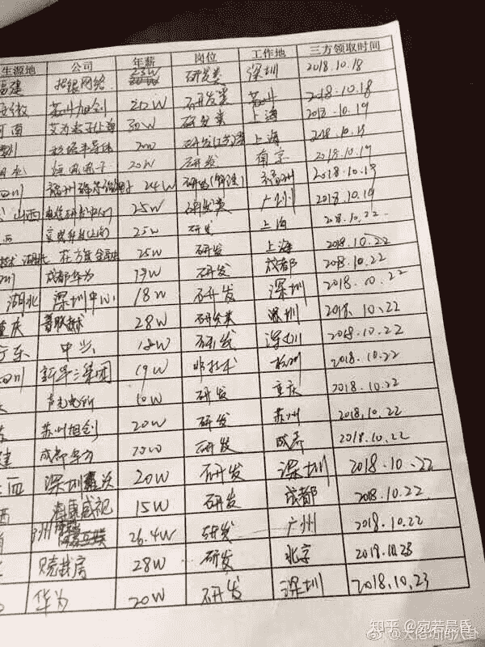

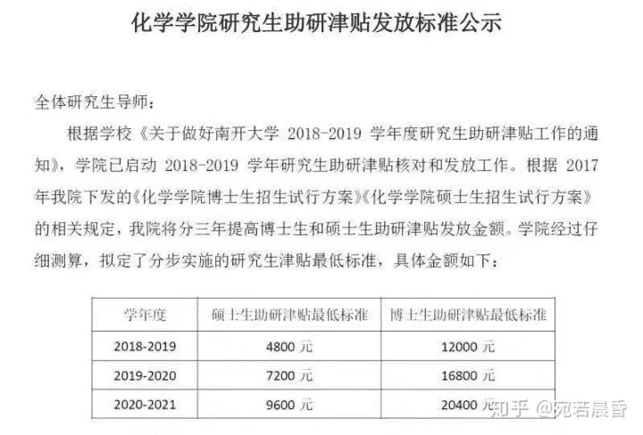

相信导员教授们，从来没给新入学的你们看这些数据吧？

当计算机学院介绍优秀毕业生的时候，都说我们有多少人去了 BAT，TMD，平均就业薪资是多少多少。而化学化工学院呢？说的则是我们多少人保研了清华北大，多少人去美帝 TOP10 读博。一方面，这直接说明了从事基础科学研究是一个就业周期极长的职业（5-7 年 PhD + 至少 2 年 postdoc），另一方面，则间接说明了待遇的悲惨。怎么不放出来毕业生的去向和平均工资水平呢？难道他们一辈子都还在读书吗？**是不知道，还是不敢？**

也许有介绍，学院会跟你们讲海外名校硕博博后苦读十年打败千军万马过独木桥回来当选千人的极其优秀的天坑专业人才在 35 岁拿到 60 万的年薪。但却不会承认，一所普通 985 学校计算机学院一般优秀的本科毕业生在 22 岁就可以拿到平均 30 万的年薪，然后再过五年就可以吊打青千了。

退一步讲，想一想为什么南开天大，说起申请到好学校（包括北美名校，或是清华北大），大多数都是来自化环材生这些天坑专业？这是因为，**毕业后待遇越差，工作越难找的专业申请，越容易**。那些毕业即被企业抢走的博士，如计算机或者金融工程等专业，其申请难度和化学这种毕业即失业的专业相比简直是天壤之别。那些本科录取是天坑专业的学生，大多数本科毕业就转行而早早逃掉了，这才留给外校的人大量的机会。

另一个特别经常出现的说法是：你们的衣食住行离不开化学化工，国民生产中化学化工占了多大比例，遍地都是化工厂。\*\*将一个学科或产业的重要性和一个专业的就业好坏两个不同的概念混为一谈，是吹捧化学的人最为常用的伎俩之一。\*\*一旦有教授和导员和你这么说，一定要警惕了，他们多半是在画饼。

第二步，**让低年级的同学们早早进入实验室打杂**。

很多对自己未来有清晰认知的同学，从此就认清了部分实验室化学**伪科研**的真面目，早早为自己将来的打算而准备跨考、转行、实习。还有一部分天资聪颖，真心热爱科研的（我无意劝退这部分同学），也可以借此入门。这个角度说来，学院其实是做了一件好事。

但另一方面，对于多数随波逐流、缺乏主观判断的新生来说，初入实验室无疑是新鲜的。怎么说呢，多数化环材生实验室， 对人的动脑能力要求非常低，大半是机械重复（也就是说，你的价值和外面雇佣的一个手法熟练的专科生没有不同）。有些人说这样的工作听起来很无聊，大家难道不都走了？错了，恰恰因为对动脑要求少，而人总是好逸恶劳的，很多同学产生了“即使不用努力动脑也能取得成果”的错觉，得到了“不需要数学物理计算机也可以科研”的荒唐结论。所以说，实际上大多数人沉迷在了这种，真实能力日益低下而脑中却充满各种不切实际的“我可以改变世界”的幻觉中。尤其等过柱子的时候还能刷个微博抖音，岂不快哉？

至于常常叫嚣的动手能力，更是在将来的工作和科研中用处很少。现在都什么年代了，先进的实验室早都实现了机器的流水操作（比如过柱机）。为什么有些实验室还让人工做？便宜啊！如果不用种种谎言把你们骗进实验室做廉价劳动力，他们的论文从哪里出呢？

扪心自问一下，在所谓的“国创”、“百项”中，大部分人学到了什么有价值的东西了吗？对于你的职业规划或是真正的技能提升起到了多少作用？有这个自信积极主动学习思考的人有多少？你觉得自己适合科研吗？

学院知道这些情况吗？当然知道。但他们需要的只是你们硕博期间的劳动力和文章，忽悠你们去读了硕博就是胜利。至于将来的就业不好？对不起，这和我们没有关系，谁让你自己年龄大，身体不好还本事差。

第三步，**扼杀数理思维，只能无脑搬砖。**

当我们迫于学校的过时而愚蠢的教学计划，被迫选着没用的课程的时候（在分子，我认为这种课程比例大于 50%），总会有一些人自我安慰着，“多学一点也没什么，没准哪天就用得到呢？”。这种话乍听起来好像很有道理，但实际上却是不折不扣的谎言\[2\]。

在 2016 年，北京大学化学学院迫于同学们的强烈呼吁，调整了本科生的培养计划，[删除了部分过时的化学课，而增加了很多数学和物理课程](https://www.zhihu.com/question/46590432)\[4\]。然而我看过 2018 年分子科学与工程的教学计划，与我 2013 年入学的时候几乎没有任何改变。在社会大环境日新月异而各类新技术层出不穷的时候，我分子专业仍然能保持一潭死水的状态，也不禁让人肃然起敬。

数理和计算机科学是所有理工学科最重要的基础和工具，无论是机械、土木、航天、电子信息，还是化学和生物。然而，如我[上一篇](https://zhuanlan.zhihu.com/p/49924568)文章所列举的，分子专业的培养计划中这部分课程**严重缺乏**。原因我推测有以下几点，第一，该专业负责人对学科的进步不了解或者漠不关心，对学生的培养属于急功近利的揠苗助长式，而不注重长远发展；第二，学院的教师数量过多，倘若砍掉一部分课程会有一部分人失业（正如同现在如果不扩招硕博的话大量青椒将种地），在学生和教师利益之间，学院显然不会倾向学生；第三，（纯猜测）倘若开放大量这些课程，同学转专业的门槛将会大大降低，有可能会引起转专业申请狂潮（类似北大化院）。

目前分子的课表中充斥着大量上世纪的“化石”课程。这些课学起来可能并不吃力，甚至还很有趣，但是，它们对你未来的帮助几乎是零。真正的科研和工业生产，与纸上画的几个小箭头、死记硬背但是毫无严密科学基础的“理论” 大相径庭。你以为学到了知识，实际上只是浪费了时间，还被灌输了缺乏严谨科学素养的“学习方法”，百害而无一利。就算你把无机化学有机化学几本教材背得滚瓜烂熟，如果你要做真正的科研，抱歉，还是得从概率论、量子力学学起。

此外，分子专业开设的过量实验课，一大半都应该砍掉（在大二的暑假竟然仍然给同学们开设一周六天的实验课，醒醒，非基础科学的学院学生早都去实习了），学校低效率的英语课更完全是浪费时间。所谓好几十学分的专业选修课，倘若换成可以全校任选，无论对学生自己还是社会发展都会有比现在积极得多的作用。

结束第一部分之前，我想谈一下 GPA，不少同学在大学中视为极其重要的一个东西。

有多少人仔细想过，GPA 对我的意义是什么？它是我的终极目标，还是仅仅是一块敲门砖？

很多同学抢着回答，我要保研，我要出国，GPA 对我非常重要！

不可否认，在目前的教育体系下，假如你需要保研或是申请知名海外高校，一个排名前百分之多少的成绩几乎是硬性规定。但是，假如你把目光放得长远一些，你会发现，在毕业以后，你曾经引以为傲的 GPA，无论在科研或是求职过程中，**几乎都是一文不值**。导师看中的是你做实验发文章的能力，公司看的是你制造利润的能力，而 GPA？就算你门门 4.0，也不会有除你之外的任何人在意。

我不是说同学们不应该追求 GPA，而是请注意，适可而止，计算边际成本和边际收益。你将成绩从 90 分提高到 95 分，要比从 85 分提高到 90 分难得多，也许意味着要付出多一倍的时间和精力。这时，请你自问一下，倘若用这多余的时间来提高自己真正的能力，是不是更有价值？我如果拼命拿到了一个 3.8 的 GPA，真的就和 3.7 有什么本质的不同吗？

规划时间的道理很简单，但是依然有相当多的同学，尤其是大一大二的同学，仍然抱着高三那种“分数决定一切”的思维方式学习。这是大学生们最常见也是最严重的认知误差之一。 请记得，当你在未来求职之时，HR 只会在你的那个数字上停留 0.1 秒。不要将过多的宝贵时光浪费在那个时效性极短的东西上。由于分子专业本身课程就很重，倘若你门门课程都想拼到最高分，那么很不幸，你能够投入到那些真正重要的事情的时间将会屈指可数。

所以，你一门课比其他人高了多少分，甚至考了全班第一名，也不是什么值得炫耀的事情。有心人可能早就利用你拼命背诵的时间，或是在努力转行前途光明的学科，或是努力做科研，或是努力提高社交能力。大学和研究生不是高中，成绩只要够用就可以了，把分数作为唯一目标是愚蠢的。但凡你能做一些比 GPA 更重要的事情，都显然比死磕 GPA 更有帮助。

遗憾的是，相当多的新生还不知道什么是“比 GPA 更重要的事情”。这个需要大家根据自己的需求来把握，外人不好提供建议。

## 二、什么样的人应该做科研？怎么走科研之路？

**兴趣**。

这几乎是唯一能解释你能坚持下来的原因。没有兴趣的徒劳坚持是很危险的。在科研这条道路上，只有对一门学科的喜爱，才能成为你唯一和全部的动力\[2\]\_。\_ 这种喜爱应该是在发自内心的，而且是充分了解这门学科之后的喜爱。很多人，包括高中时候的我，喜欢的化学仅仅是停留在课本表面的化学，以为记熟了一个个令人眼花缭乱的名词背熟了数不清的人名反应，就是懂了化学。但是，化学的科研是如此不同，以至于你甚至很难把它们想象成是同一个学科。**敢说自己真的喜欢化学，一定是在掌握了其数理基础，阅读了数百篇外文文献，在实验室独立研究了数个课题，才有资格的。**

如果你决定了做科研，那么，**出国读书几乎是必须的**。请在科研的同时做好考英语和出国交流的准备。

Why? 一方面，现今国内对海外研究经历看得极重。“土博”在当前的评价体系下几乎没有任何机会。另一方面，国内的学术圈大家忙于恶性竞争，导师划山头分派系，人际关系极度复杂，各种包括造假、剽窃等学术不端行为屡见不鲜；而政府对科研支持的力度也小的可怜，我们怎么指望博士生每个月工资不到 800 块钱，一边饿着肚子一边做出惊人的研究呢？想在这样一个没有高水平学术成果的泥潭中拔足前行，需要你的付出代价实在太大\[2\]！

绝大多数留在国内“保研”、“直博”的同学，除非去了清华北大中科院等最顶级院校，或是其他学校个别非常有实力的课题组，那么很抱歉的说，你的“科研梦”希望是非常非常渺茫的（“科研梦”这里指在一所至少中流 985 高校拿到教职）。所以，不要被你导师（除非是超级大牛）叫你留在 TA 实验室的话所诱惑。大部分人考虑的，绝对是自己课题组的利益，而不是你的前途。

这里提一句，为什么不建议末流 985 及以下的教职？原因请参见《[再胡扯两句关于天坑专业未来的看法](https://zhuanlan.zhihu.com/p/48081292)》\[5\]。总结来是说，因为越来越多的学生已经意识到了天坑专业的属性，想象你博士后毕业，也就是十年以后，有能力和远见的学生报考这些专业的越来越少，剩下的都是很难帮你出成果的混日子的学生，再受限于非一流学校有限的科研经费和设施，你能指望在那种环境下做出真正有用的科研成果吗？恐怕与你“改变世界”的初衷有所不同吧。

对于把大学学习的目标看成“保研”的同学，请再多想远一点。读了国内本专业的研究生，你的下一步是什么呢？普通学生读了天坑专业的研究生，只是时间成本搭进去的更多，对于你改变未来的生活水平毫无意义，还不如早早转行工作。“走一步看一步”这种普遍的想法，无疑是懒惰而错误的。因为很可能你走到那一步的时候，想改变已经晚了。

对于出国的同学，还有一个要申请硕士还是博士的抉择。很多人在做这个决定的时候，考虑的只是有奖学金，所以才去读了博士。但是在国外，要想最终获得一个博士学位，其中的要求极其苛刻，时间极其漫长，而且读完之后并不保证你获得硕士学位乃至本科更好的工作待遇\[2\]。

**不想做学术的人请务必不要读博士学位！**

设置博士学位的唯一目的是培养顶尖科研人才。这个学位不考虑你的就业前景，不考虑你精神所能承受的压力，它唯一考虑的，是你在某一个领域做出了多大开创性贡献。当你终于有一天博士生毕业，你学到的东西往往太过于细化和深入，不能帮助你在工业界找到合适的工作。而去读博士后，继续混迹学术圈，又会是另一道鬼门关。**想继续做教授，那竞争的惨烈程度比博士入学申请更要血腥无数倍**。在美国，很多名校毕业的冷门博士因为在学术界和工业界都不能谋到工作，最后不得不再花上一两年选个好就业的专业读硕士然后就业\[2\]。而我们已经知道，大多数伪化生的课题组做出的都只是垃圾，那么部分受够了多年精神折磨，没有就业前景并且不具备创造价值能力的大龄博士，面临的只有被社会淘汰的下场。

不少同学之所以进实验室做研究是为了出国，他们甚至明目张胆地说自己不喜欢也不适合做研究。这种为了出国而做研究的想法本末倒置，是非常错误的。对于一个不适合做研究的人而言，花五六年的时间甚至更长时间读博士，那就像坐牢一样痛苦。好多同学在本科的时候信誓旦旦地要投身科学事业，但是真正坐在实验室里不到一年就坐不住了，只拿硕士学位就匆匆走人\[2\]。

所以，请在行动之前认真判断自己是否适合做科研。

## 三、如何从分子转行

我猜测多数刚入学的小分子们对我劝大家转行这个事情是抱着抵触心理的。“好好的专业，怎么能就那么不继续读了呢？”

请认识到，转行在人生中是一件再正常不过的事情，只要你还没有踏进博士坑，那转行的成本都还不大。至于分子科学与工程已经毕业的学长学姐们，离开本专业的也要远远多于留下的。我很负责任地说，正在读这篇文章的你，有 80%以上的可能，以后从事的职业与化学化工**毫无关系**。为什么劝转？因为正如我已经强调过很多次的，分子所处的“化环材生”领域对多数普通人来说是一个**体系混乱、前途渺茫、竞争激烈、待遇低下的圈子**，而且，分子科学与工程甚至比一般的化环材生还要坑（参见[《为什么要劝退分子科学与工程？》](https://zhuanlan.zhihu.com/p/49924568)）。即使你今天不转，大部分人早晚也会转行，为何不提前做好规划呢？

对于我对化环材生的判断，有一类很愚蠢的观点是，虽然现在化环材生就业不行，但说不定二十年后就行了呢？等我博士毕业的时候，说不定正赶上国家大力发展这些工业的时候？

首先，根据宏观规律，国家在相当长的一段时间内经济增长放缓，高校科研经费削减是客观事实，而近些年数量爆炸式增长的博士又源源不断挤进这个坑，所以**化环材生的科研就业在可见的未来不但不会变得更好，反而会越来越惨**[\[6\]](https://zhuanlan.zhihu.com/p/26647300)。其次，国家早已发展材料等领域多年，你可见材料毕业生就业变好了？这是因为学术界的科研和工业界的需求早就脱节了几十年，再过一百年，你眼中大部分“改变世界的 paper”也不可能投入到实际生产中去。还有，历史的行程不可逆，人类社会已经进入了信息时代，夕阳产业没有可能再死灰复燃，只能为新兴技术所取代。就算化学以某种姿态复兴了，也轮不到目前国内这种古董似的方法培养出来的化环材生学生吃香。**分子专业如果想为了学生好，只有两种未来，一种是深度彻底的课程改革，另一种是原地解散。**

另外，分子专业是可以转走的！

虽然无论是南开还是天大的领导，出于某些利益都在试图阻止小分子们转专业（ 因为哪怕他们稍稍调查一下，也会知道毕业生的转行比率有多高，本专业方向就业待遇多差。显然他们不是为了同学们的利益），也不主动告诉你们转专业的途径，但是经过调查，根据两个学校的规章制度，**分子科学与工程是允许转专业的**。南开大学化学学院一直是允许分子同学在大一大二转走的，所以有目标学院的同学请早早准备相应的转专业考试。天津大学今年四月新颁布的转专业制度是适用分子科学与工程的。所以同样，有可能的话也请尽早脱坑，不过个人认为转到化工专业并没有意义，还有很多更好的 choice 可以选择。已经大四的同学我推荐过控系宋凯教授的实验室做毕设或是保研，那里你能接触到很多非常有用的 CS 知识。

至于具体如何转行，每个专业都有自己的特点不好统一说。不妨参见《环化材生->计算机，“劝进”往往比“劝退”更难》[\[7\]](https://zhuanlan.zhihu.com/p/47438711)来获取一些 general 的方法。我个人转行了 CS，所以任何想转 CS 的分子同学都可以私信我咨询。

## 四、反对人士

虽然现在“劝退”已经不再是几年前人人喊打上不得台面的东西，但是旧势力依旧十分强大，我们的劝退事业总会遭到部分人的阻挡。下面，我来分析一下反对我们劝退的人都是什么组成。

第一，就是学科的既得利益者。我上文提到过，多数是急需廉价劳动力帮他们发文章的黑心教授和需要完成招生任务的宣传人员。他们知道天坑专业的实情如何，但是为了自己的腰包，罔顾学生的切身利益，讲情怀，为学生画饼，丝毫不顾及毕业后同学们的就业状况。

第二，是部分已经远离求职市场的学科内的从业者，和什么都不懂的七大姑八大姨。他们的特点是不是出于恶意，但完全不了解当前的就业市场。有些经验可能适用于他们（比如十几年前博士甚至硕士毕业就可以直接留校任教），但是那些早已经过时，而他们错误地用过去经验来推测现在，得到的必定是荒谬的结论。你要清楚，真正懂这行的永远是直接面向市场的人，向其他人讨教经验有很大可能会被误导。

第三，就是来自被劝退人员内部的阻力。首先，必须承认，大多数人逆来顺受，眼界狭小，根本望不穿眼前的小环境；其次，大多数人，胆小怕事，即使望穿也不敢擅自行动，他们总是担心行动的代价太大，自己负担不起；另外，上帝给了我们心理防御机制，不符合我们信仰的东西，视而不见，见而猛喷[\[8\]](https://zhuanlan.zhihu.com/p/34457321)。所以，当有人向这部分同学劝退的时候，他们的反应多数出于感性而非理性分析，有时反而会攻击劝退者别有用心。对于这部分同学，我们当然不会强行劝退。真诚地祝愿你们在原来的路上走好。

我相信没有明知自己入了坑还要拉着学弟学妹也入坑“报复社会”的人。

## 五、总结陈词

我十分清楚，无论怎么说，都会有一些人执迷不悟，**我也不会指望所有人都能接受和理解**，正好转专业人数也有限制的嘛。但是我提示一下，同样这个话题，仅仅短短一年半以前，我大四下提出的时候，[评论区还是半数以上的反对](https://www.zhihu.com/question/24899838/answer/155060270)；但是前几天发的[上一篇文章评论区](https://zhuanlan.zhihu.com/p/49924568)已经变成了 0 反对（你们猜猜这一年半期间分子的毕业生们观点发生了什么变化？）。等过了几年以后，如果你属于我所讲的那部分“不适合科研”却依旧从事了科研而苦苦挣扎，到处问如何转行（这样的人在现实里数不胜数）的时候，请狠狠为自己当年的天真幼稚打自己几个耳光。

一条很重要的建议是，当你咨询学长学姐时候，除了问比你大的那一级以外，更要多问问比你大四五年，已经处于你努力目标之上的人。举个例子，如果你想读博，除了问上一届正在申请的人，更要问问已经在读博的人是什么感受和体验。比其他人提前多想几步，对你未来的规划意义非凡。如今分子校友群已经建立，联系学长学姐非常方便。除了闷头学习，更要看看自己想走的方向是不是你真正想要的。

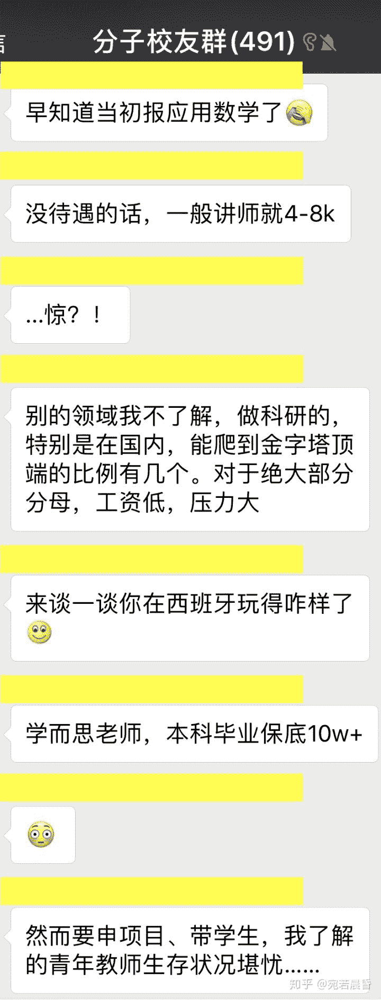

虽然我不是分子班导师，但我明白，设立班导师的目的，绝不是让他们充当院长、主任的手下和传声筒，而应该从学生的角度出发，给学弟学妹们提供人生和学业指导。所以，我希望每一级在校的分子班导师**尽到自己身为学生班导师的责任**，更多为了学弟学妹们的利益考虑，向他们传递这些逆耳但是利于日后发展的“另类”观点。非常感谢。

## 参考资料

\[1\] 为什么要劝退分子科学与工程？ [`zhuanlan.zhihu.com/p/49924568`](https://zhuanlan.zhihu.com/p/49924568)

\[2\] 交大生存手册 [`wenku.baidu.com/view/877b9c2a0066f5335a8121ad.html`](http://link.zhihu.com/?target=https%3A//wenku.baidu.com/view/877b9c2a0066f5335a8121ad.html)

\[3\] 如何看待化学 2018 年再次成为就业红牌专业？

[`www.zhihu.com/question/280892005`](https://www.zhihu.com/question/280892005)

\[4\] 如何评价北京大学化学与分子工程学院 2016 级本科生课程设置？

[`www.zhihu.com/question/46590432`](https://www.zhihu.com/question/46590432)

\[5\] 再胡扯两句关于天坑专业未来的看法 [`zhuanlan.zhihu.com/p/48081292`](https://zhuanlan.zhihu.com/p/48081292)

\[6\] 劝退学导论：第一部分 [`zhuanlan.zhihu.com/p/26647300`](https://zhuanlan.zhihu.com/p/26647300)

\[7\] 环化材生->计算机，“劝进”往往比“劝退”更难 [`zhuanlan.zhihu.com/p/47438711`](https://zhuanlan.zhihu.com/p/47438711)  
\[8\] 劝退与转行：没有什么是普适的 [`zhuanlan.zhihu.com/p/34457321`](https://zhuanlan.zhihu.com/p/34457321)

更新：

非常感谢王佰全老师的开明。在我没有完全调查清楚之前，对您有所误解，在此我表示诚挚的歉意。同时也请您认真考虑下化学学院的课程改革，我相信无论是对化院还是对同学们都是非常有益的。

# 为什么要劝退分子科学与工程？

 flowchart 箭头图标 勿删 

> 作者：[宛若晨昏](https://zhuanlan.zhihu.com/p/49924568)

首先屏蔽“分子也是有很多学长学姐非常厉害的！”，“分子 XXX 发了非常厉害的文章”，“分子的 XXX 毕业后在哪里工作，财务自由了！”这种“我认识一个大佬”，“我朋友特别厉害”的无聊论据。本文针对分子科学与工程的大多数普通同学（富二代土豪也不属于普通人），即使以后分子出了一个诺贝尔奖得主，和这个专业本身也几乎毫无关系。

本文从**化环材生自身属性**，**分子特色课程设置**，**未来就业**几个角度分析，为什么要对这个专业进行劝退。临时目标是帮助现在在这个专业的同学转走，转不走就尽早对毕业后自己的未来做充分的规划。阶段性目标是改革或是解散该专业。最终目的是劝退绝大多数化环材生专业的普通学生，实现国内教学科研模式的根本性变革。

该劝退文只谈分子专业的劣势。专业优势当然有，也有很多非常负责任的教授导员，和热心的学长学姐。然而，我认为相比于本文谈到的种种**根本性**的劣势，优势都显得无足轻重。欢迎各路人士反驳，但请有理有据，以德服人。

本文是我在这个问题

[分子科学与工程这个专业怎么样？​www.zhihu.com](https://www.zhihu.com/question/24899838/answer/155060270)

的回答基础上的拓展和延伸。

首先让我们来看一下，分子科学与工程是什么样的专业？

天津大学化工学院官网的介绍是：本专业为天津大学化工学院、南开大学化学院联合培养，强强联手优势互补[\[1\]](http://link.zhihu.com/?target=http%3A//chemeng.tju.edu.cn/cn/jujx%3Ftype%3Dbenkedetail%26typeid%3D4%26id%3D1038)。

它的专业特色是：结合天津大学化工学科的优势和南开大学化学学科的优势，突出创新。该专业既不同于传统的化学、化工类专业，它注重解决化学以及相关的环境、材料和生命科学的问题，同时立足于国家亟待发展的化工新产品研究、开发与产业化的需求，优化化学与化工教学内容，增添新的交叉学科知识，培养适应国家发展需要的，具有良好人文素质和宽广深厚的化学、化工基础，具有较强的创新意识、科研能力和化工新产品研发与产业化能力的复合型人才[\[1\]](http://link.zhihu.com/?target=http%3A//chemeng.tju.edu.cn/cn/jujx%3Ftype%3Dbenkedetail%26typeid%3D4%26id%3D1038)。

记得刚入学的时候听教授说，分子科学与工程是**培养科研人员**的专业。当时太年轻，根本理解不了“科研”两字之重。不过话说回来，以我国目前的高考和选专业制度，\*\*又有多少人在报志愿的时候深入了解了自己的专业？\*\*而分子，就是在你根本不了解它的时候，死死限制住你在本科的发展方向，致力于让你与这个金融互联网主导的主流社会脱节，进而影响你的保研考研就业选择，从一而终地“献身”科研，真正贯彻“培养科研人员”的方针。

接下来我从三个角度说明劝退该专业的理由。

**一、 化环材生自身属性**

分子专业授予的化学和化工双学位（对大多数人来说应该是世界上最没用的双学位之一吧），本来就自带极强的劝退属性。由于劝退界大佬们已经写了很多相关文章，这里我就只充当搬运工，不再重新造轮子。

[罗多克神射手：拒绝垃圾专业化学：选择正确的专业远比多考几分更重要——致全国高考考生和家长的一封信​zhuanlan.zhihu.com](https://zhuanlan.zhihu.com/p/21424771)

[到处挖坑蒋玉成：劝退学导论：第一部分​zhuanlan.zhihu.com](https://zhuanlan.zhihu.com/p/26647300)

[到处挖坑蒋玉成：《劝退学导论》第二部分（上）​zhuanlan.zhihu.com](https://zhuanlan.zhihu.com/p/27188243)

[到处挖坑蒋玉成：《劝退学导论》第二部分（下）更新​zhuanlan.zhihu.com](https://zhuanlan.zhihu.com/p/28740169)

[弗兰克扬：化学到底是不是一个好专业？该不该转行？————试图以此文终结所有相关讨论​zhuanlan.zhihu.com](https://zhuanlan.zhihu.com/p/24395468)

[弗兰克扬：我们如何走到这一步​zhuanlan.zhihu.com](https://zhuanlan.zhihu.com/p/24751487)

[弗兰克扬：生化环材四大天坑劝退指南​zhuanlan.zhihu.com](https://zhuanlan.zhihu.com/p/30267731)

[是什么让你开始劝退的？​www.zhihu.com](https://www.zhihu.com/question/67812985)

类似文章很多，有兴趣的同学只要到知乎上搜索“化学劝退”、“材料劝退”等关键词，都会看到如果一路走到黑大多数普通人要面临的是什么。我接下来要讲的是，相比于同等学校级别的普通化环材生专业，分子为什么还要**更坑一筹**。

**二、分子特色课程设置**

开门见山。课业压力及转专业。

如果问过去的分子毕业生，你觉得分子给你的印象是什么？相当多的人会说，课业重。

是的，分子因为所谓的双学位，需要比普通学生多修大约 50%的学分才可以毕业。举个例子，南开化学专业毕业学分在 140-150 之间，但是分子专业要在 210 左右。有同学提到化工专业总分也接近 200 分，是的，这也是天大化工专业设置（可能是为了保持所谓亚洲第一的位置？）的一大弊端。盲目地增加学分对大多数学生真正的发展毫无意义。

倘若课程有很多是非常有用的数理课程也还罢了，但是让我们仔细检查一下教学计划，在未来对科研真正有帮助的数学、物理、计算机类必修课程有多少呢？

数学：高等数学上，下，线性代数。

物理：大学物理上下，物理化学上下也算半个。

计算机：计算机基础、数据结构与算法（C++）。

That’s it. 总学分大概是三十几分的样子。看到了吗？相比于无穷无尽的过时专业课，最应该好好为科研打基础的数理课程少的可怜。甚至连概率论与数理统计，非常热门且在数据分析中应用广泛的 Python 都没有。问一问已经开始科研的学长学姐，就算不转码，做研究的时候是不是也要应用大量的统计学、编程、data analysis？你真的觉得当代前沿科研问题是会发明八个机理解释八个酯化反应的图就能解决的？多数都是靠严密的数学、量子物理推导和计算机分析啊！

正因为课程设置如此过时而臃肿，以及落后的选课制度，也就是**基本不允许学生跨学院选课**，导致学生即使想自学其他课程也有心无力。

课程压力过大，使同学们很少有充分的时间去做自己真正想做的事情。我之前也说过，**除了认清化环材生现实之后仍旧一心想留在本专业保研且不出国的同学**，其他任何人都不应该选择分子专业。

为什么？时间。

自由的时间和健康的身体永远是一个人最宝贵的财富。分子专业，连同其他学分设置极多的劝退专业 ，都在浪费你的生命。我接下来要从几个角度重复为什么同学们不应该选择分子专业。

① 对于想出国的同学。

对于硕士，出国申请最关键的是什么？推荐信、三维（即 GPA, GRE, TOEFL） 。对于博士，除此之外还有海外科研经历和科研文章。\*\*没有人会因为你比别人多上了 70 学分的课对你刮目相看，没有。\*\*请不要自己感动自己。反倒因为此专业名气很低（反正我这么多年没见过其他学校的人听说过这个专业的），容易造成不良影响。我们一个个来说。

GPA。即加权成绩。同样一学期，其他专业学 3-4 门课，分子学 6 门课，同样的期末复习时间。你认为去哪个专业成绩会更好呢？

GRE, TOEFL。一般来说需要一年左右的备战时间，每门需要考 2-3 次才能到理想成绩，大多数人是在大三到大四上考。其他专业同学到了大三课表半空，大四没课；分子专业大三满课，大四上还有十几学分。你认为去哪个专业分数会更高呢？

推荐信、海外科研。一般高质量的海外科研需要到名校交流至少五六个月，这样基本可以顺利拿到厉害导师的推荐信。不好意思，分子专业不但不给你一个空学期让你交流，有时连短短两三个月的暑假都会给你几门课。其他专业积攒两三个名校交流和大牛推荐信，蹭了不少文章；分子专业拼命排课拿到一个短期暑研（而且，据说现在协同创新中心已无经费，分子同学出国交换需要**自己出钱**）。你认为去哪个专业申请结果更好呢？

② 对于想考研的同学。

我对这方面不了解所以不多说。但我也清楚，无论是本专业考研还是跨专业考研，都需要非常长的时间来做准备，不少于一年吧。我刚提到过，分子专业即使到了大三下仍旧有大量必修课，这非常影响同学的考研准备。如果是你，你会选择分子去考研吗？

③ 对于想转专业的同学。请参见后面我对于分子转专业的分析。

④ 对于想毕业直接工作的同学。详情请参见第三部分对于分子专业就业的分析。此处插播讲一下实习的问题。

来到美国以后，我发现身边的同学们或多或少都有几段实习经历。这个现在看来再普通不过的事情却让我当时非常震惊。原来，在本科的四年（主要是前三年），我甚至完全没有实习的观念。我觉得它离自己非常遥远，哪怕我当时已经不想读博。因为，分子的专业设置让你几乎没有办法抽出一个学期甚至一个完整的暑假去实习。就算偶尔有人动了这个念头，又去什么地方呢？难道去德州化工厂的电解车间吗？所以，**分子科学与工程专业从来没有形成过企业实习的优良风气**。既然没有学长学姐做过，后来的人更是没有想法，恶性循环，每个一个半月的暑假都是窝在家里虚度光阴或是在闷热的实验室汗如雨下。多少人了解自己努力的方向是什么，又有多少人在准备写简历求职的那一刻才发现它是多么空白？（这里我不想解释**找实习对于未来工作的重要性**，请自行调查） 不只是本科生，国内多数垃圾化环材生课题组都禁止硕士和博士出去实习，这直接导致了这些专业的同学在未来的就业市场竞争力很差。

既然分子科学与工程专业这么坑，那么就赶紧转走保平安吧！

No way! 接下来我要说的是转专业。这是分子专业的一个**核心且致命的问题**。

我们要认清，科研，只是职业的一种，与其他职业一样没有什么特殊之处，它也不是你读了基础科学专业以后的必然就业方向。因为科学家，或是企业高级研发人员，在社会的需求量很少，所以不可避免地绝大多数基础学科专业的本科生在最后都不会从事科研（即使是清华北大也一样）。另外，由于我国高考与报志愿的设计缺陷，相当多的同学在进入高校学习后会发现不喜欢或者不擅长该专业，这是再正常不过的事情。所以，\*\*一个合理的专业，应当有着完善的转专业制度。\*\*这正是分子专业极度匮乏的。

南开班请参考该 13 级同学的回答[\[2\]](https://www.zhihu.com/question/24899838/answer/155754012)，希望现在南开班的同学能提供更新的信息。

> 针对分子能不能转专业的真实的故事  
> 天大班的分子从入学就被剥夺了转专业的权利，这个每个分子人都知道，而南开班嘛…  
> 我大二那年 6 个同学提出转专业申请，其中包括专业第一名  
> 材料都备齐了，到了面试环节  
> 除了两个成绩比较尴尬的同学之外，剩下的全部被否了  
> 全部被否了。包括专业第一名。  
> WBQ 老师给出的理由是“转专业理由不充分”  
> 看到这里的各位不妨思考一下，什么情况下，学院会不允许成绩好的学生转专业呢？

对于天大班，转专业就更加难了。南开班同学起码在入学时还可以通过伯苓班考试转走，或者在大二结束时放弃化工学位以化学专业单学位毕业。但是天大班同学，由于前两年在南开大学学习，并没有进入求是班的权利，也没有转入天大化工的必要（前两年都把化学学完了）。

尤其恶劣的是，因为你已经带了双学位，你就没有权利根据自身兴趣或发展去**辅修或者双修**，如金融、管理、计算机、经济等对于其他专业同学非常经常去学习的学位。也就是说，这个自带的双学位会严重制约你的未来（尤其是转行）规划。尤其是，18 年 4 月，天津大学已经发布了《关于做好 2018 年本科生转专业工作的通知》，学院内部也开始大类招生，在这种大环境下，**分子竟然似乎仍然不允许转专业（至少问过的 17，18 级学弟学妹均不清楚可以转专业，细节待商榷）**。

说到这里，似乎有些人很看不起转行的人，我对此十分不理解。且不说这个本专业到底有多坑，就算是十全十美，就不允许因为兴趣转行了？批评转行，就如同封建社会的三从四德，从一而终，一样迂腐。

所谓转 CS 多么功利，我倒觉得是你还没有进入到那个领域认真钻研。如果真的深入了解它，你会意识到为什么互联网公司大行其道，为什么程序员工资独树一帜，为什么这才是真正的“二十一世纪学科”。其先进的工业生产模式，生产者开始拥有生产资料的有利条件，以及不可逆转的历史行程，都决定了这一行的出路远远好于普通的化环材生[\[3\]](https://www.zhihu.com/question/21666262/answer/528430047)。而在普通的实验室里，大多数人只是在浪费纳税人的钱，机械地重复没有任何科学价值的实验，不但数理逻辑日益退化，人际交往水平也每况愈下。这无疑与这个快速发展和变化的社会背道而驰。

我不知道是不是有越来越多的同学意识到这一点，不过，在去年那篇讨论分子科学与工程的帖子[\[4\]](https://www.zhihu.com/question/24899838)中，我知道已经有**数名当时反对我的同学已经转行了码农**。每年化环材生 PhD 读不下去 quit 转码的多如牛毛，不知道为什么**至今没听过有 quit CS 去转化环材生的**。

**三、分子专业的就业分析**

这部分针对当前应届毕业生的就业市场。十年前的经验已经不再适用。

首先要谈的本科生直接就业。化环材生毕业生（当然包括分子）本科生直接从事本专业的工作，待遇多差工作多辛苦就不必多提了吧（对这一情况没有认识的一二年级同学请自行知乎）。据我所知，我们这届十几个直接工作的同学，只有一名就业与化学化工直接相关，并且他**已转行互联网**。说多少大道理都是空谈，用脚投票才是真理。

剩下的呢？读研就是万事大吉了？不，对多数人这只是一个逃避就业市场的缓冲期，日后如何取决于这段时间的规划发展。那么化环材生的硕士就业就会好吗？数据说话：

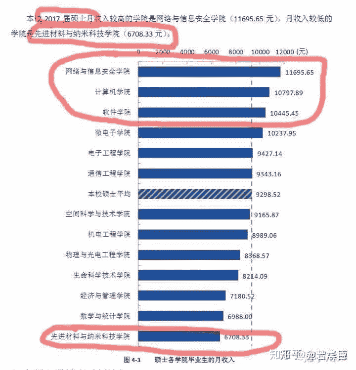

西安电子科技大学 2017 年就业数据

网上没有找到南开天津大学相应的数据，图是前几天西安电子科技大学发布的[\[5\]](https://www.zhihu.com/question/289151407/answer/529901909)。各个高校之间大同小异。

我在本科的时候注意到，为什么学长学姐谈就业的时候，基本提到的就是宝洁、联合利华等寥寥几个名字？后来我发现，原来，本专业想找直接对口的工作太少，大公司仅有这几个名字能提供工作机会。但是你要知道，国内理工科的硕博中化环材生占据了半壁江山，而那些公司的 headcount 加起来能有多少呢？估计能赶得上互联网公司的百分之一吧！

而在你成年后仍在读书的二十几岁年华，离了父母你的生活水平又是如何？今天刚刚看到的一份**南开大学化学学院**研究生的补助，读这份单子的时候我笑出了声。


都 8102 年了，堂堂 985 高校博士生最低津贴标准才要**涨到 12000 元**（对你没看错，是年薪）。这是在搞笑吗？

不是，这就是化环材生专业血淋淋的现实。

接着要说的也是重头戏。博士的就业。

归根结底，即使你读了再多年的博士和博后，也是要就业的。但是，真的所有人都清楚如今高校的竞争压力有多大么？有人拿那几个长江，青千学者举例。拜托，那是做了至少十年科研，才千里挑一，千军万马过独木桥的人，失败者是不会吭声的。用@到处挖坑蒋玉成 老师的话说,“2015 年化学领域内拿教职的难度就已经高到了荒谬的地步”[\[6\]](https://www.zhihu.com/question/67812985/answer/256762618)。对，我也知道天大南开青千待遇不错，好像是六十万年薪加一百五十万安家费？但是，如果你在互联网领域能排到同样的位置（前 0.1%），不多说，年薪千万不是问题，何况如今互联网大厂厉害的本科应届生工资就有三四十万了吧？至于产业界，呵呵，可能全美国每年招的化环材生博士数量都不如 Google 一家公司招的码农多吧。如果找不到对口工作，多少人像施一公一样留好了退路？ 随着经济下行，美国中国科研经费大幅度削减，很快博士后都做不成了。你觉得我现实？对不起，**我觉得你幼稚**。

情怀党请不要拿情怀说事（这里我懒得反驳画饼党）。什么是情怀？是在你有能力 transfer 到更好收入更好环境的前提下，没有那么做，而真心实意地为了国家发展或是个人兴趣投身到某个行业（如军工航天等），并且真的做出了贡献。大多数伪化生的学生符合么？无非是不想去了解外部这个飞速发展的世界，沉迷于自己的一亩三分地不愿踏出那一步。有些人说自己是真的喜欢化学科研，借用一句话，“你喜欢的是化学，还是不学数学物理就能在同学面前无脑装逼的快感？”[\[7\]](https://zhuanlan.zhihu.com/p/21424771)除了少数有真才实学的课题组，你真的相信自己在实验室做出的东西有任何科学价值么？不要开玩笑了，以目前多数实验室“de-education”的教育模式下，你的努力不但没法回报社会，连养活自己都很困难。精神境界，是在物质需求被满足之后的自然追求，不要本末倒置了。这也是为什么国外读化环材生的小姑娘小伙子大多是富二代（比尔盖茨的女儿在斯坦福读生物）。

**四、总结**

总而言之。分子是一个非常限制人自由发展，回报/付出比很低，本身学习内容又不实用的专业。如果你是天才，那么没关系，分子没能力制约你；如果你是土豪，也没事，家庭可以承担你的一切选择；如果你是普通人，希望我这篇文章对你来说不是废话。

我很清楚会有很多很多人痛恨这篇文章，无所谓，我的观点肯定也有很多错误和不足，欢迎大家批评指正，对事不对人。有人会说我恨这个专业，反过来想想，我倒认为自己对这个专业很有感情，才会愿意花大量的时间指导这个专业的学弟学妹们，帮助他们在未来获得更好的回报，拥有更美好的人生。而反对者们如果真的像他们口口声声所说那么热爱这个专业的话，也不妨把观点坦诚相见，我们取其精华，共同助力分子的转专业制度改革，造福后人。

**参考资料**

\[1\] 天津大学化工学院官网

[`chemeng.tju.edu.cn/cn/jujx?type=benkedetail&typeid=4&id=1038`](http://link.zhihu.com/?target=http%3A//chemeng.tju.edu.cn/cn/jujx%3Ftype%3Dbenkedetail%26typeid%3D4%26id%3D1038)

\[2\] 分子科学与工程这个专业怎么样？——匿名用户的回答

[`www.zhihu.com/question/24899838/answer/155754012`](https://www.zhihu.com/question/24899838/answer/155754012)

\[3\] 为什么很多大学生甚至研究生抛弃专业去做码农呢？——David Zhang 的回答

[`www.zhihu.com/question/21666262/answer/528430047`](https://www.zhihu.com/question/21666262/answer/528430047)

\[4\] 分子科学与工程这个专业怎么样？[`www.zhihu.com/question/24899838`](https://www.zhihu.com/question/24899838)

\[5\] 如何看待薪酬网 2018 最新毕业生薪酬数据中材料物理、生物科学专业跻身前五？

——霍华德的回答 [`www.zhihu.com/question/289151407/answer/529901909`](https://www.zhihu.com/question/289151407/answer/529901909)

\[6\] 是什么让你开始劝退的？ ——到处挖坑蒋玉成的回答

[`www.zhihu.com/question/67812985/answer/256762618`](https://www.zhihu.com/question/67812985/answer/256762618)

\[7\] “拒绝垃圾专业化学：选择正确的专业远比多考几分更重要 ——致全国高考考生和家长的一封信” [`zhuanlan.zhihu.com/p/21424771`](https://zhuanlan.zhihu.com/p/21424771)

# 是什么让你开始劝退的？（@韩冬）

 flowchart 箭头图标 勿删 

> 作者：[韩冬](https://www.zhihu.com/question/67812985/answer/257311029)

> 商业银行利用理财顾问服务向客户推介投资产品时，应首先( )。  
> A．评估客户的当前财务状况  
> B．了解客户的非财务信息  
> C．了解客户的风险偏好  
> D．选择多样化投资工具  
> 参考答案 C 解析:利用理财顾问服务向客户推介投资产品时，商业银行应了解客户的风险偏好、风险认知能力和承受能力，评估客户的财务状况，提供合适的投资产品由客户自主选择，**并应向客户解释相关投资工具的运作市场及方式，揭示相关风险。**  
> ————银行业从业人员资格考试试题

> 在提供金融产品和服务时,***应当以通俗易懂语言或者文字***,向消费者和投资者如实披露可能影响其决策的信息,***充分提示风险***；未履行如实告知或者风险提示义务的,应当依法承担赔偿责任。————————《山东省地方金融条例》

[案例：银行推介理财产品未充分告知风险，被判赔偿客户部分损失\_ 王宏律师\_ 新浪博客](http://link.zhihu.com/?target=http%3A//blog.sina.com.cn/s/blog_77c0d1f50101klhf.html)

> 甲银行理应对自己代销的产品有充分的了解，并在销售中 *对于申购人尽到风险告知义务*。尽管甲银行抗辩其已经在网上对吴某进行风险提示和风险评估，但因整个基金购买过程基本由甲银行经办人沈崇元操作，吴某仅输入了帐户登陆密码，***因此甲银行无法证明其已尽到合理的告知义务***，应承担相应责任。

[某基民亏了十几万，最后法院判银行全额赔偿！靠的是这个\_ 财经频道\_ 东方头条](http://link.zhihu.com/?target=http%3A//mini.eastday.com/a/170314010304383-2.html)

> 林娟认为，工行下关支行在销售理财产品过程中隐瞒相关事实，未尽合理风险告知义务，给林娟造成巨大损失应予赔偿。
> 
> 一审法院认为：  
> ……  
> 而案涉基金产品为非保本型理财产品，存在净值下跌的可能性，并不适宜林娟，但工行下关支行仍主动向林娟推介了此种产品，故工行下关支行未履行上述适当推介义务；且除银行自助终端上所显示的提示语外，工行下关支行无其他证据证明其向林娟充分介绍了案涉基金产品投资风险、告知存在手续费及赎回费用等事宜，其亦未出示《基金合同》及《招募说明书》供林娟查阅、了解，*故工行下关支行未能尽到合理风险提示义务。*

综上所述，我们有理由认为，本专业已经入坑人士、被坑人士、跳坑人士，对尚未入坑人士有风险告知义务，**以通俗易懂语言或者文字**,向学弟学妹们如实披露可能影响其决策的信息,**充分提示风险。**

# 现在学生物出路真有那么不济吗？（@Mengjie Chen）

 flowchart 箭头图标 勿删 

> 作者：[Mengjie Chen](https://www.zhihu.com/question/28347460/answer/41411431)
> 
> 我要拿出压箱底的劝退贴。 Mengjie Chen 耶鲁生物博士，现在北美已经拿到 tenure，比千老不知道高到哪里去了，算是站在生物行业顶尖的人。你看看他什么态度。我觉得没有比这个更有说服力的了。

议论完了，观点已经很明确了，我来抒发个感情。

我不知道你们看不看历史，个人哪，从来都无法抵抗时代。现在培养过剩的生物专业 phd 都是时代的悲剧，按照错的服务器信息加错了技能点，组队的时候发现不需要这么多生物的，号练废了，这个是要面对的事实。人也无法抵抗命运，但是人生还长，命运才刚刚展开，你不试怎么知道，你的命是不是通过转专业过上幸福快乐的生活呢。什么叫顺应时代，就是加这个时代真正需要的技能点。想找什么工作，就去 linkedin 搜相关的职位要求，一个一个学。最好是交叉学科，能用上你所学的。coding 的位置多，你就开始码，这就是供求关系，没啥议论的。

什么样的人可以义无反顾的退呢？自认为是学术水平 50%以下的赶紧走。我觉得过剩了至少 50％，听我解释：健康时期的 NIH funding rate 是 20～30%，中一个 grant 可以维持 5 年，一个 lab 五年中一次就可以持续运转，按照 20% funding rate 是可以实现的，没有人需要 quit，大不了千老呗。但是现在 funding rate 低于 10%，10 年中一个，一半的 lab 运转不下去了，千老都不好找了。

觉得自己前途渺茫，对科研失去兴趣的人，在实验室没有安全感，象做奴隶一样的，也赶紧走。命运虽然不公平，但每个人都应该有权利过有尊严的生活。极品老板不值得卖命。

不要觉得浪费了 1～2 年青春，很可惜。你三十多岁的时候回过头来，会发现下狠心走很值得（我还小，别管我怎么知道的）。我这转行成功的 hedge fund 百万哥，金融白富美，众多小码农，我都不好意思描述他们脱离苦海以后过的有多爽。

还有就是念了好几年 phd 都不知道自己的领域是过热还是过冷，不知道前沿在哪，自己的 project 能不能转化，好不好拿 funding 的糊涂蛋们，你们这个搜集信息的水平基本也就告别科研了。

对于个别问职业规划的，我就不回答了，我只提供统计数据，自己的路自己选择。

生物科研有非常大的迷惑性，门槛低，招生量是别的学科的五倍，但做好了门槛奇高。你看生物前沿的大 PI 们，一个个数理化背景好的不得了，不念个 harvard physics/ mit math 或是马普 cybernetics 的 phd 都不好意思出道， 这背景恰恰是生物系的学生没有的，这个我也分析得很清楚了。

千万不要觉得科研的发展少了你们，会有什么停滞。你们要救的是你们自己。少了张院士是个损失，少了你们的 negative result 就是科研少走的弯路。按照未来教育部长所说，名校的学生有不同的历史使命，他们应该科学精神至上，不应该考虑就业，要靠这些人推动科学进步，我觉得特别有道理。但是对于三本的学生，也就是第三名及以后的本科学生，我觉得做人最重要的还是开心。

还有下次碰到 cs 的人抱怨不好找工作，别理他，直接咬他。

我是认真的，像这样咬：


* * *

既然火了就澄清一下观点。

生物的本科生，研究生，博士的过剩是结构性的。换句话说，就是你失业跟你能力关系不大，只是因为，一没有对口的职位，二没有多余的跟专业无关的职位。

这个过剩严重到什么程度呢？

国内情况不熟悉，美国的很熟悉，因为我也要申 funding，对这个很关注。

NCI 的头，诺贝尔奖获得者 Harold Varmus 前几天刚辞职，[Harold Varmus to resign as head of US cancer institute : Nature News & Comment](https://link.zhihu.com/?target=http%3A//www.nature.com/news/harold-varmus-to-resign-as-head-of-us-cancer-institute-1.17063)， 他就是我分享的劝退文章的作者，[Rescuing US biomedical research from its systemic flaws](https://link.zhihu.com/?target=http%3A//www.pnas.org/content/111/16/5773.full)。 他表示，除了 translational 和 clinical 的研究项目，基础研究的项目要大规模缩减。

NIH 也发通告说要全面缩减 funding 了，这是今天最新的报道：

[Congrats Young Scientists, You Face The Worst Research Funding In 50 Years](https://link.zhihu.com/?target=http%3A//www.huffingtonpost.com/2015/03/03/francis-colliins-nih-funding_n_6795900.html)

现在的 funding rate 是 10%，什么意思呢，100 个 PI 写的 proposal，只有 10 个会得到资金支持。

假设机会均等，写 10 个才会中一个。但其实机会不均等，无法转化和上临床的项目，希望非常渺茫。

如果你的方向是冷门的基础研究，找退路。。。

* * *

补充一些内容，

1.  我班长提醒我卖药的工作也很难找，卖药的也不多。我脑补其实卖药是个肥职，应该不好找。
    
2.  多好的学校多好的 program 可以打住，这个不太好一梆子打死，一是方向太多，二是好学校的人比较敏感。
    

这样吧，自黑。

2008 年的 science 上统计了 1991 年入学的 Yale MBB 的学生出路，但是班里 26 个人读研 20 后找到教职的只有 2 个人。

原文要自己搜下

NEWS FOCUS

SCIENCE EDUCATION

And Then There Was One

1\. [Jeffrey Mervis](https://link.zhihu.com/?target=http%3A//www.sciencemag.org/search%3Fauthor1%3DJeffrey%2BMervis%26sortspec%3Ddate%26submit%3DSubmit)

A decade after 26 members of the entering class of 1991 earned their Ph.D.s from Yale’s elite molecular biophysics and biochemistry program, only one holds a tenured faculty position. But is an exodus from academia a bad thing?

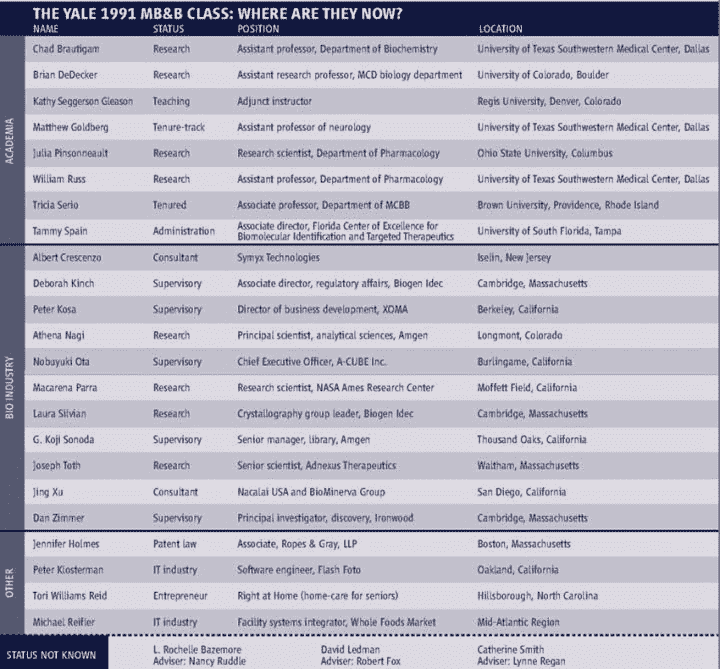

这里有被炸出来的其他 program 的人回忆各班的情况：

[`bluelabcoats.wordpress.com/2008/09/23/and-then-there-was-one/`](https://link.zhihu.com/?target=https%3A//bluelabcoats.wordpress.com/2008/09/23/and-then-there-was-one/)

过来人他不骗你，不要再挣扎了。

3\. 转计算转码工是市场决定的，显然不是唯一的路。但一年有 20 万 h1b，可以消化掉很多转专业的人。你问问你们学校，你们系的学长学姐，还有什么可能性。但一定要努力寻找其他的出路。

4\. 汇总下 nature, PNAS 上劝退文，自己看吧：

Fix the PhD Nature 472, 259–260 (21 April 2011)

[Fix the PhD : Nature : Nature Publishing Group](https://link.zhihu.com/?target=http%3A//www.nature.com/nature/journal/v472/n7343/full/472259b.html)

Life outside the lab: The ones who got away 03 September 2014

[Life outside the lab: The ones who got away : Nature News & Comment](https://link.zhihu.com/?target=http%3A//www.nature.com/news/life-outside-the-lab-the-ones-who-got-away-1.15802)

There is life after academia 03 September 2014

[There is life after academia : Nature News & Comment](https://link.zhihu.com/?target=http%3A//www.nature.com/news/there-is-life-after-academia-1.15808)

Education: The PhD factory Nature 472, 276-279 (2011)

[Education: The PhD factory : Nature News](https://link.zhihu.com/?target=http%3A//www.nature.com/news/2011/110420/full/472276a.html)

Rescuing US biomedical research from its systemic flaws March 18, 2014

[Rescuing US biomedical research from its systemic flaws](https://link.zhihu.com/?target=http%3A//www.pnas.org/content/111/16/5773.full)

本来就没啥位置，还有严重性别歧视的问题

Elite male faculty in the life sciences employ fewer women

[`wwwhttp://www.pnas.org/content/111/28/10107.abstract`](https://link.zhihu.com/?target=http%3A//www.pnas.org/content/111/28/10107.full.pdf)

媒体报道：

[Too Few University Jobs For America’s Young Scientists : Shots](https://link.zhihu.com/?target=http%3A//www.npr.org/blogs/health/2014/09/16/343539024/too-few-university-jobs-for-americas-young-scientists%3Futm_campaign%3Dstoryshare%26utm_source%3Dfacebook.com%26utm_medium%3Dsocial)

总之，你行你上，不行早退。

我知道你们曾经都很优秀，但是时候要重新定位了。

明知没路还要往下走的，这就是你：


* * *

炸出万年潜水员。打算把我的劝退范围从校内扩大到知乎。

看到有人举我的例子，你看不出我转专业了么，你这不是坑人么，生物统计跟生物没有关系，你拿个 type 1 error 出来灌鸡汤没有意义。我是七弯八拐的当了教授，但我基础比本科数学的差了不知道多少，注定是个吊车尾的教授，经常被科班(或是名校，lol)出身的人歧视的要死，这没啥值得参考和羡慕的。

各位生物专业本科生，除非有特殊兴趣，早转止损。

各位在读 phd，除非有特殊技能，除非是名校明星，考虑别的出路。

我渣科生科院是偏工科的，但哪怕是 bme，学过模电数电信号，用人单位看到生物两字也就直接 pass 了，再别说你武大的基础科学了，根本没有啥对口的单位。

我本科直接工作的同学大都是去卖药了，出国深造的同学大多的 quit 了，有直接申 cs 或是 ee phd 的，有念 bme 然后找码工工作的，有中途 quit 念 cs 或是 biostat master 的，也都费了半天劲过上了正常人的生活。他们很多曾经都抑郁过，因为看不到前途。

你要是属于出不了国，本科毕业拿不到大 pharm／咨询的 offer，又不喜欢科研的普通孩子，你折腾这个生物专业干啥？去中科院搬砖也要年级前几名吧。

不知道你是几年级，我都建议你转系，哪怕你晚个一二年毕业。

我曾在校内上统计过大陆出身的 sloan fellow 教育背景，发现生物专业的其实不太适合搞生物科研，大陆的生物教育是很成问题的。现在贴过来，一家之言，你们自己判断：

数据来自 2010-2014 Alfred Sloan Research Fellowship，这奖是给 phd 毕业六年内的北美学术明星的。

*   Chemistry (9)
*   2014 Junrong Zheng Rice
*   2013 Wen Li WSU
*   2013 Wei Min Columbia
*   2013 Wei Zhang UCB
*   2012 Bo Zhang UW
*   2011 Xiaosong Li UW
*   2011 Jiaxing Huang Northwestern
*   2010 Yu Huang UCLA
*   2010 Yi Cui Stanford
*   CS (7)
*   2014 Shan Lu UW-madison
*   2014 Elaine Shi Maryland
*   2013 Fei Sha USC
*   2012 Xi Chen Columbia
*   2012 Junfeng Yang Columbia
*   2011 Jinyang Li NYU
*   2010 Li Zhang UW-madison
*   Math (9)
*   2014 Song Sun Stony Brook
*   2014 Jun Yin UW-madison
*   2013 Jianfeng Lu Duke
*   2013 Wei Zhang Columbia
*   2012 Tong Liu Purdue
*   2012 Yi Ni Caltech
*   2011 Xiaoqing Li SUNY-B
*   2011 Dapeng Zhan MSU
*   2010 Xiaoyi Zhang Iowa
*   Computational, Evolutionary Molecular Bio (4)
*   2013 Yi Xing ULCA
*   2012 Jinbo Xu TTI
*   2012 Sheng Zhong UIUC
*   2010 Xinshu Xiao UCLA
*   Neuro (4)
*   2014 Liang Feng stanford
*   2012 Xinnan Wang stanford
*   2011 Xue Han Boston
*   2010 He Cui Medical College of Georgia
*   Physics (9)
*   2013 Liang Jiang Yale
*   2013 Jing Xia UCI
*   2013 Xi Yin Havard
*   2013 Zheng Wang TAMU
*   2013 Jiangfeng Zhou South Florida
*   2012 Ying Ran Boston College
*   2011 Shina Tan GIT
*   2011 Cenke Xu UCSB
*   2010 Xiaoliang Qi Stanford

手工统计的，可能有疏漏。从这个单子，我们看出物理化学数学入围者都是差不多的，比较稳定。进化分子生物和神经的人不多。这两个方向是生物科研的热门和主流方向之二，但在中国大部分大学的生物本科教育里不会涉及，也没有为该方向的深造做好准备。当然我没有考虑各科出国的总人数的问题，印象中基础学科里面，生物出国的最多，至少俺们学校 phd 新生中学生物的最多。

来看下进化分子方向获奖者的教育背景：

2012 Jinbo Xu TTI 本科是学数学的，后来学了计算机；2013 Yi Xing ULCA 本科生物＋计算机，在 stanford 统计系做的 postdoc；2012 Sheng Zhong UIUC 本科数学和经济的；2010 Xinshu Xiao UCLA 本科是精密仪器的。

神经方向的教育背景：

2010 He Cui Medical College of Georgia 是物理的本科，2012 Xinnan Wang stanford 没查到，其余二人是生物或是生物物理背景的。

当然高大上的生物科研还有其他很多热门方向，我们来看下大陆生物本科能不能接轨。数据来自 2011 公布的总统奖（PECASE），也是发给 ap 的，跟生物相关的主要是健康部门。其实 2012， 2013 的也出来，我懒得查了。

健康部门按照字母顺序一个一个说过去吧：

*   Dr. Rommie E. Amaro, University of California, Irvine， 化学工程手段做给药系统的
*   Dr. Sonja M. Best, National Institute of Allergy and Infectious Diseases， 病毒学
*   Dr. John S. Brownstein, Children’s Hospital Boston，疾病的预防监护，做了个百万人使用的系统
*   Dr. Brian S. Caffo, Johns Hopkins University, 生统系，做 fMRI 数据的
*   Dr. Nicola J.Camp, University of Utah, 统计遗传
*   Dr. Pierre R. Comizzoli, Smithsonian Institution, 动物保护
*   Dr. Thomas L.Kash, University of North Carolina School of Medicine，化学背景做药理
*   Dr. John C. March, Cornell University，代谢工程
*   Dr. Katherine L. O’Brien, Johns Hopkins Bloomberg School of Public Health 流行病，疫苗
*   Dr. Sara L. Sawyer, University of Texas at Austin，化工背景搞 HIV 的分子进化
*   Dr. Hari Shroff, National Institute of Biomedical Imaging and Bioengineering，生物工程背景搞细胞 3d 成像
*   Dr. Mary Jo Trepka, Florida International University，流行病
*   Dr. Linda E. Wilbrecht, University of California at San Francisco, 电生理研究神经

还有七位 MD-PHD, 是临床医生，成长系统不一样，没有列出来，大陆的生物背景没法直接申请 md 项目

NSF 有四个生物口的

*   Dr. Benjamin A. Garcia, Princeton University 化学背景做蛋白组学
*   Dr. Hatice Altug, Boston University 应用物理做生物传感器
*   Dr. Benjamin Kerr,University of Washington 生物和数学背景做进化
*   Dr. Lilianne R. Mujica-Parodi, State University of New York at Stony Brook 数理背景做 fMRI

从这里可以看出，跟生物医学的前沿方向有很多是交叉学科，这个很 make sense，因为生物是被研究对象，化学的，物理的，工程的，数学的，计算的，心理学的，人类学的等等是研究手段。生物医学科研应当被鼓励，但以背诵研究结果为教学内容，不以解决问题为目的的纯生物系没法培养相应的人才。对生物研究感兴趣的同学应该培养自己的特殊技能，否则很难实现自己的科研梦想。有人说前沿方向特别难申请，你想想为什么，因为背景不 match，看不到你做该方向的优势，没法跟其他系的人竞争啊。很多生物医学的突破是由技术突破带动的，现在最热门的 single cell sequencing，optigenetics，CRISPR 都是交叉背景碰撞出来的，生物系的同学真的准备好了么。你本科毕业申请的时候发现生物医学相关方向 30 个，哇好厉害，然后发现自己只能申请 2～3 个，什么感受？如果以上不是你们心目中的生物研究，请问植物，动物，生化，发酵真的需要每年每个系一百来号人来学么。把生物专业留给真正感兴趣，可以自主培养的学生学，对谁都是好事。

即使过五关斩六将，漂洋过海，加入了美国 1 万六千的新生队伍，学习了以上高大上方向，好找教职么，来看看 nih 的数据：

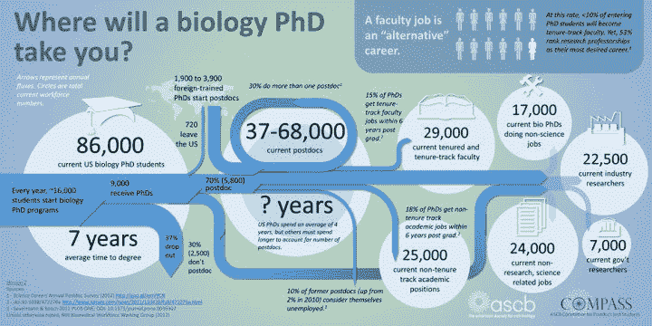

找不到教职就是千老了。

想做科研的，如果去不了国内／国外好 lab，都可以考虑退了，因为有无数背景更好的人跟你竞争。

生物科研在美国也很成问题，phd 学位贬值的厉害, 下图是 1998-2008 年发出的 phd 学位，你们看看生物是化学，物理，数学，cs，ee 的多少倍。

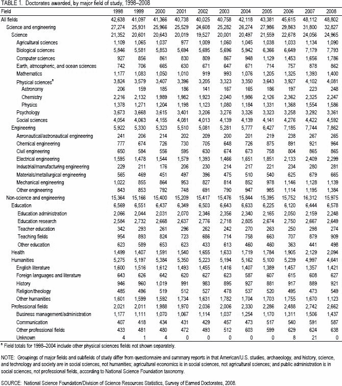

大部分生物专业是不在 STEM 里面的，意思就是美帝对引进这些人才不感兴趣。现在的生物科研人员，退一半，也不会有任何影响。

再看下工作岗位在哪里，下图是工作签证的分布：

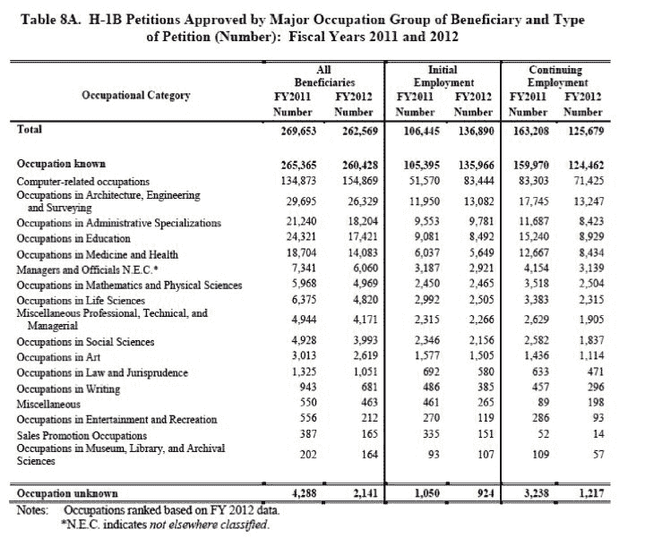

cs 工作是生科的 30 倍。你用脚想想该转什么专业。

不是因为专业多高级，纯是因为有工作啊。

下面都是针对普通人的，学霸别来添乱：

我推荐的早期自救路线有：

1）cs master -> 码工

如 1）不行，2）stats/biostats master -> data scientist／码工

如 2）不行，3）bioinfomatics phd/master -> 码工

转专业路都不好走，但总比没路的好。普通工作的编程没什么恐怖的，又不是要去分析算法复杂度。

晚期自救（不得不念完 phd）：

*   1）学校还可以的努力去 consulting
*   2）找 bench＋计算的 postdoc -> biomedical/health 相关 data scientist／码工
*   3）phd 当没念过，同早期自救路线

在国内的，重新高考，我觉得都值。

把资源留给喜欢的适合的人，对大家都好。

# 盘点 2018 年化工行业大事故！回顾那些令人心痛的瞬间......

 flowchart 箭头图标 勿删 

> 作者：[流程工业](http://www.sohu.com/a/289864353_479771)

2018 年事故不断发生，损失不可不谓之惨重。从山东枣庄市**爆炸事故造成 9 人死亡**到四川宜宾化工厂**燃烧造成 19 人伤亡**，这些数字透漏出来严重的安全问题，\*\*企业到底该如何搞好化工安全？安全人该如何履行好职责？\*\*接下来，跟随流程程一起回顾 2018 年 13 起较大化工事故心痛瞬间！

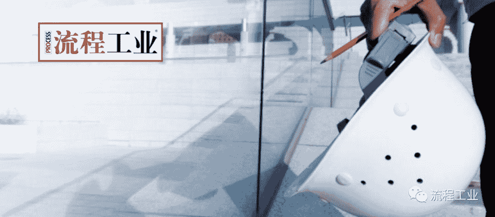

## 1.新疆吐鲁番恒泽煤化公司“1•24”闪爆

2018 年 1 月 24 日，新疆吐鲁番市恒泽煤化有限公司在对改质沥青高位槽油气回收管道进行检维修作业时发生闪爆，造成 3 人死亡、1 人重伤，事故教训深刻，影响严重。事故具体起因尚未公布。

## 2.山东临沂金山化工公司“2•3”爆燃

2018 年 2 月 3 日上午 10 时 51 分，位于山东省临沂市临沭县经济开发区的金山化工有限公司，在停产整顿期间非法组织生产，发生爆燃事故，造成 5 人死亡（含邻氯氯苄生产作业人员 2 名）、5 人受伤（其中 1 人重伤）。

该起事故是继临沂金誉石化公司“6•5”重大爆炸事故、山东日科化学股份有限公司“12•19”爆燃事故之后山东省发生的又一起性质严重、影响重大、教训深刻的典型事故。

2 月 3 日，事故发生前两套装置都处于生产状态，并且正在进行环保设施（废气有组织排放改造工程）的安装作业。上午 10 时 51 分，因改造过程中使用塑料焊枪，引燃尾气管线中四甲基硅烷、氯甲基三甲基硅烷等可燃性气体，回火引爆分离釜内物料，发生爆炸事故并引发着火。

## 3.河北唐山华熠公司“3•1”爆燃

2018 年 3 月 1 日 12 点 20 分，天良公司施工人员在本公司苯加氢车间实施污水储罐罐顶施工作业后，清理施工工具时，产生火花致使污水储罐起火，导致包括天良公司施工人员及唐山华熠人员在内的 5 名人员 4 人死亡、1 人受伤（其中唐山华熠员工 1 人死亡、1 人受伤）。

## 4\. 江西九江“3•12”爆炸

2018 年 3 月 12 日 16 时 15 分，江西省九江石化 60 万 t/a 柴油加氢装置分液罐容 501 爆炸起火，30 分钟后，火势得到控制。目前事故已造成 2 人死亡，1 人轻度灼伤。事故原因初步分析为 60 万 t/a 柴油加氢装置循环氢压缩机 C502B 润滑油压力低联锁停机，引起装置波动高压窜低压，引起原料罐 501 撕裂泄漏着火。

## 5.枣庄市薛城区“3•27”较大爆炸事故


危险化学物罐体操作造成 9 死 3 伤！山东枣庄爆炸事故调查报告发布

2018 年 3 月 27 日，在枣庄甘霖实业有限公司对外出租的废旧仓库内，河北省邯郸市广平县人张恒、李继兴、武廷生借用枣庄泓劲商贸有限公司营业执照进行非法建设时，发生了爆炸事故，造成 9 人死亡、3 人受伤，直接经济损失约 900 万元。

27 日下午，张恒、李继兴、武廷生、刘振晓、刘志平组织工人，在租赁的甘霖实业公司原设备仓库内，进行非法建设。16 时 52 分，现场施工人员在对一碳钢罐阀门进行动火作业过程中，碳钢罐突然发生爆炸。

甘霖实业公司原设备仓库，为一长方体建筑物，实际面积为 1 028 m2。经现场勘查，爆炸中心距离仓库东墙约 25m ，仓库顶棚和墙体不同程度损坏，正上方钢结构横梁飞散，周围钢结构梁受爆炸超压影响严重弯曲，南侧砖混结构墙体坍塌，东侧砖混结构墙体呈现较大裂隙。碳钢罐在爆炸中解体，罐体圆形底盘残留在爆炸中心，爆炸中向下冲击造成地面凹陷，罐体残骸等飞溅物最远抛至 100 m,周边 120 m 左右的建筑物玻璃也受到爆炸冲击波影响,造成不同程度损坏。经计算，此次爆炸事故 TNT 当量约为 109~193 kg。

导致事故发生的直接原因包括现场施工队伍不具备资质处置废旧罐体，施工作业前未采取清洗、置换和检测等安全措施，违规动火作业产生的高温或火花引爆罐体内残留的 2,6-二硝基苯酚，加之罐体相对密闭，导致爆炸破坏力加强。

## 6.天津渤化永利化工公司“4•26”中毒窒息

2018 年 4 月 26 日 20 时 40 分，中石化工建设有限公司 5 名工人在天津渤化永利化工股份有限公司维修作业时，发生氮气中毒事故，其中 3 人死亡，2 人受伤。

## 7.上海赛科公司“5•12”闪爆

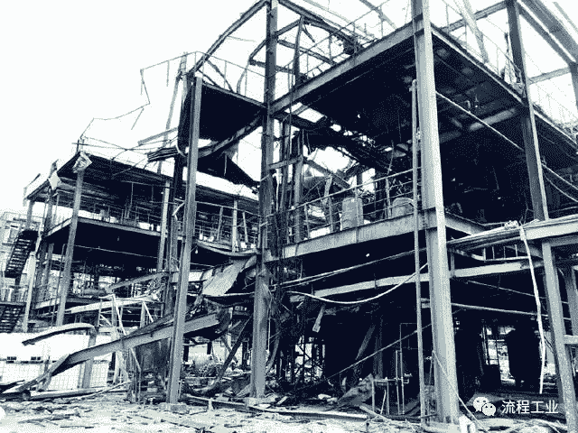

赛科石化突发事故，6 人死亡，如何保障储罐动火作业安全？

2018 年 5 月 12 日下午 15 时 25 分左右，在上海赛科石油化工有限责任公司公用工程罐区位置，上海埃金科工程建设服务有限公司的作业人员在对苯罐进行检修作业过程中，因苯罐发生闪爆，罐顶撕裂，罐体位移，造成在该苯罐内进行浮盘拆除作业的 6 名作业人员当场死亡。经调查认定，此次事故是一起生产安全责任事故。

此次事故发生的直接原因为 75-TK-0201 内浮顶储罐的浮盘铝合金浮箱组件有内漏积液（苯），在拆除浮箱过程中，浮箱内的苯外泄在储罐底板上且未被及时清理。由于苯易挥发且储罐内封闭环境无有效通风，易燃的苯蒸气与空气混合形成爆炸环境，局部浓度达到爆炸极限。罐内作业人员拆除浮箱过程中，使用的非防爆工具及作业过程可能产生的点火能量，遇混合气体发生爆燃，燃烧产生的高温又将其他铝合金浮箱熔融，使浮箱内积存的苯外泄造成短时间持续燃烧。

虽未造成次生灾害和环境污染，但造成直接经济损失约 1166 万元，其中设备损失约 536 万元。

## 8.四川宜宾“7•12”重大爆燃事故

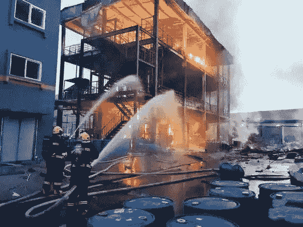

相关阅读：突发｜四川宜宾一化工厂爆燃致 19 人死亡，警钟长鸣！

2018 年 7 月 12 日 18 时 30 分，四川省宜宾市江安县的宜宾恒达科技有限公司发生重大爆炸着火事故，造成 19 人死亡，12 人受伤。据调查，这是自 2012 年以来我国化工企业死亡人数最多的一次事故，也是企业违法违规问题最多、最严重的一次事故，事故损失惨重，社会影响十分恶劣。

国家企业信用信息公示系统显示，宜宾恒达科技有限公司成立于 2015 年，是一家从事化学原料中间体和化学制品研发、生产的精细化工企业。事故现场了解到，该企业生产过程涉及多种重点监管危化品和重点监管工艺，但是未按相关要求安装自动化控制系统、报警系统及消防水系统。此次发生爆燃的正是刚刚投产两个月的中间体生产新装置，反应釜上甚至没有预留安装相应设施的接口。由于缺少了自动化系统，每班需有 10 余人在反应釜周边操作，这正是此次事故造成众多人员伤亡的重要原因之一。

## 9.福建泉州碳九泄漏事件

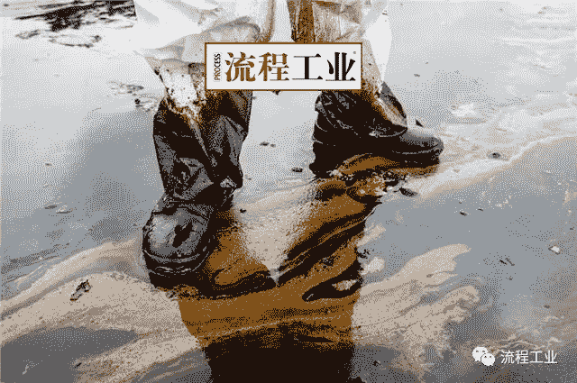

69.1 吨变 6.97 吨！恶意串通、伪造证据！泉州东港石化碳九泄漏事故官方正式通报！相关人员被免职

2018 年 11 月 4 日凌晨，福建东港石油化工实业有限公司执行碳九(石油炼制副产品中含有 9 个碳原子芳烃的聚合物)装船的宁波“天桐 1 号”船舶与码头连接软管处发生泄漏，共造成 69.1 t 碳九泄漏。涉事企业安全生产隐患严重，泄漏事件发生时存在违规作业。发生泄漏事件后，企业隐瞒泄漏数量，谎报泄漏量为 6.97 t，实际造成 69.1 t 化学品泄漏。目前 7 名直接责任人员已被批捕。

## 10.河北金万泰化爆炸事故

2018 年 11 月 7 日下午 15 时 10 分，河北金万泰化肥有限责任公司造气车间尾气燃烧炉发生爆炸。事故发生后，政府有关部门及企业迅速开展营救，受伤人员立即送往医院抢救。目前，事故已造成 6 人死亡、2 人重伤、5 人轻伤。事故原因正在调查中。

## 11.张家口“11•28”重大爆燃事故

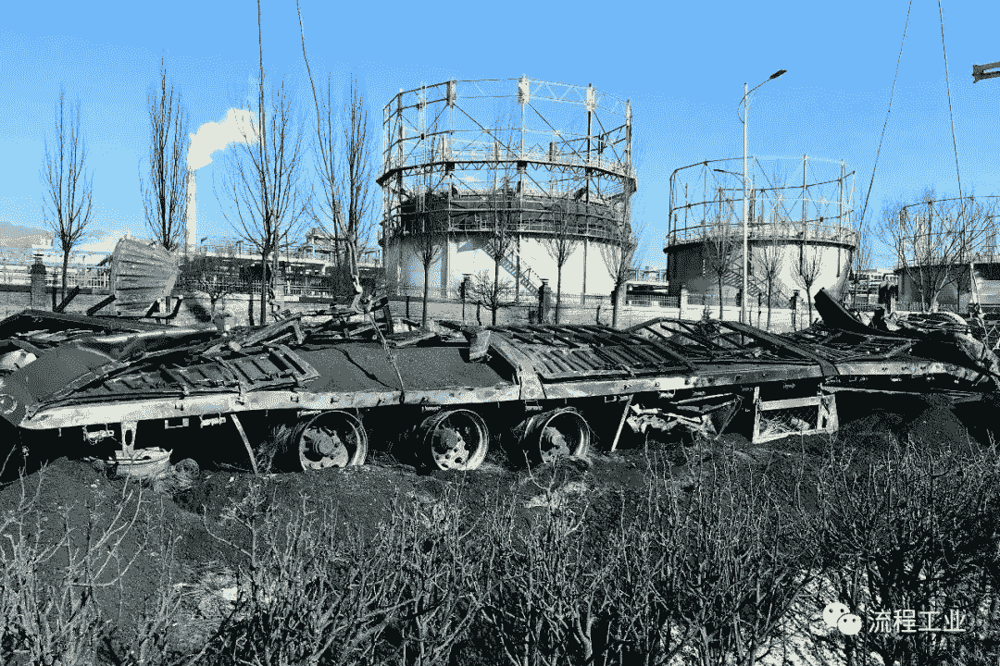

2018 年 11 月 28 日零时 41 分，河北省张家口市桥东区河北盛华化工有限公司发生爆炸起火事故。经初步调查，事故中过火大货车 38 辆、小型车 12 辆。事故直接原因是中国化工集团河北盛华化工有限公司氯乙烯气柜发生泄漏，泄漏的氯乙烯扩散到厂区外公路上，遇明火发生爆燃，导致停放公路两侧等候卸货车辆的司机等 23 人死亡、22 人受伤。23 位遇难者当中除了 3 人为附近公司员工，2 人为附近村民，剩下的大多都是货车司机。

这是近年来央企发生在化工生产企业伤亡最严重的事故，也是自 2012 年 河北克尔化工有限公司“2•28”重大爆炸事故造成 29 人死亡后，全国死亡人数最多的化工事故，再次暴露出化工和危险化学品安全生产的复杂性和严峻性。

据调查发现，氯乙烯气柜开工六年从未检修，气柜泄漏后操作人员操作错误，企业未采取任何措施防止氯乙烯扩散到省道，企业生产管理十分混乱，一把手多年未在工厂露面。

事实上，这样的安全事故在盛华化工并非首次发生：2013 年和 2014 年，该企业曾发生 2 起安全责任事故，共导致 2 人死亡。

在 2015 年张家口安监局的执法检查通报中，该企业存在氯乙烯气柜进口排水阀泄漏严重等 71 项隐患。

## 12.山东济南汇丰燃爆事故

2018 年 12 日 9 时，平阴县孔村镇济南汇丰炭素有限公司在组织沥青储存池导热炉维修过程中，发生燃爆事故，造成 6 名员工当场死亡，5 名员工受伤。其中 2 人重伤，3 人轻伤。事故发生后，济南市及平阴县立即启动事故应急预案，5 名伤者被及时送往医院进行抢救。经初步勘察和了解，该企业沥青储存池（密闭）气相空间形成的爆炸性混合气体，遇维修过程中产生的明火后发生燃爆。目前事故原因正在调查中。

## 13.江苏如皋众昌氟化氢中毒事故

12 月 18 日 10 时 35 分许，如皋市众昌化工有限公司发生一起氟化氢中毒事故，造成 3 人死亡。经初步调查，该事故是由于液氮深冷导致化工装置材质冷脆，加之超压造成设备爆裂，设备内的氮气以及氟化氢泄漏，氟化氢造成现场作业人员 3 人中毒死亡。

## 成于安全，败于事故

从这几起事故来看，检维修、受限空间、动火等特殊作业是事故高发环节。

针对化工安全各项问题，12 月 25 日国务院安委办、应急部发布了《关于做好岁末年初安全防范工作的通知》，要求企业落实安全生产责任到每个环节、每个岗位和每名员工，深入细致开展隐患排查治理，严防各类事故发生，确保安全生产形势稳定。通知中对化工领域做出下列要求：

要加强危险化学品生产装置、罐区、气柜等重点部位安全管控，节日期间动火等特殊作业实行升级管理，确保防冻、防凝、防滑、防静电等冬季防护措施执行到位。

要强化途经人员密集场所等高后果区的油气输送管道隐患排查，落实管道企业日常巡护措施，严格审批监督管道周边施工作业，严防乱挖乱钻引发管道泄漏着火爆炸等事故。

要高度重视烟花爆竹旺季生产、经营、运输、储存、燃放等各环节安全监管，结合公安机关正在开展的打击整治枪爆违法犯罪专项行动，严厉打击非法生产储存经营烟花爆竹行为。

**岁末年初，希望生产者和管理者在警示中安全前行！**

# 触目惊心！2017 年化工行业事故 203 起死亡 238 人！附重大事件回顾

 flowchart 箭头图标 勿删 

> 作者：[流程工业](https://www.sohu.com/a/211831846_479771)

国家安全监管总局近日披露，今年前 11 个月，化工行业共发生事故 203 起、死亡 238 人，事故总量依然很大，重大事故仍未得到有效遏制。12 月 9 日，连云港聚鑫生物科技有限公司发生 10 人死亡、1 人受伤的重大爆炸事故，是今年以来国内发生的第 2 起化工重大事故。流程君今天整理了化工行业今年至今为止的重大事故，愿大家在警示中安全前行。

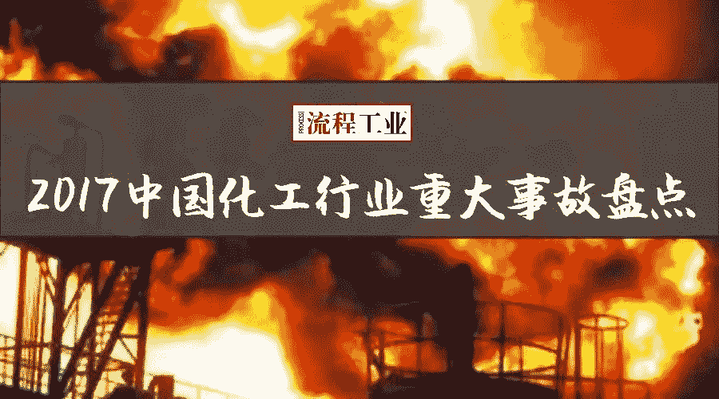

国家安全监管总局近日披露，目前全国有近 30 万家危化品生产经营单位，其中安全保障能力比较差的小化工占 80%以上。

会议指出，今年以来全国发生的化工事故暴露出当前安全生产工作存在着一些深层次突出问题：

*   一些地方和企业安全发展理念没有牢固树立；
    
*   部分地方政府监管责任落实不到位，重点工作不落实，推动企业安全生产主体责任落实不力；没有认真吸取历史上同类事故教训；
    
*   设计、建设、安全评价等第三方机构履责不到位，埋下安全隐患。
    

**关于今年化工行业内发生的重大事故，“流程工业”进行过详细的报道，今天请跟随流程君一起回顾。**

## 金誉石化爆炸

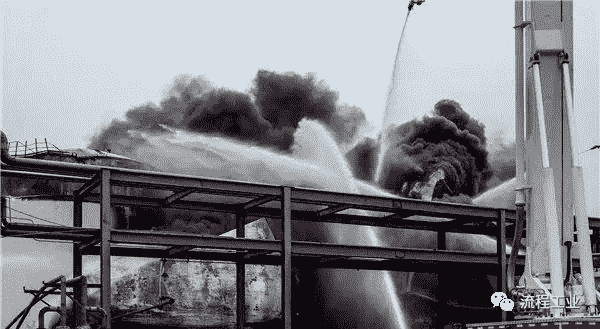

2017 年 6 月 5 日凌晨 1 时左右，临沂市金誉石化有限公司储运部装卸区的一辆液化石油气运输罐车在卸车作业过程中发生液化气泄漏，引起重大爆炸着火事故，**造成 10 人死亡，9 人受伤**，直接经济损失 4468 万元。

经计算，本次事故释放的爆炸总能量为 31.29 吨 TNT 当量，产生的破坏当量为 8.4 吨 TNT 当量（最大一次爆炸）。

事故原因

**直接原因：**

肇事罐车驾驶员长途奔波、连续作业，在午夜进行液化气卸车作业时，没有严格执行卸车规程，出现严重操作失误，致使快接接口与罐车液相卸料管未能可靠连接，在开启罐车液相球阀瞬间发生脱离，造成罐体内液化气大量泄漏。

**间接原因：**

临沂金誉物流有限公司、临沂金誉石化有限公司、河南省清丰县安兴货物运输有限公司等相关组织单位未落实安全生产主体责任。

**详情请点击标题阅读：**

## 乌石化检修事故

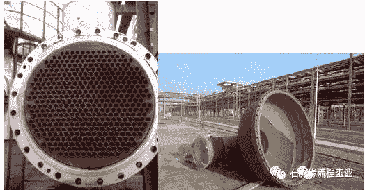

2017 年 11 月 30 日 12 时 20 分左右，中石油乌鲁木齐石化公司炼油厂在换热器检修作业中发生事故，**造成 5 人死亡，16 人受伤（其中 3 人重伤）。**

初步起因剖析

E2208/2 检修前壳程蒸汽压力未泄放，从 DCS 历史趋势考察，检验时壳体压力 2.2MPa，换热器管箱螺栓拆除残余至 5 根时，螺栓生效断裂，管箱及管教在蒸汽压力作用下，从壳体飞出，造成施工及周边职员伤亡。

该起事故是新疆维吾尔自治区区今年继新疆宜化化工有限公司“7·26”燃爆事故之后发生的第二起较大化工事故，也是中石油企业连续第三次发生事故。国务院安委会将对该起事故查处挂牌督办，事故原因还在调查中。

\*\*详情请点击标题阅读：\*\*5 死 16 伤 | 乌石化“11·30”事故原因剖析！

## 贵州天然气输气管道燃爆

（现场视频，建议 WIFI 环境下观看）

[`imgcache.qq.com/tencentvideo\_v1/player/TPout.swf?max\_age=86400&v=20140714`](https://imgcache.qq.com/tencentvideo_v1/player/TPout.swf?max_age=86400&v=20140714)

2017 年 7 月 2 日 10 时许，中石油天然气输气管道贵州晴隆沙子段，因近期持续强降雨引发边坡下陷侧滑，挤断输气管道，引发泄漏燃爆。**初步查明造成８人死亡，35 人受伤。**

事故原因仍在调查，尚未公布。

\*\*详情请点击标题阅读：\*\*8 死 35 伤! 贵州天然气输气管道突发泄漏燃爆事故！

## 吉林松原燃气管道爆炸

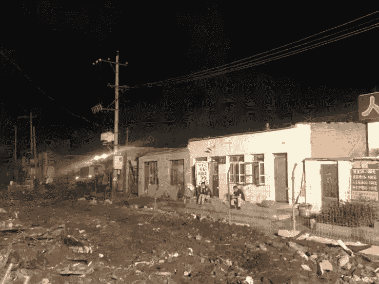

7 月 4 日 14 时 45 分许，松原市宁江区繁华路巷路施工过程中造成燃气泄漏，燃气公司在抢修时发生爆炸。截至目前，经核实，\*\*事故共造成 5 人遇难，89 人（其中 14 人重伤）\*\*住院治疗。

事故原因仍在调查，尚未公布。

\*\*详情请点击标题阅读：\*\*突发 | 吉林松原燃气管道泄漏爆炸，已致 5 人遇难 89 人受伤！

## 山东东营硫化氢泄漏

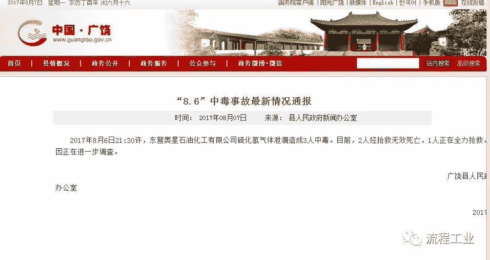

2017 年 8 月 6 日 21:30 许，东营奥星石油化工有限公司硫化氢气体泄漏造成 3 人中毒，\*\*2 人经抢救无效死亡。\*\*事故原因正在进一步调查。

\*\*详情请点击标题阅读：\*\*2 人死亡 | 山东东营奥星石化硫化氢气体泄漏！（附硫化氢浓度与危害对比表）

## 华强化工喷嘴裂爆

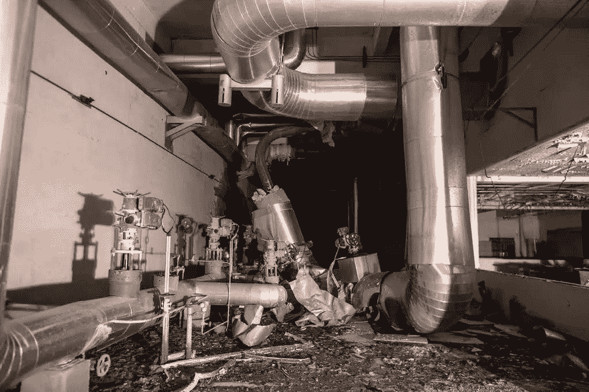

2016 年 8 月 11 日 14 时 49 分，湖北省当阳市马店矸石发电有限责任公司热电联产项目在试生产过程中，2 号锅炉高压主蒸汽管道上的“一体焊接式长径喷嘴”（企业命名的产品名称，是一种差压式流量计，以下简称事故喷嘴）裂爆，导致发生一起重大高压蒸汽管道裂爆事故。

事故共造成 26 人伤亡，其中，21 人当场死亡，1 人经抢救无效后死亡，死亡原因为高温合并冲击波损伤；4 人重伤在医院接受治疗。事故共造成直接经济损失 2313 万元。

事故原因

**直接原因：**

安装在 2 号锅炉高压主蒸汽管道上的**事故喷嘴是质量严重不合格的劣质产品**，其焊缝缺陷在高温高压作用下扩展，局部裂开出现蒸汽泄漏，形成事故隐患。

**相关人员未及时采取停炉措施消除隐患，焊缝裂开面积扩大**，剩余焊缝无法承受工作压力造成管道断裂爆开，大量高温高压蒸汽骤然冲向仅用普通玻璃进行隔断的集中控制室以及其他区域，造成重大人员伤亡。

间接原因：

*   采购、供应的事故喷嘴是质量严重不合格的劣质产品，产品质量是肇事的最主要原因。
    
*   发现事故喷嘴泄露形成重大事故隐患时，企业没有及时有效处置，是造成事故的最直接原因。
    
*   厂房设计不符合标准规范要求，人员聚集的集中控制室失去安全防护作用。
    
*   管道检验检测没有按标准规范进行，监管缺失，放过了焊缝隐患。
    

此外，相关的单位及人员已受到追责和行政处罚。

\*\*详情请点击标题阅读：\*\*可怕的人祸 | 死 22 人，追刑责 15 人，处分 30 人，华强化工马店矸石发电公司事故调查报告发布

## 大连硫化氢中毒

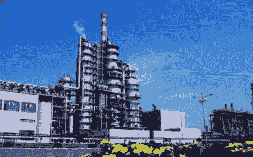

2017 年 11 月 18 日 19 点 15 分左右，河南鄢陵京顺石化机械设备有限公司 9 名工人在大连西太平洋石化公司硫磺装置做设备检修和换热器管束清洗作业时，发生硫化氢中毒，伤员立即被送至医院，**其中 3 人伤势较重死亡**\*\*，另外 6 人经大连医科大学附属第一医院留院观察\*\*，生命体征平稳。

目前大连市政府已由安监局牵头成立事故调查组，事故原因正在查明中。

详情请点击标题阅读：突发 | 大连西太平洋石化发生硫化氢中毒事故，9 人伤亡！

## 陕西西岳制药反应釜爆炸

（现场视频，建议 WIFI 环境下观看）

[`imgcache.qq.com/tencentvideo\_v1/player/TPout.swf?max\_age=86400&v=20140714`](https://imgcache.qq.com/tencentvideo_v1/player/TPout.swf?max_age=86400&v=20140714)

11 月 25 日早上 6 点多，华阴西岳制药有限公司一车间甲醇反应釜发生爆炸，**造成 7 人受伤，事其中 1 人死亡，1 人重伤，2 人轻伤，3 人轻微擦伤。**

事故发生后，华阴市委、市政府主要领导、分管领导第一时间赶赴现场指挥救援处置工作。伤员救治、事故调查、善后处置等各项工作正有序进行。

**详情请点击标题阅读：**

## 连云港二氯苯装置爆炸事故

（现场视频，建议 WIFI 环境下观看）

[`imgcache.qq.com/tencentvideo\_v1/player/TPout.swf?max\_age=86400&v=20140714`](https://imgcache.qq.com/tencentvideo_v1/player/TPout.swf?max_age=86400&v=20140714)

2017 年 12 月 9 日凌晨 2 时 20 分左右，连云港聚鑫生物科技有限公司（以下简称聚鑫公司）年产 3000 吨间二氯苯装置发生爆炸事故，**造成 4 人死亡，1 人受伤，6 人被困**，间二氯苯装置与其东侧相邻的 3-苯甲酸装置整体坍塌，部分厂房坍塌、建筑物受损严重。

事故原因

根据现场勘查，事故原因初步分析：保温釜压料过程中，严重超压\*\*（设计压料系统应使用氮气，正常操作压力为 1.5 公斤，实际操作改用了 5.8 公斤的压缩空气进行压料）\*\*造成保温釜内物料从视镜处泄漏、冲料，摩擦产生的静电引燃物料，并引发装置外侧下方的成品精馏釜等爆炸。

**–END–**

# 北交大实验室爆炸事故后续

 flowchart 箭头图标 勿删 

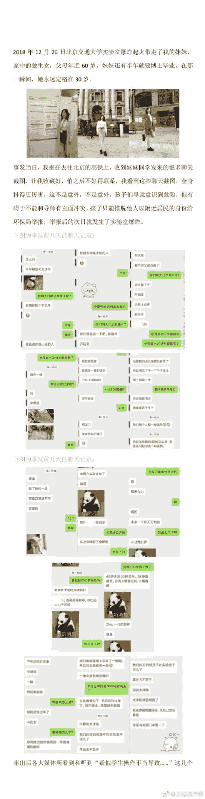

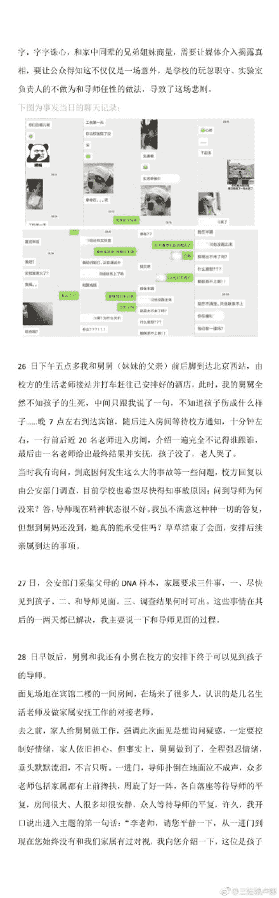

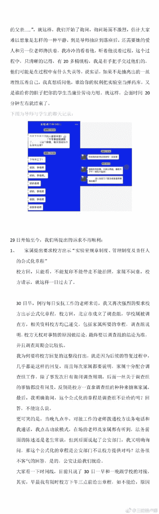

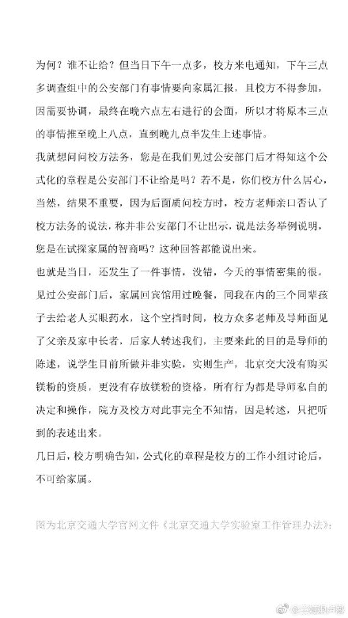

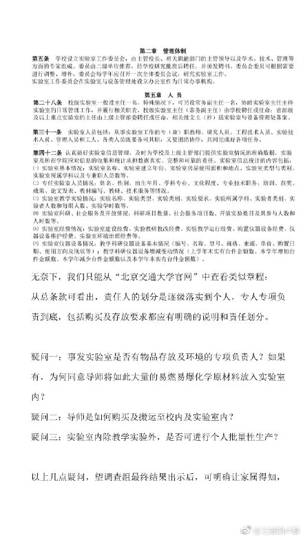

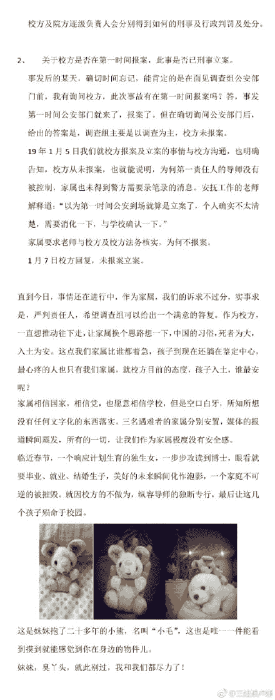

# 扬子医药“5.3”闪爆事故现场监控

 flowchart 箭头图标 勿删 

[点击这里查看](https://www.zhihu.com/pin/1081644392028291072)

# 华东理工研究生因爆炸死在导师工厂 导师获刑 2 年

 flowchart 箭头图标 勿删 

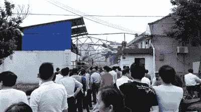

2016 年 5 月 23 日，上海青浦区上海焦耳蜡业有限公司厂房爆炸已造成 3 人死亡。图/CFP

【华东理工大学研究生因爆炸死在导师工厂 导师被判 2 年缓刑 3 年】2016 年 5 月 23 日，上海青浦区发生一起工厂爆炸事故致华东理工一研究生及两名工人死亡。近日，法院对该公司实际控制人华东理工大学教师张建雨作出判决：张建雨犯危险物品肇事罪，判处有期徒刑 2 年，缓刑 3 年。(央视记者池平)

**此前报道：**

**华东理工研二学生命丧导师参股工厂 涉事教师已被刑拘**

家属质疑导师在工厂安排“违规实验”致爆炸；涉事教师参股多家企业，目前已被刑拘

28 日，在华东理工大学徐汇校区附近的一家宾馆内，李鹏的家人仍在焦急地等待调查结果。

李鹏是华东理工大学研二的学生，5 天前，他在上海一家工厂的爆炸事故中不幸遇难，此次事故共造成 3 人死亡。

据上海媒体报道：23 日下午，上海焦耳蜡业有限公司发生爆炸，事故共造成近 200 平方米的彩钢板坍塌，事故原因正在进一步调查中。

新京报记者调查发现，李鹏的导师张建雨持有事发工厂的股份。李鹏家人及同学介绍，张建雨在上海、浙江等地投资有多家工厂，之前，他曾多次安排学生在这些工厂进行商业研究或实习。

李鹏的家人及同学质疑，张建雨涉嫌安排李鹏进行中试放大实验，这或是导致事发的原因。

李鹏的同学介绍，中试放大实验是实验室成果走向工业化生产的一个必须步骤，但其危险程度远高于在实验室中操作的实验，一般而言，如果没有老师指导，研究生不能独立承担此项实验。

28 日下午，华东理工大学宣传部相关负责人称，张建雨已被公安部门刑事拘留。学校正在配合政府部门开展调查。

她告诉新京报记者，2007 年，学校便明确规定，教师不允许在校外企业进行实质性兼职，个人也不能作为法人开办公司。“张建雨做这种事情，是瞒着学校和学院的。张建雨责任的认定要等待工作组最后的调查结果，如果他确实有违法违纪的情况，学校绝对不包庇。”

**为论文而苦恼的研究生**

从今年初开始，李鹏便开始为论文而苦恼，他希望能尽早完成毕业所需的论文指标——据其同学介绍，按照华东理工大学的相关规定，硕士毕业必须要在核心期刊上发表一篇论文。

但据一位与李鹏很要好的同学介绍，他的导师张建雨不让他发表论文。

上述同学说，几个月前，李鹏的研究取得重大突破。他在参考相关文献的基础上，找到一种新的配方，这种配方能使某种现有相变材料的储能得到提升。

相变材料是李鹏研究的主要对象，它是指一种随温度变化而改变物质状态并能提供潜热的物质。

李鹏在学校实验室验证了自己的发现。据其同学介绍，李鹏这样的研究发现，已经够得上核心期刊的发表标准，但是大家一直没能看见李鹏的成果。

这之后的一天，几位与李鹏关系密切的同学发现，李鹏的情绪非常沮丧。他告诉同学，导师让他暂时不要发表（论文）。

“这实在太意外了”，这位同学说，一般而言，导师都会鼓励学生多出成果，“阻拦”学生发表论文的老师并不多见。

上述同学分析，导师张建雨之所以不让李鹏发表论文，或许是担心成果公布后，大家都知道这一配方，他的企业也就丧失了先发优势，“张建雨不是不许李鹏发表论文，而是希望其延后发表——在此之前，他希望先在自己的企业实现工业化生产。”

李鹏的父母也听到了儿子关于论文的“抱怨”。一天，李鹏给母亲打电话，告知其不能发表论文的苦恼：“老师让我别写，但是我如果没有发表论文，肯定不能毕业。”

“老师怎么说的？”母亲问。

“他让我别担心，保证我能毕业”。李鹏回答。

“那老师说啥就是啥。”李鹏的父母让儿子听导师的。

**商人和导师**

在华东理工大学一位学生看来，张建雨“更像一个商人，不太关注学生的利益”。他上过张建雨的课，对其多有了解。

官方资料显示，张建雨现为华东理工大学副教授、硕士研究生导师，现年 55 岁，1997 年进入华东理工大学任教至今。

新京报记者调查显示，张建雨在上海至少参股两家企业，其中包括事发的上海焦耳蜡业有限公司。同时，张建雨还参与了浙江一家企业的运营。

工商资料显示，2015 年 6 月 30 日之前，张建雨是这家公司的法人。上述时间后，这家企业的法人变更为张建军。多方信源显示，张建军是张建雨的哥哥。

多位华东理工大学的学生介绍，“他投入很多精力在企业上”，和学院的其他老师相比，张建雨发表的论文较少。对自己带的学生，也不像其他老师那样上心。

一位同学说，张建雨给学生开的工资或者补助比较低。

因为要帮助老师做项目或者完成课题，研究生一般都会从导师处领取到每月 300 元到 500 元不等的补助，“张建雨一般给 300 元，比其他导师都少一些”。

李鹏有一次告诉同学，有客户到张建雨的企业洽谈业务，张建雨让李鹏帮忙接待，并陪同吃午饭。当天的花销是李鹏自己掏的，张建雨说要报销，但这笔钱一直没能兑现。

李鹏没有将这些烦恼告诉父母，在每个星期都和母亲的通话中，李鹏只是说自己太忙，每天都要做实验，“几乎连洗衣服的时间都没有”。

这位身高将近一米八的男孩告诉母亲，因为没有时间，他辞掉了一份家教——此前为了勤工俭学，他找了两份家教的工作。

李鹏的姐夫介绍，从前年来到上海读研究生之后，李鹏便开始在外面兼职赚钱——家中因为翻修房子，以及父母身体不好，至今还欠有外债，从今年开始，“他便没再从家里要钱，在上海的所有开销都是他自己赚的。”

**危险的“实验”**

5 月 23 日上午，有同学看到李鹏“上了导师张建雨的车”。当天下午，上海焦耳蜡业有限公司发生爆炸，李鹏和另外两个人在事故中身亡。

至于李鹏经历了什么，尚待警方调查。但其家属怀疑，李鹏可能被导师要求进行了一次中试放大实验。

他们的信源来自李鹏的同学——这位同学接受警方调查时，听警方说起了事发经过。当时在事发现场，除了李鹏之外，还有上海焦耳蜡业有限公司的三位工人，其中一个工人中途嫌气味太大，出门透口气而躲过一劫。

这位同学转述工人的说法：现场有 3 个装有化学试剂的桶，每个桶重 20 公斤，每个人负责一个桶，下面加热，上面搅拌，在搅拌的过程中，爆炸发生。

但此说法尚未得到上海警方证实。

据公开资料，所谓中试放大是指在实验室小规模生产工艺路线打通后，采用该工艺在模拟工业化生产的条件下所进行的工艺研究，以验证放大生产后原工艺的可行性，保证研发和生产时工艺的一致性。

李鹏的上述同学介绍，在实验室进行的实验都是几克级，如果 20 公斤说属实的话，那就放大了成百上千倍，危险系数也就相应地增加。

“研究生没有做这种实验的必要”，上述同学说，除非导师要求，研究生一般是不会去做中试的，因为实验室的数据足够发表论文。

李鹏的姐夫认为导师对此次事故负有不可推卸的责任。他到了事发现场，发现事发工厂和一般作坊相差无几，设施非常简陋，而且没有看见有安全保护装置。

“导师对这种实验的危险性肯定是清楚的，他为什么没有在现场指导？工厂的安全措施在哪里？”李鹏的姐夫说。

27 日晚，华东理工大学通过其官方微博通报称：对李鹏的不幸遇难，学校深感痛心，并已成立工作组，做好学生家属的慰问、接待和服务工作，积极配合相关部门开展事故调查。

28 日下午，华东理工大学宣传部相关负责人称，2007 年，学校曾下发《教师校外兼职活动的暂行规定》的通知，教师不允许在校外企业进行实质性兼职，个人也不能作为法人开办公司。

上述负责人表示，学校和学院并不知道张建雨在校外开办或者参股企业，他的工厂和学校没有关系。“张建雨责任的认定要等待工作组最后的调查结果，如果他确实有违法违纪的情况，学校绝对不包庇。”

事发当晚 10 点左右，李鹏的姐夫跟张建雨有过一次对话。此前，听闻妻弟出事的消息后，他和老婆轮流拨打李鹏导师张建雨的手机。

“出事了”，张建雨告诉李鹏的家人。

“到底出什么事了？”李鹏的姐夫急切地问。“这个事纯属意外”，张建雨回答。随后，张建雨表示他在派出所不方便，然后挂断了电话。

新京报记者 谷岳飞 李兴丽 上海、北京报道

# 虚假和绝望的生命科学

 flowchart 箭头图标 勿删 

> 作者：[杨微粒](https://zhuanlan.zhihu.com/p/20892649)

[虚假与绝望的生命科学（嘘と絶望の生命科学）-- 榎木英介](https://www.amazon.co.jp/%E5%98%98%E3%81%A8%E7%B5%B6%E6%9C%9B%E3%81%AE%E7%94%9F%E5%91%BD%E7%A7%91%E5%AD%A6-%E6%A6%8E%E6%9C%A8%E8%8B%B1%E4%BB%8B-ebook/dp/B00N3RLF1A)

前段时间日本弄了个大新闻，就是小保方论文造假事件。于是冒出来了一堆书，把她批判一番。榎木英介的《虚假与绝望的生命科学》就是其中之一。但是这位作者主要是在描述生物课研界的体制问题（俗称：黑生物），小保方造假的经过只是个引子。

作者履历：

> 1971 年日本神奈川县横滨出生。1995 年东京大学理学部生物学科动物学专业毕业。东京大学同专业博士课程肄业。之后，在神户大学医学部医学科就读本科。2004 年取得医师从业资格。2006 年医学博士。现为近畿大学医学部病理学教室讲师。

这也可以算是退坑前辈了吧（当然日本亚马逊上也有书评抱着「三百六十行行行出状元」的心态给作者打了一星）。日本和中美不同，IT 产业并不是人人趋之若鹜的状态，所以从生物这个坑跳出来的日本人似乎很多改行学医去了（[IT 业也是制造业，日本 IT 产业奇葩在哪儿](http://link.zhihu.com/?target=http%3A//www.infoq.com/cn/articles/chinatechday-Japan-IT)）。

至于本书的大部分内容，对于在知乎上看了许多黑生物的文的笔者来说其实挺熟悉了（还有一部分内容是讨论学术不端和生物学界学术不端的多发原因。生物行业科研人多、publish 压力大、生物科研结果重现程度差都对其有影响。）

> 21 世紀はバイオの世紀？  
> 大学院生の数は1991 年から2000 年までに倍増したが、教員は増えない。大学院博士課程の大学院生は、まともな教育を受けず、単なる労働力として酷使されている。ある教授は、「大学院生にアタマはいらない」と言い放った。ある教授は、「大学院生はただでつかえる労働力」と断言した。  
> 21 世纪是生物的世纪？  
> 日本研究生的数目从 1991 年到 2000 年翻了一番，但是教员数量没有增长。（生物专业的）研究生没有接收到合适的教育，只是作为苦力被压榨。一位教授放言：“研究生不需要自己动脑。”另一位教授则断定：“研究生不过是免费使用的劳动力。”
> 
> 殿様生物学の時代
> 
> その昔、生物学は殿様がするものだった。　私が卒業した東京大学理学部生物学科動物学専攻の名簿を遡って行くと、どこかで聞いたことがあるような名前の方々が出てくる。黒田長久氏もその一人。その名前からピンとくる人もいると思うが、あの黒田官兵衛の子、長政にはじまる福岡黒田家第 15 代当主にあたる人物で、山階鳥類研究所で長らく活躍された。長久氏の父である黒田家第 14 代当主長礼氏もまた、同大学同学部同専攻の卒業生で鳥類学者だった。黒田家は明治以降、軍師ではなく「鳥師」になっていたのだ。　他にも大名家や貴族の子孫の方々がちらほらいた。五摂家の一つ鷹司家出身の鷹司信輔氏、信州松代藩真田家出身の清棲幸保氏、津山藩松平家出身の松平康良氏、河内丹南藩高木家出身の高木正得氏、新庄藩戸澤家出身の戸澤富寿氏などだ。山階鳥類研究所創設者で皇族出身の山階芳麿氏も選科（大学院）で学んだという。『殿様生物学の系譜』（「科学朝日」編　朝日選書　１９９１）によれば、大名家や貴族出身で生物学を研究した方々が多数いたことが分かる。　大名どころか、皇室の方々も生物学を研究している。昭和天皇はヒドロ虫類の分類学の研究を行っていたし、今上天皇はハゼの分類学の研究をしている。秋篠宮文仁親王はナマズなどの分類学を研究し、博士号（理学）を取得している。　ここで一つ疑問が浮かぶかもしれない。　物理や数学ではなく、なぜ生物学か。生物は多様だから、分類学などは研究テーマに限りはないし、競争も少ないので自分のペースでできるというのもあるだろう。数学や物理学など特殊な才能を必要とする分野ではない、というのも大きいかもしれない。　理由はともあれ、日本の生物学は貴族が余暇で行うような学問だったのだ。　もちろん今でも分類学は行われているし、重要な分野だ。しかし、生物学の研究の主流はもはや分類学にはない。  
> 贵人生物学的时代  
> 过去，生物学是贵人才会从事的研究。  
> 我翻过我毕业的东京大学理学部生物学科动物学专业的学生名单，其中有很多似曾相识的名字。黑田长久既是其中之一（我想有人光看到名字就知道我想说的了）。他是福冈黑田家（以黑田官兵卫之子黑田长政为始祖）第 15 代家主，长期活跃于山阶鸟类研究所。他的父亲、黑田家第 14 代家主黑田长礼氏也是同一大学同一专业毕业的鸟类学者。……  
> 其他大名和贵族的子孙中也有不少生物学家。出身五摄家之一的鹰司家的鹰司信辅氏、出身信州松代藩真田家的清栖幸保氏、出身津山藩松平家的松平康良氏、出身河内丹南藩高木的高木正得氏、出身新庄藩户泽家的户泽富寿氏……。据说创设山阶鸟类研究所、出身皇族的山阶芳麿也是在（学习院的）选修课上学的（生物）。《贵人生物学的系谱》（「科学朝日」编朝日选书 1991）一书说，有很多出身大名、贵族家庭的人在研究生物。  
> 除了大名，日本皇室中也有人研究生物学。昭和天皇研究过水螅虫的分类学。今上研究过鰕虎亚目的分类学。秋篠宮文仁亲王研究过鲶鱼的分类学，并获得了理学博士学位。  
> 这里有一个问题：为什么他们研究的不是物理或者数学而是生物呢？  
> 这恐怕是因为，生物是多种多样的，分类学之类的研究课题基本是要多少有多少，缺乏竞争，可以按照自己的步调来研究。也很有可能是因为这个领域不像数学或者物理学之类的领域那么需要特殊的才能。  
> ……  
> 但是，现在分类学已经不属于生物学研究的主流了。1953 年，年轻的分子生物学家詹姆士沃森和弗朗西斯克里克……（以下略）

# 我的劝退之总结篇

 flowchart 箭头图标 勿删 

> 作者：[霍华德](https://zhuanlan.zhihu.com/p/56874296)

**序： 我即是劝退，生化灰飞烟灭，材料在我脚下燃烧。终于，我要在这颗星球上完成我的转行，因为我就是刀锋之王。**

* * *

从 2015 年开始，我在知乎上陆陆续续写了一些劝退的文章。也遇到一群志同道合的朋友。以后不想再谈劝退的话题了，这些年的所想所思，以及想传递给年轻人的信息就留在这篇文章里。

\*\*劝退的对象：\*\*生化材环，即生物、化学、材料、环境及其相近学科，包括微电子里做纳米材料、纳米器件的也算。这些专业可谓天坑专业。

## **一、我在劝退专业里的故事**

我刚上大学那会就跟下图一样，但谁也逃不脱“**真香定律**”。


从选错专业的那天起，人生就变成一场大逃杀。我本科是学材料的，金属材料加工，简称铸锻焊，其实这个专业就是打铁的，不是调侃，是真打铁。我们专业在全国号称 top3，刚进学校觉得自己屌屌的。可是第一次去实习就把我吓哭了。在锻压车间，巨大的气锤从天儿降，冲击在红透的金属上，发出 100 分贝的噪音，人和人交流基本靠吼，我在里面呆了半小时就觉得自己都快失聪了。在铸造车间，空气中弥漫着三乙胺的恶臭，金属被融化成红色的岩浆，工人穿着肮脏的衣服，就像魔戒里的末日火山，我宛如看到了末日的景象。实习之后，估计是吸入太多粉尘，一回学校就得了肺炎，在校医院躺了一个月，从此下定决心，逃出这个行业。

我博士是学微电子的，转到微电子就是看中超净间里超级干净的环境，可是很快我就后悔了。微电子行业，特别是做微电子制造工艺的，每天要接触大量的剧毒物质，包含且不限于：食人鱼溶液（硫酸+双氧水），王水（硝酸+盐酸），氢氟酸，氰化钾，六甲基乙硅氮烷（HMDS）及各种砷化物。HMDS 会导致不孕不育，氢氟酸接触眼睛会导致角膜穿孔，接触肢体会导致组织坏死，轻则截肢，重则致命。我在超净间做实验期间都是如履薄冰，生怕一点疏忽就见不到明天的太阳了。做微电子工艺后，我的皮肤就会经常莫名其妙的溃烂，中医西医都去看过，找不到原因，我怕了，赶紧逃出这个行业。

学材料，最大的好处，莫过于使我痛苦，明白了每个人都有各自的命运。

**那我又是如何走到这一步的呢？**

下面我先谈谈劝退专业差的两个**表象**：

1.  **劝退专业实验环境差，工作环境差，安全隐患大，安全事故多。**
2.  **劝退专业就业形势差，工作难找，待遇低，位置偏远。**

## **二、劝退专业的安全事故与安全隐患**

不到劝退专业你不会懂，什么叫**命运的沉重**，什么叫**人生的绝路。**

由于各高校实验室和设备长期老化，防护措施匮乏，管理不到位，加之没钱改善。全国的生物材料化学化工环境专业每年都要出几个重大大事故，不是爆炸死人，就是炸伤手、炸瞎眼。我汇总了从 2006 年到 2018 年劝退专业的安全是事故。

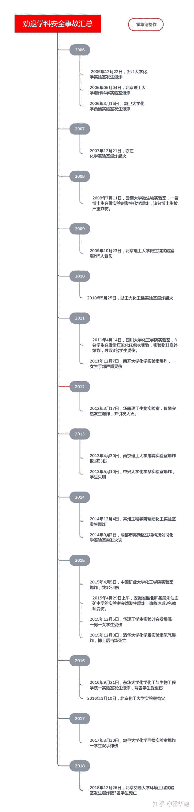

当你发现一只蟑螂的时候，说明你的房子里已经有 30 只蟑螂了。当你看到一起安全事故，你就应该明白，背后应至少 30 起安全事故的隐患！更何况，连续十三年，年年都有安全事故，你应该明白这背后的安全隐患有多大！相比，理论学科（数学、统计）、信息学科（计算机、软件）、文科、商科哪里有这么危险。**久在河边走，哪里能不湿鞋。**

就算你念书期间侥幸没有遇上安全事故，但人的身体也不是那么强大的，当你毒气吸多了，你是会生病的！就像我前面提到的，我读博到中后期，身体已经完全崩溃了，就是因为接触了大多有毒的化学物质。很多人并不了解劝退学科要接触多少有害物质。

我特地整理了一份清单：

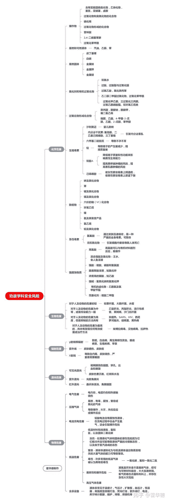

相信我，只要你在天坑专业，上面提到的这些\*\*危害总有一款你会遇到！\*\*遇到了怎么办？身体是你的，生病了也是你的，身体垮了就完了。没有人会同情你的。导师自然不会管，学校更不会管，谁让你是倒霉蛋呢？就像我们这边矿山里的工人因为矿里粉尘吸入太多，很多人会得矽肺病，矽肺病是绝症，治不好的，没有人会管他们，最后一个个在绝望中死去。

我希望**遇到这样命运的人不是你。**

## **三、劝退专业的就业真相**

**1.传统材料行业**

**高中生常见的一个误区是“以前上高中的时候，因为看过一些关于飞机发动机制造的纪录片，觉得搞材料的人太牛逼了，所以非常向往材料学专业”。**

来，带你看看中国航空发动机四巨头之一的贵州黎阳航空发动机厂的情况：

先看看评价：

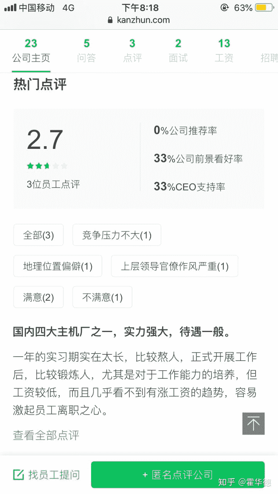

再看看待遇：

再来看看中国航空发动机老大沈阳黎明发动机厂的情况：

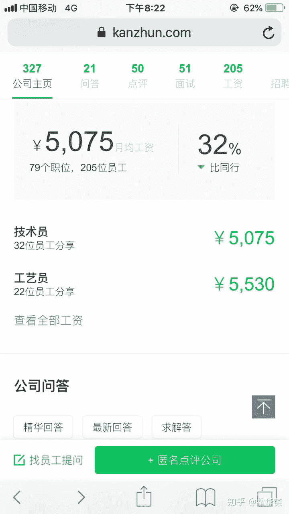

是的，你发现了，这就是材料行业的就业真相。别看国家把飞机发动机说的多么高大上，材料是核心中的核心。但实际从业人员的待遇就是三五千。各个地区待遇可能略有差异，最多七八千，能够过万的很少。

**2.新型材料行业**

以石墨烯材料为例，目前国内产业化发展情况堪忧。行业主体可以分为两类。

**2.1 偏向学术性单位**

这部分单位依托学术大佬的业内影响力，设立研究院（所），或开设公司。基本无规模产品出产。产出仍然是学术论文。单位的人员基本就是学校内的班子，类似于十几年前的校（院）办企业。这些单位招聘的人一般为徒子徒孙，普通人难以融入。

**2.2 偏向忽悠型单位**

从智联招聘等网站，输入石墨烯相关职位，可以搜出一系列小企业。这些企业研发石墨烯发热材料，纺织材料，发热纤维等。通过收取智商税，赚得企业的第一桶金，然后投资房地产或金融，以求得进一步发展。

## **四、劝退专业是全世界共有的问题**

**那劝退学科是不是中国特有的？**

不！如果你出国，你就会发现，劝退学科几乎没有本国人在学，新加坡、美国、英国等一票发达国家，很少本国人会学生物、材料、化学、环境。最优秀的学生都会去学金融、法律、医学。

**来自美国的劝退:**

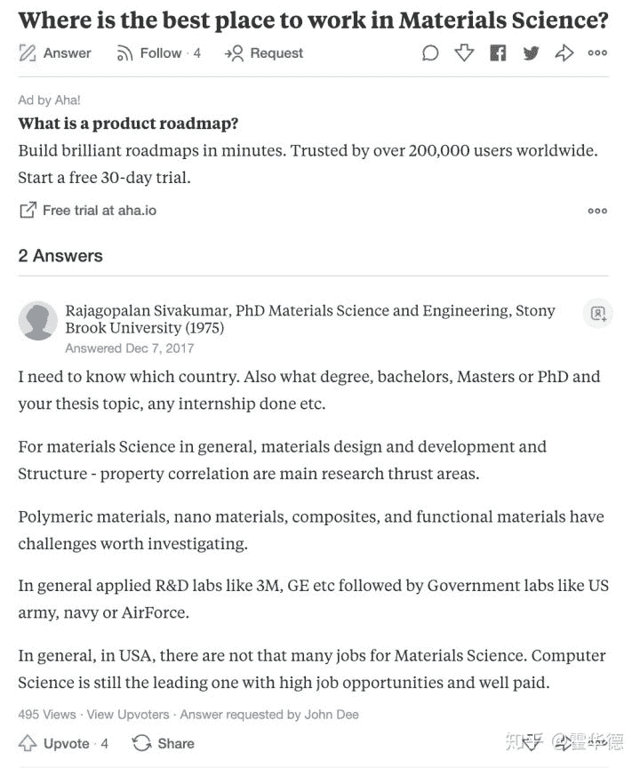

有人说，这是印度裔美国人写的，没有说服力。但读者可以去调查一下，在美国的化学系、环境系、材料系是不是中国人、印度人居多，而美国白人学的少。本国人学的少本身就很能说明问题了。

**来自日本的劝退：**

摘抄一段[杨微粒：虚假和绝望的生命科学](https://zhuanlan.zhihu.com/p/20892649)

> 21 世紀はバイオの世紀？  
> 大学院生の数は1991 年から2000 年までに倍増したが、教員は増えない。大学院博士課程の大学院生は、まともな教育を受けず、単なる労働力として酷使されている。ある教授は、「大学院生にアタマはいらない」と言い放った。ある教授は、「大学院生はただでつかえる労働力」と断言した。  
> 21 世纪是生物的世纪？  
> 日本研究生的数目从 1991 年到 2000 年翻了一番，但是教员数量没有增长。（生物专业的）研究生没有接收到合适的教育，只是作为苦力被压榨。一位教授放言：“研究生不需要自己动脑。”另一位教授则断定：“研究生不过是免费使用的劳动力。”

可见，劝退专业是全世界普遍的问题，而不只是中国特有的问题。不过在美国劝退学科的待遇、认可度好于中国。因为美国化工、材料、生物医药体系更成熟，金融投资更成熟。“忽悠”方向更不容易得到金融或政策扶持。传统的石化、分析、医药行业仍然是美国草根家庭学生寻求人生发展的重要平台。

## **五、劝退背后的深层次原因**

我觉得是合力，这个合力分解之后，共有以下分量：

**1\. 大学扩招**，致使劝退学科毕业生过剩。。对比：80、90 年代大学扩招之前，劝退学科人才紧缺，到各个单位都是香馍馍。毕业生过剩的根源在于不是基于市场需求的招生模式，一所高校开设专业，往往并不是基于毕业生的就业情况。而是更多的考验该专业好不好发论文，能不能提高学校的排名和给学校带来更多科研经费，如材料专业在这次双一流中独拔头筹，这并不说明市场需要更多的材料人才。而是因为材料专业好发高影响因子论文。大力发展这个专业有利于学校科研排名的提高。大量学校的伪生化材环专业被评为一流专业，将来必定有一波扩张，扩招大量学生，进一步学历贬值。

\*\*2. 产业升级失败，\*\*劝退学科所属产业产业升级失败，只能正常中低档产品，利润率较低，致使专业人员待遇较差。生化材环行业滞胀，发展缓慢，同时已经挤压大量从业人员，就业环境和薪酬待遇将进一步恶化。对比：台湾有龙头企业台积电，拿走全球芯片制造 50%以上的利润，所以材料专业在台湾是热门专业。

**3\. 投入产出比低**，劝退学科课业压力重，实验压力重，工作环境危险，收益却不高。对比：同样收益一般的文科专业，因为课业轻松环境好，并没有出现大规模劝退现象。文科专业课业相对轻松，你可以拥有一个正常的青春，去吃去喝去爱，你找你最喜欢的男神聊天，去憧憬未来的生活。你参加活动，去丰富生活。而学生物、化学、材料、环境，课业压力大，课程多，实验多，只会压得你喘不过气来。还会有导师打着“科研提高”的名义诱导你去他的“黑砖窑”搬砖，来看看黑砖窑的考勤吧：

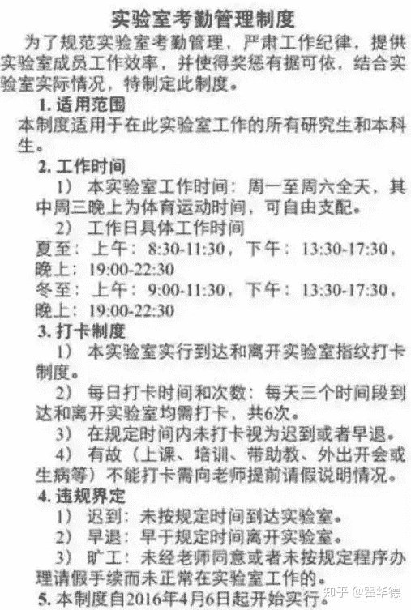

\*\*4. 学科导向问题。\*\*既然产业升级失败，学科发展就应该向着促成产业升级的方向发展。可是劝退学科的发展导向却是向着发论文看齐。南辕北辙。使得劝退学科的产业升级遥遥无期。对于生化材环，整个科研圈已经完全闭环。只要某大佬说石墨烯有前途，大家就会跟风去做石墨烯；过两天说二维材料改变世界，大家就都去跟风做二维材料。而这个游戏可以永远玩下去，根本不用管外界怎么看。

我们来分析下这个闭环是如何形成的：

*   资金源头：国家说科学技术是第一正常力，所以必然每年有一部分财政被划归科研，并且国家重视，科研经费的比例不断提高。
*   经费分配：按照论文数量，论文影响因子，评价科研成果和科研人员的能力，因为可以打着“**科学研究就是目的就不是为了有用，而是为了增长人类的知识**”，完全不用管工业界怎么看，完全不用看实用价值。所以核心指标看论文数量和影响因子。
*   论文和影响因子：学术圈内说是同行审议，但就是小圈子内的相互捧臭脚。你审我的，我审你的，大家都轻松发表。甚至有大佬自建期刊，自己的论文还能不过吗？这样论文数量就上去了。此外，疯狂自引➕疯狂互引，三页的论文恨不得写 40-50 个参考文献，这样影响因子就上去了。

只要科研圈子从头到尾都默认这个游戏规则：疯狂灌水，疯狂互引-> 高论文数量，高影响因子 -> “高超”的科研水平 -> 更有资格拿到更多的科研经费 -> 更好的实验条件->更疯狂灌水，更高的影响因子-> 无限循环

明白了这个套路，你就明白为啥生化材环的纳米期刊的影响因子都是十几到几十，而传统工科如芯片领域，顶级刊物的影响因子也不过 3-4。难道纳米的科研成果就真的就比芯片研究厉害几倍到几十倍？影响力大几倍甚至几十倍？

对于圈内人，这个游戏是可以永远玩下去的，只是苦了硕士博士，发现自己搞的东西，出去根本没人认可。

\*\*5. 学科内斗问题。\*\*占据额外资源的学科分支，并未产生额外的就业机会。就像类似 DOTA 游戏，吃资源的大哥，理应给出更多的输出伤害。或者类似于足球场上的前锋，大量机会都给你，理应创造更多进球。化学整体行业亦是如此。经费就那么多，好杂志就这么几个。一个领域占据了额外资源，另一个领域就必须让渡资源。

可惜，目前劝退行业学术圈过热的领域，并未创造出更多的就业机会。在热领域的毕业生，还需要抢占其它传统行业的职位。生化材环传统行业的岗位，如分析检测、医药研发等，职位基本保持稳定。可是热门“新型”专业人才涌入，加剧竞争，使得这些行业待遇增长持平或缓慢于通胀。

这样一来，劝退学科内部就充满了恶性竞争。学科内为争夺有限资源而内斗，却没有开疆拓土的能力，最后结果就是整个行业的萎缩。

## **六、劝退学科深层次的困境**

我最近一直在思考，大家都认为 21 世纪非常有前途的材料/生物/化学/环境专业为什么这么坑？

**1\. 复杂体系**

材料和生物化学一样 研究对象是复杂体系 一个氢原子的波函数还是可以有解析解，负氢离子以上就要涉及多体问题，引入 Hartree-Fock 方法，DFT 泛函密度等近似了，从原子第一性算起算出一个铁碳相图来？暂时还没办法！

**2\. 经验公式**

没办法从第一性来建模分析问题，那怎么办？材料人就只好依靠经验公式，联系材料强度和晶粒大小的霍尔佩奇关系就是这样的经验公式，材料学里大量这样的经验公式，怎么总结经验公式呢？一个字，试！try and error!

**3\. 穷举的研究方法**

因为从根本原理上无从指导，穷举实验成了大多数材料研究的主要研究方法，列一个参数矩阵就开始 grid-search 了。原理上和炒菜很像，就是味道淡了加盐，咸了加水，总能测出一些规律来，然后就可以发 paper 灌水了

**4\. 低效的产出**

因为大家都在瞎试，沿着大概可能的方法试了几十种材料，最后都不一定能用。我有一个夸张的说法，一万种材料里最后能实用产业化的恐怕只有一两种。但研发这一万种材料需要大量的经费，耗材和仪器设备，但最后的产出的呢？不要再用大研小产做幌子，大家都知道投入产出比很低。如果一个行业的产生的实际价值很低，你怎么期待其从业人员有很高的待遇呢？

**5\. 材料的春天**

材料的春天在那里？小百合有春天，材料学可能也有春天。我觉得材料的春天在于计算机科学的大发展，人类有足够的算力从能第一性原理计算预测材料的性质，这样大量的实验可以依靠计算探索，帮助人类锁定少量的候选材料，再去实验。投入很少，但是产出很高，那时候材料的春天就来了~

## **七、劝退学科的教育问题**

此外，劝退学科的教育也有相当大的问题。欧阳颀院士曾直言：“**21 世纪是生物的世纪，但千万别进生物系。很多大学的生物系不是在做 education，而是在做 de-education。用现在的方式培养出来的生物学家来推动 21 世纪的科技革命，那差得太远**。”

[专访合成生物学家欧阳颀院士：21 世纪是生物的世纪，但千万别进生物系-观察-生物探索​www.biodiscover.com](http://link.zhihu.com/?target=http%3A//www.biodiscover.com/news/celebrity/178550.html)

来我们看看，材料专业的专业课考试是什么样子的？

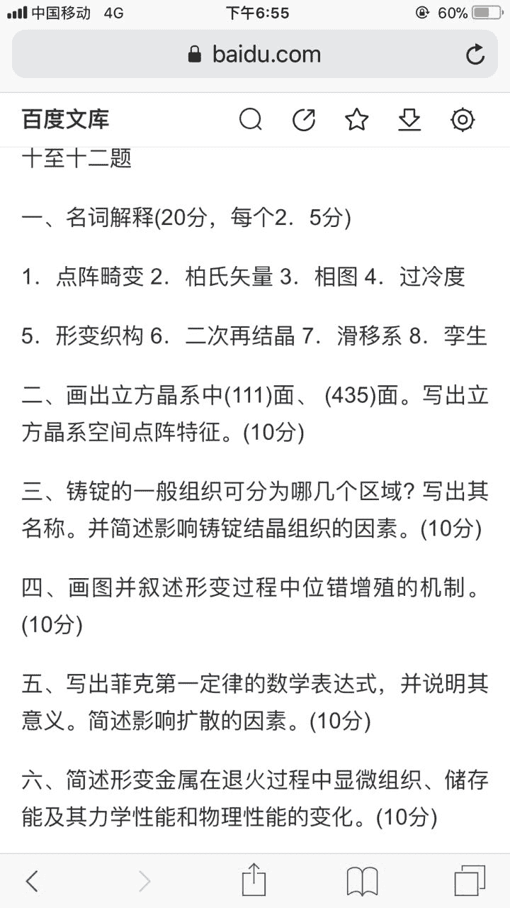

看到材料的考试题就生气。名词解释什么鬼？论述题什么鬼？写出表达式说明意义什么鬼？不用推导，背个公式就开始扯淡。所以伪材料搞科研是不如物理的，因为基础太弱，往往就知道个名词，深层次的推导理解数学结构完全不懂。

材料的课程基本就是工科里的文科，大三大四各种考试全靠背，居然还有什么名词解释题和简述题，但凡深刻一点的原理都不会学，所以学生普遍数理基础差，搞科研只会炒菜，科研被物理系学生全面吊打。

劝退学科教育还有一个问题。劝退学科本科专业大部分时间花在实验报告的书写上。您没有看错，不是做实验、听课和做作业，而是写实验报告。确实，教育的指导思想需要更新。而计算机学科的本科内容，加上实习和实践，足以支撑学生们找到一份待遇尚可的工作。计算机大量学生本科有机会出去实习，而劝退学科很少有听说学生有机会去业界实习。很多人到了大四找工作，才了解到行业的真实情况，悔之晚矣。

## **八、新材料与纳米的真相**

**有人会说，国家不是在大力发展新材料和纳米材料吗？你怎么能说学材料没前途呢？**

我来告诉你真相吧！本科就跟着老师灌过水，材料灌水就跟炒菜一样，师兄做过什么，拿来换个成分，所有表征再做一套，又是一篇 paper 影响因子还很高。

后来读博来了电子系，看做 IC 设计的，从设计到流片到测试，忙活几年，真枪实干的做出芯片来，才能发 paper，有一些好的工作，过不了几年就能出现在手机产品中，实实在在创造价值 然鹅 IC 设计最好的杂志 solid state circuit 才有 4.1 的影响因子。

看做微电子器件的，摩尔定律之所以能持续几十年，是器件领域不断努力的功劳 把晶体管从几微米一直做到 10nm，实实在在推进硬件更高更快更强。然鹅器件领域最好的杂志 electron device letter 影响因子只有 3.0。

对于搞研究，你转什么都行，什么好拿 funding 转什么，什么好发 paper 转什么，反正什么热就做什么，肯定没问题。

但也别太当真，你的 AM，nano letter 工业界并不关心。只发 paper 的不太会懂，为什么真正产业化的材料就哪几种。10 年前的氧化锌，5 年前的石墨烯，如今的二维材料，那一个不叫嚣着要取代硅成为电子产业的新霸主。结果呢？还在用硅。

实验室里的器件拿出来，会被甲方吊打成渣。因为是在实际使用环境中，对器件的方方面面的指标都非常严苛。实验室里，在一些极端条件下取得的和在某些方面具有突出性质的材料，能否全面的符合使用条件，这是很难的。这也是为什么大浪淘沙几十年，真正留下的，反复使用的就那几种材料。

我以前写过，为什么锗是第一种被发现的半导体，而如今的 CPU 都是硅做的。

[为什么 CPU 只用硅做，而不用能耗更低的锗做？​www.zhihu.com](https://www.zhihu.com/question/28935966/answer/60729143)

其实锗只是 band-gap 小了一丁点，导致高温稳定性不足，加上没有高质量氧化物的致命一击，最终退出了历史的舞台。

学术界自娱自乐惯了，有些时候应该看看业界的态度，英特尔 07 年就请了一批做石墨烯的人去开发石墨烯晶体管，结果没出两年，这些人全被赶出来了，你有见现在英特尔台积电大举投资石墨烯的？倒是中国炒作的都快飞起来了。在中国炒作石墨烯的时候，人家比利时欧洲微电子中心 IMEC，攻克了三五族材料和 CMOS 工艺异质集成的问题，随后英特尔台积电三星大举投入，相信在不久的将来，我们就能在 7nm，5nm 工艺上看到三五族材料的身影。

真正做器件的关心的是路线图，关注 ITRS，是制程进展，是器件结构，是漏电，是阈值电压 ，是驱动电压，是能耗，是缺陷，是 SPICE，明白自己做的东西要给设计端什么样的参数，明白工艺兼容与良率。

有些事情到最后真是价值观的问题了，你是想放个大卫星，搞个大新闻，还是想实实在在的创造价值，对这个问题的选择，真的会决定一生。

现在越来越多的纳米和材料期刊挂着“芯片”的狗头，卖着纳米和材料的羊肉。**疯狂挤压真正芯片人的生存空间**。我听说不少做正统芯片的老师，受不了高校科研指标的考核，都去搞纳米材料了，真是莫大的损失。

我就告诉你们，中国的纳米和材料早就赶美朝英了。事实上，即使是 06 年，中国作者发表的材料科学领域论文数量就已经大大超过了美国。而 06 年-15 年间，这一数字又增长了将近两倍。

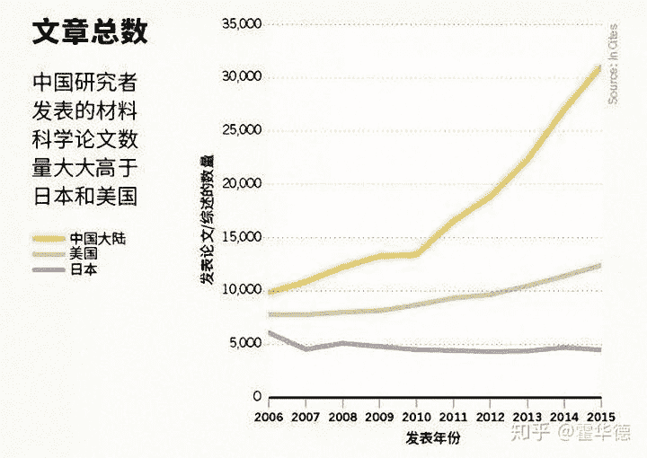

早在 2006 年我国研究者发表的材料科学论文就早已高于美国

而实际上，芯片领域真正的情况是什么呢？  
**在 2018 年 ISSCC（纯血正统芯片设计顶会）已接受的 202 篇论文数量中，来自中国内地的数量为 5 篇，占比约 2.5%。而内地+澳门+香港的论文总数是 14 篇。其中澳门 7 篇。中国内地浩浩荡荡 960 万平方公里的土地、13 亿人口，在芯片设计领域顶会的论文数量还不及小小的澳门（当然澳门有国家重点实验室）。难道你震惊吗？不该反思吗？**

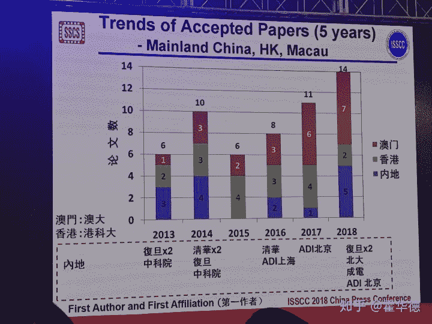

ISSCC 2018 共录用了 202 篇论文，来自十八个国家的一流大学和研究机构及顶尖集成电路企业，其中录用二篇或以上的企业机构有 IBM、三星、Intel、联发科（MediaTek）、台积电（TSMC）、亚德诺半导体( Analog Devices)、博通(Broadcom)、 韩国海力士（SK hynix）、Sony, 德州仪器(TI), 高通(Qualcomm)、东芝（Toshiba）、微软等；大学有美国密西根大学、美国哥伦比亚大学、荷兰代尔夫特大学、韩国科学技术院（KAIST）、澳门大学、美国乔治亚理工学院、韩国浦项大学、加州大学圣地亚哥分校、香港科技大学、美国麻省理工、斯坦福大学、加州大学柏克莱、奥勒冈州州立大学、加州理工学院、卡内基梅隆大学、康奈尔大学、复旦大学等等。

而来自中国内地的参与者屈指可数。醒醒吧，这才是中国芯片的真实情况！！！

知乎上为啥会有劝退党？就是因为我们太清楚这群“挂羊头卖狗肉”的“纳米材料”科研是在搞什么。我国繁荣的纳米和材料研究背后并没有支撑起相应体量的工业应用。在这样的情况下，大学发表的纳米和材料论文和培养的人才越多，就业的形势就越严峻，学生就业的待遇也就越差。

造成这一现象的直接原因是“重科研”“轻应用”的学科发展思路。在多发论文，发好论文的指挥棒下，我国科研人员更热衷于研究新奇的纳米材料，摘取这些“低垂的果实”，而这些成果可能几十年内都难以进行工业应用。而在国际学术期刊主编的口味影响下，中国科研人员热心于研究国外的学术热点。

相反研究传统的国内急需的材料问题、芯片问题，得不到有效投入，步履维艰！！

## **九、劝退专业的忽悠与话术**

1.  **卖情怀**

我依然记得我们老师慷慨激昂地说：

“建造航母需要使用低磁钢、无磁钢，以避免磁性探测和磁性水雷的攻击，但钢铁再怎么做也无法完全绝磁，所以需要大力发展大块非晶合金！为祖国的航母事业添砖加瓦！新一代高强韧性非晶的研发正等待你们的加入，这是祖国和人们翘首以待的高新科技！”

然后我就去非晶课题组搬了一年砖，七年过去了，我查了一下还是没有任何应用。

老师无视航母会定期消磁、大块非晶合金成本高，可加工性差等事实，非常善于用情怀忽悠知识水平还较低的低年级学生。

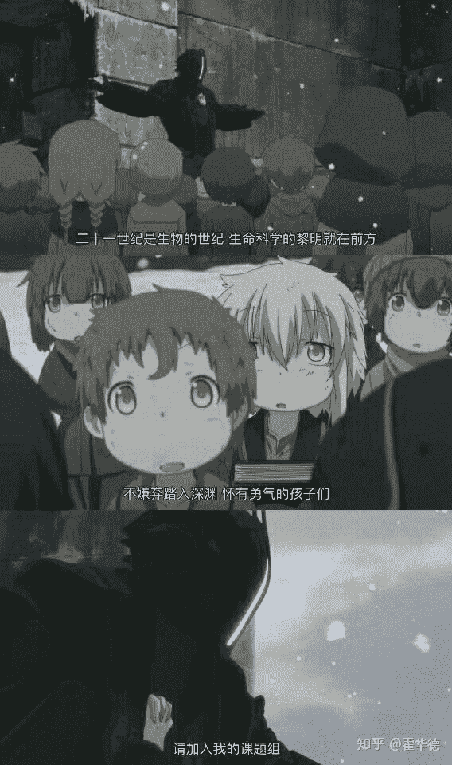

**2\. 应基二象性**

材料科研的应基二象性：当你问材料老师，你的科研有什么工业应用？他会说我们搞得是基础研究；你问他，那你的研究有什么物理意义？他会说我们搞得是应用研究。

## **十、劝退误区解答**

**Q: 家长都说生物/化学/材料/环境越老越吃香**

**A:**

“生物/化学/材料/环境越老越吃香”是一个历史阶段性的观点，本身就有历史的局限性。

我猜测大多能得出这一结论的人，都基于对过去几十年的观察。过去三十年，是中国极速发展的，那时候中国一无所有，百业待兴，所有行业都有极大的缺口。以高校为例，上世纪八十年代，刚刚恢复高考，高校师资青黄不接，极为缺人，很多人本科毕业就能留校，然后在职读硕士博士，老教授们往往大二三十岁，纷纷退休，职业发展也一片坦途，很多人四十岁就评上教授，伴随着中国经济的高速发展，科研投入加大，这些人自然而然很容易拿到大量经费，戴上帽子。所以你看到的是学化学，毕业留校，评上教授，经费拿到手软，走上人生巅峰，从而得出化学越老越吃香的结论。

那个时代，除了学计算机是“青春饭”，恐怕学什么都越老越吃香，学机械越老越吃香，学土木越老越吃香。

但你要看到现状，中国的存量已经巨大，回复高考四十年，培养的毕业生不计其数，劝退行业疯狂饱和，并且发展缓慢，甚至衰退。你还让人怎么相信“生物/化学/材料/环境越老越吃香”？

**Q：不是说「21 世纪是生物的世纪」？**

**A:**

毕竟离 21 世纪结束还有 80 年，谁都说不准以后是不是生物的世纪。

但我想从投资的角度来看这个问题。一个人的职业生涯也就 30 年，你希望的是这 30 年的职业生涯里人生价值得到体现。 你如果 2010 年重仓生物行业，结果 2050 年生物行业才爆发，有用吗？你重仓计算机朋友，伴随着计算机行业的暴涨，早就赚得钵满盆满，实现了人生价值和自己目标。而你的职业生涯 30 年，伴随着生物行业的熊市，什么都没赚到，退休了生物行业爆发了，有用吗？你的人生都定型了。

只说一个行业会暴涨，但不谈入场时机，都是耍流氓。

**Q：为什么生化环材专业社会需求这么低的情况下，国家却在大力发展这些学科？**

**A：**

1.  关系国计民生，具有战略地位的生化材。
2.  学术界研究的生化材。
3.  双一流发展的生化材。

1 和 2 交集不大，夹角很大至少超过 85 度。

国家想发展的是 1，其实学校疯狂扩招的是 2。

发展 1，生化材需求旺盛，就业肯定不差，可以参考日本和台湾。

发展 2，没有产业支撑，必然导致需求萎靡，就业不佳。

国家想让 3 走 1 的道路，所以批了很多指标；结果 3 走上了 2 的道路，只会让就业环境持续恶化。

要破局，必须从 2 路线改到 1 的路线上。可现在，还没看到明显的风向转变。

**十年一觉材料梦，赢得劝退薄倖名。我也要 move on 了。**

**全文完**

# 道路千万条，转行第一条。材料不劝退，亲人两行泪。

 flowchart 箭头图标 勿删 

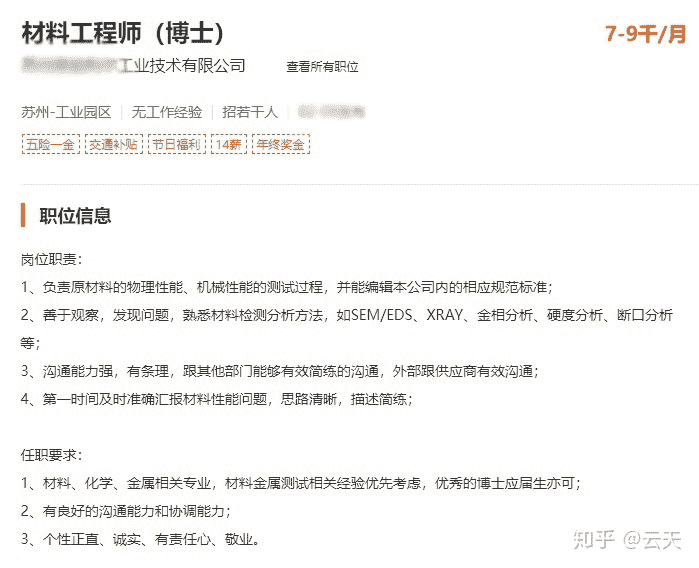

# 有机化学研究生博士生为什么被要求长时间工作

 flowchart 箭头图标 勿删 

> 作者：[南迦巴瓦 1999](https://xueqiu.com/4936181774/82345160)

我决定认真的从机理上来解释这个问题。  
或者说得更明确一点，为什么化学和生物要劝退。  
首先问一个问题：对劳动者最好的保护策略是什么？  
严格法规？行业自律？都不是。  
是**退出自由**。或者说，**用脚投票**。  
而**博士恰恰是退出成本非常高的行业**。

我们都知道深圳东莞有很多血汗工厂，但是，这些血汗工厂的老板，现在也不敢随便压榨工人了。为什么呢？现在深圳东莞的城市群，农民工上午辞职，下午就能在隔壁工厂找到一份相似的工作。在这种情况下，如果老板稍有压榨，员工马上就辞职去找下家了。  
以至于现在的奇观是，东莞工人罢工的原因通常不是加班太多，而是加班不够，挣不到加班工资。

那么，博士能随便退学吗？不能。博士的退出成本太高了，首先是考研/保研+实验室搬砖/出国存在很大的沉没成本，特别是对读了两三年的博士而言，退出还有面子过不去，简历没法看等等各种问题，在这种情况下，老板就有非常多的压榨剥削的机会。  
从这个角度说，博士学历本质上是一个卖身契，让一个劳动力卖身为奴，工作几年，换取一个高含金量的资格的买卖。

历史上这种卖身为奴换身份的买卖很多，旧社会的师徒制就是，学徒卖身给师父为奴三年，给师娘板砖扫地洗衣做饭，师父教学徒本事。现在的德云社还是这个制度。过去美国也有类似的制度，欧洲有些白人穷得活不下去的时候，就卖身到北美当奴隶，承诺在种植园干几年，以换取一张昂贵的跨大西洋船票。

现在问题来了，是不是所有的奴隶制，都是不能保障奴隶（劳动者）权益的呢？  
不是。不但不是，而且奴隶制已经在绝大部分领域被淘汰了。这说明事实证明，奴隶制并不是一个能充分发挥劳动者生产力的制度。  
为什么呢？  
因为主观能动性，或者说，**士气**。

奴隶在处理劳资纠纷的时候，最经典的策略有三个：**组织反抗、消极怠工、逃亡**。  
然而对博士而言，逃亡前面已经分析了，成本太高。组织反抗的成本更高，高校里最典型的反抗策略是自杀，一般而言，一个博士自杀，意味着这个老板很长一段时间名声受到严重损害，但是，自杀确实是一个有效的反抗策略，为什么有机化学老板压榨学生可以让学生工作 10-14 小时，却不能到 18 个小时，就是这个原因。当然还有别的反抗策略，比如前段时间有博士因为分赃不均反水，把老板的黑历史卖了，但是这都不是主流。  
**向为后来者抗争而牺牲的先烈们致敬！！**

真正行之有效的博士自我保护策略，是**消极怠工**。  
一个数学教授能够要求他的博士每天工作 14 个小时么？  
一个计算机教授能够要求他的博士每天工作 14 个小时么？  
恐怕不行。  
他的博士可以宣称这么长的工作时间是不合理的，会导致脑子转不动。  
如果老板不理会，继续提这样的要求，他可以对着草稿纸或者电脑屏幕发呆 14 个小时，然后宣称想了 14 个小时，但一无所获。  
聪明一点的老板，都不会做这么傻的要求。

**在这种情况下，前面说的退出机制失灵，不但不是博士的紧箍咒，反而成了博士的保护伞。**  
因为正常企业员工如果消极怠工，老板可以解雇员工，但是别忘了，教授雇佣博士的沉没成本同样也很高。真的解雇了博士，老板就失去了一个潜在的劳动力，不如哄着，少干一点也比鸡飞蛋打强。  
当初满清刚入关的时候，实行过一段奴隶制，其中规定，如果奴隶逃跑，那么窝藏奴隶的包庇犯要砍头，而奴隶本人只是被打一顿，为什么？因为留着还能干活，而砍了啥都没了。  
后来，满清觉得这个还是不能让奴隶好好干活，就干脆把奴隶都转职成自由民，改成收租了。  
正是在消极怠工的保护下，博士反而真的成了古典主义定义的那个样子：**博士真的由自己内心深处的驱动力主导，做自己想做的研究；导师给予指引、帮助、扶持，从而真正的发现知识，探索未知的可能。学术因此而发展，人类因此而进步，这才是真正高尚的工作。**

**而有机化学和生物，真正坑的地方，在于消极怠工这个策略失灵。**  
**老板是真的可以规定你必须每天在实验室过 10 个小时柱子的。**  
你可以说你对着电脑发呆是在想题目，反正没人知道你脑子里在想什么。  
但是有没有过柱子老板是看得到的。  
一个事情越需要智力，越需要主观能动性，就越不能用强制规定工作时间的方式来约束。而有机化学和生物，恰恰是最不需要智力，最能够用标准化工作完成的体力工作。  
如果把有机化学的思考部分和实验部分分开，过柱子这些机械花时间的工作通通交个标准的产业工人完成，而博士生们仅仅需要思考分子结构和实验过程，最多在工人遇到困难的时候给予部分指点，那有机化学瞬间就能变成最高大上的行业。  
计算机行业就是这样的，只不过他们的产业工人不是人，而是二极管。二极管这玩意比奴隶还乖。  
然并卵。资本家和老板，只会选择最便宜的方式。  
CPU 比学生便宜太多，所以计算机老板选择 CPU。  
而一个 6\*12 小时的产业工人，如果在富士康产线上，工资是 4000 一个月，算上企业交的部分，起码 5000。这样一年就是 6 万。考虑到危险化学品操作部分，一个这样的工人一年起码要 8-10 万。如果在美国，起码也是 5-8 万美元的年薪。  
那么诸位博士生，你们能从老板手上拿到这么多钱么？  
既然你们比民工便宜，那么不压榨你们压榨谁？你们老板可是从千军万马中杀出来的，脑子可一点都不笨。

可能真正能保护有机化学博士生的，只剩下老板的道德了。  
但是所谓仁不带兵，义不行贾，实际上有机化学又是一个特别**逆向选择**的过程。  
一个有道德，不肯死命压榨学生的老板，最终是无法和死命压榨老板竞争的。  
这会导致两个事情：  
1，不道德的老板显著的多。  
2，不道德的老板更容易爬到更高的位置。  
久而久之，这个圈子的风气都很糟。  
资本主义都没有这么血腥，因为资本主义还有很多配套的保护劳工的制度，而我们前面分析了，几乎所有的反抗策略，在有机化学和生物领域都失效了，真正稍微保护了一下我们的，反而恰恰是那些跳楼的师兄师姐们。  
向先烈们致敬。

不知道你们知不知道现在黑社会是怎么诱骗无知美少女下海失足的。都是先找一个帅哥，和无知美少女勾搭，骗取无知美少女信任，谎称家里有人生重病，没有钱，需要少女坐台赚钱，等少女下海之后再去骗下一个。在东莞，这已经是一个产业了。  
像不像某些老板的作风？比如说，施一公？  
毕竟 21 世纪是生物的世纪嘛~

现在可以说结论了：  
大部分化学和生物，包括一部分物理，其生态环境，是由其扭曲的产业结构决定的。对于这种大部分工作可以标准化，较少需要智力，较多需要低水平重复劳动的工作，应该采用更先进的资本主义生产方式，即富士康制，由产业工人执行，而不是采用学术界标准的博士制，由师徒执行。根据结构决定性质的化学逻辑，这是必然的，不是一两个人能扭转的。

而这个变态的产业，吞噬了整个国家起码 1/10 的最优秀的大脑。这就是为什么我说施一公是美国派到中国的间谍的原因，美国派他回中国的目标，就是把中国最优秀的青年，扼杀在实验室的瓶瓶罐罐里。  
唯一可以采用的策略，就是劝退，在退出成本最低的时候劝退。从高中开始劝，高中劝不动大学劝，大一劝不动大四劝，硕士劝不动博士劝，越早越好，晚了也不要紧，早日退学，早日新生。

版权声明：以劝退为目的可以随意使用本文。  
欢迎点赞，欢迎转发，多救一个人是一个人

# 材料真的是朝阳行业吗？

 flowchart 箭头图标 勿删 

> 作者：[材料劝退活雷锋](https://www.zhihu.com/question/61104112/answer/191174318)

论做科研的话，挺朝阳的，比较好水文章。材料的好多方向做合成做表征和炒菜差不多，入行门槛低，数理基础要求低。我的好多博士同学本硕都是双非，照样各种顶级文章发得飞起，全篇文章没一个公式。

我本科时学专业课完全靠背，觉得学了这么多数学物理毫无用武之地，一度怀疑这专业是大坑，但还抱有希望。读研时觉得好好学研究生数学总能派上用场了吧，结果入学第一周导师跟我说：“数学只要及格就行，你有空多来实验室做实验，该翘课就翘”，我瞬间石化。

论找工作的话，挺黎明的，很难被阳光普照。实验室里勤勤恳恳搞科研、不出去好好实习的硕士一般就业很差，只能去商飞这种年薪 10W 的地方。研一就整天见不到人影，认清形势积极为转行做准备、去各种快销、咨询、证券实习的人往往在找工作时凭亮闪闪的实习经历拿 18W+的 offer。

我记得知乎上有个关于“学材料年薪 30W”的回答是我系 02 年硕士毕业的学长发的，他去车企好歹跟材料有点相关。02 年起薪 6W，到 14 年 30W。虽然是个例，但我身边的样本结果也与这比较接近。（30W 是很多材料人中年期的天花板，但可能是其他行业的起薪）

我不推荐知乎上很多人提的所谓无脑转 CS，但劝材料学子及早看清形势，不想呆在材料这个行业就应该及早做准备，去其他各行各业找适合自己的位置。

一门心细做科研也不是不可以，据说现在交大博后 18W 了。我那几个本科双非的博士师弟正开开心心地留校做博后，你让他们去找外面 18W 的工作试试？

# 如何看待 985 高校例如交大的材料专业的研究生找不到好工作？

 flowchart 箭头图标 勿删 

> 作者：[材料劝退活雷锋](https://www.zhihu.com/question/54557310/answer/143380937)

你不说是上海交大还是西安交大，我就针对我熟悉的上海交大材料系来谈谈吧。

首先没有比较就没有伤害。材料系目前跟 CS，管院，电院，机械比，学生就业质量上确实有很大差距的，但应该和船建，化学差不多，起码比农生强（又黑了把生物）。其实材料专业（上海交大偏金属）就业在十年前也曾阔过，那时互联网还未兴起，以宝钢，大众，通用为首的钢铁或车企等对口制造业给的薪资还是不错的。后来 08 年经济危机时惨了，但 4 万亿刺激后的头两年就业也是不错的。再后来，也就是近几年，就业数据就不能看了。这几年国家要去产能，钢铁等传统制造业不景气，车企招的人也一年比一年少。材料系硕士生留沪找个年薪 10W 出头的工作也是不容易的，再跟起薪二三十万的 CS 码农比，心里自然是不平衡的，于是知乎上的吐槽除了伪化生之外，又多了个材料。

在交大材料系就业衰退的这几年，也同样是大家在知乎劝退材料的这几年，很遗憾，我没有看到交大材料系的教授在学科建设的思想上有什么改变。我曾经跟交大材料系的 S 教授聊过，告诉他做的科研实在太基础研究了，跟工业界实在差得太远。我劝他多放自己的研究生出去实习，接触不同行业，为将来转行和就业做准备。并且我也建议他多去跟知名大企业合作做一些偏应用的项目（比如他做材料计算的可以多接模拟的工作，也增加学生的编程能力），这样他的学生在做项目时也容易把自己所学转化成直接的生产力，在就业时也容易进这种公司并找到与材料有关的对口的岗位。这样何尝不是把材料学科发展壮大？但是 S 教授还是不听，他觉得万般皆下品，唯有科研高。他觉得学生把他的基础科研做好了就可以得到好公司的垂青。结果就是该教授在知乎曾经被匿名人士黑出翔，他忽悠来的两个直博生一个转硕，一个换导师。我跟他讲：“你看系里的 L 教授，做电子封装的，跟华为，sandisk 等公司合作，直接把学生送到这些公司实习，然后学生毕业后都可以拿这些公司的 offer 做保底。所以很多硕士生都抢着报 L 教授。”结果 S 教授说：“你是要我转行吗，我又不会电子封装。”我只能无言以对。这种教授，思想顽固不化，不能与时俱进。他们不能“转行”，手下学生只能一边转行一边吐槽材料专业坑爹了。

* * *

1 月 31 号更新

没想到这么多赞了。我再多说几句吧。我在交大材料系呆了快十年，从本科到博士，也见证着这个专业从我 04 年刚入学时的全国第一稳步下滑（目前应该还在前 10？）

有人问学了材料为什么要黑材料，这不是吃饭砸锅的行为么？材料这个专业现在冷门，说不定过几年可以迎来春天。

首先，正因为学了材料，也面临过就业压力，又从这个坑里好不容易爬出来，觉得自己有必要要警示一下后来人：这个专业偏传统制造业，人才饱和，就业方面会有很大问题。其时，任何行业都有其周期性，很可惜，交大材料系的春天早已经过去。我会说曾经它就叫冶金系么？00 年以前一个女生都不肯来结果成了和尚系，后来改了名才有这么多妹子前仆后继来报。他旦老师说得很对：“上海西南某高校传统制造业在大城市无法立足。”人家冶金所，改名叫微系统所，也不做金属了，那也是懂得与时俱进。

任何改朝换代，总有遗老遗少会怀念前朝，因为他们是既得利益者，必须用鸡汤告诉后来人：“还是前朝好啊。”

我曾经研究一门材料中非常小众的学科：内耗。内耗仪是上世纪 40 年代葛庭燧发明的，合肥固体所就是老爷子一手建立起来的。然而这几年这门学科已经快濒临灭绝，在某次全国内耗会议上国家自然基金委员会还特意派人下来旁听，看看如何拯救这门学科。其实答案已经很明显：这门学科该有的理论已经很成熟，内耗仪作为一种表征手段并不能直接表征材料内部的微观结构而只能从旁佐证。但是我导师作为内耗委员会的委员还是很积极地推广内耗这种表征手段，因为他得靠内耗去申请国家自然基金。

举这个例子是告诉大家，屁股决定脑袋，在传销头子的角度他会告诉你传销很赚钱。所以要有自己独立思考的能力，不要被鸡汤迷惑。反过来，我劝退的话你也得自己斟酌。

在交大待了这么多年，也不是没有听到有的老师喷这传统行业的。比如组里的老 M：“钢铁在美国早申不到经费了！”楼下的 C 千人：“你这个方向迟早就是死，都是一些老先生不想让它死，所以还在搞。”

其实美国在材料学科领域一直是引领潮流走在世界前列的，个人认为这门学科在美国的今天就是我们的明天。我博士毕业后想申请国外的博后，发现我研究方向的美国同行几乎绝迹，也就德日还在搞。写邮件问一德国某博后打听他在的研究所的情况，他说：“我这个方向德国从明年开始要大幅削减经费，我也准备回国了。” 去从事国外已经削减科研经费并且还未工业应用化的基础研究，一定要慎重，这代表这门学科的研究已经快接触到天花板，并且不被工业界喜欢。

讲了这么多都在讲传统材料。那么新材料呢？现在电池方面的研究和就业还不错，但是石墨烯等材料貌似过于新了，离工业化应用还有多少年还未知，从事这方面的研究也要考虑就业的问题。

我工作后的部门主管（美籍华人）有次也搞材料劝退：“当年我们去美帝读 phd 是为了能留下来。我朋友圈的留学二代没一个读 phd 的，好多都是 CS 的硕士毕业直接工作。像我儿子本科药学院的，硕士也是读了 CS master，毕业后去 adobe 轻松十几万刀。我上次碰到某校材料系主任，他说他们系读材料硕士的正宗美国人很少，好多都是中国人。”我不知道他说的情况是否属实，有在美国读材料研的朋友可以谈谈美国材料 master 的行情。如果确实属实，这将为我们材料研究生在国内外就业敲响警钟。

* * *

再更。

交大材料系最初的学科设置应该是培养学术界人才或工程师的，可惜这两个方面都面临饱和。

首先从学术界的方面来看，国内高校岗位饱和，竞争激烈。海归 phd 你不搞篇 nature 子刊拿个青千你好意思回交大混？国内又鄙视土博学历，很多 211 高校都要求有海外经历（那你还招这么多博士……）。

从工业届角度来看，课程设置不合理，数理方面深度不如物理系，基础不如化学系，明明是理科非要包装成工科，也难怪别人要吐槽了。下面有评论说得很有道理：材料系学生没有 hard skill 啊。

下面还有评论说美帝很多材料 master（尤其是 course—based 的）是骗中国人在填坑。我在想是不是等过些年大家都不学材料了，国内的教授们就学美帝的教授，比如来骗第三世界国家的学生来填坑。两年前我在交大的导师已经招了一个埃及人一个越南人了，我还见到别的教授招伊朗人的。貌似已经有这个趋势了哈。

# 材料学真的没前途吗？

 flowchart 箭头图标 勿删 

> 作者：[材料劝退活雷锋](https://www.zhihu.com/question/266837133/answer/321382027)

谢邀。对于这种月经贴，我都不太想回答了。搜索类似话题能搜到一大堆。

材料专业好不好，完全是小马过河，见仁见智。对于我那位评上青千的本科同学来说，材料专业那前途是大大的，这不，学校和政府给的丰厚的安家费、几百万的启动资金，让他瞬间成了暴发户，敢说这专业没有前途？不过他跟我说没上青千之前他是不敢回国的，宁愿博后出站后在加州那世界排名前三的化工公司拿着税前 10W 刀左右的薪资养活一大家子，被湾区那些读完 CS 硕士就轻松 10 几 W 刀的小鲜肉们完爆，各种羡慕嫉妒恨，只恨当初选错了专业。前些日子另一个在美国读完材料 phd 并做完一轮博后的本科同学告诉我他去了美国的一家银行，并吐槽了这坑爹的专业。还有一位本科年级前五、本系读完研考了 GT 又放弃去美帝读 phd 的，去了房地产，现在都年薪百万了，整天跟各种地产大亨在高尔夫球场谈笑风生。

这几位可是我们当年本科系里的科研达人、GPA 吊炸天的学霸啊，但他们用实际行动给我们学渣们上了生动的一课：不值得为材料行业充值信仰。

我也见过对材料专业是死忠的人，一般分两种人：一种是科研混得特别好的人，另一种是没什么物质追求的人。我看题主大一就在关心材料专业有没有前途，肯定不属于无物质追求的人。接下来我就讲个无物质追求的人的例子。

老 M 刚来我们祖读博的时候都 30 好几了。因为他在兰大物理系本科毕业后，去工厂工作了几年，又读研，再工作了几年，最后来读这材料的博士。

物理背景出身的老 M 的理论功底自然是比材料系的大部分人强的多，在 02 年左右以一篇 Acta Materialia 和一篇 PRB 博士毕业后，留我们组做副教授。老 M 是个不喜欢应酬交际的人。他无任何横向课题，纵向课题就是国家自然基金，也不怎么招学生（基本三年才招一个硕士，懒得带学生），反正他属于单干型，一支笔一张纸推满公式，一台电脑用 matlab 做做模拟，平均两三年靠计算模拟的结果发篇 PRB。老 M 还教本科生固体物理，上课时就开始一言不发在黑板推公式，沉醉其中，经常推错了后愣在当场沉默许久找 bug。

老 M 整天不修边幅，胡子拉渣的。钱被老婆管得紧紧的，兜里从不超过 300 块钱，难得请一次客居然还要先回家取钱。老 M 天天下午三四点就拉着我们去球场打球，所以那两年下午三四点以后的科研我基本都泡汤了。但老 M 晚上经常干到 11 点，毕竟家就在学校对面嘛。

科研方面，老 M 不认可的观点就会毫不客气地指出来，一点都不顾及他人的面子。曾经组里有个老博士干了两年的工作内容被老 M 认为是本科生水平，“毫无意义”。我有个师兄发表 scripta materialia 的文章被老 M 怀疑数据有问题，建议撤稿，但我老板没让。后来果然有西工大的同行重复不出来，来我们实验室要求给个说法的，我老板只得派我几个师弟编理由搪塞人家。

老 M 的生活简单、规律。他就两个爱好：科研，打球。他有个儿子，但他从来都不管儿子的学习（他每天晚上推公式跑程序到 11 点，还怎么管）。他曾自豪地对我们说，虽然他儿子成绩班里倒数，但人缘是最好的。结果不久就出事了。他那班里人缘最好的儿子带领全班男生，让班里人缘最差的班级公敌跪下来，一人一拳。老 M 被老师叫去学校教育了一番，还赔了人家医药费。“我儿子本来让他跪下来就不打他的，结果他真跪下来了，我儿子觉得这家伙真是软骨头，就该揍，还是把他打了。”这是老 M 跟我们讲的。

不出意外的，老 M 儿子中考连高中都没考上。老 M 终于履行了一次做父亲的责任：为了儿子的前途考虑，放弃了国内的副教授职位，去美国一国家实验室做博后，并把儿子带去美国读高中，后来他儿子好歹还上了个美国的一个州立学校，没辜负老 M。众所周知，做博后没啥钱途的，顶多也就六七万刀美元一年。老 M 今年已经 50 多了，估计这博后得做到退休了。

我想说，有几个人能像老 M 这样甘守清贫，板凳能做十年冷的？大部分做科研的人的水平，恐怕还不及老 M 吧，还不得早点想想以后的出路？

# 读材料专业的你后来都怎样了？

 flowchart 箭头图标 勿删 

> 作者：[材料劝退活雷锋](https://www.zhihu.com/question/267524285/answer/326242554)

本科上交毕业近十年，直博毕业正好 4 年（读了 5 年半）。

博士做的课题属于金属物理，业内的顶级期刊是 PRL 和 Acta Mater。当时我在跟两个杂志的审稿人斗争七八个月之后，都被这两个杂志拒稿，降了一档，分别中了 PRB Rapid Comm 和 Philo. Mag。觉得自己科研做得太鸡肋，比上不足比下有余，导师又不太给力，干脆找工作去吧。

博士毕业确实不好找工作，远不如硕士好找。交大双选会上我把简历投一家电厂，据说年薪也有十几万，结果电厂的 HR 说他们只招本科和硕士，博士太浪费，连我的简历都不要……太伤心了。其实当时我找工作找得心灰意冷，电厂只要肯收我，我就去了。

后来决定还是出国做博后吧，却又稀里糊涂地收到一个电话面试，让我去张江面试。这是什么公司？我简历都不记得投过。HR 告诉我，我两个半月前在 51job 上投过。估计是我当时搜索关键词“材料科学”后海投吧。

本来我找工作找得心灰意冷，已经决定去做博后了，都不想去面试的，最后鼓气勇气还是去了。

面试很有意思，搞得跟学术答辩一样，组里居然大部分都是物理、光学、微电子和材料的硕士博士博后。上午先笔试，都是一些初中生奥数题+本科物理基础题。然后做全英文的 pre，讲自己的科研内容。下面不时有人提问，总经理还不时抬杠挑刺，给面试者压力。还好我谈笑风生（本来就是来面着玩的）。

当时我对半导体、光学一窍不通，因此对这面试根本不抱什么希望，根本就是毫无压力嘛。我甚至觉得和我一起面试的竞争对手（一个复旦半导体材料本硕）更适合这家公司（毕竟专业相近）。不过这家伙在笔试的时候老是用手机偷偷上网查答案，让我很鄙视他的行为。

下午 1 对 1 面试。先过来一个中年大叔（招我的经理），问了我一堆物理问题，我答得很差。然后一个前额少发的哥们来面我：“会不会玩游戏？”后来面了几个人后，又来了一个前额少发的哥们，原谅我脸盲：“你不是刚面过我？”“……是嘛？认错了吧，刚才是 A 面的你吧。”“那他问我会不会游戏干啥？”“你总得会一样吧，不然你这人该多无聊。我星际的 apm 可是 200 多的……”

然后这哥们自报家门，原来是一只英国玛丽女王毕业的材料博，在吐槽了材料做博后多没前途后，他力劝我加入：“这里材料毕业的很少，快来陪陪我。”结果我后来刚加入公司，这哥们就转到加州总部去工作了，我陪谁呢？

面完第二天就给 offer 了，纠结了几天就接受了，当时的薪资跟菊厂差不多。这几年菊厂薪资大涨，现在的起薪已经被菊厂的 40W 完爆了，我司的人只能自我安慰：我们性价比高，工作强度没菊厂大，时薪比人家高。

工作第一年老是去美帝浪，第二年就被分到台湾出差了，50%～60%的出差率，一直到现在（有出差补贴，算是赚点小钱）。总体来说工作强度是比很多公司低的，当然挑战也比较大，case 做不出来时的压力是很大的。

为啥我取名叫“材料劝退活雷锋”，因为我不光搞材料劝退，还做好事。在过去的一年，我从知乎内推了 6 个人来我司面试，基本都是材料专业的。有发两篇 nature comm 的科研大神，有一篇 paper 都没有的亚琛小硕，其中 4 人拿到了 offer。

# 如何评价「施一公请辞清华大学副校长，全职执掌西湖大学」？你如何看待西湖大学的发展前景？

 flowchart 箭头图标 勿删 

> 作者：[刘奥  
> ](https://www.zhihu.com/question/265351267/answer/292730186)

我清华的学生，不太在乎自己挣多少钱，我们在乎的是有没有实现自己的价值。航院做航空发动机的同学们虽然挣得也不多，但是实现了自己的价值，对得起祖国的培养。而施一公的学生们呢？做的工作找个高中生就能做，再怎么说也是对不起祖国的培养 —— 题记

对于施一公，我想说：您赶紧走吧，别再霍霍我大清的学生们了。(我要实名开怼了)

(可能有些知友对生物就业不太了解，保守地讲一讲，清华生物博士就业不如末流 985 的 EE 本科生，遑论 CS IT 经管了，详情请搜索知乎话题 生物劝退)

工资虽然不一定能完全衡量劳动的价值，但至少是衡量的标准之一。清华博士毕业一个月挣几千，做的工作完全可以被二本毕业生替代，这就是不少清华分子生物学博士毕业后的状态！

施一公忽悠了多少生院的学生投身生物科研，想想都觉得可怕，因为我在计算机辅修课堂上就见到过一个来自生物系的同学(计辅 2 的同学我认识至少 60 人)，经济双学位生物系的同学应该也不多(清华经双基本要 GPA 前 20%、而计算机辅修只要 GPA 别太低都可以学)。

说实话，但凡逛逛知乎就知道学生物专业肯定没啥前途，而清华生物系几乎无人自救，这与施一公关系很大。包括他之前说什么"所有人都去赚钱了国家要完"之类的言论，我只想呵呵他！

我们顺便复习一下欧阳颀院士的论断：“21 世纪是生命科学的世纪，但是千万别去生物系，生物系对学生的培养不是 education ，而是 de-education”

有知友说，施一公这些言论是想教育我们清华的学生不要太功利，我在这儿反驳一下：清华航院搞航空发动机的同样就业不好，但是只要提起他们，我们没有一个不佩服的，无他，他们做的东西利国利民！反观施一公，除了那些没有任何实际意义的 paper 之外再无任何产出，学术上也是跟着欧美的屁股走，跟潘建伟、薛其坤这种引领潮流的人根本没法比。(薛其坤 比 施一公，这可是实打实的基础科学对基础科学)

更新：  
确实生物系里面有真心热爱科研的，对这些同学我没有任何不敬之意。但是，大家想想自己是怎么报的大学专业，自己高三的时候知道自己应该做什么么？大多数人不知道，而且还有不少人是压根不适合做生物科研的。对于这些人，就应该转到其他方向，追求自己的幸福。而施一公忽悠这些同学去做生物科研，我认为他的用心是极其险恶的！自己拿着血卡和 CS master 学位，忽悠同学搞生物科研，进自己的小砖窑，这人品太差！太不地道！

至于评论区说互联网累的，我承认互联网确实累(我在光线传媒游戏部做过，我知道是什么工作强度)，但是我保证大多数生物博士绝对比做互联网累，尤其结构生物学方向。

[陈同学](https://www.zhihu.com/question/265351267/answer/293031239)怼的角度最为刁钻！为他打 call！

> 保留清华教职，所以仍能获得冷冻电镜、蛋白质单晶等等几个亿的仪器的用不完的免费机时。
> 
> 执掌西湖大学，所以理所当然地把自己通讯地址填上杭州。
> 
> 有这么个管道，他当然敢说“西湖大学 5 年内科研水平赶上清华”
> 
> 你让我担任中储粮库管员，同时执掌一个粮食混合所有制企业，我也能保证 5 年内该企业库存粮食规模达到国家水平。

# 《伪化生：修罗战场》写给那些在读伪化生专业的

 flowchart 箭头图标 勿删 

> 作者：[fogsail chen](https://zhuanlan.zhihu.com/p/28037065)

看完了《绣春刀：修罗战场》，很感慨。剧中的很多人，包括沈炼，裴伦，陆文昭，他们身处那个世道，不得已而背叛朋友，杀人，那是因为他们没得选择。

他们仅仅是为了在修罗场上生存下来而已。

**其实，某些专业的体系，不正是修罗场？**

**我觉得大家在劝退这件事上做很多努力了，但是我们无能为力，因为伪化生专业有自己的体系，很多人身在其中，没得选择**，**因为泛生化专业实在是有太多在读生了**，我没有统计过全国到底有多少泛生化类本硕博，但占据理科专业的半壁江山肯定是没问题的，因为单从院系设置上就可以看出来了，能源化工食品轻工纺织资源造纸环境生物生命石油地质开采煤矿等等，数不胜数，而且每一个二本以上学校都可以开这种只上课不培养研究生的专业，每一个有点实力的都可以开研究生点，如此之庞大的一个教学与学生群体，简直比美国中国的一个行业协会还厉害，你说你去劝退有用吗？

生物科学、生物技术、生物工程、生物医学工程、化学生物学、材料物理、材料化学、生物化工、生物信息学、化学信息学、农学、植物科学、动物科学、动物医学、海洋科学，海洋药学、材料化学，材料物理，材料科学与工程，化学，功能材料，材料成型与加工工程、环境科学，环境工程，应用生物学。。。

**随随便便一个学科都可以给生物扯上边。**

**他们自会设计一个修罗场去鼓励第一梯队的出国，第二梯队的去第一梯队读研，依次类推，一个专升本的学生去一所普通一本或比较好的二本（比如广东工业大学、广州大学等等）读研，再去一个 211 读个博（比如暨南大学、江南大学），或者是末流 985 读博，然后再去好的 985 做一期博后（比如华南理工大学，厦门大学，中山大学等等），再觅得良机去美国交流一下，混个海外经历，四十岁前在一个大专院校当上讲师，也是一种典型的成功之路。**

**这种路径的存在就会激励许多专业的学生去走这条路，这条路当然伴随着可观的淘汰率，但是也有很诱人的可行性，你说考一所广东工业大学的研，难度不算大吧？**

**于是如果在途中被淘汰，他只会责怪自己水平不行，而不会责怪忽悠他考研的人**，极大避免了群体内部的不稳定，如果一路到了博后回来找不到工作，也许他明白了这就是个坑，可是一把年纪的四十岁男人，上有老下有小，他已经没了躁动的力量了，所以也只能磨不吱声地不知所终，更不会咋呼出来，这是一个多么完美的产业链，多么牢不可破啊！

**所以，要想不这么死，就得换个活法！**

**从大学，大一，一开始，如果被伪化生录取，想尽一切办法转专业，转不成，那伪化生专业课的课程都保证及格就可以，能混就混，课能翘掉就翘掉。剩下所有的时间，全部投入慕课学习，比如学堂在线，网易云课堂等等，看一些其他专业的专业书等等。**

**这方面怎么学习？如果转不成专业，请下载一份你喜欢的，热门专业的名校研究生入学考试的专业参考书，考研大纲，对着书，一本一本地学习理论。**

**从大一开始，就不要把你当成是一个伪化生专业的，拿着热门专业的课表，看书，听课，看慕课等等多种方式，自学热门的专业，想考的证。**

# 劝退与转行：没有什么是普适的

 flowchart 箭头图标 勿删 

> 作者：[张竣誉](https://zhuanlan.zhihu.com/p/34457321)

打算用这一篇结束我的劝退文章写作：能救则救，多救一个其实是给我自己多一个对手，写这些，纯属为了报答当年受到劝退人士启发的恩情。

这篇将由以下几个问题组成：

**①什么样的行业（专业）最好要放弃？**

**②放弃行业（专业）后，条条大路通码农（金融）？**

**③身在坑中的你为什么会如此反感我的言论？**

**④成功转行后的路该怎么走？**

**⑤你要不要也劝退其他坑中人士？**

## **什么样的行业（专业）最好要放弃？**

还是觉得知乎上这个“生化环材”的归类非常的有趣。简单，却精辟。刚开始以为只是一句笑谈，直到后来看到某 985 的特殊培养学院几乎全是这几个方向的课题的时候，似乎就明白了什么。

劝退不可以具体到任何的专业名称，那是毫无意义的。而是要对这些专业进行某种侧写，描绘出它们的共性，凡是满足这一共性的。都不适合一个**有功利心的年轻人**去深造，因为这会让他离自己心中的目标更远。如若扪心自问，发现自己对于功名利禄没什么大的追求，而对于为人类做贡献或者取得科学成就（与钱一毛钱关系那种）却十分向往，那你当然要好好坚持，我们向你致敬，是你们这样的人推动了人类发展。当然\*\*，这样的人，大都是不会点开这种肤浅标题的文章的\*\*。只想“混口饭吃”的年轻人需要远离的专业，是我们侧写的目标。

经过我的归纳总结，这些专业往往满足以下几点：

①行业发展停滞、缓慢、不着边际或者压根就是一个伪命题。

②在教育过程中不需要很高的智商情商，或者长期大量的脑力投入。

③本科课程记背为主。

④实际操作中技术较容易掌握，操作失误不会带来毁灭性结果，可以重做。

⑤研究工作属于劳动密集型，几乎可以不带脑子。

⑥生产资料不在自己手中（脑中），而是许多个人根本负担不起的设备。

⑦供过于求，行业饱和。

以上条件若**全部吻合**，那你可能需要考虑尽快逃离了。

比如医生，仅符合①②③⑥，医学界在上个世纪发展迅猛，而目前也比较缓慢了，所以医生们都有了论文指标。医学生不见得多聪明，但是得记下很多东西才行。医院也不是随便谁都开得起的。但是！医生的实际操作技术极难掌握，失误可能导致患者生命的丧失，医学知识虽然可以随时翻阅，但是长久以来积累的经验和反应速度，都是自己的资本。不带脑子的医生，不能治好人。所以综上，医生是一个有前途的行业。

再如律师，仅符合①③，虽说法律握在少数人手中，但律师就是他们的手，这样的工作对于智商情商以及经验都有要求，虽然法律更新很缓慢，律师的工作几十年不会有变化，本科大多也都在背条文。但是这无疑是一个很有前景的行业。

反观生物学，全部吻合。①生物学研究尚处于开荒期，很多大的理论也都还是“可能是”的状态。②③学生物完全不用脑，记背内容占了绝大多数，不少学校还为了限定住学生的出路，减少了数理课程的分量或者要求。做实验用数学干什么？④生物学研究本身很多东西都是用来证伪的。⑤⑥实验室工作讲真一个 70 智商的人一周就能上手，但是那些动辄上百万的设备不是每个人都担负的起的。所以生物学就是一个典型的需要紧急撤退的行业。

以此类推，比如码农需要智力，金融没有点智力+情商估计是撑不住，等等，可以自行对号入座。

## **放弃行业（专业）后，条条大路通码农（金融）？**

显然不是的。

首先，不是每个人都能当上一个好码农，我认为一个好的计算机行业工作者至少需要较高的智商和较好的生活习惯，不然很难在这个行业幸存；另外金融行业，口才肯定是标配，不要给我说什么口吃少年励志逆袭，要知道大多数人根本没有逆袭的能力，另外你的学业背景不好，也很难有所发展。

根据上一个问题中的那几条，你就可以判断出哪些行业是可以入手的。那如何确定自己是否有能力入手？很简单，在短时间内，试着自学那个行业的初级教程，比如你想转码农，你就试试自己一周是否可以掌握 C，十天是否可以初步学懂《数据结构》，根据自己的学习表现，你也就心里有逼数了。再比如金融，你看看自己是否可以考得下来某个初级证书，和人交流是否有障碍，也可以初步判断了。医学和法律，则你可能得重新高考回炉再造了，这个不提。

总之，找到可行的，再判断自己合适不合适。如果合适，你的方向就可以确定了。

## **身在坑中的你为什么会如此反感我的言论？**

见识过了许多劝退人士被坑里人喷得体无完肤，我希望能解释下，如果你看到类似的言论噼里啪啦就能抖落出一堆反驳案例和不好听的评论，这是为什么。

首先，你得承认，大多数人逆来顺受，眼界狭小，根本望不穿眼前的小环境；其次，你也必须承认，大多数人，胆小怕事，即使望穿也不敢擅自行动，他们总是担心行动的代价会太大，自己担负不起。最后，极其可悲，但也必须承认。以上这两个缺陷的来源都是因为大多数人从小的家庭。

昨天在路边听到一个母亲歇斯底里地对着还不到一米高的小女儿喊叫：“买什么买，哪有钱给你买这个！”。一个人从小到大，原生家庭的影响更多是心理和眼界上。但是这两种影响却都和经济实力息息相关。家境殷实的孩子，父母的朋友来自各行各业，眼界开阔，假期旅游，也有机会周游世界各地。家境殷实的孩子，有自信，遇到了变态导师，跟你鱼死网破，退学，最差的结果也就是会自己家住着爸妈给买的房子，开着几十万的车，当一个朝九晚五的小公务员。而对于家境不好的孩子，情况我就不再赘述了，所以他们眼界小，他们胆子小。而多数人，都是家境一般或者不好的。

另外，更可怕的是，上帝给了我们心理防御机制。我们的信仰信念，会给我们构筑信息防火墙。不符合我们信仰的东西，视而不见，见而猛喷。符合我们信仰的东西，哪怕它违背万有引力定律，那也绝对是神迹的结果。传销人士，当然是比较极端的例子。更多的是那些创业者，哪个没有梦想过有朝一日怎么怎么样。这种机制并不一定是坏的，防御机制让 Jack 马在连一百万都没有的情况下敢于做梦，敢于相信，才有了阿里；但是大多数创业者其实是这样的一个状态：笃信自己的项目很有前景。什么？有人也在做？我们的更优秀！什么？曾经的巨头倒闭了？我们时机对！什么？你敢骂我？我\*\*\*\*\*\*\*\*\*\*\*。而一旦国家文件、名人出现了只言片语可能和他的项目相关，那就是“铁证”！那就是“预言”！那就是“未来”！反观某些伪生化行业里执迷不悟的学生，何尝不是一样的？对，这句他们打死也不会承认！

但是我们是有主观能动性和脑子的。如何击破防御机制？（**看到这里，有防御机制的人往往会奋力往下滑，他们的心理再给他说“真傻比，啰嗦！废话！瞎吹”，而事实上是，你的信仰即将面临挑战，你的心理命令你退缩**）答案就是用血淋淋的现实去猛击它。别的我也不多说了，一个很简单的方法，如果你愿意迈出这一步，那你可以去试试：去花一个下午逛逛招聘网站。查看各个职业的**需求**，工作位置和**待遇**。相信你就可以卸下那毫无意义的心理防御了。

面对现实，只是第一步。

## **成功转行后的路该怎么走？**

最终还是有一部分人走了出来，迈出了这一步。你或许是转了专业，或许是跨考了研究生，或许是跨专业申请了博士，或许是出国回炉再造，辞职自学……都行。

在学校的，自然有良师益友带你，好好做事，虚心做人，加倍努力，等你学成，自然已经到了另一个行业。而没有条件，自学的，该如何操作呢？

总的来说有两条路：

①拿来主义：只学工作用得上的，用不上的就算了。

②回炉再造：全盘学习。

显然这两者各有利弊。转行的你，在庆祝之余，要深刻认识到，你已经落后了。所以，首先，要了解新行业的知识结构。**核心课程一定要保质保量学完，之后快速上手，在实战中不断学习。**

心态很重要。

# 小木虫刻意隐瞒伪化生学科现状，劝人入坑，天打雷劈！

 flowchart 箭头图标 勿删 

> 作者：[减紫](https://www.zhihu.com/question/268870893/answer/387418302)

首先翻一下平台背景各位就明白了：

小木虫是创始人李国德在 2001 年 12 月个人独立创办的，原名"清风小木虫专业代理论坛"，后更名为小木虫论坛，小木虫后被学而思教育公司收购。

张邦鑫，学而思教育**创始人及 CEO。2001 年本科毕业于四川大学生命科学学院**，2002 年进入北京大学学习研究生课程，2003 年就读研究生期间与同学合伙创办奥数网，两年后正式将机构取名为学而思，专门从事中小学课外辅导培训。2010 年 10 月，学而思上市。——感谢

@天眼查

提供的数据。

这大概就是为什么转专业劝退的帖子就算搜索引擎能挖出一把来，小木虫自带的搜索都搜不出吧。

* * *

咱们直接搜过去 1 年小木虫转专业有什么热门贴：

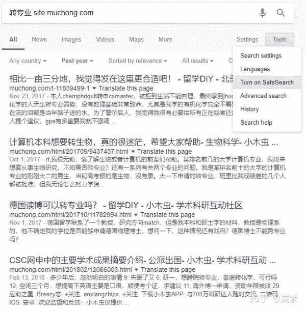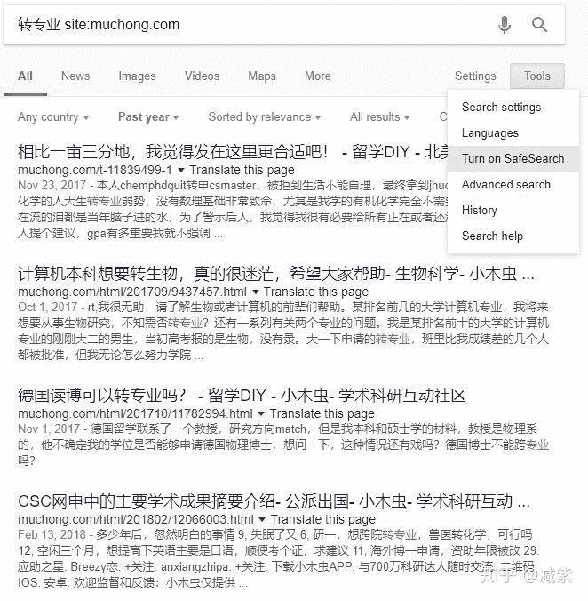

这里选关掉安全搜索，如果截图点下去则会打开

其实仔细一看问题没那么大：

第一个帖子是化学博士转 cs 硕士吧，警示大家 GPA 千万不能低——这话太对了

> 本人 chem phd quit 转申 cs master，被拒到生活不能自理，最终拿到 jhu cse 的录取，我们学化学的人天生转专业弱势，没有数理基础非常致命，尤其是我学的有机化学完全不需要学数学，所以说现在流的泪都是当年脑子进的水，为了警示后人，我觉得我很有必要给所有正在或者还没有意识到转专业的人提个建议，gpa 有多重要我就不强调了，希望大家在化学的世界徜徉的时候别忘了数学才是基础，真正申请的时候才发现转 cs 也分 EE 转 cs，其他 engineering 转 cs，最后才是化学生物转 cs

第二个帖子是……计算机转生物的（我不吐槽）；

第三个是材料转物理的；

第四个问医学分支转化学（我就是不吐槽）；

第五个问数学转统计的；

第六个问物理系转专业的；

**按知乎的政治正确看，最多是好的转差的有，差的转好的帖子也有，五五开，但奇怪的是除了少部分帖子点进去都是小木虫镜像，而镜像，是无法链接到原帖子的：**


是跳转到[热门话题贴 - 排行榜 - 小木虫论坛-学术科研互动平台](https://link.zhihu.com/?target=http%3A//muchong.com/bbs/top.php%3Ff%3Darticle) ，（顺带一提这两日热帖是[做合成毒性那么大，你为什么还在坚持？ - 新药研发 - 其它 - 小木虫论坛-学术科研互动平台](https://link.zhihu.com/?target=http%3A//muchong.com/t-12313342-1) 233）而不是原帖，**很可能原帖已经和**

@为啥要填真实姓名

的帖子一样消失了。于是所幸跳回站内搜索，干脆把 1-9 页的都过了一遍

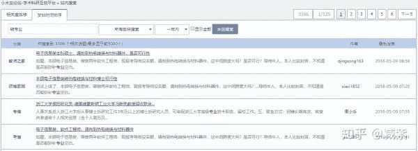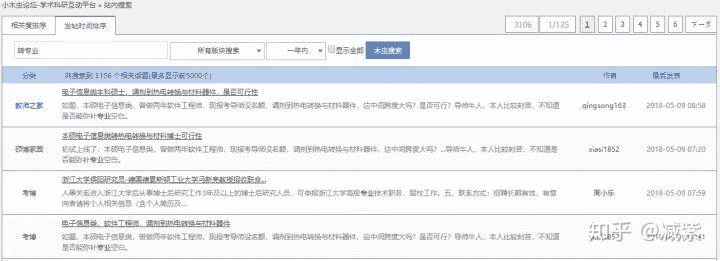

这 1 个问题用不着刷 3 遍吧……而且 2 个 ID1 个是 2010 年注册的真的没问题？！那另一个在炒坟贴？

后面剔除掉招聘帖（鬼知道怎么搜出那么多招聘帖的）剩下的贴是：

[小木虫论坛-学术科研互动平台](https://link.zhihu.com/?target=http%3A//muchong.com/t-12317974-1) 本科和硕士都是水利类 211 院校专业背景出身，地级市国土局事业单位 VS 不知名三线城市小私企证券公司跑业务——这其实是问转方向就业吧

[小木虫论坛-学术科研互动平台](https://link.zhihu.com/?target=http%3A//muchong.com/t-12317433-1) 学地质专业**出来就业**是不是要干本行——这其实是问转方向就业吧

[小木虫论坛-学术科研互动平台](https://link.zhihu.com/?target=http%3A//muchong.com/t-12316747-1) 学内燃机**问毕业后**去企业干新能源还是考公务员高校辅导员——这帖子众人最后推荐（小转）电控——推荐对了——然而这也是问就业

[小木虫论坛-学术科研互动平台](https://link.zhihu.com/?target=http%3A//muchong.com/t-12315516-1) 生物和环境哪个好——这问个蛋

[小木虫论坛-学术科研互动平台](https://link.zhihu.com/?target=http%3A//muchong.com/t-12303739-1) 材料转 IT 的码农征婚

[小木虫论坛-学术科研互动平台](https://link.zhihu.com/?target=http%3A//muchong.com/t-12287330-1) 在读研一问兽医转化学。

[小木虫论坛-学术科研互动平台](https://link.zhihu.com/?target=http%3A//muchong.com/t-12277063-1) 问本科食品跨考计算机研究生怎么考——没靠谱回复。

[小木虫论坛-学术科研互动平台](https://link.zhihu.com/?target=http%3A//muchong.com/t-12275874-1) 问材料转机械——众人劝退。

到了第 8 页有个帖子直白的很：


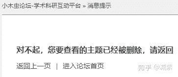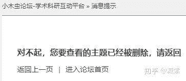

第 9 页唯一一个讨论是不是转错的帖子也被删了：


以上，算上被删除的拢共 9 页，11 个相关帖子，真正问接下去念书的有效提问拢共仅 6 个，而 9 页一共搜出的结果是 9\*25=225 个，比例是 6/225~2.6%

**也就是说在小木虫自有的搜索引擎里 10 页你压根找不出几个讨论化学/材料转到机电/自动化/电气/IT 的帖子**；反而是某些国外搜索引擎可以轻而易举的挖出来。顺带一提这个发帖人也在知乎提问了一次，而如今网页也被 ban 了：

> 隐隐觉得选错了专业，还有救吗？  
> 楼主是同济大学汽车学院小硕一枚，研究生方向选了燃料电池控制技术，虽然燃料电池是新兴行业，也有一定的前景，但是感觉燃料电池行业是一个很脆弱的行业，随时都有可能做不下去，很担心工作选了燃料电池之后会有失业的风险。所以想问问如果研究生期间除了课题组之外自己有空看看锂电池或者机器学习之类的书，找工作时候可以行业内转行吗？希望大家不要吐槽我早知如此当初何必要选这个方向，因为我也是进了课题组之后逐渐开始担忧…

**我就想问那个化学转计算机的 17 年帖子跑哪儿去了？为什么搜不出来？**

**为什么百度爬取小木虫 bbs 的转专业帖子都能做到 100%爬出，小木虫站内搜索引擎的搜索结果却只有 2.6%是真正讨论转专业的帖子？**

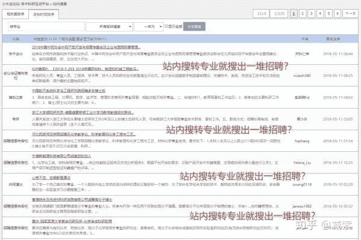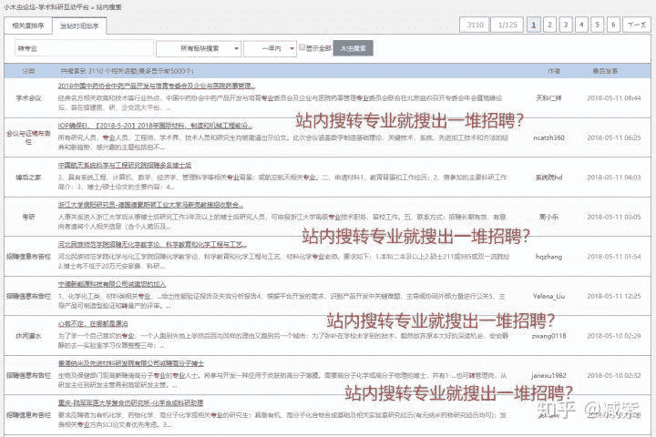

各位可以和下面百度爬取的转专业搜索结果对比一下，公道自在人心

* * *

如果不是小木虫自带的中文搜索引擎不好，那么它就在有以隐瞒人才流出发出的声音。

这也是这帮搞生物的留（meng）住人唯一的办法了吧

多说两句：**其实如果在百度搜索引擎上找小木虫论坛的转行能搜出 1 屏幕的“化工转行”讨论帖，不会搜出“招聘信息布告栏”的帖子**——虽然十有八九点查看原文看不了

[`www.baidu.com/s?ie=utf-8&f=8&rsv\_bp=0&rsv\_idx=1&tn=baidu&wd=%E8%BD%AC%E8%A1%8C%20site%3Amuchong.com&rsv\_pq=bf9496f900003d94&rsv\_t=85b5l8cR5RXlyO3tixiKYetQFasGpXV4Hixyx6MElTPBQXlQ61g5OCym6T4&rqlang=cn&rsv\_enter=1&rsv\_sug3=30&rsv\_sug1=19&rsv\_sug7=100&rsv\_n=2&rsv\_sug2=0&inputT=12593&rsv\_sug4=12593​www.baidu.com`](https://link.zhihu.com/?target=https%3A//www.baidu.com/s%3Fie%3Dutf-8%26f%3D8%26rsv_bp%3D0%26rsv_idx%3D1%26tn%3Dbaidu%26wd%3D%25E8%25BD%25AC%25E8%25A1%258C%2520site%253Amuchong.com%26rsv_pq%3Dbf9496f900003d94%26rsv_t%3D85b5l8cR5RXlyO3tixiKYetQFasGpXV4Hixyx6MElTPBQXlQ61g5OCym6T4%26rqlang%3Dcn%26rsv_enter%3D1%26rsv_sug3%3D30%26rsv_sug1%3D19%26rsv_sug7%3D100%26rsv_n%3D2%26rsv_sug2%3D0%26inputT%3D12593%26rsv_sug4%3D12593)

**起码百度能保证搜出来的真的是一堆转专业转行的帖子**

有几个回答讲：小木虫讨论的都是具体科研问题——起码我截图这个点是删除了大量转行帖才留出只讨论好好干活的帖子——以及一片招聘帖。

**那这很明显不是小木虫联动的中文搜索引擎有问题，之所以站内搜“转行”搜不出多少转行贴，反而是一大批化工材料招聘帖**，可以说用意再明显不过了。

# 简明劝退学答疑

 flowchart 箭头图标 勿删 

> 作者：[七海千秋](https://zhuanlan.zhihu.com/p/30915041)

关于为什么要劝退生物、化学、环境、材料等失败专业，知乎上已经有很多详细的介绍了。但是，很多生化环材专业的本科生还是会对该问题感到迷惘。我推测，可能是某些介绍写得过于复杂，本科生缺少对行业的认识，反而难以在短时间内抓住问题的重点。

因此，我在这里，用尽量简明的语言，来回答一下劝退学的关键问题。

**问题 1：生化环材的就业出路很差吗？**

答：**很差**。本人当年高考，名列全省前 100 名，考入了全国知名的高等学府，然后在本校读博，学化学（也可以说是材料）专业。根据 2017 年校招来看，招聘生化环材毕业生的岗位数量的总和，不及招聘计算机毕业生的岗位数量的十分之一；**我校生化环材的博士的就业待遇，大多比不过我校计算机本科生**。

**问题 2：我听说某人学了生化环材专业，现在一年能赚数十万甚至百万人民币，你怎么解释这个现象？**

答：**这是个例，个例不能代表整体情况**。打个比方，朝鲜的金将军富可敌国，但是朝鲜整体上仍然是贫穷落后。

生化环材的毕业生，有没有可能找到待遇非常高的工作？有。但是，在这些领域，好工作太少太少，竞争者又太多太多，找到高待遇工作的概率极低——你愿意把人生赌在低概率事件上吗？

**问题 3：我接触过一些名校的生化环材毕业生，我看他们生活得很好呀？**

答：**我们说生化环材专业出路不好，指的是投入回报率太低，不是说会穷得饿死**。

如果你询问一位从清华北大、华东五校或国外名校毕业的生化环材毕业生，问他到底能赚多少钱，那你大概率会问出一个高于社会平均值的收入。但这真的有意义吗？

打个比方，你有 1000 万人民币，然后你去投资，花了一年时间，赚了 10 万元。

如果我问，你赚到钱了吗？你会回答，赚到了，赚了 10 万。

如果我问，你这个投资，做得划算么？你肯定会回答，不划算，年收益率才 1%，还不如放在余额宝里呢。

同样的道理。清北华五，是随便能考上的吗？国外名校，是随便能申请上的吗？不是的，你要付出远超一般人的努力才行。

你付出的努力很大，但你得到的回报却不够多。那你肯定会感到不满意啊。

**在付出同样的努力的前提下，计算机、金融的毕业生，往往能拿到约 3 倍于生化环材毕业生的收入。这是投入回报率上的巨大差距。**

**问题 4：我见过的计算机、金融毕业生中，也有收入很低的，你怎么解释这个现象？**

答：\*\*我们讨论的是行业的整体水平。\*\*任何行业都没办法保证每一个从业者的收入都高。但是，不同行业中，高收入人群的比例是不一样的，获得高收入的难度和概率是不一样的。整体来说，在付出同样的资源和努力的条件下，计算机和金融更容易取得高收入。

**问题 5：有人说，三十年河东，三十年河西。也许很多年以后，生化环材就吃香了，计算机、金融反而不吃香了。**

答：理论上存在这样的可能性。但是，你要想一想，\*\*你的人生中存在几个三十年？\*\*你不是电子游戏中不老的虚拟角色。现实中的人生，是环环相扣的。你毕业后，就要面临就业，然后要面临一系列需要花钱、甚至花很多钱的事情。**就算三十年后，生化环材吃香了，又与你何干？你这已经度过的三十年的岁月，是在清贫中挣扎的。**

至少，在十年左右的尺度上，生化环材行业是看不到大幅崛起的希望的。从这一点上来讲，学习生化环材专业，不是一个好的人生选择。

**问题 6：你们劝退别人，其实是想减少自己的就业竞争压力吧？**

答：并不是。劝退党以硕士博士为主。我们劝退的对象，以本科生为主。\*\*劝退者和被劝退者，在找工作的时候，并不会同台竞争。\*\*我们之所以劝退别人，单纯是不想看到学弟学妹重蹈覆辙，这是一片好意。

**问题 7：你们搞劝退，导致某些原本打算搞生化环材科研的人，最终没有去深造，你们是不是在做阻碍科学发展的坏事？**

答：并非如此。\*\*在科研的过程中，会遭遇很多平常人难以想象的困难。\*\*如果一个人听了我们的劝退言论，就不打算去做科研了，那说明他原本就不适合去攀登科学高峰。**劝退不适合科研的人，不论是对他自己，还是对学术界，都是非常有利的，是功德无量的好事**。

**问题 8：我相信你们劝退党的话，也明白搞生化环材出路不好，但即使如此，我也还是想把生化环材当作终身事业。你怎么看？**

答：如果你有这样的觉悟的话，那说明你对生化环材是真爱。**既然是真爱，那你就去学吧。我们劝退的对象，是对生化环材没有特别的偏爱，只是想读一个好大学，毕业后找一份好工作的人。**

# 程序员是吃青春饭的，为啥还有这么多人想转行当程序员？

 flowchart 箭头图标 勿删 

> 作者：[到处挖坑蒋玉成](https://www.zhihu.com/question/56604024/answer/273549780)

因为化学生物吃的是青春屎

做人吧，学什么专业其实是次要的，关键是心中得有 B 数，贵 21 世纪学科的某些人，自己吃着青春屎，嘲笑别人吃青春饭，可以说是一点 B 数都没有了

而且啊，贵专业不光年轻时吃的是青春屎，还越老越吃屎呢！按你臆想中的混日子搞法，你唯一的结局就是博士毕业去个二本当讲师，苦逼十年到四十岁，然后随着专业裁撤被人扫地出门。

教育部：2017 年高校撤销本科专业名单 ―高考频道―中国教育在线

从来没有任何一个专业像贵专业一样，大批量地培养出心中没有 B 数的毕业生，所以说——**任何工科专业，无论是 CS 还是土木，都是培养人才的专业，理科中的数学物理也是，而贵专业则是培养奴才的专业**。

# 施一公到底有多牛（据说他的研究成果逼得国外很多实验室都关了门）？

 flowchart 箭头图标 勿删 

> 作者：[伏地魔王大人](https://www.zhihu.com/question/36553777/answer/250683981)

他们确实非常牛，具体你们看高票的回答就好了。

11g 培养的是跟寿司之神一样的人才。

这是一种什么精神呢？职人精神！

在寿司之神那里，你第一件工作就是拧毛巾。大概要拧 1 年。要又干爽又有热气。

第二件事是煮饭，至少要煮 3 年以上的训练。卖米的大叔都说只有寿司之神才配煮我们家的米饭。

第三件事就是煎蛋。要学至少 10 年，你才有机会碰鱼。

寿司之神的儿子讲，我都 60 了还没有完全学好，每天坚持去买鱼。有的学徒不努力，天赋好不好不重要，每天至少要坚持煎蛋 12 个小时才行。

11g 简直就是生物之神啊！！

第一件事就是摇细菌，快了不行，慢了不行。要做到又密度合适，气味还要正！至少需要 1 年训练。

第二件事是提质粒。又纯量又大。需要 3 年时间训练。

第三件事就是点晶体，没有点过十年晶体你根本不知道电镜装啥样。

生物之神讲我最喜欢的事情就是提质粒，每天坚持提质粒腰不痛了，腿不抽筋了，心情爽爆了。我一天不提就要骂人。

生物之神的门徒 X 柠讲过，你们年轻时候多努力，跟我一样多去点点晶体，我每天都工作 16 个小时，CNS 大大的有。

以上纯属调侃，寿司之神的电影是真的，有兴趣的朋友可以去看看。你就可以体会到 11g 的牛！

# 如何看待清华大学生命科学学院削减研究生补助的行为？

 flowchart 箭头图标 勿删 

> 作者：[生姜](https://www.zhihu.com/question/64804013/answer/225350869)

→\_→看到上面您们说的。我想说一句：好歹清华，北大都是 top2 的大学了，您们的待遇已经算是上层的“农奴”了。

其他大学，特别非 985 211 的，那真的是“欲当农奴而不能的秽多”了。

→\_→就拿本地垃圾地方性一本（二 A）大学的生物工程研究生待遇来讲吧。

我们这地方最低工资是 1350，她们的补助是这个的的一半的一半。  
基本到手是 300，不包吃住，不包水电费，连网费都不包。

基本上每个月都要自己倒贴几百的，这就导致我市一大奇观-毕竟大学隔壁就是全市文明的五星级大酒店，上面有富丽豪华的会所。  
所以，→\_→经常看到生物狗去那里跟某些肥佬进行羞羞的事。行情据说是一夜 1500。  
你说男生物狗咋办，别担心，这会所男的女的都有，有钱肥婆找帅哥给得钱 2000 起步。

("▔㉨▔)汗 ，所以导致那大学生物工程中心一大奇观，基本上每年都有几个人直接写信去纪委举报教授，然后去学校跟教授掀桌子，然后直接去当小三 or 小白脸去了。

不得不提一下，本市目前最大的生物制药企业，也是大学生物工程狗毕业以后的雇主（只要没有转行的，基本上都是他家要的。）。  
这企业就是当年某女研究生被教授折磨的没办法生存，然后去援交。结果当了本市最大房地产企业老板的小三。过了几年，给房地产老板生了孩子，拿了奖金以后，在房地产老板的人脉下跟某大型医药企业合作建立的。

每年在员工大会上面，她都会对新入职的本地大学生物狗说：你们辛苦了，我每个月给你们基本工资是你们以前老板给你们的十倍，不需要七天十四小时，我们是五天八小时，有加班补助。宿舍有空调，有阳台晒衣服。冬天打热水不需要离开宿舍，从七楼跑到地下接水，再提着桶跑回七楼，我们宿舍里就有热水器。每个宿舍有独立的卫生间，不需要几百人就围着三个 wc 干着急。

你们 top2 的“农奴”们过得起码是正常人的生活，这边完全是“奴隶营”的生活。

就拿我那个已经脱离苦海的干姐来说吧。  
她活生生被折磨到去了第三人民医院去当护士了（精神病院）。


(ಥ\_ಥ) 简直和寒蝉里的女 pi 鹰野三四，一样疯了。

当年小时候，她是我的邻居，也是社区里面的大姐大。  
后来她对我说：21 世纪是计算机和生物的。  
前五十年是计算机，后五十年是生物。我觉得我的智力肯定不够他们来，所以也不打算靠计算机了，努力个五十年，厚积薄发，学生物吧。

然后她真的考上了中山大学的生物系，然后因为父母要求她早点结婚，让他们抱孙子，研究生又考了回来本地大学。

结果第一学期，在导师的要求下，七天十四小时，连续一个月没有防护用着吡啶。  
然后彻底不孕不育了。

第二个学期，因为熬夜和营养不良（虽然在家里吃饭，但累成 poi 一样也没办法吃太多），洛氨酸酶分泌过少，先是变成白发魔女，然后过了几个星期，又变成了金发的。  
（我干姐那个时候的样子很像三四）。


然后第三个学期，一年的连续工作，让她精神分裂，直接进了第三人民医院。然后在医生和护士的悉心照顾下，她才恢复过来。因为之前导师没有批准休学，所以她也没办法回去。  
只能拉着家里人去学校闹，最后转到卫生系。然后毕业后去第三人民医院实习，考了护士证。


(ಥ\_ಥ) 顺便说一句，我们这里是侨乡，曾经有个香港大佬回来看到生物狗的宿舍太惨。拿了 1000 万出来给他们装空调。  
结果空调买了。  
空调全装到老师宿舍去了。

# 为什么很多大学生甚至研究生抛弃专业去做码农呢？

 flowchart 箭头图标 勿删 

> 作者：[Marisa Hakurei](https://www.zhihu.com/question/21666262/answer/430250493)

广州市对 2017 年全市劳动者工资统计中，互联网制造业从业者与化工类制造业从业者的工资对比如下：

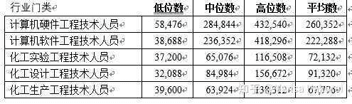

绘制成图表，更加明显：

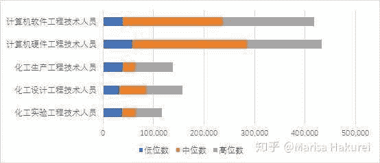

看到了吗，什么叫做差距？这就叫差距。

图中蓝条和橙条的分界线为低位数，橙条和灰条的分界线为中位数，灰条的顶端为高位数。

考虑到高位数的定义是前 10%的平均值，因此高位数工资对应的排位是 10%以内。换言之，能拿到高位数工资的人，意味着他至少进入了这个行业的前 10%。而中位数对应的排位是 50%，即拿到这个数的人，在行业内正好位于 50%的排位。

结合图表，我们可以得出一个难以置信的结论：

化工类技术人员工资的高位数，远不如计算机类专业人员工资的中位数。

这说明什么？假如你读了某知名 985 的化学专业，毕业后去做了化工技术人员（实际上化学跟化工还是有区别的，不少化学专业的人找化工工作都很吃力），你有着高学历，工作刻苦，又有贵人相助，忙活了多年，终于爬到了这个行业的前 10%，傲视众人。

然后你发现，你到手的工资，还不及隔壁一个平庸码农的工资。

哦不对，从图里看，应该是还不及这个平庸码农工资的一半。

请问此时的你是什么感受？

不排除有人安贫乐道，但更多的人会失望，后悔，不平……他们中的一部分开始自救转行，并且在 mitbbs 上，在人人上，在知乎上劝退；另一部分人不会在网上发声，只会在亲戚家的高三孩子过来咨询专业时委婉地劝诫他们；而更多的人，连声音都懒得发了，只会把自己的心思深深地埋藏起来，就着倒班结束时的朝霞一口吞下。

这顺带说明一点：指望生化类工作越老越吃香是很不靠谱的：你如果转不到管理岗，大概率是干到老也只能拿那么一点工资……而如果转管理岗那么容易，隔壁的 CS 也不会隔三差五把中年危机拿出来说事了。

即使把统计口径不同，统计工资较低但职责类似的“计算机程序设计员”这一职业考虑进来，码农工作的薪资也是完爆化工技术人员的。

必须提到的一点是，这里的计算机技术人员指的是身处“计算机、通信和其他电子设备制造业”中的技术人员，而不是我们常说的软件服务业人员。由于广州缺乏大体量的互联网公司，因此软件服务业人员的中位数薪资没这么高。

但在旁边的深圳，情况则恰巧翻了过来：制造业里的码农薪资一般，而软件服务业公司中的码农则能拿到很多钱。

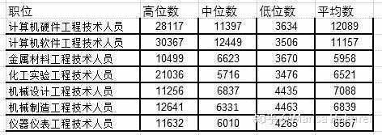

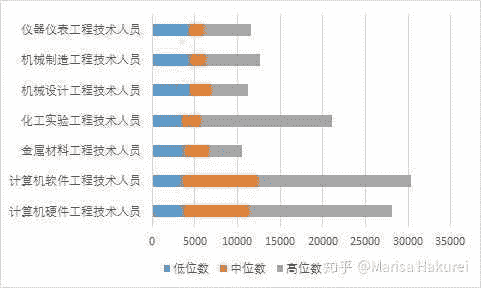

还是类似的，码农们的工资中位数赶上了大多数制造业人员的工资高位数。唯一值得庆幸的是，化工技术人员通过努力，如果做到行业前 10%，工资终于能超过前 50%的码农了呢！真是可喜可贺！

为什么很多大学生甚至研究生抛弃专业去做码农呢？

因为他们发现，只要努力几年转个行，一毕业拿到的工资就能赶得上他们在本行业奋斗几年（甚至十几年，几十年）得到的薪水。

既然如此，为什么不转呢？

\----

补充

广州：

制造业里的码农工资远超化工等专业人员，

软件服务业里的码农工资跟化工等专业人员持平；

深圳：软件服务业里的码农工资远超化工等专业人员，

制造业里的码农工资跟化工等专业持平。

这个现象很有趣，也值得研究。

但是我今天就说说影响。

如果你是珠三角的码农，

想在制造业发展，你大可以去广州，广州有 oppo，vivo，魅族等企业；（评论区补充：最后一句有错，这三家都不在广州。。。至于为啥制造业这么高我也很好奇）

想在软件服务业发展，你大可以去深圳，深圳除了大腾讯，还有迅雷等企业，很多大厂也在那边有岗。

选择对了，你总能拿到较多的钱

但是你如果学生化材环，这俩城市怎么跳都是那么点钱。。。

所以珠三角一带很多生化材环的学生转行，比如华南理工的材料学生转行率达到 43%（凭记忆，可能有出入）。

其它大规模转行的地方，原因可能也差不多。

就是钱啊。

# 传销组织生化环材说（正论）

 flowchart 箭头图标 勿删 

> 作者：[田佳琦](https://www.zhihu.com/question/309484252/answer/576471286)

传销组织的原罪是通过欺骗、隐瞒事实的手段拉人下水，生化环材利用高中生的懵懂无知来招生，其原罪也是通过欺骗、隐瞒事实的手段拉人入坑。

传销组织对其经营的产品进行夸大、虚假的宣传，生化环材号称“21 世纪中心学科”，也对其学科进行夸大、虚假的宣传。

传销组织的主要形式是不断的发展下线，生化环材的导师欺压学生，学生熬出头之后当上导师欺压新的学生，也是不断的发展下线。

传销组织喜欢给人灌输“感恩”、“奋斗”、“努力”等概念，生化环材为了麻痹学生，也喜欢给学生灌输这些毒鸡汤。

传销组织有小部分人暴富了，但是更多的人家破人亡，生化环材也有小部分人名利双收，但是更多的人月薪三千。

传销组织将社会财富进行非法聚集，并未创造新的财富，生化环材不停的水文章，没有困难创造困难也要水文章，也并未创作新的财富。

传销组织祸国殃民，生化环材大量浪费国家的资金，生产了一批毫无卵用、只为了讨审稿人欢心的文章，同时耽误学生前途，也可以说是祸国殃民。

数字论证：“传销组织”四个字的笔画数之和是 33，33=(1+1+4)\*5-1+4；“生化环材”四个字的笔画数之和是 24，24=1+1\*4\*5-1+4，故“生化环材”=“传销组织”。

Q.E.D.

# 现在学生物出路真有那么不济吗？

 flowchart 箭头图标 勿删 

> 作者：[匿名作者](http://bestmajor.org/article/5c2728f27f467e55e41a727a)

喝茶归来，更新如下：

在 2018 年，清华大学成为了全国排名第一的世界一流大学，人们对清华二字的恐惧根深蒂固，不敢谈论他，甚至不敢说出他的名字，于是以“神秘大学”称之。

* * *

利益相关：神秘大学生命科学学院 201X 届毕业生，已转行，劝退党徒，匿名。如果你猜出来了我是谁，我恳求你保持沉默。

本人受知乎生化环材劝退前辈们恩情甚多，终有一日能报答劝退社区，为其添砖加瓦，是我数年来的愿望。这是我第一篇也是最后一篇劝退文章，毕竟重担已经卸下，还要努力前行。在此感谢几位素昧平生的好人[@弗兰克扬](http://www.zhihu.com/people/c3239475688a09f3252cc320cc214ce4)[@到处挖坑蒋玉成](http://www.zhihu.com/people/fdf39532883a73e7d2d09b485588d7c7)[@材料劝退奥特曼](http://www.zhihu.com/people/2ee3649b52cc5f28cd1e904558f08040)[@葉神月](http://www.zhihu.com/people/347f8ad5c5a88fa0da7420cc95d88d8f)[@云天](http://www.zhihu.com/people/5d6460ba7157f21c8d87e8df818dc4b0)[@白如冰](http://www.zhihu.com/people/9558cac1a967147f0318fe6b7b1a0f7b)[@贱贱](http://www.zhihu.com/people/789a006980ffe4e7d86594fd2c21c927)[@罗多克神射手](http://www.zhihu.com/people/491ae53373c9ce73143247dff62b4468)等等太多，恕不能遍历所有帮助过我的人，但我在此向所有劝退党良心人士道谢，你的每一点点文字，都让一个人看到了划过沉重黑暗的一线光明。

约在 201X-2 年夏季，我在知乎上看到了一个话题，叫做“生物劝退”。我是冒着冷汗看完整个话题下的所有回答的，看完后感觉上了一个弥天大当，副校长给我们画下的大饼，在我看来成了一个剧毒的诱饵，唯恐避之不及。在此我就不转载各路劝退前辈的警句名言了，只举出数个不那么极端血腥的事例，祭奠我那无辜浪费的数年青春。


\[图片上传失败…(image-10a259-1546245310837)\]


\[图片上传失败…(image-d32a6d-1546245310837)\]


\[图片上传失败…(image-f79c37-1546245310837)\]

然而我也知道，仅凭几则事例，并不足以说服所有理智的人。有朋友问过我这样的问题：

你只是取了几个失败案例而已，而且是故意取的生化方向。副校长也搞生物，做得很成功啊。

这个问题问得好。不论我在举例子的时候，还是你在举副校长的例子的时候，都在谈论个例。只要稍懂一点概率就会知道，个例没有普遍的参考意义，我们应该关注统计概率，看看生命学院就业率究竟是多少。岂不闻顺天者昌，逆天者亡，个人命运终究不可以抗拒统计规律。

根据官方的《神秘大学 201X 年毕业生就业质量报告》，神秘大学生命学院的本科生、硕士生、博士生的就业率分别为 97%、100%、98%。

嗯。

然而你若真诚相信了以上数据，是会过错年的。知乎上有前辈指出生命学院就业率是 8 开头的，并写文章怒斥生命学院的就业情况低于全校正常水平 10 个百分点，自院长以下众多肉食者难辞其咎。

哼。

真实数据是 51%。

你没看错，堂堂神秘大学生命科学学院，包括应届本科生、硕士生、博士生，出国深造、国内深造、找工作全部统计在内，201X 年总就业率 51%。优质就业单位有汉东省委组织部、学而思网校、神秘大学附属中学等，科研单位都不多见了。

但总有人拿副校长的教导反驳我：

神秘大学学子不应该考虑就业！

我自江东通过高考而来，以几乎是万中选一的成绩来到这所学校。我期待你能帮助我改变命运，至少不要浪费我的优势。你给我的答卷就是这个？我何颜去见江东父老？你有何面目去见汉朝二十四代先帝？

我从未见过有如此，厚颜无耻之人！

除了 51%，其他人去哪了？

Who Cares?

你的数据真实吗？

这份内部文件是生院学生组向就业指导中心的汇报，其中有两个就业率。系统就业率 31%，是学校使用全校统一的统计方法，根据生院就业登记情况得到的统计；而实际排查就业率 51%，是学生组挨个约谈毕业生后得到的统计。就业中心主任老师因这份文件大发雷霆，呵斥生院无视学生前途，培养了过多博士而社会不需要。生院教授们听得无动于衷。

有需要这份文件者，请移步评论区并尽量保密。

我不听我不听！太夸张了，这个数据是假的！

我不知道你为什么不肯相信白纸黑字的数据，但是：

如果你是坑外人士，请勿对他人的痛苦妄加评论。

如果你是坑内人士，希望在你找工作那天，也能有勇气对 hr 嚷嚷“我不听我不听”。

不过评论区还是很友好的，看来天下苦秦久矣，已有众多知友愿意支持我们劝退党了，我感到很满意很感激。

看到这里，你还敢说什么“生物科研做好了一样有前途”吗？

何不食肉糜？

# 材料工程赋

 flowchart 箭头图标 勿删 

> 作者：[匿名作者](http://bestmajor.org/article/5c27287bef5479060466b68a)

经济瞎预测，哲学形而上。历史纯扯淡，法学难进阶。

社工没前途，教育要下乡。体育伤病多，文学拼天赋。

新闻狗仔队，语言孔乙己。外语没处讲，艺术难养家。

数理要转行，生化是天坑。地理画地图，天文占星术。

地球物理学，天天锄大地。大气科学系，也就报天气。

海洋钓钓鱼，农业种种地。力学玩滑轮，环境污水站。

心理难自医，统计不好算。地矿要远游，机械流水线。

精仪做轴承，土建工地干。电气烧煤炭，能源风车转。

测绘满山跑，化工毒不少。交通铺铁路，航空单位住。

水利建大坝，林业种大树。电子焊板子，食品修机器。

医学患者闹，预防没资金。药学难出活，法医闻臭味。

软件不科学，管理要经验。计科青春饭，金融圈里乱。

唯我材料系，世界第一专。拳打中关村，脚踢金融街。

越老越吃香，永远美滋滋。你说他不行，你行你上啊！

你说不押韵，你行你写啊！

# 逃离天坑之后——谈谈技术路线该怎么走

 flowchart 箭头图标 勿删 

> 作者：[一位脱坑十年的长者](http://bestmajor.org/article/5c1f765c9b99ae4bb0870405)

在象棋的江湖残局中，有一个名词叫做“摘帽”，用来表示先手一方破解了后手方的一步攻杀，局势趋于一种表面上的缓和。摘帽之后先手方虽然没有燃眉之急，但如果残局功力不足，仍然会一招不慎满盘皆输。

脱坑如摘帽。脱坑只是真正职业生涯的开始，未来的发展仍然充满着不确定性。我写这篇短文主要目的是帮助已经脱坑的朋友了解以下技术路线的前景——如果能帮助喜欢做技术的坚定信心，不喜欢做技术的尽早找到合适自己的发展路线，转转 PM 和 EM，那我大概也算是胜发半篇 nature 了。

一、自学与科班

知乎上最近有个问题时不时就跳到我的时间线上对我大肆嘲讽：[自学编程和计算机科班出身的差别在哪？-知乎](https://www.zhihu.com/question/67948916/answer/258731158)

答案区基本已经变成了转行人士和科班人士的混战，看看热闹就好。

我希望非科班出身的同学要正视这个问题——和自己比，科班出身永远比非科班出身好；和别人比，非科班出身不能成为水平不行的借口。

科班出身的人用这个来 bully 你，是 ta 的不成熟。但是我们作为一个技术人员，不会，可以学；没接触过，可以研究；不懂，可以请教。借用公孙先生的一个句式：真正的猛士，敢于直面自己的不行。个人感受，人在放低姿态之后比较能够轻松愉快地学习，如果一直打肿脸充胖子，公孙先生自己就是个挺好的榜样。

扎实地掌握一个语言、几个库、几个框架，都是基础，这些是作为合格程序员的基础硬实力，同时也是最可替代的能力。「程序员是碗青春饭」这句话，并不是完全没有道理的——如果认为程序员要做的就是不停学新的框架然后用它们开发程序，那么三十五岁被退休大概也不能全部怪罪资本邪恶。

如果坚持走技术道路，你一定要逐渐习得进入下一个阶段的能力：

二、在组件(component)层面独立解决较为复杂技术问题的能力

系统的一个功能，一个接口，或者一个简单的微服务，我们大体上称为一个组件。

在这个层面上，需求的定义相对明确，然而往往技术细节并不明朗，需要工程师自己去研究解决方案，并且在必要的时候和其他服务、库或系统进行集成。

在接触软件开发的最初几年，面对这样的需求束手无策，或者需要很多老人的帮助和指导，是很正常的事情。但是随着知识和解决问题经验的积累，你要学会：

1.面对定义相对良好的有一定规模的需求如何进行分解；

2.如何利用现存资源降低造轮子的成本；

3.如果重造轮子不可避免：

a.对于高科技轮子在何处获取指导和资源

b.实现过程中如何保证质量和\*\*可修改性\*\* (以后单独讲)

4.开始关心系统的运维特性；

5.开始关心系统的非功能特性；

…

99.开始清楚地认识到自己是否适合一直走技术路线。

这个阶段是程序员会接触到很多细节的一个阶段，也是从初级程序员向中级程序员转变的一个重要阶段。如果能够 survive 这个阶段，那么基本上可以被称为一个合格的程序员了。

运行在这个层面的程序员，在面对问题时大概是这样工作的：

1.做出恰当的分解和估计；

2.分析各种技术的优劣，理解需求并且能够和 PM、其他技术人员讨论 trade off，并在高级程序员的合作下选用合适的技术；

3.实现中仍然需要较好的文档以及技术支持，较快地独立完成大部分开发工作，偶尔需要高级开发人员指导；

4.产品较为健壮，运维压力不大，并且能够适应需求的变化。

然而到了这个层次我们就"安全"了吗？我认为勤奋的程序员或早或晚都会到达这个程度，而这个世界上从来不缺少勤奋的程序员。所以在此之上我们还要进一步发展自己的技术实力。

很多人都感觉到接下来要发展架构能力，然而其积累并非一朝一夕可以完成，在那之前，我们还有两步要走：

三、磨练阅读代码的能力

阅读代码，不是跟风式的一上来就去读 Hadoop，Cassandra 等大型开源项目——除非是天选之人，否则这个阶段也不太能看得懂——而是说在工作中能够做到以下几点：

1.在文档不完整、不精确或者不正确的情况下，通过阅读代码库来对某个系统得到正确完整的理解；

2.在接手新的项目时能够快速找出重点主干，在代码为主，文档为辅的帮助下理解其实现逻辑及风格/范式（paradigm）；

3.在缺少他人解说的情况下（如原作者已经离职），能够大致还原当初的开发场景，对一些看起笨拙的写法能够做出恰当的解释，在重构中能够区分可以大刀阔斧修改的和需要小心谨慎修改的部分；

4.在 debug 过程中，较少依赖 debugger，较多通过阅读代码来定位问题。

代码是程序行为的 source of truth（说还有配置的杠精先一边凉快去），文档因为代码迭代太快，或者因为程序员太懒，往往无法起到精确指导实践的作用。而阅读代码得到的知识，则是最具时效性的和逻辑上正确的知识。

这种能力是长期大量积累代码调试和阅读经验之后，最终获得的一种思维方式（大概可以称为人肉 debugger 吧）。其实这种能力人人都有，只是强弱悬殊，而且在水平达到一定阈值之前作用并不明显。

在获得了这种能力之后，一般的不明真相的小朋友看你工作，经常会觉得不可思议，比如说大家还在研究这个 X 系统的集成文档，你阴搓搓已经把 prototype 写好；你问了隔壁组同事一个问题，他说不明白，然后你很无奈去看了几分钟代码，然后说啊我知道了原来是这么回事……

但是这种能力也没什么可夸耀的，我认识的天资较好的朋友，科班出身，毕业一两年读代码就已经炉火纯青。而我，从大三转行开始花了大概七年时间才达到他当年的水平。

稍微偏个题。如果看到这里你觉得这不是你要的未来，那么我强烈建议探索一下产品和管理方向——纯技术有人喜欢有人不喜欢再正常不过，程序员转 PM 和 EM 也是正常操作。

在能够阅读大型代码库之后，很自然的，我们要利用这种能力来进一步强化自己的技术能力——对很多人来说阅读代码能力的获得是自然而然的，如果不能再构筑一道壁垒，我们就只是和野蛮生长的聪明人差不多罢了。

我的一个建议是阅读著名开源项目。个人对分布式系统有一点热爱，可以保证 Cassandra，HDFS，YARN，Redis 和 Mongo 都是值得一读的代码。有朋友说 Chromium 是非常优秀的客户端代码，我没有亲见，但是鉴于此人十分靠谱，在这里我也做一个推荐。关于读开源代码的问题在这里不展开讲了，后面有机会单独说说体会吧。

四、知识的 T 字形积累

我们在软件行业里面毕竟是后来者，除了实践中的学习以外，重新补充理论知识是必不可少的。毕竟真的猛士是吧，得承认自己不行。

离散，数据结构算法，操作系统，编译原理，数据库，网络之类的这些本科基础课程就不说了，即使不能达到本科扎扎实实学一遍的水平，跟着在线公开课撸一遍总是没错的，长期来看很多知识在日常的开发中都会时不时地出现一下。

工程上，在自己专精的领域周围，要有足够的外延。如果是做后端，那么对于现在主流的各种工具如数据库，流服务，存储，网络，负载均衡，工作流等等都要有大体的了解，明白它们的应用场景和局限性。AWS 其实是一个特别好的后端技术索引，如果能把里面的各种服务都拿出来了解一下，再稍微研究一下对应的开源技术，知识面上就已经说得过去了。新手要注意的是不要拿个锤子就看什么都像钉子，各种技术有其适用性和限制，choose your weapon wisely。

扩展知识的广度一则可以扩展工具箱，在设计系统的过程中少走弯路，二则在对比各种不同系统的特性时，可以互相印证，掌握一些一般性的规律。

而另一方面技术深度的重要性不用多说。要提醒的是，技术的深度不仅仅是比别人多\*\*知道\*\*几个技术细节，比如 ThreadPoolExecutor 的默认策略有几种，C++的虚基类内存如何布局；也不仅仅是背了几章标准，读了几篇 RFC——深度是从宏观的需求、应用场景，到架构和实现细节的全面掌握。具体深入学习的手段无外乎读好书，读优质 paper，读代码，理解架构，实践——有条件的话，可以为开源项目做一些贡献。

在一点深入，同时在周边兼顾展开，这就是所谓的 T 字形知识结构。

在此基础之上，有意识地锻炼自己在相应领域的架构能力，假以时日，能不能成大器不好说，成个技术专家大概问题不大。

五、理解架构过程，尝试进行架构工作

我们日常做的设计和架构工作其实并不复杂，重点还是从需求出发，定义 use case，转化/分解成可行的软件系统及其的设计，找到合适的工具和结构/算法来解决问题。

理解业务(business logic)、理解需求方没有说出来的潜台词，和所掌握的工具挂钩、正确衡量软件系统所需的特性、合理分解子系统，是做软件架构的一些基本能力。

发展这方面能力主要就是多观摩多思考，学习身边的高级工程师是怎么分解和转化问题的，主动积极参与到关于软件设计的会议和讨论中，对比自己和大牛思路上的差异，缺什么补什么。

更高级的工程师会以组织为整体考虑架构问题，和做具体架构的工程师讨论调整解决方案，令其符合整个组织的技术图景，个人感受，这些 principal 工程师务虚的事情会相对较多。既然是讨论纯技术发展，我们就到此为止吧。

\----

希望这篇短文回答了一些朋友对于未来的疑惑，也回应了一些对技术人员职业发展的不实传言。没有对某些文章逐条地进行回应，是因为一旦开始争论，就容易陷入细节而无法关注宏观的大方向——不过也希望我讲的不是大而无用的废话。

时间所限，只能写到这个长度，以后有机会我会挑几个点展开来讲。

最后，本人脱坑十年整，弯曲某司 Senior Engineer，先匿了。

# 从北美谈到大陆，四大天坑的孩子们为什么无处可去？《全集》

 flowchart 箭头图标 勿删 

> 作者：[云天](http://bestmajor.org/article/5c14d7d548e2f75ea039055c)

**（北美篇）**

经过这几天的写作之后，越来越多感同身受的小伙伴找到了我。随着了解的深入，我越来意识到之前的标题显得非常的不妥了，就算是纯粹为了自黑也不妥，所以我准备终止那个系列的写作，开始另起炉灶。之前和我类似的经历的同学们顶多是落差比较大，摔得比较惨。但是更真实的情况是，我往现在我站的这个平台往下一看，画面是各种惨状，千姿百态，横尸遍野，一望无际。特别是当我昨天听说了一位同学的真实事迹，我只能开始陷入沉默。他说他已经生物读博五年，最后老板把他的文章夺了去，一作写了他自己老婆名字，发了一篇 science，目前他正面临着没有足够的文章毕业的处境。他的师兄出头去老板那里闹，最后的结果是自己学位证被扣了。他的同窗舍友早就患上了严重抑郁尝试过自杀。而且他听说他们学校去年走了三个同学，没见一家媒体报导。。。

所以我现在没有太大的意愿去了解更多真相了，就像看恐怖片我已经大概猜到马上要看到啥画面了一样。这种事情多看多听了之后我也会变得抑郁（事实上现在已经开始有点了），所以你主动想要告诉我可以倾听，但是我不太可能想要主动去了解了。

所以这篇写作纯粹是给某些还没有完全看清形势的孩子们提个醒，这种孩子诸如：楼主啊，我觉得你很牛逼，凭你的经历，肯定可以去 985211 高校当个教授吧。或者去个世界 500 强外企混几年，一开始可能也就二三十万，但是经过几年打拼，肯定六七十万妥妥的，甚至年薪百万不是梦！你要知道行行出状元，越老越吃香啊！这和我爸那时候知道我毕业想回国之后的想法简直一毛一样：只见他当年如同范进中举般兴奋地跟我说，儿啊，我上网查了，我听说了我们国家有个千人计划，待遇特别丰厚，你申请一个肯定没问题，你赶紧去吧！！！

上次的更新时间线已经到了去年夏天了，后面的事情我就开始非线性描述了，这些事情超出了我之前 25 年对本行业认知的总和。如果一个人确实是在成长的话，每过一个阶段你都会觉得以前的自己是个 SB，但是去年到现在这段时间里这种事情发生的频率特别高，几乎每个月我都会觉得上个月的自己就完全是个 SB。以下，完全是来自我个人真实的经历，也结合了周围人的事例，混杂了我一些个人的判断，无意挑战任何人对现状的认知。如果你不同意或者有更好的观点请也请撰一篇文@我，我会看的。但是不要在我的评论区里面胡乱指点江山，挥斥方遒了谢谢。

以下是正文，分为美国篇和国内篇，先谈前者。

* * *

上次说到因为毕业提早了太久我没有时间充分考虑毕业的问题。所以在答辩完以后我才开始考虑这些问题，慌乱是肯定的，但是远没有达到绝望的程度，甚至一度以为工作肯定是有的，只是好坏的问题，坚持下去 H1B 绿卡美国梦啊，啥都会有的。现在对那个时候的自己只能说一句，你还是 too young 啊！

我一毕业就开始求医问药打听各路神仙，的确得到了一些信息，但是那个时候我的对这些信息的判断，开始了一系列错误归因，浪费了太多时间从一个小坑跳到另一个小坑里，而完全不知道这些坑其实都是四大天坑内部的坑中坑。比如下面这个事情：

之前的学长兼校友 H，本科国内 TOP5，有机功底深厚，对高分子那套东西比我不知道高到哪里去了。还记得那一年我正在为 qualify 考试而犯愁，因为我对不感兴趣的东西啥也看不进去。他当时寄宿在我们家，全部家当似乎就只有一床棉被和床垫还有几本书。有一个晚上，在沃尔玛最便宜的那种落地灯昏暗的灯光下，他亲自指导我高分子物理和化学亲切的身影我依稀记得。比如聊到瑞利散射的时候，他仅凭口述就把推导公式的过程复述了一遍，和我这种行业混子简直是云泥之别。另外由于实验能力突出又是过柱能手，早就攒好够毕业的文章开始边帮实验室打杂边找工作了。但是，就是这种知识和技巧已经是特别突出的人，找断断续续找了一年工作，不知道投了多少份简历之后，连一个电话面试都没有接到，更不用说 onsite 了（现场面试邀请）。

我当时听了这个故事是这么想的，肯定是 H 简历写得不行，被机器全筛掉了。亦或是他没有找到对口的企业，完全无视了 Job Description 一通乱投，否则显然不可能是这种结局啊！然而，我毕竟是 too young，后来得知我的另外一个找到工作的学长已经帮他改过简历了，但是有用吗？没有用。最根本的原因是，经过了这么多年背道而驰的发展，产业界和学术界已经不再仅仅是一条鸿沟了，而已经是马里亚纳海沟了。H 所拥有的那些过柱合成技能，或者他导师以前引以为傲的高分子艺术，比个接个支链啊，做个星形或者环形的高分子啊，在产业界的人看来就是 What thefxxk。又有谁 care 你的高分子基础课程学的怎么样呢？因为连最后面试的人你的人都不一定清楚这些知识。这方面的相关的东西，前人说了太多，我就不展开描述了。

人是要面子的生物，所以很少会有人把自己的失败的经历跟不熟的人说，但是这种经验往往比成功人士的鸡汤有用一万倍。我就遇到了另外一位学长，他是高分子工程系的，这下和工业界总不存在太大的鸿沟了吧？我是在一次聚会上遇到的他，想跟他请教一下找工作的经验。一开始他什么都不肯说，后来在我的再三追问下终于道出了实情，那时候他的 OPT 已经快到期了，也就意味着他如果再找不到工作就要被迫回国了。他说他已经投了上千封简历但是还是没有找到像样的工作，有几次的 onsite 但是每次都是到最后时刻被人拒绝，他也为此感到很苦恼。所以最近的手头上的一件事情就是和上海 BASF 在沟通，能给 20 几万就准备妥协了。我当时就感到诧异，我投十几封简历就累的要死，还要写 Cover Letter 啊，你上千封是咋做到的，是不是无脑海投的？他说，不是啊，遇到感兴趣的岗位我也会 customize 简历啊，但是真正对口或者待遇不错的岗位真的少，时间一久发现这样不行，所以后来，就把其他能投或者不能投的岗位都投了，所以加起来会有上千封，但是结果也只能是这样。

我当时听了这个故事是这么想的，不可能，这种事情不会发生在我的身上。因为我比他厉害，厉害在哪里呢？呃呃呃呃呃呃呃，我也说不上来。可能我英语比较 6，创业培训的时候我能还是和人家 CEO 谈笑风生的呀。或者说，我的经历比较丰富，我的项目做的好，我的文章影响因子高，我曾经有个大新闻。或者说，我脑子比他活，我擅长社交，我去找校友，找导师，找各种前辈给我内推，总会有什么是成立的吧，天无绝人之路对吧。

所以，轮到我自己去找的时候，其实我心里已经有点 B 数能猜到可能遇到的情况了，但是还是遭到了暴击！我首先去找了一些已经找到工作的学长求指教，把简历大修了三遍，已经完全看不出任何原来的样子了。然后去学校的 career center 让 nativeamerican 帮我改，那个刚进本科法学院的美国妹子竟然跟我说你的简历完美无缺，你的经历简直优秀的一塌糊涂，你一定能找到工作的！然后我回家，仔细研究了一遍国外 HR 常用的筛简历软件，然后注册各种找工作平台，交$把自己变成 vip，把简历传上去。对于感兴趣的岗位，每次都认真看 JD，凑一堆可有可无的经历往关键字上面靠，这么做的目的就是生怕自己过不了简历关。然后。。。我就等。。。

我大概前后投出去 40 封简历，几乎每一份内容和 cover letter 都不一样，并且绞尽脑汁和 jb 做了最大程度的 match，但是这 40 封已经把我累到绝望了。我等到的是什么呢？nothing！一个电话也没有！不，有一个电话，是一个本地的保险公司打来的，我根本没有投他们家的简历，而是他们在招聘平台上看到我的简历显示我就住在公司附近所以给我打来让我去卖保险。怀着绝望的心情我就去了那个保险公司应聘了，毫不例外的，刚进门一股浓浓的传销气息喷了我一脸，一进大堂大家似乎在开 party，旁边布置了各种气球，还有吃喝，上面有导师有学员，一片欢乐的海洋。然后我们新来的几个人被安排到小房间接收美国式的传销洗脑，一个感觉像是汽修厂的白人大叔开始跟我们聊保险业的种种好处，如何能快速致富，他们今年刚来这个州就已经赚了多少多少，下面的计划是跑到其他州再开三个 headquarter。你要做的工作就是跟着我们去跑客户，我们一开始就带你，但是后面就要靠你自己了，主要的客户就是美国家庭特别是中老年群体。然后培训完了之后拉我进大厅，让大家认识新人，介绍我的时候像大家来了一句，大家注意看，这个是刚毕业的博士生，chemistry genius，然后一群黑的白的大叔大妈就像是去动物园看到了猴子一样开始啧啧称奇。。。

当然投了这么多简历之后我开始注意到了其他的一些因素。比如正儿八经的公司都有自己的网站，自己的招聘系统，在那个系统里面你可以没有 cover letter 但是你必须要回答以下问题。你现在是啥身份，你是不是美国公民，你有没有绿卡，你是不是在 OPT 期间。每次要回答这种问题的我的内心都很抗拒。在这种大公司官网许多次石沉大海之后，我甚至患上了被迫害妄想症怀疑他们直接设置了 if 语句，就是如果你回答自己没绿卡，是个学生还在 opt，然后还要求公司帮你 H1B，他就直接把你简历给无视了，无良一点的甚至还会秒回拒信，之前有学长已经经历过了。那个时候我只是怀疑，直到后来我有了如下经历我就彻底服气了。

网投不行那就来现场的呗，我要用我的的经历和人格魅力当场征服 HR！于是我就报名参加了隔壁某著名高校的招聘会。那所学校曾经是各种诺贝尔奖的摇篮，在这里办的工程类招聘肯定会吸引到大批人才和企业关注吧！结果，跑去一看，半天的活动是在听某企业家吹牛皮，然后下午才是招聘会，一共来了九家单位，而现场一共有上百人，以中国人和印度人居多。每家企业的摊位只有一到两名人员负责照顾，但是前面却排了一长串的人等着投纸质的简历。好吧，既然来都来了，还是要保持乐观啊！HR 一定会发现我这个人才的，我一定要把握好跟他们 face to face 的机会！事实上我的确做的不错，和其中的一两位还聊了五分钟以上，有很多人，我注意到 HR 看到他们简历的瞬间就丧失了耐心，然后结局也是尬聊十秒匆匆了事。但是我做的比别人好那么一丢丢就有卵用了吗，后来被证明为一无所获。我和其中一位比较实诚的美国白人大叔多聊了几句，他直言不讳地告诉了我真相，他说啊，自从特朗普登台啊，大家都很怕政策变动，一变动呢，H1B 就难搞，成本就上升，而且政策上说了，hireamericanpeople，我们也不能不配合啊，所以呢，在收到你们简历之后呢，我们会把有绿卡和没绿卡的分成两叠，先从有绿卡的这一叠里面寻找匹配的人才，实在找不到再从另外一叠里面找。哦不对，当然我们不会先找不认识的人，我们会先面试我们自己员工的亲戚朋友之类的。不过小伙子你要注意啊，我最近观察到公司里那两叠简历，没有绿卡的那一叠已经比有绿卡的一叠高太多了。。。

所以，我逐渐开始明白了绿卡的重要性，简直是太重要了。如何获得绿卡的问题已经超出了四大天坑的范围，哪天心情好了我再慢慢说吧。简单来说一下我对绿卡重要性的理解，就比如说 100 分为满分吧，然后 80 分你就及格了，用人单位就可以雇佣你了。在我 too young 的时候我觉得绿卡的重要性是+10 分或者+15 分，撑死不可能能高于 20 分了。但事实上，我现在的感觉是至少要+50 分。知道了这个你就会去想办法搞绿卡，然后就回到了那个经典故事：小明没有剪刀，所以从超市里买了把剪刀，剪刀是被纸板和塑料包裹起来的，背后赫然写着，请用一把剪刀剪开包装以获得你的剪刀。小红要去找工作了，用人单位告诉你，你必须要有绿卡才能找到工作，然后美国国安局告诉你你必须要有工作才能申请绿卡（不准确，但是一般人的情况就是这样）。算了算了，这个问题太复杂了，我还是思考一下晚上我到底是吃汉堡王还是麦当劳吧。

吃完，终于我又坐回到了电脑前，开始思考我的人生会啥会变成这副 D 样呢？我终于开始领悟到一些事实了，特别是，我终于开始打开知乎了，发现自己的经历为什么和前辈们这么像呢？特别是，我看到了北美计算机行业的招聘岗位和四大天坑岗位的对比之后我就开始计算，根据计算机前辈们的表述，平均投 20 封简历能拿到一个 onsite 邀请的平均水平，再结合行业间岗位数 1：15 的事实，也就是我投 300 封简历能平均拿到一个 onsite。那么是个人他总得积累点 onsite 经验吧，平均三个 onsite 拿到一个 offer 应该不过分把。那么这么一算，我需要投 900 封优秀的简历，我应该能找到工作了（估计可能不准确，但是大差不差）。所以你现在完成了 40/900，在做到之前不要哭，一定要坚持下去，为了 American Dream！！！咦，我怎么突然觉得，这种类似的声音我好像在哪里听过，你想起来了吗我的朋友们，在比惨（二）里面，科研女神是如何教育我们的？年轻人啊，就要多去尝试，你搞研究才一两年怎么行呢，不要老想着搞个大新闻，要多去投简历。。。

当然，你非得留在美国，上天是真的不会绝你的路的。你可以参考北美金融硕士们的办法，从领英的一度关系开始逢人就跪，然后二度，三度，四度一个个去 cold message，把学长，学姐，本科校友，研究生校友，你的老板和老板的各种亲戚朋友们，系里的其他教授以及他们的亲戚朋友们，都跪一遍，诉说一下你悲惨的遭遇，总有一天他们不感动，上苍也会被你感动帮你安排一个工作的。

文章的最后，我真的不想再自黑了，你们大家看的也已经感到厌倦了。所以有一天，我的领悟终于感动了上苍，通过一个微信群我加到了一个昵称为北美内推小王子的人，他跟我说他可以帮我找内推机会，是国外知名药企，你进去之后就可以至少一年 5W 刀起，虽然你有可能是个一年的零时工，但是总比你一个人美帝瞎 JB 试强吧。然后我一口答应，眼泪汪汪，差点认爹喊娘。聊天即将结束的时候，最后他跟我来了一句，你这样，先给我卡上打两千刀我明天就给你好消息。

我望着我卡里仅剩下的两千刀，摸了摸我脑子里还剩下的东西，默默地买了张回国的机票。

**（国内篇上集）**

看到有小伙伴私信我说啊，楼主啊，我觉得你过去这九年的干的最有意义的事情莫过于过去这几天写的这几篇文章了。我回了他一句，你说的太对了，我真的是猜到了开头，却猜不中这结局啊。不过我最初的梦想算是实现了，woyaofanature 嘛，劝退一人胜发七篇 nature，怎么说现在我都发了百八十篇了。我如果哪天吃不上饭，我就去找教职了，凭着这么多篇 nature，分分钟直升院士，简直美滋滋啊。就刚刚，又有猎头找到我了，已经是第三个了，我在招聘网站上都没改自己离职你们怎么还找我，几乎千篇一律，她们说现在有一家大公司需要有人去 R&D，你离职了没，考虑一下？我回复了一句，抱歉啊，我已经不做 R&D 了，要做的话，月薪 5W 吧。猎头（内心）：mmp 啊，又遇到个 SB。我把截图分享给小伙伴看了一下，他问我要是猎头说 5W 可以你干不干。。。额，我不想回答这个问题谢谢。。。

哎呀好累，由于这两天伏案写作时间过长，我的身体已经出现了被掏空了的迹象。不过我还是留了一手，大家请参考封面图中所示，只要 998！生物质石墨烯带回家！纳尼？生物质？我这个石墨烯专家我都解释不了啥叫生物质石墨烯，居然结合了生物和材料两大二十一世纪科学最新研究成果，简直 D 炸天啊，大家快去买吧！

穿上了高大上内裤我终于可以使用我的三个肾开始写作了，简直是棒棒哒！

以下是正文:>

* * *

在毕业之前几个月老板就对我说，XXX 啊，恭喜你毕业，虽然之前发生了一些风波，为师觉得你有点可惜了，但是凭你之前的经历，回国保底 40W 一年吧，你也不要太难过了。这一番话无疑是给我吃了颗定心丸的，所以我一直没感觉到有什么压力，但自从上次和那个找不到工作要去 BASF 的学长聊过之后之后，我就觉得事情开始不妙了，所以我得找救命稻草呀。当然我这么天资聪颖的人:），老早就开始意识到内推的重要性了，我就努力开始托关系找人，终于联系到了已经去年毕业回国已在上海某知名外企工作的直系学姐。

学姐真的是个大好人啊！我和她差不多也只是萍水相逢，都没打过几声招呼，她就非常 nice 的告诉了我很多事情。谈到工作环境啊，内容啊，认识的人啊之类的。但是谈到工资的时候，她说话的速度就慢了下来。她说其实我也不知道他们是怎么算的，招我的时候是 20W 啊，但是我每个月工资到手也就 1W 出头。我心里咯噔了一下，我就问她现在个税五险一金咋会这么高？她说，可能号称的 20W 是其他所有福利都算进去了，她也没整明白。然后我就问她那个厂在哪呢，她说在闵行，快到奉贤了，我又一想，靠，我 XXX 努力了那么多年，恍恍惚惚十年过去，兜兜转转大半个地球，最后又要回奉贤和我大伊卡斯特帝国理工为邻了，人生简直是妙不可言啊。然后我就问了她，那地方附近租金应该挺便宜的吧，她说，是不贵，也就 3000-4000，但是房子根本买不起，因为均价都过 5W 了。WTF？那种曾经是鸟不拉屎的地方，现在已经五万了嘛！！！我一年的薪水已经买不起闵行的厕所了吗？？？学姐安慰我说，不过附近有地铁可以到通到市中心，大概要三四十分钟，虽然我工作了之后就没有去过几次。哎呀，不过你知足吧，现在的确有岗位空缺，我们需要一个负责高分子相关产品的人，我内推你的话你就非常有机会了。想当年啊，我没有人内推我，一个人从老家过来坐了三次来回的高铁，现场面了三轮才拿到这个位置的，累到意识模糊，现在就算打死我也不可能再来一遍了，你就好好努力吧。嗯，接着，我给你转个名片，这个是负责招聘的项目经理大佬，我去跟人事打个招呼，你先跟他聊两句吧。

然后我跪谢了学姐一通然后联系上了这个大佬，大佬说，美国时间明天晚上我给你电话简单面一下吧，之前是面过一些人，但是都不合适，虽然你是 XXX 的学弟，但是我们也不能完全放水，就简单问一下一些基本高分子应用方面的问题，你简单准备下，不要太紧张。

然后我就慌了啊，高分子有啥应用为什么我什么都想不起来呢？对了，我是科学系出身的啊，工程类这么 low 的东西这辈子都不可能学的。要不，我跟你聊一下 Flory-Huggins 那一套理论吧，我学的可好啦。大佬，我毕业的时候可是在 Flory 的书房答辩的，简直是这一套理论的正统传人，世界上别无分店了。当然你喜欢搞应用是吧，我可以给你安利石墨烯全家桶啊，他们每个都有一大堆应用，什么碳纳米管，富勒烯啊每一个单独拿出来都可以改变世界。你识得唔识得啊。什么？你说这个不是高分子是吧，没关系啊。大佬，你可能有所不知啊，加入石墨烯的高分子啥性能都没改变，但是售价就翻了好几倍了啊，我们一起这么搞，分分钟人生巅峰啊。

所以怀着这样的心情，我就自信满满的拨通了电话。大佬是一个刚三十出头的中年男子，为了不要把事情搞得那么严肃，他还和我捞起了家常。他自我介绍到，他是国内高分子排名第一的那个学校毕业的本硕博，没错，不用怀疑，就是比高分子四大老二学校之上高那么一丢丢的公认高分子第一学校出来的。他说，小伙子啊，我也是过来了有一阵了，我想你也听学姐说过待遇方面的事情了，我就实话实说吧，我对现在我自己的待遇都感到给的有点低了，但是没有啥办法。你既然是全球高分子排名第一的学校出来的，以后的发展应该比我好，那么我先问你个简单的问题吧：我们最近遇到了一个难题是关于 XXX 塑料的，你听说过吧，你跟我说说你提高这种高分子材料 XXX 性能的 strategy 是啥吧。然后我就一脸懵逼，这个 XXX 塑料是啥？为什么我没有听说过。。。大佬：什么，你连这个都没听说过，啊，原来你不是工程系的，你学姐咋没跟我说呢，好吧，我再换个简单的，比如我们的客户是做管道方面的，他们需要我们能研发一种高分子材料来堵漏，你觉得应该用什么材料合适，分子设计方面有什么 strategy 没有。我一听就说，哎呀老铁，你总算问对人了，你知道我们实验室的大大小小的水泵水管，哪个我没修过，我们经常用一款白色的胶带，我也不知道谁买的，就是软软滑滑的那种，配合螺帽缠紧了之后滴水不漏，压根不需要从头研发了啊，至于名字嘛，我想想哦。此处大约沉默了一分钟。。。噢噢噢噢，我想起来了，叫 Teflon，大佬你识得唔识得啊？大佬：。。。额，那我们的面试就到这里为止吧，你回国之后我们可以再联系，随即挂断了电话。

后来我就去找学姐打探消息，学姐说，大佬对于你印象一般，可能你的确对高分子的工业应用不是很懂吧，你回国了再联系他吧。这个时候，我就多问了学姐一句，学姐，这公司说是世界五百强，其实待遇也不特别高，连大佬自己都这么说了，你为什么不跳坑呢。她说，不都是为了混个上海户口吗，海归博士第一份工作找到上海，蹲满六个月给你户口，别人想要还没有呢。我一听，原来如此，如同捡了个大漏，赶紧往自己大腿上一掐，大喊自己的名字三声，XXX，下次去现场面试的时候一定要跪舔啊，为了上海的户口，你还要啥节操呢。学姐，我对你简直感激不尽，如同再生父母，下次来上海我一定请你吃饭。。。（结果到现在我还没请，学姐我真的错了）

所以，既然是非线性叙事嘛，我就一口气先把故事说完。于是，我就回国了。我还在朋友圈发了消息说我回国了，但是默默蹲了一个月之后，我发现大佬没有任何想要鸟我邀请我去现场面试的迹象。然后，我就装作很可怜的样子说，大佬，你还记得我吗，我在美国的时候你面过我，我们当时聊的很投机的呀，现在我回来了，您啥时候邀请我去您厂子面试呢？可能是被我的无耻感动到了，他说，那你就来吧，我就让我们的人事安排一下。

那是一个小雨绵绵的下午啊，我屁颠屁颠开始倒起了地铁，坐着坐着车上的人开始慢慢的变少了，最后，居然几乎没有人了！这么空闲的上海地铁我也是第一次坐，下了地铁站，月台上一个人都没有，那时候你彻底开始怀疑自己是不是还物理上存在于上海地区范围内。然后我穿着正装开始高德地图一看，靠，为什么还要走这么远的路，结果还在下雨也不能骑车了，哎呀，不行了，要迟到了，我居然提前这么早出发时间还是不够啊，开始跑吧，一路狂奔结果最后还是迟到了。不过还好，接我的人事部小女生居然长得有一点可爱，哎呀，这下我的面试更要好好努力了。。。

面试基本上顺水推舟地过完了，非常尴尬的是，期间至少有两次，大佬又开始问起了高分子化学的基本知识，当时我的心里戏是这样的：大佬你简直是我见过的最狂热的高分子爱好者了，但是你问的这些问题，你给我一本潘祖仁的高分子化学书我分分钟帮你翻出来在第几页，但是你现在要我说出来我显然是说不出来的，因为这么多年过去了，当年背的书我怎么可能还记得内容啊！我现在满脑子都是石墨烯大法好啊！哎，算了算了，已经面成这样了，大佬肯定会看在我是学姐推荐过来的份上对我网开一面的。

出来之后的第一时间当然要去找辣么可爱的人事妹子聊天了。出乎我意料的是，她居然是在法国留学读商管回来的，这么偏远的工厂的人事居然都要海归硕士才可以了吗，她说，不是，我只是在这边实习。哦哦，我说，那还好还好。不过我还是想问一句，你的大佬刚有没偷偷告诉你他对我的印象？

这时候，外头原本的小雨已经变成了瓢泼大雨，她故意扯开话题，说道，我平时最大的爱好就是研究植物了，你看外面那棵树啊，学名叫 XXX，你知道不。我看了一眼，只见那棵树在狂风骤雨面前被虐的不行，突然觉得自己有一点可怜。我沉默了一会儿，忍不住还是问了她一句：你觉得我们还会再见面吗？

她突然回头，笑着跟我说：我觉得不太可能了，因为你这个岗位啊，已经招了有大半年了，期间陆陆续续来了快十个博士，但是老大没有一个看得上眼的，觉得没有合适的，这些人当中啊，不乏北大的，牛津毕业的博士生。我老大早就说了，他的原则是宁缺毋滥，反正这个岗位和这个部门也都是可有可无的，只是上面有没有这个意向要花这边钱而已。和其他人比，你毕业的这个学校我都没听说过，我估计你悬了。来吧，我送你把伞你赶紧走吧，已经下班了，我也要走了，我不想搞得自己天天加班。

我对妹子说了一句，谢谢你，你真是个好人。

**（国内篇中集**）

天坑圈的奇闻异事层出不穷，比如前几天我提到的勇士变成恶龙的故事正在世界各地上演。具体的事例如下：有一位同学在国内知名土木学院读生物的 master（为什么感觉怪怪的），告诉我现任老板本来是国内 top2 本科，哈麻普耶斯之一毕业的 phd，苦读了八年毕业之后，终于拿到了现在的这个 offer。所以第一年的时候，他深知天坑学生党的不易，每一个学生都个性化发展，哪个同学想转行的甚至带着转行。但是第二年之后，就直接化身万恶的资本家压榨劳动人民了，手底下的孩子们不光要做实验还要在他开的公司里当技术员。当然，他已经不光压榨学生，连自己跟了自己多年熬成婆的媳妇也开始压榨了。所以我说什么了？对于这种严重内卷的行业，盘子就这么大，就好比靠情怀招募了一百个一群小县城学霸去玩绝地求生，只有活到最后的两三个能分到这个大饼。好了，分完饼了，事情就结束了吗？呵呵你还是 too young，你拿到饼的瞬间游戏规则就变了，你被告知还得再去招一百个小县城学霸继续同样的事情，否则你自己已经得到的饼也会被没收。在这种情况下你还会怜悯那些躺在地上快饿死的人给他们饼吃吗？相信我，你不会的，你只能把游戏继续下去。如果说普通的传销坑的是农民工，入世不深的娃子们，四大天坑坑的更多的是那些原本天资就不错，希望通过高考翻盘的小县城学霸了。这个从影响的程度上，完全不在一个等级上面。所以我必须毫无保留的揭露科研这条康庄大道的传销本质。

今天的主题，很凑巧，昨天继续看到杨叔 [@弗兰克扬](https://www.zhihu.com/people/c3239475688a09f3252cc320cc214ce4) 评论区出现了一些无脑高潮逼，我的朋友圈里至少还有十二个，如同这样的：


这帮人的典型特征呢，就是在媒体，各种微信公众号看了某些国产 OLED 的新闻，什么领导奠基，行业布局，X 代产线投产啊，就开始屁颠屁颠跟着疯狂打 call 了，开始喊出一年超越 LG 三星，完爆棒子小日本之类的口号了，简直是一片喜大普奔的大跃进景象。所以在这篇文字当中，让我继续自己走向人生巅峰的故事，顺便讨论一下**OLED 产业盛况和研发人员美好前途的辩证关系**。也许我这个搞了近十年柔性触控概念的失败者还没有什么资格指点业内的江山，所以请业界大佬撰文@我，我会看的。请注意黑体字部分，我仅仅是讨论两者之间的关系，关于行业前景什么不做任何评论和预测，请不要到时候就此写一个大新闻把我批判一番，谢谢。

以下是正文。

* * *

有人看了昨天我的故事就会说，学长啊，你自己没有把高分子基础知识打好所以才走向了失败，你如果那个时候好好学习就不会这样了。这样的人我只能祝福你，你要当天选之人我根本拦不住你，走好不送。

当我调查完上海户口和居住证的最大区别是可以让单身狗买房之后，我对死磕上海知名高分子外企系列也彻底失去了兴趣（因为我十年的薪水都买不起房），更不用说，国内的其他配方涂料公司了。这里，我就举一个例子，北京某防水材料的公司在宣传的时候会在自己公司的简介里面写，我们很厉害，我们和杜邦 3M 有合作一起搞配方。看到这种情况你需要反过来问自己，为什么杜邦 3M 的介绍里面从来没有写我和北京 XX 防水材料公司有过合作。如果你想明白的话你为什么不去杜邦 3M 公司应聘而去北京 XX 防水材料公司了应聘了？哎，类似的事情我就不说了，研发外包是一种病，真的会上瘾。

所以很显然，我去搞配方涂料这条路“被堵死”了之后我当然得断臂求生了，幸亏之前有过柔性触控、器件制作方面的经验，所以我很自然的跑去找相关产业了，然后我就发现了面板行业，特别是 OLED 这个巨量的招聘市场。事实上，我周围这一年出炉的 phd 们没有一个上手过这个东西，一线学术刊物上早就没有了 OLED 的踪影，那个已经是十年前研究的热点了。但是为什么有这么多招聘的岗位，我很想不明白，所以我就去一探究竟了。

很快，我就拿到了电话面试的机会，对方是整个行业公认的老大，当时还在美帝的我操起电话那一刻的手几乎是颤抖了，我天真的以为如果这次被录了之后我就上岸了，因为现在我已经放弃了全球第一高分子专业的光环，相当于半截身子入土了，那种焦灼和迫切的心情至今还在我的脑海里记忆犹新啊。

但是后一秒的情节是万万没想到啊！

我简直不敢相信自己的耳朵，一个类似于大学宿管大妈的声音从我的耳边开始响起来了！简单聊了几句之后她啥废话也没跟我说，就来了一句，你有没有做过 OLED，你不要说那些没用的相关知识了，我问你有没有上手做过，什么？没有？那不好意思，我们帮你看看别的岗位好了。

被这样当场拒绝加调戏了一番之后我恼羞成怒。我虽然没有做过 OLED，但是那 singlet 和 triplet 那一套我还是很懂的，band gap theory 我学的可好了，甚至还辅修了高分子半导体的专业课，难道你能说这些相关知识已经一点用都没有吗？所以我实在无法接受这样的事实，所以我发了一封邮件给 HR 抗议，你们都给我找了什么 SB 面试官啊。为了证明真实性，我把原文贴在了这里：

*“刚才我和您联系的面试官聊过了，但是并没有达成一致意见。我虽然在国内找工作不久，大概也就两周左右，但是也算接触了不少公司和面试人员。然而，我并没有感受到贵公司招聘的一丝诚意，可以说是所有这些面试经历中最令人失望的。面试人员似乎没有任何耐心听你把话说完，也对技术层面所知甚少。虽然我的研究本不是主要以 OLED 为主，但是我认为我的研究至少有三个方面与 OLED 这块密切相关，但是面试官似乎只是搜索背景中是否带有 OLED 这个关键词，甚至连我的正式简历都没看就已经确信我不适合这个岗位。我知道 XXX 高素质人才很多，海外留学归来的博士毕业生也肯定不少，但是如此草率的面试经历我从未有过。我关注 XXX 有一段时间了，作为 OLED 的国内领军企业，我觉得 XXX 在人才招募方面可以做的更好。*

*很感谢您之前的来电，如果您有适合我的别的岗位请联系我，也祝您事业一路顺风，谢谢！”*

HR 很快回复了我：

*“首先感谢您对于我们招牌团队的意见，我们也会不断改善和提高。*

*同时，我也希望跟你保持一个长期的联系。如果有其他的岗位，我也会帮您推荐。”*

本以为这样就应该没有下文了，因为我很不知趣的把人家给喷了，人家当然不可能继续面我了，但是过了两周 HR 又发了我邮件重新安排了时间面试。

我当时乐的呀，我的人生终于要得救了啊，居然我把你们的招聘人员给喷了你们还要面我，肯定是充分认识到我是个人才了。哎呀，还是 XXX 公司好啊，店这么大还能听进我一个小人物的意见，有错必改，不愧是上头钦定的公司啊，我去那里工作了之后一定要好好报答这么好的 HR。。。

但是后一秒奇怪的事情又发生了啊！

这次，对面开了公放，来跟我隆重介绍了一番他们这次面试豪华的场面，这位是李博士，这位是张博士，这位是王博士。。。我们一堆博士来面你一个你吓尿了没有啊。呵呵，他们还真的太小看我了，凭着我在创业培训里面 100 个鬼佬 CEO 的经验，就算台下有马云爸爸我也不怵啊，我已经完全麻木了啊。面试主要还是围绕着 OLED 的相关经验来展开的，比如你现在了不了解 OLED 行业量产遇到的困境，良率上不去应该怎么改善啥的，我心里一万句 mmp，我是应届毕业生，我又没有去过你们生产线我怎么知道你这些毛病咋整呢，要不要让我跟你复述一下小红去超市买剪刀的故事呢？然后我就把话题扯向我对于 OLED 这个东西的理解，基本原理，甚至我把发展历程也复述了一遍，他们这次很耐心地听了，但是没有人说话。最后带头的 X 博士问了我一句，看你的简历你对 OFET 也很了解，我们也在搞这个，想问问你对于这个东西的前景有什么看法。我想都没想就说，我已经跟学术界的大佬当面就此事交流过了，我的理解是三个字“一泡 X”。听了这样的回答他们准备挂电话了，我赶紧叫住了他们，我问他们，你们刚刚所有人一起问我的都是专业问题，但却没有聊任何关于 JD 的事情，我想问一下你们这个岗位待遇如何，在哪里上班。然后 X 博士就开始了他的表演，他说，小伙子你不要急，暂时呢没有详细的 JD，我们会根据你的能力帮你安排的，到时候 HR 会跟你联系的哦。。。嘀嘀嘀。。。

是啊，没有 JD，所以这个岗位本来就是可有可无的，所以你们干啥要来面我呢？我相信不用说，聪明的你也应该已经知道了。

但是那个时候宛如智障的我怎么可能领悟的到呢。我心里想是，简直是一群乌合之众，我这种人才你们不知道珍惜，你们一定会后悔的啊，我要去找行业老二，等我牛逼了跟你们对着干！然后没过多久，简直就像做梦一般，行业老二就找到了我，不过他们的 HR 就显得过分热情了。她火急火燎的，没有任何征兆的就打了我电话说你明天上午到 XX 厂子来面试吧，然后我就说，我明天下午还有别的面试要赶，我觉得根本不可能来得及跑两个地方，能不能改到后天以后，然后 HR 就说不行，因为我们领导只有明天上午有空。SHIT！我只好勉强答应了。

第二天上午我就出现在了昆山某工业园区里面，站在园区的路上一边一眼望不到头，另一头就是大名鼎鼎的富士康。每个人脸上都毫无表情，然后我就想，望着来来往往的厂工和厂妹我陷入了沉默，我真的要来这种地方上班吗。跟着保安我进了一个很矮的研究所，似乎是上个世纪造的一样，然后我就进了一间非常狭窄的房间，四面是墙，没有窗户，只有一张桌子和几把椅子，简直是活生生的 interrogation room 啊。然后就等啊等，为什么还没有人出现啊，我就随手拿起了旁边架子上的企业内部刊物看了起来，我翻开了第一页，里面写的不是一线研发人员的特写，也不是高大上设备仪器的特写，而是领导奠基的合影留念，然后我翻了好几本都是这样，我就无语了。在那种压抑的环境下待久了容易尿急，正在我准备去找厕所的时候，所谓的领导出现了。

我就彻底震精了！

推门进来四个穿着蓝色厂服的中年妇女一下子包围了我，我和每个人的直线距离都不到半米，似乎是刚刚从生产线上三班倒下来的。我弱弱地问了一下，领导在哪里，为首的那个女工就说，我就是来面试你的 XXX，我已经有 X 年的工作经验了。尼玛，好吧，我也不知道该说啥了，我的尿意瞬间消失了。于是我就开始了自我介绍，全程没有人打断我发表任何言论，而是拿着我的简历到处传阅。然后开始聊重点了，她就来问我 OLED 的基本构造，然后我就描述了一下。她就说，你知道现在的阳极材料用的是啥吗？我说，应该是 X 吧。她说错，那已经是两三年前用的了。我心里一阵不爽，我又没下过厂子，鬼知道你们现在用什么呀。她就又开始问，那你知道现在产线上的良率遇到的最大问题是啥吗？我说不知道。然后四个人面面相觑，最后那个人说，比如蓝光发光材料亮度的半衰时间短你觉得应该怎么解决呢？我就安慰她说，这个嘛，没办法的，原理上肯定要比红光和绿光时间短的，你们也不能把锅甩到合成材料的供应商那里，人家也尽力了，至于你们这边要怎么解决呢？我也不知道，可能你们器件需要封装的更好一点，水氧阻隔那一套好好研究一下吧。

然后就没有然后了，关于 JD 什么的，一个字都没有提。

后来，我就没有投任何关于 OLED 方向的企业了，但是，我没有投，人家又想方设法找到了我。又是这家老二企业，只不过换了个 HR，听说了我的遭遇之后，连连道歉，说，怎么样都不应该安排生产线工人给你面试，我帮你重新安排人给你面试好吧。然后，又是几乎一模一样的套路，出现了李博士，张博士和王博士跟你大聊 OLED 的光明未来了。

当第三次接到这家老二公司的第三个 HR 打来的电话之后，我已经出离了愤怒，那个 HR 还跟我说，你确定你不面了吗？这个可是业界大大有名的 XXX 公司，你不要觉得你现在是海归博士了就可以怎样了，我们这边一堆你这样的人。。。

我 QNMD。

这段小故事我本来到这里就应该结束了，我一般不发表个人观点，只是现象的搬运工，但是这里，我不说点什么，有些人还真的就理解不了。OLED 是钦定的产业，怎么布局，发不发展那是国家战略层面上的问题，根本轮不到我这种屁民去考虑。我只考虑如火如荼的 OLED 产业和一线研发人员有多大的关系？就比如新材料行业的红利期和你有关系吗是一样的问题。因为很多人都没有看到研发的本质，本质是什么呢？比如我现在敲着键盘给大家提供内容，靠的是我脑子里的东西，而研发人员类比之下，只能是我使用的键盘和鼠标，牛逼一点的研发人员撑死了就是我的 CPU 了。没有了我，只有键盘鼠标 CPU 还能自动生成这些内容吗？我就点到这里为止吧。不过关于 OLED 我多说一句，三丧已经开始意识到某些问题开始搞 microLED 了，他们居然放弃 OLED 的光明未来，我私以为额，他们应该全是傻子吧，哈哈。

所以后来我就找到了我前任的老板，我老板直言不讳，说自己是个销售，需要一个懂点技术的人咨询咨询。不过还是要考一下我对行业的认知，他拿出了这篇文章封面的那张图问我有没有读过这篇大新闻，我说当然读过。然后他说，这家公司的老总是我同级的校友，上次我们还见面聊了一下。你觉得他们公司怎么样？

我说：“一泡 X”。

“你被录取了！”

**（国内篇下集）**

前两天就有小伙伴找到我说，天哥啊你已经火了，你的帖子被人转载到了某论坛，现在已经是情感板块排名第一的热帖了（在这里不写出来我是不想给他们造流量）。我点进去一看，转贴者未经我同意转载了我的帖子，全文没有标明任何出处以及作者姓名。这种事情在那种下三滥论坛里面屡见不鲜，因为那里面的人仿佛一直活在上世纪 90 年代，至今没有任何知识产权意识。然后看留言，还真的有一群不明真相的群众把我批判一番，还有那种还在本科实验室搬砖的孩子完全是一片好心开始试图走上拯救学长的道路，洋洋洒洒一千多字，说学长啊，你吃不了科研搬砖的苦，又忍不下在老板和鬼佬面前低头的委屈，自己的心气又太高，你这样成功不了你根本怪不了谁。哈哈哈哈，别人觉得这种评论添堵但是我觉得是很好的娱乐节目啊。不过我第一时间就联系了转帖者强烈要求注明转载出处和作者姓名 to make things right。其实我根本不在乎长期在这种论坛里混迹的人的言论，甚至还能给我知乎吸引点流量，我的故事，你随便看好了。但是今天一看他们要开始人肉我了，呵呵，你觉得我会怕你吗？你就算去叫上 11g 这样的人和我当面对质我也是不会怕你的。不过这种行为已经涉嫌违法，我已经第一时间通知了转贴者要求立刻删帖了。

以前，我也觉得知乎不如前两年了，很多大佬都离开了，但是我错就错在，大佬离开我们是因为已经人赢了，而不是因为知乎已经没有真知了。你如果往下一看国内的其他论坛的情况，我只能用昨天的三个字形容，“一泡 X”。所以我从来没有，以后也不可能把我的文章发到朋友圈，微博或者类似 Discuz 建站水平的论坛里去。你真的不知道林子大了里面的变异生物能喷出什么样的言论来，不要去挑战别人的认知水平给自己添堵了。所以，我真的很喜欢知乎，至少这里目前代表了中国国内知识分子论坛里最先进的认知水平。以后我将继续毫不犹豫地，毫无保留地和大家并肩作战，与愚昧落后的保守派斗争到底！

（华丽丽的分割线）

今天我们要讲的故事，是一系列悲伤的故事。他首先告诉了我们，**正在实验室搬砖的你千万不要高估了你的小老板，二老板，大老板对于技术产业化的认知**，开始听风就是雨，觉得自己未来的方向大有可为，亦或是你的技术即将改变世界。

其次，你会看到伪化生+纳米科研工作者在长期地洗瓶子，开反应，撸柱子，烧炉子，切硅片，装电池等一系列“专业的”实验搬砖训练之后，**如何把自己基本数理知识全部丢光，开始裸奔**，被人狠狠羞辱的的故事。

以下是正文。

* * *

今天是国内篇的最后一篇了，也算是这一系列的完结和巅峰部分了，所以我准备毫无保留的把想说的故事都说完。之前已经分别聊到了我已经自己把自己去外企，国企的路全给“堵死了”，毕竟那里面的人才有光明的未来啊。我这种真正的失败者，只能迫于生计去乡下私企里面给资本家压榨青春了。要接受这样的命运真的是令人难以相信啊，不过既然已经做好要去私企的觉悟了，我也得在矮子里拔高个啦。

不过，实话实说，打开招聘网站一看这样的工作机会真的不少，简直琳琅满目，任君挑选啊。凭着专业全球第一和石墨烯专家的 background 很快就有坐落于五道口的高科技企业找到了我，他们的高大上 project 把我这种老司机都吓尿了，新一代量子点 XX 仪！WTF！一听就知道是行业颠覆性技术有木有！当然我凭借我老司机的直觉，一秒钟以后马上认定这种浮夸的东西肯定是忽悠，肯定是不知道哪里来的民科炒作的概念。不过，他们的技术人员很快给我看了一篇他们的大新闻附上了 nature 的文章链接。我点进去一看，还真的是 nature，所以我就开始调查了一番。原来这家公司的老板本科国内 top2，后来 postdoc 去了 MIT 深造，nature 是货真价实的，还是前两年刚发的，热乎着呢。你说像这种技术你都觉得落不了地你觉得还有啥能落地呢？

我当时就感觉发财的机会要来了，老铁啥都不说了，我们赶紧开搞吧，我工资都不要了只要给我点股份，我帮你分分钟上市 IPO 人生巅峰啊，尼玛快点把我收了吧。我已经迫不及待要去高大上的北京大有作为一番了。

你以为我就这样上钩了吗？naive！我毕竟是老司机啊，那个时候还没回国，我必须要先去找我老板问问这个技术的情况啊！然后我就抱着这篇 nature 去找我老板了，我问他您听说过量子点 XX 仪吗，老板一脸懵逼，问我，啥？你要开始搞这个了吗？量子点有啥已经工业化的产品了吗？我咋从来没听说过？我跟你说啊，你一定要小心，不要给人家骗了。你过来，文章我就不看了，我帮你看看这人。啥？原来之前在美国 XXX 大学做了一段时间 AP 才回国的，但是你可千万要看清楚了，这个 AP 的 A 和我这个 AP 的 A 不一样啊，他这个是临时工，几年之后就得走人，怪不得现在回国了。。。

我弱弱的问了一句，所以，您觉得这个靠谱还是不靠谱啊？

老板说，你的前途只能你自己决定啊，反正我从业这么久还没听说过哪个量子点有靠谱的项目的，当然也可能你这个是个例外，其他的你得自己考虑清楚，为师也就只能帮你到这儿了。

然后我就回家准备和那边的技术大佬开始面试过招了，当然整个过程很平稳，他们觉得我还不错，所以换了好几个大佬都要和我聊，最后快要敲定这件事的时候。他们问了我一个问题：

X 博士啊，我们想请问你对于这个项目的态度是什么样的？就是对于技术产业化落地这件事的看法。

我想都没想我就说：我 XXX 来你们公司就是一定要把这个技术给落地了，否则我来你们公司干啥子咧，我宁可不要工资，只要基本的生活保障，事成了之后你们看着分我点的股份就成了。

X 博士啊，我们觉得你的想法很好啊，但是你要知道产业化落地时很难的啊，你有没有考虑如果这个事情不成的话你也可以帮我老板做一些别的项目的，我们这边类似的项目还是蛮多的。

我当时就很纳闷，你咋搞都没搞就开始怂了呢，可能是你们在怀疑我的能力不行，好吧，我就给你们个痛快话吧。于是我就说：我坚持一定要把这个量子点 XX 仪给做出来，我干过一堆项目，受过一堆培训，我简直是做纳米材料的天选之人。在这个项目落地以前我是不会考虑别的项目的。

X 博士啊，你的想法是不错，但是我总觉得和我们的理念有一些不符啊。

我就追问：那你告诉我你们到底是啥理念。

额，这个我们也很难解释。

啥，你快说啊，啥理念？

那边就不说话了。

然后就没有然后了。

所以经过这件事情我就得总结人生经验啊，总结出了啥子咧，很明显啊，这个量子点 XX 仪就是一泡 X，他们公司早就发现这个东西做不出来了。以后公司里和量子点沾边的都不能去啊！其他好的公司肯定是有的，只是我还没找到！所以我还是赶紧看看别的公司吧！还有，绝对不能忘记啊，相信自己的老板绝对没有错啊，他对产业界太了解了啊！老人家眼睛一扫就知道这个项目能不能产业化落地了啊，简直太优秀了啊！

所以我很快就又联系上了另外一家公司，但是他们觉得在电话里面试完全说不清，所以邀请我回国之后去他们厂子里，和他们董事长当场面聊，这个部分我就放到故事结尾再提。首先，我得先处理毕业答辩的事情。

这个时候我就不得不介绍一下我们系的另一位 J 教授了，是我老板的好朋友。但是这个 J 教授和我老板的画风决然不同，经常对着他的学生就是 f word 或者 stupid 之类不觉于耳，而我老板从未直接在任何学生身上使用过类似词语，不过这并不妨碍他们俩学术上的共鸣（毕竟都是做合成的嘛）。不过非常不幸的是，我论文答辩的时候，他钦点了 J 教授作我的答辩委员会委员。我一想，这下大事不妙，因为据说 J 教授是出了名的挑刺儿教授，完全不给任何人面子，只要他觉得不对就会一怼到底，搞得全场尴尬。不过，还能咋办呢？只好硬着头皮准备 RP 了（RP 是正式答辩之前的热身报告）。果然人是逃脱不了墨菲定律的，毫不意外地 J 教授和我在 RP 上怼得热火朝天。

J 教授：我问你啊 XXX，你前面的一个啥柔性触控的项目我不了解，但是你后面这个什么 OFET 的项目就是一坨屎，靠你这个 XXX 技术就要取代光刻机吗？你知道现在人家做半导体做到多少特征尺寸了吗？简直就是井底之蛙，naive！

我老板看我这个木头锤子完完全刚不住这一波攻势，忙给我打圆场，说道：哎呀，我们这个技术好就好在产量高，平均摊下来的产品成本就下去了，和传统技术比呢还是有优势的啊。

J 教授听完之后似乎已经出离了愤怒，他说我在从事教职之前在 Intel 干了两年，你们现在在干嘛我会不知道？你知道现在人家的产能是多少吗，你整了多少天才整了这一个样品出来你们自己心里没有点 B 数吗？好吧，反正报告也结束了，我要去帮别人上课去了，再见！

J 教授就当场离席了，留下我和老板还有一堆现场吃瓜群众在风中凌乱。

当然，那时候我坚信我老板对于产业化高瞻远瞩的视野（毕竟他识破了量子点的骗局啊），所以我是这么想的，J 教授，你牛逼些啥，不就去 Intel 螺丝钉了两年吗，我老板怎么说都是发过 nature 和 science 的人，水平肯定不在你之下啊，直到有一天。。。

我去给 J 教授送我们的论文草稿求批示，他一把就叫住了我，让我拉上门，我感觉到大事即将不妙。。。果然，他说出了我整个学术生涯最令我震惊的一番话：

XXX 啊，你的论文我是不会看的，我是说，我一个字都不会看，因为你根本不是一位真正的科学家（*You are not a true scientist!*）。你和你老板对于工业化应用啥也不懂，你们后面报告出来的技术完全就是狗屁不通（*bullshit!*）。你本人是我所见过最不要脸的人了。（*You are the most shameless person I have ever seen!*）（他竟然真的是这么说的:>）

我几乎没有说任何话就被这么一波高能直接带走了，话说到这份上我也不知道咋补救了。

这时候突然 J 教授反应过来啥了，开始补充道，你千万千万不要误解了我的意思，我的意思是，你啥也不懂，你老板则是不懂 price，他还是很懂 science 的，你千万不要去你老板那里告状把我批判一番。我觉得你人呢，非常聪明（*You areveryverysmart*），所以你尽管放心，你遇到好人了，所以我是不会在答辩那天为难你的。

最后一句话终于让我松了口气，哈哈哈哈，我 XXX 要什么脸啊，还当什么科学家，能毕业就行了啊，你随便怎么喷我，我根本无所谓啊，哈哈哈哈。

J 教授很快倒了霉，可能是因为喷了我的缘故。因为 Trump 上台，他依赖了多年的一个 NSF funding 今年突然没批下来，导致他没有足够的钱开 phd 工资了，于是他只好忍痛割爱把跟了自己一年的得意门生给开了。为了帮这个学生找出路，他居然找到我老板声泪俱下诉说并求他收下这个学生，但是最终不幸未果。

在最后的答辩会上，我当然又见到了 J 教授，他已经失去了不久前喷我那样意气风发的样子，摊在椅子上一言不发。

整个答辩过程非常顺利，全票通过，因为在场的五位教授都没有怎么关心我的答辩项目，而是脸色难看地聊起了特朗普，说着什么能源部已经砍掉了 30%的经费之类我听不懂的话。答辩结束的第一时间，J 教授就离席了，留下来一位 80 高龄的老教授拉住了我的手，他说少年啊，我觉得你研究的技术日后一定大有可为，我们来好好聊一下以后的发展吧。我感慨道，还是有人看的起我的技术的啊，来来来，教授啊，我跟你说啊。。。这个以后得这么搞。。。

不久后，我就回国了。

还记得那家老早就喊我去他们厂子里亲自己会见他们董事长的公司吗？一觉醒来我已经出现在某长三角的某县级市的产业园区里面准备面试了，华丽丽的美国梦简直恍如隔世。

一进厂门口，只见围了好大一块地，上面铺满了那种美国才能见到的绿油油的草皮。整个厂区是都是新造的，但是里面不见人影，只有两个保安在门口在玩手机。人事妹子就从一栋 10 层楼高的办公楼底部开始招呼我往那边走了。跟着她上了电梯，穿过办公区，随处可见年轻的人事和行政妹子，仿佛进了工业版的天上人间。（这可把我乐坏了！）在我填性格测试表的时候，人事妹子给我介绍起了他们的厂子的由来，他说这是不久前 XX 市政府全资投产的项目，一共两个亿分三年到账，还配给了 XX 公顷的建设用地。还有很多别的细节我都没怎么注意听，我只想见一见他们老板本人。很快，我就被邀请进了董事长的房间。

我不得不承认那是我这辈子见过的最豪华的董事长房间了，简直无法用言语描述。董事长是一个年过四十的中年男子，很早之前就 phd 毕业于美国中部某大学，后来在美国工业界混迹了很久才最终回国创业。我至今忘不了他那犀利的眼神，好像眼睛里长了一把刀一样。在聊了一些无关痛痒的问题之后，他开始说到了重点：

我刚才听了你的报告提到了你之前的技术，很凑巧，我也是混这行的，你说说看你们这个样品的 XX 性能能做到多少？

我一脸懵逼，他说的 XX 性能我之前只是听别人提过，从来没有去考证过是干啥用的，因为发论文不需要去考证 XX 性能，因为大家都是一个模板里套的。我只好开始编，凭着模糊的印象我就报了个数字 5。

他满脸惊讶的跟我说，你知道行业上一般这个数字达到 1 以上就是完全的废品了，业界标准三丧都已经要求供应商做到 0.5 以下，否则直接免谈了，你们竟然才只能做到 5，你和你的老板难道对这个一无所知吗？

**这个时候，我突然想起了当年 J 教授躺在椅子上一言不发的样子，他的身上好像闪着光。**

董事长接着说，那你想好要来我们公司干啥了吗？

我很困惑地说，你们公司不是有一堆项目吗？比如宣传手册上提到的这个，那个，还有那些个项目，我其实都可以考虑的呀。

然后他就笑了，他说，那些是我们公司的项目，我问的是你来我们公司干啥项目？

我说，我不知道啊，您觉得我之前那个项目行不行。

他又笑了，好吧，既然这样的话，说说看你的其他能力吧，除了做实验，数理化基础还在不？

我说，哎呀，你总算问对人了。这三门里我最厉害的就是物理了，那简直没话说啊。我高中在我们班物理是绝对的统治地位，物理老师都已经认准我这个“亲儿子”了，想当年我的物理模考啊，基本上都是第一个交卷的第一名，完全闭着眼睛的，最后要不是江苏高考愚蠢的等级制度，我觉得 A+这种等第完全不足以形容我的优秀，我简直可以上天和清北的孩子刚正面，你信还是不信啊？

董事长说，那物理我来考考你吧，我也不为难你了，你哪方面学的好啊？

我说，声光电吧，随便你怎么来。

他说，这样吧，我就问问你声学吧，我之前是做这个的。啥叫横波，啥叫纵波，两者有啥区别，怎么样，这个算简单了吧？

我说，哎呀，这个我不要太熟悉哦。。。横波不就是，额，横着传播肯定是错误答案啊，等会儿，为什么我一点都想不起来呢，噢噢噢，我跟你说，横波呢，就是水波，纵波呢，就是地震波。不对不对，好像是反过来，地震波也是横波。。。额额额额额，突然有点乱啊。。。

我觉得 X 博士啊，今天的面试就到此结束吧，我们回头再告诉你结果吧。

谢谢董事长！

（本系列完）

* * *

系列的最后来一个彩蛋吧，大家可以测试一下自己的数理基础到底还在不在，请看我今天刚出炉的封面自拍哦，是一道谜题哈哈。注意这里其实没有化学的份哦，答案在文中可以找到。

最后的最后，还有一个刚刚出现的小彩蛋哈哈。作为刚刚成立的天坑勇士团团长，现在已经穷的快吃不上饭了，就有人问我现在准备以什么谋生啊，我就说，没办法啊，只能去路边贴膜了，如果贴膜养不活自己，那就只能去卖屁股了啊。于是就出现了如下对话：


弱弱的问一句同学们，你的数理基础还在吗？啊哈哈哈哈哈。。。

# 开始转行第二天有感

 flowchart 箭头图标 勿删 

> 作者：[云天](http://bestmajor.org/article/5c14d857e1426265a8219640)

[@张竣誉](https://www.zhihu.com/people/b978161cda0337c90fe3b541463a500a)的[劝退与转行：没有什么是普适的](https://zhuanlan.zhihu.com/p/34457321)一文，应该是最近看过的劝退良心作里面整理的最为清晰的一文，看完之后我终于想要写点什么了。写这些东西完全是我希望有更多的人参与到消灭科研传销的大道上来，拯救那些误入此行的青年学生。

目前惨状：美帝海归 phd，第一份工在小城市，年薪 20W，干了六个月，昨天裸辞（请注意是昨天，而我是 2009 级的）。准备淡定啃老一段时间，自学计算机。实话说，没有知乎，我得继续在这行业里荒废个几年。要特别感谢 [@半途叙说](https://www.zhihu.com/people/2b7d84468a4e25a8b1565f1d7ec7c887)[@弗兰克扬](https://www.zhihu.com/people/c3239475688a09f3252cc320cc214ce4)[@到处挖坑蒋玉成](https://www.zhihu.com/people/fdf39532883a73e7d2d09b485588d7c7) ，是他们启蒙了我，当然后面我几乎把知乎所有的关于四大天坑转行，特别是材料转行方面的文章都看了个遍。其中的 mechanism 几乎没什么好写的了，但是我希望可以补充一些细节，特别是我这一路在收到了无数次外在的，内在的红灯警告还是走到今天这一步的原因。因为和那些设置这些坑的人，曾经的我还是太年轻了。

因为过去的经历细节太多了，就打算想到哪里写到哪里，当然所有的文章我都会存备份，然后同步上传到了我认为安全的地方。我非常认为未来科研传销头目认为大事不妙的时候可能会采取舆论封杀等一系列措施，知乎这平台必须做不了主啊。有什么情况发生的话，我一定会坚决抗争到底的，现在我什么都不怕了真的，最多“被消失”不是嘛，呵呵。反正当初，我也根本就不想被生下来。So what？

以下为正文。

* * *

与 [@张竣誉](https://www.zhihu.com/people/b978161cda0337c90fe3b541463a500a) 几乎一模一样，我高二开始就对计算机编程感兴趣，那时候还一个人坐长途汽车跑到上海书城买了一本 21 天精通 C++，在寒暑假撸完了。那可是在 2008 年，我周围的那些如今在 BAT 任职的码农朋友还在准备攒钱买 PSP 呢。现在再一比，用[@徐国曦](https://www.zhihu.com/people/09510a4428d8e3da5d043afdb367792c)的话来说就是，明明我先来的，为什么事情会变成这种样子呢？

很快高三就到来了，高考崩了。当然我会另起一篇写一些细节，就叫《江苏教育和高考的专题研究》。高重点线 46 分（清北要高 90 多分），轮到写志愿了，然后噩梦就开始了。

在我小学的时候，我爸爸开了一个文印店和一个小印刷厂，他也是最早的一批接触计算机的人，从 386，486，586 开始到奔腾 xp 系列，他平时因为和同行的那些做广告设计的，修电脑的，卖盗版计算机软件的人很熟，所以开始植入了一个思想，就是学计算机专业只会变成那些修电脑的或者类似的存在。而且的确，有人已经提到了，50，60 年代的人会对新兴的计算机行业产生厌恶，认为是泡沫，离经叛道，迟早药丸。而对于传统的制造业无比的推崇，不仅仅是因为实业兴邦的光环，而是深深的收到了历史进程的影响。我最近又学了一个词叫做文革余孽，这并不是说父辈的那些人是余孽，而是他们被余孽所深深的影响了，而产生了对于变革的恐惧。所以我爸是断然不可能建议我去选任何和计算机有关的专业的。但是其实，如果我坚持要选的话，他也不可能拦着我。因为我自己也看不清，如果选了计算机然后真的没前途，最后把自己坑了不说，还得被家里人奚落，那为什么不选一个大家都觉得看不懂但是觉得有前途的专业呢。于是乎在高中老师等前辈的建议下，那时候愚昧无知的我就报了上海某化工院校。开始了全国专业排名前列的高分子材料科学与工程的学习，那时候我甚至感觉自己无比幸运，考砸了还能在上海有个前排的 211 学校上，简直美滋滋，于是度过了一个非常愉快的暑假。

大学第一年高数考完的时候，我记得我对身边的小伙伴说过一句话，“那些读博士的人都是大学毕业没本事，找不到工作的人，我是绝对不可能去做读博这种蠢事的”。五年后，我知道了一个英语单词叫做 instant karma，（那是我多年浸淫 Youtube 视频的结果），中文翻译过来就是现世报。我不仅读了博士，而且现在还在自己坚决不读博后的态度下“被博后了”，现在看来人生果然是妙不可言。

本科第一年第二年我竟然像一个傻子一样过完了，期间完全对人生和未来没有任何思考，这不得不归结于生理和心理双重的发育迟缓。大学基本课程四六级计算机二级一路绿灯，专业课排名前十（大概 160 号人吧），在前途方面没有产生过任何挫败感，在一所 211 学校竟然产生了自己可能是学霸的幻觉，觉得未来一片美好。现在看来，简直是愚不可及。

这时候因为一些偶然的机会从学长口中得知，他准备在大三的时候申请我们学校的合作项目然后直接出国读研。他非常详细的和我论述了这个研究生项目的种种好处，我至今还记得他在我们宿舍床边言传身教的场景。大体就是：这所大学高分子专业排名全球数一数二，而且学费非常便宜，最重要的是，它可以让你跳过大四直接读研，可以省下大四这一年，因为大四基本上所有人都是在水论文和虚度年华。更何况又是在美利坚这么发达的地方，人生要浪费在高大上的事物上面啊。

这番话听了我面红耳赤继而连续性高潮了好几天，天底下怎么有这么好的事情，这简直不可能啊，一定是骗局吧。然后我就去调研了，结果调研了完之后学长说的情况基本属实，于是大喜。唯一可能犹豫的地方就是学费虽然便宜，但对于我们家而言毕竟是一笔巨款了，到底要不要去到时候再看看，还不一定能选上呢。

后来时间很快到了大三，我们从郊区搬到了市中心。专业课也开始上了，但是我发现自己不甚喜欢，这从成绩上就能看出来。除了化工原理一门涉及到数学和物理原理较多的考的比较好之外，其他基本上都是水过，因为我根本不敢兴趣。我不知道发生了什么，高分子物理和化学为什么和我理解上的物理和化学相差这么远（当然化学还得要另说），过程装备与机械设计是什么鬼，为什么我们要学这种东西，还有什么高分子材料的成型和加工，我对挤出机和混炼机没有任何兴趣，提到这种名词我只能和那种下三滥的小作坊联系在一起，我不要，根本不想学那么 low 的东西。但是凭着考前的突击能力，我还是把不感兴趣的那些部分混了个年级前 20%（大一大二可是年级前 5%），奖学金降了一等，但是后来因为出国学校就把奖学金给黑掉了。再者，通过金工实习和高分子化学实验我已经彻底认清了老校区老破小的环境，再在那种环境下蹲上一年我真的可能什么梦想都没了。所以那时候我就又想起了学长的话和那个高大上的项目，“我要去美帝”这句话成了我大三那年脑中挥之不去的主旋律。

后来那个参加交流项目学长从美国第一年回国休假，来老校区看望我们，和我们聊起在美帝的经历。还给我们看他们的实验室照片，这和我们目前逼仄的实验室环境有云泥之别。还说起了他的导师是 MIT 和哈佛毕业的，主要做高分子生物方向，研究的是 tissue engineering。我们同宿舍的好几个人都听呆了，去美帝简直是一步登天，立马和我们这群土鳖划清了界限，开始走向人生巅峰了。自那以后我觉得自己也要和那些不思进取，天天打游戏混日子的同学们划清界限，我的心思就基本上全放在准备出国上面去了。期间当然发生了很多细节，如果我能够反思一下的话，可能。。。不，不管那些细节有没有发生，那个时候入坑几乎是 100%注定的，就算有人挡在我面前告诉我那是坑，我还是会义无反顾的跳坑，甚至在跳坑前把挡住我的那个人暴打一顿。这从侧面反映了劝退是一个神圣的高危行业。

后来我就如愿去了美帝，在选择导师上我产生了极大困惑，因为奇怪的事情发生了。在这所历史最悠久的高分子学院里面，我竟然找不出几位的研究方向是正经的高分子。所有的教授似乎都是干着自己方向然后和高分子有着所谓的“千丝万缕”的联系，比如论文里用了啥高分子做 matrix 就算和高分子扯上关系了。当然，我这个天真的小白并不介意，因为开始就被院长等一系列人等洗脑，只有什么学科间的交叉才能诞生新知，什么新的事物总是来源于旧事物，呵呵，mark 一下，看来有必要另起一篇《论材料学本质》的文章了。整个学院里，有做生物组织的，仿生学的，研究核磁仪器的，做光电材料的，高分子模拟的，唯独一位研究传统高分子合成的，也就是我们系 chair，前 Macromolecules 副主编，但听说她已经很久没有发过文章了，实验室几乎处于经费没有半停工的状态。

好了，当年自以为聪明的我当然要选一个高大上的方向，但是我实在是对生物没有感情，于是乎我一开始找到了一个德国人。我认识他是因为新生招待会我正好和他一桌，他非常和蔼地给我们刚来的一群土鳖讲解了德国式的餐桌礼仪，简直创造了一个完美的第一印象。后来一打听，他的研究方向是 MAlDI-TOF，简称基质辅助激光解吸/电离，什么东西，我竟然完全听不懂，肯定是高大上，比挤出机和混炼机高大上一万倍。对啊高大上，这就是我追求的东西，很多人追求的东西。所以后来如果不是因为我觉得更高大上的东西出现了，我肯定就进了这个大坑。我需要另起一篇描述一下那个组的人后面的惨状。就在即将填意向表的前夕，轮到我们系新来的助理教授发表招生演说了，他的形象和课题立马吸引到了我。石墨烯！多么高大上的东西，2012 年正是石墨烯如火如荼的一年，国内的研究和报道，经费和项目铺天盖地，但是我竟然对石墨烯一无所知！What a SHAME！我要学石墨烯！我要学石墨烯！我要学石墨烯！

于是乎，我顺利的进了我的导师组，这后来被证明为不幸中的万幸，时至今日我都要跪谢他。他从未逼迫我做任何事，这在充满着剥削和压榨的科研民工圈子里面简直是一股清流了。当然，遇到好的导师也是无法摆脱四大天坑的悲剧宿命的，只是让这一过程没那么痛苦而已罢了。

于是乎，第一年我跳进了石墨烯的所谓柔性触控应用领域，疯狂的实验，老板的各种靠谱或者不靠谱的 idea 我都试了一遍，一年多啥都没整出来，我开始逐步认识到了石墨烯的本质。后来我写了一篇论文充当我的选修课论文，里面从各个角度抨击的石墨烯在这个应用领域的种种弊病，从石墨烯在我心目中走下神坛仅仅用了一年。后来第二年，开始慌了，因为来年春天要毕业了，开始考虑各种出路。显然，回国不是出路，因为那时候海归已经开始泛滥了，而且啥都没做出来回国简直是丢脸都到家了，和那种啥都不会出国镀金的富二代有啥区别。更何况学费是一笔不小的开支，我怎么说都得在美帝留下来把学费赚出来再回去啊。更加令人无法接受的是，回国的硕士学长学姐在上海只能拿着 6000-7000 块的工资，比本科毕业的 5000 也好不到哪里去。我当时是这么想的，用人单位也知道你美国留不下来才会来找工作的，肯定是学渣或者研渣，所以给 loser 的只能是这点工资，没啥好说的。所以坚定了我一个信念，我一定要证明自己，哪怕只有一次也好，要和这群人划清界限。我要留在美帝，我要拿绿卡，我要技术移民，我要走向人生巅峰。那具体怎么办，肯定要发文章啊，而且我要发顶级的刊物！science 还是 nature 呢！science 影响因子不如 nature！所以发 nature 吧！所以那个时候微信要求绑定微信号的时候我就用了 woyaofanature 作为我的微信号码。现在是不是低头看看我的微信号码，这简直是绝妙的讽刺。

秉持着这样的信念我开始疯狂的自我救赎，如果石墨烯不行的话，那就不要用了，什么性能好就上什么吧。那时候老板已经开始对我放羊了，他也不再坚持搞石墨烯和碳相关材料了，他似乎也并不期待我能做出来啥东西，毕竟组里还有科大台大的大神们。但是不得不承认，人被逼到绝路了还是会爆发一些潜能的，狗急了真的能跳墙。开始疯狂的看文献，请教学长的经验，去各个别组的实验室里面借耗材（因为这样不花钱）。然后昏天黑地的实验，最疯狂的时候在实验室里睡了两天，外面下着鹅毛大雪，早晨被打扫卫生的黑哥哥叫醒，其实我还把他吓了一跳。我还嘱咐他千万不要告诉系里我在实验室过夜，否则可能会被系里 ban 掉。后来搞了半天，还是发现最普通的金属材料性能好，和石墨烯一点关系都没有。可能是因为找对了方向，从 idea 出来到成功的小样只用了短短的三个月。又花了几个月写稿，投递和审稿人纠缠，直到那一篇 ACS Nano 的出炉，彻底把我引入了不归路。

在确定文章被接收以后我总算松了一口气，虽然不是 nature，但是我知道自己终于摆脱了马上就要被逼回国的事实，有了申博的资本。但因为当时已经过了申请期，有考虑到这个项目的后续发展以及不愿意跳出舒适区的惰性思维，留组读博几乎成了当时的不二之选。老板自然是一口答应，在一月份的时候就向系里要了我的 offer，我成了第一个有出路的 master 学生。但是后来的一系列发展都是出乎我意料之外的，这些看似人人渴望的光环竟然是最最有毒的泡沫。

三月文章发表后成了 ACS Nano 当月阅读量最高，我一下成了系里的名人。由于“潜在的”工业应用价值，我老板的名字开始出现在学校的媒体上，后来是美国的媒体，澳洲欧洲的媒体，以及国内的媒体上。在我回国休假的那段时间，甚至 FOX 采访了他，至今还能找到那个视频。当然我的名字仅仅被提到了一下下，但我已经非常知足了。当初的研究动力也主要来自于这个技术是有潜在的工业化可能的，因为我对纯科研完全没有任何兴趣。我已经穷成这样了，需要改变自己的命运，只有做一些有工业可能的技术才能通过专利挣到钱，走向人生巅峰。我那时候已经知道这一点了，但是还是 too young too simple，完全对于真正的行业发展一无所知，不止一次的误以为自己即将改变世界。（累死了，明天再更）

* * *

昨天一篇小文得到了 community 里这么多人关注，是我没有预料到的。特别感谢 [@弗兰克扬](https://www.zhihu.com/people/c3239475688a09f3252cc320cc214ce4)在深夜还在与我交流。得到了很多 feedback，几乎全是 positive 的，谢谢你们。还有一些朋友夸我文笔还行，已经好久没有人夸过我了呢，真的是孤单太久了。

我是追求自由的人，所以当年义无反顾的去了美帝。的确是呼吸了几年自由的空气，但是仅仅是空气罢了。我现在已经完全明白，即使那种自由是存在的，那也不会属于我。作为一个技术民工，一个外来移民，你无法摆脱这种宿命。去年 8 月回国至今我了解了太多真相，一度轻度抑郁。我开始变得沉默寡言，无法以真情示人。最大的痛苦就是我无法获得任何快乐，因为我似乎能看到太多事情背后的本质，这世上已经没有太多的事情能让我感动了。

如果现在要我说，真正的自由最有可能存在在哪里，我相信只有可能是 cyberspace。因为，那么多优秀的前辈们，怀有远大理想的人，在这个虚拟世界注入了自己的真情实感，不求回报的为社区贡献了自己的力量。这种无私的互联网分享精神，是至今仍让我感动和敬佩的。

现在轮到我为这个社区献出自己的力量了。

* * *

我是不去主动劝退的，我不久前是一个知乎三零用户，如果你能看到此文，说明你已经开始产生了对于现状的一些思考。我始终坚信人是无法被教会的，所有的领悟都要靠自己，导师，教授之类的只不过是促进领悟的外在因素之一。

如果你也曾经相信过，搞自然科学研究是光荣的。靠着自己的勤奋和努力，靠自己的发明和创造，迟早有一天能改变世界。或者至少改变一点点，put a dent in the universe。或者退一万步讲，按照我老板的话说（前老板），能够站着把钱给挣了。这个钱会不让任何人羡慕，因为是完全靠自己的技术创造出的价值。

如果你也曾喜欢过，那些靠技术改变了世界的人，类似 Steve Jobs，或者 Elon Musk 这样的人。你觉得你也可以像他们一样，或者无限接近他们，那么你很有必要看看下面的东西，看一个平凡的人为了这样的理想付出的努力。看完之后，你可以说我不行，但是你不能说我没有尝试过了。

以下是正文。

* * *

上次提到我已经几乎一只脚迈向了人生巅峰，准备改变世界了。没想到接下来是一件又一件的事情慢慢地，在长达四年的时间里摧毁掉我的世界观。这再一次证明了少年得志对于没有硬背景支撑的人来说往往不是什么好事，身边没有过来人指点非常容易在泡沫里面迷失自我。陈老师的歌里唱过，飞的多高就会摔的有多重。

对于读博，我是相当抵触的，因为我在大一的时候就说读博的都是没有出路的人，结果五年后在绞尽脑汁权衡利弊之后还是选择了读博。这让我想起了希腊神话故事里面的俄狄浦斯，为了逃避弑父娶母的命运然后拼命反抗最后在反抗中还是弑父娶母了，和我的经历简直一模一样。关于我读博后在科研项目上的挣扎请参看我在前两年最痛苦的边缘往知乎的提问[完全放弃读博和科研从事另一个行业成功的可能有多大？](https://www.zhihu.com/question/42731580)，这种挣扎完全是来自于我对于无法工业实际应用的科研项目内心强烈的抗拒。

因为我所坚持的科研初心，应该和很多人一样，就是学以致用。我希望我的发明创造能日后用于真正的生产环境之中，造福于人，那才是有价值的东西。如果顺便能改变一下我悲惨的人生，那是最好不过了。初心是没有错，改变人生？你还是 too young 啊。

那时候处于“人生巅峰”的我完全丧失了自知，因为放眼整个系里面大多数人都在干着我看上去毫无意义的事情，也就是炒菜一般的水文章，只不过水出来的档次要比国内的好一些罢了，我几乎是不屑一顾的。在那个所谓专业排名全球第一的学校里，我作为一个第一学历几乎垫底的学生（强 211）似乎实现了对于 C9 学生的成功逆袭，血洗了高考的耻辱。于是，我一步一步离事物的本质越来越远。

后来，由于媒体的鼓吹，老板和我都天真的以为我们要改变世界了。特别是后来国际知名的企业，比如 samsung 和 apple 开始发邮件问我们相关技术的事情之后，我开始自我膨胀了，这简直是无数人渴望的东西啊！学校的研究基金会第一时间找到了我们，他们并不希望我们和企业签协议把专利给卖掉，他们希望可以帮助我们 startup training，最后成立一个校企联合培养的公司。然后十分明显的，我的发明听起来明显比阿三的什么“不会造成二次伤害的创可贴”前景远大多了。柔性触控！听起来又是高大上有木有！所以进行完了学校的一轮高强度 training 之后，我们又被选到州里面进行 training。全州只有八个项目，我们幸运的成为了其中之一，而且，我们的市场前景明显完爆所有对手。所以，负责 training 的 OSU 特地找了所谓的技术顾问和我们对接，成立了我和我老板还有两个技术顾问的创业孵化小组。

我第一天被安排住进希尔顿之后，开始发现事情开始有点不对劲了。

这是一个非常高强度的训练项目，但是内容又是非常空洞，因为训练内容是 OSU 的商学院的一群人拍脑袋想出来的，整体的思路就是 push 你去不断的 interview，要求你在 30 天内 interview100 个人，然后写总结，我至今回想起来和国内传销没有任何区别。要我们去找市场需求，去找上下游，但是你们组织的人对于技术屁都不懂，你们有啥能耐能确定这样会有用？你们商学院到底几个人做了 CEO 发了财，我当时就强烈抗拒这种传销式的所谓市场调查。但是看在 Phase Two 可能会有 funding 的份上，我得忍啊。对于我这种一穷二白的学生，在北美哪里有什么人脉啊，所以我只能负责去 cold call，简称尬聊。而那两个白人的技术顾问就负责找他们以前认识的人，有几个 CEO 或者 VP 之类的，但是采访这些关键人物都是没有我的份的，我只能在边上听着。然后白天一轮采访完了之后晚上还得写报告，然而我一个人得写所有的报告，然后第二早晨当着所有人的面 presentation，我脆弱的身体马上亮起了红灯，住希尔顿也没有用啊。最最让人无法启齿的事情，就是我作为 Entrepreneur Lead，将来开了公司我是作为 CEO 的人，为什么要让你们两个白人鬼佬来插一杠子，你们是贡献了技术还是贡献了钱？为什么我变成了这个团队里最弱势的一个，然后稍不留神就会迎来你都干了些啥，你屁用没有的这种指责？喂，我是这个技术的发明者和创造者，未来公司的 CEO，你们难道不觉得本末倒置了吗？

我还真的是 too young，他们还真没本末倒置，后来我才知道，做技术就真的只配这种狗一样的地位，当然，如果你是个白人可能待遇就不太一样了。这个我还得发表一个《美帝呼吸的是不是真正自由的空气》来揭露真相。

当然随着时间的推移，和接触的人慢慢变多，我开始对于自己技术本身产生了一些怀疑，特别是和如今市场上成熟的产品相比，谈到优势似乎是可有可无的，谈到劣势似乎全是致命的。我把这些困惑和老板交流之后他丝毫没有在意，而是说，放心吧，这些工业上的问题是需要工业界解决的，良率什么的，不用担心。当然我也有自己的私心，如果坚持说自己的东西不行不是自毁前程嘛？所以如果有人的质疑我就开始模糊其辞，“应该没问题”，“大概可以日后解决的吧”，“会慢慢好起来的”。

后来，在高强度的 training 之下，我患上了严重的神经衰弱，开始易怒易爆，特别是当太多的人想掺和到这件事情之后，我就越来越发现，自己的项目成果就算日后确有经济价值，很可能和自己没有太大关系了。最关键的是，我作为技术核心成员毫无地位可言，简直不如一条狗，那这样坚持下去到底还有什么意义。终于有一天在组会上，我没能控制好长期压抑下的情绪，就一些实验室日常琐事和老板发生了一些争执。老板认为我现在牛逼了，翅膀硬了，开始不听使唤了，提出让我回国休学一年，如果一年以后还想读博就回来。我当时人彻底懵了，我的感觉好像人生被判了死刑，因为我听他说准备把这个项目交给同组的另外台湾人。这个台独分子刚刚进组的时候就对我们这群大陆过来的人超不屑，认为我们没有教养。明着使绊子，暗地里打小报告，我都已经见怪不怪了。而且他在我几乎成为老板“亲儿子”以后就表现出了超强的嫉妒心，时不时冷嘲热讽啊，而如今我的研究项目竟然要被迫交给他经营（现在我已经原谅他了，人家台大的 GT 都接近满分的人和我一个强 211 这么一比，当然心态要崩）。

我当时万念俱灰，也许没有很多人体验过自己多年经营的东西被人家轻易夺走是什么滋味。我几乎是声泪俱下地跟我老板说我错了，我热爱读博，我热爱我的工作，我热爱我多年的项目，恳求宽大处理。因为马上博四了，如果休学一年几乎等于是 quit 了，仅仅是因为那么一件小事我就把自己多年的经营，美好的前程，甚至以后美帝的绿卡，自由的空气全葬送了？我当然得跪舔了。最后，我老板同意我休学两个月，停发工资，好好回国反省。

我回到国内那两个月我见了一些同学和朋友，但其实没有人真正的懂我。他们看了网易科技和凤凰科技上关于我研究的报道之后就认为我已经马上要人生巅峰了，但是和我凄惨的内心世界比简直是冰火两重天。不过后来我慢慢冷静了下来，我在思考一件事情。我的技术和工艺路线连我自己都有一些困扰的地方，为什么一个完全不懂的外行，一个台湾人他可以把技术路线走通。难道是因为他英语比我好，多和几个 CEO，Technician，Customer 聊天就能把所有问题解决了吗？反正我是不会信的。因为我遇到的那些困难，甚至我老板本人也不是完全了解，那些我们聊了几句的被采访者就更不可能了解了。那这些问题又会谁去解决呢，不是我还可能有别人吗？所以认清这些东西本质之后，过了一个多月，我美签再次被毫无意外的 check 之后，我就彻底淡定了下来，短暂地放空了自己一段时间。

三个月之后我终于回到了美帝，毫不意外的，项目并没有任何实质进展，没有投资，没有协议，啥也没有。台湾人的桌子上多了一份完成创业 training 的奖状，而那个奖状本来是我的，呵呵。还有翻到那时候一起 meeting 的 dropbox 里（国内被墙了所以我没 check），多了一些采访记录，好看的 ppt 之外，从此再无其他。他们甚至去拉斯维加斯问那边的赌博机里面是不是能用上我的柔性触控材料，我也是醉了。经历了漫长而又痛苦的创业培训之后，我老板似乎也开始有所领悟了。所以他希望我学术研究和技术产业化同步进行，继续发文章。人有理想是好事，但毕竟不能和 tenure 过不去。当然我老板是聪明人，他知道什么方向的文章好发，像我之前的那种看似有工业化可能的文章其实是可遇不可求的，至今想来还是完全要归功于运气和自己那时候年少无知的闯劲，和我有没有天赋一点关系都没有。

于是毫不意外的，我被老板拖进了他的老本行，有机光电材料的大坑里面，纯粹为了要发文章。提到这个，我不得不提这一切的始作俑者，AlanHeeger，诺贝尔化学奖得主，是他挖了这么一个大坑，但是他没有意料到后面会有这么多伪化生跳进坑里直至被掩埋。他有一次来我们学校演讲，因为我们学校的一个老师是他的弟子，上来第一句话就屌的不行：I was born to be a chemist.是啊，人家从出生那天起就是天选之人了，我们这一群从中国来的贫苦学生也不看下自己是不是这块料，啥都不懂就往坑里跳，也不用劳烦他动手把我们埋了，几年之后我们自己都爬不出来了。

当然我老板早就知道有机太阳能是个坑，所以他换了个坑把我拉了进去。那就是有机晶体管，提到这个，我不得不提这个小方向的始作俑者，BZN，斯坦福大神，材料界的颜宁，毫无争辩的学术界的权威。我博士后三年几乎都在这个方向上努力着，但是任凭我如何耐心切硅片，蒸镀，涂膜，制作器件，我的性能大概只能约等于权威的百分之一。我开始怀疑自己是不是哪里出了问题，为什么别人 nature 上的文章的性能可以高到这种令人害怕的地步，而你连做一个尸体的资格都没有。这些问题我那时候都没有想明白，直到有一天，她来我们学校作报告。那天整个大厅熙熙攘攘坐满了两个大系的所有学生，一两百号人，白人黑人亚裔少数裔的教授和学生混杂在一起，大家都满怀期待。于是毫不意外地，她对于研究项目侃侃而谈，引来大家啧啧称奇，毕竟是 Stanford 出来的大牛啊。但是，十分可惜的是，全场的这些人我都认识，但只有我老板是真正的正在从事有机晶体管方向的研究，而那个时候手底下唯一的那个有实际操作经验的人就是我了。很奇怪的一件事就是，在全场都是外行的情况下，他们居然能围绕这个项目谈笑风生这么久的时间。

当然，和大牛面对面交流的机会是宝贵的，很快到了 last question，我一想，她本人都现身说法了，我在台下什么都不说就不合适了。于是我就站了起来，大概说的意思就是，我拜读过您的几乎所有大作，我本人很失败，摸索了几年，啥都没干出来，至今性能被完爆三条大街，我不知道如何是好了，然后当然最为关键的一点是希望您能解答我内心的困惑：现在市场上的无机半导体性能比如硅，完爆您最好的样品三条街，为什么还要坚持用有机的呢，您觉得这个方向到底有没有工业化的可能，大概需要多久的时间？

然后她开始了女神时间，我几乎是被石化的了。她说的意思大概是这样，小伙子，你还年轻，看你长得像个孩子我就多说几句。你入行才几年啊，我们组里有全世界最优秀的学生，他们平均也得花个三五年才能开始，注意是开始，做出一些像样的东西。你啊，还是 too young，要有耐心，要反复的尝试才能体会出其中 tricky 的部分。然后至于你问我这个东西有没有用，那肯定是有用的，否则怎么会有那么多人去搞呢？性能比不过，我们可以比别的啊，可以 multi-functional，可以搞个透明的晶体管，或者 flexible 的晶体管，要多动脑子，纵向发展不行就横向。而且啊，你还年轻，要多去尝试，不去尝试你是不会成功的，要坚守科研的第一线，不要听风就是雨，老想搞个大新闻。

这件事情过后，我老板在组会上羞辱了我一番，他觉得我在公开场合承认自己组里做的东西差丢了他的脸，可是，当时我完全是一个人捣鼓这些东西，只能说是我个人的失败。后来，我老板已经摸清了我的想法，在纯科研这条道路上已然放弃了我，然后让我去有机合成实验室搬砖准备论文毕业，我因祸得福，缩短了预估的毕业年限。于是在经过了三个单体的合成，闻了不知道多少二氯和四氢呋喃，撸了不知道几根柱子之后，我毕业了。

直到我 phd 毕业那天我都没有时间去考虑工作的事情，因为时间太过于紧凑了。我 phd 毕业的时候我只有二十五周岁零十个月，当然还是 too young 啊。你觉得这么年轻的 phd 毕业就万事大吉，可以享受人生，赢取白富美，走向人生巅峰了吗？呵呵，当然直到昨天还有人在私信问我，20w 年薪已经挺多了，你为什么还要裸辞，小富即安不好吗？

那你有没有考虑过以下这些：

我为了追求所谓的理想和报复，和女友分手，不远万里来到美帝，五年没有时间关心个人幸福问题，忍受五年零下十几度的寒冬坚持科研。努力 GRE，努力 TOFEL，努力 GPA，努力绕过 qualify 考试的所有大坑，努力不脱发。最后凭一己之力发出所谓的高 IF 文章，得到业界关注，努力在异国尝试技术落地，最终失败。烧掉了父母一大笔钱和自己宝贵的青春年华，最后的结果是那 20W 可以弥补的吗？

此刻我已经麻木了，其他我也没有什么特别深刻的领悟了。

以上所有，如果还算有一点点领悟，那是北俄亥俄无数个寒冷的冬夜教会给我的。

* * *

PS：谢谢阅读，在此我想声明的是，虽然经历了这么多风雨，我还是很敬爱我老板的，尽管他也不是完美的人。但是在在那个地方我亲眼目睹了那么多人间悲喜剧之后，我还是要客观公正的说，他是我在那个学校里所有的老板中最善良的一个。他已经尽他所能最大程度地尊重了我的想法，没有逼迫我干我不愿意做的事情，在关键的时刻保持了理性和忍让，最后的结局也是不幸中的万幸了。我后来到了中国写了一封邮件给他，毫不避讳的说道，他是我一生遇到的人之中评价最高的人，迄今仍是如此。

# 老实人的摸索与反思——写在高考七年后

 flowchart 箭头图标 勿删 

> 作者：[匿名作者](http://bestmajor.org/article/5c16287bd15e985af0feac90)

说明：上篇《老实人的归国与失身》获得了超过预想的关注，文中虽声明“本故事纯属虚构”但实际上真实情况和艺术加工大约各占一半。上篇文章想表现的主题可能并不十分清楚，不同人看到的东西会有极大不同。因此在今天这篇文章中我将详细讲一下这些年来发生的事情以及自己的一些思考，本文句句事实，不说一句大话、假话、空话，不贩卖焦虑，不灌任何鸡汤和毒鸡汤。我也不讳言自己身上出现的问题，曾经的生活充满不堪，有些遮蔽在眼前的玻璃滤镜总要有需要被打碎的一天。

时至今日，我也是时候与过去的自己告别，开始新的第二人生了。我也希望将自己的经历写出来，给境遇相似的人提供一些可能的思考或警示。几年折腾下来，不敢说积累了多少人生经验，但是讲教训我这里是有很多的，这篇文章的目的也在于用亲身经历指出我自己及处境相似的年轻人思维和行动上的误区。其中的一些个人想法可能不完善或者不成熟，也欢迎批评指教。

* * *

认真投决定命运的硬币，却不知道最后要去哪里。

————题记

* * *

**0**

在文章开始之前，先放几篇在某段时间内引发广泛讨论的微信文，读者们或多或少可能看过其中一些：

**0.《老实人的归国与失身》 作者是我自己**

**[`www.zhihu.com/question/277691008`](https://www.zhihu.com/question/277691008) （阅读原文）**

**1.《T 大本科舍友阶级分化实录，该何去何从？》**

**[`www.zhihu.com/question/50766928`](https://www.zhihu.com/question/50766928)**

**2.《凭什么我辛苦二十年，现在却比别人差那么多？》**

**[`www.zhihu.com/question/44186681`](https://www.zhihu.com/question/44186681)**

**3.《我上了 985 211 才发现自己一无所有》**

**[`www.zhihu.com/question/52031149`](https://www.zhihu.com/question/52031149)**

**4.《一个月就辞职，一个北大女生的求职悲欢》**

**[`www.zhihu.com/question/65098412`](https://www.zhihu.com/question/65098412)**

这些文章可能可以或多或少的反映当前包括我在内部分名校学生所面临的现实问题与认知偏差。也因此，因为视角有限，必然不代表整个年轻人群体的普遍现象，更不能说契合多数人的价值观，请带着批判性的眼光看待上面提到的所有文章，也包括我这篇。

**1**

好了废话不多说，开始讲故事，十年经历，尽在此篇。如果觉得故事过长，请直接看最后的结论。

美西时间 2018 年 6 月 6 日下午，我上完了学生时代的最后一节课程，只待最后的考试、毕业、回国、入职。打开朋友圈，看到大家都在怀念当年的高考，作为一个上了大学后就基本没再怎么提起高考这茬事的人，突然觉得这个事情好遥远。不过从尘埃落定以来我也一直想找个机会分享一下我个人几年来遇到的事情，就索性在高考七年之后学生时代临近结束的时候，进行一次彻底的总结，向过去的自己说再见，轻装迎接未知的未来。这篇的主题其实和高考本身没有多大关系，不过还是像上篇一样，从高中时代讲起。

如同《老实人的归国与失身》当中讲到的那样，我十年之前升入一个高考大省省会的重点高中，虽然管理并非变态到监狱式的程度，但是由于升学压力的缘故，大部分学生的日子还是过得相对波澜不惊。在一个在郊区住校，一两周回一趟家，手机都不一定人手一部，诺基亚 N95 就能称霸，上 QQ 空间可能是最好的娱乐活动的时代，我们的日常生活也不像十年之后的今天有着各种各样的诱惑。如同我现在看到快手抖音和知乎上的 00 后们接受着我们从没想过的信息，做着我们想追求却曾经不敢去做的事情，18 岁的他们姿势水平可能完爆 25 岁的自己，就觉得时代的发展如同车轮一般，而 90 后已经成了被冲在沙滩上的前浪。

而在那样的环境下，可想而知，学生当中最受欢迎的群体并不是只知道好好学习的书呆子（虽然我自己可能并不是），而永远都是绯闻缠身的帅哥靓女们，家里有一些背景考到一本线就能上本地 985 的关系户，手机一周一换的富二代，carry 大家打游戏的大咖，带着些许叛逆的所谓不良少年，甚至高中时代成熟的早偷尝禁果还顺便能给朋友们性启蒙的人。虽然当我之后见到更大的世界之后发现这都不算什么，但放在当时，这些现象还是对很多十五六岁经历一片空白的少男少女有着一定杀伤力的。

在这些人面前，我竟有些自卑，说不清楚自己除了成绩稍微好一些之外还有什么优点，更何况成绩根本没好到可以完爆他们的程度。而我个人的课余生活就更是单调，\*\*上晚自习看《萌芽》追连载小说得到的快乐，可能并不亚于几年之后在国际期刊发表一作文章的快乐。\*\*人在成长过程中都是这样，小时候得到个玩具就能高兴好几天，可是长大之后很有可能金钱和权力等这些世俗成功标准的降临都带不来一样的感动了。人的阈值总是随时间而增长的，这是好事还是坏事呢？

我在这所高中成绩比较稳定位于年级中上，课余和寒暑假的时间都用来搞竞赛，虽然略吃力但也有所收获。正常情况下单凭高考考到中等 985 学校没问题，如果竞赛保送可以去前十学校。我自己高中时候的目标是上清华北大，但由于从当时的情况看来过于不切实际，因此也很少跟别人提起。到了高三，竞赛获了省一拿到了保送资格，报了清华和另外一所华五学校，清华没考过线，另外一所学校过了录取线却把我调剂到了法医专业。由于实在是不想读这个专业，不得不放弃保送资格强行拼高考。高三一年各次模拟考试我的成绩稳定在六百三四十（虽然事后看来，模拟题和高考真题完全不是一个路数），即便加上竞赛加分，离梦想的学校也相距太远。以至于到了高三的五月，我竟觉得“就这样吧，考到哪算哪”。

于是高考前最后的一个月我连作业都懒得做了，每天用几乎全部的时间研究历年高考真题，琢磨里面的规律。2011 年高考的三天也波澜不惊的过去了，甚至高考之后答案都懒得去对，抱着出了分之后随便报个志愿的弃疗态度就去睡了十五天大觉。结果出乎意料的是超常发挥了近三十分，莫名其妙的考到了全市前五全省前五十，竟然可以真的报清北了。

鉴于当时的确不知道自己喜欢什么和适合什么专业，当天急急忙忙的就和清华签了约，而专业也是招生老师推荐给我的，我想都没想就接受了，身边的长辈也全都给我说：

**“你都上了清华了，学什么专业不重要”。**

那个时候自己对未来的想法只有：

**“我想做一个科学家”**

（然而可能连什么是科学家都不甚清楚），看到是个理工科专业，就糊里糊涂接受了。这就是一个典型的战术上勤奋战略上懒惰的例子。

我本人并非小县城出身，与“学霸”这个词更是八竿子打不着。但是，可能时至今日我自己身上仍然还有一些小县城学霸思维方式的残余。尤其在高考大省，我们很多人在 18 岁之前除了学习什么都不懂，而工人阶级或者知识分子的父母从小告诉我们的就是\*\*“读书改变命运”**甚至是**“考个好大学什么都不用愁了”\*\*。

固然在他们那个时代可能是这样，但是如今，这样的\*\*“努力就能得到回报”“一分耕耘一分收获”\*\*的单线程的、线性的思维方式在更大程度上是对生活的一种不完全归纳甚至是片面归纳。从小地方考入最高学府，必须承认眼界和见识必然比不过一部分同龄人：2017 年夏天我在斯坦福带过一个国内初中生组成的所谓“游学团”，平均年龄十三四岁，平均去过十几二十个国家，有的甚至是来美国开独奏会的，聊天当中处处被教做人，甚至有白比他们年龄长一倍的感觉，这样的眼界和见识怎么比？

事实上，比无头苍蝇乱撞般瞎努力更重要的是选择，比选择更重要的是信息，还有历史行程、社会形势、贵人相助以及运气等因素。\*\*有时候必须承认人与人的差距可能努力程度占三分，而其他因素，占七分，甚至九十七分。\*\*也因此，小县城学霸以及我这样的伪“小县城学霸”到了顶尖名校之后不可避免会有一定失落感，这也是现实存在的一个问题。

**2**

从这一刻起，没有金刚钻却强行揽了瓷器活的日子开始了。德不配位，必会撞墙。不过话说回来，如果没有当年的撞墙也不会有如今的成长。下面所有的故事，可以称为\*\*“一个名校（主流价值观中的）差生的试错与教训”\*\*。整个过程，也就是跟自己的局限、幼稚与无知斗争的过程。

虽然从考上清华那一刻开始自己就隐隐约约感觉到，高考一次的成功不能说明太多问题，更没有一劳永逸的感觉，然而现实永远比想象的更加要命。大一第一学期我和高三的辛苦程度差不多，但是期中考试的成绩竟然是（大约）年级倒数前三（年级 100 人左右），有一门差点没及格。看到成绩的时候我突然懂得了很多事情，而大学四年的目标，也由在本领域做出点成绩变成了安全毕业。

我当时的想法就是，既然学术（单说成绩方面）这条路走不通，那索性就去多试试别的。于是我从那之后几乎每学期都选 35-40 学分的课，想拓展自己的视野，找找自己可能能行的方面究竟在哪里。同时加了学生会，加了社团，认识了一些从当时看来闪闪发光的牛人，甚至还有过做了个互联网信息平台差点创业的经历。故事发展到这里，从外界看来似乎我的大学生活将要过得风生水起，然而似乎并没这么简单。

到了大二，我逐渐认识到自己对本专业并没有像自己想象的那般兴趣，而且学习也越来越吃力。带着困惑，我去咨询了一些前辈，前辈给的建议都是“好好学专业课，好好做科研，当你用到你所学的知识的时候你自然会喜欢的”（这是我唯一能得到的信息，尽管帮助着实有限）。于是我进了实验室（这在当时已经算起了个大早），然而发现根本不知道自己学的知识能够如何用到科研当中。此时此刻，同年级里有的同学已经开始接独立课题，有的同学已经有文章发表（非一作，不过放到现在，大二发一作的也已经不计其数了）。我在想，成绩拼不过不要紧，科研别输给他们。

终于在大三的时候，换过好几个实验室，我在一个交叉学科方向找到了自己的兴趣，而且这个方向一做就是四年。至于成绩，好的时候年级倒数 1/3，差的时候年级倒数 1/6，已经不在乎了。凭这样的成绩直接申国外博士几乎是不可能的，保研本系或者本校也差一点，于是不得不通过读硕士找个跳板，试图积累成绩以外的其他资源。其实在这个阶段，我也想过未来发展的其他可能性，但苦于真的不知道该去哪寻找信息（甚至那个时候大部分出国党都不知道有暑期研修这东西存在，反观今日，没个海外研修都不好意思出国），周围以我的眼界所能听到的声音也是“万般皆下品，唯有科研高”这样的价值观占主导，所以我并不觉得这里面有什么问题，或者并不知道自己选择这条路有多少是出于自己真心所想，而又有多少是出于随大流或者生活的惯性。

于是我算是在两眼一抹黑的情况下申请出国，匆匆忙忙准备申请材料，运气还算好，也拿到了较为不错的录取，还提前联系好了将来想跟的导师和实验室。再加上大四一年拼命科研，虽然到最后成绩仍然在倒数 1/4，但国内国际期刊均有论文收获，这对于大学四年没得过任何荣誉（如果课余参加的一些数学物理方面的竞赛不算的话，只算官方荣誉）没拿过任何奖学金甚至很少受到赏识的自己来说也觉得没白来一遭。四年来受到的自信心打击太多，甚至到了最后已经被碾压到心如止水了，也越来越觉得有些时候人与人的差距不是通过努力能够追上的。即便如此，最后也涉险毕业，准备去美国开始一段新的人生，虽然直到本科毕业，我连一次出国经历也都没有。

**3**

在另一段“没有金刚钻却强行揽了瓷器活”的经历开始之前，我觉得这里有必要评价一下**名校学渣这种**客观存在且无数人经历过或正在经历的状态。

曾经知乎上有个问题，叫“在清华大学当学渣是种怎样的体验？”，回答者甚众，甚至在我本科时代的周围，包括我自己在内，都有很多人实实在在的经历过这样的挫折。很多时候当我们分享起自己被碾压的经历，会换来别人的不理解，甚至是“何不食肉糜”。然而这里面的痛苦却是真实的，我也见过有人因为学习成绩跟不上，退学的有之，休学的有之，抑郁的有之，甚至自杀的都存在。**在很多情况下成绩成了衡量一个人唯一或者最重要的标准，赢者通吃，而在这一评价体系下没有胜出的人就很难得到主流舆论体系的承认。**

本科毕业之后我曾经跟一些这种处境的学弟学妹聊过，看到他们的迷茫我似乎也看到了当年自己的影子。那种自卑、焦虑、挫折、不被承认的感觉是的的确确困扰着我们当中很多人的，更何况名校学生对自己的期待和现实很难不产生心理落差。

由于人与人的痛苦是不共通的，每个人的解决方案也不尽相同。放在我身上，当我被学习成绩打击的时候，我当时的选择是在学生会做好事情，去实验室做好科研，而身边一些人可能是通过外出实习、体育运动、恋爱等方式排解。当被主流评价体系打击到怀疑自己存在的价值和意义时，我现在能给出的建议是，**出去申请实习（甚至完全不必是自己对口行业的实习）**，真正接触一下工作是怎样的，破除单一价值观带来的禁锢（不管这种单一价值观是外界强加的还是自己想象的），你会发现原来自己还能做出这样的贡献。我们在学校里的跑道只有一条，但实际上现实生活中的跑道有无数条。树挪死人挪活，换个环境很多时候都会带来不错的发挥。

现在，我想提出这样一个问题：\*\*如果读者作为名校毕业生，在大学四年过去之后，享受了较好的教育资源，你认为在什么方面自己应该具有一定优势？\*\*文章的最后我将谈一下自己对这个问题的看法。

**4**

2015 年夏天，我仍然是在两眼一抹黑的情况下来到了美国。清华四年的经历虽然洗刷掉了我所有的骄傲和大部分的自信心，让我明白自己其实实力也就是中人之资，但还是模模糊糊抱着一个想当科学家的梦想。可是此时，我面临的主要矛盾已经变成了看到了更大的世界和自己内心可怜的信息量和姿势水平之间的矛盾。

本科期间我对象牙塔里的这一些规则或者体系有了一定的了解，但对社会的认知其实比刚入大学的时候并没有多少长进。在国内的时候，本身和其他背景的人交流就不多，科研压力也让我每天都在闷头向前赶，却很少抬起头来想想为什么，或者看看周围更广阔的风景。结果就是，到了美国，当不得不睁眼看世界的时候，发现身边的人一个比一个生活多姿多彩光鲜亮丽，而自己就像一个只知道埋头干活反而连活都干不好的傻 B。

诸位别笑，这的确是我来到美国的第一感觉。一个见识有限的人突然到了一个大环境当中，不可避免有一种刘姥姥进了大观园的感觉。很多人的经历也让我大开眼界，有好的也有坏的，好的让我觉得“我大学期间都错过了什么”，而不好的让我觉得“原来还有这样的人存在，服气服气”。也因此，来到美国一两个月，我的三观就几乎被刷新了一遍。

在科研领域遇到的挫折（实际上什么都没做出来）让我发现这条路并非这么容易，生活中遇到过不靠谱的人和事太多我也只能说自己曾经太傻太天真。经历了刚出国换环境的阵痛，我再次陷入了不知道将来想做什么的困惑当中。但是所不同的是，这一次，我知道的信息更多，有一定可以选择的余地，也做好了试错的准备。

但是主业也容不得耽误，于是匆匆忙忙填完了博士申请，结果在关键时刻一篇投往顶级期刊的一作文章被拒，唯一可以拿得出手的砝码丢了，拿到的是隔壁学校降转硕士的录取（按照当时的情况留本校可能可以拿到博士，但在当时的环境下过得实在是太不开心，加之所在的研究方向不喜欢，不想一直这样下去）。

虽然不甘心但是也没办法，实力不济加上运气不好，只能接受现实，第一时间联系好了自己想做的方向的导师，因为正常情况下做得好是能留下来读博的。同时我利用这当中的空闲时间，投过咨询机构的实习，尝试了他们的思维方式。之后又投了几家金融业的实习，虽然做的也并不愉快。我试图通过这个，去弥补本科期间，甚至更早的时候，对这个社会，对各个将来可能从事的行业认知的缺失。然而事实告诉我，你还是太年轻，想的太简单。

说到这里，我想谈一下我们很多年轻人对这个社会认知的问题。我们在真正独立走上社会之前，接受的宣传是通过主流价值观为主的。但即使这样，这样的信息也难免偏颇，很多时候我们只看到了事物的 A 面，而没有看到 B 面，甚至可能还有 S 面。就单说科研领域，社会告诉我们的是做出成果无尽荣光，可是却不会告诉我们一将功成万骨枯，以及很多领域象牙塔和工业界存在脱节。金融领域我们看到从业者西装革履光鲜亮丽，但是背后却有朝八晚三不为人知的辛酸。创业圈更是这样，有人 ICO，IPO 一夜暴富，可更多的却是亏完了钱打水漂睡沙发的窘迫。

打个比方，我所在的城市高楼林立科技发达，然而当夜幕降临在一些不为人知的角落，也存在流浪者、大麻甚至是枪击。很多时候我们带着有色的，甚至可能是带着粉红泡泡的眼镜去看待社会，这个滤镜是我们了解社会的为数不多的途径，即便它存在失真。因此初出茅庐的人很容易去带着单纯的心态去相信 A 面是社会的全貌，然而当撞到南墙的时候，可能会遭到这样的批评：\*\*“你对社会的认知存在偏差，这锅你不背谁背？”\*\*你总觉得哪里不对，却无法反驳。

确实我们在往上攀登和向广阔的未知天地进发的时候，每一步都在离开自己的舒适区，这也就意味着我们在小圆内对世界的认知是没法向外延拓的。每一步都存在风险，每一步都在跳未知的坑，再加上人生不如意十之八九，难免怀疑人生，其实到最后不管是焦虑还是佛系，都是挣扎之后的结果。打碎面前的云山雾罩似乎很容易，但是人总愿意去相信事物对自己有利的一面，而潜意识的厌恶可能存在的风险。到了这里，闭关自守也罢，虚无主义也罢，随着这样的恶性循环慢慢成了我们挥之不去的绊脚石。也因此，很多时候虽然道理就在那里摆着，但唯有撞南墙尝苦果，才能让我们冲破这层人性原罪的束缚，去认知更大的更全面的新世界。

**5**

如果说刚刚出国的时候的情况是两眼一抹黑，那么一年之后的状态就是面前摆着几条道路，每条似乎都通向光明的前途，你却根本不知道该选哪一条。所幸导师对我很好，不管是在学术方面还是在生活方面都给了我很多人生经验和指引，让我有一种发自内心的因为受到知遇之恩所以必须要好好干活的感觉。受到这样的激励，我也立志在科研领域做出自己的一份贡献，然而由于接触的世界越来越大，我开始听到了很多不同的声音，而这些声音是我从来没有想象过的。

就比如说 2016 年很火的两篇帖子\*\*《T 大本科舍友阶级分化实录，该何去何从？》**与**《凭什么我辛苦二十年，现在却比别人差那么多？》\*\*。从局外人的角度看来，我们可以说里面的主人公书生气过重，博士快要毕业了仍然没有认清楚一个事实，即你的学习成绩和学术成果和你将来在世俗评价标准下的成功只有很弱的相关性。可是话说回来，这样的谴责虽然道理正确，但并无助于解决问题，而且难免有一种站着说话不腰疼的感觉。更重要的是，久居象牙塔中的我们（包括我在内，也曾具有上述的思维误区），**跟社会的接触少了，就很容易用这种单一的线性的价值观去评判自己和他人，尤其是和别人一比较，各种不如意便会纷至沓来**。而且还是那个问题，人总愿意去相信对自己有利的观点，这就很容易用战术上的勤奋去掩盖战略上的懒惰（即便我在很长时间的科研当中也是如此，没仔细想 why 就去想 how 并亲身实践了无数种错误的 how，结果自然是充满了无用功和南辕北辙）。

从上面这个现象引申出来另一个现象，即对部分存在产学研脱节现象学科的劝退，想必大家都了解了许多。如今信息比以前通畅得多，大学新生选择专业以及高校毕业生选择行业的时候比几年之前更懂得去参考历史的行程决定个人的发展方向，其实也未尝不是个好事。我个人曾经也是一个劝退者，但是如今，我觉得更应该做的是，消除信息不对称，也就是让了解信息有限的人们不仅认识到学术这条路的 A 面，更要了解其 B 面，对将来可能面临的风险有一个充分的估计，想明白自己追求的是什么。\*\*经过深思熟虑之后做出的选择，要比冲着高大上的标签或者七大姑八大姨的期待做出的选择，要更加理性。\*\*在这个方面，我自己就是活生生的目标不明确东一榔头西一棒子乱打的反例。

不得不承认做科研的经历是有一定痛苦的（其实任何事情都这样，不存在既高大上又光鲜亮丽的事情）。在自己的课题研究过程中，无数次遇到解不出来的公式，跑不出来的程序，和理论不一样的实验结果，以及各式各样用尽世间已有知识解释不了的问题。与此同时，周围的很多人在积极谋求转行，而金融和互联网成为了转行的首选。在这样的气氛中，除非是自己心里有明确目标且能塌下心来坐得住的人，否则包括我在内的很多人也难免被舆论影响，盖因心里虽然有目标但目标根本不坚定。此时此刻，我再次陷入迷茫，经常思考两个问题：1.我为什么要来这里？2.我将来到底想做什么？

**6**

时间到了 2017 年，在社会经历着指数型的科技发展浪潮的过程当中，一种名为勃学的新思潮发展的如火如荼。简而言之，勃学基于失败学，我们每个人都有自己的失败，我们要对自身的失败有清醒的认识。从外界看来，取得了一定世俗成就的人本应是成功的，这样的失败是不是何不食肉糜呢？但是确实，这种思潮确实反映了一部分通过自我奋斗达到一定高度，所看到的世界却灰暗了许多的人们的认同感，尤其是名校毕业生和中产人士。为什么明明已经得到了很多，它们却带来了无尽的挫败感呢？

这里不谈阶级固化、精英主义等高大上的话题，只想举一个例子。我们的祖辈可能一生都没有走出过小镇，日出而作日落而息生活简单而充实。我们每个人都有那种小学初中同学，早早离开学校进入社会，在我本人朋友圈里看到的一些例子是，他们没有离开家乡，在家乡做着一些相对低收入低技术含量的工作，例如摆摊开店，大部分已经结婚生子，看起来十分快乐，现世安稳岁月静好。而我们很多人，从高考的残酷竞争中杀出来进入名校，可能还出国见了更大的世界，或是找到了高收入的工作，可为什么得不到他们的那种快乐呢？

我们或许可以这样思考，古人提出过人生三境界，如果我们永远不走出自己的舒适区，那么就是\*\*“看山是山看水是水”\*\*，或者说“我未入过繁华之境，未听过喧嚣的声音，未见过太多生灵，未有过滚烫心情，所以也未觉大洋正中有多么安静”。也因此，对客观世界的认知符合自己的常识，可以很轻易的通过自己的常识得到快乐。

然而到了第二境界，**“看山不是山看水不是水”**，当我们见了更大的世界，发现自己的一套体系已经不足以解释自己看到的世界，就比如苦心孤诣探索学术十几年，主观上做出了足够的努力，却在客观上收获不了自己想要的“书中自有黄金屋，书中自有颜如玉”，认知崩塌陷入对自己的怀疑，不管归因于“错的是我”抑或是“错的是世界”，价值观就会解体重塑。无论是打破幻影还是打破枷锁，这个过程都是十分痛苦的。

然而大部分人终其一生也很难达到第三境界，**”看山还是山看水还是水“**，没有一定经历和成就，这一层是连想都很难想象到的。即便是”众里寻他千百度；蓦然回首，那人却在灯火阑珊处“的”啊，原来你也在这里“，不经历一番”昨夜西风凋碧树，独上高楼，望尽天涯路“和”衣带渐宽终不悔，为伊消得人憔悴“的苦痛挣扎也是无法实现的。由于我自己远远没有达到这一境界，因此不多赘述。但总之，”你所认为的世界运行的规律“和”世界真实的运行规律“两者之间大部分情况下存在夹角，甚至有时候夹角还是钝角。因此，你不得不不断地调整自己对世界的认知，而这里面的阻力和惯性，以及调整之后与之前状态的错位，就容易让人怀疑自己所想所做到底对不对。

曾经有两篇阅读量极高的文章，**《我上了 985 211 才发现自己一无所有》**和**《一个月就辞职，一个北大女生的求职悲欢》**。虽然和勃学并未有联系，但反映的问题却是共通的。有些人对这种现象的批评，包括”无病呻吟“也罢，”庸俗矫情“也罢，其实仔细想想是站不住脚的，由于痛苦不共通，这就像问抑郁症的人为啥要自杀一样缺乏同理心，更何况我相信每个人都有过这样的怀疑和纠结，只是程度不同而已。人生对每个人都只有一次，进入社会见到更大的世界，必然面临着自我和世界的冲突，而处在冲突当中的个人，很容易将自己遇到的问题放大，陷入痛苦，就像小时候辛苦搭好的积木倒塌之后仿佛失去了全世界一样。从这个意义上来说，我倒是觉得同为年轻人的自己和这里面提到的主人公有一定共鸣。同是天涯沦落人，相逢何必曾相识？不过话说回来，该类文章其实反映了一个问题，就是\*\*“学区房值钱（个人奋斗几十年都不一定买得起）”**和**“学历不值钱（名校毕业生的世俗成就达不到内心期望）”\*\*之间的矛盾。所以，这个错位背后，是哪里错了呢？（这个问题我也没有想明白）。

**7**

人生总有想不明白的哲学问题，就像科研也永远不能一路顺风一样。2017 年发生过太多的事情，以至于刚脱胎换骨一遍的三观又被现实撕得粉碎。其间遇到了转博被拒的挫折，认识了硅谷科技界上百的 IT 工作者，回国看到了祖国翻天覆地的变化，也经历了对自己价值的彻底怀疑，人际关系的全面崩溃，甚至无数次夜不能寐在凌晨四点的帕罗奥图的天空下失声痛哭。

然而，冥冥之中总有个声音对我说：

**“你得到今天的这一切，本来就是运气眷顾，你还想要什么呢？”**

对啊，能走到今天，我所拥有的东西本来就不是和自己的能力匹配的，你是不是太贪得无厌了？

**“将寄托于花朵的思念用言语来表达出来，我丝毫不想伤害这个世界，如果没有聆听者的话，你就可以放任自己为所欲为吗？**

**然而，然而，你却把打算摘给别人的花留下，然后看到他的时候，却为了能得到赞扬把花送给他。**

**能找到这么漂亮的花，我是个好孩子吧。我来告诉你怎样去摘这朵花吧！**

**像这样假装亲切，好好炫耀一番。 以花为借口亲近他，伪君子。”**

————《School Days》 清浦刹那

我真的问心无愧吗？

我的初心是什么？为什么扭曲成了现在这个鬼样子？你看重的东西真的不是虚无缥缈的吗？

是不是一开始一切都错了呢？

为什么在给别人建议的时候从未失手，到自己身上就撞南墙撞得头破血流了呢？

**为什么会这样呢？？？**

2017 年的冬天格外寒冷，在无尽的挣扎当中，整个冬天不仅科研没有进展，甚至什么都没干，极端的时候甚至想用安眠药一了百了。（\*\*题外话：我知道很多人曾经有过这样的想法，但是在这种时候，请一定一定去找自己信得过的人倾诉，或者去找专业的人员帮助解决心理问题。\*\*如果没有，我本人愿意做一个倾听者，也承诺保密所了解到的一切信息，毕竟我曾经在这样的痛苦中挣扎过。这种情况的人，我彻夜长谈过的，至少有三个，他们现在都已走出了内心的阴影，重获了生活的快乐。）

人们对于坏消息的第六感往往是非常准确的，尤其是在人生境遇处在低谷的时候。当转博被拒的时候我就觉得有些一厢情愿的事情可能就要到头了。于是我通过各种途径联系了外校的部分教授，硬着头皮再次投了一次博士申请，但是越来越觉得我想要的东西和我正在做的事情已经完全南辕北辙了。

2017 年 12 月，由于对人生的怀疑和对现实的弃疗，我时常和各种人聊天，谈论各种各样的迷茫及困苦。与三十五岁恋爱都没谈过的博后促膝长谈，也与四十几岁孤身一人漂泊美国的研究员对月举杯。这就是我曾经想做的事情的 B 面，可是如果换成我，我愿意去赌这一个未知的未来吗？扪心自问，答案是否定的。

**“差一点骗了自己骗了你**

**爱与被爱不一定成正比**

**我知道被疼是一种运气**

**但我无法完全交出自己”**

————《可惜不是你》 梁静茹

所以，你确定自己不是叶公好龙吗？

这条路上所需要的努力（1 分）、热情（3 分）、运气（6 分），你一个也没有。

你的初心可能没错，但是你所做的所想的，和你所追求的东西，完全是两个不同的方向。

这场持续三年的梦境，是时候该落幕了。

转过头来 2018 年到了，雨神似乎笼罩了湾区，终日不见阳光，让人的心情不由得也变得压抑。但是，梦醒了，是时候该回到原点重新开始了。

留下来读博做不到我不惊讶，联系好的教授放了我鸽子我也不惊讶，反正已经习惯了，起了个大早赶了个晚集的人又不止一个。然而收到第一个 offer 的时候我心里却五味杂陈。

一月的寒风中我前所未有的点上了一根烟让自己冷静下来（虽然我这 25 年来抽过的烟用两只手都能数过来）。烟雾中幻化出无数个平行世界，平行世界 A 中的我读完博士拿到教职走上人生巅峰令人艳羡，BCD 中的我费了九牛二虎之力读完博士转行拿到了和别人本科毕业一样的工作，EFG……而平行世界 XYZ 中的自己，一生碌碌不得志，最后变成了 MITBBS 上的戾气溢出屏幕的精神已经不正常的中年 loser。

路是自己选的，将来不管收获的是果，还是锅，也都是自己的。人生没有后悔药，做决策的时候多想想未来，而不要考虑沉没成本。

**“在终于释怀的那一刻**

**找回了久违的快乐”**

————《我决定》 梁静茹

自己辛苦追寻的金刚钻终究没有得到，瓷器活也只能另请高明了。

**8**

2018 年 3 月，我来到洛杉矶参加了一场学术会议，算是亲手给自己的追寻（本专业的）学术成就之路画下一个句号。讲完自己海报的一刻，突然有一种神清气爽的感觉，来不及放下东西，直奔加州理工去拜访几个多年未见的好朋友。此时此刻，我终于彻底想明白了一个道理，**“科研和世俗成功两者之间即便不是垂直，夹角也至少有 88°”**。有人问 88°是怎么得来的，我说用量角器量出来的。量出这个角度，我花了三年，而另一些人，甚至是十三年，三十年。饭桌上跟几个博士在读的朋友聊过，发现原来他们这等神人也有世俗的烦恼（虽然这是废话，但我的思维始终没有转过这个弯来）。家家有本难念的经，我们都是普通人，为什么要互相比较一些有的没的来给自己增加不必要的烦恼呢？求仁得仁，想要什么，就冲着那个方向放手一搏吧。

于是在几个月的刷题和几年来积累的计算机方面的知识、能力和项目经历的基础上，3 月下旬的某一天我一夜之间通过各路朋友的内推向国内互联网公司投了五十份简历。虽然自己这几年来学术上不敢说有所收获，但是人脉和软实力上所积累的一切是我至今不悔留美三年的一个很重要的原因。虽然自己的知识体系必然不系统，但是我个人觉得自己的水平和科班 CS 大三大四的水平还是比较相当的（除了没有相关科研及实习经历以外）。闻道有先后，术业有专攻，如是而已，终究亡羊补牢也没晚多少。由于名校牌子的加成，整个求职过程还算顺利，连轴面试将近一个月，国内最后拿到 4 个 offer，美国这边也投了几个小公司并都走到了最后一面，由于国内的 offer 到了，加之我个人在这里实在是过得不快乐，所以就没再继续面下去。本着此心安处是吾乡的原则，选完城市，再选公司，兜兜转转回到了最熟悉的五道口，加入一家蒸蒸日上的创业公司。（题外话：在五道口的前辈和友人们欢迎到时找我约饭。）

由于我实力有限加上并非走的正常校招流程，具体的求职细节就不在这里讲了，以防班门弄斧。如果同为转专业且对这个过程有兴趣将来可以私聊。当然不得不承认，由于求职始于匆忙，中间各种问题也出过不少，还出过一个差点没法毕业的乌龙，不过最终的结果还算不错，经过了几年的尝试，用了无数次排除法，在此刻虽然我也不敢说自己一定喜欢做什么，但是有把握说自己不喜欢做什么。这就像一个深度优先搜索一样，撞了南墙再回头，虽然有时候走了不少冤枉路撞了不少南墙，比别人晚到了目的地，可是看到的东西也更多了。

我曾经想过，如果高中多搞一门竞赛会怎样，大学选择一个不同的专业会怎样，研究生期间年年暑假出去实习会怎样，再仔细一想，在没有信息的情况下有多少人能做出这样的选择，而从最终结果看起来也不过是小的得失而已。有些事情放在当时看，重要吗？的确重要。可是从更长远的时间看来，什么都不是。如同幼儿园丢了个小红花，中学错过了喜欢的人，高考失利，求职遇挫，每个人都会对此做出应激反应，可是几年之后回首，也不过是饭桌上的一件谈资而已。

在上篇《老实人的归国与失身》中我曾经提到，求职过程中受到高中同学的内推，文中提到的高中同学本科位于家乡普通一本，通过考研来到了北京，积累了无数的实习经历最终在另一家独角兽企业独当一面。文中结尾提到的“明明是我先来的，为什么会变成这样呢？”本来是一个出自《白色相簿 2》的梗，招致了一些不懂背景的人的误会。什么叫做线性思维/学生思维？这就是。早起的人不一定能赶上集，生活本来也没有先来后到。更何况别人在另一些方面比自己先来，比如工业界经验，比如对社会的认知，这都是象牙塔本身所给不了自己的。该篇文章中的主人公可能也是幸存者偏差的产物。

前段时间和朋友讨论，说到了不同的人在不同阶段所做的努力和承受的痛苦。从高考大省杀出来固然需要拼命，但从考研大省逆袭何尝不需要努力，而且艰苦程度也是非亲历者不能想象。我们能看到的例子是通过个人奋斗逆袭走上人生巅峰的人们，可是在这背后的 B 面，多少人在这一过程中折戟撞墙，最终成为了默默无闻的普通人，他们的故事又如何去表达出来呢？

什么是幸存者偏差？2018 年高考全国二卷的作文就很能说明问题。


2018 年 6 月，在即将离开美国的时候，我与科研大佬聊过他们申请教职当中的悲与喜，与硅谷科技从业者谈到科技下一步的发展方向，与现在的牛人本科生讨论他们的梦想，与 00 后一代学习他们的价值体系和处世方式，也与在国内的本科同学们交流不同行业的求职经历，以及当前日新月异的一线城市。曾经的自己只顾脚下的一条路，以为这就是整个世界，到头来路越走越窄以至于痛撞南墙。而抬起头来，发现参差多态乃是幸福本源，生活的跑道比自己想象的还要多得多。而这个时代恰恰也是信息量爆炸的时代，每个人都在追寻自己的梦想，就看谁能把握住这里面的机会。

**“回想起历往云烟终于让我全都看透**

**闭着眼低头走过那份温柔”**

————《涙の理由》 栗林美奈实

总之，运气眷顾，在一个新的领域，我在不知道自己有没有金刚钻的情况下又接下了瓷器活。可如今最大的不同就是，即便没有金刚钻，我也知道如何去获得它。即便无法获得，我也知道如何打磨现有的资源使之无限接近真正的金刚钻。几年的摸索告诉了我这样的方法论，也算是不虚此行了。感谢一路上遇到的前辈和同辈，感谢他们给我的指引和人生经验，感谢遇到的挫折使我想明白自己内心深处究竟想要的是什么，感谢命运待我还算不薄。路还很长，所以更要心无旁骛望着远方。

最后放一张图，描述在这么多年来我”想当一名科学家“的这个愿望的强烈程度是如何变化的。虽然走到现在，这条路上的追寻暂时鸣金收兵了，但失之东隅收之桑榆，我也看到了更广阔的风景，开始了另一条路上新的追寻。


**9**

时光飞逝，我自己的学生时代即将结束。清华四年经历告诉了我自己的能力是有局限的，而美国三年经历告诉了我天有多高地有多厚。虽然初心只是自己幼稚时候的一厢情愿，但人在长大的过程中都会变的，甚至在半年之前我都没有料到今天是这样的结局，计划永远赶不上变化，而未知的未来可能信息量更大。有时候我在思考一个问题：我一路以来享受了最好的教育资源，可是有没有做出相符的成绩和贡献呢？如果没有的话，我从中积累了什么优势呢？眼界，人脉，还是对更大的世界的认知，对自己较为全面的评价？

如果限制我们的成就的是外在因素，很多时候我们只会惋惜命运待人不公。就如同如果基础教育能够普及，广袤的非洲能走出多少科学家？可是这里面无数的聪明人就因为食不果腹而终其一生无法为人类的发展做出贡献。而我自己，出身明明优于 90%的同辈人，享受着最好的教育资源，不缺天时地利人和，想要找到贵人相助也不难，在人生的重要选择关口也不乏运气垂青，理应有着更大的使命，为这个世界做出自己更大的贡献。然而，有时候事情的发展偏离了预想的轨道，现实情况和自我期待出现错位，明明自己能力达不到却不得不去努力争取，明明追寻的东西就在眼前看似唾手可得但就是得不到，那种失落和不甘心，如同差一点爬到高峰又狠狠摔下，带来的痛苦就要比在平地上跌倒要强烈得多。

我的经历和反思讲完了，在最后，我觉得有必要给出一些简单的结论：

**（0）选择正确的方向比努力更重要，而信息的通畅是做出明智选择的保证。将获取信息的能力从 1 提到 2，边际效应要远远胜过努力程度由 9 提到 10。**

**（1）对于名校同学，有时候我们自身带着一种骄傲，但在校内评价体系下受到的打击会令我们自卑，两者叠加在一起会让我们很难对自己有准确的定位。然而，既然享受着资源优势，而且终究都要走出象牙塔走向社会（即便是立志从事科研工作也不能免除与更大的世界打交道），不如早点接触真实的工作环境，在找到自己价值所在的同时，提前排除错误选项或者选定正确选项，不至于到最后赢在了成绩却输在了社会经验。**

**（2）对于非名校同学，高考、毕业学校这些东西和将来的成绩的相关度是很弱的，通过主动获取信息做出明智的选择，避免无头苍蝇一般的无效努力，进而比名校学生优秀的也大有人在。没有那种小心翼翼瞻前顾后患得患失，反而更大胆去试错和总结经验，这些都不是从书本上能够学到的。**

**（e）(e=2.718281828)综上所述，高考考的如何和去什么学校读书真的没那么重要，在需要努力的时候尽力而为，但永远记得仅仅是努力本身是没有价值的。打怪升级获得的奖励，从来都不是和打怪的难度成正比。**

**（3）老实人们会习惯性认为，努力读书、努力工作等等才是能力，然而，真相却是，“不老实”可能是一种比个人奋斗更重要的能力。**

**（π）(π=3.141592654)因此，老实，其实并不是一个好事。**

满纸荒唐言，一把辛酸泪。

# 老实人的归国与失身

 flowchart 箭头图标 勿删 

> 作者：[匿名作者](http://bestmajor.org/article/5c12128981d4843d84512cd8)


声明：故事情节均为虚构，请勿对号入座。如有雷同，纯属巧合。本文作者不认同文中部分行为，读者切勿模仿。

2008 年 8 月，在东部某沿海高考大省的省会城市，两位 15 岁男生小西和小东进入了同一所高中并做了室友。这所高中位于城市的郊区，周围就是农田，左边钢铁厂右边化肥厂，每天早上这所高中的学生去操场跑早操的时候，都会看到这两个工厂的烟囱向本来就不清澈的天空中排放着废气。

然而也正是因为高中地处荒郊野外，学风很不错，在当时算是全省数一数二的中学，虽然比不上其他省市的超级中学，但踏入了这所高中，至少在那个高考大省，就算是半只脚踏入了一类本科。这所高中是住宿制，管理相对来说比较自由（相对隔壁的监狱式中学来说），学生一般每周回家一次，周末可以选择留在学校。

那个年代高中生手机还不普及，诺基亚 N95 是当年的机皇，一个 5000 元，而更多的人用的是几百元的山寨手机。他们直到 2011 年高中毕业的时候都不知道苹果是什么。学校虽然在省会城市，但由于坐落郊区，其实和小县城最好的中学那种氛围差不太多。


十五岁的小西

小西和小东都出身于本市的工薪家庭，初中的时候在不同的学校，以相近的中考分数进入了这所本市最好的高中。小西长相一般，准确来说中下，在高中的那种灰头土脸的环境下几乎属于放在人堆里都挑不出来的那种，甚至直到 25 岁他还为自己的长相而略有自卑。

小东属于在那个环境下难得的帅哥，用十年后的标准来看，就是“小鲜肉”，放在当时的环境下说是一个班的班草都不过分。军训时候他们聊起天，发现两个人的家离得很近，于是就相约将来一起上学放学。

高中刚开始的时候大家所想的事情都很简单，好好学习天天向上，毕竟在这一所汇集了全市各种尖子生的学校里，要想出人头地还是需要付出一些努力的。小西和小东在每天的宿舍夜聊当中也互相越来越熟悉。

小西十几年来的生活当中几乎被学习填满，心中的目标除了“上一所好大学”之外几乎是空白，更遑论将来要干什么，如果小时候说的“想当一名科学家”不算的话。而小东各种课余生活似乎很丰富，抽烟喝酒上网吧谈恋爱（简直一个“主流价值观”里的坏孩子）一个不少。

小西是班长，在跟小东的交流当中甚至有一些羡慕。虽然小西在初中的时候班里也有这样的同学，甚至所谓小混混也不少，打架伤人进派出所的男生，12 岁堕胎的女生也有案例，但小西觉得他们并不在同一个世界当中，有人好好学习有人去追寻别的东西也本来就井水不犯河水，他也不曾关注过这些人的内心世界。

而小东相对来说更加嘻哈或者说朋克，他初中的时候也是这些“小混混”（其实他们的本质并不坏，只是所追寻的东西并不是主流价值观所期望的而已）中的一员，唯一不同的是他虽然贪玩，但是也勉强知道要好好学习，再加上初中知识本来也不难，他中考之前努了一把力，倒也来了最好的高中。

有时候小西听到这些故事就在想，为什么我有这么大的压力，为什么我没有像他们过得这么快乐，哪怕这种快乐是和自己从小所受到的教育所接受的价值观是抵触的？

就这样他们度过了第一个学期。考试成绩两人没有太大的差别。客观来说，单论学习能力，小西比小东是要高一些的，虽然这高的一些在那种环境下并无太大用处。小西和小东在班里的男生中间都很吃得开，而小东由于颜值碾压周围的一群普通男生，理所当然的成为了很多女生的暗恋对象。

第二个学期，小东突然换了一个拉风的诺基亚 N95 手机，而且带起了莫名其妙的一股时尚潮流，比如听 Vae，去 QQ 空间写年少轻狂的文字，还有偷菜。他莫名其妙的和一个职业高中的女生开始恋爱，每天晚上在宿舍煲电话粥。

有时候他想逃课去和女友约会，就找小西要假条，小西出于兄弟义气，还是从班主任那里偷到了出校门所必须的假条，让小东拿着出去，每次都说下不为例可是永远都会有下次。而一到周末，学校收集周末留校人员名单，小东跟学校报回家，跟家里报周末留校学习，而自己去不知道哪里和女友开房（两人此时都不足 16 岁）。更要命的是，每周日返校之后的夜聊，小东永远都大谈自己的开房体验，导致一票兄弟，包括小西在内的性启蒙都是源于小东。

小西听小东讲了各种各样的故事，不知道该作何评价，但是感觉自己被打开了通向另一个世界的大门。另一方面，他们所在的班级算是个关系班，很多大学教授或是处级甚至厅级干部的孩子被塞了进来，在小西看来就是纨绔子弟花花公子，他们虽然很多不学无术，但是由于家里的关系，高考只要别太低就能走后门进本市 985 大学，毕竟一个处级干部在三线城市已经算是能镇得住场的了。可是，多少人拼了老命努力三年也不见得能上个 985，甚至不见得能上个一本。

小西第一次觉得，这个世界并不按照他所想的规律去运行。

小西也知道，可能自己和小东不是一路人，甚至跟这个班里大多数人都不是一路人，但是由于小东对自己还算不错，因此并不影响他们做好哥们。小东也经常周末出去上网吧打游戏，有一次邀请了小西，并教了小西一晚上 Dota（那个年代还是 Dota1）。

然而由于小西始终学不会，小东也不得不放弃。小西有时候就会想，自己长相普通不受女孩子青睐，打游戏都学不会，学习成绩虽然还算可以但也没领先别人太多，那自己的闪光点究竟在哪里呢？想归想，可是想完之后也只能埋头到书本里继续和三角函数圆周运动去作战。

周末小西经常去小东家里找小东玩，小东的家长总会说“你看看人家小西学习这么好，你跟人家学着点”。小东说“是是是”，而小西只好苦笑。也许小东是个容易满足的人，而小西不是。

时间一晃到了高三。小东周末开房的对象已经不知道换到了第几个，兄弟们也听惯了他的故事。小西心无旁骛地拼了两年多，可是成绩上不去也下不来。快要高考了，所有人都很着急。这所高中每年有四分之一的人会去位于本城市的本省最好的 985 大学，而大部分人也会把这个当做自己的高考目标。

在各次模拟考试中，小东考的好的时候分数差不多能达到这所学校的录取线，而小西几乎每次考试成绩都在这所学校录取线上下。小西知道这远远不是自己想要的，毕竟自己的前 18 年除了学习之外的生活几乎为空白，如果最后是这样的结果非常不甘心，更何况他为了一个梦想放弃了保送机会。而小东简直佛系，不管考多少分都不为所动，哪怕家长催促他好好努力甚至“向小西学习”，他也不说什么。

很快就到了高考。2011 年的高考题极其不走寻常路，以至于很多平常发挥稳如狗的人都失守了。上天眷顾小西，竟然让他的分数比正常水平高了接近六十分，以全省前五十的成绩考入了位于北京五道口的一所顶尖大学。

不过由于分数在同档次没有竞争力，填报志愿的时候可选的专业有限。招生老师对他说“中国的××工业需要发展，这一领域有很多工作要做”，加之小西从小到大根本没想过自己想要做什么和喜欢做什么，父母的建议也是“你都考上五道口××工程职业技术学院了，选什么专业都一样”，小西又想起自己小时候说过“我想当一名科学家”，就稀里糊涂地报了这所学校的××科学与工程专业，虽然他根本不知道这个专业将来学什么。

小西比小东高考高 100 分，小东正常发挥，比一本线高一些但又不到能上 985 大学的分数，他想留在本市，于是填报了一所家门口的普通一本学校。至于专业，他热爱打游戏，就直接填的计算机。出成绩那天他们一起去吃了个散伙饭，小东对小西说“你都考上××工程职业技术学院了，苟富贵，勿相忘”，而小西对小东说“将来回老家就靠哥们你罩着了”。

可即便如此，小西也隐隐能感觉到，这并不万事大吉，自己仍然面对着挥之不去的自卑，即便说自己是小县城学霸都是一种抬举，因为自己连学霸都不是。家庭出身平平，长相中下，人生经验为 0，高考一次的成功能解决什么问题？或许他已经认识到，人生的评价体系，好像不是他所想的这么简单。

故事发展到这里本来应该已经结束了，可是好戏才刚刚开始。话分两头，小西到了帝都之后，由于高中同学一半以上都留在了家乡上大学，联系相对来说就少了很多。在这所大学，刚进来的时候他仍然像高中一样努力，可第一次考试就得了个年级倒数前三的成绩，差点没及格。他突然明白了，有些事情是自己再努力也拼不过别人的。

更要命的是，到了第二年，他发现，自己并不是很喜欢所学的专业，可是信息又有限，根本不知道该学什么或者往什么方向发展。带着困惑他去咨询很多前辈，前辈给的建议都是“好好学专业课，好好做科研，当你用到你所学的知识的时候你自然会喜欢的”。于是他进了实验室，却发现自己所做的事情只是重复性劳动，他不得不怀疑，这样的研究意义在哪里，自己是否真的能把所学知识用上。

他尝试过本专业的很多方向，最后终于在一个交叉学科方向找到了自己的一点兴趣，虽然其中的很多工作也是重复性劳动，但是他在其中毕竟用到了一些数学物理知识，一年之内国内期刊国际期刊加起来发了好几篇文章，也因此，虽然毕业的时候成绩仍然位于倒数四分之一，却拿到了美国西部一所顶级大学的硕士录取。那一年，小西不到 22 岁，他仍然想做一名科学家。

而小东入了大学之后，像脱缰的野马一样玩了三年，朋友圈左一个活动右一段恋爱，让人感觉他完全不是去学习的。他的前三年也是挂科无数，然而考研之前努力了半年，倒也是勉强考入了一所北京的 985 学校读硕士。

小东在大四毕业设计的时候曾经找过小西讨论，因为他知道小西是做交叉学科的，可能会懂他所做的东西。果不其然，小西拿到了小东给他发的代码，一运行发现报错比代码本身都多，心里想“这就是学了四年计算机的人的水平？”然而有的具体问题小西也不会，于是也耐着性子面向百度编程，帮小东修复了问题。

2015 年 8 月，小西临去美国前，小东正好来到北京，他们在成府路上的水木锦堂吃了顿饭，小东说“哥们我们都为你自豪的，将来当了大科学家可不要忘了我们”，小西知道可能不是这么回事，于是什么都没说。这个时候，虽然他还未出国（而且 22 岁之前从未出过国），但他已经觉得哪里不对了。

小西到了美国硅谷开始了新的学习生涯。他一来就找了个课题组做研究，结果过了半年，三观几乎被刷新了一遍。且不谈他在美国遇到的不靠谱的人和事，也不谈他被各种人坑的经历，单说学术，他进了课题组之后发现，竟然还是搬砖等重复性劳动。更要命的是，在美国，国际学生想要留下来工作，几乎只有一条路可走，那就是去做 Software Engineer。

他不由想起了一个事情，国内一所学校专长于××科学与工程，这所学校标榜自己有“世界上学风最好的××科学与工程学院”，而在小西如今的这所学校里，××科学与工程学院的大部分学生是非美国人，而他们中间，硕士生几乎没有几个在本领域发展自己，每个人都在想着如何转行。而这个专业的非美国人的博士生，在科研以外也在各自做自己的事情，毕业之后继续从事学术或本专业工作的人少之又少（相对于正常水平来说）。

他甚至觉得，自己是不是来到了“世界上学风最差的××科学与工程学院”。当然，想归想，这个事实也存在，但是谁都不好意思说破。周围的人每天高谈阔论如何刷题，如何面试进大公司，甚至如何创业，如何 IPO，如何赚大钱。

小西第一次觉得自己和这个环境格格不入。中途小西投过咨询业的实习，投过金融公司的实习，甚至想过创业，虽然 idea 最后胎死腹中。试了这么多之后，他仍然十分迷茫，不知道将来到底要做什么。小西 2016 年换过一次实验室，但是原定七八个月做完的课题拖到接近两年都没有做完。中间经历过几多绝望或许只有他自己才知道。然而每一个做不出结果的夜晚，每一次看到凌晨四点的帕罗奥图，都让他觉得，这真的是我想要的东西吗？

2017 年 12 月，小西硕士即将毕业，在考虑是否要继续读博士。这个问题，放在两年之前，答案毫无疑问的是“yes”，因为他自小想做一名科学家，不管是为了满足自己的自我实现需求还是别人对他的期待，他觉得这条路总是没有错的。然而放在这个寒冷的冬天，他却怀疑这一切的意义。

由于小西本人在网上经常分享自己的一些科研经历，也认识了几个同领域的科研人员。有一天，一位 35 岁的博后来到湾区开会，小西邀请他吃了顿饭。席间他问小西：

“你知道该怎么申请计算机的硕士吗？我博后读到第七年了，找了三次教职都没找到，我在想是不是自己一开始就错了……”

“我这辈子都用来做科研了，到现在只有一篇子刊，35 岁了连女生的手都没牵过……”

“今年青千申爆了，结果我拿了个负面推荐，一下子这两年白做了……”

说着说着不由流下泪水。

看到这位老哥已经变秃的头发，小西心里想“这就是他，或者平行世界当中的我，想要去追寻的美国梦，或者科学家梦吗？”小西又想起自己系里四十多岁单身的 research staff，在湾区拿着三四千元的工资，整个人的状态已经不知道如何形容了，无欲无求也罢，佛系也罢，这就是最后的结局吗？一将功成万骨枯，这真的是实现自己价值并让自己过得快乐最好的途径吗？

直到过年，小西一直在对人生的怀疑当中过着浑浑噩噩的生活，科研长期没有进展，两个多月数据点竟然没有增加一组。2018 年 3 月，当春日再临的时候，小西终于认识到，不能再这么下去了，自己根本不是当科学家那块料，搞科研需要的运气、热情和拼命，他一个都没有。

于是某一天一夜之间给国内互联网公司一共投了五十份简历，大部分是靠这几年攒下的人脉走的内推途径。并且，靠着这几年在科研之余学到的一些计算机技术，加上学校牌子的效应，在没有实习经历缺乏工业界经验的情况下竟然也在一个月之内拿了几个全职 offer，有顶级公司也有初创企业。好巧不巧，小西在寻求内推的过程中竟然联系上了三年未见的小东。

小东告诉小西，2015 年夏天他来了北京的这所 985 学校读研之后，导师对他们就实行放养政策。他第一年强行蹭了篇 C 类会议（计算机界水会），其他时间都在外面小公司实习。2017 年夏天，他硕士毕业，凭着两年来在外面的各种小公司实习经历，竟然阴差阳错加入了一家独角兽企业，还拿到了股权，这家企业马上上市，虽然离财务自由很远，但混的已经比大部分程序员要好了，他说了现在的年薪，小西吓得惊了一下，这即便放在小西母校的热门院系毕业生那里，也是相对来说很高的那种了。

小东直接把小西推荐给了本组的领导，还对小西说“兄弟一块回来吃香喝辣”。小西的面试很顺利，第三天就拿了和小东同样工作的 offer。小东说：“哥今年要结婚了，等你回来当伴郎！”小西虽然说着“你小子又祸害了哪个妹子”但是心里由衷地祝福，毕竟从山东老家普通一本努力考到北京 985，又当一名程序员，能走到今天这一步，几乎已经是普通人改变命运最好的方法了。

反观自己，一路享受着国内和美国最好的教育资源却没有好好把握，突然心里有种“我不配”的感觉。古话说修身齐家治国平天下，虽然名校毕业生是应该心怀国家和社会，可是也得先让自己吃饱喝好才有能力谈报效祖国啊。更何况，小西母校有个说法叫“贡大”，你对社会的贡献，其实和你的工资是正相关的，毕竟赚得越多缴税越多，给国家的贡献就越大啊。

2018 年 4 月下旬，在一片匆忙之中，小西要最后决定去向，因为走的不是正常校招流程，几乎所有公司都只给了三天答复时间。想到这几年的经历，走过的无数弯路和浅色床单上那些流泪的夜晚，他不由得唏嘘不已。通过排除法，他拒掉了除了一个位于北京五环的大公司的 special offer 加一个位于五道口的初创公司的非常丰厚的 offer 之外其余的所有选择，而小东所在的公司，由于做的方向自己不是太感兴趣，最后也婉拒了。

最后的几个小时之内，小西向国内几个亲朋好友征询建议，大部分人给的建议不外乎“刚毕业的学生第一份工作还是去大公司好”。然而聊到小东的故事的时候，有人直接说“噗，幸好你拿的 offer 里有和他待遇差不多的，不然岂不是血亏？”

小西想想，也有道理，既然自己这些选择已经够离经叛道了，何妨离经叛道到底？再想想自己毕竟在这读了四年本科，对五道口这个地方终究还是有很深感情的，于是婉拒了大公司的 sp，和初创企业签了协议，兜兜转转又回到了最熟悉的五道口。

幸好小西从来没想过要留美，虽然这一天来的可能提早了五六年（他刚出国的时候的计划是在美国读完博士，三年用完 opt 不抽 H1B 直接回国，可谓衣锦还乡，而今却更像在外面混不下去灰溜溜地滚回来）。但鉴于自己非科班出身，技术水平有限，去这样的一个初创公司并获得信任和赏识，在时代的浪潮中做一些实事，终究是一个不错的结果。

2018 年 6 月 24 日，七年之前的这一天小东和小西吃了散伙饭。而今日，小西带着三年来的疲惫和在这里听到的三教九流人生冷暖的故事，用单程票离开了让他百感交集的湾区回到北京。当天晚上，他连母校都没来得及回，就把小东约到水木锦堂老地方一起吃一个重聚的饭，而小东也难得的不加班陪离别三年的小西一醉方休。小西在美国三年几乎滴酒未沾，这次却喝多了，对小东说“相比哥们你，我的青春简直喂了狗……”“我高中这么拼命学习最后结果不也这样……”“今年 3 月我求你内推的时候，你有没有想过，当年你爸妈给你说‘好好跟他学习’的那个傻 B，也有今天？哈哈哈哈哈哈哈哈哈……”小东说“兄弟在外面这几年也不容易，回来一起建设社会主义，一起撸猫！”

小西吃得有点多去卫生间，照了照镜子，突然发现前额的头发已经秃了。自己这十年拼命按照世俗评价标准去往前挤，挤到最后并不比人家多什么，除了人生的教训和撞过的南墙比小东多得多之外，自己也不过是这么回事。想想十年之前小东的父母说的话，五味杂陈。刚来五道口这所大学的时候，小西就接受了自己的平凡甚至笨拙，但是这几年被教做人教到妈都不认识，而将来的挑战只会比现在还多。生活就像被强奸，如果不能反抗，不如硬着头皮去享受。想到这些，小西叹了口气，回到了桌子上，继续大快朵颐，毕竟在美国这几年，除了自己做的饭之外，就没多少吃起来舒服的饭。

夜深了，他们来到了华清嘉园的某间酒吧，小西特意点了杯“失身酒”，准备在压抑了三年之后尝试一下从未体验过的感觉，小东点了杯长岛冰茶。在灯光下，长岛冰茶发出绿色的光芒，让人不由得想原谅自己经历的一切。背景音乐里播放着“给我一杯忘情水，换我一夜不流泪”，似乎喝下这杯失身酒，就能告别这七年来的各种不顺，就能告别年少轻狂的旧时光，就能一夜长大，释怀掉过去的一切不愉快，把过去的错误选择抛在脑后，开始崭新的人生篇章。

半夜 2 点，酒吧关门了，小西喝到神志不清，小东订了个酒店，但是标间已经没了，不得已换成了大床房，叫了辆出租车把小西安顿下来。回到酒店，小西还没躺下就已经醉到说胡话了，小东躺在床上，十年前他们宿舍夜谈的场景还那么历历在目，甚至两人夏天在没有空调的蒸笼般的宿舍里铺凉席打地铺赤裸相对同眠的情景也依稀浮现在眼前。

当年他们曾在一个宿舍吃饭，学习，吹牛 B，高谈阔论，如今 25 岁，小东意气风发，小西尚未入职却似乎饱经了人生沧桑。小西喝了近一升的失身酒，在回国的第一夜，回想起兜兜转转的这些圈子和这些年走过的弯路，不禁泪如雨下，嘴里嗫喏着“明明……是我……先来的，为什么……会变成……这样呢？”

——是啊，是我先，高考考高分也罢，来北京也罢，出国见世面也罢，甚至就算是写代码也罢，明明是我先来的，为什么会变成这样呢？到底是哪里错了呢？？？


那一夜的浅色床单

# 我们如何走到这一步

 flowchart 箭头图标 勿删 

> 作者：[弗兰克扬](http://bestmajor.org/article/5c14c65eaaf8de4b68d8e736)

读博士期间的师妹在我们组的 QQ 群里发了消息，自己的宝宝出生了，母子平安。那个群里只有学生，没有导师和博后工作人员，大家纷纷表示祝福，走到这一步不容易。

而我仿佛又看到了几年前，瘦弱的师妹冬天在没有暖气的实验室里穿着一件单衣披着白大褂，带着防毒面具边咳嗽边做酰卤的身影，那一年冬天，她似乎看不到自己的未来。

转博后的第三年，更换两次课题，三次无疾而终，没有最终可以用以发表的结果，转过年就要毕业，她甚至开始后悔两年前第一次更换课题时没有申请硕士答辩毕业。

在第三次做不下去的时候，一次开组会，导师告诉她，其实你还可以做这样的探索，随手甩给她另外一个结构炫酷的新化合物，师妹紧皱眉头，说，我明年要毕业了，我不想做探索性课题了，能不能做一个跟随型的课题，模仿别人的文章，先发两篇水文，再去做探索性的课题。

导师听完后，说，那种垃圾文章，我不考虑。师妹说，别的组的这种文章都发几十篇了，而且博士毕业需要文章，人家都是在博士头两年就发够了，然后再去做高端的。导师把脸一黑说，你有意见啊，你想发你去他们组发去啊，你看上哪个导师了，马上搬着你的桌子过去，你找谁都行，我不拦着你啊！然后组会不欢而散。

开组会前的一周师妹就跟我说，她想了一个月了，再这样做下去，除了给导师的基金本子贡献材料，自己什么都没有，在确定延期一年的情况下，这样做下去也毕不了业了，她要强硬一点，让导师同意她做一些水一些的课题，确保自己毕业。我说，你想好了吗？她用牙咬着嘴唇说，我已经没有别的选择了。

没想到，让师妹内心挣扎了一个月做出的决定，被导师三十秒就全击碎了。

而组会事件前的半年，师妹还因为皮肤接触到药物中间体过敏，十根手指肿得像萝卜一样，在校医院涂抹药膏包扎后，又用戴着厚手套的双手过完了三根大柱子，实在看不下去的我帮着她做了三步实验，最终结果不能用，我感到很抱歉，一直跟师妹抱歉，说我水平不行，虽然那个时候我也是刚刚达到毕业条件，正忙着准备毕业，但我还是感到心情很沉重，觉得这个瘦弱的小姑娘身上背负了太多一个男人都无法承受的压力。本科毕业来到组里，正好被钦定做药物方向，三次课题，每次都是历时几个月做到最后一步，不是无法提纯拿到最终的核磁质谱单晶结果，就是没有正相关作用。

组会事件后的第二天晚上，我们感情最好的这两届的六个学生一起把实验室的办公室的门锁起来，在屋里涮起了火锅，这是一年来，我们几个人第一个一整天都不用做实验或者处理数据的日子，临近春节，也临近下一个毕业季，所有毕了业没找到工作留组待业的，和准备毕业以及不知道什么时候毕业的，一起望着那个即将到来的绝望的夏季，肥羊肥牛脆皮肠都涮不出什么滋味，只见得桌上的空啤酒罐渐渐增多。

师妹聊起了她的高中同学，聊起了她的闺蜜，聊起了他们的生活，说，我们都是从小一起读同一所小学，中学，一起奋斗，学习，玩耍，考试，升学，同一年上了大学，有的是 985，有的是地方院校，我读一所 985，不为了挣多少钱，做多高的职位，为什么他们不管 985 还是普通地方院校都顺利地找了一份可以过上体面生活的工作，而我却在大四的时候被告知，要想找到不下生产线的工作必须得读研，又在读研的时候被告知硕士毕业了也找不到能让你在一线城市立足的工作，想要体面工作，必须拿到博士学位进研究所或者高校，然后我一路这么多苦我都挺过来了，最后却一次次告诉我此路不通，此路不通，为什么？为什么他们都可以安稳上班，结婚生子，放假了就去旅行，周末了就出去吃饭，而我天天都在做实验？连过年都不放过我，除夕当天刚走，初七就要来上班。我追求一份普通的工作，一个在一线城市安稳的生活，我有错吗？我到底是如何走到这一步的？

其实那一夜，师妹说了更多的话，别人也说了许多自己的心里话，只是微醺的我大部分都记不清了，我晕晕乎乎中只听见这么一句，我如何走到这一步，一直在我头脑里回旋，因为那一晚，我也在想，我自己到底如何走到这一步？十年前满怀信心，拿着通知书步入一所 985 大学，觉得四年后至少不会比高中同学们差太多，然后四年后发现找到的工作全在郊区的工厂里，迫于现实读了硕士，硕士毕业，又找了一堆不用上生产线，但要天天继续在通风橱都没有的所谓实验室里做实验的工作，要么转行销售，要么就忍受低工资和恶劣环境，因为无法接受自己的工资刚好够付房租，于是又回头读了博士，到现在侥幸发够文章毕业了，却依然蹲在组里不走，因为还是和硕士，本科毕业时一样，在半空中尴尬地悬着，等待着一个面子上说得过去的工作来解救我。

过完年，师妹向学院申请了拿硕士学位的答辩，我当时觉得挺震惊，一个已经读了五年研究生的人会在此时放弃博士学位，拿一个两年前就可以申请拿的硕士学位走人。

师妹说，过年时男朋友跟自己分手了，说等了她五年了，平时做实验，忙，没时间出来就算了，现在还要无休止地做下去，说她都 28 岁了，排除年龄不说，等你顺利毕业出来，就算你不搞化学了，也得排毒两年吧，到时候还怎么要孩子。

我正要准备批判一番这个男朋友，安慰一下师妹时，师妹却笑了，自嘲地说，是呀，他不介意我自己都介意，我去年频繁做 GPC，在没有通风橱的屋子里，冬天为了御寒，关着门，吸了不知道多少四氢呋喃了，都说女不碰呋喃，男不碰吡啶，希望是个谣言吧！

我说，那你硕士的课题想好了吗？她说，把她三年前做的那个东西再酰氯化，随便接上一个没人用过的胺，拿到化合物，做一个完整的表征，作为一个硕士论文，足矣。

于是，就有了那个我至今无法忘记的身影，一个身形憔悴的瘦弱女子，为了做实验方便，不敢穿太厚的棉衣，只能穿一件薄外套，披着实验服，戴着防毒面罩，边咳嗽边往烧瓶里注射二氯亚砜，三溴化磷等试剂。这个身影持续了三个月，师妹顺利和小她两届的师弟师妹们一起完成答辩，拿着硕士学位走了。伴随她硕士学位一起离开的，还有她十年前发誓要留在一线城市的梦想，她去了家乡的省会城市做了高中老师。

这本是我的一个压箱底的故事，我一直不太愿意讲出来，直到今天得知她过得很好，并且找到了爱自己的男人，还生下了健康的宝宝，我才长舒一口气，虽然师妹不上知乎，也不会看到这些，但是我还是喝了一罐当年喝过的牌子的啤酒，在电脑前写下了这些文字。

祝福师妹的同时，我也想了想，我们到底如何走到今天这一步？

\=================================================================

很多人询问其他人的故事，其实我这么多年遇见了挺多化学材料类专业毕业后离开这一行的，我都已经写在我的专栏文章里了，我起了一个系列的名字，叫做 别人的故事。

# 如何理解《瓦尔登湖》？

 flowchart 箭头图标 勿删 

> 作者：[半途叙说](http://bestmajor.org/article/5c1f7c625e4ff52610e97217)

2013 年的盛夏，我的研究生读得索然无味，课题进展缓慢，已经达到毕业条件，可是离再进一步，还差那么一点点，此时的心已满是颓废，全然忘记了 2011 年刚入学时发誓要搞一个大新闻的豪言壮语，每天躺在学校边租来的小屋的床上，无所事事。

心里想着老板说的，还可以再尝试一次的合成路线，但是想想做了也不一定有结果，还许多条件需要借助别人的帮助才能实现，心里又不想麻烦别人。于是全身就在这样一种情绪之中被拖延肆意地蔓延，那时候我还安慰自己，拖延也未必全是坏事，发一篇一区文章，也不会改变太多我的命运。

于是，我那个时候的生活状态就是早上睡到自然醒来，先习惯性地想一下老板给安排的下一步的实验方案，然后再规划规划自己的学位论文，然后打开手机看看当时的综艺节目，到中午去楼下吃一碗面，然后回去继续发呆，觉得负罪感上来了，就翻看一下专利代理人资格考试的资料，假装给自己规划好了一条路，虽然连报名都没有报。一直熬到半夜，下楼吃一份麻辣烫，看着四川卫视的两天一夜等着夜晚渐渐加深，然后那种毕业后害怕失业，流落街头的恐惧感开始慢慢爬上心头，折磨着自己无法入睡。

于是，我就用绝命毒师来把自己催眠，每集老白绝望的眼神看得我虽然撕心裂肺，但是想想自己再不济也不会落到那个地步，便睡着了。日复一日，我在那个时期几乎看完了所有可以看的连续剧和综艺节目，顺带着看完了一直看不进去的《瓦尔登湖》，我发现每一夜先看一章高等有机合成，然后马上翻看一章瓦尔登湖，之前看得备受煎熬的两本书就全都看得进去了。

虽然，已经研三的我，对于再把高等有机合成看得更懂也没什么意义，但是这却成了我打发时间的唯一方式，因为那个时候我已经穷得连买房东一个月六十块的网费都没有了，那六十块我得留着买面吃。

后来，招聘季慢慢开始到来，我每天早上起来，奔赴招聘会现场，然后只要可以的，我全部都投一遍，于是就形成了这样一个循环，我坐下，然后年轻的 HR 看着我的简历，先把我华工的本科文凭批判一番，然后还未等我开口，再把我这个年轻人浮躁，不会干实事的本性揭露一下，然后再说你觉得我们公司很不错吧，可是你看起来差一点，然后我起身准备走，年轻的 HR 再喊一句，哎！别走啊，一个月四千块干不干？已经很高了。我挥挥手说，留给将来你的儿子干吧！

照例回去，买一份麻辣烫，我租住的城中村有一个搬啤酒的扎着小辫子的壮年小伙，每晚都会和我同一个时间去那里吃麻辣烫，每次他都坐我前面，闷头就吃，从不抬头，一直到吃完为止，看着他吃得那么香，我忽然觉得这十块钱一碗的麻辣烫就是价值不菲的神户牛肉大餐。

直到有一天，他吃得兴起的时候，前面的电视里播了一个搞笑的综艺节目的片段，他抬头看了一眼，这个时候，盘旋在他头上的一只黑色大蝴蝶忽然就被墙上的电风扇打到了，径直落在了他的碗里，等他再低头吃的时候，就看到了这一幕，然后他愣了一下，把筷子扔到了碗里，起身走了。以后他再也没来过，也许他爱上吃砂锅粥了呢？谁知道呢，也许哪一天砂锅粥里发现了苍蝇，说不定他又回来了呢？一切都不可知。

十一月初的一天，我网申的一家外企居然破天荒让我去总部面试，我照例奔赴过去，做好了再被批判一番的准备，群面还未开始，就发现了一群刚下飞机的从英国回来的硕士，和面试官津津有味地谈论英国文化，面试官顺势问了我一句，你在英国哪个郡？我说，我在开曼群岛。那是我的母校被讽刺得最深刻的一次。

回城中村的路上，一个朋友打电话说，你会测核磁吗？我说会啊，他说，你来我这里，帮我打几个谱，再解几个谱呗！百无聊赖的我，去了那哥们的学校，帮他打了二十个氢谱，写了点分析报告，然后他的老板给了我一千块钱，还说，以后没活儿干可以去他那里，月结日结都可以。那一刻我忽然觉得我有点像著名的**三和大神**！

于是，回到住处，我又有钱交了网费，继续看绝命毒师最后一季，看老白带着没用的钱住进了深山里，生无可恋。第二天，那个朋友又叫我去他们组带老板的读大二的侄子做个试验，说是为了出国攒科研背景，于是，我就给他做了一个不对称催化，一个减压蒸馏，顺带给他过了个小柱子，走的时候又拿了五百块钱。晚上的麻辣烫，多加了两个鱼蛋。真牛逼！

那个时期，我看完了老白最后的绝唱，也写完了自己的学位论文，准备答辩毕业。我忽然想明白了，其实一份所谓好的工作只不过是一个精装的打工仔，和工厂的工人并无两样，都为了赚点钱，然后吃饱饭后干点想干的事儿，运气好了，可以存点钱，买个房子，运气不好了，那竭尽一生也不见得买的了二环西城区的房子。

月薪超越两万的人又有多少呢？当你没那个能力去争取到那个位置时，又何必强求呢。属于你的那个位置，你白天干活，晚上睡觉，没几天就会走到，就像你目标是徒手建一座木屋，一天几个木板，一年后终有木屋。如果你手无挖掘机，又想盖摩天大楼，那就只能投湖自尽了。

于是，之后找工作的日子，我心态变了许多，除了能做什么就全部都投简历以外，我会很坦诚和平静地跟 HR 谈，我能干什么，我需要什么，当他压迫我时，我也没什么可担心的，就像手握三套金融城住房的人一样有底气，他们可以说老子一个月收的房租都比你丫工资多，老子可以不干！

我心里可以说，我一天十块钱就饿不死了，我怕什么。

于是，这种流浪者的心态伴随着我走了这么多年，只要每天都在获得自己期望的能力，总有办法慢慢走下去，让自己和社会加给自己的焦虑都飞走吧，虽然人无远虑必有近忧，但是，除了努力过好当下的每一天，你还能多做些什么呢？

# 化学到底是不是一个好专业？该不该转行？————试图以此文终结所有相关讨论

 flowchart 箭头图标 勿删 

> 作者：[弗兰克扬](http://bestmajor.org/article/5c14c959af75933eb0e14f16)

1.今天在网上和一个在传统制造业企业工作的师弟聊天，听他向我抱怨说，快过年了，准备用平时每周末都加班换来的轮休时间和春节连起来，可以早点回家，写好了休假申请，看着表准时打开 12306，正准备开始抢票了，却突然被人力资源部门告知，“领导说了不准连着节假日轮休”，但是轮休机会过了年就作废了，不能再用了，相当于一年的班都白加了，因为公司规定绝对不能有加班费，只能轮休相应加班时长的假期。我听了，除了陪着叹叹气也不能有更多好的建议了，毕竟，除了忍气吞声和离职，也没有其他可以解决问题的方法了。可是，在以残酷压榨员工的时间为主要生存手段的制造业，又有哪家企业的普通员工能幸免于难呢？别说带薪年假了，许多一周六天工作制且没加班费的同行们，能够拥有双休都是谢天谢地了。

2.另外一个在制药厂兢兢业业工作了七年的同学，给药厂立下了不说汗马功劳，也是攻克了许多技术难题，没有功劳，也有吸了好几年有机试剂的苦劳呀，今年年中，在老家待产的老婆快生了，他想请一周的假回去陪老婆，被老板告知，生孩子，三天就足够了，于是不得已辞掉了工作才得以回家。

3.两年前我去一家号称行业一流的高科技新材料企业考察，当地政府专门把工业园区最好的一块地给了他们，还免费给建了厂房，办公室装修极其奢华，可是到了干活的时候，才发现，他们公司的实验室虽然足够大和气派，但是里面却基本没有什么仪器和设备，连最基本的玻璃仪器都残缺不齐，私下里，他们的研发人员告诉我，烘箱和一次性塑料杯是他们做实验的主要工具，分析天平是他们最精密的仪器，随意搭建的油浴锅，连温度都不能精确控制，我真不知道他们的纳米材料是怎么做出来的，拿烘箱轰出来的吗？

晚上老板盛情款待，喝着红花郎和蓝色经典，吃掉了上千元的饭菜，可是等第二天早上我和他们的员工一起吃饭堂时，却只有一大锅白粥和一大盆飘着几片菜叶的白水煮挂面条，我端着一碗白粥象征性地喝着，以掩饰我内心的尴尬，听着对面一个秃顶的中年技术员说，这锅面条，他哪怕就切二两肉，剁成肉末，过一下油，搅到面条里，味道就马上不一样了！我问旁边的另外一个技术员说，你们每天的伙食都是白水面条吗？他说，有时候会换成没有任何菜码的酱油炒饭。 临走时我才得知，那个秃头中年男子其实才三十三岁，还是中部某 985 大学的化学系高材生。

4.我读研究生的时候，有一次老师过生日，课题组毕业多年的师兄师姐都回来了，我们在读的学生专门抽了两天的时间，把课题组几间实验室打扫干净，整理一新，等待着毕业的人们看看他们曾经的实验室，可是他们从老师办公室出来后，来到实验室，我们说进去看看吧，所有人都捂着鼻子说，“啊！好毒的，全是有机试剂的气味”，可是，你们一个个不都是做有机合成出来的有机硕士博士吗？他们要么转行了，要么就在高校当老师，自己却提起有机试剂就讳莫如深，尽量避免在实验室待太久，全部让学生去干。

那个时候，我要去别的课题组去教一个师弟一个反应，期间用到一系列的含氟有机物，以及需要用到氢氟酸做处理，那是他们老师接到的企业给了大把钱的一个横向课题，企业给钱多，就催得紧，老师也压力大，就在我搭反应的时候，他们老板来了，随手拿着一个透明塑料瓶看，说，这是中间体吗？师弟随口说了一句，说那是氢氟酸，于是他们老板像手里握着一个原子弹一样赶紧把塑料瓶扔桌子上，表情狰狞，大声对师弟说，你咋不早说，边说边用纸巾擦手，去水池洗手，可是那瓶氢氟酸明明还未拆封。

我也是那个时候开始陆续发现，许多这个行业里的大牛，自己都在逃避着这个专业。给学生改一篇文章痛苦万分，还怪学生写的不好，没创新点，难道课题不是您亲自设计的吗？辛辛苦苦几年，把结果如期做出来了，最后还怪罪学生的不是。

很多人骂施一公，说施一公扼杀学生的创造性，因为施一公讲，博士生就老老实实干活就行了，不用想太多大问题，也许你们骂他的是对的，但是，我看到的更多的是老板放羊式管理，连个课题都懒得给学生想，只有在拿钱和结题时想起来要学生去干活，可是刚读研的学生作为一个科研领域的新手，许多专业上的认知能力和实验技能以及如何发现问题的能力，难道不是老师指导的吗？许多博士，因为自己设计的课题不够新颖，无法发论文，最后不得不无限延期，他们不知道有多羡慕施一公的学生，同样是彻夜不眠，在实验室干活，一个课题残缺不整，毕业无望，一个是三年三篇 CNS。

我读书的时候主要在 MITBBS 上看生物化学博士博士后们吐槽，后来有了知乎，就总有这么一拨人，隔一段时间就来问问，我学化学好不好，有没有前途，该不该转行，求大神指导等等，可是我能说的每次都是那么几句话，很多人还是觉得不透彻，不符合自己的情况，其实，你们就是缺乏接受自己走错了路的勇气而已。

要么继续迷茫，要么骗自己，21 世纪是生物化学的世纪，只是还未到来，等资本烧钱烧到化工行业后，我们就能和码农们拿一样的工资了… …

还有一拨已经爬上金字塔的人会来训斥你们做的不够好，不够努力，说，你看看我，常春藤博士，不就拿到了教职，年薪多少万，你不去努力，你到哪一行都混不好。这种明显有逻辑缺陷的话，他天天说，要么是智商有问题，要么就是心底坏，每个行业做到顶尖都不容易，但是每个行业收入的中位数却千差万别，有的行业的底薪还能在一线城市维持温饱，有的行业的底薪在二线城市都只能喝西北风了，都不足以在工厂所在的偏僻郊外天天吃上一碗有肉的面条，你来教育还未走出校门的学生说他们混的差是他们自己的问题，是他们自己不争气，还不是害怕以后自己接到一个剧毒易爆炸的课题时，没有学生给你干活吗？

我承认，还是有不少的教授是真心热爱化学，全身心投入科学研究中，比如我读本科时，已经身患肺癌，还亲自教我们本科生做有机实验的老讲师，比如施一公，比如那些诺奖得主，可是尽管这个数字在单一量级上看，很大，但是当这个数字除上一个化学从业者人数的分母后，我用脚趾头都能想出来肯定不如许多别的行业的大。

学了十年化学，从满怀期待，到彻底离开，毕业这么多年，许多师弟师妹都会问我行业的问题，我接触到的痛苦的远比满怀希望的多，我也从来不劝任何一个学化学的人转行转专业，我只是在这么多人遇到了问题时，想给他们一个更加实际和现实的答案，毕竟中国这么大，并不是每一个人都是 TOP2，985 本科毕业，常春藤博士，还有许多非 211 非 985 的孩子们在学着化学，他们当中注定有大多数无法通过考研出国，获得足以闪耀的履历和职位，那么此时你骗他们说每个人都可以成功，化学很有前途，不跟奥巴马跟贫民窟的孩子说你也能当总统一样扯淡吗？不要再活在自己一厢情愿认定的世界里了，就像希拉里的狂热支持者一直信仰希拉里拥有超过百分之八十的支持率一样，**从知乎看世界，到在真实的世界看世界，到底谁才是大多数？**

# 我从不劝退，我就是退。

 flowchart 箭头图标 勿删 

> 作者：[弗兰克扬](http://bestmajor.org/article/5c14c959af75933eb0e14f16)


我第一次想写化学和材料类的话题，纯粹是出于一个好奇点。

那就是，在 2015 年的时候，街头大妈都知道生物（包括动物，植物，农学）是一个坑爹的专业，不能学了，但是出国拿奖学金容易。

为什么，对于化学，尤其是材料这个专业，还普遍有那么深的误解呢？

其实，在就业的惨状和出国拿奖学金的容易程度上，化学本质上已经和生物没有什么区别了。

为什么，大家还是觉得化学就是一个普通的学科，和工商管理，市场营销什么的没啥区别。

更为坑爹的是，许多人不知道，材料学这个专业其实是从化学和化工里面衍生出来的怪咖，许多化学化工学院的老师，摇身一变，就成了材料学院的创始元老，然后换一套外衣，依然在搞着化学的那一套方法。但是 paper 确实好发了许多，以前所有人都盯着 JACS，现在忽然多了好多选择，真是美滋滋。

彼时，许多人都对材料学有一个很深的误解，这个我早已在以前的文章里说过了，那就是觉得各行各业都离不开材料，所以材料很重要，至少是个万金油专业，好就业。

其实，这句话，你把材料换成自来水也一样，你看自来水厂的工人，多苦逼啊！

* * *

出于我以前混留学论坛的习惯，后来我虽然没有出国读博，但是还保留了刷那几个论坛的习惯，其实阻止我出国的几条原因里面，有一些就是在这些论坛里接触到的。

我以前应该有谈过当时为什么拿了几个 offer 后却没有出国，其中一个原因是当时见了一个在全美排名五十左右读博的师姐，她回国签证，我们聊了很久，她说他为了好拿 offer，就没有申请工程类博士，最后去了一个纯理学的 chemistry 专业，然后现在她天天做实验的时候都在怀疑人生，因为她好像第一次发现自己原来不喜欢自己的专业。当然，那时候也和其他几个师兄师姐接触过，包括已经拿到 offer 的和留在国内读研的，发现情况竟然大差不差，这一点让我感到很吃惊。

吓得我当天晚上赶紧把两个学校的**飞跃手册**又看了一遍，无意中就看到了一个清华生科院的人写的东西，他很随意地提到了一个我从来没有想过的问题，那就是，**你不能为了出国而出国，专业才是第一位的，因为它是你为了获得学位必须朝夕相处的东西，并且深深地影响着你未来职业的选择。（这句话对于本科双非的学生换成考研和名牌大学也一样适用）**

后来又在 MITBBS 上看了许多老博后的生存现状贴，还有在太傻和 GTer 上认识的人在 QQ 群里的吐槽，这里面的许多帖子以前就存在，只不过以前满脑子都是 GPA,GT 成绩和推荐信陶瓷手段，根本就不想这些问题，看到了也跟没看见一样，一扫而过，而当晚再次浏览时才发现，这才是最值得深入研究的一个问题。虽然十年前的时候，都是在说生物的不好，但是我心里十分清楚，化学也好不到哪里去，尤其是我自己要搞的有机方向。

当天晚上我就蒙了，彻夜无眠。

* * *

那一晚，我像看着一个傻逼一样看着自己，自诩一路名牌学校上来的人，怎么连这么浅显易懂的常识性问题都没有考虑过呢？

就在那个关键的一个月内，我开始第一次思考专业的问题，第一次挣脱学科本身，跳出去，用一个更加宏观的视角来看待这个学科，当我置身事外去研究这个学科和对应的行业的时候，我才发现，自己以前想的许多都错了，许多以为名校加海外背景或者单纯名校学历就能获得的一些东西根本就是想当然，至少我沿着当时眼下的这条路走下去是不可能的。

虽然那一刻我还不知道我自己喜欢什么，可以从事什么，但是至少我可以避免出国去学一个自己不喜欢的专业的风险，最后被迫做一个老博后，碍于面子也不敢回国，郁郁而终。

因为那时候我家有一个邻居家的儿子就是去德国读博士，学金属化学的，头三四年都还经常回国，跟家里联系，从第五年开始忽然就联系不上了，像失踪了一样，家里的父母一夜头发就白了，这件事对我的打击也是挺大的。再加上给我发 offer 的全都是我用来保底的高校，于是索性就放弃了。

我当时的决定就是，先出去找找工作，但是研究生那边也同意去读，最后大不了出钱毁约，秋招的时候，我基本上一个本专业的职位都没有找，我那时候觉得自己应该可以单纯靠学校的优势去混一个不错的 offer，没想到，人家一看专业名字就一皱眉头，然后又没有相关实习经历，基本上所有的尝试都以失败告终。

过了一个不算很舒服的年之后，我开始尝试找专业相关的工作，我们专业最对口的当然是三桶油，而且里面也有不少直系的师兄，结果适逢金融危机，三桶油都大幅缩招，只有外地的分公司或子公司有 offer，本部根本就没机会。后来也尝试了入学时想当然可以拿来保底的杜邦陶氏 3M 拜耳的销售代表职位，最后都是有实习经历的拿到了少有的几个 offer，我们这种毕业了才知道找工作的人都没啥机会。

最后我手里握着几个垃圾企业的 offer，在面对低薪本专业就业和读研之间选择了后者。在那个年代真的没有像如今这么热门的专业可以去选的，计算机还在憋大招，金融才刚开始改革，离那时候最近的火热过的专业，机械和土木还得有一年才能爆发呢。

不过那时候我所知道的是，那几个有名的管理学院和金融学院的研究生就已经不好考了，联系好了导师，导师看上你了，也得排队，因为他答应了太多优秀的学生了。**我第一次知道，原来有些专业的研究生是要排队才能读的，而不是分儿高者得。**

再后来我面对毕业的压力，**为了保证尽快毕业，就不再关注这些问题了**，一直到我拿到了毕业资格后。

这时候已经是**五年半之后了**，当时我以为所有的人都知道这个专业大概是怎么回事了，因为我所有的本科同学都已经面临过就业问题了，这个专业面临未来就业的惨态已经在我们圈内成为共识了，但是上网却发现**大家还在就几个根本不值得讨论的很低级的问题在那里纠缠不休**，谁也说不清楚是怎么回事，对此我感到很惊讶。

于是，一方面属于自己总结一下思路，为自己彻底走出这个怪圈做一些铺垫，一方面也算是留下一些记录，可以被有心人看到，所以，我写东西的第一原则就是不和别人争论，因为我很早就知道争论是徒劳的，是一种无聊的逻辑的循环。

* * *

这两年里我觉得最出乎意料的就是，每一年都会涌出一批萌新一样的新人重复问着同样的问题，纠结着同样的问题，或者是争论着同样的问题，我觉得这种情况真的不会有什么改变，尽管稍微动动你们的小手，善用一下检索功能，就能找到答案。

我从来都不觉得我是在劝退，**因为劝退在我的记忆中是一个很负面的词**，甚至负面到有些敏感，我只是去说清楚一些事儿，而我说清这些事儿最大的原因不是因为我讨厌这个专业，甚至都不是因为我自己因为这个吃了亏，想让后面的人有所警示，最大的原因是因为当时这一行里面有太多无脑吹，瞎忽悠的人。

也许现在的在读生们已经感受不到这种现象了，毕竟信息如此发达的今天，面对别的行业的冲击，和大部分学生毕业就失业和转行的事实，已经少有脸皮厚到可以天天睁眼说瞎话的人了，所以你们觉得行业内的人还行，**这其实是舆论反扑后的结果**，至于为什么会反扑，当初你被忽悠和伤害得有多深，后面反扑得就会有多猛烈。以前公开忽悠，猛烈忽悠的渐渐变成了私底下偷偷说了，至少不会说那种很无脑吹的言论了，就像十年前 21 世纪和生物就已经成为了笑话一样。

所以说，有些小朋友搞不清一些历史脉络事实，就开始瞎喷，我也是很无奈。

我来说，是为了纠正之前瞎忽悠的事实，有些小朋友却执着地认为这种行为叫做劝退，并且扩大到了别的领域，我从来都不承认我在劝退，我从来都是陈述事实和我个人对这些事情的看法，我从来都没有劝别人学什么，不学什么，至于你们怎么理解，那其实跟我没有关系。

* * *

两年多了，这种事情我也算是看的比较多，比较透了，许多事实无法改变，就像我今天下午说的一样，**不要去批判学科本身，学科本身没有任何问题，也不要去说这个专业的培养模式的问题，那是制度性的东西**，一般一个学校有一个专业培养计划设置不合理，那这种问题一定在别的专业也存在。

也不要试图去说服任何人，这是不可能的事，人只有可能自己忽然明白了，那跟是不是你说服的没关系，是他自己改变看法了，所以任何时候都不要试图去说服一个人。

**从来都是只有威严下的屈服，没有说服。**

把该讲的事实全部都讲完了，就可以了，把个人化的情绪表达完了，也可以了，**不要扩大到要给别人建议这个层面**，你没有这个资格，我也没有，成年人要为自己的选择负责，就像我当初被忽悠做了许多错误的选择一样，我从来都不怪别人，因为不管我听了别人什么言论，最后那是我自己选的。

我也奉劝所有的看客，不要要求在网上写东西的人写什么东西，那是别人的自由，别人爱写什么就写什么，不要你觉得说什么的同时也要同时提供什么东西，别人既没有要说服你，也没有强迫你看，更没有收你钱，所以别人写什么都是别人的自由，不要随意地要求别人，更不要做伸手党，动不动就请提供 XXX，求 XX，你没有那个资格。

* * *

今天下午在看

宛若晨昏：写给分子科学与工程大一大二的学弟学妹们​zhuanlan.zhihu.com

这篇文章的评论区的时候发现，事情还是老样子，一点都没有变，而且关于四大天坑的专业的问题，我能说的早就说完了，所以我也不会再多说什么了，想要的答案，在我的个人主页已发表的回答，文章和想法里面全部都可以检索得到，不要动不动就发私信问一堆重复的问题，我个人简介的那句不再私信回答。。。。那句话已经挂了很久了，还是会收到这些问题，我只能认为你们伸手伸习惯了。

这篇文章和我以前自己写的不一样的是，作者本人[@宛若晨昏](https://www.zhihu.com/people/db89b7a6f9afe1ca48ffd0286fd046ce)属于半公开式写作，属于同一圈子的基本上都能猜得到作者是谁，**而且这篇文章还被文中提到的学院的相关领导转发评论了**，所以引来了一群在读生，有维护学科利益的，也有维护学校利益的，这些都已经超越了问题本身，也是我不想看到的，我也知道，这些东西给他们看都属于徒劳，当你没到那个程度的时候，看了也无感。

所以，我以后就不再评论四大天坑的专业问题了，如果有个人的相关问题可以私下在值乎询问，**其实我已经说过很多次了，关于专业本身的问题，所有你想问我的，至少我能回答你的，在我的公开文字里都能找到答案。**

所以，我不会改动或删除这些已发表的关于四大天坑的问题，我只希望，我不再公开过问这些问题了，也希望那些被我拉黑了，还不断骚扰我的人好自为之，有些天坑科研圈内人还请自重，互不相扰是最好的选择，不要再用相关问题来骚扰我或拐弯抹角地骂我了，我不劝退，我跟劝退没有任何关系，我只是个人退了，**我就是退本身。**

* * *

我应该就是那种少有的，自己早就跑了，却还啰嗦了这么多的人吧！算是我言多了，但是我觉得这些废话保留着还总算有些用处，如果你看后觉得有用，也不用专门发私信来表达谢意，实在忍不住，就在我开了赞赏功能的文章下面赞赏个五毛八毛的就行了，更不用值乎提问，就是为了表达感谢，没必要，我现在自己跑腿儿，搬砖，搞投资，搞投机，艰难地走在财富自由的道路上，不指望所谓的知识变现，写东西纯粹是论坛时代养成的毛病，不写不舒服。

所以，**我以后还会继续写职场，市场环境，产业发展等杂七杂八的看法**，喜欢较真儿的人千万别瞎留言，因为我会拉黑你，你就当我是在每天编故事哄你们玩儿就行了，**我个人所有的案例都是瞎编的，所有的观点都充满了个人极端的偏见，不接受任何质疑和论战。**

所以，如果你写了四大天坑的雄文就不用发给我看了，因为退就退得干净，写得再好也不会点赞了，写得再让我哭笑不得，我也不会去评论了，但是我还会点评材料，化工这些行业，只是跟学生有关的，专业有关的，学位有关的，就不再聊了，真的有些倦了。

那些还在憋劝退文大招的朋友们欢迎在下面留言，我会最后尽一次力，把你们的留言精选上来，让看到的人好直接点击你们的头像关注你们后续的大招作品，比如 [@云天](https://www.zhihu.com/people/5d6460ba7157f21c8d87e8df818dc4b0) 。还有写了很多又全删掉的 [@卡顿比](https://www.zhihu.com/people/6a999e66f6cbfba84077890f2f27f69e) ，还有转完后把回答文章全删掉，只顾美滋滋的 [@shimmer](https://www.zhihu.com/people/634b93d9a6831099e1db4638dddf8104) 。

以后写了相关回答和文章想要点赞传播，还要靠[@霍华德](https://www.zhihu.com/people/4a0d3a504b9859139f2c003005230717)[@材料劝退奥特曼](https://www.zhihu.com/people/2ee3649b52cc5f28cd1e904558f08040) [@到处挖坑蒋玉成](https://www.zhihu.com/people/fdf39532883a73e7d2d09b485588d7c7)等等…继续努力了。

# 拒绝垃圾专业化学：选择正确的专业远比多考几分更重要 ——致全国高考考生和家长的一封信

 flowchart 箭头图标 勿删 

> 作者：[罗多克神射手](http://bestmajor.org/article/5c14caecfa130f5768d70004)

往外看都是穷光蛋，往里看都是贪污犯：到底谁是精致的利己主义者？谁在贼喊捉贼？


提示：如果想更快地了解本文的核心思想，可以只看粗体部分。

前言

常言道：“男怕入错行，女怕嫁错郎。”**一次考试的超常不值得过分庆幸，一次考试的失误不值得过多自责，将来的努力程度会冲淡这一切。但可怕的是选择了垃圾专业，南辕北辙，越是努力反而越失败。化学专业就是大学最垃圾的专业之一。**

一、论化学学科的地位：本不过是个二级学科，却鼓吹自己有和数学物理一样重要。

数学研究分析代数几何数论概率、应用数学的广阔领域，生活中小到算账大到金融经济都要用数学。物理研究力热电光、理论高能凝聚态的广阔领域，生活中小到电灯大到机械建筑都要用物理。而化学呢？不管拥趸怎么吹捧，化学的研究范围是固定的：尺度上超出不了分子原子，作用力上仅有电磁相互作用；怎么能和数学物理相提并论？

能量守恒定律提出的时候，焦耳、迈尔、亥姆霍兹等人指出，“这是一个适用于机械现象、电现象、热现象、光现象、化学现象的普适规律”。**20 世纪初，物理学家狄拉克有名言：“所有化学的基本规律都已经确定，今后的问题仅仅是怎样将规律应用于其复杂的体系中”；物理学家卢瑟福有名言：“自然科学只有物理，其他学科不过是集邮而已。”**

统计力学、量子力学和相对论的发展，已经彻底建立完成了所有可观测的化学现象的物理基础和数学方程。只要有拥有足够的计算能力和计算方法，求解薛定谔方程或狄拉克方程并结合统计力学就能精确预测宏观尺度下所有的化学反应。正如所言：**“迄今为止，现代化学没有本质性的新发现，也不存在终极性的理论问题。化学仅仅是一门研究如何在原子分子尺度上利用现有物理规律而为人类牟取利益的应用科学；而理论化学的未来，需要在小数点后的数值上去寻找。”**\[1\]上溯到基本规律，完全可以从物理学推导出来；下推到具体现象，完全可以在工业生产中总结。化学最大的理论进步推翻燃素说，在物理学里不过是非常平凡的一步。化学近 10 年内所有理论成果，比不上一个 DNA 双螺旋结构的确定。化学所有研究者的理论成果之和，比不上牛顿+爱因斯坦的几篇论文。

二、论化学专业的理论：毫无章法，漏洞百出。

如上文所述，化学专业根本不具备与数学物理并列的理论基础，只是由于历史遗留原因和一些应用性问题而暂时独立存在。然而化学专业的既得利益者千方百计否认这一事实，并大量发明新名词或剽窃物理为己有，以维持虚伪的独立性。

1910 年 范德华 荷兰 “关于气体和液体的状态方程的研究”

1922 年 尼尔斯•玻尔 丹麦 “他对原子结构以及由原子发射出的辐射的研究”

1933 年 埃尔温•薛定谔奥地利 “发现了原子理论的新的多产的形式”（即薛定谔方程）

1945 年 沃尔夫冈•泡利 奥地利 “发现不相容原理，也称泡利原理”

这些都是物理学家的研究成果，拿的都是诺贝尔物理学奖，化学课本在使用时什么时候明确指出过他们的身份？整本物理化学结构化学里，几乎找不到一个化学家的名字，全部在抄物理学成果。而一旦脱离数理，化学理论就原形毕露，开始充斥着各种臆造和装腔作势。如：

解一次方程组：“十字交叉法”“杠杆规则”。氮的电离能比氧大：“最外层电子层半满特例”。五价砷氧化性比五价磷强： “二次周期律”。四价铅没有二价铅稳定： “惰性电子对效应”。铍的性质跟镁不一样而跟铝一样：“对角线规则”。S4N4 里不相邻的两个硫原子有相互作用：“次级键”。金也可以形成刚才两个硫原子那样的作用：“亲金效应”。

更可笑的是，初中、高中、大学、研究生的名词系统各不相同，每升学一次就要换一次。**如果再遇到新现象，就再发明一套名词来自圆其说，最后终于发明了 100 种理论解释 100 种现象。这就是化学“基础理科性普适性强”的特点？学习这一套漏洞百出的理论，到底有什么应用价值？到底能指导什么现实工作？**

面对这一现象，很多人痛定思痛，毅然彻底抛弃那套陈腐的体系，转而利用数学方法求解计算化学现象的物理方程，可以称为“第一类真正的化学工作”。然而他们触动了既得利益者可怜的自尊心和利益，受到各种冷眼和歧视，不但被排斥于“主流学界”之外，甚至连数学物理课程也不予初学者提供，以维持所谓“化学学科特色”——越虚伪，越特色。大部分化学专业学生接受了数年教育后，数学物理计算机水平反而越来越差，对微积分、线性回归甚至一些高中数学物理知识都一窍不通；化学专业是所有理工科专业里极少数考研不考数学相关学科的专业之一。

三、论化学专业的实验和科研：以剥削廉价劳动力灌水论文为主业。

没有理论，实践如何？这是化学专业既得利益者“引以为豪”的又一“学科特色”：又发了 XX 篇论文，让学校的武书连和 QS 排行榜排名上升了 xx 位。

然而那就要问了，最近三十年生产了的数以亿计的海量化学论文，\*\*每年消耗数以百亿计的经费，给社会创造了几个产值？\*\*机械专业造出了发动机，土木专业造出了高楼大厦，电子专业造出了芯片，医学专业治病救人，文学艺术专业发表了可以阅读欣赏的作品。化学专业到底造出了几个对社会有实际作用的产品？是 XX 贵金属催化，还是 XX 纳米材料？放大量生产后还有可靠的生产效率吗？成本是多少？效益是多少？这些论文除了刷影响因子，到底对社会做出了什么贡献？

在此需要指出，\*\*化工专业和化学专业是不同的专业。\*\*前者属于工科，以“三传一反”为主要研究内容。化工专业对数学物理知识的要求，比对化学知识的要求更多。化工专业也有很多问题，但时时刻刻以造出能应用于社会的产品为己任，不做虚假夸张宣传。

至于化学专业具体的实验方法？是时候揭开那些花里胡哨的名词具体的内涵了：

“新纳米无机材料合成”：把几种物质磨成粉，放到炉子里烧成块。再换几种物质，再烧一遍。重复烧约 1 万遍。

“高通量筛选药物”：把三千万种物质穷举一遍，看哪个有药效。

“使用了先进的 xxx 仪器”：花成百上千万买来一套机械、电子专业设计的仪器，用着二本计算机专业写的程序，点“开始”“结束”按钮，重复 1 万次。内部的仪器结构和原理一概不会。一旦仪器报错，立刻傻眼，只有请机械、电子、计算机专业的人来解决。

是不是和你们印象中高端的科研形象相差甚远？对不起，\*\*用花里胡哨的新名词把最低级的无脑穷举包装一番，是化学专业又一擅长的把戏。\*\*没有狂拽炫酷的堆砌新名词和论文影响因子，怎么能拉来基金委拨款？怎么能招来新的劳动力因为“对科学的兴趣”加入无脑穷举的大军？至于到底能生产多少对社会有用的产品，“管我屁事，反正经费已经到手了”。

不可否认，这些巨额投入和无脑穷举，或多或少也能出一些成果，可以称为“第二类真正的化学工作”。然而数以亿计的垃圾论文，有几篇能有成果？人类科技进步最关键的成果——蒸汽机、内燃机、电动机、半导体、核裂变、核聚变、宇宙航行、量子通讯、量子计算机，化学实验室贡献了几个？有物理及其衍生的机械、土木、电子、核工等工科的零头多吗？1945 年诺贝尔物理学奖：泡利不相容原理的发现；1945 年诺贝尔生物学奖：青霉素的发明；1945 年诺贝尔化学奖：怎样储存饲料。这就是化学的“伟大”成就？

更讽刺的是，作为“科学事业”的代表，化学专业打着“兴趣爱好”的旗号招揽学生，\*\*然而一旦骗上贼船，为了论文和影响因子，就开始千方百计压榨学生，甚至比血汗作坊工厂更甚，强迫每周在有毒有害的环境中工作 60-80 小时且几乎不发工资。一旦稍有不从，立刻以不给发毕业证等方式要挟。\*\*以下为两例，这可不是野鸡大学，是中国最高学府北京大学。

（1）、


（2）、

“舍友是北大化院大四的，最近一直早出晚归地待在实验室，甚至有一天凌晨三点多才回来，我就问他怎么这么晚才回来。

舍友回答：「因为有一根柱子没过完。」

我再问他：「那平时也是类似的工作吗？」

他说是的。

我知道过柱子是很搬砖的活：「我以为你们主要是想 idea 之类的，感觉这样才能体现未来 PhD 的价值嘛。」

他说：「idea 主要是老板来想的，我的大部分工作还是做实验。」

我很疑惑地问他：「感觉你们学了那么多课程，应该属于脑力劳动者啊，像过柱子这种活完全可以招些工人来做啊，高中毕业培训个一段时间，专门来做实验，完成你们的 idea 多好。」

他推了推眼镜，表示：「你真是 too young too simple, sometimes naïve， 像这种工人，接触着危险化学品，有的有机蒸气很难保证不吸入，不怎么也得一个月给个 1W 多块钱吧？而且要是出现什么问题，那也算工伤啊，不得把学校赔死。」

我很吃惊：「那你们做实验出问题难道学校不赔吗？」

他说：「你没看 BBS 上那个帖子吗？有个叉院的 PhD，在实验中眼睛被飞秒激光的散射光打中后永久性损伤，因为没有劳动合同，也不算工伤啊。」

他忽然来了兴趣：「而且工人嘛，一周五天，一天工作 8 个小时，超时间了还要加钱，你看 xx 组，每周工作时间周一到周六，早九点到晚十二点，有毛线加班费。」

我似乎懂了：「有道理啊， 那还不如多招几个 PhD 呢。」”\[2\]

四、论化学专业的就业：垃圾中的垃圾。

学的理论尽是毫无可推广性的故纸堆，做的实验尽是最低级最无用的无脑穷举，化学专业的就业可想而知不会有多好。然而事实可能比你想象的更可怕，**化学专业的就业，比起向来被称为“冷门”的中文专业都不如！**

（1）

北京大学(本科) >全校概况

专业名称 类别 毕业五年平均月薪

1 会计学 管理学 24153 元

2 经济学经济学 14605 元

3 金融学 经济学 13728 元

4 计算机科学与技术 工学 13294 元

5 法学法学 13237 元

6 物理学 理学 12887 元

7 电子信息科学与技术 工学 11853 元

8 软件工程 工学 10638 元

9 生物科学 理学 10401 元

10 数学与应用数学 理学 10300 元

11 汉语国际教育 文学 9927 元

12 国际政治 法学 9828 元

13 化学 理学 9749 元

其他各类学校，上到复旦大学、北京师范大学，下到各类二本，化学专业全部在最低 20%。\[3\]

（2）

新京报快讯 今日上午，社会科学文献出版社出版的《2016 年中国本科生就业报告》在北京发布。该报告由麦可思研究院撰写，针对 2015 年大学生就业情况，发布了就业率最高和最低的十大专业；**并指出，应用心理学、化学、音乐表演、生物技术、生物科学、美术学等专业就业率低、失业量大，被评为 2016 年本科就业红牌专业。**

（3）

根据学校官网数据，2015 年北京大学化学博士应届平均年收入不足 10 万元，其中 20%低于 5 万元。同年，北京大学计算机专业硕士应届平均年收入 22 万。

**如果不辅修、双学位或转专业，北京大学化学专业就业不如北京邮电大学计算机专业，普通 211 大学化学专业就业不如二本电气专业。**

几年学下来，数理计算机知识一塌糊涂，工科医学的实用技能一窍不通，人文素养遗忘殆尽，变成了一个人肉形状的实验机器。你的未来？对不起，既得利益者可不关心你这些，他们只关心又发明了多少新名词、拉来了多少经费。你的死活，who cares?

五、驳斥吹捧化学专业的若干常见言论。

1、“没有化学就没有钢铁”“你身体里进行的都是化学反应，没有化学你就不能活。”

答：山顶洞人对化学一窍不通，难道山顶洞人没有消化功能？难道不会写三羧酸循环就不会吃饭了？中国人和欧洲人至迟在 16 世纪都有钢产品，化学“理论”建立于 19 世纪，请问到底是谁在指导谁？按此逻辑，你三岁的时候还没学过物理学，为什么会利用物理学的摩擦力走路？把“从研究对象中抽象出学科知识”和“用学科知识指导研究对象”这两者的先后顺序混淆，是吹捧化学专业的人最擅长的伎俩之一。

2、“生物属于化学，化学属于物理，物理属于数学。”“物理研究宏观，化学研究微观。”

答：首先，数学不属于自然科学，不能与任何自然科学发生包含关系，它是自然科学的工具和理论基础。其次，比化学宏观的物质属于物理学，比化学微观的物质（夸克等基本粒子）还是属于物理学，这就是“化学研究微观”？然后，生物属于化学？怎么用化学解释生态学和行为学？这些一厢情愿的强行“推理”，全是经不起推敲的自我安慰罢了。

3、“遍地都是化工厂，比如中石油中石化，所以学化学有前途。”

答：首先，化学不是化工，更不是石油工程。中石油中石化如果都招化学专业学生，那中国石油大学的学生到哪里就业？其次，遍地都是 xx 就意味着 xx 有前途？遍地都是生活垃圾，为什么你不选择捡垃圾作为有前途的专业？

4、“诺贝尔是化学出身，所有诺贝尔物理学奖获得者的荣誉都拜他所赐。”

答：菲尔兹有资格拿菲尔兹奖吗？诺贝尔有资格拿诺贝尔奖吗？命名锘（Nobelium）元素时国际上就已经明确指出，是为了“表彰诺贝尔作为科学实验的经费捐赠者”，而不提他的科学贡献，因为在 19 世纪璀璨的科学事业里那根本不值一提。北京协和医学院的建立、青霉素的发现、伤寒病的防治等工作都得到了洛克菲勒基金会的大力赞助，按此逻辑，是不是他们的成果和荣誉都该由洛克菲勒基金会代为领取？

5、“中国学化学找不到好工作，到美国就能找到了。”

答：如图为美国博士数量与教职数量增长对比图，其中化学、生物博士占美国博士约一半。你觉得好不好找？


6、“化学科研这么依赖智商的行业，凭什么不该让能力高的考生选择？”

答：\[4\]


7、“三十年河东三十年河西，过几年就振兴实业了，化学就好了。”

答：即使中国不再偏重房地产而振兴实业，振兴的也是机械、电子、航天等工科和医学。最近三十年的海量垃圾化学论文，每年消耗数以百亿计的经费，给社会创造了几个产值？有几个造出了实际能用的产品？是 XX 贵金属催化，还是 XX 纳米材料？成本是多少？效益是多少？国家要不要权衡利害？把这个锅扣到国家头上，对不起，国家不背。

8、“化学是我的兴趣爱好，为什么不能按照兴趣爱好选专业？”

答：你喜欢的是化学，还是不学数学物理就能在同学面前无脑装逼的快感？区分二者很简单，把你送到 三（1） 所示实验室里，看你还有没有兴趣爱好？记住那是全国最高学府，你应该感恩戴德才对。

9、“‘More Is Different’，所以需要化学。”

答：不要以为只有你懂科学哲学。\*\*弱层展论的前提是承认整体性理论的全局指导意义。\*\*换言之，即使’More Is Different‘，化学和物理的关系也不过是机械、电子与物理的关系，根本没有与数学物理在理论上并列的资格。

10、“你们在这里各种挖苦化学，不就是因为挣得钱少？”

答：如果工资低就挖苦，那为什么不挖苦冶采轻纺农林文史哲？因为他们从来不说：“冶采轻纺农林文史哲是人类的中心学科”，从来不说“不学冶采轻纺农林文史哲的人，就是精致的利己主义者，就不爱科学。”**工资低的行业很多，冶采轻纺农林文史哲，纯粹数学、理论物理、航空航天和核工也比较低，太多了，但很少有人黑，反倒敬佩他们能坚守寂寞。因为他们有自知之明，不把骗经费水论文吹成世界无敌的科研，有几斤干货招几个学生吃几碗饭，不像化学专业一样当了婊子还要立牌坊。**

11、“存在几百年的事物必然有它的道理，你一句话就否定掉了？三百六十行行行出状元，你是不是努力、学不好化学才抱怨？”

答：卖淫嫖娼的历史恐怕比化学长吧？卖淫嫖娼有没有存在的道理？卖淫嫖娼出不出状元？为什么你不去卖淫嫖娼？其次，2006 级国际化学竞赛 4 个金牌有 3 人放弃了化学工作转行从事数学、金融、计算机，学而思培优中放弃学业而宁可当中学老师的清北复交科化学专业学生有上百人，中国科学院大学 2/3 的化学专业转走至其他专业，2010 年诺贝尔化学奖得主因无钱治病病死街头，世界排名第一的加州大学伯克利分校于 2016 年甚至因为经费不足企图成建制取消化学学院（作者注：本处改于 20160627），他们是不是都不努力？是不是都学得不好？


12、“张口钱闭口钱的，我们在谈论学科，你是不是庸俗？懂不懂情怀？”

答：说的好，请先把所有化学教授庸俗的经费全部停掉，并让他们用情怀每周工作 60-80 小时。那些钱是属于国家属于纳税人的，每年上千亿，可以给家境贫寒的大学生提供很多奖助学金了。

结语

**如果你是普通家庭出身，请优先选择工科、医学和经管专业；如果你确实热爱科研且家境富裕后顾无忧，请优先选择数学、物理专业或人文专业**；化学专业是最迫不得已的选择。即使考虑了以上你仍然坚持己见执意选择化学专业，也要**尽量选择北京大学（2016 级及之后）和中国科学技术大学这样理念先进、基础扎实的化学专业，而尽量不要选择南京大学之流腐朽陈旧落后的化学专业**\[5\]。如果不幸被调剂或当年误选了化学专业，请立刻考虑辅修、双学位或转专业，不要抱有任何幻想。**你把自己当做科学的奉献者，可在既得利益者的眼里，你只不过是万千廉价炮灰的一员罢了，只要榨干最后一丝利用价值，是死是活都无足轻重，何况你的未来。**

引用来源：

\[1\] [`www.zhihu.com/question/24308495`](https://www.zhihu.com/question/24308495)

\[2\] [`www.zhihu.com/question/22543002`](https://www.zhihu.com/question/22543002)

\[3\] [北京大学毕业 10 年就业去向统计，收入多少 – iPIN.com 爱拼®为高考志愿导航](http://link.zhihu.com/?target=http%3A//www.ipin.com/school/schoolRanking/s_52ac2e9a747aec013fcf5190/rt_salary/)

\[4\] [`www.zhihu.com/question/40556452`](https://www.zhihu.com/question/40556452)

\[5\] [`www.360doc.com/content/14/0512/10/175820\_376870037.shtml`](http://link.zhihu.com/?target=http%3A//www.360doc.com/content/14/0512/10/175820_376870037.shtml)

# 劝退学导论《全集》

 flowchart 箭头图标 勿删 

> 作者：[到处挖坑蒋玉成](http://bestmajor.org/article/5c11ffeeb1465a5a4815b968)

### 《劝退学导论》前言

众所周知，知乎上的劝退化环材生，乃至一些传统工科的风气最近两年愈演愈烈——这是历史的行程所带来的必然结果之一。

然而，尽管我本人也算是劝退界的老油条（大佬不敢当），但在这两年的时间里，我不止一次地看到各种各样的激寒言论——既包括“X 小将”们过于丑恶的洗地，也包括劝退界的某些图样图森破的小同学太过于偏执的为黑而黑。

为了尽可能地改善这种局面，让劝退变得更加理论化系统化，减少各种不必要的内耗，我决定结合我这两年亲身经历和观察到的实际情况，写这样一篇《劝退学导论》，以此来抛砖引玉，让更多的大佬们加入到劝退理论体系的完善过程之中，尽可能地减少劝退过程中不必要的撕逼，实现理性劝退，客观劝退，高效劝退。

归根结底，我们劝退的目标，包括那些懵懂无知的高中生和低年级本科生、那些沉迷于“学术道路”“献身科研”的迷梦，对自身实力缺乏正确认识的高年级本科生/新入学硕士生，也包括那些已经在痛苦中度日，却缺乏迈出第一步的勇气而只能继续沉沦的硕士博士生。劝退的目的，是为了让低年级学生从懵懂无知的迷梦中醒来，通过理性而客观的分析，判断出自己究竟适不适合在原来的道路上继续走下去——如果不适合则早作离开的打算；也是为了帮助高年级的学生，下定决心迈出至关重要，也尤为困难的第一步——只要迈出了第一步，后面的很多难题，终将迎刃而解。

目前，这些行业事实上处在一个非常不健康的状态——严重的人力过剩对于科学探索事业的健康发展是有害而无益的。这个世界上，原本就不需要那么多的“科学家”——同样，科学家也不是谁都有资格能成为的。如果大多数不适合这些行业的人能尽早离开的话，那么不光是他们自己更容易取得世俗意义上的相对成功，留在行业内的**那些年轻有才华而又愿意为科学探索事业献身的科学工作者们，也必然会更容易地得到更多的资源，进而更大地推动科学探索事业的发展**。

以上内容即为《劝退学导论》前言部分——正文部分将会按照以下大纲进行（相比之前的大纲有所改动）：

1、谁是我们的朋友，谁是我们的敌人——劝退学的几个基本原则

不开地图炮：劝退的对象应该是哪些学科，为什么是它们而不是别的

对事不对人：避免情绪化表述在劝退过程中的重要性

多层次劝退：“CS 大法好”不是唯一的正确答案

2、解放思想，实事求是——劝退学与勃学的内在联系

劝退学是勃学不可分割的一部分，是用勃克思主义基本思想指导劳动密集型基础学科劝退的具体实践的理论成果。

认清现实，拒绝毒鸡汤——失败的普遍性在劝退目标学科的具体体现

向死而生——学科意义上的自杀，是全新人生道路的开始

3、始终代表先进生产力的发展方向——劝退学对于科学探索事业的意义

劳动密集型基础学科发展所面临的困境，及其根本原因所在

穷则思变——劝退学对于学科发展的意义

4、坚持科学劝退观——劝退之后的职业规划辅助

泡沫破裂，朝阳升起——“CS 大法好”的内在逻辑

分阶段劝退的具体方法论

### 劝退学导论：第一部分

作为《劝退学导论》的第一部分，首先我们要来探讨一系列最为基本的，最为核心的问题——由此确立一系列对于劝退的基本原则。

首先我们必须要明确，撕逼，可以成为劝退的手段，但劝退本身并不是为了撕逼而存在的。因此，我们需要这一部分中讨论的这些基本原则，以此来尽可能地避免不必要的撕逼和内耗。毕竟，劝退的目的是为了给人以帮助，如果我们把大部分时间都花在撕逼和内耗上，那用来帮助他人的时间就必然会因此而减少。

就像我在大纲中提到的那样，一切劝退行为都应该遵循三个基本原则——这里我将其摘抄过来，然后进行一一解释说明：

#### 不开地图炮：劝退学不应主动劝退传统工科

既然是劝退学导论，那么我们肯定会首先遇到这样的一个最基础，最核心的问题：到底哪些学科是应该被劝退的呢？

激进一点的劝退师和勃学家，可能会把除了金融 CS 之外的所有学科，尤其是工科，都归入到劝退行列，比如[@徐国曦](https://www.zhihu.com/people/09510a4428d8e3da5d043afdb367792c)徐老师曾经在个人资料里写的那样。然而事实上，“万般皆下品，唯有 CS 高”的激进式劝退策略并不是一个有效的策略——因为它的打击面太广，很容易遭到传统工科从业人员的大面积围攻。

而且实际上，这个策略根本就不现实——因为所有工科专业的就业形势，在总体上可谓江山代有才人出，各领风骚数百年，起起落落，本来就是正常的变化，就算 CS 作为侵入性学科可以拥有相对更加广阔的前景，也终究有一天必然会过气的。归根结底，传统工科立足于社会的实际需求，培养出的人才一定是被社会所需要的——就算起起落落，也永远不至于沦落到必须要被劝退的地步。

因此，将劝退的目标扩大到全体传统工科，显然是非常不可取的——本文要确立的第一个基本原则，就是这个：**我们不会主动对包括化工在内的传统工科进行劝退。**

这里必须首先强调一遍\*\*——化工不是化学\*\*，这两者的差距就像 JAVA 和 JS，雷锋和雷峰塔，狗不理包子和狗一样巨大。

具体来说，我们直接劝退的目标，只有化学和生物大类——最多最多扩大到化（化学）环（环境）材（材料）生（生物）。传统工科的朋友如果觉得无法继续留在本行业的话，当然也可以利用劝退学的成果来自救——但是再强调一遍，**劝退学不会主动对包括化工在内的传统工科进行劝退**。

#### 对事不对人：在劝退过程中避免主观色彩过重的情绪化表述，用辩证唯物主义和历史唯物主义观点进行劝退

这一条原则，是上面一条原则的延伸——这里首先让我们来回答一个之前没有回答的问题：为什么劝退的目标是化环材生而不是别的？就业不理想的学科那么多，为什么只劝退化环材生？

原因就在于，这几个学科具有一个共有的属性：劳动密集型科研。这一共有属性，直接导致了这些学科的一系列“坑爹”的现状。[@徐国曦](https://www.zhihu.com/people/09510a4428d8e3da5d043afdb367792c)徐老师之前曾经提问过一个关于清华大学的“失败学院”与“失败学科”的问题——事实上，按照勃学的观点，给这几个学科贴上一个“失败学科”的标签，其实是很恰当的。然而因为“失败”这个勃学术语很容易被误解为常规语境下的“失败”，在客观上不可避免地会给文字表述引入额外的主观色彩，所以这里，我要引入一个更加客观的，直接描述这些学科现状的术语：

#### 避雷针学科

什么是“避雷针学科”呢？所谓“避雷针”是相对于“金字塔”而言的，描述的是这个行业的收入分布构型——我们可以用一个函数来描述这些概念：

定义一个变量 r 表示一个从业人员在对应行业中的排名（用百分数计算），例如当 r 取 50%的时候就意味着你在本行业内能排到前 50%，而当 r 取到 10%的时候你的排名即为本行业前 10%。

对于一个金字塔构型的行业来说，在 r 的整个取值范围内，每当 r 减小（意味着排名提升）的时候，对应的收益 I（包括但不限于收入）都会有一定幅度的提升，像 CS 相关行业的提升幅度就相对较大，而传统工科的提升幅度可能就显得比较小。但总的来说，在整个取值范围的区间内，当 r 减小的时候，I 一定会获得明显的上升（当然绝对值会有大有小）。如果你能做到这个行业的前 50%到前 20%，那么你会获得非常显著的收益，足以让你过上体面的生活。

然而对于避雷针构型的行业来说，避雷针的针尖，比金字塔的塔尖狭窄的多——换句话说，如果不考虑转行的话，那么你做到这个行业的前 50%，和前 20%，收益相对来说是差别不大的，并且绝对数额都非常低，只有温饱的水平。想要获得不错的，足以支撑体面生活的收益，你必须一定要做到这行业最为顶尖的 5%甚至 1%——所谓“三百六十行，行行出状元”，可是状元永远只有一个：在金字塔行业，你最多只要成为进士就可以锦衣玉食，然而在避雷针行业，**只要你成不了状元，哪怕你当了榜眼或者探花，你也一样逃脱不了饿死的命运**。

这，就是“对事不对人”原则的第一个基本应用——我们使用“避雷针学科”这一更加准确，客观的术语来取代了“失败学科”。而接下来，我们将进一步地展示如何进一步地对这一原则进行使用，来对一部分洗地党进行打击。


毫无疑问，革命不是请客吃饭，我们正义的劝退事业也必然会遭到一部分洗地党的阻碍。洗地党大致可以分为两种——一种是画饼党，另一种是情怀党。这里我们将首先展示，如何使用对事不对人原则的后半部分，运用历史唯物主义观点对画饼党进行釜底抽薪的降维打击。

所谓“红牌”专业，指的是失业量较大，就业率、薪资和就业满意度综合较低的专业。而“绿牌”专业则是指就业率、综合满意度较高的专业。

所谓“画饼党”的手段就是虚构这行业不存在的光辉前景，以此来忽悠无知的高中生和本科生——具体地说，要么用过时的数据鼓吹毕业生收入不错，要么用一些新闻联播上的宏大叙事来证明相应行业的光辉未来（比如新药研发市场前景多么广阔之类的）。对于前者，戳穿谎言十分容易，只要罗列数据就可以了——2016 年，**化学第一次成为了教育部硬点的就业红牌专业，而生物相关专业此前很多年一直在榜单上了**；而对于后者，就需要我们具体分析专业和行业本身的特点，以及目前的世界形势，用马克思主义哲学中的辩证唯物主义和历史唯物主义来作为武器打击他们了。


正所谓“一个人的命运，当然要靠自我的奋斗，但也要考虑历史的行程”——他的这句名言，体现的就是马克思主义哲学中的历史唯物主义（也称唯物史观）观点。生物和化学类专业是不是真的有着光辉的前景，并不取决于社会对于新材料和新药物的需求有多么强烈，而是取决于世界经济走势，和生化类专业与行业本身的特点。

作为劳动密集型科研行业，生化类专业的共同特点是理论体系非常脆弱，以至于我们无法有效判断哪些研究方向有较大的应用价值，哪些研究方向有较高的成功率。因此，在现有的科研体制下，科研活动的展开，实际上是以一种“人海战术”的形式，通过大量堆人工堆物料来完成的——很多 PhD 承担着繁重的劳动，领着微薄的工资，然而他们在研究中使用的各种耗材、溶剂、蛋白质、催化剂，烧掉的钱可是一点都不少。这就意味着，这些专业的下游行业，**必然会呈现出一种极高投入，极高风险，回报相对较低的态势——并且，由于这种态势是由科研方法论缺陷所导致的，随着 low-hanging fruits 被摘光，回报率必然会随着时间推移而越来越低。**

有的人会极力鼓吹高投入低回报的科研活动具有多么重大的意义，放弃这些科研活动是多么的愚蠢和短视——然而这些鼓吹，在历史的行程面前，是那么的无力而可笑。在世界经济普遍下行的今天，**高投入低回报的所谓“基础研究”，必然会陷入到无以为继的地步**——**因为钱不是从天上掉下来的，社会既不可能也没有义务为你们勒紧裤带，无条件地烧钱让你们折腾**。

这，就是历史的行程——这些避雷针行业，**大部分从业人员现在的日子过得很惨，在可以预见的将来必然会越来越惨**，所以才需要劝退。

最早在 2015 年的时候，我已经开始投身劝退事业了——那时候北美各大药厂已经开始合并过冬，好不容易找到工作的化学 PhD（尤其是有机方向）开始像华为的码农一样被大量裁员。[罗氏关闭四处生产基地，小分子药物何去何从？ -趋势 -生物谷](http://link.zhihu.com/?target=http%3A//www.bioon.com/trends/news/616090.shtml)

而当时，北美的生物 PhD 找不到正式工作和教职，尚且可以找个地方当“千老”（千年老博后），靠实验技能和辛苦的工作拿一份勉强饿不死的工资。今年是 2017 年，川皇上台之后大规模地砍基础科研经费，NIH 成了重灾区——于是**这些可怜的生物 PhD 们很快就要陷入到欲当千老而当不得的悲惨境地了**。

之前在相关问题下面，很多愤怒的生物 PhD 指责川皇多么多么愚蠢，大声疾呼美利坚药丸——然而在我看来，这些只不过是图样图森破的败犬哀嚎罢了。全球经济下行已经不是一年两年的事情了，美国再怎么财大气粗，也是有限度的，不可能无穷无尽地让你们烧下去——**基础科研的经费美国一定会砍，不管谁上台都一样，或者说，砍经费的川皇（或者别的什么总统）上台，本来就是历史和美国人民的必然选择**。就算今年最后没砍，以后呢？

这里需要强调的是，被砍经费的学科远不止一个生物——化学材料等都跟着一起中枪了，甚至**直接导致一位广受各位失败人士爱戴的勃学家暂时失去了继续攻读 PhD 的机会**。而根据马克思主义哲学的基本原理，事物之间存在着普遍的联系——“川皇砍经费”并不是一个孤立的事件，它对中国的科研界和产业界，也必然会产生一系列深远的影响。

众所周知，目前中美两国的生化类专业学术界是高度相通的——大批的中国 PhD 和博后在美国学习和工作，而目前国内几乎所有学校，哪怕是二本，也都对教职硬性要求有海外经历。要知道，美国的经济水平，科研水平和产学研一体化程度，都远远好于中国——所以\*\*即使是最为理想的情况下，中国拿出同等额度的钱（跟美国砍掉的基金额度一样），也不可能填补这个缺口——因为中国的工业界根本提供不了同样的岗位。\*\*更何况在全球经济下行的大背景下，中国当然不可能独善其身，所以这个“最理想的情况”是根本就不可能发生的。

换句话说，“川皇砍经费”之后，美国国内的教职和 PostDoc 位置必然会大幅减少——随之而来的就是“海归回国潮”。大批身为中国公民的海外 PhD 回国，必然会让本来就已经人员严重过剩的国内学术界与工业界，进一步地雪上加霜：青千以下的常规教职门槛将会进一步提高，而广大学硕和土博辛辛苦苦拿到的学位将更加地贬值——也许到那个时候，**你去应聘个中学老师，甚至是药明康德（俗称“要命康德”）的砖工，都要面临一群海归 PhD 来跟你们竞争**！

这，就是历史的行程——在全球经济下行的大背景下，CS 也许会饱和，也许会过热，但依然会比化学生物这样的避雷针行业好很多。避雷针行业 99%的底层砖工们，**现在的日子很惨，以后的日子只会越来越惨，断然没有好转的可能**。在历史的行程面前，一切巧舌如簧的诡辩，都是那样的苍白和无力。

#### 多层次劝退：“CS 大法好”不是唯一的正确答案

正如前面所说的那样，“万般皆下品，唯有 CS 高”的激进式劝退策略并不是一个有效的策略——对于“劝退之后该怎样”这个问题，答案也不应该是千篇一律的“转 CS”。根据实际情况的不同，转行的策略，退出的幅度也应该有所不同——劝退，本来就应该有不同的层次，转行的目标也应该因人而异。

\*\*退研、退专业、甚至退湿实验，都是劝退——彼此之间并没有高下之分。\*\*并不是所有人都有客观条件直接找工作或者转专业，也并不是所有人都适合学编程——具体问题应该具体分析才对。

[大四下已保研至上海 top2 分析化学研究生，最近对化学丧失信心，要不要读这个研究生？ -知乎](https://www.zhihu.com/question/56389479)

这里我们举个简单的例子：对于上面这个问题的题主来说，直接告诉她“退化保平安，CS 大法好”显然是一种非常不负责任的行为——因为她现在面临大四毕业，如果贸然放弃保研资格的话，不管是准备跨专业考研，还是直接找工作，都会面临时间不足这一致命的问题。所以对于这个问题的题主来说，选择“退湿实验”，就是一个明智的选择——所谓“湿实验”，指的就是化学生物类专业的大部分实验密集型方向，而分析、计算等方向显然不在其中——

[@徐国曦](https://www.zhihu.com/people/09510a4428d8e3da5d043afdb367792c)徐老师经常被人问“为什么自己不退”，但实际上目前正在从事计算模拟方向的徐老师也是一样退了，只不过是退湿实验而已。

在很多情况下，选择“退湿实验”，**虽然并不是全局最优选择，但对于当事人来说，却是局部最优选择**——分析方向体力劳动没有那么繁重，未来题主有很大的可能，仍然有时间和机会去利用名校的平台优势和资源优势增强自己的能力，在硕士毕业的时候找到理想的工作，比起大四放弃保研，在缺乏准备的情况下强行找工作，显然要更加优越。

同样，是否要转 CS，也要具体情况具体分析——大多数条件下，转 CS 确实是一个性价比非常高的选择，但它并不是唯一的正确答案。根据我的了解，我们本科班毕业时一共还有三十多人，一共只有不到三分之一的人选择继续留在化学方向（方向内大部分是出国 or 清北 or 中科院读 PhD）——而到了三年后的今天，则只剩下了不到五个人还在继续攻读 PhD。然而如果仔细观察的话，大部分人要么去了金融行业，要么去了政府机关和国有企事业单位，要么去了外企管培生通道——他们都取得了非常不错的成就。仔细算下来的话，算上我自己在内，转了 CS 的一共就只有两个人而已。事实上，大家要知道，就连进入互联网行业，也并不是一定要走技术路线才有机会——像[@谢小小](https://www.zhihu.com/people/e62a31430ae1fc29702ef5a1a5c30a9c)姑娘一样转行运营方向，也是一个可选的选项。

总而言之，“CS 大法好”是最为正确，最有性价比的答案，但并不是唯一的正确答案——对于“退出之后该怎么办”这个问题，完全正确的答案只有一句“具体问题，具体分析”。关于这部分内容，我将在《劝退学导论》第四部分，进行详细的展开讨论。

### 《劝退学导论》第二部分（上）

很抱歉这篇文章来得有点晚了——之前我说第二部分将在这个月末更新，但因为博士录取通知下来之后我一直活在梦里，终日摸鱼仿佛秦川附体一般，所以耽误了很久。另一方面，这部分实在是很不好写——因为一次全写完的负担太大，所以我将分为上下两个部分分别写。

本文接下来的论述全都只以化学为例，生环材的情况与之类似。在正文开始之前，再一次让我们明确劝退的目标人群——90%以上，准备报考劝退学科的高中生，已经入学的本科生和研究生。

如果你同时满足以下条件：

1、充分了解了劝退学科的现状

2、在 1 的基础上，热爱科学探索，并字面意思地做好了为科研事业献身的觉悟

3、在 2 的基础上，有着足够的个人能力（本文将会讲述个人能力足够的标准是什么）

4、如果你个人能力没那么出众，但是你家有钱或者有学术圈的人脉的话，也可以

那么**你就不需要被劝退，这篇文章你没有看的必要**——就算是我，也依然会**祝你武运长久，早发 Paper 拿到教职**（说不定 PhD 期间的我还有机会跟你们合作呢……）

而需要劝退的人群，自然就是不满足这些条件，却又盲目随大流地留在本专业的学生——他们的特点，可以用“矛盾的集合体”来形容：**既狂妄自大，又脆弱自卑**，这一对看似矛盾的特征，却同时完美地展现在了同一个人的身上……

之前贴的大纲里，第二部分的题目叫做《解放思想，实事求是——劝退学与勃学的内在联系》

*   劝退学是勃学不可分割的一部分，是用勃克思主义基本思想指导劳动密集型基础学科劝退的具体实践的理论成果。
*   认清现实，拒绝毒鸡汤——失败的普遍性在劝退目标学科的具体体现
*   向死而生——学科意义上的自杀，是全新人生道路的开始

尽管诞生的时间先后有所颠倒，但是必须认识到，劝退学与勃学之间，实际上存在着极其深刻的内在联系。正如马克思主义理论要与中国革命的实际相结合一样，劝退学，实际上是勃学理论（尽管当时还没有被提出，但它仍然是客观存在的真理）与劝退学劝退的主要目标：化环材生类劳动密集型基础科研学科的具体实践相结合的产物。因此，劝退学，是勃学不可分割的一部分，是用勃学理论指导具体实践的成果。

1，“**失败**”作为一个客体存在于人类社会，是不以人的意志为转移的。你可以获得成功，但是失败的人依然存在；精英话术只不过选择性无视了他们。

2，**失败与成功具有两面性**：对社会而言，失败必然存在，而且占据绝大多数，这是因为资源有限与人类社会制度设计的本质缺陷造成的。对个人而言，失败和成功是你的主观感受；你可以觉得自己很失败，但不妨碍别人觉得你成功；或者你可以觉得自己很成功，但不能阻止别人揭穿你的失败。因此，勃学的理论适用性和你是一本还是 100 本无关。不过，个人感受和社会现实要逐渐结合，不可以有太大脱节，这是一个不断自我认知调整的过程。勃学的基础是建立在社会失败理论之上的，然而他服务的对象则是个人。

作者：勃失败  
链接：[几个解释 -知乎专栏](https://zhuanlan.zhihu.com/p/25033393)  
来源：知乎

著作权归作者所有。商业转载请联系作者获得授权，非商业转载请注明出处。

这里作为勃学术语的“失败”，是一个主观上的概念——只要你认为你的实绩没能达到你对自己的期望，那你就是勃学意义上的失败人士。也就是说，勃学意义上的失败，其范畴要大于世俗意义上的失败（也就是所谓的“撸瑟”）。而劝退学之所以是勃学不可分割的一部分，就是因为它的核心目的，就在于告诉劝退目标人群——**不要被科研成功学鸡汤所迷惑，只要你继续留在这个学科内，那你就注定失败，没有幸免余地**。

上半部分，首先让我们来谈谈科研方面，也就是学术界的情况——下半部分我将对学术界以外的职业发展进行论述。

让我们首先从知乎上已有的一个问题开始：

[中国的顶尖材料不行，但为什么你们要劝退材料，或者建议研究生期间转行？ -知乎](https://www.zhihu.com/question/57249911)  


这就是我所说的“自卑又自大”。

这位题主的自大，在于他身为一个准备考研的“双非材料狗”（也就是说他高考成绩比较差，并且 GPA 很低，也没有科研经历，所以没法外保），居然还在想着什么“中国的顶尖材料不行”；而这位题主的自卑，则体现在他眼盲心瞎而又玻璃心，在知乎上看了几个劝退文就“甚是惶恐”了。这种人，就是劝退的典型目标人群——他们拎不清自己的斤两，摆不正自己的位置，狂妄无知而又懦弱自卑。把这种人放进科研界，**对他们自己，对科学探索事业，都是极端有害而不负责任的**。而劝退的目的，就是戳碎他们的玻璃心，用耳光打醒他们，让他们尽早醒悟，尽早自救。

你坚持学材料，中国材料也不能世界第一。

你坚持学材料，你连自己都吃不饱。

能让中国成为世界第一的，是博士毕业于斯坦福大学的南京大学王欣然教授这样的人，你们劝退他也没用，他是劝不退的。

劝退你是为了你好，不劝退你也不可能让中国材料科学变得更好，但劝退你让你多赚点钱，为国家多点纳税，也算是为国家做出的一点贡献。

作者：立党  
链接：[中国的顶尖材料不行，但为什么你们要劝退材料，或者建议研究生期间转行？ -知乎](https://www.zhihu.com/question/57249911/answer/152166890)  
来源：知乎  
著作权归作者所有。商业转载请联系作者获得授权，非商业转载请注明出处。

PS：这里有个小彩蛋：[@立党](https://www.zhihu.com/people/b6f0c45a4d0dc84f228977e0d70bd700)老师的本名也叫王欣然……

说得再直白一点，就是“你也配科研？”，“你也配姓施”（语出[@葉神月](https://www.zhihu.com/people/347f8ad5c5a88fa0da7420cc95d88d8f)，此处的“施”指施一公，有时也可以指北大化院的施章杰教授……），或者“你也配谈情怀？”——科研是有门槛的，不是什么阿猫阿狗都有资格“献身科研”的。**双非或者二本的学渣，为了翻身刷学历而考研，自然无可厚非——但是不要真的妄想着“献身科研”……**

接下来，让我们来论证一下，什么样的人，才有“献身科研”的资格。

知乎上有一位曾经跟劝退党撕过的知友，2015 年博士毕业之后去了某 C9 高校化学系当青椒——我调查之后（他用的真名做 ID），发现他的履历其实挺有代表性的，所以这里就贴出来作为说明。因为我不打算挂人，所以这里不 at 他的 ID。我们先来看他的经历：


我们可以概括出这样的信息：本科出身于 985 高校，然后保送到清华化学系直博，导师是张希院士。

然后再看几篇代表作（这里贴的都是第一作者）：

  


很好，这个 Chemical Science 是什么水平呢？学化学的都知道“一区期刊”的说法——Nature 家族以下，对所有方向来说最为普适的两个老牌一区期刊就是 JACS 和 Angew，一般来说有一两篇一区在手，并且有海外经历的话青千就是可以指望的了。因为我离开化学界很长时间了，所以我特意请教了[@成楚旸](https://www.zhihu.com/people/f5717ebe9bc3f09df884ee0e24e7fb32)，成老板是这么回复的：


也就是说，这个期刊的地位很高——换句话说这位青椒 985 本科毕业，保送到清华直博，出身名门（张希院士的弟子），在 PhD 期间做了极为出色的工作，可以算得上这个行业的第一梯队，然后才能有资格成为一名普通的讲师（不是副教授，没有自己招研究生的资格）。

无巧不成书，在调查期间我恰好发现这位青椒的师兄，就在我们学校——2012 年青千回国，手握巨量经费，我本科班的一个学霸同学，因为身体原因直接在本系保研加入了他的组（现在已经转博），然后研一下学期就发了篇第一作者的 Adv.Mater.。我大三的时候（2012 年）他给我们带高分子课，此后与我再无交集，然后前几天我去汇贤超市买鸡腿的时候跟他偶然碰面，他居然还认识我……可见其记忆力超群。

他可以算得上是这个行业的真·成功人士了——让我们看一下他的履历：同样也是 985 本科（也是吉大），同样也是清华 PhD 并师从张希院士，然后还有海外 PostDoc 经历。

然后再让我们看看 Publication：

36, YapeiWang, Louis M.Pitet, John A. Finlay, Lenora Brewer, Douglas E. Betts,MaureeM. Callow, James A. Callow, Dean Wendt, Marc A.Hillmyer, Joseph M. DeSimone\*,Investigation of the Role of Hydrophilic Chain Length In Amphiphilic Perfluoropolyether/Poly(ethylene glycol) Networks: Towards High-PerformanceNonfoulingCoatings,Biofouling 2011, 27, 1139-1150.  
37, YapeiWang, John A. Finlay, Douglas E. Betts, Timothy J. Merkel, J. ChristopherLuft, Maureen E. Callow, James A. Callow, Joseph M. DeSimone\*, Amphiphilic Co-Networks with Moisture-Induced Surface Segregation for High-PerformanceNonfoulingCoatings, Langmuir 2011, 27, 10365-10369.  
38, YapeiWang, Douglas E. Betts, John A. Finlay, Lenora Brewer,MaureeM. Callow, James A. Callow, Dean Wendt, Joseph M. DeSimone\*,Photocurable Amphiphilic Perfluoropolyether/Poly(ethylene glycol) Networks for Fouling-ReleaseCoatings,Macromolecules 2011, 44, 878-885.  
39, YapeiWang,TimothyJ. Merkel, Kai Chen, Catherine AnnFromen, Douglas D.Betts,JosephM. DeSimone\*,Generation of a Library of Particles Having Controlled Sizes and Shapes via the Mechanical Elongation of MasterTemplates,Langmuir 2011, 27, 524-528.  
40, YapeiWang,PengHan,GuangluWu,HuapingXu,ZhiqiangWang, and Xi Zhang\*,Selectively Erasable Multilayer Thin Film by PhotoinducedDisassembly,Langmuir 2010, 26, 9736-9741.  
41, YapeiWang,PengHan,HuapingXu,ZhiqiangWang, Xi Zhang\*, A. V.Kabanov,PhotocontrolledSelf-Assembly and Disassembly of Block Ionomer Complex Vesicles: a Facile Approach Toward Supramolecular Polymer Nanocontainers,Langmuir2010, 26, 709-715.  
42, YapeiWang, Meng Zhang, Christian Moers,SenlinChen,ZhiqiangWang, Xi Zhang\*,Block Copolymer Aggregates with Photo-Responsive Switches: Towards a Controllable SupramolecularContainer,Polymer2009, 50, 4821-4828.  
43, YapeiWang,HuapingXu, Xi Zhang\*,Tuning the Amphiphilicity of Building Blocks: Controlled Assembly and Disassembly for Functional Supramolecular Materials, Adv. Mater. 2009, 21, 2849-2864.  
44, YapeiWang,NingMa,ZhiqiangWang, Xi Zhang\*,PhotocontrolledReversible Supramolecular Assemblies of an Azobenzene-Containing Surfactantwitha-Cyclodextrin,Angew. Chem. Int. Ed.2007, 46, 2823-2826.  
45, YapeiWang,HuapingXu, Ning Ma,ZhiqiangWang, Xi Zhang\*,JunqiuLiu,JiacongShen,BlockCopolymer Micelles as Matrixes for IncorporatingDiselenideCompounds: A Model System for a Water-Soluble Glutathione Peroxidase Mimic Fine-Tuned by IonicStrength,Langmuir 2006,22, 5552-5555.

需要注意的是，2007 年的时候中国科研实力显然没有现在这么强——由此可见那个时候的 Angew 有多值钱……

至于楼上提到的成老板，同样也是青千目指的大佬——经历也可以拿来做个对比（信息来自于公开答案和 Publication，不涉及人肉搜索和隐私侵犯，有些地方我可能记错了）：竞赛保送到北大 CCME，PhD 在美国西北大学（我室友还去西北读了工商管理类 Master）师从诺奖得主，然后 publication 是这样的（信息来自[Stoddart Mechanostereochemistry Group](http://link.zhihu.com/?target=http%3A//stoddart.northwestern.edu/Index.php)）：


看到了吗？这就是这个行业的顶尖青年科学家们的履历——这样的大佬，当然不需要被劝退，也不可能被劝退。**然而你，作为一个双非甚至二本本科出身，连好学校的保研都保不上，还得去考的学渣，真的有“献身科研”的能力与资格么？**

一个人的命运，当然要靠自我的奋斗，但也要考虑历史的行程——在化学科研界，你导师的人品与能力，以及你所在学校的硬件配置，要比你在研究生期间的个人努力重要得多。你在国内某些学校的化学系做有机，成果注定比不过在北美名校、北大化院或者中科院化学所的同学——因为你所在的学校甚至连 7X24 小时全程能用的核磁都没有……

换句话说，你所站的平台高度，决定了你今后能达到的高度的上限。刚刚我给大家展示的，就是这个行业的顶点，所需要达到的学历和履历的级别——在 21 世纪 10 年代之后，作为中国学生，如果你想自己正经地做些真正的科研（至少要能带研究生做些自己的课题），那你肯定是需要拿到青千的。而要拿到青千，那么你需要达到这样的 Level：

*   保送或者考上国内 985 以上的大学（最好是清北，或者吉大这样的老牌化学强校），然后本科积极刷 GPA 做科研考 GT，申请北美名校 PhD，在读期间有至少一篇大 Paper（越多越好），然后之后可能需要 PostDoc 经历
*   本科同上，研究生保送到清北、中科院化学所等部分顶尖研究所，或者某些 985 大学的强势导师的直博——PhD 期间同样至少一篇大 Paper，越多越好，然后毕业之后去海外做 PostDoc（必须有海外经历）

而如果你要求特别低，只想当个普通讲师，你也一样需要这样：

*   本科至少一本（不能再低了），985 以上的硕博（原则上必须要保送），并且很大程度上仍然需要海外 PostDoc 经历（之前那位知友如果有海外 PostDoc 经历的话估计有希望直接青千回国），文章也不能太差（做有机的起码得有 OL）。

这里贴一个我老家的普通一本学校招聘教师的要求：

（五）国内院校毕业的应聘教师岗位人员及国内院校硕士研究生毕业的应聘教学秘书及辅导员岗位人员第一学历须为公办全日制普通高校第一批次统招本科毕业并取得学位；国内院校博士研究生毕业的应聘教学秘书及辅导员岗位人员第一学历须为公办全日制普通高校统招本科毕业并取得学位；硕士、博士为全日制统招研究生毕业并取得学位。

看到没有？“本科出身论”普遍存在——**但是提高到“本科出身一票否决制”，基本上就只有高校教职招聘，尤其是化学类才有**。如果你本科出身二本的话，那你注定跟教职无缘，而如果你出身双非，应聘的时候也有非常大的概率会因为本科出身被挤掉——因为教职这东西僧多粥少，有那么多 985 本科出身的候选人，学校为什么要选你呢？

如果连最起码的教职都拿不到，那么你实际上并没有机会进行真正的科研——因为读硕读博的你，做的仍然是老板指派的课题（劝退学科这一点格外严重），如果你连自己的课题都没有的话，那你显然算不得什么科学家，最多只是科研界的一个工资特别低的打工仔罢了——花钱雇两个民工师傅，培训培训当助研都能取代你。

到这里，你还觉得你作为一个双非（甚至二本）考研的学渣，真的有什么“献身科研”的资格么？科学家不是谁都能当的——作为一个双非/二本考研的学渣，你高考的时候没考好，进了你现在那不怎么好的本科，然后在这里都做不到外校保研（从很差的本科保送到好学校是可以做到的，我就认识这样的同学——现在完全没有外保机会的学校应该很少了），只能选择考研。

选择考研，意味着两件事情：第一，你高考本身就没考好了，然后本科三年 GPA 不高，科研不够出色——这说明你要么真的不够聪明，要么真的不够努力，或者两者皆有；第二，从清北开始，国内很多名校的化学类专业现在正在逐渐转向直博，大量减少硕士招生——因为大家都知道不转博的学硕搞科研约等于瞎扯淡。而在仅存的硕士名额里大多数也是给了保研，换句话说**名校考研的难度将越来越大，甚至在不远的将来，彻底没有招生名额都是可能的**；第三，保研的同学大四差不多就可以找好导师先去目标学校开始做科研了，而考研的你这个时候却还在刷政治……好的工作必须要靠实打实的时间投入才能出现，结果你却浪费了近一年的时间……

**如果你在鸡群里都当不成鹤的话，又何必非要往鹤群里钻呢？**

当然呢，我并不是反对学渣考研——但是你要端正自己的心态：**你考研的目的是为了刷学历洗出身，站在更好的平台上让自己今后的职业道路更加通顺，而不是什么“献身科研”**——那跟你没有关系……

上篇就写到这里。

PS：如果为了洗出身的话，我们学校其实是一个性价比不错的选择——当然这是坚持不跨专业的情况，个人建议学有余力的话最好还是直接跨专业一步到位。

### 给洗地党的一记响亮耳光：《劝退学导论》第二部分（下）待更新

[第 14 篇给劝退党的响亮耳光——CCME03 级十周年返校小记](https://zhuanlan.zhihu.com/p/28400462)

[@孙亚飞](https://www.zhihu.com/people/9cc51bdba2c3afa03072147118c7c0a9)你要的打脸~

按照顺序，这次该聊就业了。全国所有学校的数据相对来说实在是难以统计——我们直接来看 2016 年北大 CCME 的就业数据吧。

[【PKUer 去哪儿】化学分子与工程学院 2016 届毕业生就业去向报告](http://link.zhihu.com/?target=http%3A//mp.weixin.qq.com/s/YE5VWcjWv2CnKHWogbHsYg%3Fscene%3D21%23wechat_redirect)

这里首先要说明的一点：这篇报告中统计的“教育行业”，**显然不包括高校教职**，看起来应该是高校行政人员+中小学教师（公立私立都算）。一方面，大家都知道，本科生不算，国内土博没有海外 PostDoc 经历几乎不可能找到教职；另一方面，报告里提到了这个：


这就撞枪口上了——去年的时候我还没毕业呢：中国人民大学理学院化学系，**2016 年根本就没有任何一个北大化院毕业的博士直接来当教师的（包括讲师）。**

于是，基于“高校行政人员+中小学教师”的判断，我们可以很容易地得出结论——这篇报告统计的教育行业，**根本就不是对口就业方向。**对于前者，高校行政人员跟公务员没有本质区别，而对于后者，北大不是北师大，CCME 也没有师范类相关方向，北大化学系博士的研究方向也跟教育学完全无关。北大博士来当中学老师，对于个人来说也算是挺不错的选择，但**同样也属于转行，绝对算不上对口就业，一样要付出巨大的额外努力**。

我们先来看本科生——众所周知，化学本科就业基本上不可能找到对口工作，所以我们直接假设报告中提到的，20%的没有升学+出国的毕业生全都离开了本行业。

先看升学——众所周知北大化院是全中国最好的化学类院校，正所谓“人往高处走”，继续在化学本专业国内读研的同学，去国内其他院校继续学化学的人数应该是可以忽略的（注意图上的中国科学院大学那里的人数是“3 人”，而不是“3%”）。因此我们假设，所有继续在国内读化学研究生的所有同学都留在了本校。


然后北大本校读研的比率如下所示：


也就是说，留在本校继续读化学（加上材料）的比例是 0.42X0.87X(0.66+0.17)=0.303

至于出国，统计起来就简单多了——按 80%继续读化学计算，0.39X0.8=0.312

也就是说，北大化院 2016 届本科毕业生，有 0.303+0.312=61.5%的比例继续从事本行业。

接下来看硕博：


很简单了——直接按 20%（制造业）+35%（科研）=55%计算就可以了。这已经是最乐观的估计了——假设去制造业企业的这部分人都从事了研发生产相关工作，而实际上必然会有**很大一部分人通过管培生等方式离开研发生产一线，事实上也属于转行了**。

综上所述，我们可以得出这样一个结论：

**2016 年，全中国最好的化学院，只有 55%左右的硕博，有机会对口就业。同时，只有 60%的本科生，升学留在了对口专业。**

要知道，跟本科生不一样，硕士和博士的研究方向单一，转行的成本是非常高的（对于社会和个人都是如此）——**然而，北大化院作为全中国最好的化学院，竟然还有近一半的硕博转行了！**

谁在洗地，谁在掩盖真相，一目了然。如果连全中国最好的化学院都是这样的话，那么其他的**那些中下游 985，211，双非甚至二本的化学类专业本科生和研究生，毕业的时候，所面临的，又是怎样的修罗地狱呢？**

本文后续将继续更新，系统地解说劝退专业的同学在求职的时候所面临的困境和导致这种困境的原因。

### 《劝退学导论》第二部分（下）更新

最近我刚刚翻出了我所在的 10 级本科班的通讯录——然后结合一些更新的信息，我大致统计出了我本科班各位同学的去向。这个数据，可以作为之前打洗地党耳光的补充，也反映了我校基础学科在就业上的一些特殊优势。这些特殊优势，是由我校本身相对灵活友好的制度红利，和“强校弱专业”的独特情况所共同造就的，也说明了为什么劝退学科的学生，在就业上会遇到严重的困难。

我班毕业的时候，去掉之前转专业走掉的同学，一共 33 人，有 4 人去向不明毕业三年后的今天，去向大致按如下方式分类（注意此处分类不甚严谨）：

*   金融+统计类，共 5 人，已知去向包括海外名校 Master（比如 UIUC 的统计学 Master），外保至清华大学经管学院，以及考研至我校财政金融学院，硕士毕业后已知就业单位以金融机构为主
*   商科大类，含工商管理、HR 等，共 8 人，这是人数最多的去向之一——典型去向包括保送至我校商学院和心理学系，申请海外名校 Master，以及本科毕业即通过管培生计划进入外企
*   公务员和其他体制内单位，共 4 人，除了 1 人疑似是靠关系在家乡的单位就业之外，另外三人均为通过国考进入，其中一人本科毕业即直接考入深圳市某区级安监局，另外两人硕士分别保送至我校法学院和环境学院，毕业时在北京市海淀区和朝阳区的对口单位就职
*   继续科研，共 9 人，其中一人留在本系保研并转博，一人去美国读 PhD，其余人都通过保研和考研进入清华大学，北京大学和中国科学院下属研究所，除了考研的两人之外其余的都是直博，研究方向均为化环材生类
*   教育行业，仅有 1 人，在本系保研，毕业后进入学而思
*   “CS 大法”（含整个互联网相关行业），很出乎意料的是，包括我在内仅有 2 人——我留在本系读研，硕士毕业后通过跨专业考博进入我校信息学院 CS 专业读博，而另外一位大姐（之前我跟徐老师的直播中曾经提到过）拿了 MIT 的环境工程 Master，然后 2016 年毕业后去了网易游戏，似乎并不是《阴阳师》的组，然而依然收入颇丰……

根据这些数据，我们可以得出这几个结论：

*   三年后的今天，我班的科研留存率仅有 31%——如果把未知的四人（可以明确确定他们没有继续科研）和前两学期转专业走的三人都算上的话，数字更加惨不忍睹。可以说，大部分同学从一开始给自己的定位就是“中国人民大学学生”，而不是“化学系学生”，选择科研道路的同学们几乎都是确定了自己对科研具有清晰的认识和主观能动性之后才做出的选择。
*   出路去向中，金融类+商科类+体制内单位占据了压倒性的优势，这与中国人民大学本身的特点和强势专业定位有着密切的关系。难能可贵的是，我校尽管号称“第二党校”，学制与课程的安排却非常友好，这也给各位同学各显神通出坑创造了机会。
*   跟现在不一样，CS 并没有成为首选的出坑选项——一方面跟第二点一样，由于中国人民大学自身的强势专业定位，财政金融学院、法学院和商学院的光辉太过于耀眼，另一方面，由于时代局限性，在 2010 年到 2014 年这段时间里，不管是计算机专业本身，还是几乎完全围绕数据科学建立起来的信息学院，热度都远不能跟现在比。最近两年，“CS 大法好”越来越深入人心，而曾经拥有萨师煊教授和王珊教授这两位中国数据库开山始祖的信息学院，也随着“大数据”的风口而变得日益强势。2017 年信院研究生总数历史性地超过了本科生。

看起来，转行与否姑且不论，大家总体上出路都还是很出色的——哪怕是失败如我现在也傍上了 CS 大法的大腿。这个独特的现状，产生的因素得益于这样几个重要的理由：

*   我校相对自由的风气——[在中国人民大学 (RUC)就读是什么感觉？](https://www.zhihu.com/question/24383478)在这个问题下面，很多校友（不一定是学弟学妹）都提到了我校的一个重要的特点：风气自由。在这所学校，任何一种发展的道路都是可行的——正如我在上一篇文章中写的那样，同一个宿舍的不同人，八仙过海各显神通，各自选择的道路本身就具备高度的多样化。在这样一所学校，不存在一种“政治正确式的道路”，任何方向任何选择都是平等的。所以我班的同学从一开始就没有“万般皆下品惟有搬砖高”的风气。
*   学校制度上的一些便利——我们那时候虽然转专业比较麻烦，但是辅修第二专业却很方便，以至于那时候我班很多人都修了经管类第二专业。而最近几年，转专业门槛大幅降低，只要你自己提交申请，对方学院同意接受就可以转走——原专业所在学院完全不能阻挡。我有本科同学（现在是研究生）在当本科辅导员，2014 级化学系现在全班已经有超过三分之二的人都转走了。此外，从 13 年开始，我校正式开放了面向全校的跨专业选课——其他专业的同学可以直接选修计算机系的专业课，连转专业都不用转了……
*   强校弱专业的独特背景，使得化学系几乎完全无法进行搬砖洗脑——有些学校的伪化专业（这里真的是“伪化”）甚至会为了防止学生转专业/转行，主动削弱培养计划中的数学和编程课程。然而我校的化学系完全没有这样的权限——化学系数学课程由学校统一安排，强制学习数学 C，包括微积分，线性代数和概率论与数理统计，等同于财政金融学院的文科生要求（理科生要求学高等代数和数学分析），同时强制学习 C 语言（虽然是谭浩强），以及数据库/SPSS 二选一的计算机课。当然，在我看来这些安排仍然略不合理——如果我来安排的话，会要求物理系和化学系强制开设计算机科学必修课（这一点北大 CCME 还是很先进的），具体内容包括《面向对象程序设计》和《数据结构》……另外，化学系受制于贫弱的硬件，几乎完全没有办法像某些“化学强校”那样，用大量的本科实验课填满学生的时间——因此我班的同学想要出去实习的话，是可以做到的，跟其他的文科专业，其实并没有太明显的区别。

这几点理由，实际上也反映了化学类专业的学生（同样适用于整个化环材生大类），在求职和就业中所面临的困境。

从就业的角度来看，化环材生以外，主流的专业大致可以分为三个大部分：

*   专业技能导向的专业——包括所有的工科类专业，以及一些法学、医学和金融/统计类专业。这里的“工科类”是整个工科，不光是 CS，也包括土木机械之类的传统工科，甚至包括化工和一部分材料。这类专业的特征是课程负载比较重，同时由于工科专业本身跟现实中存在的产业直接挂钩，有严格的对口就业岗位，所以按部就班地学完大学四年的课程，考完需要的证书，本科毕业之后基本上都能找到工作，具体的工资待遇随着时间和专业的波动而起起落落，不过一般不至于本科毕业完全找不到严格的对口工作。
*   综合技能导向的专业——包括所有人文社科类、商科和一部分经管类岗位。这些专业本身并没有非常严格的对口专业，但是课程负载通常明显低于第一类专业，并且整体的风气是鼓励学生外出实习的。学生们凭借本科期间的工作经历，以及学校本身的招牌，是可以找到工作的。
*   数理基础导向的专业——包括数学物理。这类专业也会有比较重的课程负载，并且没有直接对口专业，但由于他们的大量数理类课程，对智力和思维方式的训练极其扎实，使得这些专业的学生自带智商光环，很多情况下可以直接去一些依赖数理的职业方向（例如金融）就职。同时，对于物理类学生，其研究生方向转大多数工科方向（包括 CS/EE）都会普遍受到对面方向的追捧——实际上物理专业本科生，在研究生阶段进入同档次学校的 EE 专业几乎没有门槛，数学也与之类似。参见[PKUer 去哪儿——物理学院](http://link.zhihu.com/?target=https%3A//mp.weixin.qq.com/s/00L908rXiEH9Y3xBlLiVQg)

总而言之，这些专业总体上的就业虽然有所波动，但也大部分都在水准线之上——而化学类专业，则属于第四类专业，它的就业形势惨烈，也是跟学科自身的特点紧密相关的：

*   学习的“劳累度”很高——本科生的课程负载非常重，跟工科专业相仿，尤其是时间超长的各种实验课，挤占了大量的时间，然而学生毕业之后，哪怕你 GPA 很高，你也几乎不可能找到任何本专业严格对口的工作（注意是严格对口，卖仪器之类的沾边的不算），而研究生更是直接上升到了名为“培养”，实为“搬砖”的地步，学生自己的时间几乎完全被挤占殆尽，想要自学其他技能或者拿学校的招牌找实习也变得比其他专业更加麻烦。不光是课程本身，还有院系自以为是的恶意的学术洗脑——不光是鼓吹读研，鼓吹“万般皆下品惟有科研高”的搬砖风气，有些学校的化学类院系还刻意地给学生转专业、辅修和实习设置各种障碍，生怕损失未来的潜在劳动力。
*   培养方案存在严重问题——数理专业的学生，对于本专业课程的学习，可以获得智力和思维方式上的训练；而化学类专业的学生，在学习本专业课程的过程中，反而**很容易导致自身整体能力的弱化**。

\_ 保持惯性罢了。  
镜头拉近一点，看看某些人喜欢并称的“情怀学科”数理化生：数理仍然是转入多于转出，而且没有转到化生的，而化生都是转出远多于转入，有不少转到数理。  
所以说经过了良好数理教育的科大学生对于什么学科培养人才、什么学科培养奴才心里还是有点 b 数的。  
也真的请有些人别并称数理化生了，伪化生和数理的水平不是用情怀就能拉到一条线上的。  
最后祝伟大的中国科学技术大学分数线一年比一年高，完爆徽京大学！

作者：Nu Char  
链接：[`www.zhihu.com/question/62705776/answer/202789772`](https://www.zhihu.com/question/62705776/answer/202789772)  
来源：知乎  
著作权归作者所有。商业转载请联系作者获得授权，非商业转载请注明出处。\_

虽然用“培养奴才”来形容化学类专业稍微有点偏激，但是这也确实反应了一个问题——化学类专业，普遍不重视甚至故意弱化学生数理能力的培养，专业课程的学习方式较为落后，普遍以记忆背诵类为主，而本科实验课的设计更是跟实际科研场景相差甚远。这样的专业课程设计，不光是对于就业毫无用处，哪怕是对于科研，也几乎是流于形式走个过场而已——以有机为例，哪怕你把上下两册邢大本都背得滚瓜烂熟，甚至连《有机人名反应的战略性应用》都背下来，对于你实际的科研工作也是没有多大帮助的——因为你仍然要靠读最新的 Paper 来把握方向，仍然要靠 Scifinder 来设计合成路线，书上的知识，就算用到也是现用现查，花那么多课时去记忆背诵，显然得不偿失。

计算机系的学生学了专业课，对于编程、算法和计算机软硬件架构都有了充分的掌握，在工作中可以很快地上手实际开发所使用的框架；物理系的学生学了专业课，大脑得到了强力锻炼，对数理工具有着极为出色的掌握，这些能力在其他很多工作中都有很大的价值；而化学系的学生学完专业课又得到了什么呢？一堆故纸堆而已——哪怕是搞科研都缺乏足够的价值，更别提就业了。这也是为什么北大化院要进行课程改革，大幅增加数理类课程的比例——科研已经进入深水区，靠一群只会搬砖的“奴才”是做不出突破性的成果的。

《环球科学》:你似乎说过这样一句话,21 世纪是生命科学的世纪,但是不能进生物系。  
**欧阳颀**：观点分几个层面。首先，大学生物系的教育需要做深刻的改革，我有一个论断：很多大学的生物系不是在做 education（教育），而是在做 de-education（“去教育”）。

为什么这么说呢？你从生物系学生入校的精神状态和毕业的精神状态就知道了。这完全是 de-education，生物系的课程设计几乎全是背，但实际上你背得再多，等你毕业的时候全忘光了。所以生物系培养出来的人不可能在系统、定量这些问题上对生物有巨大贡献。

此外，生物学需要把一些科学上的东西工程化、规模化。什么叫工程化呢？就是你的设计和生产应该要能分开，其标志，就是你的理论能够定量地预测你所设计的东西的行为，什么样的 input 就一定有什么样的 output。你的预测能力越高，设计能力越强，就越可以放心地把设计蓝图放到生产车间，按这个计划生产一定没有问题。现在的生物根本就没有定量运算，怎么做预测？所以想用现在的方式培养出来的生物学家来推动 21 世纪的科技革命，那差得太远。

第二部分的更新，到这里就结束了——总结上文，我们可以得到这样一个结论：化学类专业自身，既没有文科类专业的自由，也没有工科类专业的实用，更没有数理专业的思维训练——一个按部就班，跟着专业培养方案的指挥棒亦步亦趋的化学类专业学生，在四年后的本科就业中陷入困境，几乎是必然的事情。我本科班的同学们可以利用我校的优势，尽可能抵消这些不利因素，然而其他学校的那些，没有这些有利因素（有的甚至连学校的招牌都没有）的同学，他们又该怎么办呢？

最后，值此新学期开学之际，我作为在我校待了七年的一个老咸鱼，想要对我校所有专业新入学的新生，说这样一段话：

欢迎各位学弟学妹来到中国人民大学——在这里，你人生中最为美好的四年，即将拉开序幕。我无意劝你们“珍惜四年时光好好学习”或者“早日脱离失败专业”，我只想告诉你们这样一件事情：作为人大学生，你拥有选择任何一条发展路线的自由——**请珍惜这份自由**，最大限度地活用它。

祝各位学弟学妹，拥有丰富多彩的大学生活，和更加丰富多彩的人生！

以上。

### 《劝退学导论》第二部分总结，以及一切事情

由于《劝退学导论》第二部分时间跨度较长，最后总结的部分写得有些疲软——这里重新开一篇新文章，概括《劝退学导论》第二部分的主要内容。

简而言之，《劝退学导论》第二部分，论证了化环材生学科超过 99%的学生，若坚持不转行则注定失败的本质——更进一步地说，论证了化环材生学科的学生在就业中所遇到的困境。上篇与下篇，则是从两个不同的方向进行的论证：

*   上篇介绍了学术界目前的现状——从中我们可以得出结论，由于漫长的学制和极高的门槛，如果排除掉科研本身的意义，单独把科研（或者说高校教职）当成一种职业来看的话，它的效费比是极端地低下的。也就是说，如果你抱着“读个博进高校当老师，工作轻松有寒暑假 blablabla”之类的思路，选择化环材生学科的话，那么除非你是最顶尖的 1%甚至 0.1%的学生，否则你是注定会后悔，注定要失败的。你所获得的工资待遇跟社会地位，将远远不足以弥补你付出的几年甚至十几年的时间。
*   下篇以北大化院就业的数据，介绍了化环材生在就业领域的惨烈现状，并且对这一现状背后的原因进行了剖析。化环材生类专业自身，既没有文科类专业的自由，也没有工科类专业的实用，更没有数理专业的思维训练——一个按部就班，跟着专业培养方案的指挥棒亦步亦趋的化环材生专业的学生，在四年后的本科就业中陷入困境，几乎是必然的事情。

接下来，我要说明两件事情：

一、勃中央近日发生的撕逼事件，不会对劝退学建设产生影响，作为劝退学主要发起者之一，我要在此声明——劝退学与勃学，并非此前的二级学科和一级学科之间的关系，而是失败学一级学科下属的并列二级学科。劝退学与勃学有很多的重合点，但是两者的内涵，并不完全相同。

勃中央的撕逼事件，不会影响到我与劝退学的发展——不管勃学是死是活，劝退学都不会受到影响。只要伪化生及其背后的学术反智主义毒瘤存在一天，只要仍然有不明真相的学生被坑害，只要新的真科学没有在伪学科的尸体上凤凰涅槃浴火重生，劝退学就将永远存在，永远继续战斗下去。

二、接下来《劝退学导论》按照顺序应该进入第三部分了，这部分将是一个非常难啃的硬骨头，因为这里我要直接对学阀们开炮，直接戳碎很多人的“科研情怀”。因此，这里将会准备非常长的时间——在此期间，我可能会把第四部分提前放出来，大家需要做好心理准备。

现在我先放个预告，第三部分的副标题是《内卷化与学术反智主义：情怀是如何破灭的》，核心内容是展现学术界内卷化的现状，以及由此引发的学术反智主义风气——最终会得出这样的一个结论：**在化环材生学界日益严重的内卷化和学术反智主义风气面前，大部分学生所谓的“科研情怀”显得是那样的幼稚而可笑**。

这里可以先引用几段话来部分地概括这部分内容：

最近在知乎评论区总结出一个规律，就是越没有自己亲身接触过科研工作，越是理工科知识底蕴水平低下的低年级小清新，愈是会无比极端的崇拜科研这个行当。可能拜高铁和手机之类科技产品走进平常人家，又有无脑科普工作大肆鼓吹某些科研成果的重要意义。这些小清新已然把科研这个职业当做无暇的宗教来崇拜了，这其实和没有任何思辨底蕴的民族在王朝末年间无脑崇拜飞机大炮一样。他们崇拜科学根本不是因为背后科学方法论和思辨方式的土壤，而仅仅是看到“vr、人工智能”是牛逼的，所以我要搞科学这样功利主义思路。  
恰恰是为了对这些小清新的科学功利主义负责，我们这些参与过科研工作的人才会劝阻大部分学生不要投入生物科研，国家也尽可能不要过于投资科研基金到生物的某些领域。就是因为作为从业者我们知道，科研只是个普通的职业，它既有好的一面会产出当今人类文明一切科技成果的基石，它也有坏的一面和坏的领域，会吞噬掉无数青年的青春和纳税者的钱财从而沦为某些科研领域既得利益者升官发财的工具而已。 刚好不巧，生物科研不少方向恰恰就属于坏的科研方向，既造不出飞机大炮得诺贝尔，也不能满足一个人求知欲最根本的喜悦。

来自知友 [@张二狗](https://www.zhihu.com/people/fdd8e6490e14031f8022096966438c1a)

这种事情，说一千道一万，还是昭和。  
中国的问题是劳动力的绝对过剩。是从扫大街的开始过剩，做麻辣烫的过剩，焊钢筋的过剩，写代码的过剩，科学家过剩，政治家过剩，一切涉及到劳动的问题都是过剩。  
你本科毕业，就加入本科生过剩大军。你读研，就是研究生过剩大军。读博，就是博士生过剩大军。攒两年工作经验，就进入了“具有两年工作经验的员工”过剩大军。  
过剩怎么办？除了压低工资以外，就是扔简历。有人说，北大的女生不可谓不优秀，但招聘就是从 100 个优秀的人里选 3 个最合适的，剩下的 97 个同样优秀，只是略微不合适。  
可是这个世界应该是这个样子的吗？  
不应该。这个世界应该是招聘 3 个人，市场上只有 3 个甚至只有 2 个优秀的劳动力。  
那么这个世界真的已经到了优秀劳动力生产过剩的阶段了吗？到了实现共产主义的时候了吗？  
显然没有。我们看到，广袤的非洲大陆，几十个国家看不到一条高速铁路。我们看到有东亚最稀缺的资源躺在地里，上面的人伸手要饭吃。我们看到我们国家最平庸的工程师都是那里最稀缺的资源。我们看到比我们人均 GDP 高一倍的东欧国家的主干公路还是单车道。  
我们深深地意识到，资本主义迟早要崩溃，但在 2017 年，资本主义离它的极限还远着。所谓过剩的，只是中国的优秀劳动力，是中国的知识。  
东亚这片土地是如此的贫瘠，以至于平均在每块资源上的知识是如此的密集，于是知识就变得如此的廉价。但水闸迟早要被不堪重负的压力冲开，与其他资本一样，知识也迟早会涌入新的洼地。  
共产主义的那套说辞，请等我们淹没了一切之后再讲。我们现在要做的，是争当冲在最前面的那一朵浪花。  
与你们这些一等青年不同，我们二等青年早就想得开了。

（注意，这是两段不同的文字）

我们在教育人之前，首先要搞清楚国家需要什么。就比如国家不需要那么多生物学博士，你杀死千军万马跑到最前面，又有何裨益？80 年代的中国最缺竖着走的知识分子，所以把一切喜欢不喜欢的适合不适合的孩子都逼着去千军万马走独木桥，这很好，能最大限度地把优秀的孩子都激发出来赶去当知识分子。可是现在国家最需要的明显是能横着走的开拓者，我们再把一切喜欢不喜欢的适合不适合的孩子都逼着去竖着走，那不是资源浪费又是什么？不是资源错配又是什么？  
**多做有益之事，多育有益之人。内卷是没有尽头的。**

——来自我的老乡，你乎昭和青年优秀代表，满洲利亚第三帝国让胡路伯爵

[@曹丰泽](https://www.zhihu.com/people/38b262d006a33721bc095eea0719abe2)曹县（我是萨尔图伯爵）

### 《劝退学导论》：第三部分

其实这篇早就写好了，本来是打算发在某个准备上线的新社区的。结果现在备案问题一直卡着……于是我就还是发专栏吧。

这两个月我工作一直非常忙，没怎么有时间写文章，现在多出来了一点时间，可以用来分享一下我的一些所见所闻，以及由此引发的感想。劝退学核心理论的最后一个部分，将要回答这样的一个问题：劝退学科被劝退，仅仅是因为就业形势太差吗？或者更进一步地说，做人，为什么就不能有情怀呢？

这篇文章，将作为劝退学理论的最后一部分，回答这样的一个问题：情怀，究竟是如何破灭的。事实上，包括我在内的几位劝退学一线工作者，本身的家庭条件，虽然不能说是中产，但也至少比大部分真正的农村学生好得多了。坦白地说，至少对于我自己，如果我按部就班地研究生毕业，回老家的话我父母也可以给我安排一个体面的工作，然后在老家已经买好的二套房相亲结婚，生活起来比起现在应该是轻松多了。我之所以近乎暴力地劝退和转行，很大程度上是因为情怀破灭之后的反作用——没错，我敢说每一个坚定的劝退党，都曾经有着深厚的情怀，而每一个情怀党，**当情怀破灭的时候，一定会转化成最为坚定的劝退党**。

今年五月份的时候，我用周末的时间去上海玩了几天，中间跟一位在知乎认识的，留在化学圈子里的朋友一起吃了顿饭聊了聊——这位朋友目前在某中国有机化学顶尖学府之一读直博（此处为了保护他的隐私，不透露具体学校的名字），他给我介绍了系内某些人的一些情况。直到这个时候，我更加确定了我通过一部分切身经历、在现实中的一些所见所闻和在知乎上看到一些 ID 的答案，所形成的结论，原则上是正确的。没错，我硕士期间所在的科研环境确实不怎么样，连 7X24 小时都能用的核磁都没有——但是，如果同样的问题，甚至存在于中国顶尖的有机化学学府的话，那难道还不能说明这个学科目前的发展存在极其严重的问题吗？

在此前，我跟这位朋友已经通过微信进行了一些交流，然后在面基中，他又跟我吐槽了一遍系内的一些事情。这位朋友立志要做真正的科学探索，然后本系的环境很优越，导师也比较 Nice，看起来每天的生活本来应该是累但是很充实，很快乐——实际上也确实如此，前提是，忽略身边的一大批奇葩组的奇葩人：

这位朋友本人做的是反应机理探索的相关工作，据他自述，需要充分使用到本科学习的有机化学和物理化学等相关专业知识——而他的工作，在系内属于完全的异类。更多的人从事的是所谓“人肉筛选”，“无脑扩 scope”的工作。这些工作几乎不需要多少专业知识，有实验技能就足够了——理论上讲，你找个小学文化的民工师傅，培训几天都能胜任。对于一般的有本科学历水平的人来说，这种纯粹的体力劳动，显然是非常痛苦和无趣的——然而这批人则正好相反，他们不光全身心地热爱这项伟大的“事业”，而且还自以为占据了鄙视链的上游，**拿着自己的方向，去贬低其他人的研究方向，指责其他人的方向“没前途”**。

所谓的“前途”具体指的是什么呢？是指研究方向的智力门槛高，逼格高，足够高大上？显然不是——他们自己的方向属于纯搬砖型的，也就那么回事而已；是指以后找工作能跟 CS 硕士肛正面？当然也不是，除非能抱上半导体/电池的大腿，否则有机化学几个子方向，找工作也就是平均水平菜鸡互啄而已。**于是他们说的“前途”究竟指的是什么？答案只有一个——那就是“发文章”**。

这批人呢，对于“科研”有着极度的执着——而“科研”这里为什么要加引号呢？因为在他们眼里，“科研”==发文章。没错，这批人为了发文章，已经到了走火入魔的地步了——在他们眼里，任何事物，只要耽误做实验，耽误发文章，那就都是没用的东西。而对于具体的研究方向，哪个能多发文章，发高 IF 文章，哪个就有“前途”，像 XXXX（同上，不透露具体的方向名字）这种智商门槛太高，不好灌水的方向，在他们眼里自然也就是“没有前途”的方向。

为什么要用“走火入魔”来形容这批人呢？因为他们真的就是这样走火入魔——我们经常能听说各种垃圾导师压榨学生，弱化学生能力的事迹，而在这所学校，至少在全系的层面，并不存在这类问题。系内的各位老院士们对科学，对学生都还是认真负责的——比如说，系内非常鼓励硕博生好好学英语，每隔一段时间都要专门组织自愿参加的学术研讨会，提倡全英语作报告。**而这批人呢，对于学英语这件事情，都不情不愿的——因为嫌耽误时间，不利于做实验发文章。每次实在推脱不掉报告的时候，就用百度机翻几段文字，然后用磕磕巴巴的中式英语，有气无力地念出来。**

稍有常识的人都知道，如果这些人真的想要在科研的道路上走下去，那么英语能力几乎是必不可少的——以后要拿教职，肯定要去海外做博后，而一个只会搬砖，连最起码的英语交流能力都欠奉的人，也基本上就告别科研了。我硕士所在的组虽然条件欠奉，但是老板对我和其他的几位师兄师姐还是很负责的，一直都大力鼓励我们学习英语，还为我师姐考雅思提供了经济上的协助。而且不光是对科研，对于职业发展，英语同样是助力巨大的硬技能——据这位朋友反映，一般来说这里的博士毕业之后想要去日化类外企（大多位于上海）工作，其实门槛并没有想象得那么高，但是真正去成的却寥寥无几，原因无他——外企对英语水平的要求非常高，大部分人想去外企工作，直接都在外语这一关被卡死了……

在我看来，这些人的行为完全是不可理喻的——你说他们是热爱真正的科研吗？显然不是，因为如果真的热爱科研，他们一方面不应该以“好发文章”来 diss 其他人的方向，另一方面也绝对不会以这种态度来对待英语——这在学术上几乎跟自杀没有区别了；你说他们是精致的利己主义者吗？显然也不是，因为他们的所作所为根本就算不上“利己”——如果目标是利己的话，不管是短期赚钱，还是长期的职业发展，以“多发文章”为目标都是南辕北辙的。短期内发高 IF 文章确实能拿到几千到一万的奖学金，但是如果把发文章的周期算进去的话，平摊到每个月，还没有自己找家教赚得多呢；长期地看，他们系的博士，如果不能去外企的话，最好的就业方向基本上就是药明康德这样的 CRO 企业了，而 CRO 企业只要看到你是某校的有机化学方向的博士，那基本上随便谈几句就直接录用了，你多发一两篇文章，在入职难度和工资等级上是根本没什么显著区别的。于是这些人的所作所为，到底是追求情怀，还是利己呢？

这，就是各位有情怀的劝退党深恶痛绝的事情——目前**盛行于劝退学科的学术反智主义风气**。什么叫做“学术反智主义”呢？就是由于学术界极度内卷化的实际情况，很多人片面地将“基础学科科研”从崇高而艰辛的科学探索事业，**极端庸俗化成了“发文章，多发文章，发好文章”这个单一目标**——在片面追求这个单一目标的过程中，很多人表面上打着“做科研”的旗号，实际的所作所为已经离真正的科学探索事业南辕北辙（因此才叫“反智主义”），实际“做科研”也变成了搬砖灌水发废纸——在这些人眼里，一个研究方向越适合无脑搬砖，越“热点”，就越“有前途”，至于这个方向对于化学研究的本质目的——“探索物质的组成、结构、性质和变化规律”，尤其是对变化规律的探索上，到底有多大的帮助，这个嘛……今天天气真好 233333

之前在知乎上，有人曾经指出，包括 CS 在内的很多工程学科也都是依赖于调参来解决实际问题的——**劝退学科的罪恶，就在于使用通过调参，搬砖穷举来进行基础科研**。就上文提到的这批人，你问一下他做的那些反应为什么会是这样的反应，具体的反应机理是什么，能不能总结出一个比较准确的一般规律，他们马上就抓瞎了——大部分文章最后只能扯出一个似是而非，先打一枪再画靶子的所谓“机理”，至于这个机理具体能不能指导具体实践……大家都懂得 233333

基础科研的目的是为了科学探索，为了知其所以然——**通过搬砖穷举得到的似是而非的结果，跟炼金术跳大神又有什么区别**？虽然目前理论计算和机器学习工具暂时还比较薄弱，但是**能不能做得到是能力问题，做不做是态度问题**——现在这批人连做都不想做，又有什么必要去讨论能力呢？

当然这个时候这批人又会给自己辩解——“啊，我做的东西虽然不知道规律，但是能用……”

**能不能用，你们自己心里还没点 B 数么？真要是能用的话，你们那就业至于沦落到高挂红牌的地步么？不说跟 CS 电子比，跟土木机械这样的传统工科比，你们比得过么？！**

实际上，这种闭门造车，追逐热点发 Paper 的所谓“科研”，本身远离工业一线，得到的成果往往是非工业甚至反工业的——实际的工业生产，要考虑的东西比实验室条件多得多，这些“科研”的成果，比如一些新催化剂体系之类的，往往在其中某一个方面相对于工业界现有做法有优势，但是在另外一个方面却存在严重的劣势。比如说，上文所述的某些人自称“有用”的某个催化剂，其摩尔质量是工业界现有催化剂的十倍——这就意味着，如果在实际生产中，电机把“新型催化剂”抬高送到反应塔中（类似于高层楼房），仅这一项就是工业界现有催化剂十倍的耗能……

对于有机方向来说，常见的本专业内就业去向也就是“要命康德”这种 CRO 企业罢了。从技术含量讲，这种企业其实就是科研富士康，本来也没什么真正的门槛；而从待遇和工作环境上讲，这工作也就这么回事了，相对于读博五年的时间成本来说并不算好工作。所以药明康德的离职率一直非常高，而对于这一现状，该公司 HR 则给出了这样的回复：“**我给博士开 1 万 5 一个月，其实他们称东西开反应过柱子不一定比那些多年训练的专科生强，那我为什么给他们那么多钱？**”

类似的还有著名的“科研癌症”——纳米材料。这里可以参考这篇文章[`zhuanlan.zhihu.com/p/36495392`](https://zhuanlan.zhihu.com/p/36495392) 。再比如“真·21 世纪学科”生物——正好韩春雨事件最近刚刚出了调查结果……如果学术界所谓的“科研成果”，连稳定复现甚至都很难做到的话，那又如何能让人相信这些“科研成果”未来会变成可以临床使用的新药呢？

生物细胞的复杂度远远超过经典的物理和化学系统。人的一个细胞中大约有 30 亿个 DNA 碱基对，而当前一个 CPU 芯片中晶体管的数目在同一量级。不同的是，人类对于每一个晶体管的功能都是清楚的，但对于 DNA 碱基对在哪些层次、以哪些组织形式、介导着哪些功能，了解地还远远不够。传统生物技术就是在研究对象如此复杂、研究方法逐例而定、细胞环境尚不明确的情况下展开的，理所当然地，也就无法有效应对细胞的复杂度。因此，生物技术常呈现出反摩尔定律（Eroom’sLaw）；比如，每 10 亿美元（考虑通胀）所能研发出的新药数量每 9 年就下降一半（[Diagnosing the decline in pharmaceutical R&D efficiency](http://link.zhihu.com/?target=https%3A//www.nature.com/articles/nrd3681)），且效率还在下降。

作者：张浩千 链接：[`zhuanlan.zhihu.com/p/35926247`](https://zhuanlan.zhihu.com/p/35926247)来源：知乎 著作权归作者所有。商业转载请联系作者获得授权，非商业转载请注明出处。


一句话概括，在目前“唯文章论”，“唯 IF 论”的学术反智主义风气下，整个学界大部分人（无论导师学生），做的都是**理不理工不工的“基础/应用二象性”的伪科学，伪科研，甚至还有韩春雨们铤而走险公然造假**——“伪化生”的“伪”字就是从这里出来的。**这类“伪科研”早已经沦落为了上家坑下家，镰刀割韭菜的传销游戏，彻底背叛了真正的科研探索事业。**这些伪学科，本质上**跟前两天一万卡他们玩的东西，没有任何区别**。

这里需要强调的是，这种学术反智主义风气的造就者不光是导师，很多学生自己也难辞其咎——这位朋友本人对这种风气深恶痛绝，于是进组的时候找到导师，要求做不那么无脑的方向，导师本人十分高兴——由于“没前途”，组里原本一直在做的机理研究方向眼看着就要后继无人了……当然，相对于需要文章获得生存和发展所必须资源的导师来说，学生鼓吹学术反智主义，显得要可悲得多——对于学生来说，无脑搬砖灌水，可谓害人害己：一方面浪费国家经费，败坏学术界风气，另一方面也让自己的个人能力严重退化，以至于找工作的时候面临惨烈的红海。

所以，我们一直坚持劝退，希望大家要么尽快转行跑路（不光是 CS，考公务员，当老师，也都是转行），要么找个对个人能力可以有效锻炼，或者直接面对工业界一线的方向（比如非纳米的半导体、电池等方向），千万不要被人卖了还给人数钱，一边被学阀割韭菜一边给学阀洗地。事实上，这种学术反智主义风气之所以能大行其道，本质上就是因为学术圈极度内卷化，人力过于廉价——而劝退，可以从源头上遏制这个趋势。当没有下家接盘的时候，庞氏骗局终究会有崩盘的那一天——目前看来，这一天不会太远了。

是会有更多的人为了一个牌子去甘愿当韭菜，但是韭菜的质量会越来越低，他们过去会探讨考研到一个冷门专业再出去找工作的性价比，现在就会探讨哪个 985 大学的硕士毕业条件低，可以轻松混过去。  
是会有更多的人为了一个牌子去甘愿当韭菜，但是韭菜的质量会越来越低，他们过去会探讨考研到一个冷门专业再出去找工作的性价比，现在就会探讨哪个 985 大学的硕士毕业条件低，可以轻松混过去。

最简单的体现就是，以前有些学校博士毕业条件比硕士要高很多，于是这些人就刷完硕士学历就跑，有些学校博士毕业条件仅仅比硕士高一点，就会有许多转博的人，因为在他们心中，一切都是性价比，一切都是一个等价交易而已，就算毕业走上教职之路，也要考虑这条路是否美滋滋，如果一点都不美滋滋，还很苦逼地要被连根拔起，他们早就跑了。  
所以，为了牌子过去的韭菜，最终都会长出双腿，然后在你收割之前跑掉的，之前的那些都是交易而已，多少小时的劳动换一个学历，如果你开价过高，韭菜们就跑到别的菜地里去了，所以，打着招牌吸引韭菜，也不是一个好生意。

作者：弗兰克扬  
链接：[`zhuanlan.zhihu.com/p/41194673`](https://zhuanlan.zhihu.com/p/41194673)  
来源：知乎  
著作权归作者所有。商业转载请联系作者获得授权，非商业转载请注明出处。

### 《劝退学导论》第四部分（1）用曹学思想指导转行：总体原则

我们在教育人之前，首先要搞清楚国家需要什么。就比如国家不需要那么多生物学博士，你杀死千军万马跑到最前面，又有何裨益？80 年代的中国最缺竖着走的知识分子，所以把一切喜欢不喜欢的适合不适合的孩子都逼着去千军万马走独木桥，这很好，能最大限度地把优秀的孩子都激发出来赶去当知识分子。可是现在国家最需要的明显是能横着走的开拓者，我们再把一切喜欢不喜欢的适合不适合的孩子都逼着去竖着走，那不是资源浪费又是什么？不是资源错配又是什么？  
**多做有益之事，多育有益之人。内卷是没有尽头的。——曹县语录**

**第三部分将分别从内卷化、学术反智主义与学术圈内阶级压迫三个方面论述劝退的正当性，和劝退学科目前存在的罪恶，由于总工程量过于庞大，因此先跳过，直接进入第四部分——用曹学思想指导转行。**

所谓“曹学”（也就是我们常说的“昭和”）的本体，是宏观层面指导广大青年开拓地理维度的文明边界的学说，更多地着眼于社会、国家与文明的发展（当然也兼顾青年个人的前途），而“曹学劝退学”，则是曹学在劝退领域的发展和变种，关注的是行业维度的边界，更多地注重于个人的发展，跟传统意义上的曹学是有所区别的。

在开始论述之前，首先让我们明确本文中“转行”这个基本概念——对于劝退学科来说，只要不从事原有专业和方向的科研或者对口工业界研发类工作，都属于转行。换句话说，**不是只有转 CS 才叫转行——写公众号是转行，当老师是转行，考公务员也是转行。**

此外，对于工业界，“内卷行业”并不是以专业为基本单位的，而是以研究方向为基本单位的——这一点一定要注意。换句话说，\*\*“转行”指的并不一定是“离开本专业”，同样还包括“本专业内转方向”。\*\*关于这部分内容，接下来将会详细进行说明。

曹学劝退学的核心理念，可以概括成“一个方向，两个先后”：

*   “一个方向”，指的是转行的方向：远离内卷行业，在你能走到的范围内，到社会需要的地方去。在内卷行业削尖了脑袋往里挤，是没有未来的——退一步海阔天空，社会需要程序员，你就去学 CS；社会需要半导体工程师，你就去补固体物理；社会需要中学教师，你就去考教师证；社会需要自媒体，你就去学运营公众号……甚至在最极端的情况下，哪怕社会需要快递员，你也要有穿上红色冲锋衣，骑着电动车去送快递的决心 [如何看待人民日报新闻《微生物学研究生毕业当送货员》？](https://www.zhihu.com/question/264073429) ，而不是继续被专业蒙蔽了双眼，一门心思地往已经高度内卷化的行业里，削尖了脑袋往里挤。
*   “两个先后”，指的是如何正确处理“情怀”跟利益的关系：

先现实后理想，认清现实，才能做理想主义者——因为如果认不清现实，所谓的“理想”最后一定会沦落为自我安慰的毒鸡汤与妄想；  
先利己后利他，要（有能力）成为精致的利己主义者，这样才有能力，有资格去利他，去回馈国家和社会——因为“不去做”和“做不到”是两个完全不同的概念。利己比回报社会容易得多，如果一个人没有能力利己的话，那只能说明他是个废物，打着“回报社会”的旗号拖社会的后腿。

接下来我们将具体解释，转行的方向应该是什么。首先，让我们明确一下什么是“内卷行业”：简而言之，内卷行业指的是行业极度饱和，人员供给远远超过消化能力的行业。具体到劝退学科领域，指的就是学术界和科研领域，以及其他的一系列较为低端的工业界对口岗位，例如合成外包，化工厂操作工等。对于科研，如果你没有学术情怀，或者没有足够的客观条件，可以在本方向内取得 TOP 级的 Publication，就不要继续留下来，**越早跑路越好**。

看过前述文章讲述的就业惨状的大家应该知道，现在哪怕是北大 CCME 这样的顶级院校，最后仍有近半数硕博转行。也就是说，对于大部分人来说——**你实际上没有资格选择是否转行，只能选择主动转行还是被迫转行**。那么，又何必敬酒不吃吃罚酒呢？

科研界的内卷，前述一系列文章已经论述得比较充分了，这里需要解释一下“低端对口岗位”的问题。所谓“低端对口岗位”，指的是尽管专业对口，并且远离学术界，但由于本身门槛较低，且属于增长乏力的夕阳产业，因此同样也是内卷化严重的行业——反映在工资待遇上，这些行业普遍工资很低（相对于学历），而且工作环境极其恶劣，往往存在严重的身体健康隐患甚至是直接的人身伤害风险。

\*\*原则上，除非实在走投无路，否则在任何情况下，最好都不要去这些行业。\*\*这些行业的现状，大家可以参考 [@大黄鸭](https://www.zhihu.com/people/ef015019e60b87839a9011ed5fe4d25c)的答案中介绍过的情况：

所以很多人在抱怨啊呀怎么药企给这么少的工资啊，而且每天都在干开反应过柱子这种粗活，我觉得没什么好抱怨的，因为你的工作中大部分时间都是在做“不产生效益”的事情，所以药企老板何必开很高的工资招聘一些天天开反应过柱子写实验记录本的博士生呢？我有几个顶尖博士生来设计路线，然后指挥一帮专科生操作就可以。  
有一回药明康德的 HR 来我们所里做报告，报告讲的还是蛮精彩的，只是一个提问环节让我感觉到了恶心。当时台下的人问，如何看到你们公司博士生大量跳槽的事实，HR，balabala 讲了一堆，核心思想就是去哪儿都一样，最后来了一句：  
我给博士开 1 万 5 一个月，其实**他们称东西开反应过柱子不一定比那些多年训练的专科生强**，那我为什么给他们那么多钱？

——作者：大黄鸭  
链接：[`www.zhihu.com/question/67812985/answer/257066106`](https://www.zhihu.com/question/67812985/answer/257066106)  
来源：知乎  
著作权归作者所有。商业转载请联系作者获得授权，非商业转载请注明出处。

顺带一提，由于企业用人成本远远高于学校（别忘了五险一金），所以“机器太贵，人便宜”的问题在企业中是受到削弱的——因此这些合成外包企业现在也开始推动自动过柱机之类的机器设备的应用，因此在可以预见的未来，合成方向的内卷程度肯定还会进一步加剧。

那么，什么是“社会需要的方向”呢？其实非常简单——直接按待遇（同时包括账面工资和体制内福利加成）估算就可以了。**如果一个岗位的待遇，高于本类别的平均值，那它就是当前社会较为急需的岗位**。这就是所谓“两个先后”的作用——帮助我们寻找目标方向。

需要注意的是，“类别”的区分，是按照“工程类”和“非工程类”区分的——这两个类别本身没有高下之分，不同类别之间的岗位，比如“程序员”和“教师”，是不能直接进行比较的。

大家不要耻于讨论“利己”——**遵纪守法，堂堂正正地努力工作赚钱，凭本事吃饭，本来也没什么好羞耻的**。正所谓“修身，齐家，治国，平天下”，我们大家都只是普通人，对于普通人来说，**安家立业养活好自己，不给国家和社会添麻烦，就是对国家和社会最大的贡献。**

而且**如果一个行业目前正在高速增长，人员较为不饱和，那么社会对该行业的人才需求量就会较大，待遇高于平均水平也就是正常现象**。在市场化就业环境中，如果一个工作岗位的平均工资，高于本门类平均值，那大部分情况下，我们就可以认为，这个岗位是社会需要的岗位——**我们在这个岗位上拿到高于平均值的工资，也基本上就意味着我们为社会创造了社会当前所急需的价值**。

在全国、全社会的平均尺度下，这个值基本上是准确的，不会有很大的偏差——

*   移动互联网时代大家天天都用手机，而国家也需要发展新工科，推进人工智能战略，所以 CS 这边的从业人员拿着高薪，大家都知道；
*   非洲人民需要铁路和基建，国家要推进一带一路建设，所以昭和青年们跟着曹县一起去非洲大陆干工程，苦虽然苦，但是工资待遇一点都不低，很多基建类国企给海外的工程师开出的工资都远远高于国内水平；
*   而合成外包行业大部分是在给国外药企出卖廉价劳动力，当制药版富士康，本来也给社会创造不了多大的价值，因此有机化学毕业生柱子过得再好，顶着恶劣的工作环境和潜在人身健康威胁，也仅仅就是拿那点可怜的死工资罢了……类似的还有一些材料行业的毕业生——[口罩空气净化器大卖，做膜和滤芯技术的你就能赚到钱吗？](https://zhuanlan.zhihu.com/p/24588838)你的工作也许能制造出国产的性能堪比 3M 的口罩，但是口罩这东西既不是关乎国计民生的重大战略产品，也不是高附加值的高端产品，所以不好意思，你给社会创造不了很多的价值，只能拿那点工资……

这个时候有人会觉得，我又在鼓吹“全民转 CS”了——但实际上，这只是一个非常片面的说法。更准确、严谨的指导方针是：

**“工程类职业，泛 CS+EE 大法好”**

具体地说，转行的时候，如果要选择工程类职业——即严格要求工程专业技术的职业，那么 CS 和 EE 大类下的方向，以及一部分相关的周边方向与行业（比如生信对应的基因测序，电化学对应的电池），可以说是最佳的，甚至是唯一的选择——毕竟，就算国家需要昭和青年去非洲，可是**要让化学系学生转行干土木，那基本上是做不到的，不是吗**？

原因有二：

社会需求方面，CS 自不必说，EE 和其他周边方向，虽然不如 CS，也依然好于大部分工科类岗位——毕竟，硬件是软件的基础，CS 高速发展的时候，EE 一定也会跟着发展，无非就是速度不同罢了。中国每年进口最多的不是什么新药新材料，而是芯片——眼下高速发展的消费电子产业和新能源汽车等产业，对半导体、电池等都有着巨大的需求，而国家和民营企业也正在投入重金发展这些行业。对于进入这些行业的毕业生来说，就算比不上 CS，拿到高于工科平均水平的工资也是较为普遍的。

入行的可能性方面，CS 同样也不用多嘴，EE 等则是跟化学类材料类专业，有着直接的交集——不是“计算化学”那种“交叉方向”，而是真真正正的对口方向，对口岗位。目前化学材料类专业，确实有一部分待遇较高，工作环境也不那么差的工作——**这部分工作，基本上都是电池、半导体等产业提供的，EE 这条大腿，是可以抱得上的。**

考虑到国内化学类材料类专业的培养现状，有志于此的同学通常需要额外学习一部分课程，例如固体物理等——但这部分课程不仅可以自学，\*\*而且大部分比较好的学校，实际上都可以在研究生甚至本科生选课中选修。\*\*而且由于是对口方向，**读研选导师和方向的时候，是可以在化学材料类本专业的范围内往上靠的——相对于基本只能靠自学的 CS 无疑友好了很多，而且“只转方向不转专业”也可以有效降低各位同学在心理上的压力**。

由于时间关系，暂时先写这些——接下来的更新将会详细讨论更多的转行方向与转行策略。关于化学材料类专业的学生如何抱 EE 大腿，大家可以咨询 [@BrianRWang](https://www.zhihu.com/people/34ba4b6b567485f072148f1967af57b8) [@霍华德](https://www.zhihu.com/people/4a0d3a504b9859139f2c003005230717)[@Marisa Hakurei](https://www.zhihu.com/people/30a405b57810df7e8f68b96bcd8fde5d)等专业人士。

# 生化环材四大天坑劝退指南

 flowchart 箭头图标 勿删 

> 作者：[弗兰克扬](http://bestmajor.org/article/5c11f00d5f98db4fcc39a798)

十几年前我还在玩论坛的时候，我们作为有管理权限的小版主都知道，一个优秀的经验交流社区最重要的一个帖子就是 FAQ，这个帖子被置顶放在一个版面的最上面是一种无声的宣告，新来者若想在本版进行深入有效有趣的交流，请首先进来学习 FAQ，不要问重复的问题，不要做无脑伸手党。但是这些年我渐渐发现，许多网站都消失了 FAQ 这种东西，大家像月经一样问着每月都有人问，每年都有人问的问题，然后重复着同样无聊的争论。

我已经习惯了每天都至少有十几个人在知乎提出这种已经被提问和回答了几万遍的问题了。


一方面这种问题被提出是我说过的，**大家每个人都总觉得自己和别人不一样**，自己是特殊的一个，虽然和自己同样处境的人的案例都在网上被说烂了，许多人都听得能倒背如流了，但是他还是希望别人能针对自己的情况再对他说一遍同样的话，这种情况我也是遇到过很多了，每次每个人都口口声声坚定地声称，我的情况和别人不一样，我有新的问题，然后你去一问，他提出的还是别人早就提过的同样问题，然后你说完后他像第一次听说一样感到好奇，这就是典型的伸手党，懒到连基本检索问题，看 FAQ 都不想干，最好就是我站在这，你告诉我怎么办，最好是所有的大佬都量身定制给我一个解决方案，然后再择优选择。

你这么做固然可以，但是你要知道人们都不喜欢重复说同一种事儿，尤其是在网上写东西，都会写有通用示范意义的，可以 generally speaking 的情况，你这样重复提问不新鲜的问题，能够得到的你想要的答案的概率是非常低的，通常你只会得到像这种营销号或者处心积虑等着新韭菜给他压榨的小老板的忽悠帖。


所以我想继续搞个 FAQ 文，**欢迎大家疯狂引用，避免无聊的口水战。**

**1.本文是针对什么坑专业的？**

答：生化环材四大天坑，别的什么水利，食品，轻工，农学，由于不了解，所以不在我的讨论范围内。但是需要说明的一点是，我所说的化学包括了许多专业，比如，四大化学，高分子，应用化学，制药，化工等，这些专业不管是本科还是博士，其实都大差不差。具体可以参见：

[我眼中的大化学类各专业](https://zhuanlan.zhihu.com/p/24537024)

[弗兰克扬：迷茫的化学系毕业生，留下还是转行？期待各位前辈给点建议](https://www.zhihu.com/question/30876014/answer/49815112)

[弗兰克扬：我是一名大一女生，我们专业是大类招生，我们大二分专业，化学教育，化学工程与工艺，材料化学，应用化学，化学制药，学哪个好？](https://www.zhihu.com/question/20922056/answer/24491038)

**2.生化环材这类专业究竟怎么样？**

答：那得看你说的这个怎么样是指的哪方面，许多无聊的争议都是因为我们讨论的标准根本就不一样，你说好，我说坏，当然说不到一起去了。我们就是很庸俗地讲毕业后能找到的工作的待遇的标准。

可以说生化环材四大天坑都不怎么样，这个和别的专业对比的标准也是以**行业内待遇的中位数进行对比的**，可以说同样学历毕业生中，计算机的**中位数**达到化学的三倍是不成问题的，对比顶尖和末尾都没有任何意义。

我很早就说过：

有人会拿那一份经典的七八年前美国行业收入排名表来说事，说，你看，美国收入最高的工程师是石油工程师，化学工程师也能排在前五，一点都不比 CS 差。  
但是却没有人告诉你，美国可能提供一百个 IT 工程师职位的同时，也提供不了一个石油工程师职位，这种行业的职位就像美国的终生教职一样，死一个，才能顶上去一个

所以，**当你在宏观地研究一个问题的时候，不要陷入到微观的细节问题上出不来。**

[弗兰克扬：化学真的这么惨？就没有一些在化学学得很好的人来澄清一下吗？](https://www.zhihu.com/question/52727136/answer/133340737)

[化学到底是不是一个好专业？该不该转行？————试图以此文终结所有相关讨论](https://zhuanlan.zhihu.com/p/24395468)

**3.所有坑专业的人适用一个判断自己是否适合继续学习本专业的标准吗？**

当然不是，同样是本科生，北大化院也是化学专业，XX（三四线城市）师范学院的化院也是化学专业，后者转行码农可以拿到一个月入七千的工作都算比较成功了，但是前者本身不用转码农，大学期间刷一些实习经验去一家大企业也能拿到七千甚至一万的工作，所以转行标准不能一概而论。

**4.那么你平时写的那些劝退为主的文章都是有前提的吗？**

当然是有前提的，一个是你本科的层次，一个是你的追求的目标的层次。

我主要针对**对物质生活有一定要求的学生而言的**，有些学生只想求一个在三四线城市能混下去的工作，那么我不反对学化学，读一个硕士然后再去考三线城市中学教师公务员的。

在我看来收入差距会带来较大心理落差的群体是**属于某个金线以上的学校的本科生**，他们学校同届的学计算机的学生出去工作肯定属于码农行业的前 20%的群体，这样对比下，就会产生较大的挫败感。

**那么这条金线是什么呢？**

相信熟悉我的人早就知道生化环材的金线是我常说的高分子材料**四大老二**学校：华南理工，北化，华东理工和川大。其他专业的可以参考，只要你们专业水平在这四校之上（包括这四校），又对物质生活有较高的要求，比如要靠自己能力在一线城市买房，那么我就劝你们尽早做打算，你要是还赖在这个专业不走的话，**对于你实现你一线买房的目标不会有啥好处**。但是你要明白，你们学校同届的计算机类科班出身的同学基本上可以在毕业十年内实现那个目标。

我为什么要说这条金线呢，因为现在转行计算机的低层次人才太多，导致一些低端码农早已经泛滥了，**许多码农的工资已经跌破新低了**，但是对于科班出身的名校学生来说，他们显然不属于这个层次，他们显然是朝着行业的前 20%去了，而在这前 20%里面，真正的人才还是非常稀缺的，对比生化环材专业，你只要是**国内名校博士（不看本科）毕业，你基本上就属于前 10%**的人才了，你只要是**本科 211+硕士 985**毕业，你就是前\*\*20%\*\*的人才了，看看同样是前 20%，差距怎么就这么大呢？就知道我为什么主要劝退这一群体的学生了。

**5.你们总说生化环材没有对口工作，但是化工是国民经济命脉，各行各业都离不开材料，现在环保风暴也很厉害，我觉得大把机会，一片光明啊！**

这个问题跟没有行业工作经验的人是解释不清楚的，简单的说就是，我国的大化工产业处于国际分工的最低端，也就是那条著名的微笑曲线的最低端，所以，generally speaking，我们大化工产业只需要各种高级低级操作工，不需要 Researcher 和 Scientist。

再进一步说，**我们化工产业的水平和二十年前芯片产业的水平是差不多的**，但是芯片产业目前有国家不计成本的投入和一定要搞好的决心（某种程度上讲比航母还重要），目前来看近二十年内这个决心是不会在大化工行业发生的，因为不需要。

至于为什么，很难简单地跟没行业经验的人解释清楚，这种行业经验是躲在高校里玩 SCI 的人理解不了的。

再具体的可以看我今年年初写的系列文章，通过讲故事说明行业的一些现状，再高深的东西一来外行很难看懂，二来我还要卖给相关咨询公司和研究机构赚钱用呢。

[弗兰克扬：在高分子材料中添加的各种添加剂都有什么作用？](https://www.zhihu.com/question/29682014/answer/47512646)

通过这个问题就可以看出，学术问题和实际公司的研发问题区别是很大的。

[关于化学转行,我想说的事(下)——兼论材料行业的科研现状](https://zhuanlan.zhihu.com/p/24495037)

[你为什么毕业后看似除了搞研究别无去处？——论中国材料科研现状（1）](https://zhuanlan.zhihu.com/p/24502336)

[你为什么毕业后看似除了搞研究别无去处？——论中国材料科研现状（2）](https://zhuanlan.zhihu.com/p/24509599)

[口罩空气净化器大卖，做膜和滤芯技术的你就能赚到钱吗？](https://zhuanlan.zhihu.com/p/24588838)

**6.你都是十几年前读大学的老腊肉了，现在的情况难道就一点都没变吗？我觉得我们生化环材现在看起来是蓄势待发，潜力无限啊，比如。。。。。**

我告诉你，你说的这些比如，我在十几年前就全部听过了，只是因为你是第一次听，所以你觉得很激动。我就举一个例子，我读书时我们很看重碳纤维技术，专门批了能买好多战斗机的经费给几个高校搞，许多别的高校的也跟着申请相关课题，碳纤维的前途大家都知道的，当时做相关项目的一个比一个兴奋，结果呢？我们还要通过各种手段去美日进口，当初一个比一个兴奋的硕博们，后来一个比一个转行的溜！

你知道么？你所知道的什么锂电技术，石墨烯，超级电容器，可穿戴设备，就是十几年前的碳纤维。换了个壳子继续玩儿而已。

**7.我最讨厌的就是你们这帮无脑劝退党，你们脑子里除了计算机金融就没别的了吗？**

还真就没别的了，当然你有更好的思路和解决方案我也希望你能贡献出来给大家参考啊，只要是能够给广大坑专业学生找到还算可以的出路的专业，我们都推崇，可是事实是能让你顺利实现一线买房目标的行业除了计算机就是金融了，就像你当年除了买房再没有更好的投资渠道一样，这是现实而不是无脑捧。

[你为什么除了买房子，别无选择？](https://zhuanlan.zhihu.com/p/24597255)

[来个简单粗暴的，可供转行的选择，欢迎大家集思广益](https://zhuanlan.zhihu.com/p/24518289)

\-----------------------------------写在最后---------------------------------------

1.我知道这是坑，我也不喜欢，可是我不知道我喜欢什么，我好迷茫。

2.可是学计算机的人也很多了，万一我去了已经饱和了怎么办？万一我没学好，最后还不如现在呢？万一…

第一种是迷茫病，第二种是踟蹰犹豫的傻逼病，都是绝症，没法儿治。

时间不等人，很快你就毕业了，很快你就三十岁了，很快你就结婚了，很快你就生孩子了，可是你给孩子准备的学区房在哪儿呢？

看看去年年底我写的 200 万如何在广州买房的回答，到现在不得不变成 200 万首付如何在广州买房就知道什么叫时间不等人，life is short，talk is cheap 了。

talk is cheap，所以，我不会再重复回答你觉得很重要的问题。

# 清华生命学院 2017 就业报告：就业率仅 51%

 flowchart 箭头图标 勿删 

时间：20170406

## 一、截至目前生命学院整体就业情况

### 1.1 系统就业率


### 1.2 实际排查就业率

```
(60+92)/(68+230)=51.06%
```

## 二、本科生就业排查

2017 届本科生 68 人，已确定去向 60 人（已登记去向 32 人）

### 2.1 确定去向的 60 人中

*   国内深造 35 人（清华大学；深圳研究生院；北京大学等）
*   国外深造 23 人（Yale 耶鲁大学；Johns Hopkins 约翰霍普金斯大学；Univ Oxford 牛津大学等）
*   国内就业 1 人（■■■就职互联网企业）
*   拟继续深造 1 人（■■■先结业明年毕业）

### 2.2 未确定去向的 8 人中

*   拟继续深造 5 人（■■■■■■■■■■在申请出国还未定；■■■■■■■正在申请 CLS 准备面试）
*   拟就业 2 人
*   待定 1 人（■■■可能延期）

## 三、研究生就业排查

2017 届研究生 230 人，已确定去向 92 人（已登记去向 60 人）

### 3.1 确定去向的 92 人中

*   国外深造 17 人（马普研究所；华盛顿大学；德克萨斯大学西南医学中心；加州大学-旧金山；MSKCC 斯隆-凯特琳癌症纪念医院等）
*   国内深造 22 人（清华大学；北京大学；中国人民解放军军事医学科学院附属医院；北京协和医院；清华大学深圳研究生院等）
*   就业 51 人（中共河北省委组织部；首都医科大学附属北京儿童医院；中国科学院上海生命科学研究院；清华大学附属实验学校；中关村发展集团股份有限公司；国家知识产权局专利局等）
*   定向 2 人（青海大学、塔里木大学）

## 3.2 未确定去向的 138 人中

*   可能会延期 29 人
*   拟继续深造 48 人（正在找博后）
*   拟就业 36 人（正在找工作中）
*   待定 25 人（不确定能否毕业及去向未定）


## 四、女生就业统计

*   2017 本科生 68 人，已落实去向 60 人，比例 88.23%；女生 29 人，已落实去向 25 人，比例 86.20%
*   2017 研究生 230 人，已落实去向 92 人，比例 40%；女生 13 人，已落实去向 45 人，比例 39.8%


## 五、学术就业率

2017 届本科生 68 人，根据已登记去向人数 33 人，共中深造及学术就业人数 32 人，比例 97%


2017 届研究生 230 人，根据已登记去向人数 60 人，共中深造及学术就业人数 33 人，比例 55%


## 六、少数民族就业率

*   2017 届本科生 68 人，少数民族 5 人，家庭一般困难 1 人，并已落实去向；
*   2017 届研究生 230 人,少数民族 16 人，其中硕士 4 人，博士 12 人，家庭困难 0 人，已落实去向 4 人

## 七、生命学院就业工作的重点、难点和特色

### 7.1 重点

*   困难学生-组织进行就业实践或实习，重点指导、重点■■■
*   离校未就业毕业生-离校后仍然关注积极联系，咨询现状■■■

### 7.2 难点

*   科研压力较大，择业时间较短，找工作不积极
*   女博土生就业考虑方面较多，对户籍等有要求

### 7.3 特色

*   学术就业比例高
*   充分调动校友积极性和主动性，积极参与到在校生的职业规划工作

## 八、就业引导及辅导情况

### 8.1 就业引导

*   师兄师姐面对面-校友交流活动（共计三场，覆盖医疗、教育、创业领域）
*   院系专场招聘会（共计五场，生物专业对口医疗企业）

### 8.2 职业辅异

*   201609 新生迎新说明会
*   201609 新生集中入学教育
*   201703 毕业生就业去向说明会

## 九、2017 届就业工作计划落实情况

*   结合科学可行的工作计划与实事求是的工作总结，树立健全的就业工作制度
*   建立健全的毕业生数据库，建立多通路的就业信息发布渠道，加强沟通交流
*   坚持“学术为主、兼顾其他”的就业引导理念，结合社会实践与就业引导
*   扩大宜传力度，抓好每学期就业动员会、座谈会，做好就业信息推广工作，与企业达成合作意向，精选对口企业，举办专场招聘会
*   邀请知名学者开展各类就业引导讲座，开展校友交流活动

> [原件（密码：pric）](https://link.zhihu.com/?target=https%3A//pan.baidu.com/s/1kz7NeC3-VKvrbqlskWRAlg)
> 
> 由[匿名用户](https://www.zhihu.com/question/28347460)分享
> 
> 另见知乎收藏[逐梦气功界](https://www.zhihu.com/collection/105513774)

# 大学的生物专业真的那么坑吗？

 flowchart 箭头图标 勿删 

> 作者：[王蘑菇](https://www.zhihu.com/question/26106045/answer/32733960)

看到这么多人黑生物，我觉得不能再沉默了。很多人把自己个人的无能嫁祸给了生物，实在是生物的悲哀，也是时代的悲哀。

评论一个事物，我们要先了解这个事物。生物，本就是属于未来的伟大学科。关于现在，生物根本不放在眼里。很早以前我们就知道，21 世纪是生物的世纪。现在我们知道，22 世纪是生物的世纪，23 世纪还是……以后每个世纪都会属于生物。生物是高冷的，生物也不在乎孤独，他永远只属于那些能耐心等到下个世纪甚至下下个世纪的人。

有人拿生物的就业问题说事，让我感到难过和痛心。你们真的懂什么叫就业吗？其实，生物是世界上最好就业的专业，没有之一。我见过无数的策划、记者、建筑工人、设计师、出租车司机、程序员、房地产开发商、小公务员、各种销售、扫地大妈、摆地摊的以及方舟子……他们都来自生物专业。生物，在你不知不觉中，默默地充当着我们国家的人才支柱。

很多人看到上面的高票答案黑的很欢，于是群起跟风。可是各位扪心自问，你们跟人家能比么？你们也许不知道，骄傲的生物，根本不是一般人能黑的。黑生物最低学历博士起，985 以下的都不能算。我希望知乎少一点反智，多一点对专业的敬畏。笔者是生物本科，我读博士的同学教育我的原话是：你们这些外行根本黑不到点子上，没掉到坑底，根本不可能知道坑有多深！

很多时候，我们不得不面对人性的丑恶与黑暗。我不得不沉痛地指出，那些黑生物的人其实都别有用心。他们黑生物，只不过因为专注黑生物比专注生物更容易找到工作罢了！

其实，一个专业哪有什么好坏，有些事情必须有一些人生阅历后才能看清。某位哲人说过，没吃过地沟油，没穿过莆田造，没住过隔断间，没坐过绿皮车者，俱不足语人生。 我想说的是，只要你报考了生物专业，这些，你都会拥有。