# The user's input "珍大户的经济圈精华200421" is already in Chinese.
The instruction is to translate the *specified book title* to Chinese.
Since the input is already in Chinese, I should just output it as is, or perhaps clean it up if it looks like a typo.
However, looking at the pattern of these prompts, usually, the input is an English title. Here, the input is Chinese characters.
Let's analyze the input: "珍大户的经济圈精华200421"
"珍大户" might be a typo for "郑大户" or a specific name.
"经济圈" = Economic Circle
"精华" = Essence / Highlights / Choice
"200421" looks like a date (2004-21) or an ID.

Wait, is this a trick question or a test of how I handle non-English inputs?
The prompt says: "参考示例，翻译指定的图书标题到中文" (Reference the examples, translate the specified book title to Chinese).
If the input is already Chinese, the "translation" to Chinese is the text itself.
However, "珍大户" sounds a bit weird. "珍" (precious) "大户" (big household/big shot).
Maybe it's "Zen Da Hu"? Or "Zhen Da Hu"?
Actually, there is a famous blog/writer named "珍大户" (Zhen Dahu) or similar?
Or maybe it's a typo for "珍妮" (Jenny)? No, "大户" is specific.
Let's look at the structure. It looks like a title from a Chinese platform or a specific publication.
"经济圈" (Economic Circle) "精华" (Essence).
If I just output the input, it satisfies the constraint "output the translation".
But maybe I should check if there's a standard translation for English terms hidden here? No, it's purely Chinese.

Let's re-read the prompt carefully.
"你是一个高级翻译，请参考示例，翻译指定的图书标题到中文。"
Input: "珍大户的经济圈精华200421"

If the input is already Chinese, the most logical action is to return the input string, possibly with minor formatting corrections if needed, but essentially keeping it.
However, sometimes these prompts are generated where the input *was* English in the original dataset but got mangled or is a test case.
If I assume it's a typo for an English title, I can't guess it.
If I assume it's a Chinese title, I should just output it.

Let's consider the possibility that "珍大户" is a typo for "Zhendahu" or something, but since I need to output Chinese, and it is already Chinese, I will output it.
Wait, is "珍大户" a specific entity? A quick mental check: "珍大户" doesn't ring a bell as a standard book title. It sounds like a personal blog name or a specific column.
"经济圈" -> Economic Circle.
"精华" -> Essence/Highlights.

Is it possible the user meant to provide an English title and provided a Chinese one by mistake? Or is this a test to see if I blindly translate?
The instruction is "Translate ... to Chinese".
If the source is Chinese, the target is Chinese. The identity mapping is the default.

Let's look at the examples again. They all translate English patterns to Chinese idioms.
There are no Chinese-to-Chinese examples.
However, without an English source, I cannot apply the rules.
I will output the text as is, as it is already in Chinese.

One nuance: "200421" might be a date (04/21 or 2004-21?). In Chinese titles, dates are often kept or formatted.
I will simply output the string provided.

Alternative interpretation: The user *wants* me to correct the style?
No, "translate" implies changing language.
If I translate "Chinese" to "Chinese", I return the Chinese.

Let's double check if "珍大户" is a known term.
There is a "郑大" (Zhengda - maybe Zhengzhou University?).
There is "珍".
It's likely a specific title or handle.
I will output: 珍大户的经济圈精华200421

Wait, could it be a translation of "The Essence of Zhen Dahu's Economic Circle 200421"?
If so, the Chinese translation is just that.

Final decision: Output the input string.

Refining: Is there any chance "珍大户" is a typo for "Jennifer's"? No.
Is it "Zen and the Art..."? No.
It looks like a Chinese blog post title or a specific book/article title.
I will output it exactly as is.

One small detail: The prompt asks to "output the translation".
If the input is "珍大户的经济圈精华200421", the translation to Chinese is "珍大户的经济圈精华200421".

Let's check if I should format the number. "200421" is likely a date code. I'll leave it alone.

Output: 珍大户的经济圈精华200421

关注公众号“懒人找资源”

# 星球体验计划成员专属，请勿外传

动态水印：SYXzsL:563682

懒人找资源

微信扫描二维码，关注我的公众号

---

# 大户知道这种推荐股

**(提问) 牧马人：** 大户知道这种推荐股票的是怎么操作的吗？

**2020-04-20**

**回答：** 【帖子编号0430】<推荐股票> 老牌骗局了。我刚从上海搬到合肥时，时间比较闲，就给过几个大学开过讲座。于是有些大四的学生就加了我联系方式，说毕业找工作比较难，好不容易找到两个录取意向，但都很犹豫，不知道选哪个：一个是武汉国营证券公司的客户经理岗位，月薪两千四。另一个是上海的证券咨询公司的电话销售岗位，月薪4600。

我说，去前一个。因为前一个，你累计的客户会长期属于你的，不管你工作做的好还是不好，客户一直在累积着，这是属于你的资源。从收入上来说，只要持续维护，因为客户会持续为你带来收入。如果某一天随着工作经验升级，你自身从量变走到质变了，这些客户可能会发挥更大的价值。

相反，另一个工作，通过电话向股民销售“证券咨询付费会员”。从客户付费的那一刻，客户就变成公司的了，不再是你的客户了。他对你的作用就清零了，下个月你必须要重新开发客户，如果开发不出新的客户，你就没有任何业绩。至于旧客户，哪怕他续费，也和你没有任何关系。这份工作没有积累，没有积淀，永远没有从量变到质变的机会。

分析完，我还建议他：去联系一些高年级的学长，打听一下上一届或者上上一届的人里，去不同公司的人都有什么反馈信息。就是这个建议，后来我就听到了很多反馈信息。

____________________

证券咨询公司就是卖“推荐股票”信息的，这种还是有牌照的，证监会批准的合法机构。但依然游走在边缘，因为这种商业模式有问题。

先说原因：第一，付费很贵，每年得收费个万八千的。当收费这么贵的时候，付费的人会有很高的心理预期，会希望每天都有信息发给他们。（你们可以想象一下，假设咱们圈子收费8888元一年，大家会期待什么样的信息频率，自然希望每天都有很多“内幕信息”/“独家信息”发出来）然而，就像我之前帖子里写的，越是高频的、短期的信息，就越是“扰动信息”。反而不可能是根基的、趋势的信息。越是趋势的、根基的信息，就越不可能高频。（）这是一对矛盾。

还有另一对矛盾：短期扰动信息很容易被人群的行为所更改。比如一群人都收到了一个短期信息：“某某股票被低估了”，结果大家都冲进去，结果就是这只股票会在短期内高估了。越短期的信息，能容纳的人数和资金数，就越小。越短期的信息，能容纳的人数和资金数，就越小。越短期的信息，能容纳的人数和资金数，就越小。（重要的话说三遍）

结果就是，这个每年万八千的股票咨询费，最终因为每天都发布“扰动信息”，并且发给一堆人，结果这个信息100%是没任何价值。对公司的后果就是，续费率必然很低。那么这些公司会面临着很强烈的业绩压力，在业绩压力之下，就有可能，会时不时的想着“来快钱”了。所谓的快钱，就是跟不良目的的人或者公司合作，发布推荐信息，然后让客户帮人接盘。（比如某只股票面临质押盘要爆仓了，那么被推荐一波，让大量散户买入……）

——

后来打听到的反馈信息确实跟我预期的很像：信息有效性不好，客户满意度不高，客户续费率不好等等等等…… 至于有没有夹杂不良的推荐，这个就不知道了。这是合法证券咨询公司的现状。但因为有无证监会批准的牌照加持，所以能够电视上露脸、投放电视广告、投放电台广告（就是你在出租车上经常能听到的这种）。因为合法证券咨询公司，能够持续的投广告，所以至少不怕没客户，不搞黑色收入也不至于饿死。只要忍受住暴利的诱惑，赚点喝汤的钱还是能活下去的。

然而民间一堆非法的，我可以确切的说，保证会有黑色收入。原因很容易理解：因为他们没牌照许可，没法投放广告，所以客户有一茬没一茬。你设身处地，自己想象一下：假设你现在有1000个客户，你预计明年这些客户就会嫌你的信息质量差，然后取关你/删除你好友。并且因为互联网上拓客有一茬没一茬，到明年，可能旧的1000个客户都没了，新的客户也来不了。这时候你怎么办？

当你预计到明年连汤都喝不上的时候，是很容易摇身一变，开成黑店。你很大概率，会想办法把这些人的价值一次性榨干。推荐人家高位接盘，自己赚黑色收入来钱最快。

____________________

你看到的就是。

让人涨停板上去买股票，100%是让人接盘。这个截图上的人更恶心。走点心的骗子，还会挂一个张三的照片，说自己是张三，再编一个张三的简历出来。不走心的骗子，只告诉你他叫刘老师，人在武汉。等你发现被骗，连去微博爆料都@不到真人。(48赞)

## 评论区:

- 林小安：哈哈，涨知识啦
- zoely：最后一段最认真，@爆料根本没门，经侦更不会管
- 清溪：讲的太细致了，专业人士都讲不了这么细致...
- 援：现在这种带着炒股的老师多，有实力的真的很少。骗子一茬一茬的[偷笑]，外加好多人并没有时间精力跟盘
- 涂：我被骗过，交了少量学费，现在想想，最简单的逻辑：明摆着知道有钱赚，我干吗要你告诉你，自己赚这个涨停的钱不香吗？还要浪费时间告诉你，还可能被你骂。
- 出售茶叶：隔三差五就有某某证券某花顺某财富给我打电话，不知道是不是骗子[发呆]
- 豪森顿头：哎呀今天QQ上就有个人给我推荐江南高纤和昌红科技，但我没看到，等着到了这两个都涨停了，所以没买，明天看看看是不是套
- 小然然口：还有一种可能，“刘老师给两波人推荐两只股票都说明天能赚钱（你是其中一波）”第二天哪只涨了联系哪波人，另一波人放弃掉。两轮下来基本就有人带钱冲进去了。只要基数够大，肯定有人上钩的[捂脸]

关注公众号“懒人找资源”，星球资源一站式服务

---

明天搞这只
09:16

跌停不要去。等通知
09:21

搞 600527.价格挂涨停板价买
09:25

追不到。还是可以买 002400
14:56

两只涨停

---

## 时间+地点+人物+

各自安好：时间+地点+人物+事件+经过，这是要素。

很多新老圈友一上来就发表，其实别人没有看懂，信息不全的判断和解释或者意见都是不负责任的。

现在圈内人数已经逼近15000人了，以后还会更多，

不要怪我多嘴，每次打开星球，发表的东西很多，但是说清楚的很少，唉!翻起来真的很倦[抱拳][抱拳]

2020-04-17(35赞)

**评论区：**
- 鹿泽: 不比以前了，现在的质量越来越差了，大户也少发文章了[偷笑]
- 珍大户: 我前几天颈椎病犯了，没法看手机
- 珍大户: 这贴我要给你加个精华，然后其他一句话的帖子都删掉[偷笑]
- I立争: 都删掉吧
- 丽: 大户看看中医吧
- 别说: 第三个只看星主啊
- 咩称加载中: 已经越来越像朋友圈了。还是得看原来的大户贴，期待多一新形势下的行业分析类帖子。
- 额滴神啊: 同感

---

关注公众号"懒人找资源"，星球资源一站式服务

## 最新： 《圈友资源登记10号贴》

2020年4月16日至4月30日。

有需要资源对接的，请把信息发在评论区。勿单独发帖

（大家都单独发帖，很影响圈子阅读）

2020-04-16(24赞)

- **评论区：**
    - 长岛野生海参：自晒野生纯淡干海参 4J[0]□□□[□] 头 海 预定～
    - Ram-Yeh：跨境电商亚马逊，寻求有好的产品线的工厂。微信 yyy9560
    - 巩振宇：姓名 巩振宇 职业 旅游 特产 资源 东北西北旅游 青海甘肃新疆四川内蒙。 冬虫夏草 牛肉干 黑枸杞 牛羊肉 新疆干果。 微信 18645667085 擅长 足球 羽毛球 方面的体育资源 之前一直在上海做体育。 旅游城市的民宿 之前自己 也开过民宿。
    - 西红柿鸡蛋：姓名 吴先生 职业 自由职业 资源 石灰 石灰块 石灰粉 微信 18651950388 需求 企业在山西陕西交界处，有需要石灰原料的添加我，可自提可送货。
    - 旭曦：正品代购，团购批发，微信18260125504
    - 逍遥凌云：姓名：李仕凌 城市 杭州 vx:17788568797 行业 牙科医生
    - ~邑星桂：姓名：李才凤 职业：销售总监 行业：五金精密制造公司 资源：小家电配件 微信：631326544
    - 心安即归处：郑州及开封、新乡、许昌等地大侨石化加油卡，按需出，今日价格6579/吨，带票。 需先注册河南中油国通新能源科技有限公司会员，该价格为郑州成品油流通协会内部集中采购价格。 薛强，13183306565

关注公众号"懒人找资源"，星球资源一站式服务

---

## 【帖子编号0428】

珍大户：【帖子编号0428】

担心外贸，担心中国制造业
这个疑惑中，有好几处思考。

**第1个思考：各国闭关政策会持续多久？**

这涉及到一个经济学概念：输入型通货膨胀。

刚贸易战的时候（2018年），为了反击美国，国内先是想把美国大豆加25%的关税。但到了2019年，不仅免除了美国大豆的关税，还免除了美国猪肉的关税。

明面上是对美贸易战的让步，而另一面，是19年国内猪瘟导致猪肉价格上涨。而进口大豆主要目的是猪饲料，加关税就意味着饲料价格高于以往，再叠加猪瘟影响，只会让猪肉价格更高。肉价再高，老百姓该受不了了。

那么什么样的进口可以轻易掐断呢？就是本国可以生产的。

比如我们能生产汽车，所以你会看到进口汽车的关税极其的高。（我们平时买的车，即便是奔驰宝马丰田本田，大多也都是国产合资车。而纯进口车，就是“贵”）然而进口汽车的贵，并不影响人们日常生活，因为能国产。

所以在国际贸易官司里，最常碰到的是，A国既生产又进口，于是掐断进口，保护本国生产。如果A国自己不生产，那么掐断进口/或者减少进口/或者增加关税，都会导致国内产品价格升高。这叫输入性通货膨胀。

最早经济学家认为，通货膨胀和经济增长是挂钩的，经济萧条的时候没有通货膨胀。

结果美国70年代萧条期，本应物价下降／通货紧缩，结果因为中东欧佩克的诞生，搞出了第1次石油危机，油价飞涨。而美国又是石油的纯进口国，本国不生产。结果他们就遭受了“滞涨”——经济停滞叠加通货膨胀。这一次不是经济学家第1次观察到GDP不好的时候CPI还上升

（延伸阅读：中国没输入型通胀）

再回到当前，欧美国家因为中国制造，而享受了很长时间的低物价。

如果现在长时间限制进口，尤其是限制中国制造，结果就会产生“输入型通货膨胀”，这在他们失业率上升的时期，对普通民众来说简直是惨上加惨。

所以我判断，各国的闭关政策出台，都是奔着短期，先闭关2~4周，以防疫情流入蔓延，然后因为疫情控制不住，被迫延长到6~8周。然后物资告急，开始政策放松。

举个例子来说，我们国内大豆都是进口为主，主要进口巴西和美国大豆。假设巴西和美国疫情都持续严重，我们会限制巴西大豆和美国大豆的进口吗？巴西和美国会限制大豆的出口吗？都不会。

对他们来说，不出口等于烂在地里，然后农场主破产。对于我们来来说，不进口等于猪肉价格又要上去了，大不了豆子到港口多消毒，隔离个十四天，也比不进口强。

再换成其他国家要不要进口中国制造，也是一样的道理。

我在翻历史文章做引用的时候，找到一篇2018年12月的帖子，（圈子存在越久，越发历史记录有意义了[憋笑]，想找信息的时候回翻回去，总会有不同的发现和感想）那时候猪瘟已经出现数月，然而猪肉价格竟然是低点。帖子是问，要不要囤点猪肉？

猪瘟引起猪减少——>供给减少。按照经济学：需求不变，供给减少，则价格上涨。因为价格上涨，需求会下降/猪肉吃的少了，换代品（比如鸡肉），于是换代品价格也会上涨（鸡肉价格上涨）。

然而站在当时的时间点，猪瘟作为一种恐慌因素，我是第1次遇到。当时猪虽然变少了，但是有很多人怕吃到死猪肉，或者被埋了又挖出来的病猪肉，于是很多人都不吃猪肉了（记得当时我家已经三四月没吃猪肉了）。

所以未来会怎么样呢？当时我是不真不知道。

我猜有可能，猪越来越少，猪肉价上涨；但也有可能，更多的人不敢吃猪肉了，导致猪肉价格长期在低位徘徊。到底是哪一种情况？我不敢肯定。然而可以肯定的是，鸡鸭鱼肉牛羊肉都会受益，所以当时给出来一个建议，养鸡。因为养鸡会受益是100%确定，养猪会不会受益就存在不确定了。所以建议养鸡。

然而站在现在的时间点，我们在回忆2019年，大家都知道结果了：猪肉价格飚上去了。

我自己家里明显的感受是，2018年还在憋着不吃猪肉，到2019年就受不了了，还是得吃。死猪肉算个毛毛……当时心里已经去想了，装作不存在，继续吃猪肉。

经历了2019年，我才知道“恐慌因素在吃喝拉撒这种基础需求面前，真是不值一提”。经历了2019年后，人生经验又长了点点头[捂脸][捂脸][捂脸]

病毒也是一种恐慌因素，恐慌久了，它每天伴着你，最终就会麻木，适应。

所以我更偏向于认为，外贸受限的政策不会持续太久。

**第2个思考点：**

当各国不再封闭国的时候，外贸就会恢复吗？

不是的，我觉得外贸最惨的不是政策禁运什么的，而是各国居民的需求真的在变少。

他们可能买更少的衣服鞋子，更少的玩具和化妆品。消费降低才是最本质的影响。要做好各种产品需求量都下降20%的预期。

国外这波衰退（尤其是美国）是今年刚出现的，持续时间会至少一两年，所以外贸整体难做的时间至少要有一两年......

**第3点：**

在寒冬中求生，需要更多的思考变化导致了哪些需求减少了，哪些需求没有减少，甚至增加了。

我自己思考了一下，随口给大家举一点例子，以作启发。

当各国都开始让居民尽量在家中呆着，保持社交距离时，在家里可能导致“充气娃娃”、套套、保健用品、游戏机、室内打发时间无聊的东西需求上涨。（不知道现在国外的电商网站啥情况了，还能不能做，能做的话，可以考虑品类权重倾斜一下）

人们对衣服的整体需求下降，但服装类目下，会有些内部的此消彼长。

有些历史研究表明，当经济下行，裙子会越来越短，衣服越来越暴露。我不知道这是什么原因，有可能是主妇们为了安抚在家时间越来越长的丈夫，也有可能是为了增加求职成功的几率，也有可能是情绪波动引起的。

就像在经济下行中，烟、酒、咖啡这些刺激神经的东西销量都会增大一样。

人们在家中的时间变长，对于厨房设备 / 厨具的需求会增加。如果我是一个国外失业在家的主妇，我会网上教大家做点蛋糕甜点什么，在tiktok上搞个“蛋糕最搞多少层”的挑战视频，让大家来挑战，然后顺带销售一波甜点模具。

我家一年前添置过一个家用小电器——面条机，这个电器的普及率不会太高，结果在疫情期间成了使用率最高的电器。像这种电器如果能销售的话，无论在国内还是国外都会有市场。

做外贸的朋友们必需思考当前需求的变化在哪里。之前直播我问过一次，发现做服装外贸就是服装外贸的，电器外贸就是电器外贸的，大家都只专注于自己的大类下。

那么就需要思考，在本大类下，在总需求下降的大框架下，有哪些值得关注的此消彼长。

https://t.zsxq.com/QVfjy6
https://t.zsxq.com/jYVIqBU
https://t.zsxq.com/VR3R3fU

2020-04-12(177赞)

### 评论区：

- 巩俊浩勇往直前.. : 给大户这波思考延伸跪了[强][强][强]
- 蓝波：前排[呲牙]
- 见贤思齐：厉害咯
- Yo哦yO：翻了一个上午帖子，想找珍姐那篇关于全球疫情，各国闭关自产，对我国的影响，术语叫“逆xx”，谁知道在哪里找？
- 冀若垂云：逻辑力[强][强][强]
- 梅-Jule：和张爸说的和全球专家商讨的方案对上了。也是说关段时间控制住了，再放开一点，输入抗不住了再关，周而复始，疫情将延续2年，等到疫苗出来。
- VKo口：有课代表总结吗？[呲牙]
- 韩林锋*（雅学文具）：老师，美国（报销费用）让在中国的制造业（美国企业）回国，对我们国家影响几何？望解答

关注公众号“懒人找资源”，星球资源一站式服务

---

### 珍老师，您好。通过

Monster：珍老师，您好。通过抖音认识您，希望在您这里学习到一些金融知识。最近看到美股大跌是否有抄底投资的机会？看到国内有博时标普500ETF、大成标普500权重指数等基金是否可以考虑买入？另外还希望您帮助我们小白普及下基金、股票、期货之间的差异。非常感谢！
2020-04-12(4赞)

> **评论区：**
- 赞：大户一直推荐的是上证50，中证500，美股不看好的
- 珍大户：你要是价值投资者，比如说看好新能源汽车之类的，现在去抄底特定公司的股票，打算长期持有个三五年，这是可以做的。你要是想投机赚一笔，那么抄底风险很大。不说别的，这种放量下跌缩量上涨，就意味着下跌远未结束。
- 珍大户：特定历史时期，特意回复一下。后面不专门回复股市了，毕竟圈子不是该股票为主。
- Monster：非常感谢珍老师[玫瑰]，是有一些投机心理[呲牙]。特定历史时期，手痒痒也想参与其中。
- 大包包：抄底美股邮轮股轻松翻一倍拿一年，实在对大户对美股的理解不敢苟同
- A.小包靓号+=*：老美涨了这一轮，还会有暴跌的。

---

### 预测错了，人家减产

珍大户：预测错了，人家减产了[流汗]

上面是昨晚我睡觉前发的消息，当时晚上11点的消息是说达成减产协议。

结果今天早上醒来，发现早八点的新闻又变了，又说没达成协议了

这新闻还怎么追……

一天天的，光证明我说的了。大家还是去看0427帖吧。http://app.jg.eastmoney.com/html_News/mNewsShare.h…

2020-04-10(45赞)

**评论区：**
- 鹿语：我猜又有很多人提问:可以抄底了吗?
- X...：陈天鹅 如果疫苗情的话我估计不会减产
- atao85：早点休息，珍大户[微笑]
- 郝三诚：看看有没有辟谣吧
- 吴昊飞：玩不起了么
- 珍大户：目前市场对这份协议完全没反应（也可以认为从之前特朗普喊话后，到减产协议披露之前，这波反弹已经预期了减产后也只能如此了）
- 米兰：俄罗斯这是要命了
- 王威凌：利好兑现成利空，再说了减1000也不够啊……马上库存就满了

---

### 发一个最近发现的隐

珍大户：发一个最近发现的隐蔽小众行业：

任天堂的switch游戏机，被腾讯引进国行版之后，原来大批的海外版游戏机目前不能再继续用国内的信用卡付费买游戏了（以前是可以的）。

因为游戏机只是等于一个使用工具，如果不买游戏就什么都玩不了。

于是催生了淘宝上一批代充值买点卡的商家。不知道他们是怎么操作的。销量非常好，小众而隐蔽的暴利行业（月销上万笔，月利润估计六位数）。

对境外付费操作比较擅长的人可以研究一下。
2020-04-09(72赞)

**评论区：**
- BBface：珍老师，你是不是买了动物之森了[呲牙]
- 露易斯安娜：商机[色]
- 几斤几两：充值点卡电子版游戏比卡带还要贵，卡带可以保值
- Xc：求解 怎么操作呢 有人透露吗
- 珍大户：他昨天买的，各个信用卡都试了没招，只好从淘宝上买了游戏兑换券，.....
- 翰林：文章提到腾讯引进国行版（代表新版的国行版能信用卡充值？），然而淘宝上服务的是国外版无法充值的用户？我这样理解对吗
- 珍大户：国行版更惨，国内的平台上根本没几个游戏（可以类比为，买了腾讯出品的安卓手机，进入应用商店后，发现只能下载一个腾讯QQ，其他啥软件都没有[奸笑]）
- Henry：那以后腾讯会不会优化这块，引进更多类型游戏呢？

### 有些好奇珍老师现在

(提问)匿名用户：有些好奇珍老师现在是偏重读书，还是从各类渠道获取实时信息更多？对这两类有什么建议吗？

回答：【帖子编号0427】《世界全貌的拼图》上学的时候读书多，现在已经读书不多了。但是跟大家想的不一样，我获取“实时信息/新闻”也不多。更多的是，每天还在继续看着、积攒关于“现实状态/基本面貌”的信息。（来源于深度的研究报告、行业分析的文章，外出四处与人交流打听，乃至圈子里大家透露的点滴信息）举个例子来说：要不要屯大米？“我国大米年产量是xxx”，“自给自足率是xxx”，“每年进口量是xxx，进口国是xxx”——这类信息是基本面貌。“越南宣布停止大米出口”、“世界粮食署官员警示粮食危机”、“某某声称粮食充足”——这是新闻动态。了解基本面貌，这种内容能管好多年。了解新闻动态，这种信息效期很短。最早我刚当交易员的时候，就发现一个现象：每个人的反应速度/敏锐度是不同的。当年有个内部测试软件，反应速度在0.8秒内才算合格（超过这个数就太慢了，不适合当交易员，我刚好在0.8以内一点点，无论如何锻炼都不能进步了）。而有些人天生反应速度就低于0.6秒，反应超级敏捷。这些反应超级敏捷的人，每天追的市场信息进出出出，我很快知道，自己做不到。（能观察出来，这类反应速度飞快的人，往往都是体型偏瘦，四肢修长，手指长，生肖属猴属鼠之类的，星座是双子座之类的，O型血或b型血。而我是天生体型粗壮，手指短粗胖，生肖星座血型都是反应巨慢的，天生不行……）像我这样既不勤奋又不敏锐的人，如果每天去追最新动向，结果就是只会因为自己反应慢，而跑到别人屁股后面。所以我该怎么办呢？第0048帖说过一个关于孩子教育的话题：要看到更大的世界，见更多的世面，你才能知道这个世界上存在更好的选择。才更会有奋斗的动力。而解决我不够敏锐的方法，其实也类似：见更大的世界，不断的积累“基本面貌”的信息，像拼图一样，一块一块拼出这个世界更大的面貌。我们穷其一生，也无法认识整个世界（毕竟世界太大）。但你对是这个世界的认知越多，就越能判断出某个信息的轻重、某个因素的主次、某个逻辑是核心还是非核心。所以我就只能选择舍去枝干末节，只抱住一个更强的核心信息／主要方面／核心逻辑，不放松。只要认定了这个是最核心的，就尽量别被其他信息干扰。

——————————

我以原油市场举例：等等朋友都问了类似问题：比如川普能否成功施压减产，OPEC会议会是什么结果之类的问题，最终会导致油价怎么走？其实这类问题是很难回答的。因为我们不是局中人，无从得到最核心的消息，即便等到新闻出来以后，我们得到消息的速度也是晚于局内人的。所以只能守着“最基础的信息”去推演。所谓的基础信息：

- 第一：各个产量（时效性很长，无需常常更新）。
- 第二：各国成本区间（时效性很长，无需常常更新）。
- 第三：今年需求减少多少的比例预期（只有这一条才是今年的最新内容）。

具体来说，产量信息比较确定（注，单位万桶每日，我取的数值是去年11月）：

| 地区 | 日油产量 | 占比全球 |
| :--- | :--- | :--- |
| 总计 | 8346 | 100% |
| OPEC | 2955 | 35% |
| 其中沙特 | 985 | 12% |
| 俄罗斯 | 1085 | 13% |
| 美国 | 1288 | 15% |
| 中国 | 382 | 4.6% |

但是考虑到不是所有国家都出口，所以对国际市场影响比较大的，基本就是OPEC、俄罗斯、美国三家。成本信息较为隐晦，普遍认为OPEC成本约10美元，俄罗斯25美元，美国40美元。2020年的需求减少量，普遍认为约20%，1600~2000万桶每天。

——————————

减少的2000万桶算谁的？不想死就得和谈减产，然而美国不是国家主义。美国有4000多家炼油企业，想分配减产是不可能的。只要价格高于40，这些企业还会增产降低成本。以此为基础，可推知：和谈不可能。不减产，就得有人死。然而不是抽签，而是按成本排序，也就是说，在石油减产的谈判中，实力是按成本排序的。中东／俄罗斯／美国三方并不是实力相当的，所以欧佩克和俄罗斯都有资格笑着看别人出殡。美国是弱势一方，如果不是国力撑着，怕是根本连上谈判桌的资格都没有。那么美国有可能强力压中东和俄罗斯减产吗？这又涉及到基础信息了，需要看剩下两国的财政收入来源。对剩下两国来说，石油是国家收入的支柱。国家命脉是无法让步的。美国能出的起多大的筹码，让中东和俄罗斯放弃石油利益呢？

同样的例子，中国的国家收入的支柱是制造业，中国制造是国家命脉。贸易战早期，美国意图还没显露的时候，还有得谈。到了后期，美国图穷匕见，发现就是要遏制中国制造的时候，那就没法让步了。所以我是不敢预期能够和谈成功的，因为特朗普给不出足够的筹码。

上次谈原油的时候，我在评论区里盲猜了一个28到38的价格区间，这个预测比较粗糙。但就是基于上面的基本逻辑做出的。低于38是为了搞死美国企业，从而达到减产的目的。高于28是为了不要伤害俄罗斯的利益，因为在全球需求下滑20%的假设基础上，没必要。所以在油价低于28时，特朗普释放减产信息，中东和俄罗斯也愿意配合一下，抬升油价离开低价区域。但真想油价再高于40，就很难了。

再回到文章开头，我说基础信息和事实信息的区别上。如果石油这块研究深入，还会涉及到更多的基础信息。比如各个地区的石油有什么差异，什么轻质油重质油。比如各个地区的石油运输路线有什么内涵。比如下游产业，化工化肥化纤等等。基础信息无穷，会随着你知道的越多，越能了解各个行业、各个领域，对行业的变化趋势也就更好预测。

08年我刚工作的时候，在网上看到一个很玄的文章，说对经济的理解有段位高低之分。最初的段位是追着各种经济信息看，而到了最高的阶段时，则会对世界经济了熟于胸。这时，哪怕把他丢在一个与世隔绝的岛上住上十年，也能对这世界十年来发生的事情，判断的八九不离十了。后来觉得，这应该是信息库积累到很庞大，从量变到质变后，点亮的技能点吧。(82赞)

**评论区：**

- Wendy : 我看跌油价，昨天买了黄金，希望不要踏空
- 珍大户：反应速度飞快的人，往往都是体型偏瘦，四肢修长，手指长，生肖属猴属鼠之类的，星座是双子座之类的。O型血或b型血 调查一下，大家都中几条[偷笑]
- 太年轻：除了星座和血型，都中
- 匿名：保密[捂脸]
- 溪风：生肖属鸡[呲牙]
- 罗云夕：我虽然身体偏瘦，四肢修长b型血，但也没有珍妮反应快
- Timothy：生肖星座血型不符
- 潘生：体型偏瘦，四肢修长这两点符合，但这只是因为我又高又瘦而已

## 【帖子编号0426】

珍大户：【帖子编号0426】
有一个买房的案例：

圈子里这位朋友的经历。

原理，刚好是圈子里以下两个帖子：
1. 软件和硬件
2. 挑自己能承受的最好

建议复习完上两个帖子后，我们来套用开头的例子讲解一下：

题主买房的时候是2016年，面临两个选择：
1. 就是后来买到的房子，160平顶楼复式，188万加8万税，196万总价，缺点是无电梯，优点是距合肥南站4公里，地理位置好。
2. 放弃的房子，滨湖区150平左右，两百多万。

这两个选项，按照《软件和硬件》那个帖子里的划分标准：

无法变更的就是硬件。第1套房子里顶楼复式无电梯是妥妥的硬件缺陷，无法更改，并且会随着时间推移，人们对居住环境要求越来越高之后，变得越来越强烈。

可以改变的是软件。小区的外部配套，商业氛围会随着规划而改变，有可能城市中心迁移，导致原来的市中心衰落，或新的市中心出现。

第1套房子离合肥南站（高铁站）非常近，地段很好。这是软件好。

但16年的时候滨湖的商业氛围尚未形成，软件相对来说并无优势，但如果有预见能力的话，当时是能够通过政府规划文件，预见到软件升级的前景。

所以站在当时的时间点：
- 第1个选项：硬件差+软件好。
- 第2个选项：硬件可以好+软件差。

而我们买房的原理，回顾上面硬件和软件的帖子：因为硬件无法更改，以后瑕疵会永远拖后腿，所以不能买硬件差的房子。软件有升级的可能，软件差时用低价买入，就可以等待软件升级的房产升值。

所以结果也能看出来：

题主选择第1个选项，16年买入之后到现在价格没怎么涨，算上利息成本现在卖出反而亏了。

但如果当时买了滨湖的房子，当时的两百万至少现在有三百多万。

以上是共性的分析，给圈子里的朋友当做案例来解读了。

最后给提问者一些单独的建议吧：

复式的房子住起来时，每天上下楼梯有诸多的不方便，而没电梯爬六楼更是不方便（未来人们越来越懒，人们对爬6楼会越来越挑剔。再考虑到以后对快递和外卖的依赖，你们家快递员是非常不愿意上门的，生活便利性也要打折），所以这种房子再次转手时肯定比周边均价的折价要大。

对你们家来说，因为你们还想跟老人住在一起，老人住6楼的复式，住一年两年膝盖就坏了，所以你想像中的在这个房子里住十几年的欢乐时光基本不可能存在。

上面这些信息比较残忍，但是总归要给你指出来。

但到这一步，我也不建议你继续卖了。因为现在卖掉等于16年没上车，错过了16、17年，现在要高价再买房子了。你们损失也很大。

这个房子后续还有一波机会，就是南站附近骆岗机场地块正在开发，3年后会有所成型，你们离那里不远，应该会有一波受益，到那时候再卖，结果会比现在好。
[https://t.zsxq.com/I6mmmYJ](https://t.zsxq.com/I6mmmYJ) [https://t.zsxq.com/UV3VRjQ](https://t.zsxq.com/UV3VRjQ) [https://t.zsxq.com/Y7aUFQ3](https://t.zsxq.com/Y7aUFQ3)

2020-04-03(41赞)

**评论区：**

1. 19争: 仔细研习中
2. 丰彦意图: 非常谢谢珍妮，非常谢谢珍妮，谢谢。能在百忙之中回复我的问题，非常感谢。就是我有如下担忧：
   1. 我知道南站附近的规划，北京路，上海路离那也比较近。如果我继续持有，现在肯定不会去住，孩子上幼儿园不方便换城。继续付3-4年利息，大概在20万，等到卖的时候肯定比现在好点，但会不会持平，或者还是亏20万呢。
   2. 3年以后合肥房价不知道会不会更高，那我到时候卖了的钱再买房会不会更不够。
   3. 如果现在卖了，大概到手80万，我是买基金呢，还是买房，如果投资您觉得滨湖区和高新区哪个更好些呢，或者是市中心学区房小户型的。
   4. 如果自住，想考虑那种6楼那种洋房，滨湖现在的房价都在2.3万左右，130左右，大概300万，就算卖了一套房补进去，会不会杠杆太大了，一个月毕竟1万多的利息。我感觉我有点贪，又想升值，又想舒服，钱还不多。
   实在对不住，珍老师的高智商处理这种烦碎事，可是我们眼界有限，又不得不给您添麻烦。非常感谢。 请您事事顺心，生活幸福，健康快乐。谢谢啊
3. 珍大户: 你们再买三四百万的房子杠杆大是一方面。另一方面南站那里现在跌下来了，等补涨比较简单，现在1.2万再怎么说也是洼地了，骆岗机场地块会给你们那里利好一下的，还是等补涨吧
4. 主题: 想问老师滨湖周边的房子升值潜力怎么样
5. 出售落叶: 老师，南站好还是瑶海好?
6. 行: 沙发
7. 珍大户: 新房子都卖光了，短期内没什么涨价动力了。长期是看好的
8. 珍大户: 老城区都不要想了

### 最新：《圈友资源登记9号贴》

珍大户：最新：《圈友资源登记9号贴》
2020年4月1日至4月15日。

各位朋友们：

以后每半个月开一次新的资源贴，供大家登记最新资源
请各位别单独发广告了哈。

**圈内广告只能发到这里，别自己发广告贴！**
**圈内广告只能发到这里，别自己发广告贴！**
**圈内广告只能发到这里，别自己发广告贴！**

圈子里人越来越多，大家发广告太多会影响阅读。所以大家如果需要发布信息，就统一发到这里。

推荐格式： （可以不按格式，写的更详细越好）
【姓名】
【坐标城市】
【行业/职业】
【提供资源 / 需求资源】

忍不住再提醒几句，大家能多写就尽量多写一点，比如，你的产品适合给xx店铺货之类的，就可以把这个特质写出来。
2020-04-02(38赞)

**评论区：**

- 大榕：□
- Wency：【姓名】罗玉峰 微信号13826282769 化妆品
- 杨雪雷：姓名：杨雪雷 城市：重庆 职业:HR 需求资源：公司让我寻找比较有水平的人力资源咨询公司改善人力资源管理，公司规模500人左右，医疗器械行业，欢迎推荐及交流。
- Mr翟：惠州银行贷款 翟生 V信：403914307
- Counter：姓名:钱健 城市:合肥 需求资源:无刺激无异味的消毒用品 vxwl36374638
- 周海超：周海超 天津 151 2263 0703（微信同号）票据经纪人 自营票据平台
- Desperado：[姓名] 胡强 [坐标城市] 深圳 [职业] 高级运维工程师 [提供资源] 项目运维外包服务 [VX] 408473944
- Conrad Wu：安装批发 微信号15150398048，坐标江苏常熟

### 大户，急事请教！杭州

曹国经☀：大户，急事请教！杭州余杭区疫情过后好多地产商说要涨价，但是我是自住，打算今年结婚的，社保刚满2年，给点建议吧？上半年能不能入手？参考：最近在看余杭区上塘九里，从自住的角度也有轻轨规划和商城教育都介绍的还行，我该不该拿下呢？[发呆] 2020-04-02(6赞)

**评论区：**

- 曹国经☀：价格在2万浮动
- 小幸福：结婚的话，属于刚需了
- 珍大户：涨价这个真不敢说，是有这种可能性的。因为，第一，目前虽然央行在控制贷款方向，防止贷款流入房地产领域，但多少会有钱溜进去的。目前企业贷款降得很多，很多企业都能有3~5%的贷款，如果挪用到房地产领域，那么买房资金肯定多了，就会缓解之前的房价萧条的趋势。（比如看这个帖子里也有例子5%的企业贷款，我知道的还有3%利息的）二，目前很多开发商情况并不好，资金很紧张，但是架不住他们真玩涨价去库存。杭州的人口和潜力，是可以这么玩的。https://t.zsxq.com/ZVVho7Y
- 曹国经☀：涨价去库存怎么理解呢？
- 曹国经☀：是的 在考虑
- 珍大户：至于上塘九里这个位置，请圈子里熟悉的朋友来评价一下吧。量了一下好像到西湖16公里，不算偏远，杭州城市还会继续扩大，往北扩（毕竟北边没山）也是必然的
- 珍大户：就是开发商说要涨价了，你才跑圈子里说有急事要问，要不是说要涨价，你肯定不急的嘛。别人也都是一样心态啊[偷笑]
- 曹国经☀：哈哈是这样 开发商自己慌了然后就跟购买者制造恐慌

### 1.7亿x30%佣金

Wendy：1.7亿x30%佣金=5100万
音浪362万
坑位费25x60万=1500万
抖音签约费6000万
罗永浩抖音首秀今晚保底收入1.29亿

全民直播，我想请教一下，大户直播未来五年都会是主流吗？
我现在想开护肤品（工厂品牌）直播公司是否可以？最近一直在纠结这个问题，还请大户赐教[抱拳][抱拳]

2020-04-02(8赞)

**评论区：**

- Wendy：早上好，请问什么意思？
- 某用户：我说，老罗带货，卖的真快啊，分分钟就把产品卖下架了……
- 某用户：早上好！
- 珍大户：他那个30%佣金肯定是达不到的，除了小龙虾比例能高点，其他大品牌尤其是电子类的，不可能那么高。利润高的都是日常吃喝穿用，老罗第1场不敢弄太多他不熟的东西
- 珍大户：直播不能叫主流，而是叫红利期。那么多人看直播，现在说白了，卖货的还是少，跟满大街的各种店铺，淘宝的一一大堆店铺比起来，直播的人还是少。所以大家要弄赶快搞吧，况且试错成本不高
- Wendy：谢谢
- 珍大户：另外说一下，我现在还没看到小孩玩具/成人玩具的直播，圈子里有卖玩具/玩偶/手办模型什么的的吗？你们去弄一下啊

### 罗永浩的抖音直播大厅

#### 商品销售额 TOP5

- 全... 684474
- 小米... 684474
- [罗永... 584474
- 小米... 734474
- ... 664474

4891.6w | ¥1.7亿 | 84.1w | ¥362.3w

#### 打赏礼物榜

- 小心心 ... 1255.1
- 80... ... 868.5
- 小心心 ... 432.2
- 6.0... ... 371.8
- ... ... 40.5
- 韩信 ... 28.4

#### 折线图

#### 观看人数 销售数 订单数 商品收入

#### 粉丝画像

## 家遇难事珍姐解答

徐户：家遇难事珍姐解答，2w粉丝关注到现在第一次提问[流泪]。

先说资产情况，目前有6套房，2套商业，6套房里2套有贷款利率在6左右，一共住房贷款400w，商业租出去一套15w一年，自用一套。做工程，年入不稳定100-400w，也经历过一年没活干的苦日子（那年卖了两套房子[流汗]）。以下是问题家里目前有一块地，合伙，我父亲的兄弟（我叔叔）一共5个人合伙，准备建起厂房租给海尔，一平方租金160年租金300多万，前期需要投入1500w左右建厂房，一人300多。

本来都商量好了，我其中一个叔叔突然要退出，土地要不要了想卖给我（市场价50w，卖我100w[捂脸]）但是这块地隔壁工厂100w号称要买过，当时没卖。

现在所有计划都打乱了，本来平均分（每人3亩地+300w左右投资），现在就牵扯到地值多少钱，如果按50w算，股份只有投资钱的一半。我那个叔叔肯定也不愿意，按100w买感觉亏大了。不知道如何处理....买划算不划算。

手里500w的现金+500w的银行小微贷款（随用随取，按日计息5左右的利息），留出100w家用，400w投资厂房，就只剩下贷款了，不知道敢不敢贷款买。再就是今年工程也需要不少钱，陷入两难。（我这种收入不稳定的特别想弄个睡后收入，有安全感，如果顺利出租加上网点的租金一年75w刚好覆盖我们的花销）

语文很差，组织语言不好，珍姐见谅。[捂脸]

2020-04-02(30赞)

**评论区：**

珍珠户：先给大家提炼一点市场信息：厂房租金160块是年价，月租金约13.33元每平每月。15亩地是一万平方米，1万平方的年租金是160万，所以这个厂房应该是二层的，年租300多万。投资1500万，每年租金300多万，毛估算5年回本，这么看投资收益率非常高了。但不是这么计算的，因为1500万只是建设成本，地的价值还没算进去呢，地值钱[偷笑]

所以地值多少钱呢？我们讲写字楼商铺公寓的时候，都说5%以上的收益率（约等于股市里，低于20倍pe），然而这个数值不能套用到厂房上面。因为：

- 第一，商铺什么的这些，都是面向人的，人的聚集很难运转，所以只要是人口流入的城市，未来二十年内趋势就算样了，不值。但工厂是面向生产，产品的，没人知道十年后会不会机器大变样，万一更小的机器只需要更小的面积呢。所以厂房的不确定性更高，不能给20倍的估值。
- 第二，相对老房子铺子公寓写字楼的流动性更好一些，至少能卖出去。厂房更小众，买卖更困难。相当于前者是上市公司的股票，买卖很容易。后者是未上市的股票，转让困难，所以

### 估值与工厂分析

工厂也要打折（上市公司的股票很少有超过10倍PE的，而上市之后基本都能翻倍到20倍PE之上，这就是差距）。所以工厂到底给多少倍估值合适呢？我按创业的来估：早期创业，倒闭率极高的情况下，估值约3倍；成立若干年后，初见规模，倒闭概率小很多的，约6-7倍；上市前期12倍；上市后20倍+。这个工厂可以按创业中期的，给6-7倍PE估值。

假设6倍：年租金按310万算，6倍后厂房估值1860万，厂房1500万，地360万，一共5家人的地皮，每家72万。
假设7倍：年租金按310万算，7倍之后厂房估值2170万，厂房1500万，地670万，5家分每家134万。
____________________
所以100万的价格倒也不亏。你们可以尝试着再砍砍价，要求降个一二十万试试，如果砍不下来的话，可以再要求换个付款方式，比如明年再给钱之类的。

**徐贤**：感谢女神回复，补充一下，厂房是三层，建一个13000平方，一个6000平方，是做仓储物流的，位置靠近我们这里（青岛）新建的国际机场，预计今年开通。然后我叔叔是一亩地100万，3亩出让300万，我们提的条件是两年内付清(流汗)。这块地马路对面已经封了，禁止规划建设，预留给机场规划。看了珍姐的回答感觉她的贵[捂脸]，主要牵扯到亲戚，哎……再次感谢女神回复，后续会一直关注到抖音倒闭的！

**方**：如果是企业去计算，估值这块是营业额的6-7倍，还是净利润的6-7倍呢，因为这个是租金，所以不知道怎么转换

**珍大户**：利润

**阿白白白白**：好经典，在这里看到了另一种思维模式

---

### 大戶！美联储无限QE

**Tinco**：大戶！美联储无限QE！那对咱中国房价还会影响吗？

2020-03-25(21赞)

**评论区**：

**珍大户**：没影响。国外的住宅是永久产权，国内的住宅是70年产权，而且租售比及其奇葩，所以注定了外资是永远无法理解 和认可中国的住宅的（国内的厂房、写字楼这些，如果他们认同某地区的租售比，是有可能进来）。所以要想清楚，买国内住宅的只可能是中国人，所以要关注的重点是中国央行，而不是美国央行。如果中国央行QE，才会国内房价上涨。

**珍大户**：再强调一遍：按照外资的投资逻辑，股票看估值，房产看租售比，还要产权清晰，不限购不限售，省得想走的时候走不了。对照着想想住宅触了多少条线。所以认清楚现实吧，住宅只有中国人，跟外国没关系。

**Tinco**：哎呀！太感谢大戶了！第一次提问就翻了！[抱拳][抱拳]我看了您的房产分析的帖子准备把老家县城的房子卖掉换点现金！但看到美联储QE又想着房价会不会涨现金会不会贬值！对于经济我现在还是个小白！希望能跟大戶多多学习！[抱拳][抱拳][抱拳]感恩！

**芝校**：珍姐能把直播的内容分享在星球嘛？我在海外有时间差老错过，谢谢

**出售茶叶**：大戶后面为什么要加感叹号

**aY**："老家县城"的房子，基本上是有价无市（二手房）

**小月**：人民币汇率会大幅度贬值吗？还是我国为了应对美元超发也开始多印人民币？

**Tinco**：嘿！对对！老家县城就是这样！不过我家这个我们邻居从去年就想买！是我一直没想卖！

---

### 【帖子编号0423】《美联储购债》

**珍大户**：【帖子编号0423】《美联储购债》

今晚的大新闻：美联储无限购买债券。

3月10日在圈子里、3月12日在直播间，我都说了一个观点：

美债收益率压到很低（债券收益率很低，代表着价格很贵），美国国债价格很贵了。

很多人以为，价格贵是因为避险资金进去了，资金买买买，不断买美债，才导致的美债价格贵起来了。基于这个逻辑，甚至认为美债是被当做避险资产了。

而我当时说，这是以前“和平年代”的老逻辑。现在不是这种老逻辑了。新逻辑是没有资金流入。是因为市场上很多人预期到美联储将要买债券，于是直接报高价格，准备高价出货，卖给美联储。

就类似于，如果某个公司发公告说要回购股票，于是第二天该公司股票会直接涨停开盘。这并不是因为外部资金进入把价格抬起来的，而是内部资金知道有人要收购了，想要趁机高价卖出去。

还有类似的，某小区房价4万，小区隔壁新拍了一块地，楼面价5万。那么第二天开始，这个小区的业主就会集体把挂牌价上调到5万。

这并不是因为外面想进来的人多了，把价格抬上去，而是里面想出去的人集体抬价了。

而今天晚上的新闻，就是这个点终于出现了。我之前预期的2020年美元会贬值，大概就是从今天晚上开始了。

再说另一个现象，大约从3月9号开始，两周的时间里美元指数经历了一个短期暴涨，欧元、英镑、澳元等等，很多货币都大跌。

人民币小跌了一些。

这基本推断为是因为美股下跌，引起的补缴保证金，很多基金公司需要补充美元进来。那种需求临时导致了美元荒。

3月20日，上周五的新闻，美国临时跟包括欧、加、日、韩多个国家签订了货币互换协议

这个举措就是为了缓解美元流动性紧张，会缓解美元的短期暴涨。

只是缓解而已。

而美联储买美债则是根本性的转折。美联储的钱进入市场，会直接终结市场上的美元短缺。只有这时候才有可能产生美元的资本外流。

（因为要流出，至少先要把抛售资产换成美元，再兑换成其他货币，流入他国。资产卖出换成美元的过程中，需要有人买……如果没人买，就换不成美元，就无法继续兑换成他国货币，还怎么流出？之前美债缺少买家，美股也缺少买家（如果有买家承接，美股就不会跌的这么凶了），所以能跑出来的资金很少。同时，又有很多基金需要拿现金来补缴保证金，因此市场上美元很稀缺）

所以前两周美元紧张的时候，美元很难资本外流。我们甚至看到了A股每天北上资金都是流出状态，去美国救急去了。

而今天晚上之后，市场上的大买家终于出现了。

所以这个“美联储无限买美债”的新闻才是真正的重磅新闻，影响超级大的新闻。美联储开买公司债，“火力全开”能否避免朗斯基时刻 美联储宣布提高与其他国家央行的货币互换额度

2020-03-24(146赞)

**评论区**：
**珍大户**：大家小心点，这个时候不要去“投资美元”。
**珍大户**：3月10日帖子里跟踪道解释的内容 https://t.zsxq.com/FubIY9n
**莫愁的痴心人**：很及时的帖子
**游荡在深海的海鳟鱼**：get!
**颜**：这么晚了和姐夫出去骑车兜风～很浪漫
**行.**：沙发
**Chauncy yao**：大户真是及时雨！[吮牙]救我等于水火了。
**珍大户**：我们还有宝贵的孩子气[害羞]

关注公众号“懒人找资源”，星球资源一站式服务

---

2020-03-21(378赞)

**评论区**：
- **张若慈**：沙发
- **定义Calvin**：沙发□□
- **燕翎□□**：沙发
- **空山雨声**：太棒了，沙发[鼓掌][鼓掌]
- **金阳财富规划师-周鹏**：谢谢大户 大鸭爱你□
- **on the way\***：辛苦了，珍老师□
- **风太太我看不见**：这个太棒了，感谢□

**珍大户**：提示，大家如果转发朋友圈什么的，自己导出带圈子二维码的版本，有人扫码入圈会有奖金

关注公众号“懒人找资源”，星球资源一站式服务

---

### 各位，本人没有微信

**珍大户**：各位，本人没有微信群
（见置顶贴圈子指南）。

从昨天到今天，有个圈友连续发了5次二维码入群广告。每次我删除后都告诉他不要再发了，一直不听。

刚才已经踢出圈子了（估计淘宝会有个差评）。

在那个微信群里的朋友请不要误以为是是我的群。如遇到推销金融产品之类的事情，请注意防范风险。

2020-03-19(93赞)

**评论区**：
- **佳兄和**：不止这个，还有暗中加好友再拉群的也是打你大户的名义
- **多一{分**：退出来了，里面有个人说是你的前端，你们团队[捂脸][捂脸][捂脸]，这骗术就骗骗你的新粉
- **yoga**：不学无术
- **eventer**：江湖凶险[撇嘴][撇嘴]
- **夹心**：今晚等你直播哦[呲牙]
- **no excuse**：虽然加入了星球，但是信息的对错或真实性还是要个人去判断、筛选的。
- **珍大户**：果然[撇嘴]
- **心中有岸O無長江海**：我们共同抵制比蚁骗恶报行为，如遇到打着大户名义的欺诈行为，建议第一时间在圈内举报。

---

### 发几篇研究报告。恒大研究院的比较好读。

**珍大户**：发几篇研究报告。恒大研究院的比较好读。

另一篇关于疫情下产业链替代的也值得一看：

主要逻辑是，
第一，大部分产品的全球消费需求都在下降，总的盘子变小了；
第二，这其中有一些替代关系：如果疫情导致某些竞争对手停产（临时出局），如果这些竞争对手拱手让出来的市场，能够弥补总的需求下降，则对还健在的供给方是个利好。
第三，相反，如果本身就没什么竞争对手，或者竞争对手没怎么出局，则大家都很惨……
第四，少数产品的需求没被影响，或者需求增加的产品，则是利好。

其中，家电、玩具、服装、化学/化工产品等等，这些产品都是中国出口占全球比例最高的，缺少其他国家的竞争对手，所以别人拱手让出的空间并不大。最终就是这些行业会受疫情影响较大。

集成电路、面板、汽车零部件、电子产品/原件等等，进口为主的东西，属于国际上有不少竞争对手的，那么预计会受益。（并且这部分产品今年会涨价）

另外说一点这几篇研报以外的内容：

去年最火的新闻是贸易战，各国禁没禁华为等公司，用不用中国的5G技术。

我觉得今年有个值得乐观的点，当欧美国家开始在家办公的时候，他们的网络怕是承受不起大家集体在线开会，在线上课的压力。所以今年5G 对国外会有很好的推进了。

另外还会出现一批更换手机、更换电脑，各个城市更换信息系统、信号系统，基础设施翻新的需求。

2020-03-19(101 赞)

**评论区**：
- **壹個好人口**:[撒曙]
- **老載扛刀·满街找猫**：沙发，给大户点赞[強]
- **A A 李柱栋 1396\***：板凳[微笑]
- **A A 张小野□**：化工产业能怎么样？想压点化工产品，比如三聚氰胺[呲牙]
- **浮溪**：5G会加速迎来自己的新时代
- **Conrad Wu**：所以我们要买什么股票和基金[呲牙][呲牙][呲牙][呲牙]5Get吗？
- **纸飞机**：家具呢？出口多吗?
- **鹿鹿**：同求，有推荐的5g基金吗?

关注公众号“懒人找资源”，星球资源一站式服务

---

### 这几天国外疫情对中国进口外国肉类 粮食会有多大的影响？

**(提问) 嘎哈呀**：这几天国外疫情对中国进口外国肉类 粮食会有多大的影响？本人这边市场商家都在疯狂囤货！有流言(外国接下来的政策本人也不太清楚)说有些国家要封港，商品会大涨。我的想法是货物会涨因为有这个原因阻止下跌，但不能出手太多现金，因为有利空踏空风险，稍微加强点补货即可。还是我和大部分人一样把大部分现金流用来存货？求解答！

2020-03-18

**回答**：参考国内这两个月超市菜价的上涨原因。超市菜价肉价上涨，是因为交通阻断，这些东西的物流速度没法跟正常时期相比，造成有的地方产品出不去，另一些地方的商品少了，价格上涨。（但是也有例外：居民消费频率也下降了，造成保质期短、非必需的商品反而在跌价。比如这段时间我几乎天天喝两瓶酸奶，因为价格基本都降到平时的一半了……看超市的火腿肠什么的也在促销。天猫超市的进口牛奶也已经都地板价了……）现在预计国内的交通运输要开始恢复了，所以国内产的各种东西价格能平抑不少。但是国际的交通运输又要受影响了……所以结果会是类似的。因为交通阻断，货物流通速度慢了，必然会在短期内有物价上涨。我感觉可能上涨的不止是进口肉类和进口粮食。其他的进口产品，或者是零部件来源于国外的产品，多少都会受影响。比如进口电子产品之类的。——————至于要补多少货，我就不知道了，我的经验里缺少这一块的信息，没法辅助决策了[晕](55赞)

**评论区**:
- **sky**：那意思是不是国外的生活用品也会开始涨价了
- **sky**：如果有渠道把国内产品卖到国外这时候利润会增加不少？
- **嘎哈呀**：参考国内吧，进口来的肯定会有影响
- **嘎哈呀**：是的，大部分产品
- **Timothy**：现在从代购手里买的，是不是多半是假货。再过几周，就全是假货了吧。。
- **嘎哈呀**：这个看是什么時候买的，如果疫情前的存货假货几率小点，现在的几率大的多
- **Timothy**：再过几周，真货应该都卖完了，再出来的应该是假货了
- **镜头三少**：硬盘、内存条涨价

### 有没有看过这本书？

卷云：有没有看过这本书？
2020-03-17 (28赞)

**评论区：**

- 珍大户：还没来得及看
- 哈哈：[强][强]
- 卷云：那我不用了，谢谢大户[呲牙]
- Conrad Wu：我去，就这一个链接就帮我们省了几十块啊[偷笑]
- 雨中漫步：看不见了
- Conrad Wu：我下载下来了[呲牙][呲牙][呲牙][呲牙] 可以看
- 杜旭阳：这个封面我有点怀疑是刚刚设计来骗取眼球的[憨笑][憨笑]
- 卷云：书名就叫《美帝国的崩溃》，不是美国的崩溃[呲牙]

### 珍姐你好

**(提问)** 一个俗人：珍姐你好
恳请您看一下，给一些建议，您的建议对我很重要
2020-03-11

**回答：**

【帖子编号0422】 <微商> 不建议你做这个。

首先，化妆品毛利非常高。你也需要足够大的利润空间去压货、做促销、打折等等。如果按照5折拿货，无论你是真想卖东西还是想发展下线，你的利润空间都太小了。论卖东西的话，你随便压点货就没利润了。论发展下线的话，你这价难道再发展出肯7折接你产品的下线？（当然，也有可能是东西到你朋友手里时，已经是第n手了，所以给你才5折）

如果你非要做微商卖化妆品，我相信圈子里圈友手中肯定有更好的产品选择（你可以去置顶贴的方式里看一圈打听一下）。最起码要从源头进货，不能当中间的第n手。找点功能有特色的，别卖面膜和洗面奶。

比如这是生产祛斑产品的，至少是产品源头，不是倒了好几手的。这是原料商，不知道手里有没有产品，如果有的话，好歹也算是源头。

其次，你还要考虑一下自己的技能点在什么地方（你的优势是什么）。比如，如果你能销售的对象就是自己微信上通过原社会关系，积累出来的两三千好友名单。意味着后续客户群体很难再大幅增长了，这些人是你仅有的客户，那么：

第一，你不能重复刷屏，否则引起客户厌烦，你的通讯录很快要大幅减少了。第二，你还需要这些客户不断重复消费。

那么“比较独特的快消品”是比较好的选择，产品需要让顾客重复的消费。（没有完美的，那么就用视频讲消费频率是泡面小食堂的例子，n个产品加一起来撑消费频率。圈子里以前出现过的符合的产品有：各种原产地水果、各地土特产、火锅料、百花酒什么的，能不压货的，多来一些做销售。每次团购一批，经常换换，才能吸引客户的重复消费，从而才能撑起你的收入。否则如果你每天朋友圈刷屏从你朋友那里进货的某个产品，最终客户转化率、流失率就会都很高，这属于自我了断了）。

如果是这种情形下，你的技能点（或者说优势），只能是不断帮大家挑产品，属于一个赚信息差的角色。这种方式对个人来说，门槛和难度都较低。你要充分利用好圈子里的信息。作为一个过渡期、增加兼职收入的职业来说，足够了。

另一种情形是，你的技能点是你懂得做客户增长，比如新媒体引流等等。但这种技能门槛相对微商来说就难度较高了。(80赞)

**评论区:**

- 王卫兵: 真不建议做微商化妆品，我媳妇之前做过，也是几千块钱拿的市代理，给的价也是四五折，幻想着在家不出门拍点视频就能挣钱，还置办了一套网红装备。拍了一个月视频没一个热门，朋友圈里也是特别信任的朋友要了几套，剩余的都睡手里了。厂家给你花了一张大饼，其实就是让你掏钱替他们卖东西，我建议你千万别做什么代理，代理和传销一样，我身边一个朋友做的代理，表面很风光什么什么总代，开着公司交际的飞，背地里的信用卡都是打电话申请临时额度，别多心酸
- 大爽: 个人建议不要做微商，浪费时间的。不如在你的县城摆个小摊，卖掉小吃什么的比较靠谱
- mike: 不好做，如果真想做的，我这里有一手的产品: roweciin
- mike: 品牌直接发货到国内自贸区，然后你从自贸区取货。中国总代的价格肯定是品牌市场价的五折不到。
- 珍大户: 走微商的基本都是还没什么市场名号的小牌子，基本都是把下架拿货当做“销售”的
- 珍大户: 所以只能寄希望于圈子里有那个朋友肯帮他们不压货，或者分摊小姨姨拿货了。否则基本钱就被套到货里了
- 徐甜甜: 我一个堂姐之前也是做微商卖护肤品 亏子差不多十万 卖不出去还得不停地拿货 家里堆得全是 夫妻天天吵架 挺夫的吐血 她们还有啥游艇聚会 全是自己交钱的
- Viko: 珍姐姐真心是个好姐姐[拥抱][拥抱]

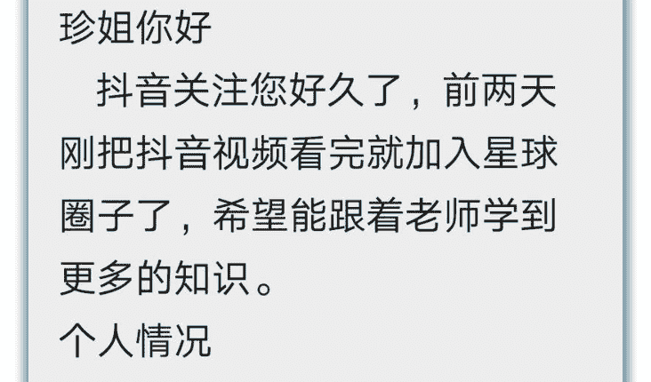

已婚 女儿8岁 夫妻文化程度低
现居石家庄周边县城 夫妻年收入10万左右 因怀孕期问查出类风湿所以基本没有存款

因为想缓解生活压力，所以打算加入朋友代理的护肤品微商（石家庄的一个牌子，近两年做这个的人迅猛增长）（因为门槛低）

经营模式：售价折扣拿货（折扣最低5折，我目前知道的）自己销售

问题：老师有什么建议，我应该从哪几方面入手，需要注意什么

真诚的谢谢老师

### 你好，大户。想问一

**(提问)** 陈_S J：你好，大户。

想问一下新能源汽车的问题。

我自己是蔚来汽车的车主，我个人觉得这车做的非常不错，而且蔚来的服务和圈子给我一个大家庭的感觉，大家在圈子里非常和谐，快乐，的互处。

也有很多车主购买蔚来股票，我也是其中之一，但是我们都没有专业的分析角度

以下问题想请问您

1. 如何看待新能源汽车的发展，是否是必然发展过程？
2. 看到您提到美股在下跌趋势的因素下会有很多资金涌入大a，那像蔚来汽车这样的中概股会难逃下跌吗？
3. 现在入手新能源汽车股票看长期还晚吗？

2020-03-11

**回答：**

【帖子编号0421】 <新能源汽车> 非常看好蔚来。

先说行业：新能源汽车是确定的趋势。一方面是后续使用成本低，养护维修都更方便，车主能够接受。另一方面，因为环保压力，新能源汽车也是各国政府推崇的方向：主要国家（包括欧盟、美国、中国）都计划在2025年到2030年之间停售汽油车。汽车（整车）是高度依赖规模化的产业，赢家通吃，没有小企业的生存空间。最终决出来的头马会成为下个时代的龙头，跑在后面的劣马会很快淘汰。以上两段，是非常确定的。

那么我有以下推论：

第一推论：考虑到2025年的时间点，那么这场比赛的结果，估计2023年就应该能看出来了。到那个时间点，还处在劣势的厂家，想要再翻盘怕是已经来不及了。所以，如果处在消费者的角度，你想要“确定性”，不用担心自己试水电动车后厂家倒闭没售后了，那么你2023年之后再买，肯定就稳了。

然而对于投资人来说，等事情已经到“确定”的地步时，就没有超额收益了。想要超额收益，就必须提前预见，预测并押宝谁会是下个时代的头马。

第二个推理：我们都能看到特斯拉是电动车领域的领跑者（当然，因为大家都认为他们一定是下个时代的头马，所以溢价也高）。然而，站在中国市场的角度，国内永远不会甘于把市场完全让出。所以除了特斯拉之外，谁会是国产车里的头马？这是非常值得追踪的。

（如果你能先于别人看出来，并且压对注了，你会有非常好的收益）

以上是对新能源车行业的判断。

再说对头马的判断：在刚建圈甚至19年年初的时候，我都在建议汽车行业的人先不要往电动车小企业去。因为在当时的时间点来说，除了特斯拉之外，根本不知道谁能处于领先地位，如果领先优势都不是很强，反倒是传统车企更有优势。毕竟如果产品设计上没有突破的话，传统车换个壳加个电池，比新冒出来的品牌号召力大多了。毕竟有品牌印象加成。

新品牌想要有竞争力，其实不仅仅是“新能源”，因为“新能源”的车传统车企肯定也能做。新品牌必然不仅仅是电池容量、续航能力的事。而是要突破传统汽车“代步工具”、“交通运输工具”的思维，而是要有一种从家里私人空间向外的延续，车要有一种“服务主人”的服务属性。（而传统车企容易陷入惯性思维，一定还会严重旧有思路。这就类似于让qq的开发团队去开发微信，肯定是做出来的东西就是套牌qq，而不会是微信。）

所以这种“服务主人”到底是什么，我也不知道。但可以肯定的是，需要向着更智能的方向发展，就像智能家居的迹象类似。

如果还在比拼续航（其实跟汽油车没法比嘛），加速度，真皮座椅和内饰、外形、大天窗，那么属于还在延续传统车的思路，思路肯定是没找准。这种怕是比不过传统车企了。

其次、我以前也讲过不少品牌方面的内容。有一个常规判断，就是低端品牌想升级难，高端品牌玩降级容易。而汽车又是高度依赖规模化的，规模起来之前，必然亏损。前期销量肯定少，所以不管卖什么价格的车都是铁定亏损。所以，既然已经知道前期铁定亏损，那么先做高端（让自己更难一点），树立品牌基调，后面的路就会好走很多。（等于先难后易）相反，如果一开局就先搞入门车型（价格便宜更容易销售），后续再想发展的难度就要大很多。（等于先易后难）

这也是为什么特斯拉最先的车型都是定价等同于奔驰宝马，5万美元起，并且最早一批的量产车，宁愿送好莱坞明星，也不卖给顾客。为的就是赔钱赚吆喝，先把高端形象树立起来。他前期树立好高端形象，现在卖便宜的model 3对品牌的影响比较小。但如果刚一开始就卖便宜的model 3当做切入，那对品牌的影响就很大了。所以现在一开局，在“赔钱赚第一印象”阶段就卖十几万的价格的新品牌，长远发展肯定会受到阻力（国内20万以内基本是入门车价格区间）。

基于以上两个点，我觉得蔚来是值得押注头马的。（虽然我还没看到真车。12月底的时候F先生突然对蔚来感兴趣，说想买es8六座的。连销售顾问都联系好了，但是我们还没来得及去看车就憋家里了。这段时间他叨叨了好长时间，对未来的印象就是网上看车主口碑还挺不错的，感觉是国产车里少有的符合上面两点，能够担起迎战特斯拉的国产车品牌了吧……）

另一个点是未来落户合肥的合作，合肥甚至安徽省会给比较大的支持，包括给钱、给地、减税、促成产业链整合等等。如果蔚来真能成长起来，跟特斯拉有上一拼，那么最后会给合肥当地带来每年上千亿的产值，考虑到合肥gdp才刚万亿化，这种增量的比例对合肥的吸引力是巨大的。合肥前面几年城市成长的轨迹，就是不断引进产业链，包括家电制造业、集成电路、京东方面板之类的。这是一种路径依赖吧，所以政策支持肯定能够落实，这也是对蔚来的一重利好。

以上是我为什么我看好蔚来。

再回答你剩下两个问题：如果没看错，蔚来真的能成长为头马的话，根本不用担心美股大盘的原因，高速成长的股票是能够穿越牛熊的。而且借着这段时间油价低迷，利空新能源，那么蔚来则属于很好的买入时期。当然，之后要耐心等待至少三年。要等到新能源汽车的比赛最终结果揭晓之后，头马已经占据了不小的市场份额，这时候才是真正获利的时期。

最后，非常想问一下作为车主的体验，很想知道 (124赞)

**评论区：**

- 周防尊：我打算宝宝去上幼儿园以后去学驾照，然后买个小电车开开，要是赶上福利期就好了，
- 潘生：分析的太透彻了
- Timothy：不怎么同意吧。。有一个很关键的区别。特斯拉单车边际20%。但蔚来单车边际是负的。造一辆亏一辆。有个前同事去了那里，做降本工作，没多久就离职了(主被动未知)
- 某某某：要么不确定谁会是头马，最有名的特斯拉又觉得又太高。又想涉是新能源这块的话，可以布局新能源汽车里面核心部位制造需要的的一些上游原材料公司可以作为布局点也是不错的。
- 牛子：☐：珍老師分析很細緻到位！但一種更新換代的產品是需要很長的時間才能去驗證的，甚至讓一個社會為它改變。人為去扶持和打壓的產業可持續多久？還記得那句廣告詞麼：大家好才是真的好！☐☐☐
- 漂落在深海的鱷魚：我觉得未来的国产车，要三家公司联手，阿里提供云，华为提供鸿蒙操作系统的支持，吉利提供造车经验。这幅面才能勉强跟马斯克那个神之子拼一拼。现在特斯拉强在它不是在造车，他是在造一个智能的移动平台。一个载体，卖软件才是真的。李书福自己都说，造一个电动车，给我几亿几个月就造出来了，没有用。根本没办法跟特斯拉抗衡。所以我觉得，这三家联手华为造手机的经验落在造车上，我觉得有吉利的帮扶肯定可以。。然后再通过阿里去提供数据解析分析。让车更加智能。有画面感了哈哈
- 张春慈：第一眼还是以是为是，给宝宝买个小电车让他去幼儿园☐
- 周防尊：哈哈，宝宝有自己的小电车，但是宝宝也没有驾照

### 关于原油价格的预期

珍大户：关于原油价格的预期：
油价在40美元以下会持续至少半年以上。

原因下面讲：

2014年时，美国页岩气革命刚开始。油价从100美元刚跌到85，大家都是懵逼的，不知道什么什么时候是个结束。有人画趋势线，有人猜反弹点，谁也不知道后续会怎么走。

14年我还在上海，有个美国回来的对冲基金经理，被同济请去搞讲座，讲美国的页岩气革命。我就去听了（免费讲座）。

他说他亲自跑了美国好多的钻油井，调查了一圈，发现美国的成本是35美元，于是他断定油价会跌到35才到底（因为只要价格高于35，就会源源不断的有新油井投产，供应永远在加大，价格只会持续下降）

我听完这节讲座之后兴奋的不得了。因为预期一下子就明朗了，这个信息极为有价值，值很多钱啊（后来也确实靠这个信息赚到不少）。

再说现在：

（需求端）因为疫情，国际航班大幅减少，很多公司都开始在家办公，人们出门开车也少了，原油消耗会大幅下降。

（供给端）市场销量下降，减少的销量由谁承担呢？毕竟市场上，不是一家在生产，而是美、俄、中东等等多家供应。

假设市场需求总共下降了30%，那么：
要么大家一起坐下来谈，比如谈下来，每家各承担10%的份额损失。
要么打价格战，把一家挤出去，挤掉一家之后，产量自然减少了……

前几天刚写了个“价格联盟”的帖子。几家在一起，又不是夫妻关系，基本心里各打各的小算盘，价格联盟很难联盟得住。所以最后基本上要价格战到把一家挤出去。

目前美国成本最高（估计经过5年的变化，成本可能有上升，我需要再找下具体数据）。那么价格一直压到35以下，持续一段时间，就可以把美国油井的资金链断掉（毕竟家家都有融资）。

价格更低，比如低到20块，对剩下两家不利。30几块可能是剩下两家想要看到的状态了。

2020-03-10 (112赞)

**评论区：**

1. 索: 大户，这种信息出来以后我们能做些什么？[色]
2. 天黑露路：什么
3. 珍大户:你啥都别想。我就怕大家知道的不多然后被误导，所以连我自己当年是怎么操作的我都不敢写。不然万一有人看完了，照搬我当年的做法，放到现在就是亏钱的节奏……
4. 非乐同□:买原油类型的投资吗？周期太长了
5. 索:哦哦，好的！
6. 堂娅一枚: 大户，我想知道你2014年听了讲座后兴奋的干了啥，然后获利。您知识面广，系统，顺势而为。我们知识面都是碎片的，拼凑不起，也看不到机会在哪里。加了圈子后想去读经济[捂脸][捂脸][捂脸]
7. 太阳红: 还带刷屏功能
8. 王威凌:我觉得珍老师可以说一下操作手法，说真的以前是什么都不知道，只知道买股票……真心感谢□知道了什么时候可以买情基，可以买股转债，可以买股基。刀不是坏东西，就看怎么用吧……

### 这个基准利率怎么选

莫来砂-远建-郑13*：这个基准利率怎么选？2020-03-05 (3赞)

**评论区：**

- 青：哪个时间距离你越近，就选哪个时间
- 莫来砂-远建-郑13*：不太懂呢，这个对月对日啥意思
- 青：你看看张大户的最新视频
- 青：对月对日就是你贷款的日期
- 莫来砂-远建-郑13*：懂了，谢谢[龇牙]
- 青：你看下面有提示 我也是刚看张大户的视频学的 你不确定的话最好等大户给你回复[捂脸]
- 跨境-金子：这个怎么算啊
- 周杰慧：在哪选的

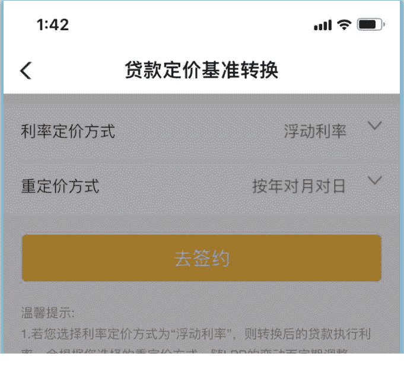

“按年对月对日”，指贷款执行利率每年调整一次，调整日为贷款发放日在调整年的对应月日；“每年1月1日”，指贷款执行利率每年1月1日进行调整。

| 选项 | 说明 |
| :--- | :--- |
| 按年对月对日 | 指贷款执行利率每年调整一次，调整日为贷款发放日在调整年的对应月日 |
| 每年1月1日 | 指贷款执行利率每年1月1日进行调整 |

### 大户你好，入圈一年

面对疾风：大户你好，入圈一年多了第一次提问题，我现在感觉到了人生的关键时候，想请您指导下

我今年26，已结婚，坐标郑州，现在刚毕业3年，家庭条件很一般，我在一家互联网公司工作，我对象是一家国有担保公司，负责对公的贷款业务。

去年调薪后我和对象，五险一金税后收入能到手个两万块钱吧，一年我俩综合收入能到手30万左右。

前几年年刚毕业，因为租房买家具家电，又买两辆车，都刷两个人信用卡，欠了信用卡不少钱，总共下来有36万左右，其中32万，也做了分期。

我觉得好一点是，我当时做分期都比较小心，一般都有打折才分期，用irr算后才进行分期，这些分期irr复利年化计算后，平均在10%左右。

现在月还款大概在2万左右（到今年月还款8月可以降到1w2）。

现在除去我和媳妇开支，一个月能剩个一万来还账单，手里也有8万的基金（去年年终奖入基金里了）

疫情期间买了基也长起来了，现在可以无手续费卖掉。

这个疫情期间在家也看到网上说失业还不起钱的问题，也算是给我泼了一盆冷水，冷静下来去梳理了自己的未来。

我俩现在好处就是工作稳定，收入也还可以，老人也不用养，没小孩。

弊端就是负债太高，我身边没见过哪些90后都欠几十万的，我有点害怕了。

现在可以敲定的规划就是，未来一两年就需要小孩了。

关于职业发展这块儿，我们做的准备有：前年开始我对象就开始考注会，现在就剩下一门财管了，今年应该会考过专业阶段，明年开始进行综合阶段。

我也考单位内部的晋升考试，今年当上了主管，而且行业很好，未来现金流应该还是可以的保障的。

现在关于买房的事我很纠结，因为要说收入也不低，我俩结婚租房，经过和老婆极力劝导下，丈母娘也忍了，老婆对我真的很好，也很相信我，如果要小孩也租房，说实话我自己心里也有点感觉不好（我们老家的房子小环境也不适合居住）。所以现在我也很困惑。我也很能理解现在中国生育率持续走低。

我现在面临三条路（这是我自己总结的。如果有其他路还请大户帮我指点下哈）

第一就是没房，刷卡首付，大概40万，贷公积金80万，去买房，这样不用还月供（公积金可以覆盖）。这样做，是因为担心今年这样的刺激政策下房价会涨

第二就是基金卖了，全力还债，一个月下来，不紧衣缩食能还一万，紧衣缩食能还一万五。

第三就是继续刷卡去入基金，但感觉有点追高。而且今年基金年化如果达不到10%，肯定不如去还账单，但是这一个月已经涨了快5%，我有点迷茫了。

第一次写，写的有点长，主要是为了大戶能更清楚的了我的现状，还请麻烦指点下，我真的很迷茫了现在，谢谢您。

2020-03-04 (38赞)

**评论区:**

- 周：什么学校毕业的，刚毕业就收入这么高
- 面对疾风：郑大，普通211，感觉赶上好时代了。另外金融，互联网行业收入普遍高，我对象有个同学，银行的对公客户经理，手里有资源，去年光就税都缴了30了，顶我两年收入了。
- 面对疾风：各位老师有啥建议都可以跟我提提，受益匪浅，真的谢谢大家了。
- 男婆：你的债务换来了固定资产啊。疫情再忍几个月就好了
- 面对疾风：是啊，但这些固定资产折旧太严重了。买房的话又新增了百万的负债，我都很纠结。等于是0首付买房，我中心也很没底，说实话。还账单的话又怕损失了很多机会成本，我今年年终奖没还账单，留着过年，还准备出去旅游一圈，谁知道疫情来了，也没花啥钱，我就买基了，然后又涨了。我就很纠结 过去想着收入可以，投资消费心态上，都很激进，疫情期间看到抖音上很多催收的，破产的，我现在都很害怕。
- 李子一果：最主要问题是，你的债务都用 在享受上了。
- 李子一果：买的东西都不是资产，快速折旧。
- □君儿：过来人一句话！必须买房子

### 帖子编号 0416：为什么美联储降息了，美股还要跌？

珍大户：

早晨看到的问题：为什么美联储降息了，美股还要跌？

作为一个机器猫 10 级学者，我要给大家讲一个小时候看到过的一集。

（这一集看完，你能理解很多事情 [偷笑]）

说机器猫有一个道具，是一副许愿扑克。

56 张按顺序从 A 开始依次出，每一张都能完成一个心愿，但到手里只剩最后一张大王的时候，到谁手里谁就要下地狱。

大雄是第一个拿到手的，知道了以后害怕了，立马把这个扑克给小夫了。（像不像牛市早期入手，拿不住早早离场了？）

小夫许完一个愿望，就转手给胖虎了。胖虎许完一个愿望，又转手给其他人。

大雄发现全班同学都愿望实现了，自己很后悔，想要回扑克牌。结果要回来之后，发现只剩最后两张了，他只要许完愿望，自己就要下地狱了。（像不像眼红追高被套的）

这个游戏大家琢磨一下，如果牌到你的手里，你怎么玩儿？

应该在中后期下车，赶快给别人。不能等到太晚，因为越到后期，可能就没人接手，要烂到自己手里了。

所以，中后期是只剩几张牌？

分割线，请严肃的思考这个问题。

我们来推理一下：

只剩两张牌的时候，一眼就知道接手等于自己死。所以正常人不会接。

递推一层。到只剩三张牌时，因为预期到没人接两张牌，意味自己手里 3 张牌时，也是没人接，烂自己手里。

那么再递推一层，理智的人不会接三张牌，那么手里 4 张牌时还是送不出去，还是等于死。

以此递推下去……

结论是：如果这个世界上都是完全理性的人，像电脑一样，能进行无限轮次的推理，一眼望穿未来，那么这个游戏从一开始就玩不下去的。

然而，世界上不都是理性人。每个人的前瞻性不一样，所以这个游戏是能进行下去的。

那么最好的策略，是自己还剩几张牌的时候转手出去呢？

很有意思的是，我在读 MBA 时有行为学课，国外读书时也有行为金融学课程。两边的课堂上都有内核类似的互动游戏，全班一起玩，推理别人的“底线”是多少轮。

一般来说，大众平均能够做推理的次数是 7 次。视群体的学识文化水平，有上下浮动。

所以最安全的玩法是，自己吃到手里只剩 8 张牌时，就可以转给别人了。

机器猫的故事讲完了，说美联储降息。

过往的认知，是美联储一降息对市场就是利好。这个认知就是机器猫扑克牌里面前面二三十轮的样子：每出一张牌，就有好事。

但是我们要看到事情的极限，降息是有极限的。降到 0 就等于所有牌都出尽。降到 0 时就等于美联储黔驴技穷，没戏了。

所以大家看看现在美国利息已经低到什么程度了？是不是已经离最后一张牌很近了？

美国金融市场的人都是受跟我差不多教育的，没人会吃最后一棒。大家都想着，离最后一棒还剩 8 张牌的时候就得跑了。

[https://t.zsxq.com/MJ6a2zf](https://t.zsxq.com/MJ6a2zf) [https://t.zsxq.com/M3ZFQZV](https://t.zsxq.com/M3ZFQZV)

2020-03-04 (115 赞)

评论区：

- 萌芽的种子：沙发电☐☐
- 珍大户：找到了动画片，大家童心未泯的话还能再看一遍 [偷笑][呲牙][呲牙][幸运扑克牌_脸讯视频]
- 王军：怎么才知道自己手里是第八张牌☐☐
- 空城：厉害的人看动画片都能有启发，哎，我孙子兵法都快背下来了，国防大学也没特招我 [捂脸][捂脸][捂脸]
- 上善若水：大户姐我们公司是在纳斯达克上市企业，我的手里有少量股票，这一两个月应该会有一个交易期，我是能卖的都卖掉，还是等到年底或者明年年初再看看
- ☐☐ 姨_乘☐☐☐：大河弯弯向东流就是这么牛！
- 张春意：哎
- 张春意：内涵丰富，得好体会

关注公众号 "懒人找资源"，星球资源一站式服务

### 珍妮老师，我是一个刚从低谷走出的人

(提问) 匿名用户：珍妮老师，我是一个刚从低谷走出的人。刚刚准备去一个创业小公司上班。这家公司是个婚介公司，他的做法基本逻辑就是前期注册登记会员配对约会啥的不收钱，等双方确认恋爱男女朋友关系才收钱。想请老师和各位大神帮忙分析分析前景如何？定位城市是西安

2020-03-03

回答：这个规则漏洞太大了，后期很难收上来钱的...... 你等人家两口子在一起了，就得开始齐心协力防着你了。人家拒接电话，不让你上门，就说在你那找不着对象，不想再浪费时间了，那还能有什么办法能收到钱？现在年轻人对收费婚介抵触，你哪怕前期先收钱，说后面能转成婚纱照婚庆的钱，给别人心里暗示，说是为了赚婚庆钱也要使劲促成恋爱，这种也好啊 [撇嘴] 否则钱到不了手，努力都白费了 (34 赞)

评论区：

- 「周 周 」：大户小事小事分析的都那么到位 这地方真是进对了
- 从头越：很激动珍妮老师居然真回答了。当初面试老板的时候也提出过同样的疑虑，当时老板说这种人很少见，而且事先有签合同，真有这样人，就走法律程序。我想到的是正常人找到女朋友了，开心之余，不至于不给钱吧？这种情况下，万一他们周围的亲戚朋友认消了人品，会不会让他们得不偿失？不过有婚庆的话应该是一个出口。感谢珍妮老师！
- 像我这样庸俗的人：从不“我有一个癖，也是搞婚介的，看照片两元，征求女方意见五元，约会十元
- 从头越：您这样的价格很亲民啊，应该生意很好吧？
- 从头越：我也是看了珍妮老师的文章就果断进来的，信老师不会错的
- 张春磊：我还记得珍妮讲过，当年 F 先生从上海去合肥，给物流货车装北斗导航的事。山西煤老板投 1 个亿免费给装货车设备抢市场，看文章时我们都以为煤老板赢了，结果物流公司不给每年的费用……
- 从头越：这个真没听过
- 张春磊：老帖子了，很有意思的事情，多翻翻以前的帖子，会有很多收获的

### 珍姐，今天有个新闻说房贷可以变更为与 LPR 挂钩

(提问) Fan：珍姐，今天有个新闻说房贷可以变更为与 LPR 挂钩，您认为这个变革的目的是什么？对买房者来说是利还是弊呢？长期来看（比如 30 年）LPR 大概率的趋势是升还是降呢？谢谢您！

2020-03-03

回答： 【帖子编号 0415】以前贷款是参照基准利率，以后是参照 lpr 利率。为什么要改呢？因为基准利率是由央行自己决定的。而 lpr 利率是由央行 + 十几家大银行共同报出来的，等于央行在放权。央行代表“政府”，大银行代表“市场”，所以从基准利率过渡到 lpr 利率，其实就是从完全由政府定价，换到政府 + 市场共同定价。物价已经脱离计划经济时代很多年了，大家都忘了当年物价局定所有物品价格的时代了。这次是利率作为“钱的价格”，开始逐渐脱离“政府定价”，其实这就是利率市场化的过程。

如果简单理解，那么把存量房贷，由基准利率体系换到 lpr 利率体系，就像是考试分数体系的换算。就像是以前只考语数外，后来改成素质教育，要加考你音体美了 [偷笑] 那么说，你以前语文 90，折算音乐也给你 90 分算了。具体怎么换算，参照这个帖子 ————————————————

选择换与不换，提问中问到关键了：未来 30 年大趋势是升还是降。之前有一个帖子，是我推荐大家进圈子必须要读的，利率的本质：利率的本质，是分享经济增长。我出钱，你出力，大家一起赚到钱之后，分我一部分。这就是利息的本质。所以在农耕时代，因为经济基本没增长，所以借贷很难繁盛，衍生出的都是趁人之危时敲一笔的高利贷。如果刨除高利贷，那么在低经济增速时代，利率都会超级低…… 就像日本，买房利率只要 1.5%，跟白给的似得。

————————————————

所以，未来 30 年利率会怎么变化，这个问题的本质就变成了：未来 30 年的 gdp 增长会变成什么模样 [偷笑]

————————————————

我简单说一下，大规模的经济增长有几种可能：

- 第一种，人口的大规模增长。大概类似于战后婴儿潮。大家觉得未来可能吗？
- 第二种，科技突破，类似于 18 几年的工业革命，19 几几年的机械化生产，1995 年之后的计算机和互联网。这种级别的科技革命，大家预测一下？
- 第三种，新兴的市场（借别人变富的光）。比如中国 13 亿人的市场崛起，能让海外最起码 3 亿人变富 [偷袭]

所以下一个崛起的是谁呢……

所以，在我看来，GDP 下行是大概率事件，Gdp 回到增长才是意外。所以利率下行也是大概率事件。(45 赞)

评论区：

- 恋上柏拉图：还是没看懂 你们看懂了吗 [捂脸]
- 张春意：就是结尾那句话，中国经济高速增长期已经过去了，不出意外就会利率就是下降趋势
- 恋上柏拉图：奥奥 看最后一句就懂了 哈哈
- 张春意：不过，有个点没看懂。中国 13 亿人的市场崛起能让海外至少 3 亿人变富。这句话潜藏的内容太多，珍姐没有说透
- 海浪：GDP 是下降的，LPR 基础利率，也是下行的
- 张春意：我的理解是，下一个崛起的是谁，那么这个国家的经济会进入高速发展时期，该国利率会进入上升趋势
- 恋上柏拉图：现在有一个新政策，不知道是不是谣言，微博上都要炸了，说的是可以允许外国人在中国拥有永久居住权，这不是引狼入室嘛，我们人口还不够多吗？如果不够多，以前那些惨死的计划生育可以好好看看这个变态的政策
- 公路漫步者：前头白看，你的一句话点醒梦中人 [呲牙][抱拳]

关注公众号 "懒人找资源"，星球资源一站式服务

### 你一定要坚持看完的对谈：财新总编王烁与耶鲁校产基金管理人斯文森

定义 Calvin: 你一定要坚持看完的对谈

财新总编王烁与耶鲁校产基金管理人斯文森的谈话，从他《不寻常的成功》这本书开始。

王烁: 你的全部职业生涯都在管机构资金，为什么会想到给普通人写这本书?

斯文森: 就是因为有这个念想。普通投资者得不到好的投资建议，所以我想用管理耶鲁校产基金的经验给普通投资者提建议。我前后写了两本书，一本是《机构投资创新》（Pioneering Institutional Investing），一本就是《不寻常的成功》（Unconventional Success），前一本是机构投资，后一本是给普通投资者的。

其实我真正想写的是后面这本，但出版商跟我说，你的声誉是在机构投资领域里，所以必须先写前一本，才能给你出后一本，这是条件。于是我就两本都写了，但我的激情是在后一本上。

我知道，机构投资这本书出了中文版，给普通投资者的书在中国大概不会很受欢迎，因为他们只关心趋势投资，想尽快发财，但想尽快发财的话，结果是尽快变穷。世界不是这样玩的。

有趣的是，我刚开始写时想的是告诉普通投资者，我们在耶鲁做的投资中，他们可以做什么。我把我们的各种投资工具看了看，像 LBO、风险投资、房地产这些追求绝对回报的投资工具，普通投资者无法获得。

现实就是样：普通投资者没有高质量的投资工具，只有高成本的投资工具。

我得出一个不情愿的结论：我没法告诉普通人我们在耶鲁校产基金里是怎么做的，这没意义；我只能告诉他们：用低成本的指数化投资工具作多元化投资。

王烁：就是说普通投资者别去想什么阿尔法（超额收益）了，还是满足于选好自己觉得舒服的贝塔吧。

斯文森：对！不过再加一句，我认为几乎所有投资者都应该忘掉阿尔法。惟一适合去追逐阿尔法的就是像耶鲁、普林斯顿、斯坦福等大学校产基金，还有福特基金会和家族办公室（family office，豪富家族理财，比如索罗斯就把所有外部资金都退了，现在只管自己的钱——王烁注)这类。

王烁：这些机构的共同特点就是投资期可以极长。

斯文森：对，投资期要很长，还得有高水准投资专业人土，十个二十个三十个四十个优秀的专业投资者。他们得专注寻找市场中的失效，从中获得投资机会。没这些的话，要赢就非常非常困难，几乎不可能，结果反而是花了很高成本而业绩不佳。所以，我就走极端，建议大家都要指数化。

王烁：阿尔法也有多种来源对吧？对冲基金大多数投资周期也很短，他们都不能提供稳定的阿尔法吗？

斯文森：如果你说的是高频交易型对冲基金，他们确实也拿到了阿尔法，但他们是寄生虫。高频交易利用目前市场结构中的异常牟利。交易所和高频交易者勾结，从所有投资者那里榨取财富以自肥，非常令人恶心。我认为这类做法应该宣布为非法。就算做不到，这样做也是不道德的。

除了这一类外，我能想得到在较短投资周期能获得一定阿尔法的投资工具，是并购套利和困境证券投资。并购套利很难操作，好比在火车前捡硬币，而且周期是以月计。困境证券投资也差不多，公司面临破产，证券价格很低，存在机会，周期也很短。

这两个都很难操作，要选择好时机。这是我所仅知的两种存在阿尔法机会的相对短周期投资类别。

在这两类之上，我们极大地受益于五年到七年这样的长周期投资，绝大多数投资者没有这样长的周期。

王烁：你们是耶鲁校产基金，投资周期可以无限长。

斯文森：我们当然也要匹配现金需求。不过，许多可以作长周期投资的投资者事实上采取的是短周期投资，太蠢。

王烁：你对普通投资者的建议是三条：多元化、指数化、定期再平衡，这些建议逻辑上非常合理，但我们现在处于一个超低回报率的时代，这套做法需要相应做什么调整吗？

斯文森：你说得对，人们得对未来的投资回报率大幅调低预期。这套策略确实不会创造出高于市场给我们的回报。但是，市场能给你什么，你就只能拿着什么，不管它高还是低，因为其他选择更糟。

王烁：这对那些依赖于投资回报为生的人们会很痛苦，想想退休基金。

斯文森：确实。在你需要用钱的时候冒风险是件很糟糕的事情，想想看，如果市场跌了 20%，你却不得不从中提钱出来消费，这对长期收益率来说损害很大。

将来有可能面临一场退休危机。社保基金对大多数人来说都不够维持生活，人们储蓄也不够，市场回报会显著下降，这是个有毒组合。最好的情况是，会有许多人退休后发现生活水平远不如意，很愤怒。最坏的情况是什么？不知道。

王烁：未来不仅会给我们更低的回报率，还会给我们更大的波动率。

斯文森：对！现在的投资回报率很低，同时波动率也很低，这让我很担心。我认为波动率会上来。做个思想实验，设想一个永续的现金流，如果基准利率从 10% 降到 5%，其价值会上涨一倍，从 5% 降到 2.5%，价值会再涨一倍，从 2.5% 降到 1.25%，会再涨一倍，从 1.25% 降到 0.6125%，会再涨一倍，在收益率极低的水平上，收益率的微小绝对波动会导致长期资产的价格巨幅振荡，但现在远远没有体现在市场中。

王烁：这也许说明，未来振荡真来的时候会更戏剧性。

斯文森：答对了。

王烁：对于泡沫和崩盘，你对普通投资者有何建议，怎样才能相对平安地度过？

斯文森：15% 的政府债券，15% 的通胀挂钩债券，再加 30% 的实物资产，相当比例的 reits，这就是个不错的多元化组合。

王烁：房地产占到多少合适？

斯文森：我书里说的是 20%，当然现在，你也可以说只需要 15%, 而对新兴市场相应从 5% 提 10%。这个比例大体可以就行了。

王烁：金融危机的时候耶鲁哈佛校产基金都有二三成的损失，你从中学到了什么教训？

斯文森：我们从危机中脱身得还不错。我们没有被迫甩卖任何流动性不佳的资产，同时还保持了足够的流动性，以支持耶鲁的运营预算，当时是每年 10 亿美元。

我们意识到，将流动性不佳的资产限制在总资产的一半左右为好。因为耶鲁校产基金的流动性资产不够了，错过了在底部低价买入流动性不佳资产的机会。我们是抄了点底，但我本来想要买更多。现在这个结构是比较舒服的，就是流动性好到如有机会可以抄底，同时又有更好的长期投资回报。

我学到的最重要一课就是关注组合的流动性，更好地理解流动性。

王烁：耶鲁校产基金把钱交给一群外部基金管理人来管，你的工作最重要是选人，你看重什么？

斯文森：童子军般的素质、勤奋、创造力、操守。

王烁：你都没提业绩表现。

斯文森：我们帮许多人进入这个行业，而这些人在传统意义上的业绩记录。我们给张磊 1000 万美元投资中国股票的时候，他还没有过投资中国股票的记录。这是要敢于相信人，结果押对了。

历史业绩有时可能是反向指标，许多人看历史业绩投资，涨就买跌就卖，结果付出代价。如果投资这么简单就好了。

王烁：耶鲁基金是主动管理，你对普通人的建议是被动投资，你怎么管自己的钱？主动还是被动？

斯文森：你听过这句话吗：补鞋匠的孩子没鞋穿。我自己的钱都放在指数基金里头，我放在里头的精力很少，估计现在相当大部分已是现金了，我得去看看了。有人会去选股什么的，我不做这个，没时间精力，我**把自己的投资精力都用在耶鲁校产基金上了，全部。

王烁：你也不跟耶鲁校产基金一起投资？

斯文森：不，那样就把事情搞复杂了。

王烁：你为什么不成立自己的基金？

斯文森：我更愿意是耶鲁的一员，为这个世界上最好的机构工作。这使我很快乐。

2020-03-02 (49 赞)

评论区：

- 鱼：如何挑选指数型基金? 规模? 行业? 短期投资和长期定投有挑选区别吗 长期持有一般持有多长时间
- 雨大小□：感触颇深，更多的是在规划和认知这两项里有了自己的想法
- 我的天空：感谢分享
- 菲菲菲：不寻常的投资中文版的书是不是还没有出版呀 想买来看查不到 [可轻]
- 珍大户：本帖要加精华
- 定义 Cabin： 欢脱□
- 定义 Cabin：国内应该买不到，或者说没有中文版
- 菲菲菲：是呢没有中文版 看你推荐就想去买了 那只能靠你多分享一点我们学习了□□□

关注公众号 "懒人找资源"，星球资源一站式服务

### 珍老师你好，最近朋友买的原始股等了五年在纳斯达克上市了

Alina: 珍老师你好，最近朋友买的原始股等了五年在纳斯达克上市了，他现在手里缺钱想卖掉一些股份给我，但是公司不允许持股人有交易 他只能给我写个代持协议，我本来决定买了，但是看你回复也是关于原始股的文章我有点蒙了，请珍老师指点一下

2020-03-02 (3 赞)

评论区：

- Alina : 我这个问题提的好片面 [尴尬] 表面看我是买完坐等收钱 但是看你给其他人解答原始股的问题我觉得好复杂，毕竟在中国上市和美国上市还有很多不同，希望珍老师翻牌子 [调皮]
- 珍大户：真上市和假上市的区别：
    1. 真上市的是进纳斯达克，假上市的是纳斯达克 okc 市场。前者有点门槛（但门槛比 a 股和港股低），后者随便说谁交几万美金门票钱就能上，没成交量，股票基本卖不出去。（国内也有一样套路，前几年炒的新三板，股票基本卖不出去）。
    2. 真的原始股是发给自己公司核心员工做股权激励的，愿意分出来的部分极少。而假原始股是不限数量往外发。一家公司的股票价值多少，说白了也跟拆出来的分数有关。假设价值 1 亿元的公司，股票发行 100 万张，每张股票就值 100 块。假设发行 1 亿张，每张就值一块钱了。假设发行 100 亿张，每张就值一分钱了。骗子公司玩的就是，公司不值钱，但是狂发“原始股”的套路。
    3. 最后补下上市门槛：纳斯达克门槛是：公司成立一年以上，看看“有前景”，每年利润满足个不到一百万美金的门槛就能上市了，门槛其实不高。过两年业绩不好退市了也很常见。所以就算是真上市，也得具体看公司经营前景，看价格。
- Alina : 太开心了 [谢谢珍老师翻牌子] 看了你的解析之后感觉豁然开朗

### 问：现在各种币也跌

珍大户：问，现在各种币也跌了，要不要买。

我说去看老帖子。结果刚才找历史帖子，发现前几天评论区里写的一篇不见了。

还好我有备份[偷笑]

#### 【帖子编号0411】为什么劝大家不要买各种七七八八的币：

我很反感这些数字币，因为就是一串计算机代码，只要你想发，自己都能发出来。随便发点花哨名字的土豪币、熊猫币、外星币、ai币、bb币，任你发，没有任何成本。

刚发出来时，一开始谁都不知道，所以价格必然便宜，利用的就是别人几块钱买几千上万个玩玩，赔了也无所谓的心里（毕竟现在人都闲，你微信建个群，摇微信筛子还有人参与呢。）

这时候大部分数字币都在群主手里，群主是大庄家，直接操纵价格，开始往上拉升价格就完事了。（你想想99%的币都在你手里，你是不是操纵价格的人）

价格一拉升，就会有被贪婪迷住眼的人参与进来了。进来的人不会立刻就卖出，而是放在账面上看着。

庄家继续拉升，先进来的人看着账面有浮盈，心里乐开了花，自发变成吹鼓手。

然后更多的人参与进来，从庄家手里高价买币。（要知道，庄家手里就是0成本，计算机代码编出来的东西，能有什么成本。所以多少钱卖给你都是赚的。）

他只要把手上99%的币卖个一点点，哪怕最后手里还剩90%，只要散户从他手里买了另外10%，都够他赚一大票，下辈子吃喝不愁了。

然后庄家就走了呗。

不走难道等着警察抓？

发行货币是国家主权问题，不是是个人就能发的。

等庄家跑了，没人操纵价格，剩下的人一盘散沙，都只能等的份。然后就是安慰自己：这个币之前最高价到过nnn元，现在只是回调而已。

其实价格都是庄家拉出来的，庄家都跑了。

就算没跑，他估计也会装作跑了。

如果还没赚够的话，再去发一个新币。

因为这样会圈钱更容易些。

毕竟，把一个新币，从零元开始拉到几毛钱几块钱，和把一个老币，从几块钱拉到几十几百块，你说那种更容易？

2020-03-01 (85赞)

**评论区：**
- 丁先生：了解了解[呲牙][呲牙][呲牙]，大户优秀[强][强][强]
- 华坪苹果售后服务中心：学习了[强]
- no excuse：除了法币，其他的都瞎扯。
- 古月月月：Q币了解一下[得意][得意]
- 潽潽Jane：关于各种币，这篇文章推荐给大家巴菲特：跟孙宇晨吃过饭了，数字货币一文不值
- 时光：受益了老师
- 四平八稳：我有一个大学同学，唆使我参与数字货币。我不确定他是真不懂还是故意，但我肯定不会掏钱玩这个。珍灿说的与我心里琢磨的一样，呵呵[呲牙]
- 像我这样瞎倍的人从不*：比特币是什么，为什么好几个朋友都发了

### 大户你好。本人92

**(提问) 匿名用户：** 大户你好。本人92年。结婚两年，有一个1岁半的儿子。陕西安康贫困县城，18线，体制内教师工作5年半，收入6000. 5年多来工作没有任何晋升。老公一直在上海从事健身工作，收入2万□。因长期两地分居，双方想要改变现状。老公想法是一起去西省份会发展。他继续做健身行业。我重新择业，线上教育或教育培训行业。目前已经在西安3环边上买了房，还有两年交房。现在的问题是，我想在体制内边工作边参加公务员考试。考入西安。老公强烈反对，觉得十八线小县城没必要再继续待下去，锻炼不了自己的能力。他觉得我毕业以来，能力退步了很多。不能再体制内混混沌日疫情结束，马上要开学了，我不知道该怎么办，求帮忙，跪谢。

2020-03-01

**回答：** 你们这个不是大矛盾，非常好解决。首先城市选择上没矛盾。越到小城市，越缺少工作机会，很难同时让夫妻二人都有满意的工作。如果你继续留在县城，意味着要么长期两地分居，要么你老公到县城后满意度很低，会抱怨你。不管哪种情况，家庭基本都要散了。所以为了家庭你也得去西安，这个就不要犹豫了。工作大不了就换一个，家庭不能换来换去。

那么，到西安后该做什么。不同的工作，性质是不一样的。比如当老师就不可能有很好的晋升，这个从你进去之前就得想清楚。如果你想要超长期的寒暑假、想要工作的稳定性，社会尊重，由此选择了教师职业，随之就要放弃高收入增长。有得必有失。公务员也一样。如果你选择了公务员的保障、稳定、社会地位，就等于放弃了收入的高增长。（但是考虑到很多人就算自己去拼搏，最后也未必能得到收入的高增长，所以与其奋斗一圈，最后没得到，还不如刚开始就放弃，直接选择到手的好处）。

你这边走怎么选都很容易。教育培训行业收入高，公务员社会地位/人身保障/稳定，两者都有可以选择的理由。重点是，要先跟你老公统一意见，知道他的偏好最重要：他是健身行业，目前在上海收入2万，平移到西安收入估计在一万出头。他希望你选择什么样的工作？他是收入下降，想要你的工资做补充？还是他觉得健身行业工作不稳定，想要你当公务员做家庭保障？两个人是一体的，总归要做出两人利益最大化的选择，所以他怎么认为最重要。他必须要表现出自己的偏好来。最怕的是他不展示偏好，无论你怎么选都有话对付你。你选公务员之后，他嫌你赚钱少，你选教育行业之后，他嫌你工作不稳定。如果他是这样的人，那么他需要的也不是铁锤教育，而是妻子的配合。

最后，不从你丈夫的角度，只看你自己：我觉得既然已经确认要去西安，那么现在这份教师工作就没有那么重要了，既然早晚要失去，就不要为离开而惋惜。考公务员可以去西安再考（除非目前工作很闲、去西安后会很忙，没有时间备考，如果是这样的话，那另说）。你可以先去西安找一份教育行业里的工作，然后再一边备考公务员。有可能做着做着，自己的意愿就变得清晰了，可能你就会觉得，不想考公务员了，或者是不想再搞培训了，只想考公务员了。这种做法两边不耽误，还能防止万一考上了，却又遗憾没出去工作。（71赞）

**评论区：**
- 罗云夕：喜欢珍珠姐，抢个沙发□□□
- 定义Cakin：小事靠方法，大事靠取舍。祝好运□□□
- 定义Cakin：追问一句珍珠，打赏的功能取消了吗？
- 六子：在这种情况下，一定要了解双方的净收入，比如老公剩下的没你的多，你可以想象后边你们两个人的生活环境，而且经济形场会带来一部分人的失业，这种情况下我觉的有一份稳定的收入很重要 另一方面结婚两年，孩子一岁半，你大部分时间和孩子在一起，能不能承受住孩子不在身边的情况，或者孩子在身边需要人照顾的防范：铁锤教育，哈哈
- 珍珠大户：[发呆]我也想知道，星球软件每次升级都偷偷摸摸的变，也不告诉咱
- □a treo□：你爸妈在哪？或者男方爸妈在哪？老人有没有人照顾？去西安谁照顾小孩？户口解决了么？孩子上学问题处理了吗？存款安全垫有吗？
- □a treo□：动之前还是要做一个评估吧。上海2万也就是温饱线吧[偷笑]

### 珍老师 你怎么看这

**(提问) BIn G:** 珍老师 你怎么看这几天的美股大跌，会变成熊市吗？ A股也会就此跟熊吗，对世界经济影响会持续很久吗。

2020-03-01

**回答：** 【帖子编号0410】<站在2月底看> 美股本来今年就有要跌的迹象。元旦后几天错过预测写圈子里了，特意说了美元美股美债要规避。目前看疫情要把这个过程提前了。（预测美股帖子见帖子0396） 记得去年视频讲的美债利率倒挂，意味着今年美国经济出现衰退的概率大幅增加？ 看衰美股逻辑见帖子0397 其实就是经济增长不动了，股市再涨不现实，因为美股市场太大了，不是一个小市场，不是靠一堆人众人抬轿就能捧上去的。

再说国内，我周五颈椎病犯了（估计是隔离在家，运动量不够），结果从周五一直睡到周六，周六才看到发生了什么[捂脸] 感觉很多人恐慌了，因为一直以来都是美股涨a股不涨，美股跌a股跟着跌，大家都害怕外围继续跌会带着a股。 但是这次逻辑会不一样。

大家要注意一点，人民币兑美元的汇率。

年初预测美股的时候，有说过，美股趋势反转是一个缓慢的长期的过程，这个过程中会引起资产抛售，然后转移到其他国家，预计国内会有收益（所以才让大家不用再换美元了） 而现在的逻辑更强烈了。

我们推导一下疫情情况：
假设1：如果各国开始恐慌了，试图防御，则减少国际往来（大幅减少航班）。那么中国是产业链最完备的地方，一国之内能生产出的东西最多。
假设2：如果各国感觉防不住，放弃抵抗。那么中国就是最避险的地方。

年初的时候，我还按照旧有逻辑，避险一般先去日本、北欧、瑞士等等。但中国经济增长/股市价格低，会吸引一部分进来。 而现在看来，这个一部分要大幅增加了。

但毕竟还是有很多人按照旧逻辑，看见国外跌也会恐慌，这个过程可能还要持续个两周，等意识到一跌就有资金抄底，到时候就不一样了。大家买基金的就不要每天盯着看了，这不是博短期的，非要每天看着涨了多少跌了多少，只会影响自己情绪。这也是我不建议大部分人自己炒股的原因。每天看，别的事都不用干了。继续该干什么干什么，如果还有结余的收入，在看着自己账上有赔的时候就继续加仓（相反，千万不要浮盈加仓）。这就是纯粹的数学题，求平均数。敢这么做，是因为依然判断指数在低位区域。怎么看低位，看前几天发的一张图（我一会搜出来补链接到评论区）。注意，是区域，因为没人能全买在最低点（你们看有历史图的最低点，再看看那天的成交量，都是稀的渣渣，谁能买到“最低点”呢。只要你在底部区域进去，持有就完了。这个不是几天几周的事情，要有目标预期。）（110赞）

**评论区：**
- 珍大户：咦，你又发完就删，我记得看过你发过一张图啊[捂脸]
- 石小俊：翻我[愉快]
- 刘Sophie：老师，那下周要怎么布局？我重仓了半导体。
- J：终于看到解答了，我也一直在疑惑，之前对国内有信心，但是这几天大跌让我怕起来了
- 陈文波：大户和我的想法是一致的[呲牙]我也是想者低就加，买进去的就死命拿着，相信长期预测
- 某年某月：感谢大户的定心丸，我前段时间都是一涨就落袋为安，这段时间守的一塌糊涂，因为跌的时候是不舍得卖的，还拼命加仓，没想到一加仓就跌，但是想着你说今年是中国股市牛市，忍着了
- 婷：看到大户出来发言我就放心了！[玫瑰][玫瑰][玫瑰]
- 索：谢谢大户，这个帖来的很及时！[玫瑰][玫瑰][玫瑰]

### 这种出售专利、出售

**后来：** 这种出售专利、出售发明的东西，圈里朋友接触过吗？靠不靠谱

2020-02-27 (3赞)

**评论区：**
- 珍大户：如果你不懂，就不要参与。抱着想炒专利的想法是没戏的。刚巧我知道一些这方面的东西，前两年各地政府对“注册专利”有数额要求，给予补贴，另外很多评职称，落户打分过程中只要有专利就会大幅加分。于是衍生出了拼凑专利赚补贴费的产业（很多地方有知产律所参与进去了）。批量制造专利，每件赚600块补贴，一个月能搞几百上千件专利出来。后来补贴骗的太猛了，政策都停了……后果就是，现在专利里有很多是不能看的，没有任何实际应用价值。所以如果你不懂的话，属于根本没有辨别能力，真的不要去碰了，不然很可能买到那些为了600块补贴而诞生的东西。
- 后来：明白了，谢谢大户灿。真正有价值，应该也不会拿出来卖[微笑]
- 佳节纳余庆：实用新型专利基本没什么难度，发明专利还行，但是没有炒作价值。

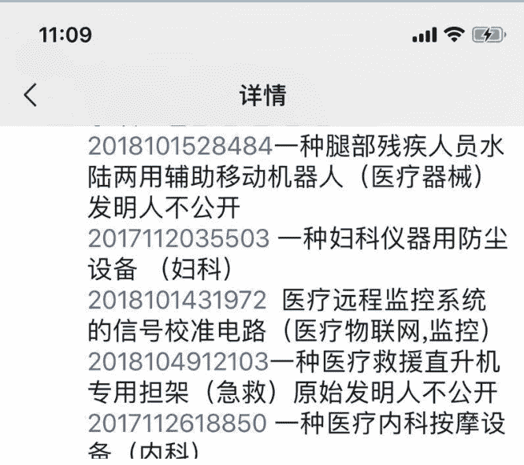

### 医学发明：

- 发明-护理 一种医疗垃圾焚烧装置
- 发明-药剂科 药剂科用智能分药装置
- 发明-耳鼻喉 智能化耳体缝隙封闭平台
- 发明-护理 一种医疗护理床

专利列表：
- 2017107418750 一种呼吸内科用雾化专用座椅（呼吸科）
- 2016108647470 一种术后患者嘴唇润湿装置（术后护理）
- 2018112632231 一种医用固定底座式车轮型坐式健身设备的使用方法（护理，康复）
- 2018107239469 一种多功能医用粉碎压缩机（医疗通用）
- 201810100083X 一种医疗塑料废品的清洁加工装置(医疗)

新增多件，要的联系。

### 珍姐，你好。我28

**花呗：** 珍姐，你好。

我28岁，已经做了近7年电信和移动营业厅，开第二个店的时候因为合伙人原因导致亏本几万。调整后后开第三个店，持续了2年，最终也是关店。（这个店可以说没亏）后面几经周折又进入了移动做了一个大学的移动营业厅（这个营业厅几乎没有销售手机，电脑，学生基本上都在网上买手机。就靠每年9月开学，办新卡赚移动佣金），没有房租没有水电，但是一年也就赚几万元，等于月均工资4000-5000。

这7年时间太多坎坷，太多因为自己的无知、冲动导致亏本的地方太多。比如一个朋友说那个项目可以，马上拿钱又去了，很多时候还是借钱去做，最后其实赔也没有。17年底无意接触到区块链，在BTC山顶的时候进去的，入迷了一样借了近20万去炒币，因为自己几乎什么都不懂，亏得干干净净。目前都还差亲戚几万元。

现在很迷茫该怎么办！感觉自己很失败！

感觉自己做了几年了没有任何建树。年前自己思考了一下，觉得把2020做完如果还是没什么改变就彻底退出通信行业。退出以后也只是去找工作，没有文聘，没有专业。

2020-02-27 (10赞)

**评论区：**
- 花呗：其实我想努力，但不知道方向在哪里？
- 花呗：很多时很浮躁，无法静下心来。我老婆让我很浮躁。
- 爱丽瑜伽小裴：能够理解 这种情况家庭氛围肯定是焦虑的 加油 会好的 我老公也是相关行业 当初我们结婚还是从负债开始的 《2016年的债 他之前的负债》那个时期结婚是负债的很对不起 也经历了焦虑 压力很大 但我始终都没有放弃 现实面前调整好心态 虽然我在之前不富裕 但很知足 生活简单而幸福 接受生活给我们的每一种安排 用理性去看待 说了这么多 帮不了实质的忙 但能为你打气 加油
- 一路向北北2021：作为通讯运营13年经验的我给你一个建议，2021年前先别退出，否则前面熬下来的这几年你就白费了。5G发展严格意义上来说是从今年也就是2020年开始，而移动是占了最大优势的运营商，此时选择退出，你在4G过度至今的时间成本就全耗费了。
- 一路向北北2021：如需行业信息了解，我可以私下沟通。
- 章鱼：太浮躁！想干嘛行先去哪打工！
- 阿林：我也做了13年通讯是社区店，利润还是可以，去年转出去了，本打算和朋友干健康产业，没干起来，现在也不知道干啥，每天闷的慌。
- 途：5G加快基建速度了 可以跟踪

### 大户，我对于不锈钢

**(提问) 匿名用户：** 大户，我对于不锈钢筷子那集没懂，不锈钢的筷子很好打理啊，这个说明了什么呢

2020-02-26

**回答：** 是大家对“档次”的认知。这个必须是大众的认知，而不能根据自己的喜好来。而大众的认知，又是来源于“各个阶层”用什么。看到普遍属于高阶层的人用的，就会认为都是“高档”的，看到普遍属于低阶层人用的，就会认为都是“低档”的。

一个东西给别人的印象，有几种情况：
一种情况是，这种东西特常见，你一眼就知道是什么群体在使用它。比如，赵本山戴的蓝帽子，是以前工人戴的。军大衣，是保安穿的。小木头板凳，是农村用的，等等等等。这种常见的，还带着群体印象的东西，档次已经被固定了，哪怕英国女王跑来穿一次军大衣，也不可能把这个东西的档次拉起来。
另一种情况是，这个东西超级不常见。那么档次这个东西就有些变数了。老说外来的和尚好念经，因为不认识，没有先入为主的印象。比如之前lv和巴黎世家，都出了款像蛇皮袋子似得手提包。蛇皮袋子在国外不常见，没有群体印象，所以大牌这么强扭认知，是有可能搞得定的。相反，蛇皮袋子在国内太常见，还有群体认知的，绿皮火车上常见，所以即使lv再宣传也没用。
再看一不锈钢餐具。这是高中、大学食堂里最常见的东西。因为太常见，已经有既有印象，所以不可能高档得起来。那家餐馆是韩餐馆，可能是想着接轨韩国，觉得韩国人爱用不锈钢餐具吧。然而刚好撞上了国内的群体印象，就不太好了。反之，如果开到其他国家，别人没怎么见过不锈钢筷子，也没准会以为这是高档东西。
有时候看不见高阶层的人用什么，那么就凭想象，找点不常见的也能冒充一下。然而只要是常见的，就都会被联想到档次。(82赞)

**评论区：**
- 李撇滴：大户，你的逻辑都怎么拥有的，好羡慕啊
- 哎呦喂牛司令宝宝：有例子，有对比，都是生活常见的，就喜欢看大户的回答！浅显易懂
- 薛仁义1869580*: 不锈钢筷子和不锈钢刀叉同时摆在餐桌上。
- “a tree␣”：用过不锈钢筷子的都知道舒适度很差，含在嘴里有点寒牙，另外不锈钢导热强只适合西方冷餐吧。吃中餐，热菜，例如干锅、火锅、烧烤。还有就是筷子重量。按照国内吃一餐饭的筷子使用次数，手都酸了。
- “a tree␣”：拿筷子方式其实是一个杠杆。当筷子重量增加后其实使用的时候重力感很明显。手握刀叉就明显舒适很多。
- 聚财猫：[强]分析的很对
- 哈利：是啊 不锈钢的筷子不用放到嘴里 只要想象一下就浑身发抖（纯属个人看法）
- 王成凌：可以试试用钢筷子夹丸子，粉之类的东西，滑到你怀疑人生

### 珍姐你好，这两天在

**(提问) 启音：** 珍姐你好，这两天在圈里恶补学习，看了富人纪录片和群里的知识点，感觉真的学了很多。

我从小学音乐，音乐学院毕业，我大三结束获得学校认可出来创业，自己一人开了一家琴行，一百平方，人数90，离我200米还有一家发展不错的琴行200平，150人。我两收费差不多，不过我自认为我的服务做的比他好。琴行今年是第四年。琴行一公里内有三幼儿园，一小学，一初中，两高中，琴行在商品房下面门面，以东是一圈中型回迁小区（一百栋中高层），以西是本地最大的公园（本地是合肥市肥西县上派镇），以南是在建的公园（今年投入使用）后面是很多新开盘的商品房小区。

2020-02-26

**回答：** 你这个问题特别好回答：现在就接下这个店面。

看清行业大趋势后就别被扰动因素干扰。

青少年素质教育仍在上升期，这是大趋势。

而疫情早晚要过去，过去之后又会回到原有轨道上去。

（万一真的疫情过不去，那么最后人与病毒共生。因为与外界接触是人类本能，是人的社会性导致的，不可能因为有个病毒就一直隔绝下去。）

所以这就像是政治课本里讲的，分清主要方面与次要方面，不要被次要方面干扰到你的判断。下判断的时候以“主要方面”为准。

———————

另外，你经营的一直挺顺利，到了该扩大的时侯了，店面租期刚好衔接，店面面积和租金都显得很有效吸引力，租金两倍，面积三倍，位置没太大变化。这么看也没什么好犹豫的了。（如果是现在经营在瓶颈，又或者面积300平，租金三倍，又或者你原有店面8个月后才到期，新店面免租期不够长之类的.....这种才会犹豫。你现在因素都刚刚好，挺好的）

———————

这里边我唯一没想明白的是一对一小班教学。

圈子里教育培训行业的人不少，所以拿这个点跟大家探讨一下吧：

在琴行一对一，和去学生家里上门辅导，或者让学生去教师家里一对一辅导，这三种有啥不同？[发呆]（优劣势对比）。毕竟，如果上门或者在家授课，成本可是低多了。对青少年来说，一对一会不会缺少点竞争氛围呢？(42赞)

**评论区：**
- 平衡论坛：
    - 平衡：你好，那个亿万富家的记录片在在哪里看呀！
    - 胖弟弟：咩咩咩咩
    - 校信：因为疫情的事，这几个月家长是不放心这培训机构的，而且后期周末和暑假都会缩短，感觉今年一整年教培行业都不好了
- 启音：感谢彭彭能够回复我，谢谢！我来谈下你提出的问题：1，去学生家里辅导，对于老师来说很多时间时间段浪费在路上，如果费用提高，家长觉得划不来（通常会高一些，不过选择人少，耽误时间多，整体划不来），同时音乐老师多，对自身安全也担心2，音乐学生到老师家去的话，现在也有很多，大点的或许叫做工作室，家里面对于钢琴学生最大问题前期很多不会买琴，家里无法提供学生练琴问题，影响学琴。琴行一般都提供练琴同时可以收取练琴费用，并且乐器展样方便销售，提高收入。3，琴行一对一，对于老师来说，只管上课，不用愁生源，一般都是周六日上课，在一个地方教学不耽误时间，对于学生来说，最重要的是气氛好，琴行练琴、上课、很多时候都在同一时间有学习气氛，同时琴行除了一对一上课外一般定时开音乐会和很多活动，通常费用会和家庭中差不多，对老师相比家庭中赚少了，但是赚多了，减少管理麻烦，想到哪我就说到哪的[唛牙]
- 启音：今日家长有的
- 启音：所以目前只能大户互动一下[微笑]，我做艺术综合培训前，有6家自营连锁，我们有一对一小班教学，各种乐器，舞蹈、美术、主持、声乐，儿童表演都有。在学校上课可以很好管理老师，并保证上课质量，也节约老师时间，可以带好几节课；在这里要说一下，很多管理模式也是为了避免老师私下带走学生，这里会有很多小机构一个老师离职带走自己名下的学生；如果要长久做品质就必须合理监管老师，考评老师上课质量，及时进行沟通调整，再者学校产品比较多，在校培训在校辅导可以拓展附近类型的销售，同时促使学生选择第二门专业，比如钢琴可以推选声乐。一般老师去学生家里辅导是私人老师代理，大型机构都会考虑时间成本，当然有特例，只是价格问题。学生去老师家上课，这个只存在在积累一定学生量的老师，要么是私人家庭辅导机构，要么是具有一定声望的在职专业艺人，利用课余时间代课。其实个人觉得在校培训孩子上课质量更好一些，专业的环境，专业的老师，在给孩子内心设定的环境就是学习环境，在家一般学习会有点打折扣，因为我们校址是综合类学校所以各种汇演和课程内容展示比较多，孩子除了自己本专业，能参与和看到很多不同专业优秀学生的展示，也会对孩子长期学习有一定刺激引导作用。营销我们是专业人做专业的事，所以我们销售人员负责前期营销，教务人员负责课后作业及家长售后沟通，老师主要负责教学内容，我们也会校长实时监控教学质量。如果单独把老师请出去，续费率如果只交给老师，风险太大[微笑]
- 珍大户：咩咩咩咩里搜平台<苗家谷底飙身>

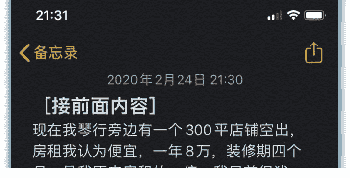

### 月，是我原来房租的一倍。

我目前很犹豫，我原本房租四月底到期，地方也不太够用了。现在租下新门面再装修正好能对接上，但现在疫情特殊时期，对我们行业肯定有影响，如果等到后期再租我怕失去这个店铺。

#### 谈谈我考虑新店铺的计划

原本琴行主做少儿音乐培训，地方扩大的话在原有的基础上增加专业成人音乐培训（基本上琴行有成人学生报名都会收，但是对外招生内容和给人感觉都是以少儿为主）两者结合。计划装修档次高于本地其他琴行。主以一对一为主，小组课为辅（2-6人）主流乐器教学为主加音乐理论。加上60平乐器展厅方便销售。

珍姐，想听听你的建议，我是等疫情结束后再看，还是现在可以做，同时在我的新店计划中有什么不当和改进的地方？

---

### 定义Calvin：逆向思维

灵感来自《有效地无效》（Efficiently Inefficient），作者是AQR资产管理公司合伙人佩德森（Lasse Heje Pedersen），书中有一段是与一直专注做空领域里最负盛名的查诺斯（Jim Chanos）的对话。

#### 查诺斯如何找准做空对象

逆向思考要先找准对象。

找准对象的依据不能仅看价格是不是过高。不是说“价格高的时候，你觉得会跌”这就是逆向思考。查诺斯绝不仅仅因为觉得一家公司股价过高就做空。

股价高有很多原因，不管是因为什么原因看好，看好的人继续看好的时间，完全可能超过你做空能坚持的时间。做空必须是公司基本面出了大问题，经营出了大漏洞。

他筛选目标有个范围：

- 第一，在好日子里杠杆加得太猛的。周期永恒，有繁荣就有衰退，而周期总是与杠杆伸缩密切相关。在好日子里杠杆加得太猛的，在坏日子里会被杠杆所伤，变成猎物。欠钱太多总是要还的。
- 第二，被新技术碾压的上一轮赢家。互联网是财富制造机，但查诺斯不是去关注它在哪里制造财富，而是去关注它会消灭哪些财富：哪些商业模式会过时？哪些护城河会被填平？

对于熊彼特说的毁灭式创造，查诺斯专注搞摧毁那部分。

- 第三，一招鲜公司。无论什么时候，总是有人拿出一件产品，迅速引爆市场，使所有人为之激动。人在激动的时候就线性外推：如果产品照这个势头占领全市场，如果能持续推出同样的爆款产品，等等。现实通常与线性假设相反。一招鲜公司很多，流行一变就凉了。想想游戏公司。
- 第四，增长来自收购的平台型公司。如果增长不是内生而是来自于外部收购，查诺斯会倍加注意。这是块特别丰厚可反复开垦的领地。美国资本市场上每过一二十年重新流行一次收购增长的主题曲。中国股市对它也不陌生，还记得前两年创业板的收购驱动型泡沫吗？

收购主题曲总会伴随着“财技”这个关键词。增长很难，你得一切都做对，收购则只要有钱就行。太容易的事大家都做，出价就会变得太高。出价高又要买来的增长显得物有所值，羊毛总要出在什么地方，最后往往落在财务报表上作手脚。

这就是财技的两面：收购时的融资安排，还有收购以后的财务马杀鸡。什么时候你听到这个词大家都在说，就要特别小心了。查诺斯最喜欢看到有公司提拔会计做CEO，这就是新目标。

以下是总结：

做空者要获得成功，必须身处逆境仍旧泰然，因为他们处于逆境的时间更多，而逆境持续的后果更严重。除了任何时刻都不能忘记多元化以外，他还得做到这些：

- 第一，你必须坚信自己是对的。大多数人大多数时候都在跟你说错了，你得能隔离噪音，保持自信。
- 第二，自信的前提是你的看法确实是对的，这需要做比别人更深入质量更高的研究，看得更深更透。如果你其实是错的，那么自信直接通向灭亡。
- 第三，选择绝对理性，与人性的大幅波动保持距离，不去追逐那些因为许多人追逐所以价格上涨的东西。这事其实有人能做成的，比如索罗斯，他跟随泡沫，然后在转折点反手一击。查诺斯不做这事。最优秀的投资者各取一瓢饮，查诺斯取这一瓢。
- 第四，相信常识。相信树长不到天上去，相信财技改变不了经营的基本面，相信假的总会现形，相信癫狂总会回归理性。

查诺斯始终是少数派。这种人坚持原则，毫不动摇，始终逆行，他们中绝大多数粉身碎骨，而极少数最终获得幸运女神的垂青。

### 评论区

2020-02-26 (54赞)

- 珍大尸：这个帖子值得加精华，脑子里瞬间想起好多例子。第二条被新技术碾压的上轮赢家：圈子里有个报社的例子
- 定义Calvin：我也觉得值得加
- 爱上鲶鱼的美：从股市中还是能学到很多优秀的管理经验与经营哲学，点赞
- 我的天空：感谢分享
- 六子：如果能做详细解读就更好了

---

### 老师，经济学和金融

(提问)戴广林：老师，经济学和金融学有什么区别？

2020-02-23

回答：经济学是研究“比较”的学科。在经济学眼里，什么东西都可以拿来比较。比如，人和机器比较，汽车跟房子比较，什么都可以比。但是不同的东西，
- 第一、在不同的人眼里，价值大小的结果不一样。比如，一个女人和500只鸭子哪个更好？有可能甲就觉得女人好，乙就觉得500只鸭子更好，俩人答案根本不一样。
- 第二，因为“单位”不一样，所以没法进行数学运算。举例，一个女人加500只鸭子等于什么？这俩单位不一样，根本没法做加减乘除，没法进行“数学计算”。

（经济学里逻辑推导很多，但是纯数学计算很少）所以经济学分析问题，最后得出的结论，都是有很多前提条件的。答案往往是：在a种情况下，应该如何如何；在b种情况下，应该如何如何……分析和论述的情况特别多，没什么直接数字结果。

金融先是把经济学研究的领域缩小了：只研究钱（货币、债务、股份）。你可以看成金融学是经济学的特例。（从这个角度看，金融学比经济学内容少了不少）在只研究钱的情况下，上面两个问题都解决了。不管是甲还是乙，他们对钱的价值认知是一样的，一元钱纸币和一元钱硬币都是一元钱。并且，钱还可以“用数学计算”……

当数学计算搞的多了，金融学就衍生出了自己的研究方法，金融工程什么的。（从这个角度看，金融学等于比经济学又多了很多内容）

这就像是，《辟邪剑谱》出自《葵花宝典》的残本，在残本之上，又自己衍生出了新的东西，于是起了个新名叫《辟邪剑谱》，所以两者是有联系的。

经济学比金融学研究的领域更大，除了钱、经济增长之外，人口、政府效率、社会福利、道德、法制、家庭关系，很多东西都可以纳入经济学的考虑。

金融学简单，就是计算钱，只不过要用高等数学。(97赞)

### 评论区

- 知道了：大户，有好用的vpn吗推荐下呗，之前你推荐那个下载不了了，或者分享一份也行，谢谢
- cinderella：要培养个人的经济视野，经济思维其实再每个日常生活点滴中存在。
- 欧阳漫幕：我用的“panda vpn”,你试试看还能不能用
- 知道了：已经找到，谢谢
- 那只兔子：简单易懂。[愉快][愉快]
- 他山之石：这个vpn连接后没有网速啊
- 知道了：我是直接自己搭建的，嘿嘿嘿
- David：鲸鱼vpn也还可以

---

### 你好，今天续费的时

(提问)刘超峰：你好，今天续费的时候显示不支持续费，这个怎么操作？

2020-02-22

回答：应该是苹果系统，苹果系统付费比较曲折，只能扫二维码付了……(2赞)

### 评论区

- 刘超峰：搞定，多谢
- 周乃寿：曲折…哈哈想笑
- 杨丽娟：299是使用多久啊？我都没认真看，不知道这个要续费的[偷笑]
- 婷口：一年

---

# 【富豪谷底求翻身】

珍大户：【富豪谷底求翻身】<额外细节>

写下一部分之前，额外插播几个与富豪无关的细节，与主题无关。

比较好玩，所以睡不着觉也要写下来[呲牙]

#### 第1处：钢铁男最后分10%股份，被高估了还是低估了？

钢铁男是视频里，技能比较完备的一个人。

- 第一，他人缘好，交友广泛。比如他第1次跟富豪见面，是雇富豪当短工，然后当天就开始跟富豪互相了解对方的人生经历了。
  对比来看，富豪在找旅馆、卖狗玩具、当钟点工时，基本没遇到好脸色。在跟其他团队成员相遇时，也只有少数几个人才交流这么深入。
  再看他随时能招来帮忙的人（帮忙装修，帮忙肋排节，都带人过来了），想要招聘就立即就能找到一堆符合的厨师。
- 第二，信息量大，对当地非常了解。比如团队想要做烧烤店，他就立即说出当地最热门的烧烤店，富豪区绿帽子节倒卖小商品时，也是他带路找到了最热门的地区。
- 第三，他品格很好（信任、忠诚、努力，尽力而为）。
- 第四，他竟然还有特殊技能，会设计商标logo。
- 第五不说了，开户公司，有管理经验。

结果片子最后，钢铁男和另外一个我印象不是很深的人并列，每个人都获得了10%的股权。

相对来说钢铁呢比另外一个要更靠谱的多，为什么结果跟另外一个人一样呢。

在我看来，钢铁男的形象吃亏了……

他满脸纹身，导致了面部基本没有什么表情，很影响交流，给人留下的第一印象就是木讷（其实以他的社交能力，根本不可能是个木讷的人），这在初期很吃亏。然而随着时间推移，人品渐渐显露，这方面的顾虑能够打消。最后富豪对他感情已经很好了，在劝他的时候还会说“你就当这是父亲对儿子的忠告”

然而就算富豪完全信任他，他的外表依然有很大的影响。因为未来每一个员工都有可能疑虑，这个人会不会情绪不稳定，会不会太叛逆出格……最终有可能对企业经营有影响。

而另一个分到股权（给我留下印象并不是很深）的人，外表看起来更稳重、更能承受压力得多，会让员工有安全感。

所以在我看来，如果不是受外表形象的影响，钢铁男的待遇会比片子中更好。没准是他分15%股权，另一个人分5%股权。

同样影响的还有钢铁男的妹妹，他妹妹唇钉……一家人都吃亏在外形上了。

#### 第2个有趣的细节：电焊小胖（名字叫克里斯，但是片子里有三四个都叫克里斯人……）

富豪在跟电焊小胖打过几次交道之后，对着摄像机偷偷说，我太喜欢克里斯了，克里斯非常热爱帮助别人，我真希望给他股份，我一定要让他加入公司……

结果最后并没有给电焊小胖股份。为什么呢？（而且电焊小胖免费帮忙焊了一个特别酷的烤炉，起到了很大的作用）

因为电焊小胖比较倒霉。

富豪在半路出现了失误，把自己名字暴露给电焊小胖了，结果电焊小胖就成了唯一一个提前知道真相的人……

所以有时候，知道太多秘密不见得是好事[捂脸]

牢记非礼勿听，非礼勿视，非礼勿啥啥啥吧……

#### 第三个细节是牛仔厨师

片子里有一个存在感很低的牛仔厨师。看着像亚裔，一出场就永远戴着牛仔帽。

这个人在片子里，厨艺水平很高，最终送去给评委吃的评奖烤肉，就是出自他之手。

然而这么一个厨艺很好的人，基本没被重视过。

因为这人身上有个很奇怪的点，他脸上永远带着迷之微笑……

我记得有一个情节，是女厨师在肋排节当晚摆挑子，然后富豪去安抚女厨师，安抚好了之后，把女厨师又拉回团队，一堆人聚在一起，富豪公开给女厨师道歉。

这是一个很严肃的场面，结果牛仔脸上，还是标志性的迷之微笑。我看着都想笑。

笑容是个“正面”表情，但正面是靠负面对比出来的。如果没有负面的对比，怎么反差出来正面。

所以，哪怕在95%的时间里微笑，也要留5%的时间给其他表情。该严肃的时候还是要严肃的。

结果这个人时时刻刻都在笑……就显得相当假了，很难让人亲近得起来。

2020-02-22 (100赞)

### 评论区

- 奇开得胜：尊重，为了大户写的这个专题精华帖。我现在在看这部纪录片。我要看完这部纪录片才能更好地吸收大户的分享
- 尹大渔@流沙港海干货：看完剧又看着大户分享，有趣
- 张会媛：这部片子一口气8集全部看完了，创业的人都有点点滴滴的困难之路，希望大家一起加油☺
- 蜗牛：我是看到今天凌晨两点多，八级看完了，收获真的挺多的
- 泉州东海湾卖二手房的*：我也刚看完[微笑]
- 标哥：剧透
- 未央：在哪里可以看这个记录片？
- 魏西白：看完了片子 还做了笔记[微笑]

---

# 【富豪谷底求翻身】

珍大户：【富豪谷底求翻身】二-4

**目录**
二、商业逻辑
1、利用三个信息来源找到方向
2、甄别方向：识别客户需求与改进。
3、是否可规模化。
4、品牌

再说商业逻辑部分的第4个点：品牌。

品牌是个很重要的东西，其实是一种虚拟的情感联系。

举例来说，国外爱喝可乐的人群里，分为可口可乐和百事可乐两派。如果你对品牌没有这种虚拟的情感联系，你会觉得两种可乐其实差不多。

但一旦有了这种虚拟的情感联系，就会潜意识里觉得一个是你亲戚，另一个是你亲戚的敌人。内心开始有强烈的喜好或抵触，开始区分亲疏远近。

#### 怎么建设品牌？

这个事一直在持续进化。

最早的商业教科书里，认为持续打广告，反复给消费者视觉和听觉的刺激，时间久了，消费者就会变成巴甫洛夫的反射狗（生物课教材里讲过，一边摇铃，一边喂狗，时间长了狗一听铃声就开始分泌唾液……。）

所以最早的牌子是没什么意思的，比如奥利奥，粤利粤，奥利给，可比克，金坷垃，金利来之类的，你光看字根本不知道什么意思，脑子里一片空白。

需要广告不断刺激，才能在消费者脑中形成“这是一个牌子货”的概念，还需要常年的对牌子做正面公关，让消费者一看到这个牌子就愉悦。

这样下来广告费支出是很大的。

后来开始出现的趋势，品牌开始借力了。比如天猫用猫，京东用狗，苹果用苹果。

上面讲过，品牌需要两个过程：
- 1，反复出现，让消费者知道这是一个牌子货。
- 2，反复跟正面形象挂钩，比如美女帅哥，比如欢乐的生活，比如愉悦的氛围等等，让消费者把这个牌子跟好的感受联系起来。

所以借用猫、狗、苹果之类的，非常节省第1个环节的广告经费。宣传起来省力多了。

但我觉得还可以更好，就是直接找到触碰某群人心里敏感度的词汇或者形象，连第二个环节的广告费一起省了。

这个片子里，富豪在这方面超级敏感，他给烤肉店命名 underdog，这个词是很有内涵的，是指一路上都是差生，别人从来没有看好过你，永远被歧视，被嘲笑被无视。

我留学的地方在克里夫兰，离伊利很近，都是美国东北部，五大湖沿岸的老工业城市，都属于锈带地区。这些城市在100年前曾经辉煌过，是当时美国最繁华的地方，然而今二三十年都很惨。

克利夫兰是这些城市里落差最大的，被称为是被全美国嘲笑的地方。美国有个段子，说，讲笑话的时候只要说一句，“从前有一个克里夫兰人”，然后台下的观众就可以开始笑了，根本不需要后续。

有个美剧叫，讲的就是洛杉矶的精致精们，无意到了傻大粗克里夫兰，反差萌的故事。

所以当年NBA克里夫兰骑士队夺冠的时候，整个城市都轰动了，一共才40万人口的城市，据说欢庆游行去了50万人，这是一种常年的被当做笑话，常年被嘲笑、不被看好背后的落寞和无奈带来的情绪爆发。

我跟当地人聊天，我很好奇我问，有没有可能某个克利夫兰人是nba其他球队的粉丝，比如他是科比粉丝，于是在骑士队vs湖人队时给湖人队加油，结果大家拍桌子说不可能，不可能。你们感受一下，这是一种什么样的情绪。

伊利和克利夫兰同处锈带，都是老工业城市，氛围境遇差不多。所以我看到富豪给餐厅起名叫underdog、那个不被看好的落后土狗，发誓要做逆袭者。

我很感慨于，这个人才刚到这个城市没几天，就展现出了很细腻的情感和同理心，马上抓住了当地人的情绪。

#### 再说肋排骨

参加肋排骨的商户，怎么也得好几十家。

没有任何顾客会吃几十份肋排骨，在公平地决出口感的123。

每个顾客能吃三五家就不错了。所以，比赛是没有“公平”可言的。

这就像是，如果问你你觉得最好喝的矿泉是哪个，你首先想到的肯定是最常见的农夫山泉百岁山娃哈哈矿泉之类的……

然而一定有很多牌子你没喝过甚至没见过的，然而你都没喝过你就把人排除了，对这些小牌子公平吗？不公平，但这就是现实。

所以他们能在肋排骨上获奖，我不认为是厨师的功劳，而是因为在，第一，这个名字太动人心弦，让当地人天然就心里加分了；第二，那个很工业风格的烤炉，太符合当地形象了。

都是情感分。

片子里其实不止出现了一个品牌。

钢铁男创建的T恤公司名字叫“钢铁帝国”，女厨师倒闭的餐馆，名字叫“田园餐厅”。

三个名字大家对比一下，就知道水平高下了。

钢铁帝国是钢铁男自己的喜好，根本没考虑顾客。

田园餐厅也是女厨师自己的喜好，受众都是家庭主妇，而家庭主妇是最喜欢自己做饭的一群人啊！（美国很大比例的男人工作，女人当家庭主妇）。

所以，品牌名字立见高下。

2020-02-22 (84赞)

### 评论区

- 珍大户: 第二个模块一共四点，1234大家按顺序读。我写完整更加感慨，这个富豪的商业逻辑还是很完备的，确实是高手。
- 听说我说话很冲：e啊，学习了。
- 巩振宇: 仔细阅读了两遍 感谢老师 辛苦啦
- 刘刚: 在哪看
- 跟着时间去旅行: 大户老师辛苦了！
- 花开得胜: 尊重，为了大户写的这个专题精华贴。我现在在看这部纪录片。我要看完这部纪录片才能更好地吸收大户的分享
- 强吉: 3哪去了？只能看到1 2 4
- 言轻莫劝: 看视频的时候，他反复的强调好多此，我一直认为他是在强化创建自己的企业文化，原来他也在利用当地人的这种情绪[强]

---

# 【富豪谷底求翻身】

珍大户：【富豪谷底求翻身】二—2

**目录**

二、商业逻辑

- 1、利用三个信息来源找到方向
- 2、甄别方向：识别客户需求与改进。

第1步走完，需要进入到甄别环节。

以纪录片中的例子来举例，富豪发现了咖啡产业和啤酒产业，该选哪个？

我怀疑他不太熟悉咖啡，没说出个所以然来。而对啤酒产业，他说当地的精酿啤酒只在本地销售，他可以拓展到全国，开拓市场。这是一重【改进】。

否则只在本地销售的话，他跟本地啤酒企业没有任何差异，等同于正面拼刺刀。正面拼刺刀肯定不是好选择。

后来因为酿酒执照搞不定，创业目标变成开烤肉店之后。他团队讨论发现，当前的烤肉店竟然都不销售啤酒，将烤肉和啤酒结合，这是一个值得【改进】的地方。

做别人一样的，最终竞争压力会越来越大，很容易跟竞争对手走向不断降价竞争的恶性循环。

所以，想着对已有的东西做一些改进，才是更好的发展方向。

而改进的过程，其实就是沿着客户的需求出发，想顾客之 所想，急顾客之所急。甚至走的更远。

有个说法，某个管理大师提出来的，说最差的企业就是只生 产产品，然后硬着头销售产品，很累。

优秀的企业要去调查客户的需求，客户想要什么就给他们什 么。

更优秀的企业，要发现客户的潜在需求。客户自己还没说出 个所以然来，自己则要先想到。

（昨天看见疫情相关帖子里，有个夸浙江省管理先进的，说 隔离病人时，有四十名儿童，于是当地预先准备了很多儿童 玩具，以防隔离期小朋友寂寞，这就属于从客户需求的角度 出发）。

富豪自己在片子里也在不断强调，先找到需求，别人要什么 东西，他就给什么东西。

这种站在别人角度思考问题的方式，用于改进商业模式，提 高竞争力。

**目录**
二、商业逻辑
1、利用三个信息来源找到方向
2、甄别方向：识别客户需求与改进。
3、是否可规模化。

富豪其实在片子里做了很多事。
比如说，在绿帽子节上倒卖气球，倒卖轮胎，试图倒卖铁栅栏未成功，倒卖二手车，倒卖房子。

他倒卖汽车，其实又快又赚钱，几天就能卖出去一辆。而卖房子周期挺长，本金投入大不说，从装修到过户，需要个把月。

所以大家有没有想过，为什么他不继续倒卖汽车，趁后面装修房屋的时间多卖点车？

原因是这个市场非常有限。

很多人吐槽说，富豪捡了几个轮胎，就能卖1500块。感觉不可思议。

然而，
第一，这几个轮胎是他花了七八天才找到的，说明很难找。同样的还有人收购铁栅栏，然而没找到。说明捡二手的【供给】不是稳定存在的。
第二，能不能卖出去，取决于有没有人买，刚好有人收购轮胎和铁栅栏，而没见到收购别的。说明废品市场的【需求】也不是连续稳定的存在状态。

一个供给和需求都不稳定的市场，是没办法吸引到很多人在里面守株待兔的，这就是为什么废论坛被人丢了，因为轮胎主人很可能在卖的时候挂了一段时间，没碰到买家，嫌占地方就扔了……

再说二手汽车。

### 第一个问题：为什么市场价两三千的二手车，车商500块就肯卖掉？

因为车商大批量进货，压资金了。

我在刚毕业住出租屋那段时间，业余倒卖过手机号。（之前知乎里写过，不仅倒卖手机号，还倒卖二手打印机、耳机等各种破烂）。

倒卖方式是，淘宝上一家卖手机号的店，把所有手机号归类，整理出尾号相连的，当做情侣号，在我自己的淘宝店上架。那家卖手机号45元一张，我挂150元一张，别人买情侣号都是同时买两张或者三张，我收到订单以后，再用另一个淘宝ID去那家店下单，让店家直接发货给顾客，于是每张订单我白赚两百到三百块。

所以，这些情侣号明明市场价值150，为什么店家45块就往外卖呢？因为店家批量进货，压资金了，他涨价会影响销路，他更看重周转率，而不是单个某个手机号利润最大化。

车商也是一个道理。车商同时有几十甚至上百台车在手里，他不会关注某一辆车是不是卖到最高价了，相对而言周转率更重要。

### 第2个问题，既然倒车这么赚钱，为什么富豪不使劲继续倒车呢？

因为，市场上能够有这种差价的车太少了。

就像手机号店里几千个手机号里，只有小部分才是情侣号。

所以富豪只倒卖了两辆车之后就收手了。我估计，他在车商那里能找到的差价大的资源已经挖掘干净了。

如果你想过一个小富即安的日子，其实靠着信息差，赚钱也能赚的不错了。比如片子里的房产中介，属于收入不低的人群。

但是想成为富豪，那么这些不能【规模化】的事情，就没法长远从事了，必须找到能够规模化的，

简单来说就是，能够翻倍翻倍再翻倍。比如他的烤肉店，目标是开成全国连锁企业。

（他之前的啤酒，目标也是打算要全国销售）。

**2020-02-21 (107赞)**

评论区：
- JAN*: 又来学习啦~
- 欢乐马: 老师商业思维能培养嘛？
- 跟着时间去旅行: [玫瑰][鼓掌]鲜花和掌声送给大户
- 珍大户：先大要是沒有，就只能靠后天培养了。观念、商业逻辑都能后天培养。因为我这都是后天培养的（F先生倒是都点天生的） 领导力那块我正在锻炼，等培养好了再来说能不能培养吧[捂脸]
- 欢乐马：那等着老师的，好消息[跳跳][跳跳] 持续关注老师的视频和文章[转圈][转圈]
- 杨月玲：看完老师的文章，真的感觉自己脑子是个摆设□
- 宠爱之家：认真学习□
- 锁定真心*：学习学习，涨知识啊大户[色][色]

关注公众号“懒人找资源”，星球资源一站式服务

# 【富豪谷底求翻身】

珍大户：【富豪谷底求翻身】纪录片解析：

金钱观的部分视频做的差不多了，我在圈子里先说第二部分，关于【商业认知】部分。

在第一部分“金钱观”这里，我们谈到了“储蓄”、“强制休息”、“安全垫”等等……

最终导致的结果，是你既有金钱上的准备，又有心态上的准备，头脑和身体都准备好了大展拳脚了，你开始准备要进入商业社会了。

进入商业社会，会遇到很多很多的方向问题面临的第1个问题就是：怎么找到未来的方向？

直播时候被问到最多的就是“我该做什么”？这种问题我一般都不回答。这么问，说明还连门都没摸到呢。找到方向之后，还有后续一串问题。

如果连方向都不会自己找，说明新手村都没出， level 1 的新手。

常见的找方向有三个渠道：
1. 从工作经验获得。

比如富豪在片子里倒房子。因为他说，他最擅长的就是房地产。而且他非常清楚的知道如何操作用1成首付去杠杆买房（其他普通人则必须2-3成首付）

原因是，他自己创业开了全美最大的贷款公司，过去十几年里最熟悉的就是房地产+贷款。

这就是工作中获得信息，指出方向。
比如圈子里这个朋友，就是在一个行业里熟悉后，然后渐渐开始发掘行业内的机会。

在这一部分我有两个衍生结论：
- 第一，我不建议大学生毕业就创业的。等同于失去了很大一块信息来源，自己会很盲目。
- 第二，职业的选择一定要思考“离开的时候能带走什么”。信息也是很重要的——部分。有些行业什么都带不走，那你进去就比较吃亏了。

这个部分我意识到的比较早，早早就做了职业规划，做自己认为最能“提升能力”的工作。

然而相对第1部分，下一部分我就做得比较差了……

2. 第二个来源是“与人交流”。

我是个挺内向的人。一直以来都不是很擅长与人交流。F先生跟我相反，他就很喜欢与人闲聊。

比如早些年，我们去理发店理头发，我基本一言不发，他肯定跟理发小哥聊俩小时。我常常不明白，跟陌生人开口，都不认识，该咋聊呢。

后来有一件事让我意识到，自己是是有问题的。

有一次我有笔交易不知道合不合规，于是我去找监管规章，一条一条对照。我有个同事，是英国留学回来的硕士，就直接就给证监会打电话来，问这么做合不合规。

我当时超级震惊，心里一下子有很多想法涌出来。

最先是想，自己的事找别人解决，这不是“给别人添麻烦嘛”。

后是想，我自己解决要花一下午两三个个小时，如果打个电话，可能在10分钟之内解决。浪费10分钟节省两小时，属于社会效益提升，那么也情有可原。

再后来想，为什么我同事就能想到这个办法，我就想不到。可能是因为，我一路是国内教育体系下培养出来的，擅长单独解决问题，我同事是国外受教育，国外强调团队合作？

最后想，不对劲，我解决问题的能力有缺失，我竟然从来不会找外界帮忙，竟然从来都只闭门造车……

总之，这件事给我带来的震撼很大。一个是让我开始向往出国学习了，另一个是，我开始反思自己的自闭，开始学着跟陌生人聊天，跟不认识的人打交道，渐渐的开始改变自己。（后来发现国外的教育确实强调合作，所有的作业都是小组作业，没有任何单独一个人完成的作业。老外更是极其喜欢跟陌生人打招呼，马路上遇到校工、清洁工、邻居等等，不管见没见过认不认识，他们都喜欢问个好。

后来我就默默的决定，回来以后也坚持这种习惯，我现在在小区里碰到保安保洁邻居，都会打个招呼问个好，天天这样心情也挺好的）

我们在看纪录片里。富豪从一开始就在不断的去见陌生人，跟很多人问问题，聊天。

不是所有会面都会有结果。前面见的某几个人，一面之后就再也没有出现过。

这段内容，我知道大家会有疑惑，会觉得是不是国外人更好交流，国外的习俗是不是如此。换到国内会不会不一样？

那么我们拿片子里4个人做对比：

富豪，钢铁男，女设计师，女厨师。

我们把这4个人拿来  做对比，大家分析这4个人与人交往的边界在哪里？

可以这么思考，我们拿一张白纸上面画一堆大圈套小圈。

- 圆心代表自己。
- 往外第1层圈，代表家人。
- 第2层圈， 代表亲戚朋友。
- 第3层圈， 代表认识的人。
- 第4层圈， 代表不认识的人。

大家不妨分析一下，富豪，钢铁男，女设计师，女厨师的社交边界都在哪里？

富豪从一开始，就在不断的走访不认识的人。他的社交圈很稳定地落在第4层。

钢铁男，在帮忙装修房子的时候，主动带了父亲、妹妹、朋友。在肋排节需要帮手的时候，主动带来了妹妹、以及他妹妹的朋友。

在印刷厂需要人的时候，招聘遇到了富豪。在富豪需要招聘厨师的时候，钢铁男在外招聘找厨师。

所以说钢铁男的社交，2层3层非常好，时不时扩展到4层。

在看女设计师。在帮忙装修房屋的时候，都是其他人带朋友来。女设计师在整部纪录片，里没有带来家人、亲戚、朋友。

在富豪给她施压时候，说把所有认识的人都叫来之后，女设计师在压力之下，给所有她认识的人打电话，叫人来帮忙。

所以女设计师的社交圈并不大。压力之下才拓展到3。

再看女厨师。女厨师在压力之下，完全不与外界交流，一点就炸。她的社交圈极其小。

所以按照与人交流的能力：
富豪大于钢铁男，大于女设计师，大于女厨师。

所以在纪录片开始之前，富豪成就在他们之上，而钢铁男有自己的公司，女设计师有自己的工作室，女厨师自己的餐馆倒闭了。

在纪录片结束之后，钢铁男是CEO，女设计师是董事，女厨师被炒了。

大家不妨自己思考一下，自己的社交边界在哪里？这也代表着每个人的信息获取能力。

第3个渠道是调研：

比如我之前投资工作里对企业的深入分析。比如很多人创业之初，对同行的调查，蹲守门口观察竞争对手，这些都算。

富豪的深入访谈，找咨询师，找律师，这些也都算。

通过以上三个办法，最终要找到自己的方向。

富豪的纪录片里，通过工作经验倒卖房子。通过与人走访，考察了咖啡行业、啤酒行业和金属加工行业。

他自己否定了金属冶炼行业，因为投资资本太大，不好规模化。对比选中了啤酒行业（可能是因为自己对咖啡行业不熟悉）。

而又根据律师的信息否定了啤酒行业，根据团队的讨论改成了烤肉店。

这是大的方向。

信息获取，还有很多关于选择人生方向以外的额外收获。

比如富豪在前期访谈里，遇到个肋排节的老人，老人跟他说，以往的肋排节，里谁家的肉不够了，就去隔壁借。

透露这个消息对肋排节老人来说，没什么损失，靠传递经验交个朋友也不错。

而富豪则靠这个信息，度过了肋排节的难关……[https://t.zsxq.com/YFMfq nq](https://t.zsxq.com/YFMfq nq)

**2020-02-21 (98赞)**

评论区：

- 菲菲菲：[爱心][爱心][爱心]
- 沐阳：刚提示我需要加入星球，吓死！以为好久没来被踢出去了[大笑]
- 珍大户：啥情况，另一个朋友也是这个反应，软件出bugs了[惊恐]
- 听说我说话很冲：我大概日常生活就是，123几乎没有，只有0和4
- 珍大户：你这个……
- 沐阳：重新关闭app，重新登录就好了[呲牙]
- 白：我老婆喜欢聊天，我比较内向[撇嘴]感觉有社交恐惧症，，人家跟我聊我也能聊，就是不想主动找人家，比如让人帮忙，我老婆就特别喜欢让人帮忙（但是不是损人利己的事）我感觉她的社交技能比较好缺又学不来[撇嘴]
- 欢乐马：所以老师现在定期开直播，想多和陌生人沟通[偷笑]

关注公众号“懒人找资源”，星球资源一站式服务

# 大户好，想请教一个

(提问)匿名用户：大户好，想请教一个选择城市工作的问题。昨晚和今上午把精华贴浏览完了，抖音上也看了关于城市选择的7个标准。但那都是18年的，鉴于今年新情况想再请教下。大户姐对下面三个城市的就业和安家选择。

三亚、成都、和武汉。我目前的认识是：在咱国家是政策引领资金技术人才的流动。

**2020-02-21**

回答：不要押三亚。 三亚那里的现状：除了旅游业、农业，基本上没有其他产业，你很难有很好的就业方向。 三亚的未来：第一，你回顾一下珠港澳大桥，立项、论证、批复、开工再到竣工，总长度十几二十年。琼州海峡大桥参照这个情况，假设你现在在30岁，等到海峡大桥建完，估计你50岁了，对你还有多大用处…… 第二，整个雷州半岛+海南岛，距离太远、太长，人口密度低，经济协同性低。这不是长江两岸、或者黄河两岸，或者黄浦江两岸。 只有两边有着巨量人口时，交通打通的效果才好。而琼州海峡大桥架起来之后，雷州半岛那里也没多少人，海南岛上也没多少人，想链接到广州要600到800公里了，距离极大的稀释了这座桥的作用……（从3小时缩短到1小时的意义很大，而从9小时缩短到7小时的意义很小）

成都的金融中心发展不起来（老结论，不重复说），但这个几乎只对金融行业从业者有影响。 所以要看你在哪个行业了。 武汉也想开点。官僚主义这个事，哪个城市都有。 之前提到西安和郑州时，也有很多说当地官僚作风严重的（不过很奇怪，说成都的就很少，难道成都当地氛围真的很好？）但这些也一样不能阻碍对这两个城市的判定。 因为真要改起来也是很快的 事。 因为，改变其实就是靠外来人口去冲破原有的一些惯例的。外来的企业多了，外来工作的人多了，最终也就倒逼进

步了。（说白了，都说上海是全国素质最高的地方，不也是 因为上海历来是外来人口聚集的地方嘛。）

提问中，你觉得是政策引导人和资金和技术 的流动，但其实并不是。是经济规律：人和产业和资金和 技术，都自发地往成本最低的、利润最高的地方聚集。所以 政策有的时候是没用的。比如深圳，珠海，厦门，汕头，海 南五个经济特区，最后只发展出一个深圳。比如霍尔果斯有 很大的政策扶持，但是没人真搬到那里去。比如自贸区政 策，现在大家也不知道这个到底有多大的作用。只要对成本 或者利润的改变不够大，这个政策就影响不大。（事件的影 响也一样）所以，这次疫情会对武汉的成本带来提升吗？似 乎不会。发现武汉官僚主义严重，会对武汉的成本带来提升 吗？好像也不会。对很多人心里有冲击。会犹豫搬入武汉。 然而过个半年，该怎样还是怎样了……疫情过后，又觉得还 是九州通衢最便捷，成本最低。(82赞)

评论区：

- mews：我选长沙
- seven&one：大户。疫情过后武汉房价会降吗？
- 逐梦：成都你要是冲着金融中心。。。就不要来了，直接去上海，香港。成都是一个有一定第二产业支撑的三产业城市。是一个休闲的好去处，挣钱还得去北上深。
- 盘锦五禾农副产品：我觉得不会，03年有数据显示对北京房价没啥影响。
- 柏林：重点是谁多少你会买？
- 恋上柏拉图：我选武汉
- 哈哈：武汉房价比成都低吧
- 恋上柏拉图：你没认真读珍大户对这几个城市的解析吧[呲牙]武汉成都房价差不多的[呲牙]留下复习[呲牙]

关注公众号“懒人找资源”，星球资源一站式服务

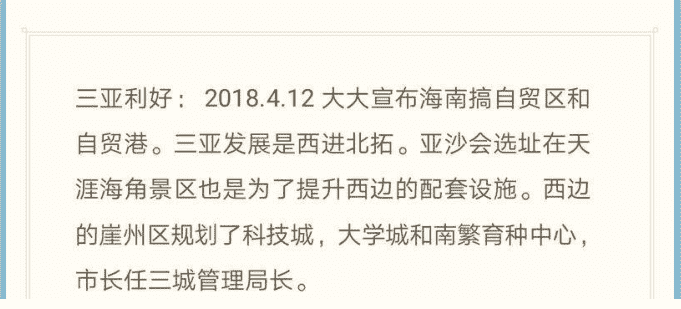

缺点：就是这些产业还没发展起来，基础设施差，教育医疗资源少，物价高，交通就不用说了。

不确定的是：会不会建链接海南和广东的大桥或者隧道？

武汉缺点：今年疫情充分暴露了武汉城市治理能力的低下，官僚主义严重。因为没在武汉工作过具体就不知道了。

成都：1.1 日去了 10 天，专门去了规划馆和金融城。有个疑问成都金融中心能发展起来吗，看您说也就上海和北京可以。

# 珍姐，请教下您关于

(提问)匿名用户：珍姐，请教下您关于贷款、信用卡逾期后的正确处理办法。如果您不擅长，麻烦帮我翻出来让大家给下建议。

已经逾期的贷款：未计逾期利息
- 1、友信普惠、凤金普惠。约13万。友信我借的8万，但合同金额是11.5万左右
- 2、网贷：苏宁任性付/任性贷、微粒贷、马上金融、小赢卡贷、读秒。约8万，长的逾期1年了

未逾期的网贷：借呗、花呗、招联金融。约8万
自己的信用卡未逾期已爆卡，约20万
借朋友的一张信用卡已爆卡，约11万
个人欠款约6.2万
信用卡和借呗等每月套现周转的循环利息就几千，还了几
年，负债有增无减
原本的工作就没底薪，现在准备生孩子很长时间可能没收
入，老公的收入想帮我也有心无力，我现在应该怎么处理？

**2020-02-17**

回答：还款顺序要分一下级别：银行的级别最高，因为银行
信用卡有个最大的风险是“信用卡诈骗罪”，最坏的结果（就
是电话拒接，上门就躲这种情况），人是有可能进去的。当
然，一般不会走到这么差的地步，毕竟银行是想要钱，不是
想要你进去。但银行信用卡债还是需要最紧急处理的。给银
行打电话，要求利息减免，说自己还不上了，不是恶意的，
就是失业了没来源，得找到工作才有钱还，希望在这之前，
利息减免，每月搞个最低的还款额。（银行的人有这种处理
权限，但你要给对方看到还款的希望，每个月都能还点钱，
对方才愿意帮你减免。否则如果一副“我就是还不上”的态
度，对方是不敢给你减免的，反而只会希望你债务扩大，
这样法院起诉的时候才好讨价还价。举例来说，你欠10万，

利息累了5万，一共15万。如果他们给你减免到只要还10万就行了，结果你还不还，这时候再上法院要10万块？对银行来说，他们宁愿不给你减免，上法院直接找你要15万，不是更划算。所以能谈下去的前提，是你能每个月都还一点钱，给人还在想还钱的希望。）第二个别，是查看剩下的哪些是银行放款的。比如“微粒贷”，背后是微众银行。借呗背后可能也是银行……银行的也需要沟通，跟上面一样，跟他们商量个最低还款额。第3个别是普通的网贷。我是指利率10%-18%的网络贷款，比如花呗之类的。这个我不知道能不能沟通利息什么的，你自己想办法吧。借钱如果利息太高，总额超过一定数额之后，你的钱连利息都还不上，就等于被陷入沼泽地了，永远无法翻身了。所以最怕的是以贷养贷，这样就是总额一直在增加，早晚过线。所以这一级别的，实在还不上，他们又不肯减免利息，就只能逾期拖着了。最终他们起诉你，你失信被 人。但到起诉的时候，至少有一个好处，就是利息终于能停止计算了。最后
一个级别就是上面那种借8万合同上写11.5万这种。多的3.5万按8万本金算，利息已经40%多了，再加上他们要的利息，这种钱你还不起的。越还越多。还他们钱，就是惯他们臭毛病。所以你要标记好电话号码，银行的高利贷区分开，高利贷的人一定要躲着，藏好，别让他们找到你。最后，我很希望你再写一下，当初为什么会借这些钱？这些钱后来都用来做什么了？如果不方便说的话，可以用提问的匿名功能，再匿名写一下，然后我翻出来。(75赞)

评论区:
- a丽莎: 能贷借这么多钱，姑娘厉害[强] 我现在眼快一年了，他还欠我三万多，当时我找我要借钱他是堆坑进去了，实在不想欠借呗那些。p.s我不是提问的人，只是告诫大家，不要轻易借钱给人。可恨的是其他同学也被他套刷信用卡，刷了几十万，但是其他同学并未告诫我们几个同学。最后，据说我同学的负债方情况是这个题主差不多，然后我知道的是，同学借钱拿去投机了应该，大概是灰色产业，早期也有参与股票和其他投资渠道。总共欠债估计是百来万家，现在他是有钱的话几百块几百块的还给我，其他同学我就不太知道了…心力交瘁的一件事，我都没告诉除了我家的人。
- 别说: 牛
- a tree:: 如果实在没有其他资产去还，例如房产这些，认个总，让你爸妈兄弟姐妹，老公，你老公的爸妈，计算一下10个钱包。每个钱包计算5万出来。先救命吧。之后慢慢还吧[指脸]
- a tree:: 先把银行的还了。其他的先不管。没有利息了以后努力一些。50万也可以慢慢还给家人的。只是以后会挺辛苦吧。

## 珍大户：敬畏创业真的很重要

珍大户：对的，这个确实有必要，至少能结束利滚利了

那些年□：问题是你为什么借钱？如果确实是创业失败生意问题导致还款困难那可以理解，如果是单纯的消费到后来的以贷还贷那还有什么好说的？这是我个人看法。

关注公众号“懒人找资源”，星球资源一站式服务

## 【圈子使用指南】

珍大户：【圈子使用指南】（续费扫文末二维码）
（2020年4月2日编辑）

特别提示：禁止发广告。资源对接请到置顶贴内登记。

### 一、付费问题

1、开发票：没有时间限制，无论你是多久以前付的费，只要没开过的都可以开。
类目是“文化服务”或者“其他咨询服务”，没特殊要求的话，我就默认给开第一个了。（无法开图书发票，因为经营图书还需要特殊资质，我这没图书资质）
电子发票，邮箱发送

2、门票钱是为了给圈子增设门槛。
请大家别在圈内发帖做广告，发广告会被拉黑。
圈内也禁止使用私信功能给他人发广告，否则会踢出圈子，且不退门票。
为了限制人数，未来可能会进一步提升“首次入圈”的门票钱，甚至封闭圈子。

3、续费：续费会一直有7折优惠。
在到期前2个月内，才会出现续费按钮，所以大家不用担心续不上费。

【苹果用户】：因为苹果要收苹果税，32%的钱外加知识星球也把32%转到我头上了，299实际到手143.52，连50%都没有。所以我把苹果支付关闭了。宁愿不赚这个钱了。

（苹果用户非要进圈的话，请扫圈子二维码进。
苹果用户续费的话，扫本文最后的续费二维码）

### 二、使用圈子途径

圈子是通过“微信账号”授权登录的（可能因为腾讯是知识星球软件的投资方）。

因此建议使用自己【常用微信号】。

进入圈子有四种工具：

1、手机客户端：知识星球APP（功能最全）
2、网页端：www.zsxq.com
3、知识星球公众号（较为简陋，但有微信提示信息）
4、知识星球小程序（功能最少）

大家可以上渠道四选一。推荐APP。

### 三、圈内历史信息查找

圈子建立一年多，积累了很多精华文章。

想要迅速查找，有以下途径：

1、置顶的目录贴，按月份点击目录，通过索引关键词查找（目录为人工编辑，时效性较慢）
2、筛选【精华】功能：
   （1）APP的精华功能最全，点进去后，可支持设置时间段，每次最多展示30天的精华内容。
   （2）网页/公众号/小程序进入圈子的，点击“筛选-查看精华”，可显示精华贴。但只能从最新日期开始显示，只支持下拉翻页，无法筛选时段。
3、“只看星主”功能：点击“筛选-只看星主”，意思是只显示珍大户发表的内容。
4、“搜索”功能：仅APP和网页端中，有放大镜图标，点此图标后，可输入关键词。
   （但此功能经常出问题，明明有内容却搜索不出来之类的）

### 四、圈内发表与提问

1、说明：

“发表”是指：每个人可以自己发布新内容，内容对全体圈友可见。

“提问”是指：向珍大户提问。提问信息在被回答前，只有珍大户一人能看到。但在问题被回答后，则提问与回答均成为全体圈友可见的内容。

TIPS:
（1）如涉及到隐私，可使用“匿名提问功能”。
（2）本圈进圈后，无二次收费。提问时显示的“付费提问”功能，是知识星球统一开发的功能，付费与否，大家随意，不用特意付费提问。

2、提问需知：

为了让圈子的社会效益/价值最大化，本圈注重“解决问题+普适性”。

意思就是，即能提问的人解决点问题，还能给其他的朋友一些参考或者启发。

（共享性：□）

为了尽可能达到这种目的，因此提问有以下原则：

（1）不提直接“人生指路”的问题，不提开放性问题。例如“我是大学生，我做什么好”，“我是妈咪，我做什么好”，“我有个商铺，我做什么好”。因为这个世界上没有放之四海而皆准的东西，只有想骗你钱的人，才会告诉你一个“必然赚钱”的东西。

（2）提问时，尽量详细介绍情况。
详细的信息有助于分析，回答能更加有针对性。否则信息不全的情况下，回答了一圈，最后发现白回答了，浪费大家的时间。（因为星球软件对提问有字数限制，建议大家把超出的字数保存成图片，提问时附图即可。）
优秀提问示范：□
无效提问示范1：□

（3）属于一对一服务的内容，请勿提问。
无效提问示范2 □

TIPS:
知识星球软功能有限，所有提问都是按日期倒序排列的，最新的提问显示在最上面，要找过往提问需要下拉很长时间。
大家急的话，可以重新提问。
（但注意：也有可能是之前的提问写的信息太少，提问不合格，所以重新提问的时候，建议做好增补）

### 五、其他：

- 无微信群 □

其他信息不定期补充
https://t.zsxq.com/zr7aQB6
https://t.zsxq.com/ZB6MznY
https://t.zsxq.com/IQNJqyV
https://t.zsxq.com/j6amayz
https://t.zsxq.com/AVnMNVn
https://t.zsxq.com/myVfiUr
https://t.zsxq.com/BEq3FIQ
2020-02-16 (49赞)

评论区:
定义Cabin：沙发🛋️ 苹果系统好坑[捂脸]
远方：珍老师，圈内容能否做个标题，整理个目录，就像书那样，要看哪类文章直接可以链接过去，后进来的要看比较早的内容得扒拉半天🙉
晓磊君：有个问题就是苹果用户可否在安卓手机上续费在用苹果手机登录呢
爱学习的小明：棒棒哒
珍大户：应该是可以的。知识星球账号就是微信账号，所以需要在安卓手机上先开一微信，然后再进知识星球
陈文波：安卓的老用户优惠续费啥时候来呢[偷笑]
麦克波罗油王子：怎么 大户
🔗大勇：明白

关注公众号“懒人找资源”，星球资源一站式服务

# 知识星球

星主：珍大户

## 珍大户的经济圈

长按扫码预览社群内容
和星主关系更近一步

## 入账通知

周五 15:06
2月14日 15:06
你好，你有一笔收入到账。
金额：143.52元
入账时间：2020年02月14日
备注：收到4加入「珍大户的经济圈」的费用143.52元，知识星球收取手续费59.8元，苹果支付手续费95.68元
查看详情

## 老用户专享
续费卡 7.0 折

珍大户的经济圈

折后价
# ¥209.30
原价¥299.00

长按二维码立即续费

# 做了十年大理石大板

(提问) Niko Chan：做了十年大理石大板批发，也有大理石加工厂，专门接工程！现在越来越难做，抖音上看到很多人晒家庭装修的视频都很火，有点想做线上，不知道大家有什么好建议，哈哈！

2020-02-16

回答：线上主要是b2c，直接面对最终消费者的东西最好做。面对中间商就不是太容易了。因为线上，传播很重要。线上传播就像感冒传染似得，如果目标人群的密度低了，就不好传播了。（所以衣服、吃喝、化妆品、健身用品之类的东西，都目标人群密度很大，很适合线上销售）
你这个大理石，对普通人来说，有点难[发呆]经验不足的消费者，是没法直接看着大理石，想象出来自己家会变成什么样。所以这个很难转化成最终消费，都是通过中间人，倒手一次。 你们销售，估计都是销给批发采购的，或者工程队，或者装修公司之类的吧。然而这些目标客户，因为数量很少，所以在线上很难传播起来。 所以你如果要做线上，最好想办法找一个更容易让普通消费者接受的方式。 比如：1、不是销售石材，而是直接销售“最终服务成果”。让用户买到的是装修厨房、装修浴室、铺板砖之类的具体成果，而不是购买X平米的大理石。 2、如果你们自己做不到，或者跟设计师合作，由设计师负责向客户直接销售“最终成果”。你提供商，给消费者背书说这是厂家直供，质优价低。(67赞)

评论区：
冬日可爱：这个思路很棒，厂家直供，对接设计师，设计师展示成果带货[强]
君墨：做线上可以做B2B的采购网，阿里巴巴这些批发网站，这种都是企业采购为主。自己有精力在做几个企业网站，做一些Seo精准对接一些长尾词，不求大幅增加销量，但是做了就能看到效果。
J：去年下年杭州这边的卫浴开始大量上岩板产品，听说行情还不错
四平八稳：装修过两房子，都是直接到当地的石材加工厂买料和加工。价格比包工头和装修公司便宜百分之五十，第一套的包工头很难受，第二套的设计师很不高兴。自己有时间精力可以这么干，否则，只能让中间商赚。所以对于一些人中同商一般少不了，一方面是时间，另一方面是他们的背后阻力。
四平八稳：第一张石头颜色用来装大门框，地面线条。第二张是窗台。第三张是厨房台面。
□a tree口：材料回□一般10%，50%有些夸张了[捂脸]

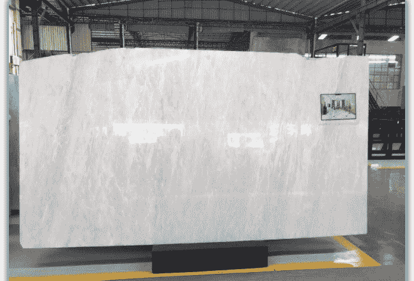

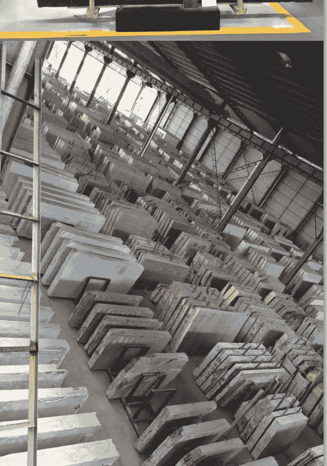

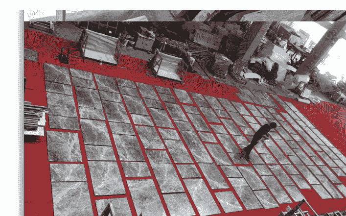

# 珍老师好求助问题

(提问) 匿名用户：珍老师好
求助问题，目前家庭现金600多W，应收100多W，负债400，月供2w多。本人理财保守，认为年增长10%就已经到顶了，不求大幅增长。有什么好的理财推荐呢？研究了你说的招行特色理财，基金定投，还有人说港股打新，可否？如果没有高于5%的理财方式，计划拿茅台酒定投，每月买七八箱茅台，连续一年，到第二年每月卖出再买入新的可以么？另外，每月定投高风险的信托10万，三年为一个周期可否？如果实在没有合适的理财，计划800W左右全款购入一套房子（因为被限购限贷了没法贷款了），然后等房子升值，怎么样？谢谢了

2020-02-16

回答：【帖子编号0409】 <8元买鸡题>
这个问题太好玩了，我一定要翻出来。
这不就是以前有个经典脑筋急转弯：
8元钱买一只鸡，9块钱卖出，后悔了，又以10元买回来，再以11元卖出去，最后赚了多少钱。
----------------
往下的看之前，大家先自己琢磨下，这道买鸡的问题，你是怎么想的？
上面这买鸡的问题，如果你回答说赚两块钱，这说明你数学及格了。但是商业思考不及格。
买鸡这道题是这么考虑的：
第一次拿本金8块，赚到9块，然后你的9块钱，就没资格参与第2次游戏了。
因为第2次本金的门槛已经提升到10块了。
请问你只有9块钱，你是如何参与进去10块门槛的游戏的？
答案是，你要么自掏腰包，要么借钱。
借钱完了，第2轮你从本金10元赚到了11元。
问题是还有第3轮，想要继续参与下去，你还得继续借钱。
----------------
财务上，有个表叫现金流量表。
从利润表上看，上面这个游戏每玩一轮，就赚一块钱。
然而从现金流量表上看，现金流一直是负的，每玩一轮，你都需要扩大外债。
我之前讲过五类资产的区别：
第1类资产是流动性资产，规模是1~2个月花销。

作用是，你通过控制每个月花销的，存下自己起步的资金。第1类资产，大概只在你人生起步阶段起作用，理想的状态是，假设22岁大学毕业，到25岁时，你应该用三年时间存了很多钱了，之后流动性资产的作用就不那么明显了。
第2类资产是安全垫（1-3年日常开销，平均准备1.5年）。
第3类资产是高风险的（增值或者经营性资产）
在你存钱的时候，要同时存安全垫和经营性资产。第二类，安全垫是为了身体上的退路，也是为了心理上的安全感，让自己像个吃喝不愁的富人那样去思考。防止自己在投资或者创业的过程中，因为心理压力过大导致做出错误决策。
而第3类资产，我们冒着风险，实际上是为了财富的大幅增长，而最终，钱是要拿出来的。
所以再回到上面买鸡的那个题。
买鸡是经营，属于第3类资产。
正确的游戏，应该是从第三类资产中不断的拿钱出来，这个游戏现金流必须是正的。你必须源源不断的从第3类资产中把钱拿出来，落袋为安。
而上面买鸡的那个题，之所以是有问题的，是因为这个模型的现金流是负的。你不但没法从中拿钱出来，还要源源不断的把钱补进去。最终安全垫耗尽，自己每个月的工资还要补充进去，指不定还要从亲戚朋友手里借钱……这种游戏算成第3类资产，大家想想，后怕不？
再补充说一下。
当你的第3类资产开始赚钱时，要源源不断地抽钱出来进第四类资产。这个时候再放理财，买写字楼商铺公寓，或者做别人企业的财务投资人，之后才是“财务自由”。
上面买鸡的游戏，在现实生活中是确实存在的。比如开金店的。从2000年开始，黄金涨了好多年，开金店的就像买鸡一样，8元买9元卖10元卖11元卖。结果到黄金掉头的时候，发现手上剩了一批28块钱的金鸡。多年赚来的钱，全变成了这只金鸡。
你想循环买茅台这个事，就是上面一样的原理。最后一批茅台是什么价，是个问题。
关于高风险信托，我也没法评判。
就想我视频里讲的，理财、信托、资管产品、资管计划，这些都是壳。都是铁皮罐头盒，有些里面装肉，有些装水果，还有些装的是狗粮。
你不能只看壳，就下结论一定是
好东西或者一定是坏东西。真正需要关注的是他们里面装了什么。
____________________
从你的提问里，我感觉主要问题，是你的自我定位，你的目标，定的都有点问题。
保守这个词可能在每个人眼里都不一样。
你认为自己保守，可能是自己周围的人都比你更激进……
所以现在需要你自问一下：
你是想保值（第二、第四类资产），还是想大幅增值（第三类资产）？
想保值，稳定食利，那么现在不是2011年。
2010-2012年的时候才是信托和理财利息能到10%以上的年代，因为当年cpi都6%，就算11%的理财利率扣掉6%的通货膨胀，实际到手也就是5%。
现在在扣掉食品价格的cpi大概才1%出头，敢付10%以上利息的，其实是让你承担了不低的经营风险。
想保值，老老实实接受低于5%的收益率，这种才是安全的。
买房子的话，800万分散买一堆二线城市中心好收租的公寓写字楼（不是奔着增值目的！），或者找不限购的法拍房住宅。
但要注意自己买这些资产的目的，是第四类资产，买入之后，就基本出不来了，只能给你带来利息或者租金收入。
相反，如果你是想图大幅增值，那么理财、信托这些东西是满足不了你的要求的。(85赞)

评论区:
文旦颜丑：我们情况差不多，我等下给你总结一下
周防御：现金600！负债400！打算800买房？不是很清楚你们有钱人的想法
君墨：还有应收100万
君墨：如一些房产，差距应该不大
周防御：只是觉得，鸡蛋不能都放进一个篮子里！大部分资产都用来买房！不太认同
陈家波：负债400很显然是贷款，不一样的
□a 树□□：这个特别有意思，有点像一些做股票的操作。5块入的涨一点卖了。看着又涨了又买入。不断循环。最后钱全部进去了。卡擦。股票跌了。站在山顶扣脸]
春岿：京东金融上有一些小的民营银行的储蓄保本保息的利率在4%到5%，存款金额要求都比较高，不知道是否可以投？

# 【帖子编号0408】

珍大户：【帖子编号0408】 < 再写一些“迷信”的事>

刚才起床前突然想起来一些生活中很“迷信”的细节，想记录下来。
我抖音视频评论里，常常有评论说我“旺夫相”，这事我确实觉得自己“敢当”。
因为从我和F先生刚认识的时候到现在，他长相有了很大的变化，他有时候自己翻看十多年前的照片时，还在怀疑说“这照片上这是 我吗”。
照片拿出来对比，就是像两个人似得。以前面部没肉，骨相外露，看着有点凶，笑容也很少。现在脸上肉多了，眼神也柔和了，当年没一个人说我俩长的像，现在出门都说我俩是夫妻相。
我是相信一个人过得怎么样都是写在脸上的，他的脸肯定是越来越好了，这肯定有我一半功劳。
这个过程中，有创业择业投资这些影响人生的大事的原因，有家庭生活一点一滴的积累，而这篇帖子里要写的，是一些关于“迷信”方面的总结。
我不敢说这些细节有用，但是我自己挺信的，所以写下来给大家参考。

**第一条：**

我刚认识F先生的时候，是我们两个人生最困难的时候。F先生那时候有个口头语：“倒霉”。
F先生还是挺有涵养的一个人，不像很多男生一张口就拿“艹”字当口头语，他不说脏话，甚至不说恶语，比如开车在路上，碰到老头闯红灯时，气的只会开口说一句“唉，这个老先生，怎么这样”。
但是对别人不出恶语，对自己确实挺狠的，当年我刚认识他的时候，他已经把倒霉两个字当成口头语了，经常说“唉，倒霉”，“我真倒霉”，“怎么这么倒霉”，“我就是倒霉”。
我听了几天之后，就受不了了。
我小时候一直受到的教育，就是告诉我说语言有强烈的引导作用，所以家长才要多鼓励孩子，不能辱骂，可以批评事情做错了，但是不能批评人格。
因为做错事是可以改的，但是骂人说“你这个畜生、你这个笨蛋、你这个不孝的”类似的这种话，是会让人无所适从，没法去改的。
所以我对F先生的口头语敏感性很高。
当时也很生气，说凭什么说自己倒霉啊，我现在跟你在一起，你倒霉，岂不是还要连累我。
然后我直接就禁止他再说倒霉两个字了。但是口头语是下意识的，很难一下子就改的掉。
后来他每说一次，我就接着说，你倒霉个屁啊，你能找到我你比全世界多少人都幸运，你别身在福中不知福，多照镜子看看自己多幸运。
叨叨的次数多了，他终于不说那两个字了。
但是因为这个事情，我对幸运这件事开始有些关注了。我一直觉得，自己是一个很幸运的人。
比如刚毕业时候心心念念着想当交易员，然而对于一个完全没有工作经验的人来说，交易员工作哪有有那么好找。我投的简历都石沉大海，连个面试电话都没有。后来我开始网上找公司地址，直接上门拜访，才找到第一份工作。
再后来当腻交易员了，因为觉得每天只看市场变化，知其然，却不知其所以然。因为想要更深入的思考经济规律这些事，我开始想改行去做研究员了。
然而，对于一个只当过交易员的人来说，哪个机构愿意招没有经验的人呢。结果也是简历石沉大海。
结果机会来的还是很巧合。当交易员的时候会认识各个机构的同业，有其他单位的交易员，也有分管投资的领导。
我天天憋的，很多观点没处发泄，就时不时的写文章分析经济形势，分析行业变化（就跟现在写圈子里的文章似得）。
这些文章没处发，只好发到qq空间里。但竟然也被其他各个机构的同业看到了（当时msn退出中国，结果大家都改用qq工作了，qq上全是机构联系人……）。
于是很多人认为我“思想很有深度”…...其他机构的交易员开始愿意来找我讨论行情，还有几个机构的领导愿意给我面试机会。

结果我竟然就从交易员转到研究员岗了，这也是一个很奇迹的事情，因为很少有从交易员转研究员的先例。

再比如后来，申请学校需要推荐信。当年外资金融机构不能控股，只能找国资合资，所以我所在的公司虽然是外资，但是是有国资控股股东的，而且级别很高，挂名公司总裁的人，级别是副部。

然而总裁只是挂名，平时不管公司事务（公司里另有常驻的CEO负责）。

我刚当研究员时，是分管行业研究的，不管宏观，负责研究宏观的是一个英国很牛学校毕业的硕士同事。结果刚好她怀孕，回家安胎了，于是我就把宏观这块给接过来来了。

我刚当研究员没多久，经验值才刚开始累积，加上宏观分析比行业研究又难很多，再加上我前面的人是个英国牛逼硕士，我才是个国产土鳖本科，所以底气不足。于是卯足了劲，花了一周多时间，写了一篇关于国内汇率制度改革预测的报告。第二周又写了一篇预测未来两年cpil走势的报告。

我估计一开局就丢了四个2和王炸出来。结果这两篇报告就被抄送给国资总部总裁办了。

大概几个月之后，公司要开董事会，总裁从北京过来了。到了公司就说，要看看“投资部的珍妮”是谁。然后就专门跑到我这，跟我来握手了……

后来到了需要推荐信的时候，我就想起来，这可能是我认识的级别最高的人了，于是拿了这个人脉出来用。

（可惜这次经历，也给我留下了严重的心结。我当时还住在闵行的别墅里，上班特别远，每天5号线换1号线换2号线，单程需要花费一个小时45分钟。有时候起晚了，怕迟到脸都来不及洗。

我清楚的记得，哪天浩浩荡荡走过来一群人，因为总裁过来时，随行的还有N个董事，公司CEO，一堆高管，再加上中方秘书，外方秘书，随行翻译……每个人都是西装革履，身上闪着光的。

结果哪天我到公司时还没洗脸，灰头土脸，穿着淘宝上一百块淘来的破连衣裙，丝袜上还刮了几个洞，跟人家一对比，那一刻真怯场了。我估计着自己脸上表情肯定是懵逼的。

很后悔当初如果我能稍微注意一下自己形象，或许就能更自信点了，或许就能更从容交谈几句，那么也不至于这条人脉最终只留下一封推荐信，就就此断掉了。

因为人和人之间是有阶层的，你只能跟自己上下1-2阶层的人交流，跨度过大的时候就没法正常交流了。我当时展现出来的第一印象，就是跟对方阶层间隔太大。

我当时已经工作第四年，已经不像刚毕业时那么穷困潦倒了，但还保留着工作头三年的省吃俭用习惯，其实是不对的。

这件事之后，我大学时的老友来上海看我，带着我去商场买衣服，开始了改造我的衣柜和改造我发型的尝试）。

不过总的来说，回顾自己的人生，总是有很多偶然性的因素，这些偶然性的因素让我总感觉自己是一个特别幸运的人。

（甚至于拍抖音，我刚捡小福回家之后，小福才巴掌大，就找大咪打架。我随手拍下来，这段视频就火了，然后就有了几千粉丝，于是我才有了拍1分钟长视频的权限。不然只有15秒的权限，15秒是不可能讲清任何事情的，我也就不可能拍抖音......）

我觉得语言是有很强烈的暗示作用的。

大家不妨真的对着镜子，对自己说“我很幸运，我很幸运，我很幸运”。

第一条幸运的事，扯得太远了。

第二条长话短说。

我刚认识F先生的时候，他早上起床，一屁股就坐在枕头上了。我看见以后要气死了。

枕头不能坐！（原因以后找机会再说，枕头这事也是很邪的，有很多预测左右）

同样的还有帽子。帽子不能坐，不能乱丢，一定要放好。

还好这人很挺劝，说过一次之后以后就不再犯了。

第3条：走路的时候鞋不能拖着走。

大家可以观察一下老人，老人越到年老力衰的时候，越到临死越走不动路，都是鞋不离地，拖着往前走。这种走路方式绝对很衰的。

（我也不知道F先生身上为什么有一堆很衰的毛病，后来观察了一下，发现我公公走路就是这样……然而我管不到老人头上，只好要求F先生走路必须走出个虎虎生风，坚决不能鞋底摩擦地面）。

去年晚上我和他一起跑步，发现他跑步时候也是鞋拖地……还好听劝，也改了。

＿＿＿＿＿＿＿＿＿＿

## 第四条是呼吸。

前几年有段时间，早上朦朦胧胧听见他呼吸的声音不太对劲。

呼吸是一呼一吸。呼吸两个动作必须均衡。

浅浅的吸气，浅浅的呼气，这是可以的。
深深的吸气，深深的呼气，这是可以的。
但是浅浅的吸气，深深的呼气，这是不行的！

吸气没声音，呼气也没声音，这是可以的。
吸气有很大的声音，呼气也有很大的声音，这也是可以的。
但是静悄悄的吸气，很大声的呼气，这是不行的！

然而那段时间，F先生吸气没声音，很短、很静很轻，呼气却很大的声音，很重很长，这种就是有问题的。

我吓得直接给他摇醒了。

我说，老头要死的时候才这样，只出气、没进气，越来身体里的气越少。身体里的气没了，人就没 了。

但是呼吸是下意识的，很难改，尤其是晚上睡觉的时候，不知不觉就继续这种呼吸方式了。

后来我为了改他这个习惯，花了不少时间。

一个是每天盯着他早上起床、晚上睡觉前、出门回家后，都要清洗一次鼻腔（这种呼吸方式，可能是鼻炎导致鼻腔堵塞引起的。每天用清水清洗鼻腔能减轻鼻炎）

另一个是每天注意听着他睡觉时候的呼吸声音，一旦出气声音大了，就直接捏他鼻子。捏完了不好呼吸，下一轮吸气时他就自动吸的更深，然后慢慢的吸气短、呼气长的习惯就改掉了。

今天早上他突然又这样了，我心里一惊，翻身正准备提示他，结果就发现他自动就纠正了。听劝是他身上很大一个优点[偷笑]

第五条跟第四条类似。

当你不开心的时候，你要尽量去做深呼吸，而不是叹气。

F先生每一次叹气，都被我提示一次。

还有一些其他的细节，我和他基本不犯这种问题。

比如：
- 尽量身体正直，不要弓腰驼背。
- 就像让子弹飞里那句台词，走路走出个虎虎生风来。
- 不要说谎，说谎会让眼神开始闪失，永远说真话，说坚定的话，就能让自己目光有神。
- 多微笑，（这部分在直播时候说过），人的脸分三庭。
  - 发际线到眉毛是上庭，主管早年运势。
  - 眉毛到鼻子最下是中庭，主管中年运势。
  - 鼻子下端到下巴是下庭，主管晚年运势。
  - 改变中庭运势，最简单的办法就是多微笑，只要你一笑，两个脸蛋就鼓起来了，中庭一下子就饱满 了。

2020-02-15 (272赞)

评论区：

- on the way*: 先赞再学习[咋乎]
- 如此：学习
- 屈晓琳 (微*已满)：先赞。再看。看到三庭部分了，认同不能再认同了。这和运势真的有关。
- walking in*：我遇到一个清华大学的学姐，真的是才貌双全，一直忘不掉，我给我朋友看了看，问我俩有没有夫妻相，他说是我我是新型冠状病毒嘛？啥意思
- 珍大户：春节前几天我助理在办公室突然也是吸气没声，呼气声音好重好长，吓得我一激灵，赶快提示她改。刚才我还在想，如果面试的时候看见走路拖地，弓腰驼背，或者眼神闪烁的人，我肯定是不要的！
- 林小安：受教！
- 空城：先赞，首先说明一下，你这个应该昨天回答，今天秀恩爱没有buff加成[捂脸]！我个人觉得吧，所以迷信其实不一定没有道理，中国信了几千年的东西就是垃圾吗？明显不是！只不过一种文明取代了另一种文明。我们从凡人的角度去批判前者，而拔高后者。这是不对的。
- MAYBEer：我是个特别以貌取人的人，尤其是在选择合作伙伴和的时候，可以不漂亮但一定要端正

关注公众号"懒人找资源"，星球资源一站式服务

## 抖音准备扶持企业号

F先生：抖音准备扶持企业号了，有需求的朋友可以注册了 2020-02-15 (21赞)

评论区：
- Kevin：找不到注册入口👿
- F先生：我正在弄，弄完再说下流程
- Kevin：嗯嗯，有劳F先生了[抱拳][握手]
- F先生：认证地址：抖音企业认证
- 楚小文的奥利奥🏻：抖音企业号蛮坑的
- @@：二琳林：这个要有经营许可证才行吗？
- F先生：要营业执照
- 滋滋灰太狼：公司想入驻抖音，求教怎么坑，以便避之！

春节以来，新型冠状病毒肺炎疫情牵动着亿万人心，也为企业经营尤其是中小企业带来了巨大的困难和压力。

为助力共同打赢这场“战疫”，字节跳动旗下抖音、企业号、巨量学堂、飞书等联合启动“中小企业护航计划”，希望集合抖音与字节跳动多产品力量，通过费用减免、流量扶持、工具开放以及多维度的培训咨询服务，与企业一起携手并进，共克时艰！

2月14日–2月29日“护航计划”第一期推出以下五项服务计划，每项服务均涵盖核心权益，培训指导及专人客服，希望能够为中小企业提供抖音运营的全程护航。

### 1. 免费认证服务：0费用开启抖音企业权益 >>

### 2. 免费课程服务: 专业教你玩转抖音运营

### 3. 运营扶持服务: 3亿+流量提高商品曝光

### 4. 生意转化服务: 0门槛助力商品在线成交

### 5. 远程协作服务: 线上办公，无接触更安全

### 小贴士:

- 1、此次扶持项目面向全国范围企业，部分扶持权益针对湖北地区有所加强；
- 2、为确保扶持政策精准给到企业用户，多数权益以认证企业号作为判断标准，未认证企业可于活动时间内申请免费认证；
- 3、扶持政策中的多数权益以企业为单位提供支持，即一个营业执照对应一套扶持权益；部分扶持权益仅面向活动期间的新认证用户开放，请以具体服务描述为准；
- 4、对于不满足部分扶持政策的企业，期待您的谅解，如有任何疑问，均可通过客服进行咨询，详细联系方式请进入具体服务项目页面获取。

## 疫情之下，齐心协力

希望我们能够与全国千万中小企业携手前行，共克时艰

## 你好大户，我想在抖

(提问) 笑对人生：你好大户，我想在抖音上做知识类短视频，就是讲解写申论的逻辑，你觉得在抖音上做这个有受众吗？

2020-02-11

回答：有受众的。 之前写过一个小孩子补课程的帖子，说对青少年来说，线上效果不好，所以要做线下。 但对成年人来说刚好相反，成年人也不需要老师监督什么的。论学习氛围的话，同一地区的公务员考友往往又是直接的竞争者，氛围反而引起焦虑，未必舒服。 如果需要自律或者学习氛围的话，线上互助群或者打卡活动也能兼顾一部分。 所以线上的劣势没有那么大，反倒是成本下降了，是可以实打实的变成价格优势的。（同样是针对成年人的考试，司法考试已经演变成线上免费课程，靠卖教辅材料盈利了……

所以你这个是有受众的，但是注意要结合抖音的传播特点：大众不喜欢枯燥的东西。因为我也没考过公务员，不太清楚申论到底是什么，感觉像是写公文的？这样的内容难免枯燥，能够既专业又不枯燥，这种难度是比较高的。如果你的视频做不到兼顾两者的话，那么你就退一步，把视频分成“专业性”和“传播性”两类：因为如果只放专业性的讲课视频，因为枯燥，就难以有效地让更多的人看到。所以要穿插一些有意思的视频。举例来说，把生活中的口语转化成公文：比如录一期“公务员老公给老婆的请假条”、“公务员小孩给妈妈的感谢信”等等。在讲课视频之间穿插一些这样的搞笑内容，能帮助你的视频增长一些展示量。(48赞)

评论区：
- 大可：珍姐 请问一下 这个链接的内容 要怎么看
- 珍大户：只有用APP，或者公众号，或者网页登陆才能点链接，微信小程序里点不开链接。 我刚更新了一下置顶贴的使用指南，你可以点看一下
- 大户迷妹：好羡慕你这种有一技之长的人，我也想了好久短视频这件事了，奈何我没有打铁的技能，希望你能坚持住，我研究很久发现的，视频垂直，连续发个3个月左右你即使没特色也能有一些流量，还有录自己觉得特别符合大众的视频，找好时间，一波一波的无限，能快速吸引粉丝，无限的时间咋掌握，还有发现的时间咋掌握，自己掌握，趁5G没到来，你还有机会，抓住了，剩下的花点时间去研究规律，要不自然会白扯
- 笑对人生：谢谢指点，你说的5G到来是指什么呀？
- 大户迷妹：华为5G时代，网络迅速崛起，短视频会大爆发，你上内搜一下
- 挥写先验：短视频跟5G是没有关系的
- 大户迷妹：为什么这么说呢？

关注公众号“懒人找资源”，星球资源一站式服务

## 老师您好，我想请教

(提问) □青岛广告人：老师您好，我想请教您一个问题： 我们老家（山东潍坊诸城）是养猪的，最近想卖猪，但是价格又涨了。想问问能涨到什么时间？现在出栏时间是否合适？ 2020-02-11

回答：价格会继续高位到9月以后，未必是继续“涨”，因为价格已经很 高了，再涨大家吃不起也没用。但是你的猪该出栏的时候就得出栏啊，因为猪的年龄到了之后，长肉速度会下降的，再喂料就不划算了啊......[发呆] 毕竟多活一天就要多喂一天粮食呢。(27赞)

评论区：
- 文良疆丑：卖了能挣钱吗？如果能为什么不卖了？
- 肉多多口：该卖就卖 不要被套。 没有必要
- 爱吃菠萝油王子：珍姐回来了 哈哈哈哈哈哈
- 极时道：下，那恩
- 极时道：阿瓦茨
- 吴立荣：猪真可怜[难过]
- 执念，爱：赶紧买了赶下一批[偷笑]
- ——[翠][强][强][强]老乡好啊！

## 珍姐，我是去年夏天

(提问) 吴小娜：珍姐，我是去年夏天开始涉及餐饮行业，开始以自己的设想做凉面搭配一个热点，因为我们当地有成功案例，我就把这种案例搬到另一个地区去做，开始不知道是推广不到位，还是地理位置原因，几个月一直经营不是特别好，因为，盘下这个店铺前，这个店铺是做炒码粉就是当地比较有名的早餐行业，后面又把盘下这个店铺原来的老板兼厨师请回来做厨师，几个月生意确实好转，但是成本提高非常严重，导致后期一直没有多余利润空间，因为炒码需要厨师，需要高频率使用燃气，高频率使用菜品，到手利润基本没有，店铺只有6张桌子，人员4人。接待还是原来之前店铺老方式接待，凭记忆接待顾客。能帮我分析一下这样的店铺操作问题出在哪里吗？

2020-02-11

回答：【帖子编号0407】餐饮行业的桌子和面积（结尾有说商铺问题）营业面积太小，桌子太少，导致不变成本相对可变成本而言，占比太高。（你这例子太基础，我要用这个例子，增加点数字细节，收录进我的<微观经济学>课程里面给大家当题目[偷笑]）

_____________说一下不变成本和可变成本：跟销量大小变化的成本是可变成本。不怎么受销量影响的成本是不变成本。在现在疫情下，你没有营业，一点收入都没有了。这时候，只要不销售，就不增加的成本就是【可变成本】。比如：食材成本、油盐酱醋调料、煤气费水费等等。这部分成本是和销量有关的。比如你炒一个菜卖30元，其中食材油盐酱醋成本12元，毛利18元。这里的12元就是可变成本。

_____________不变成本是跟你的销量无关的。比如房租，比如厨师和服务员的工资，哪怕一天店里一个顾客也没有，你也必须付这些人的工资。这是【不变成本】。你每卖一盆儿菜，赚18块毛利，最终还要扣除掉这些不变成本，剩下的才是自己的利润。

_____________所以，想要盈利的话，尤其是餐饮行业这种高竞争的领域，控制成本很重要，有几关你需要过：

第一，控制可变成本，提高毛利率。餐饮行业毛利率普遍高于50%，很多60%的。你自己算算，你们店里的食材成本占一盘菜的成本有多少？ 如果成本高了，说明，或者你进货渠道有问题，或者你采购人员贪污了。（从你的提问里，我看不出第1项的问题，主要问题集中在第二项）

第二，控制不变成本。餐饮行业为了压缩不变成本时，就只能让每个厨师服务更多的餐桌，让每个服务员也服务更多的餐桌。（这样才能压缩每张桌子平均到的人力成本） 如果别人家餐馆每个厨师服务10张桌子，每个服务员服务5张桌子，而你们家能够提升到每个厨师服务12张桌子，每个服务员服务6张桌子，那么你们家就比别人节省了20%的人力成本，节省出来的都是利润。 为了达到让厨师服务更多的餐桌目的，就需要菜谱上做精简。 不能求数量太多，否则配菜太慢，就影响厨师速度。 后厨要在非就餐时间，提前把各种材料都准备好，菜洗好、切好、摆好，只等客人一下单就立即进锅出锅。 否则，耽误了时间，就得增加厨师……一增加厨师，不变成本就上去了，又得想办法增加很多顾客，才能覆盖掉增加的成本…… 为了达到让服务员服务更多餐桌的目的，就要设计服务流程。 比如说，扫码点菜能节省服务员，比如扫码结账也能省服务员。越节省服务员，就越节省不变成本。

然而问题是，你们家店太小了。 只有6张桌子。在只有6张桌子的前提下，养4个人？这个比例实在太高了。 平均1.5张桌子养一个人，能盈利才怪。 这么小的店，一般都是夫妻档，基本就不再雇人了，因为根本就不可能养得起人。 你们竟然把前老板给雇来当厨师，前老板估计很开心。因为在这之前，他名义上是老板，其实也不过就是自己当厨师，赚着这一份节省厨师赚来的钱。 店转给你之后，不仅收了转让费，还能继续赚厨师的钱……所以前老板才是最开心的。

所以你想清楚： 如果你们自己手艺够好，就自己当厨师。 如果自己没本事当厨师，只想赚管事的钱，至少要店大一点，才能挤出“给管理者”的钱。因为这么小的店，是不可能养得起“多余”的人工。

【注意】： 最后，给想要买商铺的人说一下。 我反复强调，如果想要买商铺的话，不可以买太小的。至少100平以上。 为来餐饮行业是很重要的商铺承租者。餐饮店里至少要有一个厨房，厨房面积不会小。 一个建面50平的小店，实用面积怕是只有30平米，再花十平做个厨房，最终只剩下20平是营业面积。 另一个建面100平的小店，使用面积估计70平方，花15平做个厨房，剩下55平是营业面积。 最终是多花一倍承租价格，多得了1.75倍营业面积，哪个更划算？ (49赞)

评论区：
- 张兰的歌：6张桌4个人⼈这种大小一般就一个厨师，一个服务员差不多了，最多两个服务员，夫妻档[捂脸]
- a tree：一般是夫妻两人一人8小时交叉。类似沙县。来粉面。我们楼下一家3口米粉店，牛肉面。一人8小时。5张桌子。
  24小时经营。生意一直很不错。10-15一碗。烧烤都关门了他们也照样营业。全年无休。[捂脸]
- 珍大户：是啊。 顾客——员工——老板，就跟食物链似得。 草地足够大，才能养的起羊，羊群是够大才能供的起狼。
- 吴小娜：我们这种就是早餐粉店，在我们店里吃的都是医院里的医生护士，她们每天早上都是赶着上班，基本老顾客已经是固定的。因为很多顾客都问我们送不送餐，我一直考虑的是，桌子不多是不是增加外送量，毕竟接待能力有限，是不是思路不对。我们人流目前都是集中在早上7点-8点，10点-10点半，而且在这个时间段，早餐翻台率太高，收碗都不忙不过来，2个人是根本忙不过来的，一个收碗洗完，一个下粉，一个炒码子，一个收钱报单。中午吃饭不确定性，所以没有准备很多食材。晚餐也不确定性，只有早餐是固定的。
- 吴小娜：就是说，在空出来的时间，是不是用外卖来填补这个空缺。
- 珍大户：加钱去多买点碗备和……你们高锋时间还洗碗，真浪费时间。 下单改成分顾客扫码自助付钱，装一个语音播报就可以了。 墙上贴点磁吸数字，点完的顾客坐哪桌标一下，顾客付完钱就贴墙上记下来，省得记不住犯错。 上完菜再把记得数字拿下来。 __个炒，另一个只负责端、打包、收，就完事了。
- 吴小娜：那是说正常起码需要3人，煮粉的需要一个人工。
- 珍大户：煮粉是干啥的，因为我不懂做饭的流程，所以详细问一下。 这个提前煮可以吗？如果不能提前煮，那么批量煮可不可以？另外，煮的时候难道需要一个人专门在旁边看着吗？他兼顾收碗行不行

关注公众号"懒人找资源"，星球资源一站式服务

## 老师一个朋友是做上

(提问) 青岛广告人：老师一个朋友是做上市公司的债权。想问问这种理财敢不敢买？

2020-02-11

回答：回顾视频<证券法修改>那一期：证券发行由核准制改为注册制。以前在核准制下，因为上市难，导致了已经上市的公司存在着壳价值。（上市过程中，会有很多隐性成本没法计入账面成本。有可能企业家花了很多成本，结果半路一个政策收紧，上市夭折了，前面花的钱就打水漂了。我见过有企业家吐槽说上市上到一半，已经花了1700万无法入账的成本，立即终止的话，钱就收不回来了。继续走流程，还要继续花钱。问题是最后能不能上市成功还不确定。最后上市不成功的话，预估两三千万打水漂了，等同于好几年的利润都没了。这还是有 机会摸到上市门槛的企业。还有更多企业因为指标不达标，连尝试上市的机会都没有）就是因为上面两条原因，所以才有壳价值。所以2020年，可以看作是一个转折之年，就是壳价值在逐渐消失。有一些烂公司在失去壳价值之后，就没价值了……最终A股市场上肯定会淘汰一批烂公司出去。（这也是为什么我敢建议大家买基金，不敢让大家自己去买股票。因为怕你们买到要被st的，踩了雷）

所以，图片上都是废话，重点都藏起来了。重点是，1、钱给了谁手里？是给了“上市公司”，还是上市公司股东？我随口举个例子：华谊兄弟的股东是王中军王中磊。他俩把华谊兄弟的股票质押，得到的钱是进自己的个人口袋的，而不是进公司账。这种债权不叫上市公司债权。（本来你提问里说的是上市公司的债权，根本不包括这种。然而很多人说的时候并不严谨，所以我必须举出这种情况。）以前有壳价值，一个敢质押，一个敢给钱，反正就算股票跌了，大股东还不上钱，大不了股票放着，赶上牛市没准又涨回去了呢。（所以中国才牛市少熊市多……）

2、如果是进了公司，什么样的公司？是垃圾公司不。 就算是“公司债权”，也得看这公司资质怎么样。

3、担保的是谁？他有多大的能力担保。

总之就是一句话，不要看利息有多高，先看借钱的是谁。 前进了胖虎的口袋，你野比大雄是没机会要回来的。(35 赞)

**评论区：**

- wime: 我们公司被上市拖垮的，2016年破产。加上领导者也是好大喜功，不脚踏实地。
- □a tree□：能给出10%的债息估计公司融资能力啥的都不一般吧[捂脸]然而要上市要扩张融资能力很重要啊。
- 新歇：有道理
- 已得：请问你们公司做什么行业的，是如何被拖垮的，可以具体点么？资金链拖垮的是自身产品问题拖垮的
- wime：电线电缆，几个原因…资金链断裂是其中之一。
- wime：产品没问题。
- Bella：经老师，为什么证券发行改为注册制后，股市会淘汰很多烂公司，而不是股市上会出现很多烂公司？

主题：支付宝里面的基金可以买吗，该怎么去买呢？

关注公众号"懒人找资源”，星球资源一站式服务

| 项目 | 投资款（X） | 到期一次还本付息年化收益 | 备注 |
| :--- | :--- | :--- | :--- |
| | | **一年期** / **半年期** / **三个月** / **一年期** | |
| 1 | X<50 万 | 10.50% / 8% / 6% / 9.60% | 无担保函 |
| 2 | 50 万元≤X<100 万元 | 11.00% / 9% / 7% / 10.56% | 有担保函 |
| 3 | 100 万元≤X<300 万元 | 11.00% / 10% / 8% / 10.56% | 有担保函 |
| 4 | 300 万元≤X<500 万元 | 11.50% / 10.5% / 9% / 10.80% | 有担保函 |
| 5 | 500 万元≤X | 12.00% / 11% / 9.5% / 11.40% | 有担保函 |

## 大户你好，我的父母

(提问) 亚萍- : 大户你好，我的父母现在50岁，之前被一个买保险的忽悠买了五六份分红型保险，我感觉被坑了，想问问这个年纪我需要给他们买怎么样的保险，医疗保险吗

2020-02-08

回答：40岁以上再买医疗保险就都不合适了，价格贵，没性价比。 （很容易理解，因为年龄越大，去医院的概率越高。到70岁基本人人都需要去医院了，这时候保额10万块估计要卖你9.5万的价格，买不买保险又有什么区别呢） 一般超过40岁就价格不划算了，大家要买医疗保险就趁39岁。(16赞)

**评论区：**

- 刘家：有的时候你想买，体检不合格，保险公司也不受理
- 刘家：所以有打算要趁早
- 亚萍：那除了医疗保险还有什么其他的保险可以推荐吗，还是说这年纪不建议买保险
- 刘家：我给自和家人配置的是重疾和意外，给老人配置的是意外，重疾那时候已经不能买了。如果想了解更详细还是要去大公司找专员给您结合具体情况来配置~这是我的一点经验~
- 刘家：自己先搜集资料了解一下，然后问清保险的种类和属性，具体保障什么，等等吧～
- 小贺：我也给爸妈买了重疾险[微笑]
- 素：40岁以上的年纪，可以选择消费型的百万医疗险！这个最适用
- 人生如逆旅：买重疾险

## 对的，我理解错了。

(提问) 李海伟：对的，我理解错了。是F先生亲戚短视频引流做服装。我想问是生产加工销售还是只销售？广告设计和推广计划是F先生还是头条运营？

2020-02-08

回答：这件事情特别好玩[偷笑]自从亲戚月销六千件衣服之后，F先生老妈（我婆婆）就眼红了，三天两头打电话来，让F先生教他玩快手直播，说她也想去卖衣服[捂脸]我婆婆说，一件衣服赚10块钱，一个月也赚6万了。我心里想着说，哪个服装厂一件衣服只赚10块钱的话，早就倒闭好几回了。有库存占成本，承担卖不出去的风险，那么能卖出去的衣服毛利至少有50%才行吧。（之前视频里讲过库存是成本）但是这话我没敢说，说出来以后我婆婆更该眼红了[捂脸]

这个F先生家亲戚，开服装厂的，之前只是做服装的生产。厂子可能是15或16年开的，当时写了一篇文章。衣服都是批发商需要什么，他们就生产什么。每年据说账面利润过百万，但是会有压帐和欠款什么的，要账不太好要，尤其是年底的时候。以前销售途径是只批发（因为没有零售渠道），后来12月的时候学会快手上直播买衣服了，算是有零售渠道了。衣服均价100元出头，一个月卖了超过六千件，还没有回款压力，属于比较不错的了。但是事情分两面，不能只看别人吃肉，不看人挨打。亲戚家服装厂今年生产的都是冬季厚睡衣（特意配了一张图在最后，就是大家看新闻能看到，各种穿睡衣上街的照片，就是这种睡衣）。到了12月时，还没被批发商给批走的货基本属于今年就要烂手里了，马上销不出去就开春了，然后就得压一年的钱，等第二年冬天才能继续销售。如果不是靠快手，在节前清了库存，想想日子得有多难过。

他们直播能够销量好，有几个条件：
- 第一，最重要的，他们是服装厂。他们直播直接在厂里，客户看见了，信这个。这就是我[在]圈子里一老早说的，服装行业，服装厂可以做，服装店不可以做。因为早晚就直接从厂到户了，不需要服装店来倒手几道。
- 第二，他们这个还真是能展示。没暖气的地方，很多人冬天有这种厚睡衣需求。我前几年有次冬天过年时去F先生老家，亲戚送来好几套这种睡衣，我看见觉得太难看，死活不肯穿，打死也不肯穿。结果后来冻的受不了，果断妥协换上这种睡衣了。这种睡衣只看图片难以体现出厚度，直播就成了很好的展示渠道。东西总归要有个吸引人的“卖点”，想要做视频直播，必须要找到能够适于视频展示的卖点开。他们这种厚度倒是也算一个。
- 第三，他们直播真的很接地气。衣服乡土+人也乡土，说话也乡土，但是展现出来的就是很接地气，就像是目标群体身边的人，没有距离感，这是很重要的。

所以你看上面这几条，跟广告、设计、推广都无关。什么条件都不用，就这么做起来了。(34赞)

**评论区：**

- A范迪xi：珍老师能把你们家亲戚的快手号码发出来吗？让我们学习学习
- 小趣致：我也很好奇，怎么样的接地气？
- 孙振洲：顺其道而行之！神来之笔
- 珍大户：叫诗经冉

关注公众号"懒人找资源"，星球资源一站式服务

## 珍老师，晚上好，我

(提问) L: 珍老师，晚上好，我今年26岁，护理大专毕业，目前在幼儿园当保健医生，准备等疫情结束后和老公带孩子一起去成都找工作，从事销售工作争取早日安家，但是关于方向选择方面想请教一下老师。

一、去微盟成都公司，有熟悉的朋友在裡面就职，可以和她 在生活上工作上相互照顾，对公司有些了解熟悉。

二、找医疗健康方面的公司，因为正在考取健康管理师，而 且与所学专业相关，易上手。

三、教育培训公司，感兴趣，并且能够在陌生的城市多接触 教育方面信息，而且有助于孩子的教育。

销售虽说大同小异，但行业的选择也尤为重要，想请问珍老 师应该如何选择？或者在近几年的成都没有其他发展会比 较好的行业？

拜托您啦，么么哒

2020-02-08

回答：【帖子编号0406】 之前直播的时候，我举过一个例子。 我上大学的时候，金融还是大家都不懂的专业，班里不 少于1/3的同学都是家里有背景的，普通的一毕业回到老家的 工行、建行、城商行，好一点的去了各省的人行、银监会之 类的，还有更猛的毕业去了国开总行之类的，很多年里我都 直感叹，怎么这么多“有背景”的人。 后来想明白了，因为当 年普通家庭哪里知道“金融”是什么，能知道金融的，大部分 都是已经身在金融系统里的家庭。这些家庭早早给下一代规 划好了路线，又赶上金融行业大发展，现在这些同学基本都 是个地区的小领导了，看起来结果都挺好。 然而也有不一样 的例子。 我助理是学新闻专业的，她们班里据说也有1/3的人 家里有背景，一毕业就进了各个城市的早报、日报、晚报之 类的报社，或者杂志编辑部。 我听完这些，哭笑不得。别说 报纸和杂志了，现在各个城市的地方电视台都快扛不住了，

地方台的主持人都要扛着拉广告的任务，拉不来广告就喝西北风，更何况报社和杂志社，指不定哪天就倒闭了。然而这种状况又不是一天之内出现的，从08年之前就有第一批的纸媒离职潮了，当年早早从报社跑去了门户网站的都算发展的不错，10年之后，每次有新的媒体出现，就有一批老媒体的离职潮。更何况纸媒的人都能肉眼可见的看到，报纸和杂志的销量节节下滑。所以他们应该都能看得到这种趋势，然而竟然还安排自己孩子进报社……你看上面两个例子，一边是听家长的话混得很好的，另一边，是听家长的话，结果进坑了。所以结论不是要不要听家长话，或者要不要跟着亲戚混，或者要不要朋友帮扶，这些都是次要。甚至于，在考虑的时候，你要把这个条件拿开，以免干扰自己的判断。就像报社那个例子，那些人不可能看不见报社的式微趋势。然而因为贪图荫蔽，才选了一条进坑的路线。

所以，你要先把第1个选项里“有朋友在”这个因素拿掉，分析行业和公司之后在做决策。第一个选项的公司，貌似是做微信公众号商城的。销售这个产品，对自己的提升并不大（意思是，你离开这个公司之后，能带走的、属于你自己的东西很少）并且从行业周期角度，“萌芽—发展—成熟—衰退”四个阶段中，公众号已经是“成熟”阶段。基于公众号的各种工具、软件、销售方式方法等等，还处在发展阶段，但也属于发展阶段末期了（附加在公众号上的东西，起步比公众号晚，发展略晚于前者）。虽然销售公众号工具对自己的积淀作用很小，但是如果早几年，还刚进发展期时，是值得进去的。毕竟，能赚钱能存下钱也是积淀。只是现在并不是最好的时期了。所以，对第一个选项来说，我只能说它“不差”。但是它也不够好，还没到值得你积极去追求的地步。你可以把它当成一个保底的选项，如果没更好的选择了，就去这里。

第2个和第3个选项相对来说，行业都是上升期，所以选择这两个行业都没问题的。从自身条件出发，可能对你来说第2个选项的行业更适合你。但这两个选项都有一个问题，就是你还没确定公司，所以在选择的过程中

也有不确定性。 行业、城市、公司、岗位，做决策的时候，这四个选项无论哪一个没选好，都会拖你自己的后腿。 目前你现在的“医疗健康或教育行业——成都——X公司——销售岗位”之中，其他三项都是没问题的。待x确定了之后，再与第一项做比较吧。

第二个选项之中，用你的专业知识去思考一下，别涉足于那些骗老人钱的公司就好（毕竟你还年轻，多想想长远）。 其他的，传统常见的高薪销售是医疗器械/医疗设备这些产品的2B销售，毕竟总价高（圈子里08年最早的帖子，里面有说过，做销售能做高价不做低价，能做2b不做2c）其他非2b的，个人消费类产品的，健康食品、保健品，这些行业都是发展阶段。 最后，服务领域，包括医疗服务、养老服务等等的，可能是前景更好的，然而现在做这些服务的企业还不多，不一定会有很好的工作机会。

说到服务，我内心假设了一下。 假设我是医护专业毕业，我就去开个小公司，主攻2b的救护技能培训，专门去找商场、酒店、物业公司、健身房之类的地方，去给这些单位的人做集体培训，培训做人工呼吸、急救方法、外伤冲洗之类的初级技能（也包括像这次疫情的传染防护等等）。 目的是顾客出现损伤时，商场人员怎样才能衔接好120，而不是只能打个急救电话之后就眼巴巴的看着。 这种培训可能收费几千块到不到2万块之间，对商场酒店之类的，应该不缺这个钱，培训完了他们还能做做宣传，宣扬一下自己的安全意识之类的。 这个市场估计是小而美，能让一家小团队的公司收入不错的。(99赞)

**评论区：**

- 许佳俊：加一句，把救护知识写成书，卖给保险公司，他们不希望客户出事(偷笑][偷笑]
- L：开心开心[转圈][转圈]，居然被珍老师翻牌了，昨天激动好久还分享给好朋友们了，但是不知道咋问，拖到现在[囧]。 在行业、城市、公司、岗位四个选择上，能够确定“医疗健康——成都——X公司——销售岗位”，目前医疗器械和医疗设备的岗位要多一些，但其实我更倾向于医疗服务这一块，能够对自己有一个很好的提升，但没有看到招聘消息，很多都是以健康顾问之类的，可以等选择多一些再跳槽。 一定不会选择比较骗人钱财的公司，请放心，因为我很执着，希望能够靠赚钱的同时帮助到有需要的人，做一个好人。 对于公司设想那一块，真的眼前一亮，是一个能帮助到大多数人提高急救常识的好办法，我从这次疫情也发现大多数人们的防范意识真的很差，普及基本医学常识真的很重要，无奈自己能力有限。 真心感谢珍老师[爱心][爱心][爱心]，等我找到合适的工作一定汇报[呲牙]。 上次提问后已经报了今年的心理学研究生培训班级，希望可以进步快一些，加油(^_−)=☆
- L：出书这个难度太大了哈哈哈，我学习的时候也不是很认真[流泪]。 但是个团队去给保险公司及客户培训这是个好办法哈哈哈
- 张馨：卢大真是良心老师，能把问题解析的面面俱到而且还给出这么好的建议，我觉得你说的这个给酒店做医护常识培训思路太好了[强]
- G：我也是成都的，老师说的哪个培训公司思路真挺好的，我看在报心理学培训，我一直想学这个，请问你是线上学还是线下学啊
- 暖暖：基于我个人的观点，可以做健康管理师，我认识的人有自己开那种养生，月子配餐的，还有在医院的，你是护理专业，应该这个都可以走
- L：我也这样觉得，不知道待遇如何
- 花哎：急救培训的这个思路，其实已经有机构在做了，只是他们的对象现在还仅是社区，学校等（基本是政府采购服务，估计我在的城市是四线城市，商业机构无法接受的）。这些机构是崛起于08年S12地震的公益组织。我身边有几个就是比较专职的机构和培训老师。

关注公众号"懒人找资源"，星球资源一站式服务

## 【帖子编号0405】

珍大户：【帖子编号0405】<疫情对策之餐饮行业>

目前影响最大的估计就是餐饮行业了，圈子里从业者人数也不少。

2003年的时候，海底捞还很弱小，就是靠着外卖业务，熬过了非典。

但是现在太频繁送外卖也是一种风险，而且做好的菜大家也担心，怕沾上病毒。

建议大家开发一下半成品配菜，洗好配好调料也搭配上。每一个包装盒里就是一道菜，保鲜膜包包好，用户打开后只要轻度加工就是一道菜。

比如，进锅自己炒一下就好，或者进烤箱/微波炉/空气炸锅自己加热一下就好了那种。

这种半成品，10盒/15盒为一组，放进冰箱里每次吃一两盒，一组能撑3到5天。那么客户就可以三四天下一次（毕竟自己去超市买菜也得三五天去一次）。

况且进锅之后，高温下什么病毒都没了。

多往低频的“库存”方向上贴合，而不是高频的外卖，大家会更安心一些。

人在压抑中，会更倾向于吃重口味的东西，咸辣，或者甜食、或者高热量的肉食之类的。还喜欢饮酒。

菜品上要注意侧重这种。

估计现在很多人心里都想吃麻辣小龙虾、红烧肉、咕咾肉、糖醋里脊、溜肉段、蒸排骨、粉蒸肉、水煮牛肉北京烤鸭手撕鸡，蛋挞蛋糕冰激凌......

还有啤酒。

要注意使用陌陌，这个是能看到附近的人的动态的。多在动态里发一下自己店的情况。

实在找不着客户，就找以前外卖订单的手机号，现在大家都闲出屁了，不会介意你的骚扰的。

每一个客户都是一个小区的突破口，问他们小区要团购吗，大家定好团购数量，你们可以送一次或项三五天的家庭储备。可以让大家在家中憋着时，不用吃的太憋屈。

目前安徽的写字楼都被封了，10号前不准复工，昨天微信上更是收到消息说浙江某地要求3月1号才能复工......

各地的上班时间估计都在10号到3月1号之间，而就算恢复后，估计餐馆还是要受影响的。

大家一定要想办法克服困难，挺过这个艰难的时期！

2020-02-05 (72赞)

**评论区：**

- 重子: 沙发
- 光头卫: 珍老师，能说说美发行业吗？挺难熬的！
- H: 谢谢大户[强][强][强]
- 捷: 吃火锅吧[捂脸]全是烫菜
- 塔塔: 我在深圳。公司通知2-10上班。随着返工时间接近，大批人员返深，最近一周开始深圳新发病历明显增多。深圳已经在抢建小汤山医院备用了。生活方面，我在南山区，小区半封闭出入量体温。同事公布武汉返深人员隔离情况。我们附近的超市和钱大妈等都是正常开业，还是补朴在线送菜超市横空出世，30分钟送达，还得很方便。价格虽然贵点，可以接受。每天巡逻电瓶车开着喇叭防疫科普喊话。。。
- 美的店: 美容美发行业还好吧，我看还稳定，只是网络和其他代替不了的。
- 光头卫: 是的！在这种环境下也是一样的！
- ◇: 开超市的都发财了，我们这里不管大超市还是小超市，全部搬空了

关注公众号“懒人找资源”，星球资源一站式服务

## 珍姐，我是做中小学

(提问) 优莱教育137389*: 珍姐，我是做中小学课外文化课辅导的，正如你预测的，19年对于教育培训行业还是比较友好。我坐标浙江金华，19年发展还可以（目前学生150左右），但是谁料到没被教育局查封却即将被病毒打败。考虑过开展线上教学，但存在一下几个问题：1. 目前机构体量小 2.教师水平匹配不上 3.目前线上教育流量已被学而思、作业帮、爱作业等平台占据 4. 扩大资本不够。我们的优势是面对面有温度的教学，优质的服务，现在学校都不允许开学，我们的工作就无法开展。珍姐能不能给点建议。

2020-02-05

回答： 【帖子编号0404】 <疫情对策之补习班行业> 我要借着每一个机会，询问一下大家的状态[偷笑]请问下：
- 1，你这个150学生的补习机构需要多少补习老师？
- 2，平时每次开班，是一个老师教几个学生？

如果方便的话，希望再透露一下补习班的收费标准。圈子里做线下教育的人应该不少，分布在全国各地，大家可以互相了解一下其他城市的行情差异。

尽快联系以前的学生或家长。用飞书之类的在线办公软件，用视频会议功能。 每班人数降为原来的一半。 举例来说，如果你们线下班一个班30个学生，网络会议班就减为15人。如果你们再下班，一个班10个学生，那么就减为线上5人一班。 另外再开一个免费的线上自习室，可以是直播软件之类的，抽调一个人出来坐镇视频直播答疑，所有你们的学生都可以免费进来，随时看在线人数。

这么做的目的：
- 第一，这是在逼迫你联系家长。
- 现代人的社交，有段时间不联系，就忘了你了。所以一定不能销声匿迹。只有你经常出现，经常刷存在感，对方才会第一时间想起你来。
- 而如果你现在什么都不做，最后家长在想起补习的时候，会更倾向于想起学而思。对你们后续

## 发展不利

第二，能让你们现在还有点收入，不用0收入。这个时候能进账一点儿是一点儿。第三，要明确目标，你们不是线上教育，未来也不会走线上教育的路线（我一会儿再解释一下原因）。所以现在在做线上教育的时候，一定要向家长强调，说线上教育是不好的（参考我下面解释的原因）。为了减轻线上教育的弊端，所以你们缩减了每个班的人数，平时10人一班，现在只要5人一班了。这是疫情下的临时措施。等到疫情结束后，你们就会恢复。然后再次跟家长强调线上教育的弊端。第四，线上直播间是为了获取新客户的联系方式。免费的总归会吸引一些人的。更何况还会有一些学生或者家长在里边八卦某某学校/某某班级又有新消息了，总归能吸引到一些新的人。

### 解释一下，为什么补习班要走线下而不是做线上？

我18年19年一直说，补习班这事，一定要搞线下，不要搞线上。线上属于可以无穷复制的、“边际成本”非常低。线上教育的企业一直希望能够靠着低成本，来竞争过线下。然而线上教育只适合成年人，对小孩子来说是有弊端的。因为：

1. 小孩子用眼压力很大，再看视频问题更严重，为了提升成绩还损害视力就不划算了（但这只是最小的原因，因为人性只担心最近的风险，而常常忽视长久的风险积累）。
2. 线下是有互动的。
   - （1）老师甲，带着abcde五个学生，老师甲可以快速观察到这5个学生的状态。然而线上课堂的信息传递效果有限，老师甲很难注意到学生的状态。
   - （2）Abcde5个学生互相之间也能观察到对方，形成一些学习氛围。这也是线上教育里不存在的。
   - （3）线上教育里，只能模拟出abcde这五个学生观察老师甲的状态。然而这就全靠学生自制力了……而小孩子们的自制力……大家懂得。真有那么好的自制力，早就成牛娃，不需要补习了。相反如果是兴趣教育，比如教小朋友折纸，拼积木之类的，不需要第（1）条的老师监管、不需要第（2）条的课堂氛围，还能充分引起第（3）条的孩子兴趣，那么线上劣势就不存在了。而且针对不同的学生，是要用不同的教学方法，甚至做个性调整。（1）+（3）导致了老师和学生之间的观察障碍，就没法对学生“针对性”的补习。
3. 因为各省教育政策不同，其实北京名师对河南学生的作用是有限的。本地反而可能“更了解当地政策”。

以上线上教育的最大弊端。需要你们使劲跟家长传递。(79赞)

### 评论区

- 优来教育1373899: 昨天把珍姐抖音视频刷了一遍，今天加入的星球，感谢珍姐的回复，给了很好的启示。再详细介绍辅导班情况：目前150人左右学生，分周末班和课后作业托管班。老师配置4个全职+2个兼职，周末班每班15个孩子左右，每期16次课，一次课2小时，收费1000/每期；课后托管班4000一学期。
- 马妍【My+】: 我也是做幼小到初中教育机构的，2019年六月成接手！前期小白一枚进入的！半年下来，最直观的感受就是，要有优质的教师！和人性化服务！我们是四线城市，线上教育对我们的冲击很低，因为普遍不可线上教育！线上教育实际针对成人还是比较有效的！我的投入成本房租15w（平米数300）和教师（教师三名）工资！目前亏损房租！人员工资可以回来，整体还是亏损状态！三十左右学生，本来年后逐渐走入正轨了！现在又开始疫情！我们教育局对有证件的教育机构都是很友好的！建议想进入的可以去同行学习再进入！那样稳些！
- 马妍【My+】: 你是针对作业班的教育机构是么
- 优来教育1373899: 周一到周五主要作业辅导班，周末就做文化课，比如奥数，英语，阅读写作。
- 刘宏云: 有一款很好的线上结合线下的产品，iEnglish英语训练系统，可以加微信了解一下，18911592766。让中小培训机构在艰难时期获得收益。
- 刘宏云: 有一家很好的线上结合线下的产品，iEnglish英语训练系统，可以加微信了解一下，18911592766。让中小培训机构在艰难时期获得收益。
- 珍大: 你这个是学生招的还不够多。毕竟越多的客户均摊房租，房租成本就越低
- 马妍【My+】: 是啊。大户拥！我招生用各种办法，传单，校门口，活动全做了。完全没有效果！做了一圈下来，最关键的还是口碑，和效果！现在已经有老带新了！但是还不足够我盈利，学员太少，还要养一段时间呀[难过]我们隔壁教语文的，养了三年7个学生，做了十多年了！（在校老师辞职出来的）现在100多学生，纯盈利！因为地方是自己的，老师也是她自己！

# 珍姐，这个在哪里买

(提问)文艺小姐□□□：珍姐，这个在哪里买呢？
2020-02-05

回答：这种个人买不了，都是机构买的。因为有国家政策支持，风险低，所以各家都比较喜欢的。像我以前买过南水北调，也是类似于这种，那个期限长，一买进去可以安心持有十几20年不用操心这笔钱，比天天看各种三五年期限的项目，三年到期又得重新投资要安心多了。不过这个期限是1年的，所以估计都是银行在买。（期限1-3年是银行喜欢的，3-5年是基金喜欢的，3-10年以上是保险公司喜欢的，低于1年的是拆借市场，大家风格不一样）大家可能不理解，银行买这个不是转手再卖给个人客户，而是自己持有。可以理解为，替代放贷款。毕竟放贷款还需要信贷人员时不时的登门企业，去调查有没有坏账风险。“贷”给国开行拿去抗疫，这种公益事业是有国家支持的，不怕钱还不上，所以不担风险，多滋润啊。这只又是只有80亿，对银行来说太小了，分分就没了，想买还得抢的，手慢无那种。 ps，这笔钱肯定是支援湖北的。后续针对湖北应该还会有定向税收减免、各种贷款优惠政策。(33赞)

### 评论区

- 文艺小姐□□□：哇，第一次被珍姐回答(流泪)感动！！
- 买：好赞！可惜买不了
- smile：可以买的呀，我们中国银行手机银行就可以买的

国开行：拟发行不超80亿元战疫专题债券，期限为1年期，上市日为2月14日，本次发行所筹资金将主要用于国开行向疫情防控提供的应急融资。

全球财经 2020-02-04 17:20:29

# 应该卖房子投资理财

(提问)白慧捷：应该卖房子投资理财产品，还是出租房子收租金？

在重庆有一套全款购买的房子，每个月收租2300元，现在要养小孩压力很大，还请了阿姨带小孩，想多挣点钱，是卖房子投资理财，还是继续收租金？

2020-02-05

回答：【帖子编号0403】<房租天花板> 重庆还是人口流入地区，房租就还有上涨空间。是不是人口流入地区，大家自己感觉下：找工作的年轻人多不多？二三十岁单身的年轻小姑娘/小伙子，这样的租客比例越高，未来房租就越可能上涨。（因为他们还处在收入的快速上升期，说白了房东的租金收入，其实就是捆绑年轻人的工资收入……）相反，如果这类人群占比不是很高，房租后续上涨空间就很有限了。三四十岁拖家带口的，再租房就很难承受房租的大幅上涨的。租金涨不涨，其实就是房东和房客的价格博弈。

房租最高能涨到多少？——平均月收入的一半左右。房租占月收入1/3是宜居状态，极端情况能占 2/3（纽约/伦敦这种城市，未来北京上海估计也这样）。但新冒出几个新一线城市，就是靠宜居吸引人的，所以不太可能到2/3。我预期未来房租会上升到人均收入的40%-50%水平，另外还要叠加一个人均收入上涨的过程。比如，未来几年，人均收入会累计上涨50%之类的。

我不知道现在重庆的房租水平，盲目猜测一下，你房子可能是两房或者三房，两人合租的话，每人1000出头的负担是很轻的。你会发现过个两三年，整套的总房租很容易就3500+了，然后再过两年就4500+了…… 相反，理财利率后面基本不会涨了。那么以这套房子现在能卖出的价格当做本金，你可以计算一下当前的收益率（租售比），以及未来预期能达到的收益率，做个对比，就能决定了。

再说过花累。我有个老同学去年下半年被调到上海，以至于他必须要租住个地方。我就顺带打听了一下，说50平米租金4590（非黄金地段）。后来看了一下实拍照片，感觉不是住宅，而商业产权改建的公寓，感觉公摊应该不小，看照片感觉实际面积估计只有30，而且装修费用应该没有太高。总之，我看着性价比感觉是相当不值。（照片附在评论区，大家自己感觉吧）然而，值与不值我说了不算，这个价格也和他的收入无关，只与平均收入水平有关。因为上海的平均收入，人们能承受得了。说白了就是房东与房客的博弈。换算到合肥。我买的公寓比这个大，装修也要更好一些，市场行情价大概1800左右。然而有不少业主，看重托管公司白送家具和电器，就低价1600租给托管公司了，我听说之后就觉得替他们不值。托管公司配的电视冰箱沙发和床，只会是最便宜的档次，能值几个钱。没几年这公寓租金肯定到3000以上，签托管都是长期的，长远看肯定是亏的。(41赞)

### 评论区

- 珍大户：配个图1
- 珍大户：配个图2
- 珍大户：配个图3
- 蜜瓜妹妹：冒泡[跳跳]
- 曰命：大户还没睡啊[呲牙][呲牙][呲牙]
- 珍大户：春节过得生物钟有点乱[偷笑]
- aYaYa：要是我的话就选择收租，看长期，莫看现在
- Mr.Li：我是真睡不者[流泪]

# 请教，第一天加入就

(提问)Bubles：请教，第一天加入就迫不及待想来问了 补刷了大户的好多抖音

我是大四学生，本二学校，专业是工商管理市场营销方向。目前有两路路：一条是去澳洲留学，读管理信息系统。选择这个专业理由有几个，不知道分析的对不对：因为觉得以后懂得计算机会更有优势，这个专业是商科和计算机相结合的，看专业开设也有学习编程语言；本科读商科，研究生再读商科意义不大，虽然我对商科挺感兴趣；有想直接选择计算机专业，但女生学习起来感觉有些困难，并且无基础。估计得推迟到明年2月才能入学

第二条是去一家生产销售饮料、乳制品的私企做市场研究助理，和我现在的专业对口，试用工资是4k，毕业后加五险一金

该怎么选择？选择留学我是否要换专业？

2020-02-04

回答：【帖子编号0402】<乳品饮料行业> 你的第一个选项和第二个选项，差距实在太大。不由地想多说几句。这部分分析，需要大家复习一下以下两个知识点： 1【行业生命周期】(老帖子链接待补。新入圈的朋友们可以多去置顶的目录贴翻一下老帖子） 2【消费文化的扩散】

我刚上大一的时候，学校里有大四的学生开讲座讲面试经验。原因是，她面上了宝洁的管培生。那时候，国内刚加入wto没几年，外企处在最风光的黄金年代，宝洁和联合利华这类公司，属于就业市场上最受毕业生垂青的企业。 面上管培生就意味着一毕业就有七八千的月薪，一年小10万块钱。而普通毕业生行情价估计不到3000。 后来这个起薪水平，貌似十多年没涨过…… 渐渐的未来越多企业超过宝洁，成为更受毕业生心仪的目标。

能支撑起市场翻倍水平的工资，背景是当年快销行业还处在快速【扩张】的时期。

假设现在有一个全新的品类出现，这个公司可以不受产能制约，能多卖多少产品，就能增加多少收入，那么他们最迫不及待的事情，肯定是攻城略地。以第1年为起点，如果当年只占领了一个上海市场，那么第2年，只要花巨资砸下北京市场，就代表着营业额100%的增长。如果花巨资，砸下了五个城市，就意味着500%的增长。如果你是ceo，你砸不砸？在快速扩张的时期，即便用高成本，只要能够渗透到新的城市、铺满更多的销售渠道，传播到更广的人群，让人群覆盖率从20%提升到80%，就是值得的。毕竟每一个“客户”，都是有“目标价值”的。假设一个客户每年贡献500元利润，那么即便花费450块的成本把这个客户拿下，都是值得的。因为这个客户不可能只消费一年。每个行业都有一个客户消耗的周期。比如母婴行业，奶粉尿片婴幼儿用品，每个小孩只消费三年，三年后这个客户就周期尽了。某个年龄段的女装，客户可能消费三四年就换品味了。而快销行业，客户存货的周期非常漫长。假设平均客户周期7年，等于一个人头价值年X元乘7。所以高成本扩张，是很必要的。这就是当宝洁和联合利华最在意的事情。他们产品部门不断搞出新产品，市场部门不断策划新品牌、密集投放广告、强推人群认知，销售人员不断拓展销售渠道，进驻更多的商场和超市。扩张周期的高增长，也能支撑起花销。这就是当年快消行业能够提供高收入的原因。

然而，当所有的渠道，商场超市都已经铺满，市场渗透率已经到了很高，80%的人群都已经成为客户之后，增量市场变成了存量市场。你增加的客户就是别人减少的客户，别人增加的客户就是你减少的客户。别以为“市场营销人员”能化腐朽为神奇，出几个妙招，就把别人客户抢过来，然后自己也成为传奇，领取高薪。这种事是很少出现的……资本需要增值，董事会压CEO，每年都需要利润的稳定增长，才能算作管理层的业绩。而靠市场营销去抢别人客户的概率是不稳定的。所以市场到了存量博弈阶段，公司开始进入精细化管控、控制成本的时期。（国外有项调查，说ceo出身，80%是销售人员出身，20%是财务出身，有意思的是，往住最早的几任ceo都是销售人员出身，而后期的ceo开始更偏向于财务人员出身。原因大家细品）

回答问题时，我假设大家都是俗人、都是普通人。对普通人来说，外界条件的影响远高过自身的努力。毕竟，“是金子永远都会闪光的。”那些精英，哪怕是现在进入宝洁，从基层开始做，若干年后估计也pk掉身边一群人，升职升上去了。但对于普通人来说，你选择这样的行业，就意味着未来十年涨薪都未必跑得过cpi。

提问里第2条路，乳品饮料行业就是这样的行业。目前乳品饮料行业已经是白热化阶段了。你现在4000块进去，如果没有特别的机遇，那么大概率是三年后5000块，五年后7000块，8年后8000块。除非你是真的热爱这个工作，再加上工作环境氛围、老板和同事都让你非常舒适，才会心里好一些。否则会进入到一种焦虑状态。（然而私企中随机性太强，工作氛围这种事又是可遇不可求的）

所以提问中的第2个选项，我最诟病的其实是行业选择。因为乳品饮料现在不是一个值得你选的行业。同样是做市场职能的工作，如果是娱乐休闲行业（比如网游、各种新兴的软件等等）、新媒体相关、高档或者奢侈品、美容化妆、甚至针对老年人市场的行业，都会比你做乳品饮料行业更好。但有可能迫于当下的现状，以至于你没有更好的选项。

所以我是倾向于让你选择第1个，去留学。几个好处： 1，提升学历。目前从二本提升到硕士的性价比还是很高的。毕竟在95后、00后人群里，本科比例已经很高了。但是硕士比例还没有很高。 2，你选的专业也没问题。像这次疫情也能对比出来，信息管理水平还有很大的提升空间。这个专业还是有前景的。 3，从一些“更虚”的角度。留学生代表着家境相对较好，类似于之前讲专业选择的时候，我提到牙医行业会越来越好，因为以后一张嘴看见整齐的牙就知道家境很好……这种留给别人的印象，能有一些软影响，比如让你老板不会像对待农村下属那样压榨你，让你以后找对象的时候对方家里更认可你一些，等等等等……(50赞)

### 评论区

- 各自安好：安！
- 。.:这回答，绝了！！！
- 春辉：服
- Bubks：感谢大户，点醒了我。我确实没有意识到关键的。刚开始是因为觉得岗位是自己想要的。其他的公司很多招聘的市场岗大多数都是市场拓展、活动策划这一块的（不太想做销售和文笔也不是很好）。自己比较想选择市场研究、品牌管理这一块，没意识到行业很有问题[流汗]。其实留学更想选择的专业是商业分析，但是没有合适的学校，也思考过要不要换国家。商业分析更偏向是统计学，数学的分析。管理信息系统偏向计算机一点。
- 阿迪：分析的太厉害了，崇拜呀

# 珍姐，现在我们镇上

(提问)陈晨：珍姐，现在我们镇上的圆通快递代理点转让，月派件快递量是平均7000件以上，需要转让费10万元，店面租金约5000元，人工成本我和我爸，现在受疫情影响，不知道怎么决策了，希望姐给些建议。。
2020-02-04

回答：数据是不是记错了？如果每个月只有7000件，就算一件给一块钱，一个月也才7000块，扣掉房租5000就只剩2000块了，你这还没算油钱和人工费呢。况且据说价格还到1块钱一件。(11赞)

# 评论

- CK：m
- 司徒：租金与转让费看到就…
- 莫愁的倾心人：好一点的话应该是八毛、有些人四毛、五毛。这是收件、寄件收入高一些
- 刘刚：应该是少个零
- 娃娃：房租一年5000
- 包装设计 江峰：应该是年租金
- 包装设计 江峰：镇上一个快递1块钱有点贵，我们这边镇上免费寄件
- Rna沐沐：快递公司主要靠寄件赚钱。寄件的收入会更高，一个包裹赚5元，一天一两百的寄件是很正常的

# 昨天视频没删减的在

珍大户: 昨天视频没删减的在这个链接

（一堆朋友微信上问我[捂脸]）

另外，新进圈子的朋友建议下载一个知识星球app，（目前很多应用商店暂停下载了，但是百度能搜到）用app的话，置顶贴里的链接可以直接点开，会方便很多。

请新来的朋友一定要先看一下置顶帖啊。
里边有圈子使用指南，以及过往的目录。微博2020-02-04(29赞)

### 评论区

- Lü 先生 : 太好了
- 跨境女SL : 真棒
- 刘家 : 好的
- 刘家 : 我这里显示视频无法播放～
- 90年的单身狗 : 珍如，珍如 求问，今天这么涨，现在还适合进基金么。 还是等明天调整再说
- Mr.Yang : 麻辣粉，酸辣粉是什么[流汗]
- 别说 : 渠道有钱了，但是前提是得开工啊！
- SISSI. : 终于把这个视频看全了，太难了[捂脸]

# 【帖子编号0401

珍大户：【帖子编号0401】<等央行降准降息MLF>

刚才抖音不让说全，一直删我视频。

所以在圈子里细写一下：

宏观经济学里有一个费雪方程式：MV=PT

- M是指货币数量的多少，这个是掌握在央行手里的。
- V是货币流通的速度，这个社会上大家一起共同作用的结果。
- P是物价，T是所有商品的数量。

P乘以T，意思是价格乘以数量，这部分是大家最容易想象的，可以理解为整个社会“需要多少钱”。

然而，钱是会动的，今年在张三手里，明天就到李四手里了，所以需要的这些钱，并不需要央行全部发行出来。

央行发多少钱呢？如果货币流通速度是V，那么PT除以V呗。

比如社会上每年生产100万的货物，平均物价是1元，则这个社会需要100万的钱。货币流通速度是2，那么央行只要发行50万货币就够了。

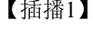

以上理解完，我瞎88几句，大家就当听我胡说吧：

因为有这个“流通速度”的存在，所以虽然社会上需要100万的钱，但实际上并不需要发行这么多的钱。

我以前看到新闻时，报道说因为计生和人工筛选性别，导致男性比女性多3000万。很多评论说，这是社会上不稳定的因素…….

当时我就想，如果类似于这个费雪方程式呢？如果社会上离婚率特别高，如果女的都二婚三婚了呢？离异男人还能叫男光棍吗 [捂脸]

我就瞎88一句，供大家理解这个货币的流通速度，插播完毕。

费雪方程式的作用，其实是这么讲的：

正常情况下，社会每个人都重复的生活，周而复始，所以货币流通速度V是恒定的。

正常情况下，社会科技发展也很慢，生产力也发展的不太快，所以生产的货物数量T也是恒定的。

那么，MV=PT中，V不变，T不变，最后左边就剩一个货币供应量，右边就剩一个物价，所以…….

货币增发了，物价就上涨，货币减少了，物价就下降。

（这么简单的道理，大家现在几乎都知道了。不过在1911年的时候，可是大发现）

正常情况下，货币流通速度不会有大变化，这时候央行放水肯定会引起通货膨胀。

然而现在不是正常情况。

在抖音里讲解货币流通速度时，举的例子：

央行控制着社会中钱的多少，假设社会中总共有100块钱。如果小夫雇佣胖虎当保镖，并付了100块，钱就到胖虎手里了。胖虎再雇大雄写作业，钱就到大雄手里了，大雄再雇静香做饭，钱就到静香手里了，静香再雇佣小夫打扫房间，钱又到小夫手里了。

这时，钱流通了4次，货币流通速度是4，虽然社会上只有100块钱，但实际上创造出了400块的GDP，而且这四个人都觉得自己赚了100块钱，都相信自己有赚钱的能力，对未来充满了信心。

但是，大流感出现了，大家都躲在家里不能跟别人接触，小夫不需要雇保镖了，胖虎不敢让大雄上门写作业了，大雄想让静香上门作饭，静香也不敢去了。静香自己打扫房间了。四个人都发现，自己的收入下降了，对未来一片担忧。这个时候该怎么办。

这就是我当前的观点：

因为疫情的影响，商场、饭店、电影院、游乐场、旅行社、酒店都不营业了，那他们的收入不就断了吗，他们就是故事里的胖虎小夫。

我认为当现经济已经受到影响了，货币流通的速度下降，央行就应该拿出手段，增加货币数量。昨天的1.2万亿逆回购，其实就是就是央行增加货币数量的一种方式，然而效果太轻微。因为逆回购是按天算的，7天到期，14天到期这种，增加的货币数量只存在7天或者14天就消失了，所以效果是不够的。

我真的希望，央行赶快降准、下调利率，各种MLF、SLF的工具，赶快用上。

# （我自己预测，应该也会如此）

# 2020-02-03(157赞)

+ 评论区：
+ 别说：会的，央行时时调控还是很及时给力的，建国的时侯男就比女多3000万了。
+ 殷先生：可以理解成这段时间物价会有一波大的涨幅！
+ 珍大户：不是这个意思[
+ 殷先生：那就好，我是抛砖头的[偷笑]
+ 珍大户：MV=PT 如果央行不大幅放水的活，货币数量M不变，速度V下降，MV就减小了。PT就会降低，要么货物滞销，要么物价下降。总之对今年经济都不太好。所以我才推测央行必须放水～～：先点赞，再评论[哦牙] 刷好在抖音看到第一版，下载了。结果又刷到第二版，现在又来围里看[哦牙]
+ a tree：预计是降息。去年年底就有预期降息。
+ a tree：大规模放水刺激的概率感觉也不大，房价摆在那[捂脸]

关注公众号"懒人找资源"，星球资源一站式服务

# 这几个是关于疫情对

殄大户：这几个是关于疫情对特定行业的影响

2020-02-02(46赞)

评论区：

Rita沐沐：大户能说一下一线房屋中介在2020年大概会是什么样子？谢谢

启音：尸姐，能不能分析下，对于音乐教育培训的发展分析下

启音：我就是合肥的

蔡先生：其他的实体行业今年大概会怎么样呢？是挑战其实也是机遇

陈杰：餐饮嘛嘛说了一下呢，现在都觉得好难。

毛毛：短期影响很大，下周会出阶段低点，可以低吸底仓，长期看好

牛文斌：教育培训属于可选消费，疫情应该有直接影响，如果疫情很快被控制，可能还好，如果拖几个月，感觉上半年可能就是教育培训行业的寒冬了。个人观点

张亮：全国教培都在玩线上

# 看完一堆研报，感觉

珍大户：看完一堆研报，感觉大家都比较缺乏想象力，全部都是用03年来类比。

按照历史来推断，疫情很快就会过去，按照历史来推断，影响大盘6%-8%个点（有可能周一开盘时直接低开5个点+，那么再跑出去，就没太大意义了）。但是这种历史推断法仍有风险。万一这次创造新历史了呢？

所以上面的事我也无法推测。这种情况下我一般都选择继续相信趋势了，因为毕竟趋势的时间周期是按年计的，事件的影响都是按天或者月计的，是短期。所以我就继续坚持原判断了。

（各位从支付宝买基金的，或者其他场外渠道买基金的，建议不要动，PS只要你不是从股票软件上买的就是场外基金。因为卖出价格不是实时的，没法像股票一下，万一早上发现跌的不多才跌3个点，手快就跑了，等跌到六七个点时再抄回来，赚个短线差。）

2020-02-02(78赞)

+ 评论区：
+ 珍大户：上面这些研报里，只发现一条比较新的：国海证券：这波疫情让我们看到医疗行业和政务的不足，互联网+对经济的改造能力依旧有较大空间，建议关注互联网+医疗教育、电子政务、云计算等细分板块。短期看好人出行和行为方式变化带来的医药生物、传媒、计算机、快速电商、汽车、必选消费等领域机会。中期看好流动性宽松预期对地产、基建、建筑材料、科技、低价低估值、细分行业龙头带来的机会。
+ - JIN：先在看着
- 打滚的狐狸：先赞再看
- 别说：谢谢大户老师分享
- Lu先生：中期看好流感哈哈
- 大太太反驳：那基金不卖出了 低点要加仓
- 和生活博弈：新手一个，决定不跑了，一天等不回就等一个月，一个等不回就等一年，啥时候不盈利，这些钱就让我在里面待着吧！
- sunnyhj8：姐，我想知道能加仓吗？我打算明天加仓......

# 家里收废品的，这两

阿元：家里收废品的，这两年行情比较好 钱好赚一些但终究是辛苦钱，特别辛苦的那种。偶然机会接触到一只凌美的钢笔我给挂咸鱼卖了70块钱 一年中碰到的点点滴滴乱七八糟的二手物品让自己学习到了很多知识涨了很多见识，收获了很多惊喜，卖了有3万块钱左右 今年我也结婚成家了，我想出去专门收别人捡到闲置物品，因为干这行的基本上都是没有太多文化的年龄大一些的人群，我不能说坑他们吧，他们捡到了多卖一些钱增加收入，我收过来整理好上架卖给有需求的人，算是比较有意义的事情吧，之前都是捡的没有压力卖出去就赚点，要是全身心投进去，又怕收不到货，还怕卖不掉东西，在北京这种地方就生活压力也会压的自己喘不过来气，特别迷茫 这样是一份值得踏入的事业么？货不稳定 客户不稳定这是不是边际成本非常高？收货客户可以积累各个小区的保洁 保姆之类的客户但是收到的货物是一直不固定的卖货的话我考虑把闲鱼号做精准一些分类上架，比如文玩类账号就做文玩，电子产品账号就做电子，邮票账号就做邮票有哥哥姐姐可以给点意见么？

2020-02-01(43赞)

### 评论区：

+ 珍大户：值得做的。跟你做这件事比较像的是收旧书的。北京有很多老干部小区，这些小区的保安保洁，都有书版去联系，专门收老头子过世后，家人当废品卖出去的书、信、老照片、手册之类的。很多老人当宝的书，孩子觉得没房子之前，占用房子面积不合算，就全卖废品了。其实碰上这种机会并不多，一年到头也收不了几次，但是废品毕竟是按斤卖的，整理之后按件卖，还是能盈利的。略微便宜一些给旧书电的，再转卖二手平台，即使这种也能盈利不少赚的。原因其实就是收来的价格其实很便宜，价格越便宜风险越低。你不担心什么“亲保家保洁”，因为如果你不去，最终很多东西就是按斤、废品价格卖掉，他们也没好处。更不必要因为觉得自己卖的价格高，就不好意思便宜收购。想开一点，因为你是要占用资金、有存货、承担卖不出去的风险的。而他们不过是干手，不占本金，纯收入。两边风险不对等，收入就不可能均等。收废品这件事挺有前途，是很值得做的。因为大部分人不愿意从事，这个行业反而有门槛了（竞争对于越少才能尽可能存在超额利润）。你现在做的又不是传统收废品的，传统收废品的，大多是收集纸壳、收集金属、收集各种能赚钱的原材料，统一卖给造纸厂、冶炼厂或者中间人，属于2B市场。2c这个，好像除了收书和电器，其他品类很少有人开发......所以你尝试差异化竞争。所以你也不用有什么顾虑，直接去做吧，明年后年再米圈子里透露一下收入，我估计应该会好很多消息。关于你提到的担心：1、收不到货，这个基本不可能。因为经济高度，北京人卖的东西，只会越来越多，越来越好。收不到货是最不需要担心的。我觉得更需要担心的是，你卖货的速度高于进货速度，导致货物积压。2、销售上，咸鱼上零售是一个渠道。另外你需要积累一些其他渠道：（1）特定卖货的国内邮群，比如什么玩具、漫画、手办之类的，会有用户重复消费，注意把这些作业聚集起来。（2）特定品类的分发渠道，比如你不懂的品类，衣服鞋包之类的，书画什么的，联系一些能帮你代销的人合作也是不错的。（3）设定一个周期，比如货扔个个月之后还销不掉的，就要再按废品价清理了。这时候或许需要找你做外置的朋友们。国内卖不掉，最后就只能转身到越南老挝，或者巴基斯坦哈萨克之类的地方。珍大户：3，如果你只设定成网上卖东西，这个很容易被别人发现并抄袭。虽然我前面说，收废品的人不多，但印象中北京

从事废品行业的大都集中于同一个地域（记不清了，好像是河南固始县？或许地方也是这个地方的，或许不是）。临近的一群 人之间似乎极容易模仿。比如我之前说f先生亲戚，开展厂早回炉直播带贷，结果收入很不赚，结果他们老家已经有一堆 人跃跃欲试了……你是自己摸索出来的一条路，是先行者。所以，你还要注意不要让他人太快模仿。尽量不透透露你收到 的东西是达成鱼，如果别人问起，你就说是帮上家收的，上家是微商，你只是中间倒手的，赚一个过手钱而已。

定义CaNb：珍妮新年好，这几天大家都很想念你，哈～

珍大户：[跪牙]

阿元：家里面做的是2B市场 旧书之前也接触咸鱼转转最开始扫码回收旧书后来平台改规则不给线给消费币了，什么书好卖 大概能辨别出来，有旧书网可以去销售就是书籍的库存压力特别大，不好卖，但是老书根本不懂，二手电器的话太占用地 点了利润也比较微薄做的人很多，也在积累比如专做补品类的邮票类的客户我直接有货或者不懂的就请教他们了，是河南 固始的，咸鱼平台更偏向社交能积累粉丝出货速度也还好，年里面外出了有30单左右，单价100差不多，肯定有库存压力， 慢慢的接触反正眼光是越来越好，不算是先行者有竞争，做的人比较少，他们更偏向于鬼倒货变卖。有资金安全垫，唯 一的压力就是做的不好，做不出成绩，父亲一直反对，哎

珍大户：我们路路边捡电器捡家电还早[偷笑]那得全中国富成啥样。国外很多旧家具旧衣服鞋子包包回音饰，也都有流通 价值。只要有贫富差异，就会存在“价值差”。无论是二手行业，还是废品行业，都是从这个价值差里面找平衡。国内地域 发展差异还是很大的，而且这个状态预期还会持续很很久。我是装流完品业的时候，把柜相折腾的扔了，结果保洁阿姨没敢收， 说没见过有入丢橱柜的。但是据说北京有些高档小区里，嫌弃开发商安装的家不好，全新电器拆下来直接丢掉的人也不少。 像我看到喜欢收藏手表，但是不喜欢的手表也还是有价值的，不可能块值不要了直接当废品丢。所以后来你有次过 年的时候，他就送我表有一块劳力士（所以我非常后悔为哈过不团聚，能送一块劳力士也好啊[捂脸]）。你看，在丢弃 和“送人/转卖”之间，是有道界限。低于这个界限的，就白送丢了。高于这个界限的，就变成卖二手。不同人群，不同 地域，这个界限的值不一样。北京富人多，可能对很多人来说，几百块的东西就是丢了，到他地区，可能几百块的东西才 舍得丢，几百块的东西只舍得“送人或转卖”。我打个比方：假设北京的临界值是500元，合肥的临界值是50元，那么，超 过500的领域，其实是二手市场。像是说的红木、古董字画之类的，其实是属于这个领域的。这不是废品行业的目标产品。 而你的领域是50-500元这个区间（数值是我随口说的，为了理解方便）。这个区间低于富裕地区的丢弃临界点，他们觉得 可以废弃不要了。但是又高于不富裕地区的丢弃临界点，属于可以二手转卖领域。

珍大户：我发现你咋老刷评论，凶慢了就看不见你发言了

☁ a tree☁ : 我总结了你我就撤了[捂脸]

关注公众号“懒人找资源”，星球资源一站式服务

# 许愿2020： 1，

河边品茶：许愿2020：

+ 1，遇到对的人，结婚
+ 2，努力奋斗，做好事业
+ 3，沉淀自己，向内看，提升自己修为

借大户圈子征个婚吧：85年，170净高，武汉，市内有房，爱好经济，历史，教育，美术等等，不抽烟极少喝酒，没有不良嗜好。三观大学期间形成，至今内核不变。宽和开放姿态对外，只想和对的人互撩一辈子。爱情就是两个深情的人手牵手，一块面对未知，分享各自的喜悦。

2020-01-25(30赞)

评论区：

+ 牛川香：征婚的心愿一定能实现，你好聪明啊！
+ 趁大户：顺手帮加个精华，再挂个链接到置顶帖里去[偷笑]
+ 河边品茶：爱你大户[微笑]
+ 河边品茶：谢谢！
+ A-皮卡诺箱包：这征婚发的时间不对呀
+ 河边品茶：怎么说？
+ 除了努力别无选择：想问珍妮姐这圈子里会不会请你喝红娘酒啊！
+ 除了努力别无选择：想问珍妮姐这圈子里会不会请你喝红娘酒啊！

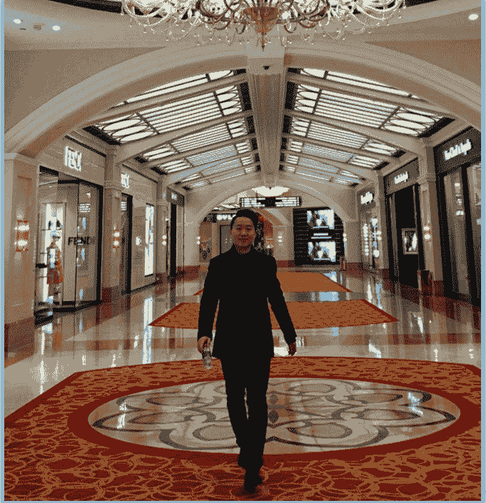

# □颁奖了颁奖了~□

珍大户：□颁奖了颁奖了~□

突然收到了星球出的圈子2019年的年度报告（去年还没这功能）[呲牙] 报告里评选出来了圈子里最热心的小伙伴[鼓掌][鼓掌][鼓掌][鼓掌] 决定给上榜的朋友们颁奖了□ 每人88元红包表示谢意[呲牙]（我找下大家微信，找到的话就微信转账了，找不到的话就圈子里打赏了，后者会被扣20%个人所得税，请大家及时提现哈[捂脸]）

最后祝大家新年快乐！美好的愿望都实现，单身的朋友们都找到爱情，炒股的朋友们都有好收益，创业的朋友们都能创业有成，职场的朋友们都能升值加薪，家人们都健康快乐□□[愉快][呲牙]

2020-01-21(134赞)

+ 评论区：
a |陈浩：恭喜恭喜
定义Cavin：呼，上榜了！欢脱□撒花
小箱子：祝大家鼠年大吉！[玫瑰]
飞呀：[强]
香子太爱吃杏仁：汉斯和一棵树是同一个人吗[偷笑]
陈文波：珍妮觉得最近武汉的事情会冲击股市吗
珍大户：[呲牙]
海的浅笑：今天不就暴跌了嘛

2、2019 年，星球成员一共输出了 3339 条主题，共计输出约 72.86 万字，其中有 346 条被精选为精华主题，星球运营者总计回答了 278 个用户提问。

5、2019 年，收获评论点赞数最多的 5 名用户是（结果不包含星主、合伙人、嘉宾）：

用户：石头，收获了 2452 个评论点赞。

用户：汉斯，收获了 1419 个评论点赞。

用户：定义Calvin，收获了 887 个评论点赞。

用户：Tian，收获了 676 个评论点赞。

用户：杜光辉，收获了 484 个评论点赞。

6、2019 年，在星球的星主、合伙人、嘉宾中，发表主题次数最多的 1 名用户是：

用户：珍大户，发表了 125 条主题，收获了 9897 个评论点赞。

7、2019 年,在所有普通用户中,发表主题次数最多的 5 名用户是(结果不包含星主合伙人嘉宾):

+ - 用户:石头,发表了 36 条主题。
+ - 用户:汉斯,发表了 34 条主题。
+ - 用户:小米可可@苹果儿,发表了 29 条主题。
+ - 用户: 4,发表了 25 条主题。
+ - 用户:xixiforending,发表了 25 条主题。

8、2019 年，星球送出点赞数最多的 5 名用户是（结果不包含星主合伙人嘉宾）：

用户：汉斯，送出了 1373 个点赞。

用户：深圳鑫启锂电池保护板-Kevin，送出了 773 个点赞。

用户：等风的猪🎉，送出了 759 个点赞。

用户：lazy986的6，送出了 524 个点赞。

用户：波菠菜，送出了 461 个点赞。

9、2019 年, 星球内评论主题次数最多的 5 名用户是（结果不包含星主合伙人嘉宾）:

用户：汉斯, 评论了 5091 次。

用户： a tree , 评论了 755 次。

用户：Tian, 评论了 512 次。

用户：lazy986的6, 评论了 476 次。

用户：人生如逆旅, 评论了 419 次。

# 刚才直播的时候，聊

珍大户：刚才直播的时候，聊了会智能家居。

结果我在直播的时候，F先生在收快递，买了一堆智能灯泡，换了家里的廊道灯，装饰灯，落地灯……目前都是语音控制了[发呆]

现在我家里客厅都是天猫系。各个房间里是小米系。唯一可惜的是，两边不兼容……

这玩意是有爆发的潜质，想想其实大部分人是不知道有这种东西的，也不知道有这种功能，但普及起来很容易，只要哪个电视剧里，插个演示镜头就能被观众知道了……

我现唯一好奇的是，除了灯、除了扫地机器人，还有什么可以智能的？

2020-01-16(74赞)

> 评论区：
定义Calvin：大户，先点个赞？
珍大户：捧场王[偷笑]
金灿灿囗：大部分家电都可以吧
李珍：窗帘，橱柜，衣柜，空气净化器，空调，电视都可以用小爱同学控制
大脚：卧室有用 挺方便的
珍大户：电视啥的体会到了，橱柜衣柜是咋控制的？这个我还没见过
李珍：有智能的五金件，可以控制，让小爱同学打开碗篮，打开抽屉啥的
刘振东：小米不用打广告就好多人知道了

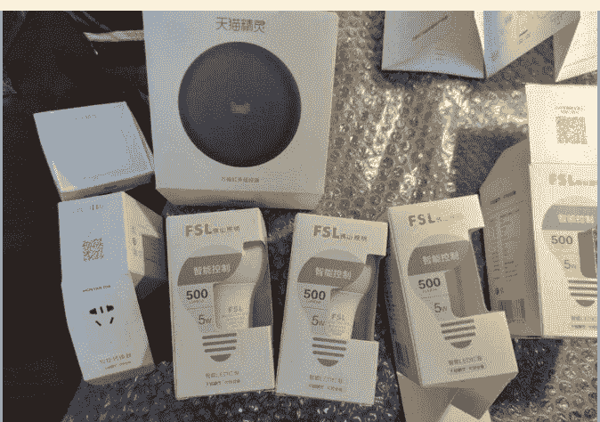

# 坐标江苏省镇江市宝

(提问)匿名用户：坐标江苏省镇江市宝华镇，这里紧邻南京市栖霞区，一河之隔的南京房价都在3万以上，这里房价只有一万多点，配套在一点一点建设。16年年底在宝华镇这里买了一套95平米的住宅，总价113万，商业贷款78万。到了2019年初房价还是没什么变化，由于居家需要，又买了一套132平米的房子，总价180万，这次首付还是跟朋友借的，准备把之前那一套卖掉还上，想卖130万，但是到现在也一直没有人接手。我们夫妻两人创业收入一年30万左右，由于南京有人才引进政策，外地无本地住宅的博士可以以3.7万的价格购买南京河西的房子，小一点的房子90平的，要凑首付也要借钱。请问以我们目前的情况，2020年这边的房子是抛还是继续供着

2020-01-13

回答：不知道宝华镇是哪，所以特地去百度地图上搜了一圈。截了张图：如下图，右上角画红圈那张就是了。位置距南京市中心25公里，跟红色和紫色地铁线的尽头就5公里的样子了。这个位置并不差，你家如果不是急用钱的话就等着。为什么说位置不差： 首先，距市区25公里，是属于能够交通覆盖的距离，城市发展过程中，是有扩张到这个距离的可能性的。只是有，而不是100%，比如上海，往北20公里就歇菜了，但是往西南和西南的嘉定和闵行，30公里还有建设。所以要看城市发展的方向，万一重心往一个方向上偏，那另一边就属于被抛弃了，反而等不到。 然后看下面图，东侧深色部分应该是山吧？山会阻挡城市扩张。 往西是长江。河也会阻挡城市扩张。如果长江另一侧也是江苏还好说，大力建桥，能拉动对岸发展，对岸也是本省，肥水不留外人田。然而过河没多远就到安徽了，不可能没点私心。 不过河往西南方向，又到马鞍山了，还是安徽。 所以你那个位置，我是建议等等的。地铁再扩5公里是有希望的。 就算不考虑地铁，边

上就是森林公园，环境应该不差，离城市又近，交通也不差，所以还是有潜力的。(22赞)

### 评论区

- 杨小米：想知道这个地图用的是什么软件，跟我们平时看的地图不一样呢
- 珍珠大尸：就是百度地图，但是切换到了卫星图模式
- 沫沫：高德地图就可以，右上角可以选择卫星地图。
- A范迪xi：宝华已经被炒过一批了，刚开始的时候可不是这个价，长江对面是江北新区，我附加的图片是18年年底南京各区房价分布图，目前的价格跟这个图片价格相差不大，图片中鼓楼区与浦口区那条黑色线的地方就是长江，南京这两年重点发展的地区是江北新区，几乎涵盖了浦口与六合两个区，浦口区价格已经从原来的1万多炒到两万多了，也是目前外地人口聚集比较多的地方，从浦口到市区坐地铁也就半个多小时。地图显示的建鄞区就是南京的富人区。价格在4到5万之间，江宁区的面积就很大，价格在2到3万，正好栖霞区没在图片里面，但结合珍老师的图片可以看出宝华的位置，而提问的这位朋友说的位置就是在栖霞区以南，说实话目前栖霞区的房价已经是天花板了，我把这些信息列出来给你做个参考
- 杨小米：哈哈好的呢，长知识了。谢谢
- 杨小米：嗯嗯，今天又学一招，哈哈开心，谢谢哦

- 耿耿：宝华镇是个神奇的地方属于镇江市但是居住的都是南京人，用南京的水电，南京网络覆盖，南京的公交，走在大街上跟南京没什么区别，就差一个官宣了。16年疯传宝华会并入南京，宝华房价从六七十涨到一万出头，是镇江市房价最贵的地方，我们小区17年房价还有1.5万，到了18年以后就开始掉到1万左右。房价不涨的唯一好处就是人口日渐多了起来，今年又新建了中小学。2019年南京大学青年教师住房小区也在这里开建了，我想南京大学既然把教师住房安排在这里，如果这里以后不并入南京，教师子女户口怎么解决，最近南京提出发展的“紫东”概念（紫金山以东）让我也比较犹豫。
- 珍大尸：看这个图感觉更直观了，江宁和六合之间留了一个空白区域，如果不并入的话，简直是影响城市规划发展

关注公众号“懒人找资源”，星球资源一站式服务

# 大户你好，第一次发

(提问)脸红：大户你好，第一次发提问帖今天看了您最近发的几篇文章，有点思绪，但是不专业，我的闲钱都是放在支付宝理财定期里收死利息，基本都是一年期4.5-4.8左右，想入手小额部分基金试水，发现支付宝有个红绿灯功能，我看了一下应该是有一定借鉴意义，想您帮我参考一下软件分析是否可靠

2020-01-13

回答：很有参考意义。我刚才特地找了一圈，给大家参考下路径：打开支付宝：我的——总资产——基金，进去后右上角有个指数红绿灯，进去以后点更多。里边能看到很多指数。具体点进去看图，就能看出来（比如我下面截图这个），隔好几年，才会有一段时间在绿色区域。所以我一直觉得“定投”——每个月都去投钱进去，不看大势，是一点都不明智的，长远看，就是被牛熊市所平摊掉。最终赚不赚钱，则取决于你初始时刻，开始的那个时间点在什么时刻。我看有些理财课是推荐“定投”的（我不推荐），他们举例时，全是十几年前【一个低点】开始计算，这个初始点的选择才是计算出来“盈不盈利”的关键。举例来说：股市价格如果是123451234512345，你这么一直定投下去，平均成本就是3，随机卖出还有一半时机是要亏钱的。如果赚钱，肯定是你开始和结束的点“恰好”了，比如你是1的时候开始定投的，那么大概率容易赚钱一些。但如果你是4开始定投的，平均成本就要高很多，结果就不一样了……所以我是不推荐定投的。甚至不提倡大家一直在股市里。在整个时间轴上，你必须抛弃掉一半的时间。一直在里边是不对的。______________ 所以我看这红绿灯图，是挺顺眼的。相当傻瓜式操作，可行。（44赞）

### 评论区

- 周勋尊：一直在支付宝买啊！没用过别的软件！有区别吗？
- Fi：绿的相对可以买入？看了两个的收获历史好像一股，不过我也不太懂
- 打滚的狐狸：这个太及时了！正在满脑子官司不知道买哪个好呢
- 薪格美容：支付宝用了很多年还不知道有这功能，学到了，感恩所有的朋友们
- 程三岁：我选择比较多的是理财，至少保本！
- Laura：这个功能不错，谢谢！
- 脸红：这也是支付宝里的
- 脸红：我全部放在理财定一年不敢动手

关注公众号“懒人找资源”，星球资源一站式服务

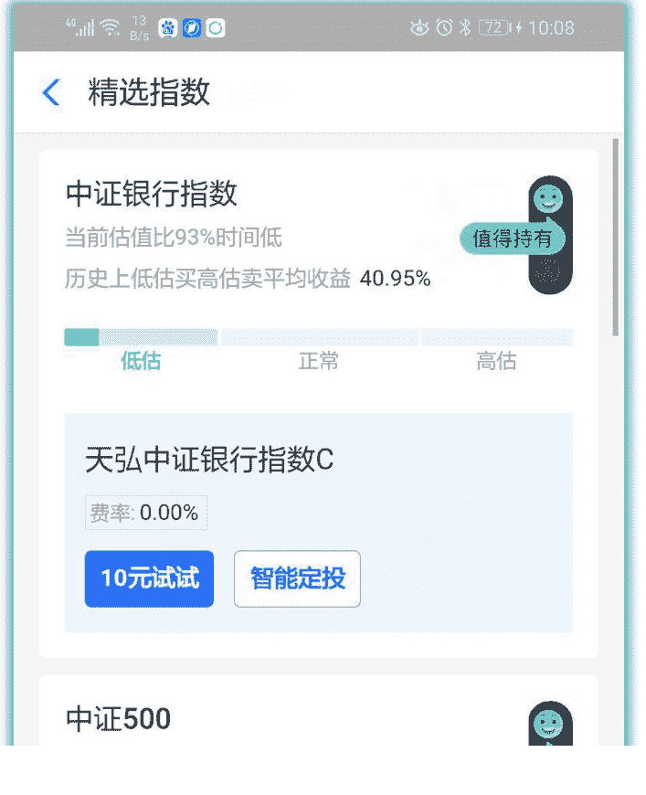

# 华夏中证500ETF联接A

当前估值比82%时间低

值得持有

历史上低估买高估卖平均收益 82.93%

- 低估
- 正常
- 高估

费率: 1.20% 0.12%

- 10元试试
- 智能定投

# 中证全指金融地产指数

当前估值比76%时间低

值得持有

历史上低估买高估卖平均收益 59.76%

- 低估
- 正常
- 高估

# 广发中证全指金融地产ETF联接A

费率: 1.20% 0.12%

- 10元试试
- 智能定投

# 中证医疗指数

当前估值比72%时间低

历史上低估买高估卖平均收益 29.98%

- 低估
- 正常
- 高估

值得持有

# 华宝中证医疗指数分级

费率: 1.20% 0.12%

- 10元试试
- 智能定投

# 上证50指数

当前估值比59%时间低

历史上正常区买高估卖平均收益 28.20%

持续关注

# 天弘上证50指数A

费率: 1.00% 0.10%

- 10元试试

# 沪深300指数

当前估值比53%时间低

历史上正常区买高估卖平均收益 27.42%

- 低估
- 正常
- 高估

# 华夏沪深300指数增强C

费率: 0.00%

- 10元试试

持续关注

# 创业板

当前估值比42%时间低

历史上正常区买高估卖平均收益 31.38%

# 富国创业板指数分级

费率: 1.20% 0.12%

- 10元试试

# 中证新能源汽车指数

当前估值比27%时间低

# 富国中证新能源汽车

费率: 1.20% 0.12%

- 10元试试

# 中证白酒指数

当前估值比15%时间低

- 低估
- 正常
- 高估

# 招商中证白酒指数分级

费率: 1.00% 0.10%

- 10元试试

# 中证全指信息技术指数

当前估值比9%时间低

# 广发中证全指信息技术ETF联接A

费率: 1.20% 0.12%

- 10元试试

以下指数盈利能力较差，建议谨慎选择

# 中证军工指数

当前估值比67%时间低

# 中证全指证券公司指数

当前估值比50%时间低

# 中证全指医药卫生指数

当前估值比26%时间低

# 中证方正富邦保险主题指数

当前估值比25%时间低

# 中证全指可选消费指数

当前估值比8%时间低

# 中证50不是指数基

(提问)zzz：中证50不是指数基金吗
怎么也有持仓呀
然后之前大户说银行不太好 就犹豫了
2020-01-13

回答：中证50，意思就是50只大盘股组成的指数。（指数成分等于这特定50只股票。）中证500，意思就是500只有代表性的股票组成的指数。不管是哪个基金公司，只要他们的基金是追踪同一个指数的基金，就得按照指数成分来配置股票。中证50就是买这50只股票，中证500就是买这500只股票。连比例都是固定的。所以指数基金，各个基金公司都是差不多的。你也不用担心什么基金经理水平差，或者基金经理搞老鼠仓什么的。指数基金就是【跟着大势走】，没有那么多要操心的。————我是建议大家自己挑股票买。确实有研究个股能力出众的人，赚的比指数更多。然而：

1. 这事有概率，有可能你研究半天，还亏的更厉害。
2. 对资金量不大的人来说，你自己花这时间去研究，不值得。之前直播的时候，有说过，每个人/不同的赛道上有不同的【上限】。对于工作的人来说，不同行业里会有个年薪10-30万的坎，标志着你是否走出基层。年薪五六十万又是一道坎，标志着你是否走到管理岗位。之后100多万则是工薪族的天花板了，能突破天花板的人很少，已经不取决于自己的努力了，则是需要站对行业、选对企业、需要机遇和贵人等等，需要很多运气因素。所以看自己在什么的位置。从0到突破10或者20或者30（看行业）不难，从20突破50就难多了，从50突破100，则没有机遇就不太可能。再举例，对于创业的小企业主、生意人，上限要略高一些（毕竟存在风险）。比如各种创业经营里，只要做的不好不坏、能活下来的，一年很容易能达到五六十万、六七十万的利润。想要冲过这个区间，就需要经营水平很高，领先周围的人，然而仅靠这种，大部分就落到一两百万的区间了，很少超过300万的。 300万是一个坎，想冲破这个坎，你就不能定位为自己是一个私营业主或者生意人，而需要扩张你的商业版图，把自己做大……这时候必然开始需要融资、需要扩充员工团队、引入管理人、变革供应链等等很多因素的引入，不是靠原有方式能继续的了。 所以，从0到六七十万的难度不大，往上则开始变难了，想要突破300，就不是你“好好干”就能达到的了，需要你懂金融懂管理懂人际，懂一堆一堆东西。 所以，大家想好自己处的是什么位置。 如果不是已经快到看见天花板的阶段了，努力一把的性价比还是挺高的。 所以干嘛要把精力花到研究股票上呢？
3. 从性价比来说，【大势】才是最重要的，而不是选中很多牛股。 毕竟牛市来了，猪都能飞上天。熊市来了，股神也白费。 只要能赚钱，承认自己是猪不丢人。反正这辈子，只要能多飞几次我就满足了。能不能挑出大牛股反而都是次要的。
4. 对于信息不灵通、反应不及时的人来说，只有靠持有股票数量多来分散风险了。所以选择指数足够你分散风险的。 毕竟你自己是不可能一下子买50只股票的，更不可能一下子买500只股票。(39赞)

### 评论区

- □□□：嗯嗯，没必要研究很深，这个也很耗时
- zzz：好的！感谢回复♥
- 马踏铁：不是上证50啊？
- 多一点：从基金混进了白马股，然后这几天十米利润率[略方]
- 岩韵：我买的招商中证券白酒 几天4.5个点 涨得心头发慌 18年里星基金跌了一年 19年好歹出手 不知道明年什么行情
- 玲大户：跌一年都拿住了，涨几天就毛，你看这哈
- 雨中漫步：基金规模多大比较好？
- 曹咪：珍妮，按照您的建议买了中证500，买是买了可是不知道像这样的指数基金应该在这种情况下出手呢[偷笑]

关注公众号“懒人找资源”，星球资源一站式服务

| 资产类别 | 占比 |
| :--- | :--- |
| 股票 | 91.41% |
| 银行存款 | 7.18% |
| 其他 | 1.41% |

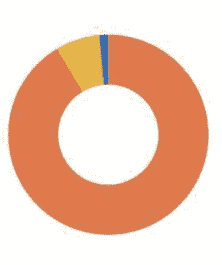

# 重仓持股
2019-09-30

| 股票名称 | 代码 | 涨跌幅 | 占净值比例 |
| :--- | :--- | :--- | :--- |
| 中国平安 | 601318 | +0.54% | 15.82% |
| 贵州茅台 | 600519 | +0.72% | 9.68% |
| 招商银行 | 600036 | +0.15% | 6.02% |
| 兴业银行 | 601166 | -0.10% | 4.28% |
| 恒瑞医药 | 600276 | -0.25% | 4.19% |

# 本人从小学画，重庆

(提问)JIN: 本人从小学画，重庆人现在职业是自由平面设计及软装设计师，从业十多年，现在行业不好。今年准备和两个同门的师兄弟一起做个美育教育培训机构，适合孩子年纪3-12岁，开社区店，开到小区一楼，方便家长孩子那种。前期本想自己做一个品牌。结果我们现在考察到重庆本土有一个品牌也是做的社区店做得还不错已经开了二十多家，现在开始加盟了。所以我们现在想要去加盟这家培训机构，加盟费15万三年，提供教育培训和课件以及运营模式。装修及人工是自己出。一个学生一学期4千。我们就想初期阶段我们以加盟方式借力打力，然后再做出自己的品牌，想了解下今年这行业可行吗?感谢珍大户回答！

2020-01-13

回答：以后思考的时候，少用“借力打力”这种虚词。什么叫借力打力，你告诉我。你说的力，到底是指啥？想清楚自己要的到底是什么。提升品牌声誉？提升营业额？提升客户群体基数？提升续费率？买到他们的培训内容和课程内容？你仔细想清楚，加盟到底是图什么的。说借力打力我听不懂，下一招你再来一个大海无量，我就更蒙圈了。马上就要创业的人了，即将实操，能不能多想点实际细节问题，都落到实处去。

老帖子： 先看完成这个帖子回答我，你们针对的什么群体。
1. 针对有家底的人群，素质教育，要让学生获奖、玩圈子的。
2. 针对城市高压人群的应试教育，中考加分的、升学加分的、美术单项考试的。
3. 给菜市场小学、放养家庭一个放养孩子的渠道，只收钱、不操心成绩和比赛的。
先确定好自己的定位。举例来说，如果定位是3，就根本不用操心牌子不牌子的，牌子的吸引力根本不大。如果是2，才有可能指望加盟能带来牌子吸引力。但要注意，牌子吸引力都是要靠成绩排名打出来的，就像北京上海家长去追求“学而思”的牌子，是因为学而思真能提高成绩。而不是因为满大街见到很多家连锁店，就相信这是一个“牌子”。 再看你们那个社区，符合目标吗？（类比为高档社区/白领工薪社区/回迁房社区）然后再考虑宣传重点。以及培训的重点。3主打培训时间长（其实就是帮忙解放家长），2主打考试排名，迅速提高高考成绩。至于1，我猜你们肯定不是1。

再说说你那个一楼的问题。多看下圈子里关于商铺的分析……商铺一楼、商铺二楼、写字楼里，有有啥区别。一楼比二楼贵很多。多出来的钱，能起到什么价值，想清楚了吗？如果起不到价值，岂不是白花了。每一分钱都要带来收益，你回答我，一楼多花的钱你要达到什么效果？

最后才是加盟的问题。十五万三年都给你提供什么东西，是不是得说清楚一点？像你们提问里写的的“提供运营模式”，依旧是虚了。一个辅导班又不是搞商业创新，提供什么运营模式。落到实处。加盟能带来什么？辅助招生吗？辅助选址吗？辅助装修吗？提供的课件和课程内容是你们自己搞不定的吗？提供教育培训，是指人家给你出老师，代替你们给孩子上课？还是他们给你们培训员工？还是给你们“培训几天”就撒手不管了？以后要不要分你们利润？还有什么额外服务？

就这个提问，后台天天问连着发了六篇，一看就是圈子里关于教育、培训、关于商铺、关于加盟的老文章，一条都没看过。马上就要创业的人了，你这样老脱实务虐，我就很担心。(52赞)

### 评论区

- **JIN**: 好的老师我去看看之前的帖子
- **麦克菠萝油王子**: 读出了大户一副恨铁不成钢的亚子
- **JIN**: [[流泪][流泪][流泪]]是
- **SUN Jia**: ▓▓▓▓
- **刘栋森**: 很多人创业都是这样，把创业当成很简单的事，有钱有激情就能做，使劲做了才能成功，不做永远不能成功这种毒鸡汤，来不如这个赛道比想象中折腾得多
- **刘叶**: 感谢大户这一手提问，问到实处了。我是做少儿音乐培训的，这些问题也都是我实实在在遇到过的。刚刚开始是我一个老师，从一个学生教起，加盟什么都不如好教，慢慢学生有成果可以展示了，家长满意度就会越来越好。没有好老师只有一个加盟的品牌是很难长时间维系学生的，一个学生能学四五年，招进来之后能不能留住，就要看老师的教学能力了。
- **A小殷**: 如果有自己能力，自己做比较好[#哦呀]
- **路**: 哈哈，珍珠说得对！我也是做了一个少儿美术行业的，我原来的想法和题主的想法一样，但是我没有加盟费，没用一年时间给进各大机构学习如何标准化，如何做课后作品等等。这一年确实买过受益匪浅，但是其实所谓的加盟并没有多重要，课件什么的真的可以自己做，真正要看这个品牌能不能提供自己欠缺的必要东西，其实正能体现做过的机构就像我说的，先定位好目标人群，再做出价值！我的机构属于第二类，家长真的很看孩子的“美术水平”所带来的“升学红利”，但是很多机构其实一直在铆足劲的找“服务标准”就是找不到点，看了这个帖子，珍珠真的透彻[#哦呀]

# 【帖子编号0400】

珍大户：【帖子编号0400】<定投>

刚才那个帖子写完，我想起来15年经历的一件事。

我家亲戚分化很明显。

我爸这一系的亲戚里，都是绝对高知，一堆国内的博导硕导，一堆在八九十年代就有留美经历的。跟我平辈的兄弟姐妹里，年龄大的有已经当上大学院长了、年龄小的有还在美国读博的。以至于……在我读硕士之前，我的本科双学士竟然属于全家最低学历[流汗]

我妈这一系的亲戚里正相反……我是唯一一个上过大大学的。

之前讲过我表姐。在我还在上大学的时候，表姐在工作，每次表姐带我出去玩时，都要跟她的朋友使劲吹嘘说“我妹妹可是双学位”……

这次要讲的是我表哥。

表哥可能是我妈这一边中，同辈亲戚里学历最低的人了——读完初二就辍学了，九年义务教育都没读完。而我总觉得这事跟我有关……

小时候我表哥很宠我。当年家家都是独生子女，白天大人要出去上班，家里只剩小孩子。我表哥就经常带着我玩，然后做好吃的给我。

他大概7岁之前就学会做饭了，后来家常吃法不过瘾，还发明了很多新鲜的吃法。比如“电炉子烤肉”，“电热半烤肉”、“暖气烤肉”什么的。以至于他后来当了厨子，我觉得很可能跟小时候这段经历有关……
（写完这段，我都觉得他应该去开烧烤店[捂脸][捂脸][捂脸]）

他家里买什么零食，他都自发的吃一半，留一部分放着，等我去他家时拿给我吃。
小时候香蕉超级贵，他连香蕉都存着分给我，可以说是绝对宠我了。

然而到了上学之后，在我经历了很多次转学之后，顺利升了一个年级，转到跟他同班了。

我在班里排名前十，坐在教室第一排，他在班里排名倒数第二，坐在班里最后一排。

很多年后，我懂了一点儿童心理。儿童成长过程中，最怕自己老被拿来跟别人做比较。家长总提别人家孩子，就会让儿童在成长过程中产生阴影。

而因为我的存在，我表哥在几乎每天都在被老师骂的过程中，还要被拿来跟妹妹做比较，估计心里阴影也是挺大的。

当年他跟家长和老师说，只要坐在教室里，脑袋就开始疼，大脑里就像有个声音在嗡嗡的响。回到家写作业时，一打开作业本，大脑就一片空白……

然而当年的老师和家长都不懂儿童心理学，只觉得他在找借口，瞎编理由、信口胡说。其实现在回头看，这是很明显的厌学现象，可能需要心理学干预的。

然而当年没人知道怎么干。于是表哥读完初二就辍学了，成

了全家亲戚里学历最低的人。

很多年后，当我再回忆起来时，总觉得他9年义务都没读完，也跟我有很大的关系……以至于我心里充满了愧疚。

（当然，也跟当年《》风摩有关。带坏了好多孩子。当年拍这些片子的导演和演员们，真的是造孽了。）

再后来，等我上大学之后，跟表哥表姐们就各奔东西，十几年里竟然跟表哥只见了两次面。

第1次是在2012年。
那时候我投资项目经常要全国出差，12年的时候到了表哥所在的地方。表哥高兴的，又做了好多好吃的接待我。

然后就跟现在，在直播时候号召大家节俭似的，我就开始给我表哥上课。我跟他说，你一定要多攒点钱，每个人一辈子都能有几次机会，但是你需要本金。赶快攒钱吧，再等个两年股市就要好了，到时候你一点本金都没有，你就错过机会了。

我已经记不清是怎么引起的话题。可能是因为看见他用苹果手机之类的……我说你现在花的6000块买一个手机，这个六千块可能是3年后的两三万块钱，你再想想，花两三万买一个手机值不值。

时间隔得太久，我已经记不清我我表哥是啥反应了。依稀记得当年为了让他相信我的“权威性”，我还从旅行箱里掏出来了公司的投资凭据，一张纸5000万，掏出来给他们看。

第2次见时，已经是2015年的春节了。当时因为我姥爷过80大寿，于是一大家子人都聚齐了。

其实那一轮牛市14年就已经开始了。（记得14年的时候就不断跟mba同学谈牛市，但是14年时还很少有人相信）

整个14年，尤其是11 12两个月里，我们资产已经偷偷的上涨了很多。所以春节期间，我们是有一种迎来了度假的心态。

然后我问问 我表哥，说上次见面的时候让你攒钱，你攒了吗。股市牛市已经来了。记不清我表哥怎么回答的了。

春节过完，回到上海，进入3月份的时候，牛市氛围已经开始往普通老百姓中扩散了。

因为我是有迹可循的最早在同学qq群里宣称牛市马上就来的人（可能在14年八九月份，感觉当时还是用qq多过用微信的时候），到了10月份之后，我几乎每周时不时的在同学群里谈股票，时不时的炫耀我这个股票翻倍了，哪个股票翻倍了什么的。

当时个股翻倍的很多，然而指数涨的并不明显。所以虽然我资产上涨很多，但是无论怎么谈股票，还是有一种“自话自说”的感觉，感觉别人都以为我是踩狗屎运而已。

然而从11月到3月，经过5个月的发酵，全班都开始对股票感兴趣了，我一下子成了班里的明星人物，下课要被围起来那种。

我又想起我表哥，就给他发消息，我说牛市已经来了，你要是有钱赶快放进去。

到了四月份，感觉我班上所有的同学都开户了。每个人都在谈股票……
然后我表哥终于心动了，在我的指导下，开了个华泰证券的远程账户，把账号和密码交给了我。

然后我帮我表哥炒股的故事就开始了。

一把辛酸泪。

我表哥第一笔钱存进去，8万块……

我看见数字，当时就要暴怒了，气的直拍桌子。当时就是觉得，他已经30岁了，30岁的人就存8万块钱，合适吗。

他都不是国企有稳定工作的人，一个工作朝不保夕的，怎么就能没点危机意识呢？

好的时候一个月怎么也能上万，坏的时候估计几千块，但怎么牙缝里抠也不至于只攒8万块吧。

拍完桌子，还得继续管他。然后用这八万块开始买股票。

当时行情还是很好，感觉没到一个月的时间，大概赚了四五万块钱，账上有13万了。
我暗自松了一口气，觉得终于让表哥存款到6位数了，还挺高兴。

结果没几天，表哥又往股票账户里放了十来万。

我气的第二次拍桌子了，原来不是他没攒钱，原来是没相信我！当初拿出来的连一半都没有…….

气完了，还得继续管他，又继续买股票………
印象中，到累计浮盈到了8万多（本金大概是24万左右，时间太久记不清了）。

然后表哥第三次往账户里转钱了。

我真的要被气死了，因为浮盈加仓是大忌。

因为：
随着股市上涨，【风险只会越来越高】，而浮盈加仓，意味着【平均成本越来越高】，即盈利率这一数值被拖累降低了。

我举数字，来详细解释一下：
（大家最好自己跟着算一遍。投资其实就是数学游戏，数学很重要）

-   1、在只有8万块、盈利5万的时候，等同于盈利50%以上。

账面总共13万。在此时间点时，跌40%才到8万的成本线。而我在亏20%的时候，肯定会止损出来【这是原则】，最终一定会落袋15%以上的利润，本金更是相当安全的。

-   2、然而到了本金24万，盈利8万，总盈利等于33%。

账面总计32万，从当时的时间点，亏损25%才到成本线。这样如果亏20%止损，最终落袋只剩5%的利润了。

3、而到我表哥第3次加钱的时候，本金到了38万（当时我气的要爆了，存38万钱了，第一次只拿出来8万……说明就是不信我嘛），账上浮盈8万，总盈利只剩20%了。

账面等同于一共46万，从46万亏到38万，只需要18%。稍有回撤，利润全部都会打水漂。

上面我的反复说，亏20%止损出局。为什么这么说？

因为牛市多假摔。
一根阴线两根阴线，让你顿时缩水百分之十几是很正常的。

你害怕了，出去了，就等于被洗了。大部分牛市没盈利的人，都是半路被洗出去，然后后悔又追高。

成本高、利润薄，就没有“肉垫”。

对外行来说，最容易想当然的认为，“浮盈都是赚的”，比如第一波8万赚5万，盈利50%+，会觉得自己赚了50%+。

但这种想法是不对的。最终没人能吃完全部。

利润空间中，有一部分是“肉垫”、是用来抗揍的。就像是胖子的脂肪层。

你离开的时候，你一定被挂掉一层肉，才能走的掉。一定比账面的“最高点”缩水。

前期累积了50%的利润，这就是胖子的脂肪层，走的时候被刮掉20%的肉，你还能剩30%的肉，带着利润离开。

如果你前期才累积了15%的脂肪层，就开始乐呵，等你离开的时候，非但带不走肉，还要被刮掉骨头。

我表哥第三次加仓的时候，已经到了6月中旬。

账上总本金38万，算上浮盈一共46万多。

我当时一下子感觉到害怕了，心累加上害怕，因为我已经遇见了，感觉要亏损了……

必须说一下，不是遇到股灾！

（相反，我并没遇见股灾）

这种对亏损的预见，是因为发现这就是典型的“浮盈加仓”。

浮盈加仓是错误手法。

靠着这种错误手法，即便是牛市，最终也难逃亏损。所以我是真的害怕了。

给表哥这次操作，我破了很多戒。

第一诫：不给人推荐股票。

靠牛市，操作手法也很重要，像我表哥这种浮盈加仓错误操作，牛市中也是注定要亏钱的。）

结果我比推荐股票还严重，我亲自给人操作账户了……

第二戒：不做各种违反纪律的操作。
浮盈加仓就是一个，结果因为我表哥，我被迫做这种明显反智的操作。

第三戒：是对F先生撒谎。
我一直觉得两个人坦诚最重要，不能有隐瞒。所以帮我表哥买股票这件事，我从最初就告诉了F先生，从最初开始我俩一起吐槽，为什么30岁才攒8万块钱，不攒钱去买iphone是多么不理性的消费观念等等，一直往后，各种进展也都一直告诉他。

到这一刻的时候，f先生劝我赶快脱手，不许再管了，赚8万块已经可以交差了。然而在这一刻，我内疚心犯了。

f先生并不知道我表哥辍学的经历，也不知道我们小时候那么深厚的感情。

我当时只是觉得，我表哥只有初二的文化水平，平时除了吃的是他喜欢钻研的，其他任何事情都不思考，所以人生很多机遇对他而言，是完全不存在的。如果我不帮他，他可能要一直过赚多少花多少，终日为生计而奔波的日子了，而他连养老保险都没有

另外表哥又告诉我，其实38万里，有他女朋友攒的钱，还有女方家里支援的10万块买房的钱。其实他自己的钱只有20万上下，第一次就掏了一半出来。第二次是看了盈利不错，把自己和女朋友的钱只留了一小点，剩下都掏出来了。

第三次更是用“妹妹会炒股”为由，让女方家里给了一笔“先拿来炒股，之后准备用来买房子”的钱。（我听完就感觉，没要你彩礼还给钱，真是真爱了，算你命好）

而他之所以告诉我上面这些信息，也是因为我逼问他“有没有借债”。（借债炒股也是死戒，是无论如何不能犯的一条死戒！

不仅不能负债炒股，还要正相反：就像这个帖子里说的，你要留出额外的钱做安全垫。

我被表哥的第3次投钱吓到了，所以不得已去追问他。如果真的发现他借钱炒股的话，那么股票账户当时就会停掉，不会再给他买任何股票）

所以，因为上面两个原因，我是真的同情心发作。我当时内心想着，已经46万多，只要再盈利3万多，凑个50万我就收手。

凑够50万，数字很好听，对他们也算一笔不少的资产了，能够开开心心的去结婚了......

（在这时候，我已经又犯戒了。

投资最怕定这种“赚到xx就收手”的心态。一定不能定目标，而是要随行就市。否则万一一目标定低了，你错过机会。目标定高了，为了这个目标，又开始忘记风险而铤而走险。

各种电视剧电影里，每次出现做完这一次就金盆洗手，最终都是死翘翘。这种现象不是没有理由的。）

总之，我当时内心已经很严重的情绪了。

害怕（自知是在亏损边缘）、跟表哥的亲情压力、F先生让我停手的家庭压力……

然后我跟F先生说，账户退掉了。结果继续操作了……

账户最高浮盈到48万多，离50万的目标只剩1万多，然后股灾了。

很快就亏损了20%多，到我止损的时候，账上还剩37万，不仅盈利没了，本金还亏损了1万块出去……

我那个时候并没有遇见股灾（那一次有很严重的人造性因素）。

但投资中有很多比预见性更重要的因素，包括正确的投资方法和手段。

举例来说：

那次牛市终结时，就算没有股灾，也是两根阴线（两天大跌），然后反弹，反弹不到高点，继续跌，再反弹，缓慢进到下跌周期。

跌的未必这么凶。但对我的结果都会一样，都是最高点亏20走人。然后关账户等三五年后再战。

所以，假设如果表哥只有8万块。或者他一开始就把38万块全都拿出来了。

那么到股灾时，浮盈应该在90%以上，就算亏20%，还剩50%利润能够带走。这轮就这样收尾了。

等股票全清掉的时候，账上只剩37万现金了。（ps，这时候也要说一下，我先自己跑的，然后再操作我表哥账户的时候，软件延迟非常重，已经出不来了。所以前面圈子里大家讨论开户公司的时候，我说过在华泰的账户遭遇过延迟，下不了单。指的就是我表哥这个账号）

进到空仓状态的时候，我一下子就放松了。开始思考。

觉得亏一万块钱也没啥。钱来钱去一场空呗。

我思考了一下判断，我表哥也不会因为这事怪我的。我推测哪怕亏个五万八万的，他也不会说啥，他还是硬汉子的[偷笑]

想到这些的时候我就放松了。当时感觉就这么样结束吧......

然后看见我之前爆赚过的一个医药股价格被腰斩了，并且还在连续跌停，价格已经跌倒14年12月的水平了，于是我直接把37万全抄进去了。（已经记不清是跌停板上抄进去的，还是等开板之后抄进去的。但是这种手法大家别学，因为研究过那只股票的价值，知道被恐慌所低估了，这种特殊历史事件不会再重现的）

现在很多细节已经记不清了，不记得是当天涨停还是次日涨停的，但是反弹了20%之后，我就立刻跑掉了。最终算是盈利了5万块的样子。

然后告诉我表哥说牛市已经结束了，别再想着股票了，钱都拿出去，赶快买个房子吧。

我猜我表哥估计每天都在看股票账户上的变化，经历这么一番过山车，估计他心里也吓坏了。

他估计到37万的时候，已经打算要认赔，回家哄媳妇，努力炒菜赚钱填补亏损了。看着后面的反转应该是心有戚戚焉吧。

后来他也没跟我说太多话，只发了个大拇指说“妹子你真狠”。

然后过了几个月，他说买房了，买了一个六七十平的小房子，每个月贷款再还一千多块钱，跟买房之前的房租差不多，所以其乐融融。

后来16年的时候房价翻倍了，他就更嗨皮了[呲牙]

那轮股灾之后，他股票账户上好像还剩了1000多块钱没有取走。我问他这是啥意思？他说，留个1000多块钱，证明还有股票账户别忘了。希望我在下一轮牛市的时候再记着带上他。

马上又要过年了，这一回是我姥过生日，一大家子人又要聚在一起了。

不过这一次我打定主意，肯定不会再让他买股票了。[古惑仔](https://t.zsxq.com/AFEAOqr3)

2020-01-11(199赞)

> 评论区：
- 别说：想表达啥？
- 珍大户：白写了[流汗]
- 定义Calvin：看的很过瘾也
- Rtaa沐沐：大部分人会记得股票上涨时候的喜悦，而故意不去想亏损时的伤痛。站在情感的角度上，我觉得大户帮表哥还是对的。
- 蔡泽菀□：不然让他买啥？直接买肥招拍摄：珍妮想说牛市要来了，这次不带表哥了[偷笑]
- 珍大户：今年过年，告诉他去快手直播做菜[偷笑]15年之后他买完房就结婚了，然后孩子都有了，有孩子之后花销大，这五年不一定能攒下多少钱。告知完他没有太多本金的话，只会懊恼，没有正面意义，所以今年不告诉他了[偷笑]
- ~栗~：终于要来了

关注公众号"懒人找资源"，星球资源一站式服务

## 房屋漏水维权求助

(提问)米兰人@张克圣：房屋漏水维权求助买的期房，是顶楼34楼，前几天去验房，因为当天正好下雨，去了才发现卧室房顶漏水，跟开发商沟通，只说会修补，但是这个问题这么严重它修补应该无济于事，和他们沟通无果后拨打了市长热线，受理后目前也有5天了还没动静，求助大家

2020-01-10

回答： 翻出来问一下大家吧…….[发呆](7赞)

- 评论区：
    - 米兰人@张克圣：谢谢大户，麻烦有过类似维权经验的朋友们支持指
    - JIN：这可是开发商的责任。平顶的话通常有积水。要求开发商加固防水。
    - 米兰人@张克圣：担心也是管不了多久，不信任他们
    - 谦逊徐默默：我也住顶层，去告他们
    - 米兰人@张克圣：没打过官司[撇嘴]
    - 启东好小倍：修补基本是治标不治本，凿掉一次到位最好，房顶漏水本就是难题
    - 诗和远方Ru：我家也是顶楼，刚交房
    - 米兰人@张克圣：我想要的解决方案就是你说的这个，但是开发商不管，态度也很傲慢，置之不理

## 一开始知道知识星

泽 獓：一开始知道知识星球是因为珍妮
今天才进来，显然来的太晚了
我在北京做了一个北京上门喂猫的业务
解决节假日出行，没法照顾猫的痛点，春节接的订单量很多
很多，这个事很早有人做，但做的都是不温不火的那种，珍妫好像也有猫，想听听您的看法

2020-01-10(10赞)

### 评论区：

- 珍大户：客户出门后把家钥匙给你吗？[呆呆]
- □a tlee□：我也感觉不安全。万一在家里偷东西或者作哗[捂脸]
- 泽 獓：大多把钥匙寄给我还有的是电子锁，一个月大概接了200多个家庭，我跟他们是这么保证的，双方互相安装录像设备，在客厅公共区域操作，我这边上门前签约协议提供身份证件照片[呲牙]
- 泽 獓：偷东西来讲，这不明晃晃嫌疑人了嘛[害羞]，就他去了丢了，也吹明显了
- 珍大户：我也愁这个问题，之前只有大咪一只猫的时候，最长走了14天，准备了一堆盒子当猫砂盆了，回来时每个屎盆都满的快溢出来了。 但现在加个小猫，小猫极其矫情，屎盆当天不铲，第二天嫩嗷嗷着要往床上拉屎的样子。上周屎尿了，我用巴掌打它屁屁，估计它根本不疼，还以为我跟他玩呢。前天又拉屎上了，气的拿数据线抽了它一顿……[流汗]
- 冬日可爱：现在不是有摄像头嘛，门上装一个，谁开门在你手机里都能看到
- 泽 獓：解决了信任问题，这个痛点真的非常不錯，只是我做了一个月来日常非节假日的订单还是特别低频次
- 泽 獓：上门一次40分钟猫粮水洗净项满，铲完屎 在和猫咪玩会，有的家庭用的自动喂食器经常卡粮，两三天去一次比较安全

## 前几天发表的一个庞

珍大户：前几天发表的一个庞氏骗局：

我发现，其实很多入局的人。虽然心里是知道不靠谱的，但是有侥幸心，觉得自己可以赚一点就跑。
所以靠“提醒骗局”这个理由来劝他们，似乎达不到效果。

所以大家再劝家人朋友时，建议再增加一条理由：

在资金盘骗局中的获利属于赃款，是需要退赃的！目前信息科技这么发达，转账记录查的一清二楚，不像以前似的 一圈烂账，谁跑了，跑掉多少钱都不知道。

不仅仅是赚钱的要退赃，在资金盘骗局中当员工，拿工资和提成的收入也要被追缴。

所以不要报侥幸心理，觉得自己跑得快，能带着利润出来……

带着利润出来的要被追缴（手快花掉还不上的还要去坐监），带着亏损出来的要去报案等退赃，反正怎么都少不了要跟公安打交道了。还是不参与，少给公安找麻烦最好。

2020-01-09(32赞)

### 评论区：

- 生活：哪参与者的钱呢？国家没收吗？
- 珍大户：思想赚哪，赌资可是全部没收的。还好这个不认定为赌场，认定为有人受害。那么赔款先赔付受害者。但是一般肯定不够赔付，因为过程中有人逃出去了，有人赚到快钱大手大脚花掉了，最后进监狱也没钱赔你。所以最终受害者多少都是有些损失的。 前些年监管没有现在这么严的时候，一般能追回来30%。 现在信息技术更发达了，或许能高点？
- JIN：谢谢大户，学习了
- 生活：“云联惠”我朋友投了上百万，两年了现在，好像没有退回来，估计是太多人参与了，新闻报道是上千亿的规模。
- 卉自恨 Dav：公安作为一览无余一抓到底
- 冬日可爱：我以前公司的老板还在投这个……
- 咬咬喂司令令宝宝：珍始，说说丙内层集团吧！家里老人被洗脑拉不进来了[捂脸]
- A 巷子里18184*：现在很多非法集资的，我就被骗过，说什么去他们学校学习美业这一块只需交几K，然后介绍人进去就返还给你，被骗的都是女生来学习啊，进修啊，有些都是借钱来交了几万的学费。后面学校一下没人了，现在就是还账，真的那个女骗子现在都豪华了，还开饭店什么的，看着好气啊，不得好死。

关注公众号“懒人找资源”，星球资源一站式服务

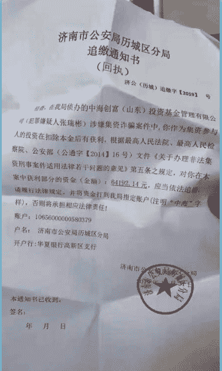

中国联通 4G
下午 5:31
24%

## 退款通知

tktz

详情

你自2016-04-06至2017-10-30在夸客任职期间，全部工资税后总额为309984.61元。接公安机关通知，你必须在2019年12月31日前退款至以下警方监管账户：

| 户名 | 账号 | 开户行 |
| :--- | :--- | :--- |
| 夸客投资管理（上海）有限公司 | 121913354510101 | 招商银行上海丽园支行 |

汇款后请提供汇款凭证截图及姓名、电话、身份证号至邮箱 tktz@quarkfinance.com 进行确认，非本人退款请在备注中注明退款人员姓名和身份证号码，如有任何疑问请拨打夸客客服电话 400-680-0388 进行咨询。

本邮箱不作答复，有任何问题请联系客服咨询。

## 警方通告

杭州市公安局下城区分局依法对杭州孔明金融信息服务有限公司（“人人爱家金融”网络借贷平台）涉嫌非法吸收公众存款案立案侦查后，持续加大侦查力度。为依法惩治非法吸收公众存款、集资诈骗等非法集资犯罪活动，维护国家金融管理秩序，保护受害者的合法权益，根据《中华人民共和国刑法》、《中华人民共和国刑事诉讼法》、最高人民法院、最高人民检察院、公安部《关于办理非法集资刑事案件适用法律若干问题的意见》等有关法律规定，通告如下：

杭州孔明金融信息服务有限公司涉嫌非法集资的行为人（包括部门主管、普通员工、业务辅助人员，其他为吸收资金提供帮助人员）自通告发布之日起至2019年12月31日止，应将在自己在杭州孔明金融信息服务有限公司工作期间的工资、提成、奖金等费用全额退缴至杭州市公安局下城区分局指定账户（备注填写退款人姓名）

| 户名 | 账号 | 开户行 |
| :--- | :--- | :--- |
| 下城区网贷企业债权资产货币基金专户 | 3301040160013435329000 | 杭州银行环北支行 |

退款后将退款凭证截图、退款人姓名、手机号码、曾任职时间和岗位以电子邮件的形式发送至xqga99@qq.com。在此公安机关郑重告诫涉嫌非法集资的行为人员，根据法律法规规定，及时退缴上述退款的，可以依法从轻处罚；其中情节轻微的，可以免除处罚；情节显著轻微，危害

不大，不作为犯罪处理。凡在本通告规定期限内拒不退缴赃款的，公安机关将严肃依法追究相关法律责任。

杭州市公安局下城区分局
2019年11月19日

## 警方通告

中晟博远资产管理（天津）有限公司涉嫌非法吸收公众存款案，天津市公安局南开分局已于2017年9月8日立案侦查，并已对相关涉案犯罪嫌疑人采取强制措施移送审查起诉。现案件已在法院审理中。

为依法惩治非法集资犯罪活动，维护国家金融管理秩序，保护集资参与人的合法权益，根据《中华人民共和国刑法》、《中华人民共和国刑事诉讼法》、最高人民法院、最高人民检察院、公安部《关于办理非法集资刑事案件适用法律若干问题的解释》和关于《办理非法集资刑事案件若干问题的意见》等有关规定，涉案非法集资行为人（包括业务员、业务辅助人员、其他为吸收资金提供帮助人员）自本通告发布之日起至2019年12月31日止，应将自己在上述任职公司期间收取的代理费、好处费、返点费、佣金、提成费及工资收入等赃款全额退缴至天津市公安局南开分局指定账户（南小民政委侦查系统局向公安南开分局打击犯罪侦查支队五大队现场办理）。

不及时退缴上述赃款的，可以依法从轻或减轻处罚；其中情节轻微的，可以免除处罚；情节显著轻微的，危害不大的，不作为犯罪处理。凡在本通告规定期限内拒不退缴赃款的，公安机关将严肃依法追究相关法律责任。

通光相关犯罪事实。

联系人：白警官
联系电话：022-27601384
联系地址：天津市南开区华坪路8号

天津市公安局南开分局
2019年11月26日

平安南开 @科技e警察在线

## 警方通告

为依法惩治非法吸收公众存款、集资诈骗等非法集资犯罪活动，维护国家金融管理秩序，保护受害者的合法权益，根据《中华人民共和国刑法》、《中华人民共和国刑事诉讼法》、最高人民法院、最高人民检察院、公安部《关于办理非法集资刑事案件适用法律若干问题的意见》等有关规定，通告如下：

浙江小融网络科技有限公司及其关联公司涉嫌非法集资的行为人(包括业务主管、业务员、业务辅助人员，其他为吸收资金提供帮助人员)自本通告发布之日起至2019年12月31日止，应将本人在上述公司任职期间收取的工资、提成等费用全额退赔至杭州市公安局西湖区分局指定账户（备注填写责任退公司和退赔人姓名）。

| 户名 | 账号 | 开户行 |
| :--- | :--- | :--- |
| 杭州市公安局西湖区分局办案资金专户 | 3301040160005394088 | 杭州银行股份有限公司西湖支行 |

联系电话: 朱警官 15958045517

在此公安机关郑重告诫小融公司及其关联公司工作人员，根据法律规定既规定，及时退缴上述赃款的，可以依法从轻处罚;其中情节轻微的，可以免除处罚;情节显著轻微，危害不大，不作为犯罪处理。凡在本通告规定期限内拒不退缴赃款的，公安机关将严肃依法追究相关法律责任。

特此通告。

杭州市公安局西湖区分局
2019年12月1日

## 大户您好，一直潜水

(提问)刘佳恒：大户您好，一直潜水中。我想咨询您一下影院发展红利还有多久，国家对乡镇第一家影院有补贴五十万。在乡镇建个影院要四百万左右，预计回本三年。但是现在全国总体票房增加，观影人次却在下降（高票价的结果）。国家对影视人员监管更加严格，今年新拍的片子明显减少了，矛盾的是国家对乡镇影院建设却是支持的。随着科技发展人们娱乐方式发生改变（抖音新媒体），我对影院行业有点迷茫望您解惑。

2020-01-09

回答：【帖子编号0399】<电影市场>（这个提问记得是一年前提的，当时想回答，然后被新问题盖住，就沉下去了……因为星球APP功能挺不友好的。所以大家如果以前提问没有被回复的话，可以像这位朋友一样，再提问一次~）————电影院是可以投资的。这个问题风险点不在电影院，在乡镇。先说电影院线。大家不要被高票价、观影人数下降所影响。目前观影群体的比例还不高，都是大学生、二三十岁年龄段的人为主，向其他年龄段的渗透还在持续过程中。建立消费习惯有赖于“第一次”。就像是一个没去过酒吧的人、没有去过星巴克的人、没有去过游乐园的人。只要没有第一次，就永远别指望别人重复消费，但有了第一次，之后就会有第二次、第三次……（其实就是拉新）去年的《》其实就是这样一个拉新片，票房50亿，是靠着拓展去了50后、60后观影人群把票房拉上去的。《》之类的动画片是拓展更小年龄段的观影人群的。所以，看出什么问题了吗？拓展观景人数（拉新），是靠着不同的类型片，电影类型的丰富来完成的。而目前电影市场，恰恰就是类型不够丰富，所以吸引力有限。比如，缺少职场片（类似于多年前《》这种题材的）、缺少婚后的片、缺少乡村题材，美国的公路片也是很重要的一个题材，国内也没有，离婚/撕逼/杀夫之类的，复仇电影比如小三复仇记、儿子为爹报仇的也没有。会有吗，会的。所以电影市场还长远着呢。不用被短期的观景人数下降所影响。其实观众的购买力远没到上限，只不过是去了电影院找不到想看的东西罢了。

___________插播重提示：千万不要因为我这篇回复，去入“电影投资”的坑。目前大部分的“电影投资”都是新型骗钱游戏。___________

继续说：而你这个提问中，风险因素绝对不是电影行业。而是乡镇。建议还是带着自己的坐标，让大家讨论一下。怕的其实是老龄化+人口流失。

- 1、不妨算一下你们当地有多少人口。人口太少的危险。
- 2、当地从计划生育的年代开始，一般都生几胎？生育率低的危险。
- 3、当地现在年轻人（80后、90后、00后）还多吗，如果还家家都有年轻人在老家，那自然不怕。如果有迁移倾向，就需要担心了。（不知道怎么算的，不妨回忆一下你最近两年参加了多少次“婚礼”。每年都有很多次，则算好消息。）

(58赞)

评论区：
JIN：大户回答下我的提问吧[调皮][哇手]
_JANE*：珍珍老师的逻辑太敏感了，每次都分析得很细
Leona Xiao：被大户的逻辑惊艳到了[玫瑰][玫瑰][玫瑰]
海南果蔬～厂房中介：珍姐，晚上好！请教下：每个城市或乡镇大约多少人口，是从什么地方调查的，或用什方法调查的？
momo：我也想知道
海南果蔬～厂房中介：我找到了，珍姐专门写过找数据的，搜贴子：0359
别说：生二胎的真的很多，已经成了风气了，二胎人数都超过一胎了
凡夫俗子：农村长住人口平均年龄70以上了，看电影吗？

关注公众号"懒人找资源"，星球资源一站式服务

## 【帖子编号0398

珍大户：【帖子编号0398】<家庭资产配置目标>

提了一个问题:

除了房产固定资产外的家庭理财配置如下，希望大户指点一下，配比合适吗？

- 5%黄金
- 33%指数型基金， 五只基金都是指数型 22%外汇，美元，瑞士法郎
- 20%银行理财， 建行年化3%左右
- 12%保险， 主要是理财型
- 8%现金。

资产比例这事上没有对错，但是我不是按照比例来划分的。

首先把资产分成5类性质:

- 第一大类：流动性资产。
- 第二大: 安全垫资产。
- 第三大类：风险资产。
- 第四大类：长期收入。
- 第五类：养老金。

第一大类资产，是最容易理解的。就是日常花销进进出出的钱。按绝对值来，数额够覆盖你1.5到2个月的花销，就够了。（对应 在提问中说的8%的现金资产，你算一下数值看看，是多了还是少了。）

这类资产平时放货币基金或者t+0理财，也就2.5%-3%的收益，假设平均放两万块，那么2.5%的收益就是一年500元利息，3%的收益就是一年600元的利息。

当你不是特别富裕的时候，这几百块钱也是要计较的，不能白扔了。如果你就是活期在银行账户上躺着，那等于每年这几百块就白扔了，这是不对的。

但是这部分钱也没有太大意义，不过就是这点收益而已。

————————————————

第二大类资产，安全垫。
在圈子里提过很多次。金额标准，就是够你两年（左右）的花销。可多可少，18个月也行，36个月也行。

放到流动性稍差、收益更高点的银行理财里。可以是
1、一个月只能购买或赎回一次的【半封闭型】理财产品。
2、也可以是滚动接力存一个月/两个月【固定期限】的理财。
3、也可以是半年期甚至一年期的【定期理财】，靠着<滚动存钱法>那期视频里介绍的方法，来弥补中间不能提前取出来造成的流动性不足。

（比如这个帖子里提到过一个每周里，只有一天才能购买和赎回的理财产品）

要求必须是：
1，不能有风险。这个钱不能出坏账，也不能有涨跌。所以

p2p这种是不行的！像股市一样有涨跌也是不行的。黄金外汇也是不行的。

- 2，在你可选的东西里，挑个收益率偏高的就可以了。
【附：银行理产品的风险等级，看他们评级R1-R5中，R2、R3可以买，R4、R5就是风险大了，有涨跌的，不要买】

总之，可选的方案很多。

如何理解这个大类的资产呢？
这个资产，是有很重大的心里影响的。

第一，从18岁你进大学/或者刚进社会开始，你就要有这个意识了。不是让你立即、很快把这份钱存出来，而是要有一个目标。

比如，到28岁存够16个月的安全垫。到32岁存够24个月的安全垫。那么分摊到每年中，这个目标并不高。

假设，你第2类资产，定的目标是今年新增“1.5月”的安全垫。然而实际上，你存了4个月的钱。那么多的2.5个月钱，放到第三类资产中。
（可变环节A）。

第二、这个钱有一个很重的心理学意义。
随着安全垫的增加，你在职场上会心态更加平和。不会时不时的流露出担心自己被炒掉的焦虑感。
（相信我，你的老板和你的同事都能读出来你流露出的焦虑感。然后就会渐渐看轻你、压榨你，连加薪都会给的少。只

有你先拥有“我做这份工作并不【只是】图你的工资”这种心态时，才会更淡定、更能心态平和的做事，也更容易受到尊重）

所以刚毕业的小朋友，确实不用着急存这个钱，因为你找工作比较快，丢了一个工作，很快就能再找到第2个。不像35岁朝上的职场老人。所以你不急这方面的钱。每年定一两个月的小目标，渐渐的增加第2类资产就可以了。

第三，这份资产更重要的心里意义，是把你和第3类资产隔离开，充当一个防火墙的作用。

第3类资产是风险性资产。如果你的人生里，不来配置一点儿风险性资产，长远看增值会比较慢。

但当你配置了风险性资产，你就会被风险所影响。跌了你会焦虑，甚至没法正常生活。如果没有安全垫做隔离，心魔很快就会战胜你[偷笑]，然后就会越赔越多。（比如有人股市赔了60%甚至80%、90%的，我从来不能理解怎么会赔掉如此之高的比例……这种基本都是心态上太过看重盈亏，心里放不下，想着迅速回本、扳回一局……）

这个世界上，有一些人是职业股民。职业股民想要做的好，就必须要“不从账户里取钱”。只要不从股票账户里取钱，才能做到把账户里的钱当成别人的钱似的，心态放松。

每个人都自己的时代，年轻力壮的二三十年里。至少能碰到两三次“风险资产”的机遇。所以我不建议大家完全放弃，但更不建议大家一直关注。像“职业股民”一样每年都冲在里面，就容易变成王熙凤——算来算去一场空。

再说第3类资产，风险性资产。

从你能够开始攒钱的年龄开始，每年要攒一部分钱进到安全垫中，又要攒一部分钱到风险性资产中。

上面举例的过程中写了一个（可变环节A）。这个可变环节a是根据外界环境来定的。

首先：

风险资产不单纯的指股市相关的东西。

股票、债券、乃至黄金都算。

（ps，大家记住，黄金不是一个长期持有的玩意。因为这个东西没利息收入的，所有不生息的东西都不值得长期持有）

其次：

股票和债券，有一个跷跷板效应。股票好的时候，债券一般不好，债券好的时候，一般股票不好。但偶尔也有都涨、或者都跌的时候。

所以至少超过一半的时间里，在股票或者债券中，是值得押一个的。整个10年周期中，估计有2-3年是两者皆不好。还有个1-2年是两者皆好，另外五六年，至少能压一个。

这时候的可变环节a，是指：

如果你感觉都不好，存下来的4个月的钱，全增加进安全垫。

如果你强烈的感觉某一个会特别好，今年的安全垫计划先缓缓，存下来的4个月钱，全增加进风险性资产。

然后全部风险性资产中，可能80%股20%债，或者是20%债80%股之类的比例换仓。

【待增加内容：关于怎么判断每年的外部环境，该把钱放到哪块儿，我会另外写文章说明。大的方向其实更容易把握】

另外，我是不建议大家自己炒股票的。无论是买股票还是买债券，你都放基金里就完了。

自己研究股票是挺浪费时间的，性价比远远比不上【只看大方向】。只看大方向，就能避免大部分情绪不稳定带来的亏损，也能赚到大部 分的大势收益。

省下来的时间，你不如去研究一下创业或者赚来的钱怎么滚入第四类资产。

再说第四类资产：

前面说了，人生二三十年里，多少都会遇到两三次机会。机会里赚到的钱要及早身退，不要以为好运气能一直持续。被你抓住一次从1变10的机会，你就指望下次从10变100了，最后早晚老天会告诉你，说你太贪心了。

手里钱够了先提升生活质量，买房买车吃饭健身读书（在这之前都节俭着吧）

之后，有好方向、好机会的，拿出去创业做点啥（前面让你不要花时间研究股票了，省下来的时间，多琢磨自己所处的行业，精进技艺，积累信誉口碑人脉等等，最终能发现机会就去创业）。没有什么好机会的，拿去买地段好，预期“租售

比”很好的公寓、写字楼、商铺、甚至车位。
这时候你就有了长期的被动收入

## 第五类：

## 用你第四类资产的“利息”，去买个大病保险。 https://t.zsxq.com/B6UnYbu
2020-01-09(179赞) 

评论区：

珍大户：忘记点评提问中的比例了。 你这里如果是理财型保险的话，那么和银行理财属于同样性质的。

珍大户：总结起来是这样子的。 第1类资产是日常用度。 用你省吃俭用的钱，去存第2类和第3类资产。 用第3类资产的钱，去赚第4类资产+提升生活质量。 用第4类资产的钱，去升级日常消费+支撑第5类资产。 所以，延迟消费其实是挺重要的一个环节。

定记□丰源蚝业1833*：马克

陈磊：mark

周勋尊：有点小开心！还没认识大户的时候！我就有意识这么存钱了！以前都不知道什么叫做指数基金和货币基金！基金交易的简单知识都是自己摸索出来的！ 1.流动性资金：余额宝 2. 安全垫资金:月期和周期的货币基金 3. 银行定期存款！[呲牙][玫瑰]

小花花花花花花：学习

阿尔泰山：续费用户打卡～

珍大户：[鼓掌]

关注公众号"懒人找资源"，星球资源一站式服务

## 化妆品行业的利好消

珍大户:化妆品行业的利好消息:

化妆品行业法规要修订化妆品新规将出台，有人被闷头一棒有人却收大礼包

2020-01-09(25赞)

评论区：
珍大户:
祭先生:沙发
A:巷子里18184*:三沙发
JIN:催更[害羞]
小琼吖:大户姐，化妆品代购行业怎么样呢[害羞]
小琼吖:大户姐，化妆品代购行业怎么样？我做了日韩代购6年了，不知道怎么突破[难过]
H:好事啊[呲牙]刚好要做天然化妆品，我公司精油 纯露天然的利好啊
GRACE:美容养颜的中药材市场怎么样？

## 请教一下大家:20

火火火：请教一下大家:2020年每月要还3万左右的贷款。目前整年的贷款钱已经准备出来了，除此之外还有些闲钱。这些钱每月会递减3万还贷款。我能拿这些钱做些什么理财？因为平时工作比较忙，所以没有太多时间研究，也不期望有太高收益，稳妥就好。感谢大家了[抱拳]

2020-01-09(20赞)

评论区：

鹿森:我什么时间才能做到一个月能搞到万

火火火:看你在行业月入过万的人都在做什么，比他做到更好。当然除了努力，可能也还需要有运气。

珍大户:设个周二9点58的闹钟，去抢这个招商银行app上的周周发2.0的，万一抢不到买另两个也行。然后要还款的前一周，设个周二的闹钟赎回。（这款理财，是只有每周二才能买进或卖出，其他时间冻结。但是收益挺好的，值得买。）其他银行的比如浦发、广发之类的，大家找找，有什么高收益的理财，也截图上来让大家都知道一下。（ps，图上这个平时估计就4.5%多，5%不到，现在是过年前钱比较紧，所以临时看着收益率上去了，平时没有这样）

火火火:好嗨！感谢大户！[抱拳]

珍大户:忘上图了

弘阳:可以看看昆仑银行 感觉不错 主要时间可以自己把握[愉快]

jison:周周发二点零我抢过，不错

河北票票通 鸿萌:我自己有闲钱也做者理财，国企上市公司背景，相当靠谱

## 求助贴姐，

阿噶阿噶：求助贴
姐，我是那个抖音上私信您的小伙，我怕我表达的不够清晰，所以特地进您的圈子来详细说一下，有可能我的表达能力不够清晰，也希望有了解的大咖们也看一下，指点指点一下，谢谢姐，谢谢各位大咖。

珍姐，我是一个97年学财务的小伙。我现在在江西省南昌市某行政单位做编外人员（18年11月份入职的），工作挺稳定的，但是与我内心的工作是不一样的（碍于父母的希望我稳定工作，我陷入了纠结中）。19年的时候我就打算要离开单位的工作，我自己觉的里面学习的东西没有社会上接触的多，单位里各种琐碎事较多。那个时候我就在慢慢的找企业，去面试，但是都没有找到合适的。
直到前段时间我找到一个网上认识挺久，现实见过几次的的一个税所老板，之前看他在财务岗，我就去问他我可不可以去，他说：可以，但是没必要，你现在的平台挺好的，何必去那里。之后就没说啥了。
然后过了几天，他说他拿到了““中国****报社”的总代理权。他就找到了我，问我愿不愿意过去跟他一起干。
当时我听到是报社就第一反应不太想去，毕竟是纸媒这个夕阳行业，但他说这个不是传统的报社，而是提供服务的。如果有企业订阅加入，我们就可以为其提供相应的行政资源，报社投资组建组建成立了一个大数据公司。
由于眼界格局问题，我自己也不清楚能否去做这个。这次还是想咨询一下您。
我应该怎么选，我个人是倾向于离开现有的工作。

2020-01-08(22赞)

评论区：
珍大户：这问题抖音私信回答一遍，直播时间回答一遍，又到星球里问，小伙子实在太执着了[偷笑]
珍大户：有时候忍不住去想，人越是在不甘心、想要紧紧抓住机会的时候，就越容易只看到自己想看到的，越不容易相信

其他观点。所以保持平和的心态是很重要的。

珍大户：你这个事，别被其他杂念所诱惑，只去思考本质。这个问题的本质，你不妨先自己思考一下：1、这家报纸的盈利模式是什么（靠什么收费，这个收费收的值吗，对用户而言有意义吗，有性价比吗）2、这个盈利模式能持续下去吗，远

珍大户：问题提完了，回答问题：1、报纸的盈利模式，一篇订阅费用，二篇广告（第一项还有印刷纸张和送报纸的成本，第二项几乎没什么成本）。用户规模越大，两者收入都会越高，用户规模越小，两者收入都会越少。其他业务都是废话，这个才是根本。然而看报纸的人越来越少，没有人看，广告就没价值，订阅费未必能覆盖渠道费用。至于其他业务，什么数据库，别的信息科技公司不比报社有优势？你这东西真有价值，早报“天眼看政策”似的直接卖啊，哪还用当订报纸的附赠品。做智库本身就说明没什么竞争力，没什么价值。什么版权保护培训、法律政策培训，监管培训。报社真是擅长做这个事情的？什么跟政府有广泛合作，有一堆智库。请问这些跟用户有什么关系，这些智库能为用户提供些什么东西呢？事情要看本质，不能被这些花哨的包装所迷惑，先想清楚客户是谁，客户需要什么。客户不会因为你看写着一堆智库，就每年额外多付你500块的。

珍大户：2、再说长远前景。去年1月11日就几十上百家报社倒闭了，今年1月1日又几十家停刊的消息。这家市场强监管，之所以没倒闭，是因为各级行政单位在强行订阅（只是强行订阅，而不是强制阅读，所以投广告是没价值的）。靠着这些强行订阅，才能保证还有基础的订阅费用收入。然而你以为为国家不会做出改变吗？一个政策会永远存在下去？如果永远不会变，那么我们时代还叫“邮电厅”，里面能发电报，电报机还应该存在呢。要看这个国家的变与不变，国家强制行政机关订报纸，比如让人民日报，订市场监督报，这是为了上下统一思想，提高信息传递效率。毕竟国家这么大，任何政策、观点，想要传达到每一个城市每一个部门，效率很重要，报纸是手段之一。其他手段还包括“开会”，都是同一个目的。但如果有更高效的方式能够做地到这个目地，就会采用更高效的办法。比如，强国APP是什么时间出现的？你想想，早几年有这个APP吗？强国APP出现，能代替谁？世界是变化的，这个国家有自己的变与不变。不变的是目的，变的是手段和方法。报社就是一个即将被取代的方法。毕竟印刷报纸还需要成本，投递报纸还需要人工，以后老龄化的社会，你还有多少人力为浪费到报纸送达上？报纸订阅了之后，又不能保证强制阅读。用个APP不好吗？谁打开谁没打开，一目了然。所以你觉得，这种行政手段产生的报纸，还能存在多久？

阿唱阿唱：如，谢谢您，真的很感谢您，特别是我问过这么多次了，您还是耐心的给我解答。是我太着急了，从自己的感情问题后，我发现我确实太急于求成。急着想要证明自己。那么，姐，我现在是依托现状下下去还是去问闯呢，现在我这边年收入是7万5左右。就像我上面说的，我不喜欢这里，我想要赚钱，我想要在我女朋友结婚前赚到钱，大概还有3-4年的时间。因为我放不下那段感情，我知道大部分年长的眼里都觉得我这个想法是幼稚的，不成熟的。只是我真的很想挽回。请您指点一下我这个迷茫的艰辛，指点一下我是继续走财务这条道路还是走其他的选择。谢谢，谢谢，谢谢您。

楼木远：看不了您这种情况，我的想法是先离开现在的工作，寻求机会遇到好的战机，毕竟现在还有稳定的收入，再说你还没有想清楚自己要做些什么就盲目的离开现在的工作，如果离不开在外面受到挫折，毕竟还不如现在，对你的打击会很大。再说你现在的工作或许还是人家向往的呢！不要太悲观。以上我个人的想法，仅供参考

阿唱阿唱：是的，这也是我纠结的地方

关注公众号"懒人找资源"，星球资源一站式服务

# 领导星期五交给我任务

(提问) AI：领导星期五交给我任务，北海银海区别墅值得开发吗？我在贝壳看了很久，北海库存大，房价这几年在涨价。但是别墅总价高，我就把握不了了。谢谢

2020-01-06

回答：哥们，你是房地产公司的吧，不确定这里开发个楼盘能不能赚，所以来问？[偷笑] 预期拿地价多少？ 只要地价足够便宜，就敢弄，不要怕。 15年暴涨之前，合肥滨湖的很多开发商拿地成本折算到房价里，成本才每平米一千块。 这种无论如何都不怕亏。 只要地价足够便宜就敢搞。 造出来一套一百多万的入门级小别墅，卖个大几十万不到一百万，肯定卖的出去。让老头老太来养老么，毕竟南方，还是靠海。 就怕非要标着房价一万多一平，那就不好卖了...... 毕竟
1. 当地没什么产业，吸引不到尚需要工作的人群。
2. 靠养老房产，广大空巢老人们也是看性价比的，要不是价格便宜可以买到一个南方沿海“别墅”的名头，就在老家老实的待着了。所以价格不应该这么高。
3. 刚才特意搜了一下卫星图，建成区面积直径不到10km，周围都是农田，等于无穷多的土地供给，根本就不稀缺，价格贵就不合理了。（ps貌似银海区就是在建成区外面，基本都是农田）。(41赞)

评论区:
- 姬思听：北海是传销基地，建议你等行业趋势吧
- 珍大户：另外这是刚才看的卫星图。建成区 10KM 以内。边上的就是“缺少卫星图”了，放大看隐约看到都是农田或荒地吧。 提问中的银海区貌似就在荒地上，这种地方，地价应该非常便宜才对，如果贵了，那就是广西政府继续脑抽（之前写过好几个说广西的帖子，就是说广西政府脑抽，不看实际情况的好高骛远），完全没价值的空地，只要卖出去就是新增，只要卖出去就能带来人过来，带来消费和就业，这时候应该低价促销才对。
- AI：谢谢，确实是房地产开发，别人已经拿地了，和我们合作开发别墅区域,我们公司是长沙本土企业，星期去北海前期调研，我重点关注北海的建安成本和报建费等，公司派销售部门去看市场。
- 刘政之：只要价格合适，在东三省特别是黑龙江宣传一下销售搞起来好卖得很呐!
- 盖章：北海市场大多都是候鸟，你的客户群体绝对不在本地，而是在你公司驻地，你拥有客源优势；其次需要注意土地属性，搞个基本农田你就完蛋了
- 豆豆友：坐等分一波旅游看房中介费，跟旅行社合作应该是棒棒哒
- 深圳过客：我前夫是北海人，我嫁去前，听说又穷又苦等等。就像你说的有个卫星地图1样的。去了那里之后大开眼界。修的比1线城市还好。房地产非常火爆。整个城市都在建筑。你说的好一片区域正好是我们住的方向。那里的地被政府买完了。都已经开发出来了。很多填海的地方都填出来了。房子都盖好了，但是地图上显示还是海。感觉很多东西不对外公布。当地是很多政策吸引外地人。但我们又不知道有什么具体政策。反正特别奇怪的一座城市。不光是北海。整个北部湾都是非常发达。
- Mr.right：基本农田又可能会拿出来卖吗

关注公众号"懒人找资源"，星球资源一站式服务

# 【帖子编号0397】

珍大户：【帖子编号0397】

接着刚才帖子，再分享两个链接：

一个是美国“债王”的采访，大家按关键词搜索，能看到视频版：

我自己根据他的演讲，梳理出的逻辑如下：

因为美国债务增长快于GDP增长，所以GDP都是负债驱动的，如果不增加负债，则实际GDP增长为负值，也即经济衰退。

目前实质上陷入了两难状态，如果不继续增加负债，则GDP显示出衰退状态，股市必然完蛋，引爆危机。

如果继续增加债务，则危机被拖延，但是因为债务要付利息，为了防止付不出利息…….

则，联储会引导利率大幅走低，一定会出现名义负利率（利率低于通货膨胀率）、甚至实际的负利率（就是利率低于0）。

负利率是损害资本的，长期下去，银行、保险公司都会倒闭…….

所以，他的结论是，现在能把美元资产降到多低就降到多低，能买多少外国资产，就买多少外国资产。

新闻要连起来看：

# 第二则消息

按照冈德拉克的逻辑，20年不管美股好还是不好，不管联储是不是继续压低利率/扩大债务，他都会抛出美元资产，买进外国资产。同样观点的应该还有不少金融机构。所以这些外国资产里包不包括中国资产呢？

所以也不难想象，为什么官方都要倡导长牛市了。可能是大家都预测出来了未来的危机，这时候，哪个国家表现出来的抗衰退能力强那么一点点，吸引到的有可能就是很大的红利了。“债王”冈德拉克：经济危机会在2020年引爆吗？_手机新浪网 银保监会：促进居民储蓄有效转化为资本市场长期资金_手机新浪网

2020-01-06(67赞)

评论区：
- 珠宝定制 遇见：坐个沙发再看，大户姐姐早点休息
- 听我说说话很冷：晚睡觉福利。☻
- 一颗小轩豆：珍珠辛苦，看完一下对中国投资市场乐观了是小米的奥利奥☻，那中国的股市是不是也会有更多的机会多一分：大户什么时候卖再说一下啊
- Carl：受教了，拜谢老师
- 冬日可爱：这意思是不是说，快把楼市的钱投到股市去啊
- ☻a tree☻：NO

关注公众号"懒人找资源"，星球资源一站式服务

# 【帖子编号0396】

珍大户：【帖子编号0396】美元/美股/港股

这个帖子是<2020年预测>的一部分。

只不过，这部分内容比较敏感。如果发抖音上，估计视频会当场死掉了……[捂脸]

必须只能在圈子里说。

这里有说对美股和港股的观点，问原因。刚好值得详细写一下：

先说港股：

在我看来，港股是需要规避的，主要因为港币币值容易出现风险。

（港币是联系汇率制度，汇率盯死美元。

虽然港一直声称，说发币行（几家银行）都要先存入美元，才有资格发行相应的港币。意思是，所有的港币背后都有美元做对应，要先存入100美元，才能发行820元港币。

然而，货币有一个“货币乘数”的放大效应。发行的820元港币经过货币乘数的放大，会衍生出不少于8200元的港币出来。所以美元储备永远会不够。

所以在我看来，联系汇率制度是先天性有问题的。我翻遍各种金融学教材，也没找到这个问题是怎么规避的……可惜已经离开学校了，也没法跟教授们讨论。

我也不敢说自己的怀疑一定是对的……但这个制度如果真没问题，也不至于出现1998年阻击港币的事情。

所以我还是觉得，联系汇率制度是有问题的。这个问题，在经济安稳时期不会暴露，但只要大环境稍微不一样，风险可能会就会暴露出来。

你持有的港币，除了能够换成美元，或者换成人民币之外，还可以用来买东西。如果物价稳定的话，这也等同于多了一重保障。

举例来说，港币贬值了，兑换成美元或者再换回人民币都很吃亏，那么大不了，你把它花了，买回各种各样的东西也行。

所以一个国家的生产力或者自然资源，是币值坚挺的保障。只要能够源源不断的生产出能带走的商品、或者开采出能运走的资源，货币价值就是有基础支撑的。

> （这里插一句，目前很多公众号文章，宣称人民币的价值来源是美元储备，什么以“美元为锚”，外汇储备耗光后，人民币会一文不值。这种话都是放屁！）

然而香港缺少自然资源，也没有自己的生产能力。

我们在香港消费的任何商品，比如化妆品、衣服、包、表、首饰等等等等，基本都来源于进口后转卖（除非你去买香港的房子，然而香港的房价又很畸形）。

所以一但港币汇率波动后，这种中转贸易也会大受打击。因为进口价格变贵，等于成本高了，物价会大幅上涨。造成你想把钱花掉也一样吃亏。

也是基于这个原因，所以圈子里有人要去香港买保险的，我都会建议说买美元计价保险，而不是买港币计价保险。

也因此，建议大家在现阶段，不要去买港股资产或者任何港币计价的资产。

因为现在全球政治经济都动荡，这种超级微小的经济体，是没有什么抗风险能力的。

再说美股。

我不盯美股很多年了，所以对美股的敏感性已经下降了。所以只好看国外机构的判断，然后自己估测一下各种看法的比例，就当是了解“市场情绪”了。

站在当前这个时间节点上，国外各大机构的意见竟然有些共识，就是普遍认为，美股到了溢价过高的阶段……

准确性我不判断，因为上面说了，我不盯美股很多年了，目前对美股缺乏敏感性，所以无法做出独立判断。

但是金融市场，会有一种“自我实现”的功能，如果大家都认为有风险，就会渐渐的减持、调换仓、防守为主、保守操作，那么最终股价反而就真下降了。这就是市场预期 的自我实现。

所以要警惕这种预期。

而我能做出的判断是：如果大家都减持美股，必然会有大量的美元兑换成其他货币，所以美元也是有风险的。

# 关于换不换美元：

圈内有文字记录的我对美元的看法：

- **18年，值得主动换美元。**
- **19年，大概6月改观点为汇率差不多了，没必要主动换美元了，但是手里被动收到的美元的，也不用急着换回人民币，因为怕兑换受限制。**
- **2020年，依然认为不必主动换美元，手里有外汇的可以留一点备用的情况下，多余的结汇掉。**

# 关于美元投资：

19年年中的时候，圈子里有问美元债券基金的，我当时说这个是**可以买的**，应该有不少人持有了。

那么，建议在二季度结束前，就抛掉兑换回来吧（因为国外机构普遍预测9月份之后是风险点，咱们提前点好了） https://t.zsxq.com/ILUnvB6u https://t.zsxq.com/yfyynuR

2020-01-05(71赞)

> 评论区：
- 林小安：先评论，再有[微笑]
- 林小安：珍珠，我想问一个题外话。。。。。。三线城市江苏常州，乐器培训（吉他，钢琴，架子鼓）还有前景吗
- 知道了：看情况还是保守点比较好，之前看书上说经济下行会出现各种问题，但是从来没想到过会如此严重，那么还是想问一句，在经济不景气的时候黄金或许能避险，但是真的如果黄金也跟着下去了，还有其他什么东西可以投资的吗？
- 小花花花花花花：我觉得20年年初中至少黄金可以投
- Bella：珍老师，我先保管长图了，万一帖子敏感不幸“消失”了，我们还有二手准备，也不枉费你花那么多时间来思考和记录。
- 人力资源外包周身宝：美股下跌，资金会流入各股市，是不是也意味我们a股有资金注入呢
- soso：珍姐～如果已经持有港股的是不是要卖掉换回人民币的意思啊？
- 珍大户：不会一下子出风险的，甚至不一定出，只是说有这种可能，今年找个时间卖掉，换回来就好了。

关注公众号“懒人找资源”，星球资源一站式服务

# 求助贴 一时冲动，租了个临街商铺二楼开了个女装店

小羊：求助贴
一时冲动，租了个临街商铺二楼开了个女装店，城市大概是4线但是房价1万多，就是大概这两年占地拆迁比较多。女装店开业后，才发现惨痛啊，我以为一楼的韩国货女装应该卖的很好，却发现根本没人上二楼，我也不会引流啥的。急得满嘴起泡，大家给点出主意，应该咋办呢

2020-01-04(6赞)

### 评论区：

- 陈雁：租的房价一万多？ 不知道你的服装定位是什么样子的？20岁 还是30？
- 珍珠大户：临街商铺 在二楼的 难，想别的办法要
- 珍珠大户：二楼基本吸引不到逛街的客流，而服装店恰恰又需要别人来逛（借此再说一次，还没确定干什么的人千万别开服装店，圈子里说了一年多了，服装实体店是大坑） 二楼基本只有主动上门寻来的顾客，所以一般都是什么学英语的/学琴的（大街上散发传单喊引来报课之后就成主动上门寻过来的顾客了）、美容美甲护肤的（靠团购引流转换成寻过来的顾客）。 所以二楼房租要低于一楼门面房，高于写字楼（写字楼更是100%无逛街的人）。 所以你这个，要么收手、店铺转出去。要么走意想不到的路线，比如：1店里面摆几个装白富美场景，供别人穿你们衣服拍照， 2租衣服（只要租你衣服的都是外出或者上班族、白天都分散在全域各个角落，而不是同一小区里，不会拖垮行照） 3寄卖体验（比如帮别人挑服装搭配之类的）。 以上依然不保证能盈利，但对比来说，你是二楼的服装店已经确认100%是死局了。
- Ouencé：如果面积大，改个网红咖啡茶座什么滴感觉不错[贼芽]
- 陈鹏：止损，关掉。
- 大脚：赶紧转了吧
- 圆圆：无论做什么生意流量都是最重要的，客人到店门口看见店里的衣服比较好看才会在瞬间做出决定进店逛一逛，在二楼一般是仓储式店，都是自己找顾客都会有自己的客源，要么就是有很的广告。没有老顾客，又没有的客源，又不会做广告的话难做。只能自己辛苦一点去楼下引客人上门，做做活动打打广告，把衣服清出去收回资金。
- 刘叶：大户说了一个租衣服，今年有一个租汉服的生意不知道你听说没有，我们这边有一家，貌似做的还不错，多组织活动，给别人租服装，挺好的

# 老师，我是刚从部队退伍的军人

(提问) 向前：老师，我是刚从部队退伍的军人，本科学历，有一定的社会经验。现在面临两个选择，一是去中国平安做综合金融客户经理，没有五险一金，工资纯靠自己业绩，好处就是可以接触到很多人认识很多人，也是工作所需，被逼的要去认识一些人。二是在演讲与口才杂志社旗下的演讲力国际教育培训公司做销售，无责底薪6000，有五险一金。这边呢有客户群体，可以认识一些中高端的人群。我以后想自己创业，所以现在也摇摆不定，说实话自己也很想赚钱，所以想请教一下老师，老师能帮我分析一下嘛？

2020-01-04

回答：【帖子编号0395】<职业的消耗与积累>这两个都不是好选择。如果非要选的话，选后一个带五险一金的，然后继续留意其他工作机会。 ————— 大概解释一下，为什么这两个都不是好机会：前一个是保险公司无成本的堆人力做保险销售，你是属于没有任何成本的“备胎”。你能做的好，保险公司有收益。你做不好，保险公司也没损失。至于你是不是浪费了时间、损失了其他机会，这不在他们考虑范围内。人力宣传，由一个人对他身边的一群人点对点的销售，这是上世纪90年代就在使用的销售方式，已经30年没变过了，这种销售效率很低。低效率其实代表的是高成本——高时间成本，高机会成本。如果保险公司正常为每一个保险销售者支付时间成本工资，那他们保证不会招聘如此之多的业务人员。正是因为只发业绩，不发底薪，对你们的时间成本、机会成本无偿使用，才敢召这么多的业务人员。而招这么多人的目的，其实就是让每个人开拓自己身边的人际关系网，从自己认识的人中转化客户。（所以一旦你进去之后，即便是你想要开动脑筋，搞出更多的渠道来，也一定会被里面的氛围影响，开始对自己的亲戚、朋友、邻居、同学、战友们做销售来）所以，这两份工作虽然都是业务销售性质，但是保险销售因为要你从自己原有的社会关系网中开发客户，这是消耗你的社会关系。【消耗性】后者如你所说，是有客户群体的，等于增加你的社会关系。【积累性】。两者是不一样的。所以，做保险这件事，我是不推荐正直壮年的人去做的，因为正值中年的时候，你应该去给自己“增重”，而不是“消耗”，毕竟消耗人际关系也是消耗。（一个类比：传销也是从原有人际关系网拓客，也是一种消耗。保险和传销的区别就是，传销对全社会没有价值，保险至少是有价值的）。所以，如果你是45岁以上的女性，或者50岁以上的男性，预计还有个10来年就可以退休的人，这个时候再谈积累、再谈给自己增值增重就没太大意义了，这时候是可以选择去做保险的。———————但是对比来说，第2个工作也不是特别好的选择。因为口才培训这个东西实用价值有限，附加值并不高。这个东西，售价低是应该的，但如果售价低就支撑不起你的销售业绩和收入。【没钱赚】售价高的话就容易走虚假宣传、洗脑的路线了，所以。客户脑一热，报了班，事后又后悔，觉得自己当初傻逼了。那么你就空谈积累，就算新认识的社会关系，人家也不会对你有好印象的。所以……主要是因这个产品并不是很好的产品，因此不建议你长期在这个领域发展。 看看还有没有其他的选项吧？ (79赞)

- 评论区：
- 冬日可爱：学到了。一直没有想明白自己不愿意去干的工作就是卖保险，大卢一说，懂啦
- 刘叶：保险公司说是在招员工，其实是在招客户。你可以问问从保险公司辞职的人，很多都是带着自己、家人的保单辞职的，因为完成不了业绩，就只能从自己家人身上下手，然后一交就要交很多年。
- 向南：珍老师，我未来是想创业的，而且想找一个有发展空间的行业，老师可以推荐一下吗？
- 矿石哥：第一个选项不差，没有任何壁垒和门槛。
- 福余将干扰蒋：珍老师分析全面精准，问一声少走好多弯路，点赞。认知中高端所谓的人脉，珍老师基于照顾你的自身状态的比较含蓄，大爽不言净[渐强]。
- 福余将干扰蒋蒋：从事保险行业年入100万，属于那一撮挤得下来坚持的下文又会钻营者，达到这100万知道要付出多少，又能有多少个能达到100万，珍老师的分享指出不足之处，了解行业痛点，比盲目讨喜欢太多。如铁了心扎下去，凭这些言语不足以说服，......帮助更多人选择适合自己路，珍老师出发点还是好的，值得尊重。
- 国际：有幸中式提的业我在三年都做试过，如果自身刚性太强，这两个行业皆不适合。可以认识一些中高端人群，大许评的已经很透彻了，我只针对这句话聊聊我的想法。第一“认识”，不能说没有价值，但价值的前提是你能为人们带来什么价值，如果没有，那你自认为还会是你的人脉吗？如我，曾经做律师培训，全国认证，相熟的律师不下2000人，两年后的今天我与他们还有各种交集吗？已经不往师圈子了，本质在于我为了他们打开市场；第二，“中高端”人群，应该是保险中我最提及的，实际的意义呢？你值信很低，你给了两个选择，这二个个都低于务的，没有一个实际产品放在那，或者说客户交费以后，不能马上看到自身得到的价值，这类味着市场开拓难度加大。
- □□□善思大律：[]：大卢的分析是从大局上分析职业，美味保险的话，的确人会些脱明而没的人。大保险业人层面的确是这样落后的模式，未来几年总会发生变更的。有些保险公司已经在着手转型的事了

关注公众号“懒人找资源”，星球资源一站式服务

# 珍老师和大家好：情况

(提问) 晓松：珍老师和大家好：
情况：

在三四线小城做手工皮具定制+体验快五年了，除了外地一些订单，本地订单价格和单数始终没起色，即便是外地订单还可以，但都是手工按客户要求制作，基本很少有批量，这几年基本都是收支差不多，有时候算上房租还不赚钱，刚刚在本地开了美团做同城手工皮具体验。

城市结构：

虽然这个城市的人均GDP排名省内第二，但是因为没有大学、又是石油资源城市、年轻人基数小、消费层次不如一二线城市。

问题：

现在自己利用业余时间经营着这个手工皮具工作室，现在有点小迷茫，不知道能否坚持下去，或者说现阶段的手工定制或匠人行业是不是昙花一现的回光，还是长期利好，希望珍老师和大家能给一些建议

2020-01-03

回答： 【帖子编号0394】 先说个上周发生的好玩的事情[偷笑] 之前在圈子里有提过，F先生家里，有个亲戚是开服装厂的。17年我还写文章还吐槽过，说给的建议从来不听，左耳进右耳出。给服装厂起名叫鑫得利，简直土掉渣了…… 他们之前的衣服全部走批发，卖给各地的经销商，经营的还是挺稳定的，唯一不足的就是尾款拖欠的厉害。 从前年开始，F先生回老家的时候，一直在宣传说新媒体/短视频是有前景的东西，让老家的各个生意人都关注一下。然而一样，基本没人听进去过。 结果到上周的时候，这个亲戚给F先生打电话。问怎么在快手上开直播买衣服。原因是，他们听说了在县城的某个人通过快手直播买衣服“发财了”。 F先生电话里教完，放下电话就跟我吐槽，说为啥亲戚永远都是只...

信外人，不相信他呢，一定要是看见哪个远处不认识的人，做了什么赚钱了，他们才去跟风。吐槽完，F先生又想了一些细节。于是就在家族群里又@亲戚，补充说，现在快手可以投钱买播放量，这个功能应该用的人不多，性价比是很好的。新账号没人关注的时候，不妨使用一下这个功能，赶快积累一些粉丝。（因为他们卖的是冬装，再拖几周冬天都过去了，剩下的就都是挤压库存，所以时间就是金钱、时间不等人。）亲戚听完之后，回复说：“我问问”。F先生听见这个回答，一头黑线——>[撇嘴][发抖]大概就是这个表情的样子。然后我公公（F先生他爸）看到了，立马把我抖音上发的那个获奖的视频，转发到他们家族群里了。后来这一周时间，F先生天天打开快手瞅，发现每个视频都花钱了[偷笑]，账号粉丝也涨的很快，从0开始到六千多粉丝了，每天直播，销量也有700多件了。按照均价100出头的样，每天销售额一万多，对一个新账号来说已经很不错了。

这个小例子，是想跟大家说直播销售这件事。虽然半年前就能看到很多媒体稿件，说这事已经很热了，然而，跟传统电商的高度竞争和泛滥程度来说，直播还远远没到饱和的阶段（仍然处在上升趋势之中）。大家想想，一个普通的淘宝店，每天的自然流量能有多少？守株待兔的等着别人搜索到你，每天的流量几十，几百的点击量？而直播时，点播直播间的人数只会比这个数字多，所以这就是红利。销售产品，尤其是自己有个小厂，自产自销的，至少试水尝试一下。

关于提问里说到的手工皮具。这个涉及到圈子里讲过的一个知识点：长尾产品。所有非大众化、非普适的东西，都是长尾。尤其是手工定制类。所以手工皮具绝对是长尾产品。

圈子里之前只用服装举例过长尾。昨天直播时，根据评论区的提问，又想到了新的例子：以宠物行业举例：宠物猫，宠物狗，宠物老鼠，宠物兔子，这些都是大众产品。宠物蛇、宠物蜥蜴、宠物昆虫，这些都是长尾。大众的产品，可以开实体店。长尾的东西，开实体店会很艰难（因为一个地域内，符合的客户群体数量，实在太少了）。这种东西只能在网上销售。______

所以提问里说的这个手工定制皮具，我是建议开拓网络渠道，尤其建议试一下直播。______

另外建议补充一下信息。手工制作的话，产品的产能怎么样？产能还可以的话，为了增加吸引力和提升销量，可以尝试搞个消费者“局部设计”。就像是在苹果官网上买iPad，可以选择刻字，某些人刻个“民族英雄——小平赠”似的。这个营销，如果玩好了，是可以营销成男女朋友送定制礼物的消费氛围的。(56赞)

*   评论区
    *   听说我说话很冲：最近在看cpa，战略里面讲了长尾。但是现在在的行业不是长尾，也不想把自己的业务做成长尾，但是现在也不知道咋整
    *   QB：手工皮具除了鞋其他量产比较难，但是鞋有需要机械和橙头才可以做出来。我是在东莞做高端男鞋的，就是闲转异手丁，新生皮小牛皮材质商务正装的，一个月儿百双。但是品牌下单让我们代工的话一功能有几千双，一般都是高端服饰的品牌。
    *   A-Bitcoin *：直接有产品优势，或者有资源优势确实适合进入直播行业。
    *   墨城：加个微信看看你们供货行不？
    *   QB：wang2311
    *   赵薇：大戶和F先生好厉害[赞]
    *   □晓珍□□：感谢珍大戶和大家，我稍稍补充一下：
        一、关于手工皮具的产能
        因为基本都是手工定制，所以从设计、制版、试版、下料、制作很多都是手工完成（有时还有皮雕类的），从产量上很难有太大突破，目前只有做精工艺，尽量提高单品售价，或者我一些同类品，优化设计后做一些微小批量
        二、关于本地进店体验
        因为我的工作本在本地艺术区，房租方面相对便宜，但客流远不商商场，今年开了美团，效果也是不理想，倒是商场里的同行生意还挺好
        三、短视频推广
        之前也自己弄了一段抖音快手，因为自己以前做过摄影和拍摄工作，都是自己拍。什么都已做的弊端也显露出来（自己设计、自己制作、自己拍摄、自己发布）比较影响制作进废和质量。有儿次短视频订单还不错，忙的也是连续熬夜几天才做好，不打视频订单就不太多，拍了订单多又自己做不过来
        四、工作时间
        我在一个东北国企工作，不想每天泡日子，所以想做点自己的东西，不太多依赖单位，做工作室基本占用我所有业余时间，有时还会占用工作时间，这也很大程度影响到产能
        目前我的大致想法：
        1、在做一些常规箱包、服配订单的同时，开始一些高端的项目配货，比如台球杆套、琴箱、马靴、高尔夫球杆包、……等等定制服务，用客单价弥补产能不高的现状
        2、短视频继续拍摄，我这里面市场短视频拍摄费用挺贵，暂时不打算拍摄外包，先自己拍
        3、收一两个徒弟，做一些辅助工作
        4、开设一些皮雕制作课程，收费弥补产能不足带来的资金压力（现在皮雕培训好像有些过了热度）
        说了这么多，还想珍大戶和诸信朋友给点建议，多谢

关注公众号“懒人找资源”，星球资源一站式服务

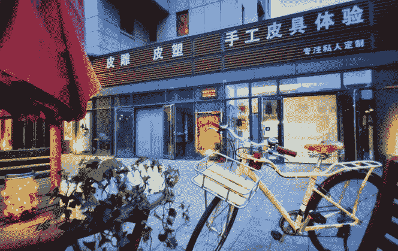

## 看见一篇好详细的医

珍大户：看见一篇好详细的医美行业现状分析，让这些券商的调查这么多不容易[偷笑]

2020-01-02(45赞)

*   评论区：
    *   某年某月：好
    *   定义Cakvin：确实是好文
    *   温温：珍姐您好，请问您有没有看到过飞机租赁行业研究报告？
    *   珍大户：没看过额，我帮你找下吧
    *   温温：哇，太感谢啦[抱拳][抱拳][抱拳]
    *   董：我刚从北京爱笑各辞职
    *   麦克菠萝油王子：大户真的好好人噢 亲一口 木马
    *   小古怪可爱：这也太多了吧[敲打][敲打]

## 【帖子编号0393

珍大户：【帖子编号0393】1月1日降准

昨晚上看到降准的消息，猛然想起前两天在房贷LPR的视频里，评论区里写了一句“这个政策是利空银行利润的”，结果翻了半天想去截图，却找不到了[捂脸]

稍微讲解一下：

银行是赚息差为生的（主要利润来源），假设存款的利率是3.5%，贷款利率是6.5%，则中间的3%的利差就是银行的主要利率来源。

然而不是所有资产都能拿去房贷。
比如客户总存款有100亿，然而因为央行强制要交13%的准备金，所以扣掉13%，就只有87亿能用于实际经营。

那个3%的利差收入，理论上还要打个87折。

前面说存量房贷挂钩LRP时，有说过，后续会持续一段时间的降息周期。

在降息周期中，存贷息差只会越来越薄
（想像一下，假如存款利率给你6%的时代，贷款利率过10%很正常，息差4%超上。
但如果存款利率只有2%的时候，贷款利率是不可能还有6%的，怕是只有4%了。）

息差会随着降息周期，越来越低。所以银行利率也会持续下降。
（所以在讲那个房贷转换LRP利率时，我说这个政策在金融圈子里，都被认为是利空银行利润的。）

在我看来，这次降准，主要是为了帮助银行增加可用于实际经营的资金。

还以前面那段里说的数字当例子：
降准前：银行例润3%乘以0.87折
预计降息：银行利润2.xx%乘以0.87折
降个准后：银行利润2.xx%乘以0.875折……

能看到的结论：

1. 预计后面几个月，LPR利率会每个月往下走一点点。
2. 预计LPR利率每降一些时，就会有一次降准配合。
3. LPR利率下降，不仅仅是中央说的给实体企业以支持的效果。还因为19年年底的时候，说过2020年会【增加一万亿】的基础设施建设。这一万亿的钱，都需要靠发政府债来解决，降息也是降低政府债的融资成本。
4. 从今年开始往后的5年里，大家买股票或者买基金，可以不用瞄准银行股了。（银行利润要下台阶）

2020-01-02(96赞)

评论区：

*   小胆：每天跟着大户学知识[鼓掌]
*   [a trec]：水泥板块最近很强劲，19年水泥利润也强劲
*   风雨彩虹：那20年可以买基础建设股吗
*   [a trec]：看新闻是预期这个季度有一次降息
*   许矿娟：有房贷的可以通过改签贷款协议，享受低利率以降低还款金额，是真的吗？
*   神奇的大猫：医药基金还能买吗？最近半死不活的样子
*   神奇的大猫：珍姐前几天说的可转债和基建，这两天都暴涨了[色]
*   珍大户：一万亿呢，钢筋水泥渣土车今年日子都可以保证了

关注公众号"懒人找资源"，星球资源一站式服务

## 老师，你的视频全部

(提问)王圣军：老师，你的视频全部学习了一遍，我的问题：中国的牛市开始了吗？还是黎明前夕呢？现在指数基金可以一把买入吗，还是定投比较稳妥？

2019-12-31

回答：其实慢牛已经开始一段时间了。只不过现在的市场越来越对散户、对炒短线的不友好，甚至以往的女散、游资都要被淘汰了。安心的买进去，长线持有吧。指数基金是个挺好的选择，目前就可以买。定投是给新薪族每个月存钱用的，既然你手上有闲置资金，可以在最近一两个月之内，分个三四批建足了仓。没必要追求每月分散投资。

最后：2020年，股票基金机会大于债券基金（2018年底在圈子里说的时候，是说股票基金债券基金都可以买，那时候还不好确定哪一个更好。但现在，明显股票机会大一些。）资深的就自己买股票好了，小白想省心就买指数基金，上证50中证500创业板都可以的。激进一点的买分级基金B（带杠杆）、证券板块、基建板块。保守点的买可转债基金。(106赞)

评论区:

*   白啊：珍姐，能推荐几个指数基金或股票基金吗？实在不知道要怎么挑选！分三四批建仓是啥意思
*   新他美容：珍姐已经推荐了啊
*   白啊：我没看到，哪个帖子
*   zoekraby：就是本条
*   珍大户：只要对标的是同样的指数，不管哪家公司公司债券都是差不多的，比如写着“某某中证500基金”，前面某某是基金公司名称，各家基金其实都差不多的。因为指数基金是被动跟踪型的，不是主动管理的，不会因基金经理的投资水平而产生高低差异……
*   新他美容：2020年干得第一件事就是买指数基金，感谢珍大户
*   白啊：收到
*   逍遥：珍姐，想买基金，但基金太多了，每只基金都说得天花乱坠的，基金经理都是各种证，那么，如何判断基金经理的能力呢？[微笑]

## 分享一组数据：全国

珍大户：分享一组数据：

全国共662个城市，按常住人口排序，其中，500万以上城市有9个（积分落户），300-500万城市10个（放宽落户标准），剩下643个均在300万人口以内（全面取消落户限制）。

具体：

（数据应该是出自这里：）

| 类别 | 城市 | 城区常住人口 | 市区人口 |
| :--- | :--- | :--- | :--- |
| 1000万以上 | 北京 | 1876.60 | 2293.7 |
| 1000万以上 | 上海 | 2418.33 | 2418.3 |
| 1000万以上 | 深圳 | 1252.83 | 1252.8 |
| 1000万以上 | 重庆 | 1121.62 | 2489.9 |
| 500-1000万 | 天津 | 684.80 | 1050.0 |
| 500-1000万 | 南京 | 608.62 | 682.7 |
| 500-1000万 | 武汉 | 576.96 | 853.7 |
| 500-1000万 | 广州 | 644.89 | 897.9 |
| 500-1000万 | 成都 | 664.78 | 811.6 |
| 300-500万 | 沈阳 | 432.46 | 590.6 |
| 300-500万 | 大连 | 328.80 | 382.8 |
| 300-500万 | 长春 | 325.40 | 428.4 |
| 300-500万 | 哈尔滨 | 425.64 | 550.8 |
| 300-500万 | 杭州 | 370.91 | 600.3 |
| 300-500万 | 济南 | 336.32 | 483.8 |
| 300-500万 | 青岛 | 336.10 | 387.4 |
| 300-500万 | 郑州 | 373.58 | 506.0 |
| 300-500万 | 昆明 | 391.48 | 443.0 |
| 300-500万 | 西安 | 493.12 | 733.7 |
| 100-300万 | 石家庄 | 264.14 | 409.5 |
| 100-300万 | 唐山 | 193.98 | 305.1 |
| 100-300万 | 邯郸 | 190.12 | 381.3 |
| 100-300万 | 保定 | 144.00 | 284.6 |
| 100-300万 | 太原 | 288.09 | 369.2 |
| 100-300万 | 大同 | 121.03 | 158.9 |
| 100-300万 | 呼和浩特 | 134.71 | 134.7 |
| 100-300万 | 包头 | 137.80 | 225.2 |
| 100-300万 | 鞍山 | 131.20 | 148.7 |
| 100-300万 | 抚顺 | 129.12 | 140.5 |
| 100-300万 | 吉林 | 125.45 | 179.8 |
| 100-300万 | 齐齐哈尔 | 109.00 | 134.9 |
| 100-300万 | 大庆 | 114.93 | 136.9 |
| 100-300万 | 无锡 | 221.97 | 259.3 |
| 100-300万 | 徐州 | 197.41 | 343.7 |
| 100-300万 | 常州 | 159.70 | 299.7 |
| 100-300万 | 苏州 | 269.78 | 356.3 |
| 100-300万 | 南通 | 116.26 | 215.1 |
| 100-300万 | 淮安 | 130.35 | 332.2 |
| 100-300万 | 盐城 | 121.97 | 244.4 |
| 100-300万 | 扬州 | 105.85 | 229.9 |
| 100-300万 | 宁波 | 192.49 | 289.6 |
| 100-300万 | 温州 | 152.28 | 170.4 |
| 100-300万 | 绍兴 | 102.91 | 221.5 |
| 100-300万 | 合肥 | 219.93 | 270.1 |
| 100-300万 | 芜湖 | 105.21 | 140.1 |
| 100-300万 | 淮南 | 105.80 | 180.7 |
| 100-300万 | 福州 | 223.10 | 279.7 |
| 100-300万 | 厦门 | 197.37 | 231.0 |
| 100-300万 | 泉州 | 103.10 | 248.6 |
| 100-300万 | 南昌 | 246.19 | 305.8 |
| 100-300万 | 赣州 | 122.63 | 235.7 |
| 100-300万 | 淄博 | 165.32 | 288.1 |
| 100-300万 | 烟台 | 150.78 | 189.5 |
| 100-300万 | 潍坊 | 126.90 | 191.7 |
| 100-300万 | 济宁 | 140.76 | 186.9 |
| 100-300万 | 临沂 | 180.44 | 294.6 |
| 100-300万 | 洛阳 | 203.33 | 216.4 |
| 100-300万 | 南阳 | 124.57 | 212.3 |
| 100-300万 | 襄阳 | 109.51 | 226.5 |
| 100-300万 | 长沙 | 282.66 | 282.7 |
| 100-300万 | 株洲 | 114.51 | 129.7 |
| 100-300万 | 衡阳 | 115.67 | 122.1 |
| 100-300万 | 汕头 | 237.40 | 557.8 |
| 100-300万 | 佛山 | 133.48 | 405.7 |
| 100-300万 | 惠州 | 109.21 | 154.7 |
| 100-300万 | 东莞 | 211.30 | 211.3 |
| 100-300万 | 南宁 | 229.90 | 447.0 |
| 100-300万 | 柳州 | 125.16 | 179.6 |
| 100-300万 | 海口 | 108.28 | 171.1 |
| 100-300万 | 自贡 | 104.55 | 148.7 |
| 100-300万 | 泸州 | 118.01 | 152.0 |
| 100-300万 | 南充 | 102.00 | 194.3 |
| 100-300万 | 贵阳 | 207.00 | 245.0 |
| 100-300万 | 遵义 | 105.00 | 219.4 |
| 100-300万 | 兰州 | 189.58 | 206.7 |
| 100-300万 | 西宁 | 124.27 | 138.8 |
| 100-300万 | 银川 | 112.66 | 112.7 |
| 100-300万 | 乌鲁木齐 | 216.55 | 216.6 |

中华人民共和国住房和城乡建设部++建设统计年鉴
2019-12-31(26赞)

*   评论区：
    *   林小安：第一！！！
    *   晓蒜看口：上海会越来越强
    *   张晨：数据好像有点老
    *   珍大户：是啊[捂脸]
    *   张晨：几个基本的我知道杭州，南京，南昌，都不是最新的[微笑]
    *   姬思听：西安快1000万了
    *   --男子：这个数据说明啥
    *   冬日可爱：广州还没1000万呀

关注公众号"懒人找资源”，星球资源一站式服务

## 珍大户，老师能详细

琪：珍大户，老师能详细讲讲LPR是以什么基础或标准确定利率吗，网上说的是LPR+加息，那这个加息意思又要在LPR基础上加多少，有标准吗，感觉就是怎么选都在都是逃不出五指山，只是ZF让我们输的要自己承认心服口服，毕竟给了我们选择，输了就认。按照现行房贷利率也是每年会根据利率调整下一年的房贷利息呀，这有什么区别呀，还有从哪里能分析和评估未来LPR值呢，谢谢[微笑]

2019-12-31(10赞)

评论区：

琪：还有个人感觉，我们没有选择权利，因为买房时贷款银行都是指定的，很少能选择，如果针对LPR政策我们可以根据各银行的利率政策来选择银行才是合理的，不然还不是原贷款银行家板上的肉，我们哪里有足够的资格和选的软件。

珍大户：刚好这个视频里没详细讲，在这个帖子里补充一下。背景是因为"利率市场化"，导致的贷款利率参照体系标准，发生了变化：旧体系下：贷款参考的央行的【基准利率】；新体系下：贷款参考【LPR利率】（就是新旧体系的切换，比如考试120分卷转换为150分卷了，或者手机3G网络切换为4G网络了，类似的体系切换）以现在为例：新LPR利率，5年期4.8%。旧基准利率，5年以上4.9%。假设有几个人，原来的房贷处在不同水平下：

1. 张三原来房贷是基准利率，等于目前是参照4.9%的利率，转化到LPR利率下时，张三就是LPR+0.1%=4.9%;
2. 李四原来享受着到了房贷利率9折，等于目前是按照4.9%打9折，即享受到4.41%的利率，则换算到LPR利率里，就是LPR-0.39%=4.41%;
3. 王五原来房贷是上浮30%的，意思是按照4.9%的利率乘以1.3=6.37%，则转换到LPR利率时，按照LPR+1.57%=6.37%。

如果LPR明年从4.8%降到4.5%了，则：
*   张三利率降到4.6%。（4.5+0.1）
*   李四利率降到4.11%。（4.5-0.39）
*   王五嘛利率降到6.07%。（4.5+1.57）

结论：
1. 不管是原来利率多少，换成LPR利率，在降息周期下都是划算的。
2. 最终划不划算，都要看你原来贷款享受到什么政策。原来贷款享受到9折的，就安心情慢还贷款，因为利率划线。原来贷款上浮的，看情况赶快提前还贷吧。尤其是原来利率上浮30%的，长期看还是挺亏的，如果你手头有钱，尽量提前还款还挺吧。

琪：非常感谢，这样就很清楚的了，真的是老百姓在这蝇头小利上费尽心思也没啥意思。就算少也就百把块钱，还有担风险☐

Starrring. *：大户老师，怎么知道当初的利率呢？我买房的时候都是交给了中介，银行怎么说就怎么弄的。不记得有没有9折利率。应该是按的基准利率吧？

珍大户：还能找到贷款合同吗？合同里面有写。要是不好的话，在网上搜一个贷款计算器，填上自己贷款的金额，和还款时间，选择不同的利率算一下每个月还多少钱，哪一种利率跟自己还款金额接近的就是了

陈sir：我太笨了，看不懂[捂脸]

李小红：我是一套路，当时利率是上浮的，那就哪一种利率都是一样？最好提前还款最合适？

执念，爱：登录手机银行，找到贷款页面，上面有详细的还款计划以及利率！

关注公众号"懒人找资源"，星球资源一站式服务

## **转发一个：黄奇帆说**

珍大户：转发一个：
黄奇帆说房地产行业的演讲

里面一些老生常谈的内容：

人均居住面积基本到顶了，房地产高速发展的时候已经过去了。

上海北京人口也差不多了，所以新建还是改善都不会太大了，但是1000万人口的城市奔2000万人口的过程中，这些城市还有不少的发展机会。

（以上我都认同）

说城市圈、城市群，导致嘉兴苏州的机会（这点我持相反意见……）

另外里面有条信息，说GDP一万亿对应着3000万平米的写字楼。超过这个数则过剩，少于则稀缺。

（这个数据是我第一次听说。
目前很多城市的GDP都集中在8000亿到1万亿出头的范围，我现在突然想找找数据验证下，看看每个城市写字楼面积有多少[捂脸]）[黄奇帆最新2万字解读中国地产大趋势（完整全文)](https://www.zhihu.com/question/324682572/answer/2495580961)

2019-12-31(48赞)

评论区：

七七：大户，杭州机会多吗？小老百姓辛苦存钱没精力也没有太多抗风险能力还有3百万的余钱杭州房子还能买吗？自己，双方父母都有一套住房的情况下。

杜光辉：「文件」

杜光辉：「文件」

杜光辉：补充阅读：黄奇帆在第十九届中国年度管理大会演讲 [猎猫也在看++黄奇帆.最新演讲：2020年经济怎么看，怎么办?](#)

人生如逆旅：嘉兴如果能和上海通上地铁的话就有机会，哈

珍大户：杭州前景还是很好的啊，但是房价太贵，已经透支未来很多年的涨幅了啊，你们如果是买房待涨的话，是等不下去的……

七七：哇！大户回复我了开心一下[呲牙]。那您方便给下建议未来2年左右是持币观望更好还是把流动资金投入其他相对高风险高收益的理财产品？

珍大户：地铁很尴尬的，路线太远、时间就太久，就失去意义了。11年时候我住5号线在闵行，已经算是很远的了，上塘地铁要一小时三四十分钟，算上前 后走路时间，将近两小时车程。坚持了一年就觉得人要折旧报废掉了，无法想象如果住金山，比闵行还远，还是地铁是什么感觉。嘉兴比金山还远好多……这不是地铁能解决的距离了……

关注公众号"懒人找资源"，星球资源一站式服务

# 【帖子编号0392】选房因素

珍大户：【帖子编号0392】<选房因素>

昨天直播的时候，有一个问题是我比较意外的。当时有个朋友问，买房子是新房好，还是二手房好？

房子有那么多需要考虑的因素，结果先去想新房还是二手房，这明显是跑偏了。我觉得这事还是值得梳理一下：

经济学是关于选择的学科，意思就是，大家都是普通人，手里的钞票有限，你永远买不起你想要的最完美的东西，你只能退而求其次。

所以求其次的时候，舍啥、留啥？怎么把钱花到刀刃上。举例来说：

如果你钱不够，只能买到有瑕疵的房子，你买哪一种是瑕疵？

第一种：市中心位置很好的房子，然而面积很小，户型有硬伤，朝向朝西的。

第二种：郊区，面积\户型\朝向都很好的房子，但是商业配套很差。

人生大致面临的都是这样的问题。

房子自带的配置属性很多，大概可以分几类：

### 第一类因素是【硬件】，是不可变因素。

这种就是房子建成之后，就定型的了。比如房子面积、房型结构、朝向、房子楼层、楼间距、采光……

这些因素，一旦建成就不可改变了，如果吃亏就会永远吃亏下去。未来升值空间，在二手市场的流通上，长远看时一定会打折。

因为长远来看，人们的居住条件还会持续改善（不断有新房入市、老房子淘汰，人们的平均居住水平会一直持续缓慢的提升），所以有硬伤的房子，会越来越被淘汰，越来越处于劣势。

（有个类似的原理：我在说酒店行业时，有说过建议大家未来不要再做廉价酒店/快捷酒店，因为长远来看，国内的平均收入水平还会持续上升，人们都有“消费升级”的动力。

如果经济形式向好，大家早晚消费升级，渐渐减少入住快捷酒店的比例。

如果外界经济形式不好，那么高档酒店降价打压中档酒店、中档酒店降价打压快捷酒店，快捷酒店是毫无招架之力。

去年年底录的“2019年行业大预测”的视频里，也有一个例子，我当时说2019年豪华车市场会不太好过，结果这一点是预测错了的。

因为豪华车降价太狠，直接打压中档车市场，中档车也降价，直接打压入门车市场，结果死的最惨的是最便宜的车。

都是类似的原理。）

所以建议不要去入手【硬件上有硬伤】的房子。比如：

- 1、老公房的顶楼和底楼；
- 2、房型奇葩的；
- 3、朝向上，朝西、朝北的房子……
- 4、………

（还有啥一时想不到了，请大家帮忙补充吧）

这里必须要再补充一点，关于面积的（面积也属于不可改因素）。

上海有很多老公房，很多都集中在30-50平之间，其中30几平的是一室户或者一室半，50平的一般是两室到两室半（半是指一个很小面积的空间，一般是放个小餐桌当餐厅，所以没法叫客厅）

（举例在这个帖子里提到的，估计就是老公房。）

这种老公房被称作“上车盘”，意思是给外来的年轻人买的第一套房子：——>

二三十岁先买个30-50平的老公房（这时候居住功能是打折扣了的，住起来多少有些憋屈），

三四十岁置换成70-120平的小两房/大两房/小三房的次新房（这种已经能满足小家庭的正常居住使用了），

四五十岁还能再上一个台阶的，就置换成120-160甚至更大的大三房/四房、郊区叠拼/联排小别墅之类的（居住舒适度会更提升一度）。

这种路线已经流行了十多年。然而这蕴含着一个前提条件：就是，要有源源不断的新人进上海，并且还是打算安家落户。这些新人把“上车盘”的人顶出来，然后上车盘的人去买80平，然后原80平的人去买120平……

如果这个前提条件断了，最惨的肯定是这些“上车盘”。因为后面的几档，都能满足正常居住条件了，而30-50平的老公房，居住条件是打折的。

我不敢100%断定上面这个前提条件100%要被打破了，但大家必须看到：

1. 上海已经在限制人口，毕业生留沪意愿在下降；
2. 现在“上车盘”价格都不亲民了，如果这种房子都要让很多人掏空家底，看不到10年后再能换房、改善生活的意愿，那还有多少人愿意继续买这种房子呢？

所以，像小心快捷酒店、小心最便宜的车一样，慎重去买这种上车盘。

而其他城市跟上海又不一样。

城市每下探一级，入门的面积就需要大一截。

二三线城市，入门级一开始就是两房（新房或次新房，从70几平到90几平）。

考虑到还会不断有人口流入（PS：此结论属于“城市化进程”的话题，我后面会专门写一篇文章出来），所以这种房子仍然有流通性。后面仍能像过去十几年的上海老公房一样，玩起新人顶旧人，一层一层往上顶的游戏，所以仍然能卖得出去。

相反，入门级以下的老城区的老公房，千万不要去碰。因为当地房价还没变态到让【大部分人】接受不了的地步，只有很小的人考虑老房子，就意味着这玩意没市场。

（房子能卖得出去很重要，卖不出去的，就等于砸手里了………）

再往下，四五六线城市（特指房价很亲民的不知名地级市、县级市），

大家攒几年钱，很容易就直接买得起三房了，那么你买两房，未来就风险很大。

建议别学大城市，搞什么刚需房、刚改房、改善房之类的分级。

你买一步到位了，未来还有卖出去的可能，你买小了，未来连接你的盘的人都找不到，才是真的砸在手里………

### 硬件说完说软件。软件特指可变的因素，分成几类：

1. 小区附属服务，比如物业服务、车位配比/停车管理、绿化景观之类的；
2. 小区的配套：地铁、路网、商业配套（商场/商业街/菜市场/超市便利店/餐馆外卖）、学校（幼儿园小学中学）等等。
3. 小区在城市中的位置，比如翻身变成CBD了、变成开发区了......

如果粗分的话，上面几点的是完全不同的，因为：

商业配套、地铁、路网这些，如果能够有变化，大概率都是从无到有，从少到多，越变越好。

而物业、绿化景观、乃至停车这些因素，大概率都是从好到差、从好到无，从不挤到挤，几乎都是越变越差......

而第三项则更是重要，城市规划变更、城市重心的转移是直接导致房子价值大幅升值或贬值的因素。

所以，如果你的房子是指望“升值”的，

那么，房子一到手，硬件属于已经定型的状态。就像是一个人的出身，是已经不能改了的（你不能期望靠房型改善、面积扩大而造成房子增值。这是不可能完成的任务）

而软件方面，则就像是一个人的学历、工作经验这种东西，是有可能越增越多，导致房子增值的。

（未完待续）

https://t.zsxq.com/YbQNVFQ\2019-12-27(99赞)

> 评论区:
> Saki H: 为啥不能朝北的房子不好
> sky: 北向房子一年四季没光照，后果自己想想
> 人生如逆旅: 上海的“上车房”，老公房，地段很重要，中环之外的建议尽量不考虑，中环内环之间的部分地区，内环的老公房，价格非常坚挺
>
> ⏺: 我四年前买了区里一套规划拆迁房，因为区里基建投资太大没钱负债50亿，位置是区县县城中心位置，67平方两层一百多年老立地房，搁置四年，亏死了，四年利息都有20多万了，升至空间并不高，隔壁外面一点的的新商品房从一万涨到2万多⾹了，如果买大的分期贷款新房其他朋友都买了，都赚一百多万。
>
> ⏺a teco: ⋄大家有无发现一二线城市住宅盖20-30层。土地资源紧张，到一定年限会拆迁。3-18线县城盖30层30年-40年以后谁拆啊。[捂脸]经济能力弱的。地产商不拆。地方政府有那么多钱去拆？现在一个破县城盖楼也盖个30层住宅[捂脸]土地资源并没有那么紧张。
>
> 珍大户: 城市小么，边上都是空地，宁愿盖新的也不会拆旧的[偷笑]
>
> 珍大户: 不过这个想的太远了，30年后。只要10年后有人愿意买，卖出去，剩下的就是别人操心的事了。就拍10年后没⼈买，那自己就要套死了
>
> 友家单车行-俩圈: 县城⾥都是开发新的地方，只要征地就可以了。如果旧城改造拆迁涉及的事情太多了，费⼒不讨好。政府不会这样干，也显不出政绩。

关注公众号”懒人找资源”，星球资源一站式服务

## 我发表了一篇文章：

石头：我发表了一篇文章：【12月26日】每周四晚上8点-抖音直播
2019-12-26(67赞)

评论区：
- 秤木花：太棒了 课代表厉害了
- 听说我说话很冲：同样的生活水平，小城市要更贵，是真的，太扎心了，我一个靠外卖活的，因为买不到外卖直接打破了我的生活节奏，这两年的眼死了一样。
- □a tree□□：不是小城市生活成本高。是消费收入比更差。
- 听说我说话很冲：我只是觉得消费更高也是真的
- 40：既然三四线城市化远远没结束，为什么房价已经到头了呢？
- 石头：-----1.三四线城市确实不能一概而论，主要看人口是流入还是流出；2.如果你在的三线城市有大量乡镇人口涌入，或者隔壁城市衰落人口迁到你所在的城市，都会让房价上涨.3.城市是否能长期保持人口流入？一句话“人随工作走”不管什么城市都一样...大部分小城市无法给年轻人提供足够多的工作岗位....4.比如深圳旁边的东莞，惠州，还会有人口持续流入么？富士康建个厂，或者深圳产业转移提供工作机会，这里的房价就会涨...
- □a tree□□：关键看就业。还有就是三四线城市本来面积不大。远没达到土地供应压力。他不同与一线城市。超过了24时限。三四线边缘郊区一个电动单车去市区也就20分钟吧[偷笑]
- A朱某某□：学到了不少东西

关注公众号"懒人找资源"，星球资源一站式服务

# 珍大户。想咨询一下

(提问)刘斯伟：珍大户。想咨询一下。现在有个项目。新建成的厂房（水电到门口、需要自己安装水电消防设备货梯及7000平方泥地硬化）5层整体1万平方。现在和村签约8元一个平方。需要缴纳两按一租，租期20年。10年递增10%。周边厂房在每月15-18左右。我估计我位置差那么一点点12应该没有问题。主要是考虑到未来厂房这块还会不会有个比较稳定的收益。（广州白云机场周边5公里内）

2019-12-25

回答：对厂房不太熟悉[捂脸]光看提问中给出的房租数据，目前至少有50%的利润空间，只要整体空置率低于30%就都好说。所以提一些细节问题：

1. 这个厂房门口的交通，方便不方便？门口是否有空地供停个几辆货车，搬运装卸？
2. 厂房2345层的承重能力怎么样？
3. 消防设施都有吧？

（其他还有什么厂房或者仓库的细节问题？欢迎大家给点建议，比如层高是否有什么要求之类的。主要担心，万一存在着某个没有考虑到的小问题，引起企业主不愿意租这个厂房，造成空置率比较高。如果没有这些意外，这个事情还是能做起来的。）

————————如果再考虑长远的因素，你调查一下附近使用工厂的，都是什么行业的？是否人力密集型，需要很多外来务工人员的？我对工厂的租金不熟，刚才特意还搜了一下，可惜没有搜到权威准确的数据。搜了下网页上的非权威数据，感觉目前各地厂房价格差异并没有很大（都在12-18元左右）。说明至少当地没有很明显的泡沫，不至于因为租金价格导致产业转移。广州一直以来都是交通枢纽，交通运输成本也好说。所以，我觉得值得警惕的就是用工成本（担心招工困难导致工厂迁出）。一般一个地区总会聚集着一堆类似的行业，所以你略微调查下周围租厂房的，他们都是什么行业的。这些行业是否需要很多工人的行业（靠着大规模招聘外来务工人员），如果是这种则需要警惕。否则都好说。

—————————排除以上问题，则这个事情大概率好做的。(17赞)

## 评论区:

- 东家环境: 站在环保的角度 考虑几点：红线图与实际建筑有没有偏差，更改了使用面积或使用性质就需要重新办理土地部门的相关资料后才可以做环评报告
- 岑岑: 我家有几个亲戚就是专门做这个的，我也有一点点涉及，除了珍姐说的几个问题，还有几个问题要考虑，7000方泥地硬化是个很大的问题，你有没有考虑水泥打多厚，需要多少钱一方，这7000方空地你能不能二次利用，能不能搭铁皮再次出租，村里这7000方有没有算钱，水电费梯安装也是一笔不小的费用，这行业花钱跟流水一样的，还有要考虑附近产业集群是什么样的，这种楼层厂房好不好租，如果小客户居多，就要考虑好不好分租，不过分租又会产生一些费用，因为要砌墙隔开，好像是一百多一平方。还有就是电有多大，给了你免租期有多久，你必须要求谈免租期，谈免租期也是为了降低风险，你租出去客户要问你给免租期，还有你前期要花费时间资金装水电之类的，我们做这个利润大概控制在半年，一年，一年半回本，你这个多久回本自己要细算一下，还有这个行业已经不是靠差价来盈利了
- 胡万元: 现在二房东主要靠收电费，管理费来赚钱了
- 徐贤: 好便宜，我们这100一个平方...

关注公众号"懒人找资源"，星球资源一站式服务

# 刚看到的两个报告，

珍大户：刚看到的两个报告，里面有全国各地的写字楼和商铺租金统计数据，供大家参考
2019-12-25(37赞)

- 评论区：
  - 小胆：哇，正需要这个，太好了，谢谢珍姐～
  - 米兰人@张克圣：看不出什么信息，看不懂
  - +3大鹏++*：一线写字楼价格比3-4线门市还贵 门市这一年房租几百万。

# 珍姐好！跟在公司背

(提问)Super Emom：珍姐好！跟在公司背后入股办私立学校可行吗？

情况简介：

1. 租房办学校，地皮是政府的，不知道会不会突然被收回卖给房开商？
2. 公司是第二大股东，未来董事会并不全是自己人，担心投入不能及时变现，会不会一直不分红？
3. 私立学校利润有多少？
4. 除了以上我还应该考虑些什么问题？

谢谢珍姐和各位圈里的朋友！
2019-12-23

回答：【帖子编号0392】<民办学校>

这个是可行的（而且已经有不少了，国内一般不叫私立学校，都叫民办学校）

赚不赚钱，都不需要打听，靠基本的经济学常识就能判断：

目前学校依然属于限制准入的，只要是受限制的行业，都是值得去做的。（同样的其他有政策准入限制的，或者其他原因导致的门槛很高的行业，一样都是值得做。比如开陵园、开公证处之类的，这是资质难搞。只要能搞得定，开起来一定有的赚。再比如dna检测/亲子鉴定、整形整牙激光治近视，这是技术门槛比较高，只要开的起来都一定有的赚）。

这个原理还包括，能卖烟的便利店一定比卖不了烟的便利店更赚钱（烟草许可证）。能卖彩票也可以（也是许可证）。甚至能给宠物开刀/绝育的宠物店肯定比只洗澡的宠物店要盈利好得多（技术门槛）。

目前民办学校收费有几种，一年十几万甚至几十万那种贵族学校，一年两三万、三五万那种面对中产的、跟公办学校竞争的那种民办学校，面对无户籍人口的一年两三千、三五千块的农民工子弟学校。

即便是最后一种收费最便宜的，依然是赚钱的。想象一下，一个学生一学期三千块，一个老师可能一个月工资才三千块。一个班有五六个学生，就覆盖老师成本了，再来几个学生覆盖房租就足够了，剩下的都是赚。其他的书本、校服、交通、餐食，这些都是学生额外出钱的，都不算成本（甚至还有可能额外赚钱）。

师资更好的中产民办学校，教师成本可能会贵一些。但就算是教师工资3万一个月，学生学费更贵。依旧是每五六个学生就能覆盖一个老师的成本，超出的学生，覆盖房租反而更容易了。

————

所以总之，做这个是有得赚的。剩下你问的其他事情，都是小细节，都不伤及主干。

比如场地问题。是有可能政府把这块地卖掉的，然而你们也可以跟政府商量再其他地方再补块地。毕竟教育是影响一群人的事情，政策不会简单粗暴到直接关停。

再比如合伙人问题，合伙人多报账、做多成本/隐藏利润，这是任何行业都能遇到的（即便你跟小姑子小姨子合伙，也不可能完全防范这种事），不能因为有风险就不敢再找人合作了。作为小股东，充分利用好自己的查账权和质疑权就可以了。(47赞)

评论区：
- 麦兜菠萝油王子: 要续费 好想珍姐呀[亲亲][亲亲][亲亲]
- 阿仪：我们这新开了一个学校，国际部小学中学，高中，每年学费13万到23万，高中最便宜，高中以后直接国外上大学，和新加坡，美国，英国都有签约学校，也有国内部，学费3万左右。现在，国际部大概有100人左右，国内部400人左右，
- 陈格：你好，珍姐，这个帖子你有说卖彩票的。孩子同学家长（孩子们玩的都挺好的，现在两家也都有来往）是彩票总部的高管，证应该好办的。那个彩票店还行情吗？
- 莫来砂-远建-郑13*: 现在高频彩20分钟一期了，期数比原来少一半，一般彩票就是靠高频彩还有刮刮乐走量，双色球或者大乐透量不大。不过转个高中贷还是可以的。也要看地段，我一个朋友开的一年十几二十万吧
- 般先生：双彩店最好，两条腿走路毕竟好的多。还有房租费用控制好，毕竟只有7个点的利润。

关注公众号“懒人找资源”，星球资源一站式服务

# 珍大户好，我爸在学

(提问)在田：珍大户好，我爸在学校，学校宣传一个私募融资，说可以投，如附图，然后去对应的银行问了人，说是镇政府做的。请问有什么风险吗？谢谢。

2019-12-23

回答：【帖子编号0390】<城投债>

有风险。这种叫城投债，就是各级政府的国资委设立的城投公司，以公司名义对外融资，投资于当地的城市建设项目。

一般大部分的城市的基础项目，都属于免费公益的，没有收益。所以也不像高速公路或者铁路之类的能收费还钱，最终还款都是由政府拨款到这家公司账上，然后再还钱。

12年以前，各级政府还常常发个公文，以“承诺函”或者是“支持函”之类的政府公文的形式，说某某政府会“支持”某城投债的还款。但即便如此，在投资过程中，依然要做最基本的调查。

常规调查包括：

1. 看过去三年的当地财政收入有多少，其中有多少是卖地收入（卖地收入不可持续）、有多少是正常的税收收入（税收收入一般可持续、不会突然缩水）。再看当地财政支出有多高，毕竟各级公务员的工资都是刚性的，根本没法压缩。
2. 看当地有多少家城投公司，所有的债务累计有多少？看债务负担比例高不高。因为……即便有承诺，也是需要实实在在的钱来还款的，如果政府钱不够，掏不出来钱，你又能那他怎么办？你也没法把政府大楼拍卖了，只能干瞪眼。

后来14年之后，明着的是，国家严格限制政府出担保函，意味着不希望各级政府无限借债下去，暗示未来有可能会出现在不上线就让城投公司破产的状态。暗着的，是各家金融机构对各地调查，发现很多地区的隐形政府债务很超标了，也开始暗暗担心。所以开始逐渐减少、限制对城投债的投资了。

很多常规的做法，就像是民间流传“投资不过山海关”这种顺口溜一样，城投债的规避原则包括：县级的不投/小城市不投（更严的甚至只投省级的）、偏远地区不投/西部地区不投/云贵川蒙藏陕甘

宁不投、老龄化严重地区不投（江苏）、一个城市里有三五六七八家城投平台的不投……等等很多（ps：你这个图里的大概占了小城市/老龄化/三五六七八家这几条……）本来aa级别的城投公司是可以走银行间，从金融机构搞到投资的。自从14年之后金融机构对城投越来越谨慎，这些被歧视的城投公司融不到资，开始走各种其他路线。最初是信托、后来搞什么abs之类的，各种路线都借完了，才开始走民间集资的路线……说不好听的就像是撸网贷的。一般都是银行借遍了、信用卡套过好几遍了、支付宝微信京东白条360这些都撸好几遍了，最后才到网贷。（50赞）

**评论区：**
- lycarnada：珍妮老师可以科普一下城投公司的级别吗？AA属于什么级别呀？
- 珍大户：补充说明一下：风险最低的级别是AAA，然后随着风险增加，级别依次是AA+、AA、AA-、A+、A-、BBB……这么看起来，大家会觉得aa也不差似的。然而……因为对很多金融机构都有强制规定，必须要买aa以上的。所以aa是决定生死的一道线，因此各家公司都会使劲公关，让自己公司变成aa……结局就是，aa属于水分很大的级别。这个级别里，必须自己亲自去研究财务报表（城投公司因为没有稳定收入，还得研究当地政府的财政收支），自己去判定究竟是aa还是a还是bbb……
- 肖恩（项目对接）：干贷，谢谢老师
- 麦克唐罗迪王子：久不来今天上摸摸鱼又学到不少 大户么
- 太空之城：谢谢老师
- 傅晟：貌似有些国企单位就搞这种套路啊，成立个p2p公司，捞完了搞个逾期破产，母公司不认账，投资者倒霉。吃相太难看。
- 黑皮er：这篇让我想起电影大空头，不过这篇更专业。
- 唐琪琦：我第一份工作就是这种专靠政府资源，做城投债的基金公司。利率蛮高的，叫我投我也不投。

关注公众号“懒人找资源”，星球资源一站式服务

## 私募融资发行公告

发行人：宿迁市洋河新城新农村建设有限公司

担保人：江苏洋河新城投资开发有限公司（AAA）

产品期限：12/24/36个月

起投金额：10万

预期收益：
- 12个月利率 8.2%
- 24个月利率 8.5%
- 36个月利率 8.6%

（付息方式：缴款首次日计息，按季付息，到期一次性还本（中途不可提取））

认购时间：2019年12月2日起，每期5000万，工作日的每天上午9点所下午5点

认购地点：江苏银行宿迁洋河支行二楼

购买方式：准备金资金至以下公司账户

户名: 宿迁市洋河新城新农村建设有限公司
银行：江苏银行洋河支行
账户：15280188000002881

注意事项：投资者需带本人江苏银行卡与身份证，用于每期支付利息，到期时请亲临原缴费领取

各地数据约电话：魏经理18936895887 陈经理18360045332

宿迁市洋河新城新农村建设有限公司
2019年11月22日

## 珍美女，您好，我想

(提问) 红茶: 珍美女，您好，我想请教您个问题：我儿子在北京林业大学读大一，学的工商管理，他自己以后想从事金融，会计之类，然后北京有个高顿培训机构在他们学校做宣传，说大学期间可以拿证，儿子就被老师说心动了，想考acca，但是我们问了下从事金融会计工作的朋友，都说这个不如注册会计师证，建议不考，您可以给个建议？

2019-12-23

回答：【帖子编号0389】 考证这种事，证书的门槛越高，考过的人越少，则约等同于含金量越高。 acca可以理解成英文版/国际版的cpa，都是会计类的证书。这两个证书都门槛不低。 现在cpa考试难度很高，所以还没到泛滥的时候，依然含金量很高的。没有说考过acca就一定比cpa强很多的意见。

（只不过因为acca是用英语，所以考过还能证明自己英语挺好，算是额外多点东西）所以结果上来看，就像是一个考了95分，一个考了96分，然而周围能上90分的竞争者都少之又少。所以如果为了追求增加那1分，增加的投入不是很多的话，就一步到位好了。但如果增加的投入很多，就是不值。

考acca比cpa增加的投入，一个是考试费用太高。中国的考试都非常便宜，一门几十块钱。国外的考试都贵，前前后后没个上万的搞不定。另外国外还搞出来个会员费的东西，以后每年都要白交一千多块钱，来维持这个会员身份，否则不交钱就取消…… 所以仅从性价比来说，这种费用不值。对已经毕业、不赶时间的人来说，肯定是首选cpa，没必要选acca的。

（另外，从沉没成本的角度，大部分人会因为担心高昂的考试费打水漂，而更愿意报补习班增加通过概率。所以报acca的人更愿意掏两万块的补习班费用，而报cpa的人只愿意掏5千的补习班费用。这是acca补习班更舍得猛劲宣传的本质原因[捂脸])

但因为在校生，有个“赶时间”的心态。因为cpa不准在校生报考，所以少了一个很重要的选项…… 大四在考研还好说，如果大四是准备找工作，那么没有证书做亮点，仅靠学校名头还是有些吃亏的。 所以，如果你儿子打算一毕业就工作，那么去考acca，挑简单的考个几门，简历上会好看很多，竞争力会提升不少，这种是值得投入的（毕竟acca高昂的报名费就能吓退不少人，等同于变相提高了门槛）。 （但要记得目的，就是象征性的考过几门，美化简历，为了找工作的敲门砖而已。只要敲门成功了，剩下的没考过再不考了，乃至会员费都不交了也没问题。 因为证书中，cpa的含金量肯定更高，工作履历的含金量会更高。）如果是打算考研（不赶时间），那么反而选择要多的多。（34赞）

**评论区：**
- 定义Calvin：沙发，大户早点休息
- 新枪美容：又学到专业知识了，感谢大户
- 珍大户：我周六颈椎病翻了，连着睡了一天一宿二十几个小时[捂脸]
- 思远：作为刚入星球的新人，能体会到老师点评真诚实在，所以才受广大粉丝爱戴。请教老师目前大趋势是人工智能等科技高速发展阶段，通过考证或挂靠的方式，是不是已不符合当今时代主流。特别是年轻人是否把更多精力时间用于创意或科技类深造，这样是否更有前景些？还望老师解惑，谢谢
- 红茶：谢谢大户老师的解答！我们的想法还是读研究生，不着急工作。高顿的培训费蛮高的，折后还要5万6

关注公众号"懒人找资源"，星球资源一站式服务

## 姐，我现在遇到一点

(提问) 喜欢海边喜欢浪：姐，我现在遇到一点问题。想咨询下您，麻烦您有空的时候给我解答一下，万分感谢。

我在一个集团下面的一个分公司A挂名公司法人，现在公司A注册资金3000万，实缴，我占45%，集团通过A贷款4个亿，没用我个人担保，是集团里的另一个实业钢铁公司担保。我感觉公司不太想还这个钱，我现在后悔，不想当这个法人，集团大领导安排不想当就得我辞职。我想问下，如果这个贷款还不上，是不是我有连带责任，会被执行失信人吗，对家庭有什么影响？

2019-12-16

回答：【帖子编号0388】《法人代表》稍微解释一下，大部分人都管“法人代表”简称为“法人”，这是错的（包括F先生也这习惯，我时不时就能听他说“我是法人”这种话，听的我忍不住吐槽……）。法人是指公司，意思是“法律规定，让你把这个公司当成一个独立的人来看”，因此简称“法人”。（你想象一下“假人”、塑料人、机器人之类的，假如法律某天突然规定，说塑料人就是人，简称“塑人”，享有跟人一样的权利。塑人可以去银行开个“塑人账户”，自己存钱；塑人可以买房，还不限购；塑人还可以当地主，雇佣长工了。大概就是这个意思……因为塑料人不会说话，不会签字。所以去银行开户的时候，需要一个“塑人代表”，去买房的时候也需要个“塑人代表”去代替塑料人按手印。但理论上来说，这个“塑人代表”其实是“塑人”雇佣的长工，来充当嘴和笔的功能而已……法人和法人代表，就是这个意思）—————————另一个法律常识是：每个“人”都独立承担责任（这里的人是包含“法人”的）。父债子偿是错的，因为父亲和儿子是两个不同的人。法人和法人代表，也是两个不同的人。所以公司欠债（法人欠债）就是公司自己的债，不会追到法人代表头上去的。所以法人代表不会被成为老赖，不会成为失信被人。但是……法人代表有可能会被限制高消费，不准坐飞机，不准住星级酒店（问题是现在）（出处是《最高人民法院关于限制被执行人高消费的若干规定》第三条最后一段，目的是为了逼法人代表敦促法人还债[捂脸]）——————————————

不过我觉得，最重要的问题不是这个限制高消费。毕竟还有另一个钢铁公司做担保的。我在好奇你文中说的45%股权的问题，你实际出资1350万？还是公司出资之后让你挂名了45%？如果是后一种，我有点看不懂(43赞)

**评论区：**
- 沫沫的哒：我也遇到同样的情况，仅仅变更法人名字，并未出资金，签订了一个挂名法人代表免费协议。
- 柒律：分公司没有法定代表人，你这个是子公司吧
- 青春年华：我也以为自己是法人，原来是法人代啊[耻干]受教了[抱拳][抱拳][抱拳]
- 金龙：这比喻打的好！一看就明白法人怎么回事啦！
- 自助：子公司的法人还是法人代表
- 军-合肥公司注册代账：一般涉及到代持股的问题，风险还是很大的
- 喜欢海边喜欢浪：我是代持股，45%的注册资本金股份。这个是个子公司，是集团收购的一个公司，用来融资的，收购之前的注册资本金实缴了。子公司可能为了显示跟集团公司没有关联。
- 沫沫的哒：那我是持股100%怎么办，然而并没有出资，只是名义上的代持法人而已。万一公司倒闭了有债务，我就惨了[流泪]

关注公众号“懒人找资源”，星球资源一站式服务

## 匿名用户

(提问) 匿名用户：大户您好，我是阿里巴巴的员工，我去年买了同事蚂蚁金服1000股期权，今年我同事想继续卖1000股给我，价格是200元人民币一股，但不确定什么时候上市以及上市后价格，能帮我判断一下还继续值得买不，感谢您！

2019-12-16

回答： 【帖子编号0387】（期权）这个帖子里最主要的问题是“期权”（注意这不是“股票”）如果是股票，那么不要犹豫的买。而期权还涉及到“行权价”的问题。最终这笔期权转化成股票之后，每股成本是200元期权费+X元行权价格。（例如，如果行权价格为98元的话，最终买入股票的成本，就等于298元）带内部转让制度的公司，内部应该会有一个内部转让股票的指导价格（财务部门算出来的）。建议先去问一下财务/行政/人事部门，问下内部股价值多少元。（这个内部转让价格的存在，主要是为了方便员工离职时卖股票）你可以参考这个内部价格，自己估计一下。只要现在的期权费加上行权价格，比内部股价高不了多少时，就都值得买的。另外，我猜你问价格时，应该是在担心“价格是不是到顶了”？蚂蚁金服的高速发展期是不是到头了？万一规模到头儿了，以后一直就这样，这笔投资是不是就亏了？交易员圈子里有一句老生常谈的话：不要去猜转折点，毕竟转折点只有一个点，而向上的趋势是一条线，直线上有无数个点。这个理论就像咱们初中物理学的：“一个小车在光滑的平面上运动”，最后要有外力才停下来”。——如果没有外力，他会一起按照原轨迹，继续运动下去。所以如果你没有看到一个负面的“力”，就闷头押这家公司会持续发展就好了（上市后股价一定会比现在高）最后ps一句：签对赌协议的，是期货（一方赚钱一方赔钱，你赚的钱，等于对方赔的钱），就像这个帖子：期权是“权利”，有点儿类似于买保险：交一笔“保险费（期权费）”，最后我可以选择行权（理赔）、也可以选择不行权（不理赔）。(63赞)

**评论区：**
- 欣欣向荣：太牛了，珍大户。 当年考CPA，对期权这块一直没吃透。 你的三言两语直击要点。 爱你哦！

关注公众号“懒人找资源”，星球资源一站式服务

## 凤啊水啊[偷笑]

捷: 凤啊水啊[偷笑]

2019-12-11(27赞)

**评论区:**
- ponytail: 比较详尽，可以给小白当参考书用。真的有用的话，要参考自身的八字配合。
- 薇: 鹰马观花用了一个小时看完，留着下次仔细阅读[呲牙]
- Kevin: 没看，我怕消化不了[捂脸][捂脸][捂脸]
- 捷: 没事，学会了戴上墨镜就能上岗[偷笑]
- 易居克而瑞一谢甜: 确定是绿城?
- 冬日可爱: 先收藏，慢慢消化
- 瓜瓜: 怎么能弄到电脑上?
- 捷: 我是存到百度网盘再转出来的

## 我发表了一篇文章

珍大户：我发表了一篇文章：【帖子编号0386】《风啊水啊之户型》

2019-12-06(93赞)

**评论区:**
- 阿鹿：难怪那个看房子的师傅跟我说我的新房住不久…果然没过多久我卖了…大户继续聊呀。只聊生肖吗[捂脸]
- "她说：★_★_★：弧形的房子怎么看啊[可怜][可怜]，感觉什么都不顺
- 珍大户：都是用正方形去套在外沿。所以，假设一个房子平面图是圆形（这种一般还都是豪宅……），这个房子就很鸡肋了，只适合猪、虎、蛇、猴，四个生肖能住。其他8个生肖里边儿几都犯冲…...
- 奇开得胜：哈哈，有意思，搞的我要看看我的户型图
- 珍大户：看完了记得上来说一下结果哈。
- 奇开得胜：没问题
- 耶帕笑容：这个生肖图是不是按上北下南左西右东来画
- ZHANG Jing*：从进户门的位置对应方向是吧？

## 相亲群

Yaobest.拼命*：相亲群

2019-11-28(11赞)

**评论区：**

Yaobest.拼命*：直播里面说自己单身的，可以在下方留下个人情况，另一半的要求，联系方式

Yaobest.拼命*：伯兰特.罗素说：三种简单却极其强烈的情感主宰着我的生活：对爱的渴望、对知识的追求、对人类痛苦的难以承受的怜悯之心。这三种情感，像一阵阵飓风一样，任意地将我吹的飘来荡去，越过痛苦的海洋，抵达绝望的彼岸。

哎呦喂牛司令：宝：哈哈，珍妮估计没想到星球还有月老功能吧[偷笑]

Yaobest.拼命*：这个可以有！[得意]

90年的单身狗：报名..

冬日可爱：在那留

Yaobest.拼命*：评论区

珍大户：人生为什么而活————对爱的渴望，对知识的探索，以及对人类苦难的深切同情。…… What have I lived for——the longing for love, the search for knowledge, and unbearable pity for the suffering of mankind 大学时候的字……我也不知道为啥上《货币银行学》的时候我要在书上抄这玩意[捂脸]可能骨子里还是一个浪漫主义理想者

## 珍老师，您好。我是

(提问) 胡超（翔）：珍老师，您好。我是在抖音里看您直播加入的这个圈的，看您资料您是专攻经济学的。有个经济方面的问题想咨询您，我是一个政府机关的普通工作人员，工作多年后手头有一点结余，因工作原因没有时间去创业经营，前几年把钱放在理财里面，但觉得理财收益太少，后来转到了P2P平台，我在行业内找了两个排名好的某某贷，某某财富（这个怕有广告嫌疑），我把我的储蓄资产的百分之80分别投入这两个平台，每个平台各投入40%。剩下的20%作为日常开销和突发事件的备用金。我投资网贷平台有两年了，目前的安全性还算可以，但也听说了很多网贷平台的负面消息，心里难免有些担心。想咨询的是网贷平台，这个投资项目的发展前景有多久？安全系数有多高？

2019-11-28

回答：（提问字数有限制，问题分成了两个，复制后面的提问上来：）连续上一篇的问题，像我们这种工薪阶层的话，是否可以长期持有？或者是您觉得我的持有的资产比是否要调整，经济方面的趋势我们老百姓不懂，只能请教您们这些大神了。\_\_\_\_\_\_\_\_\_\_\_\_\_\_\_【帖子编号0385】《p2p平台》

发现竟然还有不少人把钱放在p2p平台上……（感觉隔段时间就得强调一遍）不建议把钱放上面。因为有很多风险是无法控制、无法预见、更无法判断的。你拿钱放进去，就是在赌命，一切听天。这是不对的。拿我昨天回复的那个帖子为例：1，一重风险是股东。现在拿个身份证就可以去开公司了，注册资本都不需要验资。跟金融和投资相关的公司，一度是很受控制的。之前有一个投资管理公司，后来因为要去做另一个业务（这里提到过）这个投资管理公司打算关张。结果他以前的客户听说之后，纷纷发来消息劝F先生不要注销公司，因为据说上海已经限制名字里带“投资管理”类的公司的注册了，据说这些公司都开始有了“壳价值”……一个壳能卖个6-8万块…… 有这种前车之鉴，我怀疑在当年还鼓励互联网金融的时期，全国应该一窝蜂注册了上万甚至上十万家公司，这里应该不乏“壳公司”。就是在政策允许的时候，某个人可以先注册个七八家壳公司在手。然后换着经营，一家倒了另一家跟上，几个壳换着来，可以顶很多年…… 所以你真的不知道站在这些公司背后的人是谁，你赌他是想长远经营？投进这些公司的可是实打实的钱，都是赤裸裸的诱惑。面对诱惑，来考验人性，这种游戏我是很难相信的。只有严格的制度防范，才能防止人性的考验出问题。最简单的，审查实控人，防止借用身份证开公司。实控人严格监管，护照上交，边防控制，想出国先报批。营业场所24小时摄像头，录像记录长期保存，电子账目多地点备份保存，保持期限不少于20年。所有业务的经手人，就像银行贷款审批一样，终身追责…… 总之，利益有多大，防范措施就得有多强。达不到的话，就给人钻空子的风险了。现在p2p是做不到的。所以你就是 在赌他们面对不被监督的巨额利益，还能不动心。

2，二重风险是经营上。这类公司里，当然还是有想要长远经营的。然而优质客户本身有更好的借钱渠道，借钱去p2p的本身已经很“危险”的客户了，逾期率本身就很源。就像昨天那个帖子里。19岁借19万，月薪一万，还款来源是工资…… 这个账怎么算都吓人。放到正常借款渠道里，银行信用卡都会不会给他批19万的额度。月薪一万，每个月还款在5000之内才算安全的，一年连本带息只能还6万块才是安全的。否则…… 他拿什么钱还呢？稍微认真看一眼，都会被这些细节吓死，然而太多人根本不去关注细节，就敢借钱了…… p2p公司敢做这种离谱的业务，是逼不得已。因为如果审核门槛像银行那么严格，他们早就没有业务可做，早饿死了。所以 他们才赌，赌那些19岁就借到19万的年轻人，借了钱之后每月按时还钱。然而人家赌输了大不了公司关门。你赌输了，你半生积蓄就没了啊，你跟着人家赌什么？(66赞)

**评论区**
- 黄xi: P2P网贷平台，真的可快了
- 马志丹市政设计：你有什么好的理财渠道
- 张晨：身为保险从业人员其实也一直有疑惑。保险的年金类回报率不高，但是从稳定性和长期收益来看，有不可比拟的优势
- 为什么那么多人宁愿冒着全部身家都落空的危险，也不愿意拿出一部分资金，做一个长远、稳定的投资呢？
- 幽音清远：我觉得终身寿险之类的不值得购买，那么长的期限，算下来收益并不高
- 灿曦：我亏了几万，别放了
- 哎呦喂牛司令寻宝：你惦记着他的收益，他惦记着你的本金！
- 周杰慧：陆金所都跑了，你还不跑？是不是人人贷，和宜人财富，我之前就是这两个
- 大爱清城：跑吧，再不跑就迟了

## 这个回答写的挺有价值

珍大户：这个回答写的挺有价值。

全家确实是消费降级，是针对城市里急需攒钱的隐形贫困人口吃早饭午饭的地方……

（记得我n年前吃了很长一段时间全家，早餐买包子豆浆6块钱，中餐买盒饭。当年一份葱油拌面只要6.8，最便宜的盒饭只要8.8，比餐馆吃饭便宜多了。现在估计也要涨到十五块一盒了，但是餐馆也一样涨，所以还是消费降级）

连座位都省了，周转率比普通餐厅高的多（瑞幸咖啡也一样）。

如果缺少这盒饭，只靠卖零食饮料的纯“超市型便利店”，营业额就会少很多很多了……那就很难开成功了。

不过这是较大城市（年轻人奋斗的城市）的做法。

在郊区、小城市、县城，又是另一种做法了。

关注公众号“懒人找资源”，星球资源一站式服务

## 便利店经营策略

店租很低的地方，把便利店当成“信息窗口”吧。

因为“线上平均价”低于“传统超市平均价”。你如果仍走传统进货渠道，还等着开个超市便利店之后，由供货商统一给你供货，那么东西都不知道倒了几手了，你最终只能卖“线下平均价”，价格根本没优势，早晚大家都上网买，也就抛弃你的实体店了。

但如果你能找到羊毛价格，然后进货后卖“线上平均价”，这时候才能有消费者长期接受你，同时你的进货销货价差才能养活自己。

举例来说，一箱牛奶，网上平均价42，超市平均价65，长此以往，大家只会渐渐抛弃线下超市。但是网上各种活动期间，价格能搞到20元一箱，这时你进货之后卖42大家也就接受了。

像是京东、苏宁之类的，在各种活动期间的粮油米面、油盐酱醋、调味料、卫生纸、方便面、速冻食品之类的东西，价格会比传统进货渠道的进货价还要低。

还有各种清库存的日用品、小孩玩具、文具等等。

攒了羊毛后再放到便利店里卖，就够养活一家五线以下城市的便利店了。便利店利润究竟有多高？为什么有人放弃年薪20万的工作去开便利店？ - 知乎

2019-11-28 (68赞)

评论区：
- 秋语：难怪快递点好多爆满的，好多黄牛找人到京东天猫超市批量抢货
- 人生如逆旅：全家现在出了好多十块钱左右的便当，之前都是12元以上的居多
- 小花花花花花花：全家是个超市吗？没见过
- Bella：花了一个小时认真看完并琢磨了，除了文章本身内容输出质量很高。另外有个最大的感受，写作能力对任何人来说就是需要具备的刚需硬实力
- 時 & 元：哈哈，我同事，几个出纳会计他们都有这些抢购群，每天很火热，一天说能挣个五六十[捂脸]
- 小小说不可爱：妈妈，作为一个金融学的大一学生，我看不太懂[大哭][大哭]
- 向前进！：不是你看不懂，是他压根没说明白，还有并不是很了解便利店行业。
- KK：还有一个问题，保质期问题，有些东西的保质期比如牛奶，保质期都很短，特殊渠道采购价格确实便宜，但是售后没有保障。

关注公众号“懒人找资源”，星球资源一站式服务

---

## 我想和3到5个朋友

(提问) 匿名用户：我想和3到5个朋友一起合伙开酒店管理公司初始投资在500万左右一家酒店总投资估计在1500万左右其余缺口我有其他拆借资金渠道，年利率在10个点左右，如果我们初始投资不够会追加资金，这个公司用来投资加盟中端连锁品牌如丽枫，亚朵等，位置是广州或深圳或广东省内，现在位置没定所以品牌也定不了，我想问我们如果3到5个人股权架构怎样合理，其中有甲一人在行业内有工作不能抽身有相关资源和人脉懂行业运行融资等事情都是他来运作提供资源，其中乙可以出人对接公司业务，但乙没有相关资源不懂管理运营目前也只有乙一个人有时间可以出来对接公司业务，其余丙丁等人都暂时出不了人，一，问现在加盟这种中端酒店行业可以吗在广东哪里最好？

2019-11-28

回答：【帖子编号0384】(股权分配) 最简单的一个方法，把整个股权划分为a、b两部分。
- a部分完全按投钱比例多少来分配。
- b部分为管理股权，谁出力给谁。
比如ab比例为80:20或85:15或90:10之类的。因为酒店是重资产行业，最主要还是钱来说话的，人其实并不是那么重要。

(ps, 我怀疑你那个借1000万，最终要个人连带的。如果最终算成是你个人借款的话，那么你的最终出资额要加上这一千万。 如果是只以公司名义借款，那么就大家的出资额都不用算这1000万) 最终a部分的比例是按你们“出钱”决定的。

而b部分“出力”部分，则是变动的。因为管理者未必永远是当初那个人(包括说的“提供资源”。有无数的负面案例，因为前面说给资源结果给了股权，最后资源毛都没有，或者跟承诺的差距很大，然而给出去的股权不好再要回来，最终就是股东之间产生矛盾……) 所以这部分股权，可以由谁代持一下，然后公司章程里约定好这部分属于管理者奖励部分，每年股东考核后发给管理人。

具体甚至可以约定更细，比如带来融资分2%（在融资款完全还掉之前每年都有效）；承接公司业务达到xxx钱，分2%，达到xxx钱再追加2%；（最终分不出去，可以留着当备用金，两三年之后还没分出去再分红）

最后一个问题，是关于在广东内哪个地方开酒店好，这个我就不知道怎么回答了[捂脸]（ps，广东属于酒店行业发展很早，酒店很密集的地区，在这种地区再开酒店，快捷酒店就不要再考虑了，竞争过程中很容易中档酒店价格下探，把快捷酒店挤死。还好你们目标是中档。）(25赞)

评论区：
- 曼巴先生：这是开酒店管理公司还是开酒店啊，没太明白[流汗]，广东那里中端铂涛酒店和维也纳酒店比较火
- 棱兰：谢谢珍姐的指点[微笑]
- 阿白白白白：酒店行业不错的收益比较稳定。风险小。

关注公众号"懒人找资源"，星球资源一站式服务

---

## 珍老师你好，在这里

(提问) Dreamer：珍老师你好，在这里学到了很多知识，很感谢也很幸运。我来自云南省文山州的一个小县城。我想在我们这里开一家德克士，这里常住人口40万左右，当地公职人员平均工资5000左右，县城里没有德克士，也没有肯德基和麦当劳。只有一家叫麦德士的西式快餐店，生意还不错，开了很多年了。我朋友他说咨询德克士很多年了，以前我们这里人口人流量达不到，所以不让加盟。因为我们离文山市有1个小时的车程，我平时就住在文山市，文山市里就有麦当劳肯德基和德克士，生意最好的也是德克士，感觉在当地德克士比其他两家生意都好。所以我想在老家小县城开一家，想请珍老师给点建议。

2019-11-28

回答：翻出来给大家讨论吧，我可能也给不了什么建议了。40万常住人口已经不少了。而且云南有一个特点，就是跟其他省份相比，云南人是不怎么爱往外跑的。 这种属于已经被市场验证过的品牌，至少知道他们不是赚加盟费，而是为了赚以后的流水的，没有肯德基和麦当劳，对以后的经营也是一个利好。 他们预估的200万投入需要三年半回收，意思就是每年收回60万左右，约等同于月营收15万左右，平均每天5000左右的营业额，客单价应该不到50块，评价每天100多的人的客流量，按照这个营业面积，应该不难达到。所以数据也不是太大问题。(22赞)

评论区：
- 壹巴先生：对三年半回本保持疑问，加盟条件确实强势，它上面交给公司管理费就16个点了，还要交税费，加上房租，能耗（水电费），客耗，维护费，销售费，公关费，人力成本等等。二次加盟时又会重新装修。 但我觉得这类做加盟店的最重要的位置，加上一个不错的房租应该都能挣钱，否则就要精打细算了
- □ a tree□：德克士的品牌效应不强，持续运营能力宣传能力也不及麦当劳，还有以前的囊百味也没以前好了。与麦当劳肯德基对比还是比较倾向麦当劳肯德基。尽量考虑一线品牌吧。投入太大。
- 杨小乐：我们这边德克士倒闭了
- A-Bitcoin*：德克士确实不咋地，还不如一些当地克隆品牌，如麦香基 麦乐鸡□
- A-Bitcoin*：费用太多，品牌不硬。
- 人生如逆旅：是有点头奇怪，云南是个经济不发达的地区省份，云南的人好像是更喜欢往外跑……而邻居四川省……
- 追星星的小鹿：文山德克士每天100个进店有点够呛估计，去过几次，感觉人口没有那么多密集
- Dreamer：感谢十六姐的回答。在文山东一个西式快餐就是德克士，现在肯德基麦当劳都有了，但最火的是德克士。所以德克士在文山县觉品牌效应不比其他两个低，主要就是我感觉装修成本太高了，会不会小县城投资那么大，被那些不出名

### 德克士300m²加盟店投资金额预估

| **项目** | **金额（万元）** |
| :---: | :---: |
| 加盟金 | 30 |
| 小五金金额 | 10 |
| 装修金额 | 148 |
| 开办费 | 18 |
| **总投资额** | **206** |
| 保证金 | |
| 履约保证金 | 20 |
| 设备保证金 | 10 |
| 第一批原物料 | 16 |
| **总准备金** | **252** |
| 权利金 | 5% |
| 广告基金 | 4% |
| 设备使用费 | 7% |

说明：
上述投资预估金额仅供参考
实际情况会因商圈及店内布局不同而有所差异

### 德克士费用：
1. 加盟金：30万（七年合同，七年后再交续约金10万）
2. 保证金：30万
3. 开店费：10万
4. 首次进购物料：16万（统一配送）
5. 装修：店面统一装修5000元一平米;
7. 小五金金额：10万
8. 权益金：抽营业流水的5%给总部（相当于品牌管理费）
9. 广告基金：抽营业流水的4%给总部
10. 设备使用费：抽营业流水的7%给总部（设备折旧费）
11. 店面面积：建议200平米-300平米，只要是200平米以上就可以，厨房要求80平米以上
12. 店面位置要求：一楼临街门面（不下放商超）
13. 公司总部：天津德克士食品开发有限公司
14. 公司总部地址:天津和平区南京路君隆广场写字楼（没有申请邀请函不予接待）

德克士利润：
毛利润占到70%左右 净利润占到25%-30%左右
前期投入资金200万左右 大约需要3年半的时间进行回收成本（根据所在区域和商圈不同回本速度不同）

---

## 珍姐 我有个问题想

(提问) Hitler：珍姐 我有个问题想请教 投资的话 您说买地铁口最近的小区好点 还是买离地铁口稍微远一点点1.5公里左右品质高一点的小区

2019-11-28

回答：越大的城市地铁越重要。往后溢价/二手转卖的时候越容易。1.5公里走路去地铁也要多花二十分钟了，这二十分钟是值钱的，最终一定会体现在价格上。 很多二线城市刚开始建地铁的时候，当地居民基本意识不到地铁的重要性，往往溢价只有一两千块，这时候果断买地铁口啊！ 比如这个提问里。我追问了一下，发现是惠州，并且都是新小区，房龄也没差别。结果远的和近的小区价格几乎是一样的。这种当然是果断买地铁口了。 题主担心的是小区大小，说近的小区很小，怕开发商资质以及以后物业管理不好，估计远点的那个小区能稍好些…… 然而，物业的重要性还没户型大。毕竟物业都是能换的，而户型结构很难改。开发商只要不是小到担心建筑质量问题。 所以我还是建议你果断买地铁口的(37赞)

评论区：
- Ijycarada：□是莞惠城铁吧？我们惠州没有地铁呀…
- □林亦：我去过惠州了，大把房子。近几年是没有地铁的。和深圳连接的最近的沙田站距离惠州，步行在20分钟左右，甚至更久点。我没看好。但这是我的想法：
- 丁先生：肯定近地铁的

关注公众号"懒人找资源"，星球资源一站式服务

---

## 上圈子里问问，有懂

‘她说，：上圈子里问问，有懂瑞盈金服的吗？说是天津金城银行下的，这个到底靠谱不靠谱啊？有没有大神懂行的

2019-11-27 (1赞)

评论区:
- 鱼摆摆：利率这么高[疑问]
- ‘她说，：是啊
- ‘她说，：我朋友也钱放鑫蓝理财也是这么高，放了几年了，也挺安全的
- 鱼摆摆：有点像P2P那样的，就怕平台自己卷款跑路！
- 珍大户：你这取出来点吧……毕竟鑫蓝都是一下子突然出来
- 我朋友还有六万没到期，其他都取出来了，她说到期了就取出来
- 珍大户：搜了一下，别被忽悠了，股东是两个人，根本不是什么“天津金城银行下面的”。跟天津金城银行唯一的关系就是在天津金城银行“银行存管”——意思就是在这家银行开了个户，你们的钱先汇到这个银行的银行户里，之后去哪里就跟这家银行无关了。 然后随便搜了一下，最上面几个借款人，几辆车从奔驰、奥迪到丰田，全都车子“估价30万” （未免太巧了吧？敢不怀疑他们造假？？看这个借款人，年龄18岁，借19万，就问你怕不怕 第二个借款人，年龄19岁，借19万，3个月还清，还款来源写的是工资，然而工资只有1万3？？？一堆槽点，就怕是收了一堆三个大神的身份证，刚满18岁就拿去用了，做假贷款申请，你们钱进去以后就被转走了。瑞盈金服 瑞盈金服

关注公众号"懒人找资源"，星球资源一站式服务

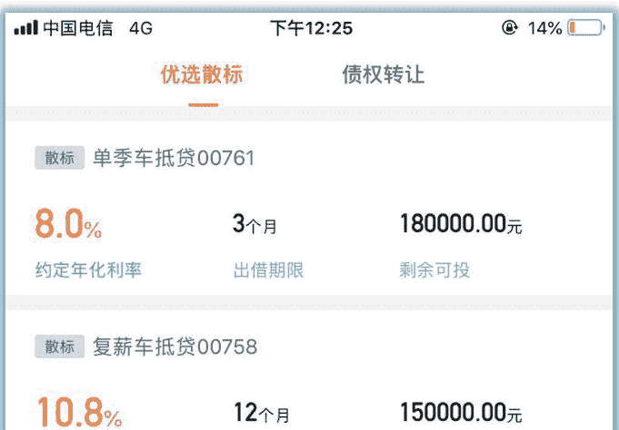

### 投资产品列表

| 约定年化利率 | 出借期限 | 剩余可投 |
| :---: | :---: | :---: |
| 散标 年金车抵贷00753 | | |
| 12.0% | 12个月 | 64000.00元 |
| | | |
| 散标 年金车抵贷00757 | | |
| 12.0% | 12个月 | 0.00元 |
| | | |
| 散标 双季车抵贷00755 | | |
| 9.0% | 6个月 | 0.00元 |

首页 出借 发现 我的

---

## 珍姐您好，我今年七

(提问) 独狐求败：珍姐您好，我今年七月份毕业后，在吉林省一家草业公司就职，这家公司属于创业公司，从创办到现在刚好三年。公司主要是种植苜蓿草，因为中美贸易战的影响，限制了苜蓿的进口量，在这种背景下，再加之这边土地，国家政策的便利条件，公司大力种植苜蓿。但是由于是创业公司，制度很不完善，技术方面也没有专业的人才。草的质量也不是特别高。我自己也学不到农业方面很专业的东西，现在感觉很迷茫，想问下珍姐苜蓿草行业发展前景及我自己改做些怎样的调整。

2019-11-25

回答：【帖子编号0383】〈区位理论〉终于把这个提问翻出来了。抖音这次视频，就是想到了这个提问所以去讲的。

———————

企业会选择成本最低的地方。但这种“成本”是复合的，包括很多很多种成本。我们可以试着去罗列一下：
总成本=人力成本+资本成本+地租成本+设施成本+信息成本+运输成本+税收成本（补贴）+政策（扶持）……等等等等
企业的目标，就是要建在总成本最低的地方。虽然不是所有的企业都能意识到这个问题，但是，总成本最低的企业，会具有很大的竞争优势，更容易在竞争中存活下来。而选错位置的企业，则更容易被淘汰……（就像我妈99年在海南开酒厂的例子）

———————

不同的地域之间，没有绝对的好坏，只有适合不适合。因为不同的地域，会面临着每项成本的不同数值，没有一个地方能做到“全都很低”，这是不可能的。各个数值里，肯定有低有高。（类似于打游戏时候，不同初始人物会带有不同倾向的初始技能点）。不同的初始技能点，最后就能够跟不同的产业相匹配。

———————

举例来说：

1. 资本密集型。金融，这就不是人力密集型行业，而是资本密集型行业/信息密集型行业。2011年的时候，我开始动心思从交易员转型成研究员，因为没有相关的经验，于是想到一种曲线路线。就是跳到银行当交易员。因为银行的交易员是“交易+研究”一体的。银行的交易员其实就是自己充当双重职能。于是我就投了一堆小银行的简历。结果不断面试的过程中，发现很多地方城市商业银行是真的小。全行总资产可能才400亿。（换做大行，一些支行都可能比这个规模大……）所以这就是资本密集型行业的问题，你待在一个小地方，这个地方有可能是缺乏资本的，天然的劣势无法克服。另一方面，虽然大城市的人力成本要高很多，但当初始些地方性小银行都想着把金融市场部放到上海（现在新的监管政策已经禁止这种做法了）。因为在小地方很难招聘人才。我接触到的一些城商行和农信社，甚至由会计兼职当交易员，所以可想而知他们的投资收益水平……所以，虽然越大的城市，地租成本的越高/人力成本越高。但相应的，总会有一些其他的成本比较低。只要其他的优势大于高地租，产业就会逐渐地往大城市汇集。相反，如果其他的优势不能弥补地租，就会产生挤出。因为金融行业的“资本密集”/“信息密集”的特性，那点地租成本和人力成本都只能被动接受，很难挤出……

2. 人力密集型行业。这种绝对是被挤出严重的。我去北京出差时候，那家企业蛮大的，有上百人的客服团队。客服就属于人力密集型……我听完就觉得，这种肯定招人困难……毕竟客服不是难度很大的工作，工资不可能开到太高。然而按北京的生活成本，工资低了人都活不下去，很难招到人。所以客服这种只能，就跟银行的信用卡中心一样，会被使劲的挤出，甚至不一定往二线城市挤，去三四线城市都可以。尽量往人口密集的省份，河南、安徽、江苏、四川这些省份转移就是趋势……同样是人力密集型行业的，还有手工业。之前圈子里转过一篇文章，是说苏州虎丘的婚纱一条街整顿，结果这条街上过去十几年的从业者基本都是安徽人，大家思考了一下，发现还不如回老家。最终全国一半的婚纱产业竟然都转移到安徽六安下面某个小县城去了……客服至少还需要大专或者中专文化，普通话清楚，交流有点逻辑，是需要点门槛的。而手工业/轻工业的门槛更低会往四五六线以下城市专业。 各个小城市，如果能分到一个“运动鞋之乡”、“皮带扣之乡”、“婚纱之乡”、“假发之乡”这种产业分工，经济发展也就基本有着落了。

3. 智力密集型行业。比如互联网相关的行业。北京互联网公司聚集，也是因为北京人才多。这个都是老生常谈了，大家都懂。在人才尚少的年代，承担北京的高地租成本和人力成本，换来快速组建团队，不错失发展机遇，这是利大于弊的。然而，每年也在不断有大批的人被培养出来。某一刻，会出现一个值得转移的临界点。在这个临界点上，像是继续追求“算法”、“AI技术”的更加“智力密集”的企业会选择继续留在北京，而相对来说没有那么“智力密集”的企业，是最容易离开北京的。（在我这种外行看来，感觉58同城，各种背单词app，海淘app之类的，各种听书/电台app，都不是太智力密集的吧？）即便转移的话，估计也是去武汉/成都，而不是去合肥/郑州。因为，成都有四川大学、电子科技大学、西南交大、成都理工这些学校，武汉有华中科技大学、武汉大学、武汉理工大学这些学校，这些学校的信用背书是很强的。相对来说，合肥的大学要弱一些，虽然有个中科大，然而学生数量太少，不够规模化。不过当地有个建筑大学，我猜这也是今年合肥突然冒出一堆新建筑设计院的原因，一个大学的信用背书是很强的，会有一种“不担心招不到人”的底气。

4. 土地密集型……这个基本就是农业了，往土地不值钱的地方转移是一定的。然后我在“区位理论”第一个视频里举的例子：种西瓜、种青菜，基本离大城市不会太远，因为保鲜问题，还要考虑到运输举例。相反，种大豆、种玉米，这种基本都去美国种了，因为海运运费便宜，对岸土地比国内更便宜，美国的地租+运费+人工之后，仍然便宜与中国的地租+运费+人工……讲到这里时，这是我对提问里苜蓿种植行业不太看好的原因……我猜测这东西应该没有什么保鲜需要，估计干草能储藏很长时间，海运运费也不会太贵。还需测这东西不怎么会需要人力，指不定美国的一个农长只需要三个人，就能管几千亩地……

像这种东西，放在国内，成本上是没什么竞争优势的。所以我不太看好这个产业。虽然现进口政策存疑，然而，这个东西其实没有太重要，政策不会一直“保护国产”的。 人吃的东西，大米白面这种，属于“战略物资”，一旦国外断，是会饿死人的。 所以哪怕出现国外成本更低的情况，也不敢全盘转移出去。 猪/鸡吃的，重要性已经减弱很多了。 就像中国大豆和美国大豆。中国大豆贵，强行种植，就需要政府不断补贴，长远看能补贴多久是个问题。 美国大豆便宜，但是害怕美国人断供，影响到国内的物价…… 然而中国不买，其他国家也消费不了那么大量的大豆，等着美国大豆都烂地里，看谁更急呗。 真熬上两年，国内物价涨了，美国大豆种植产业也崩了，谁还能比谁更惨啊。 而苜蓿草，是一种比大豆更不“战略物资”的东西。因为苜蓿草是牛吃的……中国人牛肉牛奶消费量又没有太高……大不了牛奶进口澳洲奶补充上来。 所以我觉得政策只是一时，扣除这个一时的影响，土地成本+人工成本+运输成本+其他各种成本在一起，对比来看看到底怎么样…… 如果不占优势，那么这个产业前景不会太好的。 （区位理论未完）(88赞)

### 评论区

- Bella: 珍老师，大晚上的用心写这么长的回答，不会担心脑细胞太活跃而失眠吗[偷笑][偷笑]
- 听说我说话很冲: 生猪养殖业也是土地成本较高、人力成本较高、智力成本较低的行业。哎。
- ✧Justina《第*: 珍姐的实例分析太好看了，看上瘾，不够看[偷笑]
- 珍大户: 会啊，然后吃了片melatonin才睡觉。刚起床，想吃个药想了半天，结果死活想不起来了[大哭]，于是对着药品敲了字母上来
- 珍大户: 这个算挺均衡的了
- 各目安好: 冬日可爱: 那两个字读啥啊……
- 晓露君1: 虽然是牛吃的，我记得老家办凉菜吃，也很好吃

看的研报里感触很深

珍大户：看的研报里感触很深的一句话：见下面的小1。

新房销售面积、竣工面积，代表的是家具行业的上游“池子”。

池子小了，日子就会难过了……这是大势。

这种大势下，最直观的，各种家具卖场的人流量，会明显能看到衰减，红星美凯龙这种地方的商家，估计会一片叫惨声的。

就像是母婴行业，新生婴儿数量开始减少了（2017年1700万——>2018年1500万——>2019年1300万？）。

如果产品不是尚未普及的东西，而是普及率很高的东西，那日子就会难过了。

（比如某种产品，如果之前只有10%的婴儿用，未来预计上涨到30%-50%和婴儿使用，这种产品至少还是增量市场，还能好做好多年。否则像是奶粉尿片这种普及率很高的东西，怕是就难做了。）

——《以下为搬运内容》—————

而随着欧派家居、索菲亚等龙头企业单品类开店数达到2000家以上，原跑马圈地的加法拓展模式红利不再，新时代家具的企业在拓展渠道上也不得不考虑以下变化：

1. 新房销量见顶回落。2017年新房销售面积达到169,407.82万平后，2016年下半年的销售面积与2017年Q1的竣工双双增速开始回落，这也正式标志家具作为地产后周期消费从增量时代迈向存量时代。
2. 装修流量入口多元化，传统线下流量被层层截流。定制企业过去获取的流量大部分来自线下卖场或街边店渠道，然而2017年开始，家具行业的高毛利和良好的现金流模式吸引各方参与者入局，线下流量开始被装修产业链前端参与者分段多元化截流（房地产企业、整装公司、靠前的硬装产品提供商）。
3. 供给增加客流竞争激烈，渠道成本抬升维持盈利难度增加。2017年家具行业迎来头部公司上市，也预示行业竞争愈发激烈。根据目前所有定制家具上市公司（索菲亚等）IPO招股说明书和再融资公告数据测算，上市公司定制衣柜2019-2021年产能增长率分别为：23.57%、14.91%、12.70%，上市公司定制橱柜2019-2021年产能增长率分别为16.00%、11.77%、7.93%。快速增长的供给叠加放缓的需求，同时家居卖场的每平方米租金持续上涨，电商平台流量成本快速提升，优质渠道资源价格水涨船高迫使上市公司思考如何再次优化渠道。

2019-11-25(64赞)

> 评论区:
> - 定义Cavinx：第一[吐牙]
> - 三月：第二吗？抖音卸载了，朋友圈关了，手机拿着就指望大户了。
> - 洪顺-优希劳精酿啤酒：第二
> - 追：第三
> - Bella：第三
> - 各自安好：难炸[大哭]
> - 牛文斌：前排
> - 军-合肥公司注册代账：第八

珍老师，你好！真的

(提问)匿名用户：珍老师，你好！真的特别感谢2018年7月在抖音平台与你相识！通过学习你的视频我又打开了一扇认识世界的大门，只是现在才发觉自己连肤浅都谈不上，实在惭愧！我想向你请教一下，还望不吝赐教：我有一个女儿在河北地质大学读大二，学习土地资源管理，87人里的专业第一，根据她的情况可以申请辅修二专业。我想问是辅修二专业好还是考研更合适？做为那么优秀的过来人看有没有可能鱼与熊掌兼得？如果辅修二专业，哪个更适合：会计学、经济学、经济统计学、国际金融与贸易、古生物学、法学、金融学和资源勘查工程？如果考研，对于专业和学校有什么建议？期待能得到您的指点！谢谢
2019-11-21

回答： 【贴子编号0382】 《辅修》 现在能辅修就一定要辅修一下。大学里的课程密度并不高，是有时间做这个事情的。比大学生去做兼职、做家教、参加学生会、参加各种社团的价值要高的多。至于你怕影响考研，先不要担心这个。因为辅修是100%能得到的结果，考研还有概率呢，为了大四之后的概率先放弃大二能得到的东西不划算的。至于辅修哪个专业……因为我对这个专业不懂，所以没法给出更精准的建议了，但主要要从就业角度考虑。（除非你们想考研时换专业，否则一概从就业目标出发。）如果就业是打算去考公务员，去政府某个部门，那么选法学/公共管理类的。 如果打算去企业，比如房企，那么辅修会计或统计（不要辅修经济学，对就业的精准性不高）。如果打算去地质研究所之类的，那么就去学冷门的古生物学。至于提到的资源勘探，不要考虑，因为女生学这个就业很难。（基本上勘探类的招聘默认就是招男生，去做扭转社会既有印象的事，这种选择是“不经济”的） 金融也不建议辅修，辅修一定要考虑“工具价值”。

—————— 一般而言，大学的专业可以粗分成两类，一类是带有“工具价值”性质的，比如外语、计算机、美术设计、会计、法律、电力/机械等等理工科，这些都是学完有特定用处的。另一类是有点“文化素养”类的，有点儿像是陶冶情操这种，学到的都是“软价值”，不好衡量。经济学/金融学/工商管理就是这种，还有文学系/历史系/哲学系……所有社会评价“比较虚”的，都算这种。辅修一定要去奔着“工具价值”这一类。太虚的不要学。毕竟辅修含金量要次于主修，(57赞)

评论区:

- 星月百合: 谢谢
- 谢狮子: 不用谢
- 各自安好: [强] [强]
- CCCCC: [强] [强]
- Mr Na: [
- 矿石没矿: 哈哈，群里竟然遇到同类学校的，河北地质大学以前叫经济学院，名字挂上经济两个字多好听，现在非要改回地质大学。现在地质行业普遍不景气，大量地质队、地勘院没有项目，发工资都有问题，虽然也招不少人，但是根据我的了解主要是因为行业不景气导致大量专业技术人员流失，急需补充，因为搞地质行业就是出野外爬山人，得需要年轻人呀，所以看起来招的人不少，但是真的项目很少了这个行业面临着转型、整合、调整，会有不少人必须得转业，所以虽然在——所地质院校里面，建议你不要再去学习地质类专业，因为矿业地质经济再也无法回到过去那样辉煌。其次是地勘类几乎清一色招男人，女生因为出野外也不方便，开个玩笑，在地勘单位身体素质好才是最重要的呀。
- @赵立佳: 为什么从就业的角度出发，而不是从创业的角度出发呢？上学就是要找个好点的工作吗？学习自己喜欢的不是很好吗？
- 时光: 地质和会计专业是河地大的优势专业，会计学院的老师很棒，可以考虑。

珍姐好，我从事的是

(提问)Mr.Liao：珍姐好，我从事的是小水电站行业，最近在企业并购、改造再建工程上遇到一个财务方面的问题，烦请指教。

1. 甲方拥有小水电站一座，已投产10年，总投资本金350万元，年产120万元净利润，那么请问这里的年投资回报率是34.28%吗？
2. 我方与甲方达成长期的承包经营合作，每年支付甲方120万元（不含税）的承包经营费用，水电站原始出资不变，所有权依然是甲方所有，但我方享有改造再建权利，我方计划投入150万元改造该水电站（和您之前说的发挥边际效益有异曲同工之妙），预计能提升年净利60万元，那么请问我方的年投资回报率是40%吗？

字数限制还有第三个问题，静候珍姐指点再接问吧！

2019-11-21

回答：第一个对的：120/350=34.28 第二个我理解的就是你们把120万（利润）给对方，对方就可以甩手不管了。那么就是60/150=40%，也是没错的。还可以验证地想一下，假如甲方不转包，自己去改造，那么总投资350+150=500万，年利润120+60=180，投资回报率为180/500=36%，数值介于你的第一问和第二问之间。我估计这个帖子里，大家看的最疑惑的应该就是还在怀疑，为什么会有这么高的利润率……不过水电行业确实就是这样。一会分享个文件，大家可以到看到，三峡的毛利率都是超过50%的……主要原因就是，自然资源值钱。

> __________________（PS： 所以咱们国家其实是很有钱的。记得我上大学时候就有个想法，国内的养老金公积金什么的，都是跟新加坡学的，我总觉得根本没必要去学新加坡，设想各种国有资源企业的盈利拿来当养老金一样，给老年人分红。像三峡现在的利润，每年300多亿（建电站的钱是借的，净利润是已经扣除了还本付息后的利润），如果全国3亿人领养老金，每人能分100多块钱吧。这样年利润从几百亿到几千亿的大国企还有很多……）(31赞)

### 评论区

- 周杰慧：厉害☞
- 姜晓生：对水电站感兴趣所以想问下楼主怎么做水电站，有哪些流程，需要哪些手续，对选址有啥要求谢谢↟
- Mr.Liao：感谢珍妮日忙中抽空回答我的问题，你回答中所提到的甲方不转包自建，正是我的第三问，甲方投资150万元再建工程，得出他的回报率是40%，比现阶段的34.28%，仅提高了5.72%，那么按需要投入的资金、精力来说，对于甲方自建意义不大。所以我很好奇，为什么甲方自建反而意义不大，而承包给我们知好像双方共赢？我一直怀疑是不是我计算投资回报率的方式错误了，请指点迷津！万分感谢
- Mr.Liao：感谢朋友的评论，水电站这个行业——苦难尽吧，手续比较复杂，每个地方政府的要求、指标不一样，离不开的无非水利局、国家电网、环保检测等等各种部门，然后选址就得看投资预算了，分平推式（三峡那样）和落差式。我们主要做落差式的，这种方式可建地方比较多，主要选山区，而且这种投资回报率比较可观，投入资金可大可小，很多因素影响吧。三峡移民大家都知道，工程巨大，对于民营资本来说解决占地、移民等这些问题难度可想而知。有兴趣的星友可以活跃评论，相互交流 学习，我懂的都会尽力解答
- 珍大户：我也想不懂这个。别说是提升了，就算是低于34.28%，也是值得投资的，比如在水资源不是那么丰富的河流上建水电站，是有可能收益率只有30%甚至更低，但也是值得的，毕竟风电比这个更低多了……所以对方为什么不自己投资而是转包给你们，这个我是真猜不透。
- Mr.Liao：珍妮，投资回报率这个问题上如果我的计算方式没错的话，我也很纳闷了。关于对方不自行再建呢，是因为对 股东较多，追加投资150万元能产出的收益提升并不高，并且他们不具备科学管理改造方面的条件，承包给我们，能坐享稳定高收益，且所有权益还是不变。
- 磨砺人生：那会不会股东中出现问题?会不会在管理上出现问题?具体的需不需要考虑股东的成分?如果股东之间产生分歧或者等原因，会不会让利求平稳?
- 鱼摆摆：唯一的解释就是甲方一定找到了一个未来收益更可观的投资。

这个帖子有珍姐的回

(提问)淘啦啦：这个帖子有珍姐的回复，姐再看看，我怎么感觉那么不靠谱，你竟然是支持的态度…… https://t.zsxq.com/aelEeL2

2019-11-21

回答：刚看到这个帖子，得谢谢这个提问。 这里我说“创意挺好”那句话是针对你第一个帖子的。 第1个帖子里，你只说了大致的方向，很多细节没谈，我看完只是觉得“模式可行”。这也怪我，要说就应该说的详细一点……省得给大家误导。 参见0367贴，消费文化扩散的内容。 （看下面内容前读一遍这个帖子） 我来解释一下，这个“创意”的问题： 这属于改进当前的电器店的方法。 目前国内的电器店， 比如苏宁/国美/永乐电器/五星电器，这些都属于已经存在快20年了。 他们的快速成长期，还记得是什么时候吗？是零几年，全国人民生活质量刚开始提升的时候。 很多家庭都是零几年开始，家里才添置或者更换新型号的冰箱、洗衣机、液晶电视、油烟机、电饭煲、微波炉…… 在回忆消费文化扩散的那个帖子，印证一下这个内容。 而目前苏宁/国美/永乐电器/五星电器，还会把巨大的面积用来摆放已经电视剧、洗衣机、冰箱这些已经普及的东西。 这类产品的销量一定是缓慢的，周转率低，则资本消耗一定高。 （我不知道他们是否需要给电器制造商付点定金或者保证金之类的？ 但至少这么大的面积，成本就不会低） 这种重资本行业，如果你想完全再复制一个国美电器出来，也是根本不可能的了。因为性价比很低。如果再来一个搅局者，最终竞争起来，都未必有盈利的机会了……

------------------

再举第2个例子。 我大学时候用的是波导手机。大家回忆那个年代，买手机去哪里买？ 我隐约记得，是有像电器店一样的“手机店”， 面积非常大，一个店都有两三千平……（可惜我死活想不起名字来了，如果有人还记得的话，提示我一下） 这种店的崛起，其实就是消费文化扩散过程中，手机普及过程中出现的。（产品普及，就代表着短期的销售量会很大，类似于网上的“爆款”概念搬到线下了，资本周转率很快）可惜后来苹果手机出现，各个手机都开始搞直营店或是直营柜台，也就没他们什么事了……

两个例子，大家找一下共通吧。 我觉得，这时候如果再经营“电器”，除非你所在的小城市和乡镇没有苏宁这种电器巨头，否则的话，就应该讨巧一点，放弃冰箱、洗衣机、电视、燃气灶、热水器、油烟机这些消费者严重已经普及了的、熟视无睹的产品。 去找还没被普及的东西。 只要你还做旧时代的东西，你就是巨头映衬下的“没实力、没保障”的三无小店。 但如果你做超前的产品，你就能映衬出巨头有一种“落伍、对新科技不专业”的感觉……（所以，在其他的帖子里，说现在的饮水机、净水器都没售后，你们的优势是售后好，那你就找错位置了。） 目前大概就是直饮水过滤器、即热饮水机、空气净化器、智能门锁、面条机、扫地拖地机器人等等各种“新鲜”的电器了……（突然意识到，似乎小米下面一堆x米、京东京造、这些互联网巨头也是这么想的[捂脸]。 只有乐视最傻，竟然去造电视……）

然而，上面这些分析，也只不过是“模式可行”而已。 这种窗口期，不会超过五年。 而现在跟零几年那个时代又不一样。当年，商铺没有那么贵、所有人都缺乏资本，所以电器店、手机店甚至能够靠压供应商的款，来规避重资本投入的弊端（因为所有人都缺资本，供应商给谁供货都会被押款），迅速开一堆门店出来变成龙头。 而现在这个年代，地租太贵——意味着想快速复制门店，就会有很高的风险，有可能随时断裂你的资金链； 巨头不缺钱/更容易因为信誉借到钱——就意味着有可能在你起步刚走到一半时，如果巨头轻微微转身，就有可能借助资本优势挤垮你…… 而对于 你只是聪明的发现了这样一个窗口。而对于你所拥有的其他资源是什么情况，我确实都不得而知。 所以只敢说 你选择卖净水/空气净化相关产品，这个切入点，方向挺好。其他细节，都没法太具体说了……(17赞)

### 评论区

- 肖恩（项目对接）：学习
- 晓磊君｜：莫非大户说的手机卖场是搜机城？
- 珍大户：不是的，就像是宏图三胞那种手机大卖场，06-08年好火的，当年读的商业评论文章里还经常能看到。可惜现在死活想不起名字来了……
- 鱼摩莲：电子城
- 精豆儿：迪信通么[发呆]
- 某年某月：水晶宫
- 光头卫：比上学时老师讲的都精彩！
- 红君：中域电讯

珍老师，我今年马上

(提问)欧阳漫霖:珍老师，我今年马上30了，女，云南普洱，现居昆明。云南师范大学的自考本科毕业。

人到30好多事情都让我感到焦虑，慢慢老去的父母，让我觉得我不能再呆在舒适区。我目前有三个选择，不知道选哪一个靠谱，希望珍老师帮我分析。在昆明，第一，开一家以普洱和西双版纳为主要特色的美食杂货店（柠檬湄水、农户自己做的香肠腊肉、干巴、炝牛皮、版纳包谷、竹桶饭等太多了，基本上都可以真空包装寄出去）。第二，开个普洱米干、米线店（食材都从普洱运送到昆明），找了一个开了10多年的嬢嬢学手艺学费3万不能少。第三，考事业单位（教师），要去培训学校学习一段时间，好多东西都要重新找回来。希望大家帮我分析分析，真的太迷茫了

2019-11-20

回答：【帖子编号0381】（特产店） 第二条路先排除。 第2条路，你们想主打的是从普洱进原材料。 那么这种行为，你就需要去分析一下它的成本和收益。 外地进原材料的成本，会高一大截。成本很明显。这种成本，需要你获得额外的收益去打平。否则就是不划算的。 所以问题来了：外地进原材料，能获得额外收益吗？云南那边米线，都已经做出花样来了。我印象中就是觉得，6块钱一碗（好几年前的物价，不知道现在在涨的多么），真好吃吖……反正比全国其他地方能吃到的米线都好吃很多似的。 当地都已经钻研到这种程度的时候，我怀疑这外地的食材，能对口感提升的效果，是微乎其微的。那么额外的收益就比较存疑了。 没有额外的收益，额外的成本就是多余的。 总之，第2条路线不建议你选。

至于1和3怎么选，我觉得看你的能力。 你的天赋技能点，在哪个方向上？ 土特产店，需要考虑下你的目标顾客群体是谁，他们在哪里。 1，是昆明当地居民吗？ 那么要求你的店铺开在当地居民常去的采购市场、老城区的大家经常散步的某条街之类的地方。想到做了长久，还需要借助这个店面，继续筛选出一些精准的顾客（喜欢吃这些东西，常常吃这些东西的人），进一步提升服务，比如搞周期订阅，隔多久给人送一次货之类的。2，是昆明的游客吗？那么店铺在哪里才能接触到游客呢。3，是全国其他地方工作的云南人吗？那么就需要你去挖掘各地的老乡群了……4，是全国想要尝鲜的其他省份人群吗？就需要你往网红食品方面考虑了。想想这个过程中的经营所需的技能。1需要你的服务能力2需要你的促销能力，每天都面对的是新鲜的游客，要长期的面对营销/促销3需要你是个网虫，喜欢群聊或者泡各个论坛社群，不断拓展网友数量。4需要你的包装造势能能力。相对来，讲当老师会更稳定和容易一些（除了考的时候难）。所以看你自己的选择吧……(36赞)

### 评论区

- 哈土琪□：大户籍～我昨天也有向您提问哦～ 如果有时间的话拜托翻牌，谢谢□
- 珍大户：收到
- 三月：哈，我也是觉得女孩考个老师还好些。
- 鸿翔水产工厂直销：我想吃你们那土特产[色]
- 长颈鹿：考教师编制有个年龄限制的，记得一般是30周岁，要考也要抓紧考了。不过难度是的大，夸张点就是过独木桥[捂脸]
- 珍大户：这个也是有个问题，考教师的时间窗口有限，不只是年龄的问题，而是后面有可能学历门槛越来越高……
- 欧阳漫霖：谢谢
- 欧阳漫霖：谢谢珍老师给的建议，我仔细读了好几遍。卖土特产可能更适合我，我有货源，然后我的目标群体主要是游客和在外地工作的云南人。开实体店的地址是“斗南花市街边店”，我发现目前周围还没有卖小吃这种土特产的，卖鲜花饼和茶叶的倒是是有几家。中学教师资格证我考到了，只是国家对自学的本科很不友好，可以报考的学校很少，可以考的基本上和外聘不在编。

珍爱土特产

# 您好，大户，法院拍

(提问)V270007878：您好，大户，法院拍卖房有哪些后遗症…….

2019-11-20

回答： 问清以下细节：

1. 限购？ 问一下当地政策，法院文书能绕开限购吗？ 如果绕不开限购，最终你办不了房产证。（不过也就是多等几年的事）
2. 租约。 因为“买卖不破租赁”，会有人利用这种方式签下个15年20年的租赁合同。那样你就干瞪眼儿了……（这种是目前最坑。如果有话一定规避）
3. 税收。 问清楚现在房子欠了多少税？一般买家税卖家税都要你个人负责的。
4. 法院负不负责腾房？ 如果不负责，你需要实地调查一下，现在房子有没有老头老太，或者很凶的“社会人”住。考虑一下把他们赶出去的难度。
5. 打听一下欠的物业水电。 不过这一项跟税前比，应该都是小头了。

听说某些法院为了便捷拍卖人，已经开始“含税一口价、包腾房”了。 这种遇到坑的比例就很低了。

(31赞)

评论区：
- V270007878：谢谢
- 小白龙：其实愿意租赁这块。法院会看他有没有在物业费交。如果没交费的就不算
- 天空之城：学习了！谢谢老师

# 老师您好，给一些小

(提问)viking: 老师您好，给一些小微型公司个体做代理记账的工作有没有前景，本是代理了部分小的公司个体，但近年大量出现很多极低价格做代理的，竞争之下不好扩展。想问下这个行业以后会是什么前景，有没有适合的衍生产品或服务可以固本增收一下～

2019-11-20

回答: 【帖子编号0380】《人工智能先替代谁？》

四五年前有个国外的新闻，说人工智能将取代交易员、分析师、律师、会计师等等。 刚好前三个都跟我有关，后一个又略微了解一些。所以我是确实在思考过，自己的工作到底有没有危险……

拿提问中的代理记账公司举例：

目前国内的代理记账公司，基本都是承包小公司的会计业务，按月收费，每个月费用从150-800之间，大部分都是200-300元。 从好的角度说，虽然每个公司只收两三百。但是基本都是同时承包七八百家，每个月二十万的营收，而且业务及其稳定，不用像别的行业一样担心淡旺季。 但从坏的角度说，这就是一个完全劳动密集型的行业，公司数量越多，需要的人越多。 而劳动密集型行业，也往往是技能重复度高，是最容易被人工智能取代的。

（同理还有银行的信用卡中心。银行的信用卡中心，按说应该属于总行的某个部门。应该在银行总行才对。 然而大部分的信用卡中心都是独立于总行，独立的办公楼，与银行总部完全分离的职场，并且人员大部分属于劳务外包。 只是因为，银行总行是资本密集型行业——“人数不需要大规模增长，就可以管理10倍的资产，从而增加利润”； 而信用卡中心是人力密集型行业——靠叠人力增加电话营销/催收密度，从而增加利润。）

人力密集型行业，因为工作的标准化程度高，可以被电脑分析替代出标准环节。也因为人力成本贵，只要标准化了，就可以大规模的节省人力成本。所以这是最容易被人工智能取代的行业。 记账公司也是如此。

尽管现在的记账会计工资已经很便宜了，但是只要引入电脑，还可以继续砍掉人力成本……

所以虽然现在，你们想的更多的是，恶性竞争怎么处理（你家收300，别人家200抢客户怎么办）…… 但是长远看，早晚上马云家再来跟你们抢工作（你家降价到200，马云家只收50……）

无论是防止现在的同行降价竞争，还是防止未来的人工智能竞争，解决方式都是“个性化”，而不是“标准化”。

怎么个性化？ 我只能说点细节，启发一下了。 以我这个小公司为例，刚成立几个月，每个月没几笔账，于是就找了代账公司。 找代账公司的过程也很好玩，当时公司一注册好之后，信息就全都变成公开的了，于是电话每天被各个代账公司爆打。 我每次接了电话就开始问，费用多少，有没有更高端一点的套餐？因为当时考虑的是，我对财务也是略懂一些的，考虑把账做的规范一些。方便以后从管理的角度去做财务分析。 那么就少不了要常常跟会计沟通。 如果一个月就200块，这钱怕是只够记几笔账，怎么好意思再占用额外的时间…… 所以当时心里想的是，如果合肥行情是200块一个月，那么我就预算800-1500好了。 希望能提供点个性化服务吧。 结果电话接了一圈，没有一家公司有这种服务。 最后我就放弃了，找了一家普通话说的最标准的公司[捂脸]。

这几个月记账的过程中，果然碰到了不少细节问题：

第一件事，是关于餐饮费： 我周四直播，助理晚上会回去的很晚。于是晚上必然要请吃顿饭。 餐饮费发票交给代账公司以后，我突然想到，他们看见餐饮费肯定默认做成招待费。于是打电话问会计，餐饮费发票怎么做的？ 会计说：招待费。（在这里给对不懂财务的朋友解释一下：发票是用来做成本的。 招待费，是用来招待公司外部的人。这个费用当然也是成本，然而税务局有个规定，说招待费只按60%记成本。 所以如果问这个费用算成招待费，就会被少算40%的成本……） 于是我就做了个表格，把每个发票发生的原因给写下来了。 餐饮费里特别注明，这是员工加班支出（具体会计科目我不知道，但是应该属于行政成本之类的）

第2件事，是社保问题。给员工办社保。代账公司说，他们手里的企业，都是所有员工试用期不交社保，试用期过后按3000的基数交……我就说我这不行，合肥这种做法就不是好习惯，要接轨也是学大城市。反正社保是都按合同工资纳了，然而更深入的问题就没法问了……比如，年终奖占年薪的多少的比例，才是税务最优状态？餐补、话补交通补贴这些，在正常状态下，也是需要计入工资基数，同时交社保的。那么怎样才能合规的增加员工实得工资，节省税收呢？这些问题，我都是不方便问的。因为代账公司本质上只是代理记账。

然后是出差费用。10月份的时候去北京给一个企业做了培训。我不太喜欢交际，所以当时谈的时候就说 了，所有的吃喝拉撒，住宿全都自理，不要搞接待。后来培训完一算账，发现一行几个人的吃喝拉撒，很多都是没有发票的，又没法做成本我就很不爽。回忆了以前在企业的时候，除了交通住宿按发票报销以外，每天都是按天算补贴的，也没说要发票。所以按说这个补贴费用也是可以进账的……然而因为代账公司只收200块，我不好意思问太详细了，觉得就算了吧。但反正财务上，是亏了点钱的……

公司一成立，就给所有人集体办了健身卡。就是我写0355贴里，写的这家看不好的健身房。但是因为在同一个楼里，特别方便，于是就办了。（相对跑路风险来说，身体先出问题的风险更大。反正我是怕了，于是全员办健身卡，逼着助理去健身房……结果大家都懒得去，也是愁死我了）这个健身卡也带来了财务问题。因为这个健身房是“个体户”，开不了发票。10月底到11月初的时候，我颈椎病又复发的比较厉害了（今年上半年 的时候，健身+喝鱼油/银杏，感觉那时候状态还比较好，颈椎病复发的频率低了很多……录视频台词儿也很容易一遍就过。到最近，状态不好的时候，录视频时大脑常常当机，于是看一句台词，再念一句，最后全靠助理去剪辑……经常周四晚上直播时候就开始大脑短路了，之后周五就头疼复发，在床上躺个一两天）然后我就痛定思痛，又去健身房报了个私教课，专门联肩颈后背脊柱颈椎这些地方。还是同样的问题——没有发票[流汗] 我自己思考的解决方式，感觉既然健身房是“个体户”，指不定他们也不交社保什么的。要不然让教练在我这挂个劳务合同，把健身房的费用直接算劳务支出算了……整个思路，到现在也还没跟会计沟通。

还有更深的问题。我这公司算文化服务类，我的直觉告诉我，文化服务类肯定有各种税收优惠，或者扶持政策。依然无法指望代账会计帮我去查这个事。 后来想想算了吧。公司又不是多大，计较太多没意义。

举了几个例子，感觉都是经营过程中遇到的财务问题。我倒是想过，要不要请个专职的会计？然而确实是每个月没几笔账，请来后，大部分时间在办公室闲着，就容易对其他员工产生负面影响。另外，金融专业里教的会计很浅，大部分都是财务分析，而不是从会计记账的角度去学习。所以我对会计方面的知识，其实是只有大框架的概念，而遇到的问题都是我不懂的细节。这又涉及到，如果请专职会计，我甚至不具备面试审核的能力……怕是要找找当财务总监的同学来把关一下。想想觉得，我这公司又没有很大，这么费劲不划算，还是找代账公司算了。

以上说的这些，就是“标准化”和“个性化”的差异。在标准化上，会计看见餐饮费，就入招待费；看见日用品，就入员工福利；算成招待费，就必然少记经营成本，增加税收负担。算员工福利，就必然早晚增加社保负担……

肯定不是所有公司都愿意为额外的服务付费。但是如果你们根本不提供，就等于少了挖掘这种客户的机会……合肥最基础的会计，月薪大概3500。记账公司200块。在200和3500之间，存在着一块市场空白。 月薪3500的会计之上，肯定有月薪5000、8000、12000……甚至更高的财务人员。然而一定也会有一些企业主，像我一样，根本不具备辨识“水平高低”的能力。所以在3500之上，又有一定的市场空白……关键是：你们能提供什么样的额外服务？必须是非标准的，有点量身定制的东西。有可能你们会发现，这种量身定制加收费之后，利润还不如继续做200块的，并接1000家客户来钱快。但这种转型，是未来不被AI取代的必须路线……因为未来的市场有可能一夜之间转变，客户都纷纷转投马云家50元一个月的。然后慢慢再被马云家涨价成150元一个月的，客户也不会再回头找你了……

关于你们能提供什么样的服务。除了我说的量身定制之外，还可以像律所学习。律所也有“企业法律顾问”的服务。企业法律顾问每个月会去一两趟公司拜访，跟踪一下企业的经营情况。一年会开一两次法律常识培训的讲座，讲一讲基础知识。这些事都是你们也可以尝试去做的。

(41赞)

评论区：
- 赵霞：大户。练瑜伽更有利于您的肩颈脊椎
- 小胆：大户说话我咋这么乐意看呢[偷笑]
- 珍大户：我练了，刚练的时候感觉特别通畅，后来估计是练瑜伽之后，力量训练做得少了，渐渐又不行了[发抖]
- 军-合肥公司注册代账：大户没找对地方，你注册个公司一年交多少税？估计是不要交税的，既然不要交税，工商税务又不找你麻烦，不晓得你还需要怎么样的增值服务？
- 军-合肥公司注册代账：要是交税多，那是需要个性化服务的。如果公司涉及到少量外汇，人家200也不会帮你处理，通常都在1000以上。
- 军-合肥公司注册代账：所以不是别人不收你钱，而且不愿意干活少，收钱多，背负一个坑人的罪名
- 珍大户：开公司怎么可能不交税啊
- 珍大户：干活确实不多。但是会计好歹是个智力劳动，不是体力劳动……咱也不能纯按干活强度算啊[捂脸]

# 你好 大户 进来

(提问)钰涵□：你好 大户 进来星星有一阵的时间了 很各位学习到了很多知识 原谅我这么晚了还提问 我前几天发过一个关于加盟物流平台的帖子 我认为不是很靠谱 但是我父亲现在非常想加入 他自己在我們当地人脉还可以 这几天联系到了好多能帮忙的朋友都说尽力帮他 我怎么劝都没用 我只是感觉这个项目不靠谱 但是又说不出出来哪里不对 明天我父亲就要打款了 大户帮忙看一下好吗 我这里有合同 不知道怎么发给你 微信给你行吗？

2019-11-20
回答：之前的帖子是 当时我没读，看见描述以就是复制货拉拉，或者58速运之类的。（这两家都是同城运输，就是货车版的滴滴）刚才我又特意去搜索了一下这家公司，发现不是做同城的，而是主要做物流的。你先拦着，我马上写原因

(22 赞)

评论区：
- 冬日可爱：一楼的呢称有点意思
- 珍大户：物流基本都是b端的生意，比如工厂拉货，家具商家发货之类的。这不像滴滴这种做C端的，消费者数量多杂极其分散，即便是同一个消费者，每次出现的位置也随机。而让消费没必要保存有司机师傅电话，保存了也白费，还不如滴滴叫车有效率要高，但做b端生意就不一样了。最直接的也一样，是运输地点。这个点是固定的，基本就是出厂位置，地点确定的时候，信息就非常容易了。举例来说，大厂一般会有一批自己的运输经理的人，在微信还没出现的时候，都是互相留电话。这个人往往打电话传播要发货的消息。司机之间一般也有小团体，一个司机得到消息后，会传播给一群人。就是这种组织关系网传播。在微信出来之后就更简单了。朋友圈或者微信群，发消息只需要15辆车，谁在工厂附近，个小组能赶到；报名先报先得。然后就结束了……因为事情不复杂，所以软件越想要描述，很容易被抵制———————类似的，你可以想象一下菜鸟裹裹app。大家家会直接找快递站直发，不会上菜鸟APP的，因为增加这么个APP会增加他们的成本，没人意让软件抽成。只有信息传递不畅的散户才乐意。菜鸟APP能够存在，是因为有广大的散户。个人用户发快递，来均摊运营成本。如果没有散户，那么菜果裹裹APP的运营成本会非常高，基本不可持续的。
- 珍大户：另外，看到前一个帖子里你谈的，找一个物流公司进入平台就返500元，这种收入方式也是明显不可取的。每一个城市的物流公司其实没有多少家。除非你们是在广州、武汉这种交通枢纽城市。但即便如此，算起来也相当没有性价比的，感觉像是退休老头没有成本概念，觉得闲着也是闲着。要真这么做，还不如去推广扫音盒（不要去交加盟费！）。扫码设备什么的。这些要么对于经常现场成长期的人来说，性价比不划算的事（因为用户无法重复消费）。但既然你爸不考虑成本，就丢掉了……
- 钰涵□：谢谢大户的分析回复，现在不单纯的是找一个物流公司进入平台就返500元 用户进入平台或交单一 就只能返500元像平常的介绍一个货主或司机才20到50元 我认为这里面的坑是很大的 事前前期扶持 工作实际都是交的是我自己的加盟费 公司其实一点钱都不花的 还得让我把物流公司跟负责人介绍进来 还保证他们的成交量 才能返还我的加盟费 我感觉太亏了把
- 珍大户：顺说一下心理态意的差异。货车司机都是根“江湖”的群体，他们在把“手续费”给谁的问题上，会有很强的偏好。同样的钱，他们更愿意给“货主”这种角色的个人，比如给老烟或者给几百块钱。这属于他们积累人脉的方式。他们会觉得这样的人脉是能放大的。比如有一天我带着其他亲戚来运货给 我来运车，或者有一天我组建运输队了，这条关系网还能持续用下去。同样的钱给APP，他们会觉得平台抽血，有钱我就不在这平台了，前面抽的钱都打水漂了。或者有一天我带着亲戚来，他们还得注册自己的账号，所有人都这么搞，也组成不成运输队了……
- 钰涵□：对呢 其实这里面也有好多的人情世故及利益关系。

# 最近刷抖音刷到一个

未央：最近刷抖音刷到一个微淼商学院的号，教理财，有些点还挺直击我这样穷人的内心的[捂脸]，所以买了一个12元的小白理财课程想感受一下，老师在微信群讲课，讲实现财务自由的三大工具是生钱资产的股票，reits和企业，这些都是低风险的，还推荐学员注册涨乐财富通账号，因为是学员所以佣金低至万分之1.8，这样的课程或者学院靠谱吗？后续还有进阶课程。

2019-11-16

(8赞)

评论区：
1. 越横：有点像拉下线啊
2. 大飞：涨乐通正常佣金也能做到万分之1.8别听他们说什么学员才可以，这就是忽悠你的第一步
3. 玲大户：巧了，今天刚一个华泰证券（就是这个涨乐财付通的公司）的联系我，说让我在圈子和公众号发广告，每开一个户给450元，我说我不做这种广告
4. 玲大户：以前不明白为什么有人推RETTES，估计是一样有提成，就跟水库论坛神吹门票先收一笔每人4500块，结果还推销别人某某小区房子，再拿房地产提成一样。要收费交课就专心收费交课，公允的说清楚优点缺点，这种偷摸借着你课程的幌子，吸引一堆没鉴别能力没防御心的人，再去定向推荐产品牟利，行为可耻了。
5. 杨恒热：大如威武。
6. 麦子：我学过这个理财课程
7. 暖暖：好多的，做什么长投，也是的……当时也和我宣传从他们那儿开户，手续费多便宜，我指出来这么便宜的请证券会亏本，人居然说这是证券公司的事，咱们只要有便宜就行，瞬间就觉得这种还是算了吧
8. 未央：你跟着做了吗

# 你好大户，我想问一

(提问)明先森：你好大户，我想问一下区县城市常住人口30万左右，开一个洗衣厂上门收送，定位中端。有木潜力呀！

2019-11-14

回答： 【帖子编号0379】 《上门洗衣》

具体来说：

如果你们承接洗衣机洗不了的东西......那就只有冬天的大衣，或者是巨大的窗帘了。消费频次不是太高，宣传费用反倒提高。这就跟圈子里之前提问过的“家电清洗”行业似的，很鸡肋。你不宣传，消费者平时想不起来你。你宣传，人家未必觉得这是必须品……愿意买单的人比例并不高，那么宣传费就不划算了。

如果你们承接洗衣机能洗的东西，就等于要和洗衣机竞争。那么，跟洗衣机比，优势是什么呢？价格便宜？体验，比如方便便捷？体验，比如顺便把衣服熨的笔挺了？功能性，比如去除普通人处理不掉的污渍？功能性，比如衣服保护的更好？一定要想清楚，你的竞争优势是什么？

假设衣服材质不是很精细，消费者会觉得，直接丢洗衣机算了。想要竞争下这片市场，你价格就不能高了……还上门取送，那么成本利润怎么分配，疑问很大。

况且对消费者来说，上门还要预约，还要等着揽货收货，便捷性都打折了，体验并不会太好。所以想成日常高频消费，上门取送当做核心竞争力，吸引力就不会太大。

如果是材质比较珍贵的衣服，首先在县城里，这种比例并不高。毕竟中国目前，真丝、羊毛羊绒普及率很低，况且跟城市经济绝对的正相关，到县城这一阶段比例就更低了（如果你们针对这块市场，那么目标人群太有限了。）我记得有次我们mba同学群里不知道怎么就聊到真丝衬衫了，大家都觉得好穿，但是很多人就觉得洗起来太麻烦，就不想穿了，因为据说送去干洗，一次就得一百块。我默默的没敢吱声，因为我从来没干洗过，都不知道干洗是啥价格。但我想的很清楚，反正我的真丝衬衫只能穿两年。是因为我胖，到第二年，还没等衣服怎么样呢，腋下肯定磨出个洞来。就算干洗了，衣服表面保护的再好又怎样，腋下磨损跑不掉。还干洗，按照我穿一天就挂起来，穿个三四次再洗一次，一年估计也就洗个四次的频率算，两年800块干洗费，都够大半件衬衫了，还不如去买新的……

其他的珍贵材质，羊毛羊绒，清洗频率并不太高，真皮……穿皮衣难道不就是因为懒得洗衣服吗？

所以我觉得，如果你们的竞争力是价格、或者便捷、或者保护衣服，这些都不太靠谱。梳理过程中，确实发现了一个还没被洗衣机满足的需求：熨衣服。这个纯丢洗衣机里，完全没有熨烫效果。如果熨烫，就需要人力投入，很多人没时间。所以确实是个市场空白。但是在县城还是不太可能发展的起来。县城里怕是只有“处女座”的人（特爱体面）的人才有需求。这是随机的、少量的，不是大量出现的。大城市的商务人士，比如一个单身的男的，需要每天穿笔挺的衬衫来营造职场形象（但又还没到需要顾住家保姆的地步），这时就可以搞上门洗衣/熨衣服的服务了，每周上门收送一次。这种似乎是可行的（似乎真是个市场空白耶[呲牙][呲牙][呲牙]）

(37赞)

评论区：
- 遇见：我个人觉得，可以尝试承接规模稍大的饭店，宾馆的桌布，床单被套的清洗业务。洗衣厂优势，量大便宜，清洗，烘干，熨烫效率比一般自己洗高。正如，珍姐说的。一般洗衣机没法处理的，大件业务。酒店，宾馆的业务基本是长期也可避免洗行业的低旺季。
- 听我说说话棉神：所以如果想要面向个体消费者，主要的方向最好是高端的“衣物清洁熨烫服务”。话说，我作为一个穷人已经买起带烘干的洗衣机了，海尔的，两千六买的，使用上感觉和我家一万一的没啥太大区别，区别就是确实没有那么干，没有液晶屏幕，没有洗衣液自动控制，但说实话，这些都不是事，整体还挺爽。[回]
- 孔垂萍：北京2015年前后，有个洗衣品牌，上门取件送件，按烫收费，一袋子衣服从二十到一百百不等，袋子分大中小便，摘来摘去搞黄了。第一，不算便宜，第二，不方便，第三，不是刚需。
- 爱故事的山楂_柯南：双十一给父母换了一个10kg滚筒带烘干的洗衣机，1799...定位中高端的话，可能就直接自己买个洗衣机了。至于正装或者特殊材质的衣服，基本都拿去专业的洗衣店洗了
- 奔跑的美兜：干洗店每次烫完都熨烫
- 蒙蒙：正装的话让我想到：像我这种无世事人，跑去高级写字楼见到年轻的男士问：结婚了吗？有保姆吗？“个人住宿吗？我是专门上门烫衣服的[呲牙][呲牙]"
- 桃木梨子：但是现在很多用无水蒸汽挂烫机，还是比较方便，挂烫机操作方便，也就一两百块钱就买到
- 极致：终于从头脑进到进度条了

关注公众号“懒人找资源”，星球资源一站式服务

## 大户姐，您好！天天

**提问** 竹子：大户姐，您好！天天晚上看圈，受益匪浅，一直在找项目做，从开始咨询进口母婴，到现在想加盟轻餐进商场店（目前比较看中苗小坛，考察过南京各大商场都做的很好，目前南京算是饱和了，近期想去合肥看看）但是我心中始终有一点遗憾，我们之前学做卤肥肠（有秘方）的主打的无油不臭的肥肠，肥肠都得是新鲜的，不能用冻货。19年三月份开始做饭店配货包括街边的卤菜店，两三个月积累了50几家客户，主要是饭店，饭店反馈非常好。但是遇到猪肉疯涨，猪大肠紧张，价格上去了还没货源，就停下来了。现在不知道是等着猪肉降价，还是做轻餐饮。

2019-11-14

**回答**：这个翻出来给大家看吧。饭店配货这种模式真的挺好的，足够细分，可以足够专业（比自己直接开餐饮店的竞争压力小多了）。只是供货加点利润，经营风险也比较小，谈下的客户数量足够多的时候，销量也会比较稳了。因为新鲜度的要求，就只能做本地市场，那么也是有一些竞争壁垒的。有没有可能搞点其他的卤货，比如鸭肠之类的呢？

选创业机会的时候，尽量找大家“明面上看不到”的领域。人们是缺少创意的，大部分人只从自己看得到的地方入手。奶茶店、餐饮店、服装店、母婴用品店、超市、水果店......这些都是所有人能看到得到的领域，一堆人盯着呢，竞争永远都会激烈。这个配货给餐饮店，至少不是摆在明面上的。（39赞）

**评论区**：
- 定义Cavin：这种细分领域的市场其实不容易被替代，竞争对手也是够的少。唯一需要提醒的就是一定要建立反馈机制，让自己工作中的不足让人讲出来。这个增强回路可以让你走的很远。
- 听说我说话很冲：坐在养猪公司的大楼里，看一堆人喊着猪肉涨价猪肉没货，有种莫名的，
- 珍珠大户：啊哈哈哈，你们公司今年利润很好吧？
- 听说我说话很冲：老总已经福利断薪了
- 竹子：你们是哪家啊！我们南京养殖场的肠子都要抢，人家有时候还不给
- 竹子：好的明白
- 竹子：我们最近也在计划，配送饭店继续，就是配送饭店利润点低并且要不断的积累，想可不可以做成肥肠档口店(注册名字商标)做成品牌，具体方案比如说要一份肥肠，我可以给你配菜什么的挂好！抓住这部分散客，还有一些不太会烧菜的人群群体，不知道可行大不大
- 听说我说话很冲：南阳。超市还能买脆骨排，不过不知道价格算高算低，好像是五十多吧。[回]

## 老师你好，我在抖音

**提问** 匿名用户：老师你好，我在抖音里看到您分享的中国城市未来发展会受高铁网络的影响。我现在住在徐州市。徐州是陇海铁路和京沪高铁的交叉点。而且现在也开通了地铁。但是他的人口每年在流出。现在徐州的房价均价在一万二三。我已经有一套九十多平米的房子。想换个大点的房子。如果现在手上有六七十万现金，徐州城市的发展来说，值不值得投资房产。在徐州开发区，潘安湖景区，恒大有一个楼盘，均价七千多。我是买市里的房子好还是去郊区买环境好价格低的房子。谢谢，希望您能帮我分析一下。

2019-11-14

**回答**：【帖子编号0378】〈徐州〉徐州就像是全国很多的“较大三四线城市”。你说他是二线城市，似乎排不上号。你说他是三四线城市，但总有点强势的地方。或者人口超多，或者是交通枢纽，或者是有点历史积淀之类的……就像是鸡群里的一只火鸡，比别人明显大很多。因为比其他三四线城市略大一些，就很给给人以迷惑性。然而：回忆第0303贴：

（建议再搜下数字0303，把所有相关0303贴的文章都看一下）里面说过一个观点。所有能够支撑高收入的产业，必须要服务更广阔的地域、更广阔的人群。再用白话说一点，就是要赚“全球的钱”、“全国的钱”、或者“全长三角/全省的钱”。如果做不到这一点，那么就很难脱离普通收入水平。这时就是参考统计局的“全国平均收入”。隐约记得2018年，大概是全国大部分人平均月收入范围在2~5千。再详细一点，我估计大概就是：乡镇人均收入两三千，县市人居收入三四千，高点也不过就是五六千的样子。这是所有的“只服务本地”的普通产业的普通收入水平……普通、普通、普通。比如服务本地的的小公司，服务当地的小商业，当地的小酒厂、家具厂、粮油米面厂、服装食品厂等等。【只要当地的产业没有质的改变】，这个城市就是一眼望得到头，就是这样了。

人生往往不取决于你的能力有多强，大家就安居乐业，就这样了。而当地的产业，想要有质的改变，这是很难的……对某个人、某个企业来说，或许因为互联网，或许因为5G的发展到，个人会有一些机会。但对一个城市，想要普遍的提升，仅此是不够的。（就像芜湖出了个“三只松鼠”这家创业公司。但这是个例。这种机会不可能普遍出现在整个芜湖，而一家公司对一个城市的作用又是及其有限的……）所以大部分需要等待一线城市的“产业溢出”。承接“某个产业”的转移。这种转移，不是一家两家公司的转移。（比如圈里提到过的个例：有一些建筑设计院转移到合肥了，有一些互联网公司转移到武汉了，一些动画产业转移到成都了……）这必须是一种苗头、一种趋势，必须提升整个城市的经济总量。

从细微之处，能看到这些城市的招聘量在增加，出现新的工作机会；高铁站每天繁忙，不断有提着公文包或者笔记本电脑的人，来来往往的去出差、去开会；酒店里旅游的游客之外，商务出行旅客的比例在提升……写字楼入住率在提升；去吃吃喝喝的人群里，不再都是逛街的小情侣或是带着孩子的家庭聚餐……如果没有这种迹象，那人均工资只会永远平均值，前景就是一眼看到底……比如生在2015年之前的十多年里，武汉作为一个大城市，常年毕业生3000元的工资。被很多媒体吐槽说，为什么那么多大学，培养过雷军这样的人才，却培养完了人家转头都去北上广深了，当地怎么都是3000元工资，连好点的工作机会都提供不出来。如果不是北上广深现在城市太挤、成本太高，挤出一批资源，那么，武汉还会一直3000元继续下去。

上面这种逻辑，在全中国大部分地区都适用。除了西北、西南这两个地方。因为国家太大，北上广深老经济中心确实辐射不到，以至于这两个地方必然会自发形成自己的“中心城市”。在中心城市里，会出现一些“服务全西北/服务全西南”的企业，或者大企业的西北/西南总部，从而缓慢的提升当地的平均收入水平。而其他城市，都是一种“水满则溢”的观念（其实就是等着捡一线城市溢出/转移的资源来发展）。

所以这么看，徐州就是很尴尬了……他周边的城市……南京、济南、郑州、合肥……都是自己都顾不过来的地方。这些城市自己都还在死命吸引人才、吸引产业的城市。指望这些城市的“产业溢出”再来抬起徐州，现在是指望不上的……（49赞）

**评论区**：
- ponytail: 人口流出城市，我们小区徐州的盐城的山东的不要太多
- 珍大户: 是哪个城市？
- candy麻痒: 估计都是山东临沂菏泽的，济南的不可能去徐州
- redvvsasil: 真心觉得武汉是个蛮荒之地，冬天冷死，夏天热死，老土著和新土著素质都差，在武汉碰到的好人大都是外地人
- 韭菜盒子: 圈里的老乡不少[愉快]
- 曼巴先生: 要说人口外流，我们盐城才惨，上海和苏州外来人口中比例最高的就是我们盐城，明年高铁一通不知会有多少影响
- 辛: 那我们兰州就是那种一眼看到头的城市了，平均工资不高但满大街酒吧火锅泛滥，全是大户说的小青年这种情况，也不知道吃喝玩乐的钱是哪来的
- Lisa: 我是一个湖北人，从小在不在湖北，但是每次回去也是感觉人群素质稍低

## 老师您好,我今年3

**提问** 金光孝(无抗鸡蛋)：老师您好,我今年38岁了从事养殖蛋鸡14年了,养了两万只,收入也比较稳定。从2014年鸡蛋期货上市以后蛋价暴涨暴跌一点也不稳定,今年由于政府工程原因让搬迁但是没有补偿。我想问一下这一波鸡蛋红利能坚持到什么时候,到时候我协调一下看看能不能养到那个时候再做打算。再就是蛋鸡养殖这个行业还可以持续良好的发展吗？我现在也是有两个选择一个是搬出去建一个五至十万的养殖场但是投资得500至1000万如果可持续发展的话这么大的投资还可以考虑,再一个就是转行了可是找了半年也没转到一个好项目望老师指点一下。

2019-11-12

**回答**：【贴子编号0377】《养猪养鸡》这个问题好难回答，因为确实不懂养鸡行业。对养猪了解一些，也是因为猪肉在cpi里占比较大，而研究宏观经济，必须要关注cpi，所以连带着就得观察猪肉了。[捂脸]刚才那个猪肉价格的帖子，我没去具体预测猪肉价格。如果要预测的话，具体方法是这样的：对□存栏数（小猪数量）和价格做个相关性的回归分析。结果会发现，存栏数据和n个月后的猪肉价格，有很明显的负相关性（相反）。然后能计算到一个数字结果：存栏量每下降1%，肉价会上升百分之x%？那么9月存栏量已经下降了百分之人，明年三月，价格会涨百分之a乘以x.……具体数据我没算（a老了，开始懒得动手了[尴尬]，有理工科的孩纸感兴趣的话可以按这个思路计算一下）我凭感觉瞎说一下：明年二三月份，猪肉估计要60块一斤……（后面比牛羊肉还贵的时候，大家会觉得还不如吃牛肉了，价格就到天花板了）到明年这个时候，估计会回到现在30一斤的样子。但想要再回到十多块一斤，我感觉就得到2021年了。以上是纯懒得算，“凭感觉瞎猜的”。

再回到提问中的问题，如果猪肉这么贵的话，吃鸡蛋的消费量只会继续增长。毕竟鸡蛋是最便宜的“荤菜”了。所以既然你问这波鸡蛋红利能持续多久，我大概给个预测好了：还有一年。

第2个问题是问养鸡行业，长远能平稳发展吗？以前写过一个帖子，说“养猪养鸡是工业”（这个观点是很致命的。说不清楚的话，就会容易被喷死。当年为了从交易员转型研究员，四处投简历，好不容易有个基金公司行业研究员的岗位给我面试，结果我说养猪是工业，面试我的基金经理说“你怎么连点常识都没有”，然后就黄了……[捂脸]）因为鸡舍、猪舍是很容易倍数增的，今年一个鸡舍，明年再盖一个，就翻倍了。今年一层厂房，明年再盖一层，就翻倍了……从长远看，产量很容易就能涨上去，产品总归会是“过剩”，这就是工业的特性。【重点：长远来看，产量早晚过剩】所以猪周期、鸡周期、蛋周期，基本都是这么来的：产能过剩——跌价赔钱——淘汰一批人——产能降低——涨价赚钱——老人扩大产能/新人进入行业——产能过剩。周而复始。所以……如果你说的良性发展，是指价格没有暴涨暴跌什么的，在现在这个时代，是不可能的（什么时代可能，往下看）未来十几二十年，还这个是免不了【赚两年亏一年】这个周期的。只要保证自己是高于平均水平，每轮周期的时候不被淘汰出去就行了，盈亏相抵以下，最终结果应该还好。

所以鸡舍能不能建呢……你评估一下，你这个规模、效率，抗风险水平是高于周边平均吗？只要是，就去建好了。因为每轮周期的时候，淘汰的都是抗风险能力差的小商户（我总感觉你这投资1000万的鸡舍应该是高于中位数了吧？）。

这种赚两年亏一年的周期，会再持续个十几年的。然后小商户都淘汰的差不多的时候，成规模的商户之间，会互相兼并收购成规模（或者搞行业协会成规模），然后再立法，规定“为了食品卫生安全”，禁止设立小养殖场，强行抬高门槛（或者搞个评级体系，把新成立的小厂卫生评分很低，强制连锁大型超市不可以从他们那里进货……）到这一步，整个行业的产量就差不多【稳定】了，就不会再有暴涨暴跌了，然后才到你说的“良性发展”。（然而到了“良性发展”时期，养鸡这个窗口就闭合了，那个时候再建鸡舍，就不太可能了）（80赞）

**评论区**：
- 金光孝(无抗鸡蛋)：谢谢
- 杨小米：很有远见……博学多才的大户
- 沐白：那就是不要盲目扩大规模，保持甜头就好？
- 磨厉人生：保持利润的前提下做大做强，提高自身的抗压能力，为最终的谈判争取条件
- 木子美：对于一个养鸡场说的是不是太远了！十几年！工业养殖了。
- 云淡风轻：标准化，规模化是未来趋势
- 花生了什么树：因为非洲猪瘟影响，2019年生猪存栏量下降到往年的一半，很多中小型企业受影响比较严重，大企业生物安全工作做得好，在这一次危机中就有很多机会。仔猪的价格目前翻了四倍左右，小型企业补栏困难，在这一时期会淘汰。其他中型企业从补栏、养殖、繁殖、出栏需要多长时间能回来，能繁母猪作为生产性生物资产，一年能产出2.5个批次，每胎10头左右，这个时期拼的是母猪存栏量、鸡鸭作为替代品，2019年已经享受到猪周期的红利。而且政府从建厂、养殖基数、疫苗等方面出台了很多政策，这个时期不能放弃。具体什么时候能维稳，可以关注母猪存栏量是否达到以往的水平，但是猪肉价格不可能恢复到以前的水平了

## 早上好，珍姐，我做

**提问** 无为：早上好，珍姐，我做超市，考察了一处楼盘河北邢台沙河汇都新都汇地下一层7000平，地上是一条一公里左右的步行街(还不成熟)，停车场在负二。对面有成熟的连锁家乐园商场地下一层是三千多平的生鲜超市(家乐园自营)，望姐百忙之中给于指引见解，该不该投资？谢谢！当地有三家大点的超市，对面家乐园，另外两家距离两公里左右都是三千多平,超市有包好的水果拼盘，下午两点有很多吃饭的人，当地有矿和玻璃产业。忘了拍照片，地上靠近马路，有绿化带，停车不方便。我想到这些，珍姐忙里偷闲帮我分析一下好吗？微信也给您留言了，感谢！

2019-11-12

**回答**：两公里外的超市，对你们影响就已经比较小了。问题是对面那家，如果他们就在你马路对面，那就算了，否则这么近距离的两家大超市，就真是你死我亡的战争了…… 这么近距离的竞争不好的。（12赞）

**评论区**：
- 卷心：看到老乡了[喊牙]和本地强势品牌竞争，没有优势资源加持的话，估计很难吧
- 子然一身：距离太近的话 就看谁 营销方案做的好，谁的资金雄厚。耗死对方，就赚钱了。不过想进入生鲜行业的小白还有很多。竞争不可避免。
- Mr.Na：7千平米？？？
- 无为：建筑面积
- 申俊杰：感觉不是很好看，我就在你计划超市那个地方旁边上班，感觉干不好

## 有个提问，我老发送

珍大户：有个提问，我老发送失败，特此重发一贴：

（提问见下面截图）

【帖子编号0376】

F先生老家那个县城里，流行开车去大城市消费。

于是F先生经常能在朋友圈里，看到他的某个表妹又和对象开车去大城市吃海底捞了。

在我们看来，这种行为是相当不“经济”的。开车来回光路费成本就要400。小情侣两个人吃，估计要花个三百块。

都是县城里领3000月薪的人，花700块吃一顿饭，反正我是看不懂。

海底捞又没有好吃到要上天，就算真想吃火锅，其他不知名的火锅店里，找一找总能找到口味不差的。

然而，其他火锅店没有海底捞知名。人家未必是想要吃“好吃”的火锅。如果人家只是想发朋友圈呢？

想起0369贴里写的：

小城市容易只有一种声音

这种声音，不一定是讲道理的，不一定是符合逻辑的，不一定是讲因果、原则的。

但一定是引起鄙视链的。

就像你说的，“某某路的某某店才是总店”，这句话是没法理性面对的。一杯奶茶，至于吗，还非需要去总店排队？就像前面那一顿火锅，至于吗，还非要开车来回花400块路费去吃？

不是这个奶茶真的多么好喝，就是人们需要一种精神满足感，需要炫耀，需要建立鄙视链。似乎去这家总店买奶茶，才象征着品味，才能“鄙视”别人。

你以为这种鄙视是讲道理的，所以你试图用逻辑去理解了，去猜测：

是因为总店的配方跟其他店不一样吗？感觉不是。是因为总店的装修、或者服务更好吗？感觉不太像。于是你觉得，是因为总店开业的时间更长…….

基于这个判断，所以你想控制加盟，希望一年后，别人也会传你们家才是总店，然后源源不断去你家买奶茶。

然而，这种鄙视链就不是凭逻辑，就不是非要评出一家好喝的。要的就是鄙视你，还怕找不到理由？

想说老店好，就说老店是老字号，最正宗。

想说新店好，就说新店是旗舰店，品牌服务都升级了。

当地流传的这句话，有两种可能。一种是人群自发形成的。那么就纯粹要靠碰，纯属靠运气。

还有一种可能是营销出来的。那就不知道别家总店之前是怎么暗地里宣传的了。

但无论如何，你别真的相信了，你真相信“因为人家是总店”，你就上当了……

毕竟你又不是消费者，你又不需要靠买奶茶来满足精神愉悦。 https://t.zsxq.com/uzFuvrZ

2019-11-12（28赞）

**评论区**：
- 珍大户: 另外提问中有一个细节，我没太看懂：如果开放加盟，对你们（总代）是否有好处？比如你们能收到加盟费还是能收到原材料供应的费用？
- 听说我说话很冲: 我真的很想 说大城市。香。[阅]
- JANE*: 珍珍老师说得对！
- 某某某: 还好吧，身边也有人双休无聊，每隔一段时间开车跑周围地级市和县级市农家乐，美名其曰远离喧嚣，感受大自然。成本也是存在的啊。说不定他们都一样把开车去远点的地方当旅游啊
- 清清楚楚: 感谢老师答复。第一次发帖，考虑到老师平时比较忙，没见过答复我就想着删除了重新编辑，[捂脸][捂脸]因为是招字正好300个，老觉得自 己表达不够清晰。老师，意思是我们可以开放加盟的，对吗？因为别人来我店里喝奶茶不会因为“我是总店”的这种思想而来，有可能是宣传、服务、味道或者其 他更多因素。 别人加盟品牌，加盟费是总部收取，加盟店日后进的原材料我们有提成。
- 珍大户: 既然有好处就开放加盟好了。你们如果真想摘鄙视链营销，就不止是“总店最正宗”这一件事了，还要考虑品牌之间的差异，使劲想想你们能打出点什么洗脑的声音出来吧。
- 清清楚楚: 好的，谢谢珍老师
- 定义CaMl: 1、“总店”效应，考量的是内在驱动是品牌效力够不够大，可以参照星巴克。如果满足不了客人发朋友圈的需求 PS、人性的弱点-表现（展示自己），那么总店效应对你经营的影响并不大 2、客人喝奶茶，本能是为了口感的满足，好喝、服务力，氛围场景化服务才是关键 点 3、既然总部政策允许 在你经营范围区域保护外开设品牌，并且为了利润可得，就让他做吧。生意都是靠自己来经营的。反过来想，多了家加盟，你们的品牌效应得到了叠加，反而是件好事 4、祝生意兴隆

匿名 用 户 提 问 ： 珍 老 师 您 好 ， 我 丈 夫 今 年 9 月 份 在 一 个 小 县 城 开 奶 茶 店 ， 价 格 6~12 块 ， 生 意 不 错 。 人 口 约 70 万 （ 2018 年 已 经 归 属 城 市 变 成 行 政 区 域 了 ） 。 这 边 有 家 益 禾 堂 开 了 3 年 ， 生 意 很 火 爆 ， 本 地 人 有 了 “ xx 路 的 益 禾 堂 才 是 总 店 ， 那 家 最 好 喝 ， 最 正 宗 ” 的 这 种 思 想 ， 就 算 冷 天 也 生 意 不 断 。 后 来 加 盟 的 8 家 益 禾 堂 生 意 也 一 般 般 。 现 在 有 人 想 加 盟 我 们 的 品 牌 ， 我 们 是 县 城 总 代 理 。 我 建 议 经 营 一 年 后 再 放 名 额 加 盟 。 让 别 人 都 懂 得 我 们 是 这 个 地 区 的 总 店 。 因 为 我 担 心 别 人 加 盟 了 ， 装 修 比 我 们 高 大 上 ， 我 们 就 会 受 影 响 。 但 他 觉 得 我 目 光 太 短 浅 ， 认 为 我 不 给 别 人 加 盟 ， 总 部 那 边 也 不 会 同 意 的 。 可 现 在 就 给 加 盟 了 ， 我 觉 得 我 们 就 受 不 到 区 域 保 护 了 。 珍 老 师 能 给 点 意 见 吗 ？ 加 盟 有 影 响 吗 ？

【 帖 子 编 号 0376 】

F 先 生 老 家 那 个 县 城 里 ， 流 行 开 车 去 大 城 市

消费。

于是F先生经常能在朋友圈里，看到他的某个表妹又和对象开车去大城市吃海底捞了。

## 珍姐，您好！我是第一次提问

**（提问）小陶：** 珍姐，您好！我是第一次提问，马上要过年了，关于什么时候买猪肉我和媳妇有一点小分歧，所以想问问您！

我的观点：目前本地猪肉（湖北襄阳）是37，排骨33，鸡鸭13，鹅10，鱼稳定在6块，过年买猪肉是刚需，我认为现在就买！年前猪肉必定大涨！就算政府出政策干预市场，最多也是稳定在现在的价格！想掉价可能性太小！

媳妇的观点：等！掉价再买！（我之前给她讲过国家进口多猪肉供应市场的新闻，她是铁了心了）

所以我想问，年前猪肉是否有掉价的可能呢？

2019-11-12

**回答：** 好久没说话了，借这个帖子补充一下：我刚才又看了一下最新的数据，10月数据还没出来，只能看到九月份的，九月的母猪和小猪数量（生猪存栏）还是在减少的。9月小猪1.9亿头。2018年基本是3点几亿头。这减少的1亿头猪，靠进口根本是杯水车薪。

再详细一点说：小猪6个月后出栏，所以小猪数据就是6个月后价格的直观反应。

- 2019年9月1.9亿头，对应着明年3月的猪价……
- 2019年5月2.4亿头，对应的就是现在，11月的猪价。
- 2019年1月3亿头，对应的是6月份的猪价。
- 2018年6月3.3亿头，对应的是2019年1月的猪价。

所以这么看，应该就心里有点数了吧。

进口猪肉的数据我没查。大家如果有心的话，可以看一下新闻，预计进口多少万吨？

我再给一组对比数据：咱们国家每年消费猪肉约5500万吨，每天15万吨。大家可以搜下，进口猪肉能进口多少吨吧。(37赞)

**评论区：**

- **桃木梨子**：现在买猪肉过年是正确的？
- **三月**：个人觉得差不多可以买点，冰箱有位置的话。昨天在菜市场发现排骨34，鸡小腿15，连鸡胸肉都15了。菜商说前一阵子鸡胸肉20，对比之前鸡胸肉都是八九块钱一斤的，一直很稳定的。别的没问，猪肉涨的连锁反应还是挺吓人的。
- **⒂ tree⒄**：不吃猪肉(偷笑)
- **风琴**：同襄阳，上次买牛肉也才35一斤，里脊38一斤。为啥非得吃猪肉。。。至于不是非要吃肉，我觉得十分有必要。[撇嘴]
- **珍大户**：我的感觉，再过三个月，价格会奔50以上去了
- **郝三藏**：按照市场供需来说猪肉真的是要陆续贵，但是如果真的达到了50，物价已经超过了日本 很可怕 房子之类贵也就算了
- **冬日可爱**：刚刚问了在北京的弟弟，他说猪肉25.比之前降了。我妹妹在湖北老家，现在猪肉30，也是比之前降了一点。我在广州，大润发的瘦肉300g28块。
- **唐姣**：我家是现在买了头猪，寄养在农村亲戚家里。[捂脸]

## 珍姐，你好！我想问职业方面的问题

**（提问）冷小北:** 珍姐，你好！我想问一个职业方面的问题，男28岁，专业油画，中间接触了室内设计，毕业后干了一年多家装，觉着局限性大，又想去大城市看看，去了上海，继续做室内设计，受学历的限制能找到的工作都是一些私人小公司，这种公司稳定性不好，且人员关系都属于家族朋友式的，基本上半年一跳槽，持续了一年半，今年8月份家里有事，辞掉工作，现在重新找工作，有两个选择，一是杭州的亚厦装饰，工资不高，一个月到手5000元，管住，一个月能休息4天，没有加班费，方向是不擅长的施工图。一个深圳一家私人企业，一个月12000元，就业方向和之前的一样，但怕和上海的一样，纠结中，希望得到帮助

2019-11-06

**回答：** 翻出来问一下大家吧。

我个人觉得，画施工图这个跟你本来的方向偏离太远了。虽然大方向都是装修设计这一块的，但是具体工作内容还是差异挺大的。凭你的专业背景，最适宜的方向应该是室内的彩绘、墙绘方面（这是你从来没从事过的）。其次是室内设计的色彩搭配方面（这是你一直以来做的）。施工图等等这些环节，属于偏理工建筑类背景的人更适合做的。找准自己更适宜的方向吧。除非你自己方向上，行业前景极度萎缩，这时候才另起炉灶，去接受其他方向。

PS，我个人感觉未来室内彩绘、墙绘会是一个新兴的小众行业（随着年轻人成长起来安家置业后，才会逐渐出现的一个行业）。在只有上面两个offer的选项下，我建议选后者。如果跳出上面这两个offer的选项，建议你往室内彩绘/墙绘方向探索一下。(31赞)

**评论区：**

- **Cherry**：问是室内人，亚厦行业前几的公司，三四线城市，但是GDP同级前儿有很多上市公司,我也是从施工图开始然后做主案，独立操作项目，后期又转做商务项目经理，现已离职。有对接过墙绘这块，见过有些时间做得长了积累了很多人脉，主要跟家装公司合作、介绍
- **冷小北**：怎么翻出来问一下大家呢？我之前很少提问？都一直在看
- **冷小北**：感谢
- **路**：哈哈哈，我也是油画专业毕业，也有过这方面困惑，做过墙绘，做过策划，困扰了很多年，目前在深圳从事少儿美术
- **（匿名）**：培训，慢慢来吧，如果楼主还年轻 建议转行做CG 原画或者做 游戏UI，或者做插画师，
- **踩**：我也是渔画的
- **冷小北**：谢谢
- **冷小北**：谢谢
- **赵霞**：来深圳，一边工作一边学习进步【拳头】

## 请问大家听过尚泽国际的业绩暴涨系统课程吗？

**（提问）匿名用户：** 请问大家听过尚泽国际的业绩暴涨系统课程吗？学习四天3夜，智道老师讲，16800元，教落地的，试听课是1000元3天两夜课程名叫总裁自动运转系统

2019-11-06

**回答：** 看得我直叹息……这篇文章里有句话说的很对：

如果真有这种方法，全世界的商学院保证都先把这些内容挖出来，搞进商学院的学习体系了。

有几种迷恋“草根”的情节，我特别看不上。一种是觉得“美食在民间”。觉得某个村里人手里做出来的东西是人间美味。我每次一听到这种，都感觉很搞笑。“村里人”普遍见过的世面有限，对生活质量、生活品位的要求也较低，乃至审美都是有限的。一个自己都没有尝过人间美味的人，怎么能做出人间美味？这不就是全靠蒙嘛，这种能蒙对的概率，我是不相信的。虽然《舌尖上的中国》很火，但在我看来，这部纪录片明明是“挖掘文化遗产”的属性，挖出来的跟捏泥人、吹糖人、剪纸这些事物的属性差不多。根本不是在赞叹挖出来的“东西有多好吃”。上海有个“阿大葱油饼”就借着这个势头火了。然而终归就是葱油饼而已，再好吃能好吃到哪里去？就是因为有媒体传播，就火了。

另一个是“武术高手在民间”。任何的武术高手都必须经过长久的训练来提升自己的体力，长久的与他人对战，来找到自己的瑕疵和不足，再加以调整。民间是根本没有这种条件的。相信武术高手在民间的人，估计也是喜欢看武侠小说和功夫片。说白了，还是收到媒体的影响了。

另一种是相信“智库在民间”……就像是相信诸葛亮是民间高人一样。然而不想想，在古代，信息这么不发达的情况下，诸葛亮是怎么居住在深山老林里，就能知道全天下的政治大事的？毕竟那个时候是看不到新闻的。我猜诸葛亮一定是个乡土豪绅、财力不菲的人。估计是门下养了几千“食客”，全国各地的食客上门的时候，就给他带来了全国各地的消息。所以如果从这个角度来理解，刘备拜访诸葛亮，其实就是共军收编军阀、地头蛇、乡土豪绅的过程。可惜刘备只收编了一个，如果他的能力再强点，多收编几个，八成蜀汉就能统一中原了。但是借助小说三国演义，诸葛亮作为民间智库第一人的形象就深入人心了...

只要你抛去小说电视戏剧的影响，别相信“技能会凭空产生”，基本就能推翻上面的认识了。毕竟，任何技能的产生，都不是凭空出现的，都应该是要有土壤的。美食需要食材，凭借以前广大农村种玉米种麦子的条件，食材首先就稀缺。各种榆钱饭、炸蚂蚱知了之类的，都是食材匮乏情况下产生的。武术需要演练，民间缺少这种条件，总在演练的人基本都被抓进局子里了。（这跟“民间有中医”还不一样，如果光从逻辑来判断，几十年前全国的医疗条件都不够的时候，如果某个小镇有个几万人，然而当地的卫生所只有两个人护士时，居民的医疗保障就等同于无，那么就有民间行医的土壤，有可能会有某个老中医，用这几万人练手，那他就有条件积累，从而治好不少常见病。只是随着医疗保障条件越来越好，这种民间中医的土壤会向“接生婆”的接生技能一样消失掉）

国内外大学的商学院，之所以有指导性，也是因为，1、学校有科研经费，2、学校有名头去找企业交流调查考察，于是是有条件，像研究小白鼠一样，去观察很多企业的运转，去对比研究各种不同条件下的运行结果。由量变产生质变，这才是科学诞生的土壤。所以国外的企业咨询，很多都是委托给商学院的教授去做，甚至就是教授兼职开的公司。一群智商最顶尖的人，手握大笔科研经费，有着广泛的企业关系，学生遍布在各大企业里，如果有什么新方法、新理论，这些人首先就要去考察，最不济也会让人到学校里去组织几次讲座，分享一下观点。拉来一个民间大师，他技能来源的土壤足够吗？他哪来的条件去诞生自己的理论呢？

昨天我公司来了一个上门推销的小姑娘，被我骂了一顿。因为这人不是第一次来。上个月她也来过一次，一敲门，然后开口先说自已是大學生，正在做“市場調查”，希望能幫幫她。我一聽，就說好的！結果小姑娘隨後就說，他們有一款“納米海綿”……我馬上知道啥意思了。十幾年前上海地鐵站里經常能看見推廣鞋油的、推廣納米海綿的，推廣鞋墊的。這人就是個上門推銷的，還謊稱大學生搞市場調研。我就很生氣，擺手就讓她走。一轉頭又想，萬一真是個大學生，被雞血企業洗腦“愛拼才會贏”之類的，豈不是耽誤人生。然後我就又喊她回來。喊回來後，我就開始多說了幾句。我說，上門推銷日用消費品，這是美國1960年流行的模式，早都已經被淘汰多少年了，挨家挨戶推銷的效率很低，是浪費雙方的時間，更何況是賣這種低價值的海綿擰，根本不值得你這麼去做。你找工作，好歹做點能有積累的。做這種上門推銷小商品的工作，就是浪費你自己的人生……她走之後，我們辦公室門口就多了一個“推銷勿擾”的紙條。結果到昨天，這個小姑娘又來了，還帶了一個新人（之所以判斷是新人，是因為公司門口有攝像頭，兩人在門口嘀咕半天，老人在給新人打氣，像上課似的，說了半天話才鼓起勇氣按門鈴）我一看作是倆人，其中一個還是上次同一個人，立马明白是怎麼回事了。老帶新，八成還是收了加盟費或者培訓費什麼的。於是沒好氣的指了指門上的“推銷勿擾”，直接開罵說“你們看不見字啊，看見了還來，素質都哪去丫。

這個例子基本就是“民間培訓大師”的縮影，這家公司對外宣傳上，指定還會說培訓了多少多少的大學創業。這些培訓基本就是打雞血大會，完全不會去思考什麼是趨勢，什麼是順勢而為，什麼是逆潮流而行。他們也不會管某個商業模式，到底存在還是不存在，到底可行還不可行。只要雞血打的足，肯定有人願意相信“努力就一定有結果”，“不要懼怕別人的冷眼嘲笑”之類的。只要有人相信，願意掏錢來交培訓費或者加盟費，這就是他們賺錢的商業模式了……哪觀念培訓完之後是死是活。問題里說的這個某某國際，基本不用查就知道是什麼情況。陳安之應該算是這些騙子裡的師祖了。

總之，不要去試圖相信這種民間大師。這就像前几天有个女明星江一燕，声称自己得了建筑师大奖似的。这不符合逻辑的谎言，她自己咋就先取相信呢？我猜是因为文人的浪漫主义情节吧。总是忽视逻辑，总是喜欢戏剧化的东西，相信凭空产生的绝世神功(101赞)

**讨论区:**

- **=**：可不可以理解为清代的闭关锁国政策，和西方的工业革命互相交流最终强大起来
- **天黑路湿**: 想当初就在网上搜陈安之的视频看[捂脸][捂脸][捂脸][捂脸]
- **周杰慧**: 在我大学时就上过陈安之，浪费我大把时间和金钱(买教材)，我的青春呀！还有高中时候的李阳疯狂英语，都是骗子，骗子。。
- **bubu tu**: 我认识一个美业老板也上了徐鹤宁的课，也是一百万的课程，原来徐鹤宁是他的徒弟，她们也都是这种套路在全国招商，培训代理商[晕]
- **大掌柜**: 分享一下！对这类机构还挺熟悉。培训机构分几类，一类类似陈安之，专讲成功学，讲行销的。在一二十年前挺有用的，在改开的背景下需要这种鸡汤洗脑的东西刺激人们的疯狂干劲。事情是两面的，我并不认为这些都一无是处。如果是做销售或者小老板，可以花点小钱去听听他们的演讲方式和销售方式。实质性内容是真没用。但可以学习那种营销方式。怎么能把自己员工的脑袋“洗”得这么干净？怎么能“洗”来这么多客户，然后为自己所用。大钱就没必要花了。第二种类似于刘一秒，题主说的西洋，包括苏引华的大脑银行，但凡涉及到企业管理，商业翻番，而且针对范围很广的，像拓客，营销，管理，股权都有的，基本学不到什么。这一行的祖师爷就是刘一秒，他在十几年前就把这一套做到了几万人的费用，万人一场的规模。十几年过去了，这些人都是在炒剩饭。你要是看，网上花几十块钱直接看成一个秒就行了。这类机构的内容真的讲技术性内容很少，都是围绕人性展开。比如要给员工改变薪酬，从固定工资改成或改成薪酬分配（划定平衡点，从超出部分节省部分的大头分出去）或者节省部分分奖，以此调动员工积极性和干劲。这类机构最大的作用不是他提供内容，而是那个“场”，相当于学mba，人性是为了混乱寻求资源。同时业务员为了让你接着报后面更贵的课程，会时不时来督促你，“学完之后有没有改革落地？”很多老板没接受过系统性学习，想动手却不知从何开始。就像小孩上学一样，突然身边有人来监督自己了，所以就信赖了。这里还有一点，就是要看业务员的专业程度。这种机构招聘的员工基本上都是结果论，不要求专业也不要求学历。因为属于轻资产，就是卖张嘴，所以提成非常高，吸引来的人龙混杂。很多业务员小学初中学历，拿着几千的薪酬，穿着bfg挡，就能理直气壮告诉你这不对那也不对。很多老板可能做了几十年生意，浑身一股不超过2000，也是被这种包装出来的感觉唬住的。第三类，专业类的。如果你真想学，想解决问题找这类。做美业有超美，仙莎，做餐饮的有中创业学院。每个细分都有专业对口的机构。如果一样的收费，觉得要是专业性强的能帮你解决问题，还是一堂课给你讲六七个领域的人能帮你解决问题？总结下，为什么现在中小企老板都热衷这种培训？第一管理，营销这种学科在国内起步太晚，且目前高校教授的内容太教条。第二，总功利心。你让人沉下心来练基本功，人更愿意花钱去参加这种会找找捷径，最后也为自己小事业。智而终是个迷：厉害！
- **定义CaiWin**: 很多人参加完这次会议以后，往往会议为自己抓住了让自己翻身的机会。这源于他们在会销的环境里丧失了独立思考的时间，加上音乐和氛围的渲染很容易改变。当然这一切都是被精心设计好的，会场上的大咖嘴上画着满满的蓝图又的参会者像是如沐春风的韭菜。当他们回到正常的环境，发现当初过高的期许并未得到回报的时候，往往会因为失望的选择放弃。而迎接我们的就是低价高货，人还是务实点好。
- **阿莲**: 看到大户对这个问题的回复，交给大户的钱是白交了。 我也是救了智商税的人。

## 31岁的有志青年，面临人生下半场的道路选择

**Idealist：** 31岁的有志青年，面临人生下半场的道路选择，希望得到珍姐的建议！

珍姐，您好！

我是来自安徽省马鞍山市的一个刚满31岁的男青年。这个城市的经济水平还算不错，全省前列，地理位置，交通都还不错。市区人口大概70万左右。

目前的我在这个城市的收入大概在7000左右。我没什么开销，每个月大概可以存4,5千块钱。我现在有房，两台车，两个娃，无外债。我和我老婆都是独生子女，小孩都有老人带，短期没有压力。个人也有社保，和消费型的重疾险。目前我个人存款20万，12万在股市套着。

以下中间部分内容为前半生概括，和总结，内容较多，不重要，可跳过至有表情一行。

从小家庭环境还可以，衣食无忧。父母大包大揽，长大后的我性格内向，且生活上的自律性差，27岁之前也没什么理想，也不知道干什么。没有文凭，也没有什么一技之长。其实我很反感这样的自己。

我和父母关系也不好，在他们眼中我是个什么都不会做，又不听话，脾气暴躁的人。所以在我以后的基础物质上他们给我安排好，但如果我想做什么生意，或者做些我想做的事，他们绝对不会支持我。无论是在精神上还是在经济上。

但是一直以来我都有一个想成功的心，或许我只是想证明给我父母看，我可以。

09年 21岁出来工作，选了汽车销售，当时的想法是改变内向的性格。（说个插曲：我爸当时给我安排的工作好，既然让我去一个比较大的厂里做保安，说熬个2年，在托人换岗位，在混个几年就能上去了，知道我为什么和父母关系不好了吧！）工作以后，没获得过任何帮助，在职场上也不善于处理人际关系。因为做人做事太一本正经，从来不圆滑。嘴也不甜，也不会拍马屁。所以这么多年一直也就是个基层。中间也换过几分工作，不过最后还是回别克4s店做销售一直做到了2017年。

工作这8年里，没赚到什么钱和人际关系，一度认为自己在性格上可能存在缺陷，除了工作，我不喜欢说话，就喜欢玩玩游戏。也没什么社交。如果真要说我人生黄金时段做了什么有意义的事情，那可能就是，自学考了大专和本科，然后2015年学习炒股，赔的一塌糊涂。仅存几万块都没了，到16年时候，钱没了，女朋友也分了，说到这里我觉的我的我的人生真的超级失败。那时候我想难道我就像我父母说的那样，一事无成，那一年以后头发也白了许多。

前面说到，一直以来我都有一颗想成功的心，或许是这个信念，一直以来我的人生会有一番作为，无论多难，我都积极面对，从不抱怨。在我跌倒谷底的时候，没人帮我，没人关心。但我一直没有放弃过，我每天学习一点貌似有用的股票知识，看视频，听技术，也许是上天眷顾，16年初，我从借呗，信用卡里面借了钱，赌了一把，买了银行，还有一些白马股，后来又中了新股。后来全买报回来了。

我也还了外债，自此我后来就不在股票里面折腾了，觉得这不是我现在能力能玩的，把大部分的钱买到了银行股里面，之前其实都盈利，直到18年大亏，现在亏两万多，余额还有12万，其中亏得最狠的是京东方A亏1万8，然后是华谊兄弟亏7000。两个基本都是腰斩的，可以的话，珍大户也给点评下这个股票！我把华谊兄弟卖了，就留一个京东方A，就算支持一下中国制造了。

创业的心从17年萌发，我意识到，我没学历，没技能，没关系，没资源，口才又不好，又不会在职场处关系，所以要想在我40岁之前有点出息，看来只能创业一条路了。17年中句辞职，啥都没有的我选了门槛最低的餐饮，因为没有支援，所以我极其谨慎，我租了商场的小吃街的商铺，没有租金，只扣点，这样省了房租，我没加盟，自己在家试吃了几个月，涨了20斤，做了些勉强过得去的东西。最后历时不到1年结果钱没赚没赔，但是押金搭进去了，因为商场小吃街垮了，现在还在打官司要押金呢，希望商场不会真的亏。不然第一次创业就真赔了。

[微笑][微笑][微笑][微笑][微笑]

总结下第一次创业学到的东西，关于行业，在餐饮小吃生意，物美价廉，常规产品为主，创新产品为辅，吃苦耐劳，门头取名通俗易懂。关于我自身我意识到，我并不能吃太多体力上的苦。并且我的资金还不够多的足够我去试错。到此我还是迷茫的。

真正改变我人生的一年，18年8月至今。机缘巧合，我进入一个大户你都定义为赶紧转的行业，参考珍大户的0051贴。那就是汽车全车配件行业（普及下，配件行业简单概括两种，一种机油轮胎电瓶类属于易损件类，另一种就是全车的零部件，属于全车件领域，此领域SKU极其多，且低频，没有标准，还极其复杂）。不过唯不同的我只是个地摊。我们是一家互联网撮合类型的全车配件的APP，属于B2B，客户群体为修理厂老板。这个行业的难度真的不是一般的大，为了让修理厂老板用软件，最后我完全变成了一个汽配大货的，靠着我的努力我每个月可以赚到上万的工资，但是出现了和0051贴一样的情况，为了做好这个工作，我垫货款，请客，拉关系。本来是来工作的，没想到意外的我却洋装成了一个汽配老板，也第一让我体会到了当老板的感觉。同时也让我在和这些人精的老板打交道过程中学到了很多，我变的圆滑，对事情不再一板一眼，对人不再有理必争。

在互联网的思维影响下，我明白了，当前时代背景下，要想做好一个生意，要学会借力，要学会做模式。同时经过一年的努力加上股票里的钱，弄弄也20万了，加上这199年学到的一些很有价值的知识，再次感谢珍大户。边际成本和低价无效，这两篇对我帮助非常大，后面阐述。我觉得我可以真干一次了。

## 下面我给我自己选的4条路，现在超级纠结。

第一条路，我继续我现在的工作，靠着我自己的努力，我可以把我的工资收入再提升，我可以得到更多的收入，还有学会为人处世的技巧。目前我的收入主要还是来自于我们公司发的工资，而我们这类公司，是没有盈利点的，完全是靠融资发钱的。目前我们公司的融资到D轮了。我感觉后面随时都有融不到资的可能。原因是曾经人效20万30万的同类型平台都垮了，而我们的人效平均都不到4万。在此我真的佩服老板的融资能力。（因为公司属性一度让我认为没钱创业没关系，有好项目，自然有人给你投钱。）这条路呢，工作辛苦，可以拓展人脉，收入好，但需要垫款，同时锻炼自身能力，但如果公司垮台，收入会少一半，我感觉快的话，公司1年内就撑不住了。

第二条路，我在工作期间结识了一个相对靠谱的修理厂老板大哥，他人脉，善于公关，同时也有一颗想把厂做大的心。目前这个厂三个合伙人，大哥一个人负责，其他两个人只出钱不管事。厂的面积1500个平方，主要从事保险公司事故车维修，所有的车的项目都可以接。人员工资4万每个月，产值在每个月14万。大哥意思，他主外，我主内，管理日常精细事物，以及客户的维护。目前商讨的是我可以35万左右购的他们厂33的股份。这条路，我觉得跟着我能学到为人处世的技巧，同时可以借力直接经营一家比较稳定的厂，获取经验。但是一来30多万的支出，我需要借款。二来，本身合伙关系，怎么处理这个关系本身就很难。加上是不是还有类似的法律手续要办，我全都不知道。万一后续合作有矛盾，合作不愉快，我就一下回到解放前了。

第三条路，在网上，听着一个失败的人总结了过去开汽车美容店的经验，学习了他的思路，（我是个很理性的人）觉得挺靠谱。没什么费用，用他们品牌一次性的大概2万吧。他们可以提供运营支持，包括设备啊，人员培训，营销海报什么的，需要的话就付个成本就行，例如人员培训，自己付吃住费用，培训都免费，教会为止。这个费用现在还没估算，但是应该在二十万左右。这条路，费用在我承受范围内，别人提供思路，主要还是靠自己悟性，但是汽修汽美这个行业边际成本高，例如洗车，25一次，来的车少了，亏，来的车多了，要增加人手，也不怎么赚钱。而且低价还无效，真要弄个10块洗一次，没准天天都是来洗车的。当然只要运营的和别人的店一样，肯定还是能盈利的，因为品牌方提供的思路，降低成本，保证质量，提高坪效。本来这个是不在考虑范围内的，但是这里面有个最大的问题就是店铺，这个模式合适的店铺现在只有一个了，正好现在店铺有机会可以拿下，错过了，可能就没了。

第四条路，是餐饮，觉得能做的起来原因只有一条，因为我思路非常清晰。只要能做到标准化，边际成本可以很低。这里不细说，因为现在市场没有。这条路试错成本低5万以内肯定能搞定，见效快，相比前面两个大投资，见效慢的店铺，做这个半年就有见效，如果我这个市场不接受，最多亏5万和半年时间。如果有效，马上可以低成本复制。毕竟餐饮有着很好的现金流，又是个刚需。但是这条路需要团队。最难的则是找到一个合适的厨师。

第一次把自己事情这么详细的公布在网上，连我自己都不相信平时连朋友圈都不发的我既然在这里说了这么多。其实心里有所偏向，希望听到更多的意见。

目前在这个人生岔口很纠结，希望得到珍大户和各位高人的指引。

2019-11-04(66赞)

**评论区：**

- 清谷：最后一个试一试吧，5万得资金和半年成本这个已经算是很低了，轻资产做运作了
- Muscle \ Q：我居然一字不漏的看完了。。[尴尬][尴尬]
- a tree：太长了。我没耐心看下去[捂脸]
- Idealist：谢谢大哥建设。
- Idealist：能看完，不容易啊
- Idealist：确实太多，中间可以省略[捂脸][捂脸]
- 天黑路滑：点个赞呗
- yion（单身汉）：购买资产，不购买负债，围绕这个思路选

关注公众号“懒人找资源”，星球资源一站式服务

## 【帖子编号0375】

珍大户：【帖子编号0375】

之前直播的时候，有个朋友提问：没有一点学历，能做点啥？

一般这种问题我是不回答的，因为属于开放性问题。

你自己不先思考出个框框，就让别人给你直接指一条路出来，除非这个人非常的了解你，对你了解的一清二楚，否则是很不现实的。

> （毕竟，没有放之四海皆准的路，只有适合你自己的路）

但是这个提问，让我想起我表姐来了。

讲一下她的经历，很神奇......

我有个表姐，大我个几岁。

小的时候这个表姐特别爱玩，属于当地的“大姐头”，交友广泛那种，还不断引领当地的风潮，放学不是混在迪厅，就是在旱冰场、或者台球厅、或者各种能玩的地方。

所以在长辈眼中，她这就属于让人愁的不行的类型。

在我上初中的时候她就高中毕业了，然后就变得没着落，不知道该做什么。

那时候是90年代末期，我妈还在海南开酒厂，听说我表姐无所事事，就想着给我姐安排个工作，好歹能有事情做。

结果，因为厂子是我妈开的，她在里面属于亲戚，也没人敢管。

于是很快她又开始天天找不见人了，没多久，又在当地交了一堆朋友出来。

我妈气的没招，就开始想办法，想给她再安排其他工作。最好是能够很忙、每天脱不开身的那种。

据说当年托人找工作的时候，也是非常的艰难，举几个例子你们就能感受到：

一次是我妈带着她去见一个企业家朋友，然后我姐据说“牛气冲天”地把简历啪地拍到对方办公桌上，说“这就是我简历”。语气堪比上门来讨债。

对方也是个企业的老总，一看这架势，哪里敢要。

另一次，据说对方问我姐，你想做什么？我姐回答说：要工资高，还不累的那种……

对方又被气无语了。

总之，经历了很大的曲折，最后终于给安排到上了当地的一个五星级酒店，在前台当接待。当时应该是2000年初左右，印象中，五星级酒店还是稀罕物，能进酒店也算不错的工作了，于是全家都挺开心。

结果我姐依旧是讨债的态度对待客人，引起很多投诉。之后被调到客房部（我也不知道什么意思，怀疑是当服务员？），结果工作可能是比较累，她也三心二意，又被投訴……

后来又被调到保安部，成了全酒店唯一一个女保安。

记得寒假的时候，我去找她玩，看到了她的工作环境，就是每天搬个木头凳子，坐在员工通道门口，守一天（可能是为了防止员工偷东西之类的吧）。工作也是挺无聊又无所事事的。

再后来，年代久远，我知道的信息也不足了。

不知道是她主动辞职，打死也不干了，还是又被投诉，导致酒店真的不留她了，总之，这份工作也黄了。

到这一时期，我这个表姐所表现出来的，还是完完全全的败家子的形象，没有任何神奇的地方。

持续了一段时间的失业状态，我姐突然跟我妈说，她要考导游。因为她认识了一堆人，经过多方比较之后，发现导游似乎很赚钱的样子。

然后就开始她的神奇经历。

第一阶段是，她开始当上导游了，从最初什么都不懂，发展到每个月能赚几万块的样子。（当然，花钱也是大手大脚的，我印象中，她很快就开始一身名牌了）。

后来在海南当地估计是导腻了，开始当全国的导游。在这一阶段，认识了全国各地的人。

这一时期，我还在上大学，她时不时的给我打电话，今天说去了西藏，明天说去了新疆。叠加之前她告诉我的每个月赚几万块的印象，给我了一种当导游又能玩又赚钱的印象。

在大二的时候，我甚至一度也萌生念头，想去考个导游证，还好后来大部分时间都去图书馆看书了，才算没荒废正业。

再后来，她估计国内也玩腻了，开始做出国的导游，去韩国、东南亚、中东这些地方。

我至今不知道，像她这种连英语都不会的人是怎么做上国外游的导游的。但到这一时期，她就敏锐的发现国内外的物价差异了，于是开始做海外代购......

那时微信还没出现，我也不知道她是怎么经营的。总之，开始当起了国际倒爷，几乎每一两周就要去一趟国外，顺便再带回几箱的东西，然后靠着前面“国内阶段”认识的人群圈子，迅速的把几箱东西卖出去。

我还记得某次见面时，她正在跟朋友打电话推销，说韩国最好的化妆品就是“后”和“雪花秀”，从我这买一套巴拉巴拉......

这一时期，我刚大学毕业，穷困潦倒的连超市的护肤品都舍不得用，第一次被普及了化妆品的牌子，印象极其深刻。

后来又过了几年，到了2012年左右，她又一次路过上海，带着朋友去逛陆家嘴。估计是因为我当时办公地点在环球金融中心，她也有想要炫耀这个“高学历妹妹”的心态，于是就带着朋友在楼下等我下班。

印象中，那时候微信刚出来没多久。

我们一起吃饭的时候，她就告诉我，现在她在做一个大项目，她在微信朋友圈卖水果......

当年微商这个词远未出现，要到再过两三年后才会流行微商这个词汇。我听完后她说的“朋友圈卖水果”这件事，就很吃惊。觉得朋友圈都是认识的人，怎么好意思卖东西呢......

她就告诉我，说她跟朋友一起合伙，承包了几百亩的果园，全是热带水果，荔枝、榴莲、菠萝蜜，山竹等等，现摘现发，顺丰航空件全国包邮，让全国的人吃到最新鲜的热带水果。然后就让让我帮她发我转发信息......

于是我就照作了，帮她转发。

说“这是我的亲姐，果园直采水果，有想要的加她微信XXXX”（也是因为这条转发，后来我俩就闹翻了）

当时我已经是研究员了，已经开始了不断分析投资项目的生涯，说是习惯性的又是一翻分析。

我说，你这个事做不长久，只能干两三年。因为现在（说的时候是2012年）京东和苏宁正在打造生鲜产业链，预计在2014到2015年建成，到时候他们的物流成本会比你发顺丰航空件低的多，到时候你就没法这么卖了……

后来我这个预测确实说中了，大概两三年之后，她就渐渐的不卖水果了
（因为后来就少了联系，具体原因她也没告诉我）。

然而当时我没预测中的是，她其实也没打算长干，就是想赚一时的钱而已。

大概几个月之后，我给我妈打电话的时候，聊起了我表姐。

我说她怎么这么厉害，还能包几百亩的果园，太励志了……
我妈说，她厉害个屁，都是每天有几个人下单，就现去菜市
场采购几箱水果，然后再去发货。

听到这个信息后，我跟我姐就闹掰了……

我当时很生气，觉得她利用了我的信任，让我在朋友圈里帮
她保证说这是“果园直采、现摘现卖”，因为这件事，我跟她
开始渐渐少了联系。

（不过现在再想起这件事来，渐渐也能理解她了。

毕竟如果她真的告诉我，她就是在当菜市场的二道贩子的
话，我就不会帮她转发朋友圈……

做为一个微商还没兴起的时候，就敏锐地发现可以通过朋友圈卖东西的人，她确实有很强的商业嗅觉。

当年，据说到了冬季时，每天都能销售几百箱水果，说明她做的也算成功吧）

再后来，因为我对她的那句谎言耿耿于怀，我跟她减少了联系，很多年都未再关注过她在做什么。

前段时间因为直播，又想起了她。于是又忍不住好奇心去打听了下她的近况……

打听完，我又一次大跌眼镜了。

她现在有了自己的“招待公司”，我不知道这个业务具体应该 怎么叫，但是属于美剧《绝望主妇》里 bree 做的事，承接各 种宴会。

据说上个月刚承接了一次规模上千人的“冷餐会”，光临 时工就临时招聘了90多个人。

听完我就感叹，她这敏锐的商业头脑又找到了一个小众的 行业……

我姐的故事讲完了。

除了被安排在酒店工作那段时间，所有的时间里，她应该都
算是收入不菲（可能比金融行业大部分的人收入更高），最主要的是，她总是超前于整个时代，去不断地发现各种潜藏的小众行业，各种隐藏的商机。

再回到直播时遇到的那个问题，我总觉得，商业最终还是服务于人，离不开你去多跟人打交道，然后发现大众还有哪些潜藏的需求，找到各种小众的领域，偷偷的赚钱。

记得圈子里有人是开“气球派对”的，有人是“训狗师”，这些在我看来应该都算挺好的选择了。

我们常有种刻板印象，觉得一般学习好的人社交圈子会更小些，而学习不好的人可能更善于社交，如果这是真的，希望大家都能从社交中，多多观察周围的人有哪些需求，在生活中发现商机。

2019-11-04(100赞)

**评论区：**

- 不念过去：不畏将来！：这就是典型的street smart，但到后面都是要食脑需要充电的
- 陈文波：商业嗅觉也是遗传的么[呲牙]
- 冬日可爱：非常羡慕表姐的交友能力，走哪都能认识一帮朋友……
- 珍大卢：我也羡慕。我小时候是书呆子，后来到各种校园霸凌的例子，就忍不住想，我成长中没受到各种欺负，指定也是因为有种“大姐头”表姐，至少起到30%的原因吧……
- 阿莲：什么行业偷偷挣钱，可以闷声挣大钱。
- 不念过去：不畏将来！：宪法禁止的一切行为以及垄断行业。垄断你肯定没门，还有就是梦中暴富。
- 李勇杰：参见《中华人民共和国刑法》[偷笑]
- ccn：怀孕在家天天看绝望主妇[呲牙]

关注公众号“懒人找资源”，星球资源一站式服务

## 老师，我大学专业是

(提问)开心：老师，我大学专业是会计，毕业后也一直再做财务工作，我现在已经32岁了，想考法律硕士研究生，想上学再沉淀一下。我目前状况：老家河北，有省会房子一套，贷款一个月3700，无车，打算要孩子，老公在北京工作，他工作相对压力小，挣钱少。我工作压力大，相比较挣得可以。我现在纠结的是，考研的机会成本太大，如果非全日制的工作压力也大，又怕到时候无法兼顾，而且现在非全日制的考试难度和全日制的是一样的，但认可度却低，我一直纠结该如何选择，是选择全日制还是非全?是选择好的学校还是选择河北学校?还是直接放弃考研的想法踏踏实实的工作考注会？我也一直在考虑全日制毕业后可以带来的切实利益，毕竟年纪也不小了。望老师指点。

2019-11-04

回答：【会计读硕士】里面有几个问题，先从容易回答的说：
1. 考好学校还是河北的学校？一定要先考好学校。因为你的目的是为了工作，从工作角度来讲，好学校的认可度更高，考老家的学校意义并不是很大。
2. 全日制还是非全日制？
   全日制是年轻人最好的选择，最好是刚毕业没几年时选择全日制，而对三十几岁的人来说成本太高了。
   非全日制的优势是你的职业生涯不会中断。毕竟对三十岁的人来说，学历不是找工作时唯一被考量的因素，工作经验也很重要。
   另外，如果是好学校的话，一定程度上是可以弥补非全日制的认可度问题。但如果是不好的学校，再叠加非全日制，怕是很难看了……

---------------

你这个问题里，最难解的问题是你没问到的部分：为什么要考法律硕士？

法学领域有两种硕士：一个是法律硕士，一个法学硕士。法学硕士是给法学本科的人深造的，法律硕士是给外行人半路转型的。

（不像其他专业，你读个xx硕士，跟别人本硕一起的xx硕士就是一样
的东西）

所以含金量来说，法律硕士的含金量是被低估的，很吃亏。专门在法律专业的话，你当然不如人家法学本硕的吃香，所以你只能走复合人才的路线。然而走复合人才路线，法律领域还有个跟其他专业不一样的特性，就是光有学历是不够的……没有司法考试的话，你的法律硕士属于白拿学历了……如果有司法考试的话，基本也就认可你在法律领域的水平了，这个硕士岂不是白读？同样还是读一个硕士，你还不如换成其他专业呢，还能白得一个其他的“复合背景”

建议你考虑好未来走那条路线：想回老家，走公务员路线，去考mpa（不过这条路窄，除了在政府，mpa受用空间有限）。想留在北京或者回老家，走事务所路线，去学个税务之类的，或者深造审计方向也行。如果想跟法律背景复合，直接考司法考试就完了，提升学历找个简单点的专业读个硕士。另外还有一条押宝路线，现在很少有人走的：会计行业已经出现了技术革命的趋势（这几天直播中有谈，互联网巨头切入，搞软件或者云服务之类的，代替会计领域的基础工作）。你要是理科好，可以去读个计算机方面的硕士，赌以后需要这方面的复合人才的机会。(31赞)

**评论区：**

- 法律：有法律执法证的人，在老家的大学读法律硕士往往是去读人脉的，几年之后本地各个司法机关里都有你的同学
- 各自安好：就喜欢看这样透彻的回答[强]
- 开心：我现在被总公司外派到了其他省，现在感觉还是自己地盘好，特别想回家，想着再学习就是想着可以更好的回去，想着考北京或者河北的学校也是为了在自己的地盘结交朋友，而不是在外省。只是工作压力太大，闯过去了就更上一层楼了，闯不过去就跟我老公回老家休养生息了。有时候思想挺紧的，但又不能免俗的想拥有更多，明明在家也可以好的，但又想着在外面闯一闯。
- 爱故事的山楂：呵雨：我读了一个法学硕士，坦率讲，对涨工资没有直接帮助，但是会影响思维方式
- 开心：我读法律硕士是因为我爸上学的时候是学法律的，我可能对法律有种特殊的情感。另外我认为财务加法律，确实搭配起来挺厉害的，只是这两项都是辅助服务类的，其实凭这两样很难走到上位。只是看选择了，看自我定位了。
- A7：我们有个男同事，小孩大学毕业了应该，他和我一同校招进来的，他也是做了多年的会计，然后小孩大了自己去了读了个全日制硕士，来了我司成了同事
- 开心：他读的什么专业？
- A7：忘了，好像还是会计、财务之类

关注公众号“懒人找资源”，星球资源一站式服务

## 珍姐，想问问你做县

(提问)燕妮：珍姐，想问问你做县城一些品牌代理商前景是是越来越差，就是供超市的一些品牌，或者说未来超市生意是不是越来越难做？

2019-11-04

回答：【帖子编号0374】<中间商>

做各种品牌代理，说白了就是中间商。这是90年代很有前景的方式，到2012年之后就逐渐没落了。说白了，因为你们已经提供不了什么价值了，因为你们的作用越来越有限了。所以你们要被淘汰了，很残忍但很真实。

记得《激荡30年里》有一个桥段：作者跑到新疆还是西藏的什么小山村时，发现偏远的地区竟然也能买到娃哈哈矿泉水。于是作者就感叹娃哈哈的销售渠道多么的牛逼。这么牛逼的销售渠道，是因为从省代到市代到县代的几级中间商充当产业链的传递渠道。无数人在其中的努力，才让一种产品铺满全国的各个角落。

这时候中间商的作用很大，创造了很大的价值，也因此收入不菲。（农夫山泉的创始人在90年就是娃哈哈的省代，积攒了不少家底儿，后来才创办了农夫山泉。）

当年巨头和小厂之间，最大的差异就是销售渠道。巨头如宝洁、联合利华、卡夫食品之类的，他们最有价值的绝对不是商品品牌，而是销售渠道网络。

只要销售渠道网络存在，他们就可以按照下面的模式，源源不断的创建新品牌：
- 第1步：先起个新品牌的名
字。
- 第2步：想一个广告，给品牌奠定个基调。
- 第3步：在
全国的电视上疯狂铺广告。
- 第4步：让销售渠道把所有新产品铺满全国的每个角落，让消费者能够看得到。
- 第5步：重复两
三年，这个品牌就成名牌了。

只要销售渠道一直存在，他们就可以源源不断的创建新品牌。而这些销售渠道越做越大，把持着全国各个销售终端超市的黄金货架，不让其他的品牌进入，就形成了市场壁垒。渠道就是巨头的护城河。

然而随着互联网用户的逐渐增多，到了某

## 第0365贴，讲了一个图书产业链被大幅缩减的例子

一个时间点，事情突然有了转机。在我看来大概就是在2012年左右，电商爆发之后的事情。因为电商的爆发，一方面，网上的价格战，导致各家为了降低价格，开始逐渐排挤中间商，撤去中间环节。（比如小米手机，魅族手机，这又是最早的，在网上直接销售的形式。）另一方面，电商导致了小品牌可以撇开传统的产品渠道，直面消费者，从而给小品牌以崛起和弯道超车的可能性。结果渠道成为护城河的作用就逐渐降低了。

未来的大趋势一定是压缩中间环节的。

其他行业也类似。从厂商到消费者之间，环节会越来越少。各种省代-市代-县代的空间都会被极大的压缩。（早晚都会消失掉）厂商和消费者之间，就算不能直连，最大的可能也就只剩下一环。就是零售商这个环节（直面消费者的）。

所以大家未来如果看到有什么加盟的信息，考虑的时候不妨加一个前置步骤：

- 情况1：如果招你加盟过去，是充当中间商的环节——>这种情况请坚决拒绝。
- 情况2：如果招你加盟是充当销售终端的作用（开直面消费者的店铺），这时产品怎么样先不考虑，先看是谁来找你的。

如果是中间商招你加盟，那么就呵呵吧。这种事不要做，因为是逆历史潮流的。如果是厂商找你加盟（比如让你开一个某某店）。这时再进入常规思考流程，去思考这个产品怎么样？地域和选址怎么样？成本环节怎么样？(52赞)

> **评论区：**
> - 珍大户：我的天呐，我写了几千字。结果发出来就剩几十个字了
> - 追：一直想看大户对超市的看法[发呆]
> - 珍大户：大家等等，我现在按照回忆重新写一下。刚才知道出了什么问题，写了几千字全没了。
> - 李杰：心疼[捂脸]
> - 城市游牧仁：□□□
> - 新绝美容：坐等
> - 离的传说：坐等
> - Bella：大户忘记截圈保存啦[拥抱][拥抱][拥抱]

关注公众号“懒人找资源”，星球资源一站式服务

---

## 【关于镜头恐惧症】

(提问) 陈浩：【关于镜头恐惧症】第一次提问，不知道能不能被翻牌

提问：我是在浙江温州做微课幕课视频录制的，帮助一些教育机构和企业单位录制课程和培训展示，刚开始做。——那么问题来了——在课程录制过程中讲师都有一种面对镜头的不自然，眼神会飘来飘去就是不能注视镜头，导致后期的剪辑效果就无法直视，珍妮老师，您平时在录制 DY 时是如何做到面对镜头做到这么自然，可以分享一下从不自然到注视的过程吗，谢谢！——

2019-10-31

回答：【帖子编号0373】《练眼神》

我上初中的时候，我妈在海南做实体行业：开酒厂（以前提过，后来倒闭了……）那时候每到展销会，我就得去当童工站台。到了逢年过节，还要去当地最大的超市去当免费促销员。这种事做多一段时间之后，我妈就开始批评我了。她说别人一眼就能知道我是没社会经验的小屁孩子，太嫩。原因是，我那时候很害羞，只要别人的眼神一看到我，我就尴尬的用微笑掩饰，或者干脆低头躲避别人的眼神，或者眼神瞟向别的方向（比如眼神转到产品上，或者手里的拿的什么东西上面）。我到现在还记着她说的话。她说，你躲什么眼神？别人看你，你就得看回去。互相大眼瞪小眼，就一直瞪着不要停。谁先眼神躲闪，就算谁输气场……然后她指着电视上采访海航集团陈峰的节目举例。我印象极其深刻，陈峰在整个节目中，说话时基本不眨眼，眼神及其的凌厉（大家好奇的话，现在也可以搜一下有陈峰的视频，我觉得一个人的特质习惯可能很难改变，估计现在还能看出来）。她说，看到没，人家的眼神盯着别人时，可以连眼睛都不眨，能把别人盯到汗毛倒竖的人，肯定是个大人物，绝对不是个普通人。这句话我是真听懂了而且印象很深刻，然而离真学会还要很久。

后来看了不少关于沟通、关于人际关系、关于演讲方面的书。书上说，跟别人1对1交流的时候，要盯着对方的眼睛。渐渐的我就做到了。书上说，演讲的时候，上台要先沉默三秒，凝视全场，中途要不断跟台下的人交换眼神。渐渐的我也都做到了。后来每到坐地铁时，看着来来往往的人，大部分人都处在一种眼神失焦的状态中。漫无目的的瞟向四周，所有人都会回避视线的相碰触，于是我就会时不时还会回想起我妈说过的话——别人看你你就看回去，谁先躲算谁怂。（然而确实还很难做到[捂脸]因为经常有些50岁朝上的男人，是真的心里素质爆棚，四处瞟小姑娘，回瞪回去也不害羞那种，我印象中最长跟人互瞪个把分钟，然而确实瞪不回去……）

再回到提问中。我觉得大部分人可能是根本没意识到眼神的作用，所以平时也从未注意过这一点。如果意识到的话，应该会好一些。也确实有一种练习方式：其实据说是用来治近视眼的。闭上双眼之后，想象面前有一棵树，双眼盯着这棵树。然后再想象这个树由近到远的移动，越移越远，远到地平线。眼神就盯着树的移动。然后再想象这棵树由地平线往自己近处移，继续闭上双眼，控制眼睛聚焦盯着这颗想象出来的树移来移去...... 这样训练几次，应该会有好转。(58赞)

> **评论区：**
> - 人生如逆旅：伟大的妈妈强
> - 生命：最后的近视眼很有用[呲牙][呲牙][呲牙]
> - 樂：心理素质爆棚😄
> - 吴优：老是盯着看会不会挨揍啊啊啊
> - 华仔：你嗷啷 啵你咋地
> - 周防尊：再瞪一个试试？试试就试试...
> - 90年的单身狗：互瞪个把分钟瞪不回去了珍姐是个心狠不了的女人。看着很严肃。
> - 金龙：哈哈，在东北女的还可以，要是俩老爷们们对付10秒不是出激情，就是出火花！干就完了！

关注公众号"懒人找资源"，星球资源一站式服务

---

## 珍老师，看了您在抖音上发布的锚定理论

(提问) 猪仔会飞: 珍老师，看了您在抖音上发布的锚定理论有些疑惑。如果把价格高的产品展示在外面，是否会让客人觉得价格太高从而不想进店，真正想卖的便宜实惠的产品就无法展示了呢？

2019-10-31

回答: [捂脸][捂脸][捂脸]

第一，这是让你展示有美感、有质感、档次高、品质好、倍有面子的产品，不是展示价格签。顾客如果不进店，怎么会看到价格呢？又怎么会“知道价格很贵” 只要顾客进店之后，感觉实际价格比门口拔高的预期要低，这种落差会让人愉悦从而转化购买的。

第二，确实会有些人不敢进店的，尤其是年龄越大的人，越容易被高档装修环境而吓到。但总有人进店，进去之后，你能让人愉悦的停留在店里的话，这些人就会有示范作用的。

人们的潜意识、或者说直觉有很强的判断力。路过户外的时候花一秒的时间往里面瞄一眼，就能感觉店里的人都是跟自己差不多的人，而不是“只有一堆大款才敢进店”的感觉。只要店里有人，就会吸引到更多的人进去。

而两种情况:
- A: 初始印象拔高，进去发现价格低
- B: 门口摆低价把人吸引进去，进去后发现价格不如自己预期的低

A比B绝对能让顾客停留的时间更长。(39赞)

> **评论区:**
> - 鱼丸手: 电商大部分都是靠低价引流[捂脸]
> - Mr Na: [捂脸]
> - 定义Calvin: 我弱弱的说一句，难道客户不需要筛选吗？我们做生美的，就只是自有但产品、服务的基础做好，再跟客人聊她的需求，没有支付能力没有意愿改变的（当然你也可以帮她塑造或者发现需求但不要骗人）我们基本不会合作。 我们这是To C业务，前期的广告效应会比较重要。当然如果你们是做To B的，强大的销售团队或者更重要一些，侧重点不一样。（发现有点跑题了）
> - 猪仔会飞: 谢谢珍老师。 我思维定势想成了直接展示价格标签，其实有很多隐藏价格的方式。
> - 谢谢石头: 【为什么第一眼看到的衣服一般买不起？】 我们管这种高价位、高颜值的款式叫形象款，一般都陈列在店铺最好的位置最最显眼最容易看到的地方，主要目的不是卖，而是拉高店铺整体客单价。 所以，你不是第一个有这种感受的人。
> - 国毅照明: 您身边的路*: 什么是生美
> - 定义Calvin: 生活美容

---

## 我想投资90万买个临街店铺

(提问) 预应力小袁：我想投资90万买个临街店铺，现年租金4万，是这个地方第二大人流街。500米是个3千多人的中学，老婆在学校里上班能带一些生意过来，想卖文具和精品礼物店，这个镇长居人口7万人，中学，中专学校3个，共1万多学生，有一个90多年的钢铁厂有1万多工人，镇上都是厂里的工人，有工资或者退休工资，消费能力还不错

2019-10-31

回答：如果只看静态的数据，就是你提问里提到的这些信息，那么买这个铺面没什么大问题。（因为粗看一下，地点不错，在人流第2大的街上，周边年轻人不少，目标群体很集中，当地一万居民都有稳定的收入等）动态的看（预期一下未来），因为最了解当地情况的就是你们当地的居民，所以还需要丢给你们自己去判断。给你提供一些角度，从以下角度再思考一下：

- 1，既然你老婆是老师，可以先看一下学校的数据：近年每一届学生人数，是增长的、持平的、还是有所下降？每一届学生里，半路转学的（往外转或者往里转）、人不在却挂学籍的、或者人在但是学籍在外的比例怎么样？
- 2，作为当地居民，你们是否听说或感受到当地有没有“去附近大城市买房/去省会买房”的氛围？
- 3，当地钢铁厂的经营情况怎么样，每年还在招新人进厂吗？

主要为了从上面窥见人口有没有迁移的趋势。

补充说一下钢铁厂。目前国内是处于钢铁产能过剩的阶段，所以钢厂也在不断兼并整合的过程之中。在当地居民看来，这是一家有90年历史、1万多职工的钢铁厂，但并不能以此就觉得安全了。过去钢厂建立的时候，往往根据地域特征来选址。比如，依铁矿而建（原材料），或者依煤矿而建（能源），或者依港口而建、依铁路枢纽而建（交通）。但矿早晚有开采完的一天。所以，依铁矿煤矿而建的钢铁厂，如果最终没搞出其他优势来，（比如，让国家为这个钢铁厂新建几条运煤铁路以增加沉淀成本、不断扩大成为当地的市级甚至省级的龙头企业等等），那么最终都会有寿命终点的。这种转折点出现的时候，转变往往摧枯拉朽。后果就是，从某一年开始不再招新人了，再过几年开始裁员了。虽然老人还有退休工资。然而因为年轻人在当地没有工作，就必然要往外走，然后老人可能因为要帮助照顾孩子，也会逐渐迁移。—————— 前面三个角度：学生人数、卖房意愿、钢厂经营情况，如果你们思考过后觉得都挺乐观的，说明现在当地人口还没有流出，钢厂的寿命也还能再撑很久，那么经济都可以良性循环。就可以买这个商铺了。(35赞)

> **评论区：**
> - 珍大户：ps, 照片看看面积挺大的
> - zsp：按这个商铺的租售比，感觉略低啊。。90万，年租金4万，投资回报期到22年了，三四线小城的住宅租售比都这个数了
> - 预应小袁：现在学校每年人数持平，反而学校现在每年招收新生还多一些，第二，大家基本已经在成都买了房了，但是这里的房也有，成都的房用来投资，而这里的房用来工作住
> - 预应小袁：第三，现在厂里运营状况还可以，还是全国500强，（是我们这个市的唯一）厂里现在在转型，依托钢铁集团开发出新的钢铁产业，温泉度假村，旅游基地，打造成都人休闲娱乐的后花园，这里夏天凉爽是避暑胜地，今年招收了 几百个大学生，还有新招了很多普工
> - 青松：大户分析比较的全面，多维度
> - 预应小袁：这个照片不是我的店哦，是我想买个店，开成这样的
> - Bella：是攀枝花吗
> - Bella：好想把珍老师的帖子全部打印出来，随时复习□□□□

关注公众号"懒人找资源"，星球资源一站式服务

---

## 一些关于区块链的报告

珍大户：一些关于区块链的报告，不确定有没有用，先分享出来

2019-10-30(48赞)

> **评论区：**
> - CCCC晨小晨：沙发
> - \*^o捣蛋：前排围观
> - 李大狗：感谢[抱拳][抱拳]
> - 刘刚：沙发是干嘛的？
> - □a tree□：沙发被抢了。俺就坐地上围观吧
> - 小殷——合乐：接下来一大批区块链讲师要出来忽悠了
> - 捷：笑看韭菜蜂蛹而至，镰刀不够用[偷笑]
> - 刘政之：火钳刘明

---

## 【帖子编号0372】《麦当劳》

珍大户：【帖子编号0372】《麦当劳》

想起来之前问肯德基经营的怎么样。我说帮忙问一下的。后来问了（某省的麦当劳）。具体经营数据数据不好说太具体，但是确是盈利的，并且利润还不错。而且好处是完全不用操心，经营全部交给对方了。直接等盈利分红就行了。所以他们对当初这笔投资非常满意。

我很好奇，既然盈利这么好，为什么当初麦当劳要把经营权出让。

后来了解到，是因为美国对“行……贿”这件事管的很严，中国有各种存在风险的事情，对方希望经营主体全是 中国公司，帮助对方解决各种可能出现的问题，比如搞定房东，搞定工商税务消防，搞定安监等问题。总之，就是完全撇清自己的风险。对方负责经营，中方合伙人要负责掉经营之外的全部问题。

据说签合同的时候，整个合同有半米高，想完整的全看一遍合同都很难。对方很强势的表示说，直接签吧，签完也不用看，直接锁保险箱就行了。如果有一天需要看合同，一定是两边闹矛盾要打架时才需要看合同。但是真闹矛盾时肯定赢不了，因为他们的法律团队都是地球上最强的。

所以最好还是没矛盾，一直好好经营下去。只要没矛盾，合同也没必要读了。

于是后来就这么签了…….

当年签下的一个省的费用是8位数。目前每年毛利润都数倍于此，然后麦当劳直接分走20%，其他方面，装修费也贵、设备费也贵、员工培训费也贵……不知道最后麦当劳到底赚了几成。但看我老舅他们的满意程度，仍然对这种无需操心的合作模式非常满意。https://t.zsxq.com/ayby3Zj

2019-10-26(36赞)

> **评论区:**
> - 各自安好:[咪牙]
> - 各自安好:苹果尼果然还是把复杂的问题简单处理了，脑袋好用[强]\入乡随俗[捂脸]
> - 樊.抖音上好像说过麦当劳肯德基这些的经营方式 出让经营权也不错啊 零风险 低投入 他们要考虑的已经不是利润最大化了
> - 人生如逆流:"老舅"??
> - 珍大户:我老舅你们应该知道，抖音上“北岸说表”捂脸] 买特许的是他们集团公司，不是他个人。
> - 桃木桌子:一家子都是能干人，会赚钱会遗传吧
> - 不念过去，不畏将来！:06年时美国出台了《反海外贿赂法》(貌似是这个名字)所有美国公司的海外公司在当地违法其美国公司一样要在本土被问责、追究责任。当初认识的一美国小公司老板为不停跑去补税，海关还认为他良心发现了，不过是怕美国母公司被罚而已，美国佬精明得很会小保大呗。
> - ♡苏莺的沁[∞]:很不错

关注公众号"懒人找资源"，星球资源一站式服务

---

## 最近一直想加盟一个进口母婴店

(提问) 竹子：最近一直想加盟一个进口母婴店，主营进口奶粉纸尿裤，洗护用品零食等！加盟费装修加铺货十五万左右，但是纠结于商场租金，区服谈好的铺子，龙湖天街三楼，对面是孩子王，隔壁是卡通尼，位置不错！就是租金太贵不知道现在该怎么办，是转向社区店还是坚持在商场

2019-10-26

回答：重读以前写的文章，观点：实体店专注于“做服务”而不是要“卖商品”。所有卖商品的实体店都会走下坡路。各个城市的历史进程快慢不一样，小城市慢，或许还有几年活头。像重庆这种地方怎么也算个大城市了，都是被电商巨头重点布局，早早开始被市场教育的地方。物流又很发达，指不定上午下单，下午就到了。这种地方，卖产品怎么竞争“京东国际”、“苏宁国际”、“天猫国际”呢。人家直接保税区发货，利用每个人每年2.6万元的免税额度，直接税就比你的货源低，价格只会更便宜。所以不要试图再去开这种店了。现在不拦着你，等到几个月之后，你还会在圈子里继续提问怎么做促销，怎么吸引客源[捂脸](41赞)

> **评论区：**
> - 石蕊轩：哈哈 我只有一点好奇的，你是怎么知道他是重庆的？？？
> - 珍大户：看到龙湖天街，就先想到重庆了……给你一提示，感觉可能这名其他城市或许也是小文的奥利奥：杭州也有[微笑]
> - 石蕊轩：成都也有，不过你说的也没错，有龙湖天街的地方，都是大城市。
> - Bella：哈哈哈哈，龙湖就是重庆，珍老师太可爱了
> - 珍大户：[捂脸]
> - Yemz：有什么办法可以拒绝自己的免税额度被这些电商平台占用吗？比如我在考拉，天猫国际都留了身份信息，天猫国际会不会把我的免税额度用完了，导致我在考拉上没有额度再海淘，呢
> - 珍大户：不会的，免税额度能查询，每消费一笔就有一笔的记录，所以如果不是自己消费的很容易就能被发现，发现了投诉就属于走私了，后果比较严重。另一方面，每个顾客自己都有免税额度，就算不够大不了借家人额度也可以用，没必要占用别人的免税额度。所以平台没动力做这事

---

## 珍姐好，刷完了抖音全课程未见更新

(提问) 心之所向：珍姐好，刷完了抖音全课程未见更新，憋了 好久我要提问了！

老家湖南农村的，适合种脐橙。之前老爸也跟人合伙承包了 一片荒山坡（坡面60亩）开垦出来种橙子15年了，技术上没 有问题，就是隔三差五的闹天灾。干旱啊，冰冻啊啥的，遇 到灾年保本就困难了。风调雨顺＋价格好，两人各能分个十 几万。这感觉也就是自己找了个高薪工作，山上这么多年陆 陆续续投入有百万了。

现在有个继续承包山头的机会，地势平坦一点，五六十亩左 右，三人合作（一人为原来合作的技术大佬），前期各要投 入十二二十万，打算继续种脐橙。

我爸算农村书读的多的，一直想创业，还想继续承包；我妈 我媳妇都不太支持，我真的不知道这种承包算不算好资产该 不该做，求解答！

2019-10-26

回答：【帖子编号0371】《承包山地》

这种钱是一次投入后，能获得几十年的山地使用权吗？如果是的话，那么是值得投入的。因为平时也是能赚钱的，就像你说的感觉就是找了一份高薪但是很累的工作似的。你们可以继续把这当成一份高薪工作来做。

最差也就是这种情况。因为农业的累，导致了参与的人只会越来越少，不会让你们做亏退出的。（对比创业开店，可是有干赔的概率的）这是最差的情况。但还有一种概率，是未来这个地值钱了。（可能是由于未来的农业行业某些变化导致的，你们这个地之后转包出去，每年拿一笔收益之类的） ————————

所以我的建议是：如果这是一笔投入能获得山地三到五十年的使用权，那么就值得你们去做。因为现在承包山地的租金整体还处于较低水平。就像在店租价格很便宜的情况时，让你一口气租三十年店铺一样。虽然你觉得开店每年也没多少钱，赚的钱挺鸡肋的。但是最差的情况，也就是这条街半死不活，每年还继续赚一份鸡肋的钱，但好的情况有可能是未来“店租”上涨了。(32赞)

> **评论区：**
> - 河边品茶：搞农业要注意的环节挺多的，麻烦还累
> - a tree：不建议投，做农业其实有个临界点，自己动手差不多面积就够忙了。一年。超过临界点也要请人，划不来。不赚钱。要么就是再弄500亩全请人。要么是50亩自己动手。
> - 生命：若是想做，投入前期考虑预留备用资金，不建议中途退出，坚持下来才能盈利，很难赚钱。
> - 心之所向：确实挺累的，那片山我爸从壮年一直坚持做到快步入老年了，农村人能自己做的都自己做，他的身体真的是被这片山累的各种劳损，他的身体状况已经到了要作为继续创业的考虑因素了[难过]
> - 心之所向：就这手上的60亩坡面梯田都是自己带头请人枝剪打药采果，每年人工费大几万！以后再承包一片的话，全要请人做，自己都只能搞搞指挥监管工了。
> - 心之所向：我还是很有担心的，现在怕的是心有余而力不足，身体远不如从前了。前期的投入也不是要一次拿出十几万，是前三四年需要持续投入，不能结果，大概第五年开始受益。现在山上的山投入大是因为开垦基建全部自己做，修屋修路引水等开支不小，每年的利润又投入了更多的基建[捂脸][捂脸][捂脸]
> - A-Bitcom：赣南脐橙踩过，投资都算的明白，家人身体也是要考虑的。
> - A-Bitcom：种脐橙收益确实不错，干农业赚钱难，确实有时候都挣不着钱，但地价涨了，脐橙是难得的投资品种，投入大，产出高，要5年左右见效。我们当地啥山都挖完了。

关注公众号“懒人找资源”，星球资源一站式服务

---

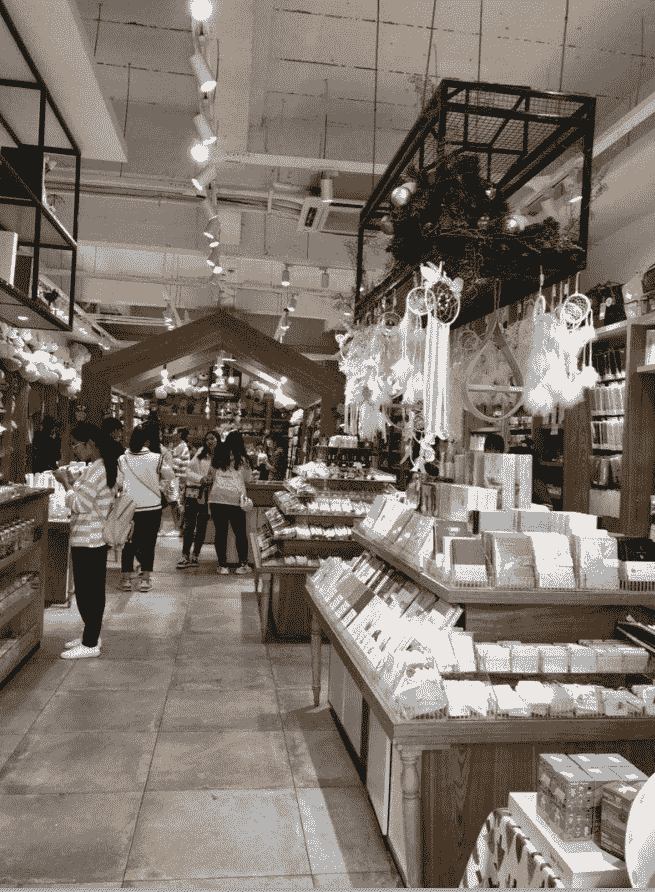

# 珍老师，您好！您的

(提问) 张耕尘：珍老师，您好！您的忠实粉丝，想咨询您中老年教育的项目是否可行，如何开展。我家社区 600 户，周边大概 1000 户，但楼下面海的网点因为不临街……

回答：【发科】【帖子编号 0370】<老年培训> 你这个事就别想做了。每隔个几年就能看见新闻上投“最老考生”，报道的往往是六七十岁或者七八十岁的人，去参加高考、或者参加司法考试之类的。这种事情能上新网的就是因为太稀奇了，像发现个 106 岁的老人那么稀奇。少儿教育遍地开花，是因为少儿教育是带有“功利”性质的。要么帮助升学，要么音体美什么的，帮助提升外形、帮助更容易行走社会、甚至 20 岁以后帮助赔找对象。如果没有这种功利性质，试验开一个“冥想”培训班，保证赔死你。少儿培训遍地开花，试也因为是儿童存在着各种不确定的未来可能性。所以家长愿意多方尝试。年龄越大，可能性越来越少，能培训的东西也越来越少了，所以越到成年人的教育，种类越少，到老年人的教育更是难。

想做老年人的培训班，各种纯“兴趣爱好”是没可能的。老年人普遍比较节俭了，你宣传说写个毛笔字，下个棋，看个书，泡个茶，做个蛋糕之类的兴趣爱好培训，老年人普遍第一反应就是：这种事还要花钱？在家自己弄弄不就……

行了吗…… 再说有点功利性质的培训，真让他们学点什么也不可能能，毕竟身体状况摆着，不可能再继续工作了。所以也不可能走工作/赚钱的角度，技能培训基本没可能了。

再说身体、健康形体这种培训，教老年人体操、跳舞、瑜伽什么的，还存在着各种风险（比如扭到腰了、摔到了、骨折了之类的）风险收益不太对等。

怕是只能开个“老年人演艺培训班”。拍掐短剧什么的。满足老年人幻想成为明星的心里了。(44 赞)

评论区：
- 晨淇真心教育-Mis*：老年人的短剧培训班相当可以。
- 肉丸：我们这边有老年大学，也是属于老年兴趣班，学费很便宜，一年才几百块，学的人挺多的。我觉得学费太贵的话，就不好说了，因为老年人的消费观念普遍都很节省。
- 目小雪：老年人的娱乐方面，基本不赚钱。。。基本。。。属于“公益”。。。
- A00 游泳健身@阿贵：现在的老年人虽然节俭，但是喜欢做投资理财，但是被骗的能达到九九成，数额也非常大，所以现在的老人喜欢养生[机智]
- 婷丅：老年中医针灸艾灸培训怎么样？
- 依 Q 泳衣内衣辅料 I**：老年婚介
- 爱是永恒：我做的一个科技艾灸就有很多老年人在做，关键是要方便

# 请教珍姐和各位大神

(提问) ～～～：请教珍姐和各位大神十八线县城市县区月子中心能做吗？

2019-10-26

回答：【帖子编号 0369】这几天被英国卡车发现 39 个尸体的新闻震惊了，然后看了关于偷渡客的评论和新闻。印象比较深的是，说福建某些小城市，人均收入也不低，也不是很贫困。但因为当地长期受蛇头洗脑，传递各种“国外生活就是好”的信息，结果造成当地民众都有一种“偷渡出去就有面子”的心里……

很多年轻人觉得，别人都能偷渡成功我怎么不成功。偷渡出去的人哪怕日子过的苦逼，也要咬牙说自己过的好，然后摇身一变站在鄙视链的顶端，继续鄙视没偷渡成功的同乡，于是后面的人受制于这种氛围，又前仆后继去偷渡……

越是在小城市，县城乡镇的级别，越容易被“一种观念”占据主流。不像大城市什么声音都有，早婚的也有，晚婚的也有，不婚的也有，丁克的也有。

越小的地方，往往只有一种“主流声音”。

所以在小地方的月子会所能不能开成，会有两种可能：

一种是，当地的主流声音是：婆婆要照顾月子。如果不照顾，就要遭受周围人白眼，会被人说闲话。如果是这种声音占了主流，你的会所就很难开的起来。

另一种是，如果当地主流声音开始把住月子会所当成一种新的炫富手段，就像结婚开攀比礼金，攀比婚车婚房，攀比婚纱照和蜜月地点时，你这月子会所就厉害了。

小城市是很难按需求分析的。如果按需求看，大都是本地居民，亲戚很多又都住得近，再加上普遍房子大、大多不怎么忙碌/时间充裕，走传统的在家做月子的模式就能化解需求了，月子会所根本没什么市场。

然而小城市是特别容易因为“只有一种主流声音”而产生鄙视和攀比，就会搞出各种额外的需求。他们老家，据说结婚在礼金、婚车、酒席之外又衍生出新花样了，男方给女方家送彩礼的同时还要送各种东西，其中要送的饮料是这样规定的：

十箱牛奶、十箱酸奶、十箱王老吉……一共 12 样，总共 120 箱。我听说之后下巴都要惊掉了，这喝到过期都喝不完。最终只能“大方”的送人吧。他们似乎完全不知道，这都是 在浪费自己家庭的钱吗。也不知道是哪个开小卖部的想出来的营销方案，总之在当地就流行起来了。

——————

再回到你这个月子会所的事上。

如果想做的话，怕是要想着怎么迎合用户炫耀的心里了……比如对外宣称 6 万，实际收费 2 万之类的，就是给人拿出去吹嘘的。比如月子会所的餐食，在营养之外你们还得考虑摆盘怎么弄的花哨一些，让人发朋友圈炫耀之类的……怕是只能从这些方向上去想办法营销了。(60 赞)

评论区：
- 呵呵：沙发。
- Mr Na：[色]
- 昵称加载中：经济学达人应该都是深谙心理学吧[偷笑]
- Alex：结婚送 120 箱饮料这种事都能推广[尴尬]
- ~~~：谢谢珍姐，非常用心的分析，从市场前景到营销策略都分析的很到位[玫瑰][玫瑰][玫瑰][玫瑰]
- 孙超：理论深厚，分析才真实有效。
- @赵立佳：炫耀行消费
- ( ˇ ˇ )：一看就是卖酒水饮料的宣传，送饮料有毛病吧……

# 亲爱的珍大户，我现

(提问) A 宠物店～嗨宠宠物*：亲爱的珍大户，我现在在苏州相城经营着一家 100 多平的宠物店，主要做的是洗澡，美容，寄养，物品，活体，店里目前只有一个美容师 + 我两个，每个月的营业额 6 万左右，净利润在 2.5 万左右，似乎是到了个瓶颈，一直想突破，但目前就是一直这个样子，最近接触了狗粮代工，发现市场上狗粮猫粮乱价不说，品质太差，放弃一部分利润，猫狗可以吃的非常好，所以我有打算去做一款自有品牌的狗粮，猫粮，让至少自家的猫狗吃的放心健康，再一步步的渗透周边(初时采取免费试吃一阶段，是否可行)，不知道这样的方式是过于理想还是可行？

2019-10-21

回答：【帖子编号 0368】狗粮猫粮这个领域确实大有可为。以猫粮为例。猫的饭量小，一个月就四斤的量，所以很容易让用户接受品质上升（换句话说，用户对价格不会太敏感）。对比来看，如果让一个人把自己的伙食由一顿 30 块钱预算提升到一顿 50 块或者 100 块水平，难度就大的多了。（就类似于，愿意买名牌口红的人很多，但是买名牌衣服的人并不多。因为一件 tom ford 的西服几万块，而一个 tom ford 的口红才四百，所以入门真是非常容易。）

——所以，看你是想做小而美，还是想做大。如果只是为当前的宠物店做利润提升，做小而美，只覆盖周边的用户就够了。那么可以考虑做手工猫饭/狗饭。塑封冷藏，有一定保质期这种。然后每周配送，或者每双周配送一次。对用户来说，内容看得见，并且与固体颗粒状的猫粮狗粮相比，有一种“消费升级”的直观感受，【心里满足感】会很高。所以销售难度会低很多。（注意最好是开封即食的，一定不要再二次加工。不要加重用户的使用麻烦，毕竟猫粮狗粮作为一种伟大的发明，最大的优势就是方便快捷，解放主人的双手）

但如果仍然做成传统的颗粒状狗粮的话，销售难度就要大很多了。对用户来说，这个东西跟商品粮相比有哪些好处？很难被看见。他看不到里边都有什么食材。哪怕你宣传说比商品粮好很多，但用户仍然会质疑，无法验证。即便是试吃，也无法解决这个问题。

_______

因为猫狗不会说话。而这又是典型的【购买者与使用者相分离】的产品。所以，你的产品首先要满足【主人的心理需求】。就像互联网段子说“有一种冷，叫你妈觉得冷”，这就是典型的购买者和使用者相分离。作为商家，要先满足“妈”觉得冷的需求，而不是“儿子”觉得热的需求。

所以，试吃吃装是可以的（但送的时候要说明，我这个猫放狗饭里没诱食剂，所以有些被商品粮惯坏了的猫狗会表现的很挑嘴。但吃吃把口味改回来就好了，这个狗饭好处是健康、不拉稀、补充水分对肾好，对牙齿好，等等……）。但“试吃一段时间”是没有必要的。因为猫狗不会说话。你的猫饭狗饭如果能满足主人心理了，他们肯定会买的。反之，如果不能，试吃再久，他们也会犹豫的。

_______

所以最终，你需要考虑产品能不能满足【主人的需求】。而主人的需求，恰恰是像【买口红】一样的心理（用很少的钱，就能从普通口红升级成品牌口红，从而变身“精致 girl”，变成“讲究生活品味”）。

同理狗粮：每月多花一点钱，【升级】猫粮狗粮，满足自己【是好主人、有钱主人、舍得为宠物花钱、生活满意度很高】这些心理。所以这就是我为什么我个人觉得，如果继续做颗粒状的狗粮，可能销售难度会比较大。因为这个东西不好满足用户对消费【升级】的认知。指不定还会被认知成“给狗子吃三无产品”，那就变成完全相反的作用，就成了阻力了。(54 赞)

评论区：
- yso：说得太有道理了，我就准备给猫咪们升级猫饭
- 灰飞@@SH：这个我研究过，宠物鲜粮，目前做的比较好的有三四家吧，也都是去年前刚起步的状态，而且都拿到了 A 轮融资，目前看做的不错的是超能小黑、毛球殿，你可以关注一下
- A. 宠物店～嘴宠宠物*：太感谢了
- A. 宠物店～嘴宠宠物*：非常感谢
- A. 宠物店～嘴宠宠物*：梦大师，我还有一个想法就是，类似于狗狗上学的托儿所，白天在托儿所里训练，早晚回去，主人自己巩固学习一下，这样是否可行呢？
- 吴燕华：我有几个 90 后朋友创业做自己品牌湿粮干粮，和你的想法很像，或许可以介绍给你，一整套的产品供应链都有，嫁接下你家店就 OK 了，可以去试试错成本，抱团有利于生存发展
- A. 宠物店～嘴宠宠物*：可以啊，18260115821 加我微信
- A. 宠物店～嘴宠宠物*：我没想到超能小黑，毛球殿下的平台，只有淘宝有

# 高层管理为拓展事业

(提问) 流浪喵：高层管理为拓展事业忙不过来，而专业的培训人员配备不足，招我过来一方面是做采购计划的统筹，另一方面以后需要给子医院的采购负责人做相应的培训。我是 2014 年毕业，在医药公司工作过两年多，主要做乙方。后来转行做了烘焙一年大半。今年年初才转回来，最初进入医疗器械公司做全国经销商的订单员，继续从事医药行业。目前面试通过了这家民营企业(算跳槽)。但是就从乙方转入了甲方，其实也是我转行的初衷，当时感觉今年的经济下行，采购岗位不好找才进了乙方这家公司，现在机会来了，想抓住。所以回到主题: 我希望能利用业余时间快速学习系统的采购行业知识，最好能取得从业资格证(认可度高的)。珍老师和各位采购大佬有何指导意见建议？

2019-10-21

回答：（提示：提问内容的顺序是，先图片后文字）这个提问，是问怎么系统学习采购行业的知识。然而这个方面我无法回答了。因为作为一个没在实体行业里待过的人，具体岗位需要哪些技能和知识体系，确实是我所不知道的。这类知识和技能的传授，都只能由“相关岗位的资深从业者”提供。所以建议你扒下，有没有相关的采购方面的公众号，知乎的 live，或者行业大 V 的内容输出。

——————

但是，当我刚看完你写的这么多的背景信息时，确实从我的角度想额外叮嘱几句[偷笑]（所以大家提问时，写详细一些是很有用的）

背景信息中有两点特别重要：

第一，这个集团公司处在医疗行业，下面有多家医院（民营医院）。未来的集团采购功能，是想要给所有下属医院做“集中采购”。然而现在还没走到那一步，现在采购是由“各个医院的采购负责人”来负责的。所以目前主要的工作内容是“给各个医院的采购负责人做培训”。

这个背景信息展示的主要问题是：如果发展到“集团整体采购”这一步时，等同于一个收权/夺权的过程。各医院采购负责人的采购权限，会被大幅的收回的集团层面。所以题主的这个岗位是相当遭人恨的……我想叮嘱的也是这一点。

题主要想着“借力打力”，统筹和协调化解为主，尽量防止把自己定位到“医院采购负责人”的对立面。系统的学习采购知识是一方面，但更重要的一方面，是了解行业信息。我猜测的采购信息，应该包括：
1. 摸清原采购渠道
2. 摸清市场现有的采购选项
3. 多与一线医生进行访谈，了解医生的需求
4. 多与财务人员进行沟通，了解不同采购选项的成本利润情况

这个时候，多用“其他医院的需求”当做借口，来撬动某一家医院采购负责人的嘴。举例：a 医院采购负责人张三采购的某项产品是甲药品，b 医院李四采购的是乙药品，c 医院……你们综合了市场信息、医生建议、财务数据等各项因素，觉得由集团统一采购甲药品更好，这时候以协调人的角色，去协调各个医院。而不是直接以集团总部的角色，让各个医院采购负责人放权配合。（尽量避免站到原利益相关人的对立面，否则总会有告你黑状的。告你黑状的人多了，公司管理层会认为你难以协调好个方面关系，属于工作能力不及格……）

整个采购全收回的过程，要循序渐进（温水煮青蛙），可以先从低频的医疗设备之类的开始，在进入的常规的器械耗材、药品之类的。

第二点，是背景信息中透露这家集团是民营性质，并且还是在发展期。所有人的传统认知里，采购是一项“油水很多”的岗位。这个岗位，即容易遭人眼红，又容易遭领导猜忌。很多管理水平不高的民营企业，对采购岗位的管理措施就是：或者让自己的亲戚小舅子来坐这个位置（心里想着肥水不流外人田），或者每隔两年换一个人（心里想着不能让你跟各个供应商做熟了）。涉及到医疗领域，可能是因为有专业知识这道门槛的存在，所以不太可能出现小舅子。但保不齐会出现你受领导猜忌，从而影响职业的长远发展的可能性。防止猜忌，就需要有放权 + 监管。

作为一个还在飞速发展的公司，你们部门必然规模都不大，人手不多，流程环节都比较少。想办法把工作的各个环节都拆解，每个环节最终都配上相应的人手，职能分散是最好的避嫌方式。（意思是：最终要走到——决策权由各个环节打分决定，每个环节都不能决定最终采购结果——这种采购决策是最“显得科学、有技术含量”还避嫌的）

举例：（我也不知道采购到底有哪些环节，在此瞎编一下，你意会就好）

采购部门需要配备的人员，和要做的事情可能包括：
1. （对外）市场信息搜集人员（需要医疗背景）：摸清供应商和供应产品的市场分布：供应商筛选、资质和产品的跟踪评估；产品的价格信息的收集；上门考察和访谈；对供应商的联络；组织招投标等等。
2. （对内）自身需求收集人员：调查和研究挖掘各个医院的需求（需要医疗背景的人）；产品的使用周期和库存跟踪等等（需要库存管理系统/it 背景的人吧）。
3. 监管：产品的质量检查、使用效果跟踪反馈、医生评价和反馈等等。

把这些环节细分下去，就会发现每个模块都有评估的权限，每个环节似乎都有部分决策权。权利被分割出去后，才能避嫌。

这个过程中，你是入职较早的人。尽量不断的找领导要人头、找 hr 要人头指标。让新招到人成为你的下属，去“抬”你的职位。

——————

总之，建议你把“建立完整的采购部门、完善的采购流程，成为该集团的采购负责人”当成自己的职业目标来完成。

从我提问的背景信息来看，我感觉目前集团里似乎还没有一个这样的角色。反正目前没有人，你就可以以这个角色自居，用这种心态去做好工作，那么早晚这个位置就是你的了。

这种飞速发展中的公司最大的优势就是，有很好的职业上升空间，不会一个萝卜一个坑，非得熬到前面的萝卜走了才有空缺出来。所以祝贺□你找到这样的工作机会，加油哈！

□（最后 ps，至于采购的什么从业资格证书，这些东西可以考，但你不要把重心放在这个上面。因为在我看来，资格证书的意义并不是很大。因为，如果你把自己定位成一个职员，那么现在是集团发展的早期，你占着先进公司的便宜，比后来者多了一份资历和经验。

如果你把自己定位成一个管理者，那么你会发现，从业资格证书是给“操作层面”的职员准备的，作为管理者而言，有这个证书的说服力并不够……

所以总的来说，从业资格证书的意义有限。如果你时间和精力都充沛，那么顺带考一下也无妨。但如果已经很忙的情况下，精力一定优先分配给工作，先把事情做好。至于证书都是次要的。最后，如果你把自己定位为一个管理人员，那么过程中，可能还需要你再提升一下学历，否则大专的风险会比较大。）(31 赞)

讨论区：
- 鱼丸子🐟：我没太明白大户外那个例子的意思？是说下面子医院意见太分散？
- 爱故事的山楂/柯南：是口腔连锁吗
- 珍大户：不是，我的意思是，假设下面有 n 家医院，原有采购权限都在各个医院的采购负责人那里。如果直接收权到集团，等于各个医院的采购负责人都被剥夺权限了。这种大幅的变动，要么有集团 ceo 站在你后面支持，否则都容易推行不易。过程中，难免各个医院的采购负责人就会抱团抵制，说你采购不专业，说你采购不负责，说你采购吃回扣等等各种黑状都会出现。没准儿改革没做成，自己先被赶走了。所以要想办法分而化之，防止各个医院的采购负责人抱团。
- 肖恩（项目对接）：全部看下来了，珍老师的点评入木三分，十年前，我要是收到这样一份建议，我感觉我在职场的发展肯定会走的更远更好。我是这两年自己做互联网，才深刻体会到以前给别人打工很多方面没有做到位。职场要想拿到高职位和权限，往往是要自己做到的过程中慢慢争取到。现在做互联网也才感触很深，很多事情都是做的过程中才会，而不是等到会了才去做。
- 流浪喵：珍姐，写完这篇有深刻指导意义的答复，我实在在爱宕若静。惟字如金地看完: 起初是欢喜，继而又惊又喜，再而茅塞顿开，继而陷入深思，最后回顾全文，简直醍醐灌顶！行万里路不如名君指路，格局真的非常重要！很久没有大哭一场的冲动了。感谢珍老师。-- 请点馥梦中人。[咖啡]
- 流浪喵：其实我已经拿到了函授本科学历，和大专一样的专业。只是自我感觉认可度和含金量不高。
- Mr.Max：你这个公司是个雷啊。。。。
- 流浪喵：哇出此言？

# 请问现在吵的很热的

刘峰：请问现在吵的很热的支付宝刷脸支付设备可以做么？有没有了解的，求救。

2019-10-17(1 赞)

评论区：
- 刘政之：个人觉得有一定的需求但是不会像二维码支付一样完全颠覆传统现金支付。二维码支付解放了现金，大城市出门只需要带上手机。刷脸支付并不能解放手机，出门带手机是一定的，也不比二维码支付方便。就像鸡肋，丢了有点可惜，用着却不怎么趁手。
- 梦之浮桥：我觉得很好用
- 笑哈哈：坐标杭州，感觉蛮好用的！还有优惠！
- 风铃：第三方推广的吗？好像很多这样的公司，不知道哪个算是正规的。。。
- 刘峰：你说现在已经在用了么
- 刘峰：掏出手机- 扫码- 输入金额- 输入密码，这些动作都要顾客完成，还是比较繁琐的，用过刷脸的用户应该更倾向于刷脸。只是商户更麻烦了，多了“输入金额”这个环节，但是刷脸设备能够自动收集、分析用户信息，优化营销工作，对引流、异业联盟和分析顾客有帮助
- 🥀 a tree🥀：挺多人说刷脸支付是鸡肋。我也这么觉得。但是这个是支付宝想要绕过微信支付粘度的方式。例如以前支付宝也做聊天。后来挂了。粘度一直不如微信支付。个人用微信支付比较多。主要原因是习惯性的打开微信支付顺便看一下微信信息。这个很关键。但是如果刷脸支付出来。意味着啥？大家就又在同一个起跑线了。这个是支付宝的一个竞争手段吧。可能败可能成。试试也不错的。
- 笑哈哈：今天买东西，办公园区便利店今天就用这个机器的！还有几毛钱优惠！感觉还可以

# 这几天很火的今年诸

珍大户：这几天很火的今年诺贝尔经济学奖得主写的书，分享一下

2019-10-16 (93赞)

**评论区：**

- 包装设计 江锋：沙发
- 证券傻艳水：前排
- ZH.：嗯嗯
- 圣芬总部--杨米燕：大赞
- 定义Calvin：日常打赏
- Mr Na ：■□□□
- O.R.J -Mis*：刚好想买这本书，珍大户就送来了。感谢感谢
- lfycarada：谢谢大户

# 【帖子编号 0367】《电器行业/消费文化的扩散》

珍大户：【帖子编号 0367】《电器行业/消费文化的扩散》

上周因为在出差，更新的比较少，直播也就只聊了一小会就下线了。

我记得直播的时候，有人问到：电器行业怎么样？

这是一个比较宏观的提问，那回答的话也必须得说点宏观大面的原理，好在原理性的东西会对几乎所有人都有启示。

（ps，但对提问者而言，未必能立即帮他解决问题。所以我觉得，还是圈子里详细介绍了自己的人生生活工作经历的提问，回答起来更有针对性一些）

开说这块内容：

人类社会是多元化的，人群里，总是有各种各样性格的人。如果我们拎出一个指标：对新消费产品/新消费文化的接受程度。用这个指标给人群做个排序，会发现：

有的人是比较前卫的，很喜欢尝试新东西、体验新产品，追逐新的潮流文化。而有的人是很保守的，对生活的“变化”没有那么高的追求。

按照“对新事物的接受程度”给人群排序，不同人群会形成一种“较为稳定”（后面解释）的比例分布。

这种比例，我是这么理解的：

最先接触、接受新东西的前10%的人，这些人可以被称为“引领者”，把他们想象为KOL也行。他们永远跑在社会前列，永远喜欢尝试最新鲜的东西。

想想学生时代时，那些最早给头发偷偷染了栗子色的人，最早穿破洞牛仔裤的人……他们热情活跃，喜欢与众不同，喜欢显示自己与人群的差异。想想工作后，办公室总有几个人会滔滔不绝的给大家讲他又发现了哪些八卦、发现了哪些新餐厅、发现了哪些国庆时没人的景点……

他们是为了尝鲜，而愿意冒风险的人。

新产品或新的消费文化，会从“引领者”逐渐扩散到中间的群体。

中间30%的人，我们可以管它叫潮流的“追随者”。如果能被这部分人接受，就会成为一种潮流文化了。（此时社会中已有10%+30%=40%的人，接受这种已经不能算新的东西了）

追随者也可以看做是愿意尝试新鲜事物的人，但他们未必像“引领者”那么甘愿承受风险，所以他们永远不是第一个吃螃蟹的，而是受好奇心驱动，围观吃螃蟹的人，看到螃蟹是无毒的好吃的时，就会有勇气去尝试了。他们吃螃蟹仍然是受尝鲜、喜好、好恶这些偏好影响的。

社会上的各种爱好者，比如“肉食爱好者”、“素食爱好者”都是由这类人组成的。

再之后是腰部群体。腰部40%的人，这部分可以叫做大众。这部分人是对“尝鲜”、“变化”呈现出一种无所谓的态度。他们不会去追某样东西，也很少表现出强烈的喜好，更多的是“群体活动”——既然大家都吃螃蟹了，那我也吃吃吧。

如果大众都已经开始接受了，就等同于，社会中**80%**的人（即，包括前面的**10%+30%**）都已经接受了。那么这个东西就已经开始经久不衰，而不是昙花一现了。

最后是尾部的群体，最后**20%**的人叫做“迟钝的人”。等这些迟钝的人也融入大众，可能要花上几年、十几年，甚至几十年。有些迟钝的人一辈子都没能变成大众，一辈子都没来接受某些东西。

这部分人是对变化排斥的人，只要能坚守就不会主动改变。哪怕周围大部分人都在吃螃蟹时，他们会依然摇头，说这个东西有什么好吃的。

我们拿流行文化来举例：

蔡徐坤再火，不会有超过**10%**的人听过，这是“小众”。周杰伦的音乐，可能超过**10%**，不及**40%**，这是“流行”。包括大火的流浪地球票房**50亿**，但也不会超过**40%**，所以依然是流行。

而像还珠格格、西游记，这个绝对超过**40%**的人看过，这是“大众”。再大众的东西，依然会有**20%**人可能一辈子都不会看过。

拿人口迁移来举例：

每个地方永远都有不安分的人，他们想是栓不住的，被周围的老人评价为“心很野”，长到能独立的年纪就迫不及待的出去闯荡了。

还有一些心思很活络的人，会打听这些“很野”的人去哪了？外面好不好？一旦打听到消息，就会很快跟上。这是他们主动的选择。

剩下的人是大众，他们未必会主动选择。但如果当地经济不好或者有某种外因，他们会被逼无奈也转移出去。这不是一种来自主动的、喜好的选择。而是因为“大家都这样”。

最后的人就是死也不走的人。就像是有些打工村，哪怕人都走光了，村子就剩十几户人家了，这些人还会继续坚守，一直留在那里。

按照这种划分，大家来思考一下电器行业，各个电器按照使用人群比例，已经进入到什么阶段了？

老的大件，如电视冰箱洗衣机空调，家家都有了，那么我们可以把他们都列入80%这一档。

这种产品的销售，是不会“爆”的。因为后20%的迟钝者是很难带动的，最终取决于社会gdp的缓慢增长，而前面80%的人再次购买则取决于新买房子或者换家电、家电升级，这种过程都是缓慢的。

从某个单一消费者的角度来说，他可能在5年后换冰箱。但他的决策绝对不是在5年后的某一点突然做出的，而是在这5年里，这个缓慢过程中，逐渐的积累产品和品牌认知，最后影响了他的决策。

这样缓慢的进程里，小企业是很难的。所以最终我们能看到冰箱，洗衣机，电视，空调，这些已经“普及”的电器里，每一项里面就只有几家大厂。因为只有大厂才能撑得住这么长线的竞争。

如果是小企业，我不建议在这些已经成熟的市场里竞争。记得圈子里有生产行业的企业主，比如这一例，年产值过亿对于企业经营者/创业者来说很大了，然而在生产电器这一领域行业来说很小。

这样的企业该怎么做呢？如果不是想一辈子做代工，如果还有一个想要“上位”、创办知名品牌的心，那么一定要找尚未普及的某一个或某几个电器品类。

就如同很多年前的“九阳”豆浆机，因为当年豆浆机绝对是新鲜的东西，靠着这样一个新鲜的东西在逐渐普及、走进千家万户的历史潮流中，形成自己的品牌。

所以目前还在这个领域的企业主，不妨自己想一下，有啥产品是当前普及率才刚到10%这一档的？

食物参与粉碎机？净水器？直饮水？各种什么什么洗菜炒菜擦地机器人？

还没普及的东西，是有可能销售“爆”的，这种趋势是让你pk掉大厂，让消费者记住你的品牌的市场机会。

最后再说个人，如果你是草根创业者，没多少钱能投入，也没有自己的工厂做生产，那么像前面帖子里举过的吸黑头的例子，想办法想出一点大家都不知道的产品，吸引10%尝鲜的人。这种方式比小企业开发新产品容易的多，缺点是行不成积累，没有长远方向。

但优点是能借助网络，赚点快钱给自己积累本金。

最后想说点神奇的感悟，与经济无关。

我记得年轻的时候，因为学法律衍生了一些额外的兴趣，于是读过一点犯罪心理方面的书。

当时形成了一种朦胧的认识，就是暴力犯罪永远没法消灭到0的地步。因为人群中总有一个小小的比例，是具有犯罪倾向、反社会倾向的，这种倾向上有可能是天生的。

你把所有最主要的人抓光了，剩下的人里，又会有一小部分人转化进到这一比例中。就像是自然界中，某些动物的性别是不固定的，在某种条件下，雄性雌性会互相转化那样……

今天说的这种“尝鲜”比例，也是很神奇。我怀疑可能是大自然的规律。

这样就能即让社会有创新发展，又能防止创新跑偏时，集体都跑偏了……总有保守的人群，随时可以让这个社会像游戏存档一样倒带回前面的时间点。

而且哪怕创新的人都死光了，保守人群的下一代里，又会自发的产生许多创新人群出来，继续引领人类做更多尝试。

而创新者的下一代里，也一样会有各种保守者。继续扮演社会压舱石的角色……很神奇的比例……

感性的同学可以按星座来想象，人群中永远有一定比例的双子座，在兴奋的跑来跑去，传递最新鲜的八卦。也总有最保守的金牛座和顾家的巨蟹座，一直在后方守着的感觉。

很多年后，我又回忆当年认为“人类社会中，永远恒定存在一小部分暴力倾向、犯罪倾向、反社会的人，这一比例永远抹除不掉”的观点。

后来觉得，这可能就是自然界的设定吧。毕竟人是自然界最强大的动物了，没有外敌。

自然学家观察到的，一群羊、一群鹿，总会有狼作为外敌来保证种群的活跃，而如果狼消失了，种群则开始陷入退化。所以人类早早就失去了外敌时，可能这群犯罪分子就是充当人类社会永恒的“外敌”功能，像沙丁鱼一样来保持人类的生气和警惕。

所以像是《机器人瓦力》里描写的，人类社会到了太空时代，被机器管家照顾的太好，一个个大腹便便走不动路的情况应该是不可能存在的。

因为即便这艘太空飞船里只有5万人，也应该会永恒存在5个犯罪分子才对[偷笑]

https://t.zsxq.com/YZ3Zjqf
https://t.zsxq.com/jeE6QZz

2019-10-15 (74赞)

**评论区：**

- 刘政之：洗碗机机会不会像冰箱洗衣机一样普及。
- ☐a tree ☐：会
- 珍大户：会的
- _JANE*: 我觉得会
- □∶一定会，英国等欧美国家，洗碗机早已经普及到几乎每家都有，
- 天黑路滑∶智能门锁也会吧
- 石喜轩∶我觉得未来家家户户一定有一台3D打印机，想要什么基本用品（如：碗筷、包包、鞋子等）直接打印就是了，以后很多日用品都不用买了，直接打出来
- ☐a tree∶这个例不会[捂脸]理由很简单，打印归打印。建模和设计是另外一回事。就像盖房子，不能说农名工未来就是地产商[捂脸]

关注公众号"懒人找资源"，星球资源一站式服务

# 珍大大您好呀~国庆

(提问) _JANE*: 珍大大您好呀~国庆假期过得愉快吗？字数限制图片来凑啦。我在淘宝上卖奶茶店原料茶叶的，因为跟市面上零售茶包的不同，我们选关键词很难匹配到精准客户。而且淘宝没有把商用茶饮茶包区分出来，后台的数据都是关联着零售茶包茶叶的数据。比如图一 搜索桃香乌龙茶包，左边是零售茶包，右边是供奶茶店用的(看上去都是茶包茶叶加果肉，但是是不一样的，奶茶店茶叶要经过调制的，这里不详细解释。所以进店客户会跟零售的混淆了不精准。我们现在推广用的词都是长尾词比较多，比如 奶茶店专用三角茶包，奶茶原料，奶茶茶底。但是这还是不够精准，比如 奶茶原料也细分好多，有珍珠，果肉，奶盖粉等等，而我们暂时只卖奶茶茶叶原料。之前珍老师说过 2019-10-14

回答：【帖子编号0366】《Seo关键词》 这个提问很细节，是属于在搜索引擎中优化关键词，seo的范畴。 你们遇到的问题是：商品是卖给商业客户的，然而目前从搜索框过来的客户里商家和个人客户很难区分开，靠搜索进店的大部分都是个人客户，这些并不是你们的目标客户群体 （为啥个人客户不能喝你们的茶我还没了解出来，是因为步骤比较复杂，不是直接泡水就能喝的吗？） 你们卖的产品是针对奶茶店的。目前很多奶茶店都是加盟，我猜测这些商家可能已经被提供原材料了。但考虑到奶茶这个创业项目实在是太火热，全国每天都有无数的奶茶店开业，不少都是小品牌或者没品牌，那么向他们提供原材料，也是一片市场。 所以就要思考一下，这些人搜索产品时，可能想到什么词呢？ Se0最关键的步骤就是堆砌关键词，把客户各种可能想到的关键词都罗列出来，争取让所有通过搜索框搜索的客户，都有搜到你的可能。 这里在纠正一个观点。我说的长尾，是指客户群体比较少的市场（不是主流市场），这部分市场由于未受到关注，所以商家可能比较少。做长尾，是想要占竞争对手少的便宜。但是长尾不等于长关键词。关键词越长越吃亏，Seo的关键是关键词多，而不是关键词长。——我举几个例子。假设，现在养猫的大多关注英短、美短、橘猫、布偶之类的。假设关注加拿大无毛猫的人很少、商家也很少，那么这就有可能是长尾市场（具体是不是我不知道，因为没研究过，今天出差回家了，看见我家小福和胖咪有感而发，举个猫的例子[呲牙]）那么首先想到的关键词，应该是：加拿大无毛猫、斯芬克斯猫（记不清是不是这个名字了），这两个词，针对专门寻这一款猫的人。再考虑其他的人群。一定会有专门寻这款猫，但是记不清名字的人。他们可能会搜“不长毛+猫”、“像外星人+猫”、“丑+猫”等等类似的关键词，所以你还要极限的想，把可能想到的词都占住（标题不会容纳下这么多词，所以最后，商品要重复上架几次，供你刷关键词引流使用）还会有人就想养猫，但是他不知道养什么猫。这种也是目标人群，他们可能会搜索：“稀有+猫”、“温顺+猫”、“粘人+猫”、“话唠+猫”、“小猫”、“猫崽”、一个月/三个月，等等关键词。所以你要想办法把这些关键词也堆上。

以上举了一个例子，希望你思考一下，自己想想还能用什么关键词，先花个半小时自己做做。（看这个文章的朋友们，大家都可以拿这个产品当做案例来自己思考一下）——下面继续写我思考的答案。大家可以上面自己想完再看我写的，一起讨论。你们的用户是商家，商家在搜索“桃香乌龙茶”发现都是面对个人的茶包时，会陷入到搜索失败的境地。这时他们一定会换关键词，他们会换什么？类似于“奶茶店+茶包”，关键词A+B，A是用来形容自己的状态或特征的，B是想要的东西。所以A的关键词包括：奶茶店、咖啡店、茶餐厅、创业、开店、外卖、商家、港式奶茶/丝袜奶茶……（还有什么商家是可能卖的，都要写上，并且还要考虑到各地不同口语中可能使用的词汇）B的关键词包括：原材料、茶包、茶叶、加果肉、调制、茶底、关基？、鲜茶？、绿茶？、红茶？、……其他还可能写的关键词包括：供货、批发、厂家直供、多口味、大包、独立包装？、密封？、保鲜？、a口味、b口味...... 另外，针对熟练的商家，要考虑是否有些业内的专有名词、操作步骤、机械设备这些关键词？上面的内容汇总完之后，要把关键词做一个分级。因为关键词太多，而标题的字数有限，所以你的商品总要重复上架个几次，来要关键词。那么就存在概率，你第一条商品堆了abcdefg七一个关键词，第二条商品堆了hijklmn七个关键词，结果顾客搜索了a+h，你的商品就没搜索出来...... 所以如何排列组合也是很重要的。你要筛选出一些重要性比较高的关键词，每一条商品都必须要有，然后每个商品再换不同的“不重要的词”。我猜测：奶茶店、开店、原材料、厂家直供、茶包、果肉，这几个关键词可能会比较重要。所以尽量每个商品标题里都要写上。其他的不重要的关键词，就在各个商品里轮换。最终的结果可能是：

a商品：奶茶店原材料乌龙桃桃香味创业开店批发直供茶包大包独立包装加果肉

b商品：茉莉绿茶奶茶店酒吧咖啡店外卖餐饮茶包供货茶底茶基调制多口味

______________

以上就是seo的基本方式。但是seo能力再强，也架不住海量的商家竞争对手把你的商品冲淡。所以找长尾（竞争对手少的领域），这时候再做好seo，才会有比较好的效果。（23赞）

**评论区：**

- 梦之浮桥：开奶茶店，相当的不靠谱。感觉百分之九十五都撑不过一年。几十万就那么灰飞烟灭。
- 珍大户：以前我家所有关于seo、产品外观海报设计的事情都是做的，在以前的百度时代和淘宝时代效果还是比较显著的。这次去北京出差，拜访了短视频公司，交流中感觉到，短视频用户越来越多时，早晚会有不少人开始把视频app当做百度来使用，搜索自己想要看的信息。哪怕每天流量不多，指不定也会有个几百人。所以大家做视频的时候，描述也要写写，不要向我之前一样，偷懒不写文字介绍就上传视频了。
- 恬风：我就看珍姐讲话，透彻，接地气
- _JANE：是的珍老师，不建议个人客户买我们的茶。因为直接开水冲泡（而且久泡）是很苦的，奶茶店专用茶包要经过后期制作才能好喝（加专用果糖，原料等等）。老师我太爱你了，分析讲解得简而易明了，看完你的非常清晰。而且珍老师讲的视频app多百度搜索，我也很认同，我自己也会这样，比如以前找食谱会去百度或者群聊，现在我都在抖音上直接搜出来，在看视频做下了，方便，越来越崇拜你呢，珍珍老师--(转圈)
- 珍大户：能听上就好[呲牙]
- Kkl：我现在已经把d当当的百度用了，大多数东西都能搜到，且有视频更加直观。
- 君献麓：是的
- 玛宝！：我前段时间还自己在淘宝上搜这种奶茶店专用的茶底想自己做奶茶喝，感谢科普避坑！

我，这样的店，就是高压力？ 生肉，现在鼓励卖家用的 超级推荐 功能，这种是展示一般在猜你喜欢，其实比直通车涉及的群体更广泛了，淘宝通过计算，也还是会把零售茶包 跟我们奶茶店用的茶包连在一起了。这种情况怎么去推广比较好呢？怎么选择自己关键词？

其他同行也是这样在做，做得很好，他们店里有在卖其他奶茶店原材料，奶盖粉，珍珠果肉，果酱等等。

是不是应该淘宝宝外売广告，比如 找kol带货？找到精准客户引流进来呢？或者珍老师说的主动展示给消费者的这种推广是应该怎么样做呢？

我的问题主要归为，怎么找到精准客户？怎么找到适合自己的关键词？如何推广比较好？补充一下，我们有做散茶和三角茶包，也是同一个痛点 客户会和零售的混淆。而且

我们之后打算做线下实体店，千克这种头目马上尝试到口味比较好吧。

希望分析超强的青霞姐姐能抽空回答哦😜

**80% 5:32**

**桃香乌龙茶包**

- 全部
- 天猫
- 店铺
- 淘宝经验
- 综合
- 销量
- 视频
- 筛选

被抢速购 全国包邮 7克*30泡/袋

金秋购 皇茶专用桃香乌

净含量:210g

¥28.5 53人收货 广州

每满100减5 跨店

金秋购 赵阿姨定制款 桃

净含量:50g

¥49.8 46人收货 上海

每满100减5 跨店

茉莉绿茶

全部 天猫 店铺 淘宝经验

综合 销量 视频

125g×2罐

领券满100减10元

老客必囤 口粮花茶

0.0 叠加券价

净含量:250g

净含量:220g

¥68 2363人收货 成都

¥65 2164人收货 北京

破损包退

包郵

领券

满198减10

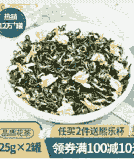

热销12万+罐

品质花茶

125g×2罐

任买2件送储乐杯

领券满100减10元

茉莉绿茶

买十送一

三仓发货

电子发票

品质保障

净含量:250g

一级 500g

¥98 2146人收货 成都

¥29.5 1889人收货

破损包退

包邮

每满100减5 跨店

## 昨天抖音上，看见一个厉害的产品广告

珍大户：昨天抖音上，看见一个厉害的产品广告：

一种“吸黑头器”，直接投放的信息流广告。

这玩意受众群体很大。所以需求很容易被引诱出来，但是谁也不知道这机器有没有效果，如果卖的贵，估计会犹豫掉一批人。

结果发现只要39.9，于是心里觉得，万一有用呢，反正不贵，就算上当了也不多……

于是我也没忍住下单了一个。

产品大家就不用再试了，我已经替大家试过了，不好用，会吸成红鼻头[捂脸]

但是想说的是这种营销方式，这家店月销已经过20万了，至少从销售上来说这个产品是蛮成功的。

传统行业做产品的，不妨可以想想自己有什么产品适宜于这种渠道？

2019-09-30 (36赞)

- 评论区：
    - 老师妈：[龇牙]
    - 刘刚：看上去好有冲动买啊
    - 刘刚：我都是用手拈[撇嘴][撇嘴][撇嘴]
    - 珍大户：不用买了，真空吸的，皮肤有点疼，效果不是太好。你要是想感受一下，花几块钱买个不带针的注射器管子，拔一下试试就能感觉到了[捂脸]
    - Alex：感谢！老婆一直想要买，这个截屏发给她[偷笑]
    - 温婉眉梢小女子：哈哈，我月初就看到这个产品了，差一点就买了。后来想想，知道这个肯定没用，何必买回来添堵。就算它便宜
    - 90年的单身狗：
    - 极时道：这个真空能力第1个太小，第2个也根本没吸不了多少。还不如用那种导出仪，虽然贵一点。

关注公众号“懒人找资源”，星球资源一站式服务

## 淘宝搜索：美糖吸黑头神器

将黑头连根拔起

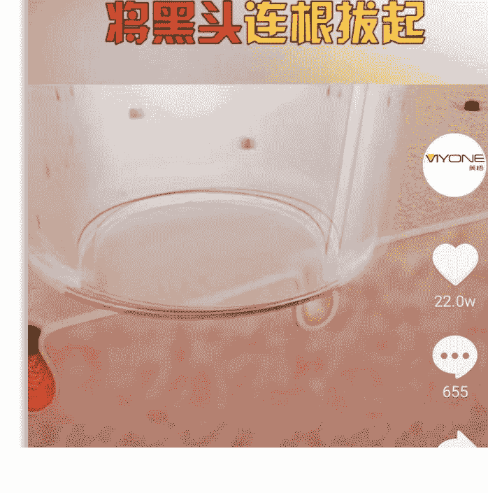

## @美悟吸黑头神器

除螨、去黑头、粉刺,油脂,痘痘,一款黑头仪全搞定！全身可用！

点击购买赠送 6+1吸头 和 护理套装

创作的原声－美悟吸黑头

- 54
- 首页
- 同城
- ＋
- 消息
- 我

## 【帖子编号0365】《童书店》

珍大户：【帖子编号0365】《童书店》

提问的创业方向里，说想要做儿童书这一块。

儿童图书这个看起来很有迷惑性。因为以前没有专门做儿童书的商家，看起来很像新需求、新模式似的。

而且还符合那个“赚老人钱、赚孩子钱、赚儿童钱”的口号。

然而要看到整体：

图书价格从90年代末到现在，已经过了20年，然而价格涨的不多。但书的成本，纸张/印刷、人工成本，各个环节的成本可是涨了很多。

所以，整个产业链的整体利润率是持续下降的，为了维持住利润的办法，是缩减产业链的链条（流通渠道的变革）。

看一下产业链：

传统模式：作者——编辑——出版社——批发商/分销商——零售商——读者

一轮颠覆后：作者——编辑——出版社——京东/当当/亚马逊——读者

换句更直白的话，因为整个行业的利润率下降，已经养不起产业链上太多的环节了。恰好经过互联网革命，把流通环节砍掉一部分，缩短产业链。

分钱的人少了，大家都乐了。

ps这里插一句:

未来图书行业早晚二轮颠覆，继续大幅的缩短产业链:

作者——新型出版商——读者

这个新型出版商有可能是未来的、类似于“喜马拉雅/抖音/头条”这种平台转型而来的。

不过这种都是长远来看的。（凯恩斯说过一句名言：长远来看，我们都要死的。所以也不用太过担心遥远的未来）

再回来就是刚才提到的一轮产业链变革继续说:

当产业链走到现在这一步【作者——编辑——出版社——京东/当当/亚马逊——读者】时，两类主体最受影响:

一类是分销商，一类是线下书店。

刚巧 提问里，说的不止是线下，还有线上图书销售。

线上的图书，想好你的角色是什么？

如果是当做分销的渠道、分销商……那你就是被革命掉的那个环节。

因为现在各个出版社已经直接对接到网上销售了，渠道商相对“厂家”（出版社）来说，是一个无法提供太大价值的环节。

在整个【商品传导的价值链上】，你无法提供有用的价值，你就不可能分到一杯羹。你是被革命的那一环。所以我是不看好的。

再说线下书店。

现在吃个盖浇饭还得二三十块呢，饭能天天吃，书可未必天天买。这么薄的价格和利润空间，书店是很难经营的。

所以还能生存的书店，是靠着：

1. 商场为了丰富业态品类、吸引人流，给书店很大的租金折扣，可能不到其他店铺租金的三分之一。
2. 国家为了扶持文化消费，对书店给予了补贴和税收减免。

否则按照“正常的价格”和利润空间，如果没有这些减免扶持的政策，开书店是没法在当前的高租金环境下生存得下去的。

所以书店能经营下去，靠的是地产商让利、国家让税（所以赚的是谁的钱？真的是卖书的钱吗？）

如果你拿不到这两个让出来的份额，就别考虑了。

因为，回忆【量价跷跷板】：低价必须跑量，量小必须高价。

所以想要经营下去，就得考虑：客单价（毛利）如何提上去。

而提升客单，又要求你必须站在顾客的立场上，去考虑有什么增加附加价值。否则单纯想提价就是自己作死。

我很难想象如何才能提高卖书的价格……
就是因为卖书提不上价格，所以才难经营。

我记得之前写过一个反面案例的帖子，圈子里不知道为什么搜不到了（还好留了个音频）

这家店是开在万达里的。三年3888的订阅价格，订阅后家长每个月可以收到“一盒”童书。

说是一盒，其实里边就4本，毛估价不过50块钱的东西。

根据音频里的信息，这家店应该是7月初开的。后来我就没怎么注意。

刚才想到了之后，晚上特意又跑过去看了一下，确认是还在营业中。
（顺手拍了张照片，看他家能挺多久吧……）

最后，
还记得说服装店时是怎么说的吗：

现在不要开服装店。同样逻辑的，不要开书店/绘本店。

但可以开服装厂，生产小众款的衣服/自己设计衣服卖。同样逻辑的，你们如果能创作儿童图书的话，才可以考虑进入这个行业。https://m.toutiaocdn.com/group/6716800593521803789...

2019-09-30 (41赞)

- 评论区:
    - 温婉眉梢小女子:音频链接我打不开啊
    - 小雨:感谢珍姐百忙之中能抽出时间给我做一个那么详细的解答，明确的告诉我行业发展的趋势和需要具备的基本条件。顿时豁然开朗的感觉[偷笑][偷笑]避免多走创业弯路，我会在圈子里好好学习，慎重选择适合自己的行业[呲牙]
    - Aks:直接打开头条 搜'珍大户'再进去珍大户主页搜'绘本'即可[微笑]
    - 温婉眉梢小女子:好的，谢谢你哈
    - 瓜瓜:量大是可以的，就是专供学校，家教驻，我老家孩子，今年在学校买了三次书了，一次在150左右，他们一个班55个孩子，一个年级13个班，一个城市有十所小学左右，要是你能拿到这种独家资源，是可以做童书
    - 小垃圾:本人从事图书出版行业，对于文中所说的"新型出版商"有以下疑问：1.按照文中的逻辑，所谓的新型出版商，将会取代传统出版社，但国家对出版有严格的要求，其中包含书号的发放，内容的把握，这都是其他企业无法办到的。2.抖音喜马拉雅等平台如何能做到向出版商转型
    - 珍大户：版号其实并不是什么太大的问题，每年出版十几万几十万的书，大部分见不了消费者，所以版号并不珍贵，销售渠道/宣传能力/内容价值这些东西都比版号更珍贵。你在图书行业，一定经历过图书公司崛起的那段往事，很多图书公司并不是出版社，版号都来自于承包落魄出版社的版号资源，但是靠着策划、包装的能力，也崛起过。现在的新媒体巨头，渠道会比以前的品牌图书更强.....
    - 刘宏云:联系我做小吧

关注公众号“懒人找资源”，星球资源一站式服务

## 珍姐，您好

(提问)田小厨: 珍姐，您好

在三个月之前在这里咨询小学生托管机构违规经营是否可行后，我就召集了四个合伙人开始了我们的托管创业，实际经营两个月后，合伙人以个人利益为出发点，导致工作安排无法很好落实，在小学生课后托管开班后我们首批招生将近20名（场地为4层别墅面积300平左右），月房租成本13000，收费26000左右，接近盈亏平衡点，但因合伙人矛盾实在无法调和，还是决定散伙关停，但是向家长通知我们将在月底关停后，一半家长找到我们谈了很久，希望我们能坚持下去，我也答应慎重再考虑一下是否能坚持下去。但是如果要继续干，我考虑先废后立，重起炉灶，然后向家长众筹的方式，不知是否可行

2019-09-26

回答：【帖子编号0364】（确定经济价值）给你的行动力点赞[强]（前一次提问关于无法办证的回复见）看见这次提问，我本来是 想说：希望有空的时候你能讲下关于合伙过程中的细节，也算是给大家有可能合伙的打下预防针，做好心理准备。 但是点名名字后发现原来开过一个合伙问题的帖子（当时我不知道怎么的没看见[捂脸]) 大家可以点上面链接，看一下原帖里提到的合伙中遇到的问题。主要是分配工作时互相挑挑拣拣。

__________

前几天我通知平时看见了一个吐槽贴，问你是什么原因突然想要离职了？ 其中一个人回答说，他刚入职了一个小公司，正好赶上中秋节。 行政估计是数错人头了，月饼订少了。先给他发完月饼之后，发到最后发现少了一盒。 他老板看到了，就说，新来的人没有月饼。然后把他的月饼拿走了。 这个孩子顿时就觉得公司不好，不想干了。 下面评论区大家都在嘲笑这个公司的老板，说正常情况下，不都是应该老板把月饼让出来吗。

__________

你看，这就是最传统的“孔融让梨”式的思维，

要么抢，要么让。大家都觉得老板要想有风度，就应该老板让。月饼是小事，但是其他事情呢？比如大家都想要的，或者大家都不想要的事情。比如这个合伙生意里面的打扫卫生问题。我看完那个吐槽分月饼的帖子时，就在想，如果我公司里遇到这种情况该怎么办？我当然可以谦让，但这种不是最优的解决措施。我会按照经济学里提倡的方式，搞个拍卖出来。当场买一盒月饼。先出底价50元，问有人愿意卖月饼吗？如果没人愿意买，涨到70，还没人愿意卖，涨了90……直到有一个人愿意把手中的月饼卖出来。

这么做的原理是，经济学认为，一件东西（一件事），在每个人心里，效用大小（价值大小）都是不同的。把东西从“效用最低”的人手里，用一个折中的价格，移到“效用最高”的人手里，那么两个人都效用提升了，皆大欢喜。比如张三认为，破月饼就值50块。李四认为中秋节的月饼是有意义的，值120。那么拿70元给张三，张三心里必然开心（70元大于50元）再把月饼给李四，李四心里也开心（120元大于70元）但如果没有经历过市场定价阶段，强行把李四的月饼拿走给了张三，两个人就效用都损失了。

之前美联航有一次强行把游客赶下飞机的事件。这次事件的操作就是有问题的。机票超售了，有一个人要下飞机等下一班时，正常情况下，也应该先拍卖。先出底价+一宿免费酒店，问有没有人愿意把超卖的座位让出来？美国很多机票非常便宜，才50美元就能飞一次，碰上没啥重要事情的人，给他50块外加一宿酒店，对方会开心的觉得免费旅游了。如果不巧这一飞机的人没一个旅游的，而是都是赶急事的，就得使劲网上加钱，挑出一个事情重要性最低的人。记得2010年春节，我和F先生在云南旅游，当时飞机晚点了，我隐约知道这种情况是可以索赔的，就去观察了一下。当时看到有几个中国人在找航空公司索赔，记得每人赔了200块左右。过了一会，又有几个老外，每个人赔了更多的钱（年代太久我也记不清了，有可能是每个人600到11万之间。有可能是他们机票买的贵）我猜测可能赔偿跟要求有关。于是却也去要求赔偿……所以我该要几百块钱呢？[捂脸] 当时没要钱，要了两宿酒店，两宿酒店中间的一个白天等于我又在云南多玩了一天。我也开心，航空公司也开心，因为对航空公司来说，酒店是他们的，入住率不高，空着也是空着。我住两晚的成本很低。对我来说，多玩一天比到手几百块值多了……

__________

以上想说的就是：一个物品/一件事情，在每个人心中的效用（价值）是不一样的。咱们中国人将求集体主义，讲求人人平等，但这是理想主义，抹平了每个人的个性和喜好。 所以这个合伙事务中，最好的方式当然是让每个人做自己擅长的事。 这个擅长，不是绝对的特长。而是几个人之中的相对特长。虽然大家都不爱打扫卫生，但肯定有一个人对打扫卫生接受度是更高的。 那么如何平息心里的不平衡呢，要引入各个元素之间的互换价格比例。 我简单的举个例子：（下面是我拍脑袋5分钟想出来的，算是做个引子。 想要真的推行的话，就需要你们耗时很多天来商讨其中具体的细节） 假设5个合伙人，每人分摊一天的打扫卫生时间。 如果有时不想打扫卫生，那么就需要拿出自己的其他资源来进行拍卖了。 比如招生厉害，那么拿一个招生的绩效，换一天打扫卫生，有人愿意换吗？愿意换的话，乙帮甲打扫卫生，甲把招生的绩效计到乙的头。上。 不愿意的话就继续加价拍卖。

________

以上是合伙过程中给各个资源定价的一种方式。可以防止大家互相猜忌。 比如甲说我招了这么多学生我功劳最大，乙说甲从来不干活。 __________ 上面关于合伙遇到问题的帖子，当时我没看到。现在才回复出来。 如果还能补救的话，试图去补救一下吧。 毕竟你们开了个挺好的头，刚成立就招到了20多个学生。 如果小细节还能挽救，还可以继续干下去。 如果实在不愿意做了，清算一下重新开始，就是你说的先破后立也是可行的。 _______________ 最后那个“家长众筹”我没搞懂，必须要你再详细的写一下了。 以前搞研究的时候，我也一直吐槽业界就喜欢起敏感名词，什么“不搞大水漫灌”——请问货币增速到多少算是大水漫灌？每个人有不同的答案，结果“不搞大水漫灌了”就成了没有标准的一句话。 还有什么“经济软着陆”，这是啥意思，GDP增速到多少才算“软”，每个人又都有不同的答案。 所以没有严格定义的名词，是有歧义的。 比如这个家长众筹。是指家长入股吗？还是向家长借钱，还是让家长预付费……所以细节必须要补充详细。  最后叨叨几句： 的问题我翻了两次，因为提问写的信息量比较多（最起码字数不少吧），圈子里这么 多人，每个人都能从提问中看到不同的角度。 比如有的人能 看到全职妈妈的奋斗过程，有的人能看到托管班的经营信 息，有的人能看到北京某区的房租信息。大家都能从自己的 角度看各种信息，这样的提问就是比较有价值的 希望大家 提问时参考。(36赞)

- 评论区:
    - 珍大户：对了，题目里有个细节，招生20人，收费2.6万左右，折算托管班收费应该是每人不到1500吧 大家能说一下各地托管班的收费水平吗？做个市场调查（我没孩子，是真不知道这个行情）
    - 软冰冰棒：坐标成都3环，附上图片一张[嗝牙]
    - 田小厨：特别多谢您能写这么文字来解答我的难题，首先要表达我的万分感谢！我现在想到的家长众筹方式是：我核算成本，包括房租水电和每个岗位一个合理的工资，家长们出资，聘用我全程经营管理人员安排的事务，定期向家长公开财务，家长们负责外围口碑招生，和政府管制问题，在一个招生极限点下，招的生越多则每位家长所高承担的托管费就减少，在托管费到一个市场价格时，有其他兴趣班的额外盈利，或者利用别墅场地组织一些生日party的活动产生的盈利部分，可以作为投资分红
    - 田小厨：这个是幼儿园的吸收费标准，我们现在是针对小学生放学后的托管，费用含一餐、作业辅导及其他活动安排
    - 清音：这个众筹可以试一試我觉得
    - Saki H：意思是不是你不出资，家长出资，聘用你管理经验给你发工资？还只能而非置换业务的红？
    - 定义Calm：看起来可以试试，其实很难实行。四五个人之间两个月的时间都有些许不可调和的矛盾，增加了与家长之间的关系其实并不能够解决实际的问题。这里我们要考虑边际-边际是增加的。题中有一半的家长希望他们继续下去，是因为他们换一家培训还是花同样的钱，家长们是希望就把培训班课程完上。至于增加的家长或者，相当新的方式来经营。摸多了就强化家长众筹的权利，嫌少了，自己想想替自己花钱给其他机构做或者重新创业。说白了，1日总她我现在只是缺少现金流周转而已，现在更重要的是反省了，在经营中出现了哪些问题，内部团队的打造才是最重要的。如果真的没有后续资金的进入，这段时间的资本寒冬才最难的。
    - 生命：个人建议，同家长商量（现有家长就可以，他们对第二学期愿意付费的话，先帮算投资。盈利会达到预期，你会拿出分让他们，当然只是分红，不是股份，你要绝对的控制权。从这20个学生先把房租和运营成本收回来，分期订单孩子毕业。毕业以后他们还可能拿部分少量分红（这种分红可以用途是后孩子这几年学费的形式，就相当合他们没花找孩子上学了，当然分红的目的是让他们续费同时给你介绍客源，享受后期还学费必要没有门槛，他们的钱花了也花了。要是花了还能收回来，还能有收益他们肯定愿意的。另外私下，考虑问题的时候没忘记了家长把你当成自己人，同时你是他们分红的，不是给他们打工的，要是你卖给他们服务后运营管理中角色会变成薪酬，这里不满意，即便不合理那来指责，提各种要求，提地位，也会把他们忘掉。在有同他们该谈的时候建议考虑把之前的盈利款给他们能，并且告诉他们为什么像这样做，可以考虑会请法务，加入几个规范，延迟签约。主题意，学费可以收回来，孩子上学也能帮你们赚钱。因为是别理，那些家长应该很难清楚发力还是就是一般大家呢？客户要求分析，普通大众比较利搞 定，要是都是特别成功的人主要考虑不是价格和优惠，更多是服务和感情牌，具体的我可以这方面做的比较好的人沟通。

关注公众号"懒人找资源"，星球资源一站式服务

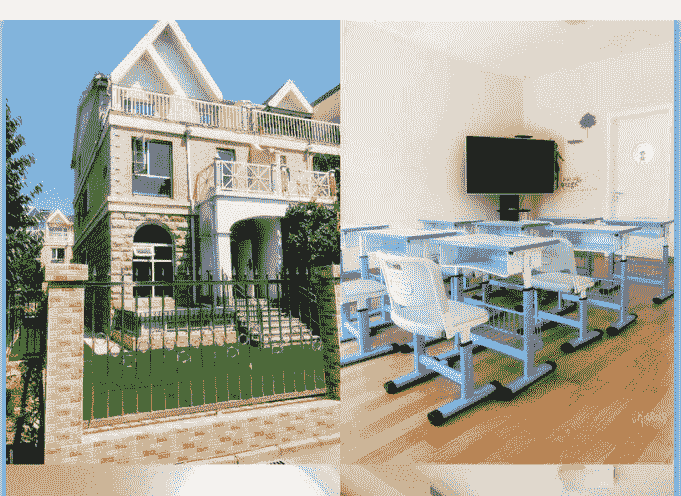

## 刚看到一个相亲贴

LEE：刚看到一个相亲贴 我也来个：

91年老男人 定居苏州 10年服装人
硬件：苏州杭州一套房 一辆7系一辆5系一辆GLC
择偶要求：有理财头脑和眼界 成熟大方善沟通 最好也是服装人 事业上能互相扶持
最后期待个奇迹发生☺

2019-09-25 (18赞)

- 评论区：
    - 杨小乐：为啥一个人买那么多车
    - LEE：家里用车人多 旧车就没卖
    - 冰释前嫌：91年老女人路过
    - 90年的单身狗：抢生意了[捂脸]
    - 酷狗不酷8：单身不
    - 摄影-信：男，88年负债60多万，路过……
    - 月月：91年老女人路过
    - LEE：老男人比较着意 毕竟女人是买方市场在中国[捂脸]

## 90年的老男人，想

90年的单身狗：90年的老男人，想发个征婚相亲贴[囧]找位靠谱过日子的。

2019-09-25 (10赞)

- 评论区：
    - 90年的单身狗：直男，不会花言巧语。一辈子没二心那种。赚钱比较积极，其他都不咋积极...
    - 行云流水：90年的都老了吗？[发呆]
    - 90年的单身狗：30岁了囧
    - 蔡婷婷：建议po张自拍照，哈哈哈[得意][得意][得意]
    - 孙斌：加入一下，年纪同样 将来邀约 靠谱
    - 孙斌：坐标湖南省常德市[悠闲]
    - 孙斌：牛 居然还配图[捂脸][捂脸][捂脸]
    - 富贵闲宾客：这个年头征婚要备注男女好一些

# 珍姐，我95年的

(提问)David：珍姐，我95年的，现在985机械硕士，今年正在找工作，但是我本科比较差，是个二本，考研考到了985的硕士。家是河北的，家庭条件比较差，父母是农民。现在找工作有两个选择，一是去北京的航天所，航天所一般要求至少双211，然后现在家里有一点关系可以去一个差点的航天所，给户口，工资不高，年薪13w-15w吧。但是北京房价很高，家里又没条件，我觉得在北京要买房可能要花几十年，但是家里觉得航天院是央企，肯定会给员工解决住房的(我不太信...)。二是不去北京，去徐工，潍柴，英特尔大连之类的机械企业，虽然工资也不高(12-15w，机械近年来就这个价)，但是在徐州，潍坊，大连的这些城市买房会轻松很多。现在不知道咋办

2019-09-24

回答：这个问题好难回答...... 我有朋友是部某的公务员。即爽又愁。

爽是因为：
- 未来能排队分到房子；
- 在分房子之前提供位置在四环、交通很方便的两室一厅的住房（极低租金）；
- 一日三餐有单位食堂解决，味道卫生营养都兼顾了；
- 北京户口解决了；

愁是因为：
- 每月工资确实不高，大几千块。虽然基本没有太多花销，但想富也是没门的；
- 户口虽然解决了，但是不是在东西城海淀这种教育资源很好的区，而是在郊区（我也记不清了，可能是大兴或者房山之类的），以后孩子上学又是个问题。如果没有学区房，就意味着只能在户口所在区入学，就等同于注定上不了好大学。然而靠他们的工资想买学区房，那是根本没可能的，一想到以后孩子读书怎么办，我朋友就犯愁。
- 包括他在内的周围所有同事都是名校高学历（北京交复人大央财硕士博士这种），然而目睹着身边很多人开始渐渐的被环境所变化，言谈气质越来越像菜场大妈，工作越来越混日子，能力越来越退化，这个朋友就开始有很深的危机感。

然而另一个选项，也不见得好多。因为只考虑了房价差异，觉得潍坊或徐州能更容易买得起房子。这是陷入“工作地=买房地”的定式思维了。

你先跳出工作在哪，就一定在哪买房的认知。意思就是你在北京工作也一样可以在潍坊买房，那么再去对比两个选择，就能发现，最终影响决策最大的因素，其实是：两个工作的前景，哪个更好？

尤其是，如果你研究所的话，如果单位有提供宿舍，那么抹平北京的居住成本之后，两边更是收入接近、衣食成本接近。那么就完全看两个工作的前景了。哪个工作前景好？哪个工作跳槽时潜力更大？

（作为一个外行，我猜测可能是北京的研究所或许更好些？那么北京就一定强于直接去潍坊徐州）

对于一个未来目标是跳槽，打算随时离开北京的人来说，户口的重要性其实并不大。然而有一个也不亏，具体使用方式是：你老家是河北（高考大省）、你想去的城市，包括徐州，潍坊（都位于高考大省），你未来可能去的城市不一定只在这两个之中，但也有可能还是高考大省。如果你未来真的在这些高考大省生活之后，北京户口留着，供以后子女落户，未来当在河北读书、北京高考的高考移民来使用（是20年以后的事，未必真能用上。但毕竟是免费得来的，不要白不要）。

你也不用担心买不起房子。如果你在北京工作买不起潍坊房子的话，在潍坊工作也一样....（因为本来的目标就不是买北京房子，不管在哪工作，都奔着买二线三线房子的目标就行了）

所以对于你来说，我建议还是单纯的看工作前途，哪边更有前途就去哪里。抛开房价和户口带给你的障眼法。

最后，我还得补充几句（对其他人说的）：我建议去二线城市工作。这个结论不是因为“北京房子太贵买不起房子，要去二线才能买得起房子”。而是：

- 要看到现在产业转移导致的就业转移的趋势：原来北京有100份高端的工作1000个人抢，现在转移20个工作出去，但只转移走100个甚至50个人去抢。原来你在北京是个人才，去二线之后你就是个高端人才。
- 在产业/工作机会/人口的转移的过程中，一定会有资产价格的变动。在我看来，未来房价上涨的概率上：二线>一线>三线>四五六线。如果二线不涨，则全中国房价肯定也到顶了。通过地域的选择，是为了选择到更好的职场机会，乃至能像65-75年这一代房子买的早的人似的，享受到资产升值的机会。提问中是因为行业的特殊性，才只能去潍坊/徐州等等

(59赞)

**评论区：**
- 听说我说话很冲：我该转给我爸妈看。[微笑]不想孩子高考还这么难。
- 郭小侠：去大城市吧，实在不行带资源走，我单位旁边就是航天二院。。 还有，未来房价一定是等级压制，即使一线没产业。但是中原城市会有很快的发展。。 请批正
- 肖恩（项目对接）：学习。特别是后面补充的两点，感觉对每个人考虑问题都有帮助。
- 各自安好：在我看来，未来房价上涨的概率上：二线>一线>三线>四五六线。如果二线不涨，则全中国房价肯定也到顶了。我就觉得这个也特别赞[嗷牙][嗷牙]
- Aks：选择在哪里还需要考虑个人能力，我就认识在北京某航天所里工作多年一直得不到升迁甚至考虑辞职移民的人
- Sasa：去航天研究所，我一个娘的小叔工作就定在天津的一个航天研究所，家里官二代，小叔考上了北京航天大学，985，高中就在天津买了研究所的福利房，现在在读研究生，据我所知，研究所是有福利房的[微笑]
- 国师：不努力后面在哪都是麻烦，去北京一群人在努力，你成长空间会很大；毕竟非北上广深，生活节奏还是要慢很多。这点要看你自控力自律能力了，还有年轻人考虑这么多还有创新性吗？ 站在一个道德制高点批判，纯当个低学历的吐槽心声吧
- A-Bitcoin*：我江西的是不是该考虑去福建买房，江西也是高考大省，福建轻松多了。

---

# 在两个月前珍老师的

Bella：在两个月前珍老师的一次直播中，有朋友问到留学机构的发展空间，珍老师提供了一个全新的思路，让大家可以思考一下把国外的学生往国内输送，专门针对医科大学，并且分析了这个思路背后的逻辑。

我觉得可以尝试一下，毕竟是赚的信息差，前期也不用投入太多的资金，就找到了两个朋友一起策划这个事情。我们分头搜集了一部分信息，也做了明确的分工，事情也按照计划在。

由于我自身的特殊原因，短时间内不能参与推进工作，我那两个朋友也是通过我认识的，所以目前我们只能放弃。

根据我们了解到的信息，目前几乎还没人或者很少的人进入这个市场，前期的工作开展起来难度不算小，所以还是有红利期的。

由于信息是珍老师提供的，觉得放弃了也挺可惜，所以把我们手上已有的资料分享给大家，有兴趣的朋友可以沿着这些线索继续下去，或者有更好的途径去推进，也算是没有白白浪费掉一个有价值的信息。

2019-09-24 (26赞)

**评论区:**
- 虎虎：我自己是做留学11年了，然后认识几个外国的朋友在湖大计算机专业读了博士，现在正在攻读博士，我也很好奇，虽然朋时非非洲的美国人。我觉得这快市场还是得我们自身的学术能力提上去，我举个香港科技大学的例子，港科大，建校时间不长也就是20年的历史都是可以发展这么好，远超建校历史在他之前的港理工，港城市，就是大量的华人来到港科大做老师，所以好的教授对于提升整个学校学术能力进而吸引更多的国际学生非常重要
- 减^^：我想做的是把国内的学生输送到劳动力稀缺的国家！这个可行吗
- 听说我说话很冲：咱们这个圈子质量已经高到就差个程序员了！
- Bella：嗯呢，你提供的这个角度很有意义。不知道医科大学国内的学术水平怎么样，我是指的非一流的医科大学。我当初的目标就是对抗医学院。
- Bella：这个不清楚，这个涉及的方面会更更多更复杂。
- Bella：啥意思，我不太懂[可怜]
- 听说我说话很冲：就是很早之前的一个梗，形容事情准备的很充足。
- Bella：[偷笑][偷笑][偷笑][偷笑]

---

# 笔记

工作 ▼

今天 傍晚6:22

留学生引进——前期政策及信息收集的工作：

- 1、中国政府的态度一直是很明确的支持进一步扩大教育对外开放，能够和世界上友好国家加强教育领域的这种交流和合作。
- 2、我们联系过成都两所**985**院校的招生老师，了解到：
  - •**211**、**985**等公立大学都有留学生部，学生大部分来源于一带一路国家
  - •由学生申请，当地政府做优生推荐来华
  - •学生分布在学校各个专业
  - •国家每年会给到学校国外留学生的硬性招生指标，每月补贴留学生生活费，最多的每月3000
  - •**985**院校每年都能很顺利完成指标，并且不会扩招，学校方的态度是，一带一路的学生来源并不好，不想大力扩招，会拉低学校的学术水平。
- 3、如果想靠一带一路的政策，可以考虑走民营大学，但是国家的补贴并没有对民营学校开放。
- 4、国内排名考前的医学院信息没收集到，二类的医科大学有留学生部，人数不多，就四川而言学生多数来源东亚。
- 5、要成立留学生引进中介机构，更多的可以考虑国外自费来华的留学生。

# 笔记

留学生引进--我们需要做的市调：

- 1、去大学随机找几个留学生，了解通过什么途径来华留学，以及从哪儿了解到该学校……..
- 2、发动身边的资源，找到已经回自己国家的留学生，了解来华的途径、留学意愿……..
- 3、联系东南亚国家当地的留学机构，是否有可以合作的空间，以及合作的方式。
- 4、通过身边资源联系一到两所大学，和招生办洽谈引进留学生事项，侧面了解学校的真实态度，以及学校所需要我们提供的相关资质有哪些。

---

# 大家好，今天看到一

(提问)阳光：大家好，今天看到一个加盟项目，是做云纸的，就是在公共厕所的厕所，提供云纸智能硬件，用手机扫一扫即可1秒免费取纸，加盟商通过扫码的客户得到公司的流量变现的提成。

因为没接触过这种流量变现的项目，所以想请教一下，这种项目可做吗？

2019-09-24

回答： 【帖子编号0363】 《流量变现逻辑》

现在很多人谈流量，但是流量不是必然有价钱的。有没有价值，要思考流量背后的【变现逻辑】是否成立。我举个例子：

很多年前，有种商业模式，是印免费报纸在地铁里发，因为地铁里流量大，坐地铁的人没事儿干，就愿意领个报纸，随手翻翻，翻完扔到垃圾箱里就完了。看免费报纸的人多，报纸有量了，就有人投广告。印报纸的人靠着边广告费变现。

然而，这是很多年前的模式。2011年之前我还住郊区的时候，是喜欢路上领一份报纸看的。因为当年，手机还是诺基亚……每个月的流量也没多少，手机还是要省着用的。所以愿意领免费报纸。

之后我就几乎没怎么坐过地铁了。但是猜一下也知道：现在手机流量如此便宜，谁还愿意看报纸呢。领报纸的人少，最后报纸全都落入收废品大妈手里了。之后就是广告商不会再继续投广告，那么这套模式就玩不转了。

到合肥以后，地铁线都是新开通的，我和F先生就去体验了一把，结果又见到发免费报纸的了。既然地铁线都是新开通的，这个报纸必然也是新创办的。我本能的就在想，哪个创业团队这么天真，竟然还照搬n年前的老模式搬到合肥，却不看看外界环境已经天翻地覆，变现模式很难继续成立了。

我们再来看一下免费厕纸。来思考两问：
- 一流量怎么样？
- 二变现逻辑成立吗？

美国所有的厕所都有卫生纸，在国外待久的人突然回国时，会遇到一种坑————上厕没带纸。然而，国内厕所没纸的现状这两年也改善得很快。说白了还是服务业的整体服务水平提升的很快，外加社会富了，卫生纸也不值钱。

我看到的现状是，现在各个商场、餐厅，商业的公共场所里基本都有卫生纸了。高速服务区这种地方，即便没普及到每个隔间，也在外面公共区域有超大卷的卫生纸供应了。

所以要看到这种趋势，从流量上来说，我觉得较大城市应该已经没前途了。或许“下沉市场”（4线以下城市）还有流量。

思考完流量，再看变现逻辑。背后变现的逻辑是什么？意思就是，钱从哪来。扫一下弹广告？扫一下获取用户手机号然后发广告？扫一下关注公众号，然后收推广的钱？如果还是上面这些套路，基本很难有效了。就跟大街上“扫码送小鸡公仔”“关注公众号免费打印照片”这种过时的公众号增粉手段一个样，小鸡公仔没少送，最后当场加的关注当天晚上都取关掉了。我思前想后，感觉这个厕纸的流量背后，是没有可靠的变现逻辑的。

如果能变现的话，大概也要靠两个不怎么靠谱的方向：

- 一种是下沉市场中，忽悠商家的钱。扫一扫直接弹出来的广告是肯定没人看，不会有什么效果的。但是忽悠商家投优惠券什么的，拉人头去消费，那么会有小白商家上当买单。（注意这一点：其实很多商家会陷入一种思维陷阱，靠做活动来吸引客流，结果吸引来的都是薅羊毛的，活动期间看着人头攒动，活动结束后顿时打回原形……圈子里一直说，好的商业项目一定是双赢的，能够帮助双方甚至多方获益。这个厕纸广告项目肯定不是，最终买单者其实就是商家。）
- 另一种是灰产。就是所有在别的渠道被禁止或者受限制的广告：丰胸抽脂整形减肥，甚至是微商发展下线“带你月入X万”。原因也很简单：没有卫生纸的场所，肯定也不是啥高大上的地方，用户鉴别能力有限，被忽悠指数很高……外加投放位置都是犄角旮旯，被监管的可能性很低，被用户举报的可能性也很低。但以上两种都不是一种“可行的项目”（意思是商业逻辑不具备可持续发展），纯粹是一种草根赚快钱的方式。

上面的主要思路已经讲完了。如果是你自己想出的项目，我只能跟你说，想做的话，只能去下沉市场，变现逻辑是后两种不太光彩的路线，要么割商户，要么割用户（下线）。然而这个不是你自己想出的项目，而是找加盟的，我就怀疑招商的人可能根本没思考过【变现逻辑】是什么，而只是用“流量变现”这个新颖的名词吸引你而已。在你还在思考割商户还是割用户的时候，他们是螳螂捕蝉、黄雀在后，准备割你。（58赞）

**评论区:**
- Mr....: 骗人的
  - 90年的单身狗：突然有个想法，把广告印在卫生纸上[捂脸][捂脸][捂脸]
  - WUZHIAO□：你是真的聪明
  - a treq□：那你想印什么品牌，会不会对品牌造成冲击[捂脸][捂脸][捂脸]
  - 90年的单身狗：肛肠药品[机智]
  - WUZHIAO□：男性医院[呲牙]
  - a treq□：其实打广告我只服杜蕾斯。他们的事实新闻创意型蹭流量真的比较好。碰瓷高手[捂脸]它不需要自己大规模传播，而是受众传播。
  - 90年的单身狗：[机智][机智][机智]

---

# 昨天 发给我的一篇

珍大户：昨天 发给我的一篇文章，

黄奇帆万字长文：预测房地产下一步

内容值得看一下。

房地产整体的机会结束了，未来没有普涨，因为整体的城市化进程开始变得缓慢了，货币增速也会比以往降低很多。

但一些1000万人口的城市后面仍有发展到2000万人口的机会（这点确定性比较大）

不确定的是人口已经超过2000万的大城市，还有进一步增长的空间吗？

（文章里说目前政策是比较限制2000万人口+的大城市的扩张的，如果未来政策没有改变的话，那么一些大城市确实到顶了）

文章最后还有一个地票制度，是比较新的趋势，值得看下黄奇帆万字长文：预测房地产下一步

2019-09-22 (65赞)

**评论区：**
- 肖恩（项目对接）：学习
- 青松：优秀
- 90年的单身狗：咱俩同名。我叫王青松[呲牙]
- 军-合肥公司注册代理：城市人口集中度增加，人口出生率下滑，珍老师对这个观点怎么看？
- 三十娃：杭州人口963万，成都1600多万，从人口红利看杭州还有大量人才可以进入，老师还是不看好杭州吗？
- 军-合肥公司注册代理：如果不能有效解决人口集中后的生育率问题，城市化将不具有可持续性。就以目前的生育率，10年后，年出生人口也会逐步降至1000万以下
- 90年的单身狗：[呲牙][呲牙][呲牙][呲牙]有缘有缘[握手][握手]

---

# 【帖子编号0362】

珍大户：【帖子编号0362】

提问：

本人，94年，女，985本科毕业，专业冷门不想从事，现在二线城市做房地产销售，职位有晋升空间，一年到两年左右的周期，目前根据业绩平均薪资2万左右，如果职位晋升成功，年薪30万+，行情好的情况下50万+，在这个城市生活幸福指数很高，但是每天工作周而复始，工作能力和思维能力止步不前，想跳出舒适圈，考研转计算机行业，毕业之后和男朋友想一起去一线城市工作生活，他现在是计算机博士，珍姐可否给些意见？

首先，先说第1条建议：一定不要跟你的计算机博士老公走同样路线。

原因很多：

一方面是，其实博士中除了少部分是极其有天分、不读博属于浪费人类的智慧这种，大部分的博士其实是属于更偏向于“自我驱动意识”比较强，严于律己，努力搞正面竞争这种思维模式。比较容易在一个领域内死磕。

所以一旦你跟你的博士老公选择同一条路线，后续我能猜到，你少不了要被他批评不够刻苦，不够努力，怎么这么笨之类的……（反正是于家庭关系不利的）

我个人是不推崇夫妻关系中加入了比较、攀比、较劲这种因素的。甚至要防止这种因素出现。

那么两个人做不同的事情，或者做近似，但是有差异的事情，防止比较、一个人教育/教训另一个人的场景出现。

另一方面，从风险防范角度，家庭分工中两个人最好站在风险互补的角度。

两个人都有在同一个行业、同一个领域、做同样的事情，行业好的时候都好，行业不好的时候都不好。

自觉想想90年代全家下岗的场景，代入一下试试……

再说第2个建议：

“转计算机”并不是一个完整的规划，这是一个行业的统称。

所以你想要到这个行业里具体从事什么工作内容呢？

比如：你是想转到计算机行业里面的技术岗？还是非技术岗位？（我也没在这个行业里呆过，所以追问不了太深入了[捂脸]）

（我个人猜测，你是想要转到技术岗位。因为文章中说了觉得“思维能力止步不前”。有可能你在想“技术岗位是让你不停思考”的）

我是80%不太倾向于你进技术岗位：

首先，计算机是理科。一般是偏文科的专业，因为不好考核基本功如何，所以必然更看重学历挑选（乃至外表谈吐这些外在因素）。

理工类面试中，内行一问就知道深浅了，计算机类的更容易，当场考你段代码就能做出个判断。

因为我对计算机类一窍不通，条件反射的想，两年的研究生阶段，真的能让你从外行到内行的转变吗？如果达不到，那么等于白读了，因为就算简历过了筛选门槛，但到面试时就容易over......

（希望有计算机专业的人来说一下，这种从外行到内行的转型容易否，两年硕士可以吗？）

所以我是80%不推荐你转去做纯技术的岗位。

因为推断大家都是普通人，普通人就意味着资质普通，你作为28岁毕业的2年硕士，专业水平比不过24岁毕业的、本硕6年都在该专业里浸润的小伙子（面试中能被肉眼可见的发现差异）。

当然，还有20%的可能性是你超级适合学计算机，天赋属性就在此领域，所以一进去就功力大增这种。

（但是我怀疑不太可能，因为你现在的工作做的挺好，而现在的房地产销售工作，属于人际关系导向，而计算机技术方面的岗位则完全相反。一个人的天赋技能点是有限的，不大可能同时点两头，两边都游刃有余......）

所以，如果只是看好计算机行业的前景，想要进入到这个行

业里的话。我倒是希望你我找这个行业里有没有同样需要人际关系处理/沟通技能为主导的职位。

这算一个折中方案，那么读个研究生就容易多了。

等同于，你计算机水平虽然比不上本硕6年浸润的小朋友，但你能处理复杂的外界关系；其他的处理关系的能人或许水平比你强，但是他们不懂计算机。

最后再说一下如果不换行怎么办吧。

其实从提问贴评论区里就能看出大家的看法：

任何工作，只要是收入好就会有人羡慕，然而因为工作压力、工作时间等等很多原因，身在其中的人却未必满意。

这种境遇可以套用在很多职业上，不仅仅是房地产销售。

换句话说……如果你换行了到了其他行业、其他岗位上，有可能还是会觉得工作内容一天天的重复，人就像陀螺一样停不下来，生活没有变化，人生缺少思考。

因为这是社会分工发展的方向。只有分工到极其详细，每个人只做自己案头的一点小事，然后不断重复，才能效率更高……

说白了，我们每个人都是社会中的螺丝钉而已。（参见0247贴：）

所以，如果你不打算跳槽的话，有以下建议：

第一，每天一定要给自己预留出一定的“生活空间”，用于健身、逛街、休息、会朋友……

这里边最直接能改变人的就是健身。以前一直听说那些华尔街的家伙，哪怕每天睡眠时间不够也一定要去健身一小时，有不少人还是“铁人三项”运动员，身体状况会直接影响头脑思维的活跃程度。身体状况也会直接影响情绪。（很多情绪问题，都源自身体机能先出现问题）

第二，在工作中找点乐趣，结交点朋友。

我以前一直以为证券经纪人是个很无趣的职业，说白了就是销售，是开户的。后来合肥以后遇到一个人，竟然是经纪人出身，做了十几年证券经纪人之后，因为积累了很多客户资源，后来竟然开了家私募基金公司（是有牌照的正规私募，不是没牌照的野生公司）。

以前F先生在开第二家公司的时候，也是他第一家公司的客户变成了朋友，后来又变成了合伙人（可惜没经营下去）。以前在卖方当债券交易员的时候（债券交易员跟房产销售类似，就是兜售债券的），这份工作也是要求社交能力的。我身边的同事里，有不少如鱼得水的，从同业之中交了一堆朋友。我比较不擅长社交，当年对照着同事，总觉得自己不合格。还好靠着网上写文章、写经济评论，也算交到一些业内的朋友，后来从卖方转到买方也是得益于朋友举荐……

现在回想起来，很多这样的事例。都是从工作之中找到了工资以外的收获。

第三点，希望你站在整个行业的高度，来思考一下这个行业的前景，以及自己未来的位置。

房地产销售这个行业无论是在哪个国家都是高收入的工作。然而其他国家已经开始搞准入制度，要考证、要备案、要统一服务标准等等（其实搞准入就是为了减少竞争者，避免打价格战，从而提升整个行业的收入水平）。而国内目前还是鱼龙混杂，基本没有任何门槛，任何人都可以进入。

从目前的没有任何门槛，到像国外一样搞出各种准入制度，至少要经历以下阶段：

先是行业内从业人员持续涌入、各个销售公司从业人员的人均收入逐渐降低，竞争加剧，为了存活而进入了打价格战阶段。

之后是互撕阶段，就像前几个月空调行业里，格力举报奥克斯空调虚报标准这种事情类似。行业内互撕，淘汰一批人和一批企业。

最后是建立行业内的准入标准，老的既得利益者要想办法维护住自己的地位和份额。行业开始渐渐的稳定、稳固下来。

对照国内，现在连价格战的阶段都还没到，说明当前的行业利润不低，各家企业都能活得挺好。在一个行业还能赚钱的阶段，就先赚钱。然后不妨思考下，目前整体从业者的平均学历、素质都不高的现状下，在你作为一个高学历的人才，怎样才能到后面混战-淘汰阶段走得更长远。

https://t.zsxq.com/nAmMRzB https://t.zsxq.com/jeQFqFQ https://t.zsxq.com/jyJEUnY https://t.zsxq.com/r3fyjuv
2019-09-21(68赞)

评论区：

- 娜娜: 针老师分析的太全面了，我也受益匪浅[玫瑰][玫瑰][玫瑰]
- 大卿: 分析的很到位
- a树: 太多在不断重复的工作中跳槽转行业。这个是属于工作枯燥综合症。一般一份工作一个行业的新鲜感也就撑死5年。朋友A毕业第一份工作5年。没谈恋爱。没结婚。除了工作画画。感觉无限循环。辞职去新加坡。去了那边还是无限循环一年半回到老家重庆。重庆还是循环。一年半再回到原点深圳。回来之后开始频繁跳槽。离职。总结这是一个职业病。一开始工作的时候忽视了去构建工作之外的生活体系。工作慢慢好起来了。突然发现拿起电话好久没和朋友同学吃饭了。再联系已经陌生了。之前是没钱。之后是没时间没朋友。精神上的匮乏。加之长期忽视锻炼。吃饭不按时。随意打发自己。病了一次后情绪极度低落。
- Alex: 年前面试过一个本科文科，硕士计算机的人，那次的面试结果不满意。原因正如她说说的，理科尤其是类似计算机相关的专业，几个问题下来就知道对方的能力了[捂脸]
- 珍大户: 后来他怎么样了?
- Nash: 我学计算机的。很羡慕你们工资能有两万一个月。如果你是做技术的，在计算机行业刚毕业1-3年工作经验，收入是10—15k(排除那些进大公司的，一般人都是在小公司混的，除非你一毕业就进大公司了，要不然后面很难进)3-5年工作经验的是15k以上。但是你有工作经验了，不一定代表你有这个能力拿这个工资，计算机技术是更新换代很快，你要不断学习，过几年又出新技术，即使你是腾讯的员工，你自己不更新技术，过几年很容易被淘汰。我想说，如果你觉得自己逻辑能力比较强、自学能力比较强，可以进来，像你说年薪能达到50万，在我们这个行业，只有技术非常厉害的才能达到，在大公司属于高级工程师或者专家级别的。一般一个月2万，在我们行业就是很多人羡慕了，像我们普通公司员工，大部分达不到。有时候觉得别人说，做软件工资高，我想说只不过高新一点而已，但是要达到了两万一个月，付出的努力。比你们销售行业，恐怕付出的多得多。
- 旺旺: 首先非常感谢娴姐的宝贵意见，在我迷茫的时候给了我几个专业性对比和作为长辈的经验。其次我把您给我的意见跟我父母研讨过后，觉得潜心钻研现在的工作，用心做好当下的事情，充实自己的能力和以生活更为重要，学历对我今后的发展并不会起到锦上添花的作用，让我坚定了自己，明确了目标！谢谢！

关注公众号“懒人找资源”，星球资源一站式服务

## 大家好，想咨询一下

(提问)对方正在输入...：大家好，想咨询一下能源投资项目。澳洲目前有个公司，专门做太阳能项目，成功案例包括shopping center 光伏停车场和太阳能电站。主要就是利用澳洲充足的太阳来发电然后卖回给电力公司。（澳洲电费超级高）一个小的200KW的电站为42万澳币。大概两百万人民币。投资回报率百分之12-13左右。本人在澳洲居住。在房地产投资和这个能源投资间徘徊。地产回报率5%左右。资金有限，只能投一个项目。长远来看哪个比较划算呢。有没有懂的朋友给支个招。

2019-09-19

回答：【帖子编号0361】（投资电站）刚好像以前接触过发电行业，投过水电三峡，拒过华锐风电（当年有种风气，就是觉得只要是上市公司都没风险，如果闭眼投或许也就过了，然而我分析了一圈，感觉不是太好，当时就锯掉了这个项目）。这两个行业都研究过，所以对发电这块有点了解。先扫盲一下：口语中的一度电，学名上叫1千瓦时（1kw/h），中间的斜杠不是除号，而是表示“每份”。而发电机的功率，是用千瓦（kw）来衡量的，一个功率是1kw的发电机，每小时能发出一度电。在往上加几个零的换算关系，一般都是按照西方的每三个零加一个逗号的习惯往上加的1,000=1k（英文单词千kilo）1,000,000=1m（英文单词百万million）所以发电机如果标1MW，意思就是1000KW。每小时能发1000度电。火电水电核电这些，发电机机组的功率一般都到百万KW的水平，风电一个机组的容量有1.5MW（太阳能发电没研究过，记不太清了）。其中，核电不能关，昼夜不停的开。水电、风电这两种属于靠天吃饭，有风了就发电，风停了就歇菜；丰水季发电，枯水季歇菜。而电又是不能大规模存储的，即发即用，所以为了避免浪费，国内都是优先安排核电、水电、风电这些新型能源上网，由火电承担调峰功能（用电少的时候，火电就少发电，用电多的时候，火电就多发电。）

所以，每年有24*365=8760个小时，印象中，核发电电机的利用小时数是超过7000小时的水平。水电风电都要低的多，风电只有2000小时的水平，因为靠天吃饭，毕竟不可能24小时刮风，所以不可能满负荷运营的。

所以按照上面介绍的基础知识，在套用一下提问里的数据：200kw发电机，是指光照超过一定强度的时候，满负荷运营下每小时发200度电。因为没研究过太阳能项目，我确实也不知道有效利用小时数能够达到多少。因为一半白天一半黑夜，黑夜肯定是没光照的。白天的光照时间里，也不可能全部算满负荷，总会有早上和傍晚光照弱的时候，也会有阴天下雨的时候。但我觉得怎么也要超过风电2000小时的数据，那么咱就按2000小时来算。那么200*2000，一年能发40万度电。澳洲电费不知道，要是1元一度，则一年四十万，200万的投资5年回本（所以还要看一下机器寿命，有没有可能过几年机器就淘汰了？）。如果要是能更乐观一点，一年3000小时。则一年60万，三年多回本，这样感觉就值得投资了。或者澳洲电费不止一块钱一度，那么这种也感觉值得投资了(39赞)

讨论区:

- 大格：风力发电和太阳能发电还有一个弊端，就是不稳定电流，必须先存储，再转换，而在转换再输出经过两道手续，据说要损失将近一半
- 小嘴大产 [段] 这个我还真系不知道
- 小嘴小二郎：前几年能源公司大规模投资并符合标准的厂房建筑屋顶上兴建太阳能光伏组件发电，用于工厂自发自用或是全部上传电力公网。也有开发空地发电的，电力公司收购，发出来的好像是直流电，国家给高额补贴每年。居民多是自投自建，用不掉的上传。居民的不太清楚。1.参考当地每年平均日照时长，还有政府和电力公司政策 2.存储一直是难题，传输有损耗 3.光伏组件寿命好像20年or25年 4.需要定期维护，雪天落叶灰尘，附近有没有维护维修服务站点 5.折算能建的面积，比如屋顶，有些背面不能建，组件光板是拼接着。以前在光伏公司待过，非工程技术岗，只知道这些，供参考。
- Kevin：有需要儲電方面的話我可以推薦朋友給你了解
- 铁锤：学习了
- 对方正在输入..:非常感谢大家的解答，特别有帮助。谢谢珍妮。内容很详细
- 扎西完克：光伏日照平均按4小时计算，光伏设备投进去设备就不值钱了，相当投出去就没有本了，感觉运气才真的稳赚不赔
- 郑经年的初访：国内风电和光伏，真正的回本期在12年至15年：光伏板新技术已经研发成功，很快就会产生普及，组件价格预计会下降一半左右。你描述项目属于分散式发电，建设成本比集中式高很多，传输损耗也大，管理维护成本高；新能源项目在国内，真正难的是手续、上亿的资金链以及销售。我想……国外也差不多吧！

关注公众号“懒人找资源”，星球资源一站式服务

## 老师我想开实体店做

(提问)谢狮子：老师我想开实体店做逝者娱乐室

殡仪馆附近租场地
每年过年扫墓 和清明节 去向其家属宣传
了解逝者兴趣爱好 给每个顾客做方便管理的相框安排日常娱乐计划 麻将 电影 唱戏 吃斋饭 等等。
请问老师 开之前要做哪些准备 本人没有做生意经验
2019-09-19

回答：【帖子编号0360】〈逝者经济〉看完这个提问，我很不到厚道的乐了[呲牙][偷笑][捂脸] 提几个问题吧。这种消费的目的是什么？有一种基本的观点，人花出去的每一分钱，都是为了“成全自己”，使自己更“圆满”的。 所以花钱都是有目的的。比如满足自己的物质需求，比如满足自己的精神需求，比如社交需求，比如包装自己、标榜自己、宣称自己是一类什么样的人，等等等等。 所以这个让死者娱乐的事情，是满足了消费者的什么需求呢？ 如果说的更直白一点，殡葬相关的事情，目的是什么？ 我觉得在中国，最常见的有几层目的：

1. 消费的目的。老人自己给自己买墓地的这种比例不低，传统思维，想要死后有个好去处。
2. 风水的目的。这个大家应该都懂。
3. 社会评价需求，展示孝心。

你如果从这三层目的出发，会发现给死人策划娱乐这事是三不沾的。 第一个，指望儿孙还关心老人死后的境遇如何，这是很困难的。不说死了，就是活着的时候，老年人广场舞、打麻将、旅游，买单者主要都是老人自己。 第二个，传统文化里不包括“老人在下面打了麻将，吃好喝好，能让祖坟风水更好”这种内容，所以也不沾。 第三个，社会评价，花钱买这个的作用肯定比不上办丧礼，毕竟丧礼有外人参加（给外人看），丧礼结束后，每年就只剩下自己家人去扫墓了，做给谁看呢…… 传统常见的需求是以上三种，你这个项目三不沾。但是ー项新产品，总要开发出新的需求。比如这几年卖墓地的，就在宣传“墓地能投资”（虽然我觉得是假话），但这种创造新需求的方式也算在某种程度上能够促进销售。所以除非你能创造出新的需求来，否则这个创业项目，在我看来是不现实的。最后问题来了，你这个到底想满足消费者的什么需求呢？你能创造出来什么新的需求吗？(20赞)

评论区:

- 时间的介绍人: 推送这条消息的时候虎躯一抖
- 晓磊君: 还好提前咨询了大户，要不真投下去...{捂脸}
- 秋天: 你说的就像去棺材店买棺材，老板说欢迎下次光临一样! 多别扭你不觉得吗？
- 小胆: 带着惊讶与好奇点开了这条推送......
- 珍大户: 所以棺材店的导购要不要做笑服务呢？我陷入了沉思......
- 秋天: {偷笑][偷笑][偷笑][偷笑][偷笑]
- 周防御·握手!: 之前我说做完死前安慰与死后殡事处理！就够不靠谱了！没想到你安排的更远，死后好多年！
- Wu: 这生意点了，看的我虎躯一振。

关注公众号"懒人找资源", 星球资源一站式服务

## 截图是我前两天看见

珍大户：截图是我前两天看见的。

这方面我不懂，所以也不敢评论。

然而看了昨天的新闻发现细节对照上了。说明说话的确实是该领域的人，所以里面的事实信息（比如西北地区的绿植、水流变化，南极北极、两河流域、尼罗河流域的水文变化情况），这些信息应该是有可以参考的。

真正的大事：中国西北正在变暖变湿-观察者网 新华社分享页 2019-09-19(6赞)

- 评论区：
- 珍大户：我放弃了，我发图片就发不出来，图片在这个帖子里https://t.zsxq.com/Eyj6LUJE
- 泥：对个人有什么影响
- 过冬书展的大雁：全球升温跟这个有什么关系？风水轮流转了哦
- 飞鸟：环境和气候变化，会给很多地方带来新的机会

## 大户老师，我有个法

(提问)长颈鹿：大户老师，我有个法律的问题请教：中介在房东没有把房源信息给他的情况下，私自介绍房源给我们，后面我们绕过中介自己和房东签了。现在中介找我们闹，要中介费。这个中介费我们该出吗？

事情的具体情况是这样的：写起来发现太长了，我就用图片发出来。

2019-09-16

回答：先批评你们一下。 既然总公司不准走中介，说明你们一开始内心知道，无法给中介付费。 那么就应该一切靠自己找，不应该去撩中介。毕竟如果100%确定不能付中介费的话，再去找中介，就等于白占人家劳动力的便宜。干嘛要白占别人便宜呢。虽然这个世界充满了类似的行为。 比如明知准备网上买东西，却偏偏跑去实体店看样品，白试一次。 比如去超市试吃一圈，吃饱了就走人…… 等等等等。 如果我们看着这种事情，觉得不合理，最应该做的就是约束好自己。已所不欲，勿施于人。如果你是商家，不愿意看到这样的客户，那么你就不要当这样的客户。 

———————

其次，是关于这处争议房源的问题时，你们跟中介交流的时候，也不够坦诚。 本来事情是站在你们这一边的： 因为第1：你们先知道了这个房源， 因为第2：这个房东的联系电话是公开的，等于所有人都可以去联系，并不是你们私下里偷偷找房东跳过了中介。 所以既然事理是站在你们这边的，就应该坦诚相告。 而不是藏着掖着。 

你们有几次机会： 第1次是，当得知同事已经先知道这处房源的时候，就应该立刻把这个信息披露出来。 （哪怕是当时看房时不知道，事后回到公司跟同事一汇合才知道，也应该把这个消息告诉对方。） 第2次是，看到这处房子上挂着房东电话的时候，就应该明确跟中介说：“这种公开的房源，你们就不要介绍给我们了，我们公司有好几组人在扫街，不用你们介绍也能看到这里，用你们中介啥事。

你想赚中介费，就拿你们独家房源出来，不要拿这种大街上的房子来忽悠我们”你看，这么占理的事，本来你们早早的说，还能占个上风。但你们不坦诚说，后面还了个假名字……（PS：在空白纸张上乱签字的风险，我都不多说了。任何一个有理性的成年人，都不应该往空白的纸上乱签自己的名字。当对方拿出来一份空白的文本，让你们签字的时候，就应该斩钉截铁的拒绝）签个假名字更显得你们一开始就打好了想要私下里跳票的主义，显得自己想当的不正义。站在中介角度，他们未必是有意胡搅蛮缠，来搅乱你们工作。而是生活中确实有无数占便宜的人，找中介带看完房子，后又私下理联系房东跳票。这种事其实欺负中介。对于一个长期处于“受欺负”状态的群体来说，用胡搅蛮缠的方式，其实是寻求自保。本身这是你们占理、不需要给中介付钱的情况，却因为你们的藏藏掖掖、不明着说、签假名字，让中介以为——你们就是故意不想付钱，故意欺负他的。所以他们才胡搅蛮缠。

所以希望做事情的时候，还是要坦诚一些，该是什么就是什么，就能减少很多误解和纠纷。不该签字的东西，明明可以直接拒绝，为什么要签假名字呢？？不该付费的房源，为什么不直接告诉对方，而要把兜兜转转呢？

—————

但事情到了这一步，我也不不建议你们妥协。法律是站在你们这一边的，毕竟你们没跟对方签任何合法的东西，毕竟房源信息是公开的不是中介独家房源，他们起诉也赢不了。而且，虽然我能理解对方胡搅蛮缠的原因，却不赞同对方胡搅蛮缠的做法。在这种情况下，也要考虑事情的社会影响：如果因为对方在闹，就妥协了、私下里付钱了，就等于告诉对方，用胡搅蛮缠的方式能解决问题。那么对方受此次成功的鼓舞，以后会变成什么样子？你们至少还是一个公司，还有好几号人。如果一群人还怕事的话，想想如果是一个单独租房的小姑娘，遇到这种中介会受怎样的要挟，又该如何去面对呢？

所以到这一步的时候，我希望你们也强硬一点，不要跟对方妥协。对方再来闹就直接报警。告诉他们，扰乱公共场所秩序是要拘留的。（55赞）

评论区:

- 珍珠户: 关于坦诚这个事：之前我推荐音乐流的时候，火速签过一家MCN。因为当时传闻说有流量扶持，还有广告，结果签了好久，流量也没有，广告也没见影子。到了6月份，突然有支付宝的人来说要投广告（这事大家都知道的了），因为和MCN协议在，所以我们面临两个选择。1。给MCN发解约函。因为按照协议上的条款，连续6个月没有广告，可以互解约的。2。执行协议，那么广告费就少分出一部分。如果打小九九的话，就直接解约函了。不过我和先生都觉的还是应该诚信一些，跳舞不好，于是就把广告的事通知知MCN了。后来广告跑完了，结款也到我账上了。F先生又跟我说，说最初签合同的时候，也只考虑了让MCN带广告过来这一种情况，现在是咱们自己接了广告，根本不需要MCN做点什么的时候，还执行之前的分成比例，就太不公平了，希望修改一下，说老先生可以还按老比例执行。对方觉得我们说的也在理，于是重新签了合同，支付宝的广告费也直接按新比例分成了。这么操作完了，我们双方心里都算舒坦了。否则如果是不够坦诚的话，直接解约函，然后再换家MCN签合同，那么这笔广告费确确实可以全进自己口袋了，但是心里总是要有愧了。
- 刘芳：说起空白合同，现在买房子签合同的时候，开发商这边走一擦材料让签字，也会拿几张白纸让签字的，之后 再往上印内容。虽然知道不妥，但是不签不行啊。
- 赵薇：大户角度好掉□ 讲做人 教做事
- 珍珠户：开发商合同一般有政府备案过的，这种签了没事。白纸那个是不应该签的。（我没见过这种签白纸的(呆笑)
- 定义Calvin：这样帖子 还是打赏一下 不然心里不舒服[苦笑]
- 珍珠户：[偷笑]
- 珍：嘉：社会人
- CK：签白纸无效吧。我记得有技术可以判断时间的

关注公众号“懒人找资源”，星球资源一站式服务

事情的具体情况是这样的：我们是给公司租职场，我们所在的是分公司。我们负责人找了中介看房子，这个中介带着看过好几处房源都不满意，最后带看的这套房源符合我们需求。但在这个中介带我们去看最后这个房源的时候，我们另外一个同事已经提前知道这个房源了（我们是下午1点左右知道的，中介是3点左右带看的），我们自己有房东联系方式，并且房东自己就直接在房源外墙挂着出租和联系方式的（后来了解到房东也没有把房源放中介）。但最后还是和中介一起看了房源（中介带看房源的时候还给我们负责人签了个看房协议，但是负责人在签的时候这个协议上没有写具体房源地址，中介费多少，中介自己也是说随便签，负责人就签了一个艺名括号写上公司名字）。我们负责人也是和中介聊过几次的，最后在微信上拒绝了中介（总公司也不允许走中介）后续都是我们自己和中介谈的合同和房

住房仲裁。现在，中介就死咬着我们租了房子，给我们提供了服务，我们也是和他们签了协议的，现在我们私下自己和房东租了，要我们给中介中介费。

我们老职场在9.2到期，然后把东西都搬到新职场，搬东西那天，中介一直在那里拍照，找我们负责人谈的时候还录音。我们搬到房源处，弄了一个临时办公点，因为房源是毛坯还要先装修。这个中介挺恶心的，一共6个男的来我们临时办公点，美其名曰谈判（我们负责人是个女的，还是个小个子），来了大吼大叫，要我们营业执照上的法人出来和他们谈。（开始有了纠纷后，发现签的是个假名，就咬着我们有预谋的。中介还来要身份证的，没给，还叫过派出所的人来看过身份证）那天来大吼大叫真的是被吓到了，直接报了警，警察叔叔说，要么和谈，要么法院诉讼（中介说法院诉讼很亏的，他们不想的），警告他们不许闹事，不能影响我们办公，然后离开了。

我们公司的态度是不可能给中介费的，让我们和平解决掉，肯定也是不希望造成负面影响的。我们负责人也很仁至义尽了，也是明确告诉中介我们公司不可能给钱，真要钱也只能是她个人给，能给得起就给，给不起也没办法的。

今天中介又来我们临时办公点，赖着就要公司给钱，不要负责人给的钱，而且负责人也给不起。还说自己那边房租也要交不出来了，以后就天天来我们这里坐着。还说已经以门店的名义走法律途径了，说那个还要几个月的太慢了。还说我们是有文化的流氓太可怕，欺负他们。

## 老师，请问那些各行

(提问) 勿忘～初心：老师，请问那些各行业也的数据从哪里可以得到？比如像0358帖子里面关于猪的数据都是那么的详细
2019-09-16

回答：【帖子编号0359】<找数据> 找数据一般三个渠道，1发布方，2数据库，3软件。按照顺序说。
一、发布方 如果你知道某项数据是哪个组织发布的，就可以直接去他们网站上找。比如，国内大部分数据都是统计局发布的。再比如一些地区的数据，数据来源一般都是当地。这种方式比较费劲，所以不推荐新手做。（老手一般是数据库或者数据软件上找不到，或者找到的数据肉眼可见的存疑时，用这种方式是去勘误矫正）
第2种，数据库。有一些免费的数据库，可以进去直接筛选数据，我分享给大家（因为第3种文件的方式往往都是收费的，所以大家如果是零星的、不是经常大规模的找数据，用下面这些网址就可以了）
- 国家数据库
- 世界银行数据库
- google数据库（需梯）
- 前瞻数据库
- 上海交易所

第3种：软件。金融机构一般普及用万得wind软件，这个一般比较贵，一年要十几万，而且连年涨价，还绑定公司IP地址，只能公司使用那种。我现在在用个“choice金融终端”的软件。这个进去点宏观，里面的EDB模块就是集成的数据库。这个软件是要钱的，但是直接付费是不值得的。有两种免费使用的方式：
- 第1种比较累，连续登录4天就可以免费使用一天。
- 第2种方式是，在他们推荐的券商开户。我不记得里面是放几十万，然后就可以免费使用了，我是用的这种方式（要每个月用手机APP操作去领使用权）

——————————
以上本帖主要内容写完，唠叨一些其他的事。国外最早做数据软件的是bloomberg，这个创始人自己也成了大富豪，后来还当了纽约市市长，只领一美元的年薪。我去过bloomberg，他们那栋楼直接能看到纽约中央公园，公司里环境特别好，也是跟那些高利润的It巨头们一样，随处可见的零食柜，全自助的咖啡吧，茶吧，休息室等等。（也能看出来他们利润很高）后来国内的万得最早抄了这个软件，因为起步的早，所以在国内金融机构中覆盖率很高，基本各个金融机构都是他们的客户。（本帖第一个启示：创意搬运。把国外的东西抄到国内，一线城市的东西抄到二三线城市。中国的东非拉……）因为起步早，竞争对手少，覆盖率高，所以非常强势的每年都要涨个两三万块钱的价（考虑到每家机构购买的数量不是一个，而是按照人头购买，每人电脑都装一个这个软件……）收费年年涨，服务又不见好，这家公司为了压榨成本，年年雇佣一堆新人，把老人淘汰一圈，对口的客户经理一年换个两三次，员工离职率极其高。很多人也看到了这里面的高利润率，一度想要做数据软件挖万得的市场份额。记得十八年前有个名人叫唐骏，就是从微软到盛大的那个人。唐骏后来也主盯这个领域，做的软件叫港澳资讯。（当时他们公司还在我们公司楼上，经常在坐电梯的时候，还能看到唐骏每次都领个及其浓妆的女秘书……）当时他们公司离的近，老板又是个名人，员工于是经常跑到我这推销软件，免费试用。万得卖十几万，港澳资讯卖三四万的样子，额外还提供人工服务。比如我们想找什么数据、编什么表格，或者需要什么人力服务，都可以直接指引让他们公司的人来做，相当于给免费提供个助理……然而最终我们还是没买这个软件，大家猜猜为什么？——用于暂停阅读，思考提问的分割线——因为费用是公司付，不是使用者个人付。这是一个典型的使用者和付费者分离的情况，并且跟父母给孩子报辅导班那种情况还不一样。刚好相反，决策权是由使用者作出的，使用者决定买什么软件，最后由公司付费。于是，价格就成了最不需要考虑的因素……便宜就根本不是一种吸引力了……考虑到历史报表的模型模板全部都是用万得做的，换软件等于要重头编制表格，等于给自己加了很多工作量。虽然港澳资讯的人说只要涉及到人力的因素，一切可以帮忙搞定。然而数据模型也涉及公司内部机密，谁敢直接将文件发给外人呢。况且还有工作量之外的考虑。有些表格数据还涉及到要报送给监管机构。不修改等于没风险，一旦修改就存在着过渡不平衡、导致出错的可能性。（还有一些内心小九九原因：降成本容易，提成本难。如果把贵的软件换成便宜的软件，发现软件不好，想要再换回去就麻烦了。多花钱要解释很多）结果就是，根本没动力降低软件使用成本。最终也不知道港澳资讯经营成什么模样了。

__________
不过前几个月听说国外开始有bloomberg的颠覆者出现了。价格低到每月100美元，针对专业的个人投资者、或者从金融机构离职后不想自己承担bloomberg年费的人。像我現在用的choice，应该也算是万得的颠覆者。在覆盖率不够之前，这类软件只会饱受怀疑。毕竟金融机构里，哪怕投资收益率下降0.1%，也够无数份软件的钱了，所以不敢尝鲜、不敢试错是必然的。但如果覆盖率达到某一个程度之后，那么弃万得转向新软件的公司就会急速攀升。到那个时候，估计Choice就不会像现在这种，搞什么开户免费领使用权的方式开拓市场了……(109赞)

评论区:
- 各自安好：[奋斗][奋斗][玫瑰]
- Mr Na：□□□□□
- 小甄子：学习了
- 瑜鑫珠玉 王晓方：真的选择对了，加入珍老师的经济圈是我做的最对的一件事，学到好多东西，信息量大小：学习好地方珍老师
- A-Bitcoin：*这个挺有用的
- ideal：厉害了

关注公众号“懒人找资源”，星球资源一站式服务

## 求翻牌求翻牌珍姐好

(提问) 匿名用户：求翻牌求翻牌
珍姐好，想求证一下互联网投保靠谱吗（据我目前浅薄的了解到，1.互联网投保具有比传统保险更高性价比。2.很多“不知名”保险其实背景惊人。3.同为保监会监管的保险公司，都具有雄厚的实力，不用太过于担心理赔能力。4重条款轻品牌），这是我了解到的信息，都是正面，所以肯定不全面。目前是等待投保，所以求珍大科普一下
1.互联网投保靠谱吗？（老师时间宝贵，忙的话您回一下这一个就可以了）
2.弊端有哪些呢？
3.社保买老家的（自己公司所在地，很多线城市）还是在武汉买
4.老家的农保具体是个什么（类似于养老，交的不多）。求翻牌

2019-09-14
回答：互联网投保靠谱的，便宜是因为销售渠道改变，成本降低导致的。只要是保监会批准的保险公司，都不用担心，有保险保障基金兜底的（所以保险牌照很难搞得到）。社保不要买老家的，尽量往大的城市买（但是最好能确定自己一直会在这个城市工作），因为最终是按照社会平均工资做为参照来发钱的，不同地方平均工资水平差异很大。 农保我了解的不多，但就是为了解决农民没有社保的遗留问题（让农民拿太多的钱补交社保也不现实，大部分人拿不出很多钱。所以只好交很少的钱，最终他们领的钱也很少）。农保属于过渡时期的过度产物，社保这个东西一定要随大流，那人多就往哪去，因为国家绝对不会伤害大部分人的利益（换句话 说，少部分人的利益…….就难说了）(37赞)

评论区：
- 肖思（项目对接）：学习了
- Mr Na：□
- □文艺小姐□□：学习了
- 万能的妹夫 阿鹏：社保买大城市的得需要交够十年才可以享受到该城市的社会平均工资。 要不退休后只能是参照户籍地的了。
- 钓钓：十年？ 我在北京，要求是15年
- 万能的妹夫 阿鹏：各地要求不一样吧，我们这里最少交15年，才可以领
- Bella：社保最好买大城市的，先不说退休金能按照什么比例来领取，最重要的还有医保，同一省份不同城市的医疗报销比例是不一样的。比如你在湖北省的二三线城市买的社保，要去武汉的公立医院住院治疗，医保的报销比例是参考社保所在城市的报销比例的，而不是武汉市的医保报销比例。互联网保险本身是合法正规的，也是买保险的其中一个途径，能不能买互联网保险，需要结合自身情况来考虑：
  1. 是否清楚自己需要购买哪类型的保险，买这个保险是需要解决自己担心的什么问题。
  2. 是否清楚保险条款中“保障责任”那一部分内容，也就是保什么，在哪种情况下，保险公司会承担保险责任。
  3. 是否清楚保险条款中“责任免除”那一部分的内容，也就是保险公司在哪些情况下不会承担保险责任。
  4. 是否详细阅读投保规则中的“健康告知”，并如实的回答，这将影响到未来发生理赔时，是否能顺利理赔。
  5. 是否清晰记得每年的保费缴纳日期，以免今后发生断保费情况。

罗老师、：加精加精

关注公众号"懒人找资源"，星球资源一站式服务

## 提问了一个要参加创

珍大户：提问了一个要参加创业比赛的蛋糕店项目。

里面有一句话，说

“虽然奖金只有3到六万，但这个钱对我来说很重要。这个钱是我唯一翻身的希望。”看到这句话，我就来气了，非要好好说一下。

你“15年毕业到现在，一直做着生意。一直没挣钱”。知道为什么赚不到钱吗？

因为你从来没想着好好工作，总想着创业发财，一步到位。

你去找个工作，一年也能攒下至少3万块钱，而且概率是100%。为什么工作这个选项从来没进入你的考虑之内？却要把一个几百人参加，只有一个人获奖的比赛奖金当做“唯一的希望”？

因为你觉得工作累，工作时间长，工作苦。参加比赛时间短，见效快，今天比赛，下个月就能拿到钱，还不用像工作时候攒钱那样省吃俭用。（而且面子上还好看！）

你作为一个没怎么工作过的人，一个月工资也就几千块。为了完成一年存下三万块的目标，就得每个月把一大半的钱都存起来，必然要克制消费，持续的隐忍。

谁都知道工资月月花光才爽，克制和隐忍最累。你心里也一定知道，所以你才不选择工作这条路。

然而你以为，工作的目的就只是攒钱吗？

（老生常谈的靠工作涨经验什么的，我都不想提了）
工作是一种最容易吃的苦，你都吃不起，你还凭什么创业。
攒钱是一种最容易接受的累，你都受不起，你凭什么创业。

如果钱不是你一点一点牙缝里抠出来的，你会知道钱的珍贵，然后创业过程中心心念念想着抠成本，算收益吗？

不当家不知柴米贵。没经历这一步，根本不可能形成钱的“价值”的概念。就更不可能使用的好创业资金。

————————————————

再回头看看你项目里写的那些话：

“第一：门店有烘培产品售卖区，客户进店可以购买
第二:设置有DIY服务区，小孩或者大人可以享受自己做蛋糕的乐趣，
第三：有烘培原料和烘培半成品售卖，减少人们等待原料的时间成本。
第四:有可租用或者售卖的烘培工具，
第五：定期举行家庭烘培技术服务指导。以上就是我项目未来的主营业务。”

我问你，这里边有一句是关于钱的吗？钱钱钱钱钱！钱在哪？！

你创业是玩艺术的还是赚钱的？
你创业是搞兴趣的还是赚钱的？
你创业是体验人生的还是赚钱的？
你创业是玩慈善还是赚钱的？

钱呢？

你房租要多少钱？人工要多少钱？材料和损耗要多少钱？客单价要多少钱？预计每天有多少顾客？毛利率多少？

加个DIY区，要占多大面积？加这个区的性价比合适吗？
售卖烘焙工具，你要进多少货？资金占用都性价比合适吗？
加个家庭烘焙指导的项目，你单独雇个老师进来？这个岗位能创收多少，这份雇佣工资的性价比合适吗？

你一毛钱算账的内容都没有，怎么可能赚到钱。这种东西你跟我说创业项目？

我看你是花钱大手大脚习惯了，根本不知道钱是多么的宝贵，以为开个店，顾客就自动把钱送来了，天真的一塌糊涂。

你看不起每个月苦兮兮的攒钱，却不知道创业过程中，利润都是抠抠搜搜砍出来的。各方面控制住才有10%的利润，各方面成本你不控制，就是-10%的亏损。

你自己只管好自己，每月存几千块钱都管不住，你还想管住员工？还想管住供货商？还想管得住市场价格？

我劝你不要把所有希望都押宝在创业比赛的奖金上。先安心的做好一件容易的事，就是工作。

自己什么经历都没有，什么认知都没有，就想着一步到位去创业了，你凭什么？

凭你多听了几遍梁静茹的勇气？ https://t.zsxq.com/Ubeiqrb 2019-09-14(174赞)

评论区：
- 邓丹玉：干得漂亮！哈哈哈
- 宫贵肉苁蓉：哈哈哈哈哈，大户姐字字珠玑，真的是说出了我当时内心的os。。。
- 孙振洲：有时候点赞很容易，就像用支付宝和微信支付，但是用心点个赞，真的不太容易。这次看珍姐这个帖子，虽然不是当事人，倒也是局中人，当机立断收手，谢谢提点
- 赵霞：厉害了我的珍老师！
- 小胆：我感觉到了妈妈语气，珍姐真是太尽心了，棒棒哒
- 唐志刚-妈妈爱-健康*：敢说实话的人不多啊！赞一个！珍老师，希望您指导一下我的项目为盼！谢谢
- 人生如逆旅：必须点赞
- 小超人Nicole：说的太对了[强][强]

关注公众号"懒人找资源"，星球资源一站式服务

## 我发表了一篇文章:

珍大户：我发表了一篇文章： 【帖子编号0358】猪肉价格涨到什么时候?

2019-09-11(36赞)

评论区：
- 证券保艳水：涨到不再讨论的时候
- 无中生有：应该是19年吧[吐牙]
- 珍大户：哪个？
- ROY：在我们农村农村，养鸡的往往没有市场杀鸡的赚钱。养鸡容易瘟疫，禁止贩卖流通。杀鸡的都是分批进货，虽然赚的少，但是至少不会亏。
- 无中生有：2009年7月的生猪头数，比2018年年初少了1/3
- 珍大户：结论是还有待吃一年贵猪肉…….我已经决定多吃鸡肉少吃猪肉了[再见]
- 赵霞：土鸡周期也要6个月[微笑]
- 珍大户：[尴尬]果然写错了……

## 珍姐，怎么看现在朋

(提问) 匿名用户：珍姐，怎么看现在朋友圈流行的轻断食，酵素减肥产品，例如森米等诸如此类。属于大健康方向吗
2019-09-09

回答：【帖子编号0357】《无效不等于没市场》 这玩意儿根本不属于大健康的方向，但不代表没前景。因为用户的需求太蓬勃，市场本没有那么多“符合大健康方向”的产品出来。市场需求就摆在那，就算没有酵素减肥这种产品，也会有其他产品。————————
记得2017年，我开了个公众号想写点文章。F先生为了表示对我的支持，于是花了点时间去研究各个新媒体平台的状况和规则。研究了不记得多久的时间，他突然跟我说，想到了一个很容易赚钱的方式。当时他发现头条的文章都是机器推荐，阅读量很大。当时写头条文章的写手都是挂官方广告，赚点击量的广告费。他看到广告费的价格就动心思了，但不是想赚广告费，正相反，他看见广告费的价格，就觉得广告费太便宜了。靠写文章赚广告费的话，怕是累到吐血也赚不了多少钱。但如果广告费便宜，就意味着有利可图。他说，我们可以去买别的写手的广告，然后卖暴利的产品赚钱。 所谓的暴利产品，互联网中就几种：减肥产品，丰胸产品，迷信产品。然后他就去阿里巴巴上找各种瘦身减肥丰胸的产品。找了一圈感觉没什么进展。这时候就显示出我们自身能力的弱小了。因为我们都没在生产型行业待过，如果完全考虑自己生产产品，属于无从下手的那种。（其实也是因为当时衣食无忧了，所以行动力下降，太难的事情也懒得做了。如果还像10年前那么困难的阶段，估计再难的骨头也去啃下去了，没准就去自己开发产品去了）而完全当一个二道贩子，卖别人的产品，又很不放心。总觉得能找到的都是三无产品，有点不太放心。虽然这个业务就算真做起来了也是悄悄摸摸的私底下运行，不会被人知道，也不会有名誉影响，但是仍然觉得卖三无产品不太道德（其实也就是自视甚高，总觉得怎么也得赚点光荣的钱，就算不光荣也不能low了）。 于是减肥丰腴这个方向，就被我们放弃了，我们脑筋开始打到了“迷信产品”这一领域。当时想的是，去九华山之类的地方去找点和尚，我们把这些和尚“承包”下来，靠我们的包装和广告能力，把祈福转运的东西搞成高价产品，每件500以上2000以下。 虽然我们也不知道开光的东西到底有没有用，但毕竟和尚是真和尚，所以也不算欺骗用户，只不过靠互联网，把之前只能在小范围内卖不上价的产品放到了更大的池子里，从而卖上价了。 我们两个都觉得这是一个很好的方案，凭他的运营能力和我的文案能力，加上当时头条便宜广告的红利，每年应该能轻松撸个两三百万利润出来。 然而最终到需要跑到九华山时，我们就都懒的动了，迟迟没去行动……毛主席说过，小资产阶级的软弱性，一旦到真刀真枪干革命的时候就退缩了。我感觉真有点这种，如果我们还是当初穷光蛋的样子，估计早就以光速的行动力去行动了…… 我的抖音经常能收到他们发系统通知，记得见过有写减肥产品不给开小店什么的。知识星球这里也是限制做减肥、增高、丰腴这些东西的。看到这些限制我就乐了，估计是虽然我们没做，但肯定有人借着各个平台的早期发展阶段，用这些暴利产品薅了很多轮羊毛吧。 这些减肥产品里，估计没有一个有效的。但是用户的需求就在那里，就是有着强烈的需求欲望。 以我为例，就算我知道这些东西大都没用，但我自己还在吃一种德国的酵母片，和一个西班牙还是意大利的减肥霜…… 花钱图个心安……能安慰自己说我有在努力减肥了，这种安慰的效果让自己心情愉悦。话说就算没减肥作用，光买个凭空的念想、希望、安慰剂，这也是值钱的啊。 用户有需求，就应该产生供给。没啥好说的，市场经济就应该是这个样子。 就像是祈福那些东西也未必真管用，但这是人类的真实需要。(85赞)

评论区：
- 某某某：第一。难得抢车位
- 柳州医生：看来正好比段子半做的，洞悉消费心理才是商业的本质啊
- 小白龙：酵素的作用就是吹出来的。
- 富贵与从容：大小姐，一起做题肉从容啊[大笑]这个是真的大健康产业，希望有机会能跟你详细一下这个事
- 摄影-信：我该用光的行动去努力了，谢谢提醒，我这就穷光蛋还可怕负二代
- Leona Xiao：哈哈，只知道当时你让我在英国找产品，原来背后这么多智慧啊！
- 青橙：今年价格涨了很多，我做批发拿货价比往年低1/3
- 鸿翔水产工厂直销：这是个啥？没听说过

关注公众号"懒人找货源"，星球资源一站式服务

## 你好，我想咨询一下

(提问) 木槿花：你好，我想咨询一下国债，今年买行吗？

2019-09-09

回答：【帖子编号0356】〈柜台凭证式国债〉买国债有很多渠道。其中银行柜台开卖的凭证式国债是值得购买的。这种是只对个人发售，期限都是5年以内，每人限购一定额度（我也不知道多少）。之所以值得购买，是因为这个渠道的利率比其他渠道的国债高很多。举例来说，其他渠道的国债如果三年期是收益率是2点几的话，柜台国债有可能收益率超过4%。明显是国家发福利的性质，所以不会发行太多，也只给卖给个人（没机构投资者的份）。然而缺点就是，一堆老头老太太排队去抢……要去排队【目前最新的国债收益率（正常的国债利率）发给大家参考一下：一年期2.61%，三年期2.74%，五年期2.9%，对比就知道柜台国债的吸引力了】(26赞)

评论区：
- 证券侯艳水：国债的利率比较低，平常其实可以做点国债逆回购，节假日的利率也很高的
- 珍大户：你说的不是柜台卖的这种。其他渠道的正常收益率的国债，2%点儿几收益率的，这种就算了，对个人确实没什么价值
- llycandus：哈哈，感觉4%好像也不怎么高
- 珍大户：适合低风险偏好的人，毕竟国债属于0风险
- 小雅：那债券和国债是什么关系？
- 证券侯艳水：国债是债券里边信用最好的
- 一个怪人：今年买的地方银行的结构性存款也是4.几的收益率接近5。还不用排队。

# 【帖子编号0355】

珍大户：【帖子编号0355】〈估算数字〉

问：

小县城城中心瑜伽馆比较多，稍微偏一点的小区没有瑜伽馆，想在偏一点的小区开一个瑜伽馆，客户就只能针对这个小区的人，可行性高吗？【回】

我办公室在的写字楼里，开了一家健身房。我对健身房比较感兴趣，就忍不住算了一下他们的数据。

我猜他们租下来时应该是毛坯状态，这边写字楼价格毛坯状态最低是1.2万/平（他们有可能比这个略高），健身房面积是600平，则每个月租金2.2万，物业和公摊大概两千多，总共2.5万。

进去观察了一圈，一眼看见至少5个肌肉超级大块的健身教练（看着像专业运动员，所以我怀疑是他们几个人合伙开的），人工成本至少也要算2.5万每月。

水电成本未知。

以上是每个月成本。还有初始的一次性投入。其中初始装修成本要多少我也不知道，器材什么的也挺大的。

那么营收对成本的覆盖程度，有三档可能性：

1. 能覆盖住月成本+初始投资的均摊，则盈利。
2. 能覆盖住月成本，覆盖不住初始投资的均摊，则亏损但能继续经营下去。
3. 营收如果连每月成本都覆盖不住，那就是惨亏，经营不下去。

再看用户人群。

整个写字楼37层，扣掉底层和防火层约实用34层，每层大概1300多平。

如果写字楼饱和运营，我估计能容纳3000人+

为此我特意爬了一次消防楼梯，每层都转了一圈，结果发现目前空置率很高。在使用中的估计只有四成。

其中还有很多家设计公司，有不少面积都属于展示面积。那么整个楼里办公人员估计只有1000人。

写字楼附近还有小区，然而一个很严峻的问题就是，楼下有门禁卡，保安把守，进出要登记，造成外人进出不便。

再看他的收入方式。

这家定价是年卡1500，半年卡998，月卡588。定价属于健身房的老模式，明显逼着大家办年卡这种。

写字楼里目前大公司不多，小公司为主，人员流动率比较高，那么年费的方式顾忌会比较多，办卡人数不会太多......

我觉得最乐观情况下，也就只能办出300个人。按照300人乘以1500每年，年营收45万……处于覆盖掉房租，覆盖不掉人工的状态。

到时候成本压力下，他们势必要强力推销私教课程，然后又遭遇用户反感，坏掉口碑。这种小健身房又极度依赖于口碑……

总之，这个健身房是很尴尬的。

最根本的问题就是地点选错了。

这种进出要登记或刷卡的封闭式写字楼，根本不适合从事对外经营业务。

而且只要前期调查一下这个写字楼的入住率，推测一下客户群体的人数，做下简单的数学计算，就能推测出营收范围，就能知道经营肯定艰难……

但是既然位置已经选到这里了，如果要做修改，就需要从几个方向入手：

第一，收费方式上必须要做个更改。

因为里边大部分都是小公司人员，工资并不高，相反流动率会很高。直接办一年的卡，有些人会担心没到一年人就跳槽了，岂不是赔了，必然会犹豫。

所以收费方式必须改善。（在圈子内搜索“健身房”三个字，能看到老帖）

改革成主推月卡，把流动率高的人群也能框进客户群体里，从而增加用户基数。

另外，做优劣势分析，跟周边竞争对手做个对比。

附近有两家带游泳池的健身房，面积要更大，环境和器材都要更好些，价格约4800三年，折合也算是1500百多一年。

因为有竞争对手作为对照，这家的收费已经无法再提升了。而且因为面积、设施的原因，即便是1500，价格方面的竞争力也不是很强。

但单纯想靠降价促销，也不是什么好办法。所以改成月卡为主的销售方式，月卡每个月至少也要200吧，如果一个用户能持续续卡一年，反而较1500的年费提升了销售额。（等于变相提价了）

另外，如果还想提升销售额，还可以采用锚定的方式，比如月卡定价199-248，再加一档vip月卡限时促销，增加60-80块钱，就能获得私教课一节。

因为新健身房人数特别少，教练闲着也是闲着。低价的私教课，一方面提升销售额，另一方面培养用户粘性。等到用户人多了，私教忙不过来的时候再把这款促销取消好了。

______________________

第二点是，一定要想办法开发周边写字楼和周边小区的人群。

那么就要想办法解决外人进出需要登记的现状，比如去找物业，把健身房的磁卡加入写字楼的系统。或者就去物业办很多门禁卡，周边小区用户来办月卡，直接给写字楼门禁卡。

总之，全靠写字楼里的人，营收天花板必然很低。想要引入外面的人，就一定要解决进出不方便的问题。

这一帖子讲了一个很简单的问题。

其实就是踩点调查，数人头，算算数。算下成本，预测一下潜在营收空间。

这一步考虑的周详一些，就能规避掉很多选址选错的问题。

https://t.zsxq.com/QEq3biE
https://t.zsxq.com/R7EuzBm
https://t.zsxq.com/vzBmmqV

2019-09-08 (81赞)

评论区：

- 定义Calvin: 先抢个沙发。 [咖啡]
- A小叔: 学习了，分析的太透彻了 [鼓掌]
- 离心脏: 分析得好 [细致 受教...]
- Mr.Yang: 健身卡的年卡就是赚大家不能持续的钱，而且可以提前跑路。所以我去咸鱼上买健身卡 [偷笑]
- 清谷: 当你们看到很多健身房开业半年跑路就知道了
- 大宝: 能量地！实操性强！
- 雨静: 健身房就是赚，赚办了卡不去的。如果都去就没有利润了。
- 人^_^: 结果，不是死，就是难吐 给出30%的购卡率，蛮高的... 这还得营销销售做得好 器械成本跨度很大！看他们是租用器械，还是直接购买！租用的话，成本更低！买的话，器械成本空间很大，低至3000一台固定器械，高至30000一台固定器械，甚至很高 健身基本POS流程：卡→私教课/小团体课程 如果他们自己做的活，个人觉得口碑应该不会做烂，给老板打工，这就说不好 [鼓掌] 但，营销的话，销售的话，最高可以达到购卡会员的40%，最差10%左右 [鼓掌] 如果他们是会员卡和私教课是独立互补的，就是你可以自己练买个会员卡，或者你你想跟教练练，买个私教课就行 (比例看城市，目前从全国角度讲上海比例最高 [鼓掌] 600平米，预估总投入25W到40W成本，如果他们控制的好话，如果超出了...这很尴尬，挺不出的，进不去

关注公众号“懒人找资源”，星球资源一站式服务

# 我比较土，没吃过舒芙蕾

珍大户: 我比较土，没吃过舒芙蕾[捂脸]记得圈里去年有人提问，就记下名字了，想找机会尝一下……结果是大半年的时间里，每次遇到时，一问，要么说没有了，要么说要等半个小时。

今天终于又看见一家店，仔细问了一下才发现，这玩意竟然要现做，现做就需要二三十分钟……

感觉像这种做法简直跟现在社会格格不入。有多少人愿意为了一个甜品等二三十分钟呢[捂脸]

谁能改良一下流程吧，不然拿这个当主打经营，绝对影响销量的。

不过为了尝一次，今天还是等了（不完全算等，去别处又逛了半小时，然后返回来取的）。

感觉老板服务挺好的，就帮他们提了个建议。

我买的那款叫“五粮液口味”。我说喝五粮液的都中老年男性，吃舒芙蕾的都是年轻女性，年轻女性听到五粮液不会有好感的，建议改个别的名字。

无非是要表达有酒味么，找个群体印象别这么强烈的名字，不招年轻女性反感的都可以，反正不管叫“朗姆酒口味”还是叫“清酒口味”，都比五粮液强

2019-09-07 (37赞)

评论区：

- 绘绘: 对我来讲不是很好吃[捂脸]
- NCHMBFY: 免费指导！老板人品爆棚了。哈哈哈，不仅见到珍珍的旷世美颜，还得一大仙指点。哈哈哈。
- 珍大户: 刚才也吃一口就说不喜欢了[捂脸]
- 绘绘: 这种网红的甜点感觉只能火一阵子，等到大面积积压及就会光速赔钱
- 姚er: 去年想加盟，後來看著做法簡單，有8烘焙經驗經驗的我完全可以複製不花這個加盟費，後來我去杭州的時候看了一家新開的店觀察了一下會嘗味道，我就放棄了，口味比較一般，顏值還算耐打。一個幾平小店4.5個店員，忙來忙去，好像一個下午也沒賣多少個，而且甜點單一，甜品這種消費者很容易喜厭厭售，以前瑞可露露起司蛋糕也火過一陣子，沒想到兩年過去了，到處還有這個加盟招商的廣告[撇嘴]
- 珍大户: 确实是不耐吃是真的
- 苏苏: 瑞幸咖啡是不是也是网红产品呢？下载他们的app注册后首单免费，我免费喝了一杯27元的榛果拿铁
- A范迪xi**: 瑞幸咖啡已经上市了

关注公众号"懒人找资源"，星球资源一站式服务

# 珍老师，中小学生研学教育体验这块前景怎么样？

(提问)匿名用户：珍老师，中小学生研学教育体验这块前景怎么样？

2019-09-07

回答：【帖子编号0354】《中小学游学》按照教育细分这个帖子里写的三轮竞争：第一轮先拼分数。高分的孩子越来越多，分数区分度不够的时候，第二轮就变成了拼“加分”。英语奥数音体美、素质教育项，拼“加分”。第二轮比赛区分度还不够时，好学校面试的孩子，个个都是考试接近满分，每个人都英语口语牛B，学过奥数还会个乐器的，区分度又不够了，这时候就是第3轮了，拼父母和家境。研学教育说白了就是游学，带着孩子去见世面。其实就是这一轮的性质的。我的小外甥不记得几年级了，暑假花了六万去英国参加夏令营。去年的热门电视剧《我的前半生》里，凌玲给亲儿子报了三万块的美国夏令营，给前妻的儿子报了八千块的国内夏令营，应该都属于这种。

这种项目是有前景的，因为确实是消费升级过程中刚出现的新产业，历史还很短，完全还没有经过充分竞争，所以市场还没有经过充分开发，利润空间也很大。

做的时候一定要注意地域属性。一线城市和富裕城市、富裕省会直接做高端项目。其他不够富裕的省会，用高端项目做“价格、品味的锚定”（锚定我讲过，老视频里有个蛋糕店门口开放高档婚礼蛋糕的例子），然后主推国内的游学项目积累客户数量先。（比如我感觉合肥就不属于富裕城市，购买力肯定比不上杭州南京。总之，要兼顾到当地的消费能力）(25赞)

> 评论区：
- 姬思齐：请问如果做这个行业需要具备哪些资源才可以呢？谢谢
- D逐：作为合肥人，充分体现了合肥不是富裕城市但是消费高的城市
- 罗老师：这个英子有赞，做的不错
- Bein：做这个最担心的就是家长投诉，去到国外，吃的不好的不好投诉你，孩子研学结束后没有学到东西投诉你。
- 学霸：樊兴旺：游学属于旅游还是补习哦
- 榉木花：哈哈我就就是合肥的合肥确实。。。
- 风影：研学旅行是教育改革新教的产物，是政策大力支持推行的，从中央到地方都有相应的政策出台，有些研学旅行企业是国企直接投资建设的，可以说是教育改革的一大趋势。研学旅行算是新教改中ZF投入较少的，相对比较容易落地实施，崇尚政策引导、市场参与。还有一些类似青少年综合实践园等素质教育综合园区会相继推出，后面的这些投入成本更大，实施周期更长。
- 猎:□

关注公众号“懒人找资源”，星球资源一站式服务

# 今天上午A股表现

(提问)呢喏：今天上午A股表现，珍大户怎么看？速求给点操作建议。

2019-09-07

回答：【帖子编号0353】昨天晚上不仅降准这一个新闻。还有好几个信息是需要放在一起判断的。一个是美国的非农（新增）就业人数，比预期值低很多。老帖子里面提到过，美国的雇佣政策导致了雇人裁人都很方便，所以这个指标很敏感的能够反映出美国企业对经济前景的预期。（与此相对应的，国内一般都只看PMI当做企业的预期指标）

另一个是中国的外汇储备数据，显示外汇储备在缓慢增加。要回忆一下，人民币汇率是8月5号就破7了的，整个8月人民币的汇率，其实是一直在很难看。所以这个时候如果人民币继续看跌，或者对人民币资产不看好的话，必然会导致抛人民币资产换美元。那么，8月的外汇储备数据一定会很难看。然而看数据，外汇储备反而还在微涨（说明抛美元买rmb的大于抛rmb买美元的）。给我的感觉是有趁人民币低价时期抄底的迹象。（另一个指标是我之前讲的外汇远期，。如果不看好的话，远期会涨很快的。然而远期汇率这一个月以来，可以说是完全没有大波动。8月5号当初写远期的帖子的时候，还只有这么一个指标，现在两个指标都这么说，感觉确定性高多了呢）

——————上面两个信息要放在一起考虑。大概显示的信息就是，毛衣战进展到现在这个阶段，美国的经济底气并不足，所以资本必然不敢再单方下注，就会渐渐转押一部分筹码到中国身上。

外资进来分成两个部分：一是长期投资，建厂、开公司的产业资本。这部分的进退是比较缓慢的，起效也很缓慢。实际上是跟着中国自己的经济好坏、同步的。

另一部分是吃资本利得的（不会自己经营实业），这部分进到方向一般就是债市、股市、买写字楼这几个方向（老外一般理解不了国内炒住宅这种逻辑，外加限购，钱也不可能进住宅。)

所以我是觉得下半年的股市基本没什么风险了。(42赞)

评论区：

- 证券侯艳永：中国股市机会远大于美股
- EEEeminem...：下一波大行情在酝酿中。四季度关注券商 保险
- 喔唔：感谢珍大户，自从加入了珍大户星球，开始学习和关注金融市场，收获很大。非常感谢。[愉快]
- ☑a tree■：操作建议就是拿好不操作。
- 证券侯艳永：大金融加科技 目前军工也可以
- 奕禾叶-远建-玲13*：你们都买的那些股啊☑
- 喔唔：消费板块呢？上周猪肉板块大跌，买了一点猪肉股。
- 证券侯艳永：猪肉个人认为短期回撤还有机会，短期解决不了供需关系

关注公众号"懒人找资源"，星球资源一站式服务

# 杜光辉

2019-09-05 (37赞)

评论区：

- 吴野：这些链接可以下载吗？
- Beta：大神，你也是数据控吗[偷笑]
- 杜光辉：我专门收集研报
- Beta：谢谢[抱一]，给我们分享了这么多有用的研报
- 杜光辉：哈哈[微笑]
- 哎呦喂牛司令宝宝：大神，有没有人力资源这块的研报呀？

# 【课代表爆照】微信

石头: 【课代表爆照】

微信: 18701572361

欢迎叨扰~~

[耶]

微博视频

2019-09-05 (51赞)

评论区：

- CHUN XM: 大卢老师才刚刚在直播上说你单身 立马就在圈里发照了[机智]
- 保险经纪人妻妻: 29岁?
- 小包包: 有趣的灵魂哈哈
- 某某某: 石头兄我有点看不太懂你照片里是在挖煤还是在搞探险啊[捂脸]
- daisy吴: 去哪里徒步了，一看就知道是一个有趣的灵魂
- 瓜瓜: 看了这个，发现你更有趣了
- 新的起点 - [哦牙][哦牙][哦牙]这张大眼萌照太像我关注的“半佛仙人”公众号了，和大卢老师一样值得关注的人，各种避险常识，感觉是同类人，都每个有趣的灵魂。
- 在田: 找男的女的

# 母婴行业研究报告

杜光辉：母婴行业研究报告

2019-09-04 (72赞)

评论区：

- Belo：搬砖也不容易啊，手动点赞一百个
- 杜光辉：哈哈
- 程三岁：想看服装行业[可怜][可怜][可怜]
- 笑哈哈：辛苦辛苦！一大波福利！我要消化好久了
- 张晟：我怎么打不开，可以单独发下我邮箱吗？还有那个服装的分析，295487108@qq.com,
- 杜光辉：知识星球app能打开，pc端可以
- 张晟：好的，谢谢
- yison（单身汪）：有没有关于托儿所之类的报告呀

# 教育行业研究报告

杜光辉：教育行业研究报告

2019-09-04 (46赞)

> 评论区：
- P先生：辛苦了
- 杜光辉：[跪牙]
- yison（单身汪）：有木有有关于托幼所婴幼儿教育这一块的报告呀
- 杜光辉：「文件」
- yison（单身汪）：感谢
- 杜光辉：晚安

# 分享几份研究报告

杜光辉: 分享几份研究报告

2019-09-04 (49赞)

评论区：

- 啊大希小晋: 没有教育行业的
- 西游的麦子: 我也在找教育行业的
- 杜光辉: 教育行业研报很多的,今天发一些
- Carmen: 非常感谢
- 笑哈哈: 有没有母婴行业的?麻烦发一些
- 杜光辉: 有
- 笑哈哈: 嗯。麻烦抽空分享一下,感谢
- 天行健: 母婴行业我也想看看

# 在圈子里看了很多有为青年

墨：在圈子里看了很多有为青年，如：谋代表、定义calvin、清谷、姜科等（排名不分先后）优秀的身影活跃在评论区输出价值成就他人。每次看到这些优秀身影相比之下除了年龄相近以外，其他差距就大了[大哭]惭愧不已。

出生在九十年代初东北县城普通的我，从小到大属于自然成长，高中以前一直也没离开过家乡，擅文改理的自作主张最后读了大专毕业后局限于一眼看到的暴利行业东北轻工业之一烧烤，最后结果可想而知关门大吉了。

后来兜兜转转盲目的换了几种行业发现，（有时候一个人的工作会进入这么一种状态，即这个人的收入和他的工作量直接相关，也许是按每份工作的提成算钱，也许是按工作量的考核等级算钱，但无论如何，薪水的计算方式都仿佛被精心计算过一样，最终的收入都不高，只能勉强维持这个人的生活而已，稍微少干一点，立刻捉襟见肘，你要拼死多干，也多不了多少钱，不足以彻底扭转局面，但似乎多一点也是好的。

这种工作会让人进入某种内卷化的循环，任何多余的时间和精力都被每份额外工作那微薄的提成和绩效占领瓜分，这样一来，人就很难沉淀那些真正足以在战略上扭转局面的东西，比如说更高水平的专业技能或者学历啥的。

而且一旦卷入这种循环，脱身是很麻烦的，硬着头皮辞职，生活立刻没了着落，硬着头皮干下去，人又只能在循环里久久徘徊，然而时间和青春都不站在自己一边。

这就是目前一部分人最大的困境。摘抄）

困境如何产生，追根溯源还是要从孩子早起教育说起，看了圈子里很多相关文章就整理了下：

- 教育前景说明，帖子0101
- 教育前景隐藏逻辑分析，帖子0042

## 早期教育篇:新东方俞敏洪校长《做好父母，放飞孩子》

- 珍姐谈教育篇，帖子编号0048
- 小学教材吐槽珍姐解答篇，无编号
- 高考选专业珍姐解答篇，无编号
- 毕业后规划
- 行业周期，帖子编号0208
- 职业+行业，帖子编号0295
- 职业形象，帖子编号0069
- 工作本质:重复，枯燥 帖子编号0247
- 跳槽，帖子编号0225
- 珍姐谈创业环境/阶层 帖子编号0038
- 珍姐谈辞职创业 帖子编号0123
- 不要过度消费、负债《钱商篇》帖子编号0197
- 爱惜羽毛，不要短期逐利《再谈外汇》帖子编号0331
- 不是我优秀，都是同行的衬托 规避篇 帖子编号0349

为什么把早期教育和面临社会职业规划联系起来了，举例用职业形象篇来说，外表高大威猛自信形象和小时候培养运动和特长离不开的。人生的结果可以说是在成长的重要阶段一次次比别人接触更多信息形成基础优选累计出来的。就整理出来这些，文笔不好多多指教。接下来我有自己的问题想请教大家一下：

在新东方俞敏洪演讲篇中提出家庭指导教育中心，多数父母掌握不好与孩子更好相处的技巧和解决孩子成长过程中存在的问题，使其教育孩子感到困惑或苦恼。此时家庭教育指导师的作用就凸显出来，家庭教育指导师能给予家长们指导及实用教育孩子的方法。虽然珍姐一直都看好教育行业，教育细分，帖子0224 培训机构还是以客户需求为主，大多数家长还是以结果为向导衡量。

如果想从事这个家庭指导师，前景如何，好就业嘛，会不会是伪需求比如在8.10直播课代表笔记中第6条口才培训一个概念，

如果可行，什么培训机构靠谱可以考证，欢迎大家多多指教~

## 国庆刷屏好文：混在县城，读懂中国

https://t.zsxq.com/3RVNvBY
https://t.zsxq.com/aMJMNy7
https://t.zsxq.com/ZRnaMZ
https://t.zsxq.com/uJmaEEQ
https://t.zsxq.com/MRvZ3RR
https://t.zsxq.com/qfuFyjq
https://t.zsxq.com/3VRni27
https://t.zsxq.com/J2NjAAY
https://t.zsxq.com/mlMrZ76u
https://t.zsxq.com/ZIMrVrZ
https://t.zsxq.com/eeQLaiM
https://t.zsxq.com/RByVv33
https://t.zsxq.com/mMfEaiY
https://t.zsxq.com/aUvfAaU
https://t.zsxq.com/buFurZZ
https://t.zsxq.com/JMZvbEa
https://t.zsxq.com/l6MrbaE
https://t.zsxq.com/l6MrbaE_

2019-09-03 (49赞)

评论区：

- 珍大户：真的有心了，整理这么多链接出来[发呆]
- Yaobest:拼命*：圈子里的氛围始终是向上的、积极的！！
- 珍大户：家庭指导师具体是做什
- 墨：感谢珍姐的回复，百度搜索”家庭指导师“结果是太模糊了，自己也迷糊，发出来想找个明白圈友解答一下
- 墨：谢谢[抱拳]
- A小猴：有态度有温度
- 墨：谢谢
- 尘：曾经飞机上遇到过一陪跑培训家园长的，是咸阳的，可以了解。

关注公众号"懒人找资源”，星球资源一站式服务

## 【帖子编号0352】《专科的方向》

珍大户：【帖子编号0352】《专科的方向》

看见发的帖子，说他的专业是3D打印，感觉学不到什么东西，问学习电商运营怎么样？

看见3D打印作为专业，这肯定是大专学校。因为现在本科扩招，跌价很多人觉得上大专意义不大，于是很多专科学校的生存空间遭到了挤压。

为了能招到学生，所以搞了很多花哨名字的专业出来。

其实具体能教什么，他们也未必知道，但只有招到学生，学校才有存在的意义。如果招不到学生，学校就没必要存在，老师也都得下岗了。

所以这属于一些学校的生存问题，相对来说，学生能不能学到东西已经是次要问题了。

但是对想要读大专的学生来说，就一定要规避这种“花头”专业。

大专的专业，一定要注意普适性，就是面向需求量大 的基础性岗位。类似于，站在1990年时，选择会计专业这种。

之前发视频，已经说过会计专业不建议去学了。这是教育部内部说的“过剩专业”。

但是在老一辈人眼里，会计是非常好的专业。因为，虽然发不了大财，但“每个企业都需要”，所以走到哪都能有工作，永远也饿不死。

这种性质的工作，其实就是很多老百姓眼中需要的了：不会有大起大落，每个月稳定的领几千块钱，都是靠技术/技能吃饭，不用看人脸色。你要给我小鞋穿，我立马换单位，立马就能找到新工作。

所以工作性质必须是“所有企业都需要”的这种。

可惜会计行业因为“技术进步”，导致的需求减少，叠加很多普通人的思维还没转变过来，年年都有大量学生继续去学会计，供给不减少。所以才过剩。

所以在选方向时，还要考虑未来的行业需求，有没有增加。

我举几个在我看来，未来需求增加的，叠加有一定技术含量的基础性的，普适性的岗位。如果是大专学历是可以以下方向的：

一个是提问时说的“电商运营”，其实不是电商运营，而是这个专业下学到的基础的图片、文字、视频的设计，这些技能比较重要。

以后在网上展示自己，是每个企业的基本功。所以“互联网运营/电商运营”这一类工作会变得像会计一样，每个企业都需要。

三五个人的企业，请不起全职会计，就找代理记账公司。同理，太小的企业请不起全职的运营，就找简直代运营的。

有个十几人到几十人规模的公司，就可以请自己的专职会计了，未来也会有自己的专职运营。

就像会计行业里，水平高的人也可以做到500强的财务总监。运营这一领域比然也需要牛人。

但毕竟大部分的公司都小公司。大部分需要的岗位也不是技能很高的那种。

另一个我看来，未来需求量会增大的，有点技能的基础性岗位：物业管理。

物业是未来“每一个小区”都有的。需求量只会越来越大。而物业这个行业的历史时间还很短，目前从业人员水平、整体的管理能力，都还没有升级。

大家换个角度想，一些小区，每年的物业管理费可能会有800万，对比来说，很多小公司的年营业额都未必能到这个水平（超过500万都不是小规模纳税人，都是一般纳税人了）

而一个物业才多少人呢？扣掉保安、保洁还剩多少人呢。物业这个领域是真的缺有学历的年轻人的行业。

类似的还有：写字楼的物业管理/园区管理/景区管理这些。

(想到再补充)

2019-09-03 (41赞)

评论区:

- JM:我的是物业管理专业，毕业去做了电商美工[捂脸]
- 张文文:关于图片、文字、视频的设计谁能推荐个教程或者是学习的内容最好
- 珍大户:是因为觉得物业鸡毛蒜皮，还都是老年人叫[偷笑]
- JM:不是，我们毕业实习无论男女全拉去做保安。但是也有同学去了恒大之类的，签了合同，待遇非常不错。
- 神秘嘉宾：电商运营是比较笼统的概念，而且电商变化很快，现阶段运营类的基本已经淡化，不是主导性作用了。如果喜喜欢可以往电商方向学习，电商现在细分领域越来越多，好的专业人才缺口也大
- 周杰慧：我就是地带的，感觉物业工作真的很烦，每天要被人骂，心理承受能力要极好
- 罗老师：老师，我是做电商的，比较推荐跨境类的岗位，但是学习的话，比较推荐学习关于传播类，对数据敏感的，或者专利律师，现在的电商竞争不一样的，除了拼钱，拼谁更会利用新平台引流量，最终都会拼产品，当标准的产品都被巨头垄断的时候，产品就会开始靠专利，跨境的话比较推荐先学个普通话
- 天送□乐橙 邵菁:我经营了一家实体企业已经18年了，做通信的，最近就尝试在线上运营上靠岸，忽然发现力不从新，无从下手，女儿今年高考中，考不上的话，我考虑上大专，就学电商运营专业。

关注公众号\"懒人找资源\"，星球资源一站式服务

## 标红对照版上传上来

珍大户：标红对照版上传上来了，如果想要详细看的可以下载（如果看不到修改批注的话，注意打开WORD里的批注功能）

2019-08-29 (21赞)

评论区：

- 珍大户：给我的感觉就是，国家富了，终于不再与民争利了。希望以后其他与民争利的法律也能陆续更改，比如，土地埋藏物都是国家的，无主物都是国家的；再比如继承只给近亲，万一没儿子女儿，被远房亲戚或者热心邻居养老了，结果遗产要给国家的，这也是不对的。都是以前国家遗留下来的问题……
- Mr Na ：一楼
- 秋天：2楼
- carnival：关于房地产吗，那刚需还需要尽早上车不啊？
- 瓜瓜：在哪打开批注功能？点击就可以自动打开
- 珍大户：看样只能电脑打开才能看见批注了[晕]
- 各自安好：都说是刚需了，你不上车不得迟了
- 婴儿肥：去农村买房去？

## 【帖子编号0351】土地管理法修订

珍大户：【帖子编号0351】土地管理法修订

说个没人注意的新闻，26号人大开会把土地管理法给修订了，

我比较懒，想等着看媒体整理个修订前后的对比稿，结果等了一天也没看见（现在媒体比我还懒……）只好自己动手了。

然后把修订前后的内容一对比，发现这次法律修订，有几个变化会影响很大。

第1最重要的影响，是针对农业户口+有地的群体的。

> （记得圈子里去年就有提问，农业户口要不要把户口迁到城市。我当时回复的是，如果有地的话一定要留着，后续会有新政策出来的。这回修订的法律应该算是最大的利好了）

其中涉及到几处修改：

- 一是第48条修改：导致征农用地时的补偿标准变了。

咱们国家的地，值不值钱，是按使用性质来分的。从价值上来说：住宅用地>工业/商业用地>农业用地。

所以如果拍到工业用地，然后这块地属性改了，又能建住宅了，那等于凭空出现好多财富（孙-宏-斌做过这事）

同样的，按农用地的价格收到地，改成工商业用途，也会暴賺10倍不止。因为农用地的补偿标准是按照“土地年产值”补的。分为按地皮和按人头，按地皮是补偿6~10年的收入，按人头是补4~6年。

听起来补偿好多年，似乎不差，然而年产值都是按照种地收入算的。我不知道种地收入有多少，但据说一亩地就几千块？

所以按照旧标准，征收农用地，每亩地可能就几万块就征走了，转身划成建设用地再拍卖，价格就不知要几十万了。以前中间差价是归政府，所以以往的农村征地一直矛盾很大。

这次修改中，直接改成了按照“综合地价”补偿。并且有说到“综合地价”要考虑土地区位（这个的重点）用途，土地供求关系，人口及社会发展水平等因素。

结论就是，这个法律修改后，会有些有地的农民能享受到城里拆迁户的待遇了。

二是，如果位置不在城市里郊区之类的，不太可能遇到征地补偿这种好事的，还有第63条的修改可以参考一下：

第63条原来说“农民集体所有的土地的使用权，不得出让、转让，或者用于非农业建设”

现在改成了，如果通过土地规划、城乡规划确定为工商业用途的集体土地，是可以对外出让、出租了。也就是说，如果当地的集体用地里有工商业用地，直接可以对外卖地或者租地。

（要知道以前卖地可是政府专营的行为！！！）

三是，48里面增加了一条，说地方政府应当将地农民“纳入相应的养老社会保障体系”。等同于征地的时候，还要嗯，顺便帮农民解决社保问题，这条也是以前没有的。

以上三处修改，都是利好农村有地群体的。

第二个较大影响的群体，我觉得对现在从事农业产业的群体是个利好。

一处是（第13条）新增加的内容，说承包耕地，草地林地的承包期满后应该延长。

第二处是（第38条）原来说承包耕地的连续两年不种地，那么这个承包合同就可以终止了，耕地要收回，而现在把这条删掉了。

第三处是（第13条）删除了土地承包调整需经三分之二村民代表同意的内容（这处特指农业用地，相反，上面提到的第63条中，建设用地性质的集体土地，又特意加上了三分之二同意）。

我没太想通这处删减的用意（需要进一步找下资料，对比一下以前承包农地都是怎么做的），但隐约觉得，这种修改会造成未来农业用地的集聚，会有一些大的“农场主”的出现。

第3处影响，我只能隐隐约约地说，不敢笃定的说。

第55条删除了8个字。这8个字儿是，——都专项用于耕地开发。

原来是说，新增建设用地的土地有偿使用费30%，上缴中央70%留给地方，留给地方的只能用于耕地开发。现在把这8个字删除了。

我不敢笃定地说，但是……凡是有利可图的，最终都变成大为推进了。所以我个人猜测，这一条有可能会成为限制房价上涨，限制拍卖地价时代，政府增加收入的一条新路子。

如果这一条的作用显现，政府会更加愿意“新增建设用地”。那么想想这一条对城市房价和地价的影响……

（另外，我隐约记得前一段时间看过一条新闻，是中央会议提到，要以乡岗为戒，看到乡岗房价高涨对年轻人的不利影响。这种警示的话，到中央级别的会议上说，大家也自行体会吧……Is it）

最后一个影响，是针对征地矛盾的。

以前征地补偿不够，于是有强征强拆这些事件。

第47条的修改新增加了一个内容：如果征地的过程中，农村集体组织的多数成员都认为补偿方案不行，那么当地政府应该开听证会，修改补偿方案。

等同于把判断权下放了, 如果大家都说你政府方案有问题, 那么就需要自己照照镜子了。否则只会加大基层矛盾。

当然, 为了防止钉子户, 也特意写了第45条, 说有公共需要的话可以依法征收。

文章里提到的几个重大修改的对比图在下面, 红字都是新增和改动的地方。全国人民代表大会常务委员会关于修改《中华人民共和国土地管理法》、《中华人民共和国城市房地产管理法》的...

2019-08-29 (90赞)

评论区:

- A、珠宝定制 遇见:厉害呀, 珍姐
- 傅强锋:大户那是不是集体土地建设的房子可以交易啦
- A、珠宝定制 遇见:我是坐沙发的人,
- 珍大户:第3段是“删除了9个字”。我刚才数数数又数错了[发怒]
- 珍大户:这个提示好提神!有一种可能, 就是集体土地, 全村人组团当开发商开发房子, 然后对外卖, 肯定是2/3同意的。 你说的这个真有可能[发呆]
- 傅强锋:我先去吹几声, 哈哈
- 大伟:我们老家在洞庭湖中, 现在要退耕还湖, 补偿的让一些没能力的人都活不下去。住宅也缩小很多。这方面老师有了解什么政策吗?
- 精灵豆:珍姐vs, 虽然农村户口, 不过一直不在村里, 家里的地正在征收, 是建设工业区要用, 不过地款一直在干部手里, 发了几万块钱, 还有几万没给, 四亩左右的地, 加上农作物补偿, 一共会给十二万左右吧, 但是之前得征地, 工业区建设的一般般, 盖了好多工厂, 不过很多都是空的, 再回家了了解一下这些工厂对村子有什么影响

关注公众号“懒人找资源”, 星球资源一站式服务

### 法律条文参考

第四十八条，征收土地应当给予公平、合理的补偿，保障被征地农民原有生活水平不降低、长远生计有保障。

征收土地应当依法及时足额支付土地补偿费、安置补助费以及农村村民住宅、其他地上附着物和青苗等的补偿费用，并安排被征地农民的社会保障费用。征收农用地的土地补偿费、安置补助费标准由省、自治区、直辖市通过制定公布区片综合地价确定。制定区片综合地价应当综合考虑土地原用途、土地资源条件、土地产值、土地区位、土地供求关系、人口以及经济社会发展水平等因素，并至少每三年调整或者重新公布一次。

征收农用地以外的其他土地、地上附着物和青苗等的补偿标准，由省、自治区、直辖市制定。对其中的农村村民住宅，应当按照先补偿后搬迁、居住条件有改善的原则，尊重农村村民意愿，采取重新安排宅基地建房、提供安置房或者货币补偿等方式给予公平、合理的补偿，并对因征收造成的搬迁、临时安置等费用予以补偿，保障农村村民居住的权利和合法的住房财产权益。

县级以上地方人民政府应当将被征地农民纳入相应的养老等社会保障体系。被征地农民的社会保障费用主要用于符合条件的被征地农民的养老保险等社会保险缴费补贴。被征地农民社会保障费用的筹集、管理和使用办法，由省、自治区、直辖市制定。

第四十九条，被征地的村集体经济组织和农民应当先签订补偿安置协议后，再办理征收土地手续。

第五十条，地方各级人民政府应当支持被征地农民从事开发经营、兴办企业。

第五十一条，大中型水利、水电工程建设征收土地的补偿标准和管理办法，由国务院另行规定。

第五十二条，建设项目可行性研究论证时，由行政主管土地部门以根据土地利用总体规划，对拟利用年度计划和批准农用地的土地，对建设项目用地有专项论证的，并提出意见。

第五十三条，经批准的建设项目因需要占用建设用地的，建设单位应当持法律、行政法规规定的有关文件，向有批准权的县级以上人民政府土地行政主管部门提出建设用地申请，经土地行政主管部门审查，报本级人民政府批准。

第五十四条，建设项目使用国有土地，应当以出让等有偿使用方式取得；但是，下列建设用地，经县级以上人民政府依法批准，可以划拨方式取得：

第六十三条，土地利用总体规划、城乡规划确定为工业、商业等经营性用途，并经依法登记的集体经营性建设用地，土地所有权人可以通过出让、出租等方式交由单位或者个人使用。应当签订书面合同，载明土地界址、面积、动工期限、使用期限、土地用途、规划条件和双方其他权利义务。前款规定的集体经营性建设用地出让、出租等，应当经本集体经济组织成员的村民会议三分之二以上成员或者三分之二以上村民代表的同意。通过出让等方式使用的集体经营性建设用地使用权可以转让、互换、出资、赠与或者抵押。但法律、行政法规另有规定或者土地使用权人对土地使用权人签定的书面合同有约定的除外。集体建设用地的出让、出租等，参照同类用途的国有建设用地执行。具体办法由国务院规定。

第六十四条，集体建设用地的使用应当严格限制。土地利用总体规划、城乡规划确定为工业、商业等经营性用途的集体建设用地，经依法登记，可以由土地所有者以出让、出租等方式交由单位或者个人使用。

第五十五条、以出让等有偿使用方式取得国有土地使用权的建设单位，按照国务院规定的标准和办法，缴纳土地使用权出让金等土地有偿使用费和其他费用后，方可使用土地。

自本法施行之日起，新增建设用地的土地有偿使用费，百分之三十上缴中央财政，百分之七十留给有关地方人民政府，具体使用管理办法由国务院财政部门会同有关部门制定，并报国务院批准。

第五十六条、建设单位使用国有土地的，应当按照土地使用权出让等有偿使用合同的约定

## 【帖子编号0350】〈论说谎的艺术〉

珍大户：【帖子编号0350】〈论说谎的艺术〉

我喜欢拿家庭情感的破事举例子，因为简单易懂。这一贴还照旧，先用相亲举个例子：

假设，有媒人介绍对象，有两个男的作为候选。这两男都是有房又有车。

如果媒人说：甲是有房的，乙是有车的。那么听者就会脑补出，甲是没车的，乙是没房的。结论与事实不符。

然而，这个虚假的结论并不是媒人直接告诉你的，而是你脑补出来的。

所以，这种事到底算不算媒人骗了你呢？[偷笑]

有张著名的媒体操纵的图片，刚好@定义Calvin 发出来了

基本的方式就是遮一半显示一半。但挑啥来显示？这就有很多道道了。

刚好今天碰到一段例子，就很切这个主题。我拿这段话当案例，来分析一下，里面都出现了哪些方法：

----------原文----------

中产阶级所谓理想化的社会，是一种“自我以上，人人平等”的理想国。也就是要对权贵讲平等，要对底层讲自由。

## 进而，一边仇官仇富，恨他们霸占优质资源，这不友善；一边仇穷仇农，恨他们瓜分剩余的有限资源，这不文明。

这种对核心价值观的轮替使用，根源在于他们在社会中的中间地位。既想往上爬，又唯恐跌落下去。因此，他们最爱谈论“阶级固化”的问题。

这四个字本身的信息量就足够大。之所以爱谈论“固化”，就是因为他们并不反感“阶级分化”。如果没有这种分化，就意味着他们要混同于一般老百姓，这不能忍。而他们痛恨“固化”，恨的却又是权贵土豪们不愿意和他们混在一块，这也不能忍。

——原文完——

以上面的文字类为例，我开始分析了[偷笑]

总的方式就是，遮盖一半显示一半。

### 第一种遮盖vs显示的方式，是“人为制造逻辑对立”

就像是前面我举的例子“房与车”，有房有车其实是可以共存的。然而，通过话术操纵，让别人以为“有房等于没车”。这种就是人为制造了逻辑对立，然后让你自己脑补出了对立的那一面。

再举例，原文：“对权贵讲平等，要对底层讲自由”

平等和自由也不是对立关系，而是可以互存的。

然而，经过专门的拉来配对，就成了对立关系。读者会脑补为：“对底层就不讲平等了，对权贵就不讲自由了”……

作者有这么写吗？没有。他只是暗示，谎言是读者自己脑补出来的。所以最后你还挑不出来他撒谎......

通过把两个单词并列，搞成一组，暗示成这是对立的，不共存的。于是读者脑补成“没提到的，就等于没有”。

遮与显的目的就达到了。

再举：
他们爱谈论“阶层固化”，但却并不反感“阶层分化”。
（大家自己再重读原文最后一段吧。读完会有种直觉，阶层固化和阶层分化是矛盾的......似乎阶层分化了就没有阶层固化，阶层固化了就没有阶层分化？）

然而，这段其实也是人为制造出的逻辑对立的。

阶层固化or不固化，是过程。
阶层分化，是结果。

无论固化还是不固化，最终都是指向“阶层分化”这一个结果而已。

只不过，当阶层固化的时候，你的阶层分化的结果，是由【出身决定的】。
当阶层不固化的时候，你的阶层分化的结果，是由【奋斗决定的】。

所以，梳理完上面的逻辑，再看一下原文，作者拿两者对立，说中产阶级“既然不反感阶层分化，为什么要反感阶层固化？”

这种逻辑，是不是感觉这作者有点恶心？

### 第二种“遮与显”：把共性当特性

人是复杂的，所以，人的身上既有善又有恶。人都是自私的，但偶尔也会有圣光一显的高尚时刻。所以无论是想找那一面，你都能挖出来很多例证。

那么，当你想要美化、或污化某个人、或某群人时，挑选共性中的好的或坏的点滴，拿出来说事，就会极大影响别人的判断。

举例，上面文章里写的：
- 既看仇恨贪官，又看不起农民。
- 既想往上爬，又怕跌落下去。
- 既不想跟底层混同，又气愤于不能融进顶层……

这些都是把人类共存的嫉妒心、自私自利这方面给专门描写成“中产阶级特有的东西了”。

相对来说，鲁迅描写“阿q”的时候，并不特定指代某一类人的，而是着眼于讽刺一种类人类共性的劣根性。所以鲁迅的文章会让人反思。

而上面例子里的文字，则是觉得这人煽动读者情绪。毕竟这些专门用来讽刺中产阶级的话，换成其他阶层，也一样存在。

所以，为什么是挑中产阶级，而不是讽刺其他阶层呢？

因为真的去讽刺权贵，他可能也不敢（或者其实就如自己文字一样，还想着结交权贵呢，怎么会讽刺）。去讽刺底层，又显得自己素质不好，对形象不利。

所以也就只能讽刺下中产阶级，来显得自己“认知犀利”了。

（所以这种文章，除了煽动情绪外，其实没有什么太大的意义）

类似例子：
1. 柏杨的《丑陋的中国人》。
2. 一些报纸采访杀人犯后，讲这个杀人遇到老师总是很尊敬的喊“老师好”；很喜欢邻居家的小朋友，每次遇到邻居家的小朋友，都会摸着小朋友的头，笑眯眯的说“一定要好好学习，听老师的话”……

（这种小事会极大的影响读者的印象，然而仔细一想，会发现这些小事是每个人都會有的。）

你看，他们真的说谎了吗？没有。

他们只不过特意挑出来一些让人关注的内容，剩下的让别人脑补而已。

把人类的某点共性挑出来，说这是张三的个性而已。

https://t.zsxq.com/RFaURZN
https://t.zsxq.com/Iqf6imA
2019-08-25(105赞)

评论区:
- DD：老师这篇真的很有启发！
- 昆已：Amazing
- 听说我说话很冲：之前和一个混过粉丝后援会的姑娘聊了一些粉丝经济相关的部分，里面有一些运营细节真的是这种。

她们是有专门做宣传和控评部分的人，在一些可以暗暗撕逼的地方就会用这些技巧，比如，如果队长家长得好，综艺多，在说自家的时候，就会用一些，有内涵又低调之类的描述。他们不仅要自己造，还要关注对方有没有这样版，尤其一些核心成员会每每时刻高压工作，就是不说过任何一个空子。现在大家常看不见的，在粉圈和其他地方有人员部分交叠的时候，会常常出现撕牵取又撕逼的事情，我觉得跟这种粉圈的作风脱不了关系。顺便想看有人详讲一下粉丝经济，感觉很神奇的东西。粉圈低层无薪工作，用爱发电，还要找钱，还不一定能见到正主。高层一面讨好主要给钱的大粉，内部经常撕逼，即便不是运营问题也可以导致换眉。而所谓大粉，除了顶级流量，大部分粉圈里投一两千（一次性还是每月就忘了）就可以当，因为粉丝主体都还迷工作。论组织形式，根据板块还有，比如一个人气一般的爱豆，在有选秀的时候，一个视频组就有20人，数据组永远招人刷数据但是自己知道用途不大，几乎全部无薪工作，每周每天还有kpi，只不过三个月就可以成为老人品。而在关键的时候，比如选秀，为了投票，粉圈可以一周内筹措百万级别资金，这还是小爱豆。真的，围观群众下巴都惊掉了。

- ☐a tree☐：最后的共性挑出来像个有点像农夫山泉有点甜的广告意图。前天看到一个讲广告大师把啤酒共性的某一个点提出来强化成个性。讲到一个啤酒商遇到一个广告大师。抱怨自己的啤酒没有特点个性。广告大师就把共性的啤酒生产一个环节罐装前用富氧吹一下瓶子这个共性突出来。广告语是啥：用富氧吹出来的啤酒更加清冽。具体广告词记记细节了。大概是这个意思。其实所有啤酒都会吹一下，以达到消费者潜在的臆想觉得这个啤酒确实比其他清冽。实际是一样的。这种也叫脑心眼暗示为种草。但他又不是谎言因为他有那道制作程序。其实这个是介于谎言与树新蜜蜂的中间。（树新蜜蜂俗称牛逼）

- 定义Cahin：喜欢大户是有原因的。大户总是能够把专业的东西讲的很地道，地道的人看了又觉得出自专业之土。[玫瑰]
- ANTINOMI：就跟小姐姐们问我有没有女朋友，我回答没有。但事实上我孩子都已经打酱油了。我只是就事论事回答问题，应该不算欺骗她们感情吧？
- 珍大户：有道理[强]
- 俊-绣：[强]

关注公众号“懒人找资源”，星球资源一站式服务

## 浙江民宿主一枚从业

韭菜盒子：浙江民宿主一枚从业4年，看圈里有挺多咨询民宿的，分享点个人经验。民宿目前三大类城市民宿，景区民宿和乡村民宿。小白入手建议选择自带大流量的景区民宿或者旅游城市，虽然竞争会大点，但流量决定转化率不用多说，如果真的做不好也不至于没人接盘也是个二手准备。不要觉得有些地方没有民宿就去盲目开，或许那里根本设市场，接着就是选址，不要为了位置好接手高价房租，民宿不是餐饮反而不需要中心地带，大部分民宿现在主要靠某程某哪这些OTA平台或者自身流量，所以大部分地区是不需要上门客。当然位置也不能太偏，周边配套设施交通要便利，房屋要有可塑性，体量不能太小，不然后期运营会很累，房屋土地性质一定结合好当地政策，非常重要！一般没有发布民宿意见的省在当地会有民宿协会之类，需自行了解，避开工业用地。租房合同一般十年起到十五年，舒适为主设计必须突出，说白了装的跟酒店宾馆一样，人家干嘛选择你。非专业不要自己操刀设计，因为落地会很...嗯你懂的那种花里胡哨或者老气横秋。多考察一些做的好的民宿吸取经验的同时也别忘了观察一些失败案例。刚从一个恶性循环的景区找了接盘侠退出2家民宿，乱打价格战，景区管理混乱人流逐年下降心好累。真心希望民宿行业可以良性发展。

2019-08-24(39赞)

评论区：
- 徐家丫头：恶性循环的景区指的是哪里？
- 韭菜盒子：上海周边某知名古镇景区，江南六大古镇之一哈哈
- 徐家丫头：西塘 乌镇啊 哈哈
- 韭菜盒子：[强]，没有乌镇喂，乌镇民宿市场发展的特别好。
- ꧁a trec꧂：乞丐版的民宿没有独立竞争特色注定会被大规模价格竞争压伤。
- 韭菜盒子：嗯是的，选择好市场后还需要充足的资金投入到装修风格定位和体量上，以备市场洗牌。
- 麦科：乌镇的民宿管理可以当经典教，去过的地方感觉乌镇尤其是西塘管理真差
- 定义Cakian：用直销[捂脸]

## 【8月22日直播】

石头：【8月22日直播】

- 1. 【海底捞财报】
  客单价一线城市人均 110元 二线 98 元 三线 96 元，翻台率 4.8 ~5.1= 每张桌子一天能摆 5 次，扩张=一线开了十几家店，二线城市开了一百多家店;

- 2. 【小米实体店=还可以】华为实体店不行
  小米是集合店，什么都卖 牙刷/毛巾/扫地机器人/音响/电视/... 品类多，毕竟有小米有品；手机换得越来越慢，频率不高，但是架不住东西多，整体频率就不高了；华为只有手机/手环，东西不多的；赚不了钱;

- 3. 【养猪怎么样=不怎么】
  去年大家都知道有猪瘟，要是你那里大规模扑杀猪，政府的补贴无法覆盖你的成本的，就赔钱，要是你运气好，整个县区，没有感染，你也无法把肉寄出省，只能是本地消化，也不会超级大赚的；而且真得考运气了；这个时候，去养，鸡，鸭，牛，都是很好的;

- 4. 【风险越高收益越大=不对的】
  跳楼风险很大，但几乎没有一点收益；旁氏骗局，这种骗局太多了风险都特别大，几乎都不会有收益;

- 5. 【我朋友都赚了几百万了=信不得】
  公司忽悠员工入股，新三板已上市了，“听说之前有同事 2015 年投 400W，2019 年值 1200W 了，今年已经卖出 500W 了”；查了一下，公司上市交易一共3笔，加起来100W不到；他自己在去查，实际上只卖出500股....新三板很容易上，但是没有交易量；

- 6. 【手里有闲钱，想随时能赎回，投什么好】
  银行里有“朝朝盈”这类产品，可以随时赎回5W及时到账，你买10个产品，每个5W，就是50W了；而且都是可以随时赎回；

- 7. 【年化9%不要碰，年化6%都很危险】

- 8. 【四县城市家里马上通高铁，房价现在9000元，值得买么】
  【连云港城市，房价现在1.2W，值得买么】
  机会成本，手里就一份买房钱，买了这里就不能买那里;要考虑买哪里才能最值；房价就是一组数字，今年1.2W房价，明年1.8W，可能是货币超发，房子可能还贬值了；房子要放眼全国，不要有故土情节，会束缚到你；房价要横向和别的城市对比，看城市成长空间于现在价格，的性价比；长沙现在房价1.2w,连云港也1.2w,价格一样，但是成长空间长沙会比连云港好；

- 9. 【“四县城市家里马上通高铁”】
  人随工作走，四县城市只有公务员工作，大部分人都会去大城市工作；买房子=房子要不就自己住，要不用能租个好价钱；四县城市房子，自己不住=要去大城市上班，难租出去=本地人都有房子，外来人少；

- 10. 【心理学=只能是辅修，不能当主业】
  目标主流是：混合消费=物质消费+精神消费
  最早人们追求物质（衣服多），物质开始慢慢丰富后，物质消费会叠加精神消费（牌子/材质/风格），纯精神消费国内还有很多年的路要走；网游充钱这个算纯精神消费吧；

- 11. 【我家附近要盖王府井了+没有电梯老小区，会不会涨？】
  老小区=物业费低=无法进行物业服务=小区脏乱差=看小区人合不合+吵架多=年纪结构大的要惨很多=都是雷区；；附近要盖王府井，这个信息

- 12. 【房子租给自如/蛋壳=别租给他们了】
  通常签十年，他们要是交不上房租会把合同私掉；往下把风险转嫁给下家，上家；自如/蛋壳，都是杠杆租房 = 自如拿着房客地租金压着钱，去租别的房子，不给钱房东（3月1付）；
  【房子租给麦当劳，中国银行】
  也是租十年，但是稳定；不会有什么麻烦；

- 13. 【拿房子抵债=不允许直接抵债（银行例外）】
  为了防止“黄世仁”让“杨白劳”用“喜儿”抵债的事件；国家不允许，公司之间，个人之间，用房子抵债；避免“趁人之危”

- 14. 【学区房/地铁房，哪个好？投资的角度看，地铁房值】
  地铁建好最低运营50年～100年，学区房 50年 = 可能不在了（政策变化/学校没落/学校搬迁…）学区房的价值是存疑的；

- 15. 【摄影/定制旅游=不是太有前景】

- 16. 【房地产税啥时候来？据说是明年，谁知道呢】

2019-08-22(102赞)

评论区：
- 薇：班长确实是班长，效率高，作业好。（这作业我抄了[偷笑]）
- W：占个座，下周想听未来教育消费占比重的内容
- 御景：课代表生，真快
- 珍大户：谢谢石头每次都这么认真[跳跳]□
- 小胆：班长真棒□
- □浩□：风险越高，收益越高，这句话忽悠了多少人[捂脸]
- 芒果鹿鹿：感谢
- 杰妮张：刚看到您说的收益率6的都有风险，就发现我前两天投的小金投小全存都亏了，把以前的收益亏了不说还多亏了点钱[捂脸]

关注公众号"懒人找资源"，星球资源一站式服务

## 忍不住发个八卦

珍大户：忍不住发个八卦 [偷笑]

我朋友跟我打听，问，如果是合肥工作的人，有房子，目前收入是15-20万之间，一个月加多少钱愿意去上海，4000够不够？（十四薪，等于加五万多点）

我说，怎么也得把生活成本覆盖住之后还有点增长吧，4000能覆盖成本才怪了。

然后朋友说，最高只能给到25了。

我们就开始讨论，说这信息不详啊，毕竟15和20还是不一样的。

之前是15的话，25也是有可能的。

但如果之前是20的话，想加5万挖人估计很难了。

然后我朋友又说，怎么可能。刚挖到一个其他二线城市的，之前30，花35给挖到上海的，只加了5万。

我说，这种不正常，肯定另有隐情，你们没打听一下，到底咋想的，啥原因......？

然后就去打听了......

后来说打听出来了，是刚离婚。（我在想，是不是情伤太狠了，直接不想在老地方待了[捂脸]否则怎么会这么跳槽，毕竟二线30万比一线35万要爽多了）

## 想调查一下，大家觉得二线跳到一线，加多少钱你们愿意去？

或者反过来问，在一线的朋友们，二线收入到什么水平时，你们愿意去二线？

2019-08-21(37赞)

评论区：
- 听说我说话很冲：四线村里强势围观。[发呆]
- 宁小雅：呜呜，刚毕业的小萌新什么时候可以这么值钱三
- 珍大户：酉阳市长爱气死[捂脸]
- 听说我说话很冲：我错了我错了。[捂脸]村里住的没见识。
- 宁小雅：大家一般说年薪15万或者20万指的是税前还是税后呀
- 雨辰：有家人在，不是加多少能完全定的！要是这些都不考虑至少要是现在的1倍
- 人生如逆旅：看完此贴，默默无言继续搬砖.........
- up油：我在上海，其实南管几线能跟我我现在的年收入差不多我就愿意去了 特别是成都啊长沙啊这种有好吃的地方[坏笑]（我爱吃辣）

关注公众号“懒人找资源”，星球资源一站式服务

## 【帖子编号0349】搬企业到雄安？

珍大户：【帖子编号0349】搬企业到雄安？

这篇文章，是好几周前的直播时提到的。当时有直播的网友问，说听闻雄安又要有新动作了。

（我平时很懒，有时候好几天才集中看一次新闻，对新闻反应并不及时。所以听到网友提问时，本能的想，难道要把政府搬过去了？）

结果网友补充说，听说要把一些大企业搬过去。我听完就呵呵了，说，这种效果是极其有限的，别指望了。当时怕直播限制这个话题，于是就承诺说写篇文章。（没曾想，一拖拖了两周多……惭愧啊……）

昨晚睡觉前突然怀旧，就找出了小时候的《机器猫》漫画书。结果看到一个章节，很有意思。

说的是大雄打棒球太菜，拖累球队输球了。胖虎要揍大雄。大雄找到一个“能让人消失的按钮”，情急之下，让胖虎消失了。

（插图1）

结果要揍他的人并没有消失，小夫接替了胖虎的位置，要继续揍大雄。大雄又继续让小夫也消失了，结果球队里其他人又代替了小夫的位置，要继续揍大雄……

（插图2）

看完我就笑了，这个世界的道理都是相似的啊。

按照经济规律，资源永远是趋于集中的，而不是平均分布。于是有了一了个名词叫马太效应，形容越是头部的东西（如人、城市、企业、国家），越受到更多的资源的青睐。

### ——插播一点内容——

在这种规律下，个人就会有不同的最优选择方式（圈子里关于职业选择、人生选择的旧案例里，多有体现）：
- 1、你如果是牛人，找牛B的地方待，尽量让自己成为这里的头部。
- 2、如果你资质没那么牛，那么先选择【差异竞争】。比如，你学习不好，但是你可以长的帅啊。或者，你是说相声里，二胡拉的最好的，拉二胡里，芭蕾跳的最好的......这就是差异竞争。就像是非洲一座山，高度排不进前十，于是给自己安个“人类徒步能爬的最高山”这种头衔。（案例0295: 0268: ）
- 3、差异竞争搞不定，那么就【规避主战场】、【找小众领域】。一到猪年，一堆人要生什么“金猪宝宝”。这种就是给自己孩子找不痛快，想想以后孩子生学压力要多大。圈子里提到的，比如搞IT的都奔着互联网行业，那么换到金融行业的IT工作，就属于这一类。（案例0308: ）
- 4、还可以搞【降维打击】比如，大型企业的中层，资质一般，升不上去了。那么往次一个等级的企业的高层跳。

总之，未必是自己多强，全靠同行衬托。

——插播完毕——————

总之，马太效应。越是头部，越资源汇集。

在头部没得选了（比如价格太贵了、比如没空间了、比如被行政限制了等等），候补方案一定是选次优的位置。这种逻辑也是当前“二线崛起”的基础逻辑。

跳过次优去选更差的选项，这是不符合自然规律的。比如，前几个月南阳出个“用水当燃料”的汽车的新闻。这个项目还获得政府补贴了。结果南阳政府被一圈嘲讽。

然而这个新闻背后，反应的其实是小城市企业资源的匮乏。对政府来说，能有个新型经济的企业愿意过来，就已经是个宝了。因为真的很难吸引到企业进驻。结果就是这么个捧在手里，使劲给补贴的企业，还是个骗子……（其实也容易推想，这个企业有一堆备选城市不去，为什么去南阳呢，如果是冲着补贴，那自然会吸引到骗补贴的骗子企业）

所以问题来了，如果北京定位是老大，那么靠政策，能把雄安抬成老二吗？

如果抬得成，让企业搬过去自然可行。如果抬不成，则让企业搬迁过去，就是不符合经济规律了。

——————

在我看来，政策的作用像是“增高鞋垫”。把175的人抬成180是可以的，但想把145的人抬成180，那是不可能的。

因为决定城市发展的因素有很多，包括人口、土地、产业、交通、环境、政策等等一堆因素。单纯靠政策是无法立即扭转其他因素的颓势的。

早期的深圳靠着特区能够发展起来，是因为当时深圳虽然是145的矮子，但大陆也没有其他高个的城市。况且深圳还占着地理位置的优势。

到现在这一阶段，政策如果落入一堆172-178的城市之间，那么将会起到大作用。

但如果还想去扶145，结果就会像是霍尔果斯。一堆企业把注册地点放在那里，但实际经营还全在北京上海，当地反而一个人都没有。

想起来有一个规划的案例。

很多小区和公园的行人道路规划的不够好，人们觉得走路不方便，便会去踩草坪，踩着踩着就踩秃一条路出来。

有个公园在规划的时候，前期没铺路，而是让大家自发的去踩。等过个大半年，再按照人们踩出来的足迹去铺路。

所谓的政策，就是铺的路。
人们踩出来的印子，就是经济规律自发的作用。

铺的路要是不符合人们的步行需求，那条路就废了，没人走的。

https://t.zsxq.com/byjufUv
https://t.zsxq.com/RV6iiA
https://t.zsxq.com/jUbi6qR

**2019-08-21(65赞)**

**评论区：**
- 珍大户：重发了，刚才播放出BUG了
- 麦老公換糖吃：珍稀，那个Bug的，我已经看完了，累人啊。我们这些离着雄安新区特别近的人，都得雄安发展起来，回老家发展呢[捂脸]，看您这么一分析，还是在外飘着吧[捂脸]，在哪都不好受啊

国师：我看的是好的啊，你们所有人手机有bug[抓拳]

海的浅笑：珍妮上海临港是不是也是这样的情况

听说我说话很冲-[发呆][在村里表示好蛋疼

御景：哎！郑州限购，想往“头部”挤，也没机会了，

a trec：成不了一线。做个二线或者强三线也不错啊。总之既然规划了。钱肯定会往里投。多少会有效果。至于最后结果怎么样难讲。类似深圳与珠海特区。珠海说强不强，说弱不弱。

a trec：目前是保定承接了一部份政治功能疏散。雄安是民生科技金融类国企疏散。毕竟中国是以国有企业为龙头。民营企业为辅。例如两桶油。中建。还有一些科技类研发。航天航空。军工。高科技等等这些国有企业总部可以迁一些过去。目前北京就是要去非首都功能嘛。国家让一些企业迁过去等于把人才迁过去了。教育医疗做好。配套设施环境。规划好。比寓在北京舒服的吧。雄安不是做大做强。而是做小而美。仅供参考。[捂脸]

关注公众号“懒人找资源”，星球资源一站式服务

嗯， 简吧？

可是！

技虽， 安就恶可…

## 【帖子编号0348】LPR（loan prime rate贷款基准利率）改革

珍大户：说个近期的政策：LPR改革是啥意思？

8月16号，国务院说要“运用市场化改革办法，推动实际利率水平明显降低和解决融资难问题”。

然后17号，央行紧跟着发文，启动完善“贷款利率报价（LPR）形成机制”改革。

如果LPR的“形成机制改革”做到了，那么以后也就没什么“降息”了。

为了帮助理解，我先讲点题外的。

从零几年开始，国内报道春运坐火车难的新闻非常多。以至于，铁道部在提升运力时候，首先想到的是客运。但实际上咱们国家，火车货运的运力也是严重不足的。这种不足造成了，大部分货运都是靠汽运解决。食物、快递，都是公路运输为主。

毕竟这些东西轻，也还好说。但像是煤、钢材这些东西，又重量又大，如果走公路运输，运费会高很多。所以像山西的煤老板，社会关系就很重要了。

所有的煤老板想要把煤运出山西，都最希望能走铁路，而铁路运力又不足。于是最有关系的走铁路运输，最没关系的，煤就运不出山西。只能运到坑口边，等着别人上门来收。

这个过程中，煤老板内心愿意接受的【运费价格】是很高的，远高过铁路运费和汽运费。

火车运费上，收费标准是国家统一规定的。中间的差额，一部分用于关系运作，让自己的煤挤掉别人的煤，装上火车。另一部分就成了高额的利润。汽车运费上，大家都知道他们肯支付高价，所以养成了沿途（从山西往南）交警一路罚款创收的习惯。

如果换算到市场经济中，既然大家都想走铁路运输，那铁路价格一定会上涨，价高者得。这样“关系费”就等于进了铁路的口袋，从而增加了企业利润。

这种政府调控价格低于/或高于市场价格的现象，一般就是新闻上常说的“价格双轨制”。

最常见的是政府限价（压低价格）。这时候，有可能会有一些灰色经济，比如黄牛/中介/搞关系插队。也容易产生民营经济的机会，比如私人教育、私家医院这种……

也有反例，是政府限制不准降价的。这时候也有可能会有灰色经济，比如黑市走私之类的。也容易有民营经济的机会，比如快递行业是挖中国邮政的墙角的例子。

反正只要是指导价和市场价不一样，都叫“价格双轨制”。

————————————————

一年前的2018年8月21日，我在抖音上录了个视频，标题是《房贷是时间越长越好吗？》

里面说到了利率管制的问题。

从九几年，一直到2015年之前，贷款都是一件划算的事情，为什么这么说，就是因为“价格双轨制”。利率就像是火车运费一样，是受到压制的。为了“支持经济建设”，利率被人为压低了（毕竟大部分贷款的都是国企，而存钱的人都是老百姓。所以可以看作是，少给老百姓利息，让国企少掏钱了）。

所以，谁的煤能挤上火车，谁就占到便宜了，谁贷的款越多，谁就占便宜。

（前些年经济高速发展，所以“自然增长率”很高，真实的利率也必然不会低。从民间借贷利率是能看出来一些的。而银行利率虽低，但不是所有人都能从银行借到钱。而对普通民众来说，买房、扛房贷，是唯一能从银行手里借钱的途径）

所以，过去的利率“价格双轨制”，其实也是一种市场歧视。越是存款多/贷款少的，利益越受损。谁存款多，贷款少呢？当然是小民企，和房子少的民众了。

而到了16年之后，尤其是18-19年开始，情况又有不同的发展。

我在第0172贴、第0204贴里都写了，央行降准备金的效果有限。因为降准能释放出更多的钱，然而问题是现在银行里是不缺钱的，问题是钱贷不出去。

所以会有降息的呼声。利息降低，吸引企业去贷款。然而利息降多少才算够呢，毕竟降少了，起不到改善企业融资的作用。降多了，又成了用居民的钱补贴企业。所以最终，还是交给市场确定最好。

LPR主要目的就是“利率市场化”，其实就是要打破这种价格双轨制。

“利率市场化”的进程是这样的：

第一步，是银行间市场的同业拆借利率的市场化。银行间市场，是纯金融机构之间交易的市场，利率是每天由交易员们互相谈出来的，所以是完全市场化的。我的前交易员同事里，应该有人还在这个市场中，每天负责谈资金价格。

这个市场早在1996年就完全市场化了。但因为完全不涉及到居民和企业，所以影响范围非常之小。大家只能在报道“钱荒”、“拆借利率飙升”的新闻时，才能偶尔看到。

第二步，是债券利率的市场化。

举个\例子。高铁建设非常费钱，于是铁道部（改为铁总之前）常年发债筹款。因为他们是政府部门，基本不担心违约，所以利率非常低，常年在4%以下。想想能用3%点几的价格借到钱，这是一笔多划算的买卖。

然后11年动车事件之后，大家都义愤填膺，又到发铁道债的时候，开始在圈子里呼吁拒投，或者投超级高的价格。结果那一期债券开出来以后，价格飙到了6%（当年民企才这种价格）

（那一期我拒投了，没报价所以没买到。结果后来到6%的收益，相当眼红，然后第二期又参与报价了，最后5.21%的价格买到了……当然，也是畸高的收益率了……再后来事情渐渐过去了，后续再发行的铁道债，价格又渐渐回到4%的水平了……）

看完例子，大家应该明白了，这些债券的价格，就已经都是市场化了，一事一议。

然而，因为发债还是有不低的门槛的，只有少部分企业能发行债券。所以影响范围依然很少。在影响范围最大的银行贷款这个领域，利率市场化仍然是不够的。

虽然从13年开始，说放松银行贷款利率了，14-16年又开始放松银行存款利率。但因为银行都是依靠着“基准利率”这个数值做参照，所以各家也就是玩玩“上浮X%”“打9X折”这种游戏。（银行有自律协会，所以上浮和打折的空间也是有限的）

所以现在到了第三步的时期，让影响居民和企业最广的银行利率变得市场化。

LPR利率，就是十几家大银行，各家报出自己认为的市场价格。然后大家一平均，就……当做市场利率了。

银行报价的过程中，首先会仔细考量自己的经营成本，营业利润这些东西。

如果外部企业贷款意愿很强，贷款看起来发的比较快，那么为了利润，估计报价的利率就会上的比较快（而如果为了抢存款的话，那么存款利率弹性也越来越大）。相反，如果外部企业贷款意愿降低了，贷款利率下调也会比之前“等央行降息”来得更快一些。

总之，利率变化会更快了，存贷款利率之间也会存在传导。

所以，最大的影响其实就是要消除利率中的“价格双轨制”。不要出现（15年之前）人为压低利率，用居民的钱补贴企业这种事，或者出现（18-19年）钱传递的渠道不畅，有钱却散不出去的情况了。

所以这件事情如果做成了，未来也不需要央行再管理基准利率了，再也没有“加息/降息”这种事了。

当然，LPR利率改革，也不是一下子半会能搞定的。

在我看来（如果让我发言怎么改革的话......）

1. 想要真成为市场利率，只报价是不行的，还要像做市商一样，你只要报出了价格，按这个价格就要“卖存款”、或者“卖贷款”。就像我们之前报债券价格似的，最终价格到了自己报的位置，就得真掏钱买回来。要没这个过程，岂不是瞎报价。
2. 报价频率会提升上去。17号发的制度，是每个月20号报一次价。想要影响力更大，周期就要短得更快，早晚变成一周一次甚至一天一次。

目前是还处在观察期。

> （央行要求：各银行在“新发放的贷款中”主要参考贷款市场报价利率定价。）

如果这玩意真的管用，有可能下半年就不降息了……

最后说几句题外话：

利率市场化，这个建议从9几年开始提（记得我读本科的时候，就已经有很多这方面的学术界研究了），然而前面那么多年推不动。到现在才开始“实施”，为什么？

我从经济角度（利益角度）解读一下：

1. 现在国内对“经济建设/增加投资带动GDP增长”的目标没有那么重了，相反，怎么让居民更富，更愿意花钱，“通过消费带动GDP增长”才是新的目标（所谓的“扩大内需”）。
2. 现在也有一堆大型的民企出现了。比如万达恒大这些。真要压低居民的利率收入，去支持这些民企，就不符合国家利益了……

利益的着眼点变了，所以才真的开始推新政策了。

2019-08-20(126赞)

> 评论区：
>
> Itycarrada：先点赞，慢慢看。
>
> 郭小侠：要想高质量消费，就要解决住房医疗教育养老的问题，这样理解对吗？
>
> 麦兜菠萝油王子：看完了 再点赞 懂点不懂点，过两天再看一次
>
> 赵琼：还分析太深奥了[捂脸]看不懂，啥意思？对个人有什么利好？
>
> 大省力：虽然我也没完全明白 但应该是好事
>
> 瓜瓜：同上，也没看懂，就知道了利率是谁决定的，怎么算的，其他没明白
>
> DK：“扩大内需=俗究）
>
> 各自安好：[强][强][强]经济学很神奇的地方在于怎么用缜密的逻辑接～底，

关注公众号“懒人找资源”，星球资源一站式服务

## 我发表了一篇文章：

珍大户：我发表了一篇文章：

【帖子编号0347】美国国债息差倒挂的预示

（貌似电脑版可以图文混排了，写了篇文章试试。）

【帖子编号0347】美国国债息差倒挂的预示

2019-08-19(63赞)

评论区：

某某某：涨知识了，珍姐

麦科：长知识。虽然有些不懂的地方

Bryon.Ma：细细看完 受用

陈文波：完全不懂经济的人想请问一下，外资入驻的话，应该买什么？

桃子：长知识了[玫瑰][玫瑰]

a tree：大户买了股票[机智]

a tree：还是那句入市有风险，投资需谨慎。不会股票的谨慎。

陈文波：那就要知道这些外资看好哪些产业了，我也不懂外资的偏好[撇嘴]求教

## 【帖子编号0346】

珍大户：【帖子编号0346】〈信任何来〉

@Mr Zhang 提了个关于信任的问题，

我回复的有点长，就干脆直接发表新帖子算了。

2019-08-17(55赞)

评论区：

珍大户：刚才帖子发完就被删了，不过现在已经习惯随手保持帖子了[偷笑]

珍大户：刚才帖子谢谢赞赏[呲牙]

定义Calvin：嗯嗯 这是一篇值得被每位朋友打赏的帖子[玫瑰]

(^v^)：刚才第一次就看到了，不懂这篇有什么破绽的地方导致被删……

孙蔡科：朋友处久了，在彼此的心里都有一个信任的分值，分低了保持警惕，分高了保持耐心，不忍不谢，都是他们自己存的。

Yenz!：出现了最近比较不适宜谈的话题。我们小团体里的一个微信，讨论了就被封了(500人大群)，珍姐还是小心为妙👍

画眉侠®：士兵突击看过五遍以上，每一次看都有感触

胡柏柏：手动召唤E先生，观看撒狗粮现场

关注公号"懒人找资源", 星球资源一站式服务

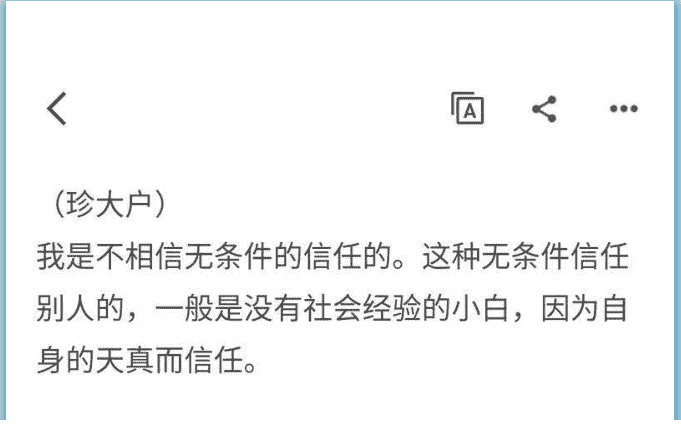

(珍大户)

我是不相信无条件的信任的。这种无条件信任别人的，一般是没有社会经验的小白，因为自身 的天真而信任。

这种信任，因为源于感性，所以特别容易陷入“开始很信任，但经不起一点风吹草动，有那么一点迹象怀疑甚至误会的时候（也是感性原因），就变成不信任了”。

总之，特别脆弱。

（所以我是觉得，这种像是少年般的信任，来的容易，走的随机。）

------

信任应该是来自一种理性的思考，不是感性的结论，而是经过一番思考后，得出的判断。只有这种判断才能经得起质疑，扛过信息不对称造成的怀疑。

这种思考来源于几个方面：

1，第一是对人物的观察。要了解对方的性格特点、偏好以及观念。

举例来说，F先生是个很诚实的人，诚实不是来源于教育塑造，而是一种性格+认知观念造成的选择。

从性格来说：他性格中有一种自傲和张扬在里面的，所以会有一种“我就直说了，你能把我怎么的”，“我还用花时间/花心思骗人？老子不屑”，这种心态存在。

从观念来说，他认为说谎是一种低效率的沟通方式，短期受益叠加长期受损，所以划不来。

基于对他的这种判断，所以我会很相信他的“承诺”。

假设有人跑来跟我说F先生说谎了什么的是，我会本能的"呵呵"。这种表现就是"信任"了，但这种信任绝对不是来源于感性的，而是来源于理性的思考。

基于对另一个人的熟悉和判断而形成的信任就是这种。《士兵突击》里成才去特种兵部队之后，又被袁朗踢出队伍就是这种过程。

通过不断的接触，观察每个人一次又一次做事是怎么选择的，慢慢汇总起来，最终就能形成判断，能信任谁，不能信任谁。

《士兵突击》里就是大家都渐渐的信任许三多，不信任成才。就是这种过程。

2，第二点，别人越依赖你，你的安全感应该就会越足，也就更容易信任别人。

依赖与信任的例子很多。

比如hk那边，无论是政界还是商界，一堆人都是英联邦国籍，海外关系深厚，hk搞乱了这帮人脚底抹油一溜就ok了。这就很难获得大陆这边的信任。

同理与一些创业公司不愿意招家住二环，有祖传四合院的土著。因为根本就不相信你能全心创业。

所以，如果要形成相互的信任，就需要建立相互的依赖感。

怎么建立依赖感，我从单身的时候就一直思考这个问题。后来遇到F先生后，我们大致做了很多调整。

生活习惯、互相的扶持这些就都不说了，各家有各家的不同。

但有一个比较重要的，就是：双方的技能点，尽量往不同的方向发展。

比如我们之间，

法律问题是我处理了，他不用操心。需要人际关系处理、请客送礼这种事是他处理了，我不用操心。财务税务是我处理了，下狠手砍价是他处理了。涉及到文字的事情由我处理了，涉及到视觉、美学的东西就由他处理了。

起来有以前有一句话，叫做“把顾客培养懒了”。这种技能的不重叠，其实就有点把对方都培养懒了的感觉在。

到现在磨合了这么多年之后，如果出现意外要分开，必然会感觉到每个人都像瘸腿一样，引起重大不适。

———

第3点，信任更来自于“同方向的利益”。

就比如昨天那个找顾客入股的帖子
[https://t.zsxq.com/ma2fyZ](https://t.zsxq.com/ma2fyZ)
因为经营者和顾客的利益是相反的，所以我本能的选择“怀疑”，而不是“选择信任”。

这种要双方价值观一样才能做到。

否则，就容易出现男的拼命工作，女的抱怨男的不顾家这种例子。因为两个人的价值观体系中，工作和家庭的排位是相反的。

这种情况，闹得轻时抱怨，闹得重就是拆台。（以前听说过一些80年代的例子。一个人考上大学，另一个人不愿意离开老家，或者是怕对方读完大学之后离婚，于是硬把念大学的事情搅黄这种......）

价值观不一样，就很难形成利益同盟（因为双方想要的东西根本不一样），想要盖住矛盾已经很肤浅了，很难形成信任。

形成利益同盟的另一个点，是财产交叉，类似于我在吉亚里讲的“交叉持股”这种道理 （注一点，有机会再详细写吧……)

(珍大户)

## 大珍，您好。我身边

(提问)静潼：大珍，您好。我身边现在有很多中大型美容院、健身房这种服务行业的店家都在做合伙人计划，就是让会员买股份，让一些会员成为股东。我想了解，这样的合伙人计划可能会出现弊端在哪里？还有如果之后让员工认购股份的话，可能存在的弊端都会有哪些呢？

2019-08-16

回答：【帖子编号0345】《找谁入股》

很久以前，我跟一个朋友聊天。这个朋友是传统行业的（酒店行业的），完全不懂金融，知道我懂，就问了我在一个问题。他说，网上一堆人说的上市，到底是什么意思？为什么要上市？我说我拿你在的酒店行业来举个例子吧。假设一个小酒店，年利润100万，意思是你作为这个酒店的老板，每年可以赚100万的利润。这是突然有投行的人过来，把你公司搞上市吧。上市估值20倍市盈率，意思就是，按照利润的20倍买你的股权。这不就等于，一下子把你未来20年能赚到的钱，几天一口气给你咯。你拿着这20年的钱，可以提前退休了，也可以再去重开一个年盈利100万的小酒店，这样等于你未来20年就赚双份的钱了。我这个朋友想了半天，说那买股票的人不是傻吗？我就乐了[偷笑] 后面再深入的解释，我就没有做了。

但很明显的是，如果一个企业上市，不是圈钱的，至少要有几个条件：

1，成长性。现在年利润100万，未来预期年利润1000万，这时原股东才不会把自己的股份全卖了养老。（必须要用原股东的贪婪，来让原股东继续工作）（否则就不能给他高估值，给7倍pe都嫌多）

2，进入壁垒。原股东拿着旧公司卖股份的钱，立即搞个新公司出来，那旧公司价值必然贬值，买旧公司股票的人就等于套住了。解决这种问题的办法，不是搞什么限售制度。而是要找有进入壁垒的行业。没法很快另起炉灶这种。壁垒可以是因为政府限制的行业；可以是原公司已经占据了市场份额，挖不动墙脚；可以是已经积累的知识产权都在原公司，新公司绕不掉知识产权等等。

再回头看这种传统行业的合伙经营。民间一直有合伙习惯，而且这些经营一般也没有什么准入门槛，也很难看到特别巨大的成长性，那么制约来自于哪里？确实就是合伙人的范围特别小。基本仅限于认识的人，而且合伙人人数比较少。在人数少的情况下，合伙人互相之间是有监督作用的。靠的是熟人之间的监督作用，熟人社会的舆论和社会关系。原股东想拿了合伙人的钱再另起炉灶，碰上极端点的，指不定下个月腿被人打断。就算没到这么极端，那也要承担被熟人戳脊梁骨的压力。

但如果拿顾客的钱，就不好说了……

去年圈子里有提问共享美容院的。就是把顾客转化为股东。旧帖子现在也值得读。

吸收顾客的钱入股，会分成两个阶段。第1个阶段是前几年（一般前两年或前三年），第2个阶段是两三年以后的时间。在前一个阶段，顾客的入股钱还没收回，以承担风险为主。后一个阶段，顾客入股的钱已经收回了，以获利为主。所以在前一个阶段，经营者占便宜，顾客吃亏。在后一个阶段，顾客占便宜，经营者吃亏。两方的利益不是同一方向的/一条船上的，而是相反的，这种制度设计，一定是有什么问题的。

我会怀疑，这个经营者没有长远经营的决心，前期风险让顾客担，经营不好，垮掉了就垮掉了。万一经营的好，到后期那肯定心里酸酸的，心猿意马，指不定抽掉资金过来另起炉灶，让原来的公司就慢慢死掉了。

这就像去年，我做抖音之前，经常能刷到一个叫“周导聊商业”的人。这个人就在宣扬开一个店，每个店卖100张卡，每张2万块，第1个月就收200万回来。这种设计就等于把经营者和顾客的利益搞成互斥的了，拿着这两百万，立即关店跑路，是利益最大化的，经营的越久对顾客越有利，对店主越吃亏。

双方互斥，还能持续下去吗？能长久经营下去的，一定是玩共赢的，而不是玩对赌的。

另一种思路，找顾客入股，如果早期没跑路，前期没关门，顺利经营到后期之后，就会进入到给顾客分红的阶段。那其实就等同于回扣或者打折。且不说靠着低

价和打折生存下去的经营者是没有竞争力的。分红还有一个更大的问题，是跟直接的“回扣”不一样，不是跟消费一一对应的。因此无法绑住客户，没有粘性。如果是回扣，顾客不来你们店，就没有回扣拿。但分红，哪怕他不来你们店，别人消费了，你也要给他们分红/回扣。所以你看出这种制度设计的问题，在哪里了吗？(64赞)

评论区：

- 静溢：也就是说，实际上用这种手段做活动的商家可能想把前期的风险转嫁，然后可能用其他手段避免后期的利润分红。无论怎么想，这个事情也不是个长久的事情。而且，感觉上应该是资金链条出了什么问题，才会出这个活动先把缺口补上缓口气，再说剩下的事情。要么就是快吃问题了，要么就是已经出问题了。
- 婴儿肥：学到了学到了
- 耿耿141319-*：哎呀，之前听很多说商业的都这么说，我们不愿意这么干，今天才算真正知道了弊端！了解了！感谢珍老师！
- hanna：今天正好我弟弟的老婆问我，她在武汉周边一家儿童编程机构工作，老板说准备开新校区，跟她谈可以入股，五万块钱。她现在的校区开一年了，才开始收支持平，说下半年会开始盈利，我感觉没那么简单，正想问，感觉这问题跟提问也有相似之处。正好把珍老师分析给我弟媳妇看了。
- 静溢：现在有太多这样的商业迷感性投资建议，……本来投资只针对有经济实力的个体，现在搞成小块让更多人用小资金投资，对于项目发起人来说更容易获得投资，而且一般这种小型投资的投资人对商业模式并不敏感，很好糊弄。不仅可以帮助分担风险，还可以将销售责任也一半分担[撇嘴][撇嘴][撇嘴]
- 小胆：忍不住要夸夸大户，咋这么厉害呢[强]
- 大椿：一年收支平衡的可以投资啊，就怕那种十年二十年的
- 空城：这种模式基本都是做卷款跑路的

关注公众号“懒人找资源”，星球资源一站式服务

## 珍妮姐姐，你好。想

(提问) W：珍妮姐姐，你好。想请您抽空谈一下马爸爸相互宝。是否是个坑？还有有没有必要在继续下去？相互宝是款保险还是众筹，还有点看不明白。

2019-08-16

回答：【帖子编号0344】（相互保）保监会不准他们自称是保险，只让他们说是互助性质，但实际上“互助”真的很符合保险的性质。保险的起源，就是在欧洲的航海时代。一堆人出海，经常碰上有去无回，或者是人回来了，但是因为船遇险时，为了防止沉船，不得不把船上的货物丢到海里去。所以航海是个很危险的事，但危险等于有利润。所以最早的航海，都是有钱人/贵族投资出钱，找最不要命的底层光棍小伙子，十五六岁这种，出海去冒险。这些小伙子倒霉的话，路上就有去无回，死掉了。运气一般的话，货损失掉，人回来了，至少赔的都是贵族的钱。但如果运气好，干一票大的，回来就会暴富一次。然而年轻又没自制力，很快天天“会所嫩模”，钱就花光了。这些人往往没有其他技能，到时候还得再出海。从小海员到老海员的过程中，目睹过太多死人的情况，就会开始思考对策。也有一些人渐渐的懂得存钱，自己买船航海，也会担心万一海难了，自己一辈子的积蓄突然打水漂了。最终大家不得不开始正视风险，成立了海员互助社。谁家死人了，剩下的人就共同“理赔”给这家孤儿寡母一笔钱。谁家的货全损失了，其他的人共同分担一下，防止这个倒霉的人一辈子没法翻身了。——————然而随着这个组织越来越庞大，人数超过一定范围的时候，信息就很难流畅流通了......这时候就需要一个“中心化”的组织，充当所有人之间的媒介了。这种就是保险公司。保险公司是先收钱，后理赔，其实是个比银行还赚钱的组织。（一些额外知识点：只是大家看目前上市公司的财报，是不会这么显示的，都会显示银行的利润率高，而保险的利润率低。这是因为，

银行的收入是息差，当年贷款利息收入减去当年的存款利息支出，就是主要的利润来源了，意思是，当年的钱，当年就能计入利润之中。而保险公司的利润不是这么计算的。当保险公司今年收到保费，就必须要同时计提各种理赔支出，显示为今年的成本。然而这种成本是根本没发生的。如果未来一定会发生，那这种计算方式也是合理的。然而，在我这看来，这种方式其实是前期高估了成本的。为什么这么说，因为我之前看过精算部 的数据，据说是保监会给全国定统一标准，晚年龄保费的这种保险，是按照人能活一百二三十岁的年龄来计算的。因为是很多年前的事了，我确实记不清具体数字了，但确实很震惊。所以，如果按照这种精算数据来提前提取成本，成本必然会高估。举个简单的例子，假设保险公司顾客都是30岁投保，如果活到一百二三十岁，那么保险公司会获得计算中的正常收支。但如果未来没有科技进步到人工移植器官的水平，还按平均活到85岁死掉，那么在85减30等于投保55年后，保险公司会获得一笔额外的利润……要知道，我们国家大部分的保险公司，成立时间也不过十几二十年。所以……利润在后头呢。）--------------------------上文说了，保险公司是“中心化”的组织。因为群体越大，信息传递越不畅，必须要靠保险公司来连接所有人。然而互联网的发展导致了信息传递很畅。这时候就可以搞“去中心化”了。相互宝其实就是最本源的保险。按照这种去中心化的搞法，一定是效率比较高，费用比较低，所有人都获益的（因为不用养一家那么赚钱的保险公司，省掉的这部分利润，每个人都可以获益）-------------------------- 相互宝的很多问题，在我看来都不是问题：

1. 覆盖哪些疾病？怎么理赔？这些我没有去研究。但按照上面这种模型，无论怎么覆盖都没问题。如果现在的覆盖和理赔不合理，未来也是可以调整的。所以我不觉得这种是问题。
2. 骗保问题。网上很多人说，相互宝审核不严，很多人带病参保，等同于骗保。为了防止这种情况，是该审核更严一些吗？在我看，最好的解决方式不是这样子。最好的解决方式是让相互保的覆盖群体更大一些。做个

极端的假设，假设像社保一样，人人都有时，那就不存在什么带病参保了（因为无论有病还是没病，每个人都有。最终理赔概率会无限接近于社会群体发病率）我刚才特意看了一下，现在有8000万人参加了。假设人群再扩大10倍，如果有8亿人参加，那等于覆盖群体已经很大了，这种情况下就基本上不存在代表骗保这种事了。_____________在我看来，相互保唯一存在的问题，是管理费收取方式有问题。保险公司是先收钱，后理赔。理赔的越多，自己就越亏损。所以保险公司会有严格的动力，想要剔除骗保者。因为这件事跟公司利益息息相关。而相互保的收费方式，是提取8%的钱。问题是，用户只在有理赔的时候才付钱，换句话说，等于提取8%的“理赔金额”。那么理赔的钱越多，他们才能越赚钱。理赔的钱越少，就越不赚钱。这种利益“占位”是不对的。你可以说相互保的目标，是当一个中立组织。但我也要追问，这个团队没有KPI吗？团队的员工没有奖金吗？所有的组织，最后都是人来运转的，只要人就避免不了贪钱。所以让人相信“公益/中立/不贪心/不偏不倚”这种高尚情操，不如利益捆绑方式上就不容易出现瓜田李下的嫌疑。哪怕一个组织再高尚，也不能避免组织中个人有私心。kpi最终会导致团队的行为跟初衷出现偏差。就像百度的KPI，最终促使了他们搞医疗竞价和卖百度贴吧的行为。所以，我真想建议相互保换一种收费方式，比如，每个月从每个参与者头上收个几分钱1毛钱当做管理费，把收入跟理赔款数额脱钩。_____________总体来说，相互宝是个挺好的东西。信息传递的效率提升了，所以各方都因此获益了。但我必须还要补充一句，这玩意我自己没参加。毕竟我是个心口合一的人，我自己说二线崛起，然后自己先搬到合肥了。我说看好股市，然后自己买了不少股票。我说写字楼公寓可以买，自己也买了。我说社保有用，我和我先生的社保也一直代缴没断过。但是相互保这个东西，我说好，但是自己没参加的[呲牙] 因为看了一眼，发现只有40岁前是30万保

额，40岁后只变成10万了。想想自己都奔四的人了，10万块钱对我来说作用似乎不大，所以还是算了（决定还是一毛不拔）(39赞)

## 评论区:

- a tre☉: 相互保有点像医保新农合。只是把固定费用改成了大家均摊。我买了。自动扣款。一次扣几毛。买了就没管了。供一年才扣5块7。支付宝平台值得信赖。无所谓。支付宝每月付款都减几毛就够了个了。
- 隐大户：不含那么少的。以后咋也得每月五块十块的(管管)去病。因为刚开始加入的都是优质人群，年轻力壮的生病少。而且还要等待期，等待期内没人理赔，自然分摊的就少。
- a tre☉ : 不会那么高。深圳重疾医保补充一年才25。只交大病。平安做的。
- a tre☉ :。
- a tre☉ :。这个是这个补充险介绍。原来25，现在涨了只几块钱5月1日起，深圳重疾补充医疗保险每年只要交29元，患大病就能二报销

默存：今年4月1日的时候写了几点关于相互保的思考，今天看到珍姐的回复，又更新了一部分观点。1. 相互保是单次赔付还是多次赔付，对此没有提及，是否能保证永久续保？还是只能赔一次？同时30万是封顶互助金，40-59周岁是10万。2. 加入，2019年1月至今，每月两期，公示出的互助案例最多一期3例，最少一期0例，获赔人数与投保人数相差巨大。((以上是4月时写的) 今天8月16日再进去看，有8237万人加入，救助人数逐期增多，8月第一期人数为502人。相互保页面“为何救助人数越来越多“看到答案。 初期加入时有三个月等候期，所以救助人数较少。但随着加入人数增多，重疾发生率会接近于社会平均水平，但由于相互保会员结构年轻，所以重疾发病率低于社会平均水平。今天看了珍姐的看法，又有新启发，如果相互保扩张到这样的大范围普及度，那么相应重疾理赔率也会相应回归社会平均水平，那么费率应该也会上涨。基于互联网的去中心化和大数据基础，保费可能还是具有性价比优势。3. 2018年分摊待付费用了188元，将根据实际运营情况于每年年末推出下一年分摊金预计规模。 相互保自己提到了，它不是保险，而是一个新生的互助共济机制。 保险是一整套完整的组织架构来运营，包括核保、理赔、精算等等，为它未来预期风险的高得，首先需要根据以往的经验及数据来厘定未来的风险及保费，还可能包括一些未来无法预测的风险参数，所以需要巨大的资产运营及充足的偿付能力来维持运营。从珍姐了解到保险精算公司的一些精算方法，鉴于现代医疗技术快速发展(包括医疗通贩)、越来越高龄及年轻化的重疾发病率及趋势、更长的人均寿命预期等等，我认为保险公司预留充裕的精算空间也是可以理解的。回到上文，保险是个复杂精密的系统，面对不同的入不同风险做到公平普惠，是否可行？互联网会是答案吗？就目前我的认知来思考，保险是不同于理财，个人存人钱，然后得到相应回报。但有同一个相同的大环境下，金钱本身不会产生额外风险，大家的货币都是一样的，得到的也是相应的货币投资回报。但每个人的健康状况就是一个不均匀变量，会带来不同的疾病风险，怎么能做到忽略这些变量差异，付出相同的分摊费用得到相同的赔付呢？从以往的保险思路来看违背公平性，会造成身体健康的人承担了更多患病风险的人带来的保费增高，但这一点由于互联网的大数均摊原则，或许真能达到一个普惠的较低水平。

默存：除了个人的健康状况差异，还有出于对相互保健康核保能力的问号，仅是协议人单方面签署一个健康要求协议，没有严格征信背书，后期是否会令许多由此共生的短期带病理赔纠纷？保险的常规做法是需要对每个人的风险精确判定，才能保证对其他入公平、保险公司能准确赔付及运营、以及星辰标准保费。 是否将星级设定为够大，就能平滑到不同风险因素带来的后果，其实我也只以低待，期待从相互运营中得到答案。 我到目前为止，加入了136次，分摊了4.98元，共帮助1588人，这个费率真的是很低了，目前为止我是能接受的。

- Mr Na:这个怎么说

| 计划编号 | 12 | 计划起期 | 2018-05-13 | 等待期至 | 2018-07-27 | 身份证号 | \*\*\*\*\*\* |
| :--- | :--- | :--- | :--- | :--- | :--- | :--- |

## 互助范围及互助金 ①

| 保障恶性肿瘤+99种重症疾病，初次确诊可赔 | | | |
| :--- | :--- | :--- | :--- |
| **轻度重症** | **重度重症** | 39周岁及以下 | 40~59周岁 |
| 乳头状或滤泡状甲状腺癌 | 前列腺癌 | | |
| 5万 | 5万 | 30万 | 10万 |

《成员规则》《健康要求》《付款授权》《重症疾病互助计划条款》

# 常见问题

## 相互宝的互助期限是多久?

自加入本计划次日0时起开始生效。只要未发生退出本计划的情况，计划将持续有效，直至成员年满60周岁。

# 【8月15日直播】

石头：【8月15日直播】
==================================
====================================

- 1. 【考个CPA转行怎么样？=不行】
  金融行业要：学历+经验+证书，只有证书没用的，证书从来都是锦上添花，没有雪中送碳的功能；

- 2. 【每个月拿出收入多少来理财合理？】
  刚毕业学生可能没多少钱定一个目标，每年存个2~4W？当手里有十几万了，就要考虑理财了；债券型基金这种都行；

- 3. 【甜品店=选好位置，提高附加值】
  可以□鲜花，能把价值提上去了，甜品店支撑不了太大面积，价格也不会太贵，只能是走量，可以加放一些鲜花在店里面一起卖；

- 4. 【电子手环=做品牌】
  技术含量不高，门槛也不高，拉不开技术/功能差距，最后都是看牌子，你买小米，我买华为；

- 5. 【手工馒头=不行】
  便宜的东西没发涨价的，大米，馒头，盐，很难涨价；你的手工提高价钱就算提高一倍，馒头卖1元，你卖2元，也就赚一块钱，而且口味差异化也不会特别大，而且覆盖的人群就周围几个小区，没发走量；火锅底料就要好一些，可以密封邮寄全国卖=走量，附加值也高；

--------

6. 【家具用品=？】
   目前产品没有创新，是渠道转变的过程，新渠道打击旧渠道的时代（就和个体服装店一样），你要是做新渠道的就可以，旧渠道=传统开店，就不要做了；

--------

7. 【服装=有生产线 或 设计服装，这种才是第一手资源，二手进货难搞哦】

--------

8. 【5G来了，短视频行业会更好么】
   一个趋势来临会持续很久，微博从爆发到现在持续了多少年，公众号也是，短视频还远没有结束；只要抖音还有新用户加入，都是发展期；

--------

9. 【隐性的收税=房子】
   直接收税会遇到抗税，古代就发明了隐性的收税，中国古代靠卖盐收税，盐铁专营，把盐的卖很贵；盐商=许家印；盐是每个人都吃，古代没有冰箱保存食物，盐是保存食物用的，盐=食物=刚需；香港的明税很低，车便宜，奢侈品便宜，隐性的收税=房子，就是税；现在来说，石油，烟草，房子，专营都是税；靠垄断使得，理论价值和实际价值差特别多，就是税；为了吸引外资城市都是减税政策，怎么减税呢，就是房价；

--------

10. 【沙漠边上民宿=好好考虑位置】
    民宿是一直可以做的，沙漠民宿这个应该少人做，概念可以；但是得好好选地方；

# 11. 【民办幼儿园怎么样=可以做】

幼儿园全国紧缺，是个人群多城市都有需要，红利期，就是政府审批严格，限制□供应，能搞下来批文就可以搞；就算以后开放市场，你也是开了好多年有口碑老幼儿园；

# 12. 【养老院=存疑】

老人的支付能力，未必够，老人真的愿意花多少钱；愿意伺候老人的人少，年轻人不愿意干，靠谱的人难找；现在投资机构，投的

# 13. 【老年兴趣班=可以】

等于广场舞，老年摄影团一样，都是精神消费；刚退休不久的，有消费动力，钱也够；

# 14. 【升级】

人的欲望是会不断升级；精神领域也是一样的；

# 15. 【家里2个孩子1男1女，送只能一个孩子读书，怎么办？】

股权投资的方式来思考，不管谁读书，上学的必须要分一半股份给没上学的；读书那个人，分一半收益给另一半没上学的；夫妻之间也是一样，互换一半股份；

# 16. 【从事美业，想学心理学=可以】

不要放弃原来职业，心理学单独找工作比较难，就业面窄；把这个当成一个辅助技能；用心理学，来辅助你原来行业；

# 17. 【小白想进入金融行业=憨去了】

别进了，大家都知道行业，出租车司机都知道这个行业好，竞争就很激烈了；我入行的时候，大家不知道【金融债券】这个行业，13年媒体才开始广泛报道；要做哪些别人不太知道行业；

# 18. 【为什么公务员忙】

商务部搞一个征文活动，让每个省保送一篇稿子，省里就让每个市保送一篇稿子竞选一下，市里面让每个县出一篇稿子竞选；这样下来工作量一下就大了；所以公务员一直工作量都很大；但群众又不容易察觉；

# 19. 【动漫专业去哪里=成都，合肥】

成都有游戏，动漫；合肥有影视后期，动画；动画行业以前都是在北京，转移到了成都，合肥；哪咋就是成都公司做的；文创行业是不依附城市，都在外迁，降低成本；

# 20. 【徐静蕾首位票房过亿】

是院线突然增多，屏幕特别多，电影，动画行业马上就要好过了，之前需求一直没被满足，屏幕稀缺，电影院稀缺，现在是好内容稀缺，什么烂片都能有好票房

2019-08-15(62赞)

> 评论区：
> 石头：21【廉价精神消费】经济不好的时候，大家就会去找廉价的娱乐，精神消费；美国=电影，一张票6美元；中国=手游，抖音...在中国看电影那么便宜
> 爱故事的山楂·柯南：谢谢课代表[玫瑰]
> Mr Yang：厉害了
> Bella：这速度，课代表，厉害了

carmival:额，房子那个没太懂，意思就是房价里面很多税吗？还有最后一句怎么减税呢就是房价，是什么意思？
七彩希冀:辛苦课代表了
莫来盼-远建-琼13*:房子实际价值并没有这么高，政府收房企税，房企卖给个人，把成本分摊给个人，所以就相当于政府变相收个人的税，如果房价降了，那个人就可以少花钱买房，也就相当于降税了
on the way*:好荣幸加入贵圈[抱拳][抱拳][抱拳]

> 关注公众号"懒人找资源"，星球资源一站式服务

# 想问一下大家，如何

**Carman**：想问一下大家，如何申请服装外观专利？之前珍大户发表了申请品牌的方法，最近我们网店一款销量比较好的服装被山寨店直接抄袭，而且质量做的比们差，打价格战卖得很便宜。还真是让人非常生气。前两年有咨询过服装申请外观专利是比较难的，不知道现在是否有放宽能够顺利申请的。谢谢。[爱心]
2019-08-13(2赞)

评论区:

**珍大户**: 服装据我所知是不能申请外观专利的（我猜可能是很难界定边界在哪，怕一不小心造成别人都没法穿衣服的事实就麻烦了……类似的有点像是，据说美国扣掉大熊猫后，把功夫这个单词都给霸占了，明显是过度保护就造成别人没法正常用了）。一般的做法是给衣服上的某个图案申请个什么图形的著作权或外观保护，当成埋的地雷。然后仿造者仿造之后，拿着这个外观保护去申请让别人都下架。以上只是听说，知识产权是很细分的领域，我是没什么经验的。这点应该咨询抖音上的“蹭峰说知产”

**盘峰说**：你希望申请外观专利的目的是为了保护，确切地说是垄断你的爆款。但坦诚的说，服装这个类目没办法用外观专利达到垄断的目的。因为服装类的整体形状基本相同，判断是否侵权时要比较图案和花纹。这些特征稍有不同会认定不侵权。所以没办法杜绝仿版的存在。这个类目就不是靠知识产权垄断的类目。知产作用，是挖坑让对手跳进来，然后能来一次突袭。但是也只能有用一次。挖坑用商标和版权。商标中文字商标现在大家都知道绕开，你试试注册图形标，类似tommy的两个彩色方块那种，版权也是图形去登记，然后记得找微博。还有载体你另局限在服装本身，出其不意的还有包装袋、包装纸。

**Carman**：非常感谢。因为我们都是做原创设计，一些我们自己绘画的布料印花都有申请版权保护，但是些纯色的面料做的款式就随便申请了，对方是拿我们的货直接去一比一山寨而且都不带修改的，连蕾丝都用的一样的。而且对方整个店铺都是山寨款，哪个店被其他就直接搬过来，实在让人生气又伤心。

**Carman**：非常感谢。我们已经打算以后使用的纯色面料也编织进自己设计的logo花纹，然后用这个来申请版权保护作品登记证书，不知道布料织花能不能作为申请版权保护的标识。虽然会麻烦一点但是起码能有一点防范作用

**小雪**：单纯的调用户体验表示，买山寨版就是图便宜，感觉可以有些推广，比如公众号，抖音，淘宝直播，来表明是有防伪标识的，强调下正版和仿版的不同，不在乎那点钱的，就直接买正版的穿了，昨天在抖音也看到不同价位的同款的衣服，重量不同，质感不同，有视觉冲击，就想买正版的了。

**罗老师**：建议你去看下盘峰老师的抖音，很专业，发微博要注意要用著作权申请人 的微博号罗发梦夕：感谢大件的分享[愉快]

**sjuna先...**: 抄袭没法避免的。而且定义极难为一不小心就半年过去了。目前最有效的方法是申请国际原创保护。有获奖作品审核会容易点。没自己的设计特色一般没戏。真去做微原创，很有特点的比较容易申请。市场货难度较大。

## 【帖子编号0343】

珍大户：【帖子编号0343】〈药店〉

提问了一个药店的问题：

虽然我一直是强调，未来的实体店尽量避免卖产品，重点做服务。但是药店有一定的特殊性。

药物使用如果监管不严，一定会出现各种药物滥用。互联网卖药存在一定的漏洞，比如处方单在网上重复购买，无法审核（我感觉是这样的，也保不齐以后区块链技术应用到处方单中，那每个处方单都能保证跟踪到药品的购买和使用进度，那么互联网卖药的弊端就被消除了。这时或许药房的前景就不一定如何了呢。但毕竟技术如此大规模的使用，不会是很快就能出现的现象。所以目前药店这一行业，并不危险）。

提问的帖子，问的比较简单，信息量比较少。问最需要注意的地方，我觉得是，能不能刷医保卡吧。

如果是要开在医院附近，那么必然以医院的患者为主要客源（非重复客源）。患者有可能是拿着医院处方过去的，这时候有两点需要注意，第一，你们必须要能接入医保，否则就没法承接这些客流了；第二，你们的员工里必须要有药剂师常驻。那么图片里的人员工资明显是不对的（人员工资肯定要比图片上的高多了）。

如果要是开在社区的话，则以“重复客源”为主（客户主要是附近的居民），客户量肯定比医院附近要少得多。不能刷医保卡，或许也能存活（假设周边独你们一家的话）。但必然竞争力不够。如果有新的竞争对手出现，资质比你们好，周边的用户可能就会觉得人家更正规……到时候就会比较被动了。所以社区药房的经营，必须考虑建立长远的竞争力。

目前，定位在社区的药房，服务是做的不太够的。所以如果你们想要提升竞争力，走长远发展的道路，记得从服务入手。比如，建立相应的社区居民档案（能力不够的话，至少也要给熟客建立这种用药档案，比如，给予100个VIP客户特殊的关照），时刻关注重点客户的健康变化，给予一些跟踪和建议。

这算是思考如何提升用户粘性，防止后来者进入的一个方向。

最后，药店是少数的加盟优于自己单干的行业……因为：消费者的品牌信任原因；药品的批量采购优势原因……

至于里面的装修费用，初始进货成本什么的，我给不出什么意见，等懂行的小伙伴来评论吧。

https://t.zsxq.com/6uBI6yr

2019-08-13(20赞)

**评论区：**

- 嗑小姐：看到回复，还这么多内容，太激动了，谢谢大户[[玫瑰]] [[玫瑰]] [[玫瑰]]先回复，再仔细阅读学习去
- 彭呼呼：给你一点参考
- 徐家丫头：加盟店跟非加盟店的区别是加盟店的品牌药便宜（比如三九感冒灵很多连锁是亏本卖的），但是会有很多很高毛的产品，所以对营业员的要求比较高，要会推销。非加盟店没有这么多高毛药品，但是大流通的品牌药会比加盟店稍贵。所以，我一般就只有那些非常知名的药才会去连锁店买[[呲牙]]
- louis：单体药店没有议价权。连锁药店有。三九感冒灵单体店和连锁卖一样的价格，连锁有钱赚，单体亏钱。因为拿货价不一样。单体药店的生存方式是控销药和中药包括带煎中药。保健品一去不复返了。单体药店赚的是辛苦钱终日守店守出来的。最终还是会被淘汰，因为成本过高。
- 标哥：不了解药店还是不要去碰吧
- 嗑小姐：谢谢！很有帮助！
- 嗑小姐：谢谢你告诉我这些，让我更多了些了解
- 嗑小姐：是建议加盟连锁药店会更好吗

关注公众号“懒人找资源”，星球资源一站式服务

---

## 【8月10号直播】

石头：【8月10号直播】

- 1. 【5～6线城市开创意书店=小城市不行】
  国内做得比较好的有西西弗，西西弗至少得是地级市；书店租金比较低，是服装店的1/3价格，书店还会和咖啡馆结合，平摊房租；小城市还是偏向于物质消费；
- 2. 【小县城文具店产品同质化严重怎么办=难】
  淘宝《武汉四方伙伴》特便宜，便宜到不行了，经济都解释不了；也不是赚流量，他也不卖别的；他这个文具也没有保质期，好像也不存在清库存；
- 3. 【专业采耳=不看好】
  就是给掏耳朵，这个太小众了，一时很热，有尝鲜的意思在，也不会经常去；只有采耳项目太单一了，附加值太低了=手机体膜；修脚通常都和按摩在一起的，提高附加值的；要是美甲，修脚，能过得好，采耳也许行吧；
- 4. 【5线城市开美容院=可以】
- 5. 【乐高机器人=可以】
  小孩愿意玩，家长觉得小孩能多少学点东西，家长还能炫耀；
- 6. 【小孩教育培训】
  口才培训，乐高机器人，音乐培训；18岁以下小孩培训是家长付费，一定满足家长需求，家长也要细分="阶层":
  - 【老中产70后】=富了好多年，好学历，好收入，工作体面，房子2套，生活压力小，他们的消费要的是=“体面”=能体现阶级地位的=上一代学“钢琴”，90后学“马术”这类东西不创造经济价值，只是用来区分人群的，他们这个阶级都玩这些，就是纯消费；
  - 【新中产阶级】=刚富起来的，高收入，房贷还有，晋升难，压力大焦虑=给孩子最实际的，能直接提升社会竞争力，考好学校，希望弯道超车，功利的心态，赢在起跑线上；少儿编程是就是为了解决刚富起来的年轻家长的焦虑，希望孩子弯道超车；
  - 【再低一点阶级】='口才'培训这种，'老中产''新中产'都不会去让孩子学'口才'，他们自己都是脑力，社交，技术，口才都不错，言传身教自己孩子也不会太差；三四线城市低一点能力家长，才会去让小孩去学'口才'；
- 7. 【大专新能源汽车技术专业=可以学】
  可能还是传统汽车技术为主
- 8. 【合肥投资价值么=有】
  任何城市的房价上涨都是把人才挤出，产业挤出，长远来看不是好事；
- 9. 【男式护肤产业=目前没戏】
  英国科技有2项突破，1.男人'克隆头发植发' 2.女性卵巢培育，推迟更年期，延缓衰老，延缓10年~20年；——第二个更有经济利益，男人不会花十几万去植发，因为对收入不太有提升；
- 10. 【小外企学不到东西 or 朋友的贸易公司，去哪里好】
  学不到东西是一个伪劣的概念，学不到东西=公司有问题，行业有问题，岗位有问题；看看问题出在哪里；行业要是有价值，岗位不行，那就换公司，去找有价值岗位；要是行业都没价值了，那就去朋友的贸易公司；
- 11. 【全球最牛逼的焊接公司做工程师，收入不满意】这个行业到底有多少公司？
  我一个交易员同事，他爱人在大飞机厂的工程师，欧洲老牌航空硕士非常牛逼学历，结果收入非常不好，因为同类公司一共就3个成飞，沈飞，没招了；好在会比较稳定；中国伟大工程，粤港澳大桥，上海中心，那些专业人员，技术都非常高的，但收入都不太高，因为没办法跳槽，公司就这几家；没有充分的竞争；
- 12. 【家庭困难读大学缺钱，要不要读=坚持读下去吧】
  咬咬牙吧，穷是一时的，收入会越来越好的；人总会有一些困难，但是放弃读大学的话，可能就落入另外更低的50%
- 13. 【大专的市场营销专业/还是/直接去做销售】
  “直播间大多觉得读比较好”；高档餐厅人均800元，开分店，招人比较困难，有学历年轻人愿意参与餐饮行业的人很不愿意做这行业；老板想要招学历高一点，培养做店长；所以还是建议读一下；这样你能和高中毕业的人一下能区别开，有什么好的机会，也会优先轮到你；
- 14. 【服装设计快30岁了，想转行】
  行业形象：20岁时候打扮的老一点就是为了让人觉得有经验，现在30岁了要精致内涵里面打扮，要贵；服装设计要有经验在里面的，不仅时髦，而是积累的，要有时尚敏锐度，要是像中年妇女，大妈一样肯定不行，30岁以上的人有明显的差异；差异化，20多岁的设计师只能设计小姑凉穿的，你是30岁的设计师，要搞差异化，要做年轻设计是做不了的那种设计；
- 15. 【装修】
  20多岁还是没房子了，根本无法理解，30多岁的人要一个房子装修要什么样；

2019-08-10(74赞)

**评论区：**

- 石头：通知：【下周 周四 晚8:00点 直播】
- 刘刚：多谢
- Bella：感谢辛苦付出的课代表
- 岚岚：辛苦课代表[强]
- Penny：石头辛苦了[玫瑰]
- 时光不老：谢谢课代表
- 德咩杜：石头你真牛！言简意赅，看过直播再看你的总结，让我巩固了一番。
- 宏180299330*：直播在哪里看呀

关注公众号"懒人找资源"，星球资源一站式服务

---

## 【帖子编号0342】

珍大户：【帖子编号0342】 〈注册商标〉

感谢大家在圈子里竟然都没催更[尴尬]
一不小心开了好几天空窗……因为这周有点紧急的事情。

我是个比较注重品牌保护的人，去年一老早，就想着把“珍大户”注册成商标。

然而商标局要求，只有以公司名义或者个体户才有资格注册。就因为这个门槛，结果一直拖拖拉拉的没去办。

但是我还是会定期的不断去检索一下商标（当时不知什么原因，总预感会有人抢注）。

结果拖到11月份，我一查，果然有个递交了商标申请要抢注我名字……这人还抢注了一大堆，什么“苏宁易购”他都想抢（当然这个没通过初审），还抢了一堆网红的名字。

然后我就开始等注册公告。一般注册公告出来以后，会有三个月的申诉期。等到6月份，发现申诉期开始了，于是就着手准备申诉材料，去驳斥这个商标申请。

本来这些事都是慢悠悠去做的，我也并不是很着急。因为想到商标抢注的人毕竟是少数。

只要我不声张，估计也不太可能再遇到第2个来抢注我名字的人，所以也一直不紧不慢的。

结果10来天前，突然爆个新闻，说是b站一个知名博主，叫“敬汉卿”的，名字被抢注了。

并且还不像我似的，对方刚一注册就被我发现。他的名字直到被人注册成功，商标证书都下来了，对方找上门之后，他才知道。

他在网上一曝光，一下子就成为了网上热门话题，传播的很快。然后我就吓坏了……因为受这个新闻的影响，肯定会有一堆人有样学样，也动心思想要玩抢注。那么我名字还会有更多被抢注的风险。

总之，我是真的急了。觉得为了商标，也必须注册个公司。

于是这一个礼拜基本都在忙着注册公司和注册商标的事情（本想晚上跑到圈子里来更新内容，但是一直颈椎不太舒服，结果实打实的空了好多天……）

_______________________

借着这个帖子，扫盲一下注册商标的问题。大家如果有需要的话，可以照着我摸索到的来注册。

________________________

首先是商标局的官网：首页里有“商标查询”。

如果自己有一个需要保护的品牌，那么，每年至少要查个两三次，每四五个月就登陆查询一下，看看是否有抢商标的行为。我就是在常规检查的时候，发现有人递交了抢注的申请。

### 再说申请渠道。

商标局坐标在北京。北京可以上门申请。但是我在商标局网站上也发现了他们在全国各地开的办事窗口，理论上也可以到各地的代办窗口来交申请。（我找到了合肥的办事地址，差一点就去现场提交申请了）

另外，还有官方网站的网络申请的渠道（然而我没弄清楚网站怎么注册。所以这个方案我没法选）。

之后就是找代办机构。各种线下的或者线上的代办机构（我去年打听过，收费“一件”在800~1500之间。但是因为申请起来肯定不止一件，所以价格还是挺贵的）。

或者找互联网服务商，免费代理申请，只付基础的官费，一件300元，全部信息由自己研究怎么填写（我是这么做的）。

有两个网站可以免费代理申请。一个叫权大师，一个是阿里云。

权大师上面，有机器推荐注册类目，算是有一点帮助。然而坑点在于，开发票相当不友好。用个人账户付费，就不给开公司发票。另外，开公司发票还要额外加6%的税。这都是相当不合理的。

于是我就选阿里云了。

### 再说下怎么选类目：

商标申请，每“一件”，商标局收费300元。

全部的商品大类有45类，不同类下，必须分开算“件”。

而每个大类下，又有很多细小的分类，300元只能保护一个大类下的10个小分类。（在大类下，多加一个小分类，就要多加30元钱）

所以，商标申请就分成了两种。

一种是，你真的有相应的产品，需要使用这个商标，那么你就必须要上把这一类下，有可能经营到的小类，尽可能多的全部选上。那么价格必然超过300块了。有可能这一个商标，因为你需要用到，所以选了20个小类，最后这一件商标需要付600块。

另一种是自己不实际经营的，只是怕别人抢注，自己先抢注上。所以要用尽可能少的钱，来覆盖更多的领域，那么就需要策略了。

我详细举例一下：

这个网页里有全部45大类商标的“小类细分”。（可能不全，因为每年都会有更新）

我们点到第29类<食品>：

第29类中，会有2901，2902，2903一直到2914的分项。

理论上，除了一些例外产品外，各个分项是互相不冲突的。意思就是，假设你申请了2901类的“珍大户”商标，那么别人还可以申请2902类的。

所以第1个要做的就是，把300元申请费包含的10个小分类，尽可能分布更多的项下。

上面第29类链接的网址，大家点开，可以看到每一项下，都有一段或者几个自然段。一般一个自然段内，所包含的所有小类目都是互相冲突的。意思是，你只要在本自然段之内，选一个名词类目，就可以把这一段全都抢占住了。别人无法再申请这自然段内的所有产品。

举例，我申请的29类，是这样分布的：

- 2901肉
- 2902鱼制食品
- 2903蔬菜罐头
- 2904冷冻水果
- 2905熟蔬菜
- 2906蛋
- 2907奶酪
- 2908食用油
- 2910果冻
- 2911加工过的坚果

因为我也没打算生产食品，只不过为了防止别人用我名字。所以必须最少的钱，覆盖最广的范围。

上面申请的问题一共有两点：

第一，是2912，2913这些分项没覆盖掉，但是也不是很重要。都是些木耳蘑菇之类的，拿我名字生产也没价值，我也不相信能起到带动销量的作用。

第二，我虽然从2901~2911每一项下都选了一个词。但是，有些项下，有好几个自然段。我选择一个词只能覆盖一个自然段，不同自然段之间是否排他，是否能阻止别人申请我就不知道了（存在不确定性）。但至少别人看到我把大部分项下都占住了，也会犹豫，怕申请被驳回浪费钱吧。毕竟我又不是什么太出名的人，价值没高到一定要抢的地步。所以这么注册基本就够用了。

https://t.zsxq.com/BAeMJ6Q 国家知识产权局商标局 中国商标网 类似商品与分区分类表（2019年版本）|创业百问 第29类|创业百问 第29类|创业百问 2019-08-10(39赞)

**评论区：**

- Carmen：最近也在注册新商标，好多名字都被注册了，改名字改了很久[流泪]。一般注册商标分为英文名，中文名，还有图形logo。如果想随机搭配使用，就要3个一起递交注册，注册费（中介）是800元左右（每件），等于800*3=2400左右。
- 珍大户:千万别中英文图形一起提交。全部分开，中文商标是一个，英文商标是一个，图形商标是一个。合在一起申请，只要其中一部分挂掉就全部都挂掉。分开申请，过的概率比较大。另外不找代理人，按我上面说的，找大师搜索，阿里云注册，每件300块，给你800块能省500元[偷笑]
- Carmen：好的！我也是刚问[吓]原来这样啊！那分开注册好了[流泪]
- Carmen：那我自己去注册！[亲亲][亲亲][亲亲][亲吻]谢宝宝贝儿给我省钱了
- 听说我说话很冲：我不要不要把我的zhìfú注册一下[发呆]
- Kevyn:自己去国家商标注册网站看看，我注册下来好像是花了一百多，自己注册的挺简单，等审核就是了
- 大斌:借大师的地盘打个广告，转让个商标。泰谷田园。29类的[坏笑]
- 兮兮:对啊，个人ID能注册防盗用吗？

关注公众号"懒人找资源"，星球资源一站式服务

---

## 最近关于房子的执念

CC@：最近关于房子的执念...

我和老公今年34岁，坐标沈阳，名下房产十套，呵呵，真是十全十美。但可惜，我们现在十套房产的总价只有大概五百万左右，真是十套不如别人一套。究其原因，我觉得都是小开发商、老破小和没有学区造成的，所有房价几乎都是停滞不前，低于沈阳平均价。这可能与我们的投资眼光短浅有关。但要是论地段，都是杠杆的，各个区的中心区域，都近地铁。前一阵子买了一套学区以供孩子上学用，也是无奈买的老破小，因为同样的学区华润、万科的房子差不多每平要贵2倍以上，也是无奈。

前些年因为平时较忙，再加上自身对各种政策的不敏感，在刚需足够，每月收租金的情况下，我从没有过危机感，享受所谓的“岁月静好”，但最近，脑袋里净是一些执念，我一直在想，这么多房子有什么用？将来房产税来了怎么办？没有一套“正经的”、“顶事儿的”，将来如果房价下跌，势必造成资产缩水。会不会如马云说的，房价像大白菜？

俗话说，父母之爱子，则为之计深远，想着将来我女儿10后长大，几乎每个孩子都有很多套房子，父母留的，祖辈留的，那个时候孩子拼的是什么？如果孩子只是一个普通人，不是所谓的成功人士，那给她留一些优质的固定资产，作为父母内心想必也会安慰一二。

我现在脑海中2个想法，不知可行不可行。

- 1、变卖几套房产，全款或贷款，买地铁+学区+大开发商房子一套，整合资源。
- 2、房子不动，继续收租金，静观其变。

希望圈里的亲百忙之中帮我出出主意。

万分感谢。

2019-08-08(13赞)

**评论区：**

- Xoyo：都十套房房子了，还担心什么[撇嘴]
- Counter：赤裸裸的炫富啊[呲牙]
- 神奇小飞侠：必须整合，老破小真没必要留念，就买高薪的
- 赵薇：羡慕啊[色][色]
- 娜娜：整合啊！ 和我的情况一样。不过你房子太多了，太羡慕了[呲牙]
- 薇：您这种是房产税不来，妥妥的躺赚。（收租），能整合最好，但今年老破小不好卖。传言是说三套以内比较保险。
- 芊芊寸草心：能不能把靠近景区地铁的房子做城市民宿，再整合一些资源换购一套地段好，带学区的高品质住宅
- □a trec□：老破小破到什么程度。楼梯房？ 棚户区？ 什么年代的房子？ 老小区多大？

关注公众号"懒人找资源"，星球资源一站式服务

---

## 昨天抖音商业小纸条

天人合一：昨天抖音商业小纸条他们免费的直播课，讲了5个项目，抖音蓝v，支付宝刷脸，淘宝卡，咖啡机，电子烟，不得不说他们口才很好，感觉跟着他们就是“躺赚钱”，可是本能经验和我的判断告诉我这只能是信息的不对称造成“躺赚”的假象，如果真能有这个好的项目他们为什么不藏起来闷声发大财吗，9800很可能就是智商税，但刚听完直播也是晕晕的，也没一下子找到能反驳他们的点，受限于眼界和知识了，幸运的是我有经济圈，输入关键词“抖音蓝v”，看了文章后豁然开朗，（称赞经济圈，歌颂经济圈[鼓掌][鼓掌][鼓掌]），今天又在百度上看到一篇文章，觉得很有道理，这篇文章讲的一个道理就是，真正发财的机会人家是不会说出来的，只会闷声发大财，祝大家擦亮眼睛，理智分析，能不交智商税就不交智商税[嘿哈]哦耶！

千万富豪“聊天记录”刷屏：比圈子更重要的是思考能力

2019-08-07(32赞)

**评论区：**

- 执念，爱：他们公司本身就是做社群的！这样很正常！
- 诗和远方&u：我在几个月前也听过，只是觉得在收会费，自己也想不出辩解的理由。现在总结一下，大家给评测下，1.抖音蓝v是骗取信任的一个好项目，崔磊的公司毕竟是抖音五大代理商之一，600或420也算是暴利了，只要用对方方法是可挹辛苦钱的（还是给别人打工）。2.支付宝刷脸业务，不切实际，就像大广说的，出门谁还不带手机啊3.电子烟业务就更扯了，我烟龄15年，为了戒烟也抽过电子烟，觉得电子烟太难抽，抽了两扔了
- 彭呀呸：前几天看见一个关于刷脸的新闻，老人去助老点领取早饭午饭这些，直接刷脸识别就可以。但这个是政府扶助老点的，跟支付没关系□
- 罗老师：电子烟是挣钱的项目，你们只是推广者，就像微商一样，自己买的多，真正挣钱的是品牌方，国内这几年电子烟很大，总会有品牌想万方路跑的IQOS看客

## 【帖子编号0341】《远期》

珍大户：

大家淡定一点。当前一年远期汇率7.06。

远期是市场“预判”性质的，如果形成贬值预期，一年期远期跟现货的差价一般会有三四毛的差值。

目前差值连1毛都不到，说明市场上贬值预期根本不太强烈。

借这个帖子扫盲一下远期的概念。

假设我明年要用10万美元的外汇。今天价格7，现在准备等于拿70万，如果一年后价格到8了，就等于要拿80万了。

为了锁定一年后买外币的价格，防止汇率大幅变动的风险，那么就要买远期。

今天远期才7.06，现在买了远期，等同于可以确定一年后用7.06的价格买美刀。

如果是预期狂看跌，会有一堆外汇企业使劲买，远期价格会被砸到7.3-7.4左右，跟现货汇差个三四毛的样子。

为什么会差3、4毛？

这是历史经验决定的。因为过往来看，每年最大的波幅也就8毛的空间。

我对着历史图形，找了波动最剧烈时间点如下：

- 2010年9月1日6.81，2010年9月1日6.38，一年变化了四毛多钱。
- 2012年10月11日，6.33，2013年10月11日，6.14，一年变化了两毛。
- 2015年8月7日，6.11，2016年8月8日，6.66。一年变化了将近6毛。
- 2017年4月11日，6.90，2018年4月12日，6.28，一年变化了6毛多。
- 2018年5月14日，6.33，2019年5月21日，6.89，变化了6毛。

这都是我对照历史图形，找的波动最剧烈的时候。每年波动最多也就6毛多，不到8毛。

因为远期只是可能性，即，可能走极端情况，变化个6、7毛钱，也可能一年都没变化。

所以把风险平均一下，就平均成了三四毛钱（把赚和赔的概率平均一下）。

举例：

如果现在汇率是7，远期价格差四毛到7.4，则：

如果一年后汇率还是7，那么买远期的企业净赔四毛。如果一年后汇率是7.8，则企业净赚四毛。

但如果预测一年后有可能，远期汇率是7.8，那企业就没必要买远期了。

因为，如果一年后到7.8了，企业买远期也没赚钱，什么用都没有。如果一年后汇率还在7，企业买了7.8的远期，等于净亏8毛。

这么一折中，远期汇率就会变成市场预期到中间值。

前面说了，历史经验来看，一年最大的波动也就是6毛到8毛。

所以，当市场存在强烈的贬值预期时，我们能看到远期价格跟现货价差了三四毛钱。

然而目前还没看到这种差价。

（不过我也怀疑是不是我用的choice软件有时滞，显示的还是前一天的价格……要是明天价格变了再说[捂脸]）

**2019-08-05(57赞)**

> 评论区：
> - Mr Na：管他是啥，先赞了再说，无脑吹[得意]
> - 纯熙：上午看到新闻一直坐等太户科普[机智][机智]
> - 中国出口数据：每天都很期待太户的回答

---

## 芊芊寸草心：那黄金大涨呢？说明什么？姗姗：财务小白怎么理财呢？买啥？

狼：涨知识了，谢谢！追加一个问题：远期汇率是否也在变动，如果一个月后的远期汇率变动为7.10，2个月后的远期汇率变为7.15，是否说明贬值趋势已经形成

珍大户：远期汇率每天都在变动。远期和现货就像是股指期货和股票指数的关系。主要观察差值，靠即期和远期之间的差值来衡量市场预期。

狼：谢谢提醒！原以为中国会保汇率，因为人民币国际化目前是重要战略，看来zd更重视维稳，要保资产[害羞]

关注公众号"懒人找资源"，星球资源一站式服务

---

## 珍姐关注您很久了

(提问) 艾志玲：珍姐关注您很久了，虽然您抖音里讲的有些我听不懂。想请教老师您一个问题，我手头有几十万的闲钱，基于以前亏了很多钱现在不敢乱投资不投资又怕钱贬值。最近我一个朋友带我看了套商业住宅两用的单身公寓，层高4.2米可以隔夹层（公摊面积20%，物业管理费5.5元每平方，价格在10600每平方，位置在赣州市新城中心地段）楼盘名字SOHO。50平的53万，首付27万，按揭26万，每月还款3000，10年还完，附近出租房都在3000左右。目前是搞特价的，急急需，希望有幸得到珍姐高人指点。

2019-08-03

回答：【帖子编号0340】（公寓的层高）这个房子，一眼看过去，感觉缺点就是层高太低了。大部分公寓层高都在4.5~5.5之间。一般4.5~4.8之间的层高，都是只做半夹层，就是客厅上面不搞夹层，有一个挑高的客厅，感觉很开阔的那种。1楼厨房卫生间的位置上面，搞个卧室出来。这种是半夹层的。4.8~5.5米之间的，是可以搞全夹层的，夹出来完全的两层。所以你这个4.2的，我怀疑夹层弄完，层高会太低了，实用性会不太好。住宅一般层高是3米，家里装修完，铺上地板，做上天花板，基本就是2米7、8的样子。

前段时间我看到一个帖子，被扫盲了一下，为啥国外的大平层豪宅一眼看上去就感觉很壕？为啥国内的大平层豪宅一眼看上去就比较土？看了对比图发现，一个是空间大小，另一个是长和宽的比值。普通人3室1厅120平，豪宅大平层三五百平。平面的空间大了的话，立体的空间也得跟上。层高必须要比普通住宅高，否则视野里，长和高的比值就失调了。就像电视从55寸扩大到100寸，如果不保持16:9的长宽比，拉成26:9，估计这100寸的电视看着也不会太舒服……（对比图片在这贴比较靠后的位置了：）（ps：建筑层高好像是国家规定，住宅楼必须3米层高。不过貌似规定有放开，豪宅未来可以建4米多的层高了。）

————————————

按住宅三米的层高，公寓搞夹层岂不是需要6米？但现实生活中基本没见过如此之高的。好在公寓面积小，普遍五六十平面。按照比例缩小，面积小了，层高缩一缩也是能接受的。所以假设5米层高搞夹层，夹层扣掉30cm，还剩4.7米，下层2米4，上层2米3？（我猜的）再少的话，每层层高都要扣减很多，就会比较压抑了。4.2米的层高，还要比5米减掉80厘米，所以你说这上下两层咋处理......就算是半夹层，客厅上面全留空，厨卫上面夹个卧室，卧室层高也少于两米了。可能高度只有1米8、1米9的样子，更像是“阁楼”，而不是卧室了。（26赞）

> 评论区：
> - 珍大卢：不过这个我也没经验，得看看谁真买过4.2的公寓。真交到手时，到底是啥样，啥感觉？
> - 小熊：我之前去看过一个4.2米loft的样板间，但感觉样板间高度明显不对头，我身高168cm，穿上鞋子怎么也有170cm了，但我伸手还摸不到顶，下层完全摸不到顶，上层跳一点能摸到。问销售说，销售也说不清楚。后来想想4.2是太低了，也没买，不知道实际房子怎么样。
> - ☂a tree☂：4.2层高做夹层就是扯。只能做单层。给你个详细数据吧。层高是包楼板。楼板100mm地面完成后最差做50mm。夹层钢结构做。最少完成面一起250-300mm。天花找平做平顶50mm。去掉450-500mm。4.2剩下3.7-3.75米高。这还不包括卫生间区域需潮降浮300mm。4.2做不了夹层。基本是鸡肋。夹层以前做过的极限是4.5。也就是半夹层。一般建筑高层也难做到5米层高。结构成本高。商业裙楼做5米还差不多。
> - 刘政之：你再去了解一下这个公寓周边的租金是多少，不要问售楼部的人，去周边当自己是租客，租房子的，租金3000怀疑水分太大，物业费一年3300，赣州这地方住宅空置率高不高？公寓商用水电比较贵，租客宁愿租周边两房住宅更划算，租的也苜舒心，物业租金虚高且租不出去。
> - K W：我在杭州 就是买将4.2米层高的 这在杭州是做普遍的 还有3.7米的呢
> - 珍大户：抓到一个有经验的了，快说一下，后面有做夹层出来的，做出来效果怎么样？
> - K W：还蛮不错的 楼上一米八五可能会顶头
> - 珍大户：是整个空间全隔的，还是只隔了一半，客厅留出来了那种？

关注公众号“懒人找资源”，星球资源一站式服务

---

## 请问一下 我是一名做餐饮的人（炸鸡店）

(提问) 德咕雅*: 请问一下 我是一名做餐饮的人（炸鸡店）

现 运营2家 直营

- 下面是 我家菜谱 4 种 炸鸡
- （美团上是 一只49元 这是到店买的价格）
- 一个 薯条
- 一个 炸地瓜
- 2 个 酱料

想要做专门店概念 运营 所以 现在运营 1 年半了 还没 加 任何 菜谱

今年 比 去年 确实 生意差一些了

不知道 经济问题 还是 我的菜谱太简单问题。

比如 韩国 或 日本 是 专门店 挺多的 用一个单品菜单 干 好多年 甚至几十年的商家 也 挺多的！

请问 在中国 我要加菜品好呢 还是 在推广方面多心思好呢？

2019-08-03

回答：（建议补充信息： 所在地区、经营位置、餐馆面积、座位数量）

啥都可以参考国外，但餐饮千万不能参考国外……在吃上，中国人绝对是走在世界前列的。别的地区要么物资稀缺（比如日本韩国）、要么吃的文化不流行，觉得花时间研究吃，是耽误人生、浪费时间（比如英美德）。

菜单有没有问题，自己以消费者的眼光看看。如果是经营在人流聚集地，比如地标性的商场，那么看看自己的菜单，有让人眼前一亮的东西吗，有没有吸引力？如果是经营在社区附近，只服务附近居民，人群相当固定的，看看你们菜单，让人一周吃三次能接受的了吗？前一种，要求产品的吸引力（我到这个商场，就特别尝尝你的东西），一种产品不行就多种产品。只要你的菜品不是能让人每天吃的，你就只能选这种地方去经营。所有的大餐都是这种。舶来品，让人尝鲜、偶尔吃的，也是这种。后一种，你就必须考虑人群中的口味基础了，顾客接受不了一周几次地去你家吃，你就很难经营的好。

________

我看到的是这个菜单，既无法让人眼前一亮，也无法经常吃。更严重的说他可能连午饭/晚饭都算不上。这种炸鸡，定位究竟是午餐/晚餐呢，还是加餐/零食呢？真的定位成午餐和晚餐，你会发现，一顿饭只吃一只鸡的人很少。这种人都活在武侠小说里，洪七公这种。平常居民，有多少人接受得了一顿就吃一只炸鸡呢。你定位成加餐/零食？……量又好像有点超标。

这个时候，你是没法拿汉堡pizza这些东西来做对比的。中国人虽然大部分人吃不习惯汉堡披萨，但是观念里仍然接受了“这就是午餐/晚餐，老外都这么吃”的观念。所以偶尔吃一次时，也是拿汉堡替代正餐。（当然，这属于强势文化的输出，所以大家接受了。换成塔吉克斯坦人中午只吃馕，大家只会说边远地区太穷，吃不起菜才只吃馕。你开一个馕店，想让顾客也一顿饭只吃馕，人们是接受不了的。）

这种炸鸡，能成为主营商品，只能放到菜市场/社区菜店门口。别人买菜回家，顺便买只烧鸡当加餐了。回家多一个菜，这种消费才算是可行。（37赞）

## 评论区:

- 绥*破成: 透骨 针针见血
- 薇豆: 美团上20块钱一只鸡……
- 河边的茶: 一针见血
- 珍心品: 另外我又回看帖子，才发现一个问题。图上菜单39元是在店里吃，美团反而贵，卖49块？我知道美团现在抽成要抽25%以上。但是，这就是说： 家电的，一定不能再收上门安装费，一定要含在价格里面；网购一定要包邮；刷卡有手续费，但是商品不能涨价； 税钱要包含在价格里。
- ○○○○「德鸣雅*: 谢谢 明确的回复~ [微笑] 我这边是吉林省 延边朝鲜族自治州 的 延吉市。 人口 54万 左右 没有工业 农业没有 海边。 资本的 30% 左右是 去国外（韩国.日本 打工回来的 外汇 运转的 一个很危险的城市 现在时代变了 去国外也是不像以前 不像我们父母那一样往这里寄钱了 消费也在国外直接消费 直接在国外买房 打算不过来的朋友也 很多 一个 在这里买房后 没钱去国外打工的现象也很多 所以我 跟 现在 我 给 这个城市 经济 和我 的 产品 和 外国餐饮文化 （毕竟这里的很多人是去国外（韩国）挣钱过来的多）单一产品的 专门性 都 弄混了。 我以为 别的国家 经济不好 导致 专门店 更 发达了吧 [捂脸] 比如 韩国是 炸鸡店 只卖炸鸡。被披萨 只卖 披萨。冷面店 只卖 冷面 那种的
- ○○○○「德鸣雅*: 对 了 美团 上 49 是 我 本 想 初 想法是 给到店 的 客人 优惠 10 元 的 意思 才 把 价格 这么 打 的 客人 也 现在 大部 分 都 知道 有 抽成 的。 所 以 店 长 本 / 美 团 49 的 - 让 多 的 人 去 店 订 的话 便 宜 的 意 思 吧。 有 一 次 我 过 叫 了 个 炸鸡 他 家 外 卖 29 8 我 店 买 的 时 候 收 我 30 [捂脸] 我 想 着 到 店 都 不 了 还 为 他 们 省 了 外 卖 抽 成 怎 么 比 外 卖 贵 有 点 不 舒 服 吧
- 沙莎: 我 们 这 里 有 买 的 特 别 好 的 炸鸡 店，只 卖 炸鸡。但 是 这 家 是 很 多 年 前 就 扎 根 在 老 市 中 心 的 烧 位 炸 鸡，后 来 才 开 了 个 小 面 店，没 有 食 堂，客 人 点 了 炸鸡 就 走，类 似 路边 摊。顾 客 都 是 老 客 户 或 者 慕名 而 来 的，一 般 都 需 要 排 队 买 法。
- 我 是 车 诗: 一 我 赞 同 你 的 看 法，网 上 应 该 卖 的 比 线 下 便宜

关注公众号"懒人找资源"，星球资源一站式服务

## 덕구 통닭

영업시간: 오전 10시30분 부터 새벽 12 까지

주문전화[연길]: 1 31-3433-3551

주문전화[울정]: 1 56-4332-0402

| 图片 | 名称 | 价格 |
| :--- | :--- | :--- |
|  | 폭풍 오리지널 (原味) | ¥38 |
|  | 양마치 매니아 (辣五香) | ¥39 |
| 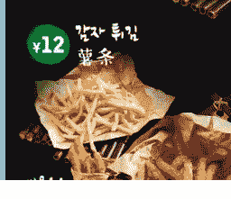 | 깻자튀김 (薯条) | ¥12 |
| 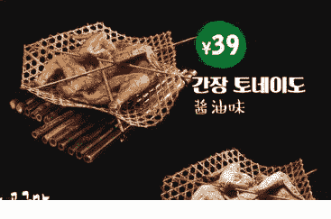 | 간장 토네이도 (酱油味) | ¥39 |

---

## 珍姐您好，看到新闻

(提问) 匿名用户：珍姐您好，看到新闻说天津取消上千个事业编制，以为是假的专门上政府网查了一下，您觉得若干年后所涉及的范围地区会不会更广，改革会不会变得更深，例如Z_.F人员，如果是现在需要做哪些准备？

2019-08-03

回答：【帖子编号0339】《事业编制》

特意搜了这篇文章来看。但是没看懂……到底是行政的编制还是事业编制……

目前国内的编制有两种。一种是政府内的，就是公务员。另一种是不承担行政职责的事业单位，以前的科教文卫，承担一点社会职能的普遍是事业编制。

后者未来大部分都是要取消的。（这个话题，记得之前有一个职业规划帖子，是问去沿海的市级事业单位，还是去内陆的省级事业单位。我刚才在圈子里搜了半天，没搜到[发呆]不知道是不是星球的内容审核系统上线以后把我老帖子给删了一圈……）

现有的事业编制里，能市场化的肯定要市场化了，市场化之后就不会再有编制了。比如广电系统下面，电视台、广播电台，这种继续接受广电系统监管就好了，但是里面的工作人员没必要带编制，大家都是干活拿工资的。有些是社会福利性质，无法市场化。但未必需要“编制”这种东西的，比如小学老师，或者是医院医生。大家都是相同的岗位，非要用编制来说有的人带编制，有的人不带编制，这种也不够合理。还有一些冷门的，有社会效益，但是难以转型为经济价值的行业。比如之前提问的朋友是在气象部门。这种想要收钱也是可以的，所有天气预报付费提供，让手机厂商花钱买呗。不花钱的手机，查不到天气预报。但这么搞，就给社会拖后腿了，弊大于利。总不至于别人没交钱，连个洪涝预警都收不到，那社会得成什么样。所以必然是国家掏钱统一购买。但其实也一样并不需要编制。气象部门毕竟还不是肥缺，属于没有大油水的部门。像是民政系统下，火葬场殡仪馆才是赚钱的……

这种……我也不知道未来会怎么改。但总的来说，事业单位的编制取消，是一个大趋势。但公务员的编制是另一回事。学行政法的时候会学到公务员编制的内容。公务员的编制是由一个叫“编办”的地方统一规划的。

公务员的编制属于一个内控手段，因为政府具有权力，权力天然具有扩张性。谁都想进。中国历朝历代，到了末代时都有一个统一的特点，官员系统及其庞大，闲余人员众多，国家财政不堪重负，开始影响到经济运行的效率了。国内从中央政府到基层之后，山高皇帝远，很难控制住各个地方都基层会不会越变越庞大。（换句话说，县官不如现管，不是所有的县官都能控制住各部门和下级不超员超标的）编制算是一个硬性的条件，就是硬控制的，让基层不超员，不扩大的方式。目前在没有更好的控制手段时，公务员的编制就很难取消了。

关于员额制目前是几个领域在试点。法院系统是试点员额制的领域之一，但是目前还没看到较好的成效。试点成不成功还得等再运行个十年八年才能知道。在这之前，员额制是没法向公务员系统中普遍推行的。（34 赞）

+ 评论区：
- 荧熙：公务员好的还是地市以上单位，有晋升空间，有行政审批权，县城及以下干起来没什么意思，就是混日子。
- 卖姑娘的小火柴：如果公务员按照企业的工作管理模式，会省下一半的人。
- 暗恋！：我猜测应该不是体制内的？
- 卖姑娘的小火柴：说的对，是看看他们公务员上班的人说有多轻松，有时候上半天啥的，而且我们这是八线的小城市估计本来也没啥可忙的，所以造成我的理解有偏差。[哦牙][哦牙]
- Yanz！：太想进殡葬行业了，只可惜自己怕鬼□
- □ a tree□：农历7月半灵魂鬼□□
- Yenz！：见大户提起，我才跟着说的[偷笑][偷笑]
- 万能的妹夫 阿鹏：基层公务员现在也不轻松了

关注公众号“懒人找资源”，星球资源一站式服务

---

## 天津开发区推进机构改革：上千个行政事业编制全部取消

2019-07-19 17:42 来源： 新华社

新华社天津7月19日电（记者 毛振华）打破“铁饭碗”，1000多个行政事业编制全部取消，所有人员重新竞聘上岗。日前，天津开发区新一轮改革的大幕徐徐拉开。

据天津开发区党委书记、管委会主任郑伟铭介绍，这次改革立足经济发展主责主业，坚持企业化管理方向，实现干部能上能下、员工能进能出、工资能高能低，以业绩为导向，以结果论英雄。

在这轮改革中，天津开发区行政事业单位减少了17个，但把资源向经济发展主责主业部门倾斜，专业招商部门从原来的6个增加到12个，占内设部门总数的34%，招商引资和企业服务人力比重达到85%。

值得关注的是，此次改革后，天津开发区实行领薪人员总薪管理，取消编制管理，所有人员重新竞聘上岗。按照计划，7月中下旬至8月上旬，开展中层干部竞聘工作；8月中旬，完成内设部门、事业单位“三定”方案编制工作；8月底前，完成基层干部竞聘工作。

“开发区原来行政事业编制加起来大概有1000多个，改革之后这些编制全部取消，实行员额制。原来不是国家干部，以后是法定机构合同制工作人员。”郑伟铭说。本次改革确立以市场为导向的开放灵活的用人机制，取消编制管理和终身制，实行全员聘任制、聘期制，统一签订合同，聘期三年。打破因有身份、年龄、资历等多条格框和隐形台阶，大力选拔培养优秀年轻干部，让有为者有位，不拘一格用人才。

## 如何正确理解SWOT

**提问** Steven Han：如何正确理解SWOT分析法中的“机会”。麻烦举一个服务业商铺的例子。

回答：【帖子编号0338】《SWOT》SWOT分析（读音一般读斯沃特分析）。里面是两对概念，要两两结合的分析。第1对概念：S和W，这是内因，自己具有哪些优势 (Strengths) 和劣势 (Weaknesses)。第2对概念：O和T，这是外因，机遇 (Opportunities) 和威胁 (Threats)，就是看有哪些利好因素或不利因素。Opportunities，我一般把它理解为“天时”、“时机”。这个分析方法，属于普遍适用的。比如圈子里各种职业选择分析，一是结合自己的学历、经验、兴趣，分析自己的特质在哪个行业有优势，扬长避短，这就是SWOT里面的S和W。其次分析某个行业有没有前景，是有红利的成长期，还是即将被新技术、新习惯颠覆。这是SWOT里面的O和T。

提问里，问商铺的例子。刚好这几天都在讲二代商场和三代商场。二代商场时代，商业街是逛街的好去处。因为二代商场的各种缺点，导致逛起来没有商业步行街舒服。所以当时的商业步行街租金不便宜，一个黄金铺子租金超级贵。三代商场出来以后，提升了逛的体验，对步行街商铺造成了很大的分流。（比如上海的租金来看，新天地的商场租金已经大幅高于新天地马路上的商铺租金了）所以商业步行街面临的是Opportunities机遇的反面，就是Threats威胁。而面临这个外因，就需要商业街做出改变，包括：不能各自为政，各家独立对外出租，想租给啥店就租给啥店，而是要全盘统筹规划，做好布局的分配。要集体做一些共同的事，比如给街上装灯带等等，用于提升环境……

再列举一些例子：明显的机遇：
- 1，某商铺附近有小区开始入住/搬迁过来，医院、学校、养老院/搬迁过来、什么公司等等——导致覆盖半径内人数增多。
- 2，某种因素导致覆盖的人群中，群体属性加强（比如小孩子特别多，那就专做小孩子的生意）。
- 3，某种因素导致流经的客流量变大（比如开了个地铁口在附近/附近有个商业巨头开业了，能吸到更多人流量，使你也跟着受益了……）。
- 4，明显的威胁：门口的街上架了天桥/马路上装了隔离带/门口在修路等等。或者上面机遇中的反面因素。如果你不是商铺出租方，而是具体经营某一个行业的人。那么导致这个行业的机遇和威胁，也是一样的。各种新服务、新技术和消费观念的转变导致的，比如互联网渠道会直接挤压鲜花店/超市/水果店/服装店/化妆品店等等……移动支付/网上业务办理方式直接挤压了电信营业厅/银行营业网点……上门服务直接挤压了邮局网点……

**评论区**

- 秋心离子：珍妮的讲解永远都是深入浅出，很容易理解并运用，赞赞赞赞赞赞 [强][强][强]
- 帅帅医生：现在各个行业都有其优势，劣势啊

---

## 请问，降息不是短期利好

**提问** 小陆虎：请问，降息不是短期内利好美国吗？金价为什么在今天暴涨？

回答：【帖子编号0338】（注：此处原文可能有误，根据上下文推测为关于降息的分析，但保留原文编号错误或修正为通用回答格式，鉴于OCR显示为2019-08-02且无明确帖子编号，此处直接保留回答内容，若必须对应编号则参考下文珍大户的回答风格，但此处OCR文本未明确给出珍大户对此条的直接回答编号，仅列出评论。*修正：查看原文，此页只有提问和评论区，没有直接对应的“回答”段落，只有评论区的珍大户在下一条或隐含在评论中。仔细看图，[PAGE 622] 只有提问和评论区。*）

**评论区**

- 珍大戶：降息有两个信号：1，我经济不好。2，我要救。1>2，则利空；2>1，则利好。对岸跟我们一样，都面临着跟我写的0172贴一样的问题。降息效果有限，或者更进一步说，目前在全世界范围内，货币政策的效果都有限了。哪怕降到0，该怎么样还是怎么样。所以这一阶段，1>2，其实对岸还不如嘴硬一些。就铁了心说“我们经济好得很”，打死不降息。反正经济这么复杂，大部分人也看不清楚的，他们坚持嘴硬一下，大家也就相信了。
- 小陆虎：也就是市场其实认为这次降息不是周期中的调整，而是防止衰退的必要举措！并且可能会进入降息周期。大家都慌了
- 裝修(^_^)啊：降息了吗，现在利息多少啊

---

## 有人知道汇中网吗

**提问** □Y≥_≤Y：有人知道汇中网吗，一个朋友在做，叫我买理财产品，六月份投了两个3万买的6个月，一共收益2100，昨天分两次一共。投了十万，是签合同的那种，直接打到公司账户，6个月利息3750元，我哥提醒我收益高，不知道靠谱不靠谱，会不会存在到期钱拿不回来，或者中途意外的情况

回答：【帖子编号0337】不是收益高不靠谱，而是这种随便成立的一个公司，什么资质都没有，你们就敢把钱交出去？等对方卷钱跑了，再去找这家公司，法人代表指不定换成了一个84岁的老阿公，躺在床上，说你们讨债让他心脏病犯了，让你们赔一笔钱。现在开公司多容易啊，你们想去注册，自己拿着身份证就去开了，为了全民创业，连审核都不需要了。有点良心的拿自己的身份证去注册。打小算盘的直接让自己家里老头老太的身份证去注册，开好了遗产给自己，开不好负债全算老头上身。更没良心的，提前想好骗一把就跑路的这种，都是去找三河大神的身份证开公司。你去找人都找不到，这公司到底是谁开的都不知道。

为什么开公司不要审核，这么容易。因为支持全民创业啊！谁说78岁的老阿公就不能做生意？人家励志大爷，年过古稀继续创业不可以吗？问题是，你们都是成年人了，不能自己考量一下风险吗？现在跟民企做生意的，哪个不是先要定金？哪个不是钱货两清？有涉及钱一次收不上的，也需要签合同，至少让对方的一家老小，上上下下来担保，而不是公司盖个公章就算了（毕竟你们也不是出门带律师的，谁替你审核公司实力了？如果没人审核，你怎么知道公司是不是空壳）。

银行给民营公司贷款、信托/证券给民营公司借钱，从来不是只看这个公司资质这怎么样，而是让对方的法人代表、四五十岁的中年实际控制人、年满18岁的成年儿子，一起来签担保书。公司倒了，人也跑不了。人家做生意，一手交钱一手交货都这么小心翼翼了。你们什么都不收，凭空给钱出去，就敢直接汇出去了？只因为对方承诺给你收益？

承诺给收益的正规金融机构，银行保险都要银保监会批准，不是开个公司壳子就能经营。所有的法人和高管，想换个人都需要银保监会去审批。换做小民企，你知道法人代表到底是谁？是不是三河大神都没人知道。

正规金融机构转个账出去，一共n个流程，几个人互相授权操作。这种随便注册的小民企，你信不信老板亲自当财务，两口子就能把钱转到海外去了？

正规金融机构投资，每笔都有限额。一个万达广场融资，每家保险公司钱再多，投资额也不能超过10%。要十家机构一起，才能投掉一个万达广场。为什么？因为怕出风险。哪怕万达那么强的实力，万达集团做担保也不行，这是强制的，必须分散风险。

换做小民企，你信不信对方把所有钱都投给一个关联企业，最后说这个企业经营不善倒闭了，钱要不回来了？

正规金融机构每个月上报数据，每个季度上报文件，每年几次抽查。监管机构还数据汇总，搞总体监控。否则如果没有总体总量的监控，怎么算得出来每个月有多少钱进房地产，有多少钱进实体行业？发现某个行业风险大了，一个文件就可以让整个行业“严控某某投资”，然后渐渐的抽身出来。

正规金融机构的钱出来以后，“某某行业”高风险的最后一棒，你猜交给谁了？＿＿＿＿＿＿＿＿＿＿

我－不赞成皮免虎，更赞成这些小破公司收一堆人的钱搞投资。民营企业想正规化，就去申请正规的私募牌照，去接受监管，内部制度化流程化，替人管钱，就乖乖把护照上交。如果不想接受监管，就别接别人钱财。毕竟瓜田李下。又不想接受监管，还想让人信任，这是不可能的。等于狐狸看鸡棚，猴子守桃园。人爱钱是人性，就像狐狸爱吃鸡，猴子爱吃桃一样。你敢相信谁拿了巨款不起心思，就等于相信这世界上没坏人一样。……真是天真了。

**评论区**

- A小姐：手动赞一个
- 大鹏：理财产品小公司风险
- tanben：希望还来得及啊，我就不明白，为什么囗囗囗都只看能收到多少利息而不关注这个公司本身？？
- 二婴几吧：这就跟前几年我看北京石景山物美超市囗囗囗口展示承诺年收益百分之十几那种差不多，我看公司就是写某某写字楼几楼，回头人家就跑路了，前期到期了给你点收益，回头再投，过不了两三年坚持不住了就跑路了。然后换个名和地址又成立个公司（我闺蜜她朋友哥哥就是干这个销售的）骗了几单提了八十多万，后来公司关了人家又换-个公司，其实就是个老板
- 陈浩：楼主吓得赶紧把钱要回来 [偷笑]
- □Y2__SY：这个公司14年开的，我朋友给我写了担保书，到期本金加利息如果没返还就找他，也是给我们吃定心丸，我投了半年。看到期能不能拿到钱吧，我也是考虑风险。只敢投短期

---

## 【帖子编号0335】8月1日对面降息的事

珍大户：【帖子编号0335】这事不在经济预期之中，而在政治预期之中。

先扫盲一个概念，我时不时的提起过几个口语词汇：经济的收缩周期、经济的扩张周期。

经济的扩张周期，一般是自发的社会经济比较好，欣欣向荣，企业不断扩张，民众收入升高，消费也舍得花钱。

经济的收缩周期相反。

以上两个词汇，是指经济体自身的、内在的动力。

外在方面，宏观调控又有了另一种收缩和扩张周期，一个是近似于放水（扩张）的周期，这一周期里，能看到【降息/降准/大基建】这些信息；相反的是近似于“去杠杆”（收缩）的周期，能看到【加息/提准/严控xx升温】这些词汇。

以上内外两种动因，都分为收缩和扩张，两面组合就能看到四种状态。

内因（自发）（自发）（自发）。

现在跟着我在脑海中画一个图。

头脑中，想象一个表盘。我下面文字里全部用几点钟的方向来指代，大家一边看一边想象。

先生说内因，民间经济自发的活跃或萧条：我们把表盘上下分成两半，从3:00~6:00~9:00方向，代表萧条（经济收缩周期）；从9:00~12:00~3:00方向代表经济活跃（经济扩张周期）。

再说外因，宏观政策调控的紧缩还是扩张：我们把表盘左右分成两半，从12:00~3:00~6:00方向，代表宏观调控（政策的紧缩周期）；从6:00~9:00~12:00的方向，代表宏观经济刺激（政策的扩张周期）。

脑海中画完这个图之后，再跟着我来思考：

在6点的位置，民间经济惨淡，政府会开始采取各种刺激政策【这一时期，是降息/降准周期】。

写过，一般降息降准周期都是连续的，少则降三五次，多则降七八次。就是因为时间长啊......

从6:00~9:00这个阶段，最短最短也要1.5年，正常的话三四年，长一点七八年也是可以的。所以“降息降准才具有连贯性”。

9点的位置之后，民间经济由衰转稳，开始渐渐向好。这时候未必能立即判断的出来，有可能降息停止了，也有可能继续降了，一直到10点或11点的位置才发现，才停止政策。

但就算降息政策在8点或9点就停了，不“继续”降了，也仍然要保持低利率一段时间——政策的连贯性。

等经济运行的12点的时候，民间经济火热。政府害怕泡沫严重，开始宏观调控，开始了调控周期，一轮相反的周期开始了——加息、提准备金。

我知道大家看到这里，一定会有疑问。经济都开始下行了，为啥还调控？不是多此一举吗？

这就涉及到，这个简单的思考模型中存在的bug了。

这个模型中一共存在两种bug。

第1种bug，是内因的。12点（经济过热）和6点（经济谷底），怎么确认？都是事后才能确认的。事前，谁也不知道自己判断的准不准，政府做调控也容易出错。

比如，经济看起来很火热，但是真到了过热、需要调控的状态了吗？会不会调控早了呢？

再比如，煤老板和地产商日赚斗金、夜夜笙歌，实体制造业工厂叫苦连天，这种究竟是经济热还是不热呢？要调控呢，还是要支援呢？

想调控房地产，结果怕是实业更难过。想支援实业，怕是放出来的钱又进了房地产了。

这是第一种bug。

第2种是外因中的。加息时候都好说，总能往上加。但降息时候是有问题的，如果都降息降到0了，还不行的话，还怎么降呢？就没办法了。

所以第2种bug是：经济好的时候，你不先加息加上去，不给自己留点降息的储备空间，那么经济不好的时候，你就没招了。

上面的模型讲完，我猜大家头脑里开始有点印象了。我们来套现实。

去年的时候（去年挺多老帖子都写过），老美开始了加息周期，对应于上面表盘的右上角。

我们当然会认为，他们自认为自己经济处在12点的位置。

相对应来说，当时国内在降息周期里。等于我们在6点位置。

而去年时候，中美对比就是这种反差......

当时我们刚好遇到了第1种bug，就是我反复说的，货币政策失效，光靠继续降息降准已经很难达到效果了，放出来的钱流不进企业中去。

所以我们能看到：
1. 减税政策出现；
2. 然后严控房地产，防止钱继续进房地产中；
3. 降息幅度较上一次以往的速度减少了，即改成“定向”刺激了。
（ps：上面这些逻辑，也是说未来“房价普涨时代结束了”的逻辑基础。）

而如今，对岸的加息周期才刚走几步，突然降息。这就很悬疑了。

感觉像是去年还说自己已经走过12点的位置了，还在表盘的右上角。突然发觉不对，又退回去了，猛然发现还在8点到10点的位置之间......

不过美国降息很快就停掉还好说。如果还要持续依赖降息，他们很快会发现，自己就要进入到第2点bug之中了——利息率本来也不高，很快就会没有降息空间了。

总之，一年之间，感觉大变。去年以为对岸很牛，后来才发现外强中干……

这次降息，政治因素更强一些。毕竟“对岸那个黄毛”（为了防止关键词屏蔽）一直在推特上面喊话，说经济如果不好全是联储不肯降息导致的（强行甩锅给联储，转移靶子）。

黄毛上台之前，强调建墙，强调打击中国，结果两件事情均结果不太好（尤其是昨天上午刚传来的消息，谈判团9点开始谈，没谈俩小时，11点就去浦东机场准备飞回去了）。

上任之后，又不断宣传美股蒸蒸日上，都是他带领美国经济搞得好。这时候如果美股撑不住的话，是相当打脸。他17年初上任，到现在任期就剩最后一年半不到了，必然想当紧张。所以才会反复喊话，让联储降息。

撑得住的话再干四年，撑不住就直接下台了……

**评论区**

- Mr Na: 珍姐备份啦哈哈哈
- 珍大户: 同样的亏不能反复吃 [偷笑]
- ANTINOMI: 美国估计顶不住了，咱们只要拖下去就能赢
- 珍大户: 论持久战
- ANTINOMI: 如果美似08年那种规模的海啸来了持有现金还是买点黄金呢
- GK: 然而昨天美股不学好，两点半开始跌
- 茜茜&麻麻: 真的看君对岸的黄毛哟啦啦打脸的表情 [呲牙][呲牙][呲牙]
- 黄江E先生: 为什么备份？因为我们换过核，但是我们有记性 [捂脸]

---

## 美联储降息，中国怎么办

**提问** 狼：美联储降息，中国怎么办？跟不跟？跟了继续吹大资产泡沫，不跟出口更加难受，感觉人民币国际化是目前中国的重大战略，估计这也是美国不遗余力对付中国的原因，而且这种打压和制裁不会在短时间内结束，现在国内大部分行业收益率都很低，大家再去投资的意愿不高，可能会发生像您所说的货币政策失效，在这种情况下能否给点理财方面或者个人发展方面的建议，谢谢！

回答：【帖子编号0336】这话说反了！去年的时候是美加息，中国怎么办，跟不跟？去年的问法是对的。因为，美元加息，对全世界来说，都存在一个跟还是不跟的问题。

选择1：不跟的话，美元和其他货币的息差拉大，（美元利率更高）则资本会留向美国，导致美元升值，导致其他不跟的货币贬值。当时国内就是这样选的，不跟着加还降息。所以外汇流出压力很大。所以才会严控外汇。

选择2：跟着加息的话，如果国内经济好，那自然加息也是应该的。如果国内经济不好，为了救助企业，本应该是降息的。结果为了保汇率而加息，等于火上浇油，让企业过的更惨。

一国的货币政策，首先要服务本国的居民和企业，胳膊肘不能往外拐，要以服务自己人为主。这叫做“货币政策的独立性”。如果加息降息完全不考虑本国企业的死活，跟着美国亦步亦趋，这叫“放弃了货币政策的独立性”。

————————

金融学里有个理论，叫“蒙代尔不可能三角”。意思是：独立的货币政策、汇率稳定、货币自由兑换之间，三者只能得其2。

我们国家选择要独立的货币政策。以去年的情况为例，那么，如果人民币自由兑换，结果就是汇率不稳定（贬值）。所以我们国家开始严控换外汇……

香港是联系汇率制度，选择汇率稳定。他们还是自由港，又得选择货币自由兑换。结果就是“没有货币政策的独立性”，美国加息，他们就得跟着加息。美国降息，他们就得跟着降息。跟美国一模一样。这种选择，对香港的企业是很惨的。所以香港逐渐产业空心化也是必然。

————————

所以提问中提到的这种前提条件是不存在的。中国目前还在降息周期中。美国目前降息，会极大的缓解国内的资本外流倾向（发现原来对岸经济也不好啊，那么去了对岸也没什么好处，不去了。）

**评论区**

- 小明：朝闻道，夕想闻更多道 [呲牙]
- 笑脸：猪肉都少钱一斤了？还跟？
- 鹿源：猪肉涨价和这个没关系，是因为猪瘟缘故，将来会涨得更疯
- 笑脸：你再往后想想。猪价起来，相关东西都会跟涨的。
- 杨小东：还好我一直不吃猪肉
- A0庄泽锐：学到很多。。谢谢非常感谢
- 随风飘逸：不吃猪肉也没用，其他食品都涨，总不能饿死
- 小白龙：今年玉米价格涨了不少

---

## 目前自己有几个行业在做

吃葡萄不吐栗子：目前自己有几个行业在做，想和大家讨论一下哪个行业发展更好。

自己做的东西很多，喜欢尝试不同行业吧，趁着还有学习能力想把自己喜欢的都尝试一下。

### 儿童艺术教育

上海毕业之后因为不想熬夜做设计，就自己做了儿童艺术教育方向，三个月时间把知道的行业标杆都探了，自己开始创业，第二年就做到300多人。上海教育许可审批很难，是一个难坎。

后续在南通常州也做了，但是我做的是素质教育，创造力方向，所以是小范围受欢迎，价格高到两百多一节课，学生一直是百人左右，小而美我也喜欢，就这样吧。

### 展会设计搭建

经朋友介绍前一段时间做了承接展台的工作，因为之前的工作也是设计相关，所以有设计师资源和工厂资源，由于自己我对细节比较认真！所以慢慢客户也多了起来。

### 民宿

期间趁着自己有工厂资源还在武汉做了民宿，地段好，挨着朋友的猫咖，风格比较特别，做的也不错。目前做了四个月。

### 女鞋打板

中间还做了女鞋，淘宝店，现在也慢慢衰落了，合伙人又去开了档口做批发，我有一丢丢股份，这个我大概是不会做了。

现在有点想做猫舍还有上海的民宿，想了解这方面的问题。希望有经验的朋友可以和我互动一下。

2019-07-31(13赞)

评论区：

- ...：你是我偶像
- 🎉婴儿肥🎉：哈哈哈
- 人生如逆旅：儿童艺术教育！
- 吃葡萄不吐梨子：上海证下不来，感觉也难做
- 99默.孙洁：教育机构需要用校宝这种软件吗？有没有好用的软件推荐？
- 吃葡萄不吐梨子：有在用校宝扣课，但是软件并不成熟，只用来扣课有点浪费，其他功能又很鸡肋，没碰到很好用的
- KM：牛逼人物 不过你的经历居然跟我一个朋友特别像 她也做猫舍 在松江 而且做的很不错 也做教育！英语相关的，还挺赞！
- Jan 简：我也是几个行业在做，学习你

关注公众号"懒人找资源"，星球资源一站式服务

## 京东金融的这款产品

周杰慧:京东金融的这款产品是什么，能买吗，怎么？收益这么高？
2019-07-29(15赞)

评论区:

- 明心设:天弘基金还有百分之三十的呢？收益有多高风险就有多高
- 珍大护：这个还真能买。这种产品写的某某银行托管就不用看了，全部充当渠道功能，意思就是钱先进到某某银行的基本户里，在通过这个基本户付款出去，美股实债实xx，总之，真出风险了银行也不会赔你。所以写到某某银行托管的消息一律不用在意。产品前面华复两个字，代表的是华夏基金的产品。这家是老牌公募基金，挺靠谱的。所以产品没问题。产品是投向海外债券的，主要都是美元债，我都不知道美国后面有没有可能降息……“对岸的黄土”非常强悍的想要压美联储降息，汇率未必管用。如果除了的话，利好债券市场。所以这层原因导致这个产品也是很带货的。但是因为毕竟是美元产品，汇率风险也存在，所以不要当主要配置的对象，只拿部分资产买就好了。如果要买的话，注意再看看下，不同渠道，基金有很多代销渠道，有些地方会费用打折，那样的话更划算。（你可以搜索天弘基金网，看看上面有没有打折，京东未必是最便宜的渠道）最后，这个债券基金分a类和c类。区别是，a类是一次性收申购费，C类是按持有时间收销售服务费。我刚才特意看了这只基金的收费标准，50万以下的话，a类一次性收0.8%的销售费用C类是每年收0.4%的销售服务费，所以，如果你持有两年的话，刚好两类的费用是一样的，如果时间短于两年，那么c类按持有时间收费更划算。如果时间长于两年，那么a类一次性收费的方式更划算。（点网页进去看费率标准类推：当购买金额分别在50-200万档后，200-500万档后，A类划算还是c类计算的时间点，会缩短到1.5和1年。要是超过500万，就是a类更划算。） 华夏收益债券(QDII)A 基金行情 优推 走势 评级++ 华夏基金 华夏收益债券(QDII)C 基金行情 优推 走势 评级++ 华夏基金
- Lewr:放心买，各大基金app微信支付宝都有这个债券基金。
- 周杰伦:哇塞，背脊爽如翻牌的感觉[嘿哈][嘿哈][嘿哈]
- iRePro:立马买了
- 听说我说话很冲：刚刚用大户说的天弘基金搜了一下，似乎这个的a类，天弘基金手续费0.08%
- carnival:支付宝没有啊，怎么搜索啊
- carnival:你买了吗？在哪买的，我只在京东上看利率是13%，微信搜不到，支付宝不是这个利率啊，小白太白了

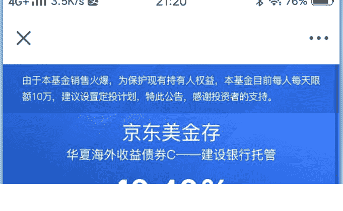

13.43%

近一年收益率>

- 灵活申赎
- R2-中低风险
- 0申购费

主投高收益美元债、新兴市场债券、中资美元债等券种，不出国，就能分享海外债利息，力争更高收益。

### 近一年 华夏海外收益C 收益走势图

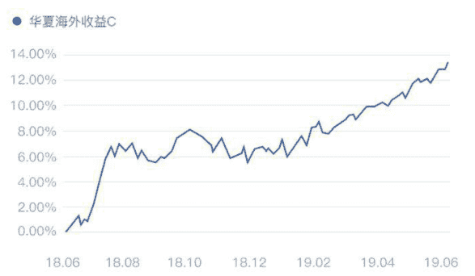

立即转入

注：收益数据来自wind，时间截至2019.06.20。本基金成立于

关注公众号"懒人找资源"，星球资源一站式服务

## 珍姐你好，我本人特

石头子儿:珍姐你好，我本人特别喜欢音乐，小学就可以自己按照自己的方法写下谱子，十几岁就独自自己弹出听到的曲子，我不知道这算不算天赋。

我是在河北廊坊这个城市，现在想学习钢琴调律师，或者售卖钢琴等乐器以及搭配相应教学，我该如何快速开始呢？这个行业怎么样呢？

2019-07-29(6赞)

评论区:

- 育婴师：催眠师朱静静*:会弹琴的不一定会调音，但会调音的一定是会弹琴的，不吃香蕉我不知道，但我知道请来一次调下音真的不便宜。
- 石头子儿:大家了解钢琴调音师在哪里学习哪里考试的可以回我一下，谢谢大家
- 石头子儿:技术活儿呀[偷笑]
- 珍大户:这种经验有可能总结出来一种快速学钢琴的方法吗？就是针对二三十岁的女性市场，有很多人想学钢琴，但是已经过了打基础的年纪，也没有想学的太好，不需要考级，只要偶尔自己能读几个曲子出来装一装门面那种。如果是自己摸索就能弹出来曲子，我猜测肯定跟正统的钢琴手法不一样的。或者下大决心，花很长时间重新学正统的方式，当正统的老师。或者走这种无登大雅之堂的培训。就像是抖音上卖手卷钢琴似的，这玩意肯定不能被称为钢琴。但针对的就是过不了正统钢琴的们的群体。
- 石头子儿:哇塞，没想到珍姐你真的回复我了！你说的对的，我可以总结出单曲连成法并且教学，但是确实是不正统。我想从这个方面出发，第一，售卖钢琴 第二：做教育培训 第三，调音师培训 但是有两点不清楚需要请教会 第一，在河北廊坊市这个地方做以上3个项目可行吗？廊坊市夹在北京天津中间，消费水平还算可以的。第二，如果不行我该从哪方面出发呢？我比较注重销量，不太想做老师，想把钢琴教学，调音，以及调音培训在这个城市专业化，不知道我的想法可行吗珍姐。
- 珍大户:售卖钢琴这个你是没有优势的。买钢琴的人是想要正统的学钢琴的人，就要求你的水平也如在正统音乐体系里面。你要卖钢琴或者做继续教育的培训，就需要重新打基本功了。因为我不懂音乐，钢琴具体要学习多久才能有教学的水平就不知道了，这个最好要先做好调查再决定。至于调音领域……我就更不懂了
- 珍大户:刚看到你说地点在廊坊，那么要看当地二三十岁的、刚工作还未婚育的人群群体有多少了，因为这是想要速成撑门面的群体。如果当地年轻的就业人群流出比例比较高，那么就只能做针对18岁以下人群的正统的钢琴教育了。年龄再往上，等到开始养孩子，自己的学习钢琴的念头基本就断了。
- 石头子儿:哇塞，感谢珍姐回复，刚刚做了一下调查，钢琴考分为10级，可以跳级考，一般的孩子都可以在小学毕业前完成10级考试，成年人有天赋的有可能一两年就可以考10级。调音师就难了，除了要懂得钢琴基础知识，还需要对音准有极大的辨识度，考试分级，但是每个级别之间都要很久，并不要求从事相关工作。想考到最高级别需要20年（百度查的）。总结一下，这个行业想入门就是耗时间，但一旦总结出自己的一套学习方法还是是很值钱的，我有浓厚的兴趣兴奋，只是需要安排一下时间了[偷笑]，谢谢珍姐[爱心][爱心]

关注公众号"懒人找资源"，星球资源一站式服务

## 【7月27日直播】

石头：【7月27日直播】

- 大户口助理：（合肥）帮忙上传视频，剪辑，整理直播内容
- 大户口助理：机灵，好学，不事逼
- 大户口助理：自我介绍+经历=简历
- 大户口助理：自我介绍+经历=简历---
- 欢迎毛遂自荐，私信珍大户口（微信）

---

1. **【手工辣条抖音上卖】**
可以，自己做的小众商品都可以卖

2. **【高端养生汤】**
只做养生汤产品单一，要找到这一堆人不容易，实体店自己去找客户不太可能；线上也不行，配送有问题；除非有依附于的对象，比如，月子会所，妇幼保健院；

3. **【医生改行做养生行业=低门槛，不好】**
医生高门槛。评估门槛，门槛越高行业比较好，门槛越低，行业竞争越激烈；主动抬高门槛，苹果的【红富士】就是门槛；法律行业2500实习工作，门槛不是特别高，是要把司法考试考过就行，考的人多了，没有学历要求；美国本科不招法律专业，必须是先读一个本科，再读一个法学研究生，毕业再去考司法考试；中国律师不值钱，美国律师就值钱；

4. **【小县城乐高编程培训=选错了】**
小县城还是要搞和升学考试有关的东西，不要搞素质教育；二线：中考/高考/加分；

5. **【服装行业，转时尚买手=大城市小众行业】**
一线城市可以搞，其他城市都不行

6. **【上海搞宠物店=一线房租高，二线性价比高一些】**
服务业一线二线价格其实已经差不多了，但是一线房租成本高；比如剪头发，成都商场40～60元，北京也是40～60元；北京海底捞，人均100元，三亚海底捞，人均100元，两个店都是人满为患，但北京房租多贵啊；你去县城开海底捞也不行啊，人流不够坐不满嘛；

7. **【长沙能不能开水果店=别开了】**
水果渠道可替代性很强的，每日优鲜这种价格很低的，产品也没差别，都是西瓜嘛；最后拼成本，你肯定搞不过大店；店面覆盖的范围有限，水果容易腐，今天可能哈密瓜就没卖完，但是西瓜都卖光了，这就是损耗，网店覆盖的面积跟大损耗可以更低；大家就会去网上买；实体店不要卖商品，特别是标准化，没差别的商品；

8. **【县城物流加盟怎么样】**
快递行业这种是规模效应的行业，是赢家通吃，四通一达已经站稳了，不要再去了；

9. **【通讯营业厅越来越难=银行网点=难】**
现在银行网点人越来越少，好多人都网上办业务，都开始撤网点了，趋势是不可逆转的；就像BB机被颠覆了，没招了；

10. **【诊所会被颠覆么=不会】**
小毛病都是找附近的诊所，是服务行业，也是优胜劣汰竞争，是有发展的行业；按摩推拿针灸也是一样的；都是可以做都；

11. **【英语老师有出路么=有啊】**
教育行业是好行业，可以持续做的

12. **【海外婚庆/留学中介/房产中介=小众，可以做】**
做的人毕竟还是少，欧美留学中介已经饱和了，这种要做线上宣传，一个城市里面要海外婚庆的人毕竟少，不集中，不好开实体店，要靠网络引流；比如：印度的医生特别赚钱（重男轻女，做B超，堕胎），如果你们有人在印度，介绍到中国来学B超妇产科，很多印度人愿意花大价钱来读的医的；

13. **【白蚁防治=没戏】**
美国很多人有这个需求，每年灭蚁，需求旺盛；因为美国的房子大部分木头的，经常需要修补，灭虫；中国都是钢筋水泥的高楼，蟑螂都不太有了；

14. **【花卉租赁=不行】**
鲜花=一次性消费；盆栽，本身也不贵；越贵越容易租赁；

15. **【刷脸支付】**
听上期录音

16. **【实体女鞋店=别搞了】**
达芙妮都快开倒闭了

17. **【高端/私人/旅游/国外/定制】**
有灰色部分，老司机开车了，你懂的

18. **【宠物丧葬？=可以搞，大城市】**
这个需要调研一下，案例“养了16年的狗子，去隔壁市火葬花了一千五”可以搞；宠物猫为啥比宠物狗多，越便宜的东西受众越多，养狗比养猫贵，猫口饭量小也不用遛持有成本低（200元一个月），狗口吃得多还有遛（500元～1500元一个月），丧葬费也就狗一个月的饭钱，不算啥；***补充：城市选择，宠物丧葬最主要目标是大型犬，去淘宝数据平台关键词搜索，看看狗粮在那个地区热度高；

19. **【CPA /CFA 二线选一，推荐 CPA】**
CPA：认可范围广（金融行业+审计+法律+企业）便宜，考试时间长 / CFA：认可范围小（金融行业）后续要每年要交钱，考试时间短；都是很

- 有分量的证书：旗鼓相当；

【汽车配件中间商=会消亡】
中间商会被淘汰，时间早晚的事，渠道价值被取代的了

【保险经纪人 = 堆人力】
以前很多行业都是堆人力，层层批发，充当行业传播链条，很多老行业已经发生变化了，网络渠道把取代了部分线下；但保险行业还是在堆人，这个行业肯定有得改，因为靠人来销售成本都很高的；这个行业的渠道还很低效；保险经纪人只能是干一年是一年，可能很快就要变化了；

【减肥健身训练营=可以搞】
属于健身的小分支，可以搞，一期一期的开

【家具行业】
不是被电商取代，小件可以网上买，大计还是不会在线上买；但是家具没有标准，使用时间周期很长，大件家具不太会在意几百块钱；小作坊越来越难，宜家就占很大市场了，主要是卖牌子了，宜家的质量也太不好，利润能有40%～50%，不是因为便宜，不是耐用，因为有牌子，东西全；放心；至少买不了吃亏；未来一定是品牌化；

【新中式家具=不看好】
上一代人的喜欢的东西，这一代人并不买账，每一代人都有一代的喜欢东西；所有关于上一代的相关的行业都会消亡，所有有关下一代行业都是未来；

【年纪调查】
39/17/41/29/29/26/34/25/33/25/29/26/27/21/25/30/30/29/28/23/30/29/29/40/32/33

【心理学可以学么】
每个人都可以学一点，对过好人生有帮助；但指望这个找工作赚钱谋生，目前还是不太行；经济学也是一样的，每个人学一点对理解世界运行规律有帮助，但指望做金融赚钱，这个门槛就要很高了；

---

27

## 【考事业编】

考公务员吧；事业编制现在存疑，可能会改革，几十年的时间说不定的；事业编制有的是公益性性质，有的是在市场竞争中的；所以看你考的事业编制具体情况；

2019-07-27(60赞)

### 评论区：

- 竹子：更新好快
- 三月：等了这么多期终于讲到了定制，可是没赶上 麻烦课代表解释一下17，老司机开车是什么意思？是好不好
- 石头：这个是我猜的，大户没说，我就随便一说，你就随便一听~有钱老板出国定制旅游，配一个女伴，反正是在国外，谁也不认识；
- 石头：这种价钱你随便开
- 石头：也不会被黑包
- 三月：@课课代表，我家先生是旅游定制师 接触的是家庭带孩子老人出游的比较多 这种还真没听说
- 石头：这种情况啊，等大户老师来回答吧[回]
- 石头：直播的时候没详细说

关注公众号"懒人找资源"，星球资源一站式服务

## 刚才提到宠物丧的

iFrePro : 刚才提到宠物 丧的，需要一些数据支撑，我这个是淘宝卖家专业版数据，提供的是最近 30 天狗粮猫粮各个省份，城市的交易占比，年龄，职业，性别，仅供大家参考 2019-07-27(19 赞)

### 评论区：

- Bella: 从淘宝的那一个界面，可以找到这些数据呢？
- a tree: 三 : 就喜欢这种专业的。有数据的东西。很棒！
- 多一 丁 : 生意难在竞争
- 小梨: 三 : 线与新一线城市，没娃或者没二孩公司小白领，用户画像。
- 走进星球的老阿姨 : 请问怎样才能查到这样的数据
- iFrePro: 9000: 一年，淘宝 3 心以上可以订购专业版生意参谋市场行情数据，限一个子类目
- 走进星球的老阿姨 : 感谢楼主解答(微笑)

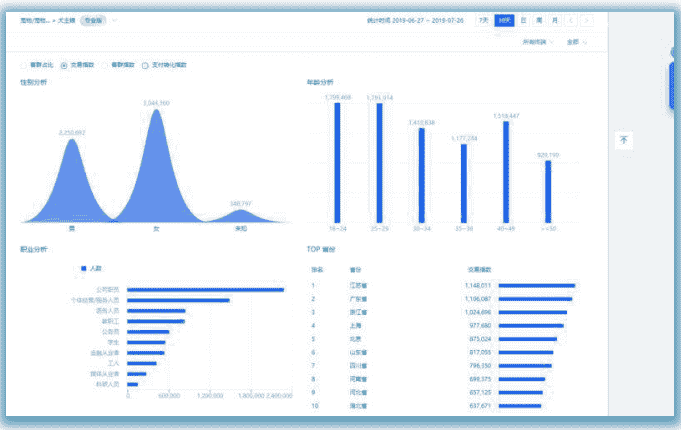

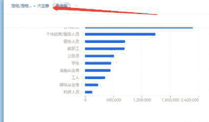

#### 省份发布指数 TOP

| 排名 | 省份 | 发布指数 |
| :--- | :--- | :--- |
| 1 | 广东省 | 1,106,987 |
| 2 | 江苏省 | 1,024,898 |
| 3 | 上海 | 977,680 |
| 4 | 北京 | 875,024 |
| 5 | 山东省 | 817,055 |
| 6 | 四川省 | 795,359 |
| 7 | 河南省 | 696,375 |
| 8 | 河北省 | 657,125 |
| 9 | 湖北省 | 617,871 |

#### TOP 省份

| 排名 | 省份 | 发布指数 |
| :--- | :--- | :--- |
| 1 | 上海市 | 977,680 |
| 2 | 北京市 | 875,024 |
| 3 | 沈阳市 | 748,469 |
| 4 | 成都市 | 646,839 |
| 5 | 西安市 | 603,723 |
| 6 | 广州市 | 565,231 |
| 7 | 深圳市 | 556,684 |
| 8 | 重庆市 | 516,200 |
| 9 | 武汉市 | 515,898 |
| 10 | 郑州市 | 486,512 |

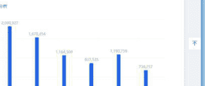

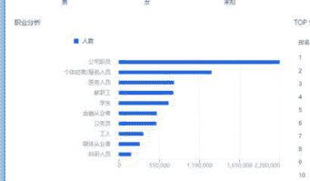

| 排名 | 省份 | 发布指数 |
| :--- | :--- | :--- |
| 1 | 广东省 | 1,242,642 |
| 2 | 江苏省 | 1,029,210 |
| 3 | 上海 | 993,451 |
| 4 | 北京 | 943,732 |
| 5 | 浙江省 | 899,872 |
| 6 | 四川省 | 732,773 |
| 7 | 山东省 | 690,393 |
| 8 | 辽宁省 | 374,047 |
| 9 | 河北省 | 555,782 |
| 10 | 湖北省 | 525,622 |

## 宏观/微观 - 自主版 专业版

统计时间 2019-06-27 - 2019-07-06 7天 30天 日 周 月

| 个体经营者 | 餐饮人员 | 厨师工 | 学生 | 金融从业者 | 公务员 | 工人 | 医疗从业者 | 科研人员 |
| :--- | :--- | :--- | :--- | :--- | :--- | :--- | :--- | :--- |
| 2 江苏省 1,039,210 | 3 上海 993,631 | 4 北京 943,732 | 5 浙江省 898,672 | 6 四川省 732,773 | 7 山东省 630,363 | 8 辽宁省 574,047 | 9 湖北省 555,782 | 10 河北省 523,622 |

### TOP 城市

| 排名 | 省市 | 交易指数 |
| :--- | :--- | :--- |
| 1 | 上海市 | 993,631 |
| 2 | 北京市 | 943,732 |
| 3 | 杭州市 | 705,600 |
| 4 | 广州市 | 692,069 |
| 5 | 成都市 | 628,121 |
| 6 | 深圳市 | 612,664 |
| 7 | 南京市 | 593,685 |
| 8 | 重庆市 | 506,037 |
| 9 | 西安市 | 484,893 |
| 10 | 天津市 | 423,364 |

## 珍姐能不能说下您对

(提问)吕良人:珍姐能不能说下您对健身行业的看法，我想明年回老家创业开健身工作室，今年先在北京看看局势
2019-07-27

回答: 【帖子编号0334】 健身房、健身工作室这一块儿，绝对是 可以做的。 而且跟教育行业类似，应该避开一线城市（因为一线城市目前竞争已经很激烈了）。 二线城市目前大部分都可以搞。 先自己考察一下当地城市竞争程度，就假设自己是顾客，你想在附近找健身房方便吗。这就能看出竞争激烈程度。 如果是步行10分钟的范围内已经有一两家了，就不要再去了。不管做什么，都尽量避免这么直接的竞争。 只要当地没有这么直接的竞争，那就可以搞。

健身行业一直能做。主要的经营风险就是现金流不够稳定。 因为不像传统行业，每月能清晰的算出成本-收入-利润。 采用年卡方式的健身房，现金流很集中。很多商家是没有现金流管理能力的。尤其是小商家，资金实力不够的话，有可能遇到现金流不稳定，某几月现金流断裂，会扛不过去。（恶意的、想要圈一波钱就跑路，然后故意装成现金流断裂模样的，这种咱不提）

所以，既然你定位是【健身工作室】，这种属于小商家，你必须想 办法平稳现金流。 其次，因为小健身房小工作室，面积小、器械少，这属于自身劣势。你也必须要建立其他的优势，来弥补这种劣势，防止万一等你开业了之后没多久，又有更大的健身房出现，打你个措手不及。

先说“平稳现金流”。 对小健身工作室来说，尽量不要采取年卡，而是要用月卡的方式。 第一，用户本身也怀疑你能生存多久。这种这种环境下，你卖年卡就必然要打很大的折扣来吸引用户。本来一个月三百块，一年能收3600，你打折到一年1800，其实是自己吃亏。 第二，卖年卡是因为害怕客户粘性不够。半路流失掉。 但对小工作室来说，只要客户粘性不

够，你就死定了，卖年卡只不过多苟延残喘几个月而已。所以本质上如何增加客户粘性。而不是像大健身房一样，散养用户。你必须提供给用户VIP的指导服务，跟踪用户建设目标有没有完成，持续督促用户继续达成健身目标。你必须要 有集体活动，各种操课，在自己的工作室里形成群体的氛围，使用户感觉到离开这个工作室以后，在别的地方再也找不到这种健身氛围了。总之，你的每个用户，每周不来个一 两次，你就输了。（这种小与大的竞争，在其他行业也能看 见。比如小商店比不过大超市，就只能靠服务。可以电话送 货上门，可以营业到半夜……类似道理。）在定价上，开发一些几个人的小课。每节课看各地物价，七八十一节或一百零几十快一节。卖小课。一方面把不像买月卡的零散用户 打进来。另一方面，月卡用户每月可送4-6节小课，等同于给 月卡用户形成价值认知。另外有价值的东西，对方不会愿意 丢弃，更有参与热情，于是就能增加参与的粘性了。(37赞)

评论区：
- 珠宝！：其实我觉得大健身房的私教课比工作室的私教课差远了，但是健身房的私教课一般在400一节以上的价格，工作室是300左右。我个人还是非常非常倾向于工作室的，健身房的卡办了只剩下游泳
- 珍大户：我一直觉得健身房400一节的私教课定价是有问题的。消费门槛太高了，很难长期的消费下去。而健身房的教练也普遍闲着，时间能排满的教练应该很少。所以这种定价方式是 有问题的。价格降低，充分销售，把教练的出售时间排满。如果赚收入低的话，就共享课程，比如几个人一起的小班课程。宁愿让大家报课读却排不上号，只能抢着报，也不要 守株待兔，周一半的时间都空阔……
- a tree:: 大户把健身房可以开到体育馆吗？这个问题来自于之前在体育馆做商铺设计。深圳福田体育馆里面很多商铺闲置。无人租赁。深圳体院馆也是。如果有优质的服务和技木。体育馆应该是白滞流量的。而且比较精准。而不不清楚与体育馆并不冲决。竞争大不大。体育馆的商铺应该很容易、因为之前未那边看到太多空置的了。然后还可以利用体育馆原有的一些比如泳池。跑到这些。羽毛球场馆。把健身教练习种一下。隔打羽毛球这些还有篮球这些。把一些群体运动组织起来。收费
- a tree:: 举办一些人足球比赛。篮球比赛。让体育运动变化。而不是单纯练肌肉枯燥。同事以前喜欢踢足球。平时比较难组织人员。还有订场或等后勤服务。他们一般是均摊型付场地费。预订时间。
- 珍大户：其实还是现在住宅或者后工作地点接近最好。要充分减轻大家的交通时间。健身房终究要变成高频消费的，但体育馆绝对不是高频场所。体育馆解决的是大型赛事商业问题。足足球、篮球场馆。网球场馆。这些地方占地方极大。纯靠商业手段，而面积这么，价格的标准的多啊。所以纯赛事地解决不了。体育馆等等于基础设施工的性质了。换句话适，体育馆的某运动场，是不存在商家竞争的，在某个地区很稀缺，反而商家不是。开在体育馆里的健身房和开在社区里的健身房，体 育场里的健身房并没有什么优势，相反如果交通太远，反而就成了劣势。
- 兔.双而乔心:珍姐你不是经常去健身啊，我常去健身，我觉得你说的每一点都是我打健身房的槽点
- cc: 100元一节的私教课我可能会一下买个10节，但400的就不太想烫，健身也不是一口吃个胖子不 是几节私教课就能找到感觉。
- 晓露君·：《健身房今冬大封闭？全面解所污染、一亮韦德、乐刻、Keep、超级猩猩，揭秘行业20年的潜规则》健身房今 冬大封闭？全面解析污所，一韦德、乐刻、Keep、超级猩猩，揭秘行业20年的潜规则

关注公众号"懒人找资源"，星球资源一站式服务

## 这几天女朋友在剁手

(提问)Yaobest.拼命*：这几天女朋友在剁手，我发现很多欧美大牌护肤品的国内专柜产品一瓶400多元，但网上的海外旗舰店只要一半价格。请问，海外旗舰店靠谱吗？如果靠谱，利润在哪里？

2019-07-26

回答：【帖子编号0333】这个问题我也好奇…… 只知道主要原因是不同渠道的税的差异，外加商场的柜台费比较高造成的。比如我在考拉上买的雪花秀气垫打折后170几，专柜450。（观察其他各种化妆品，往往也只有专柜1/3-1/2的价格，差价巨大）我一直很想知道，跟专柜的差价里到底多少是由税率造成的，多少是其他因素造成的。但是不太会算。有几个可以参考的网站：1，跨境电子商务年度个人额度查询页面。只要输入姓名和身份证号，就能查到当年的个人海外购额度还剩多少。我隐约记得每人每年2万块额度。结果刚才又登陆了一下，发现本年已用额度12,000多，还剩余可用额度13,000多。一搜新闻，发现19年的额度变成26,000了。（）财政部有发一个商品清单（），常用的食品，化妆品，衣服、小日用品、电器、奶粉尿片，这些东西都在清单里。只要是清单里的东西，单价低于5000元的，在每年的额度内，属于自用范畴，是可以免关税的（其他的消费税和增值税按正常的7折征收）。所以像是考拉、苏宁海外购、天猫海淘这些平台，都是通过让你上传身份证，把买的东西挂在你的名字下，占用你每年的额度，来节省一笔关税钱。

但是我因为对海关政策不熟，根本不知道关税、消费税和增值税是按什么比例征收，怎么计算的…… 所以具体这个途径能省了多少钱，我也不知道[捂脸][捂脸][捂脸]

但是仅凭关税，还不至于差价如此巨大的。所以我觉得最主要的差价应该还算商场的柜台费、人力成本（毕竟每个专柜至少两班倒每班至少两个人，每天又卖不了 几瓶东西，均摊的人力成本肯定不便宜），外加柜姐提成这些了吧……化妆品专柜，有广告和试用的成分存在，所以化妆品公司未必敢尝试无专柜模式。 但是随着很多国内没有专柜的牌子（像是这两年超火的什么西班牙药妆之类的），纯靠网络口粮相传就销量巨大，未来不排除专柜的作用越来越低，“撤柜”也未必不可。（23赞）

### 评论区：

- 姜科：汇率的影响也不小。欧盟的化妆品进口关税约10%，增税13，消费税30，也就是光关税就收到房价的0.963倍，基本上要翻倍了。美国的更多。因为贸易战被加税。
- 不念过去，不畏将来1：你在专柜看见的是零售价，海淘、天猫之类的走的是品牌方给的批发价，零售价一般是批发价的2-4倍不等。从品牌方拿的价格是一级批发商价格，是最便宜的（关键下级企业除外）
- 不念过去，不畏将来1：WSP批发价=Ex-works 美金价加运保费（门到门）和税费加利润，利润至少也在50%以上，有些品类如珠宝、服装利润远高于50%，再加上品牌溢价等到终端消费者手上就是天价。所以所谓的代购能拿到5折的价格也是不成立的除非是消费存的抛售，为了保护品牌，品牌越大越不会有抛售。
- 不念过去，不畏将来1：比如LV、Chanel的核心产品包包，衣服没有中间批发商自己上下游通吃那个利润是惊人的。至于钟表、化妆品、眼镜等非核心产品是采用licensing运营自己的专买店卖的墨镜小王靠靠渠道批发商销售。但眼镜是一个很有趣的品类，开云（品牌Gucci、YSL、BV等）2年前（不确定）收回了渠道自己做批发，LV明年全线收回（品牌Dior等）。
- 刘峰：你进行好深啊，佩服
- 程三冬：品质也不是完全一样，大牌套路也深得与我无关37：珍妮，我觉得也不会轻易撤柜。我记得有个叫什么锚定的词，品牌方愿意烧钱，宁可摆着专柜，不是为了卖货。这样代购有的挣，官方旗舰店有的挣，宣传时，我们是有专柜的大牌，你看专柜那么贵，我们商城优惠力度多大。给合作方渠道议价时，你看我这是给你的专柜的几折了之类的。然后流传着专柜品质更好，旗舰店成分有水的说法，还能有一部分人愿意出高价买专柜，然后还有一部分人去专柜买一下对比旗舰店，发现一样的，然后从旗舰店买，哇塞好值啊，你看我虽然花了好几百，但省了好几百，与挣的似的。
- 随风飘逸：关于真假的问题，明确的说是都是真的

关注公众号“懒人找资源”，星球资源一站式服务

## 朋友们我媳妇在龙湖

夜面人：朋友们我媳妇在龙湖天街写字楼开了个美容院（实为医美工作室）过不了多久就开业了 因为二十几楼所以怎么宣传怎么引流成了一个大难题 群里的大咔朋友们给点建议啊 谢谢

2019-07-26(3赞)

评论区：
- 海：20度不没有什么优势啊
- portrait：美团
- 海：详细看业界大神的，拓客五大形式，1、卖卡2、做团购3、转介绍4、异业联盟5、打广告。你先通过这几种形式把渠道打开，让客户到店里来。接着你才要考虑第二环节让Ta留下来所以你不要管形式的好坏，你做的没有效果并不是形式的不 对，而是没掌握形式的要点。第二我们怎么让客户常来？大家知道决定顾客常来的是店里的服务，也就是你的服务能否让客户有宾至如归的感觉，这样客户才会经常来。客户到店里不是听我们背话术，也不是听我们做销售，你又做话术又做销售，谁还会愿意来呢？换做你，你也不愿意去。 第三个是客单价。客单价由什么决定的呢？是由店里的项目决定的，如果你在店里的项目上设计的不好，那么客单价基本上不去，客单价提不上去其实就是你自己的原因，跟顾客没有关系。
- KM：经济圈分享赚62.8元！模式效仿！套用最成功的案例！其他人玩剩下的套路！什么卖卡那些...敬而远之 不然适得其 反！
- 海：老哥稳
- 珍大户：迄今为止分享经济圈的例子还是太少，号召大家多分享[偷笑]
- 罗秋霞：赞同。分享让顾客赚钱，而且不断赚钱，才能更好地锁客
- 刘俊：您好 流程是怎么个流程呢 方便透露下吗

## 加入快一年了，第一

(提问)Jeremy：加入快一年了，第一次提问问题。。。想让珍姐给看看我接下来的规划该怎么选。

6年前我给自己定了未来要创业的目标，没听父母在公安局做稳定的工作，来到北京培训2年软件开发，目前为止做了4年安卓开发。

目前这家公司前几个月融资完PreA轮，给我的是15k+股份，预估股份能拿到1-2%（还没签股份转让合同）。我准备年底提这个股份，如果不给我就准备辞职，也就有了接下来的第二个选择。

我家里是在县城里做壁纸、壁布的，我想在市里开家壁纸店，攒一笔启动资金，毕竟他们做了20年了，比较熟悉这个行业，风险会低很多，攒够启动资金，我再开家软件类公司。

但我爸坚持让我上班，他总追求稳定，要创业也在软件行业，郁闷啊。

2019-07-26

回答：【帖子编号0332】路线有很严重的问题。创业的过程中，经验是比钱更重要的东西。钱在哪里都能挣，你既然想在软件行业创业，当然要在软件行业积累经验。选择从墙纸店来积累钱，就等于放弃了软件行业的经验，这是放弃了比钱更重要的东西。互联网行业/软件行业是有严重的头部效应、赢家通吃。所以想要做大，各公司都拼命融资，招更多程序员。你自己开墙纸店，就等于放弃了外部资源（想想，有任何一个投资者会敢给前壁纸店主投钱，去开一个软件公司吗？）

上面这个思路差的太严重，以至于我抱着质疑的观点，开始反复审视你关于股权那段话的描 述了。 需要你提供更详细的信息：第1个问题：你预估获得股权的信息来自于哪里？分为两部分：一个是预估自己【有股权】，这部分信息是来自于哪里？是面试的时候，对方说“干得好可以获得股权”还是说“有股权”还是“写在合同里说有股权”。对应的分别是模糊的说法、确定的说法、写进纸面的说法。另一个是预估自己【有多少股权】，这部分信息来自于哪里？ _______________ 问这个问题是想要考察你的信息获取能力。信息获取能力是一个创业者必须具备的能力。从你想要开墙纸店这件事上，我是觉得你的信息获取能力存在一些问题，所以才会有上面这一问。因为墙纸店并不是你擅长，而是你父母有经验，你想要“借用父母的信息和经验优势”，这是值得警惕的。（世间选项如此之多，为什么你只能局限在父母的过往之中）毕竟对大部分人来说，都只有一对父母（数量有限），父母经历、能力都有限（可借得的资源有限）。所以自己的人生里，你如果不开拓其他的信息、经验、资源获取渠道，你的人生一定是受限的。对于创业者来说，摆脱“家族企业/家庭作坊”的企业组织形式也是很必要的。否则你永远不可能有能安心跟你一起创业的合伙人和信任你的员工。 ______________ 第2个问题：你分析自己在获得股权过程中的核心竞争力是什么？这个问题也分成两部分。第1部分是自己个人能力部分，不可替代性，这部分知道的人比较多。另一部分，知道的人比较少，其实是钳制能力。比如有些家里有关系的人，是不敢随意踢走的，因为投鼠忌器。再比如一些知道商业秘密的高管，是一定要好聚好送的，一定要钱给到位再送走。这些都是因为钳制能力。这两块，有点反向关系。随着公司越做越大，第1部分的作用越来越低。而后面部分的作用，对“有些人”会升高。因为随着公司的做大，能开出的薪资越来越高，什么样的人招不到？所以对任何人来说，重要性/不可替代性都是越来越低。你走了，公司随随便便就招另一个人来顶替你，指不定开出的工资还更低…… 但是公司越大，关系越复杂，也越来越注重对外影响。有时候出于法规要求、公司商业秘密需求、公司名 誉需求等等，是必须面子上要做好的。站在你的位置上，你们公司刚融到资，并不缺钱招人。所以你的不可替代性可能并不高。那么相应的，你能找到什么额外的钳制吗？你想一走而了之，如果是为自己重要，只要走了就能造成对方有重大损失，那么是可行的。如果达不到上面这种影响力，你走人，等同于“你轻轻的来，又轻轻的走了，你挥一挥衣袖，不带走一片云彩”。如果是后一种走法，我是不赞成的。只要前面的股份是【对方承诺过给你的】，是【你应得的】，而不是你根据同事聊天自己推测、揣测出来的，那么就不能这么轻易的算了。对求职者来说，这点特质未必多重要（虽然有研究表明，在职场上脾气大的人要比老实人薪水高 10%）但对创业者来说，这种态度及其重要。有多少创业者都有过死乞白赖赖在别人公司里，甚至赖在别人家里追讨欠款的经验。受到别人搞事情，收到别人挖你墙角，收到别人盗窃你商业机密，抄袭你创意，剽窃你软件，怎么办？很多事请上升到法律层面，你只能靠自己成为一个不好惹的人，才能保护自己。如果你一直坚持当一个挥一挥衣袖，不代表走一片云彩的文青，未来还会遇到更多的问题。（换做我，别人承诺给我股权，迟迟不签协议，事后拒不认账，我肯定赖在这个公司里一段时间，把其他员工一起煽动走，把公司各种不合规的证据收集好，回头举报。在各大同行渠道散布这家公司翻脸不认人的消息，就算不把人搞臭也得把人搞臭。有时候，当你表现出这种决绝的态度时，对方就会投鼠忌器，反而使事情不会向着最坏的方向发展。）(32 赞)

讨论区：
- 大脚：没有回复我的问题[撤嘴]
- Nash：我觉得做了软件不一定得在这个行业一直待吧？人生选择这么多，不必要在一棵树上吊死吧
- Jeremy：我开始也以为不会回复了，别急
- Jeremy：我觉得如果在互联网积攒经验，我得得去做运营或者产品，甚至去外包公司了，因为做安卓开发是没了解到更深层次的东西的，只有技术。如果在创业过程中积攒经验，那学费也太贵了。。。
- Jeremy：上面字数有限制，说不了太多，我其实是想先做好一样跟创业有关的事，噽第一桶金，像壁纸，我想在当地做一个壁纸商城，专门推广我的产品，而不是单纯的去店卖壁纸，总跟起来，这些年，我所有的资源就这么多，做开发是为了做一款自己的产品，这两年也从 0-1 做了三款以上的产品，看着公司从低起到上市，也看过公司从大到快倒闭，每一个过程都仅仅只有短短一年的时间，但终究是看，我想在实践中，亲自运营一家公司，但又没有足够的启动资金，看过程仅仅不到一年的时间，我也对这个行业的风险有了一定的认识，所以才想到通过壁纸站，提供稳定的资金，了解壁纸的用户需求后，做一个壁纸的海城，线上线下结合销售，团队还要通过外包项目进行磨合。所以并非完全偏离我的行业。
- 珍大户：实体商城还是虚拟商城？软件/互联网行业起来确实很快，因为非常具有规模效应。（这也是为什么会成为头部通 吃的市场）。但是实体行业不是这样子的。脱离行业属性，谁单纯想着一年做成一个什么事情是不可能的。你做线下商城，就没有互联网行业的属性，别想着几年做成多大的规模。你想追求互联网行业的属性，靠着规模效应，很快做大，就跟某某市没关系了。另外，单纯的壁纸作为产品，也难以线上获客。（壁纸不是重复消费品，你做to c市场，客户根本对 你的线上商城没粘性，你做to b市场？无法就是当地多了一家批发商而已，优势在哪里）
- Jeremy：我是想做虚拟商城，单纯的壁纸商城跟用户确实没有多大粘度，顶多就通过口碑推荐新人。但目前像当地的壁纸 店，都是等人上门，等人上门终究客流量是有限的，我做这个线上商城也是想增加一个销售的渠道。
- 珍大户：线上商城也不是自带流量的。线上商城从0到1的流量从哪来？现在基本都是砸钱宣传，你打算怎么做？线上商城 从1到100的流量哪来？现在基本都是利用社交关系自传播，你这卖壁纸的，指望别人帮你社交关系传播“好看的壁纸”？

关注公众号“懒人找资源”，星球资源一站式服务

## 珍姐，我是从抖音过

(提问)贰佰是我:珍姐，我是从抖音过来的，想问您关于PTFX的相关情况。

我是经朋友介绍开始入金的，我是个纯金融小白，外汇小白。

由于朋友帮我一些忙，碍于情面，在什么都不懂的情况下，出于对朋友的信任，现刚入金2000美金。心里一直虚的慌。您直播的时候问过您，您说不可以做，于是加入您的星球。

请问您就此问题可以详细讲讲吗？

各位圈友，请问各位有了解的吗？

2019-07-23

回答：【帖子编号0331】《再说外汇》 PTFX见这个帖子：里面提到的真实数据。 一家搞外汇的公司，公司每个月几百万的利润。然而客户平均寿命63天左右，意思是两个月就爆仓，所有的钱基本都进了公司口袋。 这个公司赚钱就是这么来的。 反正我听到后是很鄙夷的。 （他们想找人多培训点“分析师”出来，再由分析师去群里带客户下单，客户赔掉的钱分析师有提成。总之就是人血馒头。） 这次直播的时候，我还提到过我刚毕业的时候找不到工作的困难经历。 当年上海已经有很多炒外汇的公司了，工作地点装修都很高大上。在我最没钱、找不着工作，穷的吃不上饭的时候，外汇公司也是可以随便便能进去领一份工资的。 我当年也是面试过，如果进去了，就是当一个名义上的“分析师”，实际的“客户经理”，带着开户的人，使劲频繁交易，用手续费刷死他们的钱包，然后我就能赚钱了…… 但是我真的没选那条路。 我在大学好吃好喝胖到130斤。结果毕业不到一年饿到100斤。前段时间翻老照片，找到了自己当时为了卖掉二手衣服拍的一张照片，感觉瘦得跟大头鲁豫似的。 我说这些不是为了显得我高尚。当时就是觉得，自己的人生一片光明，有大好前途，就算再艰苦，我也要找更有前景的发展路线。没必要为了赚 点眼前的小钱，就进一个没有积累的行业。 外汇行业：
- 1， 客户2个月就死，你没有客户资源积累。
- 2，你带着客户炒短线，什么用都没有，屁都学不到，自己的投资水平只会越来越歪，一辈子走不了自己投资的路线了。没有技能积累。
- 3，行业名誉，自身的名誉也污掉了，正规金融机构里永远不会招这种职业经历的人。（还包括所有做什么山寨交易所的石油期货，大宗商品交易的人）。因为赚过快钱的人，就没法安心工作了，信誉、人品都存疑，很容易短视，为了短期利益，做出有损公司、或者有损行业的事，自己赚一笔就跑。
- 等于没有受认可的履历积累。

总之除了赚点钱，什么额外的都得不到。 就是上面这些“长远的考量”，我宁愿当黄牛来赚饭钱，倒卖手机卡和打印机，也没进外汇行业。 当年缺钱时都没去过，从上海离开，到合肥之后，就更不可能为了钱去帮他们培训什么分析师。 你们自己进外汇行业，去当客户经理，拉人开户割韭菜也就罢了，毕竟每家有不同的困难。 记得读《激荡30年》的时候，里面写到70年代末期的时候，福建就开始有全村做假药的。监管部门找到他们以后，问他们做这种事不丧良心吗？ 对方说，人都要饿死了还说什么良心。 我看完也是挺有感触……不知道自己真到绝境中会怎么样。毕竟我大学毕业时还有130斤的体重资本，自身脂肪也能熬挺久…… 但如果是自己当韭菜……非要被人割，我就不能理解了。 我虽然自诩为智商很高，但一般碰到平均死亡周期60天的项目，也不敢假定自己就能“凭借智商，傲视所有人”。别人都死，我就能聪明到活下去？ 聪明不是这么用的，不是以为自己比别人活得长，而是看到别人都死的结果，自己赶快远离，永远不去试图玩火。（65赞）

评论区：
- 听说我说话很冲:撩到腹肌[撇嘴]
- 珍大户:再说一个八卦： 后来辗转听说这家外汇公司，投了几亿美金入股皮兔，然后去年下半年时那家皮兔爆乐了……多少年的利润瞬间打水漂了。
- A 我在沛县疼*:我只想说这个是打着外汇名义的资金盘。目前深圳警方已经对这个PTFX立案侦查了。哪有稳赚不赔的炒外汇的，我朋友做这个一年多了，他开始慢慢抽身了，他是赚了几百万，
- 珍大户: 0116贴: https://t.zsxq.com/YZyqulY
- 有头子儿: 珍姐嫩的时候好有活力，小姑娘一个，就这么有智慧
- 贰佰是我: [大笑]好，立马撤回。

## ANTINOMI

ANTINOMI：这个赞是给你女儿的

## 珍姐，这是想问您的

(提问)匿名用户：珍姐，这是想问您的第二个问题。老公在海口当地开了3家餐厅，目前一家社区店盈利不错，一家购物中心持平，现在又新开了一家。一直觉得店里的菜品太复杂了，北京火锅+烧烤+小龙虾+炒菜+蛙，不仅采购复杂，还会造成食材浪费，如果不是味道好，生意分分钟被拖垮（底下附了菜单，因为菜品太多，有点模糊）。经常浪费大量时间研究不属于这个店定位的菜品，比如东北菜、朝鲜冷面，各种水饺主食都有十几种。这次新开的店又在原基础上加了烤肉，我都替店里的采购捏把汗。劝过，因为没有说服力，都不听。所以很想向您请教专业的分析，这样下去会有什么样的危害。不知道您会不会回答，都跟谢您！

2019-07-23

回答：【帖子编号0330】《如何做减法》餐馆需要不断的菜品创新（一堆商家做不到这点），更需要不断的把菜品从菜单里移出去（你家主要做做不到这点）。菜品太多，成本高/浪费只是一方面。最重要的还是从顾客角度考虑。（意思是，如果真的对客户有好处，给你们店带来更高收益了，那浪费就浪费了，多点成本也无所谓。但是反之，如果没起到效益，那就白浪费了！！！）———————顾客总是犹豫的，到你店里时，如果不知道点什么，那么就会有失望的情绪存在。就像是找对象，太少了，就给你一个选项，那满意度肯定不高。但是不是数量越多就越开心。数量太多，就挑花眼了，最终挑到了，也容易不满意。觉得没准放弃的里面有更好的。点菜也一样，两个人顶多点5个菜。犹犹豫豫半天，就容易心理暗示，觉得这顿吃的不好。———————再说你的菜品里，一般火锅店很少有配炒菜的，为什么？因为火锅一个锅底首先就不便宜了，属于客户付的“固定成本”。然后加上不同的串子，这部分是客户付的“浮动成本”。（我用串串打比方，因为这种比较好计算。你换成盘子也行）吃火锅，都是人越多越划算。因为“固定成本”均摊下来，就便宜了。如果人少，那当然是吃串子吃的越多越划算。一顿吃50串，平均锅底感觉很贵。如果吃100串，就感觉锅底便宜了……人都是内心计算性价比的，所以你既要给够客户的面子（每次消费的外表，看起来好看），也要给个客户的里子（每次消费也让客户觉的值的了，而不是亏了）。所以……火锅店里加炒菜……加的越多，就是让顾客心里越觉得亏里子了！你店里炒菜越多，就会越给顾客一种心理暗示，不点个炒菜没面子。但是点完炒菜，人家就会心里不爽。点的炒菜越多，锅底钱就越浪费……所以：火锅+烧烤，可以。烧烤+炒菜，可以。火锅+炒菜，不可以！火锅+烧烤+炒菜，不可以！你们自己考虑。要么去了火锅，要么去了炒菜。

继续说点儿共性的。从顾客心里角度，你既要做到“看起来选择挺多的”，又要实际上“帮顾客做完选择了（意思就是选择根本不多）”，让他们减少犹豫，减少选择不定带来的后悔感。从成本收益角度，80%的东西创造20%的收益，20%的东西创造80%的收益。所以要做好数据分析，每个菜上新一个月之后，都要做数据回顾，销量怎么样？销量不好，果断砍掉。销售业绩不好的员工还要淘汰呢，卖不出去的菜为什么不淘汰？销售团队要不断的砍掉弱者，打造强势团队，餐馆的菜品也是要这样子的。不断的砍掉弱菜，留下销量好、满意度高的。不断的创新搞流动，才能自我换血。（57赞）

### 评论区：

- 娜娜：果断收藏！
- 海：牛
- 小象：第一时间看到您回复了，竟然有种被皇上翻牌子的喜悦[捂脸]，感谢珍珠，原来是这样，我想不到，说不出，所以没有说服力。已把您这段截图发给老秃了！
- 海：我觉得烧烤跟炒菜也不行，因为传统观念烧烤是宵夜吃的，而炒菜是正餐吃的，这就要关系到你这家的定位了，定位是宵夜店就要去掉火锅，定位做正餐的店就要去掉烧烤，明显你们做的是正餐的去掉烧烤剩下火锅和炒菜也冲突，我建议留下炒菜的话烧烤可以换一个品种比如麻辣小龙虾之类的不冲突。发户：另外我刚吃就被提示到一点：火锅的锅底和蘸料往往滋味都比较重，这时候人的味觉是受麻痹的，再吃炒菜的话，很难感觉到好吃……炒菜的味往往要被打折了
- 海：对还有凉拌也要留着
- 小象：收到！谢谢珍珠！
- 小象：谢谢回复！他们应该会去掉炒菜[咖啡][咖啡][咖啡]

## 菜单附件

### 锅筒小串烧烤

- 2串
- 5串
- 10串
- 红柳大串
- 烤羊肉串
- 烤牛板筋
- 烤猪板筋
- 烤羊腰
- 烤小羊肉串
- 烤羊宝
- 烤鸡心
- 烤鸡胗
- 烤鸡脆骨
- 烤鸡皮
- 烤猪心
- 烤猪肚
- 烤猪尾
- 烤羊尾
- 烤鸡翅
- 烤鸡中翅
- 烤鸡翅尖
- 烤猪耳
- 烤猪肚
- 烤猪肝
- 烤羊肚
- 烤羊肝
- 烤羊宝
- 烤鸡心
- 烤鸡胗

### 小龙虾系列

- 618
- 5斤/18斤
- 蒜泥小龙虾 398/568
- 十三香小龙虾 398/568
- 秘制小龙虾 398/568

### 冷菜

- 凉拌木耳 10元
- 麻椒豆腐 15元
- 酸辣皮蛋 12元
- 凉拌黄瓜 10元
- 凉拌木耳 12元
- 麻椒花生 15元
- 凉拌藕片 10元
- 凉拌海带 12元
- 凉拌粉丝 10元

### 烤脑花/内脏类

- 烤脑花
- 烤牛脑
- 烤羊脑
- 烤鸡脑
- 烤猪脑
- 烤牛肚
- 烤羊肚
- 烤鸡肚
- 烤猪肚
- 烤牛肠
- 烤羊肠
- 烤鸡肠
- 烤猪肠

### 啤酒

- 百威啤酒 100元/箱
- 雪花啤酒 80元/箱
- 哈尔滨啤酒 60元/箱
- 青岛啤酒 60元/箱
- 乌苏啤酒 70元/箱

### 白酒

- 老白干 58元
- 牛栏山 58元
- 金剑南 388元
- 国窖1573 688元

## 会员霸王餐

您现金充值消费金额达4倍，即成为本店会员，本餐免单，充值金额不可使用。

### 一、每周三会员日折扣再升级

菜品8.8折 每周三 会员7.8折

### 二、充值活动介绍

- 充值100送8元消费卷，所有菜品使用会员日送菜品使用8折
- 充值500送20元消费卷，所有菜品使用会员日送菜品使用8折
- 充值1000送50元消费卷，所有菜品使用会员日送菜品使用8折
- 充值2000送120元消费卷，所有菜品使用会员日送菜品使用8折
- 充值5000送400元消费卷，所有菜品使用会员日送菜品使用8折

### 三、会员生日

当天享受菜品6.8折（身份证实名注册，当天送蛋糕两份）

### 店香椒田园

每送一瓶 爱酒再送一瓶

### 北京烤鸭

- 鸭肉 80元/半只
- 鸭肉 150元/只
- 鸭架 50元/份
- 鸭头 20元/个

### 锅仔

- 香辣鱿鱼 38
- 酸汤肥牛 48
- 酸菜鱼 48
- 水煮牛肉 48
- 麻辣牛蛙 58
- 麻辣鸭血 28
- 毛血旺 38
- 地锅鸡翅 38
- 干锅花菜 28
- 干锅鸡 38

### 小串拼

### 农家菜

- 西红柿炒鸡蛋 18
- 酸辣土豆丝 18
- 蒜香娃娃菜 18
- 鱼香肉丝 28
- 麻婆豆腐 18
- 鱼香茄子 18
- 地三鲜 18
- 回锅肉 28
- 水煮肉片 28
- 干锅花菜 18
- 辣炒肥肠 28
- 地锅鸡 38

### 涮火锅

- 鲜切肥牛 68
- 鲜切羊肉 68
- 小羊肉 15
- 羊肉卷 38
- 牛百叶 38
- 千层肚 38
- 鸭肠 28
- 鹅肠 28
- 毛肚 38
- 牛蛙 58
- 基围虾 58
- 鲜鲍鱼 38/个
- 生蚝 38/个
- 扇贝 38/个

### 烤蔬菜/小食

- 烤韭菜 10元
- 烤金针菇 10元
- 烤土豆片 10元
- 烤豆腐皮 10元
- 烤馒头片 10元
- 烤香蕉 10元
- 烤青椒 10元
- 烤茄子 12元
- 烤玉米 12元
- 烤面筋 10元
- 烤韭菜花 10元
- 烤油边 10元
- 烤香菇 10元
- 烤花菜 10元
- 烤豆角 10元
- 烤豆皮 10元
- 烤杏鲍菇 10元
- 烤山药 10元
- 烤木耳 10元
- 烤平菇 10元
- 烤鸡爪 15元
- 烤鸡心 15元
- 烤鸡胗 15元

### 特色炒菜

- 宫保鸡丁 38
- 鱼香肉丝 38
- 地三鲜 28
- 麻婆豆腐 28
- 酸辣土豆丝 18
- 番茄炒蛋 28
- 糖醋里脊 38
- 红烧排骨 48
- 水煮鱼 48
- 酸菜鱼 58
- 番茄鱼 48
- 酸菜肥牛 48
- 小炒黄牛肉 58
- 孜然牛肉 48

### 豆腐类

- 烤豆腐 15元
- 烤臭豆腐 15元
- 烤蛋炒饭 15元
- 烤毛豆腐 15元
- 烤千页豆腐 15元
- 烤日本豆腐 15元
- 烤鱼豆腐 15元
- 烤香干 10元
- 烤千张 10元

### 涮虾

- 基围虾 68元
- 小龙虾 198/3斤
- 大虾 68元
- 皮皮虾 88元/10只

地址：市东区人民路66号
电话：0535-3315518
营业时间：中午 11:00-13:30
晚上 16:30-23:30

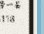

## 【帖子编号0329】

珍大户：【帖子编号0329】宠物消费大数据报告。

里面超出我预料的是，说水族类……[发呆]不知道是含小乌龟了，还是养鱼的用户真的增长很多……

就这点让我理解不了。因为我觉得人和鱼是没什么共情的，养宠物毕竟还是感情共鸣为主（不过里面到时说广东养鱼的多，难道是风水鱼的消费观念比较普及？）。

2019-07-23(12赞)

### 评论区：

- 娜娜：珍姐猫咪呼喝那个花絮，跟着珍姐笑了半天[捂脸]捂脸 太可爱了！
- 口tree：风水鱼。办公室摆财神。门口摆风水阵。广东地区信风水程度到离谱。我上次去一公司。前台旁边摆了20几尊佛像。贡品一桌子[捂脸]广东都传说金龙银龙带财运赐煞气。鱼死了还得新辟了给没死的那吃挡[捂脸]
- 口tree：我以上班公司200多人。有100多鱼缸。全民养凤尾鱼。很好养。在鱼缸还可以生小鱼。最老的老员工一批养了5年繁殖了好几代。一个绿萝养了5年[捂脸]一到过年人都回去了就会死一批。回来了再买一批。养鱼那公司成了办公室的小情仔。
- 珍大户：[发抖][发抖][发抖]真是没在那边待过就不知道当地的风土民情啊……这也太夸张了
- 口tree：之前上班公司新开员工餐厅。第一天开业某个年龄段的员工犯冲。第一天不允许去吃饭[偷笑]
- 口tree：你去香港明星信奉泰国的白龙王。之前不是传说哥哥要去拜见白龙王。白龙王说哥哥与他无缘就没见。白龙王死的时候好多明星去拍照
- 珍大户：哈哈哈哈！还有拒绝别人去消费的，见识了[捂脸]
- 三月Mars：去年家里养了几年的金鱼生病了，尴尬，前后化疗治疗花了6万多……最后还是走了……宠物医疗师特别特别昂贵……

## 【帖子编号0328】

珍大户：【帖子编号0328】

这个人群画像研究比较好玩。

二线/三线青年的消费偏好画像。

2019-07-23(16赞)

### 评论区：

- 珍大户：我印象比较深的几点：二线人均100平，三线人均140平[偷笑]几乎家家都有车了。三线素质教育还没起来，不像一二线那么重视，想要快乐童年。午休时间超长。
- 娜娜：珍姐发表的文章，留言，讨论都要看好几遍，就怕错过什么，有没有同款！呵呵！！
- 珍大户：[捂脸]哪有那么夸张
- 娜娜：真的，珍姐！不夸张！爱你么么哒！
- 娜娜：珍姐，我是属于二线城市，山东济南！最近朋友见面都是讨论有没有好项目可以做的，当然愁时比较多。我也想知道固定工作之外做点什么，光靠死工资压力太大，您觉得该投资做点哪些方面呢？坐标离着高铁写字楼比较近，离着学校很近.....不知道我问的这样有点笼统您可以回复吗？
- 大伟：点赞再看
- 欧欧141319-*：时刻关注着！
- 姜：非常贴合实际。

## 珍姐 你好！我现在

(提问)自律：珍姐 你好！我现在在做的产品从厂家拿货的价格是550，我给客户的价格是2000。因为运输需要较大的成本，所以每次出货都是厂家直接发货到全国的客户手中。最近发现厂家直接联系了我手上的这些客户，给他们的价格是1500。导致我流失了很多客户，我要降价销售吗？会不会导致恶性竞争？也是因为自己没有能力做源头

2019-07-23

回答： 【帖子编号0327】 翻出来大家讨论吧...... 这东西只有一家供应商？换厂家先。一次不守信用，以后都不跟他们合作了。____________ 先说旧客户，对于供货商来说，他抢到你的客户，你就永远抢不回了，因为你最终比人家成本低。但你如果报复的话，可以把他的出货价格继续压回到500块，等同于让他赚不到额外的抢客户带来的利润，还损失掉了你后续的新客户。 然后这个案例里的竞争关系，合作逻辑，再分析给你的新供货商说。如果他抢，也不过就是赚几单的事，你可以靠压价，把它的出厂价格继续逼回原点。他也额外赚不到钱，但跟你就断合作了…… ____________ 但这种逻辑依然防不住有些人眼红心坏还短视。 毕竟没法跟对方签供货协议，没办法事后制约对方。 所以最终你只能多负担运费了。或者直接搬厂家门口去。砍掉运费，你自己发货。毕竟你的核心优势就是你有客户，被别人把客户信息挖出来就没你什么事了。(25赞)

### 评论区：

- 希卡贝尔创始人：……突然发现自己公司好良心
- 忠信交易：做渠道的人把渠道给丢啦
- 大玮：现在这样拼缝很难生存......信息太透明了
- 百度神马号大大155*：你们是啥公司
- 希卡贝尔创始人：……今天我跟我做销售的朋友聊起来 发现我们公司真的是在做事情的 不仅不会抢渠道 还会送人脉给经销商
- 育婴师，催乳师朱静静：这样的无良供应商迟早也是倒闭
- 自律：是有其他的供应商的，但是这家价格最低，性价比也是最高的。
- 定义Caylin：一、是什么品类产品，重复博弈的次数多吗，比如类的空气净化器，可能每家就需要一台到两台，下次复购可以需要很久以后。这个信息没表述清楚。 二、解决办法很简单。沟通中表述清楚，停止拿货就行了。对方把重复博弈（跟你的多次合作）变成了可能性的单次博弈（当你发现对方不诚信的行为停止合作关系）其实站在长远的角度对T方是不利的。 三、暗黑一点的话挑一下Ta，比如有一批次品出不了手，现在采取欺骗消费者的手段低价出售这批货。因为不知道您做的具体是什么品类，所以无法给具体建议。但是不建议这么做，毕竟对双方都不利 四、重新找货源吧。并且想想避免这种问题出现的方法，毕竟最大的问题是出在你这里，你不想承担较高成本的运费，换取的代价就是别人容易挖你的客户。祝你好运[偷笑]

## 求赐教：少儿英语机构

99默·孙洁：求赐教：少儿英语机构的核心竞争力是什么？地方少儿言语机构运营中哪些最困难？ 2019-07-22(2赞)

### 评论区：

- ponytail: 我是学生家长，第一，学校要正规，老师要学历过硬。第二课程适合自己孩子，比如我家两个，小的幼儿园学的洪恩TEDDY，大的小学上的新概念。第三学费，看性价比。一般路上拉广告的幼少儿英语培训据说一年都是2W起的，在苏州，说实话我负担不起，我也不确定她们都师资怎么样。离家近的学而思要开了，一学期2000多吧，这个会在我的考虑范围内。
- 99默·孙洁: 明白，非常感谢您！
- 奔跑的柯基：考虑新东方吗
- a_陈浩：你好 学而思不是网络辅导吗？您主要看他们哪些点呀，我也是做线上教育的[呲牙]
- ponytail: 这边新东方贵啊
- ponytail: 学而思有线下的，这边新校老师简历看了一下，本科学校一般，短期还是自己上吧。
- ponytail: 我仅代表个例，公立学校家长一部分是老师补课，一部分新东方，一部分托管中心。私立学校的家长我看新东方一部分，一部分一对一家教。回答一个切合主题的，我认为核心还是培训质量。如果是课外教材培训，比如剑桥，典范什么的，至少KET这类考试有通过率。要让家长能看见有效的成果。外教很重要，不要黑人[撒啊]。幼儿英语培训我看都是外教，我家小朋友上的是1800一共15节课，外教60分钟，中教30分钟，也就是陪唱歌陪跳舞，金发碧眼的，家长很吃这一套啊。一个班16个小朋友，每次招生一般都会满，会有小朋友完了上不了。这个收费没有参考意义，政府下面办的，房租，水电估计都不收。
- 珍大户：提个问题：黑人，如果是女的可以吗？

## 华为的5G白皮书

珍大户：华为的5G白皮书。

不过感觉到现在为止，设想的应用场景还都在想象之中。

2019-07-21(24赞)

### 评论区：

- **Mr Na**：第一？？？？
- 肖恩（项目对接）：感谢分享
- 肖恩（项目对接）：我居然第二，哈哈哈
- 小辣椒：板凳
- A0异彩超台特效 启*：单枪匹马难
- 城市游侠仁：肯定会有意想不到的领域
- 大人才合一：主要目前我们对于5G的基站建设成本，运营成本不清楚，要是成本太高，不适合老百姓的消费水平，那么5G离普及还有好长一段路要走，要是成本已经得到控制，那么技术达标的情况下，上述目标都能很快实现，而且是摧枯拉朽的速度实现，其他不说，要是真的实现了，我第一个看好的就是无人驾驶汽车，无人驾驶得不到普及就是技术不达标，4G网络无法支撑。但是5G出来后，这就不是事了，当然，上述只是本人观点，不求参考，只求讨论
- 大脚：成本低了就普及了

## 眼瞅着就要到期了

yiso：眼瞅着就要到期了，续费按钮到底在哪呀……[大哭][大哭][大哭]

2019-07-19(4赞)

### 评论区：

- 珍大户：看头像感觉都没怎么发言过，原来已经默默潜水快一年了啊[偷笑] app右上角的三条横线进去能看到到期日期，据说好像离到期两个月之内才能有续费提示……我也不知道界面是啥样的，希望有朋友再续费的时候给个截图[吐牙]
- 秋心离子：我是收到一条续费消息，然后点击就可以缴费了
- 阿船：续费按钮长这样。到期前两个月会提醒
- yiso：多谢多谢，白担心了[吐牙]
- yiso：[吐牙]潜水学习各路大佬，看得多说的少，怕露怯，之前问过一次续费的事情没人回我，小透明没有存在感呀
- 离京：也有这个问题，现在知道了，多谢

## 珍姐，你认为养发馆

(提问)鞋说：珍姐，你认为养发馆这个行业怎样，治疗脱发，也有基础项目，给客人洗头按摩顺带做些洗脸拔罐服务类的。我31岁想重新创业，地点暂定湘潭。之前在广州做皮具外贸，也是因为皮具工厂过于饱和，利润极低，想转行。看好养发行业，想以品牌的形式去发展加盟商，我上半年有去行业里做得好的品牌店里工作学习，同行要么以服务为主，要么以产品（治疗脱发生发的药水或洗发水）为主，目前我也头脑短路不知道怎么去突出自己的优势，加上年龄也尴尬，未婚剩女，家人不主张我在这个时期创业（我在广州有房车）认为目前安稳找个对象为重。未婚剩女加上跨行跨省让我自己也纠结，或者考虑去深圳做跨境电商，也是从头开始，想听下您的建议，万分感谢！

2019-07-19

回答： 【帖子编号0326】 《养发馆》 你选择这个行业真的......不行。 脱发大部分是中年朝上的男人为主。其他群体就较少了，比如女性中，一般有的话，也都年龄比较大。年轻男人也少（程序员脱发？） 总之，目标人群大部分都是中年男人...... 如果纯粹是“养发”这么单一的需求，属于针对外表形象的消费了，中年男人未必愿意进去的。 中年男人有点钱的，宁愿拿钱换辆好车（永无止境），毕竟在他们概念里，车比头发更代表形象。 没点钱的，被生活压力磨砺过的，宁愿喝点酒点抽烟，潇洒一下去唱个歌、捏个脚。 还没被生活压力磨砺过的，会有点小兴趣，打牌打游戏，或者玩点电子产品，收藏个什么东西。 剩下愿意往形象上花的钱......连男装店都支撑的半死不活的，还能有多少人在意头发？ （换句话说，变美经济就基本别考虑男人了，只有女人才花这个钱） 你这铺子真开起来了，最后只会变成按摩店，以“养发”为名，按摩店为实。跟搓背捏脚洗头一个路线发展下去。(26赞)

# 有点不敢相信 珍姐

**提问：** 加减：有点不敢相信 珍姐的抖音 10天100w粉丝 是否前期火不起来 这个号就废了呢 十天里 珍姐是否买过dou+

2019-07-19

**回答：** 【帖子编号0325】当时哪有dou+功能。dou+功能是去年年底才出现的东西。（况且以我这么谨慎的性格，往未确定的东西上投钱，是不可能的……我不是冒险家那一类人。）

这就是我讲的“红利”啊，圈子内搜关键词“红利”，还能看到我之前写的帖子。我至今还记得当时的情景，在家一口气录了5个视频，包括一节《金融是什么》+四节《预防性定价策略》，一共5节，按照顺序发的。第1天可能发了三集，因为全沉了，基本没有点播量，所以我也记忆不深了。总之是挺失望的。第2天把剩下的两集发了，盯了好久还是没动静，以为又沉了，就关手机睡觉去了。心想还着，要是还没戏就可能是真没戏了吧。结果第3天早上起床，先看到中学同学群里面有人说我红了……打开一看有两万粉丝了。那个时候心里还暗暗觉得，被认识的人发现了，万一最后运营的半死不活的，得多尴尬……结果眼瞅着从两万开始就没停，手机打开抖音就直接死机。自己根本没上线，眼看着一口气奔上60万粉丝。是五个视频里的第4个，水饺的视频火了。不断有人看到那个视频，翻到我的主页，再去看其他的几个视频。虽然没怎么点播，但是这种行为被抖音记录下来是有效的，于是水饺视频被狂推播放量……

事后我和F先生有做过复盘：我们一致认为，如果再晚两个月，结果可能都是未定的了。因为两个月后，抖音的红利已经比我当初小很多了。（这个结论，是我们一路观察得到的。之前提到过，在我之前，他开过三四个抖音号当做“模拟”来练手。几个号都是没有任何含量就能一周【10万粉】那种。门槛很低，对普通人友好，这就是前期的红利。但是在进入去年9月之后，难度开始渐渐增大了。抖音拍视频的都开始团队作战，全职化，专业化。比如有个“名侦探小宇”系列，明显有类似风格的账号十几二十个，都是一个团队搞出来的。懂车侦探/老丈人说车这些，也都是一个团队的。最近又有一群30秒带你了解xx内幕……都是团队作战，大规模撒网，一口气几十个账号，只要火一个就算成功。这些团队把行业的红利稀释了。普通人跟这群有专业设备的团队比，难度顿时提升了）

另一个是运气因素。我五个视频里有一个出现了奇迹，就是这样。如果没有这个运气因素的存在，结果也很难确定。当然，最终也有我实力的体现。比如经观察，当时红利最旺的阶段，有不少账号能一天几万粉丝，甚至十几万粉丝。F先生唯一见过一次是一天30万粉丝，把他羡慕坏了。但是我第一天有60万，算是个小奇迹了，多出来这些，怎么也有一些是实力的体现吧[偷笑]但是最重要的，总结起来依然离不开所谓的“红利”，也就是趋势。外加运气因素。没有这两点，就没有多米诺骨牌的第1张牌。古人说“时”、“运”，命也。但我还是觉得有古人无法抓住规律，不能有效归因才这么说。趋势有一定程度的可观测性，运气说白了就是撞概率。(37赞)

**评论区：**
- 姗姗：嗯，抖音个人能红起来越来越难了
- 三月Mars：您觉得未来抖音红利还有多少？哪个平台的红利比较多呢？
- 各自安好：古人云“是金子总会发光”这个话说的透彻
- 晴天：我就是听了水纹后关注的，然后还给邻居看了。
- 定义Cayn：当时觉得大户啥啥都干 现在也是[捂脸]
- 南泉：大户是靠实力的。我也很幸运能看到大户的抖音并加入星球，跟对老师总是一生一大幸事！[咋舌]
- 长颈鹿：抖音有个叫“嘴碎许美达”，人特别阳光正能量，她的粉丝数量就一直在涨没停过，现在有900w了，真的是靠自己的实力赢得大家喜欢不停在涨粉。难过的时候看看她瞬间就开心了。有朋友也喜欢的吗？
- 音师帅，儒乳师朱静静*：对美达的抖音我也天天看

关注公众号“懒人找资源”，星球资源一站式服务

# 大户，很羡慕你对事物思考

**提问：** 玩似的：大户，很羡慕你对事物的思考和分析能力。最近有个让我迷茫的事，我今年33岁，2011年在悉尼大学读完商业和会计双硕士，本想留澳从事金融或会计相关工作，但在老爸强烈坚持下回国去他公司工作，七年后渡过了公司最难熬的时期后，我想从事当初心怡的投行业务，但对于我现在的年纪、没有投行工作经历、没有审计工作经历的状态来说，我要从哪里入手合适呢？才能进到这个领域呢？短期目标是圆一个投行梦，长期目标是希望在这个领域接触到有投资价值的行业、好的投资方法，未来也可以帮助家里的企业更好的打理闲置的资金。感觉如果不进入这个领域，永远都是outsider，看不清一些东西。好期待能得到指点迷津！谢谢！

2019-07-19

**回答：** 【帖子编号0324】先说结论，对你的年龄和工作经历，除非你家企业或者你亲戚家的企业，要上市或者发债，或者需要对接什么投行业务。然后你家把业务给某家投行，某家投行给你安排工作，作为交换。这种可以让你进投行。否则不可能了。 现在投行要新人首选毕业生，20出头，体力很好，能连轴转的。三十几岁的人，你身体首先就拼不过人家了。因为现在毕业生大把，想迈进投行的人有大把，有得挑。 不像十年前。那个时候，投行还没经过媒体宣传，没包装成现在这个样子。那个时候很多行业都有很好的前景，有一堆大外企，是优秀毕业生的首选。所以那个时候，还有不少28-30岁转型进修行的例子。 然而现在已经没有了。

但是今天这个帖子，加上前几天电网辞职要进证券行业的帖子，都反映出一种态度，就是外行人看金融行业，总觉得被蒙上了一层炫光。 就像是，未必多喜欢一个女生，但是看见这女生身边，有好几个汉子围着转。因为受追捧，她就变成你女神了。真得到了，反而还未觉得合适。

贴主海外教育背景，两个硕士学位，家境也很好，家里有自己的产业。 可惜就是心心想念的想要去投行……于是对现状不满意。 （包括前面发帖的朋友，国网也是很多人想要进的单位。 如果真换到券商的工作，去做开户工作，不划算的。）

—————————

题主是学商科和会计的，所以应该对审计很熟了（你同学里，肯定有不少从事审计工作的） 那么问题来了，你想做审计工作吗？ 你会像现在这么心心念念，想进投行一样，那么想去审计吗？ 你肯定不会的。 因为你心里一清二楚审计是干嘛的，你清楚了，就不会对审计做过高的评价。 同时，你的同学里会有很多人抱怨审计工作枯燥、累，你有所耳闻，心里会有一丝顾虑。

—————————

投行工作，跟审计有什么不一样？ 都是流程性、材料性的东西。 发行股票、发债需要申报什么材料，都是按照规定和要求，照着去做啊。 给一个企业包装过去三年的账目业绩，工作比做审计更高大上吗？ 给政府报送各种材料，标准格式的排版和数据，比做给公司出年报更高大上吗？ 身在里面的人，只会觉得工作的boring，加之各种抢时间、压力大，里面的人幸福指数未必有多高。 然而靠着还不错的收入，靠着媒体的宣传，靠着外人不知内情而产生的羡慕的眼光，来增加自己职业满意度而已。 （说白了，你们这些外行人的羡慕，尤其是有这光鲜家底的羡慕者，支撑了里面人的自我认可）

如果有的选，不知有多少人愿意跟你换，去当个家里有产业的富二代，而不是去投行。 （话说，投行里穷二代比较多，一般是小城市里出来的，读书比较厉害的男孩子。 考上名校后毕业进投行。 工作个几年之后收入还不错 流量比较好。 但是因为家境不给力，存量并不高，想追上一线城市的土著总显得力不从心。 所以很多人渴望在这个职业平台上，能多认识一点富家女，就像是女版的贴主，最好是海外留学过，家里有产业的土著，最好能通过结婚再跃升一次…… 但也不完全。 投行里面分层比较严重。 穷二代在投行是主要出力的，承做岗位比较多。 富二代在投行，属于承揽/拉关系的岗位比较多。 还有一些人卖嘴甜的容易做承销岗。 前几天有个女明星，不拍电视剧改进证券公司了，我猜应该是承销相关的岗位）

所以我一直觉得，这是一个完全图钱的、很现实的岗位。跟理想无关……

——————

再说的直白一点，如果拿房产中介来类比。开发商盖了个写字楼，一层5000万往外卖，结果卖不掉。房产中介看见了，帮忙给策划，把这写字楼虚拟拆分，每层拆分成5000份，每份卖2万块，最后全都卖出去了。房产中介收了销售额的5%做佣金，大赚了一笔。然后说自己处在所有行业的最顶端，有点石成金的技能，从业人员都是金领。 是一堆人性的宣传，心心念念的想当房产中介。

——————

想来想去，我还是觉得你可能心结的因素更大，而并不是因为多么“热爱”。因为投行这个行业里，并没有太多的“个性”成分，我很难想象有谁是出于本心的“热爱投行”。如果不是媒体的宣传，还会有多少人想要进投行呢？

得不到的心结，这也算是人性的弱点之一吧…… （毕竟，很多人心中最最最想要的，是“得不到”和“已失去”）就像张爱玲说的，一朵白玫瑰，你老得不到它，最后就变成了你心头萦绕的白月光，你得到了，时间久了，它就成了大白米饭粒儿。就像是女人逛街买衣服，买还是不买？犹豫犹豫的。过几天再来，如果衣服还在，反倒释然了。如果衣服不在，被别人买走了，这下就完了……心里心心念念，最起码好几天吃不下饭。

——————

这种心理被多种利用……追女生的时候，先花时间天天围着，某天突然玩消失，三天后在出现……差点“已失去”。女生吸引男生的时候，就不给个准话，非要时而亲近，时而疏远……似乎“得不到”。各种快消产业、快时尚的店铺，都要三天两头的理货，变换摆放位置。你今天看中的东西，你当天不买，下次再来位置变了，你找不着就会心心念念的惦记着。

希望大家都能摆脱这种心理的束缚。（尤其是在家庭关系上，要觉得自己老公老婆是这个世界最好的人，觉得自己的父母是最可爱的，觉得自己的孩子都是小天使……自己没有的东西，都是白菜帮子、萝卜缨子、烂咸菜根子，破烂玩意）(107赞)

**评论区：**
- 晓磊君：珍惜已拥有的～好好做个富二代，别老出来瞎折腾，搞不好赔了夫人又折兵
- A小股：太膨胀了，一下子感觉明白了...
- 小糊涂神：确实，总觉得，得不到的是最好的。
- Karwai：真的真的让我头脑清醒了很多
- 张译轩913：分析的太好了，崇拜珍大户
- 多一{分：真想当个富二代
- Rhea：珍姐真的太棒了，总能一语惊醒梦中人[强][强][强] 最后一段话说得直击人心！[玫瑰][玫瑰][玫瑰]

关注公众号"懒人找资源"，星球资源一站式服务

# 前几天说照相馆的时候

珍大户：前几天说照相馆的时候，提到照相馆最好开发一些吸引人模仿的“照片模板”，能让别人进去指名道姓的说，照着这个模板拍。

结果今天看微博，突然看见个图片很好玩[捂脸]贴图上来。

老头老太给孙子拍了个小鸡鸡的照片，然后引起了老年团体的争相模仿。

这种就是一个“照片模板”[捂脸]引发的销售。就跟到网红地标打卡似的。看见别人去这拍照了，自己也要拍一套。

https://t.zsxq.com/7eAAIA2. 2019-07-19(8赞)

**评论区：**
- 赵霞: 哈哈哈
- 城市游牧仁: 炫孙 也是一种炫富[偷笑][偷笑][偷笑]
- 刘刚: 我也要拍
- 大笨棍的: 这
- 姜科: 你在开车呢
- 刘刚: 什么?
- Jin雨汗: 生殖崇拜
- 七彩虹翼: 还好不是女孩[发呆]

同学是在儿童摄影上班的，天天就是拍这种小丁丁，而且爷爷奶奶要求做成这种，当电视背景墙或者做成大相框，是拜屏狂魔本魔了

而且听她说，每次只要是男孩都是爷爷奶奶带着来拍照，露出丁丁，各种拍，还要拍撒尿的，老人笑的合不拢嘴

# 珍姐你好，如何看待烟草行业

**提问：** 希希宫主Nikita：珍姐你好，如何看待烟草这类国企垄断行业的将来，过去由于行业的垄断特殊性，行业福利待遇甚至一度超越公务员，如今商业的发展趋势，以及政策的调整感觉未来国家会一步步解除垄断的护城河，您如何看待这类企业的将来。

2019-07-18

**回答：** 【帖子编号0323】《烟草行业》 不会的。烟草专营只会持续下去，不会拆除垄断的。国家从税收角度考虑，自然会想要有很多的专营（变相的税）。类似的产业可以分成三类：

一种是，具有“自然垄断”倾向，就算不是政府专营，也会因为市场竞争、企业合并，最后变成一家巨头。这种在经济学上叫自然垄断，比如地铁、铁路、电网、自来水网这些，因为投资大，建了一条线路之后，别人再在同样位置搞第2条线路就是脑子有病。所以自然而然就变成一家独大了。另外，投资很大的产业，比如研发成本很高（如造飞机），比如设备投入很大（炼石油）这些都有这种趋势。对这一类来说，最终早晚都是垄断。与其让资本家垄断，还不如让国家垄断。

第二种，是不具备自然垄断倾向的，而是政府强行垄断。比如古代的盐铁专营等等。比如现在的电视台隶属于广电系统。大家念叨最多的是通信运营、中石化中石化，出租车专营这些。还有福利彩票行业，殡葬相关的。这一类，本身民营可以做，被政府限制了于是极大的降低了竞争，造成居民购买产品时，要支付更高的价格……等同于损害了全国人民的利益。解除垄断能对社会有利。所以一定是从这一类入手。

第三类就是烟草了……为什么不会解除垄断。因为这玩意是对社会有害的。解除垄断，让更多的企业进入，最终结果是国民吸烟率大幅的上升，二手烟比例更高，医保等项目，负担会更重。之所以没禁烟，完全是因为：第一，烟草税收比较高，国家经营这个东西，一本万利。第二，真想完全禁止，其实也不太可能。最终走私猖獗，民间还是会有卖的。所以，既然禁不掉，还不如政府自己赚钱呢。至少赚了钱还能国家转移到医保上。否则真解禁了，私营企业赚钱，吸烟导致社会负面结果，比如医保费用上升则留给国家扛，那压力更大了。所以你们真不用担心。这种真不可能解除垄断。进了烟草行业，一辈子安稳的待在里面挺好的。（所以，大家应该能预测到，电子烟行业最终会什么样）

（关于禁不掉这件事： 美国历史上有一段时期是禁酒的，明面上禁止喝酒，结果私底下，走私酒水的贩子都发财了。小李子电影《了不起的盖茨比》里，盖茨比就是这么发家的。对人性要充分认识，烟、酒、打麻将、打游戏、红灯区、出轨，这些事情在人类社会只会永远存在，永远消失不了的……）(53赞)

**评论区：**
- 潘生：很深刻呀
- chen mō sè⁵：干货 赞
- 『a tre：东家扫货。把黄都归到惠州了。对于瘾品。前段时间不是大麻概念起飞。目前虽然管控但是上市企业还是可以拿到牌照。
- 海的浅笑：对人性要有充分认识这句话很有警示意义
- 风雨彩虹：赞！赞赞
- 希望君主Nāïü：回答的真好，赞赞赞
- 大伟：大户的经济理论说的很清楚，也能理解，就是其中一天ZF垄断盐和粮食这样的生活必需品是必须要国家垄断的，为了社会稳定，要不然现在食盐就不是一块多一斤而是几块几十块了，还有粮食，尤其遇到一些灾祸时代，粮食肯定白贵。不过可怜了种田的农民发展不起来。
- 美科：[偷笑][偷笑]我只笑笑不说话，老司机都知道。

关注公众号"懒人找资源"，星球资源一站式服务

# 同学们好，我这边是三四线小县城

**提问：** 逆 光°：同学们好，我这边是三四线的小县城。现在经营一家120平米的儿童摄影工作室。定价在我们这边相对高一些。但是一个月赚的不少，要怎样经营好一些呢？没知识没文化，第一次创业有点没有头绪。希望看到的给点意见哈

2019-07-18

**回答：** 【帖子编号0322】（照相馆）直播的时候，说了个结论，就是：照相馆会比较难经营了。除了一些少数的场景的，比如高校附近，给学生拍职场求职使用的证件照。这种是带有强烈目的的，是自身包装的一部分。和面试培训、演讲培训、化妆培训这些，属于类似的需求。但除此之外，如果仅面向个人用户的拍照，这种只会觉得越来越难经营了……

去不去照相馆，取决于几个差值：
- 1，个人的照相设备，和照相馆照相设备的差值。
- 2，个人的场景环境，和照相馆场景环境的差距。
- 3，个人的服装道具，和照相馆服装道具的差距。
- 4，个人的化妆打扮，和照相馆化妆打扮的差事。
- 5，照相技术因素……

论设备，10年前手机照相才刚刚开始应用，5年前手机的拍照的画面还是渣渣，当年还流行什么单反穷三代的说法。但是现在手机拍照水平已经开始pk掉一些入门相机了。入门的相机也让人不至于咬牙就能买得起了。

论场景，家庭装修突飞猛进，外出旅游越来越普及。连消费场所，比如咖啡馆都能变成拍照场所。

论服装道具，网上瞎买，百十块钱买个一次性的服装道具，还能开心一整天。比去照相馆省钱多了。（前几年还流行过宠物照相馆，是给猫给狗照相的，有各种可爱的狗衣服和狗道具。后来好像也没戏了。一想就知道，自己买回去自己拍，狗子在自己家里反而更放松，更容易出各种表情）

目前还没被突破的，大概就只剩下化妆和技术，这两个比较虚的因素了……中国人化妆的年代太短。上数N年，流传一种说法，说上海女人很时髦。因为当年其他各个城市的人都是素面朝天的，也就上海女人出门还擦粉。当年一说到化妆，很多人都会露怯。全都是自己又没装备，又不会下手。但是现在也在以及快的速度被扫盲。很快大家就会发现，原来照相馆的化妆师也不是专业的，原来水平还没比自己强多少……那还剩什么呢。

照相技术？坦讲，一张80分的照片和一张90分的照片摆在一起，普通人可能根本区分不出有什么区别。那么就没有卖点。不是普通人，能一眼看出这两张照片的差别，那他就已有本事自己拍到90分，也不需要照相馆。一样没卖点。

—————

这是大趋势。我们小的时候，到中学才学外语，还有电脑课，教你怎么开机怎么关机。然而对现在的孩子，普通的从小学开始学英语，起不的从幼儿园就开始学了。电脑开机关机不是天生就会吗？还用人教？每一代人的知识储备，是以极快速度膨胀的。到下一代人，如果某项技能已经成为人人都会的东西，那没必要付费给你，让你代劳了。

我的直播里类比过的例子：以前有【电梯司机】这个职业，都是负责按电梯的。以前每个单位标配【打字员】这个职业。后来人人都会了，谁还需要这些呢……

—————

当然，趋势是趋势。现在照相馆还在经营着。那么我就给出点主意：靠传统的吸引力，愿意去照相馆照相的人只会越来越少。你须开发点新的“吸引力”。像开发网红红素，引发别人模仿打卡一样，自己去设计一点照片模板。很多时候人们并不需要原创，并不需要把自己拍的独一无二。而是看到别人拍的某个场景很漂亮，自己也想照着来一套。

举个例子：现在学士硕士毕业的时候都流行一种集体往天上扔学士帽的照片。我依稀还有印象，这个照片是在某一年，突然看到的（国外某张照片）。然后这个场景就念念不忘，毕业必需扔一次，非要拍个一样的氛围出来。你们要想法设计出一些类似的让人模仿的照片。销售的时候直接引起别人“照这个拍一套”的欲望。而不是传递一种虚幻的“我们照相技术很好”的印象，这种转化率会很低，而且只会越来越低（未来用户只会自己拍照越来越多，自己拍出的“满意照片”的数量也会越来越多。他对自己拍的照片越满意，就越缺乏去照相馆照相

# 摄影师的职业前景讨论

（25赞）

评论区：
- 李俊杰：带者拍视频呗
- 叶毅稳：那摄影师呢？这个职业也是一样吗？
- 宇：短视频拍摄可以
- 逆 光°：我就主要拍儿童。拍视频的也可以加入，是个不错的点子。
- 逆 光°：照相馆都不好做那摄影师肯定也受影响的吧。
- 逆 光°：这个真可以有。
- 逆 光°：谢谢老师的回答和建议，我主拍儿童摄影，消费频率比婚纱摄影类还多一些。视频拍摄是个不错的点子，我发推荐下。
- 张三的歌：摄影师还可以去活动，杂志广告，婚礼什么的呀，应该要好些

# 冷冻冷藏及冷链物流的前景

SIMON：你好老师，想问问冷冻冷藏及冷链物流的前景如何？

我这边是一个县城，近着佛山及广州这些大城市，周边城市没有大型的冷冻仓储，我想在这边投资一个约一万吨的冷冻物流仓库，用作仓位出租，我们这边也有一些食品生产厂家对这块有仓储需求，也有一些作物流中转，你在这个怎么看，请给一点意见，谢谢

2019-07-16 (6赞)

评论区:
- 闵电：希望珍姐可以解答解答
- 姜科：土豪你好[呲牙] 一出手就是万吨级大冷库。多嘴说两句[调皮]从冷链的角度看，冻品或鲜品的每一次停留，都会增加非常多物流费用，所以生产商或者经销商在运营过程中会尽量减少了中转次数，这个特点就决定了现有冷库要么靠近生产中心，要么靠近消费中心。比如广州的大罗塘或者深圳的海吉星，都是消费性主导的冻库（批发市场）这个特点也决定了冷库做为中转运的需求并不大，1000多吨的冷库中转仓够用了，3000吨的那就是巨型中转仓了。如果你做万吨级的，就算拿2000吨做中转，那么剩下的8000吨就要拿来出租。当地是否有足够的生产商或者消费市场。这个投资可不是小数目。慎重，可以先小型的尝试一下，毕竟目前没什么政策或者市场风声会导致冷库紧缺。
- SIMON：谢谢你的意见，初期投资一定会考虑分期投资的，解答也非常到位[呲牙]
- 鹏：我就感觉你经历害啥都懂
- 姜科：懂谈不上，只是我干过的行业比较多[偷笑]较多的接触过很多东西。最开始在太仓，又到了深圳，中间还在上海和青岛工作过两三年。做过物流，重工，化工，贸易，现在又在做电商。深圳有个论坛叫家在深圳，里面有各种地产，汽车，金融，或者各行各业的知识，问题。没事的时候我就喜欢刷一刷，看看别人在做什么，有什么问题。
- 鹏：好羡慕呀
- 苏米：广州下周有个世界冷物流产业的会议可以过来听一听，发展趋势！
- 豆豆豆：如果有万吨级的体量，完全可以先花几十万找专业的咨询司司来做下市场调查，再投资不迟

# 大连金州机场附近的房产投资

...：大家好，我们大连金州这里靠海边的地方要建设机场，机场在海上，填海工程，目前建设中，以后周水子机场就搬到这里了，目前新机场附近房子碧桂园的在1万左右，靠大连金州的房子均价在7000左右。机场附近谁懂有啥可投资的，机场附近房子能涨价吗？谁懂给普及下呗！

2019-07-16 (0赞)

评论区:
- 姜科：机场一般不会带来太大升值。航道会有噪音污染，而且建筑物不能过高。填海区会有地势下沉风险。我之前在另外一个朋友圈子里说过，机场能带来的稳定就业太少，而且大多是航空公司，机场员工，货运企业，收入水平中等，并不能提升片区消费能力。对大连新机场位置不了解，但是如果只是风景不错的地方，机场的建设会带动区域配套升级，比如原本可能没有肯德基星巴克，现在会有了。但是这些会让你住的更舒服，房价涨不了太多。
- ...：因为金州这里房子，大连最便宜了。也是看看有没有机会能够小赚一笔。哈哈。看来除了噪音，没啥了。有消息称烟大连的地下隧道要开始建设，大连湾的房子也好卖了，我觉得都是中介炒的
- ...：[强][强][强]谢谢
- 晓磊君：东北都论陷了...大连岂能一枝独秀？
- 晴天：机场噪音大到不行，除了原始居民，没有人会愿意真正想住在那里。宾馆生意，因为讲机或者离得太远的人我要找个暂住的角色。因为不适合投资，酒店就少，少价格就贵。
- ...：哈哈，大连可以的。我就挺喜欢大连的环境，气候，大海，海鲜等等。
- ...：[呲牙][呲牙][呲牙][强][强][强]
- 晓磊君：我早先在大连上的大学，也非常熟悉那里，只是最后选择了离开

# 广州摄影基地的投资

□□：老师您好，我坐标西安，朋友在广州，打算在近期趁着一波电商热度在广州做摄影基地，目前找了4个股东一起投资，可能分到我手上的股份大概占10%（具体没谈，最少是10，如果还要更多就需要本人亲自过去出力而不是纯投资的那种）。请问老师这个摄影基地是否值得投资，或者我去当成一个主业去做这个事情。

2019-07-16 (2赞)

评论区：
- Alex：不值得。我有个朋友是深圳目前做的很好的，你可以来深圳考察，我让他跟你分享行业内幕。现在他们已经在转型了
- 苏米：转型什么方向了？
- Alex：做视频
- □□：也是做摄影基地吗，我近期会去一趟广州，可以留个联系方式，到时候去深圳请教一下吗
- 苏米：xiao8888
- 苏米：加个好友聊聊吧
- Alex：我微信lsting008。 对，他们摄影基地一千多平方，摄影师加美工今年可能会达到90人
- 苏米：我在广州，过来可以认识一下 [调度]

# 抖音账号被限流的逻辑

Alex：大家好。很早之前我看珍大户的抖音粉丝就破百万了，这么久过去了还是百万。
很明显被抖音限流了。我想了解被限流的逻辑和原因是什么？
因为下半年我也打算做抖音MCN。想避免一些坑。
望有熟悉抖音运作的朋友分享一下。
2019-07-16 (5赞)

评论区：
- 玉玲珑：有帖子，在圈里直接搜就可以了
- Alex：请问关键词是哪个。没有搜到
- 苏米：0314
- 四平八稳：几个月前一直会推荐，现在一次也没有。可能看你做大了，想分水。[呲牙]
- 珍大户：限流这个，可以从成本—收益角度来考虑。抖音视频播放是需要不少成本的。F先生有次算过，说我视频播放量几千万次，播放一次就费一次他们的带宽费用。也就是说光我的视频就花了抖音很多成本……而到6月之前，他们在我这，一分钱收入都没赚到，净赔钱。所以这时候他们给我限流，也能理解……直到6月份之后，每周五播全给他们贡献钞票，还接了一次广告。从那你支付宝广告开始，到现在7月中旬，突然涨了30万粉丝……所以我觉得，经济价值很重要。抖音觉得你身上赚不到钱，就没戏了。
- 珍大户：刚才按播放数据又计算了一下流量费。目前我抖音播放1.3亿次，估算抖音支持的流量费8万块。加上其他成本估计近10万了……要是看不到产出，肯定会限流了……
- Alex：如果我为了推号，每个视频都狂买dou+。那抖音还会限流吗？
- 珍大户：初始没必要这么搞，新号都是完全不限制的，利用好都应给的自然流量就可以了。但是注意，抖音是能识别机器设备的。新号最好用新手机，不要跟你的老号有任何能联系起来的地方。

# 职业转型建议：从国企IT到地产中介/咨询

□浩□：珍姐，我今年29岁，中石油做IT服务做了7年，对IT这个行业心里已经产生抵触，不想做了，很喜欢投资投机这方面，想地产相关的咨询服务，我半职业做地产投资4年。想转行原因有：1.国企上升空间太小，国企在职期间并没有树立好的职业观，感觉偏于安逸混日子，基本可以看到未来的样子。2.不想做IT，喜欢经济类的事，IT这个行业搞技术越老越贬值，我29岁再入相关业公司竞争力比较弱，但我的平项目经验，收入可以在强二线城市有15K左右月薪。我不想做IT不是因为做的不好，而是从心里就不想干，抵触，我有HCIE-RS认证，这个在数通域算是最高认证的。金融方面，我自己自学考过CIIA。3.年届近30，再不做选择感觉就走不出围城。4.最重要的是目前虽然在北京工作，但是我们编制归属在黑龙，社保纳税都在黑龙，我们说实连北漂都算不上，工作7年，年薪8万不涨反降，现在还要降本增效，我真感觉即使选择了干中介也不会比现在能差多少，没有归属感。我想选个强二线城市买房定居，入职链家做经纪人，熟悉部分区或者全市盘情况，边做中介边做自媒体，目标是做一个本市的买方咨询服务商。虽然我已经下定决心这么了，但是还是想听听珍姐的看法和建议，毕竟论从学识和认知都比强太多，谢谢！

2019-07-16 (10赞)

> 评论:
- 听说很冲：惊叹学大神，[发呆]。
- 石头：都欢迎你，我30。刚来成都1个半月，已落户
- □浩□：[偷笑]好的，有缘见
- 下困子：确实学习能力强。支持一下。考虑来福建吗？
- 七希：重庆房价7000~1.8w
- ...：大连投资德房产的加盟六七万左，门店租金在五千左右，纪人无底。我找个小投投资，让他当店长，他告诉我，在德右好干，让他当店长也开不了。他们每个月都会开，几乎所有店面不挣，有挣的，但是少数店面，而且一个社区都有十几个店面，我家这个学附近，大概有三四家店。小伙是卖房给我们的，我俩关系挺好。感觉门槛越低的业越不能干。
- ...：小伙是德深店长，忘记了
- 爱的小宝贝：珍大户不是说不可以去银行IT

# 汽油价格下降分析

【帖子编号0321】《汽油价格下降》

之前发了一个调查各地汽油价格的帖子
调查结果比较吃惊。

虽然明面上价格都是6块几，但是各地都有个别加油站直降一块八。降到4.95这种4打头的价格了……是什么直接原因导致的，我真的不知道。

记得6月看到新闻，说国内从伊L进了不少油。然而我又搜了一下，貌似最早降价的消息从4月底就出现了（见截图）。5月、6月，各地都有降价的消息。各个加油站也是优惠的一头雾水，还有的解释说，这是七一献礼……（肯定是假话）。

降价的直接原因，我确实不知道。但之前我发过一个老帖子，说经济下行时，会以通缩为主，会有各种东西暗搓搓的降价。大家可以去看一下了……

油价的影响，我继续揣测一下：

- 1，目前是个别加油站偷摸降，而不是发改委直接下调价格。

普通老百姓未必知道全市加油站哪家最低，但运输企业肯定是最消息灵敏的。所以这种油价直降30%的好事，他们肯定全享受到了。

国内目前所有讲究实效性的物流里，公路运输的比重还是比较高的。包括水果和菜、日用品的各地之间的分发……这些都靠公路。

公路运输中，油价成本一小半（几年前研究过高速公路，所以接触过这个数据，但是现在我记不清了）。油价降30%，运费至少降10%……

对物价cpi下降是个利好。

- 2，假设现在油价整体是6.8，如果发改委调油价，普降可能调到5.8或6.0。

但是个别降价，那么少数人享受到4.8，信息不灵敏的依然6.8，等于让一部分人补贴另一部分人。

6.8的普遍是私家车主，上下班开车那种【消费型支出】。4.8的必然是运输企业居多，是【生产性支出】。

当前经济环境下，优先给生产型支出以福利，也算能理解吧。

这种暗降也比较容易调整。未来经济继续低迷，那么会逐渐普降。如果经济好转，暗降的幅度会越来越小，可能大部分人都会蒙在鼓里，不知道中间发生过这些事。 https://t.zsxq.com/iuZRnuf https://t.zsxq.com/JEiQJeq

2019-07-16 (15赞)

## 评论区:

- 陈文波：前几天才加了6.8的92[撇嘴]
- 在路上：中石化说周一周五降一块，坐标山东
- 琦宝：我这边的过年前新开了一家加油站，直降5毛还免费洗车送购物券，后来周边所有加油站都纷纷降价1.5左右。再后来才知道全国很多地方都在悄咪咪降价
- 珍大户：大家各地买菜和超市的物价咋样？
- CK：垄断企业最讨厌降价，这波为何，调控的吗？
- 珍大户：不太可能是自己的行为，如果只是加油站之间相互抢客户的话，直降两毛五都能吸引不少人来了……直降5毛就能达到效果的事，根本没必要直降1.8
- 听说我说话很冲：买菜从来没有看过价格[快哭了]我是不是该改改这个毛病
- 陈磊：好像都不让降了，山东

---

**相关截图/证据**

- 中石化92号汽油直降叠加油滴最高优惠2.04元/升
  
- 【重磅消息】92号汽油直降1.5元，仅此1天！
  
- 【福利】中国石油92号汽油直降1.5元/升
  
- 中石化路南唐柏路站92号直降2元！ 最高优惠 2.25元！
  

# 茶艺插花培训机构前景

(提问) Sasa：珍姐姐，茶艺茶花培训机构有前景吗？
2019-07-15

回答：【帖子编号0320】《茶道插花》[捂脸]这个没前景！我说了一堆培训行业有前景的事。但是......茶道+插花这两个是没前景的。所谓需求分析，离不开分析人性。各种培训的前景无非就是社会的竞争压力大，人们有更多的提升自我（或者提升孩子）的需求。茶道和茶花就两个，纯粹属于消费啊！消费兴趣类的东西。脱离【经济利益驱动】的培训是没有前景的。

就说烘焙培训，培训完了，手艺好的能去开蛋糕面包店，手艺不好的对不起，自己在家里也可以做点东西吃，能省钱！茶道和插花这两个东西是烧钱的！烧钱=消费，消费就要看到底买到什么东西里。你去旅游还能发发朋友圈，标榜自己是有钱人，买的是游玩+面子（相信我，这世界纯粹只愉悦自己，假期偷摸出去玩，既不告诉同事朋友，也不发朋友圈的人......肯定不是普通老百姓）你孩子送去学钢琴还是击剑，买的是孩子的入学加分（特长加分）+你的身份标签（告诉学校你家是高收入人群）+你和/或孩子的圈子，等等一堆东西.......

——————————————

在看茶道或茶花这玩意......带不来经济价值。标榜一下自己，怕是一说自己“爱好插花”，别人都觉得是个没用又败家、还指不定情绪化又很作的人。信不信找对象别人都绕着你。

——————————

经济学上有一个“保护稀有动物”的做法。就是告诉大家这玩意能吃，值钱，有【经济价值】。大家愿意花钱买，于是养殖的人就多了，于是稀有动物就数量上去了……如果纯靠“爱好”、“热爱”、“情怀”，你信不信全世界找不出50个这么高尚的人？这种保护动物只会越来越少，最后灭绝。

——————————————

同样的道理，培训班该培训什么，大家懂了吗？别玩什么情怀、爱好。先看看经济利益在哪里。现在社会压力那么大，能随心所欲消费“爱好”的，都是富人家的女孩子，被富养的女儿，找一个月薪3000的工作，家里每月给好几万零花钱去消费的那种。如果你的目标客户群体只剩这种人，那得多稀少，不怕饿死自己吗？(32赞)

评论区：

- 媛媛：关键是这个东西人力资源公司也在做，而且是免费的沙龙之类的，为了拉住各个公司人士。如果是特别系统的学习考证的话也是免费的，因为政府有补贴给人力资源公司，当然其他地区我不知道我们这里是有的。
- [哇][哇][嗷]（^v^）：我朋友圈里就有妹子成天发自己的插花作品，总去看包蕾，歌倒。怎么说呢，感觉应该是个很费钱的妹子。
- [捣脸]：
- 茶该瑟姑：茶艺就算了把，国家都有免费培训。。。看好未来。
- 育婴师，催乳师朱静静*：珍姐真是一针见血！分析的超到位！
- 多一{分：笔记：分析事情先分析利益驱动
- 默存：经济利益驱动真是一切生意的准则
- Kk：做生意当然先看利益驱动方向
- 懒洋洋：还有一种可能是妈妈[捣脸][捣脸] 我带娃出去玩基本不拍照，有空赶紧休息休息

# 移民的新职业选择

【帖子编号0319】《移民的新职业选则》

提问的，

马上就要移民国外了，能干点啥？

移民到国外的人最常做的就是：留学中介，房产中介，海外代购。

但这三种都属于从业人数太多了……

我是比较强调大家搞差异化，别挑人多的地方跟人家正面pk。

说几个目前还没人很多，还没被做烂的：

- 1，中小学生的暑期夏令营。
- 2，带国外病号回国治病。
- 3，带国内富豪搞当地的特色旅游（比加拿大是可以猎熊的。给富人么，记得开价要一定高！）

这些都是小众的目前做的人还不少的。如果觉得麻烦的话，那么还是做代购吧。 https://t.zsxq.com/IQjq37e 2019-07-15 (19赞)

评论区：
- 张译轩913：赞
- 听说我说话很冲：抖音有一位名叫妮妮妈妈，个人看过的几个育儿号里质量综合都比较好的，就是在做夏令营，方向主要是提升孩子自身的能力和素养，增加自信。可以参考看看。
- 芊芊寸草心：我也看过
- 静夜思：抖音第一个关注妮妮妈的。哈哈
- 易鸣风水大宅设计韦伟：我也关注她了，教育孩子的理念很好，大家知道价格嘛？
- 听说我说话很冲：没问过。因为人家在美国。[回]
- 玉玲珑：我在抖音里关注的是大壮二社在英国，也在做夏校这一块

# 珠海澳门香港（摘录）

simba：【帖子编号0318】〈珠海澳门香港〉
刚好觉得写的很棒就存了下来
2019-07-15 (68赞)

评论区：
- 珍大户：太棒了
- 珍大户：还好保存了，不然我要气吐血了
- simba：刚刚好今天就存了这篇，哈哈
- simba：以前都是收藏，今天想着给朋友分享一下就保存了，哈哈，缘分缘分
- simba：珍姐姐以后也备份一下吧，要不删了太可惜了
- hanna：太棒了
- 珍大户：确实是缘分啊！文章没有在一会就消失了，能保存下来不容易
- 珍大户：帖子编号0318，不是0138……我这个马虎的[发抖]

# simba 摘录

来自 珍大户 的主题

2019/7/15 10:25

【帖子编号0138】〈珠海/香港/澳门〉

我要先说一下金融中心。

香港和瑞士，都是小地方。瑞士也算金融很发达的地方，瑞士的金融中心的地位是怎么来的呢？

## 金融中心与港澳发展前景

一个地方要成为金融中心，首先要货币币值稳定。如果当地货币币值不稳定，别人钱换成你的货币，结果还没等换走，就贬值了，那一辈子都会恨上你，再也不会跑这里来搞任何金融服务（全世界想发展金融服务的地方多了，还差你一家？）

所以在98年的时候，国家倾全国之力，也要稳住港币。因为一旦当时港币跌了，香港金融中心的位置就丢了。（而当时全中国也没有能够替代香港的城市，上海深圳当时都没发展起来呢）

在第0306贴里写过🔗 https://t.zsxq.com/mYZV3JQ
货币的价值，来源于背后的货物/商品（含服务），只要你有足够的有价值的商品相对应，货币就足够坚挺。

而，货物和商品的来源，本质是来自当地的生产力（当然，也有可能是服务能力，比如有好大学，源源不断的接受国际学生。教育也是一种商品，这种商品坚挺，就能给当地的货币提供一定程度的支撑）。

按照上面的逻辑，我们来对照瑞士和香港。

瑞士能够成为金融中心，是因为自身的生产力非常发达。精密的机器制造，造船（内陆国能造船......），制药行业、制表行业、垃圾处理行业等等等等......全都是全球领先的。

强大的生产力，导致瑞士货币坚挺，长期而缓慢的提升了其货币主权地位，进而逐渐形成了金融中心的地位。

再看香港，香港目前以服务业为主。扣掉当地居民自己的吃喝拉撒，那么四大服务业：金融、旅游、贸易、商业服务（咨询业/法律/税务等等）。

金融业是果，产生金融必有因。不可能有因为金融发达导致金融业诞生这种自循环。所以扣除金融业后，猜一下，哪些产业是香港的根基？

旅游业波动大、商业服务跟金融业息息相关。

其实就是贸易。香港能诞生金融业，本质上是因为以前大陆不开放，因为对大陆的转口贸易，导致了“本应出现在大陆的金融中心”被转移到了香港……就这么简单。

目前谈到香港金融中心，还会有很多人说是得益于香港自由的环境，昌明的法律……

啊呸。

要比自由的环境，开曼群岛不是更自由？金融中心呢？

金融中心必须要有基石，说的直白是“生产力”，更单纯点说，就是跟国力相匹配。

80年代，日本也是金融中心。我还记得学金融史，有讲过什么魔鬼交易员（尼克里森还是谁？我记性不好记不清了），那个人就是炒日元爆掉了。

现在，还有人提日本的金融中心地位吗？渐渐没落了。一朝河东，一朝河西。

上面的理解了，再继续看香港。

香港在特殊历史时期，抢占了/先行发展大陆的金融中心地位。

如果任由经济自由转移，那么香港的金融中心地位，早晚要还回来的。

如果想要不还回来，那么需要香港更加融入大陆，形成南香港、北上海的双中心格局（把深圳的金融地位直接踢出局）

这就需要：1融入大陆经济环境，2要到中央的支持。

但香港现在，是有点反其道而为。用闹的方式……可惜他们忘了，单凭自己的能力，是根本不可能有金融中心的地位的。

想要硬气的杠，最起码自己本事很大。然而香港目前连广州的GDP都不如（未来还会落差更大），单凭他们自己，连稳定港币的能力都没有，这时候还闹，就属于自己拎不清了。

说完香港，再说澳门。

澳门当地的产业，旅游业（博彩业）……其实也比较单一。

澳门从来也没发展出金融中心的地位。未来也不可能，珠海更不可能（这句话算是直接回答提问）

澳门最好的选择，当然是跟珠海一体化，这样可以利用其自身的优势，在珠海继续发展其他产业。（比如现在就在发展教育业，在珠海建更大的大学城，招更多的学生）

我们上面说的香港应该做的两件事，澳门正在做。选择更加跟内地融合、更加争取政府支持。促进旅游、博彩业的发展。

（旅游业是波动很大的行业，一有什么负面消息，很快就会打击到旅游业。所以香港继续闹，旅游业也受影响。）

这就是港澳之间的差异了。澳门对大陆不排斥、还争取支持，香港还抱着自己的小圈子，玩抬杠。

一个证据就是珠港澳大桥，竟然没有链接深圳……简直是sb行为。（听说因为香港不同意）

以上逻辑都说完，再说一下这几个城市的前景。

目前整个长三角大湾区里，扛鼎是深圳，其次是广州，之后才是香港。

周边城市的发展前景跟深圳更相关。

珠港澳大桥没带上深圳，所以经济价值很难发挥出来（主要是政治意义）。

记得之前有提问，问珠港澳大桥能不能让珠海受益。我的回答是：比较微弱……因为香港已经很产业空心化了

（一座外强中干、影响力日下降的城市。贸易业会被沪深港口抢夺份额；旅游业看着港片长大的70 80后是主力，等90后00后长大，香港的旅游业也会受影响）

香港的产业中很难有向外转移的成分存在。所以除了一些去珠海买养老房的香港人，似乎意义很有限。

反倒是澳门会对珠海更有利，比如教育业的延伸，可惜澳门的体量有限。未来还是等垮珠江的大桥或者隧道的开通吧。

## 横琴与澳门会一体化

**提问** Hitler：横琴与澳门会一体化吗？

横琴与澳门现在已经无缝连接了口岸24小时开放。

横琴和前海将来是否会成为中国的金融中心之一？

2019-07-15

**回答：【帖子编号0318】（珠海/香港/澳门）**

我要先说一下金融中心。香港和瑞士，都是小地方。瑞士也算金融很发达的地方，瑞士的金融中心的地位是怎么来的呢？一个地方要成为金融中心，首先要货币币值稳定。如果当地货币币值不稳定，别人钱换成你的货币，结果还没等换走，就贬值了，那一辈子都会恨上你，再也不会跑这里来搞任何金融服务（全世界想发展金融服务的地方多了，还差你一家？）所以在98年的时候，国家倾全国之力，也要稳住港币。因为一旦当时港币跌了，香港金融中心的位置就丢了。（而当时全中国也没有能够替代香港的城市，上海深圳当时都没发展起来呢）在第0306贴里写过 货币的价值，来源于背后的货物/商品（含服务），只要你有足够的有价值的商品相对应，货币就足够坚挺。 而，货物和商品的来源，本质是来自当地的生产力（当然，也有可能是服务能力，比如有好大学，源源不断的接受国际学生。教育也是一种商品，这种商品坚挺，就能给当地的货币提供一定程度的支撑）。

按照上面的逻辑，我们来对照瑞士和香港。 瑞士能够成为金融中心，是因为自身的生产力非常发达。精密的机器制造，造船（内陆国能造船……），制药行业、制表行业、垃圾处理行业等等等等......全都是全球领先的。强大的生产力，导致瑞士货币坚挺，长期而缓慢的提升了其货币主权地位，进而逐渐形成了金融中心的地位。

再看香港，香港目前以服务业为主。 扣除当地居民自己的吃喝拉撒，那么四大服务业：金融、旅游、贸易、商业服务（咨询业/法律/税务等）。 金融业是果，产生金融必有因。不可能有因为金融发达导致金融业诞生这种自循环。所以扣除金融业后，猜一下，哪些产业是香港的根基？旅游业波动大、商业服务跟金融业息息相关。其实就是贸易。香港能诞生金融业，本质是因为以前大陆不开放，因为对大陆的转口贸易，导致了“本应出现在大陆的金融中心”被转移到了香港……就这么简单。目前谈到香港金融中心，还会有很多人说是得益于香港自由的环境，昌明的法律……啊呸。要比自由的环境，开曼群岛不是更自由？金融中心呢？金融中心必须要有基石，说的直白是“生产力”，更单纯点说，就是跟国力相匹配。80年代，日本也是金融中心。我还记得学金融史，有讲过什么魔鬼交易员（尼克里森还是谁？我记性不好记不清了），那个人就是炒日元爆掉了。现在，还有人提日本的金融中心地位吗？渐渐没落了。一朝河东，一朝河西。

上面的理解了，再继续看香港。香港在特殊历史时期，抢占了/先行发展大陆的金融中心地位。如果任由经济自由转移，那么香港的金融中心地位，早晚要还回来的。如果想要不还回来，那么需要香港更加融入大陆，形成南香港、北上海的双中心格局（把深圳的金融地位直接踢出局）这就需要注意：1融入大陆经济环境，2要到中央的支持。但香港现在，是有反其道而行。用闹的方式……可惜他们忘了，单凭自己的，是根不可能有金融中心的地位的。想要硬气的扛，最起码自己本事很大。然而香港目前连广州的GDP都不如（未来还落差更大），单凭他们自己，连稳定港币的能力都没有，这时候还闹，就属于自己拎不清了。

说完香港，再说澳门。澳门当地的产业，旅游业（博彩业）……其实也比较单一。澳门从来也没发展出金融中心的地位。未来也不可能，珠海更不可能（这句话算是直接回答提问）澳门最好的选择，当然是跟珠海一体化，这样可以利用其自身的优势，在珠海继续发展其他产业。（比如现在就在发展教育业，在珠海建更大的大学城，招更多的学生）我们上面说的香港应该做的两件事，澳门正在做。选择更加跟内地融合、更加争取政府支持。促进旅游、博彩业的发展。（旅游业是波动很大的行业，一有什么负面消息，很快就会打击到旅游业。所以香港继续闹，旅游业也受影响。）这就是港澳之间的差异了。澳门对大陆不排斥、还争取支持，香港还抱着自己的小圈子，玩抬杠。一个证据就是珠港澳大桥，竟然没有链接深圳……简直是sb行为。（听说是因为香港不同意）

以上逻辑都说完，再说一下这几个城市的前景。目前整个长三角大湾区里，扛鼎是深圳，其次是广州，之后才是香港。周边城市的发展前景跟深圳更相关。珠港澳大桥没带上深圳，所以经济价值很难发挥出来（主要是政治意义）。记得之前有提问，问珠港澳大桥能不能让珠海受益。我的回答是：比较微弱……因为香港已经很产业空心化了（一座外强中干、影响力日下降的城市。贸易业会被沪深的港口抢夺份额；旅游业看着港片长大的70 80后是主力，等90后00后长大，香港的旅游业也会受影响）香港的产业中很难有向外转移的成分存在。所以除了一些去珠海买养老房的香港人，似乎意义很有限。反倒是澳门会对珠海更有利，比如教育业的延伸，可惜澳门的体量有限。未来还是等垮珠江的大桥或者隧道的开通吧。

(63赞)

**评论区：**
- Georgie□□：哈哈哈，看到啊听我就笑了
- 珍大户：目前是下午3点，经过5小时的抢救茄子终于回来了[可怜]
- Hster：谢谢珍姐 我爱你
- 麦兜菠萝油王子：就是这一篇吗 珍姐
- □道法自然：好文啊啊，营养丰富
- 麦兜菠萝油王子：没刷啊 大户 不要方
- 珍大户：后面我球星官方沟通找回来的[发抖]
- 麦兜菠萝油王子：这样也能翻牌 我以后认准这个时间了[阴险]

关注公众号“懒人找资源”，星球资源一站式服务

## 【7月13号直播】

石头：【7月13号直播】

1. **【职业培训】**
   - 所有培训都在上升期，但你要区分TO B,TO C，看你的能力，面对大客户销售强，就做to b...小客户的就要做市场，看你自己优势

2. **【二线城市的崛起是小城市衰败为代价】**
   - 人口哪来的，都是吸来的

3. **【高考落榜】**
   - 再考一下吧，未来还是很重要的，不用很高，差一点的本科也行，学历是基础，技能，证书是加分

4. **【手环】**
   - 颈椎病，心率会过快，要时刻监督

5. **【大庆=资源城市类】**
   - 石油类的铁饭碗会马上没有了，已经是下破路了

6. **【甲醛治理，可以搞】**
   - 可以搞，有风险，现有技术基本解决不了，但需求很火

7. **【公司倒闭，拿钱走人，还是调去分公司】**
   - 拿钱走人

8. **【亚马逊外贸，可以做】**
   - 做的人也挺多，但还在不完全竞争中…需要花点时间去找什么没被人发现，细分市场空白还是有的，中国是货源国，什么都有，这个品类做烂了还能换一个

9. **【孩子启蒙英语软件分销，不要做】**
   - 家长是付费者，使用者是孩子；家长想要被解放

10. **【付费者，使用者，分离】**
    - 国内大学宿舍，我们的宿舍费其实是不够，政府补贴是大头，国内大学宿舍不太考虑学生感受...国外大学宿舍，是门生意，学生自己出钱选择，所以就得好好服务

11. **【小孩游乐园】**
    - 孩子喜新厌旧，很难重复消费；刚开业孩子都去玩，几个月后孩子就越来越少来，父母也不会让孩子每天都去，孩子去几次就没兴趣了，这个只能是打游击，这个商场搞几个月，然后换地，游乐园没有锁客能力

12. **【社保以后不够兑付？】**
    - 社保不用担心，要买；社保是大锅饭，年轻的时候交2000,老的时候可能领1w也可能领100，…不管领多少，是平均的…能保证你老年不会比别人差，这是帮你老年兜底的…商业保险没有这个属性，只能保证你现在交10元，以后能拿12元

13. **【玉雕萎缩】**
    - 上一辈喜欢的东西，喜欢的人越来越少

14. **【房子都卖不出去，你们还想卖家具】**
    - 建材，灯，下游行业也不会太好

15. **【轻食，可以，有点难】**
    - 这是健身行业的下游行业，你要关联上游，不支持实体店

16. **【金融底层业务员，卖信用卡】**
    - 换个工作吧，信用卡夕阳了，刷卡机都慢慢淘汰了

17. **【刷脸机,不好做】**
    - 让商铺买poss机,商家会为了提升营业额,商家愿意的,二维码也愿意的…刷脸机,商家就没事啥动力,谁 wouldn't 不带手机呢?

18. **【养老房---城市】**
    - 鲅鱼圈,威海,西双版纳,养老资源比较好的,养老房不要买,自己工作在那边就算了,所有养老房信息都是房地产捧出来的,这些房地产只卖一手房,不会帮你卖二手房,开发商卖完房一走.你的二手房随帮你打广告卖二手房

19. **【省会--强市--更小的城市】**
    - 第三类城市,没有红利,都是人口流出;强市,在经济好省,省里老二才会有机会,江苏-苏州,浙江-宁波;省会,也不是都行,石家庄,昆明,海口,太原,也是很难搞.

20. **【大连,现在不行了】**
    - 大连地理位置对外很好,对内不行,哈尔滨也是,2001年加入WTO，中日蜜月期，大连就很好，现在国内主要是靠内需，不再依赖出口

21. **【口红】**
    - 彩妆行业门槛最低的，媒体集体营销的结果，人们消费力越来越强了

22. **【考研要不要】**
    - 有找工作赶紧去，学历就是工具；考研如果能让工作有直接的提升，就可以...考研也是投资啊，要看投入和收益比

23. **【宠物店怎么激发老顾客热情】**
    - 办联谊，让大家玩起来，交流起来，要有一点公益心，去承担一点社会责任

24. **【女仆咖啡厅】**
    - 不太行啊，会被骂吧，阻力还是挺大的，还不如撸猫咖啡厅...宅男是消费能力最低的...结伴出门消费才高；女仆咖啡厅，网上看看可以，真的开店，消费频率还是太低了

2019-07-13(88赞)

**评论区：**
- 听说我说话很冲：课代表威武。
- 大米~~：我今天听了全程，但是被你这么一分析才知道我有这么多没听到和明白的，厉害，辛苦了
- 石头：[愉快]共同进步
- 石头：[调皮]
- 大米~~：好的，一起加油
- □a tree□：社保缴纳。按我的想法二胎开放后的这批成年后正是我们养老的时候，这批新增人口的缴纳支付，能够养的起我们这一批的。现在在这批是88.00后这批人数少养不起现在这批60-70后。90后的付出供养社会会在养老的时候得到回报的。
- a tree□□：然后说说个人观点关于大城市发展牺牲小城市为代价，个人觉得还没有到那个阶段，目前农村人口还没有完全迭代结束，农村人口很大一部份会填到小城市。比如政府回收农民土地。土地改革。农民很大一部份还是亏不到大城市。基本会填到小城市。
- HG：第一个没看懂，怎么判断自己适合to B还是toC； toB是否对全方位能力要求更高点？

关注公众号"懒人找资源"，星球资源一站式服务

## 珍老师您好，在抖音

**提问** 叶巍穗:珍老师您好，在抖音发现您后觉得您真是一个宝藏女孩，果断加入星球，刚加入不久我朋友就遇到了一个创业上的问题，请教您一下。她是学美术的，在重庆洪崖洞有一个小门面，给游客画漫画像，画一张大概十几分钟，由于重庆近几年很火网红城市一到节假日特别是洪崖洞网红景区人流量相当大，所以生意不错，平时生意也不错。最近有一个财大气粗的老板在她门面对面盘下了一个更大的门面，而且请了15个画师，其中有2小有名气，有一个画师在抖音有十几万粉丝，算是小网红，现在她们在画画实力上不相伯仲，但是她们没有大老板有钱，大老板就想把他们挤出这个景区，并且霸占她们在朝天门另一个景区的位置。现在该如何做呢？她想在抖音当网红思路对吗？

2019-07-13

**回答：【帖子编号0317】（形象营销）**

女的？你知道那种民国风的衣服吗？上半身青衫下半身长裙，穿上再画画。记得让她留上长发，直的，不能烫。如果化妆，只往白了化，不要往彩了化。（形象参考南笙、张辛苑）摆出一副文青的，不食人间烟火的样子，继续画画就行了。对面的画师比不上的。

她这种业务，搞什么抖音、当什么网红是没意义的。首先，她没有持续的潜力。就算抖音一时火了，也只能像摔碗酒一样。吸引一时的眼球可以，但用不了多久就会被观众忘掉。（相反，如果能有的持续的潜力，那么值得经营抖音。经营是有价值的）其次，如果没有持续潜力，那么，爆红最大的价值是带货。比如你是某个厂商，生产某种产品，那么带货价值是很大的。抖音火了后，月销几十万件xx都是可能的。所以就算不持久，但至少能赚几个月的钱。这是商人经营抖音的价值。而这个画师小朋友，15分钟一幅画，一个小时最多4幅，产能又无法扩大，火了有什么用？

(31赞)

**评论区:**
- 叶毅穗:啊啊啊，好激动，珍老师回答我问题了，首先感谢珍老师抽出宝贵的时间解答我的问题。她其实是想抓住重庆旅游业最近很发达的一波红利，毕竟重庆现在是网红城市，洪崖洞是网红景点，洪崖洞那个位置如果在节假日，流量大得可怕，就算是平时也是有相当大的人流，她的竞争对手在她门面的对面租了一个更大的门面，请了15个画师，现在每天生意好到爆，还找了洪崖洞负责人签了独家协议，要把她们挤出去。所以她现在没有办法。她之前已经把看过的客户加到了微信，加满了好几个微信了，很多客户已经二次成交，比如画像送朋友礼物，她也做其他的业务，设计类的，所以只要还在洪崖洞她的流量就会一直源源不断，再导流到微信做二次或者多次成交。现在她的问题就是，她竞争对手要把她挤出去，被挤出去之后她流量不能断呀，她就想到了打造自己的品牌，IP，自己做网红，想火起来，她现在还有另外一个地方的门面，想打造一个网红店出来。所以这种做法，可行吗？成功几率大吗？她自己不太会运营，也不会打造IP啥的，准备招一个人做这个，或者找那种代运营机构，也不知道靠谱不。
- 宇:打卡
- 叶毅穗:对的，女的，而且长得还不错的那种，性格也很好，很开朗
- 阿聪:按大师的建议打扮好以后，圈内先蹲为快[嗷牙]
- 空白记忆:老师就是老师，这样搞打扮成比较淡然清新脱俗，仿佛不识人间的仙子，沉迷于绘画。她不需要将自己将自己打造成网红，游客会让她火起来。还有感觉家养不如野生的。
- 岑岑:哎，我看着都为您着急
- 兔.双而开心:我接不到0317的贴子啊！好着急
- 七彩希雯:然后裙子后面放仙气。然后打造一个只有她独有的具有吸引力的物件或者其他。比如抽签对应画框和风格，顾客除非vip才有选择权，像焦糖画那种指针抽奖，很多人不是为了味道，而且玩那个和观赏。[偷笑]以上纯属胡诌

关注公众号“懒人找资源”，星球资源一站式服务

## 珍姐，我是刚刚加入

**提问 (Mika)**：珍姐，我是刚刚加入星球的小白，我想问您一下关于纹身行业有没有得做，近期看见不少人在学这个，貌似利润可观，请您给分析一下，万分感谢，坐标北京，小众行业，目前基础收费论图案收费，高级的师傅按小时收费。

2019-07-13

**回答**：【帖子编号0316】《纹身》 第1次出现关于纹身的提问[呲牙]
这个绝对有的做。
第一，服务业，无法替代。
第二，现在还算小众的，行业还没竞争到激烈的程度。目前客单价还挺高。

如果经营的话，注意侧重点：
- 第一，纹身是一个小众群体。这群人自己的群体特性，有自己的群体审美认知眼光。作为店主，你自己的穿着打扮，你店铺的装修风格，一定要跟这个群体融入，别让人感觉你和他们不是一个世界的人。
- 第二，纹身顾客的担心点之一，审美不好/或者手艺不好。手艺和审美要跟上。就跟纹眉似的，你纹坏一个，店铺口碑就难以挽回了。
- 第三，顾客的另一个担心点是卫生问题。纹身因为有血液接触，被认为是“如果消毒不规范，是容易传染艾滋病的”。同理与洗牙，但洗牙单位一般是以诊所的形式，诊所会让人觉得卫生问题有保障。而纹身店不具备这种特质，所以你们要想法打消顾客的疑虑。虽然我一家纹身店也没见过。虽然电视上演的纹身店，都是昏暗的小馆子，给街头gangster准备的似的。但要注意，在北京这种一线城市（二线城市也一样），能接受单次上千元消费、有消费力的年轻人们，普遍教育水平比较好，只不过因为思想开放，接受多元化的文化，所以才纹身的。你店面可以任何风格，哥特也不要紧。但操作台（类似于手术室的地方）一定要干净明亮，消毒严格，做好卫生防控问题。千万不要像电影那种苍蝇馆子似的。(19赞)

**评论区**：
- 兔.双面赤心：我在珍姐的圈里真是大开了眼界，这里说的话题涉及到了各种行业，我是有一种足不出户能知天下事的感觉
- 珍大户：[呲牙]
- 媛媛：我从进了圈子这几天一直在追贴，太长见识了
- 定义Cabin：我补充一下吧，纹身是技术不断精进的一个行业，很多人早些年用差一点的色料纹的不是发蓝就是褪色褪不掉，这个时候改纹身就是一个技术活了。一定要往这个方向去突破，我身边有几个人不错的朋友都是当地小有名气的纹身师，如下的作品大家可以观摩一下[呲牙]
- 宇：打卡
- 兔.双而乔心：好漂亮啊
- 兔.双而乔心：感谢珍姐组织了这个圈子，这圈子对我的帮助太人了
- 程三岁：曾经的纹身师默默飘过

关注公众号"懒人找资源"，星球资源一站式服务

## 珍老师：能不能聊聊

**提问 (小杜)**：珍老师：能不能聊聊中欧国际工商管理学院EMBA含金量，我现在领导在上他们这个课，我很好奇这个有啥用，学费贵的吓人/捂脸……

2019-07-13

**回答**：【帖子编号0315】〈EMBA〉EMBA我真的了解不多。
毕竟27-35岁的企业中层去读mba，40-50岁的高层去读emba，宣传和定位一般都是这么分的……所以我是够不上那个级别，也就没接触过。
但是两个年龄段和圈层的人群有明显不同，所以需求也是不同的。

像读mba这种，平均工作年限在5-7年左右，基本是刷学历+提升工作竞争力，目的是为了升职，或者跳槽。那么选择是比较多的。
真狠下心来，工作一丢，去香港或者国外读一年书然后职场重新新开始，也不是不可能。毕竟工作年头短，沉没成本低。
所以虽然mba也挺贵的，但是还会受到其他各种竞品的价格所限制。

但是到EMBA这种，就完全不同了。年龄最起码40岁以上，工作经历20年+，这些人的沉没成本是极高的，所以绝对不会放弃自己已有的，跑去国外读书什么的。等于没有外界竞品。这些人里，有的就是自己的企业，有的是职业经理人，但职位上升空间也基本到头了，想跳槽的概率也不是太高了。
那么目的，就不是学学历（四五十岁的人还需要学历干嘛呢？），也不是重新创业或者升职或跳槽，毕竟沉没成本太高。

emba目的很精准，基本是做资源整合。每个人进校之前，都觉得自己是自己原有的小圈子里的人中龙凤了，但不知道别人都是做啥的，想去看看，了解了解。万一发现更好的项目，万一有人牵线搭桥，赚的钱肯定比学费多多了。以“学习”为名的资源整合。

与此类似的，上海松江的高尔夫俱乐部算是。以“休闲”为名的。会员费也要上百万。（当年f先生很想去看看，跟我说这要是就5万8万的也搞一个玩玩呗，结果进去一看……根本不是我们能消费的起的东西[流汗]）

这次去杭州，认识一个来支援我的朋友，是枪械俱乐部的（国内的，真枪）。据说去玩一次实弹射击就要五万八万……听完我就乍舌，感觉真是纯烧钱的玩意，反正我是消费不起。（对比我在国外的时候玩实弹射击，100美元都不到……）

想想走在大街上，开百万豪车的人没谁是贷款买车，其身价为负。自从邓文迪出名以后，头等舱也挤进了不少本无力消费，但抱着认识别人心态的乘客。但是高尔夫俱乐部至少不会让你贷款买会员。所以筛选出一堆有钱人，指不定认识谁。这种预期是很吸引人的。

————————
最后忍不住问一下，现在EMBA学费要多少了？
记得刚工作的时候，听闻别人谈起过。当时学费还不算贵，但据说进去吃喝玩乐的花销很大…….说读下来，跟同学一起吃喝玩乐花了100多万（08年的数字）…….
现在感觉mba和emba越来越低龄化。mba还好说，同学之间差距未必太大。到emba这种，差距可能就很了，如果圈子没到，强行融入也没有什么意义。

————————
忍不住想要吐槽几句：
记得我刚入学时时候，也曾经受过有几个没品同学的白眼。因为学校通讯录只写工作单位，我单位是保险公司，很多人会带有色眼镜。另外，当时我自己也是穿的没品又土气。后来一眼感觉到别人的眼光，回到家跟F先生抱怨。F先生也说我该花点钱在身上了，带着我跑去商场买衣服。后来渐渐把衣柜全部更新了……. 然后我人生第一次去烫了头发……以前为了省钱，都是随便剪剪就完事了，读mba第一年时，没少倒腾发型，烫了很多次。（不过后来想开了，也就懒得管发型了）
工作单位的事，我自己耍了点心机，带了名片去学校，借机找了几个同学聊工作之后互换名片，也解决了。
几件事情同时着手，很快白眼就消失了。但朋友肯定是没得做了……(25赞)

**评论区**：
- 肖愚 (项目对接)：学习了，我居然是第一个来发表心得体会的，[呲牙]
- 一笑：这个学习了很。。
- 姜科：哈哈，俺不够读MBA和EMBA的资格[偷笑]，见我前老板读过中欧的EMBA，他会09，10年好像是60万，班费和活动支出更多，好像一共花了150万。老板读这个还是很有用的，前公司有个宁波大客户就是老板的EMBA同学，到我离职还在合作，一年有七八千万的毛利。
- 小杜：貌似去读这个的都是去结交人脉去了
- 珍大户：果然班费和活动支出是大大……有些领域没接触过是很难猜猜出来的。比如我就完全想想不到，一堆人来读活动经费人均90万，得玩成啥样……没经历很难想象。记得那里有个粉丝是这种富家，收集手办就花了两百多万，豪车好多辆，读书时每年几百万的花销，全世界各地都玩过了。 然后现在想收心创业，问我能饭啥。我说你这种我指导不了。只能给个方向，就是要利用好自己这种独一无二的经历。千万别去做普通人都能看见的项目，要做就做普通人没见过的，给你这同等档次富豪提供的吃喝玩乐项目。普通人自己没有经历过，想服务这些富豪，是难以服务到位的。所以富人的项目还得富人做……
- 宁：打卡。
- （`ˇ`v`ˇ`）：经常听梁冬吴伯凡的 冬吴同学会。梁冬就讲他读了中欧emba，记得他说过这个很重要的逻辑是：不是读了emba才成为了企业家，而且成了企业家的才会去读emba。
- 珍大户：对的[偷笑]

关注公众号"懒人找资源"，星球资源一站式服务

## 珍姐，站在一个职业

**提问 (杨浩森)**：珍姐，站在一个职业选择的十字路口上，想寻求您的帮助听听您的意见。我是18年立信毕业的，专业是金融，做了一年的风投（在某政府引导基金），觉着凭自己的学历在公司升不上去（公司除了我都是交大、复旦、上财的研究生）。

然后就辞职来了成都，想转行做互联网，自学了2个月，现在接到了第一个offer，是中国平安的java开发，正编的，但工资很低，实习期一个月只有2850，转正要看绩效定，说是2个月有一次考核，考核过了涨300-500的工资，我不知道要不要去，总会担心自己进了以后会发展不好，毕竟保险公司名声真的太差了，想问问您该不该接受这个offer。

2019-07-13

**回答**：教育背景是金融，又学了计算机，发展方向走复合人才路线，是交叉领域。但这份工作千万不要去。金融行业内，小企业少，基本都是大企业的天下。大企业在招人的时候很刻板，谈薪水很容易参考上份工资，给你个30%的涨幅就算跳槽加薪了（很优秀的有可能50%，但基本没有公司会接受100%的加薪，否则hr会受质疑，说怎么招来个水货。hr为了免受质疑宁愿不召你换别人）这种游戏规则就造成了，你前一份工作的起薪是很致命的，只要你未来一直在大公司里转悠，那么5年后都会受到这份工资的影响……这个时候，宁可端着，在没有好去处的时候，宁愿找收入福利差的小公司拿6000块也比接受“大公司3000元”这种选项强。(14赞)

**评论区**：
- Nash：你这款java没啥经验，又是进平安，平安技术也不是很差吧，可以去里面待几个月，提升经验。做软件如果没经验，很难找到工作。
- 杨浩森：谢谢珍姐，那我就先拿着这个offer再去多面试一些公司看看
- 宇：也是个保险程序员路过。说实在的，技术好哪里都可以。很多保险代理公司也在发展互联网渠道了。给的薪酬也非常不错。
- 杨浩森：流下了没技术的眼泪
- 程三岁：大把的JAVA想型到我们公司来，可是我们只要高极的，说的难听点就是烂大街了，如果是学的新语言，即使是个学校教行业需求这一点能高新就业的机会就很大了，前几天招了个初级python，国内税前薪资9k。因为公司急缺直接给了15k的薪资
- 程三岁：况且如果你想更好的发展建议去专注开发的技术公司，虽然工资也低，但是各个领域的前辈多，能学到不少东西，JAVA只是基础语言，必须提升自己

关注公众号"懒人找资源"，星球资源一站式服务

## 作为第57名加入大

定义Calvin：

作为第57名加入大户圈的老圈友深夜附上一篇心得。

我们常常有这样的感觉，跟朋友聊天，聊起他的生意，就觉 得好轻松好赚钱，然后就开始后悔：为什么我当时选了这样 个难做的行业，为什么我没选那个行业呢？

其实呢，这种情况或许真的有，但大部分情况，其实也许这 是一个错觉，归结为以下五点：

- 第一、又轻松又好赚的生意，可能确实有，但实际概率并不 大，因为只要有利润，就会有蜂拥的跟随者进入竞争，将利 润拉低或者把客户抢走一部分。

所以即使你看到一个朋友他在躺赚，那可能是存在这两种情 况。第一是他有垄断资源，阻挡了竞争者。第二是他赶上了 风口，比如早期的区块链。

- 第二、真实的情况可能是，他只告诉了你这个行业好的一 面，另一面却没有跟你讲。

这就像很多办公室白领感叹一个路边卖煎饼果子的可以月入 三万，其实他没有想过卖煎饼果子要每天凌晨两点起来备 料，全年无休的。

快销品行业频次高、用户面广，但渠道铺货要求高、单价低 呀。奶茶就比芒果饮品这个种类适应面更广，但竞争者也多 呀。咨询行业投资小、不需要解决供应链、制造等等那么复 杂的问题，但它规模很难做大呀。瓷砖行业毛利高，但它关 注度低、消费频次低、获客成本高呀。手机行业硬件软件都能赚钱，但它资本要求高、迭代速度太快呀。

- 第三、有许多因为羡慕一个行业而盲目进入的创业者，进入前满脑子都是这个行业的好。你看餐饮业，市场又大，频次又高，竞争者和从业人员素质又低，我进去就秒杀他们嘛。

然后他一进入，就发现遇到了完全没有想象过的困难。接着他就开始羡慕别的行业，其实进入别的行业又会遇到新的困难，只有你慢慢在这个行业深耕下去，你多年之后才会成为别人眼中被羡慕的行业。因为你看起来很轻松。

- 第四、别人说起自己的生意很好赚，还有一个背景可能是，他具备了你不具备的优势，所以看起来才轻松。

樊登读书看起来是个好生意，可是你知道樊登是当年的国际大专辩论赛最佳辩手吗？他不仅仅是90年代的西安交大管理系研究生，北师大传媒专业博士，又在央视做了多年主持人，还是北京交大传播学研究所所长。

你觉得读书会好赚，目标是樊登，那就先看看他过去是怎么回事吧。

- 第五、我们去做一件事，还常常是因为有个朋友告诉你，他有某些资源，可以来做这个生意。结果你一进去才会发现，你所具备的资源，不过就是这个行业的基础门槛而已，大的巨头随时都可以碾压你。

在没有充分了解之前，千万不要冲动，觉得这个是好生意。有时候我们总是看到大量的机会，但是真的要有定力，那个钱不是你能赚到的。

## 第六、祝大家多金。

2019-07-12(105赞)

**评论区**：
- 王辉华：说的太好了[强][强]
- 刘刚：真的用心了[强]
- 周小妹：真的是这样，以前觉得建材圈还不错，进来后才知道，这个圈子很微妙。
- 刘峰：深刻领会，才能写出来的
- 画眉伏⑧：说，你又羡慕谁了[得意]
- 星：我觉得对一个行业的喜欢和热情可能比盲目跟风更重要，热爱会深入研究不轻言放弃，才可能长久
- 宝哥：公平，公正
- 完美主义法人代表□：不记得我是前一百名还是前两百名进来的了[握手]

关注公众号"懒人找资源"，星球资源一站式服务

## 珍老师您好，我是一

**提问 (医美扛把子)**：珍老师您好，我是一家医美医院的销售顾问，我们是针对的是中高端市场，不搞低价促销广告，靠的是口碑效果口口相传。公司这几年业绩成长非常快，而且在几个一线城市布局开直营。那对于我来说，我想增加获客渠道，有的大咖本就是开连锁美容院，有的是小网红，微信好友几千人。但我要如何拓展我的客户群体和团队呢？很多大咖也在小红书和抖音微博上发我们的案例文案了，现在再去找她们竞争，觉得精力投入大未必能有产能。请老师指点迷津。

2019-07-09

**回答**：【帖子编号0314】《新时代的广告能力》看见你们经营的还不错，是挺好的消息。我看了一遍问题，觉得你想问的，应该是自己的销售如何开展？拓展客户问题。你们医院有案例，然而已经有人先下手为强，先抢占各个新媒体渠道了，所以你不知道该怎么做了，是不是？[偷笑]
_——__新媒体渠道很大，不是有别人先去做丁，你就不能去了，你还是要去做的。但问题是，你想把你们院统一的文案再重复发出，这是不行的。对新媒体来说，复制粘贴是无效的（会被系统识别为抄袭或者广告）。新媒体需要的是生产新内容的人。

拿微商来举例（相信每个人的朋友圈里都有微商），我昨天在刷朋友圈，顺手删了好多在朋友圈做广告、卖产品的人。微商那么多，但是有人做得好，有人做得烂。差别在哪里？（最根本，当然是产品选品定位、产品渠道问题，这点我必须指出来。但是本篇主要写销售，所以下面侧重说销售和广告问题。但大家切勿本末倒置，觉得只要有好营销就可以不管产品了，这是不对的。下面我只说广告和销售了：）

微信朋友圈有个功能，就是你复制粘贴过去的文字，就会被折叠，只显示一行字。只有手打的字才会显示出很多行。从广告效果的角度来说，如果广告被折叠成 只有一行，那效果必然是最差的……所以又笨又懒的微商，直接复制粘贴。勤劳的微商，拿到文案再重新输入一遍，规避系统识别。但这种做法仍然不是最好。

删微商时，还有一个现象。就是有些人的名字是很假的，比如我删掉的名字里，有人叫“某某官方号”，有人叫“诚信经营”、有人叫“全球好货”……这些人我是必删的。说白了，在微信上，你是谁呀？我都不认识你。我把钱打给你，你转头把我拉黑了，我去哪找你？微商最重要的就是信任关系，这些号连最基本的都没想清楚，就是超级不合格的微商。微商这一点想清楚，再思考其他网络平台，是不是一个道理？你是谁啊，凭什么相信你。

人是感性的，人类几十万年就依赖社交获取信息，所以大部分人们都习惯于，更相信身边人说什么。所以传统媒体，包括广播电视新闻也才出现了100多年。投放大制作广告、找个美女超模拍时尚大片做产品广告，这种模式也才出现了几十年。这种模式是不符合人类历史传统的。（或许也是因为这种原因，朋友圈谣言才会特别容易让人相信……各种骗老头老太的骗局，也都是先认个干妈之类的，混成熟人再去行骗……）

新媒体，个体的观点和体验才越来越有影响力。但是新媒体也在逐渐的变化。过去餐馆投放广告牌、大招牌，后来发现比不上点评网的好评差评。因为广告牌、广告图片都是“官方的”、“没有血肉、没有温度的”。对用户来说，看见“卧槽，太好吃了”这种话的反应，要比看见广告图片来的真实的多。然而随着点评数量越来越多，海量信息，又出现了筛选困难、真假难辨。于是普通人的点评又变得“没有血肉，没有温度的”了……这个时候就出现了网上的kol。

像是李佳琪推荐口红，他从来不推荐粉色的，总是挑一些大红的、正宫范儿的口红。然而谁说粉色就一定难看，肯定也是有人适合粉色的。肯定也有黄脸的妹子，涂正红很难看。然而李佳琪是不需要管这些的，他他要表达的是自己的喜好态度。只有这种才是真实的、有血肉的、有温度的，是你认识的人才会计说的。

再回头说微商。为什么说微商名字叫做“全球好货”是一种很傻的行为了吧？包括各位进 圈子里的朋友，很多人都在用微信号宣传自己的生意，你看看你们微信号写的是“某某官方店”还是写的你个人？
所有写着某某官方店的微信，对用户来说你就是个机器人，你是可以被随时删除的微信号。

我手机里到现在还保留着我11学车时驾校老师的微信（当年还没有微信，还是很多年之后驾校师傅加我的），多年之后，碰到某个人想学车，我还会把这个老师的微信推送给别人。
但相反，如果他的微信名字是“某某驾校”，那对我来说就是一个冷冰冰的服务号，我真的不想加，也不想关注，也不想聊。

未来是每一个人都会充当传播渠道的时代。你不想拓展，那你也会有微信，按照人际关系，微信上有平均250个左右的联系人。
即便不是微商，也会像我一样，没准哪天就推荐一下驾校老师，没准什么时候就说说在苏宁易购和网易考拉又买到什么什么之类的……

那么如果你想主动开拓，就像题主一样从事着销售的工作，该怎么做？________讲完上面这些，相信你应该能知道了。

不要复制粘贴。不要接统一的文案通稿。要做你自己，要像给朋友同事推荐东西一样，而不是像电视剧中间的广告一样。
这中间，还需要很多软技能。
需要你写出来的文字不让 人讨厌，说话不让人厌倦，图片不让人反感，视频不让人犯困……这就是所说的，大学去报中文系会就业很难，而不是说中文没用。文字技能是每个人都应该好学学习、好好锻炼一下的软技能。如果文字起步晚了，那么去学下用镜头跟大家交流。

一个好的销售，无非就是你最终认识了多少人，跟多少人变成了熟人和朋友。(40赞)

**评论区**：
- 星：非常赞同，我也是只加朋友圈那些不仅发产品图还会发自己生活的人，这样才真实长久，事实也是他们做的更加成功，也会有很多主人让我代销产品我一直没有考虑好，朋友圈的人需要珍惜，一定是自己非常认可且会长期经营的产品我才会发，不然就会失去个人可信度
- 小汤圆是彩铃说的：你说的很有道理，我最近也是刚踏入微商的不到归路，微商看似简单实际操作还是有很多需要学习的地方。我现在的周转转化率不高，但是也没有发现有朋友拉黑我，因为我分享生活的朋友圈也有很多点赞。反观那些很成功的微商，一边分享生活一边发广告，转化率超高，发一个广告过不了多久就可以发收款截图。不知道我什么时候才能达到那种境界~我会在想，会不会跟我朋友圈里的大多数都是同事和亲友有关，不说我第一个照顾我生意的人都是陌生人吗？可能是我朋友圈里没有陌生人，所以没生意
- 星：可以微销个人推广，转发有红包或礼品，也可以和某些门店合作，保证好友有五百人
- 定义CaMw：一、大、学站在销售的角度来讲，醍醐灌顶。我尝试看换个角度吧，从你给出的信息我大概了解到贵医芙的相应应该是渠道医院，渠道医院在解决师资的力量以后更多的输入就是是市场的业务啊。咱们经济律很多人从事者跟医芙相关的工作，这一点大家都知道。所以你的主要精力和倾向既然就是你工作所在地医芙市场。二、新院经比如美团点评、新氧、小红书、微博等媒体传播渠道，做好新媒体体你需要向自己几个问题。第一、美团点评评了新院适应经理工作范围，Ta在美团点评投入的力度有多大？第二、新氧，前两天圈内有个元气美少女的小盆友加我，她就是新氧的BD，如果对照则不

懂的你可以问她。第三、小红书和微博基本都是个人 IP 的天下，比如一些网红以及稍有名气的整形医师，但是转化率很低。从你的业务需求来说，增加曝光就可以了，转化率就不要去想了。

三、分析完上述两点，我给出的建议是，新媒体一定要做，但看个人工作范围。主场战依然是你当地区域内的生活美容馆、皮肤管理品、美甲美睫品、养生馆等等。整形医院只要运营团队好，做的基本都不会差，很多大佬撑着钱想来行业试水，那如何能够让你个人的能力快速提升呢，就是积累。

四、你具备具备问诊的基础能力，比如客人想做鼻子，假体还是肋骨，肋骨里自体还是异体？那就适合她，为什么？这很重要。但是我在店里遇到那么多回来谈合作的销售顾问，鲜有人具备这种能力。

五、会销售。我身边一个真实的案例，温州某整形医院，销售顾问在具备如上述的能够帮客人简单面诊的条件下，只做一件事，抢市场份额-会销。前不久刚做的一场创始人结婚二十周年晚会，邀请到是高胜美站会，当邀约店家已经没有热度的情况下，选择用噱头来增加客户粘性也是一种不错的销售手段，昨天销售顾问过来跟我讲当天她们客人的成单率达到了百分之八十。

所以你看，我一个外行人都深请医美市场的巨大潜力，你更要从自身的去做能力的提升和知识的积累，能够给客人解决什么问题，这永远都是核心所在。在此基础上再去做营销、渠道、价格的把握。希望此文能够帮助到你。[调戏]

小汤圆是彩虹络的：之前我在做水果生鲜这块，现在我在反思我的产品定位是否有问题，像我这种利用闲暇时间做微商的是不应该做社区电商更合适？毕竟不用自己供货。但是我的发小也是我的上一级代理一直在给我灌输的，我现在刚入行，引流不是最重要的，目前应该学会如何提高自己的发圈转化率，还是提炼定的

星：如果我是做产品，事先会做很多准备，做很多预备工作，积累人脉，然后待定时机做产品爆发，譬如新店开业一样，前期宣传很重要，本地人众号的文案，吊足胃口然后再开始推出产品，慢慢转化慢慢来可能和我性格不太符

医美打把子：大大的答疑解惑让我醍醐灌顶，要建立自己的人设，做自己的软文和视频，无论是在朋友圈还是其他新媒体平台，做不一样的销售。

医美打把子：大神你好，你的解答也让我有了更多的思路。我也有几个点要说一下。首先，我们不是终端医院靠广告搜索引擎，也不是渠道医院合作各个美容院让其推荐客户。我们80%的咨询顾问，只是比较有感染力的老新人。我们自己先变美，了，先期的客户都是身边的朋友，有信任感的人，慢慢的，因为他们效果不错，也会帮我们推荐新客户。当然了，如果你本身的影响力很大，或者有开店，那你开展的机会更顺利。为什么会有顾问在新媒体渠道发案例呢，因为我们的设计和效果，确实比网红医院超前不少，所以她们也可以从新媒体上获取一些客户群体，当然大都是消费力略低的。所以首先，通过大众点评和新氧都是运营经理干的事，而且我们没有通过这个渠道也在当地打下了招牌，老板也觉得咱们不需要这些渠道。微博小红书的转化率确实不高，而且客户群体消费力较弱，这也是个问题。所以我一直都是在线下靠着朋友的口碑，在做业务。或者我该和当地美容院等多建立链接，看看有没有可以转化的可能？感谢大咖啡分享。

关注公众号"懒人找资源"，星球资源一站式服务

## 珍老师您好，想听下

(提问)小雪：珍老师您好，想听下您的意见，最近的抖音蓝v号很多，有必须去申请吗？现在拍抖音还有钱挣吗？

2019-07-07

回答： 【帖子编号0314】 《再说抖音》

这几天新来的朋友比较多。大家可以尝试使用右上角的搜索功能，查看之前积淀的内容。如果自己想拍视频，我不建议申请蓝v，原因见旧帖我的账号最近流量又上来了，比较喜悦，一直在分析原因，经推断可能有两种：

1. 我自己猜测的原因：经过前期直播，大家力撑，外加那条支付宝广告的作用，给抖大爷贡献银子了，于是抖大爷把我账号重要程度调高了。
2. 我的抖音经济人猜测，是因为暑假到了的原因。因为寒暑假是日活跃用户数比较高的，抖音的算法是数据到了一定基数，就扩大推荐的池子。所以日活跃用户基数多的时候，就会贡献数据量，更容易数据好看一些。

但还有一种概率比较低的推测，就是抖音算法改变了……（这条因为数据量不足，无法确认）

我之前发视频，能明显感觉到视频有几个关口。

- 播放量到2万时，视频会明显停下来，等个10分钟以后才继续播放（我猜测这个时候开始，后台做数据统计，根据数据决定是否投放下一波流量）
- 第2波流量的播放量在10万，一些视频播放到9.7万会停。
- 第3波流量播放在20万。我的大部分视频都播放量停留在18点几万到21万之间。
- 第4波流量在50万以内。我只有少数几个视频播放量到了四十八九万的样子（包括那个支付宝的广告）
- 第5波流量在100万以内，我发了近200个视频，超过这个数的可能只有两三个。

之所以确定出100万是个关口，是因为我跟大家讲过，之前f先生测试抖音，当时另一个号能反复测试出这个数据，所以比较确认。但到昨天那个杠别人的视频突然不一样了，我时不时的打开手机，发现播放量在2万，10万，20万，50万，100万的关口都没有停顿，一口气播过去了。而且速度是匀速的，跟以前一批一批给流量

还不太一样…… 但我现在仍无法确定，是我的账号临时有红利了，还是大家都有红利了，还是规则集体改掉了……等到发现以后，再跟大家汇报吧[抱拳](20赞)

评论区：

听说我说话很冲；也可以问问抖音的程序员小哥哥们，是不是原来服务器太小，最近又买了新服务器了，或者算法优化，掉队时间减少了。[微笑]

姬er：天天有一堆人加微信，然后伪装各种身份要我做认证，刷赞刷评论转发之类的，都有。很烦。拉黑处理了，不想再放微信号在主页了

宇：打卡

刘博→刘萝卜□：我有一个视频，不知道碰到哪个痛点，我刚看了下，1000多万的播放量，后来我再也没有这样的视频了。

关注公众号”懒人找资源”，星球资源一站式服务

## 珍大户老师，你好，

(提问)兔.双面齐心:珍大户老师，你好，我要提问的是关于中年转行职业选择的问题。

我今年38岁，女，坐标广州，儿子4岁，我们夫妻俩自己带。我有房有车无贷款，不需要供养老人。在结婚生娃之前我是做园林设计施工的，也自己搞过小型农场养肉兔，但是失败了。现在小孩基本上已经步入正常的上学时间，所以我准备重新去找工作。我现在面临的选择是，我不知道该去学写网络小说好，还是去当古典舞老师好。

我正在学跳古典舞，我很喜欢，我也能跳得很好，但是我长相一般，我不具备舞蹈老师的那种手长脚长的外形优势。写网络小说的话，我的感觉是，这个职业不需要我到处跑，我的时间自由，我可以陪孩子一起成长，我也不需要每天挤公交地铁。

请老师帮我分析一下。

2019-07-07

回答：【帖子编号0313】

大部分情况下，应该选择当舞蹈老师。原因有点偏向于之前帖子里讲过的分散市场还是赢家通吃市场我说的大部分情况，是指默认认为大家都是“普通人”的情况。都是普通人，资质有限，那么去找分散市场的工作更容易有结果。你觉得自己身形条件不算太好，然而其实各种健身教练、形体老师、舞蹈老师、美术老师里，资质组卓越的人也很少，大部分都是普通人。因为是一个极度分散的市场，每个教练/老师只能带有限个学生。资质再好的人，也抢不掉太多人的饭碗。相对来说，写网络小说要出头就很难了，对普通人来说，可能意味着没收入的问题。

除了收入角度，还有一些其他因素你必须考虑进去的：

1. 职业尊严/社会认可度。提到“舞蹈教师”，别人首先想到的就是有气质的女性。提到网文作者，别人更容易想到失业在家，邋里邋遢的宅人。你毕竟不是单身，还要考虑孩子和丈夫的感受。想象一下，你孩子上学填家庭成员表时候，老师看见家长职业栏里的态度和看法……
2. 职业对自身的影响。舞蹈教师对自己的身形、健康，都有正面的影响。而网文作者往往影响健康，未来容易患上鼠标手、颈椎病、腰椎病、三高，大腹便便。
3. 压力与风险。每个职业都要面临有很多压力。当舞蹈老师你也会遇到各种获客难的问题，与之带来的心里压力。但这个工作会缓慢的积累用户口碑和客户资源，持续上升。只要不是你教的很差，或者态度有问题，不太可能越混越差或者一夜归零。但网文作者又另一重风险，当你的文章点击量迟迟上不去的时候，很多人在压力之下，会开始打色情擦边球，或者制造各种狗血情节的擦边球，这种方式获取的流量又存在风险，有可能流量大了，遇到监管，于是一夜之间清零了。

__________

当然以上都是假定我们是普通人。 如果不是普通人，是人群中的万分之一，那么自然要选自己最擅长的事情，做人群之中，最闪亮的那颗星……(38赞)

### 评论区

Helen：终于体会到有知识的人都是闪闪发光的感觉太阳[太阳][太阳]~每次有一新消息提醒马上点进来看，不然就感觉要错过几个亿[捂脸][捂脸]

定义Cabin：结尾点睛之笔啊~

听说我说话很冲：从小就看网络小说的来说几句。小说这个东西啊，说到踏法治撩边球，现在魔法够火了吧，作者也救很有天赋了，现在网剧除播令还刷屏，动漫早都出了，但是当年为了服务客户，照样要写生命的大和谐啊，不写不行，当然只放在一个面上拐弯的地方，还就几天。况且，女性向的圈子人际很重要，这作品的作者估计也就94-96年的，不会搞人际，因为火了，现在被圈子就玩的很难受了，而且这个事情不止发生在这个人身上。要是你没啥能力积累，到时候作品没人看，也没有圈子里的人帮你，也很惨的，不如当爱跳就写点。毕竟董瑶说实在的不算大火，正在新一派学生成长起来的节点，很多原有火火东西展现也都不好把握，就是机会大，但是是大坑，吃了吧这市场还是赢家通吃，新写人际就出事，掉了人际还不一定怎样，昨天看罗振鹤在MIT的演讲，也说了原来的艺术创作看者有句话，大概叫宁给一块金不给斗春，说的就是，宁愿给你钱，也不愿意把我本事给你共享。这个圈子大概也这样。就看看紫菜就好了，硬要进去其实也不怎么样。

兔.双面弃心：珍大卢老师，感谢你及時的回复，我还有一个担心的是，当舞蹈老师假如果过了20年，我58岁了，我跳不动了，那怎么办？

多一 分：广场舞[偷笑]

一个treo：还是做园林板块啊[捂脸]小说不看好。舞蹈老师38岁也跳不动了。你原本本来年轻轻就熟的园林板块接着做挺好。

各自安好：是啊！年纪大就干不动了，，，，但是十年社会本身也会发生很多变化呀，，，其实园林绿化这块，如果能够掌握病虫害这一块，，，老成啥样都是顾客客家，不需要打卡上班的，，我只想表达一个观点，，，普通人要想一直体面就得一直学下去，社会的淘汰机制仿佛冥冥之中注定了：普通人，要走复合型大才路线！

兔.双面弃心：我倒是说病虫害防治的难点在哪里，虫子不难杀死，就是难在每个果场规模太小，大家各自为政，星期一这家喷了虫，但是邻居那家不喷，结果虫子跑到邻居家。然后就过几天就在家嘛，虫子又跑了。然后，才会有现在的困境。

# 华东地区18线小县

(提问)张芯芯：华东地区18线小县城的小乡镇 多年前与人合伙投资了公墓 有信息称政府会将收购 大城市已经开始着手管控 那是不是趁这时出手给欲高价购买的个人？

2019-07-07

回答：【帖子编号0312】

判断这个问题的关键，是了解“政府收购价格的标准”……然而这个环节的信息我这里是缺失的，所以目前无从判断了 大家有懂的吗？\_\_\_\_\_\_\_\_\_\_\_\_\_\_\_\_\_\_\_\_\_\_\_\_\_\_\_\_\_\_\_\_\_\_\_\_\_

不过圈子里第一次出现公墓的问题[偷笑] 记得直播时有人问过。各地如果有本事批出公墓用地，就去入手吧。老龄化，去世的人逐年增多【需求增加】，公墓用地受限制，【供给无法大幅增加】。墓地的价格只会越来越贵……F先生有个朋友，花三十几万买了个墓地（当然人们对各种一辈子只有一次的事上花费不理智也是一种原因）。他回来问我，说这块地这么贵，是永久的吗？我我了解的一般就是20年使用权，20年后没人续费的话，就有可能挖出来了……（所以网上说的尽早买块墓地做投资，什么十年前2万的墓地现在要20万，不是这么算的。因为买的早，到期还得续费。钱都是消费掉了，卖不出去的东西怎么能算投资呢……只有经营墓园才算投资）(16赞)

评论区：

定义Calvin：文章看完了，鸡皮疙瘩起来了[衰]

张芯芯：是的 自己投资的公墓 自己都不敢去

娜：我想问问，我提的问题为何找不到咯？

张芯芯：? 什么 问我吗

娜：不是哟，问的星主

某某某：这，不续费，还要挖出来的，也是颠覆我对墓地的认知了[流汗]

杰妮_张：我们这边现在有很多人比较开明的，就选择树葬，省钱还环保

张芯芯：不知道 我们这边比较落后

## 【帖子编号0311】

珍大户：【帖子编号0311】〈价值链漏出〉

的问题

提到了一种职业：**旅游行业中的计调**。

> （直播的时候，我又深刻感觉到，直播中的信息无法沉淀的弊端。所以现在尽量写成文字，把内容留在圈子里……）

计调这个职位，知道的人不太多，我大致解释一下：

旅行社接收各种客源后，组成旅行团，然后分配给各个导游团队。导游团队包括带团导游、司机、旅游目的地的地陪等等。

旅行社的利润来源，是收取游客的付费。

旅行社与导游之间，正规是旅行社给导游付钱。但也有黑旅行社，是导游给旅行社付钱（买人头费）

导游的利润来源，正规是收旅行社的工资，外加景区门票返佣、购物点返佣。（不正规就会有更多的购物返佣，扣掉上交给旅行社的人头钱之后才是自己剩下的……）

所以媒体经常曝光的，云南导游骂顾客的视频，这种一般是导游已经往旅行社交钱买人头了，结果顾客购物没达标，反而钱还不够上交旅行社的，导致导游亏钱了，于是生气，骂顾客，被拍视频后曝光）

这个从旅行社到导游的【价值链条】之中，还有一个不知名的岗位，就是计调。

基调是身处旅行社之中，专门给导游分配旅行团的岗位（发 包人）。计调属于受旅行社雇佣，按本职工资，应该不算太 高。但社会上，只要有发包的地方，就有利益。

黑旅行社里，导游花钱从旅行社出买人头，明码标价了，钱 进黑旅行社。

但白旅行社里，计调分配旅行团，这个过程中导游明处不需 要付钱，而暗处由于导游争抢优质旅行团（比如经济发达地 区的老年旅行团），就会产生暗中付费。

以上是我作为门外汉的观察，包含一些猜测，具体还需要行 业内的人帮忙补充。

根据我这个门外汉的观察，计调这个岗位，因为作为发包 人，有着私下的利益流入，所以算作旅行社中的肥缺。

其实无论在各个领域，负责利益分配的岗位如招标采购岗， 都是肥缺。无论在国企、事业单位还是在民企。

对这类岗位，从经济角度的理解，其实是属于【价值链条】 上的【漏出】环节。简而言之，这个经济链条上，效率完全 没有发挥出来，这部分钱是损失，并不创造价值。

前段时间有个热门新闻是国内某药企老板，给美国的中间人 送了650万美元，给女儿买了个名校名额。 被曝光后，从收费造假的老师到中间人全被抓了，女儿也被

名校除名了。

很多人说，美国的学校也不干净，有钱人直接给学校送钱也能进去。这话说 的其实没错。

然而两种送钱方式，产生的效果是不一样的。650万给学校，你会变成正规 的捐款人，指不定还有给一栋宿舍楼命名的权利。学校拿到这些钱，补贴老师， 补贴奖学金，吸引到更好的学生来读书，给老师更大的动力教书和科研。

这个土豪学渣只是获得了一个入学名额，老师不必为再花心思为他打掩护， 入学后的成绩也可以公正的评判，不必损害其他学生的利益（如成绩、比赛、 社团、奖学金这些）。

（PS，有个不好鉴定的八卦：我听说英国的查尔斯王子送到名校后，平均 成绩勉强得C，陪他读书的保镖倒是得了均A，后来毕业了似乎另找工作了 ……{捂脸}）

所以，虽然学校里混入了一个土豪学渣，但整体的效用都提升了，算是有利 有害，利大于害。

然而650万给中介，老师私下里分分，还要想办法成绩造假。这个钱没有 流入到系统里，而是从【价值链条中漏出】了。伤害了学校的利益，伤害了学 生的利益，还伤害了没有参与其中的老师的利益。

对比来说计调这个岗位，计调收到的钱也属于漏出，并没有产生经济效益。

如果要产生经济效益，应该怎么做呢？不靠计调人为分配，

而是给导游赋予权限。

比如，按上个月绩效排名（这个绩效可以包括几个维度，如创收、游客满意度、未收投诉、额外贡献等等……），排名前五的导游，次月可以自选3个导游团。排名5-10的导游，次月可以自选2个导游团……

把这些漏出的钱，当成导游的绩效，去激励导游更有效率的工作。这就是一种可行办法。

所以对计调这个职业，我的评价是，这不是一个很长远的职业，也无法提升自己的价值。

如果是小型企业、民企，这种岗位一般都是老板或者老板亲戚亲自代劳。

当需要引进外人时，往往也会采取定期轮岗，隔两三年就一换人的方式，以免利益网太坚固，把好导游逼走了伤及企业。

当然，如果企业做大之后，就不会采取上面简单轮换的方式，而是开始建立更好的制度，防止漏出。

所以无论是哪种方式，轮岗还是制度防止漏出，其实都导致了这个岗位是长久价值……

记得七八十年代的时候，百货大楼的售货员也是相当有油水的职位，因为可以决定“好东西卖给谁”——就跟计调一样，有权决定优质旅游团给哪个导游。

但我们都知道售货员绝对不是一个拥有自身价值的岗位。当

制度变了之后，售货员想要再换其他岗位是很难的。

这个计调的岗位，其实也是一样的。岗位技能不足，岗位积累性很差。

所以……如果是40岁的人，去当计调是很好的选择。然而对于20出头岁的小伙子来说，还是先考虑自身积累吧。毕竟未来的时间还长着呢，十年以后，如果制度变了呢？你三十五岁，去哪里重头再来？

如果是 myself 选择，我宁愿去做导游，也不会做计调，因为导游是有技能的，老导游的经验是值钱的。我宁愿牺牲掉短期的职业收入，换去职业积累。

当然，所有的这类岗位，也不能一概而论。

我们社会上有很多岗位是存在【漏出】利益的。比如连小学生都知道的，学校里负责订校服的、订餐的、招标桌椅板凳、学校操场、电脑投影仪的人……

像是国企、事业单位之中的这类岗位，属于已经兼顾了稳定性，风险减少了很多。如果有机会，也是好事（但记得在这些岗位上低调谦和，形势不要张扬过分，毕竟肥缺是一堆人盯着你的）[https://t.zsxq.com/eQ3FMVz](https://t.zsxq.com/eQ3FMVz)

2019-07-07(23赞)

> 评论区：
> 完美主义法人代表口：我做导游，每天和计调打交道，哈哈
> 珍大尸：所以计调收入咋样呢，我了给的多不是推测，就拍错指了
> 完美主义法人代表口：差不多吧[榆美]就是看到给导游权限那里有点感慨，不知何时到来。我早就转行了，太累
> □a tree□：这么说土家学港吧。原先我们高中那个年代。贫困生比较多，土家学家长就会找校长。校长也会给出条件是资质2-3个贫困学生三年高中学费生活资-土家学港可以获得入校名额。这个再很久以前就有这种模式了。上头教育局看到了也是睁一只眼闭一只眼。下面大家都觉得这个不错。虽然存在一些不公平。相对资助贫困生加土学港再教育都是好事。避免学港不教育入港。[指脸]
> 追星星的小胖子：感谢老师的分享，的确是职业的长期发展空间和收入都要考虑到。我的朋友在做计调，收入在每月8k-2万之间

# 【7月6号-直播】

石头：【7月6号-直播】：直播破4000千人

1. **【三线城市开猫舍---】**
   宠物行业好，但买宠物幼崽太单一，一线二线城市不建议搞猫舍，就是房租高品类单一，宠物医院比买猫舍维度高，可以开正规有资质的宠物医院。

2. **【医药代表=销售 还可以】**
   经济角度分析是好行业但是政策风险比较大，整体上来说大客户销售就比个人客户销售好，大金额销售比小金额销售好

3. **【婚纱店开在哪里】**
   一般都是一条街，摄影，婚纱，连在一起。如果开在浦东某个区，那就只能辐射几个附近小区。但是如果都开在一条街，那么全市的人都会知道去哪里买。很难见到一个单独一个店铺。最好自己搞设计，自己搞生产，独特一点比较好，千万不要进货倒手卖都是同质化产品。

4. **【红木家具=不看好】**
   上一辈人喜欢的东西，不是朝阳行业，喜欢的人越来越少，年轻人喜欢的越来越少，老年人都买过了

5. **【健身行业挺好，值得做，但是现在有点乱】**
   未来10年20年都是做服务的阶段，行业挺好，现在鱼龙混杂，很多骗钱的收预付款跑路了，也有人认真的做服务

6. **【摄影=不好做】**
   手机随便拍，门槛会越来越低。我以前还见过，电梯司机，打字员，现在都没了

7. **【小孩街舞＝一般】**
   所有小孩的培训，都可以做，小孩街舞可能是里面最不好做的，家长不太买单。一线城市，拼贵族培养（素质教育培训）；二线城市，考学竞争培训；

8. **【旧模式干洗店=不好做，新模式干洗店=你搞不定】**
   未来的行业一定是分工很细，都会去外面吃饭=厨房被分出去，会客都会有专门的店=客厅被分出去，但是干洗店现在的开发有点问题。现在洗衣需求没有被满足，但是干洗店费用降不下来。餐饮店会变成社区食堂这种。一个小区的饭都在这解决。洗衣行业应该也能这样，但是看不到这种趋势。美国公寓楼就这样，几块钱就洗了，一楼洗衣房。社区食堂可以做的。

9. **【鲜花店】**
   传统鲜花店，看望你的老师，长辈，病人，一两百块钱，频率太低了。现在是定周花，十几块钱定期寄一周的花，把价格打下来，提高消费频率，愉悦自己。创造新场景。

10. **【好行业】**
    普通资质的学生的一般学校，毕业年薪10万，几年后年薪20～30万。牛人哪个行业都能混得好。

11. **【家庭农场】**
    自给自足，养鸡鸭种地，这不就是农户吗......小农户都是要被淘汰的，要规模的大才能赚钱，数量少了是不可能赚多少的，民宿也是一样，几间房子一年赚不了多少的要规模。

12. **【内蒙古呼伦贝尔，就不要做社区食堂】**
    这个要在一线，二线的社区搞。人口密度大，经济交换特别充分。

13. **【小学/中学 老师】**
    是要地级以上的小学/中学，饭碗是安全的，收入很高不现实。乡镇县小学人口流出，小学合并，编制也保不住你的。老师禁止补课，比较严格。

【直播过2000人～值得庆祝□感谢老铁们的支持～】

15. **【化妆品专柜】**
    我的粉底：网上170元，线下420元；买过网上的就再也回不去了

16. **【电子烟】**
    国家很快就会管控的，烟草专营，不会让个人钻空子，这都是捞钱的耙子，线上买还可以，肯定是赚钱的，撩边球行业；爱惜羽毛，我不会做。

17. **【留学英国，金融专业】**
    起点算比较高的，可以的

18. **【金融工程怎么样】**
    学校好，没问题，一般学校就不太好。

19. **【明星好当么】**
    微信那么好，做一个新微信好不好呢？想必也是很难的；这是赢家通吃的行业，陪跑的太多，看性价比。

20. **【通讯行业=不太看好】**
    前几年华为裁员35岁员工，是通讯行业由盛转衰转折点；最后还有一次回光返照，就是5G，但是基建行业已经下半场，差不多了

21. **【室内设计，家具建材】**
    高度关联地产行业，从上游的数据看，肯定没有前两年好做。

22. **【西安买房，今年还是明年买】**
    这种城市不要犹豫了，指不定明年政策怎么样

23. **【共享足疗机/衣服 = 不看好】**
    这都融资了，真是不看好，伪需求，有需要的人自己买了，没需要的也不会去的。家用电器不能共享的。

24. **【服装制造行业】**
    30多岁的稳重服装。这种需求永远都在，可以做细分，很多需求没满足，我先生三十多，想穿得稳重一点，店里都是小年轻的衣服，一看就特别不稳重。要不就是50多岁的很老气的。

25. **【导游，还是可以的】**
    没有以前那么赚钱，零几年很赚钱，人均3000元的，他们能3万。现在基本和普通行业差不多了，但依然可以做，是服务行业。导游培训会难一点。

26. **【翻译工作】**
    可以去学小语种，语言类的都不推荐当翻译，是去学着一门技术，工具，你比别人多一种技术，翻译机很厉害了，为什么还有学外语，因为语言是场景的。不能只学一个语言，再去别的行业，比如，懂外语的通讯行业的人才，懂外语的设计师。

27. **【机器人编程教育=可以做】**

28. **【围棋培训班，不太有机会了】**
    没落了：升学，考学素质考察，彰显身份，一个都不沾，只靠兴趣，就很难了。家长送小孩的培训，大部分是有功利目的强的。

29. **【培训：会计行业不好，会计培训就好了】**
    炮灰变多，过度竞争，越是拥堵的行业，过剩行业，培训都是很好的。饥饿游戏一样。内部竞争。

30. **【厨师行业，还可以的】**

31. **【空乘行业=会计】**
    空乘培训行业好做，一堆好看小姑娘，没考上大学，想着去当个空姐吧。2000年的时候，空乘大量招人，一个班整个都被预定。现在都不怎么招人了，毕业本该有份工作，现在就还得再培训。

---- 【直播过4000人了～开心～】 ------------

32. **【金融行业，可以看无数行业的状态】**

**【演员，可以过无数人的人生】**

33. **【声优专业】**
    可以，大学没有专业，很多广播专业学生会来抢生意，但是很有前景，不要再去广播电台，很多光鲜亮丽行业都很差了，有声书的小说可以去做这些。很多地级市的电视台，看上去还是光鲜亮丽，收入已经低了，还有拉广告的业绩。

34. **【狗咖啡馆=不行】**
    味道太大了，狗还要运动量，乱拉屎；猫咖啡店可以，猫就是吸引人的，拉客用的，找个人流大一点地方就行。

35. **【漓江客栈，丽江客栈，好几年的已经炒过了】**
    炒得很火的行业，要远离，容易当接盘侠

36. **【民宿=好行业，但是要好好做】**
    我去看了上海的一个民宿，还比不上快捷酒店，也没有特色极其简陋，这都能赚小钱，真是赶上好时候了，打铁还需自身硬。至少要比快捷酒店好。

37. **【初小学生，软件行业=可以】**
    典型To B行业，是卖给学校的和小学食堂一样的性质，政府软件也一样，要有关系的；联想是政府采购的；

38. **【音乐教育=可以的】**

39. **【美术培训班 = 能考学都好，兴趣爱好不好】**
    河南南阳路过一次，什么都没有，满大街都是培训班，市中心餐馆都少，服装店没有，共享单车没有，这是个一千万的城市，经济非常不景气了，大家全都不消费了，钱都拿去给孩子补习，能加分的补习班，全上了。能考学都好，兴趣爱好不行。

2019-07-06(81赞)

**评论区：**
- 听说我说话很冲：6666老哥稳
- 听说我说话很冲：南阳还好，还是有很多吃的。这个我可以带路[捂脸]但确实好多很喜欢的牌子，因为客单价高，估计去开不太下去了。不过也有几个还不错的本地牌子。
- 听说我说话很冲：空乘和会计很像，都是人员过剩的行业。在一个过剩的行业怎么办？答：去做行业的培训 有声书是声优的一个机会 通信行业：贵妃省亲（5g）可能是贵府最后的荣光了。
- 石头：我也没去过
- 石头：没事别来了。[捂脸]确实没啥玩的。樱桃沟买油桃。有个月季园，但是没有到需要跋山涉水过来的地步。
- 颜如玉代理 - 靖旗：课代表今天速度真快，超赞
- 石头：上回说到，这次补回来，提前就位了

# 【帖子编号0310】

珍大户：【帖子编号0310】《汇总商铺之坑》

买商铺是有很多坑。我心理知道，但是想要完全写出来，属于一时半会写不全的。

（这就属于我平时常说的，开放性问题，难以回答得清。意思是说，如果一个提问是要用【穷举法】来回答的话，这个提问基本就回答不清楚了……）

就是从这个文章，我想写商铺有哪些需要回避的坑，但假设如果有360个坑，但我肯定一时半会回答不全，只能说出一部分，事后不断的想，不断的补……

所以，这篇文章会【持续添加内容】。

按照近期提问中引出的总结来罗列一下：

**第一个，不要买虚拟分割的商铺。**

（这一点是看到的提问想起来的）

虚拟分割是指，假如商场一层有一万平米，一眼望过去能看到底，完全没有隔离的那种。然后开发商画出许多虚拟的墙，把这一万平米虚拟分割成100块，每块100平，拆出去零散的卖。

这种虚拟分割的商铺不要买。因为里面随便装修一下，界限就模糊了。到时候产权、租金都很容易起纠纷。

因为产权没法界定的很清楚，那么想维权也很难。如果是有实体墙的商铺，如果对返租不满意或者产权出现纠纷，最差的结果是你自己是有权利把商铺收回，这是最低的保障。虚拟墙商铺是没有这种保障的。

**第二个，专营性质的商场要规避。**
（这条来自于看帖子时想起来的：）

想想以前的海宁皮草城、各种服装批发城，这种专营性质的，很容易被渠道颠覆。（建第0149贴）

各种家电、家具、建材的专营商场要小心。现在家居建材，还会有不少消费者觉得，看不到实物不放心。

但想想买手机、买电脑、电器，在网上买已经很普遍了。10年前敢在网上买电脑家电的人还不多。当年消费者也是一样觉得手机电脑家电看不见，实物不放心啊......

这种专营某一类产品的商场，未来的风险会很大的。有可能突然就颠覆了。

**第3个，主干道的商铺要规避。**
（这条是今天抖音评论区有人提问，我才想起来的）

交通主干道属于车流很大的路。声音、尾气、来来往往车速给人不能慢下来的感觉，所以主干道上的商铺是没法聚拢人气的。看起来车来车往，其实行人很少，路人很少……

（待补充）
https://t.zsxq.com/Bmujmeq
https://t.zsxq.com/yZIJ2fEY
https://t.zsxq.com/bluFQ7u
2019-07-05(66赞)

**评论区：**
- 倪：珍姐辛苦了[微笑]
- 大掌柜的：有道理[坏笑]
- 平淡的大河：加油
- Leona Xiao：写的很对。北京一个做建材和装修的朋友前两天就跟我说，现在大家都是在网上买建材了，所以自己建材城的商铺接不到什么生意。
- 123：我们这里就有商场分割成一小块一小块卖，打着首付一万元就能拥有商铺，10年包出租。开盘的时候人山人海，大家抢着买
- 红尘自在：我现在就是网上买建材
- 岚：我买了社区底商
- 猪精女侠：大腿拍肿，没早点认识大产，商铺现在就是这种情况套了百多万现金[流泪]

# 【帖子编号0309】

珍大户：【帖子编号0309】〈二线工作〉

说个这几天听到的消息，是来自F先生的朋友。

他朋友是建筑设计行业，设计院工作，平时还兼职给高校建筑设计专业带带专业课。这几天碰面交流，于是聊起了行业动向。

朋友说，从去年（2018年）开始，合肥突然新出现很多建筑设计公司，每个设计公司都是上百人的职位需求。

本来合肥的建筑设计是很小的行业，每年毕业生不多，但因为岗位需求不多，所以就业门槛也不低。想进好的设计院，不仅要求学历，还要四处找关系。而进去了工资也不会太高，有种浓浓的国企范。

然而从去年到今年，突然大环境就变了，新开的公司四处抢人，本地找不到就从外地开始挖人，结果带来了几个显著的变化：

**一是因为抢人，本地的老牌设计院突然找不到人了，于是门槛大幅降低。**

往年毕业于xx学院这种不知名二本院校的毕业生，即便托关系，也没机会进老牌设计院的。

然而今年因为老设计院招不到人，门槛大幅降低。结果这些二本学生，突然运气好了，全都找到了以前根本没可能的工作。

**二是本地的行业薪酬突然暴涨。**

目前招新人（一两年工作经验）的工资至少在16万了。

而对比之下，普通学历在上海普通设计院的工资，大概也就只有18-22万，对比之下，上海的溢价已经不是太高了，甚至最低档的差距也就只有2万块，这种差距已经变得很小了。

**三是在抢人过程中，很多公司想去上海挖人，结果挖不到，于是转从湖北湖南两省挖了不少人过来。**

据说这些新设计公司一半的人，都是来自中部其他省份的人。

听完上面这些行业信息，我就乐了[偷笑]这个算是比较能说明“城市红利”的问题了。

我去年还听过很多人抱怨，包括合肥人说合肥平均工资太低，武汉人说武汉平均工资太低，成都人都说成都平均工资太低。

大家都说，当地的工资就是三四千、四五千，凭什么房价上万？

我那时候说，平均工资涨起来是很快的，只要工作机会转移，平均工资会以肉眼可见的速度上涨
（因为转移的过程中，必然也要从一线城市往回带人，人家一线月薪两三万，会接受你月薪5000？当然不会的。所以平均工资一定会涨）

但这个红利窗口期也不会太久。一个萝卜一个坑，每年这么多毕业生，转移带来的机会，用不了两年就会80%被消化完毕。

之后招聘量没那么大的时候，必然又开始抬升学历门槛、抬升经验门槛、抬升证书门槛了。

然后朋友又跟我们举了几个身边人的例子：

前两个例子都是他的学生。

**第一个人属于能力很强。本职学建筑设计，但是还会it，各种编程语言都能熟练运用。**

说建筑设计行业目前正在经历新的技术革命。
正在推行一个叫BIM的系统。就类似于以十几年以前，建筑设计全都手工画图，后来改成CAD画图。而目前要改成BIM系统画图。

这个过程中，所有的从业者按照自身素质能力被分成了三种：

最被动的那一种，是适应不了新变化，于是还是在使用CAD画图，之后再费力的转成BIM系统的文件——假转型。
这种人属于落后生产力，会拖累整个设计院的后腿，有可能在转型过程中被淘汰。

合格的一种人，是属于学习新技能，开始接受新的设计系统。这种接受与转型是合格的。

而最优秀的一种人，是属于复合技能的。因为这个新系统需要不断开发软件插件，所以需要用到it技能。而这个过程中会编程会设计插件的人，就是行业中最优秀的。

举例的第1个人，就属于这类优秀的。本科是朋友的学生，考研考进同济，学生时代顺便学了各种编程语言，然后毕业了在同济设计院工作。

用朋友的话说，这种就属于优秀的人才，就该留在上海。一边说还一边感叹，说同济设计院的人肯定都很牛啊，工作时候身边都是牛人，这种氛围的价值就很巨大了。还感叹说，合肥这里肯定是没有这么好的平台的。

结论，牛人应该留在大城市。

**第2个例子里的人也是朋友的学生。但属于普通人了。毕业两三年，辗转了上海、深圳和浙江某市，在各个城市寻找机会，但工作单位都属于很普通的企业。**

于是去年合肥出现新的工作机会时，朋友首先给这个学生打电话，说你赶快到这里来吧。

结果这个学生拒绝了，说他虽然现在收入也就20万，但是上海作为大城市，工作机会和前景是合肥不能比的。离开上海就放弃前景和机会了，所以拒绝。

朋友说完这个例子，还很感叹。

据说这个学生在校期间也曾考研，结果考上了却放弃读了，因为家境不是太好，想要早点工作赚钱。

朋友作为老师，当年开导他，劝他安心去读研，因为：

1. 他本科学校并不算太好，当年行业招聘门槛也不低，凭着不出色的本科学历，起点不会太好，职业路径也会有影响。
2. 建筑设计属于工科，学校的导师大多有项目，作为研究生肯定会帮导师干活，也会有一份收入。
3. 刚工作起薪不会太高，负担着城市的生活成本，其实每个月也存不下钱。那么性价比来说，还不如去帮导师干活，毕竟住学校的成本很低。

结果这个学生并没有听劝，毕业立即跑上海找工作了。可能是找工作不顺利，于是又搬了三次城市，前两次搬到另外的城市，第三次又回到上海重新开始。

朋友讲完这个例子，就感叹到，有些人确实性格固执，不喜欢听劝。不肯听取别人的经验换来的建议，那就只能用自己的经历去感悟，自己找结论了。

可惜全靠自己，摸石头过河，时间成本肯定很高。万一选错了，人生也没有重来的机会了。

**第3个例子不是个人了。而是群体。**

朋友说，这些合肥新开的设计公司里面，近一半的人都是从中部其他省份过来的，很多人来自湖南湖北。

这些年轻人中，到了合肥买了房子，每个月要还1万的房贷，很多人感觉生活也不快乐。

不过他又话锋一转，又说，20出头的小孩子，如果不是在二线城市，换到北京上海，怎么有机会买房呢？

现在单身一个人，觉得一万房贷好多，但如果结婚了，两个人承担，每个人5000，还会觉得房贷压力大吗？

况且建筑设计属于工作压力很大的行业。如果不买房，很多人手里有钱，也会找各种机会花掉，吃饭唱歌、吃吃喝喝，来释放自己的压力，最终也存不下钱来，还不如买房。

听完他的观点，我觉得似乎也有道理。

这次交谈，唯一让我觉得还没解开的地方，就是：合肥新开的设计院，是从哪里转移过来的？
（可能是他们建筑行业里的人也不怎么关注经济规律，所以没能寻根究底的去挖一下这些公司的来源地。

他们只关注了现象，就是合肥出现了新公司，新公司充当了搅局者，把行业格局天翻地覆的改了。

以前工资低，突然工资就涨了……
以前门槛高，突然门槛就低了……
每个人都很乐观，感觉自己跟一线城市的同行之间，差距突然变小了……

唯一可惜的是，没能解答我内心的疑惑——这些公司到底是哪里转移过来的）

2019-07-04(37赞)

**评论区：**
- 奇开得胜：我小结下：有些田忌赛马的味道。对吗？
- 一花一世界：BIM
- Trista: BIM(Building Information Modeling，我也是百度的。
- 珍大户：好久没见你冒泡呢，成都生活感觉还习惯吗？[偷笑]
- 奇开得胜：成都生活还好，但经历上次哪事，我现在是在策划自己的事业。谢谢珍大户的关心
- 奇开得胜：汽车终端销售这块，现在真叫个惨烈，但后续会更悲壮，中短期无法改变，所以现在改变自己。珍大户，你是我学习的榜样 哦习！
- 小脑袋：房产进军租赁市场就是搅局者，疯狂跟业主签合同，然后膨胀某片房源，集体涨租金，以前700-8一个月的现在1300一个月。有些业主不签的，由于周边房租涨了，自己也能享受到红利，以前放600，现在1300也能轻松放出去。

## Nash：哪里来的这么多设计公司，难道合肥房子建的多，需求一下大了。唯一原因就是合肥建筑设计需求一下子变大了，才有公司过来

关注公众号“懒人找资源”，星球资源一站式服务

### 聊一个大家没怎么做过，但是肯定遇到过的行业——选秀

姜科：聊一个大家没怎么做过，但是肯定遇到过的行业——选秀。

昨天晚上跟朋友一起吃饭，聊起他现在在做的生意，他现在在做电视节目选秀，偏重少儿。

模式是这样，由电视台或者文化主管部门发起一个全民选秀，比如XXX儿童模特大赛，XXX儿童舞蹈大赛等等，这些选秀节目影响力有高有低，普遍没什么影响力，至少他做的几个我都没听说过。但是有一些在圈内还是有些含金量。

这些节目发起后会在全国范围内找代理，由代理负责本城市的推广，包括广告，招生，安排赛事等等，而他就是他所在城市的代理。比如前一段时间搞了个舞蹈大赛，电视台要求他们筛选80人进入复赛。他们作为代理就要想办法筛选出这80个孩子。

收入来源呢，主要有这么几点：
- 1. 赞助商，尤其是新楼盘地产商很喜欢。
- 2. 住宿和培训费用。他所做的相对专业一些，来参赛的都是各个培训机构送过来的，没有基础的很难参加。那么就会涉及到需要安排住宿和餐饮，有些会有2-7天的培训。
- 3. 上一级给的佣金。按照送选的小孩子人数给佣金，一个小孩几百块钱，如果有小孩子进入决赛圈甚至走的更远，那每晋升一级他们会得到一定的奖励。
- 4. 服装道具的差价。对于进入复赛的孩子，他们会让家长准备专业的衣服，也不贵，一般选择市面上两三百一套的，他们和工厂谈个低价，赚些差价。

主要支出就是场地布置，租赁设备，广告投入，这些一般都交由一家文化传媒公司负责，全权打包给他们来运作。

赞助商的赞助是主要收入，原则上，这个钱要完全满足一次选秀的所有支出。剩下的就是稳赚的钱，主要是在培训上赚，一个人一次培训能净赚300-500。服装和食宿一个人能够赚50-100，这块不多，毕竟需要的人少，而且不是高档酒店。还有一个赚钱的点就是选送的孩子真的很优秀，一路进决赛，相应的拿到的佣金就比较多（有些家长也会塞钱要求他给运作，影响不大他也是有办法让孩子更进一级）这种选秀以他的精力和一年能做个6-8场，但是是一个城市一年可能有30多场，现在他在考虑要不要扩大规模去抢占更多的代理权。

我给他的建议是不要盲目，除非真的大型选秀，能够上知名电视台，或者成绩在圈内被认可的，就像他今年做的一个国际舞蹈大赛的代理，那个大赛是文化部指导的，请的老师评委也是黄豆豆豆这样国内知名的舞蹈家，这种越小越好。而且我总觉得家长已经过了那个盲从的阶段了，至少很多次幼儿园推广类似的活动我都没让孩子参加，就有一次参加了一个全国少儿篮球比赛，费用还是学校出的。

好在这种节目，只要你在当地找到赞助商，几乎就是稳赚不赔的。最差的结果就是推广不利，该80个的只报送了40个，那可能明年就拿不到代理权了。不知道大家对这个行业怎么看？

#### 2019-07-04 (21赞)

评论区:

- 珍大户：这个真的挺有意思的。其实也算是家长给小孩子的消费了。对家长来说，花点钱换个名，能让小孩子有学习才艺的动力，能锻炼小朋友的临场反应和抗压能力，锻炼孩子舞台表现力，花点小钱很值得。对各个培训班的商家来说，有目标更容易向家长推荐，有结果也更好对家长交差，小孩子有学习和比赛的动力，那教的过程中也会容易不少。对赞助商来说，每年都是这些预算，投哪个不一样，投给小孩子，从小开始培养品牌认知，不是更好。对于主办方来说，还能赚点钱。真是多方共赢。
- 珍大户：话说这个行业以后只会越演越烈。并不是为了选秀结果和排名奖状。其实这就是一种自娱自乐的方式。像国外很多小城市、小破学校，也会有自己的剧院，自己的节目活动。每年小朋友排演话剧，这种事情都是全校师生家长的重大节日一样，家长要穿得很正式，全家出动，一起去看孩子出演的话剧，哪怕这个孩子就打个配角，在边上扮演一棵大树或者一个石头。一个几千人的小镇，也要搞自己的选美比赛，厨艺比赛，园艺比赛。要的不是奖项而是过程，其实这就是一个娱乐自己的过程。比唱卡拉OK全民参与度会更高一些。这些选秀，早晚会变成经济消费，变成居民乐于参与者，心甘情愿掏钱的文娱活动。
- 画眉惊侠：电视台有专职人员联系各大大小小的培训机构，培训机构在说服家长让孩子参加电视台的选秀、或者节目演出，电视台赚钱，培训机构上电视增加曝光度，买单的还是家长。
- 影城广告资源1561：总结一下就是最大收入是赞助商，最难的是找赞助商。

关注公众号“懒人找资源”，星球资源一站式服务

### 圈里有懂颈椎病方面的吗？

一米阳光：圈里有懂颈椎病方面的吗？我老公31岁，颈椎病几年了，这两年开餐饮店做厨师更严重了，看过几次中医吃中药调理，病情严重时出现头晕有点缓解，还是常常有颈椎病症状，一直没有根治，不知有什么好方法推荐的？

#### 2019-07-02 (0赞)

评论区：

- Alex：推拿比较好吧
- A小段：推拿按摩经常拉伸
- 深海：这个珅姐肯定懂[偷笑]她似乎颈椎病挺严重
- 农女：运动 康复 推荐瑜伽
- A朱某某：每天到退走路半小时！找个单杠双手抓住垂吊！有效果的！颈椎病说白了是生活习病，吃药理疗也只能缓解，想痊愈还得靠改变生活习惯！
- zsp：吃中药。。。就不能找正规医院给推拿按摩缓解吗。。
- 峰：学学陕西人，多领着玩玩手机。手机一定要和面部平行，治不好都难，哈哈
- Ta的睫毛。：颈椎这个，要推拿按摩一定要去正规的地方，或者手艺过关的师傅，有些地方啊给你乱搞。反而越弄越严重。其次就是自己习惯的纠正。这个不好根治，毕竟跟职业习惯有关。最好是缓解。

### 刷脸支付设备

姜科：刷脸支付设备

今天偶然看到一个广告，推广刷脸支付，于是跟对方聊了一下。公司名字用A来代替。

A公司承包了一部分支付宝刷脸设备的渠道和推广业务。据A员工说原价3000的设备，现在只需要1700就可以安装。因为A公司手上有代理权，所以他们在广泛招商，一台起订，比如你可以跟小区附近的商户谈，谈成了他们负责安装，你来赚取差价，或者按照每日刷脸流水提佣金。A公司通过赚取支付宝返佣或者奖励来赚钱。

可是我越听越觉得这个好像是个坑啊[偷笑]，感觉这种模式就是A公司找了一堆免费劳动力帮他们推广，赢利点也有问题，周围还有人跃跃欲试。至于是否支付宝授权也没法验证

（当然有授权可能性比较大，毕竟现在大公司也在搞新零售，代理权不像以前那么难拿到）

回来路上想，A公司这种模式玩的很有意思啊，其实就是将自己的代理权分散，把风险也分散，至于盈利，就看最后自己能吸引多少社区代理了。跟微商的模式有点类似[偷笑]。会有商家花钱去装这种设备么？好像目前还是刷码支付，难不成支付宝为了推广设备，强制更改模式[呲牙]好像又不会。

#### 2019-07-02 (4赞)

评论数：

- Carl：公司按一个刷脸的费用旅返2w，大型餐饮；
- 姜科：这是？那位这个3000的怎么来的？难不成刷脸设备跟营业额还有关系
- Carl：走第三方都有返点。看多少了。
- .... ：抖音看的吧，我也咨询了，江苏中理吧！我问支付宝客服了确实有他们加盟。但是我感觉他就是要你怎么掏钱刷脸设备。赚的是服务器十万外加设备1300的钱，说白了就是培训我们。我们签合同确实和支付宝和微信签订。但是淘宝和京东都有类设备的。说是将来马云会砸钱，推广刷脸支付。咱们挣分润。我觉得扯蛋，毕竟现在扫码免费的，花钱买设备多花钱，是个小众的事情，不可能像扫码那样普及，没有必要替代自己啊？马云就算砸钱推广搞满那样。可是推广后呢？谁来为设备买单？扫码一分钱不花啊。还有我感觉将来这个设备会像pos机那样，免费送的。谁会花1300买呢？
- 姜科：是的，抖音看到的广告，加了对方微信，但是不是你说的这家，是一个广州智付科技的公司。聊了一会儿觉得盈利点不像他说的那么好，关键是商家不便，为什么要给利润分成？感觉这个东西推广不起来。
- ....：要点是商家用刷脸支付，可以在顾客使用信用卡的时候不扣点，问题是以前支付宝和微信取现没有额度，现在呢？我做服务商直接对的终端，以后支付宝取现扣点呢？我如何和商家交代？我们手里花十万买的服务器咋办？我们压在我们1300的机器卖给谁？商家就不扣点这样一个好处，再就是感觉刷脸支付提高了商家的逼格。我要是商家我我不开道，马云砸钱得到那么点好话，够1300设备钱吗？
- Randy：不要大惊小怪，支付行业一直都是这样操作，最早的合式pos机，后来的蓝牙刷卡机，再到现在的二维码收款，都是代理在推广，代理商赚取差价也叫分佣，美国的商家入住最早也是这种方式的。
- 娟娟老师:这个到底能不能做呢？

关注公众号“懒人找资源”，星球资源一站式服务

### 坐标西南，请问各位更看好成都还是重庆

Ta的睫毛。：坐标西南，请问各位更看好成都还是重庆。求大神自选一或两个角度，陈述原由。

#### 2019-07-01 (2赞)

评论区：

- ifrePro：成都，没原因
- Ta的睫毛。：挑，爱她没道理哈哈
- Queeme：成都一座你去了就不想走的城市[调皮]
- 七彩希翼：我是在重庆，要是成都不发生地震还是更看好成都，记得好多公司把西南地区分公司都在成都而不是重庆，重庆没有之前菜市长在，现在没感觉有什么大动作。喜欢晒太阳可以来重庆，还有来学吵架也可以来重庆。听说淘宝接吵架单子的商家，听说要吵的是重庆人都不接单的[偷笑]
- Ta的睫毛。：我去了几回没感觉
- Queene：住久一点，体会当地的生活后会爱上，我第一次去住了半年，就和先生把那定作以后回去定居养老的地方[啵牙]
- 古月月月：重庆是真实热啊 不开玩笑。闷热，热得你头皮发麻
- 姜科：必须成都，成都，武汉，郑州，西安这四个城市是未来发展的重中之重。 有个指标很有意思，就是国际航班，一个城市圈中，国际航班多的，就是最好的。

### 【帖子编号0308】〈回避主战场〉

珍大户：【帖子编号0308】〈回避主战场〉

昨天直播的时候有一个人问亚麻籽油值不值得做。

关于吃什么油，我记得15年刚好是生病最严重的时候，专门研究过吃那种油最健康。

（我刚才试图去找以前研究过的精华文章，结果找不到了……当时不收藏，事后不好找啊……）

隐约记得的观念是：

脂肪酸里，分饱和脂肪酸+不饱和脂肪酸。饱和脂肪酸大多是动物油脂，如牛油猪油，以及棕榈油！

不饱和的比例越高越好。

（ps，棕榈油是用来炸方便面用的比较多。棕榈油凝点低，有些超市里卖的桶装调和油，冬天发现里边半凝固状态，意味着就是加了棕榈油。

另外，市面上的老干妈类产品。大家仔细看配方表，老干妈会很诚实的写上用了菜籽油或者某某油。而其他类似的产品只会写上“植物油”，这种只写植物油的，大多就是用了棕榈油。）

不饱和脂肪酸里，分为：欧米伽3、欧米伽6、欧米伽9。

其中欧米伽3最好，是有益成分（好像深海鱼油就是欧米伽3）。欧米格9无功无过。欧米伽6多了，好像有点心脏方面的风险。

所以，结论是3的比例越高越好。如果没有3，那么最好都是9。（橄榄油就基本都是欧米伽9）

__________________

所以按照上面两点做筛选，能挑出来两种油：

一个是芥花油（芥花油就是通过转基因去去除芥酸后的双低菜籽油。菜籽油的3最多，但是含芥酸对心脏不好。所以去掉芥酸的芥花油就只剩优点了）。

后来我家就基本只吃芥花油了，最早买“日清”，后来发现“恒大兴安”专生产这个油，就改恒大兴安了。

另一种是亚麻籽油（欧米伽3最高），但是亚麻籽油的油烟点低，炒菜不是太适合，只能凉拌之类的。

我记得当年想搜亚麻籽油，京东天猫上都基本没有，寥寥无几，一瓶500ml的上百块。

__________________

刚才我又搜了一下，发现亚麻籽油已经比前几年多很多了。

不过亚麻籽油的例子，是想说明一下选择产品时应该怎么选：

1. 已经有巨头存在的主战场，不要去。比如食用油市场里，传统的花生油、大豆油、玉米油、葵花籽油。这些产品都是鲁花、多力、金龙鱼的地盘。去正面跟巨头打是很吃力的。

同样的，还有今天 提问的 去竞争特仑苏的优质牛奶市场可不可行。
这种已经有巨头存在的行业，后来者想要进入是很困难的。攻城夺寨无比艰难。

所以还是尽量回避。

找巨头不在的细分市场。比如食用油里的亚麻籽油、还有很多七七八八没听说过的，什么紫苏油，胡麻油，葡萄籽油等等等等......

奶业里，就如同 说的，搞差异化的，羊奶也好啊。

2. 另一点就是顺势而为。
无论是亚麻籽油，还是羊奶，都是顺着“健康”这个理念而为的。察觉人群消费观念的发展方向。

### 总结，

如果传统油是月销千万桶的大市场，那么新品类的油肯定只是月销几万桶的小市场。

这个小市场里，是不可能有巨头存在的，所以大家都是同一起跑线。

然后顺势而为。外界消费理念变化，影响的人群，按比例来说可能并不大。

但就是理念从1‰人群波及到2‰人群时，也会让这个月销5万桶的小市场，翻成月销10万桶的小市场。比跟巨头正面打容易的多。 https://t.zsxq.com/VfMIBqfq

#### 2019-06-30 (44赞)

评论区：

- 刘政之：珍姐山茶油怎么样？
- YR：茶油也是很好的油
- 珍大户：是啊
- 刘政之：不知道外面零售什么价格，我老家野生茶油看年景60～80一斤。
- 霞：都是吃花生油，好不好？
- YR：我们这没有这么贵啊
- 星：孩子吃亚麻籽油很多，还有核桃油。紫苏油什么的，孕期我也吃过日清的油，没味道特别喜欢
- 刘政之：在哪里？什么价格

关注公众号“懒人找资源”，星球资源一站式服务

### 珍姐好，圈友们好。

庫頁:珍姐好，圈友们好。我媳妇是四川简阳人，她想简阳买房做投资，简阳是省辖县级市，现在是成都代管，简阳离成都直线距离48公里，人口150万(城镇人口30万左右)，成都代管是指有五分之三的乡镇归成都高新区托管，还弄了个区叫空港新城，是因为天府国际机场在建。未来简阳将会有1个机场、7条高速、8条轨道交通和11条快速通道，但是这个地方我觉得主要还是依靠农业和畜牧养殖，现在成都高新区管的地方就是主要的工业基地。

想问下大家简阳的房子值不值得买(空港新城)?

#### 2019-06-30 (0赞)

评论区:

- 人生如逆旅:纯投资买房的话. …………建议等等，那边的房子应该被炒的有点厉害
- 庫頁:谢谢你！但是等机场和地铁都弄好了，会不会更贵啊？
- 人生如逆旅:不一定，一般来说这种都是炒预期，等所有都弄好了应该出货阶段
- 阿船:你知道的一切早已反映在市场价格上
- 人生如逆旅:简阳那边现在对外地人限购么？
- 庫頁:限购
- 口atreo口:要买卖成都市区啊，擦边球有啥用额。一个机场红利都是流向成都市。和简阳关系不大。未来地铁规划。150万人的市想建几条地铁。市政又有几个钱建地铁。浮夸！别让地产商给忽悠了。买看的见地铁。贷点稳妥。
- 庫頁:谢谢

### 【6月29号直播内容】

石头：【6月29号直播内容】
今天在外面，赶不回来了，错过了开头□

1. 【动画，电影】
5~10~20年都是，好行业，环境慢慢好了，电影银幕几年前都翻倍增加，很一般的电影都能有很好的票房，优质内容不够了，爱奇艺会员这类渠道也开始多了，国家也开始重视版权了

2. 【漫画，小说】
行业会有前景，付费渠道慢慢开始通畅，目前是鸟悄的赚钱，算一点灰色产业，里面有不可描述内容

3. 【北京小饭桌】
大城市都可以做，小城市不太行

4. 【银行业】
银行网点都在往线上转，15年后网点收缩，不招新人，裁员老人，15年前扩张网点大量要人

5. 【家政行业】
一线二线可以....再小的城市，人也不太忙，钱也收不上来

6. 【海南房子】
不建议买，名气大，特区，但资源不太多（教育，医疗），不否认可能房价会涨，但是不建议，支撑不了

7. 【二线城市】
现在入手强二线就像08年上车 上海，深圳

8. 【考证转行】
不要抛弃原来的经验，男生也就30年职业发展，女生就20年职业发展，转行的话经验要能用上的，不然太划不来了---入职要【学历】【经验】【证书】，只搞一个证书，太没竞争力了

9. 【三亚码头】
不靠谱，没法做生产，人口不够密集，原材料也没有，有港口的城市太多了，广西3港，没一个成，现在都要废了.

10. 【哥哥的选择】
清华大学助理研究员干6年，评不上教授就滚蛋，重庆大学直接就是教授，一定选重庆大学.....借清华名头，免费压榨劳动力.而且有巨大风险当不上，被清理走....重庆大学的窗口就没有了

11. 【学历-机遇】
大家学历越来越好，中国不缺人才的，人才都是过度竞争，时间窗口很重要的，每一代人都是时代的机遇，要看到你的时代机会窗口

12. 【学历-机遇】
我工作最后几年，招的小弟所有简历都比我强，都只能来实习而且都转正都没坑

13. 【沈阳】
沈阳工作是可以在那边买房子，沈阳还是一个很大的城市

14. 【昆明】
昆明不是新一线，在长沙工作是可以买房的，太原不要想了，西北只有西安

15. 【玄学】
相面:早年，中年，晚年，分别对应，上庭，中庭饱满（20~40岁），下庭，多笑中庭就

16. 【管理学】
读到MBA才发现管理有科学性，是有用的，本科管理专业缺乏经历很难体会到

17. 【老师行业】
老师行业永远都不会退潮的，老师工资低，现在是在慢慢在提升工资了，以后会慢慢好起来

18. 【文科】
文科一定搞复合方向，历史+外语+经济

19. 【亚麻籽油入股】
小众产品，可以搞~

20. 【宠物狗殡仪馆】
一线城市可以搞，不是一线城市公园里挖个坑就埋了

21. 【台球厅】
实体经营最大的问题就是店租太高了，高利润行业的才能平摊房租=补习班，整容，餐饮，这才能搞下去....台球厅，文具店，密室逃脱，自习室，亲子读书馆，这种利润搞不定房租的，要不就是频率低

22. 【瑜伽工作室】
可以搞

23. 【共享办公室】【民宿】
可以搞

24. 【减肥营养餐】【健身房】
只有大城市可以做

25. 【预付费骗局】
健身房，理发店，小孩培训，装修开业打折，预付费，充
卡，卷款跑路=期房跑路

26. 【跨境电商】
还没饱和，可以做

27. 【县城二手房行业】
我认为不好做，一般新房买不着了再买二手房，县城新房比
较多，二手有价无市

## 28. 【成都投资商品房投资】

找大家需求最多的户型，成都两室一厅的…上海特别小的一室一厅是因为房间太高了才不得不买，别买太小户型，房价高了不好出手。

## 29. 【欠信用卡】

真省吃俭用一定要还清，馒头就水，不要欠信用卡，利息会拖死你。

## 30. 【房车旅游】

可以搞。

## 31. 【自驾跟拍，策划路线】

不太靠谱，自驾的人动手能力都还可以。

## 32. 【停车位】

是有价值的，注意看产权证，可以买，看性价比。

## 33. 【买山做公墓】

非常值得，你要是真的能买一座山能做公墓，很好，要批文，一个城市用地规划是有限制的，你买了地公墓拿下批文，公墓地就少一块，是有总量限制的。

## 34. 【雄安】

不看好，群里有文章。

## 35. 【观赏鱼】

不算宠物，风水鱼这种很多都是上一辈的爱好，这些人在慢慢消失，生意会慢慢不好做的，先做猫猫狗狗吧，小鸟这种也行，养宠物的人会越来越多，都是利用同理心，鱼类的互动性不好。

## 36. 【东北还能起来吗】

靠自己很难，但是日韩俄，要是关系好，能产业互补助力，资源流入，还是有机的。

## 37. 【窗口期】

城市化70%~80%就差不多了…现在二线重庆40%，大量的二线城市在高速城市化，老城区是有承载极限的，就会开发新区。

## 38. 【无人机】

商业场景还没有全开发出来，还有很多使用场景，我在美国听同学抱怨，高速超速，看到有无人机追过来了。

## 39. 【偷偷赚钱】

浙江有卖摄像头的厂家，免费给城市安装摄像头，抓拍违章，然后和交警分成。

## 40. 【直播买水果可以么】

可以。

2019-06-29 (85赞)

- 评论区:
    - 各自安好: [强][强]
    - 姜科: [强][强][强]
    - 胡宏伟: 厉害啦，科代表
    - 惠: 谢谢课代表
    - 风雨彩虹: 谢谢课代表，辛苦了[强]
    - 雨霓: 谢谢课代表
    - 月月: 谢谢课代表
    - 胖展昭: 谢谢[抱拳][抱拳][抱拳]，周六时间看来要专门空出来看直播才行啊

关注公众号“懒人找资源”，星球资源一站式服务

## 珍姐，你好。加入你

(提问)初夏：珍姐，你好。加入你的知识星球后，受益颇多，学到了很多东西，非常感谢您。我今年大三，学的经济学，坐标福建师范大学，准备考研不知道该考国内哪所大学，家人有意让我毕业后考公务员，但我本人不是长袖善舞型，家里也没有人脉和资源。之前学院副院长跟我谈过报送中国人，但我后期选导师时担心他太忙不能好好指导我，就选了其他导师。保送资格也没有了，自己考研的话哪所学校竞争力更强，要不要改选金融或者会计类专业。

2019-06-29

回答：【帖子编号0307】》》中国人民大学？[发抖]人大的资格你说不要就不要了吗……在经济专业领域，人大不亚于北大清华，校友资源遍布整个金融行业，监管机构里更是一片一片的人大的……——————————这个问题看的我真是太心疼了。反映出来的问题是，有些学习比较好的学霸王小朋友，书生气太重了（比我还重……[撇嘴]）“名”与“实”，哪个更重要？“外表”与“内涵”，哪个更重要？“名校”和“好导师”，哪个更重要？找工作时，“去大公司图个名”和“去小公司锻炼能力”，哪个更重要？学校跟社会不一样。学校里，考核指标就一个——学习成绩。指标怎么样，都是明牌，所有人都大家心知肚明的，也就不存在什么信息不对称。社会上，指标就复杂得多了，而且大多变成了暗牌，大家都小根知底，只能互相猜测。就比如我工作时，没进社会的小孩子觉得，“工作能力/实力”最重要，只要我工作能力变强，一切都会好起来的。然而真相是，“工作能力”是啥啊？！这个指标根本不像考试成绩那么清晰、可见、可衡量。工作能力里，或许包含着沟通能力、组织能力、抗压能力、文案能力、设计能力、分析能力……太多的东西，很难一眼就判断得清楚（能一眼识出你是个人才，那都算伯乐了！千里马常有，而伯乐不常有，这句古文忘记了？）大家都不是伯乐，识别不出来，所以才会猜测。毕业学校好，是不是头脑会更好点？自制力会更强一点？大公司出来的人，见识会好一些？更容易合作一些？大公司门槛更高，所以人水平也没准更高？长相好的美女，就算不谈恋爱，也会不乏追求者，被动技能提升很多。所以，长相比较好，穿着体面、谈吐很好的人，是不是社交能力和水平比一看就是喝多了“肥宅快乐水”的土肥圆要高一些吧？（估计就算他不去主动社交，别人也愿意跟他社交，被动技能比别人多）你看，上面这些都是表面因素。说起来这个道理，就像是婚恋指南里写的，内涵会维系着你婚姻的长度和深度。然而如果没有外表，怕是别人连了解你内涵的兴趣都没有……这个逻辑套用到工作上，竟然也差不多。其实就是信息不对称。了解内涵，远比了解外貌难度大的多。“能力”会使你的职场生涯走的更长远，更有质量。然而如果学历、履历、外表谈吐，这些因素上比较吃亏，那你的初始机会就要少很多。起点就会受到影响。我在刚毕业的时候，也是不懂这个道理。一度相信网上的传言，觉得去小公司，一人顶10岗，更能锻炼人、更能学习到东西。后来才知道，自己踏进了一个坑。进了小公司，等于履历的包装就变成短板了。很多人怕是只能永远在小公司之间跳来跳去。为了修正职业路线，我做出了很大的努力。记得在直播里，我说过自己性格不习惯圈子、搞关系。绝对的保持距离、只谈工作。然而，能遵从本心，也是工作好多年之后才有的待遇。最初我为了“进门的资格”，要硬着头皮去装成自己是一个善于社交、人脉广泛的样子，逼着自己去请客吃饭、去跟客户闲聊，维系社交关系，也需要各种预约餐馆、点餐倒水，哪怕周末听说客户来上海了，也要跑去机场接送。（虽然我并不乐意做这些事，但在没资格挑剔的时候，就不能去挑剔）。后来真的是工作中，被同行认可，才有的跳槽机会，能够越来越往大公司、高职位上跳的机会。这也是为什么，我后来愿意花很多钱去读mba，再刷新一下学历。因为真的知道，社会上大家没时间去推测“你未来能做到些什么”。看过去你做过什么，要容易看得多。——————我知道很多小朋友，成长过程中，肯定也受到家长的灌输，说只要学习好就可以，千万不要打扮，千万不要去学怎么“玩”结果毕业的时候，穿着土气，鼻梁上的眼镜有瓶底厚，脸上冒着青春痘。还觉得自己特别性格坚毅，有内涵……（没错，我就是这么过来的）真的千万别走这种弯路 劝大家想想，自己有什么能够包装自己的。

———————就如同，我千万次的倡导，大家要节俭，别被消费主义洗脑，年纪轻轻就去贷款买名牌。 但并不意味着我们要否定人性。作为“经济人”，要敏锐地察觉到人性的方方面面，包括各种欲望、攀比之心，也察觉到商品中包含的各种“b格属性”的不同。（见模仿性消费的帖子） 记住，名与实不是对立关系。是既要、也要的关系。(54赞)

评论区：
- 珍大户: 感觉感慨太多，忘记回答问题了。 学校大于专业！ 在能力可及的范围内，先考名校。
- 丢: 谢谢大户姐！我一个毕业很多年的也感触很多
- 小豆子: 我发现我像网上说喜欢碎片化知识，可是认识大户后我学会小批量阅读，受益匪浅
- YR: 指导着我们正确的价值观
- Mr Na: 好
- YR: 碎片信息消磨意志，可是不看抖音也认识不了大户啊
- 小豆子: 是的，不然遇不到这样导师
- 小胆: 大户说的真好[强]

关注公众号“懒人找资源”，星球资源一站式服务

## 美丽的珍姐，我弟今

(提问)小红旗：美丽的珍姐，我弟今年高考完，高考成绩还没出，他是文科生，能选的专业不多，如果是二本以上的学校报金融专业怎么样？我在经济圈翻以前的文章，里面有关于会计的，但是没能找到针对金融专业的分析，小语种跟法学推荐给他了，他担心没能排上，想多报一个金融专业，方向还没想好。所以想来请教美丽又智慧的珍姐怎么看？

**2019-06-29**

回答：【帖子编号0307】<文科报考专业> 如果只是二本的话，不要报金融！我做了解读金融专业的视频，但是不知道什么关键词儿被限流了。金融行业里的基础性岗位，这几年会大幅减少（跟银行撤并减少分支行的网点的原因一样——移动支付、app功能太强，互联网导致的传播渠道改变，不需要太多的基层人员了）基础性岗位招聘减少，那么会造成连续好几年的毕业生就业时都拥堵着，这种拥堵会需要好多年消化的。所以现在去读二本，就业会很难的。互联网渠道只改变了金融行业的基础性岗位需求，但是核心岗位还没受什么影响，所以如果是很好的学校，那么还值得去学金融。不建议你弟去学金融。之前直播时说过一个观点，文科生，技能不好衡量、不好考评，在就业时，不管你真的学习好还是学习不好，别人基本都分辨不出来的。所以这个时候，要搞复合技能。推荐几种方案：法律+大外语，考虑法律行业就业，或者有对外业务的企业就业途径。小语种（硬技能）+管理类/财务类（软技能），这种基本要出国，企业就业了 广告/营销类专业+一些其他什么技能（语言/文字/图片/海外文化类吧），会比单一专业的竞争力强一点。其他的，像是之前有一个职业路线的回答里面，旅游管理专业是对旅游行业就业，如果你再复合一个热门技能，比如语言或者财务或者法律，竞争力会强一些，那么更容易抢到本行业里有限的优质就业名额。总之，逻辑就是，现有各个行业都挺人才饱和的，大家区分度都不大的情况下，怎么才能让自己更有优势。 至于法律+财务类，这种选项十几年前还有效，现在人太多了，就别选了……(10赞)

评论区：
- 珍大戶：选专业是哪一天？我这帖子有没有发迟了[发抖]
- 小紅子：被珍姐回复了，好感动，我能体会到珍姐的用心，我弟超过国本线三分，昨天报考了本A的学校，第一志愿就是珍姐在抖音推荐的法学，依次是大语言类、广告新媒体类、国际经济与贸易垫尾。 我前天在今日头条圈子看到了这篇内容，就赶紧发我弟看了，刚好来得及，他也在圈子里面，我推荐他去的哈哈哈

关注公众号“懒人找资源”，星球资源一站式服务

## 【帖子编号0306】

珍大户：【帖子编号0306】《货币价值来源》

刚才看见圈里的帖子提到“老蛮”。这个人我也是最近大半年刚发现的，因为最初看见他有篇文章，写汽车销量下滑。

正巧，我对汽车销量数据感兴趣，于是就关注了。

我不是一个特别仔细的人，也懒得关注这么细的数据（作为一个懒人，我只关注最全局的一些宏观的指标……），所以网上谁去抠小数据，我就去关注谁。

比如，为了统计城市人口，前些年有人去找手机漫游数据（不过15年之后微商爆发，然后这个数据我就不关心了）、有人去找城市垃圾产量数据、有人去找用居民用水数据、有人去找小学生入学人数数据。

这些人，我都关注过[呲牙]

所以，从这个意义上来讲，老蛮是个喜欢抠数据的人，是有关注价值的。

然而老蛮在金融原理、以及宏观的/全局的逻辑上，是有一些问题的。

我记得他去年年底写过一篇文章，说人民币的发币，是“以美元为锚”，说如果美元储备没了，人民币也就没价值了。

这个观点是很引起恐慌的，然后还引来了一堆房地产类、财经类公众号继续抄袭他这个观点。

这个基础逻辑，以及文章里的证明，都是错的。

这个世界上有很多奇怪的货币。南太平洋的岛上，有的地方用石头做货币，有的地方用猪牙、狗牙做货币。这些国家基本都没见过美元啥样，也不储备美元，然而货币却一直存在，币值稳定。

货币的价值，跟美元无关。跟黄金/白银储备也无关。只跟地区的生产能力有关。

只要货币数量，超出了当时社会的生产能力，那么就会贬值。

宋代时，有一个时期，突然发现了巨大的银矿。白银是贵金属，白银多了，货币会更稳定吗？不是的。一下子出现太多的“白银储备”，就出现通货膨胀了。

英国历史上也一样，贸易导致黄金大幅流入，英国人都以为自己发财了。结果通货膨胀了。

结论：货币的价值，并不根据背后有什么“锚”来决定的。（无论谁说，这个锚是美元、黄金或者是其他什么东西）

货币只需有足够的商品/货物（背后代表的是生产力）与之相对应。货币数量和货物数量对应的稳定，那么物价稳定。货币突然多了会通胀，货物突然多了会通缩。

【人民币有价值】的基础，就是国内的生产能力。只要能源源不断生产出各种东西来，人民币就是有价值的。

退一步说，没有人民币的话，“中国制造”就会充当硬通货，能直接换来东西。只要中国制造不垮，根基就不会动摇。

像是津巴布韦之类的地方，本身也是因为工业崩溃，货币失去了实物为依托，自然完蛋了。

去年新闻里的委内瑞拉，什么东西都不会造，卫生纸都生产不出来。没有本国的生产力做保障，本国货币也就完蛋了。

还有90年代初的苏联解体时期，苏联花了太多精力在军事上，而造成了连日用品都生产困难。货架一空，再有钱都没用，卢布自然也就没价值了。

说了这么多，只想说，人民币不需要美元为锚，也不需要黄金为锚。只要别超发货币，一切都好说。

再说“人民币超发”这件事，罪魁祸首跟美元储备很相关。

美元储备是两千零几年以后暴增的。因为这个美元储备，央行一手收美元，另一手就得兑换人民币出去。所以，央行的美元储备越多，央行就必须被迫发行更多的人民币。

我从08年刚工作时，就连着听了小十年的批判美元流入导致人民币泛滥、又导致国内物价上涨的声音。结果突然到18年底，声音一下反转了……

之前被批判的，引起国内物价飞涨的美元，摇身一变成了“人民币的锚”……（这种观点是不对的）

上面这段理论，我是想说，货币的价值在商品、在生产力。不以什么某某储备为锚。

最后再吐槽一下，除了基础观点是错的。那篇文章里的论证方法也是有问题的。

他拉了从一九八八年到现在的30年的货币数据。里面物价和美元刚好很吻合……

80年代末90年代初时，国家很穷，美元储备不足，还物价飞涨。于是以此得出结论，因为没有美元作为锚，人民币就没价值了，所以通胀严重……

这种证明逻辑是有问题的。（其实原因是80年代末的国内“生产力”不行）

记得09年的时候，我有个同事，拉各种数据的图表，结果发现，所有东西在08年都跌了。

任何股票、任何商品期货、任何可以找到数据的产品价格……所有的图形叠在一起，看着走势都惊人地相似（大家一起跌）

那个同事指着图形，一边两两拟合，演示给大家看，一边说，他再也不相信图形拟合的相关性了……

因为在这种大的趋势上，你会发现，很多东西走势都是一样的。

2000年-2020年，这20年中国房价上涨了；全世界的海平面都上升了；南极上空的臭氧层扩大了；还有某某动物灭绝了……但绝对不能说，因为中国房价上涨，导致了海平面上升，导致了某某动物灭绝。

这些事是同时发生了，但并不意味着他们有因果关系。这个逻辑bug，大家很容易就发现。

只不过，套在“美元储备”导致了“通货膨胀或物价稳定”这个结论上，很多人就很难辨别真假了。所以国内的金融知识普及还是不够啊……

不过总的来说，我还是挺喜欢看老蛮的。只是批判他的一个观点而已。

2019-06-27(48赞)

评论区：
- 珍大户：我的天哪，星球又更新什么功能了，我加个书名号，就被自动链接到哪里去了[戳嘴]
- 胖展昭：沙发□□抢了再仔细看... 
- 大掌柜的：哈哈，虽然我是个经济小白，但是绝对同意你的观点，我家每年种地能出2000斤稻谷，能换100只鸡，你非说我的稻谷不值钱只能换50只。大不了我不跟你玩了，卖别人去！除非我家的的稻谷只有你家吃[捂脸][捂脸]
- 定义Cahin：推荐《小岛经济学》适合小白看
- 逐梦：这个看了关于利率的梗似乎明白什么意思了。
- 行：打卡

关注公众号"懒人找资源"，星球资源一站式服务

## 希望得到珍姐的翻牌

(提问)zzzy：希望得到珍姐的翻牌啊，想听听您的专业知识意见，情况表述在图片里，

因为只能添加1张图片的缘故，分的情况我写到这吧

老大：地100万+贷40万=140万 （公公以这个为标准）

老二：嘉峪关房子30万+贷40万+邯郸永年房子60万+车库10万 =140万

老三：酒泉房子（公婆一起住）60万+车库10万+贷70万=140万，还没有付款的35万的房子公婆说不管再买了，谁想买谁就去买，您觉得酒泉的房子和邯郸永年的房子按60万合理不，嘉峪关的房子按30万合理不，酒泉现在的五金生意一天才几百块的营业额，，最高的时候2000多，嘉峪关那边看着好像挺忙的，一天能卖万把块，老三还适合在酒泉继续不

2019-06-26

回答： 【帖子编号0305】 原提问内容很长，写成了一张图片。我把图片附上了，在文章末尾。大家如果想看详细信息的话，先翻到文章结尾的图片。作为一个独生子女，很难把自己代入到这种分家的场景中，所以只能表面谈一下了…… 这个题目里，父母应该是想要尽最大努力的做到公平了。如果想要考虑细节的话，大概只有两点了。 第一，按照简单的数学来加减计算，每个孩子各140万，这是没有考虑到“时间差异”的。 先说【货值】，老大在12年分到了40万货。老二是在15年分了40万的货。老三是在19年，分了70万的货。不同经济形势下，货的积压和残值是不同的。 12年行情最好，所以40万应该【变现比例】很高，15年行情次之，所以老二比老大略吃亏些。19年行情最差，货品变现比例会低于前两个时间点，所以老三应该是最吃亏的。 再说房子，老二的房子付了30万，时间点是在16年。我猜测17年或许有涨价，应该会高于30万（至于高多少，我就不知道了） 而分给老三的房子是【现值】60万。所以一个是按16年的房价计算，另一个是按照现在的房价计算。所以老三确实会吃亏一些。（至于邯郸的房子值多少钱，我确实不知道。也或许老二在这项上吃亏了）但即使如此分析，我也依然不建议你们继续争这点家产（我猜你们是老三家）。因为我看到的是，父母在尽力做到公平，尽量让每个孩子得到的都一样。要知道，第一，这几个房子都不在同一个地方，确实很难精准的估价。所以要做到绝对的公平是不可能的。这个过程中，必然有人暗中吃了点小亏，有人略微占了点便宜。第二，但就算是吃亏或是占便宜，这并不是由于父母的主观意愿造成的。而是对上一辈人来说，他们的世界是直线的，只用加减法就够了。他们很少有人能意识到，不同时间点上的差异，很难意识到15年的30万不等于19年的30万。但不能因为他们不懂“时间的价值”，就怪罪于他们。只要初心是善意的、没有偏心眼的，就值得包容。反之，如果去争的话，一方面，让上一辈人建立“时间价值”的认知，这个难度并不低。另一方面，前面说了，因为不好准确的估价，所以绝对的公平是难以实现的。那么争下去的结果，其实就是把这次分家推向了“难以满意”的一方，最终可能让大家都感觉难过……（其实民间很多习俗，都没法这样去争。比如我08年结婚，你给我500块礼金。你18年结婚，我还你500块礼金。那肯定是你吃亏了……但是这事永远公平不回来……怎么办）所以我是劝你想开的。（想开的话，想到老大因为年龄最大，所以跟父母在一起的时间最长，那么，是不是负责养老的年头也会更长呢？老三年龄小，所以养老的年头肯定会短很多……这么想就想开了）

第二个细节：我在美国的时候，见过一次阿米什人。带着帽子，留着胡子，奇怪的装束。回去就搜了一下这些人的背景。看到一些介绍，说阿米什人至今不肯工业化，不用电，不用机械，主业还是耕种，从事农业，交通全靠马车。孩子不去学校，也不缴税。关于阿米什人，从经济学上的看法，大家普遍认为，他们的社会模式是不可持续的。因为他们也搞计划生育，普遍会有好几个孩子。所以每一代的人口，都扩张的很快。

## 关于阿美什人、土地扩张与老三的建议

到了下一代，父母一辈现有的【土地】，想要分给六七个孩子，就会出现问题。因为土地的产能是有限的，每个人拥有的地减少了，下一代就会吃不饱饭。因此下一代必须要扩张，去开垦新的土地。所以经济学家预测，说阿米什人再不进入工业化，那么用不了几代，他们就会出现没有新土地供开垦的境地。（比如父母拥有5亩土地，这一代够了。结果生了5个孩子，如果均分，就每个孩子只有一亩土地，再成家养孩子就不可能了。所以需要扩张。如果想要每个孩子再保持每家5亩地的规模，那么就需要新开垦20亩土地……每经历一代人都需要如此扩张下去，很快土地就会不够用。）阿米什人的例子，大家自己理解。

但我想说的是，你家在酒泉这个位置。之前你父母之代已经深耕本地的“五金市场”了。家里老大继承了父母的业务。而老三如果留在酒泉，酒泉并不是一个太大的城市，五金件这个市场的深度也未必很大。这就像阿米什人手中的5亩土地，无法再扩张。

所以最终结果，必然是老三会抢老大的生意。即便现在分财产的时候人和睦，但是再过几年之后，竞争对手之间很容易产生间隙。

人性是很容易让亲戚走到一种境地：两个人都做不好那么，互相怨对方。一个做得好，一个做不好，做不好的会心生嫉妒。

所以我是建议你，不要跟老大去直接竞争，做个拓荒者。或者留在酒泉当地，做其他的行业。或者做老行业，但是像老二一样，去一个全新的地方。再或者，甚至既离开酒泉，又离开老行业？

如果打算离开这个行业的话，那么也可以以此跟父母要求，重新换换家产的分配方式，不要货，改要别的。或许老二的经营比较不错，他会愿意接下老三手中的货，也说不准呢……(19赞)

### 评论区

- 星：这样的情况同样出现在我们这里，去年大量拆迁产生的子女财产分配问题，家庭和睦才会真的拓宽每个人的发展，回答精辟
- 珍大户：这篇也不知道有什么关键词，发出去三小时才显示出来……[擦嘴]
- zzy：谢谢姐姐的解答[微笑][微笑][微笑]。图片上可能我没有说太清楚，老大时分出去的时候干的加工部（厂），是公婆拿的40万买的机器，做地脚螺丝的；老三是如果继承父母的老行业的话生意上跟老大太没有冲突，毕竟干的不是一样的活，卖的货不一样，一个是加工厂（厂），产品单一，走的是工地的量，一个是五金店（商品种类特别多），老二是跟老三干的话一样，嘉峪关现在发展挺快的，老二的生意很好，老三将来的职业预计还是五金吧，毕竟这是条保险的路，我有点担心酒泉的未来发展不会太快，想换城市发展，兰州？西安？姐姐觉得怎么样
- 解释：这母子头脑和发展已经很多了，我们情况基本上是两手空空来到一座城市，开始拓荒。长辈生活在封闭的大山里，自身的知识和对世界的认知，也带到不了我们。每一代人都要编辑往前走。最近还和老姐妹开玩笑，我手足和睦最大的原因就是也没有家产可分，所以没争着。
- 马瑞旺纳：有意义的文章，其中蕴含了大智慧

关注公众号"懒人找资源"，星球资源一站式服务

## 珍妮老师你好，我是

(提问)可爱的嘟嘟：珍妮老师你好，我是前几天才加入圈的，这几天都在看置顶的帖子，您知道"元谋"这个地方吗，元谋人是迄今为止（截至2019年4月2日）中国境内发现的最早的人类。我父母是四川的，来这个县城20年了，想听听您对县城的看法，之前看到您说县城的房子不要买，但是我们这边现在房地产多起来，政府也意在把元谋人这个文化推广出去。圈里除了北上广深和新一线，应该也有许多县城的同学，希望能详细分析一下现在县城的趋势走向

2019-06-25

回答：【帖子编号0304】《县城前景》

我隐约记得，谈过县城的前景（今天做目录的时候好像见到过）。但是考虑到县城在国内的基数，这个问题，其实有必要反复强调的。

0153这个帖子的观点，是随着GDP增速的下降、货币增速也会变得缓慢，全国范围内普涨的局面不太可能再继续持续下去了。未来就变成了此消、彼长的状态。有的地方房价下降，有的地方房价上升。【在这个帖子里，提到：格力替代奥克斯、伊利替代蒙牛，这些都是在GDP增速降台阶的过程中出现的必然结果。因为以前市场高速增长，你卖不影响我卖，反正增速很大，大家先去抢占新市场。然而当市场增速放缓之后，你多卖一台，我就少卖一台。因为市场增速放缓后，会发现盘子就那么点，不激进的抢，就被别人占光了。同理汽车销售，表面看起来是国六新政策。然而实际根本，是汽车销量下滑。去年每家卖2万台车。今年每家只能卖1.5万台。想要保持住2万台，就得去抢别人家的。让别人家只卖出1万台，自己就能保住了。房子现在也是一样道理】

房价涨的地方，一定是人口流入。那反之，人口流出的地方，房价都一定下降。人为什么流动？因为人随工作走，人随工作走，人随工作走。哪里有机会，人就会去哪里。所以，某地人口能不能流入，看这个地方有没有新增的工作机会。

有没有新增的工作机会，则看产业有没有转移。房价的上限，则看当地的新增人口的平均工资。平均工资又看产业的属性，一二三产业的附加值是不同的。越是高端的产业、越是服务范围广越大的产业，附加值就会越高，越能发的起高于平均工资，从而使这个地方的房价上涨。比如，0303帖里写的互联网企业的例子，为什么是高附加值的行业。

上面逻辑梳理完，就可以对所有的小县城发问了：

- 你们有工作机会吗？
- 什么样的工作机会？
- 数量多不多？
- 什么产业的工作机会？
- 工资高不高？

我知道很多小县城的居民，会有很多自豪感。因为当地确实有些历史和人文，是值得称道的。比如今天整理目录时，看旧帖子，某地有一个武则天祠堂，武则天是历史上唯一的女皇，这个历史值不值得说道呢，值得，然而对经济的带动价值有限。再高的历史和文化价值，也比不上西安吧，西安可是随手一挖，就有古墓的地方。然而在产业转移之前，西安又能有多少价值呢？高校毕业生来上学，毕业了就走，因为没工作机会。一届又一届的人，在这座城市居住了4年，难道没感情吗？感情是比不上吃饭的，工作的才是最重要的。直到我们看到高铁规划、看到交通优势；直到我们看到一线的产业溢出、带来产业转移的机会。西安才算重新有机会。现实就是这么残酷的。在一个城市生活了4年，都不会留下。难道因为有元谋人遗址，就会改变了？结果肯定是否定的，这里吸引不来新人。

另一层面，这个旅游景点开发好后，是否就成为旅游目的地，吸引到游客，从而带动旅游产业了呢？这也是一个思路。但是对旅游产业，我们又需要思考，它的产业附加值有多高？附加值很高的产业，往往能很快复制、翻倍、扩大。比如303帖子里举例的谷歌。假设今年服务1亿用户，明年翻倍，服务2亿用户，产值陡然翻倍，一个企业，理论上能服务全世界（赚全世界的钱）。我猜你会说，旅游产业也是一样啊，世界各处的游客，都能过来旅游。然而这种旅游的规模，是平的……意思就是，今年接待50万游客，明年再接待50万游客，每年都换一批新游客。老游客走了以后，必然就跟你们没关系了。

像是三亚，在炒作房子的时候，炒作的还是稀缺的“养老房/度假房”。绝对不会炒作说，因为当地旅游业发达、人均收入会提高，从而导致房价上涨。你会发现，旅游业吸收的从业人数有限，提供的人均收入有限。因为每年服务的游客是有限的，天花板很近。既然赚的钱有限，好吃好喝呗，干嘛要炒高房子呢。全世界各地的旅游城市，很少有单靠旅游就算“产业升级”成功了的。旅游业能让一个地方居民安康乐业，生活小康到小富，这就足够了。至于投资房子，那就算了。（ps，如果看好一个地方的旅游市场，是可以开酒店、开民宿的，那么跻身于一个受益于旅游行业的人，则能获得经营性收入。然而不要指望当地房价会上涨）

我印象最深的是黄山，每年接待很多游客，可能有几百万。但当地的物价低的不得了……吃喝玩乐便宜到家了。以上是对县城说的。

对于“元谋”这个地方，以我有限的历史人文知识，印象中原谋人是这样的：大概80年代左右，国家是很宣传“北京人”和“元谋人”的。因为当年的经济落后，导致文化不自信，国内需要靠历史来鼓舞自信。悠久的北京人、元谋人，甚至有可能证明出“人类起源于中国”，那么将极大可能的提高国内的文化自信。同理还包括“夏商周断代工程”，如果夏商周断代历史搞出来，那么可以把中国的历史确切的提升到5000年甚至更长（在这之前80年代的时候，国际似乎是公认中国有3000年历史？后来考古出了什么墓，把证据拉长到了4000年左右？但似乎5000年的证据仍然不足？因为我不是学历史的，这段记忆不是很精确。）

然而后来，随着研究发现，北京人和元谋人都在历史的长河中灭绝了。我们中国人跟北京人和元谋人都没有什么关系，目前确切的说法是人类全部起源于非洲。但更重要的是，随着中国经济的发展，文化自信已经不需要靠“元谋人”来证明了。元谋人的地位有可能会越来越得不到重视。（希望家里有孩子的，翻一下孩子的历史课本，不知道在历史课第一节还讲元谋人吗？）

另一方面，国内人对古迹的热爱似乎有限。我是很爱参观博物馆的人，每到一个城市，总喜欢看当地的博物馆。记得武汉有个曾侯乙墓。结果去的时候，整个馆里的人寥寥无几。我和F先生去某个城市，想要去趟博物馆，他都会很生气，因为对历史兴趣太有限。他宁愿花时间去看自然风光（觉得更放松一些）、看市中心的新颖建筑（这是他的兴趣）……我觉得国内氛围大抵如此吧。所以这也是我不看好元谋的一个原因。可能如果当地有个温泉，对游客的吸引力都会比看元谋人的头盖骨要高得多……(47赞)

### 评论区

- smile-许黄：黄山吃喝玩乐便宜到家了？这是什么时候的事，我是黄山本地人，一点也不觉得黄山的消费比外面大城市低啊。有的还高
- 玛宝！：黄山的消费跟其他旅游城市比确实很低（我个人体验，没有专门调查）
- 珍大产：17年的时候去的，当地人推荐去大润发边上的实惠一楼，还有楼上一家叫状元什么的。印象中记得是特实惠
- 很多老板嘟嘟：认真看了，感谢珍妮老师。作为才入园的萌新，这几天在默默的看之前的帖子，虽然很多是我的行业之外，但是感觉有很多共性。我现在23岁，高中毕业，在四川读书，其实当时就感觉差二本没问题，没上大学主要是因为个人思路。我高中毕业后的昆明，工作了五年，在昆明最初做销售。一年后去另外一家公司做市场督导，两年后晋升品牌经理单独运作代理一个品牌。现接手父母的服装店，服装确实如老师所说，进入一个下坡路的阶段，不过好在有一些自己的思路，从去年接手开始到现在每个月都是同期小幅增长。目前大概一年盈余约20-35W。服装是我的主业，目前自己的父母投资了瑜伽馆和牙科医院，妇科诊所，看了老师之前的帖子，我觉得这几个项目都还是比较可以的，而且事实也是真的不错。我也想拓宽自己的事业线路，毕竟服装行业我之前就不太看好，不过从爷爷开始，自己的爸爸都是裁缝，慢慢转型做的服装，到我也算是子承父业，现在有意提前规划从事其他事业但是没有一个明确的方向。（前几日看了老师的一个学英语的帖子，现在每天都在扇贝单词背词汇量，只是抱着每天都要学一点的心态，之后可能用的上，在坚持学）希望老师能给我几点建议：
  1. 之前工作主要在昆明，然后广州福建出差，现在回小县城，氛围肯定比不上城市。我回县城发展好还是不好
  2. 我现在尝试拓宽的事业，能给我一些意见吗，心态上或者规划上都行。
  谢谢珍妮大大
- 珍大产：你这个信息写的这么多，建议单独发一个“提问”，就算我回答不了太多，也是值得翻出来给大家讨论的。在评论区看见的人会不会很多
- 可爱的嘟嘟：好的~
- （v）：那先生应该会喜欢鹿特丹，建筑现代新颖，道路宽阔，附近有风车景区，人流量不大，很悠闲的城市。
- 芒果鹿鹿：我同事黄山的，也说他们那里消费高

关注公众号“懒人找资源”，星球资源一站式服务

## 【6月22日直播内容】

石头：【6月22日直播内容】

------

**大戶开心的一周**

------

01
**【珠海】**
红利没有那么大，香港产业空心化，港珠澳大桥产业转移没有什么可转移的

------

02
**【产业转移】**
已经在往内地搬迁了

------

03
**【西安房价】**
西安，武汉，成都，非常受益于一线城市产业转移

------

04
**【北三县，没戏】**
大廠，香河，三河，没戏。市场的价格是有预期决定的不是结果决定的，预期北三县会划到北京，提前知道消息的人早就买了，价钱已经抬到那个结果的价格了，价格已经透支到结果了，市场的价格已经反映了，消息总会先来的

------

05
**【嘉兴睡城】**
最早高铁没有，到上海开车2小时，现在2小时高铁能到很多城市了，嘉兴没什么优势了，不是划到上海就利好

------

06
**【人口转移】**
三线人口转移到二线，会特别快，第一部份人，反应极快20%，第二30%，后面50%的笨蛋也反应过来了

------

07
**【三线城市鲜奶店】**
不可以，单一产品，哪怕每个人都喝，每天都喝，高频产品价格很敏感的，价格提不上去，单价很小，实体店支持不起房租的。还有一个就是替代品，伊利盒装奶1～2元

------

08
**【理财>保险】**
国内的保险性价比不高，理财好一点。社保医保就可以了

------

09
**【三亚码头】**
建码头也是玩的，不是运输码头，旅游城市，服务性城市前景没有那么高

------

10
**【万达金街】**
各地都不太行，位置没有优势，都要走很远一段

------

11
**【婚恋模式/财商培训】**
香港/迪拜 玩一圈，几W元一周的，收费很贵，能骗一个人就骗一个人，把价格搞的很高很高，不创造价值，也不提升社会效率，没有意义

------

12
**【上海的MBA】**
才几万元，讲2年，老师都是教育部认证过的，还发一个教育部认可的MBA证。其他那种几万块，就学一周的那种活动，不能创造价值，没什么意义，能骗一个是有一个。

------

13
**【本科管理学】**
不推荐，对于刚上大学的人一点人生经历都没有，哪怕老师讲得很好，学不到什么的，也可以报的专业，万金油专业。对你能力上也没什么帮助。不是最坏的专业，也不算好。

------

14
**【藏獒也上千万一条】**
全都崩盘了，说破就破了

------

15
**【HR职业发展】**
行业+职位，HR很难讲

------

16
**【MBA】**
我也读了，最初是为了包装一下自己镀金一下，毕竟很多人认这个，结果确实学了不少东西

------

17
**【人要诚实，善良，价值观，信誉，为什么要这样】**
经济学上是有意义的，是划算的。人脉，搞关系，这些是这个社会的内耗，不利于整体提升效率。

------

18
**【潮汕】**
家族内部，沟通交流成本特别低，借钱也很容易。家族外面沟通，借钱就很难。家族之间的竞争很严重。这样就很难形成大的产业，竞争不过别的省。

------

19
**【考研会计专硕】**
别考了，以前有打字员行业，现在还有打字员的么。未来会技术革新，淘汰一批会计。

------

20
**【新一线多少人】**
1500～1800万人口最少了，没有一个够的，武汉1000万，成都1600万（不确定）重庆整个地区有3000万人但，大部分人都在郊县，昆明才400万人。一个城市1000万人口都没有，就不要竞争新一线城市了。这个“新一线”还得不断进人了。哈尔滨现在有1000万，但是没有流入了，反而流出了。西安吸纳整个西北人口，成都吸纳西南三省，重庆吸自己的人就够了

------

21
**【气候对城市影响大么】**
不大。人随工作走，人随工作走，人随工作走，工作哪里呢？工作跟产业走，跟效率高地方走，跟着赚钱的地方走。这些和气候关系都不大

------

22
**【3大城市圈】**
最早城市圈能提升效率，协作成本低，但高房价也是成本。但是有了移动互联网，高铁，几个大城市之间互相交流的成本也很低了，5G来了，会有很多北上广深工作转移的到二线。

------

23
**【天津为啥没发展起来】**
地方不能离得太近，离北京太近了，高级人都被吸走了，河北省的资源都到北京，天津只能靠自己。深圳，广州，互相吸，一个大城市是要吸收到周围的人才的。城市靠自己是发展不起来了，都是吸别人。大家都在全省之力发展省会。石家庄更惨。有西安，没西宁。有西安，没兰州。有西安，没宁夏。有西安，没太原。西安位置太好了。

------

24
**【三亚】**
海南岛，1.交通不方便。开车广州到三亚，开了800公里，过海运等4个小时，交通是基础，运力不够。2.海南岛人口934，三亚几十万人，海口几十万人，人口很难有聚集突破。

------

25
**【收费站人员会很快取消】**
银行全在推ETC，有业绩要求的

------

26
**【二线】**
一线城市对年轻人没机会了，二线城市对毕业生还是很友好，但西安武汉，工资都比较低，但是会慢慢好，需要一点时间。要是工资高了，房价就不是这个价了，看的是未来的发展。

------

27
**【县城不要开超市】**
不知道做啥，去省会住3周，上街逛逛，看有什么能做的，能抄的，县城没有的，所有的模式都是大城市先流行，然后再传到小城市

------

2019-06-22(93赞)

### 评论区

- 珍大户:我总感觉每次直播都说的很散乱 感觉还记下来特不好意思[抱脸]
- 石头:很多人需要的，他们会挑选自己关心话题看，就看得乱了🙄
- 石头:他们会挑选自己关心话题看，就覺得不乱了
- 阿扎口：谢谢石头
- 蓝色心情：辛苦了
- 蓝色心情：我觉得珍老师需要像石头一样的助理了
- 听说我说话很冲：666我好多次都没跟上。就差一个这样的课代表。
- 小公主：真心有用，每次

关注公众号"懒人找资源"，星球资源一站式服务

## 美丽的大户，我之前

(提问)陈小 米:美丽的大户,我之前在合肥工作过一年半,对合肥印象很好,但是觉得合肥被低估了,首先是城市规划很好,没有像武汉那样大面积的老城区,此外发现合肥有很多金融,像四大行、人行等各大中心一条街,当时觉得以后合肥可能会发展成全国金融中心(地理位置上非常适合,离上海很近),不知道我这种想法对不对?2019-06-20

回答:【帖子编号0303】合肥这里规划了一个金融后台中心。同样的还有郑州,也规划了一个金融中心。事实上很多城市都觊觎金融产业,想要建金融中心。但这是不现实的,对这种不切实际的城市远景,我一口嗤之以鼻。0174帖写过一个观点,越是高端产业,越是只有寥寥几个城市才有。但0174帖写的太抽象了,可能大家会觉得难以理解。我用现实情况的来举一个例子。

大家搜一下“欧盟罚款谷歌”的新闻。欧盟反复罚了谷歌好几次钱了(而且以后还会继续罚下去),每次都几十亿欧元的罚款。为什么呢?无理取闹吗?原因是这样子的:

谷歌是全球人都在用的网站(同理于他们旗下的油管、安卓什么的)。这个公司注册在美国,经营地点也在美国,但实际上,这种服务是全球性的。

一个欧盟的公司,比如坐落在巴黎的一家小公司,假如,是卖家具的,那么这个小公司其实是只服务于巴黎本地人的。在谷歌出现之前,这家小公司,会在本地的报纸上刊登广告,宣传自己的家具店。如果做的大 的话,没准会往巴黎某电视台、巴黎某电台,甚至公交车车身上做广告,来宣传自己的家具店。过往的这种金钱流转,都只停留在巴黎内部,你会发现,钱根本没流出去,只在本地之间转啊转。

然而谷歌出现之后,情况不一样了。这家公司会改投谷歌的地域用户广告。投广告的公司是巴黎企业,看广告的对象是巴黎市民。然而,广告费却是给美国公司。于是钱就流出去了。谷歌是美

# 国公司，并不是欧盟公司

国公司，并不是欧盟公司，甚至不需要注册在欧盟，也不需要在欧盟有实际运营地点。钱出去了，税没收上来。欧盟心里觉得冤。于是使劲罚款谷歌。谷歌心里知道是自己得了便宜的，所以就默默交罚款了。那么问题来了，欧盟还算强势，能罚到钱。那别的国家呢？菲律宾能有这本事？肯定不能。

这个谷歌的例子，大家理解了，就会发现，互联网企业，只要有一家巨头出现，就会给本地源源不断地吸引来全球的钱。全球范围内，是不支持第二家谷歌出现的。但互联网产业的业态，毕竟还要丰富得多。没有第2家谷歌，但可以有交友网站、购物网站，社区、聊天软件、视频软件、直播软件、游戏软件……一堆一堆的。但金融的业态，就没那么丰富了。你会发现，金融行业里，几家公司服务全国甚至服务全球都是很有可能的。这就是我在第0174帖里写的，越是高端的产业，越只能聚集在少数几个城市，不可能家家都搞得起。

## 例子说完了，在说回城市吧

合肥还差不多高骛远，也不提什么建金融中心，只说建“金融后台基地”。以前我在金融行业的资产管理部门，这时候一般说到后台，是指风控、审核、审计、乃至IT这些非核心的辅助支持模块。我心理想着，风控也算技术岗了，万一哪天需要找工作了，去做风控也算勉强对口，不算太浪費经验。结果到了合肥才知道，这里的后台是指客服、电话呼叫中心这些……原来真的是“后台”。

不过话又说回来，这也符合合肥一贯的作风。别的城市在想办法花哨地搬出制造业，而合肥一直在安心做家电生产、液晶面板生产这些纯制造业。别的城市也纷纷动心思，想搞金融中心，合肥安心做后台，当电话客服。这种不怕苦活累活的踏实态度，我是欣赏的。只要想清楚，某个城市想真的再搞出个“金融中心”是不现实的，就跟打口号说别再搞出个谷歌一样不现实。那还不如安心的做自己能做到得事情。毕竟蚊子再小也是肉，积多了总归能攒出个猪大腿来。在金融后台基地这件事上，虽然产业定位不够高大上，但是至少是引进来了。能承接全国的电话业务也是钱啊。总归算是这个城市的增量，+1。

### 再回到谷歌的那个例子上

我抽象的总结几句。

- 一个国家有很多像谷歌这样，赚全世界钱的企业，那自然就经济不愁了。
- 一个城市有很多能“赚全国钱”的企业，那自然也是经济不愁了。举例，抖音坐落在北京，赚的是全国的钱，所以能支撑这个企业的高薪。北京这样的企业多了，互联网公司一大票，央企一大票，自然城市的平均工资都拉高了。
- 如果一个城市缺少这样的企业，那么这个城市就只能源源不断的失血。因为你不能阻止城市居民看抖音。那么就不能阻止城市内的餐馆、家具店、宠物店往抖音上投广告。钱就是这么一点一点流出去的……(70赞)

### 评论区

- 陈小米：茅塞顿开，大户女神讲得太好了！不过合肥给我的感觉就是很踏实，城市规划很棒，真是觉得难以理解，它一个省会城市这么被低估
- Alex：那么互联网不开放怎么赚世界的钱
- a trecu：现在还不能开放。开放就割羊毛了。做局域网模式就是为了暂时的保证不被互联网割羊毛吧。等5g相关产业到达一定高度。互联网会重新开放的。
- 星：我表弟就在合肥金融后台工作，哈哈哈哈哈，真巧，第一批进入的，的确对人才要求不高
- Alex：科技这种东西，永远在路上，即使领先也是暂时的
- 蓝调：很关心郑州，觉得郑州最近几年都在大拆大建，本土制造业也流失
- 四平八戒：原来如此，谢谢大户的分享！
- A范迪xie：个人觉得合肥被低估最主要的原因在南京，合肥跟南京的距离实在是太近了，国家在资源投放方面也是偏向南京的，平均收入也是比合肥高，特别是前段时间的抢人大战，很多高端技术类的人才都被抢了过去

关注公众号“懒人找资源”，星球资源一站式服务

# 【帖子编号0302】《资源对接》

珍大户：【帖子编号0302】《资源对接》

我刚才电话帮一个朋友做了个咨询，然后发现大家还没有充分利用好圈子的资源对接功能。

比如刚才这个朋友，有8家做外卖的实体店铺，为了美化外卖平台的店铺，所以找了代运营团队，然而每个月每个店铺都是单独付费。

因为其实连锁店的设计内容是有通用的，所以8家店加起来，费用支出和收获是严重不匹配的。

我明显感觉到，与其现在这样下去，不如在圈子里找些资源，或许有人能代运营外卖店铺，或许与设计人才愿意兼职设计店铺界面、促销海报。

每个月既能自己有额外的兼职收入，又能帮这位朋友节省运营成本。

大家不妨把自己经营上遇到的各种需求都拆解一下，记得经常在置顶帖里更新自己的【需求】。

像是【货源】这些资源对接，和能够异地兼职工作，诸如设计、文案、插画、海报这些技能对接，都是最可能实现的。

2019-06-19(28赞)

### 评论区

- 晓磊君□：我感觉我做珠宝鉴定外加珠宝定制上下游都很熟没什么资源可对接怎么办…[偷笑]
- 孙张洲：我你，俗话说，货卖翔主。
- Lefin Wong：这些猪八戒网上都可以找，用起来比较方便，不再淘宝都有公司能服务的，而且可以对比，比较方便的还是找
- a tree□：这个看需求品质。如果需求质量一般，随便找入弄弄可以去网上找。如果要高品质，并且钱花的值得。还是要找专业公司专业团队去策划和协作。不然做出来的东西都是鸡肋。不系统。
- Lefin Wong：嗯，你很专业，确实这样，但要看企业规模匹配了，而且这个营销策划最重要
- Alex：其实资源对接用微信群比较适合，因为1、不是每个人都能一次性把自己的资源和需求说的很清楚。2、资源对接是需求主动，而需求有很多临时的不确定性，最主要购买需求需要高信任度，而信任需要时间、品牌、社会地位、性格等各种加成，所以淘宝才有皇冠卖家，刷销量等行为。3、星球更新信息慢，大家登录时间少，是对于建立信任度不利因素。所以，如果要推广资源对接，大户可能要面临微信群的真香[呲牙]
- 没钱买卖：那就厚着脸皮借楼打个广告了呃～做了五年的淘宝店长，可做直通车推广，代运营，钻展，淘客，店铺装修及自然优化，还有主图设计，详情页设计，商标设计，平面设计，有需要的找我～新手可一对一咨询～
- 珍大户：这一贴里支持做广告[偷笑]

关注公众号“懒人找资源”，星球资源一站式服务

# 珍姐姐，您好，想请教您的意见

(提问)小嘛小二郎:珍姐姐，您好，想请教您的意见，是关于我老公个人职业规划的，请教的问题是:1新媒体渠道销售风险怎么样？2.应不应该合作还是重新谈判或是待在单位寻找其他机会？

2019-06-19

回答: 【帖子编号0301】融e购是什么渠道？我是第一次听说。但天猫店铺是知道的，按照天猫店铺来判定，这种条件是有问题的。想起旧帖子0038，评论区写的:【经济学中一直认为，合作的力量一定能带来效率的提升，最终是所有人都收益。但分工与合作能够进行下去，必须要让人有信服的分配依据，如果参与者觉得分配不公平，那么没人愿意合作。以我们国家为例，在分工与合作过程中，最大的问题是利益分配不均......】

这个提问里，明显看到开出的条件是有很大问题的，所以我不认为这是一个能进行的下去的合作。

先说天猫店铺的分工:整个产业链如果简化一下，应该是产品从生产商到天猫店铺再到买家手里。举例，我床头刚好有个放衣服的筐，用这个筐当做做一个商品，来举例:假设:生产者人力/材料等生产成本20元——》出厂价格35/既天猫店铺进货价格——售价52/既消费者到手价格。前一个环节（从20~35元的过程）是生产环节，厂家在这一环节利润15元。后一个环节（从35~52元的过程）是流通环节，销售商在这一环节利润17元。电商最基本的模式就是这样的子的。

在最初竞争不激烈的时候，开一个天猫店铺，线上自带搜索流量，产品自然就卖出去了。天猫老板也不需要操心什么自媒体，只要雇美工，把店铺装修好，雇客服，把顾客接待和打包发货之类的事情处理好。然而天猫店铺越来越多，线上搜索出来的流量，被越来越多的店铺瓜分，每家如果只靠平台自带的流量，每个月只够个低保收入，饿的半死不活。这种结果就是我之前说过的，淘宝/天猫的红利期已经过去了，没有优势的情况下，不建议贸然做淘宝什么的（这个观点的帖子，我刚才搜半天没搜到。到时找到一篇解释“红利”的帖子）

前面包说，红利期过了。再按老方法经营就只能领低保收入，半死不活。老办法不行，就要找新方法。有三种：

第一种就是，前面老模式里，生产者和销售者本是互不相干的，但现在生产者要抢进来，直接排挤销售者。比如生产者的筐，成本20，出厂给销售者35，但现在他自己去开网店了，卖42甚至38，直接把卖52的销售者挤出市场。【我在抖音直播时，强调过：1、创业不要“开实体店卖东西”，实体店一定要卖服务（这一条的解释，圈子里老帖子比较多）；2、卖“东西”尽量在网上卖，而且最好是自己生产的，要去做小众产品的生产。当时直播的时候，是因为有人提问汉服能不能做，于是我拿汉服举的例子。（第22条）】

第二种模式，就是想想法把流量来源扩大，不只局限于站内搜索，而要想办法去其他渠道引流。这一点，相信大家很容易理解。

讲到这里，需要停一下了，来分析提问中的这个案例。基于第1种模式和第2种模式的分析，大家可以看出：旧模式下，天猫店（销售者）是有用的，新模式下，天猫店（销售者）已经被挤压了，要么你在前端/上游有货源，这能算一个优势；要么在后端/下游你有流量，也能算一个优势。如果前后两个都没有，天猫店还能剩下些啥？（就是基于这个原因，所以之前提问“要不要找代运营，开天猫淘宝店”的问题，我都建议说不要）

结论：在没有红利时期，天猫店铺是不值钱的。值钱的是货源优势和流量优势。

那么再看你们的合作：合作是基于各个环节的作用、重要性，才能确定怎么分配利益是公平的。除非这个天猫店是有货源优势的（并且愿意but生产环节的利润也拿来共享）。否则按照提问中描写的，只不过负责“库存”、“定制”之类的，这几个环节是没有太大价值附加的。虽然现在尚未开始合作，没人知道你老公究竟干不干得好“扩充流量”这一环节。但只要你们不是走货源优势的路线，那就只能剩下流量优势的路线。如果你们能做出流量优势，库存甚至可以转嫁出去。如果做不好的话……那我也不知道为什么, 要提前搞一堆库存。

总之, 这件事情最大的风险, 是最终做不成, 白折腾, 浪费了人力, 浪费了时间。但绝对不是“赔了很多钱”这种风险。所以我觉得你们合作, 是有一些问题的：

- 第一：这个合作者并没有理性评估你们每个人所负责的环节的作用和重要性。
- 第二：几种合作方案中, 都强调了让你们承担损失。说明他把潜在损失看得很重, 又进一步说明他想搞“重资产”的运转方式, 这种策略是有问题的。就算你们运营的不好的, 最终有损失, 但也不应改很大。损失很大, 一定是由于重资产策略造成的。这是他的原因, 让你们背负也不合理。
- 第三, 最重要的, 就是这个人的合作协议并不“权责对等”。这从入股协议合作方式就能看出来。明明你们已经掏钱入股了, 大家按股权承担责任就好, 为什么要加重你们的责任呢？有损失先让你们赔30%, 剩下的损失再按比例分, 那么利润是不是也应该先给你们分30%, 剩下的再按比例分？员工合作方式更可笑。员工还要承担亏损？前两点问题中, 各环节的重要性、商业模式的问题, 这两种我们还可以看作是认知短板、水平不够导致的, 可以看作是非主观因素。但第三点, 不公平的协议, 绝对是主观问题！我们可以和弱者合作, 只要对方抱有【最大的善意】。但我永远不要跟不善意的人合作......

基于以上, 我不认为这是一个好的合作机会。就算谈出可以接受的协议, 我依然觉得对方戒备心太重, 也没有公平对待的态度。但这个方向仍是值得选择的。新旧媒体转换, 电视购物的观众逐渐变少, 新媒体的用户逐渐增多。你们本是有技能方面的先发优势的, 但如果不尽快切入, 这个优势早晚会被人追上来。建议一边找其他的合作者, 一边筹划自己单干 (以防找不到合作者的风险), 这个期间, 也要尽力开始摸索新媒体的技巧和机巧了。

最后, 前文分析的时候, 有一个遗漏的环节。就是说旧模式不好用了, 要找对策, 对策有三种。一种是货源优势, 一种是流量优势。第三种我没说。第三种是, 一家店只能赚个低保, 则开50家店。靠着“铺海”来多占平台搜索的自然流量。然而这种方式, 我并不推荐。这种是最笨的方法，效率降低靠堆量，跟996工作制有得一拼。别选这种，还是思考前两种吧。(5赞)

### 评论区

- 花仙子：融e购是工行的购物平台
- 兰天口：4000的工资还要承担损失，对方想得开呢
- 胖胖阳：建行也有自己的购物平台，忘了名字了。遇到一个阿姨，比较稳健喜欢存定期那种。说她去银行大厅办业务，都是卖东西的了。然后哈哈哈哈大笑，不知道具体是哪家银行。
- 小啄木二郎：谢谢珍姐提的建议，很详细。对方有工厂，只生产特定商品，提议先从库存的货试水（对方已定制好的产品）。的确像您所说，我老公有先发优势的，他认识很多厂家和供应商还有网络上播（主持人转过来的），跟供应商对接的环节也是他负责，所以后面销货的话，我们都降低损失的话，我老公就得跟供应商谈尾货处理的问题或是对方代发。
- @赵立佳：真详细啊，现在自媒体快手和抖音自己有基础自己做就可以了。有了粉丝，有很多厂家都会来找你的，到那时候厂家就随便你挑了，还没有风险

关注公众号“懒人找资源”，星球资源一站式服务

老公电视购物做采购经理，对接供应商的，以前收入还可以，现在行业没落，想转型。因为之前业务的原因，有代理商邀请他出来合作，试水淘宝直播，抖音，今日头条等一些自媒体平台的销货。老公在这家电视购物平台工作了9年，从开始的导演岗布置场景拍片选片到后来的销售性的采购岗选产品找供应商，业绩在单位靠前，但受整体行业影响，目前薪水只能拿基本工资了。

如果合作，对方负责商品库存和定制（已有有天猫店和融e购销货渠道），其他平台没有经验，老公负责选品策划和各媒体平台对接。但提出老公承担

- 1.入股:承担亏本风险的30%，再按照实缴资本的比例承担各自风险；入门门槛比较高，我们家实力不允许，对方说可以按我方赚的利润分期付。
- 2.不入股，项目合作，承担亏本损失的30%，拿40%
- 搭桥策划对接的人，提成少拿些，不承担风险的。弊端是，如果业务做熟了，效益也还不错，他们可能撇开我方，私下联系销售，当然如果这样，我方也可以找其他资源互补的人合作。
- 3. 不入股员工制，回来跟我说的是，如果亏本，也要承担30%的损失，利润不清楚，底薪扣掉五险一金，只有4000，我觉得不合理，跟很多公司没工作经验没资源的销售起薪差不多。

# 跟大家说个事。是发生在两个月以前的一起纷争

殳大户：跟大家说个事。是发生在两个月以前的一起纷争，我花钱买了个软件，结果出现了售后问题。过程写在了知乎。

这个事儿，本没想惊动到大家。

但是有粉丝告诉我，这几天抖音上收到陌生人的私信，询问圈子里有没有谈论毛衣展之类的内容。因为感觉挺可疑的，就把聊天截图发给了我。

我之前确实收到过这些人各种无理取闹的威胁。威胁内容比较可笑，所以我也没当回事。

现在，不敢说这两件事是直接有联系的。但如果有关联，这种手段就简直像是文ge时期的扣政治帽子，来搞打击报复。

现在毕竟2019年，我也不觉得这种手段能有多大用，但确实挺恶心人的。

他们起诉，我可以应诉。但是他们如果是暗地里，搞这种私底下的小动作，确实很难有什么应对的措施。

大家如果有收到类似的询问，不要理会好了，也尽量不要把圈子里的内容外传。最良心的软件可以良心到什么程度？+-知乎

2019-06-18(54赞)

### 评论区

- walking in*：心里有杆秤，我就挺你。青霞姐
- 小燕子：多么无聊……怕是嫉妒吧
- 人生如逆旅：威胁大户姐……是想敲诈钱财吧？大户姐不要理会，林子大了什么鸟都有
- 奔跑的麦兜：这种脑残让人真无语，想讹你钱吧
- 珍大户：开口就要三十万。钱是不可能给的，7月10号去杭州打官司了。
- 刘刚：什么东西？干就完了，多说无益
- 定义Calvin：真是什么傻X都有
- 珍大户：真了解我[偷笑]

关注公众号“懒人找资源”，星球资源一站式服务

这还没完，官方律师恰好认识华为、京东那边的律师，准备联系华为、京东的法务部门，采取联合法律行动。

Arctime是一家小公司，小得足以忽略不计，何德何能跟华为、京东并列，官方诚惶诚恐，受宠若惊。

官方律师的主张：联手行动，查明自媒体营销号、公众号大V的幕后黑手是谁，揪出幕后指使者，目的是什么？动机何在？不查个水落石出，绝不罢休。

# 山楂树

这就完了？没完。国内一家民间反传销组织，也想找你喝喝茶。反传销组织认为：你的抖音号，有传销的嫌疑，给132万粉丝洗脑，把脑子洗没了。挟持132万粉丝，利用所谓的“影响力”，妖言惑众，鼓惑人心，制造并宣扬所谓的“负面新闻”，渲泄“负面情绪”，试图绑架并引导舆论走向，煽动网民跟社会对立，跟政府对立。反传销组织鉴定并确认后，会向国家网信办、扫黄打非办公开举报，要求查封你的抖音号，并列入全国邪教组织团体的黑名单，予以公示。

让你看看 什么叫专业？谁更专业？

# 今年三月份在县城开了一家女装店

(提问)大白菜：今年三月份在县城开了一家女装店（在临街的老巷子，这个巷子以前人是非常多的，今年突然没人了）三月份的时候还有点人，四月中旬到现在基本没人，街上都空空的，每天就卖个一两单，有好几次都白皮，现在是在想，是女装店继续坚持到九月份看情况，还是七八月份装修改成一间童装一间女装？亦或者直接退出，我就是在想现在县城经济收缩，以后还会繁荣起来么？还有必要在县城坚持么？而且现在招聘好难，招聘信息贴了都有两个月了，一个应聘的人都没有

2019-06-15

回答：翻出来吧。没啥好解释的了，因为都是老观点。

老观点一：服装店是旧模式，个体服装店是逆势而为，经营难度会比较大的。

老观点二：小城市/县城的人口流出我确实觉得大趋势对人生的影响是很大的。所以这些观点，都是说的趋势性的改变。观点基本都维持稳定。（写完这段话，突然一瞬间担心起圈子的续费率呢[发抖]，毕竟经常变更观点在网会更吸引人，但是我是做不到了……）

—————————楼来介绍一下县城的基本情况吧。比较重要的就是人口基数。基数三十万，状况改变起来起来是很快的，能肉眼可见的感觉人少了、商业环境萧条了。但也有些是一百万人口的大县，这种县还能再顶个五年十年都没问题。所以你们如果是前一种，那这店就早关了吧。如果是后一种，可以再坚持开几年。(15赞)

### 评论区

- add:吓得我赶紧百度下我们这4线城市有多少人！300多万还能撑几年？[捂脸]
- 珍大户：那是地级市了，到我们这一代退休，都不太可能到人口少需求这一步的。（当然，想人口流入很多也别太指望[偷笑]）
- 珍大户：而且我们这一代之后，没啥有因为新的通信和交通，旧有城市发展轨迹被推翻了呢？反正，只要是时间跨度到二三十年以后的事，我都不操心了。不是我们这一代奋斗的目标[阴险]
- 戴水茂Rocky：老家县城110万，还能撑几十年，有希望[憨笑]
- 熊展昭：珍老师不用变更观点来吸引眼球啊，这些知识都是经得起时间考验的。李大霄同志不就是永远的看多，还避免了左右两边都中间打脸。我从观察者的角度看量子，专业与知识，县城正县，这些特质本身就属于社会的一种珍稀资源。
- 珍老师有次解答问题说：这是我本不新的领域，有知道的网友可以交流一下。比起有些V，任意话题都要babababa。指点江山，装X久了看着心里烦。这个时代从思想到身体我们掺假的那都很熟练。珍老师的审美也是一种魅力[咖啡][咖啡][咖

## 珍大户：[呲牙]

胖展望：赶紧百度了一下老家两市六县，地区人口402万。几次回老家，感觉人口越发呈现出向区域内的中心城市（自治州州府）聚集的趋势。县里有能力有眼光的家长，送孩子去省会读书或许无法实现。那就去州里面市里面，买房享受该区域内最好的教育、医疗资源。问了几位家长，去年高考我们的州一中北大清华考了20多个、武大居然考了100多个、华科大浙大中大政法等等985都有...估计老家的房价有机会稳住横盘[啤酒][啤酒][啤酒]

玉玲珑：我们这河南小县，官方显示人口52.86万，还可以再撑几年吗

---

### 一、一套房在深圳福

(提问) 匿名用户：一、一套房在深圳福田区，老房子无电梯住7楼，和家公婆住，老人因身体原因已不能下楼梯，周围2地铁大型购物中心！方便上学上班。

现想给老人换电梯的房子，亲戚提出去他家住并让我们房子出租自收房租，但却离上班上学远，孩子下学期就初三了，路上塞车较严重，得提前一小时出门，但老人年岁已大，身体一天比一天弱。

请问我们是选择市区呢还是搬离市区？

二、想卖惠州华润小径湾50多平海景房，前两年52万买的，自从碧桂园在旁边起了无数楼后，从刚开始说80万能卖出现在在60不到才能出手。因为想出手后购置深圳大鹏绕建楼一套，无红木但是亲戚给的80平原价一万平左右。

我是否应该抛弃惠州海景房？你对那里的前景如何看待？

**2019-06-15**

回答：第一个问题太家庭伦理了，这个经济学搞不定啊[捂脸]我还没到家里老人必须要人照顾的时候，可能对这种处境，理解的不是很深刻。 我对初三这个阶段的重要性认知更深一些，所以感觉，初三这个阶段很关键。觉得只有一年时间，上了高中后，就可以考虑让孩子住校。所以老人再忍一年？（不知道这种对身体影响大不大，有没有可能这一年对健康损害比较大，不可逆转之类的？） 或者，只要跳出2选1的思维定势。你可以把现在的房子租出去，然后添点租金，在附近租个1楼的房子。差价不会太大，更容易接受一些。

———————————— 第二个问题，你说的两个地点都不知道。搜了一下，大鹏是我截图的地方吗？ 看地图，三面环山（绿化比较多），交通不便，定位应该是养老房。跟海景房那套定位一样（同样是三面环山一面靠海，养老房）。所以两个换来换去，意义不是太大。———————————— 再重复一边老观点：人随工作走人，随工作走，人随工作走。 如果房子想升值，不要老考虑养老房。

**(9赞)**

**评论区：**

- **珍大户**：这个是文中的海景房，环山靠海，风景好但是交通不好。
- **wuli超超**：谢谢指点江山🍀
- **王威凌**：我纠结了几个月，最后还是没买盐田这边……离大鹏太近了，大亚湾电站附近的房子没有流动性，多少年了都没有涨过
- **标哥**：听我朋友说大亚湾的房子基本都卖完了，但是我看基本没人住
- **王威凌**：又在推新盘，二手价格络起来了一丢丢，但是脱不掉
- **汐汐**：对于没有电梯房子老人不方便，我想提一个建议。很多这种老房子会有政府统一改造后期加盏电梯。是否可以打听一下当地政府有没有这个计划。如果有个不需要搬迁。如果没有，是否考虑有没有可能自己家装电梯。找人到现场看看可行性。
- **【彼岸再来】**：养老房从惠州换到大鹏统建楼可以的，升值无所谓的了。大鹏古城那边风景独好。福田楼梯房可以出租，等田改。
- **心中有岸〇無畏江海**：人随工作走，人随工作走，人随工作走！重要的笔记写三遍！[呲牙]

---

### 您好老师，我是做餐

(提问) 铁金光乐麻辣香锅：您好老师，我是做餐饮小吃的，现在餐饮不是很好做（也可能是我没做好），小吃这个行业也需要创新，包括口味型式品类方法什么的，我重点说品类，因为我发现很多小吃项目是根据溶器而来的或者是有关联，比如鸡公煲，火锅，麻辣香锅，铁锅焖面，瓦罐等等，我就想可不可以吧我们的溶器特定化，略微的改一下，然后把它申请个国家专利来减少被抄袭，被仿造，让它成为一个新的小吃的项目，最后在做这个项目。老师你觉的我的这个思路行不行？

**2019-06-15**

回答：【帖子编号0300】《专利保护》外观的更改，一般是申请“实用新型专利”，不是大家认知里的发明专利。这种是可以申请的。难度也不会太高。但周期会比较长，审核起来有可能个把年，等是等不起的。其次就是线下的保护力度，需要靠自己去打击模仿者，这种难度是挺高的。类似的就比如，一个街头小店，拿着刘翔的头像做广告，刘翔是很难发现，也很难去举报或起诉的。前几天例子里提到眼镜店，我就突然意识到，街头很多“宝岛眼镜”，很多都是冒牌的。这种对商标权和肖像权的侵犯，就和你申请实用新型专利后，将会遇到模仿者的境遇类似。但这种专利仍然有必要申请。优势是，第一，在线上还是挺方便的。尤其是在淘宝平台、京东平台之类的，因为有一个平台方，投诉或者诉讼都更容易一些。可以直接下架对方的商品。所以，如果你的产品有走网络渠道的话，这可以大大减少竞争对手的数量，不至于让你家店被淹没到数据海洋里。第二，街头小店模仿你的话，你管不过来但大的商家，你还是可以去管的。比如有个厂专门批量生产你的器具，或者有个商家拿你的创意去发展了几十几百家加盟商。如果这种规模的仿冒，就得过去管了。说到专利，圈子里有知识产权律师，申请时可以找他们所代理。

**(10赞)**

**评论区：**

- **与我无关37**：大概：实用新型专利，原来6个月左右能下来，现在没10个月不好说。发明专利基本2年以上才能下来，外观专利三四个月。
- **铁签光乐麻辣香锅**：谢谢老师，我今年下了一个实用新型的专利，现在也在做这件事，希望能得到老师和各位大神的☭指点。

---

### 珍老师，您好！想请

(提问) □□□: 珍老师，您好！想请教您个人职业发展的问题。我老公，沈阳k12一对一数学老师兼教务主管。工资旺季1万+淡季6000+，周末时间基本排满，工资再有突破很难。教育机构的老师再做三五年，仍然是用钱换时间，没有时间、经验、以及平台带来的发展，我觉得本质上和其他简单体力劳动没有区别。所以想转行，做销售市场运营管理等方面的工作，在沈阳什么行业对于个人的发展空间更好？

背景：90后物流专业本科毕业，有物流师证，在校在外联部拉过很多赞助，做过学生会主席。毕业后带过小的销售团队，兼职过培训机构校长。销售能力和授课能力都比较好，情商高。

希望得到珍老师指教，感谢！

**2019-06-15**

回答：一对一，是很难有收入提升的。前面讲了，要么价格不高但量大；要么量不够，你就得单价高。你的时间是有限的，一对一的量已经被限制住了。那么收入想提升，意味着别人付费的单价就要贵了，这是难度比较大的。所以都是从提升人数的角度来考虑的。至少也要小班教学，一个班几个学生。学生不是一个人，还能有些互动和竞争，氛围也会好一点。所以一对一的辅导，我看不出有什么独到的优势是必须存在的。其次，很多名气起来的名师，是不可能搞一对一教学的。就像以前的新东方名师，一个班要多少人来听？这一点上反过来想，你一直搞一对一教学，就算你教学水平很高，你的名气也不可能传播得出去，那么就积累不下优势。目前k12教育已经是社会上现存的行业里，难度不大，利润率和收入又不低的行业了。要不是现在政策阻拦，资本肯定使劲在这一领域扩张，把员工都转化成生产线上的零件，也就没高工资什么事了。现在行业还处在比较好的阶段，这种时候你觉得赚的少，首先应该反思自己的模式是存在哪些问题，而不是转行去做其他。做老师是时间换钱，做销售难道不是时间换钱？你可能觉得，销售做久了，积累的客户资源是一种积累。但你们做老师的口碑为什么就没积累下来呢，这是当前你们最该反思的。说白了，就是模式有欠缺。别人都在拼命做大规模，招更多的学生。你们自己限制产能，有什么办法。

**(13赞)**

**讨论区：**

- **行云流水**：我也是深有体会，一对一就是拿时间换钱。收入是有天花板的。周六，周日才是旺季
- **□□□**：谢谢珍老师回答！前年开始老公所在的教育机构开始开设小班课，从机构角度讲小班课4个学生的收入才能相当于一对一学生的收入，对于机构来说只是人数多了，收入没有明显增加。所以对于老师来说，班课和一对一的课时费也差不多。校内老师拉班补课，连锁式、作坊式教育机构林立学生分散严重，没有重点中学在校老师的身份，想组织大型班课几乎不可能。沈阳行业内班课比较有名气的机构，上市公司的沈阳分校老师的月工资和一对一老师工资不相上下。对于个人而言工资仍然难突破。老公所在的机构之前是加盟的北京品牌教育机构，总部下来大区经理工资也没有很高。除非自己开机构，并且强大到一定程度，不然教育行业很难赚大钱。所以想转行，如今讲求顺势而为，宏观的经济形势我看不懂，所以想问珍老师，如今的势是什么势？该怎么怎么做？很看好兴起的ai，新能源等行业，但是没有相关的专业背景，以我老公的经历来看从什么角度或者职业切入行呢？
- **深海**：我有个朋友94年的，在西安教育机构做数学老师。月收入2万+。找个好平台把口碑打出去，就有学生家长联系我1对1了，可以凭借平台联系很多活
- **□□□**：您的朋友2万+是旺季还是淡季收入呢？是什么补课形势呢？
- **深海**：平常都是这些收入
- **薇雨**：做培训小班自己不用开机构有一个工作室就可以，我们一个语言老师一个班是6个人，一个月收入下来3w+是有的

---

### 【帖子编号0299】《学英语》

**珍大户**：【帖子编号0299】《学英语》

**提问**：因为工作中有越来越多跟外国人交流的场合，想要重拾英语该怎么做？

**珍大户**：这个问题是，怎么学英语能达到用英语交流的地步。我还算还有那么一点点经验，可以说一点……

想要开口用英语表达，有几方面：

一是词汇量要达标。

二是各种基本句式都经常使用，达到想说话时，就能直接反应出来的地步。

三是听力达标，能听懂别人说的。但3的基础依然是1和2，然后经常听听，习惯了就反应比较敏感了。

至于其他方面，比如：

1、口音、语调什么的，我感觉重要性其实没那么高。

反正见过一堆印度人，口音比中国人严重多了，一样正常交流，说明口音并不是太大问题。我觉得“英语思维方式”反倒是比口音更重要的东西。

2、日常口语俚语的用词习惯等等，我依然觉得这个不是特别重要的东西。因为各个群体使用的口语，其实是不一样的。

黑人、墨西哥人、白人，年轻人和中年人，这些群体的常用口语词汇，都 有很多细小差异。

但我们学英语是奔着“赚钱”角度，是商用，又不是移民，非要融入人家圈子。一个老外听不懂中文的“瓜真甜”、“忽悠瘸了”，这些根本不影响他们的商务使用。所以俚语我也觉得是不重要的。

口音、本土单词这些东西算是比较花哨了，如果英语很好，再练习这方面也可以看作是锦上添花。但如果英语还没到很好的地步，就先把重心放到这些花哨的地方，就重心不对了。

我记得之前讲会计职业发展的时候，说到一个我以前的合租室友。

那个室友当年花了好几万块，报华尔街英语的培训。我好奇就去看了一下那家培训的宣传，亮点老外教口语。但弊端也很明显，老外太过强调帮你矫正口音，每节课都反复练习 how are you，fine thank you 这种东西。相反，对词汇量实在要求的不够。

那即便这些常用句子每天练习，达到伦敦腔的地步，又能有什么用？真到需要实际交流的时候，客套话都不是目的，而是要传达信息的。讲到关键信息，张口不知道用什么词，结果交流的作用全没了……

一个参考数据是，美国成年人的单词量，视不同的教育水平，基本都有3万到5万的词汇量。

所以如果不重视单词，凭着四六级词几千词汇量的水平，是不可能和对方正常交流的（对方只会觉得，跟你说话像跟幼儿园小朋友一样费劲）。

所以在我看来，最重要的第1关，就是单词量。单词量不需要达到美国人的水平。但至少要有2万的词汇量。

这2万的词汇量中，大概1~1.5万是可以通过背单词软件解决的。还有0.5到1万的日常单词、背单词软件不太教的，那么可以通过看美剧这种方式达到。

（补充：背单词软件里，一般都有词汇量测试。我印象中大部分通过四六级的人，如果多年没用英语，词汇量普遍只有三到五千左右。大家可以自己测一下。刚才我还让f先生测了一下，他词汇量只有1800□）

找一个背单词软件（我个人比较喜欢“扇贝单词”）。然后大改花两个月左右的时间，做一下词汇量的集中突破。

背单词是有这样一种现象的，就是很难持之以恒。想真的坚持一年两年，大部分人都会放弃了。

每天只背30个或者50个单词，就会因为进度太缓慢，目标太漫长，很消耗人的意志的。

所以大家要把软件背单词的目标，定在每天学习新单词量100-200个之间的数字。（软件会自动安排复习进度，加上复习的单词，那么会背200-500个左右）

这种情况下，假设你最初的词汇量是4000，每天按照最低100新单词的量，两个月的时间，词汇量会达到1万。（到这个词汇量时，考研过线都比较容易了）

如果每天150个新单词，两个月时间词汇量会达到1.3万。

（实际加上复习旧单词的时间，其实是超出两个月。但因为进度快，所以在心理上，比较容易接受，更容易坚持下来）

两个月之后，虽然背单词软件上还有很长一段时间的复习要求，而且你也可以继续背新单词，但到这个时候，人的意志就已经很薄弱了。

（我就是这样的经历……）

所以这时候需要搞些新鲜的了，背单词就不是那么太紧迫了。有时间就继续背，没时间就时不时的歇一歇也可以。

扇贝单词里面有个功能叫“炼句”，有点像背句子。但主要优点，是侧重于跟中文习惯里最不同句子结构和介词的使用。

我建议大家去试一下这个功能。每天20个句子就够了。坚持至少一个月，然后介词和各种定语状语从句的结构都会很快熟悉起来（到这个时候，基本上考研作文也很容易写了……）

第三个阶段，就找点乐趣，看美剧吧。

有些美剧对学英语的作用不是那么大，比如《破产姐妹》这种，俚语黑话太多。我们的目的，又不是跟美国街头青少年交朋友，所以花时间学黑话，真的没必要。

推荐老剧《绝望主妇》，因为里面词汇量极其大，扩充词库的作用很明显。而且这个剧的背景是中产社区，全是医生律师高管的家庭，句式和用词都很体面。

大家模仿着这种体面的用词和句式习惯，商务应用时，就算有口音，也能让对方感觉到是有很好的教育背景的。

可以找个小本本把想记的词或者句子抄下来。时不时复习一下，进展就会比较好了。

这一阶段经历的会比较长，但是至少娱乐性挺好，不枯燥。

积累单词数量和句子的熟悉程度，都是内容的输入，是量变。最终追求的质变，就是能够达到内容的输出，能用英语思维的地步。

知乎上有一个恐怖的提问，说我们在默读文字的时候，脑子里的声音是谁的？其实不仅默读，大家在思考的时候，脑子里也会有一个人在替我们说话。

当思考的时候，脑子里的语言能从中文改成英文的时候，就基本算是达到了。这时候，已经基本可以使用英文交流了。（虽然还会被听出来是老外，但至少能正常使用了）

这就是从单纯的输入转变成了能对外输出。

为了从美剧阶段早日到英语思考阶段，建议大家自己试着，开始慢慢使用英语表达或者思考。

比如，看美剧的时候暂停，把前面一句话自己用英语复述出来。复述的多了，渐渐就习惯英语的表达方式了。然后慢慢的就可以用英语进行思考了。

整个这个过程也不是挺长。我感觉比上学时候的学法容易多了。

**2019-06-14 (56赞)**

**评论区：**

- **大力力**：现在学英语还来得及吗
- **A.煦熙□□□**：英语捡起来□
- **珍大户**：可以试两个月先试试，如果取得阶段性成果了，就会比较有信心了
- **xixiforend\***：大户喜欢看老友记吗 一直被我奉为神剧的美剧 刷了很多遍 老友记是不是也可以用来记单词
- **Carrie Yin**：专八路过 找一本教材系统性地学 补单词和语法，再找小伙伴或老师练练口语。
- **大力力**：我心里一直有个梦想就是想做个口译员，不知道30多岁还来得及吗（不超过35），内陆城市（武汉）不清楚就业情况，因为本身行业完全不用英语，再加上自己是行动的矮子（羞愧）一直也就停留在梦想阶段，但是对英语一直感兴趣，如果能利用业余时间学习，在我这个年龄，还有机会吗
- **ANTINOMI**：花钱学英语和花钱健身一个道理，最终还是要靠意念。钱花了缘分到了自然就有成果
- **珍大户**：没必要，市场小、难度高，需要专门学好多年才能就业，投资收益比太差了。 不如就按我说的突击半年，口语语法都不管，只要能说就行，然后各行各业只要行业里有需要对外交流的企业，都算是有额外的技能了。 口译属于很高难度的技能，但是职业技能也太单一了，依然有风险。大家尽量不要把职业技能往如此单一上打造

---

### 我本人对未来法律行

(提问) Lbx: 我本人对未来法律行业非常看好，（眼光到了），想涉及或创业从事相关行业，可是奈何自己没文化，只是本科生物专业，而且还是没有学位证那种，2018年司法考试改革，要求法学专业才能考取，或者非法学本科以上学历才能考取，感觉比较迷茫，请问各位大神有什么渠道或者方法可以让我更好的进入这个法律行业圈子嘛？！期待回复！！！！

**2019-06-13**

回答：你应该是资格的。因为法考的条件是老人老办法，新人新办法。老人老办法：我理解的是2017年上大一的那一批本科生，还可以不限专业，都能报考。（引用原文：第二十二条 本办法实施前已取得学籍（考籍）或者已取得相应学历的高等学校法学类专业本科及以上学历毕业生，或者高等学校非法学类专业本科及以上学历毕业生并具有法律专业知识的，可以报名参加国家统一法律职业资格考试。）新人新办法，是指2018年入学的这一批及以后的人，都只能法学专业才能报了。（虽然留了个口子，说法律工作满三年也行，但没背景的话，谁会让你无证上岗，先工作三年呢。）（引用原文：（五）具备全日制普通高等学校法学类本科学历并获得学士及以上学位；全日制普通高等学校非法学类本科及以上学历，并获得法律硕士、法学硕士及以上学位；全日制普通高等学校非法学类本科及以上学历并获得相应学位且从事法律工作满三年。）____________ 国内是两证制度，学历是指毕业证，学位是指学位证。你都已经毕业了，必然是2017年以前入学的。只是没有学位证并不影响司法考试的报考（有大学毕业证就可以了） ____________ 另外看好这个行业，自己也应该做一些调查。职业会遇到哪些困难，都是应该先考虑清楚的。法律专业就业起点低，律所有一年的实习期，跟医生行业的规培实习期差不多。很多律所甚至只给1000多块，就把新人打发了，如果加家底不够，怕是要饿死的节奏。（我大学刚毕业的时候，就因为这个世界原因，不敢去走法律专业的路线）。至少把风险和困难都考虑清楚了，再做选择。

**(14赞)**

**评论区：**

- **听我说说话很冲**：意思是17年毕业的现在可以考。[得意]考了考了。我真是迷茫到只能考证了。二选消防会计法学都考虑过了。周围基本上没有人有。我就是想有审没事能跟人瞎唠嗑，法学前景感觉还挺适合。
- **Lbx**：如果真的是这样的活，那太好了，只要直接报名就好了
- **Lbx**：现在就能报名
- **听我说说话很冲**：我没有任何法律基础，现在报名会不会连点子都摸不上？
- **Lbx**：一定会的，8月底就考
- **📍a tree📍**：也不知道法律怎么样。反正上周我在崇法app咨询了一个合同纠纷问题。对方就在app上聊。解答了5分钟。晚上2点30还有很多人在线抢单。最后是花了50元解答的。不觉得贵。
- **Lbx**：不贵，我前几天看了珍老师的关于印度开场的视频明白了，将来实用知识服务是需要极高的成本的，前两天我去咨询法律，聊了不到20分钟100块。这就叫服务费
- **听我说说话很冲**：每年8月底，还是明年3月还有啊

## 珍老师您好！我是桐

dox：珍老师您好！
我是桐乡濮院这边做女装毛衣的一个个体户，今年上半年行情结束的早，3月底已经进入淡季，往年都是能到5月份。据说这边的外来务工人员，上半年锐减6万人，市场周边空房率也高起来了，到处张贴着出租。
我想问一下，发这样大规模的外来务工人员减少，对下半年做衣服有哪些影响？还有就是最近1到2年，明显感觉到2批的销售能力在下降，作为一个小小的个体生产商，应该怎么应对？
希望能得到珍老师宝贵的意见，谢谢
2019-06-13(4赞)

**评论区：**

- 珍大户：这一贴值得关注。作为在当地的人，你了解到的有什么原因导致的外来人员突然锐减？我很想了解一下子
- 珍大户：想这些人的虎丘婚纱，也是算是全国大部分婚纱都在那一个地方生产的，结果18年苏州城建管理太严，一下子把人赶走了。这些人就转移回老家了，据说在六大市哪个县突然就成了新的婚纱基地。
- dox：和经常帮我们家加工的加工点聊过，大致原因是赚不到钱，这边的租房价格去年涨了不少，而且毛衣的市场行情也差了，活少，赚的也少了。而且上半年季节性短，下半年从8月份开始一直会持续到春节前半个月。这个减少的数据也是镇上做统计的人员说的，现在真的是满街都是空房等着出租
- 珍大户：销售是国内为主还是外销呢？假如产业集体转移到房租低成本低的地方，会好过些吗？
- dox：濮院这边是以内销为主，这边是毛衣的产业集群，从原料，辅料，生产，销售，都在一个圈里面，如果说大的转移，那一般是大的生产商，有计划的生产大批量衣服。像我们这边的小个体，靠的就是灵活，这边配套都有的，要是看到合适的新款，做版也快，能做到当季时间做当季，不用提前几个月做太多的库存。
- atree：东莞惠州深圳了解吗？工人5000一个月，就干减多，东莞惠州空调2-3房房500，出租房很难租出去。曾经的世界工厂，现在的世界空地，不是当地服给省了。一个般本原因90后人口断绝式下跌。举个例子，90-92年农村一个区学校一个年级8个班，92-05年5个班，95以后2-3个班，很多农村开始合并学校。原来的教学楼不够用现在完全空置一半。之前公司室内进行设计13年从美国直接招实习生50多人，半年不到剩2个，大多转行回家发展。原来的低文化程也人在断下跌。现在做个装修工人时赚8k-1万，工厂的待遇已经没有竞争力。再加上各类三四线城市发展也快。很多都不愿意来曾经的北上方江苏杭州地区，米北上汽座的年轻人大多是大学生。未来10-15年如果人工智能不爆发90后还是很吃香的。主要是人少[偏于7.80后人口基数大，要举例90-00后人口基数。
- atree：人口基数的减少更加意味着消费群体的减少，所以未来几年十年会淘汰很大一批传统竞争力企业。下一个人 口红利期看计划生育放开前后。

## 幼师工资低，目前在

(提问)。。。。：幼师工资低，目前在小县城平均工资2500，时间长（早7:30-晚6:00）事情非常琐碎，也因扁桃体发炎，也曾因家长的不理解而烦过，哭过！都说这个职业仅供温饱，讲究奉献，但从教8年，涨薪也是一年100的样子，根本涨不上物价，虽然有周六周日，我也做了兼职，虽然有寒暑假，也在做兼职，像个陀螺一样转不停，也就5000不到！看着自己已经30岁的离异单身女，真不知道怎么走！想着要减肥、健身，真的是下班累了一动都不想动！重点是没瘦！想着要去大城市、看看母亲操心的脸，还有自己已经30岁了，职业规划太晚了！有人家愿意要你吗？你又怎么拼的过小年轻呢？想着幼师工资低，是全国普遍现象，没有办法，换行也不知道自己会什么

2019-06-13

回答：幼师这个职业，在全国范围内，普遍工资都低。因为对这个职业的认知导致的门槛极低。想想招幼师的时候，普遍的要求是什么？很多地方的要求就是：只要是年轻的女孩子就行。因为潜意识里觉得，只要性别女，带孩子都是天性，各个都会。年轻是客户的要求，因为觉得年轻女生还没被社会折磨过，心软，打孩子的概率低。（就是潜意识里认为，年龄大的人经历多，生活会让人变得更心硬，更下得去手打小孩）年轻也是雇主的偏好，对雇主来说，你好管理，有家里养着，不用养家，所以能接受低工资。（如果是养家压力大的人，同样是照顾人，肯定选择收入更高的护工月嫂，而不是幼师）所以结果就是，是个年轻的女孩子就行。这种门槛是极低的。连小民企招个小助理的门槛，都会比这个高。门槛高低很大程度上跟工资相关（市场供需中的供给端）。只要外界观念不转变，门槛不提升，这个职业永远看不到前景。什么时候认为，“带孩子”是一种技术活，需要后天培训，需要有执业资格，而不是是个女的就行的时候；什么时候认为，对孩子的行为方式（打不打孩子），不是靠着判断年龄这种朴素的人生经验，而是职业中引入心理评估，判断幼师的能力、心态的稳定性的时候。这种转变，目前我看不到迹象，感觉遥遥无期。所以你现在是该担心职业发展了。等再过若干年，家长担心你是个脾气不好的老阿姨了，幼儿园继续找“年轻的小姑娘”替代你，到那时候呢？(22赞)

### 评论区：

- cc：不可以考个事业编制吗
- 。。：分析得很对，有什么指导方向？现在一片迷茫……
- 。。：编制也是一样，工资高个几百块，还要去乡下，几百个人争10个名额，唉……
- 胡宏伟：自己创业，搞个留守儿童托管！收入会越来越好！
- cc：编制我觉得对很多人来说很有必要，在小地方会影响你很多方面比如找对象...
- A7：好像上海的幼师3两万的样子
- smile—许茜：我同学也是在老家幼师，但是在编制内跟正常教师一样，应该也蛮好的吧
- 。。：目前就是这样想的，可是具体还未实行！唉

关注公众号“懒人找资源”，星球资源一站式服务

## 请救珍大户：

(提问)匿名用户：请救珍大户：
请问，对印度了解么？现在去印度开设一个小加工厂，合不合适？
先说一下基本情况，我合伙人是做手机售后维修配件的，就是手机上的屏幕，属于易损件！现在国家对这方面管控越来越严。(涉及到商标，侵权的问题，主要做小米，OPPO，VIVO，三星等屏幕)。
印度市场是对这方面不管控的，我们主要客户也在印度！现在印度的客户想和我们一起把工厂开到印度去，一来是可以降低他货物进口的税费，降成本。二来可以缩短清关时间，交期减短。
因为没有出过国门做生意，想请教一下珍大户的建议！

2019-06-11

回答：如果是小加工厂的话，不建议去印度。 印度属于英美法系国家，各种破事你都得带着律师，租个房最好都带律师的那种。 中国文化跟印度差异很大，所以想不带律师完全裸奔，是很容易掉坑的。所以虽然人工成本低，但是法律费用高。如果厂太小的话，性价比不划算的。 我不记得以前在哪看到的，还是听说的各种印度规则，准确性不确定，随便写一点，给大家当奇闻轶事看。 印度人普遍说话夸张，说过的话立马不认帐也不稀奇。所以要确定什么事必须跟他们敲定合同。 合同的话，印度有印花税，据说是通过卖合同专用纸的形式控制逃印花税的，所以必须去法院买合同专用纸，申报合同金额，然后缴税。否则合同有可能作废。 合同是双方签字就生效，但好像有些限制，旅游去的人是没签字权限的，所以即便签了合同，但可能因为你没有签字权限，所以合同作废。 商业上的合同，需要工作签证（否则没签字权），第一我不知道好不好办，第二工作签证的纳税问题需要注意一下。 有些企业搞不定上述两个问题，于是就会找当地的印度人当公司的法人代表。但跟中国不一样的是，公司是没有公章的，法人代表签字就有全部权利。所以法人代表这个也是一个坑，有可能对方签了字就让你的厂负债了，或者把厂卖了。（26赞）

### 评论区：

- 小萧子：风险高啊
- 戴水茂Rocky：坑也是够多的
- HH：这么多坑！
- 南宸：治安也不好，不要去了！[微笑]
- a tree：去缅甸吧。或者菲律宾！现在好多再缅甸菲律宾做生意的
- a tree：总体缅甸菲律宾相对华人华侨多很多。南洋毕竟大陆人泡了几百年。文化各方面都融合很多。比如我之前去越南一个赌场酒店做设计出差2个月。不懂越南语也过的不错。基本交流有挺多会一些国语。越南人没有太排斥中国人。
- 秋天：越南这边就是很多被本地法人坑的倾家荡产的！
- Lilycarada：说起印度开工厂，我就想到刘润的这篇文章。珍姐一起来看看

关注公众号"懒人找资源"，星球资源一站式服务

## 【帖子编号0298】

珍大户：【帖子编号0298】《“违规经营”》

提的问题，关于家庭的托管班，如何能够办理到证照？

如果有懂的朋友，希望点上面链接，到里边回复。

我不懂怎么办理证照。但我及其支持“家庭托管班”这种做法！

就算办不到证照，也先在民宅这么做着，再慢慢想办法吧。

我们国家的历史上，各种经营形式都是超前于法律，超前于政策。前几十年的人想到什么新式的经营方式，都是冒着法律风险，有可能因为违法而被抓起来的。

现在各种新的经营方式不会再判定为违法，而是顶多不符合各种政策，【违反政策】而已。

但现在各地都有一种趋势，对新的经营方式，往往更乐于采取“放”的方式，而不是直接禁止掉。

比如圈子里讨论过的：

1、民宿。把民宅改成抢酒店生意的日租酒店，必然是不合规的。证照肯定无法办下来。但其实对这种经营，大部分地区都是放的态度。

2、猫咖啡。餐饮店里养动物是不符合食品卫生标准的。两者不可以合营。一般登记都是以咖啡馆的形式登记，隐藏与宠物相关的形式（或者分别登记成两家店），总之，肯定都经不住查。但各地也都是放的态度。

3、洗车机器。因为都是在室外，其实没有商业经营地点，也很难登记。而且在用水排水方面，更是问题一大堆。
但去登记的时候，只会告诉你，暂时不知道如何登记，叫你先经营着，等有政策了以后再说。

这是因为，最近10年关于放松监管的呼声越来越高。

我们每个人都知道美国有一堆车库创业的故事，而国内如果照着老的规则制度，照章卡死，是永远无法有活跃的创业氛围的，对民间经济也是不利的。

现在各地的大boss都对这点对形成了共识，所以监管态度有了明显的转变，选择放水养鱼，而不是禁死。

对于家庭托管班，则不仅仅是活跃民间经济的问题了。是现在育儿成本太高，已经对很多家庭形成了压力。

尤其是北京，公立的基础教育资源不够，对下一代的照顾，很多人选择找上一代人隔代帮忙。

但随着房价物价的各种上涨，育儿经济压力变大，婚育时间又会越来越推迟。生育时间越晚，上一代人也会年龄越大，越不可能给予帮扶。最后就会有更多人因为没有条件，不得不选择当全职妈妈，或者选择丁克。

民间的家庭托管班，不仅仅是活跃济问题，更多的是解决当前社会问题的直接办法。（这种钱赚得也有社会意义，值得做）

所以，就算当前办不下证照，一定要先经营起来，不要怕违规。

过两年没准政策放松，等证照容易办了，全面开花，反倒不像现在这么好经营了。https://t.zsxq.com/2neYneA

2019-06-10(29赞)

**评论区：**

- 小陆虎：各地放宽养鱼的态度仅限于一二线城市吧！有些地方政府各种卡。各种查。之前不是说在黑龙江几个月，办不下来的营业执照，在深圳几天就办下来了。
- 田小厨：谢谢珍大户的定心丸，我是一个985院校硕士毕业后进国金设计院工作了几年又辞职开过两家蛋糕店，现在独自带娃的全职妈妈，想找个工作却因为需要自己照看孩子处处碰壁，所以联合了几个高知妈妈想给自己创造一个工作机会，之前也看到您说要家庭分工做成社会分工的趋势，所以决定以托管的形式创业，多吸引一些全职妈妈入股，采取工资+分红模式，避免现在大部分托管机构因招不到尽责的好老师而出现要么孩子放弃要么把孩子搁在课桌上的问题，明天打算去教委咨询一下，办不下证照有教委监管也是一种约束
- 酱*如意：请问你在哪里的？
- 大宝：我就是做学生托管的，一开始先别想正规，这会消耗掉很多精力和金钱，而且因为经验不足，对这个行业的很多判断都是错的或者是脱离实际的。建议你先把好地方下功夫招生，同时把产品做好，也就是你的环境 服务 餐食等，另外课程补习要抓住，虽然是违规的。这才是利润来源，单纯的托管赚不了多少钱。等你做了一年半载后，对这个行业的认识已经很准确了，那时候你也跟物业和食药监 教育局混脸熟了，再办手续就容易一些，即便办不下来也有别的办法了。西安这边的托管相对比较正规，不限制场地，只需要去食药监注册备案（50人以内），他们管吃饭这块。另外托管去年刚开通办理营业执照，也算是可以持续经营。至于课程提升，应该至少99%都在搞。
- 大宝：还有，就算被查也别怕，现在的执法者态度都很好，不像前几年那样暴力，直接强制关门没收东西之类的现象没有了。他进来看你在补课，那你就把学生遣散回家，把牌子摘掉，他走了你继续搞就是了。总之做到厚脸皮，这一点我就做不到[流泪] 前儿年托管特别好做，几乎不用招生，现在竞争太大了，家长也难伺候了也不好忽悠了。
- 田小厨：[哑亏]谢谢谢谢
- 田小厨：在北京沙河高教园这块
- 孙披洲：我从心底里佩服自己找到了这个圈子，一些本来都已经闷禁潜水的问题慢慢的浮出水面，并且逐个击破。 尤其是今天这个先斩后奏，自从失败后，已经很久没有这么疏通了

关注公众号“懒人投资源”，星球资源一站式服务

## 【帖子编号0297】

珍大户：【帖子编号0297】《消费频率》

提问：

珍姐抖音分析2家店，一家专业冰激凌，另外一家卖的产品多一些。珍姐看好产品多的那家店。我想问，现在开店，竞争激烈，不都是讲究在某个细分领域深耕么，比如餐饮，吃鱼的店，就是吃鱼。吃蛙的店，就吃蛙。这个大家怎么看？

这期视频跟前面的几集是连起来的一个模块，是主要是讲产品的销量：

人群基数×消费频次=预计销量。

模块最后一集的两家店铺对比，视频评论区里，我也看到很多人提出疑问。这些疑问基本等于本模块并没有学通。

所以借这个帖子，仔细讲一下：

首先，

产品越多，那么备货成本越高、库存压力更大。

（比如，饭店的菜品越多，需要准备的食材就越多。买实物商品的类目越多，库存越重）

所以，负面影响肯定是有的。但不是因为成本高，就绝对要放弃。

而是要看，这么做，值不值？【利益的考量】

所以问题来了。什么时候值得做？什么时候不值得做？

（请大家读到这里停下来，仔细思考一下，再往下看）

拿餐厅举例，

餐厅经营的怎么样，看上座率，一眼就能看出来。（与上座率相关的概念，还有：

- 翻台率：每张桌每天平均能接待几批客人。
- 坪效：每平米营业面积的营业额有多少）

这几个概念，本质上都是一个目的，就是希望餐厅的客人越来越多，销量越来越大，从而地皮租金的周转率、服务员+厨师的周转率都变高了。

从经营结果上来看，会面临不同的结果：

- 最惨的情况：稀稀拉拉的客人，座位都坐不满（上座率不满）。
- 较好的情况：只有高峰期能坐满，然而就翻一桌（翻台率太低）。
- 完美情况：满座的时间段特别长，不断翻桌，门口排了长队还在等待。上座率/翻台率都特别好看。

再回到最初的问题，经营多种产品，值不值得做？【利益的考量】

在这三种情况下，答案是完全不同的。

在最完美的情况下（就像是海底捞门前排了长队这种）

所有的服务员、厨师都处在满负荷状态下，所有的餐桌和营业面积，都处在最高周转率之下。

当前餐厅的问题，不是客人不够，而是接待能力不够，接待不下更多顾客。

这种情况下应该怎么办？要想办法提升接待能力。（意味着继续优化管理流程，改进工作环节，从而提升效率）

那么，这个时候，是不应该扩展品类的。扩展更多的品类，也无法增加接待能力。反而会因为后厨需要准备的东西变多了，降低厨师的速度。结果反而，降低了接待能力。

这时候，甚至应该继续精简品类，只搞拳头产品。

只要厨师生产的东西，种类越少，那么需要备货、做菜的时间就能更加兼容（比如同一批次，做出更多的菜）。那么客人等待的时间就会更少，翻桌率更高，那么就自然能接待更多的客人。

很多很多年前的麦当劳就是这么做的，统计了买的最好的东西是“汉堡”，于是砍掉其他产品，专心卖汉堡。

但这种改良的前提，是吃汉堡的人能坐满了店里。客人足够多。

讲到这里，大家应该知道。如果客人不够多呢？

跟前面“完美情况”相对应的，是“最惨的情况”。（最惨的情况： 稀稀拉拉的客人，座位都坐不满）。

当店铺经营很惨淡，店里总有空闲的座位（店租被浪费了），员工总有空闲的时间（工资被浪费了）。

这种情况下，还继续精简品类，想要“做精”是不可能的。

但应该怎么做呢？是应该增加品类吗？买更多样的产品？

（请大家看到这里停下来，继续思考一下，再往下看）

不一定。

店铺产能闲置，有不同的原因。或者是自身经营问题，或者是产品定位问题。

自身经营原因：

比如，你东西做的太难吃了。

比如，你店的位置太差了。

比如，你店铺环境让人看了就恶心。

比如，你店的服务让人看见就生气。

这些都是自身问题。你改不好，就没得救了。

但也有可能你东西很好吃，位置也好，环境也优异，服务也好，什么都好。你自己已经很努力了。

只要你换一个产品经营，这个店就可以开的很成功。可惜你经营的“产品”定位有问题。

解释到这一步的时候，终于来到了视频这一模块的内容。

这一系列关于“顾客群体和消费频次”的视频，说的就是这个“产品定位问题”——你产品是有问题的。

产品的市场潜力太小。就是视频里说的，可能是目标客户太少了，也可能是客户的消费频次太低了。（比如圈子里之前有一个买“鸭头锅”的餐馆，就是这种。）

当产品的“市场潜力”很有限，那么任你是销售之神乔吉拉德来经营，也一样滞销。

（过去的销售传说中，有《把梳子卖给和尚》的故事。

然而我是不喜欢这种故事的，不喜欢把商业简化成了脑筋急转弯。

更不喜欢这种费大力气，做“不够顺势而为”的事。）

上面的解释完，可以说“冰淇淋店”了。

冰激凌的销量和天气非常相关。夏天的室外步行街，人们会排起长队去吃冰激凌。然而这个例子是在商场里，还是很新的商场，冷气足够足，让别人从商场一楼进来以后，走到三楼时，身体早就凉快下来，断了吃冰激凌的欲望了。

（所以最直接的顾客群体人很少）

当然，不是所有的顾客都是奔着为了吃冰激凌。很多人就是逛街的时候，喜欢手里拿个东西，一边走一边吃。

这部分顾客不应该争取吗？这部分顾客难道放弃吗？商场里的各种茶饮、小吃已经品类及其丰富了，这家店仅靠冰激凌，像抢这部分顾客是很难的。

所以这家店的产品，目标客户群体太小。

【突然回忆起，我在抖音里一期视频的内容了。就是《第四期商业案例解析上》这期视频（说卖鸡/排骨，应该定位为“芝士”的那期）。

视频里说的观点，对你的产品类比狂热热爱的顾客，专门就要消费这种产品的群体，就是你的“基本盘”。

基本盘到位以后，再吸引到的“随机尝试”的人群，就是二批客流（可吃可不吃，随机性很大）。之后再吸引到的跟风客流。

在这个案例中，最直接的客户群体就是要吃冰激凌的人，这是基本盘。然而基本盘太小。

逛街时手里想要拿东西，吃点啥都行的人群，是二批客流。

## 店铺经营对比分析

然而商场里东西太过丰富，他家也吸引不到太多随机客流……

结局就是，产能赋闲了。店铺大部分时间都处于“等待客人”的状态。这种状态就是在浪费店租，必然活不长的。

相反，与他对应的另一家店。

店里主打产品，一种是榴莲口味“下午茶/小吃”，一锅椰奶里面拌上各色水果（有点儿像海南特色饮品“清补凉”）。

另外就是榴莲口味的糕点，榴莲千层。大概跟常见的“芒果千层”类似。

这种小众特色的产品，基本盘其实不会太大，需要想办法慢慢转化客户进来。

店里增加了常见的其他甜品，比如“提拉米苏”，常见的饮品如“奶茶/奶昔”、还有冰淇淋之类的。

只要东西足够多，吸引到“随机客流”愿意站在柜台门口停上三秒，愿意尝试一下，那么或许就会因为“东西好吃”，最终转化为基本盘。

店里还卖生日蛋糕。这是高利润的产品。其实正常顾客是不会到这种小店去买蛋糕的。

但如果是熟客，就有可能是了。（所以，反正蛋糕是需要预定的，摆个模型放柜台里，也增加不了什么成本，所以干嘛不加上，增加利润呢？）

总之，我拿这两家店做对比，是因为他们的基础产品。产品的客户基数不够大，或者消费频次不够高的。

总之市场潜力有限，预期店铺的生产力会有大幅闲置。所以要想办法吸引到更多的人。

最后再唠叨几句。

这个帖子里的分析顺序，是：

1. 店铺满负荷运营——>则问题是接待能力不足——>做减法，提升效率。
2. 店铺产能闲置——>a，查找经营问题——>b，查找产品问题——>做加法，吸引更多客流。

这个思考顺序是先看到问题，再思考解决问题。

而视频的分析顺序，是反过来的：

（IF逻辑）如果产品的客户群小/频次低——>会导致销量少/店铺经营不好。

这个逻辑其实是预判。

两个思考顺序是相反的。先发现问题、再解决问题，这种思路学校会常教，比如解一道数学题。所以这个思路大家更易于接受。

而预判的思维方式，大家不常用。

再详细的说，

这一系列视频里，泡面小食堂的例子，大家都很能理解。但是到冰淇淋店/甜品店的时候，评论区里很多人都饶糊涂了。

这是因为，泡面小食堂，以前没有类似的成功例子。冰淇淋店，市场上已经有DQ，有哈根达斯，大家看到有成功例子。

这是因为，很多人并没有【亲自】去思考判断，而是靠着脑中“曾经见过的信息”，当做直觉……

你见过DQ成功生存了很多年。所以直觉告诉你，开冰淇淋店能活下去。

2019-06-09 (58赞)

评论区：
- 雨中漫步：分析的很透彻！赞！
- 沈：大卢辛苦了！受教了！
- 路人甲：受教了
- 潘生：还是一如既往的犀利啊
- 西游的麦子：学习了
- 瓜瓜：可是在抖音的首页都刷不到大户了，只能去关注里找
- lqycarada：哇，这个讲的特别细致
- 平淡的大河：大户辛苦，非常受用

关注公众号"懒人找资源"，星球资源一站式服务

## 【6月8日直播内容】

石头：【6月8日直播内容】

1. 【基础学科】
汉语言文学，数学，物理，不知道选什么专业就选这类，往复合人才方向走

2. 【避开经管】
普通二本学校的经管专业，没有竞争力

3. 【好学校-专业少】
专门搞农业，兽医，花草的二本，或景德镇陶瓷学院，甚至服装设计，自己以后可以做长尾产品网路销售，或者专业服务

4. 【汉语言文学】
以后可以做新媒体，策划，编剧

5. 【一线房子性价比不高】
一线房子价格，2成概率涨，8成概率到极限，性价比不高了

6. 【县城房流动性不好】
碧桂园集中全国优秀销售，把房价高价卖出，等你再想卖给别人的时候，热度已经没有了，可能新盘比你买的价格还低

7. 【挂牌价-市场深度】
房子真正的价格，要等你房子卖出去那天才真正知道

8. 【职业发展2条路】
专家路线，复合人才

9. 【我为啥从上海回二线】*****

10. 【70-80年代分配制度=县城也有精英，全国人才相对平均，县城的孩子能通过读书改变命运，总有孩子能上清华】

11. 【97年大学生取消分配=精英不再回县城，人才资源就在大城市，小县城再没有好老师，985，211很难再有人考上】

12. 【省会重点初高中老师多是研究生，海外读书回来的】
天津耀华中学，南开中学，一中，这里面的学生高考600~700分段，每个学校都是几百人起…这些人以后都是各个行业的头部人员了…老师研究生博士30%+…一般县城孩子很难有机会往上走了

13. 【医疗也是和前面一样】

14. 【小城市吸引不了人才】
我先生地级市，学校专升本，校长想找几个好老师，重金找北大老师，30-40w也没找到人

15. 【未来小城市，上不上大学区别不大】
名校已经是天方夜谭，不再竞争教育了

16. 【上海=过度竞争=性价比不高】
上海资源多，由于是头部城市竞争就更多，都是优秀的人，要付出的太多，性价比不合适

17. 【二线省会=资源可以+竞争不多】
二线省会是一省全部资源，虽然比不上特大头部城市，到竞争也还好，同样的努力能得到这个城市的头部资源

18. 【三线以下=资源本来就不多，而且还流出】
以后会更加不好，而且也没什么值得竞争的资源了

19. 【幼师读研】
已经有出路就不要去读，不要离职读研，本科毕业不够用在去读，有需要上位，大城市资格需要再读，还得在看有没有用.

20. 【沈阳比大连好】

21. 【90年代-营销专业=高薪】
97-98年取消分配，经管专业，广告策划营销，热潮刚毕业的学生=月薪8000元，2000年保洁，联合利华快消行业进来就是白领，刚毕业就年薪10万，和现在进阿里巴巴，腾讯一样，现在时代过去了，当年年薪10万毕业小伙十几年过去了，现在年薪终于20万了....

22. 【0708年-国际贸易-金融】
我读的时候还不火，进入得早，在我毕业几年后才火，这就赶上了我正好我有经验

23. 【2012年-普华永道=高新】
压力大年薪10万，现在最优秀的毕业生已经不去那里了

24. 【当下最热门专业，毕业后，往往就凉了=饱和】
要选择毕业5年后，会火的行业

25. 【会计不好，会计培训好】
竞争压力大的行业，就得培训，超额竞争

26. 【金融行业考证】
金融行业的超额竞争，要学历，考证是锦上添花，没有学历，第一关都进不了

27. 【传统媒体VS自媒体】
我们都会跳槽，做自媒体为自己的作品负责，这是你跳槽得本钱；传统媒体，你会没作品，导致无法去下家.

28. 【亲子阅读馆---商业模式不靠谱】
收钱难

29. 【创业-1以有模式-2新模式】
以有的模式就是很多人已经在做，并且还都活下来了，你只需做细节上的优化；2新模式，就要回答几个问题了，来验证商业模式了

30. 【商业模式=对象+需求+盈利模式】
如何赚钱=1用户是谁，2为啥要付钱，3该怎么付钱，

31. 【汉服可以做】
做产品，淘宝卖，长尾，租汉服不做，频率不高

32. 【长尾】
巨头之做xml码，小众尺码就给我们了，最专业6指手套，这就能做，做大厂不愿意做的小众产品+个性化产品

33. 【对时间的感知-现象】
小时候1年过得很慢，年纪大，时间越来越快了，重复过得快，旅游就过得慢，生命质量就高了

34. 【对时间的感知-原理】
小时候1岁时候，你的记忆，经历是一年，等你2岁的时候你经历就翻倍了，给你感受是巨大的变化----你现在30岁，有30年的经验和记忆，等你31岁的时候，你的经验只增加了1/30，减去看有重复的经历，增加的经验就更少了，分母又大，感知就不明显

35. 【人生学会说不】
小时候羞于谈钱，初中不断被借钱32元，惨

36. 【情绪价值婚姻中很重要】
钱到一定程度后带来的边界效应就低了，情绪也是价值，婚姻中要平衡，没有人会一直单方面付出.

37. 【内向没关系】
表达，交流都是可以学的

38. 【水果店不要做】

39. 【威海房子不要买】

40. 【双汇不要投，猪肉要规避】

41. 【拖延症】
《拖延心理学》人民大学出版社，把大事拆小，每天固定做一点小事情

42. 【律师】
上海很厉害的律师，能到年薪百万---城市越小，律师越没机会，二线律师20年资深，70万，二线5年好一点的律师20~30万

43. 【公众号编辑？】
真正的新媒体公司可以做，传统公司跟风搞的就不要做，这种行业要靠（作品）说话，哪里能出好作品，就去哪里，资历没啥用

44. 【插画怎么样？】
过度竞争，好在需求也在长，把这个当成一个入门技能，就行，不要太依赖，毕竟只靠插画就能活下去的人不多

45. 【教育培训行业都很推崇】

2019-06-09 (86赞)

评论区：
- 。。。。：谢谢课代表，详细说明。
- 石头：欢迎补充[愉快]
- 熊展阳：高数二上，回家了再仔细看...
- 呜小六六六：我记错时间了 以为是今晚 我真是对自己无语了
- 雨宸：谢谢！分享，本周有事没看直播，还好有你！
- an_an：能说一下为什么沈阳比大连好、威海房子不能买？没赶上那部分[尴尬]
- 石头：（这个是站在城市发展的大概率上说的。对于个人来说还是得分析你自己啥情况）就城市发展来说，东北三省，如果把所有的资源用来发展一个城市，这个城市多半有希望成为新一线（有很多的高端产业，高薪工作），事实上很多省份都是这个策略，四川-成都，湖北-武汉，云南-昆明，浙江-杭州...资源有限只能这样，但凡不是这策略的省份，想搞多点开花平均发展，人才资源就会被别的省份头部吸走(我做IOS开发能在大连找个5000元工作，在成都就1万起步了）...这就属于拎不清，辽宁省要是只发展一个城市，就是省会沈阳，高铁能辐射很多地方，大连的区位是劣势，对周边城市不具备辐射功能，无法形成经济带，就是一个单点，在这一轮中大连已经掉队了

关注公众号"懒人找资源"，星球资源一站式服务

## 珍姐，刚看到一位朋友说一百万可以投资信托...

(提问)星: 珍姐，刚看到一位朋友说一百万可以投资信托，本人不懂这块，想知道靠不靠谱，怎么操作，懂的朋友也来提点下，谢谢！

2019-06-07

回答: 【帖子编号0296】 对的，100万是可以投资信托。但是现在，不建议投信托！信托最好的时候是08年之后，13年前。收益率普遍有12%以上。最早是各种资源/能源融资，煤矿之类的，后来是各种房地产信托。信托普遍有个特点，就是某类行业过热，国家想要限制的时候，一般都限制银行贷款。但是信托融资等于曲线救国了，钱就曲线拐进去了。（然而去年限制房地产融资的时候，连房地产信托都开始限制了。）信托的风险怎么样？ 信托期限一般都比较短。1-3年，属于短期融资。到期后还不还得上钱？这取决于经济环境，只要经济环境好，企业就永远能够继续借款，继续发信托，借新还旧。但是如果经济环境不好，现金流断的时候，肯定是先还银行借款，先还公开市场债券，信托属于最不受重视的（别指望遇到法律中规定的，各个债权人享有平等的受偿权。这是规定给破产时的，借款人肯定不想破产的，所以会挣扎着先还重要的钱，不重要的钱往后排。）所以，经济环境好的时候，信托基本没风险。小老百姓攒不出100万，也进不了信托的门槛，只能收着理财5-6%的收益，而有钱人买信托普遍12+ 然而一旦到经济环境不好的时候，信托爆雷就会变多，一旦打水漂，有钱人也是投诉无门的。毕竟借款的是各地的挖煤的、采矿的、盖房的，都是"支柱企业"，地位像红毛药酒一样。所以这就是我劝大家现在不要投信托的原因。（至于为什么信托属于不受重视的债务，还款次序很靠后？ 信托属于"私募"，是发给少部分有钱人的。一只信托发5个亿十个亿，最低投100万。有些人会投个几百万，所以就算这只信托爆了，才影响几百人？ 另外，信托门槛是，你可投现金100万，家庭资产500万以上。xx会认为，你有500万赔了100万，也是毛毛雨。又不影响你衣食住行。）（24赞）

评论区：
- 胡紫画：正常信托是300万起投，100万肯定是拼的，好底层的信托都不愁卖，分割成小的还是谨慎点好
- 星：谢谢珍姐的提点，懂了
- 星：谢谢，看来还是要谨慎些
- 维尼大熊：那东部沿海的政信类信托是不是还是可以的？
- 胡紫画：想投资海外的可以咨询我□□□海外保险 移民 房产的坑我可以都告诉大家哈哈
- 母光亮：主要还是要关注底层，不过不懂的人连底层是什么可能都不知道，最好谨慎些。
- Mr.Li：那现在最好的投资是什么？
- □a tree□：100万做信托不如买工商建设中国银行股啊□稳定年化4-5%股息。遇到牛市还能翻一倍。按10年一个牛市周期三年化稳定14-15□

关注公众号"懒人找资源"，星球资源一站式服务

## 【帖子编号0295】

珍大户：【帖子编号0295】 《职业+行业》

提问：

珍姐好！大学三本会计专业2019年即将毕业，户籍西安市，今年参加了研究生会计专硕考试，A区通考过关，但未达到报考学校复试线(扎堆导致所报学校复试线升高)，之后迅速申请调剂，接到了澳门城市大学金融专业复试通知，但录取时被告知将再次被调剂到该校"国际款待与旅游企业管理"专业。尽管对最终的专业不太满意，但我的意见，为改变三本身份，不管怎样先把今后人生的第一学历改变为研究生再说。现请教珍姐，这个专业的就业面是否太窄？以后沿着这专业考博呢还是换个经济类专业重新考研或考博？还是在大学专业的基础上考证(cpA)？感谢珍姐！

在澳门的话，这个专业应该是当地强势专业吧？就像瑞士的酒店管理专业和德国的汽车专业一样。

如果是这样的话，我反倒觉得，这真是塞翁失马，比考专硕强多了。

旧帖子写过，一份工作是横轴与纵轴两个属性的交叉，分别是【所属行业】和【岗位职能】。

会计（特指广义的会计专业，最后工作岗位有可能落入到出纳/会计/财务/税务/审计等等。在这里我就简化一下，都用会计一个词指代）是属于【岗位职能】已确定，而在【所属行业】中是空白，等每个人进入社会中，才开始有选择。

这时候的人生境遇又分为三层。

最惨的一种，是刚开始工作后，就人生机遇不好，进到一些小皮包公司当会计。

这等于没有学到任何行业附加技能。

工作三年后竞争力依然薄弱，等同于，只有工作“工作经历”，而没有有价值的“工作经验”。

很多年前，我有一个合租室友也是会计/财务。但是因为职业没有做过规划，频繁跳槽，又属于盲目尝试（投完简历，面试完，只要觉得工资满意就去做，觉得万一感觉不好，再跳槽也无所谓），先后在零售行业、饮用水工厂等地方面工作。

这就属于工作经验中基本没有太强的行业属性，所以职业成长很缓慢。

比上面一种好一些的是，工作机遇比较好，行业经验能够有附加。外加自身努力，不断给自己增值。

比如圈子里的嘉宾，工作起点在外企制造业，一开始就用英语称当工作语言（plus外语技能），工作中涉及到了整个行业的产业链、原材料/产成品的进出口政策、中国跟欧盟之间的财务税务交流、国际间政策的转换和沟通。

以上这些经验，就属于行业经验的附加值。即便之后没有证书之类的提升，工作几年之后，仅凭履历，就有很强的加成作用了。

（ps，走这条路线的人，在成为财务经理/财务总监之前，是不支持换行业的。否则等于行业经验的抹空。）

但还有第三种。比如我邀请的嘉宾，他属于复合技能，当初有金融+会计的双学位。然后职业起点直接就比较好，从招商局总部的投资部开始起步，那么，一路就会顺利很多了。

对于毕业生而言，当定位于既懂a又懂b的时候，往往比只懂a或只懂b，要竞争力高的多。

毕竟，学校里学的再多，也不可能顶上几年的工作经验。

对没有工作经验的毕业生来说，就算拿了CPA证书又如何？

只要没有工作经验，就一定瘸腿的。

对于招聘者而言，会计专业+cpa=会计技能8分。（没有工作经验，你永远不可能是10分）

而会计专业+金融专业=会计技能7分+金融技能7分。（或者双6分）

讲了上面三种情况。我要总结一下差异了。

第1种没有职业规划的，随机碰，看运气，当然就变成了把人生轨迹交给命运。

这种我们当然不推荐。

那么第2种和第3种之间，有什么区别呢？

第2种是选择交给了毕业后。

第3种是选择交给了大学期间。

交给毕业后，竞争压力会大很多（因为整个会计专业的人就过剩），于是开始竞争压力传导，需要你在学校的时候，就先把竞争力提升到前10%。

（意思是，假设一年中有50万人毕业，你必须想办法先把能力提升到前5万的水平。）

比如leona，她在毕业的时候就能达到英语水平可以成为工作语言的水平，这种付出，难度是很大的。所以有可能你努力了，却达不到。

比如，所有的法学专业学生，在学校期间，都会埋头准备司法考试。

所有的会计专业学生也一样都在埋头准备CPA。

但最终，能考出来的毕竟还是少数，让大多数人怎么办呢？

（对会计这种供应过剩的专业来说，CPA的低通过率其实就是在淘汰人。如果CPA的通过率高了，那么结果，只会又继续衍生出其他的淘汰人的方式来。而不是所有考过CPA的人都无忧了。本质上还是因为供应过剩）

相对来讲，第3种方式要容易得多。

比如 的金融（行业）+会计（职业技能）复合背景。

我的金融（行业）+法学（职业技能）复合背景。

（等同于先把自己变成小众，毕业时的竞争对手就少了很多）

（其实在大学的时候，我也清楚的看到身边的同学都在考CPA。但我清楚的知道，考cpa难度更大，而学个复合背景的难度低多了，而且人数更少，更有竞争力……所以本质上，其实我也是想走更容易的路线而已。）

（话又说回来……我当年的同学，只要考出CPA的，最终都去了德勤之类的事务所做审计了。可能是因为考证投入的精力过多，导致机会成本太大，又导致在人生选择时，受到机会成本影响，从而改变了人生决策……）

________________

以上讲完，再来回答问题。

从这个意义上来讲。

考上法律专硕，除了“硕士”起点之外，并不能让你有更高的附加值。

另两类竞争者：
- a，名校本科毕业+cpa。你和对方哪个强？
- b，名校本科毕业，但是复合专业。你和对方哪个强？

两种都是存疑的。

所以相对来说，我更建议你做当前的选择。“国际敖待与旅游管理”属于【行业】，而且在澳门可能属于起点比较好，在这个行业内，或许认可度比较高。https://t.zsxq.com/BQBeiUr

2019-06-07 (38赞)

评论区
- 赵薇:澳门福利和环境不错哦
- 梅轩:看完珍姐的意见和建议，真是醍醐灌顶、茅塞顿开！珍姐真是太厉害了！衷心感谢珍姐！！！
- 珍大户:不客气。我又回头看了下提问，才发现还问了要不要考博。相信你也有想法了。不建议考博。从打造竞争力的角

度，性价比太低（投入高，产出少），没意思。

梅轩：噢，明白了。[奋斗]

孙振洲：自从加入了这个圈子，我老实了不少[呲牙]

可儿：珍姐，法学专业+小语种，或者法学加其他，对女生推荐么？（传统律师行业貌似女生进去太熟人，即便中等能力的女律师也是做日常琐事的案件赚个小赚钱，进公检觉领会比较压抑，普通公司法务的话，又有点混日子难以职业和人生进步？）

AO庄泽琨：珍姐简单易懂的几句话话可能悄然间就改变了不少读者一生

时过境迁□：本是生活中的规律，一直身在其中，却不明白其中道理。珍姐把规律总结展现给我们大家，令人茅塞顿开。大丰收了。

关注公众号"懒人找资源"，星球资源一站式服务

## 今天想和大家聊聊自己

浙江台州 卡卡：今天想和大家聊聊自己对于全球化的思考，我将从最优关税为切入点，尽量说得简短直白一些，有些名词不明白需要大家去百度才能理顺。

对一个大国而言，存在这么一个“最优”关税，使得征收关税带来的贸易条件的改进抵消甚至大于对消费者福利的损失，这是因为在这个世界上，被制裁国不会在面临对方加征关税的同时，不采取任何的反制。“人类的本质是复读机”，对任何一方来说，最优策略是不加s，但在对方选择次优策略（加s）的情况下，不加s就变成了最差的策略，所以双方都通过加s来打击对手以获得收益，这一定程度上形成了国家间的“囚徒困境”。

任何一方都不能够也不愿意单方面宣布休战——因为这意味着更大的损失。美国鸽派的想法其实就是占中国便宜，我先加你不加，吃一段时间的收益，但是他们很清楚这不是长久之计。

要破局，就所以需要大家心平气和的坐下来谈，在互相信任的基础上达成减s的最优局面。

1948年，在二战之后欧洲重建的过程中，美国人主导了1948年关税与贸易总协定（GATT）的签订，通过一个外部协定的方式，强制性地要求签约国互相减免关税，从而跳出了“囚徒困境”。

1992年中国的关税是43%，加入WTO后，2007年的关税是9.8%。WTO的框架下给了更多没有话语权的小国弱国以相对公平的竞争环境，在强制规定下，能享受低关税带来的优势。这也就难怪，关税侠庆帝上台就要先把各种“群”退了，这样保护主义的大棒才能挥得起来。

从上面的分析大家应该明白，全球化就是在在一个关税相对低的位置进行世界生产的分工，前提就是大家都要遵守低关s的规则，但是有个问题就是各国不会将世界利益凌驾于国家利益之上，总的来说还是XX first，这就导致如果有“老鼠屎”不服从规则，整个系统就会崩溃。（建议大家可以玩一个游戏“信任的进化”，用博弈论的方法来理解这个世界发生的事情）

大家有想过，什么美欧日联盟，北美贸易协定，ETA，甚至是极端点的“三零”的底层逻辑是什么吗？我个人认为，是“国家的阶级分工”。

其实这个也很好懂，在全球化的闭环里，有人利用高科技赚钱，有人就要负责干加工，还要有人负责打扫卫生，这样才能流动起来，大家都想搞高科技，或者干加工的人太多了，就流动不起来，在这个时候比较优势就沦为一纸空谈。所以要流动起来就一定要有人干脏活累活，还要有人捡垃圾，要有阶级分化，不能所有人都上桌子，这样就没法全球化。理解这一点，大家以后看新闻，如果看到又有什么全球化的新闻出来，一定要知道谁是里面穿西装的，谁在搬砖，谁在捡垃圾，如果逻辑理不通顺，阶级不明确，那就是在扯淡。

最后给大家说说“捡垃圾”的这一环，帮助理解。

中国其实长期以来都是世界的“垃圾厂”，而从去年开始，出于环保的目的，中国率先全面禁止从国外进口24种“洋垃圾”，2019年年底前，我国还将逐步停止进口国内资源可以替代的固体废物，到2020年，限制措施还将进一步收紧。

在最大垃圾进口国停止进口塑料废物后，环境保护法规相对更加宽松、垃圾处理成本更低的马来西亚、菲律宾、越南等东南亚发展中国家第一时间成为了发达国家新的垃圾出口目的地。

但没有哪个国家能够长时间地承载源源不断输入的“洋垃圾”。今年菲律宾受不了了，把加拿大长期滞留在国内的垃圾送到加拿大领海，加拿大赖着不要，菲律宾威胁说要倾倒在加拿大领海，最后时刻加拿大还是怂了，我倒是觉得菲律宾真的干得出来。这种事情以后还会经常发生，保护主义就是要穿西装，搬砖，捡垃圾全包干，从逻辑上看就不可能。

所以大家明白了吧，中国这么多年来不仅是搬砖，还负责捡垃圾，而现在存了点钱，想上桌子了，这才是全球化土崩瓦解的真相。

如果以后要有新全球化，中国必须要有买西装吃西餐的本钱，不然全球化就是20世纪的遗产，因为没人想要一个穿汗褂的民工上桌，尽管他有钱。

提前祝大家端午节快乐！~

早安~

2019-06-06(27赞)

评论区：
- 潘谷：这个说法我从历史角度来看，认同！没有永远的王朝，现在美国世界第一，以后肯定不是美国，至于是谁不好说，但是肯定符合风水轮流转，只是时间长短问题！
- Alex：上桌子是要本钱的，扎实内功很重要，强有力的内需市场才会有更多的盟友，否则，没有哪个国家会花钱过不去。中国有个很大的隐患是pm觉得很有钱，和其他国家一谈，国有企业一卖，盟友就有了，但是内需市场购买力疲软，没有持续强劲的利息吸引，友谊小船难以长久。
- 胖照照：把时间轴稍微拉长一点点看，正好某一代人是全球化的孩子。成长的土壤吸收的养分，造就出来的价值观、眼前利益、未来预期都跟全球化密不可分。悲催的是，当开始还房贷的时候的时候，全球化的冰面出现裂纹要开始崩塌了…
- [魅丽][破晓][夜羽]：都没观看[流泪]学识决定层，老师厉害
- A□小仙女：很多词都不理解。
- 蓝天：---
- 四平八稳：未来的世界很可能是两套技术标准，产生两条产业链。打持久战中国有先天的优势。
- 四平八稳：能与美国竞争的只有中国。现在是看美国开始萎了，中国不妥协，一大群小弟开始不听话。中国的高科技不行，跟美国有几十年的差距，但世界工厂与产业链的转移时间起码也要几十年。劳动密集部分搬去印度越南柬埔寨还行，其他方面不区别的就单单是电力供应输送，就能够替代国化活跃起码十几年。

关注公众号“懒人找资源”，星球资源一站式服务

## 最近因为我自己原因

全当是真的：最近因为我自己原因错失了一个竞标机会，如果投标应该能中。虽说没得到，无所谓失去。但还是不能坦然，很自责。想想自己既不富贵又不清闲的生活。很是沮丧。放不下的太多，拿得起的又太少。怎么形容，不顺，哎！

2019-06-05(5赞)

评论区：
- **戴成茂Rocky**: 总要有失去才不会失去更多，喝个酒，再拼搏
- **听说我说话很冲**: 加油，兄弟
- **珍大户**: 有对象吗？我记得自己有过裸辞，抬头挺胸、大步流星走出办公室，然后等走出写字楼的时候就哇哇哭，一边哭一边给I先生打电话，电话里他就安慰我…… 人生总会经历一些难受的时候，情绪需要发泄一下，发泄完了再继续前进
- **赵霞**: [强]很赞
- **A**: 真实[强]
- **全当是真的**: 感谢大家！我应该算中年大叔吧，越来越有体会，自己的圈子太小，格局小。有自我提高的意愿。能和大家交流很是荣幸。谢谢大家！

## 家住的社区（一个开发商开发的在一个岛上，三面环水，有桥有快速公路，交通还是很发达）

(提问)dc：家住的社区（一个开发商开发的在一个岛上，三面环水，有桥有快速公路，交通还是很发达），有大概1万余户住户，还有小学到高中的私立学校，小区正门口算是黄金地段有门面出售（开发商卖的，房子去年底交的房），带招行5年租约（招行正在装修），120平米，每平110元（通过了解该区域租金目前是90—110），总价310万，目前是第一家入住的银行，请问个人可以投资吗？

2019-06-05

回答：【帖子编号0294】这个真可以买。首先看基础信息，能分析出来确定的因素包括：
1. 三面环水，正面的门面商铺就属于比较稀有的社区商业了。未来无论如何，这里的餐饮和社区服务都一定是有市场的，这就是支撑价值的基础。
2. 算收益率，月租13,000，年租16万。收益率是总价的5%了，非常好。（未来房租大概率只会升值，收益率只会更高）。
3. 面积比较合适。100多平，算是商铺里面比较适中的面积。太大（比如300平）、太小（比如四五十平）都会限制住出租的范围。（另外，大家注意，看这个均价310万/120平=2.58万。现在有些商业的房子要价很宰人，明明就是社区商业，均价开个五万八万的，也有不少的，这种价格进去就是纯坑了。所以后台也有人问一些很大而概括的问题，比如【现在买房收益高还是买商铺收益高】，就很难回答了。因为商铺价格定价特发散，有值的，也有坑的，不可一概而论。）

只凭以上几条，就认为可以买了。不确定的因素还包括：这种在岛上三面环水的岛，我猜一般属于比较高档社区了，学校还比较全，居住环境会比较不错，那么入住率以及入住的人群属性，推测会比较偏中年、收入较好的群体，消费能力都比较好。（反之，如果没有那几个学校的话。有可能会因为环境比较好但设施不便利，那么入住的就都是养老群体了。）（我在抖音上说过一期上海的，规划失误的“江湾新城”。那边就是环境很好，但是配套不行。结果现在有很多超有钱的退休养老群体住里边。这种就属于，虽然有钱，但是各种消费动力都不足。）(28赞)

评论区：
- 王楠：星光岛？
- 蕾°cc：生育率这个概念第一次学习[强]
- Sieven Han：收益率
- 蕾°cc：[偷笑]
- 珍大户：我错了，立马回去改错字[尴尬]
- 蕾°cc：理解的是钱生钱生钱，可能叫生育率□，是自己不坚定立场呢□[爱心]小姐姐码字辛苦[咖啡]
- A卡迪丝-俞跃利：是千岛湖吗？
- dc：不在千岛湖，位于四川省乐山市，是个旅游城市，乐山大佛，峨眉山。目前住房房价7000左右。

关注公众号"懒人找资源"，星球资源一站式服务

## 现在客户有一些美元

水白：现在客户有一些美元打过来，我没有兑换成人民币，但是5个月后又需要用到美元，不知道先兑换出来然后5个月后再向国家购买。还是先不兑换直接持有美元。

2019-06-05(4赞)

评论区：
- 珍大户：后面需要用美元的话，就尽量保留美元，先不要换成人民币。因为有可能换回去时做变难了，或者周期变长了。另外我踩截图里，有一处观点不同，就是：当前的“逆国际化”（尤其是中美之间的进出口），是政治因素导致的，因此，不是贬值就能缓解。换句话说，贬值也解决不了问题。相反，我几次提到，为了国内的米价物价，当前会严控汇率。所以，我反而认为，今年汇率会比较稳定。（但这种稳定，有可能是通过严格控制来达到的。所以你想换回去的时候，周期会变长，难度变大。）
- 珍大户：【邮编编号0293】
- 追：持有美元，美元处于加息周期，人民币有贬值压力，个人抛意见，还是等大户来分析吧[撒哇]
- 追：原来已经分析咯
- easy：这个编号好像也无法搜索到啊
- 珍大户：是啊，只有在主贴的内容才能搜索（不过这几天星语软件好像有问题了，搜索条都不行……）。评论区的内容无法搜索。不过做目录的时候会把这些贴进去的[OK]
- 杰妮·张：所以我在还建议买美元吗
- 医生：珍妮，哪里可以看到0293这个帖子？

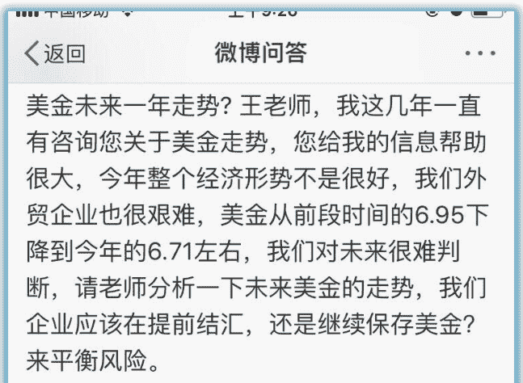

## 王福重

2-20 已回答

问题价值¥200.00，以下为回答内容

如果说美元和人民币的关系，我的建议是保留美金

- 第一，中国的出口也就是经常项目的顺差很难保持在目前水平，出口会很难，只能靠减少进口维持部分顺差
- 第二，全世界对中国已经看淡，资本流入会明显下降，资本外逃会大大增加，这也是最近严厉打击换汇得原因
- 第三，中美贸易很难达成协议，达成了也会推翻，中国不得不人为压低汇率维持出口缓解国内过剩

## 大户，咨询一个法律问题

(提问)李泽妈妈 : 大户，咨询一个法律问题，我们公司老板贷款，再填写采购商资料的时候把我的电话留下了，后来银行打电话核实，我接了电话并按照老板安排话术回答。请问以后贷款还不出，出问题，我会不会承担法律责任。

2019-06-04

回答：【帖子编号0292】不会的。除非你是你们公司的法人代表。如果就是一个联系人，那么不重要的。（虽然这里面涉及到让你冒充其他公司的人，其实就是协助骗银行了。但主要是银行并没有权力追责，没办法处罚这种行为。另一个角度来说，你冒充其他公司的人了。但银行不应该只靠贷款人提供的电话号码，就相信别人的身份。是不是某个公司的人，只要查下该公司的联系方式，然后打电话过去，问一下这里有没有这个员工就知道了）(19赞)

## 珍姐！您好！您知道捷斯生活吗

(提问)匿名用户: 珍姐！您好！您知道捷斯生活吗，3万元一个网站，我老公被人拉去上了一堂课，回来说要弄个网站，我听都没听过，也看不懂，不知道怎么赚钱的，您了解捷斯生活吗？能不能让我老公做？
2019-06-04

回答：【帖子编号0291】不知道你说的这玩意儿是啥。但是“做网站”？曾经，百度跟腾讯、阿里齐名。现在百度市值只有后两个的1/10。所以发生了什么事？因为网站“百花齐放”的时代，已经过去了。现在所有的信息都聚集在大网站上。网友需要什么信息，在大网站搞站内搜索，都比用百度搜更直接。（不信你想想，搜微博、搜淘宝、搜京东，是不是使用频率都比搜百度更高。）百度的池塘就是小网站。小网站都死了，池塘也就干了，自然也就不需要百度了。百度为了扭转趋势，自己扶持了一堆百家号，想要给中文互联网注入些“大网站之外的内容”。结果根本没用。这趋势连百度都救不活。所以这个时候还去做网站？完全是逆势而行，活在上个时代的做法。结果怕是任你如何努力，都是徒劳。方向选错，越使劲越错。(25赞)

评论区:
- 理想: 怕是类似那种打电话叫你进级酒店听课，然后交一两万做个小程序给你那种[驳评]
- A范迪xi: 有点像是卖关键词 域名之类的，以前在上海实习，那时的公司老板就是搞这个起家的，简直就是暴利，把人拉过去一遍洗脑，然后让你投资关键词，域名之类的，动不动就几百万，其实做个普通的网站600块就能够
- 苏苏: 想分享出去无奈操作不了
- ANTINOMY: 获取信息的渠道变多，流量分流了。
- WEN: 卖商捷斯是传销，下午查了一下
- Ely: 确实，真正想查点什么东西的时候，都不用百度查了。偶尔用百度查一下，结果都让人失望

## 【直播6月1日】这

石头：【直播6月1日】
这次直播的内容比较分散，记录不全，欢迎补充-------------

1. 【金链子】：运气不好，网络不好，买了链子开心～
-----------
2. 【迷信】：金融的人比较迷信，#金融/港商/明星/互联网从业者/沿海地区/渔民/地中海文化 这些人都是迷信群体，有人能思考出其中的规律？
-----------
2. 【周期】：农业没周期（粮食产量比较稳定），工业有周期（生产力增长快，能力过剩）
-----------
3. 【农民工app】：不行蓝领阶级是=信息弱者，上班12个小时，回家被掏空，没时间看你的app，甚至都不玩手机，你的app都传达不到他们手里，非要打通这个渠道，就看成本太高，而且他们也不是高价值用户，高价值=有空闲 / 有经济基础
-----------
4. 【人的周期】人是有周期的，身体激素在每个年龄段不一样，10～20岁=叛逆+自我，20～30岁=迷茫+困惑+想独立+勇闯天涯，30岁～40岁=平稳+对自己有开始有正确认识，40～60=逐渐变得保守+胆小+迷信；所以，老人的建议会在你职业发展的关键时刻提供保守的策略，而失去机会。
-----------
5. 【产业转移】产业从1线转2线，原来2线连个像样的工作的难找，现在很多1线高薪工作转移到2线，这类的工作只会越来越多，而拿着1线的履历，在线很有优势，能找高工资，而在1线去竞争那个尖，要付出的就太多了
-----------
6. 【牙科+眼科】年轻人学牙科，眼科，二线城市整牙的会越来越多，并且是阶级的代表（穷人不会花1～3W去给孩子整牙，又不是不能用），这些都是从1线城市传过来的。市场需求大量，而专业的从业者太少。有技术门槛的服务，也会越来越吃香。
-----------
7. 【会计】会计不要学，供给太大了，费力不讨好
-----------
8. 【月嫂】二线月嫂看情况，经济百强线没问题，要不是就算了，毕竟老人都在身边，也舍不得钱
-----------
9. 【母婴】母婴行业卖货的货，3线可能还有个尾巴，也快没了，别搞了
-----------
10. 【培训】二线培养行业很看好，没技能开3岁的托管班都行，怕老人带孩子养成坏习惯，自己又能解放出来
-----------
11. 【东北】以前只能全国之力发展几个城市，现在有钱了发展2线，交通网络很重要，东北有劣势，尤其哈尔滨，中原交通占优势
-----------
12. 【甘肃，内蒙】人口少不行
-----------
13. 【人生概率】天才/学霸型干啥都能出头，大部分人是普通人，行业周期+职业阶段，选择对了能很好的过一生了，人生是要看概率，职业发展开始很容易到4-6分（尽量去大公司），后面7-8就难，所以就可以考虑跳小公司，这样就直接变9分，非要在大公司混到金字塔尖，概率太低，投入回报比不合算了
-----------
14. 【贷款】小额贷款业务员，婚恋，生意模式不好，不要搞

--------

## 2019-06-02(88赞)

评论区：
- 胖辰阳：每个班都有学霸，跟着抄抄作业就好了...[强][强][强]
- 石头：舍不得钱刷星星 ，只好写写笔记
- 胖辰阳：一度以为你是珍老师的小助理。条理清晰，所有干货都抓取出来了。向你学习，继续抄你的作业，今天就在等你的笔记 
- Queenie：谢谢石头同学每次分享的课程笔记，很受用[玫瑰][玫瑰][玫瑰]
- 一维：感谢课代表[呲牙]
- （ ）：谢谢用心总结分享[玫瑰]
- 鹏：谢谢
- 橙子：感谢石头哥

关注公众号“懒人找资源”，星球资源一站式服务

## 大家看到那个美国要给墨西哥加关税的新闻了吗

珍大户：大家看到那个美国要给墨西哥加关税的新闻了吗？我要笑死了！[呲牙][呲牙][呲牙]

美国跟墨西哥的新贸易协议，去年10月份才谈成。（属于各国已经签字同意了，但是还需要他们几个国家内部批准通过后才能实施）。

屁股还没坐热呢，突然就要废了。

有这次例子在，后面美国拿“谈成协议”当诱饵的时候，对其他国家的诱惑力都会大幅下降。

当前这个时间点，胜负也要看其他国家都选择站哪一方了。

特朗普这么搞法，很快别的国家就会发现，即便站美国那边，也未必有什么好处，说翻就翻。

今天也是五月最后一天了。今天这件事之后，我觉得六七月份，在国际动向上，应该能看到一些其他国家示好的新闻动态出现。

另外，美国的对外进出口中，加拿大、中国、墨西哥依次排第一二三。

跟中国不一样，墨西哥对美国出口的东西没什么技术含量，但都是基础物资。包括农产品（都是各种新鲜蔬菜水果，这部分美国对墨西哥依赖很大。具体比例我没查，有说占五成比例的，不知真假）那么这部分物价肯定要上涨了，而且越是穷人，越是不利。

还各种基础工业零部件——直接影响美国企业成本，从而降低企业和员工的收入，和/或降低就业

（我前面的文章说过这个观点）

我比较意外的是，特朗普似乎根本不怎么在意美国底层人民的生活。这点跟中国完全相反的。

不知道是不是我们传统文化里，有太多“水能载舟”、“发动人民群众”这些让人时刻关注基层的观点太多？

反正在我的认知里，国内不管是郑斧还是老百姓，都知道基层稳定的重要性。但是特朗普好像不太懂这个。

假设我们国家一般的蔬菜水果都产自越南，那我们肯定没胆子去给越南加关税的，因为影响的都是“人民群众”……

反之，如果说拿“限制去越南旅游”来做筹码，这个是有可能的。因为出镜旅游的都是13亿人里的前面3亿，略微损失点也没太大问题。

就是这个基本逻辑。我以为应该是常识了……但是看见特朗

## 普这样，我真的乐了
[偷笑][偷笑][偷笑]

2019-05-31 (63赞)

**评论区：**
- 珍大戶：想起两三年前，局座发了个微博，说特朗普会带领美国从世界老大的位置上走到老二。当年我是嗤之以鼻的。现在看来越觉得，有这个迹象
- 郝三威：感觉真的是拿着商人思维在执政
- 小雷子：这届于是加冕土炮吗？
- 明月：这家快递谁咬谁
- 刘腾之：嘿嘿 美国 倒行逆施 衰落才好 只要对咱祖国影响不大 他自己折腾自己去吧……
- 风口的猪：感觉特不靠谱完全是要准备坑他的下一任[捂脸]
- 小白龙：看来局座不是白当的
- 刘伟：大戶有点何不食肉糜的感觉，你对近期肉禽蛋水果蔬菜价格不敏感还是从不买菜做饭？下结论论点很重要，还需要论据支撑。

关注公众号"懒人找资源"，星球资源一站式服务

## 【帖子编号0289】

珍大户：【帖子编号0289】

上一个帖子说了健身房，我突然觉得，当前的健身房都有一个空白——“健身饮食”。

举例，现在的书店都开始像咖啡馆转型了，除了销售书和相关的文化用品外，往往还会兼营咖啡饮料和轻餐饮（沙拉、甜点、意面这些简单易做，无油烟/无气味的）。

健身房这块，健身人群完全是一个已被筛选出的人群。

很多人都听说过所谓的三分练，7分吃。但怎么吃，其实这个市场是个空白。

> （单独的餐饮店想去做健身餐饮，就完全不靠谱。因为筛选人群的成本太高了，客户基数小、周转率不行。所以想单独支撑一个大店面，根本不现实。所以这块餐饮市场其实挺空白的。）

但健身房客户群体不一样。已经被筛选过后的。虽然人群基数小，但有可能粘性/频次高。

而且，目标不是开单独的一家餐饮店，而是类似于我这几天视频讲的“开一个柜台、开1/10的店”类似。

健身房的私教，有时候也会“传授”一些训练前后，该吃什么不该吃什么。但其实就是只给了食品清单和饮食建议，具体的饮食需求仍没有被满足。

所以，下班之后来不及吃饭就跑去健身房上团课。或者训练之后就饥肠辘辘，指不定跑到周边餐馆，又吃的卡路里超标。

这都是用户痛点。能解决痛点就能有价值。

只要健身房像书店一样搞个轻餐饮的吧台，卖健身饮品，低卡餐饮，减脂沙拉……（要知道大部分人健身的时间都是下班时间，跟吃饭时间其实有相同）

地点不用占用太大，借用健身房的休息区的桌椅就够了。那么这种操作，甚至可以部分缓解开业集中办卡后，后续现金流不足的问题。

如果是像Keep这种主张建立社交关系，或者"氛围"的健身房，甚至可以教用户做健身餐等等团体活动。

以周末时间安排为例，操房周末10点、13点、15点、18点、19点，轮番安排团体课。但对于具体的张三李四而言，他们一天只会参加一次，最多两次的课程。课程之后的粘性和消费呢？

那么就可以在11点、2点、4点、5点、6点时，搞些团体做沙拉的活动。让刚下课的人，或者上课时间还没到的人，参加活动还能做点东西吃。

这些都是增加用户粘性、增加营收、补充现金流的方法。

反正目前我是没见过市场上有健身房这么搞。新开健身房的人，也大多沿用/复制老模式，只搞年卡销售、卖私教课程这两种方式，也不想办法创新……

其实各个行业都是如此，在旧有模式下，可以试着搞场景延伸（比如书店增加咖啡馆），或者搞场景交叉（比如撸猫的咖啡馆）。

2019-05-30 (47赞)

> **评论区：**
- 软装设计师 十三先生：像我们喜欢健身的人其实也可以去和健身房谈合作对不对，健身房没有这块资源，我们做简餐的可以去找他们合作，之前想过做控制卡路里的简餐，那时候是想着在写字楼里做白领的
- Jas：健身房买减脂餐的操作我三年前在老家十八线健身房见过。。。深圳这边反倒不常见
- 维尼大熊：我的健身房有，但是价格比较贵，没过多久就不做了
- 珍大户：贵的跟高钛盒饭似的，三五十一盒那种? [捂脸]
- 维尼大熊：不止 需求的确是存在的 但是大家可以订外卖，现在多做增肌餐的 还便宜很多花样还多
- 维尼大熊：我减龄经常外卖送到健身房 吃完就吃
- 软装设计师 十三先生：基本都是这个价格呢，三十五最少了呢
- LAIF：卖书做咖啡和轻食其实是不挣钱的，就是起一个引流导向的作用，而健身房做健康餐是为了增加营业额，所以健身房做健康餐不容易成功，这两种我都做过，所以深有体会

关注公众号"懒人找资源"，星球资源一站式服务

## 我是健身房主管，之

**(提问) 郭静:** 我是健身房主管，之前一直做教练现在做管理没有什么经验，想向您学习一下如何经营一家健身房，怎么样吸引客源留住访客成为我们的会员，然后以怎么样的销售模式吸引他买私教课程，现在这个小区住户只有一百户，6月一日交2期房我想做一批预售，卖一些健身卡，我们健身房没有游泳池，附近一公里有一个健身房有游泳池，年卡2580两年第一年免费，两年以后再办年卡是2580，请问我们该怎么定位，我们的卡卖多少钱合适，以这样的模式更有竞争力，我想本小区业主交房时，送一批优惠券，三张卡起购再送一千块钱私教课程优惠券，我们这边房价是一万六一平，针对这些人群如何做一个方案，以这样的思路做呢。

2019-05-30

**回答：【帖子编号0288】**

这个提问，很明显属于一个不合格的提问[偷笑]但是分析这个提问不合格的原因，其实很有代表性。提问中确实暴露的，是非常普遍经营思维、竞争思维的短板。我们从几个部分分别看。

### Part 1

先说缺点，先看看题目中透露的有效信息。只有三条。
1. 小区住户100人。
2. 对手的定价2580元。
3. 当地房价1万6（想靠房价来推测人群消费力）。

然后提问是问：如何定价，如何做营销。这种思路是有弊端的。定价要是考虑顾客的接受度，在能接受的前提下，尽可能价格更高，赚到更多的钱。但不是顾客有钱了，他们就能接受高价。更不是比对手便宜了，顾客就能接受了。

这就假设自己就是顾客，来用挑剔的眼光来检视一遍自己。自己怎么样才是最重要的。（在具有压倒性的优势的时候，你甚至可以完全不用考虑外界。无需考虑你的竞争对手，也无需考虑别人接不接受你。这不仅是在商场中，在人与人之间也是如此。很多时候我们见到某些人有强大的自信、强大的气场，不畏惧一切外界眼光，这是建立在强大的自身优势之上。这种人，是可以不需要分析什么自身优劣势，更不需要去迎合外界。但大部分人不是这样，大部分生意，更是很难跟对手有压倒性的优势，甚至有可能一身劣势……所以，第一步，认清自己很重要）

这个提问中，最大的缺失就是缺少自我审视。完全没提到【我方】怎么样。认不清自己，就基本等于盲目了，后续的一切提问，什么定价……什么策略，都是瞎打。

### Part 2

说下怎么做。一个常用的分析自己的模型，就是SWOT。我在学会SWOT之前，自己摸索出一个类似的T型表的分析方法。就是先拿一张纸出来，上面画一横线，再画一竖线，纸被分成了两栏。左边一栏写下自己的优势，右边一栏写下自己的劣势。

（我仔细回忆了一下，最早用这个，不是分析自己的，而是中学时期，靠着这种分析抗过了早恋期，强忍拒绝了一些小帅哥的烂桃花[偷笑]后来学到SWOT模型时，我还大跌眼镜，心想这不就是我自己用的T型表又多了几步嘛）

（补充说明：SWOT是4步分析，优势、劣势、机遇、威胁。但是大部分时候，能分析清优势劣势就已经很够用了。以这个例子为例，我们在这一个环节先说优势劣势。机遇威胁属于竞争关系，到下一步再分析）

表格画好以后，需要你仔细想，自己有哪些优势，哪些劣势。依次写到左右两栏之中。这些优势劣势，无非是自己站在消费者的角度，使劲挖掘一遍自己的竞争力。

我之前写过一篇文章，说，一切的经营，能够做好，必须是【利他的】。（帖子0193）

（补充说明：其实，如果头脑经过商科洗礼，那么在最初的产品设计市场定位的时候，就会从“如何让消费者获得收益”的角度，反复的思考如何建立优势。但哪怕没有进行过任何的商学学习，只要本着一种“利他的”初心存在，也不会经营得差。此处想起一堆例子来，但是不能偏离主线太远，还是先不说了）

那么我来具体的举几个例子：

第1个优势，近肯定是一个（提问里说竞争对手在1公里之外）。那么先在左栏写上“第1，距离近”。

列优势，只是思考流程。列好之后，还需要你继续细化成“战术”中的销售策略、话术，说辞上来。比如面对一个女性潜在客户时，可以说：“他们家在1公里之外。你想想，出门走一公里是不是还得化个妆擦个防晒，否则走这一公里下来，人都晒黑了。万一哪天懒了，不想涂防晒，人就懒得去健身房了。冬天特别冷的时候，走1公里，人就懒了不想去了。夏天特别晒的时候，走1公里多热，又不想去了。刮风下雨啥的。一年到头你这年卡就变成7个月卡了，多亏啊。你办我们家卡就不会这样了。一般办完卡，最后不去健身房的，都是距离远啊，一定要挑近的，否则不方便的……”

总之，优劣势的分析属于战略思考，最后要把战略转化战术，就是落地成为实际的销售话术。为了防止你思考遗漏，我列个大致顺序，请挨个思考，到底是优势还是劣势：

- **硬件方面：** 位置远近、交通（好不好）、面积、装修环境看起来怎么样、室内光线/光照条件如何、空气质量如何、室内温度保持怎样、器械质量水准、器械配置的比例有什么讲究没、有什么特殊的/优势的项目没……更衣室/洗澡间/水温怎么样……
- **软件方面：** 营业时间是否有优势？保洁是否有优势？健身教练是否有优势？课程？总之，各种软性的服务，细细思考一遍。

如果【认识自己】做的不清楚的话，就会出现一种笑话。销售的时候，跟顾客说，我们有非常专业的教练，帮你怎样怎样。这个笑话就跟面试的时候，面试者说我很努力认真，愿意学习，听话，巴拉巴拉一通说辞。面试官心里都会呵呵呵了。说这种话，就好像别人都不认真，别人都不努力，别人都不听话似的。很明显，你有的别人都有，那么你再拿这个说事，就是废话。

健身房也一样。哪怕你的教练都是水货，都是无证上岗，到嘴里必然是“我们有非常专业的教练”。所以，这种说辞等于废话。（每次一说有非常专业的教练，顾客就会心里一惊，我擦，又要收费了，还很贵……）

所以在分析优劣势的时候，一定要站在顾客角度，“利他”地去做分析。有教练不是优势，但如果你们设置了对新手的引导课程，带新手熟悉器械，防止姿势不规范，那么才算是优势。希望把这个当成作业，可以试着完成一下（欢迎写在评论区）。

### Part 3

定价和销售策略。

定价和销售是题目中想要问的。但这一步必须要经过前面Part 2的思考。上一环节做完了，就可以进入到这一部分了。上面环节做完后，无法会有三种结果。

**第一种，是你们明显优于对方（优势特别多）。**
如果分析结果落在这一层，那么，策略：主推三年卡，比2580略高一些，3开头的，比如3280或者3680。具体取决于你们优势多多少。在优势很明显的情况下。略多一点钱，办三年卡。一方面，顾客会被吸引进来。另一方面，健身房的竞争策略类似于“死局”（见Part 4）。你们这种卖法，三年后这个竞争对手就死了。而且你们也构筑好了行业壁垒，新对手很难再进来。

**第2种结果，是你们明显劣于对方。**
那么就不要按照传统的年卡打法了，买月卡，买次卡。怎么颠覆怎么来，否则你们就是死局（竞争关系原理见Part 4）。有一个老健身房的帖子，写了很多行业痛点，需要改善的地方。特别适合小健身房、劣势健身房参考，必须要搞颠覆打法，才有活路。（评论区结尾还有一个开定制健身包工厂的圈友，你们需要定制健身包的话，可以联系他）

**第3种结果，就是你们与对方差不多（没太大差异）。**
如果分析结果落在这一层。你们当然可以继续走传统模式，去直接竞争。但很容易依然变成死局，最后两家健身房都经营的半死不活的。所以建议依然要逐渐往第2种的颠覆式打法上靠，未必那么激进。年卡照旧卖，但也要搞一些短期品部分的创新。

### Part 4

竞争原理。

上面第3部分的结论，我猜很多人肯定不理解。解释在这一部分。有一篇关于共享单车的旧文（0053）原理与这里有共同之处。就是所有买“包月”、“包年”这种“时间包”的产品，最终的竞争都是你死我亡的……因为有【排他性】/顾客置换有成本，只要用了产品A，就不会用产品B。中间还会夹杂着对使用人数过少的产品的担心，觉得会不会半路跑路。

以健身房为例：
假设一家健身房，每月运营成本20万。一年240万。（简化模型下，初始投资什么的分摊进月吧）年卡2000元，则盈亏平衡点是1200个客户（如果全靠办卡收入的话）。

如果不是全靠办卡收入，而是办卡收入：私教课收入 7:3，那么 $240万 \times 0.7 \div 0.2万 = 840人$。也就是说盈亏底平衡点是840人。盈利必须在办卡人数超过这个人数之后。低于这个人数，就意味着净亏损。

那么，前提条件应该是附近的人群基数。扣掉老弱病残，还剩多少可能能够办卡的。这是【池子】。各家的销售办卡，都是对这个池子的挖掘开发。

**简易模型一：**
这个池子，如果只有一家健身房来开发，那当然是最好的情况。只要池子不是太小，肯定能活下去。（或者池子超级大，能同时容纳两三家时，也适用此模型——大家都能幸福的生活[偷笑]）

**简易模型二：**
但如果有好几家健身房，【同时】来开发这个池子。人数必然会分散。那么有可能，各家卖出的卡都无法超过盈亏平衡人数。——结果大家都苟延残喘，看谁先撑不下去，把市场份额吐出来。撑不住，就一起死。

**简易模型三：**
因为有【排他性】，用了一家产品，就不会用第2家产品。所以，如果这个市场有【先后】。先来的一家，把池子挖的差不多了，后来的那一家，就必然达不到盈亏平衡人数，必然是死局。除非后来的那家自身有竞争优势，强行挺过排他性的保护期。（但排他性是有时效的。如果都是一年卡，那么就是保护期一年。一年后客户又会重新选择。三年卡就是保护期三年。一般亏一年，咬咬牙就挺过去了。但是连亏三年还能撑得住的店不多，基本都死透了。）

简易的三种说完了。下面是复杂的。

**复杂情况1：**
两家健身房A和B，【同时】来开发，但是A家优势很明显，开发池子的速度更快。结果必然是，A家超过了盈亏平衡人数，B家达不到，要死。这时候A家应该利用优势，办更长期限的卡，延长保护期。从而让B家死的更彻底一点，不要给他们复活的机会。（就是Part 3里第一种，优势很大时，买三年卡）

**复杂情况2：**
就是反过来。假如说你是B，落后的那家怎么办？你已经落后了，开发池子速度比别人慢。任由结果扩展下去，就是别人建立了保护期优势。你死也达不到盈亏平衡人数，平稳发展下去就是个死局。那么这时候就应该卸掉对方的保护期优势。你卖月卡、次卡，顾客只要不到对方那里办年卡。你都有得活。

> -------------------------
> 最后再补充一下。因为后面花了很多字数，来说如何竞争、销售。但能够开好一个健身房的重点绝对不是定价和销售的策略，仍是自身的优劣势。
>
> 如何能用更小的成本，更好的服务顾客才是本质。比如有一些新型健身房，就把更衣室和淋浴间结合在一起。让大家有不用再光屁股穿过人群，从更衣室走去洗澡间的尴尬。这也算一种创新。还有开在写字楼而非商场里的24小时自助健身房，也算一种创新。开小而美的健身房，针对不愿社交的内向人群，也算是一个方向。
>
> 与之相反的是Keep软件，我看到似乎也在招募健身房，是有社交网络的关系，营造健身氛围，也算是一个方向。总之，买3680的三年卡，还是买70元的次卡又或者是198的月卡，都不是经营健身房的核心。怎样让顾客觉得“更爽、更有用、更有收获”才是。
>
> （这篇文章有点长了，最后思路有点乱了。就先结束吧，想到什么再补充）(62赞)

**评论区：**
- 莜·nb！太详细了
- 郭静：谢谢您我一定好好总结，然后写一写我的感想
- 陈 磊：这是整整一节课的内容
- 商宸：大户用心了！
- 胖辰阳：[玫瑰][玫瑰][玫瑰]老师这么认真，我都不好意思逃课了。
- 孙敏渊：谢谢老师，年少没读好书，总以为靠自己可以，这么多年也摸索出了一点经验。但是当自己真正面对一座大山的时候，才发现后边的天空即使再大，也需要把这山翻过去，早晚都要经历这一步。本以为会很困难，但是经过这两年的国内互联网发展，知识获取并不想此前那样渠道单一了。我也说不好什么，总之非常感谢您的精彩分享。
- 大空翼：一万六的小区，健身房这么便宜？
- 。。。，大户，果然是高智商的人才，弱弱问一句，您测试过你的智商吗？估计天才就是您这样的了，我们能学到一星半点就行了

关注公众号“懒人找资源”，星球资源一站式服务

## 珍姐，天天潜水，最

**(提问) Mason:** 珍姐，天天潜水，最近有一个问题我想请教一下...

现在浙江上海比较火的自动无人值守快速洗车行业，驿公里洗车，这个行业市场有没有发展空间？会不会像小黄车一样慢慢就不行了？

想请珍姐分析一下...

我朋友想自己投资试一下水，单部机器含配套设施，租金什么的在15万左右...单车清洗价在10元左右。成本在2-3元

2019-05-29

**回答:【帖子编号0287】**

以前写过一篇。圈内搜“洗车”能看见。我觉得自助洗车是能做的。有些前提：

首先，要调查好你在的城市，现在洗车价格到底是多少？一些地方洗车50块一次，那么自助洗车还是有吸引力的。就怕有的地方，25元就车内车外洗得干干净净了。这种地方的自助洗车就没什么吸引力了。

然后是，想好竞争力是怎么产生的。洗车50元的地方，成本是商铺租金贵+人力贵。机器省了人力，但商铺成本仍需要化解。所以，你的场地很关键。能够用【停车位】代替【商铺】，规避商铺的高成本，就经营风险很低了。甚至一些人流量不大的区域，洗车店之间很分散，你把地皮成本也压到很低之后，意味着你会比洗车店有更大的距离优势。

最后还有些细节，比如，南方比北方合适。温度低的时候不可能自助洗车。还有一二线城市的市中心很拥挤的地方，占用车位会招投诉（见旧帖子）。

以上调查全都做清楚了。那么是可以做的。

————————————

然而你这个还是有问题。投资15万？？自助洗车机基本不贵，两三万，几万块的样子。十几万几十万的那种不是自助洗车，是“自动洗车”机。像个大棚似的，人坐在车里不动，车挂空档后被机器拖着前进，上下左右伸出来机械臂，上面有毛刷和墩布，给车刷来擦去的。这种机器投资比较大。

所以你确定要投资15万？就算每辆车赚5元，要刷三万辆车才回本？一天20辆车，刷1500天？半路的经营风险都不算，四五年才回本？机器怕是到那时候，也磨损的差不多了，靠啥赚钱。

要知道，这种极其依靠选址，甚至有运气成分存在的项目，只投资一台是风险很大的。（想想，万一你投的那台，选址刚好在有杠精的位置，天天投诉你占用车位，污水污染环境，噪音问题。）

大家项目选择的时候，就是信息筛选的第一关，找到这么高成本的加盟，基本等于送人头，做分母了。

（任何项目都差不多，就像开餐饮，你买菜都比别人贵50%，开母婴店奶粉比别人进价高一截，怎么活）

真想做的活，去找15万能买6台机器的渠道，然后在你所在的城市开三个网点，每个网点放两台（运气不好的话其中一两个位置没客流量，还需要搬迁）。(25赞)

**评论区：**
- 经济_小学徒：问题是 你觉得你一天能洗多少辆？自刷洗车时间限制是多久？
- Mason：是无接触自动洗车，不需要人动，洗完直接开车出来。机器成本就要十万左右，还需要做好配套..按次载洗这样回本太慢，加上前期投入宣传的话回本更是慢一点，是否可以办理年卡快速回笼资金…地点江苏区域…感觉可以啊...万一马云以后扩张过来收回投就好了哈哈，想多了[呲牙]
- 国静：推出这么项目，我脚踹我的看法一、定位本地区或5公里范围内车流量有多大。如果你站在那一天，这个区域流量次数要计算上。二、定位客单价，投资回报率，珍珠说完了，我连补充的空间都没有[闭嘴]：{ 此点最为重要，现在玩加盟的，挣的就是加盟费或者采购费），干不动了，马上下一个项目，当然不排除挣钱的项目啊，但真是挣钱的有几个放开市场的？ 三、客户需求，我比较懒，喜欢爆羊毛，周边就有一个加油免费洗车的，我那车从不花钱洗，大家懂的！ 四、还是结合第三点说的，客户有什么理由洗车的话只洗外观，这是我想说的第二个定位问题，你的客户群是谁，更多的是私家车，那么你先考虑下使用自动洗车的好处在哪呢？五、客户群的二次消费场景在哪？你把流量，用户聚集了，那没有二次消费，你一年下来可能性就太多了。 差不多就这些吧，有空可以私聊
- ponytail：洗车废水怎么排放？这个能审批的场地就会压缩
- 珍大户：汗，当我放空炮了，果然是"自动洗車"，不是"自助洗車"……
- 珍大户：看到回复了，确实是自动洗车。 自动洗車和自助洗車【定位】是完企不同的。“自动洗車”，必須配置给【場地】比較大的【商铺】，洗完车还要人工手动擦干的。针对的是洗髮店，且客流量很大（基本等同于热门区域），平时基本满负荷运营。那么上设备后，减少人力和时间，提升效率。一车车两洗三分钟就被器洗完了，工人负责售后。店铺裏【翻台率】提升了。“自助洗車”，配置给【车位】。针对的是鸡边地区。洗车行店会客流少，干死不活，要么开自助洗车机。两者一个是鹅鹅儿添花的，另一个是给偏远地区送温暖的。
- Mason：是只洗外观的快选洗车，自己搭洗车框架帶设备间_污水有相关处理设备，泥沙过滤清除内饰...位置占用大约两个车位，定位也是快速清洗。3~5分钟一辆车，无人值守，无人员配备。洗完成自动吹干就是了，不洗内饰。位置占用大约两个车位，定位也是快速清洗，3-5分钟一辆车，无人值守，无人员配备，洗完成自动吹干就是了，不洗内饰，定位也是快速清洗。

## 家里父母存了一辈子

(提问) 张威龙：家里父母存了一辈子钱买了一套商品房，现在房子存在质量问题。是该找物业还是开发商。该怎么有效维权。

2019-05-29

回答：【帖子编号0286】维权找开发商，物业基本无能为力。 如果是能修补的小问题的话，基本以“投诉”为要挟，去闹一闹就能解决了。可以打个市长信箱热线什么的。

但如果真是房屋质量的大问题，怕是就很难弄了。 一个原因是，监管部门本来应该属于利益第三方。但是因为有审批、验收的环节在，一下子被卷成相关方了。真出问题时，肯定是有责任的，所以更有动力去掩盖。

另一个原因是，涉及到需要赔偿的人数很多的时候，法院就喜欢“多想一步”，怕每个人都赔很多钱，把企业赔垮了，所以人越多越不敢使劲判赔偿。

律师基本都躲着这种案子，因为人太多，每个房主都想拿意见，意见极难统一，吃力不讨好，总会闹埋怨。 如果是钱多也就罢了，钱还收不到多少，又牵扯到跟某些部门交恶的问题。于是基本没律师管这种案子。

所以基本是制度问题。明明是经济纠纷，出事了就赔好了，赔不起倒闭嘛。结果，减少了经济赔偿，增加了行政问责，就出现了阻力。 怕企业倒了影响当年的就业，就不怕住几十年的楼倒了影响到人命。

想起某个社会学的观点，大概说的是：人类的愚蠢就在于永远只解决当前，而不把未来的问题当问题……(56赞)

评论区：
- 老鹿：这个分析犀利了
- 张威龙：感谢大卫的精准解答
- 尘：对好人太坏，对坏人太好
- 神奇小飞侠：开发商一般都会注册个有限责任公司，真出了事，要赔大钱，大不了倒闭
- 行走的路上：打市场线投诉
- 胖展昭：哦！疼老师又一剑封喉了，只能说小韭菜活的真不易。
- 小自龙：天朝特色
- 石头：抖音上有个，小哥帮忙，试试这条路，走媒体？

## 珍姐你好，我是一名

(提问) Mr.Match：珍姐你好，我是一名本科毕业生，即将面临落户，目前在深圳做中小学培训，月薪1w多。落户不知道选择深圳还是武汉好。

攒了3年有30w的现金，想落户武汉付个首付，等房子涨起来了卖掉，但是因为家庭背景跟父母身体不好，都没有工作，担心这么做不合适。

家里人也希望我落户深圳，而且落户会有3w补贴可以拿，但是深圳的房价是真的这辈子都买不起了。

如何是好

2019-05-28

回答：【帖子编号0285】 这就属于“还没想开”，才会遇到的问题。一线城市里，别的城市都限制人口。只有深圳显得别具一格，说“来了就是深圳人”。然而本质原因是，深圳的户口真的没什么价值。深圳唯一的价值【就是赚钱】。如果收入差不多，在深圳还是在东莞，还是在苏州，本质上没有差异。

早年里户口价值里，除了传统的教育（高考优势）、医疗（三甲医院）这些隐形福利外，最重要的经济价值就是买房的门票。但现在一线房价已经超级高，外加各种调控政策，户口上的买房优势已经很淡了。

扣掉买房，只看教育医疗的话，深圳远不如广州，甚至比不上天津。成都武汉都是远比深圳要强。

那么深圳还剩些什么呢？前面说了，深圳唯一的优势【就是赚钱】。因为有些高附加值的产业，能够支撑得起高收入。

就像今天的另一个帖子就是一个例子 ui设计，一线城市三四万，二线城市少赚一万五。从一线转移到二线，一年少赚20万。

还有差价更高的工作。见贴里简要地写了一二三产业——【越是高端的产业，越不可能广泛的铺开，而是会集聚在少数几个城市】 比如高端第二产业“高科技企业”，比如高端第三产业“金融业”，只会聚集在最大几个城市。这其中的高收入岗位，也只会放在一线城市。

如果二线城市没有相应的工作，那么从一线转移到二线的差异就会大很多，远不止几十万了。经济学讲究性价比，讲究不断资源换来换去，对比怎么能更划算。教科书里的例子就是“黄油和大炮——少吃点黄油，多买个大炮，值不值？”换到这个例子里。就是少赚多少钱时，从一线城市换到二线城市，才值？比如，上一个ui设计的例子里，少赚20万，去二线，划算不划算？划不划算，其中的度，自己把握。但我其实是支持的。因为如果拉时间轴来看，往前数个三年，估计二线城市里，能少赚20万的工作岗位还不存在呢。现在出现了，也都是这两三年的事情。但这代表的是产业转移的趋势。所谓趋势就是还会一直这样。现在工作收入差20万，房价差400万。等到后面工作收入差10万的时候，再转移起来，房价哪怕差300万，都算你亏了。

然而，题主的问题根本不存在。我前面讲了两种工作。一种是无法转移的，很集中的高端产业，没法转移。这种工作也就只能留在一线城市，但未来的收入上升空间至少很高。第2种，是有转移迹象的。这种尽早往二线城市转。

而题主所在的行业，完全不属于上面两种。教育培训行业根本没有集聚性（没可能出现深圳的教育机构，培训半个中国的小学生这种情况），所以更没什么“转移”而言。如果在圈子里待的久，应该知道我是很推崇大家在二三三四线城市投入到教育行业的，反复的说了，长期看好。看好行业发展是一方面原因。另一个原因是，这个行业在全国范围内的定价，其实都是差不多的。意思是，你可以在二线三线城市，赚着跟一线城市差不多的收入，性价比更高！这种感觉，就像是海底捞火锅。大家去点评搜一下全国各个城市的价格，会发现均价差不了多少。在北京吃一顿和在武汉吃一顿，人均都是120上下。那么，一个500平的店面，里面能摆几张桌子，是不是北京武汉都一样？每桌客人吃饭时间快慢，翻台率高低，是不是北京武汉都一样？那么以海底捞长期满座的行情，单位面积营业收入是不是北京武汉都一样？那么如果店租、人工更低，岂不是利润更高？

海底捞比较极端。因为大部分企业是做不到像海底捞那样“满负荷运营"的。意味着，全国价格差不多。但客户数量会略少，收入略少，但成本更低，所以……结论是，这类行业你是有可能让身在二三四线城市，却赚着跟一线城市差不多的收入。这就是我推崇教育行业的第二个原因。在我看来，教育、旅游住宿、月子会所、还有能靠上医疗服务的行业，都如此。

（所以圈子里问这几个行业的，比如开民宿什么的，我都说赶快去做吧，看好）

————————

前面说了，留在深圳，唯一的理由就是【赚钱】。问题是这个行业就是全国价格差不多的东西，留在深圳和去别的城市，对你赚钱根本无差异。如果有差异，还留在深圳图什么？就剩一个没大用处的深圳户口虚名而已。所以说题目问题根本——就是想不开。(71赞)

评论区：
- 狮子歌歌：珍灿，我刚毕业2年在深圳的电源行业（UPS 光伏逆变器 电动汽车充电桩），全国电源行业中深圳是最发达的，近2年因为高铁运营成本有企业向西安转移，我在西安读过研，西安的房价也在涨，现在回去是否是回西安的好时机呢？
- 珍大户：可以试着搜一下招聘，投下简历，试探下市场，看看有没有回应。转回去不一定立即，骠驾找马。只要把这事当成今年（或者明年）的规划，千万别放弃搜索就砸了。
- 狮子歌歌：明白珍姐的意思，把回西安当做未来的规划比一直待在深圳强。记得珍姐之前写过二线城市认可一线城市的工经经，或者刚毕业一线城市长成长更快，是自己判断自身技术能力（研发比较看技术水平）结合投递简历的市场反应来决定回西安的时机吗？
- 李俊杰：我觉得因人而异，行业前景什么的都是宏观的东西，不需要太考虑。回到二线城市还有没有一线城市的激情，一个城市的调性很容易影响到人，能不能适应。
- 胖展阳：#好像像偏题了，会扣分么#。是该好好考虑方向再出深，选择大于努力。有时候仅仅是因为大时代在前进，只要站在扶梯上晃悠，人生就是上升。就好像我们小区（深圳）有些家长群里的人，表现的总得意满满不可一世，要说人生大的贡献和成就，并没有。只是深圳房价便宜的时候买了房，或者多买了房，或者改革开放初期家里交通便利用门打工早，赶上了最高速发展的一波红利。用我们老板经常教育我们的话"你们要机器识遇当能力，要感恩这个伟大的时代!"那些"成功"的幻觉，借用张爱的一句话：没有早一步也没有晚一步，恰好你在那里而已……
- 罗云夕：珍灿，请教一下，在深圳开美容工作室有3年，每个月扣掉所有开支剩1-2w，想回南宁老家发展可不可行啊？希望给点建议
- A-Biccm：这哥们的观点精辟，很有道理，从时代及机遇的观点出发，我就是因为在广州，没在深圳错过我从事行业做大做强的机会。但是对于很多人来说，所从事的行业，如果是可转移，有共性，收入差异不大，回到二线也是一个选择，房价已经很高，未来更高，如果追不上房价，退而求其次，活的可更幸福。
- A-Biccm：深圳机会更多呀，深圳就是赚钱的地方。高学历，高技术，选择未来还是安逸(微笑)。

关注公众号"懒人找资源"，星球资源一站式服务

## 我之前在北京做UI

石头：我之前在北京做UI设计（6年）
周围设计的同事
2w-4w / 一个月
差不多都是这个价（刚毕业同学就没那么多了）
大一点的互联网公司都能开到这个价，
杭州，北京，上海，深圳，好一点公司做过几年就能到

成都，武汉，公司数量上要少一半
价格上5折~7折（也有大的，就是少点）

但是，做设计/开发/运营 这种技术岗，大部分年薪50w做到中层，也就到头了

很少数的人能再往上走，那就是机遇和运气了

2019-05-27(12赞)

评论：
- 深海：u真是可以
- 珍大户：北京上海杭州深圳，2-4万一个月。平均算3万+。成都武汉5-7折，计算区间1-2.8万，扣掉太低太高值，取1.5-2.2万之间，月薪会多一万多。想跟大家探讨一下：大家觉得这个差距下，去一线还是二线好呢？
- sunnyh98：一线工作二线买房
- sunnyh98：也聊聊我的一个做设计的好友吧！正好前段时间和我聊了一下他们的困惑～夫妻俩年龄30左右没有小孩，在武汉有个60平的小房，目前在深圳一个月税前4W税后3W左右，租房加开销减去房贷剩个1.5W左右，想在深圳买房钱不够，武汉60平的房子想养个小孩又太挤，再加上两人的直属上司年龄和他们差不多或比他们小，所以现在很有危机感。我把大户姐的“钱前大局观三十岁两手准备”转给他们看了，并根据我在大户姐这里学的知识，给了她两条建议：一条是如果要买房的话尽量选武汉不要选深圳，另一条是学一下投资理财~再多的建议我也给不了，自己也是摸着石头过河[皱眉]
- 秘恋：一线吧，能接触到的不一样
- 石头：一线工作，没有二线社保-二线户口，没法买房
- 人生如逆旅：给建议让他们武汉买房？是投资武汉房地产还是准备定居武汉回武汉发展？
- sunnyh98：没懂，难道在一线交社保就不能在二线买房吗？还有买房需要本地户口吗？我印象中不是买房多大房子就可以当地落户吗？

都是985的尖子都是凤毛麟角。那行，让我们再看看一个优秀人群社招样本的数据：

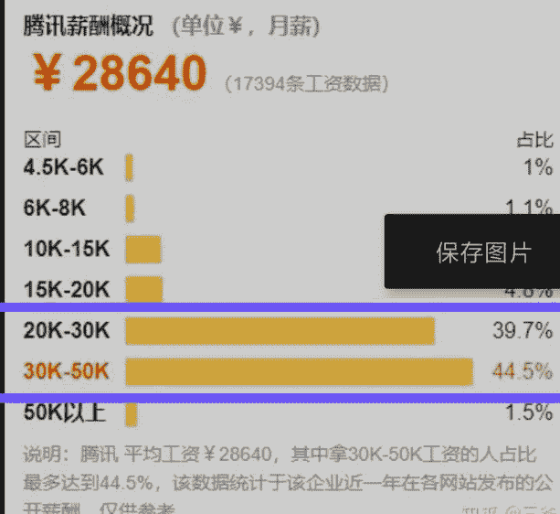

某网站统计的腾讯薪资样本

我们可以看到20k-50k薪资的占据了84.2%的比例, 注意这里是月薪, 而腾讯的薪酬结构大多是14-16个月, 大家可以自己算算一年收入是多少。

赞同 775
感谢 132
收藏
评论 226

## 前天直播讲到，创业

石头：前天直播讲到，创业做什么好
回顾+笔记+感悟

1. 不要开实体店买东西
2. 实体店一定是服务为主，网购无法代替的类别
3. 案例：可以做“火锅底料”类的小众产品，还没有巨头垄断
4. 海飞丝，王老吉，哇哈哈，这类产品最大护城河是【渠道】【传播链条】货到进超市铺满所有小县城=垄断市场，你只能买到这些
5. 原有的【渠道】【传播链条】正在被瓦解，海淘，网红带货，评测带货，直播带货，什么值得买，依靠内容的【新的传播链条】【新渠道】在抢老渠道的蛋糕
6. 【新渠道】满足了人，多元化的购物需求，实体商店不可能什么都卖，面积有限，品类有限，限制了人多元化的购物需求（在实体店，我穿xs码，很多店里都没货，买的人少嘛，我就只能穿s码）

发散思维：

1. 医美，培训，网购，在几年前最大的护城河是baidu_alibaba广告流量，巨额的钱买排名，小机构根本玩不起。
2. 内容垂直搜索，其实都是在薅baidu_alibaba羊毛，医美的入口被新氧拿走，买车去汽车之家，各家培训机构和卖货的也在拼命做内容往抖音上发，这些本来都应该是李厂长，马云，碗里的肉啊

2019-05-27(62赞)

评论区：
- Ja斯汀：感谢！多希望珍珍直播可以回放
- A□小仙女：广西南宁开奶茶店可以吗？
- 桃子：珍美女在直播中说了，奶茶店太多了
- A□小仙女：还说了什么呢？可奶茶店的需求人群也多么。
- Mark：冒昧地问一下，你们在哪里看的直播
- 石头：每周六晚8.30科音珍大爷
- Mark：我能不能看到回放哦
- 石头：没有回放，下次的直播，我记笔记详细点，发出来

关注公众号"懒人找资源"，星球资源一站式服务

## 关于【没有组建微信

珍大户：关于【没有组建微信群】的公告：

各位圈内的朋友，从认识大家以来，虽然有很多朋友建议我拉微信群，但一直没有实施。而是选在知识星球里。

因为：

- 第一，微信群人数有限，等于把大家分散了。
- 第二，我确实认为，聊天的方式，价值肯定是不高的。（还浪费时间）
- 第三，微信里即便有精华信息，也无法保留。
- 第四，也是我心理很难以接受的，是进群有先后，发言频率有高低。最终会产生很多小团体，不便于后来的朋友融入。

（抱歉我在这方面有些固执。

人生三十几年来，我从来没使用过地域同乡、校友、同姓宗族等各种方式试图跟任何人拉近关系（其实你们也能看到我很少透露这方面的信息）。我不喜欢关系的维系，也不愿意看见亲疏远近的比较。

在圈子里只想淡淡的传递我的个人见解，时不时的看见有人反馈说，起到了什么作用时，我就内心很满足了。

请原谅，这是来自一个理想主义者的固执）

基于以上原因，因此我一直没有建立微信群。也【没有加入任何微信群】！

之前圈子内有人建立微信群，但都属于圈友私下组建的。因为最近我收到一些反馈信息，特发声明：

1. 未来经济圈内，将禁止发“拉群”的信息。所有有关私下拉微信群的公开信息将即时删除。圈内私信仍可使用，大家一对一联络不受影响。如继续看见通过发帖、评论区、私信功能，以大户粉丝圈的名义组建小群体，将在圈内【拉黑】！并且到期后无法再继续续费。
2. 过往的微信群，希望不要使用以“珍大户”的名义。已有微信群内的矛盾，我确实无能为力去协调，因为我也不在里边。大家可以自行决定是否【退群】。
3. 关于各种散步谣言，诸如人民币要怎么怎么样的，我真的气的没话说了！

我天天嘲讽朋友圈卖房子的，把任何消息都解读成房价要涨。现在有名为“大户粉丝群”的微信群各种危言耸听，被截图出去，都得被别人以为【珍大户是民科】了。

我虽然不讲究发型，不懂化妆，但是在专业方面，我是要面子的！！！我嫌丢人的！

4. 需要找我的话，你们应该有我的微信号，都能找得到我。最新的微信是：aoddeess888

（如果已经加过我老微信的，不用加这个号了，因为老号人满了才建的信号。大家加一个号就行了。）

有时候会有闲聊、吐槽、娱乐需求，【没有科学性】，发朋友圈就图一乐呵。

2019-05-25(179赞)

评论区：
- 晓盈君☃：赞同
- 叁待一生：☃（☃☃☃）☃☃☃☃☃☃☃
- 赵先生：+1
- JM：支持珍妮
- QL：[愉快][愉快]
- 西游的麦子：谁说到9的？
- 许芊仙：终于发了公告。赞。 其实情况已经很严重了~水真的太深了。大家不要被带节奏了，也有很多~境-外掉-华组织买小号的。☃☃
- ZHI CAI：+1

关注公众号"懒人找资源"，星球资源一站式服务

## 抖音蓝V。我朋友要

男爵觉：抖音蓝V。我朋友要做这个推广，加盟费要30000元，然后开一户的利润是700左右，但开户人要交一年时间600元的开户费。这个有人做过吗？
2019-05-24(5赞)

评论区：
- 定义Caixin：小纸条他们做的是：1、代理费98002、成交一单420三四个月前做还可以，现在就算了。顺道说一句，当初小纸条他们推广蓝V的时候我也开了，当初说好三月份返的三百五，现在没了踪影。
- 华意空间耀伟·也就是我说返还的费用没有返是吗
- add：怪不得最近有上门推广蓝v认证的啦！原来利润不错！自己在app上很容易就开了
- 珍大户·这个内容我没发过抖音类吐槽，因为抖音官方肯定是希望越来越多的人开蓝v的，所以他们不会希望看见我讲这个项目不好。但是开蓝v其实对账号不利，因为抖音靠v赚钱的方式，并非靠开户那几百块钱，而是像百度推广一样，其实是打算赚推广费的。让更多的人开蓝v其实是引鱼进塘，基数大了，才可能有更多的人掏钱买播放量。蓝v和个人不同，多少都带着点品牌宣传的目的开的抖音，说白了算是个性化的广告。广告过多，是不利于抖音的用户体验的。所以抖音一定会限制蓝v的播放，不掏钱不会让你白占流量的便宜。（相反个人用户的新号，是有可能容易送流量的。但企业号绝对没这种便宜可占）所以从这个角度上来讲，我建议大家就算拍抖音，也要用个人号。至于企业号需不需要，就看你有没有钱了。真的很愿意花钱打广告的，那无所谓了。否则不打算花钱推广的，开了蓝v也会失望的。免费的视频还能热播的，一般都要具有传播属性，具有搞笑、反转、吐槽的点。对创作能力要求还挺高。99%开通蓝v的人都很难持续创作视频。没灵感、没素材、没时间等等因素导致的。最终结果就是，选择花钱还是不花钱？不花钱，账号就白开了。
- 珍大户·写完上面的，我终于知道抖音为啥不欢迎我来兜小纸条了[捂脸]说白了这是利用信息不对称赚钱的，推广的过程中必然充满了隐瞒和虚假承诺，越是吹得天花陆坠的才越有效……
- 珍大户·回复题主一下：让你朋友别做这玩意了，真想做钱，不要给别人当下线，去给别人上线，也去找抖音说当代理商。个人自己开抖音蓝v可能也就才三百块，抖音给代理的政策，我猜就是费用返还（就是免费开）了。所以代理商赚的是什么钱？无法就是赚你的加盟费，把加盟费设定成开通四五十个人后，才能全返回来，因为大部分人没本事开过出这么多，可以代理商就赚了。就算碰上个别本事家，数量超过四五十了，那么也是抖音返的钱，代理商也不亏。所以，去当代理商嘛，干嘛给别人当下线当免费劳动力呢。不开个四五十个人的话，不仅白劳动了，还要赔钱。又是无底鹿颠倒贴钱当客户经理的套路。
- 孙斌：犀利
- 孙斌：其实我一直少有珍大户，毕竟是互联网圈里面的咨询服务的干的好活的，珍大户的观点这个国际买球率十一个记录的本，所有对于资金方面预测的观点，都是需要时间来验证的，而且总体来看珍大户的观点都是基于整体大行情，加上小的细分行情，在加上已发生的事件为蓝本给出的参考性意见。从心理学角度来看，越是帮助别人时候能感到成就感，顺便搞点收入，这个服务业还是珍大户优秀

关注公众号"懒人找资源"，星球资源一站式服务

## 抖音企业蓝V认证所需资料

客户需要提供资质

**企业客户**
- 营业执照正面彩色照片
- 认证公司（公司需要公司公章盖章）

**个体工商户**
- 营业执照正面彩色照片
- 认证公司（不需要盖章）
- 法人身份证正面彩色照片

**客户需要提供信息**

需要客户提供信息
- 抖音名称
- 运营人（法人）身份证号
- 抖音登录手机号
- 抖音账号
- 电子邮箱
- 接收验证码

# 【帖子编号0284】

**珍大户：**【帖子编号0284】

**5月24日：**当前的经济形势和外部环境。
（写在评论区）
2019-05-24 (79赞)

**评论区：**
- 郝三歲: 等
- 呢啲: 等
- 夏天: 等
- 御雪千魅: 等
- 沉默: 等
- 做动画阿超 18661*: 等
- 晓磊君口: 待
- 孑予口: 等

# cpa和司考

**(提问) 宵夜：**cpa和司考
2019-05-23

**回答：** 【帖子编号0283】
大的原则：看身边，哪种人少考哪个。原理——（从升职竞争力的角度考虑的）

小的原则（假如你身边有这两个证的人都不多，或者都很多，按照前面大原则“人多 人少”的考量，没法做出选择的话，参考下面的点），看你的岗位性质。如果是跟人打交道更多，考司法考试。如果是跟钱打交道更多/跟贷款的事前审核有关联，那么考cpa。如果是跟贷款的事后跟进处理有关，考司法考试。以上是从工作中实用性的角度考虑的。

至于提问中间问到的考完有没有用？在工作时，懂得更多，多少会觉得职业硬技能会有些提升。但是能不能升职加薪，这点不一定。还是取决于环境中的竞争力，大家都没有，你有的话，那么会加分不少。

最后，如果要考司考的话，参考听免费网课就够了，但一定要把笔记做全，否则内容太多，没多久就忘光了。
(15赞)

**评论区：**
- 听说我说话很冲：环保杂务啥都不想了[捂脸]爱考点啥考点啥吧。
- 完美主义法人代表：那怎么叫珍妈了[憨笑]
- 宵夜：表示感谢对大神的尊重
- 宵夜：感谢珍妈指点 也坚定了我对学习更多技能的决心 感谢
- 明明明明：和哪个都不靠边的怎么选？

珍妈，我现在银行上班9年了，会计本科毕业，最近想考cpa和司考，cpa虽然有基础，上学时考过了会计和经济法，但这也需要大量的时间和精力放在学习上，您觉得如果我考下来对我今后的职业发展上会有很大用处吗？现在很迷茫，希望您能指点一下迷津

# 珍老师，关注星球很久了

**(提问) 柴柴：** 珍老师，关注星球很久了，现在有个非常纠结的问题想提问，是关于职业规划的。我本人，女，88年，已婚未孕，刚刚从工作五年半的国内排名前P2P公司离职，河北石家庄，之前的工作为当地分公司行政岗，负责当地分公司除业务外几乎所有工作，在职研究生工商管理专业今年年底毕业，直属领导换过四个，部门总监换过5个，改革到现在确实比较难干，思考很久选择离职，目前纠结是做教育培训行业先找个机构当老师（有初级中学教师资格证，目前在机构兼职），还是继续行政岗工作，有些迷茫不知道想要的是什么，会计中级今年还差两科，对金融行业也比较感兴趣，感觉比较迷茫，高考失败之后好像一直走下坡路，求建议
2019-05-23

**回答：** 【帖子编号0281】《辅助性岗位/后台职位》我建议你去当培训老师吧。

很多民营企业会有一种倾向，把能够直接带来营收的业务部门看得很高。把不能直接带来营收的其他部门全都看成累赘。比如财务。有些企业看来，不就是个做账的吗？然而好的财务是能够帮助分析公司的各项成本比例，查找“钱”在不同环节中使用效率如何，帮企业找出，在哪个环节使用效率低了，从而改进。所以财务做得好，其实是公司管理的一部分。再比如行政，有些企业看来，不就是打杂的吗？然而更深层次的行政，应该是参与到企业管理流程的改进，制度的修订等等环节中，最终仍是公司管理的一部分。再比如人事，有些企业看来不就是打电话，面试一下新人，再替老板当黑手炒人的吗？

我刚到合肥时，找了一家民营企业当投资总监。跟我一块入职的还有一个人事经理。这家企业是先当好几个小城市，开了一堆小公司，先运转起来了，然后觉得应该正规起来了，跑合肥设了个总部。其实总部没几个人，所有业务全分散在几个不同省的小城市。

我到了之后，先做的第一件事，就是开着车去每个城市先去巡查了一圈。（因为一堆三四线城市之间没有直达的高铁。一堆公司挨个轮一遍，我需要跑一个月，所以行李也比较大。我也不愿意拖着大行李挤绿皮车。所以就开车跑）F先生对我的做法很有意见，觉得我一跑就一个月不着家，为了工作，影响家庭太严重。他说，你那工作一个月才一点钱，至于这么卖命吗。我说，这个不是钱的事。在合肥，还是个小民企，老板没那么大的眼界，不会敢看见我的简历时，就直接开很高的工资的。因为这对他们太冒险了，万一遇到不合适的人，损失很大。除非是很大的企业，才有这种冒险的资本，但合肥大企业又很少。所以我也没法要求那么高。

但是这一趟，我又必须得走。我所有的下属都在各个分公司。之前没有我这个职位，他们都是直线汇报给各个分公司的老总。现在莫名突然出现我这么一个人，如果我想要把权力聚拢起来，想要让他们直线汇报给我，曲线汇报给分公司老总，这是很大的变动，不仅仅是人事上的，也是心理上的。我直接远程开会，电话沟通，都起不了这么大的作用。换句话说——【权力不仅仅是职位给的，也取决于人】。我如果连面都不见，怎么让我的下属都信任我，愿意听从我的管理呢。

然后我就风尘仆仆的出差了。跑完这一趟，对各个分公司的大概都摸清了，确立了一下远程会议和汇报的制度，心里也有了一点倾向，内心大概确定了可以提拔谁，应该开除谁。回到合肥以后，我做了两件事，一个是对下属的，给他们每个人商定下一阶段的工作重点，设定半年度的工作计划和kpi。另一个是对老板的，跟他汇报要做哪些事，然后同时要钱，用来给下属加工资和发绩效。

或者再进一步说——【权力的来源，不仅仅是职位带来的，也不仅仅是人带来的，更取决于利益关系】。所以我要求的不仅仅是一个管理职位，我还必须亲自见到每一个人，必须把“以后你要跟着我”的思想传递到位，还必须亲自决定每一个人的升迁、加薪等利益变动。

在我做这些事情的同时，总部这边每周开会时，就开始不断听到那位跟我一齐入职的人事经理的抱怨。因为我们来的时候，公司等于刚成立，什么制度都不全。于是hr经理就也提建议了。根据他的经验，他建议：
1. 公司先“梳理各个岗位的工作职能”，制定“岗位手册”，以此给新员工入职做指导。
2. 各个岗位设定一下每年的绩效，制定kpi什么的。（这一条也是我推崇的，所以我的下属，我都在巡查结束后带着他们先做了。但是其他没有领导推进的部门，员工根本不知道这个是做什么用的，所以收到了很大的阻力）
3. 梳理工资制度、出差补贴制度等等（还是提出我出差、我提出要给谁加工资导致的）。

他这几项建议一提出，老板眼睛一亮，觉得挺好，能把啥制度都没有的公司拉向正轨。于是很支持。但是这些建议真的开始推进以后，就开始出现问题了。hr经理的抱怨越来越多，每次开会基本上都是发牢骚了。他不断抱怨说，各个分公司有新员工入职也不告诉他，有老人离职也不告诉他。让写各种职位说明也不当回事，要么装作没听见，对截止日期视而不见。要么瞎写一气，十几个字儿就敢交差了。

hr不断抱怨，后来我听着也受不了了，就私下里跟他说，你不要开会的时候，抱怨这些细节？员工不给你交文件，你跟老板抱怨有什么用？你是希望老板帮你催工作？希望老板直接打电话骂他一顿？希望老板去各个分公司的时候，挨个开会强调说，要听hr的话？老板是不可能亲自解决这些问题的。你抱怨，没有任何作用，自己想办法解决吧。

hr听完说，我怎么解决，那些人又不是我下属，他们都不听我的，那些人的老板都是各个分公司的老总了，我又不是hr总监，人家级别比我高，也不听我的。

我听完，就继续说他：你想当hr总监吗？如果你想当，你就当做自己是总监，把现在需要做的事情全都承担起来。如果你能担得下，这个职位早晚是你的了。如果你担不起来，还跟老板抱怨，那么老板只会觉得你能力不够，然后想办法再招一个hr总监，然后这个坑就被别人占了。你就再没升职的希望了。

然而他也没听劝。后来三个月试用期快到了，老板就问我，觉得hr做的怎么样。我说：

我不懂hr，只是学过一些。hr的工作包括“选、用、育、留、出”五个环节，意思是：
- **选**：招聘的时候如何火眼金睛，筛选出人才。
- **用**：不断调整岗位和职责，把人才的能力发挥出来。
- **育**：内部员工继续筛选，让有能力的人不断自我能力提升+岗位晋升（用和育两部分，其实更跟各部门的领导有关，但hr也有需要负责培训、负责监督的职责存在）。
- **留**：就是经验已经很丰富的人，怎样让他安心表心的留在企业，而不是跳槽走了。
- **出**：不断淘汰不合格的员工。

按照这5个环节，我觉得现在的hr每天工作太闲了，只知道往招聘网站上发消息。每天收到简历就打电话，收不到简历就一天闲着了。各个岗位的面试，都以自己不是直属上级，自己不懂该岗位的工作要求做借口，基本没参加过面试。涉及到制度建立方面，基本是在老文件的基础上打补丁，完全没有重新建立完善制度的远见和魄力。说的难听就是在和稀泥，他在避免跟任何一个公司的老总起争执。如果只是发招聘启事，打电话约面试的话，那么一个刚毕业的小姑娘也能做到，要hr经理有什么用。

所以，还是看他工资吧。如果工资跟新人也差不多，就无所谓了。

老板说，他工资开了8000多。说完就沉默了，沉默了一会儿，又说：我也觉得他干得好像有问题。比如当初你开车去各个分公司巡查的时候，如果我负责任，就应该也跟着去转一圈，跟各个公司的人熟悉一下。否则都不熟悉，工作都不好开展，开会的时候老抱怨。之后他就跑去拿便利贴，又跟我说一遍hr的五个字，记到小本本上，后来又贴电脑屏幕下面了……

再后来，就把这hr给辞掉了。

hr的故事讲完了。继续说我的观点：

很多小企业、民营企业，都习惯性的把能带来营收的业务部门捧得很高。因为业务部门的业绩，好衡量，一眼就能看出来。而与此同时，各种支持性岗位，比如人事、行政、财务，大部分人不会觉得这些岗位有什么太大的价值。所以如果人事、行政、财务，就真把自己当成招聘的、打杂的、记账的，那么这类行业就永远没有什么发展前景。

想要发展前途，就一定要向管理角度出发，参与到企业管理之中，切实的起到提升效率的作用。

而向管理角度出发的过程中，基本上没有“老板先给你一个很高的职位，委以重任”这种事。真有这种事，要么是言情小说、鸡血小说，要么是二代下基层。（相反，业务部门很容易各个是“经理”，因为对外时名头好看，容易开展业务。对内的话，升到管理岗位也容易，因为有个半年就能看出业绩怎么样。而非业务部门就没这种待遇了）

所以一般的途径，都是先揽职责，做更多的事，显示出自己能担更大的责了。与此同时，还要不断的去争权。（包括在揽责的过程中跟各个部门争权，跟老板要升职，要加工资。因为……一般主动加工资的老板也是及其稀少。）

更扩展一些说，很多时候，有职位时，未必有权力。权力来源于【职位+人+利益】。所以在你没有职位的时候，从人和利益的角度去想办法，在没有职位的情况下，也要做实职位。相反，如果空有一个职位，比如“经理”的title，但是如果自己放弃、也不去试图影响利益划分，那么很有可能就是空有一个职位抬头而已。

以上是我的观点。

观点说完了，回头看提问。

提问中描述说，工作5年半，做的是“行政”，包揽了除业务以外的所有工作……

5年半是一个很长的时间。应该有一次到两次的升职。而且你说自己做了这么多东西，现在在我看来，更是理应有个管理岗位。往小了说，是个部门经理，往大了说（如果能力很强，机遇很好的情况下）甚至可以是公司副总，分管业务之外的其他。

为什么没有呢？原因就出在：
1. 题主工作的领域，行政是传统受低估的范畴。
2. 题主自认为自己就是“行政”，自我认知过低。
3. 工作5年半的过程中，从来没有产生出去争权争利的念头。（也不用自责，大部分人都这样）

所以这种念头下，再加上做的最容易被低估的行政、财务、人事这种支持性工作，基本不可能出头。（意思就是先天不足，后天也不努力，外部环境不好，自己也不打破旧观念）

那么继续做行政，其实前景并不看好。

所以这就是我说，不如选择当培训老师的原因。至少现在培训行业，收入一般都不错。
(68赞)

**评论区：**
- 完美主义法人代表：(O⊙O)哇
- QL：龘龘潘顶[呲牙][呲牙]
- 棠棠：受益颇多，感谢珍老师
- 珍大户：另外有的时候，塞翁失马，焉知祸福。现在很多皮兔，钱的走向不明朗，有很多灰色的操作，结果就被认为非法集资了。今年开始，一抓皮兔，整个公司几十几百人的抓，管理岗位多少都会被牵连。所以，不确定这家企业怎么样，但至少避免风险了。
- A范迪xi：人力资源应该是6大模块，人员招聘，绩效考核，薪酬制度，人员培训，人力资源规划和劳动关系，说实在话，大卢说的这个人事经理就跟个普通的人事专员差不多，经理这个位置他还差得远着呢
- 珍大户：是的。如果是大公司，人事部门手很多的情况下，细分为招聘专员、薪酬专员、绩效专员等等，那么就等于是招聘专员。不过小公司人手一般都不够，所以从上到下下一条线上没准就一个人。所以从专员到经理到总监的工作，都得兼起来。这时候如果重点抓上层建筑。然后过一段时间悟繁琐事物太多，需要增派人手，再砸几个下属，那么发招聘、打电话的细致工作都可以交出去了。那么管理岗位不管有没有名，至少是坐实了。想升职，就得不断去争大事的权限。放小事给下属，没有下属也要造出下属来。
- domperidon*：学习了 每个人的成功都不是简单得来的
- Leona Xiao：[强][强][强][强]

关注公众号“懒人找资源”，星球资源一站式服务

# 【帖子编号0280】

**珍大户：**【帖子编号0280】

**提问：**

大户，请教一下，了解有直销牌照的和治友德这个企业吗？我朋友有做这个，说利益极好，非常有前景，后悔没有早点开始进入！我感觉脑袋被洗了一样！！我是不是提问路径不对？没人理我[捂脸]

没听说过治有德是什么企业，但是直销绝对不是未来的趋势，也不是一个什么好的方向。

从经济角度来说，占用很多人力，非常没效率，不经济。但是从“就业”角度……能够占用很多人力，你细想一下。

所以，经济好的地方，是不欢迎直销的。经济不好、就业也不好的地方，在某些政府无能为力的地方，有这么一家企业总比没有强......

（某种层面上来说，天津如此之多的直销企业，正是天津经济无力的表现）

在最经济没有前景的地方，甚至会放任传销。

最早的直销鼻祖是安利还是雅芳之类的，90年代初就出现了。有二三十年了，你看见过几个卖安利和雅芳发财的？90年代初的时候随便倒卖点啥不比卖安利和雅芳更赚钱。

国内对直销牌照批的很审慎，很多年来也没批出几块来，都是带着妥协性质的，比如给安利雅芳这种是因为入世承诺。从这种审慎能看出，政府是对经济发展是有长远期望的，并不希望直销这种人力黑洞吸收掉太多人口资源进去，浪费经济发展的动力。

在现阶段，中央和地方在这件事上会有些矛盾。当前经济形势不好，直销会直接给失业人群一种虚幻的希望，然后榨干很多人的存款。中央会觉得，这些存款，哪怕拿去创业，哪怕拿去养猪种树，都比花在直销上强。

所以我们才能看到天津的直销企业盘踞了十几年了，突然今年就被查了。今年肯定会使劲查直销，使劲查各种卖保健品这些模式。然后同时，宣传创业。

但是依然会有一些不开眼的地方，会继续放任搞直销的。搞这种消耗人力、消耗存款，又不产生社会进步的东西，明显是急功近利了。

直销要搞的话，不要在国内搞。要去非洲、印度、印尼这些国家搞。因为青壮年太多，剩余劳动力太多，又没有足够能够吸纳就业的产业，所以当地政府会支持的。（另外现在国内搞这个，等于外汇流出，跑国外搞这个，等于外汇流入，所以当前肯定是打击前者支持后者。）
2019-05-23 (39赞)

**讨论区:**
- 晴天: 老师牛
- 胡宏伟: 老师，好佩服你呀！我以前做过玫琳凯！说不出哪里不对[偷笑]。
- 胖展品: 皇帝的新衣瞬间被拿掉，哈哈哈哈哈。珍老师就是那个勇敢的小盆友[玫瑰][玫瑰][玫瑰]
- Tian: 好奇微商属不属于直销模式的一种?
- Tian: 我看很多人做微商都是兼职，没有耗费过多精力。但是它的营销模式跟直销差不多，只是搬到网上了。[捂脸]
- 晴天: 为什么他们说健康产业是未来趋势，直销在美国很火?
- 珍大户: 想起以前接到个广告电话的，说“电销”是未来的发展趋势，今天你觉得不理，明天你高攀不起。挂了电话我就愣住了，我想了一下，这句话有可能是2001年的，而且不是指“电话销售”，估计是指“电销精英”才对。被电话销售培训请来洗脑了吧。
- 听说我说话很冲: 说的挺想去非洲摸提[捂脸]年轻人藏不住性子经不起蛊惑啊珍姐

关注公众号"懒人找资源"，星球资源一站式服务

# 最近太忙，半个多月没进圈

**沐宁Shine：** 最近太忙，半个多月没进圈儿看看。冒个泡，想问问大家谁知道年收入200万（月薪、奖金、股票等等都算一起200）在金融圈儿算什么水平。
2019-05-19 (11赞)

**评论区：**
- 李777：算上水平啊，想知道怎么能达到年入200

**珍大户：** 属于少数岗位的少数人才能达到的区间。

一般月薪上，基本到七八万就封顶了，每月薪过十万的很少。至于股票、期权什么的，这些都是企业才搞的，金融行业里也没怎么见过给分股票的。或者你说的股票，是自己炒股的收入？这种就发发打断了，大家都默认不能互相打听，因为里面很容易就互相推算出来有多少资产，钱多的人怕追债或者怕举报（很多人是证券口的，属于受禁止炒股的），钱少的人怕被人知道了丢人，所以大家默默都不交流这个。

所以能达到200万的，基本都是靠奖金。能有大额奖金的岗位不多。

- 投行（承销/承股票的发信托的都算）的承揽/承销岗位（承销可能性更高，业绩说话），承揽岗位一般都没有这么多钱。
- 早几年的债券交易岗（我很多年前的同事，一年工资在上海买静安300万的房子了）。
- 证券研究所的头牌（钱的来源是，基金公司冲着这人的研究报告，把股票交易走这家证券公司的通道，于是带给他们手续费，这种收入会分一部分给研究所，研究所的头牌自然拿大头了。）
- 剩下的，管的规模几十亿的基金经理基本都过这个数（规模低于，就难说了，尤其是规模不过亿的话属于快清盘的，基金公司都是亏损的，经理收入也会很难，过50都难）。

总之，大部分能达到这个水平的，收入来源跟项目相关的比较多，销售性质相关的比较多。以上我说的都是正规路径。灰色的打着金融旗号的没法一概而论。见过赚快钱的，10年前后搞各种山寨交易所（什么煤炭/邮票/艺术品/金属交易的），12年前后搞“石油大宗商品”（其实还是非法交易所），还有什么云南的什么稀有金属交易所，15年的股票配资，16年之后的各种小贷，还有外汇的（外汇是铁打的市场，流水的外汇公司，一波接一波的骗局），17年的各种币。每一波，都有很多人年入百万元以上的。但是我相信这种是很难长久的。

**Counter：** 我想知道明年两年还有什么缺钱项目吗？

- Hans：基本上买房能花了，不买房，平常你存的比平常的多不少能。
- 神奇小飞机：羡慕嫉妒恨
- 沐宁Shine：我没有200，不担心
- 沐宁Shine：感谢大户[玫瑰]讲的很详细了。估计各行各业薪资到这个水平都算top了。

## 珍姐，我现在纠结工作城市选择

**提问**
Yingqun：珍姐，我现在纠结工作城市选择，一个是四川成都的省级事业单位，另一个是浙江湖州市市级事业单位。成都这边工资相对较低，但目前城市规模经济比湖州好。另一方面湖州由于是长三角城市，生活环境比成都好，长三角一体化发展起来感觉也挺好的。这两个地方如何选择呢，珍姐有没有好的建议？

2019-05-19

**回答**
【帖子编号0279】最好说下两个单位都是具体做什么的。主要考虑的点，是未来有没有可能被改制掉。未来趋势肯定是要改的，能改成企业的就变成企业。变不成企业的，一部分并成公务员，一部分变成纯聘任制，脱离以前有编制的终身制的范畴。所以先看有没有可能变成企业（不会变的那种会更稳定），再看变成企业之后有没有钱。

但我猜这两个工作可能都会跟你的专业背景有关，所以这两个地点的岗位，性质应该是类似的。我个人更看好级别搞的。省级进退空间都要更大些。比如省级的林业部门、省级的卫生防疫部门之类的，原因是：
- 第一，（最小概率情况）如果并轨成公务员，那么省级单位里，你的行政级别会更高，等于起点高了，少花好几年力气。
- 第二，（中间概率）不能变企业也不能变公务员的情况下，基本会变成聘任制。那么省级的事情较多，需要的人更多，裁撤风险小，更稳定。
- 第三，如果变成企业，那么省级抬头的企业更容易经营的好一些。（比如以前的电视台，市级电视台基本都经营惨淡半死不活的，收入自然也不行。）

(18赞)

**评论区**
- 国师：正好现在在湖州出差，湖州居住环境确实不错，但我身边的人告诉我湖州已经成为杭州的睡城，大家工作在杭州，居住在湖州，同时当地的薪资水平在浙江是垫底的。
- Yingqun：谢谢谢谢，珍姐猜对了。是和我专业相关的气象局。湖州市局主要从事天气预报服务方面工作，属于核心业务部门。四川省局是业务和干部培训部门，属于省局业务边缘化部门。目前就行业发展来说，东部沿海地区气象局比西部发展的还好。
- 雅藏@金鱼眼：湖州环境特别好，好吃的多，那里的人懂享受。给我的感觉就是不上进哈哈哈。
- 珍大姐：想了很久，觉得这一块似乎也也不太可能变成企业，也不太可能变成公务员，作为外行，不太懂这块的裁撤风险，你觉得未来有可能技术进步，比如卫星太牛了，就不需要市级气象局了，一省全预测全了这种吗？只要没这种风险的话，那还是赚钱多的吧。
- 俊-秀：气象局不靠预报天气，所有的高楼防雷检测都是气象局每年都要出具检测报告，收检测费。

---

## 老师您好，原始股股权证分为正本和副本吗？

**提问**
domperidon\*：老师您好，原始股股权证分为正本和副本吗？我们购买的原始股只给我们了副本，而且协议中写明于2019年2月给我们提供正本，且封闭期结束时转换需要正副本一起，可是目前没提供正本，这个算是违约吗？副本能说明我的股权生效吗？

2019-05-18

**回答**
【帖子编号0278】看见“股权证”就感觉，你们可能进原始股骗局了。毕竟电视上和网络上还流传着，90年坐火车去收购原始股，然后上市后暴富的传说。很多人会以为，现在还和当年一样，花钱买到纸质的票证到手就ok。然而这么多年，法律都改过好多轮了，再也不是当年的情况了。现在国内证明股东资质，没有什么股权证，正本副本之类的。就看两个体系。一个是工商的股东登记证明。第二个是，公司的股东名册。因为不是所有公司都愿意去频繁更正工商登记，所以也可以以公司的“股东名册”为准。以上两条，一个保存在工商局，一个保存在公司内部，所有股东手里有什么呢？股东手里只有证据。靠证据甚至可以推翻上面两条。

举例来说，假设一家公司，注册资本由500万增资到600万，等于需要新吸纳那100万的资金进来。那么事前，需要这个公司的老股东坐在一起开股东大会出个决议，同意增加股东（同意吸纳你进来）；事中，你和公司签一个认股协议，注明金额，股数，资金到账的时间等等，最重要的，协议中的得附上股东大会上，一堆股东签名同意你进来的“股东决议”，以此证明不是公司私下签协议骗你的。然后你把钱打进公司账户，附注写上“认股金”三个字。那么你手里的合同和转账证明就是自己持有的证据了。事后，你作为新股东和老股东，坐在一起聚集一堂，重开个股东大会，然后更新一下“股东名册”，如果可以的话，还要去工商登记一下。

第2种情况，假设你的原始股来自于老股东转让给你，流程和证据跟上一种情况差不多，最主要的区别就是，钱是转账给老股东的，不是给公司而已。

\_\_\_\_\_\_\_\_\_\_

以上证据，是可以用来推翻工商局登记或者公司股东名册的。比如，有些身份隐秘的人，如果不想暴露自己的名字，找一个年轻人代持股份，签抽屉协议之类的，那么事后抽屉协议重见阳光后，是可以推翻登记的。

\_\_\_\_\_\_\_\_\_\_

以上才是现行法律制度下的正常方式。股东大会决议——把旧股东和公司联系起来。入股协议——把你和公司联系起来。转账——把钱和公司联系起来。新股东大会/新股东名册——刷新股东信息。工商登记——官方认定了你们的行为了。

复杂吧？未来社会的法律和经济关系的任何变更，只会越来越复杂。以前卖东西，街边摆个小摊就可以。现在卖东西，你的工商税务，消防城管街道，各种手续。以前家里的房子想变成营业场所，只要把窗户全敲掉，改成一排门，对外营业就可以了。现在需要全小区业主，每个人都签字同意……以后所有的经济关系，流程都会越来越复杂。

所以仅凭一张股权证的正本副本，一听就感觉像进了原始股骗局。很多非法的公司，拿着像明信片一样的硬纸片，打印着“根据某某法，本证用于证明某某持有某公司股票xxxx股”……细想想，这些东西打印室就能做出来，要多少有多少，肯定是有问题的。（如果你们股东大会都没参与过，怎么知道这些公司私下里，卖给几户人几人甚至几万人原始股？这个公司真的值这些钱吗？）我家有个别人送的工艺品，也附有这种硬纸壳，搞得挺正式的样子。但不代表有了这张纸，东西就真能变成出土文物了。

(38赞)

**评论区**
- Hans：是，现在都卖公司股权挣钱。
- Hans：就是融资骗局。
- 母光亮：唉。
- 小凉夏：真的涨知识了，自从抖音遇见珍姐老师，我就有种相见恨晚的感觉，关注你的抖音更新，每次帖子都能学到新知识。
- 某某某：珍老师今天直播响。
- domperdon\*：谢谢大户，相见恨晚，唉但愿能维权成功吧。
- 珍大户：[咬牙]
- 小凉夏：好惊喜，居然能被珍姐翻牌。

---

## 珍姐您好，请教您一个问题

**提问**
勿忘初心：珍姐您好，请教您一个问题，我和朋友合伙做生意的，经营了一家天猫店和一个工厂，今年工厂都转给朋友了，现在只跟他合伙一个天猫店铺，工厂和天猫店铺是分开的。最近发现了一个问题，我朋友的老婆偷偷把天猫的客户在线下工厂成交了，而且还是部分是我们天猫店的专利产品，我现在纠结要不要和我朋友说明说这个事情，说了会不会比较尴尬，都在一起办公，低头不见抬头见的。想珍姐您给我点建议。

2019-05-18

**回答**
【帖子编号0277】翻出来，大家给些建议？（我确实不太擅长这种问题）

\_\_\_\_\_\_\_\_\_\_

希望继续补充一下信息吗？
1. 你是怎么发现的客户被线下成交了？（是通过什么无意的渠道发现的，还是故意调查发现的？前者的话，更容易说出来。后者的话，你说出来，对方反而会觉得，是你先动了怀疑的心思的。）
2. 以你对朋友的了解，你觉得这个是他老婆自己偷着做的，还是他两口子一起偷着做的？（如果后者的话，说出来也未必有用了，而且被揭发出来，心态容易转变成对立）
3. 目前损失有多大？如果你选择不说的话，预估一下每年影响会有多大？（对方是偶尔的行为还是蓄谋大规模抢客户？）

\_\_\_\_\_\_\_\_\_\_

我的态度，就算不说明“我知道你抢客户了”，你们也应该找机会达成一些规则上的共识。重要的不是他退钱，或者认错。而是讲明销售端只有天猫店一个，让他注意规则——【防止工厂的“生产工人”偷货品，偷偷出售，防止工厂的“发货工人”，盗取客户的联系方式，私下搞微商，造成不好的影响。】意思是，根本不用挑明他老婆的行为，而是需要规规矩范线条上的所有人，一视同仁的规范。（如果是陌生人，大不了开除了，但是因为是你朋友的老婆，实在没法说，就当过去的都过去了，只要数额不是很大的话，过去的可以不追究，但不能再这样继续）。

(15赞)

**评论区**
- 勿忘初心: 这个客户来天猫店说付尾款，这样无意中发现的，客服还问了我朋友的老婆说这不是天猫的客户吗？怎么在工厂成交了？她回答说这单没什么利润就算工厂的。我从来没有怀疑过他们，感觉被戏弄了一样。
- 勿忘初心: 这个客服就是我妹妹，她知道我妹肯定会和我说的啊。她一定知道我已经知道这个事情了。只是没挑明，我朋友并不知道，我还不能确定。
- 珍大户: 所以他老婆是怎么找到客户的呢？电话回访一下吧，至少得把这条漏洞找出来。另外，你客服已经跟他老婆联系过了，所以他们其实已经知道“你知道了”。所以你根本没有“隐藏”的选择，直接说吧。被他们知道“你明明知道”却不吱声，有可能被进一步解读为你同意继续如此。
- 勿忘初心: 好的谢谢。
- 评半仙: 你就装作“单纯提示”的说道。直接告诉朋友: 对了，有个客户找到我要付尾款，但是这个客户是你老婆走的线下工厂，客户问到我了，我会告诉你一声，你别忘了提醒你老婆... 大概这类的，就是把这事直接当成好心提示就可以了。然后再设置一个什么规则，避免这类事件。全程淡定不撕破脸。但是大家都知道。这种状态。
- 南∶: 我会把客户的事情无意间说给男的听，然后不表态，等男方解释。如果对方不承认就说：你信任他的人品，在圈子也有有威望的人，肯定不会为了这点蝇头小利干这种事 (戴高帽)。你觉得是有人在故意破坏你们关系，但你会后期留意的。(侧面点醒他) 如果承认，那就好办了，明摊开了讲，生意是生意交情是交情，你是公私分明的人。
- 勿忘初心: 好的谢谢你。我也不想撕破脸毕竟朋友一场，挺后悔和好朋友一起做生意的，赢得一个赚钱的伙伴，却丢了一份纯洁的友谊。
- 勿忘初心: 谢谢朋友。

---

## 【帖子编号0276】《年终总结》

**珍大户：【帖子编号0276】《年终总结》**

这是给职场新人写的帖子。

说一下工作总结/学业总结/培训总结，各种总结。（有经验的老人们一起来分享一下经验。）

> （出自在另一个贴提的问题）

一个部门甚至一个公司里有很多人，领导不会时时刻刻关注到每一个人。所以，工作汇报和各种总结回报（年度/半年的/项目完结时/培训完结时），都是重要的沟通时刻。

这种时刻，是需要争取的高光时刻，千万别自残。每个人都需要表达出一些职场的态度。当然也要有一些职场的技巧。

以我自己举例，估计是了解的我久了，直指我的缺点是懒。

懒是本质，而表象就是拖延症。上学时期容易拖欠作业、上课睡觉，工作时容易上班时间刷微博逛淘宝。

但是在工作总结中，没人会直接把自己的缺点这么写。反正我坚决不这么写。

有很多原因。但最直接的原因是，你这么写，是一个“很不职业”的行为。

因为：
- 第一，工作，是为了让你完成“工作”的。不是心理康复中心，或者性格培养中心。甚至更直白的说，老板不是你爹妈，根本不关心你究竟有什么人生的、性格的缺点。公司只管你有没有影响到工作，能不能顺利的完成工作。所以如果要谈，请谈工作。反之，与工作无关的事，一概不要谈。
- 第二，工作，是一个不断重复短期目标的行为。如果想不清，就分辨一下“急功近利”和“素质培养”这两个词的含义。公司不关心你的长期素质培养，总结的目的是了解一个阶段的近况，为下一个阶段做调整。（而这种阶段往往非常短，很多kpi管得严的公司，三个月一考核一总结。管的不严的公司也得半年或一年一总结。那么就应该在这种“时间长度”的框架下去思考）

那么回头看下我的例子。如果我因为懒、拖延症，导致上班刷微博逛淘宝。我要在年终总结中如实地写出来吗？

懒？——回忆我上面的话。领导又不是我妈，又不是我的心理咨询师，我说给她听有什么用？这样的行为，明显非常的不职业。

上班摸鱼？——继续回忆我上面的话。跟工作有关吗？（影响到工作了吗）。如果影响到工作了，我就应该被开除了。那么还写进年终总结，这不是自残吗。如果没影响到工作，写进去图什么？还是那句话，领导不想知道这些鸡毛蒜皮。

在换句话说，其实每个领导也都有上班摸鱼的时间。办公室里发呆、沙发上睡觉，打私人电话，还有看电影的。再换句话，哪个同事不在上班时间闲扯一些八卦呢？

把这种事情直接写出来，公然的搞伟光正，是要凸显同事的思想不积极吗？

所以，上一阶段的不足，如果下一周期不会发生、或者能改变（或者能够强烈的预计出，花费几个周期就能补足完善的事），可以说。改不了事，就是哪壶不开提哪壶，给别人找堵。

以上说的比较笼统。但基于以上两点，我强烈建议，在总结，涉及到需要写自己的缺点时，直接的写“工作方面，还有哪些不足之处，能够如何完善”。而不是写“自己为什么不是一个完美的人”。

（自己为什么不是一个完美的人，这个只能是我们自己暗自去总结的内容，不要拿到工作中去公开说。）

当知道总结中的“不足”是应该写工作的提升空间。那么就应该知道，事情要分两面。至少要先夸自己一遍。

同样的，这种夸自己，也不应该是形容自己的人格特质有多么多么的好（比如，认真、努力、勤奋、严谨这些形容词），这种做法依旧不职业。职业的做法是直接拿工作结果说话，数据说话。

所以套路来了：

- **第一部分，说成绩。**
  【上一年度中我完成了几项工作任务，包括a、b、c、d等等……（完全用数据说话）】

- **第二部分，为了自己夸自己，应该说一下取得成绩的难度**
  【在做这些事情的过程中，也一度遇到了一些困难，（开始插入举例）比如，某某项目的资料非常难以获得，为了推进，动用了很大的人脉关系……（多举几个例子，有可能的话做一下分类。如果实在想不到的，按照上级、下级、合作部门、外部交流、竞争对手、时间是否紧张等等因素挨个去思考一遍）】
  （插入感谢）所幸这些过程中得到了领导、同事的帮助（尽量说实的，真的有帮助的人，勿言虚），因此终于能够克服困难，顺利完成了某某任务。

- **第三部分，说不足**
  【在本阶段的工作中，我仍然存在一些不足，比如，对外交流上……项目进度的协调上……（各种举例）】

但写到这时，大家应该能看懂，说缺点时，话里的意思是——“领导领导你快看！即便我有这些不足，仍然把工作完成得这么漂亮！如果我能够工作技能技巧再提升，我会有多大潜力！要不要使劲培养，重点关注！”

大概就是这个样子。

————————————————

那么在回答提问中，医院的护士岗位培训，需要写作培训总结，并且要说到自己的不足，应该怎么写？

**思路模板：**

经过12天的培训，我顺利的完成了这次培训任务，收获颇多。

我在前三天的培训中学会了基本的急救措施，随后的5天中，学到了护理的流程，对病人的护理环节等内容，最后的4天培训中，更是掌握了与各个科室对接的各项知识与流程。

在培训的过程中，也遇到了一些困难。比如在学习哈姆立克急救法的过程中，我与队友不断发问，如果是婴幼儿或者是老年人，这种方法是否会产生其他的负面伤害？如骨折或扭伤、挫伤等。

再比如，对老年人的护理中，如何与失去语言能力的老人做好沟通呢？

在经过和同学们的讨论，以及与老师的交流，我更深刻的认识到，在护理岗位中一定会遇到各种不同的情况，需要严谨和冷静的面对。

这一培训也使我认识到了，从理论走向实操的过程中，一定是充满坎坷的，我也充分认识到了自身经验的不足，有待在未来的工作中，持续提升自己的专业能力和专业经验。

（扩写3000字）[链接](https://t.zsxq.com/eYJ6Aqf)

2019-05-16(57赞)

**评论区**
- easy：写了10年年终总结了，每年都一样的套路，1、思想上要求进步，坚决跟党走：2、具体工作上，业绩，困难：3、其他工作；4、感谢领导同事，今后继续努力。
- oncefall：赞一个。
- 小米可可@苹果儿：哈哈哈，一样一样。
- 男爵觉：太感谢珍姐了！回复一下本来很满足了，珍姐又立新帖来解答，以后的总结自己都会写了。哈哈。
- easy：[喊牙]
- 大宝：丫吖！我被直接点名啦。要不要主动写检查去教室后面罚站[流泪][流泪][流泪] 这里说明一下，我是最早进圈子那批粉丝，当时人不多，帖子也少，每个人都互动，这里真的就像个大家庭。珍姐应该对我们印象都挺深，大家偶尔会在抖音或星球里开几句玩笑，到现在我都觉得加入星球是这几十年来花的最值得的几十块钱！我清楚的记得，珍姐在帖子中好几次说自己很懒，我知道这是有点自嘲的说法，相反大户超级勤奋！大家翻翻她回复的帖子就知道了，我也加入了其他星球圈子，里面的回复没有超过5行字的。之所以对珍姐的话这么肯定是因为我把星球的帖子都整理过并且打印出来了，都认真看过。我不是那种聪明的人，所以学大户勤劳一点[喊牙] 还可以给我老婆看，省了进圈的钱[调皮] 所以我说懒并不是她真的懒，而是开玩笑的语气，请大家不要误会，我觉得大户是理解了我的意思的[微笑]。
- 大宝：看完大户的思路模版，我意识到不懂金融的律师不是好护士。。
- 孙振洲：你是上天派来的学霸吗？

---

## 我是生产汽车用品的

**提问**
鲁宾逊1301467\*：我是生产汽车用品的，主要生产中等价位的汽车座椅垫，今年行情差得很（主要跟新车销售情况关系密切），今年六月份有个本行业全国展销会，想通过本次展会做出产品调整，现在有两个想法，请珍老师帮忙分析！

- 一，增加产品线，新增中高端品牌产品来获得高端市场份额，把原来的中档降至低端产品来保证现金流（利润薄），一高一低，双管齐下。
- 二，先把原有中端产品降为低端产品（中端产品不高不低，出现被大多客户取消的情况），待市场略回暖时再推出高端品牌。

2019-05-16

**回答**
【帖子编号0275】本贴是的续贴。与车相关的事，我总觉得自己还欠缺一点发言权。因为我对所有对车型和品牌了解，都是F先生告诉我的，而且都是好几年前，我们买车时候的事情了（好几年没更新了）我就拿好几年前的认知，来举例子。当时换车，我属于只认识牌子、不认识型号的车盲。于是F先生给我做了车型入门扫盲。他说，以奔驰为例，奔驰的轿车车型分为c级、e级、s级。对应的是不同的档次。s级是真正的高档车，价格基本落在百万，是个企业的老板开的，对我们这种没有商业来往需求的人来说，属于超配了，没性价比（意思就是买不起）。e级对应的，刚好是我们这个阶层的中产开的档次。以我们的年龄，至少开个五年八年，甚至十年都不用淘汰。性价比最高。而c级，是入门级豪车，对我们属于低配了。现在买来图个外观新鲜，但没几年，就会觉得不匹配，又需要换，那就太浪费了。

我就问，那就买奔驰e级了吗？

他说不，我们要去挑跟e同档次的，其他牌子的车。比如奥迪6宝马5捷豹什么F之类的。但绝对不买奔驰e。

为什么？因为奔驰

## 奔驰E与奔驰C的对比及汽车内饰趋势分析

E是10多年前开发的老款了。内饰设计十分老旧，新科技都几乎没有。而奔驰C刚发布大改款，内饰设计很新、很时尚。各种新功能一应俱全。如果只看车内饰，那么会有一种错觉，觉得奔驰C才是真正的高档车，而奔驰E是很老旧的破车。所以花更多的钱去买E，不仅没体验更好，反倒是折损了实用度和舒适度，那岂不是傻。

于是我好奇心就起来了，去看车。亲身看完真的震惊了。新C级里面有大触摸屏、各种电子设备，装饰泛着各种光泽。老E里面，像床头闹钟一样的简陋显示屏，各种手旋的按钮。给我的感觉是，C像是一台售价3000块的iPad，E像是一台售价5000块的80年代半导体收录机。强行看价格，说说5000块的多有档次，我是无所谓。但真让我买收录机，肯定是不愿意的。

为了说明性质，我刚才特意花时间去搜了一下图片。（老款车图片很难搜，所以年代不是很精准，但能说明问题。）问题来了：请大家读到这里的时候，先下拉到评论区，去看一下几张图片，然后想象一下，你会给哪辆车买坐垫？？即便是最车盲的人，看完图片后，应该也会有一个倾向性了。请大家看完图片，做完上面的测试后，再继续读下面的文字。

E比C级别高，内饰却更差。原因就是款式老。对老车来说，即便是四五十万奔驰E，这个本应是豪车级别的，却仍然内饰粗糙，仍然有再装修的需求。而对新车来说，不仅奔驰C这个级别没装修的必要了，现在很多平民牌子的十几万二十万档次的车，也已经内饰十分精致了。

如果车厂的原装座椅就很不错，还需要装饰吗？就像是，如果以后各个牌子的车都标配博世音响了，那么汽车改装音响的市场就没多大空间了。如果以后的车都标配全车6个、8个摄像头，那么行车记录仪市场，估计也要没戏了。如果以后的车都标配自动无人驾驶功能，那么代驾市场也只剩零星业务了。（当然，如果是车厂不管的业务，比如玻璃的贴膜、脚垫，他们死活不肯做，那么就有配件市场的份额存在。）

当局者迷。所以身处其中，从业了很多年的人很难相信这种迹象。想起我上大学的时候，入学每个人都得买个电风扇过夏天。当时，据说三角牌是名牌，能用很多年不坏。我入学时，可能花了三四十块买了一台电风扇，毕业的时候竟然二手甩卖，又卖了二三十块出去，贬值率很低。

每年的9月，新生入学会带动新电器的一手市场销售。每年6月，老生离校会带来一批二手电器的销售。会一直持续下去吗？然而我毕业的十年后，大学宿舍的电风扇市场消亡了。因为每个寝室都装了空调。出厂设置太高，直接秒杀掉了装修需求。（当然，小家用电器生产商并没消亡，都去做出口了。）但我真的劝你看清这个市场的趋势。不要再扩规模，更不要搞什么高端产品了。你可以去做最容易的、不需要大投入的外观设计更改，改个颜色，改个图案花纹什么的，以争取在这个行业里，继续再赚出最后一点利润来。

但千万不能忘掉趋势。因为车企在不断采用高端产品一边升级产品一边降低价格的策略，不断挤压低端车型，未来的原厂真皮座椅、按摩座椅、座椅加热、座椅通风只会越来越市场下探。所以座椅的装修市场会越来越小。（再加上新排放政策在加速旧车的淘汰，所以这个市场，能预期到将会越来越小。）我讲过，按生命周期来看，需求预期降低是什么周期？所以千万千万不要做任何固定资产的投资，比如生产设备之类的。

### 评论区

- 珍大户：提问：你会给这辆车配坐垫吗？（配图是老款奔E）
- 珍大户：提问2：你会给这辆车配坐垫吗？（配图是大改后的奔驰E）
- ANTINOMI：产品的市场在萎缩，应该跳出巷子找新项目而不是继续躲在房子里等火烧过来了
- A小段：很透彻😄
- 中国出口数据：开悟
- 鲁宾逊1301467*：也在了解出口的地方方面，如果做外贸的话，如何开展呢，广交会么，珍姐了解这一块么
- 胥晨昭：[强][强][强]
- 珍大户：具体的操作我确实不太知道

## 很庆幸加入了珍大户

Mr.Li：很庆幸加入了珍大户经济圈，我也加入了商业小纸条，崔磊说的会员群，完全是个圈套呀！希望有意向加他们会员的擦亮眼睛，说好的资本对接，一对一服务结果交钱完后自生自灭，果然是创业者的钱最好赚！ 2019-05-15 (24赞)

### 评论区

- Counter：崔磊是谁？
- Mr.Li：科普上的。
- Mr.Li：这是他们的宣传
- 陈磊：说不出来的感觉，那就是套路
- Mr.Li：

珍大户：第一，我不认可微信群的方式，因为闲聊的价值肯定是不高的。（另外每个群最多500人，跟大家想要认识更多朋友的初衷肯定是不符的。如果用微信群的形式，说明前期市场调查工作没做好）第三，我不认可高收费，只要不是一对一服务，而是共享性质的，就应该按着共享的费用来，收大几百上千，那初衷就不太好了。 第三，我不认可对“可能性”收费。所有说的“资本对接”什么的，其实都在宣传可能，而不是说一定能达到效果。就跟婚介类似的，交好高额的费，把可能性给包装成必然性来贩卖，这种方式我也不赞成。

所以我是不会参考外界都在搞什么的。经济圈我只按自己的标准来做。希望最沉默不爱发言的同学，哪怕只看文章和回复，都能觉得值了就行了。

而大家互相之间的同行信息交流等等，是大家互相之间的善意互助，我不能把这些算进我的服务里。

至于商业上的合作可能性，终究也只是可能性而已。虽然遇到的人只要联系上一次，就肯定会觉得圈子的额外作用好超值，但从概率上看，不是所有人都能碰到合适的资源对接。

所以，我不能把这些“可能性”都计入定价，否则是坑了没碰上可能性的同学。

所以，还是我服务我自己的吧，所有的额外的功能，都只算福利。

夜雨：我也在他的群，交了两个299。昨晚差点交9800了。还是先看看情况再说。

珍大户：另外，我发现大家对分享星球的功能知道的比较少。

每个人分享星球时，都会形成自己的链接。通过链接渠道进入，会有折扣价格。分享的人也会有推广佣金（目前是一次有五六元）。一种是直接分享星球的二维码。（在圈子右上角三条杠里有分享功能，可以领到自己的二维码）另一种是每个文章的末端都有分享到微信啊，朋友圈，微博的功能。（截下图）我推荐第2种，因为觉得分享文章比发二维码的体验要好一些。

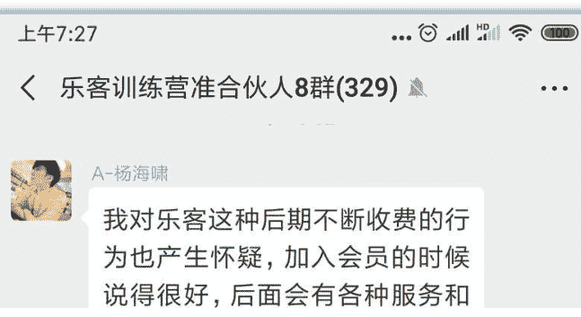

项目免费开放，交了 9800 以后，各种服务都是付费的了。之前宣传的乐客独角兽的群 299，什么对接投资人，项目落地，加进去以后才发现根本就是一个自治的群，除了我们自己以外，群内根本没有乐客的身影，完全和宣传不对等。现在又是 299，是不是收了钱把大家放在一个群里，然后自生自灭？我感觉乐客是不是在追求变现，而不是真正的服务社群，创业裂变。

### 聊天记录截图

**A-杨海啸**
@所有人
早上6:08
请多多关照
同意

早上6:13

**乐客训练营准合伙人8群(329)**

**创客**
师傅领进门，修行靠自己。在听崔老师 2000 多集音频，还剩 300 多集。

**A-杨海啸**
@所有人，乐客应该给出答复，不要私自加人私聊，就在群里说清楚，收费的社群，结果由群友自己维持，无任何扶持更不谈服务。现在再来收一波钱，你能不能落地你的承诺？不能像韭菜一样，来一个项目割一次，缴了钱然后自生自灭?!

**A-杨海啸**
@创客 音频在喜马拉雅同步播出，你不是乐客的也能听到。你交钱是来听音频的?去喜马拉雅啊！

**创客**
在喜马拉雅听了音频，感觉对我帮助挺大，才加入乐客会员。@A-杨海啸

**A-杨海啸**
@创客 加进来你感觉帮助打么？

上午7:28

**乐客训练营准合伙人8群(329)**

**A-杨海啸**
@创客 加进来你感觉帮助打么？
我们和你一样，带着憧憬进来的。
结果，进来了就是不断的收钱，我没感觉到帮助。

**A-杨海啸**
不是没感觉到帮助，是没有看到他们承诺的服务。

**创客**
视眼变大，想法更宽，最重要乐客创业坚持，精神。学东西靠悟

**A-杨海啸**
各抒己见，那你慢慢悟。希望你说的是事实，而非你此刻的感觉。

**创客**
谢谢

早上6:43

**开门见福**
不能回避，服务方面乐客的确要反思、完善的！

## 请问一下。禽蛋行业

(提问)白手套～:请问一下。禽蛋行业会不会火箭蛋后，引发倒霉蛋，，印钞鸡变倒霉鸡？
2019-05-14

**回答：【帖子编号0274】**

如果碰上禽流感这种事，那没招。毕竟意外因素无法预期。但如果你只是怕行业因素导致的不景气的话，没必要。猪的问题一两年、两三年都未必搞得定。禽蛋作为替代消费，几年内都会很好。再长期看的话，就是消费习惯更迭的问题了。

对个人从业者而言，最大的变数其实是：冷链运输，目前价格已经降得很低了。这是利好大的养殖企业，利空小养殖户的问题。举例来说：（以下数字都是我为了举例说明，胡编出来的，只有逻辑说明意义，没有实际参考意义）

假设，小户养一只鸡5元钱，大厂因为规模化，技术高等等原因，养一只鸡4元钱。成本5:4（差价20%）如果都需要冷链运输的话，假设运费5 元，两者差价就变成了10:9，差价变成10%了。（意味着，如果距离优势能够降低超过10%成本，那么小户是有竞争优势的）

现在冷链运输价格已经降低到可以堪比普通快递的价格了，比如假设运费1元。那么比例就变成了6:5，差价17%。如果运费继续降低到0.5元，那么成本就是5.5:4.5，差价约 18%。运费比例越低，越能体现低成本的优势。那么，大厂的打击距离越远。

不过我并不了解养鸡这个行业。或许大厂小厂之间的成本差异并不大，那么上面的问题就不是问题了，红利大家可以一起吃，挺好。(21赞)

### 评论区

- 白手套～:之前14年的时候，蛋价创历史高，之后接连两年都保持较好的盈利。导致全国因为产量过剩，引起全国性蛋价 持续低迷长达6个月之久。历史会不会重演，现在的鸡苗都涨价，而且都没现货，都推到8月以后去了。
- 白手套～:17年
- Akex :大的养殖场成本更高，因为管理水平不到位，还有资金，折旧远超散户。
- 珍大户:那就给小做人的机会了
- 珍大户:我记得。17年刚回国，见到鸡蛋不到三块钱一斤，眼睛都要掉下来了 现在不好说两年三年之后，会不会因为这两 三年产量扩张太快而导致低迷。因为取决于这两年三年有多少人、多少资本入局。无论是鸡价猪价，都是粮价票价，都是有这种很明显的周期的，因为每年的人均消费需】其实变动不大，所以供应量有变化时，价格就会变化不少。不过这一轮 期在【人均消费量】将要变化，所以我觉得会更乐观一些。
- 白手套～:其实基础设施还在，就业人变化不明显，公司或农户都经历过教训。心理上来说会不会控制一下。

## 【帖子编号0273】

**珍大户：【帖子编号0273】**

《抑制供给》

@芸花艺工作室 提问：

珍姐，直播时向您提问，您说在经济圈重新提一下给予详细解答：）谢谢！

坐标南京，目前城市中心老破小房价低于新区的房价很多，但是租金比较稳定，是否值得投资。未来是否可能无法交易？

主要考虑如下几点，新区房产投资涨幅比例较大，但考虑现在高房价的风险性，和资金占用的比例，市中心老破小若遇到房价下行是否更加抗跌？想听听珍姐怎么说，谢谢。

在直播的时候看到的这个提问，最后一句是问，老破小未来流动性怎么样？

顿时感觉到话题敏感了，不敢公开说。所以想来圈子里聊聊流动性的问题。

最近有个事儿，是新车市场的政/策。几个地区（上海，广州，深圳，重庆，天津等地）从七月一号开始率先实行国6标准了。其他城市再晚一年，到2020年也会开始实施。

国6标准实施后，普遍认为：
- 国三车就地报废（可能会禁行。我不是汽车行业的，对具体的不敢笃定地说，这个只能请行业内的朋友们发言了）；
- 国四车会市区限行；
- 国五车旧车还能正常使用，不限行，但禁止新入户上牌。

那么结果上，国三车失去使用价值，应该还剩个报废残值（废铁价）。
国四车大幅丧失使用价值，只能在农村、郊区使用，贬值会很大。
国五车，异地转籍将不可能。意味着如果想出售的话，也就是只能在车牌原城市内转让，市场变小，价值也会贬损。

我也算是个利益相关方。老车是国四车。新标准下会限行，不过我们也不开了，所以不怎么操心。

新车是国五车，但是是沪牌，还有两年就要过免检期了，为了方便，肯定会转籍。那么拖到2020年，全国都改国六后，肯定就不给迁移了。所以必须要考虑近期抛掉沪牌。

我家属于不太可能会卖车，所以顶多损失点“账面资产”。但从经济角度，我依然认为这个政策是存在问题的。

毕竟不是所有人都像我家这样不卖车。对于想要卖车的人来说，是切实的遭受了损失。

如果是纯粹的为了环保，那么应该允许旧车的排放经检测合格后升级。

更或者，允许旧车改造。毕竟一个旧车至少也值几万块，如果花几千块的改造就能盘活资产，实则有利于居民财富的保值，所谓的藏富于民。

然而现实中，升级难度不小，更是禁止改造。所以我想来想去，总觉得这政策在环保之外，还是一个将旧车排除市场竞争，从而拉动新车销售的政策。

毕竟，同样是买车，买新车直接贡献税/收，买二手车才缴几百块的过户费啊？

批量报废国123的旧车，限制国4、5的旧车转让，于是购车需求将会大幅地转向新车市场。那么不仅环保，还能保车企、保新车销售。

（从税/收和gdp角度出发的政策其实不少。比如，不禁电瓶车销售，却禁电瓶车上路。）

我刚才特意做了一下搜索工作，从全国来看，国三、国四、国五、国六的实施时间，分别是2008年，2011年，2017年，2020年。（上海一般都会提前实施标准，国四五六的时间，分别是2008年，2014年和2019年）

排放标准短则三年，最多不过六年就更新一次。大部分情况下，六年免检期还没过完呢，就要面临转让受限了。

这个政/策其实本质上与15-16-17年的“供给侧改g”有相似之处。

供给侧改g，通过提高标准，关停小的生产商，从而减少产能。市场上的卖家少了，于是剩下的人都觉得日子好过了。

想起来前几天看的电影。灭霸打了个响指，一半的人消失了。感觉有点像。只不过灭霸是抽签式的，无差别消灭。而我们的政策，是让规模小的退出（供给侧改g）、年龄老的退出（汽车限制）。

当供给侧改g当作成功经验后，以后一定会有更多的政策有这种迹象的。

所以我想到了房市上。老房子肯定不会限制交易。但有可能，政策会导向到限制贷款上去。

如果要扶持新房（毕竟新房更加贡献GDP和税/收），那么可以限制旧房。

只要按房龄，分批掐断贷款资格，就会大幅提高交易难度，于是，购房者就会转而购买新房了。
[https://t.zsxq.com/jUB2NjE](https://t.zsxq.com/jUB2NjE)

2019-05-14 (48赞)

### 评论区

- 珍大户：我去，竟然审核出来了
- 庚申：北京已经这么干了。房龄在40年以上最多贷24年。并且按照房龄逐年递减。
- 珍大户：为了搜索方便（只有找正文的内容能搜索，评论区搜索不了），我把昨天在评论区分段发的那条给删掉了......可惜了那条的评论区[抓狂]
- 石头：这样的话，我们是不是可以看好，新能源汽车行业的股票[呲笑]
- 芸花艺工作室：终于等到了回复，好激动，先谢谢您。不过正如你分析的，各个城市都是对老破小的贷款年限收紧，目前市场都是违规操作（一旦严打就不好说了），不过只要不是学区的老破小，胜在总价低，地段好配套便捷，一旦不让贷款就只能收租金了。
- （\v\）：够呛，现在车企都勒紧裤腰带过日子呢
- 潘广弟：汽车行业现在有点敏感[捂脸]
- 万能的妹妹 阿鹏：车辆检测机构表示也不好过

## 想请教一下各位朋友

最好吃的我：想请教一下个各位朋友关于职位规划。本人，96年的，男，24岁。父母离婚，父亲被判有期徒刑22年从小是寄宿在姑姑家里，初中毕业后读了一个学期高中由于成绩不好就辍学了。然后跟着表哥去学做家具（雕刻）做了五六年吧！22岁的时候我父亲出狱回来了。就把积蓄拿出来在老家宅基地盖了一栋自建房（还没装修[捂脸]）我父亲说他会做衣服，刚好我表姐夫又有货源。我就买了一些设备在家开了个小加工厂让我父亲管理（和外面的社会有些脱钩管理的不太好）。我在的家具行业近几年都不景气，雕刻自然也跟着没事做。我现在是继续在家具行业里工作好（转型做木工）还是回去帮我父亲打理加工厂（暂时收益并不高达两个人管理）。请各位朋友提点宝贵建议！

2019-05-14 (10赞)

### 评论区

- 红绿蛋：俩人一起管理，理念又不同的话吵架这种事成了家常便饭
- 赵大：这个问题，没法只从职业规解角度来分析。木工雕刻，条件反射想到的是给红木家具做雕刻的，给太师椅子的靠背上雕个盘龙之类的。不知道是不是这种的？仿古的红木家具市场现在已太岕好，原因不多说。另外，这类雕刻手艺，如果不是太具有艺术性的，只担当“工具属性”，后面很可能被激光理勒3D打印这种技术给替代掉。相对来说，服装厂更容易经营得活，生存空间要大一些。然而，这种选择你没法只从职业规划的角度来谈。服装厂是你父亲开的，你需要仔细了解一得你父亲的想法。作为一个描述了孩了22年的成长史的父亲来说，他猜你应该很想多花些时间跟在一起，弥补一下子子时间。然而在监狱里呆了20多年后，一个人的影响。带来的后遗证也是很明显的。他会感性，一会有感情缺失，或者父子之名，但是亲感觉在很长一段时间内都难以建立。他的表达能力也会很严重受限，你会时不时的感受他的行为方式，表达方式都不像正常的正常人。你必须更包容，更承担起交流的责任，否则你会时不时的像行气掉。他内心可能自卑感，时而兴高，时而因缺的一意孤行，想要备力的证明自己，让你们合作更加紧张。但最主要的是，如果你们之间是陌生人，互相之间没有期望，就不会形成巨大的落差。但因为你们是父子关系，两人都会对对方有所期望，你们就会反目容易失望。————所以这不是一个职业选择题（如果只是职业选择，我就让你去服装厂了）而是，你已经做好心理准备，决心要付出巨大的包容，就像父亲对孩子那样包容，去引导你的父亲，重建父子亲情了吗？https://t.zsxq.com/nyvbji
- 最好吃的我：对啊！有时候意见不合就起争执
- 最好吃的我：大户的分有简而直一针见血，枪准狠！我的是手工雕刻和电脑机雕。主要做欧式沙发，浴室柜。17年下半年开始也不知道为什么突然就流行了欧式风格了。市面上全部清一色的新中式（新中式不需要雕花）现在家具行业里吃香的木工和打磨！所以想转型做木工，但是大户这么一分析。我突然想起来上次去逛家具市场有好几儿家店开始全铝家居，我想未来家具行业会逐渐被新型环保材料代替！服装加工 和大户说的一样，我父亲的行为方式 表达方式的和身边的正常人不一样！我真的会气的想摔碗，该说话有底气时他兴高，不该说的话他总是要说！作为一个管理者这样是没有魅力的！我经常想想要改变，自我感觉我能包容得了，可是引导不了他。
- 定XCabm：学这技术，在有前景的行业里做几年能力是开开了眼界开阔了有了初始资金 可以自己做 这段时间能力的提升最重要
- 赵蛋：大户的角度深度都超棒！美国电影喜剧！
- AAA-一路阳光，首先说服服装，我家亲戚就是加工厂，给品牌牌调高，纯纯棉子，在临近省州范围的批发市场客户部不少，但是利润不高，就增加工资，如果做工装的话（上衣为主）利润更低，纯赚量。但是不怕苦不怕累还是能挣到钱的。再说木工这行，这个我不懂，但是工价高我是知道的，有请懂得的说说[呲牙]

## 珍大户：【贴着编号0272】
### 《群体认知改变消费习惯》

**提问**：珍姐：我四川德阳的现在租的池塘做水产养殖，鱼苗、饲料、鱼病、销售我都能搞定，可以最大化的压缩成本。水产养殖风险高，散户冲击大，市场价格主要是供需关系影响，有一定的周期性和规律性，有大数据支撑可以预判市场行情。18年洪水损失了300来万。现在心里有点纠结自己还要不要坚持做下去。个人观点：我现在所处的水产养殖行业是老龄化严重没有青壮劳动力进入、从业人员知识程度低，养殖方式和行为多以经验为主。大部分从业人员都是亏损状态。但是我认为水产养殖的门槛会越来越高，资金、理论基础、实践经验、养殖场地、管理的占比都非常重。从长远来看水产养殖的前景非常好。希望你能用你的角度来指导一下。

水产养殖行业，我会长期看好。

大家回忆小时候的各种方便面、橙色的碳酸饮料，如果当时告诉你说，有一天方便面和碳酸饮料都会渐渐被抛弃，你会相信吗？

当所有人都相信方便面和碳酸饮料不健康的时候，无论再怎么开发新品种、再怎么降价促销，都是无济于事的了。

（记得看过说统一食品厂的研究人员，费劲各种方法去研发各种“新口味”。然而我们一眼就能看穿。就算研究出来佛跳墙口味的，又有什么用呢。大家不买单的原因，又不是因为吃腻了，而是都觉得吃方便面不健康。）

有人说是外卖打败了方便面。根本不是，如果没有外卖，很多人就自己做饭了。在“不健康”的印象下，即使没有外卖的出现，方便面也会这种后果。
（比如，味精。现在还有多少人用味精？没有外卖影响，味精产业是被谁摧毁的？）

群体认知，能改消费习惯。既能摧毁，也能建立。

所以我们需要关注的是，下一个能洗脑全国人民，变成通识的“认知”，会是什么？

谈到认知改变，趋势是这样的。

永远都是在最初的时候，一点一点的渗透，从人群中 **1%、5%、10%** 的人开始。这个过程很缓慢。

当逐渐影响到人群中20%、30%的人之后，一夜之间，似乎就像变成共识一样，声音就会变得好大，似乎“大家都知道了”似的。

（当然，其实不会有“人人都知道”这种事。

一个社会中，总有几成的人，是保守又落后。就像现在，还会有人愿意持续消费方便面和碳酸饮料，还会持续消费许多年。

但保守落后的人，对群体认知是没有什么影响力的。所以……他们无法影响和无法改变群体认知。而只要顾客失去一半，就足够一个产业坍塌了。所以方便面行业的衰落不可避免。

但同理，只要顾客开始增长，一个产业就会持续兴旺起来。）

所以，下一个将要演变成共识的认知，会是什么？

我个人猜测，有可能是戒糖/高蛋白饮食。（就是不吃大米、面粉制品、以及一切碳水化合物为主的食品。包括流行的奶茶、蛋糕面包等等）

前几个月微博上，张韶涵说已经戒糖很多年了（十几年？）。

很多年前，这种方法似乎更多在明星圈子里流行。估计只有明星知道。（人群中的1%）

但目前有扩大流行的趋势，在某个年龄段内开始影响扩大。（反正不是老年人的年龄段）

我一直觉得，我们应该时刻观察着下一代中，将要流行什么。因为那代表了未来的趋势。

年轻一代，从上大学开始走出家庭，走出父母的饮食习惯，然后在网上看到，说戒糖能年轻？能保持身材？能干吃不胖？看到高蛋白饮食还能起到健身的效果？

这种互相宣传的效果，会一点一点持续放大。在年轻人的比例中越来越大。

未来受这部分人影响，下一代人将要吃更多的鸡和鱼，更少的米饭面条。从菜品渐渐开始承担起一部分主食的任务。市场会逐步扩大。

这种趋势会多久开始放大到颠覆产业呢，不会太远，当有百分之二三十的人开始改成这个样子时，就会发声形成一种“全国人民都知道”的样子……（因为保守者不会发声）。

然后米面制品销量会大幅下降。（我知道很多人会说不可能，中国人怎么改得了吃米吃面呢。

然而没什么不可能的。就跟曾经都吃粗粮、窝窝头，某一天都吃上精制大米和白馒头了一样。

改变很快，只要观念变了。比如认为精粮比粗粮高档）

这个趋势可能用不了几年，反正不会有十年那么久。

（当然保不齐也有另外一种可能：认为养殖鱼脏、不干净、激素多、寄生虫多等等观念更先占领认知领域，那就结果不一样了。

但我认为，关于食品卫生方面的认知是容易修改的，而关于营养健康方面的认知，则是更长期的。所以营养健康的认知，趋势更强烈些）

这是我看好鱼虾、禽蛋行业的长期理由。

再说略短些的周期（今年）

大趋势是一方面。但跑的太超前，容易死的快。

比如我一直觉得，未来健康餐饮肯定很重要，那么一种定食、低卡的餐饮形式，有可能会受欢迎。而现在呢，未必。进入太早有可能死得快。

然而养鱼不一样。

我今年一直说禽蛋产业一定会好，养鱼也一样。

今年外部环境（猪）导致的食品价格上涨将会持续至少一整年。禽蛋、鱼肉都是替代品，都是受益方。天时地利。

最后，不得不说，刚看到提问的时候，我脑中出现的第1个念头就是——农业保险。

第一产业受天灾影响严重。赚好几年不够一年亏的。你肯定需要转移风险。

国内的农业保险产业比较让人惭愧。保额低，基本覆盖不了天灾损失。就算投保了，损失三百万有可能只理赔个几十万。因为农业保险产业不发达。保险公司经营的也不怎么样，规模不够。

不过目前也有好处。就是一般会有地方财政扶持，保费的一大半应该会有补贴。所以建议咨询一下当地的政府农业部门，看怎么能享受到补贴政策，以防再次出现天灾风险，意外出局。https://t.zsxq.com/jjiybAi

## 2019-05-11 (40赞)

**评论区**：
- add：已经第七天没有吃米面的我，希望可以坚持，坚持！
- 完美主义法人代表：叫我爸多养几头猪
- A-Bicom：厉害，受教了。
- 别闹：好思路！赞一个
- Georgin：珍妮说的是生酮
- Tian：珍妮，昨天直播时候想问您，您没有看到。就是中医养生理疗行业未来的发展趋势会怎样？因为感觉现在年轻一代的人对中医药并没有特别接受，但是小儿推拿反而很多年轻父母都喜欢。还有刮痧拔罐这些现在也都有很多理疗店在做。未来中医行业整体的命运兴衰会是怎样的呢？会不会是理疗方面的发展更好，而中医药方面停滞不前？
- 翰林：那你吃什么
- add：鸡胸肉，牛肉，各种蔬菜，藜麦，我在减肥

关注公众号“懒人找资源”，星球资源一站式服务

## 理财公司已经开始延

**提问**：domperidon*：理财公司已经开始延期兑付了，起死回生的可能性大吗，作为公司员工（非销售）应该怎么办？

**2019-05-10 回答**：【帖子编号0271】（95%）没戏的。（还有5%遇到强势国企/省国资委收购注资什么的，概率跟娶到白富美、嫁给高富帅差不多。）出现延期兑付后，两个影响，几乎不可能活得下去了。一个是挤兑，一堆人到门口拉横幅讨钱，不管到没到期，肯定开始急着要钱。另一个是，后续经营会受影响。毕竟，如果是实物产品，比如说卖拖拉机的企业，如果现金流出问题，不至于让买家担心到不敢来买产品。那么公司就还可以继续运转。然而金融类公司就是这个问题，一旦现金流出问题，就没买家敢上门了。所以就算第一关能捱过去了，陆续有回款能后续兑付成功，公司也会因为第二关，难以继续正常经营了。基本都是死。

你上次我说的正常情况（明面上能说的）还有一种无法明面说的。有些理财公司，经营并不正规，资金去路不明，借新还旧。这种公司，等到很多人收不到钱时，一堆人报案后，有可能会被定性为非法集资/诈骗案件。那么在里面的员工甚至都是有风险的。（5年前一般这类案件只抓法人高管，不抓普通员工。但今年有扩大迹象，一抓抓一票人，所以员工也有风险）（但并不是说你们公司一定有风险。如果不是资金投向不明确的话，那么没这种问题）

但总的来说，依然是早跑为妙。(22赞)

**评论区**：
- 母光亮：虽然所有客户要正视风险，但没有哪个客户会愿意主动承担风险，即便知道有往前路的也只是因为自信自己的能力或者是运气罢了。
- domperidon*：谢谢大户的回答[抱拳]现在这种状态下我也是一头雾水 不知道该怎么选择了 作为公司员工还买了公司原始股了（已经上市），这种原始股只对员工出售，离开的活有股东要求退还吗？
- 波浪摩擦：大户还是比较保守的，只给了个95%的概率，要我只能翻盘的机会#但是趋近于0
- domperidon*：目前的状态是是公司规模付款，但是金额太大，好像无能为力，一旦倒闭，客户还有机会拿回来吗？
- domperidon*：现在是员工很相信自己运气好，但是大户说的对，财运运气太牛了
- 母光亮：灭信，特别是涉及资金的，很难挽回的。除非是大户说的那种特殊情况，基本是被改头换面，重生一样。这几年爆雷的真太多了，不过没有接触过客户，可能不会知道。
- Hans：这个是让买卖身份当法人者得，一抓，一看是个河大女神警察连人都找不到。

## 珍老师，您好。咨询

**提问**：ai：珍老师，您好。咨询下传言的新的征信政策对房价是有影响，比如降价、涨价、没啥影响。再问下购房问题，在长沙，同样的位置（图书馆边、地铁口）安置区只要5000-6000元/平方米，商品房新房8000元/平方米（我不是本地人，排号买不到新房），商品房的二手房预计10000。我打算买安置区自己住，比商品房的二手便宜一半，可否（我是上班族，家里不会帮忙）谢谢。

**2019-05-10 回答**：【帖子编号0270】长沙已经限购很严了，所以新征信对长沙而言，影响不大。（看这个价格我也很吃惊，长沙房价真吸引人）

一般而言，不建议买安置房。（一方面是怀疑建筑质量不如商品房，这个我不知道真假，只能听建筑行业的发言，他们说的才更准确些。）主要是因为，一般安置小区的物业都比较差（主要是安置小区拒交物业费的比例更多，很可能就换个稀松烂的便宜物业上岗了），然后多年之后，小区里环境和绿化会明显的差于周围小区，于是均价也会差一点。但这种不建议，是指在购买的时候差价不大的情况下。（见过买入时差价只差几百甚至一千多的，后期差价20%+的）

但如果买入差价很大，比如你这种情况。二手商品房1万，二手安置房五千。如果未来房价上涨，假如涨50%，商品房到1.5万，那么安置房也是50%，到7500的水平吗？

当然不会了。现在差价是5000或50%，未来不太可能是继续差价7500或50%。

而更有可能是依然差价5000，但比例已缩减至33%。

所以这种差价，我觉得低估的有点明显（除非在交通和配套方面有硬伤）。买安置房吧。(11赞)

- 小白龙：问一下安置房是不是就没有房产证？
- 胡宏伟：安置房有产证，是拆迁取得！
- Trista：没有房产证，只能自住，不能买卖吧！
- yoyo：有没有安置房当成商品房卖的
- yyyo：什么是拆迁取的
- 胡宏伟：商品房证的档案会记录购买取得，.安置房的产证就没有购买取得这句，一般有拆迁取得。如果再次交易，新证也会是购买取得！
- yyyo：什么是再次交易
- 珍大户：指以后想要卖房子时

关注公众号"懒人找资源"，星球资源一站式服务

## 珍姐你好我们刚发了

**提问**：94年咸菜：珍姐你好

我们刚发了年终奖，我感觉我的数额少了有6000左右吧，所以我向财务核实到底是不是算错了。

然后财务说 因为你有6天的事假，后来核实我并没有

然后又来问我，那你觉得应该是多少钱？但是他又说计算公式是保密的，不给我

总之就是不愿意查

首先她肯定是给我少算钱了，因为后来我又偷偷问跟我一样的同事，他说你这金额确实有问题。

我现在应该怎么办

1. 继续跟财务撕？
2. 再向她的上一级告状？他上级是老板娘了…我怕他们是同一条绳上的蚂蚱
3. 将心态调整为，奖金是公司给我的恩惠，没有写在劳动合同里，即使算错了给少了，也不用这么计较

唉，我这种刚入世事的小少年

**2019-05-10 回答**：【帖子编号0269】这个问题，很难有完美结果，所以挺适合拿出来讨论的。大家觉得怎么办呢？

我的观点：三条路线中，第1条路线，财务既然已经不承认问题了，那么再撕也没用。再撕等同于你要把你从其他人那里打听来的信息摆到台面上，那就违反了薪酬保密。第2条路线，这不能100%确定一定是财务出问题的情况下，直接去告状，等于将矛盾摊开，并且还会强硬的逼老板娘表态。很多公司并不希望有显性的矛盾。而且强迫老板娘表态也是一件遭人反感的事。

第3条路线，年终奖肯定不能算作“公司给的恩惠”，而是绩效工资，是你应得的。而且也是市场定价的（全年加班的收入，会符合市场行情）所以，如果你调整成这种心态，等于放弃自己的利益。那么很快就会被认为是包子，保不齐财务还会二次拿你开刀。（无论 是从社会经验来讲，还是从科学统计的角度，都有显示 说，有一点脾气的员工，起薪会更高，涨薪会更快。老好人 式的员工，收入都会低于平均水平）

所以 这三条路线肯定都有问题。 我觉得需要做一些调整吧。

第1 条路线，如果你要跟财务撕，那么你需要收集一下公司公开 的年终奖规则（明规则）。 私下里的揣测，以及私下里跟同 事打听的信息，这些都属于明着的禁忌，只能私下里交流， 切莫拿到台面上来说。（比如，大部分公司都会规定，禁止 互相打听薪酬，禁止交流年终奖信息。你敢公开说你就输 了。） 而你要跟财务撕，就一定要拿明规则来怼他。 举例， 有些公司的年终奖是按照“月薪乘以系数”来计算的。比如a部 门，集体系数是三个月。那么大部分人都是三个月上下，按 年终考核的不同，可能会有人是3.5个月，有人是2.5个月。这 种就属于明规则，部门的系数也是公开透明的，你只能拿这 种公开的规则来怼财务。

（回答这个问题时， 我才意识到各个公司的年终奖规则极不相同 不知道各位朋友 们，都见过什么样的年终奖规则，大家可以说一下）

第2条路线，可以找领导，但是要婉转。如果你 把她推到，必须要站你或者站财务，2选1的境地，这就一定 不是好办法。要给他有下台阶的选项。 举例，可以在能私下 交流的场合，借故问一下，说公司今年业绩难做，所以年终 奖有所减少啊？ 老板娘如果心里有数，会先解释一下（说是 啊，市场难做），然后再鼓励一下（说但大家千万别泄气， 加油怎样怎样，明年给大家补上年终奖） 或者老板不知道， 那么有可能她会问，这时候再继续反应情况。

关于 这种婉转的表达方式，并非我所长文。 请更有经验的圈友献 言献策一[抱拳]

第3种路线， 可以安慰自己。但 不要想什么年终奖是公司的恩惠。 而是告诉自己，现在自己地位有限，可替代性高，如果闹僵了，有可能就不得不离开公司，另寻他处了。所以就算不争取，也是一时的隐忍而已。(27赞)

**评论区**：
- 琦宝！：[嘴叼]题主好可爱
- 94年咸菜：其实我还有一个疑问，这种问题对财务来说很繁琐？，还是很致命？，他为啥这么不愿意帮我查，算错了，再补给我不就完了？
- 许半仙：这种影响实际利益但是却又需要考虑职场社交的事情真的是很难处理又讨厌~ 有一种“婉转的坦诚处事原则”你可以参考...1.找机会请主管人吃饭（唉）2.先感激（对你的帮助）3.后请教（一些不是很为难他而他又擅长的经验）4.然后趁气氛正好之时坦诚相对趁势直接请教你此番目的，让他帮你看看，求助他。 ps我觉得多数人是可以感受到你的坦诚的。
- 珍大户：对了，我想问一下，你是咋知道年终奖少了6000的呢，是有一个大致的公式让你事前推算出来的吗？
- 珍大户：我真的学习楼上位了[抱拳]请吃饭绝对是个可行方法（但我在这方面因为应用机会不多，所以很拙）
- 94年咸菜：就是（税前工资*4个月再扣税）也没有请假，也没其他的扣款情况
- 珍大户：所以这个是明规则啊？
- 大脸招财猫口：财务不会因为你的质疑再重新算一遍，他可不想承认自己的错误，来帮你追回损失。所以有个办法，熟人好办事。跟他搞好关系，吃吃饭，送个礼物，让他帮帮忙再查算一下。

关注公众号"懒人找资源"，星球资源一站式服务

## 珍姐，我是一家城商

**提问**：哈哈：珍姐，我是一家城商行职员，现在做授信审查相关工作，工作到了瓶颈期，升职得论资排辈，还要有关系。在小县城跳槽也有难度，想考些证书，一直在frm和cpa之间犹豫，望珍姐指点一下银行员工以后的职业生涯规划，谢谢啦！

**2019-05-09 回答**：【帖子编号0268】两个证书认可度都很高，但怎么选呢，需要看一下你身边。如果有cpa证书的不多，那么考cpa即可。如果有cpa的人不少，那么就改去考frm（难度在纯英语考试，费用也要高不少）。所有的原则，无法就一个，把自己打造成具有少数资源的。记得体制内有个说法，说“无知美少女”（无党派人士、有学历的知识分子、留学背景、少数民族、女性）最容易升值。原因无他，就是人群中太少了，稀缺反而成了优势。你也说在小城市，翻译一下=“升职的机会并不多、比较稀缺”，当地论资排辈，翻译一下=1大部分人硬件都差不多所以只能排资历、2你没有特殊背景。这时候你要加硬件，就得加别人没有的，才算有效。否则大家都有，根本无法让你竞争到“稀缺的机会”。

回答问题之外，额外叨叨几句。很多年前，我经验也不足的时候，当时也算占了法学复合背景的便宜。当年cfa,frm证书好像还没流行，很多人首先追求cpa。但当时复合法律背景的人还不多，稀缺就是竞争力。现在越来越多的证书很硬的毕业生出现了，研究生毕业，就拿着cpa六门+cfa二级的学霸越来越多，如果你手上什么证书都没有，怎么跟他们竞争？有时候，走在老路上去追赶别人很慢，不如走没人走的偏门。举例：你如果去应聘，说自己马拉松成绩很牛，或者你是一身肌肉的壮汉，保证面试印象深刻，机会大幅提升。因为现在这样的人还很少，稀缺！加之为工作还有用（会被认为身体好、精力旺盛、能应对高强度的工作），所以就是竞争力。

但如果有一天人人都这样，就不算竞争力了。（仅举个例子，说明一下怎么给自己增加弯道超车的几率）(37赞)

**评论区**：
- 秋语：弯道超车
- 之姚：有道理
- 哈哈：哈哈，看到珍姐的解答，开心死了[呲牙]谢谢，一定加油
- 某某某：直线超车真的很难
- 陈磊：无知美少女
- 淡淡墨佛：其实我看到论资排辈这几个字就感觉可能是你态度不对。你跟身边一百多个同等资格的人差不多，凭啥你上？你不比别人牛B的明显，轮也轮不到你。
- Jus斯汀：珍姐的回答，对体制内的人都有参考价值！
- 小郭子：大户说的有道理啊

关注公众号"懒人找资源"，星球资源一站式服务

## 珍姐好，我老公是银

**提问**：sophia：珍姐好，我老公是银行的一名对公客户经理31岁，现在想转行做小微中心客户经理。原单位领导挽留我老公继续做对公客户经理，说以后有机会让他做中层领导。您如何看待小微信贷业务的发展？我老公该换岗吗？

**2019-05-06 回答**：【帖子编号0267】完全错误的选择。所有的客户经理，岗位性质上都是销售。（请大家别对销售这个词带有色眼镜，我在阐述销售的性质时，并不带有褒贬含义。金融系统中，很多金融产品对接到银行系统时，作为“基层销售代表”参加会议的，基本都是各个支行的行长。另外之前讲过“投行是什么”的视频，里面的承销岗是直接销售岗位，甚至整个投行在金融业的定义都是“卖方”、sellside，全公司的定位就是销售。所以，不带有色眼镜地说下，带有销售性质的岗位，选择的原则）

我在0015贴里写了关于销售的几个原则：再扩展一下，应该说有以下几条：
- 能做对公销售的，不要做对个人的销售。
- 能做大客户销售的，绝不做散户销售。
- 能做高单价销售的，不做低单价产品。
- 能做高利润率产品销售的，不做低利润率产品。

因为上面每一项，都代表着更高的门槛。门槛越高越可能维持住高利润，越可能给你发高薪。门槛越低，竞争越激烈，替换性越高，越不可能有高收入。

随便举个例子，同样是销售，一边是对散户，一边是对大客户。对散户的，可能招几百个电话销售，每天打满多少通电话。完不成随时滚蛋。骚扰到客户了？无所谓。对大客户的，哪个公司敢随随便便三天两头换销售？同时派三五个人，一起跟进一家大客户搞竞争，然后弱者淘汰？时不时跟大客户打招呼，说我们公司客户经理换人了，请你更新一下联系方式？不可能的。同是工作很多年的人，只见过对公销售拿着大客户资源去另起炉灶了，没见过对私销售另起炉灶的。

所以看见提问中的选择方向……除非你期望的目标

是，最终评选上XX标兵、XX能手，只要荣誉不要钱。毕竟大客户经理不太可能有这种荣誉，去做小微贷款（银行做这个都没什么利润，纯属政策导向）最容易给荣誉。(41赞)

评论区：
- 胡宏伟：好佩服大户的思维见解，我也想提个付费的问题，关于家庭理财和职业规划的问题，没看到在哪里付费[捂脸]
- sophia：谢谢珍姐，这个对公客户经理是基层网点的，而信贷经理是属于市行的。也应该做对公客户经理吗？考虑晋升呢[玫瑰][玫瑰]
- 珍大户：苹果手机不能付费，直接点提问就可以了
- Jan 简：在理
- 珍大户：有一种可能性，就是你老公以这个为踏板，先去市行，然后找机会继续换岗。主要目标是为了完成从支行到分行的跳跃，那么是可以的。但要给自己设一个时间期限，换岗不了就跳槽，借着往其他银行移动的机会换岗。设时间期限是因为，小微贷款是纯政策导向才开设的业务，最终利润率、坏账率都无法跟正常商业贷款业务相比。有可能时事后是要背锅的。
- tenbean：大户，她老公基层对公，做的就是小微贷款吧，背锅这几年应该已经背过了[大哭]
- 珍大户：说出你的故事来，看样子子是背过锅……
- sophia：谢谢珍姐，❤❤❤❤❤。被翻牌的感觉真好，啦啦啦。会好好考虑。ps:我老公不是做的小微信贷，还没做过呢。

关注公众号“懒人找资源”，星球资源一站式服务

## 珍姐，想请教个关于

(提问)Luna：珍姐，想请教个关于就业的问题。

我老公89年的，985本科毕业，木材科学与工程专业，有家具设计和室内设计2个方向，毕业两年内从事家具设计工作，后我觉得他的方向没有前途，怂恿他去了互联网行业从事产品经理岗位工作，4年时间换了3家公司，最近由于公司几近倒闭所以又一次离职，我老公属于想法有些消极，性格略偏内向的（受原生家庭影响），心思细腻，做事稳当，有创意，但不太善于交际的。互联网行业最近一片哀鸿，我很焦虑35岁以后他会失业，因为他也不太适合做生意。有考虑过让他考公务员，但又怕因为年纪问题和没有相关人脉的关系最后导致浪费了时间又打击了信心，所以不知所措。

2019-05-05

回答：【帖子编号0266】性格内向就不要让他考公务员。真考上了，到工作中觉得环境压抑，就只会更悲观消极后悔。

如果他最初不换行的话，应该跟你同一个行业。从家庭风险分散的角度，两个人分在两个行业更能够抗风险。所以劝他转行这件事上，可以说你做的也没有什么错。他能够从家具设计转行到互联网，这个让我很意外（希望找个机会讲出你们的故事来），说明他也是个人才。那么应该继续在这个行业里坚持（经验不应该轻易浪费，另外担心35岁后失业没必要，后面说），今年行业不好只能慢慢熬过去，而不是感觉不好了，就再回家具设计，或者是考公务员。他现在的消极情绪，也不必苛责，这是正常人在不利环境下的正常反应。

记得抖音上讲过一期《预期》，讲过一个例子。很恩爱的两口子，某段时间男对女说，你能不能少花点钱啊（这是一个真实的例子）。这种事放到网上讲，会有一堆人揣测说，是不是老公出轨了，是不是感情腻了淡了，又或者分析媳妇的消费水平到底有没有道理，是不是真败家。然而，这不是从感情角度分析的问题，而是大环境不好时，悲观预期会放大负面情绪，变得消极、精神压抑。这个时候，需要不断给他鼓励。告诉他说，你当初的选择特别勇敢，特别有担当，跨专业转行是一件很难、很有风险的事情，能够冒这种风险、克服困难，当然不是为了他一个人，而是从两个人、从家庭的利益出发的。每个人的职业都会有风险，但不管怎样，至少有两个分担。往好的想，两人不是不同行业，风险不会集中在一起，至少有一个人还算稳定。

总之，一般来说，男性精神压力都会更大一些，会担心自己能力不如妻子，收入不如妻子，万一失业很丢脸，岂不是被女人养什么的。很多男人都有这种精神压力。其实如果细究起来，原因都是很无端的。因为这等于不承认社会中可能存在的风险，觉得自己一个人，可以强大到完全应对风险，乘风破浪。然而这是不可能的，社会发展到当前这一步，运转效率比历史上任何一个时代都高。这种高效率的来源，就是社会高度分工，每个岗位都螺丝钉化，那么每个岗位都有非常高的替代风险。如果看不清这一点，就是对风险的认知不清。我们所谈的职业选择，无非都是在寻找竞争更稀缺、替代性低、阶段收入更高的职业。但背后更大的趋势是，越来越多的工作将是高度可替代。所以，让你的另一半想清楚，家是互相扶持的，是两个人互相依靠、抵抗风险的地方。让他卸下心里负担，安心的蛰伏，慢慢寻找机会，继续在当领域谋求发展吧。至于你说的，担心他35岁后会失业。我觉得这不是你们当前需要担心的重点。35岁后失业产生的原因，一方面是因为职业的可替代性。另一方面，是在行业排名靠前的企业里，因为求职新人太多、太过竞争激烈，所以让企业更容易换人搞“替代”。然而，他所在的企业，并不是什么行业龙头（四年换三家还碰上倒闭了，我相信不会是很靠前的大公司）。这种企业竞争根本没那么激烈，还没到担心35岁失业的时候。（更直白的说，他又不是身在华为这种大公司，有什么好担心的。小公司更愁的是招不到靠谱的人，根本没资本去裁350+的员工。反之，如果真的身在华为这种狼性企业，想开点，自己早早找好退路，三十二三就该找机会离开了。就像从一线城市往二线退一样，从龙头往二线企业跳的同时，职位晋升做突破，靠着战术撤退来保全利益。）

__________________ 这个提问之中，其实具体信息透露不多。我唯一看到的有问题的环节是——4年换了三份工作。这需要你们仔细的复盘一下，到底是选择工作的眼光有问题？还是因为专业背景和经验所限，无法挑到更好的工作机会？无论是哪种，都是明显的短板，需要你们在后面逐渐补足。否则，频繁变动的工作经历，而且去哪儿哪儿几倒闭，你老公早晚会被认为是特殊体质，后面的公司会瑟瑟发抖的。(31赞)

> 评论区：
- 人生如逆旅：材料专业（系）和家居、家具设计，这完全是两个行当嘛？？，性格内向的人搞设计其实蛮好的；另外，家具设计真的没前途？？
- ponytail：家具设计工资怎么能跟互联网比呢。
- Hans：互联网待得高
- 中国出口数据：无商不富
- 徐风年：说的一针见血
- Nash：我也是从事互联网的，只要技术还可以就不用担心35岁失业。我觉得你就像让你老公模仿，是不是你老公不大喜欢这个职业？产品经理、软件测试、UI设计，都是软件行业里面最好入门的，因为他们不怎么要求代码，工作也比程序员轻松。你们在这个二线城市工作，做软件的话，薪资应该挺低的，三年工作经验的话，应该是8K-9K左右。要不要考虑执行的话，我觉得要看你老公这几年在做产品经理的话，有没有进步大，有没有觉得自己比别人强，还是这几年就是上班，下班，没有刻意去提升。如果提升比较大的话，可以继续待。
- 马瑞旺纳：珍老师不愧是成功男人背后的女人啊□

关注公众号“懒人找资源”，星球资源一站式服务

我目前在家具公司从事设计工作 6 年时间，年薪 14 左右，由于是传统行业大公司，工作还算稳定。我们在廊坊贷款买的房和车，有 20 的存款，生活还过得去。目前很焦虑我老公未来的发展问题。忘珍姐指点一二，可以考虑北京就业。

## 15年毕业，女，毕

(提问)匿名用户：15年毕业，女，毕业后就一直呆在地产生圈，从网站编辑到地产策划，已经有4个年头了。

本身对地产不反感，但策划经常要提报写方案，在提案这块一直都是弱项，也有想过去加强但没什么效果。

恰好近期开发商那儿出了一些情况，要自己忙于设计，突然发现自己对设计这块挺有兴趣的也有天赋（被表扬过好几次）。

其实一直想去创业，自己掌握人生，每次回家都会发现一些商家设计的展架微单画面实在是难看又不专业，所以萌生老家开设广告室的想法，初期想法接设计接活动方案。补充下楼主在三四线小城市，一周6天班，月薪6k，刚回家乡半年不到，之前在二线城市。请问想法有可行性吗？

2019-05-05

回答： 【帖子编号0265】 想法是可行的。同样是服务行业，律师领域，越到小城市，越没有生存的机会。因为律师水平这件事，普通人没法鉴别，所以潜意识里觉得越大城市的律师水平越高。于是小城市的人需要律师想找省会的律师，省会的想要找北京上海的律师。设计这方面要好很多。虽然具体的不知道你想做啥，“展架微单画面”六个字我就只认识前两个。但猜的出来是给商家做设计，可能包括固定展架和临时各种活动选项策划。那么每一个你设计过的商家都能变成你的宣传窗口，所以这方面的想法是可行的。但目前你的不足之处，是目前只有设计。还需要补全制作印刷等环节。否则只有设计，你是没法做出“直接的成果”的，也就没有竞争力可言。 所以当前如果求稳的话，你不妨用自己周日和闲暇的时间去试试谈几个商家，接几次小活试试手，一方面补足你现在还不具备的流程环节，另一方面也算是给自己找点信息，打打名气。 如果激进的话，那么就辞职直接去做这个。(20赞)

评论区：
- 摆渡人：本人设计出身，就像老师讲的那样，质量水平高的企业品牌，找设计都回去一二线城市找。一般在三四线城市做设计的，普通的小企业，小客户，审美能力一般，多数都是找一些广告制作的来设计，后印刷，成套流程。价格便宜！单纯想要设计挣钱，发不了大财，多数设计师创业者的心声话。
- 博梵瑜伽东方舞：我老公是律师，在河南一个三线城市。年收入34十。我想让他去郑州省会，他觉得人太多太麻烦，在家里开车5分钟就到律所，对面就是法院。可我觉得人总是要出去闯一闯。有必要去郑州省会吗？
- 珍大户：三线城市的三四十万，估计他是当地很高水平的律师了。所以正是在舒适区域内，他很难愿意放弃的。这个事情还是听他的吧。因为他肯定也有案子需要往省高院跑，或者垮市的案子，需要往省内别的城市跑。那么对情况应该还是很了解的。我了解过一些合肥的情况，二十年经验、深耕政府关系的老律师收入也只有七十万左右一年，五年十年的律师收入二三十万的也有不少。（我记得刚到合肥之后，很多律师经常提及自己是高收入人群，他们表现出来的“自视为高收入”的神态，让我一度暗自瞎猜测，觉得老律师百万以上，小律师五十万以上，才能算作高收入吧。I先生说肯定不可能的，为此我还和I先生打赌过，后来结果证明他赢了……）
- 博梵瑜伽东方舞：说出来珍会吃惊，我老公三本毕业，从实习到拿证到现在不过4年时间。农村出来，能吃苦，肯钻研。为人处事舍得付出。可三线城市毕竟收不上来费用，并且用于处理人际关系（法院）的成本太高。我真的不想他太累，都看他笑年，所以才想让他去大城市，摆脱小地方的复杂环境。也不知道我想法对不对
- 石头：今天耳语讲到律师，就过来晒贴子了———三线城市，年收入30-40w，工作4年，真的是很厉害了——我6年设计，北京回成都年薪30w左右，还是专业美术，本科[捂脸]（我也很吃苦的）——律师越老越吃香，10-20年经验，努力一点，像珍姐说的能有70w，而且城市化，会越来越需要律师，需求会越来越大，真是个好职业——我这是是10-20年ui设计经验，可就没那么好的过了（刚转B端，做金融系统中台）这个该怎么规划？
- 俊-绣：律师，潜规则多，暗箱操作多，楼主意思收入高，公关费用也高，而且还伤神

关注公众号"懒人找资源"，星球资源一站式服务

## 为什么现在不流行，

(提问)志：为什么现在不流行，滑旱冰了呢？就目前现在和未来的娱乐项目，还有那些是这样，具有多少年的生命周期？
2019-05-05

回答：【帖子编号0264】 也流行啊。只不过地点变了。 我小时候都是室内旱冰场。现在基本都室外跟广场舞大妈抢地盘。 原因无他，这玩意因为门槛不高，被当做平民运动，买个鞋随便在哪都能滑了。就跟羽毛球似的，买个拍子找个空地就能打了，属于没什么门槛的。 地价贵了，肯定是先把这些哪都能玩的项目挤出去，挤到街上。 毕竟，房租这么贵，肯定先找盈利更高的项目来搞。给孩子上补习班，可以收费一小时一百两。学个钢琴小时费更高。但哪个父母愿意花一小时一两百去让孩子学轮滑，甚至玩轮滑？ 地价贵了，能留在市面上的东西都是“竞拍房租”后留下来的了。滑旱冰作为一个商业项目，收入不够，因此竞拍不起地价。 （同类原因，为什么90年代常见的台球厅没了，游戏机/尤其是老虎机还在。 因为台球厅面积大，耗时长/翻台率低，单位面积的营收太低。而老虎机面积小，耗时短/翻台率高，所以按面积算的营收高、暴利） ______________ 轮滑能不能做 见老贴0224，里面有写轮滑的场景。 轮滑是属于下一代教育军备竞赛中被淘汰的项目。 下一代军备竞赛的三轮竞争之中，第一轮是学科补习，第二轮是素质教育补习，第三轮是贵族教育补习。 轮滑被排挤出这种正面战场了，留给无力参战/不愿参战的家长们，作为一种“我也培养孩子了/我给孩子快乐童年了”的安慰项目。 这种项目也能做，并且也能赚钱。但要注意：
- 第一，位置。 定位的地点必须是非学区房地区。较差的学区最好。（跟补习班反着来）
- 第二，价格。 单价不能贵，按月收费，定位是人头数量。用孩子吸引孩子。另可卖装备。(18赞)

评论区：
- 捷：现在滑旱冰成本也高，小孩一双旱冰鞋4000多，有老师免费教，不限次数，很火，最主要小孩脚长得快，没多久不能穿了[捂脸]
- Jessica: 我第一眼看到鞋子4000多，很惊讶，后来明白是把学费放进去了，同样的，家长看到鞋子4000学免费，和学费4000鞋子免费，他们更容易接受哪个
- 捷: 明显是鞋子学习免费划得来啊，孩子兴趣大你不止买一双鞋呀
- 珍大户: 不当家长的人，我没想到还有脚长大要换鞋这件事
- 捷: 我原来也没意识到，直到五一节回家我老婆说鞋子穿不了要往网上卖掉
- 史小懒: 直排轮都是可以调节大小的，一般一双鞋的码至少可以从几岁的小孩调节到十几岁，教学顶多年把两年，教学期间换鞋的可能性并不大，我觉得肯定是教学4000鞋免费更有吸引力，鞋子4000未免虚高了
- 黑域: 四千的鞋贵吗？我怎么听说有一万多的
- 捷: 问题是您这么搞的话别人以孩子脚大了提出要一双新鞋的话你没办法把控成本呀，你卖鞋课可以把把控成本的，反正教练的成本都是固定的

关注公众号“懒人找资源”，星球资源一站式服务

## 大户女神您好，我有

(提问)陈小: 大户女神您好，我有一个问题急需帮助，是关于车位的，烦请您点开看一下。具体如图所示

2019-05-05

回答：【帖子编号0263】《买车位》这道题，有一部份是我的知识空白，需要建筑规划相关领域的朋友来补充。关于人防车位，可以说是一步一坑。我仔细想了一下，有以下这些事项需要确认（没法确认就不要投资）：
- 第一，人防车位是否列入公摊面积（这就是我说我的知识空白处，需要建筑和规划领域的朋友补充了）如果已经列入公摊面积了，那小区买房的人都同时买到了公摊，等于已经共同把人防车位买过一遍了。开发商再卖一遍，就等于一头牛扒两次皮，明显重复了。所以，如果发现已经列入公摊了，就不要想买车位的了。绝对是巨坑。如果确定人防车位没有列入公摊面积，那么，可以继续往下看。（我不懂这一步该怎么查，有懂行的朋友说一下吗？）
- 第二，卖车位的是谁，开发商还是物业？（这道题里题干的是开发商卖的，所以算是问题不大）。但我印象中有些例子是物业代劳，这就存在问题。因为一个完整的转让流程是这样的：
    - 或者：地——）卖给开发商——）计入公摊卖给全体业主。
    - 或者：地——）卖给开发商——）车位买家
    第一条里，开发商无权再卖一遍。第2条里，跟物业没什么关系，除非物业能证明，开发商已经全盘转让给物业。否则过些年，开发商一但主张权利，说“保姆卖房子了”，那物业就得认怂，然后合同无效，退回“租金”。买的人自然亏大了。
- 第三，合同里提没提“租”字。因为不能卖产权，现在有两种方式。一种算作租赁，另一种叫买卖使用权/转让使用权。租的情况下，又有两种操作，一种是签20年，剩下的口头保证。另一种是签合同上写，租20年，赠送之后的30年。转让使用权的一般就是“永久”转让，合同里会写期限同土地使用权期限。所以应分开看的话，可以看作是三种方式。这三种方式，从开发商的角度来讲，口头赠送》合同赠送）使用权转让从买方的角度来看，刚好相反。口头赠送（合同赠送（使用权转让（题主遇到的是中间这种）
    - 先说第1种，口头赠送的（就是合同只写足20年，20年后怎么办完全没写）这种是巨坑。我建议千万不要买。因为车位的收益全考10年后20年后，等你要转让的时候，剩余年限为0，谁还买你东西。口头承诺很难举证，等到出纠纷的时候都是好多年以后了，证据能不能保存到那时候都是问题。所以千万别买这种车位（当然，开发商肯定愿意这么卖。）
    - 第2种，是合同上写租20年附赠30年。20年后的权益，有疑问。判例里不同地区不同水平的法官，判出来不同的花样。有的地方，法官比较教条死板，直接认定超过20年的不作数。有的地方，法官比较认实质，知道大家是为了规避产权限制，名为租赁实为买卖，所以直接按买卖合同的标准来判。但是各地区现在并不是都按同一个标准判。所以我没法确定的跟你说，这种就一定没问题。不过按趋势来说，未来肯定其他地区都会向上海和广东这些地区学习。上海和广东是支持认定为买卖的。
    - 第3种，是写的“使用权转让协议”（并且需要注意合同内容里，全文都不能出现“租”的字样）。这种相对来说讲保障会更好一点，并且未来趋势是，随着使用权保障的越来越好，有可能会给使用权做登记，那就等于跟买卖产权车位的结果一样了。
- 第四，最后一个坑是证据保留。转账凭证，发票，合同。证据要留一整套。本身这种无产权的车位，不像有产权的一样能有产证登记，就存在各种证据作假的可能性。所以再卖的时候，就会过滤掉一批胆小的人。如果你材料还保存不全，胆小的人更多了，到时候就卖不掉了。（当然，投资车位很多时候也是为了吃租金）

以上是共通部分，对提问中的具体问题做个补充。关于车位变更和一手二手的问题。你们的车位合同里面写了车位编号没？如果你们觉得开发商给你们安排的新车位，位置没问题，那么跟你们做个合同变更（对新车位重新签个合同）只要是从开发商手里接来的都算一手。如果是从另外一个人手中接来的，那就是234手了。所以关键是，你还想不想要这个车位。你不想要，就主张开发商没完成交付（车位上堆垃圾了），要求解除合同。你想要就要求跟开发商重签带着新车位编号的合同。

———————关于想不想要这个问题，需要看你们小区的车位配比。（1:1一下？否则根本不稀缺，没什么投资价值的）至于你说的一线城市，我理解是想去北京上海买车位？那么现在估计很难挑。大家都已经认识到车位的价值了，现在价格已经炒得很高了，性价比也见得好。（是指，虽然经常看到新闻里报道说天价车位，但车位的流通性并不好。更多的是吃租金的可能，而一线城市的租金，再贵也就两三千一个月，否则你再加上养车成本，还不如卖掉车每天包专车呢）所以作为类比的话，二三四线城市，越往下，城区面积越小，需要开车的概率也会降低，直接导致拥车比例降低。另外人均收入水平撑着，真的去花大价钱租车位吗？真想投资车位，别在三线（没前途）。别去老一线（没性价比）。找新一线，看地图面积，要直径大的城市（才会有更多人需要买车当交通工具）。找车位配比低的小区。最起码低于1:1甚至1:0.8才有价值。小于1:1.5肯定没戏。别说什么未来每家两辆车，不可能的，小区里总有老人，总有孩子，总有上班的，总有炒房空置的。别买贵的，属于开发商已经把溢价榨差不多了。比如我家小区开盘15万，周边一般就8万10万，附近还有便宜的小区只要6万。开发商下手狠，你就没什么空间了。(15赞)

+ 评论区:
- ai: 车位没有产权，没有进行分摊
- 之姨:1.你的车位是否可以办理产权证？人防工程由政府主导，修建在地产开发项目里或市政项目里。地产开发项目人防是由开发商代建，开发商代建人防修建成车位，如在规划时计入容积率，那开发商可以售卖，也有产权证，如未计数，可以租赁但不能售卖。2.无论是是否可以售卖，人防车位使用年限均为20年，而住宅常规是50年，甚至早期拿地还有70年的。这一点和你所述合同中与住宅年限不一致。
- 陈小米: 没有产权。合同上写着: 使用车辆自该车位交付之日起至土地使用权期限之日止。但合同未表明土地使用权年限。注意点: 车位购买发票上，“货物或应税劳务、服务名称”一栏中写的是车位租赁。所以我现在觉得这个合同不合法，存在欺诈嫌疑。
- 陈小米: 不知道怎么走有没有分摊呢?
- 玲大户: 就是如何查这个问题，我也不知道[捂脸]
- 魏姐:人防车位属于国有资产，物业公司管理！目前的地下车位（除人防车位）属于开发商所有，业主配套。人防车位的使用风险在政策而与特殊情况的发生。我是楼主就买非人防车位或租他人防车位。
- 陈小米: 谢谢亲，目前老公已经买了，还被开发商无理禁止用放垃圾[捂脸]
- 魏姐: 通知地产和物业方，将垃圾搬离你所租车位。取证后，可以打12315哦！

## 帖子编号 0262

**珍大户**：

看了楼下写的关于紧缩的帖子。特想回复一下。结果突然想起主贴全是图片，你这里没有关键词啊，到时候写一堆，以后想搜索都搜不到。所以我另开一贴回复吧……

我画了个简单的小图（见最后），里面分了三种行业（三个颜色的线）。

- **第一种（绿线）：**
是某些行业，是不受周期影响的。就像图上绿色的线，不管周期怎么样，它就那样。一般都是基础的“国计民生”的行业，像是居民用水用电这种，基本不受周期影响。
所以李嘉诚在跑到英国后，首先买的就是水厂。（他在香港时，也有水电这些项目。可惜他儿子没学到精髓，买了通信公司，倒手就卖了。通信公司也属于这种。）
这种项目就是“稳定的现金流”，基本没波动。日子好的时候，房子涨股票涨，公司随便并购点什么，市值就翻翻了，所以很多这个级别的富豪，都看不上这点蚊子肉。然而到了经济不好的时候，现金流珍贵的时候，就能看出有现金流的好处了，夏天的蚊子肉，冬天的猪大腿。李嘉诚是真的活得久见得多，经历过多次危机的人，所以能看得到这种项目的珍贵。
（比李嘉诚更狠的是巴菲特……哈撒为是保险公司，现金流更稳定。然而这种对我们没有任何参考意义，因为难度太高了……）

对我们普通人来讲，我觉得，当你的资产或者事业规模到一定程度的时候，是需要考虑放个一二成的比例（年龄如果更大，应该更高比例）到“稳定现金流/抗周期”这一栏里。

举例，我感觉的能稳定现金流的，各个城市针对工作人群的老房子。比如广州很多城中村，那些包租公估计永远不用担心现金流。比如我以前住的陆家嘴的老公房，永远不愁租。然而我买不起，一线的性价比/租售比也差。所以跑到二线挑了写字楼附近的小公寓（说规划的什么金融后台基地，我赌它以后不愁租吧）。

这个东西在我们还有积蓄，还年轻力壮，还有收入的时候，就是蚊子腿，空着似乎也就空着了。但是如果生活有翻车，万一突然落魄了，到时候就得指望现在攒下的现金流项目来负担衣食了。

但是不应该把所有资产都配置到吃现金流上。（否则像是承认自己已经老了，就等养老了一样[偷笑]）

- **第二种（橙线）：**
大部分产业，不带杠杆、不带金融属性的，都是这种。会受周期影响，有年景不好的时候。不好的时候有可能不盈利，也可能亏钱。但大部分时候如果亏钱都算作自己经营问题。

- **第三种（红线）：**
大幅受周期影响。经济好的时候，赚钱不是因为自己经营的好，而是收益于“资产价格变动”，是资产价格上涨带来的大赚。所以经济不好的时候，还回去也是正常。

写的帖子里，第1个例子是跟出租车聊天那个出租车司机先是服装行业，后是钢材相关。看的我一紧张……

F先生他家就有点相似。90年代开服装厂，后来不安心于服装厂的利润，零几年的时候听闻钢贸赚钱，把厂关了，全部身价去屯钢材。后来08年赔的一塌糊涂。

银行的人都知道，福建周宁人的身份证都属于高危。因为那时候周宁人集体炒钢材，重复抵押贷款，互保，杠杆搞的好高。

F先生他爸当年就很是眼红，觉得那帮南方沿海的真有头脑，怎么就能搞出那么多花样来，用极快的速度，就迅速的发家致富了。而他们会用最原始的手段，顶多上了点民间借贷，卖进囤积等着卖掉。

结果后来他应该忘了周宁人这件事了。看到的都是跟他一起的老乡，当初买的越多，后来亏的越惨。

我还记得自己刚和F先生在一起的时候，他带我参观那一片的集体厂房仓库（都是每家各租一块），他一边走一边摇头，说隔壁的是某某叔叔，因为囤货多，每个月跌掉几十万上百万，全家唉声叹气。

他没告诉我的是，那时候他家欠了六百万的民间借贷，都是老头用人脉从亲友中借来的。后来大概到什么时候把这份生意全部割断我已经不清楚了，万幸的是钱都还掉了，亏掉的都是他们曾经服装厂的家底。

（当年F先生总是懊恼的说，他父母哪怕拿一点积蓄出来，在上海买几套房子该多好……[捂脸]）

（我到觉得，反过来说，万幸没有银行借贷，没有抵押贷款，没有更高的杠杆。）

所以大家区分是真的“经营致富”还是受益于“资产价格上涨”致富。

三种分类，第二类是根基。

- 在有第二类的基础上，钱多了就转一小部分到第一类，抗风险。
- 感觉有机会了，就搞一小部分在第三类，赌一赌超额收益。
- 但是永远不要忘了，第二类才是根基。不要眼红于全部身价去炒房、炒币、炒各种东西的人。

### 评论区

- **晴天**：过去因为金融方面的无知付出了很重的代价。希望能通过跟着大户一点一滴的学习，树立及培养起更好的安排自我人生的观念。
- **西瓜**：茅塞顿开。
- **灵芝**：看完帖子，自己就业的方向感，没有之前那么迷茫了，如果中国有1000万珍姐这样有能力，有知识，有品质的人，中国的现状会是怎样的了？
- **Hans**：08年那次的确...
- **子星之**：谢谢，珍老师写的很好，很具体。我不太会玩这个知识星球，就随便把图片上传上来[捂脸][捂脸]。
- **马珐旺纳**：人生哲学
- **展华**：干货，好文！希望大户有空推荐一下相关书籍，让我们可以更系统地了解经济知识！
- **俊·绣**：全福建人的身份证在上海的银行都批不了贷款

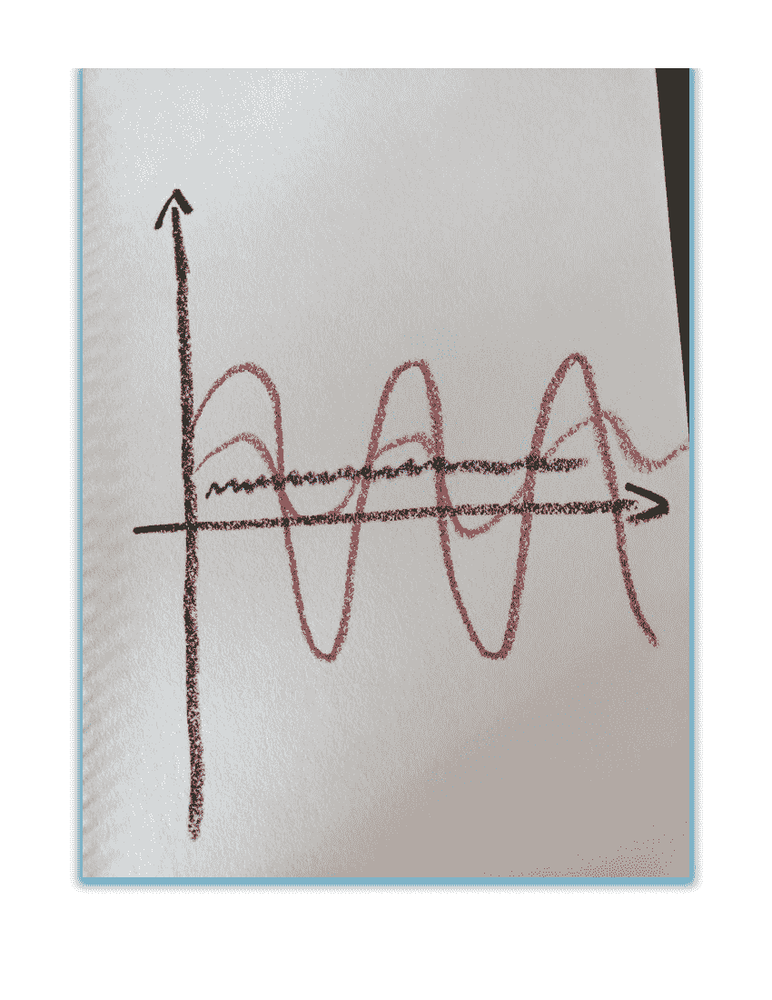

## 帖子编号 0261

**肉丸**：星球的朋友们，我想租一个商铺，地点已经选好了，就是不知道租商铺有哪些注意事项？另外谁有租商铺的合同范本，给我一份参考一下，先谢谢诸位了！

### 评论区

- **刘刚**：是沿街还是商场？
- **刘刚**：首先考虑的一点就是，每年房租是能保持一致还是每年价格随行就市，是否有拆迁的可能，是否会涉及到修路！房东是不是二房东！
- **肉丸**：沿街
- **肉丸**：OK！感谢
- **波波摩德**：你是租户你来拟合同？你房东人真好
- **珍大户**：说的注意事项最需要注意了[戳]，竟然提到的每一点都是大坑。
- **刘刚**：首先考虑的一点就是，每年房租是能保持一致还是每年价格随行就市，是否有拆迁的可能，是否会涉及到修路！房东是不是二房东！
- **刘刚**：谢谢珍姐

**波波**：您好珍大户，关注你很久了第一次提问，我在婚姻介绍所工作，我目前遇到了一些问题，我的工作自己去挖单身客户然后约来公司接着谈单，挖单身客户很难，陌陌和附近的人一听是婚介就不理你你说你骗人，每天都是打跟单电话，就是公司给的一些客户，几乎每个同事都打过，一个客户好几个同事都跟，谁跟来就是谁的，约来公司都说没有时间，天天要上班，下班后又说累不肯来，现在就是我沟通不行跟客户聊的总是不理我，然后自己挖掘客户这块也不知道从何下手，如何约来也是个问题，都是用公司微信号加人自己聊天把人约来公司谈单，希望珍大户可以帮忙解答一下，谢谢！

**回答**：因为这种商业模式有问题啊。还记得前面帖子里有讲过，开实体花店为什么很危险吗？因为消费频次低，必须高价。那么互联网覆盖面广，就可以靠低价颠覆你。相亲这个事，有点类似。人群中适龄单身的，还有意愿付费的，比例很低。你们花大心思这么筛选，客户又没几个，所以，收费一定是很高的。客户也不傻，明显知道收费高。所以大部分人都会防着你们，销售就很困难。好不容易有几个愿意付高额会员费的，必然是期望很高，想要解决单身问题。可惜，相亲的成功率又很随机，根本无法保证结果。所以长久以来，婚介所的顾客满意度一直都是很低的，口碑也一直不好。在顾客眼里，会认为收费高，物又未有所值。所以你们这样的销售，做起来是很累的。婚介销售能做得好，8成是销售天才了。有这种天赋，还不如改行去卖游艇，卖别墅，卖移民资格，卖海岛。干哪个都比当婚介赚的多。

但是你不行，其实是支持自我创业的（很容易）。上海十几年前，就有一堆人这么玩儿了。在网上召集单身人士聚餐，一次几十人，甚至上百人，然后收餐费。

上面说的传统婚介存在的问题：
- 消费频次低——所以用高频消费（吃饭）来替代了。
- 相亲成功的概率很低，所以不对相亲收费，只收餐费。
- 吃饭的消费结果是确定的，顾客掏餐费也不亏。
- 抱着找对象的心态，就算找不着，周末至少有社交活动了，所以这种活动是可以频繁参的。消费频次就可以提升了。
- 就是把一对一的婚介改成多对多。
- 把付会员费模式改成实体消费模式。

组织者的餐费可以比零售略贵些，或者从团餐折扣中获得利润。按人均几十元的样子，一次聚会有个几千块利润吧。这个利润规模属于个人做副业的水平，不要做什么婚介公司。这种方式，起步期会有一些难度，需要你前期积累一些种子用户。后面形成规模后，人群就会越来越壮大（很多人吃饭时会再带同性朋友一起去，一传二、二传三这种）。

之所以知道这个。是因为我刚大学毕业的时候，我妈很操心我找对象，于是四处打听[偷笑]。那时候发现了网上有人在搞这种模式，完全个人操作的活动，已经搞的非常成功了，每次几百人参加，每周几次。我老娘计算了一下，发现竟然月入十万+的水平……然后她就狠劝我，不要再干月薪几千块的工作了，还不如学人家搞相亲交友，每天组织party都能赚好多钱。要不是我对金融矢志不渝，没被金钱迷了双眼，现在我指定没……[捂脸]（我印象中好像上海有，北京深圳似乎都没这种模式。其实只要是人多的城市，都可以这么弄）

### 评论区

- **阿扎门**：五一也工作
- **珍大户**：我有时候会偷懒，一天都没坐进冒泡，所以你们不能这么惯着我[呲牙]还分什么假期不假期的
- **某某某**：脑海中自行脑补珍姐当媒婆的画面[奸笑]
- **绿野仙踪**：北京很多
- **潘生**：哈哈哈，对的，上海有这种模式的，我参加过，不过不是聚餐费方式，而是户外徒步的方式，去爬山啦，走一走古道啦，海鸟啦，或者羽毛球，我觉得这种还是很受欢迎的，没有那么直接，接受程度还是挺高的
- **Tan**：哈哈哈 脑海中想到珍姐做媒婆的打扮。
- **Hase**：旒疑有意思的
- **阿扎门**：珍姐厉害，珍妈也很厉害[强]

## 帖子编号 0260

**March**：珍姐您好，我是您的小粉丝一枚，现如今有一个困扰想跟您请教。首先我想做一个以社区为依托，类似丰巢和自动饮料机这样的一个冰鲜、冰冻柜。里面的内容是半成品的蔬菜、经过处理的蔬菜，甚至细化到葱姜蒜末，和分割好的肉品。冰鲜类是牛排、南美虾、冷冻肉片等等的冻鲜。在部分城市有看到这样的鲜花贩卖机，和共享健身房。想在一个城市建立1对N的模式，1为中央厨房、中央仓储、行政办公和产品展示，且可做半成品加工。N为每个中高档小区建立这样的冷藏柜、冷冻柜。我想问下这样的形式是否具有可行性？

**回答**：《中间路线》商业领域有个共识，叫中间路线，必死无疑。

记得之前有个化妆品领域创业的朋友找我咨询。他自有配方，创立的品牌。我问他，这些产品主打什么功效？他说，这些产品可好了，既能美白，还能祛皱，还能补水，还能抗衰老，还能红润皮肤，光滑细腻，还能祛斑，还能淡斑……

我说停停停，你这么定位，必死无疑。这种搞法，想美白的人会被美白产品吸引走，想抗衰老的就被抗衰老产品吸引走，想祛斑祛痘的也会找专门的产品。如果有人有如此之多的需求，那他也也会同时买一堆，而不是只买你一个。

这个例子太容易理解，我现在要抽象模型了。读mba的时候有门课叫《企业战略》，最基本的企业战略，有两个选项。一个叫成本领先战略，一个叫差异化战略。成本领先战略，顾名思义，就是想办法优化成本，然后把价格做到最低。比如小米、名创优品、优衣库、迪卡侬。差异化路线就是搞特色出来。

但有一个人前提：两个战略是矛盾的。因为差异化就意味着成本会上去。

记得在学校里，老师讲过的例子是手机市场。当年三星还没那么颓，但是根据这个企业战略模型，推导出，小米是价格屠夫，必然活；苹果是最顶层的差异化战略，必然活；而三星是中间路线，价格比苹果便宜但是比不过小米，差异化又做不到苹果的水平。结论，三星要完蛋。我对这个模型和例子都印象很深。这个模型还可以更抽象化一点。

假设有甲乙丙丁四个产品，在同一个领域竞争。这个领域的产品，假设有abcde……一堆衡量的维度吧。（这些衡量维度，可能是价格、外观、材质、安全性、手感、重量、等等，这些会被纳入感官考虑的因素）每个维度下，每个产品可以排个先后顺序：

| 产品 | 维度1 | 维度2 | 维度3 | 维度4 | 维度5 |
| :--- | :---: | :---: | :---: | :---: | :---: |
| 甲   | 1     | 3     | 3     | 3     | 4     |
| 乙   | 2     | 2     | 2     | 2     | 2     |
| 丙   | 3     | 1     | 4     | 1     | 3     |
| 丁   | 4     | 4     | 1     | 4     | 1     |

大家觉得哪种产品会畅销？这其实就是问战略路线。其中如果某个维度是价格或者说“性价比”，这个维度下的第一，是必活路线。而其他几个维度下，我们就要看这些维度所对应的需求是真是假了。如果需求是真的，那么这个维度下的第一会活，否则就难说了。但确定的是，“乙”这个产品，因为太中间路线，必死。

上面如果太过抽象的话，我继续举例子：假设还是手机市场：成本领先战略下，性价比维度的第一名一定会活的很好。因为“性价比”永远是真实的需求。其他的差异化战略下，我们要衡量需求是否真实。比如：最轻薄的手机—价格肯定略高，但是如果需求为真，那么就有人买单，需求为假，就完蛋。这就是差异化战略。其他的差异化战略：比如商务手机，美颜手机，拍照手机，音乐手机，游戏手机，定制手机等等……哪些需求是真，哪些需求是假，咱不做评论。但我相信这个例子举完，大家已经知道差异化战略是什么。而中庸路线，就是……价格也不是最低，其他每一项都不是第一。基本必死无疑。

上面的铺垫完了，相信大家对“中间路线必死无疑”已经有自己的认识了。开始说这帖子里的提问。这也是一个无人货架模式。（之前有一个类似的无人货架讨论帖子可参考）这一贴里的创新之处，在于加工，售卖的是半成品。然而看到这个半成品之后，我就突然意识到这就是一个“中间路线”，必死无疑。

半成品是为了节省时间，节省精力。然而，想要节省的人，会直接在外面吃，或者外卖了。保证“最节省时间”（这是节省时间维度下的第一名）。

自己做饭的人，可能为了食材的安全性或者新鲜，那么，自己洗菜肯定更放心一些（“安全”项下的第一名），另外切过的菜新鲜度会下降的很快，这些产品在新鲜这一维度也很难占优势。

自己做饭的人，更有可能是节俭省钱的人。（当然，你这个项目不太可能，因为目标定位在高端小区）然而，加工过的食材变质更快，对更新频次要求更高，直接增加人力成本，对损耗量更大，直接增加损耗和库存成本……

### 评论区

- **壬**：学到好多知识！
- **中国出口数据**：分析得好用心，很感动
- **定义Calvin**：初次创业者看中先机，连锁创业者在意风险。做成大户的分析。记得之前朋友推出一款产品：后悔药（消炎喷剂）嘴已溃疡能喷、脚气也能喷（作呕状）…没熬过三个月。
- **March**：收到收到，非常感谢！
- **陈磊**：太感动了，触类旁通了
- **Tian**：这节课真干货
- **之姚**：再发散一下，生鲜柜空间局限，可展示和出售的品种很有限。另外，高端社区不会缺少应有的商业配套，从回家动线来看，客群最先经过的也许是竞争力更强的各大超市。如果从更节约时间角度出发，除大型商超外还有各种蔬果便利店。再有，各种生鲜对保险温度要求不一，生鲜柜在这方面技术是否成熟仍有待考证。不过，这种产品最大的竞争力是方便，节约时间，如能做到低成本运营，价格有优势，同时保证新鲜，产品更替快，也许有出路。
- **March**：非常感谢您，我会参考大家的意见的

## 帖子编号 0259

**张文馨**：女28岁，单身，在互联网工作5年多，中层，年收入二十万左右。以前很喜欢公司氛围，辛苦但是开心幸福感强。老板亲自带我们部门后加上新总助加入公司修改了很多福利政策，中层权利弱化，人员成长被限制，现在遇到抉择期，接着在公司熬一两年晋升薪资可以到50w但是没有自己的时间跟生活面对高强度工作不停的熬夜，还要接受公司各种临时政策。另一方面是接手一家美甲店，周围五个中高档小区，店在一个商场里面月租6000人均消费150每月流水三万多，原老板是之前同事因为私人原因要离开深圳。问我该怎么选择。

**回答**：互联网行业的什么岗位呢？如果是程序员的话，建议搜搜金融行业的程序员工作吧，别老瞄准it行业。前景肯定不差，但熬夜会少很多。（我强烈建议学it的往这个方向上考虑，因为当前金融行业各个领域都开始出现人员收缩的趋势，是由于网络交易导致的。目前我们可以看到，有些银行比如招行、有些券商和基金，已经把网站、app、小程序都做非常好了，但是更多的金融机构在这方面根本没做起来，还有待强化。更何况内部的风控系统，数据系统等等需求。如果我不说，大家应该猜到现在全国大大小小的银行一百多家，券商也近一百家，七十多家基金公司，70多家信托公司，70多家保险公司。所以猜猜这些公司的岗位缺口有多大？而且这部分公司，大部分是国企，岗位稳定性好，但工资是市场化的。）

至于美甲店，每月流水三万多，扣掉店租，就算不计算其他任何成本，一年也就二十万，不值得你过去的。因为工作时长一样很长，你每天至少等到商场关门。还没有节假日。虽然单个小时的工作强度会低很多（每天肯定有一半时间是闲着的），但压力未见小。因为你会开始操心营业额，每天只要营业额往下掉，你一整天都会吃不好睡不好。

### 评论区

- **A火火**：很赞同，创业的上上班，上班的想创业
- **Tian**：互联网中层跑去干美甲...压力已经这么大了吗？如果创业拿不到上班两三倍以上收入的话，真心不建议选择创业.....全年无休经营压力还超大，尤其是在今年这种形势下
- **张文馨**：竟然被翻牌了，幸福。因为我做的是销售岗位，女性在这种大环境天然弱势，除非现在上司离职不然我晋升估计要很久时间，而且互联网的销售人员更新速度很快，自己也担心上了年纪被淘汰所以会有焦虑想自己做些事情。手上有一些实体客户，美甲店想做过渡期维持生活，因为碎片时间会比较多，所以想开个网店卖成人用品
- **矿哥没矿**：很有想法
- **A范迪xx**：现在开网店已经跟以前不一样了，难度系数高了很多，特别是成人用品店，自己先到淘宝上搜索一下情趣用品店现在都有多少家了，在看看那些排在靠前的店铺，看看成交量，再看看评论，你就会知道有多少是水份，虽然淘宝也在严控刷单，但根本就也不可能杜绝得了刷单的情况，我偶尔也会帮朋友刷一下单，把所有成本算下来，几乎没有利润，城外人想进去，城里人又想出去
- **A朱某某**：呵呵，不知道创业的苦！
- **许半仙**：明白人
- **Tian**：过来人[抱脸]

## 珍妮老师您好！非常

(提问) db_zh: 珍妮老师您好！非常喜欢您深入浅出的讲解，并为您渊博的学识折服，很荣幸来到这里，先报个到。我记得曾经在那里看到过一则分析讲：全球经济规律大体是以10年为周期，繁荣10年，衰退10年；请问有没有这回事？如果以08年金融危机的作为最近衰退期的开始，那么19年是不是意味着新的经济复苏期的开始？另外这个周期和您说的经济的扩张周期和收缩周期有没有关系？谢谢

2019-04-25

回答：【帖子编号0258】有这种说法。尤其国内说这个最出名的是周金涛。他说最长的周期大概60年，分成四个阶段，回升、繁荣、衰退、萧条，每一阶段大概十年。他举例来说，认为，1975~1982年是一上轮的萧条期。而本轮周期中，1982~1991是回升周期（第一阶段）1991~2004（也有说拉长到2008）年是繁荣阶段（第二阶段），是由信息技术发展而创造的。2004（2008）~2015年是衰退期（第三阶段），说技术进步有限，生产效率提升有限，于是进入了企业不赚钱，但是吹资产泡沫，吹估值阶段。这一时期做实业不赚钱，但是炒资产很赚钱。2015-2025年时萧条期（第四阶段），说市场上钱多，但是各种资产开始不赚钱了，从而渐渐的，因为各种资产价格开始下跌，所以钱会渐渐开始变少了。以上只是我转述的周金涛的观点。

如何评价？恕我无能为力。以我的经验水平，目前无法做出有效的判断。
第一、我不知道该评价这个理论的有效性如何。
第二，我也不知道该怎么应用这种理论。但是有一个问题，就是这个周期理论实在太糙了。大家自己计算一下，回升繁荣衰退萧条，四个阶段各10年，总数才40年。而总周期60年。那么说明，每一阶段应该平均有5年左右的误差。所以这个理论在应用的时候，必须有一个对宏观非常敏锐的人，逐年做把控，做微调。而不是按照数字去套周期。否则误差太大了，人生才多少年，你一次误判个五年八年的，还怎么玩。

再说我眼里的周期。我目前的水平，只会看两个周期。一个是看生产领域的，包含价格、生产与库存的周期。用的指标包括PPI（生产者价格指数）、CPI（消费者价格指数），pmi中的库存等。（举例来说，ppi下降，说明生产商都看衰市场，不愿意多买原材料进行生产了，于是各种原材料价格下跌......说明比较萧条 ppi价格下降，那么上游生产环节中成本就降低了。所以最终有个传导流程，会传导到CPI，就是消费者买东西的价格会降低，会受益。然而如果cpi不降，ppi与cpi的差值拉大，就说明厂商利润空间在扩大，又象征着经济要变好等等......总之，很多种解读。）另一个是金融领域的，主要就是央行的宏观调控周期。这两种周期要短得多，平均两三年一变。每10年里大概能走三趟，一个半来回。（大概意思是，日子再不好，两三年也就结束了）

- 评论区：
    - Mr. Liu : 想您说的这些指标都在哪里可以看到？
    - Mr. Liu : 老师，主流的经济课是不是不太认同您的理论
    - 珍大户 : 主要是近代史太短了。毕竟宏观经济学的193几年才出现，在这之后才有了政府的宏观调控政策。按这个60年一次的周期的理论，到现在还没轮出两个周期。你都不敢说是巧合，还是有周期的存在。例证不足，根本没法去支持或者反对。
    - Hans: 咱国家唯有周期，基本上都是与时俱变的管理策略
    - Mr. Liu : 但他好像预测了08年和15年2次冲击，但房价的预测好像不太准确
    - Sonie : 周金涛是已经去世了吗？所以也没做调和后续完善，预测了。大宏观对个人或者小团体没有操作上的指导意见啊 大宰相的：周期个人觉得挺玄幻
    - Caden: 珍姐，国家统计局2019年全国居民消费价格比上年上涨2.9%，12月CPI同比上涨4.5%，ppi同比下降0.5%，这是经济走好的迹象吗？

## 半夜提个问题：本人

(提问) 匿名用户：半夜提个问题：本人在珠三角地区最差的卫星城生活，2000中专毕业后自考大专及本科，由于时常执笔忘字，专业职试书一直未有考下来，现在主要为私人老板（也可理解为包工头）工作，年收入约20万元左右，算是个项目的管理层，项目完成后可能会有半年左右空窗期。银行存款40W其中25W是定期，股票1W，微信理财1W，16W基本放支付宝各项目。现在市中心有一套120平步梯住房价值85W左右，生活着2老2大2少，每年生活开销约10W万左右，因两小孩长大分房及入学学区想购置多一套100平新区房产，不带车位100～130W左右，请问我的条件可以现在购买吗？还是观望再入手？如果暂不买房应该如何理财？字数限制未能详说

2019-04-25

回答：【帖子编号0257】这个问题不含地域分析，只看财务杠杆水平。风险不大，可以买。因为，第一，目标房子100-130万，自有流动资金58万，就算买完后的负债也不高。看提问，可能是有担心工作稳定性的问题。但目前收入中消费部分也不高，结余不错，其实用不几年就负债结清了。所以没什么风险。第二，这一贴没提到具体地点，但是似乎也不用从城市红利角度去分析。因为题主的资产都是低风险的银行存款和低风险余额宝（收益也是最低的），说明是属于低风险，求稳的人群，并不追求高收益。所以题主追求的不是城市红利，而更多是从风险角度的考量。那么从风险角度，反正这里均价不高，而且是给孩子买的，属于长线持有。那么长线角度，10年以上，我觉得不太可能一直不涨或者是跌到，从而在这个价格还能被套。风险就是有可能不涨，或者涨的少，跑输。但银行存款和余额宝是肯定跑输的。所以我觉得还是买房子好了。毕竟卫星城也有可能因为广东省生育率比较好，或者城市版图扩大而受益的可能性。

- 评论区:
    - 海燕玉石工艺《饰》厂*:什么叫卫星城?
    - 珍大户: 放在北京或者上海周边，就叫睡城了。因为没有什么企业在，都是工作人员买房子，然后早上进城一次晚上出城一次。但是珠三角那边，叫卫星城更适宜一些，因为民营经济比较发达，很多中小型的企业其实对“市中心”的依赖没有那 么重。尤其是生产型企业，放在卫星城成本会更低。
    - 南极光: 意外惊喜，竟然被翻牌了^_^

## 姐姐好，第一次提问

(提问) （^v^）：姐姐好，第一次提问，关于择业的问题，不知道合不合格，如需要更多细节，我及时补充。

2019-04-25

回答：【帖子编号0256】第一个问题，关于交叉型行业，到底要不要去？比如提问里提到的“移动出行”，这个行业是新型行业，可以去，但不是所有专业都可以去。这个行业算是IT和交通行业的交叉行业。你要看各个专业技能，在其中的重要性怎么样。IT技术，在里面很需要，所以学it的人可以进。这个行业也需要用到路线规划这些技术，所以学交通规划、运筹学专业的这些人也可以去。但你是学汽车专业的，你就不能去。因为你所掌握的技能属性，在里面不重要，你又是一个以“技术管理”立身的人，既然你所学的技术在里面不重要，你自己连带着，在里面也很难有重要作用。（除非你是以个人特质、个人属性立身的人，比如销售技能、社交技能、公关技能等等，那么你就不需要考虑行业的技能点需求，各个行业都能需要你。）

另一个提到的行业，汽车金融。听起来像是汽车行业和金融行业的交叉，但其实不是。因为汽车虽然是大件，但仍然属于消费品。消费品的信息要透明的多，所以其实对“汽车”方面的知识和技能需求的并不多。我举一个例子，你对比一下就明白了。如果是大型的采矿机器，这个东西值多少钱？抵押贷款能贷多少？如果是工厂排污设备呢？如果是机床、仪器呢？如果是医疗检查设备、核磁共振呢？跟这些东西相比，你还觉得汽车金融里面，会需要很多汽车知识吗？（所以上面举例这些领域，是可以需要有一两个理工科、化学专业、医疗专业转行的人才的。然而汽车金融专业不需要汽车人才。）所以汽车金融这个行业，我建议，学金融的人里面，如果对自己核心竞争力存疑的，觉得在主流金融战场不好竞争出头的，可以找这些非主流战场。包括汽车金融，包括各类抵押贷款、互联网金融等 非主流领域。

趁这贴讲讲到 交叉 行业，就再 附带的 说一 下。 现在 网上对 IT 行业 的996 争议声 音 很 大。 我 建议 各位 IT 行业的，多 往 主流 金融 企业（银行、保险、基金、信托、证券）的IT部门找 机会。 以 银行为例， 从大约 02-03 年开 始，银行 经历了近 15 年 的 扩张，营 业网点 的 满 大 街都是。 然而 现在 开始 转型， 出 现了 营业网点 收 缩 的迹象。 收 缩 的原因 我们都 知道， 无现 金 社会。 不用 纸 笔， 必 然 更加依赖 IT 系统。 除了 银行， 其 他金融 子行业 也 是 同样的 趋势。 所以 这个绝 对 是 一个后 面 五年 十年 都 有 前 景 的领域，而 且 是 金融 专 业的 人 无 法 进 入 竞 争 的领域， 趁 现在 竞争 压力 还不大（应 聘难 度比去 互联 网 大厂 低 多了），赶 快 从 996 的 IT 行业往这 里考 虑。 包括 目 前 还在学 IT， 还 没 有 毕 业的 学 生们。 如 果 你 们 担 心 毕 业之后 it 行 业 的 就 业情 况， 现 在 不 妨 选 修一个 经济类 的 专 业， 把自 己 搞成 复合 型，然后 毕 业 想 办法 去 金融 企业的 IT 部 门， 竞争 少， 压 力 小，钱 应 该也 不 会 比 IT 少。

本提 问第2个问题，是 汽车行 业 怎 么看。 汽车行 业按行 业 四周期（萌芽-发 展-成熟-衰 落） 来 判断，处于成 熟期， 这 个在 旧帖 子 里 说 过 了。 我 知道 学汽车 专 业 的 同学 会 失 望， 觉 得自 己 很 惨， 没 机会 会踩 进 一个 发 展 阶段 的行 业。 但 是 请大 家想 开。 四周期 里，开 头 和 结尾 都不 是什 么 好行 业，只 剩 发 展 和 成熟 两个 阶 段 能够 选择。 而 成 熟 恰恰 是 最 常见 的状态。 换句 话 说，发 展 的 行业 没 那么 多。 发 展 的 行 业 是 特殊 历史 时 期 存 在 的 特 定 产 物。 很 多人 终其 一生，都 不一定 遇 到 一个 发 展 中 的 行 业。 而 汽 车行 业 因 为 固 定 资 产 投 资 大，属于 自然 垄断 行 业， 最 终 只 会有 几 家车厂 的存 在， 这种 行 业 是 天然的“成熟期 非常 长”的 行 业， 或许 可以接 力容 纳几代人。这种 行 业 其 实 挺 好 了。 我 用 金 融 行业 来 做 个类 比。 现 在 很 多 人 都 想 往 金 融 行业 进， 然 而， 金 融 行 业 的 发 展期 也 已 经过了。 大 家 随便 翻 翻上 市 公司 年 报， 每 家银行 都 会在 年 报里， 批 披 露 员工人 数。 如 果以 02-03年 的 员工 人 数做 参 照，到 15年 之前， 每 家银行 都 是 员 工人数 大 幅扩 张 的时期。 而 到 了15年 之后， 几乎 都 进 入了 人数 收 缩的 时期。（ie， 以 招行 为例，如果我没记错的话，2005年员工2万人，2010年员工4万人，2015年8万人。数据震惊吗？数据的背后是每一个早入行的人，都有极大的升职几率。因为行业在扩张啊！然而扩张期就这么十年，未来不会再有了。）

说到上面这个例子，大家应该明白了。发展时期的行业都是特例，成熟期的才是常态。而成熟期之后，能够变成垄断性行业或者寡头行业（整个行业只有几家大企业的状态）的话，在这种行业的人其实是非常幸运的。因为，成熟期会很长，不用担心自己还没退休，就到衰退期了。而且，企业利润有保证，收入还不错。如果到成熟期时，行业里存在无数家企业的时候，那才难过。不信，你给我举一家市场上的化肥生产企业？洗发水生产企业？相信上面安慰了这么一大段，你应该觉得汽车行业还不错。进德资公司，这是我给你的建议。

———第3个问题，不要被新能源汽车品牌吸引，进了新型品牌的企业。新能源汽车品牌不看好，这个帖子里提到过。原理是：新企业、新品牌发展壮大，都是在成长周期的行业才有可能。成熟期的行业很难支撑新品牌的成立。（举例：观致如果早生20年，或许就能活了，这个时间里，再砸几百亿也没救。）而新能源汽车，算是新行业吗？如果你认为是新行业，那么就是机遇。如果你认为不是新行业，那么就是陷阱。（这个问题大家各自回答，属于开放式提问[偷笑]）（我自己认为，新能源汽车不是新行业。跟智能手机颠覆诺基亚的这种变革的性质，完全不一样。新能源汽车除了改变了传统汽车的燃油发动机系统以外，对车的其他部分，包括外观、安全性、使用、乘坐，甚至供应链、售后维修链，都没有变革，所以新品牌完全处于劣势。更严重的是，汽车这种与安全很相关的大件商品，传统巨头的各种安全测试、售后与召回的经验要更足一些。如果出现安全问题，需要全球召回某一型号的车时，新品牌估计只有死路一条了。）

———第4个问题：长话短说，主贴里问到，要不要去大疆或者华为。从企业口碑来说，这两家的员工抱怨的都挺多（据说都挺压榨），所以这个因素自己来考 量。 从行业周期来说，大疆所处的 是发展周期，可以去。 （如果你找到的职位是在里面重要性尚可，也能适应这种工作环境，那么可以去）而华为 主业的通信行业是成熟偏衰退周期，目前等着5G的最后一波，然后就夕阳红了，所以一定不要去； 辅业的手机，成熟行业； 平板、笔记本，都是成熟行业； 后面据说要搞电视，依旧成熟行业。 而这些消费电子类，你发现了吗，周期要短的多，智能手机把07年苹果刚出现当萌芽，09-10年开始， 算作发展期，还没到10年市场就从快速发展期进入成熟期了……周期更迭的实在太迅速。 虽然也没准什么时侯，又有新硬件的出现，使这个行业还能延寿若干年。但，汽车行业，这些巨头们也一样，没准 等未来新能源车普及的更换大潮、亚非拉又有哪国崛起带来的消费大潮呢。

- 评论区:
    - 林浩：来深圳吧 小姐姐
    - 各自安好：感觉听的很明白，
    - 珍大户：还是去上海吧，德国研究生很对口的
    - 高粉：变成去德国对口的企业。
    - 40： 青夫的？博世、联电、德尔福？
    - （ˇ ˇ）：谢姐姐翻牌！ 这段时间又有一个新动向，我找了一个“自动驾驶”的毕设题目，但是是仿真环节的，技术含量没有那些计算机的高，但也算是搭上了自动驾驶这个热门 的边。国内不仅是汽车厂在做自动驾驶，阿里，腾讯，百度甚至华为都在做。我编程比不了程序员，大厂应该看不上我，试试吧，大概率只能在汽车厂里坐。 接下来我的设想：1. 尝试面试“发展期”的行业。（问题是自己思路不够开阔，想不到还 有什么我可尝试的发展期的行业。[捂脸]） 2.尝试德资、中德合资的企业 3.广汽我个人认为品牌力比较弱，但是珠三角的位置我个人还是比较向往的。（您对在长三角，珠三角择业有什么看法吗？希望您有空可以展开来谈谈，有报道说长三角的人口老龄化比珠三角严重得多，未来活力比不了） 您看还有什么建议吗？
    - 颜如玉代理--清境：原来行业各时期是这样来分析的，又理解了一个层次

## 备忘录

女，26，家在东北，汽车专业，本科国内985，德国研究生在读，即将毕业面临择业的问题

## 个人方面
性格上，喜欢独处，不喜欢长时间的聚会，不喜欢灰色交易，很抵触官僚主义。但是喜欢琢磨如何和人更高效和谐的相处，是为了与人“合作高效”。
因语言和学历略有优势，回国去德系合资整车厂或供应商问题不大。

## 行业现状
18年汽车行业利润下滑严重，一汽·大众近三年有降薪。

## 个人打算
目前职业定位为“项目管理”。
打算第一份工作汽车行业做，积累经验，同时观察一下行业的发展动向，再考虑是否转行。
第一份工作想在上海找，为了落户，也想体验一下一线城市的文化生活，今后从上海户口往其他城市转更容易。

## 问题来了
- **关于行业选择**：想问一下您对于汽车行业未来发展的看法。如果真的不好的话，考虑要不要第一份工作就在汽车行业的其他环节（移动出行、汽车金融）找，或者在其他技术集中型制造业找。比如，华为，大疆这类。
- **关于职位选择**：目前想做整车厂的项目管理，原因在于：自己的性格不喜欢深究技术，不喜欢一成不变的工作，“项目管理”相对通用，对汽车制造的认识更有全局性，也相对方便以后跳槽。

您还有什么其他的建议，希望多多提点，谢谢您！

## 大户 女 年龄29

**(提问) xixiforend***：大户 女 年龄29，坐标北京，之前提了个问题，还有个问题想请教大户，都说经济危机要来了，目前自己娘家一套军产房，没有房产证，一套北三环没电梯的老房子（有房产证），爱人家里西四环内有2套塔楼的老房子，一套公婆自住，一套婆婆母亲住，我跟爱人住西四环外较新的一套房子，除此之外爱人家里海口有一套空房子，想问下这种情况该如何应对金融危机，爱人家里还有一套东四的平方，面积较小，政府按住说要腾退，不让动，想问如何配置资产应对金融危机，万分谢谢大户

2019-04-23

**回答：【桩子编号0255】** 你们这都是祖上传下来的，连贷款都没有（没负债）紧张个什么。要紧张的是杠杆比较高的，需要准备足够的资金安全垫应对流动性风险。

另外，站在今天（2019年4月23日）说一点形势上的变化（偏政治角度的，大家知道我只懂经济不懂政z，所以也就随口那么一说，大家随口那么一听）。前天和昨天发生的斯里兰卡事件，把这种悲剧当喜剧来谈，实在有点丧良知……所以后面的话我不是很好意思说的出口。但不得不说，这一个来月内，接连发生的新西兰、巴黎圣母院，到斯里兰卡的三件事，会改变国际形势。我们都经历过2001年的911。在这件事之前，我国一直是美国的假想敌，在国际上很是受排挤。但是911之后，美国的防御重心往中东而去，我们也抓住了wto的机会，一路旺了小二十年。当然，当时是整个国际的经济大环境都很好，现如今不能比。恰恰相反，现如今是全世界日子都不好过，从去年到今年，没有哪个国家好过。但现在就是一个比烂的世界。只要我们能浮在中位数以上，都算是利好。

问题是，我们能浮在中位数以上吗？在这之前不敢说。低端产业向第三世界转移的厉害，高端产业搞贸易战，被掐脖的厉害。各路资产看见风向不对，纷纷转移出去避险，有可能会导致流动性不好，国内本身就债务水平比较高，再流动性不好，肯定不敢乐观。

然而接连发生在这一个多月月的事，如果只有一件的话，还能算是偶然、是随机、是不可预测。但是连着很多起，就要开始纳入推理了，开始纳入风险计算、计价的过程了。这就像是前几年的三星手机电池，你烧一次可以说是偶然，一个月烧三次，股价不猛跌是不可能的，风险肯定纳入考量，那么影响就大了。

所以大家应该也明白了，他国的惨案，竟然对我们形成利好了。第一个角度，之前国际上一直认为，冲突的爆发点是欧洲大国。小国肯定是偏于一隅，远离纷争，岁月静好的。结果没想到，这个观念先肯打破了。可能是政府警力投入薄弱，小国反而成了最先被直接影响到到的对象。这对中美这种情报系统发达的大国是一重利好。而且前两件事情只发生在宗教场所。但斯里兰卡不同，几家酒店出事，已经属于无差别攻击，谁也不能保证下次是不是商业场所。（丹麦首富的四个孩子死了三个，连首富都无法幸免……不禁唏嘘）所以，哪里能安全，对哪里就是利好。

第二个角度，目前我们与欧洲的关系会有一个促进。因为欧洲更受这种风险的威胁，这个时候他们必然更需要经济上一个向好的态势。否则经济不好夹杂社会安全水平的下降，会更加引起社会动荡。所以此时的中欧关系肯定会大幅提升。而从中、欧、美这种三角关系来看。没有谁能够以一抗二，美国想连欧抗中，但如果欧与中走好，那么中美之间的贸易战，基本也就松弦了。(51赞)

**评论区：**
- 李：这么多固定资产，不用操心金融危机了，可以想想去哪里玩安全点就行了[憨笑]
- 海螺玉石工艺《猫》***：专业我也说不出来 能好就行
- 张晨：北京有这么多房[流泪][流泪]
- 人生如逆旅：中G@@？乖，毛衣谈判接下来后续会达成协议的，双方会各让一步，稍接下来也要选举，没必要搞僵的
- A小姐：真正土豪[喷男]
- 云下闲子：北京四套房加一套无证十海南一套。没货族。这都有危机感。。。
- 付佳亮：我怎么感觉在说我啊……我也是北京四套房，海南一套房
- Mr. Li：总结一下、你就是来炫富的

关注公众号"懒人找资源"，星球资源一站式服务

## 你好阿珍。我是做传

**(提问) 方圆58里**：你好阿珍。我是做传统手机零售的。有5家连锁店。但是受到电商的冲击等因素影响现在已经举步维艰。真的叫我看不到未来希望。请教一下有什么好的创意给我们指点一下呢？谢谢

2019-04-22

**回答：【帖子编号0254】** 《手机店》在后台翻老问题，找到了这条9月20号的提问。当初因为这个问题无法解决，就一直没有回复。过了好几个月，写了这么多相关的不想关的内容，不知这位兄台目前内心是否已经清晰了？

旧帖子包括：
- 0149商铺
- 0208行业周期
- 0211：传统的手机零售，属于销售份额逐渐减少的行业（衰退行业）。行业的价值链很容易被电商取代。面对这种趋势，只能说神仙也难救…… 所以，这个问题我确实也无力回答。(17赞)

**评论区：**
- 阿尔戈号：是我错觉吗？我都是实体店买手机的啊，价格比网上的便宜100到200左右。现在我周围朋友都让我介绍的去那家实体店买手机了。
- 阿尔戈号：实体店要是打价格战，控制好期间费用，把价格真正打下来，是不是比线上更有优势呢？压缩定价率，线上感觉不比线下优势多少吧。我个人感觉的[呲牙]
- 李俊杰：现在的实体店和电商根本不是价格的问题了，是习惯了网购。
- 小红Jane：幽默的珍姐
- 珍大户：毛利率低，就得靠销量大。否则以现在的店租水平，压力会很大的。然而实体店覆盖的人群是有限的。所以销量大怎么做到呢
- 阿船：能理解你的焦虑，面对新经济，但却进不去，也出不来。推荐这个果汁机器人项目给你（ `y` )：高考以后肯定很多孩子买手机，可以把握一下这个时机。
- 酒醒还是无奈：手机店现在可以做售后服务，维修配件，新机体验，可以把5家店合并，做综合售后服。

## 刚创业，求大户姐帮

**(提问) 啊！哚哚**： 刚创业，求大户姐帮忙看看店铺，找找原因，应该如何改进、提高销量。

我在武汉光谷世界城二楼，开了一家中端首饰品店，首饰价格有一百多到一千多不等。房租一个月1.3万，30平米，韩国品牌，装修比较时尚。我店是个中庭，旁边是一些中端时尚女装，欧时力，five plus

私以为，经常买这种女装的消费者，对于这种平价、款式时尚的首饰应该是消费起来毫无压力的。我们店首饰的材质是14k金和有镀k金的银饰，定位是精致时尚的轻奢品牌，目标顾客是有消费能力的白领。

但是我们刚开第一个月才卖了8万，刚刚保本。生意做的好累，还不赚钱，求各位帮忙找找问题，出出主意，暂时在做新店开业活动，一件95折，两件9折，三件85折

**2019-04-21**

**回答：【帖子编号0253】** 《折扣力度》 图片上看不出来什么，从文字里看到你的折扣活动，有点建议。 记得前几个月有一个自创化妆品的朋友找我做单独咨询。其中有一个问题就是 他给各级代理商定的折扣比例，跟你的出现了同一个问题。 就是采用直线的折扣比例。我猜这种问题应该是挺普遍存在的。

—————— 看我下面手绘的图片。橙色的线 就是直线的折扣比例。每多购买一个单位，折扣就降低固定的数值。画出来的比例关系就是直线。 相对应该是曲线的折扣比例， 比如一件95折，2件92折，3件9折，5件88折之类的。 曲线折扣，主要有两个作用。

一个是给消费者很强的“成本价”的心理暗示，当大客户买再多，也折不下去的时候，肯定是成本区间了。 而你采用直线的折扣方式，别人还会猜，是不是买4件就能8折，5件就能75折？最低能打到几折？

另一个作用，就是能让买少的人心理舒服点。有可能某些人预算就没有那么多，只挑出来一件儿，又觉得折扣没打到底，心里不舒服。(29赞)

**评论区：**
- 各自安好：光合世界观二楼，赶在直线折扣期间过去看看, [哇牙]
- JOJO：帖子编号0253在哪看，找半天找不到，望圈里大牛给指点下
- 啊！哞咔口：好滴
- 啊！哞咔口：被户组翻牌子了，开心，谢谢指导，我好好研究一下
- JOJO：参照0253的帖子及个链接出来好不，我仔仔细细的找不到[流泪]
- 啊！哞咔口：我找半天也没找到[捂脸]
- 可儿：进店享开业特价款商品只要19元（原价99元），另外满99送单卖39元发箍、皮绳等（基础通用款），满199送单卖89元细银链，满299送单卖119元的手绳，圈主方案跟这样的方案哪个好呢？
- 珍大户：0253就是这个帖子，没有别的帖子了 [发呆]

关注公众号"懒人找资源"，星球资源一站式服务

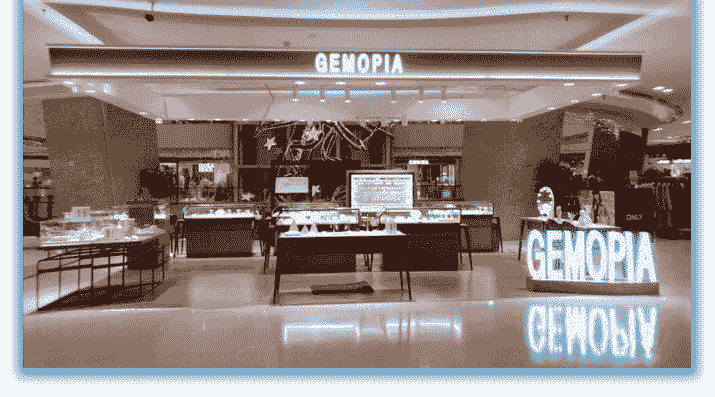

## 珍大户，你好！请问

**(提问) 祖儿**： 珍大户，你好！请问长沙靠市中心的江景公寓是否值得投资，价格2万左右，毛坯房，50到60平米之间

2019-04-17

**回答： 【帖子编号0254】** 大概率不值得。公寓产权的税很重，买来一定要认知清楚，就试图使用价值（自己住）或者出租价值（吃现金流的）。所以值得买的公寓，至少有这么些点：

1. 最重要的：位置必须好。交通很便捷，所以你自助很方便，不住了出租租金也能租很高。
2. 也是很重要的：性价比必须好。我们都知道住宅目前租售比都不怎么样。所以公寓必须要比住宅有折价，从而使租售比恢复到合理区间。

（公寓折价的原因是因为商业用地地价比住宅用地便宜，而且40年产权比70年也短很多，所以才折价） 此外还有造成租售比恢复到合理区间的原因，包括楼层挑高，比如4.8米或者5.2米，能做成两层，开发商送装修等等。 因为公寓的得房率极低，基本70%。你买50平套内面积才35。除非是买一层送一层的复式，能搞成实得面积50平的样子。否则根本居住不舒服的，反而很难租出去。

**【概括总结：你买住宅，是为了图未来“房价上涨”。 你买公寓，是为了图未来城市“租金上涨”，买的时候算好租金收益率4%，预计有个三五年，随着城区发展，能涨到租金8%收益率，这就值得买了。】**

所以，再看你这套，单价2万，跟住宅的折价空间呢？这可是40年产权！这可是商业性质！ 没有送面积，也没有送装修，那么等于光吃得房率低的亏了，一点便宜都没占。 你这房子迷惑性在于，一是靠近市中心，二是江景。我不知道靠近市中心，是有多近。但这两句话挺有迷惑性的，让人以为黄金位置，比较稀缺。 但实际上是不是真的黄金位置，和稀缺江景，就需要你仔细考虑了。 但就算假设是的话，不送面积的得房率就是35平，这房子只能你自己装修好用来做民宿，搞短租。否则长住的话真的太小了，影响居住功能，租金空间有限，就失去投资意义了。(36赞)

**评论区：**
- 1440：租金收益率咋个算啊[偷笑]
- 刘政之：长沙是个神奇的城市，单位福利房太多，市政府出卖的地也超多，人均居住面积全国前列，住宅价格波动不大，因为这几年住宅限购，公寓的不限购因素导致价格虚的不行，杭州这边公窝快卖到住宅价格了，但还是有人敢下手，真不知他们钱怎么来的这么容易。
- 刘政之：贝壳的长沙均价，两万的毛坯公寓价格有点吓人。
- 空空：做民宿打理需要不少精力吧，收益也不稳定。
- daisy吴：2万公寓，什么鬼，上海郊区通地铁800米内也就这个价
- 祖儿：是不便宜，就是地段还行
- 刘政之：那块地段住宅什么价？公寓单价应该只有住宅的6成价格，7成已经是高点了，我觉得这个公寓卖的比住宅贵了，这已经不是地段能弥补的上的价格。再看看那块的二手房源，我估摸着一万不到，甚至一万的单价都卖不出去，那块的租金多少？两万的单价我怀疑回报率不到百分之二，不要信售楼部吹嘘的几个点，自己去问周边租金最准确。长沙房价便宜租金便宜，这个盘却这么贵想不通
- 珍大卢：是啊

关注公众号“懒人找资源”，星球资源一站式服务

## 老师您好。这是我们

**(提问) 快哉风**： 老师您好。这是我们开的一家小儿推拿馆，效益一直不是太好，想向您请教一下。我们的店面在小区的侧门，不是正门，这里不允许车辆和摩托车经过。人流量的话比较少，人注意的也比较少一些。

小区里面有1500多户住户，但是知道的人特别少，发的免费体验卡来的很少有人要，小区里面也不允许做活动进行宣传，怎么样能够让小区里面的人更多地知道这开着小儿推拿店，或者说是说有机会接触下？

2019-04-17

**回答：** 不好意思，我的头脑里遇到了盲区。 关于“小儿推拿”，我完全没有概念。这项服务是针对哪一种使用场景的呢？ 具体来说，肯定是小孩儿。但是什么样的小孩需要推拿呢？推拿之后，“理论上”能起到什么样的效果呢？

因为小孩子大都不会表达，所以这种理论上的效果，是如何传递给付费的孩子父母，或者孩子爷爷奶奶呢？

我比较担心以下原因：（因为我完全不懂小儿推拿是什么，所以仅作猜测）
1. 小区居民的年龄结构。里边的小孩有多少？如果年龄结构与70后，甚至60后为主，可能里面小孩就没多少。
2. 你们宣传主要针对小孩的什么症状呢？在小孩中，有各种症状需要推拿的比例又有多高？（因为我也没孩子，具体某些症状到底常不常见，我也确实不懂。）
3. 就是居民中，像我这种对小儿推拿连基本的认知概念都没有的人，又占多少呢。如果比例不低，那么，怕是这个地区的市场，你可以放弃了。(16赞)

**评论区：**
- Hans：从不带孩子做这种
- add：小儿推拿还是靠技术撑口碑，我们有这家小儿推拿每次15分钟内，每次收费100元左右，每天预约，基本上都是每15分钟一个号，一天的利润怪吓人的！为什么每天这么多入？还不是自己孩子之前感冒咳嗽要7-10天才能好，自从别人介绍来推拿后，病程缩短了！所以这个东西要真正有技术而不是去哪培训个半个月就能留住人的！
- 张亮：搞个专业仪式，提前在你店铺一公里内发专业dm单张造势，开业当天再dm到店可领取礼品之类的
- 哑鸣：小儿推拿市场很大，因为孩子抵抗力低，发烧，厌食，多动多汗，积肚等等很多病症，推拿效果好于吃药。在我们南京，大家口口相传的几个有名的小儿推拿专家，简直是排队排到发疯，挂号都要排好几周以后，所以第一是推拿的人水平如何，学厉经验都很重要。第二就是如果推广宣传，其实对小孩效果好的话大家都会推累，口口相传比什么宣传都好。 楼主问的问题，最简单的方法，是去你们当地最大的中医院，去看下小儿推拿科，生意好不好，再和门口家长聊一聊，你就会豁然开朗了。
- add：对，如果有厉害的技术，真的不会缺顾客！但凡有一个顾客的娃子从中感受到明显的效果，都会给你至少介绍第二个顾客！这个裂变是非常厉害的，幼儿园的妈妈们，小区的妈妈们都很热心的！但是，如果没有技术，我做为父母不会因为免费，不会因为便宜，更不会因为搞什么促销活动去带孩子去体验的！
- 风琴：身边有孩子的人还真有信这个的，具体功效咋样我也不知道。不过有几点可以确定，首先身边人有没有两个推拿认知，没有的话你得想个法子给他们灌输这个概念，灌输给可以是免费的宝妈课开课，出些关于宝宝推拿的软文，功效说明确的文章啥的，不会就去搜来转载，发在宝妈群里。（有精力做运营的话，整个规范的公众号也未尝不可。这个就比较大了，找你们当地的社群或者地方自事通的运营商，花钱打点广告，扫码关注一下，经常更新一些小孩护理推拿的东西，口碑出来就可以涨价限号了，每天挂号限量服务。）反正得先让人树立这个意识，没这个意识宣传都是浪费钱，有这个意识了慢慢就是凭手法，凭疗效，凭口碑。没事给宝妈教两招，培训指点一下，效果好了自然有人找你。
- 喵喵：这个市场很大，但是最大的问题是请医生的问题，好技术的退休的医生有小的社区服务中心在抢，工资开的很高。一般技术的请来也没意义。不退体的，搞这行的都很保守，不会轻易去一个小机构，所以医生是最好不要找。
- 喵喵：我们南京，有个很小的社区医院，就靠一个年轻的中医推拿针灸技术大牛支撑着全院一百多号人的吃喝拉撒，院长及其只给这个医生的，据说他一个人一年创收于万起。我找他治过颈椎，确实牛，两三次推拿几下，针灸几下就好了，找他的人间简直是人山人海，星里站不下的，还不夸张，技术简直了。

关注公众号"懒人找资源"，星球资源一站式服务

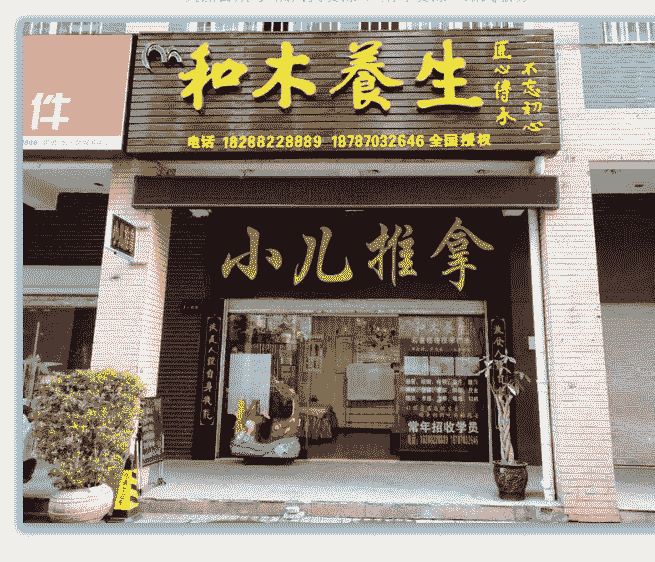

## 珍姐，我是四川德阳

**(提问) 小王**： 珍姐，我是四川德阳的，成都的房子因为限购得买两年社保才能买，现在防城港有资源可以拿到股东价格，但是又不了解防城港的实际情况就想问问您。我是留资金买成都的房还是全款在防城港买一套房，按揭成都的房。防城港的房主要是投资，卖不掉就留着给老人和孩子放假去住。

2019-04-17

**回答：【帖子编号0253】** 先说答案：资金留着，等房票到了以后买成都。不要浪费资金到不值得投资的地方。请一定抱有一个信念：现金很珍贵，只用在值得的东西上。

借这个帖子，再说一下小城市房产可能存在的坑。 很多人都觉得房子一直在涨。你问任何一个城市的人，当地房价多少钱，他都会告诉你最贵的那个区的价格。以证明当地房价贵。打听一圈，你会发现，全中国似乎哪里的房价都涨了。然而，这种信息并不全面。因为小城市最贵的那个区，没准已经变地方了。

大城市的城市重心比较容易稳定，就算变化也是缓慢的迁移。 原因很简单，大城市直径50公里，自然是越靠中间，越值钱。因为住在中心，往东南西北哪个方向走，交通都最便捷。 但小城市，直径5公里。这种“市中心”能有多牢靠？小城市的城市“中心”根本不牢靠。这是买房很大的风险。

过去几年里，有些城市已经出现了这种套路：
老市区直接遗弃，政府打造一个全新的新区。所有政府部门、医院学校、事业单位，直接搬迁到新区。 然后老区会怎么样？
先是没反应。大部分居民都不明白怎么回事，觉得政府傻X了，搬到鸟不拉屎的地方去，生活多不方便啊。连公务员都会抱怨这是在折腾人玩。
这时候先知先觉的人，会赶快低价脱手老城区房子，认赔走人。
然后渐渐的，开始有人发现，孩子上学不方便，看病不方便，上班不方便，于是渐渐搬迁。
老区房价开始逐渐下降。
新城区房价六七千，七八千，近万块。
老城区房价

两三千，一千五。早晚跌成“鹤岗”。你问这个城市的人，当地房价多少了？他只会告诉你，普遍七八千，最高快要上万了。你以为当初买房的人都赚了。其实当初5000块接盘老区的人，亏的底裤都掉了。这绝对是中小城市的坑，大家只要看地图，就能辨认出来。就以防城港为例，见下面卫星。城区比例尺直径连5公里都不到。这意味着周边根本不缺地，你在这买的房子，能有多大稀缺性？这个市中心，又能有多牢靠？只要政府财政不够，分分钟在边上建个新城出来。因为重卖一次地皮来钱最快，而不是苦兮兮的“发展经济”。

参照：0242帖看城市直径。(43赞)

+ 评论

- 珍大户：隔了半小时又显示出来了[惊讶]
- □□□：总感觉珍妮就是一针见血的那根针！
- 珍大户：另外给题主的参考：0139帖广西；0140帖北部湾：因为是已经写过的地区，我尽量不重复回答，贴上链接供参考 https://t.zsxq.com/uibaY7q https://t.zsxq.com/ZJmu3P
- 珍大户：主帖图片中的比例尺好像掉了。正常地图下面会显示一个比例尺，我截图的时候比例尺大概是两公里。所以城市其实是非常小的。
- 人生如逆旅：大户姐，整片文章很棒，就是最后一句“只要政府财政不够，分分钟在边上建个新城出来。因为重卖一次地皮来钱最快，而不是苦兮兮的“发展经济”......”，估计审查员看了有点不爽，和忐忑，不过最后犹豫再三，还是勉强放行......
- [调皮]
- 珍大户：我特地问了，不是这个原因。而是中间说房价的时候，一组数字被当成了政治敏感年份。所以我回头把那两个数字删掉了。大家也注意一下。[偷笑]
- 风口的猪：哈哈，真的是，我们这离武汉近的地方在中间又开发了一个高新区[捂脸]
- 定义Cabin：小城市买房避雷篇[抱拳]

## 【帖子编号0252】

珍大户：【帖子编号0252】

回复 提问：股市是不是触底后开始进入牛市行情了？最近是看到每天三千多只股票飘红，感觉市场大好。但对于小白来说又不敢贸然下手。怎样才能搭上车，不错失这一波大的周期呢？

新手想参与的话，一个简单的办法：
（只针对当前好用）

今天晚上自学一下“圆弧底”这个形态，然后对照着翻股票的月k线。看起来符合这个形态的，有向上仰头迹象的（目前很多），随便买几只就可以了。

注意一定规避ST股票。尽量从10块钱以下的里面选就行了。也是因为圆弧底形态的股票特别多，所以当前趋势远没走完。买完放着等着，一两个月必有不错的收获。

另：

这种行情（参见0237帖）早晚冒出来很多自以为是股神的人，所以我也没有太多需要说的了。

但请大家赚钱后也心态放平和，股市里所有的赚钱，都是因为我们碰巧站对了趋势，而不是因为自己多么牛。

切勿像估计工资一样，来估计股市收入。

比如，我们会按月收入乘12~20，来估算年收入。再乘以几年，估算未来几年的收入。

很多股票新手也有这种心态，这个月赚了多少钱，就会乐观的想，如果每个月都这样，那么今年我可以赚好多钱，明年能赚好多钱……然后产生“货币幻觉”（见0108帖），觉得自己已经是个大富翁了。

这种心态之后，就是行为金融学研究的“股票账户开始缩水时”，人会产生一系列不理性的反应。——那个时候退场，就意味着承认自己当大富翁的白日梦要醒了，大部分人都无法忍受这种痛苦，于是越跌越加仓，祈求反转。结果就是，牛市赚多少，熊市加倍还回去。

所以话先讲清楚，尤其是对新人小白。

永远提醒自己，赚钱就是运气，就是彩票，跟自己能力无关。就是一杆子的事，赚完就完事了，别指望年年赚，月月赚。

补充一下啥叫圆弧底。看一下能截图自己感觉。

我不推荐股票，所以名字都截掉了，主要给大家看形态。

2019-04-16(43赞)

评论区：
陈小米：牛市真的要来了吗？
海的浅笑：上次看珍姐讲可转债后进去小试了一下，只敢打新债，不敢真的买
凤口的猪：[玫瑰]不说技术不说指标，牛市赚钱就是跟对了趋势
Tim：最近看群里都在聊股市，我小白一个都想下水了…虽然跟着牛市大概牟赚，但也怕贪念一起刹不住车就惨了…内心默念，不能碰不能碰不能碰…
玲大户：补充了几张图给大家看下
1440：怎么筛选出这种股？看了一圈收藏的股票都不是这种图[害羞]

珍大户：这孩子明显手顺[偷笑]
小人物：那就翻完3500只股票先，其实也不用翻这么多，10元以下，除去ST，没多少了

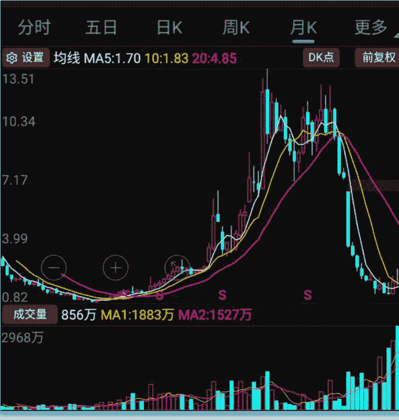

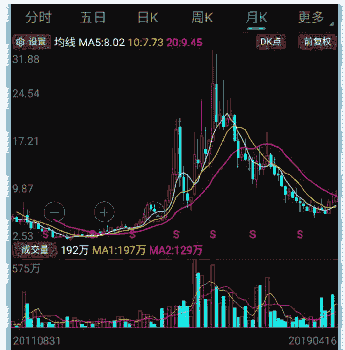

# 分时 五日 日K 周K 月K 更多

+ ⚙设置 均线 MA5:4.62 10:5.23 20:8.91 DK点 前复权

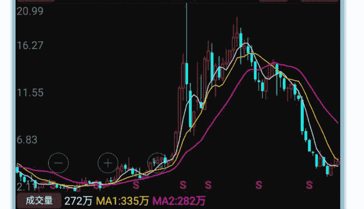

+ 成交量 272万 MA1:335万 MA2:282万

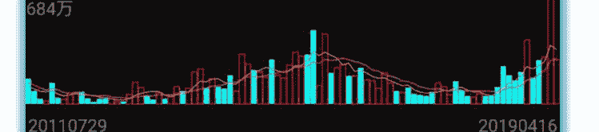

20110729 20190416

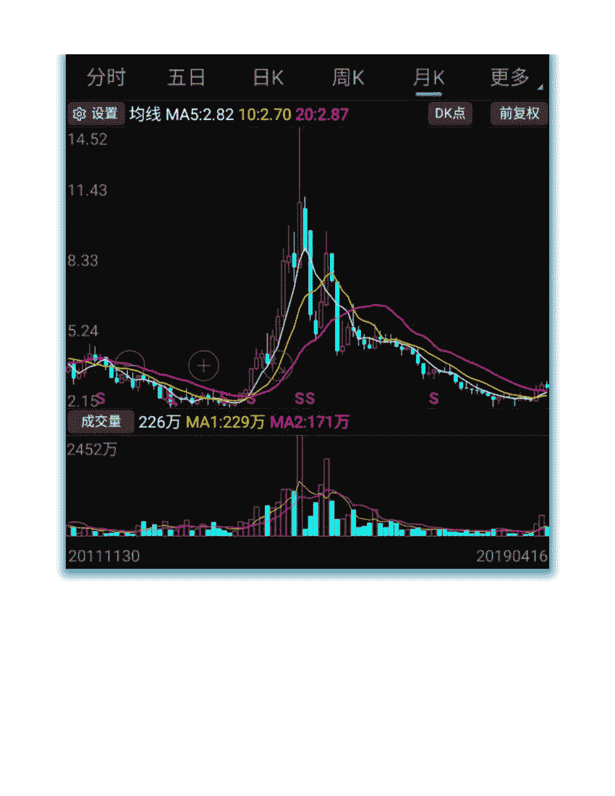

## 【帖子编号0251】

珍大户：【帖子编号0251】

说下昨天出的3月份金融数据了。看第一张图片，3月的M1数据4.6，比2月高出不少，是自去年8月以来的最高值了。

这个数据算是一个好迹象，就是市场信心在恢复。我之前一直在说，不是央行不想投钱，而是央行的钱出不去，因为对外的渠道出问题了。这中间需要有人借贷。而一旦信心不足，央行也没办法。

3月份的这种信心的恢复，有几重原因：

一个是这种经济低谷期持续了也有半年了，大家渐渐的开始适应了，觉得日子也不过如此，似乎没有想象中那么可怕。

另一个是，确实看到了一些政策出来，减税先是从17%减到16%，又放消息说要进一步减到13%，这些都是实打实的利好。

（我在12年，还在当研究员的时候，就天天写报告，号召中国减税，所以能看到实施还是挺开心的[呲牙]

当年还号召过，用央企利润注入养老保险，或者给一定年龄的公民发放年金，毕竟央企的大股东是国家，企业给股东分红天经地义，而我们是SHZY，最后再用于国民也是应该的——但愿不久的将来，也能看到这条建议被实施起来[偷笑]）

最后还有个蛮重要的原因，就是这一个多月股市还涨的不错，确实对信心恢复有很大作用。至少比新闻联播管用。

很多时候人就是活一个预期。哪怕今天吃糠，但感觉明天能吃上肉，当时的幸福感也会强过今天吃肉，却告诉你明天吃糠。

我写上面内容的时候，特意回避了一个词——“放水”。以前写专业内容的时候，我特别讨厌非专业的名词，包括什么放水了，包括什么软着陆硬着陆之类的。

因为这类名词，根本就没有严格的定义，什么程度算软？什么程度算硬？根本就没人知道，所以用这种词的时候，传递的信息肯定都就在自己说自己的，也不管别人怎么理解。

但是为了避免大家感觉像是在放水了，我必须请大家再看第二张图：2015年8月后一直到2017年初的货币增速。这是距现在最近的一轮，大家应该印象都蛮清晰，我们都知道，这期间最大的影响是什么——房子普涨了一倍……

对这种数据规模，大家心里有数就行了。所以再跟3月做个对比，心理就会清楚了。这种规模，确实只能叫做——市场信心在恢复。

2019-04-13(48赞)

## 评论区:

> 珍大户 : 看图型会更清楚一点，注意看蓝线M1的变动。蓝线最新的变动，在3月份出现了一个拐头向上。一方面，挺好，因为改变了信心。另一方面，我们要看到，蓝线整体仍处在底部区间。

> 母光亮 : 市场信心在恢复，不过整体还处于底部。这是重点圈起来，要考

> 珍大户 : 阅读理解满分选手![图]

> 珍大户 : 另外再补充一句。对股市和楼市的影响吧。对股市，跟大家印象中不同，货币数据跟股市的表现，基本没什么太大的关系。股市感觉更像是被放大了无数倍的情绪，所以跟基础货币有些脱钩了。对楼市，倒是真相为证相关。但因为楼市周期长，所以需要有长时间的基础货币的扩张，才能支撑楼市上涨。所以站在现在这个时间点上，正是因为对后面几个月的不确定，所以，信心大于实际，对股市应该算个利好。如果还能再看见连续三个月的扩张，那么就要马上放弃股市，转头买楼了。

> Georgi : 养老保险那条太应该了
> ANTINOMI : 我几个搞地产融资和金融的朋友说下半年重庆的房价要起来了
> 母光亮 : 老师我会骄傲的
> 凤口的猫 : 明灯！非常需要珍惜帮忙把握方向

## 本人31岁在浙江金

(提问)匿名用户：本人31岁在浙江金华做阿里巴巴批发（水晶礼品），一年收入40万左右，老婆和孩子在南通（是在编老师），手中有120万闲钱，现在准备再买一套房子，南通房价和金华房价差不多，如果在金华买的话每年就不用租房（3.5万一年），南通距离上海比较近，过2年高铁通车，房价应该比较稳定，现在不知道在哪里买？希望珍姐给点建议？

2019-04-12

回答：如果非要两边选一个的话，那么选南通概率更高些。一个是因为跟上海衔接的跨江交通必然会打通，另一个是有传言说要建机场（不知道准确性如何），这些都是属于未来有可能带来增量的。金华的话，环境很好，但是目前没看到什么未来的增量。而且批发业务应该主要在义乌吧？和金华市区属于两个不同的地方，这就很尴尬了。买义乌属于县级市，地位尴尬了点。买金华，金华的经济中心都在下面县，而不是在市区。另外，感觉你老婆的工作更属于不可调动，所以未来全家定居应该更多在南通，而不太可能让家人到金华。从使用性上来说，这套也更高些。至于你说的每年房租能省3万块，我觉得，一方面你掏200万买个房子，为了省每年3万的房租，这个投资收益比太低了。另一方面，你现在一个人居住，其实对居住环境要求并不是很高。我猜可能这个每年3万多的房租，其实有一部分应该是花在了产品的仓储上了吧。这种仓储需求也没必要靠买房来实现。（26赞）

> 评论区：
> 成杰：谢谢珍姐的回答，我明白了[吐牙][吐牙]
> Tian：珍姐这是攒了半个月的库存吗？这两天效率太高了 有点跟不上节奏了[偷笑]
> 珍大户：没有啊，这半个月我可是欠了很多账的，至少可转移的帖子都没写完呢[偷笑]
> Tian：别着急慢慢来 你身体不好不要高强度工作 我们也得慢慢细化～[偷笑]
> 珍大户：[吐牙]
> 星SIR：水晶礼品批发这么赚钱吗？
> 星SIR：可能仅仅是你们浙江那边有那个条件资源来做这些行业吧！
> 特定：同问

## 珍姐，今年股市从年

(提问)星SIR：珍姐，今年股市从年前开始大幅反弹，到现在大盘都是三十个点的涨幅。请问这种迹象属于牛市初期吗？对于未来一两年怎么看

2019-04-12

回答：对股市的判断一如0237帖 好现象是，最近已经开始有慢牛的迹象了，时间或许会超过六个月。再长的一两年的预期，变数太多，不好说。我们国家还没出过长达一两年的牛市呢，只能不断往后半年半年的看了。注意：牛市忌追高，大家不要去追涨。找低价股。任何回调都是买入的机会。(15赞)

评论区：

别闹：珍姐带我们炒股起飞吧！

星SIR：嗯。至今看来判断很准。反转我倒是敢相信。毕竟还有很多股还趴在地上没有反弹多少

风口的猪：赞同！今天到底了下周大概率反弹，抄成了汽车，新能源[得意]

星SIR：我全仓松芝股份

某某某：最近我有一种想法，今年实际要走的是平衡市，即上半年涨下半年跌，然后再来的才是牛市

Mr.Liu：牛市炒券商不是最稳妥吗

风口的猪：券商银行需要指数就拉出来溜溜，如果能把握这个节奏确实可以大赚，有几个能做到？

风口的猪：[强]

## 分享一篇文章。是建

珍大户：分享一篇文章。

是建筑领域的学者，对城市收缩的研究。

但我要提示一下：是这个文章里都是“过去”的数据。

比如：

虽然人口在流失，但流失的程度并没有那么多。西方有的收缩城市确实少了很多人，像底特律一下子少了60%的人，但我们只是星星点点少了5%、3%，最多可能在十年中少了8%;

要知道这个数据是来自于十年前。（文中说是靠2000-2010年的人口普查数据，加上2013-2016年的卫星光线数据。）

当时还处在城市化进程之中。就是中国有大量的农村人口在向城市转移。所以这个过程中，“城市人口”的总量应该是大幅提升的。

但是城市化进程到目前应该是开始放缓了。意思是，现在剩下的农村人口大部分都是难转移，转移不掉的。比如各个农村都会有很多留守老人，这部分人是没兴趣转移到城市之中的。

所以未来就是从“增量博弈”转变成“存量博弈”。
一个大城市的崛起，带来的有可能是十个城市的衰落。

## 收缩城市，连抢人的资格都没有？

2019-04-12(22赞)

评论区：

未来未来：珍妮分析很透彻。农村基本就剩下老人了。家里守着一辈子不愿意出去。还有孩子没有条件带老人出去的。

捷：现在的农村一个老人的生活成本不超过1000，但是你在城市1000生存就很难了

风口的猪：所以有一种论调是城市市场化，大城市化，公共资源，基础设施等等才是最符合经济效益的，未来是n个小城市

输血大城市

## 现在去学习和做软件

(提问)A278刘鹤鸣：现在去学习和做软件开发项目，会不会太晚。27了，有车，收入也还稳定。

2019-04-11

回答：【帖子编号0250】我妈喜欢给别人介绍对象。介绍着介绍着，就跟我抱怨，说很多“老姑娘”、“老小伙子”特别多。他们往往因为觉得自己保养的比较好，自认为外表很显年轻。 常见的话是这么说的：“我看起来也就30多岁（实际年龄四五十），所以我要找年轻的异性，不接受年龄大的”最极端的是50岁的男人，觉得因为自己看起来像30几岁，所以坚持要找20几岁的小姑娘相亲。我妈听说以后就反问，说，你50岁看起来像30岁，难道30岁看起来还能像50岁的？必然不是啊。既然人家30岁也一样看起来像30岁，那你的外表，就绝对不是什么优势。所以不值得拿外表来当砝码，不要自我感觉良好，还是先想想自己还有什么“额外”能说的优势吧。 ------------------这种思维也影响了我。以前也有不少人问我，二十七八岁了，再重新考研读金融，毕业了能找个交易员或者研究员的工作吗？二十七八岁开始换行，等学习完毕出来已经30岁了。换行的人往往会附带说：我学习能力强，又勤奋刻苦，指哪打哪，任劳任怨，愿意重头开始，能接受低待遇。套用上面的思路，反问一句：难道说，25岁以下的职场新人，就学习能力差？不够勤奋刻苦？不愿意从头开始了吗？肯定不是。所以，我对要换行人非常坦白的说一句，所有的肯学、勤奋、刻苦、努力、愿意从头开始，这些都不是优点，这些都是必要条件。人家年轻人也一样有，那么你必须要考虑，自己还有什么额外的东西。如果没有额外的东西，那么你全然没有任何优势。又何必换行，去另一个全新的领域被人挑挑拣拣呢。 -------------------- 建议所有需要换行的同学们，必须先考虑自己过往的经历中能带过去什么。只有能带过去一些额外优势，比如让自己成为一个跨领域的、或者交叉行业的复合能力者。否则年龄越大，就越不要贸然考虑换行。(41赞)

评论区：

□:我做AI，芯片等行业的猎头，有候选人之前的工作经验是自动驾驶的研究员，然后现在待业不想考虑自动驾驶觉得不落地风险太大，薪资又有要求，然后想换领域

Nancy：我觉得珍妮说的挺稳妥的，但是如果提问的人是一个比较理想化的人，又处在一个一直在贬值涨的行业，可能换行业也是另谋出路

西游的麦子：珍妮一针见血，不管是在哪个年龄，都要考虑优势是什么，年龄小，那时间就是一个优势，年龄大如果没有一刀切对方要求的优势，那还是别折腾吧

郑先生：赞赞！努力的态度是基本

Timi：多学点东西没什么不好、如果之前一事无成的话更要加紧学习，不要有什么转个转行的顾虑，去干就是了

阿扎☔：我以为珍妮会说年龄不是问题[偷笑]

晓霞：珍妮举例把我笑出声，好久不逛圈啦

Starling. *:27岁还是可以拼一拼的，这个年龄换行业代价不高。。。。如果你之前收入高，两三年内要放下对之前收入的期望和比较。否则无法坚持。

## 【帖子编号0249

珍大户：【帖子编号0249】
关于《比例偏见》的补充说明。

昨天的视频里出的题，我看完评论区后，就觉得该补充说明一下。

主要针对第一个提问。

第一个提问是假设了一种常见的情况：某个商业体，人均消费比如一两百块，想要促销怎么选。

A选项：直接整体打折。比如9折优惠、8折优惠，满200-20等等。

B选项：对某个产品打超级大的折，比如一个25元的产品，直接卖3元、5元这种。

这个问题还可以换一种提法。

假设你是商家，你思考一下你的店里，畅销产品如果有甲产品和乙产品，每个顾客都来你店里买这两样东西。这时，你想做促销，你能忍受的促销强度，就是平均消费额下，不超过50元。那么几种方案：

1. 给甲产品打折25元、给乙产品打折25元；
2. 给甲乙中贵的那个折25元；
3. 给甲乙中便宜的那个折25元。

这些问题其实都有一共通点在里面。

第一是促销的幅度。
因为顾客对“比例”更敏感，而不是对绝对值更敏感，所以你**必须想办法让比例看起来更大一些。所以如果把整体打折置换成局部打折，明显可以获得更大的比例空间，看起来更好看一点**。
【这部分思考，其实就是《比例偏见》这几集里主要讲的内容。】

第二，促销是有负面作用的。最直接的负面作用，是让顾客开始猜测你的利润空间，比如你今天打了8折，会有顾客觉得，8折都能赚钱，平时正价来买，岂不是让你赚太多。于是开始心里不爽了。

这种效用是很可怕的，有可能你折扣次数多了，就影响到平时的销售了。

所以必须考虑怎么防止住。

一种方式是，用浮动的折扣，举例：今天4折、明天5折、后天6折……N天后9折，到全价。或者，今天9折，明天8折，后天7折……

（第0023贴有写过：为了防止打折促销给顾客心里带来的“锚定”，你的折扣促销活动永远不可以长期搞，不可以长时间搞，不可以经常使用同一个折扣值。而是要不断变动折扣值，让顾客没有“固定锚”，从而放弃猜测成本，尽量减少得失心理。）

另一种方式，还是：别搞全体折扣。只搞局部折扣。

最极端局部折扣，就是从你的商品库里，挑一个畅销的“倒霉蛋”出来，这个产品一打折就折到很低，比如3元买个原价30的马克杯、4元买个原价49的手套、7元买个原价59的水煮鱼片等等。

这种程度的折扣，属于明显价格不合理，脑筋正常的顾客是不会把这个价当成你的成本价的。从而就放弃猜测成本，而是会很兴奋地觉得占便宜了。

> （但这种亏本促销会招来薅羊毛的，所以要做些资格限制，搞个门槛，防范住羊毛党）

商家或许会觉得，我这么做亏本了啊。但我问你，如果你本来就预算到，折扣会给每个订单让利20元或30元或50元，那么这几十元折扣，都体现在一个单品上，还是体现到整张订单上，对你有什么区别吗？

最后注释：这些都属于人的认知误区，是因为“消费者猜测成本、寻求性价比”。所以，如果人家还没来得及建立起成本的概念，就贸然打折，就等于做傻事了。

昨天视频第二个例子，大家电，直接打折600元好，还是送空气炸锅+搅拌机好。感觉大部分人都答对了，就不用详细解释了。

但有几个人回答说：

> 两种方案都拿出来，给顾客选择……

这是最傻的，永远别这么做。

2019-04-11(25赞)

## 方新运：所以是送空气炸锅？
- 志：可能是吧
- 初夏：送各气炸锅好

关注公众号"懒人找资源"，星球资源一站式服务

# 【帖子编号0248】

玲大户：【帖子编号0248】

先解读一下最近的消息吧。

看到一些媒体消息，说一二线城市房子成交套数回暖，于是预测说今年房价又要涨了。

但是这些新闻忽视了一个最大的变量——贷款政策。

咱圈里之前有朋友介绍过，5月份会有新的征信系统启用：

我又找了两张图说明新系统的影响：

- 1， 原来离婚买二套房失效了。
- 2， 原来异地贷款不管，现在也受限制了。

如果你有换房需求，然后中介告诉你，5月份以后你就要首付七八成起了，我相信你也会赶在三四月份，赶快把房子的事搞定的。

贷款比例直接决定杠杆的高低。这种“降杠杆”的效果，目前都被很多人忽视了，在我看来，有可能会导玖房价特高的城市，换房需求直接萎缩掉。

> （换句话说，如果大家某天看到新闻说，降低二套房首付比例，那么就变成了对楼市的巨大利好了。）

https://t.zsxq.com/IMZJYfy

2019-04-11(29赞)

**评论区：**

- 西海的麦子 :终于可以看星球了
- A小晟 :□□□
- 大脑招财猫 : 玲姐，首付比例真的放松了，首套和二套都放松了，年初只有一家银行本地户口首套可以做三成，现在双外都可以。我所在的一批，就是首付不够，之前计划的局限性现在貌似可以拓宽范围来看房子了。

- 好：有种操作叫低首付[憨笑]

关注公众号"懒人找资源"，星球资源一站式服务

# 关于《新版个人征信将于2019年5月启用》情况

一、《新版个人征信将于2019年5月启用》详解如下：

| 序号 | 类别 | 具体分类 | 旧版内容 | 新版内容 | 产生影响 |
| :---: | :---: | :---: | :---: | :--- | :--- |
| 1 | 负债信息 | 夫妻贷款 | 夫妻双方共同还款，男方主贷，女方征信不体现负债 | 作为共同借款人，两方均会上征信，体现负债和贷款 | 1.夫妻双方买的房子，离婚后，非主贷人征信仍会显示有房贷和负债，首付80%（到时首付成数最终以各银行分行出台细则为准），将无法做首套房或低首付贷款 2.通过离婚无法获得首套房或低首付贷款 |
| 2 | 征信时长 | 更新时长 | 一个月或更久 | T+1向征信中心报送数据(个人信息发生变化或放款第二天会在个人征信里显示) | 利用银行征信更新缓慢的时间差，来进行贷款将无法实现 |
| 3 | | 记录时长 | 体现近两年的征信记录情况 | 不良信息(例如逾期、呆账等)自终止之日起保留5年。新版征信报告还款记录延长至5年，记录详尽的还款、逾期信息 | 征信有效期内的不良记录保持更久。对于申请房贷有影响（目前一般银行重点关注客户2年内征信，如征信记录延长至5年不确定银行是否会把征信关注期也延长至5年） |
| 4 | 征信信息 | 个人信息 | 个人信息记录较少且完整度差 | 完整展示贷款人及配偶的学历信息、就业情况、电子邮箱信息、通讯地址、户籍地址、所有个人手机号、近几年详尽的居住信息等详尽信息 | 个人征信信息更加完整，对于后期贷款过程中更易识别出客户提供虚假资料 |
| 5 | | 征信信息量 | 征信记录少量信息，房贷，银行卡等 | 业务缴费情况、欠税、民事裁决、强制执行、行政处罚、低保救助、执业资格和行政奖励等除借贷信息之外的多信息纳入征信 | 征信记录多样化，更多的个人工作生活记录被采纳，客户后期提供虚假资料会更易识别 |
| 6 | | 车贷及装修贷等信用体现 | 实质为大额信用卡分期，征信仅体现信用卡，不体现分期金额 | 体现分期时间和分期金额，更加细化 | 信用卡分期进行细化，银行会把该部分计入负债，对于后期再申请房贷，需要更多收入和银行流水来抵消负债（现目前个别银行贷款政策已把大额信用卡分期已列入负债） |

# 深圳买房条件2019?

- 1、 2019深圳买房要深户家庭无房，无房贷记录，首付3成。深户家庭无房，有房贷记录(包含异地，贷款已结清)，首付5成。深户家庭无房，有房贷记录(包含异地，1笔贷款未结清)，首付5成。
- 2、 2019深户家庭无房，有2笔或以上异地房贷记录未结清，禁贷。深户家庭已有1套深圳房产，有房贷记录(包含异地，贷款已结清)，首付7成。深户家庭已有1套深圳房产，有房贷记录(包含异地，1笔贷款未结清)，首付7成。深户家庭已有2套深圳房产，禁贷。

# 大家小心

Tian：大家小心 2019-04-11(6赞)

**评论区：**
- ecn：言论不由自主了[呲牙]看不到真话啦
- Tian：怎么能这么说呢～我们是最自由的邹嘉 因为有最爱我们的档～
- 卫斯理：是啊，以后说话要注意了。
- 一男子：这也是体制没有吸引力的原因
- 张晨：都是真话，[呲牙][呲牙][呲牙][呲牙]
- Tian：一直都是吧？不过这次挑明了而已

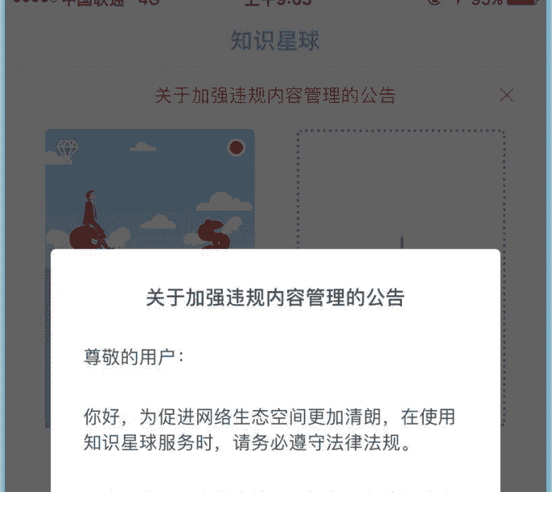

星主和管理员应落实管理，如有用户违规发布涉及党和国家领导人、时政、新闻、热点或12类负面有害信息，将注销发布者帐号，并注销星球。

确定

# 大户籍，第一次提问

(提问)匿名用户：大户籍，第一次提问，关于人生规划。我91年女生，在四线（冲三线）地市级公检法工作，有司法资格证、语文教师资格证，今年在职研究生毕业。已婚，对象在国企，俩人有有房（无房贷），各有一辆车，无养老压力，无小孩，俩人年收入35w。其实一切非常顺利，但我常常想跳槽：1.我不想每天做重复工作，机关太形式化，浪费时间。2.我学习能力强，兴趣广泛，工作效率高，公务员无法满足。3.我的特长：口才、写作、瑜伽，以及一切我感兴趣的事情，我喜欢有创造性、有趣、时间相对自由的职业，但是创业我缺少资金和合作伙伴，也没想好从事领域。二是目前经济大环境不是很好，我在四线城市，总体受限。
请问，我该辞职或怎么处理这种矛盾？
2019-03-27

回答： 【帖子编号0247】 不建议你辞职。 你喜欢有创造性、自由、有趣的工作。这事谁不喜欢？大部分人都喜欢。 因为你用的是三个“正面”的“形容词”来形容。这三个词的反面，是机械的、压抑的、烦闷的。你问有人喜欢这种工作吗，肯定没有。 所有谈起“形容词”的喜欢，我都默认嗤之以鼻的。更何况是“正面”的形容词。 你喜欢“音乐”，就去做音乐。但你说你喜欢“激情澎湃”，那大概率是要碰壁的。 因为我相信，即便去搞音乐，到最后，也一样要碰到压力大到掉头发的时刻，一样会有“机械重复”，一定会枯燥和烦闷。 我比较推崇“从事自己爱好”的职业。因为所有的职业，走到最后一定会变得重复、枯燥、烦闷。 因为这就是社会分工，只有重复才能提升效率，从某个角度来说，我们每个人，都是这个社会的螺丝钉而已。 所以也有人说，别选自己的爱好当职业。因为最终你会经历不断重复，然后把自己的爱好给毁掉，人生变得没有爱好，那多可悲。 我觉得这种言辞就是放屁。就跟告诉你，别跟自己爱的人结婚一样。你一天一天看见自己爱的人打嗝放屁，一天一天腰围变粗，脸皮下垂，还不如早早转身离开，让这个爱人永远留下完美到你的记忆里。有一种文艺青年故意把生活过垮，以便让自己有机会伤感的鬼才逻辑，反正我无法理解。但生活的真相就是这样，所有的婚姻终归于平淡，所有的工作也早晚都会经历让你怀疑自己职业选择的阶段。所以大家最好及早做好心理准备。一方面，坦然接受婚姻和工作中，无聊和重复的那一面。另一方面，想办法在无聊和烦闷中，找出点不同。

——————

再回到提问中的现状来，公检法工作，估计每天都是做案卷材料，一年几百上千，因此身心疲惫。如果让我提建议的话，可以有几个方面。第一，你如果真擅长口才和写作，又喜欢创造性和自由，那么想办法给你们机关运营一个对外的宣传渠道。公检法写的东西，是政府公文。用词和句式完全不符合大众的阅读习惯。但写得多了，内部的人就已经习惯这种模式了。就像《人民的名义》侯亮平两口子，斗嘴的时候喜欢说，“你这个同志，思想不上进”。正常人家庭里是不这么说话的。但是如果 在中央部委待久了，说话习惯确实会变得跟人民群众不一样。所以，你找机会，在工作单位内部，在你的工作职责之外，做一个这样的事情。一方面，真的去尝试一下，“自由=加班”的感觉。第二，去验证一下自己的口才与文笔，是否真的符合大众。毕竟体制内的“口才和文笔”与体制外的要求不一样。如果未经检验，未经结果验证，贸然辞职就太冒险了。

第二，你需要对枯燥和重复的工作，赋予一些价值。如果认真看待这些枯燥和重复的工作，每一份材料后面就是一个个苛求公正的案子，案子背后是一个又一个苛求公正的人，他们可能愤怒、仇恨、委屈，也可能狂妄、贪婪、甚至面目狰狞。认识到这背后的“有血有肉”，会让你发现这份工作的社会价值。有意义有的时候是比为了赚钱有更高的动力。公检法中，有一些人其实正在做着这样的改变。很多案子的判决书中，法官在写判决书的时候，倾向于文字更加口语化，把内容写的更长，一份判决书写几十页，把事情原委说的明明白白。这种事情，肯定会增加他们的工作量。更加口语化，也是有职业风险的。比如容易脱离法官的威望，容易留给普通人找茬的空间（相反更加使用常人看不懂的法律用词，能够减少被普通民众找茬的空间）但这么做一定是没有意义的。脱离掉“明哲保身”的哲学，做出的选择会让你更有加认同“自己所做所为，是有意义的”。价值会让你忘掉重复和烦躁。

最后说点现实的。之所以不劝你离职，是因为，在一个三四线城市的公检法系统的工作，已经是处在这个城市前百分之几以内的好选择之中了。这时候想要脱离，重新创业的机会成本太大了。而给你“想要创业”这种念头的，其实是一些朦胧的美好想象。想象中，创业之后，有钱又有闲，靠着兴趣和特长，玩着玩着就把钱赚了。这是不现实的。（这种美好想象，离不开媒体的包装。总觉得快乐的随性的人生是灵感的土壤，从而产生好点子，好点子价值千金，让你赚钱继续过美好的人生。还是要更好的认识世界吧。即便是最需要灵感、创造力的领域，也已经渐渐变得“工业化”了。就像流行音乐领域，欧美已经是“工业化生产”了，音乐公司里，购买各种各样的旋律片段，都是由一堆默默无闻的从业者生产出来的旋律片段，然后各个艺人团队再去组合片段，创作成曲。然而对外宣传上，只会告诉别人，这首歌是由“霉霉”自己创作的…… 然后粉丝觉得，是不是我也有才能，能变成下一个霉霉。而国内还没到工业化的阶段，好要艺人自己写歌，于是很多人三年才出产几首曲子。这种生产方式，注定拼不过欧美。再到国内比较“工业化生产”的自媒体。一个咪蒙，每天需要团队去搜寻热点，想出五到十个话题，再讨论出一两个，去落笔成文，每个文章由团队想出5个文章标题，再通过粉丝群几百人的投票选出“最骚动人心”的标题，然后配文章发出。说这些只是想告诉你，即便是创作类的职业，最终早晚走向“工业化生产”。在“工业化生产”下，没有什么职业会是“自由的、有趣的、有创造力的”。(110赞)

> 评论区：
- A7:看完大户现的回答我心里也舒畅多了
- KingKong：感觉现在确实好多 人被媒体带带了节奏读
- 沐阳: 突然想起那年辞职的一个老师，她毕业于山西师范大学，有点才情，颜值和身材属于偏下，性格也不好太，所以经历了很多次失败的求职最终考取了国家特岗教师，工作两年后认识了一个四处漂泊的“音乐浪子”，决定跟他浪迹天涯。她的校长是我朋友，不停的劝说让她三思而行，并且答应在自己的职权范围内给她放长假，半年后再回来决定要不要辞职。半年很快过去了，她一定要辞职，不在乎下一个月就要入编，在她眼里，枯燥乏味的乡村教师生活、每个月四五千块钱的工资和花花绿绿迷天滩比起来太没有诱惑力了。又过了半年，她身心俱疲带着眼泪回来了，可惜一切都晚了。目前在考公务员，已经逃败两年～人生路长，也许不久的将来她会过上更好的生活，快意恩仇～
- □□□□：我是在新疆喀什地区的一个团场当公务员，一年收入五六万左右，郑州有个小房子，无房贷，还有个儿子一岁半，目前还怀孕一个，这里教育极度落后，环境也很落后，一直在纠结要不要辞职回郑州去……

- **Hans**：大家都老老实实上班挣钱，下班该干嘛干嘛，不影响你生活。
- **Vicent**：如果你在新疆体质内有关系可以考虑留下来，不然你留那边干嘛呐，说不定20年后也没有多大的发展
- **Hans**：你找了个什么地方啊
- □□□□：年轻的时候可能啊{抓狂}

关注公众号"懒人找资源"，星球资源一站式服务

# 创业有7年左右，有

(提问)A阿拉广告.胡世挺:创业有7年左右，有见到脚踏实地风生水起的，也有近几年突然崛起爆发的，有老一辈逐步褪去的，还有很多努力但深陷泥潭的，自己还算顺利，没赚到什么大钱但积累了经验，车房儿都有。去年进圈前换了房，有点微跌，利率高，越发觉得选择大于努力这条至理名言！大户的很多抖音内容看了挺有感触，赚钱要选对行业，而且要在行业黄金发展期为好。感觉自己广告行业已经是没有多少提升空间。去年开始一直想开辟个副业，本人86年的，浙江人在广东佛山家具制造基地。我身边都是做家具行业的，这里有完善的产业配套，我想咨询大户，家具类现在处于什么期了，未来前景如何？还能否介入，是从哪里切入比较好？生产，营销（面向全国），还是零售或是电商？谢谢

2019-03-25

回答: 【帖子编号0246】谢谢前面的认同，副业不要进家具行业。 我所理解的副业，是指投入的精力占用不会太大，有比较不错的利润率。 所以问题来了：为什么有这么好的副业？这么好的副业，为什么不会变成本业？ 原因： 我们把事业简单划分，一种是标准化的，能够大规模扩大的。这种，大部分情况下，竞争激烈，利润率不可能太高。但是因为规模能够扩大，所以大部分人都奔着做大的目标而去。——这种必须都是主业。 而另一种是非标准化的。可能是差异化带来的不可直接对比，也可能是小众导致的无法扩大规模，还可能是信息传递不畅导致的市场有限。总之，就是小而美。小而美的未必都是副业。但副业一定是小而美。 意味着市场上可以容纳很多商家，再多你一个也能容得下。但又因为大家都不一样，所以不会因为恶性竞争，导致大家都利润微薄。

——————

家具这个东西，大部分人第一感觉，会以为这东西很差异化，像是“小而美”。然而这是错觉。 我们社会现在的审美发展，还没有到这个程度。目前仍旧是同质化，相互之间的替代性蛮大的。 大部分人家里的装修都是一样的模式——电视背景墙，电视柜上摆电视，两边可能是独立的柜子，也可能是跟背景墙一体的柜子。 然后是三人位沙发，差别就是大点儿还是小点儿，带不带贵妃椅，什么颜色，什么材质。 然后就是茶几。 有些人再放个地毯。 我们看到的家家不同的差异化，都是表面的，其实是替代性很强。 所以一家家具贵了点，就换另一家，另一个款式也一样搭。 记得之前看美剧，总能看到一些有客人到访家里的情节，会跟朋友介绍家具，说这件是在哪里哪里旅游时，一眼看中然后运回国的，那件是在哪里哪里挑选出来的，目的是做怎样的搭配。 我一直无法想象出这种消费场景。去另外一个城市甚至另一个国家，看中了个家具，不远万里也要运回家……代入到我们现在的社会中，就会觉得很夸张。 归根结底，还是我们消费能力不够。表面上是不愿意付额外的运费，本质上是自己的“个性喜好”，还没强烈到值得花额外的超额价格来满足的程度。 如果负担不起超额价格，家具行业怎么支撑得起差异化的价格和利润率呢？ 所以家具行业，目前还是一个竞争激烈的行业，虽然看起来有“差异化”，但本质上是“同质化”严重。 我不知道家具的利润怎么样。但是我猜测，这东西可能只看起来毛利率比较高，但如果扣掉固定资产投入，扣掉长期的存货压货，那么行业的净利润率可能未必有多高。 而如果想要赚钱，需要的是扩大规模，扩大出货量。这种目标，怕是只能靠当做主业的投入才可能。 副业完全不现实。

再说你的主业。 广告行业刚好是个新旧转换的行业。 曾经的广告行业，是连接甲方和媒体的。 但现在传统的广告行业运行规则正在被瓦解。 比如，从广告的曝光终端来看——旧媒体的地位在下降，新媒体的地位在上升。 不断有新的能用来曝光广告的目标在出现。 但还有很多有广告价值的终端，还没有还没有被发掘出来。 再比如，从广告的生产方式来看，之前是广告公司做策划，生产统一的广告。 渐渐的开始有多元化的广告出现了，广告公司处心积虑策划的广告，有可能还没有互联网上无意之间的一个段子影 响大。广告的生产者从广告公司，渐渐的要变成全民可生产广告了。这种趋势，让我想起欧洲宗教改革的历史了。曾经，与上帝沟通是教会才能从事的工作，于是教会垄断了这个环节，变得非常富有。后来产生了宗教改革，新教宣称，任何人都直接与上帝沟通？（sorry，我不是专门研究这个的，不对细节负责。）等于变相削弱了教会的地位。这个中间环节的利润，就被分散了。广告行业面临的变革，就有点像宗教改革。最后的结果是，曾经作为中间的、坚固的、利润高昂的一环，要被分散掉了。最后结果有可能会使广告行业变成一个充满了很多“小而美”的行业……——听起来很神奇……这个被你认为已经没有发展空间的行业，有可能是适合“搞副业”的[偷笑][偷笑][偷笑] 但是副业往哪个方向呢？你按照搞副业的思维去想一想。把你公司现有的业务当成一个熟悉的领域放到一边，继续正常去做。抽出一部分时间，去想办法开发一些你们“未曾试过”的事情试试吧。（49赞）

### 评论区：

- A阿拉[广告,胡世捷：感谢大户回客的这么详细，受宠若惊！因为提问只有300字限制，所以有些可能表达不清。我目前的广告属于定制广告，厂家字类别。在以前属于小而美吧，但现在小厂，竞争的也是非常激烈。我有同行往大了做，上市规模，固定设备厂房管理等等费用投入高，没见的多少盈利，而有些夫妻档或家庭作坊倒是每年几十万往稳的。比如《写给企业的经济学》上写的应该属于不太适合做大的企业，所以我对做大做强并不是很看好，反而出去从自身收入左右规模比较适合，一年赚不到100w，70-80左右，目前已经稳定，自己也不像创业初期那么忙碌，想跳出去增加些收入。但将来人工成本逐步增加，利润越来越透明，产销相对于其他产业也做不高中，导致信心不是很足，想稳住这个“广告制作行业前提下，逐步试行试试！（嗯，就是你说的那个广告多产业去做，收入用高商导收也亏等开）拓展家具行业这个想法因为我所在的环境限定在这个圈，这里是全国比较大家具制造基地，身边有做家具类材料的，板、木、皮、布、海绵、五金、耗材等等，有大大小小工厂欧式美式法式北欧、沙发、桌、床等等等进口厂家（中等级别），也有非常有名气的物流，物流费并不高，也有做电商的团体，有摄影设计公司等配套齐全，厂家主要客户是全国各地的经销商或者卖场，品牌也是龙蛇混杂，多数是营造出来的。大户说的对，这个行业竞争激烈，但毛利润还是还可以。我是觉得投入的资金和精力差不多情况下我们一年做几百万产值都挺辛苦，他们一个月就可以几百万，而且因为地理优势，送货调查也方便，看到很多从生产能力好像也就如此，哈哈。跟红人家赚钱，觉得自己并不比比别人笨或懒惰，所以想试试！这里家具厂除去掉材料和生产人工成本，大多是房租以及营销费用，除实木家具外还会大型设备（固定资产占比也不重不高），材料做也是可以考虑的，你所说物流成本其实并不高，买家电不从地上货还包含售后保障嘛。中国大家族家具也是从线下三，成都，江苏鼋山，赣州等多个基本实业场的，然后经销商上利润还给终端，终端消费是图片较多以后保。近年来电商崛起，天猫大家具体货还可以50万以下，网上的量逐步在增大年轻消费群体在增加流。珠三角感觉那么多机会，我经常在想走看看，但还没没有想一个合适转型的行业，希望在这里的星友也可以交流交流！再次感谢大户！
- 温俊坚：单独推荐荐某个项目或者方向吗？之前考虑过社区营销，但是个利润低而且花花费很多时间在和顾客沟通中，相当于半个微商了，这样对我的本职工作也会造成较大的影响，希望珍瑜能给点建议，谢谢！
- 叔：家具营销这个丰富，而且想在家具上多点事情，我例是有个性户外地推广直接去产地购买高清情看，我微友还建议选地方离得你在你的产地区上这几点，高铁方便1两个小时内地为宜，太远了太家容易了睡眠不吃你货，距离太远3厂家不好搭配2选择相对经济好的城市（可以找一些稍微高端的家具电料配到40个百星不当地做各他的广告，微信指排，传单等适合合作厂家，带团队，财务这些我原理就能把业务跑下来
- A阿拉[广告,胡世捷：嗯嗯，之前想过带我老家自己小区的行业来，我们那里是楼盘，但是初步试投了星里的反应，各种人群啊，一下子兴味就降低了，哈哈。我有个朋友就是在家感觉做初创工作，每天发朋友圈，都不知道哪人碍。赚点可有，但我想这么做做就低点长保持下来的工作，这里面向全国，感觉做批发的大占比做零售做点大，不过人碍到的人碍点到不。
- 叔：这是你自己负心了，我跟你说个模式已经有人跑的有规模了，你百度一下悦安居看看他们做的怎么样
- A阿拉[广告,胡世捷：悦安居不用百度，是我间接客户，我可以去问一下，谢谢

关注公众号"懒人找资源"，星球资源一站式服务

## 大公国际信资被处罚

**提问 (咖啡)**：大公国际信资被处罚，即将要去大公任职，想问这个公司是否有发展前景
**日期**：2019-03-25

**回答**：【帖子编号0245】

这个公司是很有“钱景”的，但前景与你们无关。原因不是跟被处罚无关，主要是这个行业本身存在一些问题。我默认你是做大公里面的“核心”职位（这个引号的意思，你看后面）就是信用分析师。与大公一个级别的评级公司，之前就五家，中诚信、联合资信等等，后面又增加了一两家，东方金城什么的，现在貌似是有7家了。这七家，有几个问题：

一是壳资源。别的公司想做评级，监管机构首先不认，想要资本市场融资，必须现有评级。这么听起来似乎评级机构很占优势的。然而，第二点就是，收费标准都是统一的（我不是行业内人，不知道这是行业协会定的，还是监管机构定。总之都是评完一单，25万还是30万，大概就是这个标准的收费。）所以评级评的有“多好”是没用的，没人会给你市场化的奖励。评一个项目，花4周还是花2周，没人在意，反正价格都是一样的。第三点就是，好公司不能涨价，坏公司不能降价，那么如何抢客户呢。靠卖评级。如果公司资质介于aa-和aa之间，松一点还是严一点？谁严谁吃亏，松的才能抢得到客户。渐渐的，市场上评级越来越松，那么继续把aa的往aa+上输送。（一个历史统计，评级公司每年上调评级数百次，而下调评级只有十几二十次……可以看出这种手松的迹象。而这种方式之所以能够奏效，是因为评级结果需要违约数据检验，而国内其实是没有那么多违约数据供检验的。就像如果没有高考的检验，那么各个老师都会称自己是名师，然后送出去超多的三好学生名额当人情。）

第四点，公司每单收入固定，靠什么盈利？

一方面，壳资源是有用的，每年进资本市场融资的企业越来越多，虽然一单25万，但是单数越来越多，盘子在变大。另一方面，其实就是靠着压低成本，不断招月薪8000的小朋友，一个三年级生（工作经验3年的）带着一个一年级生（刚出校门的），两个人去企业调查个一两周，就出一份评级报告。压低员工的平均工作经验，降低人工成本，压低评级周期，提升人力资本的周转率。于是利润就出来了。

————————

所以据我所知，评级公司都是蛮赚钱的。然而公司里的“核心资产”——分析师，其实是不怎么赚钱的。评级公司的分析师流失率一直比较高。

一方面，因为钱少、长期出差。现在去资本市场融资的企业，已经到三线城市甚至县级了。刚毕业的学生，抱着“可以近距离接触企业，访谈企业高管”的印象，结果入职以后发现不是出差去铁岭，就是出差去驻马店，一路风尘仆仆不说，白天去调研，晚上加班攒报告，心理落差肯定有的。

另一方面，其实是国内评级公司没动力升级评级能力。仅靠一些评级模型不断套用。而对新的人来说，模型花个一两年都熟透了，继续干下去也学不到什么东西，纯粹做重复劳动而已。所以大部分人都是进去刷第1-3年的工作经验，然后一有点经验就找机会去跳槽了，能跳买方是最好的选项，跳不到买方，能跳到卖方研究所也算次优选项了。

————————

然而一个可见的趋势是，金融行业内买方和卖方的坑位都是有限的。“信用分析师”这个岗位出现，也不过就是最近十来年才开始出现的，大规模扩招都是近五年之内的事。各个机构对自己家里需要养几个分析师仍然处在摸索之中，于是很多监管机构会出细则，什么“从事某某业务，需要配4名、8名、12名信用分析师，其中几分之一应该具有三年/五年/十年以上经验”——这种及其硬性的条款，是造成跳槽机会的直接原因。更因为其中规定的X年经验，终于给老分析师的身价做了点支撑。这五年里，受硬性条款规定，各个买方机构里扩编了一批信用分析师，直接挖角对象就是大公国际这类的信评机构，为大公的老员工找到不少去处，也为大公更换新鲜血液、压低劳动成本做了不少贡献。然而，等到机构坑位都配齐以后，这些跳槽机会自然要越来越少了。

————————

所以，最后的一点建议：知道这个行业，最终的趋势是跳槽离开，所以工作时候要往这个方向想办法。一方面，沿着先辈们的轨迹，准备“注会”之类的身份加持，为向金融业跳槽加砝码。另一方面，想办法开拓别人没走过的路。（比如，我感觉，现在大部分想要进入资本市场的企业，是缺少董秘、证券发言人这一块的职位的。这一类职能岗位，目前属于比较缺少的，所以未来的工作机遇有可能会比较多。）

(24赞)

**讨论区**：
- 张晟：分析的真好[强]
- 咖啡：非常感激
- Hans：最直接的信用行业都这样了[擦汗]

关注公众号“懒人找资源”，星球资源一站式服务

## 我感觉我已懒到极点了

**提问 (@)**：我感觉我已懒到极点了
**日期**：2019-03-21

**回答**：【帖子编号0244】瞎说。

1. 有些股票，你这辈子都等不到价格上去。岂不是永远都卖不掉了？这部分钱，你是不是当做捐赠出去了？（同理道理：被开发商吹一波，买房买到一些无人区的养老房。等楼盘全卖光之后，开发商撤退，剩些小散持着房子，也没能力宣传，再也吸引不到新来的人，房子就永远脱不了手了……还指望涨？）
2. 你手里有无限的资金去补仓吗？没有的话说个屁啊，梦里去补仓吧。

这种策略，有一半是有可行性的。就是“跌了不卖”这一半。但也不是对所有人都有效，只有无限资金的主，可以无限补仓。才能跌了不卖。现实生活中，保险公司可以看作是这种情况，每个月都有保费进来，每个月都有新钱到账，因此可以看作资金无限∞。但我们只敢在买债的时候，才这么搞——只要有浮亏，就不卖了。这是因为，债券是有期限的，我们挺得到债券到期。到了债券到期，钱就回来了。

所以呢，记住：
第一：跌了不卖，无限补仓，连银行都不敢这么玩儿（连银行的现金流都是不持续的）。
第二：也只敢这么搞债券，没人敢搞股票。
第三！你提问里的策略，即便保险公司搞债券，也只敢执行“亏了时候不卖”。敢涨5%就卖的，都是SB。

----------

记住，任何投资能够赚钱，本质上就两条。（无论是创业投资还是证券投资，还是什么投资）
1. 想办法遏制住亏损。任由亏损放大，基本是想让你当韭菜，生生不息。
2. 想办法放大盈利。盈利证明是对的，对的就要坚持。

只见过犯错时道歉，说我下次不再犯了，没见过做正确的事时，还要立即纠正改正的。

(34赞)

**评论区**：
- CK：韭菜可以拿一年都不卖。但是却守不住涨5%就卖的利润
- 未来乱来：珍妮教训深刻。他只是异想天开而已。
- 未来乱来：看看中石油吧。估计吓傻。
- 捷：看看乐视网，分分教你炒股票
- □：良药都是苦口的[捂脸]
- 张晟：韭菜过來的
- 张晟：上港集团，中海集运
- 四平八稳：1，我爸这样干过，亏惨了！2，朋友炒股亏损八十万以上。3，自己在07年刚毕业工作时工资全投入股市亏损四万五万块左右，大概12左右就不炒了，当年买了一只长油以作留念。
- 提问补充：每次都低仓位买股票，每次赚5%就走，如果跌就分批补仓，这种方法对吗？

关注公众号"懒人找资源"，星球资源一站式服务

## 珍姐，我注册了一家进出口公司

**提问 (Olivia)**：珍姐，我注册了一家进出口公司，前两天有人打着两会的旗号说对小企业有政策扶植，让我去开个会，我没多想就去了。到了先是放中央电视台采访马化腾和58老板还有其他几位老板的采访视频，后来有一位叫陈紫云讲师的讲了互联网创业的趋势，举了几个做的比较成功的BAT(微信，支付宝，腾讯)致富的案例，最后就说政策扶植五个名额，一年优惠10000，要连续签三年的合同，然后我就签了。回去就发现被忽悠了，第二天要跟他们解除合同，可以扣掉违约金，可是他们不同意坚持让我去他们公司，我去后，领导不出面见我，其他的人说做不了主。报警应该用处不大，仲裁不知道有没有用？请问这样的情况怎样才能把钱要回来呢？
**日期**：2019-03-21

**回答**：【帖子编号0243】

《创业骗局》

**简单选项**：如果合同里有违约金选项，而你要求解除合同，但是找不到对方的人。这种的情况下，去邮局拿ems寄《解除合同通知书》，记得面单上要写清，邮寄的是解除合同通知书，邮局会有盖章。然后去起诉，要求对方退掉除违约金以外的钱。

**难一点的选项**：去法院起诉，具体的要求：因为订立合同前，虚假宣传，订立的合同里“显示公平”，依据合同法第54条，要求撤销合同。（视证据情况，不确定一定能胜诉）

（我从你的提问里看不出太多细节，但是只做推测：
1. 他们宣传时候是给“政策扶持名额”，这里的政策应该是政府的扶持政策了。但是与你签合同的肯定是一个公司主体，那么公司是没有资格做这种承诺的，所以肯定是虚假宣传。（但他们肯定不敢把这种话写进合同里，所以要求你要想办法录音录像，保存证据。现在没有的话就得想办法重新收集）
2. 他们在合同中肯定不会写明“交一万给扶持名额”这种一眼就能让人发现bug的词语。所以，合同里你花1万元，对应的是什么服务呢？这部分是用来主张合同“显示公平”的。
3. 签合同之前的虚假宣传，还包括什么只有5个名额之类的，你再找几个受害者，一下子就可以证明了。同样的，这一条需要你提出证据，对方肯定是口头承诺，也就是说，你们必须要有录音当做证据。）

这个选项，因为是要提交证据的。所以你不能立即去起诉。而是要先找他们公司纠缠，过程中不断的录音录像搜集证据。这个过程中，他们还会继续开这种会，你可以再去会城中，把他们签合同前的虚假宣传给取证一下。要到手里有一些证据证明的情况下，有胜诉的可能性时再去起诉。

—————

第2个选项可以看出，耗费时间精力。而且普通人未必法律知识充足，未必能把证据完全取到。如果找律师的话，最便宜的律师，也得5000到1万......要回来的钱，交完律师费也剩不了什么了。所以这就是骗子心里打的主意。每个人骗1万，大部分人发现，无论是律师费还是自己取证的时间精力，都不值得，然后就忍气吞声，自己算了。结果骗子就得逞了。

这时候，我建议：
1. 如果你选择忍气吞声了，那不如找个律师，签风险代理，要不回钱不花钱，要的回钱，就大头全给律师了。反正钱也不打算要了，就当转让给律师，让律师去找茬，恶心这个公司一把，不能白白便宜了他们。（很多新手律师，时间成本低，又不怕麻烦，就会愿意接这种案子）
2. 如果你不想忍，那么再找几个受害者，一起分摊成本。

—————

除了以上两个选项，还有一个偏招选项。每次骗子开会，都举着牌子在门口喊“退钱退钱”。很快他们就会受不了了。你已经报过警了，警察管不了他们，也一样管不了你。

————

最后，创业艰难，希望大家小心，这种骗局。这些骗局九几年就开始出现了，一直到现在，不断的创新，包括很多种，我列举一下：

1. 【评奖骗局】：最早九几年就有了，基本都是打电话说，你被评了一个什么什么奖，比如，著名企业家/优秀企业家/十大什么什么......颁奖的场所在人民大会堂，需要交几万评选费用，就可以去大会堂领奖了。当年一哄，人民大会堂，谁能觉得是骗子啊，后来才知道，原来人民大会堂都是按天往外出租的。
2. 【会议骗局】：邀请你参加一个什么什么会。说会议上会有各种领导，各种知名企业家。让你交酒店钱，会场费用等，万八千的。
3. 【融资对接骗局】：说给你对接到天使投资人了，对方对你的项目很感兴趣，有可能投个千八百万的，让你一定去见一见。然后还是要掏各种“会场费用”、“组织费用”、“住宿费”之类的。
4. 【政府关系骗局】：打着各种政府扶持、政府补贴的旗号让你交钱。

还有很多。记住，让你交钱的都小心。不说上面这些骗钱的骗局，创业过程中，你还会看到很多骗吃骗喝的人。打着哈哈，说认识某某某领导，能帮忙牵线搭桥之类的，或者有某某资源，能够方便对接之类的。然后就来参加饭局了。大部分中国人都抹不开面子，依然会好吃好喝接待一下，然后一顿饭花掉几千块。碰到这种骗吃骗喝的，我建议向学习：一桌点四个干锅白菜！让骗子吃饱。

(24赞)

**评论区**：
- Hans：剩养人的，全是坑
- Olivia：合同条款第五条中有个仲裁机构，是中国国际贸易仲裁委员会，是否只能提交资料到这个仲裁机构呢？还有一个问题是：我怎么才能知道他们什么时候去其他地方开会呢？我觉得这个方法比较好。
- 芒果鹿鹿：哈哈哈
- 张晨：f先生很幽默，让他拍一期抖音
- Shirley：还有微信小程序骗局，拉人去开会，先放短片，然后来个什么讲师洗脑，这样的骗局都需要一个团队参与，搞得有模有样，让人放松警惕。
- Olivia：是的，这个实质上也只是个小程序，可是他没说清楚，只是说通过微信，支付宝，百度一起推广，噱头很大，我要曝光一下这家公司叫天津中金汇聚信息技术有限公司，而且有好几家公司，北京也有，具体叫啥不清楚
- 卫斯理：我就参加过一个这种微信小程序的骗局，开始放宣传片，然后各种忽悠，最后又说一个地区只给几个名额，然后宣传一结束，马上有几个扑上去抢着签合同，只是他们做的太假了，当时问他们要资质了半天说不明白，我直接走人了。
- Olivia：你在哪个地区？

关注公众号”懒人找资源”，星球资源一站式服务

## 珍姐，是去北上广好还是去长沙，杭州等新一线发展好呢？

**提问 (超大帅)**：珍姐，是去北上广好，还是去长沙，杭州等新一线发展好呢？是搞高考考前培训好呢？还是少儿美术好呢？想创业，不想打一辈子工。
**日期**：2019-03-20

**回答**：

目前一定要往各个新一线、二线、省会城市去，不要留恋北上广。

过年放假期间跟北京一个教育集团的高管有交流，他们目前正在加速布局各个二线城市，还举了一个长沙门店的例子。说每个门店前期投入大概100万左右就能开起来了，年营业额能打到一千万，利润20%左右，就是两百万。

不过他们是图上市的玩法，做规模，做增速，然后上市这种。但依然能看出来，一是新一线二线城市的潜力，二是行业利润率，都是很好的。

至于考前培训还是美术。建议考前培训，这个领域目前仍未饱和。大家要进入的话，就迅速抢占市场。

细节分析上，之前开过一个帖子，有说过，各个培训项目是属于“第一轮竞争”还是第二、第三轮竞争，分别属于分数竞争、素质竞争、家庭实力竞争。一线城市已经晋升到二轮三轮了，二线城市还是第一轮，所以去二线城市首选考试培训。

(30赞)

**评论区**：
- 忠信乐易：去哪爱去哪就去哪
- NANA：我老公在株洲开了高考培训的培训学校，投资跟大户说的差不多，但是营业额...目前来看只能达到大户说的长沙门店的三成。而且利润算下来也没有那么高，不知道是哪里不对
- 道法自然：谢谢珍老师。我也刚好在纠结要不要去长沙
- 额滴神啊：长沙现在到底要不要去别网
- Laura：我只知道长沙的物价和上海一样。
- 额滴神啊：长沙典型的工资低，消费高。土生土长长沙人，气候这几年还越来越不好[难过][难过]
- 超大帅：感谢[爱心][爱心][爱心]

## 参与感：小米口碑营销内部手册

**Matthew**：参与感：小米口碑营销内部手册
**日期**：2019-03-20

(25赞)

**评论区**：
- 程局长：好文章，晚上认真学习学习[呲牙][强]
- Matthew：[呲牙][呲牙]
- 平淡的大河：为啥不能保存啊，想保存下来好好看
- Matthew：可以的 下载保存

## 【帖子编号0242】说下小城市

**珍大户**：【帖子编号0242】《说下小城市》

看到楼下宜宾买房的帖子，我又想唠叨几句。

提问：你所在的城市，现在直径有多大？

这是一个很直观的认识，想要迅速建立这个认识，可以直接打开卫星图，调到同样比例尺下（比如我截图的**20公里**），目测下水泥颜色的建成区面积，比照比例尺估算一下直径。

一线城市，北上广深的数量级是：建成区直径在50公里的数量级上。

二线城市，直径20-30公里数量级。

再往下，能达到10公里的，基本算是比较大的地级市了。

再往下，直径5公里的，都是小城市。

房价能不能涨，跟城市大小息息相关。

举例：宜宾，

看下面卫星截图，直径在5公里的规模。

那么，如果人口翻一倍，肯定不是大家抢房子，从而引起房价上涨。而是应该：开发周围绿色空地，做城市扩张。

如果一个城市有源源不断的新地皮供应，房价能涨吗？要知道，一个直径5公里的城市，扩张到直径10公里，建筑面积至少扩大四倍（原理：正方形的面积公式，如果忘记了，补习小学数学。另外，如果考虑到新建筑会楼层变高，容积率上升，那么建筑面积会变成四倍还不止）

第一问：城市人口可能增加那么多吗？翻四倍？对这种小城市，基本不可能。所以城市扩张到直径10都难。

第二问：但我们就往大了说，真的变成直径10，那么，住郊区和住市中心，差别大吗？

对直径10公里（半径5公里）的城市来说，住郊区，到市中心的距离，不过就是平均5公里而已。这就是自行车的距离。

所以，住5公里外的郊区还是住市中心，对人的影响根本没有那么大。结论就是，这时候城市不同区位的房价，基本是平的，没有太大的高低差。

第三问：5公里外的郊区，新房应该是什么价格？

城市扩张时，新开垦的荒地，跟拆迁比起来，几乎是0成本的。那么郊区新建房的房价也不可能贵。

所以，市中心还会贵吗……

就是因为五公里的距离，根本没可能拉开优势和劣势。所以市中心的价格永远也不可能比5公里外的郊区高多少。

所以房价怎么涨？

再进一步说，城市房价其实是一个金字塔结构。

市中心——是金字塔尖。

每往外扩一圈，就增加一层底座。

中间的房价，是被边上的底座，给抬起来的。

三环卖1万时，想要涨价，等四环建起来，四环卖一万了，三环二环就抬起来了。

而能涨起来，是因为距离超过一定数值后，交通距离每增加5公里，就会让体验越来越差。所以才会有人愿意掏高房租和高房价。

各位都瞅一下卫星图吧。看还有人愿意买直径5公里小城的吗。

2019-03-18 (79赞)

**评论区**：
- □：但是大城市买不起呀
- 珍大户：从直径对比图上也能看出来，南京的直径并没有太大，所以中心区域的房价真是太高了（金字塔尖透支了未来好几层底座的空间）。而成都的直径变大多了，由于限价，简直是价格洼地（金字塔被人拍扁了）
- 小高子：所以很多小城打造了一个营销概念——养老房。而且很受爸爸辈的欢迎
- 刘刚：受教育了！买个房，需要看那么多方面
- nice_why：但是成都限购了
- 人生如逆旅：大城市不是买不起，六个钱包凑凑还是可以的，而是一些主要大城市目前“限购”……
- 松鼠与花：不说房价 就光说人的工作发展能力 我一直以为成都属于人才饱和市场 感觉没有我们这种不是很有能力的人的发展空间 因为太多有能力的在成都 就像北上广 人才非常非常饱和了 很多苦命的北漂奋斗多年也没有结果 我这个观点是不是很井底之蛙
- 徐诗梦：说真的 成都重庆的房价真心便宜。杭州简直真是水深火热

关注公众号"懒人找资源"，星球资源一站式服务

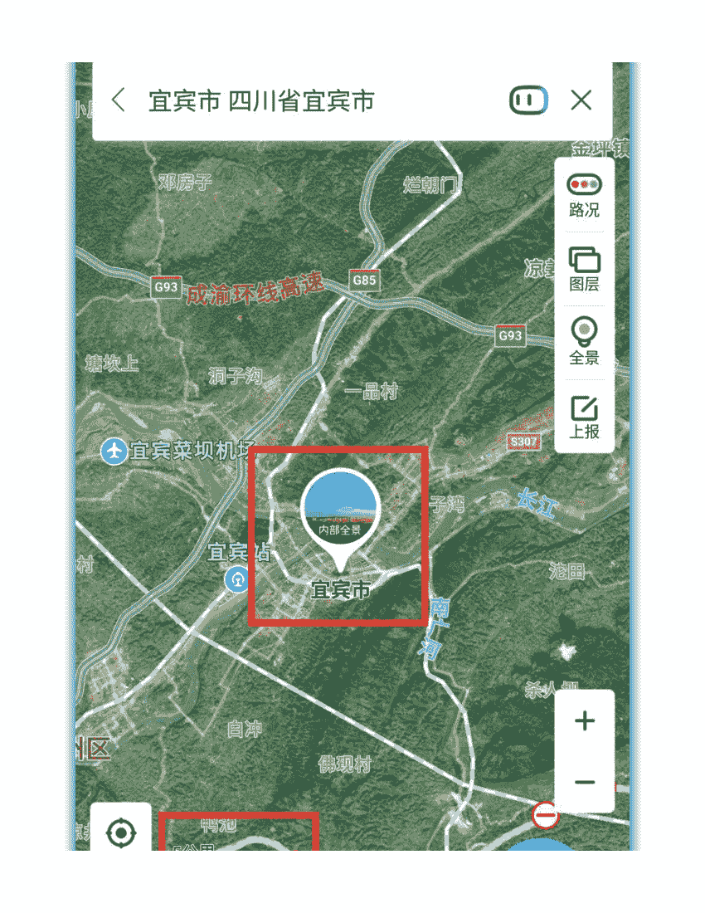

# 1.宜宾市

★★★★★ 5.0

- 收藏
- 搜周边
- 导航
- 添加行程

合肥

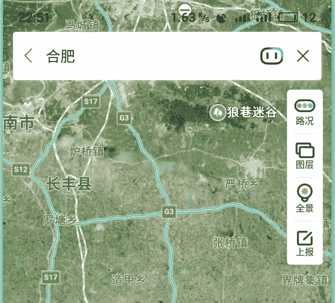

- 路况
- 图层
- 全景
- 上报

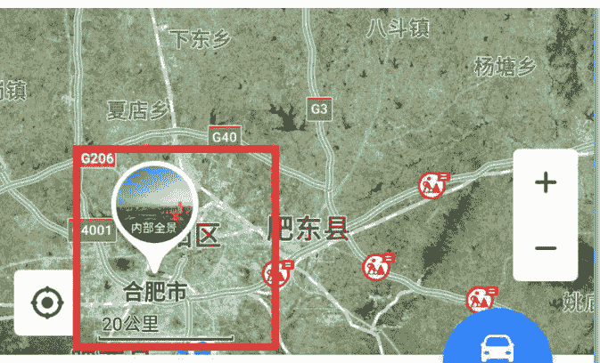

# 合肥市

12.7km

徽山皖水，三国旧地包拯故里

- 收藏
- 搜周边
- 导航
- 添加行程

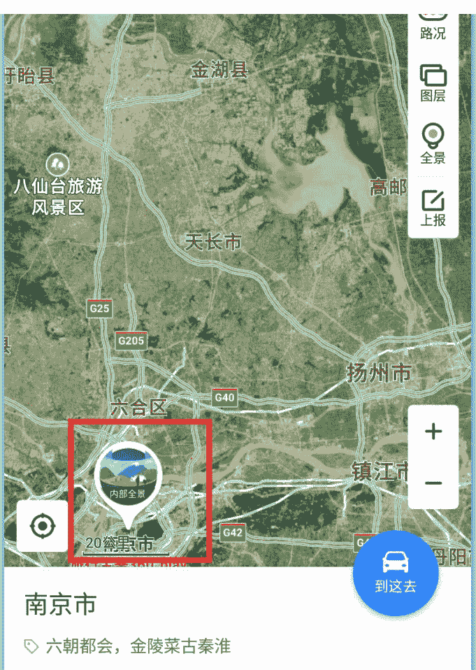

# 南京市

六朝都会，金陵古秦淮

- 收藏
- 搜周边
- 导航
- 添加行程

< 成都

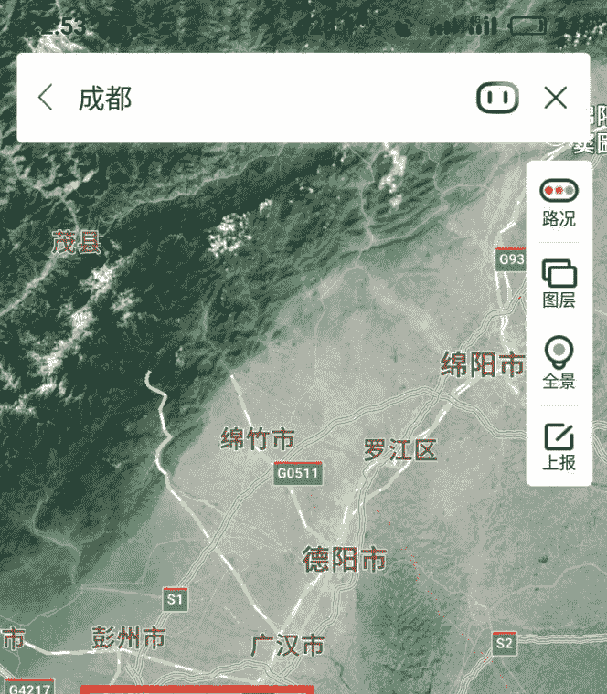

- 路况
- 图层
- 全景
- 上报

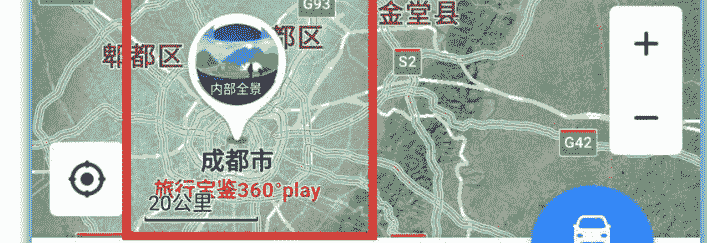

# 成都市

1263.0km

天府之国，国宝熊猫的故乡

- 收藏
- 搜周边
- 导航
- 添加行程

## 抖音官方发的直播规则

珍大户：抖音官方发的直播规则，给有用到的人参考下：

直播电商审核规范：一旦违规，将封禁直播权限甚至封号，希望大家严格遵守直播规则。

**【穿着得体】**
1. 不能露腿，露肩，穿着暴露衣服或引诱他人等行为。例如：露沟穿吊带、穿短裤短裙、裤子不能膝盖以上。
   解决方案：穿打底裤或秋裤。
2. 夏天透视，小吊带服装不可以。
   解决方案：穿外套遮挡。

**【行为得体】**
1. 不允许有未成年、外籍人员或境外人员入镜；外语或带有明显外国特征不可以直播。
2. 不允许教授外语课程；
3. 不允许长时间不出镜（5分钟内）；
4. 不允许大胃王吃播；
5. 主播不出镜会有替播嫌疑；
6. 不可辅导及直播技巧教，引导如何涨粉和新人导师；
7. 禁止在直播中购物车售卖减肥药、假货、危险用品等；
8. 禁止涉及反动言论，侮辱国家英烈等内容；
9. 不许调侃政治，讨论时事。

**【内容规范】**
1. 不能多平台/多账号同时开播；
2. 不允许口播站外店铺、店铺名称、微信号等；
3. 不允许口播橱窗和购物车内没有的商品；
4. 直播可以引导用户点击直播页面的购物车或者主页的橱窗进行购买商品、可介绍商品及价格；
5. 可抽奖、优惠券、秒杀等活动（直播评论截图抽奖、限时限量秒杀等）。

2019-03-15 (25赞)

评论区：
- 执念，爰：这限制可不是一般的多！[捂脸]
- 匠心：抖音 头条不封号，封身份证号码的
- 执念，爰：填写的身份证号没有跟朝廷的数据库对接吧？据我所知防沉迷推出了这么多年也没有验证真伪的能力！
- 珍大户：各种等级的封，还有封设备的，被封了以后，这台手机再有任何号登录，都会被连带拉黑。
- 农少权|英语提分教官：这个要求好严格
- ▭：居然不允许教授外语课程[捂脸]
- 阿尔戈号：现在大陆怎么感觉越来越像康乾盛世了[闭嘴]
- Hans：是盛世

关注公众号"懒人找资源"，星球资源一站式服务

## 珍姐好：遇到一个事

(提问) A常宝：珍姐好：遇到一个事情请给我一点建议：我的文具包装店，三间铺面约140平方，房租7500元经营了15年，每三年签约一次要给喝茶费3万元，今年4月底房租到期涨价到1.5万，喝茶费9万，这样店铺很难经营下去；重新找地方280平方，三间总计1.7万，没有喝茶费，但是多了20多万的装修费用，可以签约4.5年，新地方过往的人不及老店，但是旁边的餐厅生意很好，人很多（感觉有引流的作用）老店因为时间沉淀，零售业务占到营业额的40%，担心搬走了，零售业务的下降会让新店面临亏损，不搬，现店面积小，想增加新的产品已经没有地方，但是可以包住不亏，之后要拓展网上及增加新业务，目前必须做决定，纠结啊！请给我建议，多谢大家

2019-03-15

回答：头一次听说过喝茶费这个东西……（大家有听说过吗，全国各地哪里有这种东西？）只知道有转让费，最早是因为原商家的装修留下后，新商家能继续使用，于是掏点钱，算是补偿前人的装修费。后来店铺租金越来越贵，转让费也变性成为盈利的来源了…… 我听说过不少转让费引起的纠纷，店租和转让费持续上涨，后来的人很难经营得下去，于是倒闭后继续涨转让费，把成本转嫁出去，到最后甚至房东无法正常收回商铺。但喝茶费这个也太离谱了点，我得罪大家还是别惯这些臭毛病。你一个人接受了，其他房东有样学样，结果一个地区都带出破规矩来，最后所有的经营者受苦。

旧店铺你肯定不能续租了，这种涨法，这次还接受，过几年只会变本加厉，最后把你吃干抹净。新店铺要不要租，考虑：
1. 你看餐厅流量很大，觉得这个地方应该是有客流的。但还需观察一下，这里客流是你的目标群体吗？（毕竟，文具是只针对特定人群的产品，不是只有人数就ok的。另外，你店铺还有一个包装的业务，这是针对什么群体的？）
2. 考虑退路，如果经营不善的话，三间店铺还可以转让出去一到两间，减轻压力。所以也不是不可以接受。(12赞)

评论区：
- 胡宏伟: 我租过12年，同一县城不同位置的6间店面，和房东的各种过招，最后总结，心态不正的房东要被打击过才会很好为自己的利益和租客的利益共同考虑，我会找好退路，给房东说，你的租金不合理，现在就可以找下家，找到我就搬，结果房东的不合理要求，也找不到下家，房东就会听我们租客的意见啦！
- 珍大户: 这个建议有用[强]
- 赵乐乐: 喝茶费，一听就像广东。这里很多本地房东的思想都停留在二十年前，还以为大家抢著要他房子。
- Jeff 子锋: 广东很多地方的确还存在“喝茶费”这个说法
- 梦之浮桥: 这有什么好纠结的，去了费用，挣钱就干。
- Jan 简: 租金打入成本計算稅費，喝茶費不用。就是這麼粗暴直接
- 李俊杰: 房东不傻，既然敢这么要就是有这个行情，火爆地段基本没辙
- 李俊杰: 喝茶费应该是商城或者物业公司或者公家的铺面

关注公众号"懒人找资源"，星球资源一站式服务

## 如何给公司取一个好名字

(提问) 袁鹏Neo口：如何给公司取一个好名字？好的形象？
2019-03-15

回答：什么都不想的话，那就是查重，找一个不重名的就行了。如果想得多，首先要思考一下，你们要面对的客户群体是谁？年龄段，区域，共同的群体特征等等。一个好名字，首先在你的客户群体眼里是好名字。面对中老年人50岁朝上的，最传统的字词，什么康，什么正之类的，基本接受度很高（翻字典背面历史朝代表，在过去的帝王年号里找字，基本不会出错。注：年号在位时候定的，死了定的叫谥号，谥号没准有什么“哀宗”之类的就不好说了，但是在位的，一般不会有问题。）同理，如果客户是政府机构之类的，你跑政府工作报告里找字词重新组合。面对中年中产人群，已经经过众多轮市场开发洗礼了，别直接谈钱，什么“鑫”、“利”、“金”、“盈”、“泰”之类的，一看就是土鳖暴发户。也别太直白。你是做什么的，就往什么上靠，这种是90年代做法了，对现在的中层来说过度直白了。要认识到马斯洛的需求层次理论——客户越高端，你越得有点理想、精神层面；用户市场越下沉，你越得直白、实用主义。举例来说：几十万的电动车，肯定是二辆以上的改善需求了。五万以下的代步车，必然是下沉市场。所以“神驹”、“酷驰”、“雷电”、“金速达”、这些名字应该用给谁？“深蓝（贴一些类似诗与远方的名字）、“rubyone（与车无关的高档玩意）、“旗鱼（其他动物）、“凡尔纳（历史名人）、“摇光/参宿（星星名字）、等等，这些名字该用给谁？（以上名字是我随口想的，未必多好听，就是随手举例，传达一个基本观念。真到起名时，你们肯定会比我上面举例更深思熟虑）（再类比点无关的……需求层次理论，大概就跟追女生一样，文化和阶层不高的，给人讲黄段子，直接说性；稍高一些的，要谈爱情，讲情话；再高一点，改谈理想和认知……谈科学与艺术、谈文艺复兴和改变世界，反正不谈情说爱，搞曲线复国。大概就是这个意思。）总之，原则就是针对你的目标群体。名字不是起给自己的，是给别人的印象。而目标群体的需求，参考马斯洛的需求层次——精神为主还是实用为主。面对中年三四线人群下沉市场，还可以试着“像国企/像央企/像大集团”一些。面对更年轻人的市场，年轻/朝气/反传统/不拘一格更重要些。想想“哔哩哔哩”这种名字存在是什么道理？（反正锤子做手机，肯定不是什么好名字。但如果做游戏机/滑板/潮鞋之类的，或许名字就合适多了。大家感觉手机和游戏机的目标客户群体年龄差异……）

从客户群体的角度想完，再注意一下：
1. 名字/牌子想用的久的话，还要注意一下翻译成英文会不会有问题。有直接的英文实物对应的名词，基本不可能通过注册。不要学apple，苹果是个奇迹，其他人这么起名，只会注册遇到麻烦。只能用没有实物的词，或者创造新词。
2. 千万不要有负面联想。消除负面印象是要耗费巨资的，还不一定有用。所以我一直觉得“锤子”、“马桶”起名太任性了，简直是烧钱玩。
3. 别往同行身上靠。化妆品里，欧莱雅/欧泊莱/珀莱雅/莱铂妮。名字太像，不出名的和便宜的是死的最快的，容易被当成山寨。当然，出名的那个，也一样要多花好多钱，去强化品牌形象，以做区分，实在是烧钱。

最后说点投机的，一个新公司用一个完全新的名字，从零开始是很吃力的。如果想省宣传经费怎么办：
1. 如果你想投机，当然不能往同行身上靠。但是跨行靠……还是可以的。（我记得刚到合肥的时候，看见一个叫“恒大基金”的在找高管。第一眼看过去，还以为是许家印开的。结果到这家公司一看，感觉装修没少花钱，但风格很暴发户，顿时新生怀疑。然后拿天眼搜索了一下，发现跟恒大八竿子打不着。但如果装修没那么土鳖，又不懂得天眼查，肯定很多人以为跟许家印有什么关系。）
2. 跨行套牌难免被人吐槽太low。那么就要想，套牌的目的是什么——无非是想省点宣传经费，让别人快速记住。所以与其起“陈郑胡刘”这种，几个字随机组合的名字，再花钱重复广告，加深客户的底层记忆，不如就找已经有的，但不会引起歧义的名词。马斯克把电动车起名叫特斯拉，难免有这种目的。法拉第也是蹭名字的。这时候你起个“麦克斯韦”，肯定比叫“讯科”这种自己组词造出来的名字更容易让人记住，曝光率要高低很多（当然，这个领域里别人已经这么做了，你再跟着来，难免被吐槽。但在没人这么干的领域可以尝试）
3. 最后是抢占即成印象。比如“名创优品”这个明显抢占了用户对日货“无印良品”的印象。筱面那个“❤❤❤❤”也是抢用户“I ❤ NY”、“I ❤ SH”、“I ❤ HK”的印象，西北黄土高坡头上扎鱼肚白毛巾的形象顿时变成国际大都市范了……

> 这个说白了，起名，就跟产品外观设计、环境设计，底层的逻辑和原则都是一样的。要有区分，让别人能认出你。要好记。不用多花钱就能让人记住。要符合用户人群的高档。（不是绝对的高档。而是在自己的客户群体范围内，觉得高档。哪怕的庞麦郎的滑板鞋，也是那个群体里觉得高档的东西）(47赞)

评论区：
- LAIF: 有道理
- 哀鹏Neon: 谢谢
- 哀鹏Neon: 说的非常到位[强]
- 珍大户: [呲牙]
- Tian: 讲的太全面了！刚好需要，感谢珍姐～
- 刘宏云: 行业？客户群体？产品？综合考虑一下，名字很重要，一定要好好考虑一下
- 哀鹏Neon: 自动化智能制造-机器视觉。面对的目标客户为自动化公司，制造工厂的工程师，学历最低也要大专。属于智能制造，相对高端一些的细分领域。
- 陈磊: 商标和公司名这是两个

关注公众号”懒人找资源”，星球资源一站式服务

## 珍姐好，我在成都

(提问) 嵐：珍姐好，我在成都，现在有两个offer。一个是国内私企的培训行业全外教的教學督導（不包吃住6000左右）。一个香格里拉的宴会销售主管（包吃住过后到手4700左右）两个不同的行业。不知道选哪一个会发展更好一些

2019-03-12

回答：前一个好一点。原因：
1. 岗位属于偏管理的，对个人提升更大。
2. 培训行业属于轻资产，高利润率的。如果没野心，在这里跟着公司走，如果公司能做大，你个人的收入空间也是有的。如果有野心，这个行业领域是支持个人创业的。（其实培训行业一直是比较容易个人创业的行业）

第二个工作，酒店的这一块工作内容是很边缘化的。未来对公的商务会议，估计要渐渐的对接给商务会议服务公司，由会议服务公司承担起从承接客户，到会场布置，礼仪服务，鲜花礼品纪念品采购，宴会安排等等一条龙服务。对私的，比如婚宴，估计对接给婚礼服务团队了。所以宴会销售的岗位，未来是有可能消失掉的。（当然，也有可能香格里拉就自己搞子公司，专营商务会议服务。但仍然可以看出，这个工作肯定不是香格里拉核心的职位，随时可能消失掉。）(25赞)

评论区：
- Luka：销售主管有业绩提成吗？
- 速克运动装备：根据自己性格和长期规划哪个更接近自己远期规划
- *深海：有有没有做培训行业的，挺感兴趣
- 林*：我做培训的，欢迎交流

## 求解惑！家里在河北

(提问) □□□□□□：求解惑！家里在河北四线小城市有套130平的毛坯房在售，现在有人想9000一平全款买。但是这个楼盘在售的2期现在都卖到一万出头了，我在犹豫要不要出手。

一，房子本身有的问题是：因为当时开发商跟我爸是朋友，在房价五六千每平米时，我们四千出头入手的，所以房子总价低。现在房价涨了，很多人要贷款，这个房子因为之前买时价格低，好多人贷不出来钱，导致问的人多，真正下手的人少。

二，看圈里大家都说四五线城市没潜力不要买房，搞得自己很慌，怕砸手里。但是因为近几年所在的城市要办奥运，离北京又近，导致房价一直飚升，又怕9000一半卖亏了。好纠结！

2019-03-12

回答：先说价格，新盘1万出头，但是各个开发商对全款都是有折扣的，至少95折。这个人就算是去买新房，一样可以要到开发商的折扣。此外再加上你们房子和新盘还有个几年的房龄差异，房龄打个3-5%的折扣也正常。所以这个价格，你说特别亏也算不上。况且还有贷款问题导致能买得起的人少（这个点很奇怪，我一直以为贷款是以银行评估价格为准，为什么会跟买入价格有关？有懂行的同学来解释一下吗）。所以如果想买的话机会还是抓住吧。

其次，就是奥运会对城市房价的推到问题。我估计你说的地方是张家口崇礼县，冬奥会滑雪场。但实际上各种运动会的能起到的作用是有限的。我记得大概很多年前，有个蒙古族一家三口到春晚上唱《吉祥三宝》，然后歌火了，媒体就开始报道因为歌火了，带动了很多学蒙语。看完新闻，我就觉得写稿的人真是吹牛不打草稿。谁会因为一首歌，就去学一门外语？估计就是给歌那拼音标上发音，学着唱而已。这种也算的话，那我唱“我在东北玩泥巴”都算学印度语了。上面这个例子，大家一眼就能看出逻辑的荒谬。因为学外语的投入很大，一首歌的魅力，跟学外语的投入比起来，根本毛都不算。所以如果有一个人说，我听了一首歌、看了一个电影，于是爱上某个国家，就去学这个国家的外语，这种说法95%都是假话。换算到网上的老外，表面上说我爱中餐，我爱中国，大家乐一下就算了，真实的原因都是看到中国的经济增速，觉得到这里来有前景。

同样的道理，再回到运动会对一个城市的作用上。运动会短期的作用就是旅游，直接刺激一下观光人群。长期作用就是名气，让更多人知道有这么个地方，或许以后旅游多个选项。所以，你说有很多人过去滑雪，我是信的。但你说有很多人因为奥运会，去了一趟崇礼就不想回来了，直接搬迁到那里去，置业给自己下半辈子住，我就断定这人说梦话了。或许你也会问，房子就算不住投资，以后有空间吗？但投资也是建立在有实际需求的基础下。基础需求是100份，金融的杠杆作用，给它放大成200份、300份，然后我们说泡沫了泡沫了……如果连最基础的100份需求都没有，怕是连泡沫的机会都没有了。(40赞)

评论区：
- 疑哗：任何产品卖个好价钱都跟故事分不开。房子股市都一样，冬奥会算什么？会影响未来人口流入，还是引发地区产业革命？我想最多也就改善一下基础建设。领导要来，地方政府要给自己画画妆而已。这样一来地方负责更大了。个人建议实了，如果有突如其他的利好外考虑。
- 闹水龍***：第一，不动产没有到手，第二，本身这套房子还有贷款。
- 大力力：也就是侧面回答了，军运会对武汉的房价其实没影响，对武汉的经济刺激也只是短暂的，最多提高武汉的知名度一点丢
- 彩色的天空：如果是我我就出售了。这个房子你是当投资的。已经赚了不少，那么落袋为安，不用承担风险。你应该想想，这个房价既然已经在边际了，那接下来收益也不会多，对比其承担的风险来看，不如早点卖掉。
- □□□□□□：感谢珍妮的解答！感谢大家回复！我心里有底了，准备卖房子了[偷笑]
- 人称陈蛮姐_茶叶妹：你这边贷款的意思是，别人自己想以自身信用贷款，然后有钱了，拿下你这套房产，然而自身原因，凑不够资金，拿不下，是这样理解呢？
- 人称陈蛮姐_茶叶妹：现在征信数据的社会，影响到自身的征信数据，多因素，信贷方面，现在不止小额，或者银行贷款机构，P2P信贷影响自身原因也很大，特别对个人数据影响更为重要，能不能贷出钱，还要看个人数据申请贷款多不多，申请多就很难再贷款，清了贷款，数据花，还要等5年征信，数据才清底，才洗白
- 人称陈蛮姐_茶叶妹：[愉快]了解更多的金融信贷方面问题，可以问我客服 VX:15113965734

关注公众号“懒人找资源”，星球资源一站式服务

## 【帖子编号0241】《可转债2》

珍大户：【帖子编号0241】 《可转债2》

前文摘要：
1. 债性：熊市应买低于100元的可转债
2. 转股价。
3. 股性：牛市勿追高于130元的可转债（性质等同于追涨股票，是股市大忌）

### 【4】套利（没太大意思）

套利是所有金融系的学生都会学过的东西。一般教科书上教的投资，都会讲套利。

我举个例子来说，今天存在套利机会的一只，蓝盾转债，123015。

这只债转股价格是5.82元，1000÷5.82=171.82股，则每张债券隐含17.1股。

今天正股蓝盾股份收盘7.84，17.1股就是134元。而转债收盘价格是131.6元。

所以，大家看出来了吗？这就是一般讲套利时存在的理论套利空间。131.6买转债，换成股票，然后134块卖出去，赚2.4元的差价，日息将近2%……

然而这只是理论上的。因为今天操作转股，股票明天才能到账。明天如果低开了呢？不就白忙一场了吗。

所以一般能够套利的，至少是能融资融券的股票。当天债转股的同时，还要当天做空一笔（等同于锁定好卖出价格）。

第二天转来的新股票，去填平昨天做空的股票。这样才能锁定好套利。

然而，因为还需要融资融券占用一笔资金，收益率等同于打对折了。所以其实没什么意思。

以下投资小常识:

哪些可转债有套利空间，可以去一个网站：集思录。

点开实时数据——可转债，里边有一列是溢价率。溢价率按升序排序一下。

数值灰色的是还没到转股期的。（只有到了转股期的转债才能换股票，比如一只债有5年期限，可能只有最后三年才是转股期，只有进入到转股期以后，才有可能玩套利。）

数值是黑色的，就是已经可以转股了。这里如果溢价率是负值，才有套利空间。（当然，如果不是融资融券标的，那么套利期这一天内的股价波动都会是风险......）

大家可以对照截图来看。

不过，大部分可转债其实是没有套利空间的。这也很容易理解，因为买可转债，最大的目的并不是套

利。https://t.zsxq.com/EunyFiA
2019-03-08(32赞)

评论区:

- 珍大户:说套利没太大意思，主要是，都是蚊子腿，而且也不是每天都有。如果有兴趣的可以自行关注，时不时的刷新一下载新守候待兔。
- Mrdreamy:打了对折，日息1%也不得了啊[捂脸]
- 潘生:我一直在逛集思录，看到珍姐推荐这个网站，瞬间感到好亲近！关于套利，我觉得千人千面，不同人对风险的偏高不一样，比如我，挺喜欢这种无风险的套利！市场上各路都有大神，有行出状元，套利的格局也能不仅仅限于三五个点的折价，这太狭隘了！我的偶像大神(青知许也) 能把套利的精髓与自己的性格融为一体并延伸出去，化为自己股票的投资风格，格局和胸怀，让我以为观止，也让我看到套利之大者，当如是也！
- 刘宏云:可转债如何购买?
- 刘宏云:这个集思录平台是哪家公司? 国家监管吗? 完全不懂
- 温煜康:大神，能带我做无风险套利吗
- 潘生:我自己还是个菜鸟呢，大神可不敢当[捂脸]！这些东西只能靠有意识的学习去慢慢积累，推荐你几个网站和app：雪球，集思录，知乎，淘股吧，微信大V公众号（我认可的有复利人生，摸鱼小组，招财大牛猫，大数据金牛座），碰到好文章及时标记，有不懂的概念百度一下用心查阅，自己感兴趣的东西一定要深挖（比如学习一些基本的财报知识可以防雷），碰到认可的大V的文章，点击关注他们，并系统的阅读他们的历史文章，留意不同大V之间的不同投资风格，学习他们看待事物的眼光和剖析实事的方式，他山之石可以攻玉，学习别人的经验，帮助自己慢慢找到切合自己的风格，这些都不是一朝一夕能完成的，是一个漫长的过程，我也在学习的路上，与君共同加油！[拳头][拳头][拳头]
- Mrdreamy:感谢推荐[强][强]

关注公众号“懒人找资源”，星球资源一站式服务

## 集思录
JISILU.CN

首页 | 投资日历 | 实时数据

自选 新股 债券 可转债 封闭基金 关联封基 REITs 现金管理

可转债 强赎 回售 其他条款 待发转债 自选 集思录可转债等权指数: 1159.78

转债成交额 [ ] 万元 正股成交额 [ ] 万元 溢价率≤ [ ] % 到期收益率≥ [ ] % 筛

> 注: 默认显示所有转债，如需按成交额筛选请使用筛选条件。

可转债( 手动刷新 30秒自动刷新 ) 行业 【全部】 ∨ 可转债 可交换债 仅看已上

| 代码 | 转债名称 | 售价 | 涨跌幅 | 正股名称 | 正股价 | 正股涨跌 | PB | 转股价 | 转股价值 | 溢价率 |
| :--- | :--- | :--- | :--- | :--- | :--- | :--- | :--- | :--- | :--- | :--- |
| 127008 | 特发转债 | 172.520 | -9.98% | 特发信息 | 15.73 | -10.01% | 4.64 | 6.780 | 232.01 | -25.64% |
| 128038 | 利欧转债 | 134.194 | -6.81% | 利欧股份 | 2.41 | 5.70% | 1.78 | 1.720* | 140.12 | -4.23% |
| 123018 | 溢利转债 | 115.000 | -2.94% | 溢多利 | 10.07 | -5.71% | 2.05 | 8.410 | 119.74 | -3.98% |
| 110050 | 佳都转债 | 137.360 | -0.61% | 佳都科技 | 11.30 | -4.07% | 5.56 | 7.950 | 142.14 | -3.36% |
| 113521 | 科森转债 | 115.950 | -0.46% | 科森科技 | 10.72 | 1.23% | 2.54 | 8.950 | 119.78 | -3.20% |
| 123006 | 东财转债 | 165.102 | -11.43% | 东方财富 | 19.30 | -9.52% | 6.42 | 11.360 | 169.89 | -2.82% |
| 128053 | 尚荣转债 | 114.999 | -2.71% | 尚荣医疗 | 5.83 | -5.51% | 1.78 | 4.940 | 118.02 | -2.56% |
| 123015 | 蓝盾转债 | 131.301 | -0.23% | 蓝盾股份 | 7.83 | 0.38% | 2.15 | 5.820* | 134.54 | -2.41% |
| 123013 | 横河转债 | 141.210 | 1.95% | 横河模具 | 13.39 | 10.02% | 6.85 | 9.260 | 144.60 | -2.34% |
| 113507 | 天马转债 | 118.710 | 0.16% | 天马科技 | 8.90 | 1.60% | 2.80 | 7.370* | 120.76 | -1.70% |
| 113506 | 鼎信转债 | 128.410 | 2.36% | 鼎信通讯 | 28.14 | 5.47% | 5.26 | 21.650 | 129.98 | -1.21% |
| 128039 | 三力转债 | 118.600 | -4.29% | 三力士 | 7.00 | -3.31% | 2.41 | 5.840* | 119.86 | -1.05% |
| 110047 | 山鹰转债 | 113.800 | -3.18% | 山鹰纸业 | 3.84 | -5.88% | 1.46 | 3.340 | 114.97 | -1.02% |
| 110032 | 三一转债 | 151.530 | -1.69% | 三一重工 | 11.08 | -1.25% | 3.46 | 7.250 | 152.83 | -0.85% |
| 123007 | 道氏转债 | 121.000 | -2.65% | 道氏技术 | 18.49 | -3.29% | 5.14 | 15.200* | 121.64 | -0.53% |
| 123016 | 洲明转债 | 131.250 | -1.76% | 洲明科技 | 12.46 | -2.81% | 4.50 | 9.450 | 131.85 | -0.46% |
| 123001 | 蓝标转债 | 122.571 | -1.94% | 蓝色光标 | 5.29 | -2.04% | 1.83 | 4.310*** | 122.74 | -0.14% |

## 【帖子编号0240】

珍大户：【帖子编号0240】《可转债》

到目前，我对股票市场的看法，依然是第0237贴。但是感觉很多保守的同学不敢参与，想了一下，比较保险又能有收益的东西，就是可转债了，所以我决定说一下可转债。

注意，这贴写给两个人群：

- 1，第一种：新手+心态保守怕股票赔钱的+本金不是太多几万块钱起步的+钱放个一两年觉得没关系的。
  - 因为，第一，牛市中不如买股票。但是没经验万一被套就难过了，所以买转债就图个稳妥。第二，转债市场太小了，钱多了进出不方便，小钱随便买买，可以放很长时间也不操心那种更好。
- 2，第二种：经验比较深的老股民。
  - 比如，如果有心思，也会数收盘价，那么可转债与正股搭配，是有投机的机会的。再比如，如果碰上当天正股涨停板了追不进去时，可以去追正股对标的可转债，因为可转债没有涨跌停板限制，而且是t+0。

以上两种人群，我在下面说投资策略的时候会反复的提到，请代入下文，对号入座。

正文开始了，先介绍一下可转债。

### 【1】

这个东西知道的人不多，但其实只要股票开过户，就能在股票软件中买了。

大家可以在自己的股票软件，最上方的菜单栏里，能找到“可转债”的菜单。进去就是所有可转债的列表。

然而可转债数量非常少，只有100来只，大部分成交量也不是很大（这就是我说的，小资金才能玩的原因）。

视频里说了，可转债既是债券，又是股票。我们先说债券的一面。

中国的债券，无论是普通的债券还是可转债，所有的面值都是100元一张。（但最小交易额是10张，每十张叫一手。换个角度说，投资债券的门槛就是1000元。）

债券其实就是借钱的凭证。咱们人与人之间借钱，打欠条。这些大公司之家发行的标准化欠条，就是债券了。

每张债券（欠条）100元。到期还你100元。

因为发行可转债的都是上市公司，所以基本都可以认定，这公司不会倒闭，这就是风险低的来源。
（大家不放心的话，买的时候也可以稍微看一下资质，觉得几年内没垃圾到退市 的程度，就可以放心了）

然而可转债买卖的价格，却不是100元。大家拿股票软件打开，看到列表之后，会发现有的可转债很便宜，九十几块。有的可转债很贵，一百九十几块。

那么根据上面一个原理，就得出了可转债第1条理论。

【定律1】：低于100块钱的可转债，基本等于没风险。

反正只要持有的久，最后早晚到期，到期本金就回来了，还有利息（利息比较低，平均每年1%的样子）。

可转债关注的人少，有时候熊市中没什么人看到时候，价格能低到90元一张。这种是属于买来放着保证最低也能到一百零几块卖掉的，所以基本等于没风险。

当然现在也有95元的可转债，但是我并不推荐大家买这种。因为投资还要看【性价比】，目前买这种可转债，安全有余，收益不足（后面我会介绍一种补足收益的方法。）

我们要在头脑中，对市场行情有一个基本的判断，比如，如果认为是熊市，那么会觉得，上涨和下跌的比例是3:7。如果是牛市，上涨和下跌的比例就会变成6:4或者7:3

定律1最主要介绍的是保底。所以最大的应用场景，当你认为市场下跌的可能性更高的时候。这时候买股票很危险，如果跌了就套住了。那么就买低于100块的可转债吧......

然而如果认为上涨的可能性更高怎么办？

继续往下看。

刚才说完了债券的一面，下面说可转债股票的一面。

### 【2】

介绍第一个概念——转股价。

可转债在发行的时候，就会设定一个转股价。

举例：光大银行的光大转债（股票软件里敲首字母GDZZ，或者代码113011）

这个转债的转股价是4.13元。前面说了，每张债券面值是100元。那么这张转债，隐含的股票数量就是100÷4.13=24.213几，会转成整数股，不足一股的，把现金退回来。

但是因为债券交易最小单位是一手/10张，所以计算的时候是1000÷4.13=242.13几，取个整数就是242股，242×4.13=999.64，跟1000块还差0.36元。

所以每张光大转债，内隐含的股票就是24.2股。这个股数是固定的，不管光大转债后面价格波动多少，卖95元还是110元。

### 【3】

可转债的股性。

还是以光大转债举例，每张面值100元，隐含24.2股，默认股价不变的，是4.13元。

然而其实股票价格是波动的，并且还波动的挺大。如果光大的正股价格跌倒3块，股票亏了有30%了，但是债券你可以默认它永远是100元以上的，所以在股票跌的时候，体现出来的更多是债性。

但是到股票涨的时候，比如光大股票如果翻信到8.26元（只是举例哈，银行股很难翻倍的），那么可转债的价值，就变成了24.2股乘以8.26元，等于200块……

结论就是，当股票价格上涨的时候，可转债的“股票的一面”体现出来了。

但是大家不要高兴的太早，我要给第2条建议了：

定律2——如果看到已经涨得很高的可转债，比如现在一百四五十块的、一百五六十块的，甚至还有190块的可转债，【千万别买】。

可转债能到190块，一定是因为正股价格飙升，涨到接近转股价价格两倍的程度了。这个时候的可转债，全部都是股票的一面，已经没有债券的一面了。

这时候正股下跌，可转债一样也会跌——就没有什么安全性可言了，风险跟股票差不多。所以，你为什么不直接买股票呢？

可转债毕竟量小，大部分流动性都没有正股好，如果丧失了安全性，那干嘛还要炒可转债呢？直接炒股票不好吗。

毕竟两边涨跌都是同步的，190元的可转债也有可能上涨的，甚至继续翻倍涨到380块，但这个时候正股也一样翻倍了，所以还不如直接炒股票呢。

还记得文章开头提的，建议买可转债的两个人群吗？

如果你是第1个人群，那么记住第二条规律：【别追130元以上的可转债】（130元的原因，我后面会讲）。

除非你是第2个人群，炒股的时候发现某股票涨停板了，追不进去，那么就去炒可转债博一个短线吧，毕竟t+0又没有涨跌幅限制，是有可能当天在8%的时候买进去，14%的时候卖掉，赚个短线差的。

（待续）

2019-03-08(58赞)

评论区：

- CK：厉害☟
- 管他学：已阅，可以删了
- 行走：不追130是因为赎回条件，然而在熊市中，可转债实在是太不划算了
- 珍大户：是因为可转债大概率涨到130元，在这之下安全性比较好。在这之上，价格越高，股票属性越强，债的属性渐渐没了，那么就不如直接去买股票了，买可转债没意思。
- 珍大户：☟
- 道法自然：学习了
- 细雨润无声：可转债怎么提高中签？另外听说一些机构做的不错，线下有机会？
- 新的起点：老师威武[强][强][强][抱拳][抱拳][抱拳]学习中……

关注公众号"懒人找资源"，星球资源一站式服务

## 老师，您好！基本情况

(提问)匿名用户：老师，您好！基本情况:本人80后，运营着一家小家电工厂，传统的出口型生产制造行业，市场在欧美。工厂第五年，一直租场地生产，大约年20-30%复合增长，现年产值1.2亿，但因为一些策略和决策失误导致年利润只在300-500万，并在未来2年不会大幅提高。现场地不够用，面临的问题是额外租用五千平方厂房，年租金120万。购买厂房五千平方约2000万,每年本金加利息差不多两百多万，压力会比较大。我们在佛山市顺德区，请问老师这种情况是否合适咬咬牙买个厂房，厂房价格这5年差不多贵了一倍，总感觉现在不买，赚钱的速度也跟不上厂房的涨速，特别是现在顺德三旧改造把很多厂都往新工业园去赶，有点供不应求的感觉。

2019-03-05

回答：我比较倾向于建议买下厂房。（隐含前提条件：要买的厂房不存在产权问题、包含地皮、剩余使用年限还比较长） 但是仍然有一些信息需要你考虑。买厂房的风险，主要是未来生意可持续性的问题（怕未来生意不好，但还本付息是刚性的，压力就会很大。但如果租厂房，就会容易退出）。租厂房的风险，主要是怕运营场地出问题（怕未来生意太好，一堆人跟你抢厂房，租金大幅上涨，从而吞掉你们业务增长带来的红利。更甚的，因为环保或者用地规划问题，导致你们需要搬迁，明明运营还好的，却被迫中断，损失就很心痛了。）租与买之间，120万与200万，每年的压力会大一些，但仍属于可承受。况且一种是纯成本，付钱后随着使用就等于消费了，另一种算是资本投入，账面上有厂房和地存留。所以最终，要考虑的就是这个项目的长远情况，五年后，十年后会怎么样，这其实也就是你目前无法取舍的内心隐忧。

如果只看提问中提到的年复合增长率来看，我会认为你们的项目前景仍然比较好，能够持续经营，这也是说建议买厂房的原因。 如果需要更深的考虑，有以下几个方面：

1. 你们出口业务，出口的国家，以及出口的对象企业有多少？ 如果出口对象比较分散，那么风险可控，加分。如果未来有望开拓新市场，加分。（如果这一项不是，那么至少你们未来努力的方向应该是这个方面）
2. 你们目前的净利率约3%，那么产品在国际上是否有议价能力？ 如果汇率上涨，产品是否会因涨价失去竞争力？ 有没有可能被迫降价，从而侵蚀掉净利率？ 如果人力成本上涨，是否有能力涨价，将成本转移给销售端？（ 这个角度，主要考虑与国外竞争对手的差异，国内的反倒不是很担心，因为大家会一同面对汇率和成本的变化。）

以上两点是需要进一步考虑的，不知你现在对租还是买有决定了么。

最后，国内的生产成本上涨是事实。想要成本转嫁出去，对欧美出口时，你们可能需要想办法改进产品外观设计，增加差异化，并且要注意通过专利进行保护等措施（ ）对发展中国家的出口，属于价格更敏感些。那么如果未来面临被迫价格战的情况时，就只能通过把租的旧厂房向东南亚转移，买的新厂房留作生产偏高端的产品，走高端低端分开布局的路线。（很开心能看到这样的帖子，你们都是给国内创造财富的人，加油❑）(82赞)

评论区：

- 奇开得胜：每日习惯，不看下圈子的贴，感觉少点啥
- Max：为什么我的不回答呢，是我的行业太偏了吗？
- 执念，爱：珍妮也不是万能的啊，回答你的问题的对自己说的话负责！
- 完美主义法人代表❑：苹果手机也可以赞赏，就是只能用储备 [尴尬]
- 执念，爱：居然还有漏网之鱼？
- 玲儿：我去年提问的都没回答❑然后删了～可能看问题的价值程度
- 萧：佛山的厂房不了解，中山的厂房去年前年租金涨了一波之后最近又开始跌了。
- Max：看来只有自己找小伙伴一起玩了

关注公众号"懒人找资源"，星球资源一站式服务

## 我男票是枚软件工程

(提问)小瑶子: 我男票是枚软件工程师，2014年大学毕业，工程师工作厉4年半，鉴于他还有做销售的潜质，我在劝他转型做销售，从事IT领域的销售工作，但是他非常忐忑，觉得自己没有销售实战经验，担心没有IT公司愿意收留他。我跟他仔细分析了IT行业的前景，以及做销售的好处，因为我觉得做销售才更有无限可能性，有更大的机会创造更好的生活，而工程师只能领死工资，我不想看到他就这样一天天地只能被关在一个只能面对电脑的工程师圈子里，这样下去眼界只会越来越窄，我不希望他继续这样。大家怎么看？我该好好劝他转型做销售吗？（我本人是销售。）

2019-03-05

回答：第一，这个问题无解。因为软件工程师和IT销售，根本比较不出来谁比谁好。 软件工程师，优势：技能门槛高，入门工资高。劣势：后续成长空间看个人水平，如果水平不够，40岁会有道坎（很多公司会选择雇年轻人，大龄很尴尬） 销售，优势：哪里都用得上，也不担心年龄。劣势：技能门槛低，入门工资低，如果不适合做销售，那么结果很致命。 所以，这两个工作你根本无法说谁比谁就一定好，最好还是让你男朋友自己决定。 第二：从家庭风险分散的角度来看，我一直认为双方的工作要有差异，最好连行业都不一样，一个求高增长的时候，另一个就一定要求稳一些。这样人生路上好帮扶。（也请这种工作搭配的情侣心理想清楚一点，别一个开公司，冒险发达了，就嫌另一个领工资的收入低、不养家，要想想另一个是起到了降低风险系数的作用。心态要平和。不是每个人都能当圣人，彻底断掉炫耀、高傲等各种引起他人不爽的情绪态度，但如果想要家庭和谐，就但这些情绪尽量留到家庭之外。哪怕有一天觉得家庭不和谐了，也要好聚好散，避免在离婚前给另一半以精神伤害。）

（另外补充一个心理角度的认知，比较涉及心

## 理阴暗面：避免比较与计较

双方选择不同的工作，也是避免比较和计较。比如你让他选择当销售，你也是销售。那么你们两个的工作结果、工作流程内容，甚至收入都能直接做比较了。你现在“觉得”他工作不好，未来会不会“觉得”他不会做人、不会做事、做销售不会迂回、收入太低呢？而他如果真做了销售，如果做得好，自然两人都开心。但如果做得不好，会不会抱怨你把他引上人生歧路呢？你能承受得住这种抱怨甚至怨恨吗？这些负面情绪，如果有一方控制不住，就可能直接导致你们情侣关系中断。后面可能他工作虽然如你所愿变成销售了，但是也是别人老公了。（62赞）

### 评论区

- 天天天天：大户之所以是户，就是除了有广阔的思维，回答问题也是句句在理，字字入心呀！
- 桃子：我觉得个人喜好很重要[微笑] 开心者工作有益身心健康[呋牙]
- 小琮子：真的感谢大户，我还是太年轻了，很多问题的考虑不周，谢谢您帮我分析得这么到位，您真的是大神！谢谢谢谢～
- 小琮子：真的很受启发，谢谢珍老师～
- PK：听珍一席话，胜读十年书！[强]
- 奇开得胜：家庭小指南
- 谈笑间：珍姐你为啥叫大户呢，是大户人家的孩子还是要成为大户人家的妈呢[呏牙]
- 珍大户：我以前叫珍小腚，然后就叫珍了，我一想，既然嘴这么灵，还是叫珍大户好了[呎牙]

关注公众号“懒人找资源”，星球资源一站式服务

---

## 本人95年，老家在安徽芜湖

**（提问）** 春风得意马蹄疾：本人95年，老家在安徽芜湖。2016年自国内某985本科毕业后来上海一个央企工作，满三年（也就是2019年）可以落户，届时可以取得购房资格。

2016年毕业时，父母在芜湖市区投资了一套住宅，以对冲未来上海房价上升的风险，同年赶上了涨价升值，目前公允价值约165w。我个人觉得在省内，合肥一旦取消限购，房价会有一定幅度的增长，同时导致芜湖楼市的资本流出（投资合肥）。

不知道我的担心是否多余，还望珍姐帮忙分析一下合肥和芜湖2019～2020年楼市的趋势，现在（3月）从芜湖套现投入合肥是不是正确的方向？

2019-03-02

**回答：【帖子编号0239】3月份房产**

这个问题就比较容易回答了。因为是抛一套、买一套，这个问题的本质等同于问《城市之间的相对变化》，所以就容易回答的多了。对于抛一套买一套的城市之间套利，最容易判断——就是看【人口的流动趋势】，对比两个城市对人口吸引力的大小，买高吸引力的，抛低吸引力的，保证没错。除了少部分地区，估值严重偏高以外（比如杭州、南京，虽然仍然是人口流入城市，但是价格太高了，有些透支未来的涨幅，所以性价比不是太好。）所以这一贴的答案，现在卖掉芜湖的房子，买合肥的房子，是正确选择。

我再稍微引申一点。

后台还有一个问重庆房子能不能买的问题。要知道，重庆房价1万多，而现在有些没人听说过的县城，都房价过万。之所以有这么高的房价，都是15~17年这一波。全国普涨，大家都看到了。也是因为这一波，几乎所有人都心里有恐慌，生怕手里的钱变成房子，以后就买不起了。我该提问了：请大家仔细思考一下，全国绝大部分房子一起涨，赚的是谁的钱？赚钱总要有来源的。

能够实现的全国普涨（全国人民一起赚钱）的，只能是每年5%这种，跟随宏观经济发展的微涨。这个涨法，赚的是社会经济进步的钱。就像说股市，提到长牛市一定是慢牛。只有一年涨10%的慢牛，才可能持续十几十二十年，这种赚到的是经济进步的钱，赚到的是工业和商业的【利润增加】的钱。

另一种，是像15~17这种房价暴涨。超额的房价上涨，一定需要有人来买单的。其实就是人口流动。先进城的人早买房，后进城的人，背上30年的房贷，给了先进城的红利。记住，你赚到的是别人的钱。假设一个某某县，房价暴涨，你之前花6000买个房子，现在房价变成12,000了，你很高兴。那么问题来了。这个房子只有你卖出去的时候才是值钱的。你卖不出去，这就永远只是账面财富。

我们都能看到出生率在不断下降，新生婴儿不断减少，小地方的人口不断往大城市流动。这个某某县，在你想要卖房子的时候，该卖给谁？想要脱手只有一个办法。你让别人相信房子还能继续涨，别人愿意花12,000多买一套房子投资，于是你就可以脱手了。（现在想清楚你赚的是谁的钱）

上面那个道理太直白，毕竟我们房子不是卖给邻居。但要考虑清楚整个城市的动态平衡，这个城市如果没有新增人口，谁还去买房。没人买，房子就是死资产了。

上面道理都懂了，再回头想想某某县，肯定是不安全的。如果还有人能相信房子在涨，那么你手中的资产还有机会变现。当所有人都不相信房子会涨的时候，这个资产就出不去了。在往稍大城市想，到几线城市的时候，资产是安全的？芜湖这个级别的房子，资产属于危险，还是持平，还是保值增值？我大概搜了一下，芜湖好像400多万人。每年人口增量约三万人，不到百分之一。那么目前看应该是持平的，至少有流动，有流入。但从全国范围来看，肯定不是一个能保值增值的地区，因为未来的形势只会更严峻，出生率下降，适龄劳动力人口会缓慢下降。城市之间的竞争，就像是现实上演的大逃杀，杀掉别的城市，才能保住自己的资产不被掉价。

而买房者与买房者之间也是有博弈的。如果你所在的城市不断的有人口流入，那么自然不用你操心，躺赢。如果你所在的城市没有这么多潜在人口流入呢？怎么办？卖房群体只能想办法，让别人相信这里房价要上涨了，用别人的投资需求，把你置换出去，你就活了。所以再艰难的时刻，也一定能够看到“房价上涨的新闻”，一定能看到开盘排队的新闻，甚至抢房的新闻。但是背后有多少在偷偷打折，就很难得清楚了。所以别被新闻蛊惑，直接盯最本质的：人在往哪流动。

套用到炒股上，假如我们看到一种新兴交通工具出现了，比如，单人飞行器，可供上下班使用。那么可以预计，这种东西未来使用的人会越来越多，而家用汽车使用的人会越来越少，那么两个行业的股票会怎么变化？变化趋势很明显——就是看人在往哪里走。

最后总结一下。目前抛三线及以下城市，买进二线/新一线以及省会（公认的成都重庆武汉西安等等，外加我看好的合肥），是比较好的选择。但还要看绝对值，已经贵上天的，性价比就差很多了。毕竟你非要说南京比成都强多少，我是看不出来的，那为什么南京房价那么上天，我只能认为，透支了未来的空间，那么性价比就不高了。站在现在这个2019年3月这个时间点，一线要不要买，我还是跟去年年底的观点差不多（其实都跟去年年底写的帖子观点差不多，毕竟这种事大趋势哪是那么容易改变的）。（43赞）

### 评论区

- 场定：南京房价上天了吗...还好啊[骗嘴]
- 人生如逆旅：别拿南京房价和上海比
- 场定：可能是因为我只经历了合肥房价窜天猴2.3k半年内过万的那段时间。等到了南京南京房价已经稳定在天上了
- 人生如逆旅：好多人都喜欢去猜未来房价走势（上涨或下跌），用自己认为很正确很有道理的理由或者是道听途说来的别人给的理由，不符合自己预期的，然后就开始焦虑（比如逆着机会到何时房子涨不跌不跌.......），严重点的开始寝食难安.......
- khuntoria：天津这城市呢？目前城市竞争力如何，听说天津经济下滑的也挺厉害
- 一颗小豆芽：自从跟了几天股票之后，我才真正理解楼姐这段话的意思[偷笑][偷笑][偷笑] 有种开悟的感觉，房价上涨和找人接盘，不就是说的股票么[偏笑][偏笑] 看来还是要多打开拓识比较好
- Eing：重庆房价在这里看到回复了[偏笑]
- 夕喔宁：我的城市是浙江的一个小县城，市区房价稳定在1.5万左右！因为有新浙江接轨上海示范区的政策，我们相信房价会涨

关注公众号“懒人找资源”，星球资源一站式服务

---

## 请问您知道整理师这个职业吗？

**（提问）** 媛媛：请问您知道整理师这个职业吗？我想问一下您，这个职业未来是可以发展的吗？三线城市可以发展自己的团队吗？是一个好的发展吗？谢谢！

2019-03-02

**回答：**

超级小众的一个行业。一个新的商品或服务，我们首先要问他，需求是什么？目标客户在哪？我猜的这个领域的需求：一种是类似于日本人的情况，富足但是人均居住面积小，因此存在对整理和收纳的需求。另一种类似于美国人，富足且居住面积大，但是东西太多（记得看过一个八卦，说玛丽亚凯莉光真丝睡衣就有三千件），于是产生了整理需求。

两种情况抽象一下，就会有一堆前提条件。第一阶段，先要富足。富了以后要物质消费。狂买东西。家里衣服一大堆，饰品一大堆，手办一大堆，收集的东西一大堆。第二阶段，物质消费满足了以后，要有隐藏的进阶需求出来了。要求东西开始讲究品质而不是数量，不是快销品，否则衣柜都是ZARA这些只穿一季的东西，没多久就扔了，也衍生不出太强的整理需求。一个人必须先认可自己东西的价值，才可能继续为这些东西做后续支出。其次要求居住环境，整洁、美感，甚至是艺术感这些很虚拟的东西。这些范畴，已经脱离掉实用性了。对于生活要求还停留在以实用性为主的人群，是不可能有后续的进阶需求的。

我知道说完上面这些的时候，大家可能还有些摸不着头脑，因为概念太抽象。那么我举一点实际例子。

大家找阳光灿烂的日子，在自己的城市走一走。看看每个小区，阳台窗口，上面是否晒着红的绿的各种颜色的被子？或者小区楼下两棵树上挂根绳，晒被子晒床单？这种行为是很影响美观的，但是，大部分人认为这是有实用性的。再观察一下，各个家庭的阳台，是不是都是升降晾衣架？上面挂满了颜色各异的衣服？像旗子一样飘飘荡荡。这种行为，依旧是影响美观，直接牺牲了阳台成为居住空间的一部分。但是，省电，不用烘干费。这就是美观让渡给了实用性。

秋冬季节，观察下有多少人家挂了腊肠腊肉。不美观但实用。去别人家做客，拎几盒礼物过去，观察下有多少人家里，是直接把礼盒沿着墙角一堆？依旧是实用但不美观。多少人家里的床底下塞满了东西。沙发下面是储物格。都是好多年不用的东西，依然舍不得丢。总觉得万一哪天又用上了呢。肯定是不美观，但是实用。

以上是个体观察。看整体，就得去参观家具城，看家具审美怎么样。不少地方还停留在像洗浴会所一样装修的“欧式大沙发”，客厅装ktv一样的灯带，能发出红的或蓝的光……去参观一下定制家具，看看设计师都推荐你些什么。你要一个卧室一个书房一个影音玩具室，很多设计师会推荐你直接做三个卧室，每个卧室打上两面墙的储物柜，床底下加装抽屉，说能储藏被子……还说全城人民都这么做，保证不后悔。再去参观软装的东西，看油画有没有销量，看窗帘几年一换。有些地方，市场上销量最好的不是油画，而是一种塑料板，上面凹凸显示着色彩鲜艳的荷花，外加几个仿毛笔字的印刷字体。

参观各种艺术消费，这个城市有音乐会吗，有话剧吗，有艺术展吗，门票多少钱一张，买的人多吗。如果大家更愿意去吃吃喝喝，吃完去唱卡拉ok，唱完再去洗个脚，说决定去打通宵麻将，打到一半饿了去宵夜啤酒烤串，那么就很说明问题了。

以上的例子，就是想说“实用性”与“美观”。消费到了美观的阶段了吗？因为整理不够“实用”。当消费观念还停留在实用阶段时，花钱去整理，明显不如花钱买个新东西拿在手里，或者花钱买到吃的、吃进肚子里来的实在。每个城市，请自己考察。但基于我质朴浅薄的认知，在大部分三线城市，其实都不太可能支撑的住整理师这个行业。

我想在进阶说一下所有的小众行业。分成产品和服务两方面吧。

小众的产品，最好的渠道就是网上销售，卖长尾。假设说6指手套，这个肯定很小众。一个城市的六指人群养不活你，但是网上可以让全国的六指都找到你，这样就能支撑一个小众产品了。

另一种是，小众的服务。比如本文提问中的整理师。如果产生，就只能产生在大城市。跟小众商品是一个道理。在小城市，卖针对1%市场的小众服务，养不活你的。人口基数少是一方面。另一方面是经济基础，由低到高，在低的时候永远都是标准的，就是吃的更多，喝的更多，买的更多，实用性为主。而服务在实用性人群中，是不值钱的，这时候的市场，可能连1%都没有。只有到经济基础高的时候，才衍生出足够多元化的需求，才愿意为一点不同而付费。然后服务才开始变得值钱，才有了1%愿意买单的人群，才谈这个职业能否养活自己的问题。

> （想起美国有一些稀奇的职业，大家感觉一下：宠物心理治疗师，给仓鼠治抑郁，给狗子治疗因为失宠而导致的失眠，给猫治疗因为精神压力大而导致的脱发……我看了一眼我家猫，突然觉得，还是给它买几个猫罐头更实用一些。这说明我还没富到那个阶段……）

最后补充一点，只跟整理师有关的问题：上面这些分析，是很多行业都能套用的。而整理师这个行业，还有一些阻碍行业发展的内因。

欧美有一些沙发客网站，是一些人把自己家的沙发提供给旅游的人，供他们免费住。这个事情，在国内应该没人敢做。我们常见的airbnb，最初也是设计出来让旅游的人互相“换房”，我旅游的时候住别人家，我家空出来了，就给别人租。而到国内，则衍生出了专门的民宿，而不是出租自己住的房子，更是绝对不可能出租自己卧室。问题在哪呢。表象是信任问题，外国人之间好像挺单纯，比较互相信任，中国人之间互不信任。但这是表象。

内里，第一层面，国外贫富差距略小一些，家里的家具电器，买房都提供这些东西，所以家家都有，谁也没必要搬你家电视。缺吃少穿比较罕见的，慈善超市一堆几块钱的二手货，没必要为了几块钱的东西去犯罪。更何况一堆商店都30天甚至6个月免费退，当一个不要脸的顾客总比当小偷容易接受的多。

第二层面，是银行个人保险柜的租用，以及房屋保险的普及。我们如果有个人收藏品，比如古钱币，古董，一般都是家里藏着，基本没人拥有银行保险箱。更基本没人买房屋偷盗保险、房屋火灾，水渍保险。而国外其实大部分房屋的风险都转移给保险公司了。所以让陌生人进屋，选择人与人之间的信任，才变得更加容易吧。

由此衍生的结果是，保姆大多是钟点工，住家保姆仍是少数，住家保姆大多家里人长期监督。并且保姆做的活都是表面上的，擦地，洗衣服，做饭，擦桌子，倒垃圾。最怕保姆翻东西。整理师这个职业，也是有可能触及客户的内心隐忧。贵重东西和隐私房间，你不方便整理。你能整理的一定是不贵重的，指不定就是整理一下衣柜。那么整理衣柜需要付多少钱呢。附加值附着的基石，是根基的东西值多少钱。汽车美容肯定比自行车美容贵。

（突然想到一个创意：如果做整理师，建议增加一个儿童玩具整理，附加“带小孩子锻炼空间思维和动手能力”这个借口。我感觉收费可以高很多。）（60赞）

### 评论区

- 缓缓：太感谢了，回答这么多！第一感觉是那句话，听君一席话，胜读十年书！[愉快]
- 海绵城（东莞食品）□*：好用心的回答，不知道什么时候能翻到表[偷笑]
- sunnya8：分析得好有道理！超喜欢创意部分～[愉快]
- JOJO：分析的太到位了[强][强][强]
- 执念，爱：我觉得三四线的城市富裕水平还达不到我整理师这个职业的程度！
- 谈笑间：珍妮威武
- 颜如玉代理～请找：最后那个创意厉害了，珍姐的思维太敏锐
- 徐风年：我理解整理师，还会涉及到断舍离的思想，整理师的工作也不是清洁工，而是通过整理物品，教授客户断舍离和归纳的方法论！

关注公众号“懒人找资源”，星球资源一站式服务

---

## 珍姐，关注你很长时间了

**（提问）** JOJO: 珍姐，关注你很长时间了，一直潜水学习着，最近实在是太迷茫了，望你百忙之中帮我指条明路。

坐标合肥，自己学的专业是平面设计，过去5年时间都是自己 做淘宝店铺，起起落落的，去年还开了直播卖货，总体赚了 点钱，但实在太操心了，今年不太想做了。

想换行业又不知道该去哪一行，一个是做电影众筹的，就是找人凑份子投资电影的，还有一个是做股票软件销售的，我觉得今年做股票软件的收入应该不错吧，还有就是淘宝直播，好多人挤破头想进来，我已经在做了一年多直播，这时候放弃会不会有点可惜？

您能帮我看一下，电影众筹，股票软件，淘宝直播，我该选哪个呢？

补充：个人形象可以，口才不错，做事果断，执行力强，但目光短浅，谋划不足。

2019-03-01

**回答：**

排除掉股票软件销售。一方面，这个看天吃饭的属性太强，另一方面，你做完这个，对自己没有一点积累。如果刚入社会的小孩子，口袋里没有一点钱，又没有更好的选择，那么去当股票软件销售也不是不可以，但一定要记得自己是为了生存，先赚钱才在这个行业里，一定要及早转行，做一些能够形成积累，属于自己的东西。否则时间久了会发现自己似半跟刚毕业时比，依然什么都不懂，什么都不会，到时候才是更迷茫的。而你不是刚毕业的小孩子，也不是急用钱为了生存没有选择。所以这个工作肯定是要排除的。

大概10年前，我和F先生还很拮据的时候，我每天白天努力上班，晚上在当黄牛，倒买各种东西。然后F先生每天为这种拮据的生活闷闷不乐，结果憋了一个多月时间，硬是自己编了一个股票软件出来。这是我们第一个向外售卖的“非倒买”产品。然后我做宣传文案，他做宣传图片，我做宣传slogan，他做宣传网站，我维护各个下载站，他搞百度搜索和淘宝搜索的seo优化。硬是凭我们两个一己之力，把这个软件变成了搜索股票软件时显示在最前面的结果。当年还没有什么股票软件，我们做事情的时候，应该是走在国内前列的。软件刚出来的时候，市场也几乎是空白，没有什么竞争对手，所以虽然没有网络之外的任何宣传，但至只是网络搜索，就给我们持续带来了很多客户，也带来不少的收入。

但是在一年之后，这项业务就停了。有很多先天原因，导致这个项目不可能做很大，不可能做很长远。比如，软件在设计之初，为了借力，使用了“帝纳波利”这个名字，如果搞很大肯定有侵权风险。再比如，因为F先生毕竟不是专业的IT人员，软件很快就被破译盗版了，被其他人放在淘宝上卖。还比如，软件的客户端越来越多，总会遇到几个特别喜欢唠叨的客户，把F先生当技术导师，持续的打电话，每天qq提问，这种精力牵扯也越来越重。

但上面这些原因，其实都不是放弃的主要理由。因为如果真想继续当话，上面这些问题都能克服。毕竟当时，项目还没做大到会引起侵权的程度；虽然有盗版，但我们拥有“官网”，淘宝“官方店铺”；虽然售后很牵扯精力，但拒绝给客户当免费老师也是不能选择，就算不想拒绝的话，雇一个客服也是可以承担的，因为当时软件没有持续销量，只要继续，每年还能带来十几到几十万的额外收入。

之所以放弃，最核心的理由是，我们未来要做什么？软件这个事情，除了赚钱以外，没有任何其他的意义。继续下去，我们就会被这种收入麻痹掉，忘了自己想要努力的方向。大概思考清楚没多久。我们就把这个项目关了。那时候应该是2010年，我们结束了三年住群租房的生涯，换了一处别墅租住。我不再当黄牛，也开始了职场的上升期，F先生开始了他一次又一次开公司的日子。（现在大家搜索“帝纳波利决策分析系统”的话，仍然能看到有一些最早的网页显示“本软件由秋枫先生投资开发”的字样。而更多的网已经没这些字样的了。因为我们离开后，整个市场全都拱手送给了盗版者，后来的信息大概都是盗版者弄的。也不知道盗版者不知道又在这个市场沉寂了多久。）

说这个故事，是想说“积累”。我们工作不仅仅是积累钱，肯定也是需要思考一下自己能积累些什么。记得之前在一个大学演讲，然后有快毕业的大四学生问我，说有两个工作选择，一个是在“海顺证券”当销售，海顺证券是专门卖股票咨询的，让顾客开年费，然后推荐股票。另一个是在“中银国际证券”当客户经理（也是销售）。但两个工资大不相同。前一个销售，月薪有五六千，后一个销售，月薪只有2500。当然，工作地点也不相同，前者在上海，后者在武汉。我告诉他，做后一个。原因：海顺证券是打电话的销售，工作技能太低级，但这还不是最重要的。最重要的是，这个工作，电话销售完的客户，就直接转移给公司连，自己只能得一笔提成，然后一切清零。下个月再重新开始，每个月只能不停奋斗。停止之日，就是你从这个公司、这个城市滚蛋之日。另一个销售，自己的客户就是自己的，你选择后续维护客户还是不维护客户都可以，但确实有一些比较有头脑的客户经理，通过这个职位，积累了不少经验，积累了不少客户资源，最后转型去开私募公司了。这就是两个工作最不同的差异，根本不是少赚3000块钱的事。而是你未来想做什么，这个工作能给你留下些什么。

再说淘宝直播和电影。（我写的有点累了，简单说）淘宝直播，买淘宝只是带给钱，但还有没有其他的积累？我想应该是有的。一方面那是你自己的事业，你可以决定未来的商品方向，积累的直播技能和粉丝总归都算你自己能留下的东西。电影众筹，这个概念太新颖，我不是很清楚具体怎么做。但由于电影的拍摄门槛越来越低，所以未来会见到这个行业的爆发，是属于有红利的行业，也是值得参与的。（73赞）

### 评论区

- 某某某：老喜欢听珍姐讲以前的故事了
- 人生如逆旅：老喜欢听珍姐讲以前的故事了 +1
- JOJO：珍姐，真的太感谢了，你给我这么长的回复简直让我受宠若惊，对我的帮助也特别大，做事还是要做有积累的事情，谢谢你！另外问一下，珍姐平时忙不忙，想请你吃个饭，喝个茶，我也在合肥，住的离你不远，没什么特别的事，就想见见偶像[偷笑][偷笑]
- sunnyhbs：捧捧坐，安静听课，真好！
- 各自安好：是峰哥，就是峰哥[捂脸] 猜对了一点点
- 修心：F先生太厉害了
- Hims：都有个有趣的灵魂。

关注公众号“懒人找资源”，星球资源一站式服务

马瑞旺纳:就冲这篇文章来说能帮多少年轻人少走多少弯路啊，如果有一天在这个圈子里能再诞生出两个“阿里巴巴”那都不奇怪

关注公众号“懒人找资源”，星球资源一站式服务

## 圈子里的好消息，一

珍大户：圈子里的好消息，一个月前的裁员帖子又有了新回复，因为旧帖子里的回复，大家看不到提示，所以我专门发一下：

恭喜，要去调去成都了，感觉结果真好[鼓掌]

晚上时候，另外收到的消息[呲牙]（见截图） https://t.zsxq.com/nmi2y3v

2019-02-26(37赞)

评论区：
- 奇开得胜：再次感谢，大户和圈友
- Hans：这次吸取教训，下次人家再兵临城下的时候，别在一点选择余地都没有。
- Hans：提前布局，增加抗风险能力。
- 经济 小学徒：大户
- 奇开得胜：嗯，感谢！
- 人生如逆旅：恭喜！顺便问问，奇开得胜是上海当地人么？
- 珍大户：这个我没意识到，如果是本地人那么去别的城市就不算好选项了[捂脸]
- Hans：多转转也很好，成都小吃多，学一种在上海就比上班强

## 坐标北京，我是两个

(提问)庞瑭：坐标北京，我是两个孩子的妈妈，银行网点副行长（去年11月辞职），我老公也是银行员工.我们在2013年的时候加盟了一家亲子游泳馆，在核心地区，已开业5年，之前每年的流水大概450w，但18年勉强才300万，今年和总部合作已到期，不知是自己独立品牌还是找别的品牌挂靠？如果自己做才能提高签单率？

2019-02-26

回答：文章里提了两个问题，但其实并不止是两个问题。

先说第1个，自己独立做还是找别的品牌合作？我建议你们自己独立做。一方面是因为，分出去的授权费也是一笔成本，会直接减少利润。另一方面，也是最重要的，品牌外包，说白了还是自己内心比较惶愆，希望在遇到困境的时候有来自外力的指引，不用独自面对困难。然而商业经营时，其实是需要经营者极大的心力投入，用背水一战的勇气，不断的激发灵感，想出更新的商业模式，不断的反复推敲，完善商业体验。总之，这一定是一个高脑力劳动，在反复不断的给自己挑错，不断的激励自己完善。所以当你在给自己寻找品牌外包的时候，也正是在让自己变得松懈，不再以一个经营者的身份看待自己。（另外，我现在也对这种品牌授权，收取加盟费的模式感到怀疑，因为在最初，很难鉴别对方能提供哪些服务，这笔钱付出的不是值得。就比如你家这个亲子游泳馆，加盟时间是13年到18年，刚好因为这是一个新兴的消费项目、发优势带来的时间窗口，叠加经济上行周期居民扩大消费。但是这个牌子并不能挽救18年的收入下降，所以换另一个牌子，能预期带来改变吗？13年加盟时，付出的费用是你对这个领域不熟悉，对方可以帮你迅速上马，不用自己摸索，但到现在你们已经是一个经营5年的老商家，那么再次掏钱的性价比，还是要考虑一下对方能带来什么。）

第2个问题，提问中并没有写，但确实需要经营者思考的，为什么18年营收会下降那么多？我们把原因大致分成两个部分，一部分是外因，一部分是内因。

先说外因，我大概思考的有三点，需要做些许验证：
1，18年我们都知道经济环境不太好。有没有这个原因带来的呢？需要你做的是，把去年的营业收入重新统计，按月汇总一下。因为去年除了最早反应过来的，大部分人发现经济形势不好都已经是下半年了，上半年大部分人反应还没那么快。所以做一下统计工作，能够大概推测一下是否受经济大环境影响。
2，新生婴儿数量下降趋势影响。还记得去年我有一个讲母婴的帖子里提到过，很多奶粉和尿片商家，在一季度的的时候就感觉营收下降了三成，于是怀疑新生婴儿数量下降。你们店受这个原因的影响有多大我不知道，你只能跟其他商家交流一下看看了，但是新生婴儿数量减少的影响是持续的，19年、20年甚至以后的新生婴儿数量会更加下降。
3，你们这个商场或者这个区域，有没有商圈热点区域的变化，或者人口流动方面的变化？这个概率一般比较低。但也需要敏锐观察，这是整个商场的客流量，非你一家经营所能改善的。所以一旦出现趋势逆转，就得要及早考虑地点的搬迁了。

以上是外因，并非你经营能力所能改变的了。内因也需要考虑。需要你们及时跟踪老顾客，统计一下办卡之后的续费率。最好能亲自沟通一些人，问为什么不再续费了，是有什么新去处了吗（竞争对手因素），是价格贵了吗（价格因素），是哪里体验不好了吗，比如水温水质环境，更衣环境，流程体验，服务态度等等，各方面原因。以上原因都考虑一圈，就开始想对策。内因上如果发现了什么可以改的，及早改。外因上会比较困难，尤其是婴儿减少这个趋势。往坏处想，游泳不是奶粉尿片这种刚需，家长如果肯消费的时候，会优先想要砍这种用处不大的。而往好处想，游泳这个项目的开发率不足，不像奶粉尿片这种，已经开发到人人都是消费者的境地了，尝试带孩子游泳的家长比例仍很少，大部分家长还没变成消费者，所以你们仍有很多处女地等待开发。举例来说，可以去找一些奶粉尿片的商家，搞些合作，买多少奶粉送一个次体验卡之类的，用于开发新顾客。想办法让市场渗透率变高，似乎是这个项目最该努力的方向了。最后一个问题，怎么做才能提高签单率？ 这个问题我确实不会回答，感觉像是对一线销售人员的培训了。我对所有一线销售技巧基本没有研究过（从来没这方面需求），所以就不回答了。(97赞)

评论区：
- 小羊肖恩：任何做实体的都可以在这段文字里受到启发 自行检查
- 大宝：这个回答太棒了！值得所有创业者反复读。
- Petermeng：我和楼上坐标一个城市 也是类似行业。儿童类游戏本身都没有核心产品
- 夏晖：18年确实整体下滑
- 滚雪球的小工兵：说的有道理，大家应该反复阅读这篇回答，提炼思路
- 赵薇：大户很全面，异业(相关行业)联盟，了解各人需求棒棒哒！
- 庞琨：我太激动了，刚刚看到回复，我大声的念了一遍，又给老公大声念了一遍！您分析的一针见血。我们店做了5年都是口碑，没有市场开拓。现在我们基本决定要自己做品牌，听了您的理论更加坚信要往前闯！向前冲！而且看了新华书店合肥店的案例很受启发，老会员的感受我们近期也在努力的确，我们准备重新装修。另外，还有一个问题我请几个合作伙伴一起做还是自己独立经营呢？
- 万能的妹夫 阿鹏：童装店会受新生儿减少影响么

关注公众号"懒人找资源"，星球资源一站式服务

## 提问有300字的字

(提问)匿名用户：提问有300字的字数限制，后面的没写出来，现补充一下:不一定要当小学老师，只要编制内的老师就行，只是大学老师的起点是博士，相对而言小学老师容易进。
1.当老师能有更多的时间陪小孩，她也特别喜欢小孩，目前每天7点出门，晚上8、9点到家，星期六星期天也不能保证休息。完全没时间陪小孩。
2.当了老师能解决自家小孩读书问题。
3.银行的待遇只会越来越低，而老师的待遇会越来越好。此消彼涨，差距会逐渐减少。
以上也是她自己的想法，另一方面，她也厌倦了天天和老头、老太太在大堂吵架的工作。
2019-02-26
回答：下半部分内容翻出来(5赞)

评论区：
- 哥开得胜：相信我，你媳妇当老师后就不会那么喜欢小孩啦
- 珍大户：未来长远来看，银行的基本利润还是能保证得住的。原因是：银行会裁撤很多网点和基层工作人员，改为各种电子系统，经营效率会有提升。所以银行两年内的基层新入是有裁撤风险的，这个时间点，对新入来说性价比不是太高。但是截了新入恰是给老人利益的保证。编制内的老师，待遇务必会上升很多，尤其是九年义务教育吃财政饭的。教师最大的优是假期多。收入的话，额外补习收入才是大头，最大的冲突，其实就是平衡家庭的时间问题了。就看你家如何取舍了。 作为家人最重要的一点，决策一旦做出，就不能再抱怨。如果没执行，那么就想办法分担她的家庭时间太少的问题。如果执行了，那么就分担她的收入下降的问题。
- 风：老师并非想象中那么有时间的。另外你老婆银行工作么，在学校里一点点鸡毛蒜皮的事和银行大厅老头老太太一样，相信我，从小在中学校园里长大的，住校园里十几年。建议还是银行，因为你老婆既然能去竞争副行长，我相信也不是一个内向性格的
- 大脸招财猫三：做一打怨一行之。我的朋友做小学老师的，说是超级辛苦。小学依然也需要加班，开会，备课，批改作业......要想收入更高，周末要兼职补课，寒暑假也要兼补课。还为了多赚钱还要去做代购。[捂脸]不过，编制内的老师额外福利还是很不错的，这个跟银行工作比起来也差差不多吧。还有就是，编制内也是相当难进啊。有关系的话会办好很多。
- 铁锤：主要是基层的外包客户经理。
- 1500人，主要是基层的外包客户经理。
- 夏哔：还是小学数学老师
- 森林之子：感觉小学教师好，银行压力会越来越大。
- 两静：如果一开始选择银行和老师，可以考虑老师，但是毕竟在银行做了8年再换就不太划算了。超过30岁除非人才引进你，不然再找工作就很难了。

## 大户你好，看了你的

(提问)匿名用户：大户你好，看了你的抖音，被洗脑了，后来加入知识星球，一直潜水，现在想问问我媳妇的事，88年生，坐标昆明，11年四川大学经济学专业毕业后进了银行，去年有机会升副行长，没有成功，今年网点合并，我认为以后都很难升职了。去年刚买了房，房贷9000一个月。小孩刚满2岁，正在考虑生二胎。我觉得银行的工作是看上去很好看，但是温水煮青蛙，逐渐在走下坡路。我想让她考师范类研究生，毕业后当一名小学老师。主要是基于以下几点考虑：

2019-02-26

回答：虽然你是后面要写什么内容我还没看到，但是银行还没到你说的这么不堪。作为一个人才饱和的行业，受影响最大的就是新入职的新人，资历浅、人数多、竞争压力大，如果是16、17年之后进银行的，考虑退出还是可以的，因为刚进银行首先是在柜台轮岗，轮两年之后，什么行情还不知道。到你媳妇儿这，11年入职，到现在都是8年了，前面做板凳熬资历的时间都过完了，到了性价比最高的阶段想退出？如果是有很好的选择，那么也能理解。但是去当小学教师这个操作，我就更看不懂了。银行温水煮青蛙，小学教师难道不更是温水煮青蛙吗？小学没有什么需要补习或者需要托管的项目，小学教师的额外收入很少，纯靠工资的话会比银行收入降一大截。更不要说银行员工的各种贷款便利和隐形资源全部消失，也算一笔损失。小学生超级难管，公立学校教师动不动挨投诉，操心又心累，所以工作压力也未必轻松多少。所以改当小学教师，图什么呢？除了寒暑假，我真是想不出还有什么优点了。最后一个建议，建议你们家以后重大决策让你媳妇做最终拍板吧。(34赞)

评论区：
- Queenie就是大*：看完觉得好舒服[偷笑]
- 戴百万：哈哈哈哈哈哈哈 最后一句666

吃的:回复内容引起舒适[哦牙]

听说我说话很冲:看到大户在意他我就放心了。[微笑]。

Hans:在家权威很高啊，混到这份上不容易。

行走的路上:哈哈哈，他如女188年，30岁，都能有竞争副行长的机会，说明能力很强呀

大脸招财猫□:[憨笑][憨笑][憨笑][憨笑]

有眼:从银行跳到小学？也难怪大户会说最后一句

关注公众号“懒人找资源”，星球资源一站式服务

## 又有新骗局了。就是

珍大户：又有新骗局了。

就是楼下那个帖子，儿童全脑的。什么戴着眼罩也能识字的。

这个骗局到最后，大家都会觉得不可思议。

开头是带小朋友上学习班，然后老师是会反复夸小孩聪明，有天赋，如果家长不在的话会夸的更玄乎，什么天生神力，天选之子之类的，还会告诉小孩，不要告诉爸妈，因为你爸妈是凡人，最后会拖你后腿。

小孩子都是很好洗脑的。大概洗个几轮，然后就教小孩子配合，戴着眼罩摸扑克牌认字的骗局。这个其实是牌上做手脚的，大概就跟变魔术的时候找来的托一样，托的角色变成小孩子了而已。

到这一时期，小孩回到家会跟你说学习很快乐呀，非常想学习。家长听了会很高兴，继续给续费，这是第一阶段。

第2阶段就离谱了，在这些家长中，又开始继续洗家长的脑。把上面什么天选之子的桥段，向家长灌输一遍。说你孩子是改变中国的人，将来的帝王，要去学帝王之术，然后就是学费8万，18万，88万。

最后会有不少家长上当的。（上当的原理都是一个，越是人生不满意的时候，就越相信有奇迹………）

## https://t.zsxq.com/3FqRBUz_2019-02-25(19赞)

评论区:
- Georgis:的确不可思议
- 晓磊:上当的家长更不可能开通付费关注大户..
- 珍大户:另外，学哲学的时候，会讲人类历史有过一个阶段，先是主观唯心主义（相信自己是神），之后是客观唯心主义（相信有神，但不是自己），最后是唯物主义（相信一切都是客观存在，没有超然）。 在个体的成长过程中，基本也会经历这种过程，就是小孩子成长的过程中，最小的时候会相信自己是神，然后否定掉自己是神以后又相信外界有神，最后在成年以后，大概才会渐渐的变成唯物主义。（过程有点像进化论：人类历史上从爬行动物进化到脊椎动物，人类的胚胎还能看到这个过程，胚胎成长的过程中重演了一遍进化论）
- 薇雅:谢谢珍姐的回复，这么神奇是怕影响小孩的成长、听了珍姐的回复、也清楚明白了其中的意思、会谨慎选择
- 薇雅:更不可思议的是、他们说这个右脑开发、国家全力支持的、我不敢相信
- 珍大户:继续说明，这个培训其实利用的是小孩子“害怕失败”、“害怕看见家长对自己失望”、“害怕责备”的心理。 每个小孩子基本都是这样子，我们成长的过程中，都是这样从心理脆弱的阶段走过来的，直到自己能够承受得住挫折、承受得住创伤的时候，人才算成熟。所以我们不能过高要求小孩子的。 教育的过程中，要尽量少去责备，而是多去鼓励。鼓励的过程中也尽量不要说你很聪明，因为聪明是先天的，外在的，无法靠自己努力而改变的。 要尽量鼓励你，你很努力，你很棒，你很坚强，你很勇敢。
- ～恒发～珂:[强]
- 若干:[强]

## 你好珍姐，我近期想

(提问)兴旺：你好珍姐，我近期想到香港给孩子买保险，重疾加分红型，有两种选择一种是美金计价，保20万美元，交18年；一种是港币计价保120万港币，交20年。请问我应该买哪种呢，美元和港币将来（几十年后）哪个更保值呢？大家有什么建议吗？

2019-02-23

回答：【帖子编号0238】汇率 美元更保值。港币更不保值。虽然香港是联系汇率制度，港元和美元固定汇率，但是两个经济体“赚钱”的能力是有差别的，汇率本质上是“赚钱能力”。假设中国各个城市之间使用不同的货币，比如，上海币、武汉币、杭州币，我们预测，各个城市之间的汇率怎么变动？你会发现结论跟我们预测城市前景是一样的。这个城市产业基础好，赚钱能力强，会吸引资本和人的进入。人进入，房子会涨。资本进入，汇率会涨。而更可能的是，人和资本都是同向流动的，吸引人的时候也会吸引资本，吸引资本的时候也会吸引人。 这种思路跟我们之前分析城市前景时，基础思路是一样的。可以复习第0174贴：【引用0174贴： 如果用一种形象的说法，如果有100个城市，那么这100个都能发展出吃喝产业（第一产业）、手工业（基础第二产业）。然后三五十个城市能发展出不同工业的基础生产制造（中游第二产业）、贸易产业（基础第三产业）。然后二三十个城市能发展出教育、医疗、旅游、法律服务、商业服务等（中游第三产业）。 最后，只有五到十个城市能发展出高附加值的高科技产业（高端第二产业）。而最最后，只有一两个城市能发展出金融业（高端第三产业）。】 ---------------- 国家之间也是这个样子。 香港这个经济体太小，小经济体没有第一产业，也基本没有第二产业，能够发展到现在，全靠第三产业，包括贸易（基础第三产业）、高端服务包括商业与法律以及衍生出来的金融业。 同样的还有新加坡。 而现在出现的趋势是，香港的贸易中转站的地位一直在下降。（新加坡在未来也会出现同样的趋势，就是马六甲海峡的战略地位，未来会开始下降）而贸易中心的地位下降，会动摇到金融中心的地位。无非就是这个过程，香港会来的早一些，新加坡晚个几十年。但这种趋势如果一直持续下去，那么香港的联系汇率制是不可能保的住的。就冲这种风险，一定不要选港币保险，而是美元。(27赞)

评论区：
- 胡紫画: 建议美元保单哦，美元是强势货币，而且做出来的计划书保费大部分会便宜点，我这边的客户一般都选择的美元保单，你可以做计划书对比下，需要的话我可以帮你做
- 默存: 美元更保值。很多客户就是看香港可以做美元保单前来配置。美元在过去100年里，通胀率极低，只有3.22%，相应地也就更保值。分享一个计算美国通胀的计算器。在美国，1980年1美元的购买力和2019年3.05美元相当。Inflation+Calculator+USD+Dollar+Value+from...
- Tina: 美元保单咨询，加你微信可以吗?
- 胡紫画: 可以的哦~我的微信是447119742备注一下哦
- 秋远: 最近粤港澳大湾区文件里写了，可能港币和人民币成为湾区一体化货币，港币很有可能被人民币取代。
- 兴旺: 谢谢，提的问题能被详细的解答，内心很激动，很受用感谢珍姐
- 张晓: 钱怎么兑换到香港?
- 胡紫画: 每个人每年都有5万美元外汇额度

关注公众号“懒人找资源”，星球资源一站式服务

## 珍姐，关于当前的股

(提问)王知途：珍姐，关于当前的股市怎么看  2019-02-23

回答： 【贴子编号0237】 这几天，后台问股票的提问有好几个，刚好这个问题值得说一下，因为在我看来，这轮行情是反转，而不是反弹。 原因包括，熊三年的股市已经价格很低了，政府/政策层面需要，经济环境/资金面钱并稀缺，投资渠道相对稀缺，很多原因加在一起，都是向好的。 这次反转行情的持续时长，或者空间高度，目前没法定论。但：可以认为“时长”和“高度”中，两者必有其一。 因为股票本质上就是便宜了就买，贵了就卖。如果广大群众仍然保有上次股灾的阴影的记忆，于是行情不断反复，由此会缓慢上涨，持续时间长会比较长。 又或者，大家很快忘了股灾的阴影，又来一次爆炒，行情会发展的很快，但是持续时间不长。 但就算是后者，也会有五六个月的行情，所以，这可能是今年最好的投资机会了。（我好乐观[偷笑]） 以上就是想说的。(27赞)

评论区：
- DIRKIDD:太乐观
- 橙皮瓣:有推荐的股票不
- 江湖本无路:我也比较乐观
- W:感觉还是不能控啊
- 嘉周芬芳:年后开盘三天家老头挣了30万，果断撤。就是怕，现在还犹豫不决再进不
- Hans:可以啊
- 新的起点:中联重科000157[捂脸]7.90进，两三年了3块多，现在4块□□□□是不是补点再拿出来，怕靠不过半年啊！
- 王知途:感谢珍姐解答，看到当前股市是必涨，就看是那种方式了。

## 珍姐你好！

铁雄✉：珍姐你好！
关注你很久了，头一次提问。紧张。我最近遇到一个比较重要的人生选择，到底是去加拿大还是留在上海，麻烦珍姐帮忙分析，给点建议或看法。盼回！
先说一下我的个人情况，家庭情况，收入负债情况。我知道说的越具体越细节，越方便您分析提供建议。

一， 基本情况
1， 我， 男， 31岁， 家在南京， 银行工作， 2018年8月被从南京分行调到上海总部， 目前在陆家嘴东昌路老小区租房， 3900元/月， 不足20平单间蜗居。离珍姐你以前住的地方不远， 呵呵。收入方面， 我税前收入28万(年终奖会浮动， 最高不超30万， 无其他收入)。
2， 老婆29岁， 独生子女， 在南京一家中等外国语学校做初中英语教师， 税前年收入15万。我们去年4月得一女儿， 目前10个月， 阿姨带。现和老婆两地分居， 没有特殊情况， 每周高铁上海南京来回。

二， 资产负债情况
1， 房， 南京鼓楼一套100平2房， 2流小学学区， 3流中学学区， 离地铁200米。2014年交付， 200万购入， 贷款148万， 剩余贷款88万， 等本还款， 现在月供6200元， 逐月减少， 比例不大。房产现价值480万， 年前刚有邻居成交。
2， 车位， 2015年3月购入35.5万， 贷款20万， 剩余贷款6万多， 月供5555元。
3， 车， 名下1台B级车， 人在上海除了周末偶尔使用， 其他时间搁置， 几乎不开， 无车贷。2014年结婚购入， 目前价值13万。名下还有一个摩托车， 南京大牌， 目前价值7万。

以上是我全部家当。

4. 开销，房贷6400，车位贷5555，上海租房3900，阿姨6000，上海南京交通费1500，宝宝日常用品1500，家庭杂项开支5000(水电煤通讯菜，人情往来含上海)合计2.98万，收支勉强平衡，有时不够。

## 四、双方父母情况

1. 我父母在苏北老家做生意，收入比我们高，有社保，偶尔补贴宝宝。我还有一个亲姐姐，医生，二老健康问题我从不烦，一般姐姐全揽。父母2处房产，1处苏北县城别墅，目前价值220万，1处南京东郊句容碧桂园，价值100万。今后养老问题我也不用烦。

2. 我老婆父母离异，都没再婚，他们也都有社保，偶尔会一起到我家看看宝宝，都有自己的房子，有存款，虽然不多，养老不是问题。

## 五、为什么要移民加拿大

我一直是不安分的外向性格，我敢闯，无畏。到上海工作后，萌生了移民的念头。主要原因是，想过从容的生活，多点时间陪伴宝宝，陪伴老婆，每个月几乎存不了钱，不想那么焦虑，不想等孩子大了参加各种补习班，各种拼爹拼关系择校，不想宝宝感受国内的学习环境，紧张的学习氛围，希望宝宝能有轻松的童年。另外，我发现中国经济发展越来越快，对外开放程度也越来越高，国人的意识也越来越强，出境游越来越平常，换个城市生活，甚至换个国家生活，已不奇怪，各国移民政策也在逐年趋于收紧，高学历人才也越来越多。国内房价贵，孩子教育成本高，工作调到上海后，两城生活，每周南京上海来回奔波，工作看不到前景，就算能升职还是改变不了分居现状。通过2个月对各国移民政策的了解，最终决定选择性价比高的加拿大紧缺类职业省提名技术移民，老婆主申，我英语渣渣，费用10万左右。一人获批，全家拿绿卡。不像投资，雇主担保，动辄大几十万，几百万，因为费用不高能承受，否则也就不想了。现在已交部分定金，各种材料已准备齐，就差老婆雅思成绩，2019年3月2号考。如果一切顺利，2020年8月前登陆拿枫叶卡。

那么问题来了

1. 如果申请成功，拿到枫叶卡，去还是不去？我到底是否要放弃国内一切，到加拿大从头再来？过着苦逼但悠闲赚不到大钱的陪伴家人生活，孩子教育小学到高中不花钱，不用在国内攀比抢资源。
2. 如果申请被拒，我是继续过着双城生活，每周来回跑？还是卖掉南京的房子，再背大额贷款到上海买房？上海的买房资格要社保交5年，户口要7年，还得排队，太难，太久，孩子等不了。
3. 如果申请被拒，是否要放弃上海稳定工作回南京，重新找工作，重新开始，走着大多数人认为舒适平坦的路。

珍姐，你见多识广，经验丰富，帮我分析分析，如果你是我，你会如何规划接下来的人生道路。

万谢！

2019-02-23 (17赞)

评论区：

Hans: [赞!]

小米可可@苹果儿：你的条件比大多数人好多了，如果我是你，我会选择回南京，过大多数人认为的幸福的生活，因为咱们都是普通人（从你们的收入来看）。如果你去加拿大的话，前途也是不可知的。你就一定能确定在加拿大，比在中国更好吗？而且南京现在的发展也是挺好的呀。一切都是因为你的好强心决定了。其实这种焦虑就是因为双城生活导致的。其实当你结束双城生活的时候，你可能就不想着要去加拿大了。

Hans：目前来看，这个老人跟妇女还是纯消费群体，大家对社会主义还是要分开看的嘛，我们国家资源有限，不像这些资本主义列强，一个人占了那么多地方过分。这样吧，你把手里的老虎先送去古地方，也方便我们以后各自发嘛，也方便我们国家节约社会资源，我们要长时间处于社会主义初期阶段，能省则省。这位同志，走到哪都不能忘了红旗飘扬。你永远是党的好儿女，去吧去吧，等着我们解放军打到温哥华我们里外内合，这是历史任务，支持你呦。

Hans：这位同志，革命事业需要每个人的努力，大家只是分工不同嘛。大家都是社会主义的建设者，他有他的任务，别人有别人的责任。如果不是他们去加拿大披荆斩棘，没有这种艰苦创业的精神，我们中国怎么能立足于世界强国之林呢。正是有了这样不畏艰险的好同志才有了端里开花哪都香向间哥呀。

讲了君：弱弱问一句银行还能进吗，我刚通过面试，在犹豫要不要去

Hans：傻呀，去啊

Hans：多好的待遇，没关系最多分的偏点。

Hans：银行是汇聚钱的地方好赚钱的。你打算到撒哈拉找钱？哪个简单。

## 欢迎关注加拿大驻上海总领事馆 官方微信帐号

扫描二维码，获得更多资讯

- 商务、投资、文化、旅游、留学、签证、科技信息

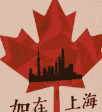

Canada

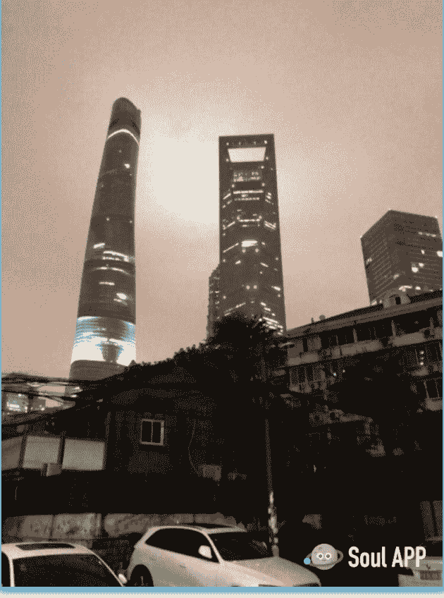

## 珍老师，目前我在某

(提问) 匿名用户: 珍老师，目前我在某二线省会城市国企单位上班，任所属科室的副职，工作内容属于行政类，如果再想进步需要5年以上或者更长的时间，虽然工作已经做得顺手，但真不喜欢这份成长性不高的内容，文山会海…….

夫妻两人目前税后年收入50左右，几乎存不下钱。随着孩子教育费用的增加，和列上日程的二胎计划，我想离职创业增收。

创业方向是做老家特产，可以很快启动且投入少，劣势是我必须回到三四线城市……

希望听听您的建议。

2019-02-18

回答: 我想听听为什么税后50万存不下钱。二线城市这个数字还过不好，得让多少人焦虑啊。(你要是怕评论区无法匿名，可以在提问区再匿名重写点信息)

—————再直接回答一下提问: 整个提问的字数不少，但是其实透露的信息很少。所以我也没法太过多的去分析。但只提出一个观点，二线城市，家庭收入税后过50万的，在人群中的比例是x%的话，去一个三四线的城市，贩卖土特产的人群比例是y%的话，x是远小于y的。并且，后续的门槛上，别人变成y的难度，要远低于变成x。所以这种路线选择是有点问题的。另外这种两地分居的选择，涉及到的远远不止是收入的问题。(虽然你在提问中，只透露了收入是你想要这么选择的原因)比如，我不确定你是家庭中的丈夫还是妻子，这种两地分居的生活，意味着你们家一胎要完全交给另一半去负责，这种结果能接受吗? 另外从收入的角度上，家庭总收入是50，那么你与对方的比例是10:40，15:35，20:30，25:25中的哪一个? 选择就意味着，你要放弃现在稳定的工作和收入(机会成本），最起码，第一个最直接的影响是家庭收入直接减少。如果减少10以下的话，机会成本还算不大。（但你的另一半工作收入是40的情况下，上一个单独带孩子又会变成问题）如果一下子减少的是10以上，比如15或20，这个机会成本和潜在的收益，对比到底能有多大呢，值得考虑清楚。

—————— 我最想问的还是，为什么家庭收入50，只养一个孩子还存不下钱。是哪个二线城市，消费压力这么大？还是因为你们家又有额外的负担，比如有4个老人要养，或者有太多的历史债务，或者是其他原因？如果以上原因都没有，那么该仔细分析一下家庭消费支出结构了，毕竟，合理花钱也是理财的一个基本能力。(37赞)

评论区：

- 听我说话很冲：我看见两个人50w一年我都愣了。是要还房贷车贷吗？
- 珍大卢：而且是税后到手。税前税后差异还是挺大的。
- L.m：50这个数字我反复看了几遍[微笑]
- 有点胖：瓜子袋子已备好
- 尚宇橱柜柜柜刘娇娟：我猜这是位男性，不知道对不对
- sunnyhls：我也来看热闹啦！[愉快]为什么一年50万这么多钱都不够花呢？
- 大脸招财猫：马云不是说月收入三万美的家庭幸福指数最高吗，我比较赞成。我也在二线城市，一年收入五十万的话，真的可以过得很爽。[捂脸]就钱点来说，可以用上海蕴之最高，一年买两个LV，欧洲一趟，东南亚一趟，国内随便，孩子报兴趣班补习班也会没压力，应该还会多结余。这是没有其他负债的情况下。提问者应该是薪心比较大，自身能力强，不然，做生意真的不是说随便随便超越五十万一产。当然，也有可能轻松入百万，这些人还是有很多，但是做生意真的是看老天爷吃饭，有行业周期。运气好几年积累下来财富，运气不好，衰退期下来又要重新开始，哪有铁饭碗那么稳定。待遇那么好，而且做生意真的比例九晚五的工作累太多太多，压力大到底，事无巨细的需要操心。小身边小老板中老板大老板都有，那种大老板，都是多年前，赶上好时机，自身努力，打下了大别墅豪车……上千万上亿资产。年轻一点的，要么家里条件不错，有资本创业的年轻人，也能混的很好。
- ANTINOMI：时髦的说法是50k[偷笑]

关注公众号“懒人找资源”，星球资源一站式服务

## 感谢 提供的一个照

珍大户: 感谢 提供的一个照片
(作为0236贴的续续，再叨叨几句)

只看照片的话，墙面/天花板/地板，颜色很统一，是白色为主色，绿色为辅色。

柜子看不清细节，但是入门的前两三排，先放了几个高度不一的“矮柜”，这个高度就很反常。（对照前一贴里提的“外国人”比喻）

东西码得像强迫症患者。

灯光图片上看不出是白光还是暖光。但是感觉应该是调色过的。

细节处处精心设计。如果不仔细思考，只会觉得这个店让人挺舒服，氛围感觉还行。

营造出来的是，这个店不会让人感觉到“廉价感”，而进去一翻价格签，咦，竟然还不贵。然后就买了……
2019-02-17 (29赞)

评论区:
- sunnyhyl8: 我去逛过一次，挺有印象的，感觉不错! 配色什么的很舒服，价位也不高，买单以还送了个小甜筒，味道不错～
- 珍大户: 这个店好像sku又扩大了，品类覆盖到服装了，怕是要跟优衣库杠一下了
- 珍大户: 逛… 甜筒[拍脸]想到宜家
- 行远: 现在在进home的官网，突然好想加盟，刚好我的城市没有
- 程局长: 真的不是拍马屁，仔细想想这家店的设计确实实用了很多珍老师所说的方法，学到了，佩服[抱拳][强][强]
- peach卡卡金: 色调和谐，风格小清新，很有名创优品的简约风，看起来很大牌的感觉，东西真的很实惠，买过一双鞋，质量不错。
- 大脸招财猫: 不知道大家知不知道: 鹿岛(会员店)，开在大型商场，装修就是那种刚开时经过好多次都没进去，以为很贵，后来是听说东西很便宜，逛了以后真的是大大的惊喜。超级值得逛和买的一家店，物美价廉，印象最深的，撸羊毛巾，名创优15一条，设计成一条小裙子，面料一般吧。然而鹿岛店，两条才10块钱，包装，颜色，面料，都好惊喜，虽然没有设计成小裙子，但是一大块又厚实又柔软的手感真的很好，忍不住一直安利给身边的朋友。里面看起来质量不错的毛衣，原价也就一百多，打折下来不到一百。所以卖廉价一点的东西，基本质量也不错，生意能好，装修，陈列好一点，也是很有必要的。

关注公众号"懒人找资源"，星球资源一站式服务

## 珍姐，我家是农村的

(提问) 匿名用户: 珍姐，我家是农村的，现在无论县城的饭店，还是农村都在用液化气做饭，农村用材火的日子一去不复返!

我想在老家弄一个液化气加气站，可是不知道怎么进入这个行业，怎么去收集我这个城市这个行业的信息，加气站的分布，各乡镇或者各区有多少用户，重要的事我到哪里才可以有气源，渠道在哪里!该从哪里入手!

2019-02-17

回答: 目前加油站的壳资源已经很贵了，目前好像是不批状态，一个加油站好像都是几百万起的转让费，比房子贵多了。加气站我不了解，估计也是差不多。但是这种资源，普通人就算是有钱，支付得起几百万的转让费，也最好别涉入了，属于垄断资源，基本都是被县乡村镇级别的地头蛇搞了去吧。否则各种防火审批随便一卡你，就资源完蛋了。另外加气站这个东西，主要是面向未来的出租车、大客车的，家用液化气罐的加油只会被慢慢淘汰(楼房应该都配天然气管道了)。(14赞)

- 评论区:
    - Hans: 都是当地村镇的关系
    - 张晟: 江苏一个加油站的转让费3500万带证, 加气站不知道
    - 夏建超 德国百强板材: 我这里也只有一家垄断, 胆子大, 从邻省偷运过来, 利润高, 风险也大
    - Hans: 私人炼油厂有的油没有税
    - Walden: 我们这也是被垄断, 家族都有在北京发展了
    - 夏建超 德国百强板材: 正经的开, 一个县城, 市区的市场估计都是大领导, 小领导都粘不到边。所以我很想往省城发展, 在地级市, 小老百姓做小生意都很难活跃啊。经常看你们的评论呀。[强]
    - Hans: 就这样, 楼下面迎幸关系
    - 吕向南: 珍姐说的对, 以后村里通燃气是趋势, 我们的衡水的小村都通了

## 您好，大户姐，我是

(提问) 高德东：您好，大户姐，我是旅游专业批发商，在这互联网发展的时代，机票，酒店，景区，车队，都可以在网上预定，各种成本都非常透明的情况下，传统旅游批发商将何去何从
2019-02-17

回答：会渐渐消失。其实很多批发商都渐渐没了，最传统的服装批发，已经有很多商家都放弃了。批发商属于处于中间的流通环节，互联网就是在创造新的流通环节，取代旧的流通环境。旧的信息流通环节最容易被颠覆，然后是实物流通环节，最后是服务流通环节（最后这个是比较难以被完全颠覆）。所以……没法逆转。这种趋势下，说什么提升服务质量，提高附加价值，基本都是无用的废话，趋势不可逆才是真的。————————圈子里第一次出现这个行业的提问，我也不能这么快放过你[偷笑]打听一下，你所说的批发商是批给谁？下游客户是谁？你们是携程艺龙定酒店时显示的“某某平台/某某旅行社”吗？能否找到其他行业的业务对接人，比如联系各个城市的婚庆团队，搞蜜月旅行定制业务。各个学校/辅导班，联系寒暑假旅行业务。各个美容院/整形医院，联系出境整形游业务。各个医院/医生，联系出镜割肿瘤业务等等……？这些新的定制服务或许能摆脱批发商的定位。(30赞)

> 评论区：
- 弱：好：我也特别关注旅游业
- 高德东：谢谢大户姐。
- 李俊杰：旅游批发商，专做一条或者几条旅游线路，批发给其他旅行社，其他旅行社收了散客拼给他一起成团，携程也会拼给他们操作。现在应该主做老年团吧。
- 完美主义法人代表：大户的头脑风暴真的不是一般人所能及的[大笑]
- Jan 简：持续关注
- Chen W：持续关注此问题
- Jeff 子锋：我昨晚评论一条怎么今天看就不见了？
- 珍大户：聊敏感话题了？

## 珍大卢，你好。我想

(提问)、媛媛: 珍大卢，你好。

我想请问一下，有这样一个平台，叫购车无忧。它是一个商贸公司做的，具体有两种业务，一就是油卡业务，5000块钱一个单位，比如你投10000到他们公司，次月每个月返还1000，共反20个月。开始的时候每个月都返1000，后期政策改到第10个月返60%，（到第20个月返还结束，如果你不排车就一次性付给你每个月扣的40%）如果你第十个月参与他们的排车活动，就还是会返还1000，直到返够20个月结束。二排车活动，分三赠一队，五赠一队，比方说捷达车6万，如果你排三赠一队你就交30%，外加2000会员费就可以等到排到你提车，大票绿本全是你的名字，五赠一队交20%，依此类推。

2019-02-17

回答：新鲜的骗局又出来了。第一个模式搞返还的，就是资金盘/庞氏骗局，参考这贴 第二个模式是赌博做庄，会员费是给庄家的抽成，剩下的参与者之间，互相摇筛子赢大小罢了。赌博做庄，实际就是一个概率游戏，一堆人之间的零和，如果算上庄家抽水，那么参与者之间就是负和。赢的人赚输家的钱罢了。最小的赌博坐庄，其实是微信红包刚出来的时候，很多红包群，进群就可以免费摸红包，但是摸到最大额的那个人，要负责发下一轮红包。群主是庄家，群主不参与发红包，只摸红包。这种就是最最基本的赌博做庄。以上两个骗局，如果想赚钱的话提供一个方法。先找当地派出所咨询，举报赌博给多少奖励？（因为举报赌博会没收赌资，一般会有个赌资返还的奖励，比如10%，也是不少的钱了），咨询好以后，然后拿到庄家给的宣传材料，比如微信截图或者是录音，直接举报公安局，等着发钱就可以了。要是当地公安不发钱，或者你是有闲钱，非想参与赌局的话，听姐姐的话，现在去买A股好了，都熊三年了，至少现在进去赚得多赔的少。 你要是有闲钱，非想参与资金盘的话。我看结尾最后一句问“请问能存活多久？”明显是来挨骂的，挨骂请看这里 （这个资金盘肯定熬不到第10个月）(10赞)

评论区：

- 某某某：哈，A股搏一搏，单车变摩托，奥连变奥拓
- 完美主义法人代表□：哈哈哈，人的贪欲和侥幸心理在此刻，袒露无疑[憨笑][憨笑][憨笑]
- W：A股我实真的可以买。毕竟物极必反啊。
- Hans：活没错，可不能用在山坡上。
- 、媛媛：谢谢解答，我是没有闲钱贷款做的这事，当时一冲动第二天就投了，所以现在冷静下来很懊悔。我也笃定它是骗局了，所以还是侥幸心理作祟，这下真的死心了！谢谢。自己犯的错现在就是想办法解决吧！希望自己能在圈子里多多学习。还是太无知了！[撇嘴]
- Hans：这个青岛也有的，我身边一个人他是这么干的，因为他认识核心人员，当时在青岛地区他属于排名靠前的。搞到了一辆十五万左右的车，还行是吧。后面的来了，因为成本他一共花了两万。
- Hans：暴利是吧，然后这时候见好就收最好，但是人都是贪图暴利的，后来他是投入了八十万复利这件事，这个钱没回来。
- Hans：并且他在家里知道这是个骗局，当时都劝他了，但是他在家人认真研究了好久，就是觉得自己能赚到钱，依然没回头。结果钱一把没了，所以说单纯的辨别骗局没用，其实大部分人是明知山有虎偏向虎山行那种人。他是非常聪明的，能算出什么时候保本崩盘自已全身而退。虽然结果不尽人意。

关注公众号"懒人找资源"，星球资源一站式服务

## 提问 珍大户

珍大户，你好。
我想请问一下，有这样一个大平台，叫购车无忧。它是一个商贸公司做的，具体有两种业务，一是油卡业务，5000块钱一个单位，比如你投10000到他们公司，次月每个月返还1000，共反20个月。开始的时候每个月都返1000，后期政策改到第10个月返60%，（到第20个月返还结束，如果你不排车就一次性付给你每个月扣的40%）如果你第十个月参与他们的排车活动，就还是会返还1000，直到返够20个月结束。二 排车活动，分三赠一队，五赠一队，比方说捷达车6万，如果你排三赠一队你就交30%，外加2000会员费就可以等到排到你提车，大票绿本全是你的名字，五赠一队交20%，依此类推。现在一般排一个年一年左右，之前快，提车还可以分一个星期提车，一个月提车，这种先交全款，之后排到你返还你多缴的钱。它每天都出车，全国性质排号。由开始的每天10辆到现在每天40辆，现在开业一年多排出5，6千辆的样子，我做了油卡，每个月都在返还，很准时。还有3个月返还结束。我想问您这种合法吗？是不是早晚有一天崩盘？大概存活多长时间呢？

## 第0236贴续——

珍大户：第0236贴续——这个帖子价值很多钱[偷笑]

《解读廉价感》

（案例照片链接在：，本帖案例为解读。廉价感这个topic是在第0196贴中提出的，，本0236贴为针对此观点的举例说明）

（全文共五千多字。超出阅读时的舒适体验字数，请注意中途休息）

我记得以前看过一个电影，奥黛丽赫本演的，之前是一个底层社会的卖花姑娘，被一个大学教授拿去做实验，帮她改口音、改姿态后，伪装成上层社会的人。这里的口音和形态，就是暴露底层身份的信息来源。

这种信息，基本来源于我们脑海里的“熟知”。所以一个外国人到中国，就很难被认出来出自哪个阶层。除非我们对国外社会有些认知基础，才能够从对方的面容、体态、牙齿这些细节来感觉出对方的阶层。

如果是一个中国人放在大家面前，那么就会更容易辨认。这是因为，我们每天接触的信息里，有有太多的人，信息量大到足够让我们区分。

不同人的判断能力不同，我猜可能是：

## 关于人群敏感度与信息识别

- 1. 巡街的警察水平最高——他们应该能够敏感到解读人的细微肢体语言以及面部神态，眼神，这些比较“玄学”的东西了。
- 2. 其次是跟各个群体打交道的生意人——他们是常见的最敏感的群体，能够敏锐的察觉到你穿的衣服是什么档次，你的口音，谈吐，用词等等。
- 3. 然后是接触特定范围的人，比如社区工作者，某医院医生，某学校老师等等，只接触特定区域、特定群体的人——他们可能只会察觉到人群中的反常者，比如某个人特别有教养，或者特别没礼貌，那么这种信号马上就会被发现，但是，如果是群体中大部分的人，就很难被区分出来。
- 4. 最后是封闭群体里的人，比如坐办公室的码农，学生等等。这是对人群最不敏感的，可能只有身上带纹身，头发染成紫色，或被媒体渲染成符号的如“大金链子小手表”这种标志性信号，才能被他们识别出来。

但不得不说，即便是无法被很多群体准确识别的信息，依然能够被感受出来。

比如，一个人的眼神干净清澈，肢体语言稳重笃定，会被警察群体识别成 clean，其他群体识别不出来，但依然会觉得这个人让人舒服、可信赖。

这个人还能衣着有质感，搭配有品味，口音和用词有着受过训练的痕迹，会被生意人识别成有一定经济实力，以及社会阶层较高。其他的群体识别不出来，但依然会觉得让人舒服、可信赖。

这人还能礼貌得体，有人与人之间的界限感与尊重，会被只接触特定圈子的人识别成受过良好教育。剩下的封闭群体中的人或许识别不出来，但是依然能感觉到这个人，比较让人舒服，可信赖。

所以，有点向下兼容的感觉。

如果不仔细分析，那么都是“这人看起来比较让人舒服”。而仔细分析的话，我们就能找到，这种让人舒服的原因来源，并且做到一条一条的去拆解、改善、复刻。

以上是人，因为我们对人最熟悉，所以我用人来举例。

商品和环境，也是含有这些信息在里面的。同样分很多等级，有待于我们一条一条的去分析原因，拆解，复刻。

这种复刻是很重要的，“高级感”难学，但是你必须规避掉“廉价感”，才能让自己的东西有竞争力。

最高一级的信号，类似于警察能够识别出的眼神和肢体。这种玄学内容，在商品和环境领域，是产品的工业设计和环境的美学设计。

这种设计要素，包括产品的形状、曲线线条、颜色、材质质感光泽等等，环境的色彩搭配、材质、明暗对比度等等。

这些细节解读，是能够被设计师识别出来。而普通人只会感觉到美不美，舒服不舒服，愉悦不愉悦。

（大概类比于，我们在若干年前就能看到，苹果店的装修设计很超前，于是被越来越多的电子品牌模仿——现在我们去华为和小米的店，仍能看到很多模仿的痕迹）

这一等级的东西，比较抱歉，没法教（当然，如果有哪个教商业的人拿苹果店来教别人，也是扯淡。这是设计师范畴的事情了，专业的事情必须交给专业的人干，如果自学几天就能替代专业群体，那是不可能的。）

在这里，我只是想指出来，有这么一档子信息要素的存在。希望大家在日常中注意到这些信息的存在。

前面都是铺垫。下面开始说正题了。说说我们普通人能够左右的信息要素。

大概类比于奥黛丽赫本电影里，能够被人为修改的口音和形体要素，我上面举例里的服装，语言，礼貌等等，这些能够被比较易人为修改的因素。

一个商业店铺，必须要避免给人以廉价感。那么给人的廉价感从哪里来？

有几个点，我先从上一贴的照片里，最能分辨出来的来说。

- 1. 大家翻回上一贴，看第二张图，杯子那个照片。注意点开大图，仔细看一下展示柜。

这个展示柜的木板，白色板材（不知道怎么叫，圈里建材行业的人不少，可以给解释一下）是属于最廉价、缺少质感的材质。白色是很挑剔的颜色，一般认为是中性色不含信息要素，如果东西的质感很好，可以采用白色。但如果质感很差的情况下，再用白色就会感觉很廉价。（突然想到白色的婚纱和女明星白色的礼服，如果材质不好，就容易变成蚊帐。）

其次是，这个柜子竟然是三种材质的结合，黑色的金属，恰巧也是金属材料中的最给人廉价感的产品。

背后透明的塑料板，一样是廉价感的来源。（一凑凑三样，这个店主品味堪忧。这个店还是加盟的，加盟品牌估计也是任何培训都没有的吧——）

这种廉价感的来源是什么？对于有识别能力的人来说，可能来自于日常生活中，对家具、对办公环境、对休闲环境挑选后的意识。 对于缺少识别能力的人，比如学生群体来说，可能就是感觉，学校门口的小破文具店就用这种柜子，怎么商场里还用这种柜子？跟这个商场的氛围格格不入。

这家店明显是属于装修经费不足，就是想省钱。怎么改呢？

如果要省钱的话，板材材质，最好换成原木色，或者其他能够“障眼”的颜色。避免加入金属、塑料板等多重材质。（金属如果想要质感提升，估计成本要提升好多）

或者，想办法跳出别人熟悉的范围。

就像拉来个外国人一样，找不常见的展示柜。一定要避免跟社区小超市、学校门口的小文具店这种“廉价感店铺”有任何相近因素。

如果不想花上面这些心思，那就老老实实掏钱，买贵的吧……如果又不想花上面这些心思，又想省钱，结果就是跟这个店一样，廉价感。

_________________

- 2. 再返回原帖，看第3张和倒数第2张，两张笔的照片，注意价格。

一张照片里，笔都是二十几块钱，100元只能买4只的价位。
另一张里，笔都是几块钱的。

而两张图里的柜子，是背靠背的，也就是说，摆放的高度、摆放的位置，全都相同。

这就很搞笑了，装在这种塑料盒里，几块钱的话，是正常认知。但是二十几块钱我就要犹豫了，这种塑料盒里的笔，卖二十几十只太没说服力。

这是环境对价格的影响。

同一种产品，价格相差几倍，就不可以给它们相等的对待。把它们摆在相同高度，相同位置，相同材质的容器里，这是很大的败笔。

一个高价的产品，没有衬托是搞笑的……最简单的衬托，就是要靠低价产品来衬。两个产品必须用环境来区分对待（怎么区分衬托，这里大家可以讨论一下）

- 3. 再翻回原贴，看发饰那几个照片。

产品数量多，两三个柜子摆的满满的，但可供挑选的品种其实并不多。可以看到发箍那里，有很多样式重复的。比如有个很明显的粉色发箍，分别零散的摆放在一群发箍的几个缝隙里。

样式重复、颜色不一的发箍，没有整齐排列，而是散乱的随机堆放，色彩跳跃，导致视线杂乱。

杂乱，也是一个廉价感的来源。

最直白的，家里乱七八糟的大部分是穷人家的房子。屋里，墙根边上堆满了各种东西，舍不得扔。屋外，墙边窗边挂满了各种晒干的肉串，玉米串，辣椒串，囤积起来过冬。为了实用性而放弃美感的考量是穷人的标志。

怎么改呢。

一个是，所有相同的东西要归类，码放整齐（其实这家店里，看前面杯子和笔的照片，也能看出来，码放不整齐也是一个很大的问题）

第二个是同品类下，内容要精简。比如发箍，店里很精细的挑出若干款就可以了，没必要进一堆。同品类下，同类竞争的东西要少，进货的时候要精挑细选。（参看第0196贴sku）店铺主人进货把关不挑选好，顾客就会挑你家low。

第三是要大品类下有收有放。

第0196贴里讲过，sku要覆盖更多的品类。而不同的品类，应给予的“关照程度”是不同的。

对公众认知里廉价的品类，一定要收缩。发箍，橡皮筋，这些都是08年，淘宝刚起来的时候，一堆义乌小商品店铺或者街边的两元店里，两元一个的破玩意。

所有群众认知里，已经做low的、已经变得廉价的东西，你当然可以卖，但一定要克制，放少少的量，放在边边角角，甚至于包装都要换一下。

（比如，换成群众认知里不常见的纸盒包装，或者是量贩装）。

如果这种群众认知里廉价的东西，你既不做包装上的改变，又要放在柜台里最醒目的地方主推。那这家店一下子就掉到两元店的水平，就整体变low。

- 4. 返回原帖子，再看第1张图片。

我们看到店铺的正面照片后，应该先提问一下，这个店铺的主装修色调是什么？

从这个照片里我们能看到，这个店铺的装修，是缺少一个主色调的。

顶棚和部分墙面、门口的几个柜台用了黑色。店招牌和部分墙面、主要是柜子用了白色。柱子用了原木色（柱子面积很大，视线上无法忽视）。地板是姜黄色。店招牌的字和一些柜台大面积的贴纸，是绿色。

这些主色调加起来已经有5种了。更别提商品自带7788的颜色。

一个很常规的认知，我们日常在服装搭配中有一个4色原则——全身下下的颜色加起来不能超过4种。

中国人因为头发是黑色，就已经占了一个黑色，所以全身下下的颜色加起来还不能超过三种。

搭配高手更是要求，要精简，可能全身只有两种颜色。衣服是主色，皮鞋腰带配饰是辅色。或者衣服上半身下半身两种颜色做主色，那么什么配饰颜色都尽量省了。

店铺装修也是一样的道理。颜色要有一个统一，尽量避免杂乱。

- 5. 如果按重要性排序的话，这一条我一定放到第1条。但是因为在照片里看不出来这一条，所以放到最后说了。

这一条是灯光和颜色。

店铺的灯光有两种最基本的选项。一个是白光，一个是暖光（偏黄）。这两种灯光怎么选呢？

第一个角度，是温度。

白光（给人的感觉）是不带温度的，黄光给人的感觉是带温度的。所以从冷暖的角度来考虑。

比如，冬季里的沿街店铺，用白光会感觉很冷，让人不想进去，所以如果是竞争很大的领域，比如餐饮用白光，很失败。

第二个角度，是时间。

白光是 不带时间刻度的。暖光是 有放慢效果。可能是因为，暖光会营造一种温暖的温馨的感觉。让人放慢速度，慢慢的在店里逛。

所以，一个想让别人停留的店铺，选用暖光是最有可能不出错的。而需要顾客加速周转的店铺，用白光。

第三个角度，是美化。

白光自带“显形”效果，暖光自带“美颜”效果。

（会化妆的女同学应该能知道，化妆必须要在白光下进行，如果在暖光下化妆，再到白光下，你会看起来像妖怪。

相反，如果在白光下画的水平不怎么样，在暖光下也会被遮盖住。

据说人在傍晚光线下降，开黄灯泡照明后，美貌度会自动提升一个等级，所以约会要选择在晚上，选择暖光灯的餐馆[偷笑]

所以你们知道烛光晚餐为啥浪漫吗，因为单点光源下，面容变成一半明一半暗=瘦脸特效，暖光=美颜特效）

所以，基于这个特性，你要自己给自己店里的产品打分。就像是给容貌打分一样。

如果你觉得自己的产品是一个绝色美女，比别人家的好（比如经过设计师设计的，量产的，别致产品），那么用白光。还原产品的最本源特色。

如果你的产品自评 7 分美女（经过店主挑选后的“普通产品”），需要包装，那么选择暖色照明，自带美颜功能。

（原贴的照片里，感觉大部分都是 5 分产品——怀疑店主都没挑选过。这种店铺必须要用暖光。然而很惨的是，店里竟然用了白光……只能感叹，店主啥也不懂就敢开店）

__________________

以上是这一贴想写的主要内容。

当然，原帖里存在的，不只是这些问题。下面讨论区里很多同学都给出了很好的答案，

提出的，sku 问题——产品太多，没经过优化
提出的，主推重点没有突出。
提出的，库存全摆台面上了，单个产品占了太大面积，浪费坪效
提出的，摆放杂乱，没理好货
提出的，入口太堵
提出的，商品价格高低搭配的不好，太过集中于低价小商品，营业额和利润会比较低

这些答案指出的点都不错，给大家鼓掌□□□

## 最后总结一下本帖吧。

由重要程度，需要注意的细节有：

- 1. 灯光选择。
- 2. 装修主色调选择。
- 3. 各档次“价值”品类的收放关系。
- 4. 同品类下，不同价位档次产品注意环境的烘托对比。
- 5. 同品类产品的摆放细节
- 6. 柜子/盒子，这种“买椟还珠”中的椟的选用.

[https://t.zsxq.com/EE6iaxu](https://t.zsxq.com/EE6iaxu)
[https://t.zsxq.com/AU3NJeq](https://t.zsxq.com/AU3NJeq)
[https://t.zsxq.com/EE6iau](https://t.zsxq.com/EE6iau)
[https://t.zsxq.com/EE6iau](https://t.zsxq.com/EE6iau)
[https://t.zsxq.com/EE6iau](https://t.zsxq.com/EE6iau)
[https://t.zsxq.com/EE6iau](https://t.zsxq.com/EE6iau)

2019-02-17(63赞)

评论区：

Septa 大醉卿*：我原先也是这么认为，燃鹅事实证明并非如此，很多人气很高的店并不在装修材料什么之类的下功夫，反倒实在太多，海底捞，奈雪，名创……甚至之前您说的某家店都是在很大程度上想复制他们的成功~ 誓说的现象确实存在，但是绝不是廉价与否的最佳解释甚至不是关键解，您要明白人的想象力是强大到指鹿为马的~比如苹果的高约主义导向，只要苹果标价贵，一块50的玻璃钢你都可以觉得是5000，这一块其实可以完全划为艺术范畴~设计上符合客人群的主流价值观即可~

Septa 大醉卿*：我再这里评论是因为我吃过这方面的亏，生意不行的时候我曾经细到研究店内光源的照射角度，然而最终发现成功的店根本就没有这样做，这些美学范畴的东西确实对人的感觉有影响，但影响不会放大到提升销量的地步，这样的投入耗时机力不合适好的。

Septa 大醉卿*：一个企业一旦到了老板自身都需考虑，“我觉得这块窗帘需要换一换了”，这个企业基本也就是穷途末路了

子铭：这应该就是 大户之前讲过的炫耀性消费的内容 东西无论是贵还是便宜 不同的档次总归有自的市场 但是产品的氛围一定要高于他的定价 别单纯的想着卖东西

珍大户：你是没注意到，名创优品的装修主色调统一，柜台简洁，白光灯是为了凸显产品，而产品是专门设计或挑选过的，并且设计了独立的包装，导致比普通百货店成色要好很多。（这部分是本帖里介绍的内容。）商品的摆放上有层次，sku多单个品类少（这部分是我前面帖子里讲过的。），这些细节，没经过训练就难以被人识别，但会被顾客感受到，觉得店里让人舒服而已。但舒服的来源呢？这就是商业学习的目的了。

珍大户：楼上的同学，你没注意到名创优品里，装修主色调统一，柜台简洁，白光灯是为了凸显产品本质，而产品是专门挑选或专门设计的，甚至很多都是设计了独立的包装，以此跟普通百货店铺区分。（这是本帖讲的内容） 店里的sku很多，但是每个大类下的商品很少（这是前面某一帖里讲过的）商品摆放上，主推内容突出（这是前面另一个帖子里讲过的）以上这些内容，如果未受过训练，可能无法识别出这些细节，只会像顾客一样，感觉到这个店铺舒服而已。 但舒服感的来源是什么呢？这就是商业学习的目的，讲求因果，不是随机试错，每一个原因都需要解释

完美主义法人代表：请参阅，此贴只讨论了廉价感对店铺销量的影响之一。而没有讨论廉价感对店铺销量有非常重要的影响。而且我自己的重点放在了帖子的前半部分，如何区分一个“廉价”的人和一个“高贵”的人，以此提醒自己随时保持一个“精致的猪猪女孩”的样子。

珍大户：对的，氛围能够营造出一种较高的档次（脱离廉价感），那么同样价格下只会比竞争对手更有竞争力

关注公众号"懒人找资源"，星球资源一站式服务

## 【帖子编号0236】《案例挑刺第3期》

珍大户：【帖子编号0236】《案例挑刺第3期》

挑刺时间又到了[偷笑]

上传几张图片，大家来找茬，看这家店有哪些需要改进的地方？

（上次在抖音的类似视频，已经被商家投诉删掉了，所以虽然我非常想去录个视频，但是想想还是算了吧，就只在圈子里说了）

这家店的照片，是在写第0196贴的时候就打算放上来给大家看的[偷笑]

本期案例解读在此

往期案例

- 挑刺第2期（采光）：
- 挑刺第1期（摆放）：
- 提问贴
- 解答贴

[https://t.zsxq.com/AU3NJeQ](https://t.zsxq.com/AU3NJeQ)
[https://t.zsxq.com/zRFUbIy](https://t.zsxq.com/zRFUbIy)
[https://t.zsxq.com/BUjYRNJ](https://t.zsxq.com/BUjYRNJ)
[https://t.zsxq.com/iAAeYyb](https://t.zsxq.com/iAAeYyb)
[https://t.zsxq.com/RRNRbm2](https://t.zsxq.com/RRNRbm2)

2019-02-16(19赞)

评论区：

嗯。:没有主推重点，让人不知选择，就不买了

行远:颜色鲜艳的应该摆在视角更好的地方

阿扎：差一个入店的诱惑，这种店只要进去随便都能挑点什么。

戴杜莎 LA：看着头疼。

某某某：感觉我是客户走进去要是没有一个特意要买的东西，视角和不会在闲逛时停留

其某：图一，同样产品没必要占多个格子，看着雷同就不想看了。

许矿研：门口太堵了，没有留白空间，不想进去。门口设置一个展示柜就可以了。留空间让客户有进去的冲动。

万能的妹夫 阿鹏：以前也不懂上学那会很喜欢这些，现在觉得就是个百货升级了下装修而已，这样做还不如原来的小百货零售批发发展模式。以前不懂 sku，图片看来小类太多了，摆放也不整齐，乱乱的，小贵了看不上这种。

关注公众号"懒人找资源"，星球资源一站式服务

## 这个不是要大户回答

(提问)奶牛养家里：这个不是要大户回答的、自助餐经营、200一人、进去收10元押金、又提到峰终理论、我也看到消费者的不满意本来是消遣结果变成监督、开自助餐的人好矛盾啊、是不是收费少了

2019-02-15

回答： 【帖子编号0235】 《自助餐》这个没太看懂你要问啥。我大概说一下自助餐。两个角度，商家与顾客。

商家角度：所有的自助餐，最终都是靠“量”取胜的。客流量少于一定数值的时候，绝对是亏钱的。只能靠客流量大时，才能赚钱。一方面，压低食材进价低，这个道理大家都懂，我也不多说。另一方面，人越多，总的浪费数值就越少。数学角度，一是取用过程中，产生一种“拼桌”的效果。同一道菜，有越多的人吃，浪费的人就越少。人越多，越能找到“最大公约数”。二是，到营业时间结束时，为了最后一批顾客的客户体验，你必须还要保证，每个产品上都有一些存量给顾客提供选择，不可能最后一个顾客刚巧把你所有的吃的都吃完了。所以最后关门的时候，总归是有剩下的要浪费“损耗成本”。假设每天关门的时候，要损耗掉X斤的剩余食材。 那么今天500个客人，平均到500个人头上是什么损耗成本。如果今天有1000个客人，损耗成本就会降一半。这就自助餐客人越多，成本越低。最终着眼点一定是：提高顾客人数。

而我截图的那家店，他们把着眼点，放在了顾客吃不完的浪费上。这部分浪费怎么解决呢？直接强迫顾客吃完，这是降低客户体验，让客户人数减少的措施，最终就会丧失了自助餐店安身立命的根本——“客流量”。

这期视频讲完时，评论区有人提到不同的操作方式，比如改为吃完奖励的方式提升“终值体验”。这种方式很聪明，但依然没有到本质。

本质上，应该往“峰值体验”上去考虑：聪明的店铺，应该在每天关门的时候统计一下，客人剩掉的菜品里，最多的是哪几样？ 客人

## 自助餐浪费现象分析

剩掉的东西，固然有不常吃自助餐的人，对自己的饭量预估不准确，拿多了导致的，但更可能代表着，这些东西不好吃，不爱吃等等。（就算拿多了，客人最后撑的不得了的时候，也一定会先吃掉自己爱吃的，剩下自己不爱吃的，所以本质上剩下的，依旧是不爱吃的）

不要去跟顾客吵，而是应该：

1. 一方面偷偷减少这个菜品摆放时的面积，如果是个大餐盘就换成小餐盘（比如，后台统计发现一种肉串儿浪费的比较多，那么就应该在摆盘时，把这个肉串儿的大盘子换成小盘子，这种无形的暗示会引导顾客一次不要拿太多，因为这种小盘子，顾客可能就只拿一串尝尝，然后发现不好吃就不吃了）。
2. 换一个厨师操作这个菜品，看看能否提升口味，减少丢弃。
3. 如果还是降不下这个菜品的浪费，那么就把这道菜更换成其他的菜。

以上是商家角度，再说顾客角度。

我吃过的自助餐不多，便宜的198一位，贵的也就是328块钱一位。因为F先生老拦着我去吃自助餐，他说，我们两个人，如果是点菜，吃一顿四百块，或者一顿六百块的餐厅，会是什么体验？菜品只会更精致，味道肯定会更精细，服务只会更vip。为什么不享受更好的体验，而要去吃自助餐呢？

我想问一下，因为几点：

1. 自助餐里品种更多，可以每样只吃一点点，各尝一遍，解解馋。
2. 正常吃饭的饭量，如果是500克的话，吃自助餐的饭量估计要给自己撑成1000克。对于消费升级成顿顿可以人均200块的人来说，吃撑是负效用，但是对我这种每顿饭都50块水准的人来说，吃撑自己，感觉好像是“占便宜了”。

以上两种心理，其实就是吃自助餐的人的常见心理。多尝尝，占便宜。就这六个字。理解了这6个字，就会知道，顾客浪费是必须的。因为多尝尝，就代表了每样菜都会拿一点，吃一口觉得不好吃，剩下的就都扔了。如果你告诉他，每种都必须吃完，那“多尝尝”这件事就没戏了，还不如去点菜。

因为占便宜，每个人都会高估自己的饭量。就算吃不了1000克，也要拿1000克，甚至1200克。你如果不让他多拿，占便宜也没了。没了这两样，为什么不去吃两个人400块或者600块的，点餐的高水平餐厅呢。自助餐的吸引力就完蛋了。

最后安慰一下开自助餐厅的人。其实大部分顾客内心有所衡量，单价高的食材一般不会浪费（因为不吃就占不到便宜了），浪费的大多是些便宜的猪肉串这种东西（对餐馆的成本上升，其实影响有限），还得是餐馆手艺不好做出的猪肉串。

所以，去计较这些东西其实是很小农的。就像我妈曾经说过一句，现在的人怎么这么娇气，还要给小孩带纸尿裤，她那个年代（我小时候）都是用重复洗的尿布。这只说明，她不知道现在的时间多贵，人力多贵。所以我听过只会呵呵一笑，绝对不会把这个当成建议，真的去执行的。我怀疑我举例的这个餐馆，提议残渣称重的人也是这种“小农思想”。光想着猪肉好贵啊，这些人剩好几串猪肉不吃，外面都要十块钱呢，不行，得罚他们钱，下次涨点记性。而这只说明，他不知道现在的地产多贵，200块一个人的购买力多贵，人家进你店里吃饭识途的海鲜，三文鱼，龙虾，大螃蟹，你却在这里纠结肉串儿.... (49赞)

> 评论区：
> 定义Calvin：商家要及时认识到自身的不足，迅速改正如错，大卫分析的面而俱到！

## 咨询法律问题，民间借贷问题

**提问**：匿名用户：咨询法律问题，民间借贷问题

咨询个民间借贷的问题，目前借款人还不上款，被起诉！以下是借款合同和收条，大家看看第二借款人：陈某娟会承担多少责任（陈某娟实际未收到出借人的款，对于借款原因不是很清楚，只是被拉来签字）！根据借款合同的条款，是否会被查封执行借款人家庭以及配偶的财产？

2019-02-15

**回答**：【帖子编号0233】 算共同借款人，两个人都是100%责任，就是王晨和陈娟都有责任还这三百万。假如其中一个人还掉了300万，比如说是陈娟还了300万，陈娟再去找王晨要钱，解决他们之间的二人矛盾，但是此时已经跟债主无关了。债主要债的时候，一般是谁家里有銭，容易找到人，就先找谁。债主要是起诉的话，就俩人一起起诉，一起执行，先查到谁名下有存款、基金、股票这些好执行的，就先执行掉（不管两个人谁名下的），满300万就终止。没满的话，继续去找俩人名下的房子车子，还没的话，只能冻结一下工资卡了……—————— 以上算是答案。

这条提问简直勾起了我无限的好奇心，陈娟为什么会去帮别人签字？责任真的很重大啊，王晨跑了的话，就是锅从天上来，一夜之间背上三百万债务了 (8赞)

**评论区**：

- 彭聪：这种情况担保人会承担责任吗
- 许半仙：我猜也许是爱情的力量吧……
- 哲的学：同问担保人怎么算？
- 忠信易易：担保人全部责任，找不到借款人，担保人全责
- 完美主义法人代表■：前几天跟我小姨借了点钱，她说不用写借条，我还是写给她了，还给了利息。这年头借钱不易，珍惜借你钱的人
- Hans：大奇
- 许半仙：口
- Hans：说说仙姐的爱情故事吧

### 借款合同

本借款合问（未会合同），即以甲方为乙方，乙方为丙方，在中华人民共和国境内各自独立经营场所履行。

一、借款范围：生产购货

二、借款数额：大写：叁万元

三、借款方式：

银行转帐：
转入户名：王勇
开户行：招商银行
卡号：6220097

四、借款期限：自2012年6月30日起至2012年7月27日止

五、还款方式：
1. 借款日期：2012年7月27日前一次性全部还清。
2. 还款本息：每月结息按借款大写：       元整，小写：       元整，还款日期：       月       日。

六、逾期责任：本合同项下借款月利率       元，按月计息，结息日为每月20日。

七、担保人：
1. 借款人在借款到期前未能按时偿还全部本息，担保人承担连带责任。
2. 借款人在借款到期后未能按时偿还全部本息，担保人承担连带责任。
3. 担保人应在借款人未能按时偿还全部本息时，承担连带保证责任。

八、违约责任：
1. 借款人未按本合同约定偿还全部本息，由出借人按实际逾期天数加收日万分之五的违约金。
2. 借款人逾期还款的，出借人有权按实际逾期天数加收日万分之五的违约金。

九、费用：
1. 本合同项下借款的利息、费用及逾期利息等费用由借款人承担。
2. 担保人自愿为借款人提供连带责任保证担保，保证期间为主债务履行期届满之日起三年。

十、其他：
1. 本合同一式两份，借款人、担保人各执一份，具有同等法律效力。
2. 本合同自借款人、担保人签字（盖章）之日起生效。

借款人（或担保人）签字：
借款日期：2012.6.30

### 收条

今收到：王勇人民币（大写）：叁万元整

（小写）30000.00元，
款项：特写收条。

收款方式：
转入户名：王勇
开户行及帐号：招商银行
身 份 证 号：410522198804160533

此帐号是本人指定的第二方帐号，转入此帐号也视同本人收到此款

收款人：王勇
日期：2012.6.30

## 【帖子编号0232】《流量共享》

珍大户：【帖子编号0232】《流量共享》

0229写了花店的帖子
说花店实体店不行。

又想了一下，如果开花店实体店的话应该怎么做？

我在合肥看到一个例子很有意思。

以前一直觉得，新华书店，在全国范围内估计都是要开垮了，都快找不着了。结果到合肥发现这里的新华书店搞得红红火火。

我就想不明白，书价格多低呀。书价网上多便宜。大家都走网购买了，谁还买书啊？新华书店还怎么赚钱啊，能不倒闭都是奇迹嘛。

结果转了几圈，看明白了。

合肥新华书店现在已经完全靠不卖书了。甚至，已经走向图书馆的方向，可以免费借新书看。他们利润来源另有渠道。

一家新华书店，面积很大，估计上千平米。但其实里面的书不多。

其中可能有个两三百平是给教辅图书、婴儿绘本、童书这种还能盈利的图书种类。剩下的畅销书，就真比不上下二百平的小型精品书店了，书目很少。连同书架也很少。

但是，新华书店除了书以外，还有一堆其他东西。

门口有个三五平米的鲜花店，一个六七平米的华为手机展柜。往里走，一个卖亚马逊电子书的柜台，占地一平米。五六个卖眼镜的柜台，占地算上柜台边上的过道，可能有十几平米吧。

各种七七八八的东西很多，什么香炉、香薰，刻章的，纸笔文具、书包，地球仪望远镜显微镜，一系列的装饰品、摆件、文具等等

好记星/步步高/读书郎，小天才手表……一系列牌子的儿童电子产品。

做手工泥塑的，串手工项链的，垒积木的，小孩的各种动物模型，女孩的洋娃娃，玩具火车之类的，各种玩的东西。

还有一家素描辅导班，和一个教绘画/做泥塑手工等等的场地在里面。

所有的实物产品里，除了咖啡果汁奶茶之外，全部都有一个特点——低频。

就拿眼镜来说，这个东西真的是低成本高毛利，超级暴利。所以还有人转成去丹阳配眼睛，多配两幅眼镜，省下的钱扣掉路费，都有得剩。

但不能因此就说眼镜店太黑心。毕竟眼镜这个东西频率实在太低了，成年人配副眼睛，很可能一戴许多年都不用换的。商业成本摆着，每个月房租人工都是一笔不小的开支，卖的便宜早就饿死了。

所以如果改成新华书店里的摊位，平铺的话也要不了几个柜台，如果再改成立体的，眼镜全都挂墙上那种，占地面积一下子省到极致了……至少成本的大头都省下了。

如果验光师傅还能兼起边上小天才好记星的导购，我觉得工资再给加两千都是值。

关于商铺的大小，看均价的话都是面积越小均价越高，面积越大均价越低。

因为商业面积相当于有一个保底的流量，商场里每天x人的话，100平的铺子也是这么大的流量，500平的铺子也是这么大流量，不会流量翻五倍。所以，均价中包含了保底的流量费用，造成了小面积的均价高，大面积的均价低。

> （可以理解成学区房，一个学区名额值100万，房子均价2万，那么5平米的学区房，总价就是110万，而50平的学区房虽然面积大了10倍，但只能买200万）

所以 一个上千平的店铺，整租费用一定小于五个200平的分租费用。

而新华书店的存在，能够给商场类目多元化。毕竟一个有新华书店的商场，比纯一楼化妆品，二楼女装，三楼餐饮的的商场要有吸引力的多。所以我猜，店租还能二轮降低。

而新华书店靠免费借书吸引到很大的客流量，这个流量要比店里那些品牌单独出去开店的自然流量高，所以分租的均价应该会更高吧。

所以我觉得这家新华书店，硬是把“卖书”做成了二房东——地产生意。

而这也是一种双赢，里面引入的产品，大部分是单独开店必死无疑的产品，但因为在新华书店里边占了很小的面积，反而能够降低成本，或许能活下去。

想起前面有一个问超市流量很大，能怎么利用的帖子了。

看看有参考吗[偷笑]
https://t.zsxq.com/uBQjEUr
https://t.zsxq.com/iyBI6mq

2019-02-15 (36赞)

**评论区**：
- 琦宝！：在合肥上学的时候最喜欢去新华书店一坐坐一天了
- F先生：补几张图（一次只能传一张）
- F先生：
- 定义Calvin：图片一传，真实感强了好多。感谢F先生
- F先生：
- Georgi：装修风格让人耳目一新
- □道法自然：一个名字叫“新华书店”的文具超市[得意]
- a丽莎：开阔界

## 珍姐您好，想向您请教几个问题

**提问** a伟 *：珍姐您好，想向您请教几个问题，您帮忙分析一下！最近看了国家最高法、公安部公布,从2019年开始，以借贷为业的民间借贷合同无效，主要是为了控制，高利贷、暴力催讨和非法集资行为。但我是和几个朋友凑了些钱5千万左右，主要做助贷和过桥垫资，也就是短期导贷。我们有金融外包服务的营业执照，但是没有金融经营许可证。我在这个行业做了5年了，现在不做了也不知道该干什么，要是继续我们应该怎么做才能保障资金安全，又不违法。谢谢□

2019-02-13

**回答**：特意按您截图的标题去搜了一下，发现文章标题后半段是“自2019年起以借贷为业的民间借贷合同无效”？这个可能是自媒体为了点击率摘出来的耸人听闻的标题。因为我看了一下里面提到的银保监会的文件和最高法的文件，都没有“以借贷为业的民间借贷合同无效”这个来源。

银保监会的文件，倒是说没经批准不准从事这个业务，但是银保监会的作用只是监管金融行业的，对合同效力的认定，他们没有办法做规定的，只能看最高法的司法解释。

最高法那个文件，主要是说法院要识别“套路贷”，通过各种手续费，违约金之类的明目，来绕过利率红线的问题。要求各个法院鉴别这些套路，如果利率超过24%，就给直接判不支持高利贷就完了。

所以借贷合同无效，还是原有的那些原因：
1. 比如你的公司从银行贷了一个亿，再拿这一个亿出去放贷，这种事要受打击的（因为担心贷款收不回来了，会给金融机构造成风险）。
2. 比如你从自己的公司员工、同事、老乡那里，一共两三百个人手里，集资了一个亿，拿去房贷，也是属于要受打击的对象（因为担心贷款收不回来了，会影响到太多的人，引起群体性事件）。
3. 你知道贷出去的钱是违法用途，还敢往外贷，这也是属于要受打击的。（也就是说，并没有文章标题那种，耸人听闻的“自2019年……民间借贷合同无效”。但是我不太知道，如果违反了银保监会的规定，未经批准就从事放贷业务了，银保监会能有什么处罚？这一点我确实不知道）

\_\_\_\_\_\_\_

但是，关于结论——“借贷合同无效”，这件事上，可能大家有误解。如果借贷合同无效，是不是就不用还钱了？当然不是了。只是指，借贷合同里面的约定事项作废了，比如约定的利息就作废了。但钱还是要还的。利息作废的话，一般的利息补偿是这么算的：

两个自然人之间，直接还本钱就可以了，没有利息。如果是自然人和公司之间，公司和公司之间，按照银行同期利率计算。所以就算是最差地步——借贷合同被判无效，但本金终归是要受保护的。 (23赞)

**评论区**：
- 许羊仙：乍一看看了吓一跳。我也涉及类似行业……
- 毕宏波：我也有这个疑问！刚好大户就解答出来了，果然专业
- 许羊仙：哈哈[抱拳]你来了
- 寇大户：看样子圈里什么行业都能碰到好几个同行啊[偷笑]
- 许羊仙：你认真的啊……现在很多啊…
- 许羊仙：感叹大户，行业新动态
- 许羊仙：坏账率也是有的，只要综合利息足够覆盖就行。你没做不动产抵押嘛？如果做了一年半前是可以做全委公证的。那种不用打官司。只不过现在不行了……
- 许羊仙：那你可能是没辙的情况-呷的-执行困难呀？-:3唉……其实现在比之前情况好些了～即使对方祭出大招——老头老太太，也不是不能解决…………

## 关于规范民间借贷行为 维护经济金融秩序有关事项的通知

银保监发〔2018）10号

各银监局；各省、自治区、直辖市公安厅（局）、工商局（市场监管部门）、新疆生产建设兵团公安局；中国人民银行上海总

## 珍珍姐你好，我有几个关于职业发展的问题想咨询

**提问** 豌豆王子: 珍珍姐你好，我有几个关于职业发展的问题想咨询。先介绍一下个人情况，男，92年，二本，自动化专业，毕业后在上海的分众传媒的设备部工作3年。年收入11w，媳妇做景观设计也11w。设备部工作压力不大，日常工作就是广告机的软、硬件测试，与供应商打交道比较多，属于甲方，工作技术水平较低，只学到了软件业务逻辑，有闲暇时间看自己感兴趣的东西。不想一直在这蹉跎岁月，想考研摆脱差学历或转行。分众传媒处于成熟/衰退阶段？期间辞职过2次，领导比较照顾，说服我留下。是早日抽身，还是再充实自己一段时间？认为自身的优势在英语和与人交流，学校里做过几个主席。考研有什么建议的方向？出去做婚庆/培训怎样？

2019-02-11

**回答**：【帖子编号0231】瞎转。

婚庆培训这块儿，是所有人都能见到的行业。一次婚礼，请个几十桌几百人来参加，多少人眼睛都看得到这个行业，喝一顿酒，下面指不定有十几个人产生出“这个行业我也能做”的想法来。你能产生的往这个行业转的想法，就说明自己在生活中的商业观察能力还是弱了些。越是所有人都能见到的行业，越不要去。尽量找别人看不到的行业。

举例：分众是广告行业，广告行业里，广告的代理销售等等，这些都是别人看不到的地方，有不少高收入公司和工作都是产生自这里。当然，可能因为你的岗位性质，不好发现这里，那么就往自己了解的模块里思考。你了解的这些设备有可能在其他什么领域使用？比如同样的设备往其他应用环境下搬运，看看有什么商业机会。假设未来所有的饭店桌子或者点菜系统都变成液晶屏，那么这个过程就会产生一些商业机会。而你的优势就是，因为之前的工作经验，已经对这个领域所有的供应商都比较熟了，就具备了在这个机会下的先发优势。

同样，你老婆的工作也是应该这么考虑。而不是先考虑考研再找机会。因为机会不会因为你考完研就自己摆到桌面上展示给你，只能靠你自己去发现。发现的过程，也就基本靠曾经的工作过程中产生的。就像圈子里其他人，因为在银行工作过，发现了贷款中介这个切入点，因为在金蝶/用友等公司工作过，转型变成代理商。这是很自然的转型过程。

相对来说，没有工作过的人，比如刚毕业的学生创业，才会考虑人人都看得见的领域，比如餐饮，比如零售，比如各种直接的服务。但因为人人都看得见，所以竞争压力也会更大，必须不间断的思考，提升每一个环节，才能跑得超过平均水平。 (65赞)

**讨论区**：
- **Mr Zhang**：划重点：[尴尬]刚毕业的学生创业，才会考虑人都看得见的领域，比如餐饮，比如零售，比如各种直接的服务。 我扛干了六年零售行业的人表示这个门槛确实太低，已经厌倦这种行业[可怜]
- **豌豆王子**：很感谢您，真的是眼界不一样，谢谢珍珠姐的解答
- **温依康**：珍珠，请问开鞋店有什么可以做的差异化的方向？目前打算在大学附近开一间鞋店，之前听您关于库存的分享，所以打算把鞋店改成体验店的形式，客户进店看鞋款和质量，通过优惠券引流到网上进行下单，最后快递配送，但是我个人感觉这个竞争还是会很激烈，但是想不出什么差异化战略，麻烦珍珠姐指点一下大方向，谢谢！
- **颜如玉代理**～请缘：看不到，也想不到，珍珠能说几个你认为比较有发展的职业嘛？给个灵感[捂脸]
- **宸*如*意**：珍珠说的对，去年年底的时候我请婚庆办了一场婚礼，说实话，看了场景布置和各方面，我都觉得自己可以办[捂脸][捂脸]
- **AAA时美鞋业-烨烨**：你好，我做了30年鞋业零售，有点经验。我可以负责任的告诉你，你在大学城那开鞋店，那样经营必亏无疑！首先大部分大学生没有多少预算买鞋，因为我强调的好款好质量的鞋都要去广州那边拿货，而且价格肯定是学生们接受不了的。还有顾客不来门店试鞋，你来配送也麻烦。因为每个人的脚形都不同，你不了解顾客送去不舒服还会被退回来的。再一个库存问题，每个款都要进很多码，广州大档口进货对进货数量有要求的，而且款式也要备很多，造成每季的进货量很大。你一个新店没有忠实的客户这是一个问题等等等多方面，暂时就说这么多！
- **温依康**：职业大险您好！因为我同学是在莆田鞋厂那边有合作，所以敏感性价比还搞高的，也不压货，开个店主要想给顾客展示一下质量，不过您说的确实很有道理，请教一下如果引流会比较好呢，真的很迷茫，谢谢口
- **远洋**：只能微商了

# 珍姐姐，新年快乐，

**提问：** 珍姐姐，新年快乐，从一开始看抖音，就一直关注你，加了微信，然后进入了这个圈子，也看了很多大家讨论的话题，受益匪浅，但是现在自己也面临一个很大的问题，望姐姐指点迷津。

我刚刚大学毕业一年，在成都上班，税前年薪12W，行业刚好是建筑设计，但是你提到过2019建筑业不好过，也许是区域问题吧，我觉得成都还好。由于生活，社交，和一些开支，基本每个月7000工资所剩无几。家里农村，父母年龄47,48，存款28w，老家长宁，想在成贵高铁长宁站买一套110的刚需房子，房价预售5000多，这样我在成都回来就方便多了，但是其实我并不喜欢建筑设计，想以后自己创业，如果买房后，这个压力很大是不支持创业的。接图2019-02-11

**回答：【帖子编号0230】**

F先生曾经问我，我老家是什么样子的？于是我跟他讲我小时候生活过的环境。

我说我那个城市，可能1920年就通火车了，我出生的时候，马路上已经有了红绿灯。我家门口的那条路，在我记事起，就已经是单向三车道双向六车道了，两个方向中间，有着很宽的绿化带隔离，绿化带上种了一棵接一棵的松树。在我出生后没多久，家里就搬到了楼房，家里贴上了壁纸，铺上了地摊，墙上挂着苏联进口的装饰画和塑料花。90年的时候，为了看亚运会，家里添了台4000多块的彩电，父母怕他们上班时间我一个人在家寂寞，家里又有录像机和猫和老鼠的录像带，91年的时候，我的旅游纪念品是带手柄的游戏机和游戏卡带。

城市里的体育场，我经常早上起来去跑步，哪里的馄饨2元一碗，我总是想尝一碗，但是又觉得太贵了，于是一直没吃过，反而念念不忘。电影院的电影票，4元一张，我为了赚零花钱，去当黄牛倒买过电影票，赚了不少零花钱。街上有过一个保龄球馆，我去了几次，就研究懂了保龄球的规则。还有一家游泳馆，很多男同学，在里面无师自通就学会了游泳，而我怎么也学不会。

那个小城南边就是301国道和铁路，为了让铁路和公路交叉而过，很早就修了一座立交桥，立交桥建成时，很多人去看，想要见识一下新听说的这个名词，在现实中到底是什么样子的。沿着301往西，沿途有很美的风景，沿着铁路往东，能去很多的城市，我就是这样一年又一年的在寒暑假去了很多地方。

F先生听完以后，羡慕的星星眼，不断感叹，他要是小时候有这种生活该多幸福。我心理就嘿嘿着，心想，要是让你知道我家到2018年房价还2500，你再感受一下？

低房价的背后，是当地传统的林业/煤炭资源已经禁伐/禁采，传统的工业已经破产，只剩农牧业还存留。农业的附加值是不会太高，而且能吸收的就业人口也不会太多，结果就是人均工资也在2000元左右，另有大批人找不到工作，青年人口不断外流。（之前的鸿毛药酒案例大家应该听说过。很多小城市，实在没有什么能够吸收就业的产业，结果就演变成了，哪怕是一个吃着人血馒头的产业，也因为解决了不少就业问题，而变成了当地一霸。我老家据说也有一家叫“北方药业”的企业，常年私自排放污水，污染了河流和草原，但因为提供了不知道多少个人均2000块工资水平的就业岗位，所以当地政府只好睁一只眼睛闭一只眼。）

城市发展就是这个结果，往大了看，农业，工业，第三产业。农业的就业人口是有限的，工业是需要集聚的，而第三产业只有在前两个产业的基础上，才有所发展。结果就是，越远离“集聚”的地方，就只能留下第一产业的人口，人均居住面积很大，人均资源很丰富，但人口太少。只要你有地，有资源，就能过着好山好水好孤独的生活。提前享受到移民澳大利亚的生活。如果你没有地，没有资源，那么就会面临很难找到工作的困扰，最后只能流向大城市。城市因为“聚集”，靠着工业基础才能发展出更多的第三产业，而在这个过程中，才能提供给你创业的机会。

—————— 我们分析铁路的时候，最终都是要找到多个线路交叉的地点。这个地点代表着，多地资源经此中转，去哪里效率都很高，因此容易产生“集聚”，从而让各个产业更容易落脚在这里。但不代表着有一条铁路线经过，就能发生翻天覆地的变化。

—————再回到你的问题上，我没看懂这个房子是给你父母买的，还是给你自己买的？

家是农村的，说明应该在农村还有房子，父母居住在此。长宁是县城。所以你买长宁的房子，是考虑给父母搬出农村，搬进县城？还是单纯考虑自己离开成都的落脚之地？

如果是父母搬离农村，还要让你负担很重，那么就没必要买这套房子。如果是自己想要一个离开成都的落脚之地，那么你翻翻地图，看看有多少个高铁经过的“县城”。作为高铁几百上千个车站之一，用这个理由来买房，这有可能变成你人生最错误的决策。

你说买了这个房子，自己“从成都回来”就方便得多。但需要想清楚，你是要彻底的回老家了，还是逢年过节的回老家？

彻底的回，就像我在前面着重写的，你会面临除了考公务员，考教师编制之外，基本上找不到什么工作的局面。你的老家长宁县是不可能需要建筑设计师这种职位的，也基本提供不了月薪一万的工作。你想要创业，这里也不可能有任何机会。所以，你怎么彻底的回？我觉得不可能。

但如果只是临时地回，让这个房子每年在过年和国庆期间，给你提供两到三周的住宿时间。这跟住酒店有什么区别？对这一年只居住两三周的房子，有没有必要买一个65寸的电视吗？有必要安装空调或者地暖吗？有必要搞装修，添置家具吗？你给这个房子买个冰箱都是浪费。

一边自己在成都租住在出租里，一边自我心理安慰，说我在老家县城有个房子，装修的特别好，那是家的模样。这不是阿Q吗。你只要能咬咬牙，做到一年不回家，那么想象出自己住克里姆林宫，也是一样的效果，还不用花首付，更不用还月供，经济实用。

房子不是安慰剂。是拿来用的。你付一大笔钱出去买这个房子，是因为这个房子能够给你更好的居住环境，更好的生活氛围，提供家的感觉，给你足够的安全感，提供户口学位这种社会资源，甚至提供虚无的社会认可。你买了房子，还要装修天花板和地板，还要装各种电器，沙发家具，小到墙上的一幅画，阳台上的一盆花。花这些钱的时候，你会感觉到，这些都是有意义的。如果这些都做不到，就等同于买了一堆钢筋混凝土而已。

最后给你的建议：成都房子没那么贵，哪怕在郊区找找，哪怕买个小户型。就算你一个人觉得贵，但毕竟房子是两个人居住的，想想如果两个人负担，还接受不了吗？

你如果真在你老家县城买了这个房子，最终会被这个错位的决策，捆绑着丧失掉很多机会。包括因为房子地点造成的工作两头犹豫，对新工作机会的犹豫，因为这个房子造成的对在成都买房这件事的放弃，或者某一天想要在成都买房时，却发现老房子无法脱手造成的资源浪费。甚至因为这个房子的找对象困难——可能只能在老乡里找（有这种可能）。

另外，47、48的年龄，真的不大。这年龄你说他们是中年人都没问题，完全可以继续干点啥。人生的起点确实存在着很大的不公平，如果他们是出生在大城市的一批人，或许这个年龄已经可以考虑不用再去 做点什么。但作为出生在农村的一批人，又没赶上福利分房，又没有太高的退休金，医保报销可能都存在着各种限制。现在把所有积蓄都变成了一个没吸引力地区的首付款，等同于丧失了资产的流动性。后续又不考虑着继续积累，在还没到50岁的年龄，就想着退休什么都后不干了，安享晚年。以现在人均寿命七十几岁来算，他们后面还有近30年晚年，所以这种选择，真的风险太大了。现在48岁就什么不干，等到68、78岁病痛时，只能靠你卖房子了，你不担心吗？

（最后说几句不中听的话，我感觉你们家，包括你和你父母，在房子和退休两件事上来看，思想还是偏守旧和保守。不是缺少冒险精神这么简单，而是缺少居安思危，太过于安于现状。这种态度，表示你可能根本不是太适合创业。虽然你在提问里提了一句，说你想要创业。）

*(123 赞)*

**评论区：**

- 大脸狗精雕：珍姐那一段“阿Q精神说的太好了”。
- ANTINOMY：被逼着去大城市骗泥，在中国没有闹人。就算很多人不那么想追求上进周边的环境和生活的压力也会推着向前走
- 阿北口：每次看珍姐分析问题脑中总是自动显现珍姐在大屏幕上面划线划的画面
- 修心：珍姐真是苦口婆心啊，小伙子，好好思考一下
- 听说我说话很冲：最后一段真的很有感触。我刚出来第一个工作，我父母就想把我按在四线城市直接买房结婚。不知道该咋说。
- 行走的路上：47.48完全可以上班，我爸61了，还在上班
- 猫勒：你还好 我家里还想让我回三十八线小城镇
- 行走的路上：28万的存款，可以考虑成都先买一个小户型的，

---

**备忘录**

而且，父母年龄也大了，不希望他们再操劳。建筑行业不景气，也随时可能面临被裁员的风险。以后如果一直在成都工作，这个房价，肯定买不起。所以现在想问问我如果在长宁高铁旁买房，那以后至少5年我要被困在这个行业，而且要忽略行业景气的变动。到时候创业的激情都被磨灭了，5年后，还有结婚，孩子，更是不敢轻易冒险。而且现在买房，很多都说是高位接盘，所以这房子我到底该不该买呀？

---

# 珍老师您好：我家是

**提问：** 尽人事听天命：珍老师您好：我家是青岛市黄岛区，家里人建议我在这里做鲜花生意，多这生意我不了解，想请珍老师给点建议和指导谢谢
2019-02-05

**回答：【帖子编号0229】**

《花店》很多年前，美国有一个创业者，想到一个创业项目，叫黑袜子（好像是这个名字，记不清了）。就是男人穿的最普通的黑色袜子。这个人好像是华尔街上班的。

他发现，自己经常早上起来找不到袜子。或者找到了，发现脚趾头漏了，或者脚后跟漏了。去买袜子的话，发现非常不方便。各种材质各种颜色的花袜子。然而其实作为一个正常工作的男人，最常用的就是黑袜子。

他一想自己经常碰到这种情况，那么说明别人也会如此。于是就创立了一个品牌黑袜子，在网上搞定时派送，比如预定一年的，每周给送一双黑袜子。或者周期频率自己选，每两周送两双袜子之类的。反正就是一个最基本的东西，但是因为在

网上卖定期派送，给很多人省去了需要自己记事的麻烦，结果就有很多人定。这个卖袜子的生意最后好像是年营收过亿。这哥们华尔街也不干了，辞职专门卖袜子了（真是美国好故事，中国我是不敢这么搞的[捂脸]）

____________ 故事讲完了，到提问环节了。

**问题一：** 假如让你在社区开一个卖袜子的店铺。能否养活自己？

**问题二：** 为什么，请相信分析上一个问题的原因。

____________

如果圈子里，前面我写过的文章都看得差不多了，那么在这里，最起码大家脑海里应该会想到“消费频率”啊，“周转率”之类的很多词汇。

一，袜子的消费频率太低了。美国人那种每天不管灯不管空调，男人的衣柜都比中国女人衣柜大的人群，也不过就是一周一双袜子而已。中国人这么勤劳节俭，不少人可能一年才买12双袜子。

二，袜子单价太低了。支撑不了高售价和高利润率。一个实体店铺，覆盖的半径是有限的，人群是有限的。那么

你卖的东西，要么是低价，但是消费频率很高的东西，从而能够保证薄利多销。要么是消费频次低，但是单价很高。

---------------- 再说花店。我之前有过一期视频，说花店是很容易被颠覆的。

因为过去的花店，是把产品做成——低频次乘以高价格了，一盆花上百块，一束花上百块。卖的场景也极其有限，要么探望老师，要么探望病人，要么送给女朋友。偶尔有人想起母亲节还能送给老妈。

但不卖高价也不行，就算价格下降，这个半径下的消费频率不会大幅提升（降价降一半，最起码销量要翻一翻以上，才算划算的，问题就在这里，实体店铺覆盖半径下，根本无法销量大幅提高。所以只能高价）

但是互联网会把这种东西做成像送袜子一样，因为可覆盖半径扩大，人群数量增加，从而把这个产品做成虽然低频，但是低价格的东西。（低价之后频次肯定会有所提高，比如周花，月花，每周固定送一束，每月固定送一束之类的）

但不管怎么改，低价打高价总是占优势，所以专门开一家实体店铺做花店，这种布置是有问题的。

*(43赞)*

**评论区：**

- 完美主义法人代表〓：给大户拜个年！❤️大户新的一年，身体健康！❤️事顺利！
- 阿扎儿：珍老师新年好，祝您身体健康，万事如意
- 珍大户：谢谢楼上各位，祝我身体健康的的都是真爱啊[呲牙] 我祝大家2019年都发财！
- 许半仙：大眼林青霞-猪年诸事顺遂-多肌无病！
- Hans：新年还要回帖，真心辛苦。
- □道法自然：有道理
- 葵：❤️新年快乐，珍妮老师。❤️老师更强壮，更生龙活虎，更美娇。
- 颜如玉代理-清琦：现在很少周花，一个月2、3句，每周一次一束花，也不大，放办公室，不知道定的多不多，反正我办公室，大概2、30个桌子，没有定的。关于消费频率那种，中间频率不高也不低的怎么定价呢？比如2、30元的耳环与项链，女生都是过一段时间就喜欢买，但是也不算频率高。

---

# 借珍老师的地方问一

**提问：** 骑着小猪看太阳：借珍老师的地方问一句，请问各位星友，有没有谁买过，法院拍卖的房子。有没有需要特别注意的地方。谢谢大家啦
2019-02-03

**回答：【帖子编号0228】**

《法拍房》 我没买过。所以纸上谈兵一下。 需要注意的包括：

1. **价格方面**
   一般是三拍制度，第1次按照评估价去拍卖。流拍，就下浮百分之多少再二排，二次流拍，价格二次下浮去三拍。三拍还没人要了就不拍了，貌似可以私下转让内部处理等等。（一般到这个阶段，是什么渠道处理，我就不太知道了，有人知道吗？）
   所以如果想等好价的话，稍微等一等，等到二拍或者三拍时候再下手。

2. **交付风险**
   上门看一下这个房子是否有人住着，问一下法院是否负责把里边人赶走？ 曾经法院是不管房子交付问题的，只判产权给你了，能不能交付你自己搞定。所以有一些房子买完之后，发现里边住个80岁的老头，你一进群老头就挺尸给你看，搞不好房子到手了最后要配几十万的丧葬费出去。
   后来，某些地方的法院（主要是浙江）发现，如果不负责交房，容易造成没人敢买法拍房，所以有些地方是承诺交付的。由执行庭法官带着法警，再叫上120担架一起去强行搬迁。
   但仍然不是所有地方的法院都能这么给力。所以交房风险要提前问清。免得产权交到手了，房子却用不了。

3. **租赁关系**
   问清这个房子下面有没有长期租赁合同存在。 主要是基于法律条款“买卖不破租赁”，房子产权过户了，但是不可以赶走以前存在的合法租户。正常租户一年一签，租房合同剩余期限在半年到一年半之间，这种都算是正常的。就怕有些人会利用这个条款。
   目前法律规定最长租约是20年，所以最怕的是，里面还有一个剩余18.5年的租赁合同。
   更可怕的是，合同还不是用“一年一百块钱”这种奇低的价格来签订的（这种可以去找法院判合同无效，或者干脆就违约，按合同价格赔违约金也没几个钱），而是按市场价差不多的价格，对方还手持个收条，说20年房租已经现金一口气交清了，剩下18.5年他都要住在这里了。

4. **担保权**
   还是找法院问清上面有没有其他的担保权，省得过户完，第二个债权人又要上门来拍房子还债了。主要是登记过的抵押权（房产如果没办理抵押登记，只凭口头或者欠条字面，是不成立抵押权的）

5. **税费**
   还得问清税有多少，上下家的税都要买方一人负责吗？依然是浙江某些地方的法院，据说，已经可以“含税拍卖”或者“税费各付”，买方只交自己这部分的税，卖方的税从拍卖款中扣。但是大部分地方的法院，只管判产权过户，不管税的问题（嘴上说税务不归法院管，然后只发给你一个法院的判决文书，等你拿着判决文书去房产局办过户的时候，因为找不着卖方，所以买卖双方的税，都得你自己付一边，过往如果有欠税什么的也要补上，然后才能办房产证，那么这些钱需要多少就是一个问题了，毕竟住宅产权的房子总价高，商业产权的房子虽然总价低但是税率高，都得大出血。）

6. **其他手续**
   如果是新房，一次房产证都没办过的那种，还需要留意开发商证件手续什么的，有可能存在新房办房产证办不下来的风险。
   二手房，去物业问一下欠了多久的物业费？打电话差水电欠多少钱。有时间的话跟楼下大爷大妈聊聊，能问出什么八卦来。

————————— 所以法拍房这个事儿，感觉是有“信息不对称”在里面的。所有存在信息不对称的地方，都有套利空间。这个玩意 的技术含量比房产中介高，而且未来市场会变的比较大。所以有可能诞生一个非常有前景的职业——法拍房中介。记得12年刚动思想买房时，留意过上海的法拍房市场，还想去捡个漏，觉得如果捡漏成功一次，或许我就能再搞个倒买房子的副业出来呢，可惜法院上班时间跟我上班时间一样，没法当副业搞[捂脸]

*(36赞)*

**评论区：**

- 阿杰-九洲: 学习了
- 人生如逆旅: 法拍房，现在已经捡不到漏（肉）了，十年前或许可以，现在大快能看到、放出来的法拍房（里面的好房子，也就是性价比高的）基本上性价比不高，和直接市场上买二手房差不多。法拍房目前唯一的好处、优势就是限购啊！不过有一种特殊的“拍卖房”、“法拍房”性价比可以的，比市场价便宜，那就是“宅宅”，不迷信的人可以去买，不过可不求[微笑]
- 李大仙: 看起来不要补充什么是□□□
- 许半仙: 嗯……补充的真对。朋友几个律师。尤其是经济法，都是律师负责打点关系……
- ANTINOMI：这种房子三角债居多，而且不能贷款只能一次付清。捡便宜往往要吃大亏
- 小公主：法拍房真的可以突破限购的政策吗？
- A朱某某三：苏州仁恒观棠的别墅谁要？400多平方，精装修，市场价2600，我只卖2200净到手价格！
- sin：二次流拍之后，真的没有人知道之后怎么处理的吗

---

# 大戶您好，非常荣幸

**提问：** 千里眼视力: 大戶您好，非常荣幸能加入到您的经济圈，您知识渊博好魅力！我是一名医生，想起盘做健康养生系列项目连锁加盟，有成熟的产品和技术。想本本分分的做，不夸大宣传，靠技术产品赢口碑。这个行业本人知道属于暴力行业(其它行业我也没有做过)，投资也不大。首先我考虑终端客户的需求和持续消费，我把一次保健的价格放低比如五十元每次，要的是顾客重复消费和店内其它衍生品的输出，店内只要有持续客流量，就会有利润空间。不知道我这种思维模式可行吗？目前可以做的项目有鼻腔护理、眼部护理、男士保健、妇科护理、小儿推拿都可以做。大戶我这种想法可以落地吗？这种想法最致命的缺点是哪方面？坚决反对某健直销轻松调理各种癌症！脑细胞随意激活
2019-01-31

**回答：【帖子编号0227】**

我感觉你可能没考虑到周转率。客人做保健的话，需要占用多大的空间，多长时间？

暴利只是毛利率高，毕竟直接的材料成本没几毛钱，但是房租、装修、设备的钱需要摊销进去，有个最低的时间价值。

假设房租A元每平每月，算几个档次：
- A1：300元(一线城市不少地方是十元以上)
- A2：230元(合肥万达茂商场的价格水平)
- A3：150元(我不知道具体每个地方什么行情，在此只是打个比喻)

假设你店面150平，那么每个月房租就是4.5万(A1)/3.5万(A2)/2.3万(A3)。商业的公摊蛮大，使用面积可能只有100，里面扣掉前台接待区间，后台保健区可能只能同时接待6个人。

但是不同的项目、不同的设备锁，肯定不可能满负荷的，但在此先不计算。

人员，你一个医生作为支柱，带加三到四名助手。那么人力成本，最低也要2万一个月(最低水平)。

以上是最大的成本。医疗设备需要多少钱我不太懂，装修医院风格或者偏工业风格，成本会比较节省，另外水电费，各种点评/美团的抽成，这些都属于小头

了，每个月还要加个一两万，假设1.5万。所以每个月的成本在8万（A1）/7万（A2）/5.8万（A3）。折合每天成本2666元/2333元/1933元。所以，你觉得每天会有多少准顾客呢，这才是最大的问题。因为如果平均每天只有5个顾客的话，就算按最低成本，每个顾客也要400块的消费才能覆盖成本。还没算你的工资呢。10个顾客，才能降低到人均200，20个顾客才能降低到人均50。这就是周转率。

我不知道这些保健需要多长时间，一个小时？半小时？二十分钟？但商业经营是有波动性的，可能每天有大半的时间都是空闲，可能忙的一天一直有顾客，闲的一天却一个客人都没有。所以，店里还有一个最大接待率的问题。假设你的成本是——每天10个人每人200块，那么你一整天的接待上限最起码要在30人以上，甚至更多，才能用“好运日”的接待率去弥补“阴雨天”没人来时的空窗。

以上就是我看到你说的50元定价时的第一印象，每天接待十个顾客，也只有500块收入，但可能会让你忙的团团转了，而扣掉房租，你可能不剩什么钱了。

如果你要以这么低价的方式切入，那么我能提供的建议就是：
1. 缩小店面面积
2. 找写字楼内（成本可以低于A3的水平）而不是商铺，或者找商场的地下层（因为租金会更低）
3. 前期甚至只雇一个人，以小工作室的形式，等能做到过盈亏平衡点的时候再扩大面积和人员。

以上尚未考虑到的内容包括：
1. 地域：所在的城市在哪里，当地消费水平怎么样？
2. 消费属性：看到鼻腔护理、眼部护理、男士保健、妇科护理这些，我是有些茫然的，一下子想不出这些的直接作用效果和消费人群，所以无法判断属于“高频”还是“低频”消费、属于需求人群基数很大的，还是基数很小的消费。这些只能留待后续探讨了。（举例来说，洗牙不是高频消费，但是人群基数很大，每个人都是目标客户。定价还要结合这种属性来，你要定低价，最起码高频或者人群基数得占住一项，否则又不是高频，目标群体又太小，那么低价就会饿死自己）
3. 消费人群的特征：需要一个个群体的“画像”，来判断到底是在写字楼（面对工作人群）还是开在居住区（面对非工作人群）等等。（81赞）

### 评论区：
- 许半仙：这是个付费问题呀...果然珍藏
- 男爵觉：身边无数人想做医美、养生，开始想法很好，打听来打听去，最后都不了了之了。我感觉还是目标客户的问题：每个人都可以是客户，也都不能是。所以你想明白你客户哪里来就可以开始了～
- 定义Cahw：珍姐的回答，内容引起极度舒适。
- 789：付费多少的问题，感觉三个收费标准就是一个坑
- 踏源本草三石清云：受教，想开养生店的我，立马保存下来
- 千里眼视力：感谢大户的精彩分析，经过您的分析低收费项目只适合鼻腔护理，这个时间成本和人工成本比较低。
- 珍大户：鼻腔护理到底是干啥的？听起来是没什么吸引力的东西。你要说鼻炎治疗，或许就有人去了
- 珍大户：后台还有好多问题堆着，付费的也有不少还没回复的，还好三天就系统自动退费了

## 未来三到五年LNG

(提问)阿修罗cuium: 未来三到五年LNG的市场会怎样?，相对于油品有更大发展的空间吗？
2019-01-30

回答：你这行业是好行业，不止三到五年，发展空间有可能超过十年的。一是目前基数低，还在刚起步阶段，随便搞搞都是需求迅速增加的阶段。在这个时间点，基本不用操心后面若干年的发展问题。二是国内为了分散能源来源，必须搞能源的多元化，（我国过去用煤为主，因为是世界上的储煤大国，但是因为烧煤污染重、挖煤破坏地表生态等等很多原因，所以需要发展其他能源），单纯靠进口原油，风险不够分散。后续肯定要发展多重能源来补充，就像曾经的光伏和风电，能够发展火爆，也是国家在支持的原因。未来所有新的能源都是很有前景的，包括LNG，也包括核电。第三，其实是预期。很多探测都说海底有巨量天然气储量。所以各个国家，谁都不想在未来石油枯竭之后，错失这个新能源的布局。（政治上也代表了国家的海权和世界海洋资源的争夺）所以，哪怕是现在LNG的性价比不行，也依然要支持这个行业的发展，先产生需求，然后需求带动上游的探测、开采，中游的提取提纯、仓储和运输，下游的使用和销售。

以上探讨的略为宏观，因为提问也问的比较宏观。往细致的，可以探讨一下你们所处的行业究竟是上游的勘探开采，还是中游的加工提取、或者运输（LNG车、LNG船），还是下游的销售（比如LNG站）与使用（新能源车或者使用设备之类的）? (25赞)

### 评论区：
- 陈磊: LNG貌似在南方很成熟了，珠三角和长三角的燃气发电占比很大，特别是珠三角。国家规划了这么多燃气电站以为燃料短缺和成本问题一直没最大限度发挥其贡献。珠三角原本是进口东南亚的，现在还需要西气东输来支持。取暖政策带动煤改气，煤改气的发展，北方取暖季燃气缺口很大，现在都需要南北气北送支援京津冀。北京已经把燃煤电厂全关掉了，发现步子迈大了。单从环保看燃气没有多少优势的…
- 玲大卢: 所谓一刀切关停燃煤，结果发现燃气不够用，然后又恢复煤电，不知道是不是真的
- 笑脸: 真的。
- 笑脸: 第一，这东西成本是煤炭7到8倍，第二，这东西咱们国家真没有。全靠进口，供暖季各种限气。管道各种压力不够。
- 陈磊：真的，有点搞笑，华能北京热电厂担当此重任，自从这条新闻出来以后各省在关煤电时必须预留紧急备用电源
- 阿修罗chan：老师说的很好，本人黯然开删！！
- 丘：我们这边就是这样，政府强制农村地区煤改电，但是算下来，电价嘛……后来看新闻上政府又说，宜煤则煤，宜电则电，一刀切，不现实！

## 跟大家说几个这几天

珍大户：跟大家说几个这几天听到的消息。

一个是当hr的同学说的，所在行业是半导体、外企，前面三五年极其热门的，高科技高利润率高增长行业。

结果上周五他们突然开会，说冻结一切招聘名额。一问原因，说去年毛利率超过50%，今年毛利率依然稳定，但是订单下降严重，只有去年的一半，为了保住净利率，要缩减开支了。

这种就属于to B的行业，其实消费者的消费（终端、to C）在下行时期绝对不会萎缩的那么厉害的，但是to C行业的厂商未雨绸缪，反应到to B行业就是50%的下降。

反过来说，在经济上行周期，消费者的消费也没有上升到那么厉害，但是上游行业链条越多，越会杠杆放大。

就像大米行业，上游也就生产一道环节，这种就基本不会被杠杆放大，也没什么周期不周期的。

而现在很多高科技产品，我们看到的终端是手机、平板、无人机这些商品，上游一道是厂商（组装），二道是零件生产商、三道是芯片/集成电路/元件生产商，在往上，还有生产线/生产设备的制造商，所以到这种超级上游时，放大作用已经很明显了……

到半导体行业，前面好几年增长率都是百分之几百的增长，19年突然-50%。

另一个消息是个八卦了。

是住在嘉定的朋友说的，嘉定那边汽车城，汽车产业链很多企业都在那里。所以，他们一个小区里的人基本上都是这个行业内的。

这个朋友他妈最近在他家住，每天去遛弯跟小区里人闲聊，结果发现最近好多被裁员的……听起来真是相当的惨淡。

老太太打听到一则八卦，说有个人目前转行去宜家做仓库管理员了，我真的眼镜都跌掉了。估计是有房贷压力，一个月都不能断现金流，无奈之下才会做这种选择吧。

# 2019-01-29 (41赞)

### 评论区：
- 定义Calvin：点个赞先
- 月月：听到消息的我，瑟瑟发抖
- Ace：看来2019的经济寒冬更寒冷！
- 深圳-陈霸夫：经济不景气，很多行业都不太好做。
- Summer：嗯，刚刚被通知年终奖年后才发了……
- 人生如逆旅：19年，不是凛冬将至，是凛冬已至，慢慢熬了
- 某某某：还准备2019加盟个快餐店 看来得犹豫犹豫
- ltycarada：珍妮老师，我在通信行业，几年前这个行业很吃香的。现在估计5G如果果事。可能只需要维护之类的。就变成热逐渐衰退了。我工龄3年。目前做些4g。在二线城市5000/月。真是不知道怎么办。可能还属于可以观察跳槽的行业

## 本人现在在上汽集团

(提问)奇开得胜：本人现在在上汽集团的大通公司，今晚突然收到裁员信息，很迷茫，不知下一步如何是好，还望指点一二。前段时间看了你说的行业周期，本人在这行干了十年，说实话，前二年觉得已经进入成熟期，现在觉得已是衰败期。年年均在下滑，说实话不是没想过有这一天，只是真的来到时，这种无力感很强

2019-01-29

回答：刚看到这个消息，如果是昨晚收到的裁员通知，那么今天hr估计在跟你谈了。不要签主动离职！不要签主动离职！不要签主动离职！一定要拿到足额补偿！(22赞)

### 评论区：
- W：同意。也干过劝别个辞退的。自动离职几乎没有补偿，除了企业发给你这个月工资，什么都没有。再者企业怕劳动仲裁。
- 新股民《随波逐流》：在二十多岁的时候，看过一本书，上面说坐在面试桌前面的人永远为赚钱生存发愁，坐在面试桌后面的人永远在为用什么样的人给他赚钱发愁，所以，争取坐到面试桌后面吧
- jun'er：我也在一个大企业干了18年，裁员。很简单，第一、看公司给你赔多少钱，二、如果不赔钱，那么就不签任何的不利于你的东西，三、保留好证据，第四，第一时间向人事仲裁部门提起诉讼。前提是不赔钱，钱赔到位就走了啊。
- Eily：更坑的是，人事会让你转岗，给你转到一个收入很少，或者工作不在你能力范围内的岗位，逼你自己走，想问这种怎么应对
- 奇开得胜：很感谢大家给我支持，我是17年5月来到大通公，昨晚9点HR给我电话，说因为一线区域经理没有位置，所以三种选择：1是赔你二个月工资，你离职。2是到上海分店当销售顾问，当然是按销量提成。3是到无锡工厂当工人。我的合同是三年，没想，2年还未干到，春节前就接到这样的通知。PS：这段时间公司说搞改革，区域经理要重新划分区域，然后年终绩效为D和E的要轮岗或下调，本人年终绩效为C（合格）：（这里说下绩效内容A为优秀B为良好C为合格D为再培训E为不称职），之前有部分同事给我电话说收到电话说换区域，也有绩效为DE说被劝退。我一直未收到任何电话，本应分析应该是区域不变，谁知昨晚HR电话劝退，我就问什么理由，本人在绩效DE里为何劝退，公司政策这是什么情况，对方说我也不知到只是通知并让我选择，这也太儿戏了吧。请大家给我建议并支招，万分感谢！
- 尹勇虎：两手预防好，不过人多数时候很难避免了一
- 里而高：PC的招到一块。去跟老板谈利润分享
- lijycarada：我工作经验才三年，分享一点意见。目前的情况是要走的了。既然在要走的情况，那就争取利益最大化。能够得到N+1补偿是最好的。就像珍妮老师说的，不要自己签离职。

## 大户：你好，支付宝

(提问)匿名用户：大户：你好，支付宝这个短期收益大概有多少呢？能预估一下吗？谢谢

2019-01-28

回答：【帖子编号0226】《货币基金》特意看了一下余额宝。收益太低了。货币基金这些年基本都是万份收益每天一块钱左右，就是一万块放一天收一块钱，一万块十天十块钱，十万块十天一百块。（如果是问年化收益率，给个参考，单利3.65%的收益率就是一万块一年365块钱）不过这半年来，收益率下降，大部分货币基金的万份收益，都降到八毛五左右了。但是刚才特意看了下余额宝，发现万份收益只有0.66元，这个属于超级低了......真的没必要存了。

跟余额宝一样的，能随时存取的是货币基金类产品，想要方便的话，可以放在微信理财通里-货币基金里面，比较好的有“华夏财富宝”、南方、易方达。微信理财通属于比较方便的。但是因为每日买入数量的限额，钱多的话进出还是有些不方便。（印象中，大部分银行每天只能转5万进去，唯一不同的是，浦发银行每天能转60万进去，搞的我都动心想去办个浦发了）。所以钱多的话，也可以看一下各家银行的app，毕竟银行卖理财产品已经品种很丰富了。我没对比过太多的银行，平时就用招行比较多，所以理财的也比较经常在里头买。随时存取的，不少于3.6%、3.7%的收益（约等于万份收益一元以上的）。【大家还知道哪家银行理财产品很有吸引力，可以评论区说一下】

一般的货币基金，基本都是存入后，下个工作日起息。所以，如果周四存入，周五就开始计利息，那么周六周日也能吃到利息。但如果周五存入，下个工作日起息就等于到周一了，等同于周末就浪费掉了。所以在长假期间，记得提前一个工作日存入，否则蛮吃亏的。（也有些银行迎合客户，改了规则，比如招行说是当天开始计息）

取的话，快速取出、立即到账这种，每天能取的数额也是有限制的，比如微信理财通，每天每只基金快速取现，只能取1万块。可以通过多买几只基金来分散一下，比如分别买五只，那么每个能立即取一万，就等于立即取五万了。不限额的取钱只能提前一个工作日，比如今天取，明天才到账这种。（但依然有银行为了迎合客户，做出改进了，比如招行的都说工作日16:30前都是实时到账，而其他时间的快速赎回，单个产品可以五万块起）

记得在我还在省吃俭用的年代里，当时还没微信钱包，零钱我平时都是放华夏基金的货币基金里。如果临时需要用钱，能刷卡的地方都刷卡，占银行的免息期。只有非用钞票时，才网页操作一下，转到银行卡里，然后楼下ATM再去取一趟。其实利息一年到头也没多少钱，但是当时真是抠到极致了，追求极限周转已经成了一种乐趣似的。但是现在毕竟都手机时代了。银行转账都太方便了，好几个月都不去取一趟现金。所以把暂时不用、又不确定什么时候会突然要用的零钱，全放这种货币基金里，也就是随手的事。所以还是有必要动动手指头的。就不指望余额宝了吧(23赞)

### 评论区：
- A小殷：果断把钱提出来
- 秋天：越发越少了，好像是连基金会都变了！
- 完美主义法人代表：等我有一万五的存款，我再按张大脸说的存看看。
- 太阳妹儿：我的是4.2收益。。以前活期是4.6现在降了，郁闷
- 石：余额宝以前还挺高的4.1%，今年下半年降到2.9%
- W：我五万放支付宝只有3.37。
- 小明：原先都是放余额宝的，看了圈子里的讨论后果断按比例配置到其它理财方式，余额宝里只放零花钱
- 行云流水：基本不买支付宝的余额宝，都是各大基金。但是也都比较低。3.2左右

春节长假将至，归心似箭的亲们可别忘了提早把闲钱、年终奖转入余额宝，可别白白错过春节前后10天收益喔。

**小贴士**
如果你是在1月31日15:00后转入余额宝的，收益就得在春节放假结束后最早2月11日才开始计算收益喔。

### 转入余额宝
—♦ 春节把钱放余额宝 就是好 ♦—

# 春节，想多赚点

1月31日前，把钱提早转入余额宝，守住年终奖，春节收益天天算

## 大户，码农频繁跳槽

(提问)匿名用户：大户，码农频繁跳槽到底好不好？我发现有的人一年跳一次，工资是涨的快了，但是感觉对简历不好。没有积累，而且感觉哪里都差不多，都有问题和好处

2019-01-26

回答：【帖子编号0225】《跳槽》珍惜能够频繁跳槽的行业吧。因为加薪全靠跳槽（本质是招聘方的市场竞争）。

很多人以为，薪水取决于行业技术含量——越是高精尖的行业，收入越高；薪水取决于供给多少——求职人数越少收入越高；薪水取决于自身学历、能力等等——海外名校会明显提升收入。

我给大家举一个反例。2015年的时候，上海大飞机公司，做研发的工程师还是只有5000块的收入。并且这又是欧洲留学的水平，学费教育经费砸了一百多万人民币供出来的顶尖校硕士。因为没法跳槽，全上海就只此一家招聘单位，你不去就没地方去。全国范围来看，也不过三家招聘单位，另两家分别在成都和沈阳。这种就业市场，是没有讲价条件的。给你五千你也得应着。否则就只能放弃自己的学历，去干一个完全不想干的行业去。

汽车行业也差不多啊。上海、广州、长春几家就没了。但数量至少比造飞机的多多了。所以造飞机的年薪7万，造汽车的能年薪二三十万。况且因为大部分是合资企业，不是所有领导岗位都等着国资委指派，所以还有一定的晋升管理岗位的机会。迎来升职，还能有一波涨薪的机会。

另外，对不少hr来说，本身水平也没够到能够准确判断求职者的能力，所以大部分HR其实是参考上份工资来定价格的。这就造成基数低的人很吃亏，往往要连续吃很多年的亏，才能渐渐缩小差距。鸡肋行业跳槽涨幅30%以内。很多行业跳槽涨幅30-50%。抢人的行业或许可以开到涨幅50-100%。如果起薪低，基本只能靠跳槽来救济。如果跳槽次数不够，等着让HR们破格给你提升薪水是不太可能的，因为对HR来说，这要让他们承担更多的责任。

关于跳槽频率。还有个潜规则，一般认为一个公司待四年已经最长了，超过五年不跳槽，HR会把你当成没人要的老油条。当然，不到一年就跳槽，也是很难说服别人的。除非天赋很强，能圆场圆的厉害。否则凭大部分人心，底气都没了，面试时先心虚了，更别提要求加薪了。

当然，跳槽时钱不是唯一考虑因素，平台也是很重要的。一般认为大公司至少高半级或一级，大公司的职员跳小公司至少到主管以上，大公司的主管到小公司至少升经理，大公司的经理到小公司至少是管理层、创业合伙人等等。所以，跳槽时：
1. 钱一定要加。
2. 小跳大时，可以接受平级跳。小跳小，大跳大时，要谋求岗位晋升。
3. 大跳小，在你岗位级别低的时候，永远不要考虑。因为低级别的晋升很容易搞定，你不借助这次跳槽，也能通过别的途径升职。所以大跳小，一定要留到你到了职场天花板，升职无望的时候，再来使用。（大部分人到中层管理的时候，就到天花板了。所以“大跳小”尽量用在从“大公司中层管理”跳到“小公司高管”的场景上。）(49赞)

### 评论区：
- 听说我说话很冲：那运营岗位呢？
- 岁月静好：身为HR的我比较认同
- 颜如玉代理～请教：这么多年跳了很多次，都还是一般职员，没自信呀没自信
- 雨景：最好是找到自己喜欢的工作，不是为了工作而工作
- 丁尧：身为美容行业的经络师，表示哪里有肉吃就去哪里。这个行业变数太多了。
- darcy：眼界广，分析得好，学到了
- 许丰灿：看完若有所悟，美丽的珍妮，如果是销售业务类岗位，是不是呆在一个公司或者品牌能有更好的基础盘？因为我上一个单位呆了5年，属于正常稍快晋升速度吧，升到了中层，后因为和爱人和个单位觉得不利于管理转行了，转行3年至今，经常还有很多之前行业客户转介绍或者找我系找到我，觉得我“办事靠谱”所以这么久的然记得，还挺感动的觉得“没有白混”。不过看了这篇觉得重新考虑一下，有些疑惑，P.S.之前一直认为在一个公司晋升相对容易好过频繁跳槽，但是看了这个又觉得很有道理。
- M姐：我老公就是珍妮说的大飞机公司，坐标上海，钱少事多

# 现在很多人不玩股票

(提问) A常宝：现在很多人不玩股票改玩虚拟货币了，前几年玩币的，挖矿的人都赚了钱，手上都有很多币，去年行情不好，于是就有“钱包”的出现，只需要把手里的币换个地方放到这个钱包里，平台就会给你6%-20%的收益，朋友几个月的时间就赚了几百万，他们的推广模式跟资金盘很相似，但是又融入了交易所，智能搬砖套利，高频量化交易，杠杆等平台造血功能，身边很多人都有加入，现在已经运作了有4个月了，同样理念模式的钱包也运作了有9个月了，我想问一下珍姐，这个赚钱的项目可以参与吗？这种项目的周期会是多久啊？

2019-01-26

回答：帖子分类：骗局《虚拟货币交易所》翻出来，给大家再看一个新型骗局。 虚拟货币这个东西没价值。（也不能说完全没价值，当初设计比特币时，用的这种区块链思维，就像贪吃蛇一样，每增加一个环节，身体就变长一截。 其实现实中，早就有这种类似的方式。比如在银行承兑汇票里边，“背书转让”环节就是这样，每流通一次，都增加了一个经手人的痕迹。如果还不上钱，上面每一个经手人都得受牵连。这是存在于纸面上的。区块链让这种流程数字化了。 结果就是，这是种很好的防伪和追责措施，所以最大的价值是——中介功能。 能够追根溯源，绝对防伪。比如，疫苗的流通、奶粉猪肉等存在食品安全问题的。） 用区块链来搞货币，就是着眼于货币的“中介”属性，区块链技术能完全杜绝假币，保证交易的安全性。 比特币存在的价值，绝对是交易的安全性，而比特币本身并不能增值，我们看到的“比特币涨了”，都是后面的人高价去买，想要囤积。 这种发展方向——存着比特币等升值，属于跑偏了。囤积的人越多，市场上用于交易的比特币越少。丧失交易功能，就等于没有价值了。 如果还不明白，我再打一个更直白的比方。 比特币是用来做交易，洗

钱用的。就像楼市里的阴阳合同。 正常情况下，买比特币绝 对是因为知道比特币能卖出去。 比特币本身不值钱，它后面 代表的“交易”才是值钱的。 一个军火贩子，卖军火是违法 的，但是他把这笔交易拆开，在地球一边，甲给乙送一笔军 火，在地球另一边，丙高价买了丁的比特币。这笔钱就是洗 钱用的。 所以比特币本身不值钱，比特币背后的交易才是值 钱的。 现在一堆人进去屯比特币，结果各种正经想用比特币 洗黑钱的人被挤出去了，这种币还能值钱吗。 另外还有一堆 人发行各种奇奇怪怪的山寨币，这些发行人，既没本事向 军火贩子、毒品贩子、走私贩子去兜售山寨币，又没本事去 向贪官污吏们兜售山寨币，所以连交易的价值都产生不了。 只能忽悠做发财梦的人，去买来囤积等升值。 18年忽悠一 圈，后来各种币暴跌，再忽悠“囤积升值”，已经效果不大 了。所以现在又搞出了钱包和交易所。 名义上，让人拿着山 寨币就能收到6%-20%“投资收益”。 而实质上，是因为原有 的“囤积升值”的说辞已经忽悠不来新人了，必须要搞出新花 样来继续忽悠新人和新钱进场。只有新人进来投钱，才能给 老人分红啊——妥妥的骗局。 这个骗局不仅仅是庞氏骗局 （拿新人的钱分给老人），还附带传销功能（让每一个进去 的人自动充当宣传机器，拉下线。 ------------ 我错了！又 看了一遍提问。 我本来以为，是有孩子要上当受骗了。 结果 又仔细读了一遍提问内容：问“这个项目的周期会是多久？” 原来你根本没上当，原来你是想去参与骗人啊。 好吧。我告 诉你这个骗局会持续多久。 一个纯庞氏骗局，就是每一个人 参与的人，只负责掏钱就享受收益，不用像传销一样靠拉人 头来拿收入。 那么这种骗局持续的时间，跟利率高低成反 比。利率越高，垮得越快。 （然而，就是因为要靠高利率， 才能吸引到足够多的人。所以这些骗局基本都倒得很快。） 但如果加入了传销，不让掏钱的人坐享其成，你的收入只能 靠拉下线来获取的话，那么存在的时间就会非常长了。 取决 于你的下线什么时候报案，有多少人报案。（看图片，这个 刚好是靠拉下线才有收益，所以妥妥的传销。） 所以，悖

论来了。在一个传销组织中，如果你能力不行，那么就赚不到钱，等于白浪费几年的人生。（至少95%的传销参与人员，都是浪费了很多年然后突然醒悟，觉得自己过去的几年都喂了狗）当然也有可能，你是万里无一的传销天才，一拉来几百个下线，你的下线能力没你好，也每个人都搞来几十个下线（等于你的二代下线有几万人），你的第三代下线水平还差点，每个人都发展几个下线（等于你的三代下线有几十万人）。那么你就发财了。但同时，我觉得你还应该担心一点问题：

- 1，你拉的下线，肯定先是熟人开始。众叛亲离，所有亲戚朋友都不认你的滋味，提前想好了吗？
- 2，认识你的人私下寻仇你，怎么处理想好了吗？比如被打断一条腿之类的。
- 3，寻仇你父母孩子的可能，怎么处理想好了吗。或者说，逃到另一个没人认识的地方，重新开始的准备做好了吗？
- 4，你能赚到钱，必然是因为传销拉了很多下线，那么报警立案的可能性也大增。你的反侦查能力练好了吗？否则没舒服两年，直接被警察找到，资产都冻结了，下辈子就直接监狱里过稳定的人生了。
- 5，想外逃，护照办好了吗？旅游签证过期以后怎么办，黑在国外吗？
- 6，资产有办法转移到国外吗？如果转移不过去，那还不如现在就偷渡出去，打黑工算了。
- 7，或许你想办个绿卡，就不用黑在国外了。但要避开有引渡协议、国际通缉令协约国的国家。还要绿卡门槛足够低。怕是只能考虑东非卢旺达或者赤道几内亚这种地方了。（不要以为贪官外逃美国加拿大这些国家，你也能去这些国家。因为发达国家废除死刑，所以对可能判处死刑的罪犯不引渡，贪官还涉及到“政治犯不引渡”的认知分歧，所以引渡存在困难。但经济诈骗类犯罪，分分钟引渡回来。）

以上，建议思考清楚，毕竟赚钱不是最终目的，赚了钱怎么花出去得提前想好。别像赵本山说的，最悲催的不是没钱，而是钱还在，人没了。(77赞)

**评论区：**

- 真正: 珍老师的话口胡声有长进，鼓掌
- K: 其实这种东西只能玩投机，前期进去赚钱。后期进去就是接盘。而且已经出来半年了。现在进去肯定接盘！
- 李记羊肉馆 船长*: 分析的到位，厉害
- 各自安好: 最怕祝你前面带迷一的
- 蠢仔: 我以一个亲身的身份告诉你这是圈套，进去你就成了那进圈套吃玉米的山鸡一个下场，这个网址也是揭露币圈是怎么玩韭菜的，建议多学习，这样不实际的东西宁愿做一个没有亏钱的小白也不要做一个被骗了钱后的行家，人起了贪念就会忘记理智，这些小币种完全不具备任何价值，很多都是copy个白皮书，有些甚至连改动都不做改动，和别家的完全一样，更low的就不说了。币圈没那么多好的事，小币种更是这样，开发团队大多都是拖着重一步一步的态度，招几个人，市场营销，白皮书copy一下，找个币圈黑嘴站个台，先是私募除筹，私募完成后开始上交易所二级市场，找个换盘团队，第一天肯定暴涨，爆拉，但是私募的客户这时候并没有解套，实际上开发团队手里的币是第一个先跑的，不要以为自己能成为第一波客户而高兴，你不是开发者：不要以为你是开发者好，因为你这种小币种说不说也能被交易所玩死，不上交易所就销售拖延，我只能说这个圈子摸壁都是死，早晚死都是死资讯
- 李俊杰：哈哈，人往往高估自己的能力，想在刀口上舔血，崩盘前全身而退，即便成功了，这辈子天天担心仇家或者警察敲门，受得了吗？
- 李太仙：劝你不要玩！这种资金盘结局都是跑路，你朋友面前赚再多，敢继续放里面吗？
- 风：最早的一批赚钱就跑，其他的基本套牢亏掉。我因为朋友的原因投了几万块，纯属面子问题，目前拿回来30%，虽然面值翻了一倍，但是套现困难，好在我是给朋友面子才买的，不抱大希望，朋友买了四百万，而面值1000万了。不管结果如何，尽量少碰

关注公众号“懒人找资源”，星球资源一站式服务

# 时间： 2019地点

(提问) 王雪松：时间： 2019
地点： 上海徐家汇
人物： 三个人出资
分工： 出资52%是大学成教老师（物流），自己热爱语文；
其余两位哥出资24%，对教育完全不懂也不了解
内容： 教育培训主要针对3-15岁的群体，培训主打产品语文
和书法
问题：这样的模式怎么样

2019-01-25

回答： 【帖子编号0224】 《教育细分》是问出资比例？还是问经营内容？这个经营内容是有点问题的。目前对孩子的教育投资，基本都是“有目的”的。最直接的目的就是“升学辅助”，面对的目标客户群体，就是中产阶级的子女——既有钱投资教育，但又没到钱多可以一路上国际学校、买“学籍”和“买入学”的地步，所以会考虑通过教育投资，顺带解决入学问题。最基本的（第一轮竞争）是提高分数的那一类辅导班，面对的是升学考试，包括小升初和中考，目标是提高分数，从而进入重点初中和高中中。当竞争激烈到一定程度（第二轮竞争），当高分人数已经数量严重高过重点初高中录取名额的时候，于是又出现了“竞赛项目”，奥数有没有名词、英语多少等级，乐器到了几级，美术得过什么奖。进阶的辅导班，其实是针对这个目的的。当上述内容依然无法筛选掉足够的人（中产阶级数量实在庞大，或者说，北上广的学位从2000年起就没扩张过，重点学校太少），又有了面试和家庭背景筛查。（第三轮竞争）这个时候给学生报“欧美游学”、“击剑俱乐部”、“马术俱乐部”等等，其实就和学生面试递简历时要写上父母的学历和工作单位是一个道理，其实都是在展示财力和家庭实力而已。不同城市的教育投资，竞争激烈程度不一样。一线城市的教育投资，已经竞争激烈

到中产阶级全民竞争到第二轮的地步，第三轮开始渐渐兴起。二三线城市目前，第一轮肯定拼的厉害，后面随着人口流入，优质教育紧张，肯定搞起“加试”这一步，就会有第二轮的兴起。但是现在过早的搞第三轮的培训，属于为时尚早。（在我家附近看到一家击剑俱乐部，这个就属于完全不好看，对合肥来说，目前教育投资远未到这个阶段）

以上类型的“辅导班”因为目的直接，所以会比较好做，属于能够吃肉的项目。但除此之外还有一些“喝汤”的项目。这些项目针对的，都不是那些对教育投资使劲砸钱的父母。因为不是所有家长都会加入到上面这些“军备竞赛”。有些是钱不够。有些是钱够了，但是父母舍不得孩子太累，想给“快乐的童年”。有些是孩子厌学，学习不好，父母也没辙。总之，有各种各样的原因。钱不够这一批，比如一线城市月薪4-6k/二三线城市月薪2-4千的人群，是难以支撑持续的高昂教育投资的。所以他们会本能的想，没必要强求上市重点，能考个区重点也不错。他们也会觉得，“孩子还小”、“学校也教英语”，所以没必要去“补英语”，但是因为看到其他所有家长都热衷于补习，他们也会觉得自己是不是太不负责任，于是有一些担忧。于是他们会把孩子送到一个月只要几百块的兴趣班，学舞蹈，学声乐，学美术，学游泳，甚至学轮滑。看到特点了吗。

- 1学费低。
- 2其他投资少，只需要买个两百块的舞蹈服或者画笔，或者泳衣，或者轮滑鞋，总之，不需要高额的设备投资。
- 3最重要的，这个学习是没有什么阶段性成功，也对升学没有实质性用处的。但家长对这一条基本没有认识，而是觉得自己的孩子也参与到了“素质教育”中，自己也是为了孩子做了很多事的父母了，于是心理会比不送孩子参加补习班时要好受很多。（这段内容，我不是在做价值判断，而是只描述现实）

还有一批钱够的，这批父母会迷上一些能够给孩子“健脾”的东西上，比如乐高玩具能锻炼想象力，比如轮滑或者滑雪能锻炼平衡能力，比如跆拳道能锻炼意志力，比如儿童编程能锻炼逻辑，比如泥陶/魔方能锻炼空间想象力，围棋象棋能锻炼推理能力等等……这部分父母希望孩子能够又不累，又好玩，又锻炼了脑子，等到中学后凭借脑力来弯道超车。———————

已是“补习班”的细分。我们能够看到各个类目针对的目标人群，和存在的目的意义。这是每一个项目在确立之前，就必须要约考的。梳理一下大概有（一）主流升学派（1-1）提高分数补习班 （1-2）竞赛与奖项补习班（1-3）拉开阶级补习班（二）省钱素质教育补习班（三）乐趣健脑超车补习班 针对以上的分析，我们看一下提问中提到的，语文和书法。

语文大概是 （1-1）的位置，但语文存在一个问题，就是补习后提升分数的效果其实不太明显。所以我的建议是，如果这个补习班想做，就想想能否做到“提升分数”。能做到，那么后面有可能进入到吃肉阶段，做不到，就连汤都没得喝。

而书法就尴尬了。没竞赛，排除（1-2）。买根毛笔就能学，低初始投资，所以跟（1-3）没缘，到有可能是（二），然而在家长印象中，学书法实在跟素质教育挂不上钩，因为不太好玩，对学生的吸引力也很弱。跟（三）更是没什么关系。所以对书法班不太看好。（84赞）

**评论区：**

- 李大仙：分析透彻！收费就能看出热门程度！
- 各自安好：其实一手好学就像容貌和气质一样重要，关键是能够把人家孩子培养引导到哪个层面，招牌项目只需要一个就够了，贪多嚼不烂，只要一项特色的服务或者商品就足以让其爆满填满，谬见[抱拳]
- 丶深海：书法，现在很多家长比较注重孩子的了。书法班还是可以的
- Hans：我就是建议我儿子学写了好，其余的可以不涉及。谁不想大家都爱踢球。
- 行云流水：书法班分硬笔和软笔，孩子来说硬笔的需求相对多一些。有些家长觉得写字的好就可以了，毛笔次之。有些家长看孩子和自己的爱好也会选择学软笔，尤其是春节前一个月的书法集训比较大。你想，如果家门口贴着你自己写的春联，还是很值得的。
- 王雪梨：谢谢老师，受益匪浅
- 行云流水：另外，大语文类别（阅读和写作，国学，文章分析类的）。对于有阅读基础的孩子，提分会比较好一些。10左右，如果语文特别差的，大部分花很多钱短暂时还看不到效果。如果能从这里找到突破口，那语文就赚了。但是家长就捉急了。沟通和心里建设就重要多了。但是数学不同，数学你抓个计算，上来十分，抓个应用题上来十分，家长一看这成绩提升明显啊～口碑就出来了。而且数学不好，占用时间长，无形中请文和英语分配时间少，时间久了其它成绩也会拖后腿。有这一层，沟通和心里建设就要容易一些。所以机构以数学和英语起家得多。语文目前也在逐渐重视，结合书法班，我觉得教育就是靠口碑和适当的营销。比起其它销售类，卖的都是自己的文化知识。也挺累的。比较乱[呲牙]
- Hans：中学时弯道超车。[捂汗]

关注公众号”懒人找资源”，星球资源一站式服务

# 珍老师，各位前辈，

(提问) 元桃子：珍老师，各位前辈，我在河南的一个地级市当老师，现在学校在建教师公寓，价格较低，但没房产证，需要一次性交清，如果购入的话，也是作为投资备用。我现在学校附近有一个待装修的婚房，预计装修费用得20万左右，所以现在在犹豫，学校的房子要不要购入，购入之后家庭没有一点流动资金了，还需要贷款。

2019-01-23

回答：过去几十年里，很多人的财富来源都是因为有单位集资建房和分房的渠道，因为低价购入了房子，后来若干年房价大涨，于是虽然工资不高，积蓄不多，但是家庭总资产丰厚。但是现在我们必须看到，后面还想重复“房价大涨”的路线不太可能了。所以这种低价的集资建房还买不买呢？我的建议是： 如果你们学校是高校/大专、在郊区，那么买来没什么意思了。 如果是高中（有陪读的家长什么的）、在市区，那么就买。因为这个房子没有房产证，就等于没法买卖（就算买卖，因为办不了房产证，也会按市场均价大幅打折），所以这个房子的价值就在于使用价值。所以最终思考的结论，就是看房子好租出去吗，租金收益怎么样。租金划算，你就当买理财产品了。 我观察的一般是高中的学校比较容易出租，因为会有家长觉得高中宿舍居住环境不好，影响学生高考，所以原因付租金租房子。其他阶段，初中、大学，似乎都没有这种需求，学生或者家长租房子都是很零星、很偶然的，这种属于今年租的出去明年就未必租的出去，空置时间很难控制，那就不是 一笔好投资。(30赞)

**评论区：**

- 元桃子：谢谢珍老师，我们学校 在郊区，是个大专，不过离高铁比较近，我打算是不购入了，因为周围在建好多回迁房，我又不是刚需，所以就不买了。谢谢您的建议。
- 后知后觉：河南新乡？
- 蓝调：遇到老乡了
- 后知后觉：我是在新乡上的学，家在正商城，现在人在郑州，打算过几年回新乡。
- 打卡

# 珍老师你好~我目

(提问) 煦□讀: 珍老师你好~ 我目前在新西兰留学 我的专业是金融和会计 今年是最后一年了 年底的时候我想考CFA的证书 但是我在网上看到很多人说CFA考试的知识面虽然广 但都不深 而且考CFA的成本较高 负面的评论还挺多的 所以我在比较迷茫 不知道考这个证书值不值得

2019-01-22

回答： 【帖子编号0223】 《多元价值》 新西兰留学+双学位，默认属于起点比较高的类型了。 那么我就建议你去考CFA。 为什么？因为国内金融是分层的，每个圈子有不同的特征。我们传统概念里的大型金融机构的核心部门，确实就是只有国内顶尖的几所高校外加海外还算不错的留学生才能进入的小圈子。如果你想要这种机会，那么就只能遵照这个圈子的认可方式，去考个cfa（能增加入门的砝码）。 相反，如果不是站在你这个起点的人，我是不会建议去考cfa的，只会说，没用。 所以你懂的有意思了吗？这个东西有用还是没用，是分人来说的。因为它只是锦上添花，而绝对没可能给一个普通二本的毕业生一次翻盘的机会。（写到这里，主帖的提问己经写回答完了。但是我想扩展点内容） 那么普通的二本学生，或者其他金融从业者应该怎么办呢。最简单的办法，跳出上面的价值体系，另起炉灶，找一个适合自己的价值体系。 而最傻的做法就是，觉得自己比那群高大上的群体，缺了学历，缺了证书，于是卯足劲，花5年把学历补了，花两年再把证书补了，然后从头开始。 这种方式，性价比低，而且留下的烙印就是你永远是“后来者”，你永远比别人矮一截。 所以真不如跳出这个体系，换一种玩法。
_____________ 我打一个通俗的比方。 如果一个家庭出身不好的女孩子，谈了个男朋友，然后上门发现男方家长暗中嫌弃自己不是大城市人，是小地方的。 对方家长时不时的嘴上来几句“阿拉上海宁，不像小地方出来的人”。 那么这个女孩子，该怎么办呢？ 无论怎么办，最差的做法都是，在对方的价值体系下寻找弥补——既然自己不是城市人，那么就想办法暂居住证年限，想办法落户，然后想办法学上海话，然后渐渐的以“新上海人”自居，然后也开始说“阿拉上海宁，不像小地方出来的人”。这种办法最差。因为你永远是“后来的”，你永远比别人矮一头。 最好的办法是，如果无法让对方认可你的价值体系，那么赶快快换圈子，去找一个认可你价值体系的。 比如你虽然家庭出身不好，但如果学历好啊，工作好啊，收入高啊，那么就找认可这种新时代女性价值的圈子，自然不会受嫌弃，还能发挥自身价值最大化。 比如你虽然家庭出身不好，但如果长相十分漂亮，那就找这种认为“女人漂亮天下第一”的圈子，那么自然很受到宝贝。

同样的例子，我们在衡量一个人的时候，很容易通过学历、通过工作、通过收入、车房、家境等等，这些因素去衡量一个人。 如果家境很好，学历闪瞎眼，工作金领，收入超级高，还早早就买房子了，还男的帅女的靓，几乎就是世人眼中的“别人家孩子”。 但是大部分人都没这么幸运。能怎么办？ 学习不好考不上985，难道还非要去拼读书吗？能不能改行去经商？ 明明人木讷，还非要去拼社交吗？能不能改行做设计？ 明明长得不好看，难道还要去整容吗？性格好点，也一样吸引人呢。

以上这个例子很通俗，我相信大家已经明白我的意思了。 如果说的功利些，这个似乎有些“屁股决定论”，我是什么样的人，就走什么样的路。 但我要说的不止是这些，其实是社会应该有多元价值，而我们其实只要找到自己最适合的那个就好了。 一个反例是日本。 日本的社会价值体系很单一。 女性基本必须当家庭主妇，男性基本必须进大公司当员工，每8-10年升一次职，熬年限一直干到死。 整个社会用这种单一的价值体系，来代替每个人的选择，所以日本社会，人活的很压抑，社会也因此变得暮气沉沉了。 大概就是，当你一出生，你的所有人生轨迹都已经被注定了，牧羊人的孩子继续当牧羊人，铁匠的孩子继续当铁匠，贵族的的孩子继续当姥爷，这样的社会肯定是没有发

## 展前景的。

所以我们中国人，有几句俗语是不应该忘记的。是平民，就坚持念叨“王侯将相，宁有种乎”；不是平民，就坚持念叨“虎父无犬子、龙生龙凤生凤”。似乎还是有点“屁股决定论”，自己坐在哪个位置，什么体系对自己最有利，就做怎样的选择。但本质上就是经济学上的观点——所有人都做对自己最有利的选择，那么这个社会就欣欣向荣了。

**(92赞)**

**评论区：**

- 南宸：是的，高学历的不一定干的过学历低的，但是学历高的选择的面要广，要结合自己的生活经验找到适合自己的人生
- 某某某：辛苦了，好文章没断过
- Tian：无比认同
- 听我说说话很冲：get☑
- 燮〇霖：辛苦珍珍老师啦 看完真的有茅塞顿开的感觉[鼓掌]
- 曾的书：应试教育把大家拉在同一起跑线，却忽略了天赋的培养，做自己擅长的适合的，才最舒适[哦牙]
- 蔡婷婷：[流泪]这一盆冷水泼向我，哇凉哇凉的，但大户姐姐的观点我认同，虽然认同，但是我估计还是会按照自己的想法做吧[呲]。我上中学事会儿并不是我学习能力不强，而是我打从心底里就排斥这种填鸭式教育，就基本没写过作业，没听过课，所以上了国内很3流的大学，但其实我是个喜欢学的人（大学导师鉴定的）[憨笑]也许是因为我对自己对学习那种最原始的渴望保护的比较好，也许是我想多了，所以毕业两年了现在特别想学，然而我学习的计划里面就有考CFA的这个，不知道它能带给我什么东西，但是想学。我是写代码，虽然毕业学校很二流，但是自己身边的同事都是哈北大的，复旦的，宾夕法尼亚的，我不觉得自己比他们差呀。（大户姐姐说的，因为我自恋呀！）
- 老虎：我也犹豫，要不要考cfa还是另寻门路

关注公众号“懒人找资源”，星球资源一站式服务

## 回 关于对美国贸易

珍大户：回 关于对美国贸易协议，要进口很多美国货的新闻。

这个离广场协议远着呢。

具体内容目前披露的都不咋多，细节看不到。

但传统那几项，买的东西也都算是有用的，农产品比国产低价，连猪肉禽蛋（饲料）价格都会顺便降低，直接降低国内CPI 0.1个百分点。

> 注意，这里有个问题：国产大豆的主产区是东北，东北大豆价格比美国成本高，市场上没销路，所以基本是国家高价收储的。还有很多农产品也一样。我觉得后续有可能会牺牲国内农民的利益，收储价格持续下降，农民有可能又回到种粮亏钱的程度。

买原油能源天然气，直接降低基本所有领域的成本，直接拉低CPI 0.1个百分点。

或许还会有更多的飞机、汽车、芯片之类的，具体只能等消息公布了才知道。

所以，这么看似乎没什么不好的。物价下降，谁会不高兴呢（除了农民）。

但是，中国扩大买美国的农产品，就意味着缩小购买俄罗斯的原油和西亚的天然气，一带一路战略基本蔫了（后台还有一个问一带一路政策会带来哪些商机，因为我确实不是一个政治敏感度很高的人，感觉回答不上来）。

中国这么多年布局的，希望能源、农产品进口来源多元化，不至于因为出现政治危机，就被断供引起国内经济风险的这种居安思危的盘算就被打断了。

况且跟俄罗斯西亚这些国家谈的用人民币结算都已经有眉目了，而买美国货，必须又回到美元支付的框架下，那么人民币国际化又退了一步。

这么看，似乎又有不好之处。

然而，话又反问回去，为什么放着廉价的美国农产品和能源不买，一定要去高价买俄罗斯和西亚的东西呢？每年买这些东西，都是多花不少冤枉钱，净亏损。

国家指望靠这些每年亏本的长期合约，来锁定点战略盟友，希望有一天南海起争端的时候，这些盟友能够不断供，还持续着提供能源。

然而，现在送这些钱出去，能保证这些盟友到危机时还坚持执行合约，而不是借机涨价吗？这些国家的信誉，至少我是怀疑的。

所以这么看，至少买美国货，是每年实打实的省钱了，似乎也没什么不好的。

况且这么多年来，国内这种靠钱交朋友，谁跟台湾断交就给一笔好处，谁跟台湾来往就想办法经济报复的套路，看多了总觉得存在一些问题。我确实觉得现在国内社会价值观也有些太一切向钱看了，每个老百姓嘴里都念叨着“没有永恒的朋友，只有永恒的利益”，那么这种价值观下，极其容易培养出短视的利益，而不太可能有真心实意的长远的合作。但是长远的合作带来的价值一定是远超过短期利益的。

就比如关税，国际上的趋势是各国之间长久合作，持续的降低关税。（甚至有些国家之间降低到全0），这种措施是长远的好处。但如果以一种短视的做法，今年跟甲关系好、跟乙关系不好，就降低对甲的关税、瞎搓搓高对乙的进口配额，实际上就是在通过操纵，来换取短期利益。这种站在人群中，像交际花一样博弈的策略，是能够让短期利益最大化的，但事实上对长期利益有害。

套用到家庭关系中，就像夫妻两个人，每个人都尽全力做自己最擅长的事情，一起合作，肯定是短期内利益不是最大化，但长期利益一定是最大化的。

而如果这家的老婆玩小心思，今天装作生气的样子讹老公买一个包赔罪，明天装作贤淑的样子做个饭给老公捶背，后天再冷战了把老公奖金给想办法掏出来，不断玩打一个巴掌给一个甜枣，一边拉、一边打的套路，短期看，绝对是利益最大化的。但是长期利益其实是受害的。

以上算是我的人生哲学。

我在二十几岁刚工作的时候，当时想的很清楚，身边都是在金融圈里比我经验资历都高得多的人，我是什么资历都没有的小白，凭什么让别人重视我、信任我呢。

后来想的很清楚，圈子里的人都是聪明人，智商肯定不比我低多少，再加上人生经验更丰富，那么我有什么小心思肯定被猜的一清二楚，那还不如我直接玩明牌。因为越是聪明的人，越能看清楚套路，所有的套路都是拖累效率的环节，跳过套路，那么大家都节省时间，减少猜忌的过程，降低信任成本了，那么对所有人都有好处。

所以虽然我是一个私人社交挺匮乏的人，但万幸工作中每个接触到的人，对我印象都还不错，仅凭工作中的交流，没怎么花费私人社交的经历，就遇到过不少次贵人，万幸。

回头继续说跟美国的协议。

很多时候，我们把民族自尊心放得太重，觉得遵照别人要求的事情做，就是受辱了。

但话又说回来。美国这些东西，价格怎么样？价格公平合理吗？

其实老美也在奇怪，为什么我们的东西已经最便宜了，中国人还不愿意买？

正常情况下不应该是谁家便宜、质量好就买谁家？

所以只要不是价格讹我们，这个不能算是强买强卖吧。

另外，其实美国的要求远不止购买东西，还包括降低关税，知识产权等等。我觉得多少都算正常的要求吧。

曾经学过一个案例。说日本几十年来也是狂抄美国。但不是像现在这种盗版的抄，而是日本人的原创性不是太好，但改良性很好，他们总能在美国人专利的基础上，进行大幅的改良，既能形成自己的新专利，又能让新产品性能大幅高于美国，结果美国专利很快就没销路了。后来美国人研究出的对策是什么？大家可能猜不到。

因为日本这种“抄”是完全合法的改良，美国人也没办法，所以研究出的对策是——更加注重创新，要求每六个月就要创新一次。让日本抄去吧。只要自己创新的足够快，比日本的改良版本还要好，那么就能一直保有优势。

其实能做到这种，也算良性竞争了。一边认为自己擅长来灵感、搞原创。一边认为自己擅长改良。两边儿都在玩自己的优势，挺好的。

所以我对这场贸易战，本能上是并不反感的。虽然这事会让国内人心惶惶，总觉得是美国人造成了国内的经济形势不好。

但不得不说，国内确实存在很多宏观上的拖累效率的东西存在。

就像私人之间，很多的客套、圈子的维护、关系的维护、甚至各种礼金文化，都是“短期得利”，但是长期看却是不创造价值、拖累效率的文化。

就像是“礼金”，今天张三结婚，收礼收了二十万，高兴的感觉好赚啊，然而这些礼金终究还是要还回去的。长远看，最终钱都让饭店赚了，其实谁都没赚到。

就像是“关系”，今天张三有关系，通过关系得了很多好处。但他得到的好处，其实就是李四失去的。他的关系肯定不可能硬到360行全涵盖，那么他早晚也有什么事情，会被王五通过“关系”给夺走。“关系”是不稳定的，大家为了维护“关系”，而做出的各种投入，最终都不创造直接价值，长远看都是这个社会中被浪费的地方。

这是微观世界，宏观世界一样是如此。关税、进口配额、各种行政许可，国内抢注个"乔丹"、"新百伦"，一看是中国人VS外国人，就一水的支持中国人，判老外败诉。

我们看到的是，中国人得利了，老外受损了，大家都欢呼。

我们看不到的是，早晚有一天，还会有东北人和西北人之间，湖南人和湖北人之间，广西人和福建人之间的争执，判谁赢？还会有张三和李四之间，王五和赵六之间的争执，判谁赢？

各种"税"、配额、许可、知识产权偏颇，最终一定会落到其中一方头上。

没有一种公正的社会氛围，那么一定会有巨大的社会内耗。最终长远的利益一定是受损的。

2019-01-21 (92赞)

**评论区:**

- 神奇小飞侠: 这篇文章写的好
- 奶牛荞麦里: 我也赞同 维护关系，消耗在了饭店里、又不创造价值、时间久了也不稳固
- 西游的子: 我一直都很支持贸易战，中国关税实在太不公了，代购都能成为职业，对我个人来讲，东西降价了就是好处，不管是民族企业还是啥的，市场经济，凭什么要花更多的钱买个坑自己的玩意，然后安慰自己，这是民族品牌？
- Hans: 反正跟俄国的人做买卖，你就知道什么叫真流氓了。
- 阿尔戈号: 谨受教[呲牙]
- what: 花钱买安心 一带一路搞基建 多少钱都没要回来 许多都打水漂了....
- 蔡婷婷: 今天刚逛圈，感觉在这里能看到很多不一样的思考[愉快][愉快][愉快]，@猪猪侠: 没想到，国家也这么不容易[微笑]

关注公众号"懒人找资源"，星球资源一站式服务

## 我现在生产汽车坐垫

(提问) 鲁宾逊1301467*：我现在生产汽车坐垫，今年生意特别差劲儿，矜姐了解这个行业么，还适不适合折腾，想弄点钱扩大产品线，扩大产量！

这个行业属于什么周期现在？

2019-01-20

回答：【帖子编号0222】《模仿性》别再投资，不要试图扩大规模。

作为外行人，我理解的汽车坐垫有两种，一种是椅子上再铺一层，冬天铺毛垫夏天铺凉席一样。另一种是改装，把地板配的织物座椅改装成真皮座椅。

但这事就跟三十年前，家家都喜欢搞个电视剧罩子，洗衣机罩子，沙发罩子。有点“老年人行为”，同理的还有“方向盘套”这种东西。（F先生老吐槽他爹，为什么明明是真皮的方向盘，还要再买一个“真皮方向盘套”）但所以说出来，从业者肯定是不信的。

尤其是汽配城的从业人员，看到的都是去装修的车，各个都是座椅上有垫子、方向盘有套子、后镜上挂坠子，就很容易觉得，估计大部分的车主都这样。

但这是幸存者偏差。就是一小批人的行为，而他们之间还会互相介绍着去汽配城，所以汽配城的从业者看到的其实都是这一个小群体。

那么大群体的趋势是什么样呢？

（以下是分析）

前景还要从“模仿性”上说。（要结合我在抖音上讲的拎录音机绝育那个例子的模块，以及纸带模型的模块来看）

两千年初开始，汽车最开始销量上升的年代，那个年代还没有那么多的好车。

当年买帕萨特的人，给外界的档次印象大概跟现在四五十万水平的奔驰奥迪捷豹的档次了。本田丰田都是超有面的车。（记得互联网上曾经有一个大事件——“雅阁女”，一个女的开雅阁，就可以炫富了，放在现在，还怎么好意思炫。）提这个历史，就是让大家回忆起来，当年“车”还是一个很扁平的整体，车主内部并没有分化出高中低档。

当年的车，全都是高档货，连现在不入眼的桑塔纳也是高档货。只要你有车，你就高档。这个时候，车主的行为也是很容易被模仿的。所以车上挂个链，加个垫的行为，很容易被传递出去。这种传播来源于模仿性——一个没车的人，坐几次车，发现车里都有垫子垫子套子，就会潜意识里觉得，等自己买车也要这样。（大概等同于抖音纸带模型那一节：刚开始的时候，最前面的人开始用上了化妆品，哪怕只是现在看来很便宜的化妆品。这部分用上化妆品的人，就是顶尖的小众群体。只存在外部人想要模仿这部分人、想要用护肤品，而不存在内部人之间的高中低档区分。）

————时间到了现在，我们要看到，汽车的保有量已经越来越高了，内部开始分化出了各种高中低档。“有车”是不能断定这个车主就是别人向往的生活，还得是好车。十万的车是草根，二十万的车是小康，三五十万的车是富裕的中产，七八十万的车是更富裕的高产，直到百万以上的才是豪。

————车主内部开始分化了（大概等同于，纸带模型往上走的阶段，用上化妆品已经不稀罕了，内部有的用几块钱的，有的用几十块的，有的用几百块的，高中低档开始出现了）这个时候，“模仿性”绝对不是盯着有车的人，而是盯着档次更高一级的车。换句话说，十万二十万的车主，已经丧失了被模仿的影响力。

————文章开头写的，作为外行人，我眼中的汽车坐垫大概有两种，一种是椅子上盖个东西。另一种是织物座椅改装真皮座椅。“桑塔纳时代”的车主，能够普遍装这种东西，也是有历史原因的。

一是因为当年的汽车功能有限，座椅的舒适度普遍有限，改装能够提升舒适度。

二是因为当年车是大件儿，降低配饰的豪华度，能够降低总价，降低入门门槛。

三是因为，过去多少年汽车销量都是逐年暴增的，有点“供不应求”，这种供不应求导致了汽车内饰的性价比极低，一个二十万的车，如果选配真皮座椅，可能要再加价三千块。而不加这些钱，自己去汽配城改装可能只需要1000块。所以更多的人愿意改装，而不是直接买带原厂真皮座椅。由此衍生出了汽车坐垫的生意。（这是直接的经济原因）

而由于当年的车主自带B格，这种行为会影响扩散，让人认为这是车主“内行、懂行”的表现。（产生了背后的消费文化）

而到现在的发展方向是：

一，原车座椅开始产生更多的舒适功能，比如腰部气囊，座椅通风、座椅加热等等。

二是所有汽车的总价，都是不断下降的趋势，门槛只会越来越低。（总价下降的原因是由于规模效应，在第0208贴有写，可圈内搜索“0208”复习——销量越大，前期投入越分摊，汽车平均成本越下降）

三是新车销售的竞争开始激烈，厂家不太可能再对配件部分收高价。曾经可能是裸车、地板配性价比最高，但渐渐的将是中配、中高配的性价比更高。这种变化趋势，会挤压汽车坐垫的空间。（直接的经济原因）

换句话说，比较好的车（具体是指二十几万以上还是三十几万以上的车，我调查的少，没有发言权），因为功能性和舒适性，已经不需要再买汽车坐垫了。

然而，这句话换个角度说，我国现在有大批的20万以内的车呀。这部分体量还是很大的。是不是意味着，汽车坐垫还有很大市场呢？

这背后的原因，就是消费文化的变迁。也就是我上面写了很久“模仿性”的原因。二十万以下的车主，会模仿三十万以上车主的消费。而随着新车销售的竞争，“原厂汽车座椅”一定会向更低价的车扩散（我对汽车了解的不多，不太清楚现在在“原厂真皮座椅”已经下沉到什么程度了，10万的车现在配置是什么样？）。这部分车，“原厂真皮座椅”的舒适度和功能性未必赶得上中产的车，但由于消费文化的模仿性，会导致改装的人比例降低。（再直白一点说，就是以往的低价车，早晚也会因为新车销售的竞争，而开始提升内饰“看起来的奢华”，当做卖点。满足消费者的面子。就算舒适性和功能性无法跟高档车比，但至少看着有那个意思了，消费者自然不会去换了）

这就是我在开篇第1句，说不要再投资，不要扩大规模的原因。

------------

汽车坐垫市场降是缓慢的。不会一下消失。我有个同学，是收入挺高的高管，但是因为是单身女性，对车兴趣不大，所以这么多年来一直打车出行习惯了，每个月打车费都几千块。后来被另一个同学给安利了，买了辆四十多万的沃尔沃。结果第一辆车很兴奋，给车填了很多装修，坐垫都配全了。我看到的时候比较无语，因为她那车明明自带很好的真皮座椅，还带加热和通风功能，也是基本不开车窗（女生怕晒）常年开着空调，所以坐垫是根本不必要的。但是人家毕竟是新车，我们也不好扫兴。

不过我断定，用不了多久她就会发现问题。

直接的经济原因是加坐垫影响功能。

而消费文化原因是，加坐垫降低低B格。

——买几十万的车如果表现的很宝贝，就意味着这玩意是你消费的顶端。只有表现出一些不在意，才能算是把车当成普通消费的感觉。

当我说B格时，大家也别觉得俗。作为个人，大家看我视频都能看出来，我是一个对外表比较随意的人，因为我个人挺讨厌面子文化，更反消费主义，生活中更讨厌一切的客套、应酬这些不直接创造价值、反而拖累效率的文化。

但作为“经济人”，我们每个人必读要敏锐的关注到任何消费中所涵盖的“B格”。只有能察觉到这些微弱的不同，才能成为一个及格的商人。

其实文章已经写完了。我忍不住再叨叨几句。

上面说，F先生父亲（我公公）的车上搞了个方向盘套，F先生一直忍不住的吐槽。

这背后的心理是什么呢。

在二十年前的时候，车还是个稀有物件，我公公一定内心里非常憧憬，想有一辆自己的车，他内心会一遍一遍的想象，当自己有了车以后，会把车套上什么样的漂亮装饰。

这些东西，是他过去十几二十年里，一遍又一遍想过的内容。所以怎么会轻易抛掉呢。

所以我公公的车上，不仅套了方向盘套，还把中控台改装了，有个光驱能放vcd/dvd，有个屏幕能放vcd里带字幕的歌。车里时不时的想起卡拉OK，屏幕上显示着一男一女，歌词滚动着，“苍茫的天涯是我的爱~蒙蒙的青山脚下花正开”。

我一说，从90年代末过来的，见过当年“爱多VCD”的同学肯定懂了，这就是时代的印记啊[捂脸][捂脸][捂脸]

虽然我们看来极其的土，不忍直视，不忍吐槽，但老头每天开心的不得了……

心心念念的想要台车，想着以后该怎么装修还好说。

我以前曾经吐槽过，找对象一定不能找学生时代心理还有个“女神”、当了多年备胎的男同学谈恋爱。否则四十几岁时，“女神”突然出现，勾勾手就走了，任别人怎么劝都拉不回的。

你看车里装方向盘套和vcd，不也是一个道理。人别人怎么吐槽都是没用的，因为那是一个男人年轻时的梦想。

（偏题了再拐回来吧。年轻一代里，还梦想着玩改装车的人又剩多少呢。消费心理——向往的生活）

**(56赞)**

**评论区：**

- 男爵觉：哇，分析的太棒了，但是在我老家三四线城市里，有个同学开店卖座椅皮套还可以。最后那个“女神”的例子，勾手？啥意思？
- 蓝调：曾经的电视罩布就未来了汽车坐垫，我不喜欢真皮座椅夏天烫屁股
- 刘刚：珍姐真是不辞辛苦啊！问这么一句话，回答了一本书！爱你哦！学到了很多
- 可可豆：就喜欢女人分析经济背后的逻辑，讲的透；不像男人，只给个答案
- 鲁宾逊1301467：谢谢珍姐，一会儿还要问[捂脸]
- 杨旭：就是男的很容易一赖一切跟女神走了。
- 珍大户：就是很多中年人开完同学会之后回家就要离婚，因为当年女神又回头来找他了完全抵抗不住[捂脸]
- Yedda.Hofee：类6元自助洗车有有市场吗？

关注公众号"懒人找资源"，星球资源一站式服务

## 珍姐，像教师医生

珍大户: :珍姐，像教师医生警察这种职业处于什么行业周期呢，因为受政府管控的程度很大

理论上，这种有着悠久历史、针对最基本需求的行业，都是没有周期的。

但是中国情况特殊一些。

我们的社会变动很大，无论是主动的改革，还是被动的变化。总之，变化很大，所以得推测变化的方向来看前景。

老师（这里特指九年义务教育阶段，编制教师），整体上都是成熟行业。

大部分教师就是稳定的收入，不会有太大的变化。但一头一尾却有很大区别。

尾就是小地方的教师。我们目光不常注意的小城市、小市县的学校，人口逐渐流失，学校缩编合并，甚至撤销的都有。对这种地区的教师，前景就很难保证了。

要知道每年师范学校都有很多毕业生，教师的岗位，属于越来越门槛越高的。上面这种地区的教师，如果出现岗位变动，就真的很难再次找到同样的工作了。

（所以很多自嘲“十八线小城市”的，觉得当地没有好工作，只能考个教师编制，其实这种职业选择并不是好的主意，相

## 职业前景分析：教师、医生与警察

当于给未来埋下了很大的风险。对应着十年后的风险真的很大。）

相对应的，人口流入地区，竞争压力大的地方。这部分老师的公职很稳定，来自工作部分的直接收入也很稳定。但额外会有很好寒暑假补习班收入（一个暑假会很高），妥妥的高收入人群。

再说医生。

医生一样属于没有周期的行业。但到我们国家的现状时，需要看到两个趋势。

- 一是全民普遍医疗不足。（除了像301医院全额报销的老干部等等，这种公费群体普遍存在过度治疗。）全民范围内的医疗不足，是指大部分人都没有定期体检的习惯，没有小病开始排查的习惯。大部分人都是没事不去医院，有事也要拖着去医院。

但未来的消费习惯很明显会改善（只要我们相信未来长远来看经济是持续发展的），人均的医疗程度会逐步提升（存在着因行业需求上升带来的红利）。

- 二是现在人为压低医生劳动价值的情况很严重，造成新生考医学院的热情逐年下降，跟医学相关的毕业生开始跨行考研或者去当医药代表，现有医生的离职率上升。这种情况是不可持续维系的。

所以，5-10年内，我们一定能看到医生的职业环境大幅地改善。

最后说警察。

警察就比较惨了。从现状来看，我们能看到跟医生很像的一些迹象。比如人均警力严重不足，警察的阳光收入不高，工作时长超时严重（医生也普遍存在），经常加班倒班夜班造成健康的损耗（医生也普遍存在），工伤/因公殉职比例高于普通职业等等（同样的，手术医生也有因意外遭受传染病 的风险）。

看起来警察跟医生类似，但警察前景就惨的多。因为：

- 第一，批量生产医生的难度很高。但是批量生产警察的难度并不高。我过有过专业军人安排进警察系统的历史。所以虽然长远看，随着经济发展，我们一定需要更多的医生和警察，但，医生人数（供给）无法大幅增加，就会造成价格/收入上涨。而警察的供给能够提升，使需求增加的红利分散到更多人身上，就没有红利了。
- 第二，医生是有产能的，某种程度上说，能创造利润。而警察是纯成本。成本中心都会受到挤压。（况且，人均医疗越多，医生收入越多。而人均对警察的需求越多，只会让警察更累，并不会让他们工资更高[捂脸]）
- 第三，医生如果高收入的话，在国际上也有惯例，民众接受的可能性要高得多。警察如果高薪的话，会引起民意的不满......
- 第四，依旧是替代性（一种阴暗面的考虑）。医生的培养周期太长了，医生不满意，辞职没法替代（与此同时，职业生涯要长的多，一个四十岁的医生辞职，损失很大）。

警察因为本身工伤和健康原因，所以职业生涯要短的多。如果一批四五十岁的警察，因为不满意工资水平而抗议，结果就会是，郑爷会认为这批人反正也快退休了，辞职不辞职又能怎样？

所以抗议是没有效果的。迅速换一批年轻警察上岗也不是没可能。

> （企业里工资的上限有多高，也是用这种逻辑分析，容易替代的工作就很难有高工资。）

所以，医生和警察，虽然现状面对的问题和机遇都差不多，但前景却完全不会一样。

2019-01-19 (32赞)

**评论区：**

| 用户名 | 内容 |
| :--- | :--- |
| 玛宝！ | 那……公务员呢？ |
| 忠信乐易 | 警察看着威风，一年和孩子除了睡觉在一起，白天都没正常一小时陪小孩 |
| ANTINOMI | 人的不可替代性决定价值 |
| Midreamy | 中国生育率的下降和老龄化的趋势，会不会让教师整体收入下滑呢？尤其是补习机构的老师，人口少了，高校资源不那么稀缺了，应试教育可能会真正向素质教育转型，那么补习机构的老师也不是很堪忧了[捂脸]不知道发达国家的补习机构是什么样的状况？ |
| 珍大户 | 一样是“应试”教育，只不过考核的内容不是考卷，要看“社区活动小时数”，所以学生必须去刷义工小时。要看“社团活动”或者“社会活动”等等，所以学生必须参加夏令营，各种社团，刷各种实习。要看“体育运动”，所以学生必须搞点篮球橄榄球游泳体操的事情，而这部分的辅导班费用也不低。只不过因为多元化了，被这种应试逼一圈的学生，你会发现他们体能上不太可能很弱鸡，每个人都提前有很多“本是大学毕业走入社会”后的实习和社交经验，很多人都组织过社团，参加过“模拟联合国”，所以公开发言头头是道。看着外表、听着胡吹、接触着的社交似乎都还拿得出手，就感觉真是素质教育了。 |
| Cong | 第一次提问就收到回复，我的天难得夯 |
| 神奇小飞侠 | 楼主说说银行啦 |
| what_珍 | 想这个帖子我想问一下军人(军官)呢 现在正在改革 可能要职业化 在里面不给走，转业（必须待满8年及以上，都是，没前途的许多都是30，40多走的）大多都是降级去的公安系统 不知道老师你怎么看 |

## 珍姐，期货配资安全

(提问)夏天的雪：珍姐，期货配资安全吗，年利率20%，他们说亏的是机构的钱，自己的钱没有风险，是这样吗？

2019-01-19

回答：瞎说。谁这么告诉你的把他拉黑了吧，跟劝人吸毒说不影响健康的是同一批人渣。期货本身就是保证金交易。你拿一万块，去期货公司正常开户，就可以买价值10万块的期货。十万涨到11万（价格涨10%），你之前的一万块就翻倍成两万了（等于本金涨100%），但10万跌倒9万，你之前的1万块就亏光了（等于本金亏100%）配资之后，就是继续放大杠杆。配的越多，一点点波动都能把你消灭干净。比如你拿1万块借9万块，变成10万块本金，可以买100万的期货，只要跌1%，你就一切归零了。正常人炒期货都不敢满仓，1万块顶多敢买3万块的东西，保持在30%仓位以下（敢满仓的基本都是活不了多久的菜鸟）。不想着缩杠杆，还想着继续放大杠杆配资？

另外，年利率20%……我都不忍吐槽。证券公司融资融券的利率才8%。知道为什么配资要收20%吗，因为敢借钱配资的人，反正肯定都活不久了，不如使劲拔毛，临死前敲一笔是一笔。（给个数据大家：1，期货配资户平均寿命活不过6个月2，玩外汇的账户平均寿命不足2个月，我见过一家外汇公司的内部数据，四十几天。所以他们必须不断拉新人投钱开户，才有业绩，因为老客户不到两个月就赔光所有积蓄了。有这些闲钱你还不如买彩票，反正有很多十几年的老彩民，虽然中不了奖，但至少还都活着呢。反正我是没见过因为中不了奖而跳楼和离婚的，但是期货配资和炒外汇的人里，妻离子散的不在少数。）(40赞)

**评论区：**
- Zero卖券实多机油*：安全是安全，说亏钱不伤本金的一切都是废话，要有这么好的事儿，我贷款做。[色]
- 两意：想问一下股期期货要多少钱才能开户
- 福丫：是的！我女友做股票融资，给强行平仓了，赔了五百万左右，房子，柜台都卖了，几年前的事儿了，现在还没还清呢，以前做生意的，现在卖保险了。要是早认识珍老师就好了。
- 珍大户：那估计是15年的事
- 珍大户：开户没门槛，0元开户。不过最少买一手的价格是几千块吧。
- 藍調：他们说20%的年利率不用负责任吗？
- 雨宸：谢谢大户
- a丽莎：外汇，这两字看到就让我发毛[抓狂]

## 看到篇文章，45天

珍大户:看到篇文章，45天爆掉的庞氏骗局。

觉得眼熟，想起11月的时候也有人问这个问题来着，搜了一下，第0179贴

里面写了“一共也活不了50天”

我现在觉得自己像个黑嘴[捂脸]一个只存活了45天的“广告机”财富神话-虎嗅网 https://t.zsxq.com/7qmMjlA 2019-01-18 (26赞)

**评论区：**
- 珍大户:想想17年3月写文章凭小黄牛，四月和10月说华为的坏话，18年三四月写文章骂京东。看到最近半年，他们过的都不太对，我决定少说点坏话了……
- 大脸招财猫:我朋友前几天还跟我说到，今年准备做类似这种的。[捂脸]
- 可可豆:应该说真话，让更多的人懂得敬畏金钱，不做头发横财梦
- 行立:biuh花了两百块递了一个坑，那个提问的人怎么样了呵。家里现在在打官司，不过现在那个公司明面上还是没有事
- 教父:傻子多骗子不够用，安利也是传销金字塔结构和李传治一个套路，华为不要评论军方背景，人在做天在看，大理简还报应不爽，保护自己
- 海的浅笑:华为在日子最好的时候都无理由的大把裁掉30岁以上的程序员。华为是轻松了，但被裁员工难透了，可都是一家长主。而且他们公司里经常爆出自杀过劳死之类的事不知道是不是真的，其他两家都没有这么刻薄对待自己员工的
- Haus:没有，正义直言而已。
- 许半仙:大户新年应该拜拜自己[呲牙]

## 【帖子编号0221】

珍大户：【帖子编号0221】

说个昨天发生的事儿。

昨天港股“佳源国际”收盘最后一个小时突然暴跌了80%。

佳源是个浙江房产公司，我没细看过他们都在哪个城市有布局。在合肥这边，有什么“佳源巴黎都市”超大的盘。属于卖的偏便宜，比较性价比的那种。

昨天这家公司的股票暴跌，我看了一圈各方信息。有说因为债券违约的（然而这家公司又发公告说债券已经全部兑付了）、有说因为国际资本做空。

但总的来说，上面这些理由都很难说服我。所以我也不确定是因为什么原因造成的。

但说点确定的事儿。这件事的影响，是确定的。

大家都知道，房地产属于高资本投入的行业，地产公司自己基本，出的钱很少，都是靠各种途径的资金来源（高资金杠杆）。

资金来源绝大部分是金融机构。（房地产跟金融的关系及其紧密）

问题就出现在这里。

金融机构在投资的时候，衡量风险一个很重要的指标是波动率，昨天大跌，今天必然反弹，然后后面很多天都会上下起伏。

波动率增大，会提升VAR值（一个计算风险水平的指标），VAR值提升，需要银行/保险公司这些机构补充相应的资本金……

意思就是，金融机构投资低风险的行业，限制比较少，而投资高风险的行业，金融机构的股东必须相应的拿出一部分钱、用于承担风险。

昨天波动的不止是股票，这个公司连债券价格都打折了。直接结果就是，波动率大增，金融机构会掂量后续对房地产的投资了（换句话说，房地产公司的融资会变得困难）

这个结论，未必会导致全部的房地产公司都融资困难，龙头或许还有本事不受影响。但非龙头的地产公司只会融资更加困难。

融资困难的情况下，小房企的新房只会更加加大促销力度。然而房子这事，价格是看均价的，没人管你是大房企还是小房企。

2019年算房企走背运吧。眼看着政策有要松动的迹象，又出这事。

（下面图是昨晚吃饭时截的）

**2019-01-18 (25赞)**

**评论区：**
- **Andrew**: 感谢大户的分享
- **DIRKILOD**: 我觉得是死给你看，看你怎么办
- **珍大尸**: 忘补充了，我条件反射，光想着金融机构的直接融资渠道了。还有一个重要影响——地产公司的股权质押，这事会导致这个渠道的融资也被发了。另外，现在肯定会有已经存在的股权质押。风险率大增的情况下，后面会有各种补仓平仓操作，所以大家地产股票不要碰了。
- **奶牛荞家堡**: 这是什么软件 从未看过股票
- **大力力**: 房企面临融资危机，换句话说，对我们平民老百姓的蝴蝶效应是啥，房地产行业将会优胜劣汰，龙头企业越做越强，小企业，资金薄弱的小开发商将不会再握着金融杠杆的顺风车赚钱，只会消散，或投入到其他行业中。那么对房价有什么影响吗，对民生经济、物价有什么影响吗？
- 奶牛养家里，套了一下股权质押只能兑换百分之30-70的金融、意思是拿去换钱了自己还是大股东，只有约定期限还不上了、股票就是别人的吗、然后直接出售造成股票下跌
- 珍大户：怎么会没影响呢，同样地段，佳源房子打8折，碧桂园房子不打折，你买哪个？
- 大力方：房子最低价促销，小房企打折，大房企也不可能一直坚挺，所以更深层次的影响是，房价要降了吗？

4亿 20160331 20190117

- 股吧
- 盘口
- 新闻
- 公告
- 研报
- 财务
- 资料

6836位股友关注

- 全部
- 热帖
- 财富号

按评论时间排序

| 恒生 | 交易 | 发帖 | 更多 | 加自选 |
| :--- | :--- | :--- | :--- | :--- |
| 26755.63 -0.54% | | | | |

## 怎么索引就到10月

(提问)轻舟：怎么索引就到10月就结束了呀，感觉那个好用一目了然

2019-01-18

回答：因为纯手动编辑，要一个一个复制链接[大哭] 11月索引已经做了三分之一了，下周抽空弄完。说起来这事，我也挺骄傲的。因为观察了一圈其他的星球，发现敢做目录的还没有，这里应该是独一份[偷笑]。原因，是很多圈子都是速问速答。每个问题写上两句话，就算回复过了。这种就是数量多，但是质量不好说，感觉更像微信群的聊天对话一样，你一句我一句。再怎么样的真爱，也没人愿意翻500页跟自己无关的聊天记录。因为想要筛选出有价值的信息，付出的时间成本就太高了。(62赞)

**评论区：**
- 轻舟：第一次被翻哈哈开心…加油啊珍姐
- 宇：期待中
- 西游的麦子：这个非常赞同，这个圈子很有意思，大家回答都很走心，起码都是认真看过并思考过的，不是随便瞟两眼然后随便说两句那种刷存在感
- 乐天家系。盛轩晨：珍姐我觉得你需要一个小蜜[呲牙][呲牙][呲牙]
- 男爵党：我来帮你整理[憨笑]
- 叫我花吧、：加油加油，一直支持你珍姐[害羞]
- 大宝：这个东西真的不好用，app和电脑网页版都很难用。我试过，大户真的付出了很多[强]
- 大脑招射猫：自我这个小白加入后，感觉每天刷抖音时间都少了很多，泡在这里的时间更多，能学习到好多自己不知道的知识。两百多块钱的特别值[嘿嘿]

## 珍大户，我想问问你

(提问)王小米的饭盒：珍大户，我想问问你和大家，对于现在餐饮实体店怎么看？现在经济低迷，很多人2018年各种投资好像钱都少了，消费能力降低，中国食品安全也是消费者的一大顾虑，物价不低，大家又希望能够吃到好的食物，成本大，顾客都蜗居，不愿意出门，也没有以前的消费力，美团，饿了么这样的线上平台扣点很高，商户之间为了竞争，经常做满减打折活动，利润空间被压缩，可能做了几个月，发现有营业额没利润，倒贴钱，但是新店又是这样恶性同行竞争！！对于餐饮到底是属于一个什么时期的行业，该怎样经营。。大家和珍大户有什么意见给吗？

2019-01-18

回答：【帖子编号0220】餐饮这个东西，是纯粹只看微观个体的行业，看大环境完全没用。因为每个人都一日三餐。有无数人“自认为”自己不是外行，自认为这个东西很容易做。导致无数人创业先选择开餐馆，餐饮的竞争对手，进进出出的频率是最高的。大家想象一下，实体店里，卖产品的，无论是母婴、化妆品，还是便利店、水果零食、生鲜，所有人在开店之前，都要掂量一下，认真想想去哪找进货渠道。

（敢贸然去批发市场批点水果就开店的人都是炮灰，活不过六个月，也不足为虑）卖服务的，比如美容美发，整形美容，保健按摩，保母月嫂，陌生人进入也会心里打鼓，觉得自己是个外行，会思前想后，会仔细思考怎么吸引顾客，怎么提升服务等“技术性难题”。而涉及到吃，会有无数人觉得自己“不是外行”把这个当成低门槛的，当成自己懂行的。（大概就跟很多人喜欢说自己是个“吃货”似的，然后你会发现所谓的吃货，就是经常吃而已，但不是吃货的人，也不会比吃货少吃几顿饭。所以真是没见差别）这种进进出出，导致了总有价格战，总有新店产生让顾客去“尝鲜”，总有无数竞争对手是跟你在同一水平的。怪到外界因素也没用。如果现在消费不低迷呢？你会看到一夜之间有更多店出现。如果平台扣点不高呢？你还是 会看到会有 更多店出现。 就是因为这行业 进进出出的 人实在太多了。找个亲 信的人买油买菜嘛，别让人吃了回扣， 找个厨师嘛，少叫苦交累干活麻利的，别 让客人等急了， 找几个服务员嘛，工 资最低的， 态度不好就开除再找。 所 有人都以为就是这么简单。 因为这么 多人竞争， 所以导致难度反而不低 如果，你的店一直属于平均水平，没 有任何突出的地方， 那么基本等于盈 亏平衡点，开着赚不了什么钱， 很鸡肋。 关了又觉得可惜， 总觉得自己还能 改进一下， 走向盈利。 所以餐饮， 基本 跟大环境无关。 只看自己 能否脱离平 均水平？ 具体就三项： 1， 好吃 吗？ 2， 服务跟得上吗？ 3， 能否提升 运营管理效率， 降低成本？ 第 一点， 不说大餐馆，大部分小店，其实 连第一项都没达到， 只不过就是让懒 人吃个饭而已， 谈不上好吃。 能够 意识到改进口味的店， 很少。（更 奇怪的是，有好多我很喜欢的饭店， 多 经营个几年， 口味就逐渐下降了， 一 直觉得无法理解……） 而能够意识 到改进、 更新菜单的店， 我几乎 就没见过。（创新度很差） 所有的 店都是一份菜单从开业用到倒闭， 除非 中间由于某些菜原材料价格大幅变 动， 然后取消掉。 所以餐饮行业也是 很神奇 ……（ 这不是又说明，餐 饮其实很容易活呢？） 第 二点， 也 不是说让谁都要学海底捞， 但 自己别作死（店面、地面、桌台、餐具、 厨房干净）， 保持低调（服务员别聒 噪、前台别跟顾客吵架、别 搞乱七八糟的“解释权全归自己”的规 则）就行。 但其实不少店连这些 都做不到， 很多都多少能跳出来细节 问题， 比如顺着厨房的门往里一看， 就 能看到厨房地面的滑腻和污水。 第 三点算是高阶内容了。 前两点 做的很差，必死无疑。 一年内开倒的 店太多了，开 店关店进进出出的， 没 事还要搞特价促销一下、拉低行业利 润率都是这么来的。 前两点做 的很好， 那么对于不懂管理的人来说， 完全不 懂第三点， 其实也能活 得很好。 所以对于创业者来说， 还 是要结合自身优势， 毕竟人群里真的有天生就热爱美食， 喜欢捣鼓 新菜单， 做出来还总 能让所有人都觉得好吃的人，他们是天生适合餐饮创业的。而 而如果前两项没亮点、做的很平庸的人，就只能钻研第三项了。怎么用最少的员工（降低人力成本）服务更多的顾客， 怎么降低厨房损耗（降低原材料成本），怎么缩短点餐、等 上菜、堂吃的时间（提高翻台率）。把成本压低，也算是本 事。否则就会沦落为前面提到的“平均水平”，开着赚不到什 么钱，关了可惜的地步。所以，内功第一吧。如果只是走点 评美团团购的堂吃点菜为主的较大的餐馆，内功做好了，依 然不会差。更惨的其实是，走钱了做什么外卖的那些小店。因 为进退出出的同行，比大店还要多。只希望新闻里能够持续 曝光“速食餐包”这种垃圾食品，让更多点外卖的人警惕，别 去没有实体店的网上铺子点外卖。就算点外卖，也要先考察 几遍实体铺子，确认真的有厨房，真的有厨师在做饭，而不 是只有一个人，进厨房拿微波炉热个“餐包”就变出一份盖浇 饭。然后这个行业才能抵御住低价竞争。──────────── 说几 个八卦。最近这几天吃饭发现的，几家作死的店。第一个是 人均两百块的海鲜自助（我没吃过这家，因为看了评论就不 敢进了）。评论里写的，店家掐表计时，到点赶人，提前管 顾客要10元押金，走的时候拿勺捞锅底，一桌人剩150克东西 就要扣押金。然后在点评网上跟给差评的顾客互喷[捂脸] 另 一个是价格及其便宜，位置开在一堆人均一两百的饭店中 间，然而这家甚至可以做到人均三十多块，只是东西及其难 吃……(34赞)

**评论区：**
- 西游的麦子：我现在点外卖是没有厨房的一律不点，基本那些便宜饭什么都是速食包，及其可恶，一个个体店三个人服务几千人，微波炉是大牌
- 王小草的饭盒：是的，我不能随便吃，餐饮行业其实非常有责任感和热爱，如果不负责，害人是无形的
- May 在生活 +：突然觉得自己还是挺有天赋，思路是没有问题的，不断加强进强好，我开的是饮品店，打造的就天然健康的 饮品，而每个季度都会增加新的饮品和小吃种类。服务还算可以吧，也在不断培训、提高，成本也在尽量折中控制。嗯，完美！稳稳的来做好，其实在商业区，一年中看到很多想打道网红的店铺起起落落，没有实质特色好喝饮品真的 不是长久之计。庆幸自己的坚持，谢谢珍珠给了我信心。
- 李记羊肉馆 酆正+：点外卖一定要点有实体店的，没有实体的外卖卫生太差了
- 长颈鹿：我妈妈在自己家里开面馆，加盟品牌主做老汤面疙瘩，但现在主营的疙瘩吃的人越来越少，炒饭，面，粉干吃的比较多，主要面粉和粉干便宜一些，工作的吃饭饭管饱些。疙瘩客单价高一些。疙瘩卖的多的是那些，业务面也会高。看了 太多的回答，我觉得我妈妈几乎都做到了那三点，口味好的都说好吃，服务来我家吃饭的几乎都和我妈成了朋友，我 妈几乎能记住老客口味爱好，店里也主要老客搭着了。管理，就我妈和我奶奶两，成本上我奶奶精打细算几乎折没有浪 费，爸爸和我下班休息的时候搭帮。我们村主要就是流动人口少了，明显感觉到人口外流，今年环保搞一搞很多工厂都 外迁或不做了一下。今年店务业业绩好的时候500多，不好的时候，51[捂脸]加上同行竞争，我家属于均匀偏高，由于原材 料上涨，国庆后还每碗涨价1元，店开了快7年了吧，把隔壁村和镇上的2家一样的加盟店都耗死了1能干下去，最主要还

## 【帖子编号0219】珍大户

这贴里，给大家说一个很少有人知道的“行业”。

我和F先生属于比较喜欢“旅游”，但是旅游方式比较奇特，不是去玩景点什么的，而是喜欢到陌生的城市里，满大街的开车瞎转悠。一条街一条街的走，一个商场一个商场的逛。

其实除了吃饭住宿外，可能什么额外的东西都没买。但是就是忍不住的想四处走走看看。看有什么没见过的东西，看当地的物价怎么样，看看城市街道，氛围有什么不一样的。

我是光看、光听。比如，总是忍不住偷听邻桌吃饭的人都在聊些啥，但真遇到人时，还是属于比较腼腆的。别人不说主动说，我也不主动问。

F先生比我还奇葩。

他喜欢跟人闲聊。比如遇到送快递的，也要聊几句，每天能派多少单，每单几块钱之类的。遇到房产中介，能把周围的行情打听一圈，外加把人家每月工资多少、房租水电多少钱，都打听清楚。去剪个头发，能把店里的每个月的房租水电，收入怎么分配，理发小哥住在哪里都聊一遍。

之前写过一贴，是关于到陌生城市都看啥的帖子。

我们去“旅游”，大部分时间，其实都是在街上瞎逛。

我们搬到合肥后，也是按照这种感觉开始在街上瞎“旅游”。

合肥有很多工厂，什么京东方、格力、海尔之类的。于是我们就打算挨个去看看（也是很奇葩的，这种地方比包公祠之类的古迹对我们来说吸引力更大[捂脸]）

我想象中的情景，是工厂超级大，工人超级多，我们在外面，如果赶上中午，能看到一群一群的工人，成群的进进出出。就像中午学校放学时，学生成群结队的样子似的。

我想象中的情景，如果过去走一圈，我能看到很多没接触过的群体，我想看看他们穿的什么，一群人都在聊些什么，表情是嬉笑怒骂中的哪种。他们会去吃什么午饭。周围的小馆子都是什么价位。有没有网吧。周围都有什么娱乐活动。看看他们用的什么手机，是不是真像网上喷蓝绿手机时说的那样，厂妹最爱用vivo。

总之，带着强烈的好奇心，我们就开车奔工厂周边遛弯去了。

结果很失望。

跟想象中的情景，完全不一样。工厂确实很大，但是工厂外面除了马路和树，什么都没有，放眼望去，视力之所及的范围内，除了把门的一个保安，一个人都看不见。

工厂的铁栏杆像是把内外两个世界给隔开了，工厂外面看起来就是鸟不拉屎的地方。

总之，逛的是非常失望。

我们百无聊赖，在工厂门口四处张望，引得保安都不安了。门口啥都没有，除了橱窗里贴了点招工的公告，还能勉强让人打发时间，挨个读一遍。

后来我们多走了几个厂，突然发现了一点问题——每个厂门口，都会有招工的公告，写着介绍工人给奖金的字样。

回到家以后，顺着手机里“一日游”拍下的照片里记录的招工电话，挨个打电话聊聊，了解了一下情况。还有些直接加了微信，还要到了工人的工资表等信息。

于是我们突然发现，原来这世界上，还有这样一个行业——劳工中介。

情况大概是这样的：

流水线工人的流动率很大，目前所有工厂都存在工人短缺的现象。所以工厂就给劳工中介提供了很高的佣金。

佣金数额是看淡旺季浮动的。淡季大概1800左右，淡季时间好像是暑假还是9月份开学后，我记不清了，但是跟学生实习被学校卖进工厂有关。

旺季据说是春节前还是春节后？我也记不太清楚了。但是据说往年有旺季时，中介费高达五千到八千一个人。

也有些工厂是直接按工时返钱的，比如京东方，工人工资可能是15块一小时，那么给工人只发11.5每小时，剩下3.5就给中介了（具体数值我记得不太清楚了，因为已经是一年多的事情了，直到前几天新年时，突然想起该清理一下好友了，于是微信上删人，又想起了这件事）

另外还有两种“中介”，不是普通人所能从事的。

一类是学校的领导，直接买毕业生人头进工厂，因为学生不用交社保，所以工厂给的返佣极高，能达到五千块以上。

第二种是地区政府领导（也是跟保安聊天了解到的信息），说新疆很多地方，乡镇干部直接组织村民，两百人集体到某个厂全安排在一个生产线上，因为有干部帮忙管理，所以流动率很低，并且因为是新疆来的，工资还比外面招到的工人要低一些。

后两种普通人介入不了，但是前一种确实能做。

了解完这些信息，我还做了几件事。

一是去上招聘网站上搜索了一下（赶集58之类的），果然上面发布招聘信息的都是中介。也就是说，这些中介在网上等着，只要来一个简历，就能收上千块钱。

二是去网上搜索劳务中介这些信息，发现网上确实没什么信息，这就说明知道的人确实很少。然而利润却很高。据说在珠三角地区，几家中介已经做到了垄断工人供给，哄抬中介费的水平。长三角这边要低调和分散的多。

了解完信息后，我大概思考了一个运作模式。

前期跟这些工厂都了解了很多具体细节。只要有工人，人少的话，工厂可以报销路费。人多的话，工厂可以提供包车。当天到达工厂后，立刻可以安排住进工人公寓住宿。住宿标准据说还都不错，每间四人，都带空调，水电全免。

这就意味着，所有的交通和住宿成本，中介都不需要承担，几乎没有成本。没有成本，就意味着没有风险。只要能找到工人，那么就是一本万利。

而目前已有的中介，都是靠网上搜集简历，靠工人之间互相介绍，但必然不是所有人都懂得登陆58同城吧。

这种事情肯定是要深入基层，搞农村包围城市的。只要联系到每个自然村的村口小卖部的老大爷大妈们，在小卖部做和宣传画挂起来，让老头老太们负责介绍，每介绍一个人，就给他几百块，他们负责向下宣传和向上传递联络信息就可以了。

而工厂最密集的肯定是苏州常州之类的地区，那些地区给的返佣只会比合肥高，不会比合肥低。在一切直接成本都能转嫁出去的前提下，利润率只会更高。

> ————————————————

刚想到这些的时候，坦白讲，我是有一点心动的。

前面有同学问，什么叫被动收入。

在我看来，所谓被动收入，就是，一不用大量的投入时间，二可以规模不断扩大，三可以把事情完全交给别人来做。

所以这件事是完全符合的。说白了就是信息差，我要做的就是把所有环节都串联在一块，然后各个环节都拆解，交给不同的人去做，就算完成了。（我们还联系了几个贫困村，发现确实可以输送工人出来，而有一家大厂也直接联系上了，相当于两边全部打通好了，只要第一批试水一下，就能继续试着搞规模翻倍了。）

然而最终还是没有实施起来。顾虑都基本是心理层面上的。

前面一个谈医疗行业的，我说留学中介也是一个能做的小众行业。如果是做留学中介这件事，那么我可能没有什么心理顾虑。因为这件事能给留学生带来切实的利益，对学校也是只有利益，那么各方都得利了，没有人有损失。

而做劳工中介，一想到钱都是从工人身上扣下来的，尤其是看到京东方这种更直接的计算方式，每小时克扣20%的小时工资返给中介，我就觉得这行是一个让我心理过不去的坎。

其次，这个事情如果做的太小就没意思了，肯定是想方设法要把它做大才会有利可图，每年至少输送上千名工人，纯利润上百万的，才算没白操心。

然而，当有这么多工人的时候，肯定会有各种纠纷，比如工伤、劳保权益等等。出现纠纷的时候，我是该站在工厂的立场上，帮助压迫工人呢，还是站在工人的立场上，帮助向工厂施压维权呢？

站在工厂立场，我会内心自责。站在工人立场，当我手下有如此之多的工人时，很容易变成政府眼中的工会组织，后者是非常政治敏感的。

想来想去，我还是觉得不冒险了。总的来说，就是发现了一个能赚钱的行业，但是总感觉这个行业赚的钱并不会让我太舒服。

于是过了几天，我跟F先生谁都再也没提起这件事过。大家都当忘了。直到前几天清理朋友圈，看到微信里曾经加过的几个大厂hr，才又想起来。

最后有一件事情是我无论如何没想明白的。

据我了解，这些工厂基本都是两班倒，每班12小时，每月只有四天休息，而且工作内容非常辛苦。（记得有一个轮胎厂的hr跟我说，工人要把200斤的轮胎翻来翻去，非常的累）

然而工资确实不高，基本工资好像只有3500，然后各种绩效加起来，一个月全部出勤也只有5500的水平。

我觉得非常不解的是，为什么他们宁愿给中介很高的补贴，也不愿意直接给工人每月多加500块。

后来想来想去，我猜可能工厂里有老实人，真的一干就很久不辞职那种。工厂多付的中介成本，只是算在流动率高的工人头上。而如果普涨工资，或许老实人的成本也要跟着涨吧。

这件事对我们来说，唯一的心理安慰，可能就是偶尔觉得，我们没事瞎逛街“旅游”都能发现一些赚钱的道道。如果某天真的没钱了，至少也饿不死自己吧。

这个社会，应该还存在很多不被人知的“中介”行业，其实都是来源于生活，看看大家能发现还有什么是“稀缺”的，有什么是“贵”的。把资源往贵的和稀缺的地方引，就会有利润空间。

[https://t.zsxq.com/yrFqzJa](https://t.zsxq.com/yrFqzJa)

2019-01-16 (74赞)

评论区：
- 小星星: 优秀
- 秋天: 珍姐! 你说的这个好像富士康很多! [调皮][调皮][调皮]
- 周进: 学习了解信息的来源，谢谢分享
- 龙飞: 优秀的大户，[发呆][发呆]
- mmmx: 呆到深处自然[强][强][强]
- 珍大户: 富士康在郑州[偷笑]我觉得河南人少，人头发不会太高的。 人头发高的肯定在苏州，而且工厂包了路费成本，其实往哪里介绍工人都一样，当然是把工人从人口大省往苏州工厂调，利润会更高
- 胡宏伟: [憨笑][憨笑]在我看来好多行业都像是中介，比如一些贷款公司，婚介机构……
- 中国出口数据: 东莞好多，赚得钱真是不心安

关注公众号“懒人找资源”，星球资源一站式服务

## 【帖子编号0218】珍宝户

给大家一个手机上能用的VPN，需要翻墙的可以用这个，每个月有免费的800M的流量，手机上用用也够了

另附一个下载地址：

里面有电脑版和安卓版的下载，但是没看到苹果版 [https://github.com/getlantern/forum](https://github.com/getlantern/forum)

2019-01-15 (22赞)

评论区：
- 1幸X: 是什么
- 待风降～: 蓝灯？
- GK: 桔子？？
- 阿爽: 怎么打开
- 深圳陈霸天: 手机好像打不开
- CC: 苹果手机如何安装，有没有大神指导一下
- 豆豆豆: 刚还在研究，朋友有用付费的shadowfly，最近只有网页版，自己买了几个，速度都差强人意
- Georgic□□: 太好了 回去试试

关注公众号“懒人找资源”，星球资源一站式服务

## 珍姐，你好！我想问

(提问) Zuohong: 珍姐，你好！我想问一个困惑的问题，我1981年生，四川人，在重庆上的大专然后就在留在重庆工作，目前在一家德企做工业设备销售，年收入25-30w（税后），迷茫的是我有没有必要提升下学历？如果有该怎么提升？另外公司销售按区域划分设立办事处，在西南区域就我一个人，就是说在公司没有向上的空间的。慢慢有销售人员的恐慌，麻烦帮忙分析以后怎么转行之类的呢！谢谢！

2019-01-15

回答：【帖子编号0217】已经工作的人，最好的提升学历的方法，就是读个在职的MBA。因为，目前看来学历这个东西，还是有不确定性的。不是读了就一定能怎么样。但有可能某一天碰到什么机会，就非要要求你有这个学历。就是因为它这种不确定性，所以不要花太大的成本去追求它。只是在有时间有精力的时候，能够抽出部分时间精力，去顺手提升一下，全当有备无患。

——————————

第二个问题，想起我的一个姐夫来了。他是层级比较高的职业经理人，人在南京工作了很多年，结果去年去了北京，每一两周高铁回家一次。一问原因，属于没办法，到他那个层级，年薪百万以上的职业经理人，南京能雇得起这种高管的企业本就不多，还要正好有岗位空缺，这种机会太难遇见。留在南京自己创业，又没这种胆量；等南京合适的机会，怕是空窗期太长，等着等着自己就凉了；自降身价，接受低阶的岗位，那这么多年不就此白奋斗了。没办法，刚好北京有个空缺，只好去北京了。孩子还没一岁呢，从此两地分居。（也因为这事，我发现南京也没那么牛。以前一直觉得合肥不行，南京肯定比合肥强点吧，结果发现，就是五十步和一百步的区别，谁也别笑话谁，总的来看，二线城市跟北上广在高端职位的机会上，还是差距很大的。）

所以升职这事，首先看外部环境。城市竞争力提升，一堆企业都搞出个西南总部来，自然一批人都升上去。没这种外部大环境的机会，就算转行去其他行业，一样没有高管的坑。(12赞)

评论区：
- **Dylan**：昨天刚报名补习班考在职MBA，也是犹豫了很久
- **Zuobong**：感谢珍姐百忙中指点迷津……
- 各自安好：很久以前也是想提升学历，后来经理开导一番，大概意思：离开学校很久的人，技能，口才和为人处世才是[强]，有时候一纸文凭解决不了的，一脑苦荞就够了（工程上）……
- CC：我有个机会，像你这种情况的工作，只是行业不同，西南片区只有一个人，往上就是上海的职位了，在成都本地上升空间小……
- 颜如玉代理～诺城：最喜欢看珍姐职业规划指导，希望我能早点找到方向
- **zmfree**：怎么报名呀？
- **zmfree**：指点指点呗？
- **Dylan**：现在有很多考研机构啊，360每次开机都提示在职提升学历，可以去问下，然后自己再了解下

关注公众号“懒人找资源”，星球资源一站式服务

## 珍老师，能不能说说

(提问) □□□薛家文: 珍老师，能不能说说医保的问题，之前看您在微博上吐槽过。最近医院砍掉了很多合资的常用药（立普妥，络活喜这类的），让很多国内仿制药上架了。虽然一边宣扬着医保额度不够，一边又让很多新药进入医保，同时还促成了一些所谓的低价药（比如1块钱14粒的阿莫西林，8块钱24粒的富马酸比索洛尔，这些耳熟能详的药），感觉目前事业单位的医院都在转型，只提供最基础的医疗服务，那以后是不是私人医院会崛起？或者现在我们这些2,30的年轻人应该早早买一份靠谱的医疗保险，以防万一？谢谢珍老师解答啦！

2019-01-15

回答：【帖子编号0216】《国退民进行业》 这个问题有意思。

第一个问题是关于私立医院的。我反问大家一个领域：大家目前可注意到私立学校这一领域的兴起？

国家的社会福利中，是包含9年义务教育的。但是九年义务教育的范围，一直在后退。这种后退包括，常年的“减负”口号下，校内教育的时间在缩减，校内教的内容在减少（导致了补习班兴起），除了名校以外，整体的师资力量是差异化越来越大，产生教育水平的分层（导致学区房的兴起）。个别政府债务很高的城市，开始出现教育投资不足，学位不够用（去年湖南某人均收入不足五千块的小城市，因为学位不够，强制家长把孩子送入8000块一学期的垃圾私立学校的事件，不知道有多少人知道。）

和上面这些现象同期发展起来的，就是私立学校逐渐兴起。上海北京这些城市，不少“小升初”大家抢着进民办中学，虽然比起公立学校，学费更高，但是很多民办中学已经口碑做起来了。

以上是现象。来思考一下本质吧。

媒体上我们常常能看到抨击“国进民退”的现象。但这种行业，集中在能“赚钱”的行业。能源、交通这些传统国家垄断行业就不说了，目前开始的很多“国进民退”是集中在高科技制造业这些本菲国家垄断竞争行业，然后靠着政府补贴，低价资金优势，政府主导的行业内并购等因素，强行排挤出了民营企业，造成了“国进民退”。为什么这么做？还不是预期这些行业能赚钱嘛。

而相反的另一方向，教育、医疗、养老，这些属于公民福利的领域，实际上是年年大规模的政府投入。这个东西如果要赚钱的话，就会变成人民群众的负担，而如果变成福利的话，就是政府的负担——不赚钱，年年贴钱。

教育、医疗、养老，是属于多年来，政府宣传的“社会主义国家”人民福利，所有人心都认定了这个东西是需要政府承担的。所以完全甩手，是不可能的。但是，毕竟国家没承诺要完成多大程度的教育、多大程度的医疗、多大程度的养老……

所以，内容的核心是可以改的。我们必须要区分一个概念“应该怎么样”和“会怎么样”。我们坚定的认为，国家“应该”承担更多的教育，医疗，养老的义务。（国家应该减少“国进民退”的领域，因为国营的企业效率不行，亏损比民企高，盈利比民企低，如果放任民营企业发展，至少能少投入资金，多收到税，这样一进一出反而还有钱补贴教育医疗等等。）但我只会预期到，国家“会”在这些领域，更加的放手，让私立学校/私立医院/私营养老院逐渐发展起来，从而减轻政府支出。

_____________

关于“外贸”，我特想提供给一些医疗行业从业者的一个“外贸建议”，前几年在国外的时候想到的：因为国外医疗价格特别高，国内医疗价格特别低，那么做一个服务中介，介绍老外来国内治疗各种大病。老外花钱少，很很高兴，中介赚到钱了很高兴，医生能够通过检查和卖药多赚钱了很高兴，大家都赚到了。

也不要有一种带人来“薅社会主义羊毛”的愧疚心理，所谓外贸，就是把中国的便宜东西卖出去，把国外的便宜东西卖进来。

说到“薅社会主义羊毛”，我以前听说过一个说法，说国内的汽油价格虽然高，但是航空燃油的价格，却是在全世界范围内比较低的。于是所有的国际航线航班，都是少带油到中国，到了国内再加满航空燃油后返航。这个说法我没有验证过，所以不知道是不是真的（如果有业内人士的话，可以来说一下）

但有一个能够验证的，是国内确实通过压低医生的价格，从而扭曲了医疗支出。

而一个后果，就是国内想要学医的下一代，比例在逐渐减少。而国内又有援助留学生的名额，于是很多亚非拉的留学生最想要进的就是医学院（跟国内学生一堆的想要学金融和计算机很不同吧）

由于教育补贴和留学补贴，这些留学生去读医学院的成本非常之低（相反在很多国家，医学院的学费是最高的，然后是法学院），而学成之后的学历也是很受认可，回国后直接进入中产阶级，成为高收入的医生群体。

目前据我所知，印度留学生就极爱医学院（想想生活大爆炸里，那个印度人的角色定位是超级富二代，而他爸是印度的妇科医生[捂脸]）

—————

所以，如果是医疗系统出来的，想办法转行做跨国医疗中介吧。如果是教育系统出来的，想办法转行做跨過留学中介吧。就像前一个贴子里，有同学看见贷款中介好像很赚钱的样子，于是询问怎么转行做这个。但这个确实是要专业的人做专业的事。大家还是从自己所在的行业出发，查找有什么价格扭曲的地方（在中国这种非市场化的地方，很多行业都有价格扭曲，那么就会有套利）

—————

最后再补充一下，如果有快要高考的孩子，喜欢医科类的，那么是可以去学医了。

虽然现在医生们都觉得自己入了火坑，工作压力大，收入又低，于是纷纷劝后来人千万别再进这个坑。但因为医生的培养周期很长。现在去高考，那么至少七八年后才能从学校出来。放心，七八年后，国内的医生缺口只会更大。而私立医院应该也开始逐渐走向发展。那么28岁毕业进公立医院里，干到三十七八岁，进私立医院有更高的收入，就将是未来医生的职业路线了。（也因此，公立医院因为留不住人才，会导致医疗水平逐渐下降，私立医院变得更有前途）

————

再回到主题贴。还有第二问，是问要不要买保险的。保险这块儿我真的了解不多。不知道目前的保险条款里对私立医院的覆盖是怎么样的。因为保险的周期比较长，现在买保险，有可能用到的时

候，都是十年后20年后了。到时候国内的医疗环境，肯定有翻天覆地的变化，绝对不会像现在这样。那么最主要的风险，其实是现在的保障条款，能否适用于那个时候的社会。（能覆盖私立医院的理赔吗？）因为我确实不了解保险，所以就不回答了。看圈子里有懂的同学吗。 ________ 最后，原有的关于“教育将会变成未来新三座大山之一”的帖子，第0042贴，第0101贴，供大家参考（医疗也会一样的路数，因为跟教育一样，具有“非标准化”、“难以大规模复制”等等特点）(53赞)

## 评论区:

- 许半仙：即使是重疾这类必要的保险也是需要持续性购买。用来抵御通胀。 且健康告知越来越严，很多人不健康告知，到时候医院联联网保险公司一查，分分钟拒赔。
- 薛家文：谢谢珍老师解答，公立医院的医生现在就像温水煮的青蛙，明知道没有前景，却依然不敢跳出来。
- Hans：你怎么能想到保险
- Georgia：说到教育，今天看到一则新闻，甘肃庆阳的那个小女生，和那个可恶的女老师，真是令人唏嘘。穷山恶水出刁民。
- Hans：重疾险在西方也是用来弥补社保不足，类似于大病联保。实前要求体检的。但是赔偿范围相对广泛松。我们的重疾险告知义务就是钻人心理空子，为以后拒赔准备的。
- Hans：这个在流程上有重大漏洞，买中国保险的人都是有心脏空子占便宜的人，人家恰是利用这一点反咬。
- Hans：中国保险业的盈利意识过高，社会责任意识过低了，这个分寸也是结合低素质习惯的钻空子的人设计出来的。但是也正因为如此，保险行业越来越纯看利益。他不是通过服务客户满足社会需要发展来获利，这是西方保险行业的发展根本，中国保险行业越来越像政治。靠玩弄人性来获利。就是中国特色的保险。这个特色叫做玩人。
- LEO：您文中指的应该是湖南的耒阳吧，这个事件我关注过。教育是国之本末，但我们还做的不够，总想通过社会化，商业化电商也是够不幸的。

关注公众号“懒人找资源”，星球资源一站式服务

# 最近看到一些新闻，

(提问)深圳-陈霸天：最近看到一些新闻，第二代征信系统的升级。我详细看了更改的点，说是2019年5月运行。我就说几个有很多不同的方面。首先是合个机构上征信时间从以前的一个月改成了T+1，那这个的改动很多客户原来可以贷几笔的，改版后就只能贷一笔了。市面上的以贷养贷就基本上活不下去了。还有信用卡分期以前征信上显示的是正常刷卡的，升级后关于分期的金额也会被看到。其实一些大一点的城市，很多房子首付就是通过这种信用卡模式贷款融出来的。包括征信会加入市面上大多数以前不上征信的机构。如果这样贷款市场基本上会死掉，征信改版要是一步到位，那几乎所有的中介公司都会倒闭。逾期率会高到一个可怕的程度。

2019-01-14

回答：圈子的好处，这是我从没注意的地方，得去看一下还有哪些更改了。一些小变化都可能会有很大范围的影响——蝴蝶效应。(27赞)

## 评论区:

- 小白: 这个好厉害
- 龙飞[\u2615]：以我多年经验，银行的钱是要往外放的，所以标没完成，该放水照样放水
- 深圳-陈霸天：现在不是指标的问题了，就过往年一月份银行会放很多款出去，但是今年查的很严。以前银行只是查人民银行征信，现在查百行征信，同盾，大数据，有的甚至查民用。但是以贷养贷的客户太多了，每天就到我这里的客户都有七八个，都是公务员，老师，医生，以及一些腾讯华为的客户。负债都是很高信贷150万信用卡150万。外加不上征信的网贷80来万。这样的客户在深圳太多了。如果国家征信这样改动这群人全部都被矿产。还有后续很多融资买房的，没法继续融资 房贷现在的坏账率也很高了。这经济不知道怎么样。
- 深圳-陈霸天：希望增大户数能解疑惑，客户都是先银行，然后消费金融机构，最后小贷机构，实在没办法了才网贷机构。如果银行出现很难出资金的问题，那可能会出大问题。在深圳买房的付大大多数都是过征信工具出的。
- 珍大户：看完第一感觉是，这个征信上了之后先信用卡循环贷肯定全完了。额度会受限，新款放提不出来，老款贷款就难收回，有些人现金流出现问题的。打听一下，你是做贷款中介的吗？
- 深圳-陈霸天：以前是在银行体系，现在出来了。这几年市场得汤，很多负债高的客户，眼看着往小额和网贷去了，你也知道小额和网贷的年一般要去到30%+，所以我们出来了一个团队专门帮一些客户进行债务重组，帮他们撑过这五年。
- 深圳-陈霸天：我们做下来年化8%，只能帮客户再撑五年。如果市场没有新的行情，这群人还是会走向恶性循环。
- 深圳-陈霸天：是真实年化8%，都是先息后本。不是市面上表里说的年化。

# 3、贷记卡账户。

| 账户 2（授信协议标识：ICGCZH11211） | | | | | | | |
|:-----------------------------------------|:-----|:-------|:-------------|:-------------|:-----|:----------|:----------|
| 发卡机构 | 客户标识 | 开立日期 | 账户授信额度 | 共享授信额度 | 币种 | 业务种类 | 担保方式 |
| 工商银行 | AA003 | 2009.05.22 | 16,000 | 160,000 | 人民币 | 贷记卡 | 信用/免担保 |
| 信用卡中心 | | | | | | | |

**截至 2015 年 04 月 12 日**

| 账户状态 | 余额 | 已用额度 | 未出单的大额专项分期余额 | 剩余分期期数 | 最近 6 个月平均使用额度 | 最大使用额度 |
|:-------|:-------|:-------|:---------------------|:-------------|:-------------------|:-----------|
| 正常 | 258,500 | 135,500 | 110,000 | 11 | 90,000 | 150,000 |

| 账单日 | 本月应还款 | 本月未还款 | 最近一次还款日期 | 当前逾期期数 | 当前逾期金额 | 当前逾期余额 |
|:-------|:--------|:---------|:---------------|:-------------|:-----------|:-----------|
| 2015.04.12 | 24,500 | 0 | 2015.03.10 | 1 | | 24,550 |

| **大额专项分期信息** | | | | |
|:-----------------|:-------------|:---------------|:---------|
| 大额专项分期额度 | 分期额度生效日期 | 分期额度到期日期 | 已用分期金额 |
| 120,000 | 2015.09.12 | 2016.09.11 | 120,000 |

**2015 年 04 月 12 日以后的是新还款记录**

| 五级分类 | 余额 | 还款日期 | 还款金额 | 当前还款状态 |
|:-------|:-------|:--------|:-------|:-----------|
| 正常 | 220,950 | 2015.04.25 | 24,550 | N |

| **2010 年 07 月—2015 年 04 月的还款记录** | | | | | | | | | | | | |
|:-----|:---|:---|:---|:---|:---|:---|:---|:---|:---|:---|:---|
| 1 | 2 | 3 | 4 | 5 | 6 | 7 | 8 | 9 | 10 | 11 | 12 |
| **2015** | N | N | N | N | N | N | N | N | N | N | N |
| | 0 | 0 | 0 | 0 | 0 | 0 | 0 | 0 | 0 | 0 | 0 |
| **2014** | N | N | N | N | N | N | N | N | N | N | N |
| | 0 | 0 | 0 | 0 | 0 | 0 | 0 | 0 | 0 | 0 | 0 |
| **2013** | N | N | N | N | N | N | N | N | N | N | N |
| | 0 | 0 | 0 | 0 | 0 | 0 | 0 | 0 | 0 | 0 | 0 |
| **2012** | N | N | N | N | N | N | N | N | N | N | N |
| | 0 | 0 | 0 | 0 | 0 | 0 | 0 | 0 | 0 | 0 | 0 |
| **2011** | E | E | E | E | E | E | E | E | E | N | N |
| | -- | -- | -- | -- | -- | -- | -- | -- | -- | 0 | 0 |
| **2010** | N | N | N | N | N | N | N | N | N | N | N |
| | 0 | 0 | 0 | 0 | 0 | 0 | 0 | 0 | 0 | 0 | 0 |

| 特殊事件说明 |
| 该账户 2015 年 05 月不出单。 |

| 特殊交易类型 | 发生日期 | 交易金额 | 发生金额 | 明细记录 |
|:------------|:-------|:-------|:-------|:-------|
| 个性化分期 | 2012.07 | 5 | 10,000 | -- |

| 机构说明 | 添加日期 |
|:-------|:-------|
| 该卡逾期情况较为严重。 | 2012.12.15 |

| 本人声明 | 添加日期 |
|:-------|:-------|
| 本人因出国无法及时还款，导致当前逾期，非恶意违约。 | 2013.07.02 |

| 异议备注 | 添加日期 |
|:-------|:-------|
| 该笔业务正处于异议处理中。 | |

1) 大额现金分期会单独显示。

2) 新增贷款风险的五级分类：正常、关注、

、次级、可疑和损失，毫无疑问，只有“上”“并”之后才证实

# 网易新闻

为4亿人新闻阅读而生

打开

# 珍姐，您好。我最近

(提问) 夏建超 德国百强板材: 珍姐，您好。我最近邀了一个朋友，准备一起做豪车的保养，当地的奔驰，宝马记录有6000台，还有一些其他的豪车没做统计。我们的货源在当地有优势。主要业务是挨机油，和挨汽车的一些配件（车零件，就是工厂不会生产，只能从一些大城市淘汰的车里面拆下来）！两个原因，第一，市面上的汽车配件批发商接触不到太多的终端客户。第二汽车修理厂因为运营成本比较高，所以报价很高。大部分的车主不懂，一般的汽修厂会把同样的东西，根据你的车的价值来报价。所以我们准备做一个办公室，通过微信，汽车知识把这些豪车的车主圈起来，卖机油，然后推介汽修厂给她们保养，让当地的合作修理厂只拿手工费，这样成本会低很多。

2019-01-14

回答: 【帖子编号0215】《吸引目标群体》你能把这些车主都找到，业务可不止卖机油和修车返点了。卖改色膜、汽车加装美容行不行，组织车友会出游玩行不行，能做的事情很多。唯一的问题是，豪车车主未必能被“汽车知识”所吸引。能被“汽车知识”所吸引的，很多都是二三十岁的年轻男性，喜欢玩车，甚至大部分是第一次买车的需求，但大部分都不是豪车车主。跟你的目标群体未必匹配。换句话说，这6000奔驰宝马车主，能被“汽车知识”吸引来的比例有多大呢……存疑。买车未必是爱车人，就像很多婚姻未必是出于爱情似的。—————— 另外，我觉得你没明白一个问题，微信上的人不是凭空来的。如果想让别人到微信上去，传递的流程是: 汽车知识通过A渠道分发，达到感兴趣的读者手中，读者加到你的微信。微信是结果，而不是原因，原因是A渠道。你这个模式里，我没看到A。(28赞)

评论区:
- 小白: 作为一个豪华车车主 我不关心机油的那点钱，我更关心的是能不能接着保养送回来，并且诚实守信可靠Zero卖喜实卖机油* : 车主好(煞厨)

神奇小飞侠：买车未必是爱车人，就像很多婚姻未必是出于爱情似的。
- 小白：车主说实话了，你这个想法老乡鸡以前收购的三只手做的就是这个业务，ceo两年赔了80w 30w是自己的钱
- W：豪车养护这块服务是主要的吧，就靠我认得个例讲吧，他们对隐私很注重。微信消息太多基本会拒绝！ 建议开发做一个小程序，只关注小程序挺好的。挺注重服务品质吧，还有一堆有好车的朋友。
- 夏建超 德国百强板材：应该是我接触的人给我的错觉，我这边小地方会有一些年轻人，做事前先要一台好车，然后轮胎坏了，都会借钱修的那种，对价格会敏感一些。
- 夏建超 德国百强板材：恩，我也在想车主为什么会花高价格去4s店，他们在不懂的情况下，他们更需要是放心和品质。
- W：所以先得有一堆好车的朋友来尝试，服务精心，做专做精。细致入微。

关注公众号“懒人找资源”，星球资源一站式服务

中国联通 | 下午2:56

# 我的 iPhone | 完成

我们既不用做汽车配件店，又不用做汽车修理厂，而后把事情做了。
两个问题：第一：这个事情可行？
第二：我发现我自己在发现一个项目的时候，总以为找到了市场的需求，客户的痛点。看不到本身不好的地方。学习怎样的方法和步骤才能像珍姐您一样，站在全局的高度评价一件事情。

# 圈里有没有哪位有高

(提问)A-Juju的饭团*: 圈里有没有哪位有高端水果资源的! 一定要好吃的, 优秀高端品质的。各种水果都行可以合作一下。我们是有自己粉丝的, 都对水果要求很高。。如果有高端水果货源的, 欢迎留言啊!!!!! 2019-01-12 回答: 还真有, 圈里有位大拿有三百块一斤的葡萄, 国内稀缺资源。翻出来等人联系你吧。(13赞)

评论区:
- 男爵觉: 300块的葡萄？？我们家的10块钱的弥胡桃 溜了溜了
- Hermannone : 300一斤的葡萄, 日本晴王可以做到
- KK : 专营高端水果, 可以聊聊[愉快]
- A-Juju的饭团*: 微信来一个口
- KK : 18616195123
- 刘宏云 : 北京农展馆霸王榴莲泰国人买的, 120一斤
- A-Juju的饭团* : 大卢, 葡萄的那个就是我哈哈哈! 300一串, 不是一斤啦, 哈哈哈!!! 我们粉丝要求不能单一! 一定要多样化。今年1月到现在团购了2次车厘子, 卖了几百箱, 粉丝还在我有陪好水果, 所以干脆发展好自己粉丝, 朋友圈可以多样化一些。想要多多的高端水果资源! 各位有货源的, 欢迎留言私聊啊!
- 肖乔 : 我这里有二十多块钱一个的橙子?

关注公众号”懒人找资源”，星球资源一站式服务

# # 珍大户你好。关注你

(提问)匿名用户: 珍大户你好。关注你有一段时间了, 认真学习了你发表的内容。现在有一个问题想请教一下。

我父亲在北京有两套房子, 现在想卖转一套换成商铺, 这样可以增加一些收入。一套房子差不多是550万左右, 就按照这个价格换商铺。去看的这个价格的商铺大概收益在20w到30w之间。父亲的考虑是比现在出租的收益高就算成功吧。这种想法可以实模吗?

2019-01-12

回答: 【帖子编号0214】《换房套利》 果断换啊。 商铺收入一部分拿来改善生活, 另一部分来去成都月供一套。这个等同于套利。意思是不看大盘涨跌 (BTW我是看跌的, 但是毕竟也有打脸可能), 而是押注于未来新一线和北京的价差会缩小。只要价差缩小, 这种套利就作对了。(21赞)

评论区:

- A-Bitcoin*:成都无限购吗
- 刘宏云: 550万能买到商铺吗？好像不够吧？
- 刘宏云: 我燕郊有一套考虑是否出手？出手去成都买一套？
- 申琼华: 成都房子都被你们买贵了，哈哈
- 肉丸: 成都要两年社保，远郊要1年社保，公寓无限制
- 农夫: 商铺要59%收益 稳定吗 求告知大概区域
- 文禅: 可以学历入户，买房。
- 太阳妹儿: 成都目前限购还挺严格的。。

关注公众号”懒人找资源”，星球资源一站式服务

# **珍美女你好！在豫北**

(提问)大河：珍美女你好！在豫北一个县城，想请问您2019年想跟着别人做二手房前景如何？谢谢！

2019-01-12

回答：【帖子编号0213】《二手市场》前景不好。即便是现在经济环境不差，二手房在小城市也不是一个好选择。因为县城房屋本身流动性差，另外很多人初次买房子，总想着要全新的房子，所以需求也会向新房转移，而不是往二手房上转。（全部的买卖成交量里，新房占大头）况且19年因为经济环境的原因，全部的买卖成交量会下滑。总量下降，比例还——————所有的二手，都是一手市场先成熟后，才会产生的。新车销售从2000零几以后，开始每年攀升，十几年了，市场存量巨大的情况下，二手车市场才会起来。二手奢侈品是从08年以后买奢侈品的逐渐多了，存量大，认可度变高，才可能有有这个市场。县城“买房潮”是什么时候开始的？没猜错最起码是16年以后，甚至很多地方是17年开始买房热，这种市场做不起二手。至少过个五年八年再说吧。————另外，房子有特殊性。二手房兴起的原因是“置换”，因为大城市总价高，没法一步卖到位。比如一线城市，买房先50平米的一房，过几年有孩子了，换个八九十平的两房或三房。职业有飞升么，换个一百多平的三房四房。二线城市买房先从七十几的两房平入手，等有孩子了，换个一百平的三房或者更大。县城里有多少人买一房或两房，都是一入手就三房起，一步到位了，还怎么置换。没有置换，何来二手交易呢。(25赞)

> 评论区：

- 糖醋小李姬:我们济南下属的县城、从前年开始、由于济南房价上涨带动周边县城房价上涨之后、二手房中介多到一个小区最少一个中介、商业街上都有、以前基本看不到中介的身影、县城新拆迁的要买房子还有住了几十年的90年代的家属楼那种也有很多要入手新房子的。我说的是我们县城这几年的变化
- 胡宏伟:我在小县城做二手房有12年了，没有老师说的那么悲观呢，竞争压力不大，目标客户是换房的老县城人口和进城的新镇人口，外出打工，拆迁安置户。从业人员能力素质都不强，对工资要求也不太高，房屋总价也不太高。我觉得做得吗，就是19年预计不太好，但都有市场，不会一下子就衰退吧？个人感觉！
- 有点胖:珍姐，我想问一下。未来几年二手行业怎么样？我想转行先从二手车车老师开始。
- 大河:多谢珍美女

八千米蔚蓝曰：说的是章丘吗[机智]

关注公众号"懒人找资源"，星球资源一站式服务

# 美丽的珍妮，怎么看

**提问**：Anne🙈：美丽的珍妮，怎么看罗振宇的得到团队今年取消年终奖这个事儿🙄

2019-01-12

**回答**：【帖子编号0212】《谈年薪》圈里有hr的同学吗？hr更适合评价一下。互联网行业我不知道，但是金融业里，谈年薪的时候，谈的整体的年薪，是包含至少13个月的收入（会写进合同里，并且注明是在年底随12月工资一同发放，一般跟绩效无关，但是跟全勤有关，如果请产假或超过多少数量的病假后会扣发，这部分有一次年终扣税优惠，税很少），外加三四月份发的绩效奖金，看上年度的盈利水平和各部门业绩，确定发几个月工资（合同里仍会注明，比如：祝年终考核水平，年终奖为3-6个月之间。这部分没有扣税优惠，会交的很心疼）固定月薪加上以上两个部分的奖金，是入职之前谈年薪时谈的内容。对员工来说，这些都是提前谈好了的，属于应得收入的一部分。对公司来说，这种操作是为了减少风险（降低月薪，那么，第一，遇到不合格的员工，试用期开掉的损失会小。第二，等同于工资分期付款了，如果员工提前离职了，那么年终的工资等同于省掉了。第三，遇到极品，入职就搞个怀孕或者病假工伤之类的，每月负担要小一些。第四，万一日子不好过，需要裁员，离职补偿的时候也能安全一点。）还有企业为了避税方便，会吧入职谈的package，一部分月薪做成车补、油补、话补之类的。（当然，话不会说的这么直接，而是会说：我们单位福利很好的，每个月“还有”1200的车补/停车费补助、800的油补和500的话费补贴。但员工算月薪的时候，绝对不会认为是“还有”而是肯定在脑海里，把这2500当成自己的月薪。加上这2500以后，跟自己跳槽前的工资做比较。数额达到预期了才跳槽，达不到就不跳槽。所以你看，无论什么名目，最终都是月薪的一部分。如果某天突然说，为了保护环境，鼓励大家不开车，把车补和油补都取消了，这明显是揣着明白装糊涂）

————— 说点额外的。之前有篇刷爆朋友圈的文章，是一个码农被忽悠到一个创业公司做cto，许诺有股权。但创业快要成功的时候，就被踢走了。前期的空头支票全部作废。当时我就感叹，这孩子怎么这么傻。这次也感叹，it圈真单纯，难道谈年薪的时候，都没写进合同？学经济，如果想入门，一定首先要转变一个观念。中国传统文化里，老有“抹不开面子”的感觉，羞于谈钱，羞于把话说清楚，更羞于白纸黑字，总觉得谁谈的太清楚谁就没面子了。而学完经济的（尤其是学金融的），好多自己突然像是脱了羊皮的狼，连谈恋爱送礼物都要计算投资收益率，这也是过了。两边我都想批判下。要是有人不好意思谈钱（举例：大家自我省视一下：1，求职面试时，敢直接问工资吗？2，朋友管你借钱，不想借的话敢直接拒绝吗？3，朋友管你借钱，借的话敢主动提出让对方打借条吗？）的话，请先自我反思清楚，未来该怎么改进。在职场，就是明明白白谈钱的地方，工作不是搞对象，就不要谈感情。如果改不掉的话，真的很容易被那些脱掉羊皮的狼给忽悠掉。逻辑思维那边的员工，但凡如果当初入职时，所有面试承诺都落到黑纸白字，写在合同里。或者就算没写入，事后有几个抹得开面子好面疑的，问问凭什么当初入职说好的，事后不承认的。那么罗胖就不敢写这么揣着明白装糊涂的话了。直接说日子不好，共克时艰，还能让人尊敬，但明摆着咔钱还要立大旗说我为大家好，就真是学岳不群了。（36赞）

**讨论区**：
- 桦宁浮云-语音不回复：前面那三点反过来看就是对的
- 飘航飞雪：玩儿“逻辑思维”的，就是怎么说“我”都有理。。这种老板，真就呵呵了。。
- Lby甜囡：一针见血![强]
- 大城市的小蚂蚁：他就是明摆着当了婊子还想立牌坊
- 男爵觉：逻辑思维的能将就是把大白话说得让人不能理解，显得自己比较高深莫测！
- 某某某：确实，自己确实把一些话羞于开口，总觉得情面上过不去，是得好好改变下
- 商辰：我们公司17年的年终奖拖到今天才发，理由是头儿们的考评结果是第二年才出来，要根据头们的考核结果来确定发放系数，可头们的10月就发了，员工的就一直拖，哎。
- 彩虹：站在我 的角度他就是一个奸商！

---

# 跟各位产品技术同事沟通一件事情

昨天在例会上，脱不花已经说了，今年没有年终奖。其实这就是针对产品技术团队来说的，因为这个公司从创立以来，只有产品技术团队有发1个月工资年终奖的惯例。

### 想强调一下：
- 1. 不是为了节约成本
- 2. 跟经济寒冬没有半毛钱关系
- 3. 跟其他公司是不是裁员没有半毛钱关系

本来这两天都在犹豫要不要说原因，但刚才还是决定跟大家说清楚，我这个决策背后的思考。

“年终奖”几乎是所有互联网技术团队的标配，但在我一直看来就是懒政，是在一年结尾搞大锅饭。而任何搞大锅饭的行为，其实都是对真正表现突出的同事，是不公平的。

大家身边都会有这样的朋友，我们的招聘里也遇到了，例如跨年前我们面了一个不错的人选，但是入职估计要到4月份了。为什么？因为要等着拿原公司的年终奖。

是不是一个特别搞笑但是又让人无语而常见的事情？如果跳出我们的视角，站在他原公司的角度看这个问题，“我有一个员工，其实半年前就不准备在这里了，他之所以每天来上班，是为了四月份从我这里领一笔钱。”

正是这个原因，促使我下定了砍掉年终奖的决心。我希望所有的同事，当你不再爱这个团队，不再爱这个产品的时候，果断的告诉我们，果断的离开，对彼此都好。

现在产品技术团队有200多人，从创业第一天起，我都会在这个公司的任何场合强调一个牛逼的技术团队对公司的重要性，我也非常感谢大家都能四面八方来加这里。

2018年，在很多地方我做的并不足够，例如季度奖不够公平透明，对新同事的熟悉程度都不够，但是过去一个月，我跟老沈万里还有催大师脱不花针对2019年技术团队要做哪些改变，沟通了很多次，2019年会有很多改变。

### 1. 薪酬制度改革

下周开始，HR同事会配合各个小组做新薪酬制度的宣讲，具体的规则到时会更加详细的告知大家。

这次改革的核心是我们认为专业和管理，是两个不同的技能树，就跟网游人物加技能点是加力量还是加敏捷一样。

我们需要能带队攻克复杂项目，能横向统筹，能培养新人的管理负责人，同样也需要能攻克某个专业领域难题，在某个细分领域成为扫地僧一样的专业技术传奇存在。这两种人才，在这个团队，都会受到特殊优待。

### 2. 建立技术委员会

我们建立技术委员会，不是为了赶时髦，而是会真正选出这个团队里在某个领域很专业的人士，来为大家搭建一个有技术氛围和不断成长的环境。技术委员会里的每一个人不负责管理工作，所有评判标准就是技术本身。他们未来也会是奖金等福利的决策者。

### 3. 八里庄技术沙龙

春节后会推出八里庄技术沙龙，会每周邀请内部和外部的大神、分享在技术实战中是如何遇到问题解决问题的。会涉及到技术/产品/设计三大领域。也是希望能让大家在埋头干活的时候，也能抬头看看同行者都在做什么。

之所以会在晚上写这些，也是希望能跟大家更加透明的沟通我的想法。因为什么都不改变其实是最容易做的，而新的薪酬制度如果实施，其实全年的成本要超过现在的开支，也远远超过加上一个月年终奖的开支。

接下来，我刚才说的几个事情，会陆续的在节前节后有细则出来。届时欢迎大家提意见。

最后我想说的是，如果现阶段，我们的团队里，已经有跟其他公司谈好了，准备拿了年终奖离职的同学，我希望能马上告诉我，我会跟公司申请一笔特批年终奖，咱们好好散好，挥手祝福。但是我不希望这个团队里有人"身在曹营心在汉"。

这条东西，我不希望任何公司以外的人看到。谢谢大家。

老刀

---

# 您好！一直关注，今

**提问**：李大仙：您好！一直关注，今有疑惑希望得到博主指点！我在新二线城市，有两个问题，一是想从事宠物行业，主要专卖宠物粮食和用品，不想提供洗澡美容之类的服务，宠物店的粮食和用品利润基本上百分之一百，我想专做粮食和用品采取低价策略毛利润控制在百分之四五十以内，在方圆一两公里的半径内宣传并可配送上门，不知这种模式可行吗？第二个问题，我干了多年拍卖，因为行业门槛低，现在竞争愈发激烈，已经半年没开张了，不知该何去何从！希望能得到您的指点，谢谢！

2019-01-12

**回答**：【帖子编号0211】第一个，这个路线绝对不行。圈内搜“商铺”，把过往文章全都看一遍先。反复强调的重点就是——未来的商铺一定是立足服务的。单纯卖商品是没有未来的。尤其是很标准化的产品。你想用价格低，利润低来切入，只会有比你利润率更低的人。网商的利润率一定可以压低到比你更低的水平（因为覆盖率更高，单位成本只会更低）。所以单纯把低利润率当成核心竞争力，就等同于没有核心竞争力。其次，你看到的是宠物食品的毛利率很高，都在100%以上。但你还应该看到，任何实体店的毛利率都很高。为什么？这部分成本是别人都砍不掉吗。所以你先计算一下，自己在降低毛利率的同时，商品销量应该大到多少程度才能养得起房租水电和人工，方圆一两公里的大到又有多少呢？最基本的经济学原理——弹性。宠物食品卖一包赚100块，一个月卖一百包，你想把利润压低到赚50快的水平，那么最起码保证，销量能翻倍到两百包的水平。否则就不是一个好的决策。那么问题来了，多增加的一百包，肯定不是你店铺一公里内的宠物激增，也不会是宠物突然饭量翻倍。只会是你抢别人家的生意。所以别的店有什么理由不跟进？人家还有宠物洗澡的项目，洗一次澡送张猫粮减免50元优惠券，跟你打持久战，先死的肯定是你。而最惨的是，线上商城还在抢你们所有人的份额，现在连大妈都会用拼多多了。所以你们之间争来争去，争的还是一块缩小中的饼。（双十一我在苏宁花625买了10包皇家成猫粮，2kg一包的规格。平均62.5一包的价格，够我家两只猫吃五个月，到618时再买十包。圈里做宠物店的可以看下，这价格我都怀疑苏宁是亏的，怎么能便宜到这个程度……）所以未来的实体商铺一定是做服务的。想开宠物店，先学一下做绝育手术、洗澡、剪毛、宠物训练、寄养，这些项目想办法做好，卖商品只能是额外的了。

第二个，希望能介绍一下你从事的拍卖是具体做哪个方向的？拍卖这个事情一定是有前途的（因为是非标准产品，相对来说对线上商品销售的劣势没有那么大）所以如果要详细探讨的话，就需要好好聊聊你们现在是怎么做的了 (31赞)

**评论区**：
- 李大仙：拍卖一直做公物，法院的执行资产，企业业银行需要处置的资产，以前各自独立委托，目前大多归口政府的公共资源交易中心去了，狼多肉少，有的走线上淘家京东也搞没拍卖企业什么事了！
- 宗铭庆道｜训犬*：我们是做职业训犬师和宠物美容师远程培训的，就是在一步步骤覆现有的宠物行业[偷笑]
- 宗铭庆道｜训犬*：举个例子，我们培训的训犬师，不开店，就在家里帮助别人训犬，同时把训犬的过程拍摄剪辑好做自媒体，一个月轻轻松松可以赚2-3万，我记得老师讲过，未来越来越多的职业会细分，还想靠开店提供单一服务的，仅仅是房租和人员变动都够呛的。开店讲究的是运营，绝非简单的卖货。
- 李大仙：你颠覆的是培训方式吧！
- 李大仙：62.5买的店家肯定亏，现在皇家营养成猫粮各省对外供货价都要109，估计线上某款某爆品引流吧！
- 李大仙：eMiss潘a：这个不错，我回头听说
- 珍大户：你这行业挺好。目前细分和小众的行业都很有前景

---

# 珍老师您好！字数太

**提问**：蜡笔小甜：珍老师您好！字数太多，请您看下图片，谢谢！

2019-01-11

**回答**：【帖子编号0210】是不是看了我今天的视频想到的问题[偷笑]先说结论：换。三个角度考虑，行业、公司背景、工作职能，都是后者占优势，所以没有疑问。

行业上看，AR我没太跟踪，但VR是萌芽行业（回顾第0208贴的周期判断方式，或者看我抖音这两天将要讲的视频内容），目前硬件是发展瓶颈，我个人估计，大概要发展到单眼8K分辨率的水平时才会产生大规模的需求，进入到发展阶段，但单眼8k对运算能力的要求很高，还要显卡体积大幅缩小，兼顾散热和能耗，还要成本降到民用能接受的范围，5年内都不一定能实现，甚至有可能到2028年再说。对个人来说30岁黄金时间留在这个行业很浪费。当然，你可以说为了38岁以后占坑，但考虑你自身的资源和资质，这实在太浪费了。

后者行业，包括清洁能源（水电热电）、蓄能（电池），这都是当前需求正在大幅提升的行业——发展阶段。虽然当前有成本过高的问题，但如果这个问题不存在了，岂不是没火电什么事了？行业都要被你们颠覆了。目前因为成本过高，所以有各种补贴和扶持，也是政策利好的一个行业，设计到电池方面应用场景更是多，是可以切实的一只脚迈进大规模盈利的行业。——非常好说。

从公司背景来说。欧洲养老金背景，这种基金的投资更加稳健稳妥，属于长线布局，不用担心向vc创投投共享单车似的，一窝蜂上，再一窝蜂撤。所以更加看好后者。

从工作职能来说，后者偏公司管理岗位，属于中高层到高层，前者应该是项目管理岗位，属于中层。你的工作就算现在不转，5年后还是要考虑怎么往公司管理方向发展，所以提前到来的机会，是利好。

综上三点，结论明显。(33赞)

**评论区**：
- 各自安好：读了3遍，还知道这个楼怎么看……[奋斗][奋斗]
- 各自安好：增强现实技术（Augmented Reality，简称AR），是一种实时地计算摄像机影像的位置及角度并加上相应图像、视频、3D模型的技术，这种技术的目标是在屏幕上把虚拟世界套在现实世界并进行互动。这种技术1990年提出。随着随身电子产品CPU运算能力的提升，预期增强现实的用途将会越来越广。
- 各自安好：Virtual Reality虚拟现实技术是一种可以创建和体验虚拟世界的计算机仿真系统… oh I see！
- 王帝：作为一个游戏工作者，到现在vr都没怎么火起来。表示早已放弃这个方向了。不过据说很多大的游戏公司都有vr项目，但是都没有什么大动作
- 李洪烈：必须强调，资本对可穿戴AR和VR早就不感兴趣了，这两年可穿戴VR死太多，汽车AR可能还有点搞头。储能电站电池是未来必火的行业，前景可期
- 陈磊：不错，新能源汽车和储能，充电桩都是前景不错的科技产品
- 陈磊：本人能源行业，2050年前火电的基础地位不会动摇的。新能源的成长很快这是趋势，新能源成长必然需要储能的介入才能健康发展，所以能将新能源和储能一起做是行业内最受欢迎的。但是但是但是，能源行业是天然垄断政府在把控节奏，想发展就要有政策扶持和内部资源。你懂得
- 小陆路：珍妮，其实吧，如果5g应用，ARVR所谓的硬件运算可以交给服务器，把运算结果传给个人终端，不用背一大堆硬件的，也不用把硬件做小。

---

# 珍老师您好！

**【经历背景】**
本人女，28岁，国内985本科，世界排名前50学校硕士，从事ARVR行业，在一家创业公司税后收入1w7+偶尔的项目分红（创业公司个人职责比较多，

**【负债背景】**
背着一套北京国贸附近房子的房贷每月1w7（有父母公积金和合租租金分摊）

**【面临就业选择】**
- 1. 继续在本公司干，本身也比较受本公司领导器重，但已经在ARVR行业干了快3年了，现在基本还是做一些政府科研项目或者给企业做一些小的花边项目，渐渐对这个行业的落地心存疑虑，包括行业的问题和没有落地场景和深入合作机会的疑虑
- 2. 现有朋友关系，是基础水热电行业的投资运作机构，未来规划是在香港上市，资金背景是加拿大养老金，现给我提供的是总公司信息部总监+旗下将要组建的科技分公司执行董事的位置，工作职责是负责协调总公司和分公司的运营，另外是分公司的日常运营和产品研发（研发内容是高校杰出人才团队合作核心的储能电站电池，研发内容还包含我现在在ARVR企业所从事的产品形态），现在这个资本团队人员规模不大，实体注册时间不超过两年，团队人也很小。其他信息：已经收购全国范围内4个热电联产项目，中金在为他们做上市
- 薪水：基础薪资维持我现在的水平+股权分红+项目分红

**【我的疑虑】**
- 1. 如果继续在现在公司干，基本成长不了多少了
- 2. 对现在从事的ARVR行业在场景中不落地可能是因为一直没有摸到核心场景，对产业不了解（水电热基础行业也是公司的ARVR目标场景之一），如果是这样，是不是直接趁这个机会跳到目标行业会更好？
- 3. 对于第二个就业机会不是很了解，虽然是朋友关系，但是由于之前我一直缺乏对金融/资本方面的了解，所以并不能很准确判断第二个机会的靠谱性
- 4. 如果要验证第二个机会靠谱，我还应该做些什么？
- 5. 您觉得我是否合适此次跳槽？

---

# 请问珍姐，我现在在

**提问**：星SIR：请问珍姐，我现在在西安工作，孩子半岁了。家里有一套小房子，但是附近的学校很垃圾。为了给孩子换个环境，上好学校，想在高端一点的地方买一套学区房，值得吗？只是为了学位而买房。

2019-01-10

**回答**：【帖子编号0209】《学区房》 现在说为学区买房我真得挡着（但是万一学区涨了你也别怪我） 学区房纯粹是政策产物，但是政策谁也说不准。北京19年突然改的“多校划片”，一个房子对应多个学校，最后不知道怎么排位。但肯定对原来的真学区房是重大利空。我多说几句不正确的话：老百姓叫着压力大，学区房贵，三座大山，如果能通过改学区房政策，就能产生点“改革”效果，是不是比打压全国房价让政府容易接受一些？毕竟这个政策，让利的是学区房房主，而不是让政府的土地出让金承压。 民间声音越大的时候越可能有政策变化，这时候买学区房真的不把握。但各个城市，没法统一预测，也有可能你所在的城市就坚决利好学区房。只能笼统的说一句，变数太大，风险就大。(28赞)

**评论区**:
- 渝承邪：那不买学区房怎么办，政策可能有变化，但孩子等不住啊
- 太大力：花钱买应该也能进好学校吧，就看关系多硬花钱多少的问题
- j.w：关键还得是那认学的孩子。
- 太阻铁儿：我以前是个老师，我是这样想的，如果没有学区房，家长自己多花点时间精力在孩子学习上，好学校也有差成绩的孩子，并不是进了好的学校就高枕无忧了。如果孩子很努力，但是就是学习不行，那么条条大路通罗马，发现孩子的优势和擅长的方面去培养。当然这是我的想法，接受反驳哈
- 晓磊君：我想换一个角度来理解这个问题，为什么要买学区房，因为学校好老师好升学率高，那好学校好老师为什么说他们对不好他们的学生好。但真的是这样么？难道不是因为学生本身就不差，所以考高分是理所应当的嘛。我倒是觉得有没有好学校上和孩子将来的个人成就没有什么关系。孩子的培养不应该只是电脑培训学校，重要的家庭教育，及其良好的学习技能的能力比如重要性。毕竟，用十几年的分数来衡量一个人的生成是荒谬的。
- 太大力：其实大部分学区房多不是不重视家庭教育，相反他们可能对教育看得更重，所以想把好各方面的好的条件给孩子，之前有个采访北京高考状元，说他能获得优质教育资源的机会比那些乡村的孩子多多了，身边基本上是看资源，有钱又努力的孩子，所以更容易成功。我觉得不应该棒一种骂死那些想给孩子买学区房的家长，因为不能从一个极端走向另一个极端，如果有条件谁不愿意让孩子获得更好的资源呢
- 星SIR：我的意思不是要求孩子在好学校学习有多好，而是接触的层面不一样。
- 星SIR：如果是为了投资买学区房的话可能确实不好。。

# 本人男24岁，上海嘉定区，工作一年半

**提问（李子）：**
本人男24岁，上海嘉定区，工作一年半。目前在上汽旗下的生产变速箱的公司做装配线的电气维护工程师，所负责产线值7亿。平时只做设备的维修和保养，接触的技术没有深度。月入到手8k，偶尔能有6k的效益奖（18年发了3次，17年5次），年终奖到手1w。

我可以选择在当前公司熬资历争取做管理——事少钱少。或者去做非标的企业学着做产线开发——全国出差。也可以同行业跳槽来获得收入的迅速提升。但我想拥有自己的事业。比如开一家饭馆。目前没有存款，也没有餐饮业经验，所以没办法做？

我的理想和我现在所处的行业不相干，我有没有办法慢慢的去从事我想做的行业？我该怎么样权衡对未来的规划？当前制造业不景气，我是否该坚持工程师职业？

**回答：【帖子编号0208】《行业周期》**

由于提问内容字数限制，题主另外补充了一些内容如下：
- 留在当前公司，工作清闲，下午四点下班，熬上七八年，小概率能从技术转管理，税前年薪25万。
- 去非标设备企业，会很辛苦，全国出差，但能学到更高的技术，有可能有机会自己带团队接项目铺产线，但是风险很大，比如甲方不结款之类的。
- 同行业跳槽的话，会去外企或私企工作累压力大，收入涨得很快，但也很容易到瓶颈（税前年收入25万到30万）。

但是我梦想能经营自己的事业，创业，开店之类的。这个想法从大一到现在一直存在，大学我还开过淘宝店（卖古筝教程到3钻，然后侵权被封），摆过摊（败于sku，赚了点库存），去校外的小餐馆做人流 量统计。因为自己比较懒，也没有资金，也没有经验，最后毕业以后无奈找了份工程师的工作。[撇嘴][撇嘴][撇嘴]

这个提问分成两个部分。第一个部分是对当前工作的选择，第二部分是自己的副业。

先说工作选择。当前的工作是在汽车制造业，生产线维护。未来有三个方向，走哪个方向？这就涉及到对行业生命周期的判断了。行业周期按“萌芽-发展-成熟-衰落”四个阶段来界定。衰落周期的行业肯定是要离开的。比如纸媒已经衰落好多年了，终于到了大限，今年1月1日，一串报纸杂志都停刊了（停刊原因大家可能想不到，是各机关限制订报预算，只能定党报，然后各地报纸预定数不足，终于宣告2019年不再办了）。纸媒已经衰落有十年了，这十年里，前面多少年，都是转型进成网络媒体的时机，后面多少年是转型做自媒体的时机。但无论怎么说，到了衰落周期，一定是要转行。留或跳都是等死。衰落周期的还有自行车生产商，也是衰落很多年了，被共享单车回光返照一把，不少厂都扩产能了，然而到今年只会因为扩产能造成死的更快。

萌芽阶段都不好听。除非是自己及其热爱的行业，创业可以选择在这里，否则真是风险多，冒险很危险。谁都不知道萌芽阶段能萌多久，就像VR行业，年年说是元年，元了n年了还在萌芽阶段，因为市场还没产生稳定的需求，只有尝鲜性质的需求，是支撑不起一个蓬勃的行业。相反，无人机行业倒是迅速发展。因为很快被发现了各种民用、军用的应用场景，需求很明显的会增大。市场大饼（需求）能迅速变大的情况下，就是发展阶段。处于这种阶段的，跳槽是最好的选择，无论往大公司跳还是往小公司跳。过去十年里，互联网行业发展真的很迅速。所以这个领域里，其实是既有能人，也有草包的，然而对草包来说，只要频繁跳槽，仍能爬到一个不错的位置上，领着很高的薪水。——因为对于高速发展的行业来说，机会太多。

最后说一下成熟周期的行业。其实按照市场需求的变化成都，很容易界定生命周期。萌芽阶段就只是尝鲜的需求，没有稳定的应用场景，发展阶段就是市场需求越来越大，客户群体越来越多。成熟阶段，就是总量趋于稳定，没有太高增速了。衰落阶段，就是总量崩掉了。

对照着看，汽车制造业的发展阶段，应该是很早就开始了，但到70-80-90-00年代，受益于很多国家市场的壮大，仍然有一波高速发展，这个时候，仍然能起来很多新汽车制造厂的。但在这之后，市场增速下降，就不是一个能够支撑新厂商顺利长大的时期了。（不止行业周期一个原因，下面还会讲一个理论）

所以，三种选择中的“去非标企业，未来有机会铺新的生产线”——这是最差的选择。原因当然不是客户回款问题。而是，在成熟周期中，新产品迭代只会越来越慢，新型号的大改动只会越来越少，并且改动更多集中在外观，小的电子设备，新增功能等这些初始投资小的地方上。对于发动机、变速箱这些投入超级高的汽车三大件来说……

一个可以类比的是，看家用PC和笔记本。曾经英特尔和AMD年年搞新产品，几年一更新换代，什么摩尔定律18个月翻一倍。然而现在CPU已经几年不见动静了，印象中什么i5、i7都是好多年前的产物了。

对于成熟阶段的行业，如果不支持往发展中行业跳槽的话。那么一定要“藏”，自己所在的公司是行业内龙头，那么就坚定的留着。自己所在的公司不是行业内龙头，就想办法往龙头跳。

综上：
- **萌芽** —— 风险大，没有最优路线，自己选。
- **发展** —— 使劲跳，跳的多机会多。（除非你是、或者你跟随了像马化腾雷军似的人物，就不用跳了）
- **成熟** —— 藏。
- **衰退** —— 跑。

————以上是从行业生命周期来说。

另一个角度：汽车制造，是一个初始固定资产投资很大的行业（后续的边际成本远低于初始投资）。我们看到的是这条生产线值七个亿，但前期还有研发的费用、测试的费用，这些成本都是前期很大的投资。这些前期投资一定要分摊给后期的产量上。当产量极其大的时候，前期投资就会分的越来越低。相反如果产量不够，那么就单个产品的成本就超级高了。

抖音上经常看到“就怕大众带字母的辉腾”，入门版百八十万，高配几百万，但还是因为亏钱停产了。说卖每一辆车，都亏二十万。这是因为前期所有的研发、测试，到生产线的投入，是有一个销售值的预测的。辉腾在研发之初，预测的年销量是5万辆（如果是面向普通大众的车，预测的销量会是年几十万辆）。

如果年销量达到5万辆以上，那么初始投资（固定成本）均摊到每辆车上很低，就有盈利了。如果销量更大，就可以躺赚，乐开花。但反之，销量不达标，就变成了亏损。辉腾很多年里，销量都不过万，所以才亏损。但亏的其实都是初始投资，也就是固定成本。每生产一辆车的直接原材料和人工等成本（可变成本，或者叫边际成本），一定是低于车价的。

（举例，我随便编的数字：假设辉腾每台售价80万，厂商说每台亏损20万，我们以为车的生产成本是100万？其实不是的。车的生产成本没准才30万。另有几百亿的初始投资。如果车销量过5万辆每年，分摊到每辆车上就15万，那么整车成本30+15=45，卖80万还能毛利35万。如果销量不到一万辆每年，那么分摊到每辆车上就是70万，整车成本变成30+70=100万。结果就亏损了。）

——————————

上面的原理讲完，要说一点共性了。带有这种性质的产业，最终会走向寡头，市场上只存活有限的几家大厂。初始投资和后续的边际成本比值越夸张的行业，越集聚。比如，手机运营商/邮政/铁路/自来水/暖气，这些都被称为“自然垄断行业”。因为初始投资很大，但后续的成本极低，这种业态下，是不支持新厂商进入的。同样类似的还有电脑软件这个行业。电脑操作系统，Office等等，什么金蝶用友之类的，这些软件都是一经出现就很容易形成垄断地位。为什么？因为只要有竞争对手出现，这些产业都可以靠降价，把市场规模给封死，新出来的厂商只要没有规模，就均摊不了初始投资，就只能亏死。

汽车制造业，因为带有这种性质。所以只有在迅速发展的阶段，因为单厂的产能有限，无法覆盖全部市场，所以不可能玩降价封死对手，才使新厂家有冒头的可能。而到了成熟阶段，产量成熟度越高，越可能玩降价封死对手（你看奔驰宝马入门级已经到20几万了，这个时候再出现的观致，还能有机会吗？）。就算以后出现定制车的趋势，更多是定制外观（车壳子），座椅，电子设备功能，最核心的三大件的定制选择反而不会太多。所以依然说，跳槽到非标企业是最差选择。

——————————

第一个问题讲完，我们说第二个。关于自己的事业，这个事儿我在圈里其实一直在持续的说。但必须做一个提示。以我为例，我可能懂的很多。但有一些事，我去做，肯定做不成功。

就那最近圈里说过的几个行业来举例：
- **服装行业**，我肯定没戏。是因为我实在不是一个时尚的人，更像一个“反时尚”的人。十年前我妈就说我，二十岁打扮的像40岁，现在三十几岁还是打扮的像40岁。我很开心的想，再过几年我就40岁了，应该会很好看吧[捂脸]
- **餐饮行业**，我肯定没戏。因为我对“好吃”的要求实在太低。一个对吃不挑剔的人，就绝无可能把东西做精。就跟说相声的，笑点怎么也要高于听众。要是自己“笑点低”，观众都不觉得好笑，自己先笑翻了，那绝对当不了相声演员。
- 相反，如果是**开个健身房**，我觉得我是能做好的。因为我确实是喜欢健身，天天只靠蛋白粉维生都乐呵呵，还能做出各种排期来搞实验，看看那种健身方式最能出成果，然后再大加推广，绝对能把我的健身房搞成行业口碑然后再复制扩大。

以上的例子只是想说，无论是“术”角度的定价方法、股权分配、经营摆放、货品选择，还是“道”角度的行业周期、运营效率、组织构建等等，各种思考、思维方式、方法技巧，都是“锦上添花”。

最终离不开一个根基——你真的擅长吗？热爱吗？有先天的禀赋（优势）在吗？？

建议从这个角度，思考自己擅长、适合做什么。

(99赞)

**评论区：**
- M妮：珍姐的回复气势恢宏，今天又学到知识了[强]
- 默存：回复得好认真。内容精彩有共通性，可以对照着想想自己
- Immortals：每次看大户的文章 都有井底之蛙感触. 醍醐灌顶啊
- 珍大户：大家进群后都不要客气，就别老夸我了[捂脸]
- 胡宏伟：可是我真的喜欢呀！
- Immortals：生活圈子就没有大户这样的明白人 看了很多文章都觉得受益匪浅 抖音早就关注你了 但近期才加的圈子 最近已经不看似乎了 一直在补大户之前的文章！！！ 我也要许个2019年的愿望
- 李子：泪流满面，感激涕零[流泪][流泪][流泪]我现在25岁，特别怕走错将来后悔，感谢珍姐的回复[流泪][流泪][流泪]
- 人生如逆旅：事业方面走弯路，走错路很正常的，某种意义上来说也很有必要，即便走错即使失败也是一份经验，一路顺风反而不太正常.......其它方面不要走弯路就好！

关注公众号“懒人找资源”，星球资源一站式服务

# 珍姐，你对按摩保健行业怎么看？

**提问（一明）：**
珍姐，你对按摩保健行业怎么看？最近想开家连锁店，有什么好的建议？ps：说的是那种正规的中医理按摩店，纯靠技术吃饭的那种。

**回答：【帖子编号0207】《按摩市场定位》**

非常好，因为，第一，纯靠技术吃饭的真的是刚需，亚健康群体的人群基数只会越来越多。现在颈椎腰椎肩周问题的人越来越多，医院的医生也说发病年龄越来越低，二三十岁的病人越来越多了。还有很多人运动量不足，身体比较虚，一到冬天手脚冰凉。这些都是潜在的客户群体，而客户群体基数的变化趋势是——越来越多了。

所以纯粹的肩颈按摩、刮痧拔罐、精油开背、艾灸等等偏向治疗方向的保健按摩是很有需求的。

然而，第二，这块市场目前进入的商家并不多。实际上竞争压力并不大。所以非常有前景。

我说的第二点，可能很多人不信，觉得满大街都是按摩的地方。这是因为，虽然都是按摩，但是定位是不一样的。

这个时候你必须要考虑清楚，大众群体对“按摩”的印象是什么，大众进按摩店，代替的是哪种活动？（或者反过来说，这种按摩，可以被哪种活动所代替？）

- 有一种按摩店，对标的是**棋牌休闲**。
    - 比如，招牌中带个“会所”二字，基本联想到油腻的中年男人去休闲的地方，不会让人感觉到是纯吃技术饭的地方。
- 有一种按摩店，对标的是**浴场/桑拿**。
    - 比如，招牌中带着“足浴”二字，基本让人联想到捏脚小妹，不会让人感觉到是纯吃技术饭的。里面的人员都是二十岁的小姑娘，基本让人联想到理发店的按摩，纯放松而不是治疗导向的。途中指不定还伴随着随时催你办卡。
- 有一种按摩店，对标的是**美容院**。
    - 比如，招牌名字起的带着仙气的养生会所，或者带着钱味的什么“私董会”的，会让人联想到都是穿貂的富婆要去的地方，进去不办个八万十万的卡，只想花一两百块按摩一次，真的不太好意思进门。

注意：我不是说上面的这些类型的店不好，而是：上面这些类型的店实在是太多了，而努力避开这些风格的店实在是太少了，竟然快要变成市场空白了。任何的市场空白，都代表着，会让你的店过得很好。就像是，当所有的商家努力的学推销技巧，并且大加使用之后，你装装嘴笨，成为市场中的少数人，反而能获得不推销的好名声，反而就成了卖点。（开店硬碰硬的pk不好，一定要避免同质化的，尽量找到差异化的卖点。）

上面这类商家，虽然肯定都有肩颈按摩、刮痧拔罐精油按摩艾灸之类的项目，但肯定很明显是休闲放松导向的。这种休闲放松导向的店，数量真的很多。我估计竞争比较激烈的。能让人感觉到“纯技术导向”的店，数量真不多。所以我说的这种看好的按摩店，对标的是**“医院”**。（可能是很多人不知道医院是有针灸科/推拿科，刮痧拔罐、艾灸、推拿这些项目都有……医院的优点就是，手法正规，让人放心，价格便宜，医保或保险可报销。缺点也很明显，就是营业时间都是工作时间。）看好的原因就是——少，没有，市场空白。

____________

给一个参照：你把点评网切换到合肥，找一家叫“大唐盲人按摩”的店。这家店毫无竞争对手的在一个城市开了十几家店了，需要提前预约，否则去会等位。进去第一感觉是什么呢，每个店人不多，还不到十个技师。每个都写了履历，什么盲校毕业（给人感觉，真的定位就是是吃这口饭的，只会做这个）不少人真的视力不好，有爱聊天的也有沉默寡言的，但是普遍不善于推销（明显给人感觉，他们就是专门做这一行的。不像很多理发店的年轻小姑娘小伙子，流动率很大，今天还在给你按摩，明天就摇身一变，变成房产中介、4s店销售、化妆品柜台柜姐了，所以必然会让人怀疑不专业。）技师全男的。这也是很反常规的。大部分店里搞按摩的都是女的，因为觉得女人可以同时服务男顾客和女顾客都不会遭反感，如果是男技师，估计会有女顾客接受不了。（治疗方向的按摩这件事，我觉得肯定是女顾客多于男顾客，因为一方面，女性亚健康比例更高，另一方面女性消费力更强一些吧）而观察到的情况，确实是女顾客更多。这种反常的全男技师配置，也是一个打消顾虑的方式——给顾客一种潜意识，这家店没在用性别来吸引顾客，也没有更多的迁就顾客，所以如果你觉得技术好，有用你就来。

所以如果要定位精准，那么就需要想办法，怎么避免把顾客的印象引到前面那几种按摩店的印象上去。——这篇帖子主要讲定位。服务行业，因为服务是最非标的产品，所以可以绝对的多元化、差异化。

(75赞)

**评论区：**
- 娃娃：太棒了
- 珍大户：捧场王[强]
- 三众金二：果然不一样。
- 定义Cabin：这个真的是吃技术活，温州这里我也见过一家，师傅人好话不多，只聊专业里有趣的事，一个月能赚一万多，就是因为能够把自己的专业和服务能够卖一个人很多次，转介绍来的客户也很多，做口碑，细切一个点，大户分析的很棒！
- 郑海宏：我唯一在去的盲人推拿，真的很有效，还便宜，老板是盲人，技师也都是盲人。
- 西瓜：用男的是因为是力气活，女的一般干不了，正个骨啥的还得把人背起来。[偷笑]
- 珍大户：[捂脸]有道理
- Lly丽丽：这个在几线城市做有要求吗？小县城能做起来吗？

关注公众号"懒人找资源"，星球资源一站式服务

# 【帖子编号0206】黄金与白银

**珍大户：**
看到有好几个问黄金的，统一说一下黄金和白银。

这个东西的价值分为两块。

一块是工业价值（然而工业用途有多大，需求量怎么变化，这些我确实也没研究过……此外，工业价值在对金银价格推动的比例有多大，因为没研究过，所以也说不太详细……）。

但涉及到工业价值的，就跟猪周期一样，价格高了多开采点，价格低了少开采点。跟各种矿石期货、原油期货、农产品期货一个性质——波段行情。这种性质是不支持你长期持有，进行长期投资的。

另一块就是货币价值了。

货币价值这里，说几个点：

第一，历史上很多国家都是“金银复本位制”过，就是金银都曾经是法定货币，并且有固定的兑换汇率。

结果因为各个国家的开采效率不一样，于是产生了套利，最后所有的复本位制都崩溃了。西方更多都变成了单一的金本位制（就像电影里，加勒比海盗都是使用金币，希特勒的秘密宝藏都是金条……）。中国是单一的银本位制（因为中国经济体量太大，金不够用，如果完全采用金本位制，因为市场上不会有足额的黄金，就会导致黄金太稀缺，最小单位的黄金去买东西，也比基本的柴米油盐贵重很多，就无法满足日常交易）。

中国的银子使用结束于清朝完结。之后白银在我们国家就脱离货币的范围了……可以这么说，所有头脑印象里，还存在“白银就是钱”这种概念的人都死光了。

而西方的“黄金=钱”都体系，结束于1970年后布雷顿森林体系瓦解。目前各国还有“黄金储备”的概念。

所以从这个角度讲，如果大家想要买的是“避险货币”，就不要考虑白银了。白银早晚会脱离掉“贵金属”的身份，完全去掉货币属性。

我不确定现在分析师中，还有没有人用黄金白银的历史比值来做套利分析。但如果有，这种分析方法一定是有问题的。（反正我觉得非常不可信）

第二，大家上学的时候，历史课上肯定学过“布雷顿森林体系瓦解”这个词汇。

曾经的布雷顿森林体系，是指美元与黄金挂钩，其他货币与美元挂钩。这个体系瓦解后，各个国家的货币跟黄金之间都没有固定的关系了。

大家肯定会想，既然如此。黄金总量是稀缺的，货币越发越多，那么黄金就保值了啊？

不是的。还是想上面提到的，中国为什么不像西方是金本位制？因为金太少，经济体量越大，需要的货币越多，金子不够用。

布雷顿森林体系瓦解，也是因为二战之后全世界范围内经济腾飞，世界各国需要的货币只会越来越多，黄金早晚不够用，所以硬要挂钩是不行的。

如果我们想象桌上有一个披萨饼。这个披萨饼代表着全世界的货币“价值”总量。（我必须要加上价值二字，因为确实强行大量印发的货币会，导致贬值。货币背后的价值其实是全社会的商品总量。）

那么黄金作为货币的价值，占这个披萨饼的比例只会越来越少。

没准1930年，披萨切成8片，黄金能占到1片的大小，到1970年，估计披萨要被切成几十片，黄金才能占到一片的大小。而未来只会越来越小。

所以黄金真的保值吗？这么看其实是未必的。黄金真实价值有多少？披萨饼能变成多大（总量）和黄金能占几片分之一（比例）没人能知道，所以真实价值不好说。

所以我不认为黄金是一个能够长期投资的东西（毕竟不是生息资产），买完放个三年五年，八年十年，结果未必好。

黄金的价值只在于短期。

因为它是认知概念里的“避险货币”，何为避险，大概就是因为“战争”之类的意外原因，整个披萨饼中，有两片披萨打架，互相都打糊掉，于是黄金占全部披萨饼的比例突然就大了。

当然，就算没真打，两片披萨骂架，别人看到了，担心了，于是很多人买黄金避险，也能推高金价。

所以，要不要买黄金呢？这个有点赌政治。担心前景了，就买。（比如前几天新闻上讲话绝不放弃武力统一等等）

继续说一下。一般意义上的避险资产，包括美元、瑞郎、黄金、日元、北欧富国的货币（丹麦瑞典之类的，但是我对北欧也不熟，没法讲的太详细）。

(33赞)

**评论区：**
- Hans：是的，黄金某种程度上已经成为人类蛮荒时代的遗迹了。只有混乱到来，蛮荒时代来临才会有价值。这就是乱世金的根本原因。
- Hans：黄金闪光的地方，往往是
- 南宸：照这个环境，是不是股市要清盘，留有现金，或则换外汇，规避风险，股市全线套住，是不是也要斩仓出局！
- 未来乱来：再次让我想到了，黄金不过是诸如钢铁铝等矿石的一种[呲牙]！
- Hans：现在还是中国历史最好时期。
- 南宸：2018年骑著的人都跑赢了98%的炒股的，炒...
- Hans：我是不确定的。
- 默存：正好好上了钟伟的看法□□投资黄金有两大缺陥。第一，只能靠价差来获取收益，黄金本身不产生收益(珍姐说的是生息资产)，长期来看，即使是单纯持有美国国债，收益率也远远击败黄金；第二，金价波动周期很慢长而且没什么规律。 钟伟的结论是，如果你是巨富阶层，配置3%~5%的黄金，以防止最坏的情况也许可行，但对大众不可行。

关注公众号"懒人找资源"，星球资源一站式服务

## 亲爱的珍老师：我和三位健身行业朋友一起在南京新区...

**(提问) 匿名用户：**

亲爱的珍老师：

我和三位健身行业朋友一起在南京新区的绿地广场写字楼一楼底商开了一间24小时的健身房。按照现在的经营状况估计要两年才能回本前期投入和成本。我们定位是小而美型的健身房，用户通过手机扫码进店夜间无人管理；价格最低七八百的季卡，私教均价在300左右一节。

现在又出现了乐刻这样通过融资的健身房，只要99一个月，这类健身房就是更小，器械少，没有淋浴间，没有服务人员、私教课卖的也便宜。我们的定位更是显得不上不下了。

新区市场就这么大，当时空白。现在光绿地广场已经出现了一家专业瑜伽馆、一家乐刻24小时健身、一家私教工作室。远一点的还有更全的大型健身房。

请问我们下面怎么样才能更好的差异化经营下去呢？

2019-01-06

**回答：【帖子编号0205】**

翻了好久，终于把几个月前的这个提问翻出来了。因为最近特别想去健身。但是看来看去，发现健身房行业真的生态环境不太好。对想办健身卡的人来说，很明显会觉得健身房套路太多。然而在我看来，健身房老板应该也很日子不好过吧。毕竟，面积越大，房租就越高，每个月的房租水电，保洁前台的工资，都是净流出。所有人健身都图便捷，找近的。所以健身房的覆盖半径是非常小的。扣掉老年人和学生，再扣掉时间不够的，没兴趣健身的，剩下的精准目标客户群体，数量是有限的。

这么有限的人群里，经过促销办卡之后，一次性收到了钱，然后顾客不来健身，对健身房来说，是收益还是损失？很多健身房认为这是收益，赚了卡的钱，连水电的成本都省掉了，然而在我看来，这明明是亏损。因为等同于这个顾客就死掉了。他不会在给你第二次利润。

健身房打算跑路吗，如果不跑路，那么每个月都要有支出的，以后怎么办？前面办一年两年三年卡的人不续费，三年后的存续顾客只会越来越少，早晚会进入净亏损的境地。

我在圈子里，说过很多行业不好做了，比如服装店。是因为在前互联网时代，过去传统的服装店，实际只承担分销的功能。一个物流+展示的工具而已。这种形式能够给顾客提供的价值是有限的，因此很容易被取代。

而所有的生意，如果想要长久的发展，一定是要互利共赢的。小服装店不好做。但如果是眼光很精准的服装店主，提供了很强的选款、个性搭配的服务，就有了优势。所以我真的建议，比如开服装店的同学，仔细思考自己提供的是什么价值。

——再回到健身房。

长久的生意一定是双赢。那么就需要考虑在现阶段存在哪些问题，阻止走向了双赢。这个思路倒是比较像VC比较爱问的一句话：你们解决了哪些痛点。

我们来思考一下健身房有哪些痛点？

——请大家停下来思考的分割线——

1.  首先是年卡费用门槛。所有想去健身房的人，必须要一次性拿出一大笔钱，购买年卡。这其中不乏有冲动消费的人，一下子买了五年十年的卡（而健身房的老板常常觉得，顾客肯定不会来十年的，能坚持满一年都算他赢，这笔钱都是白赚了。然而事实上，十年的卡，售价也没有多贵。也就是年卡的三倍多的样子。钱倒是这个卡售出以后，如果顾客不流失，就一定会赔钱。如果顾客流失？这岂不是生意的失败？）。然而还会有很多人，担心换工作、担心搬家，更主要是担心自己的意志力不够，办卡打水漂，从而无法形成有效的转化。
2.  新型的健身房开始改变思路，出售月卡。然而问题又来了。月卡顾客付了几个月之后，发现健身不下去了，就不续卡了，算来算去还不如办年卡赚的多。老板感觉更亏钱了。
3.  网上搞了很多一周体验，一月体验，吸引来很多健身小白。进了健身房，只会跑步机和椭圆机，后来他们自己算算账，觉得办卡还不如自己家买台跑步机，一年下来花同样的钱，家里还能添个大件出来。结果好不容易引来的准客户，最后都转化成跑步机客户了。搞的现在网上“互联网跑步机”开始促销，几百块的跑步机都开始出现了。
4.  健身房利润不好，于是必须要靠私教课冲业绩。300块一节的私教课，教练死缠烂打的忽悠，遇到冲动型顾客，一下子买几万块的课，教练开心的不得了。然而他们心里也知道，这是一次性生意，这个顾客付过一次钱，以后99%不会续费了。有那时间精力，还不如去发掘新顾客，而不是带好老顾客。于是外形好，嘴皮子又利索的教练，果断转换成销售。销售掉之后，勉强上个三五节课，就以换教练为名，把剩下的课转给嘴皮子比较弱的教练。嘴皮子一般的教练，也知道这个顾客是不会续费的，勉强带带过关就好，于是凑合着把课上完。于是中间出现很多起，顾客不满意想要退钱，不断跟健身房吵架投诉打315的纷争。
5.  健身房开业时充了一把业绩，老板高兴的不得了。没曾想后面越来越惨淡，新顾客越来越少，老顾客续卡的也少。老板纷纷给员工打鸡血，不断的打网上9.9低价购卡顾客的手机，再派人满大街发传单（我一直很好奇这块的提成比例是多少，有知道内幕的同学告诉我下吗？），促销的结果怎么样，我不知道。但是“游泳健身了解一下”这句话就成了网上的段子。

痛点很多。那么就需要想着解决。我一直认为，所有的生意，直接把目标定成“赚钱”是很容易跑偏的，最后反而容易赚不到钱。反而是应该想着怎么“帮顾客达成目的”。当能够给顾客创造价值的时候，自然就能赚钱了。

所以健身房最终的目标，绝对不是“怎么把月卡销量提高？”、“怎么引流？”、“怎么提高转化？”想一个另外的目标吧——怎么让这个健身房有1000个铁杆健身粉，让他们满意，爱上健身，愿意长期的在这里，永远的存续下去（因为前面说了，健身房覆盖的半径有限，半径内的人群数量是有限的。除非是CBD，像是陆家嘴那个地方，公司换来换去，人群换来换去，年年都有新鲜血液，似乎能够不愁新流量。否则，必须要想到怎么维护好存量。存量的人满足了，才会持续的付费下去。）

请大家停下来思考的分割线

我大概设想了下。假设按照年费2400，分解到每个月200块一个人来算的话。据说办卡的人平均每月进健身房的次数，也不过就是六七次。那么，设定单次消费50元+的不限时间的单次消费项目，累积消费四次，即可按第一次消费的时间起，转换成月卡。累积48次，可按第一次的时间起转换成年卡，并且赠送一个礼物，比如送个健身裤子。

对顾客来说，降低门槛，这似乎是新式健身房在做的事情。但降低门槛的同时，一定要形成粘性，粘性可以像打卡似的，增加沉没成本。让顾客在中途放弃时，会心有不甘。鼓励他们每个月多健身几次，觉得回本了似的。

但这还不够。其实很多人放弃，是因为根本没有发挥出健身房的作用。进了健身房就是跑步机，跟室外跑步有什么区别呢，还不用花钱。所以这种人最容易中途放弃，觉得还不如不花钱的去跑步，或者把钱花到自己买一台跑步机上。

健身房的竞争对手，不只是健身房同行。还包括节食减肥，什么7日瘦身汤之类的，还包括户外跑步，还包括家用跑步机。这其实都属于同类竞争对手。只有把健身房的作用发挥到极致，才能产生在家买哑铃、买跑步机替代不了健身房的观念。

所以为了健身，小白能够持续的坚持下去。健身房是有必要开发一些入门的器材课程。比如，如果5节课能够帮人建立好初始的健身知识，给健身小白扫盲，教会如何正确的使用器材，如何编排健身计划等等，那么，就把这5节课程定价低一些，比如，正常的私教课每节300块，那么扫盲课程每节100块。（健身房里太多姑娘进去就是跑步机，每天跑步机很累很枯燥，很消耗意志，效果又不见得多明显。所以这样的人最容易半途而废。我还见过不少人，举铁的过程中关节锁死这种常见错误，还有的男生每天推胸，一看就是很想长胸的。我都不好意思告诉他，每天练同一个位置不休息，是没效果的。这样的健身小白人很多，所以健身效果大打折扣，有可能练着练着，看不到效果就气馁了）

自己想想推销词呗。比如，跟顾客说好，街头健身的很少，健身达人都是从健身房出来的，为什么，因为健身房效率高。但如果你不会用健身房，达不到这种效率，就浪费了。目前健身房有入门的私教课，只要5节，给你扫盲，带你入门。5节之后，你就算自己练，也比之前效果好很多。总之，想办法让这个入门的私教课程转化率尽可能的高。不是为了每个人多赚500块钱，而是要通过这个环节，减少半途而废的比例。

——————

增加粘性还有很多。比如设定很多挑战榜。指标越多，越有挑战性。体重体脂率，男生的握力，肺活量，女生的腰围臀围，想办法搞些记录，让别人感觉到自身的变化等等。

——————

以上是针对门槛和存续的痛点。私教健身教练，只管一次性开发顾客，不在乎后续维护。这个痛点也需要解决。对私教的分成机制，考核、顾客的反馈等等。（待补充）

(70 赞)

**评论区：**

-   娃娃：太棒了
-   匿名用户：我是买了按摩椅都不会天天去躺的人，还健身呢，根本没啥那个意念！
-   匿名用户：看到这个我想到了我们宠物行业的样子 [捂脸][捂脸]
-   Mora：我快要激动得昏过去了……刚加入星球时候的贾贸易然就问了一个“没什么共性”的问题，心想石沉大海了。没想到几个月后被老师翻了出来。老师，我的健身房今年年底算了一下，扣除员工工资和房租成本大概回流了投资额的 65-70%，在经济形势不好的 18 年我已经谢天谢地了。我们健身房的门槛低，有灵活的小卡种，所以比起传统健身房虽然业绩做的没有他们高但是口碑在大众和美团上做的还不错。（教练团队不太会营销，反而成就了“不强制推销”“不频繁骚扰”的“口碑”，但是最头疼的也是现在冬天淡季，教练部业绩一场糊涂：我们健身房开到现在我最庆幸的就是当初选址了。在南京南站，周围步行十分钟内有两个安置房小区和一个万科商品房小区。租住着大量的白领、程序员（靠近软件大道），很多公司办事处也在附近，因为靠近南站出差方便。新的血液补充小区区那种成熟小区反而很频繁。总之我知道 19 年也许会更难，但是我们会加油的。老师文中提到的“入门私教课程”也给我很大的启发。非常感谢老师码那么多字给我[流泪]，也欢迎同行和喜欢健身的人一起交流！
-   Georgin□□：我，冲动型消费典型，办了四年卡，只去过几次。。
-   珍大户：四年卡多少钱啊[发呆]
-   珍大户：我就办过几次月卡，办完天天去，老板估计要赔死了。观察了好多地点，发现连老板都做不到天天去[偷笑]
-   Georgin□□：完全冲动办的，因为里面有恒温泳池，7600。但是后来换工作，根本不经过那里，就不去了。

关注公众号“懒人找资源”，星球资源一站式服务

## 【帖子编号0204】珍大户：说一下降准吧

**珍大户：**

说一下降准吧。

我也是懒，如果想要神棍一下，肯定1月1号先立贴为证，说今年是降息降准周期，预测一下今年至少降准2次降息2次，然后今天消息一出来，大家肯定都觉得预测中了[捂脸]。

不过这个没意思，因为都是预期之内的。前面文章也提过，易行长表态过，中国要保持货币政策服务于国内经济，所以肯定不会跟着美国走。那么当大家都叫经济下行时，降息降准都是在意料之中了。

但这一贴，我要强调另一个问题。来点意料之外的东西。

我知道明天肯定有一堆文章涌出来，说降准又释放很多钱出来，这是放水信号，赶快买房。唉。

帖子0172里说过一个观点，央行政策出来后，钱能不能流到社会中，还需要企业和个人的配合——就是贷款，企业要有贷款需求，或者个人要有贷款需求，把这些钱给贷出来，才算任务完成。

我晚上为了说明之个问题，特别找数据做了个图。

绿线是准备金率。大家看绿线，从07年后，一共没几个转折点，趋势实在是太明显。这个我在第0129贴里写过，叫货币政策的连贯性，一个政策贯穿下去最少6个月，长的话好几年不变。

红线蓝线是货币增速。（红线M1，蓝线M2）

大家能看到，正常情况下，调准备金率能明显改变货币增速。具体是反向的关系，就是跟明天的媒体文章将要说的一样——降准了，释放货币出来了，货币要多了。

大家可以看第二、三张图，黄圈是提准周期，货币降了。蓝圈是降准周期，货币涨了。

曾经确实是比较明显的，结果估计是各种自媒体都自学成才了，以为货币政策的结果，永远就是这么简单……经济下行就降准么，降准就钱多么，钱多就买房么……

然而，重点来了。

看最后一张图。红框框里。这是截止去年12月时发布的11月数据——所有的线都在降，而且已经持续了一段时间。

说明了什么呢，反向关系没了，也就是说，降准释放货币的效果跟本看不出来——货币政策失效了（还是在重复0172的老观点）。

继续说。

央行的钱到银行手中，银行的钱怎么放到社会中去？只能通过贷款。谁去贷款，就把这多出来的数字划到谁的账上去。然后贷款的人通过使用这些钱，于是钱终于流到社会中去 了。

在写0172贴时，因为看到新增贷款数据不好，所以觉得，贷款需求下降了，所以央行的钱流向社会的渠道不通畅了。所以降准的效果可能并不好。

可以预计，后续为了鼓励大家贷款，还会继续降息，银行还会更加鼓励大家贷款。我们一定会收到一堆银行的电话短信，问要不要办贷款。

然而，问题的本质就是，贷款了干什么呢……如果贷款有利可图，自然有企业和个人愿意继续贷。本质原因，还是企业盈利变差，各种投资都收益很差，就算贷款再怎么优惠，全社会总的贷款意愿还是在减少的。

（在这个时间点上，大家也不要期望会有更多人贷款买房，继续推升房价。现在企业利润下降，居民的储蓄、可支配收入下降，新增人口出生率下降，原因多少都能追溯到这轮房价普涨的头上。去。靠房赚钱，最终也得有人买单，才能落袋。现在担心的是，后面正常的工商业旺不起来，就没人能继续买单了。）

最后，

其实货币政策具有滞后性，也就是货币政策出来，传导还需要时间，就像台词说的，让子弹飞一会，我们需要再留更多的时间观察。等到下半年能不能好起来，这才是我们最关心的。

所以，应该观察什么呢？

比降准更领先的指标其实是每月央行公布的金融数据，看新增贷款怎么样吧。

而比央行金融数据更领先的，是PMI数据，算是一个领先指标吧。所以我们继续看吧。

最后再重复一遍：明天看到任何说降准了，放水了，快买房的文章，就呵呵吧。

2019-01-04 (173赞)

**评论区：**

-   完美主义法人代表：等评论
-   Lucy：看不懂
-   蘑菇炒鱿鱼：等评论
-   辣椒豆儿喵：老师，最近股市苦尽甘来，可以投吗？还是撤了
-   合能电源科技：谢谢
-   津权：等评论
-   easy：就喜欢看大户讲专业的金融知识。央行的钱只能给商业银行贷款，然后呢？
-   完美主义法人代表：刚刚去回顾了0170+0172，不然真的记不得[流泪]

关注公众号"懒人找资源"，星球资源一站式服务

关注公众号“懒人找资源”，星球资源一站式服务

## 珍姐，为啥说房地产泡沫破灭后会导致通货膨胀呢？

**(提问) 不辣的皮特厚：**

珍姐，为啥说房地产泡沫破灭后会导致通货膨胀呢？能否举个简单的例子给大家说说，谢谢。

2019-01-03

**回答：【帖子编号0203】**

不是这样的，这种说法明显是博眼球。房产泡沫破灭后，正常情况下是导致通货紧缩。因为所有人的“资产”都会大幅减少，只会更加减少消费，于是物价更加下跌，陷入通货紧缩（参见0108贴货币幻觉）。参考日本房产泡沫破裂后的通货紧缩。

但还有另外一种非常汉奸的情况，会导致通货膨胀。就是国家继续大幅印钞企图“救房地产”。

但是在当前如此高价位的情况下，能拿出全款炒房的人又有多少呢？只能首付来炒房，就意味着你的杠杆几年内都退出不掉。你要押注于后面n年里，依旧大规模放水，有人来接你的盘。这种想法肯定是不现实的。所以，此时还会继续炒房的比例存疑。

但另一种人的比例，无疑会增多。就是高位趁机卖房换汇的人，因为再大幅印钞就意味着，人民币被稀释，货币价值变低，所以换汇避险才是最正常的选择。因此这种时候，换汇的人只会更多，人民币汇率会大幅贬值，然后贬值迹象会导致继续有更多的人卖房换汇。

所以大幅印钞的结果，不但救不了房地产，还会导致人民币屯强。（其实现在这种情况下，虽然很多媒体都说，国家不愿意看见房价下跌。但在我看来，国家更不愿意看见房价上涨，因为上涨一定带来套现跑路，汇率保不住。就像是假设现在股市炒到一万点，靠印钞，能继续炒高到两万点吗？光靠印钱，还不能能保证。你必须还得保证没有大规模的卖出套现。然而让大家都别卖根本不现实。涨的越高，越有人觉得这辈子的钱赚到手了，去国外享福吧。）

(35赞)

**评论区：**

-   神奇小飞侠：卖房换汇
-   版 囗□：[原谅]
-   青衣：我是不是得赶快把我买房的钱换成美元口
-   星SIR：如果人民币贬值，那对于股市来说，岂不是该继续下跌。按照这个说法，现在不是股市抄底时机，再等到贬值政策家实在抄底应该差不多了。
-   DIRKIDD：猫怎么吃辣椒？现在看吃的很好嘛，而且还觉得不吃辣椒的猫才是奇葩
-   Zero卖嘉实多机油*：买黄金比美元强
-   DIRKIDD：美帝会刷新你的三观
-   珍大户：如果真到继续大规模印钱的阶段，国内岂止是房子要卖掉换外汇，啥东西都得卖掉换外汇了，也别考虑抄底了……

关注公众号”懒人找资源”，星球资源一站式服务

## 珍姐你好 我在星球发表了自己的新年愿望...

**(提问) hayashi：**

珍姐你好 我在星球发表了自己的新年愿望 也看了一下大家的新年愿望 发现有很多都在关注注册消防工程师资格考试 我上网查了一下 网上各种语言都有 有唱衰的有热捧的 这个资格考试难度很大 备考需要很大精力 想问问珍姐对这个证书的前景有什么看法 是否值得一拼？谢谢珍姐

2019-01-03

**回答：【帖子编号0202】**

这个现象我也发现了，看从创立至今的发帖，感觉圈子里，建筑类相关行业+家装类相关行业的人超过其他行业，应该不少于30人，占圈子里至少1%以上的比例……如果只看到这里，我觉得数字还没有太惊人，但考虑到大部分人都是来看内容潜水的，按照发言者的比例看，就真不低[捂脸]所以我就有点担心建筑行了（一般来说，主动学习者的比例在人口中是恒定的，假设是x，各行业会比较平均。大环境因素会导致被动学习者的出现，就是就业环境不好的时候，会有更多人愿意去考研读mba考证等等，假设比例是y……所以圈内建筑行业的人多，是因为国内这行业的从业者特别多所以x多呢，还是因为已经比例达到了x+y呢，这就是我好奇的地方了）。

这些证书确实是算我未知的盲区。我家里上一辈好多亲戚是土木工程系，从大学教授到道路桥梁建设相关行业的从业者，可也说占上了从90年代开始的二十多年基建大建设的好时代。

记得我上大学的时候长辈也建议过继续学土木，觉得时光大好，而且行业里有人引路，刚毕业的时候长辈也建议过，考几个建筑类的证，每年挂靠着还有不少钱（十年前的建议，现在不了解证书挂靠还有多少收入）。

但是建设领域，大家也知道我国“基建狂魔”的称号是怎么来的，十年水泥使用量比美国一个世纪还高，全世界的桥梁排名中，几年时间就可以把榜单屠榜一次。

但是这种可怕的建筑能力，其实也是这个行业很快就饱和的原因，因为新开工速度总会降下来。该建的项目，总有一天会

建完的。（反倒是老外这种五年修不好一座桥的速度，他们干到退休都不用担心……）这种感觉就像是飞鸟尽，良弓藏。开疆拓土的功绩很大，然而武将迅速把天下打下来以后，就没你什么事了，该到了文臣的时代了。所以虽然我不知道这写证书的细节是做什么的，但是多少听说过一些，一级建筑师是建筑设计类的，对不对？这个针对的是统计局公布数据中的“新增开工面积”，外加道路桥梁设计里程等等，新增的才是市场前景。这个数据未来会下降，也就是市场越来越小，已经在里面的老人都会感觉到日子不好过，就别往里面凑热闹了。消防师这个证书也是这么看，针对的是新建工程的消防验收，还是针对存量建筑的消防维护？如果是后者，从新增收费转为存量收费，这就是从开疆武将到文臣的转变了，那么市场就可以摆脱越做越小的困局了。如果是这样子的，那么我建议，目前建筑设计类的从业者，如果不想换行，那么这个方向是要考虑一下的。（25赞）

评论区：
- hayashi：谢谢珍姐翻牌[亲亲]
- 胡宏伟：我以前 8 年前吧……二级建造师，每年挂 1 万 2 左右！现在挂的 5000 左右一年！
- Ell y：蚊子也是肉，至少是被动收入啊~
- Ell y：我觉得没有什么比能学到知识又能赚钱（还是被动收入）更划算的事情了。
- 再见守望者：反正挂靠这事要选好地方，消防是有责任的，虽然现在比较热，但是一定要冷静
- 各自安好：10年前的管理比较轻松，各种问题证都可以，现在严格很多了，而且证书饱和了，对从业人员属于利好。先占个楼
- 肉丸：珍姐的思考方法真是稀稀的
- 各自安好：已经完全统计 32 人（潜水的没有算），算上打酱油的了。和珍姐预判基本一致。【强】+【强】建筑市场的五方责任制，据说是要和国际接轨的节奏，加强个人执业，质量终身负责，总体来说从业人员考出来当年不受影响。然而注册消防工程师，只是挂靠费特别高，更好追捧，每年报考人数多，弃考的也是特别多，一建培训班当年也就 6000 元全科，消防 3 门全科随便 8000 以上，里面肯定有炒作嫌疑。但是消防（公安部）这个证含金量目前比一建高，还处于红利期，而且审核严格，基本不存在大范围灌题，我个人表示看好。今天一建出成绩没有点到位，比没有通过考试还可惜[拥抱]

关注公众号"懒人找资源"，星球资源一站式服务

## 大户姐，您好！我看

(提问) walking in*：大户姐，您好！我看了您的2019年行业大预测，在好过行业里面，不良资产处置和典当及东南亚外贸背后的经济原理在听了您的抖音视频内容后能有一丁点点感觉，但还到不了能组织语言去解释为什么，珍姐能不能分享科普一下背后的逻辑呢？辛苦珍姐并非常谢谢珍姐 2018-12-29

回答：【帖子编号0201】 视频里提到的2019年的行业预测，有一些是基于经济周期因素判断的。艺术品/奢侈品、豪华车都是最直接会受影响的行业（回忆纸带模型）。关于这一点，很多人会觉得有钱人不差钱，但越有钱的人负债也会更高，经济下行周期中，财富缩水也会更明显。所以豪车这些肯定是受影响的。当然豪车也是需要注明的，最起码50万以上的吧。奔驰宝马入门级已经下探到二十七八万的，明显是来抢中档车生意的。这些豪华牌子向下打的时候，会挤压原来的中档车品牌，中档车品牌向下打的时候，会挤压原来的低档车品牌。另一方面，虽然艺术品，奢侈品，豪车车，这些会受经济周期影响。但由于炫耀性消费的需求依然存在，因此会有不少人转投二手市场。所以看好二手奢侈品、拍卖典当，这些行业。（从历史来看，日本在80年代末巅峰时期，买掉了全球很大一部分奢侈品。后来在经济下行之后，一手品消费一蹶不振，但是二手奢侈品消费反而起来了。香港也是一样。所以这也算是有历史经验能证明。）经济下行周期，其实大部分行业多少都会受点影响。那么企业和个人会如何应对呢？对企业来说（toB端），首先砍掉（大幅缩减）依附于甲方的乙方业务。建筑设计师依赖于房地产甲方的乙方业务，广告行业是依赖于消费型甲方的乙方业务，猎头也都是依赖大企业的乙方业务。这些绝对都会被狠砍了。（另外建筑设计，我把他排在第一个，还有叠加房地产周期，新开工面积下降的原因。新项目会大幅减少，所以建筑设计师肯定是要哭的。）对个人来说（toC端），降低不必要的消费是肯定的。衣服更新频率会降低，因此服装行业不好做了，新买宠物的也会变少，因此宠物繁育市场也会受影响。（国外有一个研究表明，在经济下行的时候，宠物医院的绝育手术比例会大幅下降……老外也抠得不给宠物做绝育来省钱……）不必要的消费，还包括旅游。（我家亲戚里有在旅游行业的，我打听了一下，据说今年三亚旅游人数明显降了三成。）另外基于消费的变化，推测比较高端的消费品都会减少，所以外贸这块，以前消费升级最有代表性的日本马桶盖电饭煲，降，高端化妆品、日用鞋服都降。东南亚越南泰国货有什么本土便宜货可以顺势填补一下市场。另外消费有降也必然有升，经济下行周期中，包括黄赌毒在内的各种打发时间的精神鸦片都会更多（但这事儿肯定不能公开讲），普通人打个麻将，玩个网游，看综艺节目、直播来杀时间。（经济不好的时候，娱乐产业会繁荣，美国1929年危机后，好莱坞反而迎来了黄金时期）然而考虑到国内，现在广电管得这么宽，什么内容都要审批，艺人的税问题刚搞完一圈，网游又被强监管了，直播也经常被点名批评，所以我只好说说小说漫画市场会看好。另外这个时期除了精神消费，为了求职和恋爱的整容消费也会大幅增加。为了安心当家庭主妇或者家庭煮夫的相容交友消费也会增加。职业培训、学历教育，都是很好的时期（越是经济不好的时候mba的招生就会越火热）。如果大家看到今年考研报名人数的新闻，还能注意到，今年考研人数增加了50万人。以上都是基于经济下行周期的不良影响。但是涉及到纠纷处理，不良资产处理的行业反而会有更多的业务，所以律师行业和不良资产处置行业反而会好过。

另外还有一些，不是基于经济周期因素判断的。基于新生儿数量下滑，同时老龄化加剧——利空母婴行业（但是月子服务仍会发展的很好，这个原因前面帖子有说过），利好养老丧葬行业（但是目前养老产业太少，到是骗老头老太钱的骗子行业挺多。所以我在视频里不想提养老，怕骗子们被鼓舞，一高兴再提高kpi……）基于猪

瘟——目前是冬天，疫情扩散不会太快。等到开春有可能会瘟疫更严重，所以养猪行业肯定是备受打击的。但是吃肉肯定是刚需，那么吃牛羊肉还是鸡鸭禽蛋呢。我看好鸡鸭禽蛋类。（除非好死不绝的，再赶上一波禽流感）基于国内大部分地区财政紧张，依赖卖地收入的情况来看。叠加明年经济下行造成的税收紧张，那么包括公务员，事业单位人员在内，很多单位一定会降薪的，所以对（除中央、省直的）公务员来说日子未必好过，尤其是三线城市及以下行政区的。但基于大家对公务员铁饭碗的既成印象，考公务员的人反而会增加。所谓的进去的人，想出来出来的人想进去吧。

—————写完大概能看出来，其实上面大部分的内容，都是在圈子里之前谈过的领域[偷笑](93赞)

评论区：
- 津秦：开个棋牌室吧，精神鸦片[呲牙]
- 夜而人：就这几天公务员才一个月涨了几百
- Jan 简：自己手上正好有一家公司考虑着要关门注销还是注入业务，一直考虑找点在经济不好时期会向好的行业来做，正好可以参考！谢谢！
- *深沟：刚转行做室内设计，当头一棒[微笑]
- 各自安好：要做的就要有信念好好做，不要患得患失的，不容易进步。
- Viva：大户说的外贸东南亚这一块是指进口吗？
- 矮*咪咪：饮食不受影响[奸笑]
- Monica.沐□：几百算不得什么。首先资历到了，其次工资多一点福利待遇少一点，这个才是硬障

关注公众号"懒人找资源"，星球资源一站式服务

(提问) 马瑞旺纳: [图片占位符]
2018-12-29

回答: (因为提问只能附一张图, 这个提问内容比较长, 是分成两部分发出来的。上面的图片是第一张图, 是个人情况介绍。提问部分在第二张图里, 图片附在文章末尾了。)

【帖子编号0200】看到因为看到那个期货的帖子, 去考期货从业资格, 我觉得是我还没把问题说清楚。那个帖子里的建议路径, 是基于他的工作经验, 这种选择方式可以不浪费他的工作经验。工作经验是很重要的, 因为: 目前金融行业涌进了太多的人, 竞争实在太激烈了。所有入门者, 在入门的门槛阶段, 拼的是“学历+工作经验”。对新人来说, 拼“学历+工作经验”, 结果就变成了, 如果是大学刚毕业的学生, 没有任何工作经验, 那么学历变成了无穷高。你能看到只要是比较不错的单位, 招聘的学历门槛已经很高了。高到985的硕士都不敢说一定有戏的程度。 如果是学历没到能敲门的水平, 那么只能靠相关的工作经验或者复合背景来弥补短板, 比如相关行业的经验 (一般都是理工类的做弥补短板, 因为对金融人来说, 很多理工的内容不是自己调研考察一下, 就能摸清的, 所以会有需要跨行业人的需求)。举例来说, 我之前写了一个同学的故事 这个同学是建筑师, 但不是设计房子的, 而是设计工厂的, 硅产业相关的工厂 (一个我不太懂的产业......我的职业生涯中的投资空白, 因为看不懂), 全国似乎没几家有能力接这个活, 于是他们设计院就基本垄断了全国的新建厂房设计的工作。后来他转行, 是进了一家硅产业投资基金。 虽然他对金融懂的肯定没有科班出身的多, 还在努力的考cfa中, 但因为学金融的不懂他所在的行业。而他之前的工作经验中, 可以说已经对全国这个产业的上上下下各个环节, 都已经了解的非常透彻了, 所以这种职业转型就扬长避短, 没浪费职业背景, 也不至于让自己再从零开始积累

累，反而形成了复合型人才的效果。如果能利用自身过往经历的转型，那么可以尝试。否则我真的不建议转型。因为这会让你从零开始，太浪费时间了。毕竟我们每个人的职业生涯，扣掉小白时期，也就二十几年，如果你跨行的同时，还要从零开始，那职业寿命等同于被砍掉一大截，而砍掉的不是开始的低收入阶段，而是后续的高收入阶段减少了，那么性价比就不划算。我知道一定会有同学很痛心疾首的说，自己工作几年，确实没什么积累，所以就算是从零开始，也愿意。希望从头开始。但即便是从头开始，我依然不建议你们进入金融行业。因为金融行业现在还有另一个问题，就是最近几年，不知道为什么变得这么火爆，有太多的人都想转行到金融，各行各业的人都想转行金融。当有很多人竞争的时候，就必然又会压低新人的收入，所以初期肯定会很难熬。今年有网友加我微信，问毕业找工作的问问题。我一问，说现在信用评级公司给新人的工资又降了，税前7000，到手5700，我就真的震惊了……这是我多少年来从来没听说过的低薪，2010年新人价似乎还有八千朝上的，怎么上海的房租一年一年的涨，生活成本一年一年的提升，结果毕业生入行的工资，没涨还降了？良心不痛吗？我仔细想了想，觉得如果是我开的公司……估计也好不到哪去。当你能收到成百上千份简历的时候，开出多少工资，取决于，能力达到门槛那群人里，开价最低的那个人。同样是硕士毕业，一个开价15000，一个开价12000，一个开价8000，一个开价5700，面试起来感觉能力差不多，你雇哪一个？起薪低或许也觉得可以忍一忍，因为大家都是奔着职业几年之后的高薪去的。但这也是问题了。现在涌进的大批的人，都是这么想的，他们还会继续在升职竞争的过程中，继续各种竞争，最终压低这个行业的平均薪酬。__________ 这一贴里，我不是想说金融行业不好。而是想说，所有的高薪都源于人少，人少才能利润高。所有的人群蜂拥而至的行业、所有一堆人都看好的专业，最终都会竞争到很惨烈的程度。时光回到十几年之前，我刚上大学的时候，金融还是个挺冷门的一个专业。我

妈那个时候还在开工厂，于是一心想让我学“国际贸易”，梦想着未来能跟全世界做生意。当年，其他院系还有哪些热门专业，我已经记不清了。但商科类的专业里，国贸绝对是最热门的专业。我妈叮嘱了很多遍，到学校以后，立即咨询如何转入国贸系。刚巧碰到学生会干部上门，挨个寝室普及转专业的申请程序。我们寝室的其他三个人一拥而上，全都去打听，怎能才能转去国贸。看见这个架势的时候，我立马打退堂鼓了。后来随着国内的对外贸易依存度逐年下降，外贸行业已经变得不热门了，国贸专业现在应该也不再是一个热门专业了。

而当年那些学国贸的学生怎么办呢。自谋生路。同样的还有建筑设计专业，学习周期很长。如果10年之后，看到房地产火爆，听闻“建筑师”行业的光环，于是入学去学建筑设计，等毕业时，当度过前两三年的小白时期时，就只剩这个行业最后的余晖了。因为这个领域高度依赖“新开工数量”，当大规模建设阶段过去，那么行业内的人就进入存量搏杀的阶段，互相杀价，抢夺越来越少的新项目数量。

同样的还有通信工程专业。虽然现在很多从业者还在期盼着5g，但这就是通信行业最后的余晖了。因为新建设备和维护设备所需要的人力是差异很大的。在还在大规模建设阶段，这个行业就会有更多的项目，更大的利润，也需要更多的人，产生更多的升迁机会，这个行业里入行越早的人，越能享受到红利。而当所有新建项目饱和，只剩下维护需求的时候，这个行业又需要多少人呢？剩下的人进入到存量搏杀的阶段，最惨的就是新入行的、工作经验不足三年的新人。

如果不信的话，我问大家，各位现在用的笔记本电脑是哪一年买的？现在在用的台式机是哪一年买的？你会发现，你的手机就还在年年换，但是电脑似乎已经用了很多年。我们似乎都不知道目前windows最新的操作系统叫什么代号了，如果没人提示的话，很少有人能够意识到，xp和win7都过保质期好多年了。因为设备已经够用了。新增饱和，只能等用坏的更新换代，那么这个行业就过气了。通信设备基本就是这种情况，全国大建设，都建好了怎么办？如果不换行，就只能存量搏杀，或者接受外派去援建了。（反过来想，中兴华为为什么冒险也要跟伊朗做生意？因为国内真的饱和了，到外面就别挑肥拣瘦。）而那些在几年前听闻学通信工程，毕业去中国移动、去“华为”收入很高的人，去报这个专业的学生，毕业后境遇绝对不容乐观。同样的，现在热门的计算机行业，我能感觉到这个行业/专业已经开始进入到饱和阶段了。用不了三五年，绝对能看到就业市场的反转。（然而上面这些专业，全国所有的大学每年还在源源不断的招生）金融行业内也是一样。现在回忆起来，我自己的经历里，选择和努力各起了多大的作用，我也说不清楚。但我很明确的记得，刚工作的时候，一则，金融系毕业人数还不是很多（这是一个优势，当年全国范围内有金融专业的学校并不多，而现在，怕是连农林牧渔这种学校，都开有金融专业），二则，那些更优秀的人大多往证券股票这个方向涌入。而我进入的债券领域，其实当年是不被人注意的小角落，所有人都认为债券么，每年吃固定利息的东西，有什么好玩的（得益于大学教师们的误导）。只有真正入行的人，才知道这里利润高。两种因素加在一起，才是真正的红利期。然而到13年之后，经过媒体一报道，所有人都知道债券行业好，一夜之间纷纷涌入。在很多年前，我还能遇到很多普通大学的毕业生，诸如东北财经，江西财经等等的学校的学生都都能在行业里混得开。而在之后，看到周围的人里，学历水涨船高，名校越来越多，甚至到我手下的实习生都是UCL这个级别，免费也要来实习的时候，我就知道这个行业要竞争到死了。有时候会想，如果人生重新开局一盘，我该怎么选？或许我会像之前一样，依然从债券领域开局（毕竟当年是小众）。按这种开局方式，我到现在能得到存款+对全社会各个行业的俯视认知和投资经验。但我也偷偷想过，如果毕业的时候，我就趁着没人知道“信托公司”的含金量的时候，死乞白赖也要进到信托行业，那么刚好会赶上一入行时，新人就有二三十万年薪的黄金时代。那么当初就不会过的那么辛苦，赚钱的速度会比曾经更快。（当然，又得必有失，或许也会有不同的烦

恼。不过信托目前也过了当年闷声发大财的阶段）我还偷偷想过，如果毕业的时候，就趁没人注意amc的时候，死缠烂打也要进不良资产处置这个行业，那么，或许因为预计这个领域还有很多年的好时光，所以我现在还舍不得离开，继续在里面乐不思蜀。但上面提的这些，共同特点是什么？——人少，没人注意，没吸引到无数的人不计成本的涌入。当这些曾经静悄悄的行业，一夜之间变得火热的时候，里边的高收入群体、坐在中层以上位置的人，其实都是提前几年，就已经在里边潜伏好的人群。而那些已经被所有人都知道，尤其是连中老年人都说好的行业，早已经变得对新人及其不友好了。考虑到我们的职业周期，从学习准备，到跨行入门，到度过最初两年的摸索期，这个周期是很长的。（如果读大学加毕业工作，最起码要6-7年。如果读研究生到入行，平均4年，如果自学考试再换行，也要4-5年）这么长的周期下，怎么能确定现在做出的选择，就是四五年之后让你不会后悔的选择呢？如果说有什么建议，我只想说：要跨行的话，一定不要往大家挤破头的地方去。不要去分母已经很大的地方。那里成为分子的概率太低了。最热门的行业，在五年后，在你本应已经到了职业成熟期的时候，那个最热的行业肯定不会如你当初做决策的时候那么好。如果要选择，往来没过热门的方向走。最后对it行业做点补充。因为看到“it行业学习时间短见效快”。这种认识，有可能是受到了一些职业培训班的影响。这些培训班主要培训如何包装/造假简历，如何应对常见的it行业面试，然后迅速的找到一份工资还不错的工作。这种培训真的是短平快，可能只要四到六个月。然而对职业生涯的杀伤力也是很大的。一个行业比较好的时候，应该是对学历要求还不高，普通大学的学生就能迅速就业，这是红利期开始的标志。然后是连年的学校扩招，毕业生越来越多，招聘门槛开始水涨船高，你会看到市场上仍有北清交复的学生毕业就有很高的收入，所有人都望着最高的那部分群体，讲述着别人的传说，觉得他们能代表整个行业的高薪（就像我有个视频里说北京上海毕业生要一万

二太高了，有不少人评论说，我认识的人里确实有到一万二的，所以很正常。这就是眼睛只往高处看，拿顶端当数据做平均值）。然而背后是，很多普通大学的学生开始就业出现问题，慢慢扩大到名校的普通学生。这个时候，行业的红利期已经结束了。尤其是当其他各个行业都想转行进来的时候。 最后再念叨几句，题主的职业是空姐，先生的职位是地勤。现在有很多学校仍在大批的培训空乘专业的学生（其实学校培训并不是冲着就业市场，而是冲着家长市场）。这些学生仍在向往着当空姐，实在不成，退而求其次，当动车上的动姐也行。而到现在，因为航线扩张的速度比较慢，所以空姐招新的需求也变低了。这些为了当空姐的小朋友们，很多人为了找机会，会花上万块的培训费，去报名一些培训班，只因为“传说只有报了培训班的人，才有去航空公司面试的机会”。交巨额的培训费，并不能保证当空姐，但这些人仍然愿意交钱。如果换做你来对这些想要入行的人们说些什么，你想对他们说些什么呢？(29赞)

### 评论区：

- H：珍老师，上次听好了你的建议，我这几天在收拾行李准备回国了，考虑到19年的经济所以不打算开店跟学习甜点花艺了，因为本身有接触期权这方面，正巧打算回国考从业资格个证然后就看到您这篇文章了[可怜][可怜]
- Hans：一个人赚钱一个路子，搞清楚干就行
- 各自安好：另外一半截图，完美了[OK]
- H：谢谢
- 珍大户：才注意到我没把图发上来[偷笑]
- 各自安好：[吐槽][猴子]客气了
- 某某某：潜伏在一个小角落，然后等涨潮 就起来了[偷笑]
- 缄*缄成：又是职业，看来这里每个人都很迷茫口

关注公众号"懒人找资源"，星球资源一站式服务

中国移动 下午7:10 33%

< 我的 iPhone

珍老师你好，我是你的知乎老粉了，记不清是哪一年加的你了，只记得当时你好像还在上海，只是通过浏览你发的贴就被你的文字深深吸引了。很感谢你今年创建了知识星球这样的圈子，把你的知识，你的阅历，价值观和对各行各业的理解包括对未来的分析分享给了大家，并解答了大

家生活中那么多的疑惑，在进入这个圈子以来从你给大家的解答中学到了太多的东西，以至于不能用金钱来衡量它存在的价值的，因为生活中找不到任何一本书能涵盖范围如此全面的知识，很多人因为你可能人生的方向都得到了改变，所以呢能加入你的知识星球是我今年感觉做的最有意义的一件事。进入星球后给我的感觉就是，这不就是现实版的《解忧杂货店》吗，珍老师你就是现实版浪矢老先生啊，每个人把自己的困惑写下来寄给你，然后第二天收到你对这件事的理解和判断，关键是每一篇都是经过认真思考得出的结论，这确实是一件伟大而有意义的工作啊。好了，个人感受就谈这么多，再说多了别人会认为我是拖，哈哈。

下面进入正题，今天实际上是向珍老师您请教一下关于职业规划方面的问题。看了很多别人的提问，总结了很多共性，但毕竟每个人情况不同，所以还希望珍老师能帮我参考一下。第一次发帖，如提问有不足之处还请指正。

我今年28岁，已婚，本科，专业：数字媒体，坐标：成都，在国内一家航空公司担任乘务员工作，2013年参加工作至今。目前年收入15w左右（税后除去五险一金）另一半在地面技术部门工作，年收入9w左右（税后除去五险一金）。在成都已购房，房贷每月5500，30年，还剩95万本金（目前商贷还未转入公积金贷款）。家庭条件普通，父母已退休，在3线城市两套房。

## 珍姐，刚刚看到新闻

(提问)CC：珍姐，刚刚看到新闻说18年新生儿跌破1500万，即使放开二胎，人们也不愿生。我想问的是政府通过政策来提高生育率有多大可能？如果生育率一直下降那对我国经济会有哪些影响？

2018-12-27

回答：【帖子编号0199】真的有媒体报道了吗？喜极而泣。然而，只说少于1500万，也是让大家不恐慌的说法。

第一部分：新生儿下跌到什么程度了？ 2017年新生儿1723万。2018年预计——只有13xx万。（前面第0121帖，讨论母婴的时候，我提过这个数据。母婴用品本不应该受经济周期的影响，就跟医疗教育一样，本应该是非常逆周期的。可惜碰上了新生儿数量的暴跌……） 很多人一直关注新生儿数据，因为新生儿数据实在太重要，将连锁导致很多后果。最初2000年第五次人口普查完的时候，当时生育率就只有1.2、1.3的样子。就有人在呼吁，不能再持续搞计划生育了，那个先见的人是谁我也不记得了（但确实很有预见性）。但当时，那一个学者的声音实在太单薄了。到了2010年第六次全国人口普查的时候。数据已经明显能看到下降趋势了，已经有一堆学者跳出来，说再这样下去，没几年就出现人口断崖式下跌了（同时还显示出男女比例失衡的问题）。但是计划生育那些人说，不是超生严重，瞒报严重，所以新生儿没下降趋势，都是不报户口，藏起来的。（记得好像是硬把1.2的人口出生率，人为上调到1.8还是多少，具体数据我已经记不清了。）其实人口出生统计，不仅卫计委在做，统计局也在做。所以常常能看到两家数据打架的情况。（统计局数据来源于抽查，抽查结果显示，从2010年六普之后，历年生育率都只有1.2附近） 统计局年年说，人口出生率不到1.2了，卫计委年年说，胡说，明明有1.6/1.8，所以必须继续搞计划生育……最后到2017年，统计局的数据里直接不披露生育率了，一切以卫计委说的为准。（所以能看出哪一边力量更强大吧？）所以这些年里在一直呐喊的，都是值得尊敬的人了。比如微博上有个叫的“大国空巢-易富贤”的（这人被封号限流的厉害）。什么原因，大家也能猜到。计生这一领域收支不透明，以至于想改革，就变成了动掉很多人的钱袋子。最后就是今年三月份，直接取消卫计委。当时据说很多基层搞计生的人都懵了。因为基层组织还没变动，很多地区都一时不知道该向谁报告，只能等通知。（正常改革流程，应该是整个系统内，先划分好去处，比如整体并入某部门，然后再二次分流调岗。但从计生这件事上能看到，其实中央对基层的掌控能力并没有我们想象的那么强。穷部门能改，富部门改不动，靠反腐抓个别人可以，靠改革改掉全体人很难……）卫计委被撤后，阻力按说应该是减少不少。但是今年仍旧有很多地区开始不公开、或是暂缓公开新生儿数据了。于是很多人都猜测，是因为数据太难看。我在上半年的时候，对这事也特意关注过一段时间。当时看到网上的估测，来源有两类：一类是医院妇产科医生说的，跟去年比少三成；一类是孕婴产品的商家，说减少三成。后来2季度快结束时，很多地区终于把一季度的新生儿数据发出来了。一看，确实一堆地区-27%、-28%，算来跟医生和商家估计的差不多，那么就可以互相印证了。（再后面我就不关注了。因为生孩子不至于挑季节。只要看完一季度的数据，全年会什么样，就能估计个八九不离十了。所以2018年，大概率下降近三成。去年的1723万乘以0.7=1206万，不足三成，估计就是13xx万。这个时候，再去纠结数据的精度已经没有意义了，因为从17xx到13xx是非常恐怖的下跌了……值得所有人警惕。）

————————第二部分，新生儿数量暴跌，会导致哪些后果？看日本就知道了。日本没有强制性的计划生育，所以新生儿数据还不是突然的暴跌，而是缓慢的下跌。结果就是，小城市和小县城都暮气沉沉，走到街上，全是白头发的老人，看不到年轻人。东京都之外的很多地区，医院连续5年没有一个新生儿。产科所有设备都盖着白布，多少年未曾揭开了。 小城市开始走向消亡（除了东京都，其他地方都是小城市！），房子给个几百块就可以卖给你。 你不买也没关系，反正再过多少年，都要变成无主房屋了。 爱谁要谁要吧。 日本的现状，就是低生育率/老龄化带来的问题。 中国也会一样的趋势。 我们看到大城市变得越来越大 的时候，背后是无数的乡村消失了。 未来大部分县城都会人口流出，逐渐萧条。 开始走向县城消亡的年代。 因为生育率低的另一个现象就是老龄化。 （还记得我在抖音上讲的生命周期吗，人年轻的时候，会觉得未来总有各种可能，所以现在多花钱也无所谓。 但人变老的时候，都会变得更保守、更节俭。 换句话说，不是所有的年轻人都能储蓄，但几乎所有的老年人都能省钱） 老龄化的结果，一方面消费降低，商业机会越来越少，另一方面，当地的财政支出压力变得更大，财务负担变重。 总之，企业经营更困难，也不会规模扩张，反倒是规模持续收缩。 企业规模收缩，就不会有新的就业机会，而内部也不会产生新的职位。 年轻人找工作难，就算找到工作，上升空间几乎没有。 年轻人只会继续流出。 去大城市找机会。 未来十年，我们会看到更多“消失的县城”。 大部分的县城都会变成人口流出的地方，除了老年人还留在当地。 国内大部分的县级行政单位的房子，都会逐渐凋零变得没价值了……（我老家内蒙古呼伦贝尔，很多地方房价2000一平，而这恰恰是去年人口流出率最高的地方） 二三线城市也会全都很难看。 我们还会看到更多的城市抢人大战。 只有还能继续抢到人的、人口流入的地方，才有机会。 人口流入不够的地方，无论现在是几线城市，都很难看。

第三部分：生育率还有没有办法扭转？ 目前经济学家的研究认为，生育率一旦下跌，就很难再回升了。 （抖音第一课讲过一个公式“经济增长=人口+技术+资本”，所以，研究人口也是经济学的一个分支） 研究结论是，生育率与人均富裕程度负相关。 社会普遍贫穷的情况下，生育率最高。 全社会都变富的情况下，生育率一定会下降（目前全球还没反例）。 这个结论是92年的诺奖成果。（加里·贝克尔1981年出版的《家庭论》，1992年靠这个结论获诺奖了），大致原理是：
A：在落后经济中，因为孩子从小就干农活，很早就能够成为一个劳动力，所以养育一个孩子的成本很低，相对收益比较高。所以生孩子看数量。到经济发展到一定程度的时候，对孩子开始考虑质量，而高质量的孩子要求高额的人力资本投资。所以，人均工资越高，就会引导生育率下降，导致生育率下降。所以，女性的学历越高，会导致生育率越低，因为需要放弃的工资越多。
B：生育在贫穷的时期，是类似于“保险”的东西，能够负责养老（替代养老保险）和发生意外时候的互助（伤残互助保险），所以当社会福利很好的时候，不生孩子也能养老，不生孩子也不怕伤残疾病时，生孩子的需求又很低了。
C：另外还有一种收益角度的考虑：孩子成年后能够赚到的财产，就是父母养育一个孩子的效用（大概意思是，如果孩子以后混得很好，那么父母望子成龙的心愿，就得到满足了，就会对生孩子这件事满意度很高）所以阶层越固化、越不流动时，年轻人就会一身丧气，觉得生活没有希望，也会懒得结婚，懒得生孩子。日本的“宅文化”其实就是这个原因，因为努力没有用，日本社会就是靠熬年限和资历。所以大家都干脆不努力，在家看女团，打游戏，当“平成废柴”，一起过低欲望生活。——以上这些原因，跟国家的富裕程度正好相关。国家越富裕，人均学历越高，人均学历越高，社会福利越好，而阶层更倾向于稳定和固化，减少流动。所以最终结论是，国家越富裕，生育率越低越富裕越不愿意生孩子，于是只能开放移民，补充出生率。结果移民又导到了更多的社会问题。

——但我觉得，中国还是有解的（我们还没富到那个程度）：上面的分析，我们拆成三个因素，A抚育孩子的成本，B社会福利水平，C阶层固化程度。从这三个因素来看。B社会福利水平看，我们国家的福利，只能呵呵。所以我们也不应该到生育率如此之低的地步。C阶层固化程度，我们国家的社会流动窗口仍在，抚养一个孩子，仍有孩子变成牛人的可能。唯一的制约因素其实就是A抚养成本——高房价、高育儿成本。——————高房价这个话题太老生常谈，我都不说了。 育儿成本这一块，很多问题，其实都是人为制造的。 前几天在知乎看到一个年薪50万的人哭穷的帖子，一看在北京，没户口，所以没法去公立幼儿园。而私立幼儿园要1.3万一个月……光幼儿园一项，一年就15万出去了。其他吃喝穿随便来一点，50万年薪就变30万。

幼儿园收费贵。然而幼儿园的小阿姨，一个人照顾20个孩子，月薪怕是连1万都没有。钱都哪去了？ 因为幼儿园牌照不批。幼儿园数量太少，周边的孩子还要排队抢位置，家长还必须耍被面试，经过一番筛选。 最终幼儿园收着天价学费，花几千块一个月的工资雇佣中专毕业的小姑娘。收着高价的伙食费，但如果没有家长检查的话，指不定还用着发霉变质的食品原材料。 家长明知道被宰也没办法，因为不去这家幼儿园，就没别的幼儿园了……

我看到那篇年薪50万哭穷的帖子后，看见里面一个成年女性，不上班，全部时间只照顾一个孩子，就在想，这是多大的资源浪费。当时设身处地的代入了一下。 如果我必须不能工作，在家带孩子，那么我一定顺便在家里开个托小班，再顺便带同小区的孩子。每个孩子收5千块（就能解放一个母亲去工作，她每个月一万块以上，都是划算的）。 如果固定位5-6个小孩。临时按天算的代替（按日收费），周末估计时不时的会有几单，那么全月收入肯定是在三万以上，在花一万块请个帮忙的人手，那么参与这件事的所有人都受益了。（但家里必然要重新装修，全部换软质地眠，给宝宝爬行，装上摄像头给父母监督等等。） 只可惜政府是不愿意看到这种事情的。所有的经营都只能私下进行。也正是这个原因，所以只能办家庭规模、五六个孩子的托管班。（否则就去开幼儿园了……）

除了幼儿园，其实还有很多细微的地方，都是人为垄断造成了费用高昂，最终成本都转嫁到每一个生孩子的人头上。 比如疫苗。一个垄断企业，利润都能保证的情况下，还生产不出合格疫苗……怪谁呢。我觉得还是怪垄断。 人为设限，没批文，没竞争。所以核心竞争力，不是你的东西质量如何，而是你有没有批文。 于是利润都流向有批文的人了，而不是流入到能够进入这个行业内工作的人手中。以至于，虽然我在圈子里说了无数次，教育行业超级有前景，但也只能说说外围的辅导班罢了。(85赞)

评论区：
- Monica沐□：出生率1.2H时，微博就热过一次。生计部门真的是一毒虫，从古至今都不乏为谋私害公利的。我今年都35了，不想生孩了，原因是生了养不起，已经不像是以前生下来丢开自己长的社会。带孩予我要失业，工作不能兼顾孩子。我老公问，觉得什么程度可以生孩子？这是一个无底洞的长线投资，往长的说，未来十年吧，父母会完全失去劳动力，只能靠社保生活，那个时候他们身体变差，需要可是烧钱了，而十岁的孩子需要考虑环境对他的影响，要准备初中了，各种补习班都要去。人到中年的生存压力可想而知。
- Eric：从根本上解决出身率低的问题就是，孩子出生养的起，现在主要还是考虑孩子压力太大，生的起养不起，大多数家庭全民还房贷，养个孩子成本比房贷还高，生一个都在那生命在抚养，生两个怎么办？
- DIRKI DD：这片土地上千年来都是中央与地方，皇帝与群臣
- ANTINOMI：其实中国人传统观念多子多福，有了孩子多很多烦恼但也会有人生另外的一种乐趣。我想最制约生育的还是比较，…我来给大家算算帐让没孩子的朋友有个底。我家基本情况：大儿子4岁半、小儿子一岁三个月，父母退休。房子无贷款，两辆车。夫妻到手三方。未来三年预期工资两人每月季到4万。支出：水电气1000物管车位500大儿子教育幼儿园加英语和兴趣班6000小儿子喝奶其他营养2000两辆车2000两个阿姨4000家里日常买菜3000。共计18500。这是雷打不动的钱，不算我跟老婆的平时花恋人情侣故买衣服之类的。准备要孩子的朋友们自己掂量一下。有时期说要孩子了婚我都不想结，套用抖音上的一句话：为什么要娶个爷爷再生个祖宗？是酒不好喝？还是游戏不好玩？
- 南半仙：房价还是主要财因，房价不管是下跌还是因为货币贬值变相下跌，下跌肯定是趋势，不过如果等到因为人口原因下跌的话，那天临经济就真的完了。其实我觉得我们已经从计划经济跨向市场经济过头了，会不会政府收回房地产按高分配？虽然不太可能[尴尬]
- 天策[偷笑]偷笑：一个我们四川老家，一个地级市基层出现计生的政策，新婚夫妇，做婚检的时候，必须缴纳5000元人民币。这个仅称之为二胎押金，就是说你生二胎就跑，不生二胎就不退。如果不缴纳，一般的准生证就不给办。后来得知这个现象不仅存在于老家，而且是整个省都是这个做法，不知道其他地方是不是这样做的[吐][吐][吐]
- 各自安好：[:强]
- 明天你好：我们都出台奇葩政策～办结婚证交一万订金生了二胎才能赎回

关注公众号“懒人找资源”，星球资源一站式服务

## 老师 我在一个县城

(提问)夜面人：老师 我在一个县城里只有三万左右的小县城有一个独栋酒店 本地人口少消费能力差 流量又少 县城又没有什么旅游资源 唯有一点气侯很不错 有点像昆明的气候高原上的小江南称号 离成都六个多小时 酒店效益不怎么好 我是应该卖了有人出一千多个 还是拉人入股一半 还是继续持有！总觉得会有一天这个地方人更少 应该小县城有很多人有这个疑问 小地方没啥发展前景的地方持有的固定资产到底该怎么办 群里朋友也帮我参考参考 谢谢□

2018-12-25

回答：卖掉。 这种情况下经营肯定不如卖掉划算。而买的人 我总感觉他不大可能是冲着经营收益而买，也有可能是图拆迁之类的。但三万人的小县城也不大可能搞拆迁了。所以卖掉。卖掉后记得留1000块预算来充值五年的圈子，用不了五年肯定能看出这个决策的价值[偷笑](26赞)

评论区：
- 夜面人：充值五年圈子？老师我没听懂
- 中国出口数据：哈哈，傻了肥
- 資俊祐 Vivcen*：充一年2000元
- 夜面人：更听不懂了
- 定义Cabin：圈子建议长期持有[咬牙]
- 玖大户：跟你开玩笑的。目前经济圈不支持一付5年的钱，只能快到一年的时候再续费一年的
- 阀门检修-周：充值大户的经济圈[尴尬]
- 夜面人：老师 我能给你说一下四川哪个县吗？

## 珍妮老师好，想请教

(提问)Kennith L*：珍妮老师好，想请教一个问题。之前在国外工作，最近休假。这段时间也想了很多，觉得长期在国外工作不是个事，总有一天要回国安家。今天平安夜，经过学校旁边发现好多卖发光气球，苹果，和鲜花的。感觉遇到节日做点小买卖也不错啊。由此，我想以后是不是自己开一家花店呢？或者饮品店，因为自己之前也有这样的想法。开店要有什么要注意的呢？或者需要什么知识储备，有相关的靠谱的开店的书籍吗？谢谢珍妮老师。#创业准备

2018-12-25

回答：【帖子编号0198】我记得你是在肯尼亚工作的呀。（第一次提问时发的园屁股长颈鹿的照片印象太深[呲牙]）先观察有什么把国内东西往非洲销售，把非洲东西往国内销售的机会，独特资源一定要利用好啊。一定要先从人少的领域竞争，学校旁边的饮品店鲜花店，学校里每一届的学生和周围的商家都里，都会有不少人这么想，想想这是多大的人群基数。而目前去非洲各个国家的中国人还不多，因此你们都是算作信息领先者，外贸都是有机会的。如果你不知道该做什么，建议在非洲的时间里多跟当地群众接触一下，多去市场里走走看看，看已有的东西里，什么价差比较大。看还没有的东西里，他们会需要什么。（比如共享单车这次给国内的自行车制造业快带来毁灭性的打击了，未来几年自行车厂都没饭吃。那么，非洲人需要自行车吗？现在正是可以用破铜烂铁价收购自行车的机会。）(38赞)

评论区：
- a3猫儿᥆：这回答太专业了
- Eily：哇-珍妮的见解就是能让人豁然开朗
- 听说我说话很冲：想买美自行车了。可惜没本金。[捂脸]
- 大宝：听说在非洲 假发是刚需，河南有个地方是全国的假发生产基地，具体地名我忘了，你可以考察一下，如果有行情，你就可以干，外贸这块信息差很大，你有信息和资源就好好利用一下。
- Hans：绝对机会
- Hans：在印度有一种木材叫做檀香木，这个需求就挺大的。
- 小陆龙：非洲自行车跑得过狮子吗？
- 人生如逆旅：据说现在非洲是 埃塞俄比亚 比较不错！肯尼亚已经不红了

关注公众号"懒人找资源"，星球资源一站式服务

## 珍姐你好！看了你这

(提问)小明明：珍姐你好！看了你这段时间发的抖音钱商大局观以后，我特别有共鸣的一点就是，废人那个话题！我刚出来工作哪会真的什么都不懂，没有自治力！导致信用卡负债积累，到现在已经信用卡负债成了卡奴！每月还款已经超出工资承托力度！而且现在的社会可能像我这种人不在少数！能不能针对这类问题提一点改变的方法，如何拜托负债，把生活与资金步入正轨！简单说下我个人的资金收入，我现在工作底薪也就 3500，主要靠提成吃饭！效益好时工资 1 到 2 万一月！但是提成不是很稳定，今年基本就是上半年底薪状态，年底有一点气色而已！

2018-12-25

回答：【帖子编号 0197】国家宏观层面上，“收入=消费+储蓄，储蓄=投资” 个人层面上，也是“收入=消费+储蓄，储蓄可以转换成投资” 所以我才一直强调，对于刚开始阶段，尽力的减少消费。你对自己越狠，越能更快的积累起一笔本金出来。等你真的手中有积蓄，这些继续能持续的时候额外收入用来补充你的月薪时，再享受消费也不迟。这时候至少无论你是你主动休息，还是被动失业，至少都能让自己有很大的选择余地。就怕年纪轻轻就先被各种消费主义洗脑，秉承着先享受再还款，那么你一辈子都只能像陀螺一样，不停的工作去还钱，永远无法停下来。（我前面写了两贴《》的文字版，结果第三贴有点怂了，因为后面如果再写，就要涉及到一个结论了，因为经济周期的存在，会使投资的复利中断。金融资本想要永远不停的复利下去，就只能培养爱负债的消

费者，只要你们不停的借钱，那么就可以让金融资本永远不停的收到利息，这样才能导致复利不中断。让钱生钱永远不如让“人生钱”稳定，培养出一代敢负债消费的年轻人，就是永不停歇的拉磨的驴，可以闭着眼睛一直走到底。但是这个话题有点太……我承认我写到一半时就有 点怂。以后尽量避免这么社会性的话题，咱们还是谈谈微观，商业经营、买房购物投资各种问题算了）—————— 我看过一个美国低收入群体的社会调查报告。 显示最穷的那些人，都只能按日睡汽车旅馆。汽车旅馆50美元每天，一个月要花1500$。而租房平均只要800$一个月，如果改成租房，就能每月省下700$。但因为租房要押金，并且要一次性付清，穷人都拿不出两千块的存款。 这些穷人基本上都是餐馆打零工，刷盘子。每天的收入在八十美元左右。然后拿50元住汽车旅馆，剩下30元是当天的饭钱。每天赚的只够当天花，一点结余都没有。 比现在国内的“月光族”更惨，这些人是“日光”。（而我明确的告诉大家，国内早晚也有日光族出现。否则没有日光的供养，食利阶层吃什么） 我曾想过，如果我有一天落到这种地步该怎么办？我肯定是睡马路，睡天桥，睡警察局门口，睡24小时营业的麦当劳。只要坚持30天，就能省下1500美元。然后去租房，过上正常人的生活，每月还能省700美元不是吗。 上面这个例子很极端。 但道理就是这样子的。 如果你不对自己狠一点，永远也改变不了“日光”、“月光”的状态，因为无论是信用卡的高额利息，还是按日支付的房租，都是吞噬人的黑洞，让你很难从中走出来，最后你就是永不停歇的给别人提供“复利”的永动机。 如果还能每个月的债务还小于收入，那么咬咬牙总能还得上。 只是你现在既然每个月债务大于收入，那么就不好办了，只能求助于外援，找父母亲戚朋友借钱。亲戚至少给个3-5的存款利息也说的过去，而信用卡的利息基本都在17%左右，这个差异可是很大的。 然而最终，还是要靠自己还下去。 开始的日子可能会很困难。 我曾经在知乎上写过一段自己困难时期的经历 最初是因为刚毕业时没找到工作，积蓄眼看要花光，穷的。后面几年都是自己极端压榨自己，为了迅速有初始资本咬牙坚持下来的。穷的时候也会两眼放光，除了工作之外也在不断思考哪里有商业机会，不断的搞副业充实小金库。过度节俭是一种病，但是至少在当时我必须这么做。（直到去读mba时，班级里有几个上海小子比较势利眼，我猜可能是因为他们销售类的职位，所以对衣着很敏感，而我因为工作的大部分时间在买方，对这方面敏感性不太高。当时暗自思索着，按的积蓄水平来看，如果不算继承家里的钱，我至少在班里能排进前三吧。F先生也劝我，本金差不多了，不必对自己那么苛刻了，于是后来终于开始慢慢消费升级了。）这种节俭最终都是有回报的，到了15年股市好的那一段时间，账面数值一度涨到让我觉得后半生可以不用再依靠工作的水平，虽然后面又有不少回撤，但整体来看，正是因为这些年的积累，才让我终于敢考虑脱离原有的生活轨迹。 题主欠的是外债，而我也没少欠健康的债。希望2019年定个目标，所有的债全部清空。你充实自己的资本金，我充实自己的革命本钱。手有余粮，心中不慌，只要活的长，机会永远都会有。(114赞)

评论区:
- walking in*: 珍珠不仅给我们科普金融知识，还这么正能量，真的是好人！珍珠，尊敬你，我干了[啤酒]
- 小小明：深夜想睡觉的时候，发现珍珠的回复！醍醐灌顶，非常感谢！2019年我希望自己能尽快摆脱外债，正如珍珠所说！不对自己狠一点，永远只能活在别人的掌控之中
- ANTINOMI: 一名有人文情怀剩耐阶级的独白[偷笑][偷笑]
- 万露霞：我现在就积极主动改变自己不良的消费习惯并且努力包收，这篇文章很温暖:感恩，谢谢大户的提醒和鼓励
- juice：今天看到一句话 世间很多是不是正确和错误关系 而是正确和容易之间的关系。
- 雨辰：不要说年轻人，像我都发现自己今年已经是月光党了，每月还花呗、卡帐，还的时候才发现原来用了这么多，还好看了珍的科普，及时发现问题，现在每月强制存款！不能让她想疯长不可控?
- Mr.Li: 突然发现一件很可怕的事情，我们正在一点点变成奴隶，以前的人是被迫抓去做奴隶，现在是的人主动一点点变成奴隶，甚至自己都 无法察觉。现在在大公司写代码的码农，和以前纺织厂的工人，煤矿里的工人，除了场所以外有什么区别？细思极恐。
- Mr.Li: 当我们在笑以前的人傻的时候，嫌以前人工作不光彩的时候，自己也在走相同的路，世上从来不缺聪明的人，最怕的就是自作聪明。

## 珍老师，现在经济下行国家的通货膨胀会进一步加重吗？

(提问)捷: 珍老师，现在经济下行国家的通货膨胀会进一步加重吗？现在想在三亚买一套房子（投资保值用），因为现在限购限售，所以想变现周期会很长，并且去年三亚房价已经翻了一倍，想听听您的建议

2018-12-24

回答: 经济下行会通缩。大家观察一下各种商品和服务有没有折扣更大吧？一般都会有各种暗搓搓的降价的。（因为全国来看，总体的居民消费一定会减少的，各种打折只会更明显）尤其是中高档往上的产品（回忆抖音上讲过的纸带模型），大家拭目以待吧。(9赞)

评论区：
- 瓶□□□：感觉服务类消费还是很贵
- 我是阿雁：压力山大
- 空蝉刺槐：餐厅只能靠不断打折促销吸引客人，恶性循环
- Hans：我个人还是希望房价能降得。因为大家安居乐业就是个很好的社会了。
- 谨遵徐默默：通货紧缩 我的房贷利息听到了心疼的流血
- Hans：意料之中的。
- 捷：因为人力成本在不断的上升，原来的苦活累活都没人愿意干了
- 云下闲子：除非大面积失业

## 大户姐，想请教一个问题

(提问)walking in*：大户姐，想请教一个问题，我现在在一个小县城，人口大概120万，县城人口30万左右！之前一直在北京工作，并没有特别大的起色，可能和自己能力有关系，目前想回老家加盟一家类似名创优品的小百货，县城还没有这种逼格不错，追求商品实用性的店铺，但由于名创优品名气已经很大，要求投入资金比较多，得100万以上！支付不起，看到有一个叫 简创生活 目前名气没有名创优品大，貌似在品牌推广阶段，加盟费品牌使用费都不多，不知道可不可以做，如果可以做的活，应该注意哪些呢？

2018-12-23

回答：【帖子编号0196】从以下几个方面调查一下：
1. 价格方面，这个品牌跟目前市面上的产品比，价格有比较明显的优势吗？如果有，往下看，如果没有，就不用加盟了。
2. 看下商品质量怎么样，质量让你觉得划算就往下看，如果达不到，就不用加盟了。
3. 看下这个店统一的装修和摆放风格有没有“廉价感”，如果有就不用加盟了（我明天去拍一个例子发圈子里给大家参考）。如果没有“廉价感”，那么在往下看
4. 梳理下里面产品的sku有多少。sku要在大类上多，但是在小类上一定要少。比如，既有卖毛巾的，又有卖拖鞋的，这是大类。拖鞋下面就三款项式，毛巾下面就两款颜色，这是小类。（抖音讲过sku，降低sku能够降低库存风险）

如果以上都能做得好，那么可以加盟了。

--------------以上是考察思路，下面说原理：
名创优品，玩的就是价格低。但为什么能做到价格低，是通过几个手段：
1. 提升客流量，因此能固定成品分摊到每个客户头上，就能摊的更低。
2. 降低库存成本，就能价格更低。

1和2其实是同一件事达到的：通过产品设计和选择，控制品类，在增加大类的同时降低小类。意思就是，从日用品到化妆品到零食到小电器到电子产品到室内装饰，大类跨的非常多，不管家里需要什么，都可以进去看看，因此增加大类，能使店里客流量明显增加。（降低获客成本，降低固定成本平均到每个顾客头上的数值）但我讲过sku的问题，sku越多，库存越大，库存成本越高，所以必须砍掉小类的品种来降低sku——所以，台灯只给你三中选择，闹钟就两种，充电线就一种，所有东西只给几款。降低库存成本。（但这种对选品的能力就要求很高了）
3. 改进供应链环节，降低生产和采购的成本。款式少，开模费是不是能降低下来了？款式少，客流量大，是不是批量采购的时候量能更大些，于是压低价格了？

以上几点都懂了，就能看出来，不是通过降低原材料来降低价格，其实就是改善流程和环节，提升效率。所以考察的过程，就是按照文章开头写的那几点，大致就知道能不能加盟了。（话说名创优品这个加盟费门槛会降低它扩张开店的速度。所以如果另有一家牌子，还是按照这个模式，但是降低加盟门槛，从全国两千多个县入手，也不是没可能）(51赞)

评论区：
- walking in*: 先不看内容。先感谢青鹭姐能翻我牌真是的太激动！感谢
- 再見守望者：珍姐，关于商品摆族吸引客流量和眼球这方面有什么专业的知识和书籍吗，想了解一下，先谢过[抱拳]
- 珍大户：似乎还真没有唉
- LJH：我搜索看了，我是做前端单从他们网页来说就不专业设计很low一看就是新手做的，网页上信息也非常少没有什么有价值的内客，门店图片也是满满廉价感，从图片上完全看不出视觉识别系统的影子，综上所述这并不是一个成熟的公司满们也在摸索阶段。产品具体如何要你自己去重感受
- Ihysearda：之前好像看到也有星友提问“家简生活”，感觉那张招商海报的廉价感很强。不过打着“补贴房租，免加盟费什么的”
- 姬恩听：文字简约精炼，一针见血[强]
- 大宝：昨天逛书店看见了一本 不过名字忘了，说明还是有的 搜一下咯
- 大宝：我觉得这个方向不错，类似无印良品、名创优品，高颜值高颜质的小商品在三四五线城市的发展速度很快。

## 大戶，想听听你，对于长租公寓的发展怎么看

(提问)Sun：大戶，想听听你，对于长租公寓的发展怎么看，现在准备成立公司做长租公寓，在小区做旧房改造，地点广州

2018-12-23

回答：这个行业挺好的，如果不考虑政策风险，长租公寓毛利率能达到40-50%，做得好两年回本也是很有可能的。目前这个领域内已有的公司，经营风险主要是扩张太快导致现金流很紧张（因为大部分公司是14年之后进入的，当时对后续房价上涨的预期很强烈，所以这些公司目标都是迅速抢占房源，扩大市场份额。所以一方面使劲融资，一方面收到的押金和房租立即拿去不计成本的抢房扩张，但是扩张太快，同一时间出现大量房源推向市场，会使空置时间边长，自己的房源之间互相打架，毛利率降低。因为他们预期未来房租上涨，想用未来的收益弥补当前的利润下降而已）考虑到现在房租大幅变动的可能性已经没有那么高了，所以建议控制扩张步伐，精细化经营，想办法降低空置率，提高人力成本的周转率为目标。毕竟现在能到这种毛利率同时风险又低的行业确实不多了。(20赞)

评论区：
- 夜而人：城市名宿怎么样？
- 快批先生□路阳：我有个朋友在河南郑州就是做这个的，前年才毕业，做了一年多，自己和别人一起自立门户，今年买车了
- 珍大戶：毛利率更高，但是经营好坏有很大概率在地点和装修风格上，所以是认为自己平时比较有品位的人才能做这个[偷笑]
- 洪鹏：会员制，共享皇冠托帮
- 霍文漫道真如我：看地段和社区
- 查行-田学友：能办证就可以，一个政策下来都白玩，我们这边的在北京天津都是做公寓出租房的，没证的都关了，去年冬天北京一场大火，北京公寓几乎全部都关了，消防安全太重要了，
- 夜而人：名宿一套房？做消防？
- 查行-田学友：我说的公寓

## 早上抖音的人发给我

珍大户：早上抖音的人发给我的，他们的禁忌。
第一张图字词里的敏感词一定要规避了。
第二张图我正在跟他们沟通，我这场景单一怎么治疗[抓狂]

2018-12-22(17赞)

评论区：
- 奔跑的麦兜：把前面的花盆挪到后面去
- 珍大户：我怀疑花还能让场景复杂一点，可惜我书房的大蓝黑板墙怕是不能再用了
- 行云流水：再加一条狗，我家金毛可以友情赞助。[瞅牙]
- 珍大户：好主意，只能让我家猫在镜头前抖啊抖的，给画面增加变化了[捂脸]
- Sasa：也想知道
- F先生：逆风再自学AE，把背景抠图替换动态影像[睡]
- ANTINOMI：黑板上画个三角 圆圆 四边形五边形六边形 ……
- 快批先生＝路易：以后一边走者一边拍吧

### 敏感词替换表

| 敏感词 | 替换词 |
| :--- | :--- |
| 购买 下单 | 查看付款 抢购 |
| 快递 包邮 | 免运费 |
| 好货 货品 大牌 正品 | 优质 品牌 保证真品 保真 |
| 黄色按钮 淘宝链接 链接 淘宝店 | 购物车 |
| 福利 打折 | 优惠 便宜 实惠 福音 划算 特价 促销 满减 |

### 雷区案例

| 雷区 | 案例 |
| :--- | :--- |
| 画面字幕 | Fuck/Shit/Bitch 等 |
| 政治敏感 | 涉嫌国家机密/民族矛盾色彩/国际关系 |
| 衣着暴露 | 游戏角色暴露或具有性暗示 |
| 口头禅滥用 | See you一一西柚（音译产生歧义） |
| 动漫画面植入 | 视频中植入大量动漫画面 |
| 不良引导 | 性别蔑视/团队合作 bug/破坏游戏体验等 |
| 标题 | 敏感词汇（死/伤/丧/所有引起不适的词汇） |
| 争议话题 | 歧视/歌词的意思 |
| 画面没有什么变化 | 画面单一，在一个场景中，变化太小 |
| 游戏画面过于真实 | 枪械/管制刀具/各种武器等 |
| 品牌商标露出 | 茅台/雪茄/小米等所有商品的商标 |
| 血腥暴力 | 爆头/喷血/骷髅头等 |

## 珍姐，港股和a股什么区别？

(提问)humer：珍姐，港股和a股什么区别？港股低估只有什么系统性风险吗？小小香港应该容不下这么多市值，港股是怎样一种存在？

2018-12-21

回答：别的我不多说，港币在2019年风险很大。港币和美元是汇率是固定死了的。以至于美国加息，香港必须加息，否则会有人玩无风险套利（如果两地有利差，比如香港的低，那么低息借入港币，买高息美元债，拿美元债当担保，继续借入低息港币，继续买高息美元债，继续拿来当担保借港币，重复一百次。这个逻辑看得懂，就会理解，如果想要美国加息周期人民币降息，要么外汇管制的及其严重，黑市都堵的死，要么就主动搞贬值，别让别人玩套利。）反正香港是固定住港币对美元的汇率了，只能跟随加息。加息周期下，香港楼市和港股都很大的压力。理论上就是这样。然而，维持住固定汇率是需要美元储备的，这种情况下很容易再一次出现国际资本做空，做空（卖出）港股的同时做空港币（卖出港币换美元），猜猜美元储备够不够足吧。(22赞)

评论区：
- 好汉：为什么港币要和美元维持固定汇率？
- 商宸：[害羞]看不懂
- 伯整伸展：形人民币跟美元汇率如何联动呢，珍姐
- 默存：目前我国的汇率制度被IMF于2016年8月归类位“软钉住汇率制度”中的“稳定化安排”一类。就是政府采用灵活度较高的汇率机制，来随时应对市场不确定性经济因素变化造成的冲击，进而对汇率进行有效控制和及时调整。对美元也是一样，现在人民币兑美元汇率"7“是一个重要的心理关口，要预防中美贸易摩擦演变为金融摩擦。
- Apple：又不是没有试过做空 史妈在
- Walden：昨天看了吴镇宇的小电视剧 感觉不明觉厉[偷笑]
- 逍遥自然：感觉经济学好复杂，连基础都好难懂🙁
- 佳能：东方华尔街

## 珍老师好哟~看到星球里有人问您职业选择

(提问)Kira：珍老师好哟~看到星球里有人问您职业选择，联系到自己求变的现状，因为视野阅历有限，也想请您指点一二。

我是个来自江苏的女生，95年生人。17年毕业于一所普通本科学校的英语专业，大学期间去加拿大交换过半年，口语不错，性格开朗且独立，也有冒险精神。能迅速发现商业机会，且属于预期乐观投资者。

通常大家都会觉得英语专业毕业生当个老师或者去做外贸就可以。但是受父母经商影响，上学时我就没有给自己设计过职业路线，而是想着去其他公司学习实践诸如金融，管理，人力等方面，火候到了自己出来做出点成绩。

尝试如下:
- 为了了解金融投资，场外股权交易会员单位实习过半年；
- 啊呀字数有限，剩下的在图片里[]

2018-12-20

回答： 【帖子编号0193】 看了你的经历，确实觉得工作经验比较乱。如果收到简历的话，第一印象就会猜测你是个没什么职业规划的人，有可能对工作并不是很当回事儿，干着干着，觉得哪里不对，又去换一个领域重新开始（面试官会猜你三心二意，没什么长性）。 所以这样的工作经历，再找工作其实很吃亏的。建议做好职业规划，不要经常换来换去。

——————做职业规划的时候，要从两个角度考虑。一是所属行业，二是工作职能。 所属行业，看自己的知识储备+行业前景，其中前景是最重要的，有道是选择大于努力，基本说的都是行业； 工作职能，不同行业的公司里，基于分工，都会有相似的工作职能。不同的职能上，大家都是属于分工不同，除了仓库管理员，流水线工人这种，实在没什么晋升前景的岗位，工作职能方面并没有确切的A一定优于B（当然细分还是有区别的，比如统计来说，一个公司的CEO，80%出身于销售，20%出生于财务，其他只能模拟似乎摸不到ceo的位置。还有统计说，基金经理80%出身于研究员，20%出生于是交易员，但考虑到基金经理也不是什么高管，直到最上层的的地步，各种个能行都有，就像马明哲还是司机升上来的）所以涉及到工作职能方面，还是要看自己的能力、性格特质和优缺点，你争取能够进入工作后，最大可能的发挥自身的潜力出来。潜力行业（最差也不能是衰退行业）+自己擅长的职能，两者的交叉点，就是你要切入的方向。然而对于刚毕业的年轻人来说，对这两个角度的认知，基本都很缺少。如果是大学专业隶属于特定行业的话，比如，医药、化工、计算机、通信、金融、法律等等，那么毕业时，勉强会对行业会有一些基本的认识。像是学语言专业的就更惨了，有可能大学毕业时，连一个基本行业的朦胧认知都没有。工作职能这块，除了学财会，文秘这种专业，大学毕业生对职场的认识，基本上都来自于影视剧。影视剧里，似乎公司有的工作职能，就是老板、女秘书、文员、经理和助理嘛，所以广大学生们纷纷立志决定，要么当老板不当文员。就算没有野心的女同学，也是要当花枝招展的女秘书，而不是当灰头土脸的助理。（然而等到你工作几年，认清了职场的分工，再回想就会觉得电视剧太搞笑了）影视剧里，对工作内容的印象就是，跑到外面，就是花时间陪客户喝酒，绞尽脑汁摸客户的G点，最后签了一笔大合同。似乎合同就是游戏中的boss，签完合同，就算打过boss了……公司内部的工作，不是会议室里开会，就是对着电脑敲敲敲，嘴里一堆高大上的名词，什么文案、企划，今天下班前交给我，明天交给我……偶尔还要帮老板端个咖啡，也不知道电视剧里的老板，怎么都这么爱喝咖啡，还都喜欢差使下属去倒咖啡？关于创业当老板更是扯。感觉一群敢拍桌子的人，尤其

## 从“阅历+”到合作思维：给职场新人的建议

是女性，非要渲染什么“霸气”，似乎是越凶越能创业当老板了。还有过度渲染人脉资源，似乎有事就打电话，能否电话里找到人就是老板和下属的区别。似乎职场上工作很多年，就能获得这种“阅历”+“资源”的能力……以上这种既成印象，都是错的。

所以刚毕业的小白同学们，既不懂工作职能分工，也不懂创业到底需要些什么。所以按照“阅历+”方向的努力，也都是白努力了。

我在想，怎么能够让年轻人迅速的收获到更完整全面的信息，想着要不要把大公司的职能模块给介绍一遍。然后我觉得这个任务实在是太庞大了，我觉得还是把这个庞大的任务交给你们自己吧。

具体怎么做，可以参考下面的思路：

- 去招聘网站，大量的搜索招聘信息，把相似的职位归类。一般招聘信息上会介绍工作内容、招聘要求，这两块是最重要的信息。

虽然现在很多公司的hr已经越来越偷懒，招聘要求已经写的越来越模糊，只会写学历xx以上，踏实认真勤奋上进等等这种模棱两可的词汇。但只要你搜索的足够多，就会找到有坦诚的hr认真的把工作内容和岗位职责和岗位要求写的很详细了。

你在这一步，你要汇总到足够多的信息，把所有基础性岗位的工作内容和要求都摸清楚，记记下来。一方面，这是你对比自己是否合适的重要依据。另一方面，当你面试的时候，你可以按照这个要求去调整自己。

对于没有什么工作经验的年轻人，hr总会问，你为什么想要做这份工作呀？

你的学长学姐们和各种面试导师都会让你提前搜好“大公司”的背景信息，然后让你说“我是多么多么仰慕这家公司，因为这家公司创立xx年，过去有个什么样的成绩，我特别向往能够加入这家公司，等等等等”这种自我介绍方式，hr心里听的爽，但依然会觉得，我们公司牛跟你有什么关系？

想要进我们大公司的人多了去了，排队排到五环，每一个人来的时候都这么说……

所以你需要对这份工作的内容，有一个更深入的了解，才可能对hr说——我详细了解过这职位，工作内容主要是负责XX，要做xx事，我过往的经历能够承担起这个工作内容，这个工作和我的性格也比较符合，我觉得自己会有兴趣做好它。

然后就要举例子了，比如一个工作内容里提到，要每周做什么什么报告，那么你就得拿出事例来证明，自己做过类似的事情，事情做的比较好，证明你有xx的能力（比如说搜集信息的能力，比如说文笔/文字排版的能力，比如说分析总结汇报的能力）按照这种思路来准备。那么在你找到自己擅长的领域的同时，还

能够更有更高的概率拿到自己想要的职位。关于行业，由于你的专业并不针对特定的行业，因此需要海投简历了。现在就业形势不是太好，所以看看自己能拿到哪些行业的面试机会，再去看针对性的思考，这个行业是否有前景吧。

在我刚毕业的时候，由于是针对金融行业的，所以我并不用操心自己未来去哪个行业的问题。于是节省的时间里，我利用上面搜集到的信息，像做拼图一样，把各种类型的公司里面，有哪些部门哪些岗位，脑海中做了一个拼图。这种搜集信息的工作很无聊，但是如果做过了，就确实能在入职之初，让显得自己不那么像个菜鸟。

分析完上面的内容，你应该知道了：大公司的“市场专员”，第一，这个选项中没有透露出行业，因此不是一个完整的选项，你必须得先把它补全。第二，“市场专员”只是一个工作职能，是否合适，取决于你自己适不适合这个岗位。怎么知道适不适合，又取决于你能否收集到更全面的资料，自身做个比对：

再说最后的问题：创业者到底需要什么？阅历魄力吗？问题来了，“阅历”和“魄力”到底是什么？这两个词都是很朦胧的，我们很难说清阅历到底是什么东西。工作年头久了，年龄大了，就有阅历吗？似乎不是。这种朦胧的形容词，就跟相亲的时候，媒婆说对方是一个很有“老实”的男人，“老实”是什么意思？沉默寡言就算老实吗？似乎不是。

当你了解青年创业者所需要的特质后，就会发现所谓的阅历和魄力，背后另有其他的因素。背后的其他因素（未知数X），才是最重要的。而很多人不具备识别X的能力，所以只能笼统的概括为“阅历”。因为确实有一些职场经历，有一些人生经验的人，更有可能展现出来X（有一些相关性）。

所以问题来了，创业者需要的最根本的特质是什么？（我们来求一下X吧）

——————

这个答案只要从一个创投的角度考虑，就可以了。什么样的创业者，你会认定他能创业成功，愿意真金白银的给他投资？两个角度，看项目，看人。

项目上看，这个东西针对什么需求？是真的需求吗？如果是，往下看。否，毙掉。

这个需求，是市场上的空白点吗？是不是一个一直以来都没被满足的需求？如果是，优秀，你发现了一个市场空白点。如果否，继续往下看。

既然市场上，已经有满足这种需求的东西了，那么你要做的事情，有什么竞争力？能否改进流程，造成成本大幅降低？能，那么你有优势，有能力掀起革命。不能，继续往下看。

这个东西市场上已经有了，你又不能有运营管理层上的优势，那么，你凭什么存活下去呢？告诉我，你产品有什么亮点？渠道有什么亮点？销售有什么亮点？客户服务有什么亮点。如果都没有，那么你的公司，就算能赚钱，也不过就是一个月五千块的打工工资水平。

所以你看上面的逻辑，创业者最需要的是什么？首先，其实是眼光——你能否敏锐的发现，这个市场上，有哪些未被满足的需求，或者现有的经营模式中，是否有被改进的流程。而这种能力，需要对一个行业的充分熟悉和理解。如果没有对行业的了解，那么就只能照搬照抄。别人做什么，我也做什么。摸着石头过河，出现的就是同质化。

如果解读到到这个层面，似乎会认为，这就是“阅历”吧？毕竟“眼光”不是天生的，而是需要经验和经历作为前提条件的。然而还不够，我们需要在递推一层。

————

能够发现市场上有什么空白需求，或者有什么未被满足好的需求，没被满足的完美的需求，这需要内心能够站在“对方”的立场上，想别人之所想，急别人之所急。（要求自己是一个比较能够共情、能够站在别人角度去思考问题的人）

我见过很多“创业者”，做事的过程中，实际上就是奔着钱去的。听说水果店利润高，就去做水果店，听说零食铺利润高，就去做零食铺，听说火锅店利润高，就去做火锅店。这种直接奔着钱去的人，往往经营得并不是太好。

但我不“佛家”的人，跟大家宣传不要赚钱。我是站在社会经济组织如何

存续的角度，想要告诉大家——能够存续下去的，必须是“利他的”。你必须先是“利他的”，然后才能自己赚到钱。赚钱的来源，无非就是你帮别人获得收益了，你就有权分享一部分过来，你帮别人节省时间了，你就有权要求一部分回报过来，你帮别人享受到了，体会到了那种满足感，你就有权要一部分回报过来。

这种思维是——人与人之间的合作。

而另一种，你能否大幅的降低成本，提高效率，其实是你与其他组织之间的分工合作。

所以，我想要说的是，创业者最重要的能力是“合作思维”。

或者在感性的一方面，体察顾客，不断地改进产品与服务；

或者在理性的一方面，能够敲打生产销售的各种流程，从而提升效率，降低成本。

这就是你的公司创造的价值。有这种价值，你的公司就值得生存下去。

从这个角度上来说，去大公司锻炼几年，是更容易培养合作思维的。

因为大公司上下游的价值链条更长，对外衔接的环节和对象更多，内部上部门更多，分工更细，也就是要求你，要与更多的部门去完成合作。

我记得看过一个统计数据，上市公司企业高管薪酬，最高的是合规总监，然后是首席风险官，首席财务官，最后才是总裁/CEO。

因为所有的公司都有总裁，而只有达到一定程度的公司才会搞什么合规风险这种岗位出来。

所以你看公司越大，部门越齐全分工越多。小公司里，可能就几个人十几个人，大家抬头不见低头见，所有人都融洽洽，合起伙来，一起骂老板sb。

大公司里，可能很多人你工作几年都未必认全，但无论怎样都会跟行政、人事、财务、法务、审计，这些部门打交道。每到年底开会，各个竞争部门互相争功劳、推责任，互相吵来吵去，分分钟教你学做人。

这比然是更容易让初入社会的大学生更快的从“自我”转向合作。

（当然，似乎也不是从大公司出来的人，就一定能有这种认识。比如，很多公司里销售和产品研发互相鄙视，销售认为产品太渣，都是自己销售能力好，产品认为自己的东西很好，都是销售水平太低。结果销售出身的创业者，在自己公司依然保持有鄙夷产品的惯性思维，产品出身的创业者，在自己公司

仍然鄙夷销售，这就造成员工稳定性肯定很差，公司必然做不大。做老板要平衡各方利益，而这个基础是你先用合作的思维去看各个模块，正确认识每个模块的价值）

公司部门流程、环节更多的情况下，你也更容易开始思考分工，什么是效率，怎么分工能提升效率，什么是成本，怎么分工能降低成本。对于没有财务知识的人来说，也确实只有大公司才能够让你更有机会去了解财务成本的概念。（我看到很多小企业的老板，其实对财务方面完全不懂，要么存太多的浪费，要么抠过头了）

希望你通过在大公司历练，能够有更多的直白的认识，比如日用消费品的包装成本在6%-8%左右，销售费用在x%左右……内心有杆秤。（写太多了，后面有点乱，这一天可能是星球目前最长的帖子了，5000字，我真的写不动了，后面有想法再继续补充吧。）

重要的事情再重复一遍：公司能够屹立不倒，一定是能给顾客带来更大的价值（能比别人多，你就赢了）。（91赞）

### 评论区

- 行远：好长……辛苦了
- 珍大户：写的累死了……希望大家提问的时候，一个帖子内包含几个问题[捂脸]
- CC：精彩
- 许半仙：太认真。我这200多花的真值。
- 各自安好：娓娓道来，很受启发，不过我还是要抱怨一下[捂脸]看的眼睛好累，（中途复制了一段，赶紧发了个朋友圈）[]受教
- 珍大户：这个帖子还是付费提问，但是我没有收（提问超过三天未回答，付费就会退回。这个提问应该是一周以前的[偷笑]所以费用已经退回去了）
- 陈磊：赞，大户的对社会，企业，职业规划的理解已经到导师地啦哟！[]
- 完美主义法人代表：官方微信分享的链接，是可以赞赏的，谢谢珍爱师

关注公众号“懒人投资源”，星球资源一站式服务

### 提问回复：关于职业路径与外企选择

以管理学习任务被迫中断。
之后想着刚毕业，还是见贤思齐，并了解如何招揽人才，便去做了一段时间的猎头。也确认认识了一些像珍老师一样非常优秀的人士，他们乐天专注，focus在某特定领域并取得了不错的成就。但是CEO出来另起炉灶，挖了公司8成人员去做某线上招聘巨头搬运工，也给出涨薪让我过去。但在我看来这如同京东人员一样终被大数据淘汰，而原公司已难正常运转，所以就离开了。

再总结发现自己在的都是民营小企业，在企业文化和管理上显得尤其利益至上，缺少人文关怀。于是就把目光投向跨国外企。但是看了几家的社招信息，发现他们都需要相关年限的工作经验，而我之前的工作经历相对分散，在投递上显得无措起来。

疑问如下:
- 我在自我发展上是否走入了误区？
- 下一步选择大外企可以吗？
- 如果可以，您觉得从市场专员开始做起是一个好的选择吗？
- 如果不建议选择大外企，您觉得我该往哪方面发展呢？

还有一个疑问是，创业者除了阅历魄力外，还需要哪些方面的学习储备呢？

## 我得到了一笔数据

(提问)匿名用户：我得到了一笔数据 是三亿中国用户 买了什么东西 姓名 电话 收货地址 所有消费记录。现在我可以用这笔数据 去做什么生意或者项目吗？用信息不对等等方式。
2018-12-20

回答：码农？购物网站分析大数据的程序员？ 拿公司内部数据另做他用违反职业操守了……相信你入职的时候应该签过保密协议了，还是安稳一点吧。毕竟大数据分析方向的职业前景是很不错的，建议眼光放长远，不要局限眼前利益上。(27赞)

> 评论区：
> - 右眼：这种可以入刑了。
> - 林洛：赚快钱，断后路。兢兢业业脚踏实地更让人尊敬。
> - 行云：利用数据的泄漏进行利用和贩卖，本身就是一件很无耻的事情，发生这种事在美国人民都要跳起来攻击你了，只是我们国家还没有这方面的意识，但是被抓到了七八年是跑不脱了……你还来这里问方法渠道，你这样会出事的几率成倍增加啊[抱脸]匿名就是摆设后台大家都是光屁股跑的
> - 汉子：能拿到3亿用户的数据这相当牛逼了
> - DIRKIDD：可以坐牢的项目
> - 玲玲：看到这，发现网上购物都不安全了
> - Try：引以为戒坐牢眼
> - Angel：《中华人民共和国网络安全法》第四十四条规定：“任何个人和组织不得窃取或者以其他非法方式获取个人信息，不得非法出售或者非法向他人提供个人信息。违反本法第四十四条规定，窃取或者以其他非法方式获取、出售或者非法向他人提供个人信息的，尚不构成犯罪的，由公安机关没收违法所得，并处违法所得一倍以上十倍以下罚款，没有违法所得的，处一百万元以下罚款。”你所取得的相关信息，如果使用不当，轻则民事责任，行政处罚，重则入刑，奉劝你君子爱财，取之有道，最赚钱的项目可都写在《刑法》里啊。

## 参考了几个失败提问

(提问)灵小片: 参考了几个失败提问
希望老师能点拨一下

坐标潮汕地区三线城市市中心，房价8千，打工人均月入2，3千那种水平
目前的小工坊估计维持不了多久了，有一定存款和不动产，想学习新的技能和寻出路
是否还要继续维持下去呢？还是跨入全新行业
参考老师之前分析，结合我个人的兴趣爱好，兽医我挺喜欢的，但完全没有基础，需要从零学起.
或者开工作室，做中档的服装定制，量身3D裁剪那种，专业是服装设计，毕业后也有专门去学习过
或者投资第三方小课堂，编程类接下去也会很热门
每个方向都很纠结
太多选择反而做不了选择...
谢谢老师
2018-12-19

回答：【帖子编号0195】兽医vs服装定制，逻辑是这样子的：我们如果看行业的收入的话，如果能够迅速的复制扩大服务，更多人的话，收入上限会非常高。比如电影明星，演一个作品，就可以无限拷贝，让全国人都看上。那么明星的收入上限就会非常高，然而硬币的另一面是：头部效应非常明显，能成为明星的，只有那么几个人赢家通吃，没当上明星的人，收入下不保底，过得惨兮兮。

另一种是无法复制的行业，那么就会呈现碎片化，没有一个头部出现。比如医生/兽医，你手艺再牛，也只能服务有限的人，那么就需要无数个医生。这种行业，收入上限基本是看得见的，你永远不会看见一个医生变成亿万富豪。但硬币的另一面是收入下限也很高，再怎么惨，也过不到太惨。

________________

我们可以把

很多行业都套进去：

- IT互联网类：赢家通吃。必然出现巨头，小企业倒闭。
- 时间服务类：律师、月嫂等等，分散市场。
- 餐饮类/住宿类：分散市场。
- 画家：分散市场。
- 漫画家/小说家：偏向赢家通吃一些。
- ……（其他的大家自己思考填空）

区分好这两个市场，那么对个人的职业规划，就需要考虑一下自己。如果觉得自己资质比较好，才气纵横，那么很明显往赢家通吃的行业里选。如果觉得自己比较闲散飘逸，那么一定要往分散市场里选，这样就不会产生跟巨头的竞争。

现在说兽医和服装定制两个行业

兽医很明显是分散市场，一个行医者的下限是比较高的，不太可能出现混得差到吃不上饭的节奏。而另一个服装定制，就有一些疑问了。服装定制是有替代品的，替代品就是成品服装，成品服装市场，因为能够批量生产降低成本，所以是偏向于赢家通吃的，就是大品牌占大头，一堆小散户只能散装。所以服装定制，是存在跟巨头（成品服装）竞争的可能性，就有混的很惨的可能。（据说法国老裁缝街上，那些定制店的老裁缝都要混不下去了）

以上仅是个人分析，但是考虑到你有是学服装设计专业的，按说会比当兽医更不浪费知识储备，所以就难选咧……大家有什么好建议吗？(33赞)

+ - 评论区:
  - 琼大卢 : 噢，想起来会，如果定制的话，可以考虑婚纱定制方向。足够低频，你的竞争对手也无法批量生产、压低成
  - 本，而非定制的还涉及到库存，所以成本也不低，那么直接竞争威胁就小很多了。
  - 各自安好:[咂咂]
  - 行乞 : 刚才看了你的回答还在琢磨，你下一条直接点醒我了
  - Ace : 就是看看自己所在行业是不是具有核心竞争力，有没有可能被替代
  - a馨：为潮汕女人点赞
  - 可可豆 : 这两年轻提升自己比培养女儿更紧急迫切
  - 矮 : 唉 感觉真的跟这种生活窘迫的人共鸣太多！潮汕，也是难搞。回来汕头一年，摸不着方向。或者你可以找一些
  - 马瑞旺纳 : 划重点！“分散市场”和“赢家通吃市场”□□出来，要看
  - 合作商发挥所长。毕竟你这种情况是比较难选择。一万的月收入，真的不简单。

关注公众号“懒人找资源”，星球资源一站式服务

## 我想问个就是关于现

(提问)□、您的小仙女: 我想问个就是关于现在的教育体制。现在国家非常注重语文。要求学生背各种古诗文言文。国家的发展是靠科技，医疗，创新产业等，这些无一例外都是靠数理化。为什么要把重心放到古诗文言文上面？？我是一个二年级学生的家长。现在学校每月至少一次要求小孩背社会主义核心价值观，我忍。除了教科书上的古诗，额外还要家长带着读不少古诗，我也忍。现在要求背弟子规。背这么多古诗文言文，小孩自己都不能理解，背了有用吗？如果小学一二年级能读懂文言文了，那还学小学语文干什么？本来教科书的内容多，又要要求孩子有特长，现在背这么多没用的东西跟机器一样。。。我内心是非常抗拒的！所以中国的教育 未来到底是要怎么发展？？ 坐标长沙

2018-12-19

回答：[发抖] 我一直觉得，小学里最需要开的课，第一门是逻辑......

现在回忆起很多中小学时的教育，会觉得很多内容没有逻辑。比如语文课教写作文，套路就是引用名人名言，似乎就能证明什么事情。然而名人名言又不是公理定理，有什么证明意义呢。还有议论文先举一个观点，然后写一个身边的例子，最后在文章结尾再重申一遍观点。导致现在网上看到所有人辩论，基本都是这种套路。你说毕业生平均收入多少，他说“我同学两万”，你说读书有用，他说“我小学同学辍学现在当老板”。基本都是小学议论文套路。

第二门要开设的应该就是法律基础。学习权利与义务，既要认识到，每个人行使权利都会对外界造成影响，因此权利不是无限的；又要认识到，要保护和捍卫自己的基本权利，不能让别人侵犯。

然而这都是理想世界...... 我确实也不知道现在小学基础教育是什么样的了。看到要求背诵社会主义核心价值观，还有弟子规这些，听起来真的很反感。在个人层面，做家长的只能自己先放宽心，知道自己追求什么样的教育，真的看不

惯，不追求也罢，哪怕分数受影响，评优评先受影响，也能在自己看开的情况下，引导孩子看得开。我之前的同事里，确实有些看不惯学校的作业，特别多的家长，认为作业留得太多，让小孩一直做到夜里十一二点，是影响休息和有损健康的。于是这位家长就每天写条子，让孩子到学校交给老师，证明是家长不让他写作业，而不是他自己不完成作业。我听完以后深受启发。（想起来小学三年级的时候，我爸我妈领我去暑假旅游，结果我也没完成暑假作业，后来我爸帮我写作业的故事[捂脸]后来我爸也没写完，我妈于是跟老师说暑假出去玩，既然是放假就别要求写作业了……）

于是我决定，以后也按照这种方式来。在孩子怎么教育上，家长应该比老师更有发言权，更能决定学习进度和学习内容吧。（42赞）

> 评论区：
> - 海的浅笑：将来大学里还要学毛泽东思想，邓小平理论等一大堆你看不惯，学生更反感的课程等着呢[抓狂]
> - 珍大户：大学学也就算了，毕竟大学已经有自主的选择性了，不愿意学还可以选课。小学才是把宝贵的时间花在没价值的地方了……
> - 笑脸：他们以为语文学文言文三字经甚至24真言都是道德的一部分。是他们希望你们成为的样子！
> - 阿乐：读什么书呀，出来搬砖赚钱多好
> - 雄关漫道真如铁：古诗还是可以多背点，做父母的需要去引导！
> - 再见守望者：不能理解的东西，在潜意识里会留下深刻的烙印。世界观需要从小开始培养。数理化只是方法，三观才是人生的本。西方有上帝教导人民善良正直。但我们不凭这些中国古代的传统文化，凭什么？你也是一个有正义感的人，这些东西在你的骨髓里你发现不了，但它真的很重要。
> - Sumner：个人觉得，文言文古诗词其实还是是有必要的！如果你家小孩以后去搬砖或者卖菜倒真不用，但是如果需要到国际会议上做次演讲，或者和其他人一起参加一次沙龙，你说的每一句话都是个人形象的象征。想要成功，颜值智商谈吐口才非常重要

关注公众号"懒人找资源"，星球资源一站式服务

## 【帖子编号0194】《互联网盈利模式》

**提问：** 花生日记APP，拉人头购物返利是不是传销？

原谅我没听说过花生日记，结果刚刚刷朋友圈的时候，看到有抖音过来加我的人。在朋友圈里，通过这个APP分享推广商品。于是秒懂了。其实就是淘宝联盟。

正好借着这个贴，就说一下互联网的盈利模式吧。

在遥远的互联网1.0时代，国内有无数的个人小网站，建网站的个人被称作“站长”。站长是一个很荣誉的义工，大部分时间都在白做事情，没有收入。

> （那个年代，互联网的精神是开放、共享、免费。一听就知道，没有钱拿……）

那是互联网的荒蛮时代，小站长成千上万，现在的巨头还没成型，大站寥寥无几，除了名气大点外，也一样是穷的揭不开锅。

我们现在都知道，互联网变现，第一靠广告。那个年代互联网广告还没有眉目，所以大部分的广告都是往色情、赌博方面引。像我这么安安稳稳就每天打开163看新闻的人，在网易还能看到一堆色情擦边的东西（点着点着就中毒了，幸好当年有周鸿祎的3721）。

淘宝应该是03年出现的？（我记不清了）

但是淘宝出现后没多久，就有了“淘宝客”（淘宝联盟改名前的名字），于是互联网产生了第二种盈利模式，销售与分销。

淘宝上销售，而淘宝客就是分销。卖家可以给商品设置推广返佣，个人站长去淘宝客随便翻，看到什么东西佣金高，就可以在自己网站的广告位放置广告链接，浏览网页的人如果对广告有兴趣，点进去购买了，就按照事先约定的比例，给站长的淘宝ID上返佣金。

当年（我印象中是03年到08年左右）靠着这一项收入，很多个人站长月入几万的（甚至还有更多的）。个人站长成了一个光鲜的职业，如果《微微一笑很倾城》，再早些年面世的话，没准肖奈的职业就不是开发网游的了，有可能是个人站长也说不定。（话说如果再晚几年面世，估计也不太可能是开发网游的，毕竟现在因为政策导致网游行业歇菜了……）

然而个人站长没光鲜几年，这项收入就基本没有了。不是淘宝客衰落了，而是个人站开始衰落了。当巨头们开始崛起，个人小站就渐渐被淘汰了。

虽然小站没落了，但分销这个模式并没有衰落，反而成长出了几个网站和后来的几个APP——就是各种返利网。你通过返利网购物，原本给站长的那部分返佣，大头会回到自己的口袋里。

一方面个人小站衰落了，淘宝客的功能渐渐发挥不出来了。另一方面有了返利网这种薅羊毛的渠道。所以此时，商家再设置推广佣金，其实效果不大了，都被自己本来的顾客薅了羊毛，而不是外部推广出来的客源。

但没想到，头脑灵活的淘宝商家也玩出了花样，通过设置大额优惠券，定向推送给返利网站的客户群体。浙江有无数十元二十元的衣服，那么就把商品价格定到138，再给返利网用户推送一张100元的大额优惠券，用户一看，折扣真给力呀，于是纷纷买。

最后销量就这么刷上去了，淘宝搜索时会排在前列，而不明真相的群众又会觉得，138的衣服这么多人买，还都好评，于是也跟着下单。

上面写了返利网站的历史，但从互联网1.0时代一直到现在，十几年过去了，互联网的盈利模式依然没有变化，分别是：

- 1. 广告
- 2. 销售/分销商品
- 3. 以及最晚出现的用户付费模式

用户付费模式出现的最晚，群众基础和受众面最小，而且能够让顾客买单的付费内容很难，诸如papi酱、老罗的付费频道都关门大吉了，所以，最广泛可行的商业模式，其实就只有前两种。

就拿我们最热的抖音来说，莉哥、刘二豆这些，基本是广告模式。美妆博主、测评号基本广告+分销兼有之。还有一些是商品模式，买红酒牛肉、首饰饰品工艺品等等。而更多开通购物橱窗的播主，视频中时不时弹出个网红充电器、汽车香水的，这种就是走“淘宝客”的分销模式。

（说真的，我不认为抖音官方选择这种走分销模式是个好策略，他们本应该有更好的选择。可惜我不是抖音的商业顾问[捂脸]）

我在第0175贴，曾经留过一个思考问题：F先生有一个10万+的抖音号，但已经不更新了，大家猜为什么？（如果没看过那贴的话，可以去搜索0175先看一下）

在这里可以公布答案了：那个账号的定位，第**123条路都走不通，因此这是一个没有商业价值的账号，因此，无法继续投入时间进去。

互联网的商业模式，目前被印证出来的就这些，所以这个问题是值得大家仔细、在做事之前，就应该提前思考好。

像今天也在提问关于短视频是否还有红利的问题。

有没有红利都不是最重要的，最重要的是，你在进入之前，是否考虑好商业模式的问题？是广告，还是商品？如果没考虑好，那么就变成自娱自乐了。

抖音上我关注过很多账号，有几十万甚至几百万粉丝。然而一眼就能看到，没有商业价值，换句话说，不会有广告主找他投广告，更没有销售商品的可能，这就尴尬了。

一方面，粉丝是很满足虚荣感的数字，数量越多越沉甸甸的，让人无法放弃（沉没成本太高）。
另一方面，人也是要吃饭的，天天花时间录抖音，别的事情都不做了？工作都不要了？吃什么喝什么？

上面扯的有点远，再说回提问中的“花生日记”。

其实就是个返利APP。然而，利用到了社交分销的属性。就如同现在抖音把购物车的门槛降的很低，几乎所有用户都可以开通购物车——购物车就是分销。然而大部分销量惨淡，花生日记APP的用户，其实也能猜得到，大部分人只能偶尔得个块八毛的返佣罢了。

然而，这软件也没打算让用户靠这个发财。最重要的是通过社交宣传，更多的人下载并注册了这个软件。

后面会有很多人意识到，每天白发那么多朋友圈，也赚不到什么钱，于是就停止推广了。但只要他们自己买东西的时候，能想到用这个返利软件，那么自己就变成了软件的有效用户。

所以，花生日记是在通过这种社交推广的模式，抢我上面说的，老牌返利网站的用户群体。

最后，补充几点信息。

我记得前面有一个提问（我找不到了），提问者是在大学校园里，开了一张奶茶店，然后微信上累积了几百上千的客户，然后提问说，怎样才能深挖一下客户，卖点什么东西好呢？

再次提示，千万不要入“花生日记”这种坑。

前几天我在说服装店的时候，特意去搜了一下各大品牌去库存的渠道，发现有个叫唯品仓的，是唯品会为了搞社交营销，给个人用户弄的，朋友圈开店，他们给代发货的渠道。

我觉得，哪怕销售这种品牌服装的库存，也比推广返利网强吧。

另外，大家也可以转发我的经济圈嘛，一样支持分销功能，转发会有返佣的[害羞](https://t.zsxq.com/rvFYzrv)

### 2018-12-17(43赞)

**评论区：**

- Carrie Ym：我就是那个开奶茶店加了周边很多学生微信的 想做团购。此外我是教英语的 从机构出来 准备自己做 攒学员中多学习 继续努力。。。
- 珍大户：[呲牙]
- 琦宝！：朋友圈里专门宣传返利网站发展下线的，最近都在鼓动朋友圈里因为新政策导致做不下去了的微商，转行做返利。
- Julsee：现在流行的社交电商-各类主题的严选平台多如牛毛，培养自己的粉丝店主拉下一个店主，基本都是云集模式-宣传购物享受批发价：399开店 自用省钱 分享赚钱。想问珍姐 这种模式的尽头是什么？
- A-Bicon *.：让我明白了云集模式 有同学似[微笑]
- Chen W：我爱人兼职做这个一个月一万出头 做了五个多月了 双十一当天七千多 但是一个月三块多 害羞
- W：比较好抖音官方更好的选择是什么？[呲牙]求珍姐满足我滴好奇心[调皮]
- 小陆鹿：抖音号可以卖

关注公众号"懒人找资源”，星球资源一站式服务

---

## 【帖子编号0193】《碎片学习》

**提问：** 碎片资讯怎么学到东西？

这个问题有意思。

以前我曾了解过一种学习方法，是说，如果拿到一本书，比如说像高数、或者是物理这样很难懂的书。那么怎么学习入手最快呢？从第一页开始一页一页的往下翻，从头读到尾呢？还是有其他办法呢？

这个学习方法是这样的：你把书随机翻到中间的某一页，看到一个例题，看这个例题是怎么解的。既然是没接触过的书，而且是书的中间部分，那么，必然是看不懂的。

然后顺着这个例题中解题步骤，看用到了哪些公式，那些原理？按图索骥去查找目录，找到讲这些公式的地方，去学习这些公式。

学公式的过程中，如果还有前置知识必须了解，那么再查找目录，继续学习前置知识。

不断的重复这个过程，当所有的前置内容都弄懂，那么刚才中间随机翻到的那一道题，就应该也懂了。

然后书再随机翻一页，重复上述过程。多重复几次，这本儿《大学物理》或者《高等数学》你就学完了。

(我们学生时代，应该会见过一两个上课喜欢睡觉的学霸，如果仔细观察，这帮人就是上课时间睡觉，然后清醒了以后，发现中间很多内容衔接不上，题目不会做，就去查找例题的前置内容，查个几轮，例题就懂了。这个学习方法大概就是模拟这种方式)

然而这种方式，实在是太耗脑细胞，反正我没用过。

但是我确实用过类似的学英语的一种方法。

这个学英语的方法是这么说的：先找一本英英字典（我家有一本95年的朗文），然后找一篇英语文章，读的过程中，发现第一个不认识的单词儿，就去用英英字典查，查的过程中如果发现英文解释里，还有不会的单词，继续去查，最后结果就是查了一串，有可能还是一头雾水，也有可能一下子把一串单词都顿悟了。

这种方法实在是太枯燥，以至于我在高中的岁月里，经常鼓起十分的斗志，然后花了两个小时查字典，结果因为太枯燥没两个小时就放弃了。隔个几天再重新鼓足一次斗志，然后再丧气……周而复始……

好在上个大学，就进入了网络时代，看美剧查字典变得有趣多了。

但不管怎么说，学英语用这个方法，整体上还是比较枯燥的。

而学经济金融，碎片文章加上不断查找前置知识的学习方式，就容易的多了。

最初当我什么都不懂的时候，往往看一篇文章，有很多内容和概念不了解，就需要“查找前置内容”的方式去自发的学一下不懂的东西。这种方式，阅读涉猎扩大的很快。

但需要注意，这个阶段，读什么内容是很重要的。因为自己不具备辨别真伪的能力，所以如果看的都是民科，就直接学歪了。（因此特别嘱咐还在读大学的经济学学生，这一阶段还是看靠谱的经济学者，或者正规金融机构出的研究报告，至少正规金融机构里面学历门槛要求的很高，研究员专业基础都还不差，而网上搞股票咨询的就很良莠不齐，经常分析着分析着就变成玄学了）

以上只是从学习的角度来说。

但是碎片信息，还有另外一个比较重要的用途，就是“咨询”（代替新闻）和“视角”。

这些年看城市发展趋势，我看到过很多人不同的研究视角。

比如查看城市人口流入流出的情况，有人用小学生入学数，有人看在网的手机数量，有人看城市垃圾的生产量，有人看城市居民用水量。

总之从这些碎片信息里，我看到了很多不同的视角，互相印证对比。

另一个方面其实是代替新闻的阅读，因为现在传统新闻渠道的瓦解，感觉很多来源的信息不再靠谱了，只能靠着碎片信息当做了解外面世界的渠道吧。
这方面就不多说了。https://t.zsxq.com/UN33Z3v

### 2018-12-17(34赞)

**评论区：**

- Una&yuan：[捂脸]这个问题问的简洁明了，就是我想问的一部分[强]赞赞的
- 许半仙：正好是广大患有“知识焦虑”和“中年”危机的拖延症患者希望看到的.........[得意]
- 若即若离：知识需要广泛涉猎 知识积累多了才能够快速的理解
- 玉玲珑：我就是属于随手从书中间开始看的！
- 各自安好：我是只要翻到感兴趣的他才会看，不然就压箱底
- 四平八稳：我喜欢从感兴趣的地方开始看，形而上学。有需要的话再系统化从头到尾学习。
- 胖展昭：比较反对一些所谓的学者专家的论调，就是“碎片化”学习如何如何有害之类的。就我个人而言，仅代表我本人啊。我目前专业以外的知识都是碎片化学习得来的，虽然没办法成为一代宗师，某流派集大成者。但对我一个小小接单侠，每天坚持学习保持进步就很好了。不是有大师说么：进一寸有一寸的欢喜...

关注公众号"懒人找资源"，星球资源一站式服务

---

## 提问：前两个月听朋友说，国贸的ofo办公地点都空了

**提问：** 深海：前两个月听朋友说，国贸的ofo办公地点都空了。感觉要倒闭了，去APP退押金居然退不了，退了两次了。这个有方法维权吗？

**日期：** 2018-12-15

**回答：** 基本没什么办法了，企业有限责任制，意思就是企业死了债务实在还不上也就没了，跟人死债消一样。话说今年年初的时候，我就说小黄车快活不过今年了[阴险] 要不是传统观念，人不应该落井下石，我肯定再做几期节目继续锤下小黄车，锤死他。

（继续说一下企业有限责任制：就是因为这个原因，债务都算成经济纠纷了，一般警察不管，消协也只能管营业中的企业，如果人家要倒闭了，消协也没办法。所以说，各种充值办卡，要控制金额，算好大概几个月能用完。各种加盟费，也要算好这家公司的经营模式，不会真的就是“为了赚加盟费”而诞生的项目吧？如果是的话，那么等大家都需要退加盟费的时候，这家公司肯定就顺势而为，直接倒闭掉，加盟费也就没了。）

**(28赞)**

**评论区：**

- ANTINOMI：撕死他……好狠的词[偷笑]
- 珍大户：[偷笑]
- Georgin：珍姐很是恨小黄车啊
- Elly：我的押金退几个月了，还没退下来[流汗]
- 人生如逆旅：有限责任制，就有债务，对外欠款。有经济纠纷的时候，可以用倒闭这招来 逃避这一切吗？？企业法人无需承担责任？？国家没有堵上这一漏洞？？
- 快批先生：不过还是希望珍姐能够继续给大家分析一下小黄车倒闭的原因，之前珍姐发文说小黄车缺乏社会责任感，到了集中报废期会产生大量的城市垃圾，理性分析了小黄车商业模式不可持续的原因。我感觉还是非常客观真实的，也是我付费入圈的一大原因 像小黄车这样突出而又经典的商业案例，一定要很大的分析价值，供各位圈友借鉴学习，这不过也是珍姐建立圈子、我们入圈的原因吗？所以还是麻烦珍姐能够多多分享，这不是落井下石，这是分享与学习！让大家共同成长！
- zhp27：小黄车要交押金就直接卸载了，目前只用摩拜和哈啰，都是免押金

---

## 提问：珍老师 现在生猪价格跌到谷底了

**提问：** 飞：珍老师 现在生猪价格跌到谷底了 想囤些来可行吗？冷冻肉貌似销路不是很好？

**日期：** 2018-12-15

**回答：** 以前各个研究所的菜鸟研究员最喜欢去研究“猪周期”。因为太容易研究。猪肉平均几个月出栏，那么只要提前几个月统计好存栏量，就能预计好供应量，猪肉消费比较稳定，基本都是供应量影响价格。于是提前几个月就发文章说，因为生猪存栏量上升或下降，预计6个月后cpi将上升/下降0.1个百分点。按照以前的规律，价格下跌完一年半载的，肯定价格又反弹了，毕竟几个月出栏的东西，产量扩大或缩减，就几个月的事。然而这次不一样。这次跌是因为猪瘟。这玩意咱国家没有先例经验，多久能消除不好说。只要不消除，那么随时都有可能报导有新感染，随时都有黑天鹅，啥时候能起来呢，真说不准。

**(18赞)**

**评论区：**

- Georgis□□：还是非洲猪瘟，猪都没出过远门。
- 沐阳：我们这里，最近超市都没猪肉卖。官方自媒体发的文章都删除了
- ANTINOMI：有刷理论说很多病毒都是美国时不时放出来的……
- Sofia：印象深刻的非典……
- 听说我说话很冲：想了很久，突然觉得我在现在的公司里骚个冬似乎真的还不错？
- 生死书：存栏量在大幅减少，生猪价肯定会涨，但是猪瘟还在肆虐。存了人们不敢吃，怎么办！
- 珍大户：我觉得挺好
- 漂亮：这次非洲猪瘟恰恰是因为贸易战，中国停止采购美国肉猪，转而去采购俄罗斯肉猪，而俄罗斯早就有非洲猪瘟疫情。所有说还是有职能部门玩忽职守的因素！你的信息渠道应该换一种了，毕竟美国从没在地球上故意祸害过任何平民！说美国放出来的肯定是故意混淆视听的

---

## 提问：珍姐，你好！你对紫砂壶行业怎么看？

**提问：** 天天：珍姐，你好！你对紫砂壶行业怎么看？我是一个上班族，打算转行销售紫砂壶，我目前做的是网页平面设计。麻烦解答下 谢谢！！

**日期：** 2018-12-14

**回答：** 【帖子编号0192】前几天看文章的时候，有个段让我很触动 的文字：1997年出生的孩子，根本不记得澳门香港回归，不知道1998年席卷中国的洪水，不记得中国申奥成功的狂欢。我们一代人有共同回忆的、掺杂了复杂情感的事件，在下一代人眼中，只不过是书本上的几段文字而已。

如果我们把人类历史想象成一条线，上段话中提到的几个事件，都是时间线上的一个点。而消费文化和投资文化，背后是人群共同的价值取向、价值认可。这种共同的文化背景，在时间轴上，影响时期而是长长的一段。如果这种价值观能够一代一代相传的话，那么这个段时间段，就会持续很长，绵延不绝。如果中间传承出现了问题，那么，线段的末尾，就像上面事件一样，形成一个“终点”。这个文化终点，只存在于一代人的记忆里，伴着这一代人逐渐老去，人口比例会越来越小。是一个逐渐缩小的池子。

记得星球第一个月时，有一个提问是问“集邮”的。那个问题我并没有仔细回答，只是说了“集邮”没前途。提问者对简短的回答并不满意，反复说当年的猴票多么值钱，每年的生肖邮票，多么值钱。跟邮票类似的，当年电话IC卡也搞生肖限量版，也想渐渐的像集邮方向发展，变成“集卡”。然而电话IC卡的年头实在太短，从90年代末到两千年初，还没几年，全中国有很多人都没使用上，还没培养出使用习惯和价值认可，小灵通和手机就开始普及了……

反观邮票的年代，要久得多，从清朝末年就开始了，大清国就发行过“龙票”。邮票是长达一个世纪里人们的价值认知，也是在这个时代中，逐渐发展出了集邮。然而，邮票的历史随着没人写信，戛然而止。新一代的年轻人没人对邮票有价值认知。那么邮票文化就断代了，只存在于前人的记忆里，这种文化随着时间推移，老年人一年一年死去，人口占比会逐渐减少。早晚会有很多老人在死后，留下的遗产里有他们一生所收集的邮票，留给后辈，然而后辈绝对不知道这个东西有什么价值。卖？还继续卖给谁呢，最后一代认可邮票的人，正在渐渐死去。认可邮票的人，是一个缩小的池子。

我们社会中有很多正在逐渐死去的东西。登黄山的时候，看到迎客松，某个角度觉得很眼熟。后来想起来了，好像说人民大会堂的画就是迎客松。好像还有一幅迎客松的铁画。铁画这个东西，现在被定义为什么珍贵的非物质文化遗产。然而，真正消费铁画的人又有多少呢？色彩不如其他的艺术品，近距离观赏度不如其他的艺术品。在我们国家穷的时候，拿不出来好东西，撑门面也要撑它一下，说这个东西是中华瑰宝。就像朱元璋登基后，再吃白菜顿豆腐，含泪也要吃下去，然后赐名叫珍珠翡翠白玉汤。然而，回头再也不会吃这东西了。铁画也一样。

然而你会看到有一些老匠人，还在这个行业里，顶着非物质文化遗产传承人的名号，苦苦煎熬。但是再多的投入也是式微。认可铁画的人，是一个逐渐缩小的池子。

———上面举了两个例子，我特别希望大家能够注意到“逐渐缩小的池子”。

小说《三体》里，三体星人曾经把地球上几十亿人统统赶到了澳洲大陆，然后人均资源匮乏。于是人们为了有限的资源大打出手，甚至组团吃人。这个例子太极端，只存在于小说中。但现实中更可能出现的情况是，随着“池子”逐渐缩小，人均资源会变得越来越少，靠这个池子为生的人们之间，会变的更加抱怨、互相之间敌视，都觉得是对方的存在造成了自己的困境，渐渐丧失大方向的思考能力，而更加着眼于细枝末节，人与人之间的争斗上。

（想起一本书《稀缺》，然而是好多年前看到的，所以具体内容看记不得了。大意可能是说，资源的减少，会让人们更把更多的时间和注意力，放在怎么获取资源上，而忘记分析，是什么原因导致的资源减少。就像是斧子变得不快了时，人们会花更多时间去砍柴，

## 价值认可与职业选择

也就渐渐没有时间去思考，也没有注意力去注意外界环境的变化，没法发现原因，导致“越穷越忙，越忙越穷”。所以在职业选择上，在进入之前，就应该避免走进“缩小的池子”中去，以免自己就真的落入思维陷阱，再也跳不出来。

以上是说，价值认可的断层，会导致持有此价值观的人群不再增加，随着人群逐渐老去，在社会中的人口占比逐渐缩小。于是消费者变成了缩小的池子。那么问题来了：为什么会出现价值认可的断层？怎么发现价值认可的断层？

很多原因，我无法一一总结。但一个很容易观察的点，是——这个社会的上层人士持有什么样的价值认可。（回忆我在抖音“炫耀性消费”那个模块里讲过的——模仿性）小时候（可能是语文）课本里学过，景泰蓝是中国的机密技术，被日本人偷学了去。然而从那篇课文学完以后，我这么多年来就没见过景泰蓝……景泰蓝兴，是因为曾经是皇家的东西，曾经是“造办处”的工艺。景泰蓝衰，是因为现在没有皇家了，也没有新的上层社会人群，继续去撑这种价值文化。当年（一百年前）对景泰蓝价值认可的人群，基本都逝去了，所以这玩意儿的价值……同理还有西方社会，200年前曾经流行过水獭皮做的帽子，价值不菲，把水獭都快绝种了，但是风向突然就变了，不管多贵，渐渐的就一文不值了。你看，价值认可，不是看过去曾经多少历史悠久，不是看曾经多么珍贵，不是看有什么“文化传承”、“非物质文化遗产”的称号，更不是从业者努力，就能撑起来的。就像彭丽媛给外宾送国礼送“百雀羚”，没有用，因为谁都知道，她绝对不是用的百雀羚。而王菲化妆台上一张照片，曝光的化妆品就红了。看现在主流社会认可什么，短期的认可什么，长期的认可什么，这种认可，形成了传承了吗？影响到下一代了吗？有新的继承人了么？这是还“活着”的价值认可，还在源源不断的影响着社会，有新的人不断加入到这个池子里。而被抛弃的，就是逐渐缩小的池子。

最后再说到提问上来。紫砂壶。在我看来，这是一个断层的文化，被逐渐忘记的价值认可，人群逐渐缩小的池子，因此也就没必要去身体力行的把自己变成一个“传承者”。大家自己判断。(78赞)

### 评论区
- **A00小张**：我这里有个广告叫，全世界只有一把紫砂壶，他的名字叫宜兴，我认为他有稀缺性，老一辈的大师只要一去世，他的作品就翻一番。黄龙泉原矿越挖越少。。。好多老板大价钱直接甩泥料
- **珍大户**：是不是他的紫砂壶，能鉴出来吗？
- **定义Cavin**：腿脚顶端
- **天文**：感谢珍姐的回复，你的一番细心全面分析，让我非常受教，对自己的选择有了新的认知，感恩科普让我遇见你和知识星球的各位，在这里每天都在进步，太棒了[送玫瑰][爱心][啤酒]
- **听我说谎很讲**：这篇回答让我开始反思我对紫砂壶的审美。作为95年的老年人，小的时候还买不起紫砂壶，不管是电视剧还是纪录片，紫砂壶都是绝对高端大气上档次的物件，我家里因为穷，只能喝白水，当时只用得起廉价茶叶和玻璃杯，茶叶用水长时间泡着喝，所以当时很少喝茶，最多喝喝比较适合这种泡法的铁观音。有时候会跟着父母在很厉害的人家里喝茶，人家就会用紫砂壶，配上喷香的茶叶，讲究的泡茶手法，平时不喜欢的毛尖瞬间感觉都不一样了。再加上宣传和文章里里，紫砂壶用的时候要洗透水，还有一些别的，仪式感十足。之后，我这个认为紫砂壶很不错审美就留存到了现在。不过这也不能说明什么，当下，在社会纷繁复杂的饮食结构中，由于大家刚富起来没多久，除了一小部分人群已经吃腻了大油大盐和大辣，在缓慢静下心茶喝茶吃鱼生，对于更广阔的群众而言，物资的丰富让他们更倾向于选择更刺激的味觉体验，短期内紫砂壶确实不会成为消费群体中的主流。但是我还是挺想站在紫砂壶这一边的。毕竟喜欢喝茶。温润磨砂的质感，配上一个圆融的外形，平时喝茶非常有感觉，就算不喝，放家里当摆件也属于百搭。然而，不适合养猫的家庭当摆件。
- **快批先生＝路阳**：95年的老年人？颖这句话我该怎么理解？是95岁的长者吗？还是95年出生的小哥哥？
- **随风飘逐**：珍姐这个说法非常棒，你不得不承认这个事实，邮票就一个越典型的例子，十二二十年前还是非常流行说多么珍贵，这些年都很少听到人谈这个了，圈子在缩小时间价就会慢慢的越来越高，除非是社会上上层重新把它带动起来
- **快批先生＝路阳**：珍姐的这个回答太厉害了，看完帖子，我倒是又有了新的疑问，珍姐是如何练就这样的分析观察能力的呢？我们这样的小小会员，需要怎么才能真正拥有这样的洞察力呢？

---

## 胖姐，有没关于童装

(提问)子帆：胖姐，有没关于童装帖子我看看，我兄弟入手几万件童装，款厚实老土那种，卖不出去

2018-12-13

回答：款厚实老土的……我有个文章里面，图片这种？ 往农村乡镇地区找批发商，目标群体是带孙子的爷爷奶奶。 照片上这批，据说销路还挺好的。除了货款都是赊账，后面催账催到哭。(9赞)

### 评论区
- **你的太阳**：胖姐都是没休息好，为了我们这些人普及金融知识才长胖的，请你不要这样叫她，叫大户，谢谢
- **奶牛荞家里**：对啊运作不好的话，中产也容易掉落贫穷陷阱
- **灵小片**：坐标潮汕三线城市 地方政府不扶持，税收和各种部门轮流来收钱（没事儿事，收红包那种，你懂的） 供应链和产业化都跟不上 也导致这边没有大工厂大企业 我家是开了十几年的服装小工坊，专做婴儿内衣 跟珍姐一开始写的定位是一样的 有自己的品牌，供货给线下批发市场，一直生意都不错 但这两年实体批发市场越来越差，特别是18年，生意直线下滑，库存也多了很多 现在特别纠结出路，求指点
- **鹏大侠幽默**：叫珍老师懂不？
- **珍大户**：叫啥都行，我没问题
- **各自安好**：噢[捂脸][捂脸][捂脸]真的不生气那是假的。
- **小萌说**：文章里只有一句话印象深刻：上海最高那个楼，我在里面上班，公司愿意花钱雇我管理几十个亿
- **大宝**：你的称呼不太合适吧！

---

## 【帖子编号0191】珍大户：《钱商第二讲：利率与GDP》

在推翻复利的概念之前，我必须要说一下利率与GDP的关系。

记得知名玄幻小说《货币战争》里，宋鸿兵引用了一个论点，为了证明“罗斯柴尔德”家族有多有钱，说，他们家族大概在宋朝还是哪个朝代开始就发迹了，延续了好几百年，然后说复利的力量，按照每年3%的增长，复利个五百年，会得出这个家族有天文数字的财产。

初通理财的小白读者，就会觉得：对啊，老师讲过复利的力量——原子弹啊。每年3%，不高啊，似乎是可行的。

然而这种思考方式，就是简单的，被课堂上灌输的思维。

提问：利息（利率）的本质是什么（问题一）？利息的来源是什么？为什么会有利息？

对这种追根溯源的问题，学校的课堂上是很少讲的。

我们拿这个问题，问所有商科的学生，问互联网大V，问理财顾问，问所有人，大家都会告诉你一个标准答案：

利息（利率）就是——货币时间价值。

因为货币是有时间价值的。利息就是为占有货币的时间付出的代价。

这个答案很奇怪，我占有别的东西，没有时间价值？

一副古画有时间价值吗？一个房子有时间价值吗？苹果鸭梨连衣裙有时间价值吗？

细想了一下，似乎只要能租出去，比如古画，如果租出去展览，收到的租金就成了拥有这个古画的时间价值。

绕了一圈，你会发现，利率其实不过就是租金而已。把钱借来，借了一年，跟租一间房子付一年的租金有什么区别？利息就是租金而已。

所以“时间价值”这个名词，其实是人为捏造出来的，是一种“循环自证”。

先问：货币为什么有“利息”？——因为货币有“时间价值”。再问：“时间价值”是什么？——时间价值就是利息。把上面两句结合在一起，你会发现这句话变成一个头尾衔接的死循环。货币为什么有利息？因为货币是有利息……——循环自证。

时间价值，这个名词其实是人为造出来的。

“利息是货币的时间价值”——这个答案来自于教材，或者详细的说，财务管理教材（所有商科学生都会学这门课，所以大家的答案都会是这句话的翻版）。

利率的本质是什么，我想说一点不一样的内容。

先想下租古画，租房子的场景，就很容易理解。之所以借钱要付利息（租钱要付租金），是因为你借钱有好处（租钱得到了好处），就像租房子，你用到了，租古画，你拿去展览牟利了一样。

然而，事情并不像上面这一段，这么简单。

以下的内容，我不敢保证完全是对的，但却这都是我自己思考出的东西，换句话说，这是我世界观/价值观的一部分，圈子建立这么久，有这么多信任我愿意看我写字的朋友在，我也愿意写出来，至于内容，大家自己辨别。

在遥远的过去，长达几千年的时代里，全球范围内都是农牧社会。农牧社会的经济增长，换句话说GDP增速是极其缓慢的。

这种低增速有可能是受制于土地的产出量，很难提高，而土地又是有限的。（这个观点在0186贴有说过）

我们想象一下GDP增速是什么意思。如果GDP增速为零，那么就意味着，明年跟今年一样，今年跟去年一样。每一年，都跟上一年一样。

在这种情况下，没有人需要扩大生产，大家都是春播夏种秋收冬藏，自给自足就够了。

自给自足就够了，那么就不需要借钱，更不会出现借钱扩大生产为目的的借贷。

更详细的说，因为，农牧时代自给自足就可以了，所以，是没有频繁的借贷需求的，有的只是遇到灾祸时，需要应急才借的钱。

如果遇到灾祸，需要应急，那么这时候的利率该会什么样呢？

一方面，在需要应急的时候，是最容易被敲竹杠的时候。

另一方面，这种需求并不是时时刻刻存在的，而是极其随机发生的。

就好比在一个沙漠里，有一个饭店，十天半个月才能来一批客人，那么这家店就有很强的变成黑店的动机，守株待兔一样，来一批宰一批。

利率高是一定的。

但这个利率，能代表钱的价值吗？不是的，其实代表命的价值，或者紧迫的事情的价值。你越不想死，你遇到的事情越紧迫，你就会付出越高的利率。但这个利率不是钱的价值，而是命的价值。

遇到付高利率买命的概率很低，所以在古代，除了商业中心，衍生出繁盛的商贸服务业的城市之外，借贷都属于极其低频的需求。

低频的需求下，是无法产生出现代的金融资本的。因为，没有能够合理的衡量钱有多大用处的场景。拥有的只是偶尔衡量每一个人命有多重要的场景。

这也是在全世界范围内，很多国家都认为借贷是带有罪恶感的一种思想来源。

咱们国家一直到70年代，还在不断的在宣传杨白劳和喜儿，直到最近二三十年，这个故事才消失掉。这是因为，我们国家的农业社会持续了太久，甚至在解放后很长一段时间，还是农业社会，直到最近几十年才转型到工业社会。

伊斯兰教的社会，也是极其贬低借贷的，直接按照宗教教义，把收利息定性为犯罪。这是因为，宗教创立者所处的年代，还是农牧时代。农牧时代的利息，很大程度上，都带有一种敲竹杠的意味。所以那个年代的人很容易认为，利息是罪恶的。

这种状况，直到人类社会从农业，走向工业时代开始出现转变。

GDP增速突然爆发了。（见文末附图）

我们可以这么理解GDP的增长，如果GDP增速8%，意味着，明年比今年增长了百分之8。问题是，这增加的部分，落进了谁的口袋呢？

谁去争取到这8%呢？

必然有人还按照农业社会的思路，去年和今年一样，没有变化。也会有人激进的、冒险的去博取增长。

如果两类人数差不多，那换句话说，保守的人增长是0，冒险的人增长16%，才能平均成全社会的增速是8%，对不对？

如果借钱，能够让冒险的人获得这16%的增长，那么他是愿意拿出一部分来分享收益的。或许是分8%付利息（一人一半），或许是10%（资本更强势），或许是6%（资本更弱势）。

大家看到很多传统媒体（官媒）的文章，里面会有很多约定俗成的术语，经济学家很喜欢用的一组词儿，“做蛋糕”、“分蛋糕”，“把蛋糕做大”。

先把蛋糕做大，其实就是先瞄准经济增长，只要有经济增长，就可以分，不管你是三七，还是四六，还是一九，总归是只要有增长，大家都有得分。

后来，经济学家总结经济增长的原因，把GDP增长分解成三个原因：人力投入+技术进步+资本投入（见我抖音第一课的三只小猪盖房子）

（ps，当时提过一个问题，三只小猪谁收益最大，其实就是个分蛋糕的问题，工资，技术股权，资本股权，到底怎么分，在此先不延伸了，讲多了容易跑题）

总之结论就是，借钱可以帮助人占有经济增长带来的利益。只要有利益，那么就算分一部分利息出去，借款也是一件对自己有好处的事儿。借款不再像农牧时代，不是被敲竹杠。于是才有了大规模、稳定的借贷需求。

（借贷换个词，就叫融资了。金融是什么意思？本科生标准教材答案：金融是资金的融通……其实就是借贷）

现在我们把上面的内容梳理一下。

历史上的借贷，分成两类：

一种是用于博取收益增长的，换句话说，借钱的双方，是一种合谋、共赢的状态，一起来先把蛋糕做大，然后分蛋糕的。

在这种状态下，钱有用，所以利率衡量的是，在总的收益下，分出一部分的收益给“资方”。

另一种借贷，不是用来谋取增长的，而是一方给另一方救急，这不是一种合作伙伴状态，而是对手，是两者之间的利益转移。就像是敲竹杠。这时候的利率，并不是衡量钱能多有用，而是衡量事情有多紧急，命有多有用。

在人类从农业社会转向工业社会之后，在GDP增速开始爆发之后，借贷终于甩掉了压榨、吸血、敲竹杠、高利贷的恶名，摇身一变，变成了高端的金融……

（但是别忘记历史，敲竹杠早晚还会回来）

只有增长，才会有正常商业社会的、大规模的借贷，才会有现代意义上的、稳定的利率。有了稳定的利率，才会有复利，才会有了现代社会200年里，无数人的创富奇迹。

巴菲特曾经说过，他在日本，可以用1%的利率，借到十年期的贷款。他刚开始很兴奋，觉得这么低的利率，随便买点啥都能收率超过1%，简直是捡钱的感觉。

然而当细细找了一大圈，才发现现在日本的投资收益率超过1%很难，于是最终，他就放弃了低息贷款，也放弃了对日本市场的投资。

日本什么情况，大家可以去查一下日本的GDP增速。

这一贴的内容，写到这里快要讲完了。

我们来梳理一下：核心就是，GDP增长与利率有很重要的关系。如果上面的逻辑关系大家看懂了，这一贴的内容也就达成了。

在上一贴里，我留了一个伏笔，说复利是不存在。

当写完这一贴，我猜大家可能会认为，我是不是想说，预测未来GDP降了（向日本靠拢），所以就无法复利了呢？

不是的。

GDP还会增长。导致复利不存在的原因，并不是GDP无法增长，而是GDP增速带来的“波动”，我下篇细说。 https://t.zsxq.com/VrRRVvBy
2018-12-12(55赞)

### 评论区
- **Georgin**：之前看到报道说明年GDP将增长6.4%。
- **。**：貌似没看懂。[尴尬][尴尬][尴尬]
- **各自安好**：这个要研读3遍
- **行论**：货币的印发会影响利率吗
- **快批先生：踏阳**：我的理解仅get到一点.银行和商业保险借了好多钱，投入到其他方面比如房地产或者做投资或者其他实业，获得了18%的回报（这个数据瞎写的），然后最后还钱时候的利率远远低于这个数字，我的理解对吗？如果是正确的，那我们看到人的钱是放到银行或者买保险获取低利率，还是自己投资做一份事业，博取更大的收益，就是我们需要做的选择了
- **珍大户**：会影响，不过是名义利率，也影响gdp，也是名义gdp[捂脸]（对应的是“实际利率”和“实际gdp”，实际值就是名义值扣减通货膨胀率后的数值）
- **珍大户**：后面会专门写一节保险公司，也会涉及到大家要不要买保险的问题[偷笑]
- **杨森**：好像看懂了一点什么，又貌似什么也没看懂。只是明白了GDP增速高利率就高，GDP增速高，钱就好赚。又好像还有更深的东西看不明白。

---

## 懂得看看这商业保险

(提问)瓶：懂得看看这商业保险的价值
2018-12-12

回答：【帖子编号0190】《钱商第一讲：复利》这几天刚好在抖音上讲了个“钱商大局观”。但是抖音上时间很短，总感觉讲得不够深入。在此开个帖子细说一下。学金融类，或者是対理财有些了解的人，一般都最先学习的就是复利。巴菲特曾经说过一句话，大意是复利是人类最伟大的发现，能量不亚于原子弹。复利的力量很可怕。然而，认知总是被不断的推翻，再重建。多年以后，如果再评价复利，我想说，复利既是对的，也是不对的。然而想要讲后面的内容，必须要先保证大家都已经了解复利了。复利的力量有多大，我做了一个图片。按照年利率3%，5%，7%……一直到17%。（17%是巴菲特的记录。具体是保持了30年还是更久，我没有详查，但应该是还没人能够打破）按照10万元初始资金，各个收益率下，分别持有10年，20年，30年后，会到多少钱？具体数字文章里不说了，大家看文章后的截图。总之，持续的时间越久，效果越爆炸，最后的数字都是惊人的。至今回忆起来仍然觉得很欣慰，自己早早就了解到了这部分内容。于是我开始相信，现在花掉的每一分钱，都是一颗种子，多年后会变成一笔巨款，于是我变成了一个很节俭的人，早早就开始省吃俭用，为了攒第一个十万块而努力。总之，靠着这个信念，我度过了人生中艰难的时期。我穿过淘宝上1块钱和10块钱的衣服，每天兴冲冲的去上班，充满了希望，贫穷而快乐着。也是靠着这种信念，因为坚信自己早晚会变成有钱人，既然老年时一定是个老富婆，那就没必要早早为了钱，就把自己的良心给卖了，所以幸运的，人生没有留下什么污点。如果人生重来一遍，那么我的人生依然会按照这个路线，这么开局再进行一次。存钱很重要。虽然，我是基于复利的信念去存钱，虽然……很多年后，当我认识到……其实，复利并不存在。（下节继续）(33赞)

### 评论区
- **EEEminem**: 这么晚还在工作。辛苦了
- **许半仙**：这个开放式结局果然是看得我意犹未尽。口坐等。爱珍妮
- **大空冀**：神转折……[捂脸]
- **珍大户**：咦，似乎看到我有写小说的潜质
- **ANTINOMI**：建议大户可以转成B站，抖音时长太短了
- **艾默**：坐等
- **逐梦**：随着时间推移，规模的扩张，复利的增长不再可能。就像GDP一样。
- **wabang in***： B站的定位能适合珍妮嘛？

## 恐怖的复利！商业养老保险值不值得

……规定退休年龄后才能分期领取，并可长期直至终身领取，能够确保资金真正用于退休后的长期养老。

### 2 商业养老保险到底能为晚年提供多少保障

举例：小A，30岁开始买商业养老金，月缴保费1000元，一直缴到60岁。假设他投保的这款产品保证收益率是复利3.5%，退休后按月终身领取养老保险金，那他到60岁退休时，缴纳的保费本金是36万元，账户价值是61.8万元，相当于本金增加了25.8万元。通过精算，他60岁开始领取，一个月可以领到2746元保险金，如果他活到85岁，一共可以领到82.4万元，而且保险金的支付将一直持续到生命结束。

在这里，着重提的是“复利”，股神巴菲特说：全世界最厉害的力量叫做想象力，但最恐怖的力量叫做复利，复利可以让你的钱越变越大，大到你无法想象的地步。

修改成我的

## 珍姐：我在小县城经营一家酒店

**(提问) 夜面人：** 珍姐：我在小县城经营一家酒店，价格两百多，另外有两家酒店竞争对手，一家握有垄断性的政府资源，一家比我地理位置好，我新装修的硬件要好一点点。小地方人口很少，没啥流动性，消费能力很差，我现在客房入住率很低。我不想打价格战，但是我不知道该咋整？望指点迷津。(2018-12-11)

**回答：** 你房间装修啥样？发个图来看看，省份也说一下。很多三线+的地级市，两三百块是打折过后的四星级档次。所以我确实想了解一下当地的行情，感觉两百多块不便宜了。

计算一下你的酒店房间数量有多少？初始投资大不大？目前有几个员工？这部分问题不用具体回答，但需要思考考出一个结论，现在酒店有多大的折扣空间。

当地可能没什么旅游资源，与其他城市的商业往来人群也不太多，那么，可能本身目标客户群体就不大。具体要不要打折，需要区分对待。

- 第一部分：先是针对旺季刚需，就不用打折的手段了。刚需，诸如已经迁走的本地人，逢年过节，回乡走亲戚的，还有什么办婚礼需要入住的。
- 第二部分：挖掘一些本地的需求。降价需要针对这部分人。

试试白天的钟点房（针对已婚出轨的或是未婚约会的），还有打麻将的房间（想办法把一些社交场景搬进去）。跟来的人聊聊，问他们还有什么需要吗？手机号登记个会员，这些地方搞定向打折。

再想办法琢磨下周围的学校、医院这些地方。一方面，这些学校医院其实是有兄弟单位之间的交流的，而且也未必跟政府是同一个资源，未必被你的竞争对手全部占据。另一方面，或许有家长，或者病人看护的住宿需求。

如果当地有什么公司的话，也联系一下，给他们个协议价。

最后，传统的网络平台（携程、艺龙、团购、点评）都上了吗？聊胜于无吧。(12赞)

> **评论区：**
> 龙飞□□：试试白天的钟点房（针对已婚出轨的是未婚约会的），老师你个解释一下！你怎么知道的，[得意][得意]
> 起风了：之前在河南光山去玩了一趟，那里市区的酒店188环境不行...
> 珍大户: 我这洞察力啥不知道
> 夜而人: 老特! 本地人的消费水平也就一百多，打折空间是有
> Leo Aries *': 抓到个知识点"聊胜于无"! 我一直以为是"零"胜于无，"涨姿势"~[呲牙]
> 珍大户: [捂脸]
> 夜而人: 十二点以后实行180可以吗?
> 景途_孔氏73代_I*: 以后开个出航服务公司不知道有没有前景[发呆]

关注公众号"懒人找资源"，星球资源一站式服务

## 珍姐：晚上好，我是一位新手妈妈

**(提问) 就不这样：** 珍姐，晚上好。我是一位新手妈妈，之前大学毕业和老公一起创业经营水上乐园四年。因为有了宝宝，再加上这个项目在当地已经进入死海，我们就转手了！这段期间一边养娃一边找项目！我是属于那种怀孕快生还在忙碌事业的人。都说现在大环境不好，投什么项目都要仔细想一想！

目前，我和老公最看好的项目就是亲子餐厅，类似于粒粒堡或者刚刚得到天使轮融资的twinkle，不知道您觉得这个项目如何？在二三线城市是否有发展前景？我所在城市吉林长春，开了一家类似餐饮，单价高不好吃，门票价格比一线城市少50元每组家庭。您觉得亲子餐厅项目在今时今日是否可行？(2018-12-08)

**回答：** 【帖子编号0189】 这个问题的核心，是要识别需求。

亲子餐厅的第一层需求：吃饭。从这一层需求来看，亲子餐厅噱头大于实际。因为目前国内大部分餐厅还没骨气硬到不接待带儿童的顾客。事实上，很多餐厅，连把吸烟顾客赶走的勇气都没。你站在烟民的角度考虑一下，如果所有餐馆都随便吃，那他有必要专门去“吸烟餐厅”吗？反倒是不吸烟的人，永远也不会去“吸烟餐厅”。亲子餐厅也一样，如果只是带孩子吃饭的需求，所有餐厅都能满足这个需求，那么亲子餐厅既失去了更大比例的非目标顾客，又很难对的目标顾客有强烈的吸引力。

亲子餐厅的第二层需求：帮忙吃饭的时候带孩子，有孩子玩耍的地方，儿童乐园、图书、玩具等等。然而要注意到，目前大部分的海洋球、儿童蹦床、小车等儿童游乐设施，都是放在商场大厅，为什么？

儿童的作息时间决定了，不可能像成人一样有很长的消费时段。其次，儿童的玩具和娱乐设施，大部分都不具备成瘾性，所以对新鲜的要求很高，否则没多久小孩子就玩腻了。营业时间短于大部分店面，而客单价又不可能定的很高，否则受众要少很多，设施还必须经常更新换代，否则小孩玩腻了……所以这种需求不太可能专门经营一个店面，都是借用商场门口的空地，商场内大堂的空间，开这种设施。

再回到儿童餐厅，当你把需求定位于让孩子玩，让父母解放出来，那么先想一下，你这个餐厅的翻台率（一张桌子能接待几拨客人）是怎样的？餐馆的翻台率和单价成反比。当带上小孩玩的需求时，基本上翻台率是一。中午一张桌只能接待一拨客人，晚上也是只有一波。这么低的翻台率，母婴的客单价应该到多高？而餐厅的客单价高的情况下，父母是否会希望你们的游乐设施是免费的？游乐设施还能不能单独收费？如果不单独收费，那么这部分坪效基本为0。整体盈利堪忧。如果单独收费，父母们又要开始觉得，单独收费个游乐场，吃饭还要狠赚一笔，这店太黑。你会发现，这个游乐场并不会刺激餐厅的消费，反而会拖累餐厅的效益。所以在我看来，亲子餐厅是一种伪需求。真正的需求应该是1+1大于二。两项事情结合在一起，互相促进，相互增益。而亲子餐厅是1+1小于二。两个事情结合在一起，没有增益。(67赞)

**评论区：**
- 君发地板：分析得很透彻。我观察儿童游乐场很久了，其实有很大的利用空间。优势在于把有一定消费能力的父母聚在一起。可以提供的产品方向也包括孩子教育和父母休闲。比如对于孩子：幼儿英语、智力开发、口才训练等；对于母亲：育儿经、孩子服饰、饮食；对于父亲：如何打发时间、看直播、推广手办、影视等等。简直有无限想象力。虽然我知道现实肯定有很多困难，但是至少前景还是不错的。
- 就不这样：之前做水上乐园的时候也幻想过做成这样，也努力了，但是一水上乐园也不能不在市中心，所以有老东家没有办法跟上。唯一附属办的不错的就是各种亲子活动，还有游泳池之类的。亲子餐厅也是观望了好久，犹豫不决。目前的状态也不知道现在到底什么项目靠谱一些。
- 君发地板：水上乐园有太多限制了。介绍身边两个成功案例供你借鉴，都是在人流量大的超市租个门面。第一种：简单点，放孩子的玩具、弹珠啊、投篮、摇摇车等小孩的玩具，请一个工作人员负责换游戏币和保安的作用，你就可以用甩手掌柜了。但是大钱估计赚不了，收益肯定也不差。第二种：需要大一些的地气，放大型游乐设施，采取单次收费略高、办卡会员较低并且送次数的模式。关键是卫生以及小朋友的安全问题，在场地方边要有父母休息区，否则是做不下去的。两者相比，第二种可能更赚钱，但是风险也大。我个人更倾向于第一种，机器换成最新的扫码机，币基本工作人员也可以省去，还可以在增加一些下流行的玩具，或者放一台电视整体播放动画片，甚至可以把场地用来接广告，因为你的用户恰好是某些产品的精准用户，他们平时我都找不到，在可以轻易获取。
- add：老师说的太好了。一直再考虑这个亲子餐厅。也带孩子去了10多次！儿童的玩具和娱乐设施，大部分都不具备成长性，所以对新鲜的要求极高，否则没多久小孩子就玩腻了。我的孩子再去了10多次以后，就没有那么大的热情去了！
- Baznga：三线小城市，刚开一家，我看他的娱乐设施更多的倾向于年轻人。
- 极致：同城 [呲牙]

关注公众号"懒人找资源"，星球资源一站式服务

## 珍姐：我想请教您个问题

**(提问) 阿妫布艺：** 珍姐，我想请教您个问题，我是做窗帘的，做了6年了，生意一直还可以，今年下滑很厉害，大概受经济影响了，能维持下去，今年生意都是靠老顾客介绍的，客户都说做的可以，效果也漂亮。我自己本人就是不知道怎么让更多的需要做窗帘的认识我，知道我的店。我是开在社区门面的，就想请教您一下，我现在该怎么办？(2018-12-08)

**回答：** 前面有一个说窗帘的帖子，不知道你看了没有，可以搜索关键词找一下。窗帘属于软装，涉及到装修类的东西，大部分都是一次性消费，会二次换窗帘甚至隔几年定期换窗帘的基本少之又少。基本都是新房装修，才有买窗帘的需求。

而社区店的问题是，辐射半径很小。一个大型商场的辐射距离，基本上不超过五公里。一个社区店的辐射距离，基本上不超过2公里，甚至只有一公里。所以你说的今年行情不好，真的未必是经济环境原因，而有可能是你这个店的辐射半径内，该装修的人都装修过了，潜在顾客都挖掘完了。除了别人介绍更远的人过来，基本没有二次消费的。(15赞)

> **评论区：**
> 蒋馥名西安维德纸业：可以思考以旧换新
> 各自安好：这个之前不是有一个帖子吗？
> 阿妫布艺：谢谢珍姐分析，这些我都考虑过，我这边有新房正在交房，以前就我一家店，现在又开了两家窗帘店，我知道最大的竞争者就是自己，我就是想做个什么活动让顾客来我家选窗帘，不能一个顾客来一个介绍。我这些天好纠结

## 【帖子编号0188】

**珍大户：** 【帖子编号0188】 回复一下前面提出的问题：白条分期，蚂蚁花呗，借呗，这些东西的实际利率是多少？

现在有两种借款方式A和B。

**借款方式A：**
按传统（正常的）利率计算，假设我借了12万元一年，利率是7%，那么到年底一次性还本12万元，加上付息 $120,000 \times 0.07 = 8400$。

如果需要每月付息的话，就是每个月付700块利息（$120,000 \times 0.07 / 12 = 700$）。

这一年来，手上借到的钱，一直是12万。如果按时间轴，画一个横坐标，那么可以把借的钱，想象成一个长方形。（如图1）

**借款方式B：**
互联网产品，以及信用卡贷款，大部分都是每月还款。利息依旧按照A的方式收，每月700块，但是因为每月还借款，所以手上借到的钱，每个月都会减少。

还是画图的话，可以想象成一个三角形。（如图2）

$本金 \times 利率 = 利息$。

两种方式收的利息都一样。而本金，咱们上学时侯学过，三角形的面积，是长方形的一半。

所以，$\frac{1}{2} \times 本金 \times 2 \times 利率 = 利息$。

所以如果按估算的话，第二种借款方式，直接把他们宣称的利率乘以二就可以了。（所以如果宣称7%利率，那就先估算个14%好啦）

然而，实际上并不是一个完全的三角形（如图3），面积比三角形略多一点毛边。所以……实际利率比直接乘以二，略低一点点。（那么估个13.5%吧）(2018-12-08) (19赞)

**图表 1：年末一次还款**

| 时间 | 欠款 |
| :--- | :--- |
| 1月 | 12000 |
| 2月 | 12000 |
| 3月 | 12000 |
| 4月 | 12000 |
| 5月 | 12000 |
| 6月 | 12000 |
| 7月 | 12000 |
| 8月 | 12000 |
| 9月 | 12000 |
| 10月 | 12000 |
| 11月 | 12000 |
| 12月 | 12000 |

**图表 2：每月还款**

| 时间 | 欠款 |
| :--- | :--- |
| 1月 | 12000 |
| 2月 | 11000 |
| 3月 | 10000 |
| 4月 | 9000 |
| 5月 | 8000 |
| 6月 | 7000 |
| 7月 | 6000 |
| 8月 | 5000 |
| 9月 | 4000 |
| 10月 | 3000 |
| 11月 | 2000 |
| 12月 | 1000 |

> **评论区：**
> 西：珍老师，抖音好几天没更新了，啥时候更啊，太冷感冒了吗你
> 珍大户：目前只发现消费贷款是玩这种手段的。房贷没这个问题。房贷虽然每月还款，但是后面的利息，只按剩余的借款计算利息，所以利息也是逐月降低的。
> 珍大户：主要是我偷懒没健身[撇嘴]，自从开了知识星球开始，就停掉健身了，结果身体每况愈下，颈椎病就老复发，只能去床上平躺着……下届我家附近新开一家健身房，准备去办卡健身了[奋斗]
> 王殿丞：
> W：珍如：看你的帖子总感觉意犹未尽啊[偷笑] 希望你身体倍儿好并且作品高产[呲牙]
> 珍大户：[呲牙]
> 友家单车行-俩圈：小心刚办完卡，健身房跑了[偷笑]
> 珍大户：跑也得办，再不健身我就享年33了[发抖]

关注公众号"懒人找资源"，星球资源一站式服务

## 坐标成都（附近的区县），女，29岁，未婚未育，药学本科

**(提问) 匿名用户：** 坐标成都（附近的区县），女，29岁，未婚未育，药学本科，今年考过主管药师（也有执业药师资格证），在社区服务中心工作，事业编，待遇一般（交际面狭窄）但是比较清闲。去年通过司法考试，但是还没有参加实习。请问珍老师，考虑职业发展前景，我是应该去成都改行做医药销售，还是应该在成都换行业从实习律师做起，或者继续呆在区县做现在工作发展副业。我设想过成都做医药销售，顺带读法律方面的在职研究生。我的家庭经济条件一般，自身无房无车，和父母一块住父母的房子。(2018-12-06)

**回答：** 【帖子编号0187】你说的这两种职业，偏偏都不是靠“分析职业前景”就能做出决策的。

单从职业前景来看：
医药行业，整体销售费用占比一直很高，所以医药销售的收入不低，甚至我知道还有不少医生受不了高强度工作和低收入，转行做药代的。而且未来，无论怎么改革，医药都是高利润率行业，就有可能给医药销售支付高薪。

律师行业，我了解的情况是，上海这种一线城市，前期熬过去后，5年以上的律师收入不低。我看过一个律协的统计数据，说浦东区5年以上的律师，平均收入据说能到100万（当然，有熬不下去的比例，但是熬不下去的就转行去公司做法务，领月薪了，我听同学说的行情是，有个几年律所经验的法务，1万5到2万5的样子）。合肥这种二线城市，行情要差不少，我去年进过一家还不错的律所，了解了两个月的情况，发现从业5年以上的律师，普遍只有20-30万一年，律所主任这个级别也只有70-80万左右，于是就打退堂鼓了。但对比合肥市的平均收入，律师整体还算不错的水平。

所以，从前景来看，这两个选择都是可行的。

然而，在我看来，这两个工作都算极端的有特色。必须结合自身的性格特点，才能做出头来。如果忽视自身的特质，贸然选择，过了两年发现自己并不适合，那么就亏大了。

对于年轻人来说，选择职业方向，分为几种人。最懵懂的，不谙世事的小白，看学长学姐们做什么他就做什么，不会自己去思考，而是采取跟随策略。更成熟一些的人，会思考职业“钱景”。当前的收入是多少？五年后的收入能到多少？上限潜力有多大？天花板在哪里？我刚毕业的时候，大概也属于这种。但是当工作这么多年来，回头再看一看，依然会觉得，自己当年想的少了。只顾着看钱景，而忘了结合自身的性格特点，没去思考真的适合不适合。如果不符合自己的性格的话，强撑着也是有可能做的好的，就是钱赚到了，人不快乐，精神折磨程度比较高，要不断的给自己打鸡血去上班。而还有另一种可能，就是根本做不好。那就更惨了，连钱都没有……

再回头看这两个职业，这两个职业其实淘汰率不低。也就意味着，确实是有 可能连钱都赚不到的。

药代具有典型的销售职能特点，对医院，对科室，对医生，各个环节都要平衡好关系。我觉得 前提条件是，最起码自己应该是一个乐于交际的人。如果按照喜欢与人接触，还是喜欢独处来分的话，人大概分 两类。喜欢社交的人，呆在人群中才有安全感，自己一个人在家，会有一种“手机丢了”似的空虚和不安。喜欢独处的人，在与 人社交的时候，会感到很耗费能量，是要靠独自在家的时间，来恢复自身的能量的。我觉得从事药代，必须应该是前者吧。其次，医药销售其实是有许多灰色空间的，就要求，你必须要能够极其细微的，体察对方的潜在的小心思，知道怎么做才能够打消对方的顾虑。总之，圆滑处事，心思细 腻。

当律师，又是另外一种特质了。律师对社交的要求，并 没有像药代那么高。但确实对沟通能力要求很高。这种沟通 能力，和销售所要求的沟通能力，又有所不同。做销售，要 求你的沟通能力让对方舒服。做律师，要求你的沟通能力， 要让对方感受到权威，从而信任、信服。

我在律所那两个月里，同事里有个小伙子，是安徽省的律考第二名，榜眼。论 学习能力，论基础知识水平，都要比我高很多。然而很惨的 是，他接到过很多咨询，但是到要付费的时候，对方都不愿 意再来找他付钱了。（而我一看就知道，他问题出在哪里）我跟他相反，我没怎么接咨询，但是基本上找我咨询过的人，都很想付费给我，可惜因为我是实习期，必须把案子转给别人。因为那个小伙子是榜眼，我还挺欣赏这样的人，于是有案子接时，我就都转给他。慢慢的他跟我比较熟了，就來找我问，为什么别人都信任我，却不信任他。

我就顺便跟他举了一个例子，是当天遇到的咨询。来咨询的是个被告。我跟这个被告说，原告肯定会去找律师的，对方律师可能会有三种反应，下策是什么……中策是什么……上策是什么……如果你遇到对方出下策，说明对方的律师是个新手，水货，你按我说的准备证据，就不用再来找我了，自己照着去应对一下，肯定胜诉的。如果对方是走中策，你可以来找我，也可以自己准备证据，但是难度会大一些。如果对方走的是上策，那么是个高手，虽然你可以自己准备证据，但是对方一定在开庭的时候给你挖陷阱，饶你进坑的。如果你在法庭上说错话，那么有可能，证据就会被作废，官司就要输了。

我把我的说法复述完之后，榜眼就听呆了。他说，原来话还可以这么说啊……要按他来回复这宗咨询，肯定是，先跟对方讲解法律是如何规定的，再说该怎么举证，准备哪些证据（还不敢100%讲完，因为怕对方听明白了，就自己打官司，不请律师了），讲解完，最后再补充一句，胜诉有风险，这个案子能不能赢也说不准的。我听完了也乐了。这种咨询方式，咨询律师，和用电脑搜索法律条文，有什么区别呢？

所以，药代和律师，是两个完全不同的工作，对个人特质的要求，差异很大。每个人最好都结合自己的特点来分析一下。

如果是我来分析我自己的话，我会觉得自己完全不可能去当药代，因为我是一个喜欢独处的人，与人交往过多，会觉得很损失元气，我讨厌侦察别人的小心思，讨厌任何无法摊开在明面上的私下协议，甚至可以说，及其讨厌乙方的工作性质。那么我就不可能做好这份工作。相反，我到底是有可能当个好律师。虽然我不喜欢社交，但却很易于揣测对手的行为，还能做好充分的应对，这种思考方式也 够传递给委托人，使他们十分信任我，所以我有可能在诉讼律师这一领域做的好。

所以，虽然这两份工作应该前景都还不错，但是如果没按自己的性格和优劣势来选，反而有可能做不成事。

最后再总结一下吧。大学刚毕业的时候，最缺钱，最想的是——赚钱。等到有点钱的时候，就想要快乐的、让自己也愉悦的赚钱。或者像《让子弹飞》里的台词，站着，还把钱赚了。于是开始有选择，有拒绝，有放弃，有不合作，有拍桌子和撂挑子……等到能做到快乐的、愉悦自己的把钱赚了的时候，又会开始想，自己做的事，真的有意义吗？除了赚钱之外，对社会的价值是什么，人生在世不能白走一圈，总觉得，得做点有意义的事。(81赞)

**评论区：**
- 走进星球的老板娘：老师总能问题的本质讲透而且和生活紧密结合，请收下我的膝盖！
- 完美主义法人代表□：最后总结，有点马斯洛需求理论的解释
- 未来乱来：[强][强][强][强][强][强]
- Georgi□□□：洋洋洒洒，准备抄一些到年终小结里去。
- 黑城：只能表扬[强]
- □道法自然：才女，语言通俗，文字精炼，意思明了，服
- Hans：晚安[愉快]
- 各自安好：2011年有一个学法学的学历很高很高的，后来扔掉铁饭碗，出来培训机构面授讲一级建造师的法规，只要把他一个人的课件看完基本法规就过了，，，老师他体制吐槽厉害，而且野史也知之甚多，给我的感受是学历越高知识越渊博的一般都来钱轻松，（像我家[捂脸]珍妮姐这种），所以鄙人一直认为要跳出思维的小圈圈。□□□□□□□□□□□□

关注公众号“懒人找资源”，星球资源一站式服务

## 您好硕士[微笑]我

**(提问) A乘黄公司一粒沙白**：您好硕士[微笑]我很认真的有一个问题想咨询一下。我公司生产高中低档木门橱柜衣柜榻榻米定制产品的，现在市场订单骤减，现在我想放弃传统渠道，以工厂直营的方式将产品直接以出厂价略高的价格推向终端市场，消费者直接可以拿到出厂价格。如果我这样做算不算市场变革，算不算低维度打击，算不算找到了降低交易成本的方法。可是，定制家具产品属于低频消费品，我又担心没有很大的销量。很纠结。劳烦赐教。

2018-12-06

**回答**：看见你的问题了。首先需要分析市场订单骤减的原因。是外界因素（所有你的竞争对手都面临一样的情况），还是就是你公司自己的情况？销量不好的原因有很多种。排在前面的是产品和品牌（自身原因）。其次是渠道是否存在问题。各种原因都找的差不多，最后才是考虑价格（你在这里想的是价格低是不是就能刺激到销量）因为降价容易涨价难，所有能够使终端价格降低的措施，都是不可逆的。一旦你发现做错了，想要再改回去，基本改不回去的。

再看你说的这种工厂直接面对消费者，削减价格的方法。我没太理解，怎么直接面对消费者？（希望你能解释一下传统渠道是什么渠道，直接面对消费者要怎么面对）因为毕竟木门和榻榻米，就算定制，也是要上门安装的。应该是你的传统渠道承接了这部分的服务内容，所以你要改革，首先各个城市的服务团队又要重新组建，这样成本不见得能降低。其次，最重要的其实是销售的渠道。价格降低肯定是有优势的，但是如果不能让消费者知道你，那一切都是白费了。所以你在砍掉传统渠道的同时，有什么对策能够应对上面两个问题呢？来谈一下吧，看你是否细节已经到位了。(23赞)

**讨论区：**
Hans：订单锐减跟楼市甚态有关系，过了今年会好的。这个预料之中。楼市停滞对相关行业影响太过巨大。
薇：不知道为什么今年的购买力下降，导致商家相互杀价，但根本的问题——利润还是没有解决掉。特别家居，五金，还有建材这些和楼市相关的行业，今年特别困难。
EIEEinum.: 居民负债也在增加，各种贷款，手里没钱买不起了。以信贷推动经济发展，走到瓶颈了
随风飘过: 市场下行你感受不到么，各个行业都是寒冬，到处裁员，老百姓手上没有钱，然后就会收缩支出
薇: 市场下行大家都已经感受到了，但要怎样才能更好的生存这还在思考……
玉玲珑：你们这里是做房门隔断吗？
君发地板：终于碰到一个相关行业的问题 来凑个热闹 我是一家生产木地板的工厂（有品牌 也有一些经销商 但不是大品牌也没有传统制造大品牌的财力）我们的优势是价格 劣势是品牌知名度 一开始的想法跟楼主一样 发挥工厂价格优势 参加各种团购活动 结果 花了时间金钱 钱没赚到 到把举办活动的平台养肥了 [捂脸]目前传统的销售方式是 各地找经销商 但是 这种方式 费时费力 网络渠道 没有资金专门搞电商团队 搞不过那些工作室专门搞电商的 综上 目前基本是没什么特别好的方法 ps考虑过用户沉淀 但是 产品非常低频 貌似用户沉淀没啥用 [捂脸]表达能力有限 希望能得到群友的建议
尚宇橱柜衣柜刘姣娟：我是橱柜衣柜的经销商，对这个问题深有感触，在我们这个城市的橱柜衣柜群里有个共识，就是厂家应该主要做好供货这个本职工作。开门的接私单不是降维打击，说得严重点，是自断后路。曾经群里有一个做原木的厂家，前几个月还跟我说接了几个很大的私单，但没过多久就因为供货不及时被经销商投诉了好几次，后来干脆就被踢出群了。虽然私单利润高，价格上有竞争力，但是量少，一个厂家一年接的私单也就相当于一个或几个门店的销量，这么点量应该是抵不上工厂运转的成本，机器开起来一天做一个单和一天做十个单的成本不会差多少，肯定量越大平均成本越低，你就想象一下服装厂会不会为客户单独做一件衣服吧，家装这个行业是有地域限制的，一个商场只能辐射一定范围的客户，你要想全城的客户都去你家买东西，你得开多少个门店。如果既接私单，又做批量订单，还不能耽误经销商的出货，现在厂家这么多，你的供货不及时，是会流失掉一部分客户的，并且是有稳定销量的门店，这个损失是非常大的，量只会越来越少。还有一点，现在消费降级，顾客喜欢更低价的产品，所以还有很多经销商打着工厂直营店的名号，但实际上并不是，而客户他不懂材质，不懂行情，反而他更看重的是服务，售后等，有时候我们要付出很多的时间精力才能搞定一个客户，而且销量越多，是不是售后越多？谈单和售后是门店的事，还是大家分工合作，保持好下游的关系最好。你开几个工厂直营店没有问题，可以增加一部分利润，但厂家肯定是以批量生产为主的，你可以联合几个厂家，建一个群，把各自的经销商或者意向客户整合到一起，给一定的优惠政策比如返点，稳定一些长期的客户。

关注公众号“懒人找资源”，星球资源一站式服务

## 珍姐，你好！终于加

**(提问) 刘小龙1862771***：珍姐，你好！终于加到您的圈子了，本人之前做过3年多汽车销售，现在想转行做化肥或者猪饲料方面的销售，请您帮忙分析一下哪个发展前景好点，谢谢您了！

2018-12-04

**回答**：【帖子编号0186】 这个问题，2选1。如果往深了想，逻辑还是挺有意思的。我细说一下：

咱上学的时候都学过第一产业/第二产业/第三产业。学校里都是说，农林牧渔是第一产业，工业是第二产业，服务业是第三产业。一般来说，第二产业要优于第一产业，第三产业要优于第二产业，为什么？

第一产业农林牧渔。以农业来说，大部分受制于土地面积，亩产量很难大幅提升，土地面积更是永远不可能扩大。牧业也有个概念，叫载畜量，就是一亩地上最多能放几只羊。如果数量超过了，那么土地沙化，未来不可持续发展。

所以第一产业，最大的问题是不可以玩倍增（历史上长达几千年的农业社会时代，经济增长很缓慢，人口增长很缓慢，就是因为主业是农业——第一产业无法翻倍增长，所以经济和人口都受第一产业的限制）

再说第二产业——工业。到了工业生产时代，基本上不受土地制约，生产线理论上可以很快扩大——增加机器，增加人口，厂房一层变两层，两层变四层。虽然不可能无限下去，但是很明显的能看到，工业比农业，更容易玩倍增。

-------------------

以上是基础逻辑。但是在我的概念里，农林牧渔，传统的第一产业中，出现了一个可以玩倍增的，就是养猪和养鸡。养猪和养鸡不费地，猪舍和鸡舍理论上是可以一层变两层，两层变四层的。没有什么载畜量的限制。所以我一直认为养猪是工业的逻辑，而不是农业（当然，这个观点很多人不认同，记得我25岁时去一个基金面试，我说养猪是工业，结果对方根本不听我说后续逻辑，直接认定我连基本常识都没有，然后面试over[捂脸]）

-----------------

我们再梳理一下猪饲料和化肥两种东西。化肥是工业合成，产量很容易上，随时翻倍。而化肥应用的场景却是农业—土地面积无法翻倍，每亩使用量没法翻倍。所以化肥这个东西，属于工业生产（第二产业生产），农业使用（第一产业使用）。一定会过剩，一定会利润率很低，不好销售。

反过来看猪饲料。常见饲料是豆粕，是农业生产（第一产业生产），养猪行业使用（前面说了，养猪是第二产业的逻辑）。所以这个东西虽受猪瘟等等很多风险因素的影响，但至少是有利润大小年的，至少有年景好的时候。所以2选1该怎么怎么选，应该很清楚了。

——————

以上纯属逻辑分析。附带说一点现实状况。以前我接手的资产池里，刚好有对化肥企业的投资。所以我对化肥行业还有一点了解。化肥分氮肥、磷肥、钾肥和复合肥。氮肥磷肥国内已经完全产能过剩，钾肥国内缺少钾资源，所以进口偏多（国内厂商属于代理商），另外复合肥属于前些年新增的内容，所以算是化肥企业的利润来源，但是以国内厂家的生产能力来看，要不了几年也会过剩。以我对化肥行业的了解，这行利润率很薄，销售不是太好当。猪饲料这块到是没投资过，了解偏少。(55赞)

**评论区：**
意适_孔氏73代_1*：林肯霸路都知道[呲牙]
刘小龙1862771*：非常感谢，珍妮的解析！很中肯的建议
风：我卖的是来属于第三产业，服务大家的，种地的归我朋友，他是第一产业，明白了
蓉行-田学友：我就是第一产业，该需求突破了
Tian: 我妈十年前从教育行业跨行做了肥料厂，做复合肥面肥的。配方从法国一个牌子的配方上优化的，据说多牛冬季。然后...赔到惨不忍睹。就是因为不好卖。肥料有一点不好销售的原因是农民不敢拿来年的收成冒险。就算跟他保证产量提高多少以上来年再给钱都不行，还是很多根本不会去冒这个风险...现在厂里还有几十吨肥料堆着...我想说 谁家养分？我免费送...嗝完保证枝繁叶茂 口口口口
Tian: 行~你需要我时候联系我13299066055 肥料用多少 给你多少[捂脸]我不是做广告的 就想把这些东西给处理掉...灌溉喷时都能用 防病害 促生根 招财 想要的都跟我说一声 喷花，树，粮食都行的~
Tian: 哈哈哈 是氨基酸复合肥 虽然我不懂 不过感觉确实挺万能□ 你到时候需要了在星球私信我吧~
Tian: 哈哈哈[鼓掌] 多谢帮我清库存～

关注公众号“懒人找资源”，星球资源一站式服务

## 0185

珍大户：0185
2018-12-03(66赞)

**评论区：**
珍大户：
珍大户：
天了噜：终于看到了
LXi：终于看到了
哈哈 : 秒存，怕再被删[怒闹]
Tian：点进来两次都没有看到 怕被删赶紧存了再看
珍大户：存的别往外转。现在管的严，就怕这种不乐观的文章流出去
Cao Sa：先保存

*******************

**第二个观点：注意美国“道德大旗”的变化。**

咱们都看过金庸的小说。各种“武林正派”，不管是做好事还是坏事，都特别注重嘴上的名义。历史上各种造反，也一定打着“清君侧”的名义。而贸易战其实也是有“名义”的。

美国是个清教徒建立的国家，清教徒在历史上，属于非常自律的一个群体，崇尚劳动，节俭，努力储蓄，抵制浪费和奢侈消费，反对抽烟喝酒，倡导回归家庭。他们属于信奉上帝，但却不信教廷和牧师的群体，所以认为每个人都是上帝派来传教的，自己都是天使的这种感觉。

我们看到的美国人重视商业的外表，全都是在 一个大的约束框架下，就是“我们都有同样的价值观和做事准则”，那么，大家在商言商。但是如果这个框架不同，发现对方根本不是一类人的时候，美国人就很容易有一种“自己是上帝派来拯救你的”，就不言商了，而是“传教模式”，想办法让对方融入自己的价值体系。

关于贸易战，中国人常常关注的重点是“美国常年贸易逆差，所以他们才不满”。

而美国人论述的重点不是前半句，而是后半句。如果大家看过川普的演讲，就能发现，他是这么说的——美国对中国常年贸易逆差XXXX亿（这是前半句，我们常以为重点是这句），原因是他们盗版、偷窃、政府搞贸易保护、搞不公平的法律和政策（这是后半句，其实这才是重点）。

强调后半句，就是为了让大家回到前面的逻辑上：在美国人头脑中，如果大家都在同一规则下，那么在商言商，想想怎么利益最大化。而如果大家不在同一规则下，那么，不要考虑利益了，传教先。

川普的演讲，后半句其实就跟金庸小说里的道德大旗一样。偏偏美国人就是相信这一套的，他们特别信仰这种价值观，为了维护这种价值观，尽可以抛去短期利益的

所以，贸易战不是我们多进口，多买点石油大豆波音飞机，把美国的逆差搞平，美国人就没意见了。（这才是最难解的地方）

然而，这才是之前的情况。11月2号新出一个情况，就是美国又指责我们造成了欧美芬太尼泛滥。这其实又是一个大的道德大旗一一制毒。

这个信息让我很意外。因为之前一点迹象都没有，突然出现的。

这里又要说一个民主党和共和党的区别。共和党支持者思想偏保守--还是旧式的清教徒主体，信奉努力工作的价值观。所以川普的口号，只要建立公平的商业和贸易秩序，

大家又可以回到旧时代，每天准时上班努力工作，准时下班回家陪伴家人，更多人有工作。

民主党的支持者有点超前了，把这种公平扩大到更广的范围——不同人种之间的公平（黑人拉丁），不同性别之前（尤其爱打女性牌和LGBT牌）、不同出身的人（难民等），低收入群体，犯罪分子群体等等，特别爱搞人性的关怀。

在我们看来，最直观的，似乎是共和党更注重实际，而民主党很圣母。那么，不妨想想，制毒这种事更像是哪个党派的关注重点？

前一阵子搞中期选举，民主党是赢回一些席位的。这很正常，因为一直以来美国老百姓都是一种天然的“不信任政府”（清教徒连教廷和牧师都不信，当然更不可能信政府。所以美国大片里，政府里总有大反派，这种观点是非常有群众基础的），所以他们非常乐于搞“制衡”，永远不会放 任一党独大—一往前数，奥巴马，小布什，克林顿……所有的总统中期选举都不 乐观，这就是制衡的体现，多年来一直如此。

那么当共和党的川普的贸易战 中，突然又出现了禁毒这杆大旗 时，我禁不住怀疑，是不是两党 达成一致了……

我看微博评论区时，特别难过。很多人幸灾乐祸，说风水轮流转，当年老外到中国卖ya片，如今中国到外国卖毒品王中王，报应啊。然而，大家要知道，制毒是更大更黑的帽子。它的出现，很可能代表美国国内的两党结  思维  云对处

兄统一心态，一致对外。

这才更让人担心，因为一致对外才是最难终结的。

## 昨天了解了下这款投

**(提问) 未来乱来**：昨天了解了下这款投资平台。背景是厦门禹洲集团的。禹洲集团作为中间人承担对借款人的征信审核。这个靠谱吗。

2018-12-02

**回答**：【帖子编号0184】 禹州是地产企业。突然想起之前宁波敢死队，收购了一堆身份证去开户，分散资金来搞炒作。现在房地产开发商资金来源这么紧张，完全有动力搞个APP，买一堆人的身份证，然后搞出假借款，利率比其他渠道低不少呢。所以他们担保是应该的，毕竟这个钱，谁都不知道用途去哪了。———————— 别以为我是危言耸听。（皮兔皮资金没监管，所以资金去向全凭企业一张嘴）我直接电脑上打开这个网站，打开它们网站上显示的优选项目第一个，看看都是啥：显示厦门某某商贸公司，公司名字都给隐藏了，所以如果造假也抓不到。进去看详情，这家公司显示注册资本500万，借款人收入百万每年。但借款用途竟然是“采购空调”？年收入100万，买不起空调？也没准公司很大，中央空调确实很贵？于是打开他们提供的资料，也看到了这个公司的办公地点。大家自己看下面图片吧。这么大的场地需要什么样的空调，应该一目了然了。问题是这笔借款，要采购空调的费用，达38万元。所以空调肯定是假的，连公司是不是真的，都很难说。钱到底去哪儿了？———————— 最后再补充一下：这种皮兔皮贷款，涉及到个人身份证复印件的，把身份证号隐去，名字涂掉一个字，都是正常的，因为个人信息属于隐私。但是把公司名字涂掉，绝对不正常。公司信息属于公开信息。所有人都可以随意查的，隐去名字，就不是一个正常举动。(30赞)

**评论区：**
- 珍大户：点他们首页“优选项目”第一个
- 珍大户：借款人年入100万，借钱买空调。
- 珍大户：这就是这家公司的样子，就是个铺面，需要多大个空调？
- Hans：这群大坏坏

A-Bitcoin: 这个比较扯蛋吧, 空调非必须消费品, 而且是不保值资产。
A-Bitcoin : 投资这个还不如投资京东东家类固收, 最少安全性更高, 其实京东是家金融公司。
随风飘逸 : 看看大户的分析, 笑死老班脚
Hans : 不用笑, 都是真的。

关注公众号"懒人找资源"，星球资源一站式服务

## 你好，珍老大，最近

**(提问) 柠檬tea**：你好，珍老大，最近有件事情很郁闷却不知道 怎么解决；问题如下：

我在我们小区附近的理发店美容店充值了一千多块钱还没消 费完，店家却跑路了，找不到人了，请问报案有用么？有什 么途径能拿回钱？

2018-12-01

**回答**：报警基本没用。因为警察主观上，都会把这种事情认 定为是企业经营不善倒闭，算经济纠纷，管辖权在法院。事 实上，有一部分店铺是经营不善倒闭的。但现在确实还有一 部分，是真的假借警察不插手的现状，故意的使劲宣传办 卡，（这种专门设局的，一般是健身房居多），然后收钱收 差不多就关门跑路，实质上是赤裸裸的诈骗。（然而大部分 地方警察都不爱管，这是最麻烦的）这种事，我家前几个 月也碰到了。我主观上是很不愿意办卡的，因为知道是很容 易有店铺关门的概率，主观上不信任。然而F先生十分热衷 于办卡...... 就跟前一个帖子，两口子一个要买房，不买房就 不高兴似的。我家里是他不办卡就不高兴。没办法，家庭和 谐最重要，办就办吧。结果5月份办了一张卡，7月份店铺就 关门了。还好是小面额就五百块。但是五百块没了我也很不 爽。当天带着丙烯涂料，就去把店铺玻璃给涂了。写了“集资 诈骗，律师助维权”几个字，又留了我的微信。后来回看，这 一步是很重要的。因为报警的话，只有一个人报案是肯定不 受理的。只有人多金额大，或许才有希望。这是其一，其二 是能给店家一些心理压力。其实大部分店铺经营者都不懂 法，看见“非法集资”几个字，自己也害怕。我的大字涂墙上 后，应该没留到第三天就被擦掉了（因为很快就没人加我微 信了，能猜到），但是人懒，也没来得及去补涂。大字挂着 那两天，我微信上加了四个维权的，我建了一个小群，然后 这些人互相拉人，又来了几个。群里一共有七八个维权的。

人太少，我心理知道基本干不成事，也就没怎么说话。结果到一周左右，突然微信里有人说话，说看见这家店正在趁晚上黑灯瞎火在搬家。（所以团结群众的力量，最起码信息来源多啊）我跟F先生立刻冲出去，其实就隔一条街，步行应该也就500米，但是怕去玩了抓不到人，还开车去的。临走时还特意带了纸笔和一盒红色丙烯（后来真用上了）。到了以后过程不说了，确实一堆小青年在搬东西。我们赶快进去，先把门锁和钥匙给收了，以防他们关门走人。然后是一边物色屋子里边有什么能搬走做抵押的东西，一边微信里叫维权群的人赶快来。之后没多久其他办卡的顾客也陆续赶来了。基本情况就是，我们要搬东西做抵押，他们不让我们搬。他们要搬东西走人，我们也不让他们搬[捂脸]期间两批人不断报警，然而最终警察也没来……总之，就这么陷入了僵持。店老板其实没来，所以当场还钱也不太现实。我就提议，说如果有人愿意写个担保书来，我就可以走。有个负责的小伙子没办法，就出面写了一份，红丙烯刚好拿来按手印了（标准证据：对方身份证拍照当复印件，手写担保书一份，手持担保书的照片，加上现场录音。特别注明了管辖法院在本地，如果不还钱的话，这个担保可以追溯到个人头上了）后来其他维权者基本都照我的做法，拿了个担保书走人。然后一周后对方来电话了，就给退钱了。整个流程下来我觉得能够参考的地方并不太多，充满了偶然性……(50赞)

**评论区：**
- 佛山盛世经典营销策划：哈哈
- 梓郁：这回真的撞到枪口上了[偷笑]
- A-Bicorn：给力人多力量大。
- 舒延：相当给力
- 感*藏成：厉害
- 定义Csvin：内容引起极度舒适。
- 杨小米：又学了一招[偷笑]
- 兰子：强！

关注公众号"懒人找资源"，星球资源一站式服务

# 老师，您好。我是蕴峰

**提问**
蕴峰说：老师，您好。我是蕴峰，您的抖音每条都追。我问个非专业问题，您的抖音拍摄用的设备的型号能否告知？比如什么相机，什么补光灯。

**日期**
2018-12-01

**回答**
[偷笑]欢迎蕴峰律师。你的抖音我也有看，知识产权的内容很值得学习。技术问题是找你的

(10赞)

**评论区**
- 行论：设备不重要吧，抖音上面的解说视频好点的手机都能满足了，重要的是拍摄技巧和剪辑技巧
- F先生：真的不要把摄影复杂化了，相机是15年买的sony a6000L，补光灯就是家用吊灯加上宜家399元购买的三灯头落地台灯，录音设备淘宝160元的便携麦克风，仅此（我从未想过这些东西会有给大户天天拍照的一天）[偷笑]
- F先生：附装备
- 各自安好：这个帖子才真的看到了实质性的东西[咬牙][咬牙]
- Leo Aries★：特意跑去看了蕴律师的视频，D&G那个网友有点……热搜水浑，还是不要沾的好。对比瑞典驻华，外交部态度可不太一样，一个是不希望上升外交级别，一个是强烈谴责严正交涉，可见性质差别。[撇嘴]
- 各自安好：珍藏407个关注，我才点了20多个，抖音就知道了，抖音现在真是娇气了点
- 蕴峰说：谢谢您的回答。看样是我技术问题。我用的sonyα3000，视频质量一般。
- 蕴峰说：本来就打算删的。刚刚删了。

# 珍老师，为何国内的

**提问**
雨宸：珍老师，为何国内的管理会计师报考费要比中级会计师贵几倍，目前管理会计师报考费要9600.我已经考取了中级会计师资格还有必要考这个证吗？这个证囧□多少含金量？

**日期**
2018-11-30

**回答**
【帖子编号0183】没必要考。考cpa了吗？想考就考这个，不想考都都不要考了。国内有一些个考试，纯属盈利产业，是由一堆大专都没毕业的江湖老混子，专门包装各种考试。给人社部有些运作途径，据说是每年交固定的费用，就可以颁布某个证出来，至于这个证受不受认可，有多少人报考，就全靠老油条的运作水平了。据说"注册心理咨询师"就是当年被运作出来的一个证，但是因为刚好强占了一个空白点，结果运作的十分成功，上百万人报名，累积有七十万拿到证的，从报名费到培训费、书本教材费，整个产业赚到很多钱，但是最终因为操作太不严谨（据说武汉考区可以直接买证），总之是一锅端地取消了。还有很多各种师的证，都是运作出来的。这种证书的特点就是，报名门槛极低，不做资质审核（或者几遍有审核，也可以交钱通过），但报名费极高，忽悠你必须报补习班，各种押题班等等。之所以知道这个情况，是因为去年从上海搬到合肥，开始接触了很多人，了解到很多行业。有个土老板特别希望我能帮他开发一个金融类的证书，用"非常赚钱"地来给我描绘了这个运作方式的赚钱前景。所以如果我要是个什么钱都想赚的人，你们今年应该能听说，有个某某协会主办的由人社部颁发的"某某分析师的证书"出现了。然而，我是鄙夷这种事的。至今想起来仍想呕。

(64赞)

**评论区**
- 行走：可以的可以的
- 定义Cavin：坏坏坏
- 各自安好：果然江湖一飘浮水
- easy：这么说来人社部也不是什么好东西，都是为了钱
- a-□-小星星_□一#:珍姐好可爱
- 雨宸：是的，前几年是国外的管理会计师资格证书，今年就是会计协会搞的这个国内现货管理会计师资格考试了，学费报名费比注册会计师贵几倍
- 雨宸：□珍美女拨开云雾
- 玉玲珑：哈哈□就是仍想呀哒哒[偷笑]

# 老师您好...请问一下

**提问**
Mr.White：老师您好...请问一下沈阳的未来发展空间大吗？可否当下投资房产？看了您分享的房产分析，但大多数城市限购，本人沈阳户籍，政策允许再买一套，现在考虑中...请老师指点！谢谢

**日期**
2018-11-29

**回答**
如果东三省还能有一个大城市，肯定就是沈阳了。然而，更大的可能是，一个都留不下。因为趋势还是挺可怕的，每年一点点，连续多少年，差距就会累积的蛮大了。 目前大部分省会是能够做到“吸引本省内人口流入”的，所以会有相对强弱的涨跌——省会相对省内其他城市，优势会越来越明显。在这一段省会与省会的竞争中，掉队的城市就是老龄化严重的省份，和本省内人口基数太小的省份。在这一段省会与省会的竞争中，强者还可以吸引别的省份的人过来。然而在这一段竞争中，还有一小部分省份，是参与不进来比赛的——就是，对自己省内人吸引力都达不到的城市...... 从人口变化趋势看，哈尔滨属于严重流出的，长春流出严重，沈阳，可能是黑龙江和吉林人的流出中，有部分进了沈阳，但即便如此，人口变化刚勉强打平，不增不减。但沈阳的老龄化程度全国出名，挺不了几年，靠死亡率都能把人口拖向净值减少的地步...... 所以，钱先持着吧。毕竟钱可以全国流动，但房子不能。

(24赞)

**评论区**
- 人生如逆旅：能不能买（投资）沈阳的房子，就看沈阳的房子是否能跌到合适价位？[悠闲]
- Mr.White：多少是合适啊[捂脸]
- DIRKIDD：别看房价吧，看租金。什么时候租金比存银行再说。租金都没银行利息高你买房算个什么投资？
- DIRKIDD：你跟她嘟嘟房子涨价的后果她大概就没那么天执念了吧
- 再守望着：东北不看好，一潭死水。孰能死以动之徐生，赶快动该动的人，动动手术吧！
- 小少妙：都说东北是死水，长春的房价2018应该涨幅超过20%，怎么说
- 郝天会：2018年长春房价确实没少涨 我也想看看2019年到底会怎么样

# 珍姐您好，我这次想

**提问**
M姐：珍姐您好，我这次想提问个问题，我是有一定摄影基础的人，想开证件照摄像馆，空余时间做独立摄影师拍个人写真。我所在的地理位置就是您之前提过的上海临港，虽然距离市区很偏远，但是这边有大学城，目前有5所高校，尤其是像建桥学院这样三本学校，学生的经济购买力都不差，临港偏就没有一家正规证件照的门店。目前临港这边地区，能赚到钱的一是大学生生意，二是儿童早教教辅培训机构，我思考了很久觉得，做大学生的买卖应该也能打开市场。照相馆生意不想搞加盟，因为加盟费都太贵，回本有压力。证件照门店生意如果经营好了我再找个助理，自己空余时间接一些外出拍照的生意，您看这样？苹果手机没有打赏功能，我给您私信发红包，谢谢您！

**日期**
2018-11-27

**回答**
【帖子编号0182】 目标客户精准，用户群数量大，周围缺少竞争对手，所以这个事情是能做得起来的。但也存在一些问题，需要提前思考好。

第一个问题。
学校的生意都是一年只能做9个月，所以营业额核算都得自动乘以0.75。但你的主要业务：证件照这一块儿，属于季节性更强的产品。肯定是每年9月份开始，到第次年3月，估计就差不多了，到3月份连简历都没准备好的学生，我觉得也是极少数数的。

如果只准备证件照这个业务，到淡季的时候会把你折磨的很难支撑下去，所以你必须要提前思考好，还有哪些其它的业务，而不是等证件照做得差不多了，再考虑。

记得十几年前，照相馆还是蛮多的，后来手机摄像头越来越清晰，每个人的照片都变得越来越多，但是照相馆却变少了。所以你必须考虑好，你的照相馆，能够提供给学生用户，比他们自己手机拍照，多那些内容？

我试着帮你想几个：
- 学生社团的“精英范宣传照”；
- 学生参加竞赛的宣传照；
- 针对女同学的cosplay照；
- 制作相册可时光穿越/寄存（可能会有学生觉得，做成相册之后，自己毕业还不知道去哪里，带着相册搬家很重，那么可以针对他们搞一个相册寄存若干年，确定好住址后，帮助邮寄的业务）……

总之，你开照相馆，是因为觉得自己的照相水平比较好。但照相水平这件事，很多人识别不出来，并且存在替代的可能（每个大学里都有摄影协会，很多学生身边都认识几个玩摄影的同学）。所以你必须把自己的照相馆转成不能轻易被这些“会拍照的同学”取代的东西。如，场景，服饰，妆容。发掘一下他们需要什么样的场景（其实都是一样的，大学生么，都向往职场精英，能拍出那种氛围就有吸引力了，所以离不开场景的搭建和服装。我记得圈子里有人是做二手奢侈品生意的，这就可以参考，淘几件名牌西装来，一堆学生传说你们店里拍照用“阿玛尼”西服，估计他们就断了自已拍的念头了。）

第二个问题：证件照，你打算定什么样的价格？价格高，很容易就会有竞争者出来。未必是以照相馆的形式，甚至可能是学校内部的打印室，墙上贴个蓝布，摆个小凳子，然后学生作文字嗦一张，然后打印，切板。所以这个东西，你没法定太高价。这也是一个问题。

(31赞)

**评论区**
- walking m*：大户姐，看着你回答别人的问题，不回复俺的问题，俺好伤心[流泪]
- zhu*：别伤心，提问的人太多了，没有回答很正常[哦芽]
- waking m*：主要是问了好几次了[捂脸]青霞姐可能没看到！回复别人了 吃醋了
- 摆渡人：写意这种东西真是太适合不过现在的大学生了，尤其是薇拉那种感觉的。一定要把写真的拍出他们这个群体特有的风格。我很看好这个。
- 徐园师阿峰：薇拉确实很受年轻人喜欢..
- mt.徐：1、学生群体消费水平2、证件照定价3、自身技术如何4、引流 可以参考一下！
- 大宝：服装出租怎么样呢？一般摄影室都有服装。古装、各种搞怪的娃娃装、民国风格的服饰，成本也不贵，单租租一个价格，租赁＋拍照另一个价格，定价时一定要算得拍照很划算。毕业季一次就收回成本了，边际成本是一次性投入，边际收益可以是持续的。还有就是制作成实物的相册，听说这个成本很低，是暴利，消费满xx元就送实物相册。拍照片作为最基础的引流工具，用古装相册之类的东西盈利 个人觉得会摄影门槛不高，如果你有一定的基础，可以尝试录制视频并后期制作，竞争力会上一个台阶，5G时代，视频的传播更高效。不太懂你们的行业，仅仅是建议。
- 清杏：大户分析果然全面独到

@刘大哲fighting

# 有个微信公众平台

**提问**
A-Bitcoin *: 有个微信公众平台 i慧生活，主要从事车油宝业务，充值获得加油折扣，这是面向消费端的，我现在想咨询的是面向投资端的信息，例如投资60万，每期为10万，每月返还本金 10万，每月返还10万的7%为投资收益计7000, 然后投资返还的资金还可以复投；基本的是消费端最高折扣 7%，投资端收益率不知道怎么计算，投资60万，半年投资完一个周期收益是42000，这个项目是否靠谱，已经投资了一个周期60万，谢谢。

**日期**
2018-11-27

**回答**
【帖子编号0181】 在圈子里总能看到各种信息，特开眼界[发呆]

我大学毕业，刚到上海的第一个月，那个时候没找到工作，每天都在想着，下个月的钱从哪儿来。 然后从报纸上（还是杂志上）的广告页上，看到了一则招代理的广告，说移动公司招电话充值卡代理商，100元的电话卡可以用成本价5元批发出来。我看到这个消息，立马就财迷的，都要飘起来了。条件反射的想，100元的电话卡，我95块钱卖，肯定很多人想买啊，挨家挨户上门推销，很快我就可以月入个三万五万，都不用难过于找不到三千块的工作了。

但我是没有本钱的，于是跟我妈说，看这电话卡，进价5元卖95一张，卖一百张就一万了，一个月肯定能卖几百张……我妈也开心坏了，因为那时候她公司也倒闭了，人生从来没有如此穷过，每天都在想该怎么能赚钱。

我知道，当我写这段内容的时侯，大家看到，肯定会觉得，这么明显的骗局，怎么会看不出来？怎么会上当？ 因为这个世界欺负穷人。当人穷的时候，才会急，越急越会被蒙蔽双眼，只要看到有一丝赚钱的机会，就会难以冷静，生怕错过这次机会，怕错过之后，自己又回到没有一丝希望的日子里。 未必是像我那个时候，绝对值上的穷。从高处跌落，相对的穷，也会这样。就像这几天新闻，金立手机的老板，据说赌博输了几十个亿。因为他的手机厂连年亏损，钱都换不上，已经到了破产边缘，这个时候，我相信他很急，如果有个骗子去说，有办法让他去赌场赢一圈回来，这种鬼话，放在他还在辉煌的时候，他的智商是不可能相信的，但到他落魄的时候，就有可能相信。因为穷逼死人，快死的时候，就能看见幻觉，就像卖火柴的小女孩，一根火柴的光亮，能照亮天。

当时那个骗子广告，让我和我妈都兴奋了一整夜。到第二天，我妈说，家里没剩几万块钱了，去汇钱做这个代理吗？然后我就犹豫了，觉得需要冷静一下。还好自己没白上学。冷静下来，就开始用学过的知识开始思考：

第一问：电话费的价格弹性怎么样？
答：电话费的价格弹性不好，人们不会因为价格减半，就把通话时间翻倍。所以，降价造成的收入下降，无法被通话时间延长所造成的收入增长所抵消，总的营业营业收入下降——也就是说，移动通讯公司，是不会愿意选择主动降低话费。（这个结论很明显，后续的降费也有发改委强制要求的成分在）

第二问：移动通讯运营行业处在什么市场中？（完全竞争/垄断竞争/寡头/垄断，四选一）
答：寡头市场。（垄断是市场上只有一个卖家，就像铁路。寡头式有两三个卖家）寡头市场最好的策略是，几家厂商私下串通，形成价格联盟，搞托拉斯。市场上的卖家越少，越就可能搞得成。就像瓦佩克（石油输出国组织），如果他们完全联盟的起来，把石油价格抬高，那么是最有利的。可惜产油国数量太多，如果只有两三家，肯定能够垄断的起来。而移动通讯运营商，只有三家公司，打价格战是最傻X的，一起垄断才是利润最高的（所以我們才看到，过去那么多年里，通讯费都很难降低）

想明白以上两个问题，我就很清楚了——这个电话卡代理商，必然是一种骗局。我到现在，仍然十分清楚地记得那时候的感觉。虽然脑子里很清醒的知道，这就是骗局，但是我内心特难过，因为如果它是骗局，我的月入三五万的梦也就碎了。那天晚上，我睡得很艰难，不断的幻想，如果自己摸彩票中了奖，应该怎么花——我特别想靠编织另一个梦，来抵挡自己内心的难过。第二天早上起来，继续努力找工作。

如果说还能保持清醒，是因为我还有学历有文凭，还能有找到一份稳定工作的希望。但是我后面许多年里，偶尔仍会想起这件事，如果我当年没有找到工作的希望，那么还能清醒吗？会不会像那些抱着“最后再赌一把”的人，就选择信一次了？后面几年里，陆陆续续的见到新闻报道这种骗局（当年这种电话卡骗局，好像都是武汉的），有不少人上当受骗。我就在想，受骗的会是什么样的人。他们也一定是快要走投无路的人吧。那些快要走投无路的人该怎么办呢，似乎不能简单的嘲笑一句他们贪婪。回忆起来，我特别感谢当年的低房价。市区里还能有每个月几百块的合租屋，让我这个刚毕业的时候，没有一点能够依靠的人，也能够陌生的城市生活下去。（所以真不希望现在的房价上涨）———— 上面的感慨似乎有点多。 但有两个知识点，是需要大家明白的。1，价格弹性。2，寡头市场。降价，只有在非常刺激销量的时候，才是主动的选择。比如，如果饭店菜价降低一点，别人本来每周吃一顿，改成每天吃一顿，那降价就值了。否则如果降价了，销量也没上去，别人还是每周吃一顿，这种降价就是失败的。估计没有商家会主动选择降价，都是被竞争对手逼的。而这个提问里的市场，跟我说的个电话卡骗局，就非常像。汽油并不是很没有价格弹性，没人会因为汽油降了，上班路上就多开两个来回。汽油也是寡头行业，中石油中石化勉强算个中海油。———— 这种行业，商家永远不会选择主动降价，更很难愿意打折。所以这个骗局做得很巧妙，只有7%的折扣。但仍有bug。这个7%，不是给客户了吗？为什么投资人又来了7%？一个7%得两次？———— 想起之前看过一个脑筋急转弯：一个卖葱的，葱卖五毛钱一斤。别人问，分开卖，葱白多少钱一斤？三毛。葱叶多少钱一斤？两毛。于是分开买了很多葱白和葱叶，最后这个人回家发现少卖了一半的钱。为什么？

(39赞)

**讨论区**
- 意实：这个帖子极好！ love you so much
- 玲大户：你今天才刚进来偷笑】
- 凝逸：[孔氏73代，1*：变着法的传销，都是自己放100块给别人那里。别人每天给你2块，你想，50天回本，后面都是赚的。可能是能撑到50天吗？
- 子健：文中鬼话我也信过，谢谢珍珠。
- 各自安好：虽然书读的少，但是境遇和感觉却是一样相同
- Hans：经历基本类似。
- 未来未来：旁氏骗局
- 许晓松1363164*：目前的加油市场，在消费端这里实现7%的优惠，这个是有利润的，像我们深圳市场的冠德石油就是采用的每升0.5元的优惠政策，不用充钱，充钱是0.7元/升或者1元/升。也包括中石化中石油都有类似充值5000元以上每升优惠1元/升这样的策略。证明消费端的政策是有利可图的，当然这个代充是充在品牌加油站的话上的话。————分割线———— 在投资端方面，60万投资额，每期返还10万的本金，那么投资周期就是6个月，投资的年化率就是7%*2=14%，那么这个年化率在很多理财投资产品里已经算是比较高的年化率了，加上每个月的返还本金，数值计算比14%还高出不少。那么对这个公司进行投资就是高风险投资，这个就和很多银行经犯人放出来理财产品一样，投资有风险，投资需谨慎了。提问下珍妹，这个公司在累积到一定的投资资金后，宣布破产会怎么样，和庞氏骗局一样？

# 车油宝
# 全国汽车后市场综合服务领先品牌

| 5% 月加油800元 | 6% 月加油1000元 | 7% 月加油1500元 | 7% 月加油2000元 |
| :---: | :---: | :---: | :---: |

# 车油宝套餐
客户根据每月的用油情况，选择相应的加油套餐，灵活选择，超值优惠，每月定期激活套餐金额至本人实名制中信、中行加油卡中，余额可累积，不清零。

| 产品 | 服务项目 | | | | | | 车油宝 |
| :--- | :--- | :--- | :--- | :--- | :--- | :--- | :--- |
| 套餐选择 | 月加油费 | 代付综合金融总险 | 车专车险代力 | 商家特惠 | 俱乐部活动 | 分期付款 | 活动价 |
| 套餐一 | 600元 | 7200元 | √ | √ | √ | | 6840元 油优惠5% |
| 套餐二 | 800元 | 9600元 | √ | √ | √ | | 9120元 油优惠5% |
| 套餐三 | 1000元 | 12000元 | √ | √ | √ | | 11280元 油优惠6% |
| 套餐四 | 1500元 | 18000元 | √ | √ | √ | 分期免息 0手续费支付 6期~12期 | 16740元 油优惠7% |
| 自助套餐 | ____元 | ____元 | √ | √ | √ | | ____元 油优惠__% |
| 优惠力度 | ★ 加油最高优惠7%，约0.5元/升 | ★ 百家商家优惠 | ★ 俱乐部活动 | | | | |

- 汽车燃油管理服务：汽车最高优惠加油7%， 约0.5元/升
- 专业金融保险：8年汽车专业综合保险经验，众安保险、昆仑、天安保险、保诚公司合作基础，保险...
- 资金安全：众安、保诚、中华、中金等共同风控，数据加密。综合优惠额度信用卡分期（6/12期、0手续费）

*油品试用：92#、95#汽油柴油，中石化中石化在大陆范围内管和缘营的可使用IC卡的加油站试用。

# 车油宝—汽车燃油管理专家
“车油宝”：汽车燃油管理专家。是纵通（厦门）信息科技有限公司继“惠生活——车主卡”后为广大车友推出的又一超值产品。它是在汽车综合服务基础上延伸出的一款汽车加油优惠套餐。产品可支持多家银联信用卡分期月付、0利息、0手续费。惠生活致力于为主车提供一站式加油代充值、汽车燃油管理、车务服务、俱乐部圈子生活等车主服务；联合银联、油企、车企、担保公司共同打造极具市场价值的汽车后市场综合服务领先平台。

全国客服热线：400-0592-917

## 【帖子编号0180】珍大户

上一贴的提问，我感觉可能没回答清楚。

大家注意一下，目前我们国家的商业体的组织形式，最常见的是公司制（包括股份公司、有限公司两种），但是公司之外还有非公司制。

一般街边的店铺，基本都不是公司制形式。因为注册麻烦，每个月要报税，需要专门的人做账应对检查等等，所以一般的店铺，都是以“个体工商户”的形式存在的。

“个体工商户”虽然名字里带个“个体”两个字，但并不一定是一个人。就比如一个小饭店、一个小便利店，可能是几个人合伙开的。

当然，登记的时候，未必全登记了。

如果登记的时候全登记了，那么，每一个人都是无限责任制，假设最坏的结果，这几个人中有一个是很冒进的赌徒，借了很多钱来经营这个饭店/便利店/各种店。最后，债务每一个合伙人都 有义务还。

如果突然意外的发现，欠了很多钱的时候，想说我不知道、不是我借的钱、借钱的时候我不同意来看，都没用。

如果工商登记的时候，没登记合伙人名字，或许好一些。但依然要注意，小店没有账本，也有可能流水都查不全，盈亏全凭一句话。

正是基于上面这些风险，所以店铺经营类的合伙生意，不是知根知底的人，尽量不要想，尤其是不要当“只出钱不管事”的投资者。

2018-11-27 (23赞)

- 评论区：
  - 未来乱来：珍姐。珍姐。现在建仓指数基金怎么样，感觉股票指数慢慢会涨起来。有长线投资的打算。指数基金比较简单。您看怎么样。
  - 别说：珍老师，您说李家琪他交税吗？

---

## 你好，珍姐，厦门市

(提问) A00□空白：你好，珍姐，厦门市区我买猫的那个店家从原本的小店搬迁到就在那附近的一个稍微大点的店铺，我过去买猫粮的时候跟他聊了几句，他问我要不要投资他的店铺，我是想投这种宠物店，可是我跟他不熟，不了解他，他的客户微信群是44人，他的售价都比同行业的低些，不管是猫粮还是猫还是洗澡疫苗等，我不知道我刚如何判断是否可以投资进去？

2018-11-27

回答：都不认识的人，不要做什么合伙生意。合伙不是看最好能好到什么程度，而是预估最坏能坏到什么程度。他拿了你的钱，第二天就关门，你能拿他怎么办？这种店又没账本，又没审计，有没有外债都不知道。等关门的时候连破产评估都没法做。合伙最起码应该，或者，起步的时候就进去，从开始就一路把关，或者，你和对方很熟，就算没到知根知底的程度，也应该知道，对方家在哪，家里几口人，父母是不是正当职业退休？有没有赌博吸毒的坏毛病？结没结婚？跟老婆感情怎么样？有没有要离婚的迹象？不为别的，如果他坑你，你得能摸上门去吧？现在借个小额货款，万八千的，好要把身份证户口本都复印了，手机通讯录都倒出来，家里几口人单位都登记好。就等着欠钱不还的时候，能够群发短信去把他三姑六婆都通知到，说你家出了个欠钱不还的傻孩子。所以，其实你跟他的熟知程度，仅限于欠钱在他店里买过猫。那厦门那么多宠物店，也不能因为他家需要投资你就投吧。(18赞)

- 评论区:
  - 珍大戶:我隐约记得，前几天后台有个提问，也是厦门，有个同学要搞宠物殡葬，感觉你们可以聊聊
  - 沐阳:看到猫我就进来了。最近都没出现，因为领导抓瞎让我做了会计，熬夜到一两点，头发都快掉光了[捂脸][捂脸][捂脸]。我有一个梦想，开个宠物店，养养猪，喂喂流浪猫。开宠物店可能会比较看前景，因为我在的城市没有一个宠物店让我放心把我儿子交给他们洗澡。高端一点的宠物店还是比较好的。我不专业，你随便看看就好[捂脸][捂脸]
  - 欧天:珍姐，你觉得宠物殡葬可以吗？我之前就想做，但是对这方面一无所知！
  - A00□空白:是个匿名提问的也是我，我现在就是跟朋友在研究宠物殡葬，现在最麻烦的就是选址，想在郊区，偏远地区的空地吧。但是现在又无法联系搭建，就是原本想搞那个活动板房
  - A00□空白:哈哈，没事，我也不专业，多听多学挺好的。谢谢你的评论，宠物店我以后有机会跟别人在搞起，我们厦门做这个宠物店还可以的
  - 秋天：还有一个就是设备[尴尬][尴尬][尴尬]这个哪儿有卖的？
  - A002空间：设备这个不会太复杂，我还在摸索环保的要求规范，我是心里有个大概得底了，你要买东西不知道去哪里找商家的时候可以百度或者阿里巴巴。我参观了我厦门一家宠物殡葬跟福州的一家宠物殡葬，算是对这个宠物殡葬的流程价位也有所了解了
  - 秋天：你这只少是有的放矢，我完全是无的放矢！加个微信聊聊

---

## 向珍大户请教一下。

(提问) A A 张小野□：向珍大户请教一下。

有一款刷广告的手机软件，叫做钱多多。4000元左右一台手机，每天自动刷广告，会得到80元左右的佣金。一次性拿21台机器可以成为联合创始人，发展下线。

下线每购买一台，每个月会给你400佣金，然后下线的下线每购买一台，还会给我200佣金。3级发展。

想知道这个东西真的是在刷广告，赚取佣金么？还是说一直在赚后加入人投入的钱。

这种软件的风险在哪里？

身边朋友购买了100多台，的确看到确确实实的收入。是不是越早加入赚到的机会越大？

他的具体盈利模式是什么？

2018-11-25

回答：【帖子编号0179】庞氏骗局又来了。每天80，50天内返还完毕。拉倒足够多的人头，后面人的钱给到前面的人。如果拉不到足够人头，这个骗局50天内就玩完。但就算不断拉到足够的人头，这个利率等同于日息2%，月息能有60%。这个利率是支撑不了多久的。怎么理解支撑不了多久呢。假设第一批人有100个人，他们自娱自乐，50天内玩完。想要持续超过50天，就要吃后面人的本金。假设第二批，也进来100个人，那么等同于一共200人，再25天内玩完。25天后想要持续，还要继续吃后面人的本金。假设第三批来200个人，还能再坚持25天，然后就需要增加到400人才能继续坚持25天，继续增加800人，继续增加1600人，继续增加3200人，继续增加6400人。你看，每一个25天里，人都要翻倍一次，早晚青黄不接。爆掉。然而以上，只是最理想的情况，上面这个做到的完全的“首尾衔接”，一点都不浪费时间。现实生活中是什么样呢，很难刚刚好的首尾衔接，第一批人自己的钱还没吃完，第二批就提前进去了（等于第二批人没有帮助第一批人续命），第一批第二批人自己的钱还没吃完，第三批人就进去了（等于还没来得及帮前面的人续命），最后大家都能不到回本，一起死掉。现实生活中还会是什么样子的呢，所有人都以为，自己肯定不是第一批，就是第二批的吧，这个骗局怎么也能坚持个50天吧，没曾想，除了庄家，谁都不知道自己是第几批，一共也没活到50天。替你朋友那四十万惋惜。估计回不到十万块时，就完蛋了。当然，也没准他运气好，还就趁庞氏骗局倒台前活下来了。但人的运气都是有限的，在这个危险的事上，得要消耗掉多大的运气，才能换回平安啊。(51赞)

- 评论区：
  - 右眼: 现实中太多这种类似的，可就是有人看到前面的钱给一点点就往里面冲
  - Mr.Li: 而且手机是那种特别偷价的手机，比传销多了一点东西就是手机。
  - 景遂 孔氏73代 1*：为什么这种低级骗局总有人信！都不太浮躁了！都想来钱快！
  - 各自安好: 钱赚起来多么不容易，花的时候就应该小心翼翼
  - 起风了: 完美直销一个套路 我朋友想拉我进去 我拒绝了
  - 快批先生 路阳: 他们不是因为傻、不明白其中道理才信的，而是他们明白其中道理，知道是骗局，但是想赌一把，发一笔横财。他们不是不聪明，只是太贪
  - Mr.right: 珍老师，我想问问这个庞氏骗局的组织者会被追究法律责任吗，最严重可能会被判处什么刑？
  - 珍大户: 这种这么低劣的会被抓的，但是周期太长，等抓完判完把追回来还剩的钱都分回去，最少也要三四年，多的不知道几年才有结果。不好抓的是：1域外的，比如现在一堆马来西亚印尼英联邦国家建外汇平台的。2玩的更婉转的，比如充游戏币之类的，最后全算成你是消费，不是被骗……

---

## 想请问下珍老师和各位

(提问) 空蝉刺槐：想请问下珍老师和各位圈友，我这种情况该咋办？

我在大连经营了一家上下两层37张桌子的餐厅，属于川菜类的特色餐饮，位置在当地人气旺盛的一家商场的后身的临街铺面。从开业到现在营业额每月都在下降，现在一天只能卖几千块钱，我是否应该再坚持下去？

现在每天赔几千，因为成本较高，面积较大。定位是以有一定消费水平的年轻女性为主的群体，人均在70左右。我的环境年轻时尚有活力，菜品口味都ok，服务现在也还可以。

如果继续坚持的话，我应该如何去做呢？自己有些当局者迷，像是无头苍蝇一样乱撞，试了很多花样，但似乎没啥用。

2018-11-24

回答：《鸭头锅》这个提问先翻出来。可以在下面评论区附一下你店里的菜单照片，店内的环境照片，让大家看看

（看了评论区的补充）看完了，改菜品吧。餐饮定位是高频，无论高档抵挡，都是“高频”，就是希望顾客不断回头，吃过一次，还想来吃第二次，反复来你店里吃。

如果他钱包支撑得起，天天吃，月月吃。钱包支撑不起，每个月也要吃一次。（因为大部分商场都不是旅游区，其实翻来覆去，都是那些回头客，品牌定位很好的商场，能辐射到五公里之外，品牌定位不好的商场，只能辐射附近一两公里。所以餐饮的顾客，必须都是回头客，这就要求菜品能够经得住重复吃，价格能够经得住重复吃。基本能经得住这种考验的，都是门口高峰时间要等位的，高峰时间不等位的，用不了多久基本就关门了）但是鸭头这个东西很“小吃”，一点都不大餐，完全是尝鲜去了。尝过一次后，有多少人对这个东西念念不忘，老来吃鸭头呢……我一时想不到这是哪里第一感觉，受众太小。(13赞)

- 评论区：
  - Walden:大连卖海鲜的不是很吗？据听说都赚钱了
  - Walden:我也想问一下这种情况，这种情况很多，开的好，位置好 消费不高 偏偏生意不好 有些人随便开开就可以很火爆，哪相比不上上一家
  - 鹏:裁员降成本，不挣钱是极限赔钱绝对不能接受，可以拿出来钱来做活动，岂不能赔钱养闲人
  - 空蝉刺槐:这个是主打产品，小份14元，大份20元，我的主打产品冷门一些，但味道绝对没问题，做了很久
  - 空蝉刺槐:这个是店内环境，至少不俗吧，也比较有活力
  - 空蝉刺槐:做海鲜的是挺多，海鲜酒楼的话还是季节性酒吧
  - 空蝉刺槐:这个店就是以鸭头为主的，搭配上一些川菜，凉菜，吃完鸭头可以涮火锅
  - Walden:个人感觉不好弄

---

## 最近在做服装批发，

(提问) JC：最近在做服装批发，想在家乡小县城陇西自己开一家做韩版中高端女装的小店，这种小生意需要注意哪些？

2018-11-24

回答：【帖子编号0178】《卖产品or卖服务》有一个关于商铺的回答，建议你搜一下。里面有写被电商颠覆了哪些行业。目前个人的（非品牌直营）的服装店，不建议做。属于已经过气的行业，尽量不要在这上面投入。

能被互联网颠覆的行业，一般都是属于通过互联网销售，能够降低流通成本的。而服装销售渠道的变更，正是经济领域“成本”降低，这个概念的非常好的例子。

我们不妨梳理一下：

第一轮：在电商前时代，买衣服是要去服装店的。商场卖的贵，个人服装店卖的便宜，不管什么价位档次，都有自己的顾客群体，都有自己的生存空间。

第二轮：电商出现，成本压低。举例来说，实体店服装店，展示品类不可能有网店多（否则营业面积要增大，人力店租都要增高，性价比降低）；品类少，上新频率和周转率就会慢，周转率慢就会摊高成本。实体服装店打折做促销，难度大于网店（网店通知所有潜在顾客，要比你通知所有老顾客都店里一趟更容易。而且你的折扣区域的存在，会导致你店里的顾客更想跟你砍价）。所以，库存压力会更高。所以实体店是不可能跟网店比拼成本的。顾客形成了网上样式更多，上更便宜的认知，于是我们可以看到，个体服装店近些年来越来越少了。

第三轮：实体服装店（其实所有产品的实体店都一样）只能从别的地方想办法。
- (A) 或者，做标准化的产品。专业术语说，sku比较少（每个型号算一个sku。你会发现，服装的sku是最多的，每一款衣服，如果有四个尺码，三种颜色，就是12个sku。有可能同一款衣服，红色的s码畅销了，黑色的l码畅销了，结果红色的m、l、xl，黑色的s、m、xl都滞销了。这就是服装店最让人头疼的地方——库存。每个sku都库存，那么sku越多，库存压力越大。你会发现手机/化妆品/香水这些东西，sku算少的，一个型号不分高矮胖瘦，所有人都能用，那么库存压力比服装类好很多。比服装类还惨的，其实是鞋——码数更多，sku翻倍增长——所以达芙妮都快把自己做死了，每年越来越多的款式，销量也不少，但是库存一年比一年高）。
- (B) 或者，有品牌溢价。顾客基于品牌黏着度，愿意付出略高的单价，从而支撑高毛利率。
- (C) 或者，走商场（附带逛街减压服务），更好的购物环境。从环境氛围服务等角度，消费者在商场买东西，有一种鄙视链上的优越感。不是卖产品，而是卖服务（或者说卖我这几天在抖音上讲得：向往的生活）。

当然最可怕的是三者结合，既，sku少，又有品牌溢价，还在商场里有向往的氛围。我举几个例子。手机店如华为：sku少+品牌溢价/比其他几个国产牌子溢价很多+使劲营造商务精英范（然而我是顶不喜欢这个牌子，今天我的华为手机又摔碎屏幕了，这是今年第四次，我现在正在在碎屏幕上打字[难过]）这是非服装类，天生sku少。如果是服装鞋子这种sku多的呢？可以看看优衣库：它在向你推销一种极简生活。然而极简真的是为你好吗？其实是为了精简自己的sku，能一个款式卖好多年，卖给所有人。因为，现在连服装巨头都扛不住库存压力。还有现在鞋子越来越宣传经典款，踢不烂一款大黄靴卖好多年。各种极简或者说经典风格的女鞋诸如“一片式”、“玛丽珍”、“吸烟鞋”，到底能有多好看？对厂商来说，款式越经典，就能让更多的消费者接受，从而减少款式，减少sku。你会看到，更多的、更频繁更新的款式，是奢侈品（高毛利支撑）的专利。而对普通消费者而言，更多的款式，只能去找小众的网店。靠着精修图来展示商品，营造“向往的生活”。线下实体店想要搞小众，靠着独特的款式来吸引人？不存在的。你所有的服装，顾客拍张照片，就去淘宝图片搜索了，一旦发现你价格贵，就再也不去你家了，顺便再把那家网店给收藏了。因为前面已经说了，比成本，你比不过网店。比展示，比种类，比更新速度，也比不过网店。比服务、氛围、品牌认知？个人店铺更难。（个人服装店，其实早在十年前，就是死掉的行业了。或许因为是县城，快递还不是很发达，但即便如此，也应该看到这种时间差不会继续存在太久。不要进入这个行业，不要开实体服装店）

对于这个问题，“服装店”的回答，截止到上面，其实已经可以结束了。但对于所有商铺来说，我必须把上面的进展继续写下去。实体店和网店的竞争，还有第四轮。优衣库靠精简款式，降低成本，降低价格成功。回忆上面的实体店公式：低sku压低成本+品牌认知+购物服务。然而即便如此，现在的什么网易严选，小米有品，还是要去抢优衣库的份额。如果电商也做到低sku+品牌认知+购物服务好呢？又回到了老路上——成本不断革新的竞争中。

电商跟实体店，永远在竞争，关键在于成本。对于商品来说，总成本=生产成本+流通成本。电商改变的是流通成本。对所有商品，都有可能改变。所以“卖商品”，真的很危险。建议大家尽早思考，如何卖服务。(34赞)

- 评论区：
  - Walden：JC这个想法本来就不成立
  - Hans：会压货
  - Walden：选择就选错了！
  - JC：小生意那些行业有潜力！
  - Walden：我不是说行业选择错了，市场品牌人群 方向大点就是珍说的这种。不过你既然说的是小生意
  - Leo Aries *：我也想吐槽华为，国外广告真是打得火热，10月16伦敦发布会，我这个激动，结果国内网站看不了，华为自己的软件也下载不起来，YouTube也没有，google也搜不到，到底要不要吸引我买啊？我想算了，不看发布会也行，逛逛网站吧，想买个手表，苹果不是发布会会有说eSIM卡嘛，挺感兴趣，华为也有，价格还便宜，激动！问问客服吧，结果华为客服把我踢给了联通，联通又把我踢给华为，华为最后给我念了一串什么频率号，跟我说运营商在这个号段能用。what？我一脸懵逼啊！然后去苹果客服问了一下，用我听得懂的话解决了。我也是闹的，给华为写邮件，跑去余承东微博留言，我就没D&G“热心网友”那么幸运了，人家华为根本不屑我[白眼][白眼]
  - JC：好的谢谢赠教跪[拥抱]
  - JC：[微笑]

---

## 珍姐，能不能分析一下

(提问) 可可咪咔:珍姐，能不能分析一下跨境电商行业发展潜力？发展成熟的亚马逊和速卖可能需要强大的资源优势，能推荐一些市场空间和前景的平台吗？

2018-11-24

回答: 【贴子编号0177】跨境电商，现在大家就把它当成十年前的淘宝——仍处在红利期。是把传统的b2b外贸模式，改成b2c的对国外的零售模式。考虑现在做不做跨境电商，大概就跟你十年前要不要做淘宝，类似的分析思路——优势是有红利，能够赚到钱，劣势是，难以形成资源的积累与沉淀(做淘宝沉淀的客户，不算沉淀。客户随时可以转头去别家)。

关于个人发展，我认为大概是分几个阶段的。第一阶段，肯定要先去找，这个社会有什么还没被人注意到的高利润的产品，或者是还没被人做烂的低利润，且能够迅速做大销量的产品——之所以用词说是“产品”，而不是“行业”——因为，倒买倒卖来钱快[捂脸]。第一阶段的目的，是赚足本金。到第二阶段在考虑长远的发展，资源的积累与整合。当然如果第一阶段实在找不到，那么就老老实实的工作，咬紧牙关存钱。在自己工作的行业里，直接谋求第二阶段。

记得前两个月，圈子里有个地产商家的孩子，问跨境电商。对这些起步点很高的同学，我是不推荐的，因为他们起步点很高，就需要眼光放长远一些，更早的考虑投入时间后，资源积累问题。跨境电商这事儿，现在是红利。但十年后，早晚小商家众多，红利消失，互联网巨头逐渐挤压小商家的生存空间。到了行业洗牌阶段，继续留下来都是鸡肋，除了存款，可能什么都积累不下来。但对于平民起步的同学来说，能留下存款就是目的。

跨境电商，现在是要把中国生产的东西倒卖出去。大家现在看一下，抖音一堆商家开通购物橱窗，但是大部分人卖的，都是一些奇奇怪怪的几十元的小东西，我们看起来，很廉价的小玩意。但就是这些东西，国外没有。欧洲一个手机壳就要十多欧元。在国内，几块人民币而已。

另外，我隐约感觉到跨境电商还有一种功能。进货花人民币，零售收欧元美元。看到没，容易变成地下钱庄。

最后特别要强调一下，大家可以研究跨境电商，但有几件事，一定是不能做的。不要卖假包假鞋，各种假名牌。不要卖盗版音像制品。这在国外确实是一种很难以容忍的行为。如果为了眼前利益卖这些东西，最后是全中国人买单——以后遇到从中国走的包裹，会遭遇更高频的检查。甚至会有专门的法律出台来对付中国人。所以，希望大家永远不要涉及上面两项。(43赞)

- 讨论区:
  - ▪▪阿諾: 有在深圳做跨境電商朋友可以多多交流[抱拳] [抱拳] [抱拳]
  - 再见守望者: 跨境电商运费成本不会会很大
  - ▪▪阿諾: 珍妮太厉害子, 作为一个在跨境电商行业从业四年来的人来说感触颇深。最高红利期应该是12~17年, 今年已经明显感受到了发展较吃力的状态。12~14年基本是卖什么产品爆什么产品; 15~17年, 分析调研数据出来的产品, 能够尝到隔天爆单的滋味, 且利润巨高。去年下半年到今年, 已经洗牌了不少的跨境电商企业。亚马逊欧洲征税, 美国竞争巨大, 导致很多电商企业利润缩水。未来三年应该会行业升级 (海外仓的服务、网络红人站外、产品品牌树立...... ) 的重要几年。可以说是在走国内电商的老路, 到步伐更加快。未来还有机会, 只是这个行业会更加的专业化, 很难有草根逆袭的机会了。
  - 珍大户: 商业确实就是这样, 国外模式搬到国内, 国内模式搬到国外, 大城市模式往小城市搬, 看谁跑的快。
  - ▪▪阿諾: 我好奇的问一句, 你们外汇收入怎么结汇呢? 对这个很好奇
  - ■轻若惊鸿: 很想问一下珍老师, 以后跨境电商不会像代购之类的触犯国家法律吧? 除了按规定上税和不售假, 跨境电商还有哪些地方需要注意?
  - ■轻若惊鸿: 你好, 我是西北地区开4S店的。本科学历, 英语有一点底子, 想从事跨境电商, 可以推荐几个公众号或书籍吗? 家庭原因, 只能在西北小城发展, 三四线边远小城有希望做跨境电商吗?

## 最近有很多新同学加

珍大户：《知识星球使用说明》

最近有很多新同学加入，在微信中问我“怎样登录”，“如何提问”。

知识星球的基本使用说明，请详见本帖图片

**附注：**
1. 付费提问的钱，如果问题没被回答，那么三天自动退回。
2. 苹果手机没有付费提问，因为苹果税高。
3. 软件会自动限制主题贴字数1万字以内，回复一千字以内，如果超过会无法发表成功。

2018-11-23 (41赞)

**评论区：**
- 人生如逆旅：这个，热心群众就可以教他们的。大户热心肠
- 珍大户：一般都是微信找我问的。手把手教太费时间，全写好了汇总在一起[偷笑]
- 文洪刚-文咖啡：路过
- 鸿翔：[刚]刚特意看了一下钱包，确定是0元
- 珍大户：精彩文章转发到朋友圈，很快钱包就会有进账了[鼓掌]
- 男爵爷：看了标题纳闷了一下，电脑小白～原来是这样
- 重重的山岗：苹果手机怎样付费提问
- 远山不用大王叫：打卡

---

## 知识星球有三种登录方式：

APP，小程序，微信公众号

- 应用商店下载“知识星球”（推荐此方式）
- 微信界面下拉能找到最近使用过的小程序
- 从微信公众号“知识星球”内也可登录

---

## APP显示界面

# 知识星球
搜索星球或内容

**珍大户的经济圈**
珍大户

点击进圈子

**创建星球**

注意：收到赞赏，或分享圈子的收入，请一定进到 这里，从“钱包”提现到微信。

- 搜索按钮：可搜索关键词查找旧帖子
- 珍大户的经济圈 邀请
- 精华 88
- 全部主题 筛选按钮

珍大户 星主
刚刚 阅读数 1

(1) 发表：帖子会立即显示出来，所有人都能马上看到。
(2) 提问：问题会提交给星主，待回答后，方显示出来。
(3) 分享：能获得分享收入，且分享链接有折扣票价。

---

## 看了穷爸爸富爸爸的

**(提问)** 舒庭：看了穷爸爸富爸爸的，21世纪的生意。最近亲戚也在拉拢我做，健康领域的直销行业。妈妈吃了那个保健品也确实有效果，想问珍姐，健康产业是趋势吗？直销真的能做？本身职业是做保险的。对直销模式，裂变还是比较吸引，想和保险行业结合在一起，健康+保险，能一起做吗？

2018-11-20

**回答：【帖子编号0176】** 健康产业是趋势，但直销不是趋势。

直销模式出现的很早了，我没有具体去查，但是最起码在美国1960年应该就有了。最早这个是一种提升信赖，降低成本的措施——在那个年代，信息传递不畅。所有的产品想走出去就一定要靠广告，而广告费价格不低。如果能节省了广告成本，就能节省很多成本。此外，观众从电视上看到广告，但无法确定东西就是好的，因为看广告而买回来，却发现东西不好用，也是常有的事。所以直销利用人际关系之间的传递，相当于把广告费直接付给代理人了，而代理人用自己的信誉做保。消费者免去了担心，还能享受至少不高于电视广告产品的价格，也算受益。所以能发展起来，原因无他，纯经济因素使然。

然而半个世纪过去了，现在直销不是一种低成本的方式了。

第一，互联网是有记忆的，任何一种产品好用不好用，总归是能找到别人的评论的，所以并不需要更多的代理人信誉做保证。

第二，互联网兴起，整个传播方式都改变了，只要能有更迅速更价格低廉的传播渠道，那么这种渠道一定会更有优势，直销的代理人模式，成本其实并不低。

第三，低成本传播渠道会产生聚集，最终又会进一步改变成本。如果一个代理人销售，一天能出货30件，那么你一件东西要加价多少钱？如果是大的渠道商，一天能出货几万件，他们一件要加价多少钱？更不用说，他们还会因为出货量大，取得更大的议价权，以更低的成本拿货。

所以你能看到，现在网易考拉上的东西，价格已经低于很多海淘代购了。如果没有正品与否的担忧，顾客怎么会继续留恋于代购呢。

近年来出现很多变革，大公司再搞组织“扁平化”，就是领导层级要精简，不能再搞七八层级别出来了，那样的话，从上到下，信息传达太慢，执行力太慢，从下到上，需要层层审批，对市场变化反应太迟钝——就是所谓的“大公司病”。“扁平化”的公司都想把原有的七/八级模式压缩到四级以内。

而现在的商业销售模式，也是一样的变革趋势，层层代理的模式要改变（简言之，根本不需要那么多层的代理商），如果还需要这么多层的代理商，一定是因为“产品力”本身就很弱，并且因为代理商层级过多，会导致产品本身没有性价比，竞争力变弱。

中国很多企业的眼里，没有卖不出去的东西，只要“提成”给得足够高。因此产生了很多畸形的模式——各个公司财务报表拉来看，销售费用占比都很高。但销售费用高了，产品研发费用必然低，最终结果是产品更加没有竞争力，更加卖不出去，于是还得给销售更高的提成。

这种逻辑是资源的浪费，所谓的精力没花在正地方，钱没花在刀刃上，这种公司未来会越来越举步维艰，老板愁的头发都白了，还感叹生意特别不好做。

每个人都应该思考一下，自己的工作，是在价值链条上的哪一环？创造了什么样的价值？这一环未来的趋势是什么样的？会不会被挤压？会不会被取代？

我们要看到现在的信息传递变革。这个变革会导致一些行业被挤压，被取代。

我能看到的，如电话销售，因为不具备规模效应（一个人一天就只能打几百个电话，想铺更大，就要增加人力，所以成本不会因为规模变大而分摊得更低）这种渠道一定会被有规模效应的方式所取代。直销也是一样。

一方面因为经销商层级精简的趋势，这个价值链条中，代理商的环节，价值是要被压缩的。另一方面，直销的销售人员是最末一环，面对的是最终的消费者，因为个人精力有限，你的客户不可能无限扩大，因此不具备规模效应。

所以，变革是一定的，我希望圈里的同学们都看清这个大方向，不要把投入到要被精简的七层代理人中的某一层上，更是永远不要当最后一层。如果想搞贸易，自己去找某个国外货，自己当一个独立总经销商，而不是代理人中的某一环。当然，也可以考虑怎么做服务，至少这是短期内，都不会被颠覆的领域。(50赞)

**评论区：**
- 好汉：老师高产啊
- 珍大户：有空的时候就多更新啊，毕竟大家都是怀着期待进来的[愉快]。（因为双11过完了[害羞]，每年只放两次假，一次双十一，一次618) 最近正在使劲写抖音视频内容，昨晚一口气录了9集，结果传电脑上一看，因为没挡肚子，腰上的游泳圈清晰可见，气的我都要哭了[捂脸] 最近两天会花时间把抖音多录一些库存，然后就可以把时间再匀出来一些到知识星球了，也会再花点时间，准备点系统的课程出来[呲牙]。
- 昶。：在中国，直销直销，销一销的就变味了
- Georgia??：天哪，每次都洋洋洒洒一大篇
- 景途_孔氏73代_1*：谢谢大眼林青霞
- ZZZ：感谢分享[微笑]
- 清谷：老师，健身三吧，身体重要
- 好汉：老师是语音输入的还是手动输入的，每次都是洋洋洒洒一大篇。

关注公众号“懒人找资源”，星球资源一站式服务

---

## 珍老师我又来问题啦

**(提问)** Mata：珍老师我又来问题啦，也问问圈友们，因为自身眼界不够需要一些建议。

家里人有想法在快交房的楼盘附近开窗帘店，因为只要有窗必然是需要窗帘的，但是新楼盘的用户开发的差不多了当然就没有那样的流量了就打算换另外新开的楼盘继续开。不知道这样的想法是否可行，坐标成都。观察过几个窗帘店就是发现都挺赚钱的所以有这样的想法，并且伴随着现在的消费升级大家也更加重视精神视觉了，所以也打算窗帘店做得好后续就加入软装家纺类，形成类似ZARA HOME的店，但是主打好看但是价格亲民的方式，线上线下同时进行。

也不知道现在有没有类似这个理念的线上线下店，因为自己了解的也不多，希望圈友们给些建议。Thx～

2018-11-20

**回答：** 想法可以的。而且交房前期因为入住率低，空铺位应该蛮多的，尽量把房租压低。（其实房主心里也知道，刚交房的一两年人气不旺，就算长租也要给很长的免租期，你只租前期，也算帮他养铺了，低价租也是划算的。）

窗帘其实没什么需要售后的地方，但是也一定要告诉顾客，你们在另几个即将开盘的新楼盘都有筹备店铺（形成一种你家不是小店的心理暗示。我家窗帘是在五公里外一个老菜场旁边的小店买的，因为觉得红星美凯龙里太贵了[捂脸]但是很多人有一种新房的期待心理，觉得交新房是件大事儿，可能一辈子就这么一次呢，跟结婚似的，就非要买最好的东西。我们小区里确实很多邻居，从窗帘到家具，确实都是在红星美凯龙里配的，看大家都不嫌贵的劲儿，我是很惊叹于群众的消费能力的。我们小区最小那个户型的楼里，有户居民买了很贵的中式精雕实木椅子，巨大无比，代替客厅沙发，花了三四十万。结果因为户型太小，正门搬不进去，硬是把一体的凳子腿给锯断了，新家具顿时折价……我很难想象，这户人家这么有钱，为啥买房时挑最小的户型。用这些钱升级个十几二十平米，升级到中间大小的户型，居住起来舒适度要上一个等级。所以只能说，你们的店里在追求经济实惠的时候，也一定要注意顾客的面子需求。毕竟像我家这种菜市场店也愿意逛的人是少数）

跟顾客解释清楚，现在这个店铺在多久之后就会搬走，是因为顾客该买的都买过了。店虽然走了，但牌子还在，有什么问题打个电话就好（虽然其实窗帘没有什么好需要售后的内容）

最后，我不知道多少人家窗帘是一装上就十年不会更换的。但其实这玩意是最容易更换的软装，换一次，就带来四分之一墙面变化的效果，比给屋子里换墙漆墙纸更简单易行。我家是想得很开，打算隔个一年半载就换一次。但这种消费观念应该仍然不是主流。所以，你们能多大程度上改变顾客的想法，就看你们的本事了。

一方面，争取把一次性顾客转化成多次顾客（让顾客想换窗帘的时候，可以微信发下新款照片，虽然那时候你们已经搬远了，但因为毕竟消费频率低，顾客是有动力忽视距离，跑很远去找你们的）

另一方面，就算没转化成功，但顾客知道自己有再次消费的潜力时，心里安全感也会增高很多，砍价不会那么狠。我们为什么信任社区小餐馆/小便利店的软装，因为这些东西，基本都是可以重复消费的。我只要一句“再也不来你家吃饭了、再也不来你家买东西了”，是确实可以威胁到店主的。知道店主因为想让自己下次再来消费，所以这次一定会服务的周全，这是顾客的心理安全感的一个来源。而对于装修、家具这种店来说，大家都知道很可能自己就是最后一次在这消费了，虽然大部分顾客嘴里会说“这次感觉好的话，我介绍朋友过来”，来增加自己谈判的筹码。但其实顾客和店主两人都知道，介绍个屁，就是应承的假话，从来没见过几个帮忙介绍的天使……所以如果你能给顾客形成一种“我还有下次来你店里当上帝”的机会，顾客的信任度/安全感也会更高。(28赞)

> Mata：我的妈！太爱我珍老师啦！！这个回答学习太多了！！我也是想的如何提高顾客的重复购买率，毕竟软装类现在国人思想没那么享受于这些上面，我们会好妙做！爱你珍老师！[坏笑][坏笑]

> Mata：珍老师我还想再问问，这种窗帘你觉得是去加盟一个品牌好还是自己找货源自己做好呢？现在在这个方面有点纠结。

**珍大户：** 自己做。就是布而已，没什么好加盟的。

**我：** 我我也不知道“窗帘就是布”这种观念到底对不对，圈里有没有其他懂的同学来说？但是买窗帘的时候，大卖场里的给我感觉都很贵，便宜的120一米，贵的180一米。我一想，180都能买到上好的纯羊毛西服面料了，窗帘材料又不是天然材质，成本肯定不可能有这么多。于是就去找小店了[捂脸]

**Mata：** 我也觉得窗帘不是必须要品牌这种概念的，主要还是要看面料，其次是一些配料，花边这种，配套的还有窗帘杆等。然后需要打窗帘的师傅和安装师傅。这些细节和具体操作没做过窗帘店拍不清楚，所以家里人想说要不要加盟。但是我觉得虽然不懂但也不是很难的很有内涵的那种生意吧？不知道圈友们有没有懂行的

**瓜瓜：** 装修材料品牌这块，主要还是要看人怎么做。我十年前在南通的时候，隔壁是一家理发店，那老板，就自己从一个十平米的小店，慢慢做成了一个城市的品牌，现在是全国开分店。所以品牌，特别是装修建材，你说它好，它就好，你说它是品牌，它就是品牌，只要不要有大质量问题，挂羊头，卖狗肉，品牌是可以自己做的。

**瓜瓜：** 有很多装饰品牌，我们这有，布老虎，布言布语，金剪子等，我估计出了我们这，都不一定有人认识他们。品牌还是要有的，有了品牌，价格就可以高，具体市场，还是要看怎么做。

**yg：** 窗帘就是布，没错，就是布，制作工艺不同，出来效果也不同，布只是窗帘的一部分，现在有电动窗帘，遥控窗帘，智能窗帘，窗帘系统品牌还是有的，目前来说，窗帘布还没有品牌（微芙），但是还是有制作好的窗帘布，就好比普通西服和报喜鸟西服的对比，同种布料，工艺不一样，效果不一样

关注公众号“懒人找资源”，星球资源一站式服务

---

## 感觉抖音要出大事

**(提问)** 鵬大很幽默：感觉抖音要出大事，就是昨天我清理关注，我发现很多100万，几十万，甚至有两百万粉丝的抖音号，出现有的停更，有的没赞，百万粉丝作品有的几十个赞，是不是以前系统后台给他们刷的？现在不刷了？感觉大网红赞也少，没有太热门的话题和个人。用户量我现在持质疑，大家都转站了？朋友们你们觉得呢？

2018-11-20

**回答：【帖子编号0175】** 这事你发现的晚了。（这贴就当讲下抖音运营）

今年4月份，媒体报道抖音的时候，我们才知道这个软件。因为想知道这东西为啥火，就下载来看看。下载完第三天，F先生说：你竟然每天晚上不睡觉刷抖音，还乐的哈哈哈，不对劲，太反常了。正常人肯定是说我玩物丧志，浪费时间。不过F先生说，如果我都 被吸引 了，说明这软件有前景，值得好好研究。然后他就开始使劲刷抖音了，基本上我每天回到家看到他的时候，连吃饭上厕所都手机不离手（花絮一句：后来有一天，他突然把抖音视频刷到底，再也无法上翻了，当时怀疑是库里的视频全刷光了，我们笑言——打通关了）

在刷的过程中，就需要分析热门视频类型，大号的视频规律，需要关注很多的账号。我在去年年初的时候，写了一段时间的知乎和公众号。记得知乎第一天涨了1500粉，两周时间粉丝过五千了，到一两个多月的时候，就有一万多粉丝。到三月份，粉丝一万五之后，明显感觉到平台给限流了。又坚持到6月份，丝毫没有好转，气得我就直接搁笔了。

F先生刷抖音的时候，看到不少账号，一条视频就粉丝过万了，于是就劝我开个抖音，说人家一条顶我半年[流汗]，让把我之前在知乎上写的怎么谈恋爱的内容，拿抖音上去说。我当然是不肯的。一把年龄了，搞个化名，写写文章是可以的，真要露脸上镜去当情感导师，那我肯定是不愿意的。

F先生这段时间也没闲着，开始研究怎么发视频。我们都知道，抖音上“视频好玩，点赞量高，就会给推荐”，但这只是明着的规则。然而在实际操作中，其实有很多关于视频推送和账号监控的潜规则。抖音官方从未对外公开过，像个黑箱一样。正是在前期的实验过程中，我们摸清这些潜规则，但也玩废了好几个号……（为了让大家少走弯路，以下深坑，请一定避坑）

**第一个号，死于刷粉。**
明规则：粉丝数满1000，能发一分钟的长视频。F先生心急，想赶快发一分钟的视频，于是花了几元人民币，刷了1000个粉丝。结果，此号废……正常账号，发视频至少有300的播放，而这个账号，播放量基本是个位数，最多不超过30。

**第二个账号，死于搬运。**
F先生为了测试抖音上内容的偏好性，从外网搬了几类不同风格的视频。结果没过多久，收到一条系统提示：“您的账号被识别搬运过多，请减少搬运，否则系统将不再推荐”。我们望文生义，以为是“以后再搬运，就不推荐”，意思是现在还是给推荐的。结果传了几个原创视频后，发现待遇跟第一个废号一样。此号废……（依旧是，后面无论再发任何视频，哪怕是原创，播放量都不超过300个。这个号播放量比前一个废号高一些的原因，是因为当时，已经有了近五万的粉丝）

**第三个号，死于图文。**
经过前面的测试，F先生说，他已经摸清抖音的规则了，“鼓励原创”嘛，于是建议我去讲课。此时，时间已经到了6月初。我说，会不会太严肃，不符合抖音的娱乐性啊。他说，搞轻松一点的嘛。于是又注册一个号做实验。在网上找了一些经济学的笑话，做成图片文字配音乐的形式。那个号三天时间有了5万粉，他跟我说，你看，前景不错的，等这个号到10万粉时，估计你也忙完了，可以直接空降过来讲课了。我说好吧……那个号第五天，又收到提示了：您的账号被识别搬运过多。卒。后来这个账号在注册满三个月的时候，九月初，注销掉了。也因为再注册新号，没有一分钟的权限，于是我不得不把我发的大号拿来讲课了[捂脸]于是就有了“珍大户”

ps，F先生的实验账号，并没有全部被废掉。还有一个10万粉的小号，然而就没再继续发视频了，原因后面再说。

而抖音的潜规则远不止上面这些，还包括：
1. 它会识别你使用的网络。在家中同一WiFi下的几个账号，会被识别出来，只有一个账号有推送，其他账号会被降权。
2. 同一手机号找软件双开没用。退出轮番登录也能被识别出来。

我的手机先登录账号a，找客服反馈意见，然后退出，在登录账号b，在进入客服反馈意见的界面，发现a账号的意见就赫然摆在那里，惊出我一身冷汗……所以对于运营者来说，独立的手机，独立的网络也是很有必要的。

———

最后，在做上面那些实验的同时，也必须关注他人账号的情况。（你们看我现在还关注了三百多个号，既然做这个，肯定要定期跟踪研究）。

第二个实验号（搬运号）死于五月底。但当时，抖音上还有不少很火的搬运号存在。看到别人还在搬运，我们内心感觉挺不爽的，凭啥我们号刚玩一周不到就废了，人家玩几个月都没事。结果没过多久，发现那些搬运号，也渐渐都冷了，点赞数很惨淡，可以推测出播放量已经被限制了。（看到这种结果很唏嘘，因为那些搬运号大都运营了数月，有了超过50万的粉丝量，这时候被关小黑屋，估计他们会及其心疼吧……）

第三个实验号（图文号）死于六月初。但一直到7月份，我还看到有不少依然风光的图文号。当时依旧是内心很酸，凭啥我们的被封了，那些号还活着。结果又过了些日子，基本都见不到了。

回忆起来，原来被封的早还是一种幸运，最起码少走很多弯路。

看到提问里说，很多大号都不活跃，不发视频了，我当然知道是什么原因。

台前依旧热闹，每天都有热门视频，然而演员都不知道换了多少茬了。

———

最后一个问题。我刚才埋了一个伏笔，说F先生还有一个10万粉的号，但已经不更新了。猜是什么原因？（这是结合0173贴的应用题）(46赞)

**评论区：**
- 涂漆小姬耍势哟：呃？难道是因为用的是同一个wifi，小号更新了，大号就会限流吗？
- 完美主义法人大代表：我回头看了几遍0173的贴子，说的是抖音广告的精确定投和变现能力强。但不知道P先生的10万粉的号为什么停[流泪]
- A1870o6557：我有小号引起更网，感觉到了学霸对学渣的碾压。
- 迷失的兔子：同样玩一个软件，感觉到了学霸对学渣的碾压。
- 月小羊：平台不推你了，粉丝很少有可能看到视频的，所以不发了。平台更愿意推送新用户。
- 随风飘雪：平台更愿意推广告而不是新手，不信你自己打开可以看到一个推推

# 想问问珍姐和圈里朋友

(提问)鹏: 想问问珍姐和圈里朋友们怎么获得更多商业信息？除了新闻还有什么方法？希望珍姐和圈里的大神们不吝赐教，感谢大家

2018-11-19

回答：大家给推荐一下比较好的媒体吧，我常看的就这几个软件...... 另外关注了几十个公众号，但也不是每天看，偶尔翻翻，看什么标题吸引人就进去瞅下(11赞)

评论区：

- 鹏：谢谢珍姐[抱拳]
- 塛*啵啵：虎嗅要付费
- 洛克：好东西付点费值得，就好比珍姐这个圈子一样呀
- 塛*啵啵：不一样的 那种是一开始就门槛高 而且不一定能看到你喜欢看的类型 而且不知道每个写文章的人是谁 都不知道能不能参考。这里不一样。真实一点。
- 珍大户：我平时打开有页文章，没见到要付费啊[发呆]
- 塛*啵啵：很多文章只能看章节呀 看全篇就要了嘛 后来我卸载了
- A.小白股号+车险^：这个帖子好

# 【帖子编号0174】

珍大户：【帖子编号0174】
后台有一个提问天津的问题，但要说清天津，需要一些前置内容。

我决定先发个贴，说下我们为什么要给城市排序列。

全中国所有的城市，不管大家是按照一二三四线的代号，还是什么中心城市/区域中心城市的代号，总之，是要给城市【排个序列】出来的。

因为，城市序列关乎房价。

【假设条件A】：以【北京/上海】作为参照物，假设其市中心（注释1）房价为10万（ps，大家一定注意这个假设条件，这个假设条件不是不变的）

（注释1：这里涉及到一个知识点————市中心的迁移，以及城区之间的强弱关系。后面另开帖单独讲这一块）

我们把上面的城市称为一线第一梯队/【顶级城市】？（大家爱咋称咋称）

那么在其后的城市，基本会按照斐波那契比例排序：

- 一线第二梯队/【强一线】：房价6万区间。
- 一线第三梯队/【弱一线】：房价3-4万区间。
- 二线第一梯队/【强二线】：1.5-2.5万区间
- 二线第二梯队/【弱二线】：0.8-1.2万区间
- 【三线及以下】：6000以内。

我举几个例子：

杭州——因为其互联网产业以及互联网对贸易的带动，肯定是【强一线】没跑的。

那么，【第一个问题】来了：投资杭州有意义吗？你看现在杭州城区房价已经五万多。

我知道大家会说，强一线目标不是6-7万嘛，还有空间。

好，现在回头看下上面括号有个【假设条件A】——北上核心区房价10万。如果北上房价跌了，那么“强一线”的目标价位，也一定会跟着下跌。

【第二个问题】：假设条件a中的京沪核心区房价，会跌吗？

最保险的就是看相对房价——城市与城市之间的强弱关系——玩套利（金融行业的常见概念），卖掉不涨的，甚至涨得慢的城市，去买进涨得快的城市。

如果赌绝对值的话，就难多了。因为钱就是纸：如果我们把人民币的数量翻一倍，北京房价妥妥变20万。

（这就是为什么，我一直在谈央行货币政策，因为房价的【相对值】，由城市基本面决定，而房价的【绝对值】（10万还是20万），由金融决定）

今年开始的货币政策失效（圈子里前面好多文章都在说这个主题），叠加外汇流出，会导致我国进入通缩周期（意思就是钱变少了）。

所以，假设条件A——北上的房价，【是存在下跌的风险的】。也因此，我不推荐大家买北京上海+深圳，也不推荐买杭州。因为存在风险。

但话也不能说死，【如果管理层真要玩把大的，又使劲印钱了】，那么旧一线房价仍会继续大涨的（但真到这么一步，国内经济也就全盘崩，大家赶快一起度过一个快乐的晚年）。我们不能排除猪队友的可能性，毕竟今年10月份之前，有很多猪队友的政策，把经济数据搞的这么难看。但这种概率确实不高。

所以，第二个问题的答案——房价有下跌的风险，并且风险不低。但预测绝对值太取决于政策风险，而预测相对涨跌就容易多了，所以大家还是要挑城市为主啊！

【第三个问题】：杭州有可能从强一线继续超车，比肩到顶级城市，涨到北上的水平吗？

答案：不可能。

要先有高端产业，才有高附加值，才能支撑高房价。然而，越是高端的产业，越不可能广泛铺开。能广泛铺开的，绝对不可能是高端产业。

所以，能有高端产业的城市，是有限的。

集全美国之力，也才发展出两个“顶级城市”，纽约是金融中心，LA是高科技中心。

芝加哥即便有个商品交易所，但离金融中心还远。因为金融是及其顶级的、集聚的产业，或者说，不需要那么多。

如果用一种形象的说法，如果有100个城市，那么这100个都能发展出吃喝产业（第一产业）、手工业（基础第二产业）。

然后三五十个城市能发展出不同工业的基础生产制造（中游第二产业）、贸易产业（基础第三产业）。

然后二三十个城市能发展出教育、医疗、旅游、法律服务、商业服务等等（中游第三产业）。

最后，只有五到十个城市能发展出高附加值的高科技产业（高端第二产业）。而最最后，只有一两个城市能发展出金融业（高端第三产业）。

所以，顶级城市的坑，很少。容不下多出来一个城市。

（注释2：关于产业的分布与转移问题，值得再开一个模块单独探讨，先记下来）

由杭州牵扯出的这三个问题。大家可以会过头来，再复习一下，梳理一下逻辑。这就是当前，国内城市发展的一个全局思维，在哪买房不过是这个问题下的一个小分枝。

接着说几个强一线。

成都是一定会迈进到强一线的城市。现在成都房价约两万+，按静态的眼光，用不了十年，肯定对标到“现在的6万元水平”。

但是，**【未来的多少钱】是现在的6万？**我不知道。因为这是上面《杭州三问》中的第二问，需要时刻关注货币政策的预期。

但就算通缩的话，也不会低于四万的。所以你看，买有机会上位的城市，是没太大风险的。

同样的，

重庆会不会变强一线？我觉得概率蛮高。
武汉会不会变强一线？我觉得概率蛮高。

西安会不会变强一线？我觉得有这个概率。就算变不成，也是弱一线打底。

西安占据天时地利——区位位置特别好，西北必须要有一个大城市，其他的城市都站不住，只有西安来扛鼎了。产业基础也不错。其他城市做梦都想引入的高科技产业，在西安已经有多少了。就是缺少人和，坦言之——政府水平有点低。

郑州会不会变强一线？我觉得概率是低于西安，因为中原跟他竞争的对手太多。周边任何城市的起来，都会对郑州形成直接的竞争关系和人口、产业的虹吸，从而堵死郑州的强一线位置。所以有风险，但好歹弱一线打底吧。

我还想说一个城市，合肥。从去年以来，很多媒体排“新一线城市榜单”，把新一线城市扩大到二三十席，结果就这样，合肥都入围不了“新一线”。

也就是说，在很多人眼里，合肥是排不进全中国的前30的。不得不说，这就是我跟其他人的区别了[偷笑]。

合肥的区位优势，产业基础，科研能力，外加人口，都非常不错。

然而合肥还有一个外界媒体很少看到的优势，就是城市布局。

（上面我的注释1里，有一个讲城市中心的预约，等讲到这里时，我会着重讲一下合肥，因为城市规划做的特别好，领先于很多其他城市，这一点带来的优势，会慢慢展现出来）。

所以在我看来，合肥不会是二线，保底是弱一线。如果保持势头，是有抢一抢强一线坐席的可能性的。

（悄悄的说一句，与合肥相反，郑州的城区规划并不是太好。加之产业底子、科研能力比合肥更弱，所以，虽然目前外界一致看好郑州，且几乎很少有如此高看合肥的，但在我看来，合肥优势高于郑州。）

所以，上面这些城市风险小，性价比更好些，尤其是前三个。

我额外还想说下苏州。

苏州gdp很高。在任何榜单里，城市排名都很高，所有媒体都把他排成“新一线”。

但苏州产业依赖性很重，太过倚赖台商、外资，而这些产业对政策、对人民币币值等因素，受影响太大。

此外，苏州有很多缺失，交通上少机场（由此看出在基础设施建设上，并不是太受重视），即便gdp比南京高，但教育医疗这些资源都远弱于南京。

我们国家并不完全是一个市场化的国家，不像欧美，只要纳税人的税足够给力，就给你足够多的警力保护，足够好的学校配套……

经济强县，即便纳税再高，因为政治低位不够，也就总有很多无奈之处。

而没有这些资源的加持，是不可能成长为强一线的（深圳是特定历史时期的产物，在现在这个时期，想要再画一个圈就再造深圳奇迹是不可能的事情了：特指雄安，也特指很多城市。）

所以，我的判断，苏州目前只能定位为弱一线，未来最高也只是弱一线。

（再回头看一下弱一线的房价，所以我一直不推荐投资苏州。因为，实在是没上涨空间了，投资苏州图什么？性价比太低）

并且，苏州的存在，会极大地拖累南京变成强一线的概率。

————————————————

最后说一下弱二线和三线一下：现在全国各地房价过万……

回忆一下上面，举例产业的那100个城市的例子，如果一个小县城定位就是吃喝、农业、手工业这种最基础的产业，那么这种小城镇就应该是一个低房价享受安居乐业的地方。

还想着房价大涨，让别人接盘？或者是收房租做个食利阶层？根本没可能。

那些在北京上海的小白领，之所以愿意毕业时领五千工资，交两千五的房租，是因为他们看到了后续随着职场升值，有分享更高的产业附加值的机会。

让别人心甘情愿的掏钱，就得有利益在前面做吸引。大城市的高薪机会其实就是这么一种东西。而小城市，完全没有这种可能性。所以房租上涨的理由是什么呢？房价上涨的理由是什么呢？

能炒到现在这个地步，已经是历史的机遇了。泡沫怎么样，大家感觉吧。

2018-11-18(110赞)

评论专区：

- walkeng in*: 现在能征服我的，可能只有当代林青霞了[嘴牙][嘴牙]不过我的美女大神，能不能翻牌我咨询的问题呢？[捂脸][捂脸]
- 它品苏州园区昆山张成: 老师讲得太好了，希望视频多更多更新
- 长颈鹿：挨个板凳坐一坐[嘴牙]，一直在学习[奋斗]
- 糖糖：大户[强][强][强]
- 璃洛：成都通勤也能4万，怎么算的 杠杆房+通缩也能到4万？多少年之内到4万
- 王成成：长沙就这么被老师抛弃了么[偷笑]过去几十年长沙做的其实挺好的，没有政策倾斜，起点远落后于武汉…...但是过去20年没有走错过，增速也高于武汉，房价被强行摁在地板上，土地财政依赖度全国倒数……不过装备制造业来说，真的是占了基建狂魔的红利，我希望能找到一个新的产业增长点[嘴牙]
- 鹏：那么请问青霞姐如果去成都买房的话应该选择市中心两万一的房子还是选择郊区便宜得房子哪个收益率高？
- 大宝：西安的争负能把人气死！！！上届灵岛唏嘘唯诺谘思保守，把西安耽误了将近10年，勇憾书记来了之后能强点了，确实给西安带了很大变化，很多优质项目落户西安，城市营销也搞的不错。前几个月秦岭的违建别墅事件闹得沸沸扬扬，作为班长的勇博书记脸上没准面子，后来说要调到青海，不过前几天他又复出了，作为小市民之一，真的希望只是虚惊一场[委屈][委屈] 希望。。。。揪心。。。

# 你好！我今天和朋友

(提问)胡明君1326017*：你好！我今天和朋友探讨了一个问题，他在爱奇艺，他所在部门是做流量变现的。例如电影前面的那段广告。但是他现在的困惑是，当平台用户全部变为会员用户的时候，所有观众就会过滤掉这条广告。于是会员收入成了平台的主要收入来源。而他们却进入了困境。当然从公司角度讲，广告收入和会员收入都是成为公司业务收入。但是对他来讲那是其他部门的事情。他们部门该怎么办？请老师琢磨琢磨？

2018-11-16

回答：【帖子编号0173】有时候我想不明白，爱奇艺到底想不想赚广告费？广告从最早的15秒到30秒到60秒后来已经到90秒了……现在是不是120秒我不知道。因为我真的无法忍受已经办了会员。而且在我看来，这个广告，就像是根本不是为了赚广告费，而是为了逼着用户办会员的（谁愿意忍受的了那么久的广告呢）—————先说点题外的。小时候我妈一直教育我，做人要厉害一点，不能让人欺负，一定要让别人“怕”，才能不欺负你。我在上大学之前基本一直按着这个路线，确实挺凶。后来到了谈恋爱的年纪，才觉得有问题。难道结婚还要按照“驭夫术”一样，让对方怕我，在家里不敢发表反对意见，不敢出轨，什么都不敢吗？那么只有哪个男人特别倒霉，才敢娶我。这很明显是错的。而稍微一推延出去，人与人之间，非要东风压倒西风这种思路，也是挺可怕的。我妈一直耀，她工作的时候，领导怕她，客户怕她，因为有她“坐镇”，没人敢造次……可以想象一下，在她身边，是多么可怕的情景。人际关系上的这种逻辑，大家很容易想通。追求“谁压倒谁”的关系，肯定是有问题的（包括微博上各种“结婚靠不住，想办法转移财产在自己手上”的思维，肯定都是有问题的）。我们应该追求的是一种让双方都舒服的状态。如果我舒服，你不舒服，这种状态肯定是不能长远的。

那么，商业利益关系中，这种我压倒你，尽力从你口袋里多掏出一些来的思维是不是也有问题？顾客是有其他选择的，广告主也是有其他选择的。长期合作下去，肯定要共赢，而不是我赢了，你输了。核心是，合作大于对抗。多想想，客户需要什么，甲方（广告主）需要什么。我记得前几年，视频网站还有一个很变态的措施。打开视频以后，前面60秒的广告，不淮后台播放。你一切换到别的网页，广告就暂停读秒，什么时候等你切换回来，什么时候继续播放广告。非逼着人看完60秒广告，才能进入视频。这种就属于对抗思维。顾客不是没选择，逼急了你家就走了，就算不办会员，也能换其他网站。这种网站，活该死翘翘。

以上就当是鸡汤。回来说爱奇艺和广告。人群的选择，总是多样的。有人就是想办会员（会员不仅去广告，还有高清，还有提前看，附加价值绝不只是去广告）。而有人一定是不肯办会员的。事实上，永远也不可能把所有用户都变成会员。就像我的知识星球，有人就喜欢不付年费，每次看见朋友圈转发链接，就付一元来看，一年可能看掉好几百块，但是就是乐意。客户有多样性，爱奇艺永远不可能把所有人都变成会员，所以开头的广告总是有价值。然而，这并不是说广告就安然无忧。我倒希望，你们爱奇艺广告部的，好好思考一下自己究竟是售卖“广告时间”，还是售卖其他的什么东西？站在顾客的角度，他们想要看到什么样的广告。站在广告主的视角，他们需要广告达到什么样的效果，怎样才能更好的达到这种效果。

第一，先说售卖时间。广告的边际效用递减得很快。广告时间越长，观众越不爱看，广告能达到的效果也越低。30秒的广告，开头五秒和最后五秒，价值相差很远。60秒的广告，后30秒也比前30秒价值降低很多。如果总算着售卖时间的角度去思考广告，那么天花板来的很快。

第二，观众想要看什么样的广告？现在各个视频网站开头，大部分都是花大价钱拍的，很精美的广告。每天重复发放。网上追一个电视剧，30集的电视剧，重复看个五六十遍一模一样的广告。受不了的人，就算不去办会员，也要想办法搞个屏蔽插件。

所以顾客到底想看什么样的广告？（就像F先生经常批评我，说你财迷啊，每次朋友圈都发知识星球链接，非得让人付一元钱才能看东西，怎么也得发点截屏，让付不起钱的人也能免费看到一些。 这个道理我当然是懂的。 然而我懒，发链接简单，发截图片多累……）

第三，广告商需要广告达到什么效果？ 广告界有一句名言，“我知道我花的广告费，有一半是被浪费的，只是我不知道是哪一半”。 这是在传统媒体下（报纸、杂志、电视、广告牌）的常态。 广告费按着观众总数收，但是观众总数里，总有很多人根本不是目标客户。（就像是给一个孩子五岁的男性，投故孕妇产品广告，这笔广告费就等同于白花了） 广告商永远想要更节省广告费，性价比更高。 能够不浪费，就变成了节省。 这也是为什么所谓的“精准用户”的广告价值，要远远高于非精准用户。

基于以上的逻辑，可以确切的说，抖音的商业价值远比现在高。 而爱奇艺如果不改进，就是真浪费自己的广告价值。 抖音可以永远不会让你看到重复的视频，也可以做到让你不看重复的广告。 想要广告不重复，就需要大量的创意。 用户参与，就成了广告素材的来源。 创意很宝贵，但如果创意来源很广的时候，创意也就廉价了。 其次，抖音的算法特别强（刚巧前两个月有个提问，问为什么我在抖音看不是在其他平台，答案还在草稿箱躺着，我一会发出来） 它的算法强大到，可以给用户精准画像，地域、性别、年龄都是最基本的，喜好、消费习惯是更进阶的。 那么就可以尽可能少的浪费广告费。

一个电影，或者电视剧，或者综艺节目，观众是全国各地的。 所以这些媒体的广告商就只能是全国性的产品。 地域性的产品被排除了。 观众可能各个年龄段都有，各个消费习惯喜好都有。 所以就只能是大众类的产品。 小众产品的广告又被排除了。

大家可以看一下现在电视上，热门的综艺节目和电视剧，做广告的，都是什么产品？ 手机——不需要区分地域、年龄段，所有人都会使用。 牛奶——男女老少都会喝。 薯条，零食，洗发水，面膜，化妆品——全部是受众面最广，基数最大的大众消费品。这种产品的种类是有限的，能支撑得起全国范围内广告的金主是有限的。

如果你能把一个广告按地域切分，分开卖给34个省，不同地点的观众，看到不同的广告内容，那么卖34次的广告费，一定是大于统一卖一次的广告费。地域可以分。性别可以分。年龄可以分。喜好也可以分。如果能知道更细的消费水平，那就可以更加细分了。有针对性的广告，价值要远大于普投广告。抖音是有能力这么做的，所以我预言他们的营收后续一定会增长的很快。爱奇艺如果不走细分路线，继续走传统媒体路线，那么必然在广告主那里的口碑会下降。(30赞)

评论区：

- 张凯-：奶粉“903”：视频网站的会员一直在用支付宝积分兑换，没买过一
- 以前也办过爱奇艺和腾讯会员，但慢慢一步一步涨价还有各种推销，视频中途边角弹出广告什么的，就放弃了，现在看视频基本都在bilibil
- 行远：只看b站+1，其实很好奇资产过亿的刷到的都是什么广告
- 各自安好：：、：！……感觉又理清了一点思路，，没有什么说的
- 小恶魔缝衣针：抖音广告的精准很可怕，我在淘宝搜了一下羽绒裤，刷抖音都能出来各种羽绒服的广告。
- 请答：哈哈，大户这些观点特别认同。我也准备把钱花在花抖音广告上面，喜欢喝黄酒的以后说不定能刷到[呲牙]呲牙]
- Laughing：这些年我基本都不用国内视频网站了，有时候不得不承认优兔比做得确实好，它不仅广告少，而且画面和音质明显比优酷、爱奇艺、腾讯这些好。所以我几乎只用优兔了！
- 雨宸：感觉大数据时代越来越细化，个性化了，我的抖音全是讲课内容了，想看点搞笑的都不推了，是不是有点过了

# 请问珍姐，南京商住

(提问)yiso：请问珍姐，南京商住两用房值得投资吗？什么类型的房子投资最好呢？

2018-11-15

回答：（旧帖参考：，另外推荐使用搜索功，搜关键词如商住、商铺等等） 不管是哪里的商住两用，都不值得推荐。这种产权的，一般物业都不太好。

当你想居住的时候，你会发现左边开了一个美容美甲，右边开了一个电话催债，这个楼层每个月都有装修。

当你想办公的时候，你会发现楼上改成了群租房，不断漏水，上班时间有穿着睡衣的邻居下楼取快递。

电梯里不断有外人进来，贴满搬家、贷款、水管疏通的广告，因为是商用，物业根本不会给你拦访客搞登记。

时间久了，你会发现，租金比不上写字楼，更是比住宅差远了。当初所有买过的人，都纷纷在内心安慰自己，这是投资，这是投资......会升值的。

但最后这个楼越来越萧条，交物业费的人也越来越少，楼下的保安经常时不时就消失不见了，楼里看着像皮包公司聚集地，投资客也不敢接盘了。(20赞)

评论区：

- cc：珍姐，你对南京房市怎么看，还值得入手吗
- 清谷：个人觉得，南京这个城市可以，看房价了，自住完全没问题，投资需要找到合适的，否则也没什么空间
- cc：南京整体感觉步入老年[捂脸]
- 远泽：浦口区的值得入，年底大交通车了会有一波涨势
- ec：浦口污染严重吧，那边中石化之类的企业都在
- 行：打卡

## 提问：珍，一直都想给你提问

**提问者：罗富**

珍，一直都想给你提问但是不知道问什么？昨天就遇到一个事，是这么回事：我姨在邮局存了一笔钱，也就五位数，但是姨过世有两年了。姨父以为这钱很容易就能取出来的。现在邮局要求表姐她们要舅舅家的户口，包括我的，七大姑八大姨的都要。我们都是农村人，现在都是外出打工，四面八方，就觉得邮局的要求有点卡人。以前也一直很反对邮局的做法：一笔钱存银行十年八年的，存钱人过世了，这个钱是个继承问题，但是继承人很麻烦，才能得到这些钱。如果没有继承人，这些钱是不是就被银行黑了？最终可能会到银行里的某个人包里吗？

希望珍姐能帮忙出招？感谢。

2018-11-15

**回答：**

我不知道你听没听过那个给奖金的故事[捂脸]。说有一个人，获得银行家的一笔奖金。银行家从兜里掏了现金出来，一边数一边问：“你打算拿这笔奖金做什么呀？”年轻人说：“能获奖太激动了，准备回家把钱装相框里，挂墙上。”银行家一听，更激动了，说：“太好了，我马上给你开个支票[捂脸]。”

——————

存在银行的钱，没人取，归属不会变成银行的，但是能永远占有下去，跟归属于银行也没什么区别了。就像，如果有一个人出国前，把房子交给你照顾。结果他一走就从此杳无音讯，据说遇到海难，死掉了。那个房子，虽然房产证没写你的名字，但是最起码，你能用个十年二十年，跟你白得一个房子有什么区别？等十几年后，你说你照顾房子，对方一直没支付服务费，最后判房子卖了补偿钱给你。银行也一样，拖着拖着，最后早晚说你欠账户使用费就销户了。产权归属不明的东西，基本都是被代理人贪占了。就像国企，理论上是全中国人的东西，但是你也代表全体中国人，我也不能代表全体中国人，最后只有国企领导们来代表一下了……

——————

然而，银行这么要求，其实也不是贪钱，而是惧怕风险。出这种事儿，一定是你姨过世时，她的父母至少还有一人健在。法律上规定，遗产同时归子女、父母和配偶。然后归父母的那份，又继续细分下去。如果人的寿命有大幅提升，以后四代同堂习以为常，八代同堂都很常见时，那么大家早晚能看到，一份遗产有上百人继承。

这个继承法并不是很精确，至少做不到像欧洲皇位继承那样，每一个继承人顺序，排得丝毫不差，保证不给你搞出并列来。但至少现在，对普通人的家庭来说，这种并列的继承，也没什么大问题。问题是在后面：三个人并列的时候，非得要求银行把三个人都审核一遍。这种思维很有问题，本质上是一种“家长制”。

因为既然是并列，完全可以说三个人都有权限管理，至于派谁去，应该是你们家自己的事，外人（银行）不应该掺合。有纠纷，也应该是自己家里打去，不应该找银行。然而现在刚好相反，不只是银行，很多地方都有“做家长”的心态。像批改作业似的，你交文件，我来审核，审核不通过，我继续管你。然后民众也就只能有问题就去找银行。谁叫你审核的，既然你审核了，出错了就得怪你。然后银行就得审核的更严，门槛更高。（然后把所有人的思维都带偏了，大家都觉得，开证明怎么这么难。其实是，银行本就不应该掺合，谁继承百分之几。那本应该是家事。）

(16赞)

**评论区：**

- 各自安好：等我55岁以后把银行卡里的钱取出来，不然太麻烦，应该不会太早吧
- Hans：珍老师是不是选修过德国民法
- Hans：说的很有深度
- 珍大户：立个遗嘱，指定一个人全权负责，银行就不敢管了。
- 完美主义法人代表：听说六成以上的遗嘱都是无效的，不合法
- 各自安好：农村人迷信的狠，，，立遗嘱还是算了吧，[捂脸][捂脸][捂脸][捂脸]
- 沉默是金：标点符号……看着很累人
- 胖猴囡：这个可以理解为在没有明确的遗嘱指定情况下，银行的一种风险防范或者说自保么。万一钱取走了，相关有继承权的人一波一波来了，表示自己权利被侵占了。其实现实操作好像没有那么麻烦，只要有法律效力好的公证书，就可以办理。我看见过遗产继承办理，拿着公证书家里好多人到现场的。没有签署节书或者没有明确继承权，好像就只能这样。不是学法律的，只能通过现象来学（chi）论（gun）。

关注公众号“懒人找资源”，星球资源一站式服务

## 【帖子编号0172】

**珍大户：【帖子编号0172】**

本文是0170的续，建议看完前一贴，再读这个。

0170写的结论：央行印钱不是万能的。印完还要有一个撤出去的过程。能顺利撤出去，才算有效。央行的钱，只能给商业银行，商业银行只能给企业和个人。

所以最终的目标，是看企业和个人有没有贷款需求。如果利率使劲儿降低，还没人来贷款，央行就算印完钱，也撒不出去，这个手段就完蛋了。

我之前讲过一个丹麦负利率的例子，为了鼓励贷款，利率变成负的了（贷款不仅不用给利息，银行还倒贴钱）。

我们能看到过去很多年里，欧洲和日本，一直是低利率的代表。

美国在2008年金融危机之后，也一直用低利率政策刺激企业贷款，从而刺激经济复苏。

中国其实在09年、15年，也都是这么干的。但中国有个比较奇葩的地方，就是房子涨得太快了。

结果，本意是想激励制造业，激励企业生产，激励居民消费，但却演变成了房企贷款高价拍地，居民贷款买房。

结果越刺激，钱越往房地产里跑，实体经济越完蛋。跟刺激的初衷完全背道而驰。

基于上面这个逻辑，我一直再说，国内的货币政策失效了（所谓货币政策，大家也可以直白理解成印钱）。

央行既然放水也救不了实体经济，只能刺激房价泡沫扩大，那么就不会选择再像09年和15年那样大放水。

这种思路，是站在决策者的角度考虑的。

然而昨天经济数据有了不一样的解读…….

昨天央行的统计数据公布，10月的贷款数据很难看。

还记得开头0170帖子的内容吗。

央行印钱，也要有人配合。商业银行要贷款出去，企业和个人要有从商业银行贷款的欲望…….

现在看来，货币政策失效，不仅仅是决策者角度的结论了。[中国10月金融数据远逊预期：新增人民币贷款环比腰斩 社融增量创两年新低 - 华尔街见闻](link)

2018-11-14(47赞)

**评论区：**

- 神奇小飞侠：说说我的理解，融资有境内端，境外端，有了解的人应该知道境外端融资最近都大规模减少了，真不是企业融资需求减少
- 珍大户：是指国内企业的外币（离岸）融资？
- 神奇小飞侠：国际贸易融资的
- 各自安好：就是喜欢放水[睡][睡][睡][睡]
- zhuu：珍老师，货币政策失效的话，国家一般会采取什么措施？对普通老百姓生活会带来什么样的影响？对股市和楼市的影响会怎样？希望您能给我们讲讲[抱拳]
- 快批先生2（路阳）：同问呀，珍老师，感谢珍老师还写续贴[玫瑰][玫瑰][玫瑰]
- 颜如玉代理：怪不得最近好多银行打电话让我贷款，我都拒绝了，哈哈哈，所以货币政策失效了？[大笑]
- 快批先生2（路阳）：我也是哦，每天都能收到三五条短信让我贷款

关注公众号“懒人找资源”，星球资源一站式服务

## 提问：您好！关注您的抖音

**提问者：胡明君1326017***

您好！关注您的抖音账号很久了，我是一名金融从业者，最早做FA，后面做产业并购，再后来做产业基金；3年前我花了很长的时间，思考一个问题。金融是一个处在金字塔尖的行业，与几乎所有的行业都会产生交叉。那么未来十年中国经济的方向究竟是什么？金融与那个行业的交叉能够出现机会。于是最后我选择了金融+文化旅游。我个人预感未来十年这个行业或者这个方向可能存在机会。但是今年经济环境不好，外贸受阻，国内在降杠杆中出现流动性紧缩。等等一切不好的信号。所以我想请教下您，如何看未来十年或者更短一些，中国的文化旅游行业的发展，命题太大的话可只答旅游。以及金融+文旅的机会。在我看来金融始终只是工具，实体经济才是核心。

2018-11-13

**回答：**

【帖子编号0171】

旅游行业我是看好的，但旅游行业的产业基金，我看不明白。

先说旅游，旅游行业跟游戏产业其实是一体两面。游戏产业是针对消费降级，旅游行业是消费升级。两个行业都各有各的好，我都看好。因为整体来讲，是人们饭吃饱了，恩格尔系数下降，用于精神消费的比例在提升，所以长远看，两个行业都有前景。

但关于旅游产业基金，我是有些看不明白的。我认识一个朋友，跟你路径差不多。不同的是他选择了金融+教育，做教育产业基金，方式是收购幼儿园，收购学校，然后换牌子搞集团化，然后上市。收购按七八倍市盈率收，集团化后，到12倍估值，如果上市，能变成40倍估值。利用上市前和上市后的市盈率估值差，能购进上不小的一笔钱。当然，因为收购太费钱，所以必须搞成产业基金。而这种并购和上市，能够搞成的前提是，这个行业仍然是分散的，不规范的，有趋于整合的。整合之后，台面上的话，是形成的品牌效应，能够更提升营业收入。台子下的话，是现在估值体系不合理，能够产生套利（其实就是通过市盈率提升，圈股民的钱……）。做金融的都是聪明人，上面的你应该明白了。

(20赞)

**评论区：**

- 珍珠大户：产业并购基金，最喜欢做有估值差的产业。教育，医疗，都是并购后，能明显大幅提升估值。关于估值差，想起我在抖音上，讲过的低价失效的几个例子，有没有发现，不能用低价竞争的产业，刚好就是容易生并购后，提升估值的行业？教育，医疗，普通人很难衡量优质与否，宁愿花多点钱买大牌子，图个放心。这种心理，又导致了估值差，使金融行业进入后存在套利空间。
- 各自安好：受教育啦[嗷呼]抱怨
- Hans：说一个我作为底层次人的观点，你说中国经济的未来在于什么，我觉得你了解世界经济但不了解中国经济。未来，就是政府在哪投资，哪发展。
- Hans：这话缩估了可能，你会，切！我承认我们国家可能经济发展道路上不会一帆风顺，对外贸易可能停滞不前。一些依赖进口的资源，比如说石油，再比如说一些跟技术挂钩的，可能会导致浮动，比如说外贸挤压我们的工厂会不会少一点，会不会没有工作的会不会多一点，这些都司可能。
- Hans：当然大家都关心房价，了解中国的人，都知道房子最后一定是用来住的。房子赚钱多少看你的持有时间，解决所谓的贫富差距非常简单，房价跌下去了就可以了。唱话归正传，你说投资什么，我觉得，我们是有限的市场经济，一只无形的手一直在保护我们，反正只能这么表述，我可以很负责的告诉你，就这样咱能发大财。
- Hans：因为无形的手进入市场，会制造暴涨暴跌。天知道不管是股市还是房价，反正国外不常见，因为他市场机制过于健全。我们相对挺好的。股市赚到钱都是参与层面。但是你得知道管是经济发展，还是经济不发展，我们的中枢只有一个目的，那就是国家稳定。不一定你有钱就稳定了，也不一定你没钱就稳定了，最好能保持一个状态，一个分寸，现在这个分寸因为各种因素，不够到位，不管是房价，还是别的什么。因为外贸宽了，如果外贸强势房价不一定涨，或者说涨得幅度一定可预期，但，是外贸不好，经济学家会算账，人民币少了房价不得跌，我觉得经济学家算倒了，外贸不好，国家一看还有个产业支持嘛，也就剩房地产是咱当当的支柱产业实业了。反而跌不了。那只无形的手能懂的。
- Hans：维护国家机器运转，首要就是政府权威。所以今后，国企老起趋势会加大的，这样才能达到一个效果，就是不管国企企业一条船，你只能哈哈。一定会这样的，你不管做上游，还是别的什么，在大陆上别，别想，你得有资历，不是什么企业都可以上大陆上市的，我看到你做上市我第一反应就是，你应该不是在个体平台上的做的，你做的項目如果可行性高，一般都应该是国资背景，要不然很有可能光体验美好过程的。
- Hans：那问题来了，如何赚钱，在我们国家怎么赚钱，我不知道。但是我知道在咱国家只有小磁鼠生活的最可人。就是有家店，做起来，然后一个月赚......就这帮人最开心。当然也有做大的，基本上也是磁鼠成集群。有了规模效应。或者王炸类的，极地海洋世界，当时投了四三十个亿，然后那会我们也青岛都觉得慢，大连来了一哥们这么傻，四十三亿，你犟牛年月份能回本，结果没几年人家回本了。那会基本上是个人都啊！从市长到山东省会那帮兄弟台没有不啊的。

关注公众号“懒人找资源”，星球资源一站式服务

## 【帖子编号0170】

**珍大户：【帖子编号0170】**

**提问：**

作为一个经济学小白，有个疑问，想问问大家：国家多次发行货币，印出来的钱都是以什么样的方式投放到市场上的呢？

**回答：**

央行印出来的钱，表现在央行的并且具体说，是“负债”。

学过会计的人应该有个印象，资产=负债+所有者权益，

（专门给没学过会计的人解释一下，懂的人可以跳过括号里的内容：

假如我有一个200万的房子，那么我就是身家200万的富翁了。

但是这个房子中只有50万是我自己的钱，另外150万是贷款，在会计科目上，200万叫资产，50万叫所有者权益，意思就是这个人自己的钱，150万叫负债。

资产=负债+所有者权益
200万=150万+50万

房价如果从200万涨到300万，那么公式变成：资产300万=负债150万+权益150万

房价如果从200万跌到100万，那么公式变成：资产100万=负债150万+权益负50万

所以你看，负债对个人和企业来说，也叫做“财务杠杆”，扩张周期用杠杆，权益倍涨，收缩周期用杠杆，直接变“负翁”。）

继续说央行，

企业和个人加杠杆，需要自己手里有本金（就是上面的权益），然后再“找别人借钱”，增加负债。

而央行就不一样了，央行自己印钱，等同于“自己管自己借钱”，而且没本金，所以，资产=负债。

我们假设土星央行2049年成立了，印了第一个1千亿的土星币，

那么第一步，央行的资产负债表增加了1千亿。具体表现在：

- “负债”增加1千亿——货币发行；
- “资产”里增加1000亿现金。

到这一步，如果央行不继续做点事情，那么这1000亿现金还在他的口袋里，对社会一点影响都没有。

而下一步央行能做的事，就一句话：买东西！

把资产里的一千亿现金换成“东西”。

各国央行的第一笔钱，往往都是换人民手中的黄金和白银。

于是第一轮结束，央行的资产负债里：

- 资产：价值1000亿的黄金，
- 负债：1000亿货币发行。
- 民众手里，有一千亿现金。

除了买黄金，如果有外国，把外汇拿过来，央行也必须按照汇率兑换出本国货币。

假设第二轮，有外币进来，100亿欧盟币，按照汇率要兑100亿的土星币。

那么二轮结束，央行的资产负债里：

- 资产：1000亿的黄金+价值100亿的欧盟币。
- 负债：货币发行1100亿。

在第二轮之后，就开始变成“无实物”扩张，或者我们现在所说的“信用扩张了”。

央行依旧是买东西，比如从各个商业银行（工农中建招商浦发......）、地区银行或农信社等等手中，买债券、票据等等，这样，央行的钱，就转移到商业银行手中了，而央行的“资产”里，就出现了各种债券票据之类的。

但这种“买东西”是有期限的，到期了之后，商业银行还得还钱，央行把票据再退给商业银行。所以似乎更像是“带抵押担保”的向商业银行放贷款。

约定的期限不同，叫点名字也不一样。

- 7天的，14天的，叫“逆回购”。
- 3个月，6个月的，叫“MLF（中期借贷便利）”
- 还有更长期限的，比如“再贷款”……

假设第三轮结束，央行买了900亿多东西，那么此时，央行的资产负债表是：

- 资产：1000亿的黄金+价值100亿的欧盟币+900亿的商业银行债权（有债券和票据押在央行手里做担保）。
- 负债：货币发行2000亿。

当把上面都读完，我相信大家已经了解，央行印出来的钱，是怎么撤出去的了。

但上面只是我简化的一个模型。现实中要更复杂，还有“货币乘数”的放大作用，央行每发出去的一块钱，都会被货币乘数放大，变成社会中的十块钱，甚至更多。

但上面的逻辑理清之后，我需要大家继续思考一个问题：

央行放钱，如果没有银行配合，会怎么样？

央行印出去的钱，必须要经过银行的配合。

有人愿意管银行贷款，那么银行需要钱，就会愿意通过“回购”或是“MLF”这种东西，从央行手中借到钱。

商业银行愿意拿央行的钱，是因为有利可图，放贷给企业或者个人，能够赚到利差。

如果实体经济不行了，企业赚不到钱，就不愿意借款。这时候，央行就要下调利率，刺激企业拿低息贷款。

只要企业愿意拿低息贷款，银行就愿意从央行手里拿钱，然后当做桥梁把钱放出去。

所以最终的结果，如果企业都赚不到钱了，无论怎样都不愿意贷款的时候……央行的印钱手段，就……失……效……了。

上面这句话，就是本文的重要结论。

2018-11-13(97赞)

**评论区：**

- 景远_孔氏73代_1#: 终于懂了一点。。。
- hanna: 懂了一点，但还要再看两遍。
- Georgia: 唉，我的智商是负数
- 各自安好: 六要素到处都是，感觉不学点经济，出门吹牛皮都不好使了
- 秋心漪子: 对于“国家印的钱怎么到人民手中”这个问题我也疑问了很久，看过一些人的解释，但还是没懂，珍妮老师这番解答让我终于开了窍，感恩，学到很多！
- 潘生: 我也是，没看懂！理论跟实际联系不到一起去，当理论描述的那个东西，在现实中呈现到我面前时，我睁大了双眼，却不认得它[捂脸]
- 阿北: 只要企业赚钱，央行就有机会印钱，钱印越多，那是不是人民币就越贬值吧，等于钱越好赚越不值钱？难瞧的时候还挺保值？
- 快挑先生（路阳）: 第一次被珍老师翻牌，好开心[呲牙][呲牙]看了两遍，感觉似乎明白了，但是我又有新的疑问: 1土星央行发行的土星市币的欧盟币就是传说中的外汇储备吗？这个在真实的社会中是什么实际的应用和意义呢？ 2既燃商业银行靠利差赚钱，那企业和个人可以跳过商业银行，直接从央行贷款吗？这样不是利息更低更划算吗？现实中是否可行，如果可以，可以麻烦珍老师列举出一些例子吗？

关注公众号“懒人找资源”，星球资源一站式服务

## 提问：还有我想请问一下基金

**提问者：小公主**

还有我想请问一下基金定投怎么样？可以投资吗？

2018-11-10

**回答：**

【帖子编号0169】（内有干货：当前经济形式下，股票、债券）

基金定投，可以投的。其实算是一种让自己强制储蓄的方式吧。虽然现在公募基金面临着头出走的很多问题，但在管理能力和投资水平上，仍要比背景来历都不清不楚的私募或是p2p公司靠谱的多。

注意选的时候看一下基金规模（不是指基金公司总的规模，而是指你要买的那支基金，存量规模有多大）。有很多特小基金，连1亿的规模都没有，这种基金纯属等清盘，没有进的意义。但是规模特别大的基金也很尴尬，属于钱多了必须买，市场上好东西本来就s不多，挑来挑去就变成不得不买了。

目前的行情下，货币基金里的钱越来越多，说明群众不是没钱，而是市场普遍比较恐慌，都放到货币基金里避险了。

股票是在底部区域了，但到底转折点在每一天谁也说不清，所以这个时候定投，分散建仓，算是个比较理智的选择。

债券市场上，有一个很容易理解的逻辑：利率升高，就等于债券下跌，利率越低，就等于债券升值（这个大家可能不太懂，以后我抽空讲）。根据这个简单的逻辑，一般常见的情况是这样子的：经济下行周期，因为要刺激经济复苏，所以国家会不断的降息，就变成债券大涨的周期。反过来经济越来好的周期，一方面，民间借贷会越来越活跃，利率逐渐升高，另一方面，国家为了抑制经济过热，也会不断的加息，结果就是，债券大跌的周期。

所以债券的周期性，比股市更强，逻辑也比股市更简单。

目前我们是属于经济下行周期，唯一的不确定性是，美国那边要加息，中国跟不跟。上个月大家问我这个问题，我还只能说：不知道（因为不跟着加息，则外汇流失，汇率崩。如果跟着加息，对国内经济利空，实体经济、房地产都崩。反正

怎么做都不对）但是前段时间，易行长刚刚表态，中国要保持货币正常服务国内经济（意思是不会跟着国外走），我推断，保国内经济大于保汇率。所以，很明显的：易行长不会加息。那么结论就是，目前的债券基金也是可投的。所以，在提问里，“基金定投”这个问题上，我觉得当前确实是做基金定投的好时间点。无论是股票基金，还是债券基金。最后说点主观的，（以下非干货，仅吐槽）我接触的国内一些基金公司（基本只接触过基金经理和交易员），大部分印象都比较好。像是南方基金，里面的人都属于比较儒雅，比较有涵养的。像是易方达基金，自己公司还养殖猪菜，为了给员工食堂供应好吃的，像这种氛围下，我相信他们都会工作心态比较好。但是我对汇添富基金印象一直不是太好。这家公司招聘要求不低，整个公司做投资的核心人才基本都是北大清华。这种高要求本没什么，但我怀疑这家公司的hr，不知是价值观有问题，还是眼光有问题，招进去的人一个比一个傲气，鼻孔朝天，交流的时候总能感觉到对方的傲气。我也觉得纳闷，都是一个圈子里混的，名校博士遍地都是，北大有什么好牛的……还记得好像是这公司，之前出过一个八卦，说一个人对同事心怀不满，结果长期往对方的茶杯里加胶水还是钢笔水。细节记不清了，但当时听说时很是哗然。觉得学历只是一方面，至少心态平和也很重要吧，否则时间久了人肯定会有些扭曲。反正有这种主观偏见的存在，我一直对汇添富算是印象不太好。(68赞)

评论区：

- 某来某来：珍灿。定投指数基金呢。基金规模多少比较合适[愉快]
- 琪天大圣：谢谢珍妃姐分享。想请问当今市场情况混淆哪一类主题的股票型基金比较有价值？可以分析下或讨论下吗？银行股类，XG类，医疗健康类，苏菊类，粤港澳大湾区类。eh 希望大家讨论下。
- 行行远：根据发行债券的价格分别为平价债券，溢价债券，折价债券。拿折价债券做比方，债券的票面利率低于市场利率（意味着利率的升高）投资者会把资金投向其他的项目。这时债券的价格只能以更低的价格吸引投资者，投资者以较低的价格购买折价债券后，虽然票面利率不变，但实际利率却升高了（趋同与市场利率）
- 珍大尸：哎呀，总说基金规模了。（脑子里还想着呢，写着写着就忘。）。目前市场上的债券基金平均规模是每支20亿，股票基金平均规模是每支10亿。我建议大家参考这个平均值，一两个亿，两三个亿的基金实在是太小了，调仓都畏手畏脚，就不要买了。七八十个亿，上百亿的大基金，又调起来转身困难。
- Hans：珍老师这个脑子确实厉害，昔日某人从美国回来带着七个人就在古镇口搞了个军民融合人才公寓，与政府合作，我去看了看全是王牌学校毕业的搞得我很郁闷，但不得不承认某人档次可以的。
- Hans：这些人都是公司的栋梁，虽然不少人不会做人，我当时碰上个清华的，他能傲气冲天的给我讲了半天马列社会主义。可这些人也是有福啊，平台好。我听着都想笑，我学校眼界，他也见过世面。但是他没接触过基层，人格太小缺乏凝聚力，这类人虽然本业有专长，但只能做将军不能帅才。帅才，就得从基层到高层一级不拉都接触过才行。但是现在是高谈论阔有人，终于手干真不足。这种人起点高，但是终点也差不多高，属于天生的榆木，比草强，长得也不慢，但是没有红木值钱。红木长得慢。
- Hans：不过说真的我是真羡慕他[偷笑]但是也不高看他。
- Hans：我是草，是草[偷笑]

关注公众号"懒人找资源"，星球资源一站式服务

## 老师您好，我是从抖音过来的

(提问)迷失的兔子: 老师您好，我是从抖音过来的，看完您的视频让我受益匪浅，脑海里突然又有了想做点什么的想法。我在一个沿海三线城市的事业单位工作了十年，班上最有意义的事也就是考考证吧，慵懒的生活让我和社会脱节了十年，在商业上我是纯小白。问题可能有些空洞、外行，希望您别见怪。如果开发一款互动性较强的APP，我大概需要投入多少资金，而且我不具备这样的专业电脑知识需，需要怎样的渠道雇佣或构建一个客户团队呢？软件内容构思我大概有了，但是我第一步该干嘛□？

2018-11-10

回答：【帖子编号0168】 □脑子里突然想起了“完事具备，就差一个程序员的笑话”目前开发app是投资蛮大的一件事，几百万打底。但最重要的问题不是钱，而是，对电脑盲来说，有很多路上的坑绕不过去。第一点就是，在你过去的工作经历中，应该没结识过几个特别让你放心的程序员，那么就需要自己去招聘。而对外行来说，鉴定一个人是优秀程序员还是半瓶水程序员，是一件盲人摸象的事情。这两种程序员，从工资上来说，差距可能未必很大。（如果你有关鉴别能力，找到靠谱程序员，那么每月其实多付不了多少成本）。但导致的结果是，事后成本差距很大。对一个app来说，最初的框架做出来很容易，但当使用人数达到一千人，一万人，十万、每增加一个数量级，对软件的兼容与稳定都是一次考验。初期的框架做的不好，那么后期就要花更多的时间和人力去修补，对服务器的投入也会更大。（软件公司，时间和人就是最大的投入，一个10人的团队，每多工作一个月，就要烧掉至少十几万工资。所以前期软件构架设计的好，后面每省一个月的时间，就是省很多钱。前期设计的不好，那么后面就要烧钱修补。修补不好，就只能大更新，推导重做，然后用户数据平移）第二点就是，目前的时代做软件依然是容易的（只要有钱，早晚都能做出来，无非就是，时间上早几个月、晚几个月，软件使用上，臃肿一点、还是流畅一点），但是获取用户却不是有钱就能搞定的。AP做好后，首先是放到应用商店，该如何让别人知道，让别人下载？宣传是需要钱的，各种媒体、软文广告，有时不奏效，还要靠发钱来吸引用户下载注册。因为没有用户，就吸引不到投资，然后软件开发团队每个月发工资，服务器、宽带，每个月都要充值，自己的钱早晚要烧光。于是才有了那么多软件，在点击量、播放量上造假，用户数据上造假。上面这两点，是想说做app的难度。如果不是很独特的需要，那么不妨考虑一下，能够借用哪些平台？非要做app的话，建议先从微信小程序开始。目前微信小程序的开发，比较简单功能，大概5到10万块，可能搞得定一个小程序。这是投入少，又可以试水的一个方向。如果你的小程序用户积累到一万人，再考虑去找风投融资，然后用融到的钱开发app，尽量不要用自己的钱做。（23赞）

### 讨论区

- **DIRKIDD** : 只是个概念吗？那离确切的需求差着几万年光呢！你有钱烧可以试试。没钱烧你可以先观察别的app，然后用电脑最差也是笔把你自已想到的场景画下来，然后可以吧这些场景升下来确定有没有什么大的缺陷，业务逻辑通顺。先做这个吧，自己捋明白自己确切的需求最重要
- **Hans** : 我觉得题主一定不是这么想的，他是想干票大的，再把运气盖起来的APP卖了。说实话吧，我很佩服那些商业投资人的眼界，但是这盒子水也有选题目，做运营，特别是选项目，运气成分太大了，瓜子，人人车，这类，投到的钱烧成我就像一个坑跌倒再也爬不起来了，怨我胆子没你大。
- **Hans** : 这事本不说也可行不行，历史上有个典故，当时李世民要倾全国之军与突厥决战，那会魏征说，现在是因一国之力去赌，过几年可用一军之力赌，咱就是输了也能翻盘。我个人不知道你发展到用什么实力去搬这个命运女神帮背才能做成的事？，祝你成功。
- **Hans** : 有朝一日能与大佬同台竞技，纵横捭阖，也是情怀，祝你成功吧。
- **Hans** : 这件事我告诉你我经历过的一件事，就是投资网鱼网咖，背后的王思聪还有夏晓明，这些都是对闷闷这个创业层次的人来说很有实力的，他们投资这个项目按照你的逻辑是不是他们会并购。没有的，这些人非常专业的有这个行业经验的人，你列小看了这个富二代，以为他只有钱，投资的项目都很漂，这些人有极其专业的运营知识，一些小平台根本走不到并购这一层就直接灭了，碰上太有才，太有本事的，并购才是最终选项。你做起APP，要是先入为主的，就面临这些平台的挤压。要不是的话，话很争着，竞争也激烈，当然你家里可能很有实力你拿出一千万两千万去做这件事，这就看你具体情况了。
- **Hans** : 我们青岛有个家庭实力还行，据我所知，当时我们这搞啤酒节，他家就拿出一千万请山东的人杰在啤酒城吃饭，就这么一个家庭他的儿子我也认识，出去去太上的网荡一圈，山山水水见了，最后也在青岛安安稳稳的上班了，由此可见王思聪这人的实力所在，这人非常的厉害可以说，想赚这种人的钱，需要真本事，他奈何不了你才会拿钱买断的。除去有钱，真的哪哪比我们强不了一半点。这恐怕才是真实的他。
- 迷失的兔子：谢谢写生的鼓励，看了几位老师的建议，着实让我汗颜。我的从资金、技术、经营方面我差的远了。而且我也是上有老下有小，没有破釜沉舟的勇气
- **Hans** : 相见就是缘分，我要是老，不听不看，不花钱的话，你可以去冲锋看水风。就算不刀也谋迷济刀。也看机运，万一抓住了兴许还成了。千大事真不用计划仔细，觉得行就去试试，但心里有数，不伤筋动骨就行。机运可是计划不来的。

关注公众号"懒人找资源"，星球资源一站式服务

## 珍老师你好，最近在成都看上一个楼盘

(提问)D: 珍老师你好，最近在成都看上一个楼盘，均价1.2万/平，自己是刚需准备购买，看网上很多人说现在不要买房，房价明年会跌；第一个请问现在这个时候我的情况可以买房吗？第二个问题是成都现在房价在1～2万泡沫严重吗？2018-11-06

回答：【帖子编号0167】成都泡沫不严重，跌也就是属于心理层面的（因为很多人怕跌，于是观望不买，开发商资金紧张，于是打折促销）。但后续因为有新增人口，买盘还在，所以未来的价值，就依然在。不像某些城市，是属于跌下去就多少年回不来的，比如厦门的四五六万均价，就业机会和工资还没到特别高的地步，房价就特别高，就会直接影响到毕业生的就业选择，高房价直接影响人口流入。再比如一些县城，直接涨到一两万，除了靠本地的出生人口，根本吸引不到别人进来，那么就祈祷出生率一直很高，生出来的孩子也一生不迁徙吧。在帖子0153里说过一个观点 未来没有普涨了，都是存量博弈。有涨的地方，就有跌的地方。涨的地方一定是人口流入的，跌的地方是人口流出的，或者现在泡沫严重，房价过高的。目前可以认定，一个城市在两千几百万的水平内，都能使效率提升（虽然城市最有性价比的人口上限是多少，仍然无法确切的说。但可以确定的是，到了某个临界点时，就会因为交通，资源运输等原因，导致成本上升，效率降低，各种风险增大）所以未来的城市化进程，一定会出现一批新的2000万人口规模的城市。（按效率排序，10个200万的城市，效率低于4个500万的城市，又低于两个1000万的城市，更低于一个2000万规模的城市。因为城市效率高，所以城市居民收入高。又因为收入高，引起居民迁入，直到达到人口上限的临界点）成都没什么疑问的会人口持续流入。而成都房价，从1-2万这个区间来看，在全国范围内做对比，其实并不算高，所以不用太担心泡沫的问题。另外，买房周期很长，不是今天想买，明天就定的。建议成都的刚需在半年内使劲看盘，挑好自己想要的位置和户型。尽量别非等到“行情转稳”后再下手，等到行情转稳的时候，又开始一堆人摇号抢房了，到时候未必能静下心来慢慢挑位置和户型。 至于这个问题，已经看好了一个1.2万的楼盘，那么也可以下手了。 如果还不放心的话，就把位置发出来，让在成都的同学们讨论一下区位。(26赞)

### 评论区：

- 朵朵：现在那个三线城市的市区房价没有一万二到两万之间的，成都二线城市郊区才是一两万之间吧，市区中心不止这个价吧
- Mata：市区中心不可能，但是二三环内这个价格还是很多的
- 胡宏伟：就是啊，成都中心城区限购厉害呀！都2万以上，1.2万应该不是中心位置！
- 珍大户：我想问一下，所说的市中心是属于什么位置以内的区域？
- Mata：一环内，成都人的市中心是指一环内的，但是未来发展的市中心是可能往南移的，这个城市规划详细的我也不是很清楚
- 人生如逆旅：成都一环内好像没有新房了吧应该？？？另外成都目前房价最高的好像是高新区那里，靠近市政府那边
- 人生如逆旅：为什么好多 刚需自住 买房人要特别关注 房价的涨跌？？我感觉如果真的 刚需自住 的，紧迫需求的话不应该特别关注 房价的涨跌，直接买就是了
- 妹头：老师，广州的泡沫多吗？

关注公众号“懒人找资源”，星球资源一站式服务

## 想问下殳老师，非财务专业的人

(提问)匿名用户:想问下殳老师，非财务专业的人，想看懂股市里的财务报表，需要学习注册会计师的哪些科目呢？市面上什么教你轻松看财务报表的书，似乎都不太专业!股市风险很大，本着对自己辛苦钱负责的态度，想请教一下老师 和有经验的朋友们，如何看懂和分析财务报表，需要看注会哪几门，或者有什么好书推荐，谢谢

2018-11-06

回答: 【帖子编号0166】记得屠呦呦获诺奖的时候，网上有很多文章满天飞，其中有一个段子，我不知道是真是假。说的是，研究结果出来以后，想要找功劳最大的人。于是问整个项目的参与人，谁功劳最大，所有人都说是自己。又问谁功劳第二大?所有人都说是屠呦呦。结果就认定屠呦呦是项目背后最重要的人。看年报里最重要的不是财报（财务数据），因为从财报里看出端倪，需要的不仅仅是财务能力，还需要对这个行业有相应的经验，才能懂得这个行业特定的“回款周期”，“销售费用”等等内幕。所以最重要的:一是不要忽视文字叙述部分。我曾经否定过的一个项目，那个公司年报披露了员工学历，结果翻出三年做对比，一看高学历的人才都跑了。直观感受是，你们连人都留不住，还跟我说这公司有前景？我呵呵，果断拒掉。二是交叉对比，就像屠呦呦那个例子。一个公司好不好，从他的同行业竞争对手的嘴里最容昜听到。别的公司年报里提到竞争对手，都不提你，那再吹行业前几都没用。至于财报的数据，看书没用，拿同行业的做对比最有用。一般财务造假的很容易搞出偏离同行的数据，单靠财务知识去分析，根本分析不出来，只有对这个行业很熟的人，才能一眼看出来异常。所以，如果对某个行业不熟怎么办?拿着同类公司的财务数据对比，找到异常项，要解释，解释的不清不楚，这家公司就否掉了（有点儿像公安部把犯人分开关起来审讯的套路）(47赞)

### 评论区：

- 各自安好：20岁左右看学历 30岁基本就是手段了，，所以说读万遍书不如行万里路，行万里路不如阅人无数，[捂脸][捂脸] [捂脸][捂脸]
- 行远：给你推荐个公众号 摸鱼小组（不是广告哈）写财报分析的文章质量还行。上市公司的年报一般**200**多页算少的了，财务分析的书籍面上买本读读了解大概就好，当你真的用起来要花大量的时间和精力去琢磨，如果你对行业的经验和了解不深的话，读起来也很抽象
- 风：摸鱼不错，感谢分享
- 行远：一般人我不告诉他[奸笑]
- 赠人玫瑰：您好，我想问一下，我用微信搜摸鱼小组的公众号怎么搜不出来呢？请教一下
- 行远：
- 赠人玫瑰：谢谢
- 珍大户：我也来推荐一个：老蛮数据透析站

# 关注公众号"懒人找资源"，星球资源一站式服务

### 【帖子编号0165】

珍大户：【帖子编号0165】
今天新闻看到一段文字，10月的一手房成交量下跌（数据见结尾）

之前也发帖说过，“新房库存只够x个月”这种计算方式是有严重问题的。

上海8月成交1.4万套，9月成交0.25万套，按月销量来算去库存周期，去化需要的月份数值一下子能翻五倍。所以这种计算方式完全没参考意义。

又想起来以前经历过的一个故事。

F先生有个朋友是合肥搞城市规划的，能看到很多城市数据。在我们刚毕业工作没多久的时候，这个朋友跟F先生说，他刚看到统计数据，整个合肥建好的新房，够把全合肥市的人装个遍，还要多，这些房子怎么能卖得掉，能卖给谁啊……

那个时候我也是个菜鸟，没有质疑精神，也没有分析能力，直接就被数据震惊了。

后来工作年头越久，各种各样的企业和分析师的路演见的多了，终于懂得分辨了。

我拿大家最常见的食品领域举个例子。

卖牛奶那几家企业，对外分析市场未来前景时，总爱说，欧美人均年消耗牛奶XX公斤；中国人均消耗牛奶X公斤，不足欧美人均消耗量的几分之一。因此，预计中国的人均牛奶消耗量还将大幅提升，奶业一片辉煌。

而卖方便面的企业是这么说的，日韩，年人均消耗方便面XX包，中国人人均消耗方便面x包，不足日韩人均消费量的几分之一。因此，预计方便面市场大有潜力，一片辉煌。

但两种说法肯定是互相矛盾的，又要接轨欧美，又要接轨日韩，中国人人均两个胃吗。所以这种“可比分析法”，拿数据贴来贴去的分析方式，肯定是有问题的。

再回来说合肥。后来合肥突然把巢湖并了，城市人口一夜之间，从四百多万跃升到800万。到16年房价暴涨时，规划院那些人全体出动，去抢房子了，没人再提房子存量够装多少市民这件事。

写这些，想略微升华一下。

我觉得最基础的，或者说第一层的思维是看“现在的数据”。

进阶一些，第二层的思维是看“数据的变动”，或者说，通过看变动的趋势，来预测未来的数据。换算到股市上，这种叫“技术派”。

第三层的思维是找数据背后驱动的原因，看数据为什么变。换算到股市中，这种应该是“基本面分析”这一派。

但我觉得还有第四层，就是要分析，动因背后的动因。数据变动有原因，原因也会变动，原因背后仍有原因。

还是拿房子举例：
第一层，是看到现在房价是多少，结论：房价就是这么贵。

第二层，看到连续几个月的成交量走低，预测房市遇冷（技术派），看这趋势，未来估计还要低。

第三层，看到成交量走低的原因，来自于金融收紧、人口回流、政策限制。

结论，观察钱、人、政策什么时候变化，就是什么时候房市反转的时候。

第四层，看到金融为什么会收紧，人口要向哪里流动，为什么要政策限制。

通过理解背后的为什么，才能来预测未来的钱、人和政策。

我不知道还有没有第五层，但反正想得深一点总归没错的，毕竟动脑消耗不了太多的能量，还是很环保的。

----------（以下复制新闻）----------

9月，北京一手房成交量为5574套，10月截至30日，成交量为4198套，下滑明显。上海一手房成交量8月为14448套，9月网签2590套，也出现骤降。9月，广州中心城区多个项目放开限签政策，导致成交量创全年新高，也导致10月成交量环比下降50.81%。深圳一二手房成交量最高点均出现在8月，分别为3694套和7208套，9月两个数字分别降至2169套和4492套，10月仍在持续下滑，截至30日，分别为1617套和3570套。

[10月一线楼市成交普降 一二手房价格不再倒挂 - 经济观察网 -- 专业财经新闻网站](http://www.eeo.com.cn/)

2018-11-05(24赞)

### 评论区：

- 中国出口数据：哈哈
- 中国出口数据：分析得很好
- 再见守望者：搞投资如果赚了钱，是不是应该捣点产业，毕竟改造自然才能创造财富，我是不是有工业情节
- 行话：经济学探究问题的本质和因素让人着迷
- Dannel：第五层，永远利用低成本资金做空货币，做多谢主认可的大城市住宅房产。
- 定义Cahya：加班加班，看了很多。
- Kenneth L：这个分析太强了□□ 最近进博会比较火，珍妮老师能就进博会分析一下经济趋势吗？看官方网站显示，这次

不管是第一产业有各个国家的农产品（新西兰，肯尼亚等）展览，第二产业有上百家全球top500企业参展（德国的工业机器人），第三产业也有各种服装和电子产品的展览。给人的感觉上海确实很强。如果考虑回国做外贸相关的工作，上海不是很好的选择或者比较好的发展前景。

神奇小飞侠:最后作者的观点是什么没看明白

关注公众号"懒人找资源"，星球资源一站式服务

## 珍姐姐你好～本人9

(提问)常青：珍姐姐你好～本人95岁，女，家在武汉周边一个地级市（黄石不知道您有没有听说过～）考虑年后辞职去广州、成都、或者武汉发展。这三个城市对我都有吸引力，也有让我犹豫的地方，不知您建议去哪个城市更好呢？家中还有一个弟弟，父母也还年轻康健。我是高中毕业就出来上班了，网吧收银，商场卖衣服，期间考了会计初级职称就去武汉了，前两年家中拆迁又回来了，在一家酒店做会计一直到现在。家里拆迁分了我20万，目前存入余额宝没有动。想选择一个可以留下来成家立业的城市。对自己的规划是：
1. 考CPA考学历（目前是函授大专已拿到毕业证）在会计这条路上走到黑
2. 去外地点学新东西找点商机不行回来做点小生意
字数有限还请不吝赐教～

2018-11-04

回答：【帖子编号0164】借这贴说一下会计。我之前听闻教育部有个什么内部会议上，对很多省教育厅的人提示，要求各省限制会计专业招生，因为目前明显专业过剩了。现在全国范围内，从中专到大专到大学，所有的学校几乎都有会计专业，从卫校、铁道学校，到农林类这些明显应该很小众专业的学校，无一例外都开会计专业。这些年金融火，我见过很多破烂学校想开金融专业，但可能是因为群众眼里，金融还算挺高端的，于是破学校的金融专业很难招生，这些学校就会开始想办法，在专业名字上，想方设法，搞些花样出来，比如改叫“互联网金融”金融什么的，其实学校里连金融专业都教不好，但为了能招到学生，只好把专业名字往往最火的名词上靠。但会计不用搞这些小花样，只要叫“会计”，就有一堆人报名，学校能招到学生，自然乐不得，搞得要到教育部发声让限制招生规模。

之所以有这种差异，是因为群众的观点几十年未变过，从我小时候，我妈那一代人开始，就说“会计越老越吃香”，到现在还这么说。家里孩子读了十几年书，好不容易要到工作的年纪，感觉熬出头了，如果毕业了找不到工作，或者找个工作，但长年只有两三千块，换别的 专业，早炸锅了，然后四处抱怨，XX专业别去学，坑，XX学校不要学，坑。 换到会计就不一样了，毕业一直干着两三千块的会计工作，然后所有人都说，没事的，会计越老越吃香。结果大部分人就信了……

这种观念算是上个世纪留下来的老观念了，一堆抱着铁饭碗观念的老一代，观察出来的结果。 为什么这么说，因为过去，企业越做越大，账越来越多，会需要越来越多的会计人员，然后会不断有老人升职，那确实是越老越吃香。 但现在还需要那么多的会计高人员 吗？

我记得一个很搞笑的细节。13、14年的时候，当当网还能跟京东搞PK，那时候苏宁易购影还没有呢，但后来当当越来越完蛋。 据说当当老板没什么话语权，做事全凭老板娘，老板娘精打细算，觉得花几百万买财务软件不划算，宁愿多雇几个会计，于是做账还用EXCEL，全靠人核对，最后等到账越来越多，几十个会计，供应商的回款周期长，举办各种促销活动跟不上，各种细小的错误频出。

当当这种公司越大，需要会计越多的老思路，基本就是上个世纪老人的认知。所以会计越老越值钱。 然而这种公司注定要变成老古董的。小企业一个会计，小企业规模翻10倍，大概需要两三个会计，再翻十倍，也不过七八个会计。一个大公司的财务部，有20个人足够了，曾经很多需要人力完成的工作，已经渐渐的不需要人力解决了。 财务软件还在不断向下颠覆，未来企业会开始“共享”会计。

说这么些，就是建议，别往这个行业里扑。已经进来的，没办法回头了，那就继续走走看。但还没进来的，千万别往这个行业里走了。对于一个已经人员过剩的行业，如果你的学历、经验还没开始积累，还在从头开始，那花时间再去投入，投入产出比真的太差。(26赞)

评论区：
- 人生如逆旅：现实中中国人、多数人、年轻人，会，还是听“老人们的话”的
- 各自安好：珍姐这个评论特别出色，， CPA 普华永道德勤安永 除了网校大把的吹嘘你 外面是不怎么乐观 确实是19年开始限制定学历 让我想到考证这条路上的挂靠费问题 不知道是个什么鬼 觉姐的知识储备和眼界真的不是一般的高 从评论我“溜须”我就老记得了[指脸] 所有评论不偏不倚，正中要害，通俗易懂 层次分明 言简意赅[玫瑰][玫瑰][玫瑰][玫瑰][玫瑰]
- [玫瑰][玫瑰][玫瑰][玫瑰][玫瑰]
- 珍大户：你这是能加个标点符号就好了[发抖]
- 行远：焦姐的等cpa成绩中，看到这个义是一击暴击……我还是转行做自媒体吧……

Macchiato：在知识星球居然可以碰到黄石老乡，大户老师给了你职业方面的建议，语重心长，忠言逆耳却利于行。你考虑辞去去更大的城市的前提是，你的资源人脉和朋友圈在哪，我离开黄石选择了武汉，是因为武汉当时有现成的岗位定好了等着我。你说的广州、成都、武汉，无论跟哪些城市捆绑未来前景，都会比黄石的机遇更多。

起风了：我还和你同龄虽然我是宜昌的 准备动身去重庆发展 刚复员回来

肖乔：当年我妈也是逼我学会计，然后想给我在老家（小县城）安排个稳定工作，我死活没从，偷偷报考了别的专业[捂脸]

珍大户：所以最后学了吗[偷笑]

关注公众号“懒人找资源”，星球资源一站式服务

## 珍姐你好，家里在乌

(提问)旋律: 珍姐你好，家里在乌鲁木齐有三套房产，一套自住（价值100万多），一套正在出租中的写字楼办公室（价值80万），一套偏僻小商城里的商铺（价值25万），还有存款几十万。本来很想用存款和朋友一起开一家蛋糕店（她有烘焙技术，我做了多年的设计，可以负责宣传）但现在乌鲁木齐这边形势不是很好，有不少人有迁往内地的倾向。看了大户抖音的视频后，很想卖一部分房产选一个房价还不高的红利城市投资房产。请问大户哪一种选择更好？如果是第二种，大户有推荐的城市吗？

2018-11-04

回答：【帖子编号0162】《乌鲁木齐》 抱歉，乌鲁木齐是我一直回避说的城市，因为真的看不懂。纯从经济上看，离其他内陆任何城市都很远（乌鲁木齐距西北最有潜力的城市西安有2500公里。对比哈尔滨到杭州2400公里，海口到石家庄2400公里。这么远的距离，意味着乌鲁木齐是一坐很难被吸附的城市。

而西北其他省会城市，兰州、银川、西宁，距西安的距离，是属于能被吸附的距离内，我在抖音讲西北高铁的时候，略提到过一些。后面无论是讲人口、产业基础等等很多因素，还会提这个观点，兰州、银川、西宁都是弱于西安的。

几个大城市如果距离不远，又有明显的强弱分别，强的又没到“满了”的程度，那么弱的那几个城市，只能属于“被吸”的范围，所有的资源、人口，都慢慢向强的那个集中。因此这些城市肯定是要被西安掩盖，而西安因为有这个位置优势，虽然大家都争论西安比不过这个比不过那个，但这种因为位置，能够成为“相对强者”，就可以被看好 ）

而乌鲁木齐的位置，属于远离这种城市竞争了，虽然整个新疆人口不多，但如果单纯从经济角度，那么未来把全自治区人口向乌鲁木齐转移，通过各种补贴方式让人往城市转移，然后再转移一些劳动密集的产业过去（目前像京东方这种生产线需要人的工厂，很多都有新疆当地干部带队的工人队伍，一个村镇一起来几百人，直接全部安排到一条生产线上，工资比工厂直招的工人略低，流动率更低，新疆认为解决了就业问题，对这种模式也很满意。说明，目前工资水平仍不高。虽然重资产的工厂不好转移，但轻型投资的，如纺织之类的，还是很容易转移的），城市工作问题就有解决了，农业人口转移走，那么农业用地又以上大规模的机械化。

然而，上面这种都是理想化的。乌鲁木齐最大的问题是，距离不会让人口因为经济原因而迁移，但“不安全感”会。如果想要新疆稳定，最好的办法是，迁更多人，人多了，文化层面上，才有“融合”，经济层面上，机遇会更多，商业环境会更好，人才会更安居乐业，自然更稳定。但现在谁会计得到新疆呢？而对于走到哪里都需要安检，时不时断网，娱乐生活经常要靠买卖二手移动硬盘来解决的地区，拿着新疆身份证出去旅游一圈，住每个酒店都会有警察上门找你聊天，这每一个细节都会让人感觉到，一种类似不安全感似的不确定性，那么当内地随便一个城市，你只要买房就能落户的时候，会有多少人愿意放弃新疆身份证，换一个其他省份的身份证？

乌鲁木齐人口本不应该减少的。但。而这种让人口减少的因素，不是来自于经济方面，而是来自于政治方面。而政治方面的因素，因为无法预测，所以，我真的看不懂，也没法预计得了乌鲁木齐的未来会怎么样。(31赞)

评论区：
- 她她：题主反应太迟了，现在房子都不好卖了，我也是乌市的，去年7月开始，卖了3套，两个住宅一个商铺，同一时间在成都买房落户了
- 珍大户：打听下当时均价是啥水平[偷笑]
- 她她：住宅出手价格是8000/7年前6700购入的[流泪][流泪][流泪] 商铺有些特殊，价格可能不具参考性(因为是小区内铺)，实际出手价格比心理预期低了25%，8年只增值60%[捂脸]
- 她她：2011从成都回乌，那时，乌市均价才7000，成都那时候也才均价10000(老城区，3环内)，2017乌市均价才8000，2017成都的均价，翻了3倍，成都落户买的房子，2011年开盘才6000多，现在翻了3倍，我们完美的错过了成都发展红利期[捂脸]
- 珍大户：[捂脸]
- 专注于泰国房产乳腺：现在成都要成都户口和两年社保才能有资格买吧？还是要摇号是吗？
- 她她：是的，我们是刚好学历落户政策一落地，第三天就去办，办完拿到户口当天就去签的购房合同，速度非常快[偷笑](当时限购还没有升级，没有社保要求)
- 旋律：今天上米星球惊喜得到珍珠的回复。也有些意外珍珠对新疆形势了解的仿佛本地人。看了好几遍回复，更想离开了。

关注公众号"懒人找资源"，星球资源一站式服务

## 珍老师，今年才开始

(提问)匿名用户：珍老师，今年才开始整合资源做消费类，最近有一个想法，请教您一下。目前做低端折扣消费类的太多了，我准备以高端大米(20一斤)，山茶油(399一升)，原生态蜂蜜等做一个套餐，按照年消费量在8000左右做一个高端套餐，前提是这些主打产品是品质一定有保障的优势资源。达到这个消费门槛的，可以享受商城内所有数码和日用产品的成本价格，比如飞利浦的空气净化器，JD2588元，我给会员1500元。就是服务于忠实高端会员的一个模式。同时我准备在市中心做一个展示店，展示主打产品，展示店成本可以忽略，有门面资源。目前最大的难度可能是吸粉，一百个人里面最多也才两三个精准粉丝。我想请教这个模式是否可行，如何优化更好，谢谢

2018-11-01

回答：（2588-1500）/2588=42% 你说电器有这么高的毛利率，我是不信的。(8赞)

评论区:
- 蒋薇名西安维德纸业:某宝等上面的净化器标价几千, 200都可以拿到。不能闭门造车, 问下用户**
- irePro:具体是哪张?
- 蒋薇名西安维德纸业:太多了
- Lefim Wong : 这想法我12年实行了, 坐标广州, 本身有不错的高端群体资源, 供货资源在国内都能算顶尖资源的存在, 有大米, 滋补品, 酒等, 实体方面跟粤海集团旗下部分酒楼有合作, 运作了一年, 收益不成正比, 及时止损, 具体原因很多, 但核心原因做高端终究是玩渠道的, 做得好的全部都是有固定渠道利益分成的输送链, 你参考一下
- 风: 看了一下老师的评论和圈子回复的朋友。我回答几点1珍老师认为电器毛利过高, 这个是特殊渠道的价格, 不是海量资源, 数量满足我的千位数的会员还是没问题的。2朋友说的某净化器标价几千, 某宝几首的产品, 我只考虑过几大牌, 主流产品, 直销或者低端的不考虑。
- 风:感谢回复, 您说的可能是囤货模式, 我的产品全部能做到一件代发, 电商模式。自己0库存, 不知可不可以?
- 风:我只做中高端品牌, 你说的小品牌连央视电视广告都做不起的就不算在其中了
- Lefim Wong : 我大米库存的成本可以忽略不计, 主要包装成本高, 推广费用高, 公关费用高, 公司运营费用高, 我们是自己包装直接从五常农民手中收鲜花谷, 所以很重视包装, 其他类别本来都有批发在经营者, 不存在备货问题

## 珍姐您好，从抖音上

(提问)鲨鱼：珍姐您好，从抖音上面上了解到您，关注您以后也学到很多东西，现在我有一个问题，就是本人居住在湖北宜昌，在当阳(宜昌市下辖县级市)有一栋房产，一共5层，一楼是两个门面一共100多个平方(目前租给别人做在做超市一年2万5千的房租)楼上都是每层145平方的商品房(没有人住)，门口是一条省道，房子位置很好离市中心5分钟车程，现在房子一栋一起卖，可以卖180万，卖的话又舍不得(因为从小长大的地方)，不卖的话又怕县级市房子以后不值钱了，现在马上要去武汉发展了，尽管舍不得，但是还是想问您是不是卖了然后投资武汉的房产比较好，县级市房子会不会以后不值钱了。

2018-11-01

回答：【帖子编号0158】想开点，至少能挨个武汉半套房了。全中国大部分县级市都是没什么前途的，人口流出，房价不降都算好的。当阳我是不知道，但是宜昌知道一些。以前碰到很多宜昌人，一口的东北口音非说是宜昌人，后来才了解到，六七十年代迁过去不少人，据说是国家科研项目什么的往内地迁，防止被轰炸之类的？又有葛洲坝这种资源在，所以当地国企经济很是强势，结果就是，大家都是单位里的人，超生了就要丢工作，结果生育率跟东三省一样的惨。宜昌生育率从2000之后这一一直处于湖北很惨的地步。所以虽然号称是湖北第二，但是房价还没很多人口大县高。在宜昌都自顾难保的情况下，下面当阳就更别提了。我刚才还特意搜了一下，当阳市人口45万……还有县级市的地位不错了，我以前一直以为只有我内蒙古老家那种边区人口稀少的地方，才有40几万人，还给个“市”的待遇[捂脸]（顺便说一下，我老家房价两千）所以应该，还能卖180万[胜利](19赞)

评论区：
- 幸运DE紫菜: 我说下我的观点，我家在粤西地区，买了一栋2层楼，120平，加上过户费250多万，全款，出租一年4万左右，不过我们自己做生意，从来没想过卖出去，心里还想买一套这种房子，你要在我这边，我买了[色][豔]: 这个面积才180万[发呆]
- 风: 给你提供点额外信息，最近全国房价都回落，武汉也一样。只有光谷的房子略微稳定，因为武汉有百万大学生，光谷属于高新开发区，所以刚需比较其他区域大。
- Mr雷: 16年房价普涨后，这么大一栋楼房才卖180万，已经证明没啥上涨空间了，往大城市投钱吧
- 清谷: 赶紧换武汉吧兄弟
- 鲨鱼: 买我这个的也是想自己做生意，当阳的房价其实已经长到5000了。我那个因为是一整栋，而且不在市中心。但是180还加门面，真的非常划算，因为我如果单层卖一层可以卖25万左右，房产证分户比较麻烦所以我才一整栋卖。
- 鲨鱼: 那个县其实房价已经长到5000了，我那个因为是一整栋，而且不在市中心。尽管很多人知道买了很划算，也不知道买了干啥用。
- 鲨鱼: 我最近也是准备去武汉，工作的地方也是在光谷附近，以后肯定想买房，如果房子卖了就可以马上去武汉买房，如果不卖过几年也会买，但是有点担心以后几年武汉的房价会不会涨的很不快

关注公众号"懒人找资源"，星球资源一站式服务

## 珍老师您好，想咨询

(提问)微笑以后：珍老师您好，想咨询一下，就是公寓和住宅的区别，公寓以后是不是和住宅的差异会越来越缩小呢？现在有的公寓也有双气，民水民电，生活成本小很多，价格也要比住宅便宜不止一点点，要是投资需要注意些什么呢？谢谢您！

2018-10-31

回答：【帖子编号0157】 公寓这个，政策可变性太大，所以我不敢说什么。 虽然我家也有买公寓，但纯粹是从消费的角度考虑的，因为不想跟老人住一起，租房又怕他们有芥蒂，所以买公寓，面积小，总价低，带装修，自住比较方便（说起来又像是给老人买套房的，好听，其实连真房子的价格零头都没有）。如果他们不往的话，因为500米内有不少写字楼商场，按装修水准，租给单身的，出去应该也挺受欢迎。

但是从投资角度，我是不怎么推荐买公寓的。 单纯去博取政策变更、重大利好，那太不确定了。（就跟博拆迁房、博划入学区房一样，谁能说得准呢？陆家嘴那边有些老房子，从九几年开始，就户口冻结迁入，准备拆迁，口气准备了二三十年，都没拆迁成，当年等待拆迁结婚的小伙子，都熬成老头了）

如果不考虑政策变更，那么公寓就和商铺、写字楼一样，纯看租售比，别考虑升值。另外，写字楼和商铺都是有明确用途的，你选的写字楼比其他写字楼好租，你选的商铺，比上其他商铺好租，这就算跑赢了。公寓你还得考虑一下，比住宅出租也拉进来当竞争对手，所以很多细节都需要纳入考虑，如果周边住宅很多，有可能就租不出去了。

另外，就算买公寓，也一定要买纯居住用途的公寓，“商住两用”这种东西一定是坑，办公一定会影响居住，居住一定会影响办公，最终是造成无论租给住户，还是租给公司，都很难提升租金。

其次，最好是开发商都设计装修好的。因为很可能没有“物业”，造成无人协调管理，装修吵闹，劣质装修气味重，邻居低素质乱丢垃圾等等，很多问题都会最终对租金造成影响……（反正我肯定不会投资公寓的，最主要的原因，其实是怕，等住宅不涨了，那些炒房客就会把空置的房子拿出来出租，竞争对手会突然增多）(50赞)

评论区：
- 雨燕：如上序问题都没有是不是可以考虑入手
- 微笑以后：感谢大户[抱拳][抱拳][抱拳]
- 人生如逆旅：公寓指商住楼？ 用70年和50年使用年限来区分更清楚一些吧，好多不同地方叫法不一样
- 福袋袋：主要是如果出手的话 税太高 百分二十
- 渡人，渡己：珍姐，您好！我可以这样理解或者是这个逻辑能否成立...在钱不好赚的时候，是不是不适合贷款或者钱贷款。在钱好赚的时候，是不是适合贷款或者多贷款？这个逻辑是否可行！我是外行...略略略，……
- 深圳-陈霸天：而且投资公寓的话，万一需要资金周转不好进行抵押货款。 就算能抵押银行评估得价格会很低，成数也很低，要求也会变多。 投资价值不大，不好套现，和周转。 住宅会好很多。 我在深圳，这边金融融资比起来会比其他城市多很多渠道，但是在帮客户处理公寓的时候也是很麻烦，不建议投资公寓。

关注公众号"懒人找资源"，星球资源一站式服务

## 珍姐你好，我是在江

(提问)阳光：珍姐你好，我是在江苏无锡从事餐饮店（安庆馄饨店）的。目前自营一家生意还算稳定。也有几家加盟的不过都是亲戚。只是在我这买料子不收什么费用。我们这个牌子不好注册商标带地域名的，但是这边人就认、想着珍姐学历高能否讨个名字。想着注册以后自己开个连锁店。

2018-10-31

回答：【帖子编号0156】《商标》店名叫“安庆馄饨店”？用地名无法做注册商标。如果不能注册商标，那么理论上谁都可以用。你所谓的亲戚加盟，你又没收加盟费，又没收他们材料钱，咋能算加盟呢。只不过人家近水楼台先得月，既然张三李四都用得，二姑三姨用还能用不得？

提醒所有有雄心小生意主（哪怕没有雄心做大，我也要提醒，你吧目标设100分，才可能完成60分，你把目标设成60分，最后怕是只剩30分了）无论多小的店，都要从长远考虑，如果你从最开始，就没做好店名的起名，和logo的设计，以及商标的保护工作，那么万一做大了，就有得后悔。就像我在网上写个文章，一老早就想着先设计个头像（防止个人照片形象变化，导致识别度降低），起个上口又不重名的好名字（毕竟网上一搜珍妮，就出一串珍妮佛安妮斯顿……）我也不知道哪天会火，但准备工作要做好。

同样的，抖音上“商业小纸条”，这个名字起的跟拍脑袋一样，到现在连姓甚名谁都不知道，而且辨识度太差，因此也无法在其他网站上平移过去，包括他们整个团队什么“xx说创业”，全部都犯了这个错误，这是绝对的商业失误。我猜肯定有不少人后悔爹妈给的名字，但至少别给你自己的商业项目留遗憾。(42赞)

评论区：
- Meow口点：是啊，有一百分的努力才能拿60分的成绩
- 沈彩飞扬：怎么有种我老公跟我说这段话的感觉[捂脸][捂脸]
- 珍大师[微笑]
- 雨宸：想的长远啊
- 梦之浮桥：珍大护这个名起的就很大气，一听就很有格局，也好记。
- 梦想山妖：太及时了，看到这条信息，我最近名字和头像都在一直变来变去，。在学新媒体变现，起名就把我难住了，想

## 珍姐，你好！想问一

**提问** 小黎黎: 珍姐，你好！想问一下，我从来没有做过理财，存款不多，但是银行里面的理财产品让人很心动，我好不容易选了一个保本保息的理财产品，虽然不多，但是稳得，我很高兴，在和银行的工作人员聊天的时候试探的问了一下她们是如何理财的，经理告诉我说她们都是哪种得息高就买哪种，我问她那风险不大吗？她说“反正我没亏过，你见过银行亏过吗？”我还是不敢，你可以给点建议吗？

2018-10-31

**回答**：【帖子编号0155】《理财产品》 先回答具体问题，再讲点共通的东西。银行的保本保息理财肯定是没问题的，可以买。不过这种“保本保息”的产品肯定会越来越少了，因为今年年初银监会新发的规定，银行理财不再再保本保息，但没一刀切死，而是设了个过渡期。所以现在能保本保息的产品肯定是越来越少了。

再说一下，如果未来没有“保本保息”产品了，该怎么买？对大部分银行员工来讲，理财产品内到底装的什么东西，他们也不知道。包括那些直接向你销售的大堂经理。理财产品内有什么东西，只有直接负责这个理财资金投向的投资人员才知道。而他们只会告诉银行的销售人员最最基础的信息，包括预期的收益率（比如告诉你收益率5%），期限（是3个月还是一年），理财产品的发售规模（募集多少亿）。对银行投资人员以外的其他来说，完全是一个黑箱。（投资人员只在每个银行的总行，所以，任心分行、支行的人，从行长到理财经理，也对理财产品里是什么，都无从知晓）

既然都不知道里面是什么，那么就闭着眼睛，挑收益率最高的买了。但理财产品的条文还是有必要读一下的。首先要认识到，这个理财产品，虽然是银行卖的，但是谁发的？银行有可能卖自己的产品，也可能代卖其他金融机构的产品。比如，这个提问里，虽然从浦发银行买的，但产品其实是代销，真正的管理人是长江证券。

银行可能卖的产品，包括：
- 自己家发的产品。
- 信托公司的产品、保险公司的产品。
- 兄弟证券公司、期货公司、基金公司发出来的产品。

发出来的产品分三类：
- （a）有直接投向的，约定好收益率的直投项目（可以理解为，类似于银行贷款）
- （b）短期低风险的纯现金流（类似于过桥资金的）产品（有点类似于货币基金）
- （c）二级市场（股票市场，期货市场）里买卖的产品。

大部分理财产品，其实都是（a）。

我先讲一下（a）类似于什么样子的。流程一般是这样的，银行（或信托/保险）的投资部门，先确定好投资项目，项目其实跟银行贷款的对象，差不多。所以提前就能谈好，贷款利率有多高？贷多久？贷多少钱？

当这个数据确定好后，在约定的资金该投出去的前几天，卖理财产品。银行因为网点特别多，所以销售能力很强。基本几天内就满额了，然后钱从买理财产品的人手上，汇集到银行，银行统一在约定的付款期里，转账给前期确定的投资项目。

上面的内容，如果还不好理解，那么我举个实际的例子。

我曾经投过上海金山的万达广场。当时上海的金山、奉贤、安徽阜阳、亳州等等好几个地方的万达广场同时开建，很缺资金，每个广场都需要单独融资十来亿。于是每个广场，用配套的公寓楼做抵押，再由万达广场集团做担保，所以利率都差不多，约8.5%。

如果他们找银行贷款，那么银行收商业贷款利息（当年记不清了，有可能是6.5-7之间），然后储户平均3.5%的利息支出，银行赚这个利差，吃3.5%的差价（非常赚），但如果万达不还钱，坏账也要银行自己承担（当然，这种概率极其低）。

但由于银行有监管，贷款需要满足很多条件，比对商业地产的限额等等，对单一贷款人的限额等等。于是万达必须找银行贷款之外的融资渠道，于是就有了这些利率8.5%的直投项目。

于是一堆投资机构，分这些项目，分分就没了。收益率都差不多，但上海的比亳州的要抢手一些，我们和另外三家机构，就直接把金山的十几亿额度包掉了。

跟他们敲定好数额，期限，收益率，打款时间，那么这笔投资就可以发售相应的产品了。收益率按6%往外卖，一天内销完，利差2.5%就是金融机构赚的了。

这就是（a）类理财产品大致的投资思路。先有钱的出路（要投的项目），再有对公众售卖的产。所以宣传时候说的，预期收益率是多少，都是投资人员提前谈好后，才给销售人员报的数据。上面只是一个简化的流程。

在实际操作中，每一个理财产品背后，对应的都不是唯一一个项目，而是分散的很多项目。比如发售50亿多产品，背后可能对应的是5亿一笔的投资，共10笔。这样风险比较分散，防止一个项目直接烂尾。如果一个理财产品，对应10个项目，有一个烂尾，烂尾后预计只能收回一半的钱，那么，这个理财产品，理论上本金应该还剩95%，外加剩下9个项目的利息，如果利息高于5%，至少还不亏本。

所以，第一个结论：如果发售的规模更大，那么背后的资产会比较分散，风险会更小一些。

第二个结论：理论上，这种坏账风险，是不由金融机构自己承担的。如果坏账了，谁买谁承担。但很多金融机构重视招牌，之前很多年里，有时会托底。但如果涉及到代销的，比如浦发银行卖长江证券的产品，那么浦发才赚个手续费，必然是不愿意托底的。如果亏了，首先要考虑，这个产品真正的发行人，愿不愿意托底，有没有能力托底。

在我看来，金融机构的抗风险能力大小排序，一般是银行>保险>信托>证券/基金。银行注册资金、核心净资本，没个几百亿，是开不起家银行的，大银行往往上千亿。保险公司的注册资金往往数十亿到数百亿。再之后是信托公司，从上亿到几十亿。最后是证券/基金公司，少的几千万，多的上亿。注册资金低，说明公司自己本身就没钱，证券/基金公司想托底，等同于直接掏空家底，公司就破产了，所以托底是不可能的。

以上只说了（a）类，就是类似于银行贷款一样的产品，这种产品一般期限会比较长，至少6个月以上，一般2年以下。（b）类是短期的，一两个月，两三个月这种短期理财，等以后有机会再说。（c）类炒股炒期货的产品，这个风险大家应该都知道，我就不说了。

(45赞)

**评论区：**

- 神奇小飞侠: 卖银行理财，其实主要看理财产品的评级就好了，评级主要分为pr1,pr2,pr3,pr4,pr5一般情况下买前面三类都没啥问题
- 仿威阁机桓-贝冰An*: 我好好研读一下，对我来说有点深
- 。: 看到珍大户对理财产品的分析，又长了不少知识。浦发托管的理财产品，亏损了不少。我也联系上了全国20几位亏损客户，想集体控告浦发，不管官司结果如何！斗胆问一句珍大户:圈子里有愿意接这种官司的大律师嘛，有相关案件经验的律师？还望推荐几个！我们集体上诉，资产规模也不小了！回复为盼！
- 珍大户: 除非你们手里有当初他们销售时各种承诺的录音，否则举证起来，很难......
- 。: 我们20多个受害者，手里的证据不少，包括双录时的录音、合同、非法测评等等，可奈没有相关专业 的律师协助我们！
- 玉玲珑: 我有些好奇，如果这个公司倒闭了那么这个注册资金有什么作用？是用于赔付投资人的吗？
- 装格(^_^)啊：瞬间降低了银行在我们心中的地位[偷笑]
- 小黎黎: 说得太好了，谢谢珍姐！爱你哟！

---

## 【帖子编号0154】

**珍大户**：【帖子编号0154】可转让存款

**回复 的提问：**

珍大大我又来了□ “众邦宝”这个产品根据介绍，本质是银行存款，收益是4.1%，那么50万以内它基本是无风险的，而且收益和灵活性都要高于货基了。这里面会有坑吗？

这个没风险，就是银行存款。我估计他们就是开出来的大额可转让存单，分散着卖给个人。然后如果个人在存单没到期，想取钱出来时，他们就帮忙直接转让给别人了。

这玩意儿估计每个银行都有，但是各家起存点门槛不一样。我自己没买过大额存单，以前没好投资标的的时候，替单位买过，3000万一笔，当年普通存款才2点几的时候，大额存单也能做到4点几的收益率了，还是不错的。

这银行属于刚成立的，不搞点创新，吸引不到存款。所以就把门槛搞低了，也算创新。

2018-10-29 (16赞)

**评论区：**

- 未米乱民：你看下微众银行的智能存款也有4.55的啊。
- 源人，液己：我帮珍呢免费健身训练哈
- 源衣：余领宝2多
- 格♥⊥1☕：4.1不加买保险理财了[偷笑]最安全的理财方式～
- 关耳小Jane：观察了一段时间，搞不清楚安全性和银行的实力，还没下手

---

## Q1 什么是众邦宝？

众邦宝是一款可随时存取的银行存款产品。转入众邦宝相当于存入了一笔三年期的银行存款，为增强流动性，在转出时将定期存款收益权转让给其他服务机构，由服务机构兑付本息，从而实现存款本金及利息可随时取出。

## Q2 众邦宝产品有什么特点？

## Q3 存入众邦宝有风险吗？

## Q4 为什么要开通银行电子账户才能购买？

## Q5 本产品是否受银行存款保险保障？

该产品为银行标准存款，完全按照国家监管要求执行存款保险条款，50万以内100%赔付。

## Q6 转出有限制吗？什么时候到账？

转出单笔最小金额为1元，单笔最大金额为500万元；转出当日不计息，转出两小时内到账，部分延迟情况会在24小时内到账；每日23点~凌晨1点期间不能操作转出。

---

## 【帖子编号0153】

**珍大户**：【帖子编号0153】《全局/部分》

在这篇文章回复一下@神奇小飞侠的问题，也说一下现在整个房地产到底怎么看。

**@神奇小飞侠 提问：**

说下本人情况：35岁，坐标深圳，国企税后拿到手约40万，商品房两室两厅有贷款(市值600万，欠贷款120万)，车一部，近几年不会换车，小产权一套租金五千，存款85万，老婆月入7000左右（打算以后要小孩后，让她换个时间少的或者不工作了，本人上班很忙，压力大）

父亲去世了，母亲和岳父母都有医保，退休金(平均3000/人)，母亲现在住我姐家，岳父母在老家，老婆是独女

现在每个月固定支出是房贷6500，水电物业□生活开销7000

过来人帮忙参考下，本人现在想投资一套小房300万，还是直接置换大房1000万，你们觉得可行吗

(ps: 大家提问时，参考这个提问，背景信息介绍得非常详细，所以至少不会分析半天，最后发现白分析了)

关于他家庭现金流的分析，大家看原提问贴子，我在此不再复制粘贴。（买房分为“能不能买”和“要不要买”两部分，现金流看自己有没有能力买，“能不能买”，这一贴里，我想讲一下“要不要买”）

关于房子，我们要从两个角度来看。

一个叫整体/全局（全国），一个叫局部/部分（具体到某市某区）。整体和局部的驱动因素是不同的。

整体上看金融。经济增长、货币供应量，这最终决定是一种普涨还是普跌。过去20多年里，在全国范围内，几乎很少有买房赔钱的，这是一种因为中国经济增长+人民币超发，带来的普涨。大家概念里的“买房抗通胀”就是这个意义下的。

当年日本房子能买下两个美国，也是这种“整体”意义上的普涨，是总量。

中国现在的总量，北上广的房子加起来，不知道能买几个美国。未来总量会怎么样，你可以认为两种观点：或者看平，不涨不跌，或者看跌（sorry我是站这里的）。 但如果认为未来“总量”还会继续涨，那肯定是有问题的！

关于整体的未来趋势，我在里一直的观点，就是从2018年开始，经济增长放缓，货币政策有效性降低，因此难以再通过超发货币来刺激经济增长，多印钱没有意义，所以未来我们再也不可能看到像过去20年里那样的货币年年30%的增速。（具体分析见我朋友圈那篇文章，不再赘述）。这是从“整体/全局”角度的分析，至少再用“买房抗通胀”话来忽悠人，就可以直接断定为，这人是房托，可以拉黑了！

但在整体之外，还有局部。直接说房子全不能买了，都是垃圾资产，这也是不理性的。

局部的驱动因素不是金融，而是人口。随着人口流动，人口流出地的房子价值会消失，人口流入地的房子，价值还会提升。就是在“总量”持平或者“总量”下跌的前提下，某些地方的房子完全变消费品，你住完，享受完，就算消费掉了，还想买，就算了。这种局部，是跷跷板的，有涨有跌。

人为什么流动，人随工作走，人随工作走，人随工作走，重要的事情说三遍。

城市化是最大的动因。城市带来效率的提升，创造更高的价值，因此使城市里的人有更高的工资，不断吸引人口往城市里流动，城市化率不断提升。

外在自然状态下，自发热而地城市化进行了上百年，直到城市化率到80%以上。日本城市化率已经超过90%了，澳大利亚城市化率也很高。对这种全国人口已经都进城，甚至都已经到大城市了的国家，你再去“炒房”是没意义的，因为没有人口的“增量”，就没有房价的大幅上涨。

你买房子，图的就是租金，而租售比，基本就是平均的资产收益率，房租收益率应该和该国家其他投资的收益率差不多。房价会缓慢而持续地上涨，这是由于物价缓慢上涨\收入缓慢上涨造成的资产价格上涨。

（国际上通行的投资模型上，连一家公司的营业收入，也会认为会持续上涨，哪怕市场份额已经固定了，技术已经固定了，什么革新都没有。房子如果做为一种资产，房租/房价也类似如此）

中国的情况，北京、上海、深圳，这些大城市，我们说城市化率完成了，这太抽象。

如果换一个通俗的说法，北京和上海，已经开始往外赶人了，因为城市的负荷是有限的，在现在这种规模下，城市的上限就差不多如此了（统计说每个城市各2400万人左右，根据移动用户数据、小学生人口、城市垃圾量等数据，推测一般在3000万左右的人口，根据国际的城市体量，确定已经到极限了）。

深圳政府到是开放，完全不赶人，还想着继续吸引人，而且对户口的政策等，完全不像一线城市，到有跟二线拼的姿态。但架不住深圳地少。如果在珠三角地区多走走，或者坐飞机时从上往下仔细看，或者开车往郊区转，大家会发现，珠三角地区的房子是连在一起的，城市和城市之间的界限已经模糊，因为每一个城市都很大，界限已经不再分明。但另一方面，这也说明“地少”。换句话说，深圳的上限也临近了，是不已深圳政府的“开放意志”而转移的。（毕竟你不可能把深圳的地全拆了重建一遍，不可能把现在30层的高楼都加高到50以上）

中国人多，不可能所有人都往北上广深涌，再产生几个大城市，不是因为“国家提倡”，而是因为这就是自然规律。

如果按北、上的上限，是3000万人口（现在已满），那么未来会出现几个2000万的大城市，+几个1000-1500万，+一堆500到1000万的城市，而人口很少的城市，除了像海南这种有独特地域属性的方，其他地方都会人口不断流失。

未来我们会看到的，不仅仅是消失的村庄，会还看到消失的城镇。

而相反的一面，目前中部有一些城市，是有可能从1000万人口，变成2000万人口的翻倍机会的。

（突然想说，为什么我看好重庆。重庆的产业基础比成都弱不少，网上大家讨论的时候，都爱对比学校，医院，什么什么的。我没研究到那么细，而且也觉得这些因素并不是最重要的。重庆有一个很大的优势，就是重庆就只有一个重庆。重庆人口不少，但其实大部分都是郊县/农村人。他们想要进城，首选就是重庆，所以重庆如果想要搞城市化，是有可能提升很快的，全体重庆人郊区人都进城。相反，四川还有不少城市，等到大家都反应过来，什么绵阳资阳自贡乐山都没前景，这个周期可能要慢一点。当然，成都也很好。目前成都的辐射能力机乎排在北上广深之后的第五位，大者恒大很难打破的自然规律。）

说了这么多，要不要在深圳买房？我猜各位应该都很清楚了。 [https://t.zsxq.com/rjUFMfE](https://t.zsxq.com/rjUFMfE)

2018-10-29 (42赞)

**评论区：**

- 大力女：武汉呢？
- 起风了：珍老师 我手上有一套房 虽然这个地方是中郡 但是整个湖北的人流都被吸入武汉 那这个地方房价已经涨一年了 我是不是现在可以卖掉 换点现钱 在这边稍微好一点的地方买一个待拆迁房 然后还能余一点现金 手上这套房产现在价值在45万左右 想要买的那个（亲戚）少了10m2 但是便宜13万 地理位置还好一点 我是不是可以这样做？
- 清谷：排在第五或者第六的位置，可以买
- 大力女：有提问，大户没回我，估计刷过去了[捂脸]
- 珍大户：正文好像没支持出来。
- 大力女：北上广深成都重庆武汉？
- 珍大户：待拆迁房不要买。棚改都尾声了，拆不拆有风险。如果不拆了就是接最后一棒。
- 莹莹：老师觉得合肥排在第几？

---

## 说下本人情况：35

**提问** 神奇小飞侠：说下本人情况：35岁，坐标深圳，国企税后拿到手约40万，商品房两室两厅有贷款(市值600万，欠贷款120万)，车一部，近几年不会换车，小产权一套租金五千，存款85万，老婆月入7000左右（打算以后要小孩后，让她换个时间少的或者不工作了，本人上班很忙，压力大）

父亲去世了，母亲和岳父母都有医保，退休金(平均3000/人)，母亲现在住我姐家，岳父母在老家，老婆是独女

现在每个月固定支出是房贷6500，水电物业☾生活开销7000

过来人帮忙参考下，本人现在想投资一套小房300万，还是直接置换大房1000万，你们觉得可行吗

2018-10-28

**回答**：翻出来大家讨论下先[偷笑] (6赞)

**评论区：**

- 陈飞：这年代，有点钱就像投资房子，随便遇见一个人，说投资必然是房子，可见房子给人的印象。现阶段最好的投资并不是房子，而且现金，房子是一种资产，现金也是一种资产，二者在不同时期有不同表现，通胀时期房子不失为保值增值的好手段，通缩时未必，题主目前收入不错，但也说了压力大，工作忙，买易散的后果还没有显现出来。现阶段，守好现金流，不失业，维持好目前的资产现状。等到下一轮经济开始的时候，再进行投资也不迟。
- 龙飞□□□：投资的话，我感觉小房子好出手，还有如果后期压力大，卖掉小房子不影响你在生活
- 喝了个味的：都这么有经济实力了就不用投资了[咥牙]出去旅游吧
- yoyo：神回复[偷笑][偷笑][偷笑]
- Hans：我打算养五个小孩，你可以参考一下。
- 神奇小飞侠：两个都觉得压力大了，五个不敢想
- 魏型：这位兄弟的意见我赞同。目前国家宏观来看容易下滑，加上对贸易战易摩擦，内部转型并未完成（感觉需要10年以上的时间），房地产的阶段都是高负债和属性很重的人在玩，内需方面我们只能呵呵呵（除了几家小额贷平台在释放少量消费贷，银行体系还有几家在扩大或释放消费贷的？现在都是风控大于一切的阶段了），最近的政策是宣扬扶持中小型企，但有多少能落实到实处的有待观察。调价的高位运行时期还会持续多久，对实体经济冲击的反应什么时候显现，影响多大我就不懂了也不知道（由我们大户老师来全面解答？）。几个基本面上的认知星球中都是通缩的风险。那么说现金，负债率就是个个人考虑的关键了。个人观点，仅供参考！

---

## 珍姐你好，看了抖音

**提问** 看客: 珍姐你好，看了抖音城市分析果断进来了！目前工作在深圳，但家在武汉房子早买了，爸妈都叫我回去工作生活，也有点想回去，但总感觉武汉未来肯定没深圳发展的**好，且会与最新技术（IT行业）和思想脱轨，人脉圈子也不同！但听珍姐说中部城市有崛起的可能，所以如果现在回去算是堵上未来十年城市发展，其实这也是漂泊在外大部分年轻人的困惑，真的很困扰！所以想听听珍姐的看法？对城市发展及经济的评估，谢谢！**

2018-10-28

**回答**：【帖子编号0152】 武汉比不上深圳，这是一定的。关键是，差多少？能达到七成深圳的程度，成本低于深圳的50%，工作压力更小的话，性价比是划得来的。但是涉及到个人的选择上，因为你既然提到了工作前景、视野、圈子，说明你对上限的追求是比较高的，所以我建议你，根据自己的工作经验/年限决定：如果是刚工作的话，建议在深圳先刷几年经验。因为两地的工作机会，和经验的受认可程度是不一样的，尽量在一线城市走完从毕业开始的前几年的摸索期，争取升到一个小头头或是中层的阶段，再回武汉。一线城市成长会更快一些，这种方式可以让你在回去后脱离最基础的竞争。目前一线和二线，对新鲜毕业生的友好程度不一样，对职场新人来说，上海和深圳的起薪肯定是更高的（虽然可能在高居住成本下，可能剩不下什么）。但最重要的不是起薪，有更大可能你会面对难度更高的工作，成长更快。结果就是，同样工作年限的两个求职者，去竞争同一个职位的话，有可能在一线的工作经验更受重视。反之，如果你已经工作有些年头，小有资历，建议尽早去武汉。二线城市由于发展较晚，中层以上的工作机会仍有很大的人才空缺（换句话说，北京上海深圳这些地方，或许it行业你感受不是很深刻，但对其他很多行业来说，中高层都是被六零后和七零后

占满了，PK掉一个人再上位到原有岗位，比竞争新增岗位，难度要高得多。新兴行业和新兴城市，所谓能提供的机遇，都是这道理——增量博弈，而不是存量博弈。（29赞）

**评论区：**

- 狮子歌歌：我是山东人，目前也在深圳工作，想问下珍姐，青岛的情况？不同于武汉，青岛作为贸易和旅游两大产业起家，高薪行业较弱，房价工资比偏高。在深圳工作几年回青岛，如何呢？
- 人生如逆旅：回青岛养老还是回青岛工作？
- 看客：真的非常感谢珍姐的回答，从分析中多了一些思考和方向，如:累计经验、竞争力、未来发展等！其实我现在已经28了，考虑还是再呆一两年回去，可能到时又是另一种情况，同时出来了，看到两个城市的区别还是挺大的，因为以前总听身边的人说武汉多好多好，出来后才深有体会看到武汉的不足和区别！所以，选择与否还需自己认真分析！谢谢[微笑]
- 狮子歌歌：工作吗
- 鲨鱼：虽然我身边人都不喜欢武汉，但是我觉得给武汉一点时间，以后肯定会很好！
- 看客：说实话我也不是很喜欢，但毕竟是家乡
- 哈哈：现在看，武汉的城市治理能力太差了

关注公众号“懒人找资源”，星球资源一站式服务

---

## 【帖子编号0151】

珍大户：【帖子编号0151】《抵押质押》

说到犏个车，突然想起汽车金融有很多奇葩故事，正好涉及到法律上抵押和质押之间的关系，可以讲一下。

借出去钱，想要有安全感，就需要担保。

但是担保是一个大的概念，具体怎么保，就分的很清晰了。从法律角度上来讲有两种大类，一个叫“人保”，一个叫“物保”。

“人保”就是找保证人签个名（法律术语叫：保证），如果不还钱的话，连带。

浙江那边民间融资用这个的很多，搞什么商会，会员之间互相做担保，结果一个人跑路了，一堆人受牵连。好些做得很大的企业，因为老板帮人家担保，受到牵连了，最后就倒闭了。

“物保”就是拿东西做担保，分为抵押和质押。两者非常容易区分，就是，用于担保的东西，在借钱的时候交不交出去？

抵押是借完钱，东西还在自己手上。那就很容易出问题了，老赖们如果故意想要赖的话，带着东西一起消失，你也没办法。

所以，抵押虽然理论上，是东西就能抵押，但在实际生活中，只能抵押两类：
- 或者有产权登记的，比如，房子有房产证，车子有车产证，股权有工商登记证明，办理抵押的时候，必须要去做登记（所以藏也没用）。
- 搬不走的东西，比如工厂的生产线。（仍然需要去工商备案，做个抵押登记）。

质押就是借钱的时候，顺便把东西留在对方手上做担保，这个很容易理解。

所以你看，抵押和质押，在一个领域是重合的——就是车。

车既有证，能做抵押，也可以直接开走，做质押。

大家知道的，前几年民间借贷公司很多，办车子贷款的更多，然后就有很多奇葩故事了[捂脸]。

小贷公司做汽车贷款，有的要求交车（其实就是质押），有的不用交车（其实就是抵押）。

不交车的还有些更厉害的，直接要求车本名字就先写他们公司，等还完钱了，再做过户变更。

但后面的故事里，会看到什么叫道高一尺，魔高一丈。

### ROUND 1

不管什么条件，都架不住老赖故意想骗钱，管他车是谁的名字，拿到手，黑车市场一卖，人消失。

于是贷款公司开始往车上加GPS定位器，防止玩消失。

### ROUND 2

知道装定位器后，老赖也有办法，车到手后，先开到一个无信号的地下室，做全车扫描，搜索定位信号，找到后拆除，卖车。

车企没办法，装双GPS，设定为主GPS掉线后，隔一段时间副GPS开始工作。

### ROUND 3

后来老赖也知道车上装双GPS的手段了，于是检查更细了，直到找出第二个GPS才检查结束（所以据说还有装三个GPS的）。

不交车有风险，于是更多的小贷公司选择交车（质押）。

### ROUND 1

最初的时候，车子只需要把车子，车钥匙，行驶证，车产证等证件交给小贷公司就可以。（一般车产证上，会写有没有抵押，如果是干净的，就没有抵押，安全）

### ROUND 2

后来老赖发现上面的模式有漏洞，可以办假证嘛（但毕竟有被看出来的可能性）。

还有老赖发现，全国这么大，总有一些奇葩地区不常出牌，抵押后只在车管所里有记录，车产证上没有记录。（是真证，完全看不出来假）。

于是套利模式开始了，先买一个50万的豪车，拿去做抵押办贷款，贷出40万，再去做质押，贷出40万，然后消失。

### ROUND 3

被坑倒闭了一些企业后，剩下的公司也聪明了，必须先去车管所查询证件真假，看有没有办抵押。

虽然还有很多老赖，会选择下班的时间，说他急用钱，软磨硬泡，但不查询就敢借钱，谁借谁傻。

### ROUND 4

既然没法既做抵押，又做质押，老赖又想出办法了，派人去停车场偷车，抢车……

总之，只要车子回到自己手上，车本可以挂失重办，钥匙可以重配，然后又可以继续去抵押了。

于是小贷公司想办法曾派保安，停车场四面围墙。据说还有老赖，派人在门口搞事情，牵扯住保安，再把后院派个挖掘机过去，把墙铲倒，然后车子开走。

所以目前，你能看到的小贷公司的车库，一般都选在地下停车场（防止被挖掘机铲墙）。

[呲牙][呲牙][呲牙]
我一边写的时候一边忍不住笑[捂脸]
2018-10-28(42赞)

**评论区：**

- kiros：这是真的吗，光天化日挖墙拿车[流汗]
- 中国出口数据：哈哈
- 珍大户：真的[偷笑]
- 未来乱来：行行水很深啊。这个要是不注意就破产了
- 珍大户：另外，我记得本田还是丰田的车，锁车系统有bug，很容易进搞。成都那里被偷了车，基本就流到藏区里了，警察少，也不用智能不能年检，全都是裸车直接交易了。
- 水兵月萌萌：还有一种不用质押 不用抵押 只给压一把钥匙的信用贷款 然后再去抵押 抵押完质押 50万的车 压钥匙20万 抵押证件40万 抵押车辆35万
- 龙飞：老师太牛了，写的真详细
- 黑城：珍大户怎么什么都知道。

---

## 【帖子编号0150】

**(提问)匿名用户：** 珍大户好！现在有很多类似"弹个车""神州买车"的汽车金融公司，能不能帮忙分析下他们的盈利模式和商业弊端。而且很多公司都在招加盟商和拓展人员，请问这样的生意可以做吗？谢谢谢谢！

2018-10-28

**回答：** 【帖子编号0150】这行业也不知道怎么就突然爆发起来的，上个月逛街一连见到两家，还挨着的。然后我也研究了一下。本质就是吃利息。但贷款利率比其他渠道高很多。所以目标群体是次级客户。就是那些资质更差客户，这些客户，以下传统渠道走不通：

1. 又走不了银行的商业消费贷款，又走不了信用卡买车分期，甚至可能根本没有信用卡。（银行爱看工作证明和工资流水，说明这部分人工作不好，甚至可能没有工作）
2. 4S的汽车金融公司不给办贷款。（几大车厂都有自己的金融公司，只要首付30%以上，都能给办下贷款。说明这部分人存款付不起三成首付）

所以属于资产存量也不好，资产流量也不好的次级客户。可能是为了面子炫耀原因，愿意接受高额的利息，去买个车（我看了广告，他们分期的车型好像也都是十几万的入门车）

那么这个商业模式的风险，实际上就是客户不良率，本身就是次级客户，故意跑路躲着你怎么办？不跑路但就是不还钱怎么办？车子醉驾撞坏了，保险还不理赔怎么办？

不知道他们加盟是什么模式，出钱的话要承担多少比例的资金风险？总公司负责催债吗？如果不负责，是不是自己先要想办法找个讨债团队？

风险其实可以参考，前些年很火爆的汽车贷款公司（拿车抵押办贷款），后来倒了一批，基本是被烂债给逼破产的。

(14赞)

**评论区：**

- 定义Cakun: 前排，大户[吐牙][吐牙]
- 中国出口数据: 地板
- 珍大户: 都不睡觉啊
- 定义Cakun: 略略
- 定义Cabin：等更成了习惯
- 肠粉二希芸：大户说的都太到位了
- 默存：大户从潜在高风险生意中挽救了多少人呐[偷笑][偷笑]
- 度宝□：“单个车”在风控方面会比其它汽车金融公司有优势，因为背后是阿里系的大数据，而且以融资租赁的方式购车在美国也已被证明是可行的方案。

关注公众号“懒人找资源”，星球资源一站式服务

---

## 【帖子编号0149】

珍大户：【帖子编号0149】《商铺》

刚才收到问商铺的问题：打算买武汉一二环之间的一个面向社区的商铺，44平方，价格200万（想首付一百万，贷款一百万，贷十年月供13000，目前租金6500每月）

看完这个问题我突然有挺多话想说。

前几天也有人问商铺，我一直觉得商铺这个事儿，逻辑挺简单的，所以也没说。
但是现在看到实际选择时，发现还是有必要说一下的。

过去的十年间，商铺突然有一个很大的转折。十几年前，都说“一铺养三代”，而这十年里，尤其是最近五年，阿里巴巴和京东突然颠覆了太多，于是商铺突然就变的没那么热门了。

正是这种大家看得到的“不太热门”，导致了过去这五年里，虽然货币泛滥，人人手上都有很多闲钱，但商铺并没有像住宅一样，被催生出很大的泡沫。所以，目前买商铺，是有可能挑得到比较好的收益率的。

但在买之前，大家必须对持有商铺的目的，认识清楚。

住宅现在的泡沫很高，租售比很离谱。但大家买住宅，都不是为了租售比，而是奔着涨价而去的。

因为目前社会上的共识是：
同样是100万，拿在手里吃利息，肯定比放在房子上收房租，要收益高的多。

但大家不敢把钱放在手上吃利息，因为害怕人民币还会继续超发，物价会持续上涨。

等过个十几年后，手里虽然还有100万，但是这100万根本不值钱。但房子作为固定资产，总价肯定变成好几百万了。

所以大家买住宅，目的是奔着涨价，根本不介意房租多少。

（插嘴一句：注意上面这段里写的逻辑，已经根本的改变 了，原因见）

但买商铺的目的，一定是不一样的。

因为商业性质的不动产，转让税费很高，所以持有商铺不是奔涨价，而是奔收月租（带来现金流）的目的。我们必须思考，什么样的商铺，在未来，依然有现金流价值（能租的 去）。

未来依然能够租出去，并且使用价值很高的商铺，所经营的 内容，一定是无法被电商颠覆的内容。

我们站在现在的时间点上，回头看过去电商的发展路线（我 靠着记忆来梳理一下）：

### 第一阶段是03年到08年

这一阶段算是电商的市场教育期，这时期的商铺，还是一铺 养三代的阶段，上海七浦路（地位等同于北京动物园，广州 十三行，杭州四季青，武汉汉正街）的服装批发市场，一个 铺位都是价值上千万的。

### 第二阶段是08年至12年左右（淘宝时期）

淘宝开始进入高 速发展期。

淘宝算是靠服装起家。而曾经遍布街头的服装店，目前看，也是最早被颠覆的。

同一时期受到影响的不仅仅是街头店铺，服装批发市场，皮草城等等，一下子都落伍了。

（现在抖音上还有人艾特我，说小服装店要垮了，碰上这种，我都不敢吱声。因为大趋势如此，神仙也难救）。

### 第三阶段是09年至13年左右（京东pk易迅时期）

这两家是靠电脑3C产品起家。所以我们能看到，后来渐渐的街头的手机店，电脑店，数码维修店，都没了。也被颠覆了。

同时其受影响的不仅仅是街头商铺，还有电脑城，也成了上个时代的遗物。

### 第四阶段，大概是11年到15年左右（天猫超市pk一号店，后期京东苏宁又介入）

这个时期是网上超市开始发展的阶段。

到这个阶段开始，沿街商铺中，我们能到曾经有很多零食铺、‘米伊份’等等，在前期的大幅扩张后，纷纷收缩（卖零食反倒是网上的三只松鼠活了）。

传统的烟酒糖茶，直接不行了。

这一时期，社区超市也开始变得不好活了（在这时期之前，大家印象中，一定能记得，曾经有很多老头老太经营的小卖铺，以及一些非连锁、不知名的‘超市’）。

或者缩减规模，变成便利店，靠着营业时长来支撑（因为电商的送货时效，还不能立即到达）。

或者转型成卖蔬菜和水果的生鲜卖场（因为电商卖生鲜，还没达到颠覆的能力）。

同一时期，除了沿街店铺之外，受到影响的还有家乐福等大型超市。（即便在美国，沃尔玛在蝉联了多少届市值第一后，终于被亚马逊挤下去了）

### 第五阶段，是14年之后，到目前仍未结束

这一时期，是电商企图覆盖蔬菜配送，及生鲜的阶段。

亚马逊砸了好多钱办“美味七七”，给社区做蔬菜配送，承诺一小时内还是两小时内送达，然而失败了。

但我们仍能看到，在这个方向上有很多人在努力，比如永辉超市搞的一小时送菜服务（自己革自己的命）。包括咱们圈里也有人做蔬菜配送柜这个业务。

另一个方向是京东生鲜，苏宁生鲜，中粮我买网（这家要掉队的节奏）等网站开始做冷链配送，运送水果蔬菜，以及肉类、速冻食品等。冷链仍在飞速发展中。

后面怎么样咱们拭目以待。但可以预计，在这一领域，实体店铺的市场份额，肯定会受到电商的挤压。

说了这么多，我们必须要预计一下，未来有哪些领域，难以被电商颠覆。

而这些领域，他们需要什么样的商铺？

你现在买的商铺，未来的目标客户群体，就是这些商家。能不能符合这些商家的需求，就决定了你商铺的价值。

在我看来下，未来比较靠谱的，是社区级别的餐馆。

因为未来社会，肯定会走向是分工更加细化，做饭不再是家庭主妇的事，那么社区级别的餐馆存在就很有价值了。

（社会分工越来越细，会捧红很多产业。比如：

曾经，家中的客厅是招待朋友的场所，现在都改成自家人活动的起居室。而招待朋友，都转移到咖啡店，餐馆等场所了。

曾经，生孩子是接生婆的事儿，后来到医院，现在又产生了月子会所。打扫卫生、照顾婴儿，曾经是家庭主妇的事儿，现在开始有了保姆和月嫂。每个人能做的事都会越来越精细，非核心的功能都会转移给社会其他部门。

我觉得未来的餐饮，也会这样。大家不妨看看港剧里，早餐楼下的早餐店解决，午餐去茶餐厅，晚餐去宵夜摊，港剧里很少出现在家里做饭的镜头，这就是一个城市，变得庞大开始，于是社会分工变得精细，效率极大提升的结果。）

社区级别的餐馆，面积至少也应该在100平方以上，但是也不会太大，搞成酒楼也不现实。

对位置而言，最重要的，不是市中心还是郊区的选择。因为不论是市区还是郊区，只要面对的是同样规模（比如1万人）的社区，那么居民的消费能力差不多，这两个商铺的价值就会差不多。

郊区如果更便宜的话，反而投资价值会更高。（简而言之，不是市中心的就一定贵，而是周围辐射的居民越多越有价值。）

其次，对位置而言，还要看对社区居民的便利程度如何。如果位置要走得更远，那么这家店就会丢失更多的堂食用户，只剩下外卖，因此价值就会降低。

我见过很多，因为多拐了一条马路，或者多上了一节楼梯，就变得鸡肋的店铺（营业额大幅缩减，房东又不会愿意房租减半，所以这种店谁开谁死，时间久了就会被传为风水不好，然后空置率高，房东一样不好过）。

其他还不会被电商颠覆的行业，大家可以自己想。

比如教育（补习班），所需要的面积要多大，可以问圈里有经验的同学（我觉得至少要100平以上吧）。

所以想要投资的商铺，至少要心理有数，知道目标客户群体是哪些行业，自己暗搓搓的想想，如果自己想开这一家店，会选这个位置的商铺吗？
总之，铺位要满足这些行业的需求。

那么我们再回头看，提问中那个44平的店铺，很明显……面积太小，因此使用功能很受限制。
只能做很微型的店铺。而社区级，是不适合开奶茶店的。大概只能做一个熟食店。目标群体太小，会导致空置周期，溢价空间都有限。

其次这个价格，我认为也被高估的多了。
虽然现在商铺整体上泡沫并不大，但对于月租6500，总价200万的商铺来说，租售比实在是太差了。

在回忆前面说的，买商铺的目的不是为了增值，而是为了租金。贷款还要13000呢，租金只有6500，为什么要买？

2018年：房价上涨基础已消失，还敢投资房子？
2018-10-24(96赞)

**评论区：**

- 猫叔：我正愁着在社区做餐馆呢，确实，在电商带来的颠覆下，只有餐馆不受影响，美团外卖也是需要实体商家的，还有社区的钱大妈，打着不卖隔夜肉，在深圳很大，扩张很快
- Angel：珍，谢谢你。我正琢磨买商铺呢，这篇帖子对我很有启发，我觉得类似美发这种需要亲自体验的是难以被电商取代的，不知道大家有没有更好的主意。再就是关于商铺的选择，之前我是觉得不能考虑二楼的商铺，尽管二楼的比一层的商铺价格会低许多，但是如果定位教育培训或者美容美发行业就可以选择二楼，关于社区食堂，我觉得如果面积价格合适也可以考虑负一层，不知道这个观点大家怎么香。再就是租售比，通过一段时间的询价，我发现开发商出售的一手商铺，普遍高估，定价已经透支了业主未来几年的收益，租售比好的商铺一手铺不太好找。二手铺税高，性价比好的铺子需要碰运气。
- 小汤圆是彩虹馅的：同意，就拿我们这里来说，中心一点的商铺开发商售价都是百万级别的，而目前的租金一年不到五万，等若炒热再租房租怎么也得十年。周期太长了，非中心地带还得有风险，万一政府有新的规划，搞不好还没回本就凉凉了。我家住在老城区，就我家店铺周围有很多都是待租状态。总体来说投资商铺个人感觉风险还是挺大的
- 遇见：看到过小超市桌霸，不知道普罗森这样的连锁店超市，未来前景如何？
- 珍大户：便利店，其实是丧钟时报务的，不是长采购树的超市
- 林中野狐：我家之前在村里买了一套门面房两万多，现在一年租金就6万，烦死了。关键是钱存在银行也不行，利息太低。希望大户出一个如何投资理财的帖子
- Angel：商铺一旦出手，就意味着长期持有，未来十几年甚至几十年，经济情况无法预见，随着商圈迁移，城市规划的变动，之前一铺难求的位置，十年后无人问津这些也并不是罕见，所以精铺投资商铺确实需要更多的知识和专业眼光，希望珍老师可以多讲讲相关知识或者提供一些学习的途径，毕竟对普通人来说，目前投资渠道还是太窄了。
- yoyo:

关注公众号“懒人找资源”，星球资源一站式服务

---

## 【帖子编号0148】

**(提问)o^(_^)o豆豆：** 你好珍姐，我妈妈现在手里有一些余钱，想在外地投资一个房产养老度假用。听朋友说，西双版纳的万达度假村做的不错，房价目前一万三左右，带精装。我妈挺心动的，觉得那边温度适宜。想问问珍姐，作为投资+度假用房，西双版纳那里可以不～

2018-10-22

**回答：** 【帖子编号0148】《养老房》做好这个房子买入之后，你们就是最后一手的准备。所谓投资房，应该是买进之后，还有卖出的可能。这个房子大概率买完之后，就变成养老房，纯消费。

中国不可逆转的趋势，是还将继续城市化。城市化会带来效率的提升。你得到更高的工资，有更多的工作机会，享受更多的城市便利，获得更好的文化生活、医疗、教育、服务等等。房价上涨，是这个过程中你付出的代价。上涨会一直到一个城市城市化完成，人口容量达到顶峰后停止。（根据北京上海的人口规划，这两个城市已经到达顶峰了，所以继续去北京上海，没有什么意思。深圳还想容纳更多人口，但是无奈城市空间有限，就算人口还会再流入几年，但是上面的空间也有限）

所以早看到这个趋势，做出选择，会为自己的人生节省大量成本。

而这种边区养老房，属于城市化的相反，我们可以管它叫逆城市化吧。城市化的中心点是有限的，因为马太效应，强者恒强。能够变强的毕竟是少数。但中心点四周的空白区域，是无限的。而养老需求并不是一个很特定的需求。可以在广大农村。也可以在任意一处风景优美，环境不错的小地方。这些不同的地方，可替代性很高。

你之所以觉得西双版纳好，是因为那里有开发商，在四处做宣传。万达的网络遍布全国，全国各地一起宣传，吸引了很多人去看房。然而等到房子卖完了，就不会再有宣传，就不会再吸引到新的人进去。凭你们这些个人房东集体的力量，想再吸引全国的人去接你们的盘，难度非常大。

# 盘，可能吗

地产商每隔几年就换一个地方。我记得十年前全国各地都在宣传山东威海什么银滩（不确定是不是这个地方），也是养老房。如果想买，不妨去那儿看看，二手房交易量怎么样，那里的今天就是你们现在的明天。现在全国各地各种养老房，从最北的东北鲅鱼圈，到南边的前几天帖子里写的广西北海，没人去，于是也宣传风景好，养老好去处。能好多少年我不知道，但唯一可以确定的是物价不会低。因为这些地方没有发挥出城市的集群作用。如果大家仔细观察，会发现上海北京除了房价高以外，买菜价格反而基本是全国最便宜的地方，因为规模，造成的物流、供应链优势。反倒是七八线小地方，房子便宜，但物价很高。现在的养老房所在地，也会是一样。（96赞）

### 评论区

- 帝企鹅：[嘴亏]嘴㖢㖢活力在阳台有个度假公寓，我妈也是心动，为什么老人会容易心动呢？寂寞？
- 月小羊：版纳很热的，不一定住习惯的。
- 方彩·云南·壹选：作为一个云南人我想告诉你们，西双版纳的冬天很暖和，冬天非常适合居住...空气好，环境好，开发商在那里做养老，是有原因的，我老了也想去那里生活
- 大玉：就在前几天，中央电视台费主张报道了海南养老产业，养老房和周边服务的介绍，昨天和今天晚上讲的是养老菜市场，原来养老院收费太高⋯⋯可以看一下，个人认为目前经济压力这么大，国家为了拉动内需，骨子很是希望你把养老房拿来买卖的。未来十年我国的老龄化会达到30%，这是一个非常大的市场，到时候肯定会出现混乱.泥沙俱下，到时候你要卖养老房也未必没人买账。另外我说一个和珍老师相反的观点，不是反对老师的观点，相反我很认同珍老师[坏笑] 1.老师是从自身专业的角度出发，拥有更详尽的信息和数据分析得出的结果，因此是更加理智和真实的。但是，有一个现象叫做信息不对等，不是每个人都像珍老师这么专业和博学，也不是每个人都掌握这些信息资源。我们身边的多是信息滞后下的普通人的，本身没有辨别能力，被营销手段一忽悠就掏钱了。所以就有一个很奇怪的现象，有些东西明明很丑很鸡肋性价比很低，却卖的很好，因为屏丝的信息来源大多是比他自己稍微强一点的屏丝。 2.好多事情都不是我们认为的那样，我们觉得没人买的东西其实它的需求量特别大(比如本宝有卖绿帽子，愚人节的时候很多中学生买来当礼物送，比如2017年国内比基尼内衣购买量最大的省份是特顺拉。。这个数据是天猫发布的)因为中国人人口太多，奇葩的需求太多，所以不同的认知层次就很多。当然了，多学习提高自身的认知层次是非常重要的
- 珍大户：我去搜了一下绿帽子[捂脸]
- 潘淳：哎呦我去，涨姿势了，不得不说，你的观点也赢得了我的认可，送你个赞🏅
- 大玉：哈哈，谢谢认可！互相学习[握手]
- 大玉：哈哈 没有失望吧！某宝确实太万能了。

---

# 老师，合肥16年房

（提问）匿名用户：老师，合肥16年房价疯长，我一直观望，但是年底政府出台限购政策，导致没办法在市中心买房，所以在16年底的时候，我在非市区买了一套130平的二手房，140万。贷了30年，月供6000。投资用的，当时手续费啥的花了7万。

我自己还挺看好合肥的，想养几年脱手，但是看了老师的视频后，我有点心慌慌，害怕房市真的会跌下去，我就死惨了，而且我问了那边的中介，我那房子估计最多只能挂135，还是乐观情况，我更慌，想着要不要现在135卖了，亏一些得了，免得到后期亏更多。

老师，你说我这房子要不要现在卖，房子在合肥市长丰县。2018-10-22

**回答：**

【帖子编号0147】《合肥重心》 合肥跟其他城市不一样。合肥虽然旧称庐州，还写的很有历史的样子，但必须认清楚，从历史上，一直到二十一世纪初（十多年前），合肥都是一个不起眼的、极小城市。这个结果就是：合肥的老城区，面积非常的小，影响力非常的小。这事往坏了说，叫历史文化底蕴不够深厚，没有太好的家底。但凡事都有好坏两面。往好了说，这叫“一切都是全新的开始”，没有历史包袱，可以全力打造一个全新的城市。合肥中心城区太小，翻新，拆迁，扩建，面临着道路难以扩容，城区功能规划不合理的问题。如果舍不得放弃，在原版基础上敲敲打打维修修补，那么这个城市的使用功能是会收到影响的，就会导致城市吸引力下降，那么合肥就注定是一个不入流的城市，根本没资格进入二线城市之间的竞争。但好在合肥敢于放弃。直接划了一片滨湖新区出来。“一切都是新的开始”这片地区的城市功能规划，布局都非常合理，毫不客气的说，可以应对几十年不落伍了（能够规避很多大城市病）。所以结论就是，合肥的城市重心在南面。长丰县距离滨湖大概有100多公里，很难发展，位置等同上海奉贤、金山，北京的燕郊。

所以从城市发展的角度来看，如果不考虑未来，那么在房价差不太多的时候（长丰县和滨湖在16年底的时候应该差几千块？），选择一个没远景的位置，未来差的就多了。关于合肥，我又想起来f先生有一个好朋友，是合肥的土著，父母传下四套房子，其中两套位于老城市市中心一个叫什么的步行街（我对名字记的不熟）上。后来滨湖建新区后，f先生告诉这个朋友，卖掉步行街上的老房子，换到滨湖。这个朋友哈哈一笑。因为在老合肥人眼中，相当于北京的王府井，上海的南京路，武汉的江汉路，成都的春熙路，觉得有了那两套房子，可以一辈子不愁。前些日子，f先生和这个朋友又碰头喝茶的时候，这个朋友说，他现在想把老房子卖了，换滨湖了。但挂牌后没人看房，感觉价格松动了，他又不愿意认亏大幅下调总价，所以目前处于有价无市的情景中。（回忆我在帖子0131中说的，二手房反应滞后的现象）（47赞）

### 评论区

- 定义Cabin：父母传下四套房的在我们眼里是土壕，在珍珠这里只能叫土著☑
- 小白龙：分析的
- 上山打老虎：我。。我在合肥上学上班近十年，珍老师讲的是我切身感受到的，合肥将来的重心确实滨湖，这从11、12年巢湖部分划归合肥就可以看出来了，滨湖近几年的发展肉眼可见。16年底为了买房投资为哈买到长丰啊看不懂。。。。市中心买不到不说了，肥东肥西应该买的到吧。。。合肥房价近期大跌的可能性并不大，毕竟某一省之长在发展合肥，合肥对周围地区的虹吸效应仍然很明显，但是为长久计，我觉得早日想想怎么处理手上这套房子吧，毕竟不是自住，毕竟离长丰四十公里的淮南已经出现降价楼市的情况了。。。
- dymost：非常认同珍姐观点，从整个合肥城市群来看，打通巢湖连接芜湖，辐射舒湖，马鞍山，相当一步好棋，壮士断腕之勇，走出了独立无路的圈子。之前合肥左有武汉，右有南京，南有杭州，外面还有长三角经济带，加之老城区面积较小，一底盘不足，15年的放权上派也不是所谓的空中楼阁。发现合肥的归属感跟认同感，芯片（晶科智能，IC设计，生产），显示屏（京东方）产业布局和发展还是很厉害，加之吸纳全省国企，事业，一个新场景还是可以看到，之前看过市数据不知道其真实性如何一个17年GDP涨幅10%以上，1w亿中央财政扶持，感觉一个新合肥正在升起。但有个疑问，为什么又在肥西南区划出一个新区叫新站区（县级开发区，北边大企业有京东方，柔雅生产线基地，北边物流确实比较方便，不知道未来会不会变成物流中心，5G带来的物联网时代物流也是有很大想象空间）这张牌有些看不懂？买房销售炒作？城市规划发展来看会不会增加北边的权重？
- 深湖_陈霸天：23
- 定义Cabin：[捂脸]
- 粟若垂云：看好自己房子升值的人总会找出很多理由的，就像当年日本人相信日本人多地棚房价永远合理一样…………
- 天行：滨湖新区，我看看有没有新房，不知道附近有没有开发的楼盘

---

# 需要的请自行下载

孟皓：需要的请自行下载[憨笑]  
2018-10-22（55赞）

### 评论区

- Kabr.焦：做好事不留名的你[哇呀]
- DIRKIDD：汇率贬值会引发金融战吧，美元也跌？大宗要飙？明年还吃得起猪肉吗？
- 东：给你点赞
- 大城小国：老百姓日子可能暂时要得过辛苦点，但一切都会好起来的，可以这样理解么！[捣乱]
- 母光亮：谢谢好人文采文章真有深度，谢谢[抱拳][抱拳]不过文件里面很多插图不见了，看起来不那么形象，圈友们可以看看这个链接里面的，图片更全一些。假如帝国的黄昏降临！（完整版无删节版）++平清之堂
- Poppy：大家看第一遍的时候吃力吗？赶脚有点难消化[可怜]
- 金龙：你的验证来了19年10月猪肉排骨32吃不起啦

---

# 【帖子编号0146】《去化周期》

**珍大户：**

提出一个问题：很多城市的住宅库存，不够销售一年的，是不是能证明住宅更有涨价空间？

我举一个简单的例子。

小区附近开了一家健身房，开业第一个月，办卡了1000位新用户。店长决定做一下预测：

- 预测A：每个月开1000位新用户，一年可以积累12000名有效用户。
- 预测B：小区附近有1万名潜在用户，按照每月1000名的速度开发，可以用十个月开发完毕。

问：哪一个预测有准确性？

——停下思考的分界线——

我相信，除了少部分同学被我带沟里，开始在ab之间2选1外，大部分同学，基于朴素的世界观认知，会觉得两个选项都有问题。

基于朴素的世界观认知，你们能提出很多观点，但让我来说就一句话：假设销量固定，是最错、最错的、永远不能做的假设！

用经济学来思考，“需求分析”很重要，我们可以通过很多因素来分析需求，本质上是要预测：销量。

但永远不能反着来。

如果假设销量固定，去预测其他东西，永远都是错的。

我不知道这阵风是哪个媒体上带出来的。去统计每个城市的房子库存量，够几个月消化。结果得出的结论，大部分的城市 的库存，都只够支撑8到15个月，然后得出一个房子稀缺，房价要涨的结论。

然而这种结论完全没必要听，因为每月的销量变化非常大。

我随手百度了一个新闻（见下面链接）。深圳9月房子交易量环比下降37%，环比的意思就是比上个月，减少将近四成。

减少四成，算是剧烈波动吗？我也不知道，这要考历史数据说话。

那你们知道我是非常懒的，我也没找太多的数据，随手继续搜到一个网页（见最下照片）。六个月的时间内，高峰月销量有4000多套，低谷月销量只有800多套。那么去化月，按哪个月的销量来算？

如果按高峰月，房产库存去化周期只有12个月的话，那按低谷月，去化周期将超过60个月。

所以你们会看到，这种关于库存去化周期的预测，非常的不靠谱。

为什么每月销量变化如此之大，这是因为目前我国房子是投机属性。所有跟你说“刚需”的，本质都是“投资”需求。前几天新闻里，碧桂园降价，去砸售楼处的人里，有一个“刚需”买了五套。

房价上涨的时候，五套房子都是刚需，房价下跌的时候，每一套都是多余的。

所以分析国内的住宅去化周期有多久，根本毫无意义。只要房价上涨，无论再多的房子，都会出现售楼处连夜排队，全款摇号，为了抢房打破头的局面。你会以为房子很紧缺。

只要房价下跌，你就会看到打砸售楼处，连夜要求退房。明明之前去化周期不到十个月的，一夜之间说剩余库存50个月都销售不掉。

因为有“炒”这种需求存在，所以住宅价格是有泡沫的。

我的观点就是，有泡沫的资产，就不要去买入。

相反我推荐【商铺/写字楼】，并不是因为我认为商铺价格会像前几年的房子一样，价格大幅上涨。（如果你们这么认为，那就误解我了）

我推荐【商铺/写字楼】，是因为这个东西还没变成被爆炒，所以能挑到价格很公允的，能挑到价格没什么泡沫的。房租收益笔比较正常，拿着收取稳定的现金流很不错。

但不要指望博取资产价格猛涨，商业地产税费很高，以前先了解清楚。个人买完基本就很难脱手了。

*深圳二手房价首次连跌+9月新楼成交套数和面积均明显下跌_奥一网*

2018-10-21（70赞）

### 评论区

- 完美主义法人代表□：我就是那些少数被带坑里的同学[捂脸]虽然我觉得按照第一个月1000的有效用户作为基础有点扯，但我还是认真思考了两个选项[捂脸]
- 珍大户：哈哈哈哈，用一个更错误的选项去掩饰一个轻度错误的选项，是很常见的把人沟沟里去的手段[捂脸]
- 娟少：还好，我没被带坑里。[呲牙][呲牙]顾客数是不确定因素，无法确定的。
- 科旭亚：我家就买了两个商铺，的确真的比不了住宅的暴涨，但是有稳定的现金流。学到了很多知识
- 雪梅：我买商铺被坑了，15年投资了一个格子铺，现在拿到产权本但是使用权还要打官司去强制执行才能回到自己手里，之前签了一个经营合同到期了，管理公司其实也是出租另一伙人不愿走而商场烂场再低价回收□□有的铺又被管理公司租给商户我们一分钱租金没收到，还在打官司[捂脸]这种商铺需求 指点，后期应该会盘活，要统一1000多产业主一起拿货铺而整体招商吗？我们群里面是这样讨论的，目前还要打一步官司然后等待法院强制执行才能拿回铺面使用权
- □：看了这么多珍老师的回复帖子，总结一段话，就是理性对待你市面上的风控，没有啥可投机取巧的大回报，一步一脚印稳扎稳打才是靠谱。
- 快报先生□□路阳：是不是饼子君说的案例？
- Daniel：年均通胀率12%，购买力每十年缩小3.3倍。 今年一万兰州拉面 trio 两10元，10年后要卖33元。商业地产年收益5-6%（优良品种），卖出时由于LVAT，实际税额高达差额的45%。 也就是跑平了通胀，但要倒扣45%。 100万的商铺，每年增值12%，5年后1.76倍，176万 卖出不算杂费，差额76万，综合税费45%，实际毛利76万XS5%=41.8万。41.8% 而5年的通胀是常数，1.76倍，176% 每年5-6%的租金回报，每年递增12%，第一年5万。 5+S(1/2)*[1.2544]+ (1.50528)*+ (1.6859136)* (1.6859136)*=5+5.6.6.272+7.02464+7.8675*098=31.764万元 5年后综合收益是73.564万(41.8万+31.764万) 73.564%对比76%（5年的通胀），还差2.44% 这消失的2.44万元看来是捐款了。。。。 PS(并未计算买入时的中介费，转计费杂费，归零， 也不计算卖出时的中介费等等杂费，归零， 仅仅计算买入时的契税3%，也就是5万。维修基金算KFS这的，归零， 至少是103万的成本，共5.44万大洋啊。。。）BTTW：并完全认同楼主做有关房地产投资的建议，别的知识还真挺值不错的，尤其是对于城市规划展望这一领域，非常有见地和特色，但知识是知识，赚线是赚线，经济学家大多贫穷

---

# 大戶老师您好！我朋

（提问）小确幸：大戶老师您好！我朋友业余时间在闲鱼开了一个小店，主要是卖龙珠手办的，大多都是他以前收藏的，大大小小有好几百个。每个月他都能卖出一两个宝贝，曝光率也还行。我想请问一下，如果想把这个咸鱼小铺壮大，以后转战淘宝，是否可行？

2018-10-18

**回答：**

【帖子编号0144】红利 提问的东西貌似足够小众。那么可行。参考0125贴：关于淘宝店能不能开，我给一个判断标准：你能不能撑得起开一个实体店。如果能撑的起开实体店，那么很可能，这个产品就是大路货。大陆货在淘宝上已经做烂了，有太多商家，你根本被搜索不出来。如果撑不起开实体店，那么有可能是小众货，那么，有可能，在淘宝上卖这个东西的人还没那么多，就还有戏。（具体多不多，自己去试不同的关键词，看看搜索结果）另外，因为开实体店不能活，所以有这个产品需求的人只能在网买上买。因为小众，也有可能存在这种小众的讨论社区，只要能摸到圈子的门在哪，那么就找到目标客户群体了。（29赞）

### 评论区

- 陈长辉：我也做咸鱼 产品优势 说白了 质量可以就拼价格！
- 小确幸：哇塞～～真的没想到这么快就能被回复，好开心，谢谢大戶老师！□□东西还比较小众，定价都是跟在淘宝上搜到的同款宝贝价格差不多，虽然在闲鱼，但80%以上都是全新的。
- 小确幸：确实，好多人觉得放在闲鱼的就是旧物，其实也有很多全新的。
- 阿贝：这个问题的本质问题是流量问题 这个平台能给你带来多少流量 曝光率不够高那就没有意义 这就引出剧排名的灰色地带
- Min：我终于明白为啥朋友在淘宝卖红白机做的很不错了
- 珍大戶：这里有一个例子了 https://t.zsxq.com/meqVF6g

---

# 珍姐，我想问问你

（提问）up满：珍姐，我想问问你对那种有保险公司垫底的p2p理财怎么看，因为一年也有7-8%的收益率 是否可以替代家庭资产配置中 债券的占比部分？目前我家的资产配置（房产□股票□p2p+小部分基金）

2018-10-18

**回答：**

【帖子编号0143】《带担保p2》这种刚好我了解一些。如果是保险公司给“担保”，它会从中收取0.5%-2%的担保费，然后给担保，那么风险就很低了。我记得13年14年左右的时候，宁波银行有卖这种p2p理财，是华安保险担保的，借款人付12%的利率，投资人能得到6.5%的利率，中间还剩5.5%，付给保险公司一两个点，自己还剩三个点以上的毛利润。不过后来好像带保险担保的理财好像很少了。你现在看到哪些产品是这样的？可以在这里分享一下信息，我去瞅瞅合同细节，看是不是这种。（10赞）

### 评论区

- 郝三藏：坐等
- 农夫：储备所 小赢理财 目前就这二家吧
- 小羊肖恩：坐等~
- 珍大户：炼金所很久没看过了。记得刚上线时候看过所谓的“平安”担保，根本不是平安保险担保，而是他们成立了一个小子公司，好像是叫“平安担保”之类的，名字里也带平安两个字，然后撬打着平安的编号说是“平安担保”。所以后面很多年我都没再关注过。如果目前还是这样的活，那么这种不算保险公司担保。
- 柠檬tea：米缸金融
- 珍大户：我又去找了一下宁波银行。主页里有一个“直销银行”，目前收益率基本是5.6%，里面随便点了几个，有保险公司（华安，人保）担保。
- 珍大户：看名字就没粗进……
- 柠檬tea：口

---

# 希望各位圈友，珍老

（提问）H：希望各位圈友，珍老师，可以帮忙指点一下。

2018-10-18

**回答：**

【帖子编号0142】《渴望与选择》这个问题感觉不止是经济方面的问题了。一边是有经济基础、又强势的父母。另一边是并不是太有主见的自己（而且目测是单身，没有感情牵挂，回家估计大概率会相亲，然后按照父母的安排结婚）留在新加坡，我觉得这个并不是你所中意的选项。因为你的提问里，对工作没有过多的描述，就是一份领工资的工作而已。对额外的美股收入，也归结为有导师的带领，证明你也并未想要去深入的思考，如何长久的投资。整体看起来，因为根本没有一点描摹未来可能的生活的字词，所以我可以猜测，在你心中，你并没有预想过，在新加坡能过什么样的生活。回国以后的生活，更可能是按照父母的安排。而并不是基于自己的主观喜好，或是客观思考做出的判断（所以父母只给了你一个选项，你也就只按这一个方向去思考）。这也是为什么，我觉得你是一个不太有主见的人。主见这个事儿，有时候可以看作，面对自己做出的选择，承担不利后果的能力（可以看作是一种心理承受力）。所以留在新加坡，当几年后，如果你对工作不满意，感情上也不顺利时，你只能怪自己，然后懊恼，然后承担很强的心理压力。回国的话，当感情不顺利，或者咖啡店经营不顺利时，你会怪父母替你做了不好的选择。但这对你父母公平吗？也不是。因为他们似乎比你更强势些，自然就比你更有抗压能力。如果你在新加坡一直不结婚，你一样也要承受他们的责怪（这对更难承受）。而反之，当你回国后，如果埋怨他们，他们不会特别煎熬（他们会更能承受）。所以从心理的角度来说，我觉得你回国，听从父母的安排。不是从经济环境角度，而是从心理角度，因为你，从正面的角度，对生活的渴望并不强，从反面的角度，对选择失误的承受力并不

强。最后再总结一下。很多时候选择并不仅仅是看环境、对错、优劣，也要看自己对生活的渴望。一个人至少应该对想要的生活，有一种强烈的渴望 (eager for sth.)。这种渴望，可以是来自于竞争心，可以是来源于不安全感，可以来自于欲望，可以来自于懊恼，怎样都可以，但只有当产生了“想要”和“不想要”的时候，才可能出现比较和判断。(130赞)

### 评论区

- **小羊肖恩**：这个评论我要点32个赞！
- **yoyo**：一鸣惊人
- **任之姓什**：这个我觉得珍姐说的很对，这种时候考虑的不是经济问题了，更多的是心理问题，没有主见也没有抗压能力，还是找个理由比较好
- **农少权|英语提分教育**：建议回国，自己找一个行业沉淀一下，创业这事还真不是光想想就能做好的。
- **大宝**：先排除父母因素，如果可以的话尽量选择你擅长的领域。而不是爱好。那样存活下来的利率相对更大一些。
- **H**：谢谢你，我会慢慢去改变这种心理状态的。
- **H**：谢谢，我也正有这个想法，觉得还是自己能力不够，真的需要去历练一下
- **H**：谢谢你，但我真的没什么擅长的，就什么都都会一点，但都不精通的那种，所以其实看完珍老师的点评我也真的决定去日本学习蛋糕，把这一样东西学精学好，而且这个也真的是我的爱好之一

关注公众号"懒人找资源"，星球资源一站式服务

各位圈友大家好，我是抖音过来的新手小白，有个问题最近一直困扰着我，希望珍老师和圈中的大神帮我理理思路，本人，女，26，这几年长期在新加坡，刚参加工作一年半，毕业于新加坡酒店管理，由于工作没什么起色，月薪2万块左右，今年父母勒令我回国，并且父母要求我回去南宁发展，并为我和我哥哥在同一个小区一人购置了一套房产，因我家乡是广西某三四线小城市，所以年轻人都普遍早婚，所以我父母希望我早日成家（并且不允许我远嫁，这在我出国前就吩咐过我了）而且我之前也看了珍老师对南宁的分析，讲的很有道理，虽然中国经济不好，但随着中国经济衰退，新加坡的经济也并没有好到哪里去，而且新加坡是国际金融中心，最近美股大跌，所以并不是很好！我平时业余也玩美股，期权，一个月也可以稳赚一两万左右（因为我的导师是股票方面的专业人士）我一直很纠结要不要回去发展，我的母亲想让我去上海学花艺或者蛋糕，然后在南宁开一个咖啡店或者做婚礼策划之类的，但我更倾向去日本学习蛋糕或者西式料理类，但国内的蛋糕店，或者婚礼策划真的好做吗？投资大吗？我咨询过上海跟日本学蛋糕的费用大概是六位数左右，真的值得吗？这只是前期的学习费用，如果选择留在新加坡就只能当个小职员（但新加坡真很适合移民，干净安全）因为我已经26岁了，到了人生的分岔口，我怕选错了将来会后悔，请各位有这方面经验大神帮忙指点一下，万分感谢。

## 大户，能不能说说比特币？

**(提问) Phinex**：大户，能不能说说比特币，和空中比特币平台(有朋友推荐可以在这里交易)，记得您在抖音有说过不要投资比特币，可以具体给我们科普一下吗？谢谢！

2018-10-18

**回答**：【帖子编号0141】我记得好像在星球里，好像没有详细的说过比特币好，这里详细说一下。

一，货币必须是稀缺的（这是前提条件）。我在抖音的视频上，很多人说评论说，比特币就是稀缺的呀，一共2100万枚。但是比特币的程序不稀缺，我直接程序复制过来，再发个牛特币，然后宣传说，你看比特币已经涨到某某某某元了，很多人错失了一次机会，这是第二次机会，要不要来投资？会不会吸引到一批人进来？吸引完了，我再去发驴特币，羊特币，一样的套路。谁进谁就傻了。（李笑来就专门干这事的，可以骂他一句缺德都不为过）所以会带来什么结果呢？不管是比特币，还是其他什么任何币，价格上只能小打小闹。一但涨高了，就会让别人觉得，再去花钱买这个币，成本很不值，宁愿发个新币玩一玩。只有价格长期低迷，让别人觉得发新币，很鸡肋的情况下，才没有新币来分他的市场。（新币发行无成本，但需要宣传成本，所以，发行新币还是不发新币，全在于成本选择。这个成本导致了，任何币的价格都不可能太高）

二，货币包含的价值必须是稳定的（上窜下跳的东西，会打碎人们对储存它的信心）货币很重要的一个价值是“存钱”。存钱的前提是，我们知道这个钱未来还是有价值的。（反过来如果大幅通货膨胀，大家都知道钱贬值，就会倾向于不存钱，不存钱对经济的影响，我今天再发另一个帖子说）存钱，其实还是由上一点衍生过来，任何想要保有价值（储藏价值）的东西，都必须得是稀缺的。很多人说钻石是骗局，因为钻石储量根本不稀缺。但至少人家真的控制住产能了。奢侈品手表，爱马仕包，甚至MaxMara的大衣都是产量有限的。这些人绝对不会看到价格上涨，就兴高采烈的去加大生产。正式这种克制，才保证了价值能够储藏。

三，货币能够有价值，必须要顺利的流通，无损的流通。有个故事说一个旅客住店，先给了店家100块，然后上楼了。店主拿着100块去，还了欠的木匠的钱。木匠拿着100块，还了欠面包店的钱。面包店主拿这100块，还了面粉店主的钱。面粉店主拿这100块，还了旅店店主的钱。然后旅客上楼看了一眼，觉得房间不满意，下来又退房，把100块拿走了。你看，通过这个故事就能感受到，货币流通起来及其流畅，每一个环节也没有损失。

数字币不一样，全都是通过区块链技术来完成的。区块链怎么理解？如果懂承兑汇票，大概可以把它理解成，就像汇票每一次转手后，都要背书（背面签上经手人的名字）转让。如果不理解承兑汇票，那么我用另一种东西来打比方：贪吃蛇。贪吃蛇每吃掉一个方块，自己身体长度就增加一块。数字币也一样，每交易一次，这个币内涵的信息就越大。存储空间越来越大，这是第一个问题（想象一下，如果你手机128g还不够存储一个币）。

第二个问题，是每一次交易，都需要全世界其他角落的电脑，来协助你运算。目前这种协助运算也就是挖矿。是能够通过挖到比特币，来当成其他协助者的报酬。但随着挖比特币越来越难，你电脑挂机一年都未必能挖到报酬，那么协助的成本也高了。而另一方，交易者双方，你付出去一笔钱，对方等着收钱。用微信二维码是秒到账。用比特币，你就得等着别人逐渐挖矿，挖到了以后，才能告诉你成交没成交。你们两个耐心的等了24小时，等了48小时，还没有消息。那么这笔交易，是成了还是没成呢？

抖音评论区里，一堆人告诉我说，比特币是毒贩用来走黑钱用的，地下黑市。我就想问，贩毒这么瞬息万变的事，毒贩会等这么久吗？地下黑市，这么隐嗨的事儿，他愿意把自己的痕迹，永远的刻在贪吃蛇的一个方块上，万一一个个人被抓，可以顺着链条，牵扯出一堆人吗？所以这些外行的理解，…… 毒贩和地下黑市接不接受，咱们暂且不讨论。但贪吃蛇这个设定，还有挖矿这个设定，最终会导致：交易成本不可逆的、逐渐增大，到一种无法接受的地步。最终整个交易体系崩坏。（写到这里，我还没说比特币每分钟只能交易八笔的bug呢。指望全世界都用这种币，结果一分钟只能交易八笔，可能吗。）数字币或者说比特币，还存在很多问题（全部都是逻辑上的不可行）写太多没有意义。上面这些内容，如果还不能劝到人，怎么说明这个人已经投资了很多钱，并且被套住了，沉没成本很大，那么说再多都没用了。(60赞)

### 评论区

- **某某某**：珍姐啊，昨天微博发什么了，怎么发了就被秒删，好像发了两次都没看到内容
- **Phenex**：听珍大户的分析，果断不投
- **珍大户**：数据一提示才知道。昨天评论证监会对长生生物的处罚，做的不好。 对长生生物这个公司罚款91亿，看似很多，但这家伙公司的净资产，还没到40亿，这笔罚款，直接等同于，公司充公了。 但这个公司不是高俊芳一人的公司，她和她儿子，持有公司股份约35%，剩下65%都是股民的钱。股民看公司基本面，看公司公开信息，根本不可能预料到还有这种事儿。什么慈善都没做，莫名其妙，财产就被罚配套充公了。股民才是最大的受害者。股民还想要赔偿呢，这个时候找谁赔？而对直接责任人，高俊芳才罚款30万。坐牢十几年后，继续起来挥霍。毕竟富了那么多年，往海外转移的财产不会少。
- **定义Cashin**：我是会不会再碰这些东西，怕了。
- **行讫**：那些学校为什么还开了区块链的专业课程，比特大陆还准备上市了呢[捂脸]
- **行讫**：对啊，这个充公都没看懂，不是应该先赔偿受损害的消费者吗
- **珍大户**：这类学校，一般都是招生困难的，才会专业名称上设置各种花样来吸引学生。很多时候招生先行为了，教学上根本跟不上。
- **Phenex**：看来是有印象深刻的故事啊

关注公众号"懒人找资源"，星球资源一站式服务

## 【帖子编号0140】

**珍大户**：【帖子编号0140】

**提问**：
泛北部湾经济区有人了解么？其中号称“边陲明珠”的防城港这个城市怎么样？一个沿海延边的港口城市，是否有发展前景？恳请各路大咖不吝赐教。

后台记得还有一个人也问北部湾来着，一时没翻到，先不@了[偷笑]。

见第0139贴的观点。如果既要、又要、也要，那么最后结果，往往是什么都得不到。只有先要、后要、最后要，才有可能实现。

北部湾三个城市，北海、钦州、防城港，现在有一个发展的出来了吗？没有。

所谓的“北部湾”，之所以提出，就是因为一个都舍不得，一个都放不下，全都想发展，既要又要也要，这就是不符合经济规律的。

能搞大湾区的，杭州湾大湾区，你会看到先有上海发展了一个点，再有杭州发展了一个次一点的点，再有宁波一个更弱的点。几个点出现了，现在再提湾区概念，希望能够辐射一个面。

粤港澳大湾区，也是先有几个点（香港、深圳），带动更多的点（广州、佛山、东莞……），现在再提湾区概念，希望能够辐射一个面。

反观北部湾，要经济强市，南宁、柳州都没发展起来，第一步都没走好。这么小的经济体量的地方，本应该重点打造一个港口。结果一口气搞三个，北钦防也不知道哪一个才是建设重点，这就很有问题了。

港口代表的是贸易，贸易需要物流，物流是双向的，总不能东西拉过来，空车驶回吧？那就等于运费翻倍了。在这么有限资源的情况下，建三个港口城市，就意味着每个城市人都不多，每个城市资源都不多。

司机拉货到防城港，发现需要回程空驶，他就这么开回去呢？还是再去边上的钦州看看，希望隔壁城市能有机会，再拉一批货回去？如果钦州还没有，要不要再去趟北海？你看，这就是分散带来的bug。越分散，效率越低。

（反过来理解，就是城市变大的过程中，会自然而然地带来效率的提升）

这种事情多出几回，没人愿意用广西的港口，多跑几百里去趟珠海，至少回程还能赚钱。如此，恶性循环，更没人用广西的港了。

什么时候广西政府不贪大贪全，学会取舍，北部湾三个城市，先主动放弃两个后，才有可能发展出第一个点。然后再过十几年之后，这个点熟透了，才可能有什么湾区的概念。

2018-10-15 (61赞)

### 评论区

- **再见守望者**：要有突破点[哦牙]
- **Ruan.**：刚好消息防城港，迷茫中，认识珍大户真好
- **常支宇**：我也是刚去钦州考察回来，考虑投资建厂现在一切很明了了。感谢！[抱拳]
- **人生如逆旅**：偶听过的另一种原因分析，四个字，“剧中无人”[嘘]
- **待飞罗**：开挂才能赢系列
- **徐伯138781**：北部湾地区的基础太薄弱了，而且从来就没有机会纳入过国家战略里，在中国这个大家庭里，没有承担过重要任务，申请一个国家新区，也不知道什么时候能批下来，自然也就很难高速发展。
- **常支宇**：我也是刚去钦州考察回来，考虑投资建厂现在一切很明了了。感谢！[抱拳]
- **珍大户**：打听下要建哈？[偷笑]

关注公众号"懒人找资源"，星球资源一站式服务

## 【帖子编号0139】

**珍大户**：【帖子编号0139】说下广西

昨天问南宁，后台还有两个问北部湾的，这些问题全部应该放在全部广西的层面上来考虑。

广西有几个大城市：
- 最北，靠近湖南，是旅游城市桂林。
- 最南，靠近出海口，是北部湾三座城市，北海，防城港，钦州。
- 中部，是省会南宁，和工业城市柳州。
- 西部，靠近云南，有个资源型城市百色。

这几个城市，按2017年GDP排一下序。
- 南宁4180亿，全国第50名。
- 柳州2743亿，全国第85。后面就前100都排不上号了。
- 桂林勉强两千亿，剩下城市都是一千亿多水平，防城港连一千亿都没。

列出这些来，是想说一下，广西这些年来为什么发展不快？一个沿海、沿边省份，靠近珠港澳，要港口有港口，要经济带动也有，还是民族自治省份、西部大开发省份，想要扶持也有扶持，想要政策有政策，为什么发展不起来，是因为：

广西思路还没转变好，还以为这是多生孩子好打架的年代。

如果一家有七八个孩子，是集中资源，供一个最聪明的上大学，还是要公平，所有人都一起，读完初中就出去打工？哪一个有前景？

诺基亚开发一堆手机，型号多得让人记不过来，结果被苹果一款就给打败了。

奇瑞开发一堆汽车，型号多得让人记不过来，结果就是比不上长城专卖suv和比亚迪的电动车。

我总是记不住湖北GDP第二的城市是谁，如果不说的话，估计很多人不知道，是襄阳，跟南宁比，不相上下，甩广西后面的城市一截。

但没人记得住襄阳。老二老三老四越失色，老大就会要越耀眼。现在是个马太效应非常强烈的年代。有钱人赚钱，比穷人赚钱容易得多，对城市也一样。一个城市走的越好，就越容易吸引到更多产业进入，于是，这个城市还会变得更好。直到有一天，城市规模变得极其庞大，成本开始变高，才会产生向外溢出。

广西现在哪个城市是老大？估计广西政府和广西人民自己都不知道。

这个问题有多重要呢，因为这代表着，着很多实际问题。对广西来说（其实对所有省份都一样）：

- 当前人口逆转已成定势，那么集中优势，把人口往哪个城市引？
- 资源是有限的，外界投资进入广西应该往哪个城市放？
- 省内的投资和西部大开发的扶持是有限的，建铁路基，优先给哪个城市？

资源是有限的，均贫富是不行的。你只有先拿出全部家底来，砸出一个大城市，先能吸引到全省人口，才有可能再吸引到省外人口和省外资源，进而，才可能有“溢出”，带动省内的老二老三。

你想均贫富，自己都不选，那么对外界的人和资源来说，更会犹豫。犹豫了，就会退缩，不去你广西，还能去其他省呢，干嘛非要往广西犹豫？

这就像超市的货架，我一直反对，把所有东西都一股脑地摆上去。让顾客选，顾客就会犹豫，最后就会对销售额有影响。（经济学的本质：取舍）

你只摆出老大老二老三，用老二老三做锚定，烘托老大。最后大部分人都选择老大，你的老大就成明星产品了。

打造城市，和打造产品，背后的思路是一样的。你看，目标无非就是，如何吸引人（吸引顾客），吸引钱（营业额），吸引到资源（形成品牌）。

只要广西还没有学会舍弃，那么未来二十年里，很大可能，仍会继续发展缓慢。

2018-10-15 (68赞)

### 评论区

- **大力方**：期待大斗翻牌武汉[坏笑]
- **德哈社**：王者，期待翻牌重庆
- **再见守望者**：其实广西比东北要好，东北是真的没有希望，什么叫尾大不掉，东北就是
- **猫猫**：谢谢老师 已收藏
- **珍大户**：谢谢打赏[呲牙]
- **猫猫**：该的[玫瑰]
- **David**：啥叫尾大不掉[发呆]
- **子健**：评论[强]

关注公众号"懒人找资源"，星球资源一站式服务

## 老师，我目前在三四线城市经营着几家企业

**(提问) 匿名用户**：老师，我目前在三四线城市经营着几家企业年收入1000万左右。深知小城市没有未来。自身事业想打入二线及以上市场可能性不大。所以从前几年在未来一线城市布局买了些房产（重庆，成都，武汉，苏州）未来也是有继续每年增加几百平方的计划。寄托于将来这些城市的未来能让我企业倒闭时（企业总归会倒）让自己维持住体面。不知道我这种做法有没有什么不妥的地方。望老师指正！

2018-10-15

**回答**：【帖子编号0138】写字楼 后台每天都有不少问题，今天集中往后翻，才看到这个差点被错过的问题。 这种想法没问题，思路正确。城市上，除了苏州不>，前三个城市也没问题。住宅限购，可以考虑入手写字楼>商铺（因为：你资金大的情况下，买整层的写字楼，比商铺分散式管理成本小。商铺只能考虑入手分散的，因为如果不分散，入手集中地段的，则导致风险无法分散），回避商业产权公寓。 前几天 家在天津买的写字楼一层两千多万（2560万，1560平），虽然我觉得天津潜力有限，但是这笔租金收益率能达到6%，是很好的投资了。(35赞)

### 评论区

- **方显**：老师，为什么苏州不行啊
- **潘生**：苏州现在的繁华主要是外资建厂，还有上海的资源外溢这两大驱动力造就的。自身并没有强大的自主产业（这么大的城市连个机场都没有），现在差不多繁华到顶了，很难再更进一步，潜力不大了！
- **刘改之**：个人觉得一二线城市小区沿街底商也挺不错的，这是周边小区必要的配套，我在杭州观察好几年发现位置好的商铺需求特别高出租真不愁，到市第一年回回报率5~6个点起步，但是商场的那种分割小商铺就是个大大的坑，特别是包租的，大概率都是甲方卖出去然后运行不起来整个商场直接死掉，甚至是万达出售的那种步行街，基本都是坑。
- **薇**：老师，门面、商铺或写字楼这种以后会不会收房产税？
- **功夫户**：其实现在也没的[捂脸]
- **矮*魅成**：在这里问问题的不是年收入千万的或是要投资几百万的。吓得我们不敢说话[捂脸][捂脸]
- **徐徐 |138781***：写字楼二线城市的要小心，供应量太大了
- **皮克唐**：行家呀！

关注公众号"懒人找资源"，星球资源一站式服务

## 你好，我是做教育培训的

**(提问) AOS名品汇**：你好，我是做教育培训的，目前课程有跆拳道和中国舞。现在想增加一个外教英语，目前已经投资50万，有个朋友想投资10-20万入股我的公司，我该怎么和他谈？

2018-10-13

**回答**： 【帖子编号0136】 题主另一贴的补充信息先复制进来： 地点在县城，产业有三处：一家是幼儿园，120名学生；一家是一对一辅导班，45名学生；新开的一家兴趣俱乐部，教武术，舞蹈，美术，书法，总面积760平，有一间闲置教室，想增加外教英语班。 其中朋友是要入股这家俱乐部中的，外教英语班（请题主再次确认，我感觉是入股整个俱乐部吧？）。目前已投资50万，是指的整个俱乐部的投资吧？（所以说提问时尽量写清啊，不然二次确认多浪费时间）你朋友想投资10到20万。我按入股整个俱乐部来分析：虽然你的俱乐部总投资50万他只入10到20万，但是你们不能纯按现金的比例来分股权。

第一，我怀疑你的幼儿园和辅导班，能够长期的给这个俱乐部带来引流作用。往高了说叫品牌集团效应，往低了说，最次也是一个流量导入。按最低的计，估计一下能给幼儿园带来多少比例的生源？我不知道你们一个销售给的提成是多少，但可以参考销售的提成比例。因为我不知道这个行业的具体数据，但是如果 不编个数字出来，怕使用xyz把你绕晕。所以我随口编个数字，你看一下计算方式。 假设：每个学生每年给你贡献一万的学费，假设扣掉直接成本（教师工资+房租水电），还剩5000毛利，假设你给销售的提成是800元一个学生，假设俱乐部里40%的学生是从你的幼儿园和辅导班，那么你品牌占股份应该是 800/5000*40%=6.4%

第二，计算你的管理人股份，你认为按自己的经验和管理投入，占多少干股合适？自己谈。

第三，我猜这兴趣班这么多，你也不会自己教了。但如果教的话，还可以要一部分劳务股份。如果全部外聘老师，那么这部分没有。

第四，扣掉以上部分，你们按钱分了，你50万他20万，你们就按出钱比例把剩下的股份分了。

最后，想多问一句，你吸收朋友的目的是什么呢？在这个帖子里，我也提了一下教育行业，这一行毛利高，现金流高，在你有幼儿园和补习班的情况下，应该不缺资金才对，为何要接受入股呢？

(23赞)

### 评论区

- **AOs名品汇**：吸收朋友的目的是想再开一家分店，目前我们县城的学校集中在两个地方，现在有的店附近四家小学，新考察的地方附近一家实验高中两个小学。由于我还投资了其他行业，所以想再开分店的话资金有些紧张，俱乐部总投资是50，朋友入股就是想再开一家分店专业做外教的
- **再见守望者**：50万居然能开这么大的店，而且开这么多门，教育产业的投入这么少吗？我都心动了
- **AOs名品汇**：只是俱乐部50，幼儿园和辅导班不算在里面
- **家电清洗**：简单的方式是，倡议实施的家园10.然后按出资比例，已有的品牌也可再5-10.这个可看你个人具体情况[微笑]
- **徽徽山有色**：这种就属于跟投，必须溢价。
- **张建伟TEL1399848**：朋友没有行业资源不建议吸收为股东，10-20万完全可以靠银行借款来实现投资。

关注公众号“懒人找资源”，星球资源一站式服务

## 珍大户：<>珍大户的经济圈> 9月内容索引

### 8月索引

| 编号 | 帖子分类 | 帖子主题 | 链接 | 是否精华 |
| :--- | :--- | :--- | :--- | :--- |
| 68 | 星球目的 | 精华 | | |
| 未编号 | 不合格提问 | | | |
| 41 | 经济形势 | 创投税 | | |
| 64 | 经济形势 | 转载文章 | | |
| 89 | 经济形势 | 天价饭局 | | |
| 117 | 经济形势 | 万科活下去 | | 精华 |
| 118 | 经济形势 | 房产税 | | 精华 |
| 未编号 | 经济形势 | 转发陈志武 | | |
| 34 | 经济知识 | 推荐媒体 | | |
| 66 | 经济知识 | 指数增长 | | |
| 92 | 经济知识 | 央票/汇率 | | 精华 |
| 100 | 经济知识 | 黄金/美元 | | 精华 |
| 102 | 经济知识 | 荐书 | | |
| 108 | 经济知识 | 货币幻觉 | | 精华 |
| 109 | 经济知识 | 利率/滞涨 | | 精华 |
| 114 | 经济知识 | 阿根廷滞涨 | | |
| 95 | 地区发展 | 迁居 | | |
| 97 | 地区发展 | 杭州无锡 | | |
| 99 | 地区发展 | 城市前景 | | 精华 |
| 未编号 | 地区发展 | 合肥VS昆明 | | |
| 未编号 | 地区发展 | 重庆成都 | | |
| 50 | 固定资产投资 | 商铺 | | |
| 60 | 固定资产投资 | 三亚 | | |
| 73 | 固定资产投资 | 月供 | | |
| 85 | 固定资产投资 | 买房现金流 | | |
| 103 | 固定资产投资 | 泰国 | | |
| 105 | 固定资产投资 | 洛阳 | | |
| 120 | 固定资产投资 | 一线周边 | | 精华 |
| 未编号 | 固定资产投资 | 虎门商铺 | | |
| 未编号 | 固定资产投资 | 长租公寓 | | |
| 未编号 | 固定资产投资 | 借钱买房 | | |
| 43 | 金融投资 | 期货学习 | | 精华 |
| 46 | 金融投资 | 投资黄金 | | |
| 58 | 金融投资 | 货币基金 | | |
| 86 | 金融投资 | 股市入门书 | | |
| 104 | 金融投资 | 投资方向 | | |
| 119 | 金融投资 | 养信用卡 | | |
| 未编号 | 金融投资 | 换美元 | | |
| 未编号 | 区块链 | | | |
| 42 | 创业准备 | 教育业前景 | | |
| 63 | 创业准备 | 共享洗车 | | |
| 未编号 | 创业准备 | 欧洲 | | |
| 72 | 创业准备 | 装修 | | |
| 75 | 创业准备 | 合伙人 | | |
| 98 | 创业准备 | 自媒体 | | |
| 101 | 创业准备 | 教育业前景 | | 精华 |
| 115 | 创业准备 | 翡翠寄卖 | | |
| 未编号 | 创业准备 | 在线教育 | | |
| 未编号 | 创业准备 | 收藏行业 | | |
| 36 | 商业经营 | 小程序 | | |
| 45 | 商业经营 | 低配缺货 | | |
| 47 | 商业经营 | 地铁口店铺 | | |
| 51 | 商业经营 | 汽车部件 | | |
| 53 | 商业经营 | 共享单车 | | |
| 54 | 商业经营 | 好奇心营销 | | |
| 未编号 | 商业经营 | 辟谷（上） | | 精华 |
| 55 | 商业经营 | 辟谷（下） | | 精华 |
| 56 | 商业经营 | 面膜 | | |
| 59 | 商业经营 | 三种销售 | | 精华 |
| 65 | 商业经营 | 射箭馆 | | 精华 |
| 67 | 商业经营 | 水果门店 | | 精华 |
| 70 | 商业经营 | 射箭馆续 | | 精华 |
| 71 | 商业经营 | 景区筹划 | | 精华 |
| 74 | 商业经营 | 引流 | | |
| 77 | 商业经营 | 打包盒 | | |
| 78 | 商业经营 | 奶茶店 | | |
| 79 | 商业经营 | 西安民宿 | | |
| 80 | 商业经营 | 广元民宿 | | |
| 83 | 商业经营 | VR职教 | | |
| 未编号 | 商业经营 | 网店托管 | | |
| 90 | 商业经营 | 柔术馆 | | |
| 91 | 商业经营 | 美容院 | | 精华 |
| 87 | 商业经营 | 百亩梨园（上） | | |
| 93 | 商业经营 | 百亩梨园（下） | | 精华 |
| 96 | 商业经营 | 装修 | | |
| 107 | 商业经营 | 软件公司 | | 精华 |
| 110 | 商业经营 | 采光 | | 精华 |
| 112 | 商业经营 | 红利 | | 精华 |
| 未编号 | 乳胶枕头 | | | |
| 39 | 职业选择 | 回国 | | |
| 未编号 | 职业选择 | 异地挑战（上） | | |
| 40 | 职业选择 | 异地挑战（下） | | 精华 |
| 44 | 职业选择 | 皮兔皮职业 | | |
| 69 | 职业选择 | 金融销售 | | 精华 |
| 84 | 职业选择 | 餐饮行业 | | |
| 94 | 职业选择 | 读博 | | |
| 111 | 职业选择 | 金融销售 | | 精华 |
| 113 | 职业选择 | 红利行业 | | |
| 116 | 职业选择 | 外汇行业 | | |
| 49 | 避雷 | 外汇集资 | | 精华 |
| 61 | 避雷 | 加盟 | | |
| 未编号 | 避雷 | 外汇骗局 | | |
| 33 | 生活 | 生活平衡 | | 精华 |
| 35 | 生活 | 怎么找对象 | | |
| 37 | 找对象困惑 | | | |
| 38 | 生活 | 阶层 | | 精华 |
| 48 | 生活 | 青少年 | | 精华 |
| 未编号 | 生活 | 留学（上） | | 精华 |
| 52 | 生活 | 留学（下） | | 精华 |
| 57 | 离婚 | | | |
| 62 | 抚养费 | | | |
| 76 | 生活 | 墙漆 | | |
| 未编号 | 生活 | 生活感悟 | https://t.zsxq.com/AiQJaQV https://t.zsxq.com/IQNjqvV https://t.zsxq.com/AYnMNVn https://t.zsxq.com/3fuJyJY https://t.zsxq.com/MRN7Amu https://t.zsxq.com/MrjaqJm https://t.zsxq.com/uz3JMNJ https://t.zsxq.com/VV33NrJ https://t.zsxq.com/qJJuFIQ https://t.zsxq.com/2BMz723 https://t.zsxq.com/vZfaiu https://t.zsxq.com/nyV3Z3r https://t.zsxq.com/76YVfm6 https://t.zsxq.com/Jme2Zzf https://t.zsxq.com/r37Iq7i https://t.zsxq.com/NniUbmQ https://t.zsxq.com/F2fm2N7 https://t.zsxq.com/AQJyrJA https://t.zsxq.com/funuFAQ https://t.zsxq.com/Yz33vfU https://t.zsxq.com/AQ7mu3R https://t.zsxq.com/immuzvF https://t.zsxq.com/FEYzb1q https://t.zsxq.com/fqb2zni https://t.zsxq.com/UbM23Zf https://t.zsxq.com/yFQZJuj https://t.zsxq.com/QfeaeQ7 https://t.zsxq.com/AEAJurv https://t.zsxq.com/q3JQrbv https://t.zsxq.com/neme2jM https://t.zsxq.com/MzzRZJA https://t.zsxq.com/3by3vJI https://t.zsxq.com/QrFuR7a https://t.zsxq.com/RRrRrrr https://t.zsxq.com/zB2FaQF https://t.zsxq.com/V3n6iEY https://t.zsxq.com/Byr7q37 https://t.zsxq.com/ZjmyB2B https://t.zsxq.com/Qvja2Fq https://t.zsxq.com/jiEaq7M https://t.zsxq.com/r3RvzBQ https://t.zsxq.com/UtVvvNz https://t.zsxq.com/eu7uVvA https://t.zsxq.com/jqb6YN7 https://t.zsxq.com/2FeqF2F https://t.zsxq.com/e2RvVju https://t.zsxq.com/EeyVrNr https://t.zsxq.com/aUVn6iq https://t.zsxq.com/emiaEai https://t.zsxq.com/zJMRjMj https://t.zsxq.com/MFiYVNJ https://t.zsxq.com/IamEAuR https://t.zsxq.com/iEYF2nn https://t.zsxq.com/ZbqRN3b https://t.zsxq.com/yZZv7au https://t.zsxq.com/3F2BQ7u https://t.zsxq.com/v3FM7Qv https://t.zsxq.com/imAqF2j https://t.zsxq.com/RnaUJMp https://t.zsxq.com/yniMzr https://t.zsxq.com/Ela2NRV https://t.zsxq.com/n2byR76 https://t.zsxq.com/by7iMbA https://t.zsxq.com/vfaE0Ft https://t.zsxq.com/AQJYzbQ https://t.zsxq.com/NzFmMjQ https://t.zsxq.com/rNFmYvf https://t.zsxq.com/yzN7YjE https://t.zsxq.com/JqvByby https://t.zsxq.com/vBq7eq3 https://t.zsxq.com/i2VbQRr https://t.zsxq.com/2FEyzRj https://t.zsxq.com/v3r7una https://t.zsxq.com/nEMfTU6 https://t.zsxq.com/QFYzjEa https://t.zsxq.com/rmmiYRf https://t.zsxq.com/7yvZnLq https://t.zsxq.com/imQv7MJ https://t.zsxq.com/JYvrBEu https://t.zsxq.com/FeeQrJi https://t.zsxq.com/emiqzrr https://t.zsxq.com/miAAMNR https://t.zsxq.com/rvzJlJm https://t.zsxq.com/zb6leqr https://t.zsxq.com/VfMbiUR https://t.zsxq.com/aQJUZNn https://t.zsxq.com/nuznU33 https://t.zsxq.com/jeMBEey https://t.zsxq.com/AuJQzbE https://t.zsxq.com/VNrNNBm https://t.zsxq.com/Fa62faE https://t.zsxq.com/6M3Byzf https://t.zsxq.com/QA7jyNF https://t.zsxq.com/jul62nq https://t.zsxq.com/qN76uvn https://t.zsxq.com/JUFUrVj https://t.zsxq.com/VZZJAmy https://t.zsxq.com/VbaAYjM https://t.zsxq.com/3jyn2nE https://t.zsxq.com/bynuфаA https://t.zsxq.com/naUbMNB https://t.zsxq.com/rBUBeqB https://t.zsxq.com/666uZRF https://t.zsxq.com/IAAMbUF | | |

关注公众号"懒人找资源"，星球资源一站式服务

## 【帖子编号0133】

珍大户：【帖子编号0133】
看到昨天说成都限价的那个帖子，我突然想起陆家嘴一个楼盘来。

陆家嘴是一片凸出来的地，尖角的两侧沿江各有一片滨江绿地。其中下面那一条，绿地边上盖的房子是汤臣一品（十好几年前就卖20万一平）、中粮海景壹号，基本属于上海顶尖的豪宅。

上面那一条绿地，之前是上海造船厂的旧工厂，边上很多老家属楼，崂山小区，梅园小区什么的（当时我就一直住那[捂脸]）。

大概14年的时候，造船厂的厂房拆了，整片地被拍给了中信泰富，正好我有个同学是中信泰富的，那个时候微信还没那么火，大家都在qq群里灌水，他就说，这片地以后盖成房子要15万一平起。

14年房价还没那么贵，内环好像六七万的样子？记不太清了。当时F先生认识一个搞房地产的开发商，对方说上海的房价早晚涨到内环9万，中环6万，外环3万人水平。我们当时对这个观点深信不疑，然后对照着中信泰富这片地，觉得，毕竟上海的顶级地段，毕竟江景，卖15万咋了。

结果前两天收到消息，说开盘了。
均价12万8，高层黄金江景14万8，中层12万8，8楼以内的9万8。
顿时我就震惊了。

后来想想，可能也是有限价的因素在。

但因为限价的存在，开发商又额外设了一些条件，包括需提前验资摇号，全款付等等。但这个价可是含十分高档的精装修的。

一对比之下，周边二三十年房龄的老房子，性价比简直是渣渣。

（那片老房子在12年的时侯均价2.5万，，到14年涨到4.5万，15年崂山一村拆迁，赔了6万一平，顿时，集体上调价格到7万了[捂脸]目前什么价不知道）

不过在现在地产商资金吃紧的情况下，这种策略对他们而言，未尝不是好事，毕竟尽快回笼资金，比慢悠悠的一点一点卖要重要的多。

不知道其他城市有没有类似的新盘。

对比之下，如果没有政府限价，没有开发商回笼压力的折扣，简直都算亏。

（下面地图截图上写1的地方是汤臣的位置，写2的地方是中信泰富的位置）

2018-10-13(27赞)

### 评论区

- 人生如逆旅: 从过去来看，政府限价限购的政策（红头文件）其实阻止不了刚需和投资性购房的行为，几乎没法规制房价过快上涨，但“加息”以及“加息预期”倒很有可能打击到房价涨幅，甚至有可能是房地产房价的拐点，大概是这个意思吧……
- 神奇小飞侠: 非常同意你的观点，历史来看，每次房价下跌基本都是经济出现大问题，80年代的日本，97港股，08美国
- mxb: 不懂你说的加息和加息预期是什么
- 沈彩飞扬: 我有钱的话都忍了
- 人生如逆旅: 是指美联储加息，全世界其它国家要跟着联动，尤其是对那些外汇储备不足且国内经济发展比较依赖外贷（美元）的国家，随着美国、美联储美元缩表（哪怕只是嘴炮缩表），以及加息，会引发这些国家的资本（美元）外流，如果这些国家不跟随加息的话……，外加若这些国家有房地产泡沫的话，那就……，会引发地区性的经济危机甚至是全球的经济危机（之前已经发生过好几次了）。大概的逻辑是这样的，阐述不够精确严谨
- DIRKIDD: 加息还钱还的多了，有钱人更乐意把钱放银行了，市面上的货币也少。这对地产会造成很大影响。美国加息会造成美元回流，中国目前发行货币是以美元为锚，美元少了人民币不少会对汇率造成影响，汇率问题会动摇留在中国的资本的信心因而加速资本的外逃
- mxb: 谢谢受教了，你们说的东西很专业，我属于金融小白，有些有帖子能获取很多没有深入了解过的知识，很好！
- Beatrice & *: 我怎么没看懂[捂脸]

## 中国电信
## 中国移动

64 B/s 朱雅路 61% 中 12:57 米太安石中心

搜地点、查公交、找路线

- 路况
- 图层
- 全景
- 上报

- 国际客运中心
- 杨树浦路
- 杨树浦路
- 黄浦江
- 上海浦东文华东方酒店
- 保利广场
- 浦东大道
- 东方明珠
- 东方医院
- 滨江公园
- 金茂大厦
- 上海中心大厦
- 东昌路
- 东昌路
- 2号线
- 复兴东路隧道
- 商城路
- 商城路
- 新大陆广场
- 财富金融中心广场
- 9号线
- 复兴东路隧道下层
- 浦城路
- 浦东南路
- 浦东南路
- 南泉北路
- 南泉北路

## 珍姐，我们云南临沧

(提问) dxz：珍姐，我们云南临沧这边山地比较陡峭，不适合规模的搞作物种植，但是这里环境较好，植被覆盖率大，气候变化不明显，是天然的生态养殖场。目前我们已经成立了养殖专业合作社，但是市场和技术限制了发展。我想把这里的养殖产品销往大城市，应该怎么做？
2018-10-12
回答：单品，单价低产量大的话放，拼多多上去买。目前就这个量最大。（类似的还有苏宁拼购，但是量没有拼多多大）走生态路线单价高的话，建议联系京东生鲜/苏宁生鲜。另外最近观察到抖音出了个惠农的类目，产地销农产品的，不知道是打着惠农旗号的广告行为，还是真的惠农行动，反正既然是新渠道，也应该尝试联络一下。以上是可以尝试的互联网方向（B2C）另一个方向就是2B了。目前各地都有些生鲜超市做直采的。你们也可以考虑直接给这种类型的商家供货。最后打听一句，具体是什么产品？(18赞)

### 评论区

- 仿贼图机柜-员冰An*：这个回答几乎囊括了所有的销售渠道。
- 珍大户：让我说我还能再给你找出二十种来[偷笑]
- dx：前期先卖土鸡蛋
- 人生如逆旅：还有其它东西（特产）么？[微笑]
- dx：暂时先做这个吧，先把这个做起来以后再考虑
- 小鱼：你可以多拍一些农产品的视频发在抖音上，用抖音做引流做到微信里，我买的土鸡蛋，土鸡，海鲜都是看了抖音加微信购买的。

## 大卢老师您好！

(提问) 匿名用户：大卢老师您好！我在2017初年进入停车管理行业创业。（简单的说就是承包停车场，托管运营停车场）目前对停车场设计，施工建设，运营管理还算心得（本人是数据控）。目前在武汉有2个停车场独立运营。

个人观点：

本人还是比较看好停车项目未来的市场前景，虽原始爆发期已经结束，资源成本加大。个人推断行业未来将是数据分析管理与物联网技术成熟运用融合等大行其道。

个人困惑：

停车场属于公共资源型行业，目前武汉的停车环境相对规范成熟，但拿项目的成本很高（显形隐性都很高）。而且有从资产化向资本化的趋势。我是应该走管理服务咨询路线？还是向待发展区域抢占资源呢？P.S.本人资金积累不足，借助了一定的金融杠杆！

删

2018-10-11

回答：我没懂管理咨询路线是什么意思？以武汉这个城市来说，1930年代就被称作“大武汉”了。但大武汉的代价就是，老早就把城市铺得好大了，城市又大，遍地都是老建筑，想要拆迁翻建，都是在现有的城区上打补丁，比开发新城的效率低很多。这种情况就造成了，每一个停车场，都是一个有限的资源，你拿到一个，就占住一个。当然，隐形成本很高的意思，我也理解（武汉应该算是南方城市里，却的具有北方官僚特征的城市……）。所以你具体权衡成本吧，在成本可控的情况下，能够签长期合同锁定停车场资源，长远看很有利。至于你说的管理咨询路线，是什么意思我没太理解，希望评论中解释一下[偷笑](9赞)

### 评论区

- 🍊萌：估计是给一些大型商场或者写字楼的停车位提供咨询服务的服务吧。
- 大力方：说到武汉了，珍大友还是对武汉很了解啊😂
- □帥：公共資源的你有項目就知是吧，在我們這公共的不存在私人承包的。後面的形式也不允許私人承包的。國家資源流失是任何人也背不動鍋。
- 魏恒：這位朋友你理解的很好。我就是想往停車場运营管理服务这个方向去积极参与突破，但范围并不局限于大商场写字楼等。准确的说只要是停车场就需要管理。特别是一个停车场服务范围是具有商业属性或公共属性时，对管理要求更高。我举个例：比如你是住1-2线城市生活的朋友，大家都应该有一个这样直观的感受，有两个人气和业态都差不多的商圈，停车方便的那个商圈以后大家去的概率就会大很多，哪怕远个几公里。我个人认为停车场的效率直接影响一个商圈价值！（虽然停车场只是一个配套服务）从目前来看只有国内一些大的商业地产公司才开始关注和研究停车了！但是深入挖掘还没有开始，我认为这是个机会！武汉来说，欧洲来的答案，日本来的屯旺，美国的麦德龙！从项目规划开始就把停车问题就设计进去了。目光的长远呀！但是老商圈呢？只能从提效率和服务入手了。虽然我们的大型城市不可能像日本和香港那样！但从城市效率来说我个人认为停车管理的趋势是不可逆的。其他的情况就不详细介绍过了。就不知道这种理解是否否和大户老师的感受同步？也期待和大家一起探讨！
- 魏恒：感觉大户老师是很关注武汉的。希望老师在抖音谈谈武汉！
- 魏恒：停车场是公共资源，但不是所有的停车场是公共资源。人防车位和市政资源的停车场才是公共资源。以武汉为例：2014年之前是路桥管理中心管道路停车线。目前武汉市95%以上的公共资源的停车场和全部的道路停车线都由武汉城投的管理，5%左右的停车场由街道管理。这些停车场从央点管理，效率和服务并没有提升多少，反而增加了不少的问题。我承包的是商城或者是混合商业态的停车场。发包的主体方不是政府这条线的。要只是能把这些公共资源停车场发包给一些有资质和管理能力的民营停车场管理公司进行管理运营。我相信停车效率与服务会有很大的提高的。目前从我的渠道了解是武汉城投并没有发包停车项目，但长沙确实有个人或民营企业承包城投的停车项目。政府有关部门是可以监管任何停车场倒是真的。
- □帥：哈哈，回了那么多哦。谈下感受，我觉得你想做这个咨询吧它真的太小众了。提高停车场的利用率哪有专门设计图纸的来资质界定，这里涉及到的当然会有懂或者懵懂的甲方进行咨询，但如果请第三方比如你们来委托咨询好了，一个没有这样的资质界定，虽然可能你们能提供很专业的思路但是我们没设计的资质吧，也没有所谓的专家来认可你们，我想甲方也不会花这个钱来做吧。再说公共的我所在的城市公家的全部交给政府平台公司了，国家的钱从这个口袋跑到那个口袋才是最安全的。所以局限性很大吧。当然我不是说这个思路不好，挺好的，但是怎么说呢包装自己很重要吧。[呲牙]可能有点乱，见谅
- 大力方：估计在武汉做调研过不少项目吧

关注公众号“懒人找资源”，星球资源一站式服务

# 珍大户您好，抖音关

(提问)。: 珍大户您好，抖音关注果断加入大家庭。鄙人85后，靠干些防腐保温工程有些积蓄，因此行业利润尚可，故许多闲置资金都在银行放着，苦于没有投资渠道，一直都是购买银行理财产品很多年。这么多年没什么异样，就在前半月银行告知，**100W理财可能本金会有损失**(原本基准利率是5.5% )，结果赎回时亏损不到8个点(亏损7W7)。买的上海浦某银行的"长江资管祥瑞2号第二期(代码895735)"。事情出来后，银行甩手脱脱。

作为没有任何投资经验弱势的自己，却只能眼睁睁看着血汗钱就这么白白的损失掉了。还望珍大户给指条明路，我是找律师起诉，还是通过媒体舆论曝光，还是银监会投诉。不知道哪条道才能挽回损失！？

拜谢！回复为盼！

# 2018-10-11

回答：这是一个付费提问，但是感觉我帮不上什么忙，还好目前过了三天，提问款已经退回去了[捂脸]。找律师基本没有用的，因为律师只能按照合同来，这种产品一般在合同中，一定已经约定好了，有风险，不保本。曾经找银行闹也是可行的，有些银行为了名誉，会自己拿钱把窟窿补上，但这款产品也没希望。我特地查了一下，这只产品是长江证券发的，浦发银行是托管行，俗称叫通道。托管行（通道）这个政策是很废柴的，基本就是在银行里开一个基本户，投资人的钱初始进入到这个账户里，然后就被转走了，所以叫通道。很多银行赚钱红眼，为了挣那点通道费，直接把自己的客户资源卖给别的机构了。卖给证券公司，基金，保险，信托，至少还算正规金融机构，还算好的，还有一些直接给皮免皮当托管行，更坑爹，自砸招牌的行为。浦发只挣了个通道费，所以这次就算是闹，他也没办法自掏腰包包底了，因为相当于是给长江证券擦屁股。去闹长江证券也没用，现在这个时代，券商最穷了。只能想开点。比起不幸买到皮兔皮的，至少大头还在[撇嘴](9赞)

评论区：

- 珍大户：[发呆]我好像还是收到付费了，难道掰手指数错了，没等过三天吗[晕]
- ：没事的。都是小事，能得到您的答复已是荣幸。
- ：我也去银行找了，除了农外能给点小恩惠，还有一款5.5%理财对接。其他没有办法了。
- 行论：这个通道费挣的太过分了吧......
- ：以后还需谨慎啊。
- 家电清洗：投资这东西，只能靠自己努力学习，找到适合自己的渠道，我在12年前都放在银行，其中买过次基金，一年半下来拉平(现在看来版本也不错 了)更可哭的是，一直都在公司账户趴着，想着也没多少利息，就想着哪天有项目，用起来便当，就一直到16年前，没有好好学习过投资，到16年底开始学习，房产没赶上，投了些股票和基金，去年很好，基金收益最高30。这是打算长期定投的，到今天为止看了下还有2点多收益，股票就惨了去年到今年4月份持平，现在少了40了[撇嘴]，投资这事还是靠自己，能找到好的学习渠道，有好的心态才行，谁都不是神仙，犹如我现在做的项目，在抖音看到老师加进来看看，我请教的问题老师还没有回复呢，你算幸运的，谁让我们不甘于现状呢，一些感慨，见笑了，[微笑]
- 珍大户：吓得我赶紧去找你的提问，已经翻出来了，给大家集思广益
- zhuw：老师老师，快看看我的提问吧，已经有28位同学点赞了，求翻牌！[调皮]

# 有幸成为星球一员！

(提问)Olivia：有幸成为星球一员！有个问题想请教，我打算买天津静海的房子，为了给娃娃上学，可是对于我一个人来说房价还是很高，学区片得老旧房子还12000左右呢，稍微新点的得15000。最近听说房子处于拐点期，会降，对于人才引进和限购政策即将满两年的天津来说(17年天津限购政策出台，外地人满两年社保才可以买房)，不知道会怎样？我的目标房子都是学区房。

2018-10-11

回答：【帖子编号0131】这个问题有意思，刚好暗含了一个知识点：什么时候该买新房，什么时候该买旧房？我们把卖房者分为两类，一个是二手房，卖房者是个人。一类是新房，卖房者是房产公司。个人的行为模式比较符合行为经济学，有各种不理性的地方。而房产公司的行为模式，则是从金融投资和财务管理角度去预测。行为经济学中有一个很重要的概念，叫损失规避，说损失带给人们的痛苦，会比获得带来的快乐要大得多多多得多……这种心理影响，最终会导致一种像鸵鸟似的行为——装死，拒不承认。最常见的，在股市中，下跌时候的痛苦是很明显的，而遭遇到股票下跌的人，往往不会立即卖出，而是等待反弹——反应很滞后。（卖不卖，这个行为并不是基于理性的分析作出的，而是看，怎样才能让自己痛苦更轻一些）所以，在一个散户为主的市场中，大部分情况下很难暴跌，而是缓慢的阴跌。这种状态，在融资融券开通前的中国股市中，非常的普遍。而15年的股灾，应该大家都很印象深刻，一反常态地改阴跌为暴跌，这是因为当年有很多杠杆资金，1比10的配资户，1比5的配资户，1:3的配资户，再到1:1的融资融券账户。于是下跌首先引起最高杠杆的配资户，不得已平仓，然后再次下跌，引发了连锁反应。如果按照个人的行为模式，他们是不会这么快的割肉平仓的，但因为有融资融券债务，面临着还款压力，必须卖。

再回到房地产市场中。我们在前面好几个帖子里都说了，目前是一种下行周期，价格肯定会有会落。但我个人是非常不认可什么“暴跌”，“崩盘”这种情形的。房地产下跌从来都是阴跌（参看93年海南房产泡沫），就是因为个人的这种损失规避心理，不会导致集体抛盘出现，也就不会出现大跌，只能缓慢的降。但在下跌过程中，我们必须注意到房产开发商，他们是高资金杠杆的，还款期限都是死的。从财务管理的角度，清理存货，快速回笼资金，应对债务风险是必然选择，因此，他们的降价措施和迅速程度肯定会早于个人卖家。所以，我们又回到了文中开头的那个问题：什么时候该买新房？什么时候该买旧房？站在现在这个时间点上，当我们认定为现在是价格下跌周期时，那么等待开发商的新盘打折，一定会比买二手盘更有优惠（炒房客几十套那种除外，也归入财务投资者模式，而非个人行为模式）。都能够感受到价格下跌停滞，甚至房地产开发商又蠢蠢欲动的时候，因为个人卖家的反应延后，这时候再去淘二手，是有可能找到很好的价格的。以上是共性问题。再说到学区房上。学区房基本上都是二手，并且极度分散在个人手中。然后我们会看到因为鸵鸟心态，所有二手卖家联合起来，自欺欺人的说学区房很有价值，学区房不会跌。结果就是，会导致价格下跌的反应是非常滞后的。如果本轮下跌周期很短的结束，比如一年，那么学区房就扛过去了。但如果本轮下跌周期阴跌了很久，比如三年。那没准就不一样了.....(64赞)

> 评论区：  
欧米加：老师很赞，我再过几年也要买学区房，希望阴跌周期长点[怨笑]  
yoyo：我也打算买学区房，所以现在要等等嘛[偷笑]  
龙飞：假如这个下跌周期短，房子扛过去了，你的全款，就资金付了[厉害][厉害]  
大木力：目前前阵，这个帖子说到学区房，不知道参大对武汉中比其区域都少，自己的房子也不是对口汉阳区有那几所重点 市汉阳区。所以为了孩子不输在起跑线上，今年6月入手了江岸区的一套老破小学区房，对口小学初中都麓区内优秀学校。单价2.6。目前住的汉阳区12年购的两房婚房，有贷款，月供1300。16年(还没宝室宝)涨价前买了汉阳区改善型三房，有贷款，月供4200。加上今年买的学区房，月供6200，马上要开始还款，这3套房加起来月供12000。杠杆得有多高。夫妻平均月收入2万，老公做销售工资不稳定，现在养娃生活不坏。其实可以考虑把婚房卖掉，就是对武汉的前景又有所期待，虽然大市场不乐观，但是长线看也许扛一下幸福就在远方。但是看到这个帖子又感觉心里有点慌，二手房的反应滞后的，新房已经开始做降价动作，又纠结该不该卖，不知该算不算共相啊！希望获得参大大翻牌[憨笑]  
Olivia：那我是赶上降价那一波了，毕竟孩子两年内要上学的。只是有点比较担心，如果买了每月还4000，等市场反应过来后会不会每月还8000呢  
欧米加：[哀l]让我有一一丝幻想嘛，毕竟我快娃10个月，而且我也不信速暴涨  
yoyo：房子多了，就是会很纠结[偷笑][偷笑]

# 【帖子编号0130

珍大户：【帖子编号0130】

《雄安新区》（刚才忘打编号了，不便于搜索，删了重发一遍）

提问：老师您好，07年在白沟镇（高碑店和雄县中间）24万全款购买了一套100平房子。雄安新区热炒时曾被抬到120万。现在降了，感觉白沟镇位置有点尴尬，虽说是津保铁路的中间，有通高铁，但感觉需要雄安的发展带动才能波及到白沟。另一方面，目前定居米兰，寻思把白沟房子卖了，在米兰买套房。借用老师讲的7个指标来看，雄安地区人口少，产业基础薄弱，没有名牌大学，只是很强的政治政策，在当前形势下，会不会被搁浅？反观米兰，其他条件突出，但政府负债率也是个问题。伦巴第大区近年投票虽然获得更多自治权，但整个意大利经济仍然低迷。这种情况，卖掉白沟的房子投入到米兰呢，还是说可以视作雄安新区的房子，留着升值呢？盼复～☐

回复如下：

米兰的情况我不了解，就不发言了，但是雄安新区我是极度不看好的，甚至认为，这个区的前景很有可能就半途而废了。

我在第0125贴里，写过北京因为是政治中心，而存在的一种效率优势（对所有需要从国家承接资源的单位而言，包括金融机构这类需要紧跟政策的公司，包括央企国企这种存在扶持扶持的公司，包括大学医院等享受补贴的事业单位）。

雄安新区能够发展起来，只有一种情况，就是中央政府部门搬迁到哪里。

然而我得到的消息是，中央还正在拆迁二环附近，扩大政府用地面积。现在拆迁的很多街区，后续都将变成对行人不再开放的街道。很明确，政府是没打算搬迁的。

雄关新区，目标说的也很清楚，疏解首都的非核心功能。那问题来了，让谁搬过去？所有驻扎在北京的企业都是有目的的。

如果不能驻扎在北京，那么，有一大堆更好的选择，为什么要去雄安新区？现在高速，高铁，机场，附近有吗？国家给建吗？如果建的话，几年能搞定？就算建好了，以雄安新区的辐射能力，他周围的2小时经济圈，有几个大城市？

政策永远只是助攻。没见过能开天辟地的。改革开放30年发展这么快，不是因为什么“党的政策好”，而是凭借中国的国土面积，人口基数，只要不瞎胡搞，中国本就应该！是全球前几的水平。

雄安新区，趁现在能跑赶快跑，换随便一个二线的房子写字楼，都比雄安安全的多。再等个一两年，等所有人都发现，所谓的“千年大计”估计要好几百年以后才能实现，那时候房价早就回原点了。

2018-10-08(79赞)

## 评论区:

西：我还以为被和谐了

珍大户: [偷笑]

赵士远：老师，昆山还有投资价值吗

Leo Aries *：谢谢老师～受益匪浅～[抱拳][抱拳][抱拳]

小羊肖恩：虽然没有珍老师在经济上面的高度，就个人来看也是不看好雄安。天津，有海港/空港/铁路/自贸区/开发区/工业区，都没能带动周边城市，指望一个小小雄安感觉只是老百姓的一厢情愿，就想天安门旁边四合院的老北京人，空有宇宙最中心的位置，可是政府拆不起，只能一家儿口人挤在几十平米的小屋里。 在这里为河北说两句话：“河北省就是北京的垃圾场”，山东面对天津只能无私奉献。 生活化的语言，有错误轻喷哈～[怒笑]

珍大户：现在是一线城市资源溢出造成的产业向强二线/准一线转移，所以昆山和嘉兴这种睡城的价值，都难有提升了，要找出有上位机会的城市

娃娃脸：感觉收藏，担心被圆解。

哈哈：如，现在改革开放40年了吧？

# 【帖子编号0129

珍大户：【帖子编号0129】

关于降准，后台一下子涌入一堆提问

是因为要买房，而问降准对房价的影响问题。

是问降准的影响。

关于降准，我想到了刚工作时候的一段往事（继续要讲故事了[偷笑]）

对于金融系的大学生来说，因为学校的老师本身就很脱离社会，所以学生对金融行业的了解，也是非常有限的。如果不是有机遇或者其他因素的存在，大部分人对金融市场的了解，就跟普通群众一样，以为就是股市，期货，外汇。

我刚毕业时也一样。在刚工作时候，铁了心要去当股票或者期货交易员，因为觉得这是金融市场上最“高端”的工作。但是在工作了两年之后，发现并不是这样。又因为机遇，进了债市，才发现天外有天。

我刚当上债券交易员是在2010年，那时候债市是个隐秘的蓝血行业，债市交易员看到股市交易员，会隐秘的一笑，觉得他们又承担股票波动压力，钱赚的累，拿的都是人民群众的钱，就得承受群众的监督和监管部门的监控，就是个辛苦的劳力。

而债市不一样，债市拿的都是银行、保险等金融机构的钱（虽然本质上还是储户和保户的钱，但储户保户只会盯着公司，哪里知道钱是经这些机构手中的交易员去交易的呢）

每个交易员手中的钱，少则几千万一笔，多则几个亿一笔。而一笔交易，再尽职免责的交易员，也很难一分钱一分钱的砍价。但对于交易员口中的一分钱，靠着规模，就变成了普通人世界的一元钱。
（债券100.00元面额一张，买卖一亿元债券，就等于100万张，所以如果砍价，把100.00元砍掉一分钱，等同于100万张每张都少付一分钱，即一万元）

对于很多大机构而言，他们是不屑于一分钱一分钱的去砍价了（感觉太掉价了）。但对我这种草根出身的人来说，每次都拿出菜市场精神，使劲砍价，能磨掉一分钱是一分钱。毕竟多赚的每一分钱，都能给我分到不少奖金。

但很快就有人跟我说，你那么锱铢必较干嘛呢，奖金再多也是小钱，交易员不是靠这个赚大钱的。

于是我就问，怎么赚大钱？

后来得知，逻辑是这样的。债市跟股市不一样，股市波动很大。今天涨了，明天不一定继续涨。随机性太强，保不齐研究的好好的股票，就出一个黑天鹅。

但债市不一样，债市就是跟着中国的宏观经济。而宏观经济的周期，一但趋势确立，至少有一波长度为半年到一年半的周期。最容易的信号就是加息/降息，提准备金/降准备金，因为每一次调息或者调准，都不是一蹴而就，而是不断的调，历史上有过连调八次，甚至连调13次的时候。

这是因为宏观经济反转慢，货币政策必须连贯（这叫货币政策的连贯性）。所以会有老的交易员在预计货币政策开始要持续单边操作的时候，借用机构的大钱大笔买进或卖出。当然，他们也不会贪，只要等到央行调到第三次或第四次的时

候，就赶快撤出了，时间往往不超过三个月（因为货币政策的连贯性，至少半年，所以三个月内几乎不会出风险）。而这三个月的时间里，赚的钱足够他们财务自由了。

（当我听到这种办法的时候，内心也是很起波动，毕竟钱很多。但好在我这个人，内心总是有一种自傲存在，觉得以自己的头脑，人生路上通过正常途径也一定能成为富一代，于是坚决抵制住了诱惑，继续一分钱一分钱的砍价去了。后来到了13年，我手机上的联系人突然被抓走一批，这是后话，暂且不表）

这个故事讲完，我想告诉大家的是什么呢？

第一，货币政策，不是平白无故乱出的。一定是背后的宏观经济出现了问题。货币政策是药，是要治的。

第二，也是最重要的，货币政策具有连贯性。从来没有 一针见效的货币政策，历史上一旦开调，少则七八次，多则……

所以大家没必要盯着这一次动作来看。各种媒体盯着一次谈，说这次能释放几千亿，有什么什么样的作用，太短视。我们要看的是背后，经济到底出了哪些问题，现在这种药能治得回来吗？

好，我们继续思考这个问题。

现在面临那些问题呢：

表像是，国庆期间，外围股市大跌。很多国家的货币贬值，国内一堆楼盘降价，很多地方出现了打砸售楼部的情况。

里像是，08年经济危机是一场全球的危机。在全球经济危机的时候，全世界各国都大放水，但放水的同时，美国的泡沫

挤掉了，劳动生产率在提升（我记得前段时间看过一个数据，美股在持续上涨的过程中，主要驱动因素，竟然是由于企业利润提升，而不是股票的估值提升导致的）

相反，国内的资产泡沫不仅没捅破，反而越吹越大了。如果这些年房产价格没有大幅上涨，就不会如此挤占实业的利润，也不会挤占实业的融资。

在这个时间上，单独的去靠货币政策，去救经济是不可能的（因为地价高，导致的企业负担重，人的负担重是依然无法解决）。

能够解决的办法，一是给企业和个人减税，二是房产泡沫挤出（但是在挤出的过程中，又会有很多人损失惨重，所以社会保障和救济工作有要做好）。

再说货币政策，能够放水的货币政策，包括降低准备金率和降低利率。

大家被新闻吸引着，只看到了降低准备金率，但另一方面，利息率会怎么调？美国要加息，并且要连续的加息了，国内就算不加息，也会导致资本外流，外汇储备下降的，还敢降息吗？肯定是不敢的。

但不敢降息，还有可能加息，跟进美国。
如果加息的话，对现在的降低准备金，又成了一种对冲......

所以这个时间点，大家不要被降低准备金率迷惑。这个时间点，任何说因为降低准备金率，会导致楼市回暖的媒体，都可以拉黑了。

**2018-10-08(175赞)**

评论区：
zhuw：谢谢珍老师的分析！又长知识了！[玫瑰][玫瑰][玫瑰]
行远：喜欢听故事
zhuw：珍老师的亲身经历很吸引人，给我们多讲讲！[微笑]
陈小米：那现在降准备金引起手持现金的贬值，对于普通人怎么保值呢？
zhuw：楼市受压，股市又不行，老百姓该如何抵御通胀呢？
甜菜tt：喜欢这样的故事分析。如果当初大学老师这讲课该多好
a王文博150371：感谢！

柠檬tea：谢湘珍老师

# 帖子0128的分析

珍大户：帖子0128的分析在此[偷笑]（内容比较长，就另开一帖）

开任何一家店，首先要做的是这个店面向的受众顾客分析。你的顾客在人群中占的比重有多大？受众群体在人群中占比越高，越需要一个位置很好的，人流密集的市口。受众群体在人群中占比越少，对位置的要求就越低。

占比高的极端例子是餐饮，因为每个人都需要吃饭。所以餐饮店铺的位置是及其重要的。对于一个新店品牌特色都没有打出去的时候，如果你的位置，需要比别人多走一点路，多拐一个弯儿，就这么一点点差异，就会带来明显的流量对比，非常吃亏。

但也有一种另辟蹊径的打法，就是挑一个位置便宜的地方，用低价吸引人。因为餐饮是高频，所以低价是有效的（这个知识点我在抖音上讲过，但是其他平台过来的同学可能没听过，如果有的话提示我一下），比如上海陆家嘴附近，有一家叫桃山的日料店，198一个人自助，价格非常划算，但是位置很隐蔽，如果不是别人介绍或者在网上花时间去搜的话根本找不到。合肥也有一家叫庐州太太，挑的位置都是次级，但因为很便宜，所以天天爆满。

但低价就意味着毛利降低，所以对管理能力要求很高，对周转率，损耗率，上菜时间，人力成本控制，都有要求。如果管理水平达不到，那么开餐饮的第一关，就变成了像买房一样：位置，位置，位置。

人群中占比低的极端是各种小群体玩家店，比如高端耳机的煲机店，小众游戏收藏店，在二次元还没那么盛行时候

的手办店等等。这些产品的受众只占人群中极低的小部分。所以与其高价在好市口开一个展示店，不如在网上的玩家论坛里侃大山更有效。

上面两个例子，应该极其的简洁，相信大家很容易理解，那么我们就需要把这个知识点继续拔高一下了。

按照上面两种人群的来源，我们把客户分成两类：

- 一类叫针对性顾客，就是他们知道你有一家店在某地，他们专程赶来，目的性很明确，就是去找你这家店的。
- 另一类叫随机顾客。他们有很强的随机性，他们内心并不明确地知道今天想要买什么东西，他们就是逛街而已，逛到喜欢的，没准儿就花钱了，也没准就不花钱。

你看，如果店铺位置是在一个商场中，或者是一个人流量大的好市口，那么我们的目的，就是要极大的争取这部分随机顾客。

整个目标，又需要拆解成两块：

- 第一，吸引他们进店。
- 第二，进店后再次“走进”商品。

那么该梳理逛街者的行为了。

首先大家跟我回忆一个中学时期物理的概念，一个小球，在光滑的平面上滚动，如果没有外力的作用，就会一直运动下去。

逛街的人，有点类似于这样。人在逛街的过程中，是在不断的走动的，除非走累了停下来歇息，否则在走动的过程中，如果要停下来，一定是：受到什么东西的吸引。

这是因为，现在的商业店铺为了利益最大化，已经拆分成了非常小的单位。商场里的每一个铺面，或者是街边的每一个店铺，实际上露在外面，面向观众的长度，也不过几米而已。这几米的长度，对一个步行中的人来说，只要两秒钟就走过去了。在这两秒钟的时间里，如果他的注意力，没有被吸引，大脑没有做出及时的反应，他就从你的店铺门口走过去了。（任务失败！）

进店“走进商品”这个环节也是一样的。对于一个运动中的人，他需要注意力，时刻找到落脚点，如果找不到，那么就会本能的不停步，继续走动下去。对一个面积不大的小店，不能停顿的结果，就是30秒钟之内，他会从这个店铺走出去。（任务失败！）

现在大部分人，都已经有意识到要在店门口放上最好看的东⻄作为“吸引力”的展现。但却很少有人意识到，进店之后，每一个展台，每一个货架，都需要有这种意识。（大家再逛街的时候，不妨用这种思维去查看一下商场里的店铺，会发现很多店铺在室内摆放上，还都没有认识到摆放的重要性）

一个服装店，所有的衣服全都像挂在衣柜里一样，挂在架子上，让人手动去翻，失败。

一个饰品礼品店，所有的东西都码在货架上，让人自己去找，失败。

前面的铺垫完，该讲题目中照片上那家店了。这家店尤其明显，因为商品都是小东西，所以难以有一个注意力的落脚点。

走过一个货架，只需要一秒钟的时间，在这一秒钟之内，头脑中没有——个信号的输入，那么身体就不会停下来。于是，错过。

（再回忆我们上面随机顾客的理论：
每一个顾客的需求都是不明确的，都是不确定买，也不确定不买。
我缺钥匙扣吗？逛街的每一个人，都缺钥匙扣？我不缺，相信大部分人也都不缺。所以对于一个没有展示重点的货架，我就是一个确定性顾客——我确定，不买钥匙扣。一个不缺钥匙扣的人，就会走过去。
但如果货架上存在一个落脚点，那么当我有一个信号输入大脑，从而停顿下来，花个几秒钟浏览货架，那么或许我就会转变成随机性顾客，有可能会觉得：有个钥匙扣挺好看的，买一个也未尝不可）

但对于小东西来说，吸引注意力很难。该怎么做呢。

前段时间有个新闻上很火的女团组合，叫火箭少女，时不时的上新闻，谁谁谁是C位。

这些人为什么要做女团？为什么不自己当女明星呢？因为其实每一个人单独拉出来都是次级，或者唱功不达标，或者颜值不达标，或者没有明星范儿，或者性格没有个性。他们每一个人，如果独闯娱乐圈，那么大概率是要折戟的——泯然于众人之中。但一堆人加在一起，组成个女团就不一样了，穿上同样的衣服，比划同样的动作，还来不及看清楚脸，就觉得好像很青春靓丽。至少数量这么多，大家本能的会觉得，里面会有精华。

现在的商业世界，跟娱乐圈也很像，产品太多，单独拉出来，每一个没当明星的命。

所以应该怎么做呢？

- 一个是女团，一个是C位。
- 相似的产品放在一起（组团），不好组团的就不要展示了（内部先淘汰一圈），这个团里一定要有一个c位的产品（颜色醒目，或者造型醒目），这个c位产品，是充当于当随机顾客在走过货架的时候，一秒钟之内能够吸引注意力，并让人停顿下来的作用，只要能停下来，那么团里的其他成员就能够展示了。

（在8月26号，我进到那家店力，看到问题之后，拍完照片，又去找了同楼层里其他的店，然后找到了一个类似的对比货架，照片放在下面，大家可以对比着看。

大家看一下这个照片里视觉的落脚点在哪里？很明显是第二排的粉色，和倒数第二排的白色大脸熊。如果没有它俩排的衬托，那么他俩中间，那堆密密麻麻的钥匙串儿，都得完蛋。）

2018-10-08(76赞)

> 评论区：
>
> 行龙：这个一定是店铺倒闭的主要因素吗？
>
> 珍大户：也没准他家租金比别家高，商品进价比别家贵，但是我也看不出来啊[捂脸] 外表能看到的直接问题是商品摆放。
>
> □：明白了，客户一般都是没有目标的闲逛，不确定自己需要什么的多，走进一家商铺因门面吸引，而进去后能不能留住客户就是你陈列摆放是否出彩，让客户有购买欲很重要。而开店前对受众人群的占比也需要精准定位好，根据受众人群占比来选择合适的店面。
>
> Morya：这另外一张照片应该是在名创优品拍的吧？除了商品摆放名创优品的进价肯定是更有优势的。毕竟体量大，有自己的代工厂
>
> 珍大户：总结的全了[偷笑]
>
> 喵了个咪的：这些小零件想引起我的注意比较难，要是放个大毛绒，我肯定会驻足[呲牙]
>
> 子健：为了等这答案，晚上没睡好。
>
> □：这个比较通俗易懂，其他再深奥些的我就半懵半知了[偷笑]

关注公众号“懒人找资源”，星球资源一站式服务

关注公众号“懒人找资源”，星球资源一站式服务

## 推荐一篇文章，全文

珍大户：

推荐一篇文章，全文检查过了，没有民科，确实是出自专业人士的手笔。而且更重要的是写的很通俗，这算是少有了的
（平时写研报那些人真是怎么拗口怎么写）

目前的问题，15年后那一波房价上涨，带来的全民负债，很可能是压垮骆驼的最后一波稻草了。（但也只有债务问题爆发后，挤好泡沫，才能更好发展）

汇率上，确实还有继续贬值的风险，但由于中国制造也是硬通货，便宜了就会有更多的人来买，所以汇率上有托底力量的存在，不会像那些南美小国似的，货币一贬值就没底。

（后台还是有很多问题问想要买房投资的。
劝大家，真的忍住地产商的诱惑）

原链接已废，感谢热心圈友补发，见下面链接
http://mp.weixin.qq.com/s/xH2C3DIWORe-PMzCTk4ESw
https://t.zsxq.com/U7qzZnY
2018-10-07(56赞)

评论区：

- 忠信乐易：没房子，也不买
- 雅赞&金鱼妈：为了孩子看想买房[撒嘴]
- Tian:我家市郊自建三层小楼，前后有院子有花草，有鹅狗，空气还好。本来还想付一套首付，最近看完珍妮无数个案例分析打消了买房的念头，想想住在郊区也挺好的有闲钱还是投资点别的吧…
- 刘宏云：有点闲钱投资什么呢？中国百姓没有投资经验，快50岁了开始学习理财，不知道有点钱往哪里投？
- 刘宏云：理想生活
- 雅赞&金鱼妈：我快30岁也相当焦虑，上海的生活压力太大[偷笑]
- 菜菜菜：厉害了，老师刚写的那篇贸易战副总裁发言的文章没几分钟就被删了
- 女人～范：对于我这种刚刚买房的人来说，看完整篇文章想想还是可以压后一段时间再说

关注公众号"懒人找资源"，星球资源一站式服务

# 【帖子编号0128】

珍大户：【帖子编号0128】

（这贴是出一道案例讨论题[呲牙]）

我一直想给大家写一点生活中真实的案例。

这些年看到很多或大或小的商业体，一眼望过去，就知道很快即将倒闭。可惜当年不知道有一天会在网上讲课，也没拍照做个记录。

今天的例子，是在知识星球建立之后遇到的。大概是在一个月前，逛商场时发现了一家店，进去扫了一眼，就知道这家店必然活不长了。于是拍了照，准备放上来当案例来讲的。结果九月实在太忙，都没来得及写。今天再路过，发现已经倒闭了……（于是在同一个位置又拍了一张照。）

我想要分析的内容，在营业的两张照片里能找到迹象（刚发现图片排版无法调整顺序，可惜了）。

大家可以先看一下照片，讨论一下，你会怎么给这家店做改进？

（明晚上来，发我的评论[偷笑]）

2018-10-06(32赞)

评论区：

- 珍大户：有名句叫“幸福的家庭都是相似的，不幸的却有各自的不幸”，所以我一直觉得，如果能够将别人走过的坑都绕过去，还各种N万种不幸，剩下的一定是幸福。后来发现商学院的教育也是如此。把倒闭的企业拉出来总结失败经验，把成功的企业拉出来总结有用的经验……[偷笑]
- 完美主义法人大代表：坐等各路英雄论剑
- 雅雅@金鱼妈：刚好友朋友也在做实体店，正在问我觉得意见…
- 羽绒服供货：这个是仿照日本的名创优品的店！一般都再大超市的出口处开点！感觉生意都挺好的
- 唱了个咪的：感觉这些东西没有特色，购买的重复性差，要是我买了以后很长一段时间不会再来，对我没有吸引力，这是我朴素的想法，也不会上升到理论高度，估计也没说到点儿上。期待明天珍姐公布答案配以解析。另外，珍姐以后可以用这种形式给我们小白提问，印象深刻[玫瑰]
- 嘟嘟：第一眼感觉很乱 第二眼感觉没得主题 不知道进去买什么 第三下 是不是进去逛逛就走了[愉快]
- 好学的豆腐脑：说不出来。感觉布局像街边的两三铺子。不精致。但是我觉得他们应该学习【优衣库】【Miniso Litt】之类的布局。完全是感觉。
- 寻：买包送挂件，挂件摆了一大堆，包很不显眼，特售卖挂件的，而买包送挂件又显得挂件好廉价，于是也不会买挂件。

整体上感觉是不知道这家店到底卖什么，重点不是很明确

关注公众号"懒人找资源"，星球资源一站式服务

# 【帖子编号0127】

珍大户：【帖子编号0127】

（因为评论区不能搜索，为了回答到主贴中，我另开一贴来回复了）

回答的提问：美国非农就业人口变动的指标背后意味着什么？这组数据不管在哪都常常看到，它有多重要？能讲解下吗

回答：

美国的就业率指标，是看经济环境怎么样的非常重要的指标。原因：

第一，不像国内的劳动法保护作用，解雇要给N+1遣散费，美国的企业雇人和解雇人，都非常方便。因此，只要经济环境有一点不好，就立即裁员，有一点好转，就立即招聘，企业的用人需求如何，对经济环境的反馈，非常的快。

> （相反国内因为有劳动法的保护，企业会先想办法用调岗、降薪、加大考核难度等手段，最后才是裁员，因此对经济环境的反馈要慢很多）

第二，因为美国失业，能够领一段时间的救济金（好像是几个月，具体不记得了），所以一旦失业，美国人确实是会去社会救济机构登记的，所以失业和就业的数据会比较准确的。只要准确就有参照意义。

相反，国内虽然大家交的五险一金包括失业保险，但这玩意咋领，真是一个难度不小的事，所以国内的就业和失业一直成迷。（虽然也有发布失业率数据，常年4%左右，但所有人都当这个指标是个空气）

以上两个原因汇总，就导致美国的非农数据，可以非常迅速并且直观的反应出企业的经营环境，因此非常重要。

国内没有就业指标看。

所以查看企业景气还是不景气，最快速的指标是每个月一发布的“采购经理人指数”（PMI指数）。

PMI指数有很多分项，各个分项对照着看，只要有福尔摩斯的细心，就能推测出很多细节出来[得意]。

（我在做研究员跟踪国内宏观经济环境时，最常用的就是PMI+PPI两个指标，这两个是“领先指标”，具有预测作用，宏观经济的功底足够好，靠这俩指标能预测中国经济至少一两年。如果还会看外汇和货币政策，能扩大到三年[偷笑]。不过我的能力就到这里了，目前还不知道像陈志武这种能预看十年的水平是怎么练出来的）

2018-10-05(59赞)

讨论区：

- 行远：原来如此，百科上写的密密麻麻看的脑壳疼，中美企业雇人的方式居然这么不同[捂脸]。青霞姐，我很喜欢看这些经济类文章，但是学历限制职业规划是财审之路，想认真学习这些却觉得自己帮助不大，而且还需经常阅读获取资讯，花费很多时间，有没有什么好的建议呢？
- Shiny水：珍妮简直是否得全书囤]
- 人生如逆旅：美国的部分企业有工会，也比较麻烦，挺难搞的好像。当然欧洲的部分国家更能闹.....
- Beatrice &*：我一做高中升学规划教育也珍太大的嘴里算不算另类啊[调皮]
- a丽萨：作为一枚普通员工，低文化的我，呆在知识圈，看到这么多有才能的人分析，经常感觉脑洞大开，能从多个角度看问题，很多东西听都没听过[捂脸]，很感谢珍珍（因为你比我小咯！），感谢您创建这个平台，让我打开了知识的另一扇窗，感谢[愉快]
- Coco背：非农指标上升就是经济向好，是吧[偷笑]
- louis：就是失业率，失业率低应该就是好，否则就是不好，这个数据跟黄金涨跌和美元指数非常紧密。公布非农夜外汇市场和黄金市场涨跌都嘎嘎嘎。
- 虎虎：高考学吧

关注公众号“懒人找资源”，星球资源一站式服务

# 你好！大戶老師，同

(提问)陈 磊：你好！大戶老師，同龄人你却已在行业里高层建筑。本着“好学的人都不会太差”的态度，从抖音里转到知识星球。一天时间把帖子浏览了一遍，收益匪浅！现在经济方面有些问题，需要大戶老师出一些建议。本人山东十八线县城央企工人，煤电行业由于产能过剩和环境问题前景堪忧，收入也在近两年下滑很快，二胎出生顿感压力巨大。近十年的蹉跎职业生涯，后悔当初自己放弃去上海研究生的机会，城市的选择和发展，现在与同龄人逐渐拉开差距。目前，兼职做行业自媒体两年，正转向做行业员工职业培训，几个合伙人都是兼职做，所以没有臆想的顺利，全职做又面临稳定现金流的问题；还想重回大城市为后代创造良好的教育和眼界，我应如何选择？
2018-10-05

回答：【帖子编号0126】既然你也说工作了十年，我猜你已经30出头了。我们必须要考虑自己的工作生命周期，五十几岁退休（女）或六十几岁退休（男），那么从二十几岁开始，是有三四年的时间。在整个工作生命周期中，还要分成不同的时间阶段。

如果一个工作，需要积累，或者经验值钱，或者预计未来很有前景（随着工作年限，会越来越吃香），那么前期必然要承受一些低估（行业里的老人会人为压低你的工资），而打算入行的人，会靠着前景支撑自己熬过去。

这种工作比如：医生（想要熬到主治）、律师（要熬过实习期）、建筑设计师（想要熬到项目负责人、所长之类的）、审计人员（想要到资深，前期必须使劲加班），甚至金融行业某些核心领域如投行，资管。

对这种工作来说，前期工资不工资，都不是最重要的，因为经验更值钱。所以前面工资被压低是必然的。

另一种工作，是成长性不是太高的工作，那么工资就比较平稳了。一手交钱一手交货，没得说。但上升性也有限。

那么对于你来说，需要考虑工作性质。

1. 如果工作成长性不足，那么换了城市，就算是工资有提升，居住成本也提升了，并没有太大的意义。
2. 如果工作有成长性，过去在小城市的工作经验，带来的认可性如何？如果工作经验难以被认可，那么就不要再迁移了。对于一个年轻人来说，从二十几岁开始到大城市，那么熬了前面这些年，三十多岁应该开始到了收获的季节。而对你来说，如果还需要重头积累，就得得不偿了（到四十岁才开始收获，跟别人一起退休，那么等同于吃了一样的苦，却比别人少享受十年高收益）（所以我一直主张，年轻的时候去大城市里闯一下，然后再降一个城市等级，因为从大城市往小城市走，工作经验是会受到认可的，这种可行性要更高。我在建知识星球之前写过一篇文章，是说明这个观点的。等抽空了搬运到这里来给大家再看一下）
3. 工作有成长性，过去的经验也能够被认可，那么可以去大城市。虽然不知道你具体在做什么，但是看到里面有说培训和自媒体，这两个工作内容对地点的要求并没有那么高。所以建议还是不要从“去大城市工作”的角度考虑，而是先想“宜居性”，和孩子的教育方面。

(52 赞)

评论:

- 在旁注会当中，却开始觉得审计好累，有些后悔了
- 可可乐: 建议先考公司风险管理
- 行远:嗯，这个还挺简朴的，和其他几科比起有趣多了，但是感觉单考这一科没什么用啊[撸脸]
- 可可乐: 慢慢来 优点比什么都好 税法学起来挺有趣的 带着兴趣看 最管易学了
- 陈磊: 谢谢大户老师的回答！三十岁过后真是体会到男妇入惜行，火力发电一个被嫌弃的夕阳产业，行业经验有用但不起决定作用，年轻才算真正的资本！现在考虑自媒体创业，考虑大城市能为儿女创造良好的教育和成长点
- cc: 您具体是做哪方面的自媒体？电厂培训？
- 陈磊: 是的，目前集中在发电侧员工知识和技能方面的培训，有兴趣咱们详聊，ch373733?微信号
- 老杨: 换行业换工作换地方考虑3点：1、经验积累值(是否越老越值钱？)；2、空间成长性(在公司看自己的领导是否是几年后的自己，这样的生活工作是否自己想要的？？)3、生活与工作的平衡(家庭.教育.医疗)

关注公众号“懒人找资源”，星球资源一站式服务

# 珍老师，深圳房价从

(提问)树挂着树袋熊：珍老师，深圳房价从2016年3月进入调整，目前调整已经超过两年。同时，深圳只有2000平方公里土地，却有2100万人口，只有不到180万套商品房，去年新增人口62万，新增住房才4万套。住房供给量有限而需求巨大，无论是什么长期还是短期，房子都是供不应求的。

另外，深圳人口平均年龄才31.6岁，创造财富的能力很强。每年新生儿维持在20万以上，已经超过北上广深，排名第一。

我知道现在深圳房价已经很高，但从多方数据来看，对比香港、纽约、东京等。年轻的深圳没有太大的包袱，会不会仍有较大的上升空间？（深圳的土地是真的少，高新产业是真的多。）

2018-10-05

回答：【贴子编号0125】深圳的土地少，并不是优势，而是极大的劣势。人需要用地方，但毕竟有弹性，住小一点的房子，咬咬牙就忍了，但公司也需要地却没那么大弹性，地不够的时候，就只能往外搬迁。华为出走，真的是因为地价太高，成本太高的原因吗？非也。更主要的原因是，深圳地少，开发的过程中像打补丁一样，一块一块改来改去，形成的建筑都是分散的，对这种大企业实在不友好，他们已经不可能像其他城市一样在开发区拿一个整块的地了，无法有一个足够的面积。我在第0107贴写到，小型企业看重成本低，大型企业看重效率提升。但效率本质上就是一种“机会成本”。账面面上的开支，是明着的成本，商业机会，运营效率，投入产出比，这些其实属于暗着的成本。（所以，对于经济学已经充分入门的、能够充分理解机会成本，比较优势等的同学们，我就概括成一句，企业是看成本的。对于新进的小白同学，按照普通人的逻辑，说到“成本”还完全按照会计成本、花多少钱来考虑，那么就按照我在第0107贴写的：

## 城市效率与金融中心分析

小企业看成本，大企业看效率，这样来理解。我们看到的北京、上海、深圳，是一度带着远高于二线城市的、及其巨大的效率优势的。所有的城市都想建立金融中心，但目前只有北京和上海敢说。上海从旧上海滩时代开始，靠着自身的优势（长达一个世纪的商业繁荣、对法律和规则的建立与遵守、政府对自治的放松等等，很多内在的文化因素）自发形成的，而北京靠的是什么呢？在我刚工作的时候，也一度想不明白，为什么北京可以跟上海争金融中心，后来时间久了发现，金融机构如果不在陆家嘴，就一定在北京的金融街，而金融街上有央行、证监会、银监会、保监会。且不说开会、搞关系、探听政策这种便利性，在09年的时候降准降息的传言，是从北京金融机构开始先传言的（他们在办公室放了个望远镜，拿望远镜瞄着街对面的央行，发现央行连着加了几天的班，于是断定周末要降准，结果就真的降了）。这种近距离的优势，你说是搞笑吧，确实真实存在的。同理，还包括高校永远不愿意从北京迁出。只要还在北京，校长就可以频繁的往教育部跑，跑的多了，教育部拨款经费肯定充足。事关于是钱，还有哪个高校愿意迁出呢。

北京对效率的优势是最容易理解的，那么上海和深圳该如何理解呢？上海和深圳可以认定是对外的窗口（上海对欧美日，深圳对香港、吉隆坡、新加坡等等）。曾经的交通和信息传递上，离开上海和深圳，就代表着：
- 第一，你需要负担更高的对外宣传难度（在深圳或上海，同一行业往往集中于一个区域，想要定向的寻找合作伙伴要容易得多，公司之间的互相拜访也要容易得多）。
- 第二，你要承担更长的交通和交流周期，别人一个下午就能敲定的合同，换你，你要先坐火车或者传真搞几个来回。

这会导致你与竞争对手之间变得劣势。上面这两种成本，使得企业更愿意承担更高的“直接成本”（地租），也要待在上海或深圳。我们要看到现在这种趋势是在不断转变的。从宣传来说，我们要看到曾经的“广交会”、“深交会”开始变得影响力、作用，都在逐年下降。因为有新兴的传播渠道在兴起了。我们还要看到高铁时代下，各地的x小时经济圈（尤其要注意2小时经济圈，3小时经济圈的延伸范围），对一家公司来说，上海成本高昂，住在市中心负担不起，在郊区，进城也要两三个小时。而你到另一个城市去，住在核心地区，然后随时因为2小时经济圈的存在，能够与多个城市有经济往来，这是更好的选择。

这也是我在第0099贴《未来二十年城市前景大猜想》中提到的，高铁对于中部城市，是有改变命运的作用的原因。（由于旧帖子忘了在正文中打编号，只在评论中补了编号，大家搜0099搜不到，只能搜文章标题）

对于城市前景，最重要的、排在第一位的就是产业，因为人永远是跟着工作走的。哪里能赚钱，哪里就有人。（这个观点一定要记住）而产业或者说公司是随着成本（广义的成本，包括效率等一大堆）走的（这个观点也一定要记住）。在帖子0120中，我提到过一个观点，上海已经开始放弃金山和奉贤了。因为太远。虽然它们也叫上海，但是距离太远，已经导致不可能再有效率优势了，根本不可能比得上周边“2小时经济圈”甚至“3小时经济圈”的城市。对任何一个懂行的人来说，这是一眼就能看到的结果，上海政府也明白，对金山奉贤来说，砸再多的钱也无济于事，还不如好好的跟周围的城市牵手。（ps，昨天还有另一个新闻，说的是上海惠南碧桂园，房价从三万几直接降到两万几，具体的新闻，大家可以自己去搜。我昨天特意看了一下惠南在哪，发现比迪士尼还远，进趟城两个多小时的地方……呵呵。上面的内容大家读懂了，自然会理解，这里根本不值三万几，连两万几都不值。）

但上海和深圳仍有区别。上海地大。再怎么样，仍会有一些想不清的企业和个人，往郊区迁（时间会证明，这么选是很差的选择）。而深圳，因为没地，直接就迁走了。（深圳就像一个已满的容器，有人想进，它也想装，然而土地制约了，没有办法）

- 潘生：这一章内容好深啊~
- 好学的豆腐脑：这篇文章起码要读三遍
- 啃了个咪的：珍妮每次回答的时候都像写论文，太有深度，我等小白需要读N遍也不能看透问题的本质(抱脸)
- 完美主义法人代表：一二般这种回答，我都是直接收藏帖子
- 龙飞口：昆山和嘉善属于上海两小时经济圈吗?
- 珍珠大户：不是，我们要看的是能够自己形成产业链的城市，昆山和嘉善没这种能力，目前还是被当做替代郊区房子的睡城，来用的

## 深圳容积与价格讨论

- 荷光：所以，容积很难增加，只能靠借瓶增加容积，或者提高自己瓶内的液体密度，只有这两种方法吗？
- 神奇小飞侠：星主，你的意思是深圳现在已经饱和了，价格不会有大的变化了？

## 珍姐、保重身体啊！

**提问** 匿名用户：珍姐、保重身体啊！我就是昨天那个提问又删除的人、可否请您诠释一下全职期货的前途、技术要求、以及您的建议

**2018-10-03**

**回答：【帖子编号0123】** 题主有一个在银行的稳定工作（可能比较忙）。在下班之后，晚上的时间里，一直有从事期货交易，感觉近年来，有稳定盈利的趋向，于是想要辞职专职炒期货。那么就需要考虑，辞职之后可能会遇到哪些情况，考虑一下长期的得与失了。但在考虑后续的事项之前：我需要你先评估一下自己的“稳定盈利”的能力，究竟有没有浮夸。

有个调查测试，是问每一个人，得觉自己的开车技术是高于平均水平，还是低于平均水平，结果大部分人都回答说，高于平均水平，但这肯定是不可能的。这是因为，人性中存在乐观因素，会高估自己的能力。但在这个决策要涉及到你是否要辞掉稳定工作，所以有必要再理性一下：

1. 统计自己的过去的交易记录，记录交易的笔数，交易频率、持仓时间。统计盈利与亏损的单子数量比例（胜率），统计平均的止盈与止损的比例，用数学思维去分析，这两个比例能长期使游戏进行下去吗？（游戏无法进行下去特指：连输亏损，导致本金大幅折损，需要很长很长时间，才能使本金恢复最初水平）
2. 仔细思考，你认为自己“交易稳定盈利”的这段时间里，是否遇到了特别好的行情？（极端行情下，所有人 都能赚钱）是否遇到了自己特别擅长的走势模式？拿更长时间的历史行情出来，用自己的交易手法，去给历史行情做一个复盘，看看在更长的时间框架下（跨越不同行情周期）能否稳定盈利？

如果上述两个思考完，那么说明你已经正确衡量了自己的水平，我们继续到最初的问题上。在辞职后，你在未来，可能会遇到哪些需要提前预判好的问题？

辞职后的第一关（出现在第1-3年），是现金流带来的心理压力。我们每个成年人，早上一睁开，就得花钱出去，单身压力轻一些，如果有了家庭压力会更大。在你有稳定工作的时候，这种固定支出带来的经济压力，不会对你的心理产生太明显的影响。但一旦辞职，造成了你必须每个月从期货账户中固定取钱，用于支付生活成本的时候，这种心里压力就大了。这种心理压力会转换到每一笔交易上，你每下一单，都会想着这个月要提多少钱出来，于是每一笔交易都不再像曾经那么轻松。

就算你准备了资金安全垫，有一笔流动资金，可以应对后续的日常支出，但只要你还惦记着，何时能够从期货账户中提钱出来补充流动资金的减少，那么就会被这种惦记所拖累。曾经的工作，对你来说是，辞了也不怕，反正老子还能炒期货。曾经的期货对你来说是，赔了也不怕，反正老子还有工作。这种心态特别好，是我一直提倡的，有点像是与真正让你信任的人结婚的状态——“就算我失业了还有TA在”，“就算我病了，还有TA在”。

而当你辞去工作，全职炒期货的时候，就是一旦赔了，就没了经济来源。这种状态有点像单身独居，一旦病倒了都没人管。然而不幸的是，这种“只能靠自己”的信念，在职场中能激励一个人的奋进，而在金融市场中，频繁交易的过程中，只徒增压力，然后毁掉一个人。

能够走过这一关的人，大概有几种情况：
1. 是传说中万中无一的高手，性格中无比隐忍强硬，像个石头一样，没有一点弹性，能够不受情绪困扰的人。（我是没见过）
2. 是成年人还能像青春期的孩子一样，即能在家中受家人照顾（比如有父母端饭，或者老婆养着毫无怨言），又能不会因为未承担家庭责任而受家人的唠叨抱怨。
3. 是家境或者积蓄比较好，准备的非常充足。比如拿个五十万炒期货，但是安全垫是这个金额的数倍，那么就根本不用考虑什么性格和天赋，确实能够几乎完全不受期货的盈亏的影响。

总之，第一关是因为辞职，造成现金流减少而“使期货稳定盈利的能力大打折扣”。（有些东西，不到你失去，不会意识到它的珍贵，稳定的现金流就是这类东西。即便每个月不多，但它带来的心态是完全不同的）

当你的第一关顺利通过之后。将会迎来第二关（至少三年后才会遇到，也没准五年八年都遇不到）：如何管理更大规模的钱？

银行客户经理的工作，每年怎么也有一二十万收入了。而你想辞职专门做期货，一定是希望收益能够远高于此的。对于一个专职做期货交易的人来说，外出时间会减少，消费也会降低。如果你的盈利水平一切顺利的话，那么很快，你的本金就会越来越增长。但由此面临的是，一种交易手法，管理的资金量是有限的，尤其是期货的短线交易，如果不改变操作（持仓周期）的话，容量和管理能力都是有限的。如果能力到此就止步了，一切转型的挣扎都是徒劳的。如果能力还能提升，那么过程也是曲折和煎熬的，因为转变总能带来阵痛。

这个过程中，你需要知识量和经验的不断扩大，也需要时间去承受煎熬。当然到这个阶段的时候，反而现金流的影响不是那么重要了，因为日常消费对积蓄的侵蚀比例应该占比不会太高。到这个阶段，你会渐渐的明白一句话，穷人炒期货，富人炒股票，富豪买债券（对应的是不同市场的资金容量不同，百万内炒期货收益率高，千万规模做股票能分散风险，亿元起得放到债券上收益稳定）。如果能想开，安心的继续用老手法，做稳定的收益，不去想着继续提升，或许也是很好的选择。（比如期货炒单手，由于炒单的手法限制，能操作的资金量非常有限，每月只能像上班一样固定时间上岗，然后像领工资一样干一天活，拿一天钱）

但我相信每个想做专职交易者的人，心中都有一个复利的梦想，所以能“想开”似乎又不太可能。但不管第二关遇没遇到，能不能走过去，你总会遇到第三关的。

第三关，就是生活圈子。人是需要社交的，要社会的认可。只要衣食问题解决，总会产生更高级的需求，你需要追求爱，情感社交，认同，社会价值，自我尊严，很多很多。随着年龄的增长，你会发现同学朋友都渐渐的有自己的家庭了，交集越来越少。对大部分人来说，终究要从自己的小家庭（爱人和亲子关系上）和工作圈子（一个最稳定的社会关系圈子）中，去寻找这些精神需求的满足。

当辞职专职炒期货，就意味着自己对外界的大部分交流，被限缩在家庭领域内了（要思考自己是否愿意当家庭主夫，如果愿意，并且能够，那么也算一个好归宿）。而另一方面，你迫切的需要拓展其他交流渠道，来替代失去的工作圈子。（比如另一个清闲的工作？某种社会服务，义工工作？网络的什么兴趣爱好圈子？自己在期货之外能做点什么小项目？）

相信我，这件事情是非常有必要的。没钱的时候，人会本能的认为，钱多了，就会解决一切烦恼。但确实不是这样。钱少有钱少的活法，人是需要社交的动物。交流变少，会生病。包括语言功能蜕化；因为缺少交流，大部分时间自己思考，导致思维习惯开始跳跃，会变得敏感，自卑，小心翼翼。

以上大概说了三点。因为见得比较多了，所以自认为，还是比较有资格回答这个问题的。我不建议任何人辞职去专职炒期货。因为收到过无数份简历，统计过大部分专职交易者在第一关的时候倒下了：日常开销逐渐侵蚀交易本金，然后因为担忧日常开销，导致更不可能稳定盈利。而最悲惨的是，辞职做期货，是一件没有退路的事。当你做不好的时候，再想去工作，你会因为职业生涯的这一段空白，而再也无法回去。（我的建议是：建议你考虑一下，如何做一个工作上的替代：可以找一个与期货相关的工作，或是时间上比较清闲的工作等等。）

- 完美主义法人代表：mark一下
- 潘生：我靠，看得我一身冷汗，原来这条路这么孤独这么累！！！能走到金字塔尖的那一小撮人都是怪物啊
- 寻：一针到底啊
- 上官弥生：做任何决定之前都得考虑清楚，都是成年人了，得为老人和孩子负责
- 钱多多：所以说，想象都是美好的，一旦走入现实，落差是多么巨大。
- 贾：其他行业也都有类似的地方
- 定义Caixin：大户的铁杆们也形成了一个圈子，在这里可以收获知识和快乐，谢谢
- 汪亚楠：这个帖子也非常适合想辞职创业的同学看，珍大户像我老爸一样，对我们进行谆谆教导，非常受益！

## 老师，我想听听你对当前中国经济的看法

**提问** 在路上：老师，我想听听你对当前中国经济的看法！不知道为什么我现在对中国经济特没信心！贸易战，银行紧缩贷款，环保一刀切，原材料上涨，人工成本增加等等……

**2018-10-03**

- 人生如逆旅：现在全球经济一体化（相比过去），经济危机是世界性的，不单是中国一家
- 潘生：我也想听下老师的看法，这个自己的调床前做囤债逆回购，利率一直涨不上去（往常节假日前都会飙涨，因为机构缺钱，流动性差），然后又看了下银行间的拆借利率也比上半年低了好多，这说明市场上一点都不缺钱。但是悲剧的是企业债券违约爆发，上市公司都躲不掉，这说明实体缺钱缺的厉害。以上，放在一起就跟纠结了，不知道下一步会发生什么？
- 珍大户：对的[强]
- 珍大户：不是这样的，之前是因为银行有季度末的存贷比考核（银行多放贷能提高利润，但多放贷就会导致存贷比不达标，需要借入现金充数，只要充好季末就可以了）后来因为这个政策，每到季度末资金的大幅飙涨，于是政策就搞成日常考核了，也就没节前飚涨这一习惯了
- 潘生：哎嗨我去，原来是这样说啊[捂脸]，我瞎琢磨了老半天了
- 上官婉生：不看老师的解答差点就信你了[]
- sunnyhj88：经济形势看不太懂，不过你们这评论也太逗了[]

## 【帖子编号0122】

**珍大户：** 特想讲一个故事。

我这辈子吃过最贵的一餐饭（参加人家婚宴和公司的商务宴会那种除外），是在2000年初的时候。那时候我妈在海南开公司，我还在内蒙老家上高中。因为内蒙的寒假很长，有两个多月，所以每年冬天我都去海南过冬。

因为每次都快一年没见了，我妈总喜欢买很多东西给我，来弥补她缺失的母爱。所以每次到海南，她总是先带着我逛商场，买衣服买鞋，买吃的买零食，然后四处玩玩，给点零花钱。放假了又是快过年的时候，其实除了买东西和四处玩玩，也没有什么其他事好做。所以她去哪都带着我。

那一餐饭，是在过年之前，她说，快过年了，再请几个朋友聚一下吧，吃顿饭。于是就发邀请了，一共来了三个客人，在饭店里吃掉三千多，四千不到。小孩子的世界观还没怎么形成，所以看着我妈挥洒自如，一副常态的样子，我也觉得，好像这就是正常的。

然后假期结束，回到老家以后，突然就像到了另一个世界。在老家的日子，我是由姥姥照顾的。首先受到冲击的是零花钱，从之前每次的百元大钞，直接下降成了，每周我从姥姥手里领一张十元钞票。这10元钱，是每周五天里，在学校吃一顿晚餐的伙食费。当年的食堂，吃顿饭大约一元出头，不到两元的样子，还多出来的一点点，算是零花钱，我可以在体育课后，花5毛钱买一直棒冰，或者花1元钱买支雪糕。

而我的衣服，也迅速的由两三百一件，降到了30元、40元一件的档次。这也很正常，因为当年我姥姥和姥爷的退休金加起来，大约是刚够一千块（一个人500多，一个人400多）。他们如果知道我妈一顿饭吃了三千多多块，肯定要大骂我妈是败家子。

经济学上有个术语叫“棘轮效应”，说的是收入上升时，人们会提升消费，但是收入下降的时候就很难降低消费，因为“由奢入俭”太痛了。“棘轮效应”带来的阵痛，让我开始不断反思。但是当年的我，也思考不出什么东西。

两千年出头时，海南仍是一片神奇的地方，建筑比国内大部分城市都新颖，散发着一种“大都市”的感觉，居民都操着南方口音的普通话，从穿戴，到言行，都像及了那个时代里最流行的港片的模样。所以我本能都会想，这样一个散发着光彩的大城市里的规则，还能是错的吗。

而另一边，在我老家，虽然满街都是传统的横平竖直的街道，两边的建筑都是在国营时代留下来的，充满了四平八稳、旧时代的气息。国企衰败后，这座城市有些萧条，这里的人，大部分都只有每月几百块的收入，但他们过去的人生也一直如此，难道这些人错了吗。

很明显，两边的价值体系，出现了巨大的差异，但我不知道是谁错了。因为此时，距我能形成自己的世界观和价值观，还有若干年。

我还有两边跑，引起反思的机会。而我妈在那个岛上，一住好多年。直到我大学快毕业时，她终于去了趟上海，然后估计是需要拜访在当地的商业伙伴，又需要请客吃饭。

我至今仍能想象出她的反应。

最初一定是不屑：人均100块，五个人才花五百块的饭店，多跌停，太掉价，老没面子了。不行不行。

然后是疑惑：怎么上海的饭店都这么便宜？看着位置也不错，装修也不错，档次都够的，怎么价格这么便宜？不会看我是外地人，要骗我吧？

最后是震惊，甚至愤怒：原来吃饭，真的就应该 是这个价格的，原来平时吃饭的地方，其实人均一百块就够了。所以这些年到底多花了多少冤枉钱？！

总之，一定是触动很大，她后来再也没回海南定居过。（当然，她的公司关张也是一方面原因。不过在我看来，她公司关张都是必然。一个制造业公司，原材料都要从岛外运进，生产出来再运出岛，往返高昂的运输成本，再加上岛内畸形的社交费用，这都会导致产品成本居高不下）

人的情绪总是在短期内波动，而在长期内平复。

如果现在再让她回忆起来，我猜她应该不会有太激烈的情绪，而只是懊恼或者后悔，一餐饭只是个缩影，背后是不知道多少资源和精力，都投入到了错误的方向上。她肯定会一边后悔自己太傻，为什么没早去上海，为什么没把钱花在买房上，然后感叹自己的青春就这么被埋葬了。

但能说是她太傻吗？

那个时代，那个环境下就是如此。海南在90年代初到2000年代初那个十几年的时间里，热钱汹涌，充满了暴富的传闻。街上跑着很多黑色的奔驰s600，有钱人总喜欢在酒店门童开门的时候，给出一张50元甚至一百元的小费，逢年过节时分，总有很多人包了一摞红包，站在家门口给过往的路人发红包，一天发掉几百个红包，几万块钱，就图一个“吉利”，人们判断东西好坏的标准，只看价格高低。

整个社会氛围如此，当你身边的每个人，都说这个东西就该值这个价的时候，那么身处于其中的人，又如何能做到清醒呢。

**2018-10-03**

- 龙飞〇〇：我就想知道房价会降不，[撇嘴][撇嘴][撇嘴]
- A玉卡：关于房价会不会降这个问题，每个地方都不一样，要考虑的因素也很多，不能一概而论。但现在的国情是整体经济 都不太景气，大家都感到赚钱难，所以未来涨幅是小而稳，有些地方的房价确实属于虚高，会横盘一两年。
- 唱了个咪的：珍姐家就是豪气
- 定义Cañin：厉害炸了！
- 潘生：这一章，让我产生一种大开眼界的感觉
- 老七：珍姐，内蒙古兴安盟前来报道[偷笑][偷笑][偷笑]内蒙出人才哈
- 唱了个咪的：珍姐为啥叫珍大户，因为珍姐出自大户人家[呲牙]
- 珍大户：我是做梦生在大户人家[捂脸]

## 珍老师好 我在新疆

**提问** A0秀车坊：珍老师好 我在新疆一个4线城市伊宁市 经济相对比较落后 自己有两套房产 今年落实国家拆迁计划 房产有所回温 但价格涨幅不大 但我感觉实际情况是供大于求 所以不确定是不是应该卖掉房产 如果卖了 那么资金应该投到哪个领悟？

**2018-10-01**

**回答：** 如果还能卖掉就卖。我不知道伊宁是属于几线了，但可以确定的是，一定是人口流出城市，现在不卖怕是后面就卖不掉了（PS.我今天刚上传一个视频，大意是说泉州么GDP 排名很高，一堆上市公司知名企业，房价也才一万，内地那么多三四五六线的小城市和县城都敢房价过万了，哪里来的勇气。 结果视频就被删除了.... 之前一直有听说，宣传口直接的命令，媒体不准报房价下跌，不准报经济下滑，不准报价物上涨通货膨胀。所以我在抖音上一直很委婉，都没直接说，全部用暗示，结果视频还是没保住[捂脸]）

- 行论：经济学博主要小心，被约谈就麻烦了......韭菜不能教的。，还是私密圈好：
- 郝三载：珍老师好 不知道您有没有听说过泰安 也是一个四线城市 可是房价已经过万最近政府出让地已经是起拍价成交是不是已经代表了房价已经是峰值了呢？
- 雅赞8-金鱼妈：说的是 我是温州的一个小镇 虽然我们那里是中国印刷城 但毕竟是小镇 房价竟然往2万出发 现在1.5以下的新盘都不多了...一点也想不到.环沪的也没破2万呢哈哈
- 珍大户：这边至少百度搜索不到[偷笑]
- 行论：四线，不是刚富就卖了吧，珍老师前面 答案已经讲的很详细了，你如果留心观察，会发现房地产销售打电话越来越频繁，路边发传单也越来越来多，我住的地方cz这里的房地产商都已经联合起来做价了...（发小家里做这个的）
- 雅赞8-金鱼妈：你多去看看抖音那些房产大咖，哈哈哈，天注意明着三四线刚需才能卖，投资千万别买。
- 郝三载：对！到不是多多的房子 是没有房子 目前在考虑买一套 全款 可是在我看者房价已经是顶部了 就算什么也不做吃利息也能抵消可能会上涨的房价 所以在劝父母现在不要买入
- 定义Calvin：谁删的，我去揍他[发怒]

# 珍姐，我看好孕婴行

(提问)浩博.李飞: 珍姐, 我看好孕婴行业, 想先从加盟进口母婴用品入手, 成熟后成立自己品牌发展月子中心, 婴儿护理, 母婴用品, 我想问母婴用品是加盟好还是自己创办一个新品牌好?

2018-10-01

回答: 【帖子编号0121】 今年早些时候, 2018年1-3月的新增人口/新生儿数据迟迟不见发布。但民间大概已经心里有数了, 大家都知道, 新生儿数量下降了近三成。而数据来源是: 母婴用品商家的讨论。很多母婴用品商家, 今年的销售额直接下降了三成, 所以推导出新生儿少了三成。到了后来, 数据终于公布了, 各地都有下降, 平均起来, 我记得大概是下降了29%左右。也就是说这些母婴用品商家的直观感受是非常准确的。看完这个数据, 你还会看好母婴行业吗? 我给你建议是, 不要再考虑什么母婴用品了, 无论是自己的品牌还是加盟的品牌。但确实可以从月子会所的角度入手。为什么这么说呢? 因为母婴用品这个行业, 已经发展了很多年, 现在市场上所有商家所占的市场份额, 加在一起, 肯定接近100%了。意思就是, 所有有孩子出生的家庭, 都会消费母婴用品。现在几乎不会有家庭还自己纯母乳喂养, 还连辅食都手洗的尿布, 给孩子自己做衣服和玩具。如果新生儿数量, 还是会增加的话, 那么对新入场的玩家, 还是有希望的。有可能在增加的市场中, 吃下一小块份额。但很不幸, 这个市场是递减的。所有的玩家, 哪怕维持住市场份额不变, 营业额也会逐年递减。如果你是虎狼之师, 能够凶残地从别人手中掠夺来市场份额, 那么或许能维持住营业收入不变。这就是母婴用品市场, 现在的残忍之处。相反, 月子会所这个事, 现在还是可以的。因为, 不是所有的孕妇, 都会去月子会所 (现在只有很小一部分孕妇去月子会所), 只要选择月子会所的比例提升, 那么就可以视为, 这个市场在增长。（虽然总的孕妇人数下降了）最后，虽然你的提问中间的是，加盟好还是创办新品牌好，原谅我答非所问了，相信你看完你会明白，加盟还是不加盟，这其实并不是问题的核心。（31赞）

评论区：
- 雅赞@金鱼妈：我也做母婴用品2年了，目前只是微商，几百人团队，目前给我的感觉就是市场还是有的，就看你的魄力还要赚钱。如果你有能力做一个品牌，最重要的是人脉，去找些销售精英、团队老大这些，会容易些的，反之，加盟更好一些。实体店方向的话，还是要做电商无法取代的行业，比如月子中心，游泳馆，游乐场等等。
- 珍大户：这个是业内人士的建议，是很有意义的
- 张凯~奶粉№037*：母婴行业营业下降的主要原因还有一个就是百姓收入下降，能省则省了～想放最好不要加盟，这行业十个加盟九个坑
- 雅赞@金鱼妈：我的宝宝3周岁了，我们有很多妈妈群从怀孕就开始交流，她们的消费习惯和方向我也亲身体验。同时我也亲眼参与过一个纸尿裤品牌的崛起和衰退，前期真的是靠挖团队快速起来，后面因为管理问题然后失了人心。这是一个微商方向的品牌推广。关于实体店呢，我老公就是做广告公司的哈，开了好多年，实体被电商冲击特别多，导致我们广告的业务量都减少了不少哈哈哈。主要还是看你做哪些生意，心理准备，多少预算可以亏损，现在都讲线上线下结合。但销售的根本还是人，没有人的话起步都很难，不了解你的情况，我只是做一个人个分析。
- 雅赞@金鱼妈：老大，你怎么给我钱[发呆]
- 玉玲珑：但是母婴用品的利润确实非常的可观
- 雅赞@金鱼妈：那是从前，现在的宝妈可精明
- 珍大户：赞赏哈[偷笑]

关注公众号"懒人找资源”，星球资源一站式服务

# 珍妮姐，固安的房还有升值空间吗

(提问)阿柯: 珍妮姐，固安的房还有升值空间吗

2018-09-30

回答： 【帖子编号0120】 《一线周边》 一般不回答某地的房价问题，但这个地名我犹豫了一下，然后特意搜了一下固安在哪？ 发现是在北京市中心向南60公里的地方，这就涉及到，一个城市的最大辐射距离有多远了，能否辐射到直径120公里？ 这让我想到今年早些时候的一个消息，在今年年初出的《上海2035年城市总体规划》，金山区，由原来的“新城”级别，降级为“核心镇”级别。临港主城区（滴水湖）降级为“南汇新城镇”。 意思是什么呢？上海最南边的金山、奉贤，现在是农村， 十年后还会是农村。上海已经放弃这个地方了。这片区域，距上海市中心大概也是60公里的位置。 而在此之前，上海是有很大的雄心壮志想要开发的，但终于意识到了困难，因为经济规律不可违背，超出某个距离，效率就降低了。 一个城市的辐射区域是有限的。一个主城区比较可能的辐射范围，也就是直径50公里，半径30公里。 超出这个范围，就只能考虑卫星城。 就像是生活大爆炸中几个主角所在的城市，帕萨迪纳，因为有加州理工，靠着高校优势，带动了一批科研产业，于是这里成了洛杉矶地区的明星小镇。 能否成为卫星城，首先要有一些自己的优势，如果什么都没有，单靠距离，那是没有任何可能的。(55赞)

评论区：
- 唐小爱: 围安范围
- 颜如玉代理~语境：不懂60公里感觉也不算远呀，开车也很快的，怎么理解呢？
- Leo Aries *: 如果不是米其林三星，就没必要特意驾车前往～
- 尼古拉斯.广坤: 苏州到上海的距离，苏州和无锡几乎穿城而过的距离。
- munv呆到深处自然*: 新机场、高铁站、地铁站优势吗？
- Maggie: 珍姐，那上海建设东站没有一点实用性优势吗？
- 宇: 地段是最关键的
- A房产置业顾问王跃升: 大户燕郊你怎么看？未来趋势

# 珍老师你好，我是一个大学刚刚毕业准备前往西班牙留学读MBA硕士的学生

(提问)Marcus lia*: 珍老师你好，我是一个大学刚刚毕业准备前往西班牙留学读MBA硕士的学生，家里是在成都搞房产的，有一定积蓄。在一带一路政策下，觉得中国和欧洲贸易日渐紧密，包括电商境外贸易也要越来越多，觉得中国把国内很多小商品销售出去。在这种前提下打算出去学习，希望带着对欧洲人的了解回来，大展拳脚。由于对自己家乡成都还是比较自信的，所以未来作为一个对欧洲有一定了解的MBA留学生，在成都和国家发展的政策下，可以提前注意一下哪方面学习。

2018-09-30

回答：这个问题有点散，我都不知道回答啥[捂脸] 第一，成都算是最有潜力的城市之一，西南第一，你家的地产生意后面仍不少年的前景，考虑接班。 第二，国内传统的纺织业已经开始往外转移了，以前一直说欧美买东西，一买全是 made in china，但这种现状在改变。最直观的，衣服，你可以注意一下，中低端的被东南亚和东欧替代了，高端的还是欧洲本土制造。 这是第一步，因为劳动力优势已经逆转，所以还会有更多的高人力的中低端制造业向外转移，那么中国制造的“小东西”，剩下的优势是什么呢？我觉得是“快”。新产品，创意产品，开模快，批量生产快，由于人口多市场大，所以创意也多，创新快。 另外还有一个需要规避的，是欧盟对商品的检验标准全球最严，所以涉及到食品，儿童用品，或者其他跟人体密切接触的，在前期还没有熟络的情况下，先规避一下吧。 你看是想成为这类产品的渠道商（2B），还是直接开些线下的“名创优品店”（2C），还是线上销售（2c），我不知道欧洲是否有流量红利，但就算是可以通过社交营销、话题营销，制造爆点促成销量，这也是一种赚快钱，而不是能够长远发展的方式，更适合普通人创业的起点，而对于像你这样能够有着很好的起点和不错的资源的人来说，思考一下长期发展，能否形成积累更重要（当然，除非是考虑在国外期间赚快钱，然后回国接班) (30赞)

评论区：
- 定义 **Calvin**：问的笼统答得精细，哈哈
- 马瑞旺纳：成都，人称“咸姆斯特丹”[好笑]
- 阿瑟：如果是2C（跨境电商）我可以说两句，刚好我从事跨境电商有四年，在2014年底跨境电商红利峰值的时候入行，国内跨境电商运营说实话，你在国外的那些经历并不是太大的优势，里面已经有很多很多套路了，目前这个阶段应算是跨境电商红利的尾声，欧洲国家你在平台销售产品必须要VAT（今年开始征收大概百分之十六七的税）利润掉太多，有些卖家直接放弃欧洲站点，当然对于坚持下来的卖家是机遇也是机会。由于近两三年中国卖家大量涌入，你的海外经历应该是你对于欧洲人群的消费习惯、产品需求也就是选择产品这一块有优势，还有就是国内卖家在品牌运营这一块相对薄弱，大部分卖家还处于卖货阶段，这是一个机会点，希望对你有帮助！
- Apple 李杨：东南亚电商可否有机会？坐标西双版纳

关注公众号"懒人找资源”，星球资源一站式服务

# 【帖子编号0118】

珍大户：【帖子编号0118】
关于房产税

房产税最终肯定是要出来的，这点大家肯定没异议。
但可能很遗憾的是，它不会像很多人期望的那样，带有一种“公平的”、“劫富济贫”的功能，不太可能对多套房收惩罚性税率。

只要想清两件事，就能理解这点：
第一，征房产税是因为政府需要补充收入来源；
第二，政府根本不想看到房价下降（甚至在一定程度上，它还会愿意保护房价不下降，因为降了的话，税基就少了！）

补充说一下政府收入吧。
大家在财经新闻里经常会看到，但名词会比较绕，我解释一下。

政府收入是这么分的：

第一块是“一般公共预算收入”，里面分为税收收入（超过80%），和非税收入（不超过20%）。

税收收入比较好理解，收税嘛。
我找了个财政部的链接，想看有哪些税的可以点进去看，

非税收入，包括很多，比如：
（1）各种专项费用，比如政府出租某些资源，比如公共设施、广告牌子之类的，获得的租金；有些收特许经营费的行业，比如开出租车交的份钱，采矿许可证，烟草许可证之类的，都要有特许经营费。
（2）收费，比如各种办证、考试的费用，这一块的费用，政府这些年一直在精简。
（3）罚款，比如开车违章的200元罚款，肯定进财政了。不过像计划生育罚款这种，又不给开标准单据的，可能有一大部分就被截留了。还有像是证监会这两年出了很多巨额罚单，一罚几个亿、几十亿的，都列入这一块了。

第二块是“政府性基金收入”。

这一块基本属于卖地收入。（以上面的链接为例，2018年1-8月份，全国的“政府性基金收入”收了4万亿元，其中3.7万亿来自于卖地）

在卖地之外，会有一些零零散散的，包括彩票基金、过路费、铁路建设基金、机场建设费等，都是小头。

第三块是国企利润上缴，这块基本等同于微不足道。

（细想想也是很不合理的，那么多国企，说是全体人民的企业，那么就该给分红嘛。然并卵。记得我在大学没毕业的时候，就意识到这个问题，然后天天跑天涯去发帖，号召用国企分红来代替养老金，还记得07年左右，根据当年新闻上披露的前50名国企利润来计算，仅这50家国企，就够给全国人民每人分500元，如果到现在估计分5千都不止了吧……至少对很多退休后低收入的老人来说，是笔不错的收入了）

第四块是社保收入，这个大家都懂的。

2017年的数据来看，这四项分别收了17万亿、6万亿、0.1万亿、6.7万亿。

第一块以税为基础，自然是连年稳定。第三块忽略不计了。

现在的问题出在第二块和第四块。

第四块，社保这里，这些年一直是收多少就发多少，很难有结余，而未来随着老龄化，一定是需要财政补贴的，所以等同于一块窟窿。

而第二块的卖地收入，地有卖完的一天，所以也亟待补充。房产税，其实就是补这块窟窿的。2018年8月财政收支情况 2018-09-30(83赞)

评论区：
- @@@@: 第一排[吐舌]先围观
- 徐quan : 老师。看您的文章受益非常多。懂了很多
- DIRKIDD : 房子不降，制造业很难有发展吧
- 定义Calvin : 为啥这篇文章有的这么爽呢？
- 东风大街的风 : 国企为什么上缴那么少呢？
- 天津小伙 : 我有补充的观点啊，我觉得房产税不仅仅是补充卖地的收入。因为现在全国范围的环保整顿，导致企业税收下降不少，房产税也是为了补充这些“企业税收”啊。
- 徐侃 138781* : 根据政府收入比例，房产税能抵得上卖地的利润，估计只能北上广深这样的一线城市可以，普通的二线城市，新房二手房交易比例是4:1，怎么可能补得上。
- 珍大户 : 持有环节征税，不是指交易环节

关注公众号“懒人找资源”，星球资源一站式服务

# 【帖子编号0117】

珍大户：【帖子编号0117】

昨天万科的大新闻：年会主题就三个字“活下去”，相信大家也都看到了。

我看有地产大V把这种新闻都给解释成利好了，也是快坐不住了。

网上那些唱多的人的观点是说，万科是哭惨专业户，这些年没干别的，光哭惨了。

第一次是2008年的时候，万科就已经开始喊出房地产要转势的口号，然后开始率先打折卖房子，自己跑得快，现金都赚足了，其他的房企反应慢，差点都没熬住，险些就变成照片挂墙上了，结果谁也没曾想，09年四万亿政策一出来，地产立即绝地反弹了，万科被打脸。

第二次是2014年的时候，万科的口号是房地产由黄金时代走入白银时代了，地产躺着赚钱的日子过去了。结果谁也没曾想，15年棚改政策出来了，地产突然又崛起了，从往年的一线城市炒房变成全国范围内，连县级都涨了。

然后第三次哭惨就是昨天了。

搞笑的解读是说，万科是良好的反向指标，每次一哭惨都是抄底的好时候。这种纯属段子，咱就不解读了。

另外有些严肃的观点，说万科每一次明着哭惨都是带有目的性的，还从万科的财务报表上解读，说储备了一堆现金，然后借助明星地产公司的光环，发一些耸人听闻的言论，目的是为了先吓坏一堆小公司，然后趁机压价搞收购。

但这种观点，完全不考虑外界环境的变化，也不说如果真的是行业寒冬来了，又该怎么办？

今年的环境跟往年确实不同。第一，是货币政策已经不一样了。

**08年**是全球金融危机，然后美联储率先QE（超发货币），中国的四万亿，初衷是想跟进（只是没曾想，货币比美国发的还猛）。

然而今年的环境，美国是进入加息周期（大家可以理解为QE的相反，是想让曾经超发的美元回流美国，然后收回注销，缩减货币规模）。而中国的选项只有**2个**：选择跟进？还是不跟进？

跟进的话，就得加息，结果肯定是对企业不好，对产业不利。

不加息，那么有资金外流的倾向，对人民币汇率又不友好了（国家不想看到这种情况，因为贬值的货币是难以国际化的，而前些年，国家一直打着主意，想要通过人民币国际化，来逐步取代美国的国际经济地位）

上面两个选项，大家不用完全理解，只要知道最重要的一个观点，
就是：
没有第三个选项，没有继续超发货币的选项！
这句话才是最重要的。

**09年**的房市，是四万亿救回来的。15年的房市，是棚改政策（财政投钱进基础设施建设，本质上还是花钱）救回来的，而现在，只要没有继续超发货币的选项，房地产现在再也没有09年和15年的绝地逢生了。

记住这个观点就够了。

我知道有很多人看着16、17年的房价大幅上涨而感到恐慌甚至绝望，因为一次上涨，就等于要多花很多年的积蓄。但请大家淡定，不要为过去的事情惩罚自己，不要受过去的影响。

行为经济学上有个实验，大概意思是，股价从10元涨到20元，又跌到15元，甲从10元的时候买入，乙从20元的时候买入，丙站在了现在15元的时间点，在想要不要买入。

这个时间点上，买入和卖出，其实都是考虑同一件事情，就是，未来的股价会是什么样。所以，三个人应该面临的是同样的环境，做同样的决策。

然而每个人都会受到历史的影响。

甲会卖出，因为看到价格回调，心理觉得还有得赚，不错了。

乙会愤怒，坚决不会卖。

而丙会高兴地买入，因为他从10元到20元这波错过了，能回调，不错了。

行为经济学想通过这个实验告诉大家，别管过去发生了什么。无论你过去买了房，还是没买房，最理智的是，假装过去的一切都与你无关。反之，如果你受恐慌、愤怒或者喜悦的影响，最终都会做出错误的决定。

2018-09-30(105赞)

评论区：
- Arne: 先抢个沙发慢慢看 哈哈 就差青霞这一篇啦!
- 帅:[强] 喜欢海边喜欢浪 :中小城市还在涨价，但是已经没人买了
- 某某某: 老师最近没跟抖音了
- 珍大户: 最近在跟抖音谈合作，如果谈成后期可能会有流量扶持，所以现在不怎么着急更新抖音[哇]
- 沐阳: 坐标山西临汾，房价已破万，这是个公务员平均收入四千多的小城市啊！烂尾楼也是多的，现在大家普遍看好恒大、碧桂园之类的大开发商楼盘，本地土豪开发的价格还停留在五千左右，我没有买房需求，但一直不明白这是什么意思
- 珍大户：另外，我昨天看到有消息说，万科在厦门5折甩卖别墅，不知道是不是真的，有人在厦门吗？求证一下
- 某某某：1.如果美元继续加息，而中国不跟，意在保国内企业，房产等经济，对汇率会造成人民币贬值被剪羊毛。2.如果跟着加息，那么房地产和企业经济就会掉头向下，但可以稳住汇率，我们换美元，是在赌国家不跟加息保内循环经济。3.那么如果未来国家调转货币政策，一旦跟着加息，就代表着慢慢进入货币紧缩，就可以换回人民币，现金为主，你看我这观点对么

关注公众号"懒人找资源"，星球资源一站式服务

# 老师您好，我现在从事外汇行业

(提问)匿名用户：老师您好，我现在从事外汇行业，之前自己做，现在有三家券商公司在合作，现在需要客户了解参与，请问怎么精准找到这些客户及发展呢。政府最近公告也在提到三年左右开放外汇市场，未来会不会进入红利期。那么现在开始接触去发展会不会更好

2018-09-28

回答：【帖子编号0116】 思考行业前景，最主要的问题不是客户哪来，而是你的收入从哪来。 现在外汇行业很灰色，很乱。 不说p2fx这种假外汇真非法集资（打着外汇的旗号招揽客户，但是客户是不会真正去操作买卖的，都是把钱交给这家公司，等同于庞氏集资骗局） 就说真正的做外汇交易的公司，客户自己交易的手续费是一方面，所谓的“老师”喊单，带着客户频繁交易刷手续费是另一方面，还有很多灰色甚至黑色玩法， 比如，利用大部分顾客都是最终亏损的这种概率，所有的资金都没最终进入市场，而是这家公司自己承接掉了，直接吃客户亏损资金（万一某段时间，单边行情，顾客全都盈利了，公司就会衡量，是赔钱还是跑路）。 还有在外汇软件上做手脚的，人为做出延迟，让盈利单变亏损等等。 正是因为有一堆不正规的手法，让这个行业变得暴利。但一旦外汇行业变正规，猜测还剩什么收入可以保留？ 所以最后，请参考第0110贴，金融销售。（编号忘打进正文里了，搜数字不到，你搜金融销售）(24赞)

评论区：
- 七月的格桑：谢谢老师点评
- 喜欢海边喜欢浪：回复给力，痛快
- 李征：早点看到珍老师的帖子 我就不会找死去碰期货了[捂脸]

# 珍老师，您好！我姐前几年在上海翡翠寄卖公司工作

(提问)匿名用户：珍老师，您好！我姐前几年在上海翡翠寄卖公司工作，后来就自己干，在云南、广东、北京辗转，生意不见起色，现又去了郑州，家人都在上海，总是聚少离多，这样下去我担心事业不成，后院又着火，想问一下翡翠这个行业前景如何？请指点一下

2018-09-27

回答：【帖子编号0115】这个行业，用经济术语说，对经济环境的弹性特别大。 翻译成俗话，就是：只有在经济环境好的时候才有顾客。一旦经济环境不好，就没顾客。所以今明两年，经济环境不好，靠吃老本渡日吧，家底不够，就撑不过去的。 为什么会这样，因为它是纯炫耀性消费品，保值和转让的功能开发的不太好。 拿些类似的产品做比较： 1，黄金首饰，很多老人都会有买黄金首饰保值的心理，并且，这个东西确定是能回收的（工艺价值比较虚，但按克计算，是实打实保底的） 2，瑞士名表，这玩意儿在国际上，都快变成硬通货了。当年犹太人被迫害，全部家当换成几块表，套胳膊上，身上套难民衣服一盖，出境，再换回钱，基本可以保障身价不受损失。 后来瑞士人有意控制产量，产量比各国的中央银行印钱的量控制的好，所以二手一直能做到保值增值，算是硬通货了。 3，爱马仕等限量包，价值稳定，二手还经常增值。 4，钻石，这个比上面三类已经坑多了，除了大克拉的原钻，钻戒等首饰一买上就贬值一半，而且不少店铺是不收钻石的。但仍算有转让市场的存在，靠4c标准来衡量价值。 上面这些东西，尤其是123，因为存在二手流通市场，所以产品由消费品，转身升级成为投资品了，也因此能够穿越牛熊。 反观翡翠，二手流通，变现慢，价差大，因此很难脱离消费品，变身成投资品（虽然无数销售会告诉你，这玩意儿能投资）没有这种转变，那么一个炫耀性的纯奢侈消费品，受经济周期变动真的非常大。 ——（以下是经济方面的

## 拓展阅读

PS，上面算是回答行业问题。但就像我前面说的，知识星球是一个做知识共享的地方。如果每一篇文章，只给有限的人有价值，就不好共享了，所以我总是想多写出一些话题延伸。

下面是提问：为什么黄金，爱马仕包和瑞士表，以及部分钻石能变成投资品，而翡翠不行？因为上面那些东西都很“标准化”，黄金按克计，包和表按年份和款型计，钻石按4C标准计。而翡翠这方面做得很不好，各种“水头”什么的，没有一个能够对号入座的、标准化的评分模板。更别提还有雕工，艺术价值这种常人难以判断的成分，（像是名画也是这样，好年份和坏年份，不仅价格差异巨大，能不能拍卖得出去也是悬念）。大家会看到，金融产品的设计思路也一定是标准化的。公司拆成一份一份的，每一份股票之间是一样的。期货都有固定的标准，哪怕是鸡蛋合约，大豆合约这种，还会有等级标准。前几天有个提问是月饼券的。能快速流通的月饼券，也一定是标准的。只有标准化，才能带来估值标准的统一，才能产生很有效的（二手）流通市场。二手流通市场健全不健全，又反过来直接影响着当初买卖的价格。

这就像是商品房和农民的自建房，商品房的二手市场，可以流通，农民自建房流通有风险，所以商品房能卖两万一平的话，自建房怕是只能几千一平……同样的，上市公司股票能按20倍市盈率估值，而非上市公司，给八倍市盈率就不错了……这就是能不能流通，对价格的影响。（60赞）

**评论区：**
- 苏韵18862451*：感谢珍老师如此高效高质量的回复，我现在是自己买原石、加工，再出售，前景是否与寄卖不同些？可有建议？
- 卿：我觉得赌石讲究的是氛围吧，周边没这个氛围谁去买，很多人都是不懂的。我常听说一刀天堂一刀地狱，看你有没有这个风头了，不过代价很大吧，还不如买彩票了哈
- 苏韵18862451*：倒是不赌石，就是销成品翡翠物件
- 微微花开：不是一样的吗？

---

## 今天有一篇神文被扒

珍大户：

今天有一篇神文被扒出来了，是著名经济学家陈志武在2009年写的，在2009年那个全世界都面对经济危机，唯有中国“胜利战胜”危机的年份，把未来十年（2009-2019）年会出现的问题深刻的指出来了。从2049年看中国-陈志武-搜狐博客 2018-09-27 (58赞)

**评论区：**
- 完美主义法人代表：陈志武一定是穿越回来的吧
- 行论：我的天呐，他是怎么做到的，虽然我信奉经济学，但这篇文章也看的太远了吧，真的是2009年写的吗
- 珍大户：看那个发表时间，真的在2009年
- 行论：我看了，只是过于惊奇，这篇文章写的基本和经历的没有太大出入，陈教授写的时候还把人性考虑了进去……
- 珍大户：所以被称作神文了，一眼十年，确实不是一般人能做到的
- 嗨了个咪的：看了，有点儿难度，看不太懂，还得从基础的学起，是不是在讲制度有大问题，需要改革
- 行论：找了一组数据，不知道偏差度有多少，发上来给你们看看，国家工商总局近日公布数据，截至2017年3月底，我国实有企业1374.88万户，同比增长0.6%。其中，私营企业1096.67万户，增长1.01%，占企业总数的近80%。个体工商户实有4062.92万户，增长0.99%。农民专业合作社实有73.06万户，增长6.04%。
- hs漫：陈志武不仅研究经济，后来还研究历史和政治，更是在美国积累了很多经验，他的观点高层建筑，站在信息体系的制高点，而且充分掌握了政治、经济社会发展规律，所以看中国的问题如此透彻，这也是对规律的高度概括！

---

## 刚才看到一篇文章

珍大户：

刚才看到一篇文章，讲阿根廷的。

阿根廷我了解的少，所以里面具体内容没作考证。

但是大家可以对照之前两个帖子里讲的内容，把这个当成案例分析。

在【帖子0100】下半段，写了一个观点，就是，外汇储备大幅下降，就会引来货币进一步贬值。

在【帖子0109】中，写了一个观点，依赖进口的国家，在经济不好的时候还会有通货膨胀。

这两个观点在上面，阿根廷的例子里都有展现出来。大家可以当案例来看了。

一个韭菜国家的宿命轮回
2018-09-27 (8赞)

**评论区：**
- 珍大户：【帖子编号0114】
- 行远: mark
- 某某某：看了你的文章，我没买黄金了，最近在不断购入美元做为中长期持有
- ：就感觉日用品，菜价，汽油都上涨了
- easy：感觉这个app用者不怎么顺手
- 珍大户：在微信公众号和微信小程序也能登陆
- easy：这个手动编号应该提建议改进一下。帖子展现方式看着也没重点
- 鹏：这个现在看不了

---

## 大户老师，想问你是怎么选定抖音这个来营销自己的？

(提问)easy：大户老师，想问你是怎么选定抖音这个来营销自己的？为什么不去一些知识类的媒体？如果我想针对大专、本科学生做营销推广宿舍清洁服务，应该怎么玩？

2018-09-27

**回答：【帖子编号0112】**

因为抖音有【红利】。红利这事儿必须要说一下。大家觉得红利是什么？其实就是短期的市场供需失衡。抖音有巨大的用户量（需求者），但是在我讲的领域内，基本上没有供给者，没人跟我竞争，或者竞争者水平太渣渣（等同于没人跟我竞争），这就叫红利。

我们是在4月底刚注册的抖音，那个时候刚一上抖音就惊呆了。看到了抖音上出名的“黑脸V”和“会说话的刘二豆”，当时是什么感觉呢……“黑脸V”的特效水平非常的简陋，可以看出是初学者，但是竟然能有2000万的粉丝，这就是红利带来的。因为当初抖音上没有这一类型的题材，他就是唯一，所以获得了巨大的红利。

F先生刚好认识一个特效行业的从业者（自己开公司带领特效团队的），非常牛。他给北京奥运会开幕式做过特效，还给很多大片做过特效，比如成龙的《铁道飞虎》，最近的《阿修罗》等等。很多大片儿都是他带领的特效团队成果。F先生赶快找到这个朋友，让他立即做抖音。结果不巧的是他那段时间还比较忙，结果在提醒了两次以后，也没见这个朋友有动作（其实都是借口，本质上，还是没有对【红利】的影响力认识不够）。大概到了六七月份的时候，特效视频这个小品类下，已经竞争到白热化了，无数的特效师疯狂涌进抖音……到9月底，F先生和这个朋友又碰了一面，这个朋友后悔得直拍大腿。如果当初进入的话，他现在应该也会有几百万粉丝了吧，至少小有知名度，那么再去跟甲方谈合作的过程中，也会有不少优势（他们这个行业，甲方常年是大爷……）。而现在再开抖音的话，难度要比当初大了很多。

你看，这就是【红利】。或者说先发优势也好。而在别的平台上，我是享受不到这种待遇（虽然我自己觉得讲的很好）。在抖音开课以来，我还去得到上听了另一个叫“香帅”的金融课程。号称是北大还是清华的教授开课，然而，真的内容真的受不了……就只听了几节课。印象比较深的是，她说“投行在国内就是证券公司”，要是真有同学信了这句话，跑到证券公司当经纪人，基本上就被他坑一辈子了。她还说“因为北京是政治经济文化中心，所以房价会永远涨”……这个水平和见解，就跟网民群众一样，而且是完全违反经济常识了。所以给我最深的感觉是，得到虽然请了一堆“北大清华”的老师，但是作为普及类教育，最起码，不能按照传统课堂上，交个“书本概念”、学个“名词解释”似的这种方式来教学吧。在我看来，当今社会的现状和未来，行业和企业的实际应用，才是第一位的。如果达不到这个作用，就又成了“掉书袋”了。我最希望的是，因为我上抖音，能够把这个细分领域的红利全都挤没了，把那些不知道哪来的“创业导师”都给挤没了。那我就满足了。(128赞)

**评论区:**
- 1. 人生如逆旅: 点赞二最后一句
- 2. 机智的老司机: 前排混脸熟
- 3. 球速: 感谢老师让我们持续性学习最好的，最实用的知识。
- 4. 罗云夕: 虽然我这平民百姓参透老师讲的经济学云里雾里的，怎么还是每天那么愿意看呢，估计我是充数的粉丝
- 5. Hiro: 香帅莫非就是...
- 6. 玉玲珑: 支持珍姐!
- 7. 喝了个咪的: 珍姐这几天没有更新抖音，我还等着看呢
- 8. easy: 大户老师终于翻我牌子了。红利就是找到抖音里的蓝海咯。不过感觉有的红利真的很难找了

---

## 老师您好，我是一家连锁直营日料餐饮的厨房管理

(提问)李旭强：老师您好，我是一家连锁直营日料餐饮的厨房管理，今年25岁，之前做过汽车美容3年，后来做日料4年了全是在这个企业，只是不同门店而已，现在在杭州，月税后平均在6.5k左右，每天早上9点半去店里，晚上10点下班。每天都是两点一线，重复枯燥的事情，感觉技术学不到什么了(中央厨房，加工厂等送来的几乎是半成品)感觉除了对食材了解一些，管理经验有些之外没什么了。加之明年孩子要出生了，压力感觉挺大的。感觉这份工作对以后的发展没什么作用，所以想换份工作，我很想去销售和金融类的工作，首先因为很喜欢，还有就是觉得只要肯付出，薪水相对可观一些，也可以积累一些知识对以后创业有帮助。老师可以给一点意见吗。

2018-09-27

**回答：【帖子编号0111】**

金融销售的工作也不太好呀……

1. 最传统的金融销售是证券期货经纪人。然而佣金大战下，佣金比例已经降到很微弱的水平。在我刚毕业的时候，我很多同学借着牛市都跑到证券公司去工作了，当经纪人的收入非常高，刚毕业的大学生，能月入一万，而那时候在北上广深之外的二线城市，房价是不到三千块的。但当年佣金千分之三（买卖1万块股票，进场交30块，出厂交30块），现在佣金万2.5。跌了90%都不止了。未来是一个不需要经纪人的时代。而更多的人需要考虑，还有多少基础金融销售岗位，能够不被互联网信息化颠覆。

2. 更小众的金融销售，包括银行的客户经理（进入门槛高），基金销售（进入门槛高），信托销售（进入门槛不低+找客户门槛高）等等。但最重要的问题是，这类销售的客户群体，基本都不是像证券经纪人那样面对所有人，而是只跟有钱人打交道（尤其是私募基金和信托，都对客户净值有要求，达到50万门槛才能买）。正是因为顾客的这种属性，所以没必要搞价格大战（顾客属性的需求，可以参考【帖子0107】），因此也是目前活的还比较滋润的一批职业群体。但他们仍然会面对金融周期牛熊市等影响，不能光看年景好时收入不菲，也要看年景差时收入大幅降低的心理压力。

3. 还有一批金融销售，是保险经纪人、信用卡销售、金融服务销售（如卖咨询的、卖软件的等等）这类销售，跟前面两类，是有差异的，原因是收入的来源。前两类销售，存量会持续供养着你（只要客户不走，他的佣金会一直给你划归提成）。而这一类销售的收入，往往是一次性的。也就是说存量客户，并不会持续给你产生价值。所以收入高低就取决于你每个月有多努力了，另外还有销售技巧等很多原因。

4. 最后还有一类金融销售，属于灰色甚至黑色职业。比如山寨交易所，拉原油开户的，各种境外交易所，拉外汇对赌的，各种在三四五六线城市开的什么稀有金属交易所。另外就是这些年很火的各种鱼龙混杂的抵押贷款公司做催收的等等。这些行业，每一个都是过去曾经火过一年半载，在火的时候，这些从业者也曾是高收入群体，很多销售每个月两三万、四五万。但是在火过了之后，剩下的就是迷茫。一方面，这类工作技能没有积累，去做别的也没有优势。其实，因为当时收入高，心态都坏了，再做其他任何工作都觉得食之无味……

上面说了一堆金融销售的事情。下面继续讲一下每个人自己的工作吧。我一直觉得一份工作，如果想要考虑【成长性】，那么除了收入以外，还有很重要的一个因素，就是有能否形成积累。知识、技能的积累很好，但在之外任何积累，都算是好的。比如客户资源、人脉的积累也算一种积累（从这个意义上说，上面讲的第二类金融销售，要好得多）。

你这份日料后厨的工作，要么往“精”上发展，要么往“广”上发展。“精”是指，在本领域内做到极致（像前几天那个吃掉40万的一顿饭，那个厨师是从后厨打杂开始，一步步变成了国家级的厨师）。“广”是指，如果不能更精，就得对更大范围内，更广的流程和环节上，都有了了解和掌握。所以我建议不是跳槽当金融销售，去一个陌生的领域内，还需要你花费很多年，才能在这个行业內有所成就，而转型过程中的焦虑和压力感，是很多人都难以承受的。不妨考虑在自己的行业内去找跳槽的机会，看看能否在“精”或者“广”的维度上，有所提升。如果还不能，就仔细思考一下，你还需要做哪些准备？(42赞)

**评论区:**
- 珍大王 : 哎呀忘编号了，【帖子编号0111】
- 何雪芹 : 同是餐饮管理人，为您点赞
- 龙飞 : 我是做金融销售的，我给你的讲我的工作经历和目前的市场行情，供你参考。我最早在嘉士豪做管理岗时，上班看看邮件开会～盯产能～做报表，下班娱乐项目网吧、超市、麦田、宿舍。场景单一，追求也单一。手下的人感觉到管理职，跟位刘仙统一样。我得目标也局限在往上升，每天忙着完成kpi，这点跟你现在很像吧？ 12年底末上海找老婆玩，去看了外滩，逛了国金的n商店，还见到了老外，马当路边的超跑，马路上各种小小姐，无一不刺激着我，回去之后果断辞职，投奔老公。来第一份工作就是皮皮皮的放贷端，就是从融来的钱放出去。没来之前的各种猜测各种准备，比如学礼仪、看金融类的书、健身等，呵呵全用不上，这份工作就是拉皮条的生意，门槛极低，当然找到客户也不容易。加了100个左右qq群发广告，去同行公司展业，去交流会，打电话推销，大概过了三个月，同行给我介绍了一个客户，借了70万，公司提成给我1万多点，后面客户就从各种途径来了。工作也有信心了。后续的两年三年照旧，收入呢不固定，一两个月没开单很正常，开单了几万、十几万也正常。专业知识也长了不少，征信、流水、负债比、风险信息也知道怎么看了。信贷、车贷、典当、信托、银行、过桥、民间配资、民间高利贷等也接触了。这份工作做到15年底，国家要求放皮条者走资金监管，本来就下手，可投资方急了，纷纷提现，公司融不到钱，放出去的钱一时难以收回（一个是借钱未到期，还有些打卡司，一年半或两下不水）公司只能保命，呵呵我也下岗了。也就这年开始，北京的大机构，来上海抢占房贷市场，就是银行和大企业（如海尔，国美，人保，阳光）的钱通过还还在融放给别人，比较幸运的是，我刚好还进投资公司，顺利的签了代理。这个业务，简称为机构房贷，也是我现在还在做的一块。说送最近的市场，上海房价从16年底，就慢慢在降，对业务的影响就是，很多客户贷款到期，由干房价下降，贷放额度降低，转贷转不动了，机构房抵业务减少，垫资业务也少了。今年主要做银行客户的美化，（原谅我用美化而不用包装）。因为今年银行消费类贷款没有额度了，只能用于经营，很多人不符合呀！！美化一下就符合了。字数超了，不写了。～～～总之今年行情很不新，新人很难生存。但是金融销售门槛低，收入空间高，如果你转行业的机会也低，转一下也没问题
- 喝了个咪的: 这个编号是为了后面搜索查看方便嘛
- 柠檬tea: 你是遇上了房价上涨的年份房抵业务才好做，现在房抵业务很不好做了，转单困难，我知道的好几家匹匹房抵业务都撑掉了
- voke : 兄弟，请教房抵业务是什么？
- 龙飞 : 确实皮皮皮皮就不痛了，15年到现在只是小银行和大企业的钱，走信托通道在放贷。现在银行的业务也能做，部分地市级小银行，委托中介机构放款，可以做到签约放款一站式。总之市场需求还在，人民币搬运工: 个人房产抵押 贷款

---

## 【帖子0110】

珍大户：【帖子0110】

（这是一条关于商铺和经营的冷知识。）

刚才路过某条街，发现有个准备要开业的新商场。但是这个商场，一眼望去就知道肯定没戏，经营一定是有问题的。
（图片放上来，大家先看图自己感受一下这个商场第一印象怎么样，解析放在评论区）
2018-09-27 (18赞)

**评论区：**
- 珍大户：如果我是这个商场的投资人，估计要把设计师给抄了，如果我想要投资商铺，肯定会离这个商场远远的。
- Anxx_：有没有大停车场
- 珍大户：
- 子健：跟天人上问好咯
- 珍大户：大嘴粥，想给子啊
- 面团优侠：昆明的新世界百货是类似这种建筑，不过大门前不是主干道，开在侧面辅路，方便逛街
- Anxx_：毕竟整个小盒才是永久的家。
- 珍大户：如果对比2000年初期一批老商场，和15年前后的新商场，建筑风格的差异是很大的。但这种差异大的风格，最直观的作用并不是为了审美，而是为了功能。拿老商场的代表“巴黎春天”和新商场的代表“万达城”做对比，顾客走进去，最直观的区别是，采光差异巨大。旧商场往往没有采光井，窗户也很少。室内几乎全部的面积，全部靠日光灯管采光。新型商场一般会做巨型的镂空采光井，加强日光的照入。这两种方式给人的体验差异是巨大的，日光灯下待久了人会不舒服，所以旧商场是支撑不了顾客在里面停留一整天的，所以这种商场，餐饮及其难存活顾客………毕竟大家进去没多久就走了，也不会想要在老里面逛了休息一下，吃点喝点继续逛。（商场的营业额，跟顾客停留时长关系巨大，只要顾客愿意在里面待着，想会消费。就像现在的软件争夺用户留存时间，要商场也必须竞争顾客的停留时间）关于室内采光，一个极端的例子是，大型商场下面的地下超市。大家可以回忆一下，想不起来的话就在下次逛超市的时候注意一下，地下的大超市是没有采光的，只能靠室内照明。而大家逛超市的时候，是否对“这个是灯光”有很强烈的认知？基本不会。现在所有的商场地下大超市，采光上基本都尽量模拟日光，非常的明亮，你刚走进去，只会觉得这里面挺亮堂，逛起来，至少眼睛没有不舒服的感觉。这种模拟日光，顾客在里面逛两个小时，都不会影响太大。（但如果想待个半天一天，还是会感觉到差异的，好在超市大来票，顶多也就两个小时，所以不会对自然对照光影响不大）室内采光，第二个例子是，如果有一样的商场，跟人家家的灯光比周围的两，瓦数低一些，就会店外的顾客很明显的感觉到“昏暗”，从进店人数更少。这种案例之前我报到很多次（一看看出灯光问题会导致店铺经营困难，结果，果然几个月后都关门了………）不过以前没随手拍照，这一个月内也没有看到新案例，以后如果碰到的话，再拍照给大家对比。室内采光，关于采用白光还是黄光，明暗度，还是有很多注意细节的。后面我尽量拿照片和视频给大家分析些实际案例。

---

---

---

## 【帖子0109】

珍大户：【帖子0109】

（继续上一贴的话题，说一下利率问题）

十年很漫长，毕竟我们每一个人的青壮年时期，也不过30年。

过去十年里，给我们每个人都留下了很多固有思维，比如房价会涨，比如货币会一直贬值，比如投资利率，得想办法跑赢通货膨胀率。

但是接着上一个【货币幻觉】的话题，

股市、楼市、皮兔皮，乃至汇率，最根本的原因是，随着投资的扩大，企业的核心利润并没有提升（大家可以搜上市公司利润还比不上买一套房的新闻）。

没法继续增长了，也是所有资产价格转头向下。然后是资产价格突然扭转带来的【货币幻觉】的反面，毕竟前两年基本全民都太乐呵了，所以一点转向都会对心理产生很严重的焦虑。

而由此带来的缩减消费，又会使全社会各个行业，或多或少都会感觉到比往年萧条，于是更多的人感觉像是经济寒冬来了。

虽然我认为现在是经济萧条周期，但绝不认为会出现【滞涨】（所谓的，经济停滞+通货膨胀），不管是谁，喊滞涨都是带恐慌的言论了。

我的观点：利率会下降。而大家在任何投资过程中，先做好保本的前提下，再考虑收益率就可以了（比如 提出的能保本的结构性存款等）。

下面讲一下，为什么不可能发生滞胀，有兴趣的同学可以看一下。

美国在上世纪70年代曾经出现过经济停滞+通货膨胀并存的问题，在此之前，全世界所有人都不相信还会有这种事情发生。

所有人的观念里，都认为经济不好的时候，利率一定低，经济繁荣的时候，利率一定高。

美国70年代发生的事情，破天荒的让所有人都傻眼了（后来经济学发生了革新，产生了供给学派，这是题外话，在此不表）。

## 为什么美国那次不一样呢？

因为那个时候，刚好是石油危机——石油价格猛涨。而美国消耗石油严重，且不说他们是车轮上的国家，人人上下班都得开车，单是工业生产，需要那么多的能源和原材料，都依靠石油，所以石油涨价，肯定够他们喝一壶的。

为了应对石油涨价，所有企业都拼命提升产品价格（然而，是不敢给员工涨工资的）。

大家都眼看着物价上涨，看着手里的钱越来越不值钱，又想购物，又担心收入问题，总之很恐慌。

所以【滞涨】是怎么形成的？最起码要原材料价格大幅上涨，造成消费不起，从而经济萎缩。

而上一讲，货币幻觉，主要分析当前国内的现状是，大家不敢消费，所以经济萎缩。

你看，两种原因根本不一样。

现在大家要做的，就是静静的等待。就像股市熊了两三年，总归会转牛一样。

乐观点，明年上半年就回暖了，到时候再追求收益率。悲观点，到明年年底后年年初。而这段时间里，不要追求投资收益率怎么跑赢多少多少。先过冬。

2018-09-26 (46赞)

## 评论区:

- 龙飞: 哇哦
- 下一站, 等牛市
- 人生如逆旅: 意思是，现在，当前这个年代，不太会发生70年代那样的能源危机，石油类能源不会供不应求，中东不会爆发大规模战争，美国页岩气开发日臻完善，除满足美国国内需求还能出口……等等
- 行远: 那什么情况下我们国家才会出现滞胀呢？短期来看是不会，对于我们国家来说影响滞涨的潜在因素有哪些呢
- 珍爱户: 对我们国家来说，估计永远都不会了。能源涨基本就两种情况，一种是像70年代的美国似的，有一种对全社会都适用的耗材大幅上涨，但现在原油产地区这么分散，想共同抬价不可能，想共同对中国搞禁运不可能，如果中国经济不好，消耗原料量下降，甚至会引起国际原油价格下降。除了原油以外，似乎又没什么其他耗材，能起这么大作用了。另一种是一个国家经济不好，导致货币贬值，但这个国家自有的工业体系不健全，很多生活用品全部依赖于对外进口。结果买不起东西了，物价上涨。一般南美国家，一有点事，就会导致居民去超市抢购，基本就是这个原因。甚至俄罗斯也有可能发生这种情况。但怎么轮都轮不到中国，因为制造能力太可怕了，自给自足根本不影响个人居民日常生活（国内目前高端制造对进口依赖很大）。但话又说回来，假设房地产继续这么发展下去，各个乡村全都集体把农地盖房子（现在这种情况特别多），然后食品进口极度依赖国外的话，那就危险了。
- 行远: 国家真是了不起
- 玉玲珑: 我们这边早就实施了农耕地收回全部建厂（虽然厂已建多年，荒草一米高从不见一个人影），集中高楼房让村子里的人都集中起来，都出去打工

## 如果资金不投入房产

(提问) 天空之城: 如果资金不投入房产，应该投向哪些方向？

下午刚刚进来，看了老师的所有文字，

我的理解，老师认为国内经济已经马上要进入衰退期，房产也只是最后余热。

那我想了解，如果，我们出售现有的投资型房产后，应该向哪些渠道理财或者投资会相对有比较好的收益，至少可以跑赢通胀呢？

我个人是医疗行业，专精女性生殖，尤其擅长PCOS，爱人是电商方面，家庭年收入大约60-80万左右，但是支出也很大，教育，房贷等，大约家里有一半左右收入会用于支出。现在也觉得再投资放长有些惴惴不安，但是持有现金总是不好的，虽然手里现金其实不多，想听听您的意见，我们应该将资金撤出后，投向哪个方向，是要投向债券类的么，目前家里之前主要买了房子，没有其它金融产品。

2018-09-26

回答：【帖子编号0108】（这个问题就是【帖子0104】的提问，那个下面很多人讨论，尤其是 同学已经回答的相当好了，所以，我不打算在这里说，该投资什么，而是想借这个话题，讲一个宏观问题。）我想讲的第一个问题叫【货币幻觉】。货币幻觉，用一句话说，就是如果能让大家都感觉到有钱了，那么大家就会乐于消费。然后今年企业都会赚到钱了，员工明年加薪也有希望了，明年加薪，大家更乐于消费了，企业更赚钱了。就这么周而复始，感觉多么美好~

因为【货币幻觉】这个理论，提出了很多的应用。第一，所有国家都认为，温和的通货膨胀非常好，每年保持2%的通货膨胀，物价上涨像温水煮青蛙，不易察觉，你们的工资倒是每年都涨，这个是实打实看得见的。所以广大群众都保持乐观。（于是全世界所有的央行都致力于把通货膨胀引导到2%）

第二，是经济危机的救治方式上。印钱投钱，让大家都感觉到收入涨了，于是危机感就没了，渐渐恢复乐观，恢复消费。前美联储主席·伯南克有个外号，叫直升机本，因为他的名言是经济危机来了，就要使劲的印钱，用直升机从天上使劲地撒钱，给老百姓，才能度过经济危机（于是美国疯狂QE印钱）。

看，【货币幻觉】这个词，我猜大家应该懂了。那么问题来了，【货币幻觉】的反面是什么？

（请大家看到这里，继续停下来思考一下[呲牙]）

——暂停思考的分割线——

【货币幻觉】的反面是：如果大家觉得手里的货币变少了，就会缩减消费。

我们回忆一下过去几年，国内的现状。15年上半年股市大涨，很多人都赚得盆满钵满。下半年股市萎了，但是房市突然起来了，很多城市，在15年底到17年这段时间翻了一倍。这会不会产生典型的【货币幻觉】？会的。大家疯狂的出国旅行，疯狂的海外购物。去日本买8000块的电饭煲，和几千块的马桶盖，是这个时期的产物。这个时期，所有的媒体最爱谈的就是消费升级。

然而到了2018年，一切都不一样了。股市持续下跌。房市开始遇冷。汇率开始贬值。更重要的是，无数P2P爆雷，很多家庭从几十万到几十万的损失，很惨重。这种情况不会产生【货币幻觉】的反面？消费萎缩是一定的。榨菜销量上升很正常。很多行业都会觉得开始难做。因为没办法，【货币幻觉】的反应还会持续一段时间。最短也得明年过完一半吧……(31赞)

### 评论区：

- aMiss滴♀：珍姐：你的皮皮兔倒是让我意外了几秒[捂脸]
- 郝三贰: 所以它到底是啥 还有能不能解释一下编号是在哪看的 找不到编号在哪啊
- 珍大户：[呲牙]
- 珍大户: 编号就是亲手写的，万一后面，想要引用某个帖子的的时候，（比如两个提问的人是同一个行业的，可以互相认识一下[偷笑]）有个编号索引的话，爬楼找起来方便。星球功能还不是太完善，想分类什么的做不到……只能出此下策了。
- 完美主义法人代表♂：很明显，我就是陷入了货币幻觉☺
- 郝三贰: 我的天！！！被珍姐回复了 哈哈哈哈 明白了
- 珍大户: 你发生了什么事[偷笑]
- 完美主义法人代表♂：15年到17，18年，柳州市的房价一路飙升，现在均价过万了。我朋友15年买房，现在笑了。而我忙着消费，又在17年底贷款买了一辆超出我能力范围的车子。我17年的工资不错，自我感觉18年会更好，所以才买了更贵的车，然后是18年到了，市场突然变了，工资变低了，最后我辞职创业3个月了□。完全吻合货币幻觉啊□

关注公众号“懒人找资源”，星球资源一站式服务

## 大眼青霞老师，请教

(提问) voke：大眼青霞老师，请教您对于当前小微企业SaaS软件行业发展及我的现状是否适合我离职创业给些意见。

现状: 就职于传统ERP公司，负责某省小微企业SaaS业务渠道管理工作。去年才回长沙，马上30了未婚打算明年买房。现在感觉晋升和薪资提升很慢，心理很迫切出来单干，想做小微企业信息化服务，对金融也很感兴趣想积累客户后期再提供金融咨询服务。

2018-09-26

回答：【帖子编号0107】大约在六年前，国家突然开始大力推北斗导航设备。F先生的老公司，有一个个人大客户，跟F先生一直私交甚好。这个大客户自己的公司刚进入到北斗导航这个行业没多久，前面几个月都经营的特别好，乐观的得不得了，于是找到F先生说，有个好项目一起做，有钱大家一起赚。他的公司是在上海，针对的也是上海本土客户。但上海本土的物流企业，其实不是很多，所以他想拉着F先生一起进军安徽市场。

六年前我还仍是一个投资研究员，于是按照做行业调研的思路，帮F先生做了行业分析：

1. 安徽全省，有货运车辆17万辆，在全国范围内能排进前三。
2. 行业出现了巨大的政策利好：国家强制要求所有货运车辆必须安装北斗导航设备，不装设备，车辆不给年检。
3. 市场存在巨大的空白，安徽全省没有同类企业。立即去开一家公司，存在很大的先发优势。
4. 这个设备，物流企业一旦安装，可以跟踪行驶位置和行驶速度，油耗情况。可以不被吃超速罚单，可以防止司机偷油等等（年头比较久，很多功能细节我记不清了，但确实是对安装的企业有一些实质性的好处的）。
5. 项目的营收逻辑是，收取初始的设备费（每台几百块），加上后续的流量费（每年几十块）。只要利用前期先发优势，迅速的卖出初始设备，即可锁定客户，之后只要坐等收钱就可以了。
6. 在当地还有很多可以借助的资源，用于各个环节。
7. 这个项目的时间窗口很短，只有半年到一年。在这个时间窗口内，所有的企业，都会全部安装完设备，于是就没有新市场可供开拓了。但后续，如果不再进取的话，后面可以每年稳定的坐收几十万的流量费（当时按照占领一万辆车的市场份额预估的）。如果想要继续进取一些，可以利用搜集到的物流信息，做调度优化的服务（当年司机为了防止空车返航，愿意交几百块的费用买拉货信息）。总之，在前期投入半年到一年之后，进可攻，退可守。

看如果只看上述的分析，会觉得这个项目非常好。然而，遗失了什么？（希望大家看到这里，停下来，自己思考一下）

【用于暂停思考的分割线】

上面整个的分析只思考了行业现状，但缺失了对客户需求的思考。F先生去了合肥后，做了两件事。一方面，花了不到两个月的时间，把从监管机构到行业协会的所有关系都打通到位了，产品直接进入到了某个推荐目录，一路顺利无比。另一方面，借助行业协会的联络，开始定向向目标企业推进。但这一边的过程，就不那么顺利了。这些物流企业的老板，可以说是一毛不拔，一分钱都不愿意多掏。所有人都选择默默的拖延时间，拖延年检。

大概第三个月的时候，竞争对手进来了。设备直接亏本卖（为了赚未来几年的流量费，连设备的利润都舍得抛弃了）。大概第四五个月的时候，一个更大的竞争对手进来了。据说是个山西的煤老板，带着资金转行，直接砸了一个亿进来，设备免费安装……听到这个消息，F先生思索了没多久，默默的关了公司回上海。

大家做一下预测，觉得这个煤老板会一统江湖吗？（本帖提出的第二个思考题[偷笑]）

【用于暂停思考的分割线】

F先生回到上海以后，当然也是不甘心，还是继续关注着那个市场。后来听说那个煤老板砸下的一个亿几乎赔光了。因为所有收到设备的人，都不肯继续付流量费。最后他们不得不放下身段，又去一家一家的追讨设备。在那段时期，只有一群人赚钱了，就是黄牛。你就在车管所门口开了一门业务，X元租赁设备，用于车辆安装以后去年检，年检过了以后，再把设备退还给黄牛。

这个案例结束了，想特说一下客户需求这个问题。

公司分大公司和小微企业（中型企业，你可以认为它是一个变动的过渡状态）（PS：个人客户也可以这么分。）大公司的需求是，你能否帮他们提升效率。而小企业的需要就是，你能不能帮他们省钱？你能不能帮他们赚钱？个人客户也是这么分。有点资产的客户，会想着你 能否帮他们提升效率，你能否帮他们提升生活品质。普通小老百姓，你能否帮他们省钱（就像名创优品、拼多多这类）。

又回到题目的问题。看到小微企业时，我就很担心。以上“你能否帮他们省钱”这个思路，你在这个行业比较久，比我会更懂得，所以自己分析。这个结论是影响你当前立即创业，今年、明年、后年，能否赚到钱的直接原因。

而三年之后则是另一种思路了。SaaS，把传统的ERP或者其他管理软件，搬到云平台上。这是一种非常明显的，边际成本急剧下降的行业。边际成本急剧下降的行业，市场占有率越高，平均成本越低，所以充分竞争后的结果是，会自发的进入寡头垄断市场，只留下几个行业巨头（想想你们金蝶和用友的市场占有率，因为软件也是边际成本下降的行业，但云服务会程度更甚）。而反过来说，巨头也非常愿意进入这种行业。因为他们看到了，未来只要能够占据巨大的市场份额，那么平均成本一定会很低。所以他们不会在意前期的高昂投入，亏钱也愿意占领市场。

涉及到财务软件领域，金蝶和用友已经非常成熟了。但云服务的产生，会给巨头们带来切入的机会。阿里的钉钉就在试图切入这个市场，虽然目前钉钉上基本只是在做人力管理，企业通讯录，上班打卡，审批流程，远程开户这些。还没涉及到财务管理和供应链管理。但你明白这意味着什么吗？意味着：将会对小企业免费。

这个行业特别像被360颠覆之前的杀毒软件行业。瑞星，金山，江民，各自占据巨大的市场份额，然后免费的出来了。

（最后：感谢大家的提问，我并不是对所有行业都完全熟悉，借着回答问题的机会，也在不断加深思考，刚才为了这个问题，还特意请教了财务大咖，问她上ERP系统成本怎么样？能给企业多大程度的降低成本？然而，ERP的直接目的并不是为了降低成本，是大企业为了提升管理效率，降低流程出错率，更好的进行数据分析措施，对大企业是非常乐意支付这种成本的。她的前公司在上ERP这块的项目预算都超过千万人民币，但这就对小微企业好像没有什么参考。所以，关于最终的成本问题，只能留给题主自己思考了[呲牙]）(67赞)

### 评论区：

- 娃娃脸：不站在客户需求上的行业分析，就一厢情愿的单相思□
- 珍大户：你们认真的回答我，看到分割线的时候，会不会暂停停顿一下？[偷笑]
- 行屹：会[呲牙]
- …下一站…：停了，但是格局还是不够，想不到答案□□
- 贾：看到分割线眼睛和脑袋得到暂时放空，感觉像休息了一下。
- 海的浅笑：到煤老板进入市场那段我想法以为煤老板会像共享单车那样的模式暂时占领大部分市场然后赚一票走人
- Ethan：想到了一点点 但没想到太多 学习了[呲牙][呲牙]
- 大宝：会，但是还是想不到答案。平时没有这样训练过思维，就像那张采光不好的商场照片一样，平时动脑子太少了 认识珍姐真是好幸运！

关注公众号“懒人找资源”，星球资源一站式服务

## 如果资金不投入房产

天空之城：如果资金不投入房产，应该投向哪些方向？

下午刚刚进来，看了老师的所有文字，

我的理解，老师认为国内经济已经马上要进入衰退期，房产也只是最后余热。

那我想了解，如果，我们出售现有的投资型房产后，应该向哪些渠道理财或者投资会相对有比较好的收益，至少可以跑赢通胀呢？

我个人是医疗行业，专精女性生殖，尤其擅长PCOS，爱人是电商方面，家庭年收入大约，60-80万左右，但是支出也很大，教育，房贷等，大约家里有一半左右收入会用于支出。

现在也觉得再投资放长有些惴惴不安，但是持有现金总是不好的，虽然手里现金其实不多，想听听您的意见，我们应该将资金撤出后，投向哪个方向，是要投向债券类的么，目前家里之前的主要买了房子，没有其它金融产品。

2018-09-25 (18赞)

## 讨论区：

- 唐小爱：投资型房产，不知道是在出租还是在等涨价出售。也不晓得你购买的时间在什么时候，贷款多少，但你自己可以算下，你月还贷的利息是多少，出租的话租金是多少，如果租金不足以覆盖利息，那合适不合适你自然知晓。如持房待涨，目前已经不是好的选择。如果自己本身没有多种投资经验，目前持币做保本理财最好，等时机。之前珍老大概回答问题中简单谈了一点地方债，目前企业债和地方债都很严，债券风险大。我自己给家里老人今年安排的是结构性存款为主，明年中旬开始打算给他们定投一些指数基金。个人意见仅供参考。
- 天空之城：房产不打算持有了，想卖出去，现在就是，不知道，拿出来的钱，去什么地方，之前老师讲债券的，在哪个问题里，帮忙说下我去看，我看了一遍没找到这方面的论述啊
- 唐小爱：二十年梦想·第七章标
- 天空之城：这个我之前读过，你推荐后我又细读了一遍，不过觉得，和我的意思还是有些偏差，因为常规经济学理论，当经济周期进入衰退期后，会股票下跌，实业不景气，货币发行锁紧，企业获得资本难度加大，因此意愿付出更多代价，利率，因此，需要卖出房产和股票，投向债券类，我是想听听，老师对于当前经济形势的判断，有没有对于钱从房市撤出后，有什么建议的好去处，毕竟自己见识浅薄又没经验
- A-千品乐：海外投资吧，日本(房地产相当稳) 或泰国（房产上升期）房地产，也可以说是是为子布局，把国外的教育和医疗资源收下也是不错的选择。海外房地产直接托管，日本每年可以有6个点左右收益，泰国再高一点。
- 珍大牛：唐小爱同学真的是金融敏感性很高了[偷笑]请大家参考这个回复[强]
- Andrew：我有在定投医药板块和ETF，不过最近半年A股行情不作地，所以基金收益也不高。
- Andrew：如果资金足够，倒是可以请老师推荐一个私募[呲牙]

## 【帖子编号0102】

珍大户：【帖子编号0102】《开一个荐书的帖子》

### 第一部分，经济思维入门书

很多同学问我，可以看些什么入门的书？

经济学入门类的书，我比较推荐【梁小民】的书。

（简单介绍一下，梁小民老师，是北大的经济学教授，后来据说因为分房子问题，一直分不到房子，转去北京工商大学当教授了[捂脸]，他非常高产，写了很多书，一辈子致力于经济学科普）

我刚上大学时，什么都不懂，上课听得一脑袋浆糊，还好在图书馆里找到了他的书，无论是用词还是叙述，都对小白很友好，特别适用于从零开始。

那个时候我在图书馆看过他的《宏观经济学纵横谈》，《微观经济学纵横谈》，以及同系列其他作者的科普书《钱说——货币金融学漫话》，《没有规矩不成方圆》这一系列。以及梁小民的《经济学是什么》。算是靠着这五本书，懵懵懂懂的入门了[呲牙]

但后来，因为对这个老师实在太有好感，于是决心他有什么书我就买什么书，想要把他所有的作品都搜集全，于是又买了很多（已经绝版的书都是去旧书摊搜集来的）。

结果发现，这位老师的书也有坑……

他的很多书内容重复，都是在校期间往各个报纸投稿发的专栏组成的合集。很多书就是搜集起来的稿件，顺序或者是选择范围有些差异，就另行包装成了另外一本书□。（我相信老师稿费应该赚不少[捂脸]）

另外，因为他实在太热心于普及经济学了，所以，极其喜欢推荐书，还给其他的图书作序。书店每年都会有不少新书出版，打着【知名经济学家梁小民推荐】或者【梁小民作序】的旗号。经过我的一一验证，发现大部分都……是坑。

所以，除了像我这样的脑残粉以外，不建议大家买太多[捂脸]

只推荐两本：

- 《经济学是什么》
- 《写给企业家的经济学》

2018-09-25 (98赞)

## 评论区:

- Posidon: 抢第一，求翻牌
- 完美主义法人代表：其实早就想请老师给我们推荐一些入门书了，我总觉得，不管我们提什么问题，都只是表面，有很多深层次的东西还是不懂，不懂这类问题应该如何去思考，也没办法提更有难度的问题[偷笑]
- 珍大户: 【第三部分，交易入门】交易入门的书，在我当交易员的年代，看了很多，只推荐两本，都是丁圣元翻译的。一本是约翰·墨菲的《金融市场技术分析》（旧版叫期货市场技术分析，内容跟新版95%一样，只是新版增加了两个章节左右），另一本是《日本蜡烛图技术》。其他的，看的必要性就不是很大了。为什么说看的必要性不是很大，这是由于技术分析的缺陷造成的。交易环节的技术分析，只能解释部分的多空动因，这部分的波动，在时间上就不超过一半，而在空间（股价上下跌的空间）上，解释力就更弱了。股价最根本的变动原因，是技术分析无法解释的，或者换一个角度说，把股价变动的原因归根，技术分析的影响力只占很小一部分。所以，只会看技术面的人，会盲目。不仅盲目，也劳心伤神。因为技术分析能解释的空间比较小，所以像是“喝汤”，而获利更高的“吃肉”环节在技术分析之外。所以，性价比不高，劳心伤神。这也是在我看来，没必要把全部精力都投入到技术上的原因。
- 高个吃神: “喵星人又上镜了，真是一只幸福的猫咪，可以跟着珍主人学习知识[呲牙]
- 行论：我还记得以前在办公室作为学生会干部帮老师打字……对不起，你没有听错，这个老师自己出书都懒得打还要轮流让学生帮忙，于是每星期的下午我都带着一本泛黄的老书一点一点地在电脑上打字……感觉受累的2本已经涵盖了绝大多数的经济学内容了

## 黑板上的经济学

### 小民谈市场

### 小民话智商

### 话经济学人

### 经济学内外

### 小民经济观察

- 经济学就这么有趣——梁小民◎著
- 写给企业家——梁小民◎著
- 每天一堂生活经济学课——梁小民◎著
- 经济常识——钱说没有规矩不成方圆——货币金融学漫话——梁小民◎著
- 微观经济学纵横谈——梁小民◎著

## 珍老师，9月10号

**(提问) 大宝**: 珍老师，9月10号那天的新闻联播第一条新闻通篇报道发展教育事业，长达19分钟，其中有一句话说的是“让社会力量依法从事教育事业”。再联想到马云退休后准备投身教育事业。

种种这些现象，让我觉得教育行业似乎存在很多机会，您怎么看？

我坐标西安，准备明年进入这个行业。我和老婆都有教师资格证，但目前都没有从事教育，我们有启动资金没有教师等人员。我们准备先从学生托管（午饭 辅导作业 讲故事的这种）做起，积累到生源后加入周末寒暑假补课辅导。

这是我大概的计划，请问您有宝贵建议吗？

2018-09-25

**回答**：【帖子编号0101】 教育行业很有前景。但绝对不是因为新闻联播或者是马云进入这种信号。马云性格中，有很强烈的好为人师的成分在，包括演讲富有煽动力，包括给人打鸡血这些外在表现，都是这类型人常见的表征。觉得当老师算是他的兴趣吧，不管教育行业前景好还是不好，他退休以后都会去做这个事儿的。

但教育行业的前景好，是毋庸置疑的。原因几点：

1. 未来国内的竞争强烈程度，只会导致全社会所有人，对教育的投入更加加大。这是所有发达国家都走过的路（欧洲很多国家大学普及率快赶上国内的九年义务教育了，很多街头的流浪汉都有本科学历），想想美国几乎全靠贷款上大学，毕业后还款很多年，而现在国内至少很少有人去贷款上大学。未来在失去房价大幅上涨带来的“高杠杆撬动资产迅速积累财富”的途径后，人们只会更加依赖于靠读书改变命运。到时候各项教育支出是有可能顶替房贷，成为新的负担......（听起来很残酷）

2. 要看到当前的人口结构变化。现在很多接送孩子上学放学的任务，都交给了爷爷奶奶这一代。实际上是家庭分工代替了社会分工，但很快年轻人结婚越来越晚，比如我这种三十岁才结婚的人，再过几年有孩子，是不敢想象到时候家里七老八十的上代人，还能出什么力，老人自己不住院就万幸了，还能去接送孩子简直痴心妄想嘛。所以必然需要社会分工的进入。这个就是未来的现状，社会越晚婚，越需要这个产业的发展。真想像美国那样，一个人工作养得起全家，怕是十年内都无法实现，所以全职太太也不是整个社会的主流。托管班一个月多付点钱，低于上班的工资都算又得赚，况且上班还有升值加薪的希望。

3. 这个行业，不是太容易被巨头颠覆。因为核心资产是老师，老师难以复制。因为老师难以复制，在很多地区，好老师还是稀缺的，即便是行业巨头也解决不了这个问题。所以他们很多开始推广云课堂，一个名师像直播一样，各个校区就放直播屏幕，然后有几个地陪老师在现场维持秩序。但这种方式因为离孩子太远，对小孩的吸引力会有问题，对孩子自制力也算很大的考验，所以名师的效果就大打折扣了。因为那已被巨头颠覆（不是赢者通吃），所以对小创业者而言，这个行业要友好的多。

对你们的建议：

1. 你们自己不能当老师吗？所有的创业，开始的时候，都要求创业者身兼数职。而补习班最大的职能，就是老师了。你们自己当老师，基本上就 95% 做出来的希望了，如果自己不能，那么很吃亏。这不仅仅是额外支出的成本，会增加创业投资的风险的一种问题。更重要的是，你们在宣传推广的过程中，由于不在一线，跟家长打交道的过程中，更难击中家长内心。

2. 从自己社区开始推广，学校门口摆桌子传单仍是最有效的手段。初始的学生是最难获得的，而在这之后，因为学生和家长会互相介绍，反而容易许多。

3. 这个行业不用太担心，哪怕是只有二十个学生，收入也会比普通上班族好得多了。（具体是我跟不少做教育的创投和创业者交流时了解到的，几乎所有人都说托管班很好做切入，托管班之后转补习班。大部分人到这个阶段，利润不错就小富即安了，因为继续扩张会对管理能力造成很大的考验。） (76赞)

**评论区**:

- **大宝**：1.前期当然是自己当老师，我和媳妇都有教学经验，庆幸我大学毕业后几年一直对英语保持兴趣，加上有教师资格证，也算是一个小小的优势吧！2.现在我有有一个大概的思路，我的长相和表达还可以，普通话一级乙等证书，我想把这些都利用起来，再利用好视频这个工具（我觉得未来几年机会进入视频时代，尤其5G普及以后）多录宣传视频，在学校隔壁的商店挂一个电视，循环播放，把我自己做成一个“名片”，这样最核心的东西就在我手里。3.目前我在做电商，这对我的思维和执行力学习能力改变是巨大的，加上您的抖音知识星球给了我很多灵感，我把这些细小的点都做了记录，托管启动以后我要一一落实。上个月每天熬到一两点，想文案，设计产品详情，分析数据，研究定价等，碰到无数困难，但都慢慢解决了，我的抗打击能力也锻炼出来了。4.说有了托管服务也是一种产品，就像您说的，前期我肯定要深入到每个环节，自己首先要懂，才能更好的介绍产品。5.我有一个想法不知道合不合适，我准备做微课、学生休息、讲课的过程用直播工具呈现出来，家长可以实时看到孩子的状况。但我又怕有什么未知情况控制不住，比较纠结。老师您觉得这个想法可行吗？

- **海的浅笑**：珍听听你这么一描述未来的教育支出太可怕了

- **家电清洗**：1.没看到你年龄段的定位，2.你说的直播形式，对年龄段该有一定的要求，3.你的筹划都好了，计划做到多大规模呢

- **宇**：打卡

- **石头丁儿**：青少年没有必要实时监控，只需要看学习效果，除非你是为了宣传自己，幼儿园有必要实时监控

- **a 陈杰**：我这边是线上这块，想问一下您身边目前的一个状况哈！我也刚开始做，很多东西都不是很清楚，现在主要的盈利就是靠录制课程上传微信小程序课堂，学生通过付费进行观看，想了解一下托管在线上这块都是咋规划的呀

- **齐全**：珍老师，最近小学放学后开始辅导学生作业了，抢了托管班的饭碗了。

- **东海新区幼儿园卢明霞**：现在很多地方都在推行，放学后学校提供课后辅导的工作，这个对课后辅导的培训机构影响会很大啊？怎么破

关注公众号“懒人找资源”，星球资源一站式服务

## 【帖子编号0099】

**珍大户**：【帖子编号0099】《未来二十年城市前景大猜想》

（打算这周在抖音上讲的内容，抖音一集只有300字，很多内容无法扩展得开，直接把思路记录在星球上了[呲牙]）

最早思考城市前景的想法有点可笑。早年我父母属于连续押宝失败，90年前押宝到对外贸易，选定的国家是苏联，后来苏联直接解体了，我爸的公司破产，打了很多年官司。我妈决定去南方找机会。深圳80年代建立特区，发展的全民共赌，到了90年代初期，我娘选择城市的时候，觉得新建立的海南特区肯定也会像深圳一样好，于是去了海南。然而她还忽视了另一条消息，92年国家也开始开发浦东了。

如果信息全面一些，从区位、交通等角度出发，很容易得出，浦东的重要性远高于海南。（海南的交通问题是即便现在也无法解决的困境）但你看，这其实就是普通人做决策时，最常见的现象——靠着一丝信息的解读，做出了人生判断，十几年后，又开始后悔......

海南是很好，但离最好还很远，区位选错了，这是其一，行业选错，这是其二。而这种错过，在经济学上叫机会成本。总之，在我幼年时期，见证了许多人奋斗了一生，却永远不可能有像传记人物那样传奇的一生，生活大多如此。

从2014年后，很多迹象开始表明上海饱和了。

记得我去读MBA时，有两种选择，一个是在职（周末上课），一个是脱产（辞职读书），但算做全日制学生，毕业能直接落户上海。我思考了很久，但觉得辞职损失太大，于是拒绝了户口的诱惑。入学后，认识不少脱产的同学，都是因为眼看孩子要出生了，于是放弃掉二三十万的年薪，提升学历的同时混一张户口。结果入学后没多久，政策一夜翻脸，落户无门，一堆中产学子，像维权户一样去教委举牌子拉横幅。看得我心有戚戚焉。然而当时更多是在思考，如果一堆高学历，好工作的优质纳税人都是这样的境遇，也说明了个城市其实在饱和。那么就必然有人和资源在溢出，溢出的人和资源，去哪？

北上深，尤其是北上人口控制的开始，必然带来一些二线城市的崛起。这个思路只是一个契机，让我开始把眼光往其他城市看。然而不看不知道，一看吓一跳。随着更多信息的输入，二线崛起已经不只是个因人口和资源溢出单因驱动的结果。是政治需要，是经济需要，也是人的需要。

那么哪些城市会崛起？可供选择的项太多，天津 重庆？苏州 杭州？成都 武汉？南京 无锡？青岛 大连？长沙 宁波？佛山 东莞？西安 郑州？济南 烟台？合肥 福州？厦门 珠海？哈尔滨 石家庄？沈阳 长春？

备选项很多，但真正的机会肯定是非常有限的。
我自己用的是七个指标来筛选（大家也可以思考还有没有其它观点）

第一是产业基础。
现在很多人说到创业，开餐饮、商超、教育培训，本质上说都是服务业，算是钱的转移，从一个人口袋转到另一个人的口袋。但一个城市一定是要有自我造富能力的，先要有生产，才能有流通。
能造福的产业，有工业，有贸易（没错，贸易也是创造财富的手段），一个城市沿海沿河，航运方便，肯定会催生贸易，从而创造财富。
一个城市可以单有贸易。也可能有工业又有贸易，一般自己能够生产的，也会催生贸易。

只要城市自我造富的能力强，那么服务业（第三产业）的日子也会很好过。

在抖音上，因为300字的限制，所以这一项没有详细说。
但必须说产业是分高低的，贸易战大，如果大家看新闻的话会发现，国内有很多东西依然是弱项的，各种芯片、发动机、集成电路、高精度机床等，是欧美很多国家的强项。这种产业，可以算做是“高附加值”产业，产业在国际分工中具有不可替代的位置，因此创造的价值更高，对个人而言，能够提供更多的高薪岗位（可能你学的专业不能从事高技术含量的各种工程师岗位，但即便是财务、法务、PR等普通职业，在这种企业中也会有高于平均水平的待遇）

所以对城市的分析，离不开对城市产业布局的分析。举例来说，很少有人注意到，泉州的GDP水平超级高，高于省会福州和经济特区厦门。但产业结构有很多衣帽鞋这种纺织服装业，由于附加值水平不高，我怀疑这个城市难以提供出更多的高收入岗位，那么就很难吸引到更多的人才。（没有增量，就没有红利）

其次是交通。交通的因素太过直观和明显，交通枢纽永远都是经济发达的地区。只不过，随着时间推移，交通枢纽也在不断变化。

最先是⼤运河和长江，因为⽔⽅便，由此带动了沿线城市的富饶。近代则是铁路网络，和港口贸易，第二次改变了城市格局。两者都不沾的城市就很惨了，比如江西，属于被遗失了好多年。

未⽉⼆⼗年，有一个确定和两个不确定。
⼀个确定，是⾼铁⽹络发展，⾼铁汇聚的枢纽肯定会有很强的加成作⽤。

两个不确定，分别是⼀带⼀种的铁路效果有⼤？（政治不确定性太⾼），和洋⼭港是否⾟占其他港⼝城市的贸易资源（其实挤占是一定的，但会挤占多少，影响多少，这是一个悬念，大家如果查下洋山港会发现，这个港口吞吐量非常可怕，有可能会改变很多沿海港口的格局）。

第三是人口。人口多的城市机会多，肯定饿不死，但现在国内一大问题是老龄化，所以，如果想要富，还要看轻壮年劳动力占比。

第四是高校教育资源和科研能力。我们常感觉到北京上海985/211遍地跑，但在全国范围来看，本科以上人口占比其实还是很低的，出了北上广深，其他的城市，如果高校众多，就相当于赢在起跑线上了。并且，这一条和第一、第三，是有协同作用的。想要发展高附加值产业，最起码要有人才。想要有轻壮年，大学会帮一个城市吸引到很多。

第五是政治地位，省会、副省级、特区、国家中心城市，各种头衔都是有属性加成的。各个二线城市PK过程中，新建的新区到底是国家级还是次一级，都会互相拿来比较。并且，这个政治地位真的会影响到第二点（交通）和第四点（教育）的资源投入。

第六个指标是土地面积。土地面积是直接影响第一点（产业）和第三点（人）的因素。像深圳是个政策管理都非常有前沿思维的地方，可惜地已经用光了，企业发展到一定规模，地不够用就只能外迁。从这个角度来看，深圳房价是支撑性很强，但整个城市的发展红利已经用光了。

第七个指标，是在当前的国内需要慎重考虑的，就是政府债务率。

债务率高的城市，未来的城市建设，将会遇到困境，各种公共资源也会更加紧张，从而降低生活便宜程度。（还有一些话我是不敢在抖音和公众号上公开说的。债务率高的城市，企业会遭遇到更多的被查税、被扣费的成本……这些成本最终都会往人工上扣，所以这种城市，你会发现同样的企业同样的工作，在这里的工资是很难涨得起来的……）

（又到中午了，先出门走亲戚去吃饭。回来继续写。也祝大家中秋节快乐！[皱眉]）

2018-09-24 (148赞)

**评论区**：

- **M**：评论要再看文章，看看能不能来同一个楼，大户老师中秋快乐
- **珍大户**：中秋节快乐！[呲牙]
- **juan**：老师辛苦了 中秋节快乐
- **机智的老司机**：前排混脸熟
- **小青侠**：节日快乐
- **cc**：中秋快乐[呲牙][呲牙][呲牙]
- **完美主义法人代表**：祝大家中秋快乐
- **…下一站…**：中秋快乐

关注公众号"懒人找资源"，星球资源一站式服务

## 大户，你好，我是一名在沿海城市的电商平面设计师

**(提问) Beck**: 大户，你好，我是一名在沿海城市的电商平面设计师，毕业后在这边工作了6年了，小孩也刚出生，在考虑后续要不要回家乡做点什么，毕竟房子这些在家里，(西南省会和县上各一套)沿海这边是买不起，如果回去切入点可以有哪些选择呢(有点想考虑做其他的比如汽车美容行业）沿海的工作氛围好，机会多！工资也高点！家里工作机会少，工资低，做生意还得关系硬，人情世故太多，目前还有房贷和车贷没还完，如果在这边再工作两年应该可以还清！到时候小孩也3岁多了，要开始上学了，到时候是留在这边还是回去，希望大户帮我分析下回去的经济形势好不好(说话逻辑有点乱，见谅)

2018-09-23

**回答**：【帖子编号0095】电商平面设计师，我猜你可能在杭州。西南省会可能是南宁（因为如果是昆明，切入点不会往车美容方向靠）。这个问题不具体回答了，只说结论。

1. 北上广深+杭州，一方面，城市化率已经很高，未来的发展红利有限，另一方面，由于房价过高，直接导致"无产者养有产者"这个现象。所以确实不适合发展。
2. 由于北上广深的人口和产业转移，会有新的几个城市崛起，会有发展红利。未来十年大家不妨尽量往这泼红利上靠。工作，买房，尽量选择这几个城市。
3. 西南，离你最近的红利城市是成都。不要考虑什么老省会和县城机会成本太高（会错失发展红利），现在开始寻找成都的就业机会。也不要考虑汽车美容，继续你的老本行。（熬不动夜了，现在凌晨一点半，先不继续详细写了[捂脸]下周看看抽空把城市前景梳理出来给大家） (27赞)

**评论区**：

- **佛山盛世经典营销策划***: 珍姐 注意休息
- **珍大户**: 你咋也不睡，失眠了？
- **佛山盛世经典营销策划***: 看到有人提问 看完再睡 补脑
- **佛山盛世经典营销策划***: 珍姐晚安 [月亮]
- **珍大户**: 晚安[月亮]
- **贾**: 珍姐辛苦了，保重身体!很想知道广东清远和浙江临海的前景
- **私密紧致绿色疗法**: 珍姐，我也想知道我们海南还有没有发展前景了，没有的话要去哪个城市发展
- **Andrew**: 同海南，在海口混[捂脸]

关注公众号"懒人找资源"，星球资源一站式服务

## 珍姐，我想创业做有机梨

**(提问) 貘**: 珍姐，我想创业做有机梨，目前在北京郊区有上百亩梨园～想请问定价、销售这方面怎么弄，因为之前没有涉猎这个领域，近几年想要搞生态旅游一体这样的项目，有什么好建议吗希望抽到我啊谢谢🍐

2018-09-23

**回答**：【帖子编号0093】 看见前面发帖的探讨了。 提问第一是想在网上找销路。 目前单品销量比较好的网上平台：

1. 拼多多（只有一种产品时，主推这里，像淘宝的思路是开店，拼多多没有店，只有单品）
2. 京东生鲜
3. 苏宁拼购

尤其是1，短期内量集中，至少会让你跟快递议价的能力比较强。

第二是定价：从几个角度考虑：

1. 是成本角度：（话说：有机梨的成本比普通梨会高多少？[发呆]如果差异比较大的情况下，考虑这个方式）租地的成本+种树原材料成本+劳动成本（按工人小时工资算）+你承包山林的时间机会成本（假设一年最基本的十几万），这些是总成本。再算总的产量。然后，假设最终产量的1/3按网销的市场价X销售掉，1/3用低价处理给批发商（处理价为X的1/5~1/3之间），1/3处理不掉，烂到沟里。按这种假设收入约等于成本，来算一下价格X应该为多少。（具体的1/3还是几分之1，可以做微调）这种销量是保本的盈亏平衡点，超过这个销量，额外的就是利润了。

2. 是市场价格角度 （因为我也不知道有机梨是什么含义[捂脸]如果大家都是有机梨，那么别人定什么价你就定什么价吧）

第三是营销，结合生态旅游什么的。因为在北京周边，区位优势不要浪费，生态旅游还是可以搞的。

先，把果园分成几片。从离出入口最远的地方开始，摘下果子满足网购需求。离出入口最近的地方开始，卖果园门票，一张门票二三十元的样子，果园内自采摘，摘完送个十斤八斤的梨子（折算要比市价高些），顾客会觉得，玩到了，还能送梨，门票像是没掏钱一样。其实本来也没有门票，就是让他们来买梨的钱，改头换面而已。（就跟刚才楼下那个“共享美容院”似的，美容钱改成投资的钱，很多人会觉得美容没花钱，占到便宜了。）然后游客弄烂的梨，网购区摘下来的品相不好的梨，拿来当沙包，搞些砸安倍，砸川普的游戏出来，给人解压玩（30块钱给砸一桶梨，不限人数，可以全家一起上）这种没准抖音上火一把，然后游客量就多了。

注意：

1. 容器要找不规则形状，避免让顾客猜到重量，心里联系到梨的价格。
2. 场地要做好清理防护，方便每天打扫，不然很快烂梨味道能熏死人。（可能是上周讲射箭馆讲多了，莫名的还想到高处的梨子摘不到，让人花钱拿箭对着高处，往天上射着玩[捂脸]。不过考虑到箭落地时依然有杀伤力，所以安全性没法保证，这种主意太危险了）

最后提出的认养树的方案也很不错，认养一年，将明年的收成寄到家。可以试下。（认养的人会有发朋友圈炫耀的动力） (32赞)

**评论区**：

- **定义Cukim**：珍妮真是太厉害了
- **黎·珍妮**：太感谢了～够我举一反三好久了
- **玲大户**: [呲牙]
- **西瓜**：玲大户威武
- **蒋薇名西安雅德纸业**：如：300元免费吃10年，转介绍一个给50元佣金
- **薛学金**：劳力有个潜在问题。年轻人和老年人的性价比以及招人问题。

关注公众号"懒人找资源"，星球资源一站式服务

## 珍老大，看新闻说：中国人民银行在香港发行央行票据

**(提问) 唐小爰**: 珍老大，看新闻说：中国人民银行在香港发行央行票据。能否科普一下什么是央行票据，在香港发行的目的与实际意义。谢谢

2018-09-22

**回答**： 【帖子编号0092】这个问题涉两个知识点：

1. 央票是什么？央行用这个东西来做什么用？
2. 中国的汇率，以及到岸人民币和离岸人民币问题。

先说1：

央行管货币发行（俗称印钱的），但其实还包括货币回收（可以理解为货币回收）。

央行一个最大的职能就是，分析这个国家，到底需要多少货币？然后保证社会上一直有应有的货币量，货币少了就多印点钱，货币多了就回收点钱。这部分钱，叫“基础货币投放量”。一般是稳定的变化，没有太大的短期波动，不能今天少明天多。

不妨把它理解为，平静的水面。平稳的像镜子一样，没有波浪。（这是不担负宏观管理职责的央行，所谓的被动的、中立的职能，只要做好这个最基准的职责就好了。）

然而除了最基本功能之外，央行还有一些进阶的能力，就是做宏观调控：

通过压低利率——>促进企业借钱扩大生产——>从而促进社会的经济增长。
通过提升利率——> 压抑企业借钱的冲动——>使经济过热时稍微熄火一些。

（我在之前公众号的文章里，有对这种逻辑的梳理，可以参考一下）你看央行对宏观经济的调控，其实只有一个针对的对象，就是利率。（延伸阅读：（可读可不读） 正是因为针对对象太单一，央行会在特殊时期遇到两难问题，像是受夹板气一样。特殊时期特指滞涨。滞涨期：经济停滞+通货膨胀。一般单纯经济停滞是通过降低利率刺激gdp的增长，单纯通货膨胀的时候，通过提升利率，压低通货膨胀率。然而到了滞涨期，无论利率怎么变化都是错的，这就是央行的两难。）

而央行如何使利率变动？其实本质上还是看，市场上钱多还是钱少。钱多了，银行求着你贷款，自然利率低。市

## 货币调控与央票发行解析

场上钱很紧缺，你求着银行货款，自然利率高。记得上面说的基础货币投放量，像平静的水面。而为了调节利率，央行必须做点儿小事儿，让本应平稳的“基础货币投放量”，有所波动，就像是让平静的水面，翻起浪花。（这种浪花，有可能是涟漪，也可能是巨浪[捂脸]，具体而言，每种手段的影响力都不同）。这些小事，包括：

- 公开市场操作（能量较小，但当场释放，像是“平静的湖面”起了波纹）：包括正逆回购、央票（提问的内容在此）等。为什么能量较小？举例正逆回购，大部分都是7天、14天，调节的期限非常短。举例央票，期限在三个月到三年之间。
- 再贴现率（能力略大，）
- 存款准备金率（能量很大，影响力在至少六个月以后才会显现出来，直接使“平静的湖面”水位直接升高或降低。）

如何调节呢？举例来说，我们每个人都知道余额宝、股市、房市。大家手里都有闲钱，无论你把钱放在余额宝，还是放在股市，还是放在房市，会导致手里的闲钱变少。但放进不同的地方，影响的周期是不一样的。余额宝，可能几天到几个月就出来了。股市可能一放就几个月，几年。房市，一进去，至少影响好几年。如果把银行比作个人，那么央行手中的几种不同工具：“公开市场操作”、“再贴现率”、“存准率”，也可以比喻成余额宝、股市、房市。而央票，只不过是公开市场操作中的一种。银行的钱，投到央票上，那么手里的闲钱，就变少了。央行就是这样，影响市场上（主要是银行手中）的钱的多少。

所以你看，央票是什么？央票是：央行手中，用来调节货币量的一种工具。并且影响的期限不长，3个月起。然而，这是在国内的央票业务！因为国内人民币的存量，是几十万亿的规模，规模已经非常大了。所以央票每次千亿的规模，影响力只能算是湖面的涟漪。(45赞)

### 争论区

珍大户:而这次新闻的重点是，在香港发行央票。这就涉及到了离岸人民币市场。（离岸人民币：意思就是在中国大陆以外的，散落在境外的人民币。由于广东和香港之间的贸易往来很密集，那部分贸易，是可以选择用美元结算，还是用港币结算，还是用人民币结算的。由于前些年，人民币一直升值，导致很多人选择用人民币结算，于是散落在香港的人民币池子，越来越大。这部分人民币形成了自己的市场，在他们自己圈子里，自发地成了圈内的利率和兑换美元的汇率。并且长期以来，央行难以调控这部分利率和汇率。）在香港的离岸人民币池子有多大呢？规模好像是1万亿多(具体记不清了，有兴趣的自己查。)在这种体量下，发几张票，几乎等同于撒屁儿。只想想的话，可以一把把香港人民币这一万多亿的水池抽干。离岸人民币少了，紧缺了，还有什么离岸人民币汇率波动？大陆的人民兑美元汇兑，是受国内调控的。（记得12年前后，我们接到的海外几亿美元的投。在海外管局排队排了很久才给兑换批复，而因为这段等待期间的人民币升值，造成的汇兑损失也不少】这种对换汇的限制，使人民币汇率很受“管理”。

而海外的离岸人民币，由于不受央行管控，所有的汇率都是自发形成的，因此非常的见风使舵，在人民币上涨时期，离岸人民币价格更高，而现在价格下跌时期，按人民币比，境内的汇率，价格更低。正是这种超前性，使得很多人把离岸人民币当成一种风向标。于是，离币民币跌的凶的时候，必然会有很多人蚂蚁搬家似的换美元，虽然现在政策管的很紧，但办法总比困难多，想要换美元，总会能换到。所以结论是：央行在香港发行央票，是想通过抽干离岸人民币的水池，从而影响离岸人民币的汇率，从而影响预期，防止蚂蚁搬家式的将外汇储备掏空。（然而从咱们国家调控房市越调越高的历史来看。越是管制，就越能说明趋势，现在人民币回调，我倒是建议大家可以考虑渠道，换一点美元了）这个提问的答案至此————“额外想到一些内容，一直以来，美国总是指责我们是汇率操纵国。我突然发现没研究过，他们判断的标准是什么（一般按照美国人思维方式，会有一种判定的标准在里面），所以我很想查一下这种标准，看看后续有可能会被列为了汇率操纵国的风险吗？会不会带来贸易战的升级？

珍大户：（ps，周末还在做亲友团的接待工作，等明天晚上送完最后一波去机场，我就回归了[抱拳]感谢大家的包容[呲牙])

完美主义法人代表：珍妮姐分享在朋友圈的文章是可以赞赏的，到了知识星球，就没有了

珍大户：苹果手机？

完美主义法人代表：对的，第一次给珍妮姐赞赏了

珍大户：原来如此，发现可以通过微信，绕开苹果手机无法赞赏的bug[奸笑]

完美主义法人代表：我好像总是找一些别人很少关注的点[其实主要还是大家的问题，我都回答不上来，就静静地看者，跟着大家学习

唐小爱：我能否理解为，为了人民币国际化，做了一个全球余额宝、支付宝？

## 关注公众号“懒人找资源”，星球资源一站式服务

## 珍老师您好！在抖音

(提问)懒猫：珍老师您好！在抖音上跟您学习已久！让经济小白收益不少！在这表示感谢

因为前段时间想投资美容院，有朋友向我推荐“共享美容院”！
也就是一个创始人，几十个合伙人一起投资一家科技美容院，每次去消费出手工即可！推荐人办美容卡，购买产品，或者加入都会有提成！他们产品也在天猫有店销售！
这样的店在全国有迅速扩张趋势，请问这属于传销吗？靠谱吗？可以投资吗？

2018-09-22

回答：【帖子编号0091】 不靠谱。大部分人的思考方式，一般是正向思维，觉得投了钱，每次消费都只付成本价，跟市场价比，像是不花钱一样。而且美容院如果能开得红火，还有分红拿。所以会觉得，做这个怎么算都不亏啊。然而这件事要逆向思维：美容院如果没有别的客人来，那么房租、人力是要烧钱的，烧的都是你们合伙人的钱。如果没有新顾客办卡付钱，那么其实，你们就是这些美容院的“顾客”。你们的钱烧光，美容院就关门了。所以，你们付的价格，都是跟市场上其他美容院一样的“市价”，并没有便宜多少[捂脸]你们这些“合伙人”，不大可能有什么真正的合伙人管理权限，其实还是一个高帽子而已。这种所谓的“投资”，其实就是变相的消费充值＋介绍提成罢了。对创始人而言，这种方式，和健身房刚租下一片场地，还未装修时，就开始销售三年卡、五年卡类似。创始人只要付很少的资金成本，就可以用顾客的资金撬动一家店（如果换传统方式，开店对启动资金要求会更高，他未必能拿得出开店的全部初始资金）。这个“共享美容院”，本质上跟这种未装修就售卡的模式很像，只有一点区别：“共享美容院”还有“创始人”跟“合伙人”对赌协议的成份在里面：A面：如果客人很少，那么烧合伙人的钱（合伙人承担风险，对应着降低创始人风险），直至烧完关店，那么

计算最终成本，合伙人最终付出的单次美容成本，要高过市场上正常的美容价格。B面：如果客人很多，有盈利，则创始人可以低于市场价格享受美容服务。这就是条件中隐含的“对赌协议”。所以，看投资眼光：
- 店面位置和周边的消费能力达标吗？
- 周边的竞争对手多吗？
- 创始人有管理水平和服务水准吗，这家美容院提供的最终产品和服务，能够打动其他的顾客吗？（就跟我们小区附近开的一家震轩美发店似的，剪的发型爆丑，结果倒闭的很快。）

别信所谓的“创新”噱头，花样见多了，就会发现，其实最本团的评估方式，还是跟十年前一样。（ps，周末还在做系方团的接待工作，等明天晚上送完最后一波去机场，我就回归了[抱拳]口感谢大家的包容[呲牙]) (45赞)

### 评论区：

佛山盛世纪典雅销案叫：珍姐百忙之中抽空给我们一对-指导 幸菲涵[愉快]

定义Calm：我来讲两句吧，目前我的店就是这个模式，但不是，我的店是跟另一个合伙人一起做的，前期运营资金我们平摊，拿小股，不参与管理，对我绝对信任，我负责运营。店里的项目有皮肤管理、皮肤管理保养类的小气泡，面部辅酶，理疗类的有：祛痘，去皱。保养型的仪器类，光本化，效果明显，有效率。理疗类的皮肤管理，除皱的周期快，几分钟就可以见效只是那单价高，现在社区美容店必须要有一定的拓派产品。前期我们是这样做的：1.制定几个仪器类的消费项目比如小气泡、光活测试仪，远成美肤仪、骨量及发仪等价[6]值89套餐（这个套餐视为项目A，以激活卡的形式发放）但是仅限1000名，疯狂的去进行地推，周期15天左右，地推的方式是沿方圆1km的小区20-50岁女性送去关注我们的微信，虽然方式很老套，但是没有任何。因为前单我们也不知道附近小区有多20-50岁的女性，所以我们就定义为：5人并卡。推卡成功率评估在1/3，ps：没有任何优惠券。并且我们片儿套餐很有兴趣的朋友会赠送学习套餐，年纪大的群体建立社区开设问题性皮肤管理课程，比如40岁以上的开设问题皮肤管理、斑痘纹等课程及课程学习理办法，课程期间不担任何消费产品和项目，课程结束会有专员跟她们向对面皮肤预约诊断，40岁以上开设护理类保理疗程及日常护肤社群，定期开设培训专业课，上课的都是专业的老专家。当然这只是第一步，有前期需要500元左右的常客要我们才会开设皮肤护理类的一些客户分析以及在解决客因问题中做的一些功课。确实价格为数的项目卡是需要你在了解当地消费人群喜欢做的到底是哪些仪器类项目于本要去开展的项目客型产确品，没有数据分析，一切都是徒劳，所以一定要去调察。在此基础，开业期间做活动优惠就可以，比如价值4m的项日卡原价1999的手卡，开业期间一日是999，每次来支付20的耗材费以及工本费就可以，对于有消费习惯的客户确实是很划算的套餐，原本299的月卡，你也可以开业期间以做成季度卡，同理了为了不影响消费体验，你的店必须要采取预约制，而且得保留你店里的技术本服务是一定是在业的付效，不然的话找本会让他们上钩的，在此基础上，如果需要挖空新店的选择，可以从给充值1w以上的会员进行一年或者两年的周期分析，具体的看你怎么去做，这些都是系统内需要很多数据支撑才能判断重新思考才可以定制出的闭环。所以以你提问的东西确实存在而且目前做的很好

定义Calm：因为我的第三个店本27号开业，开在温州，采取的是这样的机制，用机制而不用模式一词，我因为觉得“模式”[脑袋快没有灵魂，而“机制”里包含：洞察，冲突，求和，舍得，重视，劝导，找情绪，试错等等方面需要我们做的时候，我们现在建立起一个培训机制，所有的新店店员都是经过我们国家专业等级考试以及我们内部培考考核才会上他上岗，试想一下，如果你的技师专业不过关，服务不到位，是不是就难增加一个顾客流失的概率，所以，单纯的说模式，珍姐分析的很透彻，单纯靠资本建立的“共享美容院”确实很鸡肋，所有的模式本身脱离于优秀的产品和专业的都会有其鸡肋又无力，来到这里，不妨你多看下，如果一[定搞通]，一个企业，家公司用我所述的方式去运营美业的话，其实你还是有选择的空间的，比如他优秀的经营模式和培训机制，如果脱离了这个，想都不要想，坚决不要去做这样的“共享美容院”，我在这里只是提供另一个视角，讲的不多，大家坦护[难过]

定义Calm：第一次打这么多的评论，反复述了两遍，第3好几处让主，大侠怜香吧[抱脸]

珍大凡：这写的很详细强攻了，一个独立于传事3分里的商业逻辑而信，大传，去吧她是最基本也是直接性的手段了，体验卡功能、社群和运营思路是进阶手段。最后的网络营销，抖音之类的是高阶玩法，但网络营销的效果是有随机性的，能不能大、把一有几分运气成分在里面

定义Calm：非常谢谢珍老师的提点，短期规范道这一块其实已经看我没有思路，不知道下一笔钱从哪里[流泪]

wume：非常同意分享，较细的话，可以学习很多同类的领话的各种营微账号，不过很多营销量很大的都都不太受欢迎

可以走培训类、导路类，给观众一些皮肤管理的小知识。个人角度的建议。

定义Calm：非常感谢[玫瑰]

## 之前的提问，望有懂

李征：之前的提问，望有懂的圈友帮忙回答，谢谢。

“珍老师你好，我是股市小白。入股市两年多，炒股全凭运气，现在想麻烦珍老师推荐几本股市入门书，越通俗易懂越好，麻烦了”

2018-09-19(6赞)

### 评论区：

人生如逆旅：股票基本的、常识性的东西不用买书，百度一下即可，或者问问懂行的老股民；如果指的是炒股如何赚钱的书，最好是一本也别买！

李征：最基本的k线图都看不懂 就是无从下手 不知道哪里算线头从哪里开始摸索

F先生：《日本蜡烛图技术》和《金融市场技术分析》这两本是入门必看，也是最经典的

赵士远：入市这两年，被收割了多少？还对股市抱有幻想吗？

赵士远：珍姐夫，你不安心休假洞房，还在盯着星球啊

李征：好的 谢谢F先生 我先看完再请教

李征：30%-40% 只是不想就这么死得不明不白 完了啥还不懂

李征：学一点，就算做以后吹牛的资本也好![呲牙][呲牙]

## 问一下各位大神，现

你的小可爱□：问一下各位大神，现在做阿里巴巴托管运营靠谱吗？主营五金美工刀裁纸刀系列
2018-09-18(4赞)

### 评论区：

赵士远：有，你未必请的起。网络运营团队的时间是有成本的，商业是逐利的，他们只肯把时间和精力放在能创造更高利润的地方。作为生产厂家，需要自己懂网络运营，培育自己的品牌和团队。你的诉求换句话说：网络运营团队是主营美工刀的，你是配套工厂，你没有太多议价权！

蒋毅名西安维德纸业：你自己懂不懂

你的小可爱□：我们是厂家，诚信通用了几年没什么发展，现有一直有公司联给我做托管运营，不知道效果怎样

你的小可爱□：不大懂，只会上传产品什么的

蒋毅名西安维德纸业：老板不懂就会花冤枉钱

赵士远：谈好分配机制，让他们试试看吧。首先自己得懂，不然后面水涨船高，要出事的！

赵士远：没有什么钱是冤枉的，那也是学费

你的小可爱□：听介绍是我们这边几家做的好都是他们公司在做的，毕竟跑市场有限，广交会开始前做起米网上订单会不会多点？

## 关注公众号”懒人找资源”，星球资源一站式服务

## 老师好，我在西安，

(提问)aaa>洛^...：老师好，我在西安，因为西安今年在抖音上火了一把，便吸引了大量游客来西安旅游，所以我想在西安开民宿，有一些初步的设想，都比较常规，然后在纠结要做集中式还是散点的？请问下老师有没有什么建议和提示？谢谢老师

2018-09-18

回答：【帖子编号0079】民宿目前还是比较好评。跟传统酒店的标准化产品有差异，而这种差异就是吸引顾客在同等价格甚至略高价格去体验的原因。所以你必须专注于自己的差异化。如果装修风格上，做不好差异化，最终就会沦为跟快捷酒店比低价的产品。装修之后就是位置了。如果你做分散式的，管理成本必然会提升，但如果做集中式的，就对眼光和运气都要求很高了（未必你去找的时候刚好就能碰到位置特别好的房子）。所以，如果你对选位置已经相当有经验了，我建议你做集中式的，便于管理。但如果还没经验，那么前期找几个分散的点，相当于做多点尝试，一边总结经验，一边分散找错位置的风险，也是很有必要的。（最后，附个图和链接，这是一家经营的非常好的产品，目前城市里来说，搞成这种文艺风格都会很吸引人。这家店是集中式，所有房子都在一个楼里。据说八月回本，但除了装修，更本质的原因，实际上是区位优势，因为靠近迪士尼，因此价格也可以定高。供参考）（13赞）

### 评论区
赵士远：任何成功都需耍天时地利人和。西安火了，属于赶上了天时。地利、人和的情况还无法评估。中式的民宿，按我的理解是，除了中式的装修外，周边还有中式风格的人文景观做配套，室内，室外相结合。客户定位啥，30岁以上有一定消费能力的中高端客户。中式风格前期投入偏大，各方面权衡好，逻辑上走通得。
大宝：这个夏天，中央2台消费主张专门做了2次民宿的消费节目，主要介绍的江浙那一带的民宿。我觉得这算是个新的小类目，最重要的是体验！体验！体验！，还有就是差异化，不一定最舒适，但一定要足够特别，现在的消费者是我们理解不了的，什么奇怪的玩意都有人愿意买单。所以个人认为消费体验和独特性最重要，还一定要利用好视频这个工具，靠图片卖产品的时代正在悄然改变，视频最直观，拍一个唯美的短视频，用FABE法则介绍你的民宿，集中解决买家的痛点，突出你的卖点，个人愚见。。我但是西安的1拍手！
winaw：我在浙江温州，民宿是不错，海岛附近很多，不过修效效果圈成本确实高，因为都是山。用人工搬运多，不过很多民宿还做了众筹分享一些股份出来，资金倒是挺充足。很多做的是仿欧洲一些海岛的风格。一年之中旺季的时间还是挺久的。
秋莎曼珠华：我坐标西安，最近也在筹划做民宿[憨笑]

大宝：你在哪里开民宿？留个微信吧[呲牙]

秋莎曼珠华：微信号：qiusha-w

清谷：你们需要合伙人口。

秋莎曼珠华：可以哈，我也才是初步的想法

## 关注公众号“懒人找资源”，星球资源一站式服务

## 老师，我今年25，

(提问) Meow: 老师，我今年25，加盟奶茶店做满一年，自己在经营期间有装修更换设备投入，感觉一年下来的收益不如打工，加上不断有新的奶茶店开（但不久就转让的），最近花钱整改之后也没有明显业绩提升，好灰心，但还是想坚持，心里有两个想法，要么放弃，要么开分店赌一把，想听你你有什么意见。镇里做得好的奶茶店舞茶道美团外卖月售3000+单但不是和我同一商圈，离我铺位几米就有家月售2000+的coco（这家店大概经营了五六年，位置比我好），我发现他们的特点是在镇里都有分店，少的不同商圈一家，多的同一商圈四五家。我一年最好的时候月售800+，月营9w+，我和他们价位差不多。但最近感觉镇区人口流失不多~做分店感觉风险挺大的。

2018-09-18

回答：【帖子编号0078】分店绝对不是外卖单量高的原因。你这属于相关原因没找对。美团外卖是有可能刷单的，把店先交给店员，你去这两家店门口各蹲一天，数数实际人流量。两家数字平均一下，基本就是你应该达到的潜在数字了。然后仔细找原因吧，为什么达不到。口味？价格？品类？包装环境？到底是什么原因找不出就不要考虑开什么分店了。分店不会给你的老店增加人气的。(11赞)

### 评论区：
小超人：现在奶茶店到处都是，吸引眼球的就是装修、配料（心理问题，感觉牌子会比较安全，可靠），就像为什么男的无论到哪个年纪都喜欢18岁的小姑娘，年轻呢! 十一岁的价格，一样的牌子，我非要挑外带新巴克的原因[调皮]
Meow: 我·我说的是coco那种，是十几二十平方的小铺，主要做街客外卖和美团外卖的。
赵士远：所以，你的诉求点是增加客流量了。再自己能力承受范围内，咬牙拼三个月的品言。不计一切代价先拉足销量。现在你们几家老的宣传推广方式，应该差距不大，甚至是你处于劣势。做足准备，主动打销售营销。
姬愈听：·奶茶系列"业态属于红海领域 最好的竞争是避开竞争 也许是该考虑方向问题而非方法 如非要坚持 个人建议整合"位置"的调整 后续得失只能自行评估
Meow: 图/怎么可能避开竞争呢，不需要竞争的行业哪里是小市民能触碰得到的[捂脸]
姬愈听：可能是我表述的问题，几个建议吧:1.放弃此仔，海太红 2.升级商业模式，时下比较流行的共享经济模式 3.根本还是"位置"：我们时常遭到两难境地，两者相权取其轻吧

## 珍老师你好，想咨询

**(提问) 人生长路漫漫:** 珍老师你好，想咨询下您的意见和看法。我有个很好的闺蜜，办了一家教育机构，主要以兴趣培训班为主，主营（钢琴，声乐，播音主持，中国舞以及素描），有一个合伙人，他们合作从开始到现在还没有一纸合同。有两个问题：

1. 他们所选的地段属于租户外来打普工人偏多，对于价格这块不能接受太高，但是请老师以及房租毕竟也很贵。有没有什么好的建议，具体能分析下最好～谢谢。
2. 她这个合伙人，个人是觉得：推责，也不自己代课，经常不来，有问题也不解决，还想拿钱，做会计工作的。就是对于合伙人，有没有什么你觉得需要必备的条件，或者说合伙人以什么样的身份或者什么样的条件来做约束。毕竟她一直都是自己办钢琴培训班，没有经商的管理和经验。

2018-09-17

**回答：**【帖子编号0075】合伙人得是资源/能力互补，具有短期甚至长期不易替代的作用。如果仅仅是会计，代理记账毕竟只要200元每个月，作用实在是有限。对于教育行业，最基本的要素是人，优秀的师资是最应该列入合伙人的。如果老师够格，就基本经营没问题，可以成为一个小而精的小店。其次是管理者、运营人才，如果只定位于一家店，没有扩大规模，连锁经营之类的，这部分人是没没太大作用的。如果想要扩大规模，那么这部分人是，有必要列入合伙人的。最后是一些小部分，可有可无的，包括地区资源，有好区位的门店，可以成为小股东，但仅限于小店的情况下。(16赞)

**评论区:**

- **珍大户:** 因为如果你往前翻，前面有一个教育行业的统计数据。可以看出，整个教育行业的利润率是很高的，剩下的两项成本就是师资和门店。您可以参考一下那个报告里的行业均值，看自己的店租成本是不是高于平均水平（那就说明价格收入太低了）所以，如果你们所在的位置，价格很敏感，那么基本上算是选错区了
- **蒋毅名西安维德纸业:** 你说的这种情况的合伙人必须要能独当一面，除了有进入合伙机制还要有退出机制
- **人生长路漫漫:** 对呀，因为起初没有一纸合同约定，现在就会很糟心。
- **蒋毅名西安维德纸业:** 现在就读，否则走不下去
- **珍大户:** 说得对
- **人生长路漫漫:** 非常感谢您和珍老师，其实我也觉得这种合伙人没必要继续了，会很累

**定义 Cabin:** 推荐你读一本书：《创业者的窘境》。你也可以看看凡.H：那个教育行业统计数据是在哪个问题里呀，翻了半天没看到[捂脸]

关注公众号“懒人找资源”，星球资源一站式服务

## 您好，珍博士，来自

**(提问) 匿名用户:** 您好，珍博士，来自武汉东湖，150万在武汉市场想投资小面积的写字楼或者小商铺收租金，不知道有投资价值吗? 担心买了租不出去，在考虑地段，还考虑是买新盘或者还是二手的更好呢? 追求稳定。

另外商品房是贷款买还是全款买好呢，是不是要信奉能全款就不要贷款呢?

大额资金来源主要是拆迁所得，家庭年收入在15万元左右。

另外有政策风险的投资项目可以试着投资吗? 或者等政策稳定了再做打算?

2018-09-15

**回答:**【帖子编号0073】这提问的信息补充的算是比较好，因为写了家庭年收入信息，这跟全款还是贷款关系很大。直接告诉你买房全款好或者贷款好，这种回答都很不靠谱的。还是要看家庭情况。你们家初始资金大，现金流小，这种情况一定要降低杠杠。买房尽量多付，一定要尽量降低月还贷水平，降低风险。(如果想要更精确的话，除了家庭年收入部分，还要考虑支出部分，比如有没有预计孩子要出生了之类的，造成支出大幅上升的原因。扣除支出，算下还剩多少可还贷款的空间。然后就是手中保留20个月的支出+月供的周转资金，自己留作安全垫，以防止失业等意外。安全垫之外的钱，就全考虑当首付掏出来吧。加上月供空间计算出你的可贷款额度，就是你能接受的总房款水平) 武汉的房价现在是两万出头? 如果是，那么还是可以考虑买的。(武汉在我看来全国仅有的几个住房还可以买的城市之一，毕竟人口+工业基础+高校体量在撑着) 但你要预期到国内大环境，现在从经济周期来看，是衰退周期资产价值很难上涨，甚至还会些许下跌。所以如果是以投资角度的，可以尽量往后拖个六个月到八个月，看看变化再出手。(当然，如果你家是自住，还是先挑自己喜欢的区位和户型吧，衰退周期中可供你挑选的选项更多一些。等到大家都看出市场企稳了，怕是就难挑到自住满意的了）

商铺和写字楼，全国范围内来看，因为大部分城市的住房价格严重高估，所以对照来说，很多地方的商业地产倒是能捡出一些值得买的。但商业地产有个问题，就是个人买卖，转手税率实在太高。公司一般都是注册个子公司，想要卖的时候直接做子股权变更（前些年的套路，现在不知道政策收紧了没）。所以，一般我会建议创业的人留一套商铺或写字楼在手里，不是拿来卖的，而是专门算作当现金流来源，算是给自己一个保障（万一创业失败，最起码不会生活出现问题）。所以你家如果是考虑当现金流来持有，可以考虑写字楼或者商铺，尤其是最近五年受网购打压，很多地方的商铺反而泡沫不大。但是二手还是存在交易税费的问题，所以可以考虑找一下新盘。(43赞)

**评论区：**

- **赵士远：** 现在小米入驻东湖，光谷一带来前前景也不错。东湖商品房的价格，大概在3万左右。去年这个时候，福星惠誉东湖城2万出头。参考上海张江房价，及杭州滨江区房价。不管商铺还是住宅，都值得投资。
- **赵士远：** 老师，武汉现在均价才1.7万，可能还没合肥高，未来空间大啊！我也在武汉那边投资了。
- **心慰：** 谢谢老师给的建议，看到您给出的答案，脑海方向更明确了，通过阅读大世界认识您，为我排忧解难感十足荣幸^_^、目前有一套商品房，贷款还差83万，每月等额本金还贷5800左右，准备东湖周边或者武汉火车站周边再贷款购买商品房，城中村改造到手的拆迁资金应该是有500万左右的，所以也是想着多余的钱投资商铺，或者写字楼的，但是听说武汉写字楼市场空置率很大，所以未来要选好地段位置这是我要做的功课，另外想着还建房会有400平方米一点以后可以租出去，不过估计也是政府5年以后才能建好入住进去了。听从了你的建议我就会直接选择新的商业地产开发的写字楼和商铺了，但总能找到好地段^_^。另外买商品房听您说的把控风险的方式计算，我到时候会去好好控制资金预算的，谢谢珍姍的建议，感恩您^_^_^_^在这期间除了等待武汉城市发展红利，更希望自己以后能生意控制风险，日赚斗金。[奋斗][呲牙][玫瑰]
- **心慰：** 嗯，是的，我的生活圈主要是在东湖风景区和武汉火车站这一带，平常也很关注武汉城市发展规划的重要信息，相信未来的潜力价值的。[愉快]
- **大力力：** 哇塞，提到了武汉居然涌了
- **胖雁照：** 18年底己入手武汉自住一套，杠杠加到极致。坐标武汉汉口万科传奇，价格2.2万（含精装修3千）。17、18个人对房地产是偏空的，这种没有根据的突然起跳的‘一字涨停板’此举不太防。但是对软妹币的价值同时看空，当然两者权益其实类。从今年的形式看，还是庆幸上了。非常感谢老师的观点：（当然，如果你家是自己住，还是先挑自己喜欢的区位和户型吧，表达周期中可供你挑选的选项更多一些。等到大家都看出市场企稳了，怕是就难挑到自住满意的），即价格回暖，好地段好区位也轮不到了。感觉就是一个占位游戏
- **言：** 打求
- **鱼丸子9：** 创业留商铺和写字楼为什么是现金流？没太明白，论价值的话住宅不是更值钱

关注公众号“懒人找资源”，星球资源一站式服务

## 珍姐您好，我前两天的

**(提问) 熊二：** 珍姐您好，我前两天跟您咨询过装修公司的股权分配的问题！之前我在西安做过八年的装修行业，因为现在大城市的竞争实在太激烈，如果后续没有持续的现金投入一般支撑不了多久。加上我没有任何的优势去跟大公司pk。所以我打算放弃西安市场进入比较小的县级城市(马上会升为市级城市)。我已经实地考察过当地，没有一家很完善很系统的做一站式装修，只是有大批的家具跟材料商入驻。现在想把大公司的模式搬过去，您觉得我舍弃大市场选择小市场可行吗？

2018-09-15

**回答：**【帖子编号0072】 可行的。这是典型的利用时间差博取领先优势的打法。一般来讲，利用技术未扩散的优势，利用信息不对称的优势，以及，利用地域领先的优势，都会给你带来6个月到18个月的时间差。在这个时间里，能跟你竞争的对手少，是你最大的机会。（本例中就是，中国的大城市比小城市，潮流趋势会领先半年到一年半之间，把大城市新的的模式搬运到小城市，是比较容易且风险小商业机会）整体来看，我认为你这种选择没问题。如果仍不放心，可以再调查一下当地两年内的新小区，新房有多少（因为一般来说，旧房翻新装修的动力并不强，但是新房装修几乎是一定的），看下潜在的市场有多大。这个基本数据摸一下，心理就有数了。(21赞)

**评论区：**

- **赵士远：** 我也回答一下这个问题吧。西安按理道来讲，这几年属于大开发期，家装行业竞争还没到白热化阶段。你确定自己已经完全清楚大公司的操作模式？家装行业，笼统的分：营销，商务，交付几个板块。对于一般性公司来讲，掌握了营销，基本就可以有一席之地了。大公司的营销渠道很多，楼盘走访，房产中介，报纸，网络，地推营销。除了营销外，还需要有强有利的商务团队，确保转化率。稳健的材料，施工团队保证到款率。如果到更小的城市做家装行业，无非就是到刚交房的小区，深度开发楼盘了。如果你觉得我的分析，还有值得你借鉴的地方，后面我再做深度剖析！
- **小超人：** 我是一个小市民，装修花钱，我会选择比较大的公司，感觉更可靠吧！选择也多，自己感觉啊。
- **小超人：** 怎么区分大公司，小公司，看广告投入？门店大小？这些很容易伪装！
- **小超人：** 呃~设计部有样板间，有自己的展厅吧，地板、门、窗户、灯、卫生间装的可以直接挑选，至少让我一个门外汉感觉还算靠谱。[呲牙]
- **赵士远：** 明白了，那整家公司可能就更适合你了。展厅样式的限定条件是：你能选择的品牌及款式，要做出一定的牺牲。
- **熊二：** 谢谢珍姐，对于新楼盘交房我已经做过详细的调查了，16年交房数量以及未来三年的交房数量我都已经做了明确的数字统计，真实可靠。而且我觉得这个行业客单价高，回本速度也快。退一步讲如果未来生意不好或者没有现金还持续的支持也能抗几年，毕竟小地方各种成本都比较低！您不点评我心里真的没底！多谢[亲亲][亲亲][亲亲]
- **橘二：** 谢谢老师指点，您不会就是西安人吧[幽灵]！西安这几年行情来来说还可以，但是不如前五六年那么儿了，加上西安如果开公司的话资金需求比较大，一旦业绩做不起来就很难支撑下去，即便是房租加工资和日常各种运行的费用减不了，我担心会处在不上不下的尴尬局面，像这种公司光是今年就倒闭了十几家(这只是我知道的)，目前有消息称未来三到五年西安的资源会越来越少，随之会有大批没有优势的公司倒闭。相反小地方的人消费水准会越来越高，加上当地房子便宜，且在当地买房的人大都是政府机构或者自己做生意的人，手里的钱比较充足。在西安没有优势的公司就会很有可能往周边小城市发展。至于公司的管理，运行模式也是一知半解，摸着石头过河。这一块以后还得多多向您请教，希望您不吝赐教。最近一直为这个事犹豫不决，今天看到姐姐您还能抽空帮我做分析一下子就有劲了。突然感觉我身边有这么强大的力量在支持我，还有什么可担心的呢？
- **赵士远：** 西安还有大量在开发的毛坯房，存量房！上早毛精装修，进二二手房翻新的时代了，你已经很幸运了！装修行业，不缺的就是现金流，你可以欠工人的钱，材料商的的钱，但是客户基本不欠你的钱。这种情况下，资金链出问题，就真是运营出问题了。看下是获客成本过高，还是客单价过低(半包，全包)，还是转化率，交付环节出了问题。如果是运营管理的问题，那你到再小的城市，问题依然存在！

关注公众号“懒人找资源”，星球资源一站式服务

## 武则天，祖籍山西省

**(提问) 云升：** 武则天，祖籍山西省文水县南徐村人，村里有则天圣母庙，规模不大，简单的文物陈列和塑像，门票年收入大概8万左右，属于政府的事业单位！县委县政府一直想扩大规模，形成则天旅游文化产业！但没有好的思路！求思路和投资商！我是县委宣传部云升13994827525，请直接回复有没有？见面详谈！付费

2018-09-15

**回答：**【帖子编号0071】 这是一道悬赏题，大家有好思路可以应征。(15赞)

**评论区：**

- **F先生：** 本质上是乡村旅游，图是安徽省某村的“美丽乡村”建设，感觉弄的还不错
- **云升：** 谢谢您的回复，这个武则天有历史唯一性，不可复制性，不能开发成遍地都是的农家乐休闲农庄
- **F先生：** 河南南阳市有个“武侯祠”（人口大市，里面硬件也说的过去），从定位上感觉和你们很像，但人气依然没感到旺盛，走文化路线感觉还是有点难度
- **赵士远：** 南阳，我的家！南阳武侯祠定位不行，门票太贵！
- **F先生：** 忘记门票是多少了，当时进去的时候是感到不便宜，不收或少收门票也不现实，毕竟维护成本也是很大的开销
- **赵士远：** 10年的时候，票价好像是60吧，同年上海植物园票价15，可能性质不一样。但是大多数人，是没有文化概念的。个人觉得，跟上海植物园差远了。我进去的时候，整个院里，除了我可能就剩下工作人员了。
- **小超人：** 现在的年轻人比较容易忽视不起眼得历史，除非规模庞大，不到此地心不死，否则无论票价高低，都没什么吸引力。[撒嘴]
- **云升：** 谢谢各位的参与，我觉得不能简单的复制，一定的独树一帜！就好比去北京一定的去故宫，去山西要来武则天文化园！要做世界的唯一，不可复制性的那种！

## 【帖子编号0070】

**珍大户：**【帖子编号0070】《射箭馆续》

关于射箭馆的补充：

记得前几天回答了一个关于射箭馆的经营提问，又想到一些内容，做个补充。

产品要尽量满足顾客的某种需求，才有生存的空间。

射箭馆的顾客，其潜在需求，至少可以归纳出三种：

- 一是直接的运动健身需求。

但射箭的动作单一，运动时间太短，那么运动效果就比不上舞蹈瑜伽跆拳道之类的。

- 二是社交和娱乐需求。

但是整个活动的是持续时间太短，达不到社交要求。同时因为游戏规则太过简单，也缺少娱乐性。所以没有打桌球，玩桌游，甚至是唱卡拉ok吸引人。

- 三是生活场景代入（一种高档次精致生活的代入感）。

这就要求这种运动是大家向往的一种，高档的，甚至是贵族的运动。从这个角度来讲，射箭还很难达到。

所以，经营射箭馆该怎么办呢？

上个回答中我说，可以试图挖掘其他的。

但既然分析出了，上述需求无法满足的缺点，所以也可以试图弥补这些缺点，让需求更加精准的得以被满足。

缺点包括：运动动作单一，参与时间短，娱乐性不够强。

这让我想起另外两种运动。一个是高尔夫，一个是保龄球。这两种运动都是动作很单一的。

但高尔夫，通过大幅增加走动环节，一方面增大了运动量（满足运动需求），一方面使游戏结果延迟出现（提升了游戏娱乐性），一方面因为走动的过程，变成了闲聊社交的场景（满足社交需求）。

而保龄球，通过设计复杂的积分和比赛规则，一方面提升了竞技性（满足娱乐需求），一方面使每个参与者不断轮换上场，拉长了整个活动的参与时间，制造玩家闲余时间间隔（满足社交需求）。

这是两种能看到的改进方向。

而还有一种失败的经营，是鬼屋。我去过很多鬼屋，门票从六十八十到100多。但所有的鬼屋都是一次性菅生，尤其是开设在，商场中的鬼屋，基本上都以失败告终。这就是需求定位出现了偏差。（商场中很多都是重复进来消费的，回头客，而鬼屋只能满足第一次进入者的猎奇或者找刺激的需求，所以会失掉回头客，而一家商场是永远不可能提供源源不断的新顾客的，所以鬼屋注定失败）。

但是结合鬼屋的设计思路，可以试图对射箭馆做一些改进。包括建造曲折的通行线路，增大来回走动的时间和距离，以此即提升运动量，又拉升参与时间，提高社交性。

但只有这一步还不够，如果过程中不能增加像游戏中的关卡和挑战环节，就会缺失娱乐性。可以考虑在“鬼屋”中的每一关都搞出很多移动靶位, 入场的小伙伴持不同颜色的箭, 射中不同的对象积不同的分数。

而像游戏一样的关卡, 又要考虑游戏心理。包括, 初始进入时的易上手, 快速的正向激励（初始的关卡要非常容易, 快速获得积分提升满足感）

随着游戏进行, 要增大不确定性, 有大幅掉分（赌徒的损失翻盘心理）的环节, 比如射错目标, 射中人质之类的。通过制造不确定性, 让游戏结果存在一定程度的不可预见性, 这样才能提升娱乐性。引导重复消费。

以上是从补足当前需求未被满足的缺陷的角度的考虑。

当然, 从另一个角度, 就是去发现新的需求, 满足新的需求。

抖音上一个脑洞清奇的伙伴说：宣传射箭高考有加分。脑洞虽小, 但这条评论确实是再从创造新需求的角度去思考的（我觉得这孩子值得培养[捂脸]）。只要能找到新的需求点, 并且精准的满足到, 就不会怕产品没有市场。

2018-09-15(30赞)

**评论区:**

- **十五:** 宣传射箭，高考可加分。让我想起中考铅球可加分这件事，不知道现在有没有啦！反正我中考的时候是有体育这项的，而且投铅球也是其中一个选择我恰好铅球拿了十分。从这个角度来讲，是不是可以开个铅球馆[捂脸][捂脸][捂脸]。既可以缓解学生学习压力，还可以锻炼体质。最重要还可以考分
- **岁月失语:** 唯有能言。>关键词: 开国皇帝, 开国大将, 骑马射箭，打下天，历史故事带入，爱情故事背景，简单装扮。主角光环吸引顾客，射箭馆秒变小电影院体验。（个人建议。）
- **迷醋酸:** 我和你的想法差不多。可以做射箭训练培训，宣传传统射箭文化 中西方弓箭对比 等等
- **艳丽天：** 我觉得当下还是要多宣传射箭“带来的高健康多说点，一种是身体健康方面之类的，第二种是心里健康方面之类的，还有就是除了本场老师说的以外，在就是要有公信力的人把之前的亮点让人家用专业知识说出来，还有就是请一些名人免费来玩，还有所有的客户来尽量多送一些吃的穿的好用的好东西，最后把射箭馆演变成一种社交活动，还有射箭馆千万不能直接起名叫什么什么射箭馆，那就直接玩完了。例如有新老朋友来的时候，我们会请客一起吃饭似得，上升到这种社交活动等级。最后的最后就是多做一些公益活动
- **面朝大海:** 就你这项中考铅球加分暴露了你的年龄[捂脸]

关注公众号“懒人找资源”, 星球资源一站式服务

## 珍姐，我是今年大学

**(提问)*JYL*：** 珍姐，我是今年大学刚毕业的实习生，主修是编程，我知道现在it行业很火爆，但是我就是对金融知识特别感兴趣，可能是从小受家里影响，目前想从事私募基金销售，最近也在看财经杂志和许多金融类书籍，但是没有一套系统的学习，您能给我一点建议么？

2018-09-15

**回答：**【帖子编号0069】《金融销售》我先调查一下，为什么想要当私募基金销售呢？（因为我了解的很多金融系学生都特别怕做销售）如果要走这个职业路线，建议：

1. 先花时间把最基础的证券从业资格证，基金从业资格证考下来（证券的很容易，会帮你建立一些最基本的概念。基金的略难，而且有时间限制，考完不去基金工作，几年就失效了，所以可以先学习金融知识，等工作前夕在考这个证）
2. 想要金融知识系统的学习，可以参看国外的cfa教材（一级就算入门了），这个最系统。
3. 决定你能否顺利找到你要的工作，不靠上面两条。销售仍然是与人打交道的工作，私募基金要找各种渠道（如传统的银行券商期货公司营业网点的渠道，新兴的各种财富管理公司的渠道，网络的渠道等等，可能会借助咨询、会议、活动的名义），与潜在的客户打交道，获取对方的信任。所以，除了学习金融知识以外，以下很多事情都很重要：
    - （1）健身，男生必要的肩宽体阔会增强对方的信任感。均匀的身材能够显示良好的生活条件。
    - （2）讲标准的普通话。会给人一种你从小到大接受过良好的教育水平的印象。
    - （3）得体的穿着和发型。（穿西服不会给人当成房产中介的感觉，穿便装永远polo衫，这辈子都远离牛仔裤和所有的“潮男装扮”。）
    - （4）尝试分析所有问题都罗列一二三四，永远在思考有没有共性，有没有反例，有没有意外。不断把你想到东西，用清晰的语言传递出去，以此来锻炼表达能力。
    - （5）珍惜信誉，这辈子都远离“我可能说了，也可能没

## 我是做家装建材的

**(提问)** 李总：我是做家装建材的，现在同质化严重，怎么改善，最好单独私聊，谢谢

2018-09-14

回答：碰到这种提问，我就很生气。你觉得我的时间很不值钱吗？付了8元付费提问，想要找我私聊？虽然看到很多小孩子走弯路我总是忍不住给免费的建议，但那也只是出于一种道德感。事实上，我的咨询费一直很贵，如果你要付钱找我私聊，请支付市场价每小时1500-2000元的水准。如果是需要进驻几个月的项目，再单独谈打包价。

我也偶尔有开讲座和培训。给大学的讲座很便宜，一场讲座2小时左右，只收两三千块钱，而且不限人数。因为那是高校，不盈利的地方，听众是学生！很多学生到了学校，报了金融系或经济系，觉得枯燥就开始翘课。我觉得我的一场讲座，最起码能改变很多人的学习态度，所以开起来会比较有意义。

我也会给企业做培训。马上10月份就有一场给央字头企业的培训，四十人一天，培训费八万块，是按照每个人培训费两千元的标准收的，这还是今年的价格。明年如果事情多，很忙的话我肯定还会继续涨价！

所以我就想问，我建知识星球的目的是什么？

因为有很多人想要咨询，想要学习，但暂时没有支付每小时近两千元咨询费的能力！

知识星球其实是一种共享经济，像共享单车、共享充电宝一样，这里是共享学习，共享见解，共享商业顾问。你不用支付全额，是因为有很多人一同支付了，因为很多人的问题是有共性的，很多人提问时候会有遗漏，但是看多了同类的问题，能够激发灵感，补全思维盲区，就是一种收获。

你不用支付全额，是因为很多人一同支付了，而且其中一部分人，并不是抱着提问的目的而来，就是进来观摩的，他们付出的围观费，共同支撑了这个共享经济的形成。

你不用支付全额，是因为很多人一同支付了，而不少人的提问，我根本不会回复。因为他们的提问信息不完全，往往只有一句话。就比如你的提问。如果想要完全回答，这部分内容够写出一本书，发十几篇论文，而且还可能不对症，我为了仔细解答你的问题，要反复询问你的基本信息，排除各种可能原因，挑选出最可能的病症，再给你针对性的建议。所以，你觉得我的时间如此不值钱？还是你的店铺特别有社会价值？

抱歉，我的时间更在乎思考，为什么10月份请去培训的那家央字头企业，他们的年营业额只有竞争对手的2/3，我这次培训完一个部门，明年年初再继续培训几个部门，能否解决这家企业在经营中存在的问题，能否使他们的营业额有至少20%的增长。（158赞）

评论区：
- 赵士远：老师老师，这个问题我知道！我可以教他！
- 珍大户：那你来解答吧[偷笑]
- 赵士远：珍姐的侧重点在于战略，而不是战术问题。
- Tian：一直觉得一百来块钱就能听珍姐讲解这么多知识简直太难了，现在听珍姐一分析才领悟到知识星球原来也是共享经济。不过说实话，知识星球目前的人数加起来才几万块的费用，珍姐却每天在为大家耗费大量时间，真的很感谢珍姐的坚持与付出。
- 珍大户：战术也一样的教的，只是当细化到战术层面时，需要太多的前置细节信息，一般情况下，网上的提问，是获取不到那么详细的可供分析的信息的（远程联系需要反复交叉问询，更好的情况是现场尽调）
- 赵士远：家装建材行业，属于低频消费，最重要的应该是营销渠道。本身门槛较低，作为中小企业想靠改革创新来突破，请了解下囚徒博弈。
- 珍大户：几万块也得折算好多小时了，我要是产出达不到，都算亏特大家[奋斗]
- 凡儿：非常喜欢珍姐的回答，我一直觉得花一百来块钱能看到的各种回答真的太值了

关注公众号“懒人找资源”，星球资源一站式服务

## 珍姐你好，我没看到问题付费在哪里选

**(提问)** 李雨风：珍姐你好，我没看到问题付费在哪里选，就先问了哈。我是做水果零售门店的，做了3年。目前年营业额在一千万，（只做好吃的水果，一般我店里除了柠檬百香果，其他的都是甜的，对产品口感细腻程度要求比较高）现在进入这个行业的人越来越多，也有很多朋友开始增加零食，卖菜。我一直觉得未来会是少即是多，专业细分越来越厉害，可是增加了很多东西以后，营业额利润都有上升（这个行业本身就会有很多固定客户，客户也有除了水果以外的需求）。我现在很茫然，到底是坚持一条路走到底，还是把客户引流出去做多样化。

2018-09-14

回答：【帖子编号0067】《水果门店》

你展现出的，对于水果的挑选，以及少就是多的理念，让我想起来，美国的一个品牌Brandless（有一篇介绍的文章，可以参考）你可以先看一下，再往下。

首先，总的产品数量一定是有上限的。

当你的店只是一家水果店的时候，顾客进店是有明确的意图，是想要买水果。这种带着明确意图的进店，是转化率非常高的。

但如果你的产品类目持续扩充，给顾客一种超市的感觉，消费者渐渐会迷失掉“进你店里的目的”，那么反而会影响购物频率和消费欲望。

所以，在后续的过程中，脑中要时刻保留这种警醒，扩展一定要很克制。因为品类扩充的过程中，营业收入和利润会提升，给你麻痒大意。但这种品类扩充是很容易更改店内的消费氛围的，当氛围改变后，再想挽回的成本就要高很多了（可能需要停业重新装修，来让顾客的记性清零。）

其次，在扩充的过程中，如果你认同少就是多的理念，那么上面那篇文章我相信会在你的脑海中引起一些想法。我比较认同这个品牌的观点。品类可以扩充，但每个品类下的产品种类，一定要求做到精简。

第三，在扩充的类目上如何选择呢？提问中提到的零食，买菜，还是增加其他。这要根据你的店的氛围，当前的消费群体和他们所持有的消费理念来出发。

我仅做一些推断，根据你提问中所提出的对水果的挑选标准，以及年营业额，推断这个店的消费群体消费能力都属不错，那么你必须关注这部分群体背后的消费理念。举例，我猜测这部分消费群体很看中对健康生活，对生活品质的追求，那么你在挑选零食的过程中，一定要针对这种要求，注意规避，以防带着孩子去购物过程中，孩子挑到家长眼中的垃圾食品，家长不满意，这种事情多发生几次，家长就会减少带孩子进店的频率。

再举例买菜来说，虽然我没开过水果店，但据我观察，水果店的更新频率要远小于蔬菜。很多蔬菜要求一天一上新，否则第二天就不新鲜了。而水果，能摆放的时间要远长于蔬菜。那么你就必须要考虑到，增加蔬菜品类之后，你要增加的更新频率。不断更换带来的地面环境污损，这些都会很明显的影响店内的消费氛围。（从这个意义上来讲，我并不建议你的店里增加蔬菜类的消费。但如果要卖的话，可以考虑每段时间来些时令预定的产品，比如对顾客说，下个月新鲜的竹笋就要下山了，对口某地农场的直供产品，接受预定。类似的方案。一方面增加营业额，另一方面，在增加特色的同时不掉逼格，同时控制库存，降低损耗）

最后，付费提问只有APP才有，但是答案可以打赏啊[害羞]((63赞))

评论区：
- 姬恩斯：珍姐 提个小建议 咱们可否增加一些好的项目分享板块呢 谢谢
- 李雨凤：请珍姐喝杯咖啡
- 珍大户：谢谢[偷笑]下午茶都够了
- 珍大户：后面星球内人增加，肯定会有这种机会的[偷笑]
- 姬恩斯：好的 期待□
- Tian：好像苹果版付费提问和打赏功能都没有□□□
- 李雨凤：哈哈，是不是最近减肥。珍姐能不能问个题外话，一直有人要加盟，我没同意，我不是缺钱的那种。我缺人和客户。我准备年底开放加盟，只拿10%的利润，寻找门店周边有人脉资源的人做为加盟商。我的想法是把店变成别人的店，让别人的人脉资源为我所用，你看这么开会有啥问题和风险吗。三珍姐摆脱了
- 珍大户：莫对的，因为苹果要抽30%，所以直接取消这个功能了[捂脸]

关注公众号“懒人找资源”，星球资源一站式服务

## 您好，我想在三四线城市开一个射箭馆

**(提问)** 孟珏：您好，我想在三四线城市开一个射箭馆，目前市场空白，之前有过倒闭了。身边人都不建议做，觉得是小众产品，在其他城市也了解了这个产品，效益一般，而且在我们这地方属于高消费产品，想让老师给下建议，或者应该怎么做。

2018-09-13

回答：【帖子编号0065】

射箭馆很尴尬，因为需求定位不明。这种场所考虑三种需求：

一是最直接的运动健身需求，但射箭的时间太短，射个几轮，直接的运动效果不明显（射一个小时？玩法太单调）。所以吸引力比不上舞蹈瑜伽跆拳道之类的。

二是社交娱乐需求。这要求至少容纳两个人以上，能够消磨时间，满足社交需求。但还是射箭的时间太短，场景上，并不倾向于支持社交需求。没有打桌球，玩桌游吸引人。

三是生活场景代入。这就要求这种运动是大家向往的一种，高档的，甚至是贵族的运动。最基本的发发朋友圈能不能显摆？去射个箭，发一次是尝试新鲜玩意，周周去射箭发朋友圈，就……所以你看这个消费需求，三不沾，很尴尬。

如果要经营，怎么办？想办法发掘其他的需求。现有的射箭馆，一块场地，墙上贴几个靶纸，然后画几个赛道，几个射箭位，人站在那儿拉弓射箭，这种玩儿法是注定没前途的。往户外野外生存（美剧行尸走肉）上靠（但是安全性怎么保证又有点麻烦了）。尽量户外的场地，用走动，移动，来拉长参与的时间，一方面有场景代入，搞出新的需求来（比如学习“黑暗森林”生存法则之类的），另一方面，通过时间拉长，来满足社交和运动的需求。具体自己想。（11赞）

评论区：
1. 珍大戶：没发现修改错字的功能□ 现有的射箭馆，一块场地，墙上贴几个靶纸，然后画几个赛道，几个射箭位，人站在那儿拉弓射箭，这种玩儿法是注定没前途的。
2. 孟珏：谢谢你，老师，非常佩服你把问题看的这么透彻，我还想重新提一个关于情感的问题[呲牙]
3. 珍大戶：感情的可以提的[偷笑]（不过现在后台堆了好多问题，我都在慢慢回复中）
4. 定义Cahim：看了抖音跑到这里追答案[哦牙]明天等抖音更新~铁粉福利多，我也容易被满足 珍大户:[哦牙]
5. 孟珏:珍老师，刚发现你在抖音提到了我这个问题，谢谢你。我想冒昧的问下，我可以跟你混不？带我吧。
6. 啊嘉:我教你吧，学人家公园边摆摊的，把传统的气弹枪换成弓箭，把气球换成时尚可爱的娃娃公仔（或者其他，具体自己去摸索一下现在夹娃娃机可以夹的各种东西，甚至是龙虾香烟都有）。既高大上，又接地气，因为听你描述你们当地人或许理解还不够或者说没有太多人对这种运动日常化消费，所以要弄得专业我觉得不太靠谱，弄成草根喜欢的看起来有点俗的，或许还是条出路。大半夜乱想的，理论探讨勿喷，能不能成还得看你细节怎么去优化。大户说得对，逗留时长很重要，可以考虑植入一些别的东西进去啦，比如游戏厅就让人逗留很久，自己去想
7. 唱了个咪的:原来抖音上射箭馆的问题是您问的啊[哦牙]

关注公众号“懒人找资源”，星球资源一站式服务

## 珍姐您好，看到您发的智慧门店加盟案例心中一惊

**(提问)** 匿名用户：珍姐您好，看到您发的智慧门店加盟案例心中一惊，最近要转行如何选择加盟公司能不当小白鼠，共享洗车您看不看好。

2018-09-13

回答：【帖子编号0063】《共享洗车》

说一下加盟选择，能加盟什么样的店？先说一个案例。

十几年前，加盟四通一达做快递的，都赚到钱了。原因有很多条。大部分人分析原因时会说，当年快递业不发达，预期随着网购的盛行，快递行业会有很大的发展，所以加盟能赚钱。但如果做个假设：假如淘宝是2018年才出现的，网购今年才兴起，那么现在是加盟快递行业的好时候吗？答案就是否定的了。因为当年四通一达开通加盟模式，是因为缺少资本，不得已才用加盟的模式，省钱。现在的社会，资本太充足，一定会进入资本大战的结局，先烧钱，把加盟的（钱少）对手烧死，把行业清洗干净了，再开始正常经营。

所以我们必须要思考，什么样的行业是资本最愿意进入，并且清洗竞争对手的。大致说两点，第一，非常标准化。第二，能够产生规模效应（如数量多会降低运营成本或管理成本，数量多会增加顾客的选择，降低获客成本等等）。快递，租车，共享单车，等等，这些都是非常标准化的产品，而且网点越多，对顾客越产生吸引力，所以如果是产业初期，行业龙头还没出现，就肯定会有烧钱模式。

而不符合上面两点的行业，餐饮，不符合标准化，大家对吃的口味认识没有完全标准的模式，所以行业容得下五花八门的店，就不可能玩统一。教育，不符合规模化，家门口的补习班就算全国有1400个分校，我又不给孩子转学，有什么用呢。补习班的成本都是老师和房租，开得再多也降低不了成本，有什么用呢。所以，这种倒是不用担心巨头进来玩清洗。

再看共享洗车。我不知道你说的共享洗车是否是指机器洗车？我体验过几种，包括上门洗车，和机器自助洗车。（一般有什么新的经济模式我肯定都会体验一下）

上门洗车是三年前流行过一轮，这种肯定是凉了，因为客单价不高，交通调配时间上，都没法提升效率降低成本。

机器洗车是最近两年开始出现的（我试过的机器是五六块钱洗一次）这个是看起来比较有前景的，因为这种商业模式，绝对的降低了成本，提升了效率。我们就拿机器洗车来分析：这种确实是标准化。但有规模效应吗？大部分人选择用这个机器，自己动手洗车，都是因为机器就在小区门口。而不是因为这个牌子的共享洗车全国有1400家营业网点。所以，共享洗车机是个伪共享概念。就跟在小区门口开个小商店是一个性质。胜在距离，便利。（但小商店因为标准化，加上供应链管理会降低成本，产生规模效应，现在已经处于被颠覆的行业了，这种洗车机更像夹娃娃机似的）

洗车机可以做，但一定会像小区门口开了一家小卖店后又开了四五家一样的店似的，有一个机器被人看到洗车的人挺多，立刻就会引来进入者。

所以做还是不做呢，先排除以下地区：
1. 建议一二线城市的市中心都不要考虑了。因为停车位紧张，你的洗车机肯定会占用停车位。然后就会引来投诉。然后就会有市政过来查你的用水排污，是否合格。（但远郊停车位充裕的地方还可以）
2. 太小的城市，车少或者是人力便宜，这种洗车机就吸引力不大了，也不用做。
3. 地域上，冬天太长或者夏天太长，也不用考虑了。毕竟要么冻手，要么太晒。

排除以上地区以后，再考虑下面的。算一下投入产出：定价五六块钱一次，一次15分钟以内，一台机器每小时洗四台车，天黑了不能洗，天冷了不能洗，下雨天不能洗。这样算来，每天就算满载，产出8小时，30辆车，日营收一百六七十块钱，月营收大约五千块。扣掉冬天夏天雨季，一年工作时间八九个月，四万五。但如果达不到满载，就会更少了。然后考虑当地的租地成本，每洗一辆车的水费排污费，算一下成本如何吧。(25赞)

评论区：
- 姬意亭：关于珍妮提及有1400家共享洗车连锁的营销磁力效应问题 个人认为 如这些门店可以共享会员卡消费的话 还是很具备卖点的 因为它符合了客户便利性的主诉求
- 珍大户：问题是这个要自己洗车，你看出门时打扮的体体面面（注：原文为“体体而面”，此处依语境或保留原意，但通常指得体），到个陌生地方，自己洗车，呲一身水。这种频率肯定比不上在小区门口，穿个拖鞋大短裤，洗完上楼换衣服。
- 姬意听：好，明白了，是我的问题，我没有仔细看文章，以为是机器自助类，抱歉[微笑]
- 珍大户：所以你说的共享洗车到底是啥样的[偷笑]
- 姬意听：其实关于共享经济，我一直觉得都是资本运作的范畴，没有资源的老百姓很难涉猎，要么就是个坑！关于资本运作的套路，一直觉得很高大上[微笑]，属于赚钱方式的高段位，值得学习
- 哲的学：我觉得可以在小区里面共享洗车，和物业合作，卖次卡，像快递柜一样，一来方便，二来不会有城管找麻烦，三来具有垄断性，四是租金可以管控的住。
- 宇：打卡

关注公众号“懒人找资源”，星球资源一站式服务

## 珍妮老师，你好！我想问的是关于“新零售”的问题

**(提问)** 千寻：珍妮老师，你好！我想问的是关于“新零售”的问题。最近很多新起的项目，打着“新零售”的旗号，招商加盟。他们做一个APP，然后招渠道商帮平台把渠道商所在地的所有商铺入住他们平台，然后用他们平台的收钱码收钱，渠道商可得部分分润。可是实际操作起来非常困难，尤其在我们这里，例如小饭店，他们自己利润不高，很多都不会用平台付款吗收钱。请问这种模式是“新零售”模式吗？值得去做渠道商推广吗？有前景吗？

我加入的平台他的APP还没开发出来，但是先让我们入住商家，说是为了发布前有数据。我目前入住了30来家，虽然入住了，但是其实都还是空数据没有实际意义，每天跑店耗费人力物力也挺大。请问老师这种平台有发展前景吗？

2018-09-12

回答：【帖子编号0061】

你这个题跟我昨天视频中的案例很像。昨天视频中的案例也是收到的提问，我把截图放出来，大家看一下。不妨就认为这图片上的数字全都是真实的，从数字上来分析，能得到什么结论呢？

3800个商户，微信加支付宝，二维码的手续费，平均每个商户每天不过一块多钱。这跟我预计的也比较像。因为营业额很高的大商户，基本都被支付宝和微信在前期抢占的差不多了，目前还没被开发的小商户，基本都是日营业额不过万的街边小店，而手续费一般是万分之几，所以每个店主每天能贡献一块钱出头的利润。

总而言之，这是块非常难啃的骨头，跑起来很累，利润其实并没有那么多（见截图里，持续贡献利润的，就是微信和支付宝流量以及广告，但这部分数据很低。剩下硬件销售收入都属于一次性的。但这个利润还要扣掉跑腿成本，还要给业务员发底薪和提成。）结论是钱少。但也不是不能做。

然而我在视频里直骂他们是套路的原因，并不是基于上述的分析，而是对方要很高的加盟费。在这里，我必须推荐给大家一些做公司调查的工具。在工商网站上可以查询所有企业的基本信息，手机APP也有这样的查询软件（启信宝或天眼查）。

这家公司我随手查了一下，认缴的注册资金过亿，而实缴资本几万块。这种资金实力，我首先就会怀疑他们，如果收了几十份儿加盟费，一口气敛了几千万上亿，跑路或挪用的吸引力对他们来说，会不会太大？

一个后期持续经营过程中，利润很微薄的行业，而初始能收到巨额的加盟费，这种公司还有安心经营的心态吗？（换句话说吧，我怀疑他们在巨额利益诱惑下，更愿意选择关掉旧公司，重开一家公司，重新收加盟费。如果大家仔细搜索一下，会看到在传统行业，有一些专门开健身房，然后使劲办卡，三个月即跑路的玩家，在一遍又一遍的玩这种办卡跑路骗局。这种每次涉及几千消费者的明显诈骗案件都会出现立案困难，侦破困难。那么像加盟费这种纯商业纠纷，如果真的跑路，后果可想而知。）

没办法，我就是这么的怀疑人性。因为他们的加盟费收的也很没道理。所以，以这个案例当参考。你考虑一下加盟这家，是什么条件。(25赞)

评论区：
- 十五：“新零售”不是阿里巴巴提出来的新商业模式嘛？难道不是和阿里巴巴合作？
- 云开：直接说庞氏骗局就行了
- 珍大户：这个不是庞氏骗局，庞氏骗局是用后面人的钱去付前面人的高利息，让前面的人当示范效应，吸引更多的后来者。这个我只是认为他们存在道德风险。
- Flora：不要做，支付行业政策总变化，总被抓别（注：应为“抓把柄”或类似），别淌这水了
- 闪凯：眼神是常态（注：原文如此，疑为“深谙”或特定语境），也有猎物的
- Fiou：人性确实经不起诱惑，珍姐看透了
- 农夫：小店用支付宝就够 免费 的大点的用美团 这个领域没别人什么事情了
- 母光亮：个人感觉基本不用也不敢用小平台的支付工具，跑路风险，提现风险都存在。我的店里面用支付宝和微信，（或者集二者为一体的美团开店宝）：大品牌的连锁或者加盟店都会自己开发微信或者App支付端融合微信和支付宝，如果再有就是现在各大银行为了抢这块资金池也会出一些收款产品，关系好帮开个业务的话会用一下；但是还是支付宝微信为主，因为其他的基本也主要就是集合这两家产品于一体而已，还会有费用、到账延迟。如果要对比：微信现在的收款金额比支付宝多（资料小店情况）；支付宝红包比微信多；美团支付可以结合美团系的外卖、团购做好引流，但是有支付宝手续费，贵啦T+1：支付宝和微信都有自己的忠实使用者，一般店里面这两种支付渠道是必备的，具体看老板自己选择；目前微信、支付宝基本不需要推广了，都是自己在微信或者支付宝后台免费申请，邮寄到店。

关注公众号“懒人找资源”，星球资源一站式服务

## 老师你好，在抖音关

(提问)匿名用户：老师你好，在抖音关注你开始你的更新都是我必看的，讲的太棒了。有个问题想请教一下希望老师帮忙解惑，我是家里长期在海南做生意的，因为这两年经济不景气，海南房地产又因为各种政策涨的飞快，所以这两年把多余的钱投了房子和写字楼，在海口和三亚有几套房子和在海口一套写字楼，现在各种调控把整个市场搞得冷冷清清，心里对这个城市有点迷茫，请问老师对这边有什么看法和建议？房子是留还是抛？

2018-09-11

回答：【帖子编号0060】一般不太想回答具体的买卖问题，但是看到这个问题是付费提问[捂脸]所以专门回答一下。住宅这块，三亚建议抛，海口随意。因为，首先三亚的限售政策，对炒房抑制很大。但其实就算没有这个限售政策，三亚的价格也在很高的区间，风险蛮大。而且三亚售房的模式（旅游车拉一车游客去采新盘，然后人多闹哄哄的情况下，一人买就会带动一堆人买），显然对新房销售更有利，对二手房不是太友好。毕竟三亚购房大部分属于游客，游客如果买二手房，需要一家一家的去看房，花很长的时间去挑，所以挑二手房意愿会下降。如果扣掉房价上涨预期引起的炒房需求，那么就纯剩下养老和度假了。但这部分可替代的选择很多，高端去酒店包月，低端去民宅托月租。三亚的酒店这几年一直也在不断增加供给，未来东南亚（如泰国之类）和其他地区（如云南等）的也会导致三亚养老和度假需求的分流。像前几天我朋友去希腊买房，在雅典套内150平带装修的房子约200万人民币，还送欧盟绿卡，听得我都有些心动了。对尚在工作的人来讲，每年度假时间短，住酒店自然更划算。对退休的人来说，时间上限制较少，那么就可以考虑更多的地方。对于海口的住宅，只能说随意。首先，海口的房价目前在全国来看，并不是高。但另一个角度来说，也预期不到什么上涨空间，毕竟本地人是在是太少了。（这么多年涨的很慢，我也怀疑是上一轮泡沫破裂的阴影仍在影响上一代人的记忆）写字楼方面，我确实认为，国内有些城市的写字楼尚有投资空间（不像住宅泡沫那么严重，预期租金带来的现金流会不错），但海口仍是个让人尴尬的地方，从岛内产业的角度来看，跟大陆的商业联系有点割裂，导致商业并不是很活跃，写字楼需求有限。但写字楼的交易税费又导致了，卖写字楼是很吃亏的。买入其实更多是考虑出租现金流，所以卖出还是持有，这又是一个很难的选择。（最后做具体判断的话，还需跟你打听一下海南的写字楼市场，目前买卖均价怎么样，跟住宅比折价多少？现在租金情况怎么样？）(22赞)

评论区：
- Tracy Cheu*：希腊买房得身份我们公司也有做
- 平安有爱*郭稳银：一样，都是从抖音中偶然结缘，然后才知道还有评价如此高的“知识星球”APP，真的是那句——我生有涯，而知无涯。
- 王泽林：现在新建的5A写字楼，交易价格区间在一万九到两万六左右，出租价在120到140左右，出租率偏低，房子因为限价均价在两万以上
- 友琳：加个微信18183785080。了解一下
- Ruun：海口房价不低了啊
- Luna：我也想了解 18630418530
- 喧响：您好，我有意向咨询相关问题，方便加微信吗？谢谢！xuanmao007
- shortstop：我也想了解下17359111666

关注公众号"懒人找资源"，星球资源一站式服务

## 老师，你好，看过您

(提问)那年，夏天。：老师，你好，看过您抖音的课程后转过来的，受益匪浅，现有个案例您能否从百忙中抽空帮忙看看帮忙分析一下：现有一款产品，我们称为A，为低频产品，现计划投入市场，目前的营销方案有如下三种：1，传统销售模式，推销产品获取利润。2，租赁模式，按照月租形式获取利润，预计一年可达到第一种模式的利润空间。3，免费使用模式，开始销售时收取押金，合同期三到五年，合同期结束后退还押金，并收回设备。以上三种模式烦请帮忙分析一下哪种模式可以快速占领市场并达到利润最大化，是否能在同一区域内投入三种模式销售运营，利弊各是什么？谢谢 2018-09-11

回答：【帖子编号0059】《三种销售模式》 三种模式都有可取之处。理论上可以同时推出。但实际上必须要分析，你们产品的特质。 这个问题让我想起前几天有个提问净水器材的同学的问题。 以那个同学的提问为例，他问的是一种，市场上新型的产品。这类产品想要用传统的推销模式，销售起来会很缓慢，因为涉及到消费者教育，生活习惯引领的问题。 但第一种销售方式是一个明显的锚定标准，虽然销量很少，但是如果没有这种方式做支撑，消费者很难直接认识到你的产品的价值。所以第一种方式是必然要存在的，但重心未必在这上面。 第二种租赁的方式，有很多细节需要思考。比如你们的产品价值高低。如果价值很高的话，那么就涉及到，产品有没有被转移跑路的可能？是否需要押金担保？如果需要押金的话，那第二种跟第三种就矛盾了。 当然，你可以宣传说第三种因为有期限限制，而第二种是自由选择，可以随时结束。 但第二种和第三种之间，是有很强的比较心理的。 如果同样有押金，第二种收租金，第三种免费，顾客马上会有一种你们就是想要别人押金的错觉，然后会有不好的联想，想你们会不会拿着押金跑路。 如果押金金额不同，顾客又会觉得第三种方式中所谓的免费用，不过是障眼法吧，实际上是靠多掏钱。 如果不需要押金（注意上面提到过的跑路风险），顾客会把二两两种付款方式做比较，这事就看这两种付款方式有没有明显的优缺点了，最差的办法是让，顾客觉得选哪个很犹豫，一旦犹豫，就会影响购买。所以我建议是，在方法二和三之间留一个，和方法一撘配着（但具体还要看你的产品属性，我现在也是在不知道是具体是什么东西的情况下，根据你说的低频来分析的）。 （其实还有另一种方法，如果你的销售人员很充足： 那么可以123都使用，但2是明着宣传使用的，三要遮掩一些，是让销售1v1做点突破用的。让你的销售每次都遮遮掩掩，跟客户聊半个小时，客户还犹豫的情况下，然后说每个销售都有少量的可以免费用的名额。一定要遮掩，说公司不想三五年后回收一堆旧机器，所以只有少量的名额，另外公司也是对产品有信心，觉得大部分人35年之后还会继续使用。类似的说服。）(31赞)

评论区：
- 耶年，夏天。：谢谢老师，这样清楚已经很清楚了
- 平安有爱*郭轸珉：一样，都是从抖音中偶然结缘，然后才知道还有评分如此高的“知识星球”APP，真的是那句——我生有涯，而知无涯。
- A00游泳健身@阿健：高手
- 010：有点东西，把消费者的心里分析的明明白白。
- 艳：有点像我接触过的彩票机的模式，不知道提问的是不是这个产品

关注公众号“懒人找资源”，星球资源一站式服务

## 老师！！什么是区块

Boss机《羅茗》：老师！！什么是区块链，市场到处谈区块链，也解释不清楚所以然来！也没有任何资料解释这个！几乎外界都是理解为数字货币《虚拟币》！同时这个虚拟币是不是就是劣币驱逐良币的过程了！国人又喜欢取这么高大尚又听不懂的名字！老师能不能用简单易懂的方式解释一下区块链！到底什么是区块链！

2018-09-10(3赞)

评论区：
- F先生：关于区块链，这篇文章比较通俗 区块链是什么，如何简单地介绍区块链？ - 知乎
- F先生：区块链不是数字货币，知道概念就行了，数字货币千万不要去炒
- Leo Aries *:十分感谢~[愉快]
- 海绵绵：有三个小自问题，不知道F先生是否有空帮忙解答[玫瑰][玫瑰][玫瑰]，很多人争夺下一笔交易的记账权，是否会造成资源的浪费，这样不就是一个很低效的记账模式吗？2. 如果一个节点算力非常强，争夺记账权时经常成功，最终岂不又 会演变成为一个中心化的系统？3，以比特币为例，我理解挖比特币这个行为以及比特币本身并不能在现实社会中创造任何价值。但是人们似乎还是比较认可比特币的价值，这是为什么呢？
- F先生：第一点，浪费是肯定的（也因此，btc无法满足大范围的应用。这是先天bug）。 第二点，技术上的事我不最好判断，只能说目前看来有可能，看一些新闻有介绍说大部分交易都被几个矿厂垄断了，还有说这几个矿厂都是中国的。（具体真假我没花心思去鉴别）。 第三点，泡沫下的狂欢简直就是人类社会过程中的常态啊
- 海绵绵：谢谢～～数字货币的市场真的是小白难以理解[捂脸]

## 老师你好我是做护肤

(提问)膜法诗品牌负责人-杨*: 老师你好 我是做护肤品品牌的 目前只有一款面膜洗面奶 主要销售渠道在微信 我感觉护肤品品牌很难做出差异化区别其他品牌 老师有什么建议吗 2018-09-10

回答: 【帖子编号0056】 替你惋惜一下，这就是属于不懂商业常识，进错了领域选错了路。 如果产品难卖，你个人就算有一百分的努力，最后结果怕是得分也不会太高。 相反，如果产品好卖，就算个人没有100%的努力，结果也会好很多。 护肤品是一个大的体系，最好的产品框架肯定是多重品类的组合，每个产品吸引到不同的人，再基于此互相转化，提升总体销量。 如果只有单一产品，那么你能吸引到的客户就会少很多很多很多……缺少了协调效应。 这是单一产品的缺陷。 而在只有一款产品（本就没什么优势）的情况下，你该选择什么产品？ 实际上最应该考虑，这个单一产品的吸引力有多大。而现在这个时代，实际上很大程度上取决于竞争对手多寡。 护肤品里，最底层的产品就是洗面奶。为什么，因为，第一，他的门槛太低，已经做滥了。第二，顾客已经相信这种在脸上停留时间很短的东西，是没什么技术含量的东西，所以很难靠它形成吸引力。 你能见到一千块以上的面霜，但是很难见到200块以上的洗面奶。虽然你说的是面膜洗面奶，我猜可能是清洁作用的面膜，或者是涂抹性质的洗面奶之类，但清洁作用已经属于最底层的需求了。所以在产品矩阵里的作用，要么是做赠品，要么是跑量——顾客买本品牌其他产品的时候，顺带来一支洗面奶，那么销量就大了。 这种产品，甚至不属于我说的预防定价中的用来做低价的选项。因为这是别的品牌拿来做赠品的东西，客户是没有什么忠诚度的。所以，这种产品是不能拿来当打开市场的拳头来用的。很多年前昙花一现的丁家宜，倒是靠了一款洗面奶打开市场，但毕竟有当年特殊的历史时期，现在已经过了那个时代了。(14赞)

评论区：
- 云升: 已经陷入一种骗局了，出来吧
- 颜法师品牌负责人-杨*: 我做了四年了 不存在的 只是找一个适合自己的模式去做
- 学：打卡

关注公众号“懒人找资源”，星球资源一站式服务

## 接上条，山林的地址

(提问)安妮: 接上条，山林的地址距离市中心约30分钟车程，属于政府新开发的新城区，山林位于新城比较高的位置！空气很好，周围没有住户，交通便利，我的想法是打造一个辟谷禅修休闲养生的小院子！第一 请您帮忙分析一下这个行业的发展趋势以及我目前的条件是否可以投资做这个，第二 关于后期运营管理重点方面的一些指导！谢谢您！我今年38了，想创业但是又怕失败？希望能得到你的回复！谢谢 2018-09-10

回答：提问内容较长，分了两篇，上一篇内容见 【帖子编号0055】 首先，“辟谷禅修养生”这个前景是很好的，值得投入去做。你们的地点，交通方便，环境很好，这都是优势。 其次，我想问一下你们预期的产品是什么？环境和氛围构建好，那么就需要推出直接付费的产品了。要想这个介入市场的直接产品是什么。“辟谷禅修养生”太虚，直接让人去禅修，你们比不上寺庙和道馆。所以最终肯定少不了打着“辟谷禅修养生”旗号的吃、住、玩，才是切入点。而这其中，吃又是最高频的，一定不能放弃。 最后，涉及到具体怎么做，我的建议是： 假设你以吃作为切入点，那么带着这种氛围的吃，应该是瞄准着略高端的商务休闲性质的宴请及家庭祝寿之类的聚餐，人少，环境好，单价整体略高。目前很多城市都有类似的场所，经营都算还不错，所以市场是没问题的。 但涉及到的第一步就是，你前期怎么把名声传出去，积累第一批种子用户呢？ 建议把场所分区，一部分成为对大众的高频低价区（面向散客），互联网流量先用起来，各种团购搞起来。然后来过的客人，一定要对他们说，我们后院是一个私密的，高端的会所，如果有商务宴请需求可以开这里，要不要先带您参观一下？然后带着客人去参观一圈环境，顺便介绍你们可以提供的服务。 这种分区，一方面是为了把高频散客当成转化对象，没有这种宣传，就很可能成为“养在深山人不知”，空有一个店，却不被顾客知道。另一方面，隔离开，防止低频高价区域受影响，掉档次。（19赞）

评论区：
- 珍大户：提示，这个提问的问题太长，分成了两节，这部分所下节（前面的内容还需要大家往前翻）
- 安妮：感谢老师的回复！我考察了一下辟谷行业，我想主宫7天含住宿的辟谷禅修！定价在1800-2600$这个区间，（定价策略不太会运用）由于住宿的地方有限，一期暂定招收6-7位学员！（这其中的问题希望老师帮我分析一下）会有一些代餐的营养品销售，我也会针对有素食要求的人提供素食餐，菜园里的菜是无公害，父母种的地种的，（这其中的定价以及营销长期策略我很困扰，正在复习之前你抖音上讲课的内容）目前有一个合作的老师，主讲传统文化养生！【愉快】（好像你讲的开奶茶店案例，我没有技术，暂时只能找人合作）重点是给顾客提供一个7天封闭式的辟谷禅修养生场所，前期改造准备投入10万元主要改造小院的环境！（好像不够，但是也没办法，我也想过找合伙人，地方太小，开发的话政府也不会同意，放弃这个念头了！钱是贷款，想预期半年收回成本）客户方面暂时还是以微信的转发推广为主，说的太乱，原谅我没有文化，只能想到哪说到哪，非常感谢大户的回复，也希望星球里其他的小伙伴能给我提建议！再次感恩！
- 蓝波：喝茶可不可以加入进去？
- Tian：最好还可以有自己林地里种植花果茶，可以让顾客亲自体验采摘制作。【机智】
- 安妮：谢谢亲爱的朋友们的建议，我目前果园里种植有200棵左右的无花果果树！桃树，枣树，石榴树也有10多棵！明年准备栽种樱桃树！北方地区不太适合种茶树！跑山鸡，跑山鹅大约100来只！我目前就是担心改造后的如何运营？之前没有做生意！一直上班，对创业很迷茫！茶室+素食餐厅都是我想要发展的点！但是主要还是以辟谷养生为主！
- 安妮：谢谢亲！喝茶一定要加入进去！素食餐厅和禅修茶道都在学习中！【愉快】
- Tian：其实你的自然景观非常丰富，善用自然资源能够做得非常有特色。加油～
- 安妮：谢谢您！我会努力的！【愉快】

关注公众号"懒人找资源"，星球资源一站式服务

## 8月内容索引编号

珍大户：<珍大户的经济圈>8月内容索引

| 编号 | 帖子分类 | 帖子主题 | 链接 | 是否精华 |
| :--- | :--- | :--- | :--- | :--- |
| 8 | 经济形势 | 经济调查 | https://t.zsxq.com/NJuzFiM | |
| 13 | 经济形势 | 环保政策 | https://t.zsxq.com/VZNjqii | |
| 14 | 经济形势 | 收益目标 | https://t.zsxq.com/vniuBuV | |
| 1 | 经济知识 | 荐书 | https://t.zsxq.com/bMnaAYR | |
| 30 | 固定资产投资 | 通州 | https://t.zsxq.com/jQv7UrJ | |
| 11 | 金融投资 | 炒股（没写完） | https://t.zsxq.com/ZRVrZRN | |
| 16 | 金融投资 | 信用卡债 | https://t.zsxq.com/ZnA2n6i | |
| 17 | 金融投资 | 股市/币市 | https://t.zsxq.com/QBaeQnA | |
| 19 | 金融投资 | 买保险 | https://t.zsxq.com/7eyvnE | |
| 20 | 金融投资 | 皮兔皮 | https://t.zsxq.com/RVjiquv | |
| 9 | 创业准备 | 创业选择 | https://t.zsxq.com/BuVFe6Q | |
| 10 | 创业准备 | 创业准备 | https://t.zsxq.com/UNVBau7 | |
| 12 | 创业准备 | 养生茶 | https://t.zsxq.com/vVVJAaE | |
| 24 | 创业准备 | 股权分配 | https://t.zsxq.com/_rbme2Ba | 精华 |
| 27 | 创业准备 | K12报告 | https://t.zsxq.com/BE6A2V3 | |
| 31 | 创业准备 | 创投融资 | https://t.zsxq.com/uBMf2fe | |
| 3 | 商业经营 | 炒饭店 | https://t.zsxq.com/jAaA6ey | |
| 4 | 商业经营 | 蛋糕店 | https://t.zsxq.com/i2rBMvR | |
| 6 | 商业经营 | 净水器材 | https://t.zsxq.com/zR37ubI | |
| 18 | 商业经营 | 财务公司 | https://t.zsxq.com/i2zFalu | |
| 21 | 商业经营 | 医美 | https://t.zsxq.com/e2JEiee | |
| 22 | 商业经营 | 十平米店铺 | https://t.zsxq.com/UYzBiQ | |
| 23 | 商业经营 | 星球定价 | https://t.zsxq.com/JYzBiUb | 精华 |
| 25 | 商业经营 | 淘宝报告 | https://t.zsxq.com/6mMJuzZ | |
| 29 | 商业经营 | 培训班选址 | https://t.zsxq.com/jIYrRvB | |
| 32 | 商业经营 | 转载出租车 | https://t.zsxq.com/ILM3rNF | |
| 2 | 职业选择 | 人生茫然 | https://t.zsxq.com/uRREFQJm | |
| 5 | 职业选择 | 工作选择 | https://t.zsxq.com/aMZ3BMV | |
| 15 | 职业选择 | 保险销售 | https://t.zsxq.com/njqZVZN | |
| 28 | 职业选择 | 职业选择 | https://t.zsxq.com/BlqBiaU | |
| 未编号 | 生活 | 法律/肖像权 | https://t.zsxq.com/ubmY3B6 | |
| 7 | 生活 | 考律师证 | https://t.zsxq.com/qzbmyFm | |
| 26 | 生活 | 家务分配 | https://t.zsxq.com/B2JUbyF | 精华 |

2018-09-09(46赞)

评论区：
- 苏苏：留个记号
- 魔的传说：打卡，一 下 下 看！出租车很震撼！
- 有感触站在凳子上.亲亲：打卡
- 薛海兵-新疆红枣：慢慢爬楼看，提升一下认知[微笑]
- AAAJ信&乌海串串香 :0008
- 呼气菜篮子直达平台 :0012
- 乘风破浪 :已阅
- 往事随风：最服出租车司机

关注公众号"懒人找资源"，星球资源一站式服务

## 珍姐好。看过您的抖

(提问)フレk2：珍姐好。看过您的抖音视频，尝试着写了一篇微观经济学论文，用到了预防性定价策略和供需平衡这种。老师说深度不够，想请教您共享单车模式还有什么值得发掘的经济学思想？以及近期哈罗单车大战ofo摩拜，这背后又有什么门道呢？

2018-09-08

回答：【帖子编号0053】知道你是微博过来的了[偷笑] 共享单车上，有一个我一直想讲，但是还没来得及讲的内容，可以先说一下。共享单车最初都是要付押金的，199，299元。这个押金是要被长期占用的，所以大部分用户是不愿意多付很多的押金。 也就是说他们被押金成本制约着，无论市场上有多少家单车，大部分人都会2选1，3选1，n选一，只选一家。那么会怎么选？大部分人会选车最多的那家。 所以这个市场从最初开始，我就断定他会最终走向一个自然垄断。

这个现象延伸一下，可以推断出，能造成市场垄断的原因，不只是经济学课本常提的那些，也包括用户有置换成本，用户的置换成本越大，市场越容易垄断。 举例来说，在之前摩拜和ofo pk的环境中，如果有一家新企业想要进入，需要押金，那么顾客凭什么要多付一下押金去尝试这家的车呢？因为这种成本会导致新入场的，根本没可能让顾客迁移。 所以必须要把客户的迁移成本降下来，不要押金。 那么问题来了，除了押金没别的迁移成本了吗。顾客下载app也要耗流量，就算都有无限流量卡了，手机的内存也不是无限的。所以必须要想办法把客户的这种迁移成本降到最低，才有可能从摩拜和ofo手里抢到市场。

所以哈罗单车算是做的很好了，直接支付宝扫码，免押金。顾客什么迁移成本都没有了，所以他家会是成功的搅局者。 这个观点是我很早就提出来的，在三月份的时候还去几个大学开讲座的时候讲过，那时候哈罗好像也才刚上线，还没像现在这么猛。到现在这个时间

点，估计所有人都能看出来哈罗会赢了吧。ofo 是注定要凉了。现在基本是在苟延残喘，最近听说都不退押金了，看样子是想把最后的客户关门拔毛最后一次，就完蛋了。我只是比较可惜摩拜，毕竟是最早的行业塑造者，最初的自行车独立设计，看得出是想把事情做好的，所以很多细节都想得长远。他们如果凉了，很不公平。但市场就是这么残酷。前面已经说了，顾客会自然而然的投向车最多的那家，虽然押金和 APP 的迁移成本已经没了，但是月卡也是钱，哪怕只有 2 元……所以哈罗的市场份额会逐步提升，摩拜会逐步下降，可能渐渐会凉，也可能最后剩一点边角料。如果这个市场只活一家，是哈罗。如果活两家，是哈罗和摩拜，只是市场份额可能是 8:2 甚至 9:1 了。ofo 凉是活该。摩拜凉，是先行者的悲哀。(38 赞)

> 评论区：
珍大户：因为去年高考作文题就有共享单车，所以讲课时为了跟学生拉近距离，就先讲了共享单车的案例，跟他们讲在大学要好好学习了，学金融是很有用的，身边啥事分析起来都能用得上[捂脸]
涂涂小姐要努力哟：前两天刚在 ofo 里面付了押金，因为我爸爸想骑单车，但是不会弄，我就直接用我的信息给他注册了，我一直用哈啰，就给爸爸注册了一个 ofo，看来我要赶紧把押金退出来了
F 先生：谁能跟进，看到底好不好退押金了[偷笑]
大宝：珍姐，你的讲题怎么才能参加啊
涂涂小姐要努力哟：退了，秒退
十五：看了珍姐朋友圈是退的 ofo 押金不给退了立马就去申请退押金啦！果不其然[流泪][流泪]
涂涂小姐要努力哟：你没退到吗？我退到了哎
十五：申请好多次啦！直接显示失败，然后找客服客服说三天内到账。三天过去了，也就这么过去了，还是没退。话说 ofo 现在是不是不要交押金了嘛？你前两天怎么还付了押金？

关注公众号"懒人找资源"，星球资源一站式服务

## 接着上面写

**提问** Free&Unafri* ：接着上面写

总之在美国半个月了，生活感觉还是一团乱麻，加上自己没有身份，未来迷茫不定，不禁对自己曾经的决定产生怀疑。以下是自己大概的想法

- 1. 毕业后不太想做 faculty，想去公司，性格上不属于能够静下心来做研究的人。大四在新东方做了 10 个月的托福老师，入职经历使我还是比较享受。
- 2. 上述是我大致想法，如果这样，是不是应该 drop，在第二年拿到 master 就中止学业
- 3. 由于时间比较短，感受还不很深，但我确实觉得在国内的生活比较自在，没出国前就想着最终还是要回国。

珍姐也有一段美国求学经历，请分享一下无论学业/生活/求职方面的看法，使我能够对未来生活更从容坦然一下，谢谢您。

2018-09-08

回答：【帖子编号 0052】提问内容较长，拆成了两贴，前部分内容见 _ _ _ _ _ _ _ _ _ _ 普渡是很好的学校，虽然农学我不太了解，但是，你这里边提到了，全系只有你一个中国学生。

这句话的意义你可能还不理解，那么我来解释一下：目前美国只要在当地好就业的专业，是很少招中国学生的，大幅招中国学生的商科类专业，基本上很难留在美国就业的。所以我特别恭喜你进入到了一个非常少有人竞争的领域，就意味着你其实还有很多时间去做选择。现在的茫然不适，是因为刚到一个陌生环境，连一个说话的中国同学都没有。我知道那种感觉，是连倒垃圾都不确定垃圾要不要分类，在马路边停个车却不知道过夜是不是违法，想打印一页文件却连自助打印机都不会操作，想去买个当地的吃的，却发现没一样认识，而你的身后已经排起了一长串的人，都在注视着你看为什么连点个餐都那么慢……人生前几十年活得好好的，在中国大地上走南闯北，偶尔还能给别人当当老师，但到了美国却发现连生活中最细小的事情都做不了，一夜之间像是变成了 6 岁，像个连垃圾都倒不好的废人。

每一个刚到异国的中国人，都经历过这种阵痛，茫然是来自于本应熟悉的事物的未知，而这种未知其实有时候只要别人一句话就能帮你解决，所以大家才会自发的组成各种中国学生会，上一届帮着下一届。只是你的情况很特殊，校园里缺少了这些国人同学都角色，你必须经历 80 年代最早出国那些人的经历。

但其实想开点就没什么好怕的。我记得自己停车以后在马路边，在停车场逗留，就是为了等到一个警察或本地人的路过，好跟他们聊一下停车规则。我每一次去一家陌生餐厅，都要顺手拿走人家三张菜单，回去以后拿着笔，一个单词一个单词的查，标注发音和意思。所以人都问我，是不是打算要留在美国，才这么努力的去研究在马路上看到的每一个标志、路牌、店招和广告牌。我说不是，我清楚的知道自己毕业就要回国，但我这么做，是想下一次去美国，能像回家一样熟悉，而不是再经历一次像外乡人一样的阵痛。

想开点，你会发现生活中那些小事根本难不住你，而社交早晚也会变得简单，毕竟大部分美国人都很简单，有什么说什么，喜欢你或讨厌你都写在脸上，而你也不必跟所有人都做朋友或“熟人”，不如安心的做一个“很酷”的人，把对别人的喜欢或讨厌也写在脸上，自己轻松的结果是，别人也觉得你个性鲜明。你刚到美国两个月，我相信你会慢慢适应起来。生活说完，下面讲工作。(47 赞)

> 评论区:
珍大户:你的新东方老师的经历，必须要提醒我一点注意：第一，这种培训性质的工作，可能会给你的判断带来误解：
(1) 因为客户群体，其实还会保留一些校园氛围的，跟真正的公司，无论是工作氛围，还是工作性质，都不同。(2) 你的学生都是经过几期的培训，就离开你，而你大部分的社交关系，都是短期社交关系，短期社交关系中，是不太可能产生太多问题和麻烦的。(3) 你的客户是学生，而你的角色是老师，这跟外界的传统的客户关系完全不同。你的同事是其他的老师，你和同事之间的利益和竞争关系很淡，内部没有太大的升职加薪竞争关系。所以，这种培训工作的经历，是很难被你真正的职场的，这种经历会让你极大的误判对职场的适应程度。第二，新东方的老师是很多人可以做的，而你去普渡读 PhD 之后，你在所在领域的竞争力会产生大幅排他性。（简而言之，在一个只有很少人进入的领域内竞争，市场不容易饱和，就算市场饱和，你也具有先发优势，而在一个共多人都能进入的领域内，长期利益很难保障。）这种优势，我必须为你慎重考虑。现在不要想什么读完 master 毕业就回国，如果你现在就做这种打算，那么后面也基本不太可能留下的了。现在就做留下的打算，你才能在该做决策的时候，还保留有 2 选的选项。最后我想好奇的问一下，是男生还是女生？
定义 CaVn:提问的应该是女生，大户，文章回复的最后可 曾增加一个打赏功能，精彩的回复真的是醍醐灌顶～[玫瑰]
珍大户:长按回复是可以打赏的。为啥我觉得像男生 等咱们的同学学习回复[偷笑]
定义 CaVn:奇怪，我长按回复没反应，跳出页面再长按回复是复制。确实整篇文章读起来口吻像是个男生，随之我默念了一下他的昵称不知为何觉得他个女生[衰]
Free&Unafn*:昵称是肖觉婕的一首歌，很喜欢~我是男生

定义 Cabin：兄弟，承认[抱拳]
free&Unaffr*：回复是分开的。另外，珍姐也请您告知粉丝，单条评论内容最多 300 字，我认真码了好几次字，但是系统都不能发出，而且不能保存[愉快]

定义 Cabin：具体留言展示规则我不太清楚，不过每次我们的评论都有显示，像一些自媒体公众号，后台会展示一些精选留言，这个问题还得大户给你解答[调皮]

关注公众号"懒人找资源"，星球资源一站式服务

## 珍姐您好，从速冻水

**提问** Free&Unafri*: 珍姐您好，从速冻水饺预防性定价策略开始关注您，现在每天看您视频已经如同爷爷奶奶辈每天晚上看新闻联播一样。

今天我想向您关于未来发展方面聊聊。

本人 96 年，兰州人，今年 6 月 985 本科毕业，现在在普渡读农学 Ph.D（离珍姐硕士毕业院校还蛮近）。

来美国之后确实有点水土不服，原因：

1. 觉得周围人分级严重，要么就是刻板印象学霸，要么是很有背景的类似“二代”的子弟。本人在两者中无法找到平衡点。social 有点累人
2. 是系里唯一一个中国学生
3. 老板 lab 条件一般，经费有限，虽然早是正教但最近几年产出低（这个是我唯一申到的学校，这个专业美国院校不太录国人，每年全美国农学毕业的国人不超过 10 个）

2018-09-08

回答： 问题先翻上去，下一条里说 (2 赞)

评论区

- 鱼丸子曰:速冻水饺的案例圈里有吗？
- 黄石卡卡先生汤勤*:抖音里有

## 大户老师好，我想答

**提问** M：大户老师好，我想咨询一下外汇可不可以炒，我家里有人在炒外汇，说是某东南亚国监管的，受那个国家的法律保护，然后他是投入了十万，选择了一个操盘手，一个月能有一万左右的分红，现在要拉我一起做这个，我想问一下这个原理是什么啊，靠谱吗，谢谢大户老师

2018-09-07

回答： 【帖子编号 0049】先说逻辑，再讲现实。从逻辑上说，股市是“正和”游戏（就是赚钱的人和亏钱的人家加一起，最后余额是正的，因为正常来讲，上市公司的分红肯定会比手续费高）。期货和外汇是“负和”游戏（不算手续费是“零和”，就是赚钱的人，赚到的就是亏钱的人亏掉的。但考虑到手续费以后就变成是“负和”了，亏钱人亏的钱还要扣掉手续费才是赚钱人的钱）。正和和负和，导致的结果就是，股票市场上，或许还可以有合作的可能。而期货和外汇，是万万不可能合作的。

就拿你说的例子“投十万给操盘手，每个月分红一万”，月收益超过 10% 的操盘手，分析一下，为什么这种人会缺钱呢？为什么还要帮别人赚钱呢？我们可以猜测一下：

第一种可能，他会说缺少本金。但一个缺少本金的人，是如何练就出的操盘本领呢？你相信一个穷光蛋生下来就会交易？

第二种可能，他说觉得接客户的钱能“管理”更多的钱，拿客户五千万肯定比自己的 50 万赚钱快。如果是这样，他就不可能十块的账户都接，因为手上账户多了，切换会很麻烦。而如果他真有稳定盈利的能力，凭着交易记录就能去敲动可以去正规的大基金公司的门，一样可以“管理”更多的钱，顺便还有大几十万的底薪外加奖金。为什么不这么做呢？

因为他肯定有正规金融机构看不上的地方。标准的考核不仅要看能否盈利，还要看回撤（是否剧烈亏钱）。这种所谓的“操盘手”说句难听的话，都是被挑剩的残渣，都是因为没有责任心，觉得拿着客户的钱，赚了自己能分钱，亏了也不是自己的，亏光还能赚手续费。亏死了，就拿着那部分盈利的记录出去吹，早晚会骗到几个不懂考核方法的人，继续投钱给他们爆亏爆赚。

逻辑的部分说完，说现实的部分：因为上面部分的逻辑，我一直没碰过外汇，也避免跟这个行业接触。但偶然机会，去年有一家外汇公司想让我投资，于是了解到很多内幕。外汇在国内属于灰色地带，所有的外汇公司都会宣称自己受某国的监管，但大部分国家的监管其实也跟中国一样基本等同于没有。

那家公司好像是新西兰还是澳大利亚之类的监管，我记不太清了，已经算是好的了（比东南亚强），但是据说就算是美国监管也没什么大用。因为你不可能跑美国起诉去。

那家公司非常赚钱，因为客户赔钱赔的厉害。他们跟我透露的，统计的客户平均存活周期是两个月（□贴个表情符号，让大家注意一下），意思就是大部分人在开户之后，会在两个月左右把所有钱都亏光，成为死户。然后他们再去开发新客户。

这家公司很谨慎，是断然不敢把客户的账户亲自拿在手里的。都是有一些所谓的“老师”来喊单，让客户去跟单，跟着跟着就全亏光了。而更不避嫌（说明随时准备跑路，连投诉都不怕）的公司才敢亲手接客户的账户。

这家公司非常赚钱。所以他们也不需要什么投资。所谓的让我投资，不过是 想跟我互换一些资源。然而我是真的怕遭报应。跟这个圈子，连朋友都不想做。(59 赞)

### 评论区：

定义Calvin：一分钟前 围观地球来看大户有没有更新......[呲牙]

珍大户：以上是回答很多人关于外汇的提问。 但，这位同学的提问其实并不是外汇。 他提到的这种，东南亚监管，入金 10 万，月分红 1 万，是一种打着“外汇”旗号的庞氏骗局。 如果我没猜错的话，你说的这个，应该会 有一个网站能登录，显示你的本金和盈利。每 个月都会很好看。我不知道，有没有拉人头奖励。 但是很快你会发 现，取钱的时候，你的钱是提不出来的。 这个骗局在中国内陆很多小城市流行。 很气但是无奈。

珍大户：[呲牙]

珍大户：哦，收到 提问同学发来的消息，说了公司名字。 100% 确定是庞氏骗局。 只是不知道什么时候就跑路了。希望这个同学后面 有 更新进展。

Try：几十年了，庞氏骗局害了多少人呢。国家为什么不产严打击这块儿！全国各地现 在乃至互联网都各种沦陷！可恨！这类公司前期是可以赚到钱的，因为抽取的是下面人的钱。生存周期三到六个月就会出现问题！公司还 没死之前赶紧会给他抽本金

珍大户：还没进去的人能劝得住，但一般已经进去的人就很难劝了

清言：今天终于了解外汇了，之前一个打着跟 我合作的旗号想我投入，我内心就是呵呵，我又 不傻，今天听珍美女这么一说是彻底搞清楚逻辑了 [呲牙] [呲牙]

Fiona：说的太对了，人一 旦进入 就只会拉其他人入坑，恐怖

## 珍老师 在您视频第

**提问** juan□：珍老师 在您视频第二条的时候就开始关注您 反复看您抖音 可为忠实铁粉 我和我老公 都是没读过高中 现在在成都经营一家啊传统的机电行业的门店 想培养孩子多读书最好能像老师这样有才华 （男孩 10 岁）想请教一下怎么引导孩子自愿学习的兴趣 提高逻辑思维能力和孩子以后的大致规划

2018-09-05

回答： 【帖子编号 0048】 前几天我家里发生了一件小事。我跟 F 先生早已领结婚证，但是因为很反感国内婚礼这种累人累己的形式，一直拒绝办婚礼。到后来他家老人一直劝说，说不办婚礼面子上过不去，而且交了几十年份子钱连收都没机会收，然后我们终于松口了，说可以，走一趟形式随他们心愿吧。

结果，老人兴高采烈去张罗婚礼了。F 先生不放心，抽空回老家看了一下，结果气的连 24 小时都没待住，立刻回来了。

回来以后很生气的说，他爸花了两万四给我们买了新被子……而且床上四件套还没买，后面再买四件套不知道又要花多少钱。

我听完以后哭笑不得。

劝吗？人家一片好心，都是给我们买的啊。不劝吗？但这种消费方式绝对出了问题，买被子的钱至少被人骗掉 1.5-2 万之间……

所以，问题出在哪里？

如果要直观的指出问题的所在，怕是只用一句话就能概括：见识太少，所以选项太少。

当他们的概念里只有存钱和花钱两个选项的时候，平时越存钱，就越会认为结婚这种是大事上是要使劲花钱的，否则钱存下来还有什么意思呢。在结婚该花哪些的选项上，碰上我这种又不要礼金又不要首饰的，他们的老观念里，花钱的选项怕是只剩“新被子新床套”这些了，就会倾向于在这上面使劲花。（其实和现在骗老人买保健品的也是一个道理，老人存了很多钱，但是懂得花的选项很少，那么某一个单独的选项就会被忽悠着抬高上限。如果老人经常出去走动，四处旅游旅游，知道各地的疗养院行情，知道世界各地的保健品行情，知道除了保健品之外，各种饮食、健身调整方案，那么就不会进保健品的骗局了）

同样的，现在很多女生追求奢侈品。未尝不是因为知道的选项太少。记得我在出国之前，总是因为买衣服而头疼，商场里的衣服都要上千块一件，但是我就是坚定的觉得，从设计到版型到面料到做工，一定是不值那个价格的。是不是因为我花的钱太少，买不起奢侈品导致的？我该追求咬咬牙上奢侈品吗？后来到了国外才发现，上万块钱是奢侈品的区间，而在这之下的几千块的水平，可以有一堆轻奢设计师品牌，比如 elit tahari, theory, costume national, 3.1 philip lim, reed krakoff, helmut lang, 等等，一堆面料好设计也好的选项供我挑，而之前在国内上千块的聚酯纤维产品，其实在国外都是两三百的水平。当知道这些时，前面的疑问都没有了。知道的选项越丰富，才越有可能选到适合自己的东西。

说完这个故事，讲该孩子的教育问题了。我曾经写过一篇关于教育的文章：不过这是针对更早的教育。而 10 岁的孩子，已经到了另外的阶段。他们觉得自己有了独立的判断，更加自我，开始怀疑父母的言辞和说教。很多之前可以用的办法，都变得渐渐失效，因为孩子已经有了越来越多的主动性，他们开始觉得自己是个大人，想要自己独立的判断，而不是听从父母的安排。

怎么这个时候最怕的，是孩子对这个世界知道的太少，见到的人生选项太少，然后在如此之少的人生选项中，盲目的选择了一个，而不听劝告，就这么草草的决定了自己的人生。

在我刚上初中的时候，1998 年，有一件全国范围内的大事，是《古惑仔》这系列电影的出现。于是一夜之间，全校很多的学生都开始流行起来怎么扮成社会人，流行组个社团，流行认大哥，推崇谁谁谁当“扛把子”。那个时候每天放学，这些学生都喜欢聚集在学校门口，展示出一种人很多，帮派很大的样子。而我穿行过这些人群时，会心里默默的悲哀，觉得这些人难道都不知道当个老板，当个有钱人，不比当混混更好吗。

如果说我跟他们有什么区别，就是那时候我的父母都搬去了南方开公司创业（当时我还在本地读书，后面也开始不断去不同的城市开始了不断转学的生涯），而当地大部分家庭还都是国企职工，当年的下岗潮才刚刚开始，刘欢那首《从头再来》的歌还没有开始唱，很多人意识到人生在当国企职工之外还有别的选项时，已经是很多年以后了。而那時候的我，在无意识之中开始知道了史玉柱、陈峰这些人，开始觉得当企业大佬要比所谓的“扛把子”更有吸引力一些。而其他同学只知道当混混，有吃有喝有女人，比在国企当工人或坐办公室要精彩的多。

就是有没有多见到这么一个选项，每个人的选择开始不同起来。

我们 80 后这一代，小的时候大概都是口口声声说过“长大要当科学家”的这一代人。这种说辞其实也来自于，当年并没有什么选项，因为小学课本上只有仨，工人、老师、科学家，孩子和家长们其实也不知道还有什么选项。

好在我父母一直在跟我讨论这些选项，在我很小的时候，他们曾经说过，希望我以后当医生或者律师，但问及原因，也只是说有一技之长，越来越吃香，且受人尊重，在国外是高收入群体。当我们的选项少的时候，有时候凭借本能，就会直观的判断出优劣，那么就会减少进一步思考的欲望。只有当选项多到一定程度，开始无法凭本能直观排序时，才会引申出更深入的思考。

从给予选项这个角度，再来思考一下，孩子该如何教育。

很多十岁以上的孩子沉迷于游戏，怎么办呢？

最惨的解决方式是送给杨永信解决，这种方式导致孩子的性格及心理皆有阴影。

下策是严防死守，看住他，不让他玩游戏，此种方式导致亲子关系紧张，孩子更加反叛，另外，因为难以形成自制力，导致一旦进入大学等没有家长约束的环境下，就出问题了。

中策是带着孩子旅游，打球，其他方法挤占孩子的兴趣时间；或者规定每周只能玩几个小时，不可以玩得多，考试成绩进步了，额外奖励几小时。这种方法有效，但因为人为压抑了孩子的兴趣，会扭曲游戏在孩子心中的分量（有点类似于减肥的人，不准吃红烧肉，结果心里一直心心念念想着红烧肉）。

上策是，带着孩子一起体验更多的游戏，国内外的各种游戏都体验一遍，射击、策略、RPG 各种不同类型的，一起讨论这个游戏好不好，哪里好，哪里不好。当各种游戏都见得多了，基本也就对国产网络游戏没兴趣了。

而这个过程中，实际上是可以增加一些人生指导的。

比如问，你这么喜欢玩游戏，有没有考虑过当职业竞技选手？如果当职业选手，那么就要想好，人的反应速度在 18 岁到巅峰，25 岁就下降，再也没办法比赛了，那么 25 岁之后你该做什么呢？

你这么喜欢玩游戏，有没有考虑做游戏呢？做游戏的话，有需要编程人员（那你就去学编程），有需要美工人员（那你就去学美术或艺术设计），有需要剧情开发、情节设计的人员（那么就去学习编剧），有需要音效的，需要心理学设计的，等等，很多。

看，其实从一个游戏，是可以给孩子展示这一个角度的世界。而我们要做的，是让孩子看到更多角度的世界。你看到了，知道了，才会想要就去追求。怕的其实是看不到。

生活中，大部分人其实是处在被动接受信息的世界。电视上流行古惑仔，就导致男生想去混社会当大哥，女生想去当大哥的女人。电视上流行宫斗，女生就会想着怎么夺得一个更好的男人。甚至抖音的流行，导致很多小孩子觉得人生的理想就是当网红。

问题出在哪里？从媒体到社会，我们很少有人知道社会上有有多少选项。不知道多元的世界有多少种选择，才会特别轻易的就想起某某就是最好的选择。我们每个人都内心都追求一种生活的意义，知道做事的目的 是什么。

而让孩子读书也是一个道理。如果只是告诉他们，你好好读书，将来出人头地，这种劝说是朦胧的，或者说使虚弱无力的。有可能会碰上好孩子，真的很隐忍，把读书当作吃苦耐劳一样，一口气坚持十几年。但是这样的孩子往往到了大学阶段之后，往往会更加迷茫，不知道出了学校该做什么。

所有人都只告诉她，好好读书，将来会出人头地，但是读完书以后呢，又该怎么做呢？而大部分孩子会反叛的，不相信你的说辞，会觉得你是一个落伍的老人家，读书有什么用，谁说读书就能出人头地，没见过每年新闻上都报道说大学生找不到工作嘛。他们心里会本能的想到，懂得还没我多，凭什么来指导我。

（写太长了，手机打字真累[捂脸]一

会儿再补充一下吧）(102赞)

评论区：

- ifRePro：看完这回答，感觉太值值值值值值了
- 太空翼：所有人都只告诉她，好好读书，将来会出人头地，但是读完书以后呢，又该怎么做呢？----------看完很感慨，我就是这样 的孩子，珍姐说的都是担心孩子的话，我也想说说我的理解。我出生在农村，所接受的家庭教育很不成功，现在身为父母，我也经常思考父母到底应该在孩子的成长过程中提供哪些帮助呢。我总结的有两点：第一是物质基础。提到物质，并不是要让孩子多么大富大贵，而是在孩子成长的过程中提供至少不低于平均线的生活基础和学习环境，如果条件太差，孩子心智未开，很容易会受到这方面的影响，穷人的孩子多自卑，有时候不是靠教育能改善的。还有，如果孩子想做医生、读博士、搞科研的话，父母有没有经济条件去支撑，这些职业都是前期投入大而回报小，家庭如果不能提供有力的经济支持，可能孩子本科就出来工作了，人生基本就和这些职业无缘了。第二是精神基础 这个能说的太多了，最重要的说，其一是培养孩子自信乐观的性格，一个人最应该有的品质就是自信，自信能让人去争取本来不可能机会，自卑会让人失去原本也属于他的机会（这一点我在俞敏洪的演讲中也有看到），而人生不如意之事十有八九，乐观精神至少可以让人心理上活的不那么累。其二，是引导孩子早日找到自己的人生方向，人生看似选择很多，其实关键的就那几步，而这些选择很大程度上建立在丰富的见识和阅历上，套用珍姐的话“最怕的，是孩子对这个世界知道的太少，见到的人生选项太少，然后在如此之少的人生选项中，盲目的选择了一个，而不动荡告，就这么草草的决定了自己的人生”，虽然我的孩子还没上幼儿园，但我已经有意识的有机会就带孩子出去，让孩子见识不同的人和事物，我相信对他是绝对有好处的。文笔不好，啰嗦一大堆，欢迎指正。
- 大宝：这个付费小集体太值了！
- 珍大户：[哇呀]
- Jason：眼界很重要
- Austin.Han：最喜欢的博主！
- juan：谢谢老师耐心回答 这两天看了很多遍 也看了妈妈对于教育这块的付出，相比自己差距太大，自己都不能成为孩子的表率，我也会认真反思，珍老师的回复里看到很多自己想要的答案，坚定了自己的方向。感谢舒舒让我遇见了您。感恩感恩
- \*JYL\*：珍姐说的一点毛病都没有[捂脸][捂脸][捂脸][捂脸][捂脸][捂脸]

关注公众号“懒人找资源”，星球资源一站式服务

# 大户好，我从你大概

(提问) 德晤杜: 大户好，我从你大概1000多抖音粉丝开始关注你的，你讲的东西都太到位了，希望你能帮我解答下我的问题。

我在同一地段有两家店，周边轻轨站，公交站10米内，12层写字楼10米，万达广场50米内。a店位置更靠前，主卖奶茶咖啡，b店主卖早点（速冻点心，粥类），附带烟水，小吃，两个店都类似报刊亭大小10平米，有外摆，生意没有太理想，现在同样位置有两家跟我们业态一模一样的店，也是一家早餐店（早），一家奶茶店（N），生意跟我不相上下，我想提升营业（奶茶店平均营业额900，早餐店平均营业额1700），要从哪几方面入手？

2018-09-04

回答：【帖子编号0047】现在先确认一下，
1. 目前处在增量博弈阶段（你俩加都能有新增顾客），还是存量博弈阶段（只能靠挖对方顾客）？
2. 目前你的店的产能满了吗？（比如，目测店铺较小，那么早餐时间是否有人排队，造成别人懒得排队等候？）效率还有没有提升空间？（高峰时间顾客平均等候时间多久，能否缩短？）
3. 做好统计工作，统计高峰时间段，统计各个店里的每个品种销售额，增加新产品，淘汰销量弱的产品。（举例，看早餐店营业额貌似高一点，没有你提供的更详细信息，我只能猜测，早餐需求略多一些。那么你的奶茶店里，早餐时间有什么相应的产品吗？可以增加一些早餐品种，但是不要跟现有的早餐店产品重合，且尽量与奶茶店的定位不会差异太大，比如手拿寿司 饭团之类的，尽量增加现有奶茶店的高峰周期）
4. 统计客户群体。去万达逛街的人买的多，还是附近写字楼白领买得多？ 对外卖顾客设计单独的菜单（因为逛街的手拿喝的多，坐办公室吃的多，需求不同），推一些下午茶套餐（饮品和零食搭配）。
5. 与竞争者的产品有什么差异？能否做出细节的不同
6. （如包装）。不过整体来看，你这里无论推出任何措施，都会被对方跟进。
7. 注意店铺卫生，任何时刻一定要保持每个能看到的细节都非常干净，因为这可能是你与竞争对手能做到的最大不同了。(30赞)

评论区：

- 德味杜：1.增存量呈3.7万，因为这边写字楼和租户有流动性，又有部分是住家在附近，路过我店门口去坐公交和轻轨上班。2.早餐店的排队时间在30秒内，基本排除等候时间，因为现在营业额比原来生意好的时候掉了近一半。3.产品在不断轮换，只是更换速度不频繁，平均两个月一个新品。4.客户群体都是上班族，早餐的价格比旁边高三分之一，因为产品不同。5.旁边那家早餐店换了好几个老板了，这个是最会做的，产品更齐全，大部分抄袭我的产品，我现在想做些能长期的优惠活动，目前有的活动是满4一元换购，还有单品0.5-1元的优惠，总感觉太单调，有没有什么活动推荐可以支持的，非常感谢你。
- Mdrceanry: 珍珠，增量博弈和存量博弈在策略上有什么区别呢？
- 宇：打卡

关注公众号"懒人找资源”，星球资源一站式服务

# 大户姐，我从抖音转

喜欢海边喜欢浪：大户姐，我从抖音转战星球的，被你圈粉， 一直跟随你，很对我胃口[呲牙]，能不能问你几个问题，我在钢厂贸易公司里工作，感觉遇到瓶颈了，想自学金融学，但是没有方向，希望大伦能给指条明路[握手]

2018-09-03(17赞)

评论区：

- 佛山盛世经典营销策划\*：我也在问 珍妮没翻到牌
- 珍大户：耐看沉痛&出来[呲牙]一会回复
- 珍大户：你在钢铁企业。这个背景跟金融交叉的是期货套保或风险管理方面。从不浪费工作经验的角度，建议在这两个方向中选择入手点，因为风险管理角度难度比较高（对各种金融产品的理解都要比较深，对数学要求比较高，未来有可能还需要编程加分），所以建议从学习期货套保方向入手。建议如下：
    1. 学习期货从业资格或考试的内容，考个证，这个会让你了解一些最基本的概念定义。
    2. 看看约翰墨菲的《金融市场技术分析》（原名期货市场技术分析），开个模拟户下单试试（特别提示：千万不要开实盘，让你做期货模拟的意思是为了提升兴趣，了解期货市场有多么捉摸不定。如果真的开了实盘，被赚钱的感觉吸引进去了，那么结果很可能跟很多进期货市场的钢贸企业同样的下场---这些企业一开始都奔着做套保进场，后来发现做期货来钱快，好好的公司都没兴趣干了，光想着做期货。最后陷入跟入场赌场情景，赚钱快，赔钱也很快。没多久就赔光了。所以，不要开实盘。）
    3. 模拟盘做一段时间，你会发现自己很难琢磨透市场是怎么想的，为什么如此阴晴不定，于是你到了研究产业链的阶段。这时你工作这么多年的行业背景会助你一臂之力。你开始研究上游资源供给，淡水河谷的铁矿石产量，你开始研究行业下游需求，宝钢要做多少车壳子和船板，马钢要做多少火车轮子，你开始研究企业成本，焦炭又要涨还是要跌，炼钢1/3的成本在能源，你开始关注行业政策，有多少高炉要停产要开工，你开始研究行业垄断，去打听同行亏了多少货，港口仓库库存是增加了还是减少了……好好的完成这一步，把行业脉络理顺。
    4. 安心在行业内找一个与金融交叉的岗位（企业融资岗或期货套保岗），别参与赌博，忍住诱惑，一边读工资，一边静静看别人跳楼。
    5. 如果你安静的度过了很多年，觉得根据自己的经验，一次不敏感的价格周期来了，可以拿三分之一身家去玩一把大的。赢了，够养老。赔了，就是一年打工的心，继续安心工作。（最后写给所有人的话：金融市场一般五年一次小行情，十年一次大行情。我们每个人的生命中，一般会遇到至少三次机会，但第一次的时候往往没钱。耐住诱惑，抓住一次就够了。但耐不住诱惑，每天都投身交易的人最终都没什么好下场。因为，赚钱靠大势，赔钱都在日常）
- 喜欢海边喜欢浪：谢谢大户，就你这翻牌，花多少钱都值了，给我一种茅塞顿开的感觉
- 珍大户：[愉快]
- 喜欢海边喜欢浪：突然发现，大户知道的好多好多
- 平安有爱\*郭稳根：一样，都是从抖音中偶然结缘，然后才知道还有评分如此高的“知识星球”APP，真的是那句---我生有涯，而知无涯。
- 行论：这个蛮中有

关注公众号”懒人找资源”，星球资源一站式服务

# 貌似教育创业，类似

(提问) 大宝：貌似教育创业，类似补习班k12教育这类的咨询很火！还有就是餐饮行业。
珍姐，这两个行业真的潜力巨大吗！？

还有一个问题，就是比如我想做某个类目的高端群体，那我是先开发出产品，拿产品去跑市场慢慢积累客户还是先从中低端客户慢慢发掘高端客户，再开发高端产品呢？我好像进入了一个怪圈：没有客户我开发出产品卖给谁？没有产品我拿什么展示给客户？ 这两句话似乎都能讲得通。。 珍姐，您的意见呢？
2018-09-03

回答：【帖子编号0042】 教育类真的潜力巨大。这里边有一个隐藏逻辑：以房地产市场来举例，房地产市场发展的大前提，是1998年取消住房分配政策，所以要有房子就需要自己掏钱买，这是行业大发展的大前提（后续还有些政策如调整保障房和商品房比率等政策也影响巨大，在此不表）。 逻辑是，只要政府保底的领域，当政府退出或是供应不足局，都会衍生出巨大的市场需求。 教育行业尤其是k12，很多城市已经人口流入了很多年了，但相应的小学中学数量并没有提升，因此造成各种幼升小、小升初、中考难度已经不亚于高考了。 同时，还有各种减负政策，三点半放学等等，等同于质量缩水。 可以认定为是政府做的行业供应不足。 而未来会加大供应吗？至少从各种减负导向上来说，不会。 所以这个过程也一定是教育行业大幅发展的过程。 如果某天我们也像美国或加拿大这样基础教育供应很充足，到那时就会引进国际学生了。(22赞)

> 评论区：
- 珍大户：第二个问题，都是先有产品。 关于低端向高端走和高端向低端走，完全不同的。 如果先有高端再向下很容易。相反，先有低端再想上高端很难。 一般都是利用原有资源和渠道，单独再新建一个高端品牌。寄想把旧品牌升级，基本是白花推广费，砸钱也很难有效果。
- 珍大户：又让我想起另一件事，品牌印象建立起来难，毁掉很容易。《疯狂的石头》里黄渤一句话：班尼路，牌子货。这品牌就成地摊了。
- 国帅：市场潜力大，或者市场优质，那从另外一个角度来说，这个行业竞争也是非常大的，变相的回答了你，一定要先有产品，而且产品不论是外在包装还是实际的产品内容都是最为关键的
- 大宝：谢谢指教[抱拳]
- 宇：打卡
- 这个名字没人注册吧：能不能讲一下，孩子高中上国际班怎么样？
- 大河：好惨，看着身上的地摊货。。。 透气又便宜，真香
- angela：great

关注公众号"懒人找资源"，星球资源一站式服务

# 您好，今天想问一下

(提问) Lu：您好，今天想问一下家庭规划的事情。老掉牙的问题：处在人生十字路口，纠结回国发展还是留在美国发展？

- 1. 教育背景：现居Boston，我2016毕业，国内211法学硕士□OSU LLM法学硕士，老公四川大学转学OSU 本科+BU的金融数学，年底12月份毕业。
- 2. 2017年迎来我们的可爱的儿子，我辞了工作一直在照顾孩子。
- 3. 老公家里2015家里给办了投资绿卡，但现在漫长排期，目前看估计在等6年之后才能拿到。

因为身份问题，语言文化一些障碍导致工作很艰难也没信心想回国。目前就是觉得回国的话工作发展成长可能性更多一些，我们更舒适。但又因为孩子教育，综合环境好一些又想留下来。请指教

2018-09-03

回答：【帖子编号0039】首先，这不是一个立即二选一的问题。如果回国的话，有一到两年国外工作经验，会比直接拿毕业生的简历要好看很多。其次，金融业今年的就业行情不太好看。上海目前很多机构的内部口风是今年不会要女生了，因为仅男生的简历已经很多了（筛选标准也很高，因为今年招人本身就不多）。所以建议关注国内周期，尽量避开低谷期。最后，孩子教育方面，普遍认为是幼儿园国外好（从语言学习、性格培养角度；另外国内幼儿园费用不低，但师生比太差），小学国内好（学习习惯养成角度），中学及以上都是国外好。从这个周期上来讲，你们可以继续在国外再待几年，到孩子约四岁以后开始搜寻国内的机会，如果有比较好的选择的话，回国内工作，到孩子初一到初三左右，再做一次国内或是国外的选择。(17赞)

评论区：

> Lu：谢谢您的回答[玫瑰][玫瑰][拥抱][拥抱]

关注公众号"懒人找资源"，星球资源一站式服务

# 接上。2、【阶层圈

(提问) A0-3Z网络-谭R：接上。
2、【阶层圈子的看法】
【背景】公号才子关于阶层的文章、你写李想时提到行业的选择、三只小猪（劳动技术资本）的分配，也了解圈子阶层的重要性，曾听朋友。
【问题】想听听你对如何阶层上升、选择更好的行业、进入更高圈子的方式，的一些看法。（公号里只有才子的，他下篇也简单带过）
3、【PS：卖个小广告】大户铁粉，从天涯到知乎到公号到火星，好像是星球除嘉宾管理外第1个成员-_-。坐标深圳，上进的网络推广人员，希望能推广到外面的世界，我的微信：aaron-tan
以上，谢谢大户。

2018-09-02

回答：【帖子编号0038】先感谢老粉的付费提问[呲牙]这个问题太像论文了。 我对阶层这事想的少，对行业这事想得略多写。 因为本身家庭出身就落入到知识分子这个区间里，跌也跌不到哪去，但是往上涨也涨不到哪去，感觉改变的可能性不大，所以对阶层这事想得少。 为什么涨不到哪去？ 算是关于阶层的思考吧。因为在我看来，钱根本不是决定阶层的根本因素。钱可以赚，但阶层很难升（所以，大家快乐的求财呗，别操心什么阶层的事了，很难改变） 记得我刚工作的时候，那时一心想赚钱。 后来接触到一些投资比较成功，在十年前就身价数亿的人，但是发现很多人其实没什么社交圈子，日常生活也很简单，除了生活不愁以外，确实还有很多无法解决的事，他们内心一样有不安，一样像我们普通人一样，搞不定的小升初升学率，搞不定一张特护病房……（当年比较颠覆我观念的一件事，是一个认识的加拿大华人，他在静安寺南京西路附近的高档写字楼里，买下好几层，当年每层也要上千万，所以身价几个亿应该没问题。就是这个在我眼中富的不得了的人，跟我们一堆刚大学毕业的学生讨论“上海海洋大学”（原来叫上海水大学）好不好，因为他儿子要去那里读书了。这件事特别让我颠覆，因为发现一个拿外籍的富的流泪的人，竟然搞不定留学，还把孩子送到二本读书……）这件事也是直接影响了我对钱的看法。现在归结起来，我把阶层的衡量就看两件事：第1，是你的影响力（有用之处）能波及到多大范围。影响力这事，不仅仅是决定于人数，还决定于受影响的人群处于什么水平。如果把阶层由高到低按1-9排序（网上常见的那个版本），那么一个地区企业家级亿万富豪，虽然会影响到几千人的就业，但如果这几千人都是位于7、8层的工人，那么他的影响力，是比上一个能做招生决策的大学教授的，因为这个大学教授能影响的招生群体，可能只有十几名或几十名，但他影响的群体可能是处在5或6这个层级。全世界范围内，金字塔形态都很明显。但我一直认为中国的阶层突破之难，还有另外的问题，就是层级更多，除了向上的动力外，还有向下的阻力，所以打破起来也就更难。金字塔结构在企业中也会遇到，传统企业也会有9层管理或7层管理，但最近这些年开始流行扁平化，想要削减到4级管理。这种趋势是很可能在西方社会的阶层中出现的，就是层级变少，向上跃升的可能性也在增多。但在中国很难。因为中国还有很强烈的另一个因素：第2，你的影响力被掐灭究竟有多难。（这个不好说太深）所以同样是顶级富豪，在美国这种地方，阶层肯定更高，因为各种教育医疗都可以通过钱享受到最好的，不需要再去受制于其他因素。而且还能通过私人调查、媒体舆论，去影响地区的政治势力，所以其阶层不低于政客。（我是比较羡慕国外的法律保护和产权保护的）反之国内的，如果看过那个“上海交大关系户”的帖子，就能知道一些地方官员的暗中影响力还是很大的。亿万富翁（地区企业家级别）影响力未必有处级干部高，十亿富翁（小型上市水平）影响力未必有局级干部高，百亿万富翁（纳斯达克上市水平）影响力没有部级干部高。作为商人来讲，总是在政治风险或政策风险的。但从政也未必平稳，考虑到内斗的危险系数。 总的来说，因为国内的各隐形钳制因素太多。（手机打字，比较乱，行业下面再说）(52赞)

评论：

- 珍大户：（先转发一篇在知乎上看到的文章）也许很多人和我丹麦一样，都相信西方发达国家的富裕源于一些教科书或论坛里提到的说法，比如九十年代我们说他们的“管制”、“吸血”，两年后说他们“垄断”、“专利”。现在又有些说法认为他们纯粹是“人少”、“资源丰富”——从这些理论的进化里似乎也能看出中国人民增长自信心和幽默感。 然而在丹麦生活了几年，再加上工作需 要像研究标本一样研究公司，于是我发现，上述那些原因可能都只覆盖了现实的很小一部分。所以这篇文章算是写给那些对丹麦经济为什么发达感到好奇，并且对未知事物不仅仅存着批判眼光的朋友。由于这个话题太大，我决定先找一个小区下手，于是创业这个领域自然入了眼。我对丹麦创业比较熟悉，并不是因为我的广阔内而向，而是因为跟老板故处下小半并购合作的条件，也受到预算限制。这些调查的目标基本都不是公司。同时也负责几家上市，丹麦公司也查找经常工作的业务和临近的小公司合作，逻辑和公司目标就差不多，显然当前我们有这样水平。 2018年，我们专门测试一个云通讯方案，接近了一家开在我们公司旁边办公的小B轮初创企业。创始人是一个22岁的丹麦男性，我正式经历了他的经历不少，但沉迷新空模型，就是那种一米长价值数十万常常喷喷气般发射的铁皮飞机。 2012年成立出了新模型，五年后道路建造中沿看相关工序不允许使用电力加热，据统计比不了少瑞士小公司。这位老叔可不知哪里得到这个消息，并且用自己最熟悉的微型喷气喷发射器，设计出一台电梯长还未小点，但可以喷出六度米（经提醒，这个数据应该 是错了），可能是六百多岁的高档气体。他用这种涡轮制造了一个手推车的高端温暖风机，因为他去提，推出后大受欢迎。公司2013年成立，2014年出产样品，2015年正式上市 年订单高达 六千多万人民币。我去的时，看公司的宣传材料和路演PPT，都非常专业，但是 有一圈下来发现他们没有人市场入场。数次交谈过后，我感到对方创始人也有任何制造PPT的基因才能。于是这些材料吗？ 北发为何 们呢。- 知乎
- 珍大户：结果答案很出乎我们的意料，他们的产品纯粹自研，但战略居然是丹麦政府帮忙指定的，PPT则 是通过我们公司采购的第三方外交部。由于这家 外企和我们公司签有协议，所以最后还是基本没花一分钱帮 忙。之后我和我大又 附近几次这件事，才发现丹麦政府内部存在一套非常实用的，帮助初创企业发展的流程。 具体讲，当我创业时，有一个Startvaekst部门会进行政策对接，还会告诉你一些行业的前期，短期， 中期， 让 你 知 道是否真要真正开始。这个部门一般负责的都是一线城市，一些政策做的很丰富，行业知识面 一般 有 用。他们 会 帮 你 的 企 业 记 在 册， 同 时 定 期 访 谈， 看 看 有 没 有 必要 进 入 下 一 步 。 一 旦 初 创 公 司 过 了 这 一 关 ， 有 了 团 队 ， 产 品 和 研 发 能 力 ， V a c k s a g u t e n s 这 个 就 有 市 场 知 识 的 政 府 部 门 会 开 始 介 入 。 一 些 政 府 资 助 的 专 家 会 见 创 始 人 ， 用 几 个 星 期 的 时 间 帮 你 做 业 务 定 位 和 竞 争 分 析 ， 也 充 分 利 用 了 他 们 可 以 尽 可 能 对 创 始 人 进 行 了 解 ， 而 他 们 可 以 尽 可 能 的 调 取 这 不 小 公 司 的 政 府 调 研 管 理 经 历 了 一 段 时 间 他 们 可 以 尽 可 能 的 调 取 这 不 小 公 司 的 政 府 调 研 管 理 经 历 。 最 后 ， 如 果 你 的 公 司 研 判 和 管 理 经 历 了 一 段 时 间 他 们 可 以 尽 可 能 的 调 取 这 不 小 公 司 的 政 府 调 研 管 理 经 历 。 最 后 ， 如 果 你 的 公 司 研 判 和 管 理 经 历 了 一 段 时 间 他 们 可 以 尽 可 能 的 调 取 这 不 小 公 司 的 政 府 调 研 管 理 经 历 。
- 珍大户：然而这些还不够，在接触了更多初创企业后，我发现一直被认为是没有创造力的国家，房贷都还还，手里现金五四十万，就敢往投资密集型的制造业里闯。我帮经问过其中一些人，他们难道不担心创业会失败入或光就 该吗？然后我才知 丹麦政府还 有一个 向 国 内 企 业 发 的 力 的 创 新 企 业 过 程 中 机 构 。 这 家 机 构 的 基 本 目 的 就 是 对 创 投 者 提 出 如 何 应 该 这 些 的 忠 告 ， 以 及 降 低 成 败 对 政 府 企 业 和 创 业 者 方 面 的 影 响 。 机 构 的 核 心 部 分 是 集 中 来 自 全 丹 麦 三 十 五 州 的 师 傅 为 前 首 负 责 的 专 家 “百 十 以 百 位 支 撑 师 傅 ， 他 们 都 是 我 二 前 提 到 的 各 地 州 司 职 长 手 ， 集 中 的 老 主 观 。 存 在 的 目 的 就 是 在 一 家 初 创 企 业 完 全 失 败 前 提 出 下 ， 尽 量 保 护 这 类 对 创 投 人 投 的 经 济 利 益 。 ” 很 多 资 投 人 都 感 叹 到 了 对 丹 麦 政 府 支 持 。 出 门 的 丹 麦 人 什 么 时 候 自 己 内 心 想 呢 ？ 经 验 有 一 位 政 府 人 士 向 我 发 问 ， 说 对 时 赚 子 为 什 么 你 挑 出 了 大 句 子 ： “ 将 本 的 钱 ， 为 什 么 要 还 ？ ” 为 此 以 后 ， 我 对 老 手 房 里 那 几 十 几 家 小 企 业 开 始 关 心 了 起 来 。 曾 经 以 为 他 们 只 是 一 片 出 身 边 的 基 础 零 部 件 供 应 商 ， 这 一 种 配 置 在 国 内 实 手 常 见 非 常 少 ， 直 到 我 才 发 现 那 什 么 都 有 ， 做 研 发 的 市 场 的 ， 做 性 能 的 靠 谱 的 ， 还 有 大 数 据 的 ， 但 什 么 一 家 都 不 像 是 有 我 们 的 生 意 之 直 接 关 联 。 这 些 小 企 业 ， 可 想 知 吧 ， 基 本 都 用 很 强 的 租 金 （ 大 部 分 由 欧 方 补 贴 ） 在 使 用 大 集 团 的 厂 房 ， 办 公 室 和 生 产 线 。 但 事 实 上 他 们 得 到 的 实 惠 远 不 止 如 此 ， 很 多 小 公 司 实 实 实 在 的 完 全 免 除 租 金 ， 以 租 金 的 名 义 对 外 索 取 ， 而 且 公 室 和 低 级 的 成 本 。 他 们 甚 至 还 公 开 在 大 集 团 里 招 聘 专 业 人 才 ， 集 团 H R 似 乎 也 共 用 保 健 健 康 。 而 市 中 心 的 北 外 第 六 大 学 里 藏 的 创 投 企 业 就 更 多 了 。 我 曾 经 访 访 其 中 一 家 测 验 设 备 生 产 商 ， 发 现 他 们 不 但 是 于 丹 麦 的 学 校 和 单 位 ， 还 受 益 于 大 学 中 非 常 充 足 且 可 选 的 人 力 资 源 一 学 生 。 丹 麦 的 学 生 至 少 生 活 被 中 国 人 困 大 于 大 一 学 校 ， 但 一 到 大 学 毕 业 ， 他 们 的 能 力 就 赶 上 甚 至 超 过 了 中 国 同 水 中 的 学 业 生 ， 这 是 我 在 带 两 个 外 国 P T 和 两 投 检 验 业 水 平 平 均 比 作 出 的 结 论 。 在 丹 麦 ， 工 程 生 需 要 学 习 四 十 多 小 时 的 产 品 设 计 和 市 场 营 销 ， 以 保 证 他 们 更 加 适 应 企 业 的 运 作 模 式 ， 而 后 来 无 论 是 就 业 创 业 更 难 ， 大 学 生 和 本 科 就 必 需 有 实 习 经 历 ， 老 师 也 一 直 会 学 生 无 条 件 困 难 在 企 业 领 域 目 前 开 发 创 新 企 业 对 创 新 帮 助 很 大 ， 这 些 企 业 和 大 学 的 资 源 ， 经 历 和 大 集 团 资 源 总 是 更 深 ， 共 其 在 产 品 发 开 设 阶 段 ， 大 部 分 创 立 企 业 都 是 在 大 学 傍 边 。 珍 大 户 ： 在 我 看 来 ， 这 些 后 来 者 的 成 功 ， 和 他 们 身 边 的 大 型 实 体 息 息 相 关 。 整 个 过 程 中 ， 创 初 企 业 就 像 一 颗 种 子 ， 政 府 作

为果农能让她就读大学的土壤，待其发芽，再嫁接到周围大集团的树干上，直到最后能够独立生存。但为何地方实体，尤其是企业还愿意帮助新公司成长呢？唯一的解释，除了政府宣传，可能就是大企业能承担责任了。在许多市，许多市场都是完全依托一家企业才发展起来的，这些企业从诞生之日起，似乎已经决定要承担更多社会责任。设想社会分工，毕竟不同的大企业也很喜欢用这个词，而且也有很多城市也是完全依托一家大企业来生存的，超过70%的居民都同一条产业链甚至不同部分制造效益。看起来与丹麦差不多，但细细分类看，两者依然有别。中国大企业的周边的小周边大部分是上下游公司，比如一家拖拉机生产商周围，有无数结构生产商，橡胶甚至是电镀喷漆等。这些小集团通过技术或者资源优势把产业链最有价值的部分拿走，剩下不耐赚钱且有政策风险的比如喷漆、去年抓环保裁了个七八成则丢给本地公司。真正的大公司吃肉，小公司喝汤。而丹麦大企业集中集聚效应（表现明显的有去同，比如马士基身边建立了世界最大的海洋风能制造商维斯塔斯和海上救援制品公司维京集团，哥本哈根毛皮公司可提供生了B&B或音响，Jensen风琴等奢侈品公司。乍一看没什么逻辑，仔细分析，这些公司的产品都在一些关联，或者是共用一些市场，或是面向相同市场，大家彼此之间又都处于高附加值领域。最好的情况下，一个地里的产品能形成解决方案共同走向市场，比如我们就市场，作为老牌工程制造企业，近期扶持了许多物联网和大数据相关的初创公司，高层说这些用的最多的一个词就是“integration”，集成。丹麦的大公司似乎不喜欢吃肉喝汤小喝汤肠的概念，他们更喜欢大碗做主菜，小碗做甜点，然后大家吃一顿更高质量的晚餐。大公司把下一个领域交给小公司耕耘，不过这个领域不赚钱或有政策风险。他们更看重的是小公司灵活的流程以及因此带来的，在某一新兴领域中突破的能力。

珍大户：在丹麦三年，揭开了这个福利国度背后的面纱，我发现充满童趣的气氛下和中国人民无二致，都是靠一套高效的制度一群精英管理层在支撑着。作为同时拥有世界上最强大的福利和最短的民权时间的国度，丹麦人均GDP高放性世界前十一遥遥多年了，并且，她的支柱产业并非资源或者金融。看看丹麦的前十大企业吧，第六名相同于国家电网，第二名就是丹麦银行，其他八家企业，来自八个完全不相关的领域，并且没有一家石油或互联网公司。仔细想想，其中意义令人咋舌。而我今天说起的“创业”，其实也是这条高效制度与精英管理的一环。事实上这个制度的意义远不止为丹麦省下一些诸如“世界上最适合创业国家”之类虚名，它的的确确影响着丹麦的经济运行，在创业成功率和10-100人企业经济规模等数据中都有体现。就在这几年，有好几家丹麦初创公司中较望已上市，其中从做智能的事情或我义曾传经手过一些买卖，我幸亲自看到他们如何做到了KUKA等一大批行业大牛家欲攀望P9基金都未没做成就的事：成立定义了丹们小机器进入个分采市场，并有可能解决困扰整个欧洲中小企业的工人问题。从2011年出第一台样点到销额破两亿美金，这家公司只用六年时间。而创始人不过是欧登塞大学的一位副教授和他的两个学生。整个过程中，不涉及任何高新新概念器件，也没有什么政策影响市场，纯粹靠政府初期的扶持，创始人的产品定位，结合一点点科技上的小突破。整个成——用一句我来丹麦以后常说的话——非常的干净。而这个销售看都不不大，但令一个五百五十的小国来说，每一家这样的企业出来，都代表有着丹麦民富格的生活方式可以持续一段时间。要道知，制造业的成功来得更难，但更持久。我们国家，也许前面就要手寸李家人出个赚就业是一两亿的月入，但过一年看看，也许你已经找不到它了。最远出于发国的大家，我们国家似乎对制造业和科技行业又有了持续的信心，听说许多家，也以中小生业相关的优质股改而落俗地。在大家目光还盯着蓝等的候候，我却能在想，何时我们也能像丹麦政府一样多一些，不只一定制后推国，规到投资。些能提企业咨询和帮助，而我们的的大企业何理不能不仪追求价值链上最端分的一部分，真走做到先公带动后主？甚至我们这些人普通人，有没有国家补贴站地的上地，我们有无论就抢的自律？有没有像那些律师一样，放下身段，直接用额外劳动服务社会的觉悟？作为世界上最富裕的国家之一！

珍大户：（文章比较长，每段评论限制字数，所以分开写）。以上发完，下面写评论 李老：说的太对了，一针见血啊。

关注公众号"懒人找资源"，星球资源一站式服务

## 珍老师，你好！非常

(提问)才怪: 珍老师，你好！非常荣幸能成为这个大家庭中的一员。你的抖音我全看了，对我的认知有非常大的提高。

我很想请教一下，我是做线下零售的，现在实体店越来越不好做，我正在搞小程序商城，全部上传自己精选的货品，货源不仅质量有保证价格我也可以做到与天猫和京东平齐，甚至可以低一点。

店里没有的货，我可以引导进店的顾客在我商城里选购，还可以把店里的货，全搬到商城里。同时，在当地慢慢宣传扩散，从朋友圈分享做起，进店的客人我也极力推荐，当然我知道这个肯定是从熟人慢慢做起，能做成什么样我也很迷惑，希望能听听老师的想法！再次感谢您从百忙之中抽出时间为我们答疑解惑！！

2018-09-02

回答： 【帖子编号0036】 这个问题有点让我无从下手，因为不太清楚你想问什么[捂脸] 小程序商城的想法是好的，但要注意，小程序是无法自带流量的。 也就是说，流量必须全部从你的店里转化，进一步说，你实体店的流量不能下降。 要想方设法让进店人数和花小钱先体验的人数保持住。 那么问题来了： 你觉得实体店不好做的原因是什么呢？ 小程序如何弥补实体店不好做的这个原因呢？ 如果互补得好（举例，如客户是闲于懒得逛街，愿意网上下单送货上门），那么这种措施必然会有效。 相反，如果不能弥补客户不愿意进实体店消费的原因（如，店铺位置不好，初始流量不够/店铺位置不准，针对客户人群有偏差，转化流量不够/产品太少，没有顾客想要的/产品太多，顾客挑花眼了……）那么措施未必有效。 最后，发掘一下你的产品是否有网络口碑传播（让顾客想秀出来）或社交传播（如拼团购买）的基因，如果有的话，算是锦上添花。(11赞)

才怪：非常感谢珍姐这么认真细致的回复，我好好的研究下。有问题再来向珍姐请教

白凯：我或许能帮到你。

才怪：你好，加微信18942991710

Yaobest拼命*：一些微商会通过抖音，交友软件导流。找一个漂亮小姐姐或是帅气小哥哥，形成网红效应，有人干脆自己做。这些人经常穿得少点秀身材，顺便秀一下衣服，吸引了一部分人加微信。

字：打卡

关注公众号"懒人找资源"，星球资源一站式服务

## 大户，刚毕业的男同

(提问)匿名用户：大户，刚毕业的男同胞应该怎么找对象，我去年毕业的，本科学的会计，但是从去年毕业之前就一直在做编程的工作

2018-09-01

回答：【帖子编号0035】要不你在这里发个交友贴试试[捂脸]（是不是知乎上的老粉啊？建议措施：1.先问一下周围比较熟悉的朋友，让他们给你的个人形象提一点建议。注意，个人形象并不仅仅是指外表的，你可以直接问一下身边的朋友们，让他们评价一下，你给别人的第一印象，是一个什么性格的人。然后对着结果思考一下：（1）是否有第一印象上的偏差，如果有的话是什么原因造成的，调整之（2）是否有第一印象给人非常不醒目，让别人难以注意到你的情况，如果有的话，对着镜子练下微笑，别给人太冷漠的感觉，试着学习下跟陌生人攀谈（也可以复习一下我之前写的文章《什么样的人会有好人缘》）2.当你确定，自己有能力在短时间内把自己的形象传递出去的时候。再考虑扩大交际圈。包括，参加一些线下的活动，试图认识更多的人。3.在这个基础上考虑一下自己想要找什么样的对象，别单身久了就是个对象就要，否则就是给未来的自己增加烦恼。）（12赞）

评论区：
- 熊二：我就属于第三类，觉得任何人都可能成为我未来的另一半口
- 珍大户：单身久了的副作用[偷笑]
- 陈飞：天涯的老粉
- Jason:什么样的人会有好人缘。在哪里看
- F先生：天生好人脸，看脸活是不是脸?
- 各宜安好：无好奇心，有开放性...，的帖子都被淹没在前列
- 与我无关37:单身更久的副作用就是，觉得任何人大不适合做未来另一半
- a1陈浩：《什么样的人会有好人缘》这篇文章在哪里查看呀

## 大户您好，如果想了

(提问)清焰: 大户您好，如果想了解国内的经济的趋势和动向，看哪些书籍和报刊杂志比较好呢?股市投资中似乎非常需要了解!希望得到指点，谢谢！

2018-09-01

回答：【帖子编号0034】最靠谱的，是看交易所直接下载的上市公司年报，中报。上面会写“本行业今年遇到那些机遇，碰到什么挑战，预测未来会有什么新趋势”。这种内容看完别信，继续看他同行业或者上下游其他公司的年报，几个放在一起交叉印证一下，互相打脸之后，就看清了[偷笑] 其次，推荐几个我比较喜欢的商业新闻app：虎嗅，36氪，界面新闻。书籍的话只能用来看历史和学习知识了，毕竟出版周期很长，用它来了解最新趋势动向是不太现实的。帖子留在这里，希望大家也补充一下[愉快](26赞)

评论区：
- 定义Calvin: 补充说明一条接地气的：抖音关注珍大户，知识星球成为珍大户铁粉，是经济知识学习道路的必修课。
- 清焰: 对这个系统不太熟悉，刚刚才看到，谢谢大户老师的指点[微笑]万分感谢
- @猪猪侠:[微笑]
- 宇:打卡

## 你好，我今年28岁

(提问)李昭香□□：你好，我今年28岁，现在在房地产公司做销售，去年6月入行做到现在，挣的钱也不多，去年到现在一共20来万吧。但是我觉得特别的累，这种累不仅仅是身体上的，每天都是11点下班，一周一天的休息，有时候还要停休，心理我也会觉得每天工作压力很大，有点喘不过气，并且在这个行业我完全没有自己的职业规划，就是为了挣钱而挣钱，也不能持续性的学习很多东西。另外我自己在两年前和三个朋友合开了一间茶社，专门喝茶卖茶叶这种，每个月大概也就1000多盈利，自己平时兼职在微信上卖私房火锅底料也快三年了，平均每个月能挣3-3千。我现在很迷茫，觉得每天都做着很没有意义的事情，如果辞职出来又不知道能做什么，希望您能给一点意见。谢谢

2018-09-01

回答：【帖子编号0033】这个提问被后台信息给淹没了，又找了好几遍终于翻到了。提问写的很真诚，看完很心疼。2011年的时候，我为了能有好的居住环境，跑上海闵行租了一套别墅，装修的很好还带花园，能养花养草，养猫养兔子，结果就是我上下班的时间急剧的变长了。之前以为，地铁虽然要一个半小时还多，但路上的时间可以看看书，听听mp3。结果真的体验到了，才发现，每天将近四个小时的交通真的是压垮人的最后一根稻草，精神的疲倦和身体的累会逐渐的累积，让人透不过气来，每天回到家很晚，感觉在家里的时间还没有完全把一天的疲倦感抵消，就又要早上出门了，路上经过跋涉到了办公室以后，本来才是一整天的开始，却觉得精气已经消耗掉大半了，开始盼着赶快下班。像是进入了一种恶性循环。那段时间给我最大的感受就是，人不是机器，不可以把工作无限的延伸。否则给再多的钱也抵不掉身体和精神上的疲倦。再回到你的故事上。很多人的工作都会有种，不知未来会如何的感觉，但让你透不过气的并不是这种感觉，尤其是你还有着一些兼职收入的情况下。如果你能够有空白的时间，停下来哪怕什么都不做，也会很大的缓解精神和身体的疲劳。如果这个空白的时间用来吸收一些新信息，观察一下周围社会的变化，会发现身边总会有很多新的机会，那么也不会如此焦虑。之前回答一个关于保险销售的提问时总结过，做销售，不同的产品带来不同的结果，房产销售算是比较好的，即便是美国或是欧洲，房产销售也算是收入不错的群体。问题不是出在职业上，问题可能出在你们公司。建议先从工作内容上考虑一下，能否挤出更多的空白时间，如果做不到的话，考虑先换换公司。人生规划是一个比较复杂的事情，做决策需要足够的思考。而思考又需要先有足够的信息输入。当所有时间被占尽的时候，最可怕的，是人已经完全被工作裹挟，断掉了其他的外界信息输入了。(39赞)

评论区：
- 陆风飘逸：可以换工作，生存压力没有那么大
- 各自安好：033这么好的帖子被淹没在前排了，不知道几个珍粉刷过来了[呲牙]，有时候真的是累的不知所以然，然后又怕换工作，各种慌张
- 季：确实深有感触，我的工作跟你的差不多，五加二白加黑的模式，每天就是工作工作，一直想挤出来时间多学习，吸取知识。也考虑到想换工作，但是这工作入坑容易出坑难，在大户老师这里吐槽一下吧，有点负能量别介意哈[微笑][微笑]
- 珍大户：畅所欲言，我是啥意见都没有[偷笑]
- 亲爱的小宝贝oo：建议把人脉圈起来，自己开一家中介
- 刘亚萍：我想知道你卖的什么火锅？我能不能卖？
- 温婉婉措小女子：感觉5+2已经非常宽松了
- 曹光建：能加微信嘛，关于火锅底料的13209970424

关注公众号“懒人找资源”，星球资源一站式服务

## 【帖子编号0032

珍大户：【帖子编号0032】

（看到一篇很好玩的文章，先转出来[偷笑]）

### 让我差点跪下的出租车司机

上周出差，叫了一部出租车去虹桥。

上车之后，司机就跟我闲聊，说：“我从来都不做扬招的，滴滴都很少做，咱们俩碰上真的是缘分。”

我猜他应该是做熟客的机场生意，就问：“有了滴滴，熟客还愿意电话叫你去机场吗？”

他大笑，说：“我的生意好到来不及接，昨天一天就去了6趟机场。上个月还去了3趟舟山。”

这勾起了我强烈的好奇心，于是问他：“是有什么高招吗？”

他没回答，只问我：“你觉得，我的车跟别人有什么不一样？”

我四处看了看：“哦，很干净，但也没什么特别啊。”

他：“你再看看。”

我：“贴了防晒膜、有窗帘，但是，有些出租车也有啊。”

他：“看看你座位前面是什么？”

然后，我看到了一只电脑包，问他：“上车的时候看到了，这是让乘客放杂志的吗？”

他：“你在用电脑吧？你拉开拉链，我这个不是简单的电脑包，它是个简易电脑桌，你不用把电脑放腿上了，放在里面就好，稳定、舒服。往返机场的客人，都是商务客，这个特别受欢迎。”

2018-08-30(60赞)

### 评论区：

- 珍大户：我开始觉得，嗯，这个司机有点意思。他接着问：“你有没有觉得，我车里的味道很特别？”我上车的时候就觉得有点香呀，但又不是那种车用芳香剂的味道，就是很自然。他说：“你抬头看。”我惊喜地发现一束白兰花。
- Hao：我也看过这个小故事，做什么工作都要精益求精。
- 珍大户：他说：“我每天都采一小束挂上的，客人觉得特别舒服。”“如果搞干净卫生，防晒贴膜和窗帘让我觉得不错，而电脑桌和白兰花让我觉得有意思的话，接下来看到的东西，简直让我惊呆！他说：“你喝水吗？我以为是新泉水，说：不用了，一大早喝水不好。他说：“我这儿热的、冰的、常温的都有。”接着他竟然拿出了一只便携烧水壶！
- 珍+CaSh：等待更新，我还真没看过这个故事
- 珍大户：我今天刚看到，要是没图片，一时半会怕是都不敢相信是真的[捂脸]
- 珍大户：他得意地说：“这个是热的。冰的嘛，后备箱有个小冰箱，压缩机的，里面啤酒饮料一应俱全。”“如果不是坐车，我大概真的要给这师傅跪下了！但是……还没结束。等红灯的时候，他突然从副驾驶座下拿出一个包，说：这是功夫茶的茶具，如果你长途包车，收费姑休息的时候，我可以给你泡茶，普洱、铁观音、乌龙、金骏眉，想喝什么都有。”
- 珍大户：还没解锁，他说：“你朝右后方看一下。”（我坐在副驾驶后面的座位）我转头一看，发现了……一个电源插座……我几乎要颤抖了。他说：“一般的车，提供充电器给手机充电就算难得了，我有发电机，可以给电脑充电，长途客人肯定用得上。”接下来，他又展示了其它打死我也想不到的东西，比如：日本的驾车药，风油精，呕吐袋，免费wifi……作为一个咨询顾问出身，现在做互联网教育、天天把用户挂在嘴边的人，完全没想到还有这种打法，硬是把出租车做成了房车……不过我很快从惊叹中冷静下来，因为我知道：很多时候我们会过度投入，投入产出不成比。比如说，租车药、茶、电脑桌这样的东西，没有几个小时的车程。根本用不上，如果你的客人只是去机场，这种服务很可能是鸡肋。所以我问他：“有多少人会长途包车？”他：“每周至少1次长途包车。”我：“这么频繁？为什么呀？”他得意地说：“这就不知道了，我是海钓俱乐部的VIP，舟山那边有一个无人岛，游客上不去，只有我能去。一条船上，开过去。”他接着说：“你想像一下啊，你包一艘船，去一个无人岛，四周都是海上，碧蓝碧蓝的。你可以在那里钓鱼、看海景、吹海风。你钓到的都是活带鱼、活鲨鱼、活鳗鱼啊！然后，你可以直接在岛上支起一口锅、摆一桌资料，对着大海吃火锅或者吃寿司都好。”说得我很不得不马上让他带我过去……
- 珍大户：然后我问：“都什么人会包船呢？”他：“做金融的最多，常带他们跟客户去，只要去过一次，他们或者客户一定会上瘾，还会去第二次。那么他们拿下这个客户就容易多了。而且岛上钓鱼、乘快艇去，对大司海景够聊天，感情是多好搭！我的乘客工作业绩好，我也能轻松赚个长途车费，还起一去乌鱼、来跟自己的爱好，比海上做销招生意总好！”在后来的交谈中，我了解到，这位师傅每个月赚的钱是一般出租车司机的2~3倍，但工作时间只有正常司机的60%~70%，简直是出租车界的人生赢家！

关注公众号"懒人找资源”，星球资源一站式服务

## 老师，看了你抖音的

(提问)rayhuuuuuu：老师，看了你抖音的小干货，瞬间成粉了！感谢分享。

我们现在是做在线教育，产品是PTE，属于留学移民的考试（与雅思等效），目前属于小众市场。

运营了半年现在开始产生盈利，目前计划找种子轮融资，但对融资经验不熟悉。

想跟你学习下，拿首轮融资，应该到哪些渠道报道会提升投资人的曝光吗？

感谢老师

公司官网： www.apexuni.com

2018-08-30

回答：【帖子编号0031】目前创投已凉。先说下曾经吧。在线教育行业的融资，曾经热门过。因为教育、医疗、养老，一直被看作是下一个十年中的爆发点。很多VC都大面积撤网，希望能捕中几个独角兽。但对于首轮融贷来说，盈不盈利不是VC看中的，因为盈利也可能是你们的教师、IT人员太少，成本低造成的。VC的眼中，在线教育主要看用户数、付费用户比率，续费用户比例，以及用户增长率。这几个数据好看，在当年是很容易拿到投资的。但是从今年年初起，形式就逆转了。一个是前两年很多投过在线教育平台大幅扩张后扔很难盈利，所以之前的投资逻辑被质疑，VC也不好预期究竟要投多少钱才能，砸出一个独角兽，新的投资逻辑在产生之前，会更加犹豫，所以更愿意选择投向线下教育，收购幼儿园，K12教育等等。另一个原因是，上半年整个金融业都资金紧张，VC自己家也是没有余粮了。所以整体投出去的钱和项目都很少，能被挑中的机会很低。 到这个时候，如果是特别好的项目，或许还有一线拿到融资的希望。 但今天的政策转向，可以非常确定的说，没戏了。(18赞)

评论区：
- 小白龙：请问政策转向指的是？
- 玲大尸：政策是创投基金收税问题。见这一贴有讨论https://t.zsxq.com/3fujvJY
- 宇：打卡
- 时时刻撩妹：打卡
- 西瓜红日：打卡

关注公众号“懒人找资源”，星球资源一站式服务

# 珍姐你好，我是在重

**提问**：笑看风云
珍姐你好，我是在重庆一个区县城市，想在这边搞一个文化教育培训学校，想向你咨询选址的问题：
1. 在商圈里面，租金比较贵，压力大，倒是广告宣传效果会很好
2. 在成熟小区附近，租金相对要便宜点，但是宣传就不会很广
基于这个行业，这个地区，这个现状，有没有什么好的建议，谢谢了

2018-08-30

**回答**：【帖子编号0029】（提问内容写的不详细，先批评一下。）首先要看，培训什么内容的？客户对象是谁？重庆县级市，这个细节我了解的不多，怕传递信息有误，所以必须先跟你说一下：以上海为例，商圈附近往往是写字楼。所以，（基于商圈旁边是写字楼的原因）定位于商圈的培训机构，面对的客户必须是白领和公司。可以做内容包括商务英语培训，职场培训等等。如果是针对孩子们的培训，放在商圈里是不合适的，因为离学校远。家长去学校接送过来不方便，只能定位周末的话，那么场地周转率就下降了。相反，如果定位的培训对象是学生们，你必须要么靠社区，要么靠学校，一定要在交通上给别人一个便捷的理由。(23赞)

**评论区**：
- 宇：提问的问题让人摸不着头脑哈。
- 西瓜红口：打卡

---

# 【帖子编号0027】

**珍大户**：【帖子编号0027】

给想要开中学补习班的同学看下。

里面内容不算多，不过我觉得最容易注意到的数据就两个，一个是师资工资占营业收入比例约25%，租金约占15%。

整体而言，教育行业是低成本高利润行业，如果是自己本身就能当老师，那么风险就更小了。

另外，别信这篇研报里的“语文是突破口”，因为语文是公认的补了课也提分很难，效果很难被看见的学科，新开的不知明补习班，大家留给你们的实验容忍期不会很长，没有立杆见影的效果就无法再继续吸引更多的学生。

所以就算数学英语补不好，从理化生入手也行。

2018-08-30 (40赞)

**评论区**：
- 宇：打卡
- 薛学金：门槛低教育培训类老板～大部分都不好过。
- 西瓜红口：打卡27

---

# 【帖子编号0026】

**珍大户**：【帖子编号0026】前几天在抖音上讲边际的时候，说了个家务/家庭主妇的劳动也遵从边际效用递减。

比如，一个十年的家庭主妇，再多干一个月家务，感觉上跟十年其实没太大区别。这新增的（即边际）一个月，功劳（即边际效用）就被忽视了。从这个意义上来说，家庭主妇是一个很吃亏的群体。

问题即然提出了，总要想着解决。虽然我在家是里是最懒的那个人，但是好在经常动脑。于是开始思考，我在什么情况下会忽视F先生（我爱人，是我们家里家务做的比较多的那个人）的家务付出，什么情况下又会强烈地意识到他的贡献呢？

后来真的总结出一些规律，也算是小有发现吧[捂脸]。

### 方法一：提前预报

F先生经常提前就做预报。比如周一的时候就开始说，这个周末咱们得大扫除了。离周末还比较远，我就“好好好”地应付着。

到周二的时候他又说一遍，我又“好好好”。这么一直到了周五，结果发现，明天真得干活了，虽然很不情愿，但是已经“好好好”了多次，总不能自己打脸，只好硬着头皮上。

结果他干的多，我干的少，于是我突然觉得自己受到了老弱病残般的优待，内心很开心。

（反过来说，干活不吱声，是很多家庭主妇的常态，所以劳动就很容易被忽视）

### 方法二：偶尔跳出习惯，端下姿态

F先生在家负责做饭，我只负责吃。每天如此的话，必然形成习惯了，也必然就边际效用递减，必然就会被忽视。

不过F先生每隔两周肯定要叫苦一下，经常说的话是，“累，做不动饭了，你想办法”——于是我去煮方便面了。

后来他估计是害怕吃方便面，于是说“累，做不动饭了，叫外卖吧”。

偶尔叫苦一下的好处，是我经常被提示，要时不时也给他一些老弱病残般的优待。于是累积被清零，到了第二天他又下厨时，我经常高兴地想，不用继续吃外卖了，太好了[捂脸]——效用又高了。

随手举出这两个方法，供大家参考，别让自己的贡献被忽视，当然，也别忽视了家人的贡献。两个人互相感谢对方的付出，才能感情更好。

（其实职场里也差不多，有时候，不是做的多的人就会被感谢）

2018-08-30 (61赞)

**评论区**：
- 远义Caim：这个方法很实用啊！
- 珍大户：[呲牙]
- 珍大户：不过这个不能在抖音上讲，讲了我的普及金融知识的定位就乱了，还好能在这里发[偷笑]
- 郭阳：哈哈哈，定位很准确
- Dama Rae 雨*：哈哈哈哈突然发现我原来就在做这样的事情，不经意的，但是确实娃娃抱久了手都会疼啊，腰肌酸背痛，我就会说好累我要休息一下，你抱，你做饭，但同时我也会感激老公的理解与付出，这是相互的。谢谢老师点拨。
- Anne：会哭的孩子，有奶吃？？
- 珍大户：但是老哭的孩子一般都招人烦，所以要把握尺度[捂脸]
- 加菲喵：F先生厉害呀，无师自通就学会了这些对抗边际效用递减的办法。 同样厉害的，被大户你总结出来了。

---

# 【帖子编号0025】

**珍大户**：【帖子编号0025】
看到一个一财的淘宝报告。有一点感想。

网络平台，有两种模式，一个是等顾客来搜索，另一个是主动展示给顾客。

**第一种**：等顾客来搜索，就是传统的上架产品，然后谁想买谁来搜，看到几个类似的，比较一下，下单，这是旧模式。
这个模式下，大部分产品已经没有出头的可能性了。因为同类商品太多，搜索结果动辄100页，无论产品是好是坏，都被这种海量数据给埋没了。

这一模式下，还能做的产品，要求是极其小众，（当然，产品购买者也必然很少，一个地市内可能撑不起一家店，但胜在全国各地的人汇总起来，撑起一家店的可能性还是有的）。

这个文件里有一家纸扇子店铺，也算是够小众的，毕竟现在谁还玩这玩意。现在怕是只有这么小众的领域才能支撑起淘宝创业了。所以如果还有想卖传统产品的同学们，我是非常极力劝阻的。

**第二种**：主动展示给顾客。这个角度考虑，还是存在红利的可能性的，大家觉得呢
2018-08-30 (32赞)

**评论区**：
- 珍珠：传统的淘宝货架式的电商的时代已经结束了，就是第一种模式。
- 我是微博：电商我还没开始就已经开始淘汰了，珍姐观赏鱼活体的电商之路能不能走啊？
- A滴答达水：作为一个失败的水族行业电子商务创业者 不好好与坏评论 简单说一下自己的经历吧。观赏鱼市场容量不小 利润也很高 器材 后期维护都是可观的收入来源 但是：观赏鱼毕竟是一个小众市场 从做电子商务的角度来没有普遍性。水族商 大件商品运输成本高的吓人 观赏鱼作为活体 运输成本 操作难度更大大 器材方面作为标品商品 又会面临淘宝 京东等传统电商平台的打压 后期维护 又一个边际效益制约的问题存在。
- 我是微博：感谢分享
- 海燕玉石工艺：【饰】广*：咬 一提一把心酸 我们做玉雕摆件的也是小众 还存在易破碎情况
- 宇：打卡
- 小渔：做个记号明天继续看
- 哆啦A梦：打卡25

---

# 您好珍姐，最近准备

**提问**：熊二
您好珍姐，最近准备开一家装修公司，目前有两个问题，一是参股的人太多，他们的资金已经够开公司了，我不需要在拿钱，这样的情况股权，利润该怎么分配！二是有一部分人承受不了失败所以没让他们参股，这样的话我自己出资的钱又不够，求解！谢谢姐

2018-08-30

**回答**：【帖子编号0024】 股权的分配原则是，越是重资产行业，就越靠钱说话，比如需要很多设备，或者要大规模铺货的行业，资方占股超90%。相反，越是重人力轻资产的行业，人才是重头，像是大部分教育类（非在线教育这种开发成本高的），咨询类，资金也就是用于置办一个办公场地和桌椅板凳，资方占股低于10%。我不太了解装修公司的成本利润是怎么分布，所以具体不是很好说。但普遍来讲，现在较传统观念更看中创业者的劳动投入，因为创业者是否投入，最大程度的影响了能否创业成功的结果。如果创始人股权拿的不够的话，后面即使利润很不错，但创始人也会动心想另起炉灶。(31赞)

**评论区**：
- 熊二：谢谢珍姐，那假如两个资方家的钱点总投资金额的百分之五十，这样就需要分总利润的百分之五十？利润分配就是按照出资比例来计算的？
- 珍大户：当然不是这么分了。看我上面的举例，像教育事业，人力是重头，拿全部钱的人只能占10%以内，创始人团队占90%。因为人最重要，不愿意就自己去开补习班啊，正是因为不是有钱就能干的起来，而且又不需要多少钱，所以钱不重要的。反之，重资产行业，（大型制造业我就不拿来举例了，毕竟不是创业选项），比如，养猪场，估计买猪仔需要花很多人钱（我搞的，具体不知道），大型超市，地租和进货的投入估计也不小，相反，换个创始人也不是不能干，所以给"领导"分的干股（不掏钱的服务）就不会太多，没准20%以内，也没啥10%以内（就看你的替代性怎么样，如果投钱的人认为你就一个挣钱干练的店长，不给你分股份你也没办法）所以都是自己谈出来的，但原则是，找钱也是投，投人力也是投，不能当人力不值钱。不然他出一半钱不干活，占股50%，你出一半钱操心发愁，也占股50%，你甘心不？（一般复杂的情况下，是要非常细致的划分，把创始人的劳动收益，管理入股，和投资人股权区分的。劳动收益，是每日工作的时间成本，要固定等于月工资的。管理入股，是要创始人的管理能力入股转换成股权，投资入股，就跟其他人投资人了，别人投10万占股10%，那么你投1万就占股1%，但加上你的管理能力入股，那么专心劳作的人，才会获得应得的报酬）。
- 熊二：感谢到：把您的分析看了好几遍，已经大体有了框架，等人配置到位，投资金额还有参股人数确定下来以后，细节划分图不会的在向您请教吧！珍姐百忙之中还要抽出时间来帮我们解决各类问题，而且每个问题都回答的非常仔细到位，也需要花费不少时间。再次感谢珍姐，祝您每年亿万打底
- 字：打卡
- Wagyu于晓龙：打卡[微笑]，需要回看。
- 奕心：打卡，刚好现在合股创业，给了我参考方向
- 心中有岸Ô無量长江：打卡打卡
- 哆啦A梦：打卡24

---

# 老师你好！从抖音看

**提问**：Boss机《羅茗》
老师你好！从抖音看了你的视频！你好厉害啊！学位那么高！
像你的这个知识！定价99，然后增加50个人就加价10块！怎么不定价199，298等！这是什么思路啊！

2018-08-29

**回答**：【帖子编号0023】《星球定价》从产品的角度来讲，知识星球不是一个标准的产品，每天的内容都有增长。而内容是用户交流的过程中逐渐产生的，所以必须对早期用户给予补偿。从用户的角度来讲，早期什么都有没有的时候就敢付费进来的人，必然更可能是铁粉才会付费。后期人数多了，会有人是从众进来的，所以我也愿意给前期用户优惠。当然，上面这两点，是从公平和同理心的角度考虑的，未必具有普适性。大家进来肯定是想要听干货的，所以我再说点有普适性的。知识星球这个界面，能看到简介和人数，价格，最新贴的摘要，和精华帖的数字。把它当作产品来销售，就要仔细考虑这几个因素对客户的作用。假设这个东西最终定价298，那么前面购买的人是最犹豫的，因为收到的信息有限，不确定值不值。而后面购买的人看到已经有一堆人认可这个价值了，而且精华帖数量很多了，反而犹豫的小。（参照因素或从众心理皆有之，所以才会有淘宝上刷销量的，网红奶茶店雇人排队的，造成一种火爆的样子）。根据上面的分析，前期的销售速度肯定会慢，而很多围观群众看到销售慢，就更加会产生质疑。所以降价促销，积累前期种子用户是有必要的。（但我肯定想把优惠先给铁粉，所以就需要在简介上不能写的太吸引人[捂脸]等涨价之后再修改成吸引人的文案，这算是内心的小九九吧）那么问题来了，为什么不先定99，满足一定人数后在直接涨到298呢？之前在抖音评论区，就有过几个评论说，一些饭店做活动打七折就有人来，活动结束就没人来。只好不断做活动。这里反应了一种心理（太晚了，先睡觉，明早起来接着说[偷笑]）(55赞)

**评论区**：
- Anno：若等着涨价买名额呢
- 珍大户：趁中午有空继续说：这背后反应的是一种群众心理，在行为金融里被探讨的比较好广泛，就是“失去”带来的痛苦要远大于得到。以饭店为例，做一场全场7折的活动后，促销时肯定会消费的人数更多，但促销结束，会有两种心理影响：
  1. 是吃过的人会觉得，原来你饭店7折也赚钱啊，那平时卖的就太贵了，原价我不吃了。（注：这是实物产品非常容易遇到的，顾客会不断揣测成本，但是知识星球是虚拟产品，相对来讲我这里不会遇到这种心理，但是想衍生给大家讲一下，所以特地写出来）
  2. 就是非常严重的“失去的痛苦”。没赶上活动的人，甚至会有一种生气的感觉，觉得你不活动我就不吃。就是由于这两种心理，所以靠打折促销，会带来短期销量的提升，但是在打折结束后影响是非常不好的。所以，首先，促销活动尽量避免先打折。实在要打折扣时，也会想各种手段来掩盖一下，比较直观的一个例子了，这些年天猫双十一的促销活动是越来越复杂了。其次，如果你真想打折，一定要尽量办法规避上面两种心理的影响。具体说来，第一种心理——实物产品被看成本，那么你必须要做点亏本促销，比如前X名顾客只要XX元，这个XX元是明显低于成本的，这样大家明显感受到，是赔本赚吆喝呢，于是猜成本的心理会低一点。（但注意，某些成本非常不透明的行业这么用也不行，比如美容院，因为顾客对成本感受非常不透明，你即便赔本，人家不知道，还觉得你原来可以成本这么低。这就适得其反了）
  
  第二种心理——“失去的痛苦”，可以通过渐进式。就比如饭店来说，打7折的活动做个十天，不如第一天3折，第二天4折，第三天5折，……一直到9折。这种渐进式，会让后面几天的人虽然觉得自己有损失，但是也会觉得自己仍然享受到折扣了。而再晚的人，虽然没享受到折扣，但他到底损失了多少呢？该跟几折的呢？（基于这种心理学解读，是我决定渐进式涨价的原因，已经跟大家说实话了[捂脸][捂脸][捂脸]）
- Boss机《耀客》：谢谢老板耐解答！那如何更好的利用这些心理学。用好这些经济学知识！好复杂的感觉！又是经济学，心理学！还要分析行业
- 于帆：阔以阔以
- Hi zhou: 看完了，我非要翻上去给你点个赞！
- 十五：还有一个心里就是，如果你现在不买，以后再想买就贵了。所以下手要快。
- 加菲喵：鱼无双打折就是渐进式打折这个玩法，玩得66

---

# 珍姐您好，我是护理

**提问**：仙人
珍姐您好，我是护理专业出身的，人在广东，目前有想法想去学习一下医美这一行业，然后自己在三线城市开个中端消费的店面，因为高端的资金还跟不上，我们这边离广州比较近，感觉这个医美市场特别火爆，想赶这个趋势趁二三线城市市场还没饱和的情况下做起来，但是于没有创业过，所以知道的东西太少，也不懂具体重点应该规划什么，这个行业在二三线城市可能低价策略吗？但是向整形美容这一块都是会让人觉得越贵越靠谱，那这样开起一个中端消费的店面的话怎么样在一个小城市里脱颖而出？是主要靠销售跟服务手段吗？或者要设计一些新鲜的模式来吸引？
2018-08-28

**回答**：【帖子编号0021】对这个行业了解的不太多，业务是包括整形和科技美容两类吗？这一类整体来看，因为消费频率不高，顾客对高价还是低价并没有很强烈的意识，换句话说，他们根本不知道这些东西的“价值”是多少，所以降价，人家也未必感受得到降价带来的刺激，所以降价效果不会太好。 具体怎么定价，先把店里所有的服务列出来。 如果有美容类的，最容易频繁消费的那种，拿来定低价，让顾客体验。 如果有整形类的，很普及的如双眼皮之类的可以拿来定低价。 除此之外，你的低价还不如营销跟上更有效。 思考一下，如果营销的话你能做些什么，能否开一些培训诸如教美容化妆，能否有一些免费检测项目如肤质测试、皮肤过敏性测试，能否有一些可以频繁消费的美容仪器的试用体验，（整形的话）免费脸型五官设计之类的。(13赞)

**评论区**：
- 仙人：珍姐，留意了几天以后我发现美容这行业原来有大把的培训机构做加盟，我想知道真的有有必要去培训机构里去学习吗？还是去一个美容院里边做边学？还有现在加盟的优越来越多，要如何挑选出一个优秀的加盟商？靠什么来确定跟对比？
- 珍大户：两者的细节对比，我因为不了解就没办法具体评带了[指脸]
- LJH: 如果是纹眉什么的低价还有人敢尝试，整形的话没有钱整形的优先考虑的是你的专业程度而不是价格，因为试错成本太高了，弄不好就毁容。正规医院一万你三千别人敢琢磨，我觉得美容行业还是资质背书最重要
- 清雅问候: 医美类行业经营范围牵涉到医疗资质等权威性背景，建议在完善低价高频消费项目类的同时，提高自己的医疗的安全性和权威性，给消费者一种"安全"的感觉。
- 男爵宽: 同护理专业，今年毕业想去广州来看……
- 嘉园芬芳: 美容门槛低，挣钱不容易，现在低端美容基本不好干，只能挣个小钱，再配合医美甲纹绣激光什么的，做的好个人收入过万不成问题。中型店长月10万甚至好的一月接近20万我也见过。不过他们都是主打美甲纹绣激光去的，而且基本一个城市就这一两个可以做到，名气大的手艺人也确实技术好。高端竞争医学美容激烈，特别小城市，有钱人就是那些，这个行业客户粘性很大，抢占成本太高，至于激光医美这块，成本太高，好机器百万起步，10万20万起步的效果可想而知，现在很多正规店都是几个老板等资干的，或者人脉广面子大，让机器厂家租借。美容店激光这块基本靠忽悠，就是机器成本低，卖出大医院的价格，操作人也是非法行医。挣个快钱走人。医美诊所我就不说了，门槛偏高，对资历要求高，不过有医院这块人脉都能搞定。妹妹你护士出生，看你有没有可以利用的人事关系
- 嘉园芬芳: 剩下的，去个眼袋，切个眉，注射器抽脂，做个线雕，放个鼻假体。注射个肉毒素。填充。等等你技术真不错就做全整形低端。不过你一护士做这个就是非法的，也不可能一辈子不出错，看你能不能承担后果吧。至于再高端点的技木，想都不要想。那就是拿人命玩。
- 群展翅: 朋友圈有个做医美行业的朋友，小伙子去年就提了奔驰车，应该不漏油的那种。实话说，真疯狂啊这个行业。排队场面异常火爆，分期付款都上来了。据说整容也是有瘾的，根本停不下来。

---

# 珍姐您好。我是开财

**提问**：珍姐您好。我是开财务公司的。目前行业比较混乱，竞争激烈。我该如何运作，才能脱颖而出？才能拥有更多的客户呢？
2018-08-28

**回答**：【帖子编号0018】《财务公司》地区能透露一下吗？我手机上经常能接到财务公司的推销电话，真的太泛滥了……目前大部分财务公司针对的是小公司，提供代理记账，代理报税业务，你要先想，目前的小公司客户都集中在哪里？比如，工商登记的地方（不过这个地方发传单怕是被会保安赶出去）。如果你们是新公司，还没几个客户的时候（时间成本低），是可以到工商登记处去想些办法的，比如先帮别人解答下注册的问题等等，然后再问是否需要业务对接。相反，如果你们不是新公司，已经能正常运转的时候（时间成本高），再在里面这样物色对象就显得效率低了。想办法在周围有展示空间，比如工商附近的商铺投放一个广告牌，车身广告等。其次，找现有公司聚集的地方。比如青创中心、创业孵化园区，较为便宜的写字楼等等。时间成本低的情况下，印传单自己去扫楼。时间成本高的情况下，买电梯广告位等等。另外，多联络一下创业园有什么扶持活动，比如创业交流会，创业讲座等等，积极去参加。原则就是，你的目标客户在哪里，你就去哪里。(20赞)

**评论区**：
- 学：以前做吉他协会的时候也去新生宿舍扫过楼
- Wagyu于晓龙：打卡18，精准定位客户，借力。
- 啦啦A梦：打卡18
- 西瓜红口：打卡

## 老师您好，现在的股

Quick: 老师您好，现在的股市和虚拟货币，我是把钱投在哪里好？
2018-08-28 (13赞)

### 评论区

- 1. 珍大户: 我的天哪，当然是放在股市里了。第一，虚拟币现在是明显的劣币驱逐良币市场。我不想一竿子打死他们，但绝大部分是发出来骗钱的。就算真有个别一两个有可能有前景的虚拟币，但根本没可能分辨得出来，这种市场进去风险太大了。第二，股市现在问题很多，比如经常会有意料之外的因素，一个猪瘟，相关股票暴跌，一查出披露造假，也是相关股票暴跌，总有踩雷的风险（当然，这两种情况有区别的，猪瘟是短期影响，后面还能涨回来的。披露造假后果会更惨）。但长期来看，股市当前虽然年底部多久能磨出来还不能确定，但可以确定的是，经过三年熊市，目前已经在较低的位置了。现在这种情况下，我一般不推荐几种人进股市：1，短期内需要钱的人。因为现在还在磨底的过程（不是探底，磨……），还需要三个月还是九个月，谁也说不能。2. 资金保守追求稳定的人。现在进市场虽然是低位了，但仍有浮亏20%的可能性，所以保守的人未必能心理承受得住。但很明显，你不属于上面两类人，既然考虑数字货币了。数字货币是个涨跌动很大的市场，被套的话也会很久，甚至永久，所以我猜测你既不是短期内需要用钱的人，也不是追求保守稳定的人。那么对你来说，现在的股市倒是很适合你了。
- 妄凝：谢谢大户！静待花开！[呲牙][呲牙]
- 猴：现在美国的股市在历史高位，一旦有30%左右的调整，中国的股市搞不好要跟跌到2000点左右才有可能。
- 赔了个咪的：哈哈，以后然后珍姐给咱们分析股市走向，和原则潜力股。
- 珍大户：【帖子编号0017】
- 宇：打卡
- 俊-诱：都不好，就算你在股市里一时挣了，早晚连本带利吐出去。
- NCHMBFY：17. 看到好多人反应珍姐姐姐的学习内容查看不便利这个问题。确实是，可能是之前珍姐姐整理也没有特别规范吧，知识点比较多，比较分散，如果能形成目录那种就好了，知道那个是第一课，哪里有名词解释，哪里有行业细致分分。我知道珍姐是想去全部结合实际案例具体分析，讲解。不管怎样。大家都是老老实心甘情愿手动翻图学习的。哈哈哈。

## 我亲戚被说的很动心

(提问)□□: 我亲戚被说的很动心想去卖保险，学历中专，请问卖保险有前途吗，这个行业真实情况怎样？那种开会很鼓动人，想知道真实情况，到底有没有发展前途，是不是一个月几万收入？真实情况到底如何？目前现工作一个月能有一万多，想辞了去卖保险，您建议吗？谢谢□□

2018-08-27

回答：【帖子编号0015】确实有一月几万的情况。销售保险这种产品，比销售其他商品的优势就是，提成比例极其的高。但是需要详细了解能达到每月几万的几种路线，看是否有适合自己性格和能力的。
1. 社交销售型，从自己周围的社交圈开始，一层一层向外辐射（这种人天生适合干销售，即便不销售保险，也可以销售其他产品）。
2. 保险专家型，不仅仅像上一个类型那样对外宣传“买个保险多好”，而是能够解决“买什么保险，买多少保险”的问题，相当于可以给客户私人定制保险计划，甚至是香港或其他海外地区的保险。
3. 关系销售型，维护本地大中小单位的社会关系，拿到大型国企、学校等各种事业单位的团体保险的单子。
4. 新媒体销售型，利用网络搜集分散的客户（最近几年新衍生出来的方法）或者你想想还有没有其他路线。

保险销售也是销售，必须仔细考虑自己性格适不适合干销售。如果适合干销售的话，我觉得同样的人去销售不同的东西，也会有不同的人生境遇，总体来说，我持有以下观点：
（1）当对公销售（面向企业客户的）优于对私销售（面向个人客户的）。
（2）高单价产品（如面向企业的大型设备、面向个人的车房等）优于低单价产品（如日用品销售）。
（3）高利润率产品（更可能支付高提成）优于低利润率产品。
从这个角度来讲，保险的可对公司对私，金额可大可小，虽然不是最好的，但也不差。而人寿保险，保险算是属于的（大部分人寿保险的销售提成应该比卖车高）。(24赞)

### 评论区

- 珍大户: 这个提问是付费提问，感谢提问人的赞助[愉快]
- 四川的一个地级市，没有对公众资源。如果去卖保险应该是向周围的亲戚朋友推销，主要方式是发朋友圈这种。以前 的工作跟这个完全没有关系，朋友介绍朋友这种方式介绍进来的。客观的说这种情况您建议吗？她的家庭条件比较差，急需用钱型，并不是职业规划才去，朋友和集合的鼓动，这样的情况。现在有些听不进大家的意见。你建议她去吗？
- 珍大户: 两个角度：1. 现在急用钱，那么保险销售也不太可能立即收入就上米，毕竟前期要有适应周期，没业绩的话基本也没谈收入。再者，她现在入一万多，那么现在在这个工作前景怎么样？如果放弃的话，还要考虑是否可惜。毕竟保险月入几万不是一个大概率事件。2. 基于刚才补充的地域信息（四川地级市），那么我不建议转行。因为，如果是人寿保险，这属于进阶性消费，收入越高，越往发达国家的人均水平靠近的地区，越有可能增加保险配置。但四川省的经济情况是成都经济占比太高，其他地级市我调查的不太多，但是很有可能并没有到消费保险的阶段，民众的消费意愿很可能重点在考虑日常消费品和车房之类的（当然，车险的需求人群比例会远超过人寿保险，但客单价和提成比例不高，所以销售车险是没有人寿保险有前景的）。
- [谢谢]，我们是四川的一个地级市，没有对公众资源，主要途径应该是向周围的亲戚朋友推销，发朋友圈这种。朋友介绍朋友这样介绍进来的。因为家庭比较差，听说明，一搏挣几万这种动心的，并不是职业规划才去。这样的情况，有些听不进大家的意见。朋友和集合的鼓动，您建议她去吗？
- 珍大户: 关于上面地域因素的补充说明：首先，让你家人梳理一下现在的社会圈人数。第二步，假设一个转化率（高收入圈子的保险需求大，转化率会更高些）第三步，推测一些身边人可能会购买的产品金额。一般内陆省份，热销的可能是些给孩子的年缴产品，比如每年交六千块，交二十年这样。而沿海省份出现每年交一两万甚至十几万以上的可能性会高些。第四步，用提成比例估算一下。（保险的提成比例我真的记不清了，很多年听说过一次但过后就忘了，举例，假设是提当年保费的40%，第二年提30%，第三年10%，第四年之后就没有提成了，那么，如果身边大多是年缴保费6000元左右水平的，提到手年是五千一个人。估算一下有身边有可能有多少人会买。比如认识加介绍有一千人，转化100人购买，那么三年大概可以赚50万的种子。所以，保险收入高低真的很依赖于有没有原因付高单价的顾客，和整个群体的保险消费比例。而这两点都受到地域经济发展水平限制。）
- []: 谢谢，我让亲戚试算后再请教您，非常谢谢您的指导[]
- []: 亲戚现在已经入了迷了，怎么办啊
- 珍大户: 这个应该有兼职的，你让他不要放弃本职工作，先简直周末去试试转化客户。如果他亲自尝试一下发现跟自己想的不一样，估计也就放弃了，如果发现符合自己的预期再辞职，相对风险就小得多了。

关注公众号"懒人找资源"，星球资源一站式服务

## 珍老师你对现在房价

(提问)怡荷食府: 珍老师你对现在房价怎么看？在江苏的小城市张家港（三线城市）离的上海也不远。我的情况呢自由职业、九一年，有几套房但是全部的资金都在上面每个月还要还贷款。等于说全投资了房产现在房价虽然涨了点但没前几年那么凶了。现在算算上涨收益其实也只能抵扣银行利息。问题上银行利息每个月要付上涨收益必须要等卖出才能变现。这样周期拉的太长心里也没底。去年看中间公司发的信息都是房子多少抢购。今年的信息绝大部分都是房东忍痛低价几万变现。这算不算也算市场一个信号。我的想法呢其实想抛但做别的也没把握能有年息12%的收益。可有良方
2018-08-26

回答：【帖子编号0014】今年必须改变一个态度，就是别想着高收益，年12%都是前几年留下的思维惯性，以前信托随便买买都能12%了，但今年我是想不出来有什么可能了。大家思路还是要及早转变，要对大环境有个认识。还记得我在抖音上第一节课，三只小猪分房子的故事吗？是生活中就是人力、科技和资本，三个模块在分利益。中国经济增长8%，这个收益就是三个模块分一分，资本能分到12%，能够高于8%，是因为有的模块被压低的低于8%了。但更重要的前提是因为大环境还能给大家8%去分。今年的任务是投资先保证安全。

至于房价。不敢说太多，毕竟判断错了影响的是别人的钱。但我是整体不看好。因为：
1. 宏观经济上，过往的货币扩张结束了。（虽然保不齐如果遇到危机扩大，国家这帮喜欢下猛药的人也存在继续大防水的可能性。但因为现增加放水的边际效用已经很了，反而容易引起通货膨胀。而一旦通货膨胀率增长，房贷月供也会增长，反而会给贷款人增大压力。所以，不放水=房价不涨。放水=月供增加，虽然货币贬值对贷款人有好处，但必须要想清自己现金流的压力程度。而且就算自己不断供，但肯定会有人断供导致抛售。所以，防不防水都后果不是太好。）
2. 当前国家整体债务很重，导致财政政策收缩。（解释一下，就是国家搞基建的速度会放缓，前两年各个城市都造新城、修地铁，引起过一波房价上涨，而现在这种行动要极大的减缓，所以要考虑一下，短期内房价上涨的促因还有吗？）
3. 人口因素。一是，今年的新生儿数量平均下降约20%，很多人都意识到了人口拐点，这是长期作用。二是近一年来的抢人大战，该落户的人也落的差不多了，还是边际效用递减，短期人口流入因素也消失了。人口因素是房产决策中一定要重点考虑的。有人口迁入动因的城市，房价或许还能坚挺的留给大家一些出货时间。如果没有人口迁入因素的城市，如果前期经历过暴涨，那么怕是利润回吐的截点马上就到。（针对题主的城市连云港再补充一下，江苏是人口老龄化比较严重的地区，连云港的数据如何有待调查）(40赞)

### 评论区：

- 贺芳思：大户 你只是从宏观角度整体分析了房价这块，而并没有实质性给出一个方向，可否再具体一点，今年年底我在打拼在合肥市中心买房了，看到这个提问比较上心。
- 珍大户：总体建议，1，买不买；（1）刚需自住得选那类买。（但如果有合适的价，其实拖地更短，前几天的消息是是暂停地产权证，房地产公司高度依赖融资的，大概率资金紧张，就会看到拿地更谨慎，如存在售项目加速清库存）。（2）投资购房不要选。原因参考上点回复。2，卖不卖；（1）如果手上有多套还在还贷的，测试一下自己现金流压力，比如卖一套还贷款，把现金流动风险降低，当前的总体原则就是，控制风险第一位的。（2）如果手上有很多没房贷的贷的……我就不说了。
- 贺芳思：谢谢
- 珍大户：另外，合肥市中心，我不确定你说的是哪，打算新房还是二手房？如果是指老城区，新房子很少的地方，因为投资者不是很多，都是原住民的话，很多人心态是即便看到房价有下跌现象也不愿降价的，这种心理，在行为经济学上很明显，就是忽视成本，对房价的变化要比投资者、甚至比新房居民要不敏感的多。在上涨时期，在这种区域买房能淘到便宜，反之吃亏，建议关注新区、新房、次新房。
- 贺芳思：合肥在2016年前后有一次很大幅度的涨价，可以说是翻了一倍多，我现在很后悔之前没有买房，现在我想在合肥瑶海区或者庐阳区买房，新城老城我都行，我不介意二手房，只要地段好出入方便都可，我是用来以后一个人住的，其实也不着急卖，就是想把有一个人有房，所以想关注合肥房价很长时间了，我爸在合肥，我爸想在合肥做生意20多年了，所以一住定买房了合肥，我弟也是合肥出身的，所以也算是半个合肥人，我家住瑶海区，离火车站很近，虽然是老城区，但是各方面还是很方便，我6月一个人做电商我也是四进资源虽然工资高但是也想安稳做起了回家还远可以有个自己的家，年轻时不懂事把钱赚花了，没什么点子理财意思，我从不今年3月份才开始存钱的，慢慢才有了大概买房的首付，所以打算年底或者五年后买一套自己以自住，也不着急，就想千万要把现在的钱花在花在房子上，二珍：珍，西安目前楼市均价不还是一万五左右，对于这个二线城市来说算不算高？如果是棚改的话觉得什么時候入手时机比较好？
- A.千机乐：我也是张家港人，我个人觉得现在我市房市正在转折点，我市房价在苏州整体来说不算高，其次随着宝马长城电动车，康得新未来城，高铁新城等利好消息，未来人口也将有迁入的态势，况且张家港城区这么小，土地资源非常有限，先为主。这次房价稳盘和国内大环境也有关系，我建议，再等等。
- 十五：好歹，我也是合肥的。不过我觉得合肥买房可以参考一下经开区那边（靠近肥西），以后三号线也开通交通也方便，最主要没设港区这边那么贵。

## 珍珍老师，我现在在

(提问)摆渡人：珍珍老师，我现在在做年轻人轻养生茶这个行业，这个行业门槛较低，我们现在的状况就是联系供货方然后借用别人的生产线，物流，然后我们自己在做一个品牌，自己营销。现在资金很欠缺，希望您给我们一些建议，如何把控这些资源降低成本，以及后期如何囤货不至于供货不足或者囤积。还有就是对客户的一个定位，因为普遍的男的不如女的注重这方面，所以想定位女性为主要用户，但又考虑到年轻人对于轻养生的不以为意，是否该做一些教育引导，难度如何，什么样的力度合适。还有就是做这样一个85后，90后的项目前景如何。是否应该重新定义一下客户的年龄群体，以及一些项目的产品定位。比如年纪偏大就定位失眠熬夜体力等茶品，年纪偏小就订位花果养颜茶

2018-08-23

回答：【帖子编号0012】资金欠缺的时候创业风险真的很大，大部分前期算的“资金刚刚好”的创业者，最后资金都不够用了，因为创业过程中很多意外的花钱因素，总是造成超支。其他细节目前很多信息不全，不好回答。先问第一点，是瓶装茶饮还是类似奶茶店的茶饮？看到你提生产线，我猜可能是前者。如果是前者，难度会更大一些。因为你的销售渠道怕是要摆到便利店和自动售货机之类的，最重要的是销售渠道先打通了吗，至于定位宣传，都是排在销售渠道之后的。定位再好，渠道进不去，无力回天。(12赞)

### 评论区：

- 摆渡人：老师不好意思，只能发300字的问题。我们做这个茶是茶包，就是淘宝上卖的很多的那种包装袋，里面是茶包，自己泡的。
- 摆渡人：我先自我介绍一下我本人23岁伙同另外一个人21岁的小伙子搞这样一个事情。因为我们发现现在市场上做这样一个轻养生的茶品的人很多，但是没有一个是具有一定的品牌策划的，就是他们的包装、营销没有品牌化很杂乱。我是做平面设计行业的，而另一个小伙子他是生是茶叶之乡的，现在在读大学，有的一个手好的资源。我负责负责品牌的策划、文案，做一个整合的品牌。他负责线上是销售以及提供货源。我目前是这样的，因为我们没有资金，所以我们打算先做几百上千个产品，一个我们接受资金的情况下，去试水一下市场。从中再整理产品营销以及市场反响和各方面的反馈，如果不行的话，我们就去跟供货商谈，用他们的资金，然后我们就是卖个千代理这样一个模式，只不过我们走自己的品牌。让他们出钱投资，我们销售，这样杠杆。做有一定规模以后再摆脱这样一个关系。因为现在我们在想自己的品牌没有消费者，可能有点问题，所以我想询问一下老师，我们的群体应该怎么样去定位，因为一开始是想把年轻人这样一个大群体作为定位，但是太笼统不够细致。其次是这样一个群体他们对我们的这样一个观念去维持，因为我们也是年轻人90后，我对于这个行业是有一点点不以为意，因为身边一旦出现什么状况之前，都是温水煮青蛙，我们自营销中心去策划
- 这样一个难度够不够大，这样一个群体养起来够不够麻烦。以及产品应该如何定位，是去迎合这样一群人，给他们推他们喜欢的和种经养生的东西，比如花茶茶因为力度很不开但是养生的效果不太好。还是坚持我们自己我的代用茶，类似干明鼎眼，利油，排毒，补肾等等的口感没那么好没那么清新，但是功效不错的。我们如何抉择。以及后期该死该如何定位，用什么样的一个销售手段。
- 玲大户: 已经看到关于我提的第一个问题:是散装茶饮还是类似奶茶的茶饮？的补充信息了一-得知乎。那么第二个问题来了:你说的线上线下，具体的是指哪里，我线上是指哪里，我特别反感大家客海的时侯，把信息透落的时候脱节，然后就大家靠主意，想办法。且不说这种具体的商业规划要多仔细，花不少时间，商业咨询收费也不乏的，但就算是在这里，我想让我做些启发式的指引，也需要把问题足够多的仔细，不然，难道让我把所有茶饮市场都分析一边，所以下线线上都对比一遍吗？）
- 玲大户: 既然也写过了这么多字，还是很诚恳的，所以还是回答一下：
1. 线上当前的问题是，流量比较贵，所以你必须找到能够让别人听见你们声音的方式，首先，想想产品宣传在哪个渠道做。其次，因为流量贵，线上的产品不能做一大堆选择，像是"比如年纪大就定位失眠茶，年纪小就花果养颜茶"，想通吃的结果就是别人记不住你。在流量贵的年代，就必须分到极细维的领域，才能让别人记住你。举例，三只松鼠，在大猫卖零食，也是同你们一样，定位为做品牌，而不是一个普通的零食店。那么，如果它定位到"零食"大类，必死。细分到"办公室零食"，还是很难达到目标。继续细分到"坚果类"，会好很多，但仍然缺少两点。他们的亮点是继续细分到"碧根果"时，才能在最初时让人记住。先让人记住，尝试，反复多次回购之后，才说有品牌。所以要想想你的茶，如果定位是茶包，什么茶都想做，资金又少，在线上一定是被淹没，连自己的声音都发不出来。考虑一下，有什么单品是可以当做类似于"碧根果"的？
2. 线下：目前线上流量很贵的情况下，又促成了线下实体店成为有吸引力的选择了。所以很多人问我店铺有没有投资机会，我都想回答说有[哇牙][哇牙]（这么说能够体面加粗加颜色，我一定把这段圈出来，让大家看的时候方便）。但仅是茶包的话，支撑一家实体店铺不现实（即便是利润率更高的茶咖，开实体店铺也很难）。所以线下你们要考虑，具体怎么走。如果你们的茶口感很有竞争力，试着联系一些茶饮店，看看能不能成为他们的供货商，如果有可能的话，那么即便利润微薄也要做，这也使你们的销量上去，反过来降低代工生产的平均成本。
- 摆渡人: 不好意思老师，给您带来不便，十分抱歉。我详细说一下，线上的话主要销售是走淘宝天猫，微信商城这样的形式。宣传形式的话就是微博，小红书公众号这样的形式。线下的话，因为我的另一个小伙伴，他是在读大学生，学校的话有很多的客源可以用，因为做的时候就针对年轻人的，所以也可以通过社团往外推，同学之间推广，自然会拿出一定的利润给他们。同时让每个人参与进来，给我们提供需求，这样也可以把我们想要让年轻人关注这种经养生的氛围搞起来。提供的反馈可以理解为，他们对产品有什么意见，还需要补充什么样的茶品，还需要砍掉什么样的茶品。文案的话也可以让大家都一块蹭跃参加，年轻人生活动工作压力各种各样的。
- 摆渡人: 珍珍老师实在不好意思，讲话表达不清楚，希望您不要介意，我自己抽自己两巴掌，给您解气！小弟是您的迷勒，肯定是对您太太感兴趣了！
- 摆渡人: 老师听了您的发言感触颇深！我们可能想的太理想没了自己最初的想法，一开始我们就是位应约的一个社会痛点！就是随着经济的发展，当代社会在.二线城市他们的生活工作压力巨大！我们就是想通过我们的产品给他们带来原来有这样一个轻养生的茶品牌能跟他们感同身受。具体针对的卖点他们熬夜加班，工作压力大，饮食习惯不规律不健康。他们忽略了自己的内部去折腾所谓的外在，因为越来越多的年轻人出现了身体状况。我们想做的最终目的就是呼吁他们注意自己的内在！哪怕不用我们的产品，但是我只想要告诉他们，去寻找各种各样的解压，健康饮食，打造健康的自己这样一个真正的内在！我会可以通过这个点来确定一款针对性非常特别强劲的产品，这是我们的解释。我们是打算做三个茶品的形式，第一款就是刚刚我说的，这个线上，我这边可以联系到淘宝的销售好我们可能会做一款是做生意的比如经营健比如美容养颜，或者排毒减肥。我们可以确定一款为主要产品，这个淘宝，好后我们可能会做第二款茶品叫做健餐品。一个大的全方位的养护身体的产品。第二款这些后期考虑。现在就做第一种，网上价格大部分类似的東西在四十左右吧。我们的定价应该偏高还是偏低？

关注公众号"懒人找资源"，星球资源一站式服务

## 老师你好，我是家里

(提问) Try: 老师你好，我是家里自己开工厂的。从毕业到现在4年都在这个行业，现在不想在继续呆下去了。突然觉得很迷茫，不知道该去做什么，好像出了工厂我什么都不会了。第一点：我个人比较看好以后各行业培训类的机构。第二点：餐饮是我感兴趣的。第三：就是跟上互联网时代，网络影响等。请问您对我目前的这种尴尬处境有什么建议，我该如何抉择。谢谢。

2018-08-22

回答：【帖子编号0010】套用一句俗语，谁的人生不迷茫[偷笑]到了人生该选择的时候，迷茫是正常心理吧，只有开始行动才能缓解迷茫。你选的三个方向都有可取之处，建议可以做一些前期的思考准备工作，会让你更有头绪：
1. 关于培训类的，搜寻你的合伙人，可以担任培训老师的人选。因为培训是轻资产重人力的行业，找到合适的人最重要。
2. 对于餐饮类，要做基本的当地市场调查。先去观察几家店，花时间计算他们的客流量，乘以人均消费水准推算单日 / 单月流水，按毛利率60%，扣除当地的房租，人工，装修折旧等，看盈利空间有多少。细节上，琢磨各家点的菜单，菜品，摆盘，装修，店内布局，员工培训是否有各种提升改进空间。
3. 互联网，随时关注各种新应用，新趋势，做缓慢积累。

这种前期的准备工作不占投入，但可以摆脱迷茫，做着做着你就会渐渐想清自己想要转型的方向了。(45赞)

- 阳光：餐饮现在鱼龙混杂了，只想着加盟不管你们如何经营。努力经营自己善长的就是正确的
- 珍大户：【帖子编号0010】
- 文洪刚-文咖啡：赞
- 宇：打卡
- NCHMBEY：10
- NCHMBEY：之前就吃过这个亏，特别是素质教育行业，出钱的老板就觉的成老大，这个比较刻板，技术入股，就是管理运行这块站的就非常少
- 时时勤擦拭：打卡
- Wagyu晓龙：打卡10

## 珍姐你好，我在二线

(提问) 匿名用户：珍姐你好，我在二线城市做传统加工企业，一方面企业急需转型，另一方面淡季资金闲置，我想投资些别的产业，但其他行业完全不懂，看别人做的风生水起，自己也想试试，可是不知道做什么。
目前我主要看了：
1. 品牌餐饮（火锅）加盟或品牌连锁酒店（经济型）加盟。
2. 社区便利店，规模不大就在小区楼下的那种。
3. 郊外的农家乐休闲项目（农家菜、亲子种植、儿童乐园之类的）
4. 中小学生托管（午餐午休辅导作业那种的，如果可以的话以后想往补课培训的方向延伸）

我的位置在西安，您觉得这几个方案是否可行，原因是什么？谢谢！

2018-08-21

回答：【帖子编号0009】首先排除第二个，便利店属于绝对价格敏感型，很容易收到电商冲击。如果为了增加客户黏性，大幅提升服务附加值的话，其实机会成本比较高，性价比不行。剩下三个中，最下选是农家乐。因为这明显是属于闲钱消费的领域，很容易受到经济环境影响。(我在圈内另提了一个问题，想跟你了解一下经济环境来着)整个经济环境不好的情况下，这种闲钱消费的是最容易被消费者砍掉的。最后就是从一和四中选。你所在的城市出差或者旅游较多，就选酒店，否则砍掉(另一个角度，从携程上看当地的酒店满房率怎么样，满房率高，开酒店，否则砍掉)。最后火锅和托管班，选你擅长的。两者都属于利润高的产品。托管班是受距离限制，不可能做太大。加盟火锅，说明你也没想要做大连锁店，单店也一样有上限。但利润率高，所以从你擅长的确定一个。然后重点选择好位置，问题就不大了。(48赞)

- 大宝：珍妮。您说的小区便利店"提升服务的附加值，机会成本比较高"这句话是什么意思呢？还请您指点一下！ 另外，我认为现在有两点营销的趋势，一是把用户变懒，二是帮用户节约时间，抓住这两点了会比较容易做成（外烩，跑腿服务之所以成功就是把用户变懒了；京东、天猫超市的派送超级快，就是物流时间缩短得了）我认为楼下的便利店正好解决了这两点，我刚才忘记说，这个便利店除了卖东西一定要有配送服务，单笔满XX元免费配送的那种，除了送货还可以帮用户代买附近别家产品（我要求一点点提成）。 设想的好美妙，不知道好不好操作，您觉得这样做怎么样？
- F先生：把一家店的收入拆分，或者叫归因，肯定是有归到产品的部分，和归到服务的部分。举例来说，海底捞的服务很出名，但通过服务，他家可以做到价格略高于一些其他火锅店，人数翻台率也高于其他的店，那么，收入就可以归因为两部分，跟其他店比，差不多的部分是产品，超出的部分是服务，这等于问服务得到了相应的回报。 社区便利店现在的境遇很尴尬，只有单纯一家店的话，供应链是无法跟连锁便利店或者京东苏宁这些网商来比拟的，进货成本肯定没有人家低。竞争对手除了议价能力，还可以占用供应商货款，等同于又赚了一笔利息，这样成本就会更低了。所以，社区便利店，在没有服务的情况下，是很难存活下去的，很多小店都很尴尬。那么必须要提供额外的服务，增加顾客粘性。但提升服务之后，并不是导致你的产品能卖上高价，或者增加顾客的购买量，而只是维持在巨头进入前的状态。所以你的服务其实是没有出价格的（也可以认为，你的服务价值都补贴给渠道商了），所以性价比不高。所以换一个没有巨头切入的行业，同样的服务能起到不一样的效果，比如小学生托管班，肯"送货"的话怕是费用不菲了。
- 大宝：哈哈。小学生托管班怎么送货？包括送吗 这是必须的啊！机会成本比较高 这个机会成本是啥意思呢？
- 珍大户：机会成本就是，同样的精力，去级别收益更高啊
- 子健：这位是姐夫？
- 珍妮：你俩谁更牛些？
- 珍大户：上面那段是我写的，当时拿他手机看看点没注意，发完才意识到拿错手机了[吐牙]
- 郝三诚：刚看到您的回复 所在城市三四线城市 很多新建小区配套设施没有完善 感觉机会很多 而且感觉国内的目前的夫妻小卖部会慢慢被淘汰 如果做一个依托于社区的连锁便利店 会有什么样的困难和优势？本地便利店没有 外地便利店统一銀座下S家铺左右
- A朱某某:①：纯干货！[强]

关注公众号"懒人找资源"，星球资源一站式服务

## 考律师资格证难不难

(提问) 匿名用户：考律师资格证难不难，如果想为自己打一场官司，有必要考出律师资格证吗，我是本科学历，如果决心考，要花多少时间和精力，学哪些知识？

2018-08-21

回答：【帖子编号0007】只给自己打官司是不需要律师证的。 另外帮父母之类的直系亲属也不需要律师证。除此之外就需要律师证了。 考试其实说难也不难，你搜瑞达法考，有免费的教学视频，看这个基本够用了。 时间上，每天时间充裕的话“至少”需要三个月。只能中午和晚上的空闲时间的话，“至少”6个月。“至少”的意思是一遍过，没有回头的间。所以要注意，一定做好笔记。因为你刚听课的时候，会觉得好像很容易，特别好理解。 但是随着进展，内容越来越多就会发现全乱了，很难记得住。这时，如果前面没有笔记的话，只能再回头重听课，但时间就会不够用了。(33赞)

- 咩快樂：我也想考，但我是大专已毕业且非法学专业的，不知道行不行
- 东东：我也先考，跨专业考，不准备考研学生的情况有别的推荐吗？
- 丢：我去年刚考出，在职，非法本，花了200多天，700多个小时。司考通过的秘诀只有一条：我一定要过！用这个信念支撑到最后一刻。
- 学：打卡
- NCHIMBEFY：7
- Z.H.：高中学历可以考律师证吗
- Mr.Li：现在不行了
- Mi岚：不可以的，现在要求要法学本科学历或者其他专业的研究生学历。2023年以前毕业的，法学大专学历好像可以考。

## 90年 男 未婚

(提问) Jas on：90年 男 未婚 未恋 东北三线城市出生 目前东北二线城市工作 在一家连锁公司做管理，公司有意调我去南方沿海城市，基本收入不会有太大变化，主要沿海业务好，绩效高！去还是不去。

2018-08-21

回答：【帖子编号0005】喵！这问题好难答，要考虑好多情况哎[撇嘴]。 按顺序来：
1. 调沿海后还能调得回吗？如果过几年随时能调得回，果断去，先赚几年钱，增加几年阅历再说。如果调不回，往下看2。
2. 既然单身，介意找南方女朋友吗？找到了以后，愿意在南方定居吗。再预估一下未来五年的收入涨幅，能支撑长久定居不。都能的话，果断去。如果存在问题，看3。
3. 你所在的行业，南方更发达吗？现在的公司知名吗，如果跳槽的话是否方便。如果南方有利于工作发展，尽量选择去。
4. 最后补充考虑一下，父母是什么情况，养老需要你一直在身边吗？不过这条应该阻碍不大，一是你现在还年轻，二来东北老人愿意到南方养老的概率貌似也很高。(54赞)

- 胖展昭：感觉主呈回答的很赞，梳理清楚了很多人生的选择和方向。如果年轻的时候，能遇到高人指点。那遇到人生的米子路口，会少很多。现在回头路看，人生很多时候是选择大于努力的。
- 宇：打卡
- NCHMBFY：5
- 不减30不改名：珍老师，啥脑袋？思路这么清晰条理，是遗传的吗？[强][强]
- 剑胆琴心：大户回复的很赞，一个流程图[呲牙]
- 空山商声：好复杂[捂脸]，不是十字路口是米子路口
- 哆啦A梦：打卡5
- 西瓜红红：打卡

## 还是之前的问题，我

(提问) 芮吉斯：还是之前的问题，我是做千层蛋糕的！价格贵了味道好，顾客嫌贵！价格便宜材料缩水又没那么好吃！顾客还是流失，应该如何取舍？

2018-08-21

回答：【帖子编号0004】(你之前的微信提问我看到了，没回答也是因为信息太少，大家如果希望回答的详细一定要细节补充清楚，有图片还可以上图片)
1. 蛋糕如果是按斤卖的，改成按盒卖的。尽量模糊掉消费者心里便宜还是贵的界限。(如果盒装蛋糕，每盒价格还是太贵，一盒内容又太少的话，多开发一些品种，每盒凑一多个品种，用种类吸引人)
2. 材料应该不止“好的太贵，便宜的不好吃”这两种选择，你必须增加对原材料的考察，找到中间的、更中庸的选项。
3. 你的店里有多少产品？如果千层蛋糕只有一种，如果没有对照产品，那么你怎么确定别人不买是因为嫌贵，或者是嫌不好吃呢？(27赞)

- 十五:地址也很重要，如果真的味道好但贵，就应该选在一些比较高档的地方。但那样门店费也会贵
- 珍大户：【帖子编号0004】
- 任微微：好牛逼！
- 宁：打卡
- NCHMBFY：4
- 时势勤擦拭：打卡
- 顾闹：做好吃
- 小因：可以办会员卡给折扣，储值卡分级折扣，增加连带率，也可以老带新折扣

## 开个高频消费品的炒

(提问) 人生如梦:开个高频消费品的炒饭店，主要做美团饿了么外卖，有什么好的提议或者操作

2018-08-21

回答：【帖子编号0003】
1. 选好地点，尽量附近是办公区，或者学校。否则如果只有住宅区的话，单一品类怕是不好卖。
2. 本身是炒饭，顾客基本是“人懒又不挑剔”这类人，所以别考虑同时有太多选择(可以类比为，咸菜还需要那么多口味吗)，但是又要防止别人吃腻，又需要开发出不同的口味来。两者均衡，所以你可以考虑搞一周菜单，每天固定换不同口味这种，帮消费者选择的套路。(结合你选的地点，分析消费者群体。如果就是普通消费者，那么这一步就够了。否则还需要进一步设计)
3. 剩下的就是做质量了，比如，考察好大米的选择。如果真的用的米比较好的话，也一定注意重点宣传。(23赞)

- 大堂:我是做大米加工的，有问题咨询我。
- Amee□:我家这的饿了么快餐就是主打大米 还卖大米 店内主要是小碗杂拌的盒饭型快餐 外卖量也很大 店里都是大米的海报 什么稻花香米。。
- 十五:我工作的地方有家煲仔饭味道特别好，而主要就是他家大米用的好。
- 珍大户:【帖子编号0003】
- 周水飞1314 8318 :从头看起，慢慢消化……
- 随风飘逸:去过南北几个城市，说起炒饭我只想说，和武汉比起来其他我去过的城市都只能说是渣渣。武汉炒饭比较特色的就是基础的就是炒饭，然后有鸡蛋 肉丝啊 火腿啊等等一些食材你要加啥就给你加啥，然后就是炒饭你可以改成面或者粉，客户说了算，我记得曾经我在一个城市吃炒饭就有一个比较搞笑的事情，我看他们有鸡蛋炒饭，有肉丝炒饭，我说来个鸡蛋肉丝炒饭，他说没有[衰][衰][衰]
- 珍大户:哈哈哈哈哈，太不变通
- 随风飘逸:对的啊，收到回答的一瞬间我整个人都不知道怎么 said 好了，还有这样做生意的，相当无语

## 不知道大家有没有跟

(提问) Mr.Li：不知道大家有没有跟我一样，没有高学历，没有过硬的技术，现在是互联网时代，总感觉有点跟不上时代的步伐了，对前途十分茫然，不想做传统生意，又没有好的想法！

2018-08-21

回答：【帖子编号0002】可以没有学历，但一定要保持住对这个世界的好奇心，它是驱动你不断认识陌生人，接触新事物，察觉新趋势的最终根本。不功利的说，如果能保持住好奇心的话，生活中会增加很多新元素，永远有着乐趣和激情。功利的角度来说，现在这个时代，互联网加上不断与外界融合，还有很多一直在变化的地方，只要有变化，就会有机遇，但受益的一定是对变化敏感的人，这种敏感性一定是靠好奇心驱动的。最后从经济的角度说一下，技术不是经济发展的全部。一种职业在古代叫贸易商人，在现代，机会更在于打一个信息差，或者是时间窗口。所以我觉得，结论仍然是保持随时接触新事物的好奇心最重要(53赞)

- 、Amne□□：划重点记笔记了！
- 凡.H：珍老师，想问下这种获取信息的渠道有没有推荐呢？就是对当下新东西出现的及时获取，我目前刷最多的还是在微博。。感觉太散乱了
- hi：感觉多注意一下生活中遇到的细节就行了，多一些好奇心。比如说，我是在我女朋友刷抖音的时候看到的珍大夫，然后提了一嘴小米圈，那我就立刻加入了解一下，发现这里面要学的东西很多。眼界也扩展了很多
- David：请问小米圈是啥[白眼]
- 任崗位：我认为去的好奇心最大的两点点，首先承认自己的不足暨承认自身未知，然后就是贪心，对外界一切未知的贪婪。[呲牙][呲牙]
- 珍大户：相当准
- April：在好奇的路上没停止尝试，交了很多学费，怎么甄别，有文章提到吗
- NCHMBFYY：2

## 我是一个非经济类专

(提问) 这可能是个空号:我是一个非经济类专业的大学生,闲 杂时间想学学经济学,但是市面上的杂七杂八的书太多,该 如何甄别入门书籍?

2018-08-21

回答: 【帖子编号0001】 《推荐书》 科普入门类易读的书, 推荐梁小民写的,比如《经济学是什么》《写给企业家的经 济学》等等,很多书,相当高产。他是老牌教授,书都挺浅 显易懂,内容质量也有保证。但是他估计是太想弘扬经济 学,所以给无数经济学类的书作序,但书的质量就一言难尽 了。所以看到书店里哪个书封上标注着“著名经济学家梁小民 推荐并作序”,一定要仔细鉴别。最后,注意回避任何书名里 带“货币战争”的。(53赞)

- 贺芳思:我想问一下为什么要回避 货币战争 这类书?
- 珍大户:因为根本不是经济类的,都是小说,效果大概就跟看透珠格格研究清代历史似的
- 贺芳思:懂了
- 这可能是个空号:收到书了,准备开始读啦[偷笑]
- 珍大户:(⊙o⊙)哇,效率
- 唱了个咪的:好快,感觉咋样,我也想买
- 远泽:买了呢~
- 李勇杰:货币战争 是特指 宋某某吗?[偷笑]

## 欢迎各位同学们的到

珍大户：欢迎各位同学们的到来：

因为微信上的提问特别多，一方面，我的精力有限，不能一一回复，另一方面，已经回复的内容都是一对一的，不能共享给更多的人看到，也是一种遗憾。

大家对生活中的经济现象，金融学习以及职业发展的问题都可以发到这里来，我会尽力解答。其实可以讨论的还不止这些，关于情感方面（珍大户公众号上的读者），关于购物消费选择等等……

还有很多读者是问的创业及开店的问题，由于所处行业各异，所以我不敢说100%能够解答。过去的十年里，我当过交易员，研究员，投资经理，管理了30亿规模的固收基金，大大小小的项目亲自投过几十个，好在看过未投的项目不止十倍于此，受益于看过的行业和企业比较多，对于商业模式，对于企业营销策略，尚有一些个人的见解可以说说。

为了这部分内容，我也特意邀请了几位连续创业者。加入星球的同学们也会有各类经验，所有的问题，我们都可以一起讨论，相互切磋交流，特别有意义的话题，我也会邀请我的业内好友和mba同学进来一起交流，知识星球的好处在此就更加显现出来了。

而付费的模式也创造了小小的门槛，使这里有了私密性。

欢迎大家的来到！

珍大户
2018年8月20日
2018-08-20(348赞)

- F先生 : 欢迎大家！
- 常文宇 : 我是第几个进来的？ [调皮] 
- 贺方思 : 我应该也是前50个人进来的吧
- 珍大户 : 我认真的数了三遍，第15[偷笑] 
- 普远 : 来咯
- Try : 真快
- 龟公主 : 大户人家
- 珍大户 : 大家速度真快[呲牙]
