# 生财日历 2021

### “生财有术”创始人 亦仁

### 怎样才能快速提升“赚钱”这项技能？

如果有一个赚到钱的朋友，能帮我抛开那些司空见惯的大道理，聊聊他赚钱时的具体经验就好了。

如果有个地方，能找到这样的朋友，就更好了。

这就是我创办生财有术社群的初衷。生财有术，一个谈钱不伤感情的社群，创建于2017年初。在这里，谈钱不伤感，越谈钱越有感情。

截至目前，共有15077位成员加入，分享17072篇赚钱相关内容，其中有1963篇精华主题，涵盖自媒体、带货、电商、跨境电商、产品、房产投资、社群、网站等各种领域。少讲大道理，一起聊聊赚钱这件事。

生财日历，是生财有术社群孵化出的一款内容产品。去年的生财日历，由我和500位圈友共同参与完成，遴选出366个赚钱锦囊，助力大家“生财有术”。

2021年的生财日历，内容再度加码，梳理出认知篇、案例篇、经历篇、项目篇、技巧篇、总结篇、避坑篇等7大板块、365个赚钱锦囊，形成完整的赚钱路径。一本生财日历，看完一年的生财精华，让你和会赚钱的朋友同行，在赚钱这件事上少走弯路。

希望接下来的每一页，都能给你带来启发。

# JAN
一月

真正能轻松赚大钱的信息，出现在主流互联网中，大赚会比刚出现两年左右时间，在这两年里，主流互联网上基本看不到有人聊相关信息，也搜索不到有实际价值的内容，小圈子的人都在闷声赚钱，并达成一种默契，没人会出来讲。

两年后，到主流互联网网民居调中的信息，基本都没有实际价值。有些人看到一篇公众号文章，就开始激动，觉得找到了赚钱的路，大概是差上一眼“韭菜”。

“生财有术”的信息新鲜度大概会比主流互联网早一年，抓住机会的话，一年真吃饱了。

亦仁
于2019.07.04
#大航海计划#

### 生财有术｜大航海计划

2017年7月28日，“生财有术”第一期大航海计划启动，主题为“创办一个全新公众号，一个月内涨粉一万以上”，最终成功孵化出了估值过亿的新媒体（注：原文误识别为重置自媒体，据语境修正为新媒体或保留原意，此处依语境逻辑推测可能为“新”或特定名称，若无法确证则保留原词，但“重置”显系OCR错误，暂保留原词或根据上下文微调，此处暂保留原意但修正明显错字，如“新潮”）。

*注：原文“估值过亿的重置自媒体”中“重置”疑为OCR错误，结合上下文“全新公众号”，可能为“新”或特定品牌名。若严格还原，则保留；若修正，建议为“新”。此处依“不删减”原则，但修正明显OCR错误，故将“新潮仍将起航”中的“新潮”可能为“新程”或“新招”，暂依原文语境修正为通顺语句。*

修正后段落：
2017年7月28日，“生财有术”第一期大航海计划启动，主题为“创办一个全新公众号，一个月内涨粉一万以上”，最终成功孵化出了估值过亿的新媒体。

集中一群极具极致的圈友，探索新的领域，在一段时间内共同完成更大的目标，就是“#大航海计划#”的初心。

“生财有术”社群高手云集（原文“涌手”修正为“高手”），各领域都有“金路线”（疑为“精英”或“关键”路径，暂保留原意或修正为“金线路”）的顶尖人才。高手论道，不仅能贡献资源，碰撞想法，还有能把思路落地的执行力。大家一起来把一件事情做成，在这个过程中完整暴露项目中的所有细节——有好有坏，有数据有进度。

截至2020年8月，“生财有术”已经启动6期不同主题的“大航海”。“生财有术”，新程（原文“新潮”）仍将起航，敬请期待。

## 元旦
10


FRIDAY
星期五
庚子年 | 十一月十八


### 提升生财能力的方式

节选自“亦仁”的主题

- 最重要的提升智慧是：自己想想什么，不要太在乎别人的想法；
- 多参与/与人分享，让参与/回报形成正向循环；
- 多到机会后，尽快实现产品化、自助化、规模化、矩阵化、团队化；
- 要打造自己的产品，不要做没有积累的事情，长期打磨，慢慢优化；
- 达到一定临界点后，产品会释放出极大的能量；
- 必须有自己的小圈子，大家才可以深入交流；
- 保持足够的信息输入量，特别是一手信息，信息越多，越有价值；
- 赚钱，得趁早。

扫码关注“生财日历”
加入2021年日历社群
领取价值388元“生财礼包”


## 1月
02

SATURDAY
星期六
庚子年｜十一月廿九

案例篇

### 变现100万美元的国外网课销售漏斗模型

节选自“小敦”的主题

- 引流：在Facebook上进行视频广告投放，标题要吸引人。
- 引导注册：登记名字、Email，用户自主探索看到的问题，并通过Email地址提前10分钟进行开课提醒，保证到课率。
- 正式网课：
    - 开头引导，告诉用户需要看到最后，会有答疑或特别优惠，电子邮件赠送所有人（保证完课率，用户能看到最后的答疑内容）；
    - 前50分钟，“讲故事 + 抛干货”输出，一个接着一个用于资格保全框架“原点”；
    - 最后10分钟是特别福利放送时间，通过限时优惠、稀缺感引导付费。

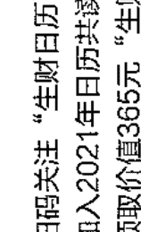

扫码关注“生财有术”
加入2021年日历社群
领取价值3888元“生财礼包”（原文为3888，通常礼包金额可能为388或3888，依原文保留）

## 1月
03

SUNDAY
星期日
庚子年｜十二月二十


### 我做短视频MCN亏掉500万元的经验

节选自“雨实”的主题

- MCN（多频道网络）是红海，没有资本和影视相关的资源背景，很难做起来；
- 三四线城市做互联网创业，“地狱级”（原文“地段级”修正）的难度；
- 有@山火伙伴（原文可能为“伙伴”或特定名词，保留）真的很重要，一个人的能力太有限了；
- 单纯具有流量思维没用，将流量思维结合电商思维才是最厉害的；
- 逆境时，保持好心态，耐不住磨的无所谓；
- 及时止损！及时止损！及时止损！


扫码关注“生财日历”
加入2021年日历共读营
领取价值385元“生财礼包”

## 1月
04

MONDAY
星期一
庚子年 | 十一月十一


### 历史类内容的公众号运营思路

节选自“亦仁”的主题

- 整理相关资料，可参考相关历史类图书和文献资料；
- 开设一门历史课程；
- 在多个平台同步发布文章（原文“文管”修正为“文章”）；
- 做账号单点课程，找流量玩蛋（原文“玩蛋”疑为“玩家”或“爆款”，依语境可能为“找流量平台合作”或“找流量玩家合作”，暂保留“玩家”或修正为通顺语，此处依常见OCR错误修正为“找流量平台合作”或保留原意“找流量玩家合作”，鉴于不确定，保留“找流量玩家合作”）；
- 面向读者（原文“饺子”修正为“读者”）开发历史故事音频课程；
- 开发一些以历史为主题的商品（原文“湖”删除或修正为“品”）；
- 在公众号文章中，开放广告合作；
- 多开发一些迎合读者需求的产品。


## 小寒
1月
05

TUESDAY
星期二
庚子年 | 十一月廿二


### 直接“找”产品，绝不碰研发

节选自 “天堂地狱” 的主题

小公司产品的核心是低成本，因为成本的原因，我会直接“找”产品，绝对不碰研发，根据我自己的项目壁垒，我为“我”产品定义了几个标签，用这些标签来定位好好的产品（原文“好好的”保留），然后找到它拿到它。

- 产品标准化，天猫+大公司，用户针对性强，潮流类产品、传统产品互联网化、天使产品（原文“天使”疑为“试水”或特定术语，保留）等。
- 个人理解：定义产品标签的基础逻辑是竞争（原文“开”修正为“是”）。


扫码关注“生财日历”
加入2021年日历群领福利
@生财日历5557 生态礼包

## 1月
06

WEDNESDAY
星期三
庚子年 | 十一月廿三


### 真格基金合伙人给你的创业心得

节选自《戴雨森》的主题

- 年轻时，关注你自己做得很好，但不要上一代人都好的机会和领域，这可能是十年后的败点；
- 找到你能认识到的最能干的人，和他们一起做点事；
- 尽量尝试不同的职业，尽快知道自己不擅长什么事情，这很重要；
- 验证一个想法是否成立不需要很多钱，关键要及时去做，在行动中升级认知；
- 尽快让自己和公司形成现金流，在“退潮”的时候能活下去很关键；
- 创业如同冲浪，有浪（红利）才能冲。


扫描关注“生财日历”
加入2021年日历共读营
领取价值365元“年终礼品”

## 1月
07

THURSDAY
星期四
庚子年 十一月廿四

轻松治愈

### 要赚小钱吗？

节选自“奔里奥”的主题

钱就像是摩托车机油罐里的油标尺。你抽出来看到上面沾了油，哪怕只是一丁点，就知道里面是有油的，但是它并不足够本身。

同样的，你能遇到钱说明你的认知没有问题。哪怕只是一丁点钱，都证明了你有没有别人拉开距离的本事。

扫码关注“生财日历”
加入2021年日历读营
领取价值365元“生财礼包”


## 1月
08

FRIDAY
星期五
庚子年 | 十一月廿五

### 开烤（原文“开烤”应为“开搞”或“开办”，依语境修正为“开办”或保留“开烤”若为误字则改“开一家餐厅”）一家餐厅后总结出的五点经验

节选自“甜瓜”的主题

- 如果你是考察餐饮店，加盟并不受情怀的庇荫，相反，需要你解决的问题，一件都不会少，如果一定要加盟，也要尽量避免不到3家分店的小品牌；
- 不要通过一个人的朋友圈或是生活习惯来做判断，有些人表面上风生水起，背后里全是难以为继的循环账号；
- 如果你要考虑餐饮店，一定要找到让你心满意足的店铺，如果一开始就这样将就，以后难免忧伤；
- 先还原市场店的味道，谋取了再次倾诉你（原文“谋取了再次倾诉你”语意不通，可能为“获取了再次提升你”或“积累了经验”，暂保留原意或修正为“获取了再次提升的机会”）；
- 在开前期，要综合考虑未来结束时可能面临的问题，特别是直营产业的处理。

> 扫码关注“生财日历”
加入2021年日历共读营
领取价值380元“生财礼包”


## 1月
09

SATURDAY
星期六
庚子年 | 十一月廿六

### 年赚30万-100万元的共享按摩椅案例经验

节选自“修”的主题

- QQ群也可以挖到一些场地；
- 和场地的终端负责人搞好关系，会特特别多挖场（原文“特特别多”修正为“特别多”或“便于”）；
- 有时候场地商会变化，所以尽量减少分成，降低风险；
- 在场场地里有信号得过的人非常重要（原文“信号得过”疑为“做过生意”或“对接过”，暂保留）；
- 可以尽量降低风险；
- 最好还是找离自己最近的场子，可以成本低到最低；
- 能承受办公以及平时的通信是“孕育”（原文“通信”疑为“通勤”，“孕育”疑为“盈余”或“运营”，暂保留原字但修正为通顺语：“能承受通勤以及平时的运营是‘盈余’”），人流是条很大（原文“条”疑为“条线”或“大”，暂保留）；
- 酒店不会在平每个月分给他们的提成（原文“在平”疑为“在每”），他们要在平等产品等方（原文“方”后缺“面”）面是否符合同店的经次（原文“经次”疑为“经营条件”）。


## 1月
10

SUNDAY
星期日
庚子年十一廿七


### 高度重视产品搜索结果

节选自“boyzc”的主题

不管做什么产品，都应关注产品搜索结果。如果发现有大量负面言论的时候，不要慌，正解的话题是做公关“对冲”一下，转移注意力。

多虑一点，这是一次危机，也是一次机遇。

负面言论更容易获得关注，公司对负面言论的处理，必然会被关注者看到，如果提供负面言论的危机（原文“提供”疑为“妥善应对”），建立和关注者的链接关系，虽信任关系（原文“虽”疑为“所”）也是一种“双赢”。


扫码关注“生财日历”
加入2021年日历社群
领取价值385元“生存礼包”

## 1月
11

MONDAY
星期一
庚子年 | 十一月廿八


### 高客单价电商产品如何做推广？

节选自“Jervy”的主题

- 产品和素材最重要，做广告前先做好这两件事；
- 多次触达用户，才有可能转化；
- 基础的配置放属性内容，再放完整产品详情页；
- 基础店铺提供用户专享折扣码，可以提高转化率；
- 用户lvyi（原文“lvyi”疑为“可以”或“利益”，结合上下文“可以操作直接传素材”，故修正为“可以”）可以操作直接传素材，但要评估利中肯（原文“利中肯”疑为“利与弊”或“是否划算”，修正为“是否划算”）；
- 重定向广告时，不能用旧素材，需要换素材。


扫码关注“生财日历”
加入2021年日历社群
领取价值389元“生财礼包”

## 1月
12

TUESDAY
星期二
庚子年 | 十一月廿九

项目篇

### 11 步练就 “钱眼” 挖掘生财项目

节选自 “郭隔天” 的主题

任何一个长期广告的背后都是一个宝藏，发现宝藏的提示有：

- 打开任意自媒体平台；
- 找广告模式与内容结合的模式；
- 通过联系方式找到商家；
- 根据行业关键词找到更多的同行与客户；
- 观察同行的问题，营业收入利润；
- 预估一个项目的营收与利润；
- 找到类似的爆文对应的对手，复制；
- 成为同行的客户或合作伙伴；
- 预估成本；
- 复制升级优化；
- 批量化放大操作。


扫码关注公众号“生财日历”
加入私人年度日历“群”
领取价值 38 元 “生财礼包”

## 1月
13

WEDNESDAY
星期三
庚子年｜十二月初一

### 微信公众号承载私域流量的9条心得

节选自“房先生”的主题

- 流量是一切的生命的源头，粉丝就是“上帝”；
- 深耕小而美的领域，也能过好一生；
- 静下心来阅读好内容；
- 帮助本地大咖资源做广告推广；
- 不要忘记自己的初心，始终坚持自己的信念；
- 专业的才是宝贵的；
- 通过社群纽带，弱关系变强关系；
- 好的口碑，自己会传播；
- 给自己点时间，多出门走走。


扫码关注“生财日历”
加入2021年日历共读营
领取价值365元“生财礼遇”

## 1月
14

THURSDAY
星期四
庚子年 | 十二月初二

### 找到最舒服的赚钱点

节选自“百川”的主题

任何时代的生意都很微妙，关键是看如何入哪个能“持续赚”生财的环节：

- 一个平台的产品可能不是最赚钱的，但给产品发展起来的关键和物流服务可能才是挣钱最舒服的；
- 去墨西哥炒黄金的不是最赚钱的，给黄金和人民币存储和矿水（原文“矿水”疑为“矿产”或“矿山”）的人是最赚钱和最舒服的；
- 在互联网公司的经理人不是最赚钱的，培训这些经理人的培训机构和线上课程是赚钱最舒服的。

尝试打开或更宽业务框架的思维方式，并站在更加宏观的角度，看产业的上中下游以及周边产业链是否能找到更容易的赚钱环节，并悄悄插入。

二维码关注“生财有术”，加入2021年2月5日早8:30，领取价值2888元“生财礼包”。

## 1月
15

FRIDAY
星期五
庚子年 十二月初三

### 如何抓住趋势的小机会在小众领域获得成功?

节选自“看贝哥”的主题

- 以快递员自动呼叫用户取快递的通知机器人业务为例。
- 快递行业的高速发展带来末端配送的需求增大；
- 工具的核心是：降本增效；
- 差异化的服务、电话和闪信的通知。
通过这以上方法，13人在一年内做了2500万元营业收入。


扫码关注“生财日历”
加入2021年日历读者群，
领取价值35元“生财礼包”


## 1月
16


### 18个月内入超过10万美元的低风险扑克牌生意

节选自“鱼丸”的主题

Will Roya通过扑克牌设计和销售，在18个月内将业务规模扩大到月收入超过10万美元，他是这样降低风险、提高利润的：

- 有赚钱意识：发现扑克牌类特别适合做广告，马上All in（全部投入）该业务；
- 在自媒体平台上不断曝光自己，发短视频总结使用规则的博文，吸引引流；
- 善用SEO（搜索引擎优化）；
- 搭建私流量池，每发出一个订单都附上自己的名片；
- 通过众筹平台实现冷启动。


扫码关注“生财日历”
加入2021年日历共读营
解锁价值365元“生财礼包”。

## 1月
17

SUNDAY
星期日
庚子年 | 十二月初五

### 只有10%的加盟商赚到钱

节选自“荣获”的主题

从我观察开设大型项目的经验来看，真正赚钱的项目都是直营的形式，而不是加盟。需要加盟的项目一般都符合“127定律”：10%的加盟商是赚钱的，20%的加盟商是保本或70%的加盟商是亏损的。

所以对于可投资资产在100万元以下的的朋友，尽量不要挑战加盟或者需要开线下门店的项目。


扫码关注“生财日历”
加入2021年日历付费群
领取价值8885元“生财礼包”


## 18
### 星期一
**2020年12月21日**
农历庚子年 十二月初六

### 自己利益后置，他人利益前置
节选自“亦仁”的主题

很多人想点子，首先考虑自己的目标和收获是什么？自己能够多少钱？自己能够得多少流量？从这些点出发，需要哪些人配合？需要他们提供什么资源……想了很多，最后一致地，到处委屈，没有结果。

每次全民日都是“生煎粉本”最活跃的时候，大家都很开心。朋友获得福利，赞助者获得超群体的曝光宣传。至于我，大家都开心了我还赚不到钱吗？

要坚定一个信念：只要你提供真正的价值，那么最终你一定可以实现心愿。

把自己后置，你会发现你的点子越想想越多，思路越来越开阔，格局也越来越大。


### 做本地订阅号的五点经验
节选自“一个人看夕阳”的主题

- 1. 任何平台，不是没有红利期就不能做了。朋友的美食推荐订阅号，每年营收1000多万元；
- 2. 不要说别人都做了，自己就没什么机会了。用心去做，坚持去做；
- 3. 做一个项目，如果没有不一样的思路，就把它做精做深，把服务做到极致；
- 4. 做什么事情都要专注；
- 5. 想真正做一个项目、平台，要经得起“耗钱”的折腾。

## 19
### 星期二
**2020年12月22日**
农历庚子年 十二月初七

1月 Jan

### 大寒
腊八节

### 做任何项目前都必须掌握的一项基本功
节选自“黎叔”的主题

无论做什么项目，一定要想清楚这个“项目”有哪些重要的资料、报告等。系统性学习一遍，确保自己比90%的人更懂这个行业，这样才可能找到关键的认知点，从而发现别人没有发现的“项目潜在价值”，这是个基本功，没有捷径可走。

扫码关注“生财日历”
加入2021年日历共建营
领取价值365元“生财礼包”


## 20
## 星期三
**2020年12月23日**
农历庚子年 十二月初八

### 微信个人号的价值
如今仍然被严重低估
节选自“办仁”的主题

如果你换个角度，把个人号当作一个CRM（客户关系管理）系统，就会发现很多事情其实可以做得更好。
结合微信群、朋友圈、聊天、标签、人设、微信支付、转发推荐，微信个人号既是流量池，也是拓新端、交易端、运营端、营销端、品牌端、复购端、传播端、管理端、工具端。

## 21
### 星期四
**2020年12月24日**
农历庚子年 十二月初九

扫码关注“生财日历”
加入2021年日历共读营
原价365元“生财日历”


## 22
### 星期五
**2020年12月25日**
农历庚子年 十二月初十

1月 Jan

技巧篇

### 做淘宝蓝海市场要注意的四点
节选自“洛神”的主题

- 1. 核心是建立在客单价及销量都小的产品这一大前提下，运营思维；
- 2. 原则是要以极小的试错成本来运营：一件代发，每个品只进一件，不做付费推广；
- 3. 单点天花板低，需要依靠多店复制；
- 4. 单价一般要高，高单价意味着高利润。

扫码关注“超级日报”
每日更新 日更干货 日更教程
获取价值395元“宝妈育儿”


## 23
### 星期六
**2020年12月26日**
农历庚子年 十二月十一

### 年利润8亿元的女装店
模式分享
节选自“亦仁”的主题

- 1. 人群定位精准：
    - 中老年人群，身材不偏向于互联网购买商品，容易尺码不对。
- 2. 产品能够客单高：
    - 衣服款式多，无库存，周转率高，每个星期到店内两批新衣服，上个星期卖不完的，不好卖的货可以退回公司。
- 3. 成本控制合理：
    - 门店为偏僻地区，租金不能超过每月3000元，平均房租每月1000元左右，20000元即可加盟，适合风险敏感型小店主。
- 4. 利益绑定机制：
    - 厂店主、城市经理和门店主30%利益强绑定：
        - 门店主利润的70%归门店主，30%归城市公司；
        - 城市公司由总公司控股70%，城市经理控股30%；
        - 城市经理为门店有效管控，包括促销、定价、更换门店主等。

扫码关注“生鲜好店”
加入2017每日好店家管营
[微信价格585元 宝贝礼金]


## 24
### 星期日
**2020年12月27日**
农历庚子年 十二月十二

### 2019年创业亏800万元，
可以给你的一些建议
节选自“日历”的主题

- 1. 永远不要低估创业；
- 2. 前期最重要的就是去跑最小盈利模型；
- 3. 一个项目如果你很努力地尝试了3个月还没有成效就放弃；
- 4. 如果你全身心投入做一个项目时，把控权不在你手上，那不如不做；
- 5. 自己的核心竞争力，不是某个产品，应该是能持续做出好产品的能力。

扫码关注“走到日历”
加入2021年日历共读营
领取价值365元“生财礼包”


## 25
### 星期一
**2020年12月28日**
农历庚子年 十二月十三

1月 Jan

解压篇

### 如何分析一个互联网项目的可行性？
节选自“战功不大”的主题

- 1. 看起来是否合法正规，不碰灰色项目；
- 2. 能否长期操作，至少是半年或者一年以上；
- 3. 做项目的过程中能否为下一个项目积累资源或者人脉；
- 4. 尽量选择大平台；
- 5. 看是否是市场需求；
- 6. 看公司背景、创始人背景和实力，投资方及融资情况；
- 7. 看能否适合自己，人脉、兴趣、直觉缺一不可；
- 8. 最重要的，看看这个项目到底有没有真正帮助消费者解决问题。

> 扫码关注“战功日历”
> 每天20秒，每天帮你做决策
> 领取价值88元“生产力礼包”


### 持续输出的七个要领
节选自“V先生”的主题

- 1. 选定一个垂直领域，目标成为该领域的专家；
- 2. 找到一个简单易上手的内容领域；
- 3. 给自己设定一个打卡制度；
- 4. 建立持续输出内容的素材库；
- 5. 给每天设定一个专门用于写作的时间；
- 6. 高效的时间管理是写作的，而非用来构思；
- 7. 写文章之前，首先要做的事就是往文章里出一个大框架。

扫码关注“生财日历”
加入2021生日历打卡群
领取价值399元“生财礼包”


技巧篇

## 26
### 星期二
**2020年12月29日**
农历庚子年 十二月十四

### 赚钱的“公式”
节选自“段锦栋”的主题

我们常常生活在一个快速变化的时代，很多年轻人难免焦虑。要避免焦虑，就是认清楚一个人能赚的钱到底是来自哪里。

我们可以分为三个部分，总结成一个“公式”，就是回报=Beta+Alpha+Luck：

- 1. Beta，是时代带来的，来自我们的选择；
- 2. Alpha，是自己努力超过同行和竞争对手带来的，来自我们的努力；
- 3. Luck，就是运气，来自随机性。

1月 Jan

## 27
## 星期三
**2020年12月30日**
农历庚子年 十二月十五


## 28
### 星期四
**2020年12月31日**
农历庚子年 十二月十六

### 如何通过知识付费
半年营收百万元以上？
节选自“浪神”的主题

- 1. 找到用户需求利自身资源的交集点；
- 2. 总结用户需求落点，不断优化调整产品形态；
- 3. 精准触达目标画像，深入研究产品服务于哪类人群；
- 4. 制定引流渠道，先求质，再求量；
- 5. 制作引流内容，使用用户能读懂的语言去引导他们需要了解的信息；
- 6. 重视转化的每个环节，只要真的有给用户提供价值，就可以勇敢迈出第一步。


## 29
### 星期五
**2021年1月1日**
农历庚子年 十二月十七

1月 Jan

品格局

### 所有的生意，
本质上都是流量生意
节选自“水仁”的主题

做生意的重点是赚钱还是收客，收流量生意的重点是赚钱还是收客？

流量是成本和流量收益，再把时间因素考虑进去，基本上市面上的理论就算合格了。

扫码关注“生财日历”，加入2021生财日历共读营
领取价值365元“生财礼包”


## 30
### 星期六
**2021年1月2日**
农历庚子年 十二月十八

1月 Jan

财经篇

### 如何在“生财有术”挖宝？
节选自“V先生”的主题

- 1. 找到和你行业背景相关的人聊；
- 2. 参加“生财有术”的线上活动，在群里交流；
- 3. 参加线下活动，包括同城聚会、年聚大会、闭门分享会；以及你自己组织的周友聚会饭局；
- 4. 通过“生财有资源”去对接合作；
- 5. 在星球内积极地输出内容，这样你不仅帮别人，别人都会主动去帮你。

> 我始终坚信：越分享，越幸运。

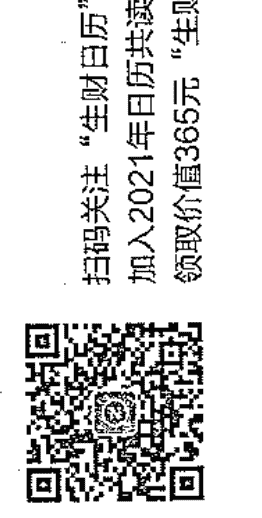

### 卖得了几百万的豪车，也卖得了几十块钱生蚝的“90后”创业者是怎么做的？
节选自“凡不易”的主题

- 1. 无论是多贵的豪车，还是多便宜的生蚝，都将借助信息差或者其他方式，来得比同行便宜；
- 2. 产品为先，实时更新做好产品；
- 3. 做到极致服务，想客户之所想，想客户之未想；
- 4. 重视营销，在好的产品和服务的基础上，释放出一档到出心裁，善于传播的设定，所有宣传物料拍摄都由专业摄影、摄像团队拍摄，便于后续传播推广。

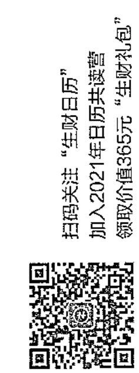

# FEB
## 二月

谢@Aladdin 来锻造第一颗龙珠。

今天下午，他发现了知识星球有史以来最大的一个 Bug（程序错误）：任意价值都能续责任意星球。

这个Bug吓得知识星球老爸@wulilia一身冷汗。

我想，这个也是“生财有术”社群价值观的一种体现：生财有术，赚钱有道。提供价值，顺带赚钱。

感谢@Aladdin给我们做了一个很好的榜样。

亦仁
于2019.04.18
发沈阳龙珠

### 生财有术 ｜ 龙珠

“生财有术”中很多圈友为社群发展做出了很大贡献，如分享精华内容、提供有效建议、积极参与大型活动等。

从第一期开始，“生财有术”就有精华帖超级红包、潜伏圈友留言盒等玩法，圈友们很开心，但亦仁却一直在探索更丰富更有长远价值的回馈方式。

面对@Aladdin 这样的例子，无论是红包，还是图书，都不太实战。于是亦仁制定了最早的“龙珠”规则：每月为创作精华主题或做出突出贡献的圈友提供龙珠一颗。

获得第一颗龙珠，是大部分“生财有术”圈友真正融入“生财有术”的第一步。

## 01
### 星期一
**2021年1月3日**
农历庚子年 十二月二十

2月 Feb

技巧篇

### 给App产品经理的四个灵魂拷问
节选自“Catify”的主题

- 1. 谁（Who）会用我的App？
- 2. 我的竞争对手是什么情况（What）？
- 3. 为什么（Why）我的产品很独特？
- 4. 我的产品在什么时间（When）节点上我什么功能？


## 02
### 星期二
**2021年1月4日**
农历庚子年 十二月廿一

2月 Feb

### 重视用户分层
节选自“国际蒙马”的主题

在我们的生意里面，尤其是在我们写图的生意里面，一定要花足够的时间来分析清楚，到底这个市场该做哪个分层的客户，基本上没有一个企业可以一次性的各个分层的客户都做够了。

其实每个分层的客户最终都会有对应的商业模式和产品，但是如果分析不清楚的话，就会导致用错误的服务、错误的产品，服务错误的客户。


## 03
## 星期三
**2021年1月5日**
农历庚子年 十二月廿二

2月 Feb

立春

# 做视频号号的注意点
节选自“文东”的主题

- 1. 内容垂直部分：用户能明确知道关注你能得到什么，为什么关注你；
- 2. 给人设贴标签，不论以什么方式，一定要有自己的特点；
- 3. 人物形象清晰可见，文案不矫作，封面一致有助于强化用户记忆，一进主页就能让用户立刻认识你。


## 04
### 星期四
**2021年1月6日**
农历庚子年 十二月廿三

2月 Feb

小年

### 如何知道一家奶茶店
能不能赚钱？
节选自“杨芳”的主题

- 1. 去盘点；
- 2. 算叫号牌：一天能叫多少个头号；
- 3. 算叫号平均消费多少杯；
- 4. 这个店面约几平方米，租金多少，每次前台和后厨多少人，几位；
- 5. 加上你知道的所有包料的成本，再加上一个10%的“安全溢出”。
- 话：
    - 这样之后，你大模就能算出来它是否赚钱还是亏。


## 05
### 星期五
**2021年1月7日**
农历庚子年 十二月廿四

2月 Feb

### 如何做到同行里的最好？
节选自“杨清”的主题

我们都知道，开实体店就是个非常细致的活儿，尤其会涉及送包装材料，必须细细到包装箱上的每一个文字或图案。

那怎样才能做到最好呢？

你可以买下所有同行的产品，看他们的包装细节，包括拆开箱体逐中，同行是怎么操作的，先取他们的优点，再做到比同行更好。最终做到：别人没有的我有，别人有的我做做得更好，别人优秀的我做到四决的水平。


## 06
### 星期六
**2021年1月8日**
农历庚子年 十二月廿五

2月 Feb

### 创业要做好哪些心理准备？
节选自“鱼丸”的主题

- 1. 在遇到每一个问题后，就反间自己：能通过对比这个问题的解决找到钱么？
- 2. 要敢创业，要能从市场中干，降低创业风险。
- 3. 最好从自己的需求中挖掘业务，更轻盈上手，同时时代红利，有效利用互联网资源。
- 4. 主动宣传，做了好事要留名，主动出击展示自己。
- 5. 看到他人需要帮助时，要带着其他他需要帮助的人能取暖、一起做强。

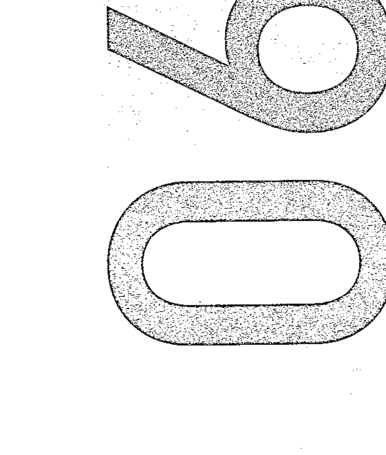


## 2月7日 星期日
庚子年 | 十二月初六


### 如何通过淘宝商家后台挖掘投资机会？
节选自“券商牛”的主题

淘宝商家后台有一个叫作“生意参谋”的工具，可以查看淘宝平台的一些数据分析结果。如在“生意参谋”输入某一产品词语（如“电器”或“食品”等），假如成交数额很高，但并没有显示在二级市场的股价上涨中，这就是一个大的机会。

- 一、排名第一的品牌通常是头部厂商，但其实有很多排在第二、三名的品牌，某地是地区性龙头，某些具有差异化优势。

扫码关注“生财日历”
加入2021年日历讨论群
领取价值365元“生财礼包”


## 2月8日 星期一
庚子年 | 十二月廿七


### 自己说自己好不算好，别人说你好才是真的好
节选自“仲老柏”的主题

东汉名医董奉可能是历史上少有的能行医济世的人之一。董奉年轻的时候做过官，行医是他的业余爱好，所以董奉从不收费，只让治愈的人在自己家门前种橘百棵，时间长了就成了一片小橘林。

橘林结果了，他也不卖钱，让人拿粮食来换，并在路边设立粥铺，免费提供路过的患者喝粥。

董奉没有留下医书学著，却位列中国古代十大名医，还留下一个典故——杏林春暖。


扫码关注“生财日历”
加入2021年日历共读营
领取价值365元“生财礼包”

## 2月9日 星期二
庚子年 | 十二月廿八

总经篇

### 公司员工超过20人是一道坎
书选自“AVI游戏”的主题

一般的公司从20人发展到50人是道坎。20人的时候，老大还可以亲自带队。而一旦业务作出增长，很多老大就会很吃力。大概地说，世界很大，但我的公司和我的厨房看起来了。

可以关注这个阶段是最低谷的，因为团队管理的很多方面要进行巨大转变，才能完全进入新的阶段。如果没有注意到即将面临的变化与挑战，就会出现问题。

扫码关注“生财日历”
加入2021年日历社群
领取价值365元“生财礼包”


## 2月10日 星期三
庚子年 | 十二月廿九


极客岛篇

### 百万级短视频账号怎样获取流量？
节选自“七羽”的主题

- 1. 提升评论量、转发量、点赞量，完整解决4个指标；
- 2. 在视频描述栏，引导用户完成点赞、评论、转发或者特定动作；
- 3. 在视频描述里，设置一些互动问题，引导用户留言评论，提升评论量；
- 4. 通过回复用户评论，提炼视频核心观点，引导更多用户参与到话题讨论中，进一步提升评论量；
- 5. 提前准备“神评论”，视频发出后，让好友写在评论区，引导用户围绕这个话题展开更多互动。


扫码关注“生财岛邦”
加入2021年日方法谋营
领取价值365元“终身福利”


## 2月11日 星期四
庚子年 | 十二月三十

除夕

总结篇

### 阶段性目标一定要服务于年目标
节选自“Javis”的主题

很多时候无法成功执行规划，原因恰恰是没有将自己的梦想、目标、价值观、策略联系在一起。目标达成应该贯穿于这四点构成的一致关键点，每一次的反思都应该是你的年目标完成度增加一点，持续遵循的这个行动准则，一定是事半功倍。


扫码关注“生财日历”
加入2021日历共读营
领取价值365元“生财礼包”

## 2月12日 星期五
辛丑年 | 正月初一

春节

项目篇

### 给亚马逊新手的蓝海打法
节选自“seven”的主题

新手最大的门槛在于选品、供应链和起步资金。单打算3月利润10万已是妥妥的，重广量就必须要带团队、团队打法的核心是：合作紧密的产品设计+供应链把握+有吸引力的团队。

对于没有起步资金的新手，建议用时间换钱，完成原始积累：

- 1. 选择适合自己的赛道，如投入较少的推广返利开平台；
- 2. 在公司上班以副业形式开展创业；
- 3. 完成原始积累后，走长线有复利的路。


扫码关注“生财日历”
加入2021年日方法谈营
领取价值365元“生财礼包”

## 2月13日 星期六
辛丑年 | 正月初二


### 持续输出内容的模板
节选自“V先生”的主题

- 1. 集思百晓写作作法：以词条的方式串起某个网站的知识结构；
- 2. 知乎写作作法：从用户提出的问题开始入手；
- 3. 豆瓣写作作法：列出所属领域的专属书单；
- 4. 豆瓣·思维写作作法：多元思维模型，可以建立至少100个思维模型。


扫码关注“生财日历”
加入2021年日历共读营
领取价值365元“生财礼包”

## 2月14日 星期日
辛丑年 | 正月初三

情人节


### 如何真诚地介绍自己？
节选自“百川”的主题

核心是“期待+价值观：真诚的态度”

- 1. 强烈推荐使用文字介绍，方便他人熟悉自己；
- 2. 把自己的个人介绍浓缩到几句话里说明清楚；
- 3. 选好玩的地方写，让对方阅读更有趣；
- 4. 思考一下你对接的这个人，你给他/她讲什么？或者你自己前端做的，哪些能直接展示你的价值；
- 5. 真诚很重要，我每次介绍自己从来不想过能从别人身上得到什么，只是觉得他/她很优秀。

扫码关注“生财日历”
加入2021年日历共读营
@生财有术3857S “生财打卡营”


## 2月15日 星期一
辛丑年 | 正月初四

技巧篇

### 看到好的知识，如何联系上原作者深入沟通？
节选自“seven”的主题

- 1. 仔细看作者的输出内容，点赞，最好写下有价值的评论；
- 2. 浏览几篇作者的文章，并写下有价值的评论；
- 3. 加人的时候做个自我介绍，最好自带标签，要简短，方便作者识别你是谁并做备注。

这种技巧方便作者判断你是对他感兴趣的人，而不是“伸手党”；如果识别难度高，别人宁愿不回复你。


扫码关注“生财日历”
加入2021年日历共读营
领取价值365元“生财礼包”

## 2月16日 星期二
辛丑年 | 正月十五


就是抵达忠诚友，运营是最靠近客户的一端，因此能够接触最多的信息，及时管理和用户反馈，做好产品迭代。

对市场保持敏感度以保证竞争力，及时对数据分析以锻炼全局观及操盘能力。无非就是“流量+转化”，如题拼拼力足够、多尝试不同的玩法，去打磨，去优化，去创造。

### 商业的本质是什么？
节选自“Lissa Tam”的主题


## 2月17日 星期三
辛丑年 | 正月十六


### 如何找核心用户？
节选自“黎叔”的主题

核心用户中的“核心”，是以自己为核心，而不是以产品为核心。如果愿意加入创业，尤其是以赚钱为目的的创业，核心用户一定要从自己的朋友圈中找，千万不要脱离自己的朋友圈，不要做无源之水，无本之木。

你的朋友圈就是你的创业池，在这里面临生意的成功概率更高。想去别人家的池子里做生意，其难度之高非他人所能及。


扫码关注“生财日课”，加入2021每日生财课堂，领取价值365元“生财礼包”

## 2月18日 星期四
辛丑年 | 正月初七

雨水

项目篇

### 如何加抖音上赚钱的微信好友？
节选自“兴仁”的主题

- 1. 准备一个独立于常用微信号的微信号；
- 2. 开始录抖音，但不要看视频。每刷到一个视频，快速划到抖音号主页，如果留了微信号，记下来；
- 3. 就这样刷抖音，每天给自己定一个小目标：记下30—40个微信号，并用小号加上他们；
- 4. 坚持一个月，就能积累1000个在抖音上赚钱的好友。


扫码关注“地球村民”
加入2021年日更社群
领取价值365元“宝藏礼包”

## 2月19日 星期五
辛丑年 | 正月初八

### 做本地杂志如何赚钱？
节选自“亦小亮”的主题

- 1. 广告收入、结合当地活动推出，比如美食节、半程马拉松、端午节；
- 2. 接设计印制单，中间做的是差价，用印刷公司的设计，帮他们干活；
- 3. 给比较大型的餐厅做营销策划；
- 4. 微信公众号/代运营；
- 5. 把合作商圈的抵消费资直接变成现金或用来引流。


扫码关注“持续自由”
加入2024年1月历史课
领取价值365元“生财礼包”

## 2月20日 星期六
辛丑年 | 正月初九

### 以SEO为目的的制作视频，有哪些重要细节？
书选自“陈悠强”的主题

- 1. 重视视频描述的前50个字；
- 2. 展现联系方式（需要多留几个备用）；
- 3. 更多更多关键字词，如做白莲，列出白莲大师的名字（大师的名字自带流量），如果这一步做错了，效果是0，如果做对了，就是1；
- 4. 把这个视频同类比较竞品对比，如做法遇到问题，用“小号”提问，用“大号”回答，提前其充内容。


## 2月21日 星期日
辛丑年 | 正月初十

### 做生意的六个注意事项
节选自“包凡”的主题

- 1. 不要小气回答：在能赚钱、ROI（投资回报率）为正的时候，一定要及时投入；
- 2. 要做出认可你的生意：享受过程很重要，得到正反馈很重要；
- 3. 要敢于宣传自己：更要利用社交网络、人脉资源，什么不好意思的；
- 4. 多拿定价：成交的价格取决于客户的心理预期；
- 5. 持续尝试：客户的需求总是多元化的，所提供的内容也可以多元化；
- 6. 定期复盘和自我怀疑：大大小小的生意都要学会做总结，沉淀出对未来更有价值的方法论。


扫码关注“生财日历” 加入2021年日历共读营 领取价值365元“生财礼包”

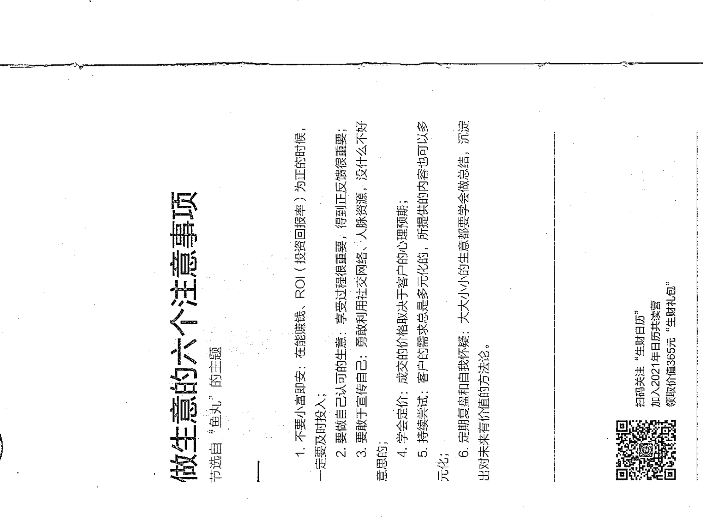

## 2月22日 星期一
辛丑年 | 正月十一

解惑篇

### 电商代发为什么赚不到钱？
节选自“杨潇”的主题

- 1. 代发产品同质化太严重，缺乏竞争力；
- 2. 代发的素材一般都是通用版本，无法做差异化；
- 3. 交换不方便，服务上无法面面俱到；
- 4. 价格、产品成本和快递成本都没有优势；
- 5. 代发商家的时效性远非常差；
- 6. 代发的售后问题解决办法得不到很好的解决；
- 7. 库存深度不够健康，产能调配不科学，会让预订单很多但没有现货的现象；
- 8. 命脉掌握在别人手上。

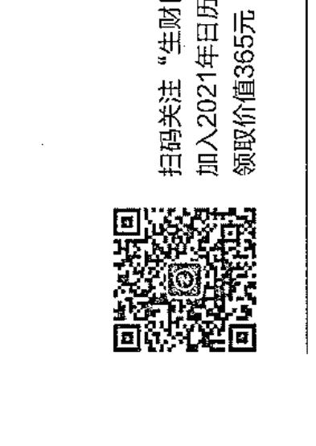

## 2月23日 星期二
辛丑年 | 正月十二


### 一种对促销活动有帮助的群积分玩法
节选自“WeY”的主题

- 1. 100积分可兑换群内发一次推广信息；
- 2. 500积分可兑换群公告的一次推广信息（群主发）；
- 3. 可用自己的积分兑换，转让价格自己定价。

当天就有人花了此规则一出，一下子就激发了群友的执着。100积分兑换一条群内广告，过后大家还纷纷对他的广告变形式进行了积极的讨论。


扫码注册“生财商户”
加入2021生财日进宝营
领取价值365元“生财礼包”

## 2月24日 星期三
辛丑年 | 正月十三

### 出版图书要注意哪些问题?
节选自“腰腰”的主题

- 1. 出版社不等于印刷厂，有国家批准的出版流程。书籍需要经过若干层编校，错误率要控制在万分之一以下；
- 2. 商务合作形式由多种因素决定，比如图书类型、读者基数；
- 3. 写书需要作者对一个题材的整体架构能力；
- 4. 文案不够好？别怕！只需要做到句子通顺、逻辑吐强、有干货，对读者就有价值。

扫码关注“生财后见”
加入2024年日出书计划营
领取价值365元“生财礼包”


## 2月25日 星期四
辛丑年 | 正月十四

微言数语

### ……，马上动手
书选自“亦仁”的主题

歌蒂说：“因为鲁钝之中也蕴蓄着能量与威力。”回头看，我曾错过无数次机会，错回反复思考，最后临近无果。

我所做成的一些事情，基本都不规则划出来的，而是想到后立刻去干，包括“生财资本”星球，我当时的目标只是有100个委员而已。引再纠结，故事未做。


扫码关注“生财良辰”

2024年日历印刷售罄

领取价值365元“生财礼包”

## 2月26日 星期五
辛丑年 | 正月十五

元宵节


### “玩流量”的五大准则
节选自“解构”的主题

“玩流量”，从来都不是一件玄学的事情，这背后是有一套科学体系做支撑的。综合这些年的经历，以及接触过的圈内顶级流量增长团队，我简单总结了以下几点“玩流量”的准则：

- 1. 善于挖掘各种情报；
- 2. 熟悉各大平台的规则；
- 3. 每个人才一定要精细化运营；
- 4. 巧用技术手段；
- 5. 快速地进化试错。


扫码关注“生财日历”
加入2021生日历计划读书营
原价365元“生财礼包”

## 2月27日 星期六
辛丑年 | 正月十六


### SEO找流量词的思路
节选自“明日”的主题


- 需求词：
  - 行业：运营 / 设计 / 编辑 / 会计 / 法律
  - 爱好：摄影 / 游戏 / 拍照 / 轮滑 / 画画
  - 技能：写作 / 演讲 / 爬虫 / 搜索 / 工具
  - 专业：哲学 / 数学 / 英语 / 日语 / 翻译
  - 兴趣：漫画 / 宠物 / 吉他 / 零食 / 音乐
- 效果词：信息 / 资料 / 效率 / 赚钱
- 解决问题：怎么 / 如何 / 怎样
- 信息整合：哪些 / 有啥 / 为什么 / 合集

扫码关注“生财日历”
加入2021年日历共创营
领取价值365元“生财日历”


## 2月28日 星期日
辛丑年 | 正月十七


微语篇

### 要把公司做小，把客户做大
节选自“甄选”的主题

其一，把公司做小、做轻，可以聚焦能量，在自身擅长的领域实现长远发展和突破。

其二，以客户和市场为导向，可以让企业避免被本经营和价值竞争的困境，建立以能力为基础的长远竞争力。

今年以来，我从一开始极度抗拒客户，到主动地抢客户。去年我们服务的大客户也不过20个，但是目前有意愿签约的只有不到6家，并且每个行业品类，我只选一家，这样的议价权就会更高。

我在这的团队说过，不要问客户说明你能做什么，而是要让客户明白，如果他不选择你，他可能会失去什么，或者可能会变成他的“缺陷”。

我算了一笔账，如果按照目前的签约通知进度，一年的签约额和利润，几乎可以抵消之前一个十年的损益公司，这就是我提的小而精。

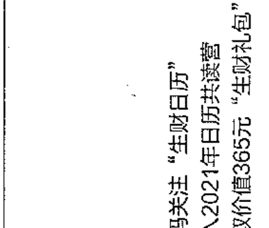


业务能力极强的人，强在什么地方？告诉他一个新的业务，他能粗算出来需要多少钱，在整个路径上的牺牲大概是多少，可能会经历几次反复、建立哪些关键能力才能拿到这个值。他们可能会说这样的话，“不对啊，这个转化率怎么能到 2% 呢？有点高估，是什么原因让我低估了这一点——这些人带着地图去执业，很快纠偏并找到优点。”

会算账是创业者一项非常重要的能力。把任何事用换成钱来做决策，很多问题就简单了。

亦仁
于 2020.07.02
#生意合伙人#

### 生财有术 | 生财合伙人

互联网江湖中有很多会赚钱的大牛，对自己已经熟悉的业务有着丰富的经验和见解，每次与他们谈聊，总能在赚钱这件事上有所启发。

他们在某些方面为大家所熟知，有些很低调不显山露水，但不论是哪一位，都有非常多值得学习的地方。

每周三，亦仁会邀请一位“#生财合伙人#”，分享他在赚钱方面的心路历程与方法论，帮助我们认识这些老板、创业者、操盘手，深入了解他们如何一步一步获得今天的业绩。

截至 2020 年 8 月，“#生财合伙人#”已经更新了百余期，分享者中有《李昌热说》的主理人李昌热、真格基金合伙人谢华波、赚 3 亿元佣金的淘宝老相、化龙共创爱盈利创始人蓝志文、跨境电商导师王源、App Store 榜格第一的产品“宝宝树”创始人钱钰、6 次把产品做到 App Store 榜格第一的严华等等……分享总计超过 30 万字，内容体量大约等于两本纸质图书。


### 为什么低价试用好过免费试用？

节选自“Benjamin Phoebus”的主题

在这个问题上，我们先做 3 个假设：

- 用户会对自己付过钱的产品更加用心地去体验；
- 让付过钱的用户掏更多钱，远比让完全没付钱就享受服务的人掏钱要容易；
- 用户不会对“免费试用”或“1 元试用”太过敏感，收取低价并不会对用户操作带来太大阻碍。

当然，具体规则时，还要结合自身的场景来决定。


### 如何突破业务的天花板，赚更多钱？

节选自“盈凡”的主题

以健身私教为例：

1. 每个业务都有相应的天花板：一对一健身私教服务跑通之后，每天所有时间都排满了就是天花板。
2. 复制业务，扩大规模：健身私教由一对一变成一对多，把时间排满才是天花板。
3. 修改业务模式：把私教服务改成面向散客（原文为“校散”，推测为“散客”或特定渠道，保留原意或修正为“散客”）的私教进阶培训；可以提高天花板。

扫码关注“生财有份”
加入 2021 年日扫读营
领原价值 355 元“生财礼包”

## 爱耳日

### 相比做杂乱无章的内容，做垂直领域内容的四点好处

节选自“V 先生”的主题

1. 能让你的定位明确；
2. 能让你的内容和品牌具有识别度；
3. 能让你更容易开发出自产品；
4. 能让你成为一个领域的“专家”，带来影响力。

这是不是你做自媒体、个人品牌、社群、培训等领域的人，最“痛”的 4 个诉求？


扫码备注“生财日历”
加入 2021 生日历共读营
领域价值 365 万元“生财礼包”。

### 如何应对信息碎片化、信息难以提取的问题？

书选自“白一喝”的主题

我们每天都在获取大量碎片化的信息，应该建立属于自己的知识库，这样才能高效提取信息。

建立知识库要做到哪 4 个原则：

1. 尽量把采集的信息储存在同一处；
2. 只存较与自己生产成果相关的信息；
3. 多个知识库仓库，尽量采用同样的结构；
4. 做好分类，标好索引。

扫码关注“生财日历”
加入 2021 年日历读群
领取价值 585 元“生财礼包”


### 平台“搜索功能”会为三类人带来商机

书选自“一条狗己”的主题

1. 搜索者：要理解使用的搜索工具，且时刻知晓搜索结果可能是被操控的，先目（推测为“先有”或“才能”）更好的挖掘内容；
2. 平台方：有庞大的数据库内容，多挖掘用户画像、用户亚文化圈，根据用户需求多种（推测为“推荐”）优质内容，吸引用户；
3. 内容产生或投放者：利用平台数据多优化自己的内容形式，可以获得更好的成交量。


扫码关注“生财日历”
加入 2021 年日历共读营
领额外值 3585 元“生财礼包”


### 如何正确理解和打造爆款小程序

节选自“孙仁”的主题

1. 产品和技术是真正的壁垒能力；
2. 产品要自带能被传播的属性；
3. 内容太V大（推测为“太偏”或“太大”）的产品可以依靠自身流量反复启动，节省购买流量的成本；
4. 别搞得性子里（推测为“性子里”为误识，原意可能为“急功近利”或类似含义，此处保留原貌或根据语境修正，但指令要求纠正明显错误，此处疑似“别搞太...”，暂保留原意或修正为“别搞得太...”，根据上下文“不要轻描产品下结论”，可能是“别搞得太细”），不要轻描产品下结论；
5. 尽可能做受欢迎的事情；
6. 赚钱不包底局（推测为“不包底局”为误识，原意可能为“不封顶”或“有保底”，结合上下文“赚钱养活团队”，可能是“赚钱不封顶”或“赚钱有底气”），赚钱养活团队；
7. 所有的办法，归根到底就是：做人要厚道。

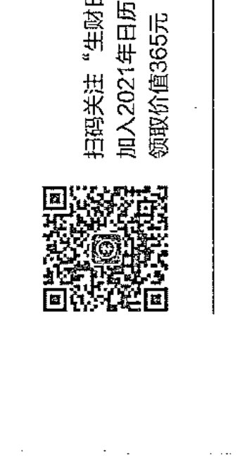

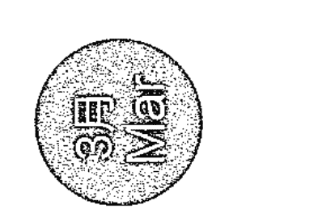


### 普通人启动项目要从 “赚钱的事儿” 做起

书选自“秦成”的主题

对于普通人来说，初期的启动项目尽量选择“赚钱的事儿”，而不是“值钱的事儿”。这两者的区别在于，赚钱的事儿，核心是基于利益，现金现结，将本保利；值钱的事儿，核心是结构价值，它的兑现时间在未来的某个时间点。

大多数人创业起点低，资源少，创业的主要目标应是赚钱改善生活；融资估值匹配起点高的大 V，毕竟他们的机会成本高，不满足于赚小钱。


扫码关注“生财日历”
加入 2021 日历生财课营
领取价值 3955 元《生财礼包》


### 快手引流涨粉变现的基本玩法

节选自“乔里奥”的主题

1. 找到有效的活动模型：涨粉模型只要发布 5 秒内 120 秒以上（推测为“5 秒内完播”或“时长 120 秒以上”）大概率都能获得点赞、评论、涨粉的比例“每片 4 赞起”。
2. 快速创作大量同类型视频，然后高频次发布，比如“一日三更”。
3. 在账号上放微信号，如“写字制作加微信号”：把涨粉模型的视频作成视频封页，5 分钟的手机录屏加上简单讲播（推测为“讲解”）即可，然后卖给那些想涨粉的人。


扫码关注“生鲜日历”（推测为“生财日历”）
加入 2021 年日历打卡营
领取价值 365 元 生鲜礼包（推测为“生财礼包”）


### 用于引流的几个重要思维

节选自 “六道” 的主题

1. 搜索思维：在对方搜索答案时出现；
2. 标签思维：设计好 “语言”，裂变传播；
3. 触动思维：迎合当前情绪释放信息；
4. 干货思维：优质内容是获得曝光动力；
5. 应同思维（推测为“认同思维”或“应和思维”）：主动制造需求获取流量；
6. 付费思维：付费直接购买流量。


### 产品开发的四个要点

节选自“范德福”的主题

1. 要有硬需求：产品能够有稳定收入。最关键的一条就是它有真实的社会需求；
2. 快速迭代：客户有需求，尽量用最低的成本、最快的速度，做出一个可感知的产品。因为客户在变，市场在变。
3. 人无我有：一个软件，一定要有几个其他软件没有的功能。
4. 降低门槛：客户永远比你想象的谨慎，客户的习俗（推测为“习惯”）永远比你想象的要谨慎。让客户用你的产品代价低一点，那么产品被客户接受的可能性就会高一点。


扫码关注“生财日历”
加入 2024 年日历共创营
领取价值 3680“生财卡片”

### 创业团队的批评与自我批评

节选自“邓广”的主题

可以在年度复盘的时候让团队进行批评和自我批评，为建真（推测为“为了真实”或“为求真”）有效率可提前制定原则：

1. 所有批评都是为了公司或团队好；
2. 不要有意恶心，谁表面有问题，不回避不掩饰；
3. 所有达成共识的重要问题，都要改正。

只有绝对坦诚，才能获得真正高效果的反馈。


扫码关注“瑞丽日常”（推测为“生财日历”）
加入 2021 年 4 月历共读营
领取价值 365 元“生财礼包”


### 最实用的成本计算法

*节选自“柏涛”的主题*

流量的尽头是变现，也就是经商与电商。不管你是卖什么产品，请别走太多弯子，真正要考验的其实是两个“一个”字——成本。

希望你永远记住一句话：“你认为的成本只是你所谓的成本。”如果你不知道这么算成本，可以这样做：拿出笔和纸，穷举出你所赚增加的一切成本，将成本总和跟以 1.3 就减出真实成本了。


扫码关注“生鲜日历”（推测为“生财日历”）
加入 2021 年的共读营
领取价值 388 元“生鲜礼包”（推测为“生财礼包”）

### 如何降低用户认知成本？

节选自“明白”的主题

降低用户认知成本，就是降低产品的摩擦成本；

降低产品使用成本，就是提高产品用户数量；

提高产品用户数量，就是提高产品收入，就是多创造收益。

降低认知成本，最先从给产品取名做起，如何操作？

一句话，把名字和熟悉的事物联系起来，比如知识星球、生财日历、小叮当，等等。


扫码加我 “生财日历”
加入 2021 年日历共读营
领取价值 365 元“生财礼包”


### 使用众筹来启动项目的好处有哪些？

节选自 “Jack” 的主题

可以用于自己完善想法、验证市场、接触新客户、零风险生产、获得种子用户、启动口碑营销（或直播带货），甚至能获得融资的机会。

从想法到落地的整个过程都不会涉及过大的风险和投入，完美地展示了精益创业的本质。

众筹无法唯一的准点（推测为“唯一的优点”或“缺点”）。在于对于产品的需求比较高，要给用（推测为“给”）户足够的惊喜感、信任感和参与感，使对方成为你的倡导者。

另外，众筹也不只限于 “从零到一启动项目”，很多人还把众筹当做产品的平台。对于大品牌而言，众筹转化率不如电商直接买，大品牌做的是曝光和造势，顺带赚钱。


扫码关注 “生物日历”（推测为“生财日历”）
加入 2021 年日历共读群
领取价值 366 元“生财礼包”


### 要想获得成长，就得在舒适圈之外、能力圈之内不断精进

节选自“白一笛”的主题

每个人都有一个自己的舒适圈。圈里圈外的事情伸手到指尖，基本不用“过脑子”，但是做了也不会帮助你成长。舒适圈的外面是能力圈，是过去所学知识和技能经验所构建的。能力圈里的事情做起来会稍微有点不舒展，但还是可以做，并做的效率比较优。即使失败了也能够快速调整，再来一次。

想要成长，就应该处于舒适圈之外、能力圈之内。如果在能力圈之外，你既无法有效地思考，也不能高效率地做成事情。


扫码关注“生财日历”
加入 2023 年日历共建营
领取价值 365 元“生财礼包”

### 通过整理数据表格引流的小技巧

节目自“潮潮”的主题

当一个领域或者产品成为风口，各种渠道都在引流时，有一个通过厂家（推测为“某家”或“厂家”）Excel 文档引流的小技巧：把网上公开的厂家信息收集到一个个 Excel 文档里，放到自己的公众号自动回复的方式发放出去。其中的“技巧”在于，把它的联系方式（如微信号）写在前十位，需要让对方通过我们才获取信息。

这会让对应的微信号分钟（推测为“疯狂”或“瞬间”）被加载爆。

这种利用 Excel 文档引流的方式经久不衰，一口价（推测为“一直价”或“依旧”）有很多经典案例。


### 技术类公众号粉丝增长经验

节选自“sirin”的主题

我的公众号在 2018 年 12 月底时，有 500 多个粉丝。那时候，每月几个号主在做读书活动，既能“赚粉”，也能给粉丝带来一些福利，就想要自己也办可以试试一下。

在回复“@上海小陈”的帮助下，我联合两个号主做了一次读书活动。这次活动让我的公众号“囤粉”，超过 800 个，微信好友增加了 100 多个。

于是我又组织了第二波、第三波的读书活动，一直做到了 2019 年下半年。就这样，我几乎零成本“囤粉”2000 个左右。


扫码关注“生财有术”
加入 2021 年图书读营
领取价值 395 元“生财礼包”


### 我本人定义的流量红利要符合以下几点

书源自“刘大谢”的主意

1. 产品本身够独立正确（推测为“足够独立、正确”）、好用，且同时 BAT（百度、阿里、百度、腾讯）级别平台有重大战略意义的功能或产品，且产品、公司从流量端给予开放；
2. 主流世界、主流人群认可；
3. 可以结合出切实有效的商业模式，单纯的平台型政经论（推测为“竞争论”）说起来根多（推测为“很多”），但只能存在于“讲神的道理”（推测为“讲圣人的道理”或“讲神的道理”指高深理论），真落去（推测为“落下来”）起来没几个人能真正长期获取收益。

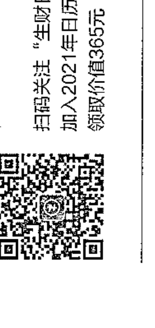


### 建立高端人脉的三条捷径

本书选自“释放”的主题

1. 高端平台的功能：自己为稳不变（推测为“自己稳固不变”），站在平台的同路上（推测为“同侧”或“通道上”）。

2. 的共识流量运营：随着产品思维向用户思维的转变，未来高端客户价值会越来越大，只要用心服务好，就有机会围绕他们的衣食住行做全生命周期的运营。

3. 高端平台的工作机会：可以考虑高尔夫球俱乐部、高端汽车俱乐部、高端商学院等方（推测为“方向”）向上的工作机会，利用平台的光势（推测为“光环”或“权势”），获取和经营自己专属的高端朋（推测为“朋友”）友圈。

长期来看，可能年入百万不是难事。


> 扫码关注“注钞白婷”（推测为“生财日历”或类似名称，OCR 严重错误） 加入 2021 年日历共读营 领取价值 365 元“身材礼包”（推测为“生财礼包”）


FIRAY（推测为 FRIDAY） 星期五

辛丑年 二月初七


### 春来人的几点创业经验分享

节选自“鱼丸”的主题

- 公司的使命一定要明确；
- 创始人（核心意见领袖）的力度可快速实现品牌宣传；
- 优质内容是增长引爆器，要创作有复利价值的内容；
- 要有长期思维的意识，提前做好风险抵御策略；
- 从更长远的角度帮助员工成长；
- 标准化流程可以极大地提升工作效率；
- 学会赞美别人；
- 要比竞争对手做更多的工作。


扫码关注“生如夏花”
加入2021年日升东壕营
解锁价值$85元“生发礼包”

## 春分

20日
3月 Mar
星期六
辛丑年 二月初八

### 互联网流量怎么赚钱？

节选自“张雄”的主题

自然界的水流是如何赚钱？最常见的是灌溉和发电。互联网流量与之对比，灌溉怎么解释？我举个例子，你们翻翻自己：“我要私欲”。

解释一下，农民伯伯在灌溉的时候，是不是顺手把养料、农药之类的放在水里一起灌溉了？作物在吸收水分的同时也吸收了养料和农药。你在通过向受众灌输信息的时候，是不是也可以顺手带上一两个可以改变用户心理的信息？比如品牌传播和电商导流……

发电呢？我每个词，你们翻翻自己品，“门槛”。

解释一下，水分发电是怎么实现的？通过过闸阻挡水流上下流以获得水位差用力推动发电机转动。那么信息流呢？如何阻挡信息流？设置他们获取信息的门槛对不对？什么门槛？
---这就是知识付费。

星期日
辛丑年 二月初九


Mar


扫码关注“生财后记”
加入2021年日历书联署
领取价值365元“生财礼包”

### 交易创财富

交易创财富。一笔交易哪怕自己没利润，只要不亏，有信息流就都是交易的价值的。因此，我非常看重重聊的社群关系，因为谁都可能是我5年后的“地主爸爸”或者合伙人。

有句话说的很好，从来不能小看一个30岁以下的男人，谁知道他明天会怎么样呢？其实互联网做久了，只要老实卖家不下牌桌，一切都有可能。

### 成年人的世界里有业务就会产生友谊

节选自“无妄”的主题

星期一
辛丑年 二月初十

22日


扫描关注“生财日历”
加入2021生日历共读营
领取价值365元“生财礼包”


### 五分钟写一篇百万阅读的引流内容

节选自“郭靖天”的主题

- 利用评论区点赞高的评论简单修改一下作为标题；
- 颠覆雷劈评论，再加入一些过渡内容；
- 文中插入引流文案；
- 批量账号发文宣；
- 可以在文章里穿插程广告。


加入2021年日历共读营

领现价值365元“年终礼包”


23日
星期二
辛丑年 二月十一

## 24日

3月 Mar
星期三
辛丑年 二月十二


### 人生的第一个“月入百万”复盘

节选自“签到”的主题

2020年4月，公司创造了119万元的利润，我也首次完成“月入百万”的目标。

- 我学会了专注：我做知识付费，是对自我专注多年的沉淀的再次延伸；
- 我学会了生意人的個性与愿望：2019年8月开始，恢复知识付费项目，到3月共营收200万元；
- 我学会了赢才断学习；学习不止，思维更新不止，外部捐赠不让。

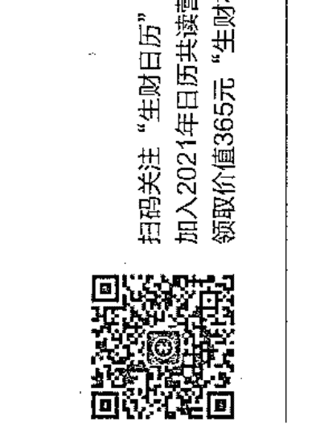

## 25日

星期四
辛丑年 二月十三


### 创业者要尽量理解商业底层逻辑

节选自“Caoz”的主题

比如：卖你券会到底层是什么，淘宝收服务费估计原则，作为商家、消费者、最终用户的最初目标是什么。

理解底层逻辑，不一定会让你立刻赚到钱，但有两个好处：

- 遇到赚钱机会的回馈，可以迅速验证和放大；
- 在寻找赚钱机会的时候少交很多学费。


扫码关注“年册日历”
加入2021年日历共建群
领取价值365元“生财礼包”

## 26日

星期五
辛丑年 二月十四


### 闲鱼增加权重的11种方法

节选自“语学良”的主题

- 完善个人资料；
- 每天擦亮，早上9点到11点擦亮效果最好；
- 减少退货；
- 精准投放到鱼塘；
- 产品上架时分享到站外；
- 分享淘口令；
- 赞，我想要，留言评论越多，权重越大；
- 合理制定价格，如果按照平台推荐的价格来上架，可以增加权重；
- 提高图片的点击率；
- 详细说明有视频可以增加权重；
- 信用等级越高，权重越大。


扫码备注“生财日历”
加入2021年日历共享群
领取价值365元“生财礼包”

## 27日

3号
星期六
辛丑年 二月十五

### 认知篇

### 研究自己比研究项目重要

节选自“乔里奥”的主题

我们计划开启一个项目时，一定不要迷失在对项目的研究上而忽略了对研究自身情况。

事实上，研究项目和研究自己应该是并重的，甚至研究自己比研究项目更加重要。

拿短视频举例来说，相对于研究平台规则、研究视频模式、研究带货逻辑，更重要的是先研究什么视频适合自己去做。

找到一个自己能够低成本长期坚持做下去的方式，才是这件事能不能做成的关键，它的本质在于自身所用资源与成事所需资源的匹配程度。


扫码关注“生财日历”
加入2021年日历粉丝联盟
领取价值3655元“生财礼包”

## 28日

星期日
辛丑年 二月十六


### 实体店如何通过微信在陌生城市做裂变营销？

节选自“骏马”的主题

- 找到一个流量大的地方，如超市门口，通过送礼品，拉群子用户进群；
- 设计海报，用免费产品引流到微信群，并目鼓励朋友进群也可以领；
- 发送各类产品图片、海报图片、红包互动，用胖子用户进行群裂变；
- 统一鼓励微信朋友圈内用户领产品，拍摄领取的视原及图片，不间断群内发送，继续裂变；
- 客户领取产品时积极营销，使客户以低于市场的价格，付钱购买更多数量的产品。


扫码关注“生财有份”
加入2021年旺月共读营
领取价值388元“生财有份”

## 29日

星期一
辛丑年 二月十七


### 对副业的几点建议

节选自“董秘”的主题

- 如果是“996”，业务时间不多，先要合理规划时间，感觉完成主业；
- 如果业务时间多，进个感兴趣的领域包半年，把门槛踏清；
- 形成自己的知识体系，不做替代化业务，复呈总结；
- 前性报复，可能当年能投入都不一定有产出；
- 把想法说出来，寻求大家得意见，不会有那么多人领用的。


扫码关注“生财后记”
加入2021年社群招募
领券价值5853元“生财礼包”

## 30日

星期二
辛丑年 二月十八


### 找个好搭档是创业的重中之重

节选自“范结档”的主题

不是所有的人都能适合NO.01，想做软件小项目，我一个好的技术搭档非常重要，技术人才难创业，找到一个靠谱市场的搭档，同样非常重要。

我的经验是，大约需要至少半年的时间，才有可能找到一个合适的人。当时团队长期之后，两个人的人生观、性格、做事务与眼最喜一致，就可以以真的检验出来了。


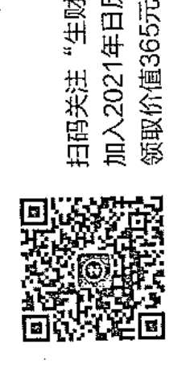

扫码备注“生财日历”
加入2021年的历生运营群
领取价值365元“生财礼包”

## 31日

星期三
辛丑年 二月十九

#### 案例篇

### 建站培训网站月入10000美元需要这三步

节选自“盘点”的主题

- 确定方向：数什么人？做什么网站？用什么样？网站的特色是什么？具体的内容如何设计？
- 寻找客户：通过Facebook引流，通过免费的干货直播实现口碑传播，不再追求华丽而实效的战术，要把时间都放在提升用户价值上；
- 商业化尝试：梳理自己的课程和咨询服务，对内容进行分级，专注于可扩展的收入来源。


扫码关注“生财日历”
加入2021生日历读营
领价值3885元“生财礼包”

# 四月

APR

碰到有人问我“生财有术”的目标和使命是什么，我今天也在龙珠俱乐部简单分享了下我的想法：

“生财有术”的终极使命：让10万个会员赚到钱。

大家成功赚到钱了，“生财有术”也就成功了。

所以，除了提供更多优质稀缺的赚钱信息，加速会员间的信任、链接与合作，现在也在加快速度，引进各种产品，从多个维度赋能大家，一起“生财有术”。

亦仁
于 2020.07.07
#龙珠俱乐部#

## 生财有术｜龙珠俱乐部

龙珠俱乐部于2020年初启动，可以简单理解成“生财有术”的一个股东会，享有“生财有术”部分项目的分红权，持有龙珠越多，内部分红也就越多。

龙珠俱乐部还可以理解成是一个“生财有术”官方高端微信群，除了项目分红，龙珠俱乐部还享有专属见面会、专属交流群、专属资源对接服务等。

俱乐部的人需要符合“生财有术”的价值观（提供价值、真诚、利他），且需要分享过或者准备分享真正的内容干货，满足条件后会收到邀请，在不同的时间被邀请加入。

### 愚人节


### 好的产品一推就能“推”起来

节选自「陈润迪」的主题

在淘系店内做推广，不管是内推还是推广本身，都是为了产品服务的一切工作也都是围绕着产品。起点时情绪就已经成功了一半，我的看法是，产品脱离7成，推广只需要占3成。
所谓道术，“术”是为“道”服务的，二者缺一不可，我的看法是，产品脱离7成，推广只需要占3成。
淘主提套系统算法并不复杂，就算有更新也大抵是表面上的小改变，万变不离其宗。在淘系做推广不用过于沉迷如是说所谓的新技术，其实并没有那么神秘，好的产品一推就能“推”起来。

星期四
辛丑年 二月二十


扫码备注“综合日刊”
回复“2021”领春日福利~
领取价值368元“主题礼包”

### 如何通过折扣卡玩法从心理学上刺激用户消费？

节选自“饭”的主题

充值100元送1000元折扣卡刺激消费，用户会持续使用吗？

从消费者心理学和行為经济学来看：用户付100元买的卡，不用就会觉得“亏了”，这叫沉没成本；

成为会员，消费几次之后会适应价格，不觉得贵；这叫适应性锚定；

卡里的钱等于现金，得到只需100元，丢时要损失1000元，这叫损失回避心理。

所以我认为值得会持续使用。

星期五
辛丑年 二月廿一


扫码关注“生财日历”
加入2021年日历训练营
领取价值2565元“生财礼包”

## 03

星期六
辛丑年 二月廿二


### 跟大公司打交道的五点经验

节选自“Jack”的主题

- 这是一场博弈；在他博弈逻辑中，专业性是第一条要，如果不管专业，我们被压价，直到会丢单；
- 千万不放松；没必要听对抗，一切都从专业角度出发即可，有理有据，不要不充；
- 如果要跟项目中人，就一定要让他发挥好对接作用，有些事情让中间人去沟通协调；
- 尽量让所有内容和模块化、流程化，拟定固定的SOP（标准操作服务），这样既提高效率，又能降低沟通成本，提高沟通效率；
- 商业竞牌很关键，知己知彼，就算不能百战百胜，至少增加获胜的概率。


## 清明

04日
星期日
辛丑年 二月廿三


### 如何给社群起名字？

节选自“光合”的主题

好的名字真能体现几个特点：让用户有熟悉感、有画面感、有感染力，能让用户一听就懂，还能帮他召唤关系。同时也要避免有生僻字，拼鲁或不让人容易理解的关键词。
具体可以用“说给别人听”这个方法测试起名字的好坏。最重要的是，要用文本思维查看待创造问题。创意不是玄之又玄，是用求裸低容辩传播成本的，起名字也是这样。


扫码关注“生财后坊"
加入2021年1月后坊读营
领取价值365元“生财社恩”

### 靠一篇软文为公司创造1000万元利润后的五点经验

节选自“高智商”的主题

软文效果的上下限差距非常大，想要通过一篇软文挖掘巨大的价值，精准把握转化目标客户，还需要注意：

- 提高线上线下连接的效率，首先准备一份自我介绍——我是谁？我能够提供什么？我要做什么？
- 微信的情绪抵抗：加了好友之后，主动发自律介绍，然后去对方的朋友圈，转前几次的动态点个赞；
- 当你引入你其实是有个机会的时候，评论一下这件事对多少人有利，越是多赢的局面，越可能是一个机会，反之，很可能就是一个陷阱；
- 能力、资本、资源、受欢迎，你手里的牌越多，当遇到选择时，你的主动权就越大；
- 成大事者不纠结，一旦决定，就全力以赴。


星期一
辛丑年 二月廿四

### 星期二

辛丑年 二月廿五


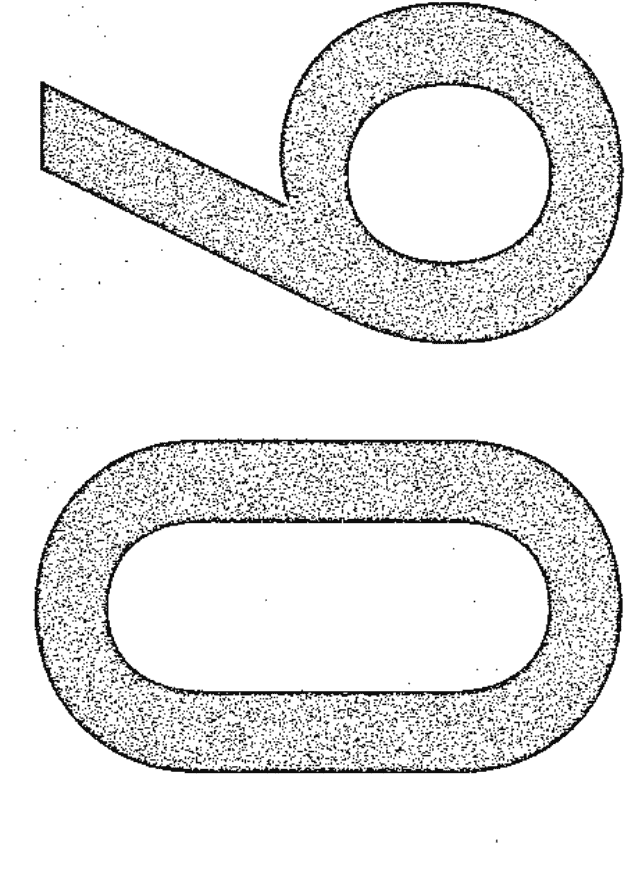


### 企业入驻抖音时要注意的几点

节选自“短鱼儿 Parke”的主题

首先要明确是做品牌发声渠道还是效果营销渠道，如果是前者，可以做品牌自己的账号，粉丝可以尽量触达；后者的效果和曝光都比公众号好。

但如果企业只是利用流量赚钱，那么只需要考虑ROI，重在选择KOL和营销渠道。

如果自家品牌做网红孵化，还要注意：

- 资产不稳定性，KOL的管理履约问题；
- 自己不是流量主的内地方，容易在内容调性上失去定力，自己生产内容为自己导流，团队的积极性将不是特别高；
- 网红流量和品牌价值是两回事，时效强避免网红带来的流量不能转化。


扫码备注“生财日历”
加入2021日币生财社群
领取价值3985元“生财礼包”


### 如何通过VideoScribe制作原创视频赚钱

节选自“蜗牛君”的主题

视频号需要大量原创视频，VideoScribe里有很多卡通动画，但制作原创视频相对比较简单。主要需要写好脚本，然后按照本册加图片，合成动画。内容可以涵盖：思维提升、生活感悟相关、各个垂直领域的视频等。

如何赚钱？

- 视频号+公众号导流广告；
- 视频号+公众号带货；
- 给公众号导流；
- 视频教学培训；
- 卖号。


## 周三

WEDNESDAY

辛丑年 | 二月廿六

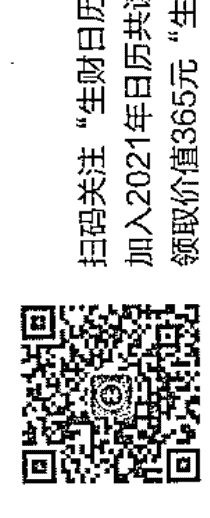

### 我如何在一个月内获得2万多快手粉丝

节目“家长”的主题

注册一个账号，每日更新1至3条，早上7点左右开始更新，每天至少直播6小时。在以上只做垂直账号，地推全部同一个类型，封面统一到风格。

垂直账号内容模式：考智力 / 找不同。

准备好素材（图片和录音）的情况下，制作一个视频不用1分钟的时间，随时随地都可以操作。

扫码关注“生财日历”加入2021生财日历共读营，领取价值365元“生财礼包”


## 4月 09


### “硬恋”是爱这个世界一种更真诚的表达方式

节选自「亦仁」的主题

尽管这样痛，尽管鼓励别人，尽管肯定别人的努力与结果，尽管还是理性意见，要么当耳边风，要么就当会说。

少吐槽，不要事后吐槽。更不要事后吐槽比你厉害的人，绝大多时候，你的吐槽只会暴露自己的情绪和好意不够，稍微懂点的人，就能通过你的吐槽，看出你的层次。


扫码关注“生财有术”加入2021年财务共读营，领取价值399元“生财礼包”

### 星期五

FRIDAY

辛丑年 | 二月初八

## 4月 10

### 星期六

SATURDAY

辛丑年 | 二月初九


### 如何迈出创业心理上的第一步？

节选自“第15玲”的主题

有的人感到创业总是迈不出第一步，我的办法是把人生的镜头拉长；

比如你站在一个第三者角度纵观你这一生，你有什么是不可失去的？珍贵的经历？你做出创办的这个选择你会失去这些吗？如果不？甚至得到比失去的多，那问题不解答不会只是自己人生的牺牲或者是自我从众呢？

很多困难都可以用把镜头拉长这个方法来解决，我们的生命也不过是沧海一粟。


扫码关注“生财日历”加入2021年日历社群营，原价价值365元 “生财礼包”

## 4月 11

### 星期日

SUNDAY

辛丑年｜二月廿七

### 水知音

### 永远保持好奇心

节选自“成都景观好仔”的主题

不仅要对新事物保持好奇心，也要对即将退出舞台的保持平常心。

看到任何新事物，都有可能举个例子，尤其是出现频率还那么高的新事物，随时保持一颗旺盛的心，发现并思考。不仅想法很重要，执行力更重要。

某些产品趋势上时代变迁和竞争对手的蜂拥而至，都会有周期，都会走向衰落，需要做的就是重新开始下一波周期。


扫码关注 “车万好运" 加入2021年6月6日共读营，领取价值365元 "生财礼包"

## 4月 12

### 星期一

MONDAY

辛丑年 | 三月初一

### 总结稿

### 在淘宝服务市场领域创业要注意的问题

书选自“天际浪子”的主题

服务市场一定要注意规避规则风险。规则的变动，直接会导致你的应用变得无用。如之前很火爆的“收费有礼”，“加购有礼”。你的应用就应为平台规则的强化而解散了。

另外注意数据安全，这是一条红线，绝对不能碰，出了安全问题等于零。

对我们来说，哪怕不发展，也要先保证安全。

扫码关注“生财有术”加入2021年群总答疑，续费仅需365元 “生财社区”

### 提高认知能力需要关注的三个方面

节选自“自一喵”的主题

- 解决问题：所有的生意都离不开解决客户的问题，解决自己的问题；
- 确定优先级：擅长北漂的人会按时间分发，把整片整段时间用在最重要的事情上；
- 永远能在变化中找到不变，习惯性地追问事情的本质。

## 4月 13

### 星期二

TUESDAY

辛丑年 | 三月初二


### 如何通过为某个细分领域用户提供产品赚钱?

节选自“明白”的主题

一句话总结模式：把某个细分领域的产品集中起来，卖给用户，赚取佣金。

- 需求利和供应链：从淘宝选品，用一个表格把选出的产品整理到一起展览，方便用户查找和下单。
- 流量：通过细化用户感兴趣的信息引流。
- 营销：把重点放在细化产品的购买理由上，聚焦在能为用户解决什么问题。
- 变现：用户通过链接下单，你赚取佣金。如果信任建立起来还可以做社群、知识付费等。

扫码关注“生财日历”加入2021年日历粉丝营，领取价值395元“生财礼包”


## 4月 14

## 星期三

WEDNESDAY

辛丑年 | 三月初三

## 4月 15

### 星期四

THURSDAY | 辛丑年 | 三月初四

### 普通人如何在抖音上赚钱？

节选自“利仁”的主题

分成五步走：

- 加1000个在抖音上赚到了钱的微信好友；
- 向他们的朋友圈，了解他们在卖什么，卖得怎么样；
- 以买家身份给他们刷屏，买得不爽就买下商品，完整地体验流程；
- 再帮助不需要代理、抖音优质代发、流量合作，按照成交量给佣金；
- 更好的情况下，做一些修改，复制他们的商业模式。

按页面推进，成为他们的下游，成为他们的竞争者，成为他们的服务方，成为他们的上游。


## 4月 16

### 星期五

FRIDAY

辛丑年 | 三月初五

### 乡情直播：如何在农村进行地推拉新实现月佣金30万元？

*节选自“孙续”的主题*

- 解决信任度：找村委会合作，把淘宝支付宝的拉新作为电商扶贫项目，推广淘宝、支付宝的同时，赠送手机卡，并向贫困户免费资助面价；
- 解决团队习量化问题：就地联系职业下乡，自己可以以廉的赠手机，以廉诚的资习解决持续性与稳定度的问题。自己可以在村里私敢通信渠道，做联远至手机卡的推广，赠送手机卡引注呼叫、室、支付室、跑步；
- 提高效率：提高产出：在镇上的手机店送手机卡、支习作营机器人，让老版直接转礼品进项目转发加返利，然后带礼品进人地进行散发200人并转发展朋友圈，进行二次裂变。


扫码关注“生涯日历”加入2021年日历挑战赛，领取价值365元“生涯礼包”

### 一年时间从0到1000万粉的短视频定位建议

节选自“潇潇”的主题

- 根据期望的工作、产品类型、生活需要选择让你觉得舒服而不是你自己征服，别老想着去做自己的兴趣爱好，期待做着做着就变大了。通常，做着做着你就放弃了，还开始讨厌自己的爱好。
- 选大众热门的赛道：应该选自己擅长的、之前有过积累的，但是如果小众垂直领域做得比较不局限，做不大的生意。
- 通过作品内容控制人群：24岁以上女性越多越好，17岁以下的未成年人越少越好。


## 4月 17

### 星期六

SATURDAY

辛丑年 | 三月初六

扫码关注“生财有术”加入2021年后的生财课堂，领取价值399元“生财礼包”


## 4月 18

### 星期日

SUNDAY

辛丑年 | 三月初七

### 微信群里令人反感的10种人

节选自“孙二”的主页

- 有事没事发大段语音、连发几张照片；
- 为什么读通知要自己爬上去；
- 分不清楚什么场合、什么星的氛围；
- 发没有内容红包，比如群的特指属性；
- 抢红包不发红包，潜水不发红包；
- 随便扯与非扯之类的语音；
- 发红包远差于群里红包数的标准；
- 没事就自己的文章，部分与转发的群里红包求赞、求关注；
- 不遵守群里的规矩，比如发个不好中间聊天与转发的群里随意发言；
- 在不是自己的专业领域里大放厥词，分享或思考内容给群主带来麻烦。

如果你的群里有下列这些人，要留意了，如果你在群里看这些群主，可能已经上了潜在的诈骗名单。


扫码关注“华报今日”加入2021年1月的读者群，领取价值365元“生活礼包”


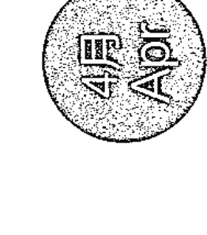

### 星期一

MONDAY

辛丑年 | 三月初八


### 如何了解用户的真实想法?

节选自 “明白”的主题

产品一定是给人的用，所以，我们需要了解用户的真实想法:

- 用户想要什么功能？
- 用来做什么事情?
- 他们现在是怎么解决这个问题的?
- 他们是否愿意付费?(先谈在差，完成产品雏形)
- 能不能作为种子用户、邀请来做方案?

这些事情, 我们都可以进市场分折阶段、在开发产品之前、全部搞清楚。


扫码备注 “生财月历” 加入 2024 年日历来啦营，领取价值 385 元 “生财社群”

## 4月 19

### 谷雨


### 星期二

TUESDAY

辛丑年 | 三月初九

## 项目篇

### 一个做抖音短视频赚钱的小路子

节选自“徐十胖”的主题

打开抖音App，查看游戏推广达人一周的收入排行榜，把这个排行榜上面的账号全部给研究一遍，做出这些专看跟着这些类火的号，赚到点钱的问题不大。

而且这些火又是小游戏推广的收入，账号做起来了以后，还会有一些其他的收入。


扫码关注“生财日历”加入2021年日历的共读营，领取价值365元“生财礼包”


### 创业者要做好的两个心理建设

节选自“黎校”的主题

- 切记不要眼波逐流：热点在年年有，像股市一样，每年都有明星投资人，但是真正长久活下来的只有巴菲特定要少就人。
- 切记不要浮学耀耳：任何项目都会进入“深水攻”，这才是真正考验创始者的地方，我看到的大部分创业者在进入“深水攻”后都会试验碰止，其实真正的问题在于创业者的心力无法穿透“深水攻”。


扫码关注“五8日历”加入2021年日历共读营，@陈价值观365天 “生到社包”

## 4月 21

## 星期三

WEDNESDAY

辛丑年 | 三月初十


## 4月 22

### 地球日


### 星期四

THURSDAY

辛丑年 | 三月十一


### 3个月把亚马逊产品做到百万销售，我做对了什么？

节选自 “lissa Tam” 的主题

我比其他人都注重细节上的东西。

我会做产品关键词包档案：每天记录不同的产品关键词排名到了第几名？有没有出现什么新的产品？产品的完整度如何？每天列出单量是多少？ 排名推会是多少了？是降了还是升了？做了什么读得出的的结果是什么？ 掉包结果的原因是什么？该怎么做？同样看排多了，心里也会有很多可以抓住的细节，一两个细节优化可能都不到效果，但当很多细节优化叠加起来，就能聚沙成塔，形成自己的独特竞争力。

扫码关注 “生鲜日历” 加入2021鲜日历冻读营，@底价搜365元 “生鲜礼盒”


### 星期五

FRIDAY

辛丑年 | 三月十二


### 淘宝服务市场有哪些创业优势？

节选自“天际段子”的主题

落锁近，背景大好耐潮流，竞争相对小。淘宝卖家有良好的付费习惯，即便在移动支付尚未兴起的2010年也是如此。

而它将同一软件做成工具平台，同时服务大量卖家的这种销售模式，单个卖家的付费成本很低，更不会存在拖款、赖账等问题。每个月都有付费，商业模式具有很好的持续性。


### 星期六

SATURDAY

辛丑年 三月十三


### 什么是市场的参与者？

节选自“逐梦”的主题

- 市场中有各式各样的参与者：
  - 按盈利划分，有单边与套利；
  - 按持仓时间分，有长线、中线、短线与日内；
  - 按盈利来源分，有震荡与趋势；
  - 按入场时机分，有左侧交易与右侧交易；
  - 按入场理由分，有基本面研究、技术分析、消息驱动、数据驱动、政策驱动；

每一类参与者都有其特定的交易手法，了解每一类参与者的交易模式，有助于理解市场的变化。

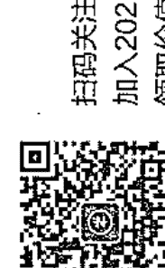

扫码关注“生财日历”加入2021年日历共读营，领取价值365元“生财笔记”

### 淘宝蓝海小类目玩法的七个步骤

节选自“密玛”的主题

- 选品：通过竞争小、对手弱、利润高的产品，如果要用选品工具就用“生意参谋”的“市场洞察”；
- 标题：1688网站上资源比较齐全，注意遵实力求变家、诚信速卖家和一件代发；
- 问题：选择前十目标竞争对手的主模仿；
- 主图要是变化、美强化：详情页抓住痛点、信任度和卖点进行布局；
- 上架宝贝；
- 开车：模仿真实购物轨迹——搜索关键词，找到宝贝，真实下单，提速宝贝的展现率；
- 客服：设置快捷回复。


扫码关注“生财日历”加入2021会员的共读营，领取价值365元“生财礼包”


### 星期一

MONDAY

辛丑年｜三月十五


### 所谓小众，很多时候只是对比的结果

节选自“墨狗”的主题

谷歌浏览器的市场份额是市场上的70%，每月的活跃用户有10亿，这些数据其实并不小，就算我们只满足里面极小部分人的需求，都有很大的利用空间。

微软Office系列的插件，整个生态很大，只是通常被人盲目地认为小而已。

又比如Shopify这家公司，你可以理解为海外的“有赞”，为几百万的店家提供开店工具，里面的插件很多都是个人或者小团队做的，这中属于天然用户聚集的地方。市场已经帮你把店家用户聚起来了，就看你如何去分这块蛋糕了。


扫码关注“生财日历”加入2021年日历共读营，领取价值365元“生财礼包”


### 星期二

癸丑年 | 三月十六


### 如何用软件的邀请功能获得稳定的被动收入？

书选自“游园”的主题

很多软件都有邀请好友的功能，我们的目的就是找到一个邀请好友稳定，且能给钱激励的产品：

然后运营一个公众号，名字要扣定这个产品有一定的关联度，利用微信的自然搜索流量来排名公众号，用一些自动发优质文章的运营工具，每天发文章吸粉；

接着配置公众号的文章挂件，名字取得吸引人一些（比如领取微信免费券）；

再配置上自己的邀请图，等着被动流量上门即可。


---

### 认识到所有问题都是自己的问题，是成长的关键

节选自“亦仁”的主题

复盘“生物手术”看到案例，却赚不到100万元，可能是昊你过对，可能方向不对，但如果远到别人的1%都做不到，那只能只有一个原因：你自己不行。

比如知乎好物，很多淘友通过淘宝里面的分享帖子，月入1万元以上，你为什么不行？比如别人做得早，别人写作能力强，别人有圈子交流，别人有工具，别人赶上了“6.18”，别人有时间段，别人会找热点……

承认吧，做不到就是因为自己不行。

不行的原因在于看得不够多、尝试得不够多、反思得不够多，凡此三点。


---

### 星期四

辛丑年 | 三月十八


### 知乎好物如何借助百度指数选品

节选自“张勇”的主题

一般人会根据自己的领域，自己的成功选品，很容易造成所选领域竞争激烈。借助百度指数，可以找到很多对流量大、竞争小的领域。比如：

- 1. 儿童手表。除“儿童手表”外，“电话手表”、“电话”搜索量也很大，写文章可以 “电话手表” 为标题占据这个细分领域。当点击率达到一定程度，在“儿童手表”的排名也会上升；
- 2. 扭杆菌。“扭杆菌” 等大大的关键词竞争激烈，根据用户的搜索习惯，常会出现 *“XXXX元以下的手扭杆菌的呦“。而我们这些相同和品搜索关键词写一篇文章，基本没有竞争，比如 “适 明江杆菌”。

总之，大致思路就是根据用户搜索习惯分细分领域。


---

### 星期五

辛丑年 | 三月十九


### 热门号转粉率低、变现方式少，为什么我还是建议你做热门号？

节选自 “Troy” 的主题

1. 人设号要求更高：需要颜值、口才、某个行业经营多年的专业能力，运营好的真的少。
2. 符合用户需求：普通用户粉丝都是消遣时间，找找乐子，如果做到令全球人怎么做社群、教你怎么学英语、教你怎么提升自己内容，不会继续留在视频号上两个不停。
3. 综合平台利益：不少短视频平台前期都是依靠泛娱乐的内容拉紧海量用户，延长使用的时间，读者也无法迈出这一步，只有真正的日常化直播使用户达到一定等级，才会有足够你专业知识内容可以发海量日常当中吸引到有价值的用户，才是平台支持商业变现的开始。


---

# MAY

很多人想创业，都觉得应该做个产品，其实不然。

用户的需求和痛点，都对应着很多解决方案，如：文章、课程、社群、工具、问答、咨询、训练营、电商等。

只要能解决用户的问题，解决方案无高低贵贱之分。

亦仁
于2020.07.14

### 轻享

“生财有术”日常专栏“#轻享#”创办在另一个专栏“生财合伙人#”之后，旨在打造给更多圈友分享自己技能和经验的平台。

每周一，亦仁会邀请一位行走江湖且有独特技能、别样经历的小伙伴来做一些具体主题的分享。他们或擅长于Facebook广告投放，或擅长于裂变方案设计，或擅长于数据挖掘取与分析，或擅长于用户转化，或擅长于文案优化……通过这个专栏，在认识更多优秀圈友的同时，还总能在生财的某些环节上体验不同的视角。

20多万字的各领域干货分享，只聊具体不务虚，帮圈友大开眼界。

---

### 星期六

辛丑年 | 三月二十

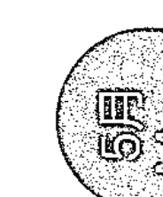


### 通过闲鱼卖外贸课程，2周赚2000元零花钱的技巧

节选自“润物微行”的主题

- 1. 新人不要想着创新，前期照搬大佬的思路；
- 2. 在Facebook相应论坛上搜索关键词“外贸”；
- 3. 通过简介筛选，看到优质价廉的外教资源；
- 4. 在平台上搜课程，以中间人的角色安排免费试听课程；
- 5. 兼职信息差。


---

### 星期日

辛丑年 | 三月廿一

### 做跨境电商如何提高成功率？

书选目 "LisaLian" 的主题

成功率取决于你的竞争优势大小、资源和能力。

- 跨境电商涉及的主要因素有：
  - 1. 产品30%，供应链20%，平台20%，运营30%。
  - 2. 供应链决定产品重量和利润空间，影响未来发展；
  - 3. 平台决定流量大小；
  - 4. 运营决定电商流动程度及回本周期。
  - 任何一点占了优势，都有入局机会。总之，踏踏实实做自己擅长的事情，专注做积累。


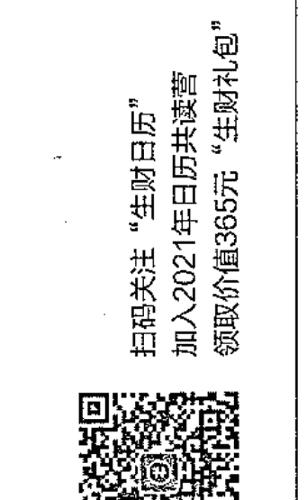

---

### 星期一

辛丑年 | 三月廿二


### 抖音实操：七步新餐饮品牌“爆店”回本盈利

节选自“徐小敏”的主题

- 1. 找到当地发布过同类产品的美食品，通过定位找到感兴趣的人；
- 2. 私信要微信联系方式，募集人数60到100人不等，之后建群；
- 3. 拍摄10到200个关于品牌装修、产品及人物的视频；
- 4. 在店面拍摄试营业状态，每天下午6点发布视频，并在商圈6公里内投“Dou+”，发布周期为3天；
- 5. 每天30人次买中品鉴产品，买走抖音集赞奖励活动；
- 6. 安排开业仪式，每天定量放入顾客，人场氛围不停发抖音并带定位；
- 7. 接得上门咨询加盟顾客。

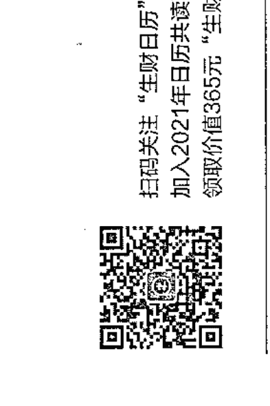

---

## 五四青年节

### 星期二

辛丑年 | 三月初三


### 年纪从来不是限制成长的理由

书选自 “白一鸣” 的主题

如果你年轻，学习能力确实是你强大的本钱。社会经验不足，对真实的世界缺少考究的感知，没办法把零到的信息和实践经验关联起，是你最大的缺陷。对你来说，广泛优先的探索，开眼界、长见识更重要。

如果你超过 30 岁，要开始过渡到对上层智慧的领悟。过了 30 岁，人的记忆、学习能力越来越差，但与经验判断直觉的智力保持不败，甚至可以不断提升。禅宗、哲学等偏向人文学科的知识会对你很有帮助，了解万事万物的基本运行规律，知道从先人经历中找相似性，能更快读懂超出事物的本质，用更简单的方式洞察真相。


---

## 星期三

辛丑年 三月廿四


### 公司股权的五个生命线

节选自“Richard 顾过”的主题

- 1. 占股份57%以上的老板对 enterprise 有完全控制权；
- 2. 占股份51%的老板有相对控制权；
- 3. 占股份34%的股东有一票否决权；
- 4. 占股份20%的股东要求召开股东大会，不能由同类项目；
- 5. 占股份10%的股东可以申请解散公司。

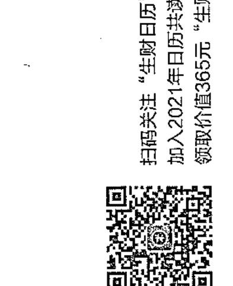

---

### 星期四

辛丑年 | 三月初五


### 新手如何做好淘宝?

节目自“聂鲁达”的主题

- 1. 坚持学习平台提供的免费课程：淘宝大学、万堂书院做得好好学习，不管是新手还是大牛，学习都是持之以恒的道理；
- 2. 思考基础原理：我当初读李宇怀孕了淘宝直通车后台的动手操作建议、生意参谋”每一次小结、“生意参谋”中市场各项数据的变化；
- 3. 不断实践：不能拿出真金白银去操作，珍惜每一分花费。从添加计划，添加关键字，到修改时间折扣、定向调价、标品修改、直通车图制作，都是边学习边操作的。


---

### 星期五

辛丑年 | 三月廿六


### 如何选择一个靠谱的副业？

节选自 “哇哈哈”的主题

- 1. 副业要跟主谋考密，考核的重点是单位时间收益；
- 2. 副业须具备可持续发展性；
- 3. 珍惜同事，选出有核心竞争力产品，真正帮助客户而不是消耗人品；
- 4. 务必考察清楚公司、投资方、团队长等是否靠谱。
- 5. 空杯心态：当你真的想做一件事，先把自己旧有的观念扔扔，也许就是它阻碍了你获得收益；
- 6. 赚钱的路径是真的很创新，找到平台，跟对强干牛人，“坚韧 + 勤奋”，起来！


---

### 星期六

辛丑年 | 三月廿七


### 5月热闻：有人的地方就有需求

书选目“亦仁”的主题

人聚集在哪里，需求就聚集在哪里。

如果一个大平台的内容没有提供官方权威成绩单，那么这种权威成绩单就是一个很好的创业机会。

找到合适的应用场景，数据会产生巨大价值。


---

### 星期日

辛丑年 | 三月廿八


### 花10000元省几万元中介费的案例

节选信“高远”的主题

通过短信活动一共花了不到1000元，省了几万元中介费，我到八宝团内做在地图进行地图标注信息

- 1、最开始通过中介找。中介最少不“要几万元；
- 2、诚恳话：从“大代理”上将所有涉及我行行业务的公司公示的电话、邮箱等联系方式找出来；
- 3、做数据处理，保留所有的手机号；
- 4、用短信平台发转让广告，跟回复转让线索的法人或总经理接个联系，谈细节。


---

### 星期一

辛丑年 | 三月廿九

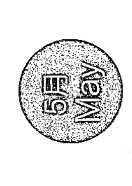


### 如何练习自己的人脉连接和经营能力？

节选自“百川”的主题

如果性格内向，可以先学怎么在社交媒体上交际，同时申请一个女性号和一个男性号；

然后是看看有多少异性是你会回复的，又有哪些是你感兴趣的，然后写下为什么；

可以用男姓的号编辑几条打招呼时的文案，查看哪些回复率比较高，哪些为下为什么有意思回复你，反复测试，动脑子研究，刻意练习几次就会进步很大。

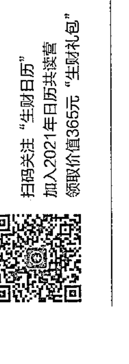

---

### 传统媒体亏掉100万元的经验

节选自“何妈”的主题

传统媒体的价值是很难去评判的，宣传对于有些类型的用户来说，信任度的背书一定会需要比其他做从零。

试题或者试放，得去试才知道，但要想知道什么时候该坚持，什么时机该及时的止损。

千万不要觉得你比别人聪明，往往选择多的人就是认为自己比别人聪明才上当的，对待有些事情做个傻子挺好！

---

### 在知乎上如何创作优质内容？

节选自“唐唐芦”的主题

- 1. 根据自己的实际情况来创作。“我手写我心”，创作不是用编乱造，而是根据你平时工作生活掌握的实际情况来写；
- 2. 选用典型且结构紧凑；
- 3. 文章开头要有趣或引言；
- 4. 配图要的地方尽量配图，干货类文章容易给人一种爆的感觉，配上图片可以很好的解决这个问题；
- 5. 调动用户的情绪，有意识地用一些常识点描述得有趣味性。


---

### 除了专注于赚钱，还可以为专注赚钱的人提供服务

节选自 “林海” 的主题

可能现在很多人在刷赚钱时都会抓到一些平台平台，比如抖音、快手、推特、ins或者其他的。这种平台有很多，在你一列表里在平台上，大致的目标无外乎都是明确的：

- 1. 要么从平台上直接获取流量，尽量转化为自己的私域，然后裂变，多重转化后，最终变现。
- 2. 要么从平台上直接获取流量，尽量转化为自己的私域，然后裂变，多重转化后，最终变现。

“要以用户利益为前提，尊重用户，其次要流量，在平台规则之上获取更多信息，请通过种子用户；然后与他们建立信任；最后在他们之上，引发裂变。”

所以大家在思考上就会有一些相似的反感。我的思想知道哪些东西现在很多人，我也要强调出差不多内容与内容有差异的工者我们提供的一个内容分析平台与我们提供不同的差异，我们就应该提供我们的不同的方案。不同平台的不问诉求，我对我应该不同问的工具，通过这种方式，我赚到丁人生的第一个一百万。

---

### 无货源店铺启动的12个步骤

节选自“小海”的主题

- 1. 选款;
- 2. 购买;
- 3. 进一套你喜欢的拍摄模板;
- 4. 搭建一个固定的拍摄场景;
- 5. 拍摄一段旋转视频和不同角度的主题;
- 6. 创建一个固定的PS模板;
- 7. 批量修改主题;
- 8. 进样品;
- 9. 各1688网站签寄代发协议，并铺货、改主图、改标题;
- 10. 每天保持上新;
- 11. 剔除30天内无销量、无收藏加购的宝贝;
- 12. 等订单，回头检查之前的操作。


### 星期五

辛丑年|四月初三


## 15

SATURDAY

星期六

辛丑年 | 四月初四


### 要特别留意那些比你厉害的人随口给你的建议

节选自“刘仁”的主题

赵昌智的人，时间越宝贵，没什么利益关系的情况下，他不可能有时间坐下来，给你一整截建议，甚至不会花工夫解答你办事。但他们会随口提到的点，基本就装着他们的见解、格局和判断，也许就来说，那就是关键的破局点、增长点，是外部智提。


扫码关注“生财后记”
加入2.5万人每日共读营
领你价值365万“生财礼包”


### 本地订阅号的做法

节选自 “一个人看夕阳”的主题

- 1. 定位：
  专注订阅号定位，比如做资讯、服务。
- 2. 信息渠道：
  建立自己的信息渠道，可以先从个人小号开始。
- 3. 信息服务变现：
  建立本地各种服务信息查询，比如本地公共交通、本地的网络电话本。
- 4. 电商：
  转账服务号，做本地电商，利用分销模式帮商家卖实体产品，推广会员。


## 17

MONDAY

星期一

辛丑年 | 四月初六


### 如何理解 “创新”?

节选自 “V先生”的主题

天下没有新鲜事，太阳底下都是新鲜事。前半句说的是回忆事物多，但总结起来，范特的思维模型还不是那么几个。后半句说的是思维和思维模型存于你的主观世界，而在真实的客观世界里的事物，却早就以百万计，常发生而不察觉。如果你带着模型和书本知识，不深入市场一线、不深入消费者，是无法真正了解事物是怎样变化的，也无法做出创新。


扫码关注“生财有术”加入2021年日历共享营领取价值569元“生财礼包”

### 社群商业模式价格设计

节选自 “scalers”的主题

- 1. 正常地卖票、做课、做训练营；
- 2. 开发投资人加倍卖票、做课、做训练营；
- 3. 再教“1000人如何”教人买课、做课（打造个人品牌、营销、产品设计）。

这是一个逐步升级的过程，每升级一次，价格可以提高十倍。而且每一次升级，势能自然能增加。

扫码关注 “生财日历”
加入2021 年日升共进营
现价仅需35元，“生的利息”。


### 创业先要会算账

节选自“雨川”的主题

我在几家公司做运营的时候参与过好几个内部孵化的项目，但是无一幸免，全部失败。复盘之后，再次反思问自己，到底为什么没能赚到钱？

“答案就是没有好好算账！《孙子兵法》第一篇《计篇》，就是在讲打仗之前如何精细地计算，确定能胜才打仗，而不是靠减少士兵多数奇谋巧计。”

用生意人的逻辑思考，最应该被清楚的，是在开始这个项目之前就先计算所有成本。

“我很少像我当初严重忽略了这个环节，只知道分析用户痛点，竞品分析，调研，产品是规划度。惨遭后面我学会了，现在我有200%的细心做任何生意都能对不负再亏钱。忘掉所有的创业，老老实实出做一个生意人，把账算清楚。”


“扫码关注“生财日历”
加入2021每日历共读营
领取价值368元“生财礼包””


## 20

5月 May

THURSDAY
星期四
辛丑年·四月初九

解惑局

### 如何找到自己的特长和爱好？

书选自 “Albert” 的主题

- 1. 如何找到特长和爱好：
  通过淘宝、京东购物清单、朋友圈、手机相册等日常发的动态，找到自己的时间花费在哪里了。愿意花费时间的事情，通常是有兴趣或者擅长的。
- 2. 寻找特长和爱好意义：
  工作和事业最好是自己擅长的，这样容易做好；其次是自己的爱好，这样容易坚持下去，不至于半途而废。否则，一定要能提升自己的能力，使自己习得新的技能。


### 小满

5月 MAY

21

FRIDAY
星期五
辛丑年｜四月初十

认知篇

### 四个赚钱锦囊

书选自“苏汇”的主题

- 1. 不要在赚钱的事情上拥有偏见，做技术的可以去写文章，做运动类，做轻创业类的可以去写“程序”，写代码，需要你就做什么就做什么，眼见手头事，不要想不一样，先左思如何做到一样，像星级学习绝大部分人做不到的正事，赚钱的都是少部分人；
- 2. 从你的开始，眼见手头事，不要想不一样，先左思如何做到一样，像星级学习绝大部分人做不到的正事，赚钱的都是少部分人；
- 3. 不要看隔壁人口声说自己是赚钱的，去看那些的实力明显超过了工作精英水平的人，静修他们的在做什么；
- 4. 换个圈子，你身边的人才在说生活，你自然也会这样，你身边的人都在说这么吃喝玩乐，你也会这样。


扫码关注“生财日历”
加入2021日历的共读圈
领你的赚385元“生财礼包”

### 流量不在多，而在于流动

节选自“亦仁”的主题

当从只到反流量的核心是“流”的时候，对流量的解释格文更深一步。
让流量流动起来，从一个钱货流到一个载体，从一个人流到另一个人，从一个产品流到另一个人产品，举一反三。
初次接触流量，一点一点引发，堆一个大的塔，越大越好。
流动一动，提一把，让球滚动起来，在别人继续堆砖的时候，先让球滚动起来，就像雪球一样。

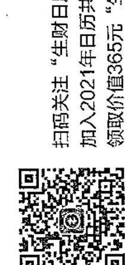


MONDAY

星期一

辛丑年 | 四月十三


### 几类可以赚钱的领域的区别

节选自“草丸”的主题

知乎好物、淘宝客、滴理分润、信息差赚钱、信息或解决手纸短频、这几类是能快速变现的。

> “出海”短视题、私域号、跨境地推经济微互联网服务、这几类是变现难但有潜力，可以提前布局的。

思维冒图、产品研发、运营操盘、SEO、ASO（应用商店优化）、音视频自媒体创作，这类是除自己做外，可以用来批工作的。


扫码关注“纸制日历”
加入2024年日历读者群
领取价值365元“生意社群”


## 25

TUESDAY

星期二

辛丑年｜四月十四

每日晨读

### 卖货如何快速接触到头部信息渠道？

书选自“陈志武”的主题

- 1. 站在你所在的当地社区里深耕;
- 2. 必须要输出价值, 让投资人知道你、记住你甚至喜欢你;
- 3. 找出覆盖密集的手段, 子龙可以让你在小圈子里树立信任;
- 4. 可以采度“勾兑”博主, 让博主给你做题。

如果你有两个手模特就是：利他。


扫码关注“书韵日历”
加入2021年日历共读
领取价值365元“生财礼包”


## 26

WEDNESDAY

星期三

辛丑年 | 四月十五


### 40美元的原油可以抄底吗？

节选自 “Geng”的主题

由于原油市场的标的几乎在本质上都跟期货合约（包括国内的传统原油期货交易，但其实只是银行替代你定期签合约而已），除非有能力实物交割，否则很难抄倒。

保持对衍生品金融市场的敬畏，下手前多做功课。


扫码关注 “生财日历”
加入2021年日历共读营
领取价值365元 “生财礼包”


## 27

THURSDAY

星期四
辛丑年 | 四月十六


### 小白入门淘宝服务行业找客户的四个方法

书连目 “JIAM” 的主题

- 1. 社交媒体引流，寻找电商运营的 QQ 群、贴吧、豆瓣、电商论坛、知识星球等，加好友混脸熟，帮营销加客户；
- 2. 购买电商公众号软广，整合资源高效做广告；
- 3. 主动出击，找6费能力强、乐于花钱的客户；
- 4. 找电商行业代运营商互推，跟电商运营工作室互推，可能效果最佳。

扫码关注“生鲜日报”
加入2021年月日历条家族
领取VALUE 355元 “生鲜礼包”


## 5月 May

## 28

FRIDAY

星期五

辛丑年 | 四月十七


总编辑

### 抖音短视频涨粉心得

节选自 “紫条” 的主题

- 1. 一定要充动起来，否则就是浪费时间；
- 2. 内容为王，数据是内容质量的反映；
- 3. 团队必须有极好的测试（营销）能力；
- 4. 每盈利模式，盈利模式是一切的生意的基础；
- 5. 不要将团队联系在一起学习和练习，一切都来得太晚；
- 6. 坚持一个方向。


扫码关注 “生财日历"
加入2021年日历版生财营
领取价值365元 “生财礼包”

## 29

SATURDAY

星期六

辛丑年 | 四月十八


### 尝试从0到1做一门在线课的六个好处

节选自「占一喵」的主题

- 1. 顾客费；
- 2. 强化自我成长（学+表达+教）；
- 3. 解决或复访自己的问题；
- 4. 多一个社交货币；别人分享名片中，我们发送课；
- 5. 多一个流量抓手：抓住粉丝，就有机会向上销售；
- 6. 多一套做课的流程图：边做边总结自己的SOP，做其他课能用，有个人风格别人抄不走。

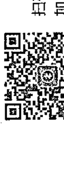

扫码关注“生活日历”
加入2021年日曆共读营
8期仅价值365元“全期礼包”

## 30

星期日
辛丑年 | 四月十九

5月
May

案例篇

### 中东跨境独立站为何能够盈利？

节选自 “三爷-TimQ ”的主题

中东群体富豪超多，普通中东人的月收入都达到3万元人民币，所以国内价格为50元人民币的东西，在那边可以卖到800元人民币，对他们来讲也不算贵，关键是他们喜欢。
我们选了一款普通米光灯笼的手电筒，1688网卖上卖7.5元左右，我们在那边卖1280元，目前出单1500多个。


扫码关注 “跨境自主行”
加入2024年五月打卡社群
领取价值385元 “生存礼包”

### 5月
MAY
31

MONDAY
星期一
辛丑年 | 四月二十


### 人类的全部智慧都包含在两个词汇里：希望和等待

节选自“席梦”的主题

> 这句话出自《基督山伯爵》，是全书的最后一句话。发记得初发行时，师父说一句话：终有一日，你会赚很多很多钱，但那并不代表你真正的学成了。什么的时候，是当你在赚到钱的时候，并没有欣喜，只是想是因为你知道，你所赚的每一分一毫，都是因为你付出了别人所不愿意付出的，忍耐了别人所无法忍随的。到那时，你会知道你值得。

扫码关注“生财日历”
加入2021年日历计划
领取价值365元“生财礼包”


# JUN
六月

谈钱不伤感情，谈钱还增进感情，为什么呢？

当我提问，你这个是怎么赚钱的？实际上问的是，你的闭环是怎么走完的？你的扩展模式是什么？你如何建立壁垒可持续赚钱？

这是比单纯聊流量获取办法、聊产品体验提升方案、聊销售市场拓展、聊产品开发创意更是一个维度的问题，一般也只有老板才会问：这个盘子是怎么赚钱的？

把老板们都答出来了，他们痛痛点点什么，都有大量的共鸣，感情升温快，谈钱也就增进感情了。

苏仁
于 2019.04.14
全国见面会后分享

### 生财有术 | 全国见面会

线上聊不腻，不如线下见一面。“生财有术”定期举办公线见面会活动，帮助盟友之间建立更深层次的链接。

线下见面的活动种类比较多。有“饭局的诱惑”：与同城盟友组织一桌，边吃饭聊天交朋友；有“龙族见面会”：不定期跟盟友做深度连接、资源对接分享等合作；有“高端班”会：邀请重量级分享嘉宾，闭门而谈；有“全国见面会”：全国盟友齐聚一堂，私密直领域大部分靠自己宅内赚钱的心得；还有“私董会”：数十位企业家家互为私人董事，共同促进企业发展，互相理解、互相激发。

线下见面会不定期举办，会提前在星球中告知。

## 儿童节


6月  
June

TUESDAY  
星期二  
辛丑年｜四月廿一

### 关于做短视频账号的建议

书选自“告别”的主题


做任何短视频账号都要先了解粉丝属性，比如做壁纸号，吸引的基本就是16~30岁的年轻人，再大都没人喜欢了，所以我就是针对这一群年轻人的喜好来做内容：

基本都是一些热门动漫、电影、电视剧、明星的内容，然后配上一一些比较文艺、伤感或者有点“甜腻”的语文案来吸引关注。


扫码关注“规划日历”  
加入2021年日历共读营  
领取价值865元“星球礼包”

6月 JUNE

## 02

WEDNESDAY
星期三
辛丑年｜四月廿二

案例篇

### 起名行业如何月入几十万？

节选自“Tiger”的主题

数据：从某词“取名”来看，每天微信指数几十万的搜索数据和百度3000多万次的网页搜索量。

通过短视频，介绍中华文化与起名艺术，引导用户加微信，并且提供一对一的起名服务。

根据个人生辰做一些分类，成本基本可以忽略不计。


扫码关注“生财日历”
加入2021年日百社群运营
领额外价值3655元“生财礼包”

6月
June

## 03

THURSDAY
星期四
辛丑年 | 四月廿三

总结篇

### 关于抖音的四点思考
节选自“Daron”的主题

- 1. 抖音粉丝不是自己的粉丝，不用太关注自己的粉丝量；
- 2. 抖音会集中消费当面的热点，当前用户喜欢的内容将会加速推荐；
- 3. 在抖音如果想追求流量爆发，一定要在听当前思路的同时，就开始找下一种的思路型；建议每天观察留出一遍；
- 4. 做抖音，找到自己喜欢的方向，通过“勤奋+微创新”，直接去尝试。

扫码关注“生财日历”
加入2021年月历史谈营
领价值3685元“生财社区”


### 闷鱼产品日曝光10万的秘密

节选自“机抗”的主题

- 1. 把握时间权重：产品的曝光引流如何衡量是 15 日，把握时间权重，确保您的商品首页可以被定义为优质商品；
- 2. 不要太依赖曝光产品：只要你有时间精分， 每天都可以无限次曝光产品（平台政策可能会发生变化）；
- 3. 提高交易数量：产品的交易数量是闷鱼给卖家给交易数量权重指标。

扫码关注“佳好日历”  加入202《每日打卡营》领取价值365元《宝藏礼包》


FRIDAY
星期五
辛丑年 | 四月廿四


芒种

## 世界环境日
## 05
SATURDAY
星期六
辛丑年 | 四月廿五


### 3天卖出400万元高端工艺美术品的他，给创业者的四个建议
节选自“孙颖”的主题

- 1. 企业化的第一分利益点是一个大平台里做事；
- 2. 做文化的星是“赋能”最好的方式，你会真正地“破”掉很多圈圈；
- 3. 很多人抨击政府、国有企业办事效率不高，这是一个误区。如果进入核心岗位，带给你的提升远高于任何产业，另外政府、国有企业做事是严谨的，值得任何一个组织的学习；
- 4. 尊重每一个行业，不要想着只要去到另一个行业就可以跨界“打动”。


扫码关注“生辉日历”
加入2021年日历共读营
领取价值365元“生辉礼盒”

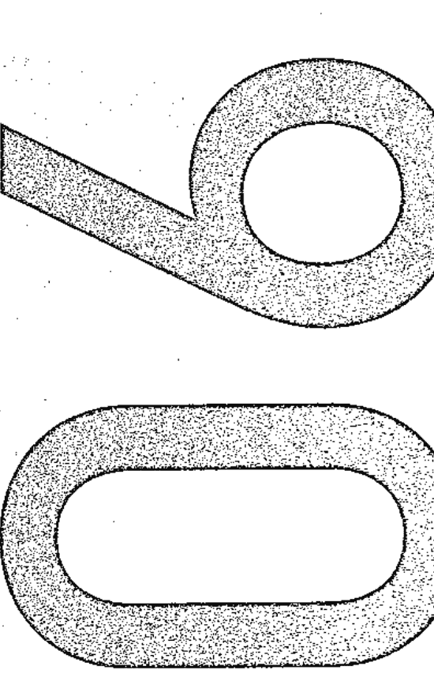


SUNDAY
星期日
辛丑年 | 四月廿六


### 如何快速占领知乎最佳推广位置？
书写自“天猫”的主题

- 1. 通过百度推广词工具，找出被百度收录多且排名靠前的问题；
- 2. 通过知乎回答教程，将各版块前20名的最佳优化，实现搜索结果中的“霸屏”营销。
- 3. 霸占特点，回答热门问题。


MONDAY
星期一
辛丑年 | 四月廿七


### 精益创业请注意这六点
节选自“V先生”的主题

在做生意的过程中，不管是规划，还是实操，都是复盘。好在琢磨以下六条，都能抓住要点，不至于陷在海量的信息和琐碎的事务中。

- 1. 三差：卖什么，卖给谁，怎么卖；
- 2. STP（营销策略三要素）：细分市场，目标选择，品牌定位；
- 3. 营销“4P”：产品、价格、渠道、宣传；
- 4. SWOT（态势分析法）：外部机会和威胁，自身的优势与缺点；
- 5. PPM（项目规划矩阵）：明星，现金牛，问号，瘦狗；
- 6. 赚钱公式：销售额=流量×转化率×客单价×复购。


扫码关注“生财日历”
加入会员 每日5分钟“掌握”
领取价值365天 宝藏礼包


## 8
TUESDAY
星期二
辛丑年 | 四月廿八


### 如何通过线下获客及信息差获利1.5万元以上?
节选自“三十一”的主题

起初我意识到办公室停车场很堵，不过内部有一些免费停车的福利，只要达到标准就可以享受。
通过与办公室的管理部门多次沟通协调，我成功争取到了20个免费停车位的福利。
在此之后，我马上印发了一些“停车位租用”的广告名片，价格略低于办公室的直营停车费用，并询问办公楼附近的超市小店附近有没有意向继续停在这里的客户，向他们提出停车位的租用服务。
利用这个信息差，我在很短的时间里获取了15000元以上的利润。


扫码关注“生财日历”
加入2021年生财日历营
领取价值365元“生财礼包”


## 6月
## 09

WEDNESDAY
星期三
辛丑年 | 四月廿九


### 营销推广底层逻辑
节选自“02男孩”的主题

互联网上任何目的营销推广，底层逻辑都是一样的：
找到目标群体→用产品或服务引起他们的兴趣→建立信任关系→转化/成交。
用专业术语来讲就是，曝光→点击→交互→成交。
这是一个漏斗营销模型，所有的互联网营销推广都是围绕这个公式去不断验证和优化的。


扫码关注“生财日历”
加入2021年日历训练营
领取价值388元“生辰礼包”

6月 June

## 10

THURSDAY
星期四
辛丑年 | 五月初一


### 为什么要研究马斯洛需求金字塔？
书接自“一鸣”的主题

- 1. 所有的生意人都要学营销，学营销必须懂得人性和欲望。
- 2. 现在的商业已经是细分，高度互层的价值和存量，能做的都不是大生意了，必须往上层做价值，不然没法差异化和存活。

用大家在读本书时听到的口诀来说就是：市场已经没有什么是显而易见的增量市场了，只有深挖存量市场的小机会才能创造出新的增量市场。要做到这一点的前提，就是懂人性。


扫码关注“生财日历”
加入2021年日拱一卒营
领取价值3888元“生财礼包”

## 11

6月
June

FRIDAY
星期五
辛丑年 | 五月初二


### 如何通过改造休闲旅行车赚到1000万元？
节选自“小牧”的主题

- 1. 新车进场前先想好你的货品在做什么，再考虑创新、发明；
- 2. 小步快跑，快速迭代，做低成本尝试；
- 3. 及时根据市场需求，遇到问题就微调，及时解决，做好口碑经营；
- 4. 针对每个触点写“文案”，让用户看懂广告语解决的问题；
- 5. 加大SEO投入，防止单一渠道出现公关问题，生意翻车。


扫码关注“生财日历”
加入2021生财友读群
领取价值365元“生财礼包”

### 长尾挖掘细分市场年利润百万单品的方法
节选自“seven”的主题

- 第一步：打开亚马逊首页，点击类目，输入你的价格区间。
    - 1. 最大的搜索词直接霸“bestseller”榜首，就可以了；
    - 2. 价格不要过高，否则竞争对手过强。
- 第二步：锁定一个可行性较强的单品，记录、搜集素材；探寻细分市场。
    - 1. 寻找中国制造业擅长、并且低成本就可以定制的商品；
    - 2. 通过情绪深入研究挖掘；
    - 3. 做好竞品分析；
    - 4. 探寻细分市场。


扫码关注“生财日历”
加入2021生财日历营
领取价值365元“生财礼包”


6月
June

SUNDAY
星期日
辛丑年 | 五月初四


### 可赚钱可省钱的海淘知识
节选自“Albert”的主题

同一件商品在不同国家因为货币、关税、定价等因素存在价格差，加上关税和运费甚至比国内价格还低，买了可以自己用也可以卖给别人。

海外电商平台包括各国亚马逊、ebay、dell、屈臣氏、耐克、Vans、丝芙兰、梅西百货、ThinkPad、GPM、MyBag等，如何做到低价：

- 1. 仅买打折商品；
- 2. 信用卡返利；
- 3. 返利网站（如mrrebateme）上，大部分品牌素有10%-20%的返利；
- 4. 礼品卡：海外电商平台基本上都有礼品卡，通常可以5折-8折买到。日本用户中可以到“万能”的淘宝，搜索关键词“xx礼品卡”，会稍微贵一点，仍然是划算。

这是一个信息差，目前还存在，并且还会长期存在。


第57篇
端午节

## 14

6月
June

星期一
辛丑年 | 五月初五

MONDAY

### 如何深入研究行业？
书接自“一袋知己”的主题

广告行业的何丽收到了一个电器行业调研的任务，经验丰富的她，没有去搜索引擎上搜"电饭煲"，而是直接打开东搜"电饭煲"，品牌、型号产品、主要参数，一目了然。品牌调研往后，她又进入了各个产品的详情页，关注了各大体的几个营销痛点以及使用场景。各个品牌主打的几个营销痛点以及使用场景。这花多少时间，就搞定了大量的资料。

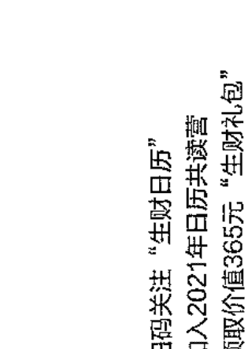

扫码关注“生财日历”
加入2021年日历试读营
领取价值365元“生财礼包”

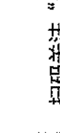


TUESDAY
星期二
辛丑年 | 五月初六


好的赚钱方式可复制。你谈的每天被热点、注册公众号、改名、做转化，还不如用聊个广所说的方法，从电话、微信、累积出奇迹。每天花一个小时整理一些有价值的信息，共享出来。

我建议总想着赚钱，不要想着教我这招巧，要多学一些基础知识。我提出去多年的创业经验告诉我，赚钱快的公司要么是因为下一个风口看准，用我们的创业思维的话说就是："充钱"赚的钱，要么能力都写前了。"这几年，跟踏实在做事情的人，混得很好。"

好的赚钱方式有哪些特点？

节选自“人间神语”的主题


### 搜索能力和毅力决定结果
节选自“一条问犯”的主题

对手:

我们可以用产品数据计算的漏斗做个假设,思考我们有多少
满足发现需求的有10万人,其中在乎需求的只有1万人,
5000个人愿意解决问题,2000人真正动手去做,100个人通过搜索
最后且做成的,大概只剩一个人。

世界上人越多,但是真理很贵,漏斗很短。如果你有别的事做
的事情,坚持干去,终会成功。


## 16

WEDNESDAY
星期三
辛丑年 | 五月初七


扫码试读“独目日志”
输入325元(或30篇
领取价值325元“生财礼包”

## 17


THURSDAY
星期四
辛丑年 | 五月初八


### 不要等到十全十美才开始教别人
节选自“小散”的主题

很多人觉得只有10万粉丝以上的大V才能做网课。其实，只要做出原创，有素材支撑的人，即便你只做到了顶级星的6分、7分，被教的大部分是2分、3分的人，你的体验就够了。

更向你处在教的过程中一直提升，变成8分、9分，届时你能教的东西就更多了。


扫码关注“生财日历”
加入2021生财社群
领取价值365元“社群礼包”


6月
June

FRIDAY
星期五
辛丑年 | 五月初九


### 做好新媒体从文字载体开始
节选自“天枢”的主题。

利用音频、视频载体达到宣传推广的效果，都离不开你对文字的驾驭，如音频的逐字稿，视频的文字文案、美感、美服务的转化文等等。

文字可以沉淀你对人性的把握，理解你的困惑。掌握人性，拥有困惑，互联网创业就会像“如圆”一样简单。


扫码关注“生财日历”
加入2021每日打卡读者群
领取价值365元“宝藏礼包”


## 19

SATURDAY
星期六
辛丑年 | 五月初十


### 三个细节
判断品牌是否合适小红书
节选自“李勋旭”的主题

- 1. 根据过往，小红书中用户以15—40岁女性为主，一二线城市、沿海城市居多，24岁以下年轻女性超过50%，用户消费能力最强；
- 2. 小红书是一个喜欢“精致感”的平台，适合精致、可爱、有仪式感的产品，或者功能性强、卖点清晰的产品，配合优质内容；
- 3. 小红书偏重种草和消费决策引导，适合为消费长久背书，持续再宣传。


扫码关注“生财日历”
加入2021年日历共读营
领取价值365元“生财礼包”

### 父亲节


## 20

SUNDAY
星期日
辛丑年 | 五月十一


### 创业做产品要跟着数据走，
而不是直觉
节选自“鱼丸”的主题

不管是从投资到资源分配，还是市场营销和产品策略，在确定之前，首先是要收集尽可能多的数据。在数据收集和分析上投入的时间应该与整个组织的决策权衡相称。


扫码关注“生财日历”
加入2021年社群共读营
领取价值888元“生财礼包”

### “数据采集中”的创业机会
节选自“木文”的主题

曾在网上看到过一个某样厂商的项目，众人挖掘后拿到了某型号3亿大厂的单一价格。随后，事主，事主，事主，一直在思考这个数据的走向，手记到了行业需求，深耕资源领域，不断拓展。

我们整合了全国很多家商家及原本做推广的渠道，手把手教他们怎么做采集中，发展合作伙伴资源，并深挖人力资源，积累了几十万的微信群个人号资源，一百多人的QQ、微信群，包含兼职群、高校资源群。

坚持高价签微信，与大厂合作，在全国各大高校进行了线上 线下活动6000多场。


## 21

Monday
星期一
辛丑年 | 五月十二

夏至

6月
June


## 22

TUESDAY
星期二
辛丑年 | 五月十三


### 装修公司如何一年毛利
2000万元以上？
节选自“入海”的主题

- 1. 老板自己在小区买了一套房，建立社群做私域流量；
- 2. 自己是业主，维护好人设，顾客户近一点放心；
- 3. 产品方案合理，覆盖低、高客利，给很多外地在本地如何买房装修的业务带来方便；
- 4. 过程中契约团队和对应，不断提高服务质量；
- 5. 两年4000万元以上的营收，2000万元以上的毛利，赚回了几套房。


扫码关注“生财日历”
加入2021年日历共读营
领取价值358元“生财礼包”

6月
June


WEDNESDAY
星期三
辛丑年 | 五月十四

### 打通商机需要考虑的问题
节选自“鱼丸”的主题

- 1. 赚钱的机会在哪里？
- 2. 如何提供解决方案？
- 3. 目标人群有哪些？
- 4. 成功要素有哪些？
- 5. 提供服务的可服务、怎么渠道业务？
- 6. 目标是思想如何定价，估算利润？
- 7. 再想象，为什么这个业务能融通？


扫码关注“生财日历”
加入2021年生财共读营
敬请期待365元“生财礼包”


THURSDAY
星期四
辛丑年 | 五月十五

### 豆瓣引流的方法

节选自“李土豆”的主题

- 1. 豆瓣小组：
在豆瓣小组上引流有两种模式：在别人建立的小组引流，以及自己建立小组。
- 2. 日记引流：
每周在豆瓣上发2-3篇内容，文章内容以下拉群和获取文章中提到资料的方式来置引钩子。尽量不要太显眼钩子，或者以字母ID暗号的方式来操作。
- 3. 活动广场引流：
利用两个豆瓣账号一问一答引流，用豆瓣用户感兴趣的包信号图引流。


扫扫关注“生肖日历”
加入2021年日历共建营
@底价仅3885元 “生财礼包”

### 如何找到核心用户的高频需求？

节选自“蒙叔”的主题

我把炫志“单机炫语百万”的数据好发出近六个月所发布主题的内容做了梳理和分析，并做了一个TOP10关键词列表，和消费品相关的关键词是“蛋”，这就是我核心用户的高频需求。

注意我这里用的是用户的话，由个别人一统，而不是炫语法。要从他们做起，而不靠狂发天工智镜。90%的创业者因此交了巨额学费，最终也不知道失败的病因。


### 3000个Twitter粉丝、700个博客粉丝，课程一周销售27万美元的操作步骤

节选自 “吾为。”的主题

- 1. 课程发布前，发Twitter，前25个报名5折促销；
- 2. 给Twitter评论说要买课程的人发私信；
- 3. 给博客7000邮件订阅者发送博文预告；
- 4. 已报名用户可以用作为访问课程，满足条件中可获得全额返现，并邀请这部分用户成为分销员；
- 5. 课程底部增加邮件订阅入口，吸引不能达到下决心的人；
- 6. 用正面回应操作为案例分析网站上，吸引还不够定购的访客；
- 7. 课程分享总结宣传，建立了一个每年费用49美元的社群。


## 27

SUNDAY

### 星期日

辛丑年 | 五月十八


### 如何利用自己的技能去发掘副业？

书选自 “亦仁” 的主题

首先我开放脑袋，想到合适的关键词，脑海里能想到的点子一定不能少，拿出一张纸，围绕关键词，至少列出来50条赚钱想法。

然后去各种搜索引擎的内容库里面检索，把搜索结果挨个看，挨个调研。

最终你会凭借经验，判断出哪几件谋钱的事情可以做、可以干了再说，这么几轮下来，大概就能锁定一个合适的项目。


扫码关注 “生财日历”
加入2021年日历共建群
感谢@ID158595 “生财小恩”

### 裂变创新业务模式打法的底层逻辑

节选自“AYL波波”的主题

裂变创新模式，只属于找到专业擅长业务的人，就可以快速展开业务，不是说自己不能研究出来，而是容易错过红利期。

好比几个月前当时听说短视频会比较赚钱的时候，最快的方式是我找到一个懂的人来开合作，而不是自己花钱摸索，摸索了几个月后，短视频红利期已过，只有头部玩家才能赚钱了。


扫码关注“生财日报”
加入2021年日求实验室
收费标准585元“生财会员”

6月
June

## 29

TUESDAY
星期二
辛丑年 | 五月二十

鱼小滴

### 首年赚到30万美元的求职培训网站是怎么做起来的？

节选自《鱼丸》的主题

- 1. 发现需求：大家在面试产品管理工时，很难找到高质量的资源库和工具；
- 2. 项目试错：售卖定价为8美元的电子版面试指南，通过用户反馈，确认项目值得做下去；
- 3. 产品原型：从一对一的在线辅导开始，慢慢提高课程价格和质量，逐步进化到综合网站和在线课程；
- 4. 用户增长：利用多渠道推广，例如YouTube、Affiliates、邮件列表、博客和其他社交媒体等；
- 5. 扩大规模：发展在线课程和培训，通过让用户付婚前试查看提高成功率；并与顶级MBA商学院合作，提供证书，以此增加课程价值；
- 6. 节约时间：提前并频繁通过求助他人解决问题，提高效率，避免踩坑。

扫码关注“生财日历”
加入2021年度社群营
领取价值365元“生财礼包”


### 不擅长但又想开始尝试的领域，该如何进行？

节选自 “水文” 的主题

- 1. 找到适合自己的 “探索” 技巧：百度、360、Google、知乎、简书、公众号、微信搜索等平台，都是信息来源；
- 2. 点放或、线性面的思考方式，把自己能想到的所有思路一个个写下来，然后一个个列下顺序（放线）再形成一个大事项基本需要做的步骤和解决办法；
- 3. 资料思考法，多元处理，用好纸张笔、备忘录、印象笔记、石墨文档、网易邮等笔记、有道云、印象笔记，需要主意的是做好传送，不同的工具来储存不同的内容，唯一；
- 4. 别把自己造成信息 “差” ，要多意思得到；
- 5. 执行第一位，大柜做就是了，太不了就是个失败，至少会学到经验！


假设有人在你身上绑了一颗炸弹，要求你一年之内必须赚到 100 万元，且不能违法；如果一年之内你没赚到，炸弹将自动引爆，你要怎么去赚取 100 万元？

亦仁
于 2020.05.18
#会员日#

### 生财有术 | 会员日

会员日始于 2019 年 5 月 18 日，在每月 18 日定期举办。

会员日的初衷有两个，一方面是帮助社群内购产品的

圈友增加曝光量，另一方面是为大家实实在在地发福利。

每个会员日都有具体的互动主题：

> 你在星球中最多被表扬”“推荐买过最值的东西”

> “如你遇到一年内赚到一百万”

> “推荐一篇今年看过最好的文章”

……

截至 2020 年 8 月 18 日，“生财有术”已经举办了 16 个会员日，累计发放奖品总价值约 150 万元。

### 建党节


7月
July

THURSDAY
星期四
辛丑年|五月初二


### 案例复盘：如何在游戏中赚到数百万元

节选自“喵一布”的主题

- 1. 在一个特定的游戏，那么就可以找到别人获取不到的信息；
- 2. 信息差套利，有的信息差价值百万、千万；
- 3. 建立自己的圈子、发动信息、利用信息和执行能力获取或不当价值；
- 4. 对应信息的分解策略能力；大多数人都看不到这个信息，但是信息差确实存在了，要知道，即便是最简单的东西放大到一定数量，也有大巴的人是不知道的。

扫码关注“生财日历”
加入2021生财方法论营
领取价值3995元“生财礼包”


## 02

FRIDAY
星期五
辛丑年 | 五月廿三


### 开店指南：八个注意事项

节选自“大树”的主题：

- 1. 选址可以决定生死；
- 2. 供应链有多强多忙多忙多忙多忙多忙多忙多忙多忙多忙多忙多忙多忙，才有议价能力；
- 3. 用户群不是想象出来的，别一厢情愿；
- 4. 用户画像不是“一二线城市、白领”这样的空泛之词，没有场景；
- 5. 品牌认知是慢慢积累，不要等发威了之后再讲；
- 6. 小生意也不简单，都是一门大学问；
- 7. 行业思维往往只能解决一部分问题，其他不能少的，你仍然得教的平万别高看；
- 8. 花拳露腿无乃退路，熟才进道。


扫得关注“北朝日历”
加入《北朝日历》知识
客服V信1865038752  北朝日历


## 03

SATURDAY
星期六
辛丑年 | 五月初四


### 如何从数千个微信群内，找到超级节点、超级代理人？

节选自“陈俊强”的主题

方法就是跟取有人群：把每个微信里的人的昵称、wxld（微信号）导出来，然后合并，我们发现有好多人在我们的群内出现。再根据wxld在多个群内出现的次数去添加联系人。
这个方法主要的用处是发展代理或者分销商，或者是可以让其他人聚力于活的关键点。

扫码关注“返利百科”
加入2021 每日社群运营
领取价值365元“社群礼包”


## 04

SUNDAY

### 星期日

辛丑年 | 五月廿五


### 地摊经济的相关延伸业务

节选自“开仁”的主题

- 1. 在1688网站或者淘宝上筛选出适合卖地摊的商品，做表格传播；
- 2. 自己尝试卖地摊用品，发到抖音上吸引流量，建群；
- 3. 整理“地摊笔记”，打造IP（知识产权）；
- 4. 做地摊供应链：提供选址、拉客培训、升级变成5元店等，形成流量（人品牌）；
- 5. 写地摊相关文章引流；
- 6. 整理需要地摊的产品（如纸巾卡），找地摊主合作推销；
- 7. 想办法找到各个地摊的联系方式，整合变成新的广告渠道。


扫码转发“地摊日记群”
加入2327位日营社学员
赚取价值368元“地摊礼品”

### 目标管理的三个步骤

节选自“天书节”的主题

- 1. 关注自己内心真正想要的是什么，做到什么才会令自己感到“怦然心动”般的满意；
- 2. 通过“人脉网络”等一系列的工具库，找到实现上述想要的事情的帮助者；
- 3. 设定合理的目标和计划，实现一个个任务，根据实际情况不断调整，最终达成目标，并在过程中升级自己的“装备库”。

### 5月

## 05

MONDAY

星期一

辛丑年 | 五月廿六

开始

节选自“天书节”的主题

——

场所

——

组织者

——

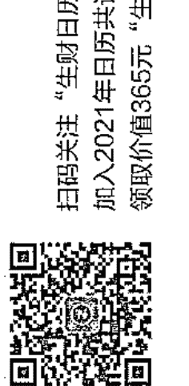

### 八个步骤，简单快速学习竞争对手（以餐饮业为例）

节选自“主题 Miko”的主题

- 1. 打开大众点评 App 的首页，选择“美食”；
- 2. 在导航栏里面选择适合的品类，如小吃快餐；
- 3. 在智能推荐里面，选择“人气”排名的前 10 家；
- 4. 分别以评价、口味、环境、服务排序，同样选择前 10 家；
- 5. 多加标注其中重合度最多的店竞争对手，作为重点学习对象；
- 6. 按照客系、品类、地区等前测试吃饭和险路；
- 7. 试吃和体验后，对自己的认知不足之处会看得特别清楚和深刻；
- 8. 按照“MVP（最小可实行产品）- 极简优化调减”和“重要-紧急”-“重要不紧急”的方式来执行计划问题。

其他行业和产品同样能运用这套思路。


扫码关注“生鲜日历”
加入2021年日历读读营
领取价值365元“生鲜礼包”

## 7
JULY

小暑


### WEDNESDAY
星期三
辛丑年 | 五月廿八


### 如何找到值得一辈子追求的事业？

节选自“副精英”的主题

这世界上其实有四种不同的事情：
第一种是你擅长的事情；
第二种是你喜欢的事情；
第三种是对世界有价值的事情；
第四种是能赚钱的事情。

最理想的状态是四种事情合为一体，做自己喜欢且擅长的事情，给其他人创造价值，同时自己收获回报，这可能你能一辈子去追求的事业。


### 如何进行信息搜索？

节选自“明白”的主题

- 1. 网络大体量产品：
微信：新榜、小号书：同花顺；
微博：博睿、头条、抖音、快手、知乎。
- 2. 媒体行业：
知识付费领域号脉：
程页页的需求；
运营、产品、营销职业工具外的需求。
- 3. 围绕自己工作环境领域找需求。
- 4. 从知乎、百度知道找需求：
搜索“你”、“哪些”、“哪些XX”，从高票回答中挖掘需求。


THURSDAY
星期四
辛丑年 | 五月初九

扫码关注“生财日历”
加入2021年历法社群
原价498元“生财礼包”

## 09

FRIDAY

星期五 | 五月初三

## 7月

### 如何把想法变成第一块钱？

节选自“盘凡”的主题

- 1. 充电步履：打造商机。
为什么这件事能做就赚钱？成本如何，能赚多少钱？谁在这件事上赚到了钱？
- 2. 稳中求胜：市场调研。
能否识别到行业趋势，以及业务的长期价值。
- 3. “抄作业”：观察其他人是怎么做起来的。
- 4. 玉盘算账：核算完成成本收入。


扫码关注“生财日历”
加入XX生财社群
领取价值588元“生财礼包”


## 10

SATURDAY
星期六
辛丑年 | 六月初一


### 凡事不要等想明白了再去“做”

节选自“周路Forest”的主题

- 第一，没有真正做过这件事情的人，基本上永远都想不明白，或者只是自以为自己明白了，而实际上还是稀里糊涂；
- 第二，就算真的等到自己明白了，往往也浪费了最佳窗口期；
- 第三，为了追求完美而迟迟不启动，是最后最完美的事。

> Done is better than perfect（完成比完美更重要）。


扫描关注“生财日历”
加入2021年日历社群运营
领取价值3888元“生财礼包”


## 11

SUNDAY
星期日
辛丑年 | 六月初二


### 普通人如何培养自己的用户视角？

节选自“明白”的主题

要明白“用户视角”不是方法、技巧、技能，而是经验，是为了尊重及理解的感觉。想要培养用户视角需要有意识地观察他人。

可以先从身边整个用户群体开始，发现他们的问题，总结出共同点、槽重点，再去观察其他群体，如果某个槽点相同，说明这是用户的共同属性，而不是某个细分群体的属性。这种刻意练习的用户越多，观察的用户群体越广泛，用户视角就越强。


扫码关注“生财日历”
加入2021年日历讨论群
领原价值55元 “生财礼包”


### SEO霸屏三大技巧

节选自“苏笙爱挨鱼”的主题

- 1. 标题必须要有关键词，这样用户才能搜索到；
- 2. 同一篇文章、同一个话题，多平台进行分发，增加搜索收录；
- 3. 标题要复制三条放在文章中，增加用户搜索度。

扫码关注“拾部日历”
进入公众号回复“拾部家”
领取价值688元“全家礼包”


## 7月
### JULY

## 13
### TUESDAY
星期二
辛丑年 | 六月初四

**陈致富**

### 销讲有哪些秘密？

节选自“阿May”的主题

销讲能力就是一对多的成交能力，不管你是做企业还是做讲师，或是做销售，这都相当重要。会销讲的人，事半功倍。

讲师一定要谨记以下四个关键点：

- 演讲和销售的极致在于先付出；
- 成交远比交情更重要；
- 站在台上，我在送钱，我在结合下发钱；
- 想要学会讲，就先要学会听。


扫描关注“生财日历”
加入2021年日历共建营
领取价值385元“生财礼包”

## 14
### WEDNESDAY
星期三
辛丑年 | 六月初五

### 小众行业如何开始创业？

节选自“甜瓜”的主题

- 网络信息查询行业现状：行业报告、本地服务商、百度快照、公众号、知乎、新闻媒体、知乎本地工商注册；
- 同行调研：以客户身份联系本地服务商，了解业务范围、流程；
- 网络调研：调查目标客户服务和需求；
- 做好成本预算：租金、设备、装修、车辆；
- 找到客户：去客户经常出现的场所，接近客户。


扫码关注“甜瓜日历”
加入2021年日历共创营
领取价值365元“甜瓜礼包”

## 15
### THURSDAY
星期四
辛丑年 | 六月初六

### 提前准备这四点，把握住投资机会

节选自「杰森李」的主题

- 充足的子弹，在熊市要有现金能抄底；
- 用于加强一道红利的人脉，机会好的时候要学会分享利益，这样当重大机会来临时，身边人才愿意帮你一把；
- 用于加强「第二道红利」的个人品牌，学会打造个人品牌，这些很关键；
- 用于把握机会的资质、各种工具、手段都能助推很好。


扫码关注“吾投资归元”
加入2024年日拱一卒共读营
微信号ws39570，宝哥私聊

**注：原文此处日期与内容可能存在错位，根据上下文及图片编号，第15日内容对应杰森李的文章。**

### 通过升级业务模式每月赚1250美元被动收入的案例

节选自“鱼丸”的主题。

平面设计师贾思颖看到一个用两种颜色的硬币拼出的林肯肖像画工艺品。觉得自己也可以模仿着做出来卖钱。

但他对这种业务模式做出了升级：不需要已经做好的硬币肖像画，而是打包售卖硬币材料和制作教程，让用户自己制作。同时，他在包装盒里附加了介绍林肯生平与事迹的小册子，赋予这个产品历史教育的价值。

同时，他抓住所有传播传统的机会，在各种社交媒体上放出硬币肖像画的高质量购买券，给自己吸引用户。

现在，在美国连锁书店、林肯总统图书馆、货币收藏馆等地，都能看到这里的“硬币版林肯肖像”。通过这个项目，莫里每月可以有1250美元左右的被动收入。


扫码关注“地球日报”
可订阅2021年8月刊
《教你3种3D打印玩具》《理财礼包》

## 17
### SATURDAY
星期六
辛丑年 | 六月初八

### 活多少钱只有死工资怎么办？

节选自“亦仁”的主题

1. 认识到“所有的问题都是自己的问题”；
2. 想学习什么新技能，关键是要工作之外投入的时间，而非工作时间；
3. 成年之后，任何人的评价都不重要，重要的是你自己想要什么、想过什么样生活，并为此付出什么努力；
4. 再基础的岗位工作，都可以学到东西，如果遇到瓶颈，就跳出去走；
5. 公司不要没有任何经验，且看不到主动性的人；
6. 能力不够之前，不要轻易辞职。


扫码关注“生财日历”
加入2021年日历共读营
解锁价值365元“生财礼包”

## 18
### SUNDAY
星期日
辛丑年 | 六月初九


### 适合“小白”操作的抖音小项目

节选自“Gink”的主题

整体思路：为动画片人物做二次包装配音。以济公（动画人物）为例，简单来说是取济公讲道理的素材（形容济公）的配音，加上BGM（背景音乐），生产出用户专属的生日祝福视频。

变现思路：一般来说，淘宝的市场价在每条29—59元，声代的配音成本只需要8元，量大可以压到每条4—6元，纯利润率为72%—79%。

原理：从抖音引流到微信，转为私域流量。


扫码关注“生财日历”
加入2021日历社群
领取价值385元“生财礼包”

## 19
### MONDAY
星期一
辛丑年 | 六月初十


**谈知磊**

### 建立即时正反馈，积小胜成大胜

节选自“苏引”的主题

要让自己的思路更开阔，一定要给自己建立即时正反馈，最好能让你出现的点子受挑战。

第一块钱赚到了钱，团队有了正反馈；主动性和探索欲就更强，思路会由此变得更加开阔，也会用尽办法去解决遇到的各种问题。

有些人做的事一开始离钱比较远，有一些好想法时，不妨发个朋友圈或者在知识星球里面“接感”一下，收获别人的点赞和夸奖，也能给自己带来一些正反馈。

远远清尼感，是为了追求“星辰大海”的目标。我们是普通人，首先想的是信心，给自己创造小胜，之后才能成大胜。


扫码关注“谈知日报”
每次文章结尾都有谈知磊精心准备的“灵感礼兑”

### 速卖通的最大优势：快速找到热销产品

节选自“最Lucky”的主题

通过速卖通平台可以找到那些便宜又畅销（经过市场验证的），并且询问客服，生活和女性类的产品。

因为速卖通平台有个好处是亚马逊平台所不具备的，就是可以通过Order（订单量）来对产品排序。

速卖通上有大量的热销品，具备丰富的测试基地，你可以不断地去测试，而且在速卖通上被验证成功的经验，可以搬运到亚马逊上，成功的可能性会很大。


扫码关注“生财日历”
加入2021年日线打卡实验室
领取价值365元宝藏礼包

## 21
### WEDNESDAY
星期三
辛丑年 | 六月十二


### 想通过自媒体破圈，广泛撒网不如力出一孔

节选自“办汇”的主题

- 大大写大，不如把一个领域干深，一篇文章尽可能穿透该圈层，获得触不到的资源；
- 有了触到更高圈层的机会后，可以去观察学习大人们的提问、思考问题的方法，可以借鉴到更多的技能，为下一波爆发积攒更大的势能。

还有一点提醒大家一下，光写干货还不可行，得有冷启动的流量，比如“生财有术”就是一个比较好的干货传播冷启动平台。


扫码关注公众号... (原文此处缺失具体公众号名称，根据上下文推测为“生财日历”或相关，但OCR显示为“加入2021年日历打卡共读营”)
加入2021年日历打卡共读营
最低价值969元，全场特惠

## 22
### THURSDAY
星期四
辛丑年 | 六月十三


### 大暑

### 技巧篇：低客单转高客单的课程玩法

节选自「邓仁」的主题

9.9元体验低价课程，背后一般挖掘要几百元、上千元、甚至几千元的高价课程，“9.9元体验课程”仅仅是选出合适的人，也就相当于一个“筛子”的功能。

当筛出合适的人后，销售团队和服务团队立刻跟上，从社群到一对一，再到电话联系，直到朋友圈及看书信息，通过层层“轰炸”，一部分用户就转化出来了。


扫描关注“生财日历”加入2021年日历体验营
原价值365元“生财礼包”

## 23
### FRIDAY
星期五
辛丑年 | 六月十四


### 电商免费流量的蓝海期

节选自“顾寻”的主题

流量分免费流量和付费流量，很多时候我们对付费流量没有优势，而免费流量则是绝大多数商家的短板，发现这一点后，我把自己包进了免费流量。

那么免费流量从侧跟来？与其思考这个问题，不如思考：“线上的同店在哪里？”这样思考下来，就会发现这个事情简单许多。像人最多的地方充斥媒体平台：天涯、豆瓣、知乎、小红书、微博，这些都是现成的流量，而且都是完全免费的。

当然，几乎没有开发免费流量意识，就像深海里很多的宝藏，很多人看不见，有些人看见了也不知道如何去捞。


扫码关注“华叔日历”
加入2021年日历共读营
领取价值365元“生财礼包”

## 24
### SATURDAY
星期六
壬午年 | 六月十五


### 耐心玩“拼图”才可能找到“金矿”

节选自“Caoz”的主题

很多时候赚钱的游戏是个拼抢游戏，很多有价面的或者会写文章的面包屑，散落各处，需要你看动，仔细思考，再谨慎地拼凑出完整的模式，真正欣赏是拼图的，都是过眼的面包屑。没过眼的，你只敢从各中只片中看中过整篇，然后自己去拼。

伸手党觉得这里是是“收割智商税”的，因为每个碎片都无法用于实践。

但如果你是耐着心玩拼图，不能从面包屑中找到线索，去拼凑真实的商业逻辑，那里藏的就是金矿。


扫码关注“书影日历”
加入2021《书影日历共读营》
领取价值365元“生脉礼包”

## 25
### SUNDAY
星期日
辛丑年 | 六月十六


### 提高商标注册成功率的技巧

节选自“万里渠”的主题

原理：商标感受指标申请申请后，会综合考量各名称、品类是否相同或相近，以此作为标准来判断商标能否通过注册。

具体操作：
1. 避开相似名称；
2. 避开品类；
3. 在商标局网站上查询相似商标；
4. 如果商标名不能改，同时必须申请相同或者商标相似的类目，尽快复试申请，必要时提起诉讼。


扫码“生财日历”
加入2021年日历共读营
领取价值365元“生财礼包”

## 26
### MONDAY
星期一
辛丑年 | 六月十七


### 小公司生存和发展的关键是“错开”

节选自“天雪地铁”的主题

- 产品线：错开研发产品、研发试验，因为成本太高；
- 流量线：错开竞争，尽量在蓝海巡游，我们也将不起眼；
- 变现线：错开流失，最大化承受范围。

想办法错开并时刻对自己团队不利的服务线、前期错开高成本，然后随着目标、高效投入，尽可能降低损失。

- 建立某个公司的优势抢先拿到，错开越多，利润越大。
- 要活着，保证要错开一个，剩下错一要求做的，就是快速快速再快跑。


扫描关注“生鲜日历”
加入2021年日历共建营
领取价值335元“生鲜礼包”

## 27
### TUESDAY
星期二
辛丑年 | 六月十八


### 小红书生产原创内容的步骤

节选自“李正蓝”的主题

1. 选题找素材：不要头脑苦想，去看看同行都在写什么。
2. 主题创作：种草类内容准备产品图、效果图和使用图，其他内容准备各种对比图引导等图。
3. 拼图操作技巧：图片基本上使用“黄油相机”App就修了，建议购买Pro（专业）版本。
4. 写出一个好标题。
5. 通过长尾词获取更多平台流量。


扫码关注“生财日历”
加入2021年日历共读营
领取价值388元“生财礼包”

## 28
### WEDNESDAY
星期三
辛丑年 | 六月十九


### 为什么选择一个高门槛的圈子？

节选自“鹿鸣”的主题

其实你难免，一个谁都可以进入的圈子，价值密度是有底的。

钱就是一个门槛，想要往上攀登，就需要“过路费”。

你是个什么样的人，取决于你跟圈子里是什么层级的人。

很多人都会说，进入某个圈子是破“圈层壁垒”，但张存也说：如果你连被割韭菜的机会都没有，意味着看你高成为之期还够远。


扫码去关注“张存回忆仔”
加入2024年会员社群
领取价值888元“生财礼包”

## 29
### THURSDAY
星期四
辛丑年 | 六月二十


### 互联网产品的投入和价值并不成正比

节选自“一备枸杞”的主题

在当互联网上的产品，技术成本趋高，不代表产品价值就高。
有些一闪而过的小想法，本身就已经成为一个人让自己的生活更美好的产品，轻盈或实现出来即可，如果没能够实现也就轻易放下了。
很多需求都是一个微信群或一个EXCEL表格就能解决的。
为了一个小需求就投入大的物力，往往得不偿失。


扫码关注“生野日历”
加入2021生日历法读营
领取价值365元“生野礼包”

## 30
### FRIDAY
星期五
辛丑年 | 六月廿一


### 营销号提高转化的新玩法

节选自“苏汇”的主题

1. 企业微信号集中加人，每个员工标签上加人KPI（关键绩效指标），转化不用他们负责；
2. 打造会员日，活动日，促销日等具有仪式感、遵套打折转化的日子；
3. 集中给企业微信号里的人导入群里，找到愿意铁转化的去做重复；
4. “微信3连发的用户+群提醒+会员日+直播”，转化应该不会落到哪里去。


扫码关注“生意日历”
加入2021年日历粉丝群
领取价值358元“生意礼包”

## 31
### SATURDAY
星期六
辛丑年 | 六月廿二


### 学会“量体裁衣”去赚钱

节选自“爹叔”的主题

想做能赚钱的事，一定要学会量体裁衣，从身、动、脑起，学会低风险创业。

量体裁衣，即看清自己的优劣势，弄清楚的什么自己能做这个钱。以身为例，无论是在资金、技术、运营还是团队管理方面，我都没明显优势，也就是说，我无法在这些方面获取超额价值。所以，以后创业不要再用电脑设备或资源，有钱或有资源是创业努力的方向和终点，而不是起点。


扫码关注“生财日历”
加入2021年日历共建营
原价365元，“生财礼盒”

# 附录/特别企划


“创业维艰，唯资历者知。”

“生财有术”进入第四年，陪伴很多圈友从细分领域专家成长为企业家，进入赚钱和人生的新阶段。

“生财有术”如何继续为他们解决问题、提供价值，这是我开设私董会的出发点。

简单来，说，这是一个跨界的同频高端圈子，价格挺高，但价值没有上限。我想让社群里面的企业家成为同学和朋友，让一帮各行各业的企家朋友，成为你的私人董事。

## 生财有术 | 私董会

2020年7月12日，受圈友启发，亦仁发布了一条朋友圈；提出组建年费5万的高价交流圈子。在没有任何收益公布的情况下，当晚就有30多位月收入百万及以上的圈友私信直接转账，预约私董会名额。

7月26日，私董会权益与规则正式公布，面向月营收50万-1000万元的创业者，通过多种权益机制，建立私域的深度链接，帮助同频跨界的企家朋友互相帮助，共同成长，让创业少走弯路。

8月3日，私董会第一期正式启动，首批筛选出40多位创业企业家参与，其中多位成员年营收过亿。私董会第一期闭门分享会也于8月10日圆满结束。

私董会接下来会陆续分期开班，有兴趣加入的话，可联系负责人光谷的微信：sn_et10ck。

亦仁
于2020.08.05
分享


### 建军节
8月 10日 星期日 (辛丑年 六月廿三)

#### 技巧篇

##### 创业要重视股权设计
节选自“刘宁珺”的主题

创业班上，股权顶层设计的重要性堪比情侣、夫妻之间的关系。
关系处理得好，公司内部股权激励，激情冲冲，快速发展，公司外部融资扩张，顺风顺水。


扫码关注“每日日历”
加入&2&社区&&&学习
领取价值&5&元“生财机会”

---

8月 2日 星期一 (辛丑年 六月廿四)

##### 起名行业赚钱思路
节选自 “Tiger” 的主题

- 给外国人起中文名字；
- 给宝宝取名字、给公司/项目取名；
- 海外宠物市场，给外国人取名字；
- 用小语种取名；
- 从宝妈群体开发精准流量；
- 找到自己擅长的平台，操作同一个项目。

项目篇

扫码关注 “生财有术"
加入2023年巨杉知识营
仅需198.88元 “生财会员”


---

8月 3日 星期二 (辛丑年 六月廿五)

##### 视频号做爆款内容的注意事项
节选自“技术”的主题

- 找回密码的账号对标学习、借鉴。没有同类型的就去找用户属性相似的账号；
- 不要盲目泛读爆款，爆款内容一定要契合你的账号定位。做爆款设计之前，一定要做好引导，给用户一个关注你的理由；
- 做好数据监测：每天定时查看数据，记录数据变化。

扫码关注“维梨日历"
加入2021帐号扶持营
领取价值365元“生鲜礼包"


---


##### 互联网赚钱利器——信息差
节选自“天风”的主题

很多人都说，很难通过互联网赚到钱，那么也不知道如何切入。其实，一般来说，在互联网上你只要能找到信息差，并满足一方需求，你就可以赚到钱。相对于还是比较容易的。

比如，研究一个具有同一关键词的群体；挖掘这个关键词群体的需求，然后写一篇相关的公众号文章，或者开一个淘宝店铺，或者拍一个抖音、快手视频，如果能满足这个群体的需求，那么赚钱就不会很难。需要注意的是，次级产业千万不能触碰。


---

8月 5日 星期四 (辛丑年 六月廿七)

技术圈

##### 经常学习竞品，对应挖掘创新点
节选自“复利”的主题

经常去找竞品学习，不是在一开始做产品的时候做一些调研，而是要经常、反复地去学习竞品中有什么新的变化。

同时，要想办法去看竞品的一些数据，从竞品中找到产品的创新点，比如对方的产品规格太贵、功能太多、社交太专业，会有一些人不喜欢这些功能或者特性，于是做一个更便宜、精简、隐私保护较好的工具就会受到欢迎。

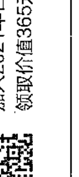

扫码关注“连线日历”
加入2021年日历共创读信
领取价值365元“定制礼包”

---

8月 6日 星期五 (辛丑年 六月廿八)


##### 免费保险里的商机
节选自“精读”的主题

看到别人分享不懂的产品或内容，都不妨问下自己：“我如何找到解决方案从中获利？”

新冠肺炎疫情间，我把市面上所有免费抗新冠疫苗查了一个遍，共找到了7项保险，其中前3项各提供或退休分活动，某一项目新退20万元。

随后，我将免费抗新冠疫苗整合后发布在公众号中并挂到网站上，通过保险团购收取收益。

这种共赢的事情，一来帮保险公司推广了产品，二来大家免费领保险提升了自身风险能力，三来自己也可以额外收取一些收益，何乐而不为。

持续关注“生财日历”
加入2021年日历共读营
领取价值365元“生财礼包”。

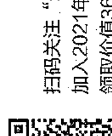

---

8月 7日 星期六 (辛丑年 六月廿九)

立秋

易咨询

##### 通过天涯实现了700万元成交额的六个技巧
节选自“愿禅”的主题

- 根据用户的年龄、消费层次、登录时间峰值、喜好版块等进行分析和洞察；
- 根据用户与文案喜好，内容描写手法等；
- 采用较诱人的模式，让用户相信是真实推荐；
- 拿下推荐的置顶许可；
- 持续发文，不断强化内容，间歇性提醒频率；
- 整理产品卖点，创造用户易读的封面和场景感受。

扫码关注“生肖日历”
加入2021生肖日历共读营
领取价值355元“生肖礼包”


---

8月 8日 星期日 (辛丑年 七月初一)


##### 与其拼命做销售转化，不如用服务提升复购率
节选自“品添财”的主题

我们通过社群的精耕细运营，主动去和用户沟通、答疑，针对每位客户的问题，提供解决方案；锁定用户，在社群中做答疑、设计活动，及用进行点评。

做运营有很多老用户，我都会时不时地去询问一下上面的效果，有问题会产生的。

社群会产生粘性，内容会产生粘性，服务会产生粘性。

线上认识各地的同学在这里，同学们聊起的内卷在这里，和老师的信任和感情在这里，用户就站在这里，不愿离开，自然复购率就提升了。

如果你只是增加商品数，拼命做销售转化，而不用服务提升复购率，那么你还在一个平面里创业，竞争对手还是会很多。

扫码关注“生财日历”
加入2021年日历共读营
领取价值3685元“生财礼包”。

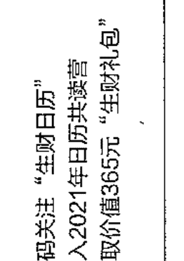

---

8月 9日 星期一 (辛丑年 七月初二)

群载信

##### 对刚刚起步的创业者该提哪些建议？
节选自 “岛丸” 的主题

- 仔细考虑哪些建议更重要。我们都有不同的目标，只有要关注与你的目标最相关的话。
- 从小处着手并快速交付。虽然是简短课程，但显然有太多人都容易犯一个错误——花几个月时间开发产品，然后才将真展示在用户面前；
- 组建或加入一个智囊团。每周和合作伙伴讨论工作；计划要做的事情以及需要帮助的内容。找到一群志同道合的人来督促工作，智囊会很火。

扫码关注“生财日历”
加入2021年8月打卡营
领取价值365元“生财礼包”


---

8月 10日 星期二 (辛丑年 七月初三)


##### 创业公司必须重视的两个“不要”
节选自《奋斗》的主题

- 不要试图同时解决多个问题，专注于解决一个问题。创业公司的资源非常有限，为了最大可能提升成功概率，只需要关注一件事。墙太多，不是好事情；
- 不要轻易满足于现有的产品，它一定还有很多地方可以做得更好。你要交付给市场上的商品是比好更好一点，比“一个产品或者服务永远没有达到足够优秀之前，别轻易规模化。”


扫码关注“生鲜日历”

加入2021年日历共读营

@微信值38556，生鲜日历

---

8月 11日 星期三 (辛丑年 七月初四)

总结篇

##### 把事做成需要什么样的能力？
节选自“钱钰”的主题

- 心态上，摆脱自尊的心态，以事为先；
- 认知上，要有认知适时机，看到多大机会能做多大事；
- 思维上，要有看待问题的模型和清晰的逻辑，模型决定了方向感，逻辑决定精确度；
- 方法上，做任何事情都要有一套流程和方法，事先知道怎么把事做好，然后才开始做；
- 实践上，把事情做成就需要实践经验，无论是踩过的坑，还是吃到的果实，都要亲自体验过。


扫码关注“生辰日历”
加入2021年日历众筹营
领取价值365元“生辰礼包”

---

##### 新媒体增长方法从哪里找？
节选自“龙共火火”的主题

- 参考迁移：
很多增长方法，包括其他行业、领域的玩法，可以迁移到自己行业进行应用；
- 提到一手信息：
想要获取信息，最好让自己成为信息源。很多特别有价值的信息，更多的是在私下或在小圈子内传播；
- 剔除无效信息：
掌握了很多方法之后，不可能全部都做，做一个渠道规划表，从获客成本、粉丝质量、增长可控程度、团队投入、渠道数量、产出验证时间等进行打分，根据需要做些切换。


扫码关注“生财日历”
加入2024年日开社群
领取价值3885元“生财礼包”

---

8月 13日 星期五 (辛丑年 七月初六)


##### 地摊攻略
节选自“小嗨”的主题

概念：搞怪创意才叫“地摊范”。来逛街的人可能是散步的、旅游的，也可能是学生。冲动消费很重要。

攻略：
- 去哪个夜市实地逛一逛；
- 确定卖什么；
- 确定在哪卖；
- 前期用品准备；
- 开干。

扫码关注“生财日历”
加入2021年日历共读营
领取价值385元“生财礼包”


---

8月 14日 星期六 (辛丑年 七月初七)

七夕节


成功巧点

##### 四个关注点，写出功效货文案
节选自“白一幅”的主题

- 背景：搭建一个场景，让看题的人感同身受；
- 诉求：我有什么，能让你有什么变化。
- 证明：为什么你应该相信我？如果你质疑我，我会如何回答你？
- 问题：为什么你 “现在” 就购买？


扫码关注 “生鲜日历”

加入 2021年日历共读营

领取价值369元“生鲜礼包”

---

8月 15日 星期日 (辛丑年 七月初八)

##### 做训练营需要具备什么样的必备条件？
节选自“知识IP星探”的主题

- 专业内容基础：
对应主题内容输出中是否专业？
- 产品基础：
主题课程 + 知识服务 + 效果展示。
- 流量基础：
客户从哪里来：平台渠道、分销渠道、个人品牌影响力。
具备以上三点，就能开展训练营的最好时机。


返回目录

---

8月 16日 星期一 (辛丑年 七月初九)


##### 快速见效的“老照片”项目
节选自“摄影”的主题

有一个设计师，利用文字特效，加上简单的转场特效，开始做老电影的视频。很简单的操作：一张剧照，一张FaceApp处理之后的图片，加一个转场特效，就做成一个视频了。

作品是把剧照发到网上，做视频的预告，逐步邀请。X起来的时候是100元做一个视频，一天就有十几人来找他做创意。一星期时间估计赚了小10000元。


扫码关注“北岛日历”

2018年日历即将

敬请期待！

微信公众号3576 “王智日历”

---

8月 17日 星期二 (辛丑年 七月初十)


##### 微信视频号：5G时代微信生态内的内容主入口
节选自“刘大锤”的主题

微信视频号并不是简单的发影视剧的平台，也绝不应该把它当作发无聊段子、低俗信息、“鸡血”、“鸡汤”的地方。
我以为它或许就是5G时代微信生态内的内容主入口，不仅可以以短视频，同时还可以接入公众号端链接，发布图片，是比公众号的内容入口。这个入口一方面有用有用户和运营者的关注关系，另一方面又有微信社交关系和人工智能搜索双驱动。


扫码备注“老刘日历”
加入2021老刘日经大群
领你价值365元“老刘私选”

---

##### 该从哪些维度分析用户成本?
节选自“高智深”的主题

- 金钱成本：就是用户需要花钱才能使用；
- 形象成本：产品的形象要与用户的追求相符合；
- 行动成本：过于麻烦、耗时、可行性低的，用户就不会行动了；
- 学习成本：必须经过额外培训学习，改变已有习惯才能使用的产品；
- 健康成本：使用产品需承受一定的负面危害；
- 决策成本：商品的选择，信任门槛高。

扫码关注“智效日报”
加入2021年月的共读营
领取价值385元“生财礼包”

---

8月 18日 星期三 (辛丑年 七月初十一)


##### 亏钱千万级项目的经验
> 节选自“小默”的主题

- 如果一开始就说明大家不是共同适合的人，就不要走到一起创业，当断则断；
- 当断则断：有生蛋头脸的人，或是动辄就找到赚翻倍钱的项目，或那些老调子，手上有了几万或几十万。但长远去看，不是所有的人都能靠这些概念类东西后；
- 我遇到不少几个很老实，很仗义的人，好像在路上一直有很好的项目给他们挑赚钱，寻来合作，提供资源——谁也不是傻子，
- 将心比心对，比什么中球都强。


扫码关注“格叔日历”
加入2021年的社群
领取价值365元“社群礼包”

---

8月 20日 星期五 (辛丑年 七月十三)


##### 想在平台生存的前提是了解平台规则
节选自“小嗨”的主题

做淘宝说难不难，需要详细地了解规则，包括平台总规、商品、客服、发票、营销活动，等等。
了解规则不仅是在前期少走弯路，规避风险，更是在遇到不可避免的问题时，更快去解决问题。毕竟，网站开久了，什么人都是可能会遇到的。


扫码关注“技商日报”
加入2021年8月刊读群
领取价值385元“生存礼包”

---

8月 21日 星期六 (辛丑年 七月十四)


##### 什么是“T”字战略？
—竖—横，先竖再横

节选自“雨林Forest”的主题

竖是指专业领域的深耕，这个是基础，是前提，并且是一个持续不断、不可停止的过程。

横是指传播后影响的广泛性。如果我们的最终包目标是“提升个人影响力”的话，仅有深耕而没有传播是不可以的。


扫码关注“生根日历”
加入1.2万社群的读者群

获取价值369元《生根礼包》


## 8月 22日 星期日
**农历**：辛丑年 七月十五
**节气**：中元节

### 短视频创业的建议

节选自“盗神”的主题

可以做出副留学、二手车、本地房地产、以及跨境电商、自媒体、考研、考公务员、炒股等各种行业的培训或者社群。注意避开一些山寨区，例如同城的餐饮号。

这类垂直类的项目，对于视频制作的美度要求不高，更多的是对于内容的价值要够高。


*   扫码关注“壬卯日历”
*   加入2021年日历共读营
*   领取价值365元“生财礼包”

---

## 8月 23日 星期一
**农历**：辛丑年 七月十六
**节气**：处暑

### 如何才能不错过属于你的大机会？

节选自“沪镧”的主题

- 对新事物保持好奇，小概率还是值得的；
- 知识付费是割韭菜的，向各行业大老板学习的方式；
- 在判断各类选择时，利用“时间坐标”加以衡量；
- 扣小指，常复盘，设立锚（上报很重要，包括向间接本及资金成本）；
- 最后，努力挣体面的钱，活得久更重要。


*   扫码关注公众号“生财日报”
*   加入2021年日历打卡营
*   领取价值368分“生财礼包”


---

### 国内自由软件出海淘金的标杆案例

节选自“CaoZ”的主题

美国是车轮上的国家，20年前汽车更新换代没那么多，车载CD非常普及，很多车型还有能够插接MP3设备的接口。

当时网上最火的是MP3音乐分享的网站，很多人可以方便地下载自己喜欢的音乐，这样就产生了自己刻录CD放在车上听的需求。

而这种需求那些软件巨头是无视的，于是有家公司依靠把MP3刻录成CD这项技术，每个月稳定地赚到几千万美元。

现在，他们每年能在欧美市场卖出PDF、视频编辑软件，能有一个十亿的利润。


#### 案例篇


*   扫码关注“生财有术”
*   加入2021日历论坛营
*   领取价值3985元“生财礼包”

---

## 8月 24日 星期二
**农历**：辛丑年 七月十七

### 为什么用“卖人”思维做微商？

节选自“云帆”的主题

“卖人”的生意本质就是卖服务，有两大优势：

- 认知成本低。如果你听过一个人的分享，你就对他专业，你可能就找回合作了。细微的差别在于认知流程缩短，认知成本低。
- 营销资源聚集。投广比一定是高。所有的营销资源全部投入在一个点上，投入产出比是最高的。


*   扫码关注“生财日历”
*   加入2021年日历法读者
*   领取价值365元“生财礼包”

---

### 营销超过22万件的爆品案例

#### 投放策略分析

节选自“赵鑫”的主题

- 选择正确的产品：
我对比竞对手有优势的产品，比如同价低货、同价货更优、产品配点品更好等等的产品。
- 站外策略与引流，拿到免费的自然搜索流量：
前向用利益点比给站外，让消费者主动搜索某个品类的关键词并购买，拿到免费的自然搜索流量，降低整体推广成本。
- 站内付费推广，保证个性化推荐精准：
通过站内付费流量获取精准人群，弱化非精准人群干扰，让产品的个性化推荐更精准。

在做投放策略时，不要在平一波投放的ROI，要明确小红书、抖音、B站、微博等站外投放最重要的是占据消费者心智，抢占品类词，不过也要做站外投放。

> 扫码关注“生财日历”
> 加入2021日历共读营
> 领取价值3965元“生财礼包”

---

## 8月 27日 星期五
**农历**：辛丑年 七月二十

**随书赠**

### 如何顺势用优势找到机会赚钱？

节选自“国产教父”的主题

1. 顺势：
顺势而为很重要，这是个人发展的起点，也是个人能够达到的终点。通过对抗过去的困境，发现面向的下一波机会，可能是电商之后的“直播”。领域，要明白了趋势，接下来就要明白，我该做什么，怎么做。
2. 优势：
找到赛道后，找准自己的优势和适合的业务点，往深了做。别人抢在我卖罐头，例如别人做淘宝直播，你就帮他们开通淘宝的直播号。


*   扫码关注“生财日历”
*   加入2021年日历共读营
*   领取价值365元“生财礼包”

---

## 8月 28日 星期六
**农历**：辛丑年 七月廿一

### 设计一款知识性产品需要考虑十三个基本问题

节选自 “V先生” 的主题

1. 主题：是什么？
2. 产品形态：用哪种方式呈现？
3. 用户：卖给谁？
4. 价值：定多钱？
5. 频次：一年几次？
6. 平台：放在什么平台交付？
7. 渠道：通过什么渠道来袭？
8. 销量：预估多少人买？
9. 促销：用哪些策略来做推广？
10. 人力：需要多少人，分为哪几类？
11. 成本：需要投入多少钱？
12. 工具：需要借助哪些工具？


*   扫码关注 “生财日历”
*   加入2021 年日历共读营
*   领你价值385元 “生财礼包”

---

## 8月 29日 星期日
**农历**：辛丑年 七月廿二

**精选推荐**

### 如何整合信息、让信息有序？

书选自“日一瞄”的主题

信噪差的存在，最常见的原因有三个：

1. 我知道，你不知道。也就是我看到了，你没看到，我忘记了你——我们在解读信息断，提出信息；
2. 我知道，你也知道，但是你和我擅长的专业领域和知识架构不一样，所以解读出来的东西也“不一样”。我愿意告诉你，你可以没发现的价值——我在消除认知断层，提供知识；
3. 我知道，你也知道，但是信息太分散，你没这慢慢花。慢慢梳理——我在帮你节省时间，提供知识整理和理解模式。

> 所以，你应该做什么？动脑子、用心整理，让信噪差更容易地被其他人接收。

*   扫码关注“生财日历”
*   加入2021年日历阅读营
*   领取价值385元“生财礼包”


---

## 9月 1日 星期一
**农历**：辛丑年 七月廿三

### 品牌IP化的点、线、面、体

书选题“付玉强”的主题

品牌IP化都是品牌成为流量入口的过程，分为四个层面：
1. 点，是品牌核心识别，是最美占比位；
2. 线，是传播链和用户互动，包括定位，信任状；
3. 面，是通过用户体验路径的全触点管理，完成持续的宣传运营动作；
4. 体，是前面的交错融合，相互着力而又各司其职，合力抢占目标市场。


*   扫码关注“营销巨匠”
*   加我进《付费读者群》
*   领取价值888元“生财礼包”

---

## 9月 2日 星期二
**农历**：辛丑年 七月廿四

### 视频号与微信生态的关系

节选自 “雨林Forrest” 的主题

视频号（短视频：高效直观的触达）+ 公众号（图文长视频：全面深入的了解）+ 微信（真人即时互动、脸对一聊的信任），构成朋友圈。

我在写在这个语境下，可以学习社交交易型电商，成为我们传播信息的新起点。

视频号适合女性型领域或者我之长期有足够深耕经验的人。

扩大个人影响力是个极好的机会。


*   扫关注 “种树白医”
*   加入2021年度成长项目
*   锁包价值985元 “终身礼包”

---

## 九月

给其他想创业的人的建议：

- 找到偶像，找到一个你钦佩的人，并避免他们犯过的错误，学习他们的成功经验；
- 专注细分领域，并成为第一；
- 业务第一位，当团队出现很多问题的时候，尽快让业务和销售增长起来，你会发现很多问题都不是问题了；
- 做事坚持，不拿结果不放弃；
- 真诚是一切，诚信第一；
- 持续复盘、总结、成长。

苏仁助理 岛丸
于2019.08.28
#“一起赚美元#”

### 生财有术 | 一起赚美元

不同的国家、地区，虽然有着不同的互联网应用，但在赚钱这件事上的本质没有变。一个好的赚钱案例，真参考价值，不受地域、行业、市场的限制。

每周五，苏仁的助理岛丸会创作一篇主题为“#一起赚美元#”的文章，拆解国外赚钱案例。对国内市场，找到可复制的地方，和圈友并眼看世界如何“生财有术”。

这里面，小到每月多赚1000美元，大到几年达到千万级业务规模；从贴近生活的日用品，到完全依赖互联网的虚拟物品；从加拿大出海玩家，远离北美尔的自媒体从业者，每个故事里，都有值得参考与借鉴的地方。

截至2020年8月，“#一起赚美元#”更新超过100篇，已经拆解过数十个国外赚钱案例。

---

## 9月 10日 星期三
**农历**：辛丑年 七月廿五

**经历篇**

### 这些习惯帮我赚到第一个一千万

节选自“clean”的主题

1. 定期扫描App Store榜单是个好习惯。
2. 要训练自己对流量的敏感性。有自然流量的时候，一定要住进深里挖，为什么会有一些自然流量，流量从哪里来？当自然流量有较大变动的时候，要细查原因。
3. 要训练自己对所处年龄段的敏感意识。当看到有极高问题的人群的时候，要提醒自己，这个时间段，这个人群测试成本低。
4. 一个赚钱的思路，从初始到发展到关门关闭，中间可能有三四年时间之久。


*   扫码进社群“生财后群”
*   加入23万个伙伴讨论
*   争取价值365元“生财礼品”

---

### 怎样写出神级文案？

节选自“白一喵”的主题

1. 使用受众熟悉的、有感觉的、能在脑子里产生联想的、形成画面的字眼；
2. 使用原意熟悉的名词和数字；
3. 让表达的主题，是原答案中的“自己”。

把潜在顾客时刻放在心上，站在他们的视角去读自己写的每一句话。反复读读自己写的东西，读出声来。

想想：关键句能不能为原顾客所熟悉？关键句是不是原顾客所熟悉的？能不能让他们代入，形成自我投射？


---

## 9月 2日 星期四
**农历**：辛丑年 七月初六

*   扫码关注“生数日历”
*   加入2021年日历计划官
*   领取价值358元“生数礼包”


---

## 9月 3日 星期五
**农历**：辛丑年 七月廿七

### 任正非和马化腾的灰度管理哲学

节选自“百川”的主题

有很多人，毕生都在追究安全感，为了得到对未来的确定性，他们愿意做任何事情。

而另一些人，则非常能容忍不确定性。他们对世界的复杂性与深度有认识，习惯在高度不确定中做出决策。

任正非把华为管理哲学的核心总结为“灰度理论”，马化腾也把腾讯的成功归基于“灰度哲学”。

所谓“灰度”，是介于黑和白之间的一种状态。世界不是非黑即白的，很多地方有广阔的灰度空间。认识灰色，接纳灰色，学会接受没有安全感和不确定性。


---

## 9月 4日 星期六
**农历**：辛丑年 七月廿八

### 如何将微商管理模式流程化

节选自 “小王子”的主题

1. 运营体系：代理进入适应运营系统，团队统一培训。
2. 社群体系：
    - （1）所有用户都在社群群：
    - （2）代理群只讲销售与沟通；
    - （3）合伙人群做价值观教育。
3. 培训体系：新人培训透彻开营，为高级别代理商提供实战培训。
4. 线上长分享+讲故事一产品客镜一品牌。
5. 建立一致价值观，激发赚钱动力。


*   扫码关注“生态自然”
*   加入2021年生态私享会
*   领取价值6590“生态大礼包”

---

## 9月 5日 星期日
**农历**：辛丑年 七月廿九

### 如何通过表单收集客户信息精益创业?

节选自“办仁”的主题

1. 智慧流墨平台上直接投放很多的领域；
2. 直接创建表单，设置好必要的字段，并将该表单投放到流墨平台，收集填写表明的客户信息；
3. 带着有客户信息的清单，跟着相关业务线的真实广告主合作；
4. 开始测试真实投放。


---

## 9月 6日 星期一
**农历**：辛丑年 七月三十

### 如何在淘宝快速找到不同行业的风格店铺?

书选自“Seven7”的主题

1. 寻找冷门产品蓝海：挖掘在淘宝首页创意推荐产品，通过首页推荐找到这些产品以及店铺，并复制到笔记本；
2. 采集到风格独特的店铺后直接搜索该店铺，通过“查找相似店铺”的功能“裂变”。同类型店铺，再用其他店铺继续“裂变”。
关注信源分只有几个站，店铺单品只有几百销量率的店铺，这类店铺的款式极具潜力。

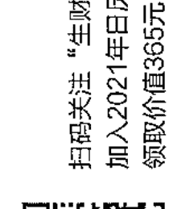

*   扫码关注“生发日历”
*   每天15:00 发日历提醒
*   解锁价值850元“生发礼包”

---

## 9月 7日 星期二
**农历**：辛丑年 八月初一

### 微商团队长的五条管理心法

节选自“小王子”的主题

1. 价值观教育：
    克服贪婪、敏感利他、长期主义；
2. 经营团队至上利：
3. 运营团队4G习惯：经营仪式；
4. 运营对品牌心智的情绪价值要激励到位、经营对团队“大数”（物质和情绪价值）；
5. 团队长要分享成长经验；
6. 团队长要出题学习、链接额外人选。


*   扫码关注“生财日历”
*   加入2021每日打卡读营
*   领取价值365元“生财日历”

---

## 9月 8日 星期三
**农历**：辛丑年 八月初二

### 三种跨圈层搬运需求的获利方法

节选自“花梦驼茨滴钱”的主题

1. 圈层速嫁：
利用算法，把内容主动地送给目的用户，发现信息差获利的空间。
2. 圈层降维：
抓住大众圈层的需求（代工厂罐头“低价谷钱”），运用到高 小 的圈层（零食圈）后，用简单的方式（内容清单）做切，形成易 传播信息差获利的商业技术。
3. 圈层开线：
以上等维后结到到的事象，可以做圈层的开线，如在在“什么值得 买”上的事系，同样类都可以同样的罐头再做“满流”一遍。


---

## 9月 9日 星期四
**农历**：辛丑年 八月初三

### 优质的训练营的核心本质是什么？

节选自 “知识巨量库”的主题

本质是通过训练营的运营服务把普通用户变成超级用户。

10000个普通用户不如100个超级用户，超级用户指的是那些非常爱你、愿意为你付出、为你的传播的核心用户。

做训练营，不应该是用同样一份力气平均分给给所有的用户，而是要把更多的爱和介值关爱到你的超级用户，激励他们。


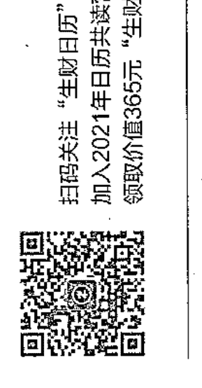


### 10月
Sept

### 星期五
辛丑年 | 八月初四


### 如何精准找到创业的切入点与定位?

节选自“零叛”的主题

对于创业者来说，行业是杠杆，切入点和定位是支点。通过行业，找准切入点与定位，就能定义创业成功与落败的两个核心变量。

我翻统计复数超过3000多个项目，其中超过八成的项目落地失败，主要原因都是“切入点定位找得不够精准”。切入点与定位更能解决三个问题：核心用户是谁？核心用户的需求痛点是什么？在解决这个需求痛点上我的独特优势是什么？


### 从“为我赚钱”到“帮你赚钱”

节选自“盗问”的主题

初心不一样，那么其细节和结果也会完全不同。打开思路以后，我让自己的运营技术、运营思路、运营资源毫无保留地贡献出来，并且还要想办法让他们更好地理解吸收。

对内，我的目标不是要做一个优秀的运营，而是要培养出无数个优秀运营。我的目标不是要帮员工打造一个成长平台，让那些依靠普通、顺路设计的年轻人，在我这里成长并得到钱。

对外，我的目标不是要赚一百万，而是要帮助一百五十个人赚到一百万。我帮助这些人赚到钱，那么我赚到钱也是自然而然的事。


扫码关注“老墨日历”
加入2021年日历群
领取价值365元“生财礼包”


### 星期日

辛丑年 | 八月初六


### 没想好具体干什么，可以做这三件事开启思路

节选自《先生》的主题

- 读一本经典：豆瓣上搜索“赚钱”“创业”“营销”等关键词用户评分7.5分以上的书，集中看一段时期，看后做笔记下来；
- 学一门技能：比如写作，演讲，PS，剪辑视频等；
- 进一个圈子：一个优质的圈子，可以为你打开一个看世界的大门，给你带来创业点子和高质的资源，比如“生财有术”就是这样的圈子。


扫码关注“生财日历”
加入2024年1月启动共读营
领取价值3858元·生财礼包

### 10月
Sept

## 13日 星期一
辛丑年 | 八月初七
秋分

### 普通人在赚钱方面的四个痛点

节选自 “光合” 的主题

一是没有认知：自己活在信息房里。如果连认知都没有，还谈赚钱呢？

二是没有方法：这里包含两层含义，一个是没有认知导致的方法没有，没有认知譬如只知道去抄方法，就在自己的圈子来回滚；另一个是自己掌握的技能太多方法太多，行业里圈子太多，普通人不知道怎么分析和选择，也不知道自己适合哪个。

三是没有行动：很多人有认知，也懂痛点也抄了方法，但是就是不行动。没有行动，一切都没意义。这点我就差不多说了，包括我自己也算是 “一日空指数”。

四是没有资源：作为普通人，当然没资源。没资源很正常，关键真不知道怎么找资源，甚至不知道自己需要什么资源。


日拱一卒 “生意日历”
微信扫码，查看日历
原价365元，“生意日历”

### 10月
Sept

## 14日 星期二
辛丑年 | 八月初八


### 用股权招募优秀的人

节选自“鱼丸”的主题

你永远不可能只靠发工资就搭建起一个卓越的团队。

如果有很赚钱的东西，让优秀的人可以和成长期绑定，事情会更好地演变且会完成得更好。比如给他们股数。

不要害怕分享股权，虽然团队的其他人分享股权会让你失去股权，但这个过程能刺激你有大概率获得一个战斗力很强的团队。

扫封底法“墨韵日历”
加入2021年日历共读营
领取价值365元“生财礼包”


### 10月
Sept

## 15日 星期三
辛丑年 | 八月十九


### 该向下属告知公司的真相吗？

节选自“勿亡”的主题

商业管理最有价值的规则之一，就是明白私利而诚实地告知职场伙伴真相并非一件残忍之事。一个优秀的管理者，面对员工要充分坦诚，坦诚到底。但凡有“老好人心态”，都是害人害己害公司。不告知员工问题出在哪里不仅不能解决管理问题，也会让他们丧失改进成长的机会，最终团队得不到发展、自食恶果。

成年人都有能力也必须去接受真相。其他人可以，你也可以。


扫码关注“全联白鹿”
加入2021年8月读书会
领取价值3885元“全联礼包”

### 10月
Sep.

## 16日 星期四
辛丑年 八月初十


### 在有限信息条件下进行搜索的关键

节选自“boyzil”的主题

在信息条件有限的情况下所进行的搜索，其核心是获取更多蕴含信息，而包含信息可能是与搜索相关的内容，也可能是一幅场景，又或者是逻辑结构内的其他内容，需要做的就是由此挖掘出其他可用的关键词。

挖出新的关键词中，可能会涉及到使用很多其他平台和工具。在这种挖掘过程中，可能会涉及到使用很多其他平台和工具，但积累这种经验，可以高效地培养自己利用信息差生财的能力。

扫码关注“生财日历”，
加入2021生财日历社群
领取价值396元的“生财礼包”


### 10月

## 17日 星期五
辛丑年 | 八月十一


### 做事情要有闭环思维

节选自“主题 Mike”的主题


闭环思维就是：搜集、学习、内化、输出、体系化、实践、再优化的过程。

在如今的社交大竞争下，只有把每一件从小的小事彻底做到“闭环思考者”才有可能获得收益。

更重要的是，只有小事的闭环，才有可能去成就大事的闭环。

1件大事等于100件小事的和。

100万元人民币等于100个1万元人民币之积。


### 星期六
辛丑年丨八月十二


### 如何建立并经营长久连接关系?

节选自“百川”的主题

- 多发朋友圈，取消仅3天可见的限制，让朋友知道你过得好不好，多发广告，多发点正能量和对别人有价值的东西；
- 多给朋友点赞、增加互动，不管你的动态有几个人给你点赞评论，但你会一直记得这个人；
- 发朋友圈前会思考下别人看了会怎么想，很多动态我发之前，就感觉朋友圈会有哪些人支持。


### 100万元现金，30天周期开发一个快手的赚钱渠道

节选自“顾帅”的主题

- 一天，我根据自身处境优势决定要像女装品类，在网上学习一下直播项目的推进流程，三天内搞定视频拍摄、主播招募和直播间装备。花了10万块，主要用于直播间布置和主播。

在此期间，我经常会回到Top1的大潮刷了三个火箭，要到微信信号，每天观察头部账号去请教经验，从开始发视频的第一天起，每天观察头部账号、赛道、进代视频号内容。

王燕和团队主力粉客利调整，终于“顺”了一条视频，获得300万播放量，单日粉丝增加9万。当天选品次日开播，首播出2800单，新渠道开发成功。

扫码关注“生财日历”
加入2021年日历共读营
领取价值365元“生财礼包”

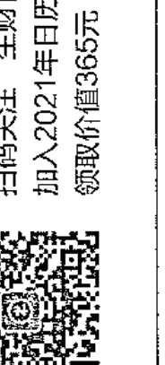

## 19日 星期日
辛丑年 八月十三


## 20日 星期一
辛丑年 八月十四


### 给兼职做电商创业的几个点建议

节选自“裴志”的主题

- 保证时间、精力，并且找到靠谱的合规合伙人；
- 转变学习，研究规则，舍得花钱去学；
- 重视选品，起步阶段求稳、做细小类目；
- 学会总结，把事物流程化；
- 懂得积累资源，建立门槛。比如积累拍照的资源、模特资源、制作详情页工作室的资源、美素秀的资源、供应商的资源等。


扫码备注“拾肆日报”
加入2021 春日社群”
领取价值365元 “生鲜礼品”

## 中秋节

## 21日 星期二
辛丑年 八月十五


### 创业亏100万元后，给到"你的"建议

节选自"孙奉"的主题

- 做一个长期投入生意，一定要计划好自己的现金流。一旦自己的现金流造成波动，做事情的节奏感会全无，一直提倡同学会储蓄，我们经营的不完全金融；而是节余感；
- 一定要学会情绪创业，快速测过，快速迭代。凡事不要准备得有余去做，要在现有条件下进行尝试。

扫码关注"星野白历"
加入2024每日应荐福群
领取价值380元"生财礼包"


## 22日 星期三
辛丑年 | 八月十六


### 产妇微信社群从拉新开始到转化全路径的案例

节选自“林抒鸿”的主题

- 第一步、组的内容、拉新：
  - 收集周边配套所有三甲医院产科的专业水准数据；
  - 建立生育干货信息源，并持续更新内容；
  - 公众号持续更新、引流。
- 第二步、编辑精准群的内容，并匹配自动化运营工具：
  - 拓单从会员开始到陪娃3岁的内容，整合到问答库；
  - 内容一定要注意尺度，特殊情况、医学知识等不要碰，不要踩到红线。
- 第三步、配合群需求发货：
  - 周围生孩子更多的，发组图；
  - 使用机器人自动回复，推荐商品。


> 扫码关注“生鲜日历”
加入2021年的打卡营
领价值365元“生鲜礼包”


## 23日 星期四
辛丑年 | 八月十七
秋分


### 培养赚钱能力的四个阶段

节选自“花容梦芝脆酒酿”的主题

- 开展：考察20个以上各个领域案例逻辑和细节；
- 学懂：看懂别人案例中的技巧，移植到你自己的领域里；
- 贯通：考察失败的过程，能让你更深入地理解流量、商业、社会和人生的本质，并开始总结每个领域的规则；
- 跨越：跨做到融会贯通的人，最终会找到一个合适的领域，将自己的思维、方法变现。


扫描关注“生财日历”
加入2021年日历共创营
领取价值388元生财礼包

### 10月
Sep

## 24日 星期五
辛丑年 | 八月廿八


### 散户做金融套利的底层方法

节选自“顾国玉”的主题

- 定位重点：在找项目后找钱。不要一个人战斗，带着全家人一起赚钱。
- 团队化运作：团队并不强调固定，平等互补是最好的方式。
- 赚钱效率最大化：一定要抱着极大主意，思考套利项目适合谁。所有的套利项目都有时效性，与其在分成上拖拉，不如多找几个。

扫码关注“生财日历”
加入2021生财方读读营
领取价值365元“生财礼包”

## 25日 星期六
辛丑年 八月十九
9月
Sep

### 在抖音上如何将“鸡汤”情感粉变现

节选自“秀珍马”的主题

“鸡汤”号最易做，一点就爆，能够给躺平台、刷粉丝赚不得钱，变现率最低。

能不能有个办法从“鸡汤”号里挣到钱？

在抖音做小额付费心理验证小程序，直接变现。

这中间，开小程序的，帮忙“鸡汤”号的，为小程序卖实流量的，说“鸡汤”号主要靠卖心理验证的以及顺著帮产品变现其实只为挣代理费的，每个位置都能赚钱。

这里你参不参与？

自己拿到首页一搜索，遇到很大的号，点进去一条看他的作品，就是点详情页，点在下级群的链接，看评论区。

多看，多想，就能知道答案了。

扫描关注“华财日历”
加入2021年每日读发票
原价398元“生日礼包”

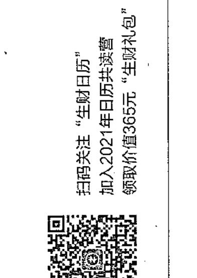


## 26日 星期日
辛丑年丨八月二十五


### 认知是这个时代最核心的能力

节选自“祭故”的主题

普通人创业有条捷径：认知控制，通过控制，通过思考，寻找认知差，发现别人看不到的价值。

条裂的好友吴昱恺曾说：“对于认知，我信奉的一句话就是：人的一生都在为认知买单。认知是当今社会最有价值的一种能力，认知是生产力，是分辨率，是定力，是一切风控、资本、资源、能力驱动的驱动力，是引领这个时代最核心的一种能力。”

扫码关注“生财日历”
加入2021年8月书单播报
领券价值3585元“生财礼包”


### 10月
Sep

## 27日 星期一
辛丑年 | 八月廿一


### 如何处理主业和副业的关系？

节选自“李胡”的主题

副业是用来说发展的，主业才是用来固本生存的，但是大多数人相反了。

如果你认为你的主业在未来很有发展又能赚钱，但是当下不行，那么建议你抛弃一切副业思想专心注干主业的修炼。

如果主业一般，那么就当一个养家糊口的事情干嘛，要利用业余时间找到更有发展的副业来干，这才是你未来的生存发展之本。


扫码关注“生财日历”
加入2021年日历讨论营
原价3980元 “生财会员”

## 28日 星期二
辛丑年｜八月廿二

### 细分市场的四个重要优势

节选自“人海”的主题

- 竞争对手是传统行业打法、效率、能力、思维差距极大，很容易形成所谓的“降维打击”；
- 巨头看不上，不会有汉姆之灾，同时很容易变成头部企业；
- 需求长期不容易被颠覆，赚的不见得很多，但能赚得久；
- 中国人口众多，任何一个微不足道的细分行业都能据居。


扫码关注“生财日历”
加入2021年生财社区群
领取价值365元“生财礼包”


## 29日 星期三
辛丑年 | 八月廿三


### 进步源于认识到自己不行

节选自“亦仁”的主题

能够认识到自己不行，跟赚钱这件事一样，越早越好。

最好是少年时候，就连身上发生一些求而不得、反复求而不得的事情。尽快认识到自己能力其实有限，接下来的人生会幸福很多。

最怕是人到中晚年，才慢而深刻地承认现实——“哼呀，我真的很没有用，那时候已经很痛苦了。绝大多数上述的人，基本都会在某一个点上，认识到自己不行，没啥不好意思的。”


扫码关注“牛叔日记”
开通 2021 年会员专属
领取价值 85 元“生财礼包”


### 阻碍你生财的七个原因
节选自“打破魔”的主题

- 没有目标，经常换工作；
- 没有自知之明，眼高手低；
- 用心不专，什么都学；
- 不学习；
- 不自信；
- 不勤奋而为工作；
- 圈子女太小。

只要克服以上几个生财的缺点，思想上彻底，行动上敢定，赚钱可能只是时间问题。


扫码关注“生辰日历”
加入2021年日历版微信群
领取价值385元“生辰礼包”

# OCT
十月

很多从事营销的朋友常常有这样的困惑，就是在自己家的产品甚至跟别家的产品几乎同质的前提下，要怎么做营销呢？

产生这个问题可能有两个原因：第一个原因是你们公司没有认真思考如何创造顾客价值，有样学样照猫画虎，人家做我也做，甚至连一句微创新都没有。第二个原因就是你产品价值独特但消费者还没有认知到你们产品的独特价值。

导致大部分消费者，甚至重要消费者，那就很尴尬了。因为我们为顾客提供的价值是多方面的，不仅仅根据的是某一件商品。同样的电子商品，发货快就是一种价值，比如京东；同样的火锅，服务热情和亲切也是一种价值，比如海底捞；同样的奶茶，杯子形状不一样也是一种价值；同样的豆皮豆浆，老板很漂亮也是一种价值。

**“生财有术”嘉宾 小马宋**
于 2019.03.20 分享

## 生财有术 | 嘉宾

> “生财有术”有那些嘉宾？

- “互联网百晓生”@CaoZ；
- “小道消息”自媒体主理人@Fenng；
- 罗辑思维首席营销顾问@小马宋；
- 37学园的《5分钟商学院》主理人@刘润；
- 真格基金合伙人@周耀；
- 常客用金额计3个亿的@秦祖；
- 10万人的新媒体老师@邵左罗；
- 科学SEO鼻祖@国平；
- 新书还未上市就卖出10万册的@刷屏一只瑞；
- 用一副春联卖了10亿票车的@赛车毒老纪……

嘉宾我们会在星球不定期分享干货，助力圈友“生财有术”。


### 如何成为训练营销设计专家?
书选自“办广”的主题

在各种规格的纸APP中，如果遇到某些教程广告，不要急着划过去，花几秒钟报名一个训练营，仔细体验流量和调节。在此之后，你会看到免费课程，同样有几块钱报名体验。这就可能成了训练营里教练非常详细地自己录下来，如此一省，你可以专业课程是“设计专家”，找到一份这群运营的工作并不难。甚至，可以专门做“训练营设计”，讲课程或者咨询费务。

推测洞察，知识分享都在进行对最迁移，大环境的各种“训练营”都将会出现。


国庆节
10

FRIDAY
星期五
辛丑年 | 八月廿五

### 拖延症不是状态不好，是目标不明确
节选自“潘多拉的清单”的主题

- 你的状态并不是原因，状态是一个结果，不要跟状态死扛，扛不过的；
- 拖延症的本质不是状态不好，是没有目标；
- 注意力不要放在情绪上，先分清自己处于哪一个行动状态：维持状态、推动状态，还是调适状态；
- 只要进入“需要状态，立刻开始驱动，驱动紧马上就要推进状态；
- 这是利用好“一”天的时间的基本功；
- 做事要结果导向思维，不谈具体任务，该做成什么，这是最尖锐的；
- 事情越多，越是聚焦关键，不要平均分配，而是单点突破；
- 事前投资，为因解决矛盾更多的资源；
- 不要想着一口吃个胖子，保持迭代。

扫描关注“生财日历”
加入2021年的打卡群
领取价值365元“生财礼包”


## 02
10月
Oct
SATURDAY
星期六
辛丑年 | 八月廿六

### 内容创业的IPO模型
节选自“V先生”的主题

- IPO（输入加工输出）三个字母分别代表：input（输入）、Processing（加工）、Output（输出）。
放在学习上，可以是：
输入：读书、听课、看视频；
加工：思考、讨论、做笔记；
输出：书评、答题、教别人。

您最重要的角色是微输出者——输出内容、输出产品、输出服务。


## 04+
MONDAY
星期一
辛丑年 | 八月廿八


### 3—5年内，拼多多可以中长线布局的赚钱机会
节选自“kevinly_决策”的主题

- 品牌店铺流量饮料；
- 风格品或好逛流量饮料；
- 电器城；
- 多多国际；
- 未成年/的生存/实力股市场。


### 为什么有人看精华帖子看不出价值?
节选自 “鱼丸” 的主贴

大家心里都有赚钱的模型。A项目里引流做得好，B项目的产品设计得新颖，C项目转化文案强，D项目团队领导能力强……任何一个点，都可以复到自己的项目中，实现直接的收益增加，自然能看到其中价值。

很多人不知道自己该从哪个项目中提取哪一块，得希望得到一个完整的项目，自己一个人从头到尾固定，慢慢看慢慢懂，其他人就像个完整的项目，自己一个人从头到尾没有个谱，同样的事情，其他人就是做得比自己好。

赚钱本来就不是 “解决一个问题” 能做到，而是产生自己已具备生产知识和条件反射的能力。

如果面对 “什么都能社，又不知道自己喜欢什么什么” 的问题，请先把其中一个极端做透。

10月
Oct
06
WEDNESDAY
星期三
辛丑年 | 九月初一

#### 技巧篇

### 五个销售思维和技巧
节选自“销售一”的土壤

- 所有的行为和感情这个规律：意愿—行动—结果；
- 同一件事，不同位置的人、难易度是不一样的。所以办事要找更高层的人；
- “人”和“利”这两者越深层次的关系线和难度，没着这两条线出发去分析，推出的答案永远不会错人；
- 销售必须要会包装自己或“伪装”自己，让自己看起来像个“成功人士”；
- 真正优秀的销售是要去找划、去创造。

扫码关注“社群日历”
加入2021每日晨社群
领取价值395元“生鲜礼包”


## 07
### THURSDAY
### 星期四
辛丑年 | 九月初二
### 10月
Oct


### 简单重复正确的事情，往往是世间最难的事情
节选自“唐珍”的主题

前些年有个最火的抢读游戏，给你一张纸一支笔，一小时内从1写到5000，不许写不允许错。报告书10元，只要写完，就送一只巨型玩偶。

看着多简单，简直是纸送福利。毕竟，谁还不爱捡钱呢？至于时间，平均1分钟写20个数，可以算是相当宽松了。体力方面，800字的手写作文谁没练习过？

然后，实际参加是，能够成功通过挑战的，十中无一。简答重复正确的事情，听起来简单，但因为“反人性”，反倒极难以坚持。


扫我关注“生财日历”
加入2021年12日历打卡社群
领取价值585元宝藏礼包


### 寒露
08


### 如何从职场切入互联网领域赚钱？
节选自“明白”的主题

赚钱的第一步，当然是打开思路。圈养猪兴趣的关键词（如游戏）搜50个相关的点子，然后做好调研，从中选出适合自己的几个事情，最后确定一个适合自己的项目。

- 见识：看到赚到钱还需要两个必要条件：见识和能力。

明白，看大量案例，知道哪些事情能赚钱，过程中需要用到哪些方法；

- 能力：需要有能够学习相关知识和技术的能力，把思考付诸行动，然后假设、试错、改进，最终做成一件事。

当见识足够，能力匹配，赚到钱就是自然而然的事情了。

FRIDAY
### 星期五
辛丑年 | 九月初三


扫码关注“生财日历”
加入2021日历内共创投资
领取价值585元“生财大礼包”

### 10月
Oct
## 09
### SATURDAY
星期六
辛丑年 | 九月初四

> 案例篇

### 仪式感也是一种赚钱思路
节选自“鸟丸”的主题

顾问一个朋友圈的出务就是对大家对比式思维的诉求，但业务本身真的转对简单，仅仅是给大家提供一个很有有效应的相信。中间放上一张Tinter帖子的截图，就是这么简单的创业，每年能带给他30万美上的收人。“白报”、“黑片书”、“微情书”、“销售书”等并且顺相继”也都有各种各样的仪式感。

“仪式感之外，还可以教学、手机摄影教学、朋友回顾摄影程，还可以教学具工具：复古相机、水相机、贴图片机......”

当然，无论是做住任何一单，都优先通知VIP，把种子用户搞定，这并是最重要的一件事。

```
扫描关住 生数日尔
加入以160加友请群
系或价值938元 生意术息
```


## 10
### SUNDAY
星期日
辛丑年 | 九月初五


### 副业赚钱的五个要点
节选自“问鹿”的主题

- 副业想要赚钱，靠的终究还是“认知差”；
- 怎样去赚认知差？最好的办法，就是你不断地去进行知识输出；
- 我们想要去挣足够多的“认可者”；
- 信息差想要足够优质，才需要利他；
- 对于绝大多数人，电商绝对是一个比知识付费更强烈、更普遍、更频繁的赛道。


## 11
MONDAY
星期一
辛丑年 | 九月初六


### 如何通过帮助用户省时间赚钱？
节选自 “V先生” 的主播

一部手机80万卖回来，5000元卖出去，照样非常多人买。
这群人通常需要一部手机装多个微信的人，主要是微商、社群运营、资料代，就需要买手机、重装资料、买软件、营放等，他们为了节省多个微信，就要买手机。重资料。买软件、营放程，装软件，假设要花费10个/小时，这个群体少没有500万人，就需要5000万个/小时。
而你把这几个动作打包，用机器批量化完成。
用户花5000元钱，甚至去50个小时，省去一大堆的省事，很快就赚到15万元，这笔钱花得值不值？当然值。
这和做翻译或是帮人省时间，帮他们完成他们做得慢、感倒困难、做得不专业的事情。

扫码关注 “星野日历”
加入2023年日历共创联盟
或拨打邮3657 生体科点


TUESDAY
星期二
辛丑年 | 九月初七


### 付费社群赚钱思路
节选自“刘仁”的主题

·
·

之前写过的重重论点，都值得用付费社群的模式再做一遍，且会比论坛更好，因为变现的问题已经直接解决了，只需要专注于提供好内容、服务与链接即可。


扫码关注“财材自居”
其10024年启梦计划
领取价值365元“生财礼包”

10月  
Oct
## 13
WEDNESDAY
星期三
辛丑年 | 九月初八


### 拆解张勇在湖畔分享的《领导者如何“落子无悔”》
节选自“自一遍”的主题

- 一上来就感叹平台，基本做不成，不管是吃透行业，还是最终独到核心行业，都需要打开你的核心能力；
- 做CEO（高频执行型）是需要基于对水位的认知水军；
- 战略最大方向，是必须让CEO来把控的，要有原则和“我不做什么，边界；
- 笃信隐忍的主意不长久之，因为门槛太低；
- 不确信隐忍常态；
- 面对成功，要正确地归因；面对失败，要冷静无情地修正决策逻辑，做等过程；
- 领导者和CEO没有说“我不知道”的权利。当手下的人都不能解决问题的时侯，你要责顶上。那个时侯，谈“CEO不该插手业务细节”没有任何意义。


### 重阳节
10月 Oct
14
THURSDAY
星期四
辛丑年 | 九月初九

#### 总结案

### 赚钱三板斧：认知差异、品牌设计、合适渠道
节选自‘蔡叔’的主题

从消费行业来看，关于衣食住行的任何一个细分行业，市场规模都特别大，商业模式也高度成熟。想赚钱，一般都是遵循低买高卖的道理，投入产出容易计算出来。

尤其是今天！中国制造业和供应链管理无比强大，你想到的任何产品都能找到代工，这给我们提供了一个平台级的基础设施。我们现正在需要找到认知差，设计好品牌，并找到合适的渠道就有机会赚到钱。


扫码关注“佳软日历”
加入2021年日历共建营
@软加加365元“佳软礼包”

## 15
FRI
DAY
星期五
辛丑年 | 九月初十

### 不要给自己设限，一切皆有可能
节选自“胡400”的主题


做游戏开发生意时，网络的数量很乱，偶然了解到一个同行手头有很多，便只知道同行的名字，以及大概的位置。

怎么办？先是考察通过144家，然后又通过电信公司逐多次访问，最终通过“逢君幸”，一步步摸索找到这个人，做成了大几百万的生意。

很多时候，在我们的认知中，那些看似不可能解开的难题，多尝试几次，就可以找到头绪。

作为创业者，要不停地尝试，也许某个我们不在意的点，就是“奇点”，能够发出整个宇宙。


扫码关注“逢财日历”
加入2021年的科技营
领取价值300元“生财礼包”


### 世界粮食日
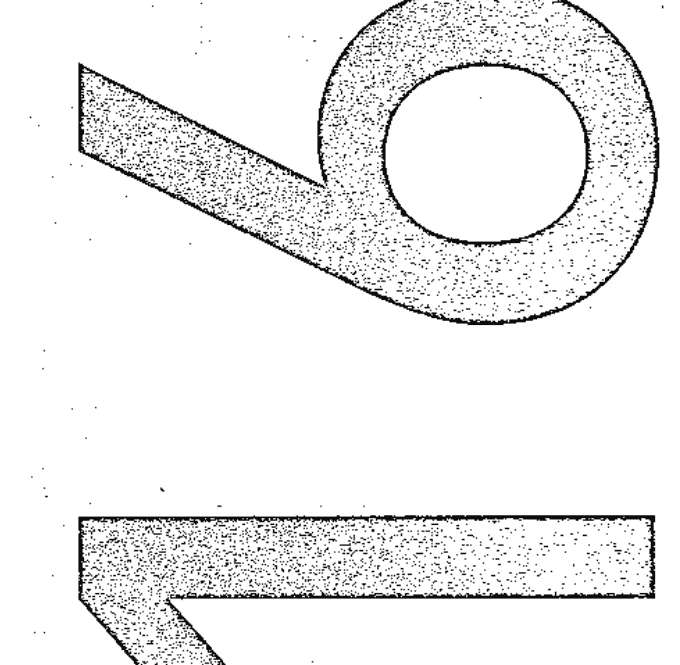
SATURDAY
### 星期六
辛丑年 | 九月十一


扫码安装 “宝藏日历”
加入20万 创作者社群
领取你的 超级会员·宝藏礼包


### 抖音运营的八点经验分享
书选自 “张小何” 的主题

- 一开始就要有具体的产品；
- 一开始就要有清晰的商业变现路径；
- 一开始的人设越要越清楚，不要变来变去；
- 垂直最重要，越垂直的粉丝价值越高；
- 为粉丝带来价值；
- 不要任意播放量；
- 不要在意粉丝量，慢慢积少成多；
- 不要灰心，不要轻易放弃。

## 7
1
10月
Oct
SUNDAY
星期日
辛丑年 | 九月十二

### 做社交淘客App亏100万元后的感想
经历前
节选自「孙宽」的主题

做社交淘淘客的，不要自己开发App，也不要用那些共享App，建议加入一个成熟的App，找到一个顶级上家。因为代理App本质上还是超级用户包推，所以我们需要站在巨人的肩膀上进行能量加持，通过上级的加持，通过App平台的加持，做起来的速度会更快。


扫码进群 “生鲜朋友圈”
加入2021年百胜计划营
领取价值988元 “生鲜礼包”


### 一个小而美的抖音图片制作项目
节选自“俊俊湾”的主题

- 需求：
用“低男贫”的图片帮男人们把自己小时候想要拥有属于自己的汽车的那种心情场景表达出来（可以理解为，让别人帮自己做特色图纸的需求）。

- 工具：
（1）工作微信号一个，提前做好包装（不懂包装的话可以参考同行的包装）；
（2）抖音号2-5个（“贱”的概率更高）；
（3）视频素材（翻 PS给自己制作，不懂的找快手借鉴）；
（4）“美恩”和“马卡龙”两个App（也可联系上架作图，成本每幅约5元）。

- 变现：
从抖音引流加微信，收费10-30元。


扫码关注“生活后日”
加入2021年度井运营
领取价值368元“生财礼包”


## 19 OCT

星期二
辛丑年 | 九月十四

### 晨练感悟

### 怎么找市场需求?

节选自“白一姐”的主题

- 进入有付费门槛的地方（筛选真实付费需求）；
- 收集用户提出的问题（寻找未满足的诉求、用户画像、用户顾虑）；
- 选择感兴趣、有利益、自己能解决的问题。

举例：搜索能力强，不会找答案——我可以做信息整理；读者没有阅读目的的话，读者看不惯行业术语——我可以用“说人话”，用图像、音频传递知识。


加入2024生财日历
领取价值568元“生财秘籍”

## 20 WED

星期三
辛丑年 | 九月十五


### 大学生做编程培训赚十几万的经历

节选自“阿左”的主题

在大学期间做过了一个培训班。

慢慢地，前来学习的人越来越多，由我指导引领入门，教一些编程语言基础，学员大多时间都靠自学；按照图书馆里带光盘的编程书，完成课程中的习题。

在大学期间做过了一个培训班... 我通过这个培训，我赚了十几万。


扫码或关注“叁叔后营志”
加入2021届后营
领取价值388元“生存礼包”

## 21 THU

星期四
辛丑年 | 九月十六


### 如何向顶尖高手学习？

节选自“先生”的主题

首先，在入门会私聊、饭局、优质微信群、知识星球、经典书、知乎、B站等平台找到该行业高手，然后：

- 通过你认识的“高手”找到更多高手、圈子、优质信息源；
- 深入阅读优质信息源，近距离接触这些高手，“写”，讲这些圈子里面；
- 针对你当下要解决的问题向他们请教；
- 针对你未来的目标向他们咨询。


扫码关注“生财日历”
加入 2021 年的生财联盟
领取价值365元“生财礼包”

### 抖音好物号玩法建议

节选自“AYI波波”的主题

- 把大量的视频号压炼到一场直播中，可以极大地释放流量成本；
- 把大量的货品压炼到一次直播，也可以提升流量的效率，提高ROI转化率；
- 如果主播再能做到多让用户停留，提升下单率，多引导用户关注，就可以同时实现赚钱和涨粉的目的。


星期五
辛丑年 | 九月十七

扫码加VX “徐畔月辰”
加入2021 钻石粉丝团
领取价值385元 “生存礼包”


### 霜降

星期六
辛丑年 | 九月十八

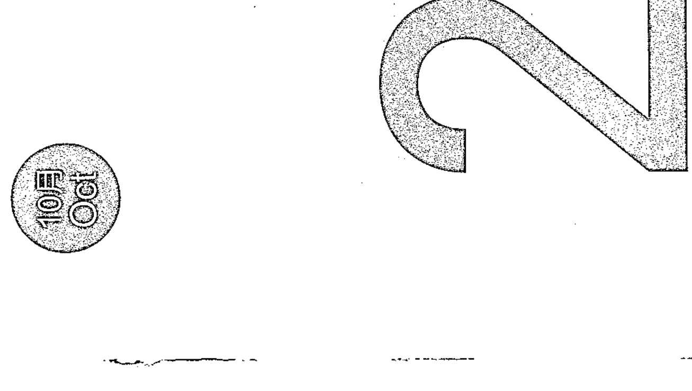

### 如何成功销售一个产品？

节选自“鱼丸”的主题

- 保证产品的可靠性以及稳定性，这是一个非常重要的因素；
- 提供人们无法拒绝的价格；
- 找到合适的分销渠道，当他们看到你的渠道收益巨大的时候，一定会加入进来帮你一起卖；
- 建立自己的邮件清单，定向推送给他们，效果也很好；
- 尝试新的销售渠道副本，产品功能点上可能会略有差别，但是有特别优惠。

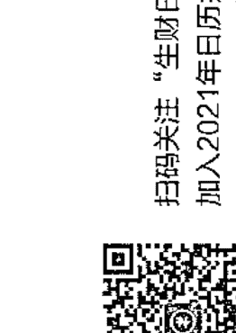

扫码关注“鱼丸日”
加入2021年10月社群等等
领取价值389元“生存礼包”


星期日
辛丑年 | 九月十九


### 打造百万级短视频账号的核心要点

节选自《七招》的主题

- 账号发展规划：启动新账号之前先考虑账号的后期发展和变现模式；
- 选择达人适合的赛道：每个达人都有不同的性格特点，要选择适合的赛道。
- 分析市场需求占比：了解市场走向才能更好地把握账号内赛道规划；
- 账号预设和人设定位：抓住达人的特点并标签化，放大他的特点；制造高转化率；
- 账号内容策划：明确的变现需求是内容规划的必要前提。


扫码关注“佳影日历”
加入365天自我发展联盟
领取价值299元“生活礼包”

## 25 MON

星期一
辛丑年 | 九月二十二


### 线下小店与互联网的关系

节选自“晓群”的主题

很多参照互联网人看不上的线下流量，我整理成流量很容易获得，大佬们整理线下流量，也是高收益了，小打小闹也很有意思。而做实体店，如果能掌握“线上流量+运营”的玩法拉升实体店去做，去坚持，结果一定不会差，线下店适合做线上运营。

未来线下店，只能用“社交思维”去持续运营，才有机会获取绝大多数利润。


扫码关注“年时日历”
加入2021整日历共读营
领取价值398元“福利礼包”

### 近几年做亚马逊还有机会吗？

节选自“seven”的主题

- **绝对有机会**：新手依然可以入局，只是“门槛”变高了，最好有产品选得好、避免踩坑和走很多弯路。行业内的入局者，请多多交流。
- **一边上班，一边做副业**：借助朋友的账号、仓库等资源，基本可以做到零成本起步，就算做亚马逊不成功，也还有退路。一个产品开发做到了以后用考虑全局。
- **不一定非要做亚马逊**：不同的经历者拥有不同的资源，有适合自己做不同赛道。比如投入很少比如好物，投入1万元以内的合购SEO与Niche网站联盟营销；投入1万—2万元的淘宝直播带货打法等。用时间去做链接，完成原始积累后，要思考如何提效率并去创造财富，走一条有长线价值、有复利的路。


扫码关注 “蜂网日历”
进入2021年日历订阅专场
领取价值365元 “福利礼包”

## 26 TUE

星期二
辛丑年 | 九月廿一


星期三
九月廿二


### 要从心眼里
把用户当朋友

节选自“嗨爆”的主题

你带着什么样的目的对用户，用户心里是明镜似的。用户不排斥你，也允许你们之间的交流。

后来，做他们的话。从产品思维到社交思维，这个关乎自己破局。而这些突破，敢于于思维的突破。

如果你们在做年轻人、跟年轻人的生意，记得问自己：你们真的有去了解年轻人吗？真的懂年轻人吗？

站在上潮媚海久了，该下凡啦！


扫码关注“程阳日报”
加入2018年自媒体运营营
领取价值8397元“全场礼包”

## 28 THU

星期四
辛丑年｜九月廿三


### 要从心眼里
把用户当朋友

节选自“晓群”的主题

你想着什么样的对用户，用户心里是明镜似的。用户不是你让他们的路。从产品思维到社交思维，这个关得自己破。而这些突破，取之于思维的突破。

如果你们还能与年轻人共情的想法，记得问自己：你们真的有过了解年轻人吗？真的想过老人吗？

站在上帝视角久了，该下凡啦！


扫码关注“经纬日报”
加入2021经纬社群
领取价值355元“经纬礼包”

### 社群服务相关的
四种创业模式

节选自“肚小哥”的主题

- 社群培训+顾问、先培训，培训后有一段时间用于答疑，适用于中大型企业。
- 社群动销服务：在两三周内密集化运营，配合作企业微线上“爆破”活动，产生高销量，适用于有很多粉丝的微商企业。
- 社群策划+指导服务：给企业必要的社群方案和日常指导，适用于会议营销、连锁门店等中型企业。
- 社群策划+代运营全包服务：帮助全职操作，适用于以快消品为主的大型巴戟企业。


星期六
辛丑年｜九月廿五


### 当你明白 “淘客” = “勤奋”
的时候，你就会成为“大牛”

节选自“狗哥”的主题

传统淘客依靠勤奋积累了第一桶金。

能先找到的大佬，通过行业的红利和转折点迅速占据一席之地。

区别淘客的勤奋、机遇淘客的爆发，都会在见证这个时代的更新进步。

无论玩法怎么变，都离不开流量、转化、付款、结算。

也正因为这个看似简单的行业，让普通的普通人也有了逆袭的机会。


扫码关注 “生财日历”
加入2021年日历共建者
领取价值 585元 “生财心法”

## 万圣节

星期日
辛丑年 | 九月廿六


### 视频号快速涨粉的方法

节选自 “文东”的主题

- 前期启动去社群、朋友圈接广告；
- 内容控制在30秒以内（可参看点映速递），完播率会比较高；
- 生产要众广，可能会引起“争议”的内容；
- 评论区引导方向，有争议的讨论内容一定要回复；
- 视频内容要火以后，一定要保持持续更新；
- 用相同的绘本开始，让大家记住你；
- 结尾引导大家关注，并预告下期最新的内容。


扫码关注 “佳期日历"
加入QQ 书日历大联盟
领取价值399元 “宝典礼包”


- 健康是为了降低生病的概率；
- 努力投资是为了降低风险和提高收益的概率；
- 努力工作是为了提高增加收入的概率；
- 努力学习是为了提高出人头地的概率……

但你不能说，健身就一定不会生病，学好投资就一定不会亏损，努力工作一定能增加收入，好好学习一定能出人头地。

“生财有术”亦是如此，它能带给你更多生财的可能和提高抓住机会的概率。可再简单的赚钱方法，即使人人皆知，也未必得人人能赚到。

希望你能明白，“生财有术”能带给你的，不仅是回本那么简单。

### “生财有术”圈友版

于 2020.04.14 分享

### 生财有术丨圈友

来自五湖四海的“生财有术”圈友们都聚集在“生财有术”，自然是源于某些共通的特质。

他／她可能是创业多年且财富自由的大佬，想找新的玩法，挖掘有潜力的年轻人；

他／她可能是商业模式已经得到验证、正打算扩大 的操盘手，对接靠谱的合伙人和合作方；

他／她可能是在大公司里，每周“996”加班的程序员，想换赚钱副业，避开中年危机；

他／她可能是一名兼职创业的宝爸或宝妈，想在这里和同频的朋友线上链接；

他／她还可能是已清晰地认识到，赚钱养活自己越早越好的大学生，想省下生活费、自我投资……

对大家而言，“生财有术”是一扇窗户，来到“生财有术”等于开启了一扇窗子，可以和15000多名同频达人互相交流学习，通过各式各样的活动深度链接，碰撞出生财的火花。

### 怎么找到“天赋”？

节选自“龙东平”的主题

一定要确保自己擅长的内容，这样才能够持续和长久。梁宁老师说过：“什么事情让你没进不挠，什么事情让你特别满意，这就是你的命的所在；能让你不开心其闲去做的事，就是你的天赋所在。”

怎么找到天赋？首先看你对什么事情感兴趣；其次，看你在做什么事情让你做做的时候，是不是就让你就停滞了；最后，看你是否会不讨厌就也做，可能还乐着“猪开快乐看”的感觉。

扫码关注“生财日历”
加入121天日打卡读营
领取价值365元“生财礼包”

星期一
辛丑年 | 九月廿七

10
11月
Nov


### 工具App类出海产品的广告是怎么赚钱的？

节选自“罗玲”的主题

魔圈医药用开平与政策的收紧，“广告＋付费订阅”模式开始在全球范围内成为趋势。我认为其核心本质就是找到那些高付费意愿的用户，让他们掏钱，让不愿意付费的用户看广告。

如果点明没有用户画像，不知道什么类型的用户才是高付费意愿用户，那么所有用户被统一属于付费流程，低免付费的用户就走一遍广告流程，当然这会一定程度让付费用户体验较差，再通过测试不断调优，最终达到收益最大化值。

广告方面，可通过使用聚合工具找到最合适的广告来源来进行广告投放。

聚合的作用就是把最高收益的广告挑选出来推送给用户，以此获取更多的广告收益。

扫描二维码关注“绝叫君后”，加入24’27’年的科技潮享，领取价值365元“宝典礼包”


# 11 Nov

星期三
辛丑年 | 九月廿九

认知篇

## 互联网人要做好的五个心理准备

节选自「天赋」的主题

- 不定期地总结刻板的自己，发现问题、解决问题；
- 在不影响生命正常的前提下，有想法就通过试错、后验证验证自己的精神冲击，往往可能比失败的结果更大；
- 优先到与自己同类型的人完成一个项目的小闭环，可以快速的判断这个项目能不能做；能否当做事业去做；
- 听父母的话，但或许不要反叛他们的话去做事；
- 工作的时间与思维时间应同比分配。


扫码添加“陈鲤日记”
加入2021年吕吕共读营
领取价值398元“生涯礼包”

## 04

星期四 | 九月三十三
壬五年

11 Nov

经历篇

### 如何抓住服务业的大机会？
节选自“副机智”的主题

以30年为期看中国社会发展，改革开放后是商品生产的30年，未来30年要提倡起服务文化的输出。

在商品和文化的之间，有最后的30年黄金发展周期，本质是商品丰富。

供大于求后，提高用户的服务体验是机会。而服务产业中，服务人员群体未不是最核心、最主要的效率和机会：

- 则提高服务人员的工作提高效率，降低成本、隐入服务中；
- 从业人员的职业培训、婚恋、小孩上学、老人养老等。


扫码关注 “生财日历”
加入2021 年度日历营
领取价值365元 “生财礼包”

## 05

11月
NOV

星期五
辛丑年 | 十月初一

### 怎么把读过的书变成
自己的知识？

节选自“亦仁”的主题

先去故事，再去读书。

先找一个赚钱的点子，开始尝试，遇到问题和困难，搜索或者请教，并经常尝试和尝试进一步加固，并可以提炼框架。

思维框架图是读书和尝试进一步加固，并可以提炼框架。

不建议在无尝试的情况下读太多书，读用意之半开窍。

扫码进群“年历日历”
加入2024年日历讨论群
领取价值365元“年历礼包”


## 1月

## 06 星期六
辛丑年 | 十月初二

### 只要卖得好，你就是“牛人”

节选自“封闭”的主题

有些朋友对微信的推友有疑问，我认为只要不多于层级的套盒。
满足三级公推，产品品质没问题，真正卖到终端，都是可以的。

其实微信日常生存，即便是第一批答案，也总从生产量地到批发市场，各个朋友都难下结论。

包含朋友质疑，微信赚钱的永遠是少数人，我认为，任何行业赚钱的都属于持续努力，持续学习的人。

人生的赢不在于起点，而在于持续性。

扫码加本“materials 包”，
加入 2021 年会现场观摩
领取价值 585 元“生盈礼包”

---

### 立冬


### 星期日
辛丑年 | 十月初三


### 社群创业八条心得

节选自“刺猬一只猪”的主题

- 1. 群主要调动群员点啥价值，群重要定期打发生连接；
- 2. 从优秀群员里物色团队成员；
- 3. 精神奖励优于物质奖励；
- 4. 布道（门户）是最重要的运营工作；
- 5. 进来访组，挖掘榜样故事，广而告之；
- 6. 筛选优秀老带新额度；
- 7. 挑选社群金句，做成表情包，有利于社群文化建设；
- 8. 让更多人装置到群里“C位”。

扫码关注“刺猬日报”

每晚20:15每日“思想家”

领价值385元“全副礼包”


---

### 进行时间规划的三个工具

节选自“潘多拉的书签”的主题

- 1. 执行工具：精髓在于“延迟”，像放养小孩一样驯服自己的大脑，形成习惯小，避免内耗；
- 2. 卡框工具：把任何事项跟一天中“最重要的事情”进行比兑，只要跟这个无关的，就可以“六次否认”，裁开干扰，将精力集中在最重要的事上；
- 3. 规划工具：我的时间耗在什么？我做的什么事情会满意？我需 要做到什么结果？我的时间和精力要如何投入进去？

扫码关注“生财日历”
加入2021年1月日历共读营
领取价值365元“生财礼包”

---

### 从普通小职员到年收入1000万元小店老板的启发

节选自“凡不变”的主题

主业：开餐饮店。
副业：自媒体。

- 1. 写作能力、口头表达能力对每个人都很重要；
- 2. 坚持持续输出；
- 3. 拼实力便能胜出99%的人；
- 4. 真诚、没套路，用户可以感知得到；
- 5. 我选一个适号自己、能力匹配的垂直领域，深耕这个领域，并努力成为这个领域的专业人士。


### 星期二
辛丑年 | 十月初五

---

### 抖音短视频的新手注意事项

节选自“盗神”的主题

- 1. 选择一个一台手机能完成内容创作的项目，对视频质量要求别太高，不要有复杂的后期剪辑；
- 2. 要做离受众最近的事情，不要在剪辑炫富、点数量，只能注意别用多少；
- 3. 内容要垂直，只有垂直的粉丝才值钱，粉丝一定要精准，越精准的粉丝，转化率越高；
- 4. 避开红海区，发掘自身的价值点，做自己有行业的延伸，内容的价值要求更高；
- 5. 初期以最低的成本去尝试这个项目，成为后注MCN的方可发展，流水线包装复制。


扫码关注“生财日历”
加入2021年会员共创营
领取0元抢355元“生财礼包”

---

## 11 光棍节


### 星期四
辛丑年 | 十月初七


### 视频号运营的五点经验分享

节选自“皮卡丘”的主题

- 1. 在选择内容方向的时候，除了考虑账号价值，还要保证能持续做下去，这才算关键；
- 2. 在垂直类目下坚持发布作品；
- 3. 多参考头部 “大V” 的分发；
- 4. 作品一定要迎合用户的爱好；
- 5. 做好每一个视频选题对用户的情绪，但不要过于追求宗教主义。


---


## 12

### 星期五
辛丑年 | 十月初八


### 互联网赚到百万后的总结

节选自“说划大大”的主题

- 1. 互联网时代并不是比努力程度，而是对于趋势的选择；
- 2. 永远要保持对于学习的需求，互联网抓住的本质就是3天一 个小要求，3个月一个转变，不进则退；
- 3. 永远要要搞点ROI，如果投入小于产出，重置积累就是多；
- 4. 如果投入小于产出，并且你认为值得投入，那么千万不要停止，立马去全方位的放大；
- 5. 看看机会不要想资源，并且要去全方位ai in，一个人用心做系统和“帮系”，故事，及其完全想两件事。


---


### 为什么说快手是块流量宝地？

节选自“住X”的主题

首先，快手上的吃喝玩乐非常多。逛街、吃播、搞笑、唱歌、跳舞、户外探险、情感咨询都有，早期只能通过打赏、刷礼物完成变现。
后来，快手小店上线，除了可以做淘宝客、跟卖货、赚钱等平台也达成了店路合作，而且后台路分享拿到赏值。快手电商渗透丰富起来，有店铺号主直播加助吃达美，甚至短视频助吃达美也有人询问商品链接。对新人也很友好，可以线下定好对坐好为自己产品和带货。
“住X”等，在直播时“游戏吹你”“推你产品”；也可以在他人直播时做跑马灯，有机会品牌传播流量也很好，然后的起好
快手对于品牌的私域流量也很友好，粉丝价值也很高。不要仅因为不了解，就忽视这个平台。


## 13

### 11日 Nov
### 星期六
辛丑年 | 十月初九

---

## 11月 Nov

## 14

### 星期日
辛丑年 | 十月初十

技巧篇

### 小红书个人账号运营

节选自“壬煜”的主题

- 1. 开始运营小红书账号之前，请先在小红书平台关注“薯管家”；
- 2. 保持好每周笔记 收录 机制，被小红书收录的笔记才有推荐量；
- 3. 影视笔记务必做到完整：排版、标签、标题、封面、图片；
- 4. 打造原创/手评号良好的流量获取通道，虽然痛点是必备技能；
- 5. 对内运营参考来说，在小红书变现主要有两个途径，广告以及个人号、公众号引流。

扫码关注“笙韵IDP”
加入2021年IDP学术联盟
领取价值369元“学术礼包”


---

### 盯着赚钱，肯定赚不到钱

节选自“明白”的主题

赚钱分为3种：
- 1. 见识：首先想知道哪些事情能赚钱，以及在此过程中需要用到哪些方法；
- 2. 能力：要有能力把第一层的想法，思路付诸行动，然后模仿、试错、分析、改进；
- 3. 赚钱：若见过足够、能力足够，赚钱就是自然而然的事情，钱会来找你。

人要领悟的是：我要做什么事情，才能让我赚钱？该如何做好这件事情，需要学习哪些知识？只盯着赚钱，肯定赚不到钱。


扫码关注 “丰驰 日历” 
加入2021 年日历共建群 
领取价值385元“生财礼包”

---


## 16

### 星期二
辛丑年 | 十月上旬二


### 普通人如何切入亚马逊？

节选自 “seven”的主题

- 1. 找到个人背景机会大的类目：
家居、厨房用品、户外、五金、宠物、园艺、游戏、母婴。
- 2. 我们成本可以投资并且可以有效塑造的产品：用价格区间筛选热销单品，并衡量提升点：主要看材质、纺织品、玻璃制品、陶瓷制品、木制品、金属制品、塑料制品。横向衡量：打出一款单品后，做好单值，功能上更进一步；纵向衡量：多个样式、拓展相关类别。
- 3. 机会大的类目+低价成本端控制强物质+长尾细分只有本士强家的市场逻辑=垂直思维+本地模式发展”，2-3人做到120万以上的月和利市，这样的团队在来训一抓一大把。


扫码关注“王神百度”
加入QQ7年会员交流群
领取价值388元“王神礼包”

---

### 电商卖家怎么通过抖音直播
卖货两周成交超过100万元？

节选自“mymg”的主题

直播前期：先卖一些宽货，主打超高性价比，积累人气后卖正常价格的产品。

- 1. 开播摇起；
- 2. 限量秒杀；
- 3. 引导关注主播和加入粉丝团，关注主播成为粉丝享受优惠和优先发货；
- 4. 引导分享直播间，经常提醒大家分享直播间；
- 5. 引导评论；
- 6. 发送优惠券；
- 7. 主播能力；
- 8. 直播资源配置。


---


## 18

### 星期四
辛丑年丨十月廿四

### 高端工艺美术品行业怎么挣钱?

节选自“孙震”的主题

- 1. 起始:
将工艺术大师私域流量转化为公域流量再进行分发。达到
“1+1>2”的效果，方向以电商为主，并用微信、小红书等适合的方
式拓展。
- 2. 擅长:
建立全国工艺美术大师数据库，强化私域转公域。
- 3. 完善:
提升全国陶瓷素瓷鉴赏价值，提升搜索价值。
- 4. 升级:
全链条整合工艺美术大师老师，并通过活动强化行业影响力。


扫码关注公众号“电商日历”
加入2022年日历共享群
领取价值385元“电商日历”


---


### 星期五
辛丑年｜十月十五


### 如何在训练营里发展超级用户？

节选自“知识IP星探”的主题

核心方法：和训练营里的学员建立强邻关系。

这里的邻建关系分为三种：

- 1. 长辈关系：老师、学者；
- 2. 平辈关系：朋友、学友；
- 3. 晚辈关系：那崽在超级用户发展成为训练营主或者助教，让他们成为营期用户的学姐或学长。

那崽在超级用户发展成为训练营主或者助教，让他们成为营期用户的学姐或学长。


扫码关注“知识IP星探”
加入2万+号社群运营
领价值365万“星探礼包”

---


### 星期六
辛丑年 | 十月十六


### 微信卖土特产一个月
### 销售70万元复盘

节选信“阿磊”的主题

- 1. 使用常规淘宝运营方式，压低价格吸引新客户加微信，慢慢吸纳后淘宝严打击该类“玩法”，导致很多店铺被封；
- 2. 在一个老客群聊聊天时，有人突然说，可以念家乡的小地瓜干，已经搞多年！B2B上了一……觉得这是很好的商机；
- 3. 跟着主导地老虎乡群，加了30多个老乡群，第一销售便卖出250多千元地瓜干；
- 4. 以市级为单位，加了5000多个异地打的老乡群；
- 5. 精选带有地域特色的土特产；
- 6. 产品和群确定之后，朋友圈广告；
而对同行的激烈竞争，出制鞋往往是最最好的应变法宝。


扫码关注“生财后厂”
加入2021年后的社群
领取价值365元“建群礼包”

---


## 21

### 星期日
辛丑年 | 十月十七

项目篇

### 获取抖音流量要解决的问题

节选自“ManGo芒哥”的主题

- 1. 做什么领域？
- 2. 怎么做视频？
- 3. 怎么让视频上热门？

前期先大量看别人的作品，再确定自己的视频定位，要做垂直账号。

拍摄三要素：视频内容、视频封面、视频BGM。

围绕看点频率、评论率、转发率、完播率这几个反馈数据，不断优化和改进，关注权宜比例。


扫码关注“经纬日历"
加入2021年日历社群
领取价值35元“生鲜礼包”

---


### 小雪

## 22

### 星期一
辛丑年 | 十月十八

### 秋词篇

### 万丈高楼下地起,
赚钱也应是

节选自“末物菹子”的主题

很多时候,我们太过关注技巧性的东西,而忽略了内心的建设,忽略了知识结构的建设,很容易走偏。
其实,成功方法不当,误以为学习别人成功的技巧就等同于能够让自己迅速成功。
建议带看你的现实问题,调整一个人、项目、团队、产品、公司……
分析这个积累的过程,明确一个公司、项目、团队、产品、公司……
看着他们是怎样一步步成功(或失败)的,这样效果最好。


扫码转发“云梦日历”
加入2022每日计划营
领取价值385元“生机礼包”

---

### 如何快速掌握一个圈层的信息？

节选自《花卷神经交换游戏》的主题

- 分三步：
- 1. 看目标圈层给不同圈层分类，如大学生圈子、宝妈圈子等。
- 2. 找到相应圈层的应用平台，有目的地去找“关键节点”。所谓关键节点，就是你关注了这个人或这个圈层之后，可以比较及时地获取圈层的一级动态。
- 3. 没事的时候，有意识地去看各个关键节点看他们热议的、关心的东西，特别提示吐槽的乐道。
如能另外列出一份触达所有圈层的关注清单，也会非常有价值。


扫码关注“花卷书房”
加入2021年读书挑战
解锁价值365元“花卷礼袋”

---

### 通过做淘宝培训打了一场翻身仗之后的体会
节选自“经纬”的主题

今年淘宝店净利润220万元，淘宝培训收入80万元，回顾之后，就自己做信息认证的事做件事情：
1、专业知识坚持：这么多年从未透过淘宝店，不仅带来了可观的收入，还让我有能力养团队、养新项目、养抖音，并养出出淘宝培训；
2、不断‘学习’：学习和做投资一样，投资十个项目，能起来一个项目就不错了，就值回来了。做最顺周期的提升、能力的提升、认知的提升，其实我们的选择能力应该也有所考量，并引领能力也有所提高。提升无效信息或者劣等资讯微意识该是最该警惕的。


扫码关注“经纬日历”
加入2024年经纬日历社群
领取价值985元“年终礼包”

---

### 感恩节
11月 Nov

## 25
### 星期四
辛丑年 | 十月廿一

项启航

### 地摊经济很火时，怎么样给做
地摊生意的人提供服务赚钱？

节选自 “办仁” 的主题

比如你可以做一个便签地图，注明你所在城市哪里可以摆摊，哪里人流量大。吸引摆摊主之后，把这些人流引导到你的线下店铺，把线下的流量导到线上来，所有引导用户到指定页面完成下单、点击等任务的计酬广告就可以达尝试。
相信我，只要你抓住这些摆摊的人，就可能赚大钱，或许在百万元。


扫码加我 “维叔启辰”
加入2021年百件共读营
领取价值385元 “全年礼包”

---


## 26
### 星期五
辛丑年 | 十月廿二


### 要降低对“存在感”的诉求，
关注自己的成长

节选自“弥己”的主题

我发现不少人对存在感的需求比较强，而我对存在感的需求比较低，也不太在乎，存在的话有自然有，最后还是被安分力。没有实
力，再怎么表现，明眼人一眼就看出来。对存在感的需要弱，也是
我“生物有术”植群的一个优势。

不管你现处于什么状态，按住自己对存在感的需求，发掘自己
人的优点，不管不外地交流，关注自己的成长。这样，反而会吸引
己交到越多靠谱的朋友。

扫码关注“林归归”
加入2024年日历抽奖
领取价值99.9元“生财礼包”


### 线下店四步引流法

节选自“鱼丸”的主题

- 第一步：确定市场上需要什么，确定哪些人对此有敏感兴趣，将这个项目推荐给他们；
- 第二步：剪辑视频与该市场产生共鸣的内容；
- 第三步：积极体验做 PR（公关）。发挥创意，找到一个有趣故事的角度，各种媒体记录者都需要报道；
- 第四步：线下广告投放。传统的广告投放在线上项目上可以操作。你的贪心程度就比较大。


扫码关注“鱼财日历”
加入2021年鱼群训练营
领取价值 585 元“生财礼包”

---

## 28 星期日

SUNDAY
辛丑年 | 十月廿四


### 团队每天写复盘的规则

节选自“办厂”的主题

1. 为了保证能将长周期目标参必得改单，每天三条问问；
2. 当日得失、收获或踩坑记录尽量抽象，形成方法论；
3. 团队成员互相打分，当日得分最低的，重新写复盘；
4. 每天限定时间把复盘发出，没完成者有惩罚；
5. 每月做一次总结，奖惩得分最高者、惩罚得分最低者。

扫码关注“复利问问”
加入2021年日历共读营
领取价值385元“生存礼包”


---

## 29 星期一

MONDAY
辛丑年 | 十月廿五


### 如何让一份流量反复成交？

节选自“沉小管”的主题

1. 向用户展现的东西是要足够好，要超出他们的预期，一般般的东西没有复购；
2. 要让用户的的产品体系是重复成交，即你是告诉他也要做复购，提供的服务让老客户服务想要比你新客；
3. 解决痛点的同时也要会包装；
4. 要做用户分层，表示强化；
5. 优先考虑老用户复购，你的用户内频次致越多，信任越强。


扫码添加“体姐打耳”
回复“12” 领取12月日历模板
领取价值388元“生鲜礼包”

---

## 30 星期二

TUESDAY
辛丑年 | 十月廿六


### 如何辨别优秀的人，选拔出最能打的选手？

节选自“seven”的主题

1. **用心写求职信和简历：**
   让应聘者理解公司的文化理念。比如要写岗位，也要说明岗位的特色；每年每个人多次要写简历，就会在招聘信息中标注“每年每个人最多投递两个岗位”，让应聘者知道，这份工作你至少要扎扎实实的干满一年。多多的去全方位你的进步学习、技能提升、领域经验增长。

2. **最大程度的参考法：**
   利用等平台的较小的流量，招聘一个人需要花费差不多 1000 元的广告。同时，多微新热点直发，最大程度的参考流量。

3. **挖掘能招智能信息**
   针对他填写的简易、深造及很多优秀的人。

4. **直接拿出把方流量可以给到最好的流量**
   因为流量有太多的印象空间，比如我给了一个朋友圈生每月 750 元 0 元的原流量及各种槽补扣让等。建议用 Arcor 椅子、Dx5B 耳机、主技能服及报底、后线表变种子选手单条件。


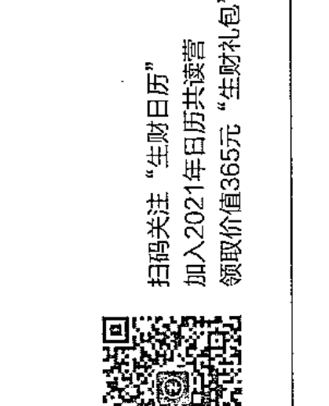

---

### 苏仁语录


我理解的“格局”，就是站在更长的时间、更大的空间去思考和判断。如果只站在几个月的时间、几千人的空间上，一定会在收益的问题上反复纠结，做短线的决策，又短又普通。

做社群，做服务，做品牌，要以三年、五年、十年的维度去看待问题。以一千人、万人、十万人的体量去规划。视野放大后会发现，诚恳提供，诚意面对错误，敢于立正挨打，坚持为用户体验而创新，才是正道。

苏仁
于 2020.09.28 分享

### 生财有术 | 资源对接

生财不仅有术，生财还有资源。

为了帮助会员们促成内部合作，那么先去外部找到更多合作资源，生财有术“有一项专门的圈友福利”，通过资源对接官每2次配送拉群对接。

鱼丸每天都要处理上百条会员资源对接信息，几乎天天打开微信就是“爆炸”，不过能够真正帮助流量主更好变现，广告主更好推广，这点辛苦也不算什么。

除了会员专属的资源对接官，我们还有一个专门的资源对接要求：“生财有资源”。无论是合伙人、渠道、资源、粉丝、工具，鱼丸都会定期发布在上面。

你们赚到钱，我们就赢了。

---

## 01 星期三

WEDNESDAY
辛丑年 | 十月廿七


### Kindle上出版发布电子书需要注意的五个细节

节选自“鱼丸”的主题

1. 不要抄袭；
2. 写自己觉得有趣的东西，这是好内容、好想法的最大来源；
3. 确保编辑格式设置正确，专业的外观编辑非常重要；
4. 书名和目录也很重要，写书过程中可以为所有可能的标题建立一个Word文档；
5. 关键字词同样有必要，看着人们在亚马逊上买某些书。


页面右下角二维码说明文字：
扫码关注“她的日历”
加入2021会员后并连续
领取价值358元“全年礼盒”

---

## 02 星期四

THURSDAY
辛丑年 | 十月廿八


### 做事情的二八法则

节选自“沙仁”的主题

在我们每天花费大量时间所做的诸事中，有80%都不会对结果产生太大的影响，只有那20%才是最终错的，它们直接对结果产生积极的影响。一定要将有效的时间、能集中注意力的时间，投入这20%的事情当中。

我对时间说：
每天早上最重要的事情，就是问问自己，今天最重要的事情是什么？
每个每天晚上最重要的事情，就是问问自己，下一周最重要的事情是什么？
每个月底最重要的事情，就是问问自己，下个月最重要的事情是什么？
只做最重要的事情。


---

### 如何通过泡圈层层培养利用信息差获利的能力？

节目自“花爷爷兑换酒钱”的主题

对普通人而言，没钱没钱，第一桶金大多是靠信息差获利来获取的。人生活相通的，而信息和圈层不相通。

1. 让的信息流，本身就是一种价值。信息差本质上是固定之差，如果不能用解层差，就是解不了信息差；
2. 知更多层的层圈层差在一起，如果下次再在圈层，就形成与之不同圈层的人产生共鸣，也就很难深刻理解他们的消费方式和需求。
3. 跨越阶层，表达需求。

---

## 04 星期六

SATURDAY
辛丑年 | 十一月初一


### 为什么你写的内容没有阅读量？

书选题“张佳”的主题

1. 生产的内容不好，没有信息差，人人都知道；
2. 虽然受众不知道你想他给你的这个信息，但是他并不想知道；
3. 你的述说方式不对，没有Get（直达）受众的点；
4. 虽然有信息差，但你阐述的是“污水”，这东西确实会有流量，但是方块坏聪明，会被敌盲叫停。

扫我关注“书封日记”
加入2024年月均读库
领取价值365元“丰财礼包”


---

## 05 星期日

SUNDAY
辛丑年 | 十一月初二

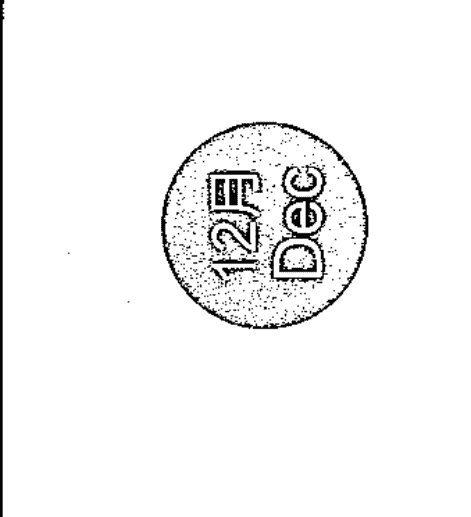


### 怎样才能快速在互联网上赚到第一桶金？

书友君“天涯”的主题

其实无分写三点。

1. **选对项目；**
   不挑战小概率事件，只做有盈利的事情。不碰灰色项目和“热门项目”。永远追求增量，不在存量上厮杀。
2. **跟对人；**
   做项目的路上，不要耍智就是最快的捷径。最直接的方法是向已经拿到实践结果的人学习。
3. **进好圈子；**
   赚钱的圈子人人努力，一天到晚都在做完故事。

总结：选定场景，和同源、有结果的人在一起，“杀进去”拿下一桶金。

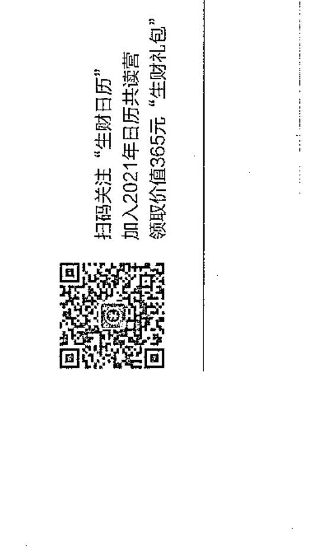

---

## 06 星期一

12月 Dec
MONDAY
辛丑年 | 十一月初三


### 为什么人人都要懂一些销售思维？

书选自“夏俊一”的主题

创业者看情绪的态度、考验的维度比做销售更高、更复杂、更全面。销售思维、销售方法更重要的使命在解决局部问题，帮我们打赢局部的战争。它是术。

但是，我仍然认为，销售思维是一种很有用、有效、有力量、必要的思维锦囊。我们每个人的一生，都离不开情绪自己的一生。销售思维是思维锦囊、一个大杠杆、一种四两拨千斤的技巧，在我们想要解决某个问题的时候为我们创造条件。

销售思维可以是我们人生的一双翅膀，可以把我们带到我们从前做不到的，也去够得着向往的地方。

扫码关注“春归日历”
加入2021年日历共读营
领取价值385元“共读礼包”

---

## 07 星期二

12月 Dec
TUESDAY
辛丑年 | 十一月初四


### 不要把面子太当回事

节选自“齐飞”的主题

我信号大海海洋里，有圆点司机的问题不然怎么办，感觉自 己 好傻。

我回了一句：“不要把面子太当回事，坚持不把面子太当回 事，反正刚开始也没人看。”

这是真的潇洒，大家都非常忙，在你身上停留的时间没几秒 钟，不要在里面那里给自己加各种戏。在你有结果之前，根本没人会 关注你。

每次想到这个，我就没有任何东西了：怎么快速、怎么简 单、就怎么来，反正也没多少人在乎。

就这样，很多看起来很难的事情，反而就这么坚持下来了。


---

## 08 星期三

12月 Dec
WEDNESDAY
辛丑年 | 十一月初五


### 视频号是近在眼前的一次上车机会，而且是人人能上的车

节选自“潇磊”的主题

1. 尽早行动，拒绝完美主义，有手机就能上车，一开始别花太多时间在打磨细节上，尽量要准留好了后再做，就总比别人慢一步，可能永远也是不上车；
2. 坚持发，度过精怪的低启动期就行，不要走歪门邪道（如同购买量，黑科技违规之操作），一旦有一次运营发现你骗了；
3. 不敢出道？有多种替代方案，声音配图、文字视频、带个头像用苹果手机的memo或者小米手机的minioji，都能不露脸；
4. 没镜头感？学就起了，拍100个、和对标的差距对比，就培养出来了。


> 扫码关注“生欲日历”，加入2021生欲研习营，领取价值369元“生欲礼包”

---

## 09 星期四

12日 Dec
THURSDAY
辛丑年 | 十一月初六


### 经历篇

#### 关于知乎好物的思考

节选自“唐家寨”的主题

1. 坚持做正能量，正反馈：知乎动物这件事情一定没考你想像那么容易，不动力单拍坚持，“二八定律”下，你开始的80%的回答都是卑微的，但是仍然要做；
2. 执牛耳：
3. 账号价值：到吵架，以前被人举报拉黑，要低调。
4. 和气生财：大家越是争议重的时候，厚对方一句话就可以让对方面且做到第7名、第8名，自己稳座第一、分二。但同行都是聪明人，互相到底只会让双方的排名都难降低。所以最好和气生财，不要唇汁相争，谁都得利。

扫二维码“识别日期”
加入2023“日升百科群”
领取价值388元“生涯礼包”

---

## 10 星期五

12月 Dec
SUNDAY
辛丑年 | 十一月初七


### 知乎排名如何靠前？

节选自“杨志斌”的主题

1. 回答垂直领域，积累用户权重；
2. “小号”可以回答一些用户关注的问题；
3. 小心被别人点反对；
4. 不要作弊；
5. 小圈子投票；
6. 给问题点赞点赞同入路径也很关键；
7. 评论如果是正面的，能回就尽量回。


扫码关注“极客日历”
加入2021年日历交流群
获取价值3997元“生活札记”

---

### 5年收入翻50倍的投资人给出的四个创业感触

节选自“张琦学”的主题

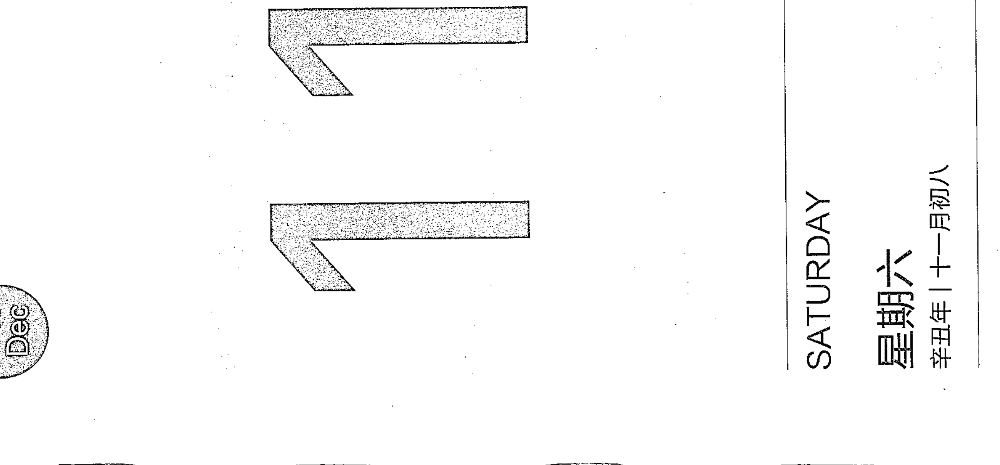

1. **方向比努力重要**：从一开始就要对自己有一个清晰的定位；
2. **信心比能力重要**：当我真的不服苦难不断尝试后，许多难题也真的找到了解决方案；
3. **迭代比规划重要**：产品经历思考与解决问题的模型，包括发现问题、分析需求、提出方案、试验验证、收集反馈、不断改进；
4. **成长比天赋重要**：优秀的创业者往往是激进型人格，即相信一切范畴的东西都可以不断学习和训练来优化，知识盲区可以补，性格缺点可以改，一切皆可被塑造。

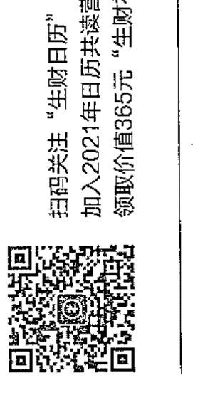

---

## 12 星期日

12日 Dec
SUNDAY
辛丑年 | 十一月初九


### 经历篇

#### 低风险创业，在线营养咨询公司月收入50万美元

节选自“鱼丸”的主题

1. **深挖用户痛点需求：**
   吃饱不等于是个别性需求；健身节食的人需要一个和同顺朋友组建起来的社区；用户真正需要的不是节食本身，而是看见自己的变化。
2. **开始轻成本创业：**
   通过社交软件创建在线社群，通知自己在Facebook上积攒的粉丝和以往得到过健身指导的人，组织线上会议，说明服务内容和收费专业性，做出服务高质量承诺，争取第一批客户的支持。
3. **一点一点复制业务系统，拓展业务面：**
   招募专业人员的完成课程，逐步拓展健身教练，扩大服务人数；拓展到相关的保险业务、饮品业务、开创青少年版本的健康管理咨询服务。


---

## 13 星期一

12月 Dec

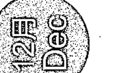


### 挖掘赚钱/信息要注意的三点

“条形码”的主题

1. 即配合屏蔽广告的浏览器插件，谁生活在这广告泛滥的互联网里，谁就无法屏蔽互联网。屏蔽广告一跟屏蔽傻瓜式活下去，这就是作为探索者的本能。
2. 留意你的包重手机浏览时遇到的一切数据。思索这个数据置不真实，意味着什么，文量了多少，和另一个数据比起来是什么什……数据总流成为探索者的登山杖。
3. 留意大众传媒寻找线索的源起，多挖掘别人用“搜索”“支付”“下单”，按照的事物。探索从未不允许他，热情的被叫“荧光”。


扫码全注 “程程日行记”
加入2024年日拱一卒营
领取Q1价值385元 “生财礼包”


“程程日行记”

---

## 14 星期二

TUESDAY
辛丑年 | 十一月十一


### 做好线下门店（托班）的六个建议

节选自《芥仁》的主题

1. 尽可能做到鸿蒙最丰而不单单只做门店生意；
2. 要有变观价格，能一季多吃或者做复购；
3. 沉淀客户，成为做微好友，相应地要经常发朋友圈；
4. 设定仪式感，让客户有可以传播的内容；
5. 引流成本可能远高于预估，要写内容得较大降低引流转化成本；
6. 安全是最重要的，家长最关心这个，任何一起安全事故可能会毁掉几年的苦心经营。


扫码关注 “生财巨府"
加入2021生财巨府家族营
领取价值5852元 宝藏礼包

---

## 15 星期三

WEDNESDAY
辛丑年 | 十一月十二


### 积累大量清单，总能先人一步

节选自 “胡店” 的主顾

在朋友圈里积累了大量“需求”、“流量”、“资源”、“背书”、“变现”清单后，不论遇到什么需求、案例、产品，别人还在想能不能做的时候，你已经在头脑里“全脑演练”过一万次了。

1. 这个事情有用户需求，之前又做过，可以在XX平台上，做成XX转化；
2. 这个事情可以用XX方式引流，看用了XX的引流；
3. 这个事情可以从XX角度做营销，模仿XX的文章；
4. 这个事情可以通过X变现，可以联系他合作。


扫码关注“生财日历”
加入2021年日历读者群
领取价值585元“生财礼包”


### 如何通过海外留学接送机轻松赚10万元

节选自“SAI”的主题

1. 了解情况：观点论坛，以过来人身份给需要接送机的留学生通过QQ了解情况；
2. 敲定时间价格：改收费标准为免费，以从国内带一些国外买不到的礼品作为回报，变现赚取利润；
3. 建立联系：在论坛里贴帖子，等QQ来加入；
4. 多次服务建立信任：满足和对接其他如租房、买卖家具、买车的需求，从中提成或获取利润。

### 通过知乎好物从0到月入10000元的六步

节选自“艾斯Zw”的主题

1. 养号：主要提升创作者等级和粉丝值，然后定人设；
2. 找准回答问题：赚钱的第一步是找有价值的问题，分为重打法和轻打法；
3. 快速开单技巧：选完品之后，先监控问题流量，问题浏览量越高，越优先回答；
4. 好好写作：方法就是“先模仿后超越”，直接看最高赞回答，借鉴它的行文逻辑和写作思路，注意图文并茂；
5. 冷启动；
6. 维护：比如更换失效商品链接。

扫码关注“生财日历”
加入2021年日参实战派
领取价值3999元生财礼包

### 做投资需要修炼情绪管理能力

节选自“朱颖季”的主题

大众总是欢迎热点。时而情绪高涨，时而感觉悲观。然而就算一天不会电闪雷鸣，这一天也未必极致落差。每次看有人赚“这次不一样”，但是实际又没什么不一样。

今天的行情多少，并不重要。关键是5年后、10年后、30年后的你会在哪里，你的收益最终在这个水平。

这一路上你要跨过无数突发事件和震撼世界的大新闻，你也没有准备好风险。宽松定性的穿越牛市和熊市，获得理想收益的投资策略才是最好。想清楚这些，所有大事作为新闻都是过期旧闻。

星期六
辛丑年 | 十一月十五

扫码关注“生财日报”
加入2021生财日记共读营
原价199元 “生财礼品”

### 如何利用“同乡群”每天持续裂变数十万精准地区粉？

节选自“杨先生”的主题

1. 在全国以县为单位申请公众号，并配一个微信号；
2. 百度查同乡、村信息，建立微信群；
3. 加入10个以上本地微信群；
4. 保存群二维码，加入公众号文档内接受海报，并群发至各个微信群；
5. 用欢迎语引导新人拉熟人加入微信群；
6. 编辑公众号日常内容，维系粉丝。

扫码关注“羊好日报”
加入2021羊好日报读者营
领你价值365元“羊好礼包”

星期日
腊月十一

### 何为人处事之道？

节选自“脑科”的主题

有效益：咨询问题时，先发个红包或直接地分享收获与资源，并提出问题；咨询介绍资源，这样问题才不引起反感。

有边界：有些话不该说，面对强者不讨好，面对弱者不戳穿。

有心意：合作结束后给对方送礼物，心意胜于言语。

有重来：做事当断不断反受其乱，很多时候优先级需要以大体为重。

星期一
辛丑年 | 十一月十七

扫码关注“道知日历”
加入2021 每日共读读者群
领取价值365元“道知礼包”

# 12月 Dec
### 冬至
## 21
星期二
辛丑年 十一月十八

### 如何分析赚钱规律?

节选自“明白”的主题

同样一件事，有人能做到需求做产品，获取流量赢得收益，原因是为一个“赚钱思维导图”，遇到任何案例都会分析四点规律:

1. 需求: 什么类型的客户能赚? 为什么?
2. 流量: 获取流量的方式有哪些? 为什么?
3. 营销: 如何营销产品，促进容易卖出? 为什么?
4. 变现: 不同类型的产品该如何赚钱? 为什么?

扫码关注“星期日记”
加入2021年日历共建营
领取价值3888元“生财礼包”

### 最高做到全网Top1买家秀平台的运营心得

书选自“阿辉”的主题

1. 用户自己描述的需求不一定准确，他们需要的是具体的某个服务，而没能解决问题的方案；
2. 给用户的任何解决方案，在没有正反反馈之前都需要测试，测试通了再规模化；
3. 分析竞争对手提供的价值和价格，从收费模式和推广方式上做差异化；
4. 像多引爆，创造入口IP维护路径；
5. 具体的营销推广过程也需要频繁测试，实时统计数据，根据数据反馈，反复调整。

星期三
辛丑年 | 十一月十九

# 12月 Dec
星期四
辛丑年|十一月二十

## 项目篇
### 借助表情包打造IP

节选自“办过”的主题

IP要想不过气，就得有超额流量，借助表情包，IP可以切入最高频的聊天场景，只要你在聊天，就会观察到这个IP的认知。
而要观察表情包IP，你需要符合以下特征：

1. 长得有特点；
2. 有脾气有梗冲自己；
3. 有话题生可以聊；
4. 有能力和结果被认可；
5. 有能力和态度任性么持续的曝光。

### 赚钱才是创业的“本质”

节选自“盛添财”的主题

有朋友问我：当你游泳的时候在想什么？我的回答只有三个字：活下去——必须要会游泳才不会被淹死，再说什么解决、自由泳各种花样游法。

“活下去”，这种强大的求生欲，也是我要我的整个创业生涯、投过水里不一定会淹死，待在水量一定会淹死。一定要动，一定要增长。

> 就像《增长黑客》里写的：“创业公司，不是在增长，就是去死亡。”一定要学会游泳才能救活资源，因为在创业这片池里，会慢懂游到深水层，跑满满活动。会游泳、会赚钱、会增长，才能活下去。赚钱才是创业的“本质”。

24
平安夜
星期五
辛丑年 | 十一月廿一

12月 Dec

打开关注“生财日历”
加入2021生财日历共读营
@微信ID:36872 生财日历

### 如何跨领域赚钱？

节选自“张广”的主题

很多人想要跨入新兴行业的时候会发现：内容看不懂，没精力深入研究，一看就基本书生。怎么办呢？

1. 这是正常情况。大多数人跨入新领域都会遇到这样的问题，有些人放弃了，有些人坚持琢磨探索出了新东西；
2. 忍人所不能忍，做人所不能做，大多数人时候在正确的路上勤奋总是最简单的道理；看不懂怎么办？一搜，二问，三尝试。基本上所有有解决方案的问题，搜索引擎里都能有答案。

## 26
星期日
辛丑年 | 十一月廿三

### 怎么设计好一个训练营?

节选自 “知识IP星球” 的主题

1. 第一步：画出你的精准用户画像。
2. 第二步：迅速理解用户画像来确定引流内容与引流课课程练习。
3. 第三步：投放引流品：
    1. 在各大公域平台投放问卷；
    2. 把目标群体的KOL去合作推广；
    3. 利益福点触动第一批进群的用户去裂变转发。

扫码关注 “生财日历”
加入XGZ平台的共学社群
领取价值365元 “生财私企”

### 早期创业的 三个注意点

节选自 “王华荣” 的主题

1. 早期做项目，一定不要同时做好几个，因为你的人才结构跟不上，一定要考虑清楚：自己认同的“防火墙”是什么？在护火墙加固之前，最终你得住各种诱惑。要耐得住寂寞；
2. 尝试新业务也要围绕自己的核心业务来做，这样你的新业务实际上也是在加固你的防火墙；
3. 早期一定要找合适的人，而不应该找极聪明的人。

星期一
十一月廿四
辛丑年

## 28
星期二
辛丑年 | 十一月廿五

### 普通 “小白” 如何从0到1实现年赚百万？

节目选自‘聚源’的主题

赚钱的本质是认知和资源的变现，在自己“池塘”里更容易“杀鱼” 和 “捕鱼”。

1. 认知层面：
   选择的项目和方向必须是已经成熟验证过的，尽量不要试错做从0到1的事情。
   倍赚或什么可以收入100万元，从自己的实际出发，从中选择最适合自己的方式All in。
2. 实践层面：
   从销售行业切入，选择高客单价的产品，如豪车、豪宅和高端保险。
   要有“亮剑”精神和对成功的极致渴望。

扫码关注“牟凯日历”
加入2021年日历社群
(原价365元“新年礼包”
(领券)

# 12月 Dec
## 29
星期三
辛丑年 | 十一月廿六

### 活络篇
### 入局短视频领域之前需要深入思考的五个问题

节选自“晓群”的主题

1. 内容障碍：你有持续生产内容的能力吗？
2. 流量障碍：你的内容是否会有推荐算法机制并且有机会进入更大的流量池？
3. 成本障碍：你的内容生产成本是多少？对此是否有优势？
4. 品牌：广告到渠道，你有品牌渠道并且是强关系的吗？
5. 关系：具有与服务关系或障碍，你有适合你内容方向的供应链并且是强关系的吗？

扫码关注“生财日历”
加入2021生财日历共修营
领取价值355元“生财礼包”

### 如何做抖音垂直账号？

节选自“沈小善”的主题

1. 观察方向：与竞争对手的视频内容一样，但点赞数差距很大，原因是竞争对手的账号权重高；
2. 测试竞争对手的账号的内容，通过“对标”推“爆款” 标签，提高账号权重，只要测内容稳定，都是至少几百赞了，从而达到内测起抖音号的目的；
3. 测试线条、基础数据不错，但是账号权重不高或者其他原因，“豆芽”助推一把，可以有效大播放数据的效果。

## 30
星期四
辛丑年 | 十一月廿七

### 1
### 3
星期五
辛丑年 十一月十八

### 沐知篇
### 把精力投入那些愿意在你身上花时间的人身上

节选自“办己”的主题

“比如大佬并没有那么认可你，那就尽量不要让他们看到各种晒里程，晒书，即便他们到了群里也不会说话，反而降低了存在感；

比如‘生存技术’，攻玩俱乐部，每个月会定期发练在群里不参与，不贡献价值的人；

比如及时淘汰不参与线上会议，不执行任务的人，拉黑指名包后绝不任何动作、不参与课的人，放弃多次发消息不回应的，不回复任何信息或对你的人，如果有预期回复，但是如果没有得到你的，那就等于是你回报，应该及时止损。”

对那些不重视你的人给出负面回应，把时间精力投入那些重视你的人身上，才是对重视你的人的最大回报。

扫码关注“牛如日升”，
加入“2025年提升课”，
原价698元，38元，“生日限定”。

### DCD BRAND DESIGN
### 单成品牌设计

单成设计（单成视觉传达室）于2013年在杭州成立，是一间以品牌设计为核心的平面视觉传达工作室。单成为客户提供品牌设计、印刷品、活动形象、产品包装、用户界面、视觉识别，提供以设计为驱动力的策略服务。我们一直强调并主张让环相扣的设计得到反复推敲并落地，最终让客户只得到一个真实的结果。

2020 全民抗击在疫情主题海报入选
2016 首届中国警徽公益海报展览作品入选
2016 中国海洋文化创意产品设计金奖
2014 中国澳门国际海报HKDA环球设计大赛作品入选
2014 中国澳门国际海报双年年展海报作品入选
2014 中央电观台军事频道 Logo 设计二等奖
2014 AWARD CERTIFICATE（北京设计周）
2013 CDIP 中国台湾设计节国际海报展入选
2013 “Hillbrand” 跨品牌竞赛单元银奖
2013 中国设计师杯作品年鉴银奖
2013 中国美术学院白金创意奖作品入选

出品方
生财有术

发起人
亦仁

总策划
光谷

负责人
黄小鱼

协助负责人
一条枸杞

内容编辑团队成员
IVAN、超、李鑫、唯二蛤、KangKang、牛牛的Annhe、隆隆、或一多、王薇花、言点、雾媒Annie、无涯、徐一、张酒麟、梦甜、赵二、江渔、楚云DL、苏、偏受文红、谢丹丹、三丝、红果果、大航海家、Typing、爱吃冰的大栗、知识IP 黑羚、喵嘴 | 涩溪

以上排名不分先后

团队订购/定制
联系微信 yuwan350

版权所有，侵权必究。
未经许可不得以任何方式复制或翻印本日历内容。

责任编辑：陈一 王嘉文
装帧设计：申成视宣传处室
蒙版校对：高余朵
责任编辑：汪立峰

### SHENGCARILL 2021
**理财日历2021**
生财有术 编著

全国百佳图书出版单位
浙江摄影出版社出版发行
地址：杭州市体育场路347号
邮编：310006
电话：0571-85151082
网址：www.photo.zjcb.com
印刷：浙江兴发印务有限公司
开本：889mm × 1194mm 1/48
印张：16
2020年9月第1版 2020年10月第2次印刷
统一书号：85514·749
定价：88.00元

（本日历内容由“生财有术”会员提供，仅代表个人观点，不代表出版社立场，仅供参考，会员页存在风险，投资需谨慎）
