# 生财有道商学院知识星球附件 20190611-20191003

# 月入 10W+的宝宝取名项目最新玩法

这个是朋友滨哥在做的一个项目，一个多月的时间就做到10w毛利了。下面我把他做项目的历程分享出来：

## ■ 定位开干

滨哥这人，很聪明、爱动脑筋，但又很懒。

## 为什么选这个项目？

一是因为赚钱，毕竟那么多同行都在做；二是这项业务完全可以用软件完成，不需要怎么学习专业知识，比较对他胃口。

做这个项目的目前有 3 大流派：

- 电商流：主要通过淘宝开通店铺，直接与此类需求的客户进行成交，不懂淘宝运营的话并不容易做起来。

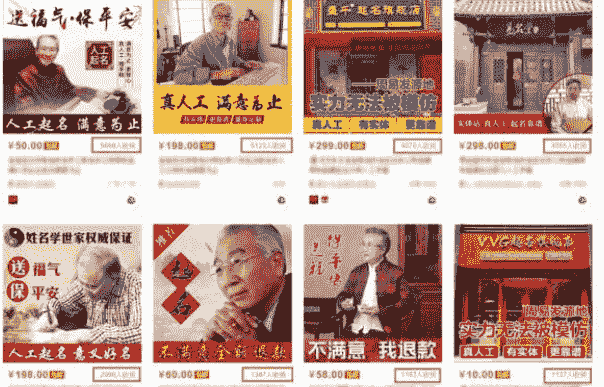

- IP流：主要通过自媒体平台，塑造专家形象，发布软文、小视频的形式，将客户引导到自己的私域流量池成交转化，需要每天苦逼的做原创内容。

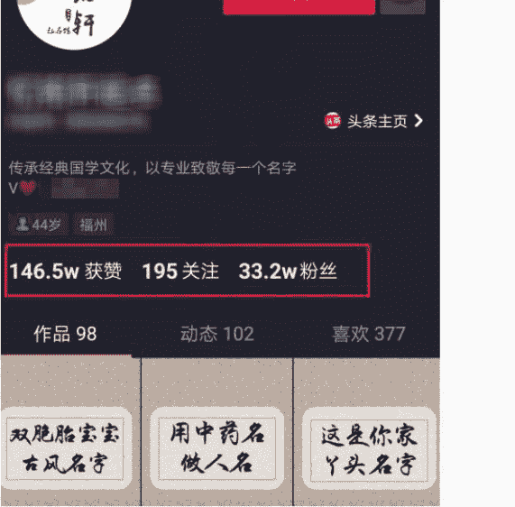

- 竞价流：主要通过百度竞价，占据搜索结果的首页，是一种烧钱换访问成交的模式，非暴利产品不足以支撑。

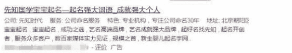

## 他是如何选择的？

做电商吧，要 SHUA 单、要烧直通车、要报活动、要优化标题...太麻烦了！

做 IP 吧，要整天写文章、发视频，还要是原创的，发少了还没有推荐...太苦逼了！

做竞价吧，要烧钱，但他也是老鸟，知道怎么烧能投入小、见效快，那就做竞价吧！

## 测试的效果如何？

某度给钱就有流量，他连着网站和百度开户一共花了六千搞定，开户后刚好 7 天，网站和竞价就一起上线了。以下为测试统计的效果：

| 日期 | 消耗 | 流量 | 有效流量 | 成交 | 收入 |
| :--- | :--- | :--- | :--- | :--- | :--- |
| 第一天 | 30+ | 50+UV | 0 | 0 | 0 |
| 第二天 | 50+ | 50+UV | 加微信12人 | 1人 | 199 |
| 第三天 | 50+ | 50+UV | 加微信8人 | 0 | 0 |
| **盈利** | | | | | 199-30-50-50≈69元 |

折腾这么久，3天时间就赚几十块，肯定是不行的。滨哥觉得这 50 人是通过搜索进来的，肯定有需求，应该是网站的体验不好，所以转化率比较低，在对比了同行网页后，他优化了网页的内容结构并且花了点钱开通了在线客服功能。接下来 4 天的数据是这样的：

| 日期 | 消耗 | 流量 | 有效流量 | 成交 | 收入 |
| :--- | :--- | :--- | :--- | :--- | :--- |
| 第四天 | 40+ | 40+UV | 加微信19人 | 4人 | 796 |
| 第五天 | 50+ | 50+UV | 加微信26人 | 6人 | 1194 |
| 第六天 | 40+ | 40+UV | 加微信18人 | 2人 | 398 |
| 第七天 | 40+ | 40+UV | 加微信21人 | 1人 | 199 |
| **盈利** | | | | | 199×13-40-50-40-40≈2417元 |

这样优化下来，按照这样的成绩，一个月收入 8K-10K 问题不是很大。这样的收入对一般人而言还过得去，但是他不满意，一是因为这钱对他来说还不够，二是整天要坐在电脑旁当客服，太麻烦。

## ▎穷则变

一天有几十号精准客户进来，付款的只有几个人。他总结了一下，很多人是嫌价格贵了，因为之前的定价是结合电商平台的价格和实体店的价格综合定下的，对外宣传的是售价 299，活动期 199。而同样竞价的同行，只收几十块的大把。

那些低价的同行基本上使用的是同一个模板，几乎不涉及五行起名，而且是机器乱生成的，这么起名其实意义不是很大，但是他们价格真的很低。

## 怎么办？

他优化了收费服务，把199的业务进行了拆分：

- 1、**免费**：免费生成10个名字；
- 2、**付费9.9元**：再生成10个名字；
- 3、**付费39.9元**：再生成100个名字；
- 4、**付费199.9元**：私人定制姓名+孩子未来框架讲解；
- 5、**付费299.9元**：私人定制姓名+顺丰邮寄手写板起名手稿记录。

这样的话，想要便宜的服务也有，贵的服务也有，反正通吃。当然免费的生成后会有提示说：免费的不一定合适，有能力的请选则付费！当然这是一种心理暗示，很好用。另外一个套路是，已经付费的都是可以直接补差价升级为更高级服务的，这样就降低了一部分客户的犹豫成本。

效果还不错，调整后仅仅4天就相当于以前7天的收益了。

| 日期 | 消耗 | 流量 | 成交 | 收入 |
| :---: | :---: | :---: | :---: | :---: |
| 第一天 | 50+ | 50+UV | 4人 | 9.9×1+199.9×3=609.6 |
| 第二天 | 50+ | 50+UV | 6人 | 9.9×3+39.9×1+199.9×2=469.4 |
| 第三天 | 60+ | 60+UV | 13人 | 9.9×8+39.9×3+199.9×2=598.7 |
| 第四天 | 50+ | 50+UV | 11人 | 9.9×7+39.9×1+199.9×3=708.9 |

## 变则通

因为他之前为了缩减成本，投放的都是省内的，正当他想乘着放大操作，增加竞价投放的时候，愕然发现全国大部分地区都已经被那个低价、粗糙生成姓名的服务给占据了，竞价列表中至少有 3 个是同一个人再搞的，所以这样即使追加了投入，也不一定干得过他。

还有没有其它的地方可以导流呢？某宝吗？太麻烦了！也没精力！SEO 呢？竞价都没用，更别说 SEO 了，猴年马月也不行！貌似所有的路都被堵住了。

他除了懒以外，还有一个特点是：非常善于思考！通过分析过往的成交记录，他发现找他付费的都是一些刚当上妈妈的年轻女性或者说孕妇，这就是他的目标客户。怎么触达他的目标客户呢？

去妈妈论坛、小红书发帖？去加微商微信？都太麻烦了！去买宝妈的电话？这违法了！他用了个比较讨巧的方法，非常有借鉴意义：去某宝搜索“孕妇”二字，找到对应销量不错的宝妈产品，与商家合作！

## 具体他是怎么操作的呢？

很快他找到了合作的卖家，在卖家发货的时候，会顺带放上一张小卡片，卡片是一个红包的样式，上面大大的写着 99 元额度，并且说明了可以凭此享受豪华起名服务，总之写的非常有诱惑力，还附带了他公众号的二维码。

因为关注进来的宝妈虽然有起名的需求，但是往往没有立即下单的欲望。所以要做好 2 点：

1. 释放价值，吸引宝妈关注留存：公众号每天推送一条宝妈的孕期注意事项和保养技巧，也可以让宝妈在后台回复怀孕月份，根据月份自动回复此阶段的注意事项和检查提醒，尽量做到贴心。另外公众号也会定期推送一些明星、名人的名字解读，让宝妈意识到名字的重要性。
2. 刺激购买欲望：99 元红包有效期 1 年，299 元的服务可以直接抵扣 99，提前下单的话可以 6 折，也就是说 120 元（利润 100 元）就可以获得顺丰邮寄手稿，当然要等到孩子出生时邮寄。如果出生后再下单，因为是立即派送，就不能打 6 折了，只能是 200。他还打算在红包失效前，通过后台温馨提醒宝妈红包即将失效，如有需要请尽快使用。

## 卖家凭什么帮他？

很简单，他们之间做好了分赃。他为每一个卖家都分别设置了一个二维码，只要是这家店的客户下单了，就要分给卖家 20%，如果没有卖家，他一分钱了赚不到，分出 20%给卖家是合情合理的双赢局面。

他现在合作的卖家有 2 个，平均每天跟着包裹寄出 1500 张卡片，每天关注公众号的有 120 人上下，偶尔会有一天 200 人关注的情况出现，每天的下单金额在 1900 元到 2500 元之间，不是很稳定，但也在缓缓的增加中，他正在多谈几家某宝店，这样会越做越大。

## ■ 通则久

目前，他的竞价收益日均 500，公众号受益日均 1500，（500+1500）×30=6W，好吧，我的标题夸大了，但是他多谈下几家店，完全是有潜能实现月入 10W+的。而且，他现在也仅仅是有 1 个员工而已，那个人是负责手写稿件的，投入非常的低，也是一个非常轻资产的模式。

谈谈我的思考吧，因为我直接给大家分享的都是结合实战经验的核心思维、深度思考，如果你看了之后还不理解，还有疑问的，可以跟我联系交流。

如今获取流量的成本越来越高，大家不妨参考一下滨哥是怎样获取精准流量的，就是跟有相同客户群体的店铺进行合作，只要你们的客户群体是一样的，就可以进行合作，比如你是做茶具的，那么就可以跟做茶叶的店铺合作。

完成一个精准引流多少钱，或者成交一笔给对方多少抽成，这个你可以根据你从事的领域产品去设置一套双方都可以接受的合作方案，一旦把这个方案提出来并合作成熟，那么你将永远不缺精准客户，你的人生将达到高潮巅峰。

这里要跟大家说明的就是，你最好不要找同行，因为存在竞争关系不是很好谈，只要你们的客户群体是一样的，就行。

还是要强调一下，我们做网络创业项目一定是重在实践，认知、思维、方法再好，如果没有实践到位也是一场空。

一定要好好实践、好好赚钱，人这一生，能用钱捍卫尊严的时刻实在太多了！

灰产圈高端社群 内部资源 请勿外传 官方公众号：灰产圈

## 隐藏巨大市场商机的项目实操分享，月入 3 万的情感咨询项目玩法

随着 5G 时代的到来，短视频已经到了快速发展的阶段。

在去年，短视频火爆起来，已经成就了很多个人创业人士，其中也包括了我们团队。

主要通过短视频变现的方式实在很多，对于一个新人来说，最直接的收入就可以做橱窗收入，当然这只是一种短视频游客收入，算是最基础的收入来源。

对于做项目的人来说，更多的需要挖掘有巨大市场需求，以及变现价值高的项目。

通过笔者一段时间的了解，在快手有很多细分领域可以布局，特别是快手做细分领域号变现很给力。

好！那么今天笔者就给大家来分享一个隐藏巨大市场商机的项目，这个项目叫做情感咨询服务。

之前笔者在快手上看到很多做情感小视频号，对于情感类账号具体如何去引流变现呢？接下去进入主题给各位实际的说一下具体操作步骤。

### 分享几个方面

- 第一，项目分析
- 第二，案例分享
- 第三，具体操作
- 第四，项目总结

首先给大家说明一下，关于情感咨询项目的市场需求。

### 第一，项目分析

我们都知道，现在的高婚率越来越高，越来越多的人重视情感问题，包括：恋爱、婚姻，夫妻感情问题等太多的问题，有的人遇到情感问题善于解决，有的人就不会处理感情问题，这个时候就需要找专门解决情感问题的专家进行咨询，也就有了这个行业的存在和巨大的用户需求。

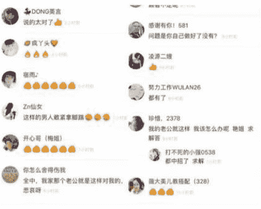

同时对于未婚男女来说，到了将要结婚的年龄，有相当一部分人是不会谈恋爱的，更不善于跟异性交往，女的还好，主要是男同胞，要是不懂得追女孩，那将会错过许多好女孩，所以对于追女朋友也讲究很多技巧，这都需要学习。

在情感行业也叫“撩妹培训”，就是专门传授给单身男女学会谈恋爱的一系列方法。

笔者经过一段时间的了解，发现这里面的挣钱门道很多，算得上是比较暴利的行业。目前在快手上很多做这种情感号的都以卖课，咨询收费为主。

情感课程收费一般在 299 元左右，有的人要学就得付这 299 的学费，一些做的好的朋友，每个月出个 100 多单也是很正常的，毕竟市场需求摆在这里，挣的都是纯利润。

### 第二，案例分享

情感行业是属于一个比较受欢迎的行业，相信很多人都喜欢看情感类的综艺节目。

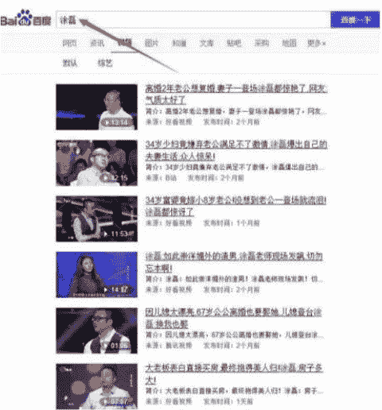

在这类节目中，就隐藏着一个情感咨询专家—涂磊。

在网上电视节目中，解决了很多人的感情问题，在现实中同样有很多人等着情感咨询专家去解决，解决的过程也就是变现的过程，这点不难理解。

在快手里面，很多人做情感号也用情感导师涂磊的视频在做一些情感语录的视频。

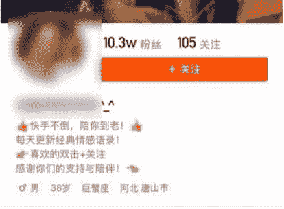

#### 33 作品

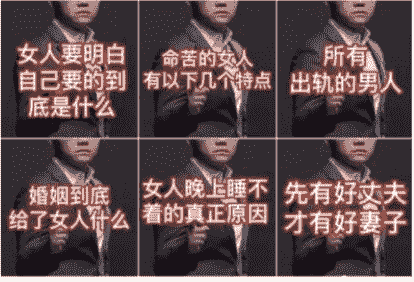

情感导师涂磊，他的真人视频经常被其他快手号作者用文字视频的形式做出来，通过放在快手上引流，浏览量很容易达到几十万甚至百万播放量。

做快手引流的原理：

主要通过快手号布局一些精准的细分领域，每天发同类作品甚至同一个人物的解说视频，在个人快手号简介中留联系方式，粉丝有需求就会立马加微信咨询。

一般播放量在 1 万以上，保守预估，每发一次作品，最差也能做到 3 个咨询量，按照客单价 299 来计算，收入能够达到近 900 元收入。

### 第三，具体操作

笔者总结在快手上做情感号主要分为 2 种内容输出方式。

- 第一种，混剪类
- 第二种，真人类

#### 先来说第一种，混剪类

主要以二次深度加工为主，素材来源于网络。比如情感类，就找：情感综艺节目。然后剪辑视频中的其中一段，要经典的一段 15 秒内的小视频，音频解说部分可以用原来的声音，只是换个场景做出来，可以拍摄一些风景来把这个视频剪辑进去，也可以用其他的背景图来做。

#### 第二种，真人出镜视频

这类视频主要以真人视频展示，以打造个人 IP 为主，粉丝黏度极高。

21.0w 粉丝 165 关注

带你撩妹，带你飞！

❤：教你更多的撩妹技巧

♀女 处女座 江苏 南京市

#### 50 作品

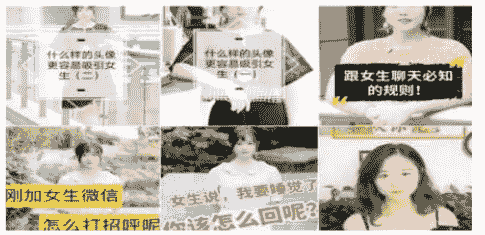

素材可以通过百度寻找，找情感类的垂直网站，就可以解决音频解说部分，按照这种资料自己读一遍就可以拍出来。

注意：做真人视频，拍之前需要打造好个人形象，女生适当化个淡妆，衣服穿得时尚一些，男生也一样，打扮的专业一点。

#### 如何引流

引流方法很简单，需要做一些诱饵，走免费送模式。

比如：＋Vxxxx，备注：快手，免费咨询情感问题（可以事先准备好一个简单的资料，别人问直接发给对方即可）。

如果是引到公众号上，可以做一些裂变操作。

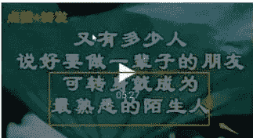

技巧：通过分享一些情感视频，在视频里加点赞+转发，通过这样去引导粉丝大量的转发，从而获得源源不断的新增粉丝。

#### 怎么变现

关于情感咨询变现的方式有好几种。

第一种就是咨询变现，特点是售后时间短，挣钱速度快。

这种变现简单的说就是靠客户咨询问题来收费，可以按照一个问题给多少钱来收。

7.3w 粉丝 430 关注

＋ 关注

职业：成为t。手、最专业、最优秀的心理学传播者之一
国家二级心理咨询师 [一般心理问题、严重心理问题、自卑、人际交往障碍、焦虑、抑郁、强迫、恐惧、疑病、神经衰弱、癔症等]
VY：[课程、咨询，不闲聊]
直播：每天晚上8:00 （周日不定时直播）
♀女 摩羯座 河南 郑州市

156 作品

第二种就是课程变现，通过卖课+培训模式。这个就收培训费为主，课程这块如果不会做，直接去淘宝搜：撩妹，情感类的课程购买过来，然后按照资料自己把课程录出来就行了。

当然有的人做情感咨询项目还会遇到一个棘手的问题，就是只会做引流，不懂得转化变现，那怎么解决呢？

再教大家一招！如果你不会做咨询，只会引流的话，那就只做引流好了，咨询的事情可以直接从淘宝找专业的情感咨询师合作。

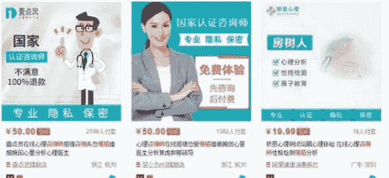

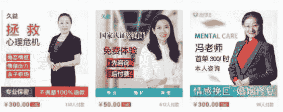

具体合作方式可根据自身的收费标准来进行利润分配，这个就不做过多分享，思路分享出来，大家就知道怎么去做了。

### 第四，项目总结

关于情感咨询项目可以完全放大去操作，并且是一个长久正规项目，我们要想一个问题，现在离婚率那么高，就可以说明一点，现实中很多人都会遇到这类问题，所以这个行业可以做长久，有源源不断的客户可以去变现。

## 小说引流吸粉变现，月入万元的暴利网赚项目

互联网上寻找影视资源和小说资源的人太多了，而且这类人大部分都有充足的时间，来消耗，对于我们来讲，如何开发利用好这类流量

很多人即使愿意付费，但是也不愿意花这么多去看一本书。如果一个月看个两三本，基本上二三十块钱就出去了。但是又却是喜欢这本书，看了一半，没看完，心里却是很别扭。

首先呢，我们先看一下，最近那些书比较火热，究竟火热到什么程度，越是火热的书，越证明这本书能够赚钱。

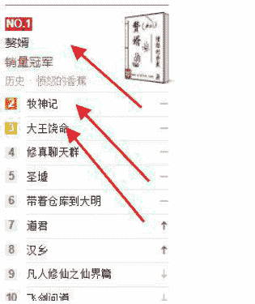

查看小说热行榜

打开起点中文网，直接看排行榜单，我们就能够看到最近比较火热的书了，随便选择一本，在百度指数上搜索一下。

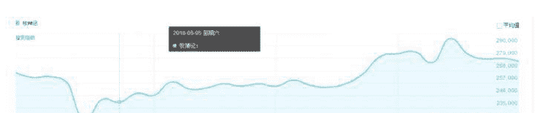

百度指数查看小说搜索热度

这流量太凶猛了，二十几万的搜索量，我估计这只是现阶段的，随着作者不断更新，流量会越来越大。这对我们来讲是一个好机会。

### 既然如此，我们从哪里获得这些资源呢？

这类资源太多了，但是很多看小说的人都不去找，最出名的网站应该是笔趣阁。大家可以看一下对比：

### 第七百三十章 不逊于我

点四小时前更新，笔趣阁现在就能够看了。但是就这么简单的搜索，很多人还要在贴吧求资源。

### 关注的吧

| 小说推荐silence★ | 虐心小说★ | 小 |
| :--- | :--- | :--- |
| 言情小书★ | 玄幻小说★ | 风 |

### 贴子

- 推文《给你黑卡随便刷》陶酥 蔺和平 | 言情吧
- 推文 | 虐心小说吧
- 推文《春雪迟》肉文、[模糊文本] 的个人主页 | 推文《春雪迟》肉文
- 推文《我拿你当朋友却》蒋安延 蔺潇 | 小说推荐silence吧 | 推文《我拿你当朋友却》蒋安延 蔺潇
- 推文《冻宫 君无霜》君无霜冷琉璃 | 小说推荐silence吧 | 推文《冻宫 君无霜》君无霜冷琉璃

小说百度贴吧引流

就像这样的,都会留下微信联系方式,方便喜欢看的读者加他。当然,你以为这么简单就完了?

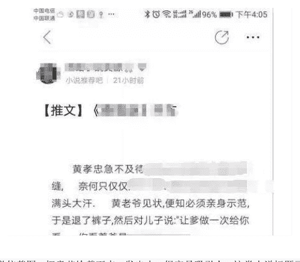

直接微信截图，把章节给截下来，发出去，很容易吸引人。这类小说标题已经不重要了，重要的是内容。

吧龄：3.4年

简介：ta还没有freestyle...

### TA收到的礼物 (0)

28
五月
个人主页
资源+V：

分享 评论 1
小说推荐吧

### 【推文】《 》开车

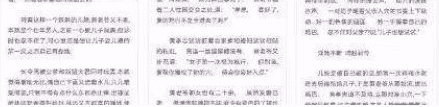

大家可以看到，他推文文章的记录，并且且在主页放出联系方式，让别人加。我估计一天加上个百人不是问题。

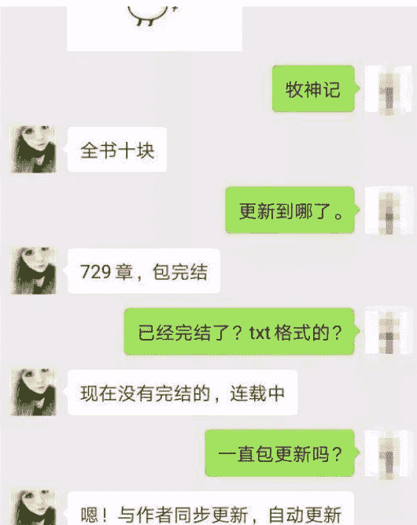

一本牧神记是十块钱，后面的聊天记录是我问如果两本呢，能不能优惠，他告诉我 **16.88** 不提供试看，与官网同步更新。而且只能给你截图验证。

看到这里大家明白了，他所卖的资源就是免费小说网站的更新，一旦卖给你，意味着这个产品就不存在秘密了。

那么我们可以继续变现，如果你微信号上满了 4000 人，就能接广告了。

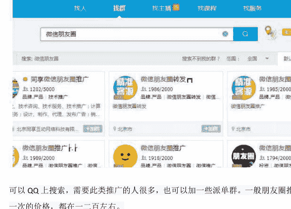

可以 QQ 上搜索，需要此类推广的人很多，也可以加一些派单群。一般朋友圈推一次的价格，都在一二百左右。

## 闲鱼无货源店群，货源从哪里找

关于最近有很多小伙伴私聊我的最多的一个问题：

闲鱼无货源店群中的货源从哪里找比较适合？

看来有很多的朋友在了解了闲鱼无货源这个零成本、零风险的闲鱼后，都跃跃欲试的开始了行动。

无货源的运营模式，是闲鱼店群的核心技术。如何做到更好的选择适合的性价比高的货源，需要我们花费一定的时间来深入了解学习。

以下是一些比较好的货源平台，我综合在了一起做个专题分享给你们。

### 一、淘宝

淘宝是一个存在已久的电商平台，据统计目前已经存在 2000 万的商家，出售的商品也是五花八门，一应俱全，是一个商品种类齐全的货源平台。

### 二、1688

1688 的货源可靠，利润空间比较大，并且特别容易出爆款产品，但是需要在采集货源上架闲鱼店铺修改标题内容和图片。

该平可以直接在网站上采集一键导入店铺也可以人工筛选优质商家的商品。

### 三、拼多多

拼多多在短时间内被人们广泛知道，占据了一定市场地位，其最主要的还是因为价格低这个点吸引了更多消费者的青睐。

拼多多上的货源价格低廉是有优点，但也要注意性价比。

### 四、天猫供销货源

天猫的货源比较真实可靠，但相对的价格可能会笔者其他的平台稍高些。

该平台货源的质量售后都特别过硬，关键是你代销的商家可以有很大几率允许你代销分账，这样的话就不用去垫付资金，直接买家确认收货后你与上家各得各的钱。

而且，你看好了他的供销要求，那他们开车用的主图，你也是可以直接用的。关键是这个上家链接就算是链接到你家，一不会影响你家权重，二则你照样可以报很多的促销活动。

### 五、淘客 APP

从家居日用到大件商品应有尽有，都是带有优惠券和推广佣金的产品，在利益方面很有优势。

我们在挣取差价的同时还可以收到商家的返佣，一举两得。但是部分商品是有推广期限的，我们在选品时要注意区分。

### 六、批发网

例如杭州本地的网商园。广州 17 网，主女装；湖州的织里童装网，主童装。台州的开山网，主女鞋；白沟的包牛牛，主做箱包类的。

要根据自己的店铺经营方向，选择适合自己的产品。

### 七、搜款网

### vvic 搜款网

vvic 搜款网是广州最大的网批平台，覆盖广州沙河，十三行，白马，解放南，潮汕普宁等服装批发市场。

提供阿里巴巴，淘宝，天猫，京东，蘑菇街，美丽说，唯品会爆款批发货源、微商货源。

以七个货源平台是比较常用的几家，通过过往的数据，这几家的货源质量还是比较可以的，推荐你们使用。

当然你们有比较好的货源平台，也可以评论区里面分享给大家，我们一起学习，共同进步，把自己的闲鱼无货源店铺能够做到最好，更上一层楼。

## 闲鱼店群之单店养号技巧

### 1

### 闲鱼店群转转店群的根基——二手经济的互联网化

首先大家一定要清楚，闲鱼转转是针对个人闲置流通的平台，是想要抢占个人临 时卖家的非专业电商平台。

毕竟这个市场一直被线下二手商所把持，但是市场容量却可以无限大。

这么大的市场，自然充满商机，自然会产生无数成功的闲鱼店群转转店群职业玩 家。

> 无独有偶，2019年6月28日，美国二手奢侈品电商平台 “Real Real” 上市，上市首日 股价上涨44.5%。

### 二手经济在国内的发展

“跳蚤市场” 这一概念很早就成了二手交易的代名词，在国内一些地区也是很常见。 包括一些居民社区活动，大学城大学校园的 “跳蚤市场” 毕业季活动等。

可以说，国内不是没有二手经济，只是远没有形成系统。

现在国内大多数用户在二手交易上选择阿里旗下的闲鱼APP，其标语是 “让你的闲置游 起来”。当初阿里选择进军二手交易市场，再结合现在可持续发展理念的盛行，可以说是一 步好棋。如今重点推行的垃圾分类，何尝不是注重可持续发展理念的一大举措？就现在的形 势来看，闲鱼在今后的一段时间可以得到很不错的发展是无疑的一件事情。

自从拍拍二手不再是京东的关注点之后，在二手交易市场里闲鱼是一家独大，而一些当 红明星和公众人物（如莫昕）在闲鱼上的活跃，也证明了闲鱼的受欢迎程度和市场份额的统 治力。在全球二手经济浪潮来袭之际，二手经济也在国内走红，有两家二手公司上市在前， 闲鱼或许也会分拆而后走上上市之路。

**您可能也感兴趣:**

### 为什么无限大？

这儿我要多废话两句，中秋节我们亲戚聚会，我的一个哥哥，现在是成都某大学经济学副教授，与我讨论二手电商平台的根基和未来。

他不能理解为什么会有这么多人上闲鱼转转买卖二手用品。没几个钱，又是别人用过的，不浪费时间嘛！

我们进入一个场景对比

你可以想一下，在碰到闲鱼转转之前，你家的旧衣服是不是只能送人、放衣柜、捐赠这三条路！哪怕只穿了一次！

而现在，你可以快速的变现，哪怕穿了 1 年。而且自己是模特，可以分享自己的审美和生活。这种生活感受，在对比你把闲置丢垃圾桶的沮丧，卖给二手商被砍价被无视甚至蔑视审美的愤怒，你能享受的远远超出收获人民币的那种快感。

所以，商人贩卖的不是货物，而是以货物为存在形式的人性。世间所有生意，都是满足人性欲望为前提的。闲鱼店群为什么越来越多的人蜂拥而入，因为这里是人性的一个 G 点，捡便宜！被认可！

### 2

### 闲鱼店群转转店群是否养号养店的简单对比

闲鱼店群转转店群建设过程中，一定会遇到多种问题，而最最最头疼的问题莫过于没有曝光度！发出去三五天浏览个位数，是不是很绝望！

这里要提醒大家一个理，用最简单的方式做成的事一定是赚钱最少的事。

如下面两张对比图

第一张图是进行初级第一步养号后的，发布首个宝贝 1 小时后的截图，为了测试对比，时间有点紧，就没有做图片、视频、标签、内容优化、标题优化等等工作

### ¥2550

刚刚来过 发布于成都

### ¥2550 不讲价

支持验货担保

58项专业质检、30天免费质保 >

### 正品保障 苹果x64g iphonex 苹果x256g 无面无锁国屏原装苹果x，苹果x64g,苹果x256g

本交易仅支持自提、当面交易、邮寄

3人想要 · 浏览122

来闲鱼225天了,卖出过0件宝贝。男生。喜欢宠物、运动、娱乐、居家、数码。...

真人认证已通过 芝麻信用已授权

### 来自「vivo手机世界」鱼塘 >

有107832个小伙伴在这里互动交易

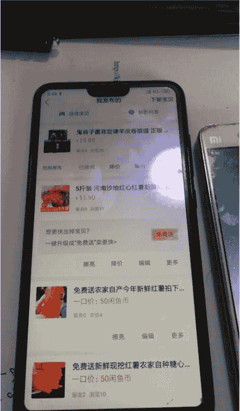

第二张图是新手会员发来的问题账号的实拍图，发了几天了没有浏览量，过来找我咨询

从对比可以看出来有几点明显区别，大家有心的可以看看

### 3

### 闲鱼新号转转新号养号养店的重点及顺序

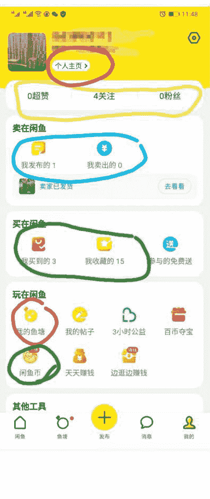

如上图，圈中都是我们闲鱼店铺养号需要关注的重点

玫红色圈为第一步，最基础的一步，举例的这个号也是才做完这一步。

举例号还有一周才会上线，这个号是我们为成都蜜格的老板做引流面交矩阵的号，每月 100 元/台运营费，一个成交提成 100 元，微信粉一个 25 元。大家也可以在自己当地城市开展这个业务。

绿色圈为第二步，就是过一遍真实人工用户流程，让平台给我们进行千人千面打标签

蓝色圈是第三步，发布宝贝，发布不要一股脑什么都发，一来就发个 50 个。一看就是商家，一是平台对你账号的认知，二是也对买家转化率也有影响。

黄色圈是第四步，引导真实客户累计店铺数据，方便宝贝获得平台标签和热度标识，闲鱼的成交转化率比不上淘宝，捡便宜的人都会比好几家，所以你的成交数据不要着急，但是人来了能留关赞藏也是相当于赚了 1 块钱了。刷的话也是两三毛一个。

### 4

### 闲鱼店群闲鱼新店的养店细节解析

以下内容纯属主观经验，仅限闲鱼店群用户参考，不接待非店群年卡用户的细节咨询。

因平台规则复杂，本经验无法得到 100% 的验证，毕竟闲鱼不是我家开的。杠精勿扰，SB 请回避。

第一步:

主页要完善，至少 70% 以上完善度，这么重要的展示位和转化文案区，乱搞的和忽略的，只能说这一步都做好不好，也甭谈什么闲鱼店群，就很根本不懂闲鱼的精髓。

鱼塘前面一定加指定范围关键词的，尽量多加，鱼塘的流量还是很不错的，至少你前期有个地方打广告。不过，把宝贝上架到鱼塘每天有数量限制，更多以分享方式发出。

第二步:

买东西还是由必要的。收藏一些值得买的也挺好。至于到底有没有用，我个人觉得有用，毕竟对平台来说不是僵尸用户。智者见智，仁者见仁，反正我运营的店这个必需流程，一定要先产生消费行为才会发布宝贝。

## 第三步

发布宝贝是个细活。闲鱼是单 SKU 的孤品流通，不是主抓标品量产货流通的专业电商平台。所以在关键词、内容文案、标签、图片、视频等等角度，有别于专业电商。比如，内容介绍你搬淘宝的，复制到闲鱼可能没几个人看，但是你要是一键转发，啥描述没有，没几下就来客了。

说两个小技巧，不要在内容页留联系方式，引流号的联系方式留在标签或评论上；发 10 个宝贝，那么准备 10 个视频或 20 张图片，然后将长尾关键词全部用工具组合出来筛选出 10 组，与图片 or 视频一一搭配成 10 组，这样就能发布 10 个宝贝而避免限流。

更多技巧，请关注新媒体之家--闲鱼店群研究室

## 第四步

点赞和收藏是推流和置顶比较关键的数据，不过目前刷这个量还是会被平台检测出来，因为都是通过淘口令刷的，一眼假。阿里的风控和技术，不是几个脚本能对抗的。所以，最好的方式就是利用自然流量。

如果可以，一定要发帖

这里也给大家讲一个小技巧，我们之前做二手数码项目，来一个咨询就引导关注点赞，发一条游戏专用充电宝编辑块充电线。客户一般都会答应。完事了就是买机子就能包在一个包裹一并发，不买机子就需要付 12 元邮费，付邮费的话就发两条。实际上还能赚 2 元。

另外一个技巧就是闲鱼拍下不付款也是会有销量数据增加的，所以也可以引导客户拍下。你可以在客户进入砍价环节时说，要是您真想买的话，你拍下咱们说价，说好了您再付款就是，不然砍价砍半天您又不是诚心买（加个表情）。

这样的话，有计划的进行关赞同有助于冲击首页，而拍下这个动作要在排名靠前时停止。

这也是我们之前下竞争对手首页会用到的一个动作。

## 闲鱼店群不出单及新店养号失败案例分析

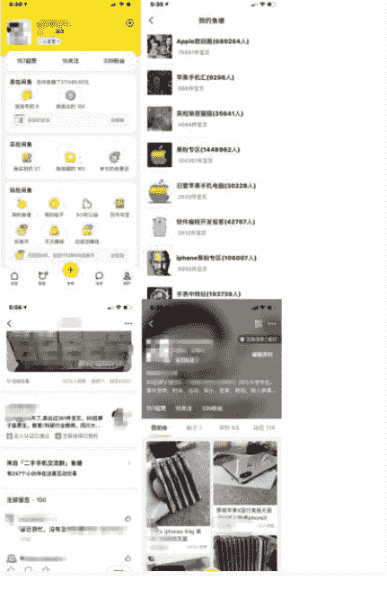

2019 年新手网赚项目，要说哪个长期正规门槛低，数来数去必定少不了闲鱼卖货赚钱、闲鱼引流赚钱、闲鱼刷量赚钱。

昨天我在朋友圈更新的咨询相信在圈的朋友都看到了，10 万闲鱼小网红将利用闲鱼官方给予的流量资源，冲击淘宝、拼多多、京东专业电商的未来客群。

风口这种东西，在起风时，有的人看不见，有的人看不起，有的人看不懂，更多的是动不了手的躺赚等钱派。

那么利用闲鱼店群模式，实操闲鱼赚钱项目中，月收益千差万别，有的闲鱼卖家赚 10 万，有的闲鱼店铺被限流。

这与我们接触的闲鱼店群教程、闲鱼店群玩法和使用的闲鱼店群软件都有关系，但最重要的是闲鱼店群项目的执行过程和细节。
目前闲鱼上利用拼多多倒卖赚差价的比较多，但是大多新手闲鱼店群不出单。

究其原因，无非权重、策略、日常经营执行。这里，林哥为大家做一个实例分析

- 1、如需免费店铺诊断，请直接截图四个页面发我。
- 2、项目交流与资源对接随时欢迎！
- 3、不回答闲鱼基础问题
- 4、请不要问过开放的问题！

太多疑问或一头雾水的朋友，建议参加课程系统学习。几百元能够买到时间所累积的经验，这是最明智的选择。

所以知识付费这么火，当然，其中也是良莠不齐，自行判断吧。

闲鱼店铺玩法很多，不一定全部会，但是精通一两个，一月半躺赚两三万，何乐而不为？

### 开始今天的正题，先看图：

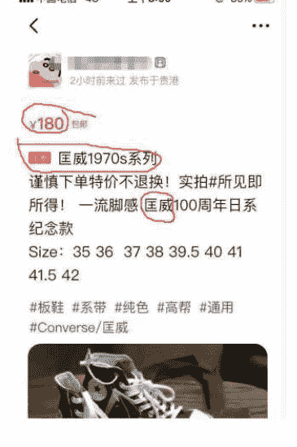

中国电信 4G

上午 8:40

我发布的

下架宝贝

85

跟着小鱼象 ★划重点 调整，提高曝光力

游戏宝贝

我的问答

调价‼340包邮

¥ 340

留言0 · 浏览1

刚刚擦亮 已擦亮 降价 编辑 更多

核心好价 320 最新升级版

¥ 320

留言0 · 浏览1

刚刚擦亮 已擦亮 降价 编辑 更多

匡威1970s系列

¥ 180

留言0 · 浏览25

刚刚擦亮 已擦亮 降价 编辑 更多

灰产圈高端社群 内部资源 请勿外传 官方公众号：灰产圈

微信

现在

转转闲鱼云控店群官方18008008801

一会儿我给你回，我在开车

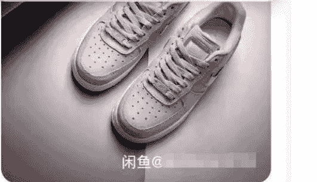

闲鱼@

担保交易

浏览10

来闲鱼46天了，卖出过2件宝贝。90后天蝎座男生。自由职业行业产...

实人认证已通过

芝麻信用已授权

## 中国电信 4G 上午8:43 86%

2超赞 2关注 4粉丝

### 卖在闲鱼

- 我发布的 42
- 我卖出的 2

### 买在闲鱼

- 我买到的 5
- 我收藏的 1
- 参与的免费送

### 玩在闲鱼

- 我的鱼塘
- 我的帖子
- 3小时公益
- 百币夺宝
- 闲鱼币
- 天天赚钻
- 游边赚钱

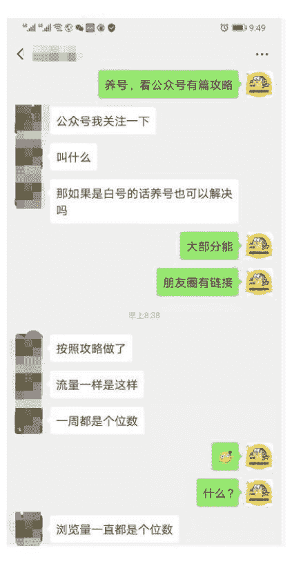

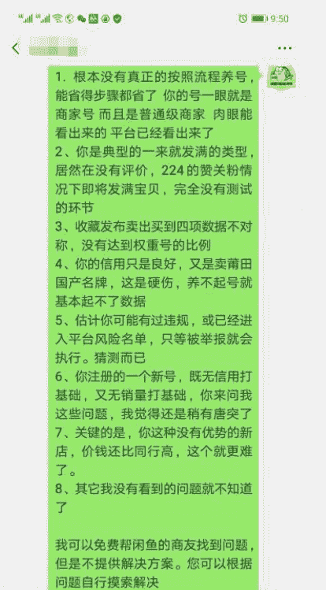

肉眼可见的问题分析，肉眼不可见的问题需要数据测试：

- 1. 根本没有真正的按照流程养号，能省得步骤都省了。你的号一眼就是商家号 而且是普通级商家 肉眼能看出来的 平台已经看出来了。
- 2. 你是典型的一来就发满的类型，居然在没有评价，224的赞美粉情况下即将发满宝贝，完全没有测试的环节。
- 3. 收藏发布卖出买到四项数据不对称，没有达到权重号的比例 。
- 4. 你的信用只是良好，又是卖莆田国产名牌，这是硬伤，养不起号就基本起不了数据 。
- 5. 估计你可能有过违规，或已经进入平台风险名单，只等被举报就会执行。猜测而已 。
- 6. 你注册的一个新号，既无信用打基础，又无销量打基础，你来问我这些问题，我觉得还是稍有唐突了 。
- 7. 关键的是，你这种没有优势的新店，价钱还比同行高，这个就更难了。
- 8. 其它我没有看到的问题就不知道了 。

闲鱼店铺没有流量或是闲鱼店铺被限流，是很多闲鱼新手攻略中要特别注意的，也是新手闲鱼创业培训中的重点和难点。

我在要求公司实习生时，前一周必须要会闲鱼店铺诊断。

## 我们接着分析

第一张图，可以看出，这个账号极有可能已经进入平台风控名单。

最近正值国庆之际，互联网风声鹤唳，这种明目张胆新发的国产名牌鞋宝贝100%不可能会有推荐流量。

欢迎细心的朋友可以在评论区互动，指出问题所在。

第二张图，我们又发现了一个闲鱼运营大忌。新手常常因为闲鱼项目的简单而无策略的进行闲鱼运营。

同样，欢迎细心的朋友可以在评论区互动，指出问题所在。

第三张图，发现什么了吗？新号，对的！

重要的是，店铺没有进行数据积累，再结合图四看看，可以说，养号的第一步都有欠缺。

第四张图，这个号完全没有按照我发表的《闲鱼店铺研究室原创之手新养号养店重点》流程来养店，急于求成，揠苗助长。

所以林哥免费为大家对接免费送资源，你以为是为什么？

做灰产，重技巧重运营，赚钱越多的事情越不是简单的事情。

国产名牌我们之前实操过，利润确实可观，爆单来了更是秒杀大部分正常项目。

但是不建议长期在平台做，事事皆有度。

## 闲鱼店群暴利玩法 2019 风口

这里是闲鱼店群研究室（咸鱼店群研究室），持续分享揭秘闲鱼店群玩法、无货源闲鱼赚钱项目，闲鱼兼职赚钱项目，闲鱼优化排名技术，闲鱼暴利灰色项目，闲鱼引流暴利项目，闲鱼最新玩法，闲鱼店群模式，开发闲鱼全自动软件，建设闲鱼创业社群。

很多上过闲鱼的朋友可能会说，闲鱼上全是捡便宜的客流，怎么可能还有暴利的闲鱼赚钱项目。

先来看看吧后台截图，这个是成品单店铺的成交，单店日赚几百一千妥妥的。

使用闲鱼店群云控系统，一台电脑控制 100 个这样的店铺，就算单店铺每天赚 20 元，也是日入 2000 元。

日赚 20 元有多简单，给别人刷一个超赞收藏想要关注平均 0.3 元左右，就是 1.2 元，刷个 10 遍就是 12 元，再加上刷浏览量收个 30 元。

大家可以到闲鱼互刷的群看看，全都是找超赞想要的，不愁没生意，毕竟店铺数据高了才能争取官方头衔。

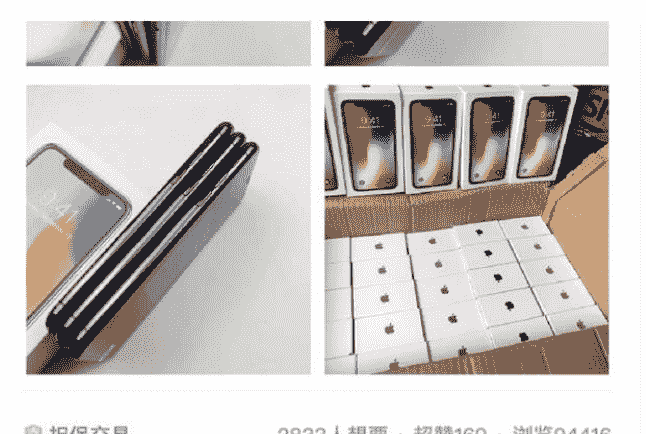

担保交易

2833人想要 · 超赞169 · 浏览94416

来闲鱼262天了,卖出过956件宝贝。现居广东深圳龙岗。90后处女座男生。自由职业...

10:04

¥1580

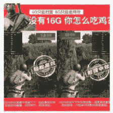

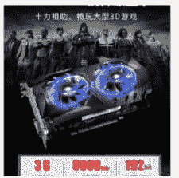

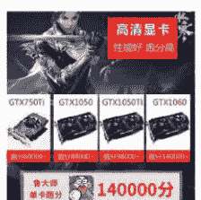

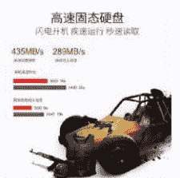

担保交易

2400人想要 · 超赞247 · 浏览73531

买过的人评价 · 199

查看全部

来自长沙市的买家

ta在交易成功后未做出评价内容

0 套餐:套餐一 地区:湖北省外 2019-07-25

150超赞 4关注 317粉丝

卖在闲鱼 在闲鱼赚了265975.50元

我发布的 5

我卖出的 101

交易已成功, 给对方一个评价吧 去评价

买在闲鱼

我买到的 35

我收藏的 174

参与的免费送

## 卖在闲鱼

在闲鱼赚了1161557.90元

- 我发布的 16
- 我卖出的 4214

## 买在闲鱼

- 我买到的 4
- 我收藏的 9
- 参与的免费送

## 玩在闲鱼

- 我的鱼塘
- 我的帖子
- 3小时公益
- 百币夺宝
- 闲鱼币
- 天天赚钱
- 边逛边赚钱

## 一口价: 50闲鱼币

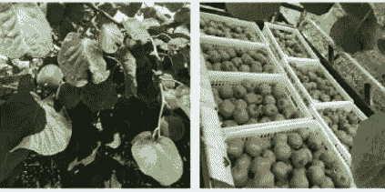

12542人想要 · 浏览250143

来闲鱼315天)，卖出过68134件宝贝。现居陕西宝鸡金台。70后白羊座男生。自由...

实人认证已通过 芝麻信用已授权

## 兑换流程

更多说明 >

- 闲鱼币兑换 > 支付运费 > 获得宝贝

## 我的闲鱼币 100

去赚闲鱼币 >

## 留言 · 4367

- 留言  ☆ 收藏  我要兑换

## 闲鱼店群的暴利玩法

### 第一：实物产品。

基础的商品不说，就单笔利润 300 元以上的二手手机、电脑、空调、家具、轮胎、礼品等等，包括高仿的鞋包酒等。

平均单店日赚 200 元以上很轻松，店群模式下，这个利润就吓人了。

目前我们会员做二手空调的实现了 2 周间断的同城霸屏，截流效果直接让他 2 周赚了 10 多万。

### 第二、自有货源卖货。

一般是线下实体商家，没有专业的电商运营技能，选择闲鱼转转正好适合。

比如做同城摄影的，同城家具家电的，基本收益与实体店的收益相当，还没有房租水电成本。

### 第三、虚拟货源。

基本这块就全是暴利项目，别看这些店基本没销量，那是因为主要是平台外交易。

做黑项目的就更不用说了。什么视频、原味、网赚项目、培训课程等等黑灰产都瞄准了年轻流量、学生流量。

下图这位闲鱼店群云控的会员，国外找的一个小软件，自己翻译成中文，单店每天也是躺赚一百多元，30 个店每天 2000 多元。

### 第四、引流卖粉。

这个也是暴利项目，多数长期扎根鱼塘、寄生在高流量宝贝评论区，以软件工具、培训教程、网赚项目为商品，狠狠地收割了一批网赚粉、创业粉、兼职粉。

按照一粉 30 算，基本优化到首页，日吸百粉轻轻松松，单账号月入十万不在话下。

### 第五、职业免费送玩家。

对的，就是免费送，包邮赚邮费，不包邮赚商家推广费。

比如同城送水果体验装，邮费就赚 3 元左右，然后引导拉群，首次买一件送一件，拉的朋友享受同样福利。

但其实闲鱼店主并不是卖水果的，实际是做成城社群拼团的，导入这样一个精准客户入群并购买提成 10-50 元。

优化好免费送的宝贝，自己的号吸粉的同时，可以无限为各种商家拉精准小群。

每个客户拉 5 个不同的群，就是净利润 50-250 元。

## 闲鱼店群赚钱项目投资和风险

闲鱼赚钱开店成本极低，手机、手机卡都有，注册闲鱼即可，这就是单店，基本 0 成本。

当然闲鱼要赚钱肯定得店群模式，若是建设闲鱼店群，肯定需要闲鱼店群云控系统，一个人自动化管理 100 店，自动化赚钱。

手机选用小米 3G 运存的手机，当然用最低配置 60 元的小米 2S 也能将就，使用上文提到的手机卡，则费用基本为零。

选品得当，成交一单即可全年回本。

至于风险，做正规产品的商家，无论利润高低，也不存在风险。

做灰黑产的就要特别讲究技巧了，搞不懂隐藏关键词搞不懂近似关键词搞不懂同类推荐占位就不要碰了。

封号会花了脸上的妆，不漂亮。

## 上班宝妈兼职副业，每天 2 小时首月做到万，分享干货。

生活中有这么一种人，他们能够轻松整合各种各样的资源，把自己的价值最大化，并满足别人的需求，当然最主要的是自己能够从中获得利益，从没有钱变成有钱。

对的，我就是这种人，没有谁比谁强，大家都是第一次做人，都是为一个目标-挣钱，这个挣钱的方法你可以挣钱，我为什么就不可以呢！

### 个人简介：

嘿喽！我是一个 90 后的上班族宝妈，我的每个月的工资 6K,算高吗？

可能我是一个野心比较大的宝妈吧！主要是生活的压力吧，6K 的工资听着不是很少，也很少。

主要是我得靠自己养活孩子，（单亲妈妈）现在孩子的花销太大，没有钱还是不要先要孩子吧哈哈。

### 目前状况：

23:09 消息

梦里花落511620 等待买家收货 卖家已发货，等待买家确认收货 1分钟前

张明明明66 等待买家收货 卖家已发货，等待买家确认收货 刚刚

登科山 等待买家收货 卖家已发货，等待买家确认收货 刚刚

诡异的影 等待卖家发货 告诉我尺码[调皮] 11分钟前

裸淘天下精品 等待卖家发货 好的 3小时前

日出江枫 等待卖家发货 好的 5小时前

tb42362917 等待卖家发货 我都没有办法发货[流泪] 6小时前

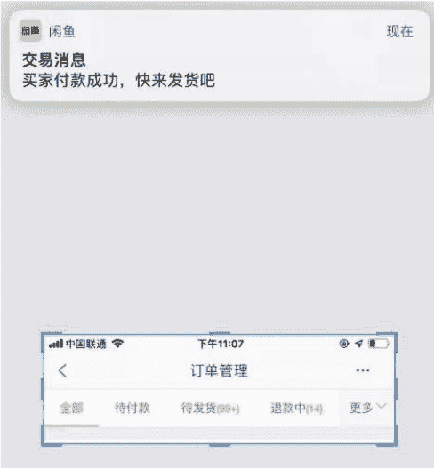

目前边上班边做了一个兼职，边在做自己的闲鱼店铺，全是靠自己下班时间来做。

目前自己是直接用支付宝注册了 3 个闲鱼账号就直接开店了。

闲鱼零门槛，没有前期成本的投入，我才能选择做 3 家，哈哈！

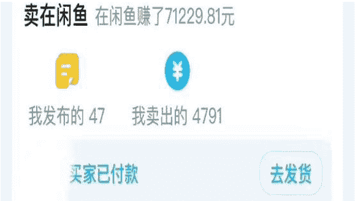

## 了解闲鱼：

大家都知道闲鱼吧，闲鱼是依托于淘宝旗下的的二手交易平台，在淘宝的庇护下自然是有很多的用户，根据网上的数据显示，每天有超过 25 万件的闲置物品出售交易！

大家现在都有这么多的闲置物要出售的吗？其实，不是这样。

大多数人都认为闲鱼是出售二手闲置物的平台，大家不知道-网赚高手已经把闲鱼玩出了新花样。

比如，在闲鱼上面倒买倒卖，直接一件复制拼多多或者 1688 或者朋友圈微商上面的商品在闲鱼上出售，大千世界，只要想要赚钱就得行动起来。

## 我是怎样在闲鱼上赚钱的？

干货免费送！

主要是通过赚取邮费，举个例子，一件 5 元的产品，免费送给买家，商家把邮费设置为 8~12 元，出一单业也就是赚取 3~7 元，虽然很少的利润，主要是靠量出胜的。

而且，总有很多的想要占便宜的买家来下单，所以说这个玩法的出单量的确不低。一元竞拍玩法，随机福利带玩法，都是闲鱼上的一些小的玩法。

同时，我们主要靠这些玩法来赚取小钱，然后就是靠这些玩法来提升一下自己店铺的权重。以方便自己后期的大客单价的商品。

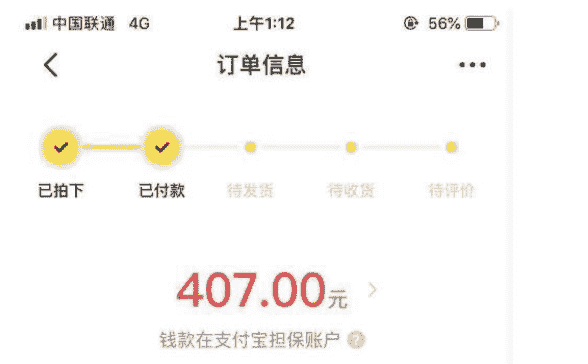

我主要就是玩淘宝联盟和 1688 上面的货源，我偶尔也会从微商或者拼多多上直接复制，主要符合我的需求我就借力来利于自己。

当闲鱼客户下单后，有了客户的收货信息后，马上去淘宝或者拼多多商家那边下单，收货地址填写对方的，直接把快递单号发给闲鱼客户，就是这样简单粗暴。

不想要这样粗暴就把快递单号录入闲鱼的系统。主要就是抓住信息差。

## 闲鱼 vs 淘宝

虽然说闲鱼是淘宝旗下的，做淘宝的都知道现在的淘宝市场处于饱和的状态，淘宝也不是谁想要开店就可以开店的，虽然门槛低但是还是需要交纳保证金等的费用。

需要自己引流，花费费用去引流，闲鱼是平台自动分配流量。新开的店铺流量会更大。闲鱼没有门槛，支付宝账号注册，就开了一间闲鱼小店铺。

## 闲鱼快速出单小技巧

**账号：**

支付宝账号芝麻分越高越好，账号的权重就会越高。

**产品：**

选品是很重要的，选择爆款，蓝海产品，确定好自己店铺的类目，就不要再更改了。

多花费时间去选品。可以卖闲鱼首页的那几个类目的爆款产品。

**货源：**

上面也说到我自己的货源，如果自己有货源就更好了，没有货源就是自己制造货源，我做的也是无货源。

**定价：**

闲鱼上的用户本来就是看着商品的价格便宜来的 ，所以很多的商家就是把商品的价格定的很低，以为这样就能很快的出单，但是这样做是很危险的，不要认为自己很聪明，这样做平台是不允许的，你有可能会受到惩罚的。参考同行，可以稍微不同行的便宜点，只要不是太过分就可以。

**排名规则:**

闲鱼上的排名规则是按照时间的顺序来的，最新发布的产品会被给予的流量比较大。

**擦亮:**

闲鱼上面有个擦亮的功能，记得每天在对的时间擦亮，擦亮就是重新上架，商品就会被给予更多的展现量。

获得更多流量，闲鱼上有个鱼塘，如果你想要让你的宝贝出售的更快，就多加入一些与你的产品相关的鱼塘，然后在鱼塘里面多发布与你的产品相关的帖子，增加你的宝贝被出售的效率和速率。

还有像闲鱼只能上传50产品，如何上传新的产品，怎样来优化标题，文案，怎样处理售后问题都很简单，只要掌握，能很快的日出单过百月过千。

**首先我们要了解平台的规则，才能玩转平台。**

自己做闲鱼也两个月了，做到现在的营业额，还是可以的，单店日500，一个月下来就超越工资，这也是我想要全职做的原因。

之前主要是就利用下班的时间来做，接下来准备自己全职来做呢! 自己完全是从一个小白开始做起的，坚持每天上货，就是为同一个目标-挣钱，因为简单，毕竟手机操作，差不多自己也都搞懂了闲鱼上的套路和出单技巧和方法。

是人都会赚钱，只是所有的人都会花钱，会花钱的前提是花1000能够挣2000，甚至更多，这才叫会花钱......

# 美柚 APP 精准引流：1 亿女粉用户，等你变现

很多人可能不知道美柚 APP 是什么，其实它是一款针对年轻女性和宝妈的健康管理、娱乐的 APP，深受女性用户的喜欢。

目前，美柚的注册用户高达一亿多，社区互动也非常高，可谓是所有女性 APP 排行榜的第一。

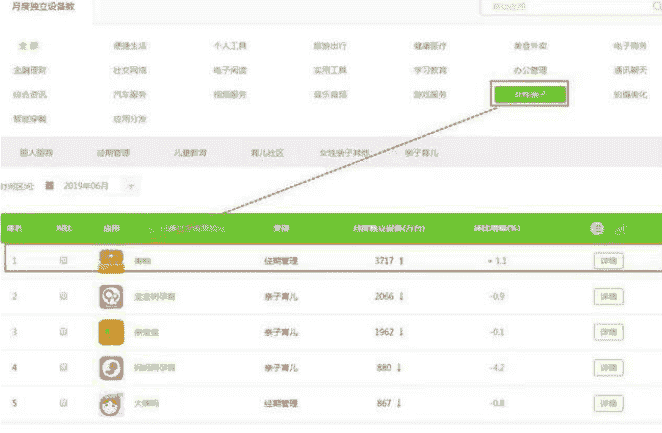

从相关数据中，我们可以看到美柚的用户年龄层主要集中在 18-35 岁的，而且从圈子来看，几乎涵盖了所有女性生活的各个方面。如果你想做女性相关的产品，那么可以使用美柚 APP 来进行引流推广，很有效果。

接下来就给大家介绍一下如何利用美柚号来进行精准引流。

### 1、账号

在使用之前，我们需要先注册一个账号，你可以选择手机号或者是微信号等等进行注册，注册之后还需要完善资料，因为只有你的资料完善人家对你认可度才高，且可以展示一些你想做的相关信息。不是说出了账号之后，你就可以进行引流了，很多限权都是没有被开启的，所以需要养号。

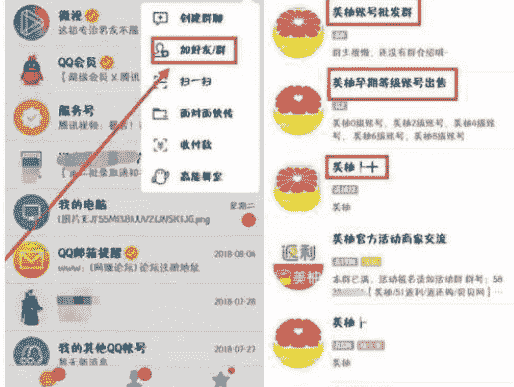

具体养号的时候，一定不要发广告相关的东西，最好是多跟人家互动，时间久了，账号的权重自然而然会提升。

### 2、引流

账号有了权重之后，就可以开始引流了。一开始，你需要确定你要做的产品属于什么圈子，如果做得育儿相关的，自然要在宝妈圈子里面，不然很难吸引精准粉丝。

## 热议榜单

- **#开奖了，说说孕期症状#**
  听说梦见蛇是怀男孩，我今天顺产完真的是男...
  讨论 518365
- **#恋爱小日常#**
  如果有初见时的强烈动心；还有熟悉后的长久...
  讨论 97279
- **#我和老公的日常#**
  我和老公不得不说的婚后日常，你们呢？
  讨论 79778
- **#顺产过程#**
  临床时刻好紧张~女人生孩子到底是怎么样过...
  讨论 212133
- **#催经小妙招#** `[推荐]`
  听说你的姨妈很听话？快来这里分享你的小...
  讨论 10591
- **#NT检查#**
  NT检查：第一次胎儿排畸！孕妈妈快来分享你...
  讨论 77405

然后就是发布话题，发布话题的时候一定不能涉及硬广和涉黄非法的言论，不然基本会被禁的，如果你希望用户能够找你私聊，这个时候不能直接说私我，但是可以利用谐音字，这个机器会识别不出来。

不是所有帖子都会有很多人关注的，这个时候你需要带一定的话题，就是大家都非常感兴趣的那一类，又或者是通过福利来吸引用户。这样用户的参与度可能会高一些，从而获得更多的展示。

如果你的帖子里面平铺直叙，可能人家看完就是看完了，没有任何反应，所以需要你在帖子里面设置鱼饵。你在发放福利的时候，比如说再加微信发红包什么，很自然的就能将你的人流引到微信上。

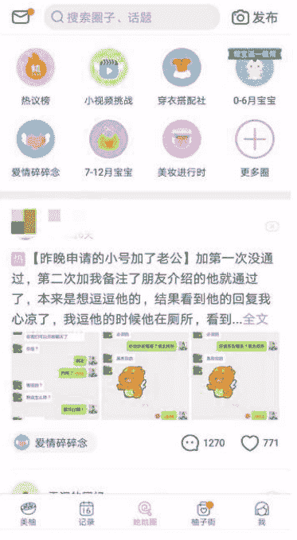

只要你的鱼饵设置的足够好，而且大多数人都愿意接受的话，很快你的粉丝就会多起来，而且还是很精准的流量。多的不说，一天 100+的粉丝是很容易做到的，毕竟每天活跃在美柚上的女性用户非常大，只要你抓住他们的痛点，这类用户是很容易被吸引的，尤其是宝妈可能比较闲，而且很在乎宝宝，像是育儿一类的文章和话题很能引起他们的兴趣。

只要用户有了兴趣，后面就是你发挥的空间了，只要你足够有能力，有很广阔的舞台给你发挥。所以说，你如果想要精准引流，而且是女性用户相关的产品，美柚 APP 绝对是一个非常不错的选择，非常值得推荐。

# 变声 APP一个零成本的网赚项目 适合新手朋友坚持月入过万

一说到知识付费项目，大家首先想到的是它是零成本的项目，只要用户有这方面的需求，那么一份内容就能源源不断的给你带来收益。

所以，今天我就聊聊关于知识付费的其中一个项目——讲故事赚钱！

其实听和看，都是我们了解故事的一个途径，只要将一个故事讲好，不少观众都会成为你的忠实粉丝。

一说到这个，可能大家首先想到是在喜马拉雅等音频平台上说书赚钱。

没错，今天我就是打算说这类音频项目，这个东西虽然有点老，但有人却玩出了另类花样，疯狂变现。

## 一：项目揭秘

一位不愿透露姓名的朋友跟我讲了他相关的操作经历，我们暂时管他叫老王，他利用变声软件，二次编辑他人音频，放在其他平台上操作变现。

我操作这个项目零成本，而且操作简单，只是需要通过变声软件，无脑复制一个平台上的产品，然后再放到其他平台上，批量铺货，实现变现。

## 二：首先是寻找软件

我在操作项目的时候，储存了很多变声软件，他分享了其中的一款，在后面我也会分享给大家。专业变声器是一个专业好用的变声 APP。

它可以选择很多声音，比如说萝莉大叔，也可以选择男女，同时还可以选择背景声音。还有热门的配音声音，比如说李云龙，周杰伦等等。

使用它也还可以在第三方应用上使用，比如QQ，微信，聊天软件等等。可以在打游戏中变声，可以改变性别逗迫人做恶作剧。

我就是借助这类的变声工具去操作的。

## 三：具体操作

首先要注册账号（必须认证！）喜马拉雅FM、蜻蜓FM、荔枝FM等音频网站都可以。

有两种操作方式。

### 普通的操作方式：

（1）找资源：

只要到网上一搜，就能找到大量的资源，（出名点的小说，要考虑版权问题，不然努力到最后就是白费）可以专门找一些已经完结，但是又没有版权的小说，这样就能规避不少风险。

鬼故事：收集各地的鬼故事传说，编成一个国内鬼怪故事大全，做个讲鬼故事的领域。

人们的生活节奏越来越快，越来需要感官上的**，于是便倾向于鬼故事这种文学消遣。而且收集到地方的灵异故事，具有地域性的读者会对该地域的传闻感兴趣。

（2）录制音频：

有声音条件的可以自己录制，我本人的声音并不是很有感染力，这一点他通过变声软件改变声音，来进行录制。

我有时候也会去某宝找店铺进行录制，某宝上有很多卖声音的商家，也比较专业。

### 第二种编辑方式:

我主要玩的是二次编辑，有很多音频平台，他上其中一个音频平台上，购买了一些频道，每天上这些频道，将主播更新的音频，使用工具导出音频。

而后使用变声工具，直接对导出的音频进行二次编辑，成为原创，而后就直接在其他平台上上传。

我分析了利用变声软件做二次编辑上传操作的利和弊:

利：操作简单，几乎零成本；可以在多平台上广铺货，能够堆数量。

弊：导别人的音频出来，受到别人的音频限制，比较被动；可能有些音频里面带着主播的广告信息，而且有时候导出的文件受损。不适合做高质量账号，有时候可能会面临下架风险。

### 四：操作建议

强调，上传音频到平台后，因为是刚开始做，播放量肯定不高，所以在取名的时候加一些关键和垂直的热词，这样喜欢直接用关键词找音频的用户就很容易看到你的音频了。

对于一些音频可以后期再剪辑合成，尽量提高原创度，例如华夏网赚上有很多专业音频编辑软件，有降噪，调音，删减片段等各种功能，可以百度或者某宝购买一个。

### 五：变现建议

平台本身设置收费，你就能获得可观的利润。像喜马拉雅上一般设置收费 0.15 喜点一集，一集如果播放量能达到 1w 以上，那么这集都能带给你好几百的收益了。

除了喜马拉雅之外，还有蜻蜓 FM、荔枝 FM 等音频网站，可以使用不同的变声效果，将同一个音频变不同的声音后，在多平台上批量发布，多重变现。

如果将粉丝引流到微信上，可以设置付费进群，喜欢这个故事的用户，肯定也愿意花一点小钱，进群后收听。现在获取流量的成本和难度是越来越高，通过这个项目，吸引到***对故事很感兴趣的粉丝。

我有时候也会通过这个方法吸引到粉丝后，与一些在电商平台上卖书的商家对接，然后在微信群或者音频里直接帮商家做一下广告。

我的数据，单是在喜马拉雅上的平台，他就有 6 个号，现在每个号每月能给他带来 3 千左右的收入 ， 其他平台的还没有算上！

## 六： 注意事项

我还重点讲了操作音频项目的一些注意事项：

- 1）项目是零成本，但这种 0 成本项目也有自己的缺点，就是我们在初期需要投入较多的精力保持持续更新。
- 2）录制音频一定要做好备份，因为有时候平台换规则或者出现问题，会下架个别音频，你有备份的话就可以重新进行上传。
- 3）积极和粉丝互动，这样可以增加用户的粘性，对以后变现也是有好处的。
- 4、做音频更新，刚开始不要收费，在你还没有名气和粉丝的时候，收费挡掉很多流量。所以要通过一些方法，让自己的播放量冲上去，这样账号的权重就会增加。

等账号做起来后，就可以考虑设置收费了，如果你只是想引流的话，可以一直免费，在介绍或标题中加入你的联系方式进行引流，做其他的变现。

## 七、总结

我做的知识付费的音频付费大概就是这样。

喜欢听这类故事的用户通常好奇心会十分强烈，他们会为了追后面的故事而选择继续充值，所以这类型用户粘性会比别的类型更大，后续很容易变现。

# 百度文库推出认证模式优享计划 业余时间打造副业赚钱之法

说起百度文库，大家应该并不陌生。尤其是那些经常需要下载资料的小伙伴。

百度文库是一款网友在线分享文档的平台，用户量大，权重好，排名佳。如果你在百度当中查找资料，百度文库的排名会很靠前。

可能会有小伙伴问：“搜索结果排名靠前，有什么用？”

用处很大啊，排名好，用户在搜索资料的时候，你的资料就可能排在前面，更容易被曝光和下载，这样你赚钱就更容易，更多。举个例子吧：

我们在百度当中搜索“自然拼读法资料”，看一下搜索结果：

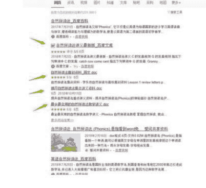

第一页的前面几个文档都是百度文库的。

既然百度文库在资料共享方面很有优势，那么，如何利用百度文库来赚钱呢？

其实在网赚上之前也分享过很多相关的内容，那么今天我们在详细说说百度文库赚钱的方法吧。

目前，百度文库推出了两个认证模式和一个优享计划！

专家名师认证通过后，可以上传该付费文档，自定义价，从而获得奖金分成。

文章作者认证通过后，可以上传积分文档，从而获得广告分成。

看字面就可以得知，文章作者认证更容易，一般都可以通过，认证的流程和自媒体平台差不多，都需要身份证和手持身份证照片，手机号等信息。唯一不同的是，百度文库的文章作者的头像需要真实头像。

如果你没有平台认可的专业**的话，可以选择文章作者认证这一条路。

如果你平台任何的专业**，那么可以考虑走专家名师认证，然后通过上传付费文档来赚钱。比如，你有教师资格证和学历**（本科以上），你就可以走专家名师认证，然后上传关于学科领域的付费文档，PPT 啦，课件啦，学习资料啦等等。

那么，平台都认可哪些专业**呢？可以参考下面这张图片：

| 种类 | 细分分类 | 认证书 | 颁发机构 |
| :--- | :--- | :--- | :--- |
| 医疗健康 | 全部 | 三级甲等医院、执业医师资格证 | 中华医学会管理局 |
| 社会保险 | | 律师资格证 + 律师执业证 | 司法部 |
| 社会保险 | 职业认证 | 中国专利代理人 (CCPM) | 中国国家知识产权局 |
| 社会保险 | 职业认证 | 全球公共关系职业认证 (ICCP) | 中国国际公共关系协会 |
| 社会保险 | 职业认证 | 企业标准体系认证证书 | 人力资源部和社会保险局 |
| 社会保险 | 职业认证 | 创业担保贷款 + 创业培训 + 工作证明 | 人力资源部和社会保险局 |
| 职业理财 | 财险、保险 | 注册会计师 (CPA) 证书 | 美国财务会计协会 (CPA) |
| 职业理财 | 财险、保险 | 特许公认会计师 FCA 证书 | 特许公认会计师协会 (ACCA) |
| 职业理财 | 财险、保险 | 注册会计师 (CFA) 证书 | 金融特许协会 (CFA) |
| 职业理财 | 财险、保险 | 注册会计师 (FIA) 证书 | 国际财务会计师 (FPA) |
| 职业理财 | 财险、保险 | 注册会计师 (CAP) 证书 | 国际财务会计师 (CIP) |
| 职业理财 | 财险、保险 | 加拿大注册会计师 (CICPA) 证书 | 金融管理师 (AFP) |
| 职业理财 | 财险、保险 | 注册会计师 (FRM) 证书 | 金融风险管理师 (FRM) |
| 职业理财 | 财险、保险 | 美国注册会计师 (CPA) 证书 | 美国注册会计师 (AICPA) |
| 职业理财 | 财险、保险 | 保险经纪人 (CICE) 证书 | 保险学会 (CICE) |
| 职业理财 | 财险、保险 | 美国管理会计师 (CMA) 证书 | 管理会计师协会 (IMA) |
| 职业理财 | 财险、保险 | 国际注册会计师 (ACCA) 证书 | 国际财务会计师 (ACCA) |
| 职业理财 | 财险、保险 | 美国管理会计师 (CMA) 证书 | 美国管理会计师协会 (IMA) |
| 职业理财 | 财险、保险 | 大英注册会计师 (CIPD) 证书 | 英国人事部委员会 |
| 职业理财 | 财险、保险 | 注册会计师 (CPA) 证书 | 国际财务会计师 (CFA) |
| 职业理财 | 寿险、健康 | 保险精算师 (ASM) 证书 | 国际精算师协会 (IAA) |
| 职业理财 | 寿险、健康 | 注册保险经纪人 (CIP) 证书 | 国际财务保险公司 |
| 教育管理 | 教育学 | 教师资格 + 学科教学 (学科以上) | 国家教育部 |
| 教育管理 | 外语 | 全国英语等级考试 (PETS) | 教育部 |
| 教育管理 | 外语 | 翻译员（口译、笔译） | 国家人力部 |
| 教育管理 | 外语 | 美国国际教师资格证书 (NATE) | 美国 |
| 教育管理 | 外语 | 导游证、讲解员 | 教育部 |
| 职业资格考试 | 职业资格证 + 业绩证明 + 工作证明 | 教育部 |
| 保险 | 保险 | 保险代理人 | 人力资源和社会保障局 |
| 保险 | 保险 | 公估师（中级及以上） | 保险协会 |
| 保险 | 保险 | 保险经纪人 | 保险协会 |
| 育儿 | 育儿 | 育儿师、营养师、职业健康管理 | 人力资源和社会保障局 |
| 育儿 | 育儿 | 营养师证 | 中华健康管理 |
| 汽车美容 | 汽车美容 | 汽车美容师/技师 | 国家劳动局 |
| 汽车美容 | 汽车美容 | 汽车美容技师 + 工作证明 | 国家劳动局 |
| 生活 | 生活 | 汽车美容师证 | 国家劳动局 |
| 生活 | 生活 | 厨师证 | 中国烹饪协会 |
| 生活 | 生活 | 维修工/电工/技师证 | 国家维修技师协会 |
| 餐饮 | 餐饮 | 精调师证 | 国家餐饮协会 |
| 礼品 | 礼品 | 私人理财师 | 国家理财协会 |
| 金融 | 金融 | 投资、资产规划师（高级、资深、规划师） | 人力资源和社会保障部 |
| 文化艺术 | 书画 | 知名人士 | 国家文化局 |
| 体育健身 | 运动 | 教练证、裁判员证 | 体育总局/体育局 |
| 体育健身 | 运动 | GCI 钻石高级理财师证书 | 中国高级投资学院 |
| 体育健身 | 运动 | 体育教练师 | 体育基金会 |
| 体育健身 | 运动 | GMA 国际健身私人教练证 | 美国 GMA |
| 体育健身 | 运动 | GMA 国际健身私人教练证 | 美国 GMA |
| 体育健身 | 运动 | GMA 国际健身私人教练证 | 美国 GMA |
| 体育健身 | 运动 | 国家一级运动健将、高级营养师、高级心理咨询师 | 国家 |
| 运动 | 运动 | 健身教练证 | 国家体育总局 |
| 运动 | 运动 | 健身教练证 | 国际私人教练协会 (ACE) |
| 运动 | 运动 | 健身教练证 | 美国私人教练协会 (NAS) |
| 运动 | 运动 | 职业篮球/足球/网球/排球运动员 | 运动协会 |
| 编程 | 编程 | 国家认证高级程序员 (AACP) | 中华人民共和国 | 
| 编程 | 编程 | 计算机高级设计师/工程师/系统工程师 | 计算机部 |
| 软件 | 软件 | 工程师证 | 工程师 |
| 电脑/网络 | 网络 | 网络工程师 | 工信部 |
| 电脑/网络 | 网络 | 维护实操/运维工程师 | 通信部 |
| 电脑/网络 | 网络 | 网络工程师 | 通信部 |

除此之外，百度文库还有一个优享计划，和文章认证作者差不多，都是上传积分文档获取广告分成来赚钱。

## 如何加入百度文库的优享计划呢？

首先，打开网页版本的百度文库：

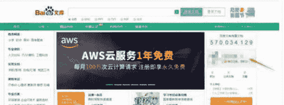

然后点击个人中心：

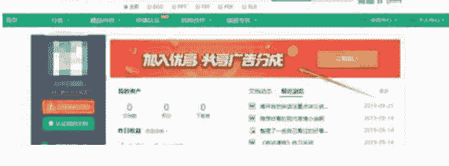

在出来的页面中就会有优享计划的字样，点击进入并加入即可：

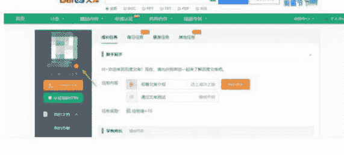

当你加入之后，个人主页的头像下面会出现“优享作者认证”的加V字样。

## 在百度文库上传资料来赚钱，需要注意哪些事项呢？

### 1、千万不要抄袭

上传的文档一定要有版权，最好是自己的原创。

不管你是专家名师认证，还是文章作者或是优享认证，这一点都需要格外的注意。尤其是不要上传别人版权的电子书，或是将别人写的文章整理成文档上传。这种都是小聪明，版权会越来越严格，被别人发现侵权，一封投诉邮件就能搞定你。

### 2、如果你是专家名师认证，最好学会挖掘和打造自己领域的优质资料

要想自己的付费资料好卖，其实还是要学会写作，只不过从原来写文章赚钱，变成写文章然后制作成付费资料来赚钱，都是一个道理。

### 3、如果你是文章作者认证或是优享计划，上传资料的频率和资料的数量很重要

不在于一天上传多少个，而在于每天坚持，资料数量越多，对于你的权重和收益越有帮助。

### 4、不管是哪一种线路，你都需要极为重视标题优化的技巧

标题决定着文档在搜索结果中的排名，影响着用户是否点击进入阅读。

### 5、依靠资料赚钱和自媒体写文章两者并不冲突，完全可以利用自己的原创文章赚取多份收入

同样可以将百度文库当做一个内容分发平台，为个人品牌营销贡献力量。

### 6、专家名师认证和优享计划不冲突，可以赚两份钱

写作是一项很重要的赚钱技能，学会了你能够在不同的平台通过不同的形式赚钱。

学会写作，学会推广运营，能够让你在内容创业的时代，打造属于自己的副业，拓宽现金流，一边提高能力，一边提高收入。

# 10 种引流方法，适合各行各业，效果极好

同样地，在工作中，我认为最酷的操作就是能够让用户对你的产品上瘾？

然而现状是，太多昙花一现的产品都生于新，死于留存——费劲心机通过各种手段引流，做用户增长。最后，却很少有人为你的努力买单。

一切商业竞争，归根结底都是关于流量的竞争。

一如既往，谁拥有流量，谁就占据商业主动权。当然啦，得是精准流量。

## 一、所有行业都值得用社群重做一遍

当传统实体还在抱怨大环境，自己却不知道生意惨淡的重要原因是：

- 1、产品缺乏竞争力
- 2、线下流量越来越少！线上流量越来越贵！

所有的产品都有自己的生命周期：萌芽，成长，高峰，平稳，低潮，关键是你的产品能给目标用户提供终身价值么？你有自己的产品槽么？

时代是不断进步的，新的产品总是出来，新事物必然代替旧事物，商业渠道和模式也是一样，微商在 2013 年很好做，但是 2 年后很多品牌就销声匿迹了。

万能商业的三要素：产品——流量——成交。

有了产品之后，大家最关心的就是流量问题。

### 什么是流量？

我现在所做的就是流量，我用事实来告诉你，不是纸上谈兵。

如何通过微信来找到精准流量，并让精准客户主动加你，是所有微商，社交电商，社群电商的第一头等大事。

## 二、流量的来源有哪些方式？

- 01、依靠营销推广（花钱买流量）
- 02、主动去寻找（招业务员去跑业务，请客户吃饭，微信加人都是）
- 03、忠实客户转介绍（产品好，人品好，服务好，客户主动告诉他们的朋友来你这里咨询和消费）

随着万物互联化的发展，传统互联网营销红利期消失，靠营销推广获取流量的时代一去不复返。

主动寻找精准流量，和激发顾客转介绍，才是获取流量的方向。

**主动寻找精准流量最好的方式:**

- 01、吸引目标用户主动添加你的微信
- 02、在有信任的前提下主动添加对方

这才是正确的方法。

有些玩社群的很搞笑：加到群里一句话没说就狂加人，打开他的朋友都是刷屏微商信息。

你遇到这样的人，是不是第一时间想拉黑？

这样的加人是无效的，因为对方很反感你。

你是抱着营销目的来的，我们每个人都讨厌被“强暴”式营销。

因为我需要别人先给我们价值，我们再考虑是否愿意为价值买单！

## 三、寻找流量的三种渠道：线下，线上和好友圈。

### 1、线上流量的来源

线上流量来源有什么好方法？

#### 01、微信群【微信群吸引别人主动加你的两个方法】

我教大家通过微信群吸引别人主动加你的两个方法：

（1）把自己变得专业，跟小号互动撩群

把自己变得专业，具备某个领域的知识，加到很多相关社群。拉个小号进去提问，然后主号来回答。

比如：有个餐饮公司问我如何吸引流量？

我让他加到本地的吃喝玩乐群，自己拉个小号进去，小号问一些关于美食，营养，健康的问题。

主号不遗余力的回答，显得很专业，带动了很多人提问他。

在这些有相同兴趣的人心目中，她就是个意见领袖，很多人加她咨询，她还积极主动帮他们预定桌位，推荐特色，在他们没有见面之前，已成为无话不谈的朋友。

这样先打成一片了。

谁客户多了，你觉得生意还是问题吗？

在我们内部社群营销群中——这些方法都有具体指导。

我们团队的成员每天必须进入 2 个微信群，群不断增加，每天被动吸引的流量不断增加。

（2）群内红包吸引人加你

群内吸引人加你的方法——发红包，发红包不是随便发，也是有技巧的。

我试过，每天晚上 20:00~21:00 之间准时到一个群里发红包。

发个 5 元的，红包里加上：大家晚上好。

连续发一星期，每天雷打不动 20:00 发个 5 块的红包。

群里不断有人艾特我。

我第八天开始在群里给群主发私包，果然如我所料，被其他人抢走了。

引起了群里的人聊天，我一句话都没有说。

就是每天到点发一个红包。

最后数了一下，有 200 多个人来加我。

我试过再主动加人，95%的通过率，因为群里的人对我印象深刻。

谁说死群没有价值？一用这两个方法就能炸活。

关键——群主还搞不清头绪。被你圈粉给圈走了。

#### 02、QQ 群引流

你可以到 QQ 群里搜索：老乡群，兴趣群，行业群等等。

这些都有价值的，怎么用？我后续告诉大家核心技巧，可以关注一下我。

还有就是自媒体和本地分类信息网站。

自媒体对于传统企业老板来说，有难度，但是写文章引流效果显著，所以我们成立了文案特训营，专门为他们赋能，用文字引流吸金。

### 2、线下流量的来源

#### 01、参加沙龙活动

报名本地互动吧，参加那种 100-200 元一场的活动，提高自己的演说能力，站到台上去分享，会有人主动加你。

下面是我们社群一位伙伴的线下活动引流总结：

> 昨天我去参加了一场西安的线下沙龙，现场到场人数 80 人，锁定扫码创客 20 人，成交创客 10 人。

这个活动的来源是加了一个群，这个群是一个叫“樊登读书会”的组织，以下是当时他们群里的活动接龙，这是一个收费的沙龙，每人 100 块。

我当时的想法是，这个群的人群跟我要的人群是吻合的，都是喜欢学习并愿意为学习投资的人群，并且这是一个链接资源的付费的活动，能付费 100 块参加的人，说明是有付费意识的，也是有需求链接人脉的人群。如果我能成交 5 人，这 100 块就能赚回来，按二八定律，我相信我是可以成交 5 个左右的。所以我毫不犹豫报名了。

我提前打印了几十份“鱼饵”，在现场轮到我介绍自己社群项目的时候，我就每个人派一张，我说我是社群营销的老师，今天我是来给大家福利的，关注我们的公众号，截图微信发给我，就可以免费找我领取价值 3980 元的社群工具包一份，每一工具包的价值和对他们的好处，以及解决他们什么痛点，我都说了一下，我说完之后，下面大部分人都拿出手机来扫，这样就完成了锁定，同时微信也加上了。

然后，他们发给我截图之后，我就发给他们工具包。当天没有成交创客，这也在我的意料之中，因为对方还没对你产生信任，并且这里我认为还有一个很重要的人性化问题，就是每一个人都不喜欢被别人在短短几分钟内成交，他会觉得自己很冲动，他们需要时间消化。

所以后来活动结束后，有几个人主动找我了解社群营销。我讲的东西他们也非常认可，还说要跟我合作，让我去培训他们公司的怎么做社群营销。建立信任之后，他们就愿意付款了， 所以整个成交流程就是这样。

#### 02、去展会收集名片

以前有朋友去展会摸集名片，发现很多人不给他名片，很苦恼。我给他一个点子，收集名片的效率立马翻3倍。

怎么做？——把头衔改印成了采购经理！

来参展的基本上都是销售，销售喜欢销售吗？

销售只喜欢采购。

至于如何把他们变成客户？

#### 03、加入本地兴趣组织

还有就是加入本地兴趣组织，在里面和别人打成一片，学会互动，非常有价值。

美食俱乐部，自驾游俱乐部，驴友俱乐部。

在玩中建立友谊，获得人脉。

适合做直销，保险，装修，等等。

#### 04、到实体店引流

微商从业者，一定不要忽视了实体店的流量。

实体店因为有实体，顾客有一定的信任度，加上人流，是一个重要的流量入口。

那么没有实体店怎么办呢？

——我们很多老会员，就是掌握了社群运营的能力和技巧，现在在帮一些实体店老板做代运营、策划等等。

因为有了信任度，顾客的需求激发出来，店面的生意增加了，也附带卖了自己的产品和服务。——两全其美。

很多人说加微信没有用——是因为你不知道后边怎么玩。很多实体店没有加顾客微信，或者加了之后不知道怎么用，结果流量白白浪费了，很可惜。

### 3、好友圈的流量来源

#### 01、找种子合伙人

你想做一个项目，想做大就要找种子合伙人。

合伙人会和你一条心，你微信上有2000人，5个人就有10000人，

玩社群，种子用户基数很重要。

#### 02、请朋友转发

微信里最值钱的不是自己的朋友圈，而是朋友的朋友圈。

把自己打造成一个专业的人，做个海报，遇到机会，找人帮你发朋友圈，做个推荐。

如何让别人转发？要么对方欣赏你，要么你给对方好处。

#### 03、请顾客转发

当你成交以后，要想办法让顾客帮你裂变。

如果你是卖货的，也可以通过早期的返现，让顾客帮你发圈。至于如何设计话术，如何设计海报，后边会讲到。

如果做了顾客社群，让顾客帮你发很容易。

我们有个会员开服装的，群里有 400 多顾客，一次互动有 300 人帮她发，直接带来 10 万销售额 (怎么做？可以看我之前写过的文章社群营销案例复盘 | 1000 人社群，5 分钟销售额破 10 万)

以上 12 种流量方式，不是说每个你都要去做，你只要把某一个方法，练到极致，就可以见效。

如果你看看就算了，那就没有办法了。

# 账号被限流如何恢复推荐量

说到账户的重量，我相信很多来自媒体的作者都很困惑。

事实上，帐户权重是一个更专业的术语，并且平台不会识别帐户权重的存在，没有具体的陈述，但经验丰富的媒体作者知道帐户权重必须存在。

## 一、什么是账户权重？

事实上，很好理解，我们可以将它们分为理解，权力和权重，帐户权重是帐户可以在平台上获得的权利和权重。

例如，我可以申请青云计划吗？我可以打开原始标签吗？我可以申请付费专栏吗？我可以使用自我推荐的功能吗？

权重的获得，通常会根据您的帐户质量进行评估。换句话说，就是平台感觉你有体重，而且你的确有体重。

如果是平台邀请注册的大V，则账户的权重完全不可能低。

## 二、提高账户权重有哪些好处？

最重要的一点是，大多数自媒体作者关心，帐户的权重自然很高。

权重高了，推荐量高，爆炸很容易，收入也会提高，获得平台的青睐更容易。

就像大多数老师喜欢学习优秀小学生一样，该平台也喜欢遵循作者的纪律。如果您有这个好处，您自然会想到一个高性能帐户。

单价较高，由于账户条件不同，单价也不同。当然，重量越高，单价越高，收入越高。

所以问题来了，帐户权重如此之高以至于有这么多好处，如何提高帐户权重？

### 1.垂直场

对于新手来说，垂直场输出非常重要。自媒体的许多新人刚刚开始创作，他们经常将文章发送到前三名，今天发送体育，明天创造历史。这种做法对账户的影响仍然很大。

只有当我们在垂直字段中发布内容时，平台才能更准确地捕获关键字，并且分发组将更准确。

如果您每天在不同的领域发送文章，则会导致平台无法准确判断您的领域。从长远来看，账户重量也会受到影响。

### 2.避免被扣分

许多新人听说自媒体媒体赚钱，或者是他们一直嫉妒别人，所以一时脑热，在不了解媒体平台规则的情况下注册了自己的媒体账户。此时，随意发布内容很容易打破平台的红线。

对于自媒体新手来说，加入自媒体平台是一个很好的表演时间，因此在创建内容之前一定要了解平台的规则，不要违反平台的要求。

### 3.这篇文章需要有价值

许多新人都有这样的问题，在撰写文章时文章没有主题。甚至为了写出单篇的数量，文章变成了无意义的水文学。

事实上，一篇有价值的文章并不难，那就是在撰写文章之前先做一个主题。就像教师总是让我们总结中心思想一样，确定中心思想然后撰写文章要简单得多。

### 4.持续更新

对于平台，持续更新是检测作者是否确实具有输出功能的标准。

大多数自助媒体平台（如活动帐户）和持续更新都可以在平台上留下良好的印象。因为大多数平台，定期清除一组低活动帐户。

所以持续更新，稳定的文档质量，不仅可以使帐户保持稳定状态，帐户的索引也将得到改善。

# 小白傻瓜式引流变现稳定日赚 300-500 元，操作简单

以前做项目的操盘手，都讲究短平快。

现在做项目的操盘手，都讲究长稳赚。

不同形式下的做事态度，能够反映出互联网的发展变迁。

b站，我估计很多人都了解，粘度非常高的一个平台，号称年轻人的直播平台。最近上市之后，劲头更加旺盛，不断的广告宣传，实力圈粉。

我平时没事，也会到那里去逛一下，主要喜欢看下面的评论，因为，我觉得很多技巧，很多玩法，很多引流套路，都会在评论里面呈现出来。

最近我发现，很多人开始开账号，发视频进行投稿，咨询了几个好友，他们说，这个平台用户付费率比较高，而且有钱的年轻人比较多。

这个理由，我蛮能够接受，有钱的地方，有消费能力的地方，往往意味着进去捞一笔并不困难。毕竟混迹在互联网的人，各种套路，各种玩法，都比较熟悉，规则虽然一直在变，但是不变的依旧是层层升级的玩法。

但是这个平台，对账号的要求，对版权的要求，近乎苛刻，很多人都很难成功注册到账号，即使注册成功，也需要转定期，或者通过回答问题来完成转正。

没办法，只能通过一些渠道购买账号，替代自己的操作，总有专业的人，玩的比我们溜。

我们的目的自然进去不是赚收益，而是进去想办法引流。

但是，对于版权很注重的平台，自然不能够随意的上传视频，这样的话，封号几率特别大，不过有个好处就是封号之后，这些视频还能继续展示播放，这对于其他平台来讲，也是一个宽容之处。

但是究竟如何引流呢，通过我这三四天的调研，我发现很多人都采用诱饵引流。

大家都知道，B站的各类动漫，教程，二次元，以及国外的电影素材，是比较多的，而且有诸多忠实粉丝。而经过我观察里面比较火爆的教程，就是各种图画教程。

这些人没事就呆在B站上看各种教程，非常过瘾，一边能够学习，两者就兼顾了。而一般这样的教程有一个代名词，叫做CG教程。

意思就是电脑图形图像教程。

而B站的视频有一个特点，那就是允许你留联系方式，或许这也是对作者的一种尊重吧。于是，有人就开始利用这一点，卖教程。一般是这样的。

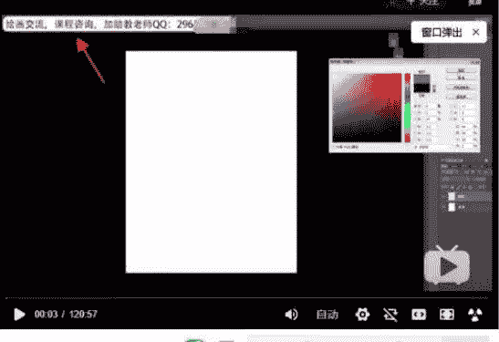

可以非常明目张胆的把水印直接打到视频上，而且随着播放量的增长，效果非常不错。上面这张图片上，就是一个绘画视频。

如果你注意观察，会发现，这个视频长达 120 分钟。我看了一下播放量，达到了二三十万。看来，B 站也有很多奋进青年，都嗷嗷待哺的等待学习。

## 二三十万的播放量意味着什么？

意味着，你如果组建一个交流群，能够在很短时间内爆满，如果你卖一份课程，有可能在很短时间内受到欢迎。

当然，这只不过是常规的做法。还不够诱惑。真正诱惑的教程类视频，还是那些对营销知识懂的多一点的人。

他们的玩法，是通过教程引流，然后讲到一半之后，提示加 QQ 群，才能够继续观看下一部分，或者直接能够得到全套教程。

这个玩法，叫做利诱。我通过了解发现，有人靠此方法，短短一月 30 块的门槛费，2000 人的群都满了。果真爱学习的年轻人，非常多。

当然，很多人会有疑问了，我不会各种技术，如何录制视频呢。还有哪些教程比较受欢迎呢？

## 这里我提供三个方向：

- 1. 插画教程
- 2. 动漫教程
- 3. PS 教程

这三个教程，在这个平台普及度是非常高的，很多人可能因为某种小因素，导致想要学习此类教程，比如，自己做 UP 主，自己设计动漫动画，等因素。

但是，对于我们来讲，亲自去学习教程，在去学习制作方式，显然很费时间。最快的办法，就是专业的事情，交给专业的人来做。

我兼职群体，录制视频，按小时收费，只要自己定主题，比如一些能够快速上手的教程，很容易搞定。

我身边一个朋友，找了一个插画师小姐姐，每天录制视频，一节 1 小时左右，150 块的费用。他觉得很划算。

而且，承诺小姐姐，做一套完成课程出来，给的更多。只要内容扎实，声音甜美，很容易短时间内就赚到钱。目前他也弄了一个群，每天大概有 400 左右的收入，能够进群十来个。

而且他比较擅长写标题，很吸引人。比如，零基础自学画画方案，纯干货！类似这样的标题，非常受欢迎。

当然，很多人依然觉得很难，觉得各种问题，难以解决，难以上手。

其实，互联网能够赚钱的人，无一不是爱好专研，资源整合能力强，如果光靠自己一个人搞定，个人能力在强，也很难面面俱到，解决很多问题。

# 闲鱼赚钱项目的高端玩法

很多上过闲鱼的朋友可能会说，闲鱼上全是捡便宜的客流，怎么可能还有暴利的闲鱼赚钱项目。

就是这一个质疑，恰如一语中的，说明了闲鱼赚钱项目拥有着庞大的流量支撑。都知道捡便宜上闲鱼，这种流量能不大吗？

我们都知道，互联网信奉一条铁律，流量=钱，流量怎么变成钱那就是八仙过海一各显神通了。小白互联网创业，与其参加各种培训被人割韭菜，不如脚踏实地 从门槛低前景好的项目入手。什么挂机日赚几百几千，还0门槛低门槛，99%就是韭菜收割工唱的摇篮曲。

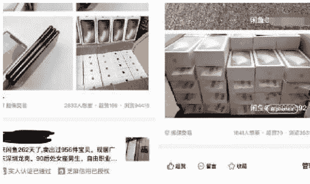

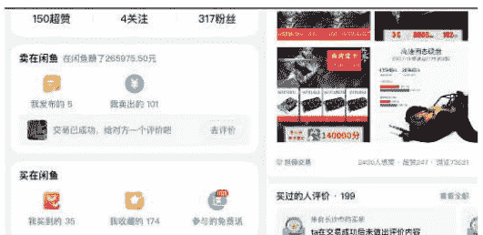

## 首先、我们看看闲鱼赚钱项目的玩法套路和闲鱼怎么赚钱

第一、实物产品。多数是做一件代发或淘客的。单账号日均利润几十至几千不等。比如做二手苹果手机，某些特殊机器单台利润 500-800 元，单账号基本日均 500 以上。

第二、自有资源卖货。一般是线下实体商家，没有专业的电商运营技能，选择闲鱼转转正适合。比如做同城摄影的，同城家具家电的，基本收益与实体店的收益相当，还没有房租水电成本。

第三、虚拟资源。基本这块就全是暴利项目，别看这些店基本没销量，那是因为主要是平台外交易。做黑项目的就更不用说了。什么视频、原味、网赚项目、培训课程等等黑灰产都瞄准了年轻流量、学生流量。

第四、引流卖粉。这个也是暴利项目，多数长期扎根鱼塘、寄生在高流量宝贝评论区，以软件工具、培训课程、网赚项目为商品，狠狠地收割了一批网赚粉、创业粉、兼职粉，按照一粉 30 算，基本优化到首页，日吸百粉轻轻松扎，单账号月入十万不在话下。

第五、职业免费送玩家。对的，就是免费送，包邮赚邮费，不包邮赚商家推广费。比如同城送水果体验装，邮费就赚 3 元左右，然后引导拉群，首次买一件送一件，拉的朋友享受同样福利。但其实闲鱼店主并不是卖水果的，实际是做同城社群拼团的，导入这样一个精准客户人群并购买提成 10-50 元。优化好免费送的宝贝，自己的号吸粉的同时，可以无限为各种商家拉精准小群。每个客户拉 5 个不同的群，就是净利润 50-250 元。

## 其次、闲鱼赚钱项目适合什么样的人群

目前，闲鱼开店的都是爱分享的年轻人，因为价格低利润空间被挤压，同时静默成交率过低，咨询转化率明显低于其他电商平台，所以做正规产品的职业卖家、大淘客较少。

同时，闲鱼主打去专业化的个人店铺，单品流量累计效应不明显，官方推荐以上新为主，淡化了淘宝的爆品概念。没有信誉累计、没有店铺装修、没有买量推广，所以无论新店老店机会均等，闲鱼店铺优势可以集中爆发。

因为是闲置交易为主，管理宽松，玩半灰产业的人群也扎堆在此。另外，闲鱼同城推荐是重要板块，包括同城鱼塘品类鱼塘等等，如此区域精准人群更适合打造私域流量池，也可享生更多盈利项目。

目前闲鱼平台学生、宝妈、家庭主妇、个体商户比较多，闲鱼的模式也很适合个体创业者开店赚钱。没有太多的运营技巧，也不需要烧钱推广，小可以作为长期兼职，一个月赚三两千零花钱，大可以复制扩大做店群作为长期事业，一个月少则三五万多则数十万。

## 再次、闲鱼赚钱项目的操作流程

- 1、每一个人准备 3 张电话卡，注册 3 个闲鱼店铺 (转转店铺随意)。小规模建议使用宽带附赠的电话卡，不用再花流量钱。大规模建议使用阿里宝卡，阿里系免流，实名认证可找亲戚朋友也可别样操作。
- 2、准备手机，一机一店，若需定位非本地，建议通过外置硬件或软件改变手机地位，虽然闲鱼发布可以任意选择定位，但尽量不在闲鱼上修改定位。有的手机

能源生态开。但如果是做全国店群矩阵不建议使用多开。大规模店群只能选择店群云控软件，小规模可以手工操作。

- 3、选品，一定要慎重，单笔利润低就一定要卖这个平台主流客户喜欢的，才能通过优化起量。单笔利润高就一定要有好的话术、建立信任感。高利润货源也可以向笔者免费索取
- 4、同一宝贝设置不同标题和图片，便于重复发布时能最大量获得流量推荐。设置好自动回复语句，写好宝贝转让的故事。
- 5、优化置顶。发布要在晚 7-10 点流量高峰时段，擦亮也是，一旦有咨询，要引导关注，有评论要及时回复，高峰期排名靠后是要及时成交，接上先机会冲排名。每次发布一定要记得挂在鱼塘，保持每天加鱼塘签到发言。具体事项的先后和时间节点控制的微操环节很重要，随时通过关键词查询排名。9-10 点能上首页一两次，在随后几天就能爆个上万流量的单品
- 6、发货要及时，闲鱼没有延迟发货的惩罚，但会明显给你的账号降权甚至限流，当然，假发货一样也能识别。毕竟这是客户体验度的重要环节。包括退货、好评等都要注意。

## 最后、闲鱼赚钱项目投资和风险

闲鱼赚钱开店成本极低，手机、手机卡都有，注册闲鱼即可，这就是单店，基本 0 成本。若是多店运作，建设店群，选用小米 3G 运河的手机，当然用最低配置 100 元不到的小米 2s 也能将就，使用上文提到的手机卡，则费用基本为零，若使用店群管理软件，一年也就几百上千元，基本也可忽略不计。选品得当，成交一单即可全年回本。

至于风险，做正规产品的商家，无论利润高低，也不存在风险。从 0 开始初创业者，千万不要搞仓储发货的老套路，尽量选择一件代发，或者见单拿货，这样就能 0 风险。

# 实操网络免费引流技巧，快速获取精准用户

做互联网的人都需要流量，有些直接付费让别人帮他引流；

有些通过交易获取流量，有些为了减少成本选择自己引流。

本文就为大家介绍自己如何免费引流推广，都有哪些方式，具体操作方法是什么。

## 一、说在前面的话

免费和付费的差距，在我看来一个是投钱，一个就是投入时间和精力。

当然，效果上来说，有好有坏，我认为还是要看具体项目以及运营项目的人，很多朋友觉得付费不好，投入很多，但是如果你投入 2000 可以赚到 4000，又何乐不为呢？

首先大家要做免费引流，就得先有一个目标，即引流是为了什么？

**目前网络上引流目的基本分为两种，**

- 卖产品
- 粉丝交易（粉丝变现）

有了前进的目标后，我们才好挑选合适的平台，才能更好的前进。

还有一点想提醒各位，千万不要随意去模仿别人的引流推广方法，因为每个公司，每个产品，每个人都不同，别人做了有效果，并不代表你做也有效果。

目前的引流市场是及其混乱的，天天有人说这个方法管用，那个方法管用，但是自己的产品只有自己知道。不想浪费时间浪费精力，最好尽量多了解一下行业知识。

## 二、搜索引擎优化

### 1、搜索引擎优化（SEO）

一提免费引流推广，最开始想到的一定是 SEO，那么什么是 SEO 呢？

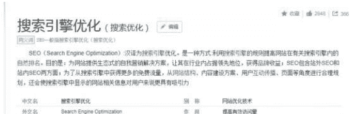

这是百度给出的解释

其实说白了白一点，就是通过提升含有公司产品信息的网站在搜索引擎上的排名，借此来吸引用户点击网站，向用户展示产品或信息，最后在网站中留入广告信息，达到引流推广的目的。

为什么要做 SEO？

SEO 的优势在哪？

SEO 是在搜索行为产生的初期，雅虎和其他公司提供黄页服务时，有些人向早期的搜索引擎提交网址寻求索引，之后搜索引擎就按照关键词抓取了相应页面，同时排名也是按照关键词密度来排序。

大家渐渐发现了这种排名方法，SEO 便应运而生。

而 SEO 的优势在于：

- 它是全程免费的，可以省下大部分公司资源；
- 持久效果很长，一旦到了首页位置，便很难被挤下；

从 seo 来的流量一直很精准，基本上从搜索引擎上来的客户，成交率都是相当高的。

这就是 SEO 的核心竞争力，也是为什么 SEO 越来越火的原因所在。

这里提醒一下大家，搜索引擎来的流量固然好，但是 SEO 相对而言需要知识储备与技术支持，并且还要消耗最少 2-3 个月时间，主要目前就大行业来说，关键词早已被巨头占领，很难再有建树，小词目前竞争也火，各个行业都是杀的你死我活，所以如若你技术不是特别好，也许可以尝试别的方法。

## 三、自媒体平台引流

自媒体最开始是从今日头条兴起的，因为开辟的大数据+个性化推荐技术获得广大群众喜爱，从而带动了一大批自媒体平台的兴起，同时还开通文章收益，也让许许多多的幕后写手获得了一份意外收入。

自媒体的起源其实可以追溯到更早，当初在优酷上传视频，也可以说是自媒体，不过毕竟是今日头条让自媒体这个广而传之的，所以现在一般说自媒体都离不开今日头条。

自媒体平台的引流方法很多，但是你要先选好平台，毕竟平台这么多，有图文的，有视频的，怎么选是个很大的问题。

如果你要按流量排名的话，第一一定是短视频平台。短视频自媒体，在目前是所有自媒体话题离不开的主题，甚至都已经有很多人专职来做，一切都是因为庞大流量，现在短视频用户还在快速发展中，每个月都在增长。

所以只要视频质量好，并且符合大众口味，很快就能吸引大量粉丝，有了粉丝，你还怕没办法变现？

其次就是今日头条了，虽然近年来今日头条调整了文章收益，但仍然不能动摇它自媒体老大的地位，流量也仍然很大。

其他的自媒体，像百家号、搜狐自媒体、趣头条、微信公众号这些都是可以做的，大家自己要选好合适的平台，好刀要上战场杀敌才是好刀，不然和普通的杀猪刀没有任何区别。

### 选好了平台，你就要创作内容。

自媒体之所以火，内容是一个很关键的点，因为内容质量好，用户才会驻足，这样才会形成流量。

所以对于自媒体平台来说，内容可是重中之重，你想做好引流，一定要有符合用户口味的内容。 视频方面我就不多说了，你如若选择做短视频，肯定是有两把刷子的。

图文方面的自媒体，其实方法是很多的，原创、二次创作、自己原创再给自己文章二次创作等。最简单的方法就是你先找 10-20 个同行，看看你同行都发哪些文章，然后再结合你自己的经验，很容易就能够写出文章。

### 那么你想好了平台，也有了内容，最后该做什么呢？

按理来说应该是没有最后一步了，但其实做这一行，最难的，不是创作，不是选择，而是坚持。 做自媒体是众多引流中我认为最累的，首先前期要花很多时间维护账号，目前大多数自媒体是不能留广告的，一旦你留了很容易被举报关闭账号，花了一两个月维护的账号，一瞬间就没了，那会让人很崩溃。

然后还要小心同行恶性竞争，给你编理由举报了（某乎就是这样，举报就关闭账号，还不给理由），还得跟热点，热点一出，就要跟，因为热点是自媒体行业的爆发点，一夜增加几千万粉都是有可能的。

但是以我的经验看来，做自媒体前期 2-3 个月，没粉丝是正常的，最晚大概第三个月才会迎来爆发期，只要你坚持，就有可能逆风翻盘。

## 四、社交引流

社交引流就是 qq。微信，微博等，用于社交圈服务的引流方法。其实最开始的引流就有 qq 群引流以及 qq 邮箱引流。 但是 qq 群引流和 qq 邮箱引流，已经是被玩剩下的了，方法网上多的很，这里就不多做说明了，想研究的可以去网上搜索，有很多案例。重点说一下比较火的微信群引流以及微博引流。

### 1：微信群引流

想做微信群引流，首先当然得先加群，怎么加呢？

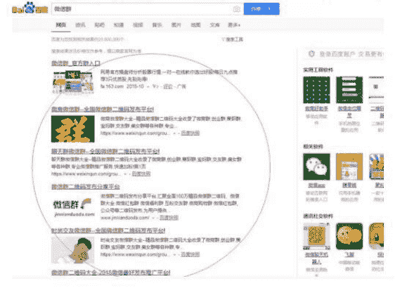

百度微信群，随便点进去一个，可以得到很多的微信群。大家最好选付费的，价格不高，1-3 块不等，付费的群，里面的人有消费意识，相对好引流一些。

先加 30 个群，给每个群发个小 hong 包，1 块钱 10 个的那种，这样就可以加群主；然后自己创建一个群，把群名称改成“活动奖励群，发广告先联系群主，不然飞机票”，然后把二维码往这 30 个群里发，就会有很多人进群，往返操作，你的微信群人数就可以不断增加。

这里切记一点，微信群不能超过 100 个，超过 100 个不能通过扫码进群了。积累微信群人数，就有了引流的资本，只需要把其中的精准客户提炼出来就可以了。

刚刚设计的群名称“活动奖励群”，就是为了提炼客户准备的，发布一个活动，分享朋友点赞，超过 20 个以上领取礼品。

假如你是做衣服的，你就送袜子送围巾，之前我做的时候，送围巾效果比较好。或者别的产品都可以，这里记得要选便宜的产品，不能太贵，不然消耗大，而且要和你要的产品挂钩，比如围巾我找厂家拿，因为量大，基本上是 10 块左右一条。

在活动时用户找你领礼品的时候，你收个 5-10 块的邮费，既控制了成本，又收获了流量。然后把这个活动往群里一发，就等着加好友，往返操作，几天就可以积累大量的精准粉丝。

### 2、微博引流

这个其实没有太多的捷径，

**2 种方法：**

做内容和蹭热点。

做内容很多人都知道怎么弄，但是热点怎么蹭？

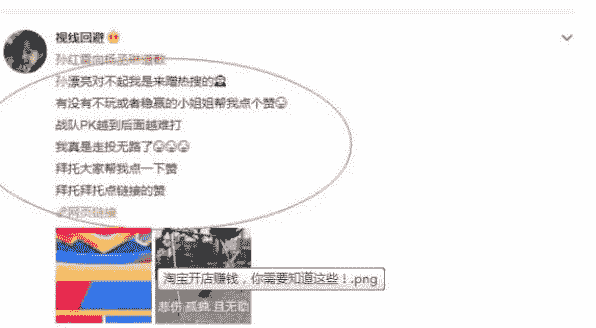

类似于上面这种，在发表内容的时候，带上热搜关键词，这样可能会有几率上热 搜展现页的排名。

互联网引流方法太多，毕竟各行各业牛人太多，这里总结的方案不一定全，但是全部是有效果的，很多人都是用这种方法实现了转变，相信你也可以的。

# 利用短视频引流男粉另类变现的网赚方法

小视频火不火？当然火！玩小视频的人多不多？肯定多！为什么？有人喜欢的东西就有流量，有人追捧的东西就有利益。那么你有没有在小视频上赚到钱，赚钱需要什么样的技能？

事实上，一看小视频的规模，我们就知道里边肯定有不少的资源，有这么多人做的时候，也说明了小视频的门槛并不高，那么在这个行业里，有些人真的是作为一个娱乐，而有些人是作为一个事业，这到底有什么不同。

很多人羡慕那些玩玩手机就能赚钱的小姐姐，有些人好奇同样拍拍自己生活的趣事，别人却粉丝直线上升，有人月入过万。其实这些都是有技巧的。

那么今天我们就给大家分享一下小视频如何引流和变现的办法，我们在很多项目中有过介绍，但是有些技巧都在日新月异，每天学习是自媒体赚钱的第一步。

### 一、项目详情

大家在刷短视频的时候应该都见过下面这类型的视频，一个小哥哥或者一个小姐姐晒出自己的自拍图或者视频，然后留下一句：交个朋友吧。

这类视频如果图片中的人够漂亮，文案配得够打动人或者富有新意，那这种视频在短视频平台还是蛮受欢迎的，毕竟人人都有“爱美”之心。

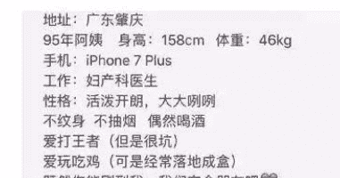

你可以仔细看看，绝大多数做这类视频的号都是为了引流，他们或者在个性签名初留下微信号，又或者在你私聊的时候给你发个人微信号。

还是那句话，如果图片足够漂亮，配文足够吸引人，那引流就不成问题，有了流量就等于有了钱。

### 二、内容制作

说到要做这类视频，大家第一个想到的肯定是：我长得不好看，那肯定上不了镜。

其实我们操作这类项目的一般也不会自己上镜，我们的素材主要还是来源于网络，然后我们自己进行二次加工即可。

以美女图片为例，百度搜索“小清新美女”就会出现一大堆图片，咱们下载回来进行二次加工；具体怎么加工呢？你觉得怎么好怎么来，小编认为最好的办法就是模仿别人的创意。

既然我们想做短视频引流，那我们要必须要经常去刷视频，多关注一些同类型的账号然后去模仿他们即可，至于是图片转视频形式还是视频二次创作形式，你们根据自己的情况决定。

至于引流信息，目前接入口主要有 3 个，一是名字，二个性签名，三是私信，其中小戈觉得私信跟签名是最好的引流渠道。

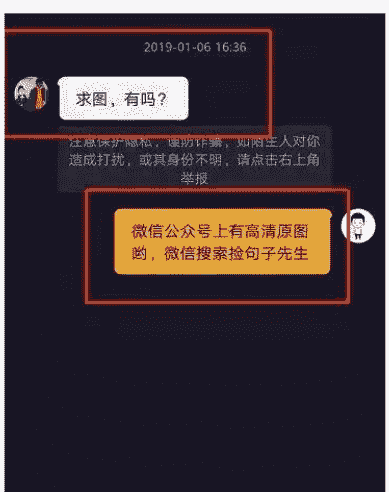

在这里，小编想提醒大家的是，评论区引流现在不好操作了，大家尽量不要去触碰，很有可能会被系统抓到的。

### 三、变现模式

对于变现也是要根据自身资源来定的，在这里小编给大家推荐 3 种比较符合这类型的粉丝的变现方式。

#### 1、小说变现

因为操作引来的都是男性用户，那么我们可以操作小说项目来变现，具体的操作方式是对接到小说平台，然后给他们做分销。

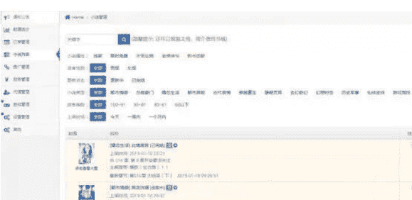

现在跟平台分成一般都是一九分，你九成，平台拿一成，小说项目目前还是可以操作的，大家如果能引到男性用户那可以操作这个项目，男性用户在小说方面的消费还是蛮大的。

#### 2、淘客变现

淘客变现其实在短视频上就能操作，只要我们账号符合一定条件就可以开通商品分享功能，但根据很多朋友反馈的这样的效果不太理想，而且这跟我们这类的交友粉也不适合。

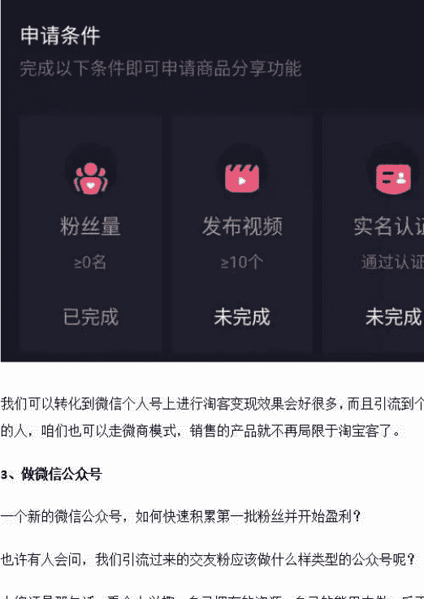

我们可以转化到微信个人号上进行淘客变现效果会好很多，而且引流到个人号上的人，咱们也可以走微商模式，销售的产品就不再局限于淘宝客了。

#### 3、做微信公众号

一个新的微信公众号，如何快速积累第一批粉丝并开始盈利？

也许有人会问，我们引流过来的交友粉应该做什么样类型的公众号呢？

小编还是那句话，看个人兴趣、自己拥有的资源，自己的能里来做，反正有了流量就不怕没钱赚。

最新;最好笑的小品都在这里,赶快关注吧!

3 位朋友关注

**关注公众号**

- 美女直播
- 小品搜索

**消息**

70 年产权到期后，房子归谁？终于有答案了！

### 四、项目总结

这个项目的关键点在于引流，引流做好了，那后期的变现就不成问题，说到这里肯定会有人问，这个真的能引流吗？

小编不敢保证各位操作这个项目都能成功，我只能保证说这类项目目前市面上还有人在操作，而且操作效果很好，但你操作的效果具体还是要看你的能力。

毕竟每个人的能力不一样，拥有的资源也不一样，所以能不能做起来，能做得多高还是得看自己。

# 竞价推广效果 8 大要素分析

如今我们的 SEM 推广大多围绕着移动端展开，甚至有很多 SEMer 表示已经把所有的预算都投放在了移动端推广上。

那么影响移动端推广的因素都有哪些？你都知道么？根据小编多年推广经验，本文将从以下 8 个方面进行探讨：

## 1、匹配方式

更改关键词的匹配方式是影响付费流量的第一个原因。

通常关键词都会有三种匹配模式：精确匹配，高级短语和广泛匹配模式。

不同的匹配模式决定了广告在搜索结果中被展现的数量，从而进一步影响到了关键词为网站带来的流量。当我们调整关键词的匹配模式时就会对流量造成影响。

优化建议：

合理利用“黄金组合”（广匹+否词）实现流量获取最大化，针对无线路高质量关键词可通过分匹配出价和高级精准匹配拓展功能来实现流量拓展。

## 2、出价策略

出价策略是影响付费搜索流量的第二个原因。

忽略掉质量度的因素，出价策略直接影响广告的展现次数及排名。

广告在搜索结果的不同位置（上方或是下发，第一名或者是第三名）获得的点击量都是有差别的，调整关键词的出价将会直接影响广告的位置，从而影响关键词获得的流量。

优化建议：

移动端因为上方三个广告位和下方三个广告位是相同的，因此无线端可通过排名倾向自动工具确保广告在前三展现。

## 3、修改创意

付费搜索引擎广告的创意是指标题和描述中的内容，这也是影响付费搜索流量的第三个原因。

广告创意影响的不是广告位置和展现次数，而是广告的点击率。而相同展现量的情况下点击率高的广告也将获得更多的流量。

优化建议：

无线端因屏幕尺寸大小限制，创意应以短创意、强相关为主，同时辅以无线样式提高点击率以获得更多的流量。

## 4、投放时间

调整广告投放时间是影响付费搜索流量的第四个原因。

工作日 8 小时投放与 7*24 小时投放的关键词，在流量上会有很大差别。

投放时间直接影响广告的展现次数，进而影响广告的点击以及为网站带来的流量。

优化建议：

如果预算充足的话，则全时段覆盖；如果预算有限，需确保早上上班、中午午休、晚间这三个无线流量高峰广告能正常在线推广。

## 5、无线样式

搜索推广无线端目前已经有很多无线特有的展现样式，这也是影响付费搜索流量的第五个原因。

无线样式影响的不是广告位置和展现次数，而是广告的点击率。

新颖的样式更能吸引网民点击从而提升广告的点击率，而相同展现量的情况下点击率高的广告也将获得更多的流量。

**优化建议：**

手机因其设备的独特性能可以实现实时沟通，因此无线端催生出很多独特的展现样式比如推广电话。

在日常推广中可根据推广需求选择合适的样式，提高无线点击和转化。

## 6、关键词数量

购买关键词的数量是影响付费搜索流量的第六个原因，这与前面提到的匹配模式类似。

新增加的关键词，可以为网站带来更多的流量。但这只在一定范围内有效，当关键词对访客覆盖到一定范围时，新增加的关键词对流量的影响就微乎其微了。

除了关键词的数量之外，关键词的质量也会对流量造成影响。扩展搜索量较高的关键词也会影响流量变化。

**优化建议：**

无线端需多加长尾词、疑问词、价格词等中长频次的词。

## 7、投放地域

投放地域是影响付费搜索流量的第七个原因，也是最简单的一个原因。

地域对流量有限制作用。当一个地域的流量增长到一定程度时就无法再增加了，增加投放地域也就意味着增加了新的访问群体。同样也就意味着流量的增长。

优化建议：

建议启用搜索意图定位功能。

该功能启用后，当网民的搜索词中可识别的地域词与您所设置的推广地域一致时也可能会展现您的推广内容，从而获得更多的流量。

## 8、移动站点

移动站点是影响付费搜索流量的第八个原因。

相信很多人都不知道移动站点的优劣也会影响网站的流量吧，这主要是因为移动站点的评分低于一星的时候就会影响广告的展现，从而影响推广带来的流量。

优化建议：

利用推广后台提供的网页测评工具进行网站测评，如果测评结果低于一星建议去优化移动站点。

同时，一个好的移动站点也会直接影响无线的转化，因此一个好的移动站点在无线推广中显得特别重要。

# 风水项目引流方法，日引流 1000 粉且无成本

一命二运三风水，在中国人的眼里，风水仅次于命运之下，排行第三；而生出来的的是命，而运又由命来影响，只有风水是由人来决定的，是人为可以决定的。

因此改变风水，就可以改变自己的运气，运气改变了，就就可以将自己的天命也改变了。

因此风水在中国盛行了几千年，依然有着非常大魅力，以及吸引力。

不管信不信，反正就有很多有钱人就相信，特别是在香港、广东一带，非常讲究这些。你看香港哪个有钱人不是有私人的风水师的，而且是越有钱的人越相信这些。

## 为什么呢？

不知道大家有没有考虑过这个问题？

因为当一个人，钱能控制了，钱对于他来说，已经不是问题了，可能权力也是一样的，有时候权力也可以用钱购买，有权力也可以换成钱。这些都可以控制，但是对于运气的东西，是没有一个人可以控制的，因此就只能相信风水了。不是相信风水而信风水，而是没办法改变自己的运气，只能依靠别人的力量。

因此就算风水被列入迷信之类的，但是很多人却暗地里依然找这些风水师来化灾解难。这么说的目的是说，风水项目的市场非常大。

关于风水这个行业和项目，我们已经讲过很多次了，今天来继续补充一些细节上的东西。譬如引流：

## 引流的方式有很多种，譬如视频、图片、文字、声音等等，都可以。

只要有受众，就可以引流。今天重点来说说音频引流的方法。

音频的平台目前流行的有：喜马拉雅 FM、蜻蜓 FM、荔枝 FM、懒人听书这些。

我们随便找一个平台看看里面的一些竞争对手，也就是同行，看看他们是怎么操作的。我们打开第一播放量的，有 400 多万的播放量。我们来分析一下他是怎么做到的。他的主页的信息就是简单地留着自己的联系方式，就这样直接地引流到自己的主页和详情页，非常简单和粗暴。

再看下这个频道的播放量，达到了惊人的 1300 万的播放量，可想而知这里面有多少人收听了他的节目；因此可以说每天他的引流量都是非常惊的。所以我们就可以参照他的操作方式来操作。学习的最好方法就是模仿，看着别人做什么我们就做什么。看他的朋友圈是做什么的，我们就学习他的朋友圈，如果话术不会，就跟对方聊，然后把他话术都学下来。

还是说说这个音频的频道的事情。做音频频道这里最大的困难点，就是找素材。但是找素材也是有很多方法的。直接在网上找，找资料懂得找吧。就是找一些 10 万+的问章，然后到各个自媒体去看，搜集，然后把今日头条、搜狐、这些都搜刮一遍，然后找出这些 10 万+的文章。

然后就可以照着念了，当然念的时候以一定要注意，也要稍微地修改一下。然后制作音频的工具我们之前在说一些关于抖音的引流的文章中也说过，就是可以学习下 adobe 公司的 audition，是一个非常好的音频录制工具。在没开始录制之前，一定要注意，要提前准备好最少 30 天的量，这样的话，你就不会每天疲于奔命去找素材，而且这样你也可以及时地对一些收听量不好的内容进行更换。

在节目时间上面最好也要统一一下，不要一天时间说 10 分钟，第二天就说 3 分钟这样，最好定在 5-6 分钟的样子，因为人的注意力就只有那么长的，而且通过这种短的音频，给到用户一种意犹未尽的感觉，这样就会让他们持续的关注你。

灰产圈高端社群 内部资源 请勿外传 官方公众号：灰产圈社群

# 多平台引流大量精准女性宝妈粉，具体操作方法和注意细节

最近很多人都在问我怎么找女性流量，怎么吸引宝妈粉之类的，之前是分享过一个案例的，不管怎么说，既然有人感兴趣那么我们就来一个实操。

首先我们先看一下有哪些 APP 适合引流女性流量，如下图：

这些女性 APP 都可以去下载，而且不止如此。

## 第一步

咱们就利用这些女性平台去吸引女性客源，我建议大家可以试一下，去利用贿赂贴，什么叫贿赂贴呢？原理就是利用喜欢免费资源的心理，免费送给她们一些想要的高价值资源，先用免费的东西，把她们先吸引过来。

今天主要给大家讲一个我身边的一个宝妈创业自己用的方式，利用宝宝树，教大家一个思路，这个方法同样适用于其他女性平台，在这里大家要注意一个重点。首先你要资源，那么先给大家看一下她有什么资源。如下图：

- 28 孕归身心理健康
- 30 受孕成功经验
- 32 胎教
- 27 早期食品及饮食禁忌
- 26 海底小总队
- 29 孕期必备知识
- 23 东方醒塑 9 套
- 24 鹅妈妈童谣
- 25 动物街全四季 104 集
- 104 培养孩子注意力的 50 种方法.rar
- 98 成就一生好习惯.rar
- 103 英语儿歌 120 首(用 kmplayer 播放).rar
- 105 百本育儿电子书.rar
- 97 儿童故事 36 计.rar
- 96 中文儿歌 85 首.zip
- 95 与孩子沟通的 36 种好方法.rar
- 101 怎样对孩子说话最有效.rar

## 第二步

直接上案例，看看要怎么利用这些资源，如下图：

试想一下，假如你第一次当宝妈或者爸爸，你会不会因为没有经验而感觉到头疼，你会不会为孩子出生前准备东西？那么如果有资源你会不会感兴趣，如果想下载要么你留下联系方式，要么你找她的联系方式加她对不对，其实道理很简单，同理心就可以解决了。

## 第三步

下面我们来说说详细的做法！之前有文章有提到过怎么找痛点，我们先分析潜在客户的痛点，然后收集解决办法。新手宝妈的痛点是什么？很简单，育儿没经验，一天到晚手忙脚乱，没头绪。所以我们需要收集一些资源去解决这些问题，如图 1、图 2 的资源。而这些一般都是低成本高价值的资源。都是虚拟的东西，比如：电子书，视频，音频，笔记等等。然后把它们重新整编，编排成简单易懂的。

## 第四步

资源如何收集！收集这些资源的时候很多地方都可以利用，很多资源都是免费的，比如：百度，网盘下载，或者直接去淘宝上买，方便快捷。（或许有人有疑问，那么这些宝妈为什么不去搜索，答案很简单，要么没时间，要么懒，要么不会，要么脑子不好使，网络整合原本就是一个职业，可以赚钱的职业。就是因为懒的人太多，都喜欢看现成的，所以不要浪费时间去质疑，做才会有效果，有质疑的时间你都整合很多资源了）这些整合好的资源就是你引流的关键了，送给她们，写个帖子，按上图一样去写，然后留好联系方式，来的你就送，联络好感情，教她们怎么去看，怎么去用，让粉丝活跃起来。还有很多女性都一个共同的痛点，永远对自身身材不满意，很多人都瘦的皮包骨了，还说自己胖呢。再来一个案例，如下图：

## 第五步

将这些资源发帖发出去，自我介绍这些地方留好你的联系方式。有些平台不允许内容里带联系方式，但可以留图片或二维码，所以大家发之前要了解一下平台的规则，有的平台可以直接把名字改成你的微信。所以大家自己灵活变化一下。给大家看一下引流实探效果图，如下图：

当然流量不止如此，大家自己去实践，灵活变化方法，自己获取自己需要的流量，不要总是说引来的流量怎么怎么样。打个比方：你给一只猪 100 克金子，猪也不明白那是什么，它仍然每天除了吃就是睡。

**要知道量变会产生质变，当然过程是需要经营的。**

最后有朋友想要吸引女性客源或宝妈、宝爸的 直接利用上面的图片复制内容，当然你也可以灵活运用某些贴吧，或健身，运动等平台，去整合一些资源去吸引一些男性资源，引流方式本身就要靠动脑活跃思路去创造的，一个案例往往可以演变成几种甚至几十种方式。不要总是被自己“爱质疑”坏毛病，局限了自己的思想。引流本身就是一个持续不断的过程，多种方式结合使用才能更快，更有效。永远不要去想着短时间内引来大量流量，而这些流量又全部可以变现，尤其是刚开始做互联网营销的，你这是在做梦，流量是需要维护的。

# QQ 看点最新引流方式：教你如何批量引流精准粉

随着社会的进步，qq 聊天工具不断增加其功能，所以在使用 qq 引流的过程中，肯定会有我们错过的功能。qq 看点是一款内置于手机 qq 的新闻阅读产品。像大多数附加到 qq 的大型社交平台的产品一样，qq 看点也是针对年轻人做的一款产品。所以，看点的活跃用户大多是 90 后。毕竟，qq 伴随着这一代人的成长。刷 qq 看点也成了他们打发时间的一种方式。今天我将谈谈如何使用 qq 来看点来实现引流目的。

在 2017 年发布的 qq 看点用户数据报告中，90 后占 70%。其中，TOP20 关键词主要集中在明星，动画和游戏领域，其中动画搜索占 35%，明星搜索占 30%，游戏搜索占 10%。虽然它涵盖了几乎所有领域，但 qq 看点核心的分布主要基于动画，二进制和娱乐，这也构成了 qq 观察点与传统内容分发平台之间的差异。

根据腾讯社交网络商业集团内容平台部总经理杨达志的说法，qq 看点的内容丰富多彩，从传统的图文到视频，到现场直播，漫画，小说，但它的分发逻辑又是双管齐下，一方面基于兴趣，另一方面是基于 qq 好友之间的社会关系链。除了使用推荐的算法之外，qq 看点还涉及社交分发——当用户觉得喜欢这篇文章并将文章“Biu”出去时，该文章就很有可能出现在朋友的信息流主页中。

## 具体操作

### 1. QQ 一个

想要使用 qq 看点引流，qq 当然越多越好。可以去专门的小号平台购买，但 q 买的 qq 一定是要安全干净的，以防止被找回

### 2. 登录 QQ，找到 QQ 看点，点击进去。

打开 QQ 看点，右上角有一个“视频”入口，点击进入并打开视频，我们就可以开始引流了。引流的方法也非常简单。就是评论。有两种方式来发表评论。一种是在评论内容里留软广告，第二种是用昵称或头像进行广告。

首先分享第一个玩法，如下所示：

不要直接评论，而是要去回复点赞高的楼层，为什么？因为评论的评价越高，排名越高，所以如果你发送广告评论，很容易被刷到后面，所以你不能得到任何引流效果，只有第一时间让人看见，引流效果才是最好的。

第二种方式是使用昵称或头像进行广告宣传。第二种玩法是利用昵称或头像打广告，用作图软件，做一张广告图，然后把头像换成这张广告图，接着再把你的 QQ 资料也改成广告词，名称的话尽量避免敏感词，否则评论内容会被系统自动过滤掉，写一个引导别人看头像的昵称就行了。一切准备就绪。

除了“视频”入口，还有一个“#话题”入口，在里面可以发图文或视频动态（需要先绑定并验证手机号）。方法如下图，

标题：用 15 天了，效果还不错！内容：一张祛痘效果对比图。如果有长痘人群看到这条动态，肯定想知道她是怎么改善痘痘的？记住把 QQ 名称也改一改，以此配合引流效果，图里的这位就改成了办法看头像，其目的就是引导别人看他头像，然后发现他的广告，从而加他的微信。

还有一个 Biu 功能，这是 QQ 看点独有的分享动作，类似于“转发+收藏”功能，用户 Biu 过的内容会在其好友的看点瀑布流展示；此外，用户 Biu 过的内容还会在用户个人主页“我 Biu 的内容”里生成一条时间轴。

所以，如果你 QQ 好友多的话，想做营销的话，千万不要错过这个小技巧，有事没事记得 Biu 一下，你的 QQ 好友都能看到 Biu 过的文章，如下图：

# 格斗漫画精选

# 点点

# 【小鼎假期】 所谓 20 分钟

徐峥夫妇包揽年度最高票房，药片，还未上映口碑爆棚

- 世界杯高能主场
- #就爱这福利

办法 看頭錢 Biu了 张姿势了！要想脸蛋好看，我tou嘴 口

今日吃法：发布了文章

- 必须要焯水的 5 种蔬菜，很多人都省略了这步，难怪吃了会... #有毒食品的盘点
- 菠菜根 Biu 了 2 小时前 1 评论 共 1 个 发布文章数 2

# 怎么通过 B 站赚钱，B 站赚钱项目这样玩日赚 500

当你所处的领域时间久了，你就会对该领域有更清楚的认识，也可能成为这一领域的成功者。我们在互联网上也一样，所谓的经验都是用时间堆积起来的，经验和阅历有很大的关系。当然如果你一直接触不到太多的事情，那么谈不上什么阅历及经验了。今天给大家分享一个 B 站盈利的项目，绿色环保无污染。这个项目整理来说就是在 B 站批量上传视频教程+引流+卖教程软件。

## 什么是 B 站？

b 站已经上市。主要受众是一些二次元粉丝，里面有很多大量的 cg 教程（cg 指的是电脑图形图像），因此有一部分 UP 主（UP 主是 b 站内容提供者的统称）会经常更新这类型的教程，他们的做法就是只把教程上传到一半，然后在视频下方留言说：如果需要完整的教程就要加 qq 群购买。一般这类型的 UP 主每天会更新几个视频。

除了赚钱，还可以顺便吸粉。一些 up 通过上传一些美容舞蹈视频来吸成成千上万的粉丝。

### 一、具体操作方法

先注册一个账号，但是 b 站很特殊，因为注册账号成功之后还需要通过转正之后才能发送弹幕和收藏视频！转正需要邀请码或者答题才能通过。

可以考虑买个账号或者直接答题，这个不难，搞定一个账号还不容易？就算是答题也不难，用户注册，官方总不可能出一堆难题是吧。然后进 b 站后台投稿，设置相关的活术。b 站自己本身 pc 端的首页就有投稿入口，操作也很简单，去官方网站即可操作。

### 二、整理视频

视频素材去哪里找，什么类型的素材比较好，选择素材和上传的时候需要注意什么？视频素材去各种论坛找相对来说还是比较容易的，可以到 YouTube 或者其他国外视频网站找也是可以的。懒得找的话，那就去某宝买素材，然后存到百度网盘。根据 b 站的情况，比较推荐的是教程类的视频，例如：绘画教程、特效教程、摄影教程、跳舞教程等等。b 站相对来说管理很宽松，只要是不上传一些黄色、暴力的视频，其他的视频还是比较容易通过审核的。而且就算是账号被封了，之前的非违规视频还是可以看见的。b 站之前开启了有播放量就有利润分成机制，大约是 1w 播放 80 块钱 只要粉丝达到 1000 或者播放量 1w 就可以开启利润分成了。选择视频的时候一定要根据自己的定位走，方便后期引流。还是推荐原创，不建议照搬，但是本身没有这个能力的时候，一定要剪辑和改变原视频的 MD5。

### 三、引流方式和技巧

- 1、设置视频封面出现
- 2、视频介绍中做文章，而且视频本身也可以加广告。
- 3、qq 签名板块，可以在上面设置联系方式。

### 四、如何规避风险

- 1、不要发电影、电视剧题材的。现在版权管理严格，国内的影视剧现在都是独播后再卖版权，一旦产生纠纷，封号是必须的。所以推荐国外的素材，能够很好的降低风险。
- 2、目的是吸粉的话，主播视频也是一个不错的选择，不过太过于暴露的美女视频也不推荐，有被封号的风险。

### 五、变现

- 1、粉丝变现：b 站的粉丝活跃度极高，曾经有“b 站一粉顶 10 粉”的说法，意思就是 b 站一个粉丝的价值相当于公众号 10 个粉丝甚至更高的价值，因此可以直接 xi 粉。

将教程视频只上传一半，然后留言让粉丝加群。想要看完整的视频就只能进群，入群费是 30 元每人（可以自己设置），目前这个群有 628 人，总收益就有 18840 元。

2、发布视频

b 站类似于 qq 空间，你发布的东西粉丝都会看到。不要发纯广告，最好是配合一些有意思的视频。就可以自然引流变现，不过前提是**你的内容要足够吸引人**。

3、b 站代解封，目前 b 站解封淘宝不超过 10 家店铺。解封主要形式就是帮被封号的客户答题。不过答题还是有难度的，否则怎么这么赚钱的项目没有人做。首先你一定要有充分了解 b 站有哪些违规词语，以及一些行话。一般来说，网站会列出一些供你选择的非法单词，但是准确率会要求高达 100。如果你选错了，必须重新开始，如果你有透彻的了解，这种操作仍然可以赚钱。

# 月入过万的冷门小生意，2019 闲鱼深度玩法

今年不少人都感觉互联网氛围越来越严峻,绝大部分平台、项目都趋向于规范化。放眼望去，似乎阳光、正规、合法、长期的项目离自己很遥远。想启动这一类型项目，除非有充足的资金准备，或者有足够的资源作为支撑，否则将举步维艰。虽然互联网项目层次不穷，但坑也很多，乱花渐欲迷人眼。但只要肯细心观察，还是可以发现适合自己操作的好项目，比如闲鱼就是其中之一。

众所周知，闲鱼是阿里旗下的二手物品交易平台，据相关数据显示。该平台的活跃用户与日俱增，主要以 80 后、90 后为主，产品需求日益多样化，物美价廉的商品逐渐成为主流趋势。早在去年一年闲鱼的成交金额已逾千亿，市场不容小觑。

有人的地方，就有流量，有流量的地方，肯定就有营销。目前我的团队也在操作这个项目，下面就把操作实操方法分享给大家，之所以分享给大家，是因为这个项目是没有竞争对手，市场足够大，希望这一次的分享能给您带来帮助。

普通人怎么月入过万的冷门小生意 闲鱼深度的专业玩法，之所以分享闲鱼项目，因为门槛较低，几乎不用投入什么成本不管您是个人，还是团队，只要您手上有一部手机就可以操作，兼职还是全职都可以。

接下来我实战一步步告诉您:

## 1、新手小白如何操作闲鱼？

想做好闲鱼，首先就要解决闲鱼号的问题。

闲鱼号，顾名思义就是淘宝号，一个人可以注册 3 个。

做这个项目，不光要有闲鱼号，还要有高权重的闲鱼号。就是支付宝的芝麻分数最好在 650 以上，如果您没达到也没关系。芝麻分数可以通过按时还款、支付宝缴纳物业水电费和租借充电宝等守信行为去涨分。

下面是支付宝芝麻信用分数一览表，分数越高，曝光量越大。

### 分数等级划分如下：

- 700-950 就表示信用极好
- 650-700 就表示信用优秀
- 600-650 就表示信用良好
- 550-600 就表示信用中等
- 350-550 就是信用较差的

## 2、如何找到优质的货源？

刚开始可以从淘宝联盟、阿里巴巴等一系列的资源找到自己的货源。如果自己本身有货源，在操作上无疑是锦上添花。

## 3、如何起一个“爆单”标题？好的标题就是成功的一半。

首先确定您要发布的商品，在闲鱼的搜索框输入商品名称或者关键词。输入时下面会出现一个下拉框，可以参考下拉框的词汇。这些都是闲鱼用户搜索的热词、高频词，可以作为组成标题的一部分！

除此之外，还可以搜索一些排名靠前的同行的标题作为参考。不建议照搬，照搬的流量相对会少很多，反之，原创标题和内容具有一定的权重。

## 4、详情内容该怎么写、图片怎么编辑标签？

详情内容的大致描述可以去货源那里找，商品的规格尺寸和拍下的注意事项一定要列举清楚。这样可以减少售后。此外添加图片的标准是整洁、美观和真实，建议上满 10 张图。

还有需要注意图片要学会打上小标签，这样有利于系统识别分类，给的流量会更精准！

*(图一文案效果差，与图二形成鲜明对比，图三商品正确标签示例)*

## 5、选品细节：如何选一些爆单高、成交强的品类。

刚开始操作，建议上架低价的产品，薄利多销。建议是单价在 20 块以下的实物，应季及需求量最大的好，如果复购率强那就更完美了，并且一定要比淘宝和拼多多便宜。因为闲鱼本身就是二手物品交易市场，很多用户是冲着物美价廉过来购买。

为什么一定要是实物而不是虚拟产品？因为目前平台管理日趋规范，虚拟产品普遍容易违规，上架实物才最有保障。

哪怕不挣钱也要争取出几单，因为出单之后您的账号会累计良好的信用交易记录，随着订单的增加，系统给的流量也会相应提升。流量逐步稳定之后，再把客单价提高，利润空间会增大。

## 6、在闲鱼上如何处理售后问题？

如果货源把关不到位，肯定会遇到许多客户投诉退款、官方客服介入和上闲鱼小法庭等售后问题。一定要重视，好好地配合平台去处理，不然退款率超过 10%，账号的权重会下降，届时访问流量会下降，订单量将会大大减少。

该退款就尽快退，该安抚买家就用软话术安抚，尽量将影响降到最低。还有需要注意退货运费问题，像闲鱼、转转这一类二手平台都比较保护卖家权益，所以不会强制卖家出运费，一般都是买家与卖家协商运费。如果有运费险，大约赔付 9 元，这就更不用担心退货问题，即使退货也有运费险赚。

想都是问题，做才是答案。当您看到这里，如果您感觉这个项目适合您，马上行动起来吧，敢于开始尝试其实就已经成功了一半。只有当您做了之后，您才发现原来自己也可以这么优秀！

最后我想说，实践是检验真理的唯一标准。没做之前你觉得一切都是吹牛逼，实际操作之后就知道天外有天，人外有人。所有的项目都是一样的，实操效果如何，还是需要看你是如何去做的。每件事情，总有人做得很好，而有的人做得不好。只要懂得总结、不断试错，就总能有个不错的收获。

要想在网赚行业混得好，就要有个空杯心态，听话、照做，狠狠地执行，不断复制放大。机会和背景真的很重要，你能操练的只有选择的能力。你不用自怨自艾，因为有背景和拥有机会的人，才有权力去怨天尤人。当你没有背景和错失机会的时候，你唯一能做的，就是学习选择的能力，用选择的能力抵消你背景的单薄和机会的错失。人生没有什么跃迁，真正的跃迁除了能力，更多是选择的正确。

# 新浪博客上传电子赚钱+城通网盘广告收入

提到新浪博客赚钱，可能对于网赚圈的人来说都不怎么看好，因为网赚圈的人都比较心浮气躁，总想着那些日赚 500、日赚 1000 元的项目。做一个项目往往都是做几天发现赚不到钱就放弃了。如果你是这一类人，那么这一个新浪博客电子书项目并不适合你去做。

这一个新浪博客电子书项目，它是一个长期项目，并不是一个短期项目，需要你懂得一些 SEO 优化方面的知识，还有后期需要你每天坚持去写文章、找电子书、上传城通网盘来赚钱的模式。

给各位伙伴们看一个案例吧，它就是通过这一个模式赚钱的。这一个新浪博客，它的博客访问量高达：302,590 IP，博客等级：18 级。

我们可以从上图看到，它写的博文文章内容包括有成功励志、心理学、经济学、读书学习、文学作品、电脑网络、营销管理、电子商务、小说系列、理财系列、理财书籍、历史、人物、传记、在家兼职、生活百科、创业、养生等……

它的写作方向是，每一篇博文都是写关于书方面有关的。这一个博主在介绍完电子书籍之后，在博文的最后都会附上一个下载链接。这一个下载链接，点击跳转之后是跳转到城通网盘进行下载的，这也是它写新浪博客赚钱的核心点，就是通过城通网盘来赚钱。

# 城通网盘赚钱的模式是怎么样的？

下面为你讲解一下：如下图这个通过点击新浪博客下载链接之后然后跳转到的一个城通网站下载链接的页面，通过页面我们发现这里有一个大的横幅广告。这一个广告都是广告商花钱来投放的，广告花费低至 6 元起/千次弹出，不弹出不计费。除了这一个广告位置之外，还有一个文字广告位。在下载说明的右边有一个精彩推荐，在下载有一个广告位。这一个广告位置是按包月来收费的，一个月收费 150 元，可以投放一个月，这个价格相对来说还是比较便宜的。

城通网盘就是依靠这一种接广告主的广告，然后收广告来赚取收入。我们用户也可以通过上传一些电子书、教程、资料等这些数字资源进行变现，只要别人点击你的下载链接，那么你就有 95% 广告分成。不管别人有没有下载成功，它都是有广告分成的，这一点也是吸引无数站长去做这一个城通网盘的原因。

城通网盘广告收入分成如下图：

| 城市网盘/极速盘 易得收入模式 - 每万次点击 - 一个博客 | 用户全部主进 1 级下各方式下载/小满下版/App 推广月利润 |
|---|---|
| 1 级 500 元 | 2 级 510 元 |
| 3 级 540 元 | 4 级 590 元 |
| 5 级 660 元 | 6 级 750 元 |
| 7 级 800 元 | 8 级 890 元 |

| 城通网盘/手机 极速体验模式 - 每万次点击 - 无搜狗广告 | 用户全部主进 1 级下各方式下载/小满下版/App 推广月利润 |
|---|---|
| 1 级 400 元 | 2 级 410 元 |
| 3 级 440 元 | 4 级 490 元 |
| 5 级 560 元 | 6 级 650 元 |
| 7 级 760 元 | 8 级 890 元 |

| 小满链接 适用于无法发布链接的站点 - 每万次点击 - 无广告 | 用户全部主进 1 级下各方式下载/小满下版/App 推广月利润 |
|---|---|
| 1 级 | 2 级 |
| 3 级 | 4 级 |
| 5 级 | 6 级 |
| 7 级 | 8 级 |

统一单价: 450 元 (活动期间每天早上 7 点至下午 7 点单价最低 600 至 800 元, 活动截止日期: 2019 年 8 月 31 日)

等级刷新计算规则: (每天早上 6 点 依据昨日账户文件点击数 刷新等级)

通过上图我们可以看出，只要别人去下载你分享的下载链接，每 1 万次下载就有 400~789 元的收获。这一个收入的高低是要看你的等级，级别越高你的收入就越高。

# 这一个新浪博客赚钱+上传电子书城通网站怎么去操作呢？

### 第一步骤:注册一个新浪博客

百度一下新浪博客，点击右上方注册即可通过绑定你的邮箱，绑定你的手机号码之后注册成功。之后你就可以开通一个新浪博客了。开通博客之后你就可以写博文来赚钱了。先布局一下栏目，博客模板选择一个简洁清爽一点的模板即可，博客目录分类好，就如上面提到的那个“水汇阁的博客”一样。

### 第二步骤：收集电子书并且上传到城通网盘

这一个电子书怎么收集呢？方法有很多，你可以到各大的网盘如百度网盘、坚果网盘、QQ 网盘、115 网盘、360 网盘、盘搜、迅雷网盘等……还可以到淘宝网上面购买，输入电子书、教程、资料等等一些通用的关键词都会发现有非常多的教程，价格只需要 1 元钱，非常的便宜。

还有就是资源论坛，百度下面搜索一下，这样的论坛一搜索一大堆，开通一个会员就可以下载非常多的资料。其它的电子书下载渠道，还有非常多，这一个需要你自己进行挖掘。

### 第三步骤：每天坚持的去写博文

当你每天去收集了很多的电子书过来之后，就需要根据你收集过来的电子书，写一篇博客，来介绍你的电子书即可。这个是需要你原创来写作的，不要抄电子书里面的简介。这个写作方法也非常的简单，自己多练习一下，就知道怎么去写电子书简介了。在写完电子书简介之后，你记得到博文后面加上城通网盘的电子书下载链接即可。

想赚钱就不能三天打渔 2 天晒网的去做。新浪博客赚钱也许你前 3 个月，一分钱也没有赚到，这也是有正常的。只要你上传到网盘的电子书量足够大了，还有就是你的新浪博客文章写的足够多的时候。比如你上传了一万本电子书，写了 1w 篇博文，那么你就可以每天赚过就按万次的下载点击来计算。你一万一篇文章，起码能带来 1 万个点击量吧，一天保底收入是 400 元以上。

# 新的赚钱机会：利用微头条进行带货赚钱

那今天我们就来谈谈，如何利用微头条进行带货，以及需要注意的问题。

## 先来了解一下微头条

微头条是今日头条 app 中的一个功能，可以发布文字、图片或视频等内容。跟微博、微信朋友圈和 QQ 空间发布动态是类似的，只能发布短篇文章。

这个功能可以带话题，可以艾特好友（互相关注的人）和自己关注的人，还能定位。跟微博动态是一样的，还能通过头条推荐机制让更多人看到，而比微信朋友圈和 QQ 空间动态多了个话题。

介绍完微头条，我们再来说说如何带货。就是通过发布微头条的过程中插入商品，商品要跟发布的内容相关，这样转化率会更高。

## 如何插入商品？

在发微头条的时候发布界面有个购物袋样式的符号，点击就可以选择商品链接。

可以选择精选联盟的商品也可以选择淘宝联盟的商品，也可以看看出售这些商品可以赚的钱，佣金还是比较高的。

在使用微头条带货之前，大家要先确认一下自己的头条号有没有开通商品橱窗功能，如果可以在“我”的界面作者工具栏看到“电商工具箱”，就证明你已经开通了商品橱窗功能。

## 我的钱包

而在对别人展示个人主页时就能显示出“橱窗”栏目，还能看到对方放在橱窗里的各种商品。

开通头条号的电商工具箱，需要满足一定的条件，粉丝要求在 2000 以上，头条号指数大于 600。开通商品橱窗功能后，需要头条号后台里进行 PID 绑定。之后通过备案，就可以在发表微头条的时候插入商品了。

在商品橱窗的管理界面，有精选联盟和淘宝联盟两个选项。如果也有在做淘客的朋友可以选择淘宝联盟；如果只是在今日头条进行创作就可以选择精选联盟了，就不用再去注册绑定淘宝联盟账号。

因为现在在头条号开通电商工具箱的要求比较高，2000 粉丝和 600 指数，是很多人比较头疼的问题。所以如何才能养出较高权重的头条号，然后开通电商工具箱的功能呢？

## 该如何养号呢？

大家对养号这个概念应该很熟悉了，微博账号需要养，悟空问答账号同样需要养，所以头条号也需要养。如果拿到一个新的账号，一上来就卖货，别人也不会买单的。而且自媒体从来都是依靠内容来实现的，所以养号是一个必要的过程。

### 1、原创度

想要快速突破新手期达到 600 指数，我们可以选择发布视频来涨指数。之所以选择发布视频，是因为发布视频涨的指数比写文章涨指数更快。但值得注意的是，所发布的视频必须要求是原创的。做自媒体最看重的就是原创，而且各大自媒体平台也更青睐原创，原创作品被推荐、推广的几率更大。若是做搬运，不仅不会增加你的权重，还会影响账号的整体情况，得不偿失。

### 2、垂直度

垂直度相信关注天朝学子博客的朋友也比较熟悉了，是指一直专注于某个领域。就像天朝学子博客每天更新的文章都是关于互联网行业如何赚钱。大家也正是因为这样的话题才来关注我们的，如果我明天开始写育儿经验，相信大家也接受不了，这是同样的道理。所以不管是运营哪个自媒体平台的账号之前，都要想清楚你要专注的领域，这样账号才能有权重。

### 3、健康度

大家或许并不知道健康度是什么意思，其实这里的健康度并不是我们平时理解的那种意思。这里的健康度是指文章的排版，比如小标题加粗，是否缩进，是否有分割线之类的，只要合理进行排版，都可以快速提高健康度。

### 4、活跃度、互动度

我这里把活跃度和互动度放在一起，活跃度跟互动度其实是可以互通的，也很好理解，就是看你在平台的活跃程度以及跟粉丝之间的互动程度。这方面是比较好把握的，所以此处就不作过多的阐述。当做好以上几点，头条号指数 600，还是非常容易达到的。

## 总结

关于电商带货，之前的短视频带货已经火了很久了，现在头条号的电商工具箱也出来了，通过发布文章、图集和微头条就能带货，头条的创作者变现方式越来越多了。今天就跟大家分享了一下如何在微头条中插入商品、开通电商工具箱的条件以及头条号养号的注意事项，希望对大家有一定的帮助。如果朋友们正好在头条上创作，看到这篇文章，就可以思考一下，要不要开通电商工具箱的功能，看了上面的介绍，还是比较赚钱的。

# 小红书 IP 定位五大原则快速找到精准定位

大家知道定位是什么意思吗？特劳特在《定位》这本书里下了一个定义——定位就是“如何让你在潜在用户的心智中与众不同？”，所谓定位，即让你的产品和企业，或者个人与众不同，在市场上形成核心竞争力，对于受众群来说，好的定位是鲜明的树立品牌和 IP 的开始。

**个人认为，抛去复杂的理论，定位简单明了地说就是这 3 点：**

- 1、你是谁？
- 2、你要做什么？
- 3、你和别人有什么不同？

**而在小红书上的定位，则可以再想得更深一点：**

- 1、你是谁？
- 2、你要给用户看什么内容？
- 3、你和别人做的有什么不同？
- 4、用户为什么要看你？
- 5、你这样做有自己的优势吗？

**为什么说运营好小红书的账号，第一步就要找到自己的定位呢？账号定位的意义是什么？主要有 4 大意义。**

**1. 给用户一个明确的第一印象。**

就像我们身边的某一个人，我们在第一眼会看到他的外貌特征，高矮胖瘦等。而账号的定位，则让用户能够快速的了解你是谁，你在做什么，你提供的内容是不是我所需要的。

**2. 通过差异化突围，给用户一个关注你的理由。**

差异化突围有两个方面：一个是既让平台能认识到你的差异化，也要让用户认识到你的差异化。差异化给了用户一个关注你的理由。

**3. 明确自己内容生产和变现的方向。**

结合用户的需求、自己的内容生产能力、变现的方式去做好账号定位，才能保持后续内容的持续产出，保证账号能持续化地运营。

**4. 迎合平台的喜好，持续获得流量的扶持。**

在当下所有的互联网平台都一样，抖音，今日头条，微博、小红书或者其他自媒体平台，平台都希望可以能有更多持续在特定领域的产出垂直内容的账号，就像是各种达人账号一样，这样的账号和内容对平台来说更有价值。符合这点，平台才会不断的给予流量的支持。

## 既然做好账号的定位这么重要，那账号定位都有哪些原则呢？

账号定位决定你了吸引什么样的用户人群，拥有什么样的涨粉速度，获得什么样的引流效果，拥有什么样的变现方式，什么样的定位就会有什么样的内容布局。账号定位越精准、越垂直，粉丝越精准，变现越轻松，获得的精准流量就越多。账号的定位，有以下五个原则：

- 1. 垂直原则
  一个账号只专注一个细分领域，我们要把用户群体进行拆分，垂直和专注，而不要面对一个广泛的群体去做内容。不垂直等于不专注，你越想去迎合所有的用户，做各种各样的内容，后面就越会发现，用户都会不喜欢你甚至抛弃你。

- 2. 价值原则
  对用户来说，有价值的内容他才会去看，有价值的账号，他才会去关注。价值可以分为很多种，视觉享受价值，娱乐享受价值，知识获取价值等等。好看、好玩、有趣和实用都是很好的，而且用户比较喜欢的价值方向。

- 3. 深度原则
  深度是指定位好一个方向后，就保持这个方向深入发展，找到更深层、更有价值的内容提供给用户，而不能只想到一些肤浅、低级趣味、缺乏创意的东西。

- 4. 差异原则
  只有差异，才能让你的账号从众多的账号中脱离出来，让用户记住你、关注你。差异可以从内容领域、IP 或人设的特点、内容结构、表达方式、表现场景、拍摄方式、视觉效果等众多方面进行体现和区别。大的差异可能很难做到，那就先从小的差异来做起。比如“整理师吕文婷”这个账号，就是把自己定位成一个家庭空间规划师，账号的内容多以“史上最全的冰箱整理”、“儿童房间整理前后大变身”这类干货文章，内容实用有效，定位小众新颖，差异化非常明显。

### 5. 持续原则

持续是最后也是最重要的一个原则。不管上面几方面做得再好，如果不坚持持续和稳定的更新，那么根据平台的规则和算法机制，账号的权重就会下降，获得的平台推荐量变低，而且已经关注的用户也会容易流失。

好的账号定位是成功运营一个账号的开始，了解账号定位的原则后，如何进行账号定位呢？

我们都知道，小红书平台现有 2.5 亿用户，从性别来看，女性用户占比高达 83.35%，是男性的 5 倍之多。

从年龄来看，35 岁以下的使用者占比为 80%以上，其中最多的是 25-35 岁人群。

从区域来看，沿海一二线地区占比排名靠前，其中广东地区占比最高，为 9.3%。

由此可见，小红书的主要用户是来自沿海一二线经济发达城市的二三十岁女性。

基于这些用户人群，小红书平台的内容定位是，让用户标记自己的生活，并把生活各方面（美妆、旅游、时尚等）的经验攻略分享给其他人。

秋天🍁教你做一个温暖的奶茶女孩儿☕今天画...

范围超大的粉紫色cut crease 眼妆步骤记录 不...

那么作为在平台上深耕内容的达人，该如何根据自身的情况进行定位呢？

### 第一、个人优势

可以是自己的某个特长点，比如说你精通 PS，或是在某行从业多年，对某行信息了如指掌等，亦或是在某方面有资源，比如说你可以提前拿到手机或其他数码产品，就可以做产品测评这个项目。比如说你是一个手艺人，你会做剪纸工艺，就可以在小红书上做传统手工礼物定制。

前段时间就看到一个学员，做陶人像的，他从 2015 年开始做礼物店，最近通过在小红书做人设号引流，定位传统手艺人，将制作工艺的过程用视频的方式呈现给用户，甚至，因为蹭了明星的热点。

比如李现和迪丽热巴的人像制作那两条视频，就让笔记的互动数据暴涨，单篇笔记带来 200 多个咨询下单的用户。这个账号做了 23 篇笔记，已经涨粉 7700 个。

所以，个人优势是做账号定位时最优先考虑的因素，有这点做支撑，你在做内容的时候会简单，内容质量也会更有保证。

### 第二、兴趣爱好

做自媒体是一个非常艰苦的过程，如果你做的不是自己喜欢的领域，你是没有办法去坚持的，所以还是要考虑一下自己的兴趣爱好点，不说做特别喜欢的，至少不要做讨厌的。

### 第三、市场需求

结合了个人优势和兴趣爱好这两个点，还需要考虑一下市场需求，在自媒体平台，不管是哪个领域都会有自己想要的市场的，就是看需求量的大小，但是最好不要去做一些专业性过强的领域，过强的专业性如果你没有办法保证自己可以用相对通俗的话语去表达的话，最后数据可能并不会很理想。

### 第四、确定目标用户群体

很多人有个误区，觉得目标用户是等定位确定后再去找，而我觉得我们应该是先确定目标用户，再确定定位。尤其是已经有自己的目标用户群体了，比如说你就是想吸引女大学生，那么你在做内容领域定位的时候就要去做女大学生比较喜欢的领域，否则推广效果就不会很好了。

### 第五、避开竞争大的领域，选择细分垂直小众的领域

因为小红书平台也在不断的发展之中，内容领域也越来越多样化。小红书上面的主要分类有：时尚、穿搭、护肤、彩妆、美食、旅行、影视、读书、明星、健身、家居、宠物、游戏、音乐、婚礼、母婴、数码等等。

这些分类也是根据用户的一个需求和喜好，进行划分出来的。在做内容定位的时候，要知道自己准备做哪一类的内容。

另外要注意的是，做内容一定要有侧重点，侧重用户喜欢及需求的内容。这就是为什么每一次去小红书上逛逛，你会发现平台推荐给自己的内容大多是自己喜欢的和需求的内容的原因。

所以，我们最好选择一些细分垂直，又比较小众的领域，比如房屋设计、女生指甲图案设计等，其实相对不那么火热，也很垂直。

另外，由于平台会根据你写的文章给文章贴上一个标签，也会根据用户的一个喜好情况给用户贴上一定的标签。如此一来用户就开始细分化了，你要知道你写的这篇文章必定要有侧重点，写给哪些人看的。

选择话题的时候，最开始建议大家可以通 过下拉框或者热门话题写一些，能带一点热度，用户能搜索的到你的内容。

写久了有一点的粉丝基础，就可以根据这些人做话题引导，做话题延展，以吸引更多的人来进行沟通交谈。

以上五点，是我认为在做账号定位时必须要思考和意识到的五个基本问题。在了解了这五个点之后，我们运营个人或品牌账号，仍需强调的是要注意避免这两大问题。

首先知道要避免的事情：

## 要避免的两大问题

### 第一、在自己完全不熟悉的领域工作

> 《孙子兵法》里面有一段是这么说的：实而备之，强而避之。意思是说，如果敌人兵势强盛，那我方就要准备一个不可战胜的计谋，然后等待对方犯错。如果对方不犯错，那我们就躲着，避开他。人们往往有一个误区，认为行动才有机会。却忘了不作死就不会死。

有时候我们要避免“焦虑性动作”。什么是“焦虑性动作”就是每天看到平台上涌现各种领域的新账号爆了，或者哪篇笔记又爆涨了，就争相模仿，每天刷数据，想办法把自己的笔记向爆文上靠，模仿标题，模仿笔法，这些都是焦虑性动作，代价是你远离自己的优势领域，去别人的强势领域和别人竞争，那肯定必败无疑了，做的越多，死的越惨。

### 第二、目标人群范围太广

想要写出来的笔记既有白领看、大学生看、或者有情感问题的女人看，中年危机的人看，看似一堆人都喜欢，点击量肯定很高吧？那就错了，这样的文章往往没人看。“逐二兔不得一兔”，什么都想要，往往什么也得不到。

郭敬明做《小时代》，叫骂声可谓铺天盖地，但最终结果是《小时代》拍了一部又一部，郭敬明赚的盆满钵满。为什么，郭敬明在接受某媒体采访的时候说了“我并不想讨好所有人，只要这些处在青春期的观众喜欢就够了”。所以，缩小你的受众，才能更迅速地得到传播。

做好定位之后就需要踏踏实实做内容了，如何进行选题、如何取标题、正文如何写、要布局什么关键词、平台推荐机制是怎样的，这些都是需要去好好研究的。

## 接下来讲，如何结合个人兴趣和热门行业打造 IP？有一套“笨”办法教大家。

1. （我能提供什么产品/内容？）拿出一沓便利贴，准备几十张。写下自己会的东西，什么都行，只要是自己会的。
2. 归类。

   将可以归到一起的放在一类，我是用 xmind 做的，这个可以用“百事贴”来做，也非常方便，更有利于激发大脑思考。
3. （我的产品/内容是为什幺人服务的？）对应内容面向的人群，也就是这些东西什幺人会看呢？
4. （我是谁？）命名自己的角色，一个好的名字就是一个好的开头。
5. 复核+选择。

   上面这个表格出来后，个人擅长的部分已经非常清晰了，选择自己最擅长的重点做。如果你个人优势非常清晰，有两个方面都特擅长，也可以同时做两个号，比如你擅长穿衣打扮，那就做一个穿搭达人号，同时你又是一个辣妈，那就另外做一个母婴达人号，分成两个号独立运营。

这里来说一下，一定要有舍弃，虽然舍弃面临着部分机会的消失，但如果这些领域都做，同时开这么多号，肯定会运营不过来，到头来很容易一个号也做不好。

所以，要进行选择，我选择的标准是：最擅长（最有可能成功）、最喜欢（能坚持下来）、最能提升自己（保证个人成长）。

## 6. 账号定位完成，账号的个人简介写出来

最基础的格式，也非常通俗明了：我是谁，为了谁，什么领域，提供什么，目标是什么/关注你能获得什么。

当然，这个格式并不是完全固定的，可以有些适当的变化调整，比如账号“一则保”，其简介是：只做有人情味的保险产品测评。总之，你有更好的创意，只要符合你人群的审美，也可以。不过标准模板总不会有什么错。

## 7. 工作计划表出炉

制定计划然后给自己相对紧迫的时间。所以，建立一个表格，把自己想到的创意主题填进来，可以以周为单位，因为如果以天为单位的话不够灵活。

以上七个步骤，可以协助你准确的作出你自己的账号定位，同时，制定有效的实施路径。希望能够帮到大家。

# 稳赚不赔，轻松筹项目，零成本月入过万

说起轻松筹这个平台，可能很多朋友都觉得轻松筹只是一个筹款治病的平台，怎么能卖商品赚钱呢？

其实在这里不止能售卖商品，还能稳赚不赔！不少工作室都在玩这个项目，偷偷闷声发大财呢

## 1. 先了解一下轻松筹

做哪个平台，你总要去那平台多点点，玩透平台的玩法

除了一般的公益类筹款，轻松筹还有一个叫做尝鲜预售的，这就是今天要说 的重点。

在轻松筹的预售尝鲜里有一个最大的优点，那就是任何人都可以无需经费的在 上面开展商品众筹项目，所以这个项目的门槛就低到任何人都可以操作了。

所以我们一定要把握住轻松筹的这个优点，选择合理的商品进行出售。

## 2. 在轻松筹上卖什么？

从轻松筹的使用用户来看，大多是在 30 岁到 60 岁的成年人，他们注重养生，因此一些农产品、养生健康类的产品才能在轻松筹上得到大众的喜爱，才能获得更高的众筹销量。

例如这样的养生食品或者有农家特色的产品都是能够在轻松筹上得到大众喜 爱的。

因此在轻松筹上出售商品，最好选择养生健康类的农家自产食物，例如蜂蜜、木 耳、茶叶、谷物等等。

## 3. 如何在轻松筹上发起众筹

轻松筹的手机网站有的朋友可能找不到网站登陆的入口，从这个网站进去就能直接操作了。

灰产圈高端社群 内部资源 请勿外传 官方公众号：灰产圈社群

在进入网站后，点击右上角的“预售尝鲜”。

然后在预售尝鲜的界面里点击下方的“+”发起众筹。再绑定微信号和手机之后就可以开始填写你的商品信息了。

发起须知：目前发起项目必须参加红包推广活动

| 支持金额 | 39 元 | 2箱腊八粥套装，含糯米、小麦仁、红小豆、大豆、银耳、白莲子、红枣圈、花生仁 | 限制数量 | 1000 份 | 保存 |
| :--- | :--- | :--- | :--- | :--- | :--- |

那么我们就用腊八粥谷物作为商品来进行示范。通常情况下运费最好选择包邮，发货时间定在 72 小时内即可。

同时第一次众筹建议不要把众筹金额定得太高，在这个平台上往往低额度多期众筹的商品能够获得更多的销量。

### 3. 商品从哪里来？

对大家来说，这些商品从哪里来或许就是一个最大的问题。实际上这就是在利用信息差对商品进行再包装。我们没有商品，但是可以把别人的商品放在轻松筹上出售啊。

实际上，前面我在轻松筹上提交的商品就是从淘宝里面找到的，商品所用的图片和介绍我们也可以直接从淘宝里搬运再修改。

当然我们也可以在淘宝联盟上获取对应商品的推广链接，然后用另一个淘宝账号拍下为轻松筹上的用户发货，这样就可以用更低的价格进货，在两个平台中赚取差价。

## 4. 如何做到稳赚不赔

举个例子，如果有一个商品在轻松筹上的筹款时间为30天，额度为1000元，在筹款时间快结束时灶然没有筹集到1000元的额度。那么这时我们就可以用另一个轻松筹的账号补齐为筹集的钱。

当筹集完成后，钱自然会返还到我们的银行卡账户内，那么这样就可以做到稳赚不赔。

## 5. 注意事项

建议大家在操作的过程中，多准备几个轻松筹的账号，以便在商品审核通过上架的一开始，自己刷一定的销量把商品刷成热门。这样用户在对应的类别里就能更快的看到你的商品，提高曝光率。

一定要在商品介绍里留下自己的联系方式，主要的原因是我们需要在微信上获取用户的地址联系方式等信息，而且这些用户的反馈意见和建议和图片都可以成为我们做下一期轻松筹商品的宣传噱头。

这个项目有点类似拼多多，但是与拼多多不同的是，操作起来更为简便而且不需要开店的押金，并且门槛更低适合所有人来操作。

总有人在抱怨自己没有资源没有资金，其实这些都不是什么问题，思考在现有的条件下如何去操作才是关键，你所缺的可能只是一个坚持执行的态度而已。

想赚钱嘛，那都是遇到问题解决问题，要是没有问题，凭什么轮到你呢？

# 微信精准加人 108 术

### 第一种、就是软文推广法

自己写关于产品的文章，或者引用好文章，文章里面巧妙地加入自己的微信号和二维码，然后发布到自己的微信公众平台和各大与产品相关的论坛和贴吧。文章标题是关键！一定要达到消费者会主动转发的效果。

### 第二种、就是找人加

大家可以去百度上找做保险的人，卖房子的人，租房子的人，就是类似销售的那些人吧。把他们当做自己的客户，他们也是白领阶层需要面膜、需要护肤品。也是一群能消费得起的群体。一天你怎么也能找几百个吧。然后你导入到你的手机里，你的手机微信会显示的。然后你就添加。这些人几乎 80%以上都会同意的，因为他在网上发信息就是为了让别人找到他。他还会认为你是客户呢，所以大多会同意的。

### 第三种、就是女人们都爱逛街 逛街的时候

去哪个衣服店里，买包的地方啊，跟导购要个电话加个微信。跟她说加你个微信，店里有什么新品拍照片给我就行！

**第四种、如果你本身就有店铺，那就更好办了。** 来你店里的人你想办法让客户留下联系方式。用送礼物的方式还是办会员卡的方式，只要留下客户的联系方式。然后加他们的微信，就是不买你的衣服，过几天也会买你的化妆品！

现在好多做实体的老板，不知道做微信到底有什么用！

实体店的老板们，微信最大的好处是吧进店的看一眼的客户和呆几分钟的客户就走的陌生客户。不管是成交的还是没有成交的，只要你加了他微信，不管这个客户

是国内还是国外还是南极，你都能在微信上面做生意，这样的话你可以把平时陌生客户的流失量控制在 3%以内甚至能锁住所有 客户！

可以给大家举个例子 下面的这个实体老板看他是如何利用微信营销锁住他的实体店的客户的啊。

假如一个服装店的老板，每天进他店的散客有 100多人 那一个月下来也 3000多人了！

数字比较可观的 这些客户都是进来看几眼就走的陌生客户，这些陌生客户可能走了以后不知道什么时候再见面也或者这辈子也见不到了！

因为你没有满足他们，没有满足这类客户的需求对不对？所以这个服装店的老板很聪明 听完微信营销科以后呢，用送矿泉水的方式，因为天气比较热嘛。就把这部分客户的微信留下来了 并且都加了他的微信。

就这样他的微信好友的数量明显增加，一个月下来微信好友就 3000多人，这单单只是实体店一个月的积累 还他别的途径的微信好友！比如店里有什么促销活动 上什么新的款式的衣服啊

他都要自己拍图片发到自己朋友圈里，而他发一条朋友圈 就有 3000多人看到他发一条朋友圈就是他店里一个月的人流量，通过这种方式直接从 3000多的利润上升到 6万的利润，这就是现实生活中的营销 化妆品店同样如此。

第五种、就是大家可以印一些宣传单子上面那有自己的微信号，然后可以和当地的快递商量一下，比如说让你们经常送货和收货的快递员帮你发一下，实在不行行的话，开始送他一些不是太贵的产品，送给他们的女朋友老婆用用，和他们打好关系，让他们帮你发一些宣传单。

因为快递每天收货送货呢，每天会接触不同的人群这些人那可是非常非常喜欢购物的，你可以让快递员给他们送货的时候顺便拿给客户一张你的名片，让他们加你的微信号，这样你就可以清楚的加到了这部分人。这种方法也适合地区代理试的 这个片区就是你的市场！跟快递搞好关系，这个市场很庞大的！

我们黄金密码代理就可以这么做 零销量肯定能上去 再加上网上的零售 卖点货还难吗？

**第六种、**

就是利用腾讯系列的手机游戏来寻找附近的人，丢纸条加好友。适合的游戏包括“天天酷跑”、“天天爱消除”、“节奏大师”等，其余游戏大家可以自行测试。加好友的方法很简单，下载以上游戏到手机里安装好，你先用自已的个人微信号登录，然后点附近的人，就可以看到附近的其它玩家了。

这时你可以给他们丢纸条，附上一句话，比如 加个微信号 xxxx 吧，一起玩天天酷跑，发送过去对方就可以收到了。重点是纸条的发送数量是不限制的，但是一般你最多能收到别人发给你的 50 个纸条。

所以，这种加好友的方式比起微信直接打招呼加好友的方式限制少得多。另外，我们刚刚说到是利用游戏附近的人来找到玩家，添加为好友的，那么同样的，我们就可以 利用“微信定位修改器”APP 来更改手机的地理位置，从而使得附近的人范围扩大到全国，能够加更多的玩家为微信好友了。（备注：微信定位修改器APP 目前适用于安卓手机，苹果手机也有相应的修改手机地理位置的软件，大家可自行百度查询。）

**第七种、**

这种方法不少童鞋们都知道了，那就是利用 qq 新推出的提醒功能。首先下载手机 qq 装好，登录上自己的 qq，然后选择一个群，再点右下角的+号，就能 看到一个提醒功能了。点击创建提醒，就能对群友作一个 qq 右下角弹窗信息的提示了，就算群友有些是用手机上的，也能看到。

除了在群里创建提醒，还有一对一地给好友创建提醒。我们在群里创建提醒时，可以写上一句“我是群里的好友，欢迎大家加我微信号 xxxx 哦”，这样，让别人主动加你微信号的目的就达到了。

**第八种、** 就是各大网站上发信息，这个方法我在这里不多讲，因为比较复杂一句两句也说不清楚，这种方法适合类似水素的这种产品，适合长期做的产品。

**第九种、** 这个方法好，去陌陌吧里面发布话题，随便加入一个陌陌吧，美容里面就不用，美容里面都是同行，你可以加一些交友吧什么的发布一些话题，互动的话，会有很多不是微商加的你的，这个方法很有效。

**第十种、** 去各大网站，什么58同城啊，赶集网啊，安居客啊，招聘网站，给这些经纪人留言说我想租房子，买房子，等等的信息。但是留言千万不要留你的手机号，要不然你被它们烦死，你可以留微信号，说我上班不方便接电话，有好的房源可以发图片在微信上，这样话一天弄好了，三四百人加你应该没问题。

**第十一种、** 就是你们可以自己印点你的微信二维码的不干胶，把你的产品上都贴上你的二维码，没准那个客户送别人用的时候，扫一扫，顺其自然就是你的客户了。

**第十二种、** 手机上可以下载一个妈妈圈软件，电脑版的也有，去一个人气最旺的论坛打广告，一定要在妈妈圈人气最高的时候发这个贴，在这个时间段一定要把你的贴顶到几百条以上，就会有很多人人看到，但是你的这条信息具有吸引力，可以做活动，说顶到100条的时候免费赠送价值多少钱的面膜或者是顶到200条的时候送什么礼物！如果有咨询的人一定先加微信信号，然后再回复。

**十三种、** 就是利用qq群，你在同一妈妈群里加入你的qq号，不是一个qq号，只是两个到4个，这样进去以后你这4个qq号就可以在里面说话关于护肤的知识什么的。你的这几个 qq 争取吧整个群的气氛都搞起来，气氛起来以后，你的一个 qq 号，留下微信号就果断退出，让群里的美女的去加你。

**第十四种、** 就是自己建一个群，在表情符号里面有丢筛子的方法，丢筛子送礼品，这样你的这个群里的好友会邀请他的朋友来参加，这样你就可以加到她朋友的朋友，这种方法比你直接送试用品要好的多。

## 第十五种、借用名人

大家都知道名人的威力是最大的，有的时候他们帮你推荐一下，可能比你忙碌一个月的效果还要好。所以我们要想办法让这些名人帮我们宣传，那么怎样才能让他帮我们做宣传呢？你可以专门选写一些这些人的事迹，总之在文章里面尽量多写一些他的好，他如何神威之类的。还有就是记得在文章里面写下你的微信。写完之后投稿到各大网站。然后我们就想办法加他为好友，还要分享到他的朋友圈里面。

人都是好面子的，当他看见你这样写他的时候，他是非常有可能把你的文章推荐到自己的圈子和他的博客里面的。如果要是他帮你推荐的话，那你就发达了。我们尽量找一些做博客方面的名人，因为他们都有发博客的习惯。名人推荐和自己推荐的效果是不同的，说不定你也变得有名了。反正多写几个，这个不行就再找别人。

## 第十六种、利用媒体

大家都知道通过各大媒体帮我们传播的话，效果是非常好的。我之前在其他站长网发布了几篇文章给我带来了 1000 多个高质量的粉丝。当然这些文章都是比较高质量的文章，很多朋友看见我分享的方法不错，自然就会加我微信关注我了。这些粉丝的质量是最高的，他们是仰慕你而来的。

所以大家不妨也写一点文章之类的去其他网站发布，发布要选好的平台，反正最多人去的地方你就去准没有错。而且在文章的多个地方加你的微信号，避免人家转载了改成自己的。如果你把微信号加在文章里面的话，一般是很少有人会删的。很多转载的基本也不会细看你文章里面有没有什么广告。

如果你自己不会写的话，也可以到国外的网站找一些比较出色的文章来投稿的。只要你的文章好，一般人都是会帮你发布的。但是千万不要找随处可见，百度已经收烂的文章。

## 第十七种、利用诱惑

比如我们可以找一些好的资源，发布到一些网站上面。然后写上：xxx 软件，不知道大家是否需要，如果需要的可以加我微信，加上几张软件的截图之类的，发布出去。或者先分享一部分出来，需要更多的可以加你微信什么的，我还有 xxx 什么的。如果你能找到一些不错的的话，这个效果是非常好的。其实这些资源网上应该不难找的。你可以根据你的行业去找一些有用的软件之类的。

**第十八种、** 你在查找 qq 好友的时候，在查找功能里面，有设置，就是男女可以设置，地区可以设置，设置好就可以直接加好了，加完导入到你的微信中。

**第十九种、** 你自己建几个微信群，然后把微信群里的二维码放到 qq 群里去吸收，就是说只要你吧二维码放到群里，就会有很多人进来。这时候你如果有 4 个群了，每个群如果 500 人的话，你就 2000 人。你也可以跟别人换群，换完群加群里的人，不出几天你的好友就会达到 5000 人。但是这种方法，数量是有了，但是质量不高，你需要培养沟通交流！不愿意自己加群，你们也可以去百度上搜微信群，然后扫描进去。

**第二十种、** 宝宝树、妈妈帮等等的这些妈妈论坛里面发布一些妈妈们比较信任的话题，比如饮食，医疗方面都是他们最关注的一些问题，那我们可以发部一些经验和支持，发布出去，可以自己顶自己的帖子或者是找一些朋友顶贴，或者你们团队的人多一起商量着弄，把帖子顶上去，把别人带进来，通过这种方式跟别人建立信任感，建立信任感以后下一步再去谈产品，效果相对而言就会好一点。如果我们要招一些学生兼职的，跟学生打交道的话就多谈论一些跟兼职相关的一些话题。

**第二十一种、** 我给大家说一个方法，就是有的qq群是专门换电话号码资源的，你们在网上找到多点，然后给他们换资源，他们一般换资源都要换一两万个电话号码。

**第二十二种、** 就是无中生有的方法，第一种就是买一些自动搜索到电话号码的软件，第二种就是不花钱的操作，就是建立一个excsI表，大家都知道啊，每个手机号码他前面的几位数字在某一个地区是相同的，我们手机有130到139的、180、181啊，那么怎么操作呢？就是把电话号码的前七位设置成相同的，后面的四位数字我们就从0到9依次去排列，然后用表格去复制粘贴啊，一次性给他生成几个万个。

**第二十三种、** 利用一款软件，叫互动吧，手机上可以下载，如果你要是搞个什么促销活动都可以利用这款软件帮你完成，客户看到以后如果想买你的产品，地址电话名字都会给你，有不懂的课下问我也行。例如就是送别人东西也不用轻而易举的送，要有条件的送，说转发一条朋友圈，截图给你，然后就免费送—贴试用装价值多少的。直接送的话就是送一个死一个，不信你们可以试一试啊。

**第二十四种、** 就是你加qq群，比如妈妈群、美容群、护肤群，加完群加群里的女人，因为咱们的微信号跟qq空间和腾讯微薄连接呢，只要你发布一条微信广告就可以同步到空间里面，一个qq号可以最多能加2000人。如果买会员的情况下，每天都要关注一下你的qq空间，会有好的人问的！！

**第二十五种、** 就是把你朋友的qq好友或者你亲戚的亲戚好友，转移到自己的微信上。就是用你朋友的qq号绑定你的微信号，他的好友就都是你的了，同理你也可以在你朋友或者亲戚的手机上登陆你的微信号，也会把他们手机上的好友吸到你这里来！当然前提要跟人家沟通好。

## 第二十六种、可以自己去百度上搜免费发短信息的软件，也可以去淘宝上花个几元钱买一个也行，然后把你搜集到的电话号码导入到软件中进行发送。比如你有活动了，或者促销了，你都可以发送给他们。

## 第二十七种、qq 群微信推广法

用十个 qq，一定要太阳号，每个 qq 每天不停的加群，一个 QQ一天只能加 20 个群。有人要问了加什么类型的群呢？针对上面的素材我们加全国各地的妈妈、孕妇群、美容护肤类的、减肥瘦身的、丰胸美白类的，总之只要女性关注的群你都要加进去。加进去的目的不是为了发广告，举个例子，比如我加的时妈妈群，那么我可以发，“各位姐妹今天关注了一个微信公众号，里面有篇文章写的是宝宝健康饮食不得不学的秘密”。这样顺利的把你的公众号植入到群里了，然后大家也得到了真实的内容分享，你说群主会踢你嘛，大家也不会嫌你发广告扰民，一定要有技巧的投广告。

## 第二十八种、搜索引擎网站推广法

这个方法可能对于一些新人不适用，但是我还是想写出来，因为这种方法能很快的占据百度首页位置。选择与你产品有针对性的关键词，例如我是做面膜的，那我就以面膜、护肤品、化妆品类目展开关键词定位，去制定 1000 个与我行业相关的关键词，每一个词生成一个独立营销页面，然后利用技术做交叉连接，快速提高权重。这样来半个月只要一搜我设定的关键词首页一定有我的网站，这些关键词的百度指数都是很高的，效果就不要再说了。

## 第二十九种、同行互推

我跟我同行如果互推的话，假如他是卖另一个品牌的化妆品，比如海洋之水，他在他的朋友圈里推我的水素面膜，我在我的朋友圈里推他的海洋之水。我发完海洋之水这条广告后发现我的朋友圈里有几个人要买，我就问跟我互推的同事了，他说 90，我感觉贵，我又问了我朋友圈里另一个有海洋之水的，他说 70，那我宁愿找 70 的也不找 90 对不？所以互推的这种方法只适合你是有固定品牌的，而且是价格统一的，去哪里买这款产品都是这个价格，这样不管是代理的客户还是零售的客户都比较稳定，不会存在客户流失这样的问题。

## 第三十种、博客网站推广法

软文要有发表的地方。一个是发到论坛，文章站，一个是发到博客里。发到博客里有个好处是这些第三方博客权重高，容易被百度收录，排名靠前。

## 第三十一 种、媒体推广法

找新闻点让传统的媒体，报纸、电视、广播等等报道。

## 第三十二种、手机 APP 推广法

相信很多人都没有太深入的去研究手机 APP 推广方法，推荐给大家几个给力的 APP，大家可以尝试进去做营销推广、陌陌、唱吧、快乐辣妈、各类新闻 APP。

## 第三十三 种、网摘新闻源推广法

提交优质网页、图片、帖子到网摘站和聚合类网站。如果被推荐，那么你的粉丝会暴增。前提一定是要优质文章。

## 第三十四种、论坛网站推广法

例如收集所有的高质量女性论坛，每个论坛注册几十个帐号，把签名设为自己的微信号。发表热门内容，自己顶自己帖子。注意换马甲，发布有争议性的标题内容。好的标题是论坛推广成 败的 100%。这里说的论坛是指泛论坛，包含留言本、论坛、贴吧等等一切网民可能聚集的地方。

## 第三十五种、视频推广法

去百度视频里找到医采的湖南卫视宣传视频资料下载下来，然后利用软件把自己的微信号、qq 号植入到视频屏幕下方，然后设置不同的关键词标题去各大视频网站上传这些带有你微信号的视频，一个关键字就是一个标题上传一个视频。这样区分开，你有1000个关键字，就要上传1000个视频，当用户搜索你设置的某个关键字的时候你的视频排名就会靠前，别人就会看到你的微信号过来关注你。

## 第三十六种、昵称推广法

无论是qq、微信、还是论坛ID等，你做某品牌我就建议大家把名字改成品牌名+真实姓名。

## 第三十七种、邮件列表网站推广法

就是定期或不定期的给女性消费者发送针对他们可能需求的资料。

## 第三十八种、口碑网站推广法。

好好做内容，让网民自己主动传播你的内容源。

## 第三十九种、限制内容下载推广法

之前不是让大家把准备好的素材加密吗，这里就用上了，你想要得到这些内容也可以，转发我的微信公众号内容，并关注我微信小号来索取下载密码。这个方法既让他免费帮你传播了又获得了关注，一箭双雕。

## 第四十种、微信推荐推广法

去找些自媒体营销账号，他们都有免费推荐，每天在朋友圈大量推荐卖货的号，可以利用资源互换的方式让他免费帮你推广一次，同时也要帮人家推广。

## 第四十一种、公众号互推推广法

找一些和你相同目标客户群体的微信公众号，粉丝数相当的去形成互推。

## 第四十二种、电驴哇嘎资源网站推广法

可以在在音视频文件里放入自己的网站，特别是在一些需要证书才能收看的视频文件里，甚至可以弹出网站。使用这种方法，借助最新的电影上映时机，发布一个视频文件，就能搞到几十万的 ip，效果绝对一流。前提是要有一个引导营销单页面，可以到淘宝、猪八戒花点小钱找人设计一个。

## 第四十三种、图片打水印推广法

通过微博、百度图片等方式把你打好水印的图片传播出去。

## 第四十四种、视频源 flash 推广法

如今的视频网站，都提供外部的访问接口。在别的网站、日志引用这些视频的同时，直接宣传了网站，扩大了网站的影响力。

## 第四十五种、提交到公众平台聚合网站推广法

提交到一些公众号导航平台，以此来增加自己的微信曝光度，具体哪些网站我就不说了，免得有人说我做软广。

## 第四十六种、交换友情互推法

找些高质量账号，长期形成友情互推，你发布文章后底部推荐他，他也一样发布文章底部带上你的微信号。

**第四十七种、微信推广同盟推广法**

单打独斗出不了英雄好汉，一个人的精力时间和聪明才智毕竟太小，因此，要懂得借用外力。几个做微信营销联合在一起，达成宣传共识。在宣传自己平台的时候，顺便也捎带上别的平台。用同样的劳动，得到更多的收获。

**第四十八种、免费资源推广法**

给其他人提供免费的服务，比如上面准备的素材、微信营销资料等等。要让自己提供的内容，成为其他人不可或缺的营销素材。时间久了，关注你的人自然有了。而且都是高质量代理商。

**第四十九种、微信群推广法**

主动找别人去互换群，每天坚持与别人互换 10 个群，久而久之你就有了一个庞大的群营销数据资源。

**第五十种、发布任务网站推广法**

在威客网站发布任务，不仅能够吸引接受任务的人，而且能够吸引一大批旁观者。要充分利用这种一对多的传播优势。

**第五十一种、印发宣传单线下宣传微信推广法**

既可以自己印发，也可以和其他传统企业合作，使用它们的现有渠道。比如和超市合作，在购物小票上印制自己微信二维码。可以拿网站上的资源和超市交换互推。

**第五十二种、鼓励访客宣传微信推广法**

至于如何打动网民口碑宣传，则要根据网站内容，灵活安排了。一般新奇有趣互动性的内容效果较好。比如测试类啊、评比类啊、节日祝福类啊、搞怪类啊等等的内容容易被强烈传播。可以考虑自己的公众号如何发掘这方面的素材。

**第五十三种、名片网站推广法**

在名片上，产品包装、官网，一切自己能掌控的资源，印上二维码。

**第五十四种、在电子邮件落款里加入微信号推广法**

在电子邮箱的设置里，设置一下。以后写信就会自动加上，自己就省事不少。

**第五十五种、网上竞赛推广法**

比如产品试用评比、效果评比等各种资格赛的评比。

**第五十六种、搞活动微信推广法**

各种线下活动，各种聚会等。

**第五十七种、广场效应微信推广法**

在身上衣服上画上二维码，去人多的地方引人瞩目。最好是在记者出没的地方，容易产生新闻效应。因为记者整天没事干，最喜欢这类八卦事情找新闻源。

**第五十八种、贺卡微信推广法**

老客户维护送贺卡的时候，就顺便推广了你的网站。

**第五十九种、微营销线下聚会推广法**

多参加同城或者高质量的免费微营销活动，探讨推广方法。说不定什么时候就有意外惊喜。在和其他人的经验交流中也往往会有灵感的火花跳跃。不要吝啬你自己的经验，在告诉别人的时候，也是对自己经验的一次系统化、条理化、理性化提纯。

**第六十种、微信号推广法**

设定微信号的时候一定要注意简短易记。

**第六十一种、分类信息网站推广法**

去各类分类信息站发布微信公众号信息。

**第六十二种、聊天室网站推广法。**

在各种女性聊天室推广。

**第六十三种、卖公众号推广法**

就 说 我 现 在 的 公 众 号 有 10万 精 准 女 粉，现 低 价 出 售，贴 到 各 大 交 易 平 台，这 样 大 家 都 过 来 看。

**第六十四种、人工扛牌子宣传**

穿 个 有 公 司 独 特 印 记 有 二 维 码 的T恤，找 个 美 女，性 感 的 美 女，去 人 流 量 大 的 地 方 去 让 大 家 扫。

**第六十五种、** 利 用 上 厕 所、吃 饭、坐 车 的 碎 片 时 间，点 击“发 现”→“附 近 的 人”加 为 微 信 好 友，去 逛 商 场，去 哪 里 旅 游 或 者 是 去 吃 饭 都 打 开 微 信 里 面 的 搜 索 附 近 的 人 ！去 人 流 大 的 地 方 进 行 加 附 近 的 人 ！效 果 不 错 特 别 是 类 似 大 市 场 这 样 的 地 方。

**第六十六种、** 也 是 利 用 碎 片 时 间，点 击“发 现”→“摇 一 摇”加 陌 生 人 为 微 信 好 友；每 当 吃 饭 聚 会 集 体 活 动 时，号 召 大 家 一 起 玩“摇 一 摇”的 游 戏。

**第六十七种、** 高 质 量 的、有 创 意 的 带 有 你 微 信 号 或 二 维 码 的 图 片 或 软 文 单 独 发 给 你 的 好 友 帮 忙 助 推 他（她）的 微 信 圈 求 关 注；

**第六十八种、** 碎 片 时 间 里 组 织 些 回 复 性 强 的 软 文 扔 漂 流 瓶；

**第六十九种、** 在 百 度 吧、邮 件、论 坛、网 站 等 签 名 处、发 帖 的 结 尾 处 附 上 你 的 微 信 号 或 二 维 码；

**第七十种、** 同 时 注 册 一 个 公 众 平 台，发 一 些 高 质 量、转 发 性 强 的 软 文，结 尾 处 附 上 你 的 微 信 号 或 二 维 码，进 行 助 推；

**第七十一种、** 微 信 微 博 大 号 帮 托 助 推；

**第七十二种、** 发 布 威 客 任 务，例 如 猪 八 戒 网 等；

**第七十三种、** 事 件 营 销，比 如 我 做 过 的 一 个“谁 是 猜 拳 王”的 活 动，在 晚 上 11点 之 后 有 很 多 的 年 轻 人 在 床 上 是 睡 不 着 觉 喜 欢 玩 手 机 的，我 准 备 了 一 些 有 意 思 的 小 礼 品，发 布“谁 是 猜 拳 王”的 软 文 和 海 报 活 动，让 微 信 好 友 转 发，然 后 关 注 我 并 和

我玩微信里的擒拳，赢过我就送小礼品，还有一些其他的事件营销，抱歉都是我的原创，就不一一分享了。

**第七十四种**、第三方的一些微信聚平台；比如微信搜 微圈、聚微信、微信啦、找公号。

**第七十五种**、搞一些微信互推、微信好友互换的活动；

**第七十六种**、像靠谱的网站投稿，采用之后必然增加你的粉丝。

**第七十七种**、淘宝购物时，评价追加留下自己的微信号，会有很多女的加你。

**第七十八种**、每天发展五个新顾客，每天和 5 个朋友坦诚沟通，每天给代理打个电话。每天坚持，不要三天打鱼，两天晒网。

**第七十九种**、没有十全十美的产品，任何一个产品都不可能让百分之百的人满意，一定要做好售后服务工作。我们销售的不仅仅是产品更是我们的售后服务和我们的专业知识，这样我们才能会当读绝顶，秒杀一切的其它品牌。记住做售后服务能极大的增强我们的顾客对我们的忠诚度以及很容易可以产生二次购买，感情加深，我们一定要做到专业。

**第八十种**、捆绑销售，买多少面膜送一个微电影。

**第八十一种**、微信达人认证，俗称加 V。加 V 方法一方面通过自己 PS, photoshop，可牛，推荐美图秀秀批量处理，可以一次性几百个加。

每一位年轻的群体都对新鲜事物比较感兴趣，加 V 不能盲目加。要选择好精准人群来加，头像时尚的年轻男女是我们优先选择的加 V 对象。要把加 V 方法发挥到极致化，有以下几种方法：

- 选择好帅哥美女，加好 V 之后，发送一段话。让其在其的朋友圈转发。

然后要和对方聊天交流，例：刚才细看了下你头像，是个美女（帅哥）啊，我觉得如果你参加我们最美顾客评选的话肯定能选上，奖项是xxx，诱惑大一点。这个谈资就来了。或者夸他皮肤好，用什么护肤品的，只要来加v的尽量把他往护肤保养的话题上聊，侧面的推出我们的产品。

（2）人脉资源比较广的人群，帮其加好v之后要求其拉你到他的微信群，一般像人脉资源好的人群手头都有很多微信群。当你进了他们的群之后，你就让自己成为群里的红人，这个时候整个群的人都会来加你。模式都可以复制。利：精准客户与代理比较多 弊：比较费时

## 第八十二种、红包群加入法

通过在朋友圈发一条微信，想要进红包群的可以加xxx。当群建好之后拉人，选择你微信里面平时不大联系或者是做其他产品的微商进群，然后在群里公告，群人数达100人后开始发红包。这个时候已经在群里的朋友就会拉他们的好友进群了。然后群人数满100之后，就继续发公告：各位只要是我好友，转发我的名片截图给我，就可以得到定向红包。这个时候群里不是好友的人就全部来加你了。

而且还帮你转发了名片在他们的朋友圈，就有源源不断的人来加你了。模式都可以复制。 利：精准客户与代理比较多 弊：花点小钱，哈哈，红包金额都不用太大，群发红包10元发50份，或者定向红包一人几毛几分都可以。参加的人大部分都只是图个好玩，不是真的为了钱而来。

也可以不花钱进别人的红包群加人。关于红包群加人方法。有些人等不及，等不到100就退了。那可以只要有30以上的人，就可以先发点小红包，然后把自己的截图和介绍发里面，让他们发朋友圈后截图给我，给他定向红包。只要来一批新人，就必须发一次。而且里面要弄几个自己的人搞搞气氛，最好弄一个朋友专门帮你发名片。

我们主要的目的是让他们截图到朋友圈。所以一定要提：截图有定向红包。所以建议群名片就叫（截图转发有定向红包）。

### 第八十三种、微信朋友圈推荐好友法

例：推荐好友某某某。把自己写得牛逼一点，然后让朋友转发，如果是优质的朋友帮你转发，这个好友数量也是源源不断来的。记住：加完V之后给那个找你加V的人发条微信：终于办好了，赶快换上头像，看效果吧！记得帮忙发下朋友圈。如果您帮我发朋友圈的话用下面这个信息就好，谢谢哦。微信转发一条：终于认证成功后，感谢xxx帮忙加V，你们看我的加V头像是不是很漂亮啊，多么高大上啊，如需微信加V的朋友，可以加微信：XXXXXXXX。免费的哦！

### 第八十四种、高薪招聘加入法

在自己的微信朋友圈发表一个招聘启事，大概意思如下：由于最近我的微信营销生意越做越大，基本忙得连吃饭的时间都没有了，现在真正招聘3位助理，待遇如下：月薪5000元起+每月业绩分红，在家SOHO工作即可，不用来我的城市，学历不限，要求精通微信，热爱自由的工作状态，每天拿出8个小时帮助我工作即可，工作性质就是盯着手机微信看订单即可。

希望万能的微信好友一定帮我转发到你的朋友圈，如果你能帮我推荐合适的人我一定感谢你10盒面膜。内容大概就是这样的，详细的大家可以自由发挥。记住最后这句话“希望万能的微信好友一定帮我转发到你的朋友圈，如果你能帮我推荐合适的人我一定感谢你10盒面膜”这句话非常的关键，将会决定你的微信好友是否帮你转发。

然后记住，这条信息有两个作用，第一个，你的朋友会被你击倒的，刚才我一个学生发了这条微信不到十分钟接到三个电话，纷纷问，哥们，现在干啥混的这么大……第二个：很多你的朋友会帮你转发，很多屌丝都有虚荣心，帮你转发到自己的群里面显示自己也认识这么土豪的朋友，就比如前段时间我的朋友圈很多装逼的朋友发一条微信：“一个朋友转让一个手机号13XXXXXXX”或者“朋友最近的一辆路虎需要转让”发这种就是为了装逼，显示自己认识的朋友是土豪。

### 第八十五种、点点分享不经意影响法

每天随时随地影响别人成为你的潜在顾客或经销商。例：在重要客户面前和代理打电话，炫耀，彪高声音，说目前只有这点货，你卖出这几箱后应该会有xx万的收入。虽然目前断货影响了你的销售，但是你这个月xx万应该没问题吧。当别人憋不住问你时，即使你心里乐开花，你也一定要淡定的微微一笑，噢，我是做什么什么的。

### 第八十六种、分享法

我们小区5家美发店全部是我的经销商。美发店一个月赚1万多，卖面膜那些老板一个月都三四万，还有一家美发店那个老板不会用微信我也利用起来了。给你们讲一下是怎么做的，就是那个老板不会用微信，我就教他一招，每个来理发的顾客是不是都会和老板聊天对不，边做头发边聊天然后他就问人家，唉，你知道微信营销不我们小区有个做微信营销的一个月通过微信赚几百万。然后那个顾客就缠着要我的微信号他说，我不能给你微信，我得问问人家可以不可以加才行，欲擒故纵。

### 第八十七种、小广告模式

这是一种小广告模式了（不环保，不建议用），把自己的二维码贴公告厕所蹲位的门上，别人进去上厕所就看见你了，一扫就加你了，效率惊人的高！

### 第八十八种、复合式宣传技术

几个朋友在好友圈玩猜谜，附送二维码，你这里猜对，截图，扫二维码去你朋友那里领取奖品！相互推，有趣意！

### 第八十九种、环保袋子样附有二维码

微信号等宣传！

### 第九十种、塑造知名度与视频推广

塑造自己的知名度从而推广自己，可以社交网站，可以是网媒！

制作美容类视频，中间穿插自己的二维码跟微信号，方便别人添加。

### 第九十一种、借助大网站录制视频

淘宝网页下放有个美容类视频教程，你可以借助这些大网站，录制视频，点击量相当可观，中间植入自己的联系方式就好，切记，一定要画的好，画的美，不然拿基本就是砸自己的场子！

### 第九十二种、贴吧社交网站互动

在贴吧社交网站里，发一些互动贴，提高自己的知名度，深藏功与名，积极做贡献，混个火的贴吧小吧主之后，拿另一个号发帖，植入自己个人信息，来个自己做运动员又做裁判员的例子！

### 第九十三种、软件模式

打开微信，点击设置 隐私，打开可以通过手机号收索到我，想我推荐好友，点击通讯录，清空里面所有待添加联系人（如内容过多，重新安装微信）如果没有，点击添加上边查看通讯录好友，接下来：

- 第一步、下载 qq 同步助手，
- 第二步，用自己的 qq 登入 qq 同步助手
- 第三步、选择通讯录整理，清空通讯录 清空本地通讯录，第四部，点击附近选择-下载这个文件附件-使用其他应用打开附件-选择 qq同步新数据、

### 第九十四种、利用微博“粉丝通”

微博“粉丝通”是基于微博海量的用户，把企业信息广泛传递给粉丝和潜在粉丝的营销产品。它会根据用户属性和社交关系将信息精准的投放给目标人群，同时微博“粉丝通”也具有普通微博的全部功能，如转发、评论、收藏、赞等。

### 第九十五种、微博获取粉丝

微博获取粉丝（再植入微信，由于现在微博封杀微信）信息想让人关注你，你必须让对方知道你的存在，这里推荐一个比较有效的方法，每天批量关注用户，你关注他后，他会看得到，基本上30%的人会反过来关注你。按新浪微博每天800关注上限来看，一天能增加100~200的粉丝。时间多的话，你可以多申请10个左右的小号来关注，这样一天能多一两千粉丝。

### 第九十七种、互转推广

随着你微薄粉丝变多，随着你粉丝越来越多，你发布的微博也能被更多人看到，这里你可以找一些粉丝数差不多的人互转，互相推广。前面说的多建几个帐号，这时候能派上用场了，一起转发你含有淘宝客信息的微博，尽一切可能让你的微博被更多人看到！

### 第九十八种、精准批量关注

批量关注用户时，对用户的选择也是有讲究的，你是情感类微博，你就去关注情感类微博大号的粉丝，这些粉丝喜欢情感的内容，回粉率会更高。关注达到上限后可以对一些粉丝数少的用户取消关注，然后再重新关注其它用户。这些粉丝与互粉得来的粉丝不同，他们关注你后，基本上很少会取消关注的。

### 第九十九种、工具批量操作

微博还可以上面我说的那样，一个一个手动关注确实很累，你可以用《互粉赏金榜》或《粉丝管理大师》之类的微博应用来批量操作，在微博应用频道搜一下就有了，上面有个查看其它用户粉丝的功能，输入昵称然后批量收听就行了。

### 第一百种、让人转播微博

让人转播你的微博，粉丝有了后就是怎么把淘宝客信息给发布出去，和让更多人看到你发布的信息。

### 第一百零一种、微博推广平台

通过微博推广平台来推广，像前面我说的《互粉赏金榜》这样的微博推广平台，有空可以玩一下，这是一种通过积分让别人来关注你和转发你的微博的应用，可以通过关注、转发、邀请好友等方式获取积分，每天也能带来50~200左右的粉丝，看大家的时间了，时间多就能多获得一些积分，就能得到更多粉丝。

### 第一百零二种、微信互推

微信互推微信最快涨粉丝的方法，以大号带小号，以奇号带企号！粉丝上千后，组队互推....最强的涨粉丝的技巧

### 第一百零三种、加入互动平台

加入微信互动类平台，有很多好，把你的微信提交上去，增加曝光率！

### 第一百零四种、利用产品官微受众基数

利用产品官方微博的原有受众基数，更新微博头像增加如图二维码推广，并发布了全新的关于微信公众号推广的新段子，通过微博大号带动，为微信号带来了第一波受众。当然前提是产品的官方网站全新改版，以二维码微信为主流视觉导向，同时开启了短线互动活动，利用赠送礼品的契机吸引受众的关注度和参与扫描量。

### 第一百零五种、摇一摇趣味交友

微信成就了太多宅男的梦想，也因此出现了摇一摇这种趣味交友的模式。为了成功利用这一部分人好奇心与交友欲，我们规划了美女传播主题计划。通过摇一摇的方式将我们的好奇传递出去，三天共产生了20000摇一摇好友，转化率最高时候超过50%。一场好奇被引导了微信公众号，同时公众号留住了人心……

### 第一百零六种、私号带公号

私人号带公号如果你私人号的朋友量有1万，把公号分享到朋友圈，粉丝日上千不是事……公共平台做大后，在利用平台推广自己跟自己的产品，具体自己体会体会吧！！

### 第一百零七种、选择主题与平台

需要选择主题，选择平台，设置好关键词，了解潜在客户的心理，关心的问题。如今免费的网络推广，效果不大，而且是一个每天累的要死，老板还不知道你每天坐在位子上，对着电脑在干嘴，因为老板不可能去看你每天在哪个平台发了哪些信息，这些信息有什么效果。

二、如何去判断成交是网络推广带来的？这个很难。客户在网上看到你的信息，然后去店里购买，难道还会说在网上哪个平台发的信息吗？即使是网上看到你发的信息，他也不会去说的。这样，在现在这个企业注重成交额，销售额的今天，是很难判断。所以，网络推广要确定你考核的标准是什么？

### 第一百零八种、利用招聘网站推广

利用招聘网站推广，你的客户群大致月薪是多少，你就招聘，给别人月薪3000到50000 8000以上，然后花几百块置顶！这样加你的都是一定消费能力的顾客，你还可以写要求女，可达到精准客户群99.99%！同类招聘网。站看你花钱在别的招聘网置顶后，会主动联系你，问你还需要招聘吗？他们很多会提供一个月的免费帮你打广告或者前几个月优惠多少的服务！让你每天坐等百分百进准客户群的收益！！

## 网站推广的 6 种核心方法

作为一名合格的站长要想去长久的运营一个网站, 就需要不断的增加你的网站流量, 不断的增加你网站的询盘量, 那么你就需要懂得网站推广的一些方法了, 网站推广的方法有非常的多, 几乎每一种网站推广方法, 对于网站来说, 只要做得好, 都能增加你网站的流量。

### 搜索引擎优化

这一种搜索引擎优化, 又称 SEO 优化, 它是每一个站长都必须都要懂的一种网站推广方法, 在中国有 80%以上的网站都是依赖百度而生, 依赖 SEO 优化, 当网站离开 SEO 就会变得一文不值, 所以 SEO 推广它是适合所有网站。

### 内容营销

对于什么是内容营销, 相信大部分的人都不知道, 因为在国内很少的人提到内容营销, 而国外内容营销则非常的流行, 那么什么是内容营销呢?

内容营销就是利用各大媒体平台, 来宣传发布我们的网站内容, 提高我们网站的信任度, 从而达到了, 营销的目的。

### 软文营销

软文营销在国内也是很受到一些企业们的欢迎, 利用软文营销推广网站效果也是非常好的, 你可以把百度已经在你网站上面收录的文章, 然后在一次的复制发布到各大的门户网站上面, 像新浪、网易、搜狐等大大小小的媒体网站。

在文章里面植入你需要宣传的知识, 并在软文的底部留下你的外链接, 这从 SEO 角度来说, 这一个网站给你网站投了一票, 对 SEO 友好的, 软文在这些高权重的网站发布出来, 基本上都是当天进行收录, 第 2 天就会得到一个很好的排名。

### 百度竞价排名

百度竞价又叫做 SEM，它和 SEO 都是一样，通过搜索引擎去推广自己的网站，不过它是直接的去购买关键词，它是按点击付费的一种扣费模式。

百度竞价也是very剧烈，由其是医疗、美容这一类的行业，百度当时就是太贪财，后来医死人了。

### 许可式邮件营销

许可邮件营销，又称之为数据库营销，在中国不怎么流行，但是在国外很多的一些营销专家们都喜欢用许可邮件营销，最主要的原因是，中国人都不怎么喜欢看邮件，平时都是用微信、QQ 沟通的多。

但是对于一些企业内部沟通还是用到邮件的，许可式邮件它不同于那些群发邮件，用户只有自愿的订阅你的邮件，你才有权限向你的用户发送邮件

你可以把你的许可式邮件订阅窗口，放到你的网站上面这样，当用户订阅你的邮件之后，就可以通过一系列的邮件，进行培育成交。

### 广告投放

付费广告投放是网站推广的方法当中见效最快的一种营销手段，但是它最大的缺点就是要钱，只有花了钱，这一些平台才能给你展示广告位。

在中国互联网上面，可以投放的广告平台有非常的多如：今日头条、搜索引擎、腾讯广告、网盟等....

广告投放最主要是投入产出比，当产出大于投入的时候，那么你的广告就可以一直的投放下去，如果你的产出少于投入你则需要优化你的广告帐户或者文案。

本篇文章主要的介绍了网站推广当中常见的 6 种方法分别是：

广告投放、许可式邮件营销、百度竞价排名、软文营销、内容营销、搜索引擎优化，这些方法你不一定要全部用到，如果你是个人的话，只需要精通里面的一两种推广方法即，其中 SEO 优化是你必须要学会的。

# 推广 APP 赚钱项目，每天只做 1-2 小时，月收入上万元

推广 APP 赚钱的项目，市面上有很多很小众的 APP 需要推广，我们让别人下载一下，就算完成一个，就会得到相应的报酬，单价几块钱到几十块钱不等，大部分都是日结的。

**我做这个项目每天只做一两个小时，一个月能有上万元的收入。**

先上一张图，我大概每小时有 20-40 的收入。刚做的话，不熟练，可能会低一些。如果你时间多的，你可以按照我的收入乘以 2、乘以 3...

下面我直接上干货，这个项目有三个关键步骤：

### 1、寻找商家

去一些发布 APP 推广需求的网站寻找。

| 名称 | 平台 | 单价 | 起量 | 设备 | QQ | 微信 | 电话 | 真实感 | 技术 | 整体评分 | 备注 |
| :--- | :--- | :--- | :--- | :--- | :--- | :--- | :--- | :--- | :--- | :--- | :--- |
| 群发软件下单平台 | 安卓 | 4元 | 日发 | 微信 | 支持 | 支持 | 支持 | | | | 微信可接下单 管家 |
| 五福软件 | 苹果 | 45元 | 日发 | 微信 | 支持 | 支持 | 支持 | 真实 | 一般，非一对一，真实感，因忙智，群发智... | 4.3分/4.9分 | | |
| 极速加粉 | 安卓 | 1200 | 日发 | 后台 | 支持 | 支持 | 支持 | | | | 光架子 |
| 微商宝 | 安卓 | 6元 | 日发 | 后台 | 支持 | 支持 | 支持 | | | | 0粉丝，数据只是挂，只是为提升店铺评分 |
| 微信广告 | PC | 200-600 | 日发 | 后台 | 支持 | 支持 | 支持 | 真实 | 技术上是真，就无流量投放 | 3.8分/5分 | | |
| 刷单刷单 | 安卓 | 2222元 | 日发 | 后台 | 支持 | 支持 | 支持 | | | | 烂路 |
| 大象吸主吸单 | 安卓 | 180 | 日发 | 后台 | 支持 | 支持 | 支持 | | | | 大象吸主吸单，可以问渠道家，加好友谈了 |
| HCL微客助手 | 安卓 | 0元 | 日发 | 后台 | 支持 | 支持 | 支持 | | | | 需要问店主接量家V量 |
| 黄金旗下软IP维护 | 群单 | 200 | 日发 | 后台 | 支持 | 支持 | 支持 | | | | 我全IP下软IP维护，批量数据，一对一量 |
| 微单神器 | 安卓 | 21万 | 日发 | 后台 | 支持 | 支持 | 支持 | +2 | 手机认证刷单神器 | 4.0分/4.5分 | | |
| 云刷 | 安卓 | 6元 | 日发 | 后台 | 支持 | 支持 | 支持 | 支持 | 支持 | 全IP | 云刷 | 全刷，全单，刷到死单 | 无 | 免费工具免费用 | 4.0分/5.0分 | | |
| 刷手天堂 | PC | 0元 | 周结 | 后台 | 支持 | | | | | | 建立IP矩阵下软IP维护产品库，注意出单，试水 | 5.0分/5.0分 | | |
| 刷全旗下软IP维护 | 刷单 | 180元 | 日结 | 后台 | 支持 | 支持 | 支持 | 支持 | | | 我全旗下软IP维护IP，介绍HCL日报，再监控 | 3.5分/5.0分 | | |
| 微信返利 | 微信返利 | 6.3万 | 日结 | 后台 | 支持 | 支持 | 支持 | 支持 | | | 以上微信，微信返利都可以，充值下单。本人作 | 5.0分/5.0分 | | |
| 微单刷单宝 | 安卓 | 1.3万 | 日结 | 后台 | 支持 | 支持 | 支持 | | | 无限下刷soft，但是对主公司进行全数据同步 | 4.0分/4.0分 | | |

这一步的关键在于，找到靠谱的商家，网站里发布的很多帖子都是假的，都是骗流量的，就是有的你做了之后，可能就会像我这样被骗的。

不过也有很多靠谱的商家，这个靠大家自己去辨别。只要你找到了靠谱的商家，你就可以稳稳当当的挣钱了。

### 2、引流

找到商家了，怎么推广呢，我不建议像身边人推，身边就那么几个人，推来推去能挣多少？

我下面讲如何快速高效的向陌生人推广。

以我推广过的某直播 APP 为例，肯定是合法的直播呀，不合法的大家不能干。

我首先在某宝买了一份女生套图，就是又好看又性感的那种，这个可以免费分享。

把一会儿我要讲到的几个引流软件，包装成女的。我会讲一下几种软件如何引流，各软件的引流质量如何。

## 1. 某探

这个软件不用过多介绍，直接挂着就会有人喜欢你，你有时间就上左右划几个，右划即喜欢，相互喜欢，就能匹配聊天，你闭着眼右划，都会匹配到很多人，直接给大家看引流效果。

因为一些机制，在不花钱的基础上，每天可以引 50-100 人左右。

## 2. 某陌

也不用过多介绍，也是挂着，就会有人跟你打招呼，总体来说，比探探简单一些。

每天打招呼的大概有 50 人左右，我在个人资料上放了自己的微信，不打招呼，直接加微信的也不少，引流大概也是每天 50-100 左右。

早上人比较少，等晚上，人会非常多，一天可以有很多很多个瓶子，只要你能聊的过来，反正我聊不过来。每天引流 100-200 左右。

分分钟几十人来找我聊天，一直能持续到第二天。

## 3. 那么引流之后怎么推广呢？

那就更简单了，你要时时刻刻记住，你现在不是一个抠脚大汉，而是一个万众瞩目的女神，是个男人都会心动的女神，你跟他要钱，可能很难，但是你说点别的东西，或者提个小小的要求，还是具有一定说服力的，这就是屌丝跟女神之间的差距。

然后给他推广链接，就完事了。他下载完，直接随便给他一个主播的房间号，就 OK 了，这时候你的任务已经完成。

我建议大家引流到微信之后在进行转化，否则某探某陌之类的很容易被封号。

引流到微信之后，还可以把别的软件推给他们，再挣一波，引一个人，完全可以挣个十块八块，每天能挣多少钱，完全看你自己肯花多少时间。

好了，项目就说到这了，大家可以自己去操作了。

# 水果项目暴利玩法，日入保底 500+

卖水果的玩法我写了很多，农产品之类的也写了很多，为啥写这么多呢？

因为这类产品的使用频率高，复购率强呀，一次良好的体验，很容易产生二次复购。

但是，十个人去卖水果，最起码有七八个人是卖不了多少，赚了不大钱的。

为啥会造成这种原因？

其实，依我看来，你是没有真正的了解关系。

从顾客关系学来讲，顾客购买的次数越多，证明对你的信任度越高，从弱关系转为强关系。这样的关系就非常牢靠了。

而且，现在各大平台也开始介入水果这门生意中，让很多朋友圈卖水果的都想退出这个行业，因为觉得无利可图了，面对巨头，自己没有丝毫还手余地。

如果你玩拼多多的话，你会知道，他这个平台互动性是非常强的，尤其是拉人这一块。

**特别牛逼，随便找个群里都能看到他的链接。**

今年又推出了种树活动，其本意也就是增加用户黏度，提升购物体验。而且互动模式就是好友之间互相偷水，迅速让这个小游戏火爆了微信朋友圈。如果你成功开花结果，他会免费给你邮寄水果的。

就这样一个小小的技巧，迅速人气暴涨。

这样的方法适合我们普通人嘛？当然适合。用营销术语来讲，这叫做：互动式销售。

友产圈高端社群 内部资源 请勿外传 官方公众号：友产圈社群

更加容易激发客户的趣味性。

## 那我们该如何做呢？

我们先考虑好，客户从网络上购买水果的动机以及不从网上买水果的原因。

我通过调查了解，总结了以下几点：

### 从网上买水果的原因

- 1. 线下没有卖的（区域限制）（品种不全）
- 2. 线下价格太贵（价格限制）（到店成本过高）

### 不从网上买水果的原因：

- 1. 快递物流差，等待时间过长
- 2. 易腐烂，包装不当

基本上就这几个原因，总结了这几个原因之后，我们需要考虑的是，选品。选几个能够满足以上条件的产品。

通过以上几点，最终选品为芒果、榴莲、橙子、山竹、百香果等。

北方城市这些水果价格进行对比，差价很大，网络上购买有很高的性价比。

确定了水果之后，开始找供应商。因为自己搞定产品比较难，一开始发货量小，物流价格也谈不下去。

但是找那种专门卖水果的，他们做的已经很成熟了，包括从包装物流都做的非常不错。

去哪找水果供应商？

去 1688 找，最划算的。因为这些商家有平台约束力，如果随意找果农的话，绝对砸你招牌。

价格都还可以，上面标注的价格，一般都是几斤的价格，不是一斤的价格。

随便找一个打开，都是招收代理的。我们看一下他的价格，百香果：

| 规格 | 价格 | 库存 |
| :--- | :--- | :--- |
| 5斤一级大果 | 36.90元 | 98130 箱可售 |
| 5斤中果 | 35.90元 | 99958 箱可售 |
| 5斤小果 | 19.90元 | 9971 箱可售 |
| 1斤中果 | 11.90元 | 9998 箱可售 |

这个就是价格，区分价格的主要因素是水果的个头大小。我们接下来要做的，就是对，对比同类产品，其他平台的价格。

我们打开京东看一下。

我用箭头标注的地方，是想告诉大家，价格上有差距，数量上也有差距。所以这个产品有操作空间。

比如第一个，中果十二个装，售价是 24.9。我们从批发商那里看一下，中果十二个是几斤。

友产圈高端社群 内部资源 请勿外传 官方公众号：友产圈社群

### 1斤一级大果，约7个左右

### 1斤中果，约9个左右

### 1斤小果，约15个左右

看到这个你就明白了，利润还不小。批发价，中果一斤十二个是 11.9，约九个，再加三个，也就是成本在 13.9 左右。距离网店卖，有十一块的利润。邮费不算，都是包邮的。

这个时候你会发现，大果是最赚钱的。

网店卖 34.9，十二个大果，批发这里 36.9 就有五斤大果。五斤有大约 35 个。利润自己算。

找到了供应商，我们就开始操作了。

### 第一考虑的是基础流量

这些流量从哪里来？

其实，最好的基础流量，就是截留。京东上面买水果不是贵吗？我们直接在下面评论引流。

当然我们一个人的力量是有限的，直接收评价就可以了。

不够用，混各种宝妈兼职群发广告收水果评价。评价就这么写：“我知道的有点晚了，刚知道一个原产地果农的水果价格非常便宜，又买了点，刚回来，个头非常大，口感不错。而且他家水果种类很多。”然后放图片留联系方式。

不过像这种评价，商家都会要求你删除退钱的，但是你要告诉他的是，最起码保持一天。也给两块钱。很多人也愿意做。

这样多找几个这类的水果评价，基础流量就来了。不够用的话，再来一招。

### 水果的好处

**常吃这10种水果，一觉睡到天亮不失眠，省下无数补品钱!**

凤凰网 2018年07月12日 21:51

红枣也是失眠患者经常吃的水果之一。红枣有安神、帮助睡眠的作用，有很多的民间偏方都会用到红枣这种原料。红枣富含大量对人体营养有益的物质，对脾脏有很好的保健功效。

**这种水果全身都是宝，还有抗癌作用**

重庆晨报 2018年06月27日 05:11

这种水果全身都是宝，还有抗癌作用源源着滋滋学养生2011在葡萄中含有一种抗癌向量元素，可以防止健康细胞癌变，癌细胞扩散。而且葡萄汁可以帮助... 百度快照

**有降糖作用的水果有哪些?这几种不能错过**

人民网贵州站 2018年07月13日 14:41

糖尿病患者除了要定期服用降糖的药物以外，平时还要多吃一些水果和蔬菜，这样可摄入以及许多的微量元素，还要多运动运动。这些方法放在一起，糖尿病患者的病情才会... 查看更多相关新闻>> · 百度快照

买便宜点的软文发稿，写水果的好处，文末放联系方式。这两招，足以凑够 100 人了。

然后可以进行第二步。

第二步做的就是裂变。如何裂变？

#### 1. 打卡模式

借用打卡模式。比如，一元抢购新鲜百香果，原产地直发。然后把批发商原产地图片放出来，给大家看。然后，发布价格对比图。某东，某宝价格。

打卡规则：打卡支付 1 元。如果坚持打卡 30 天，你就能够免费领回家。（1 元作邮费使用）或者邀请朋友一起参与 1 元抢购百香果。每邀请一个好女友进来打卡，减 2 小时。邀请好友越多，减免小时数越多。（小时数按 30 天计算，也就是 600 多个小时）

这样一来，就能够产生更多的裂变。而且收钱收到手软，放心，绝大部分的人，坚持不到 30 天，如果真的没邀请朋友进来，坚持打卡 30 天，直接发最小果，删除就行了。这类人不是意向客户。

100 个人参与打卡模式的话，由此引发的连锁反映，非常强大。当然嫌不够的话，还有一个模式，来迅速提高销量。

#### 2. 拼团模式

拼多多的拼团模式瞬间火了，我们玩低配版的。这个呢，非常适合新手，以上那个玩法需要投资一个打卡小程序的，这个呢，完全不用投资。

低配版是啥意思呢，是利用微信现有资源来玩。如果你真的吸引了 100 个基础流量，你会发现其中 80-90 左右都是女性。这个时候，群发一条消息：“原产地果果园大放送，现在 1 元即可抢购原价 30 多元的大个百香果。了解详情回复 1”。

然后，有人回复之后，就讲，这是拼团模式，满 30 人即可开团，每人付款 1 元，开团抽奖。谁抽到就是谁的。不少人都会感兴趣，因为 30 人开团实在是太容易办到了，这可不是简单的一加一，而是一加二或者二乘四。

一下子就 30 人就会满了。

**淘宝搜转盘抽奖软件，十来块钱一个。**

转盘内容设置：

- 1. 免费送水果
- 2. 退还开团费
- 3. 代金券 10 元
- 4. 顶级 VIP 会员（不限产品打 7 折）

总之——**话：要让顾客花这一块钱要觉得超值。**

以上就是微信卖水果全部操盘内容，此方法已有三四人实践，做的最差的一天收入 500 左右，玩的好目前收入在 2000-3000 左右。因人而异。

# 如何寻找最新网赚项目

选择一个好的项目可以赚钱。

一个好项目的定义是你赚得越多越好。

你做的越久越好，蓝海。

为了在网上赚钱，很多人都在寻找一个交通平台，一直在做垂直领域，然后通过他们自己的产品实现累积的流量。

不要一开始就三分钟的热度，朋友聚会酒一喊就到，把这些时间花在你的工作上时，项目自然会有所起色。相反，如果你觉得它没有赚钱，你会放弃。

很多人可以在互联网上赚钱的主要原因是坚持每天做，坚持每天出单，这也是很多人的秘诀。

净利润只不过是选择项目，完成项目，然后提高各方面的能力。

今天，我将谈谈寻找项目的方法：

### 首先，看看这个项目的长期性

很多做网上赚钱项目的人经常会问一个人，这个项目怎么样？但事实上，大多数人的内心想是这个互联网暴利项目嘛？事实上，这些所谓的暴利项目，在一些实际利润的基础上可以赚钱，但你知道赚的是信息差，有时候是上午项目花天酒地，下午入行收入差过耕地，项目死了就是死了。

也许观望是其中一个原因，但更多的是暴利及时性。不可能永远是暴利，如果有就自然大批人加入市场，不断的瓜分，还能保持如此的暴利，想来想去只有刑法里有记载了。

对于所有在线盈利项目，首先我们需要判断项目是否可以长期完成。

这很重要，那么如何判断呢？

1. 网赚项目依附的平台是否足够强大，可以从市场的曝光率、资金、运营者等方面考虑。
2. 平台是否允许网赚项目的生长。例如小红书的平台，本身是主打购物分享，社区分享经验，非要进去强打广告，不禁止是不可能的，真的有机也是不能明目张胆的打广告。
3. 这款网赚项目是否有落地性。一切网赚都是有落地层面而定，电子商务有的是售卖产品，有的可能知识付费类的，但是总体还是有依托地的，一味地要求你拉人，就要小心庞氏骗局了。

### 其次，看看这个项目是否可以积累资源

很多刚接触网赚的人里面，都是一心想着有没有不需要引流的项目，但事实上是不可能，不需要引流的项目，最好考虑一下是不是简单的搬砖或者骗子。

这也是为什么很多网络大咖都在考虑如何引流，总是在考虑如何引流，如何有效引流，甚至小方法的效果，这是每个人每天必须解决和思考的问题。持续的测试，测试和再次实现现金流的机会，广告机会，营销机会，交易机会，当然，排水也不是一团糟。有机会详细说明。

累积您的网络资源。当长期项目适合时代时，你不能保证你可以通过在你的生活中做一个项目来赚钱。如果项目无法帮助您和累积资源，则会开始新项目。从0开始。那么之前的项目有什么意义呢？

### 第三，这个在线赚钱项目市场如何？

在红海的一个项目中，利润自然很低，需要在早期投入更多。市场扩大后，可以赚取可观的收入。

有限的项目只能在当一个地方使用。无论如何，如何去只能赚到地方的小钱，没有后续的上行空间，即使成本很高，也无法突破上限。

为了赚钱项目，考虑选择什么路线，低利润量，高利润和服务质量，特别是那些对净收入不熟悉的人。最好看一下稳定的长期类的。有些人可能会说高价赚得更多。很快，但如果真的赚钱，他有时间跟你讲这个项目吗？

### 结束

写出来的重点是很简单。当种面对各种各样的诱惑时，很多人仍然会想到什么是短平快，什么是灰黑产，建议大家不要把很多道逼法外当做大多数。有很多人做非法的事情，他们就赚了 20 元，他们一样会进入“实现人生规划”。

生活的底线是生活的底线。没必要拿着自己蹲个十年八年的自由时间去换个百八十万的。

如果你坚持选择做一个正规项目，你肯定会比这一年赚得更多。其中的思维还需要自己多思考。既然你选择了一条通向创业的坎坷之路，你就必须有勇气坚持下去。

# 人性营销：能看懂人性，想不赚钱都难

客户在成交的过程中通常会产一系列复杂、微妙的心理，包含对产品功效的质疑、对产品价格的质疑等等的一些想法。

而这些客户的消费心理都源于人性，是人性在指引着客户去产生的行为。所以，想要提高成交率，一定要抓住客户的消费心理，说到底就是抓住人性。

俗话说：江山易改本性难移。人性是很难难改变的，而营销却可以变化莫测，无所不在。想要做好营销，想要提高成交率，我们必须要了解人性。

因为营销就是跟人打交道，我们只有顺应人性规律的发展，才能水到渠成，事半功倍，否则也是竹篮打水一场空，做了很多无用功而已。

### 【1】惧

在人性的七情六欲里就有一个是“惧”，恐惧，害怕的心理，在消费心理上是客户会产生“恐惧心理”。

作为企业想更好的进行产品促销时，我们就可以抓住这个“惧”，进行做营销活动。

想想我们人会对什么比较恐惧：人会对贫穷恐惧、对肥胖恐惧、对癌症恐惧、对失去真爱恐惧、对年老色衰恐惧，对死亡恐惧、对危险的恐惧等等，非常多的多，说明了我们人有太多太多恐惧的东西。

这是潜意识里一直存在的，当我们面临这些恐惧时，我们就会疯狂的去寻求各种解决方法去解决恐惧。有的人甚至可以不惜一切代价也要把这个“恐惧”解决，不然没有安全感，每天活在恐惧里，是多么可怕的一件事。所以“恐惧”人性也经常 被很多销售型的企业用来做营销策划常用的一种手段，乐此不疲。

我经常看到：各大商家也通过引燃或者放大你的恐惧，来实现对商品的营销。

比如有一家是做空气净化器的，相信大家都知道北京雾霾非常大，然后商家通过兜售“恐惧”数据：没有雾霾前北京的肺癌病例为 1000 例，有了雾霾后，每年增加 50%，而我们这款空气净化器，可以净化雾霾，不进入人体，更安全更健康。

很多人一看到这个肺癌的数据，就会恐慌，想着每天要吸收那么多雾霾，想着这样下去就会得癌症，然后就算自己赚了再多的财富无福消受。按着这套逻辑继续深入思想，瞬间恐惧油然而生，觉得好像就要去向死亡了。这里又到死亡了，这又是一个恐惧，简直是“一波未平一波又起”，让人觉得不买这个空气净化器都对不起自己的生命，必须买。

这个商家用的这个客户“恐惧”的心理，先刺激客户的恐惧感，挖掘客户的痛点，然后直接推出产品。这个营销思路用的真的是淋漓尽致，非常到位。把客户的恐惧分析的很彻底，每一个环节都让你的毛孔渗透出寒气，直接刺激客户去购买。

那么，商家该如何利用恐惧心理来营销呢？分为两个步骤：

#### （1）第一，找到用户的恐惧点

客户内在恐惧什么？在教育方面，家长害怕自己的孩子输在起跑线上；在女性方面，女性恐惧自己变得肥胖，恐惧自己随着时间流逝变得年老色衰等等，这些都是最直接的恐惧，企业要找在这些客户的恐惧心理，对症下药，一击击中。

#### 第二，给最直接的解决方案

“右脑开发”，告诉父母每一个孩子智商都差不多，只有让孩子右脑得到很好地开发，孩子就机会去清华北大；只要吃这种酵素梅，你就敢在自己喜欢的人面前去表白等等。

### 【2】贪

“贪”是人性的另一个核心点，贪婪，这个词在营销中，它带来的影响犹如星星之火，绝对可以燎原，实在是出乎意外。

所以这个词在很多企业做营销策划时，经常会使用，为企业带来非常大的受益。

人性的贪婪，说白了其实就是想占的本身，你能够让他感受到了占到便宜了，你就成功了。

那么，商家该如何利用贪婪心理来营销呢？

#### 第一，  用“低价”的方式

在电商网站上我们常常也看到很多上街也是用这样低价促销的方式，他们也是利用了人性贪婪在做营销。比如像打折团购，秒杀拼团、积分抽奖或者买 1 送 1，或者满 300 减 40 等等，然后商家通过制造出各种理由，什么的节假日来做低价活动，达到刺激客户消费。

#### 第二，  用“免费”的方式

这个电商领域也是经常用，在我们线下商家也会经常用，什么买这个产品送赠品，或者把这个信息转发到朋友圈或者转发给 10 个朋友，就可以直接领取一个精美礼品。这属于是赠品的方式。

我们还可以做免费体验的方式，很多商家为了更好地把产品推广出去，进行造势把免费体验推出去，让更多的人可以来免费体验。比如皮肤美容院，进行免费皮肤护理，相信很多路过的，或者看到信息过来的人都在想，不做白不做，反正不花钱，说不定做了还能让皮肤好一点呢，又没有损失，何乐而不为！

### 【3】喜

相信人人都有爱美之心，人皆有之，无论男人、女人、大人、小人，都内心渴望完美。爱美是人的天性，无论男人和女人，女人希望自己更美丽，男人希望自己更帅。追求真善美是人类的天性，因为“美”不仅可以给人带来精神上的享受，漂亮的东西往往会容易刺激到我们的感官，给我们的神经和情感带来强烈的撞击，使人产生喜悦感和满足感。

随着社会的不断发展，人的审美能力也在不断的提高。如果一个产品外包装都是那么的吸引人的眼球，肯定会勾起客户强烈的购买欲望。所以就不觉成就了“韩国的整容术，日本的化妆术，中国的美颜”。

所以销售中，我们一定要抓住客户“爱美”的这一个心理，不断的有意的展示自己产品的美的形象以吸引客户。要么替顾客节省时间，要么让顾客把时间浪费在美好的事情上。

今天我们主讲了从人性的七情六欲中的三点，去分析客户的三个心理：恐惧的心理、贪婪的心理、喜悦的心理。

要始终相信所有的产品更迭和运营到最后其实都是在经营人性，了解顾客需求，就是要去了解客户的心理，就是要了解背后人性的规律，变的永远是来来去去的人，不变的是人性。

# 利用朋友圈快速打造丰满人设，分享 6 个打造人设的途径

个体崛起的时代，自创业的人越来越多，通过互联网和社交平台做生意，商品本身的品质很重要，但比这更重要的是卖商品的这个人。

就像网上流传的一个段子，如果对某人没有信任，Ta 把 100 块人民币打八折，人家也会说他是个骗子，倘若马云在社交平台卖东西，我们可能更多关注的是马云这个人，至于他卖什么，都是好的。

做好朋友圈自我营销，打造人设非常重要，简单说就是把自己“卖”出去，收获信任。

现在分享 6 个打造人设的途径：

- **1. 输出价值**

  说人话就是提供对别人有价值的东西。

  朋友圈可以多方位输出价值，每个人都有自己的优势特点特长，哪怕是宝妈，也有自己的育儿经验，把自己知道的东西用来利他，坚持价值输出。

  比如此刻，我把这个内容分享给大家，也是输出价值。

- **2. 输出价值观**

  价值观和价值不一样，价值观是个人观点，思想，看待事物的方式，思维层面的东西，我们每个人都有自己的价值观，一个热搜，一个公众号文章，一件事情，一句话，一幅图，一个场景，都能引发我们的思考，把价值观展示在朋友圈，这是从思维层面吸引同频的人。从思维层面表达自己，展示自己。

- **3. 输出自己对团队和社群提供的价值**

  要在朋友圈卖产品变现，还要输出自己对合伙人和团队提供的价值，让别人实实在在看到你是如何带团队，比如：帮经销商诊断朋友圈，文案，指导作图，规划目标，线下帮扶，输出团队高价值培训，包括社群里多方位的分享。

  这个输出对变现更有促进作用。

- **4. 利用第三方证言**

  很简单，就是别人对我们的评价，关于赞美，欣赏和认可的部分。

  怎么才能有第三方证言，持续做好前三点。

- **5. 个人形象**

  这个太重要了，我觉得做事还是要遵循人性的，我们留给他人的第一印象尤其重要，由外吸引，再由内价值吸引，这是符合人性的。

  首先，朋友圈整体的整洁，干净，大方，很重要，建议大家尽量用纯的浅灰色或者纯白色做聊天背景，整体干净整洁。

  其次，个人头像，就算不是特别职业的形象照，也需要好好拍个头像，干净利落，看着舒服，女生不建议太妖艳。

  再其次，朋友圈配图也非常重要，用心拍照，用心修图，放有质感的图片到朋友圈。人们都喜欢美的事物。

  如果经济情况 OK，尽量买有品质的衣服。

- **6. 读书，运动，分享**

  这个怎么讲，朋友圈有个怪现象，卖知识比卖产品的高级，做付费社群的就是更高大上，可能跟中国千百年来的环境有关，只要跟学习和知识有关的，都更让人好感倍增。我们可以不卖知识，但是可以成为热爱学习的人，况且，学习也是终身受益的。

# 利用短视频引流，男粉另类变现的网赚方法

小视频火不火？当然火！玩小视频的人多不多？肯定多！为什么？有人喜欢的东西就有流量，有人追捧的东西就有利益。那么你有没有在小视频上赚到钱，赚钱需要什么样的技能？

事实上，一看小视频的规模，我们就知道这里边肯定有不少的资源，有这么多人做的时候，也说明了小视频的门槛并不高，那么在这个行业里，有些人真的是作为一个娱乐，而有些人是作为一个事业，这到底有什么不同。

很多人羡慕那些玩玩手机就能赚钱的小姐姐，有些人好奇同样拍拍自己生活的趣事，别人却粉丝直线上升，有人月入过万。其实这些都是有技巧的。

那么今天我们就给大家分享一下小视频如何引流和变现的办法，我们在很多项目中有过介绍，但是有些技巧都在日新月异，每天学习是自媒体赚钱的第一步。

### 一、项目详情

大家在刷短视频的时候应该都见过下面这类型的视频，一个小哥哥或者一个小姐姐晒出自己的自拍图或者视频，然后留下一句：交个朋友吧。

这类视频如果图片中的人够漂亮，文案配得够打动人或者富有新意，那这种视频在短视频平台还是蛮受欢迎的，毕竟人人都有“爱美”之心。

> 地址: 广东肇庆
> 95年阿姨 身高: 158cm 体重: 46kg
> 手机: iPhone 7 Plus
> 工作: 妇产科医生
> 性格: 活泼开朗, 大大咧咧
> 不纹身 不抽烟 偶然喝酒
> 爱打王者 (但是很坑)
> 爱玩吃鸡 (可是经常落地成盒)
> 既然你能刷到我, 我们交个朋友吧♡

你可以仔细看看，绝大多数做这类视频的号都是为了引流，他们或者在个性签名处留下微信号，又或者在你私聊的时候给你发个人微信号。

还是那句话，如果图片足够漂亮，配文足够吸引人，那引流就不成问题，有了流量就等于有了钱。

### 二、内容制作

说到要做这类视频，大家第一个想到的肯定是：我长得不好看，那肯定上不了镜。

其实我们操作这类项目的一般也不会自己上镜，我们的素材主要还是来源于网络，然后我们自己进行二次加工即可。

以美女图片为例，百度搜索“小清新美女”就会出现一大堆图片，咱们下载回来进行二次加工；具体怎么加工呢？你觉得怎么好怎么来，小编认为最好的办法就是模仿别人的创意。

既然我们想做短视频引流，那我们必须要经常去刷视频，多关注一些同类型的账号然后去模仿他们即可，至于是图片转视频形式还是视频二次创作形式，你们根据自己的情况决定。

至于引流信息，目前接入口主要有 3 个，一是名字，二个性签名，三是私信，其中小戈觉得私信跟签名是最好的引流渠道。

在这里，小编想提醒大家的是，评论区引流现在不好操作了，大家尽量不要去触碰，很有可能会被系统抓到的。

### 三、变现模式

对于变现也是要根据自身资源来定的，在这里小编给大家推荐 3 种比较符合这类型的粉丝的变现方式。

#### 1、小说变现

因为操作引来的都是男性用户，那么我们可以操作小说项目来变现，具体的操作方式是对接到小说平台，然后给他们做分销。

现在跟平台分成一般都是一九分，你九成，平台拿一成，小说项目目前还是可以操作的，大家如果能引到男性用户那可以操作这个项目，男性用户在小说方面的消费还是蛮大的。

#### 2、淘客变现

淘客变现其实在短视频上就能操作，只要我们账号符合一定条件就可以开通商品分享功能，但根据很多朋友反馈的这样的效果不太理想，而且这跟我们这类的交友粉也不适合。

我们可以转化到微信个人号上进行淘客变现效果会好很多，而且引流到个人号上的人，咱们也可以走微商模式，销售的产品就不再局限于淘宝客了。

#### 3、做微信公众号

一个新的微信公众号，如何快速积累第一批粉丝并开始盈利？

也许有人会问，我们引流过来的交友粉应该做什么样类型的公众号呢？

小编还是那句话，看个人兴趣、自己拥有的资源，自己的能来（力）来做，反正有了流量就不怕没钱赚。

> 美女直播 小品搜索
> 消息
> 70年产权到期后，房子归谁？终于有答案了！

### 四、项目总结

这个项目的关键在于引流，引流做好了，那后期的变现就不成问题，说到这里肯定会有人问，这个真的能引流吗？

小编不敢保证各位操作这个项目都能成功，我只能保证说这类项目目前市面上还有人在操作，而且操作效果很好，但你操作的效果具体还是要看你的能力。

毕竟每个人的能力不一样，拥有的资源也不一样，所以能不能做起来，能做得多高还是得看自己。

# 顶级互联网赚钱手法，看懂这些技巧，收入岂止翻十倍

天下熙熙皆为利来天下攘攘皆为利往，人类的活动大都奔着一个利字，这个世界很大，但我们知道的却很少，我们大都知道的利就是去工作，除了工作和我们常见的生意之外，还有很多是我们想不到和不知道的，就是因为想不到，所以别人在大把赚钱的时候，你依旧在老老实实的守着每月的那点死工资，还乐此不疲。

互联网进入中国也就二十来年的时间，而地面上的各种生意却已延续了几千年。

所以很多网络项目和网络营销方法，都是从地面项目和地面营销中衍生出来的。几个显而易见的例子，比如开一个淘宝店，就像是地面在大商场里面租了一个商铺，做直通车，就是在商场人流量大的地方花钱做广告，店铺的好评和信誉，就是地面的口碑相传，淘宝搜索引擎优化，就是找到商场里目标客户多并且租金相对较低的地方开店，同时做好门店的装修。

在互联网生意最难解决的问题是信任，毕竟互联网是虚拟的，连对方人都看不到，想要在互联网上创业成功就要想办法解决信任的问题，因为客户只能通过网络媒体来辨别你，所以我们可以有太多发挥余地。

如果百度知道、知乎问答、搜狗问答、各类自媒体平台和新闻源到处都是关于我们的好评，而我们的内容和展示页面都做到几乎完美的时候，客户还能不付款吗？

如果我想卖一款祛痘精油的产品，我会将自己打造成中国在祛痘这块的泰斗级人物，让你在百度怎么搜都是我的消息，甚至在上面放一张伪装的照片，一个中年医生，背景再挂上几面锦旗，俨然一个医学泰斗。要打造这些其实非常简单而且廉价，事实上只要 1000 块就可以让百度的相关关键词都变成你的光辉形象。然后你再在上面加上自己的联系方式，诱导客户加入患者群，诸如免费咨询、免费治病等，当客户加群后再运用一定的话术和营销手段，让客户买单并不难。其实这些套路现实中早已存在了千年之久，只是现在被搬到网络上而已。

网络上还有一种诱导消费，大家肯定都知道，就是刷单。刷单其实说白了就是来源于地面上的托儿。大家应该见过地面上有卖稀奇古怪的中药才的，能治好几十样病，然后看到很多人进店去买。其实这里面很多都是托——我好几次见到他们买完走了，不久后又慢悠悠走进店里，把刚买的中药放回去又走了。后来在网上查了这些中药的信息，才知道有多暴利。还有地面很多的蛋糕店，奶茶店之类的，明明口味一般，却整天在排长龙，一问周边的老板才知道，这是人家请来专门排队的，也就是给他刷单的。

其实刷单利用的是一种羊群效应，也就是所谓的从众心理，大家都认为好的东西，应该也不会差到哪里去，因为人类普遍有这心理，也就催生了刷单行业的兴盛。

我们要做的就是通过互联网这平台让更多的人看到我们的信息，只要受众多那么等待我们的只能是暴利，一般有通过 qq 群发、软文营销、论坛营销、视频营销、SEM 竞价、买广告位，还有目前流行的直播形式等多种方式进行引流，配合一个攻心的文案，效果绝对超乎你想象。不要小看任何一个环节，单单通过软文就年收入几百万的大有人在。

如果你要做某个产品，一定要找准产品的定位，对客户而言，产品本身价值的重要性远胜于价格的重要性。对于一个身患顽疾的人来说，治病的药即便是 1 毛钱的成本，如果能够治好他的病，那对他来说价值确实 1 万倍不止，那么 1 毛钱成本的药我就可以卖他 1000 元，产品本身的价值要称得起他的价格。

其实目前很多细分领域和冷门的项目做的人并不多，人参、灵芝、海参、燕窝、西洋参、中医保健古方、地区农业特产等，随着现在人对健康的重视，钱景越来越明朗，而产品的筛选也有很多技巧，玩互联网的一般都会通过大数据进行筛选。

这个世界一切商业活动的本质是解决需求，价格反而不是客户最关心的。只要你卖的东西，能满足他的需求，不管你卖什么，都会有人跟你买。

当我们把自己品牌化，所有文案，所有图片，视频，都是推广品牌的，品牌推广起来了，我们赚钱就顺水推舟了。品牌传播法+品牌赚钱法+打造圈子赚钱法，是时下最合理的互联网赚钱体系。不断学习营销，不断推广，不断成交才是我们的出路。

我们做任何项目最重要的其实是营销，产品不是最重要的，营销做得好，卖什么都赚钱。写软文有秘密吗？其实没秘密！无非就是客户喜欢什么我们就写什么，能吸引客户就行。推广有秘密吗？压根没有，与流量平台周旋 100 天，摸清其规则就能轻松驾驭。做项目有秘密吗？更没有，观千剑而后识器，操千曲而后晓声！变现的秘密吗？一样没有！让客户看到你的价值，让客户认可你的人品，OK，成交！大音希声，大道至简！很多时候是你自己想太复杂。

# 低成本高利润，垄断淘宝的冷门蓝海项目

在网赚圈中，最怕的可能就是没有项目可做。

可是最心塞的莫过于有项目在做，可是做的人太多了，导致行业透明，利润极具下降，想要换个项目做可是还没找到下一个项目，如果选择继续坚守，却发现流量越来越难，到口袋的钱也越来越少。

但是网赚圈子的性质决定了大部分的项目都是有周期性的，可能是两个月可能是半年，所以对于做项目的人来说是要紧绷神经，时时刻刻要为自己的后路着想。不像其他行业一样，只要前期能够存活下去，后期的路子越走越宽。

所以做网赚项目的人都喜欢去寻找冷门、蓝海项目，比较市场需求大，没有多少同行竞争，利润空间相对来说也是巨大的。

但是流传在圈子中的项目大多都是被人熟知，被曝光的时间越长就代表门槛越低，操作的同行越来越多。没有人会将自己的独门绝活项目说出来，藏在家中就是一只生金蛋的老母鸡。

**所以操作那些冷门和蓝海项目的人都是一些常年奔波在网赚圈前线的人，接触的第一手信息和第一手资源决定了他们有能力和有机会去操作这些暴利的项目。**

其实童话每天为大家分享的这些网赚项目，无论是冷门的热门的偏门的甚至灰色的都是有成功案例的项目，烂大街的项目我一般写得比较少。确实已经帮大家少走了很多弯路。

经常都有人问我，你写的这些项目你自己都操作过没有？真的能赚钱吗？问这话的朋友，我觉得你可能把童话当成神了，我没有三头六臂，我也只是普通人，每个都操作一遍，怕是神仙也不可能做到吧，何况我一普通人。我有自己的项目要做，还有三个，已经忙得不可开交，我只能尽我最大所能帮大家去推荐项目，过滤项目，然后剖析这些项目的玩法，揭露某些项目的套路，剩下的只能靠自己了。

前前后后写过的上百个项目，其实公众号已经有粉丝在默默行动并取得了成效，看不懂这些项目的粉丝选择了加入童话本身在操作的项目，通过自身的努力和童话的偶尔指点，也已经开始赚钱。尽管离我现在的收入还有一段差距，不过这些路都是必须要经历的，坚持下去，时间会给你应有的回报。

我也知道，很多人不愿意付出，只想做个伸手党，那么今天要给大家分享的就是一个省时省力的赚钱项目，并且很冷门，冷门到全淘宝只有一个人再做。

这几天童话在搜索数据时看到了这样一个词，叫“30天学会灵魂出体”，我对这类词或者这类事件向来没有任何抵抗力，这种事情我们顶多只在武侠剧仙侠剧中看过，现实生活中除了一些脑子有问题的人会信这种说法，脑袋正常的人应该都是不会信的。可是竟然有很多人搜这个词，证明相信的人或者想了解这个的人还是存在的。

童话顺势在某宝上搜了这个词，发现果然有人在靠这个赚钱。且只有一个商家在做，所有产品均是这一个商家店铺的。

世界之大，无奇不有。林子大了什么鸟都有。除了这件事让童话很震惊之外，往下看，越看越震惊。

往下拉，发现什么“灵气”“冥学”“静心”之类的。哦~~原来这都是佛教里面的知识，是童话没文化，少见多怪了。

同时，童话又发现一个问题，这个东西是一套视频，也就是我们常说的虚拟教程，而整个淘宝上面只有这一家在卖这种视频，并且每个商品都有不错的销量，那么，嘿嘿……我也可以啊。

这么多年的项目实战经验和网络营销经验，做一个碾压这种没有任何实力的淘宝店岂不是轻而易举?不过，童话自己手里正在操作着其他更为暴利简单地项目，所以就勉为其难的把这个项目分享出来给我公众号的所有粉丝们吧，你们只需要准备淘宝店和获取到这个视频。

淘宝店铺如何开，请自行百度，童话的学员请参考软件虚拟赚钱栏目下面【置顶1 淘宝虚拟产品自动赚钱技术】。

开好之后进行相关的设置，把店铺打造得佛系一点，并且多挂上一些佛教比较知名的长老，如唐僧，猪八戒，孙悟空之类的，跟大家开个玩笑，方丈主持大家从百度上找找，可以是中国的，也可以是印度的。

把这些人放到主图里面，透明度调一下，这样能感觉更神圣。你也可以把这个商家的店铺装修风格多看看，模拟她的也行。

商品关键词可以通过生意参谋进行分析，如果你不想花钱买生意参谋的话，那就直接抄同行的，把同行的标题复制过来就行了。因为他们的标题已经经过深思熟虑，各种优化了。

商品上好了之后，在从服务市场里找自动发货相关的功能软件，当有客户下单，他的旺旺上就会自动收到产品的提取链接和提取码，之后就不用管了。

在上传虚拟产品的时候产品分类往往会让人感觉头疼，大家可以用这个工具查询同类产品其他商家是怎么分类的，照搬即可：

你也可以先不获取资源，等有人下单了再去某宝别的店里取，然后发给他就行了，当然也可以提前把资源买下来，打开后在视频或者文字中利用工具加上自己的水印，有助于继续裂变。

之前有店铺的关于怎么运营相信不用我教，如果是新开的店，淘宝前期会有自然流量给你，如果你有资金舍得付出，花点钱做下直通车和钻展等广告也是不错的选择，如果懂 shua 单和刷流量等一些技巧也可以辅助一下（不懂的可以咨询童话）。想要赚得多还是得铺关键词，在同行关键词的基础上再铺垫别的关键词，将自己的店铺整体数据做起来。

同样的，除了淘宝之外非淘宝平台的推广比如百度系列等也可以做，一定要奉行低成本运营，不要一开始就砸钱太多钱进去，如果产品和服务跟不上，这样做的结果收效甚微。慢慢来，做一些尝试，再积累经验，从而获取精髓，把握市场方向。

产品、服务、营销、运营。没有一飞冲天、一蹴而就的事情，一边学习电子商务、互联网营销，一边谨慎实践，才是新人最容易获取经验的方法。

今天这个低成本高利润，垄断淘宝的冷门致富项目就为大家分享到这里。

# 倒卖二手车差价赚钱，一年轻松赚 10 万

今天我给大家分享一个赚快钱的方法，方法是我花四千请人吃饭偷师来的。但是这是要投资的，也有门槛，本金十万赚十万的。

二手车非传统卖法。人生钱很难，钱生钱也就是眨眼间。

其实很简单卖二手车，但是是卖二手小货车，注意是小型拉货车。买主买来都是做生意用的，十万本金是用来收车的。但不一定要一次给。

### 1 找车源

首先你要找车源，网络上，别人的车源，同行朋友圈里的消息，法院拍卖的，典当的。都要有消息网，不是一蹴而就的生意。

我就讲其中一条网上收车。到各个软件，网站去找，最好找个人车主。

你看准了哪个车看的人最多，要买的人最多。约好看货车，第一次你别去，叫朋友去，去是砍价揽合的，能砍多少砍多少。你再去加一点，价格合适就买下。

还是吃不准，就交一个定金，告诉车老板车我要了，两天内带朋友来成交，不来定金不要了。这就等于你用很少的钱定了这台车两天。

### 2 找买家

在买车之前你换个网站发相同的贴，车资料是别人的。电话换成是你。

别人发很多人看，你发也会有人要。

你的下家多了，你就叫他们等两天出个差，回来带他们看车。这期间你就如上所说去找车运作。

揍够三五个再去看车。不成功也要留下联系方式。

就这样两头瞒，定好车，再带人去看。因为你已经准备了很多下家，很少会卖不掉。

懂了么？

### 3 需要注意

- 用定金定车可以同时操作很多辆，带下家一个个看，百货对百客总有对的。
- 如果嫌麻烦也可以直接用十万本金去收小货车包装后卖掉，一辆车周期在一个月内，赚一两万是少的。
- 二手车应该是非常火，但火的是私家车，水太深，不建议做。

小货车这个点懂的人就懂了，切的很好。小汽车一般是个人用，买车很计较。

货车是干嘛的？生意人买来是做生意的生钱的，讲质量不特别计较价格，一般买二手货车的都是很急，钱又不是特别多的，不然他就去买新车了。因为他急着去生钱。只要你别太黑太着急，攒够了下家再去收车不存在砸手里。

这是生意里的一个倒置，不是用货找人，而是有人了再去找货物。寻着需求再去供货。

做这个就是收车卖车，收车卖车，朋友就靠这个买房养家。

### 4 总结

做二手车买卖本来就是有一定成本门槛的，方法我是学来的，不可能我什么都喂到你嘴边，有些东西你要自己去悟，成败全在细节。

有个人车源当然收个人车，没车源卖车老板的车也是抬着赚钱，我说的两头瞒是价格不透明，但你帮他能卖掉你也亏不了。

觉得麻烦，我也说了全款收车是最简单的。

看问题要看精髓，选择货车，招募下家，合作或者以车主的身份去卖车这才是此项目的精髓。细节是在实践中摸索的，我告诉你西天在哪里，你不还得自己去取经自己走么。

# 代运营的那些坑

一、大概在 16 年的时候，我第一次接触到代运营这个概念。

代运营，顾名思义就是别人帮你去做一件事情。正常情况下，你做一件事情肯定都需要自己去动手才行，但是这个过程中不乏有些人可能比较有钱，亦或是懒得自己去做，或者说没有时间但是想尝试，所以就想找专业的人去代替他做，然后给一定的分成作为报酬。

有需求，有市场，想找代运营的人省了事又赚了钱，专业代运营也可以赚钱，一举两得，互利共赢，应该说这个商业模式是没有任何问题的。

比如开网店，有网店代运营；打游戏，有人代练；做奶茶店，有公司代运营管理等等，都是这个模式，但是，真的有那么好吗？

至少从我的了解来看，十个代运营，九个都是坑。

### 为什么这么讲？

正所谓当局者迷，旁观者清。

举个例子，如果一个真的很厉害的公司或者团队，掌握了运营网店很厉害的方法，那么他需要做的就是不断地去复制，扩大规模，从 10 个店铺拓展到 50 个店铺，然后是 100 个店铺。这样的话才能称得上是利益最大化。

那么这种情况下，他有必然去做代运营吗？我自己好好地店不做，还要去帮你做，做的好了也就拿一部分钱作为提成，做不好还有风险，那我不如自己做，赚的钱都归自己，不是吗？

所以说，很多人其实都是理想太丰满，我花点钱找人帮我干，赚了是我的，亏了是人家的，问题是没有人是傻子，会傻到这个份上。

# 拼多多无货源店群实操指导视频

2017 年累积营业额 1200W，利润 350W 左右

2018 年累积营业额 3000W，利润 900W 左右

最近关注上一个电商代运营团队，开始大规模的宣传推广，我私下里对他们的模式摸了个底。

### 主要网络推广模式：

- 百度 SEO/SEM。因为利润足够高，舍得花钱烧，做高大上的官网。
- 知乎，套路那些未谙世事的大学生
- 开免费语音公开课
- 百家号
- 微信公众号
- 在各大网赚论坛投广告

收费模式：代运营，培训拼多多/淘宝/京东店群项目收费 9800 元起；现在又玩了个新路子，全国招募城市合伙人，收费 2 万元起，不得不服脑洞。

假设不赚钱：全托 20 个店，一年你服务费 8000，员工我就算一个人，一个月工资 3000，一年工资 3 万 6，电脑全新高配 3000，网线一年 400，软件费 1600，水电费算 2000 等等 (全年开支总计：4 万 3) 做不到利润，我们亏损 4 万 3，20 个店，一年做不到 10 万利润，基本我就是亏钱帮你做

假设能赚钱：全托 20 个店，一年你服务费 8000，每个月纯利润算 2000，你得 1000，我得 1000，你一年利润 1 万 2，什么都不用干。我这边一年开支 4 万 3，减去利润 1 万 2，亏损 3 万 1。这样算能明白了。一年做 10 万纯利润。

### 合作条件和优势

- 学员才有资格拿城市合伙人，非学员不谈
- 城市加盟费 2 万，每个城市只限一家，城市合伙人推荐做城市合伙人奖励 1 万
- 城市合伙人，提供自营店技术运营数据的扶持，快速稳定提升业绩，每次开班前分析店铺

在我印象里，在前两年还是拼多多店群红利期时，拼多多店群培训一般就是几百上千元，现在都是 10000 元起步了，而且我发现有很多网赚圈的培训都是上万元一次，物价上涨速度堪比房地产。

我分析可能是以下两个原因吧。

- 钱收的太少，显得不专业，不够大咖。
- 这届韭菜不行，几年来能被套路的都套路的差不多了，割韭菜难度太高了，只能从客单价下手了。

其实类似于拼多多淘宝京东的店群项目，早已经是一片红海。

暂且不说店群玩法红利期早已经过去，平台官方打击力度有多大，单单从难度来讲也不是一般的新手能玩的起来的，基本上九死一生，就算你全职每天盯着做也不一定能赚到钱。当然并不是说完全没有，而是说这个概率实在是太低。

所以说，现在市面上做这种的基本上 99% 的都是为了赚学费加盟费，和已经臭名昭著的奶茶加盟有的一拼了。有没有真正的代运营？有，但是真的很少。

其实写了这么多，主要是想告诉大家，如果你想真的去做一件事，尤其是互联网项目，你必须要先考察好前景和市场，然后需要真正的付出努力去做，不要寄希望于代运营，否则最终吃亏的肯定是你自己。

# 0 基础小白副业年赚 30W 玩法大揭秘

分享一个励志的案例，一位工程师兼职创业，每天不超过 3 个小时，副业年收入 30W+。

这个案例对我的触动和启发也非常大，我们主要分享：

- 一类规模庞大的群体和一个小众冷门领域，他切下的蛋糕有多大？
- 战术上的勤奋永远赚不了大钱，怎样的战略让他彻底逆袭？
- 没钱没资源没人脉，如何将团队从 0 发展到 10000？
- 复盘：他能创业成功并且赚到钱的 2 点核心原因！

### 一类规模庞大的群体和一个小众冷门领域，他切下的蛋糕有多大？

#### 1、一类规模庞大的群体

在网络世界，很多人都希望利用业余时间赚钱，这也催生出了一类规模庞大的群体——兼职群体。

网赚圈 70%+ 的人群都是这类群体，然而其中真正能够赚到大钱的着实不多。为什么呢？

**原因很简单，根据大数法则，你想要赚钱，就需要付出，无论是金钱成本还是时间成本。**

如果你投入的时间不多，或者付出的还不够，你是很难赚到大钱的。

#### 2、他切下的蛋糕有多大

他主要做的是试玩 APP 这个小众冷门领域，相当于业内的一个**小包工头**。

利用业余时间，他运营着 5 个两千人**兼职** Q 群和 10 多个满人的兼职**微信**群。

群内有效的成员有 10000 人左右，这些人每年能帮他创造 30 万的纯利润。

### 战术上的勤奋永远赚不了大钱，怎样的战略让他彻底逆袭？

#### 1、战术上的勤奋永远赚不了大钱

他本身是一名工程师，工作压力不大，业余时间比较多，于是就有时间去研究网络赚钱。

一开始他到处去看一些课程和文章，也尝试了一些小项目，后来觉得搞试玩 APP 挺有意思的。

于是他就下载了几款这种类型的 APP，做了一些任务，虽然确实也能挣到钱，但是非常心累。

因为搞几个小时下来，也就赚个几块钱或者十几块，收入非常微薄，这个时间花的太过廉价了。

#### 2、怎样的战略让他彻底逆袭

后来他转变了一种思维，他开始思考这种试玩 APP 平台是怎么赚钱的？最后他想通了。

平台之所以能赚钱，是因为有一帮做兼职的人在帮它赚钱，于是他就有了一种**平台思维**。

开始他是个体户思维，想的是自己赚自己的，然后慢慢的上升到了平台的思维。

**意识到了让别人帮自己赚钱的重要性，所以说他变成大牛了。**

如何让别人帮自己赚钱呢？解释一下你就明白了。

比如你去某试玩平台上做任务，下载某 APP 安装之后，当天访问一次奖励 2 元钱。

次日访问再次奖励 2 元钱，在第三天访问，还能再奖励 2 元钱，总共能得到 6 元钱的收入。

**你感觉有 6 元钱的收入也不错，但是你不知道的是，你每完成一个任务就能帮平台赚 2 元的点差。**

沿着这么一个思路，假如这个平台上每天有 10 万人完成一个任务，那这 10 万人总共能赚 60 万元。

而平台只需要发一下任务，每天就有 10 万人去帮它赚钱，一个任务赚 2 元的话一起就是 20 万元。

**他正是因为有了平台思维，并付诸实践，才拉起了 10000 人左右这么一个兼职团队。**

不过他自已说了，运营 1 万人以上兼职团队的大有人在，他只能算是业内的一个小人物。

我觉得他是谦虚了，不过也不好说，毕竟人外有人、天外有天，这个圈子**牛人**太多了。

虽然我的**微信**通讯录里有上千个优秀的同行，但是还是很多人是没有加到的。

你根本不知道人家玩的有多厉害，甚至有很多牛人压根就不自己玩，都是外包出去让别人玩。

他只负责收钱，这种人才是真正的藏得最深的，也是最有实力的。

### 没钱没资源没人脉，如何把团队从 0 发展到 10000？

估计这个是我最关心的问题，因为只有学到了这一招，才能去复制他的成功。

他这个方法你去做，不能说年赚 30 万，至少一年赚个几万块还是可以的。

这些人多数都是通过裂变引流法积累起来的，裂变对象就是这种规模庞大的兼职群体。

#### 1、从 0 到 500

早期他的方法很笨，就是通过混群的方式加各种兼职 Q 群和**微信**群，然后逐个私聊，效率太低。

之后他学习了一些裂变技巧，并且花了很长时间整理出一本电子书，然后他就告诉外界：

“我用 800 块买了一本《0 基础兼职月入过万》，对我帮助极大，转发朋友圈保留 24 小时即可送你”

转发的内容大致是说，加群号多少，每天能得到多少个试玩任务，保证日入 50 到 80 元毫无压力。

只要有人想要这本书，就让他转发上述内容，并且在朋友圈保留 24 小时。

如此，循环往复。仅用了五天，他就加满了第一个五百人的**微信**兼职群。

#### 2、从 500 到 1500

尝到了甜头，他开始思考如何才能吸引更多的人参与进来，结果尝试了许多种方法，都不尽人意。

**直到有一天，他留意到了友人在朋友圈发免费公开课的海报，这给了他很大的启发。**

他也立马录制了一堂名为《免费分享 50 个兼职 APP》的公开课，并且精心设计了一份裂变海报。

海报的内容主要是说，参加课程不仅能免费得到 50 个兼职赚钱的 APP，还能跟着他做兼职赚钱。

他积极发动 500 人群的成员去转发，并申明会根据点赞数选出 50 人，亲授月入过万的兼职经验。

这招充分利用了人性，很多人看他确实做的风生水起，而且也有晒收入，都想成为那 50 人之一。

于是这个群里大部分人都转发了他的裂变海报和文案，他初期的团队也就这么建立起来了。

**因为是以近 500 人的基础进行转发，而每个人平均能覆盖 800+ 的好友，所以效果是恐怖的。**

在课程结束的时候，他公布了自己的**微信号**，结果差点被加爆，事后统计一共加了一千多人。

有了这一千多人，他就又建了两个**微信**群，加上之前的一个，他的兼职团队壮大到了 1500 人。

#### 3、从 1500 到 10000

然后他就开始发任务了，毕竟是兼职群，群成员如果长时间没有任务没有赚钱，会大量退群的。

他专门分析一下兼职者的诉求：他们普遍希望任务简单一点，而且收入可观一点。

这个收入一天怎么也得有 30+，但是想要达到这个收入并且获得大家的认可，其实还是有难度的。

为此他测试筛选出了几款有拉新奖励的试玩 APP，并且录制了具体的操作流程，给群成员参考。

没想到的是，在他将教程分发下去之后，竟然好评如潮，有近六成的人是第一次见到这种任务。

其实这就是一个信息差，在我眼里，这不就是下个 APP 赚佣金吗？不就是 CPA 吗？有什么意思？

但是很多新手小白根本就不知道，所以他这么一推，很多人都觉得挺爽，下个 APP 就有钱赚。

他还表示会开一个新群，注册以后截图给他，就能获得进群资格，他会传授更干更实用的技巧。

凭借这套裂变玩法，成效也非常明显，他的兼职团队在持续的壮大着。

见之前的方法有效，他就继续认真的筛选和整理更多的试玩 APP，并适时的颁布激励政策。

一些有拉新的试玩 APP，一经核实是有效就给 50-100 元的奖励，极大的刺激了群成员的积极性。

这类**的** APP 有很多，现在他已经筛选出了五百多款 APP，能确保新人一进来就有任务**操作**赚钱。

这五百多款 APP，每一个都是他精挑细选出来的，并且都亲自做过测试，亲自录制成教程。

当初还是三个群的时候，平均每天他能做到**到**三百元的收入，而今他的团队已经发展到了**一**万人。

现在只要他发布一个任务，不需要一天，很短的时间内，就可以实现三千左右的收入。

### 复盘：他能创业成功并且赚到钱的 2 点核心原因！

我总结了一下，他之所以能够兼职创业成功，主要的原因有 2 点：

#### 1、他付出的时间精力足够多

其实像他**这样**运营几个、几十个兼职群的人有很多，但为什么别人没他做得好？

因为他付出的时间精力足够多，每一个下载这种试玩 APP 的任务他都一一做了教程。

你想想筛选出 500 多个 APP、录制 500 多个教程，这得付出多大的时间和精力！

很多想做这一块的兼职小白什么都不懂，需要别人去指导如何赚钱，而他恰恰就满足了这个刚需。

他提供的视频教程和推广技巧，甚至比官方平台或者广告主提供的还要全面具体的多。

这是得多用心才能做到这个地步，所以他就能做好，比别人做的强、做的大。

#### 2、用平台的思维让一群人帮他去赚钱

如果是他自己做任务的话，哪怕他压上自己所有的时间，也赚不了几个钱。

而当他把自己变成一个平台，让一群人帮自己赚钱，才有了后来副业年入 30 万的这么一个成绩。

这种转变，说起来简单，做起来却非常不容易。一方面要舍得分钱，另一方面要能管的住人。

##### 1）分钱

想让别人卖力的帮你赚钱，一定要让别人先赚到钱，这点很重要。

在他起步阶段，最需要的是人气。没有人气的平台是毫无价值的，什么都玩不转。

所以一开始哪怕亏钱也要把人气调动起来，所以群成员的注册奖励他能给到 50-100 元/个。

当然他这个是不亏钱的，只不过是赚的非常少了而已。

他能赚 100，就舍得分出去 80、分出去 90 给别人，这是我们需要学习的一些东西。

也正是因为愿意分出去这么多，才能聚集起这么多人跟着他做兼职，才有了他的今天。

##### 2）管人

1 万多人的管理起来是很不容易的，单是群内的各种垃圾广告行为就足够头痛了。

任何群都会有打广告的，这个无法避免。而类似的免费群，基本上都是广告满天飞，踢都来不及。

他的做法是推出了一些兼职管理的岗位进行试用，管理的好就能进入核心团队。

**核心团队的成员不仅能够参与更高的分佣，而且还能得到一些更核心的推广技巧。**

我觉得这一点也很值得去学习，不然上哪里去找这么合适的管理人员呢？

你只需要付出一些他们感兴趣的干货，就能让别人尽心尽责的帮你管理好这个群。

所以说管人的能力对于创业来说很重要，没事可以多看看管理方面的书，多学习是不错的。

### 千益有话说

**还是要强调一下，我们做网络创业项目一定是重在实践，认知、思维、方法再好，如果没有实践到位也是一场空。**

只有把学到的东西用于实践中，这些东西才能变成是你自己的，这些东西才能给你带来源源不断的现金、钞票。

一定要好好实践、好好赚钱，人这一生，能用钱捍卫尊重的时刻是在**多**了！

# 最差 10000+ 的简单易懂正在红利期的项目

现在各大平台都开始布局三线以下城市流量。

以视频平台为例，短视频平台都在不断的提出更多精细化的功能，来覆盖更多的人群。

原因非常简单，一二线城市的流量消耗的差不多了，覆盖的差不多了，想要体量变的更大，是需要覆盖更多的人群。

不过，快手这个平台，在刚开始，就意识到这个问题，所以很多人看快手的主播，农村主播，三线以下城市主播，占不少。

而且随着直播的普及化，也吸引更多三线以下的城市人群加入。

说的直白一点，一个县城，如果有三个以上的本地主播，足以覆盖很多本地人群，因为大家对本地的新闻的关注度比较高，都会口口相传一些有趣的内容，裂变式增长，所以很多 40 岁以上的**中青年**，也开始加入这些视频平台的行列。无论是作为观众，或者作为主播。

普通人作为观众，不断的去观看内容，有才艺有头脑的，会去当主播，吸粉赚钱。

我曾经讲过本地流量结合网红的玩法，很多人意识不到这里面的价值。现在玩这个的小伙子，几乎把他们县里所有有影响力的网红都签下来了。

商家服务统一对接，尤其是夏天户外直播，人气非常的不错，扶持了几个商铺，迅速火遍了县城，生意好的不得了，**自然**小伙子，也赚了不少钱。

而随着快手精细化运作，他已经不满足成为一个视频平台，而是想着如何把这个平台打造成综合性平台。

所以前段时间推出了一个功能叫做快手生活。在巨大的流量体系下，这个功能马上火了起来，对于他们来说，增加用户**黏性**，以及用户使用量，很大程度上对平台的帮助效果是显而易见的。

像每月上亿规模的月活量的平台，到处都充满了机会，即使一个小小的改动，都有可能让一批人致富。

而快手生活这个功能，使用**起来**并不复杂，而且曝光率很大，是可以深入研究的一个项目。

**出售信息**

firmness0

150

这四款多个配色，尺码都有，更多款式+V：

联系人是 西西，联系时请说是在快手上看到的，谢谢。

# 快手生活引流案例与曝光率技巧

我随便截取了一个城市的快手生活，大家可以看到，曝光率。短短的 34 分钟，有 700 多人查看这个信息。而卖的产品，我估计新手也能找到进货渠道，光是从这个图片上来看，就知道是哪类货。

曝光率的威力是非常可怕的，重要是现在这个功能限制不是太强烈，大家可以看到，可以直接留下微信引流。这对很多觉得引流困难的新手来讲，简直就是福音。

当然，这只不过是其中的一个案例，类似这样的例子多不胜数。

但是，玩这个功能也是需要技巧的。

虽然流量在下沉，但大城市的流量肯定是比小城市多的多，这个毋庸置疑。我截图的这个案例是在省会二线城市。曝光率就非常高了。

如果你直接在县城发布，那么曝光率肯定不是太理想。

所以需要用到功能，就是定位。

你在什么城市定位，定位决定了你发布产品的曝光率。

当然细节问题，肯定需要注重，经过实测，需要注意以下几个方面的问题：

- 只有实名，才可以推荐更多的曝光率。
- 分类是非常重要的，正确的分类能够获得更多的曝光率，反之，胡乱添加分类，曝光率会为 0 所以，一定要给物品做一个定义。
- 基本分类为，招聘求职、车辆、房屋、二手物品、本地。一般发布产品在二手物品类目里面，像各种鞋子，或者其他产品。
- 如果自己有实体店，也可以通过上面招收学员。就像箭头标注这个，做美甲学员，咨询的人非常多，曝光率才 1000 左右，最起码有 10 多个咨询。
- 把握快手人群群体，年群人玩的很多，推出一些适合年轻人的产品更容易获得亲睐。

还有一些比较暴利的产品，是通过回复来获取流量的。我观察了一下，基本上是批量定位操作，一个账号最起码要发几十条信息，曝光率还是可以的。这个由于行业限制，这里就不细讲了。有兴趣的可以自己去研究。

总结：面对一个大的平台，一些功能要及时了解，也要及时切入，只要有曝光率，玩法众多，说不准这就是崛起的一个机会。敏锐的发掘力，总是与成功相伴。

# 小白也能上操作的网赚项目，卖二手手机

很多人都听说过暴利项目，但是不知道在哪里找暴利项目，也不知道如何做。也没有人指导，自己又不懂得去摸索，倒是被割了不少的韭菜。

其实，互联网上面的网赚圈子，你只要进去，踏踏实实的做一段时间，是会找到很多可以赚钱的项的。但是大部分人，都是非常浮躁的，不相信自己能做起来。更不相信别人给的项目能赚钱，想赚钱只是一味的寻找，不操作的话，一辈子都没有机会把一个项目运作起来。

今天，给大家分享一个空手套白狼的项目。

每个月收入 4、5 千，完全不在话下，废话不多说，直接上干货。

这个项目就是通过咸鱼、转转等二手平台卖手机！

为什么要分享这个项目：

- 我们都知道在互联网做项目都是需要引流的，一个再好的项目，如果没有流量那就不叫项目。因为它不会给你带来任何的利润。

如果你会引流，手里有现成的粉丝那是再好不过的，好好经营，就能拿去直接变现。

如果你现在不会引流，也不想引流的话，那么就可以选在像闲鱼、转转这类的平台去发布自己的产品，等待鱼儿上钩。

首先闲鱼，相信大家都很熟悉了，如果不清楚的也借助官网给大家解释一下：

闲鱼是阿里巴巴旗下闲置交易平台 App 客户端（iOS 版和安卓版）。会员只要使用淘宝或支付宝账户登录，无需经过复杂的开店流程，即可达成包括一键转卖个人淘宝账号中“已买到宝贝”、自主手机拍照上传二手闲置物品、以及在线交易等诸多功能。下载并使用全新概念的“闲鱼app”，个人卖家能获得更大程度的曝光。

转转二手交易网，是一个帮你赚钱的网站。由腾讯与 58 集团共同投资。为海量用户提供有担保、便捷的二手交易平台。

跟闲鱼也是类似的。

这两个平台都是有巨大流量的，不需要我们自己去做流量，每天都有大量的用户在逛，在看，在买。

所以选择这两个平台给大家分享。

为什么要卖二手手机。因为手机利润是可观的。

我们可以直接在闲鱼或者阿里巴巴上找货源。

有很多都是商家发布的，什么包退换啊，包修啊，大多都是商家，我们直接找他拿货就可以。

最开始也不急着拿，先发布商品。等有人买了直接让商家寄货给客户。这样我们可以不损失一分钱。

货源和流量有了之后，咱就得发布销售信息了。

可以直接在咸鱼，转转等上边发布销售信息，但是文案需要好好写一写，可以类似于这样。

描述时，改成自用的，因为换手机了，才出售。因为大部分人买二手东西的时候都不习惯买二手商家的产品，因为他们知道，二手商家在挣着他们的钱，都习惯买自用的。

手机的信息，内存，屏幕之类的，提前和商家沟通好，然后这时候就可以当做自己的手机，来和买家进行沟通。

成交之后，买家会先付款，然后让商家直接发货，一台手机的利润控制在 100-300之间，不说每天卖个 10 台 8 台，坚持下来卖一台还是没问题的吧？

其实这个项目最主要的核心点就是想方设法拿到最低价。

如果你身边有二手手机店铺啥的，可以多去咨询，了解一下情况，如果能找到最低的拿货价就是再好不过了。

发布产品之后，只需要每天等着来上门的买家就可以了。

# 闲鱼无货源店群的赚钱套路拆解暴富指南

最近好多人问我闲鱼怎么赚钱，有没有什么技巧等等之类的问题，我承认我以前不写闲鱼教程是因为我看不上这点利润~

但实际证明我错了，最近准备写教程，也认识了几个闲鱼卖货大佬，发现他们赚的真不少。

而且我还发现有人些搞网赚的，还专门开闲鱼培训课程来割韭菜，一个课程两三千，割了不少人。

所以，在众多读者和星友的强烈呼唤下，我决定写下这篇干货。

### 01 什么是店群

先给大家解释下什么是店群，其实在我之前的文章中也有提及到店群是什么，店群，顾名思义就是多账号运营，简单点说就是一个人开很多家店，就称之为店群。

那店群是怎么赚钱的，又是怎么操作的呢？

这里可以先跟大家说明，闲鱼店群是个零成本投入的项目，操作也非常简单，早期做这个，哪怕没有任何技巧一天也能赚个几十几百的，不过现在不行了，越来越难了。

但如果说靠谱的兼职，这个肯定算得上。

其实这个项目的本质就是信息差，然后借助闲鱼的流量变现。最后开一家店，两家店，10家店，就被称之为店群。

对于大部分普通人来说，只觉得闲鱼是个二手交易平台，但实际闲鱼也有全新的商品。

那怎么操作呢？

### 02 货源寻找与玩法

首先我们就是要去找货源

货源怎么找？前面我们说了，这是一个信息差的玩法，那么其实就是你知道一些低价的渠道然后拿货高价卖出咯？

其实也不是，这里有两个玩法：

- 1、利用平台的价格差赚差价
- 2、利用淘宝客的佣金赚差价

我们先来说第一个，利用平台的价格差赚差价。

什么意思？

简单的说就是别的平台价格 5 元的商品，你放闲鱼卖 10 元，但这样操作肯定是很难做起来的，但一切皆有套路。

怎么玩呢？

在闲鱼有一个板块叫“免费送”，我就懒得去截图了，你们自己脑补一下。在这个板块很多人都在免费送，就连很多价值几百块几千块甚至上万块的商品都有人在免费送。

让 我 都 差 点 觉 得 我 怕 是 下 载 了 一 个 闲 鱼。

这些免费送的商品是需要用闲鱼币兑换的，让你以为其实是买了，但其实这些免费送的商品都是一些垃圾，套路就在于“运费”。

免费送板块下的商品初步看几乎所有的运费都是 12 元，聪明的你是不是已经知道这里面的猫腻了？

#### 那怎么赚钱呢？我们来看看：

- 1、淘宝的 12 元以下包邮的商品
- 2、拼多多各种低于 12 元的包邮商品

然后你在闲鱼购买了这个免费送的商品后，卖家只需要去淘宝帮你下单即可，也不用他自己先拿货来给你发快递，而是直接帮你下单，让对方去给你发货，就算你要退款退货，闲鱼卖家也不会有任何亏损。

他只不过是个中间人而已。

那为什么有这么多人买呢？其实很简单，闲鱼流量本身很大，目前闲鱼早已不是以前的闲鱼了。

其次就是闲鱼币的这个操作，让很多人觉得只需要每天来闲鱼签到获得闲鱼币就能用闲鱼币低价兑换商品，只需要付个运费而已，很多人都会觉得赚到了。

如果这中间没有闲鱼币，可能很多人却都不会买。

但是加上了闲鱼币这个猛操作就更加让人觉得这是闲鱼的福利，每天来签到就能利用闲鱼币兑换商品。

那这样利润如此低能赚到多少钱呢？

淘宝 9.9 元，利润才 2 块钱。要说靠这个能赚到多少钱，那还真不至于，但是这个时候店群就出现了。

一家店不行，老子就开 10 家，那么利润就变成了 20 了。一个商品一天赚 20 的话，10 个商品就能赚 200。

那如果是 100 家店呢？

### 2、利用淘宝客的佣金赚差价

利用淘宝客赚差价也有两种不同的玩法。

一种是赚差价：

别家的店铺卖 50 元的产品，设置了 10 元淘宝客佣金。然后你卖 45 元，赚 5 元。

一种是加价：

别家店铺卖 50 元，设置了 10 元的佣金，你卖 60 元，赚 10 元，又额外赚淘宝客佣金 10 元，共赚了 20 元。

之前的文章我也提到过京东无货源的玩法，感兴趣的可以去看看这个跟上一个免费送的玩法不同之处就在于，它不是免费送的，而是直接卖全新的商品。

我举个栗子你们可能会更容易理解：

比如这条裙子在淘宝官方店卖 139 元，但是它有一个佣金：

7.51 元的佣金，那么你就可以卖 134 元，赚 3.51 元的佣金。

其次还有一些商品是有优惠券的，比如：

这个月饼的店内价格是 69.9-89.9 元，它不但有佣金还有优惠券；

7.44 元的佣金+5 元的优惠券=12.44 元。
那么你去买这个商品的价格就是 57.46 元，或者 77.46 元。
便宜了 12.44 元，然后你可以卖 60-80 元，你赚几块钱的差价。
另外一种玩法就是加价卖，还是以这个月饼为例，原价 69.9，你卖 79.9，赚 10 元，还有 12.44 元的佣金和优惠券收入，总共就是赚 22.44 元。
那你现在肯定会问了，淘宝都才卖 69.9 我卖 70.9 会有人买吗？
当然会，现在的人啊，货比 3 家的还真挺少了，一般都是看到满意就直接下单了，也不会在意贵那么几块钱，其次就是平台不同。
哪怕就是在淘宝，有时候 10 家店卖的相同的商品但是价格却都不同，难道这 10 家店就活不下去了吗？
当然不会，只是看哪家店活的更好罢了。

### 03 账号与店铺运营

对于店群来说，目前一个人是可以注册 3 个支付宝账号，也就是可以有 3 个闲鱼店铺，在加上父母、兄弟姐妹、七大姑八大姨的，搞个 10 多家店不是问题。
假设一家店一天收入是 50 元，那么 10 家店就是 500，一个月就是 1.5 万。
当然，开头我也说了，现在不好做了，但还是那句话，既然是信息差，那么还是能赚钱的，哪怕你不放闲鱼，仅仅是在微信做做淘宝客，也还是能赚到钱。
任何一个你以为众所周知的事情，其实还有很多人不知道。这就是信息差~套路是这个套路，但是一切皆有方法。
我之所以说现在很难做了，有一个最大的原因就是无论是淘宝还是闲鱼或者拼多多，一个新鲜项目出来，第一批人肯定是赚的盆满钵满的，但是后面就会被各种同行互相搬来搬去。
到后面，同质化的太多，同行也越来越多，而且这些同行几乎都是照搬，复制粘贴。自然也就赚不到钱了。
对于运营来说，我就不讲太多了，不然我得写几万字大长文。我就讲几点：

#### 1、差异化

刚说了，很多同行就是无脑照搬，但是他们忽略了一点，就是照搬的是会降低账号的权重和曝光率的。

那么你要做的就是做差异化，尽量避免数量太多的同类商品，你可以选择上方淘宝宝客佣金的方法去挑选一些高端的商品，或者选择 9.9 包邮的精选优质商品。然后最好是自己去优化一下标题、主图、描述、而不是直接复制粘贴淘宝的。你复制，别人也复制，这样是会降低权重的~

#### 2、垂直

顾名思义就是不要什么都卖，而是选择一个领域的商品，比如你是卖文具的，那么你就专门卖文具，而不要卖文具还附带卖个服装~想要多类目经验就可以使用另外一家店。

最后想赚这点差价也不是什么容易的事，比如你要不断的回复客户的咨询，还要去代下单，下完单还要回来闲鱼个人操作的话，我建议你做那么一两家店赚点小钱就可以了。

这也是我为什么不做它的原因了，利润低，还 TM 烦的要死，但如果你业余时间足够多的话，这个还是很靠谱的。

最起码它比你去做刷单靠谱多了。

最后的最后，

我们来说说这里面的一些骗局和套路：

自从闲鱼的免费送这个板块上线，就成为了各类灰产的聚集地，而闲鱼的交易规则就成了这些灰产卖家的保护伞。

给买家发货。

这一套流程下来是很繁琐的，对于店群来说就更是辛苦了。

所以一相信经常逛闲鱼的你也看到过，免费送手机，免费送电脑等等信息~

这其实就是专门骗那种无脑的贪便宜的傻子的，他们傻乎乎的认为只要付 12 块钱运费就能获得一个手机，一个价值几千元甚至上万元的电脑。

结果收到的却是几张破纸，一堆土，石头……

想退款？

那你就想多了，刚说了，闲鱼的规则成为了他们的保护伞，不包邮的商品，买家是需要承担运费的，但是因为你的商品是免费送的，实际的购买的价格仅仅是闲鱼的虚拟币而已，所以，闲鱼是不支持退快递费的。

为什么有人会相信只要支付 12 元的运费就能买到价值几千上万元的手机电脑？是贪便宜还是抱有侥幸心理？

不，都不是，只能说的是一群傻子，整天就想着天上会掉馅饼，幻想着一夜暴富的傻子们。

但现实终究还是现实，你收到的不是手机不是电脑，而是一堆土~

还有成本只要几毛钱的佛珠，你现在打开闲鱼免费送也能看到。

从阿里巴巴进货只要 2-3 毛钱成本，然后找个快递公司合作，如果你是卖家跟快递公司合作的话，价格是很低的，假设快递费是 5 元，那么你闲鱼收的 12 元，你就赚了 7 元，佛珠的成本根本不叫成本。

一单赚 7 元，如果是店群，一天 10 个人下单，10 家店来算，一天就赚 700，一个月就 2.1 万。

### 为什么最后要给大家讲这个骗局？

- 1、作为一个传播正能量，教大家靠赚赌钱，我希望我的文章能让更多人知道这些套路。不轻易上当受骗~
- 2、其实傻子的钱还是比较好赚，你觉得他们上一次当后就会长记性么？不，换个新套路，傻子们还是会买单

# 私域流量推广指南

## 关于引流渠道与软文选题的一些思路

想要精准引流，第一个要做的是了解粉丝的想法。

所以首先要通过百度指数、站长之家、360关键词查询、新榜等，去查询这阶段用户在关注什么、同行在推什么、哪些文章成为了爆款，同时把每次查询总结出来的结果记录下来，以月为单位进行汇总，这样一个项目整个生命周期的所有关键点、如何选题就都掌握下来了。

**选题确定好之后，就要考虑哪个渠道应该推什么样的内容。**

这里就需要先把自己想成用户，然后从用户的角度去思考当他遇到问题时、想要考证时会先怎么做、再怎么做、还会怎么做。

比如说，今天你想考英语四级，你会怎么做?无非就是两种，一是报班、二是自学。如果你想报班，那又会延展成两个方向，一是我的朋友中有没有报过的;二是没有哪些比较有名的培训机构。

**从这个角度出发的就延展成两条引流思路：**

第一条做好我现有粉丝群体的关系打造，比如加到我微信号上的用户，我要经常关怀一下、他更新了朋友圈我要及时给他点赞一下、把他带我我的群里，定期给他提供一些免费的资料等等。

第二条就是做好品牌的宣传，广告的铺垫占领用户的心智，让他有需求时第一个想到的就是你。我之前说过，广告就是“广而告之”即使再优秀的广告也只有三分之一是有作用的，但是我们却不能知道是哪三分之一会产生作用，所以广告拼的就是覆盖量、包装效果。

我们再回到开头的问题上，你除了报班还有可能自学是不是?如果要自学的话又分为两个渠道，第一个你总要买些教材什么的吧？

那就延伸出了淘宝、京东、闲鱼等等，这些电商平台汇集我们的用户群，那么我们是不是就可以：

- 第一，扩展网店；
- 第二，对一些电商平台的流量论坛铺设推广信息？

除了买教材外你是不是也会百度搜一下是不是有免费的学习资源?所以我们还应该关注，哪些平台的文章更容易被收录、哪些平台用户信任度比较高、哪些平台可以展现联系方式。我之前让大家做天滋、做博客、做搜狐，这些平台的流量都不高。但是这些平台的权重却很高，所以我们依然要重视。其次就是当刷头条、刷新闻的时候，如果看到和四级相关的内容，你是不是也会点开看一下?所以类似这些流量比较大的自媒体平台我们也需要做一下。

**当我们决定通过内容产出来进行引流时，最需要解决的是如何撰写引流话术，让用户能够去添加你的微信。**

这些是我们要做的重点，至于说我的内容要如何优化，我遣词造句要如何，虽然也很重要，但我认为不是我们的重点。而且我们也不要去祈求如何去培养这些平台上的粉丝，因为你很难让他长时间的去关注你。所以唯一要做的就是如何尽快把他加到你的微信上去。

腾讯是天然的大流量池，想一下，如果你要自学、你会不会加一些学习群?一定会的。

- 所以，第一个就是我们的群要做好群排名优化、要做好群流程、做好对接话术；
- 第二个同行的群要多加，每天都要加两个。
- 第三个同行的公众号、活动要多关注，要尝试打入同行内部去。

当你从粉丝的角度把这一块给梳理清楚后，你可以确定哪些东西呢？第一个我要做哪些渠道、第二个我要推哪些内容、第三个我要把用户引流过来。这里提一下，引流效果的排序依次是：视频、文案、音频。所以如何打造你的视频内容、如何打造你的文案内容，将是决定引流成功与否的重要因素。

## 软文撰写内容的第一步，标题

内容这一块我主要讲两点，第一个是标题、第二个是引流话术。因为我们不是专门去做编辑或者专门写作，所以文章是不是原创，是不是通顺等等是不太重要的。

关于标题第一个要说的是紧扣关键词，人永远只对关心的事感兴趣，所以我们前面通过查词工具选出来的关键词，在这个环节就要用上了，而且在前 15 个词上要尽量多的堆积上关键词。

比如说一个要考英语四级的他们现在比较关注什么，那你标题上就要体现什么。

第二个你的标题要能引起读者情绪的波动，那么怎样才能引起读者情绪波动呢？比如：改陈述句为疑问句,善用标点符号等等。

第三个越精准越能增加可信度，所有人都希望看到的内容是有价值的干货，那么如何凸显出我们的内容是有价值的呢？这就需要在标题中提现出内容的逻辑性、高效性。

第四点要学会多种语式套用，比如，正反对比、自问+自答+强调、疑问+紧迫感等等。

然后还有一些标题的类型，比如独特性的、盘点性的、借助名人或者热点的，大家也都可以尝试着写一写，总之，你的标题一定要反复优化、让每一个字都有用、每一个字都是为了引导用户点开你的内容，那这个标题就可以了。

## 如何撰写内容

常见的软文形式包括：悬念式、故事式、情感式、恐吓式、促销式、新闻式等等。
这些软文又该怎么写呢？

第一点就是多看，互联网发展到今天，各种各样的软文形式都有优秀的案例，比如说大家熟知的：蓝翔、新东方、脑白金等等。现在流传的很多段子都是他们创造的引流软文，而且这些软文所产生的影响已经不仅仅是引流这么简单了，它是以极低的成本为企业打造的一场成功的品牌宣传，而且很少有广告能像它们这样影响这么多年，除了“钻石恒久远，一颗永流传”

第二点要尽量口语化、一步一步引导用户进入到你的文章中去，而不是生硬地打广告。以悬念式软文为例，开头往往会抛出 1/2/3/4 个疑问，然后让你带着这些问题往下读，然后抛出若干个论据来诠释观点，每一个观点都尽量控制文章字数，让读者不太累，愿意一点点看下去。最后通过你的论点、论据等论证出要考消防工程师，需要用这套资料，而且这套资料非常贵，但是恰巧你有，而且因为某个原因要免费送，那用户就水到渠成地加到你微信上去了。

最后就是善于去归纳、发现，比如今天范冰冰结婚了，你想以此热点去写一篇软文，你应该先干什么呢？应该先去挖掘这个热点背后产生了哪些关键词，然后把这些关键词归纳总结出来，再去看这个时间段，用户关注的点是什么？最后就可以确定我要用哪一种表达形式来撰写了，比如说以这件事展开的新闻式、以范冰冰的故事展开的故事式、以范冰冰为跳板去阐述一个女人，正面的、反面的等等各方面的情感式都可以创作出一篇优秀的软文。

所以说我们的文章类型要敢于突破，不能只是集中在一两个点上去撰写，而要天马行空、不断尝试。

总之，软文这一块总结为以下几句话：

- 1、逻辑要清晰、内容要精练
- 2、尽量口语化、要足够的软
- 3、要从用户角度出发，避免陷入盲目自嗨。

## 我们优化标题，我们撰写软文目的是什么呢——引流话术

为了让用户联系我们，所以引流话术就显得特别重要。

关于话术首先要讲的就是要和我们的软文进行融合。不是强行植入，同时要统筹布局，在文章的合理位置插入关键词，进行串联。

然后就是口语化用词。举个例子，牌子和品牌两个词用作引流时你会用哪个？正常情况下你用牌子效果会更好，因为牌子更加口语化、更加符合大部分人的生活，所以要善于利用搜索下拉框、相关搜索、相关推荐等等，多看同行机构的信息流广告，然后结合自己的引流话术。

其次就是尽可能多的展示你的引流话术。比如说多去评论别人的内容、抢一楼，然后字数尽可能多一些、有针对性些、真诚一些。让用户相信你，或者对你的内容感兴趣，才能把用户吸引过来。比如说“想要考下英语四级我认为有 1、2、3、

【阐述一下】我是 xxx，一个 xxx，如果你想 xx 可以 xxx。”比如你做了一个引流文章被收录了，那你就可以用关键词的方式去引导，举例，经常会看到的千万不要用百度搜索“xxx”……就是利用这样的技巧。

最后总结一下引流的本质就是：去人多的地方、提供有价值的内容、引导进入自己的池子。所以当你去布局一篇引流文章的时候，你也要思考一下，我的用户是谁，他对什么东西感兴趣，他会在哪里看到这个东西，我应该如何去引导他。当你把人性的七宗罪都运用上的时候，流量自然就来了。

最后我们再讲一下具体到各平台又该如何去引流

其实前面讲到的这些在各平台都是通用的，但是又都有不同的地方，所以说我们做引流的时候，针对每一个平台都要仔细研究平台规则、实验各种的推广方法。

然后针对具体平台的引流，我主要针对大家问到的渠道，写了三个板块，第一个是知乎。第二个是头条，第三个是百度系列。

#### 先说知乎：

关于知乎首先要明确的一点是我们做知乎的引流一定不要去做追求爆文，因为爆文是不确定性的，知乎的引流更追求稳定的产出，是执行力。

其次知乎的权重比较高、粉丝比较精准，所以这个渠道如果做好的话，会让我们省很大的力气。知乎必须要利用好个人介绍“头像、昵称、描述、个人介绍、行业、居住地”等等必须要完善，而且要凸显出自己的不同。

关于知乎能够引流的地方，我大致测试了一下包括：主页、回答开头、回答的过程中、回答的底部、回答的评论中，这些地方都可以设置引流内容。其中主页可以有 36 个字，但是回答别人时，别人只能看到 14 个字，所以前 14 个字必须要凸显出引流内容。

然后就是职业经历、教育经历这个版块可以放微信号，所以知乎的这些基本信息上必须要完善到位。

其次，知乎和百度知道、悟空问答类似，所以把这个搞懂了，类似的渠道也可以套用上去。

关于知乎引流主要分为写文章提问以及问答两种。回答的话又需要注意，选择合适的问题进行回答。

首先，就是关键词的精准度，我们判断一个问题值不值得回答时，可以先看一下这个问题选择的关键词包括哪些。

其次还可以参考评论，看是不是高评论的，是不是最近一个月内的，然后通过话题去筛选问题。

最后知乎的高赞文章是有一定套路的。当你用上这种套路的时候，你的引流效果一定是比普通的好的。

具体的套路类似这样：

泻药，我感觉楼上所有人回答的都烂透了。

人在广州，刚给考生上完课，简单说下我对如何备考的看法

【凸显身份、逼格】

然后分割线；

多图预警
多图预警
多图预警

重要的事情说三遍；

【阐述观点、配图佐证】

通过我这套方法已经拿证的现在至少也有 xxx，

月收入至少在 xxx 左右;圈内人太多，匿了。

【分割线】

没想到我这篇文章反响这么大，好多人在酸，反正信不信由你，

不服来辩。我只能说 xxxx

【分割线】我微信号是：xxxx

想了解或者准备考的人，可以联系我。

我再详细给你说下，在这里说又有很多人开始酸了。

大概就是这样个格式。

然后在撰写文章的时候，还可以在开头吸引用户，比如资料包【文字+图片凸显】比如写在前面，文末有小惊喜等等。

总之，知乎的引流一定要系统化、一定要体系化。最好针对每个问题准备一个表格，然后把这个问题的方方面面可能的回答都列出来，最好选择一个去主攻。知乎的对话故事性的文章欢迎度比较高，所以打造一批有故事、而且是高真实度、配图佐证的文章效果会比较好。比如从自己是如何考下消防工程师的，然后一步一步具体写怎么做，凸显专业，用故事证明自己的观点，最后如果想考的可以加我，或者关注什么，用来引流。然后知乎的引流话术，要相对简洁一点。具体可以为：在哪里+提供什么+有什么效果；

#### 头条：

关于头条的话就相对比较简单了，上面讲到的所有方法都可以套用进来。但是要注意两点:第一个文章中，包括文章的配图中都不要出现微信、qq等联系方式，必须要引导用户私信你，并且必须要用户先私信你，然后再私信引导添加你微信，或者在评论区留下联系方式。还有就是要多关注别人，并且在别人文章下做评论。多加一些头条互粉、互评的群等等，让文章发出去后尽快有人点击查看。

#### 百度系列：

百度体系是很大的一个引流渠道，这里我主要提一点贴吧的引流技巧，因为贴吧这块需要配合软件，ip等等，所以我这里只写一些小细节的东西。

关于贴吧这一块，如果不配合软件的话。我们要做的其实就三块：

- 第一修内功，你的软文一定要足够有吸引力；
- 第二铺渠道，你的涉及面一定要足够大。
- 第三执行力，我之前提过贴吧引流的核心就在一个“顶”字。所以你发的东西有没有再回帖，有没有再持续更新，是你贴吧能否引来流量的核心。

而且在顶的过程中，要大家一起相互配合，可以放到群里让大家帮你回复下。然后就是为什么你的帖子发了之后被删了，封号了。这里就跟你发的内容有关了，比如有没有违规词、广告、不符合贴吧规则等等。

所以做贴吧引流前，第一个要看的就是贴吧的规则，把贴吧规则看完之后我们要开始研究如何避免被删，比如说大小号配合，我先用一个账号，头像、昵称等设置为联系方式【注意用谐音或者 v3 形式】然后发一些资料，案例，联系方式等。再大号去发软文，大号发完软文后 @小号。这样就避免了被删的可能，还有就是，在一个没有吧主的贴吧，发一篇广告文，然后把文章链接放到另一个贴吧的帖子下。还有就是要每天清空一下你的 cookie。一般在浏览器设置里的上网痕迹里。同时要电脑、手机配合发帖，同时手机去发语音贴等等。

# 适合女生做的互联网项目

不知道大家刷视频时会不会看到一些美妆视频，原本样貌平平的人，化过妆之后就像变了一个人似的。

不得不说，化妆术真神奇。怪不得能被称为“亚洲的四大邪术”之一。而且化妆的人越来越多，现在的女性只要有一定的经济条件，家里的化妆品绝对少不了。

如果我们从美妆方面入手做一个项目，面对的客户群体如此之大，发展前景应该很庞大吧。

### 项目分析

随着国民收入倍增计划、城镇化战略实施的深入，我国城镇居民总量进一步扩大，人均可支配收入进一步提高，带动了化妆品领域市场规模的持续增加。

与此同时，中国消费者的美妆产品使用行为日益成熟，消费升级的趋势明显，消费者细分也日益复杂，这给美妆市场带来了全新的机遇。

下图是近年来中国化妆品行业的市场规模，从 2011 年的 2302 亿元增长到 2018 年的 3698 亿元。并根据前几年的数据，预测了 19、20 年的规模，预计 2020 年化妆品行业的市场投入将增加到 4112 亿元。

从图中我们可以发现，化妆品行业的发展前景还是非常大的，这个项目也是有利用可图的。

### 项目操作

- 1. 引流

做互联网项目，最看重的就是流量，所以引流这个环节是非常重要的。我们下面提供几种比较常见和比较好操作的引流方式。

（1）明星、品牌效应

做美妆行业，大家更看重的是品牌，比较出名的品牌都会有不同的明星代言，所以我们可以由此来进行引流操作。

之前我们与一位做化妆品项目的会员进行过专访，她通过两次活动，使公众号涨了 1W 粉丝。下图是她涨粉的数据截图。

她做这个之前的思路是想做一个只用来引流的公众号，她先去阿里巴巴上面找一些 4、5 块钱左右，但是品牌比较有名气，加上邮费低于 9.9 元的产品。然后拿来团购，粉丝只要召唤 10 个好友过来关注她们，就可以付邮免费领取一份。

关注她们公众号时，会自动回复一张海报，用于做宣传。关注她们的人想要领取项链就需要拉 10 个人来关注公众号，因为这位明星的同款项链在某宝上需要 40 块钱。

但是现在她们只需要付 9.9 元的邮费就能领取，所以参加活动的人非常多。她们在领取礼品的界面留下提供者的微信号，引导用户添加。当她们愿意添加你的时候，就证明这些人就是你的潜在客户。

（2）产品使用

我在上面提到的，一些平台上有很多化妆的视频，她们通过化妆的过程来展示化妆品的效果，让用户能真切地感受到产品的使用情况。

她们视频的文案也很夸张，化妆之后被男神倒追、化妆之后老公都认不出等等，可以说是自黑的最高境界了。

不止短视频平台有这些，小红书上也有关于化妆教程的视频，而且小红书就是专注于做内容电商的平台，这方面的视频更受欢迎，获取的流量也会更加精准。

很多女明星也在小红书上发布一些卸妆、洗脸、护肤的视频，引来很多人的围观，不少明星因为入驻小红书而再度走红。

（3）仿妆教程

网上很多关于某明星的仿妆视频，去年有部很火的电视剧，里面的贵妃个个貌美如花。纷纷引来大家的仿妆，明明完全不像的两个人，化妆之后简直就是一个模子刻出来的。

网友都在说：好像、一个人可以承包一整部戏、娶了她等于娶了整个娱乐圈。网友们的脑洞也是够大的。

这位抖友已经拥有了 107w+的粉丝了，她的视频都是关于各大明星的仿妆过程，内容一直保持得垂直。她的商品橱窗里也都是一些她在视频里使用过的化妆品。

- 2. 变现

（1）代购

我上面提到的那位联盟会员，她就是通过代购赚钱的，因为目前化妆品还是属韩国的比较出名， 所以她们选择代购韩国的化妆品。

她们通过公众号进行引流，将精准的流量引到个人微信号上，通过搭建朋友圈，刺激用户消费。她们会在朋友圈说自己是韩国某某明星的粉丝，平时没事多发发他的动态，使粉丝更加相信她们的代购身份。

而且她们在进行引流时，也是使用韩国某明星的海报，所以引来的流量大多都是一些韩国明星的粉丝，这样的人来说更加精准。

（2）化妆教程

在一些化妆视频下方的评论中，很多人都在说自己是手残党，一看就会，自己上手就残。而且短视频平台中，化妆的视频都是经过加速处理的，短短一分钟能让人学会化妆几乎是不可能的事情。

对于那些化妆的技术十分欠缺，但是工作或其他重要场合需要化妆的女性来说，这就是我们获取利益的地方。

其实，现在很多教化妆的实体店，下图就是一家叫化妆的官方网站。课程涵盖全面的时尚化妆造型和影楼造型，也就是把课程总体分为了两个阶段，学习时长的3个月。

大家可以看一下课程的价格，原价是 5280 元，现时优惠价是 4680 元。也就是说平均每个月需要 1500 元！对于一些想学简单的化妆技术的大学生或上班族来说，这个价钱还是太贵了。

如果我们入驻某个平台，开设一些专门教化妆的课程，价格设置合理一点，前来听课的人应该不在少数。

除了化妆，一些抗老的课程也比较合适，爱化妆、爱美的人无非是想留住美貌，希望美丽常驻。下图是我看到的一门关于抗衰老、护肤的课程，从听课的人数来看，就知道大家对这方面的需求有多大，也能说明这个项目的市场有多大。

（3）祛斑祛痘

其实在观看化妆视频时，我还注意到评论有人说自己脸上太多痘，目前不敢化妆，怕闷痘从而变得更严重。

在美妆行业中，祛斑祛痘也是比较受欢迎的。长痘几乎是每个人都经历过的事情，但是不同类型的痘，长痘的原因也各不相同，比如有的是因为吃辣，有的是因为熬夜。

长痘的原因不同，祛痘的方式也不相同，如果你有这方面的知识，不妨从这方面入手。不管是通过调理还是通过药物控制，都可以与美妆项目结合起来操作。

#### 项目总结

通过对项目的分析，足以看出用户美妆行业的需求有多大，有需求就有市场。如果大家有这方面的资源或了解这方面的知识，不妨尝试一下这个项目。

你们应该知道女人对自己的脸有多重视，也知道怎么才能赚到她们的钱。而且一旦你获得了她们的信任，她们会给你带来源源不断的客户。因为她们跟闺蜜在一起聊天时，永远离不开：男人、衣服、化妆品等话题。

# 暴利创业网赚项目高仿工艺品 单品利润 600+

暴利创业网赚项目高仿工艺品 单品利润 600+，先给大家分享一个网赚创业项目：高仿工艺品。

高仿工艺品是啥？其实就是高仿的古董，在中国，有这么一批人，专门的制作一些高仿的古董，做成和真正的古董 **1：1** 的样子，一般人看不出真假！

### 那么高仿工艺品违法吗？

不违法，你去淘宝和阿里巴巴能看见很多开了很多年的高仿工艺品店！卖高仿古玩，会明确告诉你这是高仿的，并且价格并不高！所以生产这种工艺品和正常售卖高仿古玩是没有问题的！

但是有一些不法分子拿着这些普通人认不出真假的高仿古玩去卖高价，告诉别人这是真的古董，所以这就违法了！

我们不可能做违法的事，我们做的就是高仿古玩批发，在道德和法律上来说都是很安全的！

做高仿工艺品利润很可观，甚至还有在线下实体店进行销售，买的都是有钱人，一单利润至少在 **500** 以上！

做任何一个网赚项目，我们都要搞清楚四要素：盈利模式、货源、流量和成交！

### 01 盈利模式

单卖或者批发。 可以弄两个号：一个批发号，一个零售号。根据客户的情况加不同的号，后期也可以招募代理帮你卖，只要产品好，很多人还是愿意帮你卖的，毕竟不用囤货，一件代发就行。

如果做批发，只要你的产品看起来高大上，朋友圈形象塑造得好，并且比古董市场的货源价格低，产品卖得多，依然会有不菲的收入。

### 02 货源渠道

线下渠道：南石山村（据从业者透露算是比较靠谱的）

并且这个地儿还是唐三彩发源地，仿古工艺品产品是他们的经济支柱。

### 03 流量渠道

- 1、咸鱼、转转等二手交易平台发布产品信息，二手平台的曝光率也是非常高的。

- 2、Q 群爆粉：比 QQ 群搜索关键词：地方名+文物关键词、古玩收藏鉴赏群、上海古玩交流群等，这种类似的交流群每天加几个，毕竟群越多你的潜在客户就越多，量大产生质变。

我们加完 QQ 群后可以使用软件添加群好友，然后引导客户加微信，建立私域流量，促成成交。

- 3、百度贴吧：古玉吧、玉器吧、古代瓷器吧、杂项吧、和田玉吧、古董交易吧、玉石吧、钱包吧、字画吧等吧。

- 4、分类信息网站引流：百姓网，赶集网，58 同城等。

- 5、软文、自媒体推广、高权重平台引流。

关于引流，如何让客户主动找上门来？

举个例子：一个上海人，想进一批高仿古玩来卖，那么他不知道哪里有批发这个东西的！很大的概率会使用百度搜索，比如：

> 上海古玩市场在哪里？
> 上海古玩批发市场在哪里？
> 上海哪里可以批发古玩？

- 上海哪里可以批发高仿字画？
- 上海哪里可以批发高仿青铜器？
- 上海哪里可以批发玉器？
- 上海哪里可以批发XXX？
- 上海哪里有字画卖？
- 上海哪里有XXX卖？

我们只需要把潜在用户可能会在网上搜索的词，全部想出来，然后组建出来！那么对古玩感兴趣的人只要搜索：本地+古玩批发的关键词都可以轻松的找到你。

例如：标题：XX 地方古玩批发哪家好？
答案：我在 XX 的古玩店全在 XXX 这里进货，比如进一批仿高仿古玩，回去翻几倍的价格就卖掉。卖的时候直接说是高仿古玩就行了，大家都能接受的！古玩实体店的货源很重要！网上高仿古玩批发就找 **XXX**！我一般是先拿一件货，看看样品，合适就批量进货回来卖！生意很红火！希望对你有帮助！

写好了之后，大量发布在豆瓣、贴吧、高权重平台、问答平台等。前期坚持做好引流这件事，比如每天坚持 10 个问答。时间长了，原创的内容多了，被百度收录的也会越来越多。

### 成交方式：

- 线上成交（Q 群、微信、某宝、阿里巴巴、货到付款等）
- 线下成交（当面交易、线下开店、摆摊等）

成交话术：高仿工艺品这个东西有人做得好，有人做得差，这其中还考验你对人性的理解，前期我们不知道可以去加一些同行去套话术，套得多了你就会学到其中的精华，这边就不详细介绍了。

销售收入：古玩市场的特性，决定了客单价不会很低，一单至少赚 500+，甚至有的人成交一单吃一年，当然这是极少数的。

其他项目收入：喜欢收藏古玩的都是些高净值人群，即便成交不好，后期可以做其他项目，比如茶叶、高端酒等，这也算是一大笔收入。

0 费用 0 风险，前期需要花时间引流，同时需要学习相关的产品知识和对人性的理解，变现速度慢，如果做起来一年几十万是没有问题。

### 项目注意事项

- 1. 卖的是高仿工艺品，不要和买家说是真品，虽然短时间会让你赚大钱，但这属于违法行为，建议大家规避一下。

- 2. 如果你琢磨透人性，那么此网赚项目很适合你。

# Q 群做淘客月佣金几十万变现思路

此方法仅供学习参考使用。

前两年，很多淘客从 Q 群赚到 vx，去年很多淘客做起了代 li 返利模式，不过我观察到有些还在做 Q 群。

当时觉得他们很傻，毕竟大环境如此，自营类淘客收入从 18 年开始日趋下降是不争的事实。

现在想来，觉得那个时候的自己眼光确实是挺浅薄的。

最近了解到，有些几人的工作室，管理着几十上百个 2k 群，月佣金几十万，加上最近很多淘客开始回归 Q 群，我也研究了一段时间，所以就有了今天这篇文章。

建群什么的就不说了，今天主要讲讲群引流、内容、运营。

### 一、引流

做任何项目本质还是流量，淘客更是如此，所以这里介绍 2 种常见引流方法。

#### 1、各类优质 App 引流

我们在一些线报群，时长见到这类的 App，下载后，需要进转发 3 个 Q 群才能进入软件使用。

这类 App 我们可以直接用同行的，使用 MT 管理器添加弹窗代码，但是这需要一定的技术，对于很多人来说有一定的困难。

这里推荐使用版权系统，各类 App 直接一键生成，你只需要填写相关信息即可。

这类系统有很多，我所了解到的价格从一百多到两百多每月不等，避免广告，我就不推荐了。

效果嘛，还行，可以给大家看看我自己的效果，全靠软件引流，只做软件在，再发布。

但是这个首先得有一定的种子粉，去年为了推 ZFB 红包，花了一个月时间加了近 2000 个 q 群，现在派上了用场。

#### 2、免单裂变

现在有很多做淘礼金的，算是免费买，我们可以去找一些这类的渠道，直接做免单。也可以去大淘客、好单库选择佣金 90% 的做免单。

做免单不是免费送的，得一定条件才可以取得资格，这里我们可以使用相关机器人，比如酷 Q、CleverQQ 等等，寻找一些插件，进群机器人私聊：

“您好，我是这个免单群助理我们群最近在弄免单一个月保底撸 100-300 个实物都是精选优质商品免费无套路。只需要拉 5 名好友同学进群，即可获得本群永久入驻资格。您可以进群观察 5 小时，不满意退群！....等等话术(这个可以自己根据需要进行编辑)"

### 二、内容

这类群这么多，淘金券满大街，你得想一想，凭什么这些人在你这里消费，所以做好内容很重要。

- 1、单子

除了免单，我们还可做一些内单、漏洞单，这些可以去大淘客寻找。

同行是最好的老师，所以，亦可以多加一些同行群，我发现有些同行群做得是真的好，单子真心不错。

- 2、线报羊毛

线报大家也可以去同行群里转发，现在线报群那么多，或者去一些线报论坛网站：线报屋、赚客吧，爱Q生活网等等。

当群粉通过线报获得收益之后，即使是一两块，甚至是几毛钱，他会觉得群的价值很高，甚至会置顶群。

我了解到有专门的线报机器人，但是有很多问题：转发的线报失效了、转发的内容含有广告等等，所以建议人工操作。

- 3、其他

最新电影、歌单、美图、天气预报等等，这些都可以提供，只要是能吸引人的，包括之前的各类软件也是。

只要你的群内容做起来了，即使是禁言群，群的活跃度依然会很高。而我变现主要是淘客，当出现内单的时候，可以适当艾特全体。

### 三、运营

#### 1、多群运营

当你的群数多了以后，可以用转发插件，只做一个群的内容，再用插件转发到B、C、D……一对多。

这样一来，只需要做好一个群的的内容就行了，我所了解的工作室大都是这么做的。

#### 2、群活动

活动的形式有很多，也是维护群很重要的一方面，这里说下比较常见的。

红包：每天或者每周再群里撒撒红包，不用太多，几块钱即可。

发红包的方式也有讲究，包可以不大，但要频繁，比如 5 块红包 1 次发，肯定比 1 块发 5 次效果好。建议人均 1 毛以上，1 两分没意思。

除了定时发红包，也可以再有肉单的时候发，比如有一超级优惠的单子，先发单，再艾特群体，再红包。

活动：可以每周晒单领红包或者送免单。

比如有人私聊晒单，发一个小红包，并在群里发出截图。或者做免单，晒单多少就可以获得一次免单机会，单子的可以选择 9.9 包邮、佣金 40%以上那种，算下来成本极低。

之前我做活动，不是晒单送免单，做的是拉人送，效果还行，不过现在群成员貌似不感冒了。

说明：

这个适合小型工作室操作，找一个专门的运营即可。当然，个人也可以，但是一 个人运行多个 2K 群很累，花费的时间也比较多。

# 5000 字写透公众号 KOL 投放全攻略

宁愿不投，也不要投刷量的账号！

我，一个成长阶段的运营人，从入行的那天起，我就知道自己离不开“啥都要做，啥都要会”的宿命。

这不，从今年 4 月初，我又荣幸的增加了一项公众号投放的工作，从刚接触时的完全不懂，到现在有一定的投放思路，这中间也踩过很多的坑，比如，一开始不懂得看数据工具，投放了 1 个超级明显的水号，钱是花出去了，引流来的只有 20 几个人，真是气的肾疼！

当然，甄别水号只是投放中非常容易跳出的坑，最难的部分还是自己要在工作慢慢总结投放的思路和策略，建立自己选号的标准。下面，就结合我这几个月真实的工作经历，按以下模块，来讲讲我对公众号投放的看法。

文章核心模块有：

- 1、投放公众号的全流程是什么？
- 2、投放的转化流程怎么设置？
- 3、选号的方法有哪些？
- 4、如何评估账号？
- 5、投放中要避开哪些坑？
- 6、瓶颈期如何优化投放工作？

### 01 投放公众号的全流程是什么？

在聊投放流程之前，首先要明确的是公司的投放目标。

有些公司的投放目标简单粗暴，就是为了获取用户，然后转化这部分用户，要的就是投放带来的真金白银；而有些公司财大气粗，做投放仅仅是为了品牌宣传，对转化这块基本不会看重；当然也会有些公司为了快速获取用户，只要整体账号投放不赔钱或者少赔钱就行……

总之，不同公司因为发展现阶段的不同，设置的投放目标也就不同，相应的，对投放负责人的要求也就会不一样了。比如，有些投放负责人只要保证获客成本不超过 xx 元就可以，而我们公司算刚起步不久，资金相对较少，做投放这块主要就是为了盈利。

确定了投放目标后，下一步才应该考虑投放的全部流程，做相应的工作。包括投放前要准备的物料、对账号的预估、以及投放后对效果的跟进、复盘、优化工作。

#### 准备物料阶段：

- 1、写几版不同主题的软文，方便测试哪版文案的引流率更高。
- 2、撰写活动页和落地页文案，以及心里有大概排版格式。
- 3、设计投放转化流程（下面会详细展开讲）。
- 4、初步选择适合投放的账号，细分不同类型属性。

#### 评估账号阶段：

这里评估账号指用数据核算的方式预测某个备选账号，能不能满足自己的投放目标。这一步非常重要，下面也会详细展开讲。

#### 投放后阶段：

- 1、总结不同类型账号的引流率，对评估新账号提供数据支撑。
- 2、优化软文的内容和标题，提高文章打开率。
- 3、和社群运营同事一起思考能提高购买转化率的方法。
- 4、效果不好的账号要复盘找出原因，解决问题。

因为我投放的目标是为了盈利，所以，从引流到用户购买整个流程我都要参与，并且需要考虑到每个节点的转化率。当然，如果你只考核获客成本的话，那后续购买转化率就和你没关系了。

### 02 投放的转化流程怎么设置？

我们是做在线教育产品的，目前行业里基本有 4 种投放流程。

#### 第一，低价课程拼团，并且送大量实体礼品的流程。

这类投放文章的活动力度都很大，适用于有一定品牌知名度，并且课程性价比较高的产品，比如，励步英语，当然，因为有一定的知名度，也开始投放朋友圈的广告了。

#### 第二，要求用户留电话，销售跟进的流程。

这类投放流程适合客单价比较高，公司设有电销团队的产品，比如魔力耳朵，客单价较高，妈妈们一般不会轻易就买这么贵的课程，需要销售一个个跟进。

#### 第三，引导用户加客服微信，进群免费上体验课的流程。

这类投放都需要专业的社群运营人员做好群运营，从而引导用户购课，一般，这类课程内容有一定的竞争力，客单价也适中，这样，用户上完体验课后，感觉孩子学的还不错，就能直接下手买了，其中，最长的购买转化周期也不过1个月左右，特别的个例能延长到2个月。

最后一种投放流程和第三种差不多，只是最开始先把用户引流到公众号上，然后再引导用户加微信、进群上体验课。这种方式为了不浪费投放来的用户，先引流到公众号。毕竟来一个人成本就高达几十块钱了，而购买转化率又比较低，剩下那么一堆人上完体验课又不买，总不能白白浪费。

至少在公众号里还能用文章或者资源多次触及到她们。这种投放方式比较适合公众号内容、资源有一定竞争力，并且有一定知名度的品牌，比如，常青藤爸爸，就一直用的就是这种流程。

说到这也想讲下，我刚开始设计转化流程这块遇到的问题。最开始，领导和我商量：我们不太想在用户转化这块花大量的人力，更希望用户看到我们的免费领课活动，自己参加试课，试完课再领优惠卷去购课。

所以，当时活动落地页设计了 3 个入口，分别是免费领课、免费领优惠卷、免费领讲座，并没有按以上的 4 种投放流程来。

然后我选择了一个 1200 块钱的小号进行测试，12 小时以后，总结一下后台数据：点 3 个入口的用户都有，其中免费领课用户的有 37 个人，可没有一个人上完课的，相当于 0 转化！这结果可有点惨，我有点懵。

痛定思痛后，和领导进行了复盘。发现了 2 个问题，第一：设计的入口太多了，分解了用户注意力，用户根本不知道要干什么，第二：即使用户能自己领课，但是大部分人还是不知道怎么去上课，这部分原因后来调整了流程也能证明。

接着，我就调整到最简单的投放流程，也就是上面说的第三种：引导用户加微信，社群运营同事再拉人进群，统一开课上课，有什么不懂的，直接在群里指导。调整后，我又选择了一个小号进行测试，这时，各个环节的转化率基本就正常了。

总结一下，运营真是应该把用户当做啥都不会的小孩来对待，尤其涉及活动流程这块，一定要通俗易懂，用户根本没有耐心去研究你这个活动流程是怎么样的，课是怎么上的。其次，投放花的都是真金白银，多了一节转化流程，就会损失10%-30%的用户，这个数据毫不夸张。

### 03 选号的方法都有哪些？

做为一名投放人，最难的就是选号了！毕竟优质的账号是有限的呀，很多人投了100多个账号后，就感觉有点空虚了，因为很难找到好的账号了，要么阅读单价太贵，号主还爱答不理的，没法下手，要么遍地都是刷量的账号，真的太难了。

当然谁让咱干这个工作呢，还是得想办法多找账号啊。我一般有5种找号的方式。

- 1、关注优质账号，看互推账号，靠谱指数：1颗星

很多育儿账号的号主都有自己圈子，她们会互推些账号。这就需要上下班路上，多关注账号，看里面的互推消息了。这种情况比较少，不可能是寻找号源的主力，所以只给1颗星吧。

- 2、用搜狗或者微信搜索 靠谱指数：2颗星

除了媒介推荐以外，自己也得拓宽号源。我平时会用搜狗，搜一些和我们高度相关的关键词来找账号。这里的关键词最好是专业一些的关键词。

比如：我们的产品理念和盖兆全《做孩子最好的英语学习规划师》里面的理念相同，那我就可以把这盖兆全当作关键词来搜索。这种找号方式效率相对低些，要么找到的是几万阅读量的大号，要么就是几十阅读量的小号，很少有腰部的账号，给2颗星吧。

- 3、媒介推荐，靠谱指数：3 颗星

这 3 颗星是打给媒介的，靠谱的媒介真是太少了。根据我以往的经验来看，加 10 个媒介，估计里面只有 1 个靠谱的。说他们不靠谱，其实更应该说他们不专业，随便推介账号。

我每次都明确说过要一些 3-6 岁优质的育儿账号，结果一推账号，就是：某妈教你怎么做头发、宝宝辅食、辣妈穿衣……这些账号一看名字就不符合我的要求啊。就说宝宝辅食吧，3 岁之后的孩子谁还吃辅食呢？很明显，这些账号的粉丝都不是我们的受众。

当然，也会有些很专业的媒介，推荐一些质量很好的账号。这类媒介真是可遇不可求，很棒！所以真是不由感慨，任何一个工种，不管门槛高低，都有做的好的、不好的，这其中就在于思考、用心了。共勉吧！

- 4、竞品和有重叠用品牌投过的账号 靠谱指数：4 颗星

找账号当然少不了看竞品以及和自家产品有共同用户群体的品牌。但是，这个选号范围只是进入备选账号池，最后还得根据自己的选号标准对账号进行甄别，才能确定是否投放。

投的多了以后，对竞品投放习惯基本也会有所了解，比如某产品，有钱，广投，那它家投过的账号，我就要好好考虑了，而另外一个产品，能挖掘出好账号，投放相对谨慎，看它家投放过的账号，尤其是这个产品复投过的账号，我就会稍微多些信心。

这种方式找号能找大量的账号，效率相对较高，所以，值 4 颗星。

- 5、另辟蹊径找号法 靠谱指数：不评星

哈哈，这种方法就是自己随机发挥了。比如有一些聊的比较好的用户，可以问问她们关注哪些账号。再比如，找一些优质的垂直账号，她们都有转载文章的群。

而这些需要转载文章的公众号，基本上和这个优质账号的用户群体差不多，这不也就是我们的用户群体嘛。

一个群里面就有 300-400 个号的新媒体运营人员，进这个群，就能看到大家掌管的是哪个公众号了，看对眼，都不用自己问联系方式，直接就能加好友私聊了，效率杠杠的。

### 04 如何评估账号？

初步选好账号，当然要评估哪个账号适合投放了。就像我前面说的，评估账号的标准要结合自己的投放目标、投放流程来看。

我会根据测试过的数据评估到购买这个环节。具体来说，就是把从用户点开文章到购买环节分解成一系列节点，有些节点的转化率是不变的，那就直接预估某个数值，而文章引流这块以及购买转化率是变化的，就要根据之前的数据以及自己的经验去评估了。

| 公众号 | 数据状态 | 阅读量 | 引流率 | 点击海报 | 加人率 | 微信人数 | 领课率 | 领课人数 | 试课率 | 试课 |
| :--- | :--- | :--- | :--- | :--- | :--- | :--- | :--- | :--- | :--- | :--- |
| xxx | 预估数据 | | | | | | | | | |
| | 实际数据 | | | | | | | | | |

这是我投放一个账号前要预估的数据，如果你负责的仅仅是获客这块，那只需要评估到获客这块环节，核算是不是符合自己的 kpi 就可以。

### 05 投放中要避开哪些坑？

投的多了，总会见到“鬼”的。那就要多分析，到底是啥原因，能用数据说明的尽量用数据说明。

- 1、最简单的坑：水号

虽然很多媒介以及投放人都会说，有些号虽然刷量，但是效果好。我对于刷量的账号是一律不选的，本来投放有一部分就是靠运气了，还把那么大的风险放在一个水号上，很不值得。

就像我之前有同事投放了一个账号，投之前其实我知道有刷量的情况，但就是碍于上面的话，我想也许会是那种刷量但是有效果的账号，结果扑街到啥都没有。我是不太愿意冒这个风险的。宁愿不投，也不会投刷量的账号！

- 2、明显的坑：竞品复投的账号

很多媒介推荐账号，都会和我说哪个哪个竞品复投过。那和我有个毛关系啊，有可能我为了赚钱，人家是为了获客，目标都不一样，我参考人家干嘛。

再说，就算都是为了获客，有有的人的 kpi 是 80 块钱的获客成本，有的是 50 块钱，那能比吗。所以说，还是要根据自己对账号的内容、文章风格、吸粉来源、用户属性等等不同维度自己亲手去分析账号，不要老看竞品投不投，真的不科学！

- 3、隐形的坑：优质账号，投放效果并不好

遇到这种情况我也很无奈，总觉得这个账号从文章内容到用户评论都很优质，咋就投砸了呢？

后来反思了下，找到了我认为的部分原因。我在选号的过程中，很喜欢看下面的评论，感觉评论多，那账号的粘性肯定高，投总没问题。

可恰恰是这类账号，粉丝迷恋的基本是号主的人设，如果自己能排在前面，那投放效果会不错。但要是竞品投过好几轮了，自己再去投的话，这些铁粉基本被洗完了，投放的效果就一般了。

反而，我发现有些账号留言不多，或者总是频繁发广告，但无论是引流还是购买效果总有一个环节是超出预期的。

所以，我觉得那些一直能接到广告，并且还有稳定阅读量的账号存在就有自己合理性的。当然不是这类账号好，还是要具体账号具体分析的。

### 06 瓶颈期如何优化投放工作？

任何工作都会有自己的瓶颈期，投放也不例外。我感觉这里面的瓶颈期有 2 个，一个是账号比较难找，市面上的优质账号少，另一个就是账号越来越贵，如果广告阅读量上不去，那阅读单价就很贵了，有点难以完成自己的 kpi。

针对第一点，我现在也无解，毕竟市场就是这样的，做到一定地步，吃透公众号领域，那就投放信息流嘛，总不能在一个渠道干耗着啊！

第二点的话，我觉得还是在于文案，一定要打磨出一个牛逼的标题和一篇牛逼的软文，投放了这么久，我们也能发现，一个好标题的阅读量能比差标题高出 30% 到一半的阅读量呢。

| 标题 | 阅读量 |
| :--- | :--- |
| 清华校长一针见血：这类孩子看起来 很聪明，长大却容易没出息 | 2286 |
| 名校小学校长一针见血：这些孩子看起来聪明，但是却是潜在的差生！ | 1458 |
| 孩子10岁之前，都重视这件事 | 1308 |
| 教育部通知：2019小学生入学新规有调整，关乎孩子上学（家长必看） | 1272 |
| 10岁进军硅谷，这个牛娃的父母究竟做对了什么？ | 1042 |
| 6岁前掌握这种思维能力的孩子，小学将超过90%的同龄人 | 200 |

这是一个账号不同的标题，阅读量还是有差距的。好的标题大家都在用，但也要创新出一篇更好的。

做投放久了，有时候都把精力放在找号、评估账号、投放账号上了，很少有精力再去想出一个杀出重围的标题。为了把工作做到更好，还是要多思考，多写，自己就比别人更进一步。

### 07 结语

写到这里其实已经写很多了，虽然有些话题还没讲，但我觉得也差不多了。总结一下：

虽然投放公众号是一门玄学，感觉就像赌博一样。但还是应该找出每次投放效果不好的原因，得出一些结论，能有数据支撑的结论最好，这样自己才能不断的进步，优化工作。

最后，愿所有投放公众号的同僚早日投上信息流，再也不用找号找到心发慌了！

# 知乎快速赚钱的方法技巧 2019

我说：要做长期的有积累的事情，而写知乎就是这种，有的项目三天上手，七天月赚过万，看似很快实际很慢，有的看似很慢，但有积累，实则很快。

知乎就属于后者，我说我会用一年时间把知乎做到万粉，实际不到三个月就实现了。

### 那么为什么要做知乎呢？

因为知乎等于头条+公众号！

尽管前面我们也有写，但今天我们来彻底做个总结，知乎秘诀统统传授给你。

### 一、知乎的规则

知乎=头条+公众号

1、说知乎像头条是说知乎的问答像头条，头条是怎么样的？机器推荐算法，根据赞，收藏评论等推荐。

知乎的问答就是这样，你写一个回答之后，知乎会把这个回答先给一部分人看，如果反馈好（赞、评论、感谢多），那就会推荐给更多的人。

主要是通过，通知中心和首页给推荐的。

通过通知中心，是说你只要回答了这个问题，那么知乎会把你的答案推荐给关注了这个问题的一部分人，并不是全部。

哈哈哈哈等了好久终于有人提这个问题了！还给我发了邀请，感谢题主安排（叉手礼）～ 此处应当 @芦劳生

通过首页推荐是说，知乎会把你的答案推荐给关注了这个问题，或者关注了类似问题的，或者搜索过类似问题的人，也是一部分，如果反馈好，再加大推荐量。

所以我们看知乎的问答部分，其实和头条的机制是一样的，他是中心化的，你的答案有多少曝光，其实是掌握在知乎手中。

2、说知乎像公众号，是说知乎的专栏像公众号

知乎不仅可以写回答，还可以写文章，还可以建专栏，然后把文章同步自己的专栏，还可以投稿到其他专栏或者话题。

你写了专栏，别人可以关注，当你在专栏发文章的时候，关注了你专栏的用户，全部都可以收到你专栏更新了一篇文章。

这点就和公众号很像，它是去中心化的，但又不是完全去中心化，因为你的文章也会被推荐到首页，被感兴趣的用户看到。

### 二、知乎怎么赚钱。

前面说 知乎=头条+公众号，赚钱也类似。

1、头条主要是通过青云计划，赚平台补贴，还可以 在头条开课赚钱。

知乎没有平台补贴，但是同样也可以开课，那就是知乎 live。

知乎开 live 需要 500 的保证金，但粉丝达到一定量，就免了这个钱。

**填写基础信息**

- **Live 讲座标题**
请在 15 字之内简要概括主题内容，体现「知识点 + 价值感充足 + 体现结果」，标题简洁清晰，切中用户痛点。个人介绍会在 Live 讲座详情页中展示。

- **个人介绍**
请介绍自己，并描述个人履历和擅长领域。个人介绍会在 Live 讲座详情页中展示。

- **添加附件图片**
如果个人简介涉及学历、职称等信息，请提供相关文件证明，详情请参考：知乎 Live 讲座申请资质说明

live 的定价是 9.9 和 19.9，一般万粉开知乎 live，一次赚一万多是正常的。

如果有一定资质教育背景等，还可以开知乎私家课，这价格就卖的比较高了。

另外还可以出电子书。

**为你精选好书**

万本精选热门电子书免费读, 百本精选名家讲书免费听

**读书会员**

**盐选会员**

**读书会员**

**流浪地球**

刘慈欣

**行业分析怎么做? ——外资投行基...**

钱粮胡同

**月亮和六便士**

李开威廉·萨默塞特...

一本电子书定价几块钱，虽然不多，但买的多，而且书中你还可以植入你自己的广告，比如公众号。

2、公众号通过接广告赚钱，同样的知乎的专栏关注的人数多了之后，也可以通过接广告赚钱，很多广告主和我联系过，要在我的专栏投广告，费用几百到一两千不等。

另外还有部分广告主想在我的答案中植入广告，费用几百到 **1000** 左右。

### 三、知乎运营

前面我们讲了知乎的规则以及知乎的赚钱。

知乎的赚钱方法有很多，上面讲的是知乎官方推荐的，因为知乎本身就是一个知识付费平台，官方希望你写优质回答吸引用户，增加用户粘度，然后通过知乎 live、私家课、电子书等方式变现，你变现也是他变现。

**那如何做呢？**

无非就是 写回答 与 写文章 了。

前面我们说了，知乎会把你的答案或者文章推荐到首页，首页的流量是最大的，如果你仔细研究分析，会发现首页答案的数量要多于文章，我们可以大胆的想象，答案的曝光要大于文章。

所以要想快速增粉：

- 1、写的答案要多于文章。
- 2、找问题回答要找关注人数多的问题回答。
- 3、首页有关注、推荐、热榜，所以我们可以找热榜的问题回答，爆的概率很大，爆一次就可能增很多粉。
- 4、你可以把一篇文章既回答了某个问题，也发表成文章同步自己的专栏。
- 5、知乎随便写 10 篇回答不如用心写一篇回答。
- 6、一篇文章要爆主要看反馈也就是赞、感谢、评论，所以可以找人给点赞，但并不是每篇都让别人点赞就好，而是你的答案发表出来之后，如果在一定时间，已经有一些人给你点了赞，说明你的答案有爆的潜质，这样在找人助推一下，就有可能爆。

一个普通用户的赞传递的权重，不如一个大 V 给你传递的权重，所以可以找大 V 给点。

- 7、细节。

开头第一句话要抓住用户眼球，让用户看下去。

文末，引导用户点赞，从而让知乎给增加曝光。

给用户提提供方便，点击可以到你的首页。

到了首页就有可能关注你，或者关注你的公众号，或者加你的微信。

- 8、因为用户会在知乎搜索文章，所以你写文章的时候可以在标题布局一些关键词。
- 9、因为如果一个大V给你点赞之后，或者收藏了你的文章，你的文章都会在他的主页显示，而大V的主页会被他的很多粉丝看到。

所以可以找大V点赞或者收藏，再或者你自己发表了文章，然后再自己收藏自己的文章这样也增加了曝光。

### 四、写作。

总归来说，做知乎就是写作，所以我们还得在写作上下功夫。

现在的知乎不都是精英，还有小白。

所以如果你吸引高端粉丝，那么文章就写复制一点。

如果你吸引小白，那么千万不要难了。

还有一些技巧与大家分享，那就是找"有哪些？""什么方法？""都有什么？"这些问题，然后罗列方法"十个XXX"这样的答案很容易获得高赞。

写文章页可以写"十大xxx""30个XXX"这样的文章页很容易火。

写作要图文并茂，写作要长篇（1000 字+）

### 五、知乎周边赚钱。

前面我们讲的是通过知乎赚钱，也是知乎推崇的大家赚钱的方式，但知乎这么大的平台，当然也会衍生出其他赚钱方式。

- 1、引流到公众号、微信在变现，作为同样的文字类平台，公众号吸粉，知乎是最好的选择。
- 2、把知乎当流量池，丢软文诱饵，引流变现。

比如前段时间知乎有一个答案非常火《利用信息差通过闲鱼月赚 9000》，大意是：淘宝、京东有很多的漏洞单，有的鞋一分钱就可以买到，买到后通过闲鱼出售赚钱。

而如果你也想这样赚钱，那么加 qq 群，群里每天分享漏洞单。

漏洞单是假，加群之后，群里发淘宝或者京东客的链接，或者羊毛信息是真。

不管你是不是赚钱，群主是真的赚钱了。

这一个答案，发布在各个兼职答案下，一天可以加满一个 2000 人的 qq 群。

- 3、互赞业务。

一个知乎大 v 的点赞对一个答案或者文章非常重要，所以我们可以整合出一个大 v 互助群。

手动去联系知乎上的大 v，然后都拉在一个群，群里大家互助，前期可以免费，后期进群收费，这对大 v 也是很有诱惑的事情，当然还可以不用收费，但是要想进群，先给你点个赞，这样就可以助你把你的号做起来。

当人数达到一定程度，还可以把整个群整合去做一些外包业务。

比如给一个小白点赞，你联系业务，从中赚差价。

- 4、评论区赚钱。

如果你有自己的业务，比如你在做粉象，比如你要卖减肥产品，比如你做培训。

那么你就可以多账号，去做评论区。

准备一个转化好的评论，然后注册多个知乎账号，批量养号，然后专门找高赞答案，然后去做回答，简单的事情重复做。

就像有粉丝被骗了一万多！中提到的那个摘菠菜的，之所以会坚持那一一定是有效的。

- 5、机构号的玩法。

知乎可以注册机构号，一些机构入驻知乎，有的不是为了引流，而是为了提升自己品牌的知名度。

记得前面咱们说过有个祛斑的淘宝店，单价 699，全网唯一，不刷单，一个月几万的利润。

你也可以 oem 一款这样的产品，然后 就通过知乎分享祛斑知识， 来提升你的这个 品牌， 用户到淘宝搜， 那就只有你。

比如你也可以开发一个公众号分析工具, 抖音数据分析工具, 然后就写相关文章， 光明正大的分享你的工具， 这也是提升你的品牌。

知乎运营就写这么多， 如果没有写到的， 欢迎补充。

### 一个很赚钱的薅羊毛项目靠刷视频就能赚钱

前几天有粉丝在文章下留言问关于薅羊毛的项目，话说最近有个叫微视的短视频平台很火，因为刷视频和邀请好友能获得相应额度的现金红包。

其实微视之前就已经出现过不少邀请好友领红包的活动了，不过那已经是过去式，现在进行的才是我们能够把握的。

今天早上看了微视官方的周排名，今天周四，排在第一名的已经获得 6254.66 元，看起来是一个比较不错的项目，接下来就具体说明一下。

**做个微视的简单介绍：**

微视是腾讯旗下推出的短视频创作与分享的平台，用户可以通过 QQ 或微信账号登录，可以将拍摄的短视频同步到微信好友、朋友圈和 QQ 空间。从功能上来说与其他短视频平台没有本质上的区别，因为一个视频可以上传到所有的平台。

而今天之所以写微视的原因就是，它能赚钱！那么，如何赚钱呢？

#### 一、刷视频赚钱

首先我们下好微视之后需要登录：

可以选择微信或 QQ 账号登录，值得注意的是微信和 QQ 不能通用。

我们登录之后就直接能进入微视视频的首页了，也就是观看视频的界面。

在微视刷视频时，页面的右上角有一个小宝箱，它的外围有一个黄色的圈，这个圈是根据播放视频的时长计算的，只要黄色的圈转完一圈就能获得一个红包。

红包的金额在 0.01-0.1 元不等，但值得注意的是，一直刷同一个视频是不计算时长的。

我专门自己下了一个微视，今天上午大概刷了两个小时左右，时长达到上限，总共获得 2.31 元的红包。

- 播放时长任务奖励 + 0.01 元 08-29 11:02
- 播放时长任务奖励 + 0.01 元 08-29 11:01
- 播放时长任务奖励 + 0.01 元 08-29 11:01

其中有个 1 元的登录红包，和 0.1 元的首次点赞和首次关注红包。除去这几个比较大额的红包，意思就是光刷视频，我今天只获得了 1.11 元钱。

一般来说，这个收益几乎可以忽略不计。但对于那些大学生、宝妈或上班族来说是 可以操作的，大家一天玩手机的时间肯定不止两小时，刷两个小时的抖音一分钱不挣，换成刷两个小时微视，还能赚个包子的钱。

这种方式只要满 0.1 元就可以提现，提现的门槛较低。

只是提现时需要绑定手机号，以及需要填写姓名和身份证号。

**红包提现**

请输入真实姓名

请输入身份证号码

我已阅读 使用条款

提现时比较方便，比如你是用 QQ 登录，就会直接提现到 QQ 钱包；微信亦然。我是用 QQ 登录的，就直接是提现到 QQ 钱包。

#### 二、邀请好友赚钱

上面提到的刷视频赚钱，其实不值一提，我今天的重点也不是放在刷视频赚钱上面。还是来说说邀请好友赚钱吧，在微视平台中“我”的界面，左上角有个“赚钱金”，点击进去就能进入邀请好友的界面。

其实，在微视邀请好友是比较暴利的，根据微视平台的官方说法，成功邀请一个人下载并登录微视就可以获得 3-10 元的红包，而且被邀请的人也能获得同等额度的红包。

但这种方式需要满 10 元才能转入微视余额，进而才能进行提现操作，而 99% 的用户邀请 3 人就可以累积获得 10 元以上的现金红包。

这个邀请好友获得红包的活动时间是 2019 年 8 月 19 日到 2019 年 9 月 30 日，从现在开始算，还有刚刚一个月的时间，可操作的时间还是比较长的。

不过，等活动结束之前，这个奖励总额必须先转到微视余额进行提现，因为等活动结束，奖励金额就会自动清零。

### 这不正是一个薅羊毛的好时机吗？

趁着这个活动大捞一把，等活动结束，能邀请的人也基本上邀请的差不多了。

不过，今天我在邀请好友时，分别把链接分享给微信好友和 QQ 好友，微信好友打开的界面是下图这个样子的，也就是说微信连自家的链接都屏蔽了，是个狠人！

不过还是能通过 QQ 来操作，分享到 QQ 的还是正常的链接。点击进去就能跳转领红包的界面，点击“拆”就能进入下载微视的界面。

每周获得奖励总额在所有用户中排名前三的用户，还能获得平台的额外奖励，第一名额外得 1000 元红包，第二名额外得 500 元红包，第三名得 300 元。

根据本周目前的排行来看，现在排在第一的那位用户，本周光是在微视上的收入就有 7000 多元，都顶得上某些上班族两个月工资了。

收益还是比较丰厚的。

我们自己也做了几天微视的项目，截止昨天下午，已经获得 403.48 元的奖励。

### 注意事项

在使用微视时，我们需要注意不少方面的问题，下面依次说明。

#### 1、登录问题

在登录时要知道，我们只能选择微信或 QQ 其中一个，微信、QQ 不互通，因为在提现时我们需要绑定手机号和身份证号，一旦绑定其中一个账号，另一个账号就无法绑定。

#### 2、提现问题

微视平台的提现规则是每月的 21 号，会清空当月 1 日前的已经获取但没提现的余额。没有在规定时间内提现，就会被认为放弃余额的提现。

我们在上面也提到了，在好友邀请的活动中。在 2019 年 9 月 30 日活动结束时，没有转入微视余额的奖励金额就会被自动清零。

## 总结

关于微视平台的这次活动，力度还是非常大的，奖励金额也算是较高的。

# 新手如何炒鞋两年赚 30 万，炒鞋赚钱攻略篇解析

炒鞋深受庄家们的喜爱，通常庄家的玩法可以做到月流水达 100w。

## 庄家的玩法

对于庄家而言，抢占一级市场就尤为重要（一级市场：NIKE、adidas 鞋厂渠道），一有新款，联名款，庄家会第一时间嗅到市场走向。

当然，其中还包括需要看鞋子的溢价程度，这在后面个人操作中我会详细讲解。

对于庄家玩法有几个核心：

- 1. 第一时间抢占一级市场，消息的来源可以关注 adidas, NIKE 等官方 app
- 2. 只扫黄金码（男鞋：40~45 码，女鞋，36~37.5 码），这在圈内被称为“黄金码”，庄家会大量购买黄金码的球鞋，黄金码短缺
- 3. 线上抢购限量版：各类品牌鞋子的官网及 app（adidas、NIKE），潮牌鞋子的 app（Stockx，GOAT，毒，识货、斗牛 DoNew）

更有甚者，采用多部安装了抢购软件的手机，同时开抢，买家只要慢一秒，基本就买不到了。

## 散户的玩法

对于散户的玩法，跟庄家是有共通之处，不过散户本身手上并没有什么资金，一般就是买一双。

买哪一种鞋子才是市场的硬通货，下面我列举几个案例：

### 1. AJ 系列

也就是耐克和乔丹的联名款，说到这里不得不提之前引爆全网的一句话“小哥哥，我可以踩在你的 AJ 上亲你吗”。

### 2. Yeezy

Yeezy 俗称“椰子”，在以前是侃爷和 NIKE 合作的联名款，通常售价在 2000 RMB 左右，二级市场，在 5w 以上。

不过几年前侃爷和 NIKE 分家，转向和 adidas 合作，推出 Yeezy500（椰子 500），官方售价 2000 RMB，二级市场在 3200RMB 以上。

### 3. Nike Air max 97 系列

这个系列鞋子的增值空间不小，尤其是 Nike Air max 97 Silver Bullet，官方售价 1200 RMB，二级市场已经达到 3200 RMB。

以上几个系列，是炒鞋玩家最受追捧的，当然玩其他小众的牌子溢价也挺高，

#### 道法 1：经典配色溢价高

在炒鞋圈，同款鞋子的颜色是不同的，有些颜色的鞋子会故意做得很少，价格就会出现很大的差别。

就如 AJ 黑红白配色，官方发行价 1399 RMB，市场价达到 7000 RMB。

而经典洛杉矶版本，黑白黄配色，比上一款的数量更少，官方发行价 1100 RMB，市场价达到 9000 RMB。

#### 道法 2：明星追捧溢价高

通常来说，一双不起眼的鞋子，被某个明星穿上脚后，价格就会蹭蹭往上涨。这倒是符合年轻人从众的心理。

#### 道法 3：大牌联名溢价高

比如：OFF-WHITE 和 Air Jordan 1 在 2017 年 9 月联名发行 Chicago The Ten，市场价 1499RMB，现在被炒到 40000 RMB。

再比如：17 年 6 月，著名音乐人 DJ Khaled 与 Jordan Brand 联名发行 Air Jordan 3 "Grateful" 就被炒到 10w RMB。

1+1>2 的效应，在炒鞋圈也同样适用。

#### 道法 4：博主带货溢价高

博主种草的玩法这两年也异常火爆，无论是外国的 INS 还是中国的微博，小红书，都有一大批手上拥有几十上百万的博主。

#### 道法 5：参考价差值高，溢价高

炒鞋圈有一句笑话：“股迷看走势图，鞋迷盯参考价”。

限量发售10双
CLOT x Air Jordan 13 Low 联名 兵马俑
478103-200

市场价是依据官方的发行量、配色、色彩调研而来。每一个鞋码的市场参考价都不一样。

一般玩家的都是 1.5 倍就考虑囤货，2 倍的话就大量购入，利润也非常可观。

## 线上如何抢鞋

曾有东北庄家从东北做飞机到昆明，以 200 元/人的价格雇了 50 个，最终抢得限量款 26 双中的 21 双，每双利润 4000。

### 1、SNKRS APP

简单注册之后，可以在页面中查看最近要上架的新款，可以设置时间通知，软件也很人性化。

到正式发售的时候，你就可以填写你的个人信息，30分钟之内填好，等待一个小时官方信息。

### 2、Adidas 官方微信

每双鞋子在发售前会在公众号里公布发售消息，按照图文的要求预约便可。预约成功后，会有信息通知，到指定门店自提便可。

### 3、其他 APP

其他 app，比如 OG 购流行，注册个人信息，还需要到门店进行线下验证。门店为了避免一人多抢，启用了身份验证验证模式，这也给个人玩家造成不小的麻烦。不过好在同类 APP 有很多，一个人可以有“多次”机会。如果像上文提到用抢购机器人和多号操作，也是能在市场分一杯羹的。

国外购买的东西需要用到支付工具，一般是 VISA 信用卡和 PAYPAL。

VISA 信用卡可以到各大银行的申请，有些信用卡免年费，在申请的时候多跟客服了解一下。

## PayPal 的注册

百度搜索“PayPal”，出现的第一网站即为官网，点击进入

根据提示直接操作就行，都是中文，基本小白也都会操作了。按着要求绑定好自己的银行卡，国内几大行都支持绑定。

## 仿牌鞋

一双真 AJ 2000 RMB 的价格，莆田鞋只要 1000 元。1000 元左右的名牌鞋，莆田只要 200 元就搞定了。

市场需求这么大，总会有人“铤而走险”。

## 闲鱼6月潮鞋涨价榜

随着各大平台的监管，某鱼成为了“水货”的交易场。至于其中的闲鱼的玩法，了解闲鱼店群都知道怎么玩。

其中有几个核心，需要玩家注意一下：

- 1. 不能一下子上新很多鞋子，否则会被人误以为再卖莆田鞋（良心卖家）
- 2. 在上鞋子的时候，可以上架其他的一些东西，比如：手机壳，闲置手机，把自己包装成一个闲置卖家，而不是一个二手贩子。
- 3. 卖出的鞋子不要急于上新，需要等 10~15 天后再上，防止被人怀疑
- 4. 店面和朋友圈里发抽签的截图，展示强到潮鞋的不易，也可凸显商品的价值
- 5. 多店操作

## 闲鱼出货小技巧

本文略长，没有啰嗦废话，全是实操干货，建议收藏使用！

### 1、闲鱼第 1 个出货技巧—闲鱼鱼塘

闲鱼鱼塘是个非常重要的地方，火爆的鱼塘，出货简直不要太爽，那怎么找闲鱼火爆的鱼塘呢？

观察同行！

比如我是卖手机的，那么闲鱼首页搜索“手机”然后点进首页，查看同行。

这样多找几个同行，然后加入鱼塘，不同的鱼塘上传你同一件的产品，一个闲鱼号可以上传 50 件商品，一个商品一个鱼塘，50 个鱼塘的曝光量，你还出不了货吗？

### 2、闲鱼第 2 个出货技巧—搜索排名

闲鱼 80%的成交是来自于搜索排名的。

我再搜索“裙子”这个关键词，点进去搜索量第一的去看看。

你看排名第一的标题里是不是含有跟搜索一样的关键词词，那我如果有一件裙子，我就可以把“裙子”下拉所有的关键词词，都放在我产品的标题上。同样上传 50 件产品。

怕有人看不懂，我举个例子。

比如我要卖这样一个裙子，分别用了下拉框的这 2 个关键词。

这样上传 50 件相同的产品，确保只要有人搜索你就会显示在首页上。

### 3、闲鱼第 3 个出货技巧—打标签

一般打 3-5 个相关的就行了。

### 4、闲鱼第 4 个出货技巧—信任度

点击“我的——设置——个人资料设置”然后“实名认证、支付宝实名认证、芝麻信用授权”这几个都要开通。

实名认证和芝麻分是非常重要的，所以一定要开通。

### 5、闲鱼第 5 个出货技巧—账号权重

一般刚开通闲鱼账号的，是没有多少权重的，也不会有太多的流量倾斜，最起码也要过一个星期，那这中间干嘛？把刚才我提到的设置里个人资料给补全，然后每天逛一逛闲鱼，跟闲鱼卖家聊聊天。

### 6、闲鱼第 6 个出货技巧—我想要

“我想要”是非常重要的，特别你刚开始做没有人气，没有流量。

那这个问题可以找你亲人朋友帮你解决，把商品链接发给他们，让他们点击一下，基本点击个 5 个，商品浏览量就会迅速上升，能够迅速卖出东西。

### 7、闲鱼第 7 个出货技巧—好评

闲鱼跟淘宝一样，是很注重卖家的评价的，所以出单之后，要引导客户确认收货和好评，卖出东西之后可以给他一点赠品，可以是实物的，也可以是虚拟的，例如卖手机的送充电宝，卖裙子的送小电风扇，实物的你可以去拼多多上找，10 块钱以内的就行。顾客在乎的不是你送的这点东西，在于你是否认真的对待这件事。

### 8、闲鱼第 8 个出货技巧—低价、实惠

闲鱼的定位是一个二手平台，二手平台注重的是性价比。也就是说你卖的产品要性价比高，也就是说商品要超出预期，但是价格要低于预期。

如果你一件品牌的裙子花 800 块钱买的，去闲鱼卖 800，没人会买，如果卖 200 肯定会有很多人抢着买，当然身为卖家来讲，肯定喜欢要价高一点……

这时我给你一个建议还是要参考同行的价格：

- 100 块钱以内的要比同行便宜 5%
- 300—800 的要比同行便宜 15%
- 1000 以上的便宜 30%

按照这个比例来定价，既不会让人觉得你是骗子，又会有足够的利润空间。

### 9、闲鱼第 9 个出货技巧—免费送板块

### 10、闲鱼第 10 个出货技巧——选品

不得不承认有些人不出单或者出单慢的原因就在选品上，选品一定要选择爆款产品且利润要高。

闲鱼细分领域高利润单品。

### 11、闲鱼第 10 个出货技巧——爆单方法

#### ① 账号权重

也就是说你账号权重越高，那么出单速度越快。那么怎么衡量一个号的账号权重值呢？一般来讲出单越多、回复时间越快、在闲鱼的时间越长那么账号权重值就越高。

出单的问题前面已经说过在这里不在赘述了。下面说一说如何较快的回复客户的信息，就是你要保证你的闲鱼是一直在后台进行运行的，每个手机都有不同的方法这个自己去查。

闲鱼由于消息回复不及时，丢单是非常严重的。

还有在闲鱼设置里找到——全局自动回复设置，设置好话术，这样你不在的时候让顾客直接拍，避免丢单。

一般来讲闲鱼账号注册的前 3 个月流量倾斜是非常严重的，也就意味着这时候的爆单比较容易，闲鱼玩的时间长，就会把流量倾斜到你的优质的产品上，这里要提一点，闲鱼如果提示你有违规产品，那么就要把违规产品下架。

违规是会影响你的账号权重值的。关于这一点闲鱼攻略上有详细的说明，还没有领取闲鱼攻略的小伙伴，公众号后台回复“闲鱼攻略”，即可领取。

#### ② 爆单时间

我的建议是你上午要把 3 个账号的产品全部上架，然后基本晚上 17：00—23：00，这个时间段极易爆单，当然说的是你的账号权重好的前提下。

#### ③ 账号越多越好

像我说的一个人最低要 3 个账号，如果加上父母和你对象的话，一共可以有 12 个账号，这些账号一个人操作足够了。

店群拼的从来不是利润而是你能有多少的店。如果 12 个账号，按最低的利润来算一个账号一天赚 50 元没有问题吧？12 个账号一天赚 600，一个月赚个 2、3 万没啥问题吧？那你为啥达不到这个收入的，原因就是你不懂闲鱼操作的方法，大佬们怎么靠闲鱼发家的？就是这么搞的。

所以，干就完了，没那么多唧吧歪歪的问题，如果单价搞不上去，就搞店铺，如果店铺搞不上去就去做高单价的单品，你总得选择一样。

想赚钱还不想付出时间和精力的，连动个手指，上传 50 件产品都不愿意的。还是别研究赚钱这件事了，哪个大佬的成长之路是吃喝玩乐走过来的？

还有些人上来就问我哪个赚钱？

两条选择：

- 第 1 条：每天给你 100 元
- 第 2 条：每天成 10 倍增长收益，也就是说第一天给你 1 元，第二天给你 10 元，第三天给你 100 元，第四天给你 1000 元......

你会选择哪条？

你肯定会选择第 2 条，因为总体收益会越来越高。

但是在实际情况中，大多数人即使知道这个原理也会选择第 1 条，因为他熬不过前 3 天。

# 私域流量推广指南

## 关于引流渠道与软文选题的一些思路

想要精准引流，第一个要做的是了解粉丝的想法。

所以首先要通过百度指数、站长之家、360关键词查询、新榜等，去查询这阶段用户在关注什么、同行在推什么、哪些文章成为了爆款，同时把每次查询总结出来的结果记录下来，以月为单位进行汇总，这样一个项目整个生命周期的所有关键点、如何选题就都掌握下来了。

**选题确定好之后，就要考虑哪个渠道应该推什么样的内容。**

这里就需要先把自已想想象成用户，然后从用户的角度去思考当他遇到问题时、想要考证时会先怎么做、再怎么做、还会怎么做。

比如说，今天你想考英语四级，你会怎么做?无非就是两种，一是报班、二是自学。如果你想报班，那又会延展出两个方向，一是我的朋友中有没有报过的;二是有没有哪些比较有名的培训机构。

**从这个角度出发就延展出两条引流思路：**

第一条做好我现有粉丝群体的关系打造，比如加到我微信号上的用户，我要经常关怀一下、他更新了朋友圈我要及时给他点赞一下、把他带我的群里，定期给他提供一些免费的资料等等。

第二条就是做好品牌的宣传，广告的铺垫占领用户的心智，让他有需求时第一个想到的就是你。我之前说过，广告就是“广而告之”即使再优秀的广告也只有三分之一是有作用的，但是我们却不能知道是哪三分之一会产生作用，所以广告拼的就是覆盖量、包装效果。

我们再回到开头的问题上，你除了报班还有可能自学是不是？如果要自学的话又分为两个渠道，第一个你总要买些教材什么的吧？

那就延伸出了淘宝、京东、闲鱼等等，这些电商平台汇集了我们的用户群，那么我们是不是就可以：

- 第一，扩展网店；
- 第二，对一些电商平台的流量论坛铺设推广信息？

除了买教材外你是不是也会百度搜一下是不是有免费的学习资源？所以我们还应该关注，哪些平台的文章更容易被收录、哪些平台用户信任度比较高、哪些平台可以展现联系方式。我之前让大家做天涯、做博客、做搜狐，这些平台的流量都不高。但是这些平台的权重却很高，所以我们依然要重视。其次就是当刷头条、刷新闻的时候，如果看到和四级相关的内容，你是不是也会点开看一下？所以类似这些流量比较大的自媒体平台我们也需要做一下。

当我们决定通过内容产出来进行引流时，最需要解决的是如何撰写引流话术，让用户能够去添加你的微信。

这些是我们要做的重点，至于说我的内容要如何优化，我遣词造句要如何，虽然也很重要，但我认为不是我们的重点。而且我们也不要去祈求如何去培养这些平台上的粉丝，因为你很难让他长时间的去关注你。所以唯一要做的就是如何尽快把他加到你的微信上去。

腾讯是天然的大流量池，想一下，如果你要自学、你会不会加一些学习群？一定的。

- 所以，第一个就是我们的群要做好群排名优化、要做好群流程、做好对接话术；
- 第二个同行的群要多加，每天都要加两个。
- 第三个同行的公众号、活动要多关注，要尝试打入同行内部去。

当你从粉丝的角度把这一块给梳理清楚后，你可以确定哪些东西呢？第一个我要做哪些渠道、第二个我要推哪些内容、第三个我要把用户引流过来。这里提一下，引流效果的排序依次是：视频、文案、音频。所以如何打造你的视频内容、如何打造你的文案内容，将是决定引流成功与否的重要因素。

## 软文撰写内容的第一步，标题

内容这一块我主要讲两点，第一个是标题、第二个是引流话术。因为我们不是专门去做编辑或者专门写作，所以文章是不是原创，是不是通顺等等是不太重要的。

关于标题第一个要说的是紧扣关键词，人永远只对他关心的事感兴趣，所以我们前面通过查词工具选出来的关键词，在这个环节就要用上了，而且在前15个词上要尽量多的堆积上关键词。

比如说一个要考英语四级他们现在比较关注什么，那你标题上就要体现什么。

第二个你的标题要能引起读者情绪的波动，那么怎样才能引起读者情绪波动呢？比如：改陈述句为疑问句;善用标点符号等等。

第三个越精准越能增加可信度，所有人都希望看到的内容是有价值的干货，那么如何凸显出我们的内容是有价值的呢？这就需要在标题中提现出内容的逻辑性、高效性。

第四点要学会多种句式套用，比如，正反对比、自问+自答+强调、疑问+紧迫感等等。

然后还有一些标题的类型，比如独特性的、盘点性的、借助名人或者热点的，大家也都可以尝试着写一写，总之，你的标题一定要反复优化、让每一个字都有用、每一个字都是为了引导用户点开你的内容，那这个标题就可以了。

## 如何撰写内容

常见的软文形式包括：悬念式、故事式、情感式、恐吓式、促销式、新闻式等等。这些软文又该怎么写呢？

第一点就是多看，互联网发展到今天，各种各样的软文形式都有优秀的案例，比如说大家熟知的：蓝翔、新东方、脑白金等等。现在流传的很多段子都是他们创造的引流软文，而且这些软文所产生的影响已经不仅仅是引流这么简单了，它是以极低的成本为企业打造的一场成功的品牌宣传、而且很少有广告能像它们这样影响这么多年，除了“钻石恒久远，一颗永流传”

第二点要尽量口语化、一步一步引导用户进入到你的文章中去，而不是生硬地打广告。以悬念式软文为例，开头往往会抛出 1/2/3/4 个疑问，然后让你带着这些问题往下读，然后抛出若干个论据来诠释观点，每一个观点都尽量控制文章字符，让读者不太累，愿意一点点看下去。最后通过你的论点、论据等论证出要考消防工程师，需要用这套资料，而且这套资料非常贵，但是恰巧你有，而且因为某件原因要免费送，那用户就水到渠成地加到你微信上去了。

最后就是善于去归纳、发现，比如今天范冰冰结婚了，你想以此热点去写一篇软文，你应该先干什么呢？应该先去挖掘这个这个热点背后产生了哪些关键词，然后把这些关键词归纳总结出来，在去看这个时间段，用户关注的点是什么？最后就可以确定我要用那一种表达形式来撰写了，比如说以这件事展开的新闻式、以范冰冰的故事展开的故事式、以范冰冰为跳板去阐述一个女人，正面的、反面的等等各种方面的情感式都可以创作出一篇优秀的软文。

所以说我们的文章类型要敢于突破，不能只是集中在一两个点上去撰写，而要天马星空、不断尝试。

## 总之，软文这一块总结为一下几句话：

- 逻辑要清晰、内容要精练
- 尽量口语化、要足够的软
- 要从用户角度出发，避免陷入盲目自嗨。

## 我们优化标题，我们撰写软文目的是什么呢——引流话术

为了让用户联系我们，所以引流话术就显得特别重要。

关于话术首先要讲的就是要和我们的软文进行融合。不是强行植入，同时要统筹布局，在文章的合理位置插入关键词，进行串联。

然后就是口语化用词。举个例子，牌子和品牌两个词用作引流时你会用哪个？正常情况下你用牌子效果会更好，因为牌子更加口语化、更加符合大部分人的生活，所以要善于利用搜索下拉框、相关搜索、相关推荐等等，多看同行机构的信息流广告，然后组合自己的引流话术。

其次就是尽可能多的展示你的引流话术。比如说多去评论别人的内容、抢一楼，然后字数尽可能多一些、有针对性些、真诚一些。让用户相信你，或者对你的内容感兴趣，才能把用户吸引过来。比如说“想要考下英语四级我认为为1、2、3、【阐述一下】我是xxx，一个xxx，如果你xx可以xxx“比如你做了一个引流文章被收录了，那你就可以用关键词的方式去引导，举例，经常会看到的千万不要用百度搜索“xxx”……就是利用这样的技巧。

最后总结一下引流的本质就是：去人多的地方、提供有价值的内容、引导进入自己的池子。所以当去布局一篇引流文章的时候，你也要思考一下，我的用户是谁，他对什么东西感兴趣，他会在哪里看到这个东西，我应该如何去引导他。当你把人性的七宗罪都运用上的时候，流量自然就有了。

最后我们再讲一下具体到各平台又该如何去引流

其实前面讲到的这些在各平台都是通用的，但是又有不同的地方，所以说我们做引流的时候。针对每一个平台都要仔细研究平台规则、实验各种的推广方法。

然后针对具体平台的引流，我主要针对大家问到的渠道，写了三个板块，第一个是知乎。第二个是头条，第三个是百度系列。

先说知乎：

关于知乎首先要明确的一点是我们做知乎的引流一定不要去追求爆文，因为爆文是不确定性的，知乎的引流更追求稳定的产出，是执行力。

其次知乎的权重比较高、粉丝比较精准，所以这个渠道如果做好的话，会让我们省很大的力气。知乎必须要利用好个人介绍“头像、昵称、描述、个人介绍、行业、居住地”等等必须要完善，而且要凸显出自己的不同。

关于知乎能够引流的地方，我大致测试了一下包括：主页、回答开头、回答的过程中、回答的底部、回答的评论中，这些地方都可以设置引流内容。其中主页可以有 36 个字，但是回答别人时，别人只能看到 14 个字，所以前 14 个字必须要凸显出引流内容。

然后就是职业经历、教育经历这个版块可以放微信号，所以知乎的这些基本信息上必须要完善到位。

其次，知乎和百度知道、悟空问答类似，所以把这个搞懂了，类似的渠道也可以套用上去。

关于知乎引流主要分为写文章提问以及问答两种。回答的话又需要注意，选择合适的问题进行回答。

首先，就是关键词的精准度，我们判断一个问题值不值得回答时，可以先看一下这个问题选择的关键词包括哪些。

其次还可以参考评论，看是不是高评论的，是不是最近一个月内的，然后通过话题去筛选问题。

最后知乎的高赞文章是有一定套路的。当你用上这种套路的时候，你的引流效果一定是比普通的好的。

具体的套路类似这样：

泻药，我感觉楼上所有人回答的都烂透了。

人在广州，刚给考生上完课，简单说下我对如何备考的看法

【凸显身份、逼格】

然后分割线；

多图预警

多图预警

多图预警

重要的事情说三遍；

【阐述观点、配图佐证】

通过我这套方法已经拿证的现在至少也有 xxx，

月收入至少在 xxx 左右；圈内人太多，匿了。

【分割线】

没想到我这篇文章反响这么大，好多人在酸，反正信不信由你，

不服来辩。我只能说 xxxx

【分割线】我微信号是：xxxx

想了解或者准备考的人，可以联系我。

我在详细给你说下，在这里说又有很多人开始酸了。

大概就是这样个格式。

然后在撰写文章的时候，还可以在开头吸引用户，比如资料包【文字+图片凸显】比如写在前面，文末有小惊喜等等。

总之，知乎的引流一定要系统化、一定要体系化。最好针对每个问题准备一个表格，然后把这个问题方方面面可能的回答都列出来，最好选择一个去主攻。知乎的话对故事性的文章欢迎度比较高，所以打造一批有故事、而且是高真实度、配图佐证的文章效果会比较好。比如从自己是如何考上消防工程师的，然后一步一步具体写怎么做，凸显专业，用故事证明自己的观点，最后如果想考的可以加我，或者关注什么，用来引流。然后知乎的引流话术，要相对简洁一点。具体可以为：在哪里+提供什么+有什么效果；

头条：

关于头条的话就相对比较简单了，上面讲到的所有方法都可以套用进来。但是要注意两点；第一个文章中，包括文章的配图中都不要出现微信、QQ等联系方式，必须要引导用户私信你，并且必须要用户先私信你，然后再私信引导添加你微信，或者在评论区留下联系方式。还有就是要多关注别人，并且在别人文章下做评论。多加一些头条互粉、互评的群等等，让文章发出去后尽快有人点击查看。

百度系列：

百度体系是很大的一个引流渠道，这里我主要提一点贴吧的引流技巧，因为贴吧这块需要配合软件，IP等等，所以我这里只写一些小细节的东西。

关于贴吧这一块，如果不配合软件的话。我们要做的其实就三块：

第一修内功，你的软文一定要是有吸引力;

第二铺渠道，你的涉及面一定要足够大。

第三执行力，我之前提过贴吧引流的核心就在一个“顶”字。所以你发的东西有没有再回帖，有没有再持续更新，是你贴吧能否引来流量的核心。

而且在顶的过程中，要大家一起相互配合，可以放到群里让大家帮你回复下。然后就是为什么你的帖子发了之后被删了，封号了。这里就跟你发的内容有关了，比如是不是有违规词、广告、不符合贴吧规则等等。

所以做贴吧引流前，第一个要看的就是贴吧的规则，把贴吧规则看完之后我们要开始研究如何避免被删，比如说大小号配合，我先用一个账号，头像、昵称等设置为联系方式【注意用谐音或者 v3 形式】然后发一些资料，案例，联系方式等。再用大号去发软文，大号发完软文后@小号。这样就避免了被删的可能，还有就是，在一个没有吧主的贴吧，发一篇广告文，然后把文章链接放到另一个贴吧的帖子下。还有就是要每天清空一下你的 cookie。一般在浏览器设置里的上网痕迹里。同时要电脑、手机配合发帖，同时手机去发语音贴等等。

## 如何利用国外兼职 Fiverr 平台，空手套白狼月入千刀

## **fiverr** 是什么？

给大家介绍一个国外的任务平台，上面有各种各样的服务，相当于一个兼职任务型的平台——**fiverr**。

Fiverr 这个名字的由来，翻译成中文就是“五美元网站”，因为在早期这个平台的所有任务都是 5 美金左右，折合人民币的话也就是 30 元左右

Fiverr，成立于 2009 年，这是一家任务众包平台，平台上的任务被称为“Gigs”（零工）。在这个平台上，你可以购买出售任何数字化的零工服务。

可以说，只要自身具备一定的技能，有一技之长，基本上都可以在 Fiverr 平台上实现网络兼职赚钱，对于本身就已经在国内各大网赚兼职任务平台上有从业经验的人来说，就更是驾轻就熟了。比如常见的网页开发、Logo 设计、自媒体文稿、

拍照 PS、画画、翻译等。你是不是突然觉得有点像国内的猪八戒？但是它比起猪八戒有以下优势。

在 **Fiverr** 平台最低的起步价是 5 美元。要知道我们在国内平台上接个任务，基本也就几块钱左右，但是我们在 Fiverr 平台上，却可以最少赚得 30 元人民币。

复制这个链接用手机或者电脑打开注册。（你在注册成为卖家的过程中有什么问题，可以私聊我）

可能对于许多人来说，第一个碰到的难题是都是英文的，看不懂网站怎么办？

这里初心给大家介绍一个方法，就是用网站翻译的插件，浏览网站之前先把网站给翻译成中文的，这样就能看懂大部分的内容了，没有翻译的就直接用翻译工具就行了。

首先打开谷歌浏览器右上角“设置”---“更多工具”---“扩展程序”，然后点击获取更多扩展程序，然后搜索“百度翻译”，安装后就可以翻译成中文了。

这时候可能有人用不惯谷歌浏览器，或者嫌安装插件比较麻烦，这该怎么办呢？

没关系，我们可以使用国内主流的浏览器，不得不佩服他们的本土化功能更完善呢。这里我就以QQ浏览器举个例子，安装步骤也更简洁。

只需要下载PC端最新版本的QQ浏览器即可，因为它将翻译插件内置到浏览器里面了，所以省去了安装的不便，然后打开Fiverr即可实操。

## 赚钱方法

工欲善其事，必先利其器。既然顺手的工具有了，那接下来该怎么赚钱呢？

### 赚差价

由于在 Fiverr 上做任务是 5 美元起步的，那我们就可以利用信息差。将接到的任务，用低价二次投放在猪八戒、一品威客、淘宝店等，从而赚取中间的差价。

### 反向接单

反向接单其实也是在利用信息差。

比如前段时间很火的非洲小视频，这个平台上也有类似的服务，比如让美女送祝福。

还有就是现在短视频那么火，如果你发抖音快手时缺素材，那么完全可以上去发布个视频任务，让那些外国人帮你完成。

至于你要让那些外国人拍什么样的视频，要什么样的内容，这个就要看自己需要什么需求了。

### 出售服务

其次我们还可以在 Fiverr 上申请成为卖家，为那些老外提供服务的。

要知道现在国外也很流行中国文化。如果你有擅长的东西，那么完全可以放到 Fiverr 上去卖自己的服务。

比如之前有个哥们到上面用算命软件给那些外国人占卜算命，把自己的账号包装好，头像用的是太极八卦之类的，尽管那些外国人不明白，也就图个新鲜，但是每天依旧有很多人来找他算命。

也可以给他们起中文名、教唱中文歌、教汉语、教用筷子、教中国特色菜、包饺子……当然了，具体就看你懒不懒。

### 发任务

发任务也很简单，只要找到**posta request**，然后按照步骤一步一步的把任务要求，金额等写上去就行了。

### 支付问题

有的朋友会问，我用的人民币，人家老外用的是美元，这该怎么办呢？

在 Fiverr 上发布任务是需要先把钱放在 Fiverr 上的，因为是要把钱汇到国外的账户，所以要用全球贸易工具 PayPal 支付，或者你直接申请一张有 VISA、MASTERCARD 标志的双币信用卡。

我相信玩海淘、亚马逊的朋友应该会很熟悉，这些百度上都有详细的介绍，我就不过多讲了。

很多暴利的项目都是以“信息差”为基石，只要自己不断的去摸索去实践，执行力强些，耐心去操作，绝对是可以赚到钱的。

以上就是关于国外网赚兼职任务平台Fiverr这个项目的整体赚钱方法和相关流程介绍，至于其中细枝末节的问题还需要运作的人自行摸索，毕竟实践才能出真知，只看不做是永远学不会的。

## 短视频赚钱六大收益来源

短视频现在在很多人的眼中是个香饽饽，但也有许多刚刚接触短视频的人对收益与变现方式这一块还并不熟悉，包括短视频变现方式有哪些，有哪些平台是有收益的？

想靠短视频赚钱？那你得知道钱从哪来，这六大收益来源助你赚钱。将视频发放在有收益的平台，靠视频流量赚取平台收益，有以下这几种方式：

- 平台广告

在有收益的平台投放视频，在开通广告收益之后，视频每一次播放，平台广告会有对应的曝光度，平台会根据视频播放量给予运营者相应的广告分红。各短视频APP 网站，像微视、快手、火山等，这些平台都是可以依靠视频播放量赚钱相应收益的。

- 广告变现

现在短视频营销方式是企业或团队非常重要的营销方式，只要你的视频账号运营的好，数据量稳定，自然回有广告商找上门。

广告植入的方式也有很多种，像台词植入、场景植入等都是很好的植入方式，在植入时要注意广告与视频内容的衔接，力求自然，不要影响受众的反感。

- 电商变现

这种适合做电商的运营者，在短视频中插入相关店铺信息，将流量转化至自己的电商平台，再在电商平台进行流量变现。

还有一些平台是可以在短视频中插入商品链接，用户在观看视频时点击链接购买成功，运营者既可获得相应的佣金，这个在选取商品时要注意短视频的内容，不要让用户产生分裂感，影响观感。

- 平台补贴

各平台对短视频的扶持力度都很大，像腾讯短视频微视的微视达人招募计划，大鱼的“大鱼计划”，腾讯的“芒种计划”都是优质原创内容运营者可以去争取的扶持基金。

- 平台打赏

在很多视频平台都会有相应的打赏功能，像 B 站，内容运营者可以依靠粉丝打赏获取收益，在一些直播的视频平台开通原创功能以后，也是可以开通打赏功能的。

- 平台奖励

每个平台都会举办相应的创作活动，像大鱼去年就开展了很多活动，我们可以根据自己的运营领域或内容方向参加合适的活动，赚取奖金。

这些收益或变现方式说到底还是需要运营者做好视频内容，持续的输出优质短视频，这样才会提高播放量，增加优质粉丝。

## **Feerpik 搬运赚钱，日入美金 100+**

平台的赚钱核心，主要是利用国内外信息不对称进行盈利，因为外网有梯子这层墙阻隔，导致很多优秀的国外网站在国内并不为入所

**Feerpik 平台，是一个类似千图网的设计素材资源网站，用户可以通过上传图片和设计素材在平台赚取美金。**

小编通过 **SimilarWeb** 平台查询 **Feerpik** 情况，了解到这是一家全球排名 **383** 名的网站，月访问用户数在 **70M** （官方数据 **4000 万人次**）的一家巴西网站，他的主要用户集中在南美洲以及一些东南亚国家。

### 总访问量

您对我们的流量分析有何看法？ 发送反馈

### 各国的交通

| 指标 | 数值 |
| :--- | :--- |
| 总访问量 | 70.07M |
| 平均访问时间 | 08:09分14秒 |
| 每次访问页数 | 9.33 |
| 跳出率 | 28.54% |

| 国家/地区 | 占比及变化 |
| :--- | :--- |
| 巴西 | 11.20% (^6.80%) |
| 印度 | 10.89% (^5.28%) |
| 印度尼西亚 | 6.16% (^12.30%) |
| 乌兹 | 4.98% (^19.35%) |
| 越南 | 4.44% (^13.38%) |

Feerpik 平台注册后，可以申请贡献者计划，为平台上传一些优秀的设计素材、图片等资源，如果有用户下载了你上传的资源，你便会获得 0.05 美金至 0.5 美金不等的收入，简而言之，上传的素材资源越多获得收益的机会也就越大。

下面直接开始分享项目操作：

### 一、注册 Feerpik 平台账户

首先，登陆 Feerpik 平台（官网地址：freepik.com ）注册账户（需用加速器提高访问速度，便于后续上传资源）,注册时可直接选择 Gmail 邮箱一键登陆。

这里推荐使用 Chrome 浏览器访问，自带谷歌浏览器翻译插件，完美解读网页语言，便于我们阅读网站的基本介绍与规则。

注册登陆后，我们点击网页右上角的“成为贡献者”

## 二、上传设计素材

Feerpik 平台要求我们，第一次上传资源需要不低于 20 个作品，上传作品审核通过成为 Feerpik 平台贡献者后，后续上传数量便会降低为 10 个。

### 1、素材来源：

我们可以直接从国内的设计资源网站进行下载，例如千图网、昵图网、花瓣网、站酷等网站进行下载。

### 2、格式要求：

Feerpik 平台对上传用户上传资源格式要求严格，我们来看下 Feerpik 平台支持哪几种格式的资源，并有什么对应的要求。

1. 矢量文件上传格式要求：

**您要上传哪种类型的内容？ 矢量**

- EPS和JPG预览文件（同名）最高可达80MB
- RGB颜色
- 预览文件的任何一侧必须介于2,000px和8,000px之间

2. PSD 文件上传格式要求：

**PSD**

- PSD介于1.5MB和250MB之间，还有一个JPG预览文件（同名）
- 颜色：sRGB，Adobe RGB，Prophoto RGB或P3
- 预览文件的任何一侧必须介于2,000px和8,000px之间

3. 照片上传格式要求：

**相片**

- 只有JPG文件超过1.5MB
- 颜色：sRGB，Adobe RGB，Prophoto RGB或P3
- 照片的任何一侧必须介于2,000px和8,000px之间

Feerpike 平台一大优势，在于不强制要求用户对上传资源独家授权，所以我们从国内网站的设计素材发布在 Feerpike 平台中并不会受到平台限制。

## 三、等待审核通过并获取收益

我们将初步要求的 20 个作品上传至 Feerpike 平台后，耐心等待平台工作人员审核通过，我们便可以获取到佣金了。

这里需要注意的是，**Feerplk 平台在注册时会提示选择支付账户**，一般我们可以选择 PayPal，**Feerplk 平台不支持支付宝/微信收款，**我们可以先去 Paypal 注册一个支付账户，以便于后续收款使用。

**Feerplk 平台最低提现要求是 100 美金，**平台账户余额累积满 100 美金时可提现至 PayPal 账户。

单个作品收益=（当日订单量/下载次数)\*50%，所以每个作品收益会有浮动，并**不是固定比例，也更新不是一次性获取到所有收益，**理论上我们上传的作品越多，每天可以获取到的佣金也就越多，一个作品上传后可以持续为我们未来一段时间持续赚钱。

## 四、如何获取更高收益

1. 在 Feerplk 平台贡献者计划的首页，平台会推荐一些素材分类，我们可以选择平台推荐的一些分类进行上传。
2. 在后台首页中查看热门资源与名人堂排行榜的达人们所上传的资源类型，根据他们上传的类型来选择我们要上传的资源。
3. 邀请好友上传可获得 5 美元奖励，下图是 Feepik 平台推荐计划的介绍。

我们很高兴地宣布我们的贡献者推荐计划。在Freeepik公司，我们的目标是扩大我们的世界，增加我们的设计师和摄影师社区。

我们推出了这个计划，让有才华和技术的人更接近公司，同时为我们的贡献者提供赚取额外收入的机会。

从本质上讲，推荐计划是关于一起创造，结交朋友和赚钱。听起来很有意思吧？继续阅读以了解有关它的所有细节。

### 好的，推荐计划是什么？

通过Referral Program，Freeepik的贡献者可以将新用户推荐给公司并赚取额外的钱。您需要成为积极的贡献者，也就是说，您需要在我们的网站上发布内容。

可能周围有很多有创意的人（朋友，同事，邻居……）。告诉他们有关为Freeepik做出贡献的好处。如果他们在您推荐它们后成为贡献者，您将获得奖励！这是它的工作原理：

- 你推荐朋友，同事等。
- 他们通过您的推荐链接进行注册
- 他们成为Freeepik的积极贡献者并发布内容
- 你为每个新贡献者赚取5美元

项目操作流程并不复杂，难点主要在于平台对上传作品的格式及质量要求，这一点需要我们在国内素材平台下载时做好判断，如果上传大量低质量的作品，平台会直接限制账户上传权限。

最后，整个项目也需要大量去发布作品去获得收益，若只是上传平台要求的最低数量作品，那么也很难从平台去获取收益。整个操作并不涉及太复杂的技术，比较适合一些有业余时间的个人去操作。

信息差的魅力，在于认知偏见，一些认为大家都知道的事情，反而有很多一部分却不知道，即使是微信、抖音、淘宝这样的平台，放到其它市场占有率低的地区仍会有大多数人不知道。

**此类项目赚钱的关键，在于快速把握信息不对称的时效性，并放大进行操作盈利，仅此而已。**

## 小吃变现项目经典重现

我想给大家聊一个老项目了，小吃教程变现。这个项目可以说十年前我做网赚那天起，就有人在做，十年后，还有人在做，只是这十年都在坚持做的人早已是千万亿万身家了。说实话，真有点后悔，这十年，浪费了太多青春，没有只专注一个项目死磕，现在才想通专注，所以现在财富才开始慢慢积累。希望大家别走我的老路。

民以食为天，饮食文化自古就源远流长，尤其是现在人们的生活水平提高了，已经不仅仅是追求温饱了。每当夜色降临，城市里的美食一条街应该当属最火爆的了，人头攒动，摩肩擦踵。试问谁能抵挡住美食的诱惑？舌尖上的中国相信大家都看过，也让大家见识到了美食的魅力。各类的小吃培训项目就在这种大背景下逐渐火了起来。

大家先看一下百度指数数据：

平均每天有1200的搜索量，证明这个市场确实很大！

然后在百度上搜索的“小吃”这个关键词，从内容上看，在百度上做竞价的主要是小吃加盟。仔细研究就会发现小吃技术、配方这方面的需求量是很高的，主要原因还是小吃加盟费比较贵，小吃技术、小吃配方可以轻松快速获得，价格又可以接受。但是论暴利程度，肯定是小吃加盟当仁不让。如果你有资金有技术，还是建议做小吃加盟，没别的，来钱太快了。

我们再看一下淘宝上的销量：

我是搜索的小吃技术和小吃教程，按照销量排名截的图，看销量第一的那个售价 50，有 352 人收货，就有 1 万 7 的收入，可以说是很火爆了。

既然市场这么大，那们我们就要分一杯羹。如果你既没有资源也没有人脉，那该怎么操作呢？只要你稍微了解一点互联网，就知道信息差的存在，有信息差就能赚钱。

**那么操作小吃项目的信息差在哪里呢？**

1. 教程技术渠道信息差
2. 销售渠道信息差

解决了以上两点就能赚钱。

**首先找小吃的教程渠道。有以下 3 个方法：**

### 1. 淘宝购买

淘宝购买很方便，但是也有弊端，就是他们都在出售的视频上打了水印，如果你给自己的定位是教程的制造者，就需要把水印去掉，如果你给自己的定位是分享者，那这个就没关系。

### 2. 百度搜索

小吃培训的相关资源在百度上都有，搜索一下就有很多。用这种搜索盘搜就可以，下面是三哥用盘搜搜，搜出来的结果：有很多资料，种类还是挺多的。

### 3. 公众号

有很多专门做小吃的公众号，会送给粉丝一些小吃配方，小吃视频。多关注几个公众号就能够多获得一些资源。

我就给大家列举这三个渠道，相信你就能获得大部分的资源了。资源有了，下一步就是要把这些资源展示出去来吸引意向客户了。

贴吧的用户量是很大的，而且贴吧里有专门的小吃吧，有 147 万的关注，所以可以在里面发主题帖引流，记得用自己的小号进行互动，提高曝光量，或者是去别人的帖子下评论引流，留下自己的联系方式，有意向的客户自然会主动加你。（这么和大家说吧，一个小吃吧的吧主，年收入都是在七八万左右，甚至更高，不论你信不信，这是事实）

还有不能错过小视频引流，视频能够直观地展现你要表达的内容。下面以某音为例：

你搜索小吃就会出现很多视频，像这种直观展示的，就比较容易引人，这种视频就可以将自己收集到的小吃视频进行剪辑来发布，也可以是图片形式轮播，图片内容可以是一种小吃的制作流程简介，总体来讲这种视频形式更容易转化。制作的小视频就传到各大小视频平台，每天定时更新，一定要坚持原创。

差点忘了闲鱼大兄弟，这个平台也绝对不可错过，如果你是新手，想找找网赚自信，来闲鱼吧，兄弟，这里是最容易开单也是最容易操作的。不足之处就是闲鱼这条鱼脾气可不好，说封号就封号，三天一周，永久，封号封的没脾气！

下面再对小吃售卖说一下意见，因为你的小吃资源比较多，你可以单独售卖，也可以打包，或者是 VIP 形式，具体价格就自己定。

还有就是引流后，客户来之前，必须先包装自己的微信，从头像到朋友圈都要包装，这样客户加你以后对你才更有信任度。然后持续的做好朋友圈打造，也就是我们对客户的反复教育成交过程。 小吃很难很好操作，而且是真的长久不衰，十年后依旧可做。大家感兴趣的，可以先从贴吧或者闲鱼做起，先搞他十万块花！

<!-- no content -->

## 五大自媒体赚钱渠道教你如何自媒体变现

如今互联网、自媒体正在飞速的发展，即将到来的 5G 时代，很多自媒体人也在摩拳擦掌跃跃欲试，自媒体的形式也是铺天盖地，有图文、有视频，许多自媒体人坚持不懈的客观事实是为了挣钱，这样就造成很多自媒体人或者新手自媒体人一个困惑，自媒体真能赚到钱么？自媒体是如何赚钱？如何变现？

那么我先给你答案：能！

下面我浅谈一下自媒体是如何赚钱的？不足之处请朋友们在下方评论！

### 一、自媒体赚钱变现渠道 1：广告赚钱。

这一挣钱方法，就是目前 90%的自媒体平台人的挣钱方法，靠点击量和总流量挣钱，阅读文章量高，播放量高钱就多，相反就少，许多前期觉得挣钱少的自媒体人全是在这步就放弃了，因此假如想在这一层面挣到钱，那么就是说多看内容质量、阅读量来决定，那么我们就多看别人的爆文是怎么写出来的，多总结，最好是记录在笔记本上，把爆文的框架画出来，为什么能有高阅读量和播放量，然后再去实践，在实践中学习再总结，再实战，这样周而复始你一定也可以写出爆文！

### 二、自媒体赚钱变现渠道 2：推广赚钱。

如今的自媒体已经向垂直化、精细化运营转变，对于某些垂直领域的自媒体人来讲，很多企业的需求也特别大，因为他们也看清了这个市场的盈利有多大，那么，他们就需要这些自媒体人为他们写一些文案或者发布一些视频，那么这些企业就会给这些自媒体人一些推广费用，同时，有了销售之后，也会返给你提成，这些在谈合作的时候写在合作协议里即可，这也是一个赚钱的方法，不过注意注意的是，这些企业需要的是一些本身有不少粉丝的自媒体账号，如果你的粉丝量不多，企业不可能与你合作的。

### 三、自媒体赚钱变现渠道 3：付费咨询赚钱。

刚才我说了垂直自媒体人，当这些运营某些垂直领域的自媒体人时间长了之后，会积累许多的粉丝，因为他们想从你这里获得一些知识，就会有很多粉丝会向你请教一些相关领域的问题，当然，一个一个的回答肯定会浪费你的一些个人时间，这个时候，你就可以提出可付费咨询，让自己可多一份收入的渠道，这样你更有精力来回答咨询者的问题。

### 四、自媒体赚钱变现渠道 4：线下培训赚钱。

在某一领域深入研究之后，你肯定有一些独特的见解或者是内容，有些有需求的企业，正在苦恼的时候，看到你在某一领域有深入的研究，就会给你发来一些邀请，让你去为他们授课，当然，这需要你持续创造有价值的内容，同时，你肚子当然要真有真料，现在这个社会，知识可以出售，而且还会水涨船高！这也会获得不错的收益，并且建立口碑以后，以后你的个人 IP 也会打造出来，认为你是某一领域的小行家！

### 五、自媒体赚钱变现渠道5：音视频赚钱。

在自媒体行业，有许多自媒体人有了许多自媒体平台的运营经验，这些自媒体人就会录制一些视频课程或者音频，放在一些视频平台或者音频平台上进行售卖，价格不高，通常在 20-99 元之间，并且这只需要录制一次，之后可以无限次的进行售卖，所以收益上会持续上升，同时还还可以为自己吸收粉丝数量，一举两得的事情！

上述大致就是如今自媒体赚钱的五个方法

## 手把手教你用 boss 直聘靠谱精准引流方式

通过本文你将了解如何在 boss 直聘使用脚本引流，引流的具体操作过程、变现思路和操作过程中的风险。

### 一、为什么选择 BOSS 直聘？

不知道大家有没有对 boss 直聘的了解？这次分享是我在 Boss 直聘上面的引流脚本操作，通过脚本，在 boss 直聘平台上单号进粉 24 小时至少 100+粉丝，这个数据还是不错的，如果你也想知道是如何操作的，继续看下去吧。

**那么为什么要通过 boss 直聘引流？**

1. 想要吸引到的粉丝群体是白领、人事岗位、70%的女性、有一定学习能力和消费能力的人群，所以首先锁定了几个招聘的 APP，最终选择了 boss 直聘。
2. Boss 直聘是一个高效沟通信息对称的平台，如今的用户更是突破千万，所以这里面的流量是巨大的。
3. 这里是白领、人事岗位人群的聚集地，是能百分百精准定位我们需要粉丝的平台。
4. 现在来说的话 boss 直聘还不限制微信，可以直接把吸引到的流量引入微信中，成为长期的固定粉丝。

### 二、BOSS 直聘引流步骤

这里会介绍操作步骤和需要准备的一些东西。

1. 首先要注册一个 Boss 直聘的账号，并且租一台云手机。
2. 填写信息，完善账号。

注意：在这里最好选择销售岗，因为销售的流量会非常大，地区的话最好就职城市选择一线城市。

3. 运行脚本的时候需要转到消息界面，在这个界面脚本才能稳定运行，完成到这里的步骤以后就基本差不多了。

4. 之后只要登录账号，调到消息页面，运行脚本即可自动处理引流，下面是我们自己运行脚本达到的部分引流消息，可以做为参考。

目前我们达到的收益成果是单号 16 小时稳定进粉 130+，粉丝单价 2 元。可以看到现在已经有了粉丝基础，并且由于前期我们对粉丝有足够的定位要求，吸引到的粉丝也是转化率很高的，对我们说的话题有兴趣的人占比例很高，所以说对粉丝的定位很重要。

### 三、变现思路

有了粉丝基础，就要考虑到变现的问题了，还是按照以前说的，在和粉丝交流的时候要分清楚粉丝的性格，对我们没兴趣或者不喜欢多说话的粉丝，不要做过多的打扰，过多的打扰只会让人反感。

下面是给大家介绍的两个变现思路和脚本话术，这是在实践中总结出有效的话术，已经引入了上百的粉丝，大家可以看一下，作为参考。

**思路一：知识付费。**

在如今这个时代知识付费并不稀奇，每个人想要有提升就必须去不断的学习，这个时候我们可以把我们拥有的知识变成产品或者服务，提供给需要的人，并且收取一定的费用。这是知识的商业价值，并且这个板块将会越来越好，因为人们会越来越乐于去学习一项新的技能。

我们代替了用户去搜索和理解的时间，直接通过付费的方式给到用户最需要的 方法和解决方案，所以我们通过 BOSS 直聘半精准话术进粉，这部分人对学习技能会更加感兴趣，所以直接可以转化。

脚本话术：是不是碰到招聘问题？招聘难，留人难？&加我微信 xxx，教你提升你的人事技巧。某宝买一套电子书，10 多块钱左右，进粉后直接询问：是否愿意购买，转款发网盘即可。

**思路二：社群养粉。**

由于有稳定的平台广泛吸粉，粉丝的量很大很多，可以根据粉丝群体的不同，建立社群，这就是资源。想必一个个的去成交，利用互联网的优势，这样的广泛推送消息会节省我们的时间，并且在短时间内让更多的人看到。

脚本话术：可以微信聊么？这里信息太多了，看不过来&微信：xxxx 脚本会分两段发送出去，更像人工。添加好友，闲置半天左右。随机 hong 包拉进群，进群的闲置两天安排小号进去发产品广告多次转化。

### 四、操作的风险

1. boss 直聘的账号也有被举报的风险，相信在任何平台都是一样的，所以要注意平台的规则。

2、引流具有时效性，不可拖延，引流前期量最大的时候就是 15 天左右了，15 天之后很容易被平台检测到，这段时间只能看能不能和平台检测抗衡，如果可以绕过检测那么就可以继续存在。

3、要足够灵活，注意官方的动向，官方的规则怎么修改，我们就怎么相应的做出改变，只有不断应对平台产生多种对策，才能越来越好。

4、为了引入更加精准的流量，各位一定要明确自己需要哪方面的粉丝，只有这样才能做到有效的转化。

在现代社会一定要具有互联网思维，大数据时代要学会利用数据去做分析，数据即资源，拥有了这些资源才能将产品的影响力扩大。

而引流更是最大限度的利用数据，让客户更多看得我们的途径，解放了人工的同时还加快了工作效率，对客户来说是找到了自己需要的产品，而对我们来说是找到了最合适的消费群体，对双方来说都是节省时间的一个方式。只要能利用好脚本引流，获得更多的转化和成交量就不是问题。

# 实体店这样做社交裂变，客流不断，销量翻倍

新手喜欢研究如何吸引客户，老手研究赚钱思路，师傅领进门，修行在个人，分享只是给你点拨和启发的作用，要赚到真金白银还是需要你自己去感悟执行去操作后，不断的优化直到找到最适合你的赚钱模式。

我是一个非常喜欢学习和研究的人，通过付费参加各种高端社群组织，观察和体验他们的推广流程、成交步骤和营销布局，加上用在我们产品销售上面的不断实践

我一直觉得只有把终端销售做好，这样再去招募产品代理把我们多年的经验复制下去，才能保证跟我们合作的伙伴也能够真正赚到钱。

我客户来源主要是哪些推广途径呢？

这是建立在背后我们不断测试和优化后，设计了一套无懈可击、真刀真枪实干出来真实结果。

### 社交裂变的五种玩法

- 1、助力享免单（邀请新用户助力，达到一定人数可免费获得商品。）
- 2、砍价免费拿（分享邀请好友砍价，砍价到 0 元可免费获得商品。）
- 3、一分抽好礼（支付一分钱开团并邀请好友参团，成团后所有成员获得抽奖机会。）
- 4、帮帮忙免费团（免费开团并邀请好友帮忙支付一定金额，成团后团长获得商品。）
- 5、天天领现金（获得红包，通过邀请好友等方式拆红包，拆足金额用户可得到现金券。）

# 社交裂变的四点总结

1、分享的目的并不是号召大家来买同样的商品，成团本身的门槛极大的降低。“拼”的模式不要局限于内容本身，还要营造“乐于分享、开心享受”的过程。

2、社交裂变是用户增长的方法，但并不是所有的产品都能通过社交裂变就实现快速扩展的，它需要一个可规模化的引爆点（爆款+低价），必须清楚的知道自己产品存在什么引爆点。

3、在“求分享”、“求转发”的循环中用优质的内容，创新的形式让社交货币保值、甚至增值。

4、分享只是形式，核心在于给用户让利，让他觉得很值（实际价格 < 心里预期 + 附加成本）。

**除了利用分享无限地透支社交关系，还要创新新的玩法。**

18 年我做社群的时候，我的合伙人问我，你为什么非要做社群，我们按照传统的营销方式，电话营销也还是不错的，因为我已经注意到了传统电话销售效率下滑

- 1、打电话的人越来越多，接电话的人越来越烦；
- 2、电话沟通话术高度同质化（标准的客服式话术，标准套近乎话术）导致接听者对千篇一律的话术免疫；
- 3、电话作为沟通媒介，信息传递条件比较高，接听人必须有闲暇时间并且环境允许才可以接听，信息无法保存；
- 4、电销技术要求高，稍有错误就可能导致意向客户消失；
- 5、话销售会出现信息输出口径不统一的情况；
- 6、电话销售引流效果和成交率逐年下降，目前要成交 1 单少则需要拨打几百个电话多则需要拨打上千个电话，1 个电话平均 1 分钟，1000 个耗时 1000 分，这里还不算接待时间。

你可能每天跟我一样，受到无数广告的干扰，特别是做电话营销卖房地产和贷款的，以及各种推销电话，你现在可以自己体会一下，你会有什么样的反应，是不是很烦，马上挂掉电话，根本没有继续销售的可能性。

同样的一个微信陌生好友加过来后，你恨不得发个产品广告过去后对方立马就打钱过来给你，实在不行每天拷贝上家的朋友圈每天发个 10 条 - 20 条的，总觉得那么勤奋那么努力应该会有订单才对啊

确实在 2014-2015 年，最黄金的微商时代据说只要在朋友圈发发产品广告，然后每天就有接不完的订单，很多做微商的都赚了大把大把的钞票，但为什么现在这种老套的销售方式不灵验了呢？

首先我们来分解一下：不管你是卖任何的产品和服务，只要涉及到商业行为都是为了赚钱对不对？

要赚钱就需要找到真正的买家！谁会购买你的产品，也就是需要找到潜在的客户，就好比我们现在建立的微信群一样

你们是从什么渠道聚集到群里面来的呢？

就是我首先要分析哪些入口拥有我目标客户聚集：可能有 QQ 群、微信群、百度搜索关键词平台、别人的微信朋友圈、微信公众号、各种 APP 平台等等非常多

他们为什么加我微信号？我会给出一个鱼饵，比如：我是如何每天吸引 1000 个精准客户的秘诀！加你之后，怎么才能成交？

我们以结果为推倒一下：

**成交——加强信任——解决抗拒——勾起欲望——长期培育——产生好奇——持续互动——首次接触——推广渠道，** 所有点连贯中间不出障碍物，就是一个很好的销售流程！

现在 **95%** 以上做微商的人人一上来直接就推销，或者每天在朋友圈刷屏没有任何营养的广告，是不是属于这种强奸式的销售行为，最后得到的结果相信你也可以想而知了。

不管你是泡妞，还是销售产品和服务，想要达成销售，成交客户，前提是需要建立信任关系，信任是需要时间的，这是铁律，这是那些急功进利者无法做到的。

# 利用闲鱼操作虚拟产品玩法，日入 200+

闲鱼平台相信很多人都听过，

也有不少人都在上面操作过项目。

虚拟产品淘宝上卖的有很多，而且销量几十万一个月的大卖家也是非常多的。

不过他们是通过长时间的积累才达到这个水平。

今天讲讲付费课程的玩法。现在是知识付费的年代，很多人都愿意为了学习而去买单。

可以看到课程在这里面很吃香。随便一个课程都显示有几十上百人想要。打开一个宝贝看一下销量。

竟然卖出了 1136 件宝贝，我打开看了一下里面全部都是各类课程的收入。

刚才课程上面的标价，大家已经看到了，标价是 1 元。卖了有 1136 件宝贝。

### 这个项目如何操作？

其实过程并不难，难点在于选品。这个很重要。一旦选好的产品，很容易就操作好，好的产品有以下几个特点可参考：

- 1. 普及率强
- 2. 课程量大
- 3. 技能类
- 4. 高价值

这些课程从哪里找？

方法也非常简单，如果按照实际价格买的话，是非常贵的，最好的资源在淘宝，淘宝上就有一批专门卖低价课程的人。

淘宝搜索课程就能出来很多，而且价格都很便宜。

比如，ps 教程。卖 30 块钱，如果你放到闲鱼上卖 1 块钱，是不是价格上很诱惑。

在闲鱼上传宝贝，有两个关键点能够增加曝光率。

第一个就是发帖子的鱼塘

二就是不断擦亮

尽量选择人流量大的鱼塘，提高曝光率。比如，英语教程就到英语鱼塘。

分类还是很详细的，可以在这类鱼塘去发布。能够快速的提高浏览量。

总结：

这个项目操作难度不大，而且并不耗时，配合微信朋友圈操作，每天赚个 200 多应该是可以的。

- 出券商古籍 适合做金融的大佬 小量勿扰 微信 jing1314k520
- 耗子 V: hb9955001
- CPA、CPS、CPC、CPD、SEO 甲乙方洽谈合作 微信 13924678250
- SIM 卡今日现货 微信 m1840256
- 长期出 3-7 短信登录 v.guiyayun
- 6 和论坛粉 vx100201548
- 出私人微信号 Vx: cheny ingheihei
- 出售一手④件套 QQ182452877
- 专业解封 Vx: 17686744484
- 公户资料 100 套，全新公司 微信 sjt9389
- 专业黑五类收费模式：cpm 千次曝光、cpc 点击扣费 微信：xiaohui103249
- 企业微，企业公众号出售 联系：yh688919
- 微交易平台招商小白勿扰 微信:Ran-lian
- 出 BC,Qp,GM,CP,客户料 QQ307816096
- 银联代付业务 微信 Tzyxie
- 出微信綁卡，直綁無異常，單 105 批量 100 需要 6 V：1185487207
- 出一批一手菠菜資料，带号码 QQ 微:s2022148272
- 三年以上纯私人微信 v: cxy13349632208
- 大量学生 4jt 供应 v: ssw8566
- 纯手工日产 1 万超精准宝妈粉 微信：wm19960129
- 三网 4G 流量卡，0 月租，动态 IP VX zybgy8462

# 7 大内容平台：哪个流量多，哪个赚钱快

我对于运营的认识，实际上是从渠道引流开始，准确来说是平台引流。在那个以 **QQ** 为用户主要聚集地的年代，我最基础的工作是想办法把用户从大流量平台导流至 **QQ** 群。没想 到的是，我竟然做了很多年类似的工作，至今依然在做，可以说有很深的感情了。

后来，以微信为代表的移动互联网来了，PC 互联网和 QQ 开始式微，但引流工作仍继续做。于是，我开始寻找微信以外的导流平台，而微信则作为了替代 QQ 的存在。

我找到了自媒体，尝试过搜狐号、企鹅号、百家号、一点号、网易号、大鱼号、时间号、凤凰号等，并在这些平台上不断复制和运营过去的经验。至于效果，不说有多好，至少还不错。这篇文章根据我的过往经验和自己的思考，说说我对内容平台运营的看法。

## 一、为什么要做自媒体？

选择一个内容平台之前，一定要想一个问题：为什么要做自媒体？这个回答决定了你的目的和未来效果。

我对这个问题的回答有两个：拉新和变现，就是这么简单直接。

要知道，在平台做流量，一定会遵循互联网的基本思维之一——流量思维，即通过大规模的曝光吸引流量和转化，用一个公式表示就是曝光=引流+转化。

通过大规模的曝光，比如高频或大量分发文章、视频和音频，一个或多个平台的用户就会关注你或进入你留下的流量入口。此时，你只需要提供产品就能实现基础变现。

这是一个非常简单且复制性超强的动作，是做内容平台非常显而易见的价值，尤其是多个平台的运作。而证明这一点的最好案例，就是「罗辑思维」和「吴晓波频道」。

在我的印象中，「罗辑思维」早先的视频、音频都是在多个平台分发，再聚集流量到微信公众号。比如，视频在优酷更新，音频在喜马拉雅 FM 更新。这为它们后来推出得到 App 打下了前期流量基础。

目前，「罗辑思维」已经不在除得到和微信公众号的平台分发内容。而与他同时起步的「吴晓波频道」，则依旧做者多平台的运营，比如文同步，视频在爱奇艺更新，音频在喜马拉雅 FM 运营。这些平台上的内容依旧在往它的微信公众号导流。

实际上，「吴晓波频道」的体量已经很大了，那么多平台运营的真实目的是什么？我的答案是维持持续的曝光，并在此基础上实现流量和影响力的进一步放大。

毕竟，一个喇叭终究敌不过多个喇叭。

## 二、如何运营多个自媒体？

既然拉新和变现是运营内容平台的目的，那该如何运营多个平台？

在内容平台上，输出内容是最基础的引流变现手段，而内容的输出，又有两个最主要的策略：统一分发和垂直运营。

### 1. 统一分发

统一分发，顾名思义，就是把一个平台的内容同步到其他内容平台。这是很多自媒体小号的最常用引流策略，尤其是垂直领域的自媒体。

笔者关注的很多自媒体，无论是大号还是小号，比如「鸟哥笔记」、「运营研究社」、「三节课」等互联网运营类自媒体，都知乎、36 氪等多个平台分发文章，笔者曾运营的家庭教育自媒体也用这个策略。

为什么要采用统一分发的策略？因为它有一个非常大的好处，就是简单、直接、高效，具体体现为两点：

（1）一个人就可以搞定内容的多平台分发。如果平台数量少，人工编辑就能发布。如果平台数量多，可以选择用专门工具实现一键同步。另外，很多平台支持直接抓取微信公众号的内容。只要设置成功，在微信发文就能自动实现同步多平台。

（2）可以专注原平台内容的输出，不需要过多考虑其他平台的内容特点与阅读效果。经过长期输出会发现，不同主题和类型的内容会在不同的平台成为爆款，而整体还会有可观的增长。

但是，统一分发做不到最大化的流量吸引和变现。因为除了从内容平台引流后用产品转化，还有其他更直接的变现方式。

很多平台会对优质的原创内容提供高额度补贴，比如青云计划和千人万元、B 站的 VLOG 星计划等。有的内容平台提供能直接变现的功能，比如广告投放、知识付费、商品店铺等，比如广告和专栏，短视频的商品橱窗等。

如果你做内容平台是想通过以上手段赚钱，显然要用另一个内容输出策略，即垂直运营。

### 2. 垂直运营

所谓垂直运营，就是组建专门的团队，团队每个人选择一到两个平台深耕内容，依据平台特点进行输出，直至摸索出可复制的经验，实现规模化运作。在微信做公众号矩阵的自媒体团队，以及在灰黑产领域的做号团队，都采用这一策略进行变现。

前者多输出正规、原创、有价值的内容，很多都成为内容平台上的优质创作者。后者是几乎所有内容平台的打击对象，通过抄袭、粘贴、拼接等仿原创手段牟利。

除了研究平台内容特点来进行深度运营，利用平台里的其他流量规则，也是这一策略的具体体现。

比如，腾讯新闻、知乎等平台都有问答、视频、动态等功能，内容创作者可以输出符合这些形式的内容，通过更深、更系统地运营，最大化挖掘这些平台的流量。

总之，运营目的决定了内容策略，这是自媒体引流的基本原则，而另一个原则就是保证优质内容的供给，只有好的内容才能带来精准优质的流量。可见，运营就是这样的浅显且经典。

## 三、简析 7 大主流内容平台

知道策略，还需要了解平台。我简单分析了 7 个主流内容平台的优缺点：

- 1. 网易号
优点：以跟帖为主，容易产生爆文。
缺点：收益较少，内容审核严格，微信同步的文章很容易不通过，所以适合分发，不宜重投入。

- 2. 大鱼号
优点：补贴多，收益可观，优质账号可以获得较大额度的大鱼奖金，还可以对接阿里内部商家资源；内容可以在多平台分发，尤其是视频，可以在 UC、优酷、土豆等平台同步，增加曝光。
缺点：原创不容易获得，规则和任务较多，需要深耕内容，考验韧性；算法智能性略有不足，很容易出现阅读不过百的情况。

- 3. 百家号
优点：流量大，收益大，权重高，享受百度流量的优先扶持，容易产生爆文，建议做分发平台。
缺点：收益开通慢，需要坚持更新一个月左右才能转正；指数容易下降，需要长期坚持和保证质量；容易被搬运；查重机制严格。

- 4. 企鹅号
优点：流量大，文章可在腾讯新闻、天天快报等多平台同步，适合内容分发。
缺点：审核严格，有信用分制度，容易被扣分甚至封禁，而且收益较少。

- 5. 一点资讯
优点：问题反馈的服务较好，作者遇到问题能获得及时回复。
缺点：需要被邀请或有背书才能开通；收益开通难度大，需要坚持更新两个月；流量较少，适合分发。

- 6. 搜狐号
特点：易入驻，流量大易爆光，搜索权重高，引流限制少，收益可观，适合内容分发和变现。

如何根据各平台的优缺点选择平台？笔者简单说下它们的流量特点。

首先是流量规模，就移动端而言，企鹅号>网易号>一点号>搜狐号。

据 QuestMobile 2019 半年度中国移动互联网实力价值榜，腾讯新闻月活 2.8 亿，网易新闻月活 6900 万，一点资讯月活 4800 万，搜狐新闻月活 3500 万，天天快报月活 3000 万。

但是，任一内容平台不能只看自身，还要看它依附的平台，比如百家号依赖手机百度，大鱼号依赖 UC 浏览器，所以，综合后的流量排名应为企鹅号>百家号>大鱼号>搜狐号>网易号>一点号。

其次是内容偏好，只要运营过多平台的人都会知道，不同领域内容在不同内容平台所得到的流量实际是不一样的，基本不符合上面的平台流量规律。因为，每个平台都有相应侧重的内容方向，这和平台流量地域分布及用户属性有关。

这一点在笔者实际运营中印象非常深刻。

记得在运营教育自媒体时，带有名人事迹的内容往往有着非常高的推荐量和阅读量。而带有颠覆性、煽动性的内容，在搜狐号会有更高的曝光。至于鸡汤性质的内容，企鹅号貌似更加偏爱。

当然，以上只是个人经验，不能以一概全。无论哪个内容平台，只要能 从财富、健康、教育等方面制造一定的焦虑和恐惧，以及传播娱乐、搞笑方面的内容，都会备受流量的青睐。

以上就是各平台的特点总结，希望你能借助已经提到的内容策略与各平台相结合，找到符合自身的运营玩法。

## 四、引流实操解读

为了让读者清晰了解如何在内容平台实操引流转化，简单谈谈自媒体拉新的方法。

前面提到过，内容平台引流的两个基本原则之一是产出优质内容。对于内容平台来说，就是文章。优质文章的写作，无外乎两个关键部分，一是如何起标题，二是如何写内容。

先说标题，我个人很推崇《运营之光》里关于标题的起法，即颠覆认知和关联名人。

所谓颠覆认知，就是让你的文章标题表达反常理、反直觉的观点。因为人一旦被颠覆了认知，就会产生好奇感，进而点击和浏览你的文章，比如《决定孩子一生的不是高考，而是四五年级和初二！》，这篇文章阅读高达几十万。

那什么是关联名人？其实就是让标题和有名的人物、事件、企业等产生关系。这种起法一般用于追热点，常和颠覆认知一起使用，比如《马伊琍女儿拿全国冠军：父母对孩子的教育，本质就是价格歧视》，就是借助两个标题起法的联合使用诞生了 10 万+。

对于文章来说，起标题花费的时间几乎占了一半，剩下的一半就是打磨文章内容。在内容上，很多人容易忽略这一点——文章框架。

文章其实有多种框架，比较有名的是 SCQA，即“场景-冲突-疑问-答案”，这是一种很公式化的写作框架，可以直接套用。

而笔者最喜欢的，其实是另外两种写作套路，一是故事鸡汤式写作，另一种是黄金圈法则，也叫 WWH 法则，即“是什么-为什么-怎么办”。

先说故事鸡汤式写作，这种类型的文章非常容易造成传播。在《疯传》里，故事就是传播六要素之一。即使是以算法推荐为主的内容平台，也是如此。

实际上，故事鸡汤文的创作非常容易。首先要收集大量故事素材，写的时候进行改编。其次是明确主题，将能与主题契合的故事进行串联。

至于以 WWH 法则为基础的写作，框架相对容易理解。难点在于需要长时间的磨练，因为它是 对一个问题进行仔细剖析和论证才形成的，需要强大的逻辑推理能力。如果能长时间坚持这种写法，对于逻辑思维的锻炼是大有裨益的。

当然，除了标题和结构，文笔也是很重要的一点，这和平时的积累训练有关，就不在此赘述。

有了优质内容，只需要留下流量入口就可以引流。当然，这里需要在文章上进行引导，给予用户利益点，也就是“留个尾巴”。

不过要格外说明，多数内容平台都是禁止直接引流的，只要留下二维码、QQ 号、微信号、外链，以及带有微信、QQ、微博及其变形字样的（公众号影响不大），都会被判为广告。所以，在进行自媒体引流时，要用其他办法规避掉这些限制，这里主要有两个方式：

- 第一个是在评论区进行引导。比如你准备了丰富的 PPT 模版和使用教程，只需到 XX 公众号回复 XX 关键词，或者搜索添加微信号领取。这是目前相对保险且容易的引流方式。

- 第二个是引导关注你的账号并私信。在私信里推给粉丝外部跳转链接，或者福利领取方式及微信号、QQ 号等，不过，这种方式比较考验内容吸引力和账号粘性，但更安全。

以上就是自媒体引流实操的大体解读。

## 五、总结

本文分析了内容平台运营的起因和策略、主流平台特点，以及实操引流解读，总结如下：

- 1. 内容平台运营的**目的**是拉新和变现，**遵循**的是流量思维，即曝光=引流+转化。

- 2. 内容平台运营的两大策略，即统一分发和垂直运营，前者适合单人，后者需要团队。

以上就是全部内容，希望对你有用。

灰产圈高端社群 内部资源 请勿外传 官方公众号：灰产圈社群

## 月入 5 万的新套路，月饼套路

最近我被很多“月饼”包围了。

不知道从什么时候开始，我觉得我身边都是项目，什么美容美发用的染发膏，什么火锅店用的精品一次性果盘，反正只要是个东西，配上网赚基本路数就都是一个项目，初期没有发现有很多人被“种树”，不过最近真的看到有很多小白开始着手“月饼”项目，我有点感慨了，果然最近的网赚路，就是小白被套路！

看看这些项目霸气的标题“中秋节蕴藏暴力商机，短期变现 5 万+”“月饼大战龙虎榜”“淘客圈最新权威通报”？等等！

### 谈谈项目

所谓“月饼项目”各个韭菜机构的大致玩法都是。

第一，上淘宝上搜索今年最新的爆款月饼，然后下载图片素材和文字描述等信息，然后上 1688 找到此款的月饼货源，然后经过精准的计算得出一次买多少价格会低于淘宝的价格。

然后再给你一个非常老套的营销策略，教你把这些月饼卖出去。

最搞笑的是在最后，还给你算一笔账，一个中秋节通过月饼预售项目，最后你可以短期赚到多少钱！其实这样看来，这好像没有什么问题！

中秋节算不算热点？算！月饼有没有销量？有！营销方式给没给？给了！那么我们来看看他们配套给的营销手段！

### 第一，微信裂变营销

就是说，先搞个噱头，说自己怎么怎么得到了一批顶账月饼，现在准备当做福利送给广大朋友，然后附上爆款月饼的照片，最后加上一段生硬的裂变文字，月饼数量有限想要得到月饼的，请转发此图到朋友圈，然后要求积攒多少用截图可以换月饼！

### 第二，咸鱼营销

套路类似，就是发图片，然后惊醒描述，然后在讲个故事，怎么你又得到了一批顶账的月饼，然后你现在准备以非常低的价格分享给大家，希望通过小小的月饼交个朋友！

### 第三，贴吧营销（其他平台类似）

这个部分其实韭菜机构一笔带过的部分，我来给他完善一下，关于月饼的暴力项目在贴吧平台的营销其实是一个不错的做法，中秋节的热点，在这样大的交流平台上分享关于中秋的一些帖子和文章，无疑肯定会得到非常高的流量，然后通过楼中楼的方式，或者小号顶贴的方式把自己的营销信息顶上去，让感兴趣的人去购买。

方法有毛病么？似乎没有！但是，我想说，有几个小白能把软文营销玩好？

其实我今天主要就是想吐槽一下这个“月饼项目”！

这不就是一个 1688 上找差价货源的玩法么？最核心的亮点无非就是靠着中秋的热点！

我上面说了如果这都算是一个项目，那么去 1688 找袜子，找内衣，甚至是找情趣用品等等，都是更加暴力的项目，我见过玩的好的哥们，自己都敢直接在 1688 搞一个贴牌避孕套，然后在各种平台玩裂变营销，做的特别好，现在那个哥们已经专业经营情趣用品电商了！这其实都是老套的微商玩法了！不是么？

这样的项目很暴力，但是风险非常大，囤货风险考虑了么？如果卖不掉，你不是面临上街摆摊就是非得分积极消化掉！这个项目吧，我觉得既不适合个人小白操作，也不适合工作室操作，难道哪个工作室为了几万块钱，搞完一波月饼然后就地解散么？

### 流量才是王者，项目皆是辅助！

吐槽了这么久，其实我还是想说，流量才是王者，项目皆是辅助！就像我上面说的，现在随便你卖什么都可以，套路就是那些老套路，只要你有流量有粉丝，别说裂变月饼营销，就算是中秋节卖粽子你都是大哥！

仔细想想，如果你有 5000 粉丝，那么无论你裂变营销什么，按照 20% 的转化率，最起码有 1000 粉丝给你裂变转发，然后二次转化 200 人成交，你的利润是多少？那么扩大说，如果你有 100000 粉丝呢？

不管什么时候，只要解决人们的需求，满足人们的欲望就都是生意，都有市场！关键是手里有货的时候，得让别人知道，最好的生意什么，以前是口口相传，现在是粉丝推荐！对吧？

有很多新手朋友问我，很多道理他们都知道，就是不知道怎么操作才能拥有第一批启动粉丝，也就是现在说的第一批 5000 粉！

那么很简单，执行千篇一律的“钓鱼法则”坚持一段时间就可以！所谓的“钓鱼法则”就是我经常说的“无本获客术”！通过分享虚拟资源或者售卖虚拟资源，在获得利润的同时惊醒粉丝沉淀和筛选，筛选出来一批有消费能力的忠实粉丝，他们就是你一切未来的来源！

那么明天开始，我会写一系列具体实操“无本获客术”的技术！教大家如何解决万事开头难的这个“流量难”的问题！感谢大家！

## 源码程序的多种变现赚钱渠道，简单暴利的网赚项目

今天给大家分享一个比较暴利的赚钱项目，出售源码来赚钱。

### 源码是啥？

源码是指编写的原始程序代码。我们平时使用的各种软件或登录的网站，都是需要经过程序员最初的源码编写，使用软件时，程序就会把源码翻译成我们能看得懂的形式。

也就是说，开发一款软件或网页时，必须要有源码的支持。

但是开发一套源码可不是谁都能做的，还是需要比较专业的人士。既然知道了源码是啥，我们就来说说如何利用源码进行赚钱。

### 1. 出售源码

出售源码是利用源码进行变现比较常见的方式，当然出售源码不一定需要自己写，也可以用较低的价钱买到合适的源码，然后用更高的价钱卖给更需要的人，这也算是利用信息差进行赚钱。

下面跟大家介绍两种比较常见的出售源码的方式，我将出售源码的平台分成了两类，一类是源码交易平台，另一类是其他平台。

#### （1）源码交易平台

其实已经出现了不少源码交易平台，我下面就以其中一个平台进行较为详细的介绍。

大家可以看一下这个源码平台，对于源码的类型、适用的平台以及价格等方面都有不同的分类，可以自行选择。

既可以在上面买源码，也可以发布自己的源码进行售卖。这个平台不管是购买源码还是出售源码，都需要注册账号。

如果要发布自己的源码，在注册完之后还需要完善个人的身份信息，还包括上传手持身份证的照片，审核方面也是比较严格的。

完成这些之后就可以发布自己的源码了，在发布源码时需要选择适用的平台和源码的类型，选好之后就可以上传发布了。

也有不少网友晒出在这些平台上的收入，可以看出来，收入还是非常可观的。

#### （2）其他平台

所谓的其他就是指除了源码交易的平台，这就包括了不少社交平台、电商平台和视频平台了。

先说说社交平台，我今天在QQ上搜索的时候发现了不少关于源码的群，上面有不同的简介分类，也有很多 2000 人的大群，通过加群将需要源码的人聚集起来，流量就更加精准。

我们就可以通过添加这样的 QQ 群来进行推广自己，售卖自己的源码。比如你擅长做游戏源码就可以添加游戏源码的群，擅长网站搭建就可以添加网站搭建的群。

除了QQ，微信上也能操作源码项目，有很多关于源码的微信公众号，我点了其中一个进行了了解，点了会话界面的中间目录名为“最新源码”的栏目，会话界面回复了一条链接。

我点进去看了一下，最下面是下载资源的价格，以及开通会员的价格。20 元月会员，50 元季会员，200 元年会员，500 元终身会员。

看过这个价格之后，其实 500 元并不贵，如果是一直需要源码资源的人，会愿意花这 500 元能一直收到最新的源码资源。

再就是电商平台，某宝上有各种方面的源码，像搭建网站的源码或微信小程序的源码层出不穷，价格也不等，大家可以看一下这些店铺的月销量，说明源码的市场还是非常的大的。

当然我们也能利用视频平台来进行引流变现，其实跟以前说过的项目都是大同小异的，只要掌握了其中的套路，什么项目都可以往上面套。

但是不管是通过哪种方式出售源码，都需要保证账号的高度垂直。

### 2. 源码教程

其实我在某宝上搜索源码的时候，也发现了不少出售源码教程的店铺，教程跟源码是可以一起出售的。

所以上面提到的利用三类平台进行变现的方式，都可以用来做源码教程项目的变现。

当然像知识类的项目，我们考虑比较多的还是专注于做知识付费的平台，像得到、千聊、知乎等平台。

下面这张图片是我在知乎上看到的关于源码的几个live，课程在几十分钟到一百多分钟不等，价格都差不多都在10元钱左右。

#### 深入了解 Node.js 包与模块机制

讲者：

109 分钟 · 19 问答 · 21 文件

¥10.24

4.6分

#### Node.js 源码是如何执行的？

讲者

47 分钟 · 58 文件

¥10.24

4.6分

#### AI新手-如何搭建一个人脸识别系统

讲者

45 分钟 · 27 文件

大家可以注意看看这一个知乎 live，是关于如何搭建人脸识别系统的课程。

当然除了知乎上有这样的教程，我在千聊上也看到了不少，微信小程序刚出来的时候，很多关于开发微信小程序的教程，只是因为现在小程序没有那么火热了，很多教程都变成免费的。

大家如果想做，不妨尝试着操作，做一个付费专栏，操作还是非常简单，而且有前景的。

### 3. 源码社群

我们上面提到的关于源码的QQ群，其实也算是源码社群的一种，用同样的兴趣爱好将大家聚集起来。

#### 项目总结

关于源码的项目，说有门槛，还是有一定的门槛，也需要有一定的计算机后端开发技术。

不过，你很想操作这个项目，但是并没有这方面的技术，那不妨可以利用信息差来进行赚钱，赚取中间的差价。

比如可以考虑帮别人进行教程或课程分销。

## 用手机赚钱，搞歪卡计划新手小白日赚 300+

在网上轻松的赚钱，我想是每个踏入互联网的新手都想做到的事情，然而很多人都不知道自己应该做什么，怎么做。

其实网上赚钱并没有什么秘密，最重要的就是，多看，多研究，看的多了，知道的多了，自然互联网赚钱就不是那么神秘了。

我每天都会浏览大量的网站和文章，为的就是给自己补充知识，发掘更多靠谱的赚钱项目，当看的东西多了对于很多项目的操作方法自然就很清楚了。

其实对于新手而言，我的建议就是多看多学多想，不要去追寻那些所谓的暴利项目，在没有经验和过硬的技术之前，暴利项目对于新手还是比较遥远的。

那么新手在网上赚钱，应该从哪个方向开始着手了？

我觉得应该可以先从一些兼职的小项目开始。因为项目简单好操作，没有太复杂的流程，即可赚一些个零花钱，另外也是积累经验的一种方法，当经验足够的时候，你会发现网上到处都是可以赚钱的项目。

今天主要也是给大家分享一个兼职就可以操作的小项目：歪卡助手。

昨天在浏览网页的时候发现的这样的一个东西，一思考我觉得这个东西可以小搞一下。

歪卡助手，有听过的应该知道，这个平台简单一点来说就是一种聚合了各种便宜的低月租甚至是 0 月租的手机卡商平台，当然这些手机卡都是正规平台的卡，需要实名制的，像之前比较火的大王卡，小王卡，阿里宝卡等等的。

现在的人基本上都有两到三个手机号微信号这样，比如我自己也是，那自己有几个号，但是常用的也就那么一个手机号用来接打电话，另外的号虽然也有用，但是基本上也就是用用流量。

而我们自己办理的大多数卡里面的资费套餐都不是我们理想中的类型，这也无形中为我们每个月额外增加了一笔开支，就像我几个手机号我又不打电话还是每个月几十的话费，流量我也用 wifi，所以就很蛋疼。

那么这样一个平台上面聚集的一些手机卡，都是属于目前套餐资费比较低的，像小米的米粉卡，月租 5 块钱，流量一块钱 800m，不用流量就不扣费，那种套餐的卡就比较符合我们的要求。

这些卡单独的也可以按照相应的渠道去购买，但是现在有人把这些卡都聚集到一个平台上面，这样就更方便，可以自己免费申请来用，也可以推广平台里面的卡赚取佣金。

最重要的是，不是人人都知道有这种类型的卡，那么信息差这个时候就体现出来了。

以前我就说过，怎么利用信息差赚钱？

你知道别人不知道的信息，并且找到需要这种信息的人，你就可以拿这个信息来赚钱。这句话研究明白了，并且知道操作方式了，那么互联网赚钱之路就会畅通无阻。

### 一、项目介绍：

通过推广平台里面的各种低月租资费的手机卡来获取佣金，给大家看几张图就明白了。

#### 歪卡计划

| 名称 | 描述 | 佣金 | 操作 |
| :--- | :--- | :--- | :--- |
| 腾讯大王卡 | 首月免月租，首款免流应用 完成条件：首充50或以上 | 20元 | 立即推广 |
| 星粉卡 | 全国流量任性享，充50送50 完成条件：首充50或以上 | 20元 | 立即推广 |
| 米粉卡 | 1元/1G，达到3元任性用，首充50送50 完成条件：首充50或以上 | 20元 | 立即推广 |
| 智臻宝卡 | 9元/月,11G国内流量,首充50送190元 完成条件：首充50或以上 | 20元 | 立即推广 |
| 天神卡 | 月租5元，首充50送50 完成条件：首充50或以上 | 20元 | 立即推广 |
| 靓号商城 | 豹子号/顺子号/生日号/情侣号等专属靓号 完成条件：具体号卡为准 | 佣金 + 分成 | 立即推广 |
| 腾讯大王卡(随机归属地) | 0元办卡，激活即送120元话费 完成条件：激活 | 10元 | 立即推广 |
| 阿里宝卡(随机归属地) | 0元办卡，激活送160元话费 完成条件：激活 | 10元 | 立即推广 |

很简单，把手机卡推给有需要的人获得相应的佣金，而且都是正规渠道的卡，信任度更高，当有用户通过你的推广链接申请手机卡，完成激活或者首充，你就可以获取相应的佣金。

之前大王卡火起来的时候也有很多人问我，还没有其他类似的手机卡，我记得我当时还在朋友圈发过一份清单，关于各大平台低资费的手机卡清单。

还是有很多人想要这种卡的只是，不知道哪里有卖而已。

这平台里面的卡基本上都是免费申请的全国包邮，各卡的套餐资费和条件都有详细的介绍，大家自己去看。

自己申请来用，注册各种账号都可以，推广给别人也可以。

### 二、项目操作：

明确项目是什么接下来去操作就行了，这个东西搞起来也容易，线上线下都可以推广。

#### 线下推广：

如果你在三四线城市跟商家合作，就像之前的腾讯大王卡一样，很多人是做地推，找一个人流量比较大的地方，或者是小区社区，大学校园门口，搭一个棚子搞一个易拉宝，就可以开始以低月租，无限流量，游戏免流量等等广告开始推了。

打着申请手机卡送礼物的噱头，一天搞个几十单还是没问题的！里面的 0 元年费卡操作空间很大哦！（那些 0 元包年卡不是说不交月租，而是激活后赠送你一年的话费，够你抵扣整年月租）

有人问就介绍，当用户免费申请收到卡成功激活并使用的时候，就可以收到佣金了。

另外还可以和快递代收点合作，大学社团，工厂园区等等的地方，放广告，因为平台里面都有介绍，所以很简单不需要你自己一一解答。

只需要有足够的曝光率，需要的人自然就会办理。

#### 线上推广：

网络推广的方式就有很多了，首先要搞清楚这种卡的用户人群是那些，比如，那些学生，打工者，搞营销的。

- 贴吧引流：各个大学的贴吧，在贴吧发帖不需要你直接发广告，只需要写好一篇文案，把手机卡各种好处介绍清楚，有需要的人自然会来私信你，或者发手机卡的推广二维码看能不能发出去，可以就最好。

- 大学生，学生兼职，职场白领等各种相应的 QQ 群，进群直接发广告，可以配合软件全自动操作，被踢了也无所谓多号，不停进群不停发，推广引流本身就是粗暴的。

- 各种微信群，操作方法也是一样，像新浪微博，博客，知乎等高权重的平台，发软文帖引流。

推广方法大同小异因为推广的平台就那么多，向同行学习，看别人怎么做推广你就怎么做。

### 总结：

这种项目适合兼职操作，赚点小钱，如果想赚大钱你必须把这种资源掌握在自己的手上，或者你有这种资源对接的渠道，像这种聚合的平台，也不知道能搞多久。

说不定过一段时间就和谐了，或者辛辛苦苦推广到后面佣金结算出问题。

不过这种事情说不好，走一步是一步，不要嫌项目小，任何项目只有你去做了，才能学到经验获得历练。

另外这个平台也有拉人头招下线的推广裂变方式，不过需要满足一个条件，就是成功推广 5 单才可以招下线。

## 小说项目怎么做？无脑执行，已经有人通过小说年入百万！

小说变现玩法只能是越来越升级赚钱，而不被淘汰。

这句话是这个项目的分享者，小刘告诉我的。而他依靠着公众号玩法，成功的在七个月之内变现上百万。

今年年初时候小说变现突然非常火爆，很多机构推出了小说培训项目，而他们的玩法是通过不断的换群不断的群发小说内容，靠着几率产生变现。

其实这种玩法是最低端的玩法，没有任何积累，也容易让群主踢出去。每天都要重复加群的动作，很多人的账号都因为操作频繁被封号。到最后赚钱的没几个。

我第一次分享公众号小说变现项目，是今年春天的一篇文章，里面详细写了操作过程，没几天这种玩法，竟然被人拿去做培训，而且收费价格在 980 元。当

我知道后又气又恨，也暗恼有些人，免费就能得到的东西，往往不珍惜，花钱了反而拼命去做。小刘就是其中一位。虽然按照方法也赚了一些钱，不过不多。他把这套玩法升级了之后，收入暴涨，因此才脱颖而出，年入百万之多。

这个小说变现的网赚项目，由三部分组成，一部分是裂变端、一部分是囤粉端，一部分是变现端。技术含量倒是没多少，用一个软件就能搞定。

首先我们讲一下，这个项目的原理。通过视频传播，引发群众自发转载裂变，然后通过内置水印到达公众号，再公众号推出小说完成变现。

操作这个项目，解决三个问题，就能够完成整个变现过程。

### 1. 内容端

内容是视频裂变的重中之重，它必须具备一些特质，能够引发群众共鸣。比如，搞笑、祝福、悲情、现实、恶搞、防骗技巧、歌曲改编等元素，更容易引发共鸣。

而出现这类内容的平台，无非是短视频平台。短视频平台里面有很多此类内容，只要找几个用剪辑软件编辑到一起就可以了。有几个注意事项：

- （1）视频控制在 1 分钟左右。
- （2）视频内容符合 7 大属性之一，不要混合。
- （3）内置水印以字幕形式出现。

满足这三点要求，这个视频就是成功的。软件也有很多，爱剪辑、威力导演等软件，直接把视频下载到电脑上完成剪辑。具体方法百度教程很多。

编辑完成效果是这样的，字幕下面滚动出现字幕：马上搜索公众号 **xxxxx** 更多搞笑精彩视频等你来观看。每天制作 3-5 个左右，就行，耗时也就一个多小时。

### 2. 裂变端

裂变的基础是人，尤其是主动裂变的人，基本上都是闲人居多。把人群聚焦在 3 线城市以下的聊天娱乐群。准备 100 个。每个群最低 300 人。确保能够覆盖 3 万人左右。聊天娱乐群是这些人使用频率最高的群，确保内容能让一部分人看的到。

制作出来的视频，发布到这些群内，用最短的时间完成发布，发到这些群内，让他们产生二次三次裂变。一般好一点的视频，主题明了的视频能够完成三次裂变。基本上覆盖三万人的群，前几次发布，发一次能够涨粉 3000 左右。后续效果会下降。

这是小刘起步时的实时数据，效果非常不错，只要选对人群，涨粉速度很快的。

之后每天重复此动作。

### 3. 变现

准备 3 个企业号，一个作为主号，两个作为备用。

对接小说分销系统，需要用企业号对接，然后在菜单栏把两个备用号挂上去，让粉丝关注。菜单标题可设置成：最火视频、搞笑视频、热门小说等。

主号每天发一些新闻类、情感类的文章，养成用户每日观看的习惯，为文章转发做准备。也为小说变现做准备。

每隔 1 天发内容，文章 7 条全部用完。3 条小说，4 条新闻类情感类的内容。小说可用图片形式发出来。

每日达到 1 万多的阅读量，即可产生 2000-3000 左右的收入。

+ 441874人在线阅读并领取书币

阅读全文 看无删减全文

阅读原文 阅读 1.1万

阅读原文指向网站链接即可，也可以用图片二维码引导到网站继续观看。定期公布一个交流群作为裂变视频群，本身这群人就是从视频吸引过来的，对于此类视频很热衷。那么组建群让他们自主转发也是很乐意的。

接下来重复以上动作就行，然后慢慢的把备用视频按照主号的方式运营，由于有基础流量，只要小说选题好，也能够产生收入。半年时间内，运作出 2 个主号，就能够保持每天的收入在 5000 左右。全程操作也没有多少困难度。

有些项目，看到了不去做，等别人做起来了，才知道错过了机会。其实机会有时候就摆在眼前，能够发现这是个机会，很重要。抓住了，致富只是时间问题。

## 盘点当下最火项目，月入几万

提到网赚项目大家都不陌生，网上的项目铺天盖地，然而对我们来讲，真正能实施的又有多少？那么我们应该怎样分辨项目是否可行呢？

其实，一个项目能否盈利能否顺利地实施必须具备以下几个前提：

### 1、有效

它必须经过很多次验证，不是胡乱想象的。为什么你操作了那么多项目，学习了很多网赚项目，最后还是做不下去，因为你缺乏一套有效的操作模型来落实。

### 2、简单

过于复杂的项目，常常不是好项目，这世界服从大道至简的原理。当你从事某份工作时时，刚开始的时候也许会觉得很难，但是当你掌握了它的要领后，就会发现原来很简单，而好的项目，操作也永远是简单的。

### 3、可实施

如果一个项目不能有效实施的话，那么就是毫无意义的。为什么很多新手做了那么多项目，操作之后常常不尽人意呢？其实就是实际操作过程中很多细节没有落实到位。思维决定了行动，好的项目离不开正确的理论指导。

很多人抱怨说网上赚钱太难，要资金没资金，要人脉没人脉，要技能没技能，根本谈不上赚钱。然而赚钱真的那么艰难吗？是你没资金、没技能、没人脉还是没有赚钱的思维呢？

下面我给大家分享几个可实际操作赚钱项目。

### 一、利用闲鱼免费送赚钱

闲鱼是什么相信大家一定都不陌生，当我们打开闲鱼 APP 时“免费送”这几个字会很显眼地出现在我们眼前。

可能你不会相信天下有免费的午餐，然而闲鱼上的用户可都是爱贪小便宜的用户。

其实从本质上来讲并不是免费送，它是一个用闲鱼币进行商品拍卖的平台，有闲鱼币的用户可以对自己喜欢的商品不断叫价，在拍卖时间结束后，最高出价者可以免费获得商品。

那么问题来了，商品真的是免费的吗？答案当然是否定的。我们可以看到任何一件免费兑换的商品都是需要付邮费的，这个邮费是卖家自己定义的。

比如你想获得一串佛珠手串的话，那么你需要用 28 个闲鱼币和 15 元的邮费就能获得！

是不是感觉很熟悉，这不就是跟以前朋友圈送口红，送小饰品一个玩法吗？都是为了赚取邮费，只不过现在用在了闲鱼上面，这些免费送的东西销量其实都很好。可以说是网赚行业中比较好的一个项目了。

### 二、讲故事赚钱

说到讲故事，可能很多人就会想起喜马拉雅。没错，我接下来要分享的项目就是跟它有关，东西虽然老，但有人却玩出了新花样，并乐此不疲的变现。

#### 1、项目变现原理

利用变声器，二次编辑他人音频，然后放在其他平台上。操作这个项目几乎零成本，只需一款变声器，将一个平台上的产品复制到另外一个平台上，批量铺货就可以了。

#### 2、项目具体操作

首先你得需要一款变声器，如今的变声器功能可谓真的强大，萝莉音，大叔音，御姐音等等系统都有，同时还可以选择背景音乐，获取这类产品也很简单，某宝上有很多，随便选择一款即可。

然后到音频软件注册账号。喜马拉雅、荔枝都可以。接下来就是寻找音频资源。比如小说、鬼故事、儿童故事等等。

说到这里可能有人会考虑到版权的问题，我们可以专门找一些已经完结，但是又没有版权的小说，这样就能规避不少风险。

有了资源之后就可以通过变声器录制音频，这不就是赤裸裸的原创了嘛，然后再发布到其他音频平台即可。

#### 3、操作过程中需要注意的事项：

- （1）在取名的时候多添加与音频内容相关的关键词、热词，有利于垂直用户的积累，提高搜索排名。
- （2）音频多做改动，可以提高原创度。
- （3）可以将一个音频改变成不同的声音，放在多平台上操作。
- （4）音频注意备份，万一被下架了可以重新上传。
- （5）多和粉丝互动，增加粘性。
- （6）刚开始起步时需要我们有不赚钱的勇气，没有粉丝的时候不要去收费，持续免费分享来吸引用户。等账号做起来后，再考虑设置收费。

#### 4、变现

喜马拉雅上目前的收费标准是 0.15 喜点一集，如果播放量能达到 1w 以上，那么一集就能给你带来上百元的收益，这个音频付费项目大概就是这样了。

### 三、直播电影赚钱

大家知道，斗鱼放电影项目刚开始的时候，很多人趋之若鹜，赶去赚钱，但是只有第一批人赚了点，而且也少得可怜。因为这类直播不受官方的保护与支持，很快这类主播在平台的严厉打击下便销声匿迹了。

然而另外一个平台却是持支持态度，那就是互联网语音平台的鼻祖 YY，大家肯定都知道这个平台的流量有多么巨大。

其实 YY 现在很少跟网赚项目扯上关系，原因就是网上流传的一些谣言对 YY 很不利，比如说封号比较严重，引流效果不行，总之一句话：不适合赚钱。正是因为这个原因，很多人错过了赚钱的机会。

如果你经常关注直播类软件的话，应该知道 YY 直播也是很火热的平台，一些大网红，基本上都是从这里被发掘出去的，可以说 YY 是他们的发源地。

#### 1、那么这个项目究竟是如何操作的？

首先大家要明白，这是一个正规项目，而且 YY 平台是支持的，不用偷偷的播，而且平台也非常喜欢这些入驻的主播，如果你有意向，可以直接申请。

需要注意的是，在选择播放影视类别时，一定要慎重考虑，因为一旦选择就不可更改了。比如你选择的是电视剧，那么只能播放电视剧，否则将视为跨界播放，是会被封号的。

说到这里，可能会有人担心版权问题。其实平台对版权是非常重视的，所以为了服务平台用户，买了很多电影的版权，而且在网盘名单里可以看到。因此，只要我们按照名单播放就是合法的。

#### 2、申请成功之后如何播？

你可以根据自己的定位在网盘上寻找电影或者电视剧来播，播的时候只需下载一个 YY 开播工具，就全部搞定了，而且你还能在屏幕上添加一些想要说的话。

#### 3、如何提高直播间的人气？

直播间的人气与直播点赞是有关系的，也与你的电视剧或者电影的选材有关，如果选的好，顿时会涌入一大堆人观看。慢慢的直播间的权重就会上去。

当然，你也可以通过给自己细分定位来提高人气，比如电影可以分为恐怖电影、搞笑电影、功夫电影、等等，都可以。目前来看，恐怖电影里面，以林正英的电影人气最高。

#### 4、项目的优点：

这个项目最大的好处就是不需要人值守，你只需要挑选好电影，按顺序播放即可。可以二十四小时一直播，也就意味着，这将是一台赚钱机器。根本不用维护。

还可以在屏幕上写求打赏求电费等信息，总有人会刷礼物，最差一天也能赚个四五十块钱，而你付出的就是一点电费和网费。

目前，这个项目在网赚圈知道的人还不多，如果感兴趣，就亲自去实操吧。

### 四、代下载文档赚钱

随着互联网的不断发展，很多人都会在网上查找资料，而百度文库的权重很高，所以我们在搜索相关资料的时候，总会搜到百度文库里面的内容。

当你点开之后觉得文章写的不错，想拿来自己用，这时候电脑就会弹出付费的提示。

如果为了一篇文章充值 100 元是很不划算的，大多数人都想用更少的钱下载更多的文档，根据“哪里有需求哪里就有市场”的原则，所以“代下载文档”项目孕育而生，不少人已经开始在某宝上进行尝试了。

操作这个项目最主要的就是知道应该如何下载文档，接下来针对这一点给大家做一个详细的说明。

#### 方法一：

提起下载文档，很多人首先想到的就是用冰点文库下载器，这个工具确实好用，但它有一个缺陷就是只能下载 PDF 格式，下载之后还得做 PDF 转换，很不方便。

最好找一个百度文库文档的提取网站，能下载文档的原格式。

操作的时候需要把下载的文档链接复制过来，点击获取就能直接下载到自己的电脑里，简单又方便。

#### 方法二：

微信小程序里有一个“传图识字”的功能，不嫌麻烦的话可以把文档截图下来，传上去一张一张的把文字识别出来。被识别后的文字可以选择导出的格式，像 Word、Excel、PDF 这类常用的格式都能直接导出。

#### 去哪儿引流？

众所周知，想做好一个项目很重要的一点就是引流。首先我们要明确一点的是，需要下载文档的人群是五花八门，但是对于文档需求量比较高的还是学生、考生、求职人员等，所以我们的引流渠道就要根据这些人群聚集的地方来选择。

- 1、贴吧、QQ 群

贴吧和 QQ 群是人流量巨大的地方，各类考研吧、公务员资料群都很多。

- 2、知乎

这类目标人群有什么难题大多都会去知乎这类知识问答平台寻求帮助，自然就会聚集大量精准客户。还有许多引流的好地方，这里就不再过多赘述了。

### 总结：

迄今为止，互联网的发展已经走过了二十多个年头，而且还在高速发展中。现如今互联网已经成为很多年轻人的创业聚集地，网络赚钱的低门槛、高收入吸引越来越多怀着梦想的年轻人。

# 互联网网赚行业类型，以及未来网赚行业趋势

互联网日新月异的发展。

网传的江湖风起云涌，从刷单到分享，从微商到券商，形式，模式日趋丰富，逐渐演化为一种职业。

那究竟什么是网赚，这个行业现状如何？

### 一、网赚及其类型：

区别于传统农民依靠土地赚钱，网赚就是网民利用网络赚钱的方式，通过电脑手机等设备利用网络，进行有形的或者无形的物品及劳务的销售。

目前网赚的方式有电子商务（淘宝等），推销商品（微商等），广告类（阅读赚钱，分享赚钱，任务赚钱，点击赚钱，下载赚钱等），网兼客（兼职写手，设计，技术等）几种。

- 1、电子商务：基于淘宝，京东等第三方电子商务网站开店铺，通过店铺进行产品销售赚取收益。
- 2、推销产品：通过在朋友圈，家人中利用自己的人脉和销售技能推销产品，从而赚取差价收益，此类已大多为微商，淘宝客
- 3、广告类：
    - 阅读赚钱：阅读新闻或者指定内容，并停留规定时间，便可以领取佣金。
    - 分享赚钱：分享指定内容到朋友圈或者指定区域便可领取佣金。
    - 点击赚钱：点击广告页或者链接等指定内容便可领取佣金。
    - 注册赚钱：注册游戏或者 APP 等指定内容，成为其用户后，就可获得佣金。
    - 试玩赚钱：通过试玩游戏达到指定时间或等级，就可获得佣金。
    - 邀请赚钱：邀请朋友或者指定的人数，阅读，点击，注册产品等领取与其对等的佣金。
    - 返利赚钱：大多通过购物返利的形式，获得减免，其实是一种变相的促销方式。
    - 刷单赚钱：通过购买其指定产品。完成购买流程即可获得佣金。
    - 卡券赚钱：借助自己的人脉分享指定商品优惠券，他人使用优惠券购物之后，获得相对应的佣金方式。
    - 游戏赚钱：玩指定的游戏，达到指定等级来获得指定收益，其实也是变相的广告宣传。
    - 任务赚钱：通过完成软件发布的任务来获取报酬。
    - 问卷赚钱：完成指定的问卷，填写，或者通过个人能力，完成指定的调查问卷数量填写，并获得指定收益的方式。
    - 直播赚钱：通过分享生活中的经验技巧。，获得他人打赏的方式获得收益
    - 搜索赚钱：通过在搜索引擎搜索指定关键词获得收益的方式。
    - 音乐赚钱：通过听指令音乐，并停留指定时间内获得佣金方式。
    - 理财赚钱：通过使用指定理财产品并投资指定金额后领取返利。

- 4、网兼客类：
    - 自媒体赚钱：帮助他人撰写内容，并进行个人自媒体发布，或者代运营指定自媒体完成规定 KPI，获得佣金。
    - 文案赚钱：基于文字功底通过帮指定产品或者平台撰写文章评论，评测等方式赚取佣金。
    - 设计赚钱：借助自己的设计经验与能力，帮助企业或者有需求的雇主，完成相应的设计工作获得收益。
    - 技术赚钱：基于个人代码能力，帮助企业团队，组织搭建产品技术构架，获得收益。
    - 翻译赚钱：基于个人语言能力，为他们提供各种语言的口语翻译，写作翻译，或者传译的形式获得收益。

网赚的类型与形式，伴随互联网的发展逐渐丰富，很多创新新型型的网赚正在兴起，比如叫起床网赚（指定时间帮助指定人群通过网络方式，顺利叫醒起床的，获得相应佣金方式），哄睡觉网赚（于叫起床形式类似，通过网络方式顺利帮助他人入睡，获得收益方式），基于甜美声音，安静气质解决他人起床或者入睡难题等形式层出不穷。

## 二、网赚发展历史

深挖网赚行业历史，网赚伴随广告行业而兴起，就全球而言，网赚萌发于 1992 年，广告公司利用学术资源 telnet 协议，对特定用户进行文字广告投放，而国内则相对晚了 10 年，大致兴起于 2002 年，谷歌在华第 1 次推广 Adwords 业务迅速聚集一批恶意如羊毛，网赚随之诞生。

伴随互联网与智能设备的发展与普及，网赚行业在国内的发展大致可以分以下几个阶段。

**2002\~2008，初步发展阶段**，此阶段以网盟广告在中国的兴起而发展，CPS CPM CPA 为最初的网站方式，很多网民利用工作空隙以观看，点击等方式，为联盟网站，指定网页或者产品提升流量。

**2008\~2013.搜索调整阶段**，此阶段 3G 网络得到普及，智能机迅速发展，互联网用户大规模增长，广告形式等多品牌广告，搜索引擎广告，电商广告盛行，网赚的形式和人数也得以发展，出现点击，挂机，网盘，链接网站等多种形式，并且开始出现以网赚培训为赚钱方式的网赚形式。

**2013\~2018 大规模发展阶段**，此阶段 4G 网络智能手机全面普及，网站行业全面发展，淘宝宝，卡券儿，分享阅读，邀请等模式相继而出，大学生，宝妈等很多业余时间相对充裕的人群，成为网赚的主力军，为互联网贡献了惊人的流量。

**2019 年之后**，伴随 5g 的问世，网赚行业将会迎来爆发式发展，模式与形式超越以往任何一个阶段。但具体如何暂且不做预断，时间必定会给出答案。

### 以下为个人观点分析网赚行业的问题。

了解了网赚行业的发展史之后，其存在的问题同样值得解析，水深、乱、复杂、骗子，相信这是很多圈外人对网赚的形容词，其实无论因网赚而创业，还是因网赚而获得推广真实效果的从业者，企业都有大有人在，这也是这个行业在近 20 年的历程中兴起，发展并逐渐壮大的根本原因。

网赚行业以技术型，流量型为主，因类型的不同，表现出来的问题也有各异。

技术型：指凭借设计文字代码等能力帮助别人的方式赚钱，目前技术性网赚以威客类任务为主，这也是很多威客类平台得以发展的主要原因。

流量型：是互联网流量大战催生的产物，利用碎片时间，看广告，下载软件，赚零花钱成为很多网站的宣传语，因门槛低，碎片化，零成本的特点，流量型网赚大军成功的为一批又一批的产品实现了导流，但也正因为流量网站的这个特点，

流量型网站呈现出了相应的特点与问题，基于个人能个人资源能力，个人流量类型网站，赚取的基本都为零花钱，网络上日赚几万基本可以看作夸张描述方式。

## 三、未来网赚趋势预测

时代的车轮滚滚向前，问题的产生，必定有其解决之道，2016 年伴随去头条的上线，网赚这个赚钱模式一时间家喻户晓，无论是在资本层面还是在创新层面，网传获客模式成为炙手可热的词汇，资本行业，媒体网民均看向这个行业，网赚已分享经济的角色走向光明。

伴随互联网行业继续向前，网赚行业或许会再领风骚数十年，而这数十年将会不同于以往任何一个十年，网赚行业会像 AI,区块链等行业一样被人们接受并拥抱，而个人的技能能力，个人口碑影响成为网赚从业者必修功课，平台的智能匹配，管控力度也将会是下一个阶段有力的竞争壁垒。

互联网的发展催生赚钱方式的转变，每一个转变都会有问题产生，而问题恰恰是继续成长的推动力，相信下一个十年网站将会成为一个时代的赚钱方式，在这个时代不用上班挤公交，地铁不用打卡，没有早高峰没有迟到，每个人坐在家中咖啡厅就可以通过互联网输出价值，每个人都是自由职业者。

## 快手引流神方法，每天都有 N 多客户找你

与大家分享一下快手引流的神方法，快手的公布数据：目前快手累计用户共计 4 亿，日活跃用户 4000 万，月活跃用户 1 亿。

这么大的用户量，快手这个平台还是比较适合草根去操作的。只要你的短视频足够有趣，能吸引到别人的观看，就会马上有收益。

至于变现方式，也不多说，就随便列举两个：

### 一、我是发布者

发布者可以在快手上发布舞蹈、烹饪、手工制作等等视频，感兴趣的用户会联系到主播本人，进一步的了解，有意者会向这些主播手上的产品或是制作方法进行付费购买或者其他变现。

而这些流量中又分为男性流量和女性流量：

- 1、用女性视频，吸引男性流量，可以卖男性的产品。

提醒您这里要注意，既然要吸引男性用户，那么就要好好筛选短视频，提醒一下，千万不能上传涉黄的视频，即使上传了，也无法通过审核。不过，我们还是可以打个擦边球。比如一些美女车模小视频等等。

既然知道车模短视频可以吸引到大量的男性用户，那我们要考虑去哪里找这些美女车模的私密小视频了。

- ① 自己原创。其实这些车展活动每个城市都有，尤其是一些一线城市更是频繁，大家可以多多关注本地的车展新闻，一定会有所收获的。

### 2. 利用男性视频吸引女性流量，销售女性产品

去其他短视频平台搜集各地车模短视频。当然，搜集回来之后，就要好好处理把它变成真正的伪原创。但是，一般短视频渠道是不允许直接下载的，所以我们只能采取第三方软件实现无痕搬运。软件网上有，另外，伪原创处理主要包含以下几个流程，比如视频去水印处理、视频加声音处理、帧率改变处理等等。

- 直接购买。网上渠道有很多，万能的某宝就能帮助大家解决问题。

比如用化妆视频去销售化妆品，可以结合淘宝客去操作，也可以结合 CPA 去操作变现。或者通过微商招募代理的模式，通过快手联系到这些化妆品的总代后，用户可以通过支付一定的费用成为代理，拿到货后将这些产品卖给自己的朋友，从而盈利。

### 你所关心的，如何制作化妆短视频？

- 绝对的原创。操作这个的前提自己是化妆达人，掌握很多的化妆知识而且掌握拍摄技术。如果没有这个前提，建议不要自己弄，否则拍出来的很不专业，吸引不到用户自己也很累。
- 视频的搬运工。去其他短视频平台搜索别人的美拍教程，最好不要在美拍平台搬运，被投诉的话会直接被封号。同时，还要注意有的短视频平台是有水印的，记得用软件去掉水印，也避免版权纠纷。毕竟现在各大短视频平台对搬运封杀越来越严了，所以我们一定要小心处理。
- 去某宝买。如果不想搬运，害怕被封号，又没有能力原创，那只能去万能的某宝上了。

### 3. 影响短视频点击率的因素有哪些？

提醒您进入快手的首页，我们可以发现首页分为三个模块：关注、发现、同城。不同板块的流量也不一样，车展的流量会集中在同城这里。美妆视频在关注和发现上都有。

而当我们发布作品后，平台会对你发布的作品进行审核，审核的目的就是杜绝垃圾内容。审核通过后，就能在平台上获得曝光量。

快手有一套独特的循环排名算法，它会根据这个作品的热度来进行排名，那么什么是热度？热度=播放次数+喜欢次数+评论数(必须是真实流量且是在短时间内积攒，用第三方软件刷的话会导致封号和谐)。

当热度足够的时候，就会上热门，如果你的作品足够好，质量足够高，上热门之后达到几十万次播放后，这个作品还会有被快手再次推向热门的可能。

那么，如何吸引用户提升点击率呢？这里分享一个小技巧：就是封面设计，首图必须吸引人，让人一看就有想点击进去看个究竟的冲动。男性流量的话，可以拿一张身材火辣的车模作为视频的封面。女性流量的话，可以用一张漂亮的美妆做视频的封面。

### 4. 讲一下，视频上传后的小细节

很多人在发布视频之后，发现第二天来看的时候，视频不见了。视频被删的原因往往是因为违规了。那么，如何才能知道是否被和谐了呢？

我们发布视频之后，第一可以看一下同城那个区域的视频，如果找不到你，那么就是被和谐了。

第二，多注册几个小号相互关注，发布一下用小号看一下，没有也是违规，在这种情况下，可能我们就要重新对视频加工了，如果是搬运来的更加要注意短视频的内容，图片，标题是否跟别人原创的重复太多。

### 二、我是观看者

提醒您所谓“双击上热门”这句经典网络用语最先就是出自快手，用过快手的用户都知道，快手上大部分的内容都是短视频，观看者可以对于这些视频进行点赞和评论，点赞多和人气高的视频往往会被更多地推荐。

因此，如果你只是观看者的话，我们也可以直接用评论来引流就好了。

但是，现在的快手不一样了，一直在做快手引流的小伙伴应该很清楚，其实不仅是快手平台限制变大了，各大平台都是一样，不管你去年做的是什么渠道引流，今年的玩法都会不得不变动一下，不是自己不够专一，而是平台的限制让你没办法继续玩下去了。

所以，这里注意我们在快手上评论的内容尽量不要带有敏感的字眼，因为这里的评论还是要审核的，广告太明显的一定不能过。

评论的话尽量写一些引导语让别人观看你的资料，在评论区打造一个专业的形象，然后痛点引流，而我们需要每天坚持这样操作评论引导。比如，我是销售护肤品的，一个专业的化妆达人的形象能引来的流量都是十分精准的。

平台本身就有庞大的流量！还是那句话，贵在坚持，这是一个体力活，男人千万不能说“不行”！

学好精准引流方法，你可也每天都有精准客源主动上门，需求客户人群多了，订单不就多了吗？很简单的道理！

---

#### 资源与广告汇总

- 真假自己分辨，阿汤（微信3512374）收集整理于灰产圈社群
- 出粉：兼职、网赚、男粉、女粉 微信TH_tianheng
- 黑五类投放：专注：bc、cp、qp、wz、男性保健品，微信：xiaohui103249
- 出5000sm耗子 微信 dd15994187731
- vx防御 微kangqi90
- 专业解封- vx: zzbz613
- 银联代付 微信Tzyxie
- 长期供应半年-四年私人活跃 vx: vip666b0
- 正规已经实名手机卡265带200话费通话800分钟 泱wx.xu209477 实名绑卡1
- 收售 各种手机 好坏全收 VX：PHL99999
- 日产1万宝妈粉 xinkule32
- 仿脾鞋项目，想求一求前端流量 微：besserxufei88226
- 收大量QQ验证 相亲粉 筛对 交友 上QQ QQ 870783045
- 出微信绑卡，直绑无異常，單120 批量115 QQ2480296037
- 出私人微信号。带SM 带ZF，日产200+ VX：chengyingheihei
- 出一套正规淘客技术，和一套灰色套利项目 vx:ppt31129
- 公户资料100套，全新公司，全部干净资料，一手爷SFS3889
- 大量出ios超级个人签名 VXMl1356097750
- 滴答打车0撸100-120项目 ▼maosoj
- 保号 vx672 123 672
- 出:券商渠道古民 微信ling1314k520
- 淘宝sds退款项目，项目灰色 vx.pps31129
- 国内当天三天八天，半月 微信lzh18537323551
- 全网独家云控协议端口 v52398911
- 兼职粉，每天三百0 wlong198888
- 全自动操作，每天每台收益8元左右 WX：PHL99999
- 长期收BC数据 V: ddt01798
- 支付通道 小白勿加 微信Tzyxie
- 收百度有钱花料子 微yaoming181
- 出qp资源 vx100201548
- 自家精养耗子 VX:YangJin7711
- 微商号 朋友圈超级多 VX: PHL99999
- 广州高仿系列 vx: PHL99999
- 过人验实名 a332702394
- 三五165移动注册卡，一年0月租 vx zybg8462
- 企业微信，企业公众号 yh688919
- 【出套图】成功男士，美女白领 微：h9955001
- 出上快手热门技术 微信：wm19960129
- 指定app或网站提取对手客户数据 wx:h6677zl
- 期货交易 微信Tzyxie
- "原味项目"卖袜子 胆小勿扰 微信：wm19960129
- 微交易软件招商 微信:Ran-lian
- 专业出售一手④件套另提供正反手抖 QQ182452877
- 寻找共享移动卡2万张 qq582843133
- 出BC,QP,GM,CP运营商sj QQ307816096

---

# 互联网网赚行业类型，以及未来网赚行业趋势

互联网日新月异的发展。

网传的江湖风起云涌，从刷单到分享，从微商到券商，形式，模式日趋丰富，逐渐演化为一种职业。

那究竟什么是网赚，这个行业现状如何？

## 一、网赚及其类型

区别于传统农民依靠土地赚钱，网赚就是网民利用网络赚钱的方式，通过电脑手机等设备利用网络，进行有形的或者无形的物品及劳务的销售。

目前网赚的方式有电子商务（淘宝等），推销商品（微商等），广告类（阅读赚钱，分享赚钱，任务赚钱，点击赚钱，下载赚钱等），网兼客（兼职写手，设计，技术等）几种。

### 1. 电子商务
基于淘宝，京东等第三方电子商务网站开店铺，通过店铺进行产品销售赚取收益。

### 2. 推销产品
通过在朋友圈，家人中利用自己的人脉和销售技能推销产品，从而赚取差价收益，此类已大多为微商，淘宝客。

### 3. 广告类
- **阅读赚钱**：阅读新闻或者指定内容，并停留规定时间，便可以领取佣金。
- **分享赚钱**：分享指定内容到朋友圈或者指定区域便可领取佣金。
- **点击赚钱**：点击广告页或者链接等指定内容便可领取佣金。
- **注册赚钱**：注册游戏或者 APP 等指定内容，成为其用户后，就可获得佣金。
- **试玩赚钱**：通过试玩游戏达到指定时间或等级，就可获得佣金。
- **邀请赚钱**：邀请朋友或者指定的人数，阅读，点击，注册产品等领取与其对等的佣金。
- **返利赚钱**：大多通过购物返利的形式，获得减免，其实是一种变相的促销方式。
- **刷单赚钱**：通过购买其指定产品。完成购买流程即可获得佣金。
- **卡券赚钱**：借助自己的人脉分享指定商品优惠券，他人使用优惠券购物之后，获得相对应的佣金方式。
- **游戏赚钱**：玩指定的游戏，达到指定等级来获得指定收益，其实也是变相的广告宣传。
- **任务赚钱**：通过完成软件发布的任务来获取报酬。
- **问卷赚钱**：完成指定的问卷，填写，或者通过个人能力，完成指定的调查问卷数量填写，并获得指定收益的方式。
- **直播赚钱**：通过分享生活中的经验技巧，获得他人打赏的方式获得收益。
- **搜索赚钱**：通过在搜索引擎搜索指定关键词获得收益的方式。
- **音乐赚钱**：通过听指令音乐，并停留指定时间内获得佣金方式。
- **理财赚钱**：通过使用指定理财产品并投资指定金额后领取返利。

### 4. 网兼客类
- **自媒体赚钱**：帮助他人撰写内容，并进行个人自媒体发布，或者代运营指定自媒体完成规定 KPI，获得佣金。
- **文案赚钱**：基于文字功底通过帮指定产品或者平台撰写文章评论，评测等方式赚取佣金。
- **设计赚钱**：借助自己的设计经验与能力，帮助企业或者有需求的雇主，完成相应的设计工作获得收益。
- **技术赚钱**：基于个人代码能力，帮助企业团队，组织搭建产品技术构架，获得收益。
- **翻译赚钱**：基于个人语言能力，为他们提供各种语言的口语翻译，写作翻译，或者传译的形式获得收益。

网赚的类型与形式，伴随互联网的发展逐渐丰富，很多创新新型型的网赚正在兴起，比如叫起床网赚（指定时间帮助指定人群通过网络方式，顺利叫醒起床的，获得相应佣金方式），哄睡觉网赚（于叫起床形式类似，通过网络方式顺利帮助他人入睡，获得收益方式），基于甜美声音，安静气质解决他人起床或者入睡难题等形式层出不穷。

## 二、网赚发展历史

深挖网赚行业历史，网赚伴随广告行业而兴起，就全球而言，网赚萌发于1992年，广告公司利用学术资源telnet协议，对特定用户进行文字广告投放，而国内则相对晚了10年，大致兴起于2002年，谷歌在华第1次推广Adwords业务迅速聚集一批恶意如羊毛，网赚随之诞生。

伴随互联网与智能设备的发展与普及，网赚行业在国内的发展大致可以分以下几个阶段。

- **2002~2008，初步发展阶段**
此阶段以网盟广告在中国的兴起而发展，CPS、CPM、CPA 为最初的网站方式，很多网民利用工作空隙以观看，点击等方式，为联盟网站，指定网页或者产品提升流量。

- **2008~2013，搜索调整阶段**
此阶段 3G 网络得到普及，智能机迅速发展，互联网用户大规模增长，广告形式等多品牌广告，搜索引擎广告，电商广告盛行，网赚的形式和人数也得以发展，出现点击，挂机，网盘，链接网站等多种形式，并且开始出现以网赚培训为赚钱方式的网赚形式。

- **2013~2018，大规模发展阶段**
此阶段 4G 网络智能手机全面普及，网站行业全面发展，淘宝宝、卡券儿、分享阅读、邀请等模式相继而出，大学生，宝妈等很多业余时间相对充裕的人群，成为网赚的主力军，为互联网贡献了惊人的流量。

- **2019 年之后**
伴随 5G 的问世，网赚行业将会迎来爆发式发展，模式与形式超越以往任何一个阶段。但具体如何暂且不做预断，时间必定会给出答案。

**以下为个人观点分析网赚行业的问题。**

了解了网赚行业的发展史之后，其存在的问题同样值得解析，水深、乱、复杂、骗子，相信这是很多圈外人对网赚的形容词，其实无论因网赚而创业，还是因网赚而获得推广真实效果的从业者，企业都有大有人在，这也是这个行业在近 20 年的历程中兴起，发展并逐渐壮大的根本原因。

网赚行业以技术型，流量型为主，因类型的不同，表现出来的问题也有各异。

- **技术型**：指凭借设计文字代码等能力帮助别人的方式赚钱，目前技术性网赚以威客类任务为主，这也是很多威客类平台得以发展的主要原因。
- **流量型**：是互联网流量大战催生的产物，利用碎片时间，看广告，下载软件，赚零花钱成为很多网站的宣传语，因门槛低，碎片化，零成本的特点，流量型网赚大军成功的为一批又一批的产品实现了导流，但也正因为流量网站的这个特点，流量型网站呈现出了相应的特点与问题，基于个人能个人资源能力，个人流量类型网站，赚取的基本都为零花钱，网络上日赚几万基本可以看作夸张描述方式。

## 三、未来网赚趋势预测

时代的车轮滚滚向前，问题的产生，必定有其解决之道， 2016 年伴随去头条的上线，网赚这个赚钱模式一时间家喻户晓，无论是在资本层面还是创新层面，网传获客模式成为炙手可热的词汇，资本行业，媒体网民均看向这个行业，网赚已分享经济的角色走向光明。

伴随互联网行业继续向前，网赚行业或许会再领风骚数十年，而这数十年将会不同于以往任何一个十年，网赚行业会像 AI，区块链等行业一样被人们接受并拥抱，而个人的技能能力，个人口碑影响成为网赚从业者必修功课，平台的智能匹配，管控力度也将会是下一个阶段有力的竞争壁垒。

互联网的发展催生赚钱方式的转变，每一个转变都会有问题产生，而问题恰恰是继续成长的推动力，相信下一个十年网站将会成为一个时代的赚钱方式，在这个时代不用上班挤公交，地铁不用打卡，没有早高峰没有迟到，每个人坐在家中咖啡厅就可以通过互联网输出价值，每个人都是自由职业者。

# 地图 APP 标注项目

过了前段时间的招聘淡季，最近来公司面试的人逐渐多了起来，不过这两天人事部的同事老接到问路的电话，面试的人找不到地方了。

我在想难道只有把公司的名字标到地图上他们才能找到吗？不过后来仔细想想，这倒也是一种赚钱的商机。

## 地图标注有哪些好处？

地图标注是将企业和商户标注在地图上，通常标注的信息包含商户名称、商户地址、商户相册、有时也能展示商户电话。

标注之后，在手机端和电脑端都能搜索到，当用户搜索时地图上就会凸显出一个标注红点，为商户引流、做品牌。

目前能进行地图标注的平台，几乎涵盖了国内全部的地图系统。

对于地图标注项目，我们该如何操作呢？

### 1. 地图标注收费

在这之前，大家知道可以在地图上标注自己公司的地址或名称吗？我猜应该有很多朋友并不知道，或者只是知道可以标记但并不知道具体如何操作。

看下面这张图片，这是我今天在某宝搜索地图标注时出现的一些店铺，这些店铺提供的服务有地图标注、电话标记以及电话标记取消。

标注的价格定为 5 元、10 元，我随便点了两家价格不同的店铺，月销量都高的惊人。定价为 5 元的那家月销量为 9500+，另一家售价为 10 元，销量就稍微逊色一点，月销量为 2093。

我分别去两家咨询了一下客服，先问 5 元的那家，我直接就问标注一个企业是不是 5 元钱，客服却问了一下我们公司的行业，我答互联网公司，他就直接把价格表发出来了。

普通行业各大地图一起标注是 200 元，单个地图标注是 40 元一次。这跟店铺售价的 5 元差了整整 8 倍。

我又去咨询了另一家定价为 10 元的客服，对方同样先询问了行业之后才给出报价，同样是打包价 200 元，但单个地图标注就是 50 元一次了。

大家觉得这样的价格贵吗？要是 **10 元**一次呢？

其实在地图上标注并不需要付费，意思就是这个项目是 **0 成本**的！

根据以上两个店铺的月销量，我们就以店铺的最低价格来做个简单的计算。

5 元店的月销量为 **9500+**，月最低收入就是 **47500 元**。10 元店的月销量为 2093，月最低收入就是 20930 元。真的可以说是轻轻松松月入 2w+。

大家也许会认为这需要技术，我想告诉大家的是，完全不需要，只要会电脑的基本操作你就能自己标注，不信的话继续往下看。

### 2. 自己引流、做品牌

在比较有权威的地图上进行标注，可以获得海量的曝光，增加企业知名度；可以自主管理地点，更加方便用户进行查询；获得地图平台的官方认证，可以增强品牌的影响力。

所以大家可以给自己的企业进行地图标注，我们获得的好处还是非常多的。

#### （1）招聘工作更加顺利

像我开始提到的，很多人因为找不到地方而放弃来面试，这对公司来说无疑是一种损失。对方极有可能正是公司需要的人才，通过这样的方式而流失人才确实比较无奈。

除了这种情况，也有人在考虑就近工作的情况下，有时会通过地图来确定工作的地点，而正好看到你在地图上标注了企业的名称、电话。

按照一般人的想法来说，就会认为这家公司都能出现在地图上，应该比较有影响力。被动招聘，何乐而不为？

#### （2）带来更多企业合作

有不少商户、门店虽然名气比较小，但因为各种原因导致地段选的不错，比较适合做广告或其他项目对接。

因为在地图上进行标注，会在很大程度上增加曝光度，有合作需求的企业就会主动找上门来了。

### 3. 如何进行地图标注？

看了上面的例子，想必大家应该很想知道如何进行地图标注。下面我就以百度地图为例，给大家演示一下标注的过程。

我们在电脑端打开百度地图的网页，如果要进行标注操作，我们需要登录百度账号。

在百度地图的首页，最下方有个品牌/商户认领栏目，点击可以跳转至免费标注、认领地点的界面（下图所示）。

我们是对企业商户进行标注，所以选择第四个“商户合作认证”，我们点击立即认证，就能跳转至下图，有两个大的按钮：添加新地点和认领我的地点。

添加新地点是指该地图上没有你公司所在的位置，需要自己手动添加，点击进去就会弹出下图所示的窗口。

用微信或手机端百度地图扫描二维码，在手机上进行新增地点的操作，填完图中这些信息之后，平台会在 24 小时之内处理。

## 新增地点

分享

我在现场(上报更简单)

- **名称**
- **位置**
- **地址**

添加照片(对准招牌拍摄，通过率会更高) *

您未登录，请现场拍摄店铺门脸或短视频

**其它信息** ⓘ (详细描述、联系电话)

- **手机号码** * 请输入您的手机号码
- **获取验证码** * 请输入验证码

请现场拍摄店铺门脸或短视频

当地图上已经存在你公司的所在地，或添加新的地点之后还需要对其认领操作。认领之后可以获得显示门店的电话、管理门店相册以及查看同行排名情况等优势。

认领地点时，我们要先选出公司所在的地点，后面需要填写一系列的信息，包括公司电话、提交人姓名、企业照片、负责人身份证、企业证书等。

提交之后就等待系统审核，大概需要 3-5 天的时间。

## 总结

地图标记项目不仅成本几乎为 0，而且没什么技术难度，门槛如此之低。稍微会使用电脑、识字的人都能操作。

我们除了在某宝上开店，我们还可以通过其他一些平台进行推广，通过公众号推文让大家知道你提供这个服务，也可以通过拍摄视频告诉大家你能标记地图。

所以，有想法的朋友都可以尝试着操作这个项目。

## 做网赚必知的内容为王/流量为王/模式为王

经常有人问网赚应该怎么入行呢？

其实网赚是一个很有意思的行业，然而大多数人对网赚的定义非常狭义。认为：刷单、问卷调查、写稿子、派单、做网站这些就是网赚的全部。

甚至还有人认为，网赚非常暴利相当于弯腰捡钱。对于这些，我都只能呵呵一笑。

刚刚说到的项目，确实是属于网赚范畴。有些项目也确实暴利，相当于捡钱，但是有前提条件。

举个例子比如 Uber。Uber 是全球版的滴滴打车，Uber 刚开始在国内发展的时候，用高额的佣金招揽司机，用低廉的车费（大额优惠券）招揽乘客。

大家知道 uber 最开始在美国发展，国外华人看到了里面赚钱的契机。

于是回国开发软件，在一台手机上模仿司机，另一台手机上模仿乘客，自己给自己发单接单。一来一回，套取平台高额补贴。

据我所知有个 10 人的小团队，用一年时间在杭州一人买了一套房，这是不是很暴利！这就是薅羊毛的一种，但是薅羊毛薅到这种程度，基本上就算是犯法了，也就是这钱是烫手的。

后来移动端互联网开始流行，移动端的广告联盟开始逐渐增加。移动端的广告作为新生事物，管辖不严格。这时候我们国内有一个叫老 H 的伙伴，针对移动端广告作弊做了一套软件，只要你拿下联盟的帐户，基本就是赚钱的。

上面的两个例子是不是不很暴利，都是年赚百万级别的，而且可以用躺赚这个词来形容。但这些都有前提条件！

**Uber** 第一批吃螃蟹的人都是海归，要有很好的见识，国内也要有人帮写软件。虽说后来已经不需要自己开发软件，但这个信息差，你能拿到吗？

建站刷点击做广告联盟，这个项目首先技术得过关，这条就是够拦住大部分人数了，还要熟悉平台规则，有资源，会开发等等。所以赚钱的背后都是有条件的。

网赚其实就是在网上做生意，你可以卖产品，也可以卖服务，一切需要靠互联网赚钱的都是网赚。不管你是开网站、淘宝店、做公众号、转转闲鱼卖二手等都是网赚。

网赚并不是都可以躺赚的，你要想踏踏实实的做网赚赚钱你都需要学习。像老冀就是无时无刻都在学习，厚积薄发的道理相信大家都懂。

## 那么作为刚入行网赚的新手，给你几个建议：

1. 你要知道网赚这行没有前提条件的暴利项目少之又少，天上没有掉馅饼的事，如果你不明白这个道理，可能会被割很多次韭菜。

做一个项目之前，你要考虑好你所拥有的条件，如果你没有这个技能，你去学会需要多久？

比如有人说公众号投稿几百上千一篇，这时候你想要做，但是你有持续创作能力吗？不仅要持续创作，还要足够优秀，你才能日入几万乃至上千，但写作这个技能，并不是所有人都会的。

2. 进入一个行业时要多看，找很多同行，看看别人是怎么操作的，先熟悉一下大体环境和情况再进行选择。也就是说新手做网赚，不要被一些人忽悠了，要知道有很多人专门割韭菜，那么多暴利项目和高收入都不是你的，你只是刚入行，什么都不懂，怎么可能月入过万呢？要放平心态，不要眼高手低。

3. 网上多数是流量生意，流量为王绝非空谈。做任何项目只要有流量就赚钱，关键是要么获得这个流量。每个人都有自己的流量获取方式，有软文、音频、视频、直播等。所以如果你刚入行网赚，就要先学引流。

在互联网上：被动流量 = 源源不断的金钱。

4. 常说互联网上的生意有六种：男人好色、女人爱美、老人怕死、小孩怕笨，个人要成长，企业要赚钱，那么基于这六点，一个网赚新手该怎么做呢？

其实就是不要被猪油蒙了心，不要被金钱红了眼，踏踏实实的去学习，厨师都要学三年才可以开始切菜，难道做网赚你能做到今天做明天就开始赚钱了吗？每个人的路和想法都不一样，需要你自己走，能做的就是尽最大努力帮助你们。好了，前面四点都是基础，第五点就算是小进阶了。

5. 前面说了互联网流量为王，这句话至今也是对的。

但是互联网内容为王同样重要，你有好的内容，发到各个平台上去就一定会有流量。有好的内容，就会有流量，有流量了，就会有钱。

但现在有了更深入的理解：互联网更应该是模式为王。

像一些大型网站，比如携程旅游，他们不需要生产内容，把模式做好了就有人源源不断地帮他们做内容。知乎上几乎没有自己的作者，但是有无数原创高质量内容；滴滴没有一辆车，却是最大的出租车公司。所以说个人做流量和做流量策略是不一样的。

## 月赚 5 万，2 个月回本，副业

我最近和一个做课程平台的老大哥聊天，我问他：你都财务自由了，钱都投到哪里？

他给了我一个白眼：哪里财务自由了！我还要辛辛苦苦搞副业呢！

我来劲了，你搞什么那么辛苦啊？

他略带自豪的小表情，突然生动了起来：我在好些知名三甲医院旁边租一些房子，挑一些破旧旧的低价租下来，然后翻新，买家具。很多陪同看病的人很远来到这里看病，都要租房子住，于是我就一个月一套可以赚几千。

我咽了一口口水，的确是蛮吸引的副业。

于是，拿来了一个计算器不自觉地按起来。

如果算在越秀区一个破旧房子 70 平方左右，只需要 2000 多，拿了之后，通过二手装修网站换一下家居，粉刷一下墙壁啥的，就可以租个 4000 左右。

但是，1 个月赚 2000，也不是很好做啊。何况还有空置率呢！

他笑眯眯地摇头：你不知道，我摆到短租网站上卖，按天卖，还真能卖到一天 300 多呢！

哇塞！我再次开始算了一下……一个月赚 9000 一套，减去租金清洁费维修费，大概也能净赚 6000 一套，那么这个装修成本顶多 2 个月就回本了！

好，事情到了这里，我应该认真地澄清一下了：其实这个 2 个月回本的生意也不是那么好做的。

这当中有一些诀窍，我不妨帮大家总结一下。

### 1、首先，空置的问题怎么办？

其实一个月满打满算收 9000 元，很多时候都收不到。因为并不是每一天都能以 300 块钱租出去的。

老大哥说，那些出租率高的，要不就是位置好，就在医院 5 分钟路程以内；要不就是楼层相对较高，有小区，生活环境怡人。

否则，基本上都要考虑 80%的空置。

不过，降低空置讲到底就是要做推广了。

老大哥不愧为互联网老兵啊，他的推广方式可谓手段老辣。

他选择在很多医院、某些常见重病的百度贴吧底下回帖留言，而且标题一定要带关键字：短租。

好了，这样只要有人在度娘问：xx 医院，短租。这个帖子就很容易跳出来。

百度贴吧是百度的亲生儿子，所以跳出来的几率非常高，老大哥可以说是把优化关键词引流的技术发挥到极致了。

此外，他还开了一个百家号，这也是百度的另一个亲生儿子，也是一搜就很容易跳出来的页面。

百家号里面的方式，就不能那么直接了。

他通常用软文的形式，写某个亲戚在广州 xx 医院看病的经历。然后中间会一句话提及，自己在附近租了一个地方，一天起租，装修漂亮，送汤送药非常方便之类的。

当然，软文全程还是讲看病的，否则就会被人看穿了。

顺便在最后，拍一张房间照片放上去，在照片上放上房东电话水印……

哎哟喂，一个软植入就这样悄悄地发生了。

老大哥的这个推广技术用上了之后，他基本上房子都能做到 90%空置，因为…… 我只能说现在生病的人真的太多了。

### 2、其次，运营推广的人工如何降低？

不过对于老大哥做这个业务，我还是充满了困惑的。

首先他的课程平台已经风生水起了，何苦搞这些小副业来增收呢？

其次，这些小副业还是要打理运营的，并不说完全躺赚。啥时候一个屋子漏水了，水龙头坏了，床单脏了没换之类的，都是会在网上毁了名声的。

所以，他该怎么兼顾呢？

这个就涉及到，老大哥的团队管理水平问题了。我听完真的是不得不竖起大拇指 写个服字。

首先，老大哥的团队里面，主管是他老婆，然后招聘了两个在老家没什么事干的亲戚做执行。

也就是说，哪怕搞个副业，也是有人工成本的。我悄咪咪按计算器算的那盘数，还漏了计算这一点。

但是，这个人工成本可以说被控制得非常低了。

老大哥他老婆本来在家就是闲着，时间成本为零，没损失什么机会成本，也不需要出人工。

况且，这样一折腾，有了事情做，反而精神奕奕，日有所思，干劲比老大哥还大。我看啊，老大哥搞副业的根本原因，是希望老婆回家能跟他共同进步啊。

两个在老家的亲戚，本来就想到城里赚钱，囿于没有工作，这样一个收收租金、打理一下卫生、修理一下电器水龙头之类的活简直了是手到擒来。所以，他们的工资也不会太高。

整个盘子 10 套房子的人工成本，不会超过一个月 5000 元，老大哥基本上就可以放手。让老婆做流量的事情，两个亲戚做后勤的事情，整个小副业就打理得井井有条。

完全躺赚虽然不行，但是好歹也是葛优瘫赚了。

### 3、遇到无理差评的房客怎么办？

做过淘宝的人都知道，遇到锱铢必较的买家，只能靠一招：哄。

如果还有一招，估计就是返还红包了。

那做这种网上有评价的生意，一定要想办法保持好评，有时候做着还真的是心累。

老大哥还真的是会经营的。客户从来都给他打好评的原因是，他总是主动提供小恩小惠。

客户一入住，就会送几盒牛奶和面包放在冰箱，另外还贴心地备好了水果和水果刀。

**此外，其实一般陪护住院的人都会非常累的，回到这个出租屋一般只在乎两个地方：**

一个是床，一定要舒服。

老大哥把最大的装修成本放在了买一张舒适的床垫上面，还配上软硬不同的枕头，那租客第一时间的感受就是，哇塞，不管其他有什么不满意，这床可真是够五星级的。

第二个是厨房，一定要钢瓢碗盆、油盐酱醋齐备。

其实，租房子的人很希望每天给病人做点什么吃的，所以厨房的用品样样都配置齐全，基本的大米和面条都会备着一点，每个租客一进入厨房简直就是感觉宾至如归。

这两个地方配好了，其他的比如沙发干不干净，电视机高不高级其实很多人都不在意的。毕竟每天就呆一点点时间，大部分人连电视机都没有打开过。

正因为老大哥在租客最在意的痛点上下功夫，再加上主动献上小恩惠，每个租客都会满满的感激，就算有什么不满意基本上都能和平解决。

说到这里不得不说，这个小生意虽然 10 套房子利润才纯赚 5-6 万，看上去不是什么惊天动地、泣鬼神的大生意。

但是，这个钱跟固定投入的装修费比就相当可观了，基本上最长 3 个月回本，之后就是纯利润。

也就是，作为一笔投资，这是一个回报率蛮高的项目。

当然，这个事情也不是每一个人都能掺和的。

首先你得有老大哥那么厉害的人脉找到低价优质房源。

其次你得找到愿意低薪尽责工作的员工。

最后，当然是得有一个这么能干又厉害的老婆啦！

最关键，这件事情他们都做得很开心。并不觉得是一个负重。

有时候，副业这个事情，如果看成是赚钱的来源，渐渐你会觉得疲惫不堪，被中间杂七杂八的烦心事给弄得筋疲力尽，甚至宁愿少赚点、多睡会。

只有喜欢，真正认真的喜欢，才能造就精力的正循环。

对于老大哥来说，我感觉这副业更加像维系婚姻稳定幸福的一根红线。毕竟，爱情的寿命早晚过期，但绑定了利益的关系就能齐头并进。

唯有热爱，才达彼岸。我相信这是主宰一切副业能否成功的标准。

## 线下流量，该如何快速抢占

线上流量的红利正在消失，几乎枯竭，也越来越贵。移动互联网的战场已经随着环境的变化开始转移到线下。

曾经被新兴产业互联网公司评判为“传统”、“模式陈旧”的线下市场正在异军突起，线下生意正在快速回暖。

### 线下市场的趋势

#### 1. 产品媒体化

产品媒体化的意思是指将产品变成一个用于宣传的工具，就拿我们最熟悉的可口可乐饮料来说，他们的包装各种各样，有时候就是因为喜欢这类饮料的包装才选择它。

再比如说三只松鼠、良品铺子这一类的零食，包装给人的感觉就比较高级，价格稍贵一点大家也能接受。

对产品的包装和购物袋进行美化、设计，使产品通过这样的方式呈现在大众面前，加深消费者对品牌的印象。

#### 2. 商品线上化

随着技术的进步和商业模式的变迁，商品线上化变成一个重要的趋势，同时也是提升线下营销效率的重要方式。

使用过饿了么或美团等外卖软件的朋友都知道，点外卖都是同城同地区配送，除了外卖，现在还有跑腿代购、送药上门等服务，不得不说现在的服务确实很方便。

不少超市也推出线上购物APP，就像永辉超市，最近买东西结账时总是让我下载软件，说是以后能送货到家。

#### 3. 从本地流量扩展

线下市场和线下流量，基本上是从同城、本地、周围开始扩展，本地流量对于大家来说会更加精准。

地方的粉丝信任感强，转化率也相对高很多，如果能吸引到更多的本地粉丝，竞争力几乎可以碾压当地该行业的老大。

根据线下市场的发展趋势，既然是从本地流量开始扩展的，我们该如何引到本地流量呢？

### 如何引到本地流量？

#### 1. 利用平台

##### （1）外卖平台

外卖平台就不用说了，等在这里点外卖的人肯定就是周围的人，在外卖中放上一张领红包的券，给店铺带图评价就能领取 1-3 元红包。

我上次点了一家外卖，就添加了他们客服的微信，因为觉得以后应该会经常点他们家的外卖，就留着没删好友。

（图片来源于截图：点外卖好评领红包）

我们可以通过这样的方式来引流的操作，后续的操作就要看自己想要利用哪种方式变现了。

##### （2）同城平台

说起同城平台，大家首先想到的肯定是 58 同城了。58 同城本地粉的质量是非常高的，因为在同一个地区，信任度就会大大提升。

使用过这个平台的人都知道，很多人在 58 同城上面发布招聘、房源、兼职等信息，而发布房源信息是我们最好操作的一种方式。

大家选房子无非看重两点，一是房源的质量和价格，二是交通是否便利。

一位网友曾在群里分享过利用 58 同城引流的过程，他自己没有合适的房间可拍，就去找了别人的房源作为自己的房源图片。

价格设置为他们本地房价的百分之六七十左右，在文案中写着下楼就是公交站、地铁站等，房源信息发布了两天，有 500 左右的人来添加他的微信或打电话。

##### （3）招聘平台

不知道大家有没有使用过 BOSS 直聘、智联招聘等平台找过工作或招过员工？其实这些平台的套路挺深的。

很多公司一年四季都在招人，但是投过简历却没有任何回应，或者说面试过后不通知任何人，其实这些公司只是打着招聘的幌子来宣传公司而已。

BOSS 直聘上有不少白领、人事等岗位的招聘信息，想找这样工作的人有 70% 以上是女性，而且有一定的学习能力和工作能力。

通过招聘的形式来引流是比较容易实现的，通过平台添加了各公司人事的微信，主动或被动成功的几率都比较高，日入 100+ 流量不成问题。

#### 2. 线下实推

这个线下实推就比较广泛了，像大街上发传单也算线下推广的一种方式。

前几天从超市买东西出来路过一家礼品店，一位小姑娘拦住我凭说手中的购物小票，可以领取价值 2 元的纸巾一包，前提是关注她们的公众号。

我看了一眼那包纸巾还挺大的，免费领取挺划算，不就关注一个公众号吗，后面取消就好了，当时就抱着这样的想法关注她们的公众号，但是后来就忘记了，一直没取关。

因为她们开的是礼品店，面对的用户群体中女性占比比较多，所以她们一般只会让女性朋友添加。

她们的店面又是开在超市旁边，说是凭超市购物小票，只是为了增加用户的信任感。而且可以加深用户对店面的印象，就在经常买东西的超市旁边。

#### 3. 宝妈送礼

前几天在知乎看到一位宝妈分享自己获取本地流量的操作经验，她有一个 5 岁的女儿，正是喜欢芭比娃娃的年纪。

因为自己也有这方面的手艺，就陪女儿给芭比娃娃做衣裳，没想到女儿将玩具带到幼儿园，好多小朋友都喜欢她们自己做的衣服。

放学的时候女儿还带着自己的小闺蜜回家，让妈妈也给她的芭比娃娃做衣裳。这位网友那段时间也在想办法引本地流量，看到女儿带着小伙伴突然有了想法。

她做了不少芭比娃娃的衣服，给每套衣服套上包装袋，袋子上面印着一句话：希望你喜欢。并在下面印上了自己微信的二维码，让女儿将这些“礼物”带到学校送给那些喜欢这些衣服的小伙伴。

当天下午她就收到了好多家长的好友申请，都是来感谢她的，还有少来请教她如何做出那些衣服的人。

后面她开始换其他的“礼物”，以同样的方式包装，让女儿带到学校分享给其他同学，这次就不止是小女孩了，还有男孩子的。不过都是些低成本的玩意，而添加她微信的家长越来越多。

## 总结

线下市场和线下流量是互联网行业下半场正在争夺的资源，更多的人看到了线下市场的发展前景，也正在往线下市场拓展。

在这个互联网至上的时代，我们不仅要考虑线上市场，也要随时关注行情的变化，做好应对变化的充分准备。

线下流量的获取也正是大家比较头疼的事情，今天跟大家分享了几种易操作的方式，希望对大家有一定的帮助。

# 建立 1000 个微信群，坚持 2 月完成网赚逆袭路

还是那句老话，我们的项目一定秉承高收益、低风险、可行性、有结果的原则，让新人也有机会在现今的互联网商业中分得一杯羹。闲话不多说，直接看项目。

**今日项目**：建立 1000 个微信群，坚持 2 月完成网赚逆袭路

- 项目人员：1 人
- 所需设备：手机、电脑
- 项目成本：零成本
- 回本周期：1 天
- 项目前景：20000+/月，长期可玩
- 项目困难指数：★★
- 项目风险系数：★
- 适合人群：所有人群

### 一、项目市场分析

早期做流量的时候主要是通过 QQ 群这一渠道获取，因为 QQ 群是一个精准的流量池，我只需要把流量给引出来即可，当然这个玩法依然可行，不过现在玩得更多的应该是微信群引流去做网赚项目。

微信的体量我就不多说了，微信的注册用户已经超过 10 亿，俨然已经是互联网最大的入口之一。而因为这 10 亿的用户，无数的项目在微信的体系下应运而生。什么微信号注册、微信号解封、微信号挂机、微信号跑分、微信号吸粉等等。

今天我们就来讲讲如何通过微信群打造自己的流量池，完成网赚逆袭之路！

## 二、项目准备

手机、电脑。

## 三、项目启动操作流程

### （一）加群（5种加群方式）

1. 去微信、搜狗搜索“扫码、加群、进群”等关键词。

我们进入的这个网站就是搜狗搜索的微信专区，搜索结果直接显示的就是微信文章或者公众号，搜狗搜索的微信群相对于百度搜索微信群也更加优质，都是公众号主的微信群或者兴趣群，而百度的都是微商群、广告群等。

然后在搜索框下面选择发布时间为1天内，即可看到有615条搜索结果。只要用心加，通过这种方式，在搜狗搜索一天可以加几十上百个群不是问题。建议大家每天加30-40个群就好，加得多了就会提示风险。

2. 去豆瓣搜索：“兼职、宝妈”等词。

豆瓣上有很多小组，里面有非常多的广告，搜索相关的关键词也可以得到很多很多的群。

3. 去微博搜索：“加群进群”，和前面两个同理。

主流的加群方式就以上这三种，主要是通过搜狗微信上搜索加群获得的群，一天加30群肯定不是问题。但要注意的是我们在建群的时候，把自己的小号拉进群里，免得一个微信号封了群就没了，导致前面的都白忙活。

4. 买群：在淘宝上搜索：“拉行业群”，可以通过低廉的价格获得大量的群，但是群的质量都不怎么样，多数都是营销群没有价值，但是也可以通过拉群来的群，去和别人换群。

5. 换群：当你有一定基数的群之后，就可以通过置换的方式去获取更多的微信群。

### （二）养群

1. 组建自己的群：

我们需要在群里发广告，而群不是我们的，总会有些不方便。所以我们尽量要建立自己的群，所以需要多在群里拉人进群。

话术可以是：“@所有人、本群即将解散，请所有成员加我进新群。”

这种喊话方式效果是很不错的，特别是粉丝参差的群里，效果比普通喊话好太多。

话术可以是：“朋友圈送最新电影、电视剧观看地址！”、“朋友圈送 1000G 营销资料等等”。

这种方式可以吸引到一些比较有价值的粉丝，但数量不会很多，粉丝加你之后，定期给粉丝推送新建的群。

2. 发群二维码

新建自己的群并且分享进群二维码，注意修改群名字，因为群名字是你唯一吸引别人进群的地方。比如说「宝妈交流群」、「育儿经验交流」等等。

3. 给群做分类

每个群的人员属性不同，为了后期方便管理，我们需要给自己组建或者加的群做分类，可以按照行业、男粉、女粉、兼职以及低质量营销群粉作区分。

4. 维护微信群

每个群里面都会有很多人发广告，如果是在低质量的营销群里发广告，我们可以选择无视。如果是在一个有自然流量（群友拉群友）的群里面，大肆发广告，会让群里的人心生不满，慢慢变成一个低质量的群，所以我们需要定期清除一些发广告、发违规小视频的人。

### （三）变现

当我们的群达到一定的量级时，500-1000 群左右，就可以通过这些群去赚钱了。群发工具我们可以使用 Wetool 来群发，免费简单容易上手，设定相关的关键词、群规则。1000 个群群发一次，可能需要 2 个小时。

1. 发小说漫画分销广告：找一个小说或者漫画的分销平台，根据群成员的年纪属性划分。年轻的群成员可以发漫画广告，年长的群成员发小说带来的变现效果更好。

2. 拉人进群、卖群：淘宝上有很多人在做拉群服务，市场价是低质量的 10 块 60 个，高质量的 2 块钱一个，一个月轻松赚一两千块不是问题。而卖群，只要群人数在 100 人以上，最少可以卖 5 块钱一个，有人大量收。

3. 帮客户发广告：有些用户是需要在微信群里发广告推广产品的，在 100 个群里发广告的价格，定价可在 50-150 之间，按群质量定价格。如果你熟悉区块链，也可以帮一些区块链社区做社群，一个 300 人的活跃社群可以给你带来 2000 以上的收益，后续还有非常多的福利。

4. 分享收费课程：2018 年是知识付费的元年，在朋友圈里看到了无数的微课，我们可以把这些微课分享到微信群里赚取佣金，因为微课价格低，易于接受，而且海报一般已经设计好，不需要文字和 PS 功底，我们只要发到群里，因为我们的群基数大，多多少少都会有人去购买的，这也是一大笔收入。

5. 设计海报卖产品：和上面分享微课的方式差不多，也是通过发送一张海报达到销售产品的目的，但是选品、文案和 PS 需要一定个人能力。

6. 淘宝客：我们可以做高佣联盟、粉象生活等，如果有能力可以去开发一个淘宝客网站，自己做的淘宝客网站收益比一些市面上的佣金平台更高。

但需要注意的是每天在群里发优惠的产品，一定是物美价廉的优质产品，并且每天群发一两次就行。如果遇到双十一这种大节日，淘客这部分的收益可能日入几千甚至上万都有。

7. 建个微信群网站：最后这种变现手段拓展的有点远了，就是建一个微信群网站。

建一个这样的网站很简单，200 块买域名和空间，300 块让人在淘宝上修改一个 dedecms 的模板，然后你就可以建一个这样的微信群的网站了。

每天在自己的网站上面发布几十个微信群，这些微信群可以是自己建的，也可以是在搜狗上找来的。慢慢的你的网站就有了自然流量，自然而然就有人找你打广告和想在你的网站发布群。当然，只要你忙得过来，你可以在一开始的时候就建个网站，同步做起来。

## 四、项目收益

- 拉群卖群收入：拉群低质量 10 元 60 个、高质量 2 元/个。卖群 100 人以上 5 元一个。
- 广告收入：根据群质量定价，普通行业 50-100。区块链行业 2000-5000，还有后期项目方给的福利，运营得好可能月入几万。
- 其他项目收入：引流来的粉丝我们后期可以做其他项目，比如淘宝客、筹羊毛、微课分享等，这也是一大笔收入。

## 五、项目风险评估

项目风险很低，只是可能需要一些时间去加微信群和整理微信群。

## 六、项目注意事项

1. 加群和加好友注意微信规则，避免封号。加好友每天 50 个内，加群每天 30 个内。
2. 自己组建的群组一定要设置好群规则，防止无人管理变成低质量的群组。

互联网上我们普通人能操作的流量都是慢慢积累出来的，如果你有才华，像咪蒙罗辑思维，到哪都不缺粉丝。但如果你只是一个普通的互联网小白，就可以尝试一下我们说的这种方法，一步一个脚印的加群做转化。坚持一两个月加群养群，月赚一两万很轻松。

# 出售学习资料赚钱项目，月入10000 的详细玩法

还是那句老话，我们的项目一定秉承高收益、低风险、可行性、有结果的原则，让新人也有机会在现今的互联网商业中分得一杯羹。闲话不多说，直接看项目。

**今日项目**：出售学习资料赚钱项目，月入 10000 的详细玩法！

- 项目人员：1人
- 所需设备：手机、电脑
- 项目成本：500
- 回本周期：1天
- 项目前景：10000+/月，长期可玩
- 项目困难指数：★★★
- 项目风险系数：★★
- 适合人群：网络创业者、大学生、自由职业者等

### 一、项目市场分析

为躲避就业压力，应届生大多选择考研，还有很多工作了的又“回炉”贴金。跟考研相关的网赚一直受到欢迎。

其实大家都知道一个情况就是：这种网赚也赚钱，资料也好找，但是对寻找买家是真的很难，有时候自己去网上留联系方式，一整天下来，根本没有多少人去加你好友，或者很少联系你购买资料，这就两个大写的尴尬。

今天有幸和一个操作考研资料这个项目8年的老司机谈了他多年来的操作经验，我觉得他对这个项目的理解非常深，已经形成了自己的一个产业链，所以把聊天的内容整理了一下，分享给大家。

## 二、项目准备

- 手机、电脑。

## 三、项目启动操作流程

### 01、了解考研基本情况

做一个项目之前肯定是要对这个项目要有个基础的了解，就拿卖考研资料这个来说，连考研考什么都不懂，还怎么去销售自己的资料？

一般来说考研必考的有四门课，包括英语、政治、数学和专业课，但是也有一些比较特殊，有的专业是英语、政治加两门专业课，有的是英语、政治和一门专业课。

总的来说就是英语、政治必考，数学有的专业考，专业课肯定都考，但是专业不一样，所以都考的专业资料价格便宜一点，专业课的资料就会贵一点。

### 02、收集和整理资料

英语、政治、数学这三门全国统一考的，在网上就能找到，而其他的就要自己去找了，资料可以是电子版，也可以是纸质版、视频等，刚开始操作的话推荐先从电子版开始。

官方网站、比较大的辅导机构都有这种资料，不过这种算是一手资料，通常是比较贵的，但也可以去跟这些卖资料的人谈合作，拿提成。

这些人在某宝、贴吧、QQ上有很多，还可以某宝上买，或者到大学里找考研的学生要，在学校有挺多考研过的学生卖他们以前用过的资料，去收购也可以，就看你有没有耐心搜集了。

### 03、引流推广（6大引流渠道）

#### （1）百度知道

在百度知道里搜索你想找的资料+百度云，关键词：考研资料百度云，就可以发现很多人在回答中贴上百度云资源链接。

我们可以直接在相关问答中表示这个是最完整的版本，然后贴上自己百度云链接。然后给文件解压加密，付费之后才能得到解压密码，或者引导用户添加你的联系方式进行购买。

#### (2) 百度贴吧

贴吧引流绝对不能放过，中国每一个能考研的学校都有考研贴吧。但是贴吧发帖真的不是那么容易通过。

选择好贴吧后，在贴吧发帖的标题、内容不要上去就是广告，毕竟现在贴吧很严格，广告基本上是引不到流量的。

一般新手随意发帖，要通过两大鬼门关，一个是系统对广告的删除，另外一个贴吧管理员对广告的封杀。一般新手随便发帖打广告，系统检测，存活率低于 10%（不全面统计，个人经验）；再加上管理员的毒手，往往就造成一天引流，几乎无流可引。

建议大家以交流贴的形式发帖。比如考过某专业的学姐考研经验交流，有没有考这个学校某专业某地方的同学一起交流，或者是考研的部分资料来发帖，引导考生来主动加你，这种用软文的形式来表达的帖子可比广告要好很多。

发帖的时候尽量用老号，这样不容易被删帖，最好用不同的号来发帖子，这样可以避免被贴吧神兽盯上，发帖太频繁有封号的风险，没有那么多号可以找朋友借，也可以到某宝上买。

还有一个留联系方式的问题，联系方式可以委婉一点，上去就放基本上就被秒删了，暴力发帖已经行不通，这个项目还是比较趋于和粉丝有更多的沟通才能成交，而一份资料几百块是底价，所以还是比较有搞头的。

#### （3）学校论坛

其实这个和贴吧也是类似的，找到相关学校的论坛，因为里面也都是想考这个学校的学生，虽然量比较少，但是非常的精准。

#### （4）QQ、微信群

看你卖什么资料，然后就去 QQ 搜索什么样的群，一搜好多这种群。你可以申请加入，然后经常分享一些考试的经验（可以借鉴别人的）。

如果认为你说的不错，他们就会来加你。而且你在这种群里引到的流量一般都是精准流量，是对这种考试有需求的。

微信群和QQ群的操作不一样，微信群不能通过搜索加入。每年有很多考各种试的人，每个考点都有很多教育机构在门口守着。发一些考前资料，领取资料的前提是加入微信群。

其实这也是可行的，你可以将整理的资料打印小部分出来，在对应的考点处去发给那些即将考试的人，将那些领取资料的人拉进你的群里。

当然，这些考试的人不一定每个人都能过，所以那些没过的人就是你的潜在目标客户。你还可以发群公告，拉多少人进群可以免费领取一份资料，相信效果会很不错。

#### （5）微信公众号

领取考试资料还可以这样操作，免费领取一部分资料，或者设置一定的任务，完成任务就能免费获取部分资料。比如将公众号链接分享到班群或朋友圈、帮忙拉人关注公众号等任务。

#### （6）抖音引流

现在短视频非常火，利用抖音可以在上面讲一些考研要注意的问题，评价哪些资料好用，教别人怎么面试等，还是比较火的。

### 04、形象包装

这个形象包装是指将自己塑造成专业的人士，因为想要长期经营这个项目获得盈利，就要增加自己的专业度。

比如卖考研资料，你就应该对考研这个行情比较了解。可以经常在 QQ 群、空间、微信群、朋友圈等地方，发表一些自己对这个行业的看法，或者分享一些考研的经验。

这就叫做专业度、权重，当你的账号权重更高时，你个人的影响力就会更高，资料的可信度就会更高，而且能在一定程度上提高购买转化率。

### 05、变现方式

因为不同的考试都有固定的时间段，在那个时间段该类考试资料的需求量会更高。每年的 1 月和 10 月是教师资格证复习的高峰期，2 月和 8 月是国二复习的高峰期，这个时间段那一类资料的销量就会更高。

#### （1）微信变现

像一些考试复习的高峰期，搜索该类资料的可能性就会更高，我们可以根据微信指数来进行操作。我在微信指数中搜索了一下关键词：公务员，还对比了同类考试：考研、教资和注会。

从图中我们可以发现，虽然公务员和考研的微信指数一直都很高，但是公务员有两个高峰期，一是 3 月下旬和 4 月中旬，这正是公务员复习的高峰期。考研也有一个高峰期 5 月中旬，一般考研的同学都是从这个时间段开始的。

如果这个时期，我们用公众号推出一些关于这类考试的资料，通过【搜一搜】就能够增加我们资料的曝光量。引导用户添加微信，只需要几元钱就能获取电子版的资料，肯定会有不少人愿意购买。

#### （2）百度文库变现

我们可以整理一些考试重点资料放在百度文库里，想要下载全部就得付费。用户下载付费文档之后，就会直接变成我们的收益。

我们之前也写过上传文档赚钱的项目，没有看过的小伙伴可以翻阅之前的文章阅读。

#### (3) 淘宝变现

如果你有自己的淘宝店铺，只要你进行完上面那些引流的操作，当引到足够多的流量时。你就可以把淘宝店铺里资料的淘口令分享到群里，如果大家感兴趣就可以复制口令进行购买。

将用户引到淘宝，顺带可以帮你增长些销量，提高你店铺商品的排名。其他用户在搜索该类资料时，就能很容易看到你发布的商品，能在一定程度上提高购买转化率。

资料的形式可以是纸质版的，也可以是电子版的，如果是纸质版的价格可以稍微高一点，因为需要邮寄，如果是电子版的就可以稍微便宜些。

## 四、项目收益

学习资料收入：根据专业不同学习资料售价也不同，单价几元到几百不等，卖得越多收入越高。

百度文库收入：将资料上传到百度文库作付费下载，获得收入。

QQ和微信群收入：设置付费群，进群可以交流考研心得，下载学习资料。

粉丝拓展收入：引流来的粉丝我们后期可以做其他项目，比如淘宝客、薅羊毛等，这也是一大笔收入。

## 五、项目风险评估

项目风险很低，只是可能需要一些时间去整理这些资料和进行引流。

## 六、项目注意事项

1. 对考研、国考、CPA等其他考试有基础的了解，如考试时间、科目等，如果都不了解是无法去销售的。
2. 实在不了解的可以去相关贴吧先去学习、或者直接去询问某宝客服。

这个项目就简单的讲到这里，没有什么特殊的技巧，都是脚踏实地的去实操，你不去做，大把人在做，而且收益很高。

我也常见到一些操作项目的一些人，自己不懂或者操作能力不行，就对做得好的人开炮，我觉得没那个必要，还不如多去了解，多去行动。

大家可能觉得是一个不起眼的项目，但往往是那些不起眼的项目却有更多的赚钱机会。一般来说，这种项目更加容易上手，操作更方便。

## 百青藤项目的玩法套路

在 6 月份，也许互联网行业中人都知道一个重大消息，那就是百度公司在会议上推出了一个百青藤项目。这对于很多站长来说算是又一次挣钱的好机会，其实百度所推出的一个新项目“百青藤”就是原来的百度联盟项目的基础上有开放了一个升级平台，运营模式也跟之前百度联盟的玩法套路大同小异。

那么，笔者今天就给大家带来有关百青藤项目的玩法思路，这篇文章纯属本项目操作思路篇，结合到实际的操作上有一定的帮助。

好!首先笔者来说第一个方面，就是关于项目分析。

### 第一，项目分析

在一开始，笔者就说明了百青藤项目其实就是原来的百度联盟，操作百青藤项目需要有自己的网站，同时需要网站有一定的访问量，比如：个人网站日 IP 在 300-500，通过挂百青藤的广告位就可以引来用户的点击，有用户点击就会产生广告收益。

这就是站长的广告收益，在早期很多运营网站的站长，就靠个人的流量站每月盈利几万甚至几十万不等，对于这个百青藤项目，简单的说也是靠搭建一个网站，然后在网站里挂上百度广告，并且通过用户去点击产生收入。

从项目来分析，笔者认为是一个长久盈利的好项目，当然具体看大家怎么去做。

当然，有相当一部分人做这种项目，主要采用软件技术手段去点击广告，这样操作对于百度来说必然是违规操作。笔者在多年前就遇到一些做百度联盟的朋友，就是靠刷广告点击来获取收益，虽然短期搞了不少的钱，不过到最后还是空忙一场。

为什么这么说呢?答案很简单,因为这种操作一段时间下来,就被百度官方人员给查到了,接下来就面临大批量号直接封号,里面的钱也一分钱都提现不出来。这无疑对于做项目的人来说,是多大的一次打击呀。

不过也不能怪百度狠心,毕竟是这些人确实存在不正当操作所导致,所以这也让我们看清一点,就是做任何项目都需要按照正规操作去做。

这里笔者举个最简单的例子:假设我买了个天涯论坛号,同样一个账号,有的人一个账号可以玩几年甚至更久都不会被平台封号。但有的人因为操作不当,就发了一条贴也许就被永久封号。

其中的原因我想不用我说,就是同样做推广引流,懂的人可以不发硬广实现长期引流,可很多不懂推广的小白,对于他们来说,发帖引流就是直接发广告,直接带广告去发帖,当然这样的操作对于很多第三方平台来说是很反感的,不封你封谁?

**总结:** 想通过百青藤项目获取收益,最好别自作聪明用软件去点广告,别把百度当 0 智商一样看待!

### 第二，适合人群

目前百青藤项目主要适合于有经验的网络个人创业者,工作室团队运营公司。

因为操作这个项目需要涉及搭建网站,并且要有流量站才可以盈利。对于在从事运营工作的人来说是再适合不过了,做运营的人基本都有自己的个人博客站,除了在公司上班,业余时间都会做点自己的项目,自己的网站也肯定每天会去运营,一个有流量的网站用来操作百青藤项目那必定是赚钱的,可以做到长期盈利,只要百度不倒闭,网站持续有流量,那收入就可以不愁。

### 第三，运营操作

说到百青藤项目的运营操作，需要已经备案的个人及公司网站，然后去开通百青藤账号。

- 1、注册百青藤账号：入驻方式跟自媒体注册账号操作差不多，这里就不做过多讲解。
- 2、需要加入网站，按照如图所示的要求去填写即可。

注意个人博客的话，网站类型选择博客一空间周边，同时网站还需要备案过的才可以，没备案过的网站加入不了，所以笔者说这跟百度联盟基本上是一样的。

- 3、财务信息提交，并且申请实名认证。

- 4、接入广告，这一步算是难点，考验网站整体质量，是否给你审核通过。
- 5、把代码加入到网站里，做到以上步骤，并通过审核就可以开启挣钱之旅了。

### 第四，变现套路

目前市面上很多都采用一些自动切换 IP，刷点击及相关 VPN 技术软件来实现点击广告，从而获取收益。这种玩法套路主要对于很多自媒体朋友会这么去做，同时目前也有很多培训机构教百青藤项目的玩法，到底靠不靠谱需要自己去衡量。

如果大家都非要软件去操作，推荐一款软件：广告宝。

广告宝就是通过技术手段，用 VPN 切换 IP 完成各个网络广告点击数据，从而产生收益。

不过这个软件并非免费，而且收费也不低，这个大家自行去使用操作即可。

### 对于百青藤项目成本及风险分析：

- 1、需要搭建一个网站。（一台主机几百一年左右，域名几十元一年）
如果不会搭建网站，还得请人做网站，成本约在 2000 元左右。
- 2、软件成本。市面上相关的 VPN 软件最低成本在每月 100 多左右，想用好点的软件费用更高。
- 3、网站必须要备案，个人备案免费，需要 15 天备案时间，如果要快速备案，那就需要花几百找人备案。
- 4、关于百青藤项目风险分析：如果靠网站自然流量去运营是长久的，靠作弊软件点击广告，只能做短期，所以对于参与这个项目的人来说，需要有个心理准备。

## 微信封号最新规则以及解决办法其他变化

最近微信迎来了史上最严格的封号，尤其是营销号，更是大面积中招。

那么，他们被封的原因到底是什么呢？这就必须从新规说起——

新规如下：

- 1、连续一周每天发布（图片或金融类字幕的消息）7条以上的微信用户。
- 2、注册时间一年以内，好友数量2000以上的微信用户，没绑银行卡的优先封号。
- 3、连续4周不切换IP地址、位置信息不曾变过的微信用户。
- 4、群发消息一个月内，每周超过2次的微信用户。
- 5、每周好友增加数量在20以上的微信用户。
- 6、与多个陌生好友（非手机号或扫二维码添加的好友）频繁互动的微信用户。
- 7、每天有点赞行为，或多次发朋友圈的，并持续一周记录的微信用户。
- 8、同质化内容（包括字眼及图片，主要针对微商）发布超过一个月以上的微信用户。
- 9、大量微信转账（每周1万元以上），大量群发红包（每周2000以上）的微信用户。
- 10、建群数量超过20的微信用户（群很活跃）。
- 11、入驻多个群（超过20个），在群里不断添加好友在20人以上的微信用户。
- 12、频繁被拉黑，每月超过20次以上的微信用户。
- 13、朋友圈被屏蔽人数超过20人以上的微信用户。

……

当然了，涉及黄色、政治的账户被封，这些都是大家心照不宣的常识。

基本上看完新规，可以确定，封号对象主要是违规的公众号、营销号、微商等等。

那么怎样才能避免被微信封号呢？各位看官别急，果老兄这就分享经验~

昨天果老兄跟大家说，这部分的内容我们将分为六个方面来讲，今天所要说的就是——同质化内容。

现如今，一篇爆款文被十几个账号转来转去、频繁地出现在我们的手机上，这似乎已经让我们习以为常了，毕竟在尊重版权的前提下，转发文章既不用自己动脑子，涨粉又能“立竿见影”、迅速获得影响力，何乐而不为呢？

而同质化的重灾区，莫过于健康服务类信息、社会热点事件等内容。在选材方面，时效性较弱的生活百科以及“心灵鸡汤”式的情感类美文往往备受青睐。

但是这样简单粗暴地转载文章，只会使得原创内容处于越来越匮乏的尴尬境地，而且媒体公司内容的同质化让读者产生了审美疲劳，“标题党”以及低俗、虚假新闻也在新媒体平台消耗着传统媒体的公信力与影响力。

所以，微信将“同质化内容”作为封号的标准之一，也就算不足为奇了。

毕竟，原创内容是公众号运转的重要环节，离了它，公众号真的可以GG了。

此外，除了转载之外，同质化内容还包含其他一些因素。

比如：内容相似、配图相同、相同的朋友圈及个人资料等，这些都可以构成微信内容同质化的因素。

就比方说咪蒙这个情感大号，自从咪蒙在朋友圈爆火，就有无数仿效咪蒙的新媒体、自媒体诞生，直到今天，情感号也一直是公众号涨粉最快的类型之一。

那么我们应该怎样做才能避免“微信同质化”呢？

如果你足够细心，就会发现，其实答案就在上文之中。

解决方法：

- 1、尽量不要同一时间批量发同样的朋友圈，发朋友圈也尽量不要选择相同的图片，这非常容易被微信识别成“同质化内容”；
- 2、凡是相同的文字均要修改后再发出，相同的图片必须做一些小的改动（比如剪裁）或者替换图片；
- 3、改变相同的 MD5 校验码，避免腾讯监控；

此外，还有其他多种方式可以减少被识别成“同质化内容”的风险，但我想，原理你应该都明白了，照葫芦画瓢你懂吧？平时发内容的时候多多注意即可。

以上，就是避免“微信同质化”的全部内容，你是否有所收获？

今天就将常见的 25 个违规操作按照“有封号风险、限制部分功能、死亡率较高、必死”4 个风险级别分门别类，请大家对号入座，参考附带的解决办法，逐一排除风险，降低封号概率。

### 一，有封号风险

- 1、无论新号、老号、主动、被动，频繁添加好友，均有封号风险。（解决办法：每次添加为双向好友不要超过 15 人，24 小时后再次添加，循环操作）

### 三，死亡率较高

- 1、同一个区域（定位地址）批量注册新号（5 个以上)就会因批量注册账号封号(解决办法: 使用 4G 网络，一机一号在不同地址进行注册)
- 2、在非官方客户端登录多开，死亡率较高（微信多开方案），但小米、360 等物理硬件区隔双开功能除外。（解决办法: 使用官方客户端登陆）
- 3、注册不超过 15 天的新号，频繁添加好友、群聊、发红包等，死亡率极高。（解决办法: 新号 15 天内不做任何营销动作，尽量充值账号信息，如图像、昵称、签名、微信号、签名、朋友圈等，绑定信息越多越好，如银行卡、手机号、QQ 号等，批量注册的新号最好昵称、图像都不能相同，15 天可以再进行修改）
- 4、月初、月底、重大事前前后，是微信的定期封号期，人工审核严重程度会加大，建议期间不要注册过多的微信新号。
- 5、使用 170/171 号段的虚拟运营商手机卡，或只能接收短信的流量卡，注册微信新号，死亡率极高。

### 四、必死

- 1、使用公司 WiFi 在同一环境下大批量养号，一旦已被系统检测到，批量封号。（解决办法: 无插卡的手机建议使用 VPN 更换新 ip，VPN 最好是纯净 ip，能插卡手机使用流量养号）
- 2、24 小时内，发红包超过 100 次，限制聊天及红包等社交功能。24 小时内，发红包超过 200 次，必死。（解决办法：频繁发红包易被系统定性为“赌博行为”，请节制）
- 3、连号段手机卡，同时批量注册新微信号，必死。（解决办法：连号段手机卡，避免同时批量注册操作）

### 一，企业到付零钱变化

针对同一个商户，所有付款来源加总限制（商户平台 & 接）：

- 1、付款给同一个用户（实名用户）：单日、单笔上限：2W 元（单笔最多 2W，当日最多也 2W）；
- 2、日付款总金额：100W元；
- 3、单笔付款最低额度：0.3元（接口API付款默认为1元，如需调整请前往“产品中心- > 企业付款到零钱- > 产品设置”进行修改）。

为了确保资金安全，11.29日起新开通企业付款业务的商户，付款限额做如下调整：

- a: 商户号单日付款额度，由100万降低至10万。
- b: 单人单日付款额度，由2万降低至5000。

### 二，新号注册

目前新号注册腾讯开始注重手机本身信息的收集（以前只是作为辅助验证），比如手机的 IMEI、网络 IP、注册地址、微信版本（注册新号必须是最新版本）等信息的收集，一般微信只要不是最新版本的注册微信，有 **90%** 几率被封号。

建议方法：

- 第一步：采用不同号段的注册卡，在不同地方使用 **4G** 网络注册新号。（注册时微信版本必须为最新的版本）
- 第二步：完善信息。使用不同的昵称，使用不同的图像（先不要设置微信号，可以 **15** 天后再设置），签名也要补充完善，尽可能的完善微信信息。
- 第三步：加老号。注册新号后 **2** 小时内必须加 **5-10** 人的半年以上的老号（实名认证的更好）
- 第四步：加好友进行互动。加 **5-10** 个好友进行视频聊天、语音对面、斗图互动，增加新号活跃权重。
- 第五步：真人养号。真人养号 **15** 天后才可以进行系统模拟养号。
- 第六步： **15** 天新号保护期过后，可以正常使用，但是需要按照以上封号规则之下进行操作。

### 三，安全解封

1、注意，目前解封后，系统会普遍追封一次。
2、解封前将原客户端删除，下载最新版本后进行解封操作。
3、解封成功后，千万不要添加好友或修改资料等，正常使用 2-3 天后操作，否则极有可能刚解封再次被封。
4、通过软件解封，追封几率高，且易永久封号，解封保持一机一微信号一 IP。
5、每个手机号每月仅可解封一次，已解封过一次可让朋友帮忙收发短信解封。
6、最好一次准备两个手机号，因为解封后，普遍会追封一次，要再次解封。

### 四、群组

1、关于群人数和拉人权限：微信群的群人数上限依然分为 40、100、150 三个标准，在人数允许范围内，群主和群友都可以拉好友入群；超过最高人数上限后，只有群主才可以拉人入群。理论上，只要对方同意入群，群主可以将他的所有好友都拉入群。
2、关于入群邀请制：为了防止营销人员对不明真相的好友过度骚扰，动不动就把他们拉入各式各样的稀奇古怪的群中，微信群特别开通了入群邀请制——你想拉别人进群时，只有对方同意，他才会被你拉入群。
3、被邀请加入超过 100 人群的好友必须是已开通微信支付的用户。

新规细则，参考如下：

1、连续一周每天发布（图片或金融类字眼的消息）7 条以上的微信用户。
2、注册时间一年以内，好友数量 2000 以上的微信用户，没绑银行卡的优先封号。
3、连续 4 周不切换 IP 地址、位置信息不曾变过的微信用户。
4、群发消息一个月内，每周超过 2 次的微信用户。
5、每周好友增加数量在 20 以上的微信用户。
6、与多个陌生好友（非手机号或扫二维码添加的好友）频繁互动的微信用户。
7、每天有点赞行为，或多次发朋友圈的，并持续一周记录的微信用户。
8、同质化内容（包括字眼及图片，主要针对微商）发布超过一个月以上的微信用户。
9、大量微信转账（每周 1 万元以上），大量群发红包（每周 2000 以上）的微信用户。
10、建群数量超过 20 的微信用户（群很活跃）。
11、入驻多个群（超过 20 个），在群里不断添加好友在 20 人以上的微信用户。
12、频繁被拉黑，每月超过 20 次以上的微信用户。
13、朋友圈被屏蔽人数超过 20 人以上的微信用户。

当然了，涉及黄色、政治的账户被封，这些都是大家心照不宣的常识。

## 怎么花钱买流量？

笨人靠力气赚钱，聪明人靠脑子赚钱，精明的人靠钱生钱，这句话一点都没错。

扯远了，还是说说买流量的问题吧。

在营销行业里面说的买流量，其实就是买用户，不是大家所认为的那个手机流量，而买流量跟买用户又有一定的区别。

我们平台每天差不多有接近 6000 人的访问流量，但是点击这些广告的可能并不多，加这些广告里面的联系方式为好友的可能就会更少。

这就是买流量跟买用户的区别，流量更多的只是广告的展现，用户是直接关注到到你的。

例如 CPM，按照千次展示来进行计费的方式。

例如 CPC，是按照单次点击来进行计费的。

例如 POP，是按照 up 和 down 来进行计费的。

这些其实都是属于买流量的范畴。

知道概念了，先说第一个问题：付费问题

我发现很多人的思维都有点僵化，当然又或者是不理解，不懂。

很多人一想到营销推广，首先想到的就是免费的方法，付费的完全不考虑。

然后就没有然后了。

昨天在跟一群朋友吃饭，期间聊到关于民宿推广的问题，当下民宿的主要运营者，就跟我说占时的展示不考虑。

**OK**，付费的占时不考虑的话，那就苦逼的自己去发帖呗，慢慢做，还能咋样？

后来我跟他说，付费其实是为了更好的赚钱。

并不是说我付费了，得不到任何的效果，我在准备付费的时候其实已经测算好了大概的数据，我付 1 万的广告费出去，大概能够得到 **1.2 万或者 1.5 万**或者更多的回报

**所以，你们可以看到非常多的人喜欢付费：**

- 买广告位。
- 买朋友圈广告。
- 买公众号广告推送。
- 买百度竞价点击。
- 买流量。
- 买用户。

因为，付费，是最快的，效果最好的。

为什么效果最好？

**这就涉及到付费的第二个问题：怎么付费才能得到最好的效果**

那样估计你要亏死的。

我要看哪些数据？

**1. 公众号的关注人数**

这个不用我说了，对不对，但是公众号关注人数量里面有多少是僵死粉？有多少是死粉？又有多少是活跃粉？

这些数据就很关键了。

所以，这个时候我要看第二点。

### 2. 公众号首条和 2-8 的文章点击率有多高

通过点击率来进行对公众号的数据分析，预估一下在这个公众号投放广告大概能够得到什么样的效果，能够会有多少用户点击广告，又有多少用户会关注到广告里面的联系方式，大概能够成交多少用户。

所以，你还要翻一下这个公众号的历史文章点击率的成长数据看看合理不合理。

所以，这个时候我们要看第三点，当然其实应该是第一点。

### 3. 公众号的内容和你广告的匹配度有多高

除非内容的匹配度之外，还有他公众号的粉丝来源，其实如果一个公众号主告诉你的分析来源渠道，你大概就能够分析出这个粉丝质量如何了，只不过这个可能一般不会告诉你。

如果告诉你粉丝来源的话，其实就等于告诉你推广的方法了......

至于怎么玩付费，就是考验个人能力的时候了。

初期亏本的风险高，对于小白来说时间是最不值钱的，所以我反而主推 SEO 项目就是这个原因

# 月入 280 万，不靠网红不烧钱，直播卖货就是简单粗暴

近日，短视频进入手淘主搜，流量分配再起纷争。值得注意的是，这些短视频都是来自商品的主图视频。

这意味着，之前跟淘宝大方向走，给商品添加主图视频的商家，这一波流量红利已经先吃到了。

从短期来看，这个功能上线意味着你的流量获取渠道又多了一个。但就像所有的红利一样，都是有期限的。当不断有新的商家挤进来做短视频，那这个流量又会被稀释掉。

我们应该清楚的认识到，这次流量说到底不是新增的流量，而是在已有的流量池里再分配。

有的人得到，就有人失去。

**所以我们商家不能看到什么火就玩什么，而是应该寻找更多的流量新渠道：**

- 一是看哪一个渠道更适合自己；
- 二是淘宝更新换代太快，多一个渠道多一条路，有备无患；
- 三是有些小商家之所以能快速崛起，无不是在某个趋势中踏对了一个点，在红利期中形成弯道超车，变成大商家。

所以我们应该看看除了短视频，还有什么是 有空间的。

今年以来，淘宝在无线化和智能化下了很大功夫，甚至对淘宝运营的概念重新定义。

通过淘宝直播、微淘、短视频、淘宝群、内容化店铺、客服号等产品与工具，淘宝正从运营“流量”转为运营“人”，从营销拉动成交转为“会员”精细化运营带动复购和粘性，从单一商品转为IP、内容、商品多元化运营。

很多人认为很虚，但确实有人发现了新玩法，自己躺着赚钱，闷声发大财，不想声张罢了。

就我所知，今年玩得最暴利的就是直播+电商模式。下面就解析下这种玩法，希望大家有所收获。

## 1、直播赚钱新曝光

### 玩法一：

在过去的一年中，淘宝的风口由图文内容转移到短视频，再由短视频转移到网红直播，由网红直播转移到店铺直播。

每一次风口的转移，都产生了全新的变化，也让最先抓住风口、敢于尝试的商家享受到了巨大的流量红利。

有一家淘宝店是做珠宝代购的，就一个普普通通的店铺，一年做几百万，而且还是通过淘宝线下直播做到的。

据我的调查，这家珠宝代购的直播间仅有三万多粉丝，说实话，这个粉丝数并不多，一般运营久一点的店铺，都能做到。

而且平均每个直播观看数只有两三千，店主却把年销售额做到百万级别。“我店铺一年的销售额可以达到七位数，所以是不太愁的。”店主婉转地用店铺销售额来表达她的收入。

**香港珠宝精品深夜福利**
回放 2357观看 | 4宝贝

她到底是如何做到的呢？

女店主定期带着直播工具到线下的门店里进行直播卖货，最高记录是从下午 2 点一直播到了晚上 11 点。门店的老板说：“她直播一次比我店里一周卖的都多。”

女店主只要每次打开淘宝直播，管顾客们叫“宝宝”，把店里的珠宝在镜头下展示，并配合弹幕进行试戴：

“宝宝们看一下，我现在在位于中环的方会长的工作室里，这个 is 这周新设计制作出来的项链哦。”

“好不好看？”

“要戴上看看看是吗？好的哦。”

“有多少宝宝想买呀？大家打个‘1’，凑多几个人，我跟老板讲价！”

“好勒！我立马上架这个宝贝，赶紧拍下哦！”

女店主随即拍了张宝贝图片，在详情页面随便放几张图，加个标题就上架了。

上架后对接到淘宝直播，顾客点击进入购买，所有宝贝瞬间就被秒光。

**这个模式有多种好处，从成本来说：**

不用美工辛苦 P 图，不用运营，不用付费推广，这是最省成本见效最快的方式，而且根本不用靠网红，不是网红模式。

很明显，就算女店主不是雪梨，也不是张大奕，只是一个相貌普普通通的女性，也照样能把直播玩得飞起。

**从用户体验来说：**

之前的网购对顾客来说是看不见摸不着的，实物是否符合描述，是否加价后再降价，都是难以得知的。

而通过线下直播的方式，在线上顾客能看清楚产品的真实情况，甚至店主跟老板讲价的过程都直播出来，提升了顾客的购物体验。在多次观看直播之后，顾客对这家店有着更深、更真实的信任。

而这个信任程度，是客服聊天所达不到的。如果说短视频解决了顾客对商品的了解，那直播就是既解决了顾客对商品的认知，还解决了信任度的问题。

**信任度的提高也就意味着转化率的提升。**

这种模式不仅有高转化率，高客单价也 hold 得住！

由于手工制作珠宝的产量有限，女店主的直播频率固定在两三周一次，客单价却高达 4800 元，最高单品销售额达 15.5 万元。

换句话说，这种线下直播方式，连高客单价商品都能 hold 得住，更何况是其它低客单商品呢？

### 玩法二：

再说一个低客单价的例子，大家可以举一反三。

一个朋友的女装店铺只用三个女员工做直播，一天能卖出 4000 件衣服，做到月销 240 万。

而且不用库存，不用运营推广美工成本，他是怎么做的呢？他是如何花最少的钱做出最好的直播效果？他又是如何设置合理的薪酬让主播积极卖货呢？我们底下会讲到。

我们知道，网红主播模式有个问题，当你请来的员工当主播，火了之后，就会单飞。这也导致很多电商老板不愿意花精力金钱培养主播。而我朋友的主播模式，就解决了这个问题。

他雇佣了三个女员工，这三位女员工轮流当主播，说白了，这种模式不是网红直播，而是店铺直播。

以前是所有的资源都用在打造一个网红主播，现在是三个主播在打造一个店铺，让顾客只认店铺，不认主播。这个模式就解决了主播单飞的问题。

不仅如此，做过淘宝直播的都知道，淘宝直播的排名是按照直播在线观看用户数，以及直播时长决定的。有些主播怕排名往下掉，硬生生天天熬夜直播，以致把身体搞坏，可谓是得不偿失。

三个主播轮流直播，不仅可以稳住直播时长，排名靠前就可以吸引更多的淘宝用户进来看直播。这种做法使得直播间的流量也得到保证！

**那店铺是如何直播卖货的呢？**

三个主播轮流上直播，直播内容就是到当地有名的批发市场，现场直播逛衣服，替直播用户试穿衣服，砍价，卖货。

“我现在去XX批发市场，看你们有没有喜欢的，有喜欢的我给你们发。”

“要不要看下这家人的衣服，这裙子很好看耶！宝宝们，要不要试穿一下？”

如果有很多看直播的用户说想买，女主播就会问档口老板：“拿一件还是拿一手？”一般情况下都是拿一手的，也就是不单卖，要买就一个款每种颜色都拿一件。

最后涉及到价钱时，档口老板直接拿计算器按出价格，直播用户是看不清的，这里面就有溢价的空间，比如溢出个 20 块钱。

“宝宝们，好便宜哦，这件这么好看只要 50 块钱……”女主播一连串营销术语后快速确定有多少人要买。

然后女主播随便拍一张产品照上架，对接到直播间，现在抢多少件，就拿多少件，根本不用压货，超过一定量，还能私下跟档口老板再砍价。

这整个购买流程，最重要的就是顾客能清清楚楚看到衣服的样式，材料介绍，码数，所谓所见即所得。绝对不会产生美工 P 得很好看，买回来一穿特别难看的情况，所以退货率非常低。

要知道，女装的退货率是非常高的，14年就有传出某天喵女装与某男装退货率高达64.09%和38.25%。业内的人士也承认普通退货率在30%左右。

而网购女装的退货原因也是五花八门，最重要的原因还是退货成本太低，顾客有太多的理由可以退款，比如衣服破了个洞，衣服不合身，款式跟图片不一样，材质不喜欢等等。

**卖家毫无办法，不退款还有可能被投诉，没办法拒绝，只能退款了。**

相比较线下买衣服，什么面料，大小，款式，都是现场看好试好的，跟导购员确认好才付费购买，所以顾客并没有理由退款。

线下直播带货也是这个原理，主播带你逛街，带你选货，是你看这一件我才看的，是你要我试穿我才试穿，是大家一起去买一起砍价的，最终拿下这一款衣服。

这一切都是顾客在自己决策的，主播只是个顾客线下的执行人，顾客意志的延伸而已。

买到衣服的顾客就是赚到便宜，高兴还来不及，又怎么会退货呢？所以这个模式解决了女装高退货率居高不下的问题。

## 2、淘宝直播的重大机会

还记得，16年淘宝直播大火，许多商家和主播风风火火进场，尝试了各种卖货姿势，有的赚到了钱，有的亏了钱。

但到了17年，圈内外明显对直播的热度直线下降，网络直播用户规模减少，认为直播内容没什么营养，也对自己没什么利益。

商家则认为淘宝直播赚不到钱，根本带不出货。与此同时，关闭的直播机构有上百家之多。

当然，运营淘宝直播本身是很困难的，会涉及到很多问题，比如：

- 引流：我们做淘宝直播，用户通过直播观看什么东西？
- 连接：直播什么内容更能跟用户产生更多的互动和关系？
- 留存：主播需要怎么样去升级？
- 转化：店铺在推广、运营层面怎么去配合做直播？直播怎么测款、复盘选款、高点击搞转化持续直播、监测转化和调整价格。

按照原本的直播玩法，这些问题中的一两个，就足以让大家焦头烂额。

但到了 18 年，直播在经过一年的降温之后，似乎有一些商家，探索出了一条全新的道路，就是本文我介绍的这些玩法。

这些简单的玩法，居然解决了淘宝直播的引流，连接，转化，退货率等大部分问题。当然，这只是最初步的探索。

各位开动下脑筋，继续思考“淘宝直播还能给用户带来什么”，“给店铺带来什么”。随着思考的深入，也许我们会发现更暴利的机会。

## 3、这是这几年淘宝最大的商业机会

2019 年，2020 年淘宝内容生态会发生什么变化？

商家应该如何顺势而为做？

首先我们从淘宝的发展阶段来看。

淘宝第一阶段：2014 年在淘宝上做生意的都是货架式营销。

淘宝第二阶段：进入到一个知识型营销。

淘宝第三阶段：是互动型的营销。

一些尝到红利的商家发现，最接近互动型的营销内容，营销效果是最好。

淘宝直播的销售转化率、展现转化率各个维度的数据都在快速地发展。很多行业都做了策略的改造，比如卖乐器的、卖珠宝的......都是因直播而颠覆的行业。

# 头条卖歌都月入 3W

几乎所有的网赚新手，在最初接触网赚项目的时候，一是看简单不简单，二是看赚钱不赚钱，毕竟大家都觉得网赚有钱捡，很好赚。

就像所有淘二手机的人，都希望拿二手的价格买到 **99%新的二手机子**。

这样的落差之下，人的心理变化，就成为了一件很有意思的事情。

所有人都知道，赚钱肯定没有那么简单。但所有人都希望，这样的好事落在我们的头上，特别是当别人信誓旦旦的时候。

新手们的心理就像买二手的人一样，希望可以得到一个简单还赚钱的项目。

## 头条卖歌曲赚钱

这个项目需要具备一定的条件，需要一个头条号，而且是开通专栏功能的头条号，在这个基础上，才能够成功的运行。

如果没有的话，可以从 **A5 以及鱼爪等账号交易平台**购买，当然也可以通过 **QQ群搜索头条账号**，找到群内交易，也可以达到买号的目的。

不过需要找那种可以修改财务信息，并且开通专栏功能的头条号，前者保证收入，后者保证能够顺利运行。

## 1、项目实操

有了头条账号，算是具备了这个项目的基础条件，接下来就可以实操。实操的过程并不复杂，无非就是按照歌曲的分类进行添加歌曲。

比如：各种佛乐。据说听佛乐能够净化心灵，可以以佛乐为合集，整理一套关于佛乐的歌曲。

就像这样一套，**10 种版本的大悲咒做成的专栏。定价 8.88 元**，愿意付费的人还不少，而且**用户反馈也很好**。

上图实操案例中，可以看到，**定价 8.88 元的合集已经销售了 358 套**。采用最保守的计算方法，**这个专栏已经为作者带来了 2700 的收益**。除去给头条官方的利润分成后，光这一个专栏，就能给作者带来 **1500 元左右的收益**。利润空间是非常有想象力的。

当然，这只是其中的一个小类目，也可以以情歌、夫妻情歌、经典音乐、都可以作为吸粉的一种手段。

每一个合集中的每一首歌曲，都是非常不错的引流工具。

这样的经典音乐专栏，也有很多人愿意付费。售价只有3元的经典专栏，即使作为引流款，也已经卖出了快600件。意味着光引流款，就可以达到1700左右的收入。

如果再添加几个合集呢？根据人群，选择不同的歌曲，也能聚集一大批粉丝。而且里面的重复消费者还不少。

## 2、操作事项

音乐制作：音乐以MV的方式展示，但是要注意MV展示的内容需要和歌曲表达的情感一致。这个问题可以从两个方面解决。

- **1. 下载现成MV**：qq音乐、酷狗音乐。

搜索到“等你等了那么久”相关的MV

搜索歌曲就可以找到很多 MV 直接点击进去一个就可以看到下载选项。

每一首 MV 都有下载选项，此类操作方式是最简单的。不过效果并不是那么明显。因为经过实操我们发现，很多人在头条上听歌，对于歌曲 MV 的情境非常挑剔，必须要符合情境。搭配合适的情境，是成交的关键。

而且我们尝试了多种方式发现，风景类、植物类的 MV 更加受欢迎，大家愿意买单。

- **2. 自主配乐**

类似在这样的风景 MV 更能得到大多数人的认同感。但是此类操作方法，比较费力点，不过更容易得到推荐量，以及受众的喜欢。

操作方法非常简单，需要用到两个工具。

- 一是 WJSI 视频素材；
- 二是视频配音软件。

这里面上有几个视频素材，足以找到符合任何歌曲情境的风景、以及植物类的视频，只需要按照关键词搜索，就能够找到。

然后配合视频配音软件把 MV 合成之后，上传到西瓜视频，配合一段文字，就可以发布了。发布的效果是这样的。

就像这样的效果，非常不错，播放量非常高，转化率也非常高。而且各种转发点赞量绝对爆表。对于新手来说，操作难度前期可能困难点，但是熟练之后，每天上传 5 个视频没啥问题。

此类网赚项目，初期靠视频沉淀，但是后期的潜力无穷，非常受欢迎，其中效果最好的就是佛乐和情歌。

开设一个专栏，更新 10-20 首歌都能达到 1000-2000 左右的收入，每月批量操作 20 个专栏，就能月入 30000 了，利润非常可观。

最近很多人问童话，网赚到底靠不靠谱？

我想问大家，做淘宝靠谱不靠谱？现在虽然淘宝竞争压力很大，远没有10年前那么好做，但是不妨碍依然很多人在上面赚钱，那么你说淘宝靠谱不靠谱？

再比如，微商虽然口碑现在不太行，但是也依然有很多人在上面赚钱,那么你说微商靠谱不靠谱？

我从来不建议大家去摸索做一些东西。因为每个人的水平不一，角度不同，很多市场无法看的清楚，自己盲目进去，只能是被狠狠的打脸。

所以说，网赚项目能否操作成功，很大程度上取决于人，而不是项目。

当然，一些新的项目确实会有一些优势，比如市场竞争低一些，但是也不是人人都能操作成功的！即使再好的，再新的项目，如果不去坚持好好操作，一样是毫无收获！

当然，我们在选择项目的时候，首先要确定项目的正规性，这也是童话之前讲的，正规性的项目往往都需要一个操作缓冲期，坚持操作了一段日子后，量变达到质变！

你如果非要问童话，什么样的叫靠谱项目，那么我告诉你，正规的，有持续性的项目，都可以叫做靠谱项目。

所以还是那句话，项目靠谱与否，主要取决于操作的人！

这个项目，可以开工作室，批量做号赚更多的钱。不管怎么说，网赚项目能不能赚钱的根本，是个人有没有努力，而不是项目本身如何。

# 淘宝运营：全面解析淘宝各大流量入口

今天来给大家讲解一下淘宝各大流量入口，我们只有了解清楚规则，弄清楚流量都是从什么渠道来的，才能更好做相对应的调整，去获取流量。很多人新手卖家一直很盲目，整天抱怨自己店铺没有流量，那一定是你没有搞清楚规则，做了很多无用功也没有效果。

今天我会详细的讲解这些流量渠道，阅读本文，助你在电商路上越走越顺。

## 一、付费流量

### 1. 直通车：

#### 第一：关键词搜索推广

主要用来带动自然搜索，大家应该都知道，搜索主要分成两部分，其一是权重，其二是人群。从直通车的角度来看，点击量，投产（转化率）对于搜索的帮助很大。再其次直通车所使用的关键词会直接影响自然搜索抓取的关键词（前提是标题，详情属性抓取得到，就不多说废话了）。

其次人群问题，不管非标和标品，（很多人很排斥标品的卡位，标品前期是卡位没错，但是后期是做托价的，水货一知半解不知道也是正常的，水货不可怕，就怕水货还敢出来扯淡。之前帖子里写过，这里就不多废话了）都会受到人群一定的影响，在直通车里面的精选人群，就是我们的一个打标的利器。

#### 第二：销量明星

这个不管权重高低与否，你不争肯定不行，虽然只在销量排序中才会展示出来的位置，但是是根据每个词的销量排序，如果你是第一，你不去争第一，那么你的位置就变成第二了，如果你是第七，你可以去竞争第一的位置，何乐而不为呢。

## 三、定向推广

定向大家应该都知道，我们只要开的位置是猜你喜欢，猜你喜欢又分成三个部分，（因为综合位置只是这三个位置加再一起的，如下图所示），定向的主要作用是带动手淘首页流量，主要带动因素 1 点击量 2 投产。

其实点击量我们可以理解为计划自身权重，这个算是获取展现的能力；第二，创意图和购物意图溢价以及位置的溢价影响的点击率（图影响最大），这样既可以维持自身定向计划的权重，又可以在相同出价的情况下获取更高的点击量。投产我们细分为投入和产出，投入即为上面写的一样，高点击率相同日限额的托价就可以获得更低的 PPC。

产出细分为车内的调整和车外的人群，（宝贝自身这里不讲），车内主要调整购物意图以及位置溢价，车外主要是店铺的人群标签影响最大（车内关键词计划人群也会影响，之前的帖子里写过，感兴趣的朋友可以去翻阅一下）。所以我们得出一个结论，定向主要是人群影响，位置主要在猜你喜欢，做定向控制好两个维度，点击率和投产，手淘首页流量的到来只是时间问题。

### 2. 钻展：

第一是点击成本问题，钻展现在是可以用点击扣费和展现扣费两种方式，如果点击率是够高的情况下还是建议选择展现扣费的方式，这样相对比较来是要便宜很多的。钻展和直通车不同，虽然都有权重的影响，但是钻展的权重影响略低，所以综合来看点击率也同样是决定你钻展计划的成败的基础因素。

第二转化问题，钻展主要控制的是资源位置，钻展资源位置众多，这里就一一详细说明了，看下面图就可以知道了，东西很杂，比直通车杂的多。就像之前说的，想好好了解钻展，就抽出点时间挨个点点点看看，系统的简介已经非常详细了。另外，达摩盘相当于一个附属工具，类目直通车的精选人群，相当于在资源位置上再一次进行溢价。钻展在我看来不止是带动权重的功能，同样对于标签紊乱的店铺帮助很大。

另外，钻展是可以推内容和直播，内容就是推广到微淘的位置。直播主要是把自己的直播窗口推荐到首页。

### 3. 超级推荐：

新出来的东西，有点类似于直通车定向+钻展的结合体。主要资源位置以及达摩盘的使用是类似于钻展的，主要的展示位置有猜你喜欢，微淘和直播（有时候定期会有单独活动的推广）。主要是以点击扣费为主，只有微淘的内容推广是可以展现扣费的（当然不排除以后会放开）。话说到这份上了，既然是可以使用达摩盘的，那么肯定是同样会对打标有帮助。因为东西比较新，暂时只能先讲这些。

### 4. 淘客：

淘客算是站外流量，主要是佣金模式，佣金分两块，一官方抽佣金，二推广的人抽佣金。淘客的好处是只要产品性价比高，量起的非常快；坏处是计算的销量权重很小很小，并且会乱人群，这点非常不好。建议是前期可以作为一个冲量的小工具，后期可以通过钻展，车等工具拉回来正确的标签。当然后期如果淘客的流量不算很大的情况下，也还是可以用看的，主要是看流量的占比，以及当然获取的利润是否合适。他的性质和车，钻展不一样，赔钱就是赔钱，别指望可以带动什么权重。

### 5. 站内活动：

聚划算，淘抢购，这两个为主。聚划算主要分为商品团，品牌团，以及一些频道活动和行业活动还有今年新出的周末吾折天。淘抢购主要分为品牌抢购，日常单品，今日必抢这三块。这两个算是站内的主要付费活动，规则较为复杂，不用多说，官方介绍的也很详细。站内的活动对于权重的帮助是很大的，但是有一点要记住，过多的活动，有时候是会影响你的人群标签。

### 6. 品销宝：

老司机们应该都知道，这个就是之前直通车里面的明星店铺，展示位置比较特殊，能开的都是品牌类的店铺，条件较为苛刻，所以就不要考虑竞争因素了，能开就开，一般来说消耗也不会特别高。这个没什么太大的操作性，这里就不多讲了。

## 二、免费流量

（免费的流量入口有很多，这里只重点讲一些重要的入口，因为现在主要流量都是无线端为主，所以入口主要都是写的无线端。）

### 1. 手淘搜索：

- **递增**：近一段时间内的递增（转化率，销售额，访客 等）
- **销售**：也可以说是坑产，去年下半年变得比之前重要。
- **转化率**：一般来说要高出行业均值最好前期能到优秀这样权重提升的才快
- **DSR**：也就是动态评分，因为淘宝一直认为服务才是最重要的。
- **实时权重**：（举例，如果当前时段有人咨询或者下单，那么当前时段有很大的概率有更多人的咨询或者下更多的单。这个情况目前我遇到过很多次，目前还在测试，而且不止淘宝天猫，拼多多也是这样。）
- **价格**：现在淘宝太便宜的产品基本是搜索不到的，3 折低于 5 元不计算销量这个大家都知道（据说现在淘宝正在布局便宜的商品）
- **销量**：就是销量排序会产生一定的访客（标品的效果可能略好，销量明星就可以看得到），和销售额性质类似。

标题覆盖关键词的数量、上下架时间、还有动销率，层级，等等这些大家都很熟悉就不过多赘述了。

### 2. 手淘首页：

- **特点**：流量不稳定，来的快去的也快、流量巨大、转化率一般低于搜索流量（受人群影响因素大）。
- **做法**：图片要符合要求，不然是不会抓取到的，（一般来说定向猜你喜欢位置能通过，首页流量也能抓取到。）图片放在素材中心，或者是主图第一张和第五章或者 SKU 的图片都可以抓取到。一般要求就是浅色底图，少水印 LOGO。一般想快速获取的话，还是要靠直通车定向的猜你喜欢位置。（权重+人群，不是一定要开定向才能获取。一般很多商家来的很快，但是坑产跟不上，这部分流量也就接着没了）
- **维持**：单品的 UV 价值。（销售额总访客），转化率（来的快去的也快的主要影响因素），人群标签（会直接影响到转化率），访客数量。（如果是靠直通车带动的话，一定要注意不要让流量突然降低下去了不然的话会造成首页流量下滑严重）

### 3. 自主访问：（生意参谋里我的淘宝）

就是主要通过我的淘宝，收藏，购物车，已买到的宝贝，等等......

这个其实就是要做好收藏加购的引导，但是也不要小看这一块流量，有很多的店铺这块的流量也是非常大。如下图这是一个女装老店铺。（女装，拿样试用，快清品等等这些类目会偏高一些，主要是访客质量和产品特性影响的）

### 4. 猫客搜索：

天猫的搜索，同上文手淘搜索。（天猫特有，淘宝没有），但是猫客搜索一般流量不是特别大，比手淘搜索要低的多，如果去干预手淘搜索的时候，猫客搜索也同步干预了。

### 5. 淘内免费其他：

通过淘宝外 app 访问淘宝 app 或天猫 app 等淘系 app，由于目前尚未有相关数据记录，所以无法识别来源，暂时归入为淘内其他；淘宝 app、天猫 app 等淘系 app 内有一部分无线的活动页面，由于没有打上相关的标记，暂时归为淘内其他；部分在淘宝 app 中的插件若安卓用户的部分日志缺失，则会将该部分数据会被归入淘内其他。（官方解答仅供参考）

### 6. 手淘微淘：

微淘大家都了解，这里不赘述了，但是有一点要记住。微淘分等级，L0-L6 一般来说只要做到 L3 以上就会获取到公域流量（就是首页流量猜你喜欢位置）。

### 7. 淘宝直播：

首先分为两种，一种是专业主播代推，一种是自己店铺开通直播权限。

自己开直播要有浮现权，只要有一些粉丝基础，互动（点赞，评论，点产品等等）（如果要开浮现权现在有等级，等级达到 3000 经验值就可以开通）

直播可以推广，可以用钻展和超级推荐去推广自己的直播，可以推到直播广场。

### 8. 站内活动：

天天特价，淘金币，季节性活动（618，双十一）类目的 A 级活动，B 级活动等。

因为活动较多，这里不能一一列举，建议每天在后台多看看活动报名。很有可能不定时的会出现很多的活动，建议多关注。

这些都是站内的活动，一般来说对人群的影响较小。但是也有很多活动转化率会偏低，做好自己的策略来调整选取合适的活动才是最重要的。并不是什么活动我们都上。

### 9. 类目频道：

这个指的就是 ifashion、酷动城、汇吃、极有家等等，比如说新势力周，极有家的造家季等等，之所以把他和免费流量分开写，是因为这些活动都是自己类目的活动，所以一个类目一个样，多多关注一下这部分是没有坏处的。

### 10. 其他：

手淘消息中心、手淘旺信、手淘其他店铺商品详情、拍立淘、手淘社区、淘宝群等等。

其中淘宝群里面有限时抢购之类的促销，可以用于新品破，也可以在里面测款，发红包，发优惠券之类的。一般要设置一个进群门槛，(比如购买过店铺内商品，这样的访客相对质量高一些）限时抢购主清库存，新品破 0，等等。微淘的投票也可以投到群里，这样可以用来测款。维护老客户，群里可以发优惠券（连续打卡三天就可以领一张，连续打开七天就可以领另外一张）。

## 三、总结：

简介完付费+免费流量入和解析，其实简单的说就是，付费带动免费流量，权重+人群的影响。咱说点额外的话。淘系并不是一个免费的平台，天猫大家都知道押金较高，且是有营业额抽点的（0.5%~10%），这个还好说，但是淘宝我们只需要缴纳消保且可以花费 30 元去购买一个额度。

那么马云的迈巴赫是如何出来呢，结果显而易见，就是通过付费流量来带动免费流量，淘宝不赚钱，凭什么让你赚钱？你要花钱，而且要花对钱，这样才能得到淘宝的欢心。

---

## 淘宝新漏洞，删除淘宝差评的正确步骤

差评对卖家来说，是一个多可怕的事情！尤其是差评显示的一路下跌不止的转化率。

买家给差评的原因无非就是两种：正常的差评和恶意差评。面对这些中差评的时候，卖家应该如何处理差评，才能达到转弊为利的效果呢？

### 一、先说一下中差评的处理核心

1. 找出差评的问题，加以改善，杜绝类似的问题再发生。
2. 留住顾客，建立顾客数据库，所以我们在处理淘宝中差评要做的就是记录和整理顾客刚出的淘宝中差评的原因。
3. 给出补救淘宝中差评的措施和方案，危机营销，拯救顾客，处理顾客中差评问题的正确思想。

### 二、处理步骤

#### 1. 找原因

遇到中差评的时候要学会自己找原因，买家给中差评的原因有三类：

- a. 快递问题
- b. 卖家产品和服务问题
- c. 客户个人原因

#### 2. 查联系方式聊天记录

其次，我们要快速的检查买家给中差评的时间，查看一下对方所留的电话号码是手机还是座机，再看看当初的聊天记录有什么让对方不满意的地方。

看到有买家中差评的时候，要第一时间去处理，及时和买家协商。一定不能一拖再拖，有很多顾客比较健忘，有可能他们给了差评自己都不记得，所以我们在处理差评的时候一定要把握最佳时机。

#### 3. 联系客户

中差评处理时间点：中午 12:00-13:00 下午 18:00-20:00

在给买家打电话的时候，一般都会选择这两个时间段，因为在这两个时间段，买家的时间会比较悠闲，会有时间听你说这些事情，如果你声音好听，并且态度诚恳的话，大多数买家都会非常开心的帮你修改差评。当然要注意的是，说话一定要有条理，话题之前要先自报家门，避免买家一开始就一头雾水。

比如说，买家买了我们的衣服，但是给了差评，你就可以这样说：你好，亲，我是***淘宝店的，我看你在我们家购买了一件衣服，已经确认收货了，但是看你给了我们一个差评。首先要让买家知道是谁给他们打的电话，是什么原因打的电话。

#### 4. 态度诚恳，询问客户不满意的原因

联系到买家以后，我们要第一时间去询问客户不满的原因，因为有很多买家都在气头上，我们首先要做出和解的态度，这样才能获得买家有效的沟通机会。

当客户反馈给我们意见的时候，客服一定要第一时间做出回应，要用积极的态度给予反馈。

#### 5. 做出解释，提出道歉

当我们的买家对我们提出问题的时候，我们的态度要尽量的温和，让客户感受到我们是抱着最大的诚意去解决问题的，并不是去吵架的。诚恳非常的重要，由于无法面对面的沟通，客服的服务态度决定了解决问题的关键。必要的时候，可以考虑死缠烂打。

如果买家不接电话或者接通挂机的话，可以根据买家的手机号码加微信，加支付宝好友，发短信和旺旺消息，你发的短信总会被买家看到一个，只要你的诚意足够，买家修改的概率还是希望很大的。

#### 6. 快速收尾，减少客户的犹豫时间

觉得差不多以后，就将评价链接发个客户，让他第一时间找到并且修改，提高修改的成功率，在收尾以后，也不要忘记维护一下客户关系。

如果客户真的像茅坑石头一样，又臭又硬，那么只能“以爆制爆”，给予买家差评“经典回复”，说不定你的回复还能吸引一大批粉丝呢。

---

## 美图秀秀社群精准引流

一

众所周知，美图秀秀是靠拍照美颜和图片处理起家的，在这一方面也是佼佼者，知名度很高。

但是，随着市场的需求量不断扩大，这两年越来越多的美颜拍照软件和图片处理软件上线，导致行业竞争越来越激烈，对美图秀秀冲击很大，所以美图秀秀另辟捷径，推出了美图秀秀社区。

应该说瘦死的骆驼比马大，虽然美图秀秀现在的同行很多，但是作为开山鼻祖，用户量依然数以亿计，对于我们来讲可说是个超级大的流量池。

下面讲讲具体的内容。

二

### 1、下载注册

具体就不用细讲了，和其他软件没什么区别。进入美图秀秀界面再点击右下角的社区就是图文分享社区了。

看社区的界面设置和框架结构，妥妥的小红书第二啊，看来美图秀秀是照葫芦画瓢，直接照搬小红书，也想做美妆护肤分销平台。

对于包括我在内的做美妆护肤祛痘产品的卖家来说可谓是求之若渴了。

抠图教程来啦！做的不好，但是有问题可以问我呀！

在家就可以拍出大片的感觉，快get起来吧

华生园城堡☕🥰🥰#粽子节日志#

打卡重庆民国街☕🥰🥰

### 2、编辑个人资料

昵称自然要写与你产品行业相关的，比如我就写小鲸鱼手工植物护肤。

如何留联系方式？虽然目前平台监管不严格，但是也不要用常见的 VX 或者微心等，建议大家用图案的方式，比如❤️之类的。

点击更换头像

**昵称** 小鲸鱼

**美图ID**

**性别** 女 男

**生日** 1995-10-26

**所在地** 中国 重庆

**个性签名** 手工植物护肤，纯天然健康🧡

### 3、内容生产

很多人都对内容生产很头疼，其实很简单，说白了三个字——伪原创。

比如你在小红书或者知乎上面搜索关键词都会出来大量相关的内容。

你想在美图秀秀上发表一篇关于祛痘或者美妆互动的笔记，那你可以 在小红书上找几篇祛痘笔记，然后用自己的语言组织成一篇新文章就可以了。

这里要透露的一个秘诀就是，如果你担心照片会被检测出来不是原创，可以加个滤镜或者贴纸什么的，或者在原图的基础上进行截图，这样就是一张全新的图片了。

如果不知道怎么做在小红书上下载无水印的图片可以在公众号首页回复“小红书”即可。

### 4、内容发布

最新版的美图秀秀社区是以图片为封面配合文字组成的内容分享为主，当然也可以做出滑动图片配上音乐视频之类的。

发内容之前一定要提前做好定位，不要乱发，你想引哪方面的粉丝就发什么内容，一定要垂直，比如我卖纯植物手工护肤品那我就发植物护肤或者祛痘相关的产品。

点击正下方的加号，分享到社区，然后勾选几张图片，添加标签，然后把文字写进去，再#几个与内容相关的话题，直接发布就 OK 了。

这个药膏在之前的文章有写过，日本的娥罗纳英H软膏。最近好多人问，所以决定再写一写。

#祛痘 ##祛痘 ##祛痘祛痘印 #药膏里面含有一种洗必泰的成分具有广谱抗菌、消炎的作用。这可能就是为什么它消炎效果那么好的原因吧！

如果有条件的话，这里最好使用的图片中上几张某宝上的买家秀，这样会显得更真实。

另外文中不能出现联系方式。

### 5、私信功能

当你的内容足够有吸引力的时候，自然就会获得大量的评论与点赞，可能就会有 人想买，那就会主动联系你，那么你不可能全部一个个回复他们，文中又不能留 联系方式，那怎么办呢？

答案就是私信功能。

有人给你的笔记评论时，是个意向客户的话，你可以直接给她发私信，聊两句建立信任感后，就让她加你微信交流。

如果不想用私信功能，可以提前在百度上发布一篇软文，确保关键词在百度上排名前几后，直接回复她的评论，引导客户在百度搜索XXX关键词，然后根据你的软文找到你即可。

这样的话更安全，因为毕竟以后平台会越来越严格，很难会让你留联系方式。

三

站在长远角度看，建议大家以IP建设为主产品推广为辅，将内容核心放在“干货技巧”上，可以摘录小红书或知乎等的一些高价值内容来获取粉丝，这是一个很容易建立IP的方式。

粉丝觉得你发干货很不错，自然就会关注你联系你，这样流量就不用愁了，然后再进行转化即可。

---

## 抖音健身教学项目，月入10000元，在家就可以操作

- **项目**：抖音健身教学项目，月入10000元
- **项目人员**：1人
- **所需设备**：手机
- **项目成本**：3000元
- **单日盈利**：300+
- **回本周期**：15天
- **项目前景**：无限大
- **项目困难指数**：★★
- **项目风险系数**：★
- **适合人群**：互联网创业者、大学生、宝妈、自媒体从业者

### 一、项目市场分析

上个月，我决定锻炼身体，于是就翻看抖音，找了一些健身的教学视频，点赞收藏了很多操作类型的指导视频，也添加了好几个线上私人教练的微信。

做项目时间久了，对很多新鲜事物都很好奇。我翻看了几个私人教练的朋友圈，以及他们的几个抖音号，无意间发现，其实里面还是有很深的水分的。

这就是我今天要带给大家的项目。

每个人都可以跨行业，成为某个行业的第三方服务者，实现跨行赚钱，只要你思维到了这一步，可谓轻而易举。

现在的生活压力越来越大，很多年轻人每天都是早出晚归，根本没有锻炼的时间，甚至很多人办理了健身卡，去过几次后，完全就没时间去了。

有的或许是缺乏自律，但我相信更多人还是没时间，因为我们每天工作已经很忙了，回家就想抱着手机，刷刷抖音，打几盘游戏，奋战到凌晨，实在很困了，那就休息吧！

人，越是这样生活，身体素质也就越差。

我们要做的这个项目，其实就像外卖一样，解决人性的懒惰。

既然你没有时间出去锻炼，那么，我就教你在家里锻炼吧！

但，前提是付费的。

懒人太多，想要锻炼的太多，这个市场空间很大，客单价 300 元，每个月有 50 人。

300X50=15000元，纯利润有10000元

## 二、项目准备

- 1、用家人的身份信息去实名办理5张卡（电信、联通、移动）：
- 2、准备5台手机。

## 三、项目启动操作流程

### 项目操作第一步：搜索视频

找到50个快手同行，我们可以通过搜索关键词进行寻找，搜索：瘦身、健身、减肥、运动等。

注册一个快手小号，全部关注了。

这里需要注意的是，不要去关注粉丝 30 万以上的作者，就挑选粉丝几万的作者进行关注。

### 项目操作第二步：养号

利用实名手机卡注册 5 个抖音号，一个手机注册登录一个抖音号，并进行养号

关于养号，以前我们是讲过的，这里就不赘述了。

### 项目操作第三步：制作视频

我们千万不要去纯搬运，这样容易被抖音平台和谐，也容易 被举报。

我们可以利用去水印软件，复制快手上比较劲爆的健身视频。

一次找 20 个视频出来，一定要劲爆的，比如：长腿美女健身、大臀美女健身。

利用手机视频制作软件对视频进行简单的制作，我们也可以做成双屏的。

上方放一张空白图片，用来输入文字的，比如：每组 30 个，每天坚持做 2 组，30 天拥有诱人臀部……

### 项目操作第四步：发布视频

利用抖音上最热门的音乐。

比如，这几天都比较火爆的迪丽热巴跳舞的这段音乐，我们可以点击拍同款，然后上传我们的视频。

每个账号，每天发 4 个，发布时间尽量在下午 6 点之后发布。

比如：8 点发一个、9 点发一个、10 点发一个、11 点发一个。

另外 3 个号的发布时间，可以稍微错开几十分钟，都选择在晚上发布。

### 项目操作第五步：通过个性签名，引导添加微信

引导之前，先把你的微信号包装好，让对方信任你就是一个健身达人。

个性签名就是引导粉丝添加你的微信号，这里需要放出福利的

我们上传的都是靓女的健身视频，看的大都是男同胞，当然也会有部分女性，毕竟爱美之心人皆有之嘛。

个性签名可以这样设置：小姐姐每晚带你健身，xxxx（微信号）。

### 项目操作第六步：赠送见面礼

每天都会有人添加微信，加了微信之后，我们给对方发 5 个健身视频，这个也不贵，去某宝上花费几元就可以购买到了

赠送的 5 个视频一定要是连载的，系列的视频。

### 项目操作第七步：晚上找他们聊天，成交

由于我们免费赠送了几个教学视频,我们可以在第二天晚上去问他，是否观看了、是否按照教程去操作了，然后告诉对方，你们正在做一个每月一次的健身打卡活动，本次限制 50 人报名，每人预交 300 元，如果一个月连续每天都按照教练的要求去健身并拍照打卡了，会进行统一退费、300 元相当于保证金；没有按照教练的教程去操作，就不退费。

付费之后，拉个微信群，每天发一个教程到群里，大家按照教程去操作。

你作为监督，统计打卡。

我发现，至少有三分之二的人是没办法每天都坚持的。

其实赚的就是不自律的人的钱，被扣钱了，其实也是心安理得的，毕竟是自己导致的原因。

每个月有 30 人不打卡，纯收入就是 30X300=9000 元，而你付出的就是时间成本。

这还只是一个月流量不多的收入，如果抖音上流量起来了，效益会更高。

## 四、项目风险评估

没风险！

就是时间成本而已……

## 五、项目注意事项

- 1、抖音号一定要按照要求来养，不然后期没流量。
- 2、微信号需要适当包装好，至少你要显得专业。
- 3、筛选出渴望锻炼，又愿意付费接受监督的人进行教学。
- 4、视频不要在抖音搬运到抖音，视频要做轻微处理。

好了，以上就是我们今天的项目分享，前期投入就是几张卡和手机，只要流量稳定起来了，每天有 20 人添加微信，一个月成交几十人毫无难度，按照我讲解的操作流程去落地操作，这个项目利润丰厚，一旦流量稳定后，收益很稳定。

# 垂直领域原创视频的录制赚钱

赚钱的方式千万种，一个破天荒的思维，一个无心插柳的决定，一次意外的邂逅，都有可能是是一个项目的开始。

互联网本就是创造奇迹的地方，不敢想不去想才是真正的失败，自媒体时代，有人愿意看就是钱。不会？如果你喜欢看电影、电视剧，就把你觉得好看的部分截取下来，加上一段 music 或者配音，喜欢打游戏，不会专业解说，也可以弄个集锦，顺带加上一段简单的介绍，喜欢街舞，每天花点时间去广场上，录下别人跳 keep 的视频。

这些通过自媒体平台上传，都会有收益，如果你还是没赚到钱，那只能说明你不缺钱，或者你对钱不感兴趣。

娱乐在我们生活中是一个很重要的位置，依靠它可以调节压力，并从中获取快乐。娱乐方式呢？咱国人比较偏爱棋牌，打牌安逸，也是一直以来风俗习惯的沿袭。

斗地主、打麻将是比较常见的，所以在网上玩的人比较多，以前上学的时候，记得同学总是说：dota 毁一生，网游穷三代，斗地主永世不得翻身。哈哈，当然是开玩笑的，现在的斗地主可不止是一种娱乐，也可以用来赚钱。

在今日头条，任何一个领域，都会有一定量的用户，所以都能够赚到钱。就比如斗地主：

这是一个头条作者操作的，主要就是分享斗地主和一些小游戏，可以看到每个视频的浏览量都是好几万，甚至上百万的浏览。

看的出来是个老司机，所以他可能操作的不止这一个号，定是多号操作。发视频当然不是为了好玩，而是为了赚取头条的广告收益。

怎么操作的呢？

这就是腾讯经典的欢乐斗地主，熟悉的画面，熟悉的牌面，这种的视频，就是直接录制的，一个视频正常就是一局的时间，无需什么其他操作，录制开启录音功能，带上耳麦，一边玩，一边唠嗑，就能完成原创视频。

并不是所有的录制都是斗地主，斗地主是每天必更新的，他还会录制一些比较流行的，搜索量比较大的游戏，比如之前比较火的跳一跳，抛开技术，单个视频曝光有87万，就足以说明这款游戏的影响力，浏览越大，赚取的收益自然是越高。

录制完视频后，不仅仅可以传到头条，还可以多平台上传，比如：百家、大鱼，需要注意的事，录制视频的局不能太烂，按这种操作每天录制几十局是没问题的，从中挑选出比较精彩的局。

赚取广告收益适合号转正的朋友玩，但是我想，如果愿意去操作，每天上传视频，新号转正也就一周的时间，原创，原创，这是项目能操作的重点。当然就如我开篇所述，棋牌只是生活中的一个小节点，还有很多可操作的方向，要懂得变通，利用自己的特长去操作，这样执行起来不容易枯燥。

# 2019 抖音引流技术

说起短视频，也并不是新鲜事物，早在 10 多年前优酷土豆网上就已经有很多人在拍各种视频然后上传。

但是直到抖音出来以后，才形成了巨大的影响力，现在对于很多年轻人来说拍短视频已经成为了生活不可缺少的部分，工作闲暇、茶余饭后、候车排队等只要有空就会打开看，每个人都沉浸在这虚拟和现实的交互之中不能自拔。

相当于说他的流量群体就像微信一样覆盖了几亿以后，称得上是一个巨大的流量聚宝盆。

现在有很多人把抖音流量变现的重心都放在抖商上面，说白了就是利用抖音拍产品卖货，这也是一条不错的路子，但是凡事都有个二八定律，任何一个风口上的行业赚钱的都是专业化团队或者至少有一定资本的，对于大多个人来讲很难有所作为。

这个要看具体情况，今天主要给大家讲讲如何通过抖音引流。

我们要成为流量的获得者，而不是流量的供应者。

## 二

通过抖音引流分为两种，一个是自己做账户引流，另一种是通过别的账户引流。

如果自己做账户，那自然就要下功夫在账户的包装，内容输出上面，你拍的视频能不能上热门，你的账户权重能否提高，取决于以下几个方面。

1、点赞数评论数分享数

这些因素都会影响到你视频的播放量，抖音算法会根据这些数据综合判定你这个视频是否适合推荐，是否能进入下一个流量池。

### 2、内容定位

在你拍视频前一定要考虑好明确的定位，比如你想做什幺样的号，发什幺类型的内容，一定不要随便发。有很多人都是随时乱拍，结果没人看，就一直想不通自己这幺努力为什幺没人看，然后就放弃了。

因为你拍的前几个视频的内容会影响到抖音对你账号的定位，给你归到哪一类，抖音就会根据每个人的喜好来给你推送相关的内容。

所以内容一定要垂直，比如我们步鲸云 CPS 主要做纯手工护肤祛痘产品，那我肯定只拍祛痘护肤相关的信息，这样我的粉丝也是相关的，才可以精准引流。

### 3、账户运营

现在的抖音已经人满为患，很多人都想分一杯羹，所以不要想着官方扶持，凡事都要靠自己。

做抖音账户也有运营技巧，而且这个技巧并不是一成不变的，必要的时候还需要花钱用抖+推。

关于运营方法大家可以自己去网上搜索，也有很大做抖音培训的，根据个人情况选择即可。

当然最核心的就是一定要持续更新内容，长期坚持，不断输出价值和塑造你的影响力，这样粉丝的粘度才会高，当然玩抖音也要以质取胜，由质产生量变！

那么等到账户有了一定粉丝后如何引流呢？

### 1、在个人简介资料处软性植入

在个人简介资料处软性植入微信，不要直接写微信或 V 信，这种做法已经被玩烂了，可以借用爱心符号等，别人能看明白就行；

注意：昵称不要设置成广告，只要一且设置了敏感词就完了。

还有一个技巧，抖音号 ID 默认是一串数字，可以把抖音号设置为微信号，这样引流时直接告诉别人微信号同抖音号即可。

### 2、评论引流

如果是自己的作品，可以在评论区与粉丝进行互动，比如“关注并私信我，有机会抽 XX 奖品”，诱导粉丝进行私聊或者关注你，过程中自然就可以把联系方式推过去。

第二种是去评论评论同行的作品，比如我们的 CPS 是做纯植物祛痘产品的，那你可以去查找那里搜索祛痘之类的关键词，就能找到很多的同行，然后在同行的评论里留言，或者反加关注同行的粉丝，然后再通过自己拍相关视频或者自己主页的联系方式进行转化。

**这里还有几个注意点：**

- 1. 注意频率，评论一个作品，过一会儿再来，切记不要一分钟评论几个！
- 2. 每个作品的评论内容不要一样，而且不要带敏感词，正常评论就行。

## 三

抖音作为大流量平台，通过上方方法肯定可以吸引到很大一部分流量，需要大家坚持去做，有条件一定要自己拍，这样效果是最好的。

# 网赚项目：看大佬们如何在闲鱼卖虚拟产品，日赚 300+

很多人问我，有没有什么躺在床上睡觉就能赚钱的项目，嘿，还真的有一个，就是我们的非淘宝虚拟产品自动销售技术。

但是躺赚也是等你前期管道铺好以后，前期仍需要花时间和精力下载资源并上架资源。

这个过程枯燥，乏味，确实辛苦，你能熬过这段时间，那你躺床上数钱的梦想就有可能实现。

感谢大家一如既往的继续支持童话，每天坚持看我们的文章。

好吧，既然你来了，那今天就再上点干货分享给大家，再给大家讲一个玩转虚拟资源的方法，闲鱼虚拟产品销售技术！

这套技术，软件里应该没有，虽不及软件里的那套技术强大，但认真操作，仍然可以为你带来不少的收益。

现在的人大多数很浮躁，做任何事情都不能踏踏实实静下心来，所以当下电影，小说，综艺，短视频火了，因为大家都用这些东西来消磨时间，浮躁也能得到缓解。

我算一个另类吧！只有钱能缓解我的焦虑。于是整整十年我都在互联网打拼，感谢上天的眷顾，我也总结了一句话：“开始和成功之间隔着的是坚持”，并且一直也是这么做下去的！目前为止也算小有成就了！

赚钱这件事，很简单，在我看来比你刷抖音还要简单的多，无非就是一个开始的问题，只要你尝试了总会有收获的！

一切生意的本质是买卖，你想要，我刚好有，价格彼此满意，一次交易就完成了，钱只是交换物质的媒介。

回归正题，今天来说说虚拟产品销售技术中一个比较简单 的玩法，其实这个玩法我之前就写过，只是当时写的是如何利用 闲鱼平台卖实物，结合淘宝客赚佣金，今天的重点是把这套技 术落实到我们的虚拟资源产品上，看是如何操作赚钱的。

已经有学员在陆续出单了，相当于也是帮大家测试验证过的， 大家可以放心操作。

淘宝闲鱼原本是一个二手交易平台。拥有 2 亿多用户，闲鱼 不像淘宝有直通车，它对每一位都是公平的。

但是要想在闲鱼赚钱，你得闲摸清闲鱼的规则。先看一组图片：

### 我发布的

下架宝贝

- 宝贝
- 才艺
- 问答

快手/火山/抖音视频去水印软件去log...

￥5.00

留言0 · 浏览116

- 刚刚擦亮
- 已擦亮
- 编辑 ...

专业无铝无机油条做法详细视频资料

￥5.00

留言9 · 浏览1359

- 刚刚擦亮
- 已擦亮
- 编辑 ...

Tableau 新手学习视频教程

￥2.00

留言10 · 浏览345

- 刚刚擦亮
- 已擦亮
- 编辑 ...

### 我发布的

### 下架宝贝

- 宝贝
- 才艺
- 问答

日本寿司制作方法技术及配方

￥ **2.00**

留言9 · 浏览593

刚刚擦亮

- 已擦亮
- 编辑

冰糖葫芦制作技术教程

￥ **2.00**

留言7 · 浏览611

刚刚擦亮

- 已擦亮
- 编辑

地道韩国石锅拌饭做法，酱料秘方

￥ **2.00**

留言4 · 浏览464

刚刚擦亮

- 已擦亮
- 编辑

4G||| 2G||| 10:37 HD

### javinmo

我 宝贝 相册 评价·32

15 卖出1件宝贝

6月
赚了￥2
卖给来自青岛市的买家

14 卖出2件宝贝

6月
赚了￥3
卖给来自河池市的买家

赚了￥1
卖给来自宝鸡市的买家

13 卖出1件宝贝

6月
赚了￥2
卖给来自杭州市的买家

在闲鱼卖虚拟产品的人，已经大有人在了，这个完全没有任何成本，也没有运费，成交金额就是纯利润。

以上产品，我看卖家弄得很简单，连描述都没有，所以价格也低，它是赢在价格上，靠走量取胜。

当然你也可以把图片和简介做的漂亮点，然后单价提高，都是没问题的。

另外，还可以加入鱼塘，把东西发布到鱼塘里。闲鱼的鱼塘类似百度贴吧、QQ部落，都是以兴趣聚集人群。如下图，在闲鱼单反相关的鱼塘，卖 PS 教程。

这个鱼塘人气 131 万，每天 2000 个访问量。下图是对方的成交量，一天卖 50 块钱。

继续看案例，下面出售大数据处理的视频教程。大学生来了，这个鱼塘总人气 143 万，每天 7500 人访问。因为教程比较小众，所以每天只赚十几块钱。

#### 宝贝详情

大学生来了 Lv.11

发在大学生鱼塘

¥ 28

¥ 15

本店好评99+ 数据分析师 大数据挖掘 R语言python金融实战教程！ 炼数成金 数据分析师 大数据挖掘 本店好评99+ R语言python金融实战教程！ 诚信用心服务小店铺！ 曾好评99+ 现全店搬迁新号！ 数据挖掘分析 师 大数据视频SAS\EXCEL\SPSS\Matlab\SQL\R 矩阵 等 数据挖掘分析师 大数据视频 全套视频，经典之作。

炼数成金的培训教程，这个视频主要针对大数据数据分析、挖掘领域。 包含视频 案例分析，pdf讲义，作业资料 绝对超值！谢谢支持！拍下留下百度云盘账号立即发货！还送新版豪华大礼包！

继续看他们的销量：

### 慕课云课堂

她 发布 鱼塘 评价·28

11 卖出9件宝贝

- 7月  [图片内容：在线上架存储部署] 赚了¥4.90
  卖给来自北京市的买家
- [图片内容：机器学习入门课程] 赚了¥4.90
  卖给来自深圳市的买家
- [图片内容：2017最新老男孩 Python 14] 赚了¥4.90
  卖给来自北京市的买家
- [图片内容：大象学院 深度学习 数据分析] 赚了¥4.90
  卖给来自杭州市的买家
- [图片内容：橙色书籍] 赚了¥9.90
  卖给来自南昌市的买家
- [图片内容：大神到化题 日积月累] 赚了¥4.90
  卖给来自沈阳市的买家

我只是随便找几个人气高点的鱼塘，看哪个人的宝贝描述比较详细，我就顺便点开看看收入。差点的每天十几块钱，好点的日收入上百。

再来看这两个新手朋友，一个做了 7 个产品。

一个就做了四个产品，但是他以低价取胜！用高销量弥补低价格的劣势！

| 标签 | 数量 |
| :--- | :--- |
| 她的4 | 帖子 0 |
| | 评价 167 |
| | 动态 205 |

02 07月 卖出19件宝贝

**赚了¥3.40**
卖给来自铜仁市的买家

**赚了¥3.40**
卖给来自武汉市的买家

**赚了¥3.40**
卖给来自上海市的买家

**赚了¥3.40**
卖给来自金华市的买家

再看这个人就比较厉害了，她做得就很成熟，价格适中，货物上传数量足够！到这个点销量就会比较稳定。

她的46
帖子 0
评价 183
动态 298

02 07月 卖出10件宝贝

满记甜品

**赚了¥32**
卖给来自北京市的买家

海底捞火锅

**赚了¥74**
卖给来自北海市的买家

海底捞火锅

**赚了¥74**
卖给来自合肥市的买家

**赚了¥70**
卖给来自上海市的买家

说了半天没讲怎么卖，有的朋友又不开心了！那么接下来讲一下如何在闲鱼卖货。

## 1、闲鱼排名技巧之标题

标题很重要，就像你的姓名。警察叔叔网上一查就能找到你。

这是让别人找到你商品的第一步，标题要完整。商品关键词+长尾词，如：（苹果手机+8p 128G），时间+关键词+长尾词，如（2019 年苹果手机+8p 128G），多个长尾词和关键词组合就是一个完整标题，如果连这个你也觉得难，那就用这个最笨的办法，拿出你小学抄作业的水平，抄同行，抄淘宝。

- 宝贝 苹果手机 取消
- 苹果手机7plus
- 苹果手机8plus
- 苹果手机6
- 苹果手机7
- 苹果手机壳
- 苹果手机6plus
- 苹果手机8plus新
- 苹果手机7plus新
- 苹果手机 xr

## 2、闲鱼排名技巧之详情

详情就像你家门牌号，要详细。比如你是男是女，身高，体重，发型，工作，职位，婚姻，爱好，要讲解全面。可以照搬同行，稍作修改。

## 3、闲鱼排名技巧之超赞

超赞是影响商品排名的一个重要因素，找万能的QQ群，万能的淘宝，超赞是可以刷的，但别太贪心，仗着自己有钱往死里刷，别把闲鱼当傻子。

## 4、闲鱼排名技巧之收藏

收藏也是影响排名的一个因素，一样可以刷，但是还是要适可而止，点到即可。别贪多。

## 5、闲鱼排名技巧之成交

商品被购买后，闲鱼会认为你的商品不错，会给你增加曝光量，让你排名比较靠前一段时间，期间再有成交，排名再靠前，反之则靠后。

## 6、闲鱼排名技巧之浏览

自然浏览越多，咨询的人就越多，系统便会判定商品比较受消费者欢迎，就会给排名。

## 7、闲鱼排名技巧之评价

评价就不说了，淘宝买东西都有体会。

完成交易以后不管买家是否评价，你都要评价。当然，假的评价也是可以做，就跟淘宝刷单一样，闲鱼也可以，如果连刷单都不知道怎么刷的，那只能私聊教你了。

这块说深了又是一个很大的话题，这里不做过多阐述，可以去网上看下如何杜绝刷单被骗的文章，刷单套路多，要做的人留个心眼。

以上 7 点就是影响闲鱼商品排名的关键因素，做好这 7 点，想不出单都难。

通过案例我们也不难看出提高利润只有两种方法。

1. 用高客单价对抗低成交量。
2. 用高成交量对抗低客单价。

卖便宜人都会，卖贵则需要水平。商品的描述，文案的专业程度，直接决定转化率。

闲鱼的鱼塘聚集了大量精准人群，而且流量很高，把精准的产品发在精准人群聚集的鱼塘，就会有大量曝光，必然会出单，根据产品描述的好坏，转化率会有波动。宝贝描述可以参考同类产品淘宝的详情页。

尝试比犹豫多一次成功的机会，当你还在犹豫的时候。别人已经赚了人生的第一桶金！最后还有一点要记住，“失败是成功之母，如果自己尝试操作一定要坚持下去，失败 99 次换来一次最终的胜利都是值得的”。

本文著作权归作者所有。

## 利用豆瓣小组打造一个自动化赚钱系统

做项目，要做就做正规的，正规的就要依托大平台来做。

我们看互联网上大平台，它们各自有各自的很多产品，比如百度贴吧、百度知道、知乎问答、抖音、头条、豆瓣小组、豆瓣日记、公众号等等。

每个产品都有自己的属性，每个产品的一个按钮都有其存在的意义。

**然后我们观察这些产品，基本可以分为两类：**

一类是需要我们发布内容吸引用户。

一类是用户可以自己发布内容吸引用户，比如豆瓣小组和贴吧。

所以要想自动化起来，我们就玩第二类。

**今天我们就来讲如何打造一个活跃的自动赚钱的豆瓣小组。**

有的人会觉得难，但分析用户属性并细化步骤之后，就会简单的多。

豆瓣小组、贴吧、以及 pc 时代的论坛、现在的社群，其实本质上属性是一样的，有共同爱好的人在一起交流，讨论。

拿豆瓣的兼职小组来说，你会发现，基本发布信息的都是要招兼职的人，很多是垃圾信息，但对想做兼职的人来说，这些信息又很吸引他们。

**所以具体的做法是这样的：**

1. 建立豆瓣小组。

建立小组，标题要带关键词，比如大学生兼职小组。

2. 写豆瓣日记。

买豆瓣老号，最好是 5 年以前的。别问为什么，我自己测试的结果，我也不知道为什么。

然后写豆瓣日记，你可以把你公众号的文章搬过来，也可以伪原创知乎、头条比较火的内容，或者参与话题讨论。

# 话题广场

写文章的目的是为了积累你豆瓣的关注数。这有什么用呢？ 在豆瓣小组的旁边有个邀请好友。

# 最近加入

可以一键把关注你的人，全部拉入小组。

# 邀请关注你的人

因为关注你的人，都是豆瓣用户，经常使用豆瓣的人，所以通过率非常高。

需要注意的是，豆瓣规则容忍度非常低，千万不要发广告。

我被封了一个一万多粉丝的账号，就是因为写了自己公众号的广告，被封。

账号被封是几个小时之后，但短短几个小时，小组已经有几千人进来。

## 二、花钱请别人拉人。

你在豆瓣的主页，看一些别人写的文章，然后找这个人的主页，你会发现或多或少，都会有一些人关注。

所以如果你不想写文章，你想更快一点，你可以找他们，花点钱让他们把他们的粉丝拉进小组。

因为要拉人，首先他们得进小组，而这部分人就是我们前面讲到的可能会发布信息的人。

这个事情你仔细想想，越往后越好做，前期小组没有人，所以我们需要花钱，而后期有一定人数的时候，你就可以和他说，你拉进来，我可以把你的广告置顶，或者我不删除你的广告贴，后期就成了交换资源的一种交易。

这样一举两得。

而拉人的操作，对一些有几百用户的人来说，又没有多少影响，所以大都会同意，花的钱也不会很多。

## 三、站外推广。

上面的两个步骤我们都是再豆瓣站内做的事情，因为在站内，用户本身就是打开的豆瓣，所以一步就可以到小组，是最有效的。

之所以要做站外，是想用别的平台的机制，做爆文，然后再把小组炒热。

比如 知乎。 比如 知乎下有这样的问题： 有哪些兼职平台？ 你可以写：有 xxx 小组（你的小组）如果你的文章成为了爆文， 可能会有几十万甚至几百万的人看到，这样就会有很多人进小组。

但事情远没有这么简单。 因为你写的这个文章不仅是给看知乎的人看， 也是给写知乎的人看。

如果你经常看知乎，你会发现知乎下的回答，伪原创、抄袭的很多很多。

所以你的文章爆了之后，一些知乎小 v 在写的时候，就有可能抄你的文章，然后把你的小组也抄上了。

比如知乎就有人抄我的文章抄了几万的赞。

比如某某小组，被一个大 v 写了之后，小 v 们都写，这个小组莫名其妙的就火了，组长躺赚。

## 四、收购小组。

豆瓣有很多有价值的小组，但组长变现能力却很垃圾，运营也不怎么样，大家 都是随意注册，因为标题带有关键词，莫名其妙就火了。

所以可以投资收购，这样是最快的。

这个和收购域名、网站、公众号一样，是一种投资，既然是投资就有赔的风险。

## 五、和其他小组交换友情链接。

可以和其他同级别的小组交换友情链接，或者互推，效果很好。

## 六、变现。

小组人数达到一定程度时候，还存在一个问题，就是可能发布信息的人还不是很多。

这样在真实用户看来，还不是很活跃。

所以我们需要搬运一些其他同类型小组的内容过来。

当人数又有一个阶段的上升，发布信息的人多了，我们就可以“狡兔死，走狗烹”。要发布信息，收费，置顶信息，收费。

另外小组可以设置，关注公众号，回复关键词，获取暗语，进组。这样可以给我们的公众号增粉。

这个时候再推粉象、高佣或者其他自己操作的项目就容易多了，而且是自动的！

## 利用大学生家教网赚钱，简易可轻松复制的月入过万的项目

赚钱靠的不仅是执行力，还有思维。 同样引流同一种粉丝，有的人只能赚最少的钱，有人却能翻倍赚钱。

差距在哪里？ 在思维。有的人只能引流卖粉让别人转化，有人却能把粉丝发挥到最大价值去暴富。

这就是不同的思维，造就不同的财富人生。

这么多年，形形色色见过不少人，但是能够崛起的人，只在少部分。能够短时间暴富的人，更是少之又少。思维造就的差距，是需要时间和经历去弥补。

19 年 6 月份，有个在校大学生找到我说，自己在师范大学读大一，想要把这个机会利用起来，看能不能赚点钱。

我顿时来了兴趣，在我的想法中很多大学生，正是花着父母的钱，过着舒坦的生活，想要真正求上进的人，并不多。

帮他分析了现有资源优势，决定从他身边的教师资源入手，毕竟他在师范大学，身边的同学以后可是要当老师的，经过一番选择，决定做个家教网。

家教大家不陌生，一二三线城市里面的家教市场是非常成熟的，但是成熟有成熟的弊端。我帮他定位在大学生家教。

普通家长对于大学生家教的第一印象肯定是 便宜、用心。大学生的身份很容易给他背书。

当然做这个，最重要的是师资团队。

1. 混社群

第一步我让他开始混社群。大学里面有很多社群，各种社群都是非常不错的资源，比如演讲、环保、学生会等社群。

选择社群有一个标准，女孩子多的社群最好，因为这类社群基本混进去，就成功了一大半了。后期管理也方便。有了十个基础兼职家教之后，就开始建设网站了。

2. 建网站

网站两个版本，一个是电脑版的，一个是 WAP 手机版的即可。并不是所有人都会用电脑打开网站。 这类源码网上常见的多了，价格也不贵，几百块钱就能够接受的。

如果经济能力有限，几十块钱的也能做一个网站出来。功能不需要多复杂，只要能提交需求电话号码，选择老师就可以了，一定是要针对本地客户的家教网，比如在北京，就是北京大学生家教。

一定要把大学生加进去，这是信任背书，现在的家教市场很混乱，总是乱收费，如果是公司运营模式的，未必能在第一时间博得家长信任。

3. 填信息

我特别吩咐他，一定要找女同学家教，因为男同学有耐心的非常少。而且要他们的生活照，也贴到网站上，眼缘非常重要。

然后所有的电话号码，都填成自己的。自己要把家教联系方式当做一种核心资本。不然跨过这一套程序，与你基本没啥事了。

4. 推广

本地信息，本地属性的平台推广肯定是最有效的，贴吧基本不考虑了，年长的人上贴吧的很少。但是本地公众号一定要想办法上，因为关注本地新闻者大多数都是中年群体。

我让他一直强调大学生创业，给减免点广告费帮忙宣传一下，效果也不错，1500的广告费，1000就拿下来了。

放在次条发布一次，阅读量在3000左右。效果还不错，当天的网站流量就上了1000多。也开始有打电话咨询的。

由于是三线城市，我让他初期价格不要订的太高，半个月一付，大一大二定到80-95左右两小时，对于很多学生来说，两小时赚这么多还是很不错的。

大三大四定到100-120之间。并且跟他们草拟协议，最低半个月起。如果需要使 用，3天时间费用300块钱。

对于家教这块，是按照天数抽成的，一个人一天抽10-15块钱。家教实际赚的费 用为65-75之间。成功把10个兼职家教都预定出去了。收入每天都有100多块。

而且还有家长打电话来咨询，只能不断的寻找。到 19 年寒假的时候，兼职家教人数已经达到了 60 多人，虽然规模不大。但是对于大学生来讲，还是非常可观的。

放假后，有 30 多人推迟半个月回家，基本上能拿到 120 一天的家教费用。他每人只抽 10 块钱，也赚了不少。年前跟我讲这个事情，我觉得能够发展起来的最大原因，还是靠他自己，而且也比较佩服他的一些思维，能够在这么小的年纪考虑这么多的事情，对他本身也是一种锻炼。

分享这个项目，最大的想法是提供给那些正在读大学的朋友们，掌握着不错的资源，就不要浪费，大学生是最便宜的劳动力，只要运用得当，在大学中也能获取第一桶金。

## 大鱼号图文项目

### 一、大鱼号是什么

大鱼号是阿里巴巴旗下的自媒体平台，实现了内容创作一点接入“大鱼号”，即可多点分发到 UC、UC 头条、优酷、土豆、淘宝、神马搜索、豌豆荚。后期还可以接入到天猫、支付宝等，并将分阶段逐步完成从账号到内容的完全打通。即“一点接入，多点分发，多重收益”。

简单来说，就是在一个大鱼号创作，平台会将你的内容分发到更多的平台，从而使你有更多收益。

赶紧说重点，怎么通过大鱼号赚钱？

简而言之，大鱼号要赚钱，只要你发布的视频和文章有人看，你就有钱赚。

但是要想在里面赚钱，却也不是随随便便的，一定得运营好。

下面，我就直接教大家怎么运营。

### 二、大鱼号运营技巧

我们要先选择一个领域。

大鱼号可选的领域类目非常多，如果说大家对某个领域有自己的比较深的了解或者热爱某个领域，就去尝试。

比较了解的领域写起文章来就相对比较轻松，热爱的领域才能坚持。

如果没有，我这里给大家推荐三个领域：娱乐，社会，历史。这三个领域容易出爆文且不需要太多专业知识。

#### （1）发布内容

这里肯定有人会说，我不会写文章啊或者我写的文章没人看怎么办？

别急，下面开始“原创”教学：

##### ①找素材内容：

首先，写文章要素材。那么，素材我们从哪里找呢？

这里给大家推荐两个素材采集平台，也是阿龙用的比较多的、一个是易撰，一个是自媒库。

两个平台使用方法都差不多，网址直接度娘就能找到。打开网页，领域这里我们选娱乐，阅读量选 100 万，找评论比较多的文章（有争议性）。如图：

##### ②编辑文章

找到素材后，文章怎么写呢？我直接搬运过来可以吗？

那肯定是不行的，平台通过大数据分析，如果网上有同样的文章，被检查出来是搬运，就不会给流量，甚至还会封号。既然搬运行不通，我们就得自己写。

直接参考原文，用自己的话再写一遍。就是咱们俗称的大白话，把文章的意思想表达出来，近义词替换，修改句式。

以我们刚才找的这篇做参考，打开文章：

第一段，“近日，马蓉疑似在 ins 上更新了动态，发布了一组关于王宝强新女友冯清的照片，并指冯清是个“夜店咖”。’改成，“近日，有网友发现马蓉在 ins 上发布了一组照片，照片是关于王宝强新女友冯清，并且马蓉指出冯清是个夜店咖，引发网友热议”。

就这样，简单改一下，文章就是变成原创了，知道怎么写了吧。

像这种娱乐性文章，普通文字都不多，三四百字左右。改起来也不费力。

要是嫌麻烦我再教大家一招：直接用语音输入，按照自己的想法读出来用输入法转文字，偶尔加个口头禅更能增加文章原创度。

记住不要修改文章的爆点，就是重点词，关键词。字数控制在 300-800 字左右。一段文章配一段图。

##### （2）配图

图片关键点，切记不要复制或者保存文章里的图，要用截图，因为截图可以更改图片的 MD5 值，截图的图片就是你的原创图片。一般截图文章两三张图，剩下的去微博，百度找。

##### （3）起标题

对于一篇娱乐文章来说，标题也是重中之重。一个好的标题，更能博得眼球。

很多时候，一篇文章能不能成为爆文，标题占了很大一部分因素。

起标题有几个关键点：

- ①原文爆点不变；
- ②关键词不变；
- ③参考网友评论。

就是在原文的基础上，升华一下。然后再加一段文章的热评。例：“马蓉发王宝强现女友夜店照，称要让儿子远离她，网友评论：xxxxxxx”标题写完后在百度搜索一下有没有一样的标题，避免重复。

### 结语

看到这里，大家应该都知道怎么写了吧。

在大鱼号上，每天可以更新三篇文章。前期辛苦多写一点，慢慢把质量做起来。

只有你活跃起来，才能得到平台的重视，给与你更多的权重和流量。

做网赚项目需要坚持和执行力，可能你看过无数种项目，学到过无数种技巧，但是你还是没能在网络上赚取自己的第一桶金。日复一日的寻找更暴利的项目，不如找准一个适合自己的项目去死磕。只有深耕者，方可守得云开见月明。

## CPA 项目实例：做项目如何化繁为简

没有不赚钱的项目，只有不赚钱的人，能不能赚到钱，**20% 看项目，80% 看操作**。

实际上，一个项目能有 **20%** 的人赚到钱，就说明这已经是一个优质的项目了。

100 个人里，真赚钱的人一般 10 个操作。

有 **50** 个人根本没有去操作，剩下 **50** 个人去操作，结果有些人几天或者几个月就放弃了，只有少数 5-10 个人，把里面的东西研究透了，就赚到钱了，这就是网赚行业的漏斗模型。

愈难走的路，想不劳而获愈加是不可能。

就像成功学，吹嘘着成功的道理，实则根本不可复制，但是却很多人去报名参加，这也间接的解释了为什么很多人喜欢日入多少的文章。

思维就只是思维，并不是过程，在做项目时，你所遇到的问题，几乎所有人都会遇到，每每我遇到这种问题时，都会用好事多磨来安慰自己，咬咬牙抗过去了，所有的一切自然水到渠成。

时至今日，我对很多东西依旧把握的不是很准，但是并不重要，重要的是我能做好我想做的每一个项目。这是一种态度，也是我的执着。

网赚的项目真的有很多，有些人总是摸不到头绪，很让人捉急。建议多逛逛一些社交平台，流量大的，利用自己熟悉的方式包装一下，就是一个可操作的项目。

例如下面这个玩法！

在网上想做兼职赚钱的人很多，这些用户就是不错的用户群体。

他们一般哪里找项目呢，社交论坛大都被玩坏了，所以 **app** 成了香饽饽。

可以看到评论区，赤裸裸的广告，这是引流方法。当然这只是其中两个 app，而且很多下载量大的应用里面，都被评论所占领。

### 引入这些流量，如何变现呢？

这些人的需求是要赚钱，那不就简单了，CPA 就可操作，把流量导入 QQ，在 QQ 空间设置兼职任务包，完成并截图即发放佣金，QQ 空间因为属于个人领域，转化没那么高，再看下面这种比较不错的变现渠道。

例如**这样的方式，用户关注公众号，自动回复信息，点进去，就会提示，下载某软件，就可以获取 1-5 元的佣金，下载 8 个，就可以获得 8-40 元的提成。**

**用户下载了，真的可以赚钱，各种惊喜开心，你就更加开心了，赚的是他的数倍之多，于此同时，用户钱拿到手了，还会帮你裂变其他人来赚取这个佣金。**

一个项目包装起来就是这样，**没有想象的那么复杂。只要想赚钱，就会时刻观察能衍生项目的互联网的每一个角落。如果没有赚钱的想法，走哪都是瞎溜达。**

## 知乎引流方法详解

知乎平台最早是走高端精英路线，玩的也都是高学历人士，但是这样下去知乎一直没盈利所以就开始做各种商业尝试，包括打广告等，然后各种社会哥小学生都来了，泥沙俱下。

但是知乎为了保持相对逼格，对营销广告封号很严格，但是知乎相对来说仍然属于比较适合做引流的地方。

就在 5 月份，我一个粉丝几千的账号又被知乎封了，一如既往的没有征兆没有理由，不过我已经习惯了，对我来讲知乎的目的只有一个，引流到微信。

所以做互联网创业，能将粉丝导到自己流量池的那就尽快，一分钟都不能等。

今天写这篇知乎引流详解，希望大家认真学习。

- **1、从注册账号到回答问题**

很多人去知乎引流，基本上都是：回答问题，然后留下广告，等着私聊。

这样得到的结果只有两种：

- 一个粉丝都没有；
- 账号发广告被封禁。

那么应该怎么做呢？

打造人设。这个很好理解，你想让别人认为你是什么人？你需要对自己进行一个基础的包装。

知乎里很多人介绍里面写的宝妈，然后经常更新一些很专业的育儿文章，一看就知道打广告的，为什么？一个家庭主妇怎么可以知道那么多专业知识呢？

最少也要是个母婴店主，甚至育儿专家才更加真实。

如果你是做美妆类的，那就定位为粉丝百万的美妆博主等等，可以关注自己行业中粉丝过万的大 V，选择自己能驾驭的一种人设，资料页照搬即可。

- **2、如何回答问题更容易被推荐**

  - （1）比如做美妆护肤号，那就找美妆护肤领域的关键词：乳液、面膜、身体护理、护肤精华、洁面产品等。

    如果做互联网创业号，那就找互联网创业领域的关键词：赚钱、创业、思维、项目……

  - （2）去知乎上搜索关注跟你行业相关的话题：

    点击右边的查看全部话题结构，即可关注跟你行业相关所有的问题。

    整理好这些所在行业的关键词，提问越靠前，问题热度则越靠前，关注人数一般在 1 千-5 万之间的问题都比较容易获得推荐位。

    看排名第一的回答，质量很渣，只有不到千赞，而且提问搜索排名靠前，同行没留意到，这类提问就很有价值，琢磨出一篇高质量的回答随时都可能火，然后就可以等着涨粉了。

  - **（3）写高赞回答**

    这个是核心，也是门槛最高的，价值输出。但是真的很难吗？

    举个例子：护肤话题下有个问题：如何好好护肤？

    这个问题排名第一的答案我们先拆解下。

    开头 100 字。简单介绍下自己的皮肤问题和照片。

    中间几百字写了自己用的那几款祛痘产品，价格，使用的方法和效果，并配上图片。

    最后放现在的图片，成功祛痘变女神。

    你可能会觉得很简单，但你仔细想想如果让你给身边的人安利一款护肤品，你可能说不上几句，或者直接丢给他一个购买链接，这怎么能让人信服呢？

    所有想获得高赞，就老老实实照着框架去写。

    - **① 开头的内容直接找百度**

      

    - **② 正文部分涉及护肤品使用的体验、步骤、效果等，去小红书、淘宝评价中找内容找图片。**

      也可以直接在公众号上搜索高质量的文章，然后换成自己的语言。

      

      

      最后，用第一人称汇总成一篇千字回答，这里面还要有个注意点，那就是不能完全照搬，而且在基础上进行更详细的编辑，如果你可以写的比原作者更好，某些细节比他写的更好，那么你就更容易获得高赞。

  - **（4）如何引流到微信，公众号**

    记住一点，千万不要在文章里面留下明显联系方式，否则就是知乎官方不灭你，也会被人举报，

    哪里可以引流呢？在个人介绍中，可以留下你想留的信息，足矣。

    真正想联系你的人，自然可以看到，根本不需要在每个文章里留联系方式。

  - **（5）如何提高账户权重**

    内容垂直。不要想写什么写什么，如果你是做美妆护肤，那你关注的内容和写的内容就只和美妆护肤相关，这样可以增加这类问题下的账号权重。

    回答首页推荐的护肤类问题，不要去找那种几百上千回答的热点问题，上位很难，但是找那种推荐的护肤类新问题，回答还不是很多，而且已经回复的问题不咋地的那种，就很可能一不小心就火了？

    此外，可能有人会说，直接找人刷粉丝啥的可以吗？

    只能说，也不是不行，但是一定要谨慎，而且不建议一上来就几千几千的刷，分分钟被灭。

    如果确实想尝试，可以 QQ 群搜索“知乎互赞”等，大不了花点钱去邀请真实的互赞互粉，千万不要去找工作室，因为那种僵尸粉很容易分辨，然后就呵呵了。

## 总结

有时候我们都把过程想复杂了，其实只要模仿成功的人做什么你做什么，那你早晚也会成功。

人类的一切行为都是复制出来的，你说的活做的事都是复制前人的，在复制的基础上，不断地重复、强化，就是创新。

知乎引流没你想的那么复杂。

## 一单 200 块，一天出 30 单，高利润的信用卡赚钱项目

很多人有过的状态：工资又没发，或者干脆没工作。借钱又借不到，一筹莫展不知道如何办。

有时候真正没钱的时候，能帮你的未必是亲戚朋友，而是银行。

银行的一项业务：信用卡，可以帮你解决燃眉之急。

我身边有几个朋友纯属玩卡一族，从来也没问人借过钱，需要用了从卡里刷出来，然后在还回去。

但是很多人的信用卡都是基本额度，2000-5000 之间。想要大额度，很难提上去，这个时候互联网出现了一批玩卡的大神，他们用各种精湛的手段，手里掌握大量高额度的卡。不断的在各种论坛传授技巧，获得玩卡一族人的膜拜。

但是大部分写帖子的基本上都是各个银行的推广员，分享帖子只不过吸粉的一种手段。这群人进群之后，就会收到一份内部银行申卡渠道。里面列举十几个银行申卡的方式以及方法，只要通过这个链接申请了，只要核卡通过，他们就能获得 300-400 的佣金。

利润非常可观，一般一个人身上赚到 1000 左右的佣金很正常。

只不过现在从写论坛到开始出书，成了一个塑造 IP 的绝佳方法，这个行业每年出书的人真不少，而且消费者也众多，看了书，按照书上的联系方式来的，基本上都是铁杆粉。

每一个信用卡玩家都期望自己危难的时刻拿出来顶大用。但是大部分的人对于如何提额，减免年费，如何申请高额度的卡，都是一窍不通的。

所以这一现状是目前这群人所困惑的。急需补充这一块的知识短板，很多人会问一样的问题，比如：

**做互联网新手级别的人能玩这个行业吗？**

行业的新手对互联网的熟练度也能够碾压很多普通人，玩起来并不难。只不过是塑造形象而已，多做分享视频，适当放交流群就行。比如，头条录制用卡方法的视频，快手上讲养卡秘籍的，都是不错的方法。

**为什么使用短视频模式?**

现在写分享帖的年代已经过去了，用短视频表达出核心点，通俗易懂，能让别人更加的佩服你。

### **信用卡填表技巧**

10 大注意事项，一张图告诉你

- 1. 年收入

  在诚实的基础上当然越多越好，所以记住一定要填写税前收入。

- 2. 婚姻状态

  已婚已育 > 已婚未育 > 未婚

- 3. 学历

  学历高是个加分项，一般本科及以上对下卡有很大帮助

- 4. 住宅状况

  有房无贷款 > 有房有贷款 > 租房

- 5. 联系方式

  填写常用手机号，确保银行能联系到你

- 6. 工作状况

  根据单位性质：一般公务员、事业单位、国企、世界 500 强等知名企业申请额度较高

- 7. 邮寄地址

  建议选择单位地址侧面说明你在这上班

- 8. 身份证有效期

  如果身份证有效期快到了， 核减过率不大，建议换好身份证再申请

- 9. 银行开立账户

  可以在申卡前，在该银行存一笔定期，一般 1~3 万存 3 个月

- 10. 如实填写

  银行有很强大的背景调查体系。虚假填写，不仅申卡被拒，还可能被银行列入黑名单

现在整个信用卡体系构建也非常复杂，这里不细说了，单纯想要赚点开卡佣金，用这个办法最合适。像这样专业细节化的知识，通俗易懂，能让更多人理解，所以更容易产生信赖。

### 新手可以从哪些渠道找到这些信用卡开卡渠道呢？

有的公司，能够把大部分银行的渠道都搜集到，想要拿高佣金，必须开卡量上去。所以找到这些公司才是最重要的。很多银行的开卡渠道，都是外包的，并不是直接找银行，而是找到这些外包公司，就能够获得这个资格。而这些公司经常活跃的地方无非是各大 CPA 推广平台。

即使渠道比较少，单价高，也可以考虑做。像这些平台，每天都有金融公司发帖来推广业务，直接找到联系方式看他们有多少家渠道，能不能满足你的要求。

### 对新手入行来说，有什么建议？

核卡需要时间，最好要找有独立后台的公司，这样能实时看到数据，比较放心。

如果只是单纯靠截图的，只不过是最底层的外包团队而已。

最重要的建议就是千万不要选择月结算的公司。一般选择周结，日结基本不可能。

想要享受高利润，就必须付出高成本，单价虽然不错，但意味着客户推广难度也高。

## **新手 60 天抖音变现 20000+ 揭秘零成本水果电商赚钱玩法**

目前短视频平台我知道的几个团队，平均人手负责 5 个号，每天就是搬运视频，或者做 PPT 视频。

很多人说 PPT 视频现在已经不推荐了，据我所知，他们团队里面的账号，破 200 万粉的根本不在少数，平均一个账号一月变现在 4-6 万块钱。

不过对于普通的个人创业者来说，是比较有难度的。因为缺少经验需要摸索，而且团队带人需要丰富的经验，首先自己有足够的能力创造出流水线生产的模板，别人才能够轻松的复制。

那么最简单的办法就是搬运复制。

**找到渠道，找到玩法，测试盈利之后，就可以放大操作。**

这个玩法，就是在抖音上卖水果，如果大家经常翻看抖音，会发现农村电商非常火，而且大家对于农村无污染的产品也比较青睞，现在几乎都是产地直发。

发布 79 个视频能够稳定拥有 6 万多的粉丝，而且这粉丝非常精准，因为我曾经讲过大部分的视频来源于朋友圈卖水果的果农。

在百度水果吧里面有着大量的果农，随便发一个帖子，就有无数的原产地果农来留微信。而他们朋友圈更新的视频，绝对是一手的自拍视频。

当然还有一种做法，就是 1688 原产地水果直发。这里面也有很多果农劳动的视频，也可以搬运过来直接上传短视频平台。

当然，有了视频来源之后，很多人在担心货源问题。其实很多平台都能解决这个问题，比如 1688 上面的代发货平台，有着的天独厚的优势。可以通过橱窗把产品放上去，产生自然交易。

各式各样的水果应有尽有，配合短视频就能够产生销量。不过如果你追求更好的效果，想要在短时间内获得更大的曝光率，一般 100 块钱能够获得 5000+ 的基础曝光率，如果你的视频极受欢迎的话，那么很可能免费帮你扩大范围投放。我曾经见过最牛的一个抖音玩家，从 0 到 3 万粉的启动，就靠 100 块钱的 DOU+ 广告费。其效果真的不容小觑。

## 小红书 KOL 速成指南：笔记排名与权重算法的秘密

小红书的大清洗已经过去了两个月，但对于很多 KOL 和企业来说，大清洗带来的影响却还远远没有过去，但企业和 KOL 都没法在继续等待平台的“回心转意”，唯有慢慢适应平台的新规则，才能成为新环境下的掘金者；

在这种情况下，仍需在小红书变现的企业和 KOL 的需求就越来越明确：**笔记排名**；

这从某一个角度来说，笔记排名代表着一篇笔记所能达到的最强推广效果。

当然有些运营小红书伙伴对我说，小红书不是千人千面吗？笔记曝光不是靠推荐的吗？为什么我们还要做笔记排名？

这里我必须解析一下：

- 1、小红书的千人千面没错，但只是在推荐页和关注页是这样，而且依据笔记情况进行曝光展示，如果系统判断权重较低，则不会进行继续推荐，甚至连曝光给你的所有粉丝的基本需求，也未必可以做到；
- 2、我们通过一些 KOL 的粉丝情况分析得出，小红书的粉丝的 50% 以上转化率（点击/关注/收藏）来源于小红书搜索；所以至少一半的流量，是任何人都无法忽视的，并且你无法保证自然的 50% 流量一定能拿的到，这就的搜索流量更加重要。

而这些笔记排名是依据什么信息而排列的呢？

就是因为有一个叫做“**权重**”的东西控制，提升权重也就是意味着提升笔记排名，而这也正是我写这篇文章的原因，读完这篇文章，将能解决你的疑问：**小红书的权重算法是怎样的**。

### 小红书权重规则

当然我们去做详细分析的时候务必知道一点，如果你的账号本身处在禁言，小黑屋，违规等状态时或者你的笔记是商业内容被屏蔽，这套权重规则将不在适用；

所以我们今天的内容主要来分析如何将内容做好，而违规那些问题我已经在上一篇 文章《笔记限流的秘密》讲的比较详细了，如果有疑问可以回顾上一篇文章，在 本文就不在探讨，我们来看今天的干货，小红书的权重规则。

#### 1、账号权重规则算法

我们去分析权重的规则依然要按照从大到小的顺序，只有这样才能得出结论，如 果不这样分析会怎么样？那就会出现我把所有的细节检查了一篇，最后才发现是 账号的问题，这种检查顺序会浪费大量的时间精力，所以我一直强调一定要从大 到小的顺序去分析；

小红书账号的权重由 7 个主要的关键词来控制，分别为：原创率、垂直率、内容 质量率、账号活跃率、账号等级、是否品牌合作人、是否签约 MCN，这几个关 键的权重有什么用途呢？它将决定你的新笔记刚刚发出去时候的曝光数。我下面详 细的解释，每个关键点都是什么意思以及该如何优化；

#### 1、原创率：

我必须再次强调小红书是一个典型的生活分享和种草社区，社区的核心是什么？当然是**内容和氛围**，如果都是复制粘贴的内容，谁还会去看？如果复制粘贴的内容也能收获大量曝光，那么原创内容者则遭受极大的不公平，于是整个社区将会变的劣币驱逐良币，整个社区就此倒塌，所以原创是小红书打击的重点！无论你笔记的内容好不好，必须原创！那我们再说一下什么叫做原创率，我们的大部分笔记当然是由汉字组成的，即便真的是原创也有可能有部分内容是一致的，所以在这种情况下，小红书会综合你每篇笔记的原创程度得到平均值，这个平均值的参数，就是原创率。

在这种情况下我们该如何提升原创率？

最简单的方式当然就是所有内容都进行原创了，包括图片，但是刚才也提到，即便原创也有可能部分内容重叠，这个怎么办？

这里有个小技巧，因为系统识别原创是按照内容比例去识别的，大学毕业大家都写过论文吧，类似的情况，所以只要你的内容稍微长一些，就会将部分容易重叠的部分比例降低。这样综合下来，整个账号的原创率都会增加。

#### 2、垂直率

垂直是什么意思？简单来说就是**专注某个领域**，放在小红书里来说，如果你是穿搭博主，只发穿搭内容的笔记，就算内容垂直，如果你今天发的穿搭，明天发美食，后天发美妆，系统也无法摸清你的定位，则只能根据你的最多的笔记或者最相似的标签来判断你的定位，但你的内容五花八门的，**10 篇笔记里，3 篇美食，3 篇美妆，4 篇穿搭**，系统尽管认为你是穿搭博主，但因为笔记领域分类太多，就降低了你的垂直率，例如刚才这种情况你的垂直度就是 2/5，如果能提升垂直领域的内容比例，垂直率这个权重也将会提升。

（一个内容垂直度很高的账号例子）

#### 3、内容质量率

内容质量尽管是笔记内容所决定的，但是仍然对账号的权重产生了重要的影响，内容质量字面意思，其实很好理解，就是你以前的笔记质量好不好，那么怎么判

断好不好？就是笔记的曝光比上笔记所获得的收益，也就是评论点赞等，平均下来这个账户的所有笔记的内容质量系数，就是你账号的内容质量率了。

## 4、账号活跃率

账号活跃率是评判一个账号的基本素质，但因为只能判断一个人的忠实度，所以这个账号活跃率的权重又比较一般，我称之为“苦劳分”，什么意思呢，就是说没有功劳也有苦劳，给点权重意思意思...，但是这个账号活跃率也不容忽视，尽管活跃的账号基本都可以拿到，但也要看能不能拿到更好的账号活跃权重，那么具体这个账号活跃怎么算呢？

- 1) 笔记发布
- 2) 点赞、评论、收藏
- 3) 登录和浏览

权重的大小按照这个顺序排列，如果只完成其中一项，就能得到一部权重分，如果都做了，当然是最高分，但有的同学也非常聪明，这几个都是可以一直操作的东西啊，我能不能无限的的去点赞评论，收藏等等，是不是就可以手动增加账号活跃率，让这部分权重爆表，其他的权重都不要了，我的权重也能超过别人！

这种思想当然是严重错误的，因为每个权重都有自己的权重上限，例如笔记发布，**我认为一周发布三篇是非常合适的频率**，可以将笔记发布权重分拿到，再多就没意义，而且你的内容也未必能做到 2 天一篇的程度，毕竟原创的内容不那么容易。

## 5、账号等级

无论是在自己的个人主页或者是其他人的个人主页，账号等级是显而易见的。

其中以各种薯来进行命名和划分，如何升级在小红书账号等级的页面已经写的非常详细，就不在赘述，大家由此可以看到提升账号等级的同时，做完这些任务，其实也是在帮助我们培养自己的账号，并不需要单独为了提升等级而去提升等级，而是在不知不觉中就可以完成升级的。

另外需要注意的一点：删帖或是发布违规笔记！都会影响等级！而且还有几率被降级！降级就会降低账号等级权重！

## 6、是否品牌合作人

## 7、是否签约 MCN

这两条合并在一起说，简单来说就是达到了品牌合作人资格后，申请了品牌合作人默认情况下就是签约了泓文文化（小红书官方机构），如果你有其他可以签约的 MCN，就直接和对方 MCN 联系，他们会报备并且进行线下签约，品牌合作人一定程度上代表了小红书的优质账号群体，在账号权重上有所增加，但并不会直接给流量扶持；

既然这样，为什么我还要把这两项单独拆开呢？因为这里里面有个玄学，签约官方的MCN是不是流量会比第三方多一点呢？尽管官方强调没有，但是泓文却利用私信等方式大力推广自己的MCN，对其他MCN来说特殊性不言而喻。

# 2 笔记权重规则算法

说完了账号的权重规则，我们再来说笔记的规则，笔记的权重规则一定程度上来说要比账号的权重变更更有用，因为它是直接决定单篇笔记流量的重要规则，举例来说，账号权重中没几个做的比较好的项目，是不是笔记就完全没爆的机会？答案当然不是，仍然有机会，只不过对比账号权重高的，几率要小一点，我们来详细拆分一下笔记的权重规则。

## 1、原创

原创这个词反复的出现在我的笔记中已经无数次了，我自己都有点不愿意再去讲了，但是必须在强调一次，原创才能提高笔记权重。看图中原创的权重分为-99-5分，意思是根据笔记的图文原创度来给予原创的权重分数，如果字数超过 100 字，但原创度低于 60%，权重就会趋近于-99，换句标准的小红书词汇来说“被限流”。而你的原创度越高，就越是能拿满该项权重分数，最高为 5 分。

## 2、转化率

这里详细说一下小红书的大数据+人工智能推送的工作原理，首先小红书将收集你的外在特征和内在特征，什么叫外在特征，意思就是你填写的各种资料，例如性别，地区，学校，生日，甚至叫你刚注册账号时候所填写的兴趣，以及你的收藏等等，那么什么是内在特征，就是根据你的外在特征通过大数据分析，来构成你整个人格，换句互联网行业里的通用词，叫用户画像，例如如果你是女生，年龄又符合生育特征，近期笔记中包含了结婚或者相关词汇，近期频繁浏览母婴用品，系统就知道你怀孕了，这就是分析的一种形式；我们说回推送的工作原理，在你发布笔记后，系统将提取出该篇笔记的主要特征，打上标签，例如母婴、孕妇等，这时在根据账号和笔记的权重定向推送给相应的小量人群，如果转化率不错，将继续推送给大量人群，如果转化率不够，就将提前结束分发，笔记只能进入关键词的信息流下，流量将完全只能依靠搜索，但关键词的信息流也是有排名的，权重决定了你的笔记在关键词下的排名。

现在我们说回转化率，这个转化率刚次已经有提过，在笔记刚发布会根据标签将推送给小范围的用户浏览，这个转化率就是转发、评论、收藏、点赞。

权重关系为：转发>评论>收藏>点赞。

从这里我们不难看出小红书将转发设置在权重第一位的目的，分享至站外获得流量，也意味着该篇笔记更具备价值，在互联网上点赞只是一个基本的表态，很难反应出对该作品的价值判断，所以评论以及收藏的权重都会更高一些。这部分的权重拓展性会比较多，根据访问量与这几项的转化率比例来不断的提升，但上限是有限的，达到及格线，此部分权重就不再增加。

我在小红书KOL指南《爆款笔记的秘密》中提到制造基础数据，就是这个意思，通过人工干预来提升转化率问题，但是这个尽量要早操作越好，因为随着曝光越高，对你的笔记的点赞等数据也就要求更高，那时候就很难了。但是千万不要刷量！因为僵尸号一旦被识别，直接连累博主的账号权重。

## 3、 内容长度

内容长度超过600字视为满足合格条件，可以获得内容长度的权重分，反之，不到600字则不增加此部分的权重，实践证明：有效。

## 4、关键词

关键词就是你文中提到的关键词或者标题中的关键词，与整个笔记的相关性，如果关联性比较小，系统就认为你可能是乱贴关键词恶意引流，此部分的权重会被扣掉。怎么解决，当然就是发正常的笔记了。不要贴与自己内容不符的关键词。

## 5、标签

标签会分为两部分检查权重问题，一部分是看标签的内容，当然不能是广告了，另一部分是加与不加的区别，我们如果要将笔记排名靠前或者做到顶级的程度，每一个细节当然都不能放过。加了才会有权重！

## 6、话题

话题和标签的理论是类似的，但一部分检查的是话题的关联性，另一部分才是加与不加的区别。另外话题选择要比较慎重，这决定了我们后期流量在搜索中的索引问题，如果选择了一个很弱的话题，以后距离搜索的流量就会远了一点。

## 7、违禁词

违禁词单独拿出来说一下的原因主要是因为评论，笔记有违禁词限流大家是知道的，但是其实评论也同样如此，别的用户回复的评论是违禁词，要不然你选择举报，要不然你删除掉，否则不仅是权重问题，而是直接限流。-99 的意思就是如此。

以上就是小红书账号权重以及笔记权重的算法和规则，那么我们现在来算一下权重分，多少才算及格？

以我们图中的权重分来计算：

> 灰产圈高端社群 内部资源 请勿外传 官方公众号：灰产圈

10（原创图分）+10（转化率）+4（长度、关键词等）=24分

24分我们认为这是一个中上笔记的正常权重分，当然如果是优秀笔记，则在笔记的转化率权重上有增加，而考虑到本身账号还有一定的附加权重，优秀笔记效果最高可以是 24 分的 1-2 倍多，如果我们是一篇质量一般的笔记会怎么样？

5（原创图分）+0（转化率）+2（长度、关键词等）=7分

差距看出有多大了吗？

而且除系统的权重规则以外，还有一种人工干预的编辑推荐，经过编辑筛选后，将直接被增加权重甚至会被 App 推送，不过这就是另外一回事了。

## 笔记排名的意义

笔记排名带来了很强的商业价值，最近有找过来学习小红书运营的人，做的一些个人店铺的推广，地域性很强，只局限在某个城市，之前也根本不懂什么是小红书优秀笔记的概念，就把小红书当成了类似微博的一种东西，直接发自己各种店铺的广告，当然发了肯定没效果，于是会找一些第三方直接刷排名去占据关键词的前几位，这种方式在以前是有极高性价比的，只要掏钱就相当于买了广告位，但是现在的这种操作方式的成本也大增加，性价比不高，而且难以持续，而且因为质量真的很水的广告笔记，即便你排在第一又怎么样呢？

所以我希望大家能去理解的一点是，排名可以带来很大的作用和经济价值，但是不会利用，就是白搭，这是典型的浪费资源，即便排在靠前的位置，也仅仅能维持一段时间，不继续刷量，就会跌下去，但是对你自己本身有什么长远意义上的帮助吗？没有。

所以做 KOL 或者做内容，实际上是一个长线的投资，不仅给你一篇笔记带来增长，也会为你整个人生带来帮助，所以该怎么利用自身优势去打造自己的个人 IP 呢？怎么去快速帮助自己定位呢？

很多人不知道自己该如何定位的，而且往往脑回路特别奇怪，觉得这个也能做，那个也能做，似乎没有什么不能做，这就是典型的定位不清楚，其实做 KOL 和创业类似，你必须清楚的按以下顺序去检查自身情况，才能得出你的定位。

### 1、自身优势

自身优势是第一位的，我们考虑做成优秀的 KOL，更重要的不是基于运气，而是理性的分析，所以突出你的优势，做你的擅长是更容易成功的。那么这里你就要思考，我以前的职业经历是做什么的？我有哪些擅长？按照顺序，列出来到你的纸上。

### 2、优势匹配

基于小红书的人群来看，我这些优势和擅长，是否对小红书的人群有意义？当然这里有可思考的误区在于你觉得什么都是有用的，这里就不要考虑“万一有用过呢”这种情况，例如小红书这种群体，你觉得做广场舞教学有意义吗？有些人脑回路就特别奇怪，觉得万一有人看呢...这种就不是理性的思考，最终也只是浪费时间，所以匹配就是匹配，不匹配就是不匹配。

### 3、兴趣爱好

兴趣是最好老师，这句话我深深认同，它会极大的带给你持续学习和持续运营的动力，如果匹配过后你写的纸上还有多个剩余的选项，那么就选择自己热爱的。

接下来定位出来了，我们就要包装自己的 IP，其实 IP 的包装大多数都来自于外在特征，什么意思呢，就是说用户只能根据你在外表显露出来的内容，形成对你的印象。

我们举个最简单的例子，如果你的年龄写着 50 岁，性别女，居住在北京，你发的内容也都是北京的胡同一类的（不发自拍的情况下），给别人的感觉是什么呢？这不就是一个 50 岁的北京大妈吗？同理，如果你写着 20 岁，性别女，居住在北京，经常发校园一些相关的内容，给别人形成的印象也自然就是 **20 岁** 的北京女学生。

我们在来深入一些，你写着 **20 岁**，性别女，居住在北京，经常在校园里发一些英语学习技巧，给人的印象则就会更加丰满一些，我们在来举个例子：你写着 **20 岁**，性别女，居住在北京，偶尔在校园里发学习技巧，偶尔出去旅行，偶尔发美妆，偶尔发美食，偶尔发闲聊的 **vlog**，偶尔发...：不用我说你也懂了，完全不会给别人形成任何印象，没法突出自己的 **ip** 形象，则就不会成为一个 **ip**，最简单来说，就不会有人愿意关注你。

根据以上我的例子，相信你已经完全可以自己作出定位还有自己的 **ip** 形象设置了。

# 实测新手月入 10000+的闲鱼引流高转化变现的手机赚钱项目

今天圈子内部交流，有人提出一个新的引流方法，经过实战，每天可以引流 100-150 人左右。按照现在的互联网形式，每天个人引流一百多人那是非常牛的事。都在聚精会神的听着。

他说的这个玩法，就是吸引闲鱼的个人卖家。大家都知道，闲鱼是二手转让平台，里面不乏专业的卖家和商家，但是数量最庞大的卖家群体，还是个人卖家。

经测试，效果非常不错，直接看案例图：

回复越真实，效果就越好。以各种理由让这群个人卖家加你的微信。这个逻辑我估计很多人在探探或者陌陌上用过的效果是立竿见影的。

而且闲鱼这个平台每天都有海量的个人卖家转让产品，简直就是天然的流量池。而我们所需要做的就是挨个私信他，引导他加微信，当然这里涉及到话术，不同的话术转化率自然不同。

比如我的这个话术，微信付款可以吗？还没绑银行卡。很多人就能够接受，毕竟是一个很合理的理由。类似这样的话术还有很多。

经过实测，加粉率在 15%-20%左右，这个数据也是非常不错的，每天打招呼上干就可以达到加粉 100-200 的目的。

很多人会说，加这么多的卖家有什么用，即使加到微信上都没办法转化了。其实你想的有点复杂了。上面讲过，闲鱼上大部分的卖家都是个人卖家。除去转让东西，90%以上的卖家都是普通的小老百姓，他们的购物需求也是非常强烈的。而且根据不同的标签，可以加到不同的高质量粉。比如，选择标签北京，在选择宝座椅就可以筛选出非常精准的本地宝妈粉，其价值不用我多说，如果你没有好的变现方法，直接卖给微商，他们最爱。

讲到这里，基本整个引流过程已经讲完，但是为了极大的节省大家的时间，让大家看完文章就能实操，所以要注意一些细节：

## 1、脚本自动添加

基本上大家能够想到的各种全自动化软件，都经过测试，不可用。而且频繁的发同样的话术是容易被封号的。所以手工是最有效的办法。

## 2. 账号问题

一讲起账号，很多人会想很多拆码平台。经测试，此类平台最多打 20 个招呼就会封号。所以最稳妥的办法就是使用（支付宝账号或淘宝账号）经过实人认证的账号来发，稳妥的发 100-200 条没啥问题。而且即使被封了，也不影响淘宝或者支付宝的正常使用。可以借用朋友或者父母的账号登录一下。

## 3.话术问题

话术在这里面是非常核心的关键，经过测试不同的话术转化率是不同的。当然对于很多新手来讲，想要用最能够立竿见影的效果。我们经过测试：发现最容易让别人加微信的话术，是从自己的角度出发。例如我上面提到的，没绑卡，微信付款可以吗。虽然很简短当然，也最有效。但是需要注意的是，话术并不是一层不变的，需要变化的，所以下载一个讯飞键盘，把话术按照 12345 的方式，添加到快捷发送里面，不断的变换，则封号几率降低了。

我也整理了一些话术，可以送给大家。

## 4.粉丝定位问题

关于粉丝定位，大家肯定会很关注，究竟找哪类的个人卖家才是最有价值的粉丝呢。经过测试，女性卖家是最好的。选择类目可以选择化妆品、美妆、服装、包包等类目。都是具有消费能力的粉丝，有丰富的网购经验，转化容易一些。选择类目之后，尽量选择类目下的高价产品，购买力更强。还有就是尽量不要选择自提的卖家，此类加粉率极低。

## 5.设备问题

为了稳妥起见，建议一号一设备，不要心存侥幸，封号之后就没得玩了。弊端就在于如何解决高质量账号的问题。每天打招呼的数量决定你的加粉率。数量越多，则加粉越多，粉丝隔天通过，不然被封几率很大。

后记：以上五个问题，都讲的比较细致，而且也容易理解。对于很多新手来讲，方法确实不错，但是这也是考验执行力的一个项目，15%的转化率意味着你私信 100 条才有 15 个人加。

所以不要着急。熟练了就能很好的操作。但是我们操作的时候，别人也在操作，因为方法实在太简单了，最大的门槛就是高质量的账号。所以尽量避开竞争选择二线以下的城市。

准备 5 个账号，就能够每天加粉 **100-200** 之间，即使卖粉丝实打实也能赚 **300** 块钱，不要嫌弃简单，难的很多人也做不了。

# 年入百万的地摊代理创业项目，详细讲解操作流程

每一个暴利项目后面，价格都是不透明的，进货渠道决定了最终的利润。

一旦价格透明，平台曝光，这个项目瞬间就会垮掉。

我曾经在百姓网、58 同城做过一段时间的二手相机，99 一台。批发价 38 元。从 1688 上进的货，都买的各种置顶广告，加上广告费，一台的利润能有三十多块钱。每天能出 50-60 单，意味着能赚 2000 多块钱。

那时候很多人不明白究竟还有这么便宜的相机？而价格的优势保持了我的出单量。不过有一次群里聊天，无意中透露出去了，在 1688 上进货。没过 5 天，这个项目赚的利润非常微薄了。因为聪明人太多了，瞬间能看出很多整个项目的流程，我成功的培养的众多的竞争对手。

但是我后来反思，这个项目最大的弊端就是没有操作门槛。只要是新手知道赚钱，马上就能入行去做，直接复制我的文案，直接复制渠道就能赚钱。

**但是大量的竞争只能导致这个市场彻底的不赚钱。后来我明白了非常重要的一点，一定要设置操作门槛。**

有了门槛别人复制的难度就大很多。对于能够跨过门槛赚钱的人，也是一种保护。

而在互联网上，有时候一个进货渠道，绝对用有巨大的能量，让一个人混的风生水起。

今天讲的这个项目，与进货渠道有着很大的关联。也是非常暴利的项目，我的朋友靠这个项目，利润每天都在 3000 以上，年利润破百万，他做的就是代理模式的生意。

摆地摊我估计很多人都知道，也知道这行的利润比较大，但是你知道从哪里进货最便宜吗？

## 你知道从哪里进货能保证利润最大化吗？

**99%的人都不知道**。为什么呢，这就是渠道信息差的魅力。

当很多人不知道的时候，你的赚钱机会即将来临。

我曾经讲过，一篇软文，就是一个优秀的流量机器，能够源源不断的提供流量。而他到现在为止招收了 130 多个代理，都是经过软文引来的。对于他来说，招来的代理就是他的操作门槛，他已经把这个产业做的非常成熟，非常赚钱了。

### 1. 包装定位

一个优秀的人物身份，总能让读者产生膜拜感。所以包装很重要，他把自己定位于一个生活在义乌小商品市场的商人，如何通过自己的努力，自己的聪明才智，成功从一个打工者成为小老板年入百万的故事。

创业帖子有着绝佳的优势，总能吸引年轻人的共鸣。

### 2. 分发渠道

这篇软文在 3 个推广渠道传播。第一是贴吧、第二是天涯连载、第三是知乎。写了大概 5 万多字的时候，私信就开始多了起来。百度私信每天都有上百条。知乎私信总共有几千条。

他说，一篇软文，必须选对发布地方，才能事半功倍。贴吧我发在创业吧、批发吧、励志吧、地摊吧、这些都是比较精准的用户群体。天涯发在连载的原因是，连载的广告少，其他版块被广告轰炸了。在知乎是因为这里的年轻人大学生比较多，是我预想的意向客户。

### 3. 代理协议

有了第一批代理之后，他就开始选品。在网站上挑选了几百款产品做成文档，发送过去。价格都是进货价，没有多加一分钱。他们觉得合适能接受的话，就需要

付 **388** 的押金，也算是代理金，进货满 **5000** 就退还。这是一个概率问题，总有卖不到的。并且签订了电子版协议，显得很正规。

他主打两类产品，儿童玩具和女性裤袜内衣。他说这两类产品销量是最好的，利润也是最大的。

每件产品只要加个 **1-2 块**钱就能产生非常不错的利润，而且他还研究出多种卖货方式，让代理去操作。

- **供货方式：** 找当地的各种内衣店或者小型儿童玩具店去供货，每件产品加 **1-2 块**利润即可。
- **地摊方式：** 地摊的主力人群为大学生，一般大学生比较能够接受此类销售方式，空闲时间也比较多，几乎每个城市都有属于自己的夜市体系。利润较大，基本上翻倍。

**网购方式：** 也有代理在拼多多上开拼团，卖各种儿童电动玩具，他说利润也比较大，一款进货 12 的电子狗，卖到 39 块钱。竟然出了 1000 多单。

这几种方式按照代理条件分类，都做的非常不错。而他每天需要做的，只是整理进货单，在群里发报价以及产品图，感兴趣的代理，都会直接私聊。像单价比较低的产品需要用数量来弥补。很多产品都限制进货数量，否则利润极低。

比如进价 8 块钱的打底衫，商家给出的最低进货在 10 条，他就加到 20 条，然后把价格提升 1 块。能够赚到 20 块钱。

大多数价格比较低的产品，都是不包邮费的，对于很多代理来说，这个价格能够拿下来比市面上的一些进货渠道也稳定的多。

总结：一个优秀的进货渠道，只要掌握好玩法，躺赚很轻松就能实现。想要实现躺赚的一个重要手段，就是要有人帮你去卖货。

## 每月收入过万的微商，都是怎么经营微信的

微商行业其实并不如别人看到的那样，从事微商行业的人远远超过 1 亿，10 亿微信用户，几乎每个人朋友圈总会有那么几个微商。

微商行业的收入，其实也是因人而异的，有一个人月才赚几百块，也有一些人，靠微商月入十万，成为行业的佼佼者，过着十分滋润的生活。

但是很多人都不相信，认为很多微商都在吹牛，但实际上，很多微商收入真的有这么高，只是她们不相信而已。

她们有这么高的收入，都是靠着自己的努力一步一步取得。没有谁轻易就能月入过万，她们背后都付出了巨多不为人知的努力和汗水。

许多微商都急于求成，想要做微商第二个月就收入过万，但是微商行业并没有这么容易赚钱，一味的以收入为目标，很容易导致自己反而局限在赚钱里面，收入反而不会很高。

做微商，一定要执行力够强，你才有可能实现月入过万，达到人生的另一种境界。

需要指出的是，这里说的月入过万指的是纯收入而不是销售额。

那么要做到什么程度我们才能月入过万呢，我们可以来简单估算一下：

假设微商销售产品的客单价在 200 元，毛利为 30%，一个客户一个月购买两次，那么一个客户一个月能贡献的毛利为 200*2*30% = 120 元。

暂且不考虑，人工及推广的费用，要实现月毛利收入过万元，则至少需要 10000/120，约为 84 个客户，销售额为 84*200*2=33600 元。

不算不知道，一算下一跳。要实现纯收入过万，我们居然需要 80 多个稳定的购买客户，月销售额要超过 3 万元！

如果考虑到很多客户购买一次就不重复消费，有些重复购买的客户也不一定每个月都保证能够买两次，那么我们需要大概 100 个客户左右，要实现 5 万元左右的销售额，才能够稳定保证自己月纯收入过万！

通过上面简单不太准确的估算，我们发现了这样一个事实：月入过万虽然听起来不高，但这要做到还是有很大的难度的。

很多微商在网络上叫嚣自己月入过万，甚至月入十万，其实大部分都是在吹牛皮，或者说是直接将销售额作为月入部分。

我们当然不能自欺欺人，那么如果想真的做到月收入过万，应该从哪些方面下手呢？

其实我们必须承认一点：如果只是依靠我们自己销售，想实现月入过万是很难的。如果你又是零售的话，几乎每天忙的没时间吃饭睡觉了。

所以，如果想要相对轻松点的实现月入过万，我们就需要从提高客单价，提高客户数以及转化率 3 大方面入手。

### 1、提高客单价

案例：有一段时间，一些低价特价零食在微商渠道异常火爆。这些零食包括瓜子，糖果等，一包的零售价在 10 几元到 30 几元左右。

因为招代理门槛很低，产品价格低也很容易销售，很多人纷纷做起了零食微商。但是过不了多久时间，这些零食微商纷纷死掉，最终留下来的，都是做进口零食的。

在上面的案例中，既然这些零食的价格便宜很好卖，招代理的门槛也不高，为啥偏偏大部分人做不下去，反而是零售价格比较高的进口零食微商活了下来呢？

核心点便在于这些零食的客单价实在是太低了。

我们再来做一次测算，假如一个客户我们一个月能卖 4 包零食，每包的平均价格是 15 元，毛利为 30%，我们 100 个客户，那么我们每个月能赚多少钱呢？

毛收入=15*4*30%*100= 1800 元。是不是超乎你想象的低?

但是要实现 100 个稳定的客户，每个客户每个月平均购买 4 次，这样的工作量可不低！基本上每天都会很忙了，但是这样拼死拼活，才能赚 1800 元，估计大部分微商都很难坚持下去。

这些微商做不下去，不是因为赚不到钱，而是赚的钱太少了，根本无法维持基本的生活需要，由此可见客单价的重要性。

客单价太低也不行，但好似太高同样问题很多，最大的问题就是客户不会购买。

另外不得不提的是，微商面向的大部分都是大学生，家庭主妇和普通白领，这些人都算是平民阶层，也就是购买实力是有限的。

你在微商销售的产品如果单价价格在 100~300 左右的产品在微商渠道是最容易销售的。并且这个黄金价格区间还有不断下降的趋势。

再思考一下，为什么一开始面膜这类产品会在微商渠道走红？其中很很重要的一个原因就是大部分面膜产品的价格也正好落在这个黄金区间。

所以做微商想要实现月入过万，一定要挑选客单价合适的产品，同时，需要竭尽全力的去做，而不是做一天和尚撞一天钟。

像我自己做鸡蛋，从大学毕业就开始了，到现在为止，一直在卖。但是鸡蛋的价格利润只有 10%，只要用心去做，在旺季，做到销售额 1-2 万每个月，真的不是太难。

如果是兼职类的状态，每个月增加 1000-2000，算是蛮不错的结果了。

### 2、做高频次的产品

所谓高频次产品，就是客户消耗速度比较快，需要短时间内会重复购买的产品。

客户购买一台电视机，可能一用就是 5 年，客户购买一台手机，一用最少也是 1， 2 年。这些都是典型的低频次产品，不是很适合微商渠道购买。

最适合微商渠道的其实还是吃的美食类的。一方面，在美食这块，大家的思考时间比较短，这个思考时间，从看到产品到下单掏钱购买的决策时间比较短。

同时，对于美食类产品，虽然大家对食品安全很看重，但实际上，我们平时在买东西的时候，已经习惯了不太关注卫生和安全，只要美味就好。

另外一方面，美食类产品消费频率也比较高，像山核桃， 2 罐的话，可能 2 个人坐一起吃一个上午就没了。

但现在三无美食类产品确实也很多，在这类产品选择上，我建议从 2 个方面去思考，一个是自己身边的资源，比如自己动手做的或者是自家农村手工传统特产之类的，这些产品对你来说，触手可及，大家也会基于你的信任去购买同时去传播。

另外一个，就是找我可以信任的朋友之类的，拿到正规厂家出厂的产品。像我做的鸡蛋，属于自家特产，然后属于代加工，也是拥有正规厂家等食品类所需要资质的。

所以，很多朋友都愿意到我这里买，或者直接以批发的形式进货过去自己卖。

以现在很多兼职做特产类产品的朋友来说，从 9 月开始到过年这段时间，单纯鸡蛋一个单品，就能卖出 2 万的销售额。所以，只要你认真去做某个值得信任的产品，大家都愿意去支持你的。

### 3、提高客户数

想要实现月入过万，客户数量太少也是不行的。对于如何加更多粉丝这个话题，微电商之家公众号其实已经分享了很多了。

可以往回翻翻看，说不定有不一样的惊喜和发现。虽然说微商渠道具有客户黏性高，复购率高的特点，但是还是存在一定的客户流失率。尤其是代理，流失的更多。

#### （1）微商渠道客户流失的原因：

- ①对产品不满意，购买使用后觉得不是自己想要的，以后就不重复购买了。
- ②冲动消费，冷静下来后觉得产品太贵，以后还是不会在你这里购买。

总之，存在许许多多不同的原因，都会导致客户不重复消费，从而流失掉。所以光是维持客户已经不容易了，更不用说不断提高客户数量。

#### （2）那么，如何不断提高自己的微商客户数量呢？

首先是维护好老客户，老客户是微商的根基，千万不能因为达成销售就掉以轻心，或者忽略掉她们。

我在 9 月份还没上市山核桃，就已经有很多微信好友主动找我，问我山核桃什么时候上市，想买点吃吃。包括国庆节，想买一些礼盒点带回家给家人吃或者送礼。

其次是利用老客户做好裂变营销。

方法 1：以老带新。设计一些销售手段，比如说：“老客户介绍新客户，一旦成功就送一份产品”，“老客户介绍新客户，以后购物可以享受 95 折优惠”等等。

我现在基本老客户介绍的，直接以优惠价购买，不会乱报价格。同时在赠送一些。

方法 2：利用老客户的朋友圈。刻意策划一些传播活动，比如一些图片或者一些产品文案，让老客户分享到朋友圈，还可以搞积攒送礼品之类的优惠等等。

最后一定要舍得投入做推广。很多人做微商有个很奇怪的毛病：只愿意投入时间和精力，除了拿货之外却很不愿意投入金钱去做推广。

在这里再次告诫大家，做微商前期一定要舍得砸钱去做推广。

虽然说方法很重要，但方法也不是万能的，要用其他手段去辅助，其中推广就是最重要的部分。

目前很多公众号，网站都有专门针对微商的广告服务，在这些渠道上砸钱做广告，不管是卖产品还是找代理的效果都是非常不错的。大家做微商，找到窍门之后，一定要拼命做广告，在很短的时间积累大量的客户。

做广告不能追求短时间的得失，而要从长远考虑。有时候短期内看你可能是亏损的，但长期看却是赚钱的。

### 4、提高转化率

提高转化率，对于微商来说，可能没有大的概念，但从现在开始，如果你想把产品卖好，就必须要有这个概念。

影响转化率的因素有很多，就像上面提到的一点，下次客户不买了，可能就是因为产品价格高了。所以，我们就需要列出影响转化率的因素。

在微信上卖货，影响转化率的因素，无非就两个字：信任。

当然，从这两个字拆解开来，还是有很多的。我简单罗列几个：

- 1、朋友圈内容
- 2、聊天风格
- 3、产品图片
- 4、互动频率
- 5、售后维护

微信上能够展示产品的就只有朋友圈，所以，朋友圈内容的发布至关重要。关于朋友圈互动的内容，请移步底部查看。

聊天风格，其实定位了你的人设。你的聊天是以客服官方化的语气去说的呢，还是以平常心很有礼貌的去说的还是说以段子手轻松幽默的语气去说的，都会出现不一样的结果。

对于我自己来说，以知识分子形象出现，这样人家对我的印象就不会是简单的一个卖鸡蛋纯谈钱的交易。

其实，这个就是第四点提到的互动，互动不仅仅是朋友圈点赞留言，私聊也是互动，而且效果比朋友圈好。

## 零成本躺赚项目，在家玩游戏就能月入过万

在互联网上，**游戏永远是主旋律**。

游戏的暴利不用我多说，互联网上的几大巨头，都在努力布局游戏市场，每年这个市场的规模能够达到上万亿。

很多人对于电脑或者手机的概念，还停留在玩游戏阶段。不信你可以从身边的人手机上看看，**80%以上的人都下载各种各样的游戏**。

就拿微信举例：从消消乐、到跳一跳、每一款游戏都能带动很多附加产品的消费，比如消消乐的无限精力瓶，和跳一跳的各种瞄准辅助，让一些小商家也从中获利颇丰。

如果你能搞定一群玩游戏的人，你就可以实现躺赚。

今天我们不讲游戏的附加价值，也不讲游戏的吸引力，我们重点讲，新手如何通过游戏赚钱。

很多人都知道推广游戏都需要推广员，通过不同的渠道让玩家接触到游戏，产生充值，推广员能够拿到利润。一般一个优秀的推广员，一月赚个三五万很轻松。

**今天我们讲的一种新的游戏形式，H5 小游戏。这个大家并不陌生。**

直接点击链接，进入网页就可以玩的一种游戏。目前市场也是非常火爆。我们可以从中找到切入点，来操作游戏赚钱。

如果接触过游戏推广的人，对于游戏联运不陌生，简单点讲，就是联合运营。他们负责技术，你负责推广就可以了。凡是从你链接注册的玩家，所有的充值提成都按照比例会给你返点。一般是 **50%**也有更高的，随着你能力的提升，你的结算比例也越来越高。

这些联运平台，最少都有上百款的 H5 游戏。只要接入联运系统，相当于同时拥有了上百款的推广权限。

如果你经常看公众号的话，会发现一些公众号里面都接入这种系统，转化率是极高的。比如做的比较不错的小罗恶搞、炮娘出击，他们公众号最大的盈利点，就在于游戏上面。

但是他们的玩法，不具备复制性，也属于风口上拥有了大部分粉丝，粉丝粘度也比较高。对于普通人来讲，不太适合。

当初我了解这个行业，也考察了不少渠道，推荐一些新人去做，目前效果非常不错。只要费点心，月入过万还是很轻松的。

### 1. 游戏拉人

现在比较火爆的王者、绝地求生等游戏里面，有一大堆的游戏爱好者，直接从这些平台中拉人，效果还是很不错的。

尤其是女生，见效非常快。一句，有小哥哥陪我玩游戏吗。一大堆的人都会响应。

不过这种方法，只适合女性，如果男性玩的话，效果一般。

### 2. 短视频

现在不少平台都开启了游戏直播。可以实时的直播游戏玩法。这种方法也是引流最快的方法。选择一款游戏，每天直播去玩，效果也是非常不错的。有一新手，每天通过此玩法，能够引流 40-50 人到群里。

### 3. 直播弹幕

现在很多视频网站都有弹幕功能，能在屏幕上实时显示评论。只要找一款能与视频内容切合的游戏，也能够有不错的效果。

比如很多人都喜欢看动漫，这就是非常不错的切入点，而且有一些游戏本身就是动漫游戏，只要在弹幕里不断刷新动漫游戏这几个词，很容易就吸引到流量。

以上这三种方法，都是立竿见影的引流方法。

但是有了流量渠道，就要想办法去维护玩家。这样才能获得长久的利益。

所以把玩家聚集在一个交流群里面聊天，讨论各种技能、玩法，增加玩家的粘度，是最好的方法。

按照游戏，把不同的玩家聚集到群里，只有有 5 个 500 人的群，就足以月入过万了。

这种联运平台也是有多种选择的，对比不同平台的优势选择适合自己的游戏，找几款主推游戏，很容易就做起来了。

做的比较好的平台有，4177 游戏、柠檬游戏、3288 游戏、4399 联盟平台、游乐游戏等凭他爱，这些平台都是经过测试比较不错的平台，结算比较及时。

总结：

当自己没有产品的时候，想办法要借势别人的产品来操作，自己获得佣金，毕竟赚钱这条路上，经验永远比金钱宝贵。

## 利用相亲交友、搞对象的人群操作 CPA 项目赚钱

能够赚钱的人，就像打了鸡血似的，恨不得每天 24 小时连轴转。而不赚钱的人，每天无聊强打精神，也很难提起一点动力。原因是啥，因为知道了结果。

如果我告诉你，每天能够发 100 个帖子，你就能收入 1000 块钱？你愿意去做吗？我估计很多人都在衡量一个时间成本，只要超出现在的收入很多，80%的人都会去做。

赚钱的人之所以赚钱，是因为他们知道，做某个动作，能够带来丰厚的金钱回报。所以赚钱这件事，往往是知道了结果之后，才能更卖力的去工作。

很多人觉得在互联网上赚钱，需要掌握非常高深的技术，或者需要有很高的水平才能够赚到很多钱，其实，这种观点并不可取。而是需要带着脑子，就能够赚点。只不过是多少的问题了。

因为一切的互联网产品，都是在曝光率下存活，也就意味着，你想要一个赚钱的项目，想着如何提升自己的曝光率。但是，光有曝光率也不行， 因为，你需要把自己的曝光率用在有需求的人身上才行。

我们分析一个实测小项目，大家很容易明白其中的原理。

我不知道大家对相亲、交友、搞对象这个市场有多少了解，但是我明确的告诉你，这 个市场绝对是含金量极高的市场。从处对象、到相亲吧，在到世纪佳缘， 百合网等大型平台上，有着无数的未婚男青年，想要通过这样那样的途径，想要找个对象。 这种需求是刚需的。

**我们只要掌握一种刚需人群，很容易设计出一个非常不错的项目。**

这是处对象吧的一个帖子，这个贴吧拥有 600 多万人，其中以男性为主，每一个发帖的女性帖子，都会在短时间内被疯狂回复。这个发帖子的女性在 16.17 发的帖子，到现在为止不到 1 小时，回复量达到了惊人的 147 条。

这意味着什么?意味着在某些特定的平台，或者环境当中，女性是非常吃香的。而这样的贴吧，大大小小有几个十个。当然，渠道不止这些，还有一些平台的渠道，依然不窄。

这些地方，随便一个女性发帖都能引来大批的回复。引流的效果相当不错。引流相当不错的平台还有兴趣部落，同样一个用户比较活跃的平台。

估计很多人说，这样的粉丝，目的性太强，或者如何如何的，难道要做灰产？

当然，我本人是不支持做任何灰产的，因为赚钱的项目，往往离着灰产都很近，同样一个项目，有人能做成正规的，有人能做成灰色的，这个看个人。有了流量之后，我们要考虑变现。

### 如何去变现这样的流量呢？

其实也非常简单，做 CPA 注册，而且是直播平台的 CPA，单价都比较好，因为这些平台有礼物打赏，对用户的要求是非常高的。这个时候，找个高价 CPA 就能很轻松的变现了。

从 CPA 之家找一款比较靠谱的平台，千万不要去联盟找，单价特别低，而且扣量非常严重。这个网站发布的信息大部分是一级渠道商。就像这个交友的直播， CPA 单价在 6 块钱。

意味着，你只要让人注册一个，就能够赚到 6 块钱。有了流量渠道，有了产品渠道，接下来就是包装变现了。微信号准备 3-5 个，要老号，养一段时间，朋友圈发圈，然后注册平台的用户，目的是为了能够分享直播。里面有很多美女直播，整理出比较漂亮的几个，轮流使用。

引流，直接发处对象或者相亲的帖子，短时间内就会有人来加。一个号 不要太多人，控制在 50 一下，多了容易封号。然后开始包装朋友圈，朋友圈可以发一些主播截图，或者一些生活感悟，尽量真实。

比如，养活自己好累。或者，养活自己就需要努力了。之类的一些感悟。有人找你聊天，不要及时回复。因为一旦回复就是没完没了的聊天。拖延 2-3 个小时左右，在回复。很多人在好奇，在做什么？

你就说，自己是做主播的，然后很自然的他会说，要去看看。你顺手把手分享链接给他，让他自主的去注册。测试成功率为 40 左右，意味着，引流 100 人左右，会有 40 人会主动注册，按照结算标准，这就是 240 元左右。

如果想要扩大规模，直接多账号操作，但是这个项目，需要自己把控分寸，不要收别人的红包，完成注册就可以了。自然引导他关注直播平台即可。

### 总结：

项目的正规性，在于人，而不在于项目，水能载舟亦能覆舟。

## 快手小吃培训年入百万者亲述，暴利赚钱项目核心玩法

今天邀请的朋友也是我们公众号的老朋友，他去年操作快手小吃项目，年入百万。文章被各大媒体以及公众号大量转载，基本上公众号写快手小吃文章的内容，都来自于他的创作。

他今天将深入的剖析他能成功运作这个项目的核心要点。

我个人认为在互联网上，各种赚钱的机会层出不穷，而且可复制性特别强。但是想要短时间就能赚到钱，我认为只要把握住一个核心关键点，利诱。就可以轻松收取大把钞票。

今天我所讲的方法，可以让你在短时间内就明白赚钱的关键点，举一反三，收获更多。

对男人来说，漂亮的女人就是诱惑，赚钱的方法就是诱惑。

对女人来说，漂亮的包包就是诱惑，帅气的男生也是诱惑。

去年我曾经写过一篇小吃培训类的玩法，我是最直观的亲身经历者。很多人跟风去做，效果非常不错，做到月入 5 万以上的也有十几个。最差的也能赚个过万。

后来我对这个项目进行剖析，发现能够成功引流，就是因为无形中切入这个人群，踏准了利诱这个点。

毕竟赚钱对于很多人来讲都极具诱惑力。尤其是简单的赚钱方式，总能吸引很多人的注意力。

我所需要做的，只不过是站在资源整合者的角度上，把几块不相干的点，连成面。

就成为了一个非常成功的项目，到现在为止都能持续不断的引流。

对于想要做小吃赚钱的人来说，他们所需求的无非是三点：

- 低成本、高回报
- 简单技术、具有特色
- 消费者需求大，回购率高

只要找准这几个点，满足他们的需求，他们很容易就买单了。

而我在无形中做了几件事，恰好满足了他们的需求。

- 拍摄火爆销售视频（满足客户需求大，回购率高）
- 号称独家秘方，操作简单，3天即可出师（强调简单技术、具有特色）
- 学费两三千、月收益翻十倍（低成本、高回报）

就这简单几招，成功撑起了年入百万的项目，到现在回头看，我发现这可能是最简单最有效的盈利模式了。

我本人研究的东西都很杂乱，对于利诱而言，我只知道他是人性中很难改变的一个弊端。对于一切美好、并且不属于自己的东西、或者渴望的东西，都表现出极大的兴趣，从而激发强烈的动力。最主要是顾客心中对于某项东西，能有具体的场景描绘，塑造出这样的场景，可以说就成功了一半。

比如，你要考研，面临的问题是要了解学校的知识点偏好，掌握大量的知识，如何通过笔试，然后进行二次复试，在准备比较复杂的面试技巧。这个时候，很多人都是迷茫的，不知道具体的步骤。

如果有人有一款产品，号称高达 **80%** 成功率考研秘籍，你感兴趣吗？

我想对于很多人来说，都是感兴趣的，因为可以减少很多工作量，也可以复制前人的成功路径。

那么决定销量最关键的原因就在于价格了。如果能把价格定在一个区间为止，销量很容易就起来。

就是这样的一个简单道理。大家可以去各大院校的考研吧看看，几乎每个吧都有如此套路。先用免费资料把你的目光吸引住，然后通过推销高成功率的经验彻底让你消费。

为啥考研生对于此类资料非常感兴趣？

我个人认为在于他能够预想到场景。比如，我如果通过考研之后能够获得什么。在他的脑海里面已经有了一个完整的情景。可以获得高薪工作、可以在大城市发展、可以在更大的舞台施展拳脚、可以娶高学历的老婆。等等众多，都是他能够想象出来的。所以成交很容易。

这只不过是一个小案例，让大家明白，任何赚钱的方法，而且非常暴利的方法，如果想要卖的非常好，就要对顾客脑海中的场景有非常清晰的了解。

或者有些消费者脑海中没有清晰的场景，那就给他描绘一个场景，让他做出决定。如果你经常看电视广告的话，能够发现，每一个电视广告都在植入场景，他们的目的很简单，让顾客想到这个品牌的时候，能自然而然的出现搭设的场景或者广告词。

比如，怕上火喝王老吉。头屑去无踪，蒂花之秀。其营销本质都是一样的。

所以，在做一 个项目之前，不要盲目的做决定，先把用户真正需要什么，真正想要达到什么样的目的搞清楚，做事自然事半功倍。

## 靠招募主播赚钱的创业项目，做直播经纪人月入1W+

这个项目是我们目前在操作的项目，我会告诉你传媒公司是怎么做的，以及我们个人是怎么做的，每一步都是我们亲身经过的！

每个人都或多或少地接触过直播。

太多的女主播通过直播实现了人生逆转，这些主播主要分 3 种。

- 个人播着玩；
- 公会签约主播（就是传媒公司通过各种渠道招来的主播）；
- 官方签约主播（个人播的好的官方会找你签约）。

公会主播和官方签约的主播会有更多的平台资源，像各个推荐位，活动奖励等，大家要知道，做直播也是要天时地利人和的，并不一定是长大好看，才艺好就能火的起来。

一个新主播能火起来差不多就以下这些方式：

- 公会提供推荐位强推，就是将你的直播间再某一时间推广到平台的主页，每个公会都是几千上万的线上主播，全靠经纪人再其中协调。
- 主播之间相互连麦。
- 经纪人帮你刷礼物吸引人气，一般公会都有专用的账号，以超低的价格从平台充值然后刷给自己公会的主播，当然这部分礼物肯定是无法提现的。
- 自身自带粉丝或者是网红。

公会主要是靠抽成盈利，如果主播赚了 10 万块钱，公会差不多可以拿到 30%左右吧，当然，每个公会每个平台这一步的提成是不一样的，经纪人也是主要靠主播的提成来赚钱的。经纪人一般的薪资构成都是底薪+提成。

目前全网有几百万的主播在直播，一个公会想要盈利主要就是要招募大量的经纪人和主播，主播有的一个月赚几万，当然，一个月赚几百，赚 2,3 千的也特别多，大多数的主播都处于月收入 2,3 千这个阶段，所以，公会只能靠数量弥补短板。

### 那么我们怎么做呢？

首先，先去找公会负责人谈合作，直接问：帮忙招一个主播多少钱？多对比几个公会，如何去谈公会负责人？

- 去直播平台，找小主播私聊一下。
- 有些玩家的名字前面带有公会名字的，几乎都是经纪人。
- 去招聘平台找正在招主播的公司去谈。

如果你实在找不到，如果这么简单的的事情你都没做好，建议您回家吧，不适合做网络，哈哈，随便找个公会都能谈，百分百可以谈的。

下面这是我微信里面公会的负责人，有的还来我们公司见过面。

还有一些公会负责人的私人微信，差不多有 30 来个吧。公会谈好了，可以帮公会招主播的时候，那么你就可以去找主播了。我这边是和两个公会合作，一个是招抖音的主播，一个是火山和快手的主播。

招一个主播给的提成是 900，当然，他们也会有其他提成（500+10%提成），10%是主播的收益的 10%，那么主播的收益是多少？

如果主播今天收了 1 万块钱礼物, 那么她到手的差不多是 4000 到 6000 之间, 每个公会, 每个平台的分成是不一样的, 如果主播今天赚了 5000 块钱, 那么你的收益就是 500, 明白了吧。不过大多数主播火的起来的几率太小了, 所以我们干脆选择提成高的, 这个合作方式你们可以自己合计和公会谈。

### 如何去招主播呢?

- 去 58 平台发布招聘
- 去一直播群里去挖人, 这里都是同行, 和打算做主播的。
- 去斗鱼等平台去挖人, 如果你是做抖音平台, 你可以去除了抖音以外其他的所有平台挖人, 挖人无非就是高提成, 有些主播在本平台播的不好可能就会换个平台了, 这个方式是目前这些公会主要招募主播的方式。
- 去大学门口的小卖店, 小吃店, 放一些招聘主播的卡片, 你可以和老板谈。

我们目前主要做的方式就 58 招聘和采集精准粉的方法去做, 每个月大约能招 15 个, 20 个左右吧, 一万多块钱, 这个就是单人做就可以, 几乎是 0 投入了, 主要的, 你刚开始可以兼职做, 你也可以全职做, 你也可以放大做。

## 教你如何挑选靠谱项目

要选择一个项目赚钱，肯定是赚的越多越好，做的时间越久越好，产品越单越好，关键词定位越精准越好。

赚钱的动作很简单，就是找到一个流量平台踏踏实实的啃流量，然后就是把这些流量通过自己的产品转换为现金就好了。

不要在一开始做项目时候候，每天就花费大量时间在朋友聚会喝酒唱歌上，这样真的没有什么必要。

如果把时间浪费在这些事情上面，你做的项目也不会有大的起色，最后你就觉得它不赚钱，可能就放弃了。

我之所以能在互联网上做项目，每天都有单出，最重要的一个原因我除了做项目，除此之外什么都不干，这就是秘诀。

如果准备开始做项目的朋友，也可以参考下我做项目的方式。

圈内韭菜依旧排着队，领着交警商税的号码牌。

收智商税的公众号已经竞争激烈到“月入万元”、“日赚千元”不够看了，都出现写“日赚十万元”的公众号了。

日赚 10 万元，一个月就是 300 万，一年就是 3600 万。

年赚 3600 万的人有空跟你在这里扯犊子？

网赚无非就是选项目，做项目，在做项目的时候，提升自己各方面的能力。

今天，就来跟大家说说选项目的方法：

### 1. 看这个项目是否长期可做：

很多做网赚的朋友来问我：有什么好的项目可以做！

其实我知道，他们内心的 os 就是：有没有暴利的网赚项目？

因为他们知道比较良心，不会像其他那些割韭菜的人样，随便包装个项目就扔给你了。后期自己研究，自生自灭去。这些项目活多久未可知，但是就算是上午买了项目，下午项目死了，学费也是不会退的。

到手的钱吐出来很难的。这种事儿估计很多人之前也遇到过吧！

所以，判断一个项目是否长期可做非常关键。

#### 如何判断是否长期可做呢？

第一，软件或者 APP 或者第三方平台是否强大，从资金、运营者、功能去考量。

第二，是否背靠大平台。百度、淘宝、微信、头条。

第三，运营是否用心？是否存在圈钱行为？

### 2.看这个项目能否有资源或人脉的积累

很多小白总是问我一个问题：有没有不用引流的项目？

**Sorry**，我觉得还真没有，做网赚久了这些基本常识应该都懂的，那些不需要引流的项目不是骗子项目就是搬砖项目。

这也就是我始终把引流放在第一位的原因，研究如何引流，如何有效引流，甚至如何做到半自动引流，这是我们团队，也是我们这个软件一直要解决和攻克的问题，每天做得最多的事情，就是测试，不断的测试。

有了**流量**，才有展示你广告的机会，才有营销的机会，才有成交的机会。

当然引流也不是乱七八糟都引，之后我会详细地单独写一篇。

大家应该都在淘宝购物过吧？很多时候是不是收到商品的同时，也会收到一张卡片：加客服微信，20字以上五星好评，送5元红包。

淘宝屏蔽百度，就是为了把流量都掌握在自己手里，各种服务、直通车，都可以收取大量费用。

否则，这些费用就会有很大一部分转变成“百度竞价”。

淘宝店只是为了好评吗？淘宝店买过一次东西的客户是他们自己的吗？下次他们购物的时候还会回购吗？把流量储存在私人微信和公众号上才是正确之道。

### 积累你人脉和资源。

长期项目也不是永久项目，不能保证你能做一辈子。如果你做下个项目的时候，上个项目一点资源和人脉都不能带给你，那么你要从0开始。那么你觉得上个项目是一个好项目吗？

### 3.看这个项目的利润高不高，上升空间大不大。

一个利润很低的项目，你需要更大的流量去放大项目，才能赚到可观的利润。

一个局限性很强的项目，一个受到严重政策打击的项目，没有足够上升空间的项目，即使费了九牛二虎之力做到一流收入你会觉得仍配不上我们付出的努力。

但凡赚钱的项目，你都必须作出选择：是低利润+走量，还是高利润+量。我之前的文章里也说过，建议大家，尤其是新手，尽量先从高利润的项目做起来，理由这里不再赘述。

也许有人会说，低价产品我都卖不出去，还能卖得出去高价产品？

可你想过没有，你在推广这两样产品的时候，花费的时间精力使用的方法技术其实是一样的，都是你一直擅长的，而且我觉得，你之所以没有卖出去，多半就是因为你的产品太便宜了，人家觉得不可信。

### 4. 看这个项目是否灰色，最坏的结果会怎样？

我最怕的一种粉丝就是：我网贷背了 20 万，我家里欠了 30 万，我赌博输了 40 万，我投资被骗了 50 万，有什么暴利项目能马上赚到很多钱的，违法的也没有关系。

老哥，求放过。碰到这种粉丝，狠心一点的大佬敲一笔成功率极高。可我不敢，更不愿意做这样的事。

雪上加霜，落井下石，指不定对面的老哥带着刀就来报复你了。我的学员中一般都是经济上比较宽裕的，那些背负债务，月薪三四千还要养活两三个娃的这种学员，我基本上全部拒绝了，交钱我也不让进来。

因为我觉得，这个时候的你盲目地不理智的，你不是在找项目，而是在找一种依赖，或者说是救命稻草。

当然，后期操作项目的过程中你也会比其他学员更急于求成，急功近利，没法静下心来踏踏实实的操作我们的项目。到时还会反过来怪我们项目不好。所以，干脆，我不收。

而有的割韭菜的项目，那些人就专找这样的人群，割了一个又一个，而我想说，多行不义不一定自毙，但是一定是危险的。

其实，说实话，很多网赚项目都涉及灰，就连常见的撸羊毛都涉灰。撸羊毛因此没人做了？并不会。所以引出了下个观点：最坏的结果会怎样？

我的思考方式是——做人还是做事之前，一定要好好思考一个问题：最坏的结果会怎样？我们能不能承受！

撸羊毛最坏的结果自然是撸进去了，但是我们可以控制自己，比如这个我就撸 1999 元，那个我撸 800 就停手。

虽然现实情况是很多人其实是没有自控力的。很多进去的大佬技术也许是足够了，但心智还不够成熟，才会如此草率地葬送自己。

包括我们引流，很多时候都是截别人的流，破坏平台的规则。

这个倒也没什么可说的，商业竞争比引流黑暗得多。所以我们的底线是做这件事可以违规，但不能违法！

你在贴吧发广告，最多被封号封 ip，再弄个账号就是了。你违反国家的法律，可能刚刚财务自由，就人身不自由了。

虽然，很多大佬第一桶金都是灰色的。虽然，大多数人仍然逍遥法外。

但是聪明的大佬第一桶金之后就开始洗白。幸运的人中彩票，诈骗几个亿，安好。不幸的人卖 y 片，赚了 30 块钱，被抓了。没有人可以给你保证，你只能自求多福。

也许会有某个人，因为看到这篇文章，躲过了一场灾祸，也是极好的。

反正我向来不主张做灰色，我从写第一篇文章就强调了这点，这是我的底线，也是我们团队的底线。

## 互联网如何复制暴利项目的手法

目前互联网状况很复杂，新人进入互联网掘金的门槛越来越高。

虽然看起来形式一片大好，各种短视频、自媒体、赚钱方法经验，层出不穷，而时不时的爆出一些年入百万千万的案例。

但是依照我的经验来判断，这只不过是一个领域的大佬，转到另外的平台赚钱去了。

很多人应该知道杜子健，最近他的课程很火，但是他的年龄远超我们，而且他的互联网经历更加的复杂，从天涯跳到微博，从微博转到头条，在从头条跳到抖音上掘金。每一个跳板都能成就他。

年入千万对他来说并不是什么难事，我记得有人问过他，你现在有多少身价，他说三亿。

而这三亿的收入绝对不是从其中任何一个平台单独赚起来的，而是经过 4 个平台的沉淀，才有了这些结果。

看到这里，很多人会吸一口凉气，难道我们就没有什么机会了吗？我们的要求不高，只要每年赚个几十万就行，比打工强就行。我估计很多人都是抱着这样的想法进入互联网掘金。

机会并不是没有，而是要学会透过现象看本质。

虽然每天打开电脑朋友圈各种新创富方法，新的风口项目，比较吸人眼球，但无一例外的都是换汤不换药。换个名称，换个概念出来，就能够圈一笔钱。

而真正赚钱的项目，是实战项目。

什么是实战？

实战不是很多常规意义上讲的执行什么，乱七八糟的东西。而是经过调研观察，判断一个行业的发展，目前的状况，用数据做支撑找来的赚钱项目。

这样的项目，才是真正意义上长久赚钱的项目。

那么如何找到一个赚钱项目，依照我多年项目实操经验，我觉得应该把这个过程，分为三个步骤。

### 一、 观察

观察的原因是为了初步判断这个行业的一个状况，判断一个项目赚不赚钱的基本操作方法。而观察是需要通过对这个行业的多级操作者做细致的调研，来判断他们的收入状况，以此来决定适不适合入行。

这一个步骤，数据非常重要，而且一定要详细，才能做到心中有数。因为任何一个赚钱的项目，他都是具有流程化的，一旦稳定，不会轻易改变。

比如，我们准备切入短视频行业卖产品。

第一步需要做的先选择一个行业，比如，做水果电商、服装电商、培训服务、还是单纯的做号卖钱。

我们以快手服装电商为例。

最起码要关注10家以上的同行。

从八个维度观察数据：

- ①发视频数量，以及现在粉丝数量。
- ②视频是否出过大热门视频，播放量突破几十万甚至百万。
- ③直播间直播时候的每天观看人数，以及播放时长。
- ④内容的定位，以及直播间换款的频率。
- ⑤变现方式，是通过快手小店，还是加微信的方式成交。
- ⑥观察10家电商的人设搭建方法。以及模特性别，体型。
- ⑦观察卖点手法，是靠款式，还是靠价格。
- ⑧观察直播间布景，看直播布景的区别。

这八个数据维度，每天都要看，然后通过 txt 文档记录，最起码要跟踪 15 天以上，才能看到最真实的数据

### 二、数据对比。

通过观察这 8 个维度为期半个月的时间，我估计很多人已经有了基本的数据概念了。

最起码，知道哪类产品更受欢迎，而且电商类直播间现在的数据很透明，基本上通过直播间成交的比较多，有较多的用户留言要求购买。

所以，我们要对观察的数据做出一个统计。同样也是八个维度统计数据，选取最好的数据。

①发视频数量最频繁的是哪几家，他们的视频播放数据如何。

②播放数据比较好的视频，他们的内容是如何做的，和之前的视频对比有什么不同。

③对比发现里面粉丝最多的电商，和最少的电商，他们的视频数量对比，分析出是因为时间问题，还是定位问题，造成粉丝数量上的巨大差距。

④对比直播间人数，找到中间值，比如最多直播间有 1000 人，最少的有 100 人，分别预判他们的成交率，如果是快手小店很容易看到数据。
⑤从十家电商中找出变现使用最频繁变现工具，是通过微信成交，还是快手小店。
⑥分析人设搭建手法，是通过教授服装搭配卖衣服，还是通过工厂货源搭建人设。对比出十家电商销量最好的前三名，看人设搭建手法，以及模特类型。
⑦分析出他们的卖点。
⑧分析出他们直播间背景的区别和差异化，对比综合数据看哪类直播间销量不错。

通过上面的 8 个维度观测，与分析。

我估计经历过的人都知道，自己适不适合这个行业，而且脑海里也有一个清晰的操作流程：

## 渠道人设搭建

①定位人设搭建
②产品渠道寻找
③直播间布景
④模特招聘

完成这些工作，基本上初期准备算是完成了，接下来就可以进行真正的实操了，实操的过程，因为有了上面数据对比，所以很从容的就能够定下风格。

## 三、实操

实操过程中，数据对比出入不会太大，如果想要短期内产生不错的效果，那么可以尝试用付费热门曝光的方法，提升视频浏览量。

总结：一个赚钱的项目，操作起来并不复杂，而数据对比，在其中起到了非常重要的作用。完整的数据支撑，在操作项目的时候，往往能为提升方向感。

我估计很多人看到需要观察这么多内容，有点觉得复杂，其实跟穷比起来，所有能够用脑力解决的问题，都不算是难事。

# 抖音被限流机制详解

2019 年随着 5G 的来临，短视频作为目前最高阶最有效的信息展现方式，风口期必将持续不断。因为仅 2018，要问最大的流量黑马是谁，无疑是抖音了，整年高居 App Store 应用下载榜前十，日活跃用户两个亿。

但随着入局者越来越多，优胜劣汰是在所难免的，平台为了不让用户流失，会更多的将优质的作品展示给客户，相貌平平的反而埋没在茫茫的大海之中。

限流，播放量低令不少的短视频账号主头疼不已，下面我结合自身团队运营的实际情况，给与几种自测有效的限流的自查自纠与解决的方法。

为何限流前要自查自纠，在很多情况下，限流是由用户以错误的操作行为引起的，这些行为有些不易察觉，我把它们整理出来，有则改之，无则加勉。

## 为什么我的抖音被限流了，如何判断限流呢？

第一，发布视频的一段时间内，如果播放量的增长数量极低，有的时候就是几个甚至十来个，然后还有点赞量，评论量都挺多，但是播放量非常少。

比如说还有单条视频的总播放量远低于平均的播放量，平时播放量还是挺高的，但是你单条的播放量远远低，就要引起你的警醒了。

## 一、抖音限流分析原因和提供解决方法：

### 1.1 检查近期是否发布了违规视频

视频里面是否有脏话；是否涉及有敏感内容；衣着是否暴露，包括游戏的衣着暴露与性暗示；是否有不良的引导，性别取向的引导，游戏里面抗队友，卡 BUG，破坏游戏体验；标题是否有敏感词汇，有引起不适的词汇。

是否有争议的话题，还有一个画面是否太过单一，在一个场景中，变化太少；游戏画面过于真实、武器很暴露，场面很血腥；是否品牌商标过于暴露。

这都是原因，相对应的，自己找到相对应的视频，把它删除，判断是否敏感词，很简单，把词放在抖音上面搜索，如果搜不出来，那就是敏感词，要小心。

### 1.2 抖音的审核机制

这是很多影视剪辑类的账号比较多遇到的，自己辛辛苦苦剪辑来的视频，好端端的突然收到一份搬运警告，心很累。

其实这和抖音的审核机制有很大的关系，抖音是基于图片帧数截取的审核，所以如果你做影视剪辑的话，你不能保证你的素材被别人搬运过。

遇到这种情况，只有去申诉，和官方说明自己是剪辑不是搬运。以上是我们团队整理的目前主流的限流以及解决的有效方法。

### 1.3 检查自己是否是个广告号

第一个要检查的是自己是否是个广告号，昵称，个性签名，头像还有视频是否带有特别露骨的广告，比如把昵称写为 xx 产品总代，个性签名直接就是要 xx 加 xxx。

如果是这种情况，先修改成正常的网名，正常的头像，个性签名前期最好不要留有太露骨的联系方式，修改过后，正常发视频，过一段时间，做好其他的环节，流量会自然的增长。

### 1.4 检查自己是否有违规操作

比如刷赞，刷粉，大规模的互关互赞，还有就是一部手机上面连续切换几个抖音的账号，这都是违规行为，刷赞刷粉不要多解释，互关互赞和账号切换就很多人纳闷了。

互关互赞的流量逻辑违背了抖音的流量来源核心价值，互关互赞大多数人都不会看完，数据很假，完播率很低，自然也就得不到大规模的推荐。

还有账号切换，还是一样的道理，抖音不希望有营销号，你为什么要切换账号？

有谁会切换账号，基本上只有营销号才会经常切换账号吧，所以说经常切换账号，自然就会把你判定为营销号。

针对刷粉刷赞，完全看商家的良心，如果当初给你刷的是比较低质的流量的话，那么基本救不回来了，如果当初给你刷的是比较高质量的仿真账号的话，只要做好其他的步骤还是能救回来的。

那么互关互赞在做好其他步骤的情况下，及时停止，经常切换账号的在不同的手机上面登上不同的账号，做到一机一号就好了。

### 1.5 检查自己账号是否已经养熟

抖音在2018年十月份公布的数据是日活用户日均使用时长70分钟，如果你连一个日活用户都不是，抖音凭什么给你流量？

除非你能做出好莱坞大片，那确实会有流量倾斜。

养号是按照一个正常的逻辑去养，要有一个主次性，你喜欢什么，你就会多看什么，如果你同时做这个领域的话，抖音就会给你流量扶持，平时多看，多互动，多点赞，多评论，这是养号的基本方法。

### 1.6 检查自己的视频是否具有可看性

随手拍，不知所云，拍的杂乱无章，这都是限流的原因，视频要有可看性，才能给播放量，这块可能是比较多的人没有做好的。

其实很简单，你去看看你的比较好的同类型账号是怎么做的，效仿着做。

如果你只是一个正常的用户，那么需要你有一定的才艺，长得还不错，或者是把美颜技术用到极致，这样引流涨粉是比较快的，如果你是想通过抖音来卖货，引流，那么现在在抖音上面以一个个人IP的形式来打造效果会好很多的，也就是尽可能只专注一个领域去做。

分享给大家，对视频上热门有帮助的一些建议吧。

## 1、为什么要做定位，怎么定位，定位的意义在于哪?

定位的精准性与商业价值性直接关系到后期的变现，我们自己在抖音 1.0 和 2.0 玩法的时候，玩过了图文号和声音号。

起初我们做搞笑号的时候，直接就从内涵段子里面搬运，稳稳的抓住了红利期，积累粉丝的速度是很快，只要做了，七天粉丝破十万是常有的事，但是引流效果是非常差，平均一千个人才过来一两个人。

更别讲变现了。我们后面更改了策略，定位做地图美食类的，都是原创视频。

## 2、发布时间和热门有影响吗?

抖音的发布时间对视频的热门也有一定程度的影响，我们通过多次实验测试，总结出来了一套发布时间的规律，我们发布的时间一般是在用户使用的高峰期前半小时左右。

因为抖音的推荐算法是逐层推荐的，起初过了第一、第二级流量池之后，再在高峰期，就有比较高的几率在流量增长的最高峰的时期，获得最多的播放量。

一般在 11 点钟左右，以及下午的五点钟左右发布，视频的播放量会高。

## 3、现在还能搬运视频吗？如果能，要怎么搬运?

搬运到底还有没有的做，我们先要理解抖音搬运的逻辑，抖音是把你的视频一帧一帧的和数据库里面的视频进行对比，现在升级更新换代太快了，之前的截取，翻转等方法，现在已经一点用都没有了。

搬运视频还是要讲究一个速度，一个稀缺。我和很多同行聊过，他们搬运视频都是加了很多的其他平台的还没有做抖音的小网红，一键采集朋友圈视频，做后期的加工处理。

总来说，搬运不是一条可持续性发展之路，会越来越难走，只能说，走一步，算一步。

## 4、抖音的热门推荐机制是怎么样的？

抖音的热门推荐机制是基于正反馈的逐级推荐，也就是一个又一个的流量池，只有视频数据通过了前期的流量池的检验，视频在后期才会进入下一个流量池，获得更多的播放量。

所以，上热门的核心还是在于提高视频的质量，质量可以从多个方向提高，主要是要提高视频的看点，有看点，才能帮你看完这个视频，才会帮你点赞评论，这些个视频数据至关重要。

## 5、有什么技巧可以快速上热门？

有，其实上热门的除了增加视频的质量外，前期的定位和养号也是至关重要的，定位的重要性在前面已经说过了。

关于养号，养号的目的是增加用户行为，和之前的一些自媒体平台类似，抖音也是有一个权重值，可以通过提升账号的活跃度来提高你的权重值。

养号多刷，多看，按照一个正常人的逻辑来看，正常人看抖音是有侧重性的，他会优先选取自己喜欢的视频，我们养号也一样，要优先选取自己选好的定位来看。

单账号要保持一小时左右，其实在看视频的同时，也能领悟到很多同行以及优秀的视频创作者的一些经验，不会让养号的时间白花。

# 除刷量，抖音还有哪些违规操作

7 月 19 日，有媒体消息显示，抖音监测到部分账号利用非正常手段获取大量粉丝，严重损害了用户体验和平台生态。

为此，抖音对严重刷量的“宾利哥”、“超模大宝”等 1621 个账号予以永久封禁处理；对存在刷量行为的“恋与白侍从”、“智仁”等 601 个账号予以封禁 30 天、下架所有视频处理。

这是抖音官方对于刷量视频账号的第一次正式处罚。

除此之外，7 月 22 日，抖音短视频官方微博也同步发布了“对作弊、违规账号及内容的处罚通告”。

据悉，抖音打击此类刷量、虚假广告等伤害用户权益的内容，并根据严重程度，相应给予审核不通过、删除违规内容、内容不推荐、后台警示、限制上传视频、永久封禁、报警等处理结果，绝不允许类似内容对用户和平台造成伤害。

作为一个拥有 6 亿注册用户量的 APP，抖音庞大的用户数量和日活 3.2 亿的活跃度，不管是从社会影响力还是从网络监管层面，都不得不迫使抖音制定出一条又一条的《自律公约》来。

抖音是一个供广大用户记录和分享美好生活的互联网平台。作为由用户共建、共治、共享的网络社区，抖音致力于弘扬社会主义核心价值观，传播正能量，宣扬中华民族传统文化和美德，宣传积极向上的时代风尚和生活方式。这一目标的实现，离不开平台和用户共同努力，维护有利于平台健康和谐发展的网络环境，营造风清气正的社区生态。

为此特制定《抖音网络社区自律公约》（以下简称“本公约”），由抖音的平台服务提供者和所有抖音用户共同遵守。平台服务提供者审核和推荐内容，抖音用户发布和传播内容、参与互动，应当符合本公约的规范。

（五）抖音用户不得利用抖音平台实施骚扰他人的行为，包括但不限于无视他人明确拒绝的态度，以评论、@他人、私信、求关注等方式对他人反复发送重复或诉求相同的信息。

（六）用户不得使用任何非正常手段获取包括但不限于粉丝、播放量、评论、点赞等虚假数据。平台致力于打击站内买粉买赞等对数据进行作假或虚构等作弊现象，一经发现此类行为，平台将严格进行处罚。

今天，运营哥要分享的内容就是，在运营抖音的道路上，如何规避风险，同时又能快速涨粉、变现的运营技巧。

# 玩抖音时，哪些违规行为不能有？

抖音上除了发小视频，还可以直播、带货、参与挑战、品牌宣传（蓝 V 认证）等等。

用户每一个动作的背后，都有对应的规则，以约束、规范整个抖音短视频生态系统的健康和安全，毕竟，抖音的 slogan 是“记录美好生活”，意在传递正能量、传递幸福感。

## 1、直播违规

早在去年，字节跳动就曾公开过一份《平台直播自律白皮书》。

今日头条 | 抖音短视频 | 火山小视频 | 西瓜视频

平台直播自律白皮书

# 目录

- 1. **第一章** 04 不断完善直播内容审核的流程与机制
    - 08 主播注册与开播的审查机制
    - 10 直播内容的审核机制
    - 16 用户举报监督的处理机制
- 2. **第二章** 18 制定严格的内容审核标准和惩处制度
    - 20 严格禁止违法违规行为，并不断细化、更新行为规范
    - 24 制定直播违规分级处罚措施和主播安全分级制度
- 3. **第三章** 26 致力于构建积极向上的直播内容生态
    - 28 机制化的主播挖掘、运营、培训体系
    - 32 产品化的观众引导与保护
    - 37 常态化的发起正能量话题挑战并引入优质内容

白皮书里面明确指出“为了防范直播各环节产生的风险，今日头条、抖音短视频、西瓜视频和火山小视频平台建立了完整的审核流程。从主播注册&开播，到直播过程中，再到直播结束后的举报环节，层层加码，不断完善直播内容审核的流程与机制。”

## 1、严格禁止各类违法违规行为

今日头条、抖音短视频、西瓜视频和火山小视频严禁各类违法违规和违反社会公序良俗的直播行为在平台上出现。经过长期以来的审核和运营实践，各类违法违规和违反社会公序良俗的直播行为主要集中在几大方面，下述内容均为平台严格予以封禁的内容：

| 类别 | 描述 |
| :--- | :--- |
| 违法涉政 | 包括但不限于直接反党反政府或有侮辱诋毁党和国家的行为、直播违反国家法律法规的内容等。 |
| 衣着不当 | 包括但不限于裸露上身、穿着露乳沟的上装、大面积裸露纹身等。 |
| 色情低俗 | 包括但不限于一切色情、大尺度、带有性暗示直播内容，其他低俗，违反公序良俗的行为等。 |
| 辱骂挑衅 | 包括但不限于各种破坏社区氛围的行为等。 |
| 违规广告 | 包括但不限于出售假冒伪劣和违禁商品，使用一些违反广告法的夸张和绝对化用语标题、以及隐性引导用户私下交易等。 |
| 封建迷信 | 包括但不限于宣传封建迷信思想，直播徒然活动等。 |
| 侵权行为 | 包括但不限于直播没有版权的现场活动、录屏直播没有版权的视频内容等。 |
| 对未成年人有害的行为 | 包括但不限于未成年人单独直播、未成年人进行消费或充值等。 |

并表示“面对层出不穷，花样百出的违规行为，审核标准会不断进行调整和更新。每周，直播平台的运营人员会根据一线审核人员反馈的案例和运营需求更新标准。如有突发的舆情和指令，标准会做到实时调整。”

## 2、账号/视频内容违规

账号违规包括账号昵称、抖音号、个性签名等，视频内容违规包括视频描述/文案、私信、评论。

针对这些位置的文字，抖音会有专门的审核系统。

尤其是在私信或评论里面频繁多次引导加微信，关注其他社交平台账号等等。

不止是抖音，任何一个平台都不希望自己被别人【频繁、恶意导流】。

也正是为了限制【频繁、恶意导流】的行为，抖音平台才出了这么多【违规约束】。

但是，抖音的违规约束也是有自己的【触发机制】的。可能会你会说，我看到有账号在评论或者私信里面引导加微信，为什么TA的账号相安无事，

这里需要注意2个点：

- 1、短时间内快速回复，会有一个量的限制；
- 2、每天回复的总量，也会有一个数量的限制；

抖音限制的是，连续、快速回复（如微信、QQ、手机号）等外部联系方式、链接、二维码。

当触发这个问题的时候，账号会被：

- 1、限制使用功能（私信）；
- 2、限制账号流量；
- 3、关小黑屋（搜索不到账号）；
- 4、封禁。

很多大号运营者，常常因为忽略这些细节，被降权、降级，平时上万的基础推荐，直接变成几百，甚至 0 推荐。

下面这张图是我们从各大平台筛选、整理，总结出的容易被审核、处罚的 7 大类违规词。

此外，还要注重内容健康向上，不要犯一些政治错误，看看被抖音封杀的莉哥就知道了。

## 3、带货账号违规操作

4 月 15 日，@购物助手 通过推送消息的方式，发布了关于《抖音达人主页规范说明》的公告。

最近抖音带货愈来愈火，究其原因一是操作简单，二是变现直接，成本更低。

但是，5 月过后，@抖音电商小助手 明确指出，6 大类视频无法获得推荐。

主要针对开通了商品橱窗、视频电商、购物车功能的账号将不被推荐，也就是我们常说的限流。

如果你想要做抖音带货的账号，一定要提前规划好账号定位以及视频呈现方式，避免功亏一篑。另外需要开通商品橱窗功能和视频购物车功能，才能带来优质的转化。

## 4、抖音蓝V 不支持认证行业

开通抖音企业认证的账号好处不少，但是，需要提醒的是，并不是有了营业执照就能够开通抖音蓝 V 认证：从抖音官方发布的《抖音企业认证审核标准指引》中，就明确表明以下行业禁止入驻抖音。

- 1. 医疗健康行业（包括但不限于医院、OTC 药物、医疗器械、保健品等）禁入。
- 2. 金融行业：传统金融（包括但不限于信托、私募等）禁入，“一行三会”会员企业准入；互联网金融（包括但不限于 7 月 19 整理 虚拟币、网贷、P2P 等）禁入。
- 3. 烟草行业（包括但不限于烟草制品、电子烟、雪茄等）禁入。
- 4. 公司名称、经营范围、企业号账号信息涉及以下内容，不予通过企业认证：

### (1) 涉军涉政：涉及领导人、反动、政治体系、军事相关等
### (2) 违法违规类：枪支弹药、违禁药品（吗啡、番茄红素）、管制刀具、国家级保护动物相关等
### (3) 危险物品类：烟花爆竹、弹弓、弩、网红气球等
### (4) 医疗健康类：试管婴儿、临床检验、血液检查、整容整形（半永久、脱毛、纹身、疤痕修复、烧伤修复）、非正规药方（偏方、艾方）、减肥/壮阳/丰胸/增高/植发/祛痘/祛斑产品、中药材（鹿茸、淫羊藿）等。
### (5) 赌博类：博彩、赌石、千术等 7 月 19 整理
### (6) 两性类：生殖健康（药物，胶囊，用剂，私处紧致用品）、两性产品、色情网站/APP、涉外婚恋等
### (7) 封建迷信类：风水、手相、面相、算命，涉及迷信元素 或道具等
### (8) 招商加盟类：农业技术加盟、医疗加盟类
### (9) 手工加工类：手串、佛珠、核雕、蜜蜡等
### (10) 文化艺术收藏品：古董古玩、钱币类、徽章类
### (11) 高危安防设备类：警用设备、军用设备
### (12) 其他：微商、山寨品牌、代购类、洞藏老酒、情感咨询（PUA）、高倍望远镜、动物屠宰等。

另外，抖音帐号发布过违法、违规内容、违反社区规则或帐号被封杀冻结的帐号暂不支持申请企业认证。

# SEO 优化有哪些关键词，需要多长时间？

对于想做 SEO 优化的朋友，却常常苦恼无从下手，今天为你解答 SEO 优化有哪些关键词，优化需要多长时间。

## 一、SEO 优化有哪些关键词

网站 SEO 优化关键词分为冷门关键词、一般关键词、一般偏热门关键词和热门关键词、超级热门。

关键词竞争度越大排名到首页的时间越长，关键词的竞争度不仅仅是指关键词的搜索指数，还包含关键词的商业性和关键词带来的利润高低。

商业性主要是指关键词的百度推广，利润高低主要来自于位于首页的网站的实力。

### 1、冷门关键词

一般的冷门关键词做到首页的时间大概是 1-2 个月，冷门关键词是那些搜索指数在 100 以内的关键词，并且搜索关键词在百度首页基本没有百度推广，设置还有企业站内页排名 的关键词称为冷门关键词。

冷门关键词的利用价值非常高，因为做到首页的成本非常低。比如很多的长尾关键词就是冷门关键词，这些冷门关键词每天带来一个 ip 积累下来能带来一大批用户，并且长尾词的转换率很高。

### 2、一般关键词

一般关键词做到首页的时间是 3-6 个月，如果优化功底非常不错基本能在 3-4 个月做上排名。

一般关键词每天的搜索指数 100—300 之间，搜索一般关键词首页都是企业站首页排名，到第二页大部分还是企业站首页排名，并且会出现少量的百度竞价网站排名以及大站内页排名。

### 3、一般偏热词

一般偏热门关键词做到首页时间需要 6 个月或者 6 个月以上，热门关键词每天搜索量将近 1000，并且搜索热门关键词在首页出现大量的百度竞价网站。

比如“整形”这样的词就是一般偏热门关键词，平均搜索量超过 1000，并且有大量的竞价链接。一般偏热门关键词的另一个特点是首页出现大站的栏目或者首页排名。

### 4、热门关键词

热门关键词比如“SEO 优化”这样的词做到首页时间可能不止一年，搜索这个关键词首页基本是大站的首页排名，基本没有企业站首页排名。

热门关键词需要优化和推广团队一起完成，并且还需要结合营销推广才有可能把排名做到首页。所以不建议个人优化热门关键词。

### 5、超热关键词

超级热门关键词，比如“汽车”这些生活常用词，这些词每日的搜索量可能达到上万，并且首页都是大型门户站点的首页和子域名、百度产品等。

一般超级热门词没有百度竞价链接，因为这些词的搜索量太大了，而到网站的转换率不高，比起来高成本来说，做竞价不划算，所以这些词也没有竞价排名。

## 二、SEO 优化需要多长时间

有 3 个特定的标准对你的 SEO 需要多长时间起重要作用：优化竞争、网站链接以及内容发布。

### 1、优化竞争

我们这些销售产品 / 服务的人将会面临不同程度基于需求的竞争。

例如，一个在当地小市场服务的水管工，面临的竞争将比同一城市的房地产经纪公司要少，因为后者面临的竞争要比全国抵押贷款公司少。

正如你所想象的，你面对的竞争对手的网页越多，获得结果的时间就越长。

困难和时间都需要遵循一个钟形曲线，在这个过程中，网页排名越低，就越容易上移，而且它会变得越来越难，需要更长的时间才能将网页的距离靠近，就越接近第一页。

在竞争中还有一个重要的，经常被忽视的方面，大多数人甚至都没有意识到，这是一个利基市场中竞争的数量，以及在这个利基中排名靠前的网页搜索引擎优化专业人员的能力。

需求推动公司进入一个利基市场，导致竞争加剧。竞争促使他们提供更有竞争力的交易，这意味着他们必须占据更大的市场份额才能保持盈利。

这是一个通常有利于拥有更大财力的大公司的环境，而且他们可以聘请业内最好的 SEO 专业人员。

如果你面对这种情况，你将面临一场更持久更艰难的战斗。

### 2、网站链接

链接在搜索引擎优化中仍然发挥着巨大的作用，这已经不是什么秘密了，但是它们的影响取决于几个更深层次的因素。

第一个是链接到你的网站。一般来说，更多的链接会帮助你更快地获得 SEO 成功，但这不仅仅是一个数字游戏。

来自低质量网站的大量链接不仅不会帮助你排名，反而会影响你的排名，阻碍你的进步。相反，你需要关注相关网站的质量链接。

最后，你获得链接的速度和你在链接建设历史上获得链接的速度，也是因素，因为一般来说，突然的增加表明了操纵排名的不自然的尝试。

所以，一般来说，你能更快地获得相关、高质量的链接，你的排名就会越快，但这是需要注意的。你的链接速度 —— 你获得入站链接的速度 —— 应该会有相对稳定的增长。

如果你的链接建设策略遵循百度的指导方针，那应该是自然发生的。通常只有当你使用黑帽 SEO 策略时，你才会看到一些不自然的排名增长，这会减缓你的进步。

### 3、内容发布

在你的网站上发布的内容也会影响你看到结果的速度，你需要知道的第一件事就是质量很重要。

事实上，不存在最小或最理想的长度 —— 内容仅仅需要足够长的时间来解决访问者的问题。

有一种说法是，你应该慢慢地发布新内容，这源于这样一种理论：立即发布大量的新内容会让百度看起来不自然，从而影响你的排名。

人们如何相信这个内容策略是可以理解的，但它已经被百度正式揭穿了。

如果你有很好的内容，那么没有理由不从 一个 SEO 的角度立即发表它。你越早得到它，它就会对你的排名产生积极的影响。等待只会让你的搜索引擎优化花费更长的时间。

值得注意的是，网站排名与它的年龄（上线时间）相关。换句话说，更新的页面往往不像旧页面那样好，但这是由于其他因素，而不是网站年龄。

在这一点上，我建议保持一个一致的发布时间表，而不是发布数量激增，原因有两个：

- 它显示百度的新内容会定期添加到你的网站，这通常会鼓励搜索引擎蜘蛛更频繁地爬行。因此，这有助于加快 SEO 工作。
- 它鼓励用户更频繁地返回你的网站，这可能有助于将积极的用户体验信号发送到百度，从而进一步加速你的 SEO 工作。

### 4、那么，这只是一个有根据的猜测吗？

尽管我们有很多知识、经验和工具，但我们经常犯错。就像当地气象预报员，有可能播报的结果并不十分精准。

我们的客户通常沮丧是因为在短时间内看不到他们的 SEO 竞争排名结果。

SEO 专业人员的部分工作是管理客户的期望。这是一个拥有许多失败和教训的领域。

许多客户现在有不切实际的期望，他们想在短时间内获取更高位置的排名。同时，很多人认为这只需要几周甚至几个月的时间。

你可能会发现，在短短几周内，有机排名的改善和关键词主题的流量增加，几乎没有竞争。另一方面，适度竞争的话题可能需要几个月的时间，而高度竞争的关键词短语甚至可能需要一年甚至更长时间！

例如，我的团队能够对“品牌营销”这个术语进行排名，这使得连续几年的领先优势得以持续。然而，尽管我们有技能、人力和资源，我们花了大约一年的时间来实现这一目标。

另一方面，当一个网站发布了一些完全脱离上下文的信息时，一个几乎没有数字存在的客户来到我们身边。

由于它以自己的名字在百度占据了第一个位置，这使他付出了相当大的代价。幸运的是，他自己的名字几乎没有竞争，而且这个网站没有太多的权威，所以我们可以几周内在用我们控制的页面填充搜索结果的前几页。

我也见过客户甚至代理公司使用违反百度 SEO 指导方针的策略来加速这个过程。虽然这可能使在短期内奏效，但最终您将面临一个惩罚，并最终可能面临站点被 K。

### 5、保持耐心

你需要准备好几个月到一年才能看到搜索引擎优化的结果，但即便如此，你也不会成为 SERP（搜索引擎结果页面）第 1 页的常客。

事实上，根据一份全面的统计分析，只有 5.7% 的新上线的页面将在一年内达到百度前十名的位置。

页面很快就会开始显示他们的 URL，并且很快就会显示他们的品牌关键词目标。SEO 是一个长期的努力，需要坚持和耐心。

# 15 条微信小程序推广渠道大全

## 1、微信搜索推广入口渠道，做小程序 SEO(免费)

小程序与公众号一样，名称具有唯一性，谁先注册，谁先使用，后面的人就无法再使用这个名称的了。并且认证后得到的推荐权重也相对靠前。

根据用户的搜索习惯和产品特性，尽可能多的注册小程序名称，更有可能被用户搜索到。我们要做的就是优化小程序标题。

实操举例：比如我之前做的业务的【苏州大闸蟹礼券礼盒】，你搜索大闸蟹礼券可以看到，如图：

## 2、附近的小程序推广(免费)

附近的小程序，这是线下引流的一波好渠道。

注意事项：

- （1）一般是企业才行；
- （2）一般要有线下实体，比如自杨现在的小程序就是不行的哈；
- （3）操作方法如下图，申请即可，审核一般 1-2 个工作日。

## 3、小程序应用商店推广（免费+付费）

怎么这么说呢，因为有很多小程序商店是免费入驻的，付费是指，如果要进应用商城推荐，可能就要付费了，做过 APP 推广的应该知道，这和 APP 推广商店同理哈哈~

## 4、微信群聊天推广，这个是主流渠道(免费)

这个方式我相信大家都懂，现在不管是做游戏类小程序还是文章类小程序都用的这种方法，我就不多讲了哈哈哈。

## 5、公众号推广渠道（免费+付费）

其实公众号这个推广渠道，用好起来非常好。但前提你愿意公众号与小程序互导。你可能会说，我没公众号，那你也可以找别人公众号关联你的小程序。至于别人为啥关联你，付费呗，如果这也没有，此条可忽略。来分享三种实战方式：

### (1) 公众号关联小程序

### (2) 公众号菜单栏设置小程序

### (3) 公众号发布文章时插入小程序

比如举例本篇，插入下大闸蟹的小程序哈，点它即可查看苏州大闸蟹礼券礼盒~

## 6、小程序与小程序之间互推广 (免费)

这个方式不知道大家有多少在用，如果有多个小程序可以试试。 这里我就不实战举例了，比如上面讲到的大闸蟹小程序，你要购买券，其实是跳到了白杨日用品优先小程序的。因为后者认证和开通支付了，前者只是一个流量入口， 明白了？

## 7、地推小程序推广 (付费，但不高)

比如之前推前众众小程序，因为只是美食的，我们就制作了宣传单页，到电商产业园附近去发，人力累一点，引流效果还是不错的。当然你的小程序有价值哈，海报要有吸引点啥，不然人家扫你干嘛？

## 8、小程序付费推广 (付费)

如果你有预算的话，付费推广也可以考虑试试啊。就像推公众号号一样。前提你的小程序可以变现哈，没办法变现，就不要先烧钱哦，可能白烧哦哈哈。

小程序广告可以在哪里呢?可以投放微信朋友圈广告推广、广点通公众号底部推广、也可以是小游戏小程序下面，需要你开通广告主就好!

## 9、拼团推广(免费，需技术支持)

用微信小程序来承载拼团、秒杀、砍价等优惠活动，激发消费者低价消费的积极性，实现快速裂变。这种玩法，可在较短时间内，积累出庞大的精准用户，后期商家可借此进行精准营销。比如你知道的拼多多就是这么干的哈哈哈~ 我就不举例了，“帮我砍一 dao”或者快来领红包，如果你没看到，那你可能真不知道怎么 玩，这些功能，需要技术开发哈哈哈~

## 10、社交立减金推广，实现快速转化(免费)

用户在小程序内购物后，会获得“微信立减金”，用户将“立减金”分享给好友/微信群的同时，自己也完成了领取。好友在领取“立减金”后，也可通过快速入口完成新的交易。通过社交裂变，带来新的流量。

## 11、二维码海报推广（免费+付费）

这是微信里最常见的推广方法，同样在小程序里也适用。可以通过后台生成小程序码或二维码，并将其植入到线上线下海报或户外广告中。例如：微信朋友圈、微信群、电梯、机场、活动现场等等。比如我们小区电梯里就有了哈哈。

## 12、模板消息推广（免费）

模板消息是微信小程序在微信内部对每个用户生成的推送，对于任意类型的小程序都有着非常广泛的应用场景。内容类可以用它提示更新，电商类可以用它提示促销或未付款，工具类可以用它提示完成日常目标哦。

电商版小程序才可采用此推广方式。

## 13、新/自媒体软文推广(付费)

我们可以借助 KOL 的粉丝号召力推广小程序，也可以通过优质的软文广告或硬广，将小程序投放到微信及其他的新媒体平台。目前很多 10 万+ 自媒体都有明确的投稿标价，你懂的哈哈哈。

## **14、App 分享到微信推广 (免费)**

不过这个针对有 APP 的，其实比如像我没有 APP，这条可以不用看了。

像比如美团之类，你把 APP 分享到微信就有小程序哈。

## **15、外部网站/平台 文章 SEO 排名推广 (免费)**

你可以写一篇文章做排名去推小程序。

# 知乎 4 大玩法

现在越来越多的人信知乎，不信百度知道 了，我自己便是，很多问题我喜欢看知乎的答案，不喜欢看百度知道的答案，原因就是因为知乎的答案更权威，更靠谱一些。

所以，现在的知乎差不多就要碾压百度知道了，知乎的流量不仅非常庞大，而且质量很好。

知乎有几大优势造就了它是引流吸粉的重要渠道。

**首先知乎的权重非常高。**

大家了解，百度旗下的各个明星产品比如百度知道，百度贴吧，百度经验等都具有高权重，当用户通过度年搜索相关信息时，排在 前几位的一般都是百度知道等百度旗下的明星产品，可是知乎的权重甚至高于百度，由此可见知乎是一个流量超级巨大，地位很重要的引流场所。

**其次，知乎的粉丝精准，利于开高单价。**

知乎的粉丝构成是：以高知、中产、白领、程序员等人群构成，粉丝素质高，经济实力强，有较强的购买力度，且对于产品具有分辨力，要求品质，对价钱敏感度小。

知乎这块肥肉摆在这里，真的很肥，一口下去满嘴都是油的那种。但是这块肥肉可不是人人都吃得到的，据我所知，很多人操作知乎引流老是遇到封号/删答案的问题，搞得十分头疼。

**今天就来分享下知乎封号/删答案的几个重要因素：**

1. 诱导用户，如昵称或个签引导用户加微信，或是回答问题留广告尾巴，即引导关注公众号送 XXX，结果被用户举报号就死翘翘了；
2. 设备问题，真正实操过知乎引流的人，应该都遇到过，有时候啥也没干，号无缘无故就死翘翘了，这种情况应该是你之前设备被封过号，直接换一台设备注册和操作即可；
3. IP 问题，强烈建议一个号一个 IP，如果几个号都用一个 IP，一个号被封，其他几个号也有可能遭殃。如何换 IP？用 4G 网络，切换飞行模式两次，IP 就换了；
4. 硬广问题，千万不要硬广，除非你的领域只能硬广操作，你才可以围绕产品去答题，否则一段硬广告对于知乎这种高大上用户而言，是没有任何效果的，还会被封号；
5. 同行举报，这个没什么好说的，中国人就喜欢互怼，搞得两败俱伤，本来和和气气可以一起吃肉的，结果搞得大家连汤都没得喝，我还能说什么；
6. 内容敏感，记住，政治敏感话题不要乱说，就算你成为一个大 V 碰了底线也不好使，该封还得封，知乎整顿那会，封了多少大 V 你们应该也有所耳闻。其实无论我们在哪里做推广都一样，违背法律的内容千万不能发，平台不可能为了你一个人冒着被整顿的风险；
7. 不可避免的问题，像一些没有啥权重的号，随手举报就能把答案删除，简单点理解就是大 V 想删你答案很简单，只需要叫几个朋友就可以把你的答案干掉，还有的就是叫水军来干你的号，都是有用的（知道了别用这个干坏事，恶意竞争会陷入死循环）。

## 那么 2019 年的知乎，如何有效引流呢？

知乎跟百度知道，悟空问答一样，都是问答平台，所以我们营销的思路就是通过问答来做营销。

在知乎上，是这样的，一个人提问，然后等待或是邀请知乎用户来回答，如果知乎用户对这个问题感兴趣，那么就可以关注这个问题，等到这个问题一有人回答，就会收到通知，能够直接阅读回答的内容。

因此，在知乎上做推广，最重要的是你的回答必须精准，能够精准覆盖到你的用户群体，你的回答关注的人多你的流量就多。

第一：新号要用实名的手机号去注册，一卡一机一 IP，资料一定要补充完整，名称正常取不要带广告，头像也是，而且不要用系统默认的头像，一定要自己上传一个头像。

全部搞完之后，个人强烈建议，去付费购买一本书籍，然后快速阅读完并点赞+点评。

第二：进入养号阶段，任何平台引流，都需要养号的，这一点大家一定要记住。

知乎养号还算简单，正常玩一两周，每天玩半小时，就可以拿来操作引流了。

养号期间要做的事，就是每天不同时段登录知乎，用来点赞浏览评论收藏，但是不要过于频繁一天建议点 3-5 个，其实这个并不难，知乎有很多大神分享经验，看看对自己也不是一件坏事。

此外，你可以添加自己擅长的领域，点击我的--回答问题--添加擅长领域，最多只能添加 20 个擅长领域。

比如我们团队是卖祛痘护肤产品的，那我可以围绕护肤相关的领域去添加，如美白、去痘印、祛痘、皮肤护理等等...

第三：开始引流操作。

目前，知乎有 4 条精准引流路径：

①回答热门问题。即：搜索自身行业、产品或需求等关键词，通过回答热点问题吸引精准用户关注。

②评论热门问题的答案留广告截流。

③直接发布高质量原创文章。

④自问自答。即：A 账号提问，B 账号回答，C 账号点赞、评论等吸引有需求的用户关注。

## 路径①：回答热门问题引流

记住，一定要图文并茂，放上一些前后对比图，越真实越好。文字也不用长篇大论，100-400 字左右就好。

内容不懂怎么写？比如这条问题【祛除痘痘痘印有那么多难吗？】，你可以直接上小红书找答案，通过阅读学习别人的笔记，然后用自己的话重新写出来就是原创了。

回答别人的问题之前，也就是做引流之前，先准备一些知乎互动小号，建议最少 30 个。

每次回答别人的问题之后，72 小时内看互动情况：A、若回答的内容 0 互动，则继续用回答号回答热点问题；B、若有用户回复、点赞等互动行为，则用事先准备好的 30 个互动号给主力回答号的评论点赞（20 个）、评论（5 条），助推回答的内容进入知乎“威尔逊得分”算法机制中，由系统推荐给更多用户浏览。

30 个知乎互动小号哪里来？直接上接码平台批量注册即可。注册后设置密码保存，隔 7 天再用，成本 1-2 毛/个，一般能用 2 次。推荐用用安卓手机，小米或华为，可双开知乎，1 机 2 号，可以提高不少工作效率。

## 路径②：评论热门问题的答案留广告截流

知乎是一个逼格很高的平台，所以如何写出高逼格的回答文案这点尤为重要。换而言之，你回答的内容，就需要自己有足够的专业知识功底，才能够获得知乎用户的芳心。

所以，当你选择了某个领域相关的问题，回答问题之前最好查阅相关资料，答案尽量专业，并且有针对性，不要偏题、跑题。

这里给大家讲一下知乎回答的排名机制。

知乎的算法简单来说就是当你回答了问题，知乎就会推送到部分关注该问题的人，比如回答了这个问题的人和问题的提问者，还有其他关注者，让他们对你的回答进行投票，根据你所获得的赞同和反对的票数，进行评分，再决定要不要推送到其他人，以及你的回答的排序等等（今日头条玩得多的朋友对这个一定不陌生）。

知乎营销切忌“软文式回复”，因为知乎的大多数用户的阅读量、经历都是惊人的，一眼就直接识破了，最好采取的策略是：直接毫无保留的贡献价值，彻底解决问题，吸引别人查看你的个签（个签留联系方式），或是给你发私信，再一对一引流到微信上成交。

## 路径③：直接发布高质量原创文章

写这个，注意三点，一标题，二内容，三助推。

1. 标题，用长尾词拓展工具，例如 5118，爱站等，找用户对产品最关注的问题，简单不赘述。

2. 内容，只讲方法（600-1000 字）+多张前后对比图片，不要打广告，用户感兴趣会评论私信咨询。

3. 助推的原理与上面回答热门问题一样，发动好友少量、有节奏的给文章评论，点赞。

## 路径④：自问自答引流

路径②执行简单，即使刚申请的新号也可随便评论，门槛低，但是答主能直接删除评论，其他用户也能随时举报评论，被删概率大，效果不理想。

路径④优点是即便发硬广也不会被举报，存活率高，缺点是曝光量过于依赖系统推荐，非热门问题流量几乎为 0，所以与其碰运气冲热门问题，不如用该内容去回答现有的热门问题，效果更好。

电脑批量操作：一定要多下载几个浏览器，如常见的 IE、360 安全浏览器、火狐、世界之窗、TT、搜狗、谷歌、opera、maxthon（傲游）、彩虹浏览器、qq 浏览器等等。然后配合 VPN 一起搞，VPN 的作用就是换 IP，每个账号对应一个浏览器，一个 IP 这样搞。

手机批量操作：一个要准备多台手机承载你的账号，每次换账号操作就清除一下浏览器缓存，然后切换飞行模式两次，这样 IP 就变了。

## 写在最后：

做知乎引流，虽然付出的心思是一般平台的 2 倍，但是收获也是别的平台的 2 倍呀。

相信我，知乎是一个很好的引流渠道，效果很好，狠狠做到极致，一定成功！

## 小红书快速精准引流的玩法

小红书真是一年比一年火爆了，去年开始，我们团队就有在操作小红书引流，但是说实话，那时候操作的效果不太理想，一方面是没有掌握技巧，老是被封号，另一方面是流量相对微博抖音这些平台而言，确实不算大。

但是从去年到今年，我发现有好几档综艺都出现了它的身影，这就牛逼了，据说目前小红书的用户量已经突破了 1 个亿......

SO，这么个大流量池岂能放过？下面放干货！

### 1. 小红书平台特点：

要想把小红书引流做好，首先我们要理解小红书平台特点。

小红书平台是社交式跨境购物平台，运用自媒体推荐机制+电商运营模式。

很多人说小红书是微博和电商的综合体。我的观点是小红书结合了微博的社交模式，运用媒体推荐机制，根据互联网分享时代特点，加上新零售运营思维，通过电商完成封闭式社区生态链。

小红书之所以受到这么多小仙女的喜欢，而且成交量非常高的原因是，用户笔记分享购物心得这种模式相对于冰冷的语言文章来讲，用户体验度要高很多。

请大家记好：用户体验度是我们做微商中的痛点，谁能解决好这个问题，谁就能把微商做强做大。

### 2. 小红书营销模式：

如果我们把小红书模式概括为线下体验，线上下单一点也不不过，我们也可以称为小红书走的营销模式就是新零售的一种。其二是个人 IP 达人标签化。在小红书里，到处可以看到达人博主，比如：化妆品，减肥产品等等。

红薯们利用自己对于所在领域从事的经验，摇身一变化身为某一领域达人，标签化的个人IP越来越趋向于用户通过自己喜欢的标签来寻找自己喜欢的达人博主，从而喜欢上她分享的产品。

所以，微商大咖应该利用自己的专业知识在自己的领域里做一位达人博主，积累粉丝远远比你去裂变代理更有价值，因为招代理的过程就是我们实现价值互换的过程。

你要相信你的团队大小是因为你本身价值能量积累的多少有关，而不是在朋友圈炫富，在熟人面前洗脑式跟人家讲我的产品多牛，我一个月赚多少钱，跟我做吧等等这种无脑式的去发展代理。记得有个人在朋友圈里晒三个月做微商买了一架飞机，真是无语……

当你真正能在互联网上帮助很多朋友解决问题了，那么你的能量就算是积累到可以做自己的团队了。

一句话，精通你所在的领域知识，才能让自己变得更加强大。

### 3. 小红书用户分析：

小红书用户以年轻女性粉丝为主，九五后女生占绝大多数比例。

小红书平台目标定位非常明确，用户消费能力高，加上各大明星纷纷入驻小红书，流量会一直源源不断的增加。只要我们能在小红书立足，开拓出属于自己的领域，其流量要比微博，百度多几十倍。

### 4. 小红书笔记特点：

小红书笔记主要以分享购物心得为主，关于这句话，我们需要转换一下自己的思维，据我了解，很多微商从业者并不会站在客户角度想问题，分析问题并解决问题，而是主观的从自己以商家角度出发，强行推出自己的产品。其效果远远不如以客户为中心更容易让客户主动接受自己的产品。

小红书笔记对于原创度要求极高，其中图片的原创性与文中段落合理布局都极具观赏性特点。

美图+干净简洁的内容是红薯们最喜欢看的笔记，要想让自己的笔记被更多红薯们收藏，这两点一定要多下功夫，据我自己测试，一篇好的笔记其流量会持续性增加，因为小红书平台只要认为你的笔记写得好，它就会大面积给你推荐用户。

不会写原创可以做搬运工，比如我操作的其中一个小号，所有内容都是从抖音上面搬运下来的，其中一篇笔记爆了85.9万播放，2304个点赞，1850个收藏，302条评论。

当然了，并不是所有的关键词标签都会拥有大批量用户，据我测试，减肥，化妆品，女装这些标签流量非常大，如果你是从事这些产品的微商，那么小红书无疑就是你的最好引流鱼塘。

当然了，一篇低质量笔记流量却是少得可怜。

### 5. 小红书推荐机制：

小红书推荐机制跟自媒体平台推荐机制一样，首先根据你笔记内容标记标签。

其次，根据笔记标签推荐给平时关注此类标签的用户去观赏阅读。

最后，笔记能否取得高的浏览量跟前两次推荐用户的体验度有直接影响，用户体验度高的笔记，往往会获得更多的曝光率。

反之，则少的可怜！

### 6. 小红书点赞收藏评论的正确理解：

小红书点赞，收藏，评论是用户体验度高与低的直接反馈。

在这里，给大家纠正一个错误的思维。笔记写完后，很多红薯们会立即发到群里让更多红薯们去评论点赞，其实效果却恰恰相反。

提醒大家一下，多去让粉丝关注你的笔记，比让别人去点赞，收藏，评论更有利于你的笔记后期的推荐。

举一个例子：你写了一篇关于吃苹果减肥的笔记。小红书平台会根据你的笔记内容贴上减肥相关标签，然后会去推荐给给用户去阅读，结果推荐给的用户没有评论，点赞，收藏而没有推荐的用户给你评论点赞收藏，你感觉有用吗？

所以正确理解小红书，点赞收藏评论是非常重要的，千万不要去花冤枉钱刷点赞和收藏！

### 7. 小红书引流方法：

其实关于小红书引流方法我之前分享过很多了，今天再分享一下，无非就是两个渠道，第一个是坚持写笔记，有能力就原创，没能力就搬运。用心做好内容，坚持0广告纯分享，当你坚持操作一段时间，你会发现你的播放量慢慢上去了，然后点赞+收藏+评论也会越来越多。

当你分享的笔记有有人在下面评论的时候，比如问你怎么买，什么产品之类的，你就可以通过发私信的方式回复她。

这里要注意：

- （1）微信这两个字绝对不能出现，否则你发出去的内容别人是收不到的。
- （2）不要一直发同一句话，即使内容无推广信息，系统也会默认你在发垃圾广告。
- （3）微信号提前做好模板，如果有人私信，直接复制粘贴，用几种话术交替去发，避免被系统检测到。

## 如何发微信号才会避开系统检测呢？

- （1）直接留微信号，比如：123456；
- （2）微信号+表情符号，举例：1?2?3?4?5?6；
- （3）把微信号做成图片，这个大家应该都会。

也可以开小号用谐音去回复留微信，切记一定不要用大号直接评论回复微信号，哪怕是谐音也不行。

小红书留联系方式，轻则给你禁言，重则给你封号。原因是，小红书不是给我们做微商提供的引流平台，人家有自己的电商，能让你在这里免费引流已经是非常不错了。

第二就是去评论别人的笔记，在首页-发现搜索关键词，比如我们猫客 CPS 是卖祛痘护肤产品的，我需要吸引祛痘人群，那我就搜索：痘痘这个关键词，然后就会出来很多笔记，我们点击“最新”筛选一下笔记，然后挨个给这些笔记评论引流即可。

评论什么内容？转介绍+关键词。还是那句话，不要推微信号，不作死才不会死，小红书是不允许发微信号的，这一点要注意。

但是你可以随便提及产品名称，所以你推你产品的品牌词，吸引用户百度搜索你品牌的名字来到你的网站，再转化即可。没有品牌词，没有官网就用新浪博客，天涯博客写一篇软文，取一个独一无二的关键词来玩就行了。

### 共 1 条评论

> **种草老阿姨**
> 你这个情况跟我之前的很相似，我一开始也很烦恼，用了**产品**都没效果，幸好帕度看了（叶* *）蚊章，跟着方法弄才好的 刚刚
>
> 点赞 &emsp; 收藏 &emsp; 1

需要注意一点，每个账号每天评论不要太多，需要放大操作就多准备几个小红书号，可以直接去买，QQ 群搜索：小红书，可以找到很多买号渠道。而且每条评论内容不能复制粘贴，一定要完全手打，听清楚了，一定要完全手打，这 7 个字默念十遍，因为这是核心点！

小红书上引流过来的用户不仅非常精准，而且消费能力很高，我们做过数据分析，我们从百度贴吧吸引过来的用户转化率很低，连 180 元的产品都觉得贵，基本都是学生，没钱买，或是不会轻易相信我们的产品，都需要观望一段时间；但是从小红书上来的用户年纪都不小，消费能力很强，不墨迹，转化率特别高。

以上都是我实战总结出来的经验，大家慢慢消化，具体的操作还是需要大家去实践，小红书引流真的不难，而且不一定要围绕产品去引流。

小红书上有很多内容都非常贴近生活，关于你的衣食住行你都可以分享，这样做的好处是提升自己的信用背书，让读者觉得你是一个热门生活精致的女人，就会关注你，成为你的粉丝。

以上都是我实战总结出来的经验，大家慢慢消化，具体的操作还是需要大家去实践，小红书引流真的不难，而且不一定要围绕产品去引流。

小红书上面有很多内容都非常贴近生活，关于你的衣食住行你都可以分享，这样做的好处是提升自己的信用背书，让读者觉得你是一个热门生活精致的女人，就会关注你，成为你的粉丝。

## 如何利用今日头条月入过万，送你一套操作指南

本文主要来讲解今日头条的赚钱方法，每个人、每个企业，都可以根据自己的职业、特长、爱好或公司产品特点去打造适合自己的一套玩法。

### 一、头条广告收益/补贴

注册头条号后，通过头条号平台，发布文章或者视频，只要产生阅读量，就可以获得平台的广告收益分成。

| 播放量 | 粉丝播放量 |
| :--- | :--- |
| 1361526 | 384291 |
| 1048953 | 323010 |
| 1029097 | 319309 |
| 1301955 | 406259 |
| 4059379 | 1127774 |

除了广告收益外，针对图文内容，平台还有一个青云计划奖励，针对优质的图文内容，系统每天会评估筛选，如果能获得青云计划奖励，每月首次奖金 **1000 元**，之后每次奖金 **300 元**。

### 二、电商变现

如果你近期经常刷头条，就会发现头条已经在加大电商布局了，特别是微头条，有非常多的书籍、农产品在通过微头条销售。电商变现已经成为为头条号自媒体作者非常重要的一个变现途径。

最近发现头条有很多卖水果的，就买了一些陕西甜瓜，真不错。

...全文

【预售5.9日发货】GF阎良甜瓜1... ¥24.90 | 已销售43534件

- 转发
- 11
- 13

这是一个非常好的电商变现功能，不需要自己有产品、有货源，只要不断发布内容，任何人都可以通过电商赚钱。

而且头条是会把你发布的内容主动推送给感兴趣的用户。

目前头条主要有三种插入商品的途径：

1. 微头条插入商品

   的焦点。温柔娴静的女士们在这阳光灿烂的春天，脱下幽雅的束缚，穿上舒适的衣服和鞋子，肯定能收获无数羡慕的眼神。

   

   香云纱绢纺修身气质连衣裙
   ¥129.00 值点 购买

   

   香云纱连衣裙2019夏季新款花色桑蚕
   ¥128.00 值点 购买

2. 文章中插入商品

   的焦点。温柔娴静的女士们在这阳光灿烂的春天，脱下幽雅的束缚，穿上舒适的衣服和鞋子，肯定能收获无数羡慕的眼神。

   

   香云纱绢纺修身气质连衣裙
   ¥129.00

   

   香云纱连衣裙2019夏季新款花色桑蚕
   ¥128.00

3. 视频插入商品

   

### 三、知识付费变现

什么叫知识付费呢？就是你把自己的知识梳理后，分享出来，如果可以帮助某一类人群提升技能或者解决焦虑，就可以相应的收取一定的费用。

当你的头条号获得原创权益之后，就可以申请开通专栏功能。之后，就可以在头条号主页看到专栏标签。

和头条的插入商品功能类似，头条的专栏内容，系统也是会主动推荐的。

目前，销量上千的专栏非常多的，上图，这个收费 299 的专栏，销量 1000+，仅这个专栏，就可以获得将近 20 万元的收入(为什么不是 30 万？因为平台会收取一定的服务费)。

### 四、社群变现

头条近期推出的圈子功能非常好的功能，可以大幅度的帮助自媒体人进行社群变现，类似知识星球，可以分享知识、打卡学习、沉淀内容，和社群成员互动，一万粉丝即可开通。

通过真实的减肥案例，向大家科普减肥常识、方法、技巧和常见误区。

医生说
主要涉及内容：中医和减重。

减肥是非常辛苦的，过程中有很多辛酸。

我们希望通过99个甚至更多的各种各样的减肥故事，来向大家展示减肥的辛酸过程。

她们有从200斤减到120斤的；有从糖尿病减到不打胰岛素的；有从高血压病减到不吃药的；有从急性胰腺炎的鬼门关上门来的。

通过不同人的不同体会，以及邱医生的细致讲解，让你能够更真实、有效地掌握减肥方法，真正走向科学减肥，健康减肥的康庄大道。

#### 如何推广自己的圈子，让多人加入呢？

- 1、通过微头条发布圈子信息，更新一些目标人群需要的知识，吸引他们加入。
- 2、发布文章时，可以插入圈子信息，在文章引导用户加入自己的圈子。

### 五、产品营销变现

头条上最不缺的就是流量，只要发布内容，无论是微头条、还是文章或视频，只要发布内容，就会得到平台的推送，各行各业都可以在头条找到自己的用户群。

因此，无论是你销售产品还是服务，在头条上做推广营销，是非常好的方法，有非常多的企业和个人都在利用头条的精准推送机制，获得了大量的客户群体。

另外，头条是不允许在内容中直接留联系方式的，但平台是允许用下面 3种方法和客户沟通的。

1. 私信功能

   

   通过头条自身的私信功能，和客户沟通交流。

2. 扩展链接

   

   发布内容的时候，文末有一个扩展链接的功能，可以在这里插入了自己的产品宣传页或者公司网站，都是很不错的方法。

3. 评论功能

   在评论区交流互动，进一步解答的客户的疑问，也能更好的促成成交。

### 六、打造品牌IP，获得长期价值

通过不断在头条发布内容，输出价值，展示自己，就可以在自己的领域小有名气，逐渐形成自己的品牌 IP。

因此，无论是个人还是企业，打造品牌 IP 都是非常值得去做，并且必须要做的事情。

最后我想说，实践是检验真理的唯一标准，没做之前你觉得一切都是吹牛逼，实际操作之后就知道天外有天，人外有人。

所有的项目都是一样的，实操效果如何，还是需要看你是如何去做的，每件事情，总有人做得很好，而有的人做得不好，只要懂得总结、不断试错，就总能有不错的收获。

要想在网赚行业混得好，就要有个空杯心态，听话、照做，狠狠地执行，不断复制放大。

机会和背景真的很重要，你能操练的只有选择的能力。你不用自怨自艾，因为有背景和拥有机会的人，才有权力去怨天尤人。

当你没有背景和错失机会的时候，你唯一能做的，就是学习选择的能力，用选择的能力抵消你背景的单薄和机会的错失。

人生没有什么跃迁，真正的跃迁除了能力，更多是正确的选择。

## 如何搞定网红、网赚、微商等超级种子

社交电商时代，很多项目都需要拉人头，同样是拉人头，与其搞定 100 个普通种子用户，为什么不花时间想办法搞定 1 个超级种子用户呢？什么叫超级种子？简单理解：他不是普通人，他是高手，他比一般人厉害，他手上有资源。

你拉 100 个普通人，可能最终只有几个人做出成绩，因为他们是新手，新手在做一个项目的时候，是需要从头学到尾的，有很多知识点，很多技能是需要去学习和提升的。

在这个过程中，会遇到各种各样的问题和困难，很多新手做着做着就坚持不下去了，哪怕一开始再激情，再疯狂，三分钟热度过了，或是在困难面前，也会打击信心，最终放弃。

超级种子就不一样了，他们本身就是过来人，所有的问题和困难他们都不怕，他们比普通人更有毅力，就跟打仗似的，100 个士兵比不上 1 个将军。这就意味着，搞定一个高手，可能他一个月就能帮你赚 1 万，那你想办法多搞定几个，一个月就可以赚十几万，甚至是几十万。

所以做项目我建议：直接搞定超级种子用户！

### 先讲第一个，如何搞定网红？

思考这个问题之前，先思考一下：网红在哪里？答案：快手和抖音，只需要在这两个平台上找就够了。为什么？南抖音，北快手嘛……

怎么找？答：热门挨个找，找那种粉丝 10 万左右的就可以了，粉丝越多的网红越难转化，因为很多网红都是传媒公司操盘的账号，不是私人玩的账号，一般粉丝 10 万以内的，多半都是自己玩的，而且很多都只是兼职在玩，并非专业主播。翻看每个热门作品的账号主页，一旦发现个签有微信号，就全部搜集下来。

我用 word 文档一口气搜集了 130 个，如下图：

- 90. 龙凯\vs：
- 91. 小花猪\s【开心族】微\s
- 92. 十二哥（VIP）\vs：<
- 93. 俏四炮我小心
- 94. 张二楞（农村喜剧）微\s
- 95. 林佬村罗昌年\vs：
- 96. 依然8823 \s
- 97. 老总\s《蛋》// V
- 98. 茂名冰三炮 \s微信：
- 99. 上银哥\s微\s
- 100. 黑牛《在努力》\s
- 101. 《平南》韦庆达\s微：
- 102. 爱宝\s（黄大仙团队）合作
- 103. 方圆雪儿（冲利五十万）\vs
- 104. 苏女\s【破50万】微信：LOI
- 105. 顺子（能蛋传媒）\s
- 106. 阿权\s西门吹水卫\s
- 107. 苏女超搞怪\s：
- 108. \slovely 晓辉\s：\s（可接）

打造一个项目素材号，你做什么项目就包装成什么样的，比如我们团队是卖祛斑护肤产品的，那我就围绕产品去更新。建议同时多打造多个微信号，同步更新，然后每天早中晚各加 3 个网红，一天能加 9 个，一个月就能加 270 个。

实测数据：一天加 9 个，当天能通过 3 个左右。

加上之后，简单聊几句，比如问对方接广告多少钱？卖什么产品？一个月收入多少？再跟他聊一下电商带货、抖音带货的话题，让对方觉得你是一个有文化水平有价值的人。

简单聊几句之后，就可以开始介绍你的项目了。比如我需要招募代理，我就会跟他说，我的产品有多好多好，加入我代理都赚了多少多少钱，如果你的粉丝愿意用来对接我的产品的话,我可以给你 XX 返佣,我的产品特别适合你的粉丝群体,你一个月变现 1-2 万不是问题。

只要你的朋友圈包装得很真实, 各种实力都晒出来的话, 一般对方都会愿意跟你聊聊, 愿意深入了解一下的, 因为他们不是大网红, 他们其实也愁变现。可能你会遇到一些高冷的网红不回复你信息, 没关系, 先晾着, 不断地更新朋友圈, 让他慢慢了解你的项目。

这些网红平时都是只会拍段子, 粉丝那么少说明可能是兼职在玩, 所以一般除了开直播收礼物和接商业广告以外, 没其他变现路子了。尤其是操盘产品项目, 更是没那个精力, 所以你把自己一个好的项目找他对接合作, 只要项目确实有优势, 一般这些网红都愿意试一下的。

一个月拿下 3 个网红, 如果这三个网红都各有 10 万粉丝, 就是 30 万粉丝, 按二八定律算, 如果他动手去做了, 会有百分之 20 的粉丝能看到他的广告, 三个网红加起来就是 6 万人, 再按照二八定律去算, 至少会有 12000 人加微信, 再按照二八定律算, 出个 2000 单不是问题。

### 接着讲第二个, 如何搞定网赚大咖?

先思考一下: 网赚大咖在哪里? 答案: 自媒体博客。比如 XXX 运营的博客大全, 在最右上方就有个 QQ 群, 你可以混进去抓人, 然后下面的博客挨个去访问, 一般博主都会在首页留有自己的联系方式, 挨个去加他们就行了。

#### 如何转化？流程跟上面分享的套路一样！

如果这些网赚大咖都很难转化，怎么办？答案：进入他们的粉丝群，低价付费群，批量抓他们的高端精准粉丝。当你加了比如 100 个网赚大咖的微信后，刷朋友圈时你会发现，经常有大咖在朋友圈分享群二维码，比如公开课，或是收费 9.9、18.8、99 这种低门槛的社群。

个人觉得，只要群费不超过 100 元，都值得付费加入。进群之后，早中晚各加 20 个人，千万不要多加，多加虽然系统有时候不会提示你操作频繁，但实际上对方收不到你的申请信息。通过的人，你可以选择一对一转化，也可以慢慢养着，通过朋友圈去营销转化。

### 第三个，如何搞定微商？

微商的超级种子很好找，全网都可以找，任何平台都会有微商打广告，只要有打广告留微信的，他们都算是微商超级种子，都值得我们去做转化。

比如在百度贴吧搜索：祛痘，进入祛痘吧。

你会发现，有很多卖产品的微商在上面打广告，有的是发帖引流，有的是评论引流，不管哪种，他们最喜欢的手段是直接留微信，简单粗暴，所以搜集微信信号就OK了。

再比如QQ的兴趣部落搜索：减肥，进入减肥部落。同样，也有很多卖祛痘产品的微商在上面打广告留微信，动动手就可以搜集到很多微商的微信号。

#### 如何转化？流程还是跟上面的套路一样，哈哈哈~

其他的，像微商吧，宝妈吧，还有乱七八糟的，基本上每个都有微商在引流留自己的微信号，你要做的事情就是去批量搜集他们的微商号，然后加他们，再一个一个谈判，说服他们顺便做你的项目。

听清楚，是顺便做你的项目，而不是让他放弃他的产品来全职做你的项目。除非你有很大的能耐，否则，很难说服一个手上已经有产品在操作的微商。

除此之外，还有很多社交 APP，你都可以下载一下（苹果 App Store 或安卓市场搜索：社交），每个社交 APP 每个版块基本都会有人打广告留微信，这些人都是懂推广引流，肯认真执行做事的人，所以把这些微商群体搞定，搞定一个，好过你搞定 100 个甚至是 1000 个普通人。

## 千万级大号抖音透露的运营方法

大家都挺想做抖音来分上一杯羹的，但是当自己踏入抖音后会发现，这份羹不是那么好拿的。

不管你是企业还是个人，都会遇到这个问题，基本上就是：没播放、没推荐、没有点赞，账号被判断为营销号，企业号成为僵尸号，那么我们应该怎么做呢？

- 一、抖音运营六大核心
  1、作品时间超过 7s。
  2、作品以竖屏为主，横屏最好不要发。
  3、上传作品的时候，建议分类加上适当的标签。
  4、一定不要强营销。
  5、视频没有水印和画质模糊。
  6、不要触碰抖音规则和不该出现的镜头和画面。

- 二、抖音的基本运营思路

账号必须要定位，它的意义和重要性，我在以前的推文中已经强调无数遍了，一定要找到你自己擅长的内容，持续更新优质内容，吸引用户的眼球。

很多人都不会怎么定位账号，这个的话看你自己有无特长，不然就算是上了热门，再一更新你也不知道发什么内容了，很难再次吸引到用户，只有给账号才能有持续发布发展。

- 三、拍摄思路与形式

1、想要视频做的好，设备得跟上，原创和质量一定要高，抖音就是得要求你的整体风格年轻化且潮酷，总之得对质量要求高。

2、保证每一帧的质量，提高完播率，你必须快速进入主题，充分利用好每一帧的画面。否则，观众随时会动动手指，把你翻过去。完播率上不去，你的视频就会被算法认为质量不高，推荐不出去了。

3、真人出镜，我们和抖音官方是有对接的，可以比较负责地告诉大家，抖音更愿意扶持露脸的账号，这和抖音的社交属性是密不可分的。所以，最初我们的视频没有真人出镜，现在大大提高了真人出现的频率。

4、颜值过关，对于玩快手用户来说，对颜值是非常宽容的，你能看见很多普通人展现自己不那么美的一面。而在抖音想火，不说美若天仙，最起码不能丑、不能邋遢。因此，我们会找颜值比较高的来做视频的主角进行拍摄。

5、跟上热门挑战，最近抖音新上线了一个比较热门的挑战，现在参与的人还不多，如果你判断这个话题存在火的潜力，这个时候快速跟进去做一些模仿的内容，就很可能上推荐。

通过编辑，你能让你的内容以更好的形式呈现出来，简单谈几点要注意的。

1、背景音乐：选音乐主要有 2 个标准，第一是和视频内容完美配合，这是最好的；如果这点做不到，那就选择用户认知度比较高的音乐。

2、特效：抖音提供快放、慢放、倒放、节选段落循环播放等功能，具体玩法多样，大家可以去尝试玩下。

3、标题封面：这个和公众号的原理一样，对你内容的播放量、完播率、分享量、分享后的点击量都有很大影响。

4、发布、维护：什么时候用户多，就什么时候发布。一般情况下，互联网产品中午会有一个高峰期，下班之后大概是 19:00~23:00 是另一个高峰期。大家可以选择这些时间段发，但凌晨的时候也有不少用户在一直用。

5、善用评论：我们每天都有大量用户评论，我们需要有专门的人去维护用户的评论，就是回复用户的问题，和用户进行互动。

其实大家可以把它当成一个运营的位置。因为抖音现在现在是沒有开放多少运营位置给账号的，我们只能够在头像、签名介绍自己的产品。这个时候，我们可以去评论里面引导用户，通过作者回复，引导转化成你的粘性用户。

在抖音做曝光，如果企业想要在抖音的用户中曝光的话，也是可以考虑做抖音的，毕竟它是一个有着2亿多用户的巨大流量池。根据自己的需求来决定是否可以开通抖音。

## 如何利用抖音引流！快来留意这5点小办法，让你效率翻倍！

现在抖音的影响力越来越大，用户也是越来越多，一个流量这么聚集的地方，营销者们怎么可能会放弃这么个好的：流量池；纷纷出动，只为在这快“肥地”分的一羹。

有这个想法接下来就是行动了，利用现在在抖音的红利期进行最大化的引流效率；那要如何进行抖音引流呢？

### 1、抖音原创视频引流法

开始的时候还不要着急的留微信号，等到你有一定粉丝后就可以留下微信号了；像昵称，签名这些地方都是比较好的留微信的地方；只要你的内容好，爆文的可能性还是挺大的，一旦你的视频爆了后引流也是很轻松的；曝光量大，引流的效果越好。

## 2、搬运引流法

这个方法就比原创来说要轻松简单点了；你可以从别的短视频平台进行截取搬运；像微视，快手；火山等平台进行搬运。

那要怎样才能搬运过来而不被消重呢？这个也还是进行一定的技术操作的，不仅仅是单纯的直接搬运过来就能上传的；你得去水印进行视频解析；你先去找到去水印视频解析网站。

然后把你搬运的视频地址放在视频解析的要求里；然后利用格式工厂把视频改下格式；也就是改视频的 MD5 值；或者换下视频的横竖模式；这样你的“伪原创”就完成啦。

然后账号信息和上面一样的；注意一点：先养号，等养了一段时间后发视频上去，测试下什么时候是正常的播放量；一般正常的播放量在 200 以上，就可以开始发视频了，不是的话还得继续养养，如果一直上不去就得看看你的视频质量怎么样了或者有没有被消重了。

## 3、利用评论区引流

- （1）自己在自己的视频下面的评论区里面引流；怎么做呢？首先我们先编辑好我们的要引流用的话术；里面要留有微信号；然后分布在自己的视频下。
- （2）多去一些热门的下面进行评论，不过这个最好能够神评，一般评论好的也会吸引到一批人。
- （3）去同行的视频下面评论：这个直接就是编辑引流的话术就行。

## 4、评论区软件引流

这是需要专业的引流软件来辅助的；这个软件的好处就是全天在线同时运作；等于就是再帮你不间断的引流；只要你把你准备好的话术填写进去；他就会不停地在抖音里面帮你在各个地方评论。

抖音的引流效果是非常好的，可能你的一个视频热门后就会收获起码上千上万粉丝；但是与此同时你就得多准备几个微信。

因为一个微信只能装 5000 人；但是万一你的视频很火，流量粉丝源源不断的。

历史上继 QQ、微信之后唯一日活过 3 亿的社交平台，抖音还能干些什么？鱼塘的鱼都快被打捞完了。而你在犹豫什么？

# 短视频运营：打造爆款账号的 8 个技巧

成为网红要怎么做？如何帮助企业在内容时代零成本获得曝光或者流量？……

下面我会一个一个详细介绍我的内容运营方法论，希望能够帮助到大家。

## 1. 内容领域是一个流量大金矿

如今无论对谁来说都是一个很好的时代，每个人都可以零成本挖掘流量，当一个网红、获得流量、赚钱。现在有很多很多网红在那里，那我们是不是没有机会了？其实并不是。

我讲几个数字，这些数字可能与大家之前看到的不一样，这是我身边做内容运营的朋友实实在在的数据，让大家感受内容行业的爆发力：当下的内容行业到底是什么样的？为什么叫“金矿”？

第一，是我自己的案例。我大概做了两到三个月，现在账号粉丝量总共 140 万到 150 万，单个账号单月有 30 万到 40 万的流水。

第二，一个深圳朋友的初创企业。做了一个 IP，通过这个 IP 的运营，零成本在这个渠道上引流，用了两个月的时间，把 APP 做到了百万用户。

第三，去年毕业的两个 95 年的小伙伴在公众号上做美妆，用的是中介的形式。去年创业就做了一个亿的流水，今年还在 2 到 3 倍的增长。

第四，在广州一个专注做社群运营的朋友，他是专门与很多 KOL 合作，就把他们的粉丝群接过来，假装是 KOL 本人去带货，有 400 万的月流水。

### 2. 内容行业的几大趋势

为什么说现在是切入内容领域的最好时期呢？我认为现在有这样几个趋势：

#### 2.1 平台多，内容生产者被争抢

在商业互联网创业时代，每个人都想成为马云和马化腾，做了平台后发现内容领域有太多太多平台了，比如小红书、抖音、快手等。平台多了以后就会发现内容缺乏，优质的内容生产者就会成为被争抢的对象，每天都有很多的平台来找你邀请你入驻他们，帮助他们生产内容，并且会给一些很丰厚的报酬。

#### 2.2 流量在 IP 而不是平台手上

平台多了，用户精力相应会被分散，他们记不住平台，但是会记住 IP。以前平台选择少，所以流量在平台上，给多少流量是平台说了算。现在平台 IP 形成以后，流量就会在你手上，而不是在平台上。比如，抖音不给流量就可以去 B 站，而我的粉丝也会跟我去。

#### 2.3 垂直内容是王道

现在所有的平台都在扶持垂直内容，因为每一个内容平台把内容做起来以后，都会发现自己的问题——能否变现。以前在内容平台上受欢迎的，他们与变现之间的距离相对比较远，但是垂直内容的变现是很容易的，比如我的号是穿搭号，很容易植入穿搭的单品。

#### 2.4 抖音带来原创 IP 的新机会

抖音和快手这样的新平台出来后，头条也带来算法推荐的红潮，出现很多原创 IP 孵化的机会。原来的整个网红圈，或是 KOL 圈，流量都在头部的机构和达人手上，从零开始不依靠任何机构化的运作基本很难做起来。

新兴的几个平台希望有更多的素人成为 KOL，因为这些 KOL 是属于他们的，所以每个平台在这方面都有流量侵略的趋势。

#### 2.5 用户逐步形成内容消费习惯

以前，电商就是电商，内容是为了娱乐，最多做做品牌的广告。现在所有内容平台都在搭建完整的货架体系，甚至抖音的内部都转向传统电商品类化运作和管理内容。正是因为用户开始慢慢地习惯在内容中消费买单了，所以“种草”这些概念开始变得越来越主流。

## 3. 如何看待平台算法和规则

我看到行业当中很多人讲抖音，因为这是热门话题，但这样的方法论比较偏离。大部分的方法论都在讲“几点钟发布”、“关键词”、“标题引导用户点赞”、“钻平台漏洞技巧”，这是本末倒置的做法。

我认为平台的算法和规则有如下几点：

### 3.1 不钻平台漏洞

做内容要在各个平台生存，首先要理解平台为什么有规则和算法——把好的优质的内容推荐给用户，而且每个平台的算法一定是不断调整和优化的。

当今天发现这个漏洞投机取巧获取曝光后，这个方法论就失效了，所以在所有的平台上生存，一定是遵循“和平台共赢、和平台的规则顺从而非对抗”的原则。

### 3.2 熟悉用户习惯

每个平台上都有用户的使用习惯，这个需要了解清楚。比如用户什么时候使用是高峰期，比如抖音上用户喜欢点赞和评论，B 站则是弹幕。

想一下如何把优质的内容推荐给合适的用户，要不要生产优质的内容，同时还要想一下你的内容是否有具体和明确的用户群体。这样就可以符合平台的导向，平台一定会有算法或者是某一方面的流量扶持支持你。

### 3.3 注意实时热点

每个平台都会在热点发布的时候，去跟进一些引导性的活动，但是不要过度，这不是内容的主要来源。

### 3.4 阶段性扶持规则

每个平台、每个阶段都会扶持一些想要推广的品类或是内容，大家很容易从平台后台的用户通知上观察到。比如抖音最近推广的是直播和购物车功能，你发放完视频后去试用直播功能、购物车功能，就会有流量的扶持。

### 3.5 能变现的内容才有价值

每个内容平台渴望的是内容变现，所有可以帮助平台变现的方式都可以获得流量扶持。如果可以后续的一些商业化的合作走他们的系统，让平台也有利益分成的话，平台也会给你一定的流量资源。

### 3.6 考虑人为因素

平台的内容想获得进广场的机会，要经过人工干预。很多人方法论都在研究算法，认为只要骗过机器，让平台看起来数据很好，就可以进入流量池，其实不是的。

比如在抖音首页可以刷到的内容，包括微博首页推荐的，都是经过人工干预的，每个平台的广场资源都可以通过人工干预。所以大家记住，要和平台共赢，不要钻漏洞。

## 4. 内容有价值是一切的根本

内容的价值是你做内容核心的根本。有很多网红和大 V 都不是从这个开始的，但是他们最终会回归到这个点。

在以往，大家认为内容、视频是娱乐品，但是现在，如果你希望你的内容能够产生价值、可以实现，就要把内容看成消费品。

**消费品的本质是价值交换。** 用户来消费你的内容，进行点赞、转发、购买，这些是他付出的价值，你用什么价值来交换？从这个视角来看内容，可以得出不一样的思路。

**首先要注意这个点：我的内容价值是什么？**

想象一下有一个用户某天突然看到你的视频，走到你的主页，想关注你，那么关注你之前会把你历史的视频翻一遍。如果你是很稳定输出的、讲某一个细分项目专业知识的，比如教理财、PS、化妆，这就是用户关注你的动力，他认为你可以持续进行这方面的内容输出。如果用户发现你的视频今天有一个热点，明天有一个搞笑视频，后天是板着脸的，其实很难关注你。

如果你想做网红，只需要找一个你稍微擅长的领域去做，因为线上有太多比你更不懂的人，他们想要从你这里获取更多的知识内容，只要你有特殊的才艺就可以做。

当你做系列内容的时候，会倒逼自己学习这方面的领域和知识，慢慢地就会成为这个领域的专家。我做穿搭也是一边做一边来反向学达人的内容，来补充我的东西。

## 5. 垂直内容是未来的平台导流趋势

想做好内容，还要把内容的垂直性考虑进去，不过这不是必备因素。

什么是垂直内容？大家看到很多网红喜欢跳舞，或者是把自己很漂亮的脸摆在镜头面前拍段子，或是具体定义匹配属性的，比如男装、女装、辨别二手车。

垂直账号最容易与变现关联，当你把内容价值做好，用户会愿意关注你，愿意在你的内容当中消费。比如，一个跳舞的网红博主身上穿了一个单品，就很容易带货，实际的差距比大家想象的更夸张。

如果你的垂直内容更容易变现，你的垂直账号做起来了，平台就愿意给流量扶持，甚至邀请你参加定期的活动，如果你打造垂直品类的标签，就会享受到这类流量。

## 6. 娱乐形态的包装增强曝光率

想把账号快速做成，需要快速曝光、点赞、转发，这却不仅是由垂直内容价值带来的。

你讲的观点很精彩，大家会给你点赞，但是大部分平台是供大家娱乐的，用户绝大部分打开抖音是消遣而不是学习的，如果想要博得点赞、转发和曝光，需要给内容增加娱乐性。

### 6.1 玩娱乐性的三种“工具”

下面讲一下怎么样玩娱乐性。我们可以借助用户情绪的变化去做娱乐性，主要有三种“工具”：

- **用户情绪变化或共鸣的内容**

做娱乐性，要想一个东西能不能引起用户的情绪变化。

最简单的是让他发笑（搞笑内容）、让用户觉得放松，轻松娱乐就具备被点赞、被传播的基本要素。

其次是消遣共鸣情绪。比如内容的职场号，会营造年轻人在大城市房租交不起，很丧的，也是积极正能量地告诉你“你不是唯一这么惨的人”，这种也容易被点赞、转发。

第三种是引导矛盾冲突。如果可以良好地引导冲突，也可以给你带来很多好处。

举个例子，我除了穿搭号还做了一个活动运营的小号，为了推广我即将出版的书做准备。我把那本书的碎片放到里面，在当中穿插一些相对极端一点的职场观点。比如跟大家说说，HR 如果讲年轻人要多学习，不要相信，因为工资是人价值的唯一体现，你要追求你工资的高度。这种相对极端的观点就会引发很多人对此发表各种评论。

最终我获得了想要的东西，这个视频的互动量很高，获得了很高的曝光率，我的小号一个月到了几万的粉丝量的层级。

- **娱乐消遣属性的内容**

在内容中加入消遣的、可供娱乐的东西，比如可以加入跳舞等元素。当然这种方法会有一定门槛，你或者要有特殊才艺，或者花费一定的时间和精力去创作原创的内容。

- **猎奇的内容**

还有一种就是依靠猎奇的内容。要爆就爆的很夸张，大家经常看到一些土味的内容火了，比如陆超、魔性口号等，而且记忆点非常深刻。

但是把猎奇的内容当作唯一的内容来源是不可行的，猎奇内容的爆炸点不可期，说不准哪些东西会火，哪些不会火，而且火的快凉的也快。所以建议大家把猎奇内容当作日常的工具，不定期地加入做一些尝试，也许某一天会给你的视频带来一个新的高度，但这不是你的主要内容。

## 7. 减少生产成本，坚持生产

如果去问很多优秀的内容生产者，做内容最重要的是什么？他们都会给一个结论：坚持连续性的生产。做内容能否成功，核心就在于此。

另外在坚持生产内容关联的上，很多人做的失败的一点是没有做好生产的成本控制。很多人一开始想做视频，花很多时间和成本，做的也很棒，最后却发现没有流量，也没有变现，那还有信心在成本很高的领域坚持做下去吗？

如果你是一个素人，单兵作战，或者现在规模较小，一定要考虑“生产成本”这件事。生产成本不可控，就意味着你在未来某一天会放弃这个事，一旦放弃了连续性生产内容就遇不到爆炸点。

## 8. “网感”是内容行业的第一生产力

最后聊一个话题，是我想在互联网倡导的东西。

很多人讲“网感”是内容生产的第一生产力，但是网感讲起来很玄，以上的方法论和公式是与网感没有关系的。如果你是有一个网感的人，意味着你必须要去创造，可以创造全新的体验和理念。如果你能够明确地判断知道自己有网感，并且知道你身边哪些人有网感，那么你的网感就是比较好的。

很糟糕的一件事是，我关注的一些在大厂做内容运营、甚至运营平台的年轻人，每天很脱离生活，真正懂运营的是在各大高校里、也许成长经历没有像我们很枯燥的这些人，他们经历相对多彩一些，会花很多时间 follow 一些很新兴的文化，

所以网感很好。但是，他们进不了互联网的核心，因为部分大厂招人要看名校毕业的。

现在内容对每个公司来说，是不得不面临的一个话题和切入的领域，如果你想要做到有网感，首先必须打开自己对知识的定义。比如你会不会蹦迪、怎样与异性搭讪等也是知识，要全面输入，花时间不断沉淀。

大家也不要看不起网红，网红希望自己被叫做“自媒体”而不是“网红”。他们也许没有好的履历，没有上过好的学校，没有好的经验，甚至他们也可能是便利店的店员，但如果能帮助你做内容，他们的生产力远远超过你想象的，因为他们可以真正地创造价值。

# 2019 引流方法 3 个核心

21 世纪最重要的是什么？人才！

21 世纪互联网行业最需要什么？流量！

现在是流量为王的时代，无论你是做微商还是做传统生意，没流量就没收入，所以对流量的渴望贯穿了每个互联网创业者的始终。

但是对于很多新手来说，学习引流并成功变现就像是一个难以逾越的鸿沟，很多人都死在了路上，我也经常听人抱怨引流太困难了，尤其是精准流量。大多数时候都是忙了很久也加不到真正的客户，更不要提赚钱了。

但是实际上有没有这么难？我觉得虽然目前流量获取整体成本更高了，但是如果坚持去做依然还是可以过得很滋润的。

前提是方向要找对，否则就是无用功。

想快速获得精准流量，要抓住以下的 3 个核心关键点：

## 一、精准客户群体

任何产品都会有自己特定的消费群体，因为只有有钱赚才会有人做。有的时候，消费群体不一定那么直接，可能是潜在的，需要我们去转个弯思考下。举个例子，母婴用品的消费人群主要是宝妈，但产品消费群体却是孩子。所以说，目标人群是宝妈而不是孩子。

什么地方会有宝妈？

- 1. 线下母婴店；
- 2. 孕育 APP，宝宝树等；
- 3. 妈妈论坛；
- 4. 宝妈交流群。

我们要考虑目标人群会在哪里，他们一般聚集在哪些地方，我们如何与他们取得联系，这样才能打开这个市场。

宝妈群体是比较容易寻找的目标群体，因为她们有某些共通点，比如分享育儿的知识、分享孩子好物、孩子的成长遇到的问题等，可以加入这些宝妈群寻找精准客户。

## 二、精准定位

互联网卖货一定要很清楚自己产品的功能，效果，作用和定位，这样才能确定精准的消费人群。

产品的功能效果及作用随着产品不同也不同，就不细讲了，今天说说定位。怎么定位呢，举个例子。某个美妆品牌价格低廉，主打的是年轻女性，那么我们就可以把目标群体定位为还没有赚钱能力但是喜欢打扮的女大学生。

那么怎么才能获取女生客户流量？可以通过推荐好友免费领取小礼品的方式来裂变，第一是因为女生大部分都喜欢小礼品；第二学生有很好的裂变群体，同学室友之间很容易互相交流分享。

## 三、快速主动出击

现在是一个竞争激烈的社会，肉搏战，不可能有人送钱上门。

在过去，比如做电商，只要开个店放那就有声音上门，但是时代不同了，妄想“守株待兔”不劳而获是不会有好结果的，所以要快速主动出击，抢占商机。

比如我们可以混在各种微信群里，在群里寻找适合自己产品的客户群体，这样也能快速增加粉丝量，并且通过筛选可以更接近精准客户。如果我们想打开美妆市场，就可以试着混一混美妆微信群，美妆 APP 等等，接近目标群体才有可能成交。

很多人不是没有流量，而是不去做，然后就喊流量不好搞，还想着去买各种加粉工具，结果只会加到一堆同行。如果不愿意做，给再多的引流方法也是没用的。

所以说，按照这 3 个大的原则去引流，坚持一段时间肯定会见效果。

# 2019 微信朋友圈营销技巧

微信用户 8.89 亿，这意味着，除了偏远山区和小孩老人，基本算是全民使用微信了，而朋友圈作为微信三件套之一，触达率极高，早已升级为营销战场。

有很多朋友在做微商、代购代理，可是经常看到他们在朋友圈、QQ 空间发布相关的信息，什么新产品到货、代理加盟招募等，但是点击率和回复的效果都不是理想，大家甚至对这种东西避而远之，今天就来说说关于朋友圈营销应该如何打造。

总的来说，营销分为道和术。

道注重研究营销的基本思路和顾客购买逻辑思维；而术更加注重基本技巧的使用也就是套路。

虽然行业不同各有异，但是万变不离其宗，只要多研究多思考营销的基本思路和引流方法，在遇到不同渠道、行业时，结合行业、渠道特征进行变换，一定可以找到合适的营销方法。

## 一、关于朋友圈的特性

在朋友圈做营销，要先研究朋友圈的特性。朋友圈特性很好理解，有两个特性：朋友和圈子。

### 1、朋友特性

无论你的微信圈还是 QQ 空间，你关注的或者关注你的都是朋友关系，至少是有过交流的人。这解决了交易中的第一个难题——信任背书。

资本主义社会之所以能在短短几百年中发展这么快，就是因为创造了企业制度，解决了交易中的信任问题，仅仅凭一张签字盖章的纸，你就敢把几百万、上千万的货款打到对方账户。

同样的朋友圈也有这个作用，我们可以放心地把钱交给朋友，因为信任。其实在朋友圈做生意就是拿着自己的名誉做赌注，只要你还想在朋友中混，你就不可能坑蒙拐骗。

## 2、圈子特性

朋友圈的这个特性是和人脉圈子的特性一致的。

物以类聚，人以群分，能在一个圈子里混的肯定是有共同爱好或共同经历的人，这也是朋友圈营销的价值所在。

一个吃货可以影响一群吃货，所以当有个吃货在圈子里发表关于“吃”的状态后，会引发一群吃货点赞、评价甚至转发。当这条关于“吃”的状态被转发到另一个吃货的圈子里时，则会裂变引爆二次宣传和扩散，这就是圈子营销的病毒式扩散。

如果让这个吃货发一条科技类的状态，估计会很难以引起关注，因为这个圈子里的人只对吃感兴趣，所以找准圈子的特性尤其重要。

朋友圈的这两条特性，奠定了朋友圈营销的强大威力和无限效果。那么在朋友圈，哪些内容更受欢迎呢？

## 二、什么内容在朋友圈受欢迎？

朋友圈最受欢迎的内容是新动态。如今天和某某去 XX 地方吃了什么？今天去 XX 游玩了，我要开始减肥了等。

朋友的动态，是朋友圈存在的价值所在，这是圈子的定律，因为大家都要在这个圈子里混下去，要共同维护着圈子稳定，这要了解圈子里每一个人的动态，以便不至于成为了圈外人。

除此之外，我们还关注什么？当然是这个圈子形成的核心东西——共同的爱好。

如果你是在吃货圈，你肯定不会错过圈子里发布的好吃的，如果你是 IT 行业的人士，那么罗永浩和李彦宏的舌战你必然会关注；如果你爱好营销，那么新世相卖课事件、网易云 H5《云裳格心理测试》这些文章你绝不会错过。

当然还有时事热点、爆笑经典、以及颠覆你日常的观点，这些都会引来围观、点赞。

## 三、关于朋友圈的局限

任何事物都有他的两面性，这是我们都明白的基本道理。但是当我们进行朋友圈营销时，却忽略了朋友圈的局限性，带着美好的憧憬跳进了圈子泥潭，进入后你才发现现实是如此的残酷，无论是前进还是后退都那么艰难。

## 四、朋友圈的 250 法则

前面说过无论是微信圈、还是 QQ 圈，其实，这都是你的人脉圈子，人脉圈子就要遵循一个基本的法则叫做 250 定律，也就是说你的朋友圈大小也就是 250 人左右，这里面包括了同事、邻居、亲戚、朋友。

你可以查一下你的 QQ 好友，查查自己的微信好友，去除了那些“你都不知道他是谁”的陌生人，正常情况下你的好友数量会在 250 人左右。当然这也不能排除有些有更大影响力的人，他们的朋友圈可能会更大。

通过一个 250 人的圈子，你能实现怎样的宣传效果呢？也许，你幻想过，当你把产品放到朋友圈的时候，圈内的朋友都会争相关注、询问、甚至购买。

或许，当你第一次在朋友圈发这样的消息时，确实有不少朋友关注、询问、甚至表示过购买，当你激情满满、兴奋盎然的认为你找到成功的出路时，却发现朋友们早已不再关注你的动态，仿佛整个世界的人都从你的圈子消失了。

为什么第一条营销消息会引来这么多朋友关注呢？

除了边际效应递减原则，还有一个重要的原因，你的状态在朋友们眼中已经从动态变成了广告。

当你第一次发微商、代购消息，当你第一次发产品信息时，朋友们把它看作你的最新动态，好奇心以及圈子的规则让他们开始对你嘘寒问暖，你也兴奋盎然的回答每一位朋友的问题，这一次，朋友了解了你的最新动态，这已经足够了。

所以当你一次又一次发这类信息时，对他们、对这个圈子的维护已经没有价值了，甚至成了扰人厌烦的广告信息了。

这将是你遇到的第一个难题，无论是从朋友圈的影响力，还是从圈子广告的持续效果都会对你造成致命打击。

## 五、朋友圈的28定律

转化率问题是所有商业活动都会面临的问题，做朋友圈营销也不例外，转化过程中基本遵循了 28 法则，从消息送达就开始损耗了。以 300 人的朋友圈为例，大约有 60 人会看到你发送的消息，打开朋友的大约有 12 人，有兴趣的只有 2 个人，真正购买的几乎为零了。

这里就有个问题，你的量变和质变，只有足够的量才能保质质的飞跃，也就是微信好友的数量，他跟获客率有一定关系，就像成交比例一样。

先讲一个笑话。

记者问农民“如果你有一百亩地，你可以捐给国家吗？”

农民回答：“可以!”

又问：“如果你有一百万，你愿意捐给国家吗？

农民回答：“我愿意。”

三问：“如果你有一头牛，你愿意捐给国家吗？”

农民回答：“我不愿意。”

记者疑惑：“为什么?”

农民答：“因我真的有一头牛。”

朋友圈也是这样，平常你发个状态会有大量的点赞、评论和支持。可等你真正的开始圈子营销时，你才发现很多人慢慢沉默了。因为这涉及到他们的利益，你代理的产品值不值得他们使用?你提供的价格是真优惠还是在赚他们的钱?他们心里没底，所以选择了沉默。

## 六、朋友圈的兴趣圈

其实真正的朋友营销应该是在兴趣圈的基础上。

有一个母婴平台，开始的时候就是几个年轻的辣妈在QQ群里交流育儿心得，后来加入代购婴儿产品。

无所事事的辣妈，每天对婴儿产品聊得火热，后来圈子不断扩大，更多的辣妈加人到了这个圈子，在交流心得的过程中，认可了这个圈子并认同了圈子所推荐的产品。最终随着圈子的扩大，做成了母婴产品销售的平台。

再看看你的圈子，有没有营造讨论的氛围，你选择的产品是否适合?是否建立了自己的粉丝圈子?

## 七、整合圈子、选对产品、精准引流、建立社群

如果你只依靠朋友圈这条渠道销售，那么你永远成功不了。

朋友圈的作用应该是辅助作用，而不是主要作用。

你应该有其他渠道销售货物，朋友圈的作用是让朋友知道你的动态。

通过朋友圈告诉朋友们你在做微商代购代理，这就足够了，不要在朋友圈里做硬广。

因为朋友找你拿产品的时候，你给的是“朋友价”，而不是“促销价”。

这里你要明白你的圈子主要是哪类人群，如果你是科技男，火热的朋友圈都围绕科技产品讨论，你突然代购化妆品，那就是定位错了。

所以，你需要整合圈子，你原来的朋友圈远远不能达到你的要求，代购化妆品后，你需要去化妆品贴吧、论坛、QQ 群、微博、抖音等扩展人脉圈子，不断的在这些地方交流、学习、发帖、回复，最终目的就是做好精准引流和个人品牌曝光那么常用的网络推广渠道有以下几种。

所以能建立专属自己的社群、QQ 群、微信群才是最好的。

这样可以形成以你为核心的主圈子，以主圈子里骨干人员为核心的次圈子。当主圈子里有信息时，会被扩散到次圈子里。世上没有一步登天的方法，这个积累过程是漫长的，但是你的圈子人数会不断增加，纯度会不断提高，同时你的专业知识也在不断增多。

## 八、怎样玩转朋友圈营销?

这就要说“道”了，说一些通用的理论。

至于什么时候发送阅读量高，什么样的标题吸引人?这些操作内容你可多看看朋友圈中转发火爆文章，看看那些吸引人的标题(如：用 15 秒打动对方?都学学;感冒就要多喝水，多少“常识”误导你；金秋吃螃蟹的 7 个“禁忌”；吃一辈子核桃，居然不知道等)。

标新立异、首先标题要吸引文案要走心图片要传递信息。

### 1、杜绝刷屏

刷屏几乎称得上人们最厌恶的，记住，没有之一！

初时，朋友圈大部分会用来分享个人日常，人们把刷朋友圈作为放松的方式。但不知何时，每次点开朋友圈都会被各种广告信息刷屏。你想呀，当你繁忙工作之余，想刷刷朋友圈找找乐子，结果被各种营销广告霸屏了，心情能好才怪。拉黑吧，都是朋友，好纠结。

### 2、优化发布内容

发布内容质量要高，不断塑造个人专业形象，具体内容包括：品牌宣传、产品展示、实景案例、团队文化、个人形象等，你得让人知道你是做什么的，你推广的东西怎么样，在不知不觉中从中赢得目标客户信任和喜爱，增加转化机率。

另外发布内容时，也要讲求形式，据调查：1 句话+1 张图片>1 段话+1 张图片>1 段话+多张图片>1 张图片=一句话>大段话+多张图片>1 句话+转发>转发。

简单做一下对比，效果嘛，自己个儿看。

需要提醒的是：选择配图时，一定选择清晰的，尤其是广告海报，保证在不打开大图时，也能让人看清广告内容；配文一定要精简，一般 1~2 行为最佳，最多不超过 7 行，再多的内容可以放在评论里，因为大家一般不会需要点开“全文”下的文字费精力。

### 3、选择发布时间

内容有了，该发朋友圈了。作为一条广告，不是你随手发出的心情、晒出的美图，想什么时候发就什么时候发，你得会选时间。

根据大家作息习惯，发文时间在早上 7-8 点；中午 12-13 点、晚上 21-22 点三个时间段为最佳。

这三个时间段人们或有精力，或有心情，或有闲暇，可以刷刷朋友圈来打发。

灰产圈高端社群 内部资源 请勿外传 官方公众号：灰产圈社群

你想呀，你发广告就是让别人能看到，而这三个时间段被看到的几率很高，效果自然也比较好。

### 4、发文频率要适度

每天 4-6 条为宜，包括广告、个人生活、资讯干货等，根据时间段，每次 1-2 条最好；太少容易被人忽略；太多容易刷屏，被人厌恶；精选、错开时间段，会让人觉得很有内容、很自强上进，通过你的微信能够吸收很多东西。

下面两种画面，你最喜欢哪种？

当然是第一种，第二种不屏蔽或拉黑，还要等着过年吗？

当别人对你感兴趣时，翻开你的主页，朋友圈内页还比较美观，从而也会增加别人对你的好感。长此以往，营销就简单了。

### 5、多在朋友圈互动

如果你一直在朋友圈里只发广告，那也是不行的。是不是发些有趣的故事，做一些优惠活动，多多给别人评论、点赞，拉近与用户的距离。

提醒一下：点赞的时候千万别手滑，给那些负面信息点赞，要不然你就不是拉近 距离，而是拉仇恨了。

# 2019 微信防封养号技术

最近，微信大地震封了很多营销号。引起了网民的热议，私域流量和微商瞬间“鸦雀无声”； 7 月 4 日微信官方正面回应称：大规模封号是假的，但微信大力封禁外挂违规账号是真，营造良好的使用环境以及保障用户隐私安全。

在朋友圈和图片中可以看出来，微信封号封到头皮发麻，从微信官方来看和整个互联网大环境看，整个环境是越来越好，积极响应了国家净网行动，同时意味着营销也是越来越难做，灰产在市场占领的份额将会越来越少。

今天，在这里分享如何正确的操作微信号，根据微信的规则养一个合格的微信号。

## 一、账号的注册

- 1、现在注册都要好友验证，且半年内没帮过别人解封的账号。所以尽量选一些老号段帮忙注册。
- 2、正常号段注册，171 等号段很容易被封号。
- 3、尽量控制一机两个号手机自带的分身，不要用群控功能注册和养号。
- 4、使用 4G 网络比 WIFI 好，不管是注册账号还是养号。例如做群控的朋友如果用 WIFI 那么将导致一个账号被封，其他号也会连带被封，因为官方直接封 IP。

## 二、新账号 5 不要

- 1、不要大量群发自己的产品。很多微商在朋友圈一天刷几十条产品信息，不说效果怎么样，很容易被判定为营销号。同时朋友圈尽量不要太出现，元、红包、转账等字眼。
- 2、不要大量添加账号和社群。新号一天中只能加几个号，基本等于不能加好友。所以不要大量添加好友和社群。
- 3、不要频繁使用群发功能，一个星期不要超过一次。
- 4、不要有大量的转账、红包等。很容易被判定为洗钱。
- 5、不要添加营销群。千万不要用新号添加采集的营销群，首先这些群质量不高，其次对新号是有影响的，群里大部分都是机器人群发，如果检测到了，你的账号也会受到影响。

### 三、养号操作

核心：提升真实使用频率，让系统了解到是真人使用，防止被判定为营销号。

私信：适当的好友互动，稳定的好友私信、视频聊天、红包等。

朋友圈：在朋友圈点赞、评论。

社群：在群里可以适当聊天，发少量图片、视频等。

使用搜一搜、看一看：搜一搜生活的知识，或者新闻、图片等。

购买理财：点击钱包-腾讯服务-理财通，里面可以买几元几十元的理财等。有钱让你更强，理解了这一点就成功了一半。

绑卡捐赠：绑定银行卡，甚至再去做一些慈善捐赠，让你号的真实性更高。

开启运动：开启微信运动，如果可以手机可以带在身边，如果太多可以有物理步数器，可以做成真实步数。

阅读订阅公众号文章：例如在微信搜一搜搜索黑客星球，并且订阅公众号，置顶公众号，因为有大量的原创内容和真实粉丝涌入，增加了你的账号的活跃度，同时也说明你的眼光很好。

玩微信游戏：可以下载一些官方的游戏，用微信登入即可。大佬可以直接在游戏氪金，毕竟还是那句话，有钱让你更强。

## 四、注意事项

- 1、减少主动添加好友行为。如果一定要添加可以分批次加，一次 5-10 个，一天 25 个以内。方式要多样化。例如：输入 ID、扫码、通讯录、社群添加、附近的人等方式进行操作。
- 2、分多时间段进行操作。主动添加如果要放大操作，只能进行多号操作，也就是群控。对于个人来说操作成本就会更好，如果是个人来操作尽量用被动引流渠道。

最有效的获得粉丝方式：被动引流渠道，抖音、微博、头条、全网营销等获得粉丝，这也是我为什么一直提倡被动引流系统打造。

### 打造成私人号来玩:

朋友圈：发布原创内容，图片、小视频、穿插一些产品内容。

聊天：要有稳定好友关系，社交属性稳定，有文字、语音、视频、表情、红包。

多用生活产品：线下购物、订酒店、饭店、定外卖、购物等多用，当做个人号来使用。

通过多维度和多方式能打造一个真号，团队操作的话核心是复制这些做法。跟着游戏规则，才不会被淘汰出局。

# 2019 年最新抖音养号技巧，7 天快速提升播放量

关于抖音，很多人会问：

现在做抖音会不会太晚，作为新人，我该如何快速上手？

今天运营哥和你分享抖音养号的 4 个步骤。先解释下，所谓养号，是指通过模拟真人用户的使用习惯，增加账号权重，提高视频曝光量。

1、正确注册抖音账号

抖音的注册方式，有 5 种，分别为：

- 1) 头条号
- 2) QQ 号
- 3）微信号
- 4）手机号
- 5）微博号

### △抖音注册方式

其中最佳的注册方式，是通过手机号进行注册，并绑定头条号。

### △一定要绑定头条账号

在注册账号的过程中，打算批量做号的团队或企业，最好不要使用 WiFi，要用数据流量。因为共用一个 WiFi 进行多号注册，后期很可能会影响到其他账号的数据。

另外，注册时用的手机、手机号码、申请的账号要一一对应，也就是说要保证一机一卡一账号。

2、养号期不修改资料

这个细节很容易被忽略，因为大部分人一注册完抖音账号，就会立即修改资料，甚至把“穿搭、美妆”等字眼添加到昵称中。

其实这样做，很容易被官方判定为营销号，影响后期的流量曝光。

除了昵称，个性签名也要引起重视。

尽量用一句话，准确概括账号定位，为观众提供确切的价值。此外，切记不可在个性签名上直接放上自己的微信号，如果这样做，很可能也会被抖音官方检测为营销号。可以在粉丝有了一定基础之后，再在个性签名处放上自己的微信。

### △简短清晰的个性签名

3、主动模拟真人动作

这里的动作，主要是指主动浏览视频，然后观看、点赞、评论。模拟真人动作的时候，有 4 点注意事项：

- 1、保证一定的完播率，也就是尽量看完一个视频后再下滑；
- 2、查看附近的视频或直播，适当点赞评论关注，增加账号真实性；
- 3、看完视频再点赞、切勿连续秒赞，避免操作无效；抖音养号技巧
- 4、尽量根据视频内容评论，如果实在不知道写什么，可以使用讯飞输入法 biubiu 功能里的抖音神评，直接复制粘贴即可。

另外，假如你在初期养号的过程中，已经对自己的账号定位，那么在刷视频的过程中，就应该有意识地去观看该领域的视频内容，并主动进行点赞、评论。

这样做的目的是，利用抖音视频的推荐极致，让官方为你的账号打上相应标签，更有利于后期账号的培养，以及对应权重的提升。

更加详细的抖音养号教程，比如每天需要点赞多少个视频，评论多少条，刷直播多长时间，关注多少个账号才算是正常.....

4、合理制定养号周期

掌握了养号期间的一些注意事项，你可能会问：

**养号到底需要持续多久？**

其实，养号周期一般是 3-5 天，最佳的时长是 7 天。

在养号过程中浏览视频，时长最好控制在 1 小时以上，并且要在不同时间段浏览，比如上午刷半个小时抖音，间隔 5 小时后，下午再刷半个小时。

另外，在养号期间不要发布任何视频，当你完成了 3-5 天的养号周期，接下来要做的，就是对这个账号进行检测。

具体做法是用抖音自带的相机拍摄一个视频，但不能随便拍，主题一定要新颖，比如可以拍家里的小玩具，标题取为:

这 6 个童年玩具，玩过 3 个以上的，说明你已经老了。

以上，就是抖音养号的 4 个步骤：

第一步：正确注册抖音账号；

第二步：养号期不修改资料；

第三步：主动模拟真人动作；

第四步：合理制定养号周期。

# 1 个精准引流 VS1000 个粗暴引流方法

## 一

14 年接触网赚行业以来，可以说是一路见证了网赚行业的起步，繁荣到衰落。

18 年开始，微信官方对于过去粗放式的行销号打击常态化，如果说还依然勉强可以存活的话，那么 7 月初的那次行动可以说是致命一击。

现在去买个能用的微信老号都比现在去东莞拯救失足妇女还有困难。相信不少人手上的账号只剩老本了，加上没有新鲜的流量补充进来，家庭逐渐被掏空。

这种情况下，必须要想更多的出路。

1.广撒网，不在单独抱着微信大腿，朋友圈、公众号、APP 多渠道流量收集。

2.转型精准引流，带来源源不断的新“鱼苗”，盘活一潭死水。

广撒网这点无须多讲，同行自然都懂，今天重点给大家讲讲第二种道路。

## 二

互联网上流量实际上很大，超级大，只是这几年微信等几个大平台太过强大，掩盖了其他平台的光芒。

那么除了微信，其他的流量在哪里呢？

1.百度

包括贴吧、问答、知道、文库、百家号等等。

2.阿里

淘宝、天猫、支付宝、聚划算、1688 等等，主要涉及电商。

## 3. 腾讯

腾讯并非只有微信，QQ、腾讯视频、腾讯新闻、微视一样不容小觑。

## 4. 头条系

今日头条，头条号，悟空问答，抖音，快手，火山等等，也是相当厉害。

## 5. 搜狐，网易等

虽然和腾讯阿里比起来有差距，但是作为老牌网站，流量权重不是后来者能比的。

## 6. 新浪

新浪微博，新浪博客。

## 7. 各种自媒体号

## 8. 各种地方论坛网站

如天涯论坛，西祠胡同等等。

这些基本上涵盖了中国互联网流量的 80%，想要精准引流那就要往这些平台上靠拢。

## 三、如何精准引流？

说白了，你想吸引什么样的流量，就去客户群体集中的地方发帖。

举个例子：

想引流女性用户，那首先去女性喜欢的 APP，包括小红书、美柚、蘑菇街等美妆护肤类平台。

我们可以把自己包装成一个爱美懂化妆护肤的美女，通过持续的美妆护肤保养经验分享来吸引流量。

而不是像过去直接用群控加粉软件粗暴发广告，因为在各种营销广告狂轰滥炸的今天，用户对于各种广告都有了免疫力，以前的套路早就玩不转了。

所以说我们要精准引流，要站在用户的角度去思考引流之道。那么如何站在用户的角度呢？无非就是投其所好！

一是**兴趣**。你的客户喜欢什么，你就去她喜欢出没的地方出现。比如现在《长安十二时辰》很火，但是需要花钱才能看，如果你能搞到全套免费合集，再去相关讨论区去发，那肯定会吸引到不少粉丝。

二是**利诱**。女人爱美、男人爱钱、小孩要聪明，老人要长寿，这是人类永恒的追求。

举个例子，我之前是认为富人是不在乎小恩小惠的，因为他们看不上，但是实际上并非如此。

在大城市有很多跳广场舞的大妈，她们中间有很多人都是拆迁户，身价千万，但是新闻上报的最多的就是大妈去超市抢塑料袋、抢打折产品，我也亲眼见过不少开路虎宝马的人去菜市场买菜还为了几毛钱砍价。

人天生喜欢便宜货，要不然拼多多也不会那么火。

比如某些二手平台，都有一个版块，免费赠送 XXX 产品。相信不少朋友都知道或者都玩过，其实也不是很新的引流玩法，但是堪称经典。

很多人看到免费的，都愿意按照要求去转发或者添加微信群，这样就起到了很好的引流作用。

然后进入微信群后，再通过聊天互动去慢慢地转化成交，这比你在直接在微信群打广告强上百倍。

## 四、总结

总之，只要人类存在，人的爱好不会变，人性就不会变，一直在变的是能推广引流的平台，以及引流的方法。

不与时俱进就要落后挨饿，1 个精准引流方法比 1000 个粗暴引流方法都有用！

# 知乎引流，2 个优势、4 个方法、6 个要点

在百家号、头条号、抖音等自媒体平台相继发展崛起之下，我们很多时候都在为挑选平台而纠结，是做收录好、收益可观、容易百度霸屏的百家号呢？还是流量大、发展迅猛的头条和抖音呢？

能力强、有时间的，当然可以兼顾，但是完全是自媒体小白的、时间有限的就只能在取舍之间纠结。

准哥刚开始做媒体的时候也纠结过，但是有一个平台是我不用纠结，引流必选的一个平台——知乎。

很多互联网的老司机眼里，可能知乎的地位要高于百度同类型问答平台——百度知道，因为知乎上的问答质量更高、更加专业，也更加靠谱很多。

那么，知乎为什么成为引流必选的平台之一？主要是因为知乎的 2 大优势：

## 一、优势

### 1. 权重高，流量大

知乎在百度搜索引擎的权重是 8，而在 360 搜索引擎上的权重到了 9。再看一下它的百度预计流量，高达 56 万多。

知乎的高权重和流量优势，是很多人引流必选的原因之一。

### 2. 粉丝精准，付费意识高

让引流人必选知乎的，另外一个优势，就是知乎的粉丝精准，普遍付费意识比较高，引流变现容易。

这是因为知乎用户人群，主要是以素质高、经济能力强、购买力强的白领、高级知识分子、程序员等为主。他们有钱、知识储备丰富，学习能力强，只要能为他们提供真正有价值的服务或者产品，他们对于价格相对没那么敏感。

所以，即使明知知乎有比较严格的审核机制和封号风险，但是仍然有很多像准哥一样的引流人对知乎这个平台趋之若鹜。好了，就不再表达自己对于知乎这个平台的青睐了，来点干货，直接上方法。

## 二、方法

### 1. 账号注册

刚刚也有提到过，知乎账号被封号的风险比较大，知乎账号注册，只需要手机号，有足够手机号的可以直接用手机号注册，土豪随意，但是没有这么多手机号的，可以选择类似易码一样的接码平台，接码注册，成本 3 毛左右，可以一次性多注册几个，备用。

**易码平台**

+ 首页
+ 获取验证码
+ 新手帮助
+ 常见问题
+ API 接口文档
+ 卡密加盟
+ 联系客服

易码平台功能强大稳定易用，丰富的手机号码资源和齐全的验证码项目，为您打造最好用的短信验证码平台。

24 小时不间断轮换号码。平时在线号码 10w+，每日可提供 100W 号码，24 小时不间断换号，99% 不缺号，缺号立即更新。

注册后可以完善个人资料，头像、昵称都不要带任何广告信息，在“一句话介绍”中可以谐音用特殊符号留上微信或者公众号，但是不建议一注册就留推广信息，建议放在养号后发文前设置。

### 2. 养号

注册之后，就到了老生常谈的养号阶段了。知乎的养号不难，正常 7 天一个周期为最佳，最少一个周期，最长 2 个周期足够了。每天在早中午不同的时间段，去浏览知乎里面的内容，最好是与自己领域相关的内容，可以积极点赞、评论、收藏与关注，但是要注意频率，不宜操作过于频繁。

### 3. 引流方法

接下来就到了具体的引流方法，主要分享 4 个方法：

#### （1）回答热门问题

作为问答类的平台，问答区的流量自然是最大的，我们想要轻松地引流精准粉，可以直接回答和自己领域相关的问题。

例如，你想变现的产品是防晒霜，就也可以在知乎搜索“哪个防晒霜好用”，选择流量大，排名靠前的热门话题进行回答，文字内容最好不要太长，尽量控制在 500 字以内，纯干货，图文并茂，观点清晰。

回答内容发布后，工作还没有结束，可以看到，一般这种热门话题，回答的人数非常多，我们回答很容易就被淹没，所以，我们要想办法把自己的回答排到前面去，这就需要用到小号了。

同样的用接码平台批量注册 50 个小号，准备 25 台安卓二手机，双开知乎，1 个手机同时登陆 2 个知乎小号，如果没有真实用户互动，就用小号去给自己的回答评论，点赞，顶上前三。

#### （2）评论截流

评论截流同样可以用在知乎。

同理，挑选相关领域热门话题，在问题下，进行评论，用小号点赞自己的评论，然后积极的与其他用户进行互动，在互动中输出有价值的经验知识，增加信任感后，可以引导用户查看自己的简介或者私信交流，之后怎样引流到微信就需要看你的话术和功底了。

#### （3）自问自答

上面 2 个方法，都是在“答”上面下功夫，自问自答，就是结合“问”一起引流。

身边做知乎的同学，有经常来问谁呀，自己写了一篇文章，分发各个自媒体平台，但是要发知乎的时候，搜索了一下没有相关的问题，只能放弃了。其实解决方案非常简单，就是自己用一个账号提问，另一个号进行回答。

例如：直接在搜索框右边点击“提问”，写上问题“安耐晒防晒霜怎样？”，然后可以稍微描述一下，最后直接点击发布问题即可。

自问自答，虽然没有上面 2 点被答主删除的风险，但是多账号同一区域进行问答操作，也有被监测风险，而且非热门问题，流量极低，所以时间不多的，不是知乎老油条的，不推荐。

#### （4）原创文章

除了利用知乎的问答功能引流，知乎还有一个文章发布功能，它的优点是审核相对问答比较宽松，被删风险小，缺点是流量相对较小。

有文章发布功能，我们就可以利用软文去进行引流。

文章发布注意事项无非是：

- 标题关键词布局；
- 内容关键词优化；
- 引流信息设置。

这 3 点，具体细节自己要把握好。

淮哥要补充的是，知乎是一个逼格高的平台，从它的目标人群就知道，所以基本小白很少，我们真的想要有好的引流效果，文章质量和写作水平要提高上去，不然随便搬运应付的文章，可能徒劳无功。

知乎引流方法其实操作起来不难，它的难在于你的内容怎样才能不被删除、难在怎样长期批量操作不被平台检测、难在长期发文怎样才能规避封号风险。淮哥以自己被封 20 几次的经验，给大家总结了 6 个注意事项，希望对大家有所帮助。

## 三、注意事项

### 1. 内容避免违规

内容不能涉及营销、违法、政治敏感问题。这一条任何平台都是有规定，只是知乎平台审核更加敏感。上次淮哥文章中就是引用了一个前前任领导人的一句名言，文章立马就被删，大家引以为戒。

### 2. 诱导用户

这个诱导客户一般指的是引导读者私信、关注公众号、加微信这种，当然我们是做引流的，肯定是要留联系方式的，在简介一处留就可以了，内容里面就不要有任何引导信息了，减小被举报的风险。

### 3. 设备

设备这个问题，也是非常重要。刚开始做知乎的时候，因为批量操作注册的号比较多，还没有经验，号一登录就被封，一发文就被删。这个就是知乎监测到手机设备信息了，监测到我们批量操作，我们只能换手机换设备操作，原来账号被封的手机需要把软件卸载并清除软件缓存，过一阵子再重新下载软件登录。

### 4. IP

首先我们批量操作，前提就是 1 机 1 卡 1 网络，保证使用的是不同的 IP。即使是同一个手机双开 2 个知乎，我们在登录操作的时候，可以利用手机开关飞行模式，切换 IP。

### 5. 发文时间

知乎用户活跃高峰期时间一般是中午 12:00-14:00 及晚上 19:00-23:00，我们可以争取在流量高峰期发文。

### 6. 回答数量

回答数量，一个是每天的数量，一个账号个人建议每天回答问题的数量不宜超过 3 个，另一个就是整个账号回答数量，一个账号总回答数建议不要超过 10 个，超过后建议立即更换账号再答，不然一旦被监测封号，之前所有内容将全部被删除，损失惨重。

最后，作为一个做了知乎 3 年的老司机，准哥想说的就是，虽然做知乎相比其他平台需要花费更多的时间和精力，甚至总会有封号的问题令你沮丧非常，但是它引流过来的，精准的粉丝以及粉丝的高付费意识，绝对是对得起你所有的付出！

# 支付宝赚钱 7 个路子

别人都在用支付宝赚钱，但你只会用支付宝消费的。今天我们来重新认识一下我们的老朋友“支付宝”，讲讲支付神器上都有哪些赚钱门路？

## 1. 蚂蚁财富：钱生钱

点击“蚂蚁财富”，你会看到下面 4 类：

- 货币基金：30-180 天不等。
- 基金：特色是每天 10 元开启轻定投。
- 股票：实时查看各数据、行情走势。
- 黄金：存金宝，1 元买入。

其次，像花呗，简直就是一款行走的信用卡啊，吃个煎饼果子都能赊账。每月 10 号为还款日，账期长达 40 天。

还有和联通合作出的蚂蚁宝卡。充 19 抵 50 元、首月免月费，花 19 块=免费用 4 个月小宝+卡。省下了钱不用发我红包，记得文末点赞就行。

## 2. 商家服务

自从余额宝提现要收费后，现在连别人转账给你的钱，都没法提现到银行卡了。

但肯定有招儿破，那就是开通·商家二维码。总共花费 2 块钱，支付宝就包邮寄给你，以后朋友转账、收份子钱、拿工资直接扫码付，再也不用交手续费。

如果不巧你还有个营业执照，那就太完美了。你可以开通支持信用卡和花呗收款功能，手续费是千 8，也就是取 1 万缴 80 块。

## 3. 红包

红包大致分为 3 类：

### 1. 口令红包

之前给朋友发红包，设置的口令是“新婚快乐白头偕老”，本想送给朋友当礼金，结果朋友还没拆就被陌生人“抢”走了。

为什么呢？因为口令设得太简单，一下子被炸红包的人撞到了。大家别觉得不可思议，很多人就专门在干这个的。

### 2. 电视红包

电视台现在为了收视率，都会发小红包，如果你看到了电视右下角红包图标，这时候你只要：掏出手机-支付宝-搜索电视红包-打开，通过声音鉴别电视台，然后红包就跳出来了。这一招，在元旦、春节、各晚会时候特别好使。

### 3. 推荐有赏金

邀请朋友开通支付宝，可以获 10 元佣金；

邀请没有线下支付过的朋友，可获得 5 元佣金；

邀请已经用过的朋友，可以获得 0.1 元的佣金；

被邀请的人，也会获得红包，最高 99 元。身处农村、四线乡镇，或者自己有店面的朋友，可以操作起来了。

## 4. 城市服务

生活缴费

水电煤气都可以在这里交，而且还可以领天猫超市满 99 减 50、电费 100 元券……等等，超划算。

还有证件照随拍，护照、签证、身份证照各个尺寸都能在这搞定，算下来一年省不少钱……

随手拍举报

以后再街边看到乱停车、闯红灯、超速、随意调头，别犹豫！举报他们！

虽然目前只有深圳、杭州两个地方能使用，但相信我马云爸爸一定会陆续推广到全国。

据深圳交警表示，当月举报累计 5 宗奖 50 元，10 宗奖 100 元，15 宗 150，以此类推，当月封顶 1000 元。

## 5. 付费群

支付宝里，还隐藏着一个神奇的功能。那就是——建“付费群”

这里我提醒一句，很多灰产，利用有朋友开了“小额免密支付功能”，把群费设为 99 元，然后只要扫码，就默认扣款了。（我建议大家先去把小额免密支付功能关掉！！）

我们还是文明点，告诉人家这是付费群。

你可以建人脉群、海外代购、资源群、经费群、吃货群，在里面发资源、优惠券、资讯等等......

## 6. 蚂蚁微客

报名蚂蚁微客，需要先审核通过。审核通过后就可以接单了，内容主要分为以下几类：

出门跑腿

就是检查商家的收钱码是否存在、收钱码铺设情况等，金额在数十元不等。

另一种任务就是阿里旗下的“口碑”，有一些任务是需要拍摄店铺的营业执照，或者有没有铺设口碑的支付码一些物料等等。

足不出户

这类的任务是不需要外出的，只需要通过线上的考核就可以了，只能是手机端提交完成，回报要少很多，通常几毛钱。

敲黑板啦！蚂蚁微客上面的很多任务是需要抢的，很多同城的小伙伴下手快，就抢没了。

其次，现在大城市基本没什么市场了，但是在各县域的乡镇，仍有大量商户没有开通支付宝收款功能，如果能招募团队到乡镇市场进行开发，应该还能有一次红利。

## 7. 到位

到位终于全面开放了，在小城市的网友们也可以使用了。

然后我们就会刷到下面这样的页面：

如果你会画画、会修电脑、会美甲，或者是想当家教、有耐心陪聊、喜欢遛狗养猫啥的，都可以在这找活儿干。一般报酬都是 50 元起步。

当然你也可以在这里发布需求，找人帮忙。

看完，是不是已经跃跃欲试了。不过我要来泼盆冷水。

1. 利润=规模*利润度。

别惦记人家靠到位日赚几百、几千的了。人家专职干这个，你敢辞职吗？每月赚点零花钱就满足吧。

2. 赚钱=思路*意志力

没有人一口吃成胖子的，从零星接单到日进几百，都经历了一个由低到高再到爆发的阶段。

连赚钱都没有耐心的人，那就耐心忍受贫穷吧。

# 在抖音上赚钱的 7 大方法

2018 年也许是大家纷纷试水抖音的一年，开通了自己都数不过来的帐号，进行了撒网式的内容尝试，找人设、想选题、写剧本、拍摄剪辑、出片没少忙活。

对于抖音的创作者而言如果评选 2018 年年度关键词，“流量”也许当仁不让地要稳居榜首，以致于业界流行的一句标语就是：“愿流量与你同在”。

2018 年已去，抖音上流量的争夺战还在进行，但是对于早中期入局的创作者而言，2019 年在抖音上不可避免地要关注到的一个趋势是“变现”。这篇文章就来跟大家说一说作为创作者在抖音上的那些变现途径。

## 1、接广告

较常见的比如为广告主定制视频内容，植入相关产品。

目前垂直账号因其内容形式较稳定最容易变现，比如测评类、美食、美妆等账号，这类账号的广告植入简直是水到渠成之事。市面上百万粉丝帐号按照一个粉丝 3 分-5 分的价格进行广告报价，100w 帐号一条广告就可以获得 3w 元的报酬。

垂直帐号/种草式帐号的变现潜力让人艳羡，但是前期量的积累也必不可少。

其次是娱乐类帐号的变现，这类帐号的广告植入几乎都伴随着一个巧妙的创意内容。前面还看得津津有味，直到最后才发现原来是一个广告剧本，但又不得不为创作者的心思叹服。

对于个人有一定的影响力的 kol 创作者，还可以通过个人形象代言，冠名口播的形式变现。

另外，抖音官方还在运营 pick 计划。有些帐号会收到官方参与 pick 计划的邀约，有专门的运营人员在群内告知广告主的需求，创作者按照要求植入广告后可获得一定的报酬。这种方式本质上也属于接广告变现。

+ 群管理员
【pick 内推机制启动啦！】
1. 只要你身边有抖音达人，就快快联系「群助教 ■」邀请加入 pick 计划吧！内推长期有效哦！
2. 资格：被推荐的抖音达人需「粉丝数 5W--50W」，且接受付费广告植入合作，愿意参与 pick 计划

## 2、养号-卖号

不管创作者是否从一开始就奔着这个目标去的，不得不承认，卖号的确有市场。唯一不同的是创作效率上的区别。

很多努力原创的作者在付出一段时间精力的投入运营之后，遭遇到粉丝增长的瓶颈，也看不到变现的曙光，在这种情况下卖号回血似乎也是一个经济的选择。

而从一开始就奔着养号目的去的创作者（多半是团队作战），在内容生产上的效率就如机器轰鸣的加工厂——抖音号基本是可批量复制模式的 PPT 式、跳动文字式。粉丝做到 20-30w 左右就如同孵化出来的小鸡，已经可以挑着篮子贩卖了。

帐号的买卖需求已经支撑起一个个交易平台，各种类型的账号明码标价。

但是这种廉价内容复制成长起来的帐号，变现能力也着实让人堪忧。据笔者所知，一般买下某领域的帐号作者会当即实现内容的转型，转变为做原创内容。

养号因为追求的是“短、平、快”的批量造号方式，所以在内容质量和包装上都比较粗糙，影响平台优质健康的内容生态，也是当前平台打压不提倡的。笔者并不推崇这种急功近利式追求快回报的方式。

## 3、电商变现

这块想必不仅是达人心心念念在探索的，也是抖音官方平台在不断探索的一个方向，从抖音平台对购物车标准的一降再降直至完全放开就可见得。

在最早期，只有 100w 粉丝的帐号才可以申请开通购物车功能，到后续这一门槛降低为 8000 粉丝，再到现在 0 粉丝开通，把商品橱窗的功能搬上自己的个人主页已经不再是难事。

电商变现这块我将它分为淘宝电商和直播电商两块，下面分开描述：

### （1）淘宝电商

在抖音的电商变现方式尚未明确之前，很多创作者的第一动作是把购物车里的商品直接链接到淘宝，创作者在发布视频时添加商品直接引导用户到淘宝购买。

用户在抖音平台触达商品，最终在淘宝完成购买行为。对于有自己的淘宝店的创作者而言，把抖音当作渠道的变现方式简直 so easy！

### （2）直播电商

直播卖商品早已不是什么新鲜事，去年得到的罗振宇直播卖课直接卖课日入 500w 流水。七舅脑爷于去年的双十二在抖音上直播卖商品，借着百万大奖回馈粉丝的抽奖活动推销商品，玩得不亦乐乎，活动最终以当日 GMV1000 万的好成绩圆满结束。

除了直播卖货的形式之外，用直播的方式吸引粉丝入场，创作者还可以凭借强大的感染力和号召力让用户心甘情愿地打赏礼物。

抖音上的音浪是由 42 音浪兑换 6 元人民币，也就是说提现比例是 7:1，可以在“我的”“钱包”中进行兑换。

## 4、开通抖音小店

抖音的小店类似于淘宝店铺，开通小店后商家可以自行在小店内上架商品（当然商品需要审核）。目前看抖音上的小店，实体商品和虚拟商品均可上架。

没有淘宝店但是有自己的货源的创作者，也许不用大费周章地去琢磨如何开通淘宝店，反而可以聚焦到抖音平台上开通自己的抖音小店，上架自己的商品，在抖音上实现内容创作、变现的全流程。

抖音平台的小店入口此前一段时间一度关闭清理整顿，推测跟国家出台的新电商法有关，《电子商务法》第十一条规定：电子商务经营者应当依法履行纳税义务，并依法享受税收优惠。依照前条规定不需要办理市场主体登记的电子商务经营者在首次纳税义务发生后，应当依照税收征收管理法律、行政法规的规定申请办理税务登记，并如实申报纳税。

这要求个人电商店铺也要像实体店的个体户一样，办理营业执照、开具发票。保护消费者的权益对商家的准入要求必定从严，随着抖音的电商化，抖音小店的准入门槛也会不断提高。

## 5、分销

有淘宝店的创作者直接通过淘宝电商变现，有货无店的创作者通过抖音小店变现，那没货又没店的创作者咋办呢？

别急，抖音对于这部分创作者还留了一块蛋糕：分销。什么都没有的创作者依然可以通过分销别人的商品获取提成/佣金的形式来变现。

抖音的福利社这个功能给达人创作者（前提是你开通了商品分享功能）提供了变现的空间。创作者可以在福利社里自行选择想要分销的商品。抖音上的一些图书教育领域的商家商品佣金多在 30-50%，可提供心理、情感、育儿、财经各领域的图书/课程供达人选择分销。

找到想要分销的商品，添加自己的橱窗后，可以在发布视频时带上分销的商品，当有用户通过你的渠道购买了此商品时，你就可以获得对应的佣金。

怎么看我分销赚的钱？在抖音【我】- 右上角... -【电商工具箱】-【我的收入】里就可以查看你的分销收入了，记得绑定银行卡哦。

## 6、参与挑战赛

最后再来说一说抖音官方为大家准备的“大礼包”——挑战赛。抖音官方会不定期公开一些挑战活动，创作者可以报名参与。比如 #吉是所有美好的开始# 挑战赛，就是王老吉在抖音开启的话题定制竖屏大赛。

根据数据统计，截止到 1 月 16 日，王老吉竖屏大赛的视频内容征集页的总视频播放量已经超过 2.5 亿。

在 1 个多月的时间里，一共有 81 个机构带来了 2914 件作品。赢得前几名的创作者不仅自身的帐号可以获得极大的曝光，还能赢得官方的活动奖励。只要你有创意，这类挑战赛活动都是可以去参与的。

## 7、短视频入驻

有不少抖音创作者在运营抖音初见成效的时候，可能会收到来自腾讯微视或是百度全民小视频的入驻邀约。将视频同步到第三方平台，获取平台的扶持奖励，也是一种低成本的变现方式。

总的而言，笔者比较看好抖音平台的发展趋势，如果不急需这些扶持奖励，建议好好在抖音上沉淀做内容，也避免在内容生产不稳定的情况下多方运营牵扯精力。

以上，就是为大家梳理的 7 种抖音变现方式。

## 闲鱼零成本捡钱项目

物以稀为贵，凡是难以找到的东西都会成为稀缺资源，正是由于这类资源的稀缺性才能够在特定人群中产生价值。

那么今天我就来给大家分享一下如何在闲鱼这个大流量的鱼塘里抓住特定流量，用稀缺资源赚钱。

### 1. 如何理解闲鱼

在很多人眼里，闲鱼是一个二手物品交易平台，这确实是没错的。但是在闲鱼上除了出售二手物品以外还有一个最有特点的功能就是鱼塘。

对于闲鱼卖二手的功能来说，利用鱼塘将流量细分化是更利于用户出售二手物品的，买家也能更方便的找到需要的商品或在特定地点进行线下交易。

所以我认为大家应该把闲鱼理解为一个精准流量的聚集点，无论是在自己做其他项目还是引流时，大家都可以从闲鱼的鱼塘里进行入手。

### 2. 什么是稀缺资源

对想学 web 前端编程的人来说，相关视频培训课程就有价值，网上一般找不到，属于稀缺资源。

对想学手绘的人来说，手绘视频课程就有价值，网上一般找不到，属于稀缺资源。

那么针对特定人群出售能够让他们有所发展的教程或课程，这就是我们在闲鱼上捡钱的方法。

### 3. 他们是这样捡钱的

把“在闲鱼上出售教程”称之为捡钱，我觉得一点也不过分。

举个例子，“单反发烧友”这个鱼塘有 131 万的人气，每天都存在至少 2000 的访问量，他所出售的教程价格也就 10 元钱左右，只要做好商品的文案，就会有大量精准的特定人群前来购买。

我们可以看到，就是这样的一份教程就能在一天里卖出 5 份，获得 50 元的收入。

#### 宝贝详情

大学生来了 Lv.11
发在大学生鱼塘

1 小时前来过 发布于福州

本店好评 99+ 数据分析师 大数据挖掘 R 语言 python 金融实战教程！ 炼数成金 数据分析师 大数据挖掘 本店好评 99+ R 语言 python 金融实战教程！ 诚信用心服务小店！曾好评 99+ 现全店搬迁新号！ 大数据挖掘分析师 大数据视频 SAS\EXCEL\SPSS\Matlab\SQL\R 矩阵 等 数据挖掘分析师 大数据视频 全套视频，经典之作。

炼数成金的培训课程，这个视频主要针对大数据数据分析、挖掘领域。包含视频、案例分析、pdf 讲义、作业资料，绝对超值！谢谢支持！拍下留下百度云盘账号立即发货！还送新版豪华大礼包！

我们再来看看另一个在鱼塘里卖教程的人，在“大学生来了”这个鱼塘里，总人气是 143 万，平均每天的访问量都是 7500 人左右。不过由于这份教程比较小众，因此他获得的销量也并不是太高。

她 发布 鱼塘 评价·9

今天 卖出 2 件宝贝

- 赚了¥8 卖给来自青岛市的买家
- 赚了¥6.88 卖给来自清远市的买家

12 7 月 卖出 2 件宝贝

- 赚了¥26 卖给来自杭州市的买家
- 赚了¥8

但是大家要知道，一个淘宝账号可以在闲鱼里挂上 50 件商品，因此我们可以在这 50 件商品中放上各种不同领域的教程内容，然后在不同的鱼塘里遍地撒网重点捞鱼。因此这个人的其他更为大众的教程往往会给给他带来更大的销量。

慕课云课堂
她 发布 鱼塘 评价·28

11 卖出 9 件宝贝

我所截图的这几位闲鱼卖家，他们并没有时常更新自己的教程内容，而且也没有为自己的教程内容定制合理的价格。对于他们来说用简单的方式完成每日躺赚 50 元左右赚个零花钱就够了。如果你想做到日入上百的话还需要稍微做一点点努力。

### 4. 怎样日入上百

#### ①寻找更热门的教程

对于大学生而言，四六级背单词秘籍、PPT 制作素材、简历制作模板等都是在淘宝和闲鱼上能够获得高销量的商品。

实际上这些教程在例如“资源大亨”“52 破解”等网站上都是可以直接找到的，有的更稀有的资源可能需要你支付一点论坛里的货币，而这些货币通常都是可以通过发帖回帖等方式获得的，只要你有耐心完全可以 0 成本获得资源。

当然，最简单的寻找热门教程的方法就是在淘宝里依次搜索“配方”“教程”“素材”等关键词，然后点击按销量排行，就可以看到什么是目前最热门的资源。

#### ②做好商品介绍

做商品介绍，第一步就是呈现商品内容，用图片等方式直接告诉大家我卖的是什么。第二步就是用一些图片或文字来展现商品背后存在的价值，从而放大用户的需求。

实在不行就直接模仿淘宝商家的商品介绍，在这方面淘宝能够碾压闲鱼。

#### ③ 设置合理的价格

想要提高利润无非两种方法，第一种就是用高客单价对抗低成交量，第二种就是用高成交量对抗低客单价。

在闲鱼上我看了很多家卖教程的店，无论价格的高低通常来说他们获得的销量都是很接近的，那么针对这个情况提高客单价才是最正确的方法。

在闲鱼上卖教程可以是一个躺赚的项目，也能是一个稍微努力就能日入上百的项目，重要的还是执行力和应变能力。

一开始教程定价 100 没有人购买；改为 50 有人购买了，但购买的人并不多；改为 10 元买的人多了，可收入却减少，这些都是常有的事情。

好不容易找到一个合适的价格区间，却发现无论怎么都不好卖了，一研究就发现原来是出售同类教程的同行越来越多了，那么这个时候就需要及时更新最新最热门最稀缺的教程了。

## 微信做“风水命理”项目音频引流玩法（电台）

这个是我内部朋友实操过的方法，之前说了，他有几百个代理，昨天写篇文章去找他喝茶，得知目前他用这个方法引流，一天的流量有 1000 左右，当天的转化率为 50%，剩下的后边慢慢转化有 70%~80%。相对于其他平台方法来说，这个数字还是可观的。

很多人一直在头条、搜狐、UC 一些自媒体平台里面，转来转去，自己没有专注做去一条流量，也没有找到适合自己的渠道，然后天天跑来说我现在流量是越来越难做了。

流量，说好做，那是扯谈，说难做，只有两点原因：

- 1、你的方法不够好；
- 2、你没有坚持去做。

自媒体平台的流量，主要表现为两点：

- 1、文章；
- 2、视频。

相对于这两个，今天你说的音频，是夹在文章和视频二者地位中间的一种流量。

下面快速进入正题，一般常见的音频软件有：喜马拉雅、懒人听书、蜻蜓 FM 等等，由于喜马拉雅的流量是最大的，所以以他先来举例做分析：

实战案例：搜索“八字”这个关键词，我们可以看到如下：

以这个 418 万播放量为例，来简单的分析一下：

我们点击他的主页详情，一眼就可以看见引流微信，相比于头条等自媒体，这种显得简单粗暴。

### 专辑详情

吉...易经

主播：...

播放：1291.9万次

分类：人文

☆ 订阅(40)

↓ 批量下载

- 详情
- 节目(186)

共186集

- 选集
- 排序

- 190古代的“剐刑”与绳絮救父 23天前 7万 11:42
- 189赤壁大战之后的谋略 23天前 6.8万 11:05

以这份专辑为例，总播放量在 1291 万次，可以说是非常不错了，以这个作为基数，他的引流效率哪怕在 1%，0.1%，每天的流量都是非常巨大。

当然，这是做的非常不错的，具有代表性，那么，普通人想利用音频引流，应该如何上手呢？下面就进入实战讲解如何利用音频引流？

音频的好处是不像文章一样需要修改、伪原创，处理起来更加便捷，而且段落都是原创。

### 一、音频内容的获取

音频内容的获取就三个字：找爆文！爆文怎么找？

之前有过自媒体操作经验的兄弟，应该会熟悉，头条、搜狐、UC 这些平台上到处都是作战痕迹；微信公众号也是一个很好的来源，有这些平台的基础，不怕音频缺少内容。

手上有了几篇优质的爆文，这个时候利用自己的语言，准备好录音软件，把文章的内容表达出来，一段音频的雏形就算完成了，其实项目与项目之间的原理，是相同的。

文章是怎么做的？是利用别人的爆文伪原创改的；

音频是怎么做的？是利用好的爆文，转述成语言的；

视频是怎么做的？是利用好的音频，配上图片的。

文章、音频、视频这三者的地位是一层层向上的，本质关系理清楚，对项目先有一个大体上的把握，实战的过程中才会清楚下一步该怎么做。

### 二、完整音频的制作（一共有三步走）

#### 第一步：准备音频所需的内容

也就是第一点。

#### 第二步：前期软件准备

录音：电脑可以使用 KK 录像机，手机可以使用自带的录音软件。

配乐：艾奇视频电子相册（配乐看个人需要）。

不做后期加工的话，录音制作一气呵成。

#### 第三步：音频成型前的细节点

音频的时间：一般一段音频的时间控制在 3-7 分钟左右，一段音频就是一个内容，都围绕这一点说，时间长了，容易跳出，时间短了，说的泛泛而谈。

声音的表现：声音是男声？女声？不必过于计较，各有个的好处，不是绝对，但是，重视一点：语气一定要干练。能一句话说清楚的，绝不说两句话，一段啰嗦抓不住重点的声音，让人没有听下去的欲望。

配乐：录音需不需要配乐？可以这么理解：如果你的声音不好听，抓不住用户，那么可以加上一段配乐。

音频文件备份：先确定更新的频率，一天一次还是两次？一周三次还是两次？如果是一天一次，那么我至少需要多准备三段录音，以防后期意外中断，节目的更新频率确定了之后，就不要断。

音频的本质：是要抓住用户的时间。我去听一段音频，音频内的每一句话我都会仔细去听，但是看文章可能一目十行，也能看懂文章的意思，所以，音频的每一句话都要精炼，能抓得住用户时间，就能带来以力精准的粉丝

### 三、植入引流方式

音频引流主要有四种形式，相比于各大自媒体平台，利用音频引流的难度小了很多很多，也很少有封号的几率，下面依次举例：

- 1、直接在个人主页上，留下联系方式

如图:

- 2、在专辑封面上，留下联系方式

如图:

- 3、利用录音名，打上联系方式

如图：

- 4、在录音中植入联系方式

具体参考：在录音开头前 30 秒，或者结尾后 30 秒语音植入联系方式；联系方式读两遍，语速放缓。

以上四种，是音频常见的几种引流方式，引流之后该如何变现，这里不做详细讨论。最后，做好音频，贵在：价值的持续输出。

前期打造好个人 IP，后期要坚持做好优质内容，好的内容是涨粉的基础，而且一个好的内容会引发用户的自觉传播，关注的用户会越来越多，这样精准粉丝才会源源不断引来。

# 微信养号、防封技术

微信最近又开始大面积封号，很多朋友纷纷中招，开始咨询我们微信该怎么解封、怎么养号。

对此，我们总结了一整套的微信养号、解封技巧，包括：

1. 为什么要养号？
2. 微信养号流程
3. 了解微信红线规则，避免被封
4. 微信个人号安全事项
5. 已经被封如何解封？

## 一、为什么要养号？

我们先来算一笔账，以我们的一个优秀学员为例：

这个学员拥有 20 万微信粉，他们目前的月销售额为 500 万元，平均每个粉丝每个月能给他们带来 25 元的销售额。这么算下来，一个 3000 粉丝的微信号每个月就能带来 75000 元，一旦被封，一年就要损失近百万的销售额，几乎相当于一个天猫店了。

规范化的养号流程能显著降低被封风险。

一方面，养号能够降低微信号被识别为营销号从而被封的几率；

另一方面，规范的养号流程也能让你的微信号不会一封就是一大片，从而大幅降低损失。

## 二、微信养号流程

我在这将微信养号分为 3 个周期，分别为注册期、成长期和成熟期，这 3 个周期的养号流程都是有比较大的差别的。

### 1. 注册期

这里的注册期指的是微信号注册的第一周，这一周内都不要有任何营销行为！

据统计，95% 的微信封号都是因为注册期没有安全操作，这一周的主要操作方法为：

- 让员工养号，员工带着该微信号出去玩，用该微信号注册各大平台的账号；
- 给予员工福利，让员工用该微信参与新店免单、外卖团购等活动，比如用新手机去看电影，就必须用新手机的钱来支付。

注册期还需要注意以下 2 点：

1. 不能使用附近的人、摇一摇、漂流瓶等功能，尤其是附近的人。
2. 同时第一周添加 12 人以内的好友即可，其中 3-5 人为你的常联系好友。

### 2. 成长期

注册期后的三个月内，都属于该微信号的成长期，这段时间内可以有适量的营销行为了，朋友圈也要开始做了，但切记不能大量加粉，也不能做大型的营销活动。

同时这三个月还是要继续养号的，要记住养号是贯彻始终的，无论是注册期、成长期还是成熟期，都需要不停的养号。

### 3. 成熟期

三个月后，测试后发现没有安全隐患，就可以做正常营销使用了。具体该怎么测试，我们后面会讲到。

## 三、了解微信红线规则，避免被封

微信平台的红线规则到底在哪？这个想必是很多人的问题，经过大量的测试，我们最终摸清了微信的红线规则，总结出了以下 6 点：

1. 朋友圈晒聊天记录尽量少出现敏感词汇，如转账、红包、刷单、淘口令、优惠券等等；
2. 每天加人不超过 20 人，最好控制在 15 人以内；
3. 群发次数不能太频繁，发送间隔也需要拉长，一般最快 2 个月群发一次；
4. 只使用原生的微信 APP，不借助任何工具软件；
5. 不允许员工使用营销手机连用公司范围内的 WiFi；
6. 不允许员工使用指定之外的设备登录微信。

## 四、微信个人号安全事项

### 1. 怎么知道微信号被降权？

1. 出现添加好友限制；
2. 别人加不了你的微信号；
3. 限制发朋友圈；
4. 部分好友看不到你的朋友圈；
5. 他人搜索你的微信号显示异常；
6. 别人再与你聊天时会有风险提示；
7. 别人转账给你也会出现风险提示。

如果出现了上述问题，不要再进行任何营销行为，这时候需要你重新养号，并做一些加分行为来摆脱降权。

### 2. 个人号注意事项

最需要注意的事项是**营销号一定不要连接公司的 WIFI**，因为营销号集体连接同一个 WIFI 后，一旦一个微信被封，其他所有连接过该 WIFI 的微信号都会被封，从而导致极大的损失。

同时，营销手机最好让员工下班时也随身携带，手机连接多个基站和家庭 WIFI，会为微信号显著加分。

对于新注册的号，和注册时间是一年以上的老号，腾讯的规则是不一样的。

总的来说，就是**新号一定要低调，不能有过多的营销行为**，不然容易触发规则。

**总之规则一定会越来越多，管理会越来越细。**

### 3. 设定工作责任和监督人

为了保证养号工作的顺利开展，社群部门一定要设定好工作责任，同时也要做好监督工作，以防事故的发生。

首先，需要明确一个责任：对于养号期间没有按照标准严格执行、违规操作，后期引起微信账号安全隐患、造成公司损失的，将依据存档信息如实上报，公司将依照相关规定，严肃追究养号人、督察员、管理员的责任。

其次，需要设置监督人。监督人一般是每个小组的组长，在组员休假时组长负责查看微信号的养号情况，并如实上报。

## 五、已经被封该如何解封？

上面说的都是养号的流程和注意事项，那么已经被封的该怎样解封呢？

### 1. 准备工作

很多人一旦封号，找不到帮忙解封的人，所以在这告诉大家一个秘诀，这个需要提前进行准备的：

1. 先把与你有连接的客户拉到一个群里
2. 维护好与这些客户的感情
3. 把现有的微信号都让他们加一遍
4. 到时候需要解封的时候再找他们，一般都会愿意帮忙的。

### 2. 解封流程

为了方便大家理解，我们制作了微信解封的流程图，被封号了可以根据这个流程来解封。

1. **确定**

2. **申请解封**

3. **发送短信**

4. **联系好友帮助解封**

5. **关注“微信团队”公众号**

6. **点击“解封/申请辅助验证”**

### 3. 解封要求

邀请的微信好友需满足以下特征：

1. 你和对方互为微信好友
2. 微信号注册时间长于半年并正常使用
3. 微信号已经绑定银行卡
4. 近期没有超出辅助验证次数限制（1 次/月、2 次/6 月、3 次/年）

切记，你的微信好友必须满足上图中的 4 个要求才能帮助解封。

# 微信跑分和支付宝跑分的模式和利润空间法务解析

近期，在互联网上格式各样的跑分平台相继出现，各种支付宝跑分、微信跑分非常花哨，很多的团队都争相在论坛，博文，网页中进行格式花钱或免费的流量推广，是什么原因让这些如此热衷于这块项目的宣传和推广呢？

首先，我们先解析下什么是“跑分”，此跑分和彼跑分不一样，一般正规的跑分是指电脑配置的高低分数，而今天讲的跑分是指各大灰色或潜违规的游戏平台的积分操作。

一般涉嫌带有赌博性质的游戏都会有大量的资金流，这些资金流因为其违规性是不能长久得到国家的正规银行或金融机构的资金结算借口的，而在游戏平台的资金是以游戏币的形式或以积分的形式显示出来，而已才有了今天我们谈的“跑分”，准确的说应该是“收款跑分”。

游戏平台为了分化金融机构的监管，开发了系统软件，动员全民为其进行资金的收支，同时给予一定的报酬，这个报酬呢同比其他的支付或者其他的兼职工作，钱来得快来得多。所以促使很多人都去做。一天帮人家搬运资金收支几千得到几十块钱，何乐而不为。

游戏平台的暴利也是催生此行业的次要原因，准确的说在网络赌博领域大部分的人都是周瑜打黄盖，一个愿打一个愿挨，一个想整合行业笼络数据，一个想一夜暴富。就是因为如此收款跑分就有了源源不断的基础数据的支持，就有了源源不断的搬运收支订单。

## 选择的重要性

1. 网络上有很多文章都在说跑分合法，跑分违法。其实呀这个理解的都很片面，没有从本质上看问题。

这个要看该平台是为那种类型的客户在搬运，如果是国家明令禁止的那就不得了咯，一做就是要吃公家公寓的节奏。

比如：帮助网络诈骗、电信诈骗等等进行收款。

又例如帮助一些游戏平台进行游戏代充值这个就是可以做了，游戏的运营方出于自身的成本和发展需要，也会从跑分行业里面进行收支，为什么呢？因为此行业官方一般都是费用很高，但是从这个渠道进行收支可以某种程度降低费用。

2. 当我们遇到此类项目的引流或招人的信息时，务必要擦亮自己雪亮的眼睛。如果需要此类项目的操作指导可以联系我们，我们手把手扶持。

## 合规合法的解析

1. 互联网项目千奇百怪，有纯违规的，有潜违规的，有打擦边球的，各位在此要擦亮眼睛，涉及电信诈骗、互联网诈骗的事情勿要去接触。
2. 的确存在的合规的跑分平台，在操作的时候要想知道是收什么款。

## 为什么有“微信跑分”和“支付宝跑分”？

为什么有上述情况的出现了，其实也就是名词的不同，主要用的收款工具不同而已，如果该平台的客户多部分鼓励支持京东支付，咱们也可以再给“收款跑分”项目取个新的名词叫做“京东跑分”。

二者不同的地方的确有，主要在于费率、资费、佣金方面的体现。

### 结语

跑分不简单，投资需谨慎。

# 网赚实操：数据恢复项目如何月赚 10000+

大家应该都有误删文件的经历吧，明明想删除另一个无用的文件，彻底性粉碎的那种。但是删完之后发现删错了，是不是有种追悔莫及的感觉？

不过有人追悔一下就过去了，有人就比较执着，或者文件很重要，就想把它恢复。其实，网上有很多关于数据恢复的软件。

我特意下载了一款软件来试试，软件没有问题能够正常使用，按照提示操作非常简单。先选择你之前删除文件的路径，再选择你要恢复文件的类型，然后就可以开始扫描。

扫描完成就能选择要恢复的文件，我点下恢复键的时候弹出一个登录对话框，可以使用手机号、微信、QQ 三种方式登录。

登录之后我以为就能直接恢复了，结果发现要付钱才能恢复数据。98 元一年内有效，198 元永久有效。

后来在搜索框中加入了“免费”两个字，同样也有很多不同的软件，安装之后发现其实跟之前的软件操作差不多。但是最终还是需要付费，行吧，我已经知道它的套路了，只能免费恢复一个文件。

其实我想如果开一个这样的网店，应该会很赚钱。所以，我特意上淘宝搜索了一下，大家可以看看排在前三名者的销量。

## 一、项目分析

说起来，大家因为不小心删除了一些比较重要的文件，日常生活中是比较常见的。但是知道数据恢复的人并不多，如果我们在引流推广环节做得好一点，相信会有更多的惊喜。

而且我今天打开微信指数搜索了一下数据恢复，这个词的日微信指数维持在 40w+ 的水平。从中可以看出用户这方面的需求量是非常之大，有需求就有市场。

从我寻找恢复数据的软件时就能发现，有些软件虽然打着免费的旗号，实质上还是要收取费用的。虽然 88 元、98 元一年，168 元、198 元永久有效并不贵，比起那些视频会员便宜太多了。

但是有些人除了必要的时候，根本也用不到这个软件。而且，淘宝上面 10 元钱就能完成一次数据恢复。

换做是你，你是愿意花 10 元钱恢复自己需要的数据，还是愿意花 98 元去买一个可能以后几年都用不到的软件。如果你买了永久的，说不定什么时候就忘记了你还有这个平台的会员了。

当然，不排除会有用户手误删除了马上要用的文件，又找不到更快速的解决方法，可能就会果断选择购买包年或永久性的会员。

## 二、具体操作

### 1. 拥有恢复数据的软件

你要做数据恢复这个项目，首先得拥有一个能够恢复数据的软件，当然不止包括恢复电脑的数据，还有手机、U 盘的数据等。

如果你原本就擅长这方面的操作，那对你来说轻而易举，也不存在需要软件的成本费用了。

当然，如果你也和我一样，以前没有接触过这方面。也可以利用我上面提到的那些软件进行操作，可能需要一点成本。

但是你可以算一下，你购买永久会员也就 198 元，你定价 10 元一次，20 单就能回本。也就是说，20 单以上的收入就是纯利润了。

但是对软件的选择还是需要谨慎，既然要买就买专业一点的，恢复数据的范围、效果等方面，应该会比业余的软件更好。

当然，你还可以找一下破解版的软件。我去淘宝搜了一下破解版的数据软件，不出所料非常多。价格方面也很便宜，有几块钱的，还有几十上百的。

### 2. 售卖虚拟产品的网店

网店是一定要有的，但我说的不是进行数据恢复的网店，而是售卖虚拟产品的网店。因为数据恢复也算是虚拟产品，虚拟产品包括的范围非常广泛。

像影视资源、各种软件教程、破解版的软件等等，都是虚拟产品。在同一家店里同时售卖这些产品，完全不会影响淘宝商家账户的权重。

影视资源不用说，不少电视剧、电影因为不同的原因而被禁播，很多用户因为找不到资源而苦恼。如果你有资源，市场还是非常庞大的。

目前来说，对电脑软件比较感兴趣的用户越来越多，想学具体操作的人也不在少数。

而且有些正版软件是需要付费的，如果你有破解版软件，还附带教程，相信目标群体还是非常大的。就像我们上面提到的数据恢复软件。

### 3. 灵活的宣传方式

引流和推广的方法，说实话，我们前两天的文章中引流推广部分说的十分详细，这里就不再赘述。如果之前没有看过的小伙伴，可以去历史信息界面阅读。这里我来说一下，产品页面的说明。

#### （1）保密要做好

一般来说，大家对隐私这方面比较重视，为了防止出现陈冠希事件。所以在产品的页面应该说明：资料保密，可签保密协议。

#### （2）聊天记录

很多人觉得聊天记录也具有纪念意义，不忍心删除，但是有时候不注意就给删了，或者手机坏了。如果你还懂恢复聊天记录的技术，也可以在产品页面加上“恢复聊天记录”的字眼。

当然，这种恢复技术听起来比较高端，可以适当提高价格。

#### （3）免费试用

有的人可能对你提供的恢复软件产生质疑：万一恢复之后的文件只是一个打不开的图标呢？这时就可以像我上面提到的那个软件一样，可以免费恢复一个文件，

让用户看效果。可以在产品页面上加上“先试用”、“免费试用”或“不恢复，不收钱”等字眼。

以上提供的三种方式，都可以在一定程度上提高购买转化率。当然，你可以设置一个发货时间，比如 7 天内完成数据恢复的任务，加急请联系客服。

如果有人比较着急，就会去找客服沟通，你可以跟他说明情况，排队的人很多。如果需要加急，要交付一定的加工费，也就 2、3 元，一般都会接受的。

## 三、项目总结

从上面的分析中可以看出，数据恢复面对的市场还是比较大的。其实在找恢复数据的店铺时，我还发现了不少删除数据的店铺。

他们说彻底删除记录，深度清理，谁都恢复不了。虽然销量不多，但还是有人购买。不妨在网店加入这个业务，也算是垂直领域。

其实数据恢复这个项目，不止在网上有市场，线下的市场也非常大。有的比较着急，在网上操作太慢，就会选择去一些维修电脑的地方询问，而一般线下收取的费用都比较高。

说到这里，如果你懂数据恢复，或者有软件资源，不妨尝试来做这个项目。不管你是大学生，还是上班族，这个项目都可以来尝试，门槛是比较低的。

我说过，做互联网从来都没有所谓的大佬，只是有的人习惯于发现，善于从身边着手，找赚钱的突破口。

说这么多，也是希望能够给大家提供更多的思路，也希望能给大家带来一些思考和启发。

# 轻松筹项目，零成本月入过万

可能很多朋友都觉得轻松筹只是一个筹款治病的平台，怎么能卖商品赚钱呢？其实在这里不止能售卖商品，还能稳赚不赔！

## 1. 先了解一下轻松筹

除了一般公益类筹款，轻松筹还有一个叫做尝鲜预售的，这就是今天要说重点。

在轻松筹的预售尝鲜里有一个最大的优点，那就是任何人都可以无需经费的在上面开展商品众筹项目，所以这个项目的门槛就低到任何人都可以操作了。

所以我们一定要把握住轻松筹的这个优点，选择合理的商品进行出售。

## 2. 在轻松筹上卖什么？

从轻松筹的使用用户来看，大多是在 30 岁到 60 岁的成年人，他们注重养生，因此一些农产品、养生健康类的产品才能在轻松筹上得到大众的喜爱，才能获得更高的众筹销量。

例如这样的养生食品或者有家特色的产品都是能够在轻松筹上得到大众喜爱的。

因此在轻松筹上出售商品，最好选择养生健康类的农家自产食物，例如蜂蜜、木耳、茶叶、谷物等等。

## 3. 如何在轻松筹上发起众筹

先从轻松筹的网站进去。

在进入网站后，点击右上角的“预售尝鲜”。

然后在预售尝鲜的界面里点击下方的“+”发起众筹。再绑定微信号和手机之后就可以开始填写你的商品信息了。

| 发起须知 | 目前发起项目必须参加红包推广活动 |
| :--- | :--- |
| 支持金额 | 39 元 |
| 商品描述 | 2 箱腊八粥套装，含糯米、小麦仁、红小豆、大芸豆、银耳、白莲子、红枣圈、花生仁 |

| 限制数量 | 1000 份 |
| :--- | :--- |

保存

删除

那么我们就用腊八粥谷物作为商品来进行示范。通常情况下运费最好选择包邮，发货时间定在 72 小时内即可。

同时第一次众筹建议不要把众筹金额定得太高，在这个平台上往往低额度多期众筹的商品能够获得更好的销量。

## 4. 商品从哪里来？

对大家来说，这些商品从哪里来或许就是一个最大的问题。实际上这就是在利用信息差对商品进行再包装。我们没有商品，但是可以把别人的商品放在轻松筹上出售啊。

八宝粥原料 养生粥五谷杂粮组合 八宝粥米腊八粥粥食材散装250g

3.99 20571 6564

优惠 淘金币可抵0.07元

- 店铺：优惠券：5元店铺优惠券，满159元可用
- 店铺：优惠券：2元店铺优惠券，满99元可用

西洗 山东省济宁市 邹区九龙城 快递 ¥6.00 24小时内发

数量 1 件（库存73999件）

立即购买 加入购物车

实际上，前面我在轻松等上提交的商品就是从淘宝里找到的，商品所用的图片和介绍我们也可以直接从淘宝里搬运再修改。

当然我们也可以在淘宝联盟上获取对应商品的推广链接，然后用另一个淘宝账号拍下为轻松等上的用户发货，这样就可以用更低的价格进货，在两个平台中赚取差价。

## 4. 如何做到稳赚不赔

深山果园，高品直供，23.8元起包邮！

目标3000元 已筹833元

举个例子，如果有一个商品在轻松筹上的筹款时间为 30 天，额度为 1000 元，在筹款时间快结束时仍然没有筹集到 1000 元的额度。那么这时我们就可以用另一个轻松筹的账号补齐未筹集的钱。

当筹集完成后，钱自然会返还到我们的银行卡账户内，那么这样就可以做到稳赚不赔。

## 5. 注意事项

建议大家在操作的过程中，多准备几个轻松筹的账号，以便在商品审核通过上架的一开始，自己刷一定的销量把商品刷成热门。这样用户在对应的类别里就能更快的看到你的商品，提高曝光率。

一定要在商品介绍里留下自己的联系方式，主要的原因是我们需要在微信上获取用户的地址联系方式等信息，而且这些用户的反馈意见和图片都可以成为我们做下一期轻松筹商品的宣传噱头。

这个项目有点类似拼多多，但是与拼多多不同的是，操作起来更为简便而且不需要开店的押金，并且门槛更低适合所有人来操作。

总有人在抱怨自己没有资源没有资金，其实这些都不是什么问题，思考在现有的条件下如何去操作才是关键，你所缺的可能只是一个坚持执行的态度而已。

## 利用爱奇艺 “泡泡圈” 明星话题效应，实现快速引流变现

“泡泡”是爱奇艺推出的娱乐粉丝社区。自 2015 年 11 月上线，泡泡社区聚焦粉丝用户，逐步打通视频-明星-粉丝关系链，现已构成拥有 6000 万日均活跃用户、满足粉丝全方位需求的泛娱乐社交平台。

“泡泡”还有一个名称，叫“泡泡圈”，“泡泡圈”上线以后，非常受爱奇艺用户、粉丝们的欢迎，爱奇艺用户可以在观看视频、浏览资讯的同时，在泡泡圈与明星近距离互动，和志同道合的朋友展开交流，发表评论，自由创作发帖。

泡泡圈打造的“明星来了”、“泡泡 UP 榜”、“话题”、“打榜”、“应援”等特色功能，还有开展的粉丝公益、独家探班、影视发布会、明星见面会、圈主沙龙等丰富的线下活动，都可以增加用户粘性。

今天，就给大家讲讲：如何利用“泡泡圈”来引流变现：

### 1、圈子引流

首先，给大家介绍一下这个引流入口，下载安装好“爱奇艺 APP”，点击右下角“泡泡”。

点击“进圈”，我们可以看到这里有各种圈子，有明星的、电视剧、电影、时尚等，我们可以选择加入一些热门的圈子。

这里我加入人气小花“郑爽”的圈子为例，随意点开一个帖子，我们可以看到这个帖子很简单，就是几张郑爽剧中的剧照，然后就能引来大量的粉丝读者前来围观评论。

### 郑爽

点赞: 280.6万 内容: 147.6万 LV1 实习粉

- 动态 传送门 明星来了 视频 了解TA

影响力榜 NO.13 > | 加油棒1个

150***7057_m1497刚刚贡献2影响力

> 公告 【重要通知】新版本将取消群聊功能
> 公告 郑爽圈官方群聊公告

- 推荐 最新 精华

小G（Angela） 07-19 1.6万人阅读

【郑爽泡泡圈】《圈规》&《打榜须知》

❤️❤️ All My Dear 萌友们 ❤️❤️

首先欢迎小可爱们来到郑爽泡泡圈这个大家庭！

因为同一个爱豆，我们相遇在了一起...

上面这个帖子，才发布了不到 3 个小时，就有一百多的评论数和点赞数，关键是这种帖子不需要什么技术含量，说白了，就是搬运！

从上面的图片，我们可以看到，明星圈子里面的帖子，大部分都是截取一些明星的表情包，或者是剧集中的剧照或 id 的美照，或视频片段，这样简单的发帖往往就能得到很多粉丝的关注。说到这里，有人问：“这怎么感觉那么像兴趣部落”，“没错”！，这其实就是跟兴趣部落的引流方式一样。

同样的，“泡泡圈”除了明星圈子，还有一些穿搭、时尚、美妆等五花八门的圈子，大家也可以加入这些垂直类圈子，通过搬运发布美妆视频、护肤教程等，去吸引粉丝关注你，然后，帖子的尾部可以写上一些谐音暗号语，比如“撩我拿教程”等。

### 2、群聊引流

在圈子里的右上角，还有个“群聊”功能，点进去后是一些粉丝群，也就是关注这个圈子的粉丝。那么，我们可以加入这些粉丝群，进去后，可以直接推广告，或者把你的头像和名称换成引流话术，这个我就不在这里重复讲了，之前很多都有讲到！

### 3、流量变现

我以前，一直跟大家强调，要想把产品卖出去，要想导流，首先要了解你的客户人群是哪些？视频网站的用户人群都是怎样的？爱奇艺的用户人群肯定就是一些喜欢看剧、看电影、喜欢追星的年轻人。因此，我们可以收集一些电影资源，去吸引粉丝，去导流到微信，进而转化！

影视资源的获取方法：

- 可以去磁力搜索引擎寻找。这里面的电影资源是很强大的，自己搜索下载就可以了。
- 去某宝购买 VIP 激活码：这些 VIP 激活码都是很便宜的几块钱一个月！我们可以送激活码来诱导粉丝加微信！
- 直接淘宝购买一些打包的影视资源或者购买一些热门电影、剧集，发帖诱导客户加你微信送资源

只要有人加你微信以后，接着，就看你的朋友圈包装了，朋友圈做得乱七八糟，卖这个又卖那个的，像可以卖一些明星周边产品或者护肤品、衣服等，总而言之，剩下就看你的朋友圈包装了。比如“卖护肤品”，可以多发一些成截图和发快递的照片，或者用户反馈截图、使用教程等。

## 抖音运营攻略：8种抖音运营技巧，做好更容易上热门

在这个互联网时代的上半场，我们的流量基本在微博和微信之间，但是到了下半场的时候，我们都倾向于短视频这一块，这也是为什么有那么多的企业开始慢慢的做抖音的原因。

但刚接触抖音的小伙伴们就要开始头疼了：

- 1、为什么自己发了那么多条视频还是没火？
- 2、为什么一条视频突然火了后又回到原始状态？
- 3、真的是抖音对你不友好吗？

这样认为的话，你就错了，你还没有认识到抖音的关键点。

作为从事互联网有两三年的我，刚开始跟着团队做抖音的时候也是这样的，但是慢慢的，了解了抖音的运营机制后，开始试水做好抖音。

因为我们定下目标是每天都要发三个视频，但是一个星期过后，我发现我的抖音账号没有一点起色，但是从中我也发现了规律，重新做了一个号。

现在对抖音这一块有了自己的经验，其实我们在做抖音的时候，除了要知道一些基本的规则，避开雷区之外，还需要掌握一些小技巧：

### 一、完善主页，清晰定位

很多想做抖音的小伙伴，一注册抖音号之后，就想着去发什么样的视频，其实，你不用那么着急，这个时候你要做的就是完善好你的个人资料。

完善资料有几个部分需要思考：

- 1、主页设计
- 2、头像
- 3、简介文案

完善好个人主页的基本信息是为了给自己一个清晰的定位以及为了之后能够更好地做视频内容，就是说你的账号类型和风格是什么样子的。

但是最主要的还是要多看看你定位的内容的稀缺性，多多关注别人的账号有什么相似点，缺少了哪些部分，一旦你创新出自己的特色，这就很有可能打开一片新大陆。

举个栗子：

我们经常会看到抖音上很多美食探索店铺的账号，有很多的小哥哥小姐姐找生活中我们没有见过的创意美食，但是你想做一个美食账号，应该怎样才能吸引眼球呢？

是不是应该想想怎么寻找新的点子和突破了？

就比如说别人都要给用户种草，你是不是可以做一个拔草、省钱、避雷的账号？

### 二、抖音前期运营

你的定位清楚之后，不要着急着发布作品，而是需要要用一周左右的时间，把账号养起来，增加账号的权重，关注几个同领域的大号，多收集一些热门的话题，背景音乐以及文案。

每天刷抖音至少要一个小时以上的时间，进行一些真人行为保持账号的活跃度。

### 三、视频内容

一个新的账号，它的前五个作品是非常至关重要的，会影响之后抖音给你带来的推荐，如果你的平均作品播放量都在 100 以下，那你只能换一个账号了。

如果你是在不知道怎么做优质的内容或者说担心自己踩雷的话，可以，模仿一些热点的内容，也就是蹭一波热点。

这里需要注意的是，你的作品内容前三秒是很重要的，一定要保证能够吸引到用户，不然会被人家直接划走。

### 四、发布视频，注意三点

新视频流量的分发以附近和关注为主，再配合用户标签和内容标签智能分发。

发布新作品的时候一般是向附近人和关注的人为主的，再根据用户的标签和你的内容进行推荐。

只要你的视频发出去，完播率高、互动率高、点赞量高、转发量高，才能获得下一次推荐机会，所以，这里需要注意几点：

#### 1、发布文案

除了你的作品要吸引人之外，你的标题也是吸引别人观看和互动的一个关键点，一般字数是在 50 字以内，文案要简短且能表明重点。

最容易可以引起互动的就是有悬念或者对话形式，都能很好的吸引到用户的兴趣，还能得到一些评论。

#### 2、添加话题

发布作品的时候，一定要带上相关的话题，也可以多选计划，最好是最新且热门的，还可以添上热门的地点，需要注意的是，话题也是算文案字数的哈。

#### 3、选择封面

视频发布前，是可以自己决定发布后的呈现封面的，这时一定要记得去选择一下，毕竟如果卡在某个奇怪的点，也是很影响之后用户到主页看视频的经验的。

#### 5、定时更新，获取粘度

了解了养号、发布视频的一些规则后，我们需要找寻最合适的视频发布时间段，这里相信很多人看了抖音的画报后会认为在 7-9 点的时间段发布最好。

其实不然，那个时间段所有用户都在发，导致视频发布通道拥挤，审核也慢。

经过一段时间运营，我摸索出两个较好的时间段：下午 14:30 和下午 17:40，当然你也可以自己去前后调整时间。

待最后确定下统一时间，最好定时更新，也能让粉丝养成习惯定时查看。这点也可在个性签名中体现。

#### 6、丰富素材，获得关注

想要得到越来越多的人关注，丰富自己的素材库还是很有必要的，在风格统一的情况下，可以多尝试一些风格。

当然，这里一定要保证视频质量不下降，内容越来越优质，这样才能不断获得更多推荐与关注。

#### 7、持续维护，重复推荐

抖音是根据视频发布后的一段时间，比如一小时内，权重指标能否达到一定数值，比如点赞 1W，来判断是否为受欢迎的内容，然后为视频叠加推荐。

而对于已发送的内容，不是放着就可以了，抖音还会在某个时间段再去抓取你以往优质内容，对其重复推荐。

这时就需要我们为以往内容做一些持续维护，比如用自己的号去转发、评论、回复，让视频保持活跃状态，等待抖音的不定期抽取，再次推荐。

#### 8、避开风险，注意事项

发布的视频不能带有 logo、广告！！！

最后，不要发布敏感类视频或者涉及相关词汇。比如汽车类的视频，就不能发布和政策、车祸相关的视频，以免被限流、限制分享等。

研究了这么多抖音总结起来就是以下几点：

- 1、短平快的知识型内容在抖音能火。
- 2、找漂亮的小姐姐、帅气的小哥哥上镜。
- 3、围绕同类账户，从选题、互动、拍摄手法上进行研究。
- 4、注重内容质量，粉丝量增长慢的时候，可以考虑多拍视频。
- 5、在 9：00、20：00 两个用户活跃的时间发布内容。

## 抖音运营干货：零成本操作音乐号，简单入手稳定月入 50000+

今天给大家分享的内容是抖音短视频音乐号的打造，怎么利用这样一个音乐号实现月入过万的操作，关键是这个技巧完全没有用真人出镜哦。

我有一个朋友从年初的时候就开始批量的操作音乐账号，利用商品销售以及账号交易做到了稳定一个月 50000+ 的一个收入，为此我向他了解了一下音乐账号的操作以及变现时候需要注意的一些问题，他把整个过程都告诉了我。

### 1、音乐号需求项目

在这个互联网的时代，我们越来越享受着精神上的一个追求，听喜欢的音乐，享受着闲暇时光的快乐。

哪怕你不是热爱音乐，但是你的手机里一定都有一个音乐软件，存着你喜欢的歌曲。不同年代的人有不同的喜欢，但是不变的是，音乐是我们所有人的需求。

在抖音里面有很多好听的歌曲，从抖音里面被带火的都听过的洗脑神曲。只是令人无奈的时候，我们通常只知道它的旋律不知道它的名字，想下载到手机里面都没有办法，只能靠听歌识曲才可以。

不过还好对于音乐这件事，我们是不分国界的，有很多不同的语种的好听歌曲，所以对于一个音乐爱好者来说，错过这些音乐是非常可惜的。

如果有一个抖音账号能够分享一些优质的音乐，想必会受到很多用户的欢迎，操作音乐号项目，就基于此。

### 2、如何进行操作

做音乐账号是不需要真人出镜就可以操作的，而且制作视频也非常简单，操作成本的话几乎是零，不过经过了这么多次抖音规则的改变，制作视频的方式也改变了不多。

#### 搜集素材

素材来源有很多，首先是抖音平台上的，点击制作视频，在上面进入音乐选择界面，将里面的音乐进行筛选。

又或者从做车载抖音音乐项目的那些人的手中收集热门歌曲，因为这些做抖音音乐项目的，由于项目需要，对抖音上的音乐抖音挖掘可以说是轻车熟路。

其他音乐平台，如酷狗、网易、QQ音乐等，在上面都有一些音乐的排行，还有歌单，这些歌单大都是音乐老虫分享出来的，如推荐一些欧美音乐，或者古风歌曲合集等，可以直接照搬。

还有一些国外的音乐平台，很多国外的音乐也十分优质，甚至在国内还没有流行，同样也受欢迎。

#### 制作视频

制作介绍音乐的视频有很多种形式：**静态轮播图+歌曲，即音乐相册**

视频的封面图片中写上歌曲信息，而后轮播的每一张图都写上一句优美的歌词，再配上音乐，直接的丢出来，像情感号一样，早期这种视频形式吸粉很快，但后来这种视频形式玩得人了，就开始限流。

#### 视频模板套用

第二种视频形式，下载一些带有视频模板的软件，如“来画”，直接用软件上面的模板，然后将音乐 MV 套用上去，直接形成一个完成的视频。

这类视频制作比较简单，限流也不会很严重。

#### 音乐视频 mv

由于是现在抖音开放了 1 分钟的播放权限，所以做这类的介绍音乐视频时可以制作成一个合集的形式，如“抖音十大热门歌曲”“古风系列”“你没听过的国外神曲”“耳朵会怀孕系列”

音乐号视频制作非常简单，都不需要真人上镜，现在有很多手机 App 都可以轻松完成。当然，如果需要转镜头比较多的视频，还是需要用到电脑。

注意，其中制作音乐视频的时候，主要将音乐素材 MV 的高潮部分剪辑保留，并且制作视频的封面上要介绍视频主题，如“火遍全球的十大热门歌曲”之类的。或者是以猜歌名的形式。

解决好视频内容之后，剩下的就是利用一些运用知识，优化涨粉变现了。

### 3、音乐号如何变现

面对喜欢音乐的用户，当然是向他们提供与音乐相关的产品服务：我朋友在同是操作多音乐号，收益来源就是就账号养成之后，进行抖音商品橱窗、引流、以及账号出售，实现一个月收入 5 万！

- 1. 也就是制作抖音音乐 U 盘，通过 U 盘储存抖音热门音乐出售赚钱。

根据我们前期的统计，大概划录音需要多大的内存，然后去购买相应的大小 U 盘。网上批发价，一般价格在几块钱左右。出售的价格却是能达到几十块，利润十分高。

**U** 盘的制作比较简单，把收集到的抖音热门音乐复制进去就行，重要的是抖音热门音乐怎么收集，要么是去购买其他人的，要么自己去网上收集。

可以在开通商品橱窗之后进行销售，也可以引流到微信。

- 2. 音乐周边产品：

开通商品橱窗功能之后，我们可以上架一些耳机等等的实用产品。

值得让我们注意的是，喜欢音乐的人都有对艺术的追求，比如喜欢歌词的句子喜欢收集起来。

就拿网易云的热评就是出了名的“故事聚集地”，在网易云音乐的评论区内在来都不缺故事和情话，也有人专门收集这些来进行出售。

还有很多相关的音乐产品，你们可以去了解一下。

- 3. 账号出售：

在互联网时代，最不缺的就是账号买卖交易了，我们自媒体人对于账号的价格也有自己的评估，就比如说我操作其中的一个账号，每天发布两个视频，平时可以引流销售产品，一个月之后在进行出售，平台就会给出 **1w** 左右的价格。

- 4. 引流到公众号：

如果你打造了一个号的 **IP** 账号，可以建立一个公众号，如果有人需要音乐包的话，可以关注你创建的公众号上领取等等。

### 最后

总的来说抖音还是比较简单的，门槛很低，有兴趣的朋友业余时间可以试着制作一些视频去上传，不会浪费什么时间。

如果有效果就可以深耕，如果没有什么效果，及时撤出也不难。

## 纯干货：小说分销项目月入过万

其实小说分销并不是个新鲜项目，已经出来好几年了。但这确实是一个真正能够实现巨额收入的且相对稳定实操性高的项目，也是很大一部分公众号获取盈利的主要方式之一。

今天就给大家来讲一下小说分销项目的玩法，和一些细节方面的注意事项，希望能给刚接触这个项目的朋友带来一点帮助。

### 一、什么是小说分销

简单来说，就是小说的作者，为了把小说推广出去，产生效益，给予我们小说推广的推广权，由我们把小说推广出去给消费者，消费者在看小说过程中产生的消费由我们和作者分成。（分成比例高达百分之 90）消费者充值 100，我们得 90。

### 二、项目流程

要想推广，得有平台。一般我们都是用公众号进行推广，分两种方式：

第一种是自己注册个人订阅号，通过小说平台接单，靠阅读盈利。这个方式适合新手操作。

第二种需要注册认证的服务号，直接和小说平台做对接。这适合团队作业。

**这里我们先介绍第一种。**

**第一步，注册公众号。**

进入微信公众平台，点击注册一个个人订阅号（不会注册的百度，流程很简单）公众号名字带小说两个字，比如 XX 小说。

**第二步，找平台。**

现在小说分销的平台有很多，我们主要是要找一个正规，不扣量的平台。找平台的方法：还是万能的度娘。

有什么平台推荐可以私信我，也可以自己找，反正目前平台的分成都差不多（百分之 90 左右），记住，尽量要找一个正规的大一点的平台，自己可以先在网上查关于这些平台的评价和口碑。找到后注册或者联系客服给开一个独立后台。

## 第三步：文案优化

选择一部销量不错的小说，获取小说的推广文案（一般都自带）。

复制小说链接或者生成二维码发到你我要推广的平台，把文案稍微优化一下，让粉丝群体或者用户看到推广文案并对小说内容产生兴趣，然后就会产生付费（把文案弄的吸睛一些），客户付费后在后台能实时查看付费金额。

### 第四步：推广

所有的准备工作做好以后，就可以开始推广了，那有哪些推广途径呢？

#### 1. 贴吧推广

百度贴吧有很多关于小说的贴吧，比如斗破苍穹吧，斗罗大陆吧等等，或者搜索言情，武侠等关键词，都能找到对应的贴吧。

在贴吧发布小说推广文案，用小说的精彩章节顶帖，尽量保持帖子首页，可以获得很大的流量。这里有个小技巧，可以把帖子名字弄成关于“我”的故事，让人家误以为是写你自己的经历，容易博得眼球。

比如我以前看到过的一个帖子：“我在白马会所工作的那些日子”，帖子浏览量达到了10w，可想而知这个巨大的流量能给贴吧主带来多少收益。

#### 2. 自媒体推广

网上自媒体推广的平台有很多，我推荐几个效果比较好的平台，百家号，头条号，搜狐号，实测做小说分销的效果确实还不错，都能被搜索引擎收录。并且有不错的排名。

注意：这里不能硬广，广告方式可以看同行的操作方式，限于篇幅就不多赘述了。

#### 3. 微信群推广

这个是效果也很好，很多做小说分销的都用微信群推广，没有群的话可以和朋友亲戚换群。或者去某宝和某鱼购买，一个几百人群也就几毛钱到几块钱，看群的质量。

注意：现在微信很容易封号，尽量不要把文案弄的太露骨。

（封号主要是针对盗版小说和H小说进行，规规矩矩做小说分销仍然是没问题的。）

## 总结

这就是小说分销项目操作流程，你真正愿意花心思和时间去钻研项目，那月入过万并不遥远。

如果你想看完这篇文章就能轻松躺赚，就趁早打消这个念头。任何事情都有个循序渐进的过程。你把这当做一个兼职来做，一个月能赚几百几千零花钱；当做事业来做，这个项目不会让你失望。

任何项目都有做得好的人和不好的人，有的人做个人派单，每天只能挣 100 来块钱。有的人做号分销，每天都能有几千块钱的收入。甚至有些流量大的小说号，每天都能达到上万的，虽然这毕竟也是少数。

# YouTube 视频搬运月入万元，一个无成本的暴利项目

小视频大家都知道，现在非常火，那么 YouTube 是全球最大的视频网站，流量来自全国各地，YouTube 养活了很多人与企业，因为他们可以使用 YouTube 赚钱，下面是目前的 YouTube 每千次展示的获益数据！

你没有看错，特么还是美金！

| 地理位置 | 观看时长（分钟） | 观看次数 |
| :--- | :--- | :--- |
| 台湾 | 22,923 (21%) | 26,253 (20%) |
| 马来西亚 | 14,541 (13%) | 17,879 (14%) |
| 越南 | 8,266 (7.6%) | 10,588 (8.0%) |
| 新加坡 | 6,593 (6.1%) | 7,049 (5.3%) |
| 印度尼西亚 | 6,042 (5.6%) | 8,717 (6.6%) |
| 青海 | 5,694 (5.3%) | 6,902 (5.2%) |
| 泰国 | 4,891 (4.5%) | 6,908 (5.2%) |
| 美国 | 4,356 (4.0%) | 4,831 (3.6%) |
| 墨西哥 | 2,533 (2.3%) | 2,438 (1.8%) |
| 日本 | 2,478 (2.3%) | 2,771 (2.1%) |

自从短视频自媒体风口火爆之后，互联网出现了前所未有的短视频搬运浪潮。

从最开始的微博平台的视频搬运，有的人依靠着搬运各种视频变成了领域的大 V，从搞笑段子、动漫视频、电影视频再到各种各种美食、美女视频等等，依靠着每天大批量的视频搬运，吸引了大批的忠实粉丝。

虽然微博平台本身并没有变现的功能，但是依靠着几百万的粉丝群体，无论是自己开始卖产品还是打广告，都有不菲的收益，很多段子手大V一条微博的广告就是几千几万，只要粉丝起来了，一年躺赚个几十万是一个很轻松的事情。

目前，国内平台自媒体作者的大量涌入，作品质量的参差不齐让自媒体人越来越难做，单价低，没流量是大量自媒体人吐槽的，而YouTube除了中国的视频少（因为中国上不了没人发），其它的视频都有。

你想看什么就看什么，只有你想不到的。正因为如此，小自媒体作者有很大的机会，在YouTube上赚到不少的美金，而国内的大V，如：办公室小野，李子柒等等早就加入YouTube，赚到数百万的收入！

不管你是原创作者，还是搬运作者，都可以在 YouTube 上赚取美金，当然搬运作者要想赚钱，就要看你搬运视频方面的功夫，搬运，二次加工，伪原创，当然你本领越强，越厉害收入越高！

### 一、盈利分析：

YouTube 这个平台是跟国内的自媒体平台广告分成是类似的，广告商将钱投给youtube，然后流量主就上传视频，在视频的开头或者结尾播放广告，最后 YouTube 给流量主广告收益，主要还是视频的播放量和点击率。

YouTube 上面的视频广告分成：每 100 万次点击大概有 400 美元左右，折合人民币 2500 元左右。

下面我们来分析分析这位 B 站搬运工在将近两年的时间里的广告收益：

大概 3000 个视频，最高视频的点击量是 120 万次，那么我们简单的算算，按最简单的等差数列：（120+0）*3000/2=180000（万次），这就是大概所有视频总共的播放量，然后按照每 100 万次点击量 400 美元的结算规则，总收入：

180000*100*400=720000 美元，换算成人民币 468 万，但是由于计算方法是不严谨的，数据并不准确，打半折来计算 468/2=230 万。

我的天啊，230 万！

### 二、项目具体操作：

- 1、YouTube 是国外的网站，要访问的话必须要翻墙，因为某些原因，导致有很多的翻墙工具都被封，尤其是免费的，但是目前市面上还是有一些质量比较好的收费工具，每个月几十块也不贵，还算是比较稳定，大家可以去找找。

- 2、注册 YouTube 的相关账号，没翻过墙的同学，建议前期先熟悉熟悉这个翻墙平台；另外一个对英语不是很很懂的同学，可以使用带有翻译插件的浏览器，chrome 浏览器就很好用，小编也一直再用，里面的 google 翻译也是很好用的。

- 3、视频来源，目前市面上的很多自媒体平台的视频都是可以上传的，比如说快手、火山小视频等等平台，都是可以进行搬运的，可以跟专做一个领域，也可以做综合的领域。

- 4、关于视频搬运，也可以参照之前会员群分享的搬运步骤：

复制网址、解析、下载、去水印，然后就是消重、去尺寸、改帧数，改 MD5 值等等步骤，最后就是上传视频。

### 三、项目存在的风险：

这个项目最大的风险也就是版权了！

Youtube 是非常重视版权的，但是是由于一些不可描述的原因导致国内很多小伙伴以及视频原创作者根本就看不到这些情况，即使是有原创作者知道这些情况，也没有太在意或者是不知道如何维权，正是由于种的信息不对称，才使得这些项目闷声发大财。

### 总结：

由于不可描述的原因以及版权等等的原 因，这篇文章也是带有半揭秘的性质，在揭开这层面纱的同时，也要提醒国内原创作者保护好自 己的作品。本文作者对此类项目持中间意见，各位读者自己把握。

# 亚马逊跨境电商无货源店群模式项目优势详细介绍

跨境电商无货源模式简介：

近几年随着电商平台的快速发展，跨境电商也在不断的壮大，所谓跨境电商，简单来说就是指属于不同关境的交易主体通过电商平台完成交易，并由跨境物流配送商品的一种国际间的商业行为。

其实大家都感觉到了，国内生意越来越难做，那国外生意呢，是不是也一样难做？答案是否定的，因为政治界限，各区域内政策不同，市场需求是有差异的，所以跨境电商将是趋势，跨境电商新模式。

中国 国家制造业发达，人力不值钱，到处都是工厂，但是国外不一样，人工较值钱，但是消费水平并不低。卖给高消费的发达国家，加价一般 10 倍，在加上汇率差，我们一单的利润是非常高的这莫乐观的赚钱机会 一定要抓住了 不能再错过了 错过就没有这麽好的机会了

开店成本低，不需要太多设备，店铺都在云端登录，一台电脑可以轻松管理多个店铺。

店铺优势：

店铺商品数量不限制，并且不需要图片空间。

亚马逊无货源店群模式你感觉怎么样呢？我们在成熟技术上和经验上，无限复制这个模式，将店铺的进货、管理、运营、推广、销售都形成简单化、标准化。

做过淘宝拼多多无货源模式的 我不说那么多应该都知道这种模式的盈利情况。

跨境电商亚马逊的优势有哪些优势：

- 1、亚马逊作为跨境电商行业的领军人物，在全球有比较好的知名度，并且商品的种类也是最全的。

- 2、亚马逊相比国内的电商平台，规则对于新卖家非常有利，而且门槛比较高，卖家极少，竞争非常小。

- 3、亚马逊所面向的客户群体是全球消费者，流量流量巨大。

- 4、亚马逊的主力消费人群为发达国家的中产阶级，具有良好的消费习惯，对于价格不太敏感，利润也更加的高。

- 5、亚马逊使用邮件通信，因为这种通信习惯，不用特意设立客服，减少了人工成本。

无货源模式不管是国内平台还是亚马逊平台都是一样的，简单点说就是采集其他电商平台 的商品，搬运到自己的店铺再售卖，从中赚取差价，亚马逊无货源赚取商品的差价的同时，更多的还是赚取跨区域之间的汇率差。

因为我们国家属于制造大国，而且商品的价格也不是很高，在上传到亚马逊店铺是可以加价到 7 倍以上的，所以利润相比国内要高出很多的。很多人可能不相信加价这么高，会有人买吗？这就是问题的关键所在，国内很多的价格都是透明的，加价的太高肯定是没人买的，但是亚马逊属于跨境销售，中间是存在信息差、汇率差和国民消费水平差异，所以目前亚马逊的市场前景还是比较有潜力的。

### 那么注册亚马逊店铺需要哪些材料呢？

- 1、公司营业执照；

- 2、法人身份证；

- 3、Visa 双币信用卡；

- 4、手机号；

- 5、干净的邮箱。

### 怎么注册亚马逊店铺呢？

- 1、自己注册（通过率很低）；

- 2、通过招商经理注册（个人通过招商经理，注册非常慢，也会有不通过的几率）；

- 3、通过代理公司注册（这些公司都会对接亚马逊招商经理的绿色通道，注册较快，材料没问题基本都可以过）；

注意：注册亚马逊一定要防止材料关联，否则材料注册失败可能就时效不能用了，这样会浪费一整套的材料。

# 小说分销暴利项目

目前最为暴利的那自然是小说分销项目，其实要做一个这样的项目并没有你想象中那么困难。那么今天我就来给大家分享一下，小说分销项目的一些基本操作方法。

## 第一：小说分销项目介绍

目前微信对不健康内容小说以及分销的情况进行严控，代理模式基本灭绝了，剩下的就是一般的派单模式和公众号为载体的分销模式。

### 1、派单模式

第一种模式就是派单，就是个人在朋友圈或者微信群里推广小说链接，赚佣金。

朋友圈好友越多越好。

运营商会帮你开一个独立的后台，可以随时监测小说的点击率、订单量、注册会员数量等运营数据，一键生成小说章节的推广链接，可以自由备注链接，自由推广、自由派单。

只要有人通过你的推广链接，充值了，你就能获得 90% 的收益（比如人家充值 30 元，你就能获得 27 元），这种模式人人都可以参与。

### 2、分销模式

而分销模式就是需要大量的流量来进行了，尤其是对于有公众号的人来说。

一般情况下服务号的效果最好，用诱人的题目和封面图吸引用户点击即可。因为内容都是平台为你选择好的热门段落，你要做的就只是为公众号吸引更多的流量就行了。

运营商直接给你搭建一个隶属总站下面的分站，这是一个完全属于你的平台，你可以对外开放派单模式和代理模式。

只要公众号运营得越好，赚取的收益越多，收益是 90%，要做这种模式的朋友，前提是你要有微信公众号并且有相关的配置接入技巧，最好已经有了一定的流量基础。

## 第二：如何找货源

你直接百度搜索“小说分销”就可以找到很多平台。我就不在这里给大家推荐哪个分销平台号，避免广告。找平台最重要指标是稳定和不扣量，百度排名前一般来说都是好平台，分佣标准都是90%左右。

给大家看下后台：

举个例子，在这个平台里我们进入小说分销的页面，然后可以看到大量的可供我们分销的小说，在其边上都会标注出分销所得的佣金比例。

## 第三：抖音上如何引流

这个小姐姐抖音号有100万点赞，20万粉丝。

她无非利用抖音录制视频，然后留下微信号，吸引更多的人来看，最后加她的微信。

可以说用户定位非常精准，她想要的粉丝就是喜欢看三俗的受众。

加了她微信后，再看她的朋友圈，就可以在朋友圈发小说分销广告了。

当然朋友圈不能天天发广告，其中要夹杂些心里鸡汤和平常的视频吸引用户。点开链接就可以看小说了。

灰产圈高端社群 内部资源 请勿外传 官方公众号：灰产圈社群

当用户快速的翻阅这些内容，还没翻几页，就跳到充值界面了。

从这张图来看，一个章节3毛钱左右，一部小说几百个章节，起码得50块左右。

## 第四：什么决定了转化量

赚钱的方法和基本模式已经讲了，那么接下来就是赚大钱需要具备那些因素，即  用什么样的方法操作小说分销才能获得更高转化量。

### 1、女粉转化效果更好

从目前整个小说分销的行业来看，女粉往往能够获得更好的转化率，因此对于一个  公众号而言，只有获得更多的女粉才能有更好的转化效果。

因此做公众号的时候，要偏向女性用户，女性无法关注情感、亲子等话题。

### 2、服务号好于订阅号

前面我也说过服务号的转化效果更好，所以在有了这个订阅号后我们可以自己着手去注册一个服务号（建议自己注册）。然后在每次推文做小说分销的时候，由服务号推出并让订阅号转发。

通过这个方式可以在较低成本的情况下快速地建立起自己的体系，既能给服务号引流，又能把订阅号上原有的粉丝利用起来，两全其美。

### 3、文案与封面处理

一般来说小说分销的文案都是平台为我们准备好的，这些文案也是通过大数据统计出来用户阅读时间较长的片段，换句话说这就是大数据分析出来的“精彩片段”。

直接用原本的文案来推广也是可以的，但是如果我们在不修改文案原意的情况下把它改得更“粗暴”一些得到的效果会更好。不过这个环节需要的时间就比较多了，建议有一定文字功底的人尝试。

## 第五：总结

总的来说，小说分销仍旧是一个有利可图的暴利项目，除了个人、公众号这两种形式以外，还可以用高权重网站、小程序等多种形式为载体来操作。重点还是靠流量在吃饭，因此做好引流才是这个项目的关键，不过换句话说，有了流量还会担心赚不到钱吗？

# 闲鱼爆款玩法，月入 50000+

互联网项目，准入门槛越低，竞争难度越大，赚钱越不容易。门槛是决定一个项目能否赚钱的关键因素。

## 什么是高准入门槛？

准入门槛通俗讲，就是，前期需要积累，需要付出很多的时间精力来打磨，后期非常赚钱的项目。

门槛越低，越不容易赚钱，虽然赚钱的项目基本上能够用一句话就能说清楚，很多人对于简单的技巧也能上手操作，但是执行力往往是决定一个高准入门槛项目盈利的重大因素。准入门槛，配合执行力，基本上我验证过的实战项目，90%以上都能玩得转。

这段时间比较关注闲鱼，原因是身边有几个朋友在这里赚了不少钱，其中有一个在一个月之内，竟然赚了十几万。所以没事的时候，总是翻看着里面的产品，发现这里确实有很多低调赚钱的大神。

闲鱼的用户量不用我多说，用户规模也在 1 亿多左右，简直是某宝的缩小版，很多人在淘宝上搜索了产品之后，都会来这里捡漏，看看有没有人转让的。所以不少人看到里面用户的购物属性，都纷纷来开店。

但是闲鱼的用户属性很特殊，他们总想花最少的钱，买全新的产品。很多人解决不了这个问题，只能退出了。这个门槛直接卡掉了 80%的闲鱼卖家，剩下 20%能够解决问题的人，就能够赚大钱。而我的几位朋友，就属于这 20%的赚钱卖家。

我今天详细讲讲他们的玩法，看懂得人马上就可以上手操作。

闲鱼用户基数女性比较多，以宝妈群体和大学生群体为主。所以他们定位人群的时候，都定位在女性大学生产品上。比如各类护肤品、面膜、手机壳、纸尿裤、宝宝书、宝宝玩具、台灯，这类产品很容易获得这些群体的青睐。

## 1. 寻找产品

就像这款面膜，闲鱼平台的售价——60 不包邮，淘宝的售价——85 块，官网售价更贵——199 块。

闲鱼上 60 不包邮也有将近 3000 人想要买这款产品，这里面就有了一定的信息差利润。很多人在淘宝搜索之后，会在闲鱼搜索，因为这款产品比较好用，针对过敏性皮肤效果非常好。

他们开始在全网找渠道，看看能不能把这款产品拿下来。结果在阿里巴巴上找到了一款货源。

# 修复贴玻尿酸无菌补水祛痘印痤疮白面膜

这款产品在阿里巴巴采用阶梯价格模式，买的越多，就越便宜，大于十盒是 39 的售价。最后联系上负责人，说要一次性采购 300 盒能够优惠多少。负责人报价 32 块钱，马上成交。

售价 60 里面有将近二十八的利润，非常可观了。

### 2. 上架产品

产品开始上架，文案是这样写的：产品全新、不做这行了，全部赔本清仓，60 不包邮。支持自提、邮寄、当面交易，然后放几张产品图。

威客平台发布任务，上了 100 个想要，50 个超赞。5 条评价，花费 200 元。然后找到兴趣鱼塘的塘主花钱置顶，很容易就来流量。这点需要注意，产品一定跟鱼塘要匹配，比如这款面膜，放到护肤品之类的鱼塘，曝光率很大，鱼塘人气每日低于 5000 以下的，不要投放。

5000 以上，当天就会来客户。

### 3. 爆单

只要咨询的，基本上都是有意向的，凡是有意向的无论买不买都让他点想要，跟某宝搜藏是一个样子，增加产品权重。工作日晚上 6 点擦亮宝贝，星期天节假日上午 9 点擦亮。大部分产品很容易排前面。

做完主号之后，然后开始做小号，同样产品，设置 75、80、90 全新包邮。不同的产品展现图片，覆盖面膜流量，做好性价比对比，3 个小号就行。一般主号想买客户达到 500 会出现一次爆单，平均每天销量能达到 20 单，上千，基本稳定在 40 单左右。达到 3000 的水平，基本上七八十单很稳。

这样一套流程下来，一款单品能够达到月利润过 5 万。继续添加其他新品就行。掌握了操作方法，利润翻倍成长，寻找 3 款类似的产品，基本上利润超 10 万。

**他们总结出几点寻找爆款经验。**

- 日常用品（或品牌低价）。
- 单价低全新。
- 人群分类（男性女性）。
- 多做产品价格对比，（阿里巴巴货源比较多，和淘宝以及市场价格多对比）。

**遵循这几个原则找产品，按照方法操作，很容易出爆款。**

此类产品非常多，只要细心点，按照方法多研究总结，很快你就属于那群 20% 的闲鱼大卖家。

有了高准入门槛，竞争也少的多了，竞争少，别人难以轻易复制，赚钱就容易了。

## 微信小程序目 20 种推广方法

微信小程序新增的入口越来越多，推广的方式层出不穷，每一次的更新都揭露着微信团队全新的风向标。本文细数微信小程序现阶段的 20 种推广方法，是常见的主、被结合。

主动推广，这是我们需要做的，毕竟工具只是工具，无法过多的主动。但是，小程序这个工具的出生带着天然优势，所以就自带动很多被动引流特性，这是很多用户所忽视的。

以下 20 种推广方法，是常见的主、被结合。

**1、公众号菜单关联小程序（免费）**

在公众号自定义菜单插入小程序连接，引导粉丝访问。

**2、小程序与小程序之间的跳转（免费）**

可以将每个产品线各做一个小程序，绑定在同一个公众号主体上，然后互相跳转。

**3、社交立减金，实现快速转化（免费）**

用户在小程序内购物后，会获得“微信立减金”，用户将“立减金”分享给好友/微信群的同时，自己也完成了领取。

好友在领取“立减金”后，也可通过快速入口完成新的交易。通过社交裂变，带来新的流量。

**4、App 分享到朋友圈（免费）**

针对有 APP 的客户，将 App 的内容分享到微信时，会自动转为小程序卡片，用户点击进去就会小程序。

比如，将 ofo 小黄车的页面转发给朋友，他点开之后，就会进入 ofo 小黄车微信小程序。

**5、官方广告位(付费)**

关键词推广及搜索广告

微信早在 2017 年 6 月 3 日就上线了小程序自定义关键词推广功能。

开发者只需要进入微信小程序后台，点击「推广」再选择「添加关键词」，输入你想关联的搜索关键词(最多 10 个)一次性提交审核后，就能在 7 个工作日后绑定审核通过的关键词。

此举出台，着实避免了小程序为蹭关键词热度而定义的超长名字，但这并不意味着添加关键词就能被搜索到。

微信还会根据小程序的服务质量，使用情况，关键词相关性等因素共同影响搜索结果。

**6、附近的小程序广告 (付费)**

附近的小程序是微信开放的关键流量入口，特别是对餐饮和零售业起着举足轻重的作用。

同样，附近的小程序也新增了广告投放渠道，该广告出现在附近小程序的第三行，点击即可以打开对应的小程序。

**7、模板消息推送（免费）**

模板消息是小程序在微信内部对每个用户生成的推送。内容类可以用它提示更新，电商类可以用它提示促销或未付款，工具类可以用它提示完成日常目标。

每一次推送都在让用户逐渐形成对小程序的依赖。

**8、新媒体软文推广（付费）**

可借助 KOL 的粉丝号召力推广小程序，不失为新媒体时代的一大主流推广方式。

通过优质的软文广告或硬广，将小程序投放到微信及其他的新媒体平台。

目前很多 **10万+** 自媒体都有明确的投稿标价。

**9、商家支付页面（免费）**

电商版小程序才可采用此推广方式。

**10、二维码海报（免费+付费）**

这是微信里最常见的推广方法，同样在小程序里也适用。

所以，可以通过后台生成小程序码或二维码，并将其植入到线上线上海报或户外广告中。

例如：微信朋友圈、微信群、电梯、机场、活动现场等。

**11、巧用微信搜索入口，用小程序名称抢排位（免费）**

小程序的排名跟名称、描述、上线时间、用户访问量和小程序的综合质量有关，且小程序的名称是唯一的。

根据用户的搜索习惯和产品特性，尽可能多地注册小程序名称，才能让小程序的排名更靠前，更有可能被用户搜索到。

我们要做的就是：优化小程序描述关键词。微信搜索支持关键词模糊匹配，所以自定义关键词也会影响到小程序排名。

在小程序后台「推广」模块，可配置最多 10 个关键词。设置关键词时，可一边借鉴百度的投放技巧，一边结合微信的具体使用场景。

如果缺乏大数据来辅助分析选择精准关键词，不如尝试自己来收集大数据。就是多做一些小程序（每个企业主体可以申请 50 个小程序）形成霸屏，将目前能想到的一些关键词都用上，用实际上线效果来构建自身的关键词大数据。

如我们的客户案例：川岛特产。做的就是霸屏案例。

**12、 附近的小程序（免费）**

在「附近的小程序」中，小程序自动展现给周边 5km 内的微信用户，所有符合条件的小程序能在「附近的小程序」中被免费曝光，且一个小程
序能添加 10 个地理位置。

也就是说，做一个小程序，相当于给店铺增加 10 倍曝光的机会。

**13、 微信群分享，实现粉丝裂变（免费）**

在原有的粉丝群同步通知，让粉丝自主扩散，可引导粉丝分享，然后凭截图领取小礼物，逐步将流量引到小程序，促成销售。

**14、 拼团（免费）**

用小程序来承载拼团、秒杀、砍价等优惠活动，激发消费者低价消费的积极性，实现快速裂变。

这种玩法，可在较短时间内，积累出庞大的精准用户，后期商家可借此进行精准营销。

目前，电商类小程序 TOP1 和 2 就是蘑菇街和拼多多，啥也不说了，买就一定要拼。

**15、 附近的小程序广告（需付费）**

附近的小程序是微信开放的关键流量入口，同时开放了广告投放渠道。

广告位是在附近小程序的第三行，点击即可打开对应的小程序。

**16、聊天小程序（免费）**

把小程序任何一个页面分享到群，在群聊天信息页面可以查看 10 个 被分享到群的小程序，方便群成员在有需求时方便快捷找到你的小程序，这也是小程序打通微信社群的一大妙招。

**17、 小程序商店（需付费）**

通过付费或其他方式将小程序投放至小程序商店，起到一定的宣传推广效果。

**18、地推（免费，但是需成本）**

对于部分小程序而言，地推或许是最贴近用户场景的推广方式，线下以小程序码的方式，通过宣传物料等推广小程序。

诸如：餐饮，鲜花，美容，健身…等等线下的门店。好处在于，见效快，现场快速转化。

**19、公众号资料页绑定相关小程序（免费）**

小程序和公众号进行关联，当用户关注你的公众号号时，就能看到位于显眼位置的相关小程序，点击可直接跳转到小程序。

**20、公众号文章插入小程序名片（免费）**

「公众号 + 小程序」就是在自己的公众号文章里面插入小程序卡片，这是一个长期的过程，前期效果取决于公众号本身的粉丝留存量。

这是最近很多优质自媒体变现的玩法。其实，在此前，已经有很多品牌都这么做了，找一些符合产品调性的优质公众号，发文插入小程序广告链接或关联小程序。

用户结合内容对产品/服务感兴趣的话，就能直接点进小程序，从而实现 内容$	o$ 购买 的转化。

以上的 20 种推广方法，你都 get 到了吗？不过，在实际运营推广时，一定要结合自身产品的情况和特点，找到最适合您 的小程序推广方式，切不可 囫囵吞枣。

微信里面，有社群生态，有媒体生态，电商生态，如今又多了小程序这个应用生态。

可以说，继公众号之后，微信又给我们开拓了一片可以大胆尝试的领域。在这个新领域做一些尝试，并 没有什么坏处，不是吗？如果等到这个生态完全成熟了，可能你就很难找到自己的位置了。

## 微信如何养号，新号注册养号方法，如何防封号

今天一大早，就有学员找我说怎么刚注册的微信号就封号了，之前已经封过一次了，那次原因是因为新号挂在了多开软件上，这次又是怎么回事？关键还不好解封，需要辅助验证，这可把我们学员急坏了。

微信号被封是常有的事，那么怎样避免、合规的养号呢？根据资料再结合我多年的一个网赚经验，把养号技巧分享给大家。

### 一、加好友技巧

- 1、通信录导入。根据微信号综合评分，24 小时只能加 15-25 位好友。即使超出了 25 个，添加了对方的，显示发送验证成功，对方也收不到你的验证信息，你手上即使有几个精准客户手机号，如果只有一个微信工作，那你可就要打一场持久战了。或者直接多个手机多个号搞，还能快一点点，但是成本高了不少。
- 2、查找添加 15 人，超过这个次数，服务器查找失败。如果是新号，一天经常这样操作，很容易被封号。
- 3、面对面建群。现场能建 100 人群，超过 100 人，对方需要通过实名认证才能接受邀请（可通过绑定银行卡进行验证）。
- 4、摇一摇一次只能摇 10 个（粉丝不精准，不建议）。
- 5、扫一扫：一次只能添加 15 个，如果扫描多次，也会显示查找失败；
- 6、被动添加：微信每天被动加粉不能超过 200 个，这个也是针对老号，看账户权重吧，有的号一天被加 50 个，就会收不到加好友请求了，所以当账户一天很多人加你，但是突然没人加了，检查下是不是这个原因哦。
- 7、总的好友上限是 5000 人左右，这个我没测试，我每个号都是 4500 人就不再加好友了，网上流传最多 5040 人，也有人说最多 5008 人，这个无所谓啦。

### 二、微信权重的影响因素

微信是一款社交工具，但更是腾讯用来对抗阿里巴巴的最大法宝，各种微商，各种生态都通过微信进行，一方面也有一些非法的，违规的生意严重影响了微信的生态环境，另一方面，作为一门生意，一年几万亿的流水，这是腾讯不能放弃的。

因此腾讯不反对或介意做微信营销，但不能过度。想要做好微信营销，一定要仔细分析腾讯官方对微信营销的看法，首先微信已经深入人类生活的方方方面，它是一个沟通工具，人类生活中的沟通，一半是生活社交，一半就是工作，目前很多人正常工作中使用微信，这一点腾讯不介意甚至是鼓励的，但腾讯反对是过度营销，打扰了正常人的体验，那么腾讯就要进行限制了。

认为这个规则应该是积分制的，类似淘宝搜索排名规则和百度关键字 SEO，是通过多个方面进行总分的加减，如果分值低于一定程度，则进行一些处罚，严重则封号。

### 加分因素

- 1、头像、性别、签名等个人信息是否完善，以及设置微信号。
- 2、是否有绑定的手机号，是否唯一。
- 3、是否有绑定的 QQ，是否唯一。
- 4、注册时间，越长分值越高。
- 5、是否经常和好友聊天互动，文字，表情，语音。
- 6、是否有经常联系的好友，数量有几个。
- 7、发朋友圈，刷朋友圈，并经常在朋友圈和好友互动。
- 8、是否有阅读腾讯新闻。
- 9、是否有订阅公众号，订阅数量以及是否有日常阅读。
- 10、微信钱包是否绑定个人银行卡，是否有进行微信支付，是否有买理财，是否有充话费。
- 11、是否有发和抢红包。
- 12、是使用wifi的流量还是使用电话卡的流量，是否有使用过多个wifi流量，并在多个基站登陆。
- 13、平均每天打开微信的次数（由于摇一摇和附近的人做营销的人用的较多，所以这两项估计没有积分）注意：以上各项，在操作时都不可太频繁，很多项，正常频率操作加分，但是频率太高触发了程序判定，则会进行损分了。

### 扣分因素

- 1、个人信息改动太频繁
- 2、发送信息里包含违法关键词以及敏感信息的，包括欺诈、色情、政治类等，类似发票、原油、期货、支付宝、银行账号等等……
- 3、同一个行为操作一直在做，中间没有夹杂其他操作，比如说发朋友圈，发一条是加分的，发十条就是扣分的，发了一百条，中间任何其它操作都不做，那一定会被腾讯判断是程序营销行为的。
- 4、各种操作的频率太快，快得不像真人操作，速度过快过频。
- 5、大量加人，所加的人又很少通过。
- 6、新加好友不够互动，又有很大比例被删除
- 7、被人举报投诉骚扰
- 8、加附近的人为好友的频率过高，刷新位置太多次数
- 9、同一个 wifi 网段下大量微信号产生类似操作，比如说大量加人等外，对于新注册的号和注册时间是一年以上的老号，腾讯规则是不一样的。

总的说是新号一定要低调，不能有过多的营销行为，不然容易触发规则。规则一定会越来越多，管理也会越来越细，下面给大家详细的说一说如何养新号。

微信新号的注册开号微信营销最重要的就是养号，尤其新号，腾讯有很多规则，尤其这些规则都是不透明的，导致微信营销的人都是摸着石头过河，往往一不留神越过红线，耗费了巨大的人力物力。

### 手机号准备

1、手机号码不要选 170、171 这个些虚拟号段，选传统号段 130、137 这些。

2、不要在市面上去买什么免实名卡，0 月租卡，大部分是骗子或者无法长期使用，不要因为节约小钱为后面埋下业务终止的隐患。一个号加上几千好友以后，已经是有很大价值了，不值得为这个冒风险。

3、手机号目前是需要实名制，各地政策严格程度不一样，每个人最多只可以注册 1-5 张手机号卡，可以用企业身份去营业厅办理 50 张卡。

4、根据各地的手机收费标准，尽量选择月租低的套餐。

### 注册及第 1 天养号

1、尽量做到一部手机对应一个手机号对应一个微信号，勉强可以开两个号，但是一旦营销行为过多，两个号都得完蛋。

2、注册全程使用手机流量，尽量不使用 WIFI、不能所有的手机陆续开号，一定要分开时间段以及地点。建议把手机分配下去，每个人回家带回家注册几个号，

次日再注册几个号，我的学员下午注册了个号，又封了，就是吃了这个亏，尽管我也告诉了他新号注意要注意这点，他还是忽视了这个。

- 3. 还有一个方法就是开车出去移动注册，即使这样，也最好分开时间段注册，尽量一批号不要是同一天，最好是分散到3-5天注册完成。
- 4、注册微信号的时候，手机通讯录尽量不要是空的，必须存 3-5 个你们自己的手机号进去，这要注册成功的时候，可以直接加上微信好友。
- 5、新微信号注册，密码不要一样。建议采用相同字符手机号的形式，也比较容易记。
- 6、名字最好多个号都不一样，当然如果你一定需要，可以考虑使用中文名称或昵称不同的英文名的组合。这样国人的习惯是记住中文名字，英文名越绕口越不容易记。
- 7、个人资料的地区一定不要填写，因为一点开就开始获取位置了，这个记录宁可不让微信知道。个人资料不要一次性全部填完，每天填一点，分批填写，可以增加活跃的权重。
- 8、设置头像，注意头像图片必须每张都不一样，如果一定需要设置同样的头像，请通过制图软件修改图片的大小，亮度等，另存成不同的图片，这样对于微信系统来说，可以绕过一定的检测。
- 9、新注册的微信号，加 3-5 个你可以控制的微信老号（老号是指在正常使用的微信号，后期需要每天互动聊天的），第一天先互聊 5-10 句。
- 10、新微信号第一天不要加任何不能控制的好友
- 11、让老号在他自己的微信里给你备注，加标签，备注电话号码等。
- 12、打开腾讯新闻，点开最新一条，看 2-4 篇新闻。
- 13、发一条朋友圈，手工发，图片文字各不相同。
- 14、让几个老号到这条朋友圈去点赞，评论。
- 15、被老号邀请加到一个群里而去，最好是非广告的活跃群，群里要求大部分都是老号，发 3-5 句言。
- 16、次日更新签名，每个号都准备一个正能量签名，不能相同，至少 20%的文字不相同。签名注意不要打广告，更不要有公司，银行、账号、代理等关键字。
- 17、次日申请独立的微信号，在“我”“最上面的个人信息”点开，“微信号”，注意，申请的微信号不能是有规律的，例如是 XXX01,XXX02...这样。
- 18、新号不要使用各种微营销软件，一定不要使用多开，虚拟定位，抢红包，群广告等插件软件
- 19、新号不要查看附近的人，也不要使用摇一摇。
- 20、挂机最少 24 小时，前 15 天，不要做任何营销操作，仅养号，每天互动，多聊天多看朋友圈，想想你平时怎么用微信的。说白了，就是最大程度你正常怎么用，现在怎么用，模拟真实用户而已。

## 网络购物评价买卖项目，月入上万的暴利灰色项目

智能设备的普及，让虚拟世界的暗黑地带正在向现实蔓延，不管是现代大都市，还是偏远的山村，只要有电脑手机和网，暗黑总能把你裹挟其中。

刷单一词相信大多数朋友都不陌生。

淘宝商家为了提高产品展示以及转化率，一般在产品上架初期都会进行刷单操作。

有的是在产品上架后刷单，有的是在上架前先用低价产品刷单，等单量刷起来后再修改标题和展示内容。

刷单是真实存在的，这点毋容置疑，据悉淘宝刚刚成立时候，只有几个商家，无人来买，马云就让几个商家相互买卖，慢慢带动买家来买，可以说马云是网络刷单业的祖师爷。

刷单后，看起来购买的人还不少，再加上评价也是不错，购买的人自然也就多了起来。

商家达到了自己的目的，刷单团伙也赚了钱，可谓是双赢。

然而淘宝官方是禁止刷单行为的，但这种事也是屡禁不止。

只能说道高一尺魔高一丈。

关于刷单里面的套路以前跟大家分享过，而且相信大家都也都清楚，这里就不赘述。

**今天给大家揭秘一个买卖评价（不是刷单）的灰色项目，仅供揭秘，不建议实操！**

## 1、关于收评价

淘宝上的商家对于评价的需求自不必说，那么其他同行和微商们要打广告怎么办呢？

这里就衍生了收评价这个产业。

所谓的收评价就是花钱购买淘宝买家的评价机会。

比如我在淘宝上买了台电脑，此时会有一个给商家评价的机会，那么收评价的这些人就会找我或者我主动找到这些人，然后以 3-5 元不等的价格帮这些人在评价的时候发布相应的这些人提供的广告软文。

这些广告软文主要是用来引流的，如果需要公众号引流，这确实是个不错的方法。

在一些销量比较大的产品里面，经常会发现这类信息，推广公众号领券的，虽然从群淘时代开始领券已经是一件常见的事情了，但是到了现在这一块依然有很多流量。

你要做的其实就是截流，开通一个公众号，名字和上面公众号相同或类似的，这里就不多说了。

一般操作返利网和淘宝客的朋友经常会去买评价。

我们可以看到，评价也是有要求的，也不是随便什么产品的评价都要，毕竟一个月就卖出去一件的这种，买了评价也没什么用。

一般都是上面的要求，价格在 6 元以上，月销量 200 以上，一般爆款产品的评论区收的评价最多。

## 2、关于卖评价

有收评价自然也就有卖评价的人，有人就批量卖评价实现月入过万。

不过现在淘宝的规则较严，很多的软文广告发布一次可能就会禁止一个月甚至禁止永久发布评价，所以目前大多都转移到拼多多平台。

### 那么这些卖评价的人怎么操作的呢？

首先，他们会在平台上购买单价低于 50 元的产品，毕竟产品单价太高的话需要的资金也就大了，所以选择低价的产品。

一般商家会在下午五点半发货，一旦商家发货，这些人就会投诉物流，虽然没什么毛用，但是这些人本来也没指望有用，只是吓唬商家而已。

然后等产品收到之后就找各种理由说产品的毛病，再加上前面的物流投诉，商家的第一反应一般都是觉得这些人是差评师。

差评师大家应该也都不陌生，就是专门给店铺评价不好的信息，然后跟商家协商给补偿之类的，这也是前期很多做网赚的做过的项目。

大多数情况下，商家会和这些人解释，然后表示可以无条件退款退货，并且愿意承担运费。

当然了，也会遇到一些商家不愿意退款的要你拍照的，这时候，这些人就会选择投诉，说产品有质量问题。

不过不管遇到什么样的商家，这些人都可以先找到收评价的人，把评价的机会几块钱先赚到手再说，一般都会选择好评，毕竟商家也不容易。（还不是为了打广告）而拼多多平台是可以先评价之后申请售后的，这里也就提供给卖评价的人操作空间了。

### 此时，会出现这么几种情况：

- 1、商家愿意退货
    1. 卖评价的人会先找商家商量退货，并且让商家先打运费，这个时候80%以上的商家是不愿意先打运费的，而是让买家先垫付，买家当然不愿意垫付运费，那么这些人就会用到空包网这样的平台。

    卖评价的人在购买单号以后，填写到拼多多的售后里面，大约三天左右的时间，空包网的快递也就提示送到了，当然这些空包网不可能真的寄快递，而是只显示数据，实际上没有寄的，也不会给买卖双方打电话。

    那么这个时候，商家就着急了，为什么快递提示到货了自己却没有收到，这时商家就会联系卖评价的这些人。

    而卖评价的这些人肯定会说不知道。

    此时商家只有两种选择，要么退钱要么申请客服介入。

    2. 如果商家同意退货，他们在收到购物款项之后就会把之前购买的产品退回去，毕竟卖评价的人不是想诈骗，此时为了不承担邮费，一般会选择邮费到付。

    等卖评价的人发货后就会把快递单号告诉商家，此时也就结束了一单卖评价的操作流程。

- 2、商家不愿意退货

    如果遇到商家不愿意退货，那么这些人就会直接申请客服介入了，而网购平台是必须要7天无理由退货的，所以说客服介入，商家基本上也不愿意，遇到这种情况的低于1%。

    拼多多平台对于商家来说是相当不公平的，一个月内客户介入的次数是有限制的，而一旦客服介入，大多数情况下还是会判商家退款，因此，大多数商家都会老老实实退款。

    今天分享这个不是让大家来操作，而是希望商家提高警惕，最好联合起来，共同抵制这些操作卖评价的人。

    同时也提醒大家，咱们在赚钱的时候，最好是思考怎样能够实现双赢或多赢，而不是损人利己，毕竟，损人利己的不是什么长久之事。

## 刷了 500 个抖音成功案例，发现能赚钱的抖音号都做好了这 6 步

最近有人说，5G 时代最大的营销是抖音营销。

这个观点并没有错。我也认为，新媒体营销是时代给我们的机遇。而，抖音是新媒体营销中变现最快的方式之一。

并且，抖音处在流量最后的红利期，一定要马上学习，抓紧掌握抖音系统营销。

现在很多品牌企业已经意识到抖音巨大的营销价值，小米、蒙牛、格力、海底捞、可口可乐、王老吉、海尔等超过 26.1% 的中国 500 强品牌，都开始入驻抖音。

**说起抖音营销，不知道你发现没有，我们刷到的抖音，是被推送出来的。**

再看被推送的那个人的主页内容，绝对不少于 10 条，这说明了什么？

**事实上，抖音根本不缺粉丝，只要你能够持续更新，用心做内容，相信涨粉并不是一件难事。**

恭喜你，你已经掌握了抖音运营的关键。但是，你有没有发现，抖音的 90% 内容，只有观赏价值，根本无法变现。

一个做搞笑视频的，平均点赞数 10 万+，一看橱窗商品居然是卖书、卖水壶的一间杂货铺？

第一，看起来就像是杂货铺，没法给人足够的信任。第二，你在搞笑吗？我要买这本书为什么不去当当网买？我买水壶为什么不去拼多多？为什么不去找专门的淘宝商家买？

所以，哪怕抖音可能做到了上百万粉丝，要想达到很高的变现率也是非常难的，而微信则是当前阶段相对成熟的适合做成交的平台。

有粉丝不难，难的是掌握变现的方法和步骤。

**接下来，我就要向你揭晓，最实用的抖音变现步骤。这可能是开启你金矿的关键一步！**

### 第一步：抖音创意

同样是 3 个人一起走路，什么样的人才能成为人群中的焦点？那就是你必须成为与众不同、最独特的那位。

抖音也一样，每天有千万个视频，而火的那个往往最有创意。抖音内能做好内容的大咖很多，好的创意永远不缺。

“缺的是为创意找到转化的理由”，也就是说“好的创意需要财富的出路”！

**我们总结了 3 个高频、并且被市场验证过有效的，抖音创意内容制作公式以供借鉴：**

#### 公式一：“测评”或“辨假”+“真品促销”

现在互联网的世界里，真真假假实在太多。就拿女生来说，一款防晒霜都能够弄出上百条的测评视频。

现在的商品千百万种，压根不知道该选择哪种。一个防晒霜，也有几千个品种，一个口红有几个色号，到底哪一个好用呢？我该选择哪种？

人们在买一个产品的时候，第一个相信的，绝对不是商家说这个产品有多好，而是选择相信使用过这个产品的人的评价是如何。

所以，抖音上制作的“测评”或“辨假”+ 真品促销，是一组变现率超高的创意内容组合。

**这个公式怎么去运用呢？**

比如说，你测评一款洗面奶，可以先说明这个洗面奶的真实使用效果，把她的真实使用心得一一介绍给大家，最后抛出一个橱窗点击购买，而这个产品比市面上的还便宜。你说人家买不买？

或者教大家怎么去分辨这个洗面奶牌子的真假，最后把“真货”链接抛出来。这样做的潜在心机是什么？——“我整天教别人怎么辨别假货，我自己怎么可能辨别假货？”

**所以，抓住这个变现出路，只需不断证明你的产品是真品即可！**

这样的牌一打，信任度立马就上去了。再加上你有产品供应链上游、价格优势，不买你的买谁的？大概率看了视频的人分分钟就下单了。

适用行业：化妆品、球鞋等，百试不爽！

**来看一些实际的案例：**

1. 球鞋开箱测评案例，直接把新鞋拿出来，在你面前立刻试穿。平均点赞率 10万+，他的橱窗产品卖的也是鞋子，并且都是促销价。

天呐，球鞋爱好者估计天天等着它更新——看最新的库里、耐克、AJ 等大牌新款了！

2. 某美妆博主，专门在抖音上拍摄种草测评护肤品，消除许多迷茫女性在选择护肤品的犹豫，在一个个测评中，粉丝们的购物车分分钟被塞满。

#### 公式二：超强代入感的试食+评论

同一碟菜，同一个水果，都有一百种不同的感受评价，皆可成为内容！例如众多广州的美食博主，拍出形象的试食视频，和试食感受，令读者感同身受！

超强的代入感体验！加之强力推荐，网店就诞生了。很多试食博主也因此成为各大美食店长亲爱的广告代言人。

变现出路：各种餐厅的广告、私厨、水果特产、商品橱窗！

#### 公式三：专家身份+真人出境+专业知识输出

在引流方面，除了在抖音的内容简介、以及内容本身上下功夫，我们还可以通过在个人主页上直接放微信号的方法实现引流（安全起见：新号建议先做好内容工作，等粉丝涨到一定量级再做引流动作）。

抖音上的商业干货，大部分用的都是这个套路：以专家的身份，用真人出镜的方式输出知识内容，再引导读者迫不及待地评论，或到其主页寻找微信。希望得到专家的指点。

变现出路：知识付费、培训、咨询！

特别注意：创意千万条，变现第一条！不要为了单纯涨粉而做内容，做抖音还需要想好后续的变现再开始行动！

### 第二步：抖音涨粉

关于涨粉，以下是你必须要知道的：

1. 坚持发垂直作品

运营抖音账号，保证持续更新是十分必要的，另外内容选题上要保证足够垂直（每期做一个内容），一方面有利于塑造个人IP，另一方面还能够实现被机器识别打上统一标签更有利于吸引精准粉丝。

在具体的内容创作上，注意要保证足够连贯、专业，最重要的是能粉丝提供价值，只有这样，他们才更愿意持续关注相应号主。

2. 权重和互动有关

内容发布后，如果引导适当，我们常常能收到用户的评论和反馈，这个时候就要注意了——每条都要回复。

用户在收到回复的情况下，很有可能回来再次打开我们的视频，一来二去我们的播放量随之上升，进而增加账号的权重与推荐量。

3. DOU+投放测试

粉丝做到700-1000的账号，建议可以尝试投放DOU+，单条视频投放预算一般控制在300左右：投2-3次DOU+，每次100元。

投放期间注意及时回收数据，相应做出调整、优化，利用DOU+推广还有一个好处——带动其它作品的播放量。

| 总览数据 | |
| --- | --- |
| 10037 | 421 |
| 播放量 | 总互动量 |

视频互动数据

| 312 | 57 | 1 |
| --- | --- | --- |
| 赞 | 关注 | 评论 |

| 3 | 48 | 0 |
| --- | --- | --- |
| 分享 | 主页浏览 | 挑战赛 |

4. 外部助推

在头条系平台上由于机器推荐的原因，初期的助推是十分重要的。

发布视频后，可以将视频链接推送到粉丝团购群（也有一些抖音运营交流群），发红包鼓励群友第一时间给视频点赞并转发到朋友圈助推。

外部助推所带来肉眼可见的数据增长，效果是十分显著的，有条件的一定要做。

5. 热搜话题与争议话题自然涨粉

热搜/争议话题：

除了运用一些主动涨粉的“小心机”，还有一种常用并且有效的自然涨粉方法——蹭热点。

具体的应用方法，即日常注意把握留意抖音的新规或流量活动，最简单粗暴的做法，就是在自己的内容标题除添加相应的 #热点话题，切记选择话题的时候，要注意与内容的相关性。

争议话题：除了上热门，还能延长热度，要注意评论区的互动。

### 第三步：抖音引流到微信

#### 1、常规引流

在抖音上最常规的引流方法，就是在抖音主页的“简介”上放置微信号，最好是一串数字，这样即便不用任何符号暗示，粉丝都能知道是微信号，主动加过来。

2、有偿服务引流

除了常规的留二维码，还可以尝试在主页上标注“提供辨真服务+微信号”，引流效果极佳。

3、赠送测试品引流

另外送福利、送试用装产品也是一个不错的引流方法，可以通过在视频评论区留言，赠送对应视频的试用装产品，吸引粉丝加你参与活动。

抖音粉丝引流到微信号上后，可以利用一些工具实现自动通过和回复。

PS：由于近期微信严控，大家谨慎选择工具。

### 第四步：设计裂变

将粉丝引流到个人微信号之后，就可以相应在微信这边做一些动作，经过我们团队的亲测验证——微信社群是一个十分值得尝试的裂变渠道及方法：

#### 1、粉丝团购群

通过识别关键词，将抖音引过来的粉丝，汇总到一个群，在群内做促单动作：发拼团优惠，对应设计裂变话术，促使粉丝们以客带客，实现裂变。

#### 2、集赞打折

在裂变环节的设计中，可以引导粉丝把活动的裂变海报转发至朋友圈，通过集赞，获得打折的优惠，让粉丝更愿意转发。

除了打折优惠，我们甚至还可以直接免费送，通过引导粉丝转发链接，新用户完 成注册后，我们对应赠送产品。

3、分享+赠品

注意！！！裂变的不传之秘，请私信（X123456）回复“裂变”，分享给细心的你！！

### 第五步：关于成交

分享两个重要的公式，分别为“信任”以及“成交”的组成：

- 微信朋友圈早期铺垫（至少两周）+背景图+头像=信任
- 简单问候+一句话文案（重申价值+促销激素）+下单步骤=成交

**具体的成交模式，分别有——**

#### 1、产品带货

如果自身销售的产品是知名品牌，基本无须怎么对用户进行“说教”，通过抖音的 内容进行适当地引导，“戳”他们的痛点和需求，这时只要价格上具备一定优势， 大部分都会自然成交。

而如果是非知名品牌的情况下，可以从内容上下手：你做祛斑产品就拍教人怎么 祛斑，你做美白就教人怎么美白。

抓住用户的购买理由，正常做内容、提供内容价值。

在实际运营过程中我们发现，频繁搞“送赠品”的活动，吸粉到微信的效果是十分 有效的，很多粉丝不管你是不是大牌，只要送东西都会加过来（成本预算充足情 况下可尝试）。

从抖音把流量导到微信后，要想更快速地实现成交，最有效的方法，是让老用户 去“说服”新用户。

具体做法是：建群 → 拉粉丝（尤其是询价用户）进群 → 用红包鼓励老用户在群内发布产品体验。

要知道，让用户去影响用户，远比商家自说自话进行销售的方法，效果要好上至少一百倍。

#### 2、广告

除了卖货变现，还可以卖广告——在抖音上留下联系方式，有需求的广告主一般都会自己搜再找上门。

其中会有部分是淘宝商家，一般会要求挂橱窗或者天猫店产品链接：

其中挂橱窗的效果因人而异，这里不做主推：视频直接链接到天猫店的，有销量有评价相对容易出单，效果相比更为显著。

**在筛选广告主的过程中，要注意参照以下 3 个标准：**

- （1）以天猫店为主，淘宝店尽量不接。
- （2）看店铺综合评分、销量、评价是否达标。
- （3）佣金比例，一般是广告主样品寄到后，共同决定是否操作。

#### 3、培训或咨询+产业合作

除此之外，还可以通过提供培训、咨询的服务实现变现，对应的，还可以找一些相关产业进行合作，达成异业联盟。

例如通过“给宝宝取名”对应收取取名费用实现变现的，由于起名需要查看生辰八字，可以引导客户加微信进行对接，再提供服务；

在寻求合作方面，可以尝试与正规取名机构合作分润，对接给母婴平台分佣，后期再用母婴产品继续转化，相应的，母婴平台也有可能成为我们的一个上游，两者互为“鱼塘”。

类似的还有提供商业咨询的服务：

常规的路径一般是：回复评论→私聊留言→引流微信→价值提供；后面仅需加上“购买主张”和“咨询流程”即可开始成交环节！！！

知识付费、培训、咨询、项目落地合作等形成一套产业式的打法，或许！一个15s 短视频就是一个引爆点！！！

### 第六步：复购&转介绍

实现成交后的下一个目标是引导复购，而复购的本质，是不断地提供高价值，建立信任。

下面分享锁客加复购的常用方法：

1. 搭建合理的会员体系；如：京东 plus。
2. 年卡、年度套票等，如：美发美容行业的次卡。
3. 积分卡优惠券：如：奶茶店积分卡满 5 杯送 1 杯、瑞幸的优惠券。

这需要前期一定量的信任积累，这里提一个“信任温度计”理论——信任越高，成交价格越高！

后续做出的新一代产品，继续满足客户的追加需求。从而实现复购，让用户再次光顾购买。

在抖音上实现引流、到微信上进行成交，是目前市场上相对成熟的一条抖音变现路径。

在抖音平台上，还有很多其他变现路径值得我们借鉴参考，你是否也曾有过在抖音上“被成交”的经历？欢迎在评论区和我们进行分享。

## 解析抖音推荐机制，助你抖音上热门

抖音现在非常的火，是流量的风口，因为抖音可以让一个新的视频一夜之间火爆，所以吸引了很多人进入。

想要玩转平台，首先就得了解平台的规则，今天给大家详细分享一下抖音的推荐机制。具体的有以下六点：

- 1、循环去中心化、流量池原则、智能分发

抖音给每一个作品都提供了一个流量池，无论你是不是大号、作品质量如何。你之后的传播效果，就取决于你的作品在这个流量池里的表现。

而新视频流量分发以附近和关注为主，再配合用户标签和内容标签智能分发，如新视频的完播率高，互动率高，这个视频才有机会持续加持流量。

这也正是 0 粉也能 1 夜 10w+，一夜爆红的原因，因此抖音的去中心化算法让人“雨露均沾”，这波红利给人人以机会，天天有看点！

因此，在明白了这一点之后，我们应该想办法让我们的作品在这个流量池中有突出的表现。

抖音评价你在流量池中的表现，会参照 4 个标准：①点赞量；②评论量；③转发量；④完播率。

知道了这 4 个标准，我们就要在一开始视频发出来的时候，想办法发动所有的你能发动的力量去点赞、评论、转发、把它播放完。

- 2、叠加推荐

# 抖音运营进阶指南

## 3、时间效应

有些视频拍出来之后没火，过几天、过一个星期，甚至过了个把月之后，这个视频却突然火了。

所以这个推荐算法其实还是很有意思，它会“挖坟”，带火一些优质的老视频。

所以你比较看好的一些视频，即使它一开始没火，你也要持续去给它做点赞评论，通过朋友圈去转发一下。它有可能这个星期没有被推荐，但下个星期有可能就会被推荐。

## 4、抖音引流 6 大核心

- **重点 1**：视频的时间需要超过 7 秒（S）。
- **重点 2**：尽量作品以竖屏为先，横屏尽量少发。
- **重点 3**：上传视频时，建议选择分类，并加上相符标签。
- **重点 4**：一定不能植入硬广。
- **重点 5**：一定不能让视频出现有水印、画质模糊等问题。
- **重点 6**：一定不能做不良的操作，比如说出现武器、出现一些不该出现的镜头和画面。

## 5、帐号权重算法

我们注册的新帐号一定要养号，新帐号前 5 个作品是重中之重，只要你乱发都会影响你的权重。如果你的帐号平均作品都是在 100 以下的播放量，请采取换号，不然这个号继续发还是会这样。

如果你的帐号突破了 100-200 之间徘徊，属于最低权重号，持续半个月到 1 个月还是如此，那自动变成僵尸号。

如果你的播放量突破了 1000-3000 的话，那就属于待热门的帐号，那么恭喜你，你离网红很近了，但是一定要继续扩散每一个新发的作品，比如朋友圈发发，社群发发。

如果你的播放量达到了 1 万以上，属于绝佳号，那么更不用说了，你快成网红了。

## 6、把控发布时间

这个逻辑很简单——什么时候用户多，就什么时候发布。

一般情况下，互联网产品中中午会有一个高峰期，下班之后大概是 19:00~23:00 是另一个高峰期。大家可以选择这些时间段发，但凌晨的时候也有不少用户在一直用。

其实这个问题没有固定答案，每个时间段都有每个时间段的流量，你需要根据自己的粉丝形成一个自己的套路。

举个例子，有些账号在个性签名中就会写“我固定周几点更新一条视频”，这就是让粉丝养成一个观看习惯，到点后他们就会定时来查看，久而久之养成习惯。形成一个固定发片时间后你就会发现，很多粉丝会主动追更，问你什么时候会更新，这样粉丝粘性也会得到保障。

## 7、加强粉丝之间的互动、善用评论区

回复用户的问题，和用户进行互动。这个环节做好了，活跃度、忠诚度都会有很大提升。

其实大家可以把它当成一个运营的位置。因为抖音现在是没有开放多少运营位置给账号的，我们只能够在头像、签名介绍自己的产品。这个时候，我们可以去评论里面引导用户，通过作者回复，甚至是让你的同事当托儿来回复，对用户进行引导。

## 总结

在抖音的运营过程中是有一套既定流程的：前期给账号一个定位，根据定位寻找自己要做的内容，专业化垂直领域，最终根据内容形式打造自己的账号 IP，也就等于塑造自己，边热门边引流，不要积累了足够粉丝才引流，那样是错误的做法。

# 八大抖音赚钱模式详解

抖音上除了少数纯个人兴趣的作品外，绝大多数的账号都是有商业目的的，说白了就是要赚钱。正因为能赚钱，才造就了抖音上作品百花齐放的短视频作品。

做好了抖音，就有了流量。有了流量，就是要变现。那么我们怎么变现？

我总结了在抖音上变现的八种商业模式，不少项目单人操作，工作室操作月入过万，甚至十万也都可以做到。下面来看看这 8 大抖音赚钱模式。

## 1、抖音电商

这是最重要的变现模式，也是抖音官方鼓励的。并且这也是与平台电商、社交电商抗衡，分掉电商这块大蛋糕，并成为第三大电商的模式。

因此，抖音在平台内部做了很多功能的设置，让抖音的作者能够有粉丝，并且即时变现，具体抖音实现电商变现上有两种方式。

一种是购物车橱窗的形式，跳转到淘宝店铺成交。也就是说你可以对接别人的淘宝店铺，做淘客。当然是你自己的淘宝店铺。已经有为数不少的淘宝天猫等平台电商都在学习通过抖音来引流变现了。从抖音吸引流量，导入淘宝成交。

### 晒出宝贝视频，你就是下一个红人

**大Y**
全部商品 17 件
进入橱窗 >

**达人推荐**

大Y 新款针织背心女韩国夏季...
¥ 49

大Y 韩版网红时尚V领短袖上...
¥ 129

大Y 网红t恤女 2019夏季新...
¥ 75

**猜你喜欢**

初晄皮草T恤女短袖卡通...
Polo领皮草T恤女短袖卡通...

网纱吊带连体裤女...
大码连衣裙...

第二种，是抖音小店，直接在抖音内部成交，减少流失率，形成了营销闭环。

就是下面这种类型的。

这个店铺不跳转到淘宝，就是抖音自家小店。直接购买不跳转，平台内成交。

那上面两种电商成交的形式怎么申请？都是在抖音后台的“电商工具箱”设置里。

电商工具箱，上面商品橱窗管理，下方是开通抖音小店。

商品橱窗管理相对简单很多，只要实名认证并发布十条以上的作品就可以。而抖音小店就条件多一些，需要提交资质申请，按要求去提交就可以了。

我们有一个内部的抖音变现交流群，有一个长沙的小伙子帮别人推“背骨佳”，通过抖音导流，帮助商家成交了 9 万多条，一条提成 2 块钱。

佩奇手表等都是通过抖音平台火起来的，大卖特卖。又比如野食小哥，他的抖音的商品橱窗，就是自己推荐的一些食品。

这个店铺应该是他自己的。

那么我打开抖音榜单，你可以看到热门的一些商品。

抖音电商变现，随着 5G 时代的加速到来，随着视频的普遍应用，将会成为平台电商与社交电商齐头并进的电商模式。

## 2、社交电商（微商）

社交电商，就是微商这一波，最喜欢各种各样的流量平台了。

不夸张的说，抖音火起来，微商也是推波助澜的功臣。

哪里有流量，哪里就有微商，所以我们会看到大量的抖音账号都在往微信上导流，做自己的生意。

那么微商主要有两种形式做抖音账号。

- 一种是大量的炫富，有钱，天天豪车，甚至直升飞机都有。引起别人的强烈关注：为什么这么有钱？加微信，教你赚钱。
- 一种是拍产品功能，炫自己的日常生活，展示自己与产品有关的技能等吸引粉丝，然后导入自己的微信，加上来做生意。

目前抖音上女粉丝要多一些。

- 在抖音上教学化妆，导流到微信上销售美妆产品。
- 在抖音上做美女服饰搭配，导流到微信上销售服装。
- 在抖音上教学护肤产品，导流到微信上销售护肤品。

比如有一个叫“鹿四爷”的抖音号，在各种场合搭配服饰，吸引女性粉丝，引导加微信成交。

微商人人可做，流量人人都可获得。

如果你不做代理生意，也可以自己找货源，阿里巴巴上一大把，都可代发货，没问题。

现在是一个个人 IP 变现的绝好时期。

## 3、社群变现

有一些技能的人，会通过导入微信，不是卖产品，而是通过付费社群来变现。

比如一个健身老师，潜能宇宙。

他就是拉社群，进群领健身教程，并且有一对多的交流指导。通过社群变现，付费用户 1500 人，共 4 个微信群，一个人收 1200 元，180 万。他这个没有产品，只有时间成本。

如果你有一技之长，不管是职场的还是兴趣的，都可以这么做。引导到微信上通过社群的方式来成交变现。你可以搜索一些做办公软件的，比如 Excel 之类的，都是导到社群，领课程变现的抖音赚钱模式。

## 4、技术指导做培训

这一种抖音赚钱模式也比较流行。

因为抖音要玩好，一是内容表现，二是形式表现。说白了就是视频的制作技术要好看，炫酷。

那么技术指导做视频就成了一门生意。

微信人人能玩，但抖音上吃瓜群众居多，看的人多，做的人少。所以在抖音上会做技术类视频的能手就有了创业项目。

比如这个，就是专门教技术的。

只要你可是个有心人，在一些影视编辑类的软件上就有详细的操作教程。

你只要自己学会了，然后制作出作品，上传到抖音上去既成为流量来源，又是可以变现的项目。

## 5、接广告

接广告变现，从大 V 网红到小 v 垂直类账号，都可以做。

只要你有垂直精准的粉丝就好了，这是最容易变现的模式了。

举几个例子：

- 黑脸v，广告费 40 万，视频留存 3 个月，2400 万粉丝。

- 暴走的林妹妹，广告费 3.5 万，粉丝 195 万。
- 小兔姬，广告费 2 万，粉丝 114 万。

一般你的粉丝量达到了 100 万以上，就可以通过在短视频或个性签名中植入商家的软性广告，从而实现变现。

## 6、线下店导流变现

实体门店生意不好做，获客成本越来越高。而做本地类的吃喝玩乐的抖音号，为本地的门店商家导流是一个目前很火的变现模式。针对线下实体门店，抖音官方是专门开发面对实体门店的 POI 功能的。

### 什么是 POI?

POI 功能可以让企业获得独家专享的唯一地址，呈现方式就是抖音视频中的定位图标，点击图标，用户可以看到定位这一地址中的全部视频内容，企业通过 POI 页面可以向用户推荐商品、优惠券、店铺活动等。

这对于线下门店来说，是再好不过的导流工具了。

只要用户在观看一个短视频的时候，就很容易发现店铺的 POI 标志，引导马上点击，快速决策，缩短用户拔草时间，提升转化效率，有效为线下门店导流。

我们看一下成都吃客这个抖音账号。

每一个视频里都有商家的 POI，这个短视频的转发量与点赞量都非常高，用户非常容易点击触达到这个引流的门店。

不少门店的抖音 POI 详情页设置了电子优惠卡券，让用户线上领券、线下消费，转化率很高。

而制作这种本地吃喝玩乐的抖音内容是不太困难的，并不需要投入大量的物力财力人力。

如果一个人单枪匹马都可以做。就是拍一些当地的美食或总结一下当地的吃喝玩乐攻略，即可涨粉丝。

就可以为当地实体门店商家进行导流了，而这肯定是一波抖音变现的红利。

因为绝大多数的实体商家都没专业输出视频作品的能力，那就靠专业的人来做了，帮他导流了。

## 7、直播带货，打赏变现

直播带货的、打赏变现的，这种模式，适合于有才艺的、有颜值的、会搞怪的，当然也适合于任何人。

因为有人做励志类账号做到 1 万粉，就开始通过直播卖货变现了。之前抖音直播的权限开通是 10 万粉，后来逐渐降低门槛，现在一万粉就可以了。

如果你想直播，点击抖音发布作品的 + 号，看一看有没有直播选项，如果没有就不能直播。

在抖音最上方有一个直播广场的标志，点击后可以看到当前直播的抖音用户。

这个抖音赚钱模式与快手等平台是一样的。

## 8、账号孵化交易

抖音号有关注的粉丝，就有价值。

抖音账号价值判断标准，一是粉丝量，二是粉丝属性。属性是关系到抖音账号变现难易程度的关键指标。一般分为垂直类粉丝、精准粉丝、泛粉丝、宝妈粉、创业粉、职场粉等等。

精准粉丝的抖音号更值钱。像鱼爪网、猪八戒等多个账号交易网站都有这样的交易。

目前一个有 **10万** 抖音粉丝的账号，普通的励志类或情感类的，成交价 **5000-8000** 左右。

因为可以出售的抖音号，一般都不会是真人的，因真人是跟账号走的。因此我们所看到的出售的抖音账号都是这种类型的：非真人出镜的、美食的、风景的、搞笑的、语录性质的。

这种类型的抖音账号都是通过专门的技术批量制作出来的。找素材，加配乐，加配音，加字幕，成型。这是一个批量化生产线。

正常情况下，一个月可以产出两个 **10万粉** 的语录账号，就是等于一个月可以入万元以上。

这是激发人的一种共鸣的。在抖音上这种视频形式是受欢迎的。这是与真人出镜类视频形成一种合适的互补，丰富了抖音的平台内容。

而且大家要注意，这一种类型的视频，传播的内容都是正能量，所以一直会受到平台的欢迎。延伸开来，励志类的、情感类的、风水类的，等都可以按这个方法去。

这个生产流水线的所有流程，包括素材、到创意，到加工，到传播，到分享，到上热门，很多团队正在操作。

除了这 8 大抖音赚钱模式，其实抖音变现的项目还有很多种，有待我们去开发。

# B 站直播视频二次编辑项目

B 站=Bilibili=哔哩哔哩，后面统称 B 站。

B 站里有两种人，一种是粉丝，一种是 UP 主。所谓的 UP 主其实就是视频的制作者和上传者，他们通过将自己的见解做成视频，并分享出去。

前段时间，有个玩 B 站的朋友跟我分享一个他准备操作的视频类型项目，本着有金一起捞的想法，我觉得这个项目也应该跟各位分享一下——那就是 B 站游戏直播录制视频 UP 主赚钱。

## 1、B 站捞金

B 站在 2018 年开启了“创作激励计划”，UP 主们可以通过自制稿件（视频、专栏稿件和 BGM 素材）获得收入，大概 1.5-3 元/千次播放（一直在变化）。

因此，B 站在近两年吸引了很多新 UP 主，有些 UP 主也通过发布自制稿件获得了非常可观的收益。

其实做这类视频还是很简单：就是将那些主播的游戏直播录制长视频，剪辑之后上传到 B 站。

注意，这里是录制直播视频，由于直播视频具有实时性，所以在素材方面有很大的发挥空间，录制下来的视频，放在其他视频平台上都是原创的。

## 2、具体操作

### 第一步：录制游戏直播视频。

这个比较讲究，如果要搬国内游戏直播，就需要选用一些知名直播的视频，因为主播的名字自带流量属性。

当然，直接搬国外的主播的视频也是可以的，因为一般涉及到老外等词汇，很多国人会忍不住想点击了解，可以用外国人直播视频，来吸引观众眼球。

像这些主播的直播视频，随便上一些直播平台，然后录制下来就可以了，国外的直播视频也可以到油管上去搬。

### 第二步：将直播视频精华盘点剪辑，生成新视频。

这个步骤也是十分重要，如果你录制的直播视频一场下来都是平平淡淡，没什么亮点，估计个视频也没有多大的用处。可以将同一个游戏主播的不同直播视频，剪辑出其中的精华，然后拼接。

因为是游戏视频，要对游戏项目比较熟悉的人，才能比较快速找出一场直播的亮点所在。

就算你没有游戏嗅觉，你也可以根据直播当中的观众评论和主播情绪变化，判定该直播视频当前时间段是具有亮点的（游戏直播到精彩环节，很多观众都会一个劲的喊 666）。

### 第三步：上传到 B 站，赚取收益。

设置好标题，如果录制游戏直播视频的那个主播比较有名的话，可以添加上主播的名字，利用主播的流量属性，什么某某某的五杀时刻之类的。

## 3、项目收益

这个项目不是平白无故出现，我朋友就是看到同行做这类视频赚到了，才考虑操作。

1. **举个同行的例子：**

   这个账号的数据（截至 2019 年 04 月 26 日）：

   

   首个视频发布时间：2018 年 02 月 23 日。

   发布视频数：1948；粉丝数：69.9万；总播放量：3亿

   他的视频主要是地下城与勇士（DNF）游戏主播旭旭宝宝的直播录像，长度大部分控制在10分钟内。

   4月份总收入：

   今年4月一共发布了150个视频，总播放量为1670万，收入约为33400元（按每千次播放2元收入估算）。

2. **直接搬国外游戏主播的例子：**

   这个账号的数据（截至2019年04月26日）：

   

   首个视频发布时间：2018年04月02日

   发布视频数：819；粉丝数：8.3万；总播放量：2654.1万

   它的视频主要是搬YouTube上绝地求生（吃鸡）游戏主播的视频，长度大部分在5-20分钟之间。

   4月份总收入：

4 月共发布 24 个视频，总播放量约为 45 万，收入约为 900 元（按每千次播放 2 元收入估算），后续还会叠加。

## 4、关于项目

和其他网站不同，想成功注册 B 站，你需要完成入门考试。考试可没你想象中那么简单，通过率可不高哦！（捷径是去某宝买个邀请码），有收益账号之后就好办了。

其实这个项目就是利用直播视频来做为素材，进行剪辑上传 B 站，操作十分简单。

而由于直播视频的实时性，所以视频素材是可以说是取之不尽，而且录制游戏直播的视频，是真正的原创视频，发布到 B 站上，具有比较高的原创评定，会给予一定量的推荐。

坚持上传，堆量起来之后，收益十分可观，只要视频一直有人看，后续收益可以一直叠加，感兴趣的朋友不妨去试一试！

## 正规变现项目，轻松月入3000+

今天跟大家分享一个很另类的互联网服务类项目，有点冷门，也不是最新的网赚项目，但是依然有人在操作，且大有市场可为，对有一些男粉资源的人来说，也是一个可拿来变现的项目——叫起床服务。

### 1、项目介绍：

可能大家第一次听到这个名字，但我要说的是这个项目已经存在有一段时间了，现在操作的话也是能赚钱的，但具体怎么操作能赚多少就看个人能力了。

当寒冷的早晨你挣扎着离不开棉被时，当你隔天有重要会议、重要约会怕迟到时，如果一份私人电话叫醒服务，就有萌妹子和小鲜肉打电话把你唤醒，是不是很美哉？

其实大家可以去淘宝上搜一下，看一看就知道是什么样的服务了，他们服务的宣传词大多是“可爱萌妹叫起床”或者“温柔暖男贴心说早安”等。

教大家操作这个项目并不是要你也去开个淘宝店，作为后来者，你很难做到行业中靠前的排名，这样一来你能不能赚到钱就真的不好说了，我们要做当然是做一些有把握的能赚到钱了。

**项目分析：**

对于叫起床这项服务，对于一般的人来说可能转化率并不是很好，但是对于单身的人来说就不一样了，单身久了其实是很渴望异性的关注，哪怕是一些很平常的问候、关心，都是对他们心灵的慰藉。

人性的弱点，也是很多灰产的开头点，但是我们今天要说的项目是正规的变现手段，运营起来也是躺赚的效果。

经常有粉丝问我，说手上有一些单身的男粉，但不知道如何变现，其实这些寂寞的人就是这个项目的客户群体。

目前社会的单身男士群体还是非常庞大的，每个睡不着的深夜，和每个起不来的白天，都有他们辗转的叹息：好想要个女朋友。

每个月花上 2-300 元，每天有女神叫你起床，这样贵不贵？

这些人很多平常没有事，聊个几句就能弹红包来，更别说给予他们最欠缺的慰藉关怀。

你每天去套路红包薅羊毛什么的，赚不到多少，而且现在人都变精了，想从他们身上放点血太难了，还不如直接出售服务，快速有效，复购率也高，大大提高流量价值。

### 2、项目具体操作：

我们给这些有需要的人，进行叫起床服务，每天按照不同的时间，不同个性的声音和方式，来唤醒他们，加强版的也可以进行小视频唤醒。

客户按照不同的需求来付费服务，一般是进行包月，费用 200-300 不等，服务好就加钱，服务有规定的时间和内容，客户违反我们可以终止服务，这个就个人根据情况来定了。

有朋友就要问了，那要是将项目扩大，是不是要请很多女孩子？

答案是肯定的，我们不是去女扮男，也不是去聊骚，我们有下限和服务范围，有一定的时间内内容限制后，完全可以给外包兼职的人来做。

闲着没事想兼职赚钱的女学生多得是，足不出户赚零花钱，每天花一点时间就够了，我们给予防骚扰的保障，这个活要做的人还是不少的。

更重要的是，在这期间不用自己去具体操作，只做好人员组织，然后做一个赚取差价的中间商就可以了。

### 4、项目优势：

对比其他网陪服务，这个项目特点在于实用性强，复购率高，因为服务人员可以外包兼职的特性，所以资源占用少，也不用什么投资。

试想一下，每个月运营 **10** 个客户，就有 **2000** 的收入，如个 **20** 个，**30** 个或者更多呢？这收入不占用你多少时间力气，运行起来完全是躺赚模式，客户躺着花钱，我们躺着赚钱。

### 5、项目延伸：

跟叫起床类似，可以延伸一个道晚安的服务，移步淘宝，晚安哄睡很多店，某直播平台就有主播是专门哄人睡觉的，只有想不到没有做不到。

### 结语：

给大家讲的这个项目，不是要大家完全按照这个思路去做，而是希望大家能够发散思维，可以想到更好的创意，这个项目已经有人在做了，如果你比别人做的更好，那么你就能赚到钱，我们说了这个项目的复购率是很高的。

## 信息差造就暴利项目，金融羊毛一单 50+

金融行业，赚钱永远是最轻松的，只要选对路子，很容易起步，就看你处在哪个环节。

哪个人没有急用钱的时候呢？背负着，车贷、房贷的普通人大有人在，一个资金周转不过来，能够急死人。找人借钱，借给你是朋友，不借给你，连朋友都没得做。尤其是很多人要脸面，即使使用其他结款方式，也不想问朋友借钱，因为，借的不仅仅是钱，还有人情。

金钱好还，人情难还。

而随着互联网发展，各大平台在消费方面，做出了很多人性化的服务，微信的微粒贷、支付宝的花呗、借呗、给大家提供了很多方便。原因就是，你在他的平台，消费的越多，提前消费的越多，对于平台来讲，好处大大的。可以促进平台的产品销量，促使资金快速流动。增加你对平台的使用粘度。

还有一种平台，不断的放款，原因就是增加平台的体量，由于都是上市公司，平台体量越大，资金汇入越多，盈利只是时间问题。变现，只看他们的格局。比如，360 平台。大家都知道，是做安全防护起家的，别人付费他免费，笼络了不少的用户，有了用户体量，赚钱就容易的多。

他也开始涉足金融行业，想要进入市场分一杯羹。毕竟这个行业太暴利了。

如果你经常看其他 APP 会发现他们很多 360 借条的广告，覆盖度非常强，足以证明，他们是盈利的。或者是背后有大的布局。

但是，你知道这个借条是可以赚钱的吗？

如果你不知道，证明，信息差在阻隔着你。如果你找到这个渠道，稍加利用，就可以赚钱。多了不说，每月破万没啥问题。

## 那么究竟如何依靠这个平台赚钱呢？

那是你对互联网企业压根不了解，他们是最懂互联网的公司，知道赚钱的事，不仅仅是自己投放广告能够解决的，而是要充分运用群众的力量，才能利益最大化。

而 360 平台也有一个联盟，叫做“360 有钱联盟”，通过各种激励政策，鼓励各种推广者，推广平台旗下的产品。而 360 借条，就是其中一个。

大家可以看到，推广一个 360 借条的正常注册，就能够获得 50 一人的佣金。是不是看起来很诱人？

对，确实很诱人，随便推广三四个，就能够赚到 200 多块钱。虽然很诱人，但是很多人依然没有推广办法，不知道如何做。

当然，我们接触互联网，了解到信息，最大的目的，就是想要让他利益最大化。

直接讲价，如何玩。

### 如何能够快速赚钱呢？

- 1、利用信息差，展开推广

最好的办法，依然是发动群众的力量，利用信息差，展开推广。就像 JDB 一样，最高级别，注册也有 50 左右的收入，到了下面只有 30 的收入。

就像这个，放弃大多数的利润，给别人分钱，给的多自然有人做。佣金高了，自然利润就大了。而别人又不知道这个信息，只能乖乖的赚点佣金了。一单 18 块。保守估计一天能出 20 单左右。

当然，方法也很简单。只需要，全网兼职 APP 发一遍，总有人会增加，总有人看着佣金眼红。然后，你就实现躺赚。

- 2、加群发广告

你肯定不会满足，赚钱肯定是越多越好。

那么第二个方法。直接找羊毛、宝妈兼职群，私聊发广告，然后告诉他，注册就有 30 块。尤其是 360 平台背书，很容易产生信任度。或者告诉他，出一单 30 块钱，你去推广就行。然后赚个差价，有 10 个人很卖力的帮你推广，你就可以实现躺赚了。

因为，太多人想要赚钱，没有门路，而你就是掌握信息差的这个人，可以轻松赚取差价。

所以，在互联网上赚钱，只要你有足够封闭的信息，赚钱真的不是太难。而别人在帮你赚钱的同时，还需要感谢你。

毕竟你掌握着一手渠道，他们没办法触碰。当你有一天不想做了，直接把渠道卖出去，他们也是千恩万谢，感谢你提供的信息。

这就是信息差的威力，能让人迅速致富，实现躺赚。当然，具体玩法，还需要自己去摸索。研究的越深，了解的用户群体，越广，那么你赚的就会越多。

## 视频搬运，小白也能日赚 300+

自媒体视频，除了原创之外，还有一种玩法就是视频的搬运，视频搬运简单，快捷。很多批量操作账号的工作室，抓住自媒体红利赚了大量的收益，月入几万，几十万的不少。

这种玩法，也简单，一个是批量下载，一个是批量处理。个人可以玩，工作室也可以玩，工作室不过是个人的复制，放大而已。

那今天就给大家带来如何靠视频搬运获得可观的利润。

有人可能会问了“不是说现在平台在打击作品搬运行为吗，那还怎么搬运？”别担心，既然作出了教程，就说明肯定是有办法搬运的！要看你是否会灵机应变而已！如果你想做视频类的项目但又不知如何开始，那看下面的教程，教你如何去高级搬运！

今天还是以今日头条为例（没办法，谁让它是流量最大呢。）

还是老样子，进入头条→注册作者账号→选择一个你擅长的/适合你的领域（虽然头条已经不分类了，但你还是要去定位好你自己即将要做的领域，确保垂直度）。

账号定位清晰，发的视频垂直度高，指数就会越高，你的视频单价也会越高。

千万别今天发娱乐明天发军事，大后天在发个汽车的视频。这样账号成了大杂烩。你想想大家会订阅吗？我相信订阅以后马上就取消了，如果你仅仅是为了播放量而一味的追求热播视频，往往得不偿失。

目前头条上搞笑幽默、生活、娱乐等领域的短视频已经很多，美食、财经、军事、时尚、音乐、健康等诸多垂直领域还有机会。

做头条自媒体视频赚钱的项目，做好了一个月轻轻松松赚 2-3 万是没问题的。了解我的都知道，我只说干货，请大家一步步跟我学。

今日头条视频的播放量主要通过系统推荐来获得，它的智能推荐系统(俗称人工智能)就是把合适的新闻推荐给对他感兴趣的人群。头条每天的内容几百万，不可能靠小编来干预推荐，都是智能机器人根据网友的互动数据来决定推荐的大小。

推荐量的大小与账号的权重大小有关，所谓账号的权重，就是平台对于我们的账号进行等级划分。等级越高的账号，权重越高，获得机器推荐量越多，头条账号的权重说白了就是指数的质量分，分数越高推荐越大,单价越高。

为什么有些人的视频播放几十万上百万，才几块钱的收益，就是账号权重低单价低的缘故。

对于搬运视频呢，你的思维方式是很重要的。国内的视频侵权搬运的状况简直不要太严重，所以我不推荐你们去搬运国内的视频。在这里推荐你们去 YouTube 看看。

YouTube 是目前世界上最大的视频分享网站，它可以让用户下载、观看或者分享视频，而且里面视频的质量是挺好的，关键是国外视频很多都没有版权纠纷，竞争相对来说也会少很多，它不像国内比如爱奇艺、腾讯视频平台一样带有水印 LOGO，还可以任意下载。

你说你不会翻墙？那就去百度：翻墙软件，免费的、收费的都有，但我个人是不推荐使用免费的（毕竟百度上免费的软件....你懂得！当然，你单独咨询我我是可以的）然后你想要下载 YouTube 的视频，需要有一个下载器，然后下载好后的视频你需要编辑，还需要一个编辑软件。

这些都准备好之后，你就可以去挑选你想要的视频了。

**搬运的视频**不宜太长，除非内容故事非常具有吸引力，一般我们裁剪的视频也就三五分钟，时间太长了，网民也没时间去看。除去视频的素材好之外，标题也是一个很重要的元素。

毕竟是搬运来的视频，你不能保证不会有其他人和你一样找到此类视频，所以当你上传了视频之后，系统可能会显示此类视频重复了（平台为了鼓励上传者要原创的原因）。

怎样可以让我们的视频过审，让它以为是原创呢？你可以更改一下视频里的数据参数，又或者是把视频里的部分片段给裁剪掉就好了。

不管是文章还是视频，标题是很重要的。

**标题要达到吸引人的目的，一定要具备三大要素，读者相关性，独特性，还有悬疑，**这三个点里面读者的相关性是必须的！而悬疑性，和独特性又决定着我们的阅读的高下。我们视频内容都是要通过标题来突显出来，标题留有悬念。网友来来回回睁大眼睛去寻找标题所说内容，播放时长和播放完成率自然就高了。

### 视频的配图：

这一点就和视频的标题是同样重要的，而这一点往往会被人们被忽略掉，只是简单的放些图片就完事儿了。

但在我们的信息流中，能吸引观众眼球的，靠的不止是标题，还有配图。如果说标题是第一把手的话，配图可以说是仅次于它的第二功臣了，配图的要求讲究要突出视频的俩点，可以带有稍微的夸张、暗示、或者热点图片。同时切忌用不相关的图片做封面，不然直接封号。

只要每日不间断地坚持搬运一段时间过后，你就会惊奇地发现，你的阅读量、收藏、点赞、转发会蹭蹭蹭的上涨，这时候，你就可以进行引流变现了（运气好，推荐多了，还可能会爆热）。

互联网赚钱最重要的也就是思维，思维正确了，做什么都能赚钱了。赚钱的人也许 并不是最勤奋和努力的那个人，而是善于动脑发现机会的人！

## 陌陌引流玩法解析

陌陌现在官方致力于洗白，但是仍然脱离不了“约炮神器”的影子，毕竟正规的社交，有微信就够了。

而陌陌发展至今，注册用户已经超过了两亿人，所以也是一个具有非常庞大用户群的平台，所以作为我们引流的朋友来说，有必要了解一下。

陌陌里面用户的群体，大致分为两类：

- 一类是单身的未婚人士；
- 一类是寂寞的已婚人士。

并且大多数都为男性。鉴于之前有同学希望能够整理点陌陌引流方面的资料，所以下面我们就说说陌陌引流的玩法。

### 1、账号

注册方式有一般有三种：

- （1）微信号登录注册；
- （2）手机号注册；
- （3）QQ 号注册。

这里推荐使用 QQ 号注册，前面两种注册方式成本较高。至于 QQ 号的获取方式可以去一些论坛，或者某宝上去买。

### 2、人群属性

我们可以先通过百度指数，来分析陌陌上的人群属性，以及使用较多城市，这样对于我们后期引流之后的输出做好定位。

陌陌上 80%基本上都是男性用户，那么在陌陌里面的男性就是我们的市场流量，那么“女性”身份就是我们重点打造的引流点。

陌陌主要是倾向于陌生人的社交，所以感情状态为单身的用户比较多。接下来我们来看看城市分布。

了解陌陌使用较多的省份城市，这样对于我们后面站街定位引流也会有所帮助。不然你定位设置在人数较少的地方，也很少会有人加。

### 3、账号资料

#### （1）头像设置

头像是你向陌生人展示的主图，别人会不会主动和你打招呼，会不会主动搭讪你，90%以上都是看你的头像。

我相信大多数人在刚开始的时候和陌生人勾搭，都是去看一个人的外在，在网上也是一样，别人在刚认识的时候，都会通过你的资料和照片去了解。

首先看的就是这个人的头像。如果这个人的头像看起来既漂亮又真实，那么基本就已经有很强的加为好友的冲动。

背景墙可以放一些自拍照，或者风景照，千万别放广告，头像也是，真实化的生活照。

#### （2）资料设置

资料尽量设置完整一些，性别一般设置为女性，情感状态设置为单身，完善度不低于 80%，增强真实性。

个人资料最好与你的头像类型相匹配，会让人觉得你是一个真实存在的人，这样会让那些勾搭你的人增加信任感。

#### （3）动态设置

当你以上前两步都设置好后，接下来就是好好的打造自己的动态了。例如发表一些个人生活照，或者和朋友一起玩耍的照片之类的。

也可以晒一些自拍照，配上一些文字。在动态设置方面主要是个人动态+个人或者朋友的颜值+真实生活。如果不会可以去别人朋友圈去搬运。

### 4、养号

注册好新号后，我们就可以进行养号了。前期养号比较简单。利用几个不同的号在附近人中互加好友，或者主动去与别人打招呼聊天。

聊天的时候要注意，千万不要主动让别人加微信，前期重要的是养号，不是引流，不把号养起来就没办法进行引流了。

聊天的话术也不要一直发一样的，多更新，切记不要使用机器人软件了。现在使用大部分机器人软件都会使你封号，前期手动聊就好。

加入几个陌陌群，在群里多去互动，跟他们聊天，增加你的存在感，群里的人以后都可以成为你的流量。点开一些陌陌直播，看一下关注一个主播。

### 5、引流

按照上面的养号流程，一般半个月左右就可以操作引流了。

- 陌陌聊天室：流量很大，可以利用聊天室名字吸引相关粉丝，五星以上用户才能创建聊天室。
- 附近群组：加入一些群组，比如说有没有玩吃鸡的小哥哥，加我vx一起玩

- 朋友圈：在陌陌朋友圈晒图！发一些能够引起单身男性注意的话，要研究套路，晒上自拍配上文字。比如：“我才刚毕业，我妈就着急把我推销出去，哭哭哭”、“一个人，好无聊，有人有人陪我聊天”......

关注 推荐

烈焰红唇 P24

要你爱上我要多久！🍎

2.47km · 1.4万播放

- 👍 261
- 💬 69
- 📤

陌妮 P32

抖抖准备去上班了

- 首页
- 直播
- 消息 3
- 关注
- 更多

- 留言版：多发一些搞笑段子，保持更新。

当你的账号等级养成高级之后，可以在签名直接改成微信号，例如：我的聊天号+XXX。

## 资料 视频4

### 个人信息

家乡：福建福州

情感状态：单身

星座：双子座

职业：模特

> 个人签名：点关注，不迷路。🔥

### 标签 1

小清新

### 加入群组 1

对话 关注

这里重点下站街。站街可以说是陌陌最简单、最方便更有效的一种引流方法，可以引起附近的人跟你打招呼。

我们可以多去注册一些陌陌账号，尽量避免同一个城市好几个，一定要使用一些换位置的软件，比如天下游之类的，这款软件可以随意更改地理位置。如果你的地理位置变了，当然“附近的人”也会变。

如果我们按照这种方式不断操作，就可以不断地在我们想要的地理位置曝光，能够吸引不同区域的人。

每个城市最多两个号，距离也要放远一点，避免加到同样的人。地点尽量选择在一线城市、人口密集的地区。

不要频繁刷新附近的人，每天刷新 5 次左右是最好的。站街的时间推荐 18~21 点，白天在商场，晚上在居民区效果比较好。

多账号操作还需要一些软件工具，我们可以去百度上搜索夜神模拟器或者雷电模拟器，一个模拟器相当于 1 台手机，并且可以无限多开。这取决于你的电脑配置。处理器建议在 i5 以上。

还可以使用按键精灵对在陌陌上打招呼的人聊天，统一回复引流到你的微信上，说：陌陌不经常玩，可不可以加我微信 xxxxx。

下面我们具体说说陌陌如何站街。

### 1、模拟器

首先下载模拟器，这里推荐使用夜神或者雷电模拟器，打开模拟器之后点击设置-高级设置-分辨率选-自定义宽 480、高 800、DPI 160。

模拟器的好处就是可以用一台电脑多开，并且都有一个设备与还原的功能，这个功能很强大，可以做备份，一键还原，几秒钟解决工具安装与设置的问题。

至于多开的个数也是要根据自己的电脑配置而决定的，配置不好开多了会发生卡顿。建议大家量力而行。

部分 32 位电脑或者电脑运行内存小于 4G 的，建议只开 1-2 个模拟器，而一些处理器好的、内存大的可以开 8 个左右。

然后进行虚拟定位，夜神是有虚拟定位的。登录陌陌账号，对不同的地方进行站街，如果我们按照这种方式不断操作，就可以不断地在我们想要的地方曝光，能够吸引不同区域的人。

前面我们也说了，每个城市最多两个号，距离也要放远一点，避免加到同样的人。地点尽量选择在一线城市、人口密集的地区。

### 2、站街技巧

- (1) 先用模拟器调试好 **VPN** （北上广一定不能用，有屏蔽），定好要占的位置。
- (2) 安装最新版陌陌，登录账号用 **QQ** 进行跳转即可。
- (3) 头像用美女图像就好（软件转码后的）。
- (4) 设置年龄 **50-60** 岁（切记不能 **20** 岁）。
- (5) 站上去后只操作“喜欢”或“不喜欢”，勿做其他操作。
- (6) 等 **15-20** 分钟，屏蔽会接触检测方法（到附近的人里面点赞，退出个人界面然后再次进去如果有心的图标）说明就站出去了，此时一般会有打招呼出现，没有也没关系（正常现象）。
- (7) 下号三天后再登录，登上都是秒站。
- (8) 上号注意调试好 **VPN** （北上广一定不能玩），定好要占的位置，只有一次机会改签名，改好后进行提交。
- (9) 进行站街推荐上号时间 **18** 点- **21** 点，白天在商场站晚上在居民区站效果比较好。
- (10) 站一晚一定在第二天 **9** 点前出粉（这里关系到陌陌平台扫号时间）重要。
- (11) 回复的话打开飞行，统一回复完打开数据进行回复。

### 3、招呼粉

陌陌引流大部分都是通过附近的人，打招呼的功能吸引过来的。他们看到你的站街之后，会给陌陌好友打招呼，然后引流到微信上。

这个号通过站街已经吸引了很多人来给他打招呼。不管是作为引流粉丝交易者、作为自产粉丝自己卖产品者、打招呼后加过来的人数，都有一个数据的简略换算，也就是大概的比例和换算概率。

（1）作为卖粉者：加的人越多，算的钱越多。

24 小时打招呼。大概算下粉丝人头的概率：10 个招呼，大概 0.45~0.55 人。

1000 打招呼能加到的：450~550 人，1000 个招呼套用下公式=550~650 之间。

（2）作为自产粉丝自己变现者：交友粉，正常话术，例如：微信 xxxx 陌陌不常玩等等。

24 小时招呼。大概换算下粉丝人头的概率：10 个招呼大概 0.3~0.4 人。

10 个招呼能加到的：3~4 人，1000 个招呼套用下公式=300-400 人之间。

### 4、如何维护账号

首先我们需要弄清楚账号被封原因：IP，机型设备，资料，频繁发送垃圾信息。

那么如何做防封呢？

初级玩法：新号注册首先做好三点一线，三个点既是 IP 位置、定位、手机卡注册号码归属地。

中级玩法：卡 IP 位置。新号注册前定位和 IP 一致，注册完关闭陌陌后台和代理 IP，连接其他 IP，修改位置飞省外，进入陌陌后一直挂机。

高级玩法：卡本地 IP，不需要任何东西，直接上。

**账号被封后的操作：**

- 1. 卸载陌陌；
- 2. 修改设备或删除模拟器再新建；
- 3. VPN 换 IP；
- 4. 重新安装陌陌。

### 5、如何区别账号操作

- 1. 死号。不建议用这类去引流的，或者说引流之前是活的，而发送完信息之后，被检测或者举报而被封。
- 2. 屏蔽号。屏蔽号去站街，不会提示封号，也看不见有人打招呼，挂了几天也是一样。附近的人也看不到，一直没有反应，半死不活，其实也就是没用了。

**两种方式：**

- ①新号成本不超过 1RMB，成本风险压缩到最低。微信跳暂不支持，成本也高，新手不好操作。

- ②自己维护账号，这个方法时间成本高，还不一定能实现秒站。

据了解，陌陌号跟微信号不一样，不是时间越长，等级越高，就能秒站。管是不是真的这样，他们都会遵循一些细节和规则，也不会每天长时间维护账号，到最后全部用不了他们就损失了。

老司机玩法，死号依然能玩还能收到招呼。他们会找到问题根本所在，然后解决。

他们有一招陌陌放大玩法：玩设备 SDK 系统版本值。资料、头像、签名、个人说明，一切都要设置得真实。他们对 IP 还有一定的了解，并通过这样来研究玩法。

### 6、变现

那么如何把那些流量转到微信上去呢？那么多招呼信息，一条一条回复？有人会用回复脚本。某宝搜索脚本一大堆的，定制 300 – 500 之间。

不过，有的人用的工具不需要什么回复脚本，它本身就有制作脚本的功能，比如用按键精灵，而且不需要花钱，用起来灵活快速、简单、节约。

（1）可以直接去卖招呼粉。

一般是 5 毛钱一个，直接回复那些打招呼的人，给他们回复“由于上夜班，陌陌不经常上，可以加我威信 xxxx”，而回复的则是那些买家的微信。交易一般都是先给定金，然后交易完之后截图，给全款。

（2）还有一种是直接去卖质量粉。

这种粉效是加上你微信的才算，一般在 1.3 元左右，根据他们的质量而决定的。他们会主动和附近的人去聊，并且都是手工单聊。然后通过他们的话术，让附近的人来加你微信。

当然，变现的方式还有很多种，比如你可以选择去卖一些成人用品、操作 C 端等等。

**总之，无论是最开始的账号注册还是后期的维护工作，尽量要显得真实，不能太机械化。**

想要获取大量的流量，要么是投钱，要么就投入时间，二者必有其一，在前期还是要多多坚持，有较高的执行力，这样才能实现质的变化。

## 利用信息差的升级玩法，靠卖 20 元的福袋赚了一辆车

不知道大家小时候有没有去过街边的商铺，花 5 毛钱抽奖，有的是抽礼品有的是抽现金，但更多的却是谢谢惠顾。

抽奖的这批小孩子长大了，同样，做这类营销模式的人也长大了，年龄变了，人性却依旧没变，贪一直是人类的本性。今天小编要给大家带来的项目就是类似抽奖的玩法。

这个项目除了线下，还有线上，一般都是在某宝的商铺中，店家季度清货才会出现的东西，比如服装店的福袋，里面的东西基本是断码、过季节、压仓货等之类的物品。不过之所以能卖的出去，主要还是店家抓住了用户单车变摩托的心理。

**商品随机性：这意味着福袋里面的物品有可能好或者坏。**

**商品价值性：一件衣服的价格能买两到三件的衣服，绝对是值得。**

**商品认可性：你的商品的质量和风格最起码能被大众接受。**

以上三点能够做到其中两点，尤其是第三点，你做福袋生意基本是能够有所收益的。当然这些手段都是商家为了清货而存在的，并不是主要盈利的手段，但福袋机却做到了。但我相信好景不长，因为他的商品无法达到消费者的认可性，长期下去必然会失败，而且一台机器价值也不菲。

但现在是互联网时代，不妨试试把这个模式搬上手机电脑。不过在讲之前我想先分享一下前段时间看到的两个视频，由于是在微博看的，不得不在这里口述。

1、人群繁华的路边上有一个小摊子，一名女子正在参与游戏，用嘴巴叼住袋子，双手拼命地在台面上搜刮零食往袋子里塞，游戏时间很短暂，只有 10 秒钟的时间，可女子依然斩获良多，并且只需要交 20 元，就可以拿走这一大袋零食，换做去超市买估计得翻几倍的价格了。请问商家是赚是亏？

2、日本是一个非常繁荣和发达的国家，但是人性的贪婪依然存在，很多家庭主妇都会在周末的时间去参加大卖场，也就是所谓的商品促销，一箩筐衣服，码数不同，款式不同，男女老少混搭，随便抢，抢到多少打包 1000 日元带走，请问商场是亏是赚？

我相信你读了我说的两个故事，应该都有点明白其中的道理，这两个故事都是线下玩法，前者是作为主要手段，后者是为了清货。我们可以某宝搜索一下同行做的销量如何。

超值本子福袋文具武汉四方伙伴神秘礼物精品手账本...

公益宝贝 金币抵2% 包邮
¥15
3.7万人收货 武汉
进店 > ...

天猫 包邮笔记本套装超值福袋四方伙伴神秘礼物文具...
包邮

目前，某宝福袋销量最好的是文具产品，首先成本就很便宜，其次产品繁多，有笔有本子有工具。正如先前所说的那三点，这些商家全部做到了，其中的利润当然是巨大的。15 元的福袋只是其中的一款，往上还有不同档次的选择。如果按照最低利润计算，新店铺月销量达到一千件，月入过万真的不算困难。

但是我想说，不一定要在一棵树上吊死，可以根据今年互联网的趋势去做，如小程序或短视频。

### 一、小程序

前期准备工作无非两点，按照上述要求请人做出相关的小程序应用。如果是以抢购为形式可以考虑修改成游戏，这样娱乐性会更大。相关的小程序可以上某宝购买，大部分功能其实大同小异，稍微修改一下就能使用。

第二点便是产品的准备，是零食是文具还是其它你自己选择，直接上阿里巴巴采购，根据福袋中产品的价值定价。一包零食超市平均 5 元左右，一个福袋控制在 7-10 包，用户眼中价值 35-50 元，成本才 10 元左右，一个基础福袋的利润在 20-30 元。

那么如何引流呢？很简单，小程序就意味着代码，后台直接修改数据，显示已有多少人抢购参与，可信度就大大的提高。然后你花点钱让周边朋友四处传播，还怕没流量？最后流量有了，想留下用户，那就开微群，做公众号，买附加产品盈利。但要明白一点，你的福袋内容就是你维护客源的根基。

### 二、短视频

- 1、了解目前短视频 APP 的用户流量人群，热度最高的当然要数抖音，当然快手、微视、美拍也可以去做。物以稀为贵，流量越大就代表着竞争越多。
- 2、学会最基本的视频制作方法，梨子推荐真人秀，怕丑的可以戴个口罩。这样的好处是可以省去很多剪视频的功夫，第二是用户能更好的了解产品内容和价值，比较适合新手操作。去学视频剪辑不仅浪费时间而且效果不一定达到要求，得不偿失。

目前，短视频 APP 上做福袋销售的人并不多，可以说是没有。目前抖音上只有线下的福袋机器，但是这个并不影响，但可以看得出，福袋这个关键词在短视频上还是有一定流量的。

其实很多项目的玩法都是经过线下再演变成线上的，只是看你是否抓住时代的变更趋势，随机应变。对于这个项目，做的好肯定稳赚钱，但你打算做信息差的生意时，自己一定不能贪心，否则下场跟福袋机没有任何区别。

## 靠倒卖低价电影票赚钱，月入四五万

今天，和大家分享一下如何通过倒卖低价电影票赚钱，做到月入四五万。先看下聊天记录，没有讽刺意味，只是表达的可能有点偏激。

**下面具体说一下怎么操作的。**

如图，其实也很简单，就是因为一些方法，可以买到比团购网便宜 5-35 的电影票，低价卖给客户，客户自己省钱了，他也能赚点差价。

全国各地的电影院都支持代买，也可以在线选座啥的。因为比自己在网上买便宜得多，所以几乎所有的年轻人都是他的准确客户。

虽然一单确实赚不了太多钱，5 块—30 块之间吧，但是因为很多回头客，加上一传十，十传百……确实省钱了就会主动分享给朋友。

慢慢积累，再遇上一部好电影，每天可以赚五六百甚至上千。别说学生了，就算工作几年的人，平均一天五六百的应该也不多。

一年前，他刚开始做这个行业，真的很累，经常忙到吃不了饭，而且需要很多时间和耐心，平时工作太忙的话确实有点搞不了。

当然，现在他已经做的比较稳定了，每个月过万是正常水准。和我说给我分享二月份的收入截图（里头有成本），春节的电影票比较贵，票的也比平时需求量大，所以赚的会比平时多一些。

那么，想要操作这个项目，其核心要素是找到低价电影票来源，小编具体分享几个供大家参考：

### 1、团购类的 app

糯米、淘宝、猫眼、微票、大众点评、格瓦拉。只要下载了他们，买电影票还是非常方便和比较便宜的。

此外，这些淘票 APP 会不定期搞活动，能够买到超低甚至免费的电影票，尤其是在电影上映前的预售阶段，有的票甚至低至 9.9 元。

### 2、找票贩子

直接在 QQ 群，搜索电影票，就会找到相应的票贩子群。

或者在淘宝上找黄牛，搜电影票就有了，很多黄牛手中都有低门票。

### 3、办影城会员卡

在相应的影城 APP 里，如果你曾经办理过他们的会员卡，那么在新电影上映前，你将有很大的几率在这些 APP 里看到这些新电影打折售票的情况。

例如，万达影城如果有会员卡的话，通常可以购买到 APP 上半价，再加上 5 元左右价格的电影票。

由于这些会员卡都存在全国通用的特点，所以我才能搞全国指定影城的低价电影票。

### 4、网上找羊毛

现在，许多银行都用电影票做礼品或福利，做促销，做客户回馈。几乎所有的银行都提供信用卡办理的服务。如果你是在银行的官方网站上办理信用卡，那么你很有可能会看到下图这样的宣传图：

除了在办理的时候有这样的优惠活动以外，当你的信用卡消费之后，也可以获得相应的积分。这些积分也同样是可以用来换取低价电影票的。

所以我们可以多办银行的信用卡，准备薅羊毛。

### 总结：

很多人想赚快钱，这个不太合适。但是当你积累到一定资源，快钱也是水到渠成的。所以如果你确实找不到合适的兼职，工作又不那么忙，可以尝试一下这个。不能一夜暴富，是属于细水长流的兼职，坚持下去肯定会有所收获的。

## 教你搭建卖家秀平台，通过差价赚钱，正规可做

现在这个社会，总有一大波的人在抱怨自己赚不到钱，钱太难挣，可有人也能轻松月收百万。

不是钱不好赚，是你没有找对赚钱的方法。

别人拿手机转账时，你还在去银行取钱，别人通过网络将产品销售到大江南北时，你还在担心手机银行不安全，新鲜的事物你不敢尝试，却在不停抱怨销售难做，这样的你如何能够赚到钱？

无论你是做什么类型的销售，要想能够发展起来，引流都是必不可少的。你的产品无论做的再好，但是没有人知道，一切都是白搭的。只有自己的人脉够广，产品宣传出去的范围够宽，才能做到完美的销售。

经常逛淘宝的，买什么产品总要看下买家的评论，看了评论还是不会放心，还会看看买家晒出来的照片，看看真实产品效果怎么样。

知道用户有了这些购物习惯后，精明的淘宝店主肯定不会错过这么好的产品宣传机会。

于是通过买家秀来提高店铺的销量成为不少商家的选择，其实这也是刷单的另一种形式而已，而且这种方式通常比刷单有更高的转化率。

虽然网购发展到现在已经有一段时间，商家们已经能够做到为消费者提供一套从售前客服、商品展示、售后保障等多方面相对完善的服务。

但是为了保证自己能够更顺利地买到称心如意的商品，所以在下单前消费者还会参考不少来自第三方对商品或店家的客观评价，其中消费者比较注重的是月销量、卖家服务、物流服务以及重中之重的是宝贝描述。

## 买家秀平台搭建项目

如果有消费者在购物之后，在宝贝描述中给出了正面的评价，甚至附上买家秀的话，能够给其他消费者更多信心，有时候还能促进摇摆不定的消费者立即下单。总的来说，从商家的角度想，买家秀相当于免费的广告，并且具有非常强的说服力。

小编试着在网络上找了一圈关于女士的服装，发现很多淘宝店铺包括天猫店铺买家秀都非常好看，不仅人非常漂亮，并且也非常适合这套衣服，同时选景也非常不错，看起来有专业的摄影师以及选景美工等团队在操作一样。

再试着在各大网络上搜索了一圈，发现网络上有很多这样的买家秀平台，其中有不少的美女模特，而这些模特可以说是业余中的专业，其实淘宝卖家要的就是这种效果。

今天就来跟大家分享这样一个和模特有关的网络赚钱项目——搭建卖家和买家中间平台项目。

### 一、项目介绍

每当我们说起模特，首先想到的大概都是平面模特、商务模特、T台模特、肢体模特等等，今天要给大家分享的就是平面模特中的网店模特。

说起网店模特，我们首先想到的可能都是打开产品展示页之后，身穿商家提供的服饰的模特。

其实就像前面说的，在买家的评价中也存在模特的身影。

当然这种看起来并不是很专业的模特，但是拍照选景各方面都在专业的基础上有接地气，而不是选择一些让人幻想的场景，因此买家一般看不出。当买家看到这种效果后，都会觉得穿的非常漂亮之类的，因此容易使买家冲动购买。

其实这就是商家刻意利用买家秀来吸引客户，以达到提高销量的目的。

这些买家秀都拍摄的非常有吸引力，身材也十分适合衣服，选景更是让人眼前一亮，如果是个人又怎么会花这么多心思去做呢。

那么，怎么找到这些模特呢？

在百度搜索了一下买家秀平台，居然真的有少数，也有做竞价广告，看来卖家对这方面的需求是很旺盛的。

这些平台都将模特进行分类，商家可以按照自身的要求去选择合适的模特。

那么，在平台里面模特整个的工作流程是什么呢？

其实也很简单，就是商家把产品寄给模特，模特拍完照片后再寄还给商家，这样一来，商家可以获得一个好评和买家秀照片，模特也可以获得期望的收入，可谓是合则两利。

平台有介绍模特收费 30 元，同时另附 10 元邮费或总价值超过 30 元产品，只需要一天接个 6-7 单，一个月就有 6000 左右收入。

只是，对于照片而言，商家需要审核，一方面要适合店内展示，一方面也要满足接地气等要求，具体要求都可以跟商家沟通。

平台方在其中起到的就是相当于撮合商家和模特的作用。

而模特和商家因为是走平台交易，所以平台方会收取模特押金，毕竟平台方和商家都担心模特违约的风险，而平台方的盈利就是扣去模特的一部分佣金，同时商家入驻平台的时候，平台也会收取开通 VIP 资格的费用。

那么，我们能不能赚点差价呢？搭建一个买家秀的平台，链接淘宝店家和兼职模特，直接赚中间的差价更暴力。

首先并不是所有的商家和一些有潜质的“买家模特”知道这个平台信息，说不定有的商家正在为店铺的销量发愁，有的“买家”想赚点外快。

更主要的是平台针对买家和卖家都要收取一定的保证金（还有骗保证金的灰产），这一点可能就让一些人放弃了入驻平台，这也正是我们操作此项目的意义所在。

### 二、项目具体操作

#### 1. 联系商家资源
商家合作资源可以从卖家群、卖家论坛找。最笨的方法，可以去店里直接联系卖家，这个方法虽然笨，但是也很直接有效。然后告诉商家自己手上有什么资源，比如模特的人数、可以匹配商家的那类用户人群等等。

让商家意识到买家秀的重要性。为了建立长久的合作方式，开始的时候可以给商家一定的优惠，但聊完之后一定要互相加联系方式方便进一步沟通。

#### 2. 储备模特资源
要有足够的买家秀来源储备，所以要先召集一批兼职员工，在招聘的时候要根据不同的商家招聘不同的工作人员。

比如专门做大码服装的、走文艺风的或者面向大学生的都不同，财力不足的时候，建议针对一种类型开始做起。

模特则可以找形象气质佳的学生、白领、直播或短视频主播、专业模特、年轻妈妈等，只要谈好条件，相信很多人都是愿意去做的。

#### 3. 建立中间资源群
当供需双方都到位之后，就可以开始进入正式工作环节，建立一个商家群和一个兼职人员群。在面向商家的群里，可以发布模特的图片，展示手中的资源，建议商家可以发布怎样的买家秀，并且定时展示买家秀的好处。当收到下单后就能发布到兼职群中。

随着时间的积累，一边是大量的商家，一边是大量的买家，你作为中间商，可以通过赚取商家给兼职人员的差价赚取利润。

### 三、项目延伸
当合作关系牢固之后，便可以整合资源，作更长远的规划，发展更多业务，比如，可以为商家推广产品、刷新品销量什么的，兼职人员这边也得到更多的赚取机会，达到双赢的结果。

### 结语
BAT 三大企业为我们网赚人提供了非常多的赚钱机会，关键还是在于自己能不能去发现机会，并且把握住机会。

任何项目的成功都离不开人的努力，三天打鱼两天晒网的结果只会是坐吃山空。因此，想要成功，必须行动中学习、学习中行动，做到知行合一，持续不断的优化项目流程，每一步都去仔细研究，发现其内在本质。这样，以后不管做什么项目都会得心应手。

好了，今天就分享到这里，项目非常简单，只要你肯去做，肯去钻研，相信你也会成功的。

## 高利润的信用卡赚钱项目：一单 200 块，一天出 30 单

不知道有多少人经历过没钱的时候，工资又没发，或者干脆没工作。借钱又借不到，一筹莫展不知道该怎么办才好。

我相信大多数人都经历过这种经历，很多人甚至都不愿意去回想，毕竟是痛苦的。

我想有时候，当你真的没有钱的时候，能帮你的未必是亲戚朋友，而是银行。坦率地说，就是银行的一项业务：信用卡。

信用卡的普及极大的缓解了人们的燃眉之急。着急了刷出来，定时还进去，就可以临时周转一下。我身边有几个朋友纯属玩卡一族，从来也没向人借过钱，需要用钱了从卡里刷出来，然后在还回去。他们曾说，关键时刻什么朋友亲戚的，还得用情面，直接用银行，不用那么多的麻烦事。

但是很多人的信用卡都是基本额度，在 2000 到 5000 之间。想要大额度，很难提上去，这个时候互联网出现了一批玩卡的大神，他们用各种精湛的手段，手里掌握大量高额度的卡。不断的在各种论坛传授技巧，获得玩卡一族人的膜拜。

事实上，除了少数人出于炫耀心理外，大多数写分享帖都有一定的目的性。而我熟知的一个朋友，他就在这个行业多年，现在身价不菲。

他说，大多数写帖子基本上都是各个银行的推广人员，分享帖子只不过吸粉的一种手段。这群人进群之后，就会收到一份内部银行申卡渠道。里面列举十几个银行申卡的方式以及方法，只要通过这个链接申请了，只要核卡通过，他们就可以得到 300-400 的佣金。

利润是相当可观的。一般来说，一个人身上赚到 1000 左右的佣金是很正常的。

只不过现在从写论坛到开始出书，成了一个塑造 IP 的绝佳方法。这个行业每年出书的人真不少，而且消费者也多，看了书，按照书上的联系方式来的，基本上都是铁杆粉丝。

每一个信用卡玩家都期望自己能够掌握几张几十万的卡，或许危难的时刻拿出来顶大用。但是大部分的人对于如何提额，减免年费，如何申请高额度的卡，都是一窍不通的。所以这一现状是目前这群人所困惑的，急需补充这一块的知识短板。

### 1. 新手如何操作？
网赚新手对互联网的熟练度也能够碾压很多普通人，玩起来并不难。只不过是塑造形象而已，多做分享视频，适当进交流群就行。

不过千万不要去各种论坛，这群人是没有什么价值的，老油条居多。想要做这一行还是从其他平台上考虑吸引新客户，这类客户的申卡率比较高。

例如，在头条录制用卡方法的视频，快手上讲养卡秘籍的，都是不错的方法。

### 2. 为什么要选择短视频？
- 第一，当下最火爆的引流渠道无疑是短视频了，因为短视频传播性很强，大家都可以利用空余的时间随时随地观看、分享和传播，要是认真做起来，这种裂变的速度是最快的。
- 第二，实际上，养卡提额并没啥技巧，而且这些分享帖太多了，来来回回就几句话。现在写分享帖的年代已经过去了，用短视频表达出核心点，通俗易懂，能让别人更加的佩服你。

像这样专业细节化的知识，通俗易懂，能让更多人理解，所以更容易产生信赖。而且现在整个信用卡体系构建也非常复杂，这里不细说了，单纯想要赚点开卡佣金，用这种方法是最合适的。

而我朋友通过短视频操作，效果还不错，一天能有 30 多个办理的，也能赚点。

### 3. 新手可以通过哪些渠道找到这些信用卡开卡渠道？
其实，很多银行的开卡渠道，都是外包的，并不是直接找银行，而是找到这些外包公司，就能够获得这个资格。

而有的公司，能够把大部分银行的渠道都搜集到，想要拿高佣金，必须开卡量上去。所以找到这些公司才是最重要的。

而这些公司经常活跃的地方无非是各大 CPA 推广平台。

像这些平台，每天都有金融公司发帖来推广业务，直接找到联系方式看他们有多少家渠道，能不能满足你的要求。即使渠道比较少，单价高，也可以考虑做。

### 4. 对新手的建议
对于新手，最重要的就是不要选择月结算的公司。一般选择周结，日结基本不可能。因为核卡需要时间，最好要找有独立后台的公司，这样能实时看到数据，比较放心。如果只是单纯靠截图的，只不过是最底层的外包团队而已。

**总结：** 单价虽然不错，但意味着客户推广难度也高，想要享受高利润，就必须付出高成本。

## 刚需蓝海项目，毫无技术难度，上手就能日入 300+

微信聊天记录误删了，不知道如何恢复？

手机相册照片误删了，有点手足无措？

电脑文件删除了，是不是没有办法解决？

我相信呢，这些问题在大家日常生活中常见。遇到删除了一些有用的信息，可能当时没有发现，但是等到使用的时候发现已经有点晚了。或许当下就发现了，却不知道如何解决这样的问题。

因为，大家在使用手机和电脑的时候被灌输的思想就是，一旦删除是无法恢复的。所以很多人面对这样的情况只能抱遗憾。

但是，一些手机电脑的数据虽然删除了，但是他的记录还在呢。我能告诉你有人靠这个恢复删除记录，每月就能收入过万吗？

这个市场是非常的庞大，而且需要恢复数据的客户需求也是不同的。

比如，恢复聊天记录，我记得这个项目在手机恢复里面属于细分领域。但是在各类婚外情、小三吧、情人吧，卖的非常火爆。毕竟很多男人都有沾花捻草的习惯。女人时不时都要追踪的。

我们首先看一下，每天在百度上需要恢复数据的指数有多少。

我能告诉你，每天在百度上搜索微信聊天记录恢复的人都有四五百人吗？

这只是一个百度搜索引擎的渠道，加上其他渠道，这个搜索人群最起码也超过几万人。

这几万人的市场，足以创造每天几百万的销售额。

如果在这里面分一杯羹，最差也能做到月入过万。

这个市场真的非常庞大吗？

我们在百度指数上看到的只是表象，证明有人对数据恢复感兴趣。所以我们需要从淘宝上调取数据来看一下具体的销售额，以确定这个市场的消费情况。

看到这些销售数据了吗？最差的收入也在四百多单的状况，最好的甚至能够达到两万多块钱的收入。这也是表象，高销量的店铺太多了，因为这个市场太庞大了。

无论是你的QQ聊天记录，微信聊天记录，图片记录，手机通话记录，手机通讯记录，还是电脑文件记录，都能够全面的恢复。或许这些文件放在别人手里没有多大的用途，但是有些文件，在自己手里可是无价之宝。

这个市场如此庞大的恢复项目，究竟如何恢复数据？

其实说白了，这些做数据恢复的，都是依靠各种软件来完成各项功能的。虽然提到软件在我们不懂的技术人眼里面是一件比较复杂的技术，但是对于真正搞技术的人来说，并不是多么难的事情。

不然的话，也不会有这么多人能够掌握这个技术，去在百度上做竞价排名了。

因为这一行是非常的暴利。我测试了几款软件，说是免费恢复，但是只能恢复极少数的文件之后就开始向你我收费。价格不便宜，一单最低的价格都在 98 元。高的甚至在几百元左右，足以证明这一行的暴利。

### 1. 这个行业为啥说是刚需市场？
其实很简单就能了解，比如你孩子鼓捣你的手机，删除了你工作需要的几张图片，而这几张照片明天你就要用，你着急吗？

如果你的老公你知道他每天都要和不同的女人聊天，但是不知道他聊的什么内容，但是你觉得这样的聊天有可能威胁到家庭的稳定，你着急吗？

肯定很着急，因为都与自己关系都相当密切，所以才会着急。

毕竟按照人性来讲，与自己紧急相关的事情，才会动用一切资源想要解决。

### 2. 这个市场你是如何发现的？
其实也是一个偶然的机会，有一朋友因为工作失误，删除了写好的稿子。因为明天就要用，急于恢复，所以找我帮忙看看能不能找到一款恢复软件。

我搜索了一下，最后从吾爱破解论坛找到一款软件给他使用，不仅帮了他的忙，而且还让他深入的了解这个行业。现在他业余时间靠着给别人恢复微信聊天记录，就能月入万元。

所以我通过他才了解到这个市场究竟有多么的庞大。

### 3. 这个项目该如何操作？
说白了，要做这个项目，首先要搞定软件。只要有了软件，其他的操作也就简单了，只是谈价钱而已。

而这款软件网络上都是收费的，很少有免费的。

但是这些事情难不倒我们，我们去破解论坛去寻找，自然有所踪迹。

这个方法非常简单，只要我们在百度上搜索“手机数据恢复软件 吾爱破解”，自然能够在论坛上找到我们需要的东西。

找到了数据恢复软件，也就有了赚钱的基础工具，那么我们接下来需要做的考虑如何引流了。

### 4. 这样的客户如何引流？
其实我们可以从两方面考虑：
- （1）我们直接可以卖软件，毕竟没有成本。
- （2）卖服务。这个根据客户的情况来看。

比如碰到比较有**钱**的客户，并且对恢复数据需求比较大的用户，我们自然可以直接卖软件给他。

对于，偶尔使用的客户，还是卖服务比较划算。

就像贴吧就是一个非常不错**的地方**。

每天的需求量非常大的，而且这些用户都相当具有**付费能力**。我那朋友仅仅是靠各类女性贴吧就能月入**万元**。主要针对的客户就是女性朋友，帮忙恢复各种微信、QQ 等通讯软件的聊天记录。

不过以上软件呢，只不过是基础版本的，如果想要赚更多的钱，难免你要研究更高深的软件，只有这样才能赚更多的钱。

**总结：** 这个刚需市场，很多人都是需要的，而且对于一些人来讲，很容易产生重复消费，所以，一旦有了稳定的客源，那么赚钱根本不是问题。

## 纯干货，音频赚钱月入 20000+的方法

如今的互联网环境，对於很多人来说，很缺项目。

讲音频呢，首先说一下市场规模。目前是三是鼎立式的，有三大平台具有操作性。占居了音频市场 80%以上的流量。不过每个平台的定位属性，在市场竞争中已经出现了明显的变化。

这三个平台分别是：**企鹅 FM** 、**蜻蜓 FM** 、**喜马拉雅**

企鹅和蜻蜓，目前定位于故事、小说、相声、电台这几个行业，切入的话，可以考虑这几个方面。

容易得到流量扶持。并且从我个人角度来讲，他们的页面有不少的弊端。比如，都缺少关键词搜索功能，而是采用菜单栏展现模式，这种模式，对于关键词定位的账号，压根没有优势。

在讲讲喜马拉雅，喜马拉雅，可以说是一个综合性的平台，很多人喜欢这个平台的原因，除了流量大，还有用户快速搜索功能，能够迅速找到自己喜欢看的内容。

对于我们来讲，新账号容易获得展现，凭借内容，迅速崛起。

所以今天我们主要讲解一下**喜马拉雅的玩法**：

### 1. 账号
首先是账号方面的信息，注册之前，想好定位，比如，数字能量这个细分领域。

知道的人很少，但过来的流量都比较精准。如果取名的话，可以定为:**XX 讲数字能量**。当然，行业不同，涉及的细分领域不同。比如做挽回的，可以把婚姻加上，因为也是意向客户源。

取名可以为：**XX 说婚姻挽回**

这里面的区别，有两点：
- 一个是关键词的长度，要掌握好。不然名称太长的话，容易形成关键词堆砌，对排名有所影响，并且不美观。

### 2. 标题
一个好的标题，能够决定音频播放量，非常重要。好的标题，也能侧面反应你对这个行业的理解。

很多人估计会头疼，其实大可不必。比如，数字能量。那么你要写跟数字能量，跟你意向客户所关注的内容就行了。

数字能量，他的卖点在于手机号。所以我们在写标题的时候，把卖点加进去。比如：

比如这样的自媒体同行，他们对于行业的理解是深刻的。所以写出来的标题，也比较有诱惑力。我们拿来稍微修改一下就可以使用。比如，第一个标题:你的手机号码决定着你的人生。

我们可以改成，手机号里有着几个数字，你的人生会发生翻天覆地变化。

对数字能量感兴趣的，都是对运势，比较痴迷的。所以，家庭、事业、财富，都比较关注。

这样一组合，一个具有诱惑力的标题就形成了。

所以，写标题的核心，对于新手来说，在于组合。组合起来，很容易形成具有诱惑力的标题。如果你长期操作的话，需要积累标题库。每一个标题都可以拆分、组合使用。

### 3. 音频内容
很多人最愁的内容，就是音频。

录制，和内容渠道，是大多数人犯愁的原因。没有内容，录制声音不好听，普通话不标准，都成为了阻挡大家引流的拦路虎。

其实，解决方法也是有的。

就是这个文字转语音软件。目前市面上比较好用的网站，叫做 讯飞配音。里面有智能配音，和人工配音。如果有条件的话，可以选择人工配音。

录制的时候，需要选择一个安静的房间。下载好喜马拉雅 APP，一边让智能语音播放，一边打开录音录制。

录制完毕之后，可以通过设置回音、和音效来调整音频的拟真度。

有了录制方法，接下来就是找内容。内容来源，也简单，直接跨平台找同行。

比如自媒体上，感觉写的不错，在配上标题，很容易形成一个音频。这就是一部分主播，每天可以录制几十甚至，几百个音频的方法。

以上内容呢，解决四个核心问题：平台分析、账号问题、音频录制、内容来源问题。可以说是做音频必备的几个问题。

**当然最重要的是流量导出，如何导出流量？**

最简单的方式，就是专辑介绍里面，插入图片，展现联系方式。当然，如果想保险一点，那么直接在音频结尾或者中间，语音播放VX这个需要VX账号简单，易记。

上面的步骤，完成之后，各方面的细节，已经掌握，想要扩大流量，最简单的方式，就是批量账号，垄断关键词。就像挖井一样，挖的越深，涌出来的水越甘冽。

## 0 投资，最适合宝妈创业的暴利网赚项目

记得很早以前就有机构做过一项调查，说现在有两大群体的钱是最好赚的，分别是女人和孩子，女人这个奇怪的生物今天咱们就不聊了，来说说孩子。

有人计算过，现在生育一个孩子，把他抚养到大学毕业，最少需要花费 93 万的成本，如果这孩子将来没有出息的话，估计都要赔本，他一辈子可能都挣不回来 100 万。

所以，孩子的教育显得尤为重要了。说到这里，我想起了前段时间看过的一个视频，一个爸爸喝酒开车，结果被交警逮到酒驾了，然后坐在副驾驶位置上的儿子一边哭泣、一边教训爸爸：“你这样耻不耻辱？我早对你说了喝酒不要开车，你非不听，非要开，现在好了吧，你还能让我当你儿子吗？”就这么个看起来很有意思的视频一下子就在网络上爆炸开来，让人感觉挺有意思的就是爸爸犯错，但儿子三观却很正，大家都在评论说这娃长大肯定前途无量！

从这个娃娃的表现，也不难看出，这个家庭对娃娃的教育工作做得还是很到位的。

中国儿童教育的市场可谓是潜力巨大，许多城市中，孩子的教育经费已经占到了家庭支出的重要部分，而家长也是愿意把钱投到孩子的教育问题上。下面，我们就通过几个简单的项目分析，来看看创业者如何在这个巨大的市场中分得一杯羹。

孩子从婴儿期步入幼儿期，随着年龄的增长，由家庭这个小环境终将步入大社会，接触家庭以外的人物和事物，而在最初这几年是培养孩子最好的时期。

家庭教育在孩子的一生之中起到了十分重要的影响，强烈影响着孩子对自我的认知，也是孩子接受其他教育的底子。

**那关于儿童家庭教育的项目有哪些，又该如何着手操作呢？**

### 1、IP 打造，塑造个人为专家或讲师

- **如何引流**

要把自己塑造成儿童教育方面的专家讲师，最重要的还是要引流，要让人家知道你这个人物的存在。可以在一些流行的小视频平台发布一些比较简短的视频，写一段比较吸引人的文案，像“孩子这么养，长大了肯定有出息”或“让孩子更有前程的几句话”。

灰产圈高端社群 内部资源 请勿外传 官方公众号：灰产圈社群

一般的家长看到这样的文案皆会忍不住点开继续看，如果你觉得讲得有道理，便会关注你。您可以再做一些刻意的引导，告诉大家你已经整理了全套的儿童家庭教育方法，添加微信或关注某某公众号就可免费领取。（儿童教育类的资料和课程会员可以在软件的资源宝库里自行下载）

也可以通过喜马拉雅 FM 等音频平台，上传早教音频，如果害怕侵权，可以通过剪辑或自己录制，声音不好听的话可以买声卡调节，现在音频市场这么火，绝对不能放过这个平台。

而且这样引流过来的人都是很精准的，后期变现也比较容易。这就主要是针对有孩子的家庭，您变现的产品也应该往这方面考虑。

### 2）卖课程

这类课程多以音频或视频类型为主，在不少知识付费的平台上，都有关于亲子教育、家长教育的课程，而这一类的课程的收听量也高得惊人。但是大多都需要你先付费买过来，有资源库的人当然不存在这一问题。

这是千聊上面家长课的截图，种类也比较齐全，亲子沟通，系统管教，儿童护理，能力养成都有。这些课程确实很受欢迎，而且价格并不贵，33节课才99元，平均一节3元，是大多数家庭都能承受的。

一次买过来，可以无限制复制给任何人，只要成交一套，你就回本了。

### 3）自媒体变现

我们上面提到引流，从短视频平台或者音频平台引流到个人微信号或微信公众号，其实可以直接做成育儿自媒体。自己运营一个育儿类的公众号，或入驻其他的自媒体平台。比如头条号，企鹅号，百家号 这些都可以考虑入驻。

随便在头条上翻了几篇这样的文章，阅读量都在好几万。随便转化个几成，你也吃不完喝不完了。

另外需要注意的是，当下知识付费已经比较成熟，我们在提供大众化服务的同时，也要注意自己产品的独特性和差异性，因为有差异的服务才具有强大的竞争力。总之，我们提供的产品越多样化越好，这样可以最大限度的满足不同父母群体的需求，也意味着我们可以赚取更多的收入。

## 2. 推荐书单

推荐书单这个项目，童话在之前的文章中也讲过的，今天主要针对育儿这一块的**书单**来讲。

像做视频淘客的朋友可以尝试这个做法，在视频里附带推荐书名，将书的**淘客**链接插入商品橱窗，用户对你推荐的书籍感兴趣就会直接点开您的商品橱窗购买。

大家看一下下面这位用户，他是做儿童书单推荐的，他的商品橱窗中的儿童课外读物系列的书籍，已经卖了 2.9w 套，原价一套是 128 元，现在是 78 元。

做个简单的估算，光靠卖这套书的收入就是：29000*78=2262000 元。

商品橱窗正式上线是去年 5 月份，距离如今也不过一年左右的时间，就已经赚了 2 百多万。不能不说，太暴利了！

从这个例子来看，这个项目确实值得操作。且操作也并不难，大家去关注几个做书单推荐的卖家，多学习模仿，自然就会了。

## 3. 教育小故事

在视频平台分享关于儿童教育方面的小故事，漫画故事，比如一妈妈带小孩在公交站等公交，在等公交的时候，小孩很没礼貌的指着别人说别人长得丑，对于不同的家长就会有不同的教育方法，有的家长就覺得这是孩子，无所谓。但有的家长就会告诉孩子事理，这样说别人是不对的。

很多视频平台都有关于儿童教育方面的小故事视频，点赞和评论量都很高，也反映出这一类呈现教育的方式方法还是很讨人喜欢的。在看故事的过程中就把教育理念和教育观念给学到了。

对于教育得好的小孩大家就会称赞，遇到熊孩子也会吐槽，评论区也是异常热闹。

通过这样的教育小故事的形势呈现给用户，更加有趣、有吸引力，人们接受起来也比较直观和容易。这位用户的橱窗里照样是挂了很多儿童用品方面的东西在卖。只要客户点击，就会跳转到淘宝付款，确认收货后，此用户就能收到淘客佣金。

都说儿童的钱最好赚，尤其是随着我国的“二胎政策”的开放，在预计的未来几年中，中国儿童的数量将始终维持在一个增长的趋势下。而且“中国式”父母一直以来都是以孩子为中心，对于孩子需要花钱的地方是从来也不会苛刻的。所以创业投资与儿童相关的项目，是一个明智的选择。

写在最后： 任何人的成功，都不是随随便便的。人只有在内心有足够强烈渴望的情况下，才会激发出最大的潜能。项目非常简单，难的就是执行，耐得住寂寞，忍得住孤独，金钱就会向你招手。
